# Sams 24小时学会 FreeBSD：含索引


工作站

入门套件
CD-ROM 包含
FreeBSD

网络

Web 服务器


## 策划编辑
Katie Purdum

## 开发编辑
Dee-Ann LeBlanc

## 责任编辑
Charlotte Clapp

## 项目编辑
Andy Beaster

## 校对编辑
Rhonda Tinchi-Mize

## 索引员
Ken Johnson

## 校对员
Leslie Joseph

## 技术编辑
Dee-Ann LeBlanc

## 团队协调员
Amy Patton

## 媒体开发
Dan Scherf

## 内页设计师
Gary Adair

## 封面设计师
Alan Clements

## 版面设计
Point 'n Click Publishing, LLC.

## 第一部分 FreeBSD 简介 3

### 第 1 小时 为安装 FreeBSD 计划和准备 5

FreeBSD 是什么？ 5

FreeBSD 是一个真正的 UNIX 操作系统 6

FreeBSD 是开源的 6

FreeBSD 免费且具有非常宽松的许可协议 6

FreeBSD 稳定且功能强大 6

FreeBSD 用途是什么？ 7

设置功能强大的 Web 服务器 7

电子邮件服务 7

DNS 和路由服务 7

文件和打印机共享 7

数据库服务 7

软件开发/学习编程 8

学习 UNIX 8

经济实惠的 UNIX 工作站 8

FreeBSD 与其他操作系统的比较 8

FreeBSD 与 Linux 的比较 8

其他 BSD 操作系统 10

FreeBSD 与 Windows 2000 和 XP 的比较 11

系统要求 13

决定如何以及在哪里安装 FreeBSD 13

备份现有系统 14

软盘 15

Zip 磁盘 15

可记录和可重写 CD-ROM 16

DVD-ROM 16

磁带驱动器 16

摘要 17

问答 17

工作坊 18

练习 18

### 第 2 小时 安装 FreeBSD 19

- 开始 FreeBSD 安装 20
- sysinstall 21
- 在 sysinstall 中导航 21
- 硬盘分区 22
- FreeBSD 的硬盘命名 22
- 启动管理器 23
- 创建 BSD 分区 23
- 选择要安装的发行版 24
- 选择安装介质 25
- 安装后 26
- 重启后关闭系统 29
- 摘要 30
- 问答 30
- 工作坊 30
  - 测验 31
  - 测验答案 31

### 第 3 小时 FreeBSD 基础导览 33

- FreeBSD 启动过程的基础 34
  - POST 34
  - Bootstrap 34
  - 启动管理器 34
  - 内核 35
  - init 37
- 登录 FreeBSD 37
- 您的主目录 39
- 其余目录结构 39
- 处理文件和目录 41
  - 创建和删除目录 41
- 目录名称规则 42
- 列出目录内容 43
- 更改目录 45
- pwd 命令 46
- 创建文件 46
- 移动文件 46
- 复制文件 47
- 删除文件 48
- 通配符基础 48
- 注销系统 49
- 正确系统关机的重要性 50
- 工作坊 51


- 测验 51
- 测验答案 52

### 第4小时 基本 UNIX Shell 使用 53
- Shell 的作用 53
- 可用的不同 Shell 55
- Bourne Shell 55
- C Shell 55
- Korn Shell 56
- Bash Shell 56
- Tcsh Shell 56
- 你应该使用哪种 Shell？ 56
- 在 Shell 中获取帮助 57
- 手册页格式 57
- 手册页类别 58
- 指定要使用的类别 59
- 搜索手册页 59
- 命令摘要 60
- GNU Info 系统 60
- 搜索 info 页面 61
- Bash 的特殊功能 61
- 命令行历史 61
- 命令行补全 61
- 文件权限 62
- 显示文件或目录的权限 62
- 进程管理 64
- 终止进程 66
- 停止进程 67
- 重启进程 68
- 将进程移到后台 68
- 总结 69
- 问答 69
- 工作坊 70
- 测验 70
- 测验答案 71
- 练习 71

## 第二部分 基本 FreeBSD 管理 73

### 第5小时 用户和组 75
- FreeBSD 的多用户功能 76
- 向 FreeBSD 添加用户 77
- 删除用户账户 83
- 组及其用途 84
- 创建组 84
- 更改组所有权 85
- 设置权限 86
- 主组与次组 88
- 总结 88
- 工作坊 88
- 测验 88
- 测验答案 89

### 第6小时 添加和移除第三方软件 91
- FreeBSD 的软件打包系统 92
- 软件包与端口之间的差异 92
- 发现可用的内容 93
- 从预构建软件包安装软件 94
- 安装下载的软件包 96
- 获取已安装软件包的信息 97
- 从 Ports 安装软件 97
- FreeBSD Ports 树 98
- 确保你的 Ports 树是最新的 98
- 安装 Port 100
- 移除已安装的软件 100
- 更新已安装的软件 101
- 关于 Ports 和磁盘空间的说明 101
- 使用 Linux 应用程序 102
- 总结 102
- 工作坊 103
- 测验 103
- 测验答案 104

### 第7小时 系统配置和启动脚本 105
- 了解 FreeBSD 启动过程 106
- 资源配置脚本 109
- 修改系统设置 110
- /etc/defaults/rc.conf 文件 110
- /etc/rc.conf 文件 111
- /usr/local/etc 和 /usr/local/X11R6/etc 目录 113
- inetd 守护进程和 inetd.conf 配置文件 114
- 系统日志记录器 (syslogd) 和 syslog.conf 文件 117
- 总结 119
- 问答 119
- 工作坊 121
- 测验 121
- 测验答案 122
- 练习 122

### 第8小时 存储系统和备份实用程序
- 了解 UNIX 文件系统 124
- 分区、卷和文件系统 126
- FreeBSD 文件系统 127
- 挂载和卸载各种媒体格式 130
- 格式化磁盘 132
- mount 命令 132
- 挂载非 UFS 文件系统 133
- 关于 NFS 134
- umount 命令 134
- /etc/fstab 文件 135
- FreeBSD 自动挂载器 136
- 系统备份策略和实用程序 138
- 使用 tar 138
- 使用 dump 140
- 恢复 141
- 创建“种子”文件 141
- 总结 142
- 问答 143
- 工作坊 144
- 测验 144
- 测验答案 145
- 练习 145

### 第9小时 FreeBSD 打印系统
- FreeBSD 如何处理打印 148
- 配置打印机 149
- 配置并行端口 149
- 配置打印 spool 目录 150
- 配置文本过滤器 151
- 为 PostScript 打印机格式化纯文本 152
- 配置 Ghostscript 过滤器 153
- /etc/printcap 文件 155
- 启动 lpd 156
- 命令行打印 156
- 检查作业状态 157
- 从队列中移除作业 158


- 控制打印机 .................................................... 159
- 队列状态 ............................................................... 160
- 禁用队列 ....................................................... 160
- 启用队列并重新启动打印机 ................................ 161
- 重新启动守护进程 ...................................................... 161
- 清理队列 ........................................................ 161
- 更改打印作业的优先级 .......................................... 161
- 缩写命令 ...................................................... 162
- 摘要 ................................................................ 162
- 问答 ...................................................................... 162
- 工作坊 ................................................................ 162
- 小测验 .................................................................... 163
- 答案 .................................................................. 164

### 第10小时 FreeBSD 内核和设备树 165
- 内核及其用途 ................................................... 166
- 为什么构建自定义内核？ .................................................. 166
- 内核配置文件 ................................................ 167
- 编辑配置文件 ............................................... 167
- NOTES 文件 .............................................................. 170
- 构建新内核 ...................................................... 170
- 安装新内核 .................................................... 171
- 从失败的内核构建中恢复 ....................................... 172
- 重启后出现“Kernel panic!”消息 ....................................... 172
- 系统在重启后挂起 ................................................... 172
- 内核构建失败并出现“** Error code”消息 .............................. 173
- 某些系统实用程序停止工作 ....................................... 173
- 摘要 ................................................................ 174
- 工作坊 ................................................................ 174
- 小测验 .................................................................... 174
- 小测验答案 ............................................................... 175

### 第11小时 更新 FreeBSD 177
- 两个 FreeBSD 源代码树 ................................................ 178
- 什么是源代码树？ ...................................................... 178
- STABLE 与 CURRENT 之间的区别 .................................. 178
- FreeBSD 的 RELEASE 版本 ................................................. 179
- FreeBSD 的 SNAPSHOT 版本 ............................................... 180
- 更新您的源代码树 ................................................... 180
- 什么是 cvsup？ ............................................................. 181
- 使用 CVSsup ............................................................... 181
- 编辑 CVSsup 配置文件 ....................................... 181
- 运行 CVSsup ............................................................. 184
- UPDATING 文件 ................................................ 184
- /etc/make.conf 文件 ............................................. 185
- 更新重要文件 ........................................... 185
- 重新构建系统 ............................................... 187
  - 删除旧的对象文件 .................................... 187
  - 构建 World ................................................ 187
- 安装新 World ............................................ 188
- 构建新内核 ............................................. 189
- 故障排除 ..................................................... 190
- 摘要 ............................................................. 191
- 问答 ................................................................ 191
- 工作坊 ............................................................ 192
  - 小测验 .............................................................. 192
  - 小测验答案 ...................................................... 192
- 练习 ........................................................... 193

## 第三部分 网络
### 第12小时 网络简介
- OSI 网络模型 ........................................... 198
- 基本网络组件 ......................................... 201
  - 电缆 ............................................................ 201
    - 直通电缆和交叉电缆 ............................ 201
  - 集线器 .............................................................. 204
  - 交换机 .......................................................... 205
  - 网桥 ........................................................... 206
  - 路由器 ........................................................... 206
- IP 地址系统和子网 ................................... 207
- 子网和网络掩码 ........................................ 209
- 摘要 ............................................................. 211
- 问答 ................................................................ 211
- 工作坊 ............................................................ 212
  - 小测验 .............................................................. 212
  - 小测验答案 ...................................................... 213
- 练习 ........................................................... 213

### 第13小时 将 FreeBSD 连接到现有网络
- 网络接口设备 ....................................... 216
- 使用 sysinstall 配置网络设置 ......................... 219
  - 使用 ping 测试网络连接 ............................ 221
- 摘要 ............................................................. 222
- 问答 ................................................................ 222
- 工作坊 ............................................................ 224
- 小测验 ............................................................... 224
- 小测验答案 ........................................................ 225
- 练习 ........................................................... 225

### 第14小时 拨号网络连接 227
- 选择 Internet 服务提供商 ................................... 228
- 调制解调器信息 .................................................... 229
- 配置拨号 Internet 连接 .............................. 230
- 设置 DNS 服务器 ............................................ 230
- 为内核 PPP 配置选项文件 ............................. 231
- 创建 Chat 脚本 .............................................. 232
- pap-secrets 和 chap-secrets .......................................... 233
- 启动 Internet 连接 ...................................... 234
- 按需拨号 ....................................................... 234
- 持久连接 ................................................ 234
- 在连接和断开时自动运行命令 ............... 235
- 故障排除连接 ....................................... 235
  - 调制解调器从不拨号 ................................................. 235
  - 调制解调器拨号但从未建立连接 ..................... 236
  - 调制解调器建立连接，但在连接建立后无法访问任何网站等 .................... 236
  - 按需拨号有时即使您未尝试使用 Internet 也会拨号调制解调器 .............................................. 237
  - 即使在 options 文件中设置了空闲值且未使用 Internet，Internet 连接也从未断开 ........... 237
- 摘要 .............................................................. 237
- 问答 ................................................................. 238
- 工作坊 ............................................................. 238
- 小测验 ................................................................ 238
- 小测验答案 ......................................................... 239
- 练习 ............................................................ 239

### 第15小时 网络安全 241
- 确保密码完整性 ........................................... 242
- 弱密码 ....................................................... 242
- 写下密码 .............................................. 243
- 什么构成一个好的密码？ .......................................... 243
- 注意可疑活动 ...................................... 244
- 远程登录问题 .................................................. 244
- Telnet .............................................................. 244
- rlogin .............................................................. 245
- SSH ................................................................ 245


配置基本防火墙 ........................................ 246
创建防火墙规则 ........................................ 246
启用防火墙 ........................................ 248
保护控制台 ........................................ 249
FreeBSD 中的安全漏洞 ........................................ 250
摘要 ........................................ 250
问答 ........................................ 251
工作坊 ........................................ 251
测验 ........................................ 251
测验答案 ........................................ 253
练习 ........................................ 253

## 第四部分 FreeBSD 作为工作站 255

### 第 16 小时 命令行应用程序 257

处理文本 ........................................ 258
ee 编辑器 ........................................ 258
配置 ee ........................................ 260
vi 编辑器 ........................................ 262
电子邮件应用程序 ........................................ 264
Lynx 网页浏览器 ........................................ 266
摘要 ........................................ 267
问答 ........................................ 267
工作坊 ........................................ 268
测验 ........................................ 268
测验答案 ........................................ 269
练习 ........................................ 269
练习答案 ........................................ 269

### 第 17 小时 配置 X Window 系统 271

有关 X 的更多信息 ........................................ 273
配置 X ........................................ 274
所需信息 ........................................ 275
使用 xf86config ........................................ 276
启动 X ........................................ 285
摘要 ........................................ 286
问答 ........................................ 286
工作坊 ........................................ 287
测验 ........................................ 287
测验答案 ........................................ 288
练习 ........................................ 288

### 第 18 小时 K 桌面环境（KDE） 289

- 什么是桌面环境？ 290
- 安装 KDE 290
- 将 KDE 设置为默认窗口管理器 290
- 启动 KDE 291
- 浏览 KDE 桌面 292
- 虚拟桌面 293
- 窗口控制 294
- 窗口菜单 295
- 移动和调整窗口大小 296
- 恢复窗口 296
- 桌面菜单 297
- KDE 小程序 298
- 地址簿 298
- 文本编辑器 300
- KDE 中的文件管理 301
- 移动和复制文件和文件夹 302
- 删除文件或文件夹 302
- 更改文件属性 302
- 搜索文件 303
- 自定义 KDE 桌面 304
- 更改桌面背景 304
- 添加桌面图标 305
- 自定义菜单栏 305
- 自定义时钟 306
- 摘要 306
- 问答 306
- 工作坊 307
- 测验 307
- 测验答案 308

### 第 19 小时 窗口管理器和桌面环境 309

- 窗口管理器与桌面环境的区别 310
- 替代（非 KDE）窗口环境 311
- WindowMaker 312
- Blackbox 313
- XFCE 313
- IceWM 313
- FVWM 95 314
- 安装和配置替代窗口管理器 314
- 更改默认窗口管理器 315
- 摘要 315
- 问答 315
- 工作坊 316
- 测验 316
- 测验答案 317
- 练习 317

### 第 20 小时 X Window 系统中的生产力 319

- 办公软件 319
- 启动 KOffice 320
- KWord 321
- KSpread 322
- KPresenter 323
- KIllustrator 324
- StarOffice 324
- 图像编辑 325
- 安装和启动 GIMP 326
- 互联网应用程序 328
- Konqueror 网页浏览器 328
- KMail 329
- 摘要 331
- 问答 332
- 工作坊 333
- 测验 333
- 测验答案 334
- 练习 334

### 第 21 小时 FreeBSD 中的多媒体 335

- 在 FreeBSD 中配置声音支持 335
- 声音应用程序 336
- mpg123 336
- XMMS 336
- CD 播放器 337
- 混音器 337
- CD 烧录 338
- 查看 MPEG 视频文件 340
- DivX 视频文件 340
- 播放 DVD 341
- 摘要 341
- 问答 342
- 工作坊 343
- 测验 343
- 测验答案 344
- 练习 344

## 第五部分 FreeBSD 作为服务器 345

### 第 22 小时 配置基本 Web 服务器 347

- Apache 是什么？ 347
- 运行自己的 Web 服务器的要求 348
- 安装 Apache 350
- 基本 Apache 配置：需要编辑的内容 350
- 启动和停止 Apache 服务器 351
- CGI 353
- 为 CGI 配置 Apache 353
- CGI 故障排除 355
- Apache 模块 356
- 基本安全和访问控制 357
- 通过主机名或 IP 地址控制访问 357
- 通过用户名和密码限制访问 358
- 摘要 360
- 问答 360
- 工作坊 361
- 测验 362
- 测验答案 362
- 练习 363

### 第 23 小时 基本电子邮件服务 365

- SMTP 和 Sendmail 366
- 基本 Sendmail 配置 368
- Sendmail 文件布局 369
- 使用 Sendmail 配置文件 369
- 控制 Sendmail 372
- 消息队列 373
- 邮件中继和垃圾邮件控制 375
- 摘要 377
- 问答 378
- 工作坊 378
- 测验 379
- 测验答案 380
- 练习 380

### 第 24 小时 文件共享 381

- 通过 FTP 进行文件共享 382
- 认证 FTP 和匿名 FTP 383
- 启用匿名 FTP 访问 384
- 禁用匿名 FTP 访问 384
- 控制 FTP 访问 385
- /etc/ftpusers 文件 385
- /etc/shells 文件 386
- /var/run/nologin 文件 386
- 基本 NFS 配置 386
- 配置 NFS 服务器 388
- 配置 NFS 客户端 390
- Samba 和 Windows 文件共享 393
- 安装和配置 Samba 394
- smbd 和 nmbd 守护进程 395
- 创建 Samba 共享 396
- 访问控制 398
- 在 Windows 系统上访问共享文件（smbfs 文件系统） 399
- 摘要 400
- 问答 400
- 工作坊 401
- 测验 401
- 测验答案 402
- 练习 402

## 第六部分 附录 405

### A FreeBSD 用户资源 407

- 网站 407
- FreeBSD 特定网站 407
- 其他网站 408
- 邮件列表 409
- 通用列表 409
- USENET 新闻组 411
- IRC 频道 413

### B FreeBSD 快速参考 415

## 索引 419


## 关于作者

**MICHAEL URBAN** 是明尼苏达大学的生物学学生，计划主修生态学、进化与行为学。他参与非洲狮的研究项目，同时也是狮子研究中心的网站管理员。他曾从事多项 IT 工作，包括网页设计和技术分析。他对多种 Unix 操作系统有经验，包括 FreeBSD、Linux 和 Solaris。

**BRIAN TIEMANN** 自加州理工学院学生时代起就一直使用 FreeBSD，当时他用它搭建了一个电影爱好者网站，该网站至今仍在不断发展并承受日益增长的负载。他出生于加州尤凯亚，一生都生活在该州；目前居住在圣何塞，从事网络设备领域工作，并不断撰写关于 Apple、Microsoft 和科技领域的评论。偶尔，但并不够频繁，他有时间享受摩托车、旅行、动画等爱好。

## 关于开发编辑

DEE-ANN LEBLANC 是获奖的计算机书籍作者，自 1994 年起便从事该领域。她出版了 11 本计算机书籍和 60 篇文章，并教授和开发课程等——主要涉及 Linux 操作系统及其相关程序。她最新的书籍是 Wiley Publishing, Inc. 出版的《Linux for Dummies》第四版。她在编辑方面也拥有日益丰富的经验，将部分时间用于技术和开发编辑。这种同时站在书桌两边的结合使她既能写出更好的书籍，也能成为更好的编辑。

你可以通过她的邮件列表关注 Dee-Ann 的工作并分享你的意见，网址为 http://www.dee-annleblanc.com/mailman/listinfo/general，或在 http://www.Dee-AnnLeBlanc.com/ 一般了解更多信息。

## 献词

致我的父母 Chris 和 Bonnie，以及我的妹妹 Beth。

—Michael Urban

致我的父母 Keith 和 Ann，以及我的兄弟 Mike。也致敬开源 UNIX 社区的所有成员，他们每天都在为这一运动带来更多合法性。

—Brian Tiemann

## 致谢

本书若没有数位人士的努力就不可能完成。我要感谢 Sams Publishing 的 Kathryn Purdum 的工作，也感谢她包容我意外前往埃及的行程，感谢 Andrew Beaster 在开发方面的工作，感谢 Dan Scherf 在 CD 方面的工作，以及 Sams Publishing 所有参与本书工作的其他员工。此外，我还要感谢 Brian Tiemann 在我意外前往埃及的两周期间，承担了部分章节和作者审阅的工作。当然，我还要感谢所有花费无数无偿时间将 FreeBSD 打造成比许多商业操作系统更好的操作系统的志愿者。没有他们，这本书就不复存在。

—Michael Urban

## 我们想听听您的意见！

作为本书的读者，您是我们最重要的批评者和评论者。我们重视您的意见，想知道我们做得对的地方、可以做得更好的地方、您希望我们出版的领域，以及您愿意提供的任何其他智慧之言。

您可以直接通过电子邮件或信件告诉我您喜欢或不喜欢本书的内容——以及我们可以如何让我们的书籍更出色。

请注意，我无法帮助您解决与本书主题相关的技术问题，并且由于我收到的邮件数量很大，可能无法回复每一条信息。

写信时，请务必包含本书的标题和作者，以及您的姓名和电话或电子邮件地址。我会仔细审阅您的评论，并与本书的作者和编辑分享。

Email: opensource@samspublishing.com

Mail: Mark Taber
Associate Publisher
Sams Publishing
800 East 96th Street
Indianapolis, IN 46240 USA

## 读者服务

有关本书或其他 Sams Publishing 出版物的更多信息，请访问我们的网站 www.samspublishing.com。在搜索框中输入 ISBN（不含连字符）或书名即可找到您要查找的书籍。

## 引言

直到最近，家庭计算机用户和小企业用户在计算机上使用的操作系统选择很少。你基本上只有两种选择：要么使用 Microsoft Windows，要么使用 Apple 的 Mac OS。当然，你的选择也进一步受限于你拥有的硬件。如果你有一台 Apple Macintosh，就必须使用 Mac OS。如果你有一台基于 x86 的系统，就必须使用 Windows。UNIX 系统的价格远超出大多数小企业或家庭爱好者的承受范围。更不用说，它们需要来自 UNIX 厂商的专用硬件。这让你被锁定在单一厂商和单一硬件选择上。所以总体而言，家庭用户和小企业仍然使用 Windows。如果他们需要进行网络操作，通常会选择 Windows NT 或 Novell Netware。

然而，在 1990 年代中期到后期，这种微软在 x86 操作系统上的垄断开始被打破。一些由爱好者通过互联网合作开发的类 UNIX 操作系统开始受到关注。其中最受欢迎的两个是 Linux 和 FreeBSD。随着时间的推移，这些操作系统不断发展，变得足够稳定，可以在服务器和工作站的生产环境中使用。

这些操作系统通过互联网免费分发。此外，它们运行在价格低廉的 x86 硬件上，这种硬件的额外优势在于不会让你被锁定在单一厂商。大小企业开始注意到并开始将这些系统用于各种任务。其中最受欢迎的是电子邮件和 Web 服务。想要使用 UNIX 的爱好者也采用了新的操作系统用于家庭计算机，并为新操作系统编写软件。

所编写的软件中包括图形用户界面——其中一些先进到在功能和易用性上可与 Windows 竞争。随着这些图形界面的出现，新的操作系统开始变得对普通用户可用，而不仅仅是专家。本书面向的就是那位普通用户。

## 本书是什么

本书旨在通过 24 个课程——每个大约一小时——教普通计算机用户如何有效地使用 FreeBSD 操作系统。到你读完本书时，你将对在 FreeBSD 中执行大多数常见任务有良好的基本理解，包括设置基本的 Web 或电子邮件服务器、基本的 FreeBSD 管理、基本安全、安装软件，以及在 FreeBSD 中的基本导航和文件管理。你还将对在 FreeBSD 中使用图形用户环境有良好的理解。

## 本书不是什么

本书不是计算机入门。虽然它不假设你有任何之前的 UNIX 经验，但它假设你对 Windows 有相当好的工作知识。它不假设你是一个 Windows 专家，但它假设你对基本概念如文件和文件夹以及在 Windows 环境中使用鼠标进行导航有工作知识。

本书也不是设计用来教授高级概念或深入涵盖所有包含的主题。因此，如果你已经有其他 UNIX 系统如 Linux 的一些 UNIX 经验，你可能会更好地阅读 Sams Publishing 也出版的《FreeBSD Unleashed》，因为本书对你来说可能太基础，会让你感到不满足。

## 如何使用本书

本书设计为关于 FreeBSD 各方面的教程。你可能对所涵盖的所有主题都不感兴趣。你不必按书中给出的顺序逐小时进行。然而，某些主题需要先前已涵盖的其他主题的知识。例如，在设置可工作的 Web 服务器之前，你必须拥有可工作的网络，并且你还必须知道如何安装软件，以便安装 Web 服务器软件。在需要之前小时知识的地方，会对相关小时进行交叉引用。

一开始，学习一个全新的操作系统可能让你感到令人生畏，但这个过程实际上可能很有趣，你可能会发现 FreeBSD 的回报物有所值。希望本书能让你更容易学习这个强大的操作系统。现在，让我们从第 1 小时开始，了解 FreeBSD 的一些基础知识以及你可能想要使用它的原因。


## 第一部分

### FreeBSD 简介

小时

- 1. 规划并准备安装 FreeBSD
- 2. 安装 FreeBSD
- 3. FreeBSD 基础导览
- 4. 基础 Shell 使用


## 第 1 小时

### 规划并准备安装 FreeBSD

在你能够使用 FreeBSD 之前，需要将其安装到计算机的硬盘上。在本小时中，我们将讨论做出最佳安装 FreeBSD 决策所需的背景信息。当然，你可能首先想要了解一些关于 FreeBSD 的背景知识。

### FreeBSD 是什么？

FreeBSD 是 Berkeley 版本 UNIX 操作系统的自由可用且开源的实现。在许多方面，它与 Linux 相似，但也存在一些重要差异。让我们来看一下可以用来自描述 FreeBSD 的一些流行词和短语，以及这些词语和短语的含义。

### FreeBSD 是一个真正的 UNIX 操作系统

这意味着 FreeBSD 与 Solaris、AIX、HP-UX 和 Digital UNIX 属于同一家族的操作系统。原始的 UNIX 操作系统可以追溯到 1960 年代。UNIX 的设计者创造了一种如此灵活而强大的设计，以至于即使在 30 年后，UNIX（因此 FreeBSD 也是如此）仍然是最通用、最受尊敬的操作系统之一。

### FreeBSD 是开源的

这意味着整个操作系统的所有源代码都对你开放。如果你不是程序员，这可能对你意义不大。然而，即使是终端用户也能从开源中受益，因为成千上万的程序员使用 FreeBSD。源代码对他们开放这一事实意味着错误和可能的安全问题更有可能比在商业公司开发且用户无法访问源代码的操作系统中更快地被发现和修复。

### FreeBSD 免费且具有非常宽松的许可协议

你可以从互联网免费下载 FreeBSD。你可以自行刻录 FreeBSD CD，或从各种来源仅花费几美元购买副本。与 Windows 以及某些商业版本的 UNIX 不同，FreeBSD 没有按用户或按服务器的许可费用。你可以随意在任意多系统上安装 FreeBSD，并允许任意多用户访问，而无需支付一分钱。如果你经营一家企业，这有可能为你节省数千美元的软件许可费用。

### FreeBSD 稳定且功能强大

旧谚语“你得到的就是你付出的”并不适用于 FreeBSD。很多人认为，因为 FreeBSD 是免费的并且主要由志愿者“业余爱好者”开发，所以它不过是一个玩具，无法认真对待或用于严肃工作。事实恰恰相反。许多大型公司依赖 FreeBSD 来完成许多任务。目前使用 FreeBSD 的公司和组织包括索尼、雅虎！、微软、Apache 项目以及好莱坞特效工作室。许多人认为 FreeBSD 是最稳定的操作系统之一。在 FreeBSD 上，Windows 中常见的系统崩溃成为过去式。

### FreeBSD 用途是什么？

由于 FreeBSD 的源代码可以自由获取，并且 FreeBSD 附带了大量编程工具，你能用 FreeBSD 做什么，实际上只受限于你的想象力和编程技能。然而，即使没有任何编程技能，以下是你可以利用 FreeBSD 做的事情。

### 设置功能强大的 Web 服务器

本书附带的 CD 包含 Apache Web 服务器，它是互联网上最流行的 Web 服务器软件。FreeBSD 和 Apache 被广泛认为是构建功能强大且稳定的 Web 服务器的最佳软件组合之一。雅虎！、Apache 项目本身以及索尼日本都依赖 FreeBSD 来驱动其网站。如果你不想设置公共 Web 服务器，FreeBSD 也是运行企业内联网的绝佳平台。

### 电子邮件服务

如果你的组织需要电子邮件服务器，FreeBSD 可以很好地完成这项工作。FreeBSD 的资源需求非常低，因此它通常可以将一台旧的过时系统转变为完全可用的电子邮件服务器。你用作门挡的那台旧 486 可能正好派上用场。

### DNS 和路由服务

你可以使用 FreeBSD 构建一个完全可用的路由器或 DNS 服务器——甚至具有防火墙和网络地址转换（NAT）等复杂功能。再次强调，如果你有一台闲置的旧系统未被使用，这可能比购买专用路由器更具吸引力。FreeBSD 还具有让你使用单个互联网连接为多个系统共享的能力，即使你只有一个连接和一个 IP 地址。

### 文件和打印机共享

使用可自由获取的 SAMBA 软件，你可以创建一个与 Microsoft Windows 工作站兼容的文件或打印服务器。你甚至可以创建一个模拟 Windows NT 域控制器的 FreeBSD 服务器。

### 数据库服务

FreeBSD 有几个可自由获取的 SQL 数据库服务器。这些可自由获取的数据库正被包括 NASA 在内的一些主要组织使用。


### 软件开发/学习编程

如果你想学习编程，FreeBSD 是一个很好的平台。首先，FreeBSD 附带了几种编程语言的编译器。更多编译器可以免费下载。在某些其他操作系统上，这些编译器将花费数千美元。

### 学习 UNIX

如果你需要为课程或工作学习 UNIX，FreeBSD 可以帮助你做到这一点。而且它可以帮助你在家在自己的时间里完成。FreeBSD 是一个真正的 UNIX 操作系统，允许你获得实践经验。

### 经济实惠的 UNIX 工作站

FreeBSD 可用的应用程序成千上万——其中大多数免费。这些应用程序范围从 Web 浏览器到办公套件、电子邮件客户端到科学应用程序。此外，你可以在任何远程 UNIX 服务器上运行远程 X 应用程序。

### FreeBSD 与其他操作系统的比较

你可能会想知道 FreeBSD 与其他操作系统相比如何。在本节中，我们将研究 FreeBSD 与其他几个操作系统（包括其他版本的 UNIX 和 Windows）的比较。

### FreeBSD 与 Linux 的比较

今天大多数人至少听说过 Linux，即使他们对它没有很好的了解。Linux 是 UNIX 操作系统的克隆或“类似产品”。它最初由 Linus Torvalds 作为业余项目启动，但此后已发展为由世界各地的数千名志愿者开发。Linux 是一个从零开始的项目。因此，它不是，也从未基于任何实际的 UNIX 代码。当人们谈论“类 UNIX 操作系统”时，他们通常指的是 Linux。

从终端用户角度来看，甚至对于大多数管理任务，FreeBSD 和 Linux 非常相似。两者之间的主要差异在于设计理念。以下是一些主要差异：

- 只有一种 FreeBSD 发行版。而 Linux 有超过 30 种发行版：每种 Linux 发行版都有略微不同的做法。如果以后需要迁移到不同的 Linux 发行版，这可能会导致问题。
- FreeBSD 是一个完整的操作系统。Linux 是一个内核，附带一组实用工具：不同的 Linux 厂商对 Linux 发行版应包含的内容有不同的看法。当然，如果你想要的东西没有包含，你始终可以从互联网上下载。
- FreeBSD 由核心团队维护。因此，进入 FreeBSD 版本的内容比进入大多数 Linux 版本的内容控制得更好：这有助于减少有时在 Linux 中出现的兼容性问题。
- FreeBSD 通常比 Linux 更容易升级：升级 FreeBSD 时，你通常升级整个操作系统。对于 Linux，你可能会下载内核升级，然后发现它破坏了系统中的其他部分，而你需要单独升级这些部分。（这也有缺点；许多 Linux 发行版打包得很好，因此升级它们比 FreeBSD 更容易且不易损坏。）
- 许多人认为 FreeBSD 比 Linux 更稳定。因此，它可能更适合生产服务器。然而，代价是 FreeBSD 在支持最新尖端技术和硬件设备方面通常比 Linux 更慢。
- FreeBSD 可用的软件比 Linux 少——尤其是在商业软件方面。然而，这通常不是问题，因为 FreeBSD 可以极好地运行大多数 Linux 软件。

FreeBSD 和 Linux 之间的另一个差异在于许可。Linux 采用 GPL 许可，即 GNU 通用公共许可证。该许可证由自由软件基金会开发。GPL 的目标之一是通过确保开发人员能够在其他开发人员的现有代码基础上构建来促进创新。（它是否实现了这一目标还是实际上阻碍了创新，是一个宗教性争论的话题。）GPL 通过要求产品提供源代码并且作者不得限制产品的分发来实现这一点。任何在软件产品中使用的 GPL 代码都要求整个产品自动继承 GPL 许可；因此，作者必须提供源代码，并且不能限制他人重新分发软件或对其进行进一步修改。


> 如果你有兴趣阅读对 GPL 的分析以及它如何影响并受商业软件开发现实的影响，请参阅 Matt Asay 的“A Funny Thing Happened on the Way to the Market”，网址为 http://www.linuxdevices.com/articles/AT4528700742.html。

另一方面，FreeBSD 使用的是由加州大学伯克利分校开发的 BSD 软件许可证。此许可证比 GPL 宽松得多。基本上，BSD 许可证允许你对软件做任何事情，包括将其重新用于商业软件产品中而不发布源代码。正因如此，BSD 许可证常为商业软件开发者所青睐。苹果在 Darwin 中使用了大量 FreeBSD 代码，而 Darwin 是 Mac OS X 的基础；甚至微软也使用过 BSD 许可的软件，并偶尔向 BSD 贡献软件。这意味着你可以将 BSD 许可的代码重新用于自己的软件中，然后以完全不同的许可证对该软件进行许可。唯一的条件是 BSD 代码必须保留 BSD 版权信息以及对原作者的致谢。

归根结底，FreeBSD 与 Linux 之间的主要差异归结为关于软件许可证等的哲学差异。两种操作系统都相当强大，都能很好地满足大多数用户的需求。

## 其他 BSD 操作系统

尽管 FreeBSD 是面向 PC 硬件的 BSD 系操作系统中最受欢迎的，但还有其他几种。

最受欢迎的 BSD 系操作系统，也是世界上最受欢迎的类 UNIX 操作系统，是苹果的 Mac OS X。是否 OS X 真的是 UNIX 可能会引发一场宗教战争，但就我们的目的而言（以及根据其许可证条款），它是。OS X 拥有一个基于 FreeBSD 的功能完备的 BSD UNIX 环境。它可以无需修改地编译和运行大多数 BSD 软件，并包含大部分 BSD 系统实用程序。当然，在目前这个时间点，OS X 仅适用于 Macintosh 硬件，尽管长期以来一直有传言称苹果可能会将 OS X 移植到 PC 硬件上——也就是说重新编译它，使其能够在很可能构成你自己计算机基础的 Intel/AMD 架构上运行。

另一种可用于 PC 硬件的 BSD 版本是 NetBSD。FreeBSD 与 NetBSD 的主要区别在于 FreeBSD 主要专注于 PC 硬件，因此针对其进行了优化以获得极佳的性能。NetBSD 另一方面，可以在几乎所有平台上运行，包括那些在传统意义上甚至不是计算机的东西——例如某些游戏机。FreeBSD 的用户社区比 NetBSD 更大；因此，其文档通常更好，且可用的移植软件更多。

OpenBSD 也可用于 PC 硬件以及许多其他平台，尽管平台数量不如 NetBSD 多。OpenBSD 的主要关注点是安全性，有人认为（也许是正确的）OpenBSD 是最安全的通用操作系统。与 NetBSD 一样，OpenBSD 对初学者来说往往比 FreeBSD 更难使用，因为它文档不如 FreeBSD 完善，且预移植的软件也不多。另外，请注意截至本文撰写时，OpenBSD 不支持 SMP 处理。这意味着如果你有一台多于一个 CPU 的系统，就无法在 OpenBSD 上利用第二个 CPU。（FreeBSD 然而，确实支持多处理器。）

## FreeBSD 与 Windows 2000 和 XP 的比较

在 80 年代和 90 年代初，微软主要专注于桌面市场。服务器几乎是 SUN、IBM 和 HP 等 UNIX 厂商以及 Novell 等非 UNIX 厂商的领域。然而，随着 Windows NT 的推出，微软开始瞄准服务器市场。微软继续凭借 Windows 2000、Windows XP 等新产品以及 .NET 和 ASP 脚本等技术向服务器市场推进。此外，微软发起的各种反 UNIX 运动表明其目标就是 UNIX。其中，微软声称 UNIX 已过时、晦涩且不具成本效益。这些说法有任何有效依据吗？UNIX 真的是一个时代已过的技术吗？毕竟，UNIX 已有 30 多年历史了，而考虑到计算机自 1960 年代中期以来才成为主要商业工具，这已经是很长一段时间了。在将 UNIX 视为过时技术之前，让我们先考虑一下它的一些好处，以及审视微软的一些观点。

微软声称 UNIX 不具成本效益，如果我们谈论的是商业 UNIX 厂商，这可能是真的。传统上，商业 UNIX 厂商拥有专有软件，需要昂贵的硬件才能运行。然而，随着 PC 硬件变得更强大，在通用 PC 系统上运行非常可靠的服务器成为可能，而这传统上一直是微软关注的市场。一台基于 PC 的服务器的成本远低于专有 UNIX 服务器。

然而，FreeBSD 专注于 PC 硬件。因此，这就消除了使 UNIX 不具成本效益的昂贵硬件论点。此外，FreeBSD 没有任何许可费用。这消除了与 Windows 相关的一项重大成本。你可以随意在任意多台服务器上安装 FreeBSD 而无需支付一分钱。

可以同时连接到服务器的用户数量仅受硬件容量的限制。再次强调，你无需支付一分钱。另一方面，使用 Windows，你需要为每台想要运行 Windows 的服务器支付许可费，以及为需要连接到任何给定服务器的每个用户支付费用。基本上，对于 FreeBSD 等免费的 UNIX 系统，微软关于 UNIX 不具成本效益的论点根本行不通。事实上，由于微软昂贵的许可费用，FreeBSD 有可能节省数万美元。

那 UNIX 是过时技术的想法呢？这个想法也站不住脚。首先，UNIX 最初发明时就领先于时代。但同时，UNIX 的设计理念使其能够相对轻松地成长并满足未来的需求，因为大多数功能都由随操作系统提供的外部程序处理。就操作系统本身的底层技术而言，UNIX 在 1970 年代就拥有微软直到 1990 年代中期才添加到 Windows 中的功能。

除了 FreeBSD 有可能节省数千美元的许可费用外，它还有可能节省大量硬件成本，因为与 Windows 相比，FreeBSD 的资源需求相对较轻。根据你使用 FreeBSD 的情况，甚至一台 486 配 32MB RAM 可能就足够了。另一方面，微软称 Windows 2000 Server 的最低要求是 Pentium 133 和 64MB RAM。现实中，为了获得合理的性能，Windows 2000 的要求远高于此。

就 FreeBSD（以及 UNIX 总体而言）比 Windows 更难学习而言，这可能属实。Windows 中通过图形用户界面执行的许多操作需要在 FreeBSD 上通过命令行执行——通常是通过编辑基于文本的配置文件。然而，命令行界面相比 Windows 图形用户界面也有几个优势。

- 一旦你学会了命令行，它通常比在 Windows 图形工具中导航要快得多。
- 没有运行图形界面意味着操作系统的资源需求要低得多。在某个无人看到的后房里运行一个资源消耗大的图形界面在无头服务器上毫无意义。
- 没有图形界面也意味着硬件要求更低。例如，你可以用一台旧的、小型显示器凑合，而不必购买昂贵的、分辨率高的显示器。


你可以通过任何具有终端仿真器的系统远程通过命令行管理 FreeBSD，即使它不是 UNIX 系统。在 Windows 上，你需要特殊软件来进行远程管理，而该软件通常只能在 Windows 上运行。

也可以说 FreeBSD 比 Windows 稳定且安全得多。设计良好的图形用户界面可以使系统管理比基于命令行的系统更直接；但由于 Windows 系统布局的晦涩性质，其界面几乎与 FreeBSD 一样不直观。更糟糕的是，Windows 的图形界面让人相信它更易用——结果导致世界上大量 Windows 服务器配置不当且不安全，而且由那些认为它仍然比使用 Linux 或 FreeBSD 更好的人来管理。

## System Requirements

FreeBSD 的系统要求取决于你打算如何使用系统。对于运行 X Window System（一种类似于 Windows 或 Macintosh 的图形界面系统，也称为 X 或 X11）的典型工作站设置，建议以下最低系统要求：

-   Pentium 级处理器
-   64MB 内存
-   至少 300MB 的可用硬盘空间
-   与 X Window System 兼容的 SVGA 或更高视频卡（参见附录 A，“FreeBSD 用户资源”）
-   三键鼠标

可以对 X Window System 使用双键鼠标。然而，与 Microsoft Windows 不同，X 在很大程度上依赖第三个鼠标按钮。在 X 中使用三键鼠标要容易得多。

如果你没有运行图形环境的打算，通常可以用更少的配置。事实上，如果你只想设置电子邮件服务器、路由器或低端 Web 服务器，甚至用一台 486 就能应付。

## Deciding How and Where to Install FreeBSD

你可以在系统上安装 FreeBSD 的主要方法有两种。刚接触该操作系统的多数人可能希望选择双启动方法。在双启动系统中，你将 FreeBSD 与现有的 Windows 系统一起安装。一种称为启动管理器的程序将被安装在硬盘的开头。每次启动计算机时，你都会看到一个菜单，允许你选择是在 Windows 还是在 FreeBSD 中工作。当你想使用 Windows 时，只需从该菜单中选择它，系统就会表现得好像 FreeBSD 根本未安装一样。换句话说，你的 Windows 系统将完全按照你在安装 FreeBSD 之前的方式工作。

FreeBSD 安装的第二种方式是作为计算机上唯一的作业系统。如果你只打算在这台系统上使用 FreeBSD，你可能希望选择这种方法。如果你选择在已有 Windows 的系统上使用这种方法，你将删除当前系统并重新开始使用新的 FreeBSD 系统。正因为如此，备份你想要保留的系统上的任何数据非常重要。有关备份的更多内容将在本小时稍后讨论。

## Backing Up Existing Systems

在安装 FreeBSD 之前，你必须为其在硬盘上腾出空间，这将涉及对当前硬盘设置的某些更改。虽然我们在下一小时将使用的程序通常可以在不导致数据丢失的情况下完成此操作，但仍有可能出现错误。因此，备份你想要保留的任何重要数据非常重要。

请注意，一般来说，你只需要备份数据。你不需要备份程序或 Windows 系统本身，因为你通常需要重新安装这些。并且，备份所有程序和数据将需要大量时间和备份介质上的巨大空间。

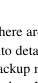

> 请务必备份你可能已安装的 shareware 和商业软件的任何注册密钥。如果你重新安装这些程序然后发现手边没有那些密钥，你将被降级为有限功能（或完全没有功能）。

在 Windows 中备份数据有几种方法，这里不做详细介绍。当然，最简单的方法就是将数据文件直接复制到备份介质上（稍后会详细介绍备份介质）。你可以使用 WinZip 等程序在复制前压缩文件来节省空间。当然，Windows 上也有多种专用备份程序可供使用。

就用于备份系统的介质而言，有多种选择——所有这些都有其优点和缺点。我们接下来将介绍几种最流行的方法。

### Floppy Disks

如果你只有少量数据需要备份，软盘可能可行。软盘的主要优点是它们以非常便宜的方式备份少量数据，而且几乎每台计算机都已有软盘驱动器，因此你已经拥有进行备份所需的硬件。

然而，使用软盘进行备份的缺点通常超过优点。首先，软盘 notoriously 不可靠且容易出错。换句话说，你可能会备份数据，却在尝试恢复时发现软盘损坏且数据已损坏。软盘的另一个问题是容量相对较低。因此，如果你有超过少量数据需要备份，你可能最终要处理大量软盘。不仅从一堆软盘备份和恢复非常缓慢且耗时，而且还增加了其中一个磁盘出现错误的可能性。软盘通常是进行备份的最差选择，只有在需要备份的数据量很小且没有其他备份系统可用时才应使用。如果你必须使用软盘，请务必在将文件复制到磁盘后验证每个磁盘的内容。

### Zip Disks

Iomega 的 Zip 磁盘是一种大容量软盘，容量为 100MB 或 250MB。Zip 磁盘的主要优点是它们可以像普通磁盘一样访问。换句话说，你可以从中加载文档，对其进行更改，然后直接保存回 Zip 磁盘。正因为如此，Zip 磁盘在大学计算机实验室等地方很受欢迎。由于它们可以容纳相对大量的数据，学生可以将磁盘带进带出计算机实验室，并像使用普通磁盘一样使用。Zip 磁盘可有效备份少量数据，且比软盘更可靠。

Zip 磁盘有两个主要缺点。第一个是每兆字节的成本相对较高。例如，截至本文撰写时，250MB 的 Zip 磁盘成本约为每兆字节 7.5 美分。将其与可重写 CD 相比，后者成本约为每兆字节 0.35 美分，你就可以看出 Zip 磁盘每兆字节的价格比可重写 CD 贵 20 多倍。（可重写 CD 确实有一些 Zip 磁盘没有的缺点。我们将在下一节中讨论这些。）


Zip 磁盘的第二个主要缺点是速度相对较慢。虽然这对于备份和恢复数据来说不是大问题，但在尝试将 Zip 磁盘用作普通磁盘并从中访问大型文档时，这是一个问题。

### Recordable and Rewritable CD-ROM

可记录和可重写 CD 可能是小型企业和组织最流行的备份介质，这些企业和组织不需要备份极大量的数据。近年来 CD 刻录机的成本大幅下降，使其对普通计算机用户来说负担得起。可记录 CD 非常便宜，可以容纳相对大量的数据（最高达 700MB）。对于普通家庭或小型企业用户来说，可记录 CD 可能是最好的备份选项。

请注意，你可以获得可记录 CD（CD-R），只能写入一次，以及可重写 CD（CD-RW），可以擦除和重写数百次。对于备份目的，最好使用可记录 CD，因为它们比可重写 CD 更可靠。

可记录和可重写 CD 的主要缺点是它们不能像普通磁盘一样写入。这意味着你不能，例如，从可重写 CD 打开文档，进行更改，然后像使用 Zip 磁盘一样直接将其保存回 CD。写入 CD 通常涉及设置一个“刻录”过程，包含要写入的多个文件，然后执行“刻录”，这需要相当长的时间。这实际上意味着 CD 不适用于“即时”存储介质。

### DVD-ROM

可记录 DVD-ROM 驱动器可能会在不久的将来取代可记录 CD-ROM 驱动器。与 CD 刻录机一样，近年来 DVD 刻录机的成本大幅下降。虽然它们仍然比 CD 刻录机贵得多，但价格合理（并且是一项非常好的投资，因为它们也可以刻录 CD 和播放 DVD）。DVD-R 或 DVD-RW 介质的成本是 CD-R 或 CD-RW 介质的数倍，这意味着它们比 CD 更不“可丢弃”。DVD 每张光盘可存储多达 4.7GB 的数据，使其可有效备份大量数据。然而，对于备份极大量数据，DVD 驱动器与大容量磁带驱动器相比仍不匹配。

### Tape Drives

最古老的备份形式，它仍然是备份大量数据最流行的方法。当然，介质已从可容纳不到 100Mb 数据的巨大盘带驱动器发展到小于信用卡大小的数字音频磁带（DAT）盒式磁带

可以保存超过 20GB 的数据。如果需要备份大量数据，磁带驱动器仍然是最好的选择。然而，便宜的磁带驱动器可能不可靠，而可靠的则相当昂贵（而且通常需要 SCSI 控制器，而大多数电脑现在已不再内置）。介质也不便宜。磁带驱动器最好留给那些必须备份大量数据的人使用。

## Summary

在本小时中，我们了解了 FreeBSD 是什么以及如何使用它。你看到 FreeBSD 是 UNIX 操作系统的一个版本，可免费获得，并且可以安装在任意多台电脑上而无需支付任何许可费用。我们了解了使用 FreeBSD 可以完成的一些事情，包括搭建 Web 服务器、电子邮件服务器、文件服务器或廉价的 UNIX 工作站。我们还将 FreeBSD 与其他操作系统进行了比较，包括 Linux、其他版本的 BSD 和 Microsoft Windows。最后，我们介绍了安装 FreeBSD 的两种方式，并探讨了备份系统的 importance。我们还检查了在安装 FreeBSD 之前可用于备份系统的几种介质类型。

## Q&A

Q Is FreeBSD a “true UNIX,” or is it just “UNIX-like” as some people say?

A FreeBSD 是在加州大学伯克利分校开发的 BSD 代码的许可实现。因为该代码按定义是“真正的 UNIX”，所以 FreeBSD 也是如此。事实上，任何使用此类许可的伯克利代码的操作系统都是如此。

Q Is there a way to run Windows programs within FreeBSD?

A 有正在进行中的项目，其目标是允许用户在 FreeBSD、Linux 或其他此类操作系统中以“仿真模式”运行 Windows 程序。这些项目包括 WINE（较旧的仿真器）和 LinWows 项目，其主要目标是集成 Linux 和 Windows。然而这些都不是成熟或稳定的解决方案，如果你无法放弃游戏，最好的办法还是准备好在需要时启动到 Windows。

Q What’s the best media to use to back up my Windows system before partitioning my disk for dual-booting with FreeBSD?

A 如果你有 CD-R 或 CD-RW 驱动器，这可能是最好的选择。你不需要复制整个硬盘然后稍后恢复它；事实上，不时“彻底清除并重装”Windows 并重新安装软件通常更好。只需担心备份你的个人文档、注册密钥以及所有不属于操作系统或任何特定程序的文件即可。

## Workshop

在本书中，Workshop 部分将通过测验问题、练习和活动来测试你对每个小时课程的掌握。本小时我们讨论了安装前程序，因此目前还没有测验。不过有一些练习可以尝试。

## Exercises

- 1. 去你当地的电子产品商店或你最喜欢的设备供应网站。研究光学介质驱动器（CD-R、CD-RW、DVD-R）、磁带驱动器和 Zip 驱动器的价格。看看是否能找到其中哪些提及除 Windows 之外的任何操作系统的支持。如果有提及 UNIX，你就幸运了。不过很可能 FreeBSD 可以与其中几乎所有设备配合使用。还请查看这些驱动器介质的价格；计算使用每种方法备份所有重要数据需要花费多少。
- 2. 找出一些互联网上最流行的开源软件的开发和分发所依据的许可证条款：Apache 服务器（http://www.apache.org）、BIND（http://www.isc.org/products/BIND/）、Mozilla（http://www.mozilla.org）。这些项目的许可证与 GPL 有什么共同点？它们与 BSD 许可证有什么共同点？

## Hour 2

### Installing FreeBSD

在你实际使用 FreeBSD 之前，需要将其安装到电脑的硬盘上。只要你仔细遵循本小时的说明，这是一个相当简单的过程，不应出现任何问题。本小时你将学习：

- 如何开始 FreeBSD 安装过程
- 如何为 FreeBSD 分区硬盘
- 如何安装 FreeBSD
- 如何安装一些额外软件
- 如何在安装完成后正确关闭系统。

> 我建议你在实际开始安装之前先阅读本章全文。另外，请确保选择一个不会被打扰的时间进行安装。你将做出关于硬盘分区的决定，如果做出错误决定或按错键，可能会导致现有数据丢失。


### Beginning the FreeBSD Installation

如前所述，在安装 FreeBSD 之前，你应该做的第一件事是备份系统上你想要保存的任何重要内容——即使你计划使用 Partition Magic 之类的程序重新分区驱动器。虽然这些程序通常在不损坏数据的情况下完成工作，但仍可能出现错误导致你丢失磁盘上的所有内容。因此，始终做好备份是一个好主意。

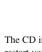

> 如果你计划从空白硬盘开始并想安装 Windows 和 FreeBSD，请确保先安装 Windows。如果不这样做，后续安装 Windows 时会做出假设并抹掉 FreeBSD 启动加载程序，这将导致你无法启动到 FreeBSD。另外，在为安装 Windows 分区硬盘时，请确保为 FreeBSD 留出足够的未分区空间。

本书附带的 CD 是可启动的，因此将 CD 放入 CD-ROM 驱动器并重新启动系统。如果系统直接重新启动到 Windows 而不是开始 FreeBSD 安装，你需要更改系统查找可启动设备的顺序。这是在系统 CMOS 设置实用程序中完成的。访问该实用程序的方法在不同系统上有所不同，但通常涉及在系统启动时按下特定的键或键组合。最常见的是删除键或转义键。另外，一旦进入 CMOS，更改启动顺序的方法在各系统间也有差异。基本上，你要寻找类似“Boot device order”的选项。重要的是确保系统首先检查 CD-ROM 驱动器。配置完成后，保存对 CMOS 程序的更改并退出。系统将重新启动，你应该会看到 FreeBSD 安装程序开始。屏幕上会闪过几条消息，最终你应该会看到类似图 2.1 的屏幕。

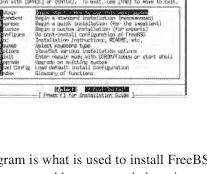

FIGURE 2.1
FreeBSD sysinstall 程序的主菜单，可用于安装和配置 FreeBSD。

### sysinstall

sysinstall 程序用于将 FreeBSD 安装到你的电脑上。此时，你唯一需要关注的选项是 Begin a standard installation。不过不要现在选择它，因为下一节提供了有关导航程序的一些基本提示。

### Navigating in sysinstall

关于 sysinstall 首先需要注意的是，你不能使用鼠标。你需要使用键盘在程序中导航。导航相当直观。表 2.1 显示了用于导航 sysinstall 的键。

TABLE 2.1 Keyboard Commands for Navigating sysinstall

| Key | Action |
|---|---|
| Up Arrow | 向上移动到菜单中的上一个选项。 |
| Down Arrow | 向下移动到菜单中的下一个选项。 |
| Left and Right Arrows | 在菜单底部在选项之间切换。例如，在主菜单中，左右箭头键在 Select 和 Exit Install 之间切换。 |
| Spacebar | 在可选择多个选项的菜单中，空格键切换当前突出显示的选项的打开和关闭状态。 |
| Tab Key | 在菜单中与左右箭头具有相同的效果。在需要填写空白的屏幕中在字段之间切换。 |

要开始安装，请从菜单中选择 Begin a standard installation 选项。你会收到一条关于硬盘分区的消息。按 Enter 继续，你的屏幕将看起来像图 2.2。


FIGURE 2.2
在 sysinstall 中分区硬盘。

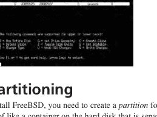

## 硬盘分区

在安装 FreeBSD 之前，您需要在硬盘上为其创建一个分区。分区有点像硬盘上与其他容器分离的容器。例如，您可能有一个用于 Windows 的分区，另一个用于 FreeBSD，如图 2.3 所示。

FIGURE 2.3
硬盘上的分区。

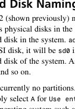

## FreeBSD 的硬盘命名

在图 2.2（前面显示过）的顶部，注意写着 Disk name: ad0 的地方。这就是 FreeBSD 在系统中命名物理磁盘的方式。名称从 0 开始而不是 1。因此，ad0 是系统中的第一块硬盘。ad 表示这块硬盘是 ATA 硬盘。如果您有 SCSI 磁盘，它将是 sd0，但概念相同。ad0 或 sd0 是系统的主硬盘。正如您可能猜到的，ad1 或 sd1 将是第二块，以此类推。

当前该磁盘上没有分区。如果我们想将整个磁盘用于 FreeBSD，只需选择 A 使用整个磁盘即可。另一方面，如果您已经安装了 Windows 等其他操作系统，则需要选择 C 创建切片。然后系统会询问您想要切片的大小。只需输入大小并按 Enter。


> 为了为 FreeBSD 创建切片，您需要有至少一些可用空间。这意味着您必须有标记为 Unused 的可用空间。然后可以将此空间分配给 FreeBSD。

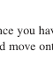

> 请注意，如果您选择 A 选项使用整个磁盘，它将擦除磁盘上现有的所有分区，包括 Windows 分区。另请注意，如果您在此程序中删除 Windows 分区，一旦 FreeBSD 安装开始，您的 Windows 安装将被完全覆盖。

完成为 FreeBSD 创建分区后，按 q 退出程序并进入安装的下一阶段。

## 启动管理器

然后您将看到一个屏幕，询问是否要安装启动管理器。除非您已经安装了另一个启动管理器，例如 Linux 的 LILO，否则您希望在此安装启动管理器。这将允许您启动 FreeBSD，以及在您当前系统上安装了 Windows 且仍希望在 FreeBSD 安装后继续使用它时启动 Windows。

## 创建 BSD 分区

接下来，您将收到一条消息，告知您需要在之前创建的 fdisk 分区内创建 BSD 分区。在此处按 Enter 进入如图 2.4 所示的 BSD 分区表编辑器。

因为这是您第一次安装 FreeBSD，我建议您选择 A 选项以选择自动默认值。完成后，您的屏幕应与图 2.5 类似。

现在不必理解所有这些数字的含义。它们将在关于硬盘和备份系统的章节中稍后解释。

完成分区编辑后，按 q 退出分区编辑器。

FIGURE 2.4
在硬盘上创建 BSD 分区。

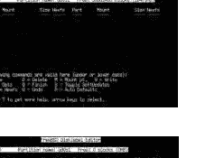

FIGURE 2.5
分区表中创建的 BSD 分区。

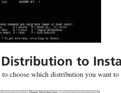

## 选择要安装的发行版

接下来您将被要求选择要安装的发行版（见图 2.6）。

FIGURE 2.6
选择要安装的发行版。

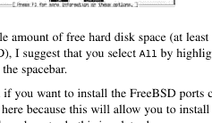

如果您有合理的可用硬盘空间（完整安装 FreeBSD 至少需要一 GB），我建议您通过箭头键突出显示它然后按空格键来选择 A11。

然后系统会询问您是否要安装 FreeBSD ports 集合。我强烈建议您在此选择 是，因为这将使您以后非常轻松地安装额外软件。我们将在后面的章节中看到如何操作。

接下来，您将被带回发行版菜单（见图 2.7）。

FIGURE 2.7
发行版菜单。请注意，由于您之前选择了 A11，所有集合都已自动为您选中。

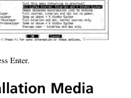

按上箭头到 Exit 并按 Enter。

## 选择安装介质

接下来，您将被要求选择要用于安装 FreeBSD 的介质（见图 2.8）。

FIGURE 2.8
选择安装来源。


因为这是一本入门书籍，这里我们只介绍一种方法，即使用随书附带的 CD-ROM 安装。选择 CD-ROM 选项并按 Enter。

选择完要安装的介质后，您将收到一条消息，告知这是更改硬盘之前最后一次退出机会。如果您确定准备继续，请选择 OK，FreeBSD 将开始将文件复制到您的硬盘。请注意，此过程可能需要相当长的时间，没有必要一直盯着它。因此在复制文件时您可以随意做其他事情。


> 直到被问及是否要继续安装时，实际上尚未对硬盘进行任何更改。这是您最后一次退出机会。如果您在此继续，将会向硬盘写入更改。

## 安装后

FreeBSD 完成复制文件后，必须执行几个安装后任务。

您将被问到的第一个问题是是否要配置任何以太网或 slip/ppp 网络设备。除非您确定自己知道在做什么，否则我建议您在此选择 否。我们将在第 13 小时详细讨论网络配置。

立即不将机器连接到网络还有其他一些好处。例如，系统会相对暴露，如果它未连接到网络，黑客就无法访问它。

接下来，系统会询问您是否希望此机器作为网络网关发挥作用。再次，我建议您在此选择 否。下一个问题将询问您是否要配置 inetd 和简单的 Internet 服务。再次选择 否。这里的主题及其配置将在本书后面讨论。

对于是否允许匿名 FTP 访问此机器的问题，选择 否。匿名 FTP 将在第 24 小时讨论，以及如果您愿意如何启用它。

在这一点上，您不希望将此系统用作 NFS 服务器，因此也可以对此问题选择 否。NFS 代表网络文件系统，它是一种让一个 UNIX 服务器访问位于另一台服务器上的文件系统的方式。NFS 在小型企业设置中并不常见，而且是超出本书范围的主题。当被问及是否要将此系统配置为 NFS 客户端时，您也可以选择 否。

下一个问题询问您是否要更改默认安全配置文件。除非您有非常严格的安全要求，否则我建议您在此选择 否。然后系统会提供一些关于所选安全级别的信息。阅读完毕后，只需按 Enter 继续即可。

除非您使用的是外文键盘，否则对于是否要自定义机器控制台环境的问题，也可以选择 否。

下一个问题将询问您是否要设置系统时区。最好这样做。

选择 是 后，系统会询问您的系统时钟是否设置为 GMT 时间。如果您不确定，它可能不是，所以在此选择 否。

然后您将获得一个区域列表以供选择时区（见图 2.9）。选择您的时区所在的区域并按 Enter。

## FIGURE 2.9
选择时区区域。

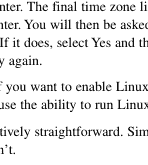

接下来，您将获得一个国家列表。再次，从列表中选择您居住的国家并按 Enter。最终的时区列表将要求您输入实际时区。执行此操作并按 Enter。然后系统会询问时区缩写是否合理。如果合理，选择 是 程序将继续。如果不合理，您可以选择 否 并重试。

然后系统会询问您是否要启用 Linux 二进制兼容性。我建议您在此选择 是，因为运行 Linux 应用程序的能力通常非常方便。

下一个问题相对简单。如果您有 USB 鼠标，则选择 是，没有则选择 否。

然后系统会询问您是否要配置鼠标守护进程。我建议您在此选择 取消，因为在 X Window 系统中使用鼠标不需要此守护进程。事实上，它可能会干扰鼠标在 X 中的正常操作。


当询问是否要配置 X Window 系统时，选择“否”，因为我们将在后面的章节中配置它。配置 X 有点棘手，最好留到后面详细讨论时再进行。

接下来，系统会询问你是否要浏览 FreeBSD 软件包集合。这里选择“是”，然后只需浏览类别，看看是否有感兴趣的内容。我建议你安装位于 shells 类别下的 bash shell，因为在接下来的几个小时里我们会使用这个 shell。

然后系统会询问你是否要创建任何额外的用户或组（参见图 2.10）。

## 图 2.10
询问是否要创建用户或组的对话框。

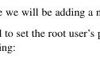

这里选择“否”，因为我们将在下一小时为你添加一个新用户。

接下来系统会要求你设置 root 用户的密码。点击“确定”后，你会看到类似以下的提示：

```
Changing local password for root.

New password:
```

请注意，好的密码应同时包含字母和数字，且不应是字典中的单词。它应易于你记住以免写下来，但对他人来说应难以猜测。它还应至少为八个字符长。输入密码后，系统会要求你确认。只需重新输入并按 Enter 键。

然后系统会询问你是否要访问配置菜单以进行最后的更改。选择“否”，系统会告知它将重启。选择“确定”，系统将重启。

> 确保在系统关机后且在重新启动之前立即取出 CD-ROM。如果不这样做，你的计算机将直接从 CD-ROM 启动，从而再次进入安装程序。如果确实发生了这种情况，只需按下计算机上的重启按钮重新启动，然后在系统开始重启时立即弹出 CD-ROM。

## 重启后关闭系统

随着系统重启，你会看到大量信息闪过。（如果你选择了双启动系统，你会先看到一个菜单，要求你按功能键选择要启动的操作系统。只需按下标有 FreeBSD 的那个。）最后你应该会看到一个简单的提示：

```
login:
```

在此处输入名称 root 并按 Enter。随后系统会要求你输入安装时设置的密码。输入后，你会看到类似以下的提示：

```
#:
```

这意味着 FreeBSD 在等待你给出指令。在此情况下，我们只是要告诉它关机。正确的方法是使用 shutdown 命令。因为我们希望系统停止（我们希望关闭它而不是重启它），我们将按如下方式输入命令：

```
shutdown -h now
```

该命令的细节现在不重要，将在后面的章节中讲解。现在只需知道该命令告诉 FreeBSD 立即停止。当你看到“Press any key to reboot”消息时，可以安全地关闭计算机。

> 除非绝对必要，否则不建议以 root 用户登录。Root 拥有特殊权限，如果使用不当可能会导致严重问题。如前所述，我们将在下一小时创建普通用户账户。


> 切勿在未先发出 shutdown 命令的情况下直接关闭 FreeBSD 系统。这样做可能会损坏文件。

## 摘要

恭喜！你现在已成功在系统上安装了 FreeBSD。本小时中，我们了解了如何为 FreeBSD 分区硬盘。然后我们查看了用于安装 FreeBSD 的程序并进行了安装过程的演示。最后，我们了解了如何正确关闭 FreeBSD。

## 问答

本节旨在回答有关 FreeBSD 安装的一些最常见问题。

**Q** 我把 FreeBSD CD 放入 CD-ROM 驱动器，但系统直接启动到 Windows。我该怎么办？

**A** 你需要在系统 CMOS 设置实用程序中将 CD-ROM 驱动器选为第一启动设备。重新启动系统并查找进入该实用程序的提示（DELETE 键是常见方式）。系统启动时立即按下该键，然后在出现的程序中查找更改启动设备顺序的选项。

**Q** 我重新启动系统后，它似乎挂起且什么都不加载。怎么回事？

**A** 如果 CMOS 设置为首先从 CD-ROM 驱动器启动，而该驱动器中没有可启动的 CD，一些系统会长时间挂起。最终系统会放弃并从硬盘启动，但为避免长时间延迟，请返回系统 CMOS 设置实用程序，将主要启动设备改回原始顺序。（要么先是主硬盘，要么是软盘然后是硬盘。）

## 练习

提供测验问题以便你进一步理解 FreeBSD 安装主题。

## 测验

- 1. FreeBSD 安装程序的名称是什么？
- A. installation
- B. sysinstall
- C. setup
- D. None of the above
- 2. 以下哪些（如果有的话）是好的密码？
- A. october
- B. 123abc
- C. xfgh
- D. fluffy
- 3. 用于停止 FreeBSD 的命令名称是什么？
- A. shutdown
- B. stop
- C. down
- D. kill

## 测验答案

- 1. 正确答案是 B。
- 2. 这些都不是好的密码。答案 A 是字典中的单词。更糟糕的是，月份名称（尤其是当前月份）是现存最常见的弱密码之一。答案 B 包含连续的字母和数字，因此很容易猜到。答案 C 太短。答案 D 很可能是用户的猫的名字，这很容易被查到。
- 3. 正确答案是 A。


## 第 3 小时

## FreeBSD 基础导览

FreeBSD 与大多数 UNIX 操作系统一样，拥有极其丰富的命令和实用程序集合。这套丰富的实用程序使用户能够使用 UNIX 完成大多数其他操作系统无法完成的事情。这种强大功能是 UNIX 在最初编写 30 多年后仍然如此受欢迎的原因之一。不幸的是，这套丰富的实用程序和命令可能会让 FreeBSD 对新用户来说有点令人不知所措和困惑。本小时提供了对 FreeBSD 命令行界面及其如何执行一些基本操作的温和介绍。

在本小时中，你将学习以下内容：

- FreeBSD 启动过程的基础
- 登录 FreeBSD
- 你的主目录及其用途
- 其余的目录结构
- 处理文件和目录
- 从系统注销
- 正确系统关机的重要性

## FreeBSD 启动过程的基础

当你第一次打开计算机时，在你能够开始使用它之前必须发生一系列过程。例如，你的计算机需要检查所有硬件是否可用且正常工作，并从硬盘加载指示下一步操作的指令。对这些过程的基本了解有助于理解 FreeBSD 的工作原理，以及在出现问题时进行故障排除。

## POST

当你打开计算机时发生的第一个事情称为 *Power On Self Test* (*POST*)。这是由计算机的 *BIOS* (*basic input/output system*) 运行的程序。在启动过程的此阶段，计算机检查所有硬件以确保一切都在且正常工作。它计算可用 RAM 并对其进行一些基本测试，确定可用介质的类型和大小（硬盘等），并为即插即用设备分配资源。请注意，启动过程的此阶段与 FreeBSD 无关。无论你打算在计算机上启动什么操作系统，此步骤都会执行。此时，你的计算机仍不知道它将运行什么操作系统。

## Bootstrap

POST 完成后，计算机的 BIOS 会查找系统上可以从中加载操作系统的设备。检查操作系统的设备顺序通常可以在系统的 BIOS 设置菜单中配置。通常，软盘驱动器是首先被检查的设备。这就是为什么当你打开计算机时如果驱动器中有软盘就会出现“Non-systems disk or disk error”消息的原因。通常，系统从其硬盘启动。

## 启动管理器

BIOS 找到可启动硬盘后，它会读取硬盘上扇区 0 中的内容。你可以把扇区 0 想象成硬盘上的第一件事。扇区 0 也称为 *Master Boot Record* 或 *MBR*。此过程开始了所谓的 *bootstrap*，其名称源于系统“自己拉起靴子”的概念。

如果你安装了双启动系统，以便每次启动系统时可以选择在 Windows 或 FreeBSD 中工作，那么 FreeBSD 启动管理器程序将位于 MBR 中。当你看到类似以下的菜单时，你就知道启动过程的此阶段已完成：

```
F1 DOS
F2 FreeBSD

Default: F2
```

DOS 条目实际上是 Windows。但在某些版本的 Windows 中它会显示为 DOS。要选择要启动的操作系统，只需按下与菜单中条目对应的功能键即可。如果在一段时间内不进行操作，则 Default 旁列出的条目将自动启动。（默认通常是您上次使用计算机时选择的操作系统。）在接下来的这一小时里，我当然会假设您从此菜单中选择了 FreeBSD。

> FreeBSD 也可以从 Linux 启动加载器 LILO 和 GRUB 启动。然而，配置此项超出了本书的范围。请参阅 LILO 或 GRUB 文档，了解如何向其中添加另一个启动选项的更多信息。

如果您选择将 FreeBSD 安装为计算机上唯一的系统，您将看不到此菜单，而是 FreeBSD 会立即开始加载。

## 内核

实际上在启动管理器和本阶段之间还有几个启动阶段，但我们将跳过它们，因为目前它们并不重要。它们主要出于技术原因而存在。如果您有兴趣了解更多关于这些阶段以及它们存在的原因，FreeBSD 手册中提供了有关引导过程的更多详细信息，可在 FreeBSD 网站 www.freebsd.org 上获取。

启动过程的下一部分加载并启动 FreeBSD 内核。内核是一段特殊的软件，是操作系统的核心。它控制对系统资源（如 RAM、硬盘等）的访问，提供服务（如多任务处理），使计算机能够同时执行多项任务，确保两个程序不会通过访问未分配给它们的资源而相互干扰，并且在 FreeBSD 等多用户系统上，通过控制用户可以访问的系统部分，确保用户之间不会相互干扰。

内核加载后，您将看到类似以下内容的版权声明：

```
Copyright 1992-2002 The FreeBSD Project
Copyright 1979, 1980, 1983, 1986, 1988, 1989, 1991, 1992, 1993, 1994
The Regents of the University of California. All rights reserved.
FreeBSD 4.7-RELEASE #0: Sun, Sept 14 02:04:15 CST 2002
root@simba.lionresearch.org:/usr/obj/src/sys/SIMBA
```

这里需要注意的部分是最后两行（第 4 行和第 5 行）。第 4 行包含有关您正在运行的 FreeBSD 版本的重要信息。在本例中，我们运行的是 FreeBSD 4.7 RELEASE（其他可能性是 STABLE 和 CURRENT。我将在后面的章节中解释这些）。发布后跟随的日期和时间表示该内核的编译日期和时间。这现在可能对您意义不大，但如果您为系统构建自定义内核，后续将非常重要。（请参阅第 10 小时《The FreeBSD Kernel and the Device Tree》，了解为何要这样做以及如何操作。）第 5 行列出了构建内核的用户名称，以及内核构建所在的系统的主机名。该行的第二部分列出了内核对象文件所在的目录。如果您是 C 或 C++ 程序员并且知道对象文件是什么，那就太好了。如果您不知道对象文件是什么，不用担心。您完全可以在不担心此问题的情况下使用和管理 FreeBSD。

版权声明之后，您将看到屏幕上快速闪过许多信息，FreeBSD 在检测和初始化系统中的各种硬件设备。您现在不需要理解这些含义，但您可能会在列表中认出一些熟悉的硬件。例如，

```
fd0: <1440 KB 3.5" drive> on fdc0 drive 0
```

是 3.5 英寸 1.44Mb 软盘驱动器。该行的第一部分（fd0）是 FreeBSD 设备名称。它类似于 Windows 中的“A: 驱动器”标识。然而，FreeBSD 系统实际上更有意义，因为该标识告诉您有关设备的信息——fd 代表 floppy disk（软盘）。数字 0 表示它是系统中的第一个软盘。在 FreeBSD 中，数字几乎总是从 0 开始而不是从 1 开始。

您也可能会看到类似这样的行：

```
unknown: <PNP0501> can't assign resources
```

您也不必担心这些信息。这些只是 FreeBSD 不了解的系统中的即插即用设备。随着时间的推移，随着 FreeBSD 支持越来越多的硬件，您应该会看到越来越少的此类信息。

内核完成硬件初始化后，将挂载根文件系统。（有关挂载和卸载文件系统的更多信息，请参阅第 8 小时《Storage Systems and Backup Utilities》。）挂载文件系统只是使其可供使用。在此过程发生时，您将看到类似以下的消息：

```
Mounting root from ufs:/dev/ad0s1a
```

此后，内核将调用一个名为 init 的程序来处理剩余的系统启动。来自内核的消息和来自 init 程序的消息可以通过颜色区分。内核消息为白色，而来自 init 的消息为浅灰色。

## init

init 程序做的第一件事之一是检查上次计算机重新启动时系统是否已正确关闭。如果没有，init 将运行一个名为 fsck 的程序，它基本上相当于 Windows 的 Scandisk 程序。fsck 将检查并修复因系统关闭不当而导致的文件系统损坏。

文件系统检查后，init 读取系统启动脚本并运行设置为在系统启动时运行的任何程序。这些类似于 Windows 中的服务或放置在 Windows 启动组中的程序。

这些程序启动后，init 运行一个程序来初始化控制台并为您提供登录提示。

## 登录到 FreeBSD

系统启动过程完成后，您将看到类似以下的提示：

```
FreeBSD/i386 (simba) (ttyv0)
login:
```

此提示要求您输入安装 FreeBSD 时为创建的用户指定的登录名。（simba）是此系统的主机名。如果您刚刚安装了 FreeBSD 且在安装期间未指定不同的主机名，则您 的主机名很可能为（amnesiac）。（请注意，括号不是主机名的一部分。）您将在后面的章节中学习如何更改主机名。

如果您来自 Windows 背景，您可能会首先想知道为什么必须登录。FreeBSD 是一个多用户系统，这意味着许多不同的用户可以同时使用该系统。FreeBSD 还被设计为在网络环境中工作。因此，安全性是一个问题，所以 FreeBSD 要求用户使用用户名和密码登录。这可以防止未经授权的人访问他们不应访问的文件等。但即使您拥有一个安全性不是问题的家庭系统，拥有单独登录的用户仍然有另一个很好的理由。每个用户都可以按照自己的喜好自定义系统，而不会影响系统对其他人的工作方式，这意味着不必争论背景应该使用哪个壁纸、各种事件应该使用哪些声音等等。每个用户都可以按照自己的喜好设置系统，而不必担心更改其他用户的设置。


> 如果您是唯一使用系统的人，您可能会想总是以 root 用户工作。这不是一个好主意，因为 root 用户没有任何限制，可以对系统的任何部分执行任何操作，包括删除重要的系统文件。普通用户账户具有内置的安全网，可防止您损坏系统（但不能防止您损坏自己的文件）。因此，最好始终使用普通用户账户完成大部分工作，只有在需要执行普通用户无法完成的操作时才以 root 身份登录。

在登录提示符下输入用户名并按 Enter 后，FreeBSD 将提示您输入密码。输入您在安装期间为该用户分配的密码，然后再次按 Enter。请注意，您在屏幕上看不到密码。不要担心，FreeBSD 在您输入时正在读取密码。它只是不在屏幕上显示任何内容，以防止可能在您身后窥视的人获取您的密码。假设您正确输入了用户名和密码，您将看到类似以下内容：

```
Last login: Fri Sept 20 02:04:15 on ttyv0
Copyright 1980, 1983, 1986, 1988, 1990, 1991, 1993, 1994
The Regents of the University of California. All rights reserved.

FreeBSD 5.0-RELEASE (GENERIC) #0: Fri Sept 20 03:15:25 CST 2002

bash$
```

如果您在输入用户名或密码时出现错误，您将看到以下内容：

```
Login incorrect
login:
```

只需重新输入用户名和密码并重试。当您成功登录后，您将看到前面所述的 bash$ 提示符。


> 登录后，请注意“Last login”信息中列出的日期。如果您知道自己并未在列出的时间登录，这可能是一个警告，表明其他人使用了您的账户。如果发生这种情况，请立即更改密码并通知您的系统管理员（除非您是系统管理员）。如果您是系统管理员，请参阅第 14 小时关于网络安全的信息。


> 如果你连续几次输错用户名或密码，系统似乎会停止响应，因为它不会再给出登录提示。这实际上是一个安全特性，旨在帮助挫败通过随机猜测尝试破解密码的计算机软件。等待几秒钟，提示就会返回。输错密码的次数越多，延迟就会逐渐变长。

## 你的主目录

成功登录后并且出现 bash$ 提示符时，你将位于你的主目录中。你的主目录基本上是你在 FreeBSD 系统上的个人空间。它类似于 Windows 中的“我的文档”文件夹。你的所有个人文件都存储在主目录中，包括 FreeBSD 设置方式的个人偏好文件以及你创建的任何额外文档或目录。默认情况下，其他人无法向你的主目录写入任何内容。这意味着除了你之外，其他人无法在你的主目录中创建目录或文件。它还意味着其他人无法更改或删除你主目录中的任何目录或文件。这提供了一定程度的安全性，因为它防止他人意外删除你的文件。

> 默认情况下，FreeBSD 仅阻止其他用户删除或更改你在主目录中拥有的文件和目录。它并不会阻止其他用户读取存储在主目录中的文件。如果你有敏感文件，希望确保其他用户无法读取，你可以更改文件设置来实现这一点。这将在第 4 小时“基本 UNIX Shell 使用”中介绍。请注意，root 用户（系统管理员）可以读取系统上的任何文件。不可能阻止 root 用户读取任何文件。因此请记住，即使你将文件设置为只有你可读，拥有系统管理员访问权限的任何人仍然能够读取该文件。

## 目录结构的其余部分

你的主目录只是整个 FreeBSD 目录结构的一部分。在你的主目录之外，FreeBSD 拥有一个复杂但组织良好的目录集合。作为普通用户，你无法对主目录之外的任何目录或文件进行任何更改（某些例外情况现在不重要）。然而，你会非常规律地访问主目录结构之外位置的文件，因为大多数你将使用的程序都位于那里。

像大多数现代操作系统一样，FreeBSD 使用一种称为树结构的层次目录结构。你可能从 Windows 中熟悉这个术语。如果不熟悉，它之所以得名是因为如果可视化，目录结构看起来像一棵倒置的树，最高级别的目录（根目录）在顶部（树的根），所有其他目录都从根目录分支出来。图 3.1 显示了 FreeBSD 目录树的某些层级。图中给出的层级接下来会进行解释。

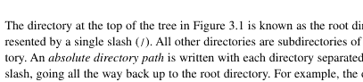

图 3.1 中树顶部的目录称为根目录。它由单个斜杠（/）表示。所有其他目录都是根目录的子目录。绝对目录路径使用正斜杠将每个目录分隔开，一直追溯到根目录。例如，目录 /usr/bin 表示目录 bin，它是目录 usr 的子目录，而 usr 是根或顶级目录 / 的子目录。表 3.1 列出了树中所示目录的用途。

表 3.1 图 3.1 中树所示目录的用途

| 目录 | 用途 |
|---|---|
| / | 顶层的根目录。主要用作容纳整个文件系统的容器。 |
| /boot | 包含启动系统所需的文件，包括内核。 |
| /bin | 该目录包含 FreeBSD 的程序，包括创建和删除目录等命令。 |
| /etc | 控制系统行为的配置脚本。也存储用户信息（如密码）的数据文件。 |
| /usr | 普通用户通常访问的程序和目录。 |
| /usr/local | 特定于本地系统的程序和配置文件。这通常指安装的第三方软件，不属于基础 FreeBSD 安装的一部分。 |
| /home/username | 这是用户主目录的存储位置，其中 username 是拥有该目录的用户名。我在本小时前面介绍过主目录。 |
| /var | 包含大小变化的文件。常见存储内容包括等待发送到打印机的打印作业目录、Web 服务器日志文件和电子邮件目录。 |

表 3.1（以及图 3.1 中的树）并未显示所有目录，但它展示了一些更重要的目录，以便让你了解目录树的外观和工作原理。如果表 3.1 对你来说现在还像一团乱麻一样，不要担心。我们在书中后续处理这些目录时，会对每个目录进行完整解释。

## 处理文件和目录

FreeBSD 提供了各种图形界面，可提供类似 Windows 资源管理器的文件和目录管理界面，但有时能够从命令行操作文件和目录非常有用。如果你从未使用过命令行，这可能看起来像是历史倒退。但实际上，对于许多任务来说，命令行可以比图形用户界面更强大、更快——尤其是在涉及操作大量相似文件时。

如果你曾在 Windows 或 DOS 中使用过命令行，你会发现 FreeBSD 命令行在大多数情况下相当相似，尽管某些命令名称不同。如果你从未使用过命令行，本节提供了温和的介绍。

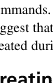

> 即使你是经验丰富的 Windows 命令行用户，也应至少浏览本节，因为某些命令的行为与你在 DOS 中预期的不同。特别重要的是关于 FreeBSD 通配符的部分，其行为与 DOS 通配符大不相同。在 DOS 中完全不起作用的通配符在 FreeBSD 中可能会删除目录中的每个文件！

以下各节介绍了基本的文件和目录操作命令。由于大多数人通过实际操作而不是仅仅阅读来学习最好，我建议你通过使用安装期间创建的用户登录到你的 FreeBSD 系统并亲自尝试这些命令来跟随操作。

## 创建和删除目录

在 FreeBSD 中创建新目录的命令是 mkdir。它是 make directory 的缩写。在最基本的形式中，只需在命令名称后跟上你想要创建的目录的名称。例如，

```
bash$ mkdir mydir
bash$
```

此命令在当前目录中创建一个名为 mydir 的新目录。

## 目录名称规则

FreeBSD 对目录名称的规则很少。然而，为了便于使用，我建议你遵循某些约定。请注意，所有这些规则同样适用于文件名。

可以创建包含空格的目录名称，但为此需要用引号将整个目录名称括起来。FreeBSD 将空格解释为命令的参数分隔符。换句话说，如果你输入命令 mkdir my dir，FreeBSD 会将 my 和 dir 之间的空格解释为参数分隔符。其结果是命令将创建两个新目录——一个名为 my，另一个名为 dir。若要使命令产生创建名为“my dir”的目录的预期效果，你需要这样输入：

```
mkdir "my dir"
```

由于在目录名称周围输入引号既不方便又容易出错，我建议你避免使用带空格的目录名称。一个常见的解决方案是使用下划线字符代替空格（例如“my_dir”）。这避免了使用空格在目录名称中导致潜在错误的可能性。


> 包含空格的目录名称也可能带来导致意外结果的错误风险。例如，假设你有一个名为 documents from work 的目录，另一个仅名为 documents 的目录，以及第三个名为 work 的目录。你想要删除名为 documents from work 的目录。如前所述，除非加引号，否则 FreeBSD 会将空格解释为参数分隔符。删除目录的命令是 rmdir。如果你忘记加引号并输入命令 rmdir documents from work，FreeBSD 将尝试删除三个名为 documents、from 和 work 的目录。在这种情况下，未加引号会导致灾难性后果，因为该命令将删除 documents 目录和 work 目录，同时留下 documents from work 目录未受影响——这不是你想要的结果。使用下划线字符代替空格可以避免这种危险。

此外，你不能以连字符（-）开头目录或文件名，因为 FreeBSD 将连字符解释为表示其后内容为修改给定命令行为的参数。你可以在文件名和目录名称中间使用连字符。

要删除你刚刚创建的目录，请使用 rmdir 命令。例如，

```
bash$ rmdir mydir
bash$
```


请注意 rmdir 只能删除空目录。如果目录中存在任何文件或子目录，你将收到错误信息 directory is not empty。本小时稍后，我们将查看一个可以删除非空目录的命令。

请注意 rmdir 命令在执行前不会要求确认。FreeBSD 假定你知道自己在做什么，并且默认情况下，命令在执行前几乎从不要求确认——即使你告诉它们执行极具破坏性的操作。如果你不确定自己在做什么，可以使用大多数命令的命令行选项。该选项是 -i。-i 是 interactive 的缩写。这会使命令在实际执行任何操作之前向你请求确认。此选项非常有用，当你不完全确定交给 FreeBSD 的命令是否会产生预期效果时。如果命令最终要做的事情与你的意图不同，-i 选项会通知你并在为时已晚之前给你退出操作的机会。

假设你正在跟随操作并且已发出前面的 rmdir 命令，请继续使用 mkdir 命令重新创建该目录，因为我们将在下一节中使用它。

## 列出目录内容

ls 命令用于列出目录的内容。以下是 ls 命令的示例输出：

```
bash$ ls
Mail      projects      proposal-draft      program1
tyfsbd    mail          program1.c
bash$
```

这个列表的主要问题是，除了名称之外，它几乎没有提供有关目录中实际存在哪些类型事物的信息。但无法判断条目属于文件、子目录还是其他。因此，ls 命令提供了多个选项，可用于使其在每个条目上显示更多信息。例如，-F 选项会使 ls 为列表中的每个条目提供更多类型信息：

```
bash$
Mail/      projects/      proposal-draft      program1*
tyfsbd@    mail/          program.c
bash$
```

前面列表中某些条目后面的符号告诉我们其类型。它们的含义如下：

- /: 该项是目录。
- *: 该项是可执行程序或脚本。
- @: 该项是到另一位置的符号链接。这类似于 Windows 中的快捷方式。

与 Windows 不同，FreeBSD 中的可执行文件不需要 .EXE 或 .COM 扩展名。我们稍后将查看 FreeBSD 如何确定文件是否应可执行。

在 FreeBSD 中，以前导点号 (.) 开头的文件在普通目录列表中会被隐藏。以点号开头的文件通常是控制程序行为和工作环境配置的文件。因为这些文件很少被访问，FreeBSD 在普通目录列表中隐藏它们，以避免列表因大多数时候无关的条目而杂乱。如果你想查看隐藏文件，请使用 ls 命令的 -a 选项。-a 是 all 的缩写：

```
bash$ ls -a
.forward      .mailrc      .profile      Mail
..  .hushlogin   .project     tyfbbsd
.addressbook  .sh_history  .cshrc        .mail_aliases
bash$
```

在此阶段，了解所有这些文件的含义并不重要，但你可能可以根据部分名称猜出其含义。例如，此处的文件包含你的用户配置文件，控制电子邮件的投递方式以及是否应转发等。

这里有两个条目值得特别提及。它们是 . 和 .. 条目。单个点号表示当前目录，双点号表示该目录的父目录——即该目录所在的目录。除根目录 (/) 外，所有目录都有父目录。

ls 的另一个有用选项是 -l 选项。-l 是 long 的缩写，这会为列表中的每个条目提供更多详细信息。例如，

```
bash$ ls -l
drwx--- 2 murban research 512 Feb 15 22:21 Mail
lrwxrwxr-w 1 murban research 15 Mar 20 06:55 tyfbbsd -> /home/murban/documents/books/tyfbbsd
-rw-r--r- 1 murban research 782 Mar 15 01:22 proposal.draft
-rwx--- 1 murban research 15200 Mar 15 02:21 program
bash$
```

我现在不会涵盖此列表中提供的所有信息，但我会介绍其中一些更重要的信息。

第一组条目列出了条目的类型及其权限。第一个条目 Mail 以 d 开头，表示该条目对应一个目录。接下来的九个字符对应权限。所有者有三个字符，文件组有三个字符，其他用户（包括其他所有人）有三个字符。在这种情况下，所有者对该目录具有读、写和执行权限 (rwx)。组和其他用户没有任何权限。所有者和组是谁？它们由第三和第四个条目指示。在这种情况下，所有者是 murban，组是 research。（我的组成员身份是 research）。在这种情况下，这意味着 murban 可以对该目录做任何事情（读、写、执行），但其他人无法做任何事情。我将在后面的小时中更详细地解释权限。

research 之后的下一个条目表示条目的大小（以字节为单位）。之后是条目最后修改的日期和时间。最后的条目当然是文件名称。

第二行值得特别提及。一个看起来像这样的条目

```
lrwxrwxr-w 1 murban research 15 Mar 20 06:55 tyfbsd ->
/home/murban/documents/books/tyfbsd
```

表示一个符号链接。如前所述，符号链接类似于 Windows 中的快捷方式。在这种情况下，条目 tyfbsd 实际上是到目录 /home/murban/documents/books/tyfbsd 的快捷方式。符号链接允许我仅使用 tyfbsd 而不是更长的路径来访问此目录。

## 更改目录

要移动到另一个目录，请使用 cd 命令，其缩写为 change directory。例如，要更改到 tyfbsd 目录（它是当前目录的子目录），你将使用命令 cd tyfbsd。这称为相对路径。相对路径意味着提供给 cd 命令的目录相对于你当前所在的目录。换句话说，该命令相对于你当前所在的目录，而 tyfbsd 目录是当前目录的子目录。另一种是绝对路径。绝对路径始终从根目录开始。回想一下，根目录由 / 表示，是系统中的顶级目录。使用 cd 指定绝对目录的示例是 cd /tyfbsd。这将更改到位于根目录中的名为 tyfbsd 的目录。

你可能还记得上一节中，双点号 (..) 表示当前目录的父目录。因此，你可以使用双点号向上移动一个目录级别到当前目录的父目录。执行此操作的命令是 cd .. 。如果你想向上移动两个目录级别，可以使用 cd ../..，依此类推。如果你想移动到名为 my_stuff 的目录——


它位于当前目录的父目录中——你可以使用命令 `cd ../my_stuff`。


> 如果你在 FreeBSD 目录结构中迷路，只需键入 `cd` 然后按 Enter 键即可立即返回主目录。无论你当前在目录树中的何处，`cd` 命令在没有参数的情况下始终会带你返回主目录。

## pwd 命令

如果你记不起当前所在的目录，`pwd` 命令会为你列出。`pwd` 是 *打印工作目录* 的缩写。有一种方法可以将当前工作目录作为 shell 提示符的一部分，以便提示符始终显示你当前所在的目录。我们将在第 5 小时“高级 UNIX Shell 使用”中查看如何执行此操作。

## 创建文件

在 FreeBSD 中有多种创建空文件的方法。就目前而言，我们将使用 `touch` 命令。如果你尚未进入该目录，请使用前面讨论的 `cd` 命令更改到我们之前创建的名为 `mydir` 的目录。现在输入命令 `touch myfile`。这将在当前目录中简单地创建一个名为 `myfile` 的空文件。当然，空文件不是很有用，但这将允许你查看一些基本的文件操作命令。


> 波浪号字符 `~` 是主目录的简写。它可以在任何你想引用主目录的地方使用。例如，`cd ~/documents` 将带你到主目录内的 `documents` 目录，无论你当前在目录树中的何处。

## 移动文件

将文件从一个位置移动到另一个位置的命令是 `mv`。尝试以下命令：

`mv myfile myfile1`

该命令将简单地将 `myfile` 移动到名为 `myfile1` 的新文件。当然，你也可以将其视为简单地重命名文件。然而，`mv` 的行为将

取决于 myfile1。如果 myfile1 在目录列表中尚不存在，则行为如前所述。myfile 将简单地重命名为 myfile1。如果 myfile1 已存在于目录中并且是一个现有文件，myfile 将覆盖 myfile1。请注意，FreeBSD 在覆盖现有文件之前不会要求确认。因此，再次提醒，如果你不完全确定自己在做什么，最好使用 -i 选项来执行 mv。正如前面提到的 rmdir 命令一样，-i 会使命令变为交互式，因此在执行任何操作之前会提示确认。

如果 myfile1 已存在于当前目录中并且是一个子目录，命令会将 myfile 移动到子目录 myfile1 中，并且 myfile 会保留其现有名称。因此，结果是文件现在位于 myfile1/myfile。请注意，如果文件 myfile 已存在于子目录 myfile1 中，FreeBSD 将覆盖现有文件——再次强调，事先不会询问确认。

## Copying Files

复制文件的命令是 cp。它与 mv 命令非常相似，只是它创建文件的副本而不是移动文件。与 mv 命令一样，如果 cp 命令给出的第二个名称尚不存在，cp 会在新名称下创建文件的副本。如果给出的第二个名称是一个目录，cp 会在新目录中复制文件，并且新文件会保留其原始名称。此外，与 mv 命令一样，cp 在事先不征求许可的情况下会覆盖同名已存在的文件。因此，再次提醒，如果你不是 100% 确定自己在做什么，使用 -i 选项可能是一个好主意。

cp 命令也可以用来复制目录。但是，默认情况下，它不会深入超过一层。如果您想递归复制一个目录及其所有子目录（换句话说，您想复制一个目录及其内部的所有内容），可以使用 -R 选项来执行 cp 命令。再次提醒，您可能也想使用 -i 以防止 cp 意外覆盖您不打算覆盖的任何文件。


> 使用 cp 的 -R 选项可能会让你陷入麻烦。例如，像 cp -R ./ * /old 这样的命令会尝试递归地将当前目录中的所有内容复制到名为 old 的新目录中，而该目录也位于当前目录中。（我还没有介绍通配符，但基本上，* 是一个表示所有内容的通配符。）问题在于，目录 old 也会被递归复制到自身中。结果是一个递归循环，会迅速填满硬盘上的所有可用空间。注意此类情况。

## Deleting Files

rm 命令用于删除文件。在其基本形式中，只需在 rm 命令后跟上要删除的文件名即可。例如，rm myfile 将删除当前目录中的 myfile。rm 命令也可以通过使用 -r 选项来删除一个目录及其下面的所有内容。例如，rm -r mydir 将删除 mydir 中位于其中的所有子目录和文件，然后删除 mydir。当然，使用 -r 选项可能会造成很大破坏，因为再次强调，FreeBSD 在执行命令之前不会要求确认，因此在按 Enter 之前务必仔细检查命令行，以确保您删除的是正确的目录。还应始终确保在您要删除的目录下的任何目录中都没有您想要保留的内容。如果您不完全确定，请同时使用 -i 选项和 -r 选项。这将导致 FreeBSD 在删除任何内容之前要求您确认。

## Wildcard Basics

像它们的纸牌游戏对应物一样，通配符用于匹配任何字符或字符序列。它们可用于移动多个文件或删除多个文件等操作。在 FreeBSD 中编写通配符的方式有很多，但这里我们只会查看两种最基本的方式。这两种方式是问号 (?) 和星号 (*)。问号代表任何单个字符，而星号代表零个或多个字符。如果您不熟悉命令行，这在此时可能看起来像一团乱麻，所以我将通过几个示例来使其更清晰。

假设我们目录中有以下文件列表：

```
project1  project2  project3  myproject  proposal.draft
```

命令 rm project? 将删除文件 project1、project2 和 project3，因为问号可以代表任何单个字符。因此，在这种情况下，1、2 和 3 将被通配符匹配。

命令 rm proj* 将产生与前一个命令相同的效果，因为它将匹配所有以 "proj" 开头并在 "proj" 之后包含零个或多个未知字符的文件。

命令 rm pro* 也会删除相同的三个文件，但此外，它还会删除 proposal.draft 文件，因为它也以序列 pro 开头。这是一个通配符可能导致你陷入麻烦的例子。教训是，你应该在 * 通配符之前使用尽可能多的字符。不要为了避免输入而采取不必要的捷径，因为正如这个例子所示，你可能会删除你不打算删除的文件。

正如你可能已经猜到的，命令 `rm *` 将删除目录中的每个文件。有时这可能是你的意图，但这也意味着每当你使用 `*` 通配符时都需要仔细检查命令行。一个简单的拼写错误可能会造成灾难。例如，假设你想删除所有以 "proj" 开头的文件，但你输入 `rm proj*` 时却不小心输入了 `rm proj *`。请记住，FreeBSD 将空格解释为参数分隔符。因此，像在 `proj` 和星号之间加上空格这样简单的拼写错误会将此命令更改为删除文件 `proj` 然后删除目录中的每个其他文件！正如你所见，使用通配符时始终非常重要的是要仔细检查你的命令行，因为即使是简单的拼写错误也可能导致灾难。

> 一种查看通配符将影响哪些文件或目录的方法是先将其与 `ls` 命令一起使用。这将简单地列出与给定通配符匹配的所有条目。

> DOS 用户注意！FreeBSD 中的通配符行为可能与您习惯的大不相同。这其中的一个主要原因是 FreeBSD 不像 DOS 那样对文件名中的句点赋予特殊含义。就 FreeBSD 而言，句点只是另一个字符。其结果是，命令 `rm *` 将在 FreeBSD 中删除当前目录中的每个文件，而在 DOS 中，相同的命令通常几乎没有或没有效果。

## Logging Out of the System

当您完成系统使用后，注销非常重要——尤其是如果您使用的是不受信任的人可以访问的计算机。注销会将系统返回到登录提示，以便其他人无法使用您的帐户或访问您的私有文件。要注销系统，只需在 `bash$` 提示符下输入 `exit`。这将使系统返回到 `login:` 提示符。

> 如果您想在注销前清除屏幕，以便其他人无法看到您正在处理的内容，只需在发出 `exit` 命令之前输入 `clear` 并按 Enter 即可。

## Importance of Proper System Shutdown

当您完成计算机使用后，正确关闭它非常重要。因为 FreeBSD 通常同时打开多个文件并同时进行多项操作，您不能简单地关闭电源。这样做可能会对您的文件系统造成严重损坏。在关闭计算机之前，您必须发出 FreeBSD 的其中一个关机命令。这可确保所有正在运行的程序有序停止，所有数据已成功写入磁盘，并且所有打开的文件已正确关闭。有几种关闭系统的方法，但我只在这里介绍其中一个命令，因为这几乎是你应该始终使用的命令。请注意，您需要是 root 用户才能关闭系统。如果您仍以普通用户帐户登录，请使用上一节中讨论的程序注销。然后，在 login: 提示符下，输入用户名 root，后跟您在系统安装期间分配给 root 的密码。请注意，这次的命令提示符会有所不同。不是 bash$，您将只有 #。不同的命令提示符作为持续提醒，表明您已以 root 身份登录，并且需要特别注意发出命令。在提示符下，输入命令 shutdown -h now，然后按 Enter。您将在屏幕上看到几条消息。当出现以下消息

```
System halted
Please press any key to reboot
```

时，您可以安全地关闭计算机。或者，如果您想重新启动，只需按它所说的任意键，系统就会重新启动。shutdown 命令的语法如前所述包含您希望 shutdown 执行的操作，后跟您希望执行该操作的时间。在这种情况下，-h 表示我们希望 shutdown 停止系统，并且我们希望立即执行。shutdown 的另一个常用选项是 -r 而不是 -h。-r 告诉 shutdown 您希望重新启动系统而不是停止它。


> 如果您坐在要重新启动的系统前，当然可以使用 -h 选项，然后按任意键重新启动，如系统所指示。但是，如果您从远程位置登录到系统，则必须记住网络连接将在系统停止之前关闭。这意味着从远程位置，您无法使用 -h 选项重新启动系统，因为您将没有机会按任意键重新启动系统。其结果是系统将保持离线状态，直到有人能够物理重新启动系统。如果这在此时对您来说似乎很令人困惑，只需记住这一点：如果您登录到一个您不在物理位置的系统并且想要重新启动它，您必须使用 -r 选项而不是 -h 选项。


如果你来自 Windows 或 Macintosh 环境，shutdown 在想要执行操作时所接受的第二个参数可能会让你感到有些困惑。毕竟，为什么你会想要发出一条命令，让系统在稍后自行关机呢？想要这样做的主要原因在于 FreeBSD 的多用户特性。在可以供多人使用的服务器上，若没有任何警告就直接关机是不太礼貌的，这实际上相当于在用户脚下“抽走地毯”，导致他们可能在打开的文件中丢失未保存的更改等等。带延迟地发出 shutdown 命令会向所有用户发送广播消息，告知他们即将关机以及关机时间会发生。这些消息会随着关机时间临近而变得越来越频繁。这让用户有机会在实际关机前确保已保存所有打开的文件等。我们将在后面的章节中介绍如何设置延迟关机。

## Workshop

工作坊

The quiz questions are designed to test your understanding of the material covered in this hour.

测验题目旨在检验你对本小时所涵盖内容的理解。

## Quiz

测验

- 1. The command to create a new directory in FreeBSD is
- 1. 在 FreeBSD 中创建新目录的命令是
- A. `md`
- A. `md`
- B. `createdir`
- B. `createdir`
- C. `newdir`
- C. `newdir`
- D. `mkdir`
- D. `mkdir`
- E. `makedir`
- E. `makedir`
- 2. Which of the following directory names are legal? (Choose all applicable answers.)
- 2. 下面哪些目录名是合法的？（选择所有适用答案。）
- A. `mydir`
- A. `mydir`
- B. `This is a directory`
- B. `This is a directory`
- C. `"My Directory"`
- C. `"My Directory"`
- D. `_directory1`
- D. `_directory1`
- E. `-directory2`
- E. `-directory2`
- 3. The -a option to the ls command does which of the following?
- 3. ls 命令的 -a 选项执行以下哪一项？
- A. It causes all files to be listed.
- A. 它会导致列出所有文件。
- B. It shows files beginning with a period (.).
- B. 它显示以句点（.）开头的文件。
- C. All of the above.
- C. 以上全部。
- D. None of the above.
- D. 以上皆非。
- E. The ls command does not have a -a option.
- E. ls 命令没有 -a 选项。
4. The command rm * will perform which of the following actions? (Choose the best answer.)
4. 命令 rm * 会执行以下哪种操作？（选择最佳答案。）
- A. It will delete a file that is named *.
- A. 它会删除名为 * 的文件。
- B. It will delete a file that contains the * character.
- B. 它会删除包含 * 字符的文件。
- C. It will delete all the files in the current directory.
- C. 它会删除当前目录中的所有文件。
- D. It will do nothing at all because * is an illegal filename.
- D. 它什么都不会做，因为 * 是非法的文件名。
- E. rm is not a valid FreeBSD command.
- E. rm 不是有效的 FreeBSD 命令。

## Quiz Answers

测验答案

- 1. D is the correct answer. None of the other commands listed are valid FreeBSD commands.
- 1. 正确答案是 D。列出的其他命令都不是有效的 FreeBSD 命令。
- 2. A, C, and D are legal directory names. B is illegal because it contains spaces and is not quoted. E is illegal because directory names cannot begin with a dash unless quoted.
- 2. A、C 和 D 是合法的目录名。B 非法，因为它包含空格且未加引号。E 非法，因为目录名不能以连字符开头，除非加引号。
- 3. The correct answer is C.
- 3. 正确答案是 C。
- 4. The best answer is C. The * is a wildcard that will match all existing files in the directory.
- 4. 最佳答案是 C。* 是一个通配符，会匹配目录中所有现有文件。


## Hour 4

## 第 4 小时

## Basic UNIX Shell Use

## 基本 UNIX Shell 使用

The shell is the primary command line interface to FreeBSD. It is the principal means that the user has to communicate with the operating system. This hour covers the basics of working with the shell.

Shell 是 FreeBSD 的主要命令行界面。它是用户与操作系统通信的主要手段。本小时涵盖使用 shell 的基础知识。

In this hour, you will learn the following:

本小时你将学习以下内容：

- What the shell is and why you need it
- shell 是什么以及为什么需要它
- Different shells that are available
- 可用的不同 shell
- Working with files and directories
- 处理文件和目录
- Getting help in the shell
- 在 shell 中获取帮助
- Process management
- 进程管理
- Other basic shell commands
- 其他基本 shell 命令

## The Role of the Shell

## Shell 的作用

The primary purpose of the shell is to provide an interface through which the user can interact with the kernel. (The kernel and its configuration will be covered in Hour 10, “The FreeBSD Kernel and the Device Tree:”)

Shell 的主要目的是提供一个接口，让用户能够与内核交互。 （内核及其配置将在第 10 小时“FreeBSD 内核和设备树”中介绍：）

Basically, the kernel is the core of the operating system. It provides most of the functionality that the rest of the system needs in order to function. The user needs to be able to “talk” to the kernel in order to send commands to the operating system. However, the kernel doesn’t speak a language that is anything like any human language.

基本上，内核是操作系统的核心。它提供了系统其余部分运行所需的大部分功能。用户需要能够“与”内核“对话”以便向操作系统发送命令。然而，内核使用的语言与任何人类语言都不相似。

Attempting to communicate with the kernel in its own language would be extremely complicated and frustrating. This is where the shell comes in. The shell is basically an interpreter that understands commands in something resembling common English and translates those commands into a language the kernel can understand. The shell also accepts messages from the kernel and displays them in a language the user can understand. The shell, in effect, isolates the user from the kernel (and some would say protects the user from the kernel). The result is that normally, the user never has to deal directly with the kernel and doesn’t even have to care that it exists.

尝试用内核自己的语言与之通信将极其复杂且令人沮丧。这就是 shell 发挥作用的地方。Shell 基本上是一个解释器，它理解类似普通英语的命令，并将这些命令翻译成内核可以理解的语言。Shell 还接收来自内核的消息并以用户可以理解的语言显示出来。Shell 从本质上隔离了用户与内核（有些人会说它保护用户免受内核影响）。结果是，通常用户永远不必直接处理内核，甚至不必关心它的存在。

Figure 4.1 shows a diagram of how the kernel, shell, and system hardware relate to each other. The shell is an “abstraction layer”—it hides and protects the inner workings of the operating system from the user, in the way that the shell of a seed hides and protects its kernel from the outside world.

图 4.1 显示了内核、shell 和系统硬件之间关系的示意图。Shell 是一个“抽象层”——它隐藏并保护操作系统的内部运作不被用户看到，就像种子的外壳隐藏并保护其内核免受外界影响一样。

## FIGURE 4.1

## 图 4.1

The shell, kernel, and system hardware, using the “seed” metaphor.

使用“种子”隐喻的 shell、内核和系统硬件。

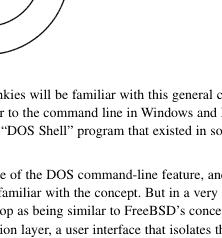

Windows or DOS command-line junkies will be familiar with this general concept because the FreeBSD shell is similar to the command line in Windows and DOS. (It is far less similar to the poorly named “DOS Shell” program that existed in some versions of MS DOS.)

习惯 Windows 或 DOS 命令行的用户会熟悉这一总体概念，因为 FreeBSD 的 shell 与 Windows 和 DOS 中的命令行类似。 （它与某些版本的 MS DOS 中存在的命名不佳的“DOS Shell”程序相似度要低得多。）

Windows users who do not make use of the DOS command-line feature, and Macintosh users as well, will probably be less familiar with the concept. But in a very loose sense, you can think of the graphical desktop as being similar to FreeBSD’s concept of the “shell” because it is also an abstraction layer, a user interface that isolates the user from having to deal directly with the kernel.

不使用 DOS 命令行功能 Windows 用户，以及 Macintosh 用户，可能对这一概念不太熟悉。但从很宽泛的意义上说，你可以将图形桌面视为与 FreeBSD 的“shell”概念相似，因为它也是一个抽象层，一个用户界面，它使用户不必直接处理内核。

## Different Shells Available

## 可用的不同 Shell

Unlike DOS/Windows, FreeBSD gives you a variety of different shells to choose from. The shells vary widely in the number of features they have, the ease of use for new users, and how they implement certain features. We aren't going to cover all the available shells here because there are far too many of them. However, we will cover some of the more popular ones.

与 DOS/Windows 不同，FreeBSD 为你提供了多种不同的 shell 可供选择。Shell 在功能数量、新用户易用性以及某些功能的实现方式上差异很大。我们在这里不会介绍所有可用的 shell，因为它们实在太多了。然而，我们将介绍其中一些更受欢迎的 shell。

## The Bourne Shell

## Bourne Shell

The Bourne shell (sh) is the oldest shell that is still widely used. It is named after its creator, Stephen Bourne. The Bourne shell is very primitive compared to more modern shells. It lacks advanced features like command history (the ability to recall previous commands) and command editing (the ability to edit a previously run command and run it again). FreeBSD does not include the original Bourne shell, but rather includes a shell known as the POSIX shell. The POSIX shell is an enhanced Bourne shell with complete backward compatibility with the original version, but that includes additional features such as history functions and command editing. If you don't specify otherwise, new user accounts will have POSIX as the default shell.

Bourne shell（sh）是最古老且仍被广泛使用的 shell。它以其创造者 Stephen Bourne 命名。与更现代的 shell 相比，Bourne shell 非常原始。它缺乏诸如命令历史（召回先前命令的能力）和命令编辑（编辑先前运行的命令并再次运行的能力）等高级功能。FreeBSD 不包含原始的 Bourne shell，而是包含一个名为 POSIX shell 的 shell。POSIX shell 是一个增强的 Bourne shell，与原始版本完全向后兼容，但它包含历史功能和命令编辑等附加功能。如果不另行指定，新用户账户的默认 shell 将是 POSIX。

## The C Shell

## C Shell

The C shell (csh) is so named because it was designed to have a syntax similar to the C programming language. It was developed by the University of California at Berkeley for the BSD version of UNIX. The C shell had many more features than the Bourne shell, including the ability to recall previous commands, the ability to edit and rerun previous commands, and the ability to automatically run a script of commands upon logging out of the system. (The Bourne shell could only run a script of commands upon logging in to the system.) Unfortunately, the C shell was not compatible with the Bourne shell and could not run scripts written for the Bourne shell.

C shell（csh）因此得名，因为它的语法设计得与 C 编程语言相似。它由加州大学伯克利分校为 BSD 版本的 UNIX 开发。C shell 比 Bourne shell 具有更多功能，包括召回先前命令的能力、编辑和重新运行先前命令的能力，以及在注销系统时自动运行命令脚本的能力。 （Bourne shell 只能在登录系统时运行命令脚本。）不幸的是，C shell 与 Bourne shell 不兼容，无法运行为 Bourne shell 编写的脚本。


> The original C shell no longer ships with FreeBSD. Instead, it has been replaced by the tcsh shell, which is an enhanced version of the C shell with additional features. The tcsh shell is explained a little later on in this hour. The default shell of the root user, or administrator, is csh—which in FreeBSD these days is the same thing as tcsh.

> 原始的 C shell 已不再随 FreeBSD 提供。取而代之的是 tcsh shell，它是 C shell 的增强版本，具有附加功能。tcsh shell 稍后在本小时中会有所解释。root 用户或管理员的默认 shell 是 csh——在当今的 FreeBSD 中，它与 tcsh 相同。

## The Korn Shell

## Korn Shell

The Korn shell (ksh or pdksh—FreeBSD uses the latter) was AT&T's response to the C shell. The Korn shell is backward compatible with the Bourne shell, so it will run any script written for the Bourne shell. However, the Korn shell adds features such as command history and editing—features that were missing from the original Bourne shell. The Korn shell is one of the most popular shells for UNIX operating systems. However, new users will probably prefer the Bash shell (discussed next).

Korn shell（ksh 或 pdksh——FreeBSD 使用后者）是 AT&T 对 C shell 的回应。Korn shell 与 Bourne shell 向后兼容，因此可以运行为 Bourne shell 编写的任何脚本。然而，Korn shell 增加了诸如命令历史和编辑等功能——这些功能在原始 Bourne shell 中是缺失的。Korn shell 是 UNIX 操作系统中最受欢迎的 shell 之一。然而，新用户可能更喜欢 Bash shell（接下来会讨论）。

## The Bash Shell

## Bash Shell

The Bash shell (bash) is short for Bourne Again Shell. This shell was developed by the Free Software Foundation; like the Korn shell, it is backward compatible with the Bourne shell. Also like the Korn shell, it includes history and command editing functions. However, Bash's history and command editing functions are more intuitive for new users than Korn's are. The Bash shell is also a very popular shell on UNIX systems today and is the standard default shell on all Linux distributions.

Bash shell（bash）是 Bourne Again Shell 的缩写。该 shell 由自由软件基金会开发；与 Korn shell 一样，它与 Bourne shell 向后兼容。与 Korn shell 一样，它也包含历史记录和命令编辑功能。然而，Bash 的历史记录和命令编辑功能对新用户来说比 Korn 的更直观。Bash shell 也是当今 UNIX 系统上非常流行的 shell，并且是所有 Linux 发行版的标准默认 shell。

## The Tcsh Shell

## Tcsh Shell

The Tcsh shell (tcsh) is an enhanced C shell. It adds features such as more intuitive command-line editing and history functions. In addition, it also includes command-line completion (the ability to automatically complete a command and save you some typing). One other feature of the Tcsh shell worth mentioning is its capability to recognize potentially dangerous commands and warn the user before carrying them out, thus giving the user a chance to abort the command. Tcsh is the default FreeBSD shell assigned to the root user. (But normal users are assigned the POSIX shell by default.)

Tcsh shell（tcsh）是增强版的 C shell。它增加了更直观的命令行编辑和历史功能等特性。此外，它还包括命令行补全（自动完成命令并为你节省输入的功能）。Tcsh shell 的另一个值得一提的功能是它能够识别潜在危险的命令并在执行前警告用户，从而给用户一个中止命令的机会。Tcsh 是分配给 root 用户的默认 FreeBSD shell。 （但普通用户默认分配的是 POSIX shell。）

## Which Shell Should You Use?

## 你应该使用哪种 Shell？

For most tasks you will do, it is not particularly important which shell you decide to use. Copying and moving files, listing directories, and running programs, for example, will work the same in all the shells. In this chapter and the next one, we will be working primarily with the Bash shell because it is one of the most popular shells, one of the most powerful, and also one of the easiest for new users to work with.

对于你将要执行的大多数任务，选择哪种 shell 并不是特别重要。例如，复制和移动文件、列出目录以及运行程序在所有 shell 中都是一样的。在本章和下一章中，我们将主要使用 Bash shell，因为它是 shell 中最受欢迎的之一，也是功能最强大的之一，同时也是新用户最容易使用的之一。


> One other reason to choose the Bash shell or some other Bourne compatible shell is that if you ever decide you want to do shell programming, these shells are a lot better candidates for shell programming than the C based shells are. You can, of course, use one shell for interactive use and a different one for programming use. But this can sometimes result in confusion because both shells handle certain tasks in different ways.

> 选择 Bash shell 或其他 Bourne 兼容 shell 的另一个原因是，如果你以后决定要进行 shell 编程，这些 shell 比基于 C 的 shell 更适合进行 shell 编程。当然，你可以使用一种 shell 进行交互式使用，另一种 shell 用于编程使用。但这有时会导致混淆，因为两种 shell 处理某些任务的方式不同。


## 在 Shell 中获取帮助

如前所述，FreeBSD 提供了非常多的命令。 在本书中不可能记录它们所有功能。 幸运的是，命令附带了称为手册页（“manual”的缩写）的文档。 要访问命令的手册页，只需输入 man 后跟命令名称即可。 例如，要获取 man 命令本身的帮助，您需要输入 man man。

您可以通过使用 Page Up 和 Page Down 键来浏览手册页的内容。 您也可以使用上下箭头键以及空格键。 空格键会向前移动一页。

## 手册页格式

手册页的第一行通常会告诉您手册页属于哪个类别（下一节会详细介绍），随后是手册页的名称和括号中的数字。 例如，mv(1) 表示手册页是关于 mv 命令的，并且该页位于手册页的第 1 类。

手册页遵循相当标准的格式，包括以下部分：

- **NAME**—顾名思义，这只是命令的名称，后跟对其功能的非常简短的描述。
- **SYNOPSIS**—本节给出命令的简短语法，包括其接受的必需和可选参数。 方括号内的参数是可选的：方括号外的参数是必需的。
- **DESCRIPTION**—这是关于命令的作用以及选项如何使用的更长描述。
- **OPTIONS**—本节仅列出命令接受的选项以及每个选项的作用描述。
- **USAGE**—并非所有手册页都包含此部分。 当存在时，它列出在某些情况下可能适用的任何特殊使用注意事项。
- **ENVIRONMENT**—本节列出影响此命令行为的任何环境设置。 如果您不知道这是什么意思，不用担心。 我们将在下一小时讲解。
- **EXIT STATUS**—并非所有手册页都包含此部分。 它列出命令根据命令是否成功执行而返回的退出状态值。 退出状态主要只对编写需要根据命令是否成功执行做出决策的自动化脚本的程序员感兴趣。


**SEE ALSO**—这是一份与本手册页所涵盖命令相关的其他命令的列表。 它也可能列出影响当前命令操作的相关配置文件的手册页。

**NOTES**—手册页作者认为您可能觉得有用的任何杂项信息。

手册页底部也可能有一行，说明手册页最后修改的时间，以及该命令首次出现在哪个版本的 UNIX 中。 此外，一些命令包含 EXAMPLES 部分，提供命令使用示例。

## 手册页分类

FreeBSD 手册页分为 1 到 9 号的几个类别。 表 4.1 列出了类别及其包含的内容。

**表 4.1 手册分类**

| 分类 | 描述 |
|---|---|
| 1：用户命令 | 本节包含用户最常用的命令的信息，例如文件操作、文本搜索等命令。 这是您最感兴趣的类别。 |
| 2：系统调用 | 本类别包含有关 FreeBSD API 的信息。 除非您是程序员并且想为 FreeBSD 编写软件，否则您无需担心任何内容。 |
| 3：子程序 | 本类别记录 C 头文件中的库函数。 如果您不知道这些是什么，不用担心。 再次强调，它们只对程序员感兴趣。 |
| 4：设备 | 本节包含有关在 FreeBSD 中与设备驱动程序通信的信息。 同样，您只有在是程序员并且想为 FreeBSD 编写软件时才需要担心这个问题。 |
| 5：文件格式 | 除了第一个类别之外，您可能在这里花费最多时间。 它包含各种配置文件的格式信息。 |
| 6：游戏 | 无疑，这是手册页中最重要的类别。 它包含有关随 FreeBSD 提供的游戏和其他娱乐的信息。 |
| 7：杂项 | 如果它在其他地方找不到合适的位置，就会在这里找到。 |
| 8：系统管理 | 本类别包含用于管理任务的命令信息，例如检查和修复文件系统损坏的命令 |
| 9：内核接口 | 更多程序员相关内容。 再次强调，您只有想为 FreeBSD 编写软件时才需要担心它。 |

## 指定要使用的分类

某些命令有多个手册页。 例如，crontab 是一个允许您按定期时间安排事件的命令。 crontab 在第 1 类中有条目，解释 crontab 命令本身，另在第 5 类中有条目，解释 crontab 配置文件的格式。 默认情况下，只需输入 man crontab 即可获得手册中第一个 crontab 条目，在本例中为第 1 类。 但如果您想阅读 crontab 配置文件的手册页怎么办？ 在这种情况下，您必须在命令行上指定要使用哪个类别的手册页。 这只需在命令名称前加上对应于您想要使用的手册页类别的数字即可。 例如，man 5 crontab 将为您提供 crontab 文件格式的手册页，而不是 crontab 命令本身的手册页。

## 搜索手册页

那么如果您知道想要做什么但不确定使用哪个命令怎么办？ 您可以使用 man 的 -k 选项按关键字搜索手册页。 不幸的是，关键字并不总是直观的，因此有时您必须对搜索内容进行相当创造性的思考。 例如，假设您正在寻找一个可以将两个或多个文本文件合并并作为一个文件打印的命令。 您可以尝试使用命令 man -k join。 这通常会给出很多结果，但不幸的是，它不会给出任何能满足您需求的命令。 然而，如果您搜索单词 "concatenate"，您会找到命令 cat，它可以满足您的需求。

## 命令摘要

有时，您可能知道命令的名称，但不确定它做什么，只想获得简短摘要而不是阅读整个手册页。 例如，假设您在 /usr/games 目录中查找，发现了命令 pom，并想知道它做什么。 您可以输入 man -f pom 来获取简短的一行描述。 在这种情况下，结果是

```
pom(6) - display the phase of the moon
```

正如完整手册页一样，括号中的数字告诉您该命令在手册页中的类别。 如您可能记得的，第 6 类是游戏。

您也可以根据摘要搜索命令。 命令的简短描述存储在称为 whatis 数据库中。 要搜索与 "mail" 相关的命令，您可以使用 apropos mail 命令（相当于 man -k mail）：

```
# apropos mail
biff(1)      - be notified if mail arrives and who it is from
forward(5)   - mail forwarding instructions
from(1)      - print names of those who have sent mail
mail(1)      - send and receive mail
mail.local(8) - store mail in a mailbox
mailaddr(7)  - mail addressing description
mailq(1)      - print the mail queue
smrsh(8)      - restricted shell for sendmail
```

您也可以使用 whatis 命令仅搜索完整单词匹配。 例如，whatis mail（或 man -f mail）会返回类似此处所示的列表，但不包含 smrsh 条目。

## GNU Info 系统

如您可能已经猜到的，手册页相当晦涩，往往似乎是为可能不需要它们的用户编写的。 新用户通常觉得手册页不太有用。 因此，GNU 项目提出了 info 系统。

info 系统的工作方式与手册页类似，只是 info 页通常更详细，对新用户更有帮助。

要阅读 info 页，只需输入 info 后跟命令名称即可。 请注意，并非所有命令都有 info 页。 如果您请求一个没有 info 页的命令的 info 页，info 将改为加载该命令的手册页。

与手册页查看器一样，您可以使用 Page Up 或 Page Down 键、箭头键和空格键在 info 页中导航。 然而，info 系统还支持类似于网页链接的超链接。 要使用它们，只需使用箭头键将光标移至链接上，然后按 Enter 键即可。


## 搜索 info 页面

要搜索 info 页面，请使用命令选项 -apropos 后跟等号，然后是搜索词。例如，

```
info --apropos=concatenate
```

## Bash 的特殊功能

如前所述，本小时我们将主要关注 Bash shell，因为它是最容易让新用户使用的 shell 之一——同时它也是最强大的 shell 之一。我们将查看 Bash 中可用的一些功能，包括历史编辑和命令行补全。

Bash 可以从 FreeBSD 安装光盘安装，在软件包中的“shells”类别下。安装后，要运行 Bash，只需在命令行输入 bash 即可。（您可能需要注销后重新登录，系统才会将其识别为有效命令。）

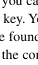

> 要永久将 shell 切换到 Bash，请使用 chsh 命令（“更改 shell”）并在 Shell: 行指定 /usr/local/bin/bash。

## 命令行历史

bash shell 会存储您输入的命令历史记录。如果您想重复一个命令，可以使用上箭头键向后浏览之前命令的历史记录。您也可以使用下箭头键向前移动列表。当您找到要再次运行的命令时，只需按 Enter 即可重新执行该命令。如果您想先编辑命令，可以使用左右箭头键、退格键和删除键来更改它。存储命令的历史文件是 .bash_history，位于您的主目录中。

## 命令行补全

Bash 还有为您补全命令行的功能。它可以补全命令的名称以及目录或文件路径的名称。要使用此功能，输入命令或目录/文件的前几个字母，然后按 Tab 键。如果 Bash 目前没有足够的信息使命令或路径不含糊（也就是说，仍有多个可能的匹配项），它将尽可能补全命令或路径，直到遇到含糊的部分。此时，它会发出蜂鸣声，您可以输入更多文本然后再次按 Tab 键。此过程将继续，直到命令行不再含糊且可以补全整个命令。

如果您到达了含糊的点并且再次按 Tab 而不是输入另一个字符，Bash 将为您提供迄今为止您输入内容的潜在匹配文件或命令列表。然后您可以继续输入，直到命令或文件名不再含糊，然后再次按 Tab 键。Bash 将为您补全命令。然后您可以检查 Bash 是否选择了正确的命令，以及对命令行进行所需的任何更改，例如添加目录或文件名。当您完成编辑命令行后，按 Enter 键，命令将被执行。

## 文件权限

由于 FreeBSD 是多用户操作系统，因此必须有某种方法防止未经授权的用户访问他们不应访问的文件。FreeBSD 通过实现文件权限来实现这一点

文件权限分为三类，且有三种类型。三个类别是：

- **所有者** 这些权限决定文件所有者可以做什么。默认情况下，所有者是创建文件的人。
- **组** 这些权限决定组成员可以对文件做什么。默认情况下，文件所属的组将是所有者所属的主要组。（请参阅下一小时了解有关用户和组的更多信息。）
- **其他** 这些权限决定其他所有人可以对文件做什么。其他所有人包括任何不是所有者且不是文件所属组成员的人。

## 显示文件或目录的权限

要显示包含权限的目录列表，请使用 ls 命令的 -l 选项，这样命令看起来像 ls -l。以下是输出中的一些示例行：

```
-rw-r--r-- 1 murban murban 0 Oct 29 06:28 file1
-rw-r--r-- 1 murban murban 0 Oct 29 06:28 file2
drwxr-xr-x 2 murban murban 512 Oct 29 06:28 mydir
```

每行第一部分给出权限。权限有三种类型。它们是：

- r 读取文件的权限。
- w 写入文件的权限。这包括对文件进行更改或删除它。
- x 执行文件的权限。对于普通文件，这意味着文件可以像程序一样执行。对于目录，这意味着可以使用 cd 命令进入该目录。

在目录列表中，权限按上表顺序给出。如果权限未预设，则使用连字符 (-) 作为占位符。此外，权限按用户、然后组、然后其他人的顺序列出。

在之前的列表中，我们可以看到前两个条目是普通文件，并且它们具有以下权限：

- 用户可以读取和写入文件，但不能执行它们。这由第一个 rw- 表示
- 组可以读取文件，但不能写入文件或执行它。这由第二个 r-- 表示
- 其他人可以读取文件，但不能写入文件或执行它。这由第三个 r-- 表示

第三个条目是目录，如行开头处的 d 所示。在这种情况下，我们可以看到该目录具有以下权限：

- 用户可以读取目录（使用 ls 列出条目）、写入目录并 cd 进入目录，如第一个 rwx 所示。
- 组可以读取目录并 cd 进入目录，但不能写入目录，如第二个 r-x 所示。
- 其他人可以读取目录并 cd 进入目录，但不能写入目录，如第三个 r-x 所示。

那么如果我们想让除了我们之外没有人可以读取 file1 怎么办？这可以通过使用 chmod 命令来实现。在这种情况下，我们只需从组和其他中删除所有权限即可。以下类似的命令将有效：

```
chmod go-r file1
```

该命令基本上表示从组和其它（由 g 和 o 表示）中减去读取权限（由 r 表示）。如果我们现在执行目录列表，file1 的条目将如下所示：

```
-rw------- 1 murban murban 0 Oct 29 06:28 file1
```

如果我们想将读取权限重新授予组怎么办？正如您可能猜到的那样，完成此操作的命令将是：

```
chmod g+r file1
```

使用 chmod 命令设置文件权限还有其他一些方法，但超出了本书的范围。如果您感兴趣，请参阅 chmod 的 man 手册。man 手册在本小时前面讨论过。此外，请参阅第 5 小时了解有关用户和组的更多信息。


> 使用文件权限时，您需要注意一些潜在的陷阱。最主要的是需要记住目录权限可以覆盖文件权限。这意味着，例如，如果组对目录具有写访问权限，则该组中的任何人都可以删除该目录中的任何文件，即使他们本身没有对该文件的写访问权限。（目录上的写权限允许他们对目录进行更改。）另一点需要注意的是，如果某人对目录具有执行权限，但没有读取权限，则他们可以进入目录，但无法列出目录的内容。但是，只要他们知道文件名，他们仍然可以读取该目录中的文件。

## 进程管理

正如我们在之前的几小时中提到的，FreeBSD 是一个多任务操作系统。这意味着您可以同时运行多个进程。其中许多可能在后台运行。您可以使用 ps 命令查看当前正在运行的进程列表。如果不带选项运行 ps，它将只列出您拥有的进程。ps 有几个有用的选项可以更改其显示的内容。表 4.2 显示了一些最常见和有用的选项。


## 表 4.2 ps 命令的常用选项

| 选项 | 操作 |
|---|---|
| a | 显示所有正在运行的进程，包括不属于你的进程。 |
| u | 列出进程所属的用户名。 |
| w | 启用“宽”输出。基本上，这会将一行的输出换行以适应你的终端窗口，而不是像原本那样截断输出。 |
| x | 显示守护进程以及普通进程。换句话说，显示在后台运行且没有终端附加的进程。 |
| U username | 列出属于用户 username 的进程，而不是属于你自己的进程。 |

记住 FreeBSD 是区分大小写的，所以上表中 u 和 U 被视为不同的选项。以下是运行 ps 命令且不带任何选项时的一些示例输出：

```
12572 tty0 S 0:00.01 /usr/local/bin/bash
12578 tty0 T 0:45.04 /usr/local/bin/mutt
12582 tty0 R 1:22:01 grep
```

让我们看看这个输出的含义。

每行中的第一个数字是进程 ID 号，也称为 PID。PID 只是一个 FreeBSD（有时是你）用来引用该进程的数字。

第二列包含启动该进程的控制终端。如果进程没有控制终端，例如未从终端启动的守护进程，则该列将包含 ??。第三列包含进程的状态。在这种情况下，第一行包含一个 S。这意味着进程正在睡眠，很可能是因为它正在等待其他事件（例如用户输入内容并让进程执行某些操作）。第二行在状态列中包含 T。这意味着进程已停止。停止的进程基本上是已被暂停并且以后可以恢复的进程。我们稍后会介绍如何做到这一点。第三个进程在状态列中有 R。这意味着进程可运行。简单来说，这意味着该进程在 FreeBSD 的运行队列中，正在等待 FreeBSD 的调度程序使其能够访问 CPU。

还有更多状态。要查看所有状态代码及其含义，请参阅 ps 的手册页。

第三列是进程已使用的 CPU 时间。这通常可以让你找到失控并行为异常的进程的线索。例如，如果人们抱怨系统变慢，而你在 ps 输出中找到一个进程已使用一小时的 CPU 时间，而它只是在 65 分钟前启动，那么它很可能是罪魁祸首，需要关闭并重新启动。

第四列，当然，只是给出进程的名称。

## 终止进程

偶尔，FreeBSD 中的某个进程可能会停止响应。（毫无疑问，Windows 用户对这种情况很熟悉。）当这种情况发生时，你可能需要强制进程退出，类似于 Windows 中臭名昭著的 Ctrl+Alt+Delete、结束任务 序列。从 FreeBSD 命令行，这可以通过 kill 命令完成。kill 命令后面跟随你想要终止的进程的 PID（你可以通过 ps 命令的输出获得）。

例如，在上一节中，列出的进程之一是 /usr/local/bin/mutt。Mutt 恰好是可用于 FreeBSD 的电子邮件客户端。假设由于某种原因，mutt 程序已停止响应用户的命令。我们在 ps 命令的输出中看到 mutt 程序的 PID 为 12578。要杀死此进程，可以使用命令 kill 12578。发出命令后，mutt 程序应终止，命令行应重新出现。如果 kill 命令不起作用，可以使用 -9 选项强制行为异常的进程终止（例如，kill -9 12578）。区别在于，正常的 kill 命令尝试通过发送信号优雅地终止进程，告诉它清理后自行退出。但是，进程可以忽略此请求。在这种情况下，kill -9 命令将强制“压扁”进程。此命令不是请求，而是无法忽略的强制终止。


> kill 命令的 -9 选项只有在正常的 kill 命令未能终止进程时才应使用。-9 基本上是从进程下“抽走地毯”。因此，进程将没有机会执行它可能通常会做的任何终止前操作，例如删除它可能创建的临时文件等等。

如果你的服务器很忙，运行着数千个进程呢？显然，你不希望不得不阅读整个进程列表，寻找正确进程的 PID。在这种情况下，你可以使用称为管道的东西。管道基本上将一个命令的输出“管道传输”到另一个命令进行进一步处理或过滤。在这种情况下，我们可以使用 grep 命令搜索 ps 的输出并仅显示与我们的搜索词匹配的行。例如，假设 mutt 邮件程序没有响应。我们可以使用以下命令找到其 PID 号：

```
ps | grep "mutt"
```

之前的命令将仅显示包含短语 mutt 的 ps 输出行。

你也可以使用 killall 命令按名称杀死进程。例如，killall mutt 将杀死任何名为 mutt 的进程。


> 使用 killall 命令时要谨慎，因为它可能会产生不良副作用。例如，如果运行了多个 mutt 副本，killall 将终止所有它们，而不是仅终止行为异常的那个。

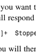

> 要杀死属于除你自己以外的用户的进程，你必须以 root 用户身份登录。还请记住，默认情况下，ps 命令只会列出属于你的进程。因此，如果你是系统管理员，并且用户打电话告诉你她的 mutt 程序已锁定，例如，你将需要使用 ps 命令的 -u 选项加上用户的登录名或 -a 选项来找到有问题的进程的 PID。当然，你也需要是 root 用户才能杀死有问题的进程。

## 停止进程

如果你想停止当前正在运行的进程，可以使用 Ctrl+z。系统将响应如下内容：

```
[1]+ Stopped         mutt
```

你将被返回到命令提示符，从那里可以运行更多命令。

该行开头的 1 是进程的作业号。当你想再次启动作业时，将使用该编号。

## 重新启动进程

重新启动进程也称为将作业带入前台。执行此操作的命令是 `fg` 后跟作业号。例如，要将 `mutt` 程序带回前台，你需要输入 `fg 1`，这将使你回到 `mutt` 并允许你再次在其中工作。


> 如果你尝试在仍有停止的作业时注销系统，系统将响应一条消息，说明 There are stopped jobs，然后你将被返回到命令提示符。如果你真的想在不先处理停止的作业的情况下注销系统，再次输入 `exit`。你将被注销，而停止的作业将被终止。

## 将进程移至后台

停止进程和将进程移至后台之间的区别在于，停止的进程其执行被挂起。但是，后台运行的进程会继续运行，但会将你返回到命令提示符，以便你可以在进程在后台运行时做其他事情。

要将进程移至后台，首先使用前面所述的 `Ctrl+z` 键组合停止它。接下来，在进程停止后，使用 `bg` 命令，后跟作业号将其在后台重新启动（例如，`bg 1`）。稍后，如果你想将其移回前台以便与之交互，只需像之前一样输入 `fg 1` 以恢复停止的作业。


> 你可能想知道在无法与之交互的情况下让进程在后台运行有什么意义。`find` 命令就是一个很好的例子。例如，假设你丢失了一个文件，并且正在大型文件系统（大约 50Gb）中搜索该文件。这需要相当长的时间，即使在非常快的硬盘上也至少需要几分钟。
> 
> 如果你让 `find` 命令在前台运行，在命令运行期间你将无法对系统做任何其他事情。基本上，你只能等待它完成。在这种情况下，你可能希望让 `find` 将其输出定向到文本文件以供以后查看。（你可以通过在 `find` 命令后跟随重定向来做到这一点。例如，`> MyLostFile.txt` 将把 `find` 生成的任何输出发送到新文件

命名为 MyLostFile.txt；你也可以使用 >> 操作符将输出追加到现有文件中，例如 >> MyLostFile.txt。）在启动 find 命令后，使用 Ctrl+Z 停止它，然后使用 bg 1 将其在后台重新启动（假设在你发出停止命令时它是任务 #1）。现在你可以随意使用系统，而 find 命令则在后台继续查找你的丢失文件。

## Summary

本小时中，你学习了 FreeBSD 中 UNIX shell 的基本使用。你了解到 shell 像解释器一样工作，将人类命令翻译成内核可理解的语言，反之亦然。你查看了 FreeBSD 可用的不同 shell，并研究了各自的优点和缺点。然后你学习了如何使用 UNIX 手册页和 GNU info 页面在 shell 中获取帮助。下一节介绍了 bash 的一些特殊功能，包括命令行编辑、命令历史和命令补全。最后，你学习了如何终止行为异常的进程、将进程移至后台、挂起进程以及将其恢复到前台。

## Q&A

Q 为什么 FreeBSD 将 C shell（csh）和 Tcsh 视为同一事物，明明它们并不相同？

A tcsh shell 与 csh 完全向后兼容，并包含更多功能。它本质上只是同一 shell 的更高级版本。如果你想安装旧式的 C shell，可以查看 44bsd-csh 端口（/usr/ports/shells/44bsd-csh）。

Q 这些 shell 命令有些不必要地长。如何缩短它们？

A 大多数 shell 允许你设置别名，即指定代表更长命令的短命令。FreeBSD 在 Tcsh 中默认设置了多个别名；例如，ll 命令是 ls -lA 的别名。你可以在主目录中的 .cshrc 文件中覆盖它或设置更多别名。

Q 安装新程序后，如果我输入其名称，系统会告诉我未找到。如何让它“看到”新程序？

A 你的 shell 需要重新启动以重新读取其路径中的程序。注销后重新登录，或输入 rehash 以重新读取路径内容。

## Workshop

以下部分包含练习和测验问题，旨在帮助你巩固对基本 UNIX shell 使用的理解。

## Quiz

1. 以下哪个不是 FreeBSD 中有效的 shell？
   A. POSIX shell
   B. Corn shell
   C. Bash shell
   D. C shell

2. man 命令的以下哪个选项允许你搜索手册页？
   A. -s
   B. -f
   C. -k
   D. None of these

3. 以下哪个命令会显示系统中正在运行的进程列表？
   A. ps
   B. plist
   C. process
   D. p1

4. 以下哪个命令会终止系统中正在运行的进程？
   A. term
   B. stop
   C. end
   D. kill

5. 以下哪个键序列会停止当前在前台运行的作业？
   A. Alt+s
   B. Ctrl+s
   C. Ctrl+z
   D. Alt+z

6. 以下哪个命令会将停止的进程移至后台？
   A. Ctrl+b
   B. bg
   C. background
   D. None of these

7. 要将停止或后台的进程移回前台，你会使用以下哪个命令？
   A. restart
   B. Ctrl+f
   C. fg
   D. None of these

## Quiz Answers

1. 正确答案是 B。请注意拼写。有 Korn shell，但没有 Corn shell。
2. 正确答案是 C。
3. 正确答案是 A。
4. 正确答案是 D。
5. 正确答案是 C。
6. 正确答案是 B。
7. 正确答案是 C。

## Exercises

1. 使用 FreeBSD 手册页，查找 wc 命令的作用，以及它的各种选项用途。
2. 使用手册页快速总结 df 命令的作用。
3. 使用 ps 命令显示系统中所有正在运行的进程列表。
4. 使用 ps 命令显示系统中所有正在运行的进程列表，但这次将输出通过管道传递给 more，以便你只看到包含短语 init 的进程。
5. 在命令提示符下，输入命令 sleep 900 然后按 Enter 键。（这会启动一个名为 sleep 的命令，其唯一功能是在本例中占用终端 15 分钟或 900 秒。）停止该进程。
6. 将 sleep 进程在前台重新启动。
7. 再次停止 sleep 进程并将其在后台重新启动。
8. 终止 sleep 进程。（提示：使用 ps 命令查找其 PID。）


## PART II

## Basic FreeBSD Administration

Hour

- 5 用户和组
- 6 添加和移除第三方软件
- 7 系统配置和启动脚本
- 8 存储系统和备份实用程序
- 9 FreeBSD 打印系统
- 10 FreeBSD 内核和设备树
- 11 更新 FreeBSD

## Hour 5

## Users and Groups

因为 FreeBSD 支持多用户，所以需要安全机制以确保隐私，防止用户相互干扰或访问不应访问的内容。FreeBSD 通过所有权系统实现这种安全，该系统适用于单个用户和组，允许在项目上协作，同时仍确保隐私并防止未经授权的访问。

在本小时中，你将学习：

- FreeBSD 如何使多个用户使用同一系统
- 即使你是唯一使用系统的人，为什么拥有多个用户是有益的
- FreeBSD 为什么有组以及如何使用它们
- 如何向 FreeBSD 添加新用户
- 如何从 FreeBSD 中删除现有用户


## Multiuser Capabilities of FreeBSD

FreeBSD 是多用户操作系统，这意味着多个用户可以同时使用操作系统并执行不同的操作。起初，这对 Windows 和 Macintosh 用户来说可能是一个难以理解的概念。熟悉这些系统的人可能会认为，例如 Windows 是一个多用户操作系统，因为多个用户可以登录到 Windows 服务器并使用其上的数据库。然而，这并不是真正意义上的多用户功能。你从这个系统获得的只是客户端-服务器功能。你并不是使用远程操作系统本身，而只是它提供的服务。借助 FreeBSD，几个人可以通过远程终端同时访问操作系统，并拥有与坐在物理系统前相同的全部功能。

你可能会认为，如果你只是在工作站或家庭系统上运行 FreeBSD，多用户功能并不重要。但即使如此，它也可能非常有用。首先，保持用户分离允许每个用户拥有自己的配置文件，这意味着你不必与其他家庭成员争论桌面应该使用什么壁纸，例如，或使用什么声音方案。每个人都可以根据个人偏好设置系统，而不会影响系统对其他用户的外观和工作方式。

另一个好处是，你可以确保其他用户不会意外删除你的文件。而且，如果你愿意，你可以确保其他用户无法访问或读取你的私人文件。

拥有多个用户的另一个好处并不那么明显。正如我们之前提到的，FreeBSD 可以允许多个用户同时使用系统。作为演示，请执行以下步骤：

1. 使用你的正常用户账户登录。在命令提示符下，通过输入 ee 启动诸如 ee 编辑器之类的程序。
2. 按 ALT+F2。这应该会给出一个新的登录提示。使用第一次登录时使用的相同用户名登录。
3. 对任意文件发出 find 命令，并让它搜索整个硬盘。唯一的原因是确保你为 FreeBSD 提供一项需要花费一段时间才能完成的工作。
4. 按 ALT+F1，你应该会被带回原始登录提示，编辑器仍在运行。在编辑器窗口中输入一些文本。
5. 再次按 Alt+F2，你应该会被带回第二个窗口，find 命令仍在运行。


6. 再次按 ALT+F1，你将被带回编辑器。退出编辑器，使你回到命令提示符。

在命令提示符下输入 who，系统将以类似以下内容作出响应：

```
simba ttyP0 Jul 6 16:10 (localhost)
simba ttyP1 Jul 6 18:31 (localhost)
```

who 命令的输出显示你当前已登录两次。之前的练习演示了你可以切换两个登录会话，并在其中执行完全独立的任务。这是即使你是系统的唯一用户，也能利用 FreeBSD 多用户功能的一种方式。如果你启动了一个需要花费一段时间才能完成的任务，并且想在任务完成的同时继续工作，你只需使用 ALT+Fx 键组合（其中 x 为功能键上的数字之一）切换到另一个虚拟终端，即可在另一个终端运行该任务的同时继续工作。

再次按 ALT+F2 切换回第二个终端。如果 find 命令仍在运行，请按 CTRL+C 终止它，然后在命令提示符下输入 exit 注销。（如果想先清除屏幕，请在发出 exit 命令前使用 clear 命令。）


> 工作完成后，请确保从所有已登录的虚拟终端中注销。如果你忘记并留下了一个或多个终端未关闭，其他人可能会通过它访问你的账户。你始终可以使用 who 命令检查当前登录到系统的次数。


> 默认情况下，FreeBSD 有七个可通过 F1 到 F8 功能键访问的虚拟终端。F7 通常为空，因为它保留给 X Window 系统，因此上面不会运行终端。

## 将用户添加到 FreeBSD

向 FreeBSD 添加新用户的命令是 adduser。第一次运行它时，它会问你很多问题。别担心。你不必每次运行 adduser 时都回答所有这些问题。列表 6.1 在你第一次运行时指导你完成一个典型的 adduser 会话。

### 列表 5.1 一个示例 adduser 会话

```
#adduser
Use option 'silent' if you don't want to see all warnings and questions

Check /etc/shells
Check /etc/master.passwd
Check /etc/group
Enter your default shell: csh dash ksh no sh tcsh [ksh]:
Your default shell is: ksh -> /usr/local/bin/ksh
Enter your default HOME partition: [/home]:
Copy dotfiles from: /usr/share/skel no [/usr/share/skel]:
Send message from file: /etc/adduser.message no
[/etc/adduser/message]:
Use password based authentication (y/n) [y]: y
Enable account password at creation (y/n) [y]: y
Use an empty password (y/n) [n]: n

Ok, let's go.
Don't worry about mistakes. I will give you the chance later to correct any input.
Enter username [a-z0-9_.-]: fbar
Enter full name []: Foo Bar
Enter shell csh dash ksh no sh tcsh [ksh]:
Enter home directory (full path) [/home/fbar]:
Uid [1002]:
Enter login class: default []:
Login group fbar [fbar]:
Login group is "fbar". Invite fbar into other groups: guest no
[no]:
Use password based authentication (y/n) [y]: y
Use an empty password (y/n) [n]: n
Enter password []:
Enter password again []:
Enable account password at creation (y/n) [y]: y

Name: fbar
Password: ****
Fullname: Foo Bar
Uid: 1002
Gid: 1002
Class:
Groups: fbar
HOME: /home/fbar
Shell: /usr/local/bin/ksh
OK? (y/n) [y]:

Added user "fbar"
Send message to "fbar" and: no root second_mail_address [no]:
```

### 列表 5.1 继续

```
```
Foo Bar,

Your account 'fbar' was created.
Have fun!

See also chpass(1), finger(1), passwd(1)

Add anything to default message (y/n) [y]: n
Send message (y/n) [y]: n
Copy files from /usr/share/skel to /home/fbar
Add another user? (y/n) [y]: n
Goodbye!

#
```
```

再次来说，不要惊慌，因为大多数这些问题你只需在第一次运行 adduser 程序时回答一次。此后，你可以使用 -silent 选项运行它，以防止它询问你其中许多问题。以后，如果你想更改默认选项，可以不使用 -silent 选项运行它以再次被问到这些问题。

因为这对你来说一开始可能相当令人望而生畏，让我们一步一步地走下去，从一些总体观察开始。

在此过程中你被问到的许多问题都有默认答案。默认答案以这样的方括号呈现：[ ]。要接受提供的默认答案，只需按 Enter 而不输入任何文本。对于你被问到的绝大多数问题，最好接受默认值。现在，让我们更详细地看看其中的一些问题：

```
Enter your default shell: bash csh dash ksh no sh tcsh [ksh]:
```

到现在为止，你可能对 shell 是什么、它做什么以及各种不同 shell 的特性已经相当熟悉了。这个问题将设置默认 shell，该 shell 将为你创建的任何未来用户所选择。当然，你可以在创建任何新用户时通过简单地告诉它使用不同的 shell 来覆盖此设置。如果你管理的是一个有很多不熟悉 UNIX 的用户的系统，bash shell 可能是你为新用户 shell 做出最好的选择。熟悉 UNIX 的用户始终可以自行更改其 shell，如果他们不喜欢你给他们的默认 shell。


> 你希望对 adduser 程序可用的任何 shell，以及对用户而言可用的 shell，必须列在 /etc/shells 文件中。你从 ports 安装的大多数 shell 会自动为你处理此事，并为你将正确的信息安装到 /etc/shells 文件中。

输入默认 HOME 分区：[/home]：

这是用户主目录的默认存储位置。通常没有很好的理由更改它。你可能想要更改它的一个可能情况是，如果用户的主目录位于中央主目录服务器上。（从而允许他们从任何工作站访问相同的文件和环境。）

从以下位置复制点文件：/usr/share/skel no [/usr/share/skel]：

这里所指的点文件是控制用户个人 shell 环境如何工作的默认配置文件。这些是我们谈到在第 5 小时“高级 UNIX Shell 使用”中你用来自定义 shell 环境的文件。你只需按 Enter 接受默认值，除非你为每个用户创建了自定义配置文件并且它们存储在其他位置。

从文件发送消息：/etc/adduser.message no [/etc/adduser/message]：

你可以选择在创建新账户后向新用户发送电子邮件。如果决定发送电子邮件，这里列出的文件将用于电子邮件的文本。你可以将其保留为默认值，只需修改 /etc/adduser/message 文件，使其包含你想要发送的消息。

使用基于密码的身份验证（y/n）[y]：y
创建账户时启用账户密码（y/n）[y]：y
使用空密码（y/n）[n]：n

第一个问题指定是否要使用密码身份验证。默认值为是，除非你有非常好的理由，否则应保持不变。你还应回答第二个问题的“是”。这也是默认值，所以你也可以直接保留。

第三个问题决定密码是否可以为空。你通常希望在这里选择“否”。选择“是”允许创建没有密码的新账户，这意味着它们可以在不使用密码的情况下登录。这几乎总是一个坏主意。

“使用空密码”问题标志着默认问题的结束。如果你指定 -silent 选项下次启动 adduser 时，就不必再次回答这些问题。当然，如果你想更改默认选项，只需在不使用 -silent 选项的情况下运行 adduser 并再次回答这些问题即可。

其余问题特定于你正在创建的用户。每次运行 adduser 时都会被询问。

```
Enter username [a-z0-9_]: fbar
```

这当然是新用户的登录名。它也将是用户的本地电子邮件地址。登录名最多可包含八个字符，并且可以使用方括号内的字符——换句话说，a-z、0-9、下划线（_）和连字符（-）。八个字符的限制可能看起来有点奇怪，但它存在是有历史原因的。

```
Enter full name []: Foo Bar
```

你可以在此处输入用户的全名，也可以选择将其留空。此处输入的名称将用于从标准 FreeBSD 邮件程序发送的电子邮件消息的 From: 字段，因此最好填写它。

```
Enter shell csh dash ksh no sh tcsh [ksh]:
```

这设置用户的登录 shell。如果留空，它将被设置为你在执行 adduser 程序的初始配置时选择的默认 shell。

```
Enter home directory (full path) [/home/fbar]:
```

这将是用户个人文件等存储的位置。同样，除非你有一个中央主目录服务器在其中存储所有主目录，或者有一些其他特殊情况需要你更改它，否则不建议更改它。

```
Uid [1002]:
```


> 切勿使用 UID 为 0 创建用户账户。UID 0 保留给 root 用户使用，这意味着你创建的任何 UID 为 0 的用户账户都将在系统上拥有 root 权限！

```
Login group fbar [fbar]:
```

这将是用户的主要组。在你更了解组之前，最好将其保持为默认值。默认情况下，FreeBSD 为每个用户分配其自己的组。如果你想让用户访问其他组，可以让他们成为次要组的成员。你将在本小时的组部分中后面学到更多关于这方面的内容。

```
Login group is 'fbar'. Invite fbar into other groups: guest no [no]:
```

我建议你现在不要管这个问题，直接接受默认值。稍后将用户添加到其他组非常容易。

```
Use password based authentication (y/n) [y]: y
Use an empty password (y/n) [n]: n
```

对第一个问题选择 y，对第二个问题选择 n：否则，你最终会创建一个无需密码即可登录的账户。这几乎从来都不是一个好主意。你可能想要这样做的例子是具有受限权限的访客账户，只能运行单个程序等等。

```
Enter password []:
Enter password again []:
```

曾经密码被限制为最多八个字符。然而，如今这种限制已不再适用。

强调创建强密码的重要性怎么强调都不为过。系统的安全性仅与其最薄弱的环节一样强，而弱密码通常就是最薄弱的环节。太多时候，用户会选择诸如孩子、宠物、出生城市的名字以及其他人知道或可以轻易查到的东西作为密码。人们将密码写在便签上然后贴在桌子底下、键盘下，甚至更糟，直接贴在显示器侧面也是相当常见的。重要的是你要阻止这种行为，因为桌子底部和键盘是想要窃取密码的人首先会寻找的地方。以下是创建安全密码的指南列表：

- 密码应至少为八个字符长。
- 在密码中使用大小写字母、数字和至少一个特殊字符的混合。这有助于挫败通过暴力方法尝试随机单词来破解密码的程序。
- 不要使用字典中的单词，因为有程序会尝试随机单词来寻找有效的密码。
- 不要使用其他人知道或可以轻易查到关于你的信息。
- 使用对你来说容易记住但对他人难以猜测的东西。难以记住的东西会助长将密码写下来并存放在某处的坏习惯。实现这一点的方法包括组合两个或多个对你有意义但对他人毫无意义且组合后也不通顺的单词的部分。另一种可能性是用单词中真实字符旁边或上方的字符替换它。在这种情况下，你会得到一个完全无意义的密码，但只要你记得使用的替换键，它仍然很容易记住。
- 确保你的用户明白公司里没有人会打电话或发邮件给他们索要密码。用户收到自称来自 IT 部门的人打电话或发邮件索要密码是非常常见的入侵系统的方法。许多用户实际上会把密码告诉来电者或发件人。

在你输入并验证密码后，选择 y 来回答关于在账户创建时启用密码的问题。然后你将获得一份关于账户的详细信息列表，并被问是否确定它们都正确。假设它们是正确的，选择 y。接下来，你将被问是否要向新用户发送电子邮件。正如前面提到的，将发送的默认消息是 /etc/adduser/message。你可以使用此消息向新用户提供有关寻求帮助的联系人、系统使用政策等信息。

在你回答完关于发送消息的问题后，账户将被创建，你将被问是否要创建另一个账户。只需回答 yes 或 no，你就完成了。

## 删除用户账户

如果你需要从系统中删除用户账户，请使用 rmuser 命令。示例如下所示：

```
rmuser fbar
Matching password entry:
fbar:DKN1lrd/diQRj:1002:1002::0:0:Foo Bar:/home/fbar::/usr/local/bin/ksh

Is this the entry you wish to remove? Y
Remove user’s home directory (/home/fbar)? Y
```

```
Updating password file, updating databases, done.
Updating group file: (removing group fbar : - personal group is empty) done.
Removing user's home directory (/home/fbar): done.
Removing files belonging to fbar from /tmp: done.
Removing files belonging to fbar from /var/tmp: done.
Removing files belonging to fbar from /var/tmp/vi.recover: done.
```

其中大部分内容都比较自明。不过，是否要删除用户主目录的问题值得进一步讨论。为什么你可能想要保留用户的主目录？主要原因可能是有人离开公司，但他们目录中有与新员工将接手的职责相关的文件。在这种情况下，你希望在删除其账户的同时保留旧用户的主目录。然后你可以将文件的拥有权更改为将接手职责的新员工。

## 组及其用途

为了提供更大的灵活性，FreeBSD 还支持组。组允许多个用户访问文件或目录，同时拒绝非组成员访问该文件或目录。以下是这种情况可能有用的示例。

假设你有一个销售部门和一个市场营销部门。市场营销部门正在制作一些新的传单和其他营销材料。市场营销团队有五个人，他们都需要能够读取和写入这些文件。你还有一个销售部门，里面有五个人。销售部门应该能够读取新的营销传单。然而，他们不应能够对其进行任何更改。此外，你有一些实验性的营销想法，你的五名市场营销人员正在为一项实验性的新营销策略进行合作。这需要严格保密，你也不希望销售人员现在就能访问它。另外，假设销售人员可以访问一个包含客户电话号码的文件。我们不希望市场营销人员能够访问它：只有销售人员应该能够访问它。

我们首先要做的是创建两个组。我们可以把一个叫做 sales，另一个叫做 market。然后我们将每个用户添加到适当的组中。

## 创建组

要创建新组，只需在 /etc/group 文件中添加一个条目，其中包含组名、GID 编号以及属于该组的用户列表。以下是我们想要创建的新组的两个示例条目：

```
sales:*:1005:john, joe, frank, dave, susan
market:*:1006:lynn,peter,dave,sara,alice
```

与用户 ID 编号一样，普通组的组 ID 编号应高于 1,000。同样重要的是确保没有重复的组 ID 编号。每个字段由冒号分隔。第一个字段包含组名。第二个字段包含一个星号，这主要是出于历史原因而存在的占位符。第三个字段包含组 ID 编号，即 GID，最后一个字段包含该组所有用户名的列表。请注意，用户 dave 是两个组的成员。这完全可以接受。在此示例中，假设 Dave 是例外的规则。他是一名销售人员，出于某种原因，需要完全访问为市场营销人员保留的材料。

在创建组后，你需要设置适当的目录和文件权限，并确保它们由适当的人拥有。

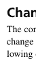

> 对于好奇的人来说，前面提到的星号占位符存在于用户不能同时属于多个组的时间，因此他们每次想要访问不同的组时都必须更改组 membership。该字段过去用于保存切换到新组的密码。

## 更改组所有权

更改文件或目录的组所有者的命令是 chgrp。例如，要将 customer-data 文件更改为由 sales 组拥有，你将使用以下命令：

```
chgrp sales customer-data
```

该命令始终采用文件或目录应更改到的组名，后跟你想要更改的文件或目录名。


> 只有文件的所有者或 root 用户才能更改文件所属的组。而且所有者只能将组更改为他是其成员的组。当然，root 用户可以将文件的组 membership 更改为任何组，而不管 root 是否是文件的所有者或是否是文件被更改到的组的成员。

对你想要更改组所有权的每个文件或目录重复之前的命令。还对 market 组重复相同的过程。


> 如果你想更改目录及其下所有子目录和文件的组所有权，可以使用 chgrp 的 -R 选项（例如，chgrp -R sales sales_files）。

## 设置权限

确保文件和目录拥有正确的属主后，你需要正确设置权限。让我们通过几个示例文件及其要求来说明权限应如何设置。

第一个文件是包含客户电话号码的客户数据库。只有 sales 组应有权访问此文件。但只有销售经理才能对文件进行任何更改。销售部门的其他人员应只有只读访问权限。为实现这一点，销售经理——我们假设他是 dave——应执行以下操作：

- Dave 应为该文件的属主。如果 Dave 目前不是属主，他必须请系统管理员更改文件的属主，使他成为属主。
- 属主权限应设置为读、写。
- 组权限应设置为读。
- 其他权限（即世界其他用户的权限）应设为空。换句话说，既不是属主也不属于 sales 组的人完全不能访问该文件。

这样做的数字方式是

```
chmod 640 customer_data
```

回顾第 5 小时，第一位数字代表属主的权限，第二位数字代表组的权限，第三位数字代表其他所有人的权限。


> 只有文件的属主或 root 用户才能更改文件的访问权限。属于该文件所在组但不是属主的人员无法更改文件的权限。

现在让我们来看一下需要由 market 组可读可写，同时由 sales 组可读的文件的访问权限。在此情况下，我们假设属主是 Alice：

- Alice 应为该文件的属主。如果不是，她必须请系统管理员更改文件的属主，使她成为属主。
- 属主权限应设置为读、写。
- 组权限应设置为读、写。
- 其他权限应设置为读。

再次，我们可以使用 chmod 命令来实现。在此情况下，设置这些权限的数字序列为

```
chmod 664
```

在此示例中，组系统的局限性显现出来。销售人员不是 market 组的成员，因此组权限不涵盖他们。让他们成为 market 组的成员会赋予他们对文件的写访问权限，这不是我们想要的。因此，在这种情况下，我们基本上只能让文件对全世界可读，因为这是在此场景下让销售人员能够读取文件访问权限的唯一方法。

正因为此类情况，访问控制列表（ACL）系统被开发出来，并在 FreeBSD 5.0 版本开始实现。访问控制列表是一个更高级的话题，超出了本书的范围。有关此类高级主题的介绍，请查阅 Sams Publishing 出版的《FreeBSD Unleashed》等书籍。

> 与 chgrp 命令一样，用于更改文件访问权限的 chmod 命令也可以使用 -R 选项，使其更改目录以及该目录中任何子目录和文件的权限。

> 我们在第 5 小时提到过这一点，但在这里重申一下。某些情况下，目录权限优先于单个文件权限。例如，你可以将文件的其他权限设置为只读。然而，如果文件所在目录对其他用户具有写权限，任何可以登录此系统的人都能够删除该文件。注意此类问题。

## 主组与次组

关于组的一个最后说明是，了解主组和次组之间的区别很重要。用户只能是一个主组的成员。主组是用户创建的任何文件默认所属的组。然而，用户可以是多个次组的成员。

主组是在 /etc/passwd 文件中与用户条目一起列出的组。用户在 /etc/group 中所属的任何其他组都被视为次组。

## 摘要

在本小时中，你了解了用户和组在 FreeBSD 中的重要性。你学习了如何使用 adduser 命令添加用户以及使用 /etc/group 文件更改组成员身份。你还学习了如何使用 chmod 和 chgrp 命令设置文件权限和组权限。

## 练习

以下测验问题旨在测试你对本小时所涵盖的用户和组的理解。

## 测验

1. 添加 FreeBSD 新用户的命令是
   A. adduser
   B. newuser
   C. makeuser
   D. mkuser
   E. None of the above
2. 在向 FreeBSD 添加新用户时，用于阻止其询问默认设置的选项是
   A. -shutup
   B. -noask
   C. -silent
   D. -dontbugme
   E. -usedefaults
3. 包含组名及其成员列表的文件是
   A. `/usr/group`
   B. `/etc/group`
   C. `/etc/groups`
   D. `/group`
   E. This information is not stored in a file
4. 更改文件所属组的命令是
   A. newgroup
   B. diffgroup
   C. groupchange
   D. chgroup
   E. None of the above

## 测验答案

1. 正确答案是 A。
2. 正确答案是 C。
3. 正确答案是 B。其他文件都不存在。
4. 正确答案是 E。注意选项 D。正确的命令是 chgrp，而不是 chgroup。


## 第 6 小时

## 添加和删除第三方软件

操作系统本身并不是很有用，大多数人也不会仅仅为了摆弄操作系统而拥有一台电脑。要使系统有用，必须有第三方应用程序来帮助你执行想要执行的任务。截至本文撰写时，FreeBSD 存在超过 7,000 个可免费下载的应用程序。此外，FreeBSD 还可以运行大多数 Linux 应用程序。FreeBSD 可用的应用程序包括文字处理器、电子表格、数据库、Web 浏览器、MP3 播放器、图像编辑程序、视频播放器等。本小时介绍如何在 FreeBSD 中查找和安装软件，以及如何删除不再需要的软件。

在本小时中，你将学习以下内容：

- FreeBSD 的两种主要软件打包系统及其差异
- 如何确保你的可用软件列表是最新的
- 如何安装预编译的二进制软件
- 如何从源代码安装软件
- 如何从系统中删除已安装的软件
- 如何管理现有应用程序
- 如何在 FreeBSD 中使用 Linux 应用程序

## FreeBSD 的软件打包系统

FreeBSD 有两种不同的系统可用于安装软件。其中一个系统使用已经构建为可执行二进制格式的预打包软件。另一个系统在安装软件时即时下载并构建源代码。两种系统各有优缺点。

## 软件包与端口之间的差异

如前所述，软件包是可安装在系统上的预编译二进制文件。这是最用户熟悉的软件类型，因为它与 Windows 或 Macintosh 软件的交付方式相似。从软件包安装软件的主要优点是它通常比从替代方式安装快得多，原因有两个。第一，你避免了从源代码编译和构建软件所需的时间。虽然从源代码构建软件不需要花费太多你的时间，但对计算机来说是一个耗时的过程。

预编译软件包的另一个优点是通常需要更少的下载时间。原因是从源代码构建需要你拥有应用程序所需的 C 和 C++ 编译器的所有库。任何缺失的库在应用程序安装前必须先下载并安装。此外，其中一些库将依赖于其他库，等等。虽然整个过程通常是自动化的（FreeBSD 会自动检查缺失的依赖项并安装任何缺失项），但它仍然可能消耗大量下载时间——尤其是在你没有宽带互联网接入的情况下。

然而，从软件包安装也有其缺点。第一个缺点是并非所有软件都以软件包形式提供，因此有时唯一的选择是从源代码构建软件。

另一个缺点是你无法自定义软件或为特定处理器类型优化它。使用软件包，你基本上只能使用软件包制作者决定应存在的选项。


> 如果你觉得自定义软件的想法很可怕，不用担心。你不需要知道任何编程知识就能做到这一点。你所要做的就是告诉安装程序你希望用什么选项来构建源代码，它会负责如何将这些选项包含到最终产品中。你将在本小时后面看到如何操作。

## 发现可用的软件

了解 FreeBSD 可用软件种类最简单的方法是浏览 FreeBSD 网站上的 ports 页面。它位于地址 www.freebsd.org/ports。

图 6.1 显示了 FreeBSD 网站上的主 ports 页面。

图 6.1
FreeBSD 网站主 ports 页面的一个部分。请注意，软件是根据其预期用途分类的。

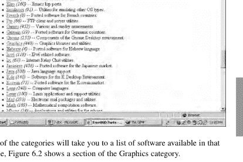

点击任意一个分类都会带你到该分类下的软件列表。例如，图 6.2 显示了 Graphics 分类的一部分。

图 6.2
ports 页面上 Graphics 分类的一个部分，显示了可用于 FreeBSD 的一些图形相关应用程序。

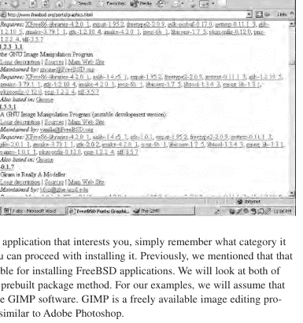

当你找到一个感兴趣的应用程序时，只需记住它所在的分类，然后就可以继续安装它。之前我们提到过，安装 FreeBSD 应用程序有两种方法。我们将从这两种方法开始，先看预编译包方法。在我们的示例中，我们假设你对 GIMP 软件感兴趣。GIMP 是一款可自由获得的图像编辑程序，其功能与 Adobe Photoshop 相似。

## 从预编译包安装软件

预编译包可以从 FreeBSD FTP 服务器或其镜像下载。如果你以前从未使用过 FTP，最简单的方法是从 Web 浏览器进行操作。如果你正在使用 FreeBSD 命令行，可以使用 Lynx Web 浏览器，它是基于文本的，但对于我们的目的来说完全够用。要启动 Lynx Web 浏览器并将其指向 FreeBSD 主 FTP 服务器的包目录，请输入以下命令：

```
lynx ftp://ftp.freebsd.org/pub/FreeBSD/ports/packages
```

请注意它区分大小写，因此命令必须完全按照所示输入；否则你会收到错误。

连接建立后，你应该会看到类似图 6.3 的屏幕。

图 6.3
Lynx Web 浏览器已连接到 FreeBSD 包 FTP 服务器。

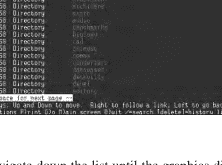

使用方向键向下导航列表，直到 graphics 目录被高亮显示，然后按 Enter 键。屏幕重新加载后，它应该看起来与图 6.4 相似。

图 6.4
在 graphics 目录内。以 .tgz 结尾的文件是包文件。

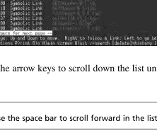

再次使用方向键向下滚动列表，直到找到 GIMP 包。

你可以使用空格键整页向前滚动列表。

包列表采用半字母顺序格式。所有以数字开头的包名最先列出。之后，所有以大写字母开头的包按字母顺序列出。随后是所有以小写字母开头的包按字母顺序列出。

图 6.5 显示了 GIMP 包被高亮显示并准备下载的屏幕。

图 6.5
GIMP 包已被高亮显示，准备下载。

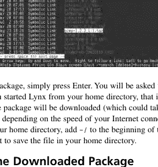

要下载包，只需按 Enter。系统会询问你想将包保存到哪里。如果你是从主目录启动 Lynx 的，现在这样就可以了。只需按 Enter，包就会开始下载（所需时间从 30 秒到一小时不等，具体取决于你的 Internet 连接速度）。如果你没有从主目录启动 Lynx，请在路径开头加上 ~/ 以指示 Lynx 将文件保存到你的主目录。

## 安装下载的包

下载完成后，你可以通过按 Q 退出 Lynx 浏览器。系统会询问你是否确定要退出。按 Y 后你将返回到 FreeBSD 命令提示符。输入 ls，你应该能在目录列表中看到新下载的包。在撰写本文时，包的名称为 gimp-1.2.3_1,1.tgz。你包的名称可能会略有不同，具体取决于你在阅读本文时 GIMP 的当前版本。

pkg_add 命令用于从包安装新软件。通常，你需要成为 root 用户才能安装软件包，因为它们希望安装到普通用户没有写权限的目录中。要切换到 root 用户，可以使用 su 命令。只需输入 su 然后按 Enter。你将被提示输入 root 的密码。输入密码并按 Enter 后，你将拥有 root 用户权限，但仍位于同一个主目录中。

在最简单的形式中，只需提供你想要安装的包文件名即可调用 pkg_add。例如，要安装我们之前下载的 GIMP 软件，我们可以简单地输入

```
pkg_add gimp-1.2.3_1,1.tgz
```

这假设你从包当前所在的目录输入命令。如果你不在同一目录下，需要向 pkg_add 命令提供包所在目录的路径。

包安装完成后，你的命令提示符将返回，你就完成了。就这么简单——甚至比在 Windows 中安装软件还要容易。与 Windows 不同，你不会被提示软件要安装到哪里等等，因为 FreeBSD 对应用程序应该安装文件的位置有严格执行的策略。最终，这使得长期管理变得更加容易，因为所有内容都位于标准位置，而不是软件程序员决定应用程序应该安装文件的位置。

如果你希望 pkg_add 在安装软件时提供更多详细信息，可以使用 -v 选项，它是 verbose（详细）的缩写（例如，pkg_add -v gimp-1.2.3_1,1.tgz）。

## 获取已安装包的信息

FreeBSD 维护着已安装在系统上的所有包的数据库。其中包括包的描述，以及在你想卸载时告诉 FreeBSD 如何卸载包的说明。你可以使用 pkg_info 命令获取当前安装在系统上的包列表。要显示当前安装在系统上的所有包，使用命令 pkg_info -a，-a 选项是 all（全部）的缩写。如果你只想了解特定包的信息，可以使用 pkg_info 命令后跟包的名称。例如，pkg_info gimp-1.2.3_1,1.tgz。如果你不知道要查找的包的确切名称，可以使用 grep 命令以及管道，如你在第 5 小时“高级 UNIX Shell 使用”中学习的那样。例如，

```
pkg_info -a | grep gimp
```

该命令将显示包含表达式 gimp 的所有包。

你也可以使用 pkg_info 命令来显示当前未安装的包的信息，只需提供该包的位置即可。包的位置可以是本地目录，也可以是 Internet 地址，如果包位于远程 FTP 或 Web 服务器上。

## 从 Ports 安装软件

如前所述，从预编译包安装软件的替代方法是直接从源代码安装软件。这种安装软件的系统被称为 ports 系统。ports 包含告诉 FreeBSD 如何构建和

从原始源代码安装软件。按流程来说，使用这种方法安装软件几乎与从软件包安装一样简单。然而，正如前面提到的，它可能需要更长的时间，因为 FreeBSD 在安装软件之前必须先构建软件，并且需要安装所有必要的头文件，以便 C / C++ 编译器能够构建软件。


> 随着时间的推移，需要先下载、构建和安装的缺失库的问题会越来越少，因为许多非常常见的库被大量你可能想从 ports 安装的应用程序使用。然而，这些库只需要安装一次。因此，下次你安装一个依赖相同库作为先决条件的应用程序时，该库已在你的系统上安装，ports 系统就不需要再次安装它。

## FreeBSD Ports 树

Ports 树位于目录 /usr/ports 中。与你之前查看的 ports 网站一样，ports 目录分为包含不同类型软件的类别。在每个类别下，都有可从 ports 安装的每个应用程序的子目录。在这些子目录中的每一个里，都有更多子目录和各种文件。此时，你只需要对这些文件和子目录的用途有一个非常基本的了解，所以我不会详细介绍它们。基本上，它们包含 ports 系统构建源代码的说明以及已完成产品应安装的位置。它们还包含依赖列表，其中列出了你尝试安装的软件所依赖的任何先决条件软件。如果该软件尚未安装，ports 系统将递归地安装缺失的依赖项。

## 确保你的 Ports 树是最新的

由于端口结构存储在你的本地硬盘上，你需要确保它是最新的。应用程序会定期添加到其中，并且现有应用程序的新版本经常发布。为了确保你的 ports 系统“知道”这一点，你需要不时地将你的 ports 与 FreeBSD 项目服务器上的活动 ports 树同步。（FreeBSD 项目服务器是新应用程序被添加到 ports 树的地方，并且当它们发布时，现有应用程序会被更新到更新的版本。）同步你的 ports 树相当容易完成，并且使用名为 cvsup 的程序来完成。

你应该已经安装了 cvsup 程序，因为它是在你安装 FreeBSD 的那个小时期间推荐的软件包之一。如果你尚未安装它，你可以按照之前给出的安装软件包的说明从软件包中安装它。cvsup 实用程序可以在软件包的 devel 类别中找到。

一旦安装了 cvsup，你就可以用它来更新你的 ports 树。请注意，以下过程要求你以 root 用户身份操作。

你需要做的第一件事是创建一个 cvsup 配置文件。最简单的方法是将 /usr/share/examples/cvsup/ports-supfile 中的示例 ports supfile 复制到另一个位置。/usr/local/etc 是一个合理的位置。完成此操作后，切换到 /usr/local/etc 目录。现在你需要编辑该文件以指定你想要从哪个服务器更新你的 ports。打开 ports-supfile 进行文本编辑（参见第 15 小时，“网络安全”，如果你不确定如何使用任何文本编辑器），并查找读取 CHANGE_THIS.FreeBSD.org 的行。将该行更改为离你较近的 cvsup 镜像之一。镜像列表可以从以下网站获得：

http://www.freebsd.org/doc/en_US.ISO88591/books/handbook/cvsup.html#CVSUP-MIRRORS

对于急性子的人，如果你在美国，你可以使用 cvsup1.FreeBSD.org 到 cvsup17.FreeBSD.org。

保存编辑后的文件后，只需键入以下命令即可启动 cvsup 过程：

```
cvsup ports-supfile
```

如果你不在 ports-supfile 所在的同一目录中，你需要提供该文件的完整路径。

根据你的互联网连接速度以及自上次更新以来有多少 ports 发生变化，此过程可能需要从一分钟到大约一个小时不等。你更新得越频繁，所花费的时间就越少，因为更改较少，系统只会更新自上次更新以来发生变化的那些 ports。


> 如果 cvsup 服务器的连接尝试超时或 cvsup 程序抱怨服务器太忙，只需再次编辑 ports-supfile 并将其更改为指向不同的 cvsup 服务器即可。

一旦 cvsup 过程完成，你将被返回到命令提示符，并拥有一个刚刚更新的 ports 树。现在你可以从 ports 树安装软件了。

## 安装一个 Port

再次，查找你感兴趣的软件的最简单方法是通过浏览 FreeBSD 网站上的 FreeBSD ports。当你找到感兴趣的东西时，只需记住它所在的目录。然后，以 root 用户身份，切换到 `/usr/ports` 目录中的该目录。在此示例中，我们将使用位于 `/usr/ports/graphics` 目录中的 GIMP 图像编辑程序。

当你在 graphics 子目录中时，只需查找你想要安装的 port 的目录。你可以通过使用 `ls` 列出目录来做到这一点。为了防止它在你阅读之前从屏幕上滚动掉，你可能希望将目录列表通过管道传输到 `more`，像这样：

```
ls | more
```

找到你想要的 port 的目录位置后，切换到该目录。要安装 port，只需键入 `make`，然后按 Enter。ports 系统将然后下载并构建应用程序的源代码，以及递归下载、构建和安装构建此应用程序所需的任何先决条件。在此过程中，你将在屏幕上看到大量来自 C/C++ 编译器的消息。构建过程完成后（这可能需要几分钟到数小时不等，具体取决于你正在安装的应用程序、你的互联网连接速度以及你的计算机速度），命令提示符将返回。现在你可以简单地键入 `make install` 来完成 port 的安装。与软件包一样，你不会被问及想要安装 port 的位置问题，因为 FreeBSD 将所有软件安装在标准位置。

## 移除已安装的软件

如果你想移除从软件包安装的软件，请使用 `pkg_delete` 命令。在其基本形式中，该命令只需跟上你想要删除的软件包的名称。如果你不知道软件包的名称，请使用前面讨论过的 `pkg_info` 命令来查找它。

如果当前安装了其他软件依赖于你试图移除的软件，`pkg_delete` 将不会移除该软件。如果你想强制 `pkg_delete` 仍然移除该软件，可以使用 `-f` 选项。然而，这通常不是一个好主意，因为它可能会导致你当前安装的一些其他应用程序无法正常工作。

你可以按以下两种方法之一移除从 port 安装的软件：

- 使用前面为移除软件包描述的相同过程。这可行，因为 ports 系统实际上会创建然后安装一个软件包。
- 使用 `cd` 命令切换到你从中安装 port 的同一目录并发出 `make deinstall` 命令。

## 更新已安装的软件

当软件的新版本发布，并且你想更新到更新的版本时，只需按照前面描述的相同过程即可。（请注意，如果你想从 ports 安装新版本，你需要 `cvsup` 你的 ports 树。）在安装软件的新版本之前，使用前面描述的方法之一移除旧版本的软件通常是一个好主意。

## 关于 Ports 和磁盘空间的说明

当你构建一个 port 时，ports 系统会将所有必要的源文件下载到你的硬盘上。然后它会解压这些源归档文件并将所有解压后的文件存储在另一个目录中。构建应用程序还会创建新文件。（这些被称为 *object files*，它们由 C/C++ 编译器创建。）当 port 完成构建后，它不会删除这些文件。起初，你可能会想知道为什么。原因主要是以防你以后想重新安装应用程序。如果 ports 系统删除了这些文件，而你以后想重新安装，你将不得不重复整个耗时的下载和构建过程。然而，随着时间的推移，如果你安装了大量 ports，源文件和对象文件占用的磁盘空间可能相当可观。因此，如果你开始磁盘空间不足，你可能想要删除一些这些文件并收回它们占用的空间。请注意，对象文件和源文件可以被移除，而不会以任何方式影响已安装软件的功能。

要移除 port 构建过程遗留的对象文件和其他文件，请切换到你从中安装 port 的目录并键入 `make clean`。这将删除构建 port 过程中创建的所有工作文件，但不会删除原始下载的源归档文件。如果你也想删除这些文件，请使用 `make distclean` 命令。


## 使用 Linux 应用程序

FreeBSD ports 树中可用的 Linux 应用程序相当多。在很大程度上，使用这些应用程序与使用任何其他应用程序没有区别。它们将像 ports 树中的任何其他应用程序一样安装，并且也将像任何其他应用程序一样正常运行。

尝试运行 Linux 应用程序时可能遇到的主要问题是 Linux 兼容性软件未加载，或者您未安装 Linux 运行时库。

如果您在安装 FreeBSD 时未安装或启用 Linux 兼容性，则在 FreeBSD 中运行任何 Linux 应用程序之前需要这样做。

如果需要安装 Linux 运行时库，请切换到目录 `/usr/ports/emulators/linux_base` 并像安装其他任何端口一样安装它。(`make` 完成后执行 `make install`。) 安装运行时库后，您需要将 Linux 兼容性模块加载到内核中。您只需在命令提示符下键入 `linux` 并按 Enter 即可完成此操作。但是，如果您将定期运行 Linux 应用程序，则让 Linux 模块在系统启动时自动加载会方便得多。为此，请在文本编辑器中打开文件 `/etc/rc.conf` 并添加以下行：

```
linux_enable="YES"
```

请注意，您需要以 root 用户身份进行此文件的更改。有关在 FreeBSD 中使用文本编辑器的更多信息，请参阅第 15 小时的“Working with Text”部分。

> 您可以随时通过键入 `kldstat` 命令来检查 Linux 内核模块是否已加载。如果模块已加载，您将看到类似以下的行：
> 
> `7 1 0xc24db000 d000 linux.ko`

### 摘要

在本小时中，您了解了如何在 FreeBSD 中安装新软件。您了解到可以通过访问 FreeBSD 网站来了解 FreeBSD 可用的所有软件。您还学习了如何使用 `pkg_add` 命令从软件包安装软件，以及如何使用 `make` 命令从 ports 安装。

## 练习

测验问题旨在测试您对在 FreeBSD 中安装软件的理解。

### 测验

- 1. 在 FreeBSD 中安装新的二进制软件的命令是
- A. install
- B. pkgadd
- C. installpkg
- D. loadsoft
- E. 以上均不是
- 2. FreeBSD ports 树是
- A. 从源代码轻松安装软件的一种方法。
- B. 构建和安装各种应用程序所需指令的列表。
- C. 与软件包系统不同。
- D. 以上全部。
- 3. 安装已构建的端口的命令是
- A. make
- B. make install
- C. install
- D. install port
- E. 以上均不是
- 4. 以下哪个命令删除安装包？
- A. pkg rm
- B. pkg_delete
- C. pkg_remove
- D. trash_package
- E. delete_pkg

### 测验答案

- 1. 正确答案是 E。请注意选项 B。它是错误的，因为缺少下划线。正确答案是 pkg_add。
- 2. 正确答案是 D。
- 3. 正确答案是 B。选项 A 是错误的，因为选项 A 中的命令会构建端口而不是安装它。根据问题，端口已经构建。
- 4. 正确答案是 B。


## 第 7 小时

### 系统配置和启动脚本

每台计算机都不同；今天世界上使用的每台机器都有其所有者设定的自定义行为，这控制着它的行为方式、运行哪些服务或程序，以及在启动时应自动执行什么操作。对于 FreeBSD 和其他可作为 Internet 服务器使用的 UNIX 操作系统而言，能够调整系统使其针对通过网络为客户端服务或作为桌面工作站运行而优化，显得尤为重要。

对于大多数用户来说，FreeBSD 启动的过程——探测已安装的设备、引导其各个磁盘分区、启动内核、挂载文件系统，以及执行高效多用户操作系统所需的所有小家务工作——意义不大。然而，如果您想按自己的喜好配置系统，了解 FreeBSD 在您打开计算机后向屏幕输出所有那些神秘行时在做什么是个好主意。

在本小时中，您将学习：

- FreeBSD 在启动过程中如何逐步提升到更高的意识水平
- `/etc` 中所有那些神秘文件用于什么
- 如何使用 `/etc/rc.conf` 配置系统
- `inetd` “超级服务器”用于什么以及如何配置它
- 如何管理 `syslogd`，系统记录器

### 了解 FreeBSD 启动过程

当操作系统在您打开电源后启动时，它会从磁盘上休眠的一串零和一，转变为一个充满活力的生物，其中数百个相互作用的进程在内存和磁盘中相互争抢。当你想想看时，操作系统能够“自己拉起自己的靴带”——或我们口语上所说的“启动”——确实是一项了不起的壮举。它类似于汽车中的离合器，允许发动机在汽车停止时仍在运行，逐渐将动力传递给停止的车轮，使其能够开始转动而不熄火发动机。

计算机的硬件 BIOS，或基本输入/输出系统，对操作系统几乎一无所知。它只知道在哪里找到系统中的硬盘以及如何执行其中一个硬盘上找到的一小段代码。执行完之后，硬件的工作就完成了。剩下的就靠启动盘上那小段代码来找到更大的代码并执行它们；这些代码继续执行更大、更复杂的程序，这些程序对您运行的操作系统类型及其启动方式了解得越来越多。所有操作系统启动的方式或多或少都相同，但无论平台如何，启动都是一个巧妙设计的流程——本质上是一个“黑客”，但已被当今的操作系统很好地开发和理解。

FreeBSD 的启动过程涉及多个阶段，每个阶段通常具有非常有限的功能和范围，并在将控制权传递给下一阶段之前执行一个关键步骤。我们现在将依次检查这些阶段，看看它们各自做什么。很有可能您永远不需要知道系统启动时发生细节，但了解它们不会有什么坏处。

图 7.1 显示了启动磁盘的示意图。此磁盘包含多个切片——每个切片可以包含不同的可启动操作系统；每个 FreeBSD 切片包含多个 BSD 分区。在“根”BSD 分区内是内核。这些层级中的每一层都必须有一小段软件知道如何进入下一层。

### 图 7.1

硬盘、其分区层级和引导块。

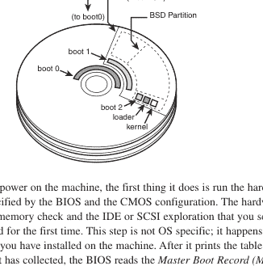

当您第一次打开机器电源时，它首先运行 BIOS 和 CMOS 配置指定的硬件检查和探测。硬件检查和探测运行内存检查以及您在屏幕第一次清除前看到的 IDE 或 SCSI 探索。此步骤不是特定于操作系统的：无论机器上安装了什么，它都以相同的方式发生。在打印出收集的硬件数据表后，BIOS 读取主磁盘的 *主引导记录 (MBR)* 以获取第一个初步引导块。此引导块和接下来的两个引导块的任务是找到并运行 *loader*，该程序配置并加载内核。每个引导块在顺序上比上一个更复杂一些；前两个引导块的大小限制为 512 字节（由 MBR 的大小和切片引导扇区的大小决定），因此它们都非常简单。我们现在将依次查看每个引导块，看看它们的功能是什么。

- **引导块 0 (boot0)。** 这个初步引导块位于 MBR 中，列出了可用的磁盘切片（随后出现的 F 键命令），您可以从中选择要启动的内容。我们将在第 8 小时的课程“存储系统和备份实用程序”中更详细地讨论磁盘切片（大多数操作系统将其称为 *分区*）。

```
F1 FreeBSD
F2 Linux
F3 ??

Default: F1
```

您可以按适当的 F 键选择要启动的切片，或者等待几秒钟——它将选择默认选择并继续。


- **Boot block 1 (boot1)**. 这是一个非常简单的程序，从你在 boot0 中选择的 slice 的引导扇区运行，其任务是使用精简版的 disklabel（将 slice 分成 BSD 风格分区的内容，我们将在下一小时讲解）来查找并在适当分区中运行 boot2。boot1 没有用户界面部分。
- **Boot block 2 (boot2)**. 最终，你会到达一个引导块，它有足够的空间来具备读取其 BSD 分区中可引导文件系统文件的必要复杂性。boot2 的任务是运行一个名为 loader 的程序，它提供了一个用户界面，让你能够控制内核的加载方式。我们很快就会讲到内核。
- **loader**. 你可以在 /boot 目录中找到这个程序。它读取 /boot/defaults/loader.conf 和 /boot/loader.conf 配置文件，并加载其中指定的内核和模块。（/boot/loader.conf 文件包含对 /boot/defaults/loader.conf 的覆盖，方式类似于 /etc/rc.conf 的工作方式，我们将在本小时稍后讲解。）

loader 在等待你按键时会倒计时 10 秒；如果没有收到按键，它会以默认状态引导内核。然而，如果你按下 Enter，它会进入其命令行界面，在此界面中你可以精确控制内核引导过程。你可以在单用户模式下引导（boot -s）、引导旧内核（boot kernel.old）、从 CD-ROM 引导（boot -c）、逐个加载和卸载内核模块、查看文件内容（more），或执行其他任务（详见 man boot）。大多数情况下这些都不需要。通常你会以默认配置引导。在 ok 提示符下按 ? 会列出可用命令，如果你感兴趣的话。有关 loader 命令行可用选项的进一步详细信息，请参阅 man loader。

这标志着引导块阶段的结束。我们现在已经在很大程度上完成了将系统完全启动的工作。引导过程的最后阶段是完整的 FreeBSD 系统开始发挥作用的地方；在那里内核将自身加载到内存中，探测其可用设备，并运行“资源配置”脚本，这些脚本构建工作环境并启动各种系统服务。

- **kernel**. loader 转移控制后，内核开始探测它能找到的所有设备，每个探测的结果都会回显到屏幕上。这就是你会看到大量引导消息的时候。这些消息记录在 dmesg 内核缓冲区中，如果你需要了解内核对某个设备的说法，可以使用 dmesg 命令读取。


> `dmesg` 是一个相当基础的工具，列出自系统上次启动以来累积在系统消息缓冲区中的内容。只需输入 `dmesg` 即可查看消息列表，或输入 `dmesg | less` 以交互式分页器查看输出，便于访问。

- **init**. 内核加载后，它将控制权交给 `init` 进程，这是启动程序的最后阶段。这由 Automatic reboot in progress 消息发出信号，其中涉及 `init` 运行资源配置脚本（`/etc/rc`）。该脚本首先使用 `fsck`（FileSystem Consistency check，文件系统一致性检查）程序检查 `/etc/fstab` 中所有文件系统设备的一致性。如果 `fsck` 找不到无法自行纠正的问题，它将挂载所有文件系统（使用 `mount -a -t nonfs`）并继续运行其余启动过程。如果 `fsck` 发现磁盘存在无法解决的问题，它将退出到单用户模式，以便你手动运行 `fsck` 并修复损坏。退出单用户 shell 以继续重新引导到多用户模式。

最后，如果一切按计划进行，你会得到登录提示。整个过程通常不超过一分钟。

## 资源配置脚本

启动 `init` 后，系统剩余的启动任务——即启动所有服务和操作系统进程的任务——由资源配置脚本处理。这些脚本都可以找到在 `/etc/rc.d` 目录中，该目录通常意味着“资源配置目录”（视询问对象而定）。

`/etc/rc.d` 中的任何内容都是资源配置脚本，一个根据系统配置启动 FreeBSD 部分的程序。其中一些由其他程序递归调用，一些在开箱即用配置中不执行任何操作，一些可能永远也不会运行。你通常永远不需要修改 `/etc/rc.d` 中的任何文件。

不过，`/etc` 中还有一些其他文件，你需要修改它们来配置系统。FreeBSD 使用的一些重要资源配置脚本列表显示在表 7.1 中。

## 表 7.1 资源配置脚本

| 脚本名称 | 描述 |
|---|---|
| `/etc/rc` | 主资源配置脚本。 |
| `/etc/defaults/rc.conf` | init 早期读取此文件以填入其待办任务清单。 |
| `/etc/rc.conf` | 这是你编辑以覆盖 /etc/defaults/rc.conf 中默认值的文件。这应该是 /etc 中唯一需要编辑的资源配置文件。 |
| `/etc/rc.d/diskless` | 如果你通过 BOOTP 进行无盘引导，init 会读取此脚本。 |
| `/etc/rc.d/serial` | 设置终端和其他串行设备。 |
| `/etc/rc.d/pccard` | 为笔记本运行 PC 卡守护进程。 |
| `/etc/rc.d/network#` | 设置 TCP/IP 网络的脚本。 |
| `/etc/rc.d/network_ipv6` | 与 rc.network 相同，但用于 IPv6 服务。 |
| `/etc/rc.d/atm` | 由 rc.network 调用；为广域网机器设置 ATM 设备。 |
| `/etc/rc.d/ipfw` | 由 rc.network 调用；配置 ipfw 防火墙。 |
| `/etc/rc.d/ip6fw` | 由 rc.network6 调用；配置 ip6fw 防火墙。 |
| `/etc/rc.d/devfs` | 配置设备文件系统。有关此文件的更多信息，请参阅第 10 小时“FreeBSD 内核和设备树”。 |
| `/etc/rc.d/sysctl` | 设置 /etc/sysctl.conf 中指定的内核变量。 |
| `/etc/rc.d/syscons` | 设置控制台设置。 |
| `/usr/local/etc/rc.d/` |  |
| `/usr/local/X11R6/etc/rc.d/` | 包含你添加的任何新启动脚本的目录树（或由程序自动安装）。 |

## 修改系统设置

主资源配置脚本 /etc/rc 是一个完全自动化的“框架”，它读取全局配置文件，然后按特定顺序执行 /etc/rc.d 中的一系列其他脚本。现在你知道了 /etc/rc.d 脚本的作用，我们可以看看如何配置 /etc/rc 的行为。

### /etc/defaults/rc.conf 文件

/etc/rc 程序是一个 shell 脚本，其操作基于数十个不同变量的状态。如果某个变量（例如 sendmail_enable）设置为 YES，/etc/rc 将运行启动 Sendmail 的 /etc/rc.d 脚本。如果变量设置为 NO，则不运行 Sendmail 脚本。

FreeBSD 安装时带有一个文件，定义了对 /etc/rc 有意义的所有变量的所有默认状态。该文件是 /etc/defaults/rc.conf。/etc/rc 的第一件事就是读取此文件，以便知道对所有配置变量使用什么默认假设。

让我们看看 /etc/defaults/rc.conf 中的一个典型块，如列表 7.1 所示。

### 列表 7.1 /etc/defaults/rc.conf 摘录

```
# named. It may be possible to run named in a sandbox, man security for
# details.
#
named_enable="NO"      # Run named, the DNS server (or NO).
named_program="named"  # path to named, if you want a different one.
named_flags=""         # Flags for named
#named_flags="-u bind -g bind"  # Flags for named
```

通过查看 /etc/defaults/rc.conf，你可以找到 /etc/rc 在你明确覆盖之前会做什么。在这种情况下，你可以看到默认行为是不运行 named。

### /etc/rc.conf 文件

如何覆盖 /etc/defaults/rc.conf 中的默认设置？你使用 /etc/rc.conf 来实现，它在 /etc/rc 读取默认值后立即被读入。FreeBSD 即使完全没有 /etc/rc.conf 文件也能正常运行；它只是一个纯文本文件，你可以用文本编辑器手动创建，每行一个变量。你只需向此文件添加想要覆盖的变量，以便使用你期望的值而不是默认值。使用 sysinstall 进行配置更改后，与这些更改相关的某些变量会由该程序自动写入 /etc/rc.conf。你可以使用 more /etc/rc.conf 查看其中的内容。

假设我们确实想运行 named。在最简单的情况下，我们所要做的就是编辑 /etc/rc.conf（覆盖文件），并在文件中的任何位置添加以下行：

```
named_enable="YES"
```

/etc/defaults/rc.conf 中其余的 named_* 变量无需复制到覆盖文件中；记住，defaults 文件中的每个变量都由 init 加载到内存中，只有在该块的“主开关”被切换到“YES”时才重要。如果是这样，这些变量将在 /etc/rc 中的执行循环中使用，以启动我们正在处理的块所控制的进程（在本例中为 named）。


你也可以使用这些其他变量进行微调，并且可以同样轻松地覆盖它们。假设你的域名服务器程序是一个名为 mynamed 的定制版本。假设你还创建了一个 bind 用户和组，意图让域名服务器以该用户和组运行，这样它就不会那么容易受到安全攻击。好吧，要处理这个问题，你需要做的全部就是（假设 mynamed 的行为和命令行选项与 named 相同）向 /etc/rc.conf 添加这两行：

```
named_program="mynamed"
named_flags="-u bind -g bind"
```

从现在开始，当你启动系统并在控制台消息中看到 Doing additional network setup: 之后出现 named 时，你就知道它正在将你的覆盖设置应用到默认值之上并自动运行域名服务器。

出现在 /etc/rc.conf 中最典型的变量是 TCP/IP 配置参数，因为它们对于每个系统来说自然会不同；毕竟 FreeBSD 不能很好地在默认值中指定它们。清单 7.2 显示了新安装 FreeBSD 后典型的 /etc/rc.conf。

## LISTING 7.2 新安装的 /etc/rc.conf

```
# This file now contains just the overrides from /etc/defaults/rc.conf
# please make all changes to this file.

# Enable network daemons for user convenience.
# -- sysinstall generated deltas -- #
kern_securelevel="1"
kern_securelevel_enable="YES"
linux_enable="YES"
sendmail_enable="YES"
sshd_enable="YES"
portmap_enable="NO"
nfs_server_enable="NO"
inetd_enable="NO"
network_interfaces="fxp0 lo0"
ifconfig_fxp0="inet 10.6.7.101 netmask 255.0.0.0"
defaultrouter="10.6.1.1"
hostname="freebsd1.testnetwork.com"
usbd_enable="YES"
```

其中一些变量实际上与 defaults 文件重复；尽管如此，将它们也放在覆盖文件中仍然是有用的，因为其中许多功能（例如 NFS 服务器）现在都有一种一键切换控制。

> 如果你向 /etc/rc.conf 添加一个变量，请确保该变量的另一个版本不在文件中——至少确保它不会出现在文件后面的位置。变量是按顺序读取的，覆盖的工作方式很简单：系统看到的每个变量的最后一次出现就是它使用的那一次。如果你总是小心只在 rc.conf 的末尾添加变量，应该就没问题。

许多程序在安装时必须为自己在启动时启动安装一种方式；/etc/rc.conf 然而不是它们的地方。该文件 supposed 只由你、管理员以及 sysinstall 程序在对核心系统进行更改时触碰。对于用户安装的程序（ports 和 packages）以及 /etc/rc 和朋友们不知道的任何脚本，它们的启动脚本和配置文件有另一种结构：/usr/local/etc 层级。

## /usr/local/etc 和 /usr/local/X11R6/etc 目录

你自己安装的程序被认为是本地的，意味着它们仅适用于你的特定机器而不是 FreeBSD 本身。本地安装程序的配置文件进入 FreeBSD 中的 /usr/local 层级作为其结构约定之一。有一个 /usr/local/etc/rc.d 目录，其操作等同于 /etc/rc.d——除了因为其中的文件适用于你安装的程序，而不是核心系统，你可以自己编辑这些文件以更改这些程序的行为。

init 在运行完所有其他 /etc/rc.d 脚本后才会将注意力转向 /usr/local/etc/rc.d。目录中以 .sh 结尾的任何可执行文件都将按字典顺序执行。将安装在此处的示例文件包括 apache.sh、mysql-server.sh 和 samba.sh。这些脚本是 ports 或 packages 的一部分定制构建的（参见 Hour 6，“Adding and Removing Third-Party Software”，了解有关 ports 和 packages 的更多信息），并且每个脚本都针对接受 start 或 stop 参数进行了调整。当 init 运行每个脚本时，它使用 start 参数。请注意，你可以在运行时同样轻松地自己运行这些脚本——例如，在不重新启动的情况下启动新安装的服务，

```
# /usr/local/etc/rc.d/apache.sh start
```

一些 ports 或 packages 将以 .sample 的次要后缀安装（例如 samba.sh.sample），因为它所属的程序必须在成功运行之前正确配置。例如，Apache 在安装后无需对配置文件进行任何进一步修改即可立即运行（尽管你无疑也会修改它们），因此它安装了一个 apache.sh 文件，如果你立即重新启动它，该文件可以干净地运行程序。但 Samba（我们将在 Hour 24，“File Sharing”中讨论）必须先进行调整才能在你的机器上运行；如果你在安装后立即运行脚本，它将无法启动守护进程。你需要在 init 在启动时运行它之前重命名脚本以删除 .sample 扩展名。

/usr/local/X11R6/etc 目录类似于 /usr/local/etc，只是它专门用于基于 X11（X Windows）的程序：GNOME 面板、图形工具、游戏、窗口管理器等等。该目录也有一个 rc.d 子目录，其中的脚本在 /usr/local/etc/rc.d 中的脚本之后立即执行。


> 本地启动脚本目录是可配置的。如果需要，可以覆盖此 rc.conf 行以添加更多目录：
> 
> local_startup="/usr/local/etc/rc.d /usr/X11R6/etc/rc.d"  # startup script dirs.

## inetd 守护进程和 inetd.conf 配置文件

虽然基础系统中的相当数量的守护进程在 /etc 目录中有 .conf 文件，但你必须处理的最重要（也是最敏感）的一个是 inetd，即超级服务器。我们将在此处简要介绍 inetd 并讨论如何配置它。

inetd 的工作是侦听指定的一组网络端口上的连接，并在请求到来时启动适当的服务器进程。例如，inetd 负责 Telnet 连接；如果你的系统允许 Telnet，你可以打开到它的连接并在服务器上事先没有运行 telnetd 进程的情况下接收登录提示。每次系统在端口 23 上收到连接请求时，它都会创建一个新的 telnetd 进程来处理该连接。从 inetd（和其他类似守护进程）运行的可执行程序位于 /usr/libexec。这些程序通常不是你的命令路径的一部分，也不应该从命令行运行；相反，它们是从另一个进程中生成并传递某些资源（例如环境变量和网络连接）。


> 使用 inetd 消除了需要一个作为 root 运行的“主”telnetd 进程的需要，如果在 telnetd 中发现安全漏洞，这可能特别危险。许多守护进程（其中包括 sshd、httpd（Apache）和 sendmail）确实以这种“独立”模式运行，而不是从 inetd 调用。主进程（作为 root 运行）侦听新连接并生成由无特权用户拥有的新进程来处理每个事务。这允许程序具有更大的灵活性和速度，但以集中的安全风险为代价。inetd 也作为 root 运行，因此如果它被攻破同样危险。运行为 root 的守护进程越多，发现安全漏洞的可能性就越大。

检查 /etc/inetd.conf 文件显示，在开箱即用的配置中，几乎所有条目都被禁用，假设你在设置期间选择了默认的安全设置。唯一启用的条目列在表 7.2 中。

## TABLE 7.2 默认情况下由 inetd 控制并启用的系统服务

| 服务 | 描述 | 端口/资源使用 |
|---|---|---|
| ftp | 文件传输协议 | Port 21/TCP |
| telnet | 远程终端 | Port 23/TCP |
| comsat | "biff" 服务器（通知用户有新邮件到来） | Port 512/UDP |
| ntalk | 命令行聊天服务器 | Port 518/TCP;UDP |
| ftp (IPv6) | 文件传输协议 | IPv6 |
| telnet (IPv6) | 远程终端 | IPv6 |

其他你可能想要启用的服务，具体取决于你使用系统的用途，显示在表 7.3 中。

## TABLE 7.3 其他有用的 inetd 服务

| 服务 | 描述 | 端口/资源使用 |
|---|---|---|
| pop3 | 邮局协议 | Port 110/TCP |
| imap4 | 临时邮件访问协议（服务器端邮件） | Port 143/TCP |
| smtp | Qmail（Sendmail SMTP 服务器的替代品） | Port 25/TCP |


## 表 7.3 继续

| 服务 | 描述 | 端口/使用的资源 |
|---|---|---|
| netbios-ssn | 使用 Windows 的 Samba 文件共享 | 端口 139/TCP |
| netbios-ns | 使用 Windows 的 Samba 文件共享 | 端口 137/TCP |
| finger | 查询用户信息 | 端口 79/TCP |

要启用其中任何一项服务，只需从行首删除注释（#），然后按如下方式重新启动 inetd 服务器：

```
# ps -waux | grep inetd
root 110 0.0 0.6 1032 752 ?? Ss 11:57PM 0:00.01 inetd
# kill -HUP 110
```

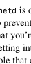

> 如果您选择以安全级别 1 或更高级别运行系统（安装时选项——级别 1 是安装程序中提到的“中等”安全级别），inetd 将不会运行。这表明通过 inetd 运行的许多服务的风险性质。如果您在此安全级别下运行并且想运行 inetd，您可以通过输入 inetd -w8 来运行它。要永久启用它，请删除或切换 /etc/rc.conf 中的这一行：
> inetd_enable="NO"

inetd 是 FreeBSD 中缺乏大量自动化和防止错误配置的安全网的领域之一。如果您必须在 /etc/inetd.conf 中启用服务，请注意您正在进入一种非标准类型的设置，并且您应该知道自己在做什么。例如，cvs 服务附带一个严厉警告，指出错误配置的参数可能会打开一个安全漏洞。Samba 服务（netbios-ssn 和 netbios-ns）期望在 /usr/local/sbin 中找到 smbd 和 nmbd 二进制文件，但除非您已从 ports 或 packages 安装了 Samba，否则它们不会在那里。（从 inetd 而非独立运行 Samba 是一种非标准、替代的配置。）

同样，其他服务（如 pop3）尝试运行安装到 /usr/local/libexec 的服务。但请记住，此目录位于 /usr/local 内部，这意味着除非您明确在那里安装了程序，否则它不会存在。安装 popper port/package 会将必要的二进制文件放入该目录，以便您可以在 inetd 中启用该服务。但是，如果您选择安装 qpopper port/package（另一个 POP3 服务器），二进制文件将是 qpopper 而不是 popper，您必须相应地修改该行：

```
pop3 stream tcp nowait root /usr/local/libexec/qpopper qpopper
```

对于粗心的人来说，还有许多其他陷阱在等待。务必不要比实际需要的更广泛地修改 inetd 服务。man inetd 手册页提供了关于处理 inetd 的语法和技术的更详细讨论。


> 为了更加注重安全，您可能会选择用 xinetd 替换 inetd，可从 ports 或 packages 获取（/usr/ports/security/xinetd）。除了比 inetd 安全得多之外，它还具有更多的可配置性——它可以根据远程 IP 地址、一天中的时间、它被要求生成的进程数量等实施复杂的访问控制。它就像类固醇版的 inetd。

## 系统日志记录器（syslogd）及 syslog.conf 文件

系统消息记录到 /var/log 中的文件。执行此操作的机制称为 syslogd，系统日志记录守护进程。其行为在 /etc/syslog.conf 中设置，该文件为不同服务定义各种不同的日志文件。它所知道的每个服务或设施（可以是 auth、authpriv、console、cron、daemon、ftp、kern、lpr、mail、mark、news、ntp、security、syslog、user、uucp 以及 local0 到 local7 中的任何一个）都有多个不同的严重级别，您可以控制其日志记录。这些级别包括 emerg、alert、crit、err、warning、notice、info 和 debug，按严重程度递减顺序列出。

- emerg—紧急！如果触发此最高严重性消息级别，每个已登录用户都会收到广播。
- alert—系统层面发生了重要事情——必须立即纠正——但只有 root 真正需要被警告。
- crit—某个特定服务或硬件部件出现严重错误。将错误打印到所有相关日志文件和控制台，但不要用警告中断远程登录用户。
- err—来自任何服务的通用“错误”。消息会打印到控制台和 root 的终端。
- warning—非关键性状况，但在日志文件中查找会很有用。
- notice—值得提及的特殊情况，如服务的启动/关闭。
- info—信息性消息；标准操作流程。
- debug—这些消息仅在调试时可见。

默认情况下，syslog.conf 定义了以下几个日志记录规则：

```
*.err;kern.debug;auth.notice;mail.crit    /dev/console
*.notice;kern.debug;lpr.info;mail.crit;news.err  /var/log/messages
security.*                               /var/log/security
mail.info                                /var/log/maillog
lpr.info                                 /var/log/lpd-errs
cron.*                                   /var/log/cron
*.err                                    root
*.notice;news.err                        root
*.alert                                  root
*.emerg                                  *
```

我们可以将其解释为，所有服务的 err 消息、内核的 debug 消息、授权 notice 消息以及邮件程序的 crit 消息都将打印到系统控制台，如果您将显示器连接到 FreeBSD 机器，您会看到它们。同样，所有与安全相关的消息都进入 /var/log/security 文件，所有 info 级别的邮件程序消息都进入 /var/log/maillog。几乎所有其他内容都进入 /var/log/messages，即通用系统日志文件。（如果您习惯于 Linux，此文件相当于通常称为 syslog 的文件。）

某些类型的消息不仅写入日志文件，还发送到各种其他类型的处理机制。在默认的 syslog.conf 中，来自任何服务在 err、notice 或 alert 级别的消息会打印到 root 登录的任何终端，而 emerg 消息会打印到所有用户的所有终端。表 7.4 显示了 syslogd 消息的可能操作及其语法。

## 表 7.4 syslogd 操作的语法

| 语法 | 执行的操作 |
|---|---|
| `/path/to/file` | 消息写入到指定的文件。 |
| `@some.hostname.com` | 消息通过 syslog 网络服务转发到 some.hostname.com 上的 syslogd。 |
| `user1` | 消息打印到 user1 登录的任何终端。 |
| `root,user1,user2` | 所有指定的用户在其所有终端上接收消息。 |
| `*` | 消息写入所有已登录用户。 |
| `| "mail root"` | 消息通过邮件发送给 root。 |

在对 /etc/syslog.conf 文件进行任何更改后，您可以使用 ps 找到其进程 ID，然后发送 kill -HUP 信号来重新启动它。

```
# ps -waux | grep syslogd
root 79 0.0 0.1 964 484 ?? Ss 12Sep02 2:11.60 /usr/sbin/syslogd -s
# kill -HUP 79
```

有关如何配置 syslogd 的更多详细信息，请参阅 man syslogd 和 man syslog.conf 手册页。

## 摘要

在本技术性很强的一小时中，我们介绍了 FreeBSD 从冷启动开始自行启动的底层结构，此时唯一运行的软件是 BIOS。您了解了 FreeBSD 中分区的层次结构如何工作，并看到了引导块的序列如何将系统从一个级别引导到下一个级别，直到完整的 FreeBSD 系统完全运行。

您还看到了 FreeBSD 的资源配置脚本如何工作，以及如何配置其操作。您看到了如何启用和禁用从 inetd 超级服务器运行的服务，以及如何使用 syslogd 控制系统服务的日志记录。

您在本小时学到的东西大部分在日常操作 FreeBSD 机器时不会直接用到；然而，您现在所知道的东西将使理解我们稍后讨论的一些概念变得容易得多。这在下一小时的课程中尤其如此，在那里我们将讨论磁盘和其他类型的存储系统。

## 问答

Q 大多数其他操作系统只有一个分区集；为什么 FreeBSD 有切片和 BSD 分区的这种做法？

A 这主要是出于兼容性考虑。FreeBSD 设计为与其他操作系统很好地互操作。在 FreeBSD 磁盘的设置方式中，BIOS 能够寻址的四个 BIOS 分区中，只有一个需要用于 FreeBSD 操作系统：其他三个可以用于 Linux、Windows 等。在单个 FreeBSD BIOS 分区（也称为切片）内，FreeBSD 可以拥有更多数量的子分区（BSD 分区）供自己使用，而不会占用可能 otherwise 用于其他操作系统的更多 BIOS 分区。


## Q 系统启动需要两三分钟。似乎卡在 sendmail 或 httpd 上。怎么回事？

A Sendmail 和 Apache (httpd) 都必须确定你的机器的主机名；为此，它们需要对 /etc/resolv.conf（由 sysinstall 写入）中配置的 DNS（域名服务器）进行反向查找。此查找必须对每个配置的名称服务器超时后才会失败并允许启动过程继续。网络超时通常相当长，这就是为什么网络是启动挂起最常见原因的原因。解决此问题的一个办法是确保 /etc/resolv.conf 中列出的第一个名称服务器可以从你的 FreeBSD 机器访问；这确保 Sendmail 和 Apache 能够确定机器的主机名并无延迟地启动。如果不可能，则将 127.0.0.1 (localhost) 列为第一个名称服务器并注释掉其余部分。

## Q 我的 FreeBSD 系统没有 /etc/rc.d 目录；相反，/etc 本身有一堆以 rc... 开头的文件。怎么回事？

A 你的系统可能是在 5.0 之前的 FreeBSD 版本。在 FreeBSD 5.0 中，采用了“下一代”资源配置格式，这就是使用 /etc/rc.d 目录的原因。别担心——资源配置脚本的操作几乎完全相同；这主要是组织上的问题。

## Q 如何在启动时创建自己的任务来执行？

A 你可以编写一个 shell 脚本并将其放在 /usr/local/etc/rc.d 中；该脚本将在 /etc/rc.d 脚本运行后，与该目录中的其他脚本一起执行。为获得最佳效果，请确保你的脚本正确处理 start 和 stop 参数，并且确保它已设置为可执行并且具有 .sh 扩展名。或者，你可以将命令放入 /etc/rc.local，尽管这是一种已弃用且不再推荐的方法。

## Q 每当我以 root 登录时，我的终端会话不断被屏幕上出现的这些奇怪的状态消息中断。如何让它们停止？

A 编辑 /etc/syslogd.conf 并注释掉打印到 /dev/console 或 root 的行。然后按本章讨论的方式重启 syslogd。

## Workshop

在本互动部分，你将获得一个测验和一些练习，以帮助巩固你对 FreeBSD 系统启动过程的理解。

### Quiz

1. boot0，即第一个引导块的工作是什么？
   A. 加载内核
   B. 运行 BIOS 自检
   C. 查找可引导的 BIOS 分区并提供一个选择列表
   D. 找到具有可引导 FreeBSD 系统的 BSD 分区并引导它
2. 如何进入单用户模式？
   A. 启动期间按住 S 键
   B. 在 loader 提示符下输入 boot -s
   C. 在 boot0 菜单中按 S 键
   D. 重新配置 BIOS 并从 FreeBSD 安装 CD 启动
3. /etc/defaults/rc.conf 有什么用途？
   A. 这是你的主要配置文件；编辑它以更改系统配置
   B. 什么都没有；你可以安全地删除它
   C. 它存储你安装的所有第三方应用程序的默认配置选项
   D. 它为 /etc/rc 定义默认变量；用 /etc/rc.conf 覆盖它
4. 我在哪里可以找到我安装的第三方应用程序的自动化启动脚本？
   A. /usr/local/etc/rc.d
   B. /usr/etc/rc.d
   C. /etc/rc.d
   D. /rc.d
5. 如何允许系统接受 Telnet 连接？
   A. 从命令行运行 /usr/libexec/telnetd 程序
   B. 在 /etc/rc.conf 中输入 telnet_enable=YES
   C. 取消注释 /etc/inetd.conf 中的 telnet 行
   D. 取消注释 /etc/inetd.conf 中的 telnet 行并使用 kill -HUP 重启 inetd 进程
6. 如果我在 syslogd 中将某个 facility 设置为我的用户名，当该 facility 被触发时会发生什么？
   A. 该 facility 的消息将被发送到你的电子邮件。
   B. 该 facility 的消息将被打印到你登录的任何控制台。
   C. 该 facility 的消息将被追加到 /var/log/syslog.<user-name>。
   D. 该 facility 的消息将消失于虚空。

### Quiz Answers

1. 正确答案是 D。
2. 正确答案是 B。
3. 正确答案是 D。
4. 正确答案是 A。
5. 正确答案是 D。请记住，你的更改配置在重启守护进程并强制其重新读取配置文件之前不会生效。
6. 正确答案是 B。

### Exercises

1. 重新配置 syslogd，使所有服务的所有警告消息都定向到名为 /var/log/warn.log 的文件。
2. 使用 inetd 禁用 Telnet 连接。现在向可能使用你的机器的任何人发送一条消息：Telnet 不再允许；SSH 现在是通过远程终端访问你的机器的唯一方式。这不仅仅是一个好主意，现在这是法律——你的法律！
3. 使用 /etc/rc.conf 通过 NTP 同步系统时间。提示：使用 ntpdate_enable 语句。一个不错的 NTP 服务器是 tick.usno.navy.mil。

## Hour 8

### Storage Systems and Backup Utilities


今天使用的每个操作系统曾经被称为磁盘操作系统，或 DOS。其思想是，与一些完全从硅芯片（在 ROM 或固件中）上的自包含指令工作的操作系统不同，DOS 允许用户在磁盘上交换新指令——当时这些磁盘要么是薄塑料外壳中的八英寸软盘，要么是密封容器中容量更大的“硬盘”。磁盘可以包含要运行的新程序、这些程序要处理的数据，甚至是运行程序的其他基于磁盘的操作系统。关键在于超越计算机机箱内密封内容的通用性和可扩展性。只需更换新磁盘即可随意扩展计算机的容量。

今天的情况大致相同，只是我们可以在计算机中使用的“磁盘”阵列要大得多且更多样化。我们现在拥有光盘（CD、DVD、磁光介质）、Iomega 的 Zip 和 Imation 的 SuperDisk 等定制专用介质、磁带驱动器和网络驱动器——更不用说无处不在的硬盘和可靠的 3.5 英寸软盘了。

> 顺便说一下，公认的拼写是 disk——除了光介质如 CDs 和 DVDs，其拼写通常仍为 disc，presumably 为了让人困惑。

在本小时，你将学习 FreeBSD 如何处理磁盘。大多数存储介质的行为方式相似，尤其是在从它们读取时；然而，写入它们可能会很棘手，这取决于你使用的是什么类型的存储设备。你将学习：

- UNIX “文件系统”是什么以及它与计算机目录结构的关系
- 如何“挂载”磁盘，或将其内容附加到系统以供使用
- 如何简化挂载和卸载磁盘的过程
- 如何使用磁带和磁带驱动器
- 如何使用光盘及其驱动器
- 如何将文件备份到磁带或其他介质

### Understanding UNIX Filesystems

思考你的计算机的目录结构——文件夹和文件在整个系统中的组织方式。如果你熟悉 Windows，你脑海中可能有一个图像，涉及多个磁盘位于系统的顶层——每个磁盘都分配了一个字母（C：用于你的硬盘，D：用于你的 CD-ROM，A：用于你的软盘驱动器，等等）。在 MS-DOS 中，即 Windows 结构下的底层结构，你从一个磁盘切换到另一个磁盘来处理每个磁盘的文件。比喻更像是“果园”中的树，每块磁盘一棵树，但各个树之间完全不相互作用或连接。Windows 操作系统本身用“桌面”隐喻覆盖了这种结构，似乎存在于“果园”之上并将所有树连接在一起，但磁盘的基本分离仍然存在。

> 有些操作系统使用术语 volume 来指代磁盘——或更具体地说，磁盘的可挂载分区。你将在本小时后面了解更多关于分区的信息。

UNIX 不同。在 UNIX 目录结构中，只有一个大的文件夹树，并且系统中的所有磁盘（或卷）都附加到该树，或挂载在

在各个位置（如图 8.1 所示）。cd 命令（Change Directory）在 UNIX 中的工作方式与在 MS-DOS 中相同——只是后者中，你不能使用 cd 直接从一个磁盘上的位置移动到另一个磁盘上的位置。你必须先显式更改磁盘（通过输入你想要的驱动器号）。然而在 UNIX 中，cd 可以带你前往系统中的任何你想去的地方。例如，你可以从 /usr/home 更改到 /var/log；在此过程中，你很可能已从一个卷移动到另一个卷，或移动到完全不同的磁盘。但从你的角度来看，这都一样；你在树的一个部分使用的命令和工具在任何其他部分同样适用。

### FIGURE 8.1
FreeBSD（UNIX）和 Windows 文件系统结构的示意图，采用“树”类比。

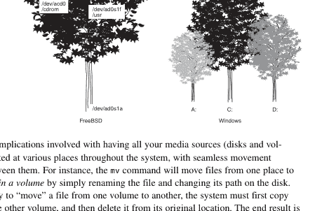

将所有媒体源（磁盘和卷）挂载在系统各处并允许在它们之间无缝移动，会带来一些复杂性。例如，mv 命令会通过简单地重命名文件并更改其在磁盘上的路径，将文件从一个卷内的一个位置移动到另一个位置。但如果你尝试将文件从一个卷“移动”到另一个卷，系统必须先将文件复制到另一个卷，然后再从其原始位置删除。最终结果相同，但过程可能需要更长的时间，具体取决于你要移动的文件大小以及相关磁盘的速度。将文件移动或复制到或从软盘（例如可能挂载在 /mnt/floppy 处）要比将文件从一个硬盘分区移动或复制到另一个硬盘分区慢得多，而后者又比在同一分区内移动或复制文件慢得多。

同样，系统中的不同卷可能有不同的权限，阻止你将文件从一个地方移动到另一个地方，而你可能认为这只是“在计算机”内移动东西。记住，UNIX 是多用户操作系统，并非所有用户的能力都相同。如我们将看到的，还有将磁盘或卷以“只读”或“读写”方式挂载的能力。与 Windows 中一样，保持磁盘逻辑分离有助于强化它们不同能力之间的区别——但 UNIX 的方式可以使日常操作变得简单得多，特别是对于只有硬盘需要考虑的系统而言。

## 分区、卷和文件系统

文件系统是我们将在本小时的大部分时间里使用的术语，它等同于一个卷——它指的是单个可挂载磁盘，或被划分为若干个此类区段的磁盘的一个区段，即分区。它也可以指整个系统的目录结构，其中包含在各种挂载点处附加的其他文件系统。我们将提到“FreeBSD 文件系统”（指整个目录结构），也会提到“根文件系统”和“/var 文件系统”（指在特定点附加的特定卷）。

令人困惑的是，文件系统也可以指分区所写入的格式——UFS（UNIX 文件系统）、FFS（Berkeley 快速文件系统）、Ext2FS（Linux 扩展文件系统）、NTFS（Windows NT 文件系统）和 MSDOSFS（MS-DOS 文件系统）都是 FreeBSD 理解或可配置为理解的常用格式。FreeBSD 为其自己的磁盘使用的原生文件系统类型是 FFS，它在功能上与 UFS 同义，即多年来在 BSD UNIX 平台上使用的传统文件系统格式。

所有操作系统都提供对任何磁盘进行分区的能力。分区的优点是你可以预先定义磁盘的某些区段，使其内容的最大大小不会超过。举例来说，在 Windows 中，你可能会将硬盘分区，使 C: 驱动器用于操作系统，D: 用于个人文档和文件，E: 保留用于文件共享。这样，文件共享活动就不会因为其他人上传到你的计算机的垃圾而填满整个磁盘。它唯一能填满的是 E: 分区。

UNIX 也同样受益于分区。然而，由于 UNIX 中没有“驱动器号”，并且所有已挂载的卷都附加到文件系统的某些点，分区被赋予与它们所附加的挂载点相匹配的名称。例如，/var 分区（包含可变文件——在正常操作期间内容不断变化的文件，如系统日志）可以设置为一定大小，以便其中的日志文件不会增长到填满整个磁盘——只是 /var 文件系统。

图 8.2 显示了已分区和未分区的磁盘，以及如何将分区、卷和文件系统术语应用于它们。

### FIGURE 8.2
各种已分区和未分区的磁盘，显示它们如何融入 FreeBSD 文件系统。

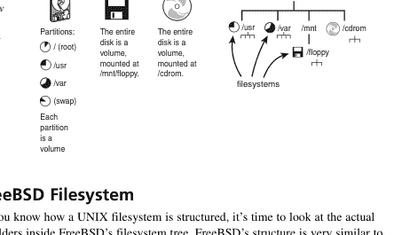

## FreeBSD 文件系统

现在你知道了 UNIX 文件系统的结构，是时候查看 FreeBSD 文件系统树中实际的文件和文件夹了。FreeBSD 的结构与其它 UNIX 系统和 Linux 非常相似。如果你使用 cd / 命令移动到目录结构的顶部，然后使用 ls 和 cd <directory> 在周围移动，你会看到与图 8.3 中所示类似的结构。

### FIGURE 8.3
FreeBSD 文件系统，显示从 / 或根目录开始的部分层次结构。

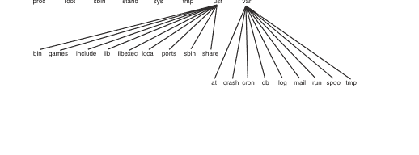

你看到的目录名称简短而晦涩——与 Windows 的 Program Files 和 Documents and Settings 相去甚远，也与 Mac OS X 的 Users、System 和 Applications 相去甚远。这些简短名称的含义往往植根于历史和传统，许多名称已失去相关性。表 8.1 列出了最重要的目录并解释了它们各自的用途。每个名称后面的符号与在 ls -F 列表中显示的一样，其中 / 表示目录，@ 表示指向另一项的符号链接，* 表示可执行文件。

## 表 8.1 FreeBSD 文件系统的关键元素

| 目录 | 用途 |
|---|---|
| bin/ | 这里包含静态链接的二进制文件。即使在进行紧急启动且无法访问任何动态链接程序或 / 之外的任何文件系统时，也可以使用它们。 |
| boot/ | 该目录包含内核，即系统的核心可执行文件。内核管理所有设备并处理网络，以及大量其他任务。有关更多信息，请参阅第 10 小时“FreeBSD 内核和设备树”。/boot 还有在启动期间使用的配置文件和可执行文件。 |
| compat@ | 这是到提供与其它操作系统（如 Linux）兼容性的目录结构的符号链接。 |
| dev/ | 一个特殊目录。这里的文件大多是设备，它们是特殊的文件类型，可为程序提供与内核支持的任何硬件组件的接口。 |
| etc/ | 很久以前，这里只是存放不适合其它地方的随机文件的目录。现在这里存放大多数系统范围的配置文件，包括你的用户（密码）数据库和启动脚本。 |
| home@ | 可能是一个普通目录；也可能根据你的安装情况是到 /usr/home 的符号链接。所有普通用户的主目录都包含在这里。 |
| mnt/ | 一个空目录，为你提供便利的挂载点，如果你需要挂载另一块磁盘。 |
| modules/ | 可加载的内核模块位于此处。 |
| proc/ | proc 或进程文件系统。这是到进程表的接口。一些程序为方便使用，但对系统的运行并非必不可少。（可以安全地卸载。） |
| root/ | root 用户的主目录。它不在 /home 中是为了安全原因，并且在紧急启动期间可用。 |


## 表 8.1 继续

| 目录 | 用途 |
|---|---|
| sbin/ | 静态链接的系统二进制文件。这些程序与 /bin 中的程序不同，因为它们通常会改变系统的行为，而 /bin 程序只是简单的用户工具。 |
| stand/ | 包含一组硬链接程序，在系统安装期间以及在独立模式下运行时的紧急情况下提供“mini-FreeBSD”环境。你可能感兴趣的唯一程序是 sysinstall，其内容在第 2 小时“安装 FreeBSD”中介绍。 |
| sys/ | 如果你安装了它们，则是内核源代码的链接。 |
| tmp/ | 临时文件。任何用户都可以在此目录中写入文件。 |
| usr/ | 系统其余部分的网关——动态链接程序、用户文件以及你自己安装的程序。在 UNIX 世界中它常被称为“userland”（尽管该术语也可能指“内核不直接处理的任何东西”）。在接下来的几小时里，我们将大部分时间花在这里。 |
| var/ | 可变文件。这些包括程序使用的运行时文件、日志文件、spool 目录以及随系统正常运行而变化的其他项目。 |

FreeBSD 的结构受到严格控制，而最能将 FreeBSD 与其他 UNIX 平台（其结构可能混乱得多）区分开的最明确规则是“管理员安装的任何东西都进入 /usr/local”。虽然其他系统可能允许用户安装的程序自由地将文件安装在任何位置，但 FreeBSD 在其移植的程序和包中保持严格的结构指南（参见第 6 小时，“添加和删除第三方软件”）。尽管程序默认可能将其可执行文件放在 /usr/bin，其库放在 /var/lib，其配置文件放在 /etc，但 FreeBSD 会修补（修改）安装脚本，使文件分别进入 /usr/local/bin、/usr/local/lib 和 /usr/local/etc。事实上，你可能安装的任何软件的所有配置文件都将进入 /usr/local/etc；如果程序安装了在启动时启动的启动脚本，则该脚本会被放置在 /usr/local/etc/rc.d 中。该目录中的任何内容都在启动时运行，在类似的 /etc/rc.d（基础系统的启动脚本）中的脚本运行之后。

这种精心控制的结构的优势在于，FreeBSD 系统相对容易维护，尤其容易在新机器上重新创建（例如升级硬件时）。理论上，你可以将整个 /usr/local 目录树从一台机器复制到另一台机器，一切都将像在之前的机器上一样工作。这是 FreeBSD 努力追求的理想，尽管在实践中并不完美。


要查看哪些卷已挂载以及每个卷可用多少空间，请使用 df（Disk Free）命令。

```
# df
Filesystem 1K-blocks Used Avail Capacity Mounted on
/dev/ad0s1a 128900 74314 44586 63% /
/dev/ad0s1f 257998 44 237316 0% /tmp
/dev/ad0s1g 8027686 1990866 5394686 27% /usr
/dev/ad0s1e 257998 30586 227894 14% /var
procfs 4 4 0 100% /proc
```

## 挂载和卸载各种媒体格式

在 FreeBSD 中，使用磁盘并不是像在 Windows 或 Mac OS 等桌面操作系统中那样简单地将其插入槽中，这些系统知道在插入卷时或尝试访问卷时如何自动挂载卷。在插入或安装磁盘后，你必须手动挂载它，以便系统能够访问它。当你完成使用可移动磁盘后，必须在安全弹出之前卸载它。

你可能想要添加到系统中的每种磁盘或其他媒体都必须通过其设备名称来引用——一个简短且通常晦涩的标签，指代 /dev 中的设备，使内核能够与该设备通信。表 8.2 显示了典型的存储设备以及你必须用来引用它们的设备名称。每个设备名称中的数字符号（#）指的是每个设备的识别号，从零开始。系统中第一个软盘驱动器为 /dev/fd0，第二个为 /dev/fd1，以此类推。

表 8.2 存储设备的常用设备名称

| 设备名称 | 用途 |
|---|---|
| /dev/ad# | IDE/ATA 硬盘 |
| /dev/da# | SCSI 硬盘（直接访问） |
| /dev/fd# | IDE 软盘驱动器 |
| /dev/acd# | IDE CD-ROM 和 CD-RW 驱动器 |
| /dev/cd# | SCSI CD-ROM 和 CD-RW 驱动器 |
| /dev/sa# | SCSI 磁带驱动器（顺序访问） |
| /dev/vpo# | Iomega Zip 驱动器 |

当磁盘分区时，命名方案会变得稍微复杂一些。假设你有一个系统识别为 /dev/ad0 的 IDE 磁盘。（启动消息以及 dmesg 的输出会告诉你系统赋予它的名称。）

> IDE/ATA 磁盘从零编号到三，共支持四个设备；IDE 架构允许两个通道（主通道和从通道），每个通道都有主设备和从设备。FreeBSD 对这些设备编号的顺序是——主主设备；主从设备；从主设备；从从设备。因此 /dev/ad1 是主从设备，而 /dev/ad2 是从主设备。

FreeBSD 磁盘可以分为两个分区的级别：有 Windows、Linux 和其他操作系统称为分区的部分，FreeBSD 将其称为切片。（这些切片可以直接由系统的 BIOS 访问，这就是为什么它们通常被称为 BIOS 分区。）然后，在每个切片内，你可以创建多个 BSD 分区，然后将它们分配给不同的挂载点。专家可以以多种不同的方式配置 FreeBSD 磁盘——例如，为 FreeBSD、Linux 和 Windows 配置切片并将 FreeBSD 切片细分为 /usr、/var 和 / 分区。然而，就你的目的而言，你很可能使用的是默认配置——其中硬盘有一个 FreeBSD 切片，下面有几个 BSD 分区，这些分区以字母 e 开头命名。前一小时课程中的图 7.1 说明了这些不同的分区级别以及顺序引导块如何与它们交互。

图 8.4 显示了完全指定的 FreeBSD 硬盘分区设备名称。第一部分（ad1）指定基本设备名称。接下来是切片名称，其编号从 1 开始（s1）。最后，我们有 BSD 分区名称（e）。

## 图 8.4
FreeBSD 硬盘分区设备名称的解剖结构。

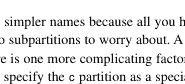

未分区的磁盘名称更简单，因为你只需要指定基本设备名称；无需担心子分区。软盘就是简单的 /dev/fd0。然而，还有一个使事情复杂化的因素。这就是专用磁盘模式，你必须指定 c 分区作为特殊代码名称来引用整个磁盘。软盘通常不需要这个，但许多 CD-ROM 驱动器需要。你通常希望使用 /dev/acd0c 而不是 /dev/acd0 来寻址 CD-ROM 驱动器。如果一个名称不起作用，请尝试另一个。

## 格式化磁盘

软盘和硬盘必须在挂载之前进行格式化。要格式化从未格式化过的软盘，请使用 fdformat 命令（当然，注意所有内容将被擦除）：

```
# fdformat /dev/fd0
Format 1440 floppy '/dev/fd0'? (y/n):y
```

fdformat 完成磁盘格式化后，发出 disklabel 和 newfs 命令以完成为 FreeBSD 准备磁盘的工作：

```
# disklabel -w -r /dev/fd0 fd1440
# newfs /dev/fd0
```

从命令行格式化和标记硬盘更困难。你可能想要设置更多选项，包括可能对磁盘进行分区（使用名为 fdisk 的实用程序完成）。要格式化硬盘，最好使用 sysinstall 程序。参考第 2 小时，了解如何使用 sysinstall 格式化和分区硬盘的说明。

CD-ROM 无需格式化；如果你有 CD 或 DVD 刻录机，将数据写入光盘的过程与必要的格式化和标记相结合，所产生的 ISO 9660 文件系统类型与所有操作系统兼容。

## mount 命令

挂载磁盘使用 mount 命令。在其最常见形式中，使用 mount 是一个简单直接的过程。所涉及的全部内容是选择目录树中的某个位置来挂载你的磁盘，确保那里有一个空目录，并发出适当的 mount 命令。


> 挂载点目录实际上并不需要为空。你可以使用包含文件的目录；然而，一旦你将磁盘挂载到它们之上，在卸载磁盘之前你将无法再访问那些文件。

挂载卷需要你指定磁盘的设备名称（对于可移动磁盘，要求磁盘已在驱动器中）以及挂载点，如下所示：

```
# mount /dev/fd0 /mnt
```

操作正确且未发生错误时，不应有任何输出。你应该能够使用 df 命令来查看是否成功：

| 文件系统 | 1K-块 | 已用 | 可用 | 容量 | 挂载于 |
|---|---|---|---|---|---|
| /dev/ad0s1a | 128990 | 74314 | 44358 | 63% | / |
| /dev/ad0s1f | 8027666 | 1990866 | 5394606 | 27% | /usr |
| /dev/ad0s1e | 257998 | 30586 | 227694 | 14% | /var |
| procfs | 4 | 4 | 0 | 100% | /proc |
| /dev/fd0 | 1424 | 1128 | 296 | 79% | /mnt |

最后一行显示 /dev/fd0 设备，即软盘，已挂载在 /mnt。成功！你现在可以使用 ls /floppy 查看磁盘内容，并将文件在磁盘文件系统与之之间复制。

## 挂载非 UFS 文件系统

单独使用 mount 可以处理原生 FreeBSD 磁盘——硬盘分区、FreeBSD 格式的软盘等等。但在操作系统之间互操作的世界里，你想要挂载的磁盘往往不是原生 UFS/FFS 格式。常见的磁盘类型包括来自 Windows 机器的 MS-DOS 软盘、Linux Ext2/FS 硬盘以及 ISO 9660 CD-ROM。

mount 命令有一个 -t 开关；它控制所涉磁盘的文件系统类型。如果你阅读 man mount，特别是末尾的“参见”部分，你会看到形如 mount_XXX 的命令列表（其中 XXX 是文件系统类型名称——例如 msdosfs、mfs、ext2fs、smbfs 等）。这些文件系统名称都可以用在 mount 的 -t 开关上；或者，如果你愿意，也可以直接使用这些特殊的 mount_XXX 变体。例如，以下两个命令是等效的：

```
# mount -t msdos /dev/fd0 /floppy
# mount_msdos /dev/fd0 /floppy
```

同样，要挂载 CD-ROM，请使用以下命令：

```
# mount_cd9660 /dev/acd0c /cdrom
```

## 关于 NFS

NFS，即网络文件系统，是一种将网络上的卷挂载到你的目录结构中的方法。有关使用 NFS 的流程，包括 mount_nfs 的语法，已在第 24 小时“文件共享”中介绍。然而，就本课而言，简要了解 NFS 共享应如何挂载还是很有价值的。

NFS 共享（或可用文件系统）从网络上的 UNIX 机器（例如企业局域网）“导出”，并可自由提供给整个网络，或仅提供给某些客户端机器。如果你的 FreeBSD 机器是允许的客户端之一，并且你知道 NFS 服务器的主机名及其上的共享名称，你就可以自由连接并将任何共享的目录结构合并到自己的系统中。例如，如果网络上的 NFS 服务器名为 spots，其共享资源名为 /usr/local/share/documents，你可以将它挂载到机器上名为 /docs 的目录，使用以下命令：

```
# mount -t nfs spots:/usr/local/share/documents /docs
```

以下命令也有效：

```
# mount_nfs spots:/usr/local/share/documents /docs
```

远程机器的 documents 共享内容现在可以像本地机器的一部分一样浏览和使用，尽管会有一定延迟，具体取决于网络速度。

## umount 命令

在从系统移除磁盘之前，必须先从文件系统中卸载它。卸载磁盘会完成所有待处理的写操作，并确保所有尝试使用该磁盘的进程已完成。你可以在软盘仍被挂载时，甚至在程序正在写入时就物理取出软盘；然而，这可能会损坏磁盘或导致内核陷入徒劳的恢复尝试中。CD-ROM 在使用中更难取出（它们具有软弹出机构，通常只有在操作系统释放对磁盘的控制后才有效），但你仍可以用一根拉直的回形针捣乱。

卸载磁盘的命令是 umount（不是“unmount”）。要卸载 /mnt 文件系统，请执行以下命令：

```
# umount /mnt
```

你也可以使用 umount /dev/fd0 实现相同结果，甚至使用 umount -a 卸载除根（/）文件系统之外的所有内容。


> 卸载文件系统比挂载它们要简单得多，只有一个主要复杂因素：要卸载文件系统，它不能被使用。这意味着要卸载诸如 /usr 和 /var 之类的文件系统，你可能需要进入单用户模式。这导致大多数用户在首次尝试 mount 和 umount 时遇到的最常见惊讶：你不能位于正尝试卸载的文件系统内部！如果你在里面，你会收到“Device busy”错误消息。为安全起见，请养成在尝试 umount 任何东西之前输入 cd / 的习惯。还要确保检查所有虚拟终端（Alt+F1、Alt+F2 等），以确保没有人登录并停留在你想要卸载的文件系统内部。

## /etc/fstab 文件

你可能在想是否有一种挂载的捷径——一种为系统上所有可挂载设备编程“配方”的方法。毕竟，Windows 机器和 Macintosh 不需要所有这些命令行乱七八糟的东西就能无缝使用磁盘，对吧？

在你弄清楚挂载第二块 IDE 硬盘、跨网络的 NFS 卷、MS-DOS 软盘和 SCSI CD-ROM 所需的命令后，每次想要挂载它们时真的需要记住这些命令吗？不，确实有更好的方法。那就是 /etc/fstab 文件。

现在使用 cat /etc/fstab 查看该文件：

```
# Device Mountpoint FStype Options Dump Pass#
/dev/ad0s1b none swap sw 0 0
/dev/ad0s1a / ufs rw 1 1
/dev/ad0s1f /var ufs rw 2 2
/dev/ad0s1e /usr ufs rw 2 2
/dev/acd0c /cdrom cd9660 ro,noauto 0 0
/dev/fd0 /floppy msdos rw,noauto 0 0
proc /proc procfs rw 0 0
```

该文件告诉系统有关给定挂载点所需的一切信息：连接到它的设备是什么、应期望什么文件系统类型、挂载选项，以及系统启动时应按什么顺序执行文件系统检查。fstab 文件与 mount 命令密切相关；联合使用，这两个工具可以使文件系统管理相对轻松。

fstab 文件的主要功能是为系统提供一个已挂载设备的配置文件，这些设备可以在启动时一次性全部激活。将所有挂载点指定于此后，你可以发出 mount -a 命令挂载它们全部。这就是启动期间发生的情况，当系统进行文件系统检查时；系统运行 fsck -p（“整理”文件系统，确保它们都被标记为“干净”从而可供使用）。然后它运行 mount -a -t nonfs 挂载 /etc/fstab 中列出的所有文件系统，但 NFS 文件系统除外。

不过，除了此功能之外，将挂载配置保存在中央文件中的效果更方便。一旦挂载点在 /etc/fstab 中指定，你就不再需要记住使其联机的挂载命令；现在，你唯一需要知道的就是挂载点的名称：

```
# mount /floppy
```

它会从 fstab 文件中读取所有必要信息。它知道你想要的设备是 /dev/fd0，它是 MS-DOS 文件系统，并且你希望以读写方式挂载（而不是只读，后者会用 ro 而不是 rw 指定）。同样，要挂载 CD-ROM 光盘，请输入以下命令：

```
# mount /cdrom
```

现在，它看起来几乎对用户友好起来了！

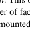

> /cdrom 和 /floppy 条目上的 noauto 选项告诉 mount 这些文件系统不应在启动时挂载。与 NFS 资源一样，无法保证 CD-ROM 或软盘在系统启动时可用，因此 noauto 选项可防止 mount 花费无意义的时间尝试挂载不存在的磁盘。然而，它并不会阻止你稍后轻松挂载它；之前的 mount 命令就是你所需要的。
> 
> 你可以在 fstab 文件的第四列中指定适用于所涉文件系统的任何挂载选项。例如，man mount 中列出的任何内容都可以使用，如果是非标准文件系统类型，也可以参考文件系统的 man mount_* 页面中的内容。

## FreeBSD 自动挂载器

NFS 共享可以通过一个名为 amd 的巧妙工具，即自动挂载守护进程，来变得更加自动化。该守护进程允许你动态挂载 NFS 共享（事实上还有其他文件系统类型），只需在共享将被挂载的目录中工作，而无需费心使用 mount 命令。


FreeBSD 提供了一种设置 amd 的基本方法。只需在 /etc/rc.conf 中添加以下行：

```
amd_enable="YES"
```

当系统使用此选项启动时，amd 会使用 amd_flags 设置中指定的选项运行，这些选项使得 /host 或 /net 目录中的任何内容——这两个目录都由 amd 自动创建——将按名称自动挂载。你也可以通过发出以下命令以与启动时相同的方式启动它：

```
# amd -a /amd_mnt -l syslog /host /etc/amd.map /net /etc/amd.map
```

amd 运行后，cd 进入 /host 目录并查看一下。它是空的。

```
# cd /host
# ls
#
```

然而，尝试按名称列出，就好像存在一个与网络上已知 NFS 服务器同名的目录（假设 spots 机器上有一个名为 /home 的 NFS 共享，这可能是用户主目录的集合）：

```
# ls spots
home
```

所以，似乎 /host 目录中确实存在一个名为 spots 的目录，其内部有一个 home 目录——其中包含 spots:/home 共享中的所有内容。你刚刚通过将其作为目录名列出，就将该共享自动挂载到了 /host 目录中。/host/spots/home 在功能上与使用 mount 或 mount_nfs 手动将 spots:/home 附加到该位置创建的 NFS 挂载相同。df 命令将验证这一点：

```
# df
```

| 文件系统 | 1K-块 | 已用 | 可用 | 使用率 | 挂载点 |
|---|---|---|---|---|---|
| spots:/home | 9924475 | 1642345 | 7488172 | 18% | /.amd_mnt/spots/host/home |

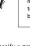

> 请注意，以这种方式挂载的 NFS 共享实际上似乎挂载在根目录下的一个名为 .amd_mnt 的目录内。该目录实际上并不存在；它只是 amd 守护进程用于记账目的的简写。

要指定可挂载 NFS 资源永久位置，只需在 /host 或 /net 内的适当路径创建一个符号链接：

```
# ln -s /home2 /host/spots/home
```

从现在开始，每当你进入 /home2 目录时，spots:/home 共享将自动挂载并允许你访问其文件。当共享不再使用时，它将自动卸载。


> 你可以使用 /etc/amd.conf 文件指定更复杂的挂载映射，这是在特定点挂载文件系统的更直接方法。该文件在默认的 FreeBSD 安装中不存在；有关其格式和功能的详细信息，请参阅 man amd.conf。

## 系统备份策略和实用工具

每个操作系统都需要有可用的备份方案，以便在硬件故障、安全遭到破坏，或整个系统因火灾或入侵而丢失时，存储关键数据的计算机——无论什么平台——能够恢复。风险太多，无法计数。

FreeBSD 在易于无缝备份的选项方面不如 Windows 甚至 Linux 丰富；这是我们使用并非像某些系统那样“主流”的操作系统的代价之一。适当的备份解决方案涉及专用的客户端-服务器软件安装、一个中央服务器协调集群中所有计算机的每日数据传输，以及处理所有相关机器增量数据的磁带自动装换库。在一个完善的企业网络中，企业 IT 的最佳实践通常涉及一个磁带自动装换库系统，每周对所有机器进行完全备份，并在其间每天进行增量“delta”转储（仅保存自上次完全备份以来更改的文件）；磁带每周（或在某些情况下每天）从自动装换库中取出并更换，然后移至安全异地存储位置。因此，即使主建筑物被烧毁，整个网络在理论上也可以恢复。

许多企业网络使用 Legato NetWorker 等软件作为其集中式磁带备份解决方案。然而，该软件及其类别中的其他软件包可能在 FreeBSD 下不受支持（尽管 /usr/ports/sysutils/nwclient 是一个可工作但不受支持的 Legato 客户端）。我们将改而查看一两种更基础的备份方法——FreeBSD 原生支持的方法。

### 使用 tar

虽然使用起来并不特别容易，但 tar——Tape ARchiver（磁带归档器）——是一种无处不在的 UNIX 工具，其目的是便于将大量数据备份到磁带或可以复制到廉价可移动磁盘（如 CD-R）的文件中。tar 程序会将目录结构中的所有文件连接成一个长文件，同时保留每个文件的权限、所有权和时间戳。然后你可以使用 gzip 压缩该文件，具体取决于备份的数据类型，可能会将其大小减少多达一个数量级。

使用 tar 的一种方法是让它从输入数据创建文件。如果没有磁带驱动器，而必须依赖可移动磁盘进行永久备份，则这种方法最有用。选择系统中的一个起点——一个包含系统中最不可替代数据的大目录。（如果系统中有很多地方都有此类数据，你可能需要进行多次备份。）在 FreeBSD 中，执行此操作的明显位置是 /usr/local，尽管你的需求可能有所不同。例如，你可能还想备份 /usr/home 以归档用户的主目录。

使用 du（磁盘使用情况）配合 -s 或 summary 选项，检查所选起点的完整备份会有多大：

```
# cd /usr/local/
# du -s
449212 .
```

该系统的 /usr/local 树仅包含约 450 兆字节的数据。这甚至无需压缩即可放入 CD 中。然而，检查这个数字的最重要原因并不是结果文件是否能放入磁盘（尽管这很重要）；你需要确保的是在备份过程中你的硬盘有足够的空间容纳该文件。请记住，你实际上是在复制 /usr/local；因此，你需要至少与 /usr/local 所需一样多的可用空间。

选择一个分区中具有足够空间容纳输出的目标目录（使用 df 检查）；如果喜欢，可以创建新目录。然后运行 tar 创建 tarfile 输出：

```
# tar cvf /usr/backup/usr.local.tar /usr/local
```

c 选项告诉 tar 创建新文件；v 表示打印详细输出；f 表示在磁盘上创建输出文件，而不是写入磁带（这是 tar 的原生和传统用途）。在每个文件被添加到归档文件时，你会看到其名称打印到屏幕上。完成后，使用 gzip 压缩生成的 tarfile（它会在文件名后追加 .gz，导致 usr.local.tar.gz）：

```
# gzip /usr/backup/usr.local.tar
```

> 你可以使用 z 选项告诉 tar “即时” gzip；输出将在 tar 步骤后被压缩，你就不需要使用 gzip 来压缩它。压缩的 tarfile 通常具有 .tar.gz 或 .tgz 扩展名。
> 
> # tar cvfz /usr/backup/usr.local.tgz /usr/local

然后你可以将此文件（usr.local.tar.gz 或 usr.local.tgz）复制到可移动磁盘、另一块硬盘或 NFS 共享——任何你喜欢的地方。

保留压缩的 tarfile 并在复制到其他介质后不删除它可能会有所帮助；你可以使用 r（或 replace）选项在其中更新已更改的文件，而不是每次备份时都删除并重新创建它：

```
# tar rvfz /usr/backup/usr.local.tgz /usr/local
```

最后，你可以使用 t（或 table of contents）选项查看 tarfile 中的内容：

```
# tar tfz /usr/backup/usr.local.tgz
```

> 使用 tar 创建文件完全没问题，但该程序主要设计用于与磁带驱动器交互。然而，考虑到今天磁带驱动器、数字磁带、光驱和 CD 介质各自的价格，使用 tarfile 和 CD-R（甚至 DVD）备份比使用磁带更具成本效益，也更有可能拥有必要的设备。介质也更不易损坏。

### 使用 burncd

如果你有一个 ATAPI（IDE）CD-R 或 CD-RW 驱动器，你会想要使用 burncd 程序来写入你的 CD，该程序是 FreeBSD 基础系统的一部分。（今天销售的大多数光驱都是 ATAPI。如果你的驱动器是 SCSI，则需要改用 cdrecord，可在 /usr/ports/sysutils/cdtools 的 ports 中找到。）此工具使用起来相当简单，尽管它涉及一个两步过程。

你必须做的第一件事是创建一个 ISO 磁盘映像文件，它是将写入光盘的数据的逐位副本。你需要安装 mkisofs 才能执行此操作；它位于 /usr/ports/sysutils/mkisofs（有关从 ports 或 packages 安装软件的更多信息，请参阅第 7 小时）。


你有两个选择：你可以直接复制一个实时文件系统，也可以归档一个压缩的 tar 文件。前者如果在光盘写入后想要快速访问备份文件会更有用；后者如果需要在光盘上塞入更多数据则更好。无论哪种方式，使用命令都相当简单：

```
# mkisofs -o /usr/backup/diskimage.iso /usr/backup
# mkisofs -o /usr/backup/diskimage.iso /usr/local
```

这会在 /usr/backup 中创建一个名为 diskimage.iso 的文件。如果要在 Windows 机器上使用 CD，你可能想要添加 -J 选项以启用 Windows 风格（Joliet）文件系统扩展，这些扩展允许使用 ISO 9660 文件系统通常不支持的长文件名。-R 选项则使用 Rock Ridge 扩展，如果光盘仅在 UNIX 系统中使用则合适。

ISO 映像创建后，按如下方式使用 burned 来刻录（或写入）CD：

```
# burned -f /dev/acd0c data /usr/backup/diskimage.iso fixate
```

-f 选项指定驱动器；data 告诉 burned 使用哪个映像文件；fixate 关闭会话，使光盘完全刻录并可以挂载。有关更多有用选项，请参阅 man burned。

## Recovery

假设你已将压缩的 tar 文件刻录到 CD 上，这是我们讨论过的最复杂且步骤最多的情况。你不小心删除了一个关键目录 (/usr/local/oops)，必须从归档中恢复它。

首先，如本小时前面讨论的那样挂载 CD：

```
# mount_cd9660 /dev/acd0c /cdrom
```

接下来，从归档的 tar 文件中将所需目录及其内容提取到你的硬盘上：

```
# tar xvfz /cdrom/usr/local.tgz /usr/local/oops
```

如果一切顺利，你的目录应该会被恢复，焕然一新。

## Creating “Seed” Files

确保你的自定义配置能在灾难性故障后幸存的一种方法是收集“种子”文件，你可以用它们来自定义从头构建的新系统。这些文件可以通过刻录到 CD 上离线保存，或者在没有可写光学介质的情况下，使用软盘。以下是需要保存的最重要文件：

- `/etc/rc.conf`—主系统配置文件。
- `/etc/master.passwd`—主用户数据库。所有其他用户数据库都可以从此生成。
- `/etc/mail/myconfig.mc`—如果有自定义 Sendmail 配置，则为 Sendmail “主配置”文件。（文件名会根据你命名的名称而变化。）
- `/etc/fstab`—对重建磁盘结构很重要。
- `/usr/local/etc/*`—你安装的所有程序的单个配置文件。

这些是最关键的文件——定义系统并赋予其身份的文件。总的来说，它们不会超过几百千字节；这几百千字节在重建系统时可以节省数周痛苦的调优和试错。

你甚至可能想要将这些文件打包成一个 tarball（tar/gzip 归档），并每天将其邮件发送给自己（使用不在你的 FreeBSD 机器上的账户）。以下是实现此目的的示例单行命令：

```
# tar cvfz /etc/rc.conf /etc/master.passwd /etc/fstab /usr/local/etc
► uuencode seedfiles.tar.gz | mail -s "Seed Files" me@myaccount.com
```

你可以将它放入 /etc/periodic/daily 中的 shell 脚本，或放入 root 的 crontab 文件中，按你喜好选择。

## Summary

在本小时中，我们讨论了 UNIX 文件系统的基本概念，包括 UNIX 目录结构与你可能习惯的 Windows/DOS 目录结构之间的关键差异。你学习了如何将磁盘挂载到系统并卸载，以及如何格式化新磁盘。你还学习了如何简化挂载过程。掌握这些知识后，你随后学习了如何仅使用 FreeBSD 内置工具归档关键数据并创建有效的备份。

对这些主题更深入的探讨将更详细地介绍潜在的备份方法。备份对于有效系统管理绝对至关重要，并且有许多复杂的工具可用于 FreeBSD。然而，工具实在太多，以至于在这里全部涵盖只会使本已相当复杂的流程失去任何确定性。

## Q&A

**Q** 软盘是卷、分区还是文件系统？硬盘呢？

**A** 软盘通常三者皆是，因为软盘很少被分区。但已分区的硬盘内部有多个卷，也称为分区。每个卷都可能是一个文件系统。

**Q** /bin 和 /sbin 之间有什么区别，或者 /usr/bin 和 /usr/sbin 之间有什么区别？

**A** 具有更改系统操作能力的执行程序通常保存在 `sbin` 目录中，而仅执行用户功能的执行文件则位于 `bin` 目录中。例如，`/bin` 和 `/usr/bin` 包含诸如 `ls`、`less` 和 `top` 等工具；而 `/sbin` 和 `/usr/sbin` 则有诸如 `mount`、`fsck`、`ifconfig` 等可以更改系统配置的工具。

**Q** 我不打算运行繁忙的服务器之类的东西：我的机器只是一台工作站。为什么还要费心分区我的磁盘？

**A** 你可能不需要。分区最好的理由是按不同用途将磁盘划分为区域，这样一个功能区域就不会增长到填满整个磁盘并干扰其他功能。但如果你的系统不会托管繁忙的 Web 服务或大量用户，你可能可以把整个磁盘保持为一个大分区。

**Q** 我在挂载除 UFS 以外的文件系统的磁盘时遇到问题。我该怎么办？

**A** 通常，像 MSDOSFS 和 SMBFS 这样的文件系统的支持并未内置于默认内核中；不过这些文件系统作为可加载内核模块提供，并且在适当的 `mount_XXX` 命令调用时会自动加载到内核中。然而，这可能没有正确发生；使用 `kldstat` 查看已加载的内核模块，并在必要时使用 `kldload` 在挂载磁盘前加载适当的文件系统（例如，`kldload smbfs.ko`）。

**Q** 我从目录结构创建的 ISO 映像刻录了 CD，但一些文件在过程中丢失了！我如何取回它们？

**A** ISO 9660 不支持长文件名。`mkisofs` 工具会忽略在 ISO 9660 下名称非法的 files，除非你指定启用长文件名的扩展之一（-J 用于 Windows 'Joliet' 扩展，或 -R 用于 UNIX 'Rock Ridge' 扩展）。你可以使用 -U -R 创建与硬盘上完全相同的光盘，不过这可能在其他机器上无法读取。


## Workshop

本交互部分旨在通过测验问题和练习巩固你对存储设备的理解，这些练习建议了进一步探索该主题的方向。

### Quiz

- 1. FreeBSD 使用的默认文件系统类型是什么
  - A. FFS
  - B. EXT2FS
  - C. MSDOSFS
  - D. UFS
  - E. NTFS
- 2. 安装为次要从盘的 ATA/IDE 硬盘的第二个“切片”中第一个 BSD 分区的设备名称是什么？
  - A. `/dev/ad0s1a`
  - B. `/dev/ad2s2c`
  - C. `/dev/ad4s2e`
  - D. `/dev/ad3s2e`
- 3. 软盘挂载后（在 `/floppy`），我如何切换到可以使用的文件位置？
  - A. A:
  - B. `cd A:`
  - C. `/floppy`
  - D. `cd /floppy`
- 4. `/etc/fstab` 文件用于什么？
  - A. 简化挂载命令
  - B. 指定在启动时自动挂载哪些文件系统
  - C. 指定挂载点的默认文件系统类型
  - D. 指定在启动时应进行文件系统检查的顺序
  - E. 指定文件系统应“dump”的频率
  - F. 以上全部


5. 如何使用 amd 挂载网络文件系统？
- A. mount_amd hostname:/path/to/share
- B. mount_nfs /host/hostname/path/to/share
- C. amd hostname::/path/to/share
- D. cd /host/hostname/path/to/share ; ls hostname

6. 我应该使用什么 tar 选项来列出 tar 文件中归档的文件？
- A. x
- B. t
- C. c
- D. l

## 测验答案
- 1. 正确答案是 A 或 D 之一。（它们在今天几乎是同义词。）
- 2. 正确答案是 D。
- 3. 正确答案是 D，尽管从技术上讲，你可以在系统中的任何位置访问和使用 /floppy 中的文件。
- 4. 正确答案不出所料是 F。
- 5. 正确答案是 D。

正确答案是 B。

## 练习
1. 什么使得 UNIX 风格的文件系统与你可能从 Windows 中了解到的不同？一个很大的区别是碎片化，或者文件被拆分成小块并写入磁盘上 widely disparate 位置的程度，导致访问时间增加和性能下降。Windows/MS-DOS 文件系统会随着时间的推移变得严重碎片化，磁盘上多达 20% 或 30% 的文件被分散；但 UNIX 磁盘很少会这样。为什么会这样？你可能想了解一下 UFS/FFS 文件系统（以及其他系统，如 Ext2FS）以及它如何确保在将文件写入磁盘时，通过持续移动其他文件来创建连续的块。这就是为什么 FreeBSD 在启动时报告的碎片率约为 1%，但它很少会更高。

2. 让文件系统不断在磁盘上移动文件有什么弱点？一个缺点是，如果发生断电，未完成的写操作会消失在虚空中，等待重写的某些文件可能会丢失。然而，有一些方法可以防止这种情况。*Journaling* 是一种在高级文件系统中日益流行的技术。FreeBSD 有一种类似的技术叫做 *Soft Updates*。如果你感兴趣，可以在线研究这些技术，看看它们各自如何解决使 UNIX 文件系统比已有的更具容错性的问题。


## 第 9 小时
### FreeBSD 打印系统
打印是人们希望用计算机完成的事情之一。不幸的是，对于 FreeBSD 新手来说，配置打印机也是较困难的事情之一。按照本小时提供的说明，你将学习如何在 FreeBSD 中配置基本的本地打印服务。本小时你将学习：
- FreeBSD 如何处理打印
- 如何安装和配置打印机
- Postscript 是什么以及为什么你应该关心
- Ghostscript 是什么以及如何使用打印实用程序
- 如何管理打印机和打印作业
- 如何连接到网络打印机


> 在你开始尝试安装打印机之前，你应该知道某些称为 Winprinters 的打印机无法与 Windows 以外的任何系统一起使用。这是因为大部分功能已移至软件，允许制造商节省硬件成本。如果你的打印机说明需要 Windows 操作系统，很可能它无法与 FreeBSD 一起使用。

### FreeBSD 如何处理打印
FreeBSD 打印系统由两个主要部分组成。第一个是打印守护进程，称为 lpd。守护进程只是一个在后台运行等待接收和处理请求的程序。在这种情况下，lpd 在后台运行并等待接收要打印的内容。当它收到作业时，可能会进行一些预处理，例如通过过滤器运行或将数据转换为打印机可以理解的不同格式。当此操作完成后，作业将被放置在打印队列中，这基本上是一个存储等待打印作业的暂存区。（作业通常按先到先得的顺序打印。但是，你将在本小时后面学习如何更改打印作业的优先级。）

当打印机可供排队的打印作业使用时，它将由 spooler  spool 到打印机。为什么使用 spooler 而不是直接将数据发送到打印机？有几个原因：
- 打印机可以被多个用户使用，因为数据可以排队，然后在打印机可用时发送到打印机。这意味着用户可以发送打印作业然后忘记它。
- 它允许你向打印机发送多个打印作业，而无需等待当前正在打印的作业完成。
- 它允许你在后台打印，因为发送作业到打印机的程序可以发送它然后忘记它。这意味着，例如，你可以从文本编辑器打印文档，然后退出文本编辑器并在文档尚未完成（甚至尚未开始）打印时继续做其他事情。
- 它具有一定的容错能力。例如，如果打印机卡纸需要重置，队列中的作业在打印机重置后仍应正常打印。

### 配置打印机
此时，我们假设你有一台相对较新的打印机，已插入到计算机的并行端口。我们不会介绍串行打印机，它们相对过时。

你想做的第一件事是设置并行端口模式。

### 配置并行端口
lptcontrol 程序可用于配置并行端口的模式。你需要以 root 用户身份登录才能执行此操作。在其基本形式中，lptcontrol 使用你希望在端口上设置的选项运行。支持以下选项：

| 选项 | 描述 |
|---|---|
| -i | 设置中断驱动模式 |
| -p | 设置轮询模式 |
| -e | 设置扩展模式 |
| -s | 设置标准模式（即关闭扩展模式） |

你可能最感兴趣的选项是 -e。如果你的打印机支持 ECP 或 EPP 等扩展模式，并且你在 BIOS 中已配置此项，你将希望使用 lptcontrol 命令打开此选项。以下命令显示了如何操作：

```
lptcontrol -e
```

基本上，扩展模式允许简单打印之外的附加功能，例如允许打印机向计算机通信并通知计算机纸张卡住或墨水用完等错误情况。在标准打印机模式（即无扩展模式）下，数据只能从计算机单向发送到打印机。打印机无法与计算机通信。

默认情况下，lptcontrol 假定默认打印机端口，即 FreeBSD 中的 /dev/lpt0。这将是系统上的第一个并行端口，对应于 Windows 中的 LPT1。如果你的系统有多个并行端口，并且此打印机不在第一个端口上，你可以使用 -d 选项指定不同的端口。例如，如果你想在第二个并行端口上启用扩展模式，可以使用以下命令：

```
lptcontrol -e -d /dev/lpt1
```

请注意，此设置在系统重新启动时会丢失。如果你希望在每次重新启动后都保留它，你需要将其添加到系统启动脚本中。执行此操作的最好方法是创建一个包含该命令的文件 `/usr/local/etc/rc.d`。请注意，该文件需要可执行，以便命令实际运行。（为此，使用 chmod 命令——例如，`chmod 755 myprintscript`。）

现在你已配置了并行端口，你就可以设置打印机的 spool 目录，即硬盘上打印机存储等待打印的打印作业的目录，并将它们 spool 到打印机。

### 配置打印 Spool 目录
按照惯例，打印 spool 目录通常位于 `/var/spool/lpd`。但是，没有规定你必须将它们放在这里。有时，你可能希望将 spool 目录放在其他位置，例如如果你的 `/var` 分区没有足够的空间。对于本示例，我们假设你将 spool 目录放在 `/var/spool/lpd`。如果不是这种情况，只需用你放置 spool 目录的目录路径替换此目录路径即可。

你需要做的第一件事是为打印机决定一个名称。你可以给打印机起任何你想要的名字。稍后，你还可以为打印机创建别名，允许你使用其他名称访问它。别名在本小时后面“/etc/printcap 文件”部分介绍。如果你在一个大型办公室环境中有多台打印机，当然最好给打印机命名为说明其打印机类型或其所在位置的名称。在本示例中，假设我们正在配置一台 HP Laserjet 打印机。所以我们将它称为 laserjet。

要为打印机创建 spool 目录，只需在 `/var/spool/lpd` 目录中创建一个新目录，使用你决定为打印机命名的名称。在这种情况下，以下命令有效：

```
mkdir /var/spool/lpd/laserjet
```

创建目录后，你将希望更改所有权和组 membership，使它们都为 daemon，并且只有用户和组对 spool 目录具有任何权限。这将防止用户在目录中随意查看并查看其他人的打印作业，甚至可能删除其他人的打印作业。

以下命令将所有权、组 membership 和权限设置为其正确值：

```
chown daemon.daemon /var/spool/lpd/laserjet
chmod 770 /var/spool/lpd/laserjet
```

设置好目录后，你需要为守护进程配置一个文本过滤器。


## 配置文本过滤器

我们在本章前面简要提到了过滤器。基本上，绝大部分的打印工作都是在那里完成的。发送到打印机上的所有数据都会先经过一个过滤器。过滤器可以执行诸如将数据从一种格式转换为打印机能够理解的另一种格式之类的操作。

最起码，你需要一个文本过滤器。文本过滤器顾名思义，是当打印守护进程接收到简单的纯文本时使用的过滤器。通常情况下，文本过滤器只是一个直通系统，它只是将原始数据直接传递给打印机而不做任何处理。然而，它也可以复杂到将数据更改为完全不同的格式的系统。（稍后，我们将讨论为什么你可能需要将纯文本更改为完全不同的格式。）

文本过滤器可以由你编写，也可以作为别人编写的程序安装。在你因编写自己的过滤器而惊慌之前，基本的过滤器很容易编写。例如，如果你的打印机可以接收原始文本数据并在不做任何更改的情况下正常打印，那么以下过滤器只需在文本编辑器中编写并保存到文件中即可。它可能就是你所需要的一切：

```sh
#!/bin/sh
/bin/cat && exit 0
exit 2
```

前面的程序被称为 shell 脚本。编写 shell 脚本的细节超出了本书的范围，但我们将涵盖足够的知识基础，让你理解前面过滤器的作用。

第一行只是告诉 shell 应使用哪个程序来解释此文件的其余部分。在这种情况下，它告诉 shell 此文件是 shell 脚本，应使用 shell 进行解释。

第二行执行 cat 程序。基本上，在其最简单的形式中，cat 会接收 STDIN（通常是键盘）上的任何内容并将其回显到 STDOUT（通常是屏幕）。这对打印有什么帮助？因为对于打印，STDIN 和 STDOUT 会被重定向。在这种情况下，STDIN 是从 spooler 发送的打印数据，而 STDOUT 是打印机连接的打印机端口。因此，在这种情况下，cat 程序只是将从打印 spooler 接收到的任何内容回显到打印机端口。

该行的第二部分 && exit 0 是一种简写，表示基本上是“仅当 /bin/cat 命令成功完成时才执行 exit 0 命令。”如果 cat 成功完成，shell 脚本将以状态 0 退出（表示命令执行成功），并且脚本的第三行将不会被执行，因为第 2 行的 exit 命令会生效。

如果另一方面，cat 命令失败（无论出于何种原因，它无法将数据发送到端口或其他类似错误），则第 2 行的 exit 0 命令将不会被执行（因为“如果且仅如果”测试失败）。在这种情况下，将执行第 3 行，这会导致 shell 脚本以状态 2 退出。（为什么退出状态为 2？因为 lpd 会读取过滤器的退出状态。状态码 2 表示过滤器因不可恢复的错误而失败，因此通知 lpd 不应再次尝试打印该作业。）

过滤器可以命名为你想要的任何名称。在这种情况下，我们假设它命名为 if-text。根据惯例，打印过滤器存储在 /usr/local/libexec 中。保存文件后，你需要使其可执行，以便 lpd 程序可以运行它。以下命令是一个示例：

```
chmod 555 /usr/local/libexec/if-text
```

像这样的简单过滤器对于在大多数非 PostScript 打印机上打印纯文本应该工作得很好。然而，PostScript 打印机无法处理纯文本。如果你有 PostScript 打印机，你将需要一个稍微复杂一些的设置，可以将纯文本转换为 PostScript。这将在下一节中介绍。

## 为 PostScript 打印机格式化纯文本

PostScript 是一种用于格式化文本和图形的编程语言。它是设备无关的，因此任何理解 PostScript 的打印机都可以无需特殊驱动程序打印 PostScript 文档。PostScript 在 UNIX 世界中非常常见，大多数 UNIX 应用程序都可以打印 PostScript 输出。因此，PostScript 对你的打印机来说非常有用。然而，PostScript 打印机存在一个问题，它们通常期望接收到的所有内容都采用 PostScript 格式。因此，你不能直接将纯文本数据发送到 PostScript 打印机。纯文本必须先经过一个可以将纯文本转换为 PostScript 的过滤器。

程序 a2ps 可在 FreeBSD ports 集合的 print 目录中找到，专为此目的而设计。安装 a2ps 后，你需要编写一个过滤器来识别它接收的是 PostScript 还是纯文本，然后采取适当的措施。（如果数据已采用 PostScript 格式，则直接将其发送到打印机；如果数据是纯文本，则将其转换为 PostScript 后再发送到打印机。）列表 9.1 是一个示例过滤器，可实现此功能。

### 列表 9.1 用于 PostScript 打印机的示例文本过滤器

```sh
#!/bin/sh
# Simple filter for PostScript printers

read header
ps_test=`expr "$header" : '\(..\)'`
if [ "$header" = "%!" ]
then
  # File is PostScript. Print pass through.
  echo "$header" && cat && printf "\004" && exit 0
  exit 2
else
  # File is plain text. Convert it first.
  (echo "$header"; cat) | /usr/local/bin/a2ps && printf "\004" && exit 0
  exit 2
fi
```

与之前的过滤器一样，此文件应保存在 /usr/local/libexec 中。名称 if-ps 可能是一个不错的选择。此外，请再次记住将文件设置为可执行，以便 lpd 可以运行它。你可以使用以下命令来执行此操作：

```
chmod 555 /usr/local/libexec/if-ps
```

我们不会详细说明此脚本的作用，但简而言之，它会检查文件的最初两个字符是否为 %!。（PostScript 文件以这两个字符开头。）如果是，过滤器会假设该文件是 PostScript，并将其直接传递给打印机。如果不是，过滤器会假设该文件是纯文本，并且数据会通过 a2ps 程序转换为 PostScript，然后再发送到打印机。

当然，如果你没有 PostScript 打印机，你可能会遇到相反的问题。换句话说，你需要在不理解 PostScript 的打印机上打印 PostScript 文档。在这种情况下，你可以使用名为 Ghostscript 的程序，它可以将 PostScript 转换为打印机可以理解的格式。

## 配置 Ghostscript 过滤器

如前所述，大多数 UNIX 应用程序可以输出 PostScript。尽管一些 UNIX 应用程序包含各种打印机的打印驱动程序，但大多数都没有。相反，它们只是输出 PostScript。使用 Ghostscript 程序，它可在 FreeBSD ports 集合的 print 目录下获得，用于转换 PostScript

Ghostscript 支持大量打印机。受支持打印机的列表（可能不完整）可在 www.cs.wisc.edu/~ghost/doc/printer.htm 获取。

此过滤器脚本与用于在 PostScript 打印机上打印纯文本的脚本类似——只是这次操作是反向的。这次，如果过滤器接收到纯文本，则文本应直接通过而不进行任何格式化。另一方面，如果过滤器接收到 PostScript，则应将其发送到 Ghostscript 程序，以便转换为打印机可以理解的格式。

以下脚本取自 FreeBSD 手册，可用于 HP Deskjet 500（无法直接打印 PostScript）。

```bash
#!/bin/sh
#
# ifhp - Print Ghostscript-simulated PostScript on a DeskJet 500
# Installed in /usr/local/libexec/hpif
#
# Treat LF as CR+LF:
#
printf '\033&k2G' || exit 2
#
# Read first two characters of the file
#
read first_line
first_two_chars=`expr "$first_line" : '\(..\)'`

if [ "$first_two_chars" = "%!" ]; then
# It is PostScript; use Ghostscript to scan-convert and print it.
#
# Note that PostScript files are actually interpreted programs,
# and those programs are allowed to write to stdout, which will
# mess up the printed output. So, we redirect stdout to stderr
# and then make descriptor 3 go to stdout, and have Ghostscript
# write its output there. Exercise for the clever reader:
# capture the stderr output from Ghostscript and mail it back to
# the user originating the print job.

exec 3>&1 1>&2
/usr/local/bin/gs -dSAFER -dNOPAUSE -q -sDEVICE=djet500 \
-sOutputFile=/dev/fd/3 && exit 0
#
/usr/local/bin/gs -dSAFER -dNOPAUSE -q -sDEVICE=djet500 \
-sOutputFile=... \
&& exit 0
else
```

```
# Plain text or HP/PCL, so just print it directly; print a form feed
# at the end to eject the last page.
#
echo $first_line && cat && printf "\0333l0H" &&
exit 0
fi

exit 2
```

与将纯文本转换为 PostScript 的脚本类似，此脚本基本上读取文件的最初两个字符，查看它们是否为 %!。如果是，脚本假定文件是 PostScript 文件并使用 Ghostscript 打印它。如果不是，脚本假定文件是纯文本并直接将其传递给打印机。

与其他过滤器一样，此过滤器应保存到 /usr/local/libexec 目录并设为可执行，以便 lpd 可以运行它（例如，chmod 555 /usr/local/libexec/if-gs.sh）。

在完成文本过滤器的创建和安装（以及它可能需要的任何应用程序，例如 Ghostscript 或 a2ps）后，您需要配置 /etc/printcap 文件。

## /etc/printcap 文件

/etc/printcap 文件是主要的打印机配置文件。打印机在此定义，以及它使用哪个过滤器、其 spool 目录位于何处等信息。

该文件的格式相对简单。下面是一个示例条目，接下来将讨论每个部分的意思：

```
simba|lp|local line printer:\
#
:sh:
:lp=/dev/lp0:sd=/var/spool/lpd/simba:lf=/var/log/lpd.err:
:if=/usr/local/libexec/if-ps:
```

第一行 simply 给出打印机的名称以及我们想要关联的任何别名。在本例中，打印机名为 simba，别名为 lp。/etc/printcap 文件中定义的打印机中应始终有一个具有别名 lp，因为这会使其成为默认打印机。最后一个字段是对打印机的长描述。

第二行开头的井号表示该行被注释掉了。换句话说，它将被忽略。如果取消注释该行，打印机将为每个作业打印一页页眉（也称为封面页），其中包含用户名和打印的文件名。如果有很多用户打印到同一台打印机，您可能希望取消注释此行，以便用户更容易在堆中找到自己的作业。

第三行向 lpd 提供打印机及其相关 spool 文件所在位置的信息。lp 表示打印机是本地打印机（与网络打印机相对），/dev/lp0 表示打印机位于系统的第一个并行端口上，sd=/var/spool/lpd/simba 将是打印机的 spool 目录（请确保该目录确实存在并且 lpd 可以读取和写入它），而 lf=/var/log/lpd.err 是任何发生的错误将被记录到的文件。

第四行是输入过滤器，即您在上一节中配置的文本过滤器。在本例中，它使用的是将普通文本转换为 PostScript 并将纯 PostScript 不加修改地通过的过滤器。

## 启动 lpd

在完成 /etc/printcap 文件的配置后，您就可以启动打印守护进程了。为此，您只需以 root 用户身份输入命令 lpd 即可。为了使打印守护进程在每次系统启动时自动启动，请在 /etc/rc.conf 文件中添加以下行：

```
lpd_enable="YES"
```

## 命令行打印

lpr 将文件发送到打印 spooler。例如，

```
lpr filename
```

此命令将名为 filename 的文件打印到默认打印机。（请记住，/etc/printcap 中别名为 lp 的打印机被视为默认打印机。不过，用户可以覆盖系统默认值以配置不同的打印机作为其默认打印机。我们稍后将介绍如何操作。）

如果要打印多个文件，可以在命令行中指定多个。例如，

```
lpr file1 file2 file3
```

如果要打印到除默认配置的打印机之外的打印机，可以使用 -P 选项后跟要打印到的打印机名称，例如 lpr -P simba file1。在这种情况下，文件将打印到名为 simba 的打印机。

lpr 还有几个其他选项，列在表 9.1 中。

## 表 9.1 lpr 命令支持的选项

| Option | Description |
|---|---|
| -l | 使用一个过滤器打印控制代码并抑制分页。这意味着通常不可见的控制打印机中事物的字符，例如回车，将实际打印在纸上。 |
| -p | 在发送到打印机之前使用 pr 格式化文件。pr 将页面格式化为每页 66 行，并在顶部包含文件创建的日期和时间。它还包含页码和页面底部的五行空白（可能主要对旧的点阵打印机有用）。 |
| -P | 指定要打印到的打印机，而非默认打印机。 |
| -h | 抑制页眉页的打印。如果页眉页已在 /etc/printcap 中默认被抑制，则此选项无效。 |
| -m | 导致 lpr 在打印作业完成后向您发送电子邮件通知。对于位于其他楼层等繁忙的网络打印机很有用。 |
| -r | 在作业被 spool 后删除文件。它可能不应该使用，因为它在文件实际打印前就删除了文件。 |
| -s | 在 spool 目录中创建一个符号链接，然后使用它来打印文件。如果文件太大而无法复制到 spool 目录中则很有用。问题在于，如果使用此选项与原始文件，则在打印完成之前无法修改或删除该文件。 |
| -e n | n 是要打印的每个文件的份数。 |
| -J name | name 是应打印在页眉页上的作业名称（如果启用了页眉页）。如果省略此选项，作业的名称将为发送的第一个文件的名称。 |
| -T | pr 在每页顶部应使用的标题。只有在使用 -p 选项时才有效。 |
| -i n | n 是打印输出的每一行应缩进的列数。 |
| -w n | n 是以列为单位的页面宽度。只有在使用 -p 选项时才有效。 |

## 检查作业状态

lpq 命令可用于检查当前在打印队列中的作业状态。如果不带选项运行，它将显示默认打印机的作业状态。与 lpr 命令类似，lpq 可以使用 -P 选项后跟打印机名称来显示除默认打印机之外的打印机的队列。以下是 lpq 输出的示例：

```
bash$ lpq -P simba
simba is ready and printing
Rank Owner Job Files Total Size
Active mike 5 /home/murban/myfile.txt 2500 bytes
2nd jane 6 /home/jane/file1.txt 3000 bytes
3rd jane 7 /home/jane/file2.txt 4000 bytes
4th mike 8 . . . 3500 bytes
```

第一行说明打印机当前正在做什么。在本例中，它已准备就绪并正在打印作业。您在此处可能还会看到打印机卡纸等消息。

队列中列出了四个作业。第一个作业当前处于活动状态，这意味着它正在打印。它由用户 mike 拥有，正在打印的文件为 /home/murban/myfile.txt。还给出了文件的字节大小。

其余作业在队列中等待打印，并将按其等级的顺序打印。

请注意，最后一个作业未列出正在打印的文件名，而是显示了三个句点。这只是意味着文件路径太长而无法列出，因此未列出。

如果您只想查看特定作业的状态或只想查看特定用户拥有的作业的状态，可以在 lpq 命令后跟上作业编号或您要查询信息的用户名。

该命令的另外两个有用选项是 -l，它将导致即使输出会跨多行断开，也会显示正在打印的文件信息（即文件名很长），以及 -a，它将显示所有打印机所有本地队列的信息。

## 从队列中删除作业

lprm 命令用于从队列中删除打印作业。如果不带任何命令行参数运行它，它将删除当前正在打印的作业。（假设该作业属于您。您不能删除其他用户的作业，除非您是 root 用户。）

如果在 lprm 后跟上作业编号运行，它将删除您指定的作业编号。（作业编号可以通过如上所述使用 lpq 检查队列获得。）例如，

```
bash$ lprm 2
dfA002simba.lion.org dequeued
cfA002simba.lion.org dequeued
bash$
```


尽管你只列出了一个作业，队列中仍移除了两个文件，因为其中一个文件是控制文件。然而，虽然移除了两个文件，实际上只删除了一个打印作业。

输入 lprm 命令后，系统有时需要几秒钟才能响应，看起来系统可能挂掉了。很可能并非如此；只是该命令有时需要几秒钟才能完成。

lprm 的一些选项可能很有用。与我们迄今为止讨论的大多数其他打印机命令一样，lprm 支持 -P 选项来指定除默认打印机之外的打印机。另一个有用的选项就是单独使用一个连字符 (-)。这将删除队列中属于你的所有作业 (lprm -)。

如果你以 root 用户身份登录，还可以在 lprm 命令后提供一个用户名。这将删除该用户所有的作业。

请注意，如果你取消正在打印的作业，它不会立即停止打印，因为打印机缓冲区内存中已有的任何页面仍会打印。取决于打印机内存的大小以及文档中的内容（例如，图像比文本占用更多内存），这可能意味着即使你在取消作业后仍会有数页继续打印。

## 控制打印机

lpc 命令用于控制连接到服务器的打印机和打印队列。请注意，只有 root 用户（稍后会介绍某些例外情况）才能访问大多数 lpc 功能。lpc 用于禁用打印队列、启用打印队列、重置打印机、检查打印队列状态以及更改队列中作业的顺序。

启动 lpc 有两种方法。第一种是作为命令行参数提供命令名称。如果这样启动 lpc，给定的命令将被运行，然后 lpc 退出。有关可从命令行提供的命令的详细信息，请参阅 lpc 的手册页。

第二种启动 lpc 的方式是交互模式。如果不带命令行参数启动它，你将被置于此模式。在交互模式下，lpc 会显示如下提示符：

```
lpc>
```

如果在此提示符下输入 ? 或 help，你将获得 lpc 识别的命令列表。

## 队列状态

在 lpc 中，你可以使用 status 命令检查打印队列的状态。它后面需要跟关键字 all，以显示所有队列的状态，或跟你想要获取状态的特定打印机名称。下面是默认打印机的 status 示例输出：

```
lpc> status lp
lp:
  queuing is enabled
  printing is enabled
  2 entries in spool area
  waiting for lp to become ready (offline?)

lpc>
```

在这种情况下，队列已启用，打印已启用，打印 spool 中有两项条目等待打印。然而，打印机尚未准备好打印，lpc 提示可能的原因是它处于离线状态。

## 禁用队列

有时你可能想要禁用打印队列，以防止用户将作业排队到打印机上。例如，打印机可能因维护而停机。从 lpc 禁用打印队列有两种方法。

第一种方法是使用 disable 命令。在这种情况下，队列将被停止，但仍允许打印。这意味着队列中剩余的任何作业仍将被打印（假设打印机可以打印它们），但不会接受新作业。如果用户尝试向队列已关闭的打印机打印，他将收到类似 lpr: Printer queue is disabled 的消息。与我们讨论过的其他 lpc 命令类似，disable 需要关键字 all 来禁用系统上的所有队列，或指定要禁用队列的打印机名称。

另一个可用于禁用队列的命令是 down。同样，它后面需要跟关键字 all 或特定打印机的名称。

与 disable 命令不同，down 命令会禁用队列，并在当前作业打印完成后立即禁用打印。这意味着队列中剩余的任何作业都不会被打印。

你也可以在 down 命令中提供可选的状态消息。例如，

```
lpc> down lp Printer is trashed.
```

此状态消息存储在名为 status 的文件中，该文件位于此打印机的 spool 目录中，当用户使用 lpq 命令检查打印机的队列时，该消息将被显示。

## 启用队列和重新启动打印机

要启用已关闭的队列，可以使用 enable 命令，后跟关键字 all 或要启用的特定打印机的名称。请注意，此命令仅启用队列。如果打印被禁用，它不会启用打印。这意味着作业将被接受并排队等待打印，但实际上不会被打印。

up 命令将重新启用队列并重新启用打印机。但如果提供了状态消息，它不会清除该消息。使用 restart 命令来执行此操作并清除状态消息。

## 重新启动守护进程

有时，出于某种原因，你可能需要重新启动打印机的打印守护进程（也许守护进程挂掉了）。restart 命令可以执行此操作。同样，它需要关键字 all 或要重新启动的特定打印机名称。


> 在撰写本文时，restart 命令有时会杀死守护进程但不会再次重启它，即使其状态消息声称守护进程已重启。要验证守护进程是否确实已重启，请使用 lpc 命令检查打印机的状态。如果其中包含行 Warning: no daemon present，则表示守护进程实际上并未重启。只需再次从 lpc 运行 restart 命令即可解决此问题。

## 清理队列

有时，由于打印机问题等原因，打印队列目录可能会积累一些垃圾。（由于信息缺失且它们不是完整的作业而无法打印的文件等。）要清理队列目录，可以使用 lpc 中的 clean 命令。正如你现在可能已经猜到的，它需要关键字 all 或特定打印机名称。

## 更改打印作业的优先级

要更改打印队列中作业的优先级，请使用 topq 命令。它需要打印机名称，后跟要移至队列顶部的作业编号列表。例如，topq 5 3 8 2 将分别把作业 5、3、8 和 2 移至队列顶部。只有 root 用户可以更改打印作业的优先级。

## 缩写命令

lpc 中的命令在输入时可以缩写为最短的非歧义形式。例如，status 可以缩写为 stat，lpc 会知道你的意思。但是，它不能缩写为 sta，因为它与命令 start 存在歧义。

## 摘要

在本小时中，你学习了如何在 FreeBSD 中配置基本打印机。这里我们没有涵盖大量高级内容，例如网络打印机。有关高级打印主题的更深入介绍，可在 Sams Publishing 出版的 *FreeBSD Unleashed* 中找到，也可在 FreeBSD 手册中找到。

## 练习

本节旨在回答打印中常见的疑问，并通过测验问题巩固你对打印的理解。

## 问答

**Q** 我的打印机没有接收数据，作业一直停留在队列中。可能出了什么问题？

**A** 请确保打印机未被禁用，可使用 lpq 检查队列。还要确保没有关于队列被禁用的警告。如果有，你需要使用 lpc 中的 restart 命令重新启动队列。

**Q** 打印机似乎正在接收数据（数据灯在闪烁），但它从未打印。如何纠正这个问题？

**A** 这通常是由于尝试向只理解 PostScript 的打印机发送非 PostScript 数据而引起的。打印机期望接收控制代码但未收到。请确保你使用的是本小时前面讨论过的过滤器之类的工具，将非 PostScript 数据转换为 PostScript。

**Q** 打印机输出大量乱码，尤其是在尝试打印图像时。为什么会发生这种情况？

**A** 这通常发生在尝试向无法处理 PostScript 的打印机发送 PostScript 文档时。请参阅本小时中关于 "Configuring a Ghostscript filter" 的部分，了解如何纠正此问题。


## Q 打印机非常慢。如何加快速度？

A 你可以通过 `lptcontrol` 程序将打印机设置为轮询模式来解决此问题。这可以使用命令 `lptcontrol -P` 完成。不要忘记，如果你希望它在每次系统启动时生效，需要将其添加到启动文件中。

## 测验

- 1. 包含打印机定义的文件是
  - A. `/etc/printers`
  - B. `/etc/print.conf`
  - C. `/etc/printcap`
  - D. `/etc/printdef`

- 2. 一台打印机应始终别名为以下哪一项？
  - A. `lpc`
  - B. `lpd`
  - C. `lpr`
  - D. `lp`

- 3. 以下哪个程序可用于查看打印队列？
  - A. `lpd`
  - B. `lpr`
  - C. `lpc`
  - D. `lpq`

- 4. 以下哪个命令控制打印机及其队列？
  - A. `lpd`
  - B. `lpc`
  - C. `lptcontrol`
  - D. 以上都不是

- 5. 以下哪个命令可从队列中移除作业？
  - A. `lprremove`
  - B. `lpr`
  - C. `lprm`
  - D. `lpdelete`


## 答案

- 1. 正确答案是 C。
- 2. 正确答案是 D。其他所有选项都是打印机命令的名称，而不是打印机。
- 3. 正确答案是 D。
- 4. 正确答案是 B。注意选项 C，它是配置打印机端口的程序的名称，而不是控制打印机和打印队列的程序的名称。
- 5. 正确答案是 C。选项 A 和 D 不存在。选项 B 将作业发送到队列。

## 第 10 小时

### FreeBSD 内核和设备树

我们在本书之前的章节中简要讨论了内核的作用。在本小时中，我们将更深入地研究内核。此外，你将了解如何构建新内核以及可能想要这样做的理由。

在本小时中，你将学习：

- 内核是什么以及为什么需要它
- 为什么你可能想要构建新内核
- 如何使用内核配置文件
- 如何构建和安装新内核
- 有关设备树需要了解的内容


### 内核及其用途

内核是作为操作系统核心的特殊软件。其中包括，它控制用户如何与硬件交互以及为软件分配资源的方式。此外，内核实现网络通信，使计算机能够通过局域网或互联网与其他计算机通信。当正在运行的程序行为异常时，防止其干扰其他程序的运行或导致系统崩溃是内核的职责。图 10.1 显示了内核与硬件以及其他正在运行的软件之间关系的简单示意图。

图 10.1
内核将软件和用户与硬件隔离开来，从而控制对系统资源的访问。

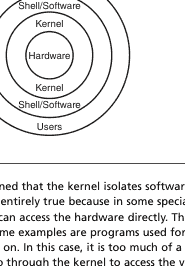


> 我们提到内核将软件与硬件隔离开来。这并不总是完全正确，因为在某些特殊情况下，除了内核之外的软件可以直接访问硬件。这主要是出于性能原因。一些例子是用于渲染高端动画等的程序。在这种情况下，让程序通过内核访问视频硬件的性能损失太大，因此它通常会直接访问。

### 为什么构建自定义内核？

如今，构建自定义内核的情况要少得多。过去这样做的主要原因是设备支持。通常，人们会构建自定义内核，因为默认内核不支持系统中的某个设备（例如声卡）。然而，如今声卡支持——以及大多数其他设备的支持——可以作为内核模块动态加载。（而不是直接构建到内核中，模块可以在启动时动态加载到内核中。）

然而，仍然有时候你可能想要构建自定义内核。一般来说，有四个可能的原因：

- 你已使用 sysupdated 更新到较新的 FreeBSD 版本，并且需要重建内核以与新版本同步。
- 你需要对内核应用补丁以修复错误或安全问题。
- 你想要移除不拥有的设备的支持，以使内核占用更小。
- 你想要在内核中添加对设备的支持，并且不想或不能使用可动态加载的模块。

从源代码重建操作系统的核心对于新用户来说可以理解地令人望而生畏。然而，该过程并没有听起来那么复杂，也不要求任何编程知识。任何人都可以按照本小时提供的说明构建自定义 FreeBSD 内核。

### 内核配置文件

根据你迄今为止了解的 FreeBSD 配置，你可能猜测内核配置由一个纯文本文件处理。你绝对猜对了。内核配置文件位于目录 `/usr/src/sys/i386/conf` 中。用于构建默认内核（例如在全新 FreeBSD 安装后运行的内核）的配置文件的名称是 `GENERIC`。你不会想直接编辑此文件。相反，复制它。你可以给副本起任何你想要的名字，但通常有意义的名字更有意义。一种常见的命名系统是给内核与系统在网络上的主机名相同的名称。如果你不在网络上，你可以随意发挥创意，也可以简单地将其命名为 MYKERNEL 之类的。例如，

```
cp GENERIC MYKERNEL
```

请注意，你需要以 root 身份登录才能复制文件，以及对其进行更改（我们稍后会讨论）。

### 编辑配置文件

复制文件后，在文本编辑器中打开你制作的副本。在文件的顶部，在几个以井号（#）开头的注释之后，你将看到以下行：

```
machine  i386
cpu      i486_CPU
cpu      i586_CPU
cpu      i686_CPU
```

第一行指定机器类型，除非你为 Alpha 系统编译内核，否则它永远不会改变，而 Alpha 系统目前是 FreeBSD 支持的生产稳定版本的唯一其他平台。关于 Alpha 支持的讨论超出了本书的范围。假设你使用的是 Intel x86 或兼容系统（AMD 或 Cyrix），你永远不需要更改此行。

接下来的三行提供对不同世代处理器的支持。由于 GENERIC 内核可在从 486 到最新的 Pentium 4 和 AMD Athlon 处理器等所有设备上运行，默认内核为所有处理器都编译了支持。在自定义内核中，你希望移除所有不拥有的处理器的支持。例如，如果你拥有 Pentium 3 或 Pentium 4，你可以删除除 i686_CPU 行之外的所有 cpu 行。不要实际删除这些行，而是在它们前面放置一个井号（#）。# 表示内核构建系统应将该行的其余部分视为注释。注释会被系统忽略且不处理。因此，任何以 # 开头的行都不会包含在内核中，其效果与完全删除该行相同。


> 这里可能会因为 CPU 厂商的不同命名方案而产生混淆。请记住以下准则：原始 Pentium 处理器是 i586。Pentium 2 到 Pentium 4 处理器是 i686。Cyrix 处理器更令人困惑，因为就 FreeBSD 而言，Cyrix 686 实际上是 i586。AMD K6 处理器也是 i586，但 AMD Athlon 处理器是 i686。如果你安装的内核不包含对你的 CPU 类型的支持，你将得到一个无法启动的系统。如果这种情况发生在你身上，请参阅本小时末尾附近标题为“从失败的内核构建中恢复”的部分。

还有几行很重要，你可能想要更改：

```
ident GENERIC
```

这只是内核的名称。内核启动时显示的就是它。这里列出的名称应与你为新建文件指定的名称相同。

```
maxusers 32
```

此选项命名相当糟糕，可能导致大量混淆。它与系统允许的最大用户数完全无关。它实际上控制着重要系统参数中可用资源的数量。它设置的数量将大致等于此处列出的用户数所需的资源数量。如果你将 maxusers 设置为 1，FreeBSD 将自动管理可用资源的数量。


```
device    npx0    at nexus? port IO_NPX irq 13
```

配置文件为什么甚至会给你这个选项？谁知道。但基本上，这个选项提供了浮点支持。你不能移除这个设备，因为没有它内核无法启动。

```
#makeoptions    DEBUG=-g    #Build kernel with gdb(1) debug symbols
```

默认情况下，此选项已被注释掉。普通用户可能希望保持这种状态。调试符号会大幅增加内核的大小。你仅在排查持续的内核问题时才需要调试符号。除非你经常遇到内核恐慌，否则应保持此选项被注释掉。然后使用调试符号构建内核可以帮助你追踪问题。

```
options    MATH_EMULATE    #Support for x87 emulation
```

除非你有一台相对古老的没有数学协处理器的 386 系统，或你有一台 486SX，否则你可以注释掉这一行。此选项允许 FreeBSD 为没有协处理器的系统模拟浮点运算。

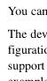

> > FreeBSD 的浮点数学例程并不十分精确。因此，如果你没有数学协处理器（所有 Pentium 及更高 CPU 都有），你应该将此选项改为 GPL_MATH_EMULATE。GPL 数学例程比默认的 FreeBSD 例程更精确。

你通常可以忽略其余的选项行。

设备行是你希望对内核配置做大部分更改的地方。在这里你可以移除你没有的设备的支持，也可以添加默认内核不支持的你拥有的设备的支持。例如，你可以移除你没有的网卡的支持。这里列出的几个设备已被注释掉，因此未包含在默认内核中。如果你有其中一个设备并且需要启用它，可以通过删除设备前面的 # 来实现。

还有一些额外的设备可以启用，但这里没有列出。我们将在本小时稍后介绍如何获取所有可能设备的完整列表。一个例子是这里没有列出但相当常见的支持声卡的设备。要为大多数常见声卡添加支持，你需要添加以下行：

```
device    pcm
```

## NOTES 文件

在内核配置文件所在的同一目录中，你还会找到一个名为 NOTES 的文件。NOTES 文件包含所有可能的选项和设备的列表，以及解释其作用的注释。NOTES 文件还包含设备提示，这些将在本小时稍后讨论。

从该目录输入命令 `make lint` 将在目录中创建一个名为 LINT 的内核配置文件。此文件包含所有可能的设备以及所有可能的选项。你不应该真的尝试用 LINT 文件构建内核。首先，如果内核真的构建成功，它会非常庞大。此外，内核可能无法启动，因为某些设备和选项是互斥的，使用在一起会引起冲突。可能如果你使用 LINT 作为配置文件，内核甚至无法编译。

## 构建新的内核

在你完成自定义内核配置文件的编辑并保存后，你就可以构建新的内核了。切换回 `/usr/src` 目录并使用以下命令：

```
make buildkernel KERNCONF=MYKERNEL
```

*MYKERNEL* 当然应替换为你使用的自定义内核配置文件的实际名称。

输入命令后，FreeBSD 首先会检查内核配置文件以确保其有效。如果文件中存在非法选项或格式错误，FreeBSD 会通知你，然后进程会停止，以便你返回并修复问题。修复任何问题后，只需再次运行 `make buildkernel KERNCONF=MYKERNEL` 命令即可。

假设你的配置文件没有问题，FreeBSD 将开始构建新的内核。在此过程中，你会看到 C 编译器在屏幕上输出大量信息。不要担心这些信息意味着什么。在一台相当快的系统上，构建新内核的过程可能大约需要 15 分钟。当然，极快的系统可能需要更少的时间，而极慢的系统可能需要更长的时间。进程完成后，你将返回到命令提示符。

## 安装新的内核

构建过程完成后并且你已返回命令提示符，新内核已构建完成，但尚未真正安装。安装新内核是本节的重点。


> 安装新内核后，你需要重新启动系统才能真正加载新内核并开始运行系统。此时确保你有对系统的物理访问非常重要。虽然可以远程构建和安装新内核，然后远程重启系统，但如果你搞砸了内核配置文件并且新内核无法启动，系统将无法使用，直到你能够到达物理系统并从那里解决问题的为止。除非你绝对确定新内核可以启动，否则最好在安装新内核并重启系统之前等待直到你能够获得对系统的物理访问。

构建过程完成后，使用以下命令安装新内核：

```
make installkernel KERNCONF=MYKERNEL
```

再次说明，MYKERNEL 应替换为你为自定义内核配置文件指定的名称。安装过程将导致发生两件主要事情：

- 新内核将被复制到 /boot 并命名为 kernel。
- 旧内核将被复制到 /boot/kernel.old，给你一个已知良好的救援内核。如果新内核无法启动，你可以回退到此救援内核以允许你重启系统，然后修复阻止新内核启动的任何问题。


> 每次你安装新内核时，当前安装的内核将被复制到 /boot/kernel.org。这意味着如果你搞砸了内核配置并创建了一个无法启动的内核，下一次你安装内核时，损坏的内核将被复制到 kernel.old。如果你创建的新内核无法启动，你将无计可施，因为此时 kernel 和 kernel.old 都已损坏。因此，如果你必须启动 kernel.old 并修复新内核的问题，最好将 kernel.old 复制到另一个名称（例如 kernel1.old）。这样即使你的第二个内核无法启动，你仍然会有可启动的内核。此时，你可以启动 kernel1.old。有关如何启动救援内核的更多信息将在本章后面解释。

安装过程完成后，你可以重启系统以启动新内核。如果一切顺利，系统重启时你应该会看到自定义内核名称，以及你创建新内核的时间。如果出现问题，以下部分可以帮助你。

## 从失败的内核构建中恢复

尝试构建新内核时可能会出现多种问题。以下是一些可能出现的问题及其解决方法。

### 重启后出现“Kernel panic！”消息

这是最严重的问题之一。基本上，内核构建和安装都很顺利，但在重启后“恐慌”。

根据问题的不同，重启时你可能会收到一条错误消息，显示“Kernel panic！”后跟错误简短描述。此时，系统可能会自动重启，或者可能只是停止。然而，仅因为内核恐慌并不意味着你也必须恐慌。你在安装新内核时为自己创建的备份内核可以使用它来启动系统，以便你可以修复阻止新内核启动的任何问题。

要从旧内核启动，如果系统尚未自动重启，请重新启动系统。在倒计时从 10 开始的提示处，按任意键中断启动过程。然后，在提示处，输入以下内容：

```
boot /boot/kernel.old
```

如果你需要启动其他内核，只需将 kernel.old 替换为你需要启动的内核名称，例如 kernel1.old。内核启动完成后，从本小时开头学习到的内核配置说明重新开始。

### 重启后系统挂起

另一个可能出现的问题是内核在启动过程中挂起而不是恐慌。在这种情况下，你可以重启系统并按照之前给出的相同程序启动替代内核。

另一种可能是内核根本没有挂起，而是在尝试探测你没有的设备。在这种情况下，内核在继续启动之前可能会等待很长时间。屏幕上的信息应该能帮助你找出导致问题的设备。


## 内核构建失败并出现“* 错误代码”消息

可能会出现问题的另一件事是构建过程因错误消息而中止。其中最常见的是“* 错误代码 1”。如果出现这种情况，意味着内核源代码本身存在问题。在这种情况下，尝试使用最后一条编译器消息，看看是否能找出错误发生时正在编译的模块。除非你是程序员，否则你能做的最好的事情可能是将错误消息连同最后几行一起发布到 FreeBSD-questions 邮件列表并请求帮助。不过，在这样做之前，如果你已经 cvsup 到更新的源代码树，请确保检查 freebsd-stable 邮件列表，看看是否有任何警告表明当前内核编译可能已损坏。如果是这样，请等待列表发布“一切正常”的通知，再次 cvsup 源代码树，然后重新开始。

你可能会看到的另一个可能的编译器错误消息是 signal 11 错误。这是一种内部编译器错误，通常难以追踪。这可能是由于硬件不稳定造成的——坏的 RAM 是常见原因。记录 signal 11 错误发生的位置，然后尝试重新构建内核。如果 signal 11 在与第一次不同的位置再次出现，硬件问题几乎肯定是罪魁祸首。

## 某些系统实用程序停止工作

你可能遇到的另一个问题是某些系统实用程序（如 ps）在新内核下停止工作。这通常是由你的内核与系统其他部分不同步引起的。如果将源代码树 cvsup 到更新的 FreeBSD 版本但未重建系统，就会发生这种情况。在这种情况下，你的内核将使用更新的源代码构建，但系统的其余部分仍使用旧的源代码构建。你需要重建系统的其余部分，使其与新内核同步。如何操作的说明可在第 11 小时“Updating FreeBSD”中找到。

## 摘要

在本小时中，你更深入地了解了内核的作用以及为什么你可能想要构建自定义内核。你了解到与 FreeBSD 中的大多数事物一样，内核配置由一个文本文件控制。你看到了如何构建和安装新内核，以及出现问题时如何恢复。


## 练习

以下测验问题旨在测试你对本小时所涵盖的内核和内核配置的理解。

## 测验

1. 内核提供以下所有功能，除了
   A. 控制对系统资源的访问
   B. 提供基本网络服务
   C. 为用户与系统交互提供接口
   D. 为多用户使用系统提供支持
2. 内核配置文件位于哪个目录？
   A. /usr/src/sys/i386/conf
   B. /etc/kernel.conf
   C. /boot/kernel
   D. /usr/src/kern
3. 你可以通过中断系统启动并输入以下命令来加载备份内核：
   A. start /boot/kernel.old
   B. load /boot/kernel.old
   C. boot /boot/kernel.old
   D. kernel = /boot/kernel.old
4. 构建新内核的命令是
   A. make kernel kernconf=MYKERNEL
   B. make buildkernel kernconf=MYKERNEL
   C. make MYKERNEL build
   D. None of the above
5. 在安装新内核时，为什么要确保你拥有系统的物理访问权限？

## 测验答案

1. 正确答案是 C。用户与系统之间的接口由运行在内核之上的 shell 提供。
2. 正确答案是 A。答案 B 和 D 不存在。答案 C 是实际内核的名称，而不是配置文件的名称。
3. 正确答案是 C。所有其他答案都是无效命令。
4. 正确答案是 D。答案 A 和 C 不存在。如果答案 B 使用的是 KERNCONF 而不是 kernconf，则是正确的。请记住 FreeBSD 区分大小写。
5. 确保你拥有系统的物理访问权限很重要，以防新内核无法启动。在这种情况下，你将无法从远程位置重新启动系统。你需要物理访问系统来重新启动它并启动备用内核。

## 第 11 小时

## 更新 FreeBSD

与所有其他操作系统一样，FreeBSD 的新版本和更新会定期发布。这些更新和新版本出于几个原因而必要。其中一些原因包括
- 修补发现的安全问题。
- 跟上技术进步。
- 添加对新硬件的支持。

FreeBSD 的小升级相当频繁地发布（通常大约每三个月一次）。主要版本（例如 FreeBSD 5.0 与 FreeBSD 6.0）平均大约每年发布一次。使用 FreeBSD，你可以随时更新系统，而无需购买另一张 CD。更新可以从互联网下载。在本小时中，你将学习
- 为什么存在两个不同的 FreeBSD 源代码树，它们的区别以及如何决定使用哪一个。
- 如何为升级准备系统。
- 如何使用 cvsup 程序更新 FreeBSD 源代码。


- 如何使用 "make world" 从更新的源代码重建系统。
- 如果出现问题如何恢复。

## 两个 FreeBSD 源代码树

对于 Windows 和 Macintosh，你通常只有一种更新系统的选择。你只需去商店购买 Windows 或 MacOS 的新升级版，然后将其安装在现有版本之上。（或者在某些情况下，你可以从互联网下载补丁或使用随较新版本的 Windows 提供的自动更新程序。）

然而，使用 FreeBSD，你始终有升级选项可用。其中一个选项称为 STABLE，另一个选项称为 CURRENT。

## 什么是源代码树？

源代码树是构成操作系统的源代码文件集合。源代码文件只是包含 FreeBSD 程序员编写的编程代码的纯文本文件。这些源代码文件由 FreeBSD C 编译器读取并转换为计算机可读取的机器代码。最终，整个操作系统都是从其中一个源代码树的源代码构建而成的。

## STABLE 与 CURRENT 的区别

STABLE 和 CURRENT 是 FreeBSD 的两个不同源代码树，可用于升级系统。

## CURRENT

CURRENT 是其中一个树的名称选择非常糟糕，因为它具有误导性。CURRENT 并不是 FreeBSD 当前发布的版本。相反，它是程序员正在积极开发 FreeBSD 下一个版本的树。基本上，CURRENT 可以被视为 FreeBSD 的开发版本。CURRENT 源代码树不断变化，因为新功能被添加，损坏的代码被修复，等等。

CURRENT 树损坏的情况并不少见。换句话说，它实际上不能用于构建可工作的操作系统。也有人意外地将损坏的代码提交到 CURRENT 树中并不少见。这意味着 CURRENT 可能在某一分钟可用，下一分钟损坏，几分钟后在有人发现损坏的代码被提交到树中后又变得可用。

CURRENT 也是新功能的一个试验场，这些功能最终会进入 FreeBSD 的生产版本。通常，这些功能在 CURRENT 中存在错误。此外，它们在最好的情况下文档记录不佳，在最坏的情况下完全没有文档记录。

如你现在可能猜到的那样，CURRENT 并不是为普通 FreeBSD 用户准备的。相反，它是为程序员和开发人员准备的。

由于新功能尚未经过充分测试而可能不稳定，CURRENT 绝对不应该在生产系统上使用。如果你想尝试 FreeBSD 中的最新小工具和设备，从而想运行 CURRENT，那么订阅 FreeBSD-CURRENT 邮件列表非常重要。该列表将包含 CURRENT 损坏时的公告，以及关于将要添加的新功能的提前警告，这些功能可能会导致事物损坏或变得非常不稳定。本书的大多数读者可能希望避开 CURRENT 而选择 STABLE。

## STABLE

STABLE 树是为当前生产版本的 FreeBSD 进行补丁和升级的地方。尽管它会随着补丁的制作等而定期发生变化，但变化频率不如 CURRENT。当然，人们也会犯错误，因此 STABLE 树在任何时候都可能损坏。但它损坏的可能性要小得多，因为任何提交到 STABLE 的代码都已在 CURRENT 中经过彻底测试和调试。STABLE 通常包含自上次 RELEASE 以来最新的安全补丁和错误修复。

这引出了另一个问题。可以运行 FreeBSD 的另外两个版本。其中一个是 RELEASE，另一个是 SNAPSHOT。

## FreeBSD 的 RELEASE 版本

RELEASE 是作为 ISO 发布的官方 FreeBSD 版本，因此可在 CD-ROM 或 DVD-ROM 上获得。它也可以通过 FTP 在网络上安装。如前所述，小型 RELEASE 通常每隔几个月发布一次，而大型 RELEASE 通常每年或每半年发布一次。与 RELEASE 不同，STABLE 和 CURRENT 版本的 FreeBSD 不能直接从 CD 或通过 FTP 安装。如果你想运行 STABLE 版本，首先需要安装 RELEASE 版本，然后使用本小时中将描述的程序更新到 STABLE。


> 之前关于无法直接安装 STABLE 或 CURRENT 的说法并不完全正确。可以基于 STABLE 或 CURRENT 创建一个自定义 RELEASE。然后可以使用该自定义 RELEASE 制作一张 CD-ROM，从而允许直接安装 STABLE 或 CURRENT。然而，创建自定义 RELEASE 是一个高级主题，超出了本书的范围。

> 需要注意的是，关于 RELEASE 的一点是它不会安装所有最新的安全补丁等。换句话说，从 CD-ROM 进行全新安装可能会存在安全漏洞，而这些漏洞是在 RELEASE 制作之后才被发现的。STABLE 会包含这些补丁。

## FreeBSD 的 SNAPSHOT 版本

偶尔，在 FreeBSD 开发过程中，当 CURRENT 分支相对稳定时，会制作 CURRENT 的一个 SNAPSHOT。该快照可以作为 ISO 下载并刻录到 CD-ROM 上。它通常也可以从各种来源以 CD-ROM 的形式购买。这使你可以直接安装 CURRENT，同时也提供了一个尽可能稳定的 CURRENT 版本。

> 发布在 CD-ROM 上的 Current SNAPSHOT 通常相对稳定。然而，它们仍不应被视为适用于生产服务器，因为它们仍然是尚未经过充分测试的 FreeBSD 开发版本。

## 更新你的源代码树

在你决定要更新到哪个版本的 FreeBSD（很可能是 STABLE）之后，你需要为更新准备系统。首先需要做的是使用 cvsup 更新现有的 FreeBSD 源代码树，使其与 STABLE 或 CURRENT 的源代码树相匹配。在本章剩余部分，我们假设你正在更新到 STABLE。

## 什么是 cvsup？

cvsup 是一个与 CVS 系统配合工作的客户端程序。CVS 基本上是一个用于管理编程项目源代码的系统。cvsup 程序会连接到包含 STABLE 最新源代码的 FreeBSD 服务器之一，并将你系统上的每个源代码文件与服务器上的相同文件进行比较。如果你的文件不同，它将被更新以匹配服务器上的文件。此外，如果服务器上存在你在系统上不存在的任何文件，它们将被创建到你的系统上。

## 使用 CVSup

CVSup 程序默认不会随 FreeBSD 一起安装。但是，如果你已经完成了第 6 小时“添加和删除第三方软件”的内容并更新了 ports 树，那么你已经安装了 CVSup。这里使用的 CVSup 程序与用于更新 ports 树的程序相同。

如果你尚未安装 CVSup，它作为一个端口位于 /usr/ports/net 目录中。它也可以作为预编译的二进制包下载。如果你不知道如何安装 CVSup 程序或如何下载包或构建端口，请参阅第 7 小时，其中包含在 FreeBSD 中安装新软件的说明。

安装 CVSup 后，复制位于 /usr/share/examples/cvsup 的示例 supfile。复制到 /usr/local/etc 是一个合理的位置。


> 构建 supfile 的更简单方法是使用位于 /usr/ports/net/cvsup-with 的 cvsup-with 伪端口。输入 make 然后 make install，你将被引导通过一个菜单驱动的界面，在其中选择你想要的源代码树、CVSUp 服务器和其他选项。然后该端口将根据你的选项创建 /etc/cvsupfile，甚至会为你提供首次运行 CVSUp 的选项。（之后，你就得自己负责了。）

## 编辑 CVSup 配置文件

在你喜欢的文本编辑器中打开配置文件。你不需要编辑太多内容，因为默认选项通常可以正常工作。然而，有几处需要更改。

首先需要做的是指定你想要更新到的 FreeBSD 版本。这是通过文件中的 *default* tag= 行完成的。等号后面跟的内容决定了你的源代码将被更新到哪个版本的 FreeBSD。

你可能想要更新到 STABLE 的最新版本。如果 5.0 是当前的 RELEASE，你想要使用的标签是 RELENG_5。因此该行应如下所示：

```
*default tag=RELENG_5
```

这将使你的源代码与 STABLE 分支同步。与你可能熟悉的 Windows 或 Macintosh 的定期打包更新不同，更新到 STABLE 可以随时进行。当 STABLE 被更新时不会发布公告，因为它是以非常规律的方式更新的（通常每天）。这并不意味着你必须每天更新系统，因为对 STABLE 进行的大多数更新都是不会影响大多数人的小错误修复。


> 当 FreeBSD 发现安全问题时，会在 FreeBSD-Security 邮件列表上发布公告。建议所有 FreeBSD 用户订阅此列表。通常，修复问题的建议解决方案是更新到 FreeBSD STABLE。这几乎就是 STABLE 已被更新的公告。
> 
> 通过向 majordomo@freebsd.org 发送邮件订阅邮件列表，邮件正文为单行：
> 
> `subscribe freebsd-stable`

也可以指定你想要更新到特定的 RELEASE。这更像是你习惯于 Windows 或 Macintosh 的传统升级系统。这些源代码树是固定的，不像 STABLE 那样会发生变化。

FreeBSD 特定版本的标签中包含“RELEASE”一词。例如，指定你想要将源代码更新到 5.0 RELEASE 的行是

```
*default tag=RELENG_5_0_0_RELEASE
```

还请注意这里有一个第三个数字。如果 FreeBSD 最新的 RELEASE 是 5.0.1，则为 RELENG_5_0_1。如果最新的 RELEASE 是 FreeBSD 5.1，则为 RELENG_5_1_0，以此类推。基本上，必须提供第三个数字才能指定你想要更新到特定的 RELEASE，即使第三个数字为 0。RELEASE 后缀也是必需的。

要获取可通过 CVSup 更新的 RELEASE 的当前列表，请参阅以下网页：

http://www.freebsd.org/doc/en_US.ISO8859-1/books/handbook/cvs-tags.html

> 更新到最新的 RELEASE 版本并不能确保你的系统上安装了最新的安全补丁。如前所述，在 RELEASE 制作后才发现的安全问题不会被纳入 RELEASE，而是会被插入到 STABLE 中。RELEASE 是固定的，制作后不会再更改。
> 
> 最佳策略是使用诸如 RELENG_5_0 或 RELENG_4_6 之类的标签名称；这将为你提供这些分支上最新的 STABLE 源代码，确定到指定的点发布级别。例如，同步到 RELENG_4_5 的系统可能具有 4.5-RELEASE-p17 的版本字符串。

还可以使用一个特殊的标签，即一个简单的句点（.）。行 *default tag= 表示应使用 CURRENT 分支进行更新。如前所述，这可能不是大多数用户想要更新的分支，因此你可能不想在标签中使用句点。

> 你会注意到你可以 cvsup 到旧版本的 FreeBSD。例如，在撰写本文时，RELENG_4_3 仍然可用，并且在一定程度上仍在维护。（安全补丁和关键修复将被应用到它。）尽管 FreeBSD 会让你在不抱怨的情况下这样做，但将 cvsup 回滚到比当前运行的版本号更低的版本通常是一个坏主意，因为它可能导致某些功能损坏并且系统无法正常工作。

你想要更改的另一行是 *default host= 行。该行控制 FreeBSD 将从何处获取新的源代码。可用的服务器列表可以在以下网页的底部找到：

```
http://www.freebsd.org/doc/en_US.ISO8859-1/books/handbook/cvsup.html
```

通常，你会想要选择离你最近的服务器。但是，如果它太忙并且拒绝你的连接尝试，你可以选择另一个服务器。

文件中另一个相关的行是 src-all。确保该行没有被注释掉。这将导致获取所有源文件，如果你正在进行更新，这通常是你想要的。

编辑文件完成后，保存文件并退出文本编辑器。


## 运行 CVSup

要启动 cvsup 进程，请确保有可用的 Internet 连接，并执行类似以下命令：

```
cvsup supfile
```

supfile 是你刚刚编辑完成的配置文件名。如果未将文件命名为 supfile，请用你指定的文件名替换命令中的这一部分。

这将启动 cvsup 进程。客户端将尝试连接到 supfile 中指定的 CVSsup 服务器；如果服务器超载，如有时或某些服务器会发生的情况，它将暂停并在几分钟后重试，且后续尝试之间的间隔会越来越大。你可能想要取消该进程（按 Ctrl+C）并编辑 supfile 以指定不同的 CVSsup 服务器（例如尝试使用更高的数字，如 cvsup9.freebsd.org）。

根据 Internet 连接的速度以及自上次使用 CVSsup 更新以来源代码树所做的更改数量，该过程可能需要几分钟到几个小时不等。CVSsup 只更新自上次运行 cvsup 以来发生更改的文件。正因如此，更新通常相当快速，因为你不必下载全新的 FreeBSD 版本。你只需要下载发生变化的部分。

cvsup 进程完成后，你将返回到命令提示符。此时，你拥有一个刚刚更新的源代码树。然而，更新尚未安装。我们将在本小时稍后介绍实际安装更新的方法。不过，在安装更新之前，你应先做几件事。

## UPDATING 文件

cvsup 进程完成后，你应做的第一件事是阅读文件 /usr/src/UPDATING。该文件将包含有关使用你刚刚下载的源代码更新时需要特别注意的重要信息。它包括潜在问题的信息以及为避免这些问题需要遵循的特殊程序。如果 UPDATING 中的任何内容与此处所述相矛盾，你应遵循 UPDATING 中针对该特定事项的说明，而不是本书中给出的说明。

## /etc/make.conf 文件

/etc/make.conf 文件包含 C 编译器在从你刚刚下载的源代码重新构建系统时将使用的设置。另一个名为 /etc/defaults/make.conf 的文件包含 C 编译器将使用的默认选项。然而，你不想对 /etc/defaults/make.conf 文件做任何更改。相反，请对 /etc/make.conf 进行更改（如果它尚不存在则自行创建，就像默认安装的情况一样）。该文件将覆盖 /etc/defaults/make.conf 中给出的默认值。对于大多数人来说，向 /etc/make.conf 添加以下两行就足够了：

```
CFLAGS= -O pipe
NOPROFILE= TRUE
```

请注意，CFLAGS 后的选项是大写字母 O 而不是数字零。该选项告诉 C 编译器在编译代码时应用某些优化。第二行告诉编译器不要构建分析过的二进制文件。分析过的二进制文件对于调试很有用，但它们也会增加二进制文件的大小并降低性能。因此大多数用户可能希望将 NOPROFILE 选项设置为 TRUE。

完成这些更改后，保存并退出 /etc/make.conf 文件。

## 更新重要文件

在某些情况下，某些配置文件可能需要在实际执行系统升级之前进行更新，因为某些新版本的 FreeBSD 可能期望，例如，某些用户账户或组为系统目的而存在。如果这些组和账户在 FreeBSD 的早期版本中不存在，更新过程可能会失败。

升级这些文件的最简单方法是使用名为 mergemaster.sh 的程序。以 -p 选项启动它，以便它只更新与升级前相关的文件。你现在还不想更新其余文件。例如，

```
mergemaster.sh -p
```


> 在运行 mergemaster 之前，非常重要的一点是备份你的 /etc 目录。只需将其复制到新位置，例如输入 cp -R /etc /etc.old。这样，如果你意外覆盖了 /etc 中的文件，你就可以以最小的麻烦恢复旧文件。

处理 mergemaster 可能是更新过程中最困难的部分。基本上，mergemaster 将系统上的配置文件与随你下载的更新源代码一起包含的新配置文件进行比较。如果两个文件不同，mergemaster 会通知你，显示差异并询问你该如何处理。在滚动到 mergemaster 列表底部后，你将获得一个选项菜单：

```
Use 'd' to delete the temporary /etc/group
Use 'l' to install the temporary /etc/group
Use 'm' to merge the old and new versions
Use 'v' to view the differences between the old and new versions again

Default is to leave the temporary file to deal with by hand

How should I deal with this? [Leave it for later]
```

默认选项是不对文件做任何更改，并将新文件留在 /var/tmp/temproot 目录中。这样，你就可以稍后检查原始文件和新文件，并决定是否以及要合并哪些更改。

以下是其他选项的作用：

- d — 从 /var/tmp/temproot 中删除文件的较新版本，并保持你当前使用的版本不变。
- l — 从 /var/tmp/temproot 复制文件的较新版本。请注意，这会替换你当前使用的版本，因此你对文件所做的任何自定义设置都将丢失。
- m — 调用一个程序，允许你通过选择每行或每组行的哪个版本（旧版本或新版本）来可视化合并两个文件。通常更简单的做法是只需记下哪些文件有更改，然后手动逐一检查并决定要合并哪些更改。如果你决定使用此处调用的内置合并实用程序（sdiff），可以在其命令行中输入问号（?）来获取帮助。这将显示用于选择左侧版本（旧）或右侧版本（新）的可用命令。
- v — 仅重复输出并再次显示更改。


> 请注意，`/etc/group`、`/etc/passwd` 和 `/etc/master.passwd` 将始终被 mergemaster 标记，因为你已向系统添加了用户和组，这使得这些文件与随源代码下载的文件不同。你永远不应在这些文件上选择 l 选项，因为这将覆盖你现有的文件，导致你的组和用户数据库丢失。这当然可能是灾难性的，尤其是当你有大量用户时。

## 重新构建系统

现在你已准备好重新构建系统。最好将其分为两个步骤，以便大部分工作可以在不进入单用户模式的情况下完成。这意味着在构建过程的大部分时间里，系统可以继续正常运行。

## 删除旧的对象文件

首先要做的是删除以前构建的任何旧对象文件。这是通过切换到 /usr/obj 目录并使用以下命令完成的：

```
chflags -R noschg *
rm -rf *
```

第二个命令是你熟悉的，但第一个命令需要一些额外的解释。该命令会删除可能已设置了不可变标志的任何文件的不可变标志。该标志可保护文件免受意外删除或修改，即使正常文件权限设置如何。即使是 root 在未移除不可变标志之前也无法删除具有不可变标志设置的文件。

删除对象文件的过程可能需要几分钟。（它们有很多。）完成后，你就可以开始实际的构建过程了。

## 构建世界

你想做的第一件事是启动一个日志文件，该文件将记录构建过程中生成的所有编译器消息。这在以后需要进行故障排除时可能很有用。日志可以通过以下命令启动：

```
script /var/tmp/w.out
```


系统应响应 “Script started, output file is /var/tmp/mw.out”。当然，如果你愿意，也可以使用不同的位置作为输出文件。

启动脚本后，请确保你在 /usr/src 目录中，并输入以下命令开始构建过程：

```
make buildworld
```

这将调用 C 编译器和其他必要的程序，从你下载的源代码重建整个操作系统。（因此它被称为“制作世界”。）

此过程即使在快速系统上也需要相当长的时间。在较慢的系统上，可能需要数小时。在 make 进程运行期间，你可以随意去做其他事情，因为无需监视它。它不会问你任何问题之类的。


> 回想一下，在之前的章节中，你学习了如何使用 ALT 键加上功能键切换到另一个虚拟终端。在构建过程运行期间，随时可以切换到另一个终端继续工作。在此过程中继续使用系统是安全的，因为此时实际上并没有更新系统文件。它们只是被构建并放置在临时位置以便稍后安装。

如果 buildworld 进程被中断——例如，如果你从远程终端运行它，然后丢失了访问权限，杀掉进程——没有任何东西丢失或损坏。返回 /usr/src 并再次输入 make buildworld。这可能会删除迄今为止编译的所有目标文件，因此，如果你无法通过这种方式节省时间，也不要太失望。

## 安装新世界

构建过程完成后，你需要安装新世界。但是，在执行此操作之前，你应该将系统重新启动到单用户模式，因为在此过程中系统几乎每个文件都会被更新。如果这些文件在此过程中正在使用，可能会导致问题。

要进入单用户模式，可以使用以下命令：

```
shutdown now
```

这将把所有人踢出系统并将其降至单用户模式。你可能会被要求指定要使用的 shell。只需按 Enter 接受默认值。

切换到 /usr/src 目录并运行以下命令开始安装过程：

```
make installworld
```

此过程需要几分钟，但不会像 make buildworld 过程那样长。当它完成后，你将被返回到命令提示符。但是，你还没有完全完成。你需要再次运行 mergemaster 以更新其余的配置文件。第一次运行 mergemaster 时，你只更新了可能对世界正确构建至关重要的文件。要运行 mergemaster 并更新其余文件，请使用以下命令：

```
mergemaster -v
```

-v 选项会使 mergemaster 关于其正在执行的操作更详细。在未来运行 mergemaster 时，你可能希望省略 -v 选项，但在最初几次运行它时，使用 -v 选项可以帮助你更熟悉命令的工作方式。

再次注意你知道对文件所做的任何更改，因为这些更改会出现在 mergemaster 的输出中。在这些情况下，重要的是不要选择 i 选项，因为这会导致配置文件中的所有自定义设置被覆盖。此外，请务必特别注意 /etc/group、/etc/passwd 和 /etc/master.passwd 文件所做的更改。


> 如果愿意，你可以将 make buildworld 和 make installworld 过程合并为单个命令 make world。该命令将执行构建，然后自动执行安装。但是，如果你决定这样做，应在发出 make world 命令之前将系统置于单用户模式。当然，这意味着你的系统将在单用户模式下占用更长的时间，而不是将这两个过程分开。

## 构建新内核

在重新启动系统之前，你还需要做一件事：你需要构建一个新内核，以配合你刚刚安装的 FreeBSD 更新。内核构建已在上一小时中介绍过，因此我们在这里不再重复。如果需要构建新内核的说明，请参阅第 10 小时，“FreeBSD 内核和设备树”。

完成新内核的构建后，你可以使用 `shutdown -r now` 重启系统。这应该会使系统重新进入多用户模式，并运行更新后的 FreeBSD 版本。

## 故障排除

在此过程中可能会出现一些问题。以下是你可能遇到的一些最常见问题以及可能的解决方案：

- **我的 make buildworld 进程失败了！**

可能出现的一个问题是 make buildworld 因编译器错误而失败，通常会引用 "* Error code 1"。如果发生这种情况，通常意味着编译器遇到了与源文件本身相关的问题。这可能意味着你在源代码树损坏且无法构建时不幸执行了 cvsup。检查 FreeBSD-STABLE 邮件列表存档，查看是否有关于构建损坏的最新帖子。稍后再运行 cvsup。请注意，下次 cvsup 不会花费那么长时间，因为自上次执行以来没有太多变化——除了修复损坏所需的一些更改之外。此时，实际上尚未对系统进行任何更改，因此现有系统的功能不会因失败的构建而受到任何影响。

- **编译时我收到了一堆 "signal 11" 错误。**

另一个可能的编译器错误是 signal 11 错误。这些错误通常由有故障的硬件引起。RAM 通常是罪魁祸首。按照本小时前面所述清理 `/usr/obj` 目录，然后重新开始构建。如果再次出现 signal 11 错误，并且它发生在与第一次不同的进程点，则几乎可以肯定是硬件问题——最可能是 RAM 问题。

- **top 和 ps 程序不再工作了！**

那么，如果你完成制作世界、重新启动后，某些实用程序（如 ps）停止工作会怎样？你是否记得在安装世界后构建新内核？此类问题的最常见原因是内核与世界的其余部分不同步。

## 摘要

在本小时中，你了解了 FreeBSD 可用的不同更新路径以及如何决定使用哪一个。你学习了如何从 FreeBSD 服务器将系统源代码树更新到最新版本。你还学习了如何从新源代码重建整个系统并更新配置文件。此外，你还学习了在构建过程中出现问题时如何恢复。

## 问答

Q 我有一个 FreeBSD 4.6 系统。我想将其更新到最新的安全补丁版本，但不想全部升级到 5.0。（我的系统太关键，无法冒改变一切的风险。）我应该使用什么分支标签名？

A 使用 RELENG_4_6。这将与最新的 4.6 代码保持同步，该代码已应用安全补丁和关键修复，并定期分配新的点发布标签。然而，它永远不会添加新功能，也不会进行任何可能以任何重大方式影响系统行为的更改。

Q 如何将我的 ports 树同步到 5.0 分支或 4.6 分支？

A 你不需要。Ports 只有一个“分支”，你可以同步它们的地方是“顶层树”点，用点号 (.) 指定。因为所有 ports 都在不断变化，所以没有办法将它们“冻结”在 FreeBSD 历史上的某个特定时间点的状态；也不需要这样做。每个 port 都是独立维护的。每个 port 的开发者和维护者负责保持其补丁，而将它与系统的 ports 树保持同步是你的责任。

Q 我不小心告诉 mergemaster 保留其中一个已安装文件，而我实际上想安装新版本。我该怎么办？

A 只需再次运行 mergemaster，并在它询问是否要使用现有的 /var/tmp/temproot 时说“是”。然后它只会询问上次运行后遗留的文件。

Q 现在我不小心用 mergemaster 中的通用文件覆盖了我个人自定义的一个文件！

A 你在运行 mergemaster 之前确实备份了 /etc，对吧？如果是这样，只需将文件从那里复制回 /etc 即可。


## 工作坊

在本互动部分，你将获得一个测验和一些练习，以帮助巩固你对升级 FreeBSD 系统流程的理解。

## 测验

- 1. 用于更新 FreeBSD 源代码的程序是
  A. update
  B. cvsup
  C. pkg_add
  D. make
- 2. mergemaster 程序
  A. 比较配置文件中的差异
  B. 将新系统源代码中的更改合并到当前系统
  C. 从 FreeBSD 服务器下载新的源代码
  D. 以上都不是
- 3. 以下哪个树分支用于生产环境并已应用最新的安全补丁？
  A. CURRENT
  B. RELEASE
  C. STABLE
  D. SNAPSHOT

## 测验答案

- 1. 正确答案是 B。答案 A 不存在。C 是用于安装软件包的命令。D 是用于从源代码构建软件的命令，但它不会更新源代码。
- 2. 正确答案是 A。
- 3. 正确答案是 C。答案 A 是 FreeBSD 的开发版本，不应用于生产系统。B 是 FreeBSD 的稳定发布版本，但它不一定总是应用最新的安全补丁。D 是开发版本的快照，因此仍不适合生产系统。

## 练习

- 1. 探索 CVSup 的许多用途。注意，你可以在 FreeBSD 机器上安装 CVSup 服务器；你可以用它创建一个高效的镜像系统，以便每晚将机器的内容备份到另一台机器。详情请参阅 http://www.cvsup.org。
- 2. 创建一个周期性脚本（参见 man periodic），该脚本将使你的源代码树——无论是每晚还是每周——与源分支的最新版本同步。这样，理论上，你将始终拥有最新的源代码，如果你想随时升级系统的话。


## 第三部分

## 网络

## 小时

- 12 网络介绍
- 13 将 FreeBSD 连接到现有网络
- 14: 拨号网络连接
- 15: 网络安全

## 第 12 小时

## 网络介绍


如今，很难想象一台没有网络连接的计算机。没有互联网或本地网络上其他机器的访问权限，一台机器能做的事非常有限。文字处理和图像编辑本身没问题，但在当今时代，如果不能用来阅读电子邮件、浏览网页以及与邻近计算机共享文件，一台计算机就不值得它占用的桌面空间。

幸运的是，FreeBSD 是那些从零开始为网络而设计的系统之一。正如你将在本小时和下一小时看到的，FreeBSD 的一切设计都基于计算机将被联网并同时被多个用户访问的假设。与 Windows 不同，Windows 起初是为单用户独立计算机设计的单机操作系统，FreeBSD 是帮助构建互联网的系统之一，并且至今仍构成了其大部分骨干。由于其 UNIX  heritage，FreeBSD 在提供互联网流量方面与请求流量一样得心应手。

在本小时中我们必须首先介绍的主题是一般的网络概念。TCP/IP 网络不像 USB，你只需插入一根电缆就能开始运行。要正确联网，你需要了解底层技术一些知识。这就是我们首先要讨论的内容。你将学习：

- OSI 网络模型是什么以及它如何适用于互联网
- 人们谈论 TCP/IP “Stack” 时指的是什么
- 网络中使用的不同组件是什么，以及它们如何使用
- IP 地址是什么以及它如何应用于路由
- IP 地址、网络掩码和网络地址之间的关系如何

## OSI 网络模型

大多数现代网络，包括互联网，都是通过一个被称为传输控制协议/互联网协议（TCP/IP）的系统实现的。该名称指的是两种最常见协议的组合，或通信方法，它们遵循一种结构化的协议层“堆栈”，称为开放系统互连（OSI）模型。OSI 规定了计算机和网络组件如何被分解为若干概念层，以便在它们之间交换数据。

典型的 OSI 模型中有七层，从顶部的应用层（它们与你、用户交互）一直到底部的链路层和物理层（专门的硬件，如以太网卡，在此相互通信并交换原始数据）。图 12.1 显示了计算机中典型的 OSI 或 TCP/IP 堆栈的结构。

图 12.1
OSI 堆栈分层图，显示 TCP/IP 基于的应用如何从一个用户向另一个用户传输数据。

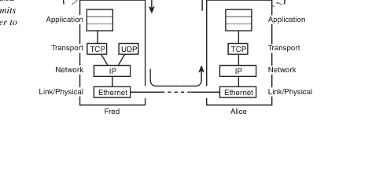

OSI 堆栈的底层代表专门用于将数据通信到线路上的硬件，例如以太网和令牌环卡；但底层的组件除了知道数据应该发送到线路上之外，无法知道数据应该去往何处。它们所做的只是发送一和零，并依赖这些一和零来知道下一步应该去往何处。

幸运的是，它们确实知道。堆栈中更高层的下一层将数据（被分解为数据包，或通常约为一千字节大小的数据块）用头部包裹，头部是只能由另一台计算机 OSI 堆栈中对应层软件读取的预备数据块。例如，一台计算机 OSI 堆栈的网络层在数据包上放置 IP 头部并将其发送到链路层，在那里以太网卡（及其 PHY，即处理物理通信的芯片）将其发送到线路上，目标是另一台计算机的以太网地址——OSI 方案中最低级别的寻址。数据被目标计算机接收，但堆栈的链路层除了接收之外无法做任何事——因此它将其向上传递到自己的网络层，网络层读取 IP 头部并从中解码出有用信息，例如数据包来自的 IP 地址以及它应该去往的 IP 地址。

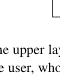

> 如果接收计算机自己的 IP 地址与数据包的目的 IP 地址不匹配，通常意味着接收计算机是一个路由器——一台专门负责接收发往其他远程网络计算机 IP 地址的数据包并将其通过互联网转发直到到达目的地的计算机。我们将在本小时稍后更详细地讨论路由器。

OSI 堆栈的上层以类似的方式工作。最上层与用户交互，用户认为他的软件正在与连接另一端的类似软件（或类似用户）交互。他输入数据，该数据由应用程序向下发送并由传输层用 TCP 头部包装——传输协议如 TCP、UDP 和 ICMP 都被不同类型的应用程序使用——然后传递到网络层，网络层添加 IP 头部。最后，数据包到达链路层，从计算机中传输出来，从一台目标机器传递到另一台目标机器，最终到达预期目标。在这里，数据包从层到层向上传递，每一层剥离一个头部，直到到达应用程序和用户，并显示为（例如）一条即时消息，内容为“Hello! Want to go to lunch?”。

为什么要费心使用所有这些层？为什么应用程序不能直接相互交谈？好吧，这就是互联网的全部内容。正如你在图 12.2 中看到的，互联网由大量通过路由器连接在一起的小型网络组成。每个路由器以分层方式管理自己的网络；随着你向互联网中心推进，每个路由器管理的网络变得越来越大，而接近端点——即单台计算机时则越来越小。互联网“主干”上电信公司的一台大型路由器可以有数千台小型路由器向其发送流量。这对于 widely separated 本地局域网（LANs，我们将很快讨论）能够知道如何相互发送流量是必要的。OSI 模型的层使数据包能够包含它们在互联网上从一个部分导航到另一个部分所需的信息，而无需知道沿途的任何路由。路由器本身处理所有这些，这样发送和接收计算机就不必处理。

## 图 12.2

互联网由数千个不同的路由器组成——每个路由器管理自己的网络。

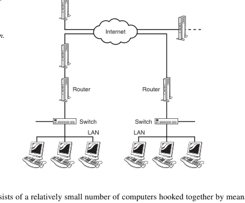

LAN 由相对较少数量的计算机通过高速但不可路由的通信机制（如以太网）连接而成。企业网络就是 LAN 的一个例子；此类网络内的计算机可以非常快速地相互通信。但这种网络在一定规模之外是不可行的，原因很简单，以太网电缆只能长到一定程度才会开始丢失其

信号强度以及局域网通常由单一公司或个人管理，而互联网则由成千上万家不同的公司共同管理。

从一个局域网的计算机到另一个局域网的计算机的流量会传递给路由器，路由器知道如何找到通往流量目的地的途中其他路由器。流量从路由器传递到路由器，使用广域网（WAN）连接，例如高速串行链路（T1、T3、OC-3 等），直到到达管理目的计算机所在局域网的路由器；然后流量通过以太网从路由器在局域网上传输。这样，网络流量可以在由不同公司或个人管理的许多不同类型的网络之间传输，使用在每个层级上最有效率的传输方法。

## 基本网络组件

从互联网上的一台计算机到另一台计算机的路径中可以找到许多不同种类的网络设备。每种组件的设计都是为了在 TCP/IP 协议栈的不同层级连接计算机，或在网络拓扑中执行特定功能或布局。

## 电缆

以太网电缆可以在局域网上以非常高的速度——10Mbps、100Mbps，甚至在最新（也是最昂贵）的局域网 Gigabit Ethernet 中达到 1Gbps——将流量从一个以太网卡传输到另一个以太网卡。无论速度如何，这些电缆都非常便宜；你甚至可以自己制作。缺点是以太网不能用于长距离。因为信号未被序列化或由专为支持长距离传输而设计的设备传输，所以信号会随着电缆长度而衰减。

如今最常用的布线是通过非屏蔽双绞线（UTP）电缆，也称为五类线或 Cat-5。过去几年中，其他类型的以太网电缆也很常见，例如 ThickNet 和 ThinNet，使用完全不同类型的物理电缆，例如插入电视的同轴电缆；但迄今为止最常见的配置是 UTP 电缆上的 RJ-45 电话式插孔。这种相同样式的电缆可以在 10Mbps（10base-T）网络、100base-TX 和 1000base-T（千兆）网络上互换使用。

## 直连和交叉电缆

UTP 布线中只有一个复杂之处，那就是直连电缆和交叉电缆之间的区别。它们之间的区别在于电缆两端两对导线的排列是否被反转，了解在不同情况下各自的使用非常重要。

具有 RJ-45 连接器的设备可以被视为计算机型或集线器型设备。计算机、路由器、带宽管理器和其他端点设备被视为计算机型设备，而集线器和交换机则是集线器型设备。计算机型设备上的 RJ-45 插孔彼此布线方式相同，集线器型设备也是如此。以太网电缆的布线方式用于连接计算机型设备和集线器型设备。

要将计算机连接到集线器，需要直连电缆。将计算机连接到交换机或路由器连接到集线器也是如此。这些都是不同类型设备之间的连接。然而，要将集线器连接到集线器或集线器连接到交换机，需要交叉电缆。连接计算机到计算机时也需要交叉电缆；例如，为了进行双人死亡竞赛模式。需要记住的规则是：不同设备之间使用直连电缆，相同设备之间使用交叉电缆。

棘手的部分在于集线器上的上联端口。这个特殊端口的布线方式如同计算机型设备，因此你可以用直连电缆将一个集线器的上联端口连接到另一个集线器的标准端口。这在大型网络中变得必要——其中一条非常长的直连电缆会连接到大型企业级集线器或交换机（例如在服务器机房），并穿过墙壁和管道通向另一个房间。这条电缆不能直接连接到小型集线器的标准端口；它必须先配上适配器和一根短的交叉电缆才能与小型集线器通信。用一根长的交叉电缆替换以太网电缆是不切实际的，至少可以这么说。因此上联端口诞生了：一个允许集线器直接连接到另一个集线器的端口，而更换电缆为交叉电缆并不是可行选项。不过要记住，将两个集线器的上联端口连接在一起需要交叉电缆——这在任何情况下都相当违背了初衷。

如何判断一根以太网电缆是直连还是交叉电缆？其实很简单：将电缆的两端并排举起。如果导线的颜色序列匹配，则是直连电缆。如果某些导线看起来位置不对，则是交叉电缆。

直连电缆的针脚排列（针脚布线图）如图 12.3 所示。

要制作交叉电缆，请将第 3 对（导线 1/2）和第 2 对（导线 3/6）的位置反转，如压接第二端时所示（见图 12.4）。

### 图 12.3

*直连电缆布线图。*

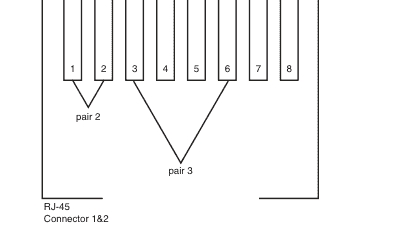

RJ-45
连接器 1&2

直连

### 图 12.4

*交叉电缆布线图。*

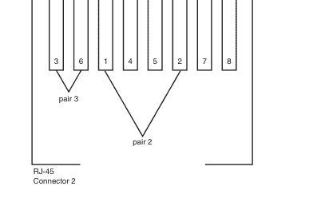

RJ-45
连接器 2

交叉

## 集线器

电缆的一端连接到你的计算机的以太网卡；这一点很清楚。然而，另一端也需要连接到某物；更常见的是，它连接到的就是集线器。

集线器是具有多个 RJ-45 端口的设备，通常在 4 到 24 个之间，你可以连接与端口数量一样多的以太网电缆。这些电缆可以根据需要连接到计算机、其他集线器、交换机或其他网络组件。集线器的价格从约 40 美元到数百美元不等——取决于质量、端口数量以及同时与 10base-T 和 100base-TX 设备一起工作的能力。许多集线器只能支持两种流行速度中的一种，而自动感应集线器（通常称为 N-Way）成本会显著更高。集线器的尺寸从不大于手掌的小盒子到完整的 19 英寸机架安装单元不等，且都需要电源。有些集线器甚至是受管理的，这意味着你可以通过命令行界面 telnet 到它们并配置每个端口的功能。这些集线器自然比独立集线器贵得多。

集线器可以是如图 12.5 所示的小型独立设备，也可以设计成适合 19 英寸网络机架的尺寸。

### 图 12.5

小型五端口集线器，带有一个上联端口。

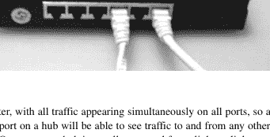

集线器本质上是一个中继器，所有流量会同时出现在所有端口上，因此连接到集线器一个端口的计算机将能够看到同一集线器上任何其他计算机的收发流量。集线器上的一个端口通常保留用于上联——连接到网络层级更高处的另一个集线器、交换机或路由器，如图 12.2 所示：该上联端口通常布线方式使得集线器与其下一个上游设备之间不需要交叉电缆。该端口和集线器上的一个标准端口也可以布线为互斥——例如图 12.5 中的五端口集线器，可能有六个 RJ-45 插孔，但只提供将五台计算机连接在一起（忽略上联端口）的选项，或将四台计算机连接到上游设备（忽略第五个标准端口）。这可能是硬连线的，也可能通过按钮或拨码开关控制，或者所有端口都可以同时使用。这些只是不同集线器之间可能存在的一些变化。

另一个使集线器和其他设备之间通信复杂化的因素是半双工和全双工的区别。区别本质上在于半双工模式下主机一次只能“监听”或“说话”；而全双工模式下使用两倍的导线，使主机能够同时“监听”和“说话”。因此，全双工模式下的 100Mbps 快速以太网链路可以在每个方向上同时传输高达 100Mbps，而同一链路在半双工模式下在两个方向上的总和只能达到 100Mbps。

## 交换机

现在你知道了集线器的性质和用途，我们可以继续介绍交换机。交换机看起来像一个更贵且端口通常更少的集线器。它具有多个 RJ-45 端口，尺寸从手掌大小到机架大小不等（如图 12.6 所示），制造集线器的公司也制造交换机，因此在商店货架上很容易将两者混淆。它们甚至在操作上有些相似——你可以将多个设备插入交换机，而在网络中使用交换机代替集线器通常会得到看起来相同的结果。然而，交换机和集线器之间的区别是微妙的，却至关重要。

### 图 12.6

机架安装
八端口交换机。

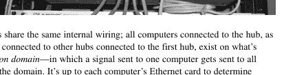

在集线器上，所有端口共享相同的内部布线；连接到集线器的所有计算机，以及连接到第一个集线器的其他集线器上的计算机，都存在于所谓的冲突域中——其中发送给一台计算机的信号会被发送到域内的所有计算机。是否信号是发给它的，由每台计算机的以太网卡自行判断；如果不是，则丢弃。


交换机的内部布线要复杂得多。每个端口都有自己的冲突域，并且连接到一个端口的主机无法看到发往其他任何端口上主机的数据流量。交换机内置了读取每个数据包的以太网头并确定应接收该数据包的主机位于哪个端口所需的软件，这意味着交换机的工作层比集线器高一层，处于网络层，在该层它可以看到每个数据包的 IP 目的地址以及其要前往的硬件以太网地址。

由于交换机的每个端口都有自己的冲突域，这意味着交换式网络流量能够更充分地利用可用的网络带宽。一个全部端口都在使用的八端口 100base-TX 集线器必须将可用的 100Mbps 在八个端口之间分配。如果八个端口同时尝试执行带宽密集型任务，并且其总带宽需求超过 100Mbps，则碰撞——即两个端口在完全相同的时间尝试发送或接收流量——的情况会变得更加常见，导致在物理链路层进行重传，性能降至远低于每个主机在逻辑上应获得的可用 100Mbps 份额。交换机缓解了这一问题。相比之下，100Mbps 集线器的内部布线总共只有 100Mbps，而八端口交换机则拥有 800Mbps 的布线——每个端口都复制了完整的带宽。这就是为什么集线器的端口数往往少于交换机，而端口众多的交换机价格相当昂贵。

交换机通常没有上行端口，尽管偶尔（例如某些双端口交换机，其纯粹用作过滤无关流量的过滤器）一个或两个端口会有一个按钮来选择端口是否需要直通线或交叉线。作为一般规则，将交换机上的端口视为集线器类型的设备，并使用交叉线连接一台交换机到另一台交换机，或使用直通线将交换机连接到集线器的上行端口。

## 网桥

网桥是一种设备，其作用有点像交换机，但方式更为复杂。网桥就像是交换机，只是它们连接的是不同类型的链路层网络，而不是仅同类型的不同网络。例如，你可以使用网桥将以太网网络连接到令牌环网络，或将一个以太网网络连接到另一个通常需要路由器来引导一侧到另一侧流量的以太网网络。网桥除非在非常复杂的网络拓扑中，否则通常没有用处，因此我们在此不会更详细地介绍它们。

## 路由器

路由器是所有网络设备中最复杂（也是最昂贵）的。你已经看到了路由器在 OSI 体系结构和互联网中的作用。但路由器到底是什么？

大多数路由器是机架式设备，如图 12.7 所示的那样。路由器最大的制造商是思科，大多数网络至少由一台思科路由器管理。然而，路由器也可以由 FreeBSD 计算机（或任何支持路由的操作系统，包括所有 UNIX 系统甚至大多数 Windows 平台）构成。大多数路由器具有一个或两个局域网侧端口、RJ-45 插孔，或需要收发器将接口转换为双绞线的 AUI 端口。路由器的另一侧是串行电缆，连接到 DSU/CSU 或其他此类高速串行转换器——在其之外就是广域网流量。

图 12.7
一台具有串行（广域网侧）和以太网（局域网侧）接口的思科路由器。

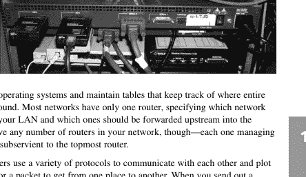

路由器拥有完整的操作系统并维护表格来跟踪整个网络的位置。大多数网络只有一个路由器，指定哪些网络号表示你的局域网，哪些应转发到广域网上游。尽管如此，你的网络中可以有任意数量的路由器——每个路由器管理一个子网并受最高层路由器的管辖。

此外，路由器使用多种协议相互通信并规划数据包从一个地方到另一个地方的最佳路径。当你发送一个数据包时，它会从一个路由器传到另一个路由器，沿着每个路由器认为可用的最佳路线不断向上游传输，直到到达知道数据包目的网络在下游何处找到的路由器，然后它沿下游路线向下传输，直到到达目的局域网并最终到达目的主机。路由是互联网的骨干，也是 TCP/IP 网络运行方式中可能最复杂的部分。

## IP 地址系统和子网

如果你曾经在互联网上做过任何事情，你可能对 IP 地址很熟悉——至少足够知道它们是什么样子的。IP 地址通常被用作指代互联网上特定计算机的一种方式，尽管其含义实际上比“一台机器一个 IP 地址”灵活得多。最一般地说，它是一个逻辑标识，其目的是在互联网上定位一台机器，以便 IP 路由器可以在它与任何其他机器之间引导流量。

IP 地址是 IP 头中 32 位的字符串，指定数据包来自哪台机器或目的地在哪（头中同时存在这两个地址）。这 32 位也可以被视为四个 8 位字节，每个字节表示为 0 到 255 之间的数字——因此我们熟悉的四段式点分十进制表示法（形式为 111.112.113.114）。

通常，一个 IP 地址绑定到一张以太网卡；这只是按惯例。唯一的限制是同一网络上的两张以太网卡不能共享相同的 IP 地址。不过，你可以将多个 IP 地址绑定到同一张卡上，并且每张卡至少需要有一个唯一的 IP 地址才能工作。例如，你可能会选择在系统中安装两张以太网卡以同时访问两个不同的网络，或者一个地址绑定到以太网卡，而另一个地址指向你的无线 802.11 卡。这一切都取决于你的网络是如何设置的。

你可以使用 ifconfig 实用程序查找系统中任何以太网卡和其他网络接口的 IP 地址，如列表 12.1 所示。-a 选项显示所有设备，或者你可以指定特定接口（如 x10）来单独显示它。inet 行显示已配置的 IP 地址；此示例中的 x10 接口显示多个 IP 地址绑定到单张卡。

### 列表 12.1 ifconfig 的典型输出

```
# ifconfig -a
x10: flags=8843<UP,BROADCAST,RUNNING,SIMPLEX,MULTICAST> mtu 1500
 inet 64.41.131.102 netmask 0xffffffff broadcast 64.41.131.255
 inet6 fe80::201:2ff:fe55:1256% x10 prefixlen 64 scopeid 0x1
 inet 209.154.215.246 netmask 0xffffffff broadcast 209.154.215.246
 ether 00:01:02:55:12:56
 media: autoselect (100baseTX) status: active
 supported media: autoselect 100baseTX <full-duplex> 100baseTX
 100baseT/UTP <full-duplex> 10baseT/UTP 100baseTX <hw-loopback>
 lo0: flags=8810<POINTOPOINT,SIMPLEX,MULTICAST> mtu 1500
gif0: flags=8010<POINTOPOINT,MULTICAST> mtu 1280
gif1: flags=8010<POINTOPOINT,MULTICAST> mtu 1280
gif2: flags=8010<POINTOPOINT,MULTICAST> mtu 1280
gif3: flags=8010<POINTOPOINT,MULTICAST> mtu 1280
 lo0: flags=8049<UP,LOOPBACK,RUNNING,MULTICAST> mtu 16384
 inet6 fe80::1%lo0 prefixlen 64 scopeid 0x7
 inet6 ::1 prefixlen 128
```

### 列表 12.1 继续

```
inet 127.0.0.1 netmask 0xff000000
ppp0: flags=8010<POINTOPOINT,MULTICAST> mtu 1500
sl0: flags=c010<POINTOPOINT,LINK2,MULTICAST> mtu 552
faith0: flags=8000<MULTICAST> mtu 1500
```

有几个“特殊”的 IP 地址需要记住。首先是网络地址。这是一个一个或多个字节为零的 IP 地址，例如 64.41.131.0。如果最后一位字节为零，则该地址是整个 64.41.131 网络的同义词，通常仅在配置路由器时使用。更重要的是，如果一个或多个尾随字节为 255（所有位都设为 1）。这是网络的广播地址；例如，64.41.131.255 匹配 64.41.131 网络上的所有主机，而 64.41.255.255 匹配 64.41 网络上的所有主机。

“A 类”网络在其分配的号码中仅指定网络的前八位；A 类网络中潜在的 IP 地址有 1670 万个，例如 64.0.0.0。“B 类”网络有 65,534 个可用地址，因为地址中指定了十六位（两个数字）。“C 类”（24 位）网络是最常见的，有 254 个可用地址；这就是 ifconfig 输出显示的那种网络。

## 子网和网络掩码

网络掩码与 IP 地址一起在机器上配置 TCP/IP 时出现，是整个结构中最容易被误解的部分之一，然而一旦正确理解，它可能是最优雅的部分之一。

网络掩码（或 netmask）的目的很简单，就是告诉路由器或主机数据包应发送到其所在的网络还是上游到下一个路由器。当路由器接收到数据包并需要决定如何处理时，它会将数据包的目的 IP 地址与其自己的网络掩码进行比较。

网络掩码是一个 32 位的字符串，如同 IP 地址，通常形式为 255.255.255.0。假设我们有一个管理 64.41.131 网络的路由器，其网络掩码为 255.255.255.0。路由器接收到一个发往 64.41.131.45 的数据包。这与网络掩码以“与”的方式匹配，意味着比较中每对数字取较小者：

```
064.041.131.045
AND
255.255.255.000
--- --- --- ---
064.041.131.000  (Match!)
```


结果匹配到 64.41.131 为止，这是我们路由器管理的网络的地址。该数据包被转发到网络中。随后又有一个数据包到来，目标地址为 64.41.189.45；与子网掩码的匹配失败，路由器将数据包上游转发给下一跳路由器。

```
064.041.189.045
AND 255.255.255.000
--- ---
064.041.189.000    (No match!)
```

这种机制允许你在网络内部设置子网。假设你有一个可用的 B 类地址范围（64.41.xxx.xxx）。你网络的主路由器 R1 管理整个范围，但你可以在该网络内部放置一台路由器（R2）来管理两个 C 类地址范围：64.41.131.xxx 和 64.41.132.xxx。64.41.131 网络中的主机可以连接到与 64.41.132 网络中的主机相同的集线器，如图 12.8 所示，但如果它们的子网掩码设置为 255.255.255.0，即 C 类掩码，它们就不会直接相互通信。发送数据包中的目标 IP 地址与发送者的子网掩码不匹配。然而，如果 64.41.131 中的发送主机（H1）将其子网掩码设置为 B 类掩码（255.255.0.0），地址就会匹配，发送者就能直接将数据包发送给 H2——64.41.132 上的主机。但是请注意，H2 将无法直接将回复发送回 H1，因为它的子网掩码阻止了它！它必须通过 R2 将回复发送回去，R2 在其内部接口上绑定了多个网络地址和子网。你需要将 H2 的子网掩码设置为 255.255.0.0，使其能够在不经过路由器的情况下直接与 H1 通信。

## 图 12.8
一个具有子网的网络，演示了两个因子网掩码不允许它们直接通信的主机之间的数据包路径。

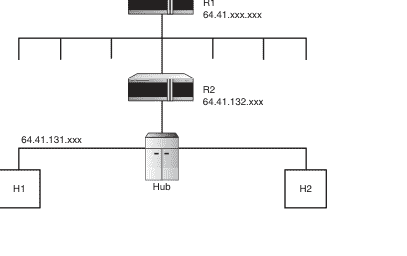


在指定网络时使用的另一种包含子网掩码的记法是 CIDR，即无类别域间路由，其形式为网络地址、斜杠和构成掩码的位数。例如，我们 64.41.131 网络上的掩码 255.255.255.0 将被写为 64.41.131/24，因为掩码由三个全部位设为 1 的 8 位字节组成，即 24 位。同样，255.255.255.192 示例也对应于 64.41.131/26 的记法。这种记法在路由表和其他需要简洁性的地方可见。

## 摘要
本小时的课程从计算机的角度介绍了 TCP/IP 的基础知识。它为更深入地理解 TCP/IP 配置的工作原理以及应用程序如何使用互联网的通信协议奠定了基础，这样当你以后遇到它们时，你将更有机会了解软件是如何交互的。互联网是操作系统的伟大均衡器——其中 Windows、Macintosh 和 UNIX 计算机汇聚在一起完成相同的任务——而你现在知道了它们共同使用的通用语言。

## 问答
Q OSI 堆栈中有多少层，它们是如何排列的？
A 七层。从上到下，层级从面向人类的数据从一个用户指向另一个用户（或从一台主机指向另一台主机）开始，逐渐向下到面向机器的数据从一台专用硬件指向另一台专用硬件。

Q 集线器和交换机的区别是什么？
A 在集线器中，所有连接的设备都连在一个大的冲突域中，因此每台机器的以太网卡都能看到其他机器发送或接收的所有流量，并且所有连接的机器必须共享相同的总带宽。而交换机的每个端口各自构成一个冲突域，因此没有机器可以看到发往不同端口上另一台机器的流量。

Q 如何区分集线器和交换机？
A 大多数集线器和交换机都会明确标明其类型。然而，还有其他方法可以区分。例如，集线器只能以半双工模式通信，而交换机如果可以的话会协商到全双工模式。如果你将一台机器连接到一个设备，查看 ifconfig 的输出，如果你的链路以全双工模式启动，你就知道它是一个交换机；否则，它很可能是一个集线器。

Q 路由器的用途是什么？
A 路由器将局域网流量转换为可通过高速串行连接发送到远程网络的广域网信号。路由器保存一张上游路由器的表，用于发送到它不知道路由的目的地的包。

## 练习
本节旨在通过测验问题和练习来加深你对 TCP/IP 网络的理解，如果你愿意，可以引导你进入进一步的研究领域。

### 测验
- 1. 今天最常见的以太网电缆类型是什么？
- A. 带 RJ-45 接口的 UTP
- B. DIX/AUI 串行收发器
- C. 带 BNC 连接器的 ThinNet 同轴电缆
- D. 带“吸血鬼 tap”连接器的 ThickNet 同轴电缆
- 2. 网络上平均 TCP/IP 数据包有多大？
- A. 50 字节
- B. 1 千字节
- C. 2048 字节
- D. 32 千字节
- 3. 在一个 8 端口 100base-TX 交换机上，八台连接的机器都在积极使用网络，每台机器可用的带宽是多少？
- A. 8 Mbps
- B. 12.5 Mbps
- C. 50 Mbps
- D. 100 Mbps
- 4. 地址为 241.155.4 的网络的子网掩码是什么？
- A. 255.0.0.0
- B. 255.255.0.0
- C. 255.255.255.0
- D. 255.255.255.255
- 5. 这是什么“类”网络？
- A. A 类。
- B. B 类。
- C. C 类。
- D. D 类。

### 测验答案
- 1. 正确答案是 A。
- 2. 正确答案是 B，不过这取决于您网络的最大传输单元（MTU）大小。该值通常设置为本地局域网的 1500 或广域网链路的 536。
- 3. 正确答案是 D。集线器必须在所有连接的机器之间分配可用带宽，但交换机内部是多路复用的，因此每台机器都能获得全部带宽。
- 4. 正确答案是 B。
- 5. 正确答案是 C。

### 练习题
- 1. 探索网络地址转换（NAT）的工作原理。这种技术允许你在路由器后面创建一个网络，其中所有机器都有唯一的 IP 地址，这些地址仅在网络内部有意义——当它们与互联网上的机器通信时，它们的流量看起来来自 NAT 启用路由器分配的虚拟地址。例如，你可以在地下室创建一个完整的 A 类网络并放入 1600 万台计算机，每台都有自己的 IP 地址；使用 NAT，这些计算机都可能看起来来自拨号服务提供商分配给你的单个 IP 地址。这种技术对企业和任何关心安全的人都至关重要：使用 NAT，外部黑客无法直接针对网络上的任何单台机器。深入研究一下！
- 2. 虚拟专用网络，或 VPN，是一种在[content]
结果匹配到 64.41.131 为止，这是我们路由器管理的网络的地址。该数据包被转发到网络中。随后又有一个数据包到来，目标地址为 64.41.189.45；与子网掩码的匹配失败，路由器将数据包上游转发给下一跳路由器。

```
064.041.189.045
AND 255.255.255.000
--- ---
064.041.189.000    (No match!)
```

这种机制允许你在网络内部设置子网。假设你有一个可用的 B 类地址范围（64.41.xxx.xxx）。你网络的主路由器 R1 管理整个范围，但你可以在该网络内部放置一台路由器（R2）来管理两个 C 类地址范围：64.41.131.xxx 和 64.41.132.xxx。64.41.131 网络中的主机可以连接到与 64.41.132 网络中的主机相同的集线器，如图 12.8 所示，但如果它们的子网掩码设置为 255.255.255.0，即 C 类掩码，它们就不会直接相互通信。发送数据包中的目标 IP 地址与发送者的子网掩码不匹配。然而，如果 64.41.131 中的发送主机（H1）将其子网掩码设置为 B 类掩码（255.255.0.0），地址就会匹配，发送者就能直接将数据包发送给 H2——64.41.132 上的主机。但是请注意，H2 将无法直接将回复发送回 H1，因为它的子网掩码阻止了它！它必须通过 R2 将回复发送回去，R2 在其内部接口上绑定了多个网络地址和子网。你需要将 H2 的子网掩码设置为 255.255.0.0，使其能够在不经过路由器的情况下直接与 H1 通信。

## 图 12.8
一个具有子网的网络，演示了两个因子网掩码不允许它们直接通信的主机之间的数据包路径。


在指定网络时使用的另一种包含子网掩码的记法是 CIDR，即无类别域间路由，其形式为网络地址、斜杠和构成掩码的位数。例如，我们 64.41.131 网络上的掩码 255.255.255.0 将被写为 64.41.131/24，因为掩码由三个全部位设为 1 的 8 位字节组成，即 24 位。同样，255.255.255.192 示例也对应于 64.41.131/26 的记法。这种记法在路由表和其他需要简洁性的地方可见。

## 摘要
本小时的课程从计算机的角度介绍了 TCP/IP 的基础知识。它为更深入地理解 TCP/IP 配置的工作原理以及应用程序如何使用互联网的通信协议奠定了基础，这样当你以后遇到它们时，你将更有机会了解软件是如何交互的。互联网是操作系统的伟大均衡器——其中 Windows、Macintosh 和 UNIX 计算机汇聚在一起完成相同的任务——而你现在知道了它们共同使用的通用语言。

## 问答
Q OSI 堆栈中有多少层，它们是如何排列的？
A 七层。从上到下，层级从面向人类的数据从一个用户指向另一个用户（或从一台主机指向另一台主机）开始，逐渐向下到面向机器的数据从一台专用硬件指向另一台专用硬件。

Q 集线器和交换机的区别是什么？
A 在集线器中，所有连接的设备都连在一个大的冲突域中，因此每台机器的以太网卡都能看到其他机器发送或接收的所有流量，并且所有连接的机器必须共享相同的总带宽。而交换机的每个端口各自构成一个冲突域，因此没有机器可以看到发往不同端口上另一台机器的流量。

Q 如何区分集线器和交换机？
A 大多数集线器和交换机都会明确标明其类型。然而，还有其他方法可以区分。例如，集线器只能以半双工模式通信，而交换机如果可以的话会协商到全双工模式。如果你将一台机器连接到一个设备，查看 ifconfig 的输出，如果你的链路以全双工模式启动，你就知道它是一个交换机；否则，它很可能是一个集线器。

Q 路由器的用途是什么？
A 路由器将局域网流量转换为可通过高速串行连接发送到远程网络的广域网信号。路由器保存一张上游路由器的表，用于发送到它不知道路由的目的地的包。

## 练习
本节旨在通过测验问题和练习来加深你对 TCP/IP 网络的理解，如果你愿意，可以引导你进入进一步的研究领域。

### 测验
- 1. 今天最常见的以太网电缆类型是什么？
- A. 带 RJ-45 接口的 UTP
- B. DIX/AUI 串行收发器
- C. 带 BNC 连接器的 ThinNet 同轴电缆
- D. 带“吸血鬼 tap”连接器的 ThickNet 同轴电缆
- 2. 网络上平均 TCP/IP 数据包有多大？
- A. 50 字节
- B. 1 千字节
- C. 2048 字节
- D. 32 千字节
- 3. 在一个 8 端口 100base-TX 交换机上，八台连接的机器都在积极使用网络，每台机器可用的带宽是多少？
- A. 8 Mbps
- B. 12.5 Mbps
- C. 50 Mbps
- D. 100 Mbps
- 4. 地址为 241.155.4 的网络的子网掩码是什么？
- A. 255.0.0.0
- B. 255.255.0.0
- C. 255.255.255.0
- D. 255.255.255.255
- 5. 这是什么“类”网络？
- A. A 类。
- B. B 类。
- C. C 类。
- D. D 类。

### 测验答案
- 1. 正确答案是 A。
- 2. 正确答案是 B，不过这取决于您网络的最大传输单元（MTU）大小。该值通常设置为本地局域网的 1500 或广域网链路的 536。
- 3. 正确答案是 D。集线器必须在所有连接的机器之间分配可用带宽，但交换机内部是多路复用的，因此每台机器都能获得全部带宽。
- 4. 正确答案是 B。
- 5. 正确答案是 C。

### 练习题
- 1. 探索网络地址转换（NAT）的工作原理。这种技术允许你在路由器后面创建一个网络，其中所有机器都有唯一的 IP 地址，这些地址仅在网络内部有意义——当它们与互联网上的机器通信时，它们的流量看起来来自 NAT 启用路由器分配的虚拟地址。例如，你可以在地下室创建一个完整的 A 类网络并放入 1600 万台计算机，每台都有自己的 IP 地址；使用 NAT，这些计算机都可能看起来来自拨号服务提供商分配给你的单个 IP 地址。这种技术对企业和任何关心安全的人都至关重要：使用 NAT，外部黑客无法直接针对网络上的任何单台机器。深入研究一下！
- 2. 虚拟专用网络，或 VPN，是一种在防火墙（可能包括 NAT）保护的网络中创建安全加密“隧道”的方法。这使得员工可以从家中访问公司网络等。VPN 如何工作？客户端如何与 VPN 服务器进行身份验证并创建安全隧道？客户端机器上的流量如何重定向以到达正确的路由器？


- 3. CIDR 并不是指定除“类”划分外子网掩码的唯一技术——也不是最灵活的。还有另一种技术，称为可变长度子网掩码，或 VLSM。这种记法允许你以任意你想要的精确度指定掩码；关于 VLSM 的一个很好的总结，也值得阅读以进一步理解掩码的一般工作原理，可以在 http://www.lirmm.fr/~ajm/Docs/IP-VLSM.html 找到。


## 第 13 小时
## 将 FreeBSD 连接到现有网络
现在你已经了解了网络的全部内容，你必须输入到计算机“TCP/IP 设置”窗口中的那些神秘数字应该更有意义了。即使如今的操作系统已经不需要像过去那样配置那么多数字（例如 DHCP 使大多数网络配置自动化），我们也不能认为一切总会自行设置。接下来要介绍的主题是为你的 FreeBSD 机器配置网络。

本章假设你将使用以太网卡将机器连接到局域网（LAN）。如果你没有以太网卡，而是计划使用 PPP 和调制解调器配置机器的拨号互联网连接，可以跳到下一小时。

在本小时你将学习：
- 你可以用哪些类型的以太网或 802.11 卡来连接你的机器


- 如何使用 sysinstall 输入计算机的 TCP/IP 设置
- 如何确定计算机是否已正确配置为 TCP/IP

## 网络接口设备

首先要确保的是你的机器配备了网络接口设备。在大多数台式 PC 中，该设备是带有一个 RJ-45 插孔的以太网卡——这是最常见的现代以太网连接器类型。如今几乎所有的卡都是 10/100 卡，意味着它们同时支持 10Mbps 和 100Mbps 速度。有些甚至是千兆卡，不过价格更贵。有些卡上有多种类型的连接器，例如图 13.1 所示的卡，它具有（从左到右）RJ-45 插孔、DB-15 串行连接器和 BNC 同轴连接器。如今大多数卡只有 RJ-45 插孔。现代机器经常将以太网功能集成到主板上，RJ-45 连接器会在机器背面的其他连接器中可见。

图 13.1
*带有多重连接器的以太网卡。*

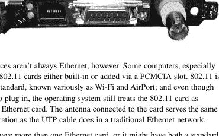

网络接口设备并不总是以太网。然而，一些计算机，尤其是笔记本电脑，具有内置或通过 PCMCIA 插槽添加的无线 802.11 卡。802.11 是一种“无线以太网”标准，被称为 Wi-Fi 和 AirPort；即使没有可插入的连接器，操作系统仍将 802.11 卡视为另一块以太网卡。连接到卡的天线在配置中起的作用与传统以太网网络中的 UTP 电缆相同。

你的计算机可能有多块以太网卡，或者可能同时具有标准以太网卡和 802.11 卡。FreeBSD 可以运行你塞进机箱的任意多块卡。正如我们在上一小时讨论的那样，每块卡都会获得自己的 IP 地址。

FreeBSD 对当前使用的大多数现代有线和无线以太网卡都提供支持。表 13.1 显示了默认（GENERIC）内核配置中可用的现代以太网卡列表。以太网卡近年来已成为商品，几乎每块卡都 100% 兼容现有标准，而且价格相当便宜。很可能你拥有的任何卡都可以在 FreeBSD 上无需任何额外配置即可工作。只需插入并打开即可。

表 13.1 默认（GENERIC）FreeBSD 内核中支持的以太网卡

**PCI 卡**

| 驱动程序 | 描述 |
|---|---|
| de | DEC/Intel DC211x4 ('Tulip') |
| em | Intel PRO/1000 adapter Gigabit Ethernet Card |
| txp | 3Com 3cR990 ('Typhoon') |
| vx | 3Com 3c590, 3c595 ('Vortex') |

**PCI/MII 卡**

| 驱动程序 | 描述 |
|---|---|
| fxp | Intel EtherExpress Pro/100B (82557, 82558) |
| tx | SMC 9432TX (83c170 'EPIC') |
| dc | DEC/Intel 21143 and various workalikes |
| pcn | AMD Am79C79x PCI 10/100 NICs |
| rl | RealTek 8129/8139 |
| sf | Adaptec AIC-6915 ('Starfire') |
| sis | Silicon Integrated Systems SiS 900/SiS 7016 |
| ste | Sundance ST201 (D-Link DFE-550TX) |
| ti | Texas Instruments ThunderLAN |
| vr | VIA Rhine, Rhine II |
| wb | Winbond W89C840F |
| xl | 3Com 3c90x ('Boomerang', 'Cyclone') |

**无线（802.11）PCMCIA 卡**

| 驱动程序 | 描述 |
|---|---|
| wi | Lucent WaveLAN 802.11 |
| an | Aironet 4500/4800 802.11 |
| awi | BayStack 660 and others |


与 Linux 不同，FreeBSD 为其使用的每个网络接口卡驱动程序使用不同的设备名称。虽然 Linux 对其以太网卡简单地使用 eth0、eth1 等，但 FreeBSD 会将一对 Intel EtherExpress 卡命名为 fxp0 和 fxp1，而 RealTek 卡会变成 rl0。与 Linux 的 eth0 命名相比，很难看出 fxp0 是一块以太网卡。

另外要注意，Linux 和 FreeBSD 对 PCI 卡的编号方向不同；Linux 的设备号随着向主板移动而增加，而在 FreeBSD 中，数字则随着远离主板而增加。如果你的机器上有两块 PCI 以太网卡，那么在 FreeBSD 中名称末尾带 0 的那块卡在 PCI 链中会最靠近主板，或者如果有的话就是板载以太网。在 Linux 中，设备号为 0 的则是位于 PCI 链末端、最远离主板的那个。

如今为 PC 硬件销售的大多数以太网卡都是基于 PCI 的，这意味着 PCI 控制器会自动处理所有寻址，你不需要进行与旧 ISA 卡相关的 IRQ/DMA/内存地址调整。如果你只有 ISA 卡，请自己花 30 美元买一块来自 Intel 或 3Com 的新 PCI 卡。你将节省大量完全不必要的痛苦。

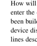

如果你有一块 PCI 以太网卡，你可以在安装期间（在“可视化配置”模式下）简单地删除所有 ISA 卡。如果你的卡是 ISA，则需要知道卡的芯片组和制造商，以便知道保留哪一个、删除哪一个。

你如何知道 FreeBSD 是否识别你安装的以太网卡？只需输入 dmesg 命令。此命令会打印出自上次启动机器以来一直在构建的内核消息缓冲区，其中的消息包含启动过程中出现的全部设备发现行。查看描述每个设备的行。如果看到类似这样的内容，

```
xl0: <3Com 3c905C-TX Fast Etherlink XL> port 0xd800-0xd87f
mem 0xf6800000-0xf68007f irq 12 at device 2.0 on pci1
xl0: Ethernet address: 00:e0:18:29:92:a0
```

这意味着你的系统找到了可以使用的以太网卡。

## 使用 sysinstall 配置网络设置

配置以太网卡最简单的方法，也是对任何在 Windows 机器或 Macintosh 上进行过此过程的人来说最熟悉的方法，就是使用 sysinstall。第一次要求 sysinstall 执行需要网络连接的操作时（系统的网络安装、浏览软件包或其他各种任务），它会调出网络配置窗口，你可以在其中可视化设置以太网卡的 TCP/IP 选项。

一个简单的方法——如果你已经运行多用户并且不在初始系统安装过程中——是运行 /stand/sysinstall，从主菜单中选择 Configure，然后滚动到 Media 选项。在此子菜单中，选择 FTP 和某个 FTP 服务器（哪个都可以），你会看到一个对话框，提示 Running Multiuser, Assume that the Network Is Already Configured? 选择 No 以进入网络配置屏幕。接下来出现的是网络接口选择屏幕，如图 13.2 所示。

图 13.2
在 sysinstall 程序中选择网络接口卡。

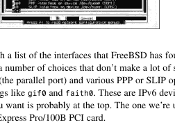

你会看到 FreeBSD 在系统中找到的接口列表。你可能会看到一些不太有意义的选择——除了 lp0（并行端口）和串行端口上的各种 PPP 或 SLIP 选项外，你还会看到诸如 gif0 和 faith0 之类的东西。这些是 IPv6 设备；可以忽略它们。你想要的选项可能在顶部。我们在此示例中使用的就是 fxp1，一块 Intel EtherExpress Pro/100B PCI 卡。

当你选择以太网卡时，会出现两个对话框：一个选择让系统尝试使用 IPv6 自动配置卡，另一个选择让它尝试使用 DHCP。对这两个选择都说 No。然后你会看到可视化网络配置屏幕，如图 13.3 所示。

## 图 13.3

sysinstall 程序中的可视化网络配置屏幕

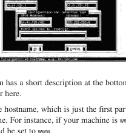

此屏幕中的每个字段在窗口底部都有简短说明，但我们可以在这里进一步解释。

- **Host**—这是主机名，即机器完全限定域名中的第一部分。例如，如果你的机器是 www.somewhere.com，则 Host: 字段应设置为 www。
- **Domain**—这是域名的其余部分，即 somewhere.com。这可以是具有命名子网的网络的复合或多级域名，例如如果你的机器名为 lysine.cslab.ivyleague.edu，则为 cslab.ivyleague.edu。
- **IPv4 Gateway**—这是你的网关路由器的 IP 地址。使用离你的机器最近的下一跳路由器。该路由器将负责在你的机器与世界上任何其他机器之间传输流量。如果你不知道此号码应为何，请询问你的网络管理员。
- **Name server**—你网络中最可靠的域名服务器（DNS）的 IP 地址。你应尽可能使用企业、ISP 或大学网络提供的 DNS；远程名称服务器可用作备份，但不一定能可靠地为非本地请求提供服务。
- **IPv4 Address**—这是你分配给以太网卡的 IP 地址。它需要在与你的 netmask 匹配时与你的 IPv4 Gateway 位于同一子网上，正如我们在第 12 小时“网络简介”中讨论的那样。如果你还没有，请向管理员索取一个未使用的 IP 地址；你不能随便输入任何地址并希望它能工作。如果你输入的地址在网络其他地方已被使用，尝试使用该地址的一个或两个机器都会失去网络连接。
- **Netmask**—用于确定数据包的目的地是否在本地网络上。将其设置为 255.255.255.0 用于 C 类网络，255.255.0.0 用于 B 类，等等，正如第 12 小时所讨论的。


- *ifconfig 的额外选项*—你很可能不需要在这里输入任何内容，除非你是想调整接口卡性能的高级用户。放在这里的任何内容都将被添加到 sysinstall 在后台发出的 ifconfig 命令行中。


> 这些网络设置与任何操作系统中的设置都相同。如果你在 sysinstall 中不确定这些字段应填入什么，请检查网络附近是否有 Windows 机器可以查看。如果你打开 TCP/IP 设置（通常在“网络”下的“属性”中，可在控制面板中找到，具体取决于你的 Windows 版本），你就能查出诸如子网掩码、网关和名称服务器等设置应为何值。不过，不要将 Windows 机器的 IP 地址复制到你的机器上。

设置完所有这些选项后，选择“确定”；网络设置将实时应用于该卡，而你在 sysinstall 中进行的操作将继续。如果你在按照本示例的步骤进行，sysinstall 将连接到你选择的 FTP 服务器。如果连接不成功，很可能你输入的网络设置有问题，你需要返回并进行故障排除。如果有网络管理员，请咨询其寻求帮助。

这个过程在你进行 FreeBSD 首次安装时也大体相同；在安装过程早期你会看到同样的配置屏幕，如果你进行的是网络安装，它将使用这些设置来下载系统发行版。

## 使用 ping 测试网络连通性

完成网络配置后，你需要确保设置正确。最简单的解决方案是 ping 程序——这是一个基于 ICMP 的简单工具，用于检查指定主机的回显并报告每个数据包往返主机的耗时。

使用 ping 非常简单。你可以针对 IP 地址或主机名运行它；它会一直运行直到你使用 Ctrl+C 中断：

```
# ping fred
PING fred (114.235.123.11): 56 data bytes
64 bytes from 114.235.123.11: icmp_seq=0 ttl=243 time=485.344 ms
64 bytes from 114.235.123.11: icmp_seq=1 ttl=243 time=351.589 ms
^C
-- fred ping statistics --
2 packets transmitted, 2 packets received, 0% packet loss
round-trip min/avg/max/stdev = 351.589/418.466/485.344/66.877 ms
```

这是一个健康的 TCP/IP 配置——指定的主机已回复 ping。然而，如果主机无法到达，ICMP 数据包将超时并报告连接失败。如果发生这种情况，你的配置有问题（当然，远程主机可能真的宕机了——请务必尝试多个目标主机，包括你知道必须在线的主机，例如 www.microsoft.com）。

```
# ping 64.41.131.133
PING 64.41.131.133 (64.41.131.133): 56 data bytes
ping: sendto: Host is down
ping: sendto: Host is down
ping: sendto: Host is down
ping: sendto: Host is down
^C
--- 64.41.131.133 ping statistics ---
10 packets transmitted, 0 packets received, 100% packet loss
```

## 摘要

在本小时中，我们简要介绍了为 FreeBSD 机器设置 Internet 连接最基本、最直接的方法。对此主题的全面讨论将更深入地涉及诸如使用 ifconfig 手动配置 IP 设置、使用 netstat 配置网关路由以及使用 /etc/resolv.conf 文件配置名称服务器设置等主题。你还将看到如何使用 /etc/netstart 手动启动网络，以及如何通过 DHCP 进行自动 TCP/IP 配置。然而，这些主题超出了本次简要讨论的范围。对于绝大多数 FreeBSD 用户来说，将机器连接到 Internet 是一个简单直接的过程，很少出现问题。

## 问答

Q 我的以太网卡未列在 FreeBSD 支持的卡中，或者我不知道我的卡到底是什么。我该怎么办？

A 不要惊慌！你可以尝试多种方法。首先，只需读取 dmesg 的输出即可。你很可能会在设备发现行中看到一些内容，告诉你你的以太网卡是什么。如果没有，而且你确定卡已正确安装在插槽中并且工作正常，请尝试在 Windows 机器中使用它。Windows 可能通过它选择的驱动程序来告诉你卡是什么。然后你可以查看 `/usr/src/sys/i386/conf/NOTES`，看看是否有该卡的驱动程序；如果有，你可以像在第 10 小时“FreeBSD 内核和设备树”中所见的那样，将其编译到内核中。

你可以尝试的另一件事是查看卡本身上的芯片组（其上最大的芯片），上面可能有制造商名称或型号编号。这些芯片组信息对内核来说非常重要；如果你在内核配置中看到与之匹配的驱动程序，或使用相同芯片组的主要以太网卡的驱动程序，请尝试一下——它可能有效。

Q 如果我有一块旧的 ISA 以太网卡，我该怎么办？

A 如果 FreeBSD 支持你的卡，你可能需要将其 IRQ 和内存地址设置为系统中其他设备未使用的值。不幸的是，这通常只能使用随卡附带的 DOS 实用程序来完成，该实用程序会将值写入卡的固件。你可以使用 FreeBSD 安装程序的全屏可视化安装模式来判断你的卡的 IRQ 或内存地址是否与其他系统驱动程序冲突。

Q 运行 sysinstall 后，我无法连接到任何网络。怎么回事？

A 你选择的 TCP/IP 设置可能有多种问题；请与你的网络管理员联系，确保 sysinstall 中输入了正确的值。

如果你是自己的网络管理员，请检查所有常见嫌疑项——电缆（确保以太网卡上有“link”指示灯，并且“activity”指示灯闪烁以表明流量已到达）；与同一网络段上其他机器的连通性；`ifconfig <device>` 输出中是否存在 IP 地址且状态为 active。如果你可以将另一台机器插入 FreeBSD 机器所连接的同一集线器或交换机，则问题出在你的 TCP/IP 配置设置上。确保你没有使用网络上其他地方已使用的 IP 地址，并且子网掩码正确！

Q 我可以通过 IP 地址 ping 机器，但不能通过名称 ping。如何修复？

A 你的 DNS（名称服务器）设置可能不正确。尝试 ping 名称服务器机器本身以确保它正在运行。如果没有，请查看是否可以使用另一台名称服务器。另外，确保你按 IP 地址指定了名称服务器，而不是主机名！

## 工作坊

本互动部分旨在通过测验问题和练习来巩固和加深你对 TCP/IP 设置工作原理的理解，这些问题和练习测试你对该主题的了解。

### 测验

- 1. 今天台式电脑中使用最常见的以太网卡类型是什么？
  A. ISA
  B. PCI
  C. PCMCIA
- 2. 你应该期望为一块好的 10/100 PCI 以太网卡支付多少钱？
  A. $30
  B. $70
  C. $100
  D. $300
- 3. 你的主机名是 klepto.cluster.somewhere.com。你应该在 Host: 字段中填入什么？
  A. klepto
  B. klepto.cluster
  C. klepto.cluster.somewhere.com
  D. nothing
- 4. ping 工具使用什么网络协议？
  A. TCP
  B. UDP
  C. ICMP
  D. NetBIOS
- 5. 假设你有一台机器，带有板载以太网芯片组并安装了两块 PCI 以太网卡。如果安装的卡都是 3Com 3c905 卡，第二块的设备名称是什么？
  A. /dev/x10
  B. /dev/x11
  C. /dev/x12
  D. /dev/eth0

### 测验答案

- 1. 正确答案是 B。不过，笔记本电脑通常使用 PCMCIA 卡。
- 2. 正确答案是 A。除非你购买的是 3Com 卡，出于某种原因它通常要贵得多。
- 3. 正确答案是 A。
- 4. 正确答案是 C。
- 5. 正确答案是 B，不过如果主板的内置以太网芯片组也是 3Com 3c905，则第二块安装的卡将是 `/dev/x12`。

### 练习

- 1. 运行 `sysinstall` 后，查看你的 `/etc/rc.conf` 文件并检查所做的更改。它们正确吗？你如何在不使用 `sysinstall` 的情况下配置另一块你选择安装的以太网卡？请记住，`sysinstall` 唯一持久的配置就是将这些设置写入 `/etc/rc.conf`。这意味着你只需手动向 `rc.conf` 添加行并重新启动，就能完成 `sysinstall` 的所有操作。
- 2. 如何在不重新启动的情况下更改网络设置？其实很简单。在 `/etc/rc.conf` 中进行更改后，使用 `/etc/netstart` 脚本来自动读取并应用它们。注意，`/etc/netstart` 不会重置你的默认网关路由器；正确的顺序是首先发出 `route delete default` 命令，然后运行 `/etc/netstart`。


## 第14小时

### 拨号网络连接

虽然宽带互联网连接变得越来越普遍且更易获得，但普通电话线路和调制解调器仍然是连接互联网的常用方法。本小时将介绍如何配置拨号网络连接以接入互联网。


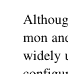

> 本小时的课程仅适用于希望通过电话线路使用拨号连接接入互联网的读者。希望使用 DSL 或电缆调制解调器接入互联网，或仅需连接到现有以太网网络的读者，应遵循第13小时，“将 FreeBSD 连接到现有网络”中的程序。

在本小时中，您将学习如何执行以下操作：

- 使用 FreeBSD 选择 ISP。
- 使用用户 PPP 配置拨号互联网连接。

### 选择互联网服务提供商

在为 FreeBSD 选择互联网服务提供商（ISP）时，需要考虑的因素比为 Windows 或 Macintosh 选择提供商时更多。许多 ISP 从未听说过 FreeBSD、Linux 或其他操作系统；或者即使听说过，也没有为其提供官方支持。而 Windows 和 Mac 用户通常可以获得逐步教程和定制的安装程序，对于 FreeBSD，您将不得不自行承担更多设置和配置的工作负担。如果能找到官方支持 FreeBSD 的 ISP，那将是一个很大的优势。然而，这样的 ISP 很少见。

好消息是，由于 FreeBSD 是一个支持所有标准网络协议的操作系统，即使连接到没有官方支持该平台的 ISP 也应该不会有困难。在本小时中，您将学习需要了解的知识，以便使该过程无缝进行。然而，当出现问题时，您在技术支持方面可能只能靠自己。

总体而言，最好避免所谓的在线服务，如 AOL 和 MSN。让这些服务与 FreeBSD 配合工作可能极其困难（在某些情况下甚至不可能），因为这些服务通常需要只能在 Windows 或 Macintosh 上使用的专用软件。NetZero 目前也无法与 FreeBSD 配合使用，因为其服务需要专用软件。

向您的 ISP 询问的一些一般性问题包括以下内容：

- **是否可以获得无限且不限流量的访问？** 如今几乎所有 ISP 都有无限访问，因此这很少是个问题。但是，请检查并确认。您不希望出现用完每月 150 小时的配额后，每超出该限制使用一小时就被收取高昂的按小时费用的情况。
- **您的用户与电话线路比例是多少？** 该数字也称为“用户调制解调器比率”，它告诉您 ISP 总共有多少客户，以及通常同时拨入的有多少。如果 ISP 的客户很多而电话线路不足，您在尝试连接时会遇到很多忙音。ISP 行业的典型比例是 6:1；较高的比例（如 10:1）可能会有问题。
- **您有多少上行带宽？** 这是 ISP 连接到互联网骨干网的大小。ISP 如果订阅用户众多而上行带宽不多，会导致连接速度缓慢。对于小城镇 ISP，请确保至少有两条 T1 线路可用。（T1 线路为 1.5Mbps。）对于拥有数千名订阅用户的<|message|>大型企业 ISP，多条 T3（45Mbps）或更大的线路是必需的。
- **您提供哪些增值功能？** 许多 ISP 会免费赠送额外的电子邮件地址或在其 Web 服务器上为个人网站提供的空间。如果您想要这些功能，请了解它们是否可用，是否需要额外收费，以及收费多少。

在找到合适的 ISP 后，请确保您拥有以下信息：

- 连接互联网所需拨打的电话号码。
- 您的登录名和密码。
- 您的 ISP 使用的身份验证类型。通常这将是 CHAP 或 PAP，尽管一些较旧的系统仍可能使用 shell 登录。（目前不必担心这意味着什么；我们将在本小时后面介绍各种身份验证方法。）如果您交谈的人不知道使用的是什么身份验证，FreeBSD 和您 ISP 的服务器可能可以即时协商兼容的身份验证，因此可能不会成为大问题。
- 您拥有的是静态 IP 地址还是动态 IP 地址。很可能您拥有动态 IP 地址。但如果您拥有静态地址，请确保您知道该地址是什么。
- 您 ISP 的主域名系统（DNS）服务器和辅助域名系统服务器的 IP 地址。这些服务器由您的 Web 浏览器等用于查找网站的地址。

### 调制解调器信息

接下来您需要获取的是有关调制解调器的信息。通常，您只需要知道调制解调器位于哪个通信端口。如果您不知道，并且安装了 Windows，您可以检查“电话和调制解调器选项”控制面板中的“调制解调器”选项卡，并找到任何已安装调制解调器的通信端口。

下表显示了 Windows COM 端口及其 FreeBSD 等效项：

| Windows | FreeBSD |
|---|---|
| COM1 | cuaa0 |
| COM2 | cuaa1 |
| COM3 | cuaa2 |
| COM4 | cuaa3 |


FreeBSD 需要“真正的”基于硬件的调制解调器。在许多较便宜的调制解调器中（如今从工厂安装的系统通常就是这种类型），为了节省构建调制解调器的成本，调制解调器的许多功能已被移至软件。不幸的是，这些通常被称为 WinModems 的调制解调器通常只能与 Windows 配合使用。如果您拥有 WinModem，您可能无能为力，如果想在 FreeBSD 上使用拨号连接，您将不得不购买不同的调制解调器。

如果您喜欢冒险，您可能想了解一下 ltmdm 端口（/usr/ports/comms/ltmdm）；它是一个用于 Lucent WinModem 芯片组的第三方 Linux 驱动程序，结合了 FreeBSD“shim”。如果您别无选择，值得一试。

### 配置拨号互联网连接

在获得所有所需信息后，您就可以配置连接了。您的互联网连接将使用一种称为点对点协议（PPP）的方法。这是目前使用最广泛的通信协议之一，可让互联网格式的流量通过拨号电话线路传输。

### 设置 DNS 服务器

首先要做的是告诉 FreeBSD 您 ISP 的 DNS 服务器地址。这在文件 /etc/resolv.conf 中配置。以下是它的示例：

```
domain myisp.com
nameserver 111.111.11.1
nameserver 222.222.22.2
```

请注意，您需要以 root 身份登录才能编辑此文件。

第一行包含您 ISP 的域名。例如，如果您使用 EarthLink（一个受欢迎的全国性提供商）作为您的 ISP，您在此处列出的域名将为 earthlink.net。

第二行和第三行包含您 ISP 的主 DNS 服务器和辅助 DNS 服务器。将 111.111.11.1 和 222.222.22.2 分别替换为您 ISP 提供的首选和次选地址。完成后，保存文件并退出编辑器。

完成 /etc/resolv.conf 文件的编辑后，您就可以配置连接了。FreeBSD 可以通过两种方式通过拨号连接连接到互联网。我们将在本书中介绍的方法称为内核 PPP。它比另一种称为用户 PPP 的方法效率稍高。

### 配置内核 PPP 的选项文件

内核 PPP 的大部分配置都在文件 /etc/ppp/options 中完成。以下是示例文件可能的样子：

```
/dev/cuaa0 115200
crtscts
modem
connect "/usr/sbin/chat -f /etc/ppp/chat.script"
noipdefault
silent
domain myisp.com
defaultroute
user foobar
name foobar
```

以下是每行的含义。

/dev/cuaa0 115200—此行指示调制解调器所在的设备。您应该在收集调制解调器信息时就已弄清楚这一点。在本例中，正如我们前面指出的，cuaa0 对应于 Windows 中的 COM1。该行的第二部分（115200）表示计算机与调制解调器之间的串行通信速率。除非您拥有非常旧的系统，否则 115200 应该可以正常工作。如果遇到奇怪的问题，您可以尝试将其降低到 57600。

crtscts—此行打开调制解调器的硬件流控制。硬件流控制对于高速通信可靠工作是必需的；因此此行是必需的。

modem—此行告诉 FreeBSD 它应使用调制解调器控制线。

connect "/usr/sbin/chat -f /etc/ppp/chat.script"—此行指定连接时运行的“调制解调器脚本”。它调用 chat 程序，这是一种让 FreeBSD 与调制解调器通信的简单方法。该行的第二部分（/etc/ppp/chat.script）告诉 chat 程序应读取和执行的调制解调器脚本的名称。我们尚未创建此脚本，但它将包含调制解调器拨号的电话号码以及其他选项。

noipdefault—此行表示您的 ISP 未分配静态 IP 地址，您正在使用动态 IP 地址。大多数拨号用户将具有动态

IP 地址，因此应包含此行。如果您的 ISP 已为您提供静态 IP 地址，请在 noipdefault 行的位置包含如下行：

```
111.111.111.11:222.222.222.22
```

数字 111.111.111.11 应替换为您 ISP 分配给您的静态 IP 地址。数字 222.222.222.22 应替换为您 ISP 提供的网关地址。如果您的 ISP 未提供网关地址，请省略第二个数字，但确保第一个数字末尾仍保留冒号。

silent—此行告诉系统在建立连接时等待链路控制协议 (LCP) 数据包。这是一个有用的性能优化，尽管其含义较为晦涩。

domain mysp.com—您的 ISP 的域名应填在此处。（例如，如果您的 ISP 是 EarthLink，请将 mysp.com 替换为 earthlink.net。）

defaultroute—这意味着在互联网连接处于活动状态时，将在路由表中添加默认路由。该路由为您提供发送和接收互联网流量的方式。

user foobar—这对应于我们稍后将在另一个文件中创建的配置文件，其中包含您 ISP 的登录名和密码。foobar 对应于我们将在其他文件中列出的用户名。

name foobar—name 选项将本地机器的名称设置为 foobar，用于使用 pap-secrets 和 chap-secrets 文件进行身份验证，我们稍后会介绍。

保存 options 文件后，您接下来需要创建在 options 文件中引用的 chat.script 文件。与 options 文件一样，chat.script 应位于 /etc/ppp 目录中。

## 创建 Chat 脚本

如前所述，chat.script 文件包含指示 FreeBSD 如何连接到您 ISP 的指令。其主要功能是拨打电话号码。下面是一个示例 chat.script 文件。在 /etc/ppp 中，使用文本编辑器创建一个名为 chat.script 的新文件，并在单行中输入以下文本：

```
ABORT BUSY ABORT 'NO CARRIER' '' AT OK ATDT5551212 CONNECT ''
```

该脚本的语法相当奇怪，但幸运的是您可能不需要对其进行太多（如果有的话）修改。翻译成英文，这里是脚本告诉调制解调器的内容：

- 如果调制解调器响应为 BUSY（拨打的号码忙）或 NO CARRIER（连接丢失），脚本将 ABORT。
- 脚本向调制解调器发送 AT 命令，其缩写为 ATTENTION。然后等待调制解调器响应 OK。
- 调制解调器响应 OK 后，脚本拨打电话号码 5551212。此号码当然应替换为您 ISP 提供的电话号码。ATD 代表 ATTENTION DIAL，T 告诉调制解调器使用 Touch-Tone 拨号。如果您拥有不支持 Touch-Tone 的老式电话系统，可以改用 ATDP，这会告诉调制解调器使用脉冲或旋转式拨号。
- 脚本等待调制解调器响应 CONNECT。

保存 chat.script 文件并退出编辑器。我们至少还需要创建一个文件——可能两个文件。这些文件包含您登录 ISP 所需的 PAP 或 CHAP 身份验证信息。

## pap-secrets 和 chap-secrets

/etc/ppp/pap-secrets 和 /etc/ppp/chap-secrets 文件分别包含 Password Authentication Protocol (PAP) 和 Challenge-Handshake Authentication Protocol (CHAP) 身份验证的身份验证信息。如果您的 ISP 告诉您它使用哪种形式的身份验证，您只需创建对应于该类型身份验证的文件即可。如果您不知道 ISP 使用哪种形式的身份验证，您将需要创建两个文件。

两个文件只需要包含一行，其格式如下：

`loginname * password`

在之前的示例 options 文件中，我们为 name 行提供的登录名是 foobar，因此 chap-secrets 或 pap-secrets 中的这一行应读作

`foobar * password`

当然，您需要将 password 替换为您 ISP 的登录密码。分隔用户名和密码的星号意味着此条目适用于任何主机。

输入此行后，保存一个或两个文件（pap-secrets 和 chap-secrets）并退出文本编辑器。


> 因为 pap-secrets 和 chap-secrets 文件包含您 ISP 的密码，因此它们应仅对 root 用户可读。这可以通过设置文件权限来实现，如下所示：chmod 600 pap-secrets 或 chmod 600 chap-secrets。如果不这样做，系统上任何拥有账户的人都可以获取 ISP 密码！

## 启动 Internet 连接

您现在应该准备好启动 Internet 连接了。为此，以 root 用户身份在命令提示符下输入 `pppd`。您的调制解调器应拨号并连接到 Internet。要断开 Internet 连接，只需终止 `pppd` 程序即可。`killall pppd` 命令即可解决问题。如果不起作用，本小时末尾的“Troubleshooting the Connection”部分可以帮助您。

## 按需拨号

如果您希望系统在请求 Internet 资源且连接尚未建立时自动连接到 Internet（例如，您在 Web 浏览器中输入网页地址），您可以设置按需拨号。为此，您只需在 `/etc/ppp/options` 文件中再添加两个选项。以下是相关选项：

- **demand** — 此选项打开按需拨号功能。
- **idle n** — 此选项确定在 FreeBSD 挂断调制解调器之前，连接可以空闲（即无进出流量）多长时间。*n* 是以秒为单位的值。

请注意，要使此功能生效，您仍需要在打开计算机后启动 `pppd` 程序。如果您希望每次启动系统时自动加载 `pppd` 程序，请在目录 `/usr/local/etc/rc.d` 中创建一个名为 `ppp` 的文件，其中包含单行 `pppd`。这将导致每次计算机启动时 `pppd` 程序自动加载。

## 持久连接

如果您希望 FreeBSD 在连接丢失时自动重新拨号，您可以在 `/etc/ppp/options` 中添加一行 `persist`。基本上，这将使您的 Internet 连接始终保持开启；因此，您的电话线路也将始终被占用。


> 即使在不使用时也让系统全天候连接到 Internet，可能会导致您的 ISP 取消您的账户，即使您拥有无限访问权限。或者他们可能会要求您购买所谓的专用线路，这将比标准 Internet 连接花费多得多。
> 
> 另一个问题是，始终在线的系统也更容易受到黑客攻击。请注意——始终在线的连接会带来重大风险！

## 连接和断开时自动运行命令

两个名为 /etc/ppp/ip-up 和 /etc/ppp/ip-down 的文件可让您在每次分别连接到 Internet 和断开连接时自动运行命令。只需在这些文件中放置您想要运行的命令列表即可。ip-up 脚本的简单示例如下：

```
apachectl start
echo "My network connection is up! Web server started."
```

一个特别有用的例子是笔记本电脑用户希望离线阅读和回复电子邮件，然后在下次连接到 ISP 时自动发送所有撰写的电子邮件。这可以使用 Fetchmail 程序完成，该程序可在 ports (/usr/ports/mail/fetchmail) 中获得。

## 故障排除连接

有几件事可能导致您的 Internet 连接无法正常工作。以下是一些最常见的问题及其潜在解决方案。

### 调制解调器从未拨号

- 确保您已为调制解调器选择了正确的通信设备。
- 尝试将 options 文件第一行中的速度从 115200 降低到 57600。
- 查看您的调制解调器手册，看看它是否期望某种特殊的初始化字符串。如果是，您可以在 chat.script 文件中提供它；如果您的调制解调器的初始化字符串例如是 AT&F，您可以在脚本中 ATZ OK 部分之后立即添加字符串 AT&F OK。


-   确保你的调制解调器不是 WinModem。检查计算机的文档以确定调制解调器制造商和芯片组；如果它是 Lucent WinModem，你可能能够使用前面讨论过的 ltmdm 端口使其工作；不过，你最好还是换成真正的、标准的基于 UART 的调制解调器。

## 调制解调器拨号但从未建立连接

-   确保你使用的是正确的登录名和密码。另外，不要将你的 FreeBSD 登录名和密码与你的 Internet 登录名和密码混淆。它们不是同一个。
-   确保你使用的是 ISP 所期望的正确认证类型。如有疑问，请同时创建 pap-secrets 和 chap-secrets 文件，以确保你的系统能够处理 ISP 请求的任何认证。
-   如果你有静态 IP 地址，请确保在 /etc/ppp/options 中使用的是正确的地址。
-   查看你的调制解调器手册，看看它是否需要特殊的初始化字符串。如果需要，你可以在 chat.script 文件中提供它；例如，如果你的调制解调器的初始化字符串是 AT&F，你可以在脚本中 ATZ0K 部分之后添加字符串 AT&F0K。
-   如果你有 Windows 或其他系统可用，看看是否能从那里建立连接。如果不能，并且联系技术支持也未能解决问题，可能值得联系你的电话公司，看看电话线路是否有问题导致线路噪声过大。线路噪声过大的另一个症状是定期无明显原因的断开连接。

如果你拨号使用的电话线也用于语音通话，嘈杂的线路也会导致语音通话出现杂音；这就是判断线路质量的一种方式。

## 调制解调器建立了连接，但在连接建立后你无法访问任何网站等等

-   确保你在 /etc/resolv.conf 中列出了 ISP 的正确 DNS 服务器。
-   检查 /etc/host.conf 文件并确保它包含一行 hosts 后面跟着一行 bind，如下所示：
```
# $FreeBSD: src/etc/host.conf,v 1.6 1999/08/27 23:23:41 peter Exp $
# First try the /etc/hosts file
hosts
# Now try the nameserver next.
bind
```
-   如果你有静态 IP 地址，请确保在 /etc/ppp/options 中使用的是正确的地址。
-   如果你的 ISP 给了你一个网关地址，请确保它列在你的 IP 地址后的冒号后面，并且确保它是正确的地址。

## 按需拨号有时即使你没有尝试使用 Internet 也会拨号调制解调器

-   这意味着后台运行的某个程序可能正在尝试连接 Internet。很可能罪魁祸首是电子邮件系统的一个或多个部分。有关如何停止此行为的信息可在第 23 小时找到。

## 即使你在 options 文件中设置了空闲值并且未使用 Internet，Internet 连接也从未断开

-   这通常是由导致前一个问题的相同原因造成的。很可能电子邮件系统的某个部分会定期轮询 ISP 处的邮件服务器——从而导致连接保持开启。有关如何停止此行为的信息可在第 23 小时找到。

## 摘要

本小时的课程涵盖了当通过调制解调器将 FreeBSD 机器连接到 Internet 时你需要具备的基本知识。FreeBSD 设置 PPP 连接并不像 Windows 或 Mac 那样容易，也不能确定你账户所在的 ISP 是否能够帮助你排查连接问题。然而，无论平台如何，PPP 就是 PPP；只要稍加试验和调整，你的 FreeBSD 机器就能像更流行的平台一样有效地利用 PPP。

## 问答

### Q 我的 ISP 说它支持 Linux，但不支持 FreeBSD。我该怎么办？

A 认为自己很幸运。大多数 ISP 甚至不会对 Linux 用户提供帮助；不过他们通常没有意识到，就 PPP 而言，Linux 和 FreeBSD 的行为几乎相同。实现细节可能有所不同，但至少你知道 ISP 不依赖基于 Windows 的软件来让你连接。这就是你真正需要担心的一切。

### Q 为什么它被称为“kernel PPP”？

A FreeBSD 实际上支持两种 PPP 连接：kernel PPP 和 user PPP。本小时讨论 kernel PPP 是因为它更直接，而且 PPP 支持默认内置于 FreeBSD 内核中；然而，如果你使用的是从内核中移除了 PPP 支持的 FreeBSD 机器，你也可以使用 user PPP 来进行拨号连接。详情请参阅 man ppp 页面。

### Q 如何为按需拨号或持久连接设置重拨选项？

A 这仅适用于使用 user PPP 的情况。如果你使用的是 user PPP，你可以使用 set redial 选项为重拨行为创建“配方”。有关更多信息，请参阅 man ppp 页面。

## 工作坊

在本互动部分，你将获得一个测验和一些练习，以帮助巩固你对 FreeBSD 中拨号网络的理解。

### 测验

1. DNS 服务器地址应列在哪个文件中？
   A. `/etc/nameservers`
   B. `/etc/dns`
   C. `/etc/resolv.conf`
   D. `/etc/ppp/resolv.conf`
   E. `/etc/ppp/nameservers`

2. 以下哪个文件包含连接到 ISP 所需的大部分信息？
   A. `/etc/internet.conf`
   B. `/etc/ppp.conf`
   C. `/etc/ppp/options`
   D. `/etc/ppp/internet.conf`
   E. None of the above

3. 以下哪个文件包含 ISP 的用户名和密码认证信息？
   A. `/etc/passwd`
   B. `/etc/ppp/pap-secrets`
   C. `/etc/ppp/passwords`
   D. `/etc/ppp/passwd`
   E. There is no file with this information

### 测验答案

-   1. 正确答案是 C。
-   2. 正确答案是 C。
-   3. 正确答案是 B。注意选项 A。该文件确实存在，但它包含的是本地 FreeBSD 系统的信息，而不是 Internet 连接的信息。

### 练习

-   1. 尝试设置 user PPP 而不是 kernel PPP。然后，尝试 ppp -auto 模式并创建重拨配方——例如，尝试设置 PPP 重拨十次，第一次拨号尝试间隔一分钟，每次尝试之间的间隔每次增加三十秒。
-   2. 设置一个 ip-up 脚本，启动 Web 服务器，启动你的邮件程序，并下载某个网页。创建一个 ip-down 脚本，关闭 Web 服务器，终止你的 Web 浏览器和邮件程序，并向所有已登录用户打印一条消息，告知他们网络已关闭。这最后一条有什么问题？除非他们通过以太网卡登录到本地网络，否则其他人看不到它。


## 第 15 小时

### 网络安全

很久以前（相对而言——在计算机年里很长一段时间），你不必太担心计算机系统的安全。基本上，你的计算机的安全性与它所在的建筑物的安全性一样。如果有人进不了建筑物，他就无法访问你的计算机和存储在其上的任何信息。

然而，随着网络的出现，特别是 Internet 的出现，一切都发生了变化。如今，你的计算机可以锁在保险库里，如果它有网络连接，仍然容易受到外部入侵者的攻击。如果它有 Internet 连接，它可能受到世界另一边的人的攻击。因此，网络安全比以往任何时候都更重要。

在本小时，你将学习：

-   如何确保密码安全
-   如何控制远程登录并提高允许远程登录的安全性
-   如何配置基本防火墙
-   如何确保控制台安全


## 确保密码完整性

黑客访问系统最常见的方法之一就是简单地获取有效的用户名和密码组合，然后用它登录。这种方法之所以有效，是因为大多数公司没有充分教育员工了解密码安全的重要性以及黑客经常用来窃取密码的方法。接下来将讨论密码最常见的问题，以及黑客用来窃取密码的方法。

## 弱密码

弱密码符合以下一项或多项标准：

- 它们太短。
- 它们很容易被猜到。
- 它们是可以在字典中找到的单词。

当然，密码太短的问题在于，通过随机猜测得到正确密码的几率更大。黑客相对容易获取或编写一个程序来自动化此过程，并简单地尝试随机密码，直到找到一个可用的密码为止。

使用字典中可以找到的单词作为密码也存在类似问题。存在密码破解程序，它们只需遍历字典并尝试单词，直到找到一个可用的密码为止。

最常见的密码弱点可能是容易被猜到的密码。最极端的形式包括使用“password”一词作为密码（你会惊讶有多少人真的想这么做）、使用登录名作为密码，或使用当前月份或季节作为密码。

没那么糟糕，但仍然非常不安全（而且非常常见），是使用孩子或宠物的名字、出生城市，或其他很多人知道你的信息，或相对容易查到的信息。Dumpster diving 这一技术之所以得名，是因为它有时 literally 涉及潜入办公楼外的垃圾箱，寻找包含某人个人信息的丢弃文件，黑客有时会采用这种方法来寻找可能用作密码的信息。

最好也不要忽视“社会工程学”问题——无论出于善意还是恶意，都说服人们交出他们的密码和敏感数据。今天使用和未来计划使用的许多安全系统都建立在“可信系统”的概念之上——在这种系统中，环境被假定为安全，并且鼓励人们非常自由地分享信息。如果安全感在任何方面都是虚假的，这可能是最严重的所有风险。

## 写下密码

另一个相当常见的许多人都会犯的安全问题是写下密码并将其放在黑客很可能寻找的地方。不，黑客并不愚蠢。他们寻找密码的第一处就是键盘底部或桌子底部，而很多人似乎就是在那里“隐藏”他们的密码——这和把家里的钥匙放在门垫下一样不明智。更糟糕的是，令人惊讶的是也很常见，有人把密码写在便签上然后贴在显示器框架上。密码不应该被写下来。话虽如此，我知道很多人会无视这一点并仍然写下密码。所以如果你必须写下密码，至少把它放在钱包里或其他不容易被别人偷走的地方。当然，如果你这么做并且钱包被偷了，你会想要立即更改密码。

尝试将密码嵌入到其他信息中，例如地址，这样就无法分辨什么是密码、什么不是。你不一定非要智胜世界上所有狡猾的黑客；你只需要比平均黑客目标更聪明地对待密码即可。

## 什么构成一个好的密码？

既然我们已经讨论了所有使密码变坏的东西，什么使一个密码变好呢？一般来说，一个好的密码应具有以下特征：

- 它应至少为六个字符长。
- 它应包含大小写字母的混合。
- 它应至少包含一个数字。
- 它应至少包含一个非字母数字字符（$、! 等）。

当然，正如前面提到的，一个好的密码不应该是字典里的单词，不应该是容易被猜到的东西，也不应该是关于你的容易被查到的东西。然而，密码是你能记住的东西也很重要。选择过于复杂的密码会诱使你把它写在某个地方，而你想避免这种情况。

一种常用的密码开发技术是选择一个喜欢的句子或歌曲标题，并使用其中每个单词的首字母。然后，将字母 S 替换为 $，A 替换为 @，依此类推。

## 注意可疑活动

有人说所有好的服务器管理员都有一点偏执，但就安全而言，这可能是一件好事。注意任何可疑的电话或办公室内外任何可疑活动。还要确保其他员工也接受过这方面的教育。向适当的人员报告任何可疑活动。以下是几种常见的“社会工程学”策略，你应该非常怀疑。

第一种是有人声称来自计算机或 IT 部门，打电话声称正在测试用户账户、升级账户、为你的账户添加新功能等等，并要求你提供用户名和密码。永远不要向声称是系统管理员或 IT 人员的来电者透露你的用户名和密码。记住，系统管理员可以通过使用 su 命令在不需要你的密码的情况下以你的身份登录。因此，系统管理员根本没有理由 ever 向你索要密码来做任何事情。基本上，他不需要它。

第二个需要注意的是办公室里或附近任何声称正在进行几乎任何主题调查的人（最喜欢的食物、最常见的宠物名字等等）。甚至孩子在这里也是风险。事实上，他们往往风险更大，因为人们不会怀疑他们，而且他们有时会声称这是为了学校项目之类的事情。这是黑客获取个人信息的相当常见的方法，他们稍后可以搜索这些信息以寻找潜在密码。

## 远程登录问题

当然，通过网络允许对服务器进行远程登录会显著增加安全风险。然而，有时用户需要能够远程登录到服务器。如果确实需要允许远程登录，可以做一些事情使其尽可能安全。我们接下来将逐一查看这些内容。

## Telnet

Telnet 是一种非常原始的允许远程登录到服务器的方法。它真的应该被认为已过时，即使它仍然被广泛使用。Telnet 的主要安全问题是它对用户远程登录时密码的传输不做任何加密。因此，任何嗅探流向你的服务器的网络流量的人都可以相对容易地获得登录名和密码组合。

由于 telnet 固有的安全问题，我们在这里不会讨论其配置，除了说它应该被认为已过时并且不应该使用。要确保 telnet 确实已禁用（在现代 FreeBSD 版本上默认已禁用），请查看文件 /etc/inetd.conf 并确保对 telnetd 的任何引用都被注释掉了。

## rlogin

rlogin 是另一种用于远程登录系统的旧协议。与 telnet 一样，它正逐渐被 SSH 取代，因为它有相同的基本问题。虽然 rlogin 确实有有时不需要在网络上传输密码的优势，但它仍然不加密网络流量。再次由于这一点，我们在这里不会介绍 rlogin。

## SSH

SSH 代表 Secure Shell，是 Telnet 和 rlogin 迅速过时的主要原因。SSH 提供像 Telnet 一样的远程登录服务。然而，与 Telnet 不同，SSH 加密连接，因此嗅探你网络流量的人无法读取密码。要在 FreeBSD 上通过 SSH 启用远程登录，请在你的 /etc/rc.conf 文件中添加以下行：

```
sshd_enable="YES"
```

当然，此更改在系统重新启动之前不会生效。

要从另一台 FreeBSD 机器（或安装了 SSH 的任何其他 UNIX 机器）登录系统，只需发出如下命令：

```
ssh lion.simba.org
```

SSH 然后会提示你输入密码。

请注意，SSH 假定你在远程系统上的登录名与你使用 SSH 的系统上的登录名相同。如果不是这种情况，你需要在命令行上指定登录名。你可以通过指定登录名，后跟 @ 符号，然后是你要登录的系统的主机名来做到这一点。例如，

```
ssh foobar@lion.simba.org
```


## 配置基本防火墙

防火墙是一个旨在控制对计算机或网络的访问以及从计算机或网络的访问的系统。其两个主要任务是防止未经授权的外部用户访问计算机或网络（或其部分），以及防止内部用户访问网络外部。换句话说，它可以阻止内部用户访问互联网、某些互联网服务或互联网的某些部分。

图 15.1 显示了防火墙相对于内部网络（LAN）和世界其他地区（互联网）的位置示意图。还存在一个 DMZ（“非军事区”）；这是防火墙机器上的第三个端口，通向与其它机器物理上位于同一局域网的机器，但从逻辑上（相对于防火墙）属于外部互联网。这里就是 Web 服务器、邮件服务器等所在的位置。

图 15.1
提供防火墙服务的网关机器示意图。

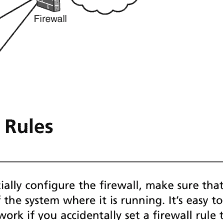

## 创建防火墙规则


> 初始配置防火墙时，请确保您能够访问运行它的系统的控制台。如果不小心设置了一条拒绝您自身访问的防火墙规则，很容易将自己锁定在自己的网络之外。默认情况下，首次启用防火墙时会拒绝所有内容。当然，如果您被锁定，则在获得对系统控制台的物理访问权限之前将无法再次访问任何内容。

在启用防火墙之前，您需要为其创建一个配置文件，其中包含您希望防火墙强制执行的规则。您可以使用两种基本防火墙设计：

- 拒绝所有未明确允许的内容。这是构建防火墙最安全的方式。
- 允许所有未明确拒绝的内容。这安全性较低，但在仅希望阻止一两个端口或 IP 地址/主机访问网络时可能是有效的。

为了创建一组防火墙规则，我们将创建一个文本文件来保存它们。此文件可以命名为任意名称并存储在任意位置，但在此我们假设您使用的文件是 /usr/local/etc/firewall.conf。

基本上，防火墙规则按以下顺序包含以下信息：

- 1. **要执行的操作。** 这可以是关键字 allow 或关键字 deny，用于确定对后续规则应执行的操作。
- 2. **规则适用的流量类型。** 这可以是 tcp、udp 或 icmp 等网络协议。也可以是关键字 all；如果是这样，规则适用于所有类型的网络流量。
- 3. **流量的来源。** 这可以是特定的 IP 地址、主机名或域名。也可以是关键字 any；如果是这样，它适用于来自任何主机的流量。
- 4. **流量的去向。** 这可以是规则适用的网络上系统的主机名或 IP 地址。也可以是关键字 any；如果是这样，规则将适用于网络上的所有系统。
- 5. **可选的端口号。** 如果存在，规则将仅适用于该网络端口。如果不存在，规则将适用于所有端口。

以下是可放入此文件的一组防火墙规则示例。

```
add allow tcp from any to www.simba.org 80
add allow all from lion.simba.org to www.simba.org
add 65000 deny all from any to any
```

最后一条规则被特别分配了一个编号，因为这样您可以在不必重置整个防火墙的情况下动态添加防火墙规则。下一段解释了为什么会出现这种情况。

请注意，规则是按顺序读取的。换句话说，防火墙遇到的第一个与发送或接收的流量匹配的规则将被应用。如果这看起来令人困惑，以下规则集可能会澄清问题：

```
add deny all from any to any
add allow tcp from any to www.simba.org 80
add allow all from lion.simba.org to www.simba.org
```

即使此集合中存在与前一个集合相同的规则，此规则集的结果也将与预期结果大不相同。这是因为第一条规则将匹配所有流量；因此，接下来的两条规则将被忽略并应用第一条规则。当然，这意味着由于第一条规则适用于所有流量（包括 lion.simba.org），流量将被拒绝——即使后面两条规则允许它。正如您所见，规则集中的规则列出顺序非常重要。

先前给出的第一组规则是“拒绝所有未明确允许的内容”策略的示例。以下给出了“允许所有未明确拒绝的内容”策略的工作示例。

```
add deny all from nasty.hacker.org to any
add deny all from any to www.simba.org 80
add 65000 allow all from any to any
```

在这种情况下，除了来自 nasty.hacker.org 的流量外，所有流量都被允许，该流量被拒绝访问此防火墙后面的所有系统。此外，如果流量指向端口 80，则从任何系统发出的所有流量都将被拒绝访问 www.simba.org。（端口 80 通常是 Web 服务器可能运行的位置。换句话说，此规则将产生阻止任何尝试访问 Web 服务器端口的效果。）

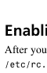

> 将防火墙规则文件设置为只能由 root 用户访问是一个好主意。让其他用户知道系统使用哪些防火墙规则会带来一定的安全风险。例如，如果黑客能够获得防火墙允许访问网络的 IP 地址，他可能会伪造该 IP 地址，从而欺骗防火墙使其认为流量来自授权系统，而实际上并非如此。

## 启用防火墙

在保存防火墙配置文件后，您需要配置 /etc/rc.conf 文件以启用它。这可以通过添加以下两行来完成：

```
firewall_enable="YES"
firewall_type="/usr/local/etc/firewall.conf"
```

添加这两行后，重新启动系统。请记住确保您能够访问控制台，以防您不小心弄乱规则文件，导致系统重新启动并启动防火墙后将自己锁定在自己的系统之外。如果防火墙正确启动，系统重新启动时您应该会看到类似以下内容：

```
Kernel firewall module loaded
Flushed all rules.
00100 allow tcp from any to www.simba.org 80
00200 allow all from lion.simba.org to www.simba.org
65000 deny all from any to any
Firewall rules loaded, starting divert daemons.:
```

请注意，本节仅涵盖了非常基本的防火墙配置。防火墙配置中还可以使用更多配置选项。要了解有关配置防火墙的完整信息，请参阅 ipfw 手册页以及位于 www.freebsd.org/handbook 的在线手册。

## 保护控制台

保护物理服务器控制台本身涉及物理安全和软件上的安全设置。理想情况下，您的服务器应锁在只有受信任管理员可以访问的房间中。但是，在小型办公室中这并不总是可行的。然而，默认情况下，FreeBSD 允许在单用户模式下无需提供密码即可通过控制台访问 root。如果服务器无法物理保护，则必须更改此设置。这是通过编辑文件 /etc/ttys 来完成的。查找以下行：

```
console none    unknown off secure
```

将其更改为以下内容：

```
console none    unknown off insecure
```

这将防止 FreeBSD 在未提供密码的情况下允许某人启动到单用户模式。请确保您不会对术语感到困惑，这 admittedly 有点令人困惑。当控制台设置为 insecure 时，实际上在访问 root 账户方面使控制台更安全。基本上，insecure 与 secure 指的是控制台的物理安全性。将控制台设置为 insecure 会增加 FreeBSD 的一些安全选项，以弥补物理控制台安全性的不足。


> 请注意，即使在保护好控制台之后，拥有物理访问权限的人仍有可能从软盘或 CD-ROM 启动并在不输入密码的情况下获得系统 root 访问权限。为防止这种情况，请确保将计算机的 CMOS 设置实用程序配置为禁用从软盘驱动器和 CD-ROM 驱动器启动。尽管如此，这仍然不能保证安全，因为拥有物理访问权限的人可以重新更改 BIOS 设置。

> 请记住，简单地说，如果没有物理访问的保证，绝对的安全是不可能的。

## FreeBSD 中的安全漏洞

FreeBSD 是目前较为安全的操作系统之一。然而，不可避免的是，有时会出现安全问题，从而允许攻击者入侵你的系统。因此，保持系统更新并订阅 freebsd-security 邮件列表非常重要，该列表会包含有关已发现安全漏洞的公告。要订阅此列表，请向 majordomo@freebsd.org 发送一封邮件，内容为单行：

```
subscribe freebsd-security
```

另外，需要注意的是，你刚安装的 FreeBSD RELEASE 版本可能开箱即带有安全问题，这就是为什么要将系统 cvsup 到 STABLE 很重要。然而，请记住，将系统 cvsup 到 STABLE 只会修复与 FreeBSD 本身相关的安全问题。大多数与软件相关的安全漏洞并非由于 FreeBSD 造成，而是由于在 FreeBSD 上运行的第三方软件存在安全问题。请注意，此第三方软件不会通过 cvsup 过程进行更新。例如，Apache 中的安全漏洞需要你更新或修补 Apache 才能解决问题。

## 摘要

本小时介绍了保护 FreeBSD 系统的一些基础知识。然而，许多与安全相关的问题并未涉及。这些问题包括由 Web 服务器中运行的 CGI 脚本引起的安全问题等。有关基本安全问题的更多信息，请查阅 security 手册页。

## 问答

Q 我听说有些机构（政府机构、研究机构等）要求使用“一次性密码”。我该如何使用它们？

A FreeBSD 有一种称为 S/Key 的机制，允许用户生成一次性密码，每个密码仅使用一次，以响应登录程序发出的“挑战短语”。请查阅 man skey 页面以了解其工作原理的详细信息。

Q 我如何为我的用户保护电子邮件服务？

A POP3 和 IMAP 流量都是用户常见的邮件传输形式，可以使用名为 stunnel 的守护进程进行加密（可在 ports 中的 /usr/ports/security/stunnel 获取）。该守护进程创建一个安全的“隧道”（因此得名），通过它，常规的 POP3 和 IMAP 流量在以与 SSH 流量相同的方式加密后被传输。大多数现代电子邮件程序都支持安全的 POP3 和 IMAP（查找“SSL”开关），因此安装 stunnel 是一个非常好的主意。

Q 一些安全服务，如 Apache 2.0 和 stunnel，提到我需要“安全证书”。这是怎么回事？

A 如果你希望远程用户能够信任服务器发送的加密内容，你需要生成一个证明你就是你所声称的身份的证书。（这是网络安全不可或缺的一部分。）使用 openssl 程序生成证书；该程序的使用非常复杂，但为了生成证书请求（然后你可以将其提交给签名机构，如 VeriSign）的语法是

```
openssl req -new -nodes -out req.pem -keyout /etc/certs/cert.pem
```

这假定你已创建名为 /etc/certs 的目录来存放你的证书。

## 练习

本交互部分列出的测验问题和练习旨在帮助你进一步理解本小时的主题。

### 测验

- 1. 以下哪一个是最好的密码？
- A. ChangeMe
- B. 12345
- C. nospmht
- D. N3v1R$4yD13

- 2. 你应该使用什么程序远程连接到你的 FreeBSD 系统？
- A. Telnet
- B. FTP
- C. SSH
- D. POP3
- E. rlogin

- 3. 保持了解 FreeBSD 中发现的安全漏洞的最佳方法是什么？
- A. 订阅 freebsd-security 邮件列表
- B. 将你的 ports 更新到最新版本
- C. 不要运行你绝对不需要的任何服务
- D. 以上全部
- E. 遮住眼睛希望一切最好

- 4. 有一种安全妥协形式是你绝对无法通过软件来防御的，是什么？
- A. 密码嗅探
- B. 拒绝服务（DOS）攻击
- C. Root 入侵
- D. “字典”攻击
- E. 一个拿着螺丝刀的人

### 测验答案

- 1. 正确答案是 D。信不信由你，其余的都可以被常见软件相对随意地猜到。
- 2. 正确答案是 C。
- 3. 正确答案是 B。
- 4. 正确答案是 D。如果你上网，你 *必须* 保持警惕！
- 5. 正确答案是 E。

### 练习

- 1. 安装 `tcpflow`（可在 ports 中的 `/usr/ports/net/tcpflow` 获取）；使用它查看是否有任何明文流量在你的机器上进出，除了 Web 流量和 SMTP（通常不需要密码）。使用此程序后，管理员可能会面临哪些潜在问题？为什么你可能会选择使用 `tcpdump`（它只打印数据包头，而不是整个数据包）代替？提示：这是一个伦理问题。
- 2. 设计一种为新用户生成随机密码的方案。一个例子是使用 `md5 -s` 从一堆随机按下的输入字符创建哈希字符串；你可以取该哈希输出的前七个字母并将其用作每个用户的随机初始密码。
- 3. 使用 `pkg_version` 实用程序确定哪些已安装的 ports 已过时。确保先同步你的 ports 树！


## 第四部分

### FreeBSD 作为工作站

小时

- 16 命令行应用程序
- 17 配置 X Window 系统
- 18 KDE 桌面环境
- 19 窗口管理器和桌面环境
- 20 X Window 系统中的生产力
- 21 FreeBSD 中的多媒体


## 第 16 小时

### 命令行应用程序

命令行应用程序在当今图形用户界面的世界中似乎是一种相当古老的工作方式。然而，它们仍然非常强大，并且确实有一些优势。首先，它们可以在几乎任何计算机上运行，因为它们不需要很多系统资源。另一个优势是，它们可以从任何具有某种网络访问权限的终端模拟器远程运行，访问你的应用程序所在的 FreeBSD 系统。例如，这意味着你可以将 Windows 或 Macintosh 笔记本带到世界的另一边，连接到互联网，登录到 5,000 英里外的 FreeBSD 系统，并在其上使用应用程序，而无需任何特殊软件。

本小时，你将学习：

- 如何使用 FreeBSD 包含的各种文本编辑器
- 如何使用基于文本的电子邮件应用程序
- 如何使用其他杂项应用程序

### 使用文本

文本编辑器是任何计算机系统所需的最基本应用程序之一。几乎所有操作系统都至少附带一个，通常是几个文本编辑器。例如，Windows 附带记事本和较旧的文本模式 Edit 程序。在 FreeBSD 中，由于许多系统配置都通过基于文本的配置文件处理，因此使用文本编辑器的能力尤其重要。

默认情况下，FreeBSD 安装了两个功能齐全的文本编辑器。第一个是 vi 文本编辑器。vi 是至今仍广泛使用的最古老的 UNIX 文本编辑器之一。它也是最强大的之一。不幸的是，它也有一种相当晦涩难懂且难以学习的声誉。因此，FreeBSD 还提供了一个名为 ee（Easy Editor 的缩写）的编辑器，默认安装。此编辑器对新用户来说更容易学习，因此是我们将首先介绍的编辑器。然而，我们也将介绍 vi，因为它是“通用 UNIX 文本编辑器”。无论你将来要处理哪个版本的 UNIX，你都可以确信 vi 会安装在上面。事实上，在某些 UNIX 系统上，vi 有时可能是唯一安装的编辑器。因此，至少具备基本的 vi 使用能力，对于任何从事 FreeBSD 或其他形式 UNIX 工作的人来说都非常有用。

### ee 编辑器

要启动 ee 编辑器，只需在命令提示符下输入 ee 即可。这将启动编辑器且不加载任何文件。如果你想用文件启动 ee，只需在命令后跟上文件名——例如 ee myfile。如果文件 myfile 存在，它将被加载到 ee 中。如果文件尚不存在，将创建具有该名称的新文件。

图 16.1 显示了 ee 编辑器中加载了一个空白文件。

图 16.1
ee 文本编辑器。
注意顶部方便的速查表，显示了键盘快捷键。


The ^ symbol in front of the menu options is called the caret. It represents the CTRL key. To access the menu options, you press the CTRL key along with the key that follows the caret symbol. Table 16.1 lists some of the less obvious menu options and what they do.

### TABLE 16.1 一些 ee 菜单选项及其相关操作

| 键组合 | 操作 |
|---|---|
| Ctrl+o | 这将弹出一个提示，您可以在其中输入字符的 ASCII 代码。这主要用于输入键盘上没有键的某些外语字符。 |
| Ctrl+c | 这会更改顶部的菜单以显示新的命令列表。您还将在屏幕底部获得一个提示，可以在其中输入要使用的命令的名称。要在不输入命令的情况下退出提示，只需按 Enter 即可。 |
| Ctrl+x | 此选项有些令人困惑，因为它实际上不会弹出提示供您搜索某物。相反，它会重复之前进行的搜索。要启动允许您输入要搜索内容的搜索，请使用 Ctrl+y。 |

请注意列为“上一页”和“下一页”的 ^g 和 ^v。在大多数系统上，您也可以使用 Page Up 和 Page Down 键来实现相同的功能。但是，如果您远程登录到系统，Page Up 和 Page Down 键可能无法正常工作。在这种情况下，CTRL 键替代方案应该可以工作。

您也可以通过按 Esc 键调出菜单窗口。这将弹出一个类似图 16.2 中的窗口

### FIGURE 16.2
ee 菜单窗口。


要导航菜单，您可以按对应于所需选项的字母，或者使用箭头键将光标移动到字母上然后按 Enter 键。

## 配置 ee

正如我们之前提到的，大多数 FreeBSD 配置都通过基于文本的配置文件处理。ee 也不例外。然而，ee 为大多数配置选项提供了基于菜单的界面，因此如果您不想直接编辑配置文件，也可以不用。

配置文件位于您的主目录中，名称为 .ee.init。第一次自定义 ee 设置时，它会自动为您创建。请记住，以句点开头的文件在普通目录列表中是隐藏的，因此除非您使用 ls -a，否则看不到此文件。

要访问设置选项，您可以按 Esc 调出主菜单，然后按 e 访问设置菜单。图 16.3 显示了它的外观。

### FIGURE 16.3
ee 配置设置（模式）菜单。

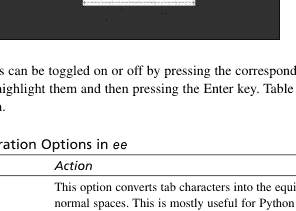

大多数选项可以通过按相应的字母或使用箭头键突出显示它们然后按 Enter 键来打开或关闭。表 16.2 显示了这些选项的含义。

### TABLE 16.2 ee 中的配置选项

| 选项 | 操作 |
|---|---|
| Tabs to spaces | 此选项将制表符字符转换为等量的普通空格。这对于 Python 程序员等主要很有用，其中空白用于分隔代码块。 |

### TABLE 16.2 续

| 选项 | 操作 |
|---|---|
| Case-sensitive search | 默认情况下处于关闭状态。如果打开它，只有与搜索大小写匹配的术语才会被返回。例如，搜索 "unix" 将找不到单词 "Unix." |
| Margins observed | 默认情况下处于关闭状态。这控制编辑器是否自动换行。当打开时，编辑器在达到右边界设置的值时会自动移动到新行。关闭时，每次想要新行时都需要按 Enter 键。 |
| Auto paragraph format | 默认情况下处于关闭状态。打开时，编辑器在您在段落中间插入文本时会尝试自动重新格式化段落。这意味着它将表现类似于文字处理器。 |
| Eightbit characters | 默认情况下处于打开状态。它允许显示扩展字符。扩展字符通常是无法从典型的美国英语键盘生成的外国字符。 |
| Info window | 默认情况下打开。这会导致窗口顶部显示前面图中所示的菜单。如果关闭它，则不会显示菜单。除非您非常熟悉各种键命令，否则应保持开启状态。 |
| Emacs key bindings | 默认情况下打开。基本上，这意味着 ^ CTRL 键序列的行为类似于 Emacs。如果您不知道 Emacs 是什么，不用担心。只需将此选项保持为默认设置即可。 |
| Right margin | 这是右边界所在的列号。默认情况下，它是标准 80 字符基于文本的终端的宽度。如前所述，除非将“观察边距”选项更改为是，否则此设置将被忽略。 |
| 16-bit characters | 这控制 16 位字符在内部如何处理。除非您正在使用中文字符集之类的东西，否则您不必担心此选项。 |

最后的选项允许您保存编辑器配置。当您选择此选项时，系统会询问您是否要将编辑器配置保存到当前目录或主目录。保存到主目录将使设置成为默认编辑器设置。保存到当前目录将使这些设置仅在编辑器从您当前所在的目录启动时适用。这将覆盖由主目录中配置文件提供的默认设置。如果在主目录中找不到 .ee.init 文件，则将使用主目录中 .ee.init 文件中的设置。

## vi 编辑器

如前所述，vi 编辑器是为 UNIX 创建的最早的编辑器之一，至今仍在使用。几乎所有版本的 UNIX 都默认安装了 vi 编辑器。有时，vi 可能是您唯一可用的编辑器，因此了解如何使用 vi 的基本知识是值得的。

不幸的是，vi 有使用非常困难的名声。首先，vi 中的几乎所有命令都是通过一系列不太直观的击键来执行的。那么为什么 vi 如此受欢迎呢？主要原因是，一旦您学会了各种击键，它就非常强大。它也可以非常快，因为命令设置使得最常用的命令可以在手指不必离开主行键的情况下访问。

vi 编辑器可以通过键入 vi 后跟要编辑的文件名来启动。如果文件尚不存在，将创建具有该文件名的空缓冲区。您也可以在不带文件名启动 vi；在这种情况下，它将以未命名缓冲区打开。图 16.4 显示了 vi 编辑器打开空白文件。

### FIGURE 16.4
vi 编辑器窗口。


如果您尝试在编辑器窗口中输入，您会注意到的第一件事是没有任何反应，或者它只是向您发出蜂鸣声。这是因为 vi 当前处于命令模式。您可以使用 o、a 或 i 键将 vi 切换到文本输入模式。这些键在进入文本输入模式之前会执行略有不同的操作：

| 键 | 操作 |
|---|---|
| o | 打开新行然后将光标放在新行的开头以开始输入文本。 |
| a | 在光标当前所在字符之后开始附加文本。 |
| i | 在光标当前所在字符之前插入文本。 |

此外，您可以使用 A 在当前行末尾开始插入文本（注意大小写区别），并使用 O 在当前行上方插入一行并在那里开始插入文本。

要返回命令模式，请按 Esc 键。


要向编辑器输入任何文本，您必须处于文本输入模式（可以使用前面所述的 o、a、i、O 和 A 键进入）。要在 vi 中输入保存文件等任务的任何命令，您必须处于命令模式（可以通过按 Esc 键进入）。

## 在 vi 中导航

在大多数情况下，您可以使用箭头键在 vi 中导航。但是，在某些情况下，远程登录时箭头键可能无法工作。当然，如果您从没有箭头键的终端登录，您也无法使用箭头键。在这种情况下，您需要进入命令模式（按 Escape）并使用以下键进行导航：

| 键 | 操作 |
| --- | --- |
| h | 将光标向左移动一个字符。 |
| j | 将光标向下移动一个字符。 |
| k | 将光标向上移动一个字符。 |
| l | 将光标向右移动一个字符。 |

如果您记不住哪个键向哪个方向移动，以下记忆辅助可能有帮助：

- h 键最靠左，它使光标向左移动。
- j 键看起来有点像向下指向的箭头，它使光标向下移动。
- l 键最靠右，它使光标向右移动。
- k 键是剩下的唯一键，它使光标向上移动。

vi 中还有许多其他移动键。有关完整列表，请参阅 vi 的手册页。

## 在 vi 中搜索

要在 vi 中搜索文本，请进入命令模式然后按斜杠键（/）。在斜杠之后直接输入（不要先按 Enter）您要搜索的字符串并

然后按 Enter。 要重复相同的搜索，只需再次按下斜杠键，但不要跟随任何搜索字符串。 n 键也具有与按下 / 相同的效果。

## 保存文件并退出 vi

表 16.3 显示了可用于保存文件并退出 vi 的命令列表。

### 表 16.3 在 vi 中保存文件并退出编辑器

| Keys | Action |
|------|--------|
| ZZ | 保存当前文件的更改然后退出。 |
| :w | 保存当前文件的更改。 |
| :wq | 保存当前文件的更改然后退出。与 ZZ 效果相同。 |
| :w! | 保存当前文件的更改，覆盖已存在的同名文件。 |
| :wq! | 保存当前文件的更改，覆盖已存在的同名文件，然后退出。 |
| :q | 退出编辑器。如果文件中存在未保存的更改，vi 会抱怨并拒绝退出。 |
| :q! | 强制 vi 退出，即使存在未保存的更改。 |
| :e! | 丢弃您所做的任何更改，并从磁盘重新加载文件至最近保存的状态。 |


其后带有感叹号的命令将强制执行所请求的操作，并在执行操作前不会要求确认。例如，q! 将在文件更改未保存的情况下退出 vi，并且不会询问您是否要保存更改。


一个名为 vim 的改进版 vi 可在 ports 集合中使用。它为 vi 增加了额外功能。一些改进包括如果您是程序员，则对源代码进行彩色语法高亮，以及多级撤销等。

## 电子邮件应用程序

FreeBSD 可用多个基于文本的电子邮件应用程序。同样，这些应用程序相比图形界面电子邮件程序具有一些优势，包括它们需要的资源很少，因为它们不需要窗口系统，并且可以从任何具有某种 FreeBSD 系统访问权限的终端仿真程序远程运行。

Pine 电子邮件客户端最初由华盛顿大学编写，作为给新用户使用的易用电子邮件程序。Pine 是一个递归缩写，代表 Pine Is Not Elm——Elm 是一个较旧的邮件客户端，是 UNIX 上最早的菜单驱动电子邮件客户端之一，但并不是用户友好性的典范。Pine 仍然是 UNIX 上最简单、最用户友好的电子邮件程序之一，并且可在 FreeBSD ports 集合中供您安装。

要启动 pine，只需输入 pine 并按 Enter。图 16.5 显示了 pine 主菜单。

### 图 16.5

Pine 电子邮件程序的主菜单。


当您首次启动 Pine 时，您将处于收件箱中。请注意顶部横跨的状态行。行的右侧会告诉您当前所在的文件夹以及其中包含的消息数量。菜单选项可以通过按下与您想要的菜单项对应的字母来选择，也可以通过使用上下箭头键突出显示您想要的条目然后按 Enter 来选择。请注意，屏幕底部菜单上的选项只能通过按下键盘上突出显示的字母来选择。您不能使用箭头键从此菜单中选择项目。

Pine 的菜单选项相当自解释。一点需要注意的是，如同 ee 编辑器中一样，以插入符号 ^ 开头的菜单选项表示要访问该选项，您需要按住 CTRL 键并按下插入符号后跟的字母。例如，在撰写邮件屏幕中，您使用 Ctrl+x 发送当前正在编辑的消息。

Pine 是最易于使用的电子邮件程序之一，因此也是最受欢迎的之一。它不幸地饱受潜在安全问题的历史困扰。虽然截至本文撰写时，Pine 的所有已知安全问题都已修复，但许多安全专家认为可能还有许多尚未发现的安全问题。FreeBSD 在您安装 Pine 端口时可能会警告您这一点。由于 Pine 的这些潜在安全问题，保持使用最新版本的 Pine 很重要。如果安全性是严重关注点，您可能想查看 ports 集合 mail 类别中的 mutt 客户端。mutt 更安全，也功能强大。然而，mutt 并没有 Pine 那么容易使用，因此如果您将 Pine 拿走并强迫用户使用 mutt，他们可能会发动叛变。

Pine 附带的邮件编辑器称为 pico，可作为独立编辑器使用。遵循 Pine 的传统，Pico 编辑器是 FreeBSD 上最易用的基于文本的编辑器之一。要使用 Pico，您当然必须已安装 Pine。安装 Pine 后，您只需输入 pico 后跟要编辑的文件名即可访问 Pico 编辑器。 （或仅输入 pico 以打开一个没有文件名的空白缓冲区。）

## Lynx 网页浏览器

Lynx 是 FreeBSD 和其他版本 UNIX 的基于文本的网页浏览器。当然，基于文本的浏览器会带来无法显示内联图形等的限制。尽管如此，Lynx 仍可以成为浏览网页的快速方式，尤其是在慢速连接上，因为 Lynx 不会加载任何图形。Lynx 可在 FreeBSD ports 集合中使用。图 16.6 显示了 Lynx 网页浏览器加载 FreeBSD 主页的情况。

### 图 16.6
Lynx 网页浏览器显示 FreeBSD 主页。


要启动 Lynx 浏览器，在命令提示符下输入 lynx，可选择跟随您想要加载的网站地址。 （如果您未指定地址，将加载 Lynx 主页。）您可以通过使用箭头键在链接之间移动来在 Lynx 中导航。当您想要跟随的链接被突出显示时，按 Enter 键或右箭头键选择该链接。左箭头键会返回到之前访问过的页面。要输入要访问的新地址，使用 g 键并输入新地址。要退出，按 q。

不幸的是，使用 Lynx 等基于文本的浏览器在网络上变得越来越困难。这部分是因为 Lynx 不支持框架或 JavaScript 等，但很大程度上也与网页设计师的糟糕网站设计实践有关（未使用适当的标记标签等）。

## 摘要

在本小时中，您学习了如何使用一些常见的 FreeBSD 命令行应用程序，包括文本编辑器、电子邮件客户端和网页浏览器。请注意，所有这些程序都具有远比我们在此处所能涵盖的更多的选项。如需了解各种程序的各种选项的更多信息，请参阅其手册页。

## 问答

Q 这些程序不是很老旧过时了吗？毕竟在 Windows 和 Macintosh 中，一切都有图形用户界面。为什么我要使用这些程序？

A 有几个原因。其中一个是这些应用程序几乎可以在任何地方运行，并且可以在非常廉价的硬件上运行。例如，如果您只是设置一个电子邮件服务器，您可以花 10 美元买一台二手小显示器，而不是花 200 美元买一台可以做花哨图形的昂贵显示器。此外，这些应用程序可以从支持终端仿真器的任何计算机远程运行，包括 Windows、Macintosh、其他版本的 UNIX，甚至是根本不是计算机的哑终端。这些应用程序即使在慢速网络连接上也能相当好地工作，因为没有大图形和复杂的用户界面功能需要传输。

Q 为什么我要学习 vi 既然它的命令看起来如此晦涩？ A 学习 vi 有几个很好的理由。一个原因是它几乎是通用编辑器，会出现在所有 UNIX 系统上，并且通常可能是唯一可用的编辑器。正因为如此，vi 的基本知识可以让您摆脱困境


如果您在 UNIX 系统上需要一个文本编辑器，而其他工具都不可用，vi 就是必备选择。学习 vi 的另一个原因是它是一款非常强大且快速的编辑器。掌握各种键击后，它们会变得自然而然。无需离开键盘去使用鼠标，可以大大提高生产力。许多起初讨厌 vi 的人，在使用一段时间后都会极大地欣赏其强大功能，所以不妨试试看。

Q 是否除了您在此提到的编辑器之外还有其他编辑器可用？
A 是的。要查看有哪些可用选项，请浏览 ports 集合中的 Editors 分类。特别是，您可能对 emacs 编辑器感兴趣。Emacs 非常强大，但也非常复杂，因此超出了本书的范围。

## 工作坊

以下练习旨在帮助您更熟悉本小时讨论的各种程序，并帮助您更自如地自行查找额外信息。

## 测验

+   1. 进入 vi 命令模式的命令是
+      A. Control 键
+      B. Alt 键
+      C. Escape 键
+      D. Enter 键
+   2. 以下哪个键可用于进入 vi 的文本输入模式？
+      A. t
+      B. p
+      C. h
+      D. o
+   3. 在命令模式下，以下哪个键序列可以快速保存并退出 vi？
+      A. SS
+      B. ZZ
+      C. zz
+      D. ss
4. 哪个键可以跟在大多数 vi 命令名称之后以强制执行该操作？
A. *
B. %
C. !
D. &

## 测验答案

+   1. 正确答案是 C。
+   2. 正确答案是 D。
+   3. 正确答案是 B。请记住大小写很重要。
+   4. 正确答案是 C。

## 练习

+   1. 在 vi 编辑器中打开一个名为 test.txt 的新文件。在其中插入一些文本。然后保存文件并退出编辑器。
+   2. 您在 vi 中打开了一个文件，并且想要剪切一行文本并将其粘贴到文件的不同区域。执行此操作的命令序列是什么？（提示：使用 vi 的 man 手册）。
+   3. 您想要更改 Lynx Web 浏览器的默认主页。有一个环境变量可以设置来实现此目的。它的名称是什么？（提示：再次使用 man 手册来帮助您回答此练习）。

## 练习答案

+   2. 使用 yy 剪切当前行文本；然后移动到要粘贴的区域并使用 p。
+   3. 正确的环境变量是 WWW_HOME。


## 第 17 小时

## 配置 X Window 系统

X Window 系统（X 或 X11）为 FreeBSD 提供图形用户界面。X 与一个称为窗口管理器的程序一起工作，它决定窗口的外观、鼠标按钮的行为、可用的菜单、界面的配置方式等等。窗口管理器从提供基本窗口功能的非常简单的管理器到可以模拟 Microsoft Windows 或 Macintosh 的外观和感觉或创建完全自定义外观和感觉的非常复杂的管理器不等。图 17.1 和 17.2 显示了 FreeBSD 可用的两个窗口管理器。

第 18 小时“ KDE 桌面环境”将详细介绍 KDE，第 19 小时“窗口管理器和桌面环境”将介绍可用的各种窗口管理器，以及窗口管理器和桌面环境之间的一些差异。本小时介绍如何总体配置 X Window 系统。

本小时，您将学习：

- X 是什么
- 如何使用 xf86config 程序配置 X

## 图 17.1

twm 窗口管理器是 X 最古老的窗口管理器之一。它提供基本窗口功能。


## 图 17.2

KDE 窗口管理器（KDE 桌面环境的一部分）提供了一个非常用户友好的界面，其易用性和功能可与 Windows 和 Macintosh 相媲美。


## 有关 X 的更多信息

X 是 UNIX 窗口系统的公认标准。有多个 X 发行版可用。FreeBSD 中包含的一个称为 XFree86，它是专为 x86（Intel 及兼容）计算机设计的可自由获得的 X 版本。XFree86 项目由志愿者开发，系统的编程源代码可供有需要的人使用。XFree86 可在大多数 UNIX 操作系统上运行，包括 FreeBSD、Linux、Solaris、AIX 等。此外，它还可在一些非 UNIX 系统（如 OS/2）上运行。有人对 XFree86 的 Microsoft Windows 端口进行了一些工作。

> 尽管 XFree86 中的 86 代表 x86 硬件架构，并且它最初就是为此设计的，但 XFree86 此后已被移植到多个其他平台，包括 PowerPC 平台（Mac OS X、AIX）和 SPARC 平台（Solaris）。

这里有一些重要的技术事项需要注意。首先，X 和 XFree86 仅为 UNIX 提供窗口框架。它们不提供任何功能。图 16.3 显示了 X Window 系统单独运行的情况。

图 17.3
单独运行的 X Window 系统
请注意，窗口没有框架、没有控制按钮等等。此外，它们也不能被移动。


正如图所示，X 单独使用并不是很有用。要拥有一个真正有用的窗口系统，必须与 X 一起使用一个称为窗口管理器的程序。图 17.4 显示了与图 17.3 相同的应用程序；这次它们是与 KDE 一起运行的（我们将在第 18 小时更详细地讨论）。

## 图 17.4

使用 KDE 运行的 X。窗口现在具有边框、控制按钮，并且可以移动。屏幕底部还有一个菜单。


虽然了解 X 和窗口管理器之间的基本差异很重要，但在进行配置更改时除外，您通常无需担心它们，因为它们是透明的。在一般层面上，您可以将 X 视为为 FreeBSD 提供与 Microsoft Windows 类似的功能。

## 配置 X

在使用 X（以及在您需要担心窗口管理器之前）之前，您需要为系统配置它。配置 X 涉及告诉系统有关计算机具有什么类型的显卡、具有什么类型的显示器、您希望在显示器上使用什么分辨率以及您希望使用的最大颜色数等事项。

大多数 XFree86 配置由文件 /etc/X11/XF86Config 控制。与 FreeBSD 中大多数配置一样，此文件是人类可读的纯文本文件，可以手工编辑。但是，还有一个名为 xf86config 的配置程序，它会向您提出一系列问题，然后根据您的回答自动为您生成 /etc/X11/XF86Config 文件。


> 请记住 FreeBSD 是区分大小写的。因此，xf86config 和 XF86Config 不是同一件事。请注意不要混淆两者。xf86config 是您运行以帮助您配置 X Windows 的程序。XF86Config 是实际的配置文件，控制 X 的行为方式。

## 所需信息

在运行 xf86config 之前，您需要收集以下信息：

- 您拥有的显卡类型
- 它的视频内存量
- 您的显示器支持的最大刷新率
- 您拥有的鼠标类型（USB、PS/2 等）


有关显卡的信息，有时还包括显示器使用的刷新率，通常可以从 Windows 控制面板中获得。显示器的手册中也应包含有关刷新率的信息。

您还应该能够从 Windows 控制面板中获得有关系统鼠标类型的的信息。但是，这里还有一些确定您拥有哪种类型鼠标的其他提示（示例显示在图 17.5 中）：

- 如果您的鼠标有一个小圆连接器，它很可能是一个 PS/2 鼠标。
- 如果您的鼠标有一个扁平的矩形连接器，它很可能是一个 USB 鼠标。
- 如果您的鼠标有一个带九个孔的大 D 形连接器，则它是一个串行鼠标。


> 非常重要的是，您必须密切注意显示器支持的最大刷新率。如果您使用显示器无法支持的值，有很小的几率您实际上会损坏显示器。大多数显示器都有内置保护电路，如果接收到高于其处理能力的刷新率，会导致其自动关闭。然而，一些较旧的显示器不会这样做。


## 图 17.5
*常见鼠标连接器类型。*


很可能你有一只 PS/2 鼠标或 USB 鼠标。如今串行鼠标正变得越来越过时。

## 使用 xf86config

使用 xf86config 程序时，你必须以 root 身份登录。一旦成为 root，只需在命令提示符下输入 xf86config 即可启动程序。你会收到一条简短的消息，解释该程序的作用，并被要求按 Enter 继续，或按 Ctrl+C 取消。继续按 Enter。你的屏幕随后会看起来像以下内容：

首先指定一种鼠标协议类型。从以下列表中选择一个：

- 1. Microsoft 兼容（2 按钮协议）
- 2. Mouse Systems（3 按钮协议）
- 3. 总线鼠标
- 4. PS/2 鼠标
- 5. Logitech 鼠标（串行、旧类型、Logitech 协议）
- 6. Logitech MouseMan（Microsoft 兼容）
- 7. MM 系列
- 8. MM HitTablet
- 9. Microsoft IntelliMouse

```
If you have a two-button mouse, it is most likely of type 1, and if you have a three-button mouse, it can probably support both protocol 1 and 2. There are two main varieties of the latter type: mice with a switch to select the protocol, and mice that default to 1 and require a button to be held at boot-time to select protocol 2. Some mice can be convinced to do 2 by sending a special sequence to the serial port (see the ClearDTR/ClearRTS options).
```

```
Enter a protocol number:
```

这里只是询问你拥有什么类型的鼠标。请注意，如果你有一只带 PS/2 接口的 Microsoft 鼠标，应选择 PS/2 鼠标选项，而不是 Microsoft 选项。Microsoft 选项仅适用于 Microsoft 串行鼠标。Logitech 鼠标也同样适用。如果你有一只来自 Logitech 的 PS/2 鼠标，请选择 PS/2 鼠标选项。需要记住的规则是，如果你拥有任何品牌的 PS/2 风格鼠标，应选择 PS/2；所有 PS/2 鼠标或多或少都相同，你只需担心针对较老、更专有的鼠标类型的特定厂商命名驱动。

对于内置指向设备（轨迹点、触控板等）的笔记本电脑，这些几乎总是也是 PS/2。

然后你将被要求以下问题：

```
If your mouse has only two buttons, it is recommended that you enable Emulate3Buttons.
```

```
Please answer the following question with either 'y' or 'n'.
```

```
Do you want to enable Emulate3Buttons?
```

与倾向于仅使用左右鼠标按钮的 Microsoft Windows 不同，X 使用全部三个按钮。（中间按钮通常用于粘贴已复制到剪贴板上的文本。）如果你只有一只双按钮鼠标，X 可以通过同时点击左右两个按钮来模拟三按钮鼠标。实际上，这通常效果并不好，因此你可能只需购买一只三按钮鼠标。如果你有一只双按钮鼠标，这里只需回答 y；如果有一只三按钮鼠标，则回答 n。

```
Now give the full device name that the mouse is connected to, for example /dev/tty00. Just pressing enter will use the default, /dev/mouse.
```

```
Mouse device:
```

这里，你需要指定鼠标连接在哪个设备上。如果你有一只 PS/2 鼠标，该设备几乎总是 /dev/psm0。建议的默认值 /dev/mouse 只有在你为鼠标实际所在的设备创建了符号链接时才有效。如果没有这样做，你将需要指定鼠标实际所在的设备。

对于使用 COM1 或 COM2 端口的串行鼠标，分别使用 /dev/cuaa0 或 /dev/cuaa1。USB 鼠标将为 /dev/ums0。

请从以下键盘类型中选择一个更符合你键盘的描述。如果没有任何一项真正匹配，请选择 1（通用 101 键 PC）

- 1. 通用 101 键 PC
- 2. 通用 102 键（国际）PC
- 3. 通用 104 键 PC
- 4. 通用 105 键（国际）PC
- 5. Dell 101 键 PC
- 6. Everex STEPnote
- 7. Keytronic FlexPro
- 8. Microsoft Natural
- 9. Northgate OmniKey 101
- 10. Winbook Model XP5
- 11. 日本 106 键
- 12. PC-98xx 系列
- 13. 巴西 ABNT2

输入一个数字来选择键盘。

这里你需要选择你拥有的键盘类型。对于大多数现代系统，你将希望选择通用 104 键 PC。如果你的键盘没有位于 Alt 键旁边的 Windows 按钮，你可能只有 101 键键盘；如果是这样，你应选择此选项。注意，像 Microsoft Natural Keyboard 这样的人体工学键盘存在特殊选项。PC-98 是日本标准，在美国不使用。

- 1. 美国英语
- 2. 美国英语 w/ISO9995-3
- 3. 比利时
- 4. 保加利亚
- 5. 加拿大
- 6. 捷克斯洛伐克
- 7. 德语
- 8. 瑞士德语
- 9. 丹麦
- 10. 西班牙
- 11. 芬兰
- 12. 法语
- 13. 瑞士法语
- 14. 英国
- 15. 匈牙利
- 16. 意大利
- 17. 日语
- 18. 挪威

输入一个数字来选择国家。
按 Enter 进入下一页

在此处选择键盘的国家布局。条目多于一屏所能容纳，因此你可以按 Enter 查看更多。当你到达列表末尾时，再次按 Enter 将循环回到列表开头。

下一个问题要求你输入布局的变体名称。只需在此处按 Enter 接受默认值。

```
Please answer the following question with either 'y' or 'n'.
Do you want to select additional XKB options (group switcher,
group indicator, etc.)?
```

除非你熟悉 X 和 UNIX 程序，否则你可能希望在这里选择 n。如果选择 y，你将有机会重新映射键盘上的某些键并执行各种其他高级设置操作。例如，如果你是 Emacs 大师，你可能想要交换 Caps Lock 键和 Ctrl 键。（Emacs 大量使用 Ctrl 键，许多人发现 Caps Lock 位置更方便。）

你收到的下一条消息将告知你正在进入程序的显示器配置部分。按 Enter 继续下一个问题。

你必须指明显示器的水平同步范围。你可以从下面对应行业标准显示器类型的预定义范围中选择一个，也可以给出特定范围。

```
It is VERY IMPORTANT that you do not specify a monitor type with a horizontal sync range that is beyond the capabilities of your monitor. If in doubt,
choose a conservative setting.
```

hsync 单位为 kHz；具有特征模式的显示器类型

| 选择 | hsync | 描述 |
|---|---|---|
| 1 | 31.5 | 标准 VGA，640x480 @ 60 Hz |
| 2 | 31.5 - 35.1 | 超级 VGA，800x600 @ 56 Hz |
| 3 | 31.5, 35.5 | 8514 兼容，1024x768 @ 87 Hz 隔行（无 800x600） |
| 4 | 31.5, 35.5, 37.5 | 超级 VGA，1024x768 @ 87 Hz 隔行，800x600 @ 56 Hz |
| 5 | 31.5 - 37.9 | 扩展超级 VGA，800x600 @ 60 Hz，640x480 @ 72 Hz |
| 6 | 31.5 - 48.5 | 非隔行 SVGA，1024x768 @ 60 Hz，800x600 @ 72 Hz |
| 7 | 31.5 - 57.0 | 高频 SVGA，1024x768 @ 70 Hz |
| 8 | 31.5 - 64.3 | 可实现 1280x1024 @ 60 Hz 的显示器 |
| 9 | 31.5 - 79.0 | 可实现 1280x1024 @ 74 Hz 的显示器 |
| 10 | 31.5 - 82.0 | 可实现 1280x1024 @ 76 Hz 的显示器 |
| 11 | — | 输入你自己的水平同步范围 |

输入你的选择（1-11）：

这个问题涉及本小时开始时讨论的刷新率。再一次，你可能可以从显示器手册中获得此信息。

给你的选项相当通用，可能无法充分利用显示器的功能。如果你知道显示器可以在比列出更高的刷新率下显示所列分辨率，你可能希望选择允许你指定自己的水平同步范围的选项。如果这样做，你将被要求输入显示器的水平和垂直同步范围：

```
Please enter the horizontal sync range of your monitor, in the format used in the table of monitor types above. You can either specify one or more continuous ranges (e.g. 15-25, 30-50), or one or more fixed sync frequencies.
```

水平同步范围：

确保在此处输入水平同步范围而不是垂直同步范围。输入水平同步范围后，你将被询问垂直同步范围：

```
You must indicate the vertical sync range of your monitor. You can either select one of the predefined ranges below that correspond to industry-standard monitor types, or give a specific range. For interlaced modes, the number that counts is the high one (e.g. 87 Hz rather than 43 Hz).
```

- 1 50-70
- 2 50-90
- 3 50-100
- 4 40-150
- 5 输入你自己的垂直同步范围

输入你的选择：

如果给出的范围之一与你的显示器范围匹配，请选择它。如果不匹配，请选择最后一个选项然后手动输入范围。

然后你将被要求提供一个标识/描述字符串。只需在此处按 Enter 接受默认值。

显示器配置现在已完成，你必须配置显卡。你会收到一条关于此的消息，并且会被问及是否要查看卡数据库。在此处选择 y，然后你会得到如下列表：

| 索引 | 卡 | 驱动 |
|---|---|---|
| 0 | 2 the Max MAXColor S3 Trio64V+ | S3 Trio64V+ |
| 1 | 2 the Max MAXColor 6000 | ET6000 |
| 2 | 3DLabs Oxygen GMX | PERMEDIA 2 |
| 3 | 928Movie | S3 928 |
| 4 | AGX (generic) | AGX-014/15/16 |
| 5 | ALG-5434(E) | CL-GD5434 |
| 6 | AOpen PA2010 | Voodoo Banshee |
| 7 | ASUS 3DExplorer | RIVA128 |
| 8 | ASUS PCI-AV264CT | ati |
| 9 | ASUS PCI-V264CT | ati |
| 10 | ASUS Video Magic PCI V864 | S3 864 |
| 11 | ASUS Video Magic PCI VT64 | S3 Trio64 |
| 12 | AT25 | Alliance AT3D |


13 AT3D Alliance AT3D
14 ATI 3D Pro Turbo ati
15 ATI 3D Pro Turbo PC2TV ati
16 ATI 3D Xpression ati
17 ATI 3D Xpression+ ati

输入一个数字以选择对应的显卡定义。
按 Enter 进入下一页，q 继续配置。

数据库中的显卡太多，无法在一屏中显示完，因此请按 Enter 滚动列表。当找到你的显卡时，输入显卡编号然后按 Enter 继续。


> 如果你在列表中找不到你的显卡，一切都还没完。尝试从手册或制造商处查明你的显卡使用的是什么芯片组。芯片组定义了显卡的内部工作原理，FreeBSD 必须与其通信，它通常由某家公司（例如 ATI 或 Nvidia）开发，然后授权给其他显卡制造商。如果你能确定芯片组的制造商，你可能可以使用具有相同芯片组的类似显卡，即使你的显卡未出现在列表中。例如，许多通用显卡使用 S3 芯片组。

选择显卡定义后，你将获得有关显卡的一些信息，并被要求按 Enter 继续。请继续按 Enter，然后系统会询问你的显卡有多少内存。

你的显卡有多少显存：

- 1. 256K
- 2. 512K
- 3. 1024K
- 4. 2048K
- 5. 4096K
- 6. Other

输入你的选择：

几乎所有现代显卡的内存都超过 4,096KB，因此你很可能需要从此列表中选择“其他”选项并手动输入你拥有的显存大小。

需要注意的是，你需要以千字节为单位输入内存大小，并且计算机使用的是二进制数。（二进制数是基数为 2 的数，而不是基数为 10 的数。）在二进制运算中，1 兆字节并不等于 1,000 千字节。实际上是 1,024 千字节。因此，2 兆字节是 2,048，4 兆字节是 4,096，以此类推。例如，如果你的显卡有 32 兆字节的内存，你实际需要在此输入的数字是 32,768（32M * (1024K/M) = 32768K）。

再次，你将被要求输入一个定义/标识字符串。我建议你保持空白并接受默认值。

完成此操作后，你需要配置想要显卡使用的视频模式。如下所示：

```
For each depth, a list of modes (resolutions) is defined. The default
resolution that the server will start up with will be the first listed
mode that can be supported by the monitor and card. Currently it is set to:

"640x480" "800x600" "1024x768" "1280x1024" for 8-bit
"640x480" "800x600" "1024x768" "1280x1024" for 16-bit
"640x480" "800x600" "1024x768" "1280x1024" for 24-bit

Modes that cannot be supported due to monitor or clock constraints will
be automatically skipped by the server.
```

```
1 Change the modes for 8-bit (256 colors)
2 Change the modes for 16-bit (32K/64K colors)
3 Change the modes for 24-bit (24-bit color)
4 The modes are OK, continue.

Enter your choice:
```

默认情况下，X 将以 640x480 模式启动并仅显示 256 种颜色。这不太理想，因此除非这是你的显示器和显卡所能支持的全部，否则我建议你更改它。

当然，一般来说，你能显示的颜色越多越好。如果可以显示 24 位颜色（除非你有一块古老的显卡，否则你很可能可以），这里你可能想做的第一件事就是去掉 8 位和 16 位模式。要对 8 位模式执行此操作，请选择选项 1 来更改 8 位模式。然后你将看到如下屏幕：

```
Select modes from the following list:

1 "640x400"
2 "640x480"
3 "800x600"
4 "1024x768"
5 "1280x1024"
6 "320x200"
```

```
7 '320x240'
8 '400x300'
9 '1152x864'
a '1600x1200'
b '1800x1400'
c '512x384'
```

请输入你想要选择的模式对应的数字。例如，432 选择 "1024x768" "800x600" "640x480"，默认模式为 1024x768。

选择哪些模式？

在此处直接按 Enter，即不为此颜色深度选择任何分辨率，将完全移除该颜色深度。

然后系统会询问你是否想要一个大于物理屏幕的虚拟屏幕。如果在此选择 y，则意味着你可以通过将鼠标指针拖出屏幕边缘到你想要屏幕滚动的方向来访问屏幕的其他区域。如果习惯同时处理大量窗口，这会非常有用；但有些人可能会觉得烦人，因为你不能同时看到整个屏幕。当然，由于你完全移除了 8 位模式，你无论如何都应该在此选择 n，因为你不会使用 8 位。

回答完虚拟屏幕问题后，你将被带回可以更改颜色深度和分辨率的屏幕。注意 8 位行已消失。重复之前的步骤以去掉 16 位行。

假设你可以显示 24 位颜色，你可能想要重新排列分辨率。默认情况下，X Windows 将以 640x480 启动。在如此低的分辨率下使用 X Windows 很困难。你可能想要 1024x768 或更高。

选择 3 来更改 24 位颜色的模式后，你将看到以下屏幕：

```
Select modes from the following list:
1 '640x400'
2 '640x480'
3 '800x600'
4 '1024x768'
5 '1280x1024'
6 '320x200'
7 '320x240'
8 '400x300'
9 '1152x864'
a '1600x1200'
b '1800x1400'
c '512x384'
```

```
Please type the digits corresponding to the modes that you want to select.
For example, 432 selects "1024x768" "800x600" "640x480", with a
default mode of 1024x768.
```

```
Which modes?
```

如果你只想显示 1024x768，只需输入 4 然后按 Enter 即可。然而，X 允许你使用键组合在分辨率之间切换（稍后会详细介绍），因此如果你认为将来可能需要使用其他分辨率，可以选择多个分辨率。分辨率将按你列出的顺序循环。因此，例如，如果你在此输入 4532，默认分辨率为 1024x768。这就是 X Windows 启动时的分辨率。然而，你也可以按列出的顺序在这些分辨率之间循环：1280x1024、800x600、640x480。输入完你想要循环的所有分辨率的数字后，按 Enter。再次，你将被询问关于虚拟屏幕的问题，我建议你选择 n。

```
Please specify which color depth you want to use by default:
```

- 1. 1 bit (monochrome)
- 2. 4 bits (16 colors)
- 3. 8 bits (256 colors)
- 4. 16 bits (65536 colors)
- 5. 24 bits (16 million colors)

```
Enter a number to choose the default depth.
```

此问题决定 X 默认以哪种颜色深度启动。一般来说，可用的颜色越多越好，因此你可能想在此选择显卡所能支持的最高颜色深度。唯一的例外是如果你有需要特定颜色深度才能运行的软件。

```
I am going to write the XF86Config file now. Make sure you don't accidentally overwrite a previously configured one.
```

```
Shall I write it to /etc/X11/XF86Config?
```

你已完成所有问题的回答，程序现在准备写入配置文件。你被提供的选项是 XFree86 查找配置文件的默认位置，因此我建议你在此输入 y。如果输入 n，你将被问及有关写入文件的其他位置的一些额外问题。请注意，这将覆盖现有的配置文件。

配置文件写入后，你将收到一条消息，说明如何在 X 中更改分辨率（仅在你选择了多个分辨率时适用），以及如果 X 未能正确启动如何退出 X（Ctrl+Alt+Backspace）。


## 启动 X

当你退出 xf86config 并回到命令行提示符时，你就可以启动 X 了。首先，以你的普通用户账户重新登录，或者如果你使用 su 成为 root，则输入 exit。当你回到普通用户提示符时，输入以下命令启动 X：

```
startx
```

你的屏幕会短暂变黑，很快你应该会看到一个棋盘格背景和一个大大的 X。这意味着 X Window System 正在启动。再过几秒钟，你应该会看到类似图 17.6 的屏幕。

图 17.6
*运行 twm 窗口管理器的默认 X 环境。*


你可能会注意到的第一件事是 X 看起来非常丑陋。不要担心这一点。如我们前面提到的，不同的窗口管理器可以改变 X 的外观和感觉。默认情况下，FreeBSD 使用 twm 窗口管理器，它非常简单，是为 X 创建的第一个窗口管理器之一。在下一小时，你将学习如何将默认窗口管理器更改为更用户友好且美观得多的选项。

如果没有出现 X 屏幕，而是显示器变黑并保持这种状态，或者电源指示灯开始闪烁且显示器似乎已关闭或进入挂起模式，这可能意味着你选择了一个高于显示器支持的刷新率。使用前面提到的 Ctrl+Alt+Backspace 键组合退出 X 并重新启动 xf86config 程序——这次确保你输入的刷新率是显示器可以处理的。


> 如果你的屏幕出现乱码或从显示器中听到高 pitched 啸叫声，请立即按下 Ctrl+Alt+Backspace 键组合以终止 X Window System。这两种情况都是显示器试图运行其无法处理的刷新率的迹象。高 pitched 啸叫尤其表明你的显示器即将自毁。如果你让它保持这种状态更长时间，甚至可能会开始冒烟。

要退出 X 并返回命令行提示符，请在桌面的空白区域按住鼠标左键。菜单会弹出，其中一个选项将是 Exit。将鼠标指针移到该选项上并释放鼠标按钮。X 应该会退出，你应该会被返回到命令行提示符。

## 摘要

在本小时，你学习了 X Window System 是一个为 FreeBSD 提供图形用户界面的系统，类似于 Windows。你还学习了 X 和窗口管理器之间的基本区别，并了解到它们协同工作以提供一个可以实际高效使用的环境。你看到 X 配置由文件 XF86Config 处理，并且你可以使用 xf86config 程序为你构建此配置文件。最后，你学习了如何启动 X 并退出默认的 twm 窗口管理器。

## 问答

**Q** 我可以在哪里获得 XFree86 支持的显卡的完整列表？
**A** 可以从 XFree86 项目网站获得最新的支持视频硬件列表，地址如下：
http://www.xfree86.org/current/Status.html

**Q** X 和窗口管理器有什么区别？
**A** X 为 FreeBSD 提供运行图形用户界面的框架。窗口管理器运行在 X 之上，并提供用户实际使用的功能。

**Q** 窗口管理器和桌面环境有什么区别？
**A** 我们将在第 19 小时更详细地介绍这个问题，但简单来说，桌面环境通常比窗口管理器提供更多功能——例如集成的[content]
## 启动 X

当你退出 xf86config 并回到命令行提示符时，你就可以启动 X 了。首先，以你的普通用户账户重新登录，或者如果你使用 su 成为 root，则输入 exit。当你回到普通用户提示符时，输入以下命令启动 X：

```
startx
```

你的屏幕会短暂变黑，很快你应该会看到一个棋盘格背景和一个大大的 X。这意味着 X Window System 正在启动。再过几秒钟，你应该会看到类似图 17.6 的屏幕。

图 17.6
*运行 twm 窗口管理器的默认 X 环境。*


你可能会注意到的第一件事是 X 看起来非常丑陋。不要担心这一点。如我们前面提到的，不同的窗口管理器可以改变 X 的外观和感觉。默认情况下，FreeBSD 使用 twm 窗口管理器，它非常简单，是为 X 创建的第一个窗口管理器之一。在下一小时，你将学习如何将默认窗口管理器更改为更用户友好且美观得多的选项。

如果没有出现 X 屏幕，而是显示器变黑并保持这种状态，或者电源指示灯开始闪烁且显示器似乎已关闭或进入挂起模式，这可能意味着你选择了一个高于显示器支持的刷新率。使用前面提到的 Ctrl+Alt+Backspace 键组合退出 X 并重新启动 xf86config 程序——这次确保你输入的刷新率是显示器可以处理的。


> 如果你的屏幕出现乱码或从显示器中听到高 pitched 啸叫声，请立即按下 Ctrl+Alt+Backspace 键组合以终止 X Window System。这两种情况都是显示器试图运行其无法处理的刷新率的迹象。高 pitched 啸叫尤其表明你的显示器即将自毁。如果你让它保持这种状态更长时间，甚至可能会开始冒烟。

要退出 X 并返回命令行提示符，请在桌面的空白区域按住鼠标左键。菜单会弹出，其中一个选项将是 Exit。将鼠标指针移到该选项上并释放鼠标按钮。X 应该会退出，你应该会被返回到命令行提示符。

## 摘要

在本小时，你学习了 X Window System 是一个为 FreeBSD 提供图形用户界面的系统，类似于 Windows。你还学习了 X 和窗口管理器之间的基本区别，并了解到它们协同工作以提供一个可以实际高效使用的环境。你看到 X 配置由文件 XF86Config 处理，并且你可以使用 xf86config 程序为你构建此配置文件。最后，你学习了如何启动 X 并退出默认的 twm 窗口管理器。

## 问答

**Q** 我可以在哪里获得 XFree86 支持的显卡的完整列表？
**A** 可以从 XFree86 项目网站获得最新的支持视频硬件列表，地址如下：
http://www.xfree86.org/current/Status.html

**Q** X 和窗口管理器有什么区别？
**A** X 为 FreeBSD 提供运行图形用户界面的框架。窗口管理器运行在 X 之上，并提供用户实际使用的功能。

**Q** 窗口管理器和桌面环境有什么区别？
**A** 我们将在第 19 小时更详细地介绍这个问题，但简单来说，桌面环境通常比窗口管理器提供更多功能——例如集成的[content]
## 启动 X

当你退出 xf86config 并回到命令行提示符时，你就可以启动 X 了。首先，以你的普通用户账户重新登录，或者如果你使用 su 成为 root，则输入 exit。当你回到普通用户提示符时，输入以下命令启动 X：

```
startx
```

你的屏幕会短暂变黑，很快你应该会看到一个棋盘格背景和一个大大的 X。这意味着 X Window System 正在启动。再过几秒钟，你应该会看到类似图 17.6 的屏幕。

图 17.6
*运行 twm 窗口管理器的默认 X 环境。*


你可能会注意到的第一件事是 X 看起来非常丑陋。不要担心这一点。如我们前面提到的，不同的窗口管理器可以改变 X 的外观和感觉。默认情况下，FreeBSD 使用 twm 窗口管理器，它非常简单，是为 X 创建的第一个窗口管理器之一。在下一小时，你将学习如何将默认窗口管理器更改为更用户友好且美观得多的选项。

如果没有出现 X 屏幕，而是显示器变黑并保持这种状态，或者电源指示灯开始闪烁且显示器似乎已关闭或进入挂起模式，这可能意味着你选择了一个高于显示器支持的刷新率。使用前面提到的 Ctrl+Alt+Backspace 键组合退出 X 并重新启动 xf86config 程序——这次确保你输入的刷新率是显示器可以处理的。


> 如果你的屏幕出现乱码或从显示器中听到高 pitched 啸叫声，请立即按下 Ctrl+Alt+Backspace 键组合以终止 X Window System。这两种情况都是显示器试图运行其无法处理的刷新率的迹象。高 pitched 啸叫尤其表明你的显示器即将自毁。如果你让它保持这种状态更长时间，甚至可能会开始冒烟。

要退出 X 并返回命令行提示符，请在桌面的空白区域按住鼠标左键。菜单会弹出，其中一个选项将是 Exit。将鼠标指针移到该选项上并释放鼠标按钮。X 应该会退出，你应该会被返回到命令行提示符。

## 摘要

在本小时，你学习了 X Window System 是一个为 FreeBSD 提供图形用户界面的系统，类似于 Windows。你还学习了 X 和窗口管理器之间的基本区别，并了解到它们协同工作以提供一个可以实际高效使用的环境。你看到 X 配置由文件 XF86Config 处理，并且你可以使用 xf86config 程序为你构建此配置文件。最后，你学习了如何启动 X 并退出默认的 twm 窗口管理器。

## 问答

**Q** 我可以在哪里获得 XFree86 支持的显卡的完整列表？
**A** 可以从 XFree86 项目网站获得最新的支持视频硬件列表，地址如下：
http://www.xfree86.org/current/Status.html

**Q** X 和窗口管理器有什么区别？
**A** X 为 FreeBSD 提供运行图形用户界面的框架。窗口管理器运行在 X 之上，并提供用户实际使用的功能。

**Q** 窗口管理器和桌面环境有什么区别？
**A** 我们将在第 19 小时更详细地介绍这个问题，但简单来说，桌面环境通常比窗口管理器提供更多功能——例如集成的[content]
## 启动 X

当你退出 xf86config 并回到命令行提示符时，你就可以启动 X 了。首先，以你的普通用户账户重新登录，或者如果你使用 su 成为 root，则输入 exit。当你回到普通用户提示符时，输入以下命令启动 X：

```
startx
```

你的屏幕会短暂变黑，很快你应该会看到一个棋盘格背景和一个大大的 X。这意味着 X Window System 正在启动。再过几秒钟，你应该会看到类似图 17.6 的屏幕。

图 17.6
*运行 twm 窗口管理器的默认 X 环境。*


你可能会注意到的第一件事是 X 看起来非常丑陋。不要担心这一点。如我们前面提到的，不同的窗口管理器可以改变 X 的外观和感觉。默认情况下，FreeBSD 使用 twm 窗口管理器，它非常简单，是为 X 创建的第一个窗口管理器之一。在下一小时，你将学习如何将默认窗口管理器更改为更用户友好且美观得多的选项。

如果没有出现 X 屏幕，而是显示器变黑并保持这种状态，或者电源指示灯开始闪烁且显示器似乎已关闭或进入挂起模式，这可能意味着你选择了一个高于显示器支持的刷新率。使用前面提到的 Ctrl+Alt+Backspace 键组合退出 X 并重新启动 xf86config 程序——这次确保你输入的刷新率是显示器可以处理的。


> 如果你的屏幕出现乱码或从显示器中听到高 pitched 啸叫声，请立即按下 Ctrl+Alt+Backspace 键组合以终止 X Window System。这两种情况都是显示器试图运行其无法处理的刷新率的迹象。高 pitched 啸叫尤其表明你的显示器即将自毁。如果你让它保持这种状态更长时间，甚至可能会开始冒烟。

要退出 X 并返回命令行提示符，请在桌面的空白区域按住鼠标左键。菜单会弹出，其中一个选项将是 Exit。将鼠标指针移到该选项上并释放鼠标按钮。X 应该会退出，你应该会被返回到命令行提示符。

## 摘要

在本小时，你学习了 X Window System 是一个为 FreeBSD 提供图形用户界面的系统，类似于 Windows。你还学习了 X 和窗口管理器之间的基本区别，并了解到它们协同工作以提供一个可以实际高效使用的环境。你看到 X 配置由文件 XF86Config 处理，并且你可以使用 xf86config 程序为你构建此配置文件。最后，你学习了如何启动 X 并退出默认的 twm 窗口管理器。

## 问答

**Q** 我可以在哪里获得 XFree86 支持的显卡的完整列表？
**A** 可以从 XFree86 项目网站获得最新的支持视频硬件列表，地址如下：
http://www.xfree86.org/current/Status.html

**Q** X 和窗口管理器有什么区别？
**A** X 为 FreeBSD 提供运行图形用户界面的框架。窗口管理器运行在 X 之上，并提供用户实际使用的功能。

**Q** 窗口管理器和桌面环境有什么区别？
**A** 我们将在第 19 小时更详细地介绍这个问题，但简单来说，桌面环境通常比窗口管理器提供更多功能——例如集成的[content]
## 启动 X

当你退出 xf86config 并回到命令行提示符时，你就可以启动 X 了。首先，以你的普通用户账户重新登录，或者如果你使用 su 成为 root，则输入 exit。当你回到普通用户提示符时，输入以下命令启动 X：

```
startx
```

你的屏幕会短暂变黑，很快你应该会看到一个棋盘格背景和一个大大的 X。这意味着 X Window System 正在启动。再过几秒钟，你应该会看到类似图 17.6 的屏幕。

图 17.6
*运行 twm 窗口管理器的默认 X 环境。*


你可能会注意到的第一件事是 X 看起来非常丑陋。不要担心这一点。如我们前面提到的，不同的窗口管理器可以改变 X 的外观和感觉。默认情况下，FreeBSD 使用 twm 窗口管理器，它非常简单，是为 X 创建的第一个窗口管理器之一。在下一小时，你将学习如何将默认窗口管理器更改为更用户友好且美观得多的选项。

如果没有出现 X 屏幕，而是显示器变黑并保持这种状态，或者电源指示灯开始闪烁且显示器似乎已关闭或进入挂起模式，这可能意味着你选择了一个高于显示器支持的刷新率。使用前面提到的 Ctrl+Alt+Backspace 键组合退出 X 并重新启动 xf86config 程序——这次确保你输入的刷新率是显示器可以处理的。


> 如果你的屏幕出现乱码或从显示器中听到高 pitched 啸叫声，请立即按下 Ctrl+Alt+Backspace 键组合以终止 X Window System。这两种情况都是显示器试图运行其无法处理的刷新率的迹象。高 pitched 啸叫尤其表明你的显示器即将自毁。如果你让它保持这种状态更长时间，甚至可能会开始冒烟。

要退出 X 并返回命令行提示符，请在桌面的空白区域按住鼠标左键。菜单会弹出，其中一个选项将是 Exit。将鼠标指针移到该选项上并释放鼠标按钮。X 应该会退出，你应该会被返回到命令行提示符。

## 摘要

在本小时，你学习了 X Window System 是一个为 FreeBSD 提供图形用户界面的系统，类似于 Windows。你还学习了 X 和窗口管理器之间的基本区别，并了解到它们协同工作以提供一个可以实际高效使用的环境。你看到 X 配置由文件 XF86Config 处理，并且你可以使用 xf86config 程序为你构建此配置文件。最后，你学习了如何启动 X 并退出默认的 twm 窗口管理器。

## 问答

**Q** 我可以在哪里获得 XFree86 支持的显卡的完整列表？
**A** 可以从 XFree86 项目网站获得最新的支持视频硬件列表，地址如下：
http://www.xfree86.org/current/Status.html

**Q** X 和窗口管理器有什么区别？
**A** X 为 FreeBSD 提供运行图形用户界面的框架。窗口管理器运行在 X 之上，并提供用户实际使用的功能。

**Q** 窗口管理器和桌面环境有什么区别？
**A** 我们将在第 19 小时更详细地介绍这个问题，但简单来说，桌面环境通常比窗口管理器提供更多功能——例如集成的[content]
## 启动 X

当你退出 xf86config 并回到命令行提示符时，你就可以启动 X 了。首先以普通用户账户重新登录，或使用 su 成为 root 时输入 exit。当回到普通用户提示符后，输入以下命令启动 X：

```
startx
```

屏幕会短暂变黑，很快应出现棋盘格背景和一个大 X，表示 X Window System 正在启动。几秒后应看到类似图 17.6 的画面。

图 17.6
*运行 twm 窗口管理器的默认 X 环境。*


你可能首先注意到 X 看起来很丑。不要担心，不同的窗口管理器可以改变 X 的外观和感觉。默认情况下 FreeBSD 使用 twm 窗口管理器，它很简单，是为 X 创建的第一个窗口管理器之一。下一小时你将学习如何将其改为更友好、更美观的窗口管理器。

如果没有出现 X 屏幕而显示器变黑并保持，或电源灯闪烁显示器似乎关闭或进入挂起模式，很可能是你选择的刷新率高于显示器支持。使用前面提到的 Ctrl+Alt+Backspace 键组合退出 X 并重新运行 xf86config 程序，这次确保输入显示器可处理的刷新率。


> 如果屏幕出现乱码或从显示器听到高频啸叫，立即按 Ctrl+Alt+Backspace 键组合终止 X Window System。这都是显示器试图运行无法处理的刷新率的迹象。高频啸叫尤其表示显示器即将损坏，继续下去甚至可能冒烟。

要退出 X 返回命令行提示符，在桌面空白处按住鼠标左键。菜单会弹出，其中有 Exit 选项。将鼠标指针移到该选项上释放鼠标按钮。X 应退出并返回命令行提示符。

## 摘要

本小时你学习了 X Window System 为 FreeBSD 提供类似 Windows 的图形用户界面。你还学习了 X 与窗口管理器的基本区别，以及它们如何协同工作提供可实际使用的环境。你看到 X 配置由文件 XF86Config 处理，可用 xf86config 程序构建该文件。最后你学习了如何启动 X 并退出默认的 twm 窗口管理器。

## 问答

**Q** 我可以在哪里获得 XFree86 支持的显卡完整列表？
**A** 可从 XFree86 项目网站获得最新支持视频硬件列表，地址如下：
http://www.xfree86.org/current/Status.html

**Q** X 和窗口管理器有什么区别？
**A** X 为 FreeBSD 提供运行图形用户界面的框架。窗口管理器运行在 X 之上，提供用户实际使用的功能。

**Q** 窗口管理器和桌面环境有什么区别？
**A** 我们将在第 19 小时更详细说明，简单来说桌面环境通常比窗口管理器提供更多功能，如集成文件管理器、拖放、桌面图标，常带集成应用套件。窗口管理器通常只提供基本窗口管理功能，如简单菜单、移动和调整窗口大小，以及最小化、最大化、关闭等控制。

**Q** XF86Config 和 xf86config 有什么区别？
**A** XF86Config 是控制 X Window System 各属性的文本配置文件，而 xf86config 是提供问题供你回答并帮助构建 XF86Config 文件的程序。

## 练习

本节用于检验本小时所学知识的测验题，并提供进一步探索 X Window System 的练习。

### 小测验

1. X 主配置文件的名称和位置是什么？
   A. /etc/XF86Config
   B. /etc/xf86config
   C. /etc/x11/XF86Config
   D. 以上都不是
2. 哪个程序帮助你配置 X？
   A. XF86Config
   B. Xconfig
   C. xf86config
   D. startx
3. 用于启动 X 的程序是
   A. xstart
   B. xwindows
   C. startx
   D. 以上都不是


4. 以下哪个键组合可立即终止 X 会话？
   - A. Ctrl+Alt+Delete
   - B. Ctrl+Alt+Backspace
   - C. Ctrl+Alt+End
   - D. Ctrl+Alt+Escape

### 小测验答案

1. 正确答案是 D。如果你选 C，请记住 FreeBSD 区分大小写。路径应为 X11，而非 x11。
2. 正确答案是 C。A 是配置程序名称，D 是启动 X 的程序名称，B 不存在。
3. 正确答案是 C。
4. 正确答案是 B。

### 练习题

1. 如果需要对 X 配置做简单更改，手动编辑 XF86Config 文件通常比再次运行整个 xf86config 问答集更容易。使用 more 或 less 命令浏览 /etc/X11/XF86Config 文件并查看其各节。查找对应你在 xf86config 中输入的信息的条目。另请浏览 XF86Config 的 man 手册以熟悉 XF86Config 文件的基本格式和布局。
2. 尝试虚拟屏幕。如果将虚拟屏幕尺寸设为很大，可玩一段时间看是否实用或令人烦恼。你始终可以返回并重置虚拟屏幕设置，使显示不再滚动。注意某些窗口管理器支持“虚拟桌面”，有点像虚拟屏幕，但不同之处在于你显式选择内存中保存的 8 或 9 个窗口布局之一，而不是手动滚动一个大桌面。

## 第 18 小时

### K 桌面环境 KDE

上一小时你学习了如何配置 X Window System 以配合硬件。本小时你将学习如何使用 KDE 即 K 桌面环境实际操作 X Window System。

本小时你将学习：
- 什么是桌面环境
- 如何将 KDE 设为默认桌面
- 如何在 KDE 中导航
- KDE 中可用的小程序
- 如何在 KDE 中管理文件
- 如何自定义 KDE 桌面


### 什么是桌面环境？

桌面环境可视为具有额外功能的窗口管理器。窗口管理器通常只提供基本功能，如简单菜单系统、移动和调整窗口大小以及最小化、最大化、关闭等窗口控制，而桌面环境提供更多。桌面环境提供桌面图标、集成文件管理以及一组小型应用。此外，为桌面环境编写的软件应用通常能很好地与桌面集成，并可采用桌面的配置选项，如配色方案等。

桌面环境使 UNIX 桌面在可用性上与 Windows 和 Macintosh 处于同一水平。借助 KDE 等桌面环境，用户可以轻松使用 FreeBSD、自定义设置等。这几乎是强力用户的梦想。然而，应用可用性不足以及桌面环境开发者倾向于关注可定制性而非易用性，仍在阻碍 UNIX 桌面，即使有 KDE 等环境。

### 安装 KDE

安装时你有安装 KDE 并将其设为默认桌面的选项。如果你选择了该选项，无需其他操作。如果没有，你需要先安装 KDE。最新版 KDE 可作为 /usr/ports/x11 目录下的端口获得。写作时为 /usr/ports/x11/kde3。有关从端口安装软件的信息和细节，请参阅第 6 小时“添加和删除第三方软件”。


> KDE 下载量很大。在 56KB 调制解调器连接下需要数小时。此外，从源码构建 KDE 也需要很长时间，再次是数小时。当然，由于 FreeBSD 是多任务操作系统，你可以在 KDE 下载和构建时进行其他任务。

### 将 KDE 设为默认窗口管理器

如果你在 FreeBSD 安装期间未将 KDE 设为默认窗口管理器，可在安装后进行。控制默认 X 选项的文件是 .xinitrc，位于你的主目录中。


请注意，由于文件名以句点开头，该文件将被“隐藏”，在正常的目录列表中不会显示（除非你使用 ls 的 –a 标志）。在文本编辑器中编辑 .xinitrc 文件。如果文件尚不存在，只需在文本编辑器中新建一个名为 .xinitrc 的文件即可。如果文件已存在，在进行任何更改之前最好先制作一个备份副本。例如，

```
cp .xinitrc .xinitrc.back
```

在你创建的备份之外，在原始的 .xinitrc 文件中添加以下行：

```
startkde
```

此文件中存在的任何其他行都应删除。

编辑完成后，保存文件并退出文本编辑器。

## 启动 KDE

退出文本编辑器后，你可以在命令行中输入 startx 来启动 KDE。屏幕应在一两秒内变空白，KDE 加载完成后，你应该会看到类似图 18.1 的屏幕。

### 图 18.1
默认 KDE 桌面。


## 导航 KDE 桌面

如果你以前使用过 Windows，那么习惯 KDE 会相当容易。注意一些相似之处。在桌面上，你有一个垃圾桶，其作用与 Windows 回收站相同。桌面上还有一个标记为 Home 的文件夹。这是你的主目录。在 Windows 中最接近的等价物可能是“我的文档”文件夹。

在桌面上单击 Home 文件夹。请注意，与 Windows 不同，你只需单击一次。片刻后，一个窗口应打开，显示你的主目录内容（见图 18.2）。

### 图 18.2
KDE 文件管理器，显示用户的 home 目录。


我们稍后会详细介绍使用 KDE 文件管理器进行文件管理的细节。现在，单击窗口右上角的 X 关闭文件管理器。

屏幕底部的栏类似于 Windows 任务栏。左侧的大 K 等同于 Windows 开始按钮。单击 K 会弹出类似图 18.3 所示的菜单。

菜单中右侧带有箭头的条目下方有子菜单。只需将鼠标指针移到其中一个条目上，子菜单就会弹出到右侧。

### 图 18.3
KDE 开始菜单。


栏上紧邻大 K 的那个图标看起来像带灯的桌面，单击它会立即显示桌面。当前覆盖桌面的任何窗口都将被最小化。

## 虚拟桌面

栏上紧邻的控制面板允许你选择要查看的四个虚拟桌面中的哪一个。这对 Windows 用户来说可能是一个新概念。虚拟桌面允许你在完全不同的屏幕上打开不同的窗口集合，每个布局都保存在内存中；你可以通过单击虚拟桌面图标在多达六到九种不同的窗口布局之间快速切换。这个概念与“虚拟屏幕”（你在上一小时课程中看到的）不同，因为这些是独立的窗口布局，每个布局都使用整个屏幕且仅使用整个屏幕；而 X 中的“虚拟屏幕”概念涉及一个单一的大屏幕，其“尺寸”大于你的显示器，你通过滚动来导航。

> 如果你希望某个窗口在所有虚拟桌面上都可见，可以使用窗口标题栏左侧看起来像公告板图钉的小图标将其“固定”到桌面。固定的窗口将在所有虚拟桌面上可见。如果你想将窗口从一个虚拟桌面移动到另一个虚拟桌面，先将其固定到桌面，单击要移动到的虚拟桌面，然后再次单击图钉图标取消固定。

## 窗口控件

KDE 中的窗口控件与 Microsoft Windows 中的控件行为非常相似。图 18.4 显示了 KDE 中的标准窗口。

### 图 18.4
KDE 中的标准窗口：本例中显示文件管理器。


标准窗口的标题栏有五个按钮。从左到右，它们执行以下功能：

- **窗口菜单。** 从此菜单中，你可以访问各种窗口功能，例如遮蔽窗口（将其卷起）、移动到不同的虚拟桌面等。你也可以从此菜单控制窗口外观的各种选项。
- **固定。** 我们之前谈过这一点。将窗口固定到桌面会使其在所有虚拟桌面上可见，而不仅仅是当前桌面。
- **最小化。** 这会最小化窗口并隐藏它。可以通过单击屏幕底部栏中的条目来恢复窗口。
- **最大化/恢复。** 这会扩展窗口以覆盖整个屏幕。如果窗口已最大化，则按钮会将其恢复到原始大小。
- **关闭。** 此按钮关闭窗口并终止其中运行的任何应用程序。

如果你想遮蔽（卷起）窗口，也可以通过双击标题栏来实现。要取消遮蔽，再次双击标题栏。

## 窗口菜单

窗口菜单可以通过两种方式访问。第一种方式是单击前面描述的窗口菜单按钮。第二种方式是右键单击窗口的标题栏。这两种方法效果相同，都会弹出相同的菜单。图 18.5 显示了窗口菜单。

### 图 18.5
KDE 中的窗口控制菜单。


菜单中的选项执行以下操作：

- **移动。** 单击此选项会使任何鼠标移动都移动窗口。你也可以使用键盘上的箭头键移动窗口。按下鼠标按钮或 Enter 键会将窗口放置在新位置。
- **大小。** 单击此选项会使任何鼠标移动都调整窗口大小。你也可以使用键盘上的箭头键调整窗口大小。按下鼠标按钮或 Enter 键会保留你选择的新的大小。
- **最小化。** 将窗口最小化到任务栏。
- **最大化。** 扩展窗口以填满整个屏幕。
- **遮蔽。** 将窗口卷起
- **始终置顶。** 这是一个切换选项。激活时旁边会有复选标记，窗口即使不是活动窗口也会始终保持在最上层。这意味着活动窗口可能被此窗口遮挡。再次单击可停用始终置顶功能。
- **存储设置。** 仅保存当前设置。

其他选项需要更详细的解释。装饰选项允许你选择窗口控件外观的几种不同方案。例如，B II 方案使窗口和标题栏与 BeOS 非常相似（见图 18.6）。

### 图 18.6
使用 B II 方案的 BeOS 风格装饰的 KDE 窗口。


请注意，更改窗口装饰也会更改按钮的功能以及可能的位置。

“移至桌面”选项允许你将窗口移动到不同的虚拟桌面。如前所述，这也可以通过固定窗口、切换到不同的虚拟桌面，然后在那里取消固定来实现。

## 移动和调整窗口大小

正如你可能猜到的，可以通过按住标题栏上的鼠标左键并拖动窗口到新位置，然后释放鼠标按钮将窗口放置在新位置来移动窗口。

将鼠标指针移到窗口边框上，按住左键并拖动鼠标以调整窗口大小。当窗口调整到所需大小时松开按钮。如果你想同时水平和垂直调整大小，请在窗口角落上按住按钮。还请注意，当鼠标位于窗口边框上时，鼠标指针会有所不同，并指示可以调整窗口大小的方向。

## 恢复窗口

与 Microsoft Windows 一样，KDE 在屏幕底部维护一个任务栏，其中列出了当前打开的窗口。（它仅列出当前虚拟桌面上打开的窗口。）只需单击任务栏条目即可恢复最小化的窗口。此外，右键单击任务栏条目会弹出可对窗口执行其他操作的列表，例如将其移动到不同的虚拟桌面、遮蔽或取消遮蔽以及关闭它。


## 桌面菜单

在桌面空白处右键单击会弹出一个包含多个选项的菜单（见图 18.7）。

图 18.7
KDE 中的桌面菜单可以通过在桌面空白区域右键单击来激活。


菜单中选项的功能如下：

- **新建。** 此选项允许您在桌面上创建新的链接，这基本上与 Windows 中的快捷方式相同。您还可以在桌面上创建新目录、在文本编辑器中打开新的文本文件进行编辑等等。
- **书签。** 此选项提供快速访问您收藏的网站。Netscape 和 KDE 内置网页浏览器的书签会自动导入到此菜单中。
- **粘贴。** 将复制的项目粘贴到桌面上（例如文件）。
- **桌面帮助。** 打开 KDE 帮助中心，可像网页一样浏览。
- **配置背景。** 允许您更改桌面的背景颜色或图像。我们稍后会详细介绍。
- **配置桌面。** 允许您自定义桌面上的各种功能。我们稍后会更详细地讨论这个问题。
- **启用桌面菜单/禁用桌面菜单。** 这是一个切换开关。启用时，桌面顶部会显示一个菜单栏，可让您快速访问书签、打开的窗口、帮助功能等。再次单击此选项会关闭桌面菜单。
- **整理窗口。** 此选项尝试以有序的方式排列桌面上的窗口。
- **层叠窗口。** 执行与 Microsoft Windows 等效功能相同的功能。它以层叠样式排列桌面上的窗口。
- **排列图标。** 此选项以有序的方式排列图标。它们将按照现在最接近的顺序排列。
- **整理图标。** 此选项将图标排列在屏幕左侧。
- **锁定屏幕。** 此选项使屏幕变黑并锁定桌面。要解锁，需要输入密码。
- **注销。** 此选项将您从 KDE 桌面注销。但是，您仍然登录到 FreeBSD。

## KDE 小程序

小程序基本上是捆绑在 KDE 中的微型应用程序。其中许多可以通过 K 菜单下的实用程序菜单访问。例如，这里有一个计算器，还有一个地址簿。计算器非常直观，但地址簿是一个很棒的小工具，通过将联系地址集成到其中以及其他 KDE 应用程序（如 Konqueror 网页浏览器）中，使 KMail（KDE 邮件程序）的使用变得更加轻松。我们接下来将查看地址簿。

## 地址簿

图 18.8 显示了 KDE 地址簿。第一次启动时，您会收到几条消息，告知它正在创建您的个人地址文件等。您只会在第一次看到这些消息。

图 18.8
KDE 地址簿。


由于地址簿中目前没有条目，大多数选项都是灰色的。要添加条目，您可以单击图标栏中看起来像一张纸的第一个图标，或者单击编辑菜单，然后选择添加条目。

要搜索条目，请单击放大镜图标。这将弹出一个搜索框，如图 18.9 所示。

**图 18.9**
*在 KDE 地址簿中搜索条目。*


选择您想要按哪个键进行搜索（姓氏、名字等）。然后在 ...Matches... 框中输入搜索词。您可以在此处使用通配符，如果您想匹配多个条目或不确定要查找的确切内容。例如，如果您按姓氏搜索，并且在此处输入 a*，则所有姓氏以 a 开头的人都将被匹配。如果您输入 a????，则所有姓氏以 a 开头并在其后包含四个额外字符的人都将被匹配。

请注意，地址簿还允许您通过正则表达式进行搜索。正则表达式，也称为 regexp，是一种构建复杂、基于变量的搜索的机制。关于 regexp 如何工作的完整讨论超出了本书的范围。然而，这里展示了 regexp 的一些特性的简要概述：

- `.` 匹配任意字符
- `[abc]` 匹配 a、b 或 c 中的任意一个
- `[a-z]` 匹配 a-z 范围内的任意字符
- `*` 匹配连续出现任意次数（包括零次）
- `+` 匹配连续出现一次或多次
- `?` 匹配出现一次或根本不出现
- `{n}` 匹配连续出现 n 次

因此，例如，正则表达式 [a-zA-Z0-9]{3} 将匹配任何三个连续的字母数字字符组成的字符串。

## 文本编辑器

如果到目前为止，您一直在为使用 vi 和 ee 等命令行文本编辑器而苦恼，您会很高兴知道现在 X Windows 已经运行，您不再需要这样做了。KDE 附带了几个类似于 Windows 中记事本的文本编辑器，但功能更多。可用的两个编辑器简单地命名为文本编辑器和高级编辑器。它们看起来几乎相同。图 18.10 显示了

您只会在第一次看到这些消息。

图 18.10
*KDE 高级编辑器。*


文本编辑器与高级编辑器之间的主要区别在于，高级编辑器具有更灵活的搜索功能，以及插入注释和缩进文本的能力。两个编辑器都具有拼写检查您所写内容的能力。编辑器的基本功能与您可能熟悉的大多数 Windows 或 Macintosh 文本编辑应用程序非常相似，因此我们在这里不予介绍。高级功能，例如注释和段落格式，超出了本书的范围。

> 如果您想使用其中一个 KDE 文本编辑器来编辑系统配置文件，请注意您需要以 root 用户身份登录（要么直接以 root 登录，要么以普通用户登录并使用 su 获得 root 权限），并且需要以 root 用户身份启动 X Windows。如果您直接以 root 登录后启动 X，您需要在 root 的主目录 (/root) 中拥有一个 .xinitrc 文件，以便将 KDE 设为默认桌面。您可以简单地将其从您的主目录复制到 root 的目录中。


现在我们已经提到了文本编辑器的主题，这是一个很好的时机来提及在 X 中剪切和粘贴文本的一些技巧。所有 KDE 小程序，以及许多其他应用程序，都可以像您在 Windows 中习惯的那样剪切和粘贴文本。换句话说，选择所需文本，单击编辑、复制，然后移动到您想要粘贴文本的应用程序并单击编辑、粘贴。但是，并非所有应用程序都支持此功能。在这种情况下，您可以通过按住鼠标左键选择文本来复制文本。然后您可以通过单击鼠标中键将其粘贴。例如，这适用于将文本粘贴到终端窗口中，在其中您正在运行命令行会话。

## KDE 中的文件管理

KDE 文件管理器看起来和行为都非常像 Windows 资源管理器。要访问文件管理器，请单击桌面上的主文件夹。这将打开文件管理器，显示您主目录的内容（见图 18.11）。

图 18.11
显示主目录的 KDE 文件管理器。


## 移动和复制文件和文件夹

要在 KDE 文件管理器中移动或复制文件或文件夹，请将鼠标指针移到您想要移动或复制的文件或文件夹上。按住鼠标左键并将其拖动到您想要放置的位置。松开鼠标按钮后，会弹出一个菜单询问您想要对文件做什么。选项有移动、复制和链接。前两个选项不需要解释；但是第三个可能需要一点解释。基本上，链接是指向实际文件的指针。它允许您从文件所在位置以外的其他位置访问文件，而无需实际复制它。您可以将链接视为与 Windows 中的快捷方式相同。

如果您改变主意，决定不想对文件做任何操作，只需单击弹出菜单以外的任何位置，操作将被取消。

您也可以通过右键单击文件或文件夹，然后在弹出菜单中单击剪切或复制来移动或复制文件或文件夹。然后您可以导航到想要移动或复制文件的位置，在文件管理器的空白区域右键单击，然后单击粘贴。

## 删除文件或文件夹

您可以通过四种方式在 KDE 文件管理器中删除文件或文件夹。第一种方法是将它们拖到桌面上的废纸篓。在这种情况下，与 Windows 和 Macintosh 一样，直到您清空废纸篓，它们实际上并未消失。您可以通过右键单击废纸篓并单击清空废纸篓来清空废纸篓。

删除文件或文件夹的另外三种方法是通过右键单击文件或文件夹，然后选择其中一个菜单选项。允许删除文件或文件夹的三个菜单选项如下：

- **移至废纸篓。** 此选项的效果与将文件拖到废纸篓相同。再次强调，直到您清空废纸篓，文件实际上并未消失。
- **删除。** 此选项只是删除文件。它不会移动到废纸篓。换句话说，一旦您删除了文件，它就永远消失了；因此在选择此选项之前，请确保您真的想要摆脱该文件。
- **粉碎。** 此选项删除文件，然后多次重写磁盘上文件所在区域。这基本上确保文件极难恢复——即使使用专门用于恢复已删除文件的特殊软件也是如此。

## 更改文件属性

要更改文件的属性，请右键单击它，然后从弹出菜单中选择属性。在弹出的框中，单击权限选项卡，这将弹出一个类似图 18.12 中的对话框。


图 18.12
权限对话框。


所有权限都在第 4 小时“基本 UNIX Shell 使用”中进行了介绍，除了 SetUID 和 SetGID。基本上，如果勾选了这些框并且这是一个可以执行的可执行二进制文件，那么无论谁实际运行该文件，它都将以文件所有者的身份运行。这也意味着它将拥有所有者而不是实际运行该文件用户的权限和访问权。除非您完全理解这样做的含义，否则应将这两个选项保持原样。

> SetUID 和 SetGID 如果使用不当可能是一个严重的 安全漏洞，因为它们可能允许用户以另一用户身份运行程序。实际上需要这样做的情形很少，因此您几乎永远不需要在 KDE 文件管理器的权限对话框中使用这些选项。

## 搜索文件

不可避免地，您会保存一个文件，然后在稍后回来时不记得将其放在哪里。为了帮助您找到它，您可以从 K 菜单中选择“查找文件”。这将打开图 18.13 所示的窗口。

在“名称”框中，只需输入您要查找的文件名。如果您不知道文件的完整名称，可以使用通配符。例如，my* 将找到所有以 my 开头的文件。默认情况下，程序开始在您的主目录中查找，并检查主目录下的所有目录。您可以通过单击“浏览”按钮来更改搜索的起始目录。此外，如果您不想在起始目录下的目录中查找，请取消选中“包含子目录”框。如果您想进一步缩小搜索范围——例如，您知道文件是在最近两天内创建的——您可以使用顶部的选项卡指定高级搜索条件，例如日期范围。

图 18.13
KDE 的“查找文件”实用程序可以帮助您找到丢失的文件。


当您准备好开始搜索时，只需单击“查找”按钮即可。根据您搜索磁盘的范围，查找可能需要一些时间（尤其是如果您从根目录开始并告诉它搜索所有子目录）。与搜索条件匹配的文件列表将在“包含子目录”按钮下方的框中提供。

## 自定义您的 KDE 桌面

您可以做几件事来自定义桌面。最常见的此类自定义是桌面背景图像；KDE 也支持此功能，以及重新排列菜单栏或为常用程序添加新图标的能力。我们将从如何更改背景开始。

### 更改桌面背景

要更改桌面背景，请右键单击桌面的空白区域，然后从弹出菜单中选择“配置背景”。这将打开图 18.14 所示的窗口。

如果您愿意，可以为每个虚拟桌面创建不同的背景。否则，您可以选中“通用背景”框，使它们全部相同。

图 18.14
自定义桌面背景。


在“模式”下，您可以选择各种颜色渐变，或者您可以选择要在背景上使用图案。如果您选择使用图案，“设置”按钮将可用，您可以从那里选择想要的图案。

当然，您也可以单击“壁纸”选项卡来选择要在背景上显示的图像。如果您选择在背景上显示图像，它当然会覆盖您选择的任何颜色渐变等。

### 添加桌面图标

您可能想要做的一件事是在桌面上添加图标，以便快速访问您最常用的程序。最简单的方法是简单地在 K 菜单中找到该程序，然后按住鼠标左键将条目拖到桌面。当您释放鼠标按钮时，系统会询问您是否要复制、移动或链接它。选择链接选项，桌面上将为该程序创建一个新的快捷方式。

### 自定义菜单栏

您可以通过右键单击屏幕底部菜单栏的空白区域，然后从弹出菜单中选择“设置”来自定义菜单栏。这将打开图 18.15 所示的窗口。

在这里，您可以选择诸如“按钮”选项卡之类的内容，然后选择一个选项，以便菜单栏上的图标后面显示彩色和纹理的图块。

图 18.15
自定义菜单栏的对话框。


### 自定义时钟

菜单栏上的时钟可以通过右键单击它并选择“首选项”来自定义。您可以将时钟类型从模拟更改为数字或模糊。模糊时钟会给您一个大致的时间，并且精度可以在首选项中控制。精度范围可以从“5 到 3”到“周中”。

您还可以通过右键单击时钟并从菜单中选择此选项来调整日期和时间。但是，您将被要求输入 root 密码才能实际设置新的日期和时间。

## 摘要

在本小时中，我们对 KDE 桌面环境进行了快速浏览。您学习了如何将 KDE 设置为默认桌面的基础知识，以及在 KDE 中导航的基础知识。您还了解了一些 KDE 小程序以及 KDE 中的文件管理。最后，我们查看了一些自定义 KDE 桌面的基本方法。

## 问答

Q 我以为我在几个窗口中运行程序，但它们都消失了！

A 请检查它们是否没有被放置在您当前未使用的虚拟桌面之一中。虚拟桌面可能很方便用来把东西移开，但它们也善于隐藏您正在寻找的东西。

Q 我可以在哪里获得更多 KDE 工具和应用程序？

A KDE 在 FreeBSD 上的项目正在进行中，截至本文撰写时，在许多方面它还不完全稳定，无法日常使用。请查看 KDE/FreeBSD 网站 http://freebsd.kde.org；它包含新闻、软件包列表、操作指南，以及您为了充分利用 FreeBSD 上的 KDE 而需要了解的大部分信息。事实是，大多数 KDE 应用程序是专门为 Linux 编写的，将它们移植到 FreeBSD 的工作正在进行中。内置且运行良好的 KDE 应用程序——KMail、Konqueror 等——在第 20 小时“X Window 系统中的生产力”中进行了讨论。请务必阅读该网站上的常见问题解答，以获取有关项目进展的有用提示和指导。

Q 我如何了解更多关于 KDE 的功能？

A 您可以从 K 菜单中选择“帮助”选项，这将打开 KDE 的帮助系统。帮助系统可以像网站一样浏览。

Q 我不喜欢 KDE。有替代方案吗？

A 是的，有几种 KDE 的替代方案。最知名且最成熟的全功能桌面环境是 GNOME，尽管还有其他具有类似范围和成熟度的环境。GNOME 可以在标准的 FreeBSD 安装程序（sysinstall）中安装，但其他不太全面的窗口管理器必须单独从软件包或端口安装。我们将在下一小时查看其中的一些。

## 工作坊

在本互动部分，我们将通过测验问题和一些练习来加深您对 KDE 的理解，这些练习将引导您尝试新事物。

### 测验

- 1. 存储您有关 X Windows 的个人信息（包括您想要的默认窗口管理器）的 文件是
- A. .profile
- B. .xwindows
- C. .xinitrc
- D. .xprefrc

2. 应将以下哪条语句放入问题 1 中提到的个人 X Windows 文件中以启动 KDE 桌面环境？
- A. kde
- B. kdestart
- C. kstart
- D. startkde

3. 我可以使用什么选项来彻底删除我想要丢弃并且特意希望无法恢复的文件？
- A. Empty Trash Bin
- B. Delete
- C. Move to Trash
- D. Shred

4. 在正则表达式中，用来表示“匹配前一个字符任意多次连续出现”的特殊字符是什么？
- A. ?
- B. +
- C. *
- D. .

5. KDE 小程序通常在哪里找到？
- A. In the K menu
- B. In the Trash Bin
- C. In the taskbar
- D. The last place you look

### 测验答案

1. 正确答案是 C。如果选项 A 引起了您的注意，那是因为它是 shell 的个人配置文件。选项 B 和 D 不存在。
2. 正确答案是 D。
3. 正确答案是 D。其他选项都不会触及文件在磁盘上占用的空间，并且文件可以用“undelete”实用程序恢复。
4. 正确答案是 C。
5. 正确答案是 A；尽管根据定义，D 也是正确的。


## 第19小时
### 窗口管理器和桌面环境

虽然 KDE 是 FreeBSD 可用的最受欢迎的桌面环境之一，但它绝不是唯一的选择。存在多种替代方案，从非常简单到非常复杂不等。在本小时中，我们将简要介绍其中一些替代方案。

在本小时中，你将学习：
- 窗口管理器和桌面环境之间的区别
- 关于可替代 KDE 的一些方案
- 如何安装替代窗口管理器
- 如何更改默认窗口管理器

### 窗口管理器与桌面环境的区别

在上一小时，你学习并使用过 KDE 桌面环境。类似 KDE 的桌面环境通常比裸窗口管理器具有更多功能。例如，KDE 捆绑了多个小型应用程序、用于更改背景的控制面板等等。此外，桌面环境通常比窗口管理器与应用程序的集成更好。（应用程序通常是为特定的桌面环境编写的，正如你在第 20 小时“X Window 系统中的生产力”中将会看到的。）此外，它们通常支持诸如拖放等功能，而窗口管理器通常不支持。

然而，与使用功能齐全的桌面环境相比，在 X Windows 之上运行 twm 等裸窗口管理器也有其优势。主要优势在于这类窗口管理器通常比桌面环境小得多、资源消耗也低得多。这意味着它们往往运行更快，占用内存也少得多。这使得它们在处理能力有限或内存较低的老旧系统以及低端笔记本电脑上很有用。此外，它们在图形界面很少使用的服务器上也很实用。

窗口管理器相对于桌面环境的另一个优势是它们通常对最终用户来说更简单易用，尤其是在设置特定用途的专用工作站时。使用窗口管理器——例如 Blackbox——你可以创建一个简单的菜单，只列出与工作站用途相关的应用程序。因此，最终用户唯一需要担心的事情就是从菜单中选择她想要的应用程序。

图 19.1 显示了 KDE 桌面环境，图 19.2 显示了 Blackbox 窗口管理器。

窗口管理器倡导者常说的一点是，窗口管理器倾向于更好地让位于用户，只是让你工作。

在说了这么多之后，还应注意的是，如今窗口管理器和桌面环境之间的界限已经变得相当模糊。一些窗口管理器，例如 WindowMaker，具有许多桌面环境的功能——可停靠的小程序、专门为其编写的集成应用程序等等。其他窗口管理器大多数功能不那么全面，但具有某些设计方面让许多用户觉得有吸引力（如特定的“外观和感觉”或恰到好处的可配置性），包括 Enlightenment、Qvwm、IceWM 以及数十种更多，它们都可以在 ports 中的 /usr/ports/x11-wm 找到。每个窗口管理器都有一个网站，你可以在决定尝试新窗口管理器之前浏览其中的屏幕截图和描述。

FIGURE 19.1
KDE 桌面，你在上一小时已熟悉。


FIGURE 19.2
Blackbox 窗口管理器。请注意，与 KDE 不同，这里没有图标。此外，菜单栏也不见了。


### 替代（非 KDE）窗口环境

在本节中，我们将介绍一些可用于替代 KDE 的方案。即使你喜欢 KDE，我们也鼓励你尝试其中几种，以便感受一下现有的多样性。

### WindowMaker

WindowMaker 是一个非常受欢迎的窗口管理器，可用于 FreeBSD。它基本上是为现已停产的 NextSTEP 系统设计的桌面的克隆。尽管 NextSTEP 本身现在仅作为 Apple Mac OS X 的框架而存在，但在其早期构想中坚持该平台设计哲学的追随者们往往认为 WindowMaker 是这些设计目标的有吸引力的实现。图 19.3 显示了 WindowMaker 的运行情况。

FIGURE 19.3
*WindowMaker 窗口管理器。右侧的栏称为 dock。*


WindowMaker 最有用的功能之一是位于屏幕右侧的 dock。有许多微型应用程序可供下载，专为在 dock 中运行而设计。它们从时钟到日历再到微型 CD 播放器不等。图 19.3 中展示了其中四个可停靠应用程序。从上到下，它们分别是带日历的时钟、显示月相的程序、监控 CPU 使用率的程序以及监控网络流量的程序。Mac OS X 用户可能会发现这些应用程序的操作很熟悉，因为它们的功能类似于 OS X 中的 Dock（它是 WindowMaker 中 dock 所基于的 NextSTEP Dock 的后代）。运行中的应用程序在 dock 中有图标，并且应用程序即使在未运行时也可以保留在那里，以便随时快速访问。

与 KDE 一样，WindowMaker 支持虚拟桌面，可通过点击左上角回形针旁边的箭头访问。

### Blackbox

Blackbox 是一款简洁无装饰的窗口管理器，在服务器上以及许多人的工作站上都很受欢迎。图 19.2 早已展示了 Blackbox 窗口管理器。

Blackbox 的主要卖点是它需要的资源非常少，因此即使在较慢的系统上也能良好运行。Blackbox 还可以运行为 WindowMaker dock 创建的应用程序。

### XFCE

XFCE 是一个松散基于 CDE 窗口管理器（Sun、AIX 和 HP 的标准 UNIX 桌面）的桌面环境。图 19.4 显示了 XFCE。

FIGURE 19.4

XFCE 桌面环境。


XFCE 基于 GTK 工具包，而 GNOME 也基于同一工具包。这意味着它与使用 GTK 的应用程序集成良好。（GTK 是一个用于设计 X Windows 图形应用程序的流行编程工具包。）GTK 应用程序将继承 XFCE 的诸如颜色偏好等设置。

### IceWM

IceWM 是另一个占用空间相对较小的窗口管理器。它类似于 Windows 95 和 OS/2，但配置起来并不那么容易。它也不支持这两个桌面的所有功能。

IceWM 的一个优点是它与 GNOME 配合良好。我们在这本书中没有介绍 GNOME，但就功能齐全的桌面环境而言，GNOME 是 KDE 最重要的竞争对手。然而，与 KDE 不同，GNOME 没有自己的窗口管理器。相反，它依赖于外部的“GNOME 感知”窗口管理器。此类窗口管理器包括 Enlightenment、Sawfish 和 Metacity；每个都可在 ports 中找到。然而，IceWM 是可用的最符合 GNOME 的窗口管理器之一。

### FVWM 95

FVWM 95 是另一种尝试克隆 Windows 95 界面的方案。同样，尽管界面看起来与 Windows 95 相似，但其中大部分底层功能都缺失。例如，没有内置的图标支持，并且“开始”菜单必须从文本文件手动编辑。此外，窗口的外观等也由文本配置文件控制。图 19.5 显示了 FVWM 95 窗口管理器。

FIGURE 19.5
FVWM 95 窗口管理器运行情况。


### 安装和配置替代窗口管理器

如果你在本小时中发现了感兴趣的窗口管理器，可以从 FreeBSD ports 集合中安装它。本小时介绍的所有窗口管理器和桌面环境都可在 FreeBSD ports 树 x11-wm 目录中找到。有关在 FreeBSD 中安装新软件的说明，请参阅第 7 小时。

安装新窗口管理器后，你需要对其进行配置（尽管大多数可以在不先配置的情况下以默认状态启动）。这些窗口管理器的配置方法各不相同，因此我们这里不详细介绍。然而，请查看窗口管理器的网站以获取有关如何配置窗口管理器的更多文档。本小时列出的所有窗口管理器都有网站：访问 FreeBSD 网站 www.freebsd.org，点击 Ported Applications 链接，滚动到 x11-wm，然后查找你想尝试的窗口管理器的条目。从这里会有链接指向该窗口管理器的主页。


## 更改默认窗口管理器

如果您想将默认窗口管理器更改为其中之一，您需要编辑 .xinitrc 文件并告诉它您想要使用哪个窗口管理器。以下是本小时讨论的窗口管理器，以及您应添加到 .xinitrc 中的相应条目：

| 窗口管理器 | .xinitrc 条目 |
|---|---|
| Windowmaker | wmaker |
| Blackbox | blackbox |
| XFCE | xfwm |
| IceWM | icewm |
| FVWM 95 | fvwm95 |

在您修改并保存 .xinitrc 文件后，下次启动 X 时，新的窗口管理器应该处于活动状态。

## 摘要

在本小时中，我们简要查看了一些除 KDE 之外的替代窗口管理器。我们了解了窗口管理器和桌面环境之间的区别，并看到了每个的示例。然后我们了解了通过编辑 .xinitrc 文件来更改默认窗口管理器的方法。

## 问答

Q 为什么我有这么多不同的窗口管理器和桌面环境需要担心？为什么 FreeBSD 不能像 Windows 或 Mac 那样拥有一个简单、可预测的用户界面？

A 这是个好问题。问题的一部分在于，由于其开源的性质，FreeBSD（同样适用于 Linux）吸引了许多用户，他们每个人都有自己强烈的关于计算机应该如何工作的信念。其中许多用户是程序员，如果某件事没有按某人认为应该的方式工作，他通常会利用 X Window System 的易于编程性来开发适合自己的解决方案。数百种相互竞争的想法，没有单一的企业愿景来指导它们，也没有提供财务激励来整合它们的努力，导致了我们今天面前存在的不同窗口系统的泛滥。

### Q 说真的，FreeBSD 可用的最佳窗口系统是什么？

A 不幸的是，这个问题很难回答。KDE 无疑是 Linux 最完善、最先进的完整桌面环境，但其在 FreeBSD 上的实现仍然参差不齐。GNOME 的设置和使用比 KDE 更复杂，但在 FreeBSD 下的实现更完整、支持更好。除非您是认真的高级用户，否则如果您真的想在桌面上使用 FreeBSD，您可能不想处理任何更简陋的窗口管理器。

### Q 我可以在哪里获得有关 FreeBSD 可用的各种窗口管理器和桌面环境的更多信息？

A 一个优秀的网站是 www.xwinman.org，它包含各种窗口管理器的评论和信息，以及其中许多的屏幕截图。

## 练习

本节旨在通过测验问题测试您对本小时所涵盖材料的理解，并为进一步探索 FreeBSD 可用的窗口管理器提供一些练习。

### 测验

1. 可以更改默认窗口管理器的文件名称是
- A. .xinitrc
- B. .xstart
- C. XF86Config
- D. 以上都不是

2. WindowMaker 窗口管理器基于并试图[content]
## 更改默认窗口管理器

如果您想将默认窗口管理器更改为其中之一，您需要编辑 .xinitrc 文件并告诉它您想要使用哪个窗口管理器。以下是本小时讨论的窗口管理器，以及您应添加到 .xinitrc 中的相应条目：

| 窗口管理器 | .xinitrc 条目 |
|---|---|
| Windowmaker | wmaker |
| Blackbox | blackbox |
| XFCE | xfwm |
| IceWM | icewm |
| FVWM 95 | fvwm95 |

在您修改并保存 .xinitrc 文件后，下次启动 X 时，新的窗口管理器应该处于活动状态。

## 摘要

在本小时中，我们简要查看了一些除 KDE 之外的替代窗口管理器。我们了解了窗口管理器和桌面环境之间的区别，并看到了每个的示例。然后我们了解了通过编辑 .xinitrc 文件来更改默认窗口管理器的方法。

## 问答

Q 为什么我有这么多不同的窗口管理器和桌面环境需要担心？为什么 FreeBSD 不能像 Windows 或 Mac 那样拥有一个简单、可预测的用户界面？

A 这是个好问题。问题的一部分在于，由于其开源的性质，FreeBSD（同样适用于 Linux）吸引了许多用户，他们每个人都有自己强烈的关于计算机应该如何工作的信念。其中许多用户是程序员，如果某件事没有按某人认为应该的方式工作，他通常会利用 X Window System 的易于编程性来开发适合自己的解决方案。数百种相互竞争的想法，没有单一的企业愿景来指导它们，也没有提供财务激励来整合它们的努力，导致了我们今天面前存在的不同窗口系统的泛滥。

### Q 说真的，FreeBSD 可用的最佳窗口系统是什么？

A 不幸的是，这个问题很难回答。KDE 无疑是 Linux 最完善、最先进的完整桌面环境，但其在 FreeBSD 上的实现仍然参差不齐。GNOME 的设置和使用比 KDE 更复杂，但在 FreeBSD 下的实现更完整、支持更好。除非您是认真的高级用户，否则如果您真的想在桌面上使用 FreeBSD，您可能不想处理任何更简陋的窗口管理器。

### Q 我可以在哪里获得有关 FreeBSD 可用的各种窗口管理器和桌面环境的更多信息？

A 一个优秀的网站是 www.xwinman.org，它包含各种窗口管理器的评论和信息，以及其中许多的屏幕截图。

## 练习

本节旨在通过测验问题测试您对本小时所涵盖材料的理解，并为进一步探索 FreeBSD 可用的窗口管理器提供一些练习。

### 测验

1. 可以更改默认窗口管理器的文件名称是
- A. .xinitrc
- B. .xstart
- C. XF86Config
- D. 以上都不是

2. WindowMaker 窗口管理器基于并试图体现哪种计算平台的设计原则？
- A. Windows 95
- B. Mac OS X
- C. NextSTEP
- D. Windows XP

C. 没有内置的图形文件管理器
D. 更改窗口外观需要您编辑文本文件
E. 以上全部

4. 如果我想安装并尝试这些各种窗口管理器，我可以在哪里找到它们？
- A. http://www.xwinman.org
- B. /usr/ports/x11-wm
- C. 网上到处都是
- D. sysinstall 中的 Packages 菜单
- E. 以上全部

### 测验答案

- 1. 正确答案是 A。
- 2. 正确答案是 C；尽管如果您选择 B，您也会得到部分分数，因为 Mac OS X 在很大程度上源自 NextSTEP。
- 3. 正确答案不出所料是 E。
- 4. 正确答案是 E。

### 练习

- 1. 安装您想要的任意多个窗口管理器并通过在它们之间切换来实验您喜欢哪一个，对您的系统不会造成伤害。通常这只是在启动 X 之前更改 .xinitrc 以反映您想要的窗口管理器的简单问题。您甚至可以在 X 内部切换窗口管理器；窗口管理器只是在后台运行的处理 X 本身未处理的窗口管理任务的进程。从 X 会话中，尝试杀死代表您当前窗口管理器的进程（例如，wmaker）；然后，从终端窗口中的命令行（在没有窗口管理器运行时无法移动它）启动另一个窗口管理器（例如，通过键入 icewm）。新的窗口管理器应该毫不费力地接管您现有的窗口。
- 2. 如果您有一个非常喜欢的窗口管理器，请考虑联系开发者（或开发它的组织）并给予他一些积极的反馈。在这个世界上编写图形用户界面是一件困难的事情，特别是免费的；由于有这么多窗口管理器，以及 Windows 和 Mac OS X 在全面用户体验方面取得了如此大的进步，这可能是一项令人沮丧的工作。确保他们知道他们的努力是受人赞赏的！


## 第 20 小时

### X Window System 中的生产力

很少有人仅仅为了使用计算机而使用计算机。计算机只有在帮助您更高效地完成工作时才有用。幸运的是，FreeBSD 和 X 在几乎所有可以想象的领域都有许多应用程序可用。此外，由于它们是由社区开发的，还有大量非常好的免费应用程序可用。

在本小时中，您将学习关于：
- FreeBSD 和 X 可用的文字处理器和电子表格
- 可用的图形应用程序
- 可用的互联网应用程序

### 办公软件

当然，任何工作站操作系统的支柱应用程序之一就是办公套件。如果您安装了 KDE，您已经在 FreeBSD 系统上安装了一个名为 KOffice 的办公套件。KOffice 是一个功能齐全的办公套件，包括以下功能：
- 一个文字处理器，也可作为相当强大的桌面出版程序
- 一个电子表格
- 一个类似于 PowerPoint 的演示程序
- 一个图表程序
- 一个插图和绘图程序

### 启动 KOffice

您可以通过两种方式启动 KOffice 应用程序。第一种是通过运行 KOffice Workspace 程序，该程序位于 KDE 中 K 菜单的 Office 子菜单下。这将打开一个看起来像图 20.1 的窗口。

图 20.1
KDE Workspace 为使用 KOffice 应用程序提供了一个集成环境。


如果您点击窗口左侧的一个应用程序，它将在窗口内打开，如图 20.2 所示。

如果您不喜欢 Workspace 功能，您也可以单独启动每个应用程序，使它们在 Workspace 外运行。各个应用程序可以从 K 菜单下的 Office 子菜单访问。

图 20.2
KOffice Workspace 中加载了 KWord 文字处理器。注意您仍然可以从左侧菜单打开其他应用程序。


### KWord

KWord 是一个功能齐全的文字处理器，也具有强大的桌面出版功能。图 20.3 显示了 KWord 的屏幕截图。

图 20.3
KWord 文字处理器。


KWord 与 Adobe Framemaker 相同意义上的基于框架的系统。对于基本的文字处理，这对您来说并不重要，除了术语有点不同。例如，在插入菜单中，而不是说插入分页符来强制新页面，它说硬框架断裂。然而，此选项执行的功能与在 Microsoft Word 中插入分页符相同，例如。

在很大程度上，KWord 使用的标准用户界面与 Windows 和 Macintosh 文字处理器使用的界面相似。因此，大多数读者应该不需要很长时间就能熟悉 KWord。

> 默认情况下，所有 KOffice 应用程序中的标尺都以毫米为单位。您可以通过右键单击其中一个标尺，然后在弹出菜单中选择您想要的测量单位来更改它。

### KSpread

KSpread 是一个基本的电子表格程序，支持大多数常见的三角函数，也可以生成基本的图形和图表。图 20.4 显示了 KSpread 的屏幕截图。

图 20.4
带有图表的 KSpread 电子表格。


尽管 KSpread 包含相当数量的基础财务函数，可用于计算名义利率之类的内容，但其对回归测试等统计函数的支持非常有限。希望 KOffice 的人员未来能解决这个问题，但目前 KSpread 基本上仅限于基础的数值计算。如果需要更全面的功能集，您可能希望从 Sun 获取 StarOffice，它包含可与 Microsoft Office 文件互操作的电子表格应用程序。然而，该程序是商业软件，直到其开源版本（OpenOffice）完全移植到 FreeBSD，您可能无法免费获得它。个人认为它物有所值。

## KPresenter

KPresenter 是一个类似 PowerPoint 的程序，可用于创建幻灯片演示。图 20.5 显示了 KPresenter 编辑幻灯片的情况。

图 20.5
*KPresenter 幻灯片程序。*


> 在撰写本文时，KPresenter 极不稳定，通常无法正确显示幻灯片演示。因此，我建议目前不要将 KPresenter 用于任何实际演示。OpenOffice 在可用时将提供功能齐全的演示应用程序，可作为 KPresenter 的替代方案。

## KIllustrator

KIllustrator 是一个用于创建插图的基本绘图程序。图 20.6 显示了 KIllustrator 程序。

图 20.6
编辑图形的 KIllustrator 程序。


再次，熟悉绘图程序的读者应该能够比较轻松地适应 KIllustrator。

## StarOffice

StarOffice 来自 Sun Microsystems，是一款功能齐全的桌面生产力套件，其与 Microsoft Office 的集成程度优于任何 KOffice 应用程序。然而，正如前面讨论的那样，StarOffice 是商业软件，您必须通过光盘订购、现成购买或从 Sun 的网站（www.sun.com/staroffice）下载。下载文件非常大，您可能会认为支付全额费用（约 40 美元）通过邮件获取光盘物有所值。

StarOffice 不仅包含功能齐全的文字处理和电子表格应用程序，拥有几乎所有 Microsoft Office 的核心功能（以及双向文件兼容性），还包括桌面浏览器、电子邮件客户端、Web 浏览器和其他工具。它拥有文档模板、剪贴画以及家庭或商业环境中可能需要的多数工具。

StarOffice 在技术上并非适用于 FreeBSD；它实际上是 Linux 原生的软件套件，通过其 Linux 兼容层在 FreeBSD 下运行。下载 StarOffice 文件（so-6.0-ga-bin-linux-en.bin）后，将其移至 /usr/ports/distfiles，然后使用 cd 进入 /usr/ports/editors/staroffice60。完成此操作后，您可以输入 make 和 make install，将 StarOffice 连同必要的 FreeBSD 补丁一起安装到系统。端口中的安装程序会询问您一些问题，例如是否要进行“网络安装”或“本地安装”；您可能希望进行网络安装，以便将 StarOffice 二进制文件放置在所有用户都可以访问的位置。

完成此过程后，运行 StarOffice 只需在命令行输入 soffice。您将被启动到 StarOffice 桌面，如图 20.7 所示。

**图 20.7**
*StarOffice 桌面。各种图标代表可运行的任务，例如创建各种类型的文档。*


关于如何充分利用 StarOffice 的完整教程，可在 Sams Teach Yourself StarOffice 5 for Linux in 24 Hours 或最近出版的众多 StarOffice 书籍中找到。这些文本将涵盖如何使用 StarOffice 完成您习惯使用 Microsoft Office 的每项任务，以及更多内容。

## Image Editing

FreeBSD 有一个非常强大的图像编辑程序可用，名为 The GIMP——即 Gnu Image Manipulation Program（GNU 图像处理程序）的缩写。GIMP 的功能足以应对除最复杂的图像编辑任务之外的所有任务，其功能可与 Adobe Photoshop 相媲美。此外，与本小时讨论的所有其他应用程序一样，GIMP 也是免费提供的。

## Installing and Starting GIMP

GIMP 可在 FreeBSD ports 树的 Graphics 目录中找到。有关从 FreeBSD ports 集合安装软件的详细信息，请参阅第 6 小时“添加和删除第三方软件”。

安装 GIMP 后，您可以从 KDE 中启动它，方法是单击 K 按钮、运行命令，并在打开的框中输入 gimp。首次运行 GIMP 时，它会询问一些设置问题。一般来说，您可以接受它提供的默认答案。设置完成后，GIMP 控制面板将显示（见图 20.8），以及其他对话框和窗口，您现在可以关闭它们。

图 20.8
GIMP 中的
主控制面板。


要在 GIMP 中打开图像进行编辑，请单击文件、打开。这将弹出如图 20.9 所示的对话框。

打开文件对话框的左侧是目录列表，右侧是所选目录中的文件列表。另请注意，内置了一个原始文件管理器。您可以删除和重命名文件，以及创建新目录。

将图像加载到 GIMP 后，它将出现在如图 20.10 所示的新窗口中。

如前所述，GIMP 的用户界面不符合您可能使用的大多数软件的规范。使用 GIMP 时最重要的是要记住，大多数图像处理功能都不会在可见的窗口菜单中找到，而是通过右键单击图像窗口，然后从弹出菜单中选择其中一个选项来访问。如果牢记这一点，您应该能够相对快速地适应 GIMP。

## 图 20.9

在 GIMP 中打开图像进行编辑。


## 图 20.10

GIMP 中已将图像加载到窗口中进行编辑。


例如，要在 GIMP 中保存文件，您需要右键单击要保存的图像（在其显示窗口中），然后从弹出菜单中选择文件、保存。

图像编辑功能的工作方式类似。右键单击图像，然后选择编辑以获取可用编辑命令列表。从右键菜单中选择图像可提供诸如更改图像模式、亮度、对比度以及适用于整个图像的其他功能等选项。使用对话框子菜单访问构成 GIMP 用户界面的各种浮动窗口，包括工具箱（包含二十五种可选图像编辑工具）和 GIMP 控制中心窗口，您可使用它打开新图像并控制 GIMP 的设置。

## Internet Applications

KDE 桌面附带了一些功能相当齐全的 Internet 应用程序。大多数人感兴趣的主要是 Konqueror 内置 Web 浏览器和 KMail 内置电子邮件程序。

## Konqueror Web Browser

Konqueror 是 KDE 的内置 Web 浏览器。它的行为与 Microsoft Internet Explorer 或 Netscape Navigator 非常相似。图 20.11 显示了 Konqueror Web 浏览器。

图 20.11
Konqueror Web 浏览器。


菜单栏中唯一非标准的菜单项是位置。然而，它实际上与您在 Internet Explorer 和 Netscape 中习惯的文件菜单功能相同。从位置菜单中，您可以打开新的网站、将网页保存到文件等等。


请注意 Konqueror 没有内置的 Java 支持。如果您想在 Konqueror 中运行 Java 小程序，则需要安装 Java 运行时环境。它也在 ports 树中的 Java 目录下可用，/usr/ports/java/jdk13。请参考第 7 小时，了解有关如何从 ports 或 packages 安装软件的详细信息。

网络上的大部分内容都假定您使用 Internet Explorer 或 Netscape 进行浏览：事实上，如今能明确考虑 Netscape 的网站已经很少了。Konqueror 在模拟这两个浏览器方面做得不错，并且可以伪装成其中之一，以便进入要求使用其中一种“被接受”浏览器的网站。然而，Konqueror 不具备主流浏览器的全部功能，也无法胜任所有任务。幸运的是，Mozilla——Netscape Navigator 的开源后继者——可用于 FreeBSD，并且能带您前往 Konqueror 无法到达的地方。您可以从 ports (/usr/ports/www/mozilla) 或 packages 安装 Mozilla；安装后在命令行输入 mozilla 即可在 KDE 中启动它。

## KMail

KMail 是 KDE 内置的邮件客户端。图 20.12 显示了其主屏幕。

图 20.12
KDE 邮件客户端 KMail 的主屏幕。


在使用它之前，当然，您需要告诉 KMail 您的电子邮件帐户。要做到这一点，请单击 Settings，Configuration。这将打开图 20.13 所示的对话框。

图 20.13
在 KMail 中配置您的电子邮件帐户信息。


在此屏幕中，只需输入您的电子邮件地址、您的姓名以及您希望附加到电子邮件末尾的任何签名信息即可。

接下来，您需要告诉 KMail 您的邮件服务器。要做到这一点，请单击配置对话框左侧的 Network 图标。这将打开图 20.14 中的对话框。

图 20.14
配置传出邮件服务器信息。


除非您直接访问邮件 spool 文件（如果您不知道，您可能不需要），否则您需要选择 SMTP 选项，然后输入传出邮件服务器的地址。如果您不知道传出邮件服务器是什么，请咨询您的 ISP 或系统管理员。除非另有明确指示，否则应将端口保持在 25。

现在您已配置了发送邮件所用的服务器，您必须配置至少一个传入服务器——即您接收邮件的服务器。要做到这一点，请在对话框的 Incoming Mail 部分单击 Add 按钮。这将打开图 20.15 中的对话框。

## 图 20.15

添加传入邮件服务器。


在这里，您需要指定传入邮件服务器的名称，以及从服务器获取邮件的登录名和密码。如果您选中“Store POP Password in Configuration File”复选框，则每次启动 KMail 时都不会被要求输入密码。

完成配置更改后，单击对话框上的 OK，直到返回主 KDE 窗口。

## 摘要

在本小时中，您查看了 FreeBSD 和 KDE 桌面环境可用的一些基本生产力应用程序。您了解了捆绑在 KDE 的 KOffice 中的各种办公应用程序以及 GIMP 图像编辑程序。最后，我们以对两个流行的用于浏览网页和阅读、发送电子邮件的 Internet 应用程序的介绍结束了本小时。

## 问答

Q KOffice 应用程序创建的文件与 Microsoft Office 文件兼容吗？

A 不兼容。KWord 可以读取大多数版本的 Microsoft Word 创建的文档，但 KWord 保存的文件不能直接被 Microsoft Word 读取。一种解决方法是将 KWord 文档保存为 HTML 格式，Microsoft Word 通常可以毫无问题地读取该格式。

Q 是否有 KOffice 的免费替代品？

A 在撰写本文时，一个团队正在努力将 OpenOffice 移植到 FreeBSD，因此希望它很快就会可用。OpenOffice 是一款功能齐全的办公套件，其功能真正可与 Microsoft Office 相媲美；它基于 StarOffice，但由公共领域开发。有关 OpenOffice 的更多信息，请访问项目的网站 www.openoffice.org。StarOffice 本身如今也几乎是免费的。它真正花费的只是时间和精力。如果您需要与 Windows 应用程序的文件格式兼容，那么花费这点小成本是值得的。

Q Konqueror Web 浏览器有替代品吗？

A Netscape 和 Mozilla 都可用于 FreeBSD。这两者都可以通过 FreeBSD ports 集合安装，位于 www 目录中。

Q 如果我不使用 KDE，可以运行 KMail 吗？

A 可能不行。KMail 是 KDE 环境的紧密集成部分，并且与 KDE 内置的窗口管理器和 applet 框架共享许多库。例如，KMail 使用的地址簿实用程序依赖于 KDE 的结构才能正常运行。如果您使用 GNOME 或其他窗口管理器，您可能最好使用 Netscape Communicator 或 Mozilla 中的电子邮件客户端。

Q 我可以在哪里了解更多关于 KMail 或 KOffice 的信息？

A 这两个软件包都有自己的网站。KMail 的文档位于 http://kmail.kde.org，KOffice 的网站位于 http://koffice.kde.org。

## 工作坊

在本互动部分，我们将通过测验问题测试您对本小时所涵盖材料的掌握程度，并提供一些进一步探索 X 下生产力的练习。

## 测验

- 1. 我在哪里可以获得 KWord、KSpread 和其余的 KOffice？
- A. 它们在 ports 中可用，位于 /usr/ports/kde。
- B. 它们作为 KDE 的一部分自动安装。
- C. 它们作为现成的软件在任何电脑商店都可获得。
- D. 它们仍在开发中，目前不可用。
- 2. 如何在 GIMP 中激活菜单功能？
- A. 右键单击您想要操作的物体，然后从与该物体相关的选项中进行选择。
- B. 在屏幕任何位置右键单击，菜单就会出现。
- C. 双击图片，上下文菜单将从鼠标指针处下拉。
- D. 在程序处于前台时输入 menu 以激活浮动菜单工具栏。
- 3. 如何运行 KWord？
- A. 在命令行输入 kword。
- B. 在文件浏览器或桌面上双击 KWord 文档。
- C. 从 K 菜单打开 KOffice Workspace，然后从左侧的图标集中选择 KWord。
- D. B 或 C 均可。
- 4. 如何运行 GIMP？
- A. 在命令行输入 gimp。
- B. 在桌面上的文件浏览器中双击图像文件。
- C. 将 GIMP 应用程序添加到您的 K 菜单或任务栏，然后在那里双击它。
- D. 以上所有方法。
- 5. 本小时讨论的哪些应用程序同时适用于 Windows 以及 FreeBSD 和 Linux？
- A. The GIMP
- B. Konqueror
- C. KMail
- D. KOffice
- E. Mozilla

## 测验答案

- 1. 正确答案是 B。
- 2. 正确答案是 A。
- 3. 正确答案是 D。
- 4. 正确答案是 D，虽然“非常小心”也曾是一个可接受的答案。
- 5. 正确答案是 A 和 E。

## 练习

- 1. KMail 非常可配置。尝试使用 SSL/TLS 为其设置安全的 IMAP 操作——如果您的邮件服务器支持。
- 2. 除了 StarOffice 之外，FreeBSD 或开源社区中能够与 Microsoft Office 双向互操作的应用程序并不多。然而，存在许多巧妙的变通方法。我们已经讨论过使用 HTML 作为中间格式将 KOffice 的文字处理文件导出到 Word。请尝试想出其他方法。记住，您可以浏览 `/usr/ports/textproc` 中可用的工具，看看是否有有用的东西；很可能有。

```
/usr/ports/textproc
```


## 第 21 小时

### FreeBSD 中的多媒体

虽然与 Windows 和 Macintosh 相比仍相差甚远，但 FreeBSD 的多媒体支持正在变好。例如，今天 FreeBSD 支持大多数流行的声卡，因此可以播放 MP3、音频 CD 等。在本小时中，你将学习：

- 如何在 FreeBSD 中配置声音支持
- FreeBSD 中用于播放媒体文件的各种应用程序
- 如何在 FreeBSD 中刻录（录制）CD
- 如何在 FreeBSD 中播放视频文件

### 在 FreeBSD 中配置声音支持

为 FreeBSD 添加声音支持需要做两件事。第一是重新编译内核并加入声音设备，因为默认情况下不包含它。第二是为声音系统创建设备节点。有关如何配置内核和构建新内核的详细信息，请参阅第 10 小时。需要在内核配置文件中添加以支持声音的行是

```
device pcm
```

pcm 设备支持大多数常见的声卡，并且还可以检测大多数声卡的位置。

在将 pcm 设备添加到内核配置并重建内核后，你需要创建声音支持的设备节点。这非常简单。 以 root 用户身份，切换到 /dev 目录（使用命令 cd /dev），然后完全按照所示输入以下命令：

```
./MAKEDEV snd0
```

请记住 FreeBSD 区分大小写，因此请确保完全按照所示输入。这将创建访问声卡所需的设备节点。一般来说，你无需担心此事，因为你不会直接与这些设备节点交互。它们只是由声音应用程序用来向声卡发送数据。然而，你确实需要确保声音设备节点存在。

### 声音应用程序

在 FreeBSD 中完成声音支持配置后，你就可以查看一些在 FreeBSD 中播放声音的应用程序了。当然，人们最常做的事情之一就是播放 MP3 文件。是的，FreeBSD 中有多种播放 MP3 的选项，包括命令行和图形 MP3 播放器。

### mpg123

mpg123 是一款流行、无花哨的命令行 MP3 播放器。它可在 FreeBSD ports 集合的 Audio 目录下获得。

安装 mpg123 后，你只需输入 mpg123 后跟要播放的 MP3 文件名即可播放 MP3。你也可以提供一个 MP3 文件列表，mpg123 将按列出顺序播放它们。该程序还接受通配符。例如，mpg123 *.mp3 将播放当前目录中的所有 MP3 文件。有关 mpg123 功能的更多信息，请参阅其手册页。

### XMMS

XMMS 是 X 下流行的 MP3 播放器。它基本上是 Winamp 的克隆，事实上它甚至支持使用 Winamp 皮肤。图 21.1 显示了 Winamp MP3 播放器。

XMMS 可在 ports 集合的 Audio 目录下获得。

图 21.1
XMMS MP3 播放器。过去使用过 Winamp 的 Windows 用户不会有任何问题来适应 XMMS。


### CD 播放器

KDE 也附带了一个 CD 播放器。CD 播放器支持 CDDB 系统，这意味着它可以自动从互联网下载专辑和曲目信息。图 21.2 显示了 KDE CD 播放器。

图 21.2
KDE CD 播放器。


### 混音器

FreeBSD 附带了一个可从命令行访问的混音器。要仅显示当前混音器设置，只需在命令提示符下输入 mixer，然后按 Enter。以下是 mixer 命令的一些示例输出：

```
Mixer vol   is currently set to 90:90
Mixer bass  is currently set to 75:75
Mixer treble is currently set to 75:75
Mixer synth is currently set to 75:75
Mixer pcm   is currently set to 75:75
Mixer speaker is currently set to 75:75
Mixer line  is currently set to 75:75
Mixer mic   is currently set to 32:32
Mixer cd    is currently set to 75:75
Mixer mix   is currently set to 0:0
Mixer igain is currently set to 75:75
Mixer ogain is currently set to 75:75
```

要更改其中一个设置，输入 mixer，后跟要更改的设置名称，再跟 1 到 100 之间的数字。例如，命令

```
mixer vol 50
```

将主混音器音量设置为 50%。如果要将左右电平设置得不同，请使用冒号分隔的两个数字。例如，

```
mixer vol 50:40
```

将左音量设置为 50，右音量设置为 40。

如果你不喜欢命令行混音器，KDE 也内置了一个混音器，可以从 K 菜单的多媒体子菜单中访问。图 21.3 显示了 KDE 声音混音器。

图 21.3

KDE 声音混音器。


### CD 刻录

如果你有一台 CD-R（可录 CD）或 CD-RW（可重写 CD）驱动器，你可以参与到当今计算机时代最受欢迎的多媒体消遣活动中：创建你喜欢混音的自己的音乐 CD。

然而，FreeBSD 中的 CD 刻录仍然是命令行操作。你安装的可录光驱很可能是一台 IDE/ATA 驱动器；如果是这样，你将使用的工具是 burned。（然而，如果你有一台 SCSI 驱动器，你将需要使用 cdrecord；由于如今 SCSI 刻录机远不如 IDE 刻录机常见，我们将在本小时的课程中重点介绍 burned。）

与我们在第 8 小时“存储系统和备份实用程序”中介绍的创建数据 CD 的过程不同，创建标准音频光盘 CD 不涉及两步过程。你不需要先使用 mkisofs 创建 ISO 磁盘映像。相反，你可以直接使用 burned 命令将 WAV 格式的音频文件写入光盘。

首先，将你想要刻录的歌曲转换为 WAV 格式。你可以使用 dagrab（可在 ports 的 /usr/ports/audio/dagrab 中获得）直接从音频 CD 中提取音频曲目到 WAV 格式。如果你的歌曲是 MP3 格式，你可以使用 XMMS 的“磁盘写入器”插件将其转换为 WAV 格式。

> 今天出版的许多音频 CD 都具有防止即使是光盘的合法所有者也无法将光盘内容“空间转移”到其他媒体（如软件 MP3 播放器或可录 CD）上的复制保护功能。如果使用 dagrab 实用程序无法从这些光盘中提取音频，这很可能是原因。

在将你想要刻录到 CD 上的所有歌曲转换为 WAV 文件后，你可以使用 burned 用单个命令将它们全部写入：

```
# burned -f /dev/ac0c0 audio track1.wav track2.wav track3.wav fixate
```

你可以在此命令行上列出任意多个文件，前提是它们的总播放时间不超过光盘上的空间。请记住，CD 可容纳 650MB 或 700MB 的数据；如果要刻录的 WAV 文件总和超过该容量，你必须删除一些。

-f 开关指定驱动器设备；fixate 关键字告诉 burned“关闭会话”，这意味着在过程完成后，CD 已完全刻录，可以在 FreeBSD 下作为磁盘挂载或在标准 CD 播放器中播放。

你还可以创建“MP3 CD”，可在日益增多的主流音频播放器中播放（包括汽车中控台播放器）。MP3 CD 只是一个包含多个压缩 MP3 文件的标准 ISO 9660 CD-ROM。你可以在 MP3 CD 上容纳比普通 CD 多约 12 倍的歌曲，或更多，具体取决于文件的压缩级别。

要刻录 MP3 CD，你需要按照通常用于创建数据 CD 的两步程序进行操作，正如我们在第 8 小时讨论的那样。首先，使用 mkisofs 从存储在特定目录中的 MP3 文件创建 ISO 磁盘映像：(/path/to/directory)

```
# mkisofs -o diskimage.iso -J -R /path/to/directory
```

此命令将从你指定的目录中的所有 MP3 音频文件创建 ISO 9660 磁盘映像；-J 和 -R 开关告诉 mkisofs 使光盘与 Windows（使用 Joliet 长文件名扩展）和 UNIX（使用 Rock Ridge 扩展）兼容。磁盘映像创建后，你可以使用 burned 刻录 CD：

```
# burned -f /dev/ac0c0 -s 4 data diskimage.iso fixate
```

-s 4 开关告诉 burned 以 4 倍速刻录；如果你的驱动器支持更高速度，你可以设置更高的数字。


## 查看 MPEG 视频文件

FreeBSD 在 ports 中提供了许多可以读取 MPEG 视频文件的工具；MPEG 代表了今天互联网上可用的视频内容相当大的一部分，而且因为它是一个开放标准且有免费可用的编解码器（不像 Windows Media Player 和旧版本的 QuickTime），因此可以读取 MPEG 文件的共享软件工具非常丰富。

查看大多数现代 MPEG 文件的最佳选择可能是 mpeg2play，它在 ports 中位于 /usr/ports/graphics/mpeg2play 可用。该实用程序（自然地）在 X 下运行，可以播放通常在网上找到的 MPEG-1 文件以及可以从 DVD 光盘中提取（尽管通常是非法的）的 MPEG-2 文件。

运行 mpeg2play 非常简单明了；只需向它提供要播放的文件名即可：

```
# mpeg2play myfile.mpg
```

这将在你的桌面环境中以新窗口打开电影，控件显示在另一个窗口中。

然而，mpeg2play 端口相当老旧，并且已经有一段时间没有更新了。查看 /usr/ports/graphics 中名称包含 mpeg 的其他工具；随着时间的推移，可能会出现新的 MPEG 播放实用程序。

## DivX 视频文件

目前在互联网上最常见的、构成大部分文件共享流量的公开交易视频内容格式可能是 DivX。该编解码器通常嵌入在 Windows AVI 文件中，基于新兴的 MPEG-4 标准，在保持良好质量的同时提供非常好的压缩率。该编解码器由志愿者开发，其网站位于 http://www.divx.com。

要播放 DivX 内容，你需要安装 linux-divxplayer。该程序在 ports 中位于 /usr/ports/graphics/linux-divxplayer 可用。它使用 FreeBSD 内置的 Linux 兼容模式运行；虽然为 Linux 编写的程序通常不会给 FreeBSD 带来问题，但一些在图形、声音或其他密集设备操作方面很重的应用程序——DivX 视频确实如此——可能会导致一些不稳定。请注意这种情况可能会发生，特别是考虑到在撰写本文时，linux-divxplayer 的版本仅为 2.0.1！

安装 linux-divxplayer 端口后，该端口会安装一些相关的依赖端口，你就可以按如下方式打开 DivX AVI 文件：

```
# divxPlayer myfile.avi
```

尽情享受！

## 播放 DVD

过去，用户在 Linux 或 FreeBSD 下观看 DVD 视频光盘只是一个梦想；然而，得益于名为 Ogle 的程序的开发者，这已不再是事实。

自然地，要运行 Ogle，你首先需要一个 DVD 驱动器。FreeBSD 会将大多数常见的 IDE/ATA DVD 驱动器识别为 /dev/acd0，就像普通的 CD-ROM 驱动器一样。

有了这套设备，你所需要做的就是安装 Ogle 端口，该端口包含其 GUI，可在 /usr/ports/graphics/ogle-gui 获取。（该端口隐式安装了命令行 /usr/ports/graphics/ogle 端口。）完成此操作后，输入 ogle 启动 Ogle GUI。

将你想要观看的 DVD 放入驱动器后，使用菜单命令 Open 打开设备 /dev/acd0。（如果你已将 DVD 的内容复制到硬盘上，也可以使用 Open 对话框打开 VIDEO_TS 文件夹的内容，只需指定 /path/to/VIDEO_TS 作为目标。）你也可以使用 Open Disc 菜单命令，它将自动打开驱动器中的 DVD，而无需你指定设备名称。

Ogle 具有许多你可能习惯于在标准 DVD 播放器中使用的功能，包括菜单、全屏模式、标题/章节搜索以及多种高质量音频格式。然而，目前缺少一些功能，例如使用滑块前后搜索视频以及倒放。Ogle 无疑会继续发展；在此期间，基本功能应该能很好地工作。

## 摘要

在本小时中，你学习了如何通过向内核添加 pcm 设备驱动程序并创建声音支持的设备节点来在 FreeBSD 中配置声音支持。然后我们查看了 FreeBSD 可用的一些声音应用程序示例。

多媒体远不止声音播放；因此我们查看了 CD 刻录、MPEG 和 DivX 视频播放以及 DVD 播放的基础知识——所有这些都是我们今天所熟悉的多媒体的核心功能。

## 问答

**Q** FreeBSD 不支持我的声卡。我该怎么办？

**A** 情况可能并非完全无望。有第三方厂商为 FreeBSD 制作声音驱动程序。你可以在 `www.opensound.com` 查看。这些声音驱动程序支持的卡比原生 FreeBSD 驱动程序更多。驱动程序不是免费的，但如果它们是你能让 FreeBSD 声音支持正常工作的唯一方法，成本可能是值得的。

**Q** 我有一个 SCSI CD 刻录机。burncd 实用程序似乎不起作用。

**A** 那是因为 SCSI 驱动器需要使用 `cdrrecord` 实用程序，而不是 `burncd`。从 `/usr/ports/sysutils/cdtools` 安装它；然后，参考 man `cdrrecord` 页面了解使用细节，或参考我们之前在 Hour 8 中在存储系统上下文中讨论的内容。

**Q** MPEG 视频文件似乎没有声音，或者声音行为非常奇怪。

**A** MPEG 作为一种格式相当奇怪，因为其视频和音频轨道是“复用”的——它们不存在为单独的轨道，而是以一种经常使播放软件困惑的方式交织在一起。你可以尝试 `splitmpg` 端口（`/usr/ports/graphics/splitmpg`）来分离音频和视频轨道，然后通过单独的实用程序同时播放它们。这可能会产生非常奇怪的结果，例如音频和视频以略微不同的速度播放。

**Q** Ogle 导致我的机器崩溃了！

**A** DVD 播放是一个非常依赖设备的过程；FreeBSD 中对 DVD 驱动器的支持仍然相当新，随着 DVD 内容播放的完整功能集成到系统中，必然会出现一些不稳定。关注 FreeBSD 邮件列表（例如 `freebsd-stable` 或 `freebsd-current`，你可以通过向 `majordomo@freebsd.org` 发送消息订阅其中一个），并留意其他人发布问题或报告类似问题。越多的人使用 FreeBSD 观看 DVD，对开发者使其稳定化的压力就越大。

**Q** 我的《黑客帝国》DVD 无法正常播放。

**A** 这是可以预期的；某些 DVD 在许多硬件 DVD 播放器中甚至无法正常播放！随着 Ogle 的不断发展，它可能会支持越来越多的高级播放功能。目前，你最好的选择是只用你收藏中更基础的 DVD 来信任它。

## 练习

在本互动部分，我们将通过测验问题和练习来测试你对 FreeBSD 中多媒体的理解，这些问题和练习旨在激发你对本小时主题中还能发现什么的好奇心。

### 测验

- 1. 需要添加到内核配置文件中以支持声音的行是
- A. `device sound`
- B. `device snd`
- C. `device pcm`
- D. 以上都不是
- 2. 创建声音设备节点的命令是
- A. `./MAKEDEV snd`
- B. `./MAKEDEV snd0`
- C. `./MAKEDEV pcm`
- D. `./MAKEDEV sound`
- 3. 你需要什么实用程序来创建要刻录到数据或 MP3 CD 上的 ISO 磁盘映像？
- A. `burncd`
- B. `cdrecord`
- C. `mkisofs`
- D. Ogle
- 4. 如果你有一个 IDE/ATA CD-R 或 CD-RW 驱动器，你将使用什么工具刻录 CD？
- A. `cdrecord`
- B. `mkisofs`
- C. XMMS
- D. `burncd`
- 5. 你通常可以在 CD-R 上容纳多少数据？
- A. 650MB
- B. 4.7GB
- C. 700MB
- D. 250MB
- 6. FreeBSD 中典型 DVD-ROM 驱动器的设备名称是什么？
- A. /dev/acd0
- B. /dev/dvd0
- C. /dev/dvd
- D. /cdrom/cdrom0

### 测验答案

- 1. 正确答案是 C。
- 2. 正确答案是 B。
- 3. 正确答案是 C。
- 4. 正确答案是 D。
- 5. A 或 C 均正确。
- 6. 正确答案是 A。C 通常是 Linux 的答案。

### 练习题

- 1. MPEG-4 很可能是在互联网上广泛交易的开放视频格式的未来趋势。研究在 FreeBSD 中你可能会使用哪些实用程序来播放 MPEG-4 内容，并看看你是否能发现其他平台上可用于创建 MPEG-4 文件的工具。了解世界大多数人可能使用什么应该有助于你保持自己系统的准备就绪。
- 2. 使用该程序的命令行版本尝试 Ogle；例如，你可以使用 `ogle -u cli /dev/acd0` 命令启动 Ogle，而不是通过图形菜单。有关更多详细信息和文档，请参阅 Ogle 网站，网址为 http://www.dtek.chalmers.se/groups/dvd/。
- 3. 确定创建标准音频 CD 或 MP3 数据 CD 所需的步骤；尝试编写 shell 或 Perl 脚本，让你从列表中选择音频文件，直到其组合大小过大而无法放入 CD。然后，让脚本使用我们在本小时课程中讨论过的适当命令刻录 CD。


## 第五部分

## FreeBSD 作为服务器

## 小时

- 22 配置基本 Web 服务器
- 23 基础电子邮件服务
- 24 文件共享

## 第 22 小时

### 配置基本 Web 服务器

FreeBSD 是一个出色的 Web 服务器平台。事实上，这是其最受欢迎的用途之一。许多大型网站，包括 Yahoo! 和索尼日本，都依靠 FreeBSD 每天提供数百万页内容。你可能没有服务如此多访客的雄心，但这只是显示了 FreeBSD 的处理能力。而当这种能力免费提供时，为什么不利用它呢？在本小时中，你将学习：

- 如何在你的 FreeBSD 系统上安装 Apache
- Apache 的基本配置
- 基本访问控制和安全

### Apache 是什么？

Apache 是免费的开源 Web 服务器软件。它适用于许多平台，包括大多数 UNIX 变种，包括 FreeBSD、MacOS X、OS/2，以及最近的 Windows。Apache 是


世界上最流行的 Web 服务器软件。根据 Netcraft 的调查，约有 64% 的全球网站运行 Apache。

### 运行自己的 Web 服务器的要求

在开始安装 Apache 之前，你可能首先要确保为你运行自己的 Web 服务器是有意义的。例如，如果你有拨号互联网连接，那么从那里运行网站可能并不实用。你至少需要有电缆或 DSL 连接来运行网站。还要记住，对于大多数电缆和 DSL 提供商来说，你的上行带宽通常会小于下行带宽，这基本上意味着你可以比发送文件更快地接收文件。对于正常的互联网使用来说，这通常不是问题，但 Web 服务器大部分时间都在发送文件。所以对于这一点，这是一个非常大的问题。如果你期望你的网站很繁忙，或者你计划在网站上放置高带宽内容，例如流媒体视频，电缆或 DSL 可能不够快。下一步是专用 T1 线路，每月费用可能在约一千美元左右。


> 如果你打算在电缆或 DSL 连接上从 FreeBSD 机器提供 Web 内容，请注意一些提供商会阻止除那些专门付费使用允许提供 Web 服务的“商业账户”的客户之外的所有客户的传入 HTTP 请求（TCP 端口 80）。请确保你知道你的提供商允许你使用哪些功能。

此外，运行自己的 Web 服务器涉及维护。这涉及诸如跟上安全问题、硬件维护等事项。

如果你只想为你的企业或组织托管一个小型网站，那么在别人的服务器上租用空间可能更有意义。每月大约 10 到 20 美元，你可以获得大量带宽，可以让别人为你担心维护和服务器管理，你可以获得冗余备份系统和备份电源供应等等。这使你能够专注于网站的设计，而不是服务器本身的维护和管理。

当然，在别人的服务器上租用空间也有一些缺点。第一个是你将拥有更少的灵活性。你通常只能使用托管服务在其服务器上安装的软件。如果你目前使用一种数据库，例如，后来你决定切换到另一种，你可能会发现自己必须寻找不同的托管服务，如果你现有的服务不支持新数据库。

另一个主要缺点是你将与其他网站共享空间和带宽。这通常不是问题，但在重负载期间，如果多个网站同时受到冲击，可能会导致响应时间变慢。

如果你的网站会很大且复杂，或者你想向他人出售你的托管服务，那么设置自己的 Web 服务器可能更有意义。

除了宽带互联网连接之外，你还需要以下内容：

- **静态 IP 地址。** 大多数互联网服务提供商会给你一个动态 IP 地址，这意味着你的 IP 地址可能会改变。如果你的 IP 地址定期更改，人们将无法找到你的网站。
- **已注册的域名。** 这不是严格必要的，但如果你没有域名，网站访问者将必须通过输入 IP 地址来访问你的网站。例如，而不是 http://www.mycompany.com，他们必须输入类似 http://145.162.134.11 的内容。人们通常比记住数字更擅长记住名称，因此你可能希望向注册机构注册一个域名。你可以从 http://www.internic.net/alpha.html 获得可以注册的域名机构列表。
- **如果你想使用域名，** 你还需要提供主和辅助 DNS 服务器来托管你的域名。DNS 服务器是将你的域名转换为 IP 地址的东西。运行自己的 DNS 服务器是一个复杂的话题，超出了本书的范围。你可能想考虑使用可以为你提供 DNS 服务的域名注册机构，每月只需少量费用。


> > 在宽带互联网连接上实际设置 Web 服务器之前，请确保阅读与互联网提供商的用户协议。许多提供商在其基础互联网服务计划中会有“仅限消费者访问”条款。这基本上意味着你只能使用该服务接收内容而不能提供内容。如果你的协议有此类条款并且你被发现运行 Web 服务器（他们有办法判断你是否运行），你可能会被取消账户。

一旦你处理了前面讨论的所有初步事项，你就可以安装 Apache Web 服务器了。

### 安装 Apache

Apache 包含在 FreeBSD ports 集合中，位于 `/usr/ports/www` 目录中。截至本文撰写时，Apache 的最新版本是 2.0.40。确保你安装的是生产版本而不是测试版；两者可能都可在 ports 集合中找到。要安装该端口，只需更改到 `/usr/ports/www` 中的正确目录并输入 `make`，在构建过程完成后输入 `make install`。一个启动脚本将被安装在 `/usr/local/etc/rc.d` 中，这将导致 Apache 在每次系统启动时自动加载。


> > 请注意，与你安装或启用的所有服务一样，Apache 是一个软件包，其开发速度很快，以便添加功能并修复错误和安全漏洞。每隔一段时间，Apache 中就会发现一个安全漏洞，并会发布新版本。务必跟上这些发展的报道；订阅 freebsd-security 邮件列表（向 majordomo@freebsd.org 发送消息，正文中写上 subscribe freebsd-security），并经常访问 Apache 的网站：http://www.apache.org。
> >
> > 当发布新版本的 Apache 时，请同步你的 ports 树并重建 Apache 端口，如第 6 小时“添加和删除第三方软件”所述。

### Apache 基本配置：需要编辑的内容

像 UNIX 中的几乎所有其他内容一样，Apache 的配置由——你猜对了——基于文本的配置文件控制。Apache 将其配置文件存储在 `/usr/local/etc/apache` 目录中。该目录中有几个文件，但我们在这里感兴趣的唯一一个是 `httpd.conf`。这是主要的 Apache 配置文件；因此，你将在此控制 Apache 大多数配置选项。

乍一看，`httpd.conf` 文件可能看起来相当复杂且令人生畏。幸运的是，大多数选项可以保留其默认值。该文件也注释得很好，以便你可以知道每一行配置是做什么用的。


对于基本服务器配置，你需要修改以下几行：

```
ServerAdmin: you@your.address
```

ServerAdmin 中列出的地址会出现在 Apache 自动生成的错误信息中，并发送到访客浏览器当出现问题时。这为访客提供了联系你关于他们在网站上遇到的问题的方式。此地址应替换为你希望用于接收服务器问题邮件的地址。

```
ServerName: new.host.name
```

通常你应在此处设置主机名，并将第一部分别名为 www。例如，如果你的完整主机名是 simba.mycompany.com，则应在此配置文件中填写的名称为 www.mycompany.com。这有时在服务器需要查找其自己的主机名时使用。

```
DocumentRoot: /usr/local/apache/htdocs
```

该目录是存储网页的根目录。换句话说，如果有人输入 www.mycompany.com，发送给他们的文件就是 /usr/local/apache/htdocs/index.html。如果你不想将网页存储在此目录中，应将此路径更改为你希望保存网页的任何目录。


> DocumentRoot 指令指示的目录中位于其中的任何文件或目录都将可供 Web 服务器读取并通过互联网发送出去。因此，只有打算在网站上显示的文档才应存储在 /usr/local/apache/htdocs 或其任何子目录中。

要让一个基本的 Web 服务器运行起来，这些通常是最初你需要关心的唯一选项。有关文件中其余部分的更多信息，可在 Apache 网站 www.apache.org 上找到。

## 启动和停止 Apache 服务器

如前所述，Apache 服务器会在每次启动系统时自动启动，因为安装过程在 /usr/local/etc/rc.d 中安装了启动脚本。然而，如果你想随时手动启动服务器，可以使用 apachectl 程序。例如，

```
#apachectl start
/usr/local/sbin/apachectl start: httpd started
```

apachectl 程序也可以用来停止服务器，而且这是最简单也是最好的方法。例如，

```
#apachectl stop
/usr/local/sbin/apachectl stop: httpd stopped
```

如果你想重启服务器，apachectl 也有一个命令可以做到这一点，而不必发出两个命令：

```
#apachectl restart
/usr/local/sbin/apachectl restart: httpd restarted
```

请注意，Apache 只在首次启动时读取一次配置文件。因此，在 Apache 运行期间对它们所做的任何更改都不会生效，直到通过发出前述命令重启它为止。

如果在 Apache 运行期间查看进程列表，你会看到多个 httpd 进程，因为主 Apache 进程会生成多个子进程来处理传入的 httpd 请求。Apache 总是保持多个进程运行以处理请求——即使当前没有网站流量。如果出于某种原因，你想通过直接向进程发出 kill 命令来终止 Apache 服务器，必须确保你向父进程发出命令。如果你杀掉其中一个子进程，父进程只会生成一个新的进程来替换它。


> apachectl restart 命令会立即杀死父进程以及所有子进程，即使子进程当前正在处理请求。这意味着当前正在接收或向你的 Web 服务器发送数据的网站访客基本上会“被突然中断”。因此，apachectl 程序还提供了 graceful 选项，可在 restart 选项代替使用（例如 apachectl graceful）。该命令会重启服务器，但不会中断正在进行的任何事务。当前正在处理事务的进程不会在当前事务完成之前被重启。

默认情况下，Apache 运行在网络端口 80 上，对于公共 Web 服务器，你可能不想更改它。Web 浏览器除非在 URL 中另有指定，否则假定端口为 80。

作为操作系统的一般安全措施，低于 1024 的端口号只能由 root 用户打开。因此，父 Apache 进程需要以 root 身份运行。然而，子进程通常以 nobody 运行，这是一个没有特殊权限且无法登录系统的账户。

请注意，Apache 受 UNIX 文件权限的约束。因此，为了使文件和目录可供网站访客访问，它们需要能被用户 nobody 读取。通常这不会成为问题，因为文件可以设置为全局可读。

在 Apache 服务器安装并启动后，你应该能够通过在 Web 浏览器中加载以下地址来访问它（如果你尝试从 Web 服务器运行的同一台机器访问。）

```
http://127.0.0.1
```

如果服务器正在运行，你应该会看到默认的 Apache 欢迎页面。当然，你会想用网站的主页替换此页面。

请注意，如果服务器当前在网络上，你也应该能够通过在 Web 浏览器中输入 Web 服务器机器的 IP 地址，从另一台计算机访问 Web 服务器。

## CGI

CGI 代表通用网关接口。它是一种 Web 服务器可以通过它运行外部程序，甚至将网页表单中输入的数据传递给外部程序的方法。外部程序也可以将输出发送回 Web 服务器，然后可以在网页上显示，例如。

尽管这些外部程序通常被称为 CGI 脚本，但它们不一定必须是脚本。CGI 程序可以用任何语言编写。在 UNIX 中编写 CGI 脚本最常见的语言是 Perl。然而，CGI 也可以用 Python、TCL、shell 脚本、AWK、SED、Java 或甚至完全编译的语言如 C 编写。关于如何在网页中使用 CGI 脚本的讨论超出了本书的范围。然而，我们将介绍如何在 Apache 服务器中启用 CGI，以及如何确保它们不会最终损害系统的安全性。

## 为 CGI 配置 Apache

CGI 脚本通常具有如下所示的地址：

```
http://www.mycompany.com/cgi-bin/myscript.pl
```

通常，Apache 只允许位于 cgi-bin 目录中的脚本执行。cgi-bin 目录不应位于提供普通网页的同一目录中，因为你不希望访客能够像普通网页一样加载 CGI 脚本。

在 httpd.conf 文件中，以 ScriptAlias 开头的行决定 CGI 脚本存储的位置。例如，

```
ScriptAlias /cgi-bin/ "/usr/local/www/cgi-bin/"
```

这行意味着 CGI 程序实际存储在 /usr/local/www/cgi-bin 中。对该目录的别名是 Web 服务器根目录后跟 cgi-bin 目录（例如 www.mycompany.com/cgi-bin）。所有 CGI 脚本都需要存储在 /usr/local/www/cgi-bin 中。存储在普通网页目录中的 CGI 脚本将被视为普通 HTML 文件并仅显示而不是执行。

请注意，CGI 脚本是实际在 Web 服务器上执行的程序。通常，它们将以 Web 服务器进程运行的用户身份运行，这意味着 CGI 脚本通常将以用户 nobody 运行。

如前所述，我们在这里不会深入讨论如何使用 CGI；然而，以下是一个非常简单的 CGI 程序，你可以用它来测试是否已正确配置 Apache 的 CGI 支持：

```
#!/bin/sh
echo "Hello. The current date and time is: "
date
```

将此文件保存到 /usr/local/www/cgi-bin 目录中，扩展名为 .sh。例如，mycgi.sh。确保文件设置为可执行（回顾第 5 小时的课程，“用户和组”）。

为了证明这是一个可以从 FreeBSD 命令提示符直接执行的普通文件，只需像平常一样运行它。请注意，因为该目录不在你的路径中，你需要明确告诉 FreeBSD 文件位于当前目录。这可以通过在命令前加上 ./ 来完成——例如 ./mycgi.sh。以下是程序显示的示例：

```
$ ./mycgi.sh
Hello, the current date and time is:
Tue Jul 23 23:14:12 CDT 2002
```


现在将页面加载到 Web 浏览器中。如果 Web 浏览器位于与 Web 服务器相同的系统上，您应该可以使用以下地址访问该页面：

```
http://127.0.0.1/cgi-bin/mycgi.sh
```

但是，如果您是从通过网络连接到 Web 服务器的不同系统访问该页面，请使用 Web 服务器系统的 IP 地址，后跟 /cgi-bin/mycgi.sh。

如果 CGI 支持配置正确，您应该会得到一个简单的网页，显示“Hello, the current date and time is:”消息，后跟当前的日期和时间。

## Troubleshooting CGI

如果您没有得到预期的结果，您可能会遇到两个常见问题。第一个是网页没有显示“Hello”消息后跟当前日期和时间，而是显示 CGI 脚本的源代码。换句话说，您得到的网页显示如下内容：

```
#!/bin/sh
echo "Hello. The current date and time is: "
date
```

这可能意味着该目录被配置为普通网站目录，而不是 CGI 目录。Apache 只有在脚本位于 httpd.conf 中配置为 CGI 目录的目录中时才允许执行脚本（这是通过遵循前面提到的步骤完成的）。如果存储脚本的目录未配置为 CGI 目录，Apache 将将其视为普通文件，并简单地将其内容通过互联网发送给访问者的浏览器。

您可能遇到的第二个问题是网页显示如下内容：

```
Forbidden
You don't have permission to access the requested resource
```

此消息通常表示以下两种情况之一：

- 您尝试加载的脚本未设置可执行位。因此，Apache 无法运行它。
- Web 服务器以其运行的用户（除非您更改过，否则为 nobody）没有执行脚本的权限。因此，Apache 无法运行它。

检查文件的权限，如您在第 5 小时所学，然后重试。


> 编写不佳的 CGI 脚本是 Web 服务器上安全漏洞的最大来源之一——尤其是当脚本从网站上的表单接收数据时。例如，黑客可以通过表单向脚本传递虚假信息，导致脚本执行您从未打算执行的操作。因此，您在编写 CGI 脚本时需要极其小心。此外，使用 Perl 或 Python 等语言编写 CGI 脚本比使用 shell 脚本更安全；这些语言比 shell 程序提供更好的运行时环境保护，并确保一致的安全模型。

## Apache Modules

Apache 模块可用于扩展 Web 服务器的功能。例如，mod_php 模块允许您将脚本语言嵌入到网页中。PHP 语言是一种功能齐全的编程语言，其最强点之一是数据库访问。这可以让您为搜索引擎、图书馆卡片目录和在线商店等服务构建基于 Web 的前端。

Apache 模块可以编译到 Apache 服务器中，也可以在运行时动态加载。如今大多数模块都以可动态加载的版本提供，因此无需重新编译 Apache 软件。这些模块称为动态共享模块，或更 commonly，DSO。

ports 集合中提供了相当多的 Apache 模块。这些模块可以在 /usr/ports/www 目录中找到。例如，这里可用的模块之一是我们之前讨论过的 PHP 模块。

安装 PHP 端口后，您需要将新模块告知 Apache。这是通过向我们之前介绍的 httpd.conf 文件添加配置选项来完成的。编辑 httpd.conf 文件并查找以下行，它们可能已被注释掉。只需取消注释即可。

```
AddType application/x-httpd-php .php
LoadModule php4_module libexec/libphp4.so
```

前面的行可能不完全准确，但请查找类似的内容。如果您在 httpd.conf 中找不到匹配的内容（您可以尝试使用文本编辑器的搜索功能或命令行 grep 工具在文件中查找字符串 php），请查找有一长串以 AddType 和 LoadModule 开头的行的部分。分别将此处显示的 AddType 和 LoadModule 行添加到这些指令块的末尾。

前面提到的第一行告诉 Apache 哪些文件应由此模块处理。普通网页文件以 .html 或 .htm 扩展名结尾。然而，按照惯例，启用 PHP 的页面以 .php 扩展名结尾。因此，例如，如果网站的首页包含 PHP 代码，它将被命名为 index.php 而不是 index.html 或 index.htm

第二行给出模块的名称以及模块所在路径。再次强调，这可能略有不同，具体取决于安装时 PHP 的最新版本。

在添加或取消注释前两个语句后，使用前面讨论过的 apachectl restart 命令重启 Apache 服务器。（如果服务器当前未运行，restart 选项仍会启动它。）PHP 解释器现在应该正在运行。

## Basic Security and Access Control

Apache 包含一些基本内置安全功能，允许对服务器上的网站进行原始访问控制。您可以控制对 Web 服务器各个部分的访问有两种方式。第一种是按主机名或 IP 地址。在这种情况下，只有具有特定名称或 IP 地址的主机才允许访问网站的受保护区域。

第二种是按用户名和密码。在这种情况下，需要有效的用户名和密码才能访问网站的受保护区域。

用于控制目录访问的文件是 .htaccess。首先，我们将介绍如何基于主机名或 IP 地址控制访问。

## Controlling Access by Hostnames or IP Address

可以使用两个互补的命令来控制对目录的访问——Allow 和 Deny。Apache 读取这些指令的顺序很重要；它决定您是想创建“排除所有访客，除我指定的那些”还是“包含所有访客，除我指定的那些”的策略。这种排序是通过 .htaccess 文件中的 Order 指令完成的。Order 指令告诉 Apache 首先读取哪一组行——Allow 或 Deny——而不管它们在文件中的列出顺序。例如，要使 Deny 语句在 Allow 语句之前读取，.htaccess 中的行应如下所示：

```
Order Deny,Allow
```


然后您可以简单地指定要允许和拒绝访问的主机和地址。以下是 .htaccess 文件中 Order 语句之后可能存在的一些示例语句：

```
Deny from all
Allow from mycompany.com
Allow from lion.simba.org
```

在这种情况下，几乎所有地址都被拒绝访问 .htaccess 文件所在的目录。只有位于 mycompany.com 域内的主机以及 lion.simba.org 中的主机例外。

可能还有其他时候您希望允许所有人访问，除了来自少数特定域的人。在这种情况下，您需要更改 Order 语句，告诉 Apache 先读取 Allow 语句，然后再读取 Deny 语句（Order Allow,Deny）。文件的其余部分可能如下所示：

```
Allow from all
Deny from lamespammer.com
Deny from 122.101.122.211
Deny from spammer.mail.com
```

在这种情况下，除来自域 lamespammer.com、spammer.mail.com 以及 IP 地址为 122.101.122.211 的主机的人之外，所有人都被允许访问。

## Restricting Access by Username and Password

按主机名或 IP 地址控制访问并不适用于所有情况。例如，大多数用户从其 ISP 获取动态 IP 地址。也就是说，他们的 IP 地址是从 ISP 可用的 IP 地址池中随机分配的。在这种情况下，您无法依赖按主机名或 IP 地址的访问来为这些用户提供对网站受保护区域的访问。在这种情况下，您可以使用用户名和密码。

要创建受密码保护的目录，您再次需要在想要保护的目录中放置一个 .htaccess 文件。该文件至少必须包含以下四个条目：

```
AuthType
```

这几乎总是设置为 "Basic"。


这列出了包含允许访问此目录的用户名和密码组合的文件名称。当然，出于安全原因，此文件不应放置在 Web 服务器可以访问的目录结构中的任何位置。

```
Require
```

这告诉 Apache 应如何对用户进行身份验证。它可以包含关键字 valid-user，这意味着 AuthUserFile 中存在的任何用户都将被验证（假设他们输入了正确的密码）。它也可以包含用户名列表。

以下是用于通过用户名和密码控制目录访问的示例 .htaccess 文件：

```
AuthType Basic
AuthName 'Top Secret Stuff'
AuthUserFile /usr/local/www/.htpasswd
Require valid-user
```

保存 .htaccess 文件后，您需要创建密码数据库。

## 创建密码数据库

htpasswd 命令用于创建和更新 Apache 密码数据库（顺便说一下，这不应与 FreeBSD 用户数据库 /etc/master.passwd 混淆）。第一次运行 htpasswd 时，您需要使用 -c 选项告诉它创建尚不存在的新密码数据库文件。我还建议您使用 -n 选项，这将使用 MD5 加密。MD5 比默认的基于 crypt() 的加密形式更强。以下是该命令首次运行的示例：

```
htpasswd -cm /usr/local/www/.htpasswd foobar
```

然后系统会要求您提供用户 foobar 用于访问受限目录的密码。


> 您需要了解的两个安全问题。第一个是 .htpasswd 文件不应放置在您试图保护的同一目录中，也不应放置在 Web 服务器可以访问的目录树中的任何其他位置。这样做可能会允许网站访问者通过将其作为 URL 请求来获取该文件。当然，将您的密码文件发送给网站访问者可能不是您想要做的。
> 
> 您需要了解的第二件事是这种保护形式相当原始。首先，使用此系统通过 Internet 发送的密码仅使用哈希序列进行混淆，对于嗅探您网站流量以获取密码的人来说相对容易破解。此外，
> 用户经过身份验证后传输的文档在发送时未加密，从而可能允许他人拦截它们。这意味着这种身份验证形式仅提供基本级别的安全性，不能信任其保持敏感文档安全。对于更适合电子商务等更高级别的保护，您需要研究 SSL，这超出了本书的范围。它以及 FreeBSD 下 Apache 的其他更高级配置，可以在 Sams Publishing 出版的《FreeBSD Unleashed》中找到，也可以在许多专门针对 Apache 的其他书籍中找到，例如 O'Reilly 的《Apache: The Definitive Guide》。

## 摘要

在本小时中，我们研究了如何配置适用于简单 Web 主机的基本 Web 服务器。然而，Apache Web 服务器高度复杂，能够实现远不止我们在此涵盖的内容。诸如虚拟主机和安全站点等高级主题未涵盖。有关 Apache 高级功能的更多信息，请参阅项目网站（www.apache.org）上的在线文档，或查阅专门介绍 Apache 的书籍之一。

## 问答

Q 我在 Linux 和其他 UNIX 平台上使用过 Apache；文件在 FreeBSD 下似乎都在不同的位置。这是为什么？

A 这是不同 UNIX 系统变体中的常见问题：每个系统似乎都有自己关于文件放在何处的想法。例如，一些 Linux 发行版将 Apache 安装放在 /var/lib/httpd 下的单个目录结构中。FreeBSD 试图遵循严格的概念布局；Web 内容和可执行文件不放在 /var 中，/var 应该包含可变文件（如 PID 文件、数据库和日志）。相反，Apache 的二进制文件放在 /usr/local/sbin 和 /usr/local/bin 中（取决于它们是否改变系统行为），日志保存在 /var/log 中，文档位于 /usr/local/share/doc/apache，Web 内容放在 /usr/local/www，配置文件放在 /usr/local/etc/apache。这意味着安装分散在整个系统中，但文件都是按功能组织的。ports 保留一个打包清单，以便它们都可以干净地卸载。

Q 您只谈到了 Apache 2.0。那 Apache 1.3 呢？我以为那是标准版本。

A Apache 1.3 刚刚达到其生命周期的终点；Apache 现在已经在 1.x 系列中存在了近七年，从 1.x 到 2.0 作为稳定平台的过渡现在已经足够完整，以至于如果您是 Apache 新手，就没有理由学习 1.3。了解 1.3 如何工作唯一的理由是如果您正在管理一个遗留安装。无论如何，这两个版本的配置实际上非常相似，并在 Apache 网站上完全记录。

Q 如何在普通用户目录中启用 CGI（例如，不在 cgi-bin 中）？

A 使用 Options +ExecCGI 指令为 <Location> 或 <Directory> 块中指定的位置或目录启用 ExecCGI 选项。您还需要使用 AddHandler cgi-script .cgi 将所有以 .cgi 结尾的可执行文件映射到 CGI 脚本处理程序。

Q 那服务器端包含呢？

A 您可以使用 AddType 和 AddHandler 指令启用“解析 HTML”——在发送之前由服务器处理的 HTML 文件，执行嵌入的程序调用。请查阅 Apache 网站以获取有关如何执行此操作的完整文档。启用 SSI 后，您可以执行诸如将程序输出嵌入 HTML 文件或使用基本流程控制更改页面外观之类的操作。它就像 PHP 的内置前身。

Q 哪个是正确的——.html 还是 .htm？

A 原始扩展名是 .html，它完全反映了 HTML（超文本标记语言）的缩写。.htm 存在为有效扩展名的唯一原因是 Windows，在 Web 变得流行时，它不支持超过三个字符的文件名扩展名。（许多 Windows 应用程序仍然不支持。）这就是为什么 UNIX 支持 .html 变体，如 .shtml 和 .phtml，而 Windows 则被困在 .stm 和 .ptm 等无意义的缩写版本中。您使用的是 UNIX；使用较长的扩展名，只是因为您可以。

## 工作坊

本交互部分包含测验问题和练习，旨在测试您对 Apache Web 服务的理解，并指引您进行更深入的主题探索。

## 测验

+   1. 您用来启动和停止 Apache 服务器的程序是
+      A. apache
+      B. httpd
+      C. apachectl
+      D. htserv
+   2. 包含限制目录访问的选项的文件名称是
+      A. htaccess
+      B. .htpasswd
+      C. htsecure
+      D. None of the above
+   3. 控制 Apache 配置选项的主要文件是
+      A. /usr/local/etc/apache.conf
+      B. /usr/local/etc/httpd.conf
+      C. /usr/local/etc/apache/apache.conf
+      D. /usr/local/etc/apache/httpd.conf
+   4. Apache 模块的目的是什么？

## 测验答案

+   1. 正确答案是 C。
+   2. 正确答案是 D。答案 A 不正确，因为它没有以前导句点开头。答案 B 不正确，因为它是存储用户名和密码的文件的名称，而不是包含限制目录访问的选项的文件的名称。
+   3. 正确答案是 D。
+   4. 模块的目的是将 Apache 的功能扩展到正常的基础服务器之外。例如，mod_php 提供了一种嵌入式脚本语言，可用于创建动态网页和访问数据库。


## 练习

- 1. Apache 是无限可扩展的。浏览一下可用的各种模块（/usr/ports/www 中所有名称以 mod_ 开头的 ports），看看哪些可能对你有用。mod_perl 让你可以将 Perl 解释器嵌入到 Apache 中，加快经常使用的 Perl 脚本的执行速度；mod_frontpage 让你可以支持想要使用 Microsoft FrontPage 来创建网站的用户；mod_dav 则让你可以创建一个 WebDAV 服务器（如 Apple 的 iCal 软件所使用）。你可以安装任意多个这些模块。不断尝试，直到拥有符合你需求的模块配置。
- 2. 启用服务器端包含，使用 Apache 网站上找到的文档。学习如何创建一个简单的 if/then 语句，根据某些条件的结果（例如，访客使用的浏览器）输出不同的 HTML 内容。
- 3. 学习如何使用 .htaccess 文件在整个系统的不同位置控制配置选项。这与在 httpd.conf 中全局进行更改相比有什么好处？
- 4. 同样适用于 /usr/local/etc/apache/mime.types。与在 httpd.conf 中指定相比，在此文件中指定新的文件类型有什么好处？


## 第 23 小时

### 基础电子邮件服务

任何在互联网上的多用户操作系统都必须让其用户能够向其他系统的用户发送电子邮件。这是最早的互联网用途之一，而且最近它无疑已成为任何计算机用户生活不可或缺的一部分。然而，以其当前形式，电子邮件与过去相比有些不同。

FreeBSD 开箱即用时已配置为为系统的本地用户提供电子邮件服务；如果你对默认配置做某些更改，它也可以充当中继，让拨号机器上的人使用你的服务器将消息传递到其目标服务器。然而，这也意味着大规模邮件发送者（“垃圾邮件发送者”）也可以在未经你许可的情况下将你的服务器用作广播站。

在本小时的课程中，我们将介绍 Sendmail，这款 venerable *邮件传输代理 (MTA)*，它仍然传输着世界上大部分的电子邮件，并且是 FreeBSD 的一部分。你将学习

- 使用构成 Sendmail 配置的各种文件
- 自定义主配置文件并重新生成 Sendmail 的运行时配置文件
- 向系统添加别名
- 启动和停止 Sendmail
- 查看消息队列并查看正在等待投递的消息
- 通过控制邮件中继来对抗垃圾邮件发送者

### SMTP 与 Sendmail

*简单邮件传输协议 (SMTP)* 负责将电子邮件从一个服务器传输到下一个服务器。顾名思义，它是一个简单的协议，仅用于建立发件人和收件人的身份，并传输消息的内容。发件人和收件人各自由电子邮件地址指定，电子邮件地址由用户名和主机名组成，以 at 符号 @ 分隔；如果接收消息的 SMTP 服务器具有与电子邮件地址中相同的主机名，它就知道消息 intended 到达那里的收件人。如果不是，它就知道必须将消息 *中继* 到另一台主机。

在最简单的情况下，这就是电子邮件从一个用户到另一个用户的方式；在过去，每个人都在服务器上拥有 shell 账户时，一个服务器上的用户只需在本地机器上打开一个邮件程序（*邮件用户代理*，例如 Pine、Elm 或 Mutt），写一封消息并告诉程序发送即可给另一台服务器上的用户发送电子邮件。然后 MUA 会在端口 25 上打开到远程用户邮件服务器（通常是该用户拥有 shell 账户的同一台机器）的 SMTP 连接。远程服务器会读取电子邮件地址，意识到消息 intended 给本地用户，然后将消息转储到用户的邮箱中。然后用户可以打开自己的 MUA 并阅读消息。

如今，通常会复杂一些，如图 23.1 所示。完整的电子邮件投递路径通常在到达目的地之前需要经过两个或多个网络跳数。

今天最常见的情况是，电子邮件的发送者并不是邮件服务器机器上的本地 shell 用户，而是一个通过 *互联网服务提供商 (ISP)* 通讯的拨号用户。该用户的 MUA 可能是 Microsoft Outlook、Apple Mail、Eudora 或其任何流行的同类产品。当 MUA 发送消息时，它会打开到用户 ISP 提供的 SMTP 服务器的 SMTP 连接——*不是*直接连接到远程用户的邮件服务器。

### 图 23.1

电子邮件消息从一个用户到另一个用户的路径图，显示了 MUAs 和 MTAs 的作用。


MUAs 不直接向收件人的 SMTP 服务器发送消息，因为 MUAs 的邮件发送能力非常有限。它们没有诸如消息队列或保持重试连接的能力等功能。大多数 MUAs 通过真正的 SMTP 服务器运行，后者能更高效地处理所有邮件发送任务。

发送 MTA，即 ISP 的 SMTP 服务器，接收消息并将其放入消息队列。意识到收件人不是其作为邮件服务器的网络上的用户，它会立即尝试将消息传输到收件人的 SMTP 服务器。如果 MTA 无法立即发送，消息将保留在消息队列中长达五天，不断重试，然后 MTA 才删除它。成功传输后，接收 MTA 会将消息附加到收件人用户的邮箱——如果是 FreeBSD 机器，则为 /var/mail/<user>。

今天的电子邮件收件人通常也不是接收 MTA 上的本地 shell 用户。他们也是拨号用户，必须通过 POP3（Post Office Protocol version 3）或 IMAP（Internet Message Access Protocol）获取邮件，这两种方法都是将消息下载到我们之前讨论过的本地 MUA 的方法。


你完全可以仅从命令行执行一个完全有效的 SMTP 事务；SMTP 是一个纯文本交互协议，使用简单的四字母、类似英语的命令，你甚至无需访问 MTA 或电子邮件程序即可向某人发送简单消息：

```
# telnet destination.com 25
Trying 64.41.134.166...
Connected to destination.com.
Escape character is '^]'.
220 destination.com ESMTP Sendmail 8.11.1/8.11.1; Wed, 16 May 2001 22:55:37
- >0000 (PDT)
HELO stripes.sender.com
250 destination.com Hello w012.z064002043.sjc-ca.dsl.cnc.net
[64.2.43.12],
- pleased to meet you
MAIL FROM: frank@sender.com
250 2.1.0 frank@sender.com... Sender ok
RCPT TO: bob@destination.com
250 2.1.5 bob@destination.com... Recipient ok
DATA
354 Enter mail, end with "." on a line by itself
From: frank@sender.com
To: bob@destination.com
Subject: Testing, 123...

This is a test message.
.
250 2.0.0 f4H5uCu35501 Message accepted for delivery
QUIT
221 2.0.0 destination.com closing connection
Connection closed by foreign host.
```

这当然不太用户友好。如果没有 MTAs 和 MUAs，我们就是这样处理所有电子邮件的——而且不会那么有用或有趣。

### 基础 Sendmail 配置

FreeBSD 自带 Sendmail，已安装并开箱即用配置为满足基本的电子邮件需求。要启用 Sendmail（使其在启动时启动），只需在 /etc/rc.conf 中添加以下行：

```
sendmail_enable="YES"
```

系统启动并运行后，只要你正确设置了几件事，你就可以向互联网上的任何人发送消息，他们也可以向你发送消息。大多数情况下，这些不是 Sendmail 本身的配置项，而是系统的一般配置——Sendmail 依赖于系统在无缝运行前具备一些保证。

### Sendmail 文件布局

系统中与 Sendmail 相关的有三个位置：

- `/etc/mail`—Sendmail 配置文件
- `/var/mail`—用户邮箱
- `/var/spool/mqueue`—消息队列文件

Sendmail 本身位于 `/usr/sbin/sendmail`，其日志文件写入 `/var/log/maillog`（该日志会自动按日轮换和归档，因此旧日志文件可作为 maillog.0.gz、maillog.1.gz 等使用）。

`/var/mail` 中的邮箱文件（邮件 spool）是纯文本文件——每个文件以其所有者的用户名命名，权限设置为 600（仅所有者可读可写）。新消息会被附加到收件人邮件 spool 文件的末尾。还有临时 POP 锁文件，其长度为零，名称形式为 `.username.pop`。在 POP3 连接打开时，它们会接收对应邮件 spool 文件的内容，任何未传输的残余随后会被复制回邮箱。

### 使用 Sendmail 配置文件

Sendmail 通过多个不同的配置文件控制——全部位于 `/etc/mail` 中。每个文件都有其自己的用途，允许你控制特定的一组 Sendmail 功能。

### 进行通用配置更改

主要的 Sendmail 配置文件——启动时读取的包含所有操作选项和过滤规则的文件——是 `/etc/mail/sendmail.cf`。然而，与几乎所有其他程序的几乎所有其他配置文件不同，你并不打算编辑此文件来更改 Sendmail 的行为。相反，你应该在 Master Config（`.mc`）文件中以更高的“宏”级别进行更改，然后从中编译一个 `sendmail.cf` 文件。除非绝对必要，否则最好不要修改 sendmail.cf。

你的实际配置更改应在此处进行 `/etc/mail/freebsd.mc`，即主配置文件。把它想成是配置文件的配置文件。它包含一个列表


功能和选项会覆盖标准配置文件中的默认值——与 /etc/rc.conf 覆盖 /etc/defaults/rc.conf 的方式非常相似。要对 Sendmail 配置进行更改，您希望在该文件中进行，使用 otherwise 几乎不为人知的 m4 宏语言，然后从中编译新的 sendmail.cf 文件。

freebsd.mc 的内容如下所示（标记注释行的 dnl 代表 delete through newline，即删除至换行）：

```
dnl Uncomment the first line to change the location of the default
dnl /etc/mail/local-host-names and comment out the second line.
dnl define(`confCW_FILE',`o /etc/mail/sendmail.cw')
define(`confCW_FILE',`o /etc/mail/local-host-names')
```

如你所见，这些行的内容是为程序读取而设计的，而非人类。信不信由你，从中生成的 sendmail.cf 文件的可读性甚至更差。

/etc/mail 中有一个 Makefile，它允许你只需在该目录内输入 make cf 即可从 freebsd.mc 文件创建新的 .cf 文件。然后，使用 make install 将此输出文件（freebsd.cf）安装到 sendmail.cf。

```
# make cf
/usr/bin/m4 -D CF_DIR=/usr/share/sendmail/cf/
/usr/share/sendmail/cf/m4/cf.m4 freebsd.mc > freebsd.cf
# make install
install -c -m 444 freebsd.cf /etc/mail/sendmail.cf
```

/etc/mail/Makefile 还有其他多种用途，正如你稍后会看到的。

## 创建邮件别名

系统中每个用户在 /var/mail 中都有一个邮箱；然而，并不需要拥有账户才能在你的机器上拥有电子邮件地址。你始终可以设置别名，将传入的电子邮件地址映射到任何其他地址，无论是机器上的另一个账户、互联网上的某个地址，甚至是到文件或程序的管道。默认的 /etc/mail/aliases 包含所有这些的示例。别名行包含别名名称、冒号、空格或制表符，以及目标地址或管道：

| 示例 | 描述 |
|---|---|
| tiger: bob@stripes.com | 重定向到 bob@stripes.com |
| fsmth: frank | 进入 frank 的邮箱而不是 fsmth 的 |
| pager: "|/usr/local/bin/pageme" | 将消息作为输入发送到 /usr/local/bin/pageme |
| dump: "|>/home/frank/dump2me" | 将消息追加到 dump2me 文件 |
| mylist:include:/home/frank/list.txt | 展开以包含 list.txt 中的所有地址 |

在对 /etc/mail/aliases 进行任何更改后，你必须重建 aliases.db 文件，它是别名文件更快的哈希表版本。你可以使用传统的 newaliases 命令来执行此操作；或者为了与其它维护任务保持一致，使用 make aliases：

```
# make aliases
/usr/sbin/sendmail -bi
/etc/mail/aliases: 22 aliases, longest 10 bytes, 213 bytes total
```


> 全局别名并不是将邮件从一个本地地址重定向到另一个本地地址或外部地址的唯一方法。例如，如果用户希望所有传入邮件自动转发到某个外部地址，你可以使用 /etc/mail/aliases 来实现，但这需要 root 权限；如果用户在系统上拥有完整账户，则有更好的方法。
> 
> 用户要将邮件转发到另一个地址所要做的全部工作就是在其主目录中创建一个 .forward 文件，其中包含转发的电子邮件地址。这可以使用任何文本编辑器完成，甚至可以简单地使用 echo：
> 
> # echo "frank@somewhereelse.com" > .forward
> 
> 删除此文件将停止邮件转发。

## 阻止和允许特定发件人

访问数据库 /etc/mail/access 提供了一种对单个主机、子网或整个地址组应用特定规则的方法——这是一种极佳的反垃圾邮件措施。可应用的规则包括 OK、REJECT、RELAY、DISCARD 或 550 <message>。默认 /etc/mail/access 文件的内容展示了地址/主机名字段如何格式化的示例：

```
cyberspammer.com      550 We don't accept mail from spammers
FREE.STEALTH.MAILER@  550 We don't accept mail from spammers
another.source.of.spam REJECT
okay.cyberspammer.com OK
128.32                RELAY
```

- OK 接受来自指定主机的消息，无论该主机是否可能在系统中未能通过其他检查（如我们稍后将讨论的反中继规定）。
- REJECT 拒绝由指定主机发起的连接。
- DISCARD 在接受消息后静默丢弃它们，使发件人认为消息已成功投递。
- RELAY 为指定主机启用中继，覆盖其他检查（如 OK）。
- 550 <message> 指定一个“拒绝”消息，该消息会显示给发件人，并与主机规范匹配。此消息将在 SMTP 会话期间出现，并将包含在发送回发件人的错误电子邮件消息中。

在对 /etc/mail/access 进行更改后，必须重新生成 access.db 文件。这是通过 make maps 目标完成的，该目标会重新生成自上次运行 make maps 以来已更改的任何功能映射文件。随后使用 make restart 命令重启 Sendmail 主进程以使用新的 access.db 文件：

```
# make maps
/usr/sbin/makemap hash access.db < access
# make restart
/bin/kill -HUP `head -1 /var/run/sendmail.pid`
```

## 其他配置文件

/etc/mail 中还有更多控制 Sendmail 操作的文件：/etc/mail/virtusertable 和 /etc/mail/local-host-names 对于高级 Sendmail 配置都很重要，例如服务器为多个域托管电子邮件服务的安装。virtusertable 文件允许你设置将其他托管域上的用户名映射到你正常域上其他本地用户邮箱的映射；可以把它看作是增强版的别名文件。local-host-names 文件允许你指定托管邮件的域。

关于如何使用虚拟主机数据库和其他配置文件的完整文档可以在 http://www.sendmail.org 找到，这是 Sendmail 财团的网站。

## 控制 Sendmail

Sendmail 通过保持单个主进程运行并在端口 25 上监听传入连接来工作——以及处理队列运行、向远程收件人发送消息和其他任务的额外进程。主进程在启动时从 /etc/rc 启动。通过 Makefile 以及 /etc 中资源配置文件集成的特性，启动和停止 Sendmail 主进程变得很容易。要启动 Sendmail 服务器，只需进入 /etc/mail 并输入 make start：

```
# make start
( ./etc/defaults/rc.conf; source_rc_confs; if [
'${sendmail_enable}' = 'YES' -a -r /etc/mail/sendmail.cf ];
then /usr/sbin/sendmail ${sendmail_flags}; fi )
```

因为此命令会回显其操作，你可以看到它从系统范围的资源配置文件中提取相关配置细节——其中诸如 -q30m（每三十分钟执行一次队列运行）和 -bd（作为后台守护进程运行）等标志在中心位置指定。如果 rc.conf 文件中的 sendmail_enable 变量设置为 NO，它甚至会拒绝启动进程。

重启或停止主进程同样简单：

```
# make restart
/bin/kill -HUP `head -1 /var/run/sendmail.pid`
# make stop
/bin/kill -TERM `head -1 /var/run/sendmail.pid`
```

你可以通过使用宽模式的 ps 结合 grep 来查看每个 Sendmail 进程的状态；每个进程都会在其进程表中的名称旁边报告其在队列中的位置。以下示例显示了主进程（51248）和队列运行中间的一个进程（54150）：

```
51248 ?? Ss 0:00.17 sendmail: accepting connections (sendmail)
54150 ?? I 0:00.02 sendmail: /f4Q6KWV16827
@mail.backstreetboys.com.: user open (sendmail)
```

## 消息队列

等待 Sendmail 发送的消息位于 /var/spool/mqueue。在 Sendmail 的默认配置中，每 30 分钟启动一个新的 sendmail -q 进程，逐一处理每个排队的消息并尝试将其投递到目的地。这会持续五天：在此期间结束时，未能投递的消息会连同相关错误头一起退回给发件人。

如果你的队列中有一些消息，如果你使用系统一段时间，你几乎肯定会有，你可以随意浏览它们。与 Microsoft Exchange 等不透明系统不同，后者将队列文件保存在数据库中，没有简单的方法来调整或甚至查看等待发送的文件，Sendmail 提供了两者。排队的消息只是纯文本文件，可以用常规文本编辑器读取和编辑。这使管理员能够很好地控制邮件系统的运行方式；然而，它也为管理员滥用其

通过查看待处理消息的内容来掌控。若你运行一个信任用户的系统，也要确保他们能信任你！

第一个随 Sendmail 提供的工具叫做 mailq，它可以列出队列中所有等待消息的当前状态。

```
# mailq
/var/spool/mqueue (2 requests)
--Q-ID---  --Size--  --Q-Time--  --Sender/Recipient--  -----
f4H1Ahu36976  6246 Wed May 16 18:10  MAILER-DAEMON
    (Deferred: Operation timed out with mlists.acmecity.com.)
    <fred@acmecity.com>

f4GkWw16827  706 Wed May 16 13:58  www
    (host map: lookup (hotmail.com): deferred)
    bob@hotmail.com
```

使用 mailq，你可以留意系统上经常出现的邮件传输错误类型。如果人们经常忘记指定完整的电子邮件地址或拼错常见的邮件服务器主机名，你可以通过向用户发送的教育材料和教程或公开的教程来解决这个问题；如果出现大量主机名查找错误，可能指向你这边的配置问题。这是一个优秀的诊断工具。

队列还使你能够在消息发出途中修正错误。举例来说，如果你有像前面 mailq 输出中第二个条目那样的条目。错误的收件人域名是由于简单的拼写错误造成的；你可以等待五天让 Sendmail 放弃查找 hotamil.com 并将其作为错误退回给你，或者你可以在队列中直接修复这个问题。

要做到这一点，进入 /var/spool/mqueue 并查找与 mailq 输出中条目 ID 匹配的文件。这些文件将是 qf f4GkWw16827 和 df f4GkWw16827；第一个包含消息正文，第二个以临时格式包含消息头。只需在文本编辑器中打开包含头部的那个文件（qf f4GkWw16827），将所有 hotamil.com 的出现替换为 hotmail.com，保存文件，然后等待下一次队列运行。这次消息将顺利通过。

如果等不了那么久，可以通过运行 sendmail -q -v 来强制队列运行。这还额外让你能够看到 Sendmail 与所有远程系统进行 SMTP 事务的详细过程；它处理每条消息时，会将事务的所有输出回显到会话中，就像本章开头示例中那样。你可以看到各种管理员为其 MTA 编程的有趣问候消息，这些消息仅对其他 MTA 可见，因此往往非常有创意且有点傻。你可以随时使用 Ctrl+C 退出——消息只有在成功传输后才会被从队列中移除。

## 邮件中继与垃圾邮件控制

在互联网上让邮件服务器在线而不被垃圾邮件发送者探测以查看是否可以用它在全球范围内广播垃圾邮件是不可能的——如果可以，他们就会这么做。邮件中继意味着传递既不源自也不终止于本地系统的消息。这就是大多数垃圾邮件发送者所做的：他们从远程匿名位置连接到任何可以找到的“开放”邮件服务器，这些服务器不对可以连接的人以及通过其他服务器中继邮件不做任何限制。

对于合法的拨号或远程用户来说，要使用你的 SMTP 服务器向另一个远程收件人发送消息，你的服务器必须充当中继，即使消息既未源自该机器也未发给该机器上的任何人，也要将消息转发给收件人。从功能上讲，如图 23.2 所示，这正是垃圾邮件发送者通过同一 SMTP 服务器向同一收件人发送未经请求的邮件的方式：它必须中继。

图 23.2
中继。如果垃圾邮件发送者和合法用户都不在 S1 本地，他们必须使用 S1 作为中继将消息转发给 S2。


中继通常由称为 MX 记录的东西允许，该记录是 SMTP 服务器网络 DNS 数据库中的一行（由 SMTP 服务器同一台机器或同一网络中的另一台服务器提供），它告诉该网络内的所有机器你的 SMTP 服务器（S1）是他们的合法邮件交换器。Sendmail 在 FreeBSD 上的默认配置中，会接受其 MX 记录指向 S1 的发送者的邮件，将其定义为网络的 MTA。这防止网络外部的人使用 S1 作为中继；如果他们尝试，其消息将被退回并显示 `Relaying denied error.`。


你可以使用 host 命令查出某个域名的已注册 MX 主机是什么：
然后你可以直接连接到此主机 mail-1.somecompany.com 来执行原始 SMTP 事务（例如用于测试目的）。

```
# host somecompany.com
somecompany.com has address 164.199.3.78
somecompany.com mail is handled (pri=30) by mail-1.somecompany.com
```

不过，常见的问题是，这种设置对于拥有完全定义的网络、所有主机的 DNS 条目以及指向中继 SMTP 服务器的正确 MX 记录的 ISP 或企业网络来说非常理想。但对于独立的互联网主机怎么办，这些主机可能有来自世界各地的用户试图使用它来传输邮件？这些用户中的每一个在从他们所在的位置尝试通过 S1 发送消息时，除非 S1 已被特别配置为允许他们中继，否则都会收到 Relaying denied 错误。有多种方法可以做到这一点；每种方法都有其优点和缺点，但由于它们都会在某种程度上降低系统的安全性，你应该仅在绝对必要且适合系统作为邮件服务器的角色时才考虑它们。

- 将“受信任”的发送者域添加到文件 `/etc/mail/relay-domains`，该文件在默认安装中不存在。列出域内的任何主机都将被允许通过你的服务器中继。修改此文件后必须重启 Sendmail。这很简单有效，但一旦你向此文件添加一个可能包含垃圾邮件发送者和合法发送者的大型流行域，其好处就会丧失。
- 使用访问数据库（`/etc/mail/access`）。此功能允许你为每个已知的主机或域设置 OK 或 RELAY 规则，这些主机或域是你的用户将从中连接的。这对于小型临时网络或少数远程主机在易于识别的地址上工作良好，但对于大量使用动态地址的用户来说扩展性不佳。
- 通过将它们添加到 `/etc/mail/freebsd.mc` 并重新生成 `sendmail.cf` 文件（如前所示）来启用 Sendmail 可用的五到六个中继例外功能中的任何一个。有一种功能可让你根据 From: 头是否设置为你域中的地址来允许中继（`relay_local_from`）——尽管这很容易被垃圾邮件发送者伪造，因此该功能通常不建议使用。还有一个可选功能可对其中一个实时黑洞列表执行检查，这些列表是集中维护的已知垃圾邮件发送者数据库（通常需要付费订阅）。

此功能在默认的 freebsd.mc 中，但被注释掉了；要启用它，请删除 dnl 注释并重建配置文件。
- 作为最后的手段，通过启用 promiscuous_relay 功能完全关闭中继检查。这将允许任何有效用户通过你的 Sendmail 服务器发送邮件；然而，它也将允许任何垃圾邮件发送者做同样的事情。互联网上有独立运行的数据库记录所有“开放”邮件服务器，一些服务提供商将其用作自己的“黑洞”列表。你不希望你的服务器出现在这些数据库中！如果出现这种情况，由于他们的 ISP 阻止发往或来自你的服务器的邮件，你的用户或其通信者的一些合法邮件可能会被阻止。运行开放邮件服务器是一个极其糟糕的主意。然而，如果你的服务器处于安全网络环境中（例如，在由 NAT 防火墙保护的企业网络内部），它可以消除与保护服务器相关的许多不必要的麻烦。

作为一般规则，解决中继问题的最佳方案就是简单地指示所有用户使用其自己的拨号 ISP 提供的 SMTP 服务器。这些服务总会有自己的 SMTP 服务器对自己的客户开放。由于邮件消息中的头（如 From: 地址）都源自消息正文，因此完全受邮件客户端程序控制，如果远程用户已有自己的 SMTP 服务器，就没有理由想使用你的 SMTP 服务器。

Sendmail 联盟在 http://www.sendmail.org/tips/relaying.html 有一个关于中继规则和你各种可用配置选项的优秀页面。

## 摘要

在本小时中，你学习了使用 Sendmail 运行 SMTP 服务器的基础知识。你看到了 SMTP 的结构、消息如何通过 SMTP 和 POP/IMAP 从一个用户传输到另一个用户，以及如何调整 Sendmail 以根据个人喜好行为。

Sendmail 是 UNIX 中最大、最复杂的野兽之一。对基于 Sendmail 的电子邮件服务的全面介绍将涵盖在大型 ISP 或企业配置中自定义 Sendmail 的众多方法。它还将讨论如何为连接的“最后一公里”设置 POP3 和 IMAP 服务器，以及讨论设计为比 Sendmail 更好、更快、更可扩展且更易于使用的替代 MTA。但你在这里看到的是使 Sendmail 本身成为互联网主力工作的核心：这是一项不光彩的工作，但它做得非常好。


## Q&A

**Q** 邮件退回给我，错误为“无法解析主机名”。我该怎么办？

**A** 确保你的 FreeBSD 机器具有有效的反向 DNS 查找记录。输入 `nslookup 111.112.113.114`，使用你的机器的 IP 地址代替 111.112.113.114。如果没有返回你机器的正确主机名，请联系你的网络管理员并修复反向 DNS 记录（通常通过确保你的机器 IP 地址存在有效的记录并指向可解析的主机名）。

**Q** 我在 `/etc/mail/aliases` 中添加了一些别名，但向这些地址发送邮件时并不遵循我设置的别名。

**A** 你需要重新生成别名数据库。进入 `/etc/mail` 并输入 `make aliases`，或使用 `newaliases` 命令。

**Q** 我正尝试通过我的服务器发送邮件，但一直收到中继被拒绝的错误！

**A** Sendmail 在互联网时代的表现是正确的：如果不是本地用户且未发送给本地用户，它不会放行你的邮件。你需要通过在 `/etc/mail/access` 中添加你的桌面机器的 IP 地址或子网地址并设置 RELAY 规则来使自己免于反中继规则，这只是解决方案的一个示例。

**Q** Sendmail 太大太丑了。我有信心安装和使用其他东西。你推荐什么？

**A** 最受欢迎的 Sendmail 替代品是 Wietse Venema 编写的 Postfix。更多信息请参阅 http://www.postfix.org；你可以从 ports 安装它（`/usr/ports/mail/postfix`）。FreeBSD 设计允许通过 `/etc/mail/mailer.conf` 将 Postfix 作为 Sendmail 的即插即用替代品安装。详情请参阅 `man mailer.conf`。你可能还想了解一下 Qmail，它比 Sendmail 更快、更安全。

## Workshop

本节旨在解答关于 Sendmail 和 SMTP 概念的常见问题，并通过测验问题和练习来巩固你对电子邮件服务的理解，以便进一步探索。

## Quiz

- 1. FreeBSD 上 Sendmail 二进制文件的所在位置是什么？
  - A. `/usr/bin/sendmail`
  - B. `/usr/local/sbin/sendmail`
  - C. `/usr/sbin/sendmail`
  - D. `/usr/libexec/sendmail/sendmail`
- 2. 我编辑哪个文件来向系统添加别名？
  - A. `/etc/aliases`
  - B. `/etc/mail.aliases`
  - C. `/usr/local/etc/mail/aliases`
  - D. `/etc/mail/aliases`
- 3. 我编辑哪个文件来进行一般的 Sendmail 配置更改？
  - A. `/etc/mail/freebsd.mc`
  - B. `/etc/mail/sendmail.cf`
  - C. `/usr/sbin/sendmail`
  - D. `/etc/mail/mailer.conf`
- 4. Sendmail 在哪个端口通信？
  - A. 10
  - B. 23
  - C. 25
  - D. 110
- 5. 防止垃圾邮件中继的最佳（但最不方便）方法是什么？
  - A. MX record restriction
  - B. `/etc/mail/access`
  - C. The promiscuous_relay feature
  - D. Realtime Blackhole Lists
- 6. 最差（但最方便）的方法是什么？
  - A. MX record restriction
  - B. `/etc/mail/access`
  - C. The promiscuous_relay feature
  - D. Realtime Blackhole Lists

## Quiz Answers

- 1. C 或 D 都正确——这是个陷阱题！`/usr/sbin/sendmail` 是你从程序或命令行调用的内容；但它实际上是一个“包装器”，调用 `/usr/libexec/sendmail/sendmail`。如果你将 Postfix 作为替代品“即插即用”，`/usr/sbin/sendmail` 只会改变其指向的位置。
- 2. 正确答案是 D。
- 3. 正确答案是 A。编辑主配置文件后，记得编译新的 `sendmail.cf` 并重启 Sendmail。
- 4. 正确答案是 C。
- 5. 正确答案是 A；使用按主机例外来防止自己的邮件出现 `Relaying denied` 错误。
- 6. 正确答案是 C。除非你绝对必须使用，否则不要使用它，或者如果你确信你的服务器处于不会被用作垃圾邮件中继的风险之外的情况。

## Exercises

- 1. 探索 `aliases` 数据库的多种用途。尝试创建一个邮件列表，它实际上只是一个别名，该别名读取一个包含大量电子邮件地址的文本文件的内容。
- 2. 尝试创建一个真正的邮件列表；从 ports 安装 Majordomo 或 Mailman（`/usr/ports/mail/majordomo` 或 `/usr/ports/mail/mailman`）并探索它们如何使用极其复杂的别名来实现归档、重新发送、解析、退回以及管理员审批等功能。
- 3. 本小时不涵盖 POP3 和 IMAP，这些是提供收件端邮件投递服务的常见协议。研究一下 Qpopper（`/usr/ports/mail/qpopper`）和 IMAP-UW（`/usr/ports/mail/imap-uw`）并探索它们对你的系统的潜在用处。两个软件包都有网站，其 URL 列在 ports 的 `pkg-descr` 文件中。


## Hour 24

## File Sharing

你现在已经学到了几乎所有运行 FreeBSD 机器作为互联网上功能齐全的工作站或服务器所需的内容。然而，在图画完成之前还有最后一块拼图：文件共享。这是最后一小时的主题。

任何计算机都可以处理电子邮件和网页浏览。这两个是互联网上最大、最商业化的部分，也是许多互联网用户所体验到的全部内容。然而，一个真正联网的计算机在被认为真正完整之前必须具备网络的第三个方面，那就是能够与网络上的其他计算机共享文件的能力。这种连接可以追溯到互联网的早期——但它并不是像电子邮件或网页那样通过单一简单协议进行，而是通过多种不断随时间变化的特定平台协议进行。从原始的 FTP 到专有的 AppleTalk 和 NetBIOS/SMB，再到最现代的点对点应用程序，文件共享多年来已演变为多种不同的形式（尤其是因为有些人选择共享的材料涉及非法版权侵权）。文件共享的好处在某种程度上被它仍然保留的“地下”神秘感所抵消。

然而，文件共享对于下载合法软件以及在需要让文档快速、方便地供所有人使用的集群环境中工作至关重要。在本小时，你将学习

- 如何设置 FTP 服务器并通过 FTP 共享文件
- 如何设置 NFS 服务器并允许其他 UNIX 机器的用户通过 NFS 共享你的文件
- 如何使用 NFS 访问另一台 UNIX 机器上的文件
- 如何使用 Samba 与 Windows 机器共享文件

## File Sharing Through FTP

文件传输协议（FTP）可能是计算机用户可用的最古老的文件共享形式，也是最基础的形式之一——尽管它仍被广泛用于下载大型二进制文件（通常是软件归档）等任务。

用户使用专用程序连接到 FTP 服务器，在大多数系统上通常简单地称为 ftp，尽管还有许多功能更强大的图形 FTP 客户端可用（包括集成了部分 FTP 功能的网页浏览器）。FTP 也内置于 Windows 和 Mac OS X 的标准窗口文件系统中。

当 FTP 程序连接到服务器时，它会提示输入用户名和密码；如果用户输入的内容与服务器上存在的用户正确匹配，他就可以使用 ls 命令浏览其主目录，使用 get 下载文件，使用 put 上传文件。还有许多其他命令可用，允许用户重命名文件、创建和删除目录，并在远程和本地文件系统之间导航。最后，当用户完成后，quit 命令会退出 FTP 程序。FTP 是交互式和基于会话的，用户必须知道服务器名称和要检索的文件位置才能有效使用它。这正是使其如此原始协议的一部分，尽管它的普遍性意味着它对互联网生活仍然非常重要。

FreeBSD 内置了 FTP 服务器（标准的 BSD ftpd 守护进程），开箱即用配置为允许经过身份验证的用户进行 FTP 访问。内置服务器相当完整且安全，允许你在无需任何额外设置的情况下向 FreeBSD 机器传输文件和从其传输文件。尽管如此，你仍需要知道如何正确运行 FTP 服务器以防止未经授权的访问和使用，尤其是在你选择启用“匿名 FTP”访问——允许任何随机用户来到你的服务器并从指定的“公共”位置下载文件——的情况下。


> 你可以把 FreeBSD 的默认 FTP 服务器替换为众多其他选择中的任意一个——其中较为流行的有 WU-FTPD 和 ProFTPD。这些在 ports (/usr/ports/ftp) 或 packages（在 ftp 下）中均有提供。

FTP 服务器的文件布局在默认配置下与系统集成的方式与其他大多数核心服务相同。多个配置文件位于 /etc 中——其中一些兼作其他服务使用的系统范围资源文件。个人用户的家目录被视为 FTP 服务器布局的一部分，因为每个经过身份验证的用户都会直接连接到其家目录。

因为匿名 FTP 相比于常规的身份验证 FTP 需要更多的配置和维护，因此我们必须更深入地研究它们之间的差异。

## 身份验证和匿名 FTP

当服务器上的用户使用其用户名和密码通过 FTP 登录时，服务器会提供对其家目录及其所有文件的访问权限。用户可以输入 ls 命令来验证这一点。因此，每个普通用户在以用户身份登录时都会连接到 FTP 服务器上的不同位置：他的家目录。然而，匿名 FTP 为没有账户的用户提供了一种连接方式。匿名用户打开连接，将用户名输入为 anonymous 或 ftp，并为密码输入任意文本字符串（通常是用户的电子邮件地址，尽管这通常不会被强制执行或以任何方式进行身份验证）。然后用户将被授予对公共 FTP 区域的访问权限：/var/ftp，即 ftp 用户的家目录（在启用匿名 FTP 时也会创建），如图 24.1 所示。

图 24.1
*身份验证和匿名 FTP 用户。*


尽管如此，普通账户用户和匿名 FTP 用户之间存在根本差异。默认情况下，匿名 FTP 处于 chroot jail 中（chroot 意为“change effective filesystem root”），这意味着对用户而言，/var/ftp 看起来就是服务器根目录 /。/var/ftp 之外的任何内容都无法访问甚至不可见。普通账户用户可以输入诸如 cd /usr/local 之类的命令移动到系统的任何部分，并以与终端会话相同的可读权限访问文件，但匿名 FTP 用户完全无法离开 /var/ftp。匿名用户输入 cd /pub 时将被带到 /var/ftp/pub。

## 启用匿名 FTP 访问

默认情况下，匿名 FTP 未启用；如果你选择启用它，最简单的方法是通过 sysinstall。运行 /stand/sysinstall；然后进入 Configure 和 Networking 部分。滚动到 Anon FTP 选项，并按空格键进入匿名 FTP 配置屏幕，如图 24.2 所示。

图 24.2
匿名 FTP
配置选项。


默认选项通常适用于典型的 FreeBSD 系统。UID、Group 和 Comment 字段控制新 ftp 用户的创建方式。该用户的家目录设置为 /var/ftp，这就是匿名 FTP 的工作原理——ftp 登录被视为一个普通用户，其行为就像列在 /etc/ftpchroot 中一样，因此任何以 ftp（或其别名 anonymous）登录的用户都将被置于 /var/ftp 的 chroot jail 中。

你可以根据系统需要更改任何字段（例如，如果你已有 UID 为 14 的用户，或如果你希望上传目录的名称与 incoming 不同）。当你在屏幕底部选择 OK 时，ftp 用户将被创建，同时 /var/ftp 树及其必要的子目录也会被创建。

## 禁用匿名 FTP 访问

/stand/sysinstall 程序在启用后不提供禁用匿名 FTP 的功能，但你可以通过多种方式实现（以下任何一种都有效）：

- 删除 /var/ftp 树。
- 删除 ftp 用户。
- 将 ftp 用户添加到 /etc/ftpusers（可能是最简单、最干净的方法）。我们稍后会讨论此文件的使用。

同样，你可以通过简单地删除上传（incoming）目录来禁用它，或者将其权限更改为 755（默认目录权限，仅所有者——root——可以写入）。通过将权限更改为 1777 来重新启用它（或任何你希望匿名用户能够上传文件的其他目录）——例如，chmod 1777 /var/ftp/incoming。

## 控制 FTP 访问

对谁可以访问你的 FTP 服务器进行一定控制至关重要。FTP 以明文运行，这意味着在 FTP 会话启动时通过网络发送的用户名和密码可以被监视网络数据包的窃听者“sniffed”。此外，也许你只希望某些经过身份验证的用户能够连接到服务器，而阻止其他用户。

这可以通过多种方式实现。两种最方便的方式涉及 /etc/ftpusers 和 /etc/shells 文件。第三种方式 /var/run/nologin 控制服务器是否接受连接。

## /etc/ftpusers 文件

禁止某个特定用户或一组用户连接到 FTP 服务器的最简单方法是将其登录名添加到 /etc/ftpusers 文件中，该文件存在于默认的 FreeBSD 安装中，并包含各种系统伪用户（例如 operator、bin、tty 等）的名称。这些用户没有密码，ftpd 不允许任何具有空密码的用户连接；将用户名保留在 /etc/ftpusers 中提供了额外的安全层。

你可以向文件中添加任何用户名，并且由于 ftpd 在每次新连接时都会读取所有相关的配置文件，因此无需重启任何进程。尝试以被禁止的用户身份连接到 FTP 服务器，你应该会得到类似以下的响应：

```
# ftp localhost
Connected to localhost.somewhere.com.
220 stripes.somewhere.com FTP server (Version 6.00LS) ready.
Name (localhost:frank): frank
530 User frank access denied.
ftp: Login failed.
ftp>
```


> 请注意，访问被拒绝的消息在服务器收到用户名后立即出现——它不会提示输入密码。这可以防止密码通过线路发送，在你因担心窃听者嗅探密码而禁用用户的情况下提供了额外的安全预防措施。

你也可以向 /etc/ftpusers 添加任何组名；只需在名称前加上 at 符号（@）：例如，@users。文件中列出的任何组的成员都将被禁止访问。

## /etc/shells 文件

在检查用户是否列在 /etc/ftpusers 之后，ftpd 会检查与用户关联的 shell 并查看它是否列在 /etc/shells 中。如果没有，用户将收到与 /etc/ftpusers 相同的访问被拒绝消息。你可以利用此功能通过将用户的 shell 更改为 /sbin/nologin（它只会打印出账户不可用消息并退出，并且未列在 /etc/shells 中）或类似构造的内容来防止用户使用终端程序或 FTP 登录。

## /var/run/nologin 文件

要完全关闭 FTP 登录，而无需修改 /etc/inetd.conf 或其他此类配置文件，你只需在 /var/run 中放置一个名为 nologin 的文件；如果 ftpd 看到此文件，它将对所有连接做出如下响应：

```
# ftp localhost
Connected to localhost.somewhere.com.
530 System not available.
ftp>
```

你可以使用 touch /var/run/nologin 创建文件（长度为零）并禁用 FTP 登录。删除文件（rm /var/run/nologin）即可重新启用 FTP 服务器。

## 基本 NFS 配置

一种更为高级的文件共享形式，内置于所有 UNIX 操作系统中，是网络文件系统（NFS）。与 AppleTalk 和 Windows 网络不同，NFS 不是点对点协议。它是一种客户端-服务器模型——其中一台机器拥有共享（或

导出或通过网络提供的文件系统中的特定文件夹，另一台机器连接到该机器请求访问其共享。客户端随后将所需共享挂载到自己的文件系统中，就好像 NFS 共享只是另一个 UNIX 磁盘或分区，用户可以在其中列出文件并在 shell 命令行中操作它们。

与 FTP 类似，NFS 没有内置的浏览功能，也无法获取本地网络上有哪些服务器或共享的列表。NFS 客户端必须在执行任何有用的操作之前，就知道可以连接哪些服务器以及可用共享的名称。

NFS 服务器可以精确控制哪些客户端能够连接它——例如通过主机名或 IP 地址；或通过集中式登录，如 NIS 或 Kerberos。NFS 的另一个特性是它不依赖于 LAN 广播进行服务器发现，它可以在 Internet 上使用就像在 LAN 上一样容易。如果需要，波士顿的客户端可以挂载旧金山服务器上的共享。相比之下，NetBIOS/SMB 和 AppleTalk 只能在本地网络的域或区域内运行（尽管 AppleTalk/IP 可以自由跨越 Internet）。

NFS 的客户端-服务器结构设计目的是让你能够集中网络资源。例如，企业可能会在中央 UNIX 机器上为所有员工提供主目录：网络中支持 NFS 的每个其他系统都能够挂载这些主目录并远程访问它们，而无需每台机器都保存每个主目录的副本。图 24.3 显示了这种网络拓扑的实际应用。同样的做法也可以用于构建目录（在软件开发环境中）或集中安装的共享应用程序（如大学工作站集群）。NFS 挂载可以与 NIS（集中式登录管理）结合使用，为整个网络提供用户身份验证；然后，挂载共享中每个文件的拥有者和权限将与 NFS 服务器机器本身上一样工作。你甚至可以通过在 NFS 服务器上挂载安装 CD-ROM 并将 sysinstall 指向它来通过 NFS 安装 FreeBSD。

NFS 没有内置的安全或加密功能，因此只有在处理可以安全公开的文件时才应在 Internet 上使用。关键任务或敏感数据绝不应通过广域 NFS 传输，除非在防火墙保护的 LAN 内部或通过加密的 VPN 隧道。

FreeBSD 机器可以配置为 NFS 服务器、NFS 客户端或两者兼具。我们首先讨论将其设置为 NFS 服务器，然后讨论将其配置为客户端。


图 24.3
企业网络中具有中央 NFS 挂载的主目录。

## 配置 NFS 服务器

将你的 FreeBSD 机器设置为 NFS 服务器涉及在 /etc/rc.conf 中添加以下两行：

```
nfs_server_enable="YES"
rpcbind_enable="YES"
```

当你设置 nfs_server_enable 选项并重新启动后，FreeBSD 在读取 /etc/exports 文件的内容以确定通过 NFS 共享的内容后启动三种不同的守护进程。这些进程——nfsd、mountd 和 rpcbind——在 NFS 中各自发挥作用，可以由专家进行调整以获得最大性能。然而，默认配置对于大多数用户的需求应该足够。

## 设置共享：/etc/exports 文件

/etc/exports 文件列出了应通过 NFS 共享的目录树以及允许访问它们的用户。如果在网络启动时 /etc/exports 不存在或无法读取，则 nfsd 和 mountd 进程不会启动。

/etc/exports 的完整格式在 man exports 中定义。基本导出行指定一个或多个应导出（共享）的目录，若干选项，然后是可选的主机列表（按 IP 地址、网络、netgroup 或主机名），这些主机允许共享指定的目录。例如，以下行将 /home 目录及其所有子目录共享给任何连接的用户：

/home -alldirs

请注意，-alldirs 选项只能在共享是文件系统的挂载点时指定（例如 /usr 或 /home）。如果不是，例如 /home 不是文件系统挂载的点（如果你的 /home 只是 /usr 内部的一个目录），则共享将不会可用。

只能由三个指定主机访问且为只读的共享看起来像这样：

```
/usr2 -ro -alldirs stripes.somewhere.com spots.somewhere.com 64.41.131.165
```


> 你可以通过在文件 /etc/netgroup 中指定它们来创建主机组（netgroups）。组可以按以下形式指定：
> groupname (host, user, domain) (host, user, domain) ...
> 例如，要创建一个名为 desktops 的组，其中包含三个特定主机（名为 sol、luna 和 terra），该行看起来像这样：
> desktops (sol,,) (luna,,) (terra,,)
> 基于用户名的 netgroup 看起来像这样：
> developers (,frank,) (,bob,) (,alice,)
> 然后你可以在 /etc/exports 中使用这些 netgroup 名称代替主机名，以将 NFS 共享限制为该组的成员。

NFS 共享中的文件所有权是基于每个文件和目录的 UID 映射的。如果服务器和客户端机器上的用户名和 UID 相同（例如，如果机器的登录通过 NIS 或 Kerberos 同步），权限将匹配。然而，如果 UID 1045 在服务器上映射到用户名 bill，但在客户端上 UID 1045 是 john，John 将拥有服务器认为 Bill 拥有的共享中的文件。在导出包含许多不同用户拥有的文件的共享时，请确保网络上所有机器之间 UID 和用户名之间的一致映射的基础设施已就位。

你可以使用 -maproot=<username> 或 -maproot=<UID> 选项来映射所有权，以便客户端机器上与 <username> 匹配或具有用户 ID <UID> 的用户名在共享中拥有完全的 root 权限。例如，要与 64.41.131 网络中的任何人共享 NFS 服务器的整个文件系统，并使客户端用户 frank 对所有文件具有完全的读写访问权限，请使用以下内容：

```
/ -maproot=frank -network 64.41.131 -mask 255.255.255.0
```

对 /etc/exports 进行任何更改后，你需要重新启动 mountd 进程。通过访问运行时 PID 文件来执行此操作：

```
# kill -HUP `cat /var/run/mountd.pid`
```


> 你不能对同一分区或文件系统内的挂载点有多个导出行。这是为了防止在同一文件系统中不同共享的导出权限冲突时出现问题。如果你想创建位于同一文件系统内的多个共享，必须将它们全部放在同一行。以下设置是非法的：
> 
> /home/frank 64.41.131.102
> /home/joe 64.41.131.102
> 
> 但以下设置是正确的：
> 
> /home/frank /home/joe 64.41.131.102

你可以使用 showmount 程序显示有效的共享及其权限。这就是判断你的 /etc/exports 设置是否有效的方法：

```
# showmount -e
Exports list on localhost:
/usr			Everyone
/home/frank		64.41.131.102
/home/joe		64.41.131.102
/			64.41.131.0
```

## 不重启启动 NFS 服务

启动 NFS 服务最干净的方法是重新启动系统。然而，如果你需要启动服务但不想重新启动，只需以 root 身份发出以下命令（如果它已在运行则省略 rpcbind 命令）：

```
# rpcbind
# nfsd -u -t -n 4
# mountd -r
```

然后，使用 showmount -e 确保 NFS 共享正在正确导出。

## 配置 NFS 客户端

如果你的 FreeBSD 机器将从其他服务器挂载 NFS 共享，你需要将其配置为客户端。技术上这并不是真正必要的——你可以开箱即用地以基本方式挂载 NFS 共享。然而，将系统配置为 NFS 客户端会提供一些确保快速可靠性能的功能。

要设置 NFS 客户端机器，只需在 /etc/rc.conf 中启用以下行：

```
nfs_client_enable="YES"
```


此设置启用 NFS 输入/输出守护进程 nfsiod，它有助于简化 NFS 客户端请求并调整一些内核设置以改善访问时间。所有这些在启动时都会在 /etc/rc.network 脚本中自动处理，同时处理 NFS 服务器设置（你之前看到的）。

## 挂载远程文件系统

挂载 NFS 共享使用 mount_nfs 命令，它是 mount -t nfs 的简写命令（如你在第 8 章“存储系统和备份实用程序”中看到的）。在最常见的形式中，你会向它传递两个参数：组合字符串中的主机和共享名称，以及本地挂载点：

```
# mount_nfs spots:/home /home2
```

成功挂载不会产生任何输出。使用 df 命令检查挂载是否成功：

```
# df
Filesystem     1K-blocks    Used   Avail Capacity Mounted on
/dev/ad0s1a      992239   54353  858507      6% /
/dev/ad0s1f    26704179 4872963 19694882     20% /home
/dev/ad0s1e      992475 1642343 7488174     18% /usr
procfs                4       0       4    100% /proc
spots:/home     9924475 1642343 7488174     18% /home2
```

如果进入 /home2 目录，你会看到 NFS 服务器上 /home 中的所有目录，每个文件的属主都会基于 UID 进行映射，正如我们之前讨论的那样。文件系统将保持挂载状态，直到你使用 umount 命令显式卸载它为止：

```
# umount /home2
```


> 在尝试使用 umount 卸载之前，请先离开任何 NFS 挂载的目录。如果你尝试在仍位于文件系统内部时卸载它，将会收到设备繁忙错误。

NFS 共享可以用多种不同的方式挂载，选项在 man mount_nfs 页面中列出。其中更有用的一些是 -T 选项，它强制使用 TCP 传输而不是 UDP（适用于通过长距离 WAN 链路进行的挂载）；以及 -s 和 -x <seconds> 标志，它们允许挂载在指定时间后超时并消失而失败（软挂载）。

```
# mount_nfs -s -x 60 spots:/home /home2
```

> 另一个有用的选项是 -i，它启用可中断性。通常，如果你已挂载 NFS 共享并且服务器变得无响应或无法到达，你所做的任何文件系统调用（处理共享文件的命令，例如 ls）都可能以这样的方式挂起，以至于即使按 Ctrl+C 也无法停止它们。-i 选项使得 Ctrl+C（终止信号）会强制命令失败，将控制权交还给你。

与其他文件系统类型一样，你可以将 NFS 挂载添加到 /etc/fstab 以设置预定义的挂载点，从而简化挂载过程。将你原本会传递给 mount_nfs 的任何选项放在 Options 列中，用逗号分隔：

| 设备 | 挂载点 | 文件系统类型 | 选项 | 转储 | 遍历 |
|---|---|---|---|---|---|
| spots:/home | /home2 | nfs | rw,-T,-i,noauto | 0 | 0 |

有了这样的表项，你可以使用 mount 命令挂载 NFS 文件系统：

```
# mount /home2
```

## 系统启动时自动挂载远程文件系统

/etc/fstab 中的所有文件系统在启动时都会自动挂载，除非存在 noauto 选项。你可以通过简单地将它们添加到 /etc/fstab 来指定远程 NFS 共享应在启动时挂载，就像你刚才看到的那样。然而，有一些需要注意的地方。

最值得注意的是，NFS 有一个极长的默认超时时间，而启动时挂载文件系统的阶段是一个同步、阻塞的过程。如果你的 NFS 服务器或服务器找不到——例如，如果服务器机器未运行，或者你自己的机器的网络连接未正确配置——启动过程可能会在放弃并完成启动程序之前挂起不可容忍的长时间。

你可以通过在 /etc/fstab 中放置 noauto 选项来解决这个问题，就像我们在之前的示例中看到的那样。然而，这意味着你必须在系统完全启动后手动挂载每个 NFS 共享。有更好的处理方法：-b 选项。

| 设备 | 挂载点 | 文件系统类型 | 选项 | 转储 | 遍历 |
|---|---|---|---|---|---|
| spots:/home | /home2 | nfs | rw,-b | 0 | 0 |

将其放到后台并返回到命令提示符。以下是在尝试 60 秒后尝试挂载前一个示例 /etc/fstab 行中指定的共享时你会得到的输出：

```
# mount /home2
spots:/home: nfsd: RPCPROG_NFS: RPC: Port mapper failure - RPC: Timed out

nfs: Cannot immediately mount spots:/home, backgrounding
```

后台 mount_nfs 进程将继续尝试挂载共享，直到成功为止。这种方法在计算集群或实验室中特别有用，在这些环境中 NFS 挂载的资源很好有但不是正确操作所必需的——例如，一个 NFS 挂载包含流行的用户程序或游戏的集群，但所有关键系统功能都可在本地系统磁盘上使用。

## Samba 与 Windows 文件共享

FTP 和 NFS 适用于在两台 UNIX 机器之间通信和共享文件。但事实是这是一个 Windows 世界，无论你的机器处于何种网络环境中，它很可能都被 Windows 机器包围。如果你想与使用 Windows 的朋友共享文件，你就必须遵守他们的规则。

幸运的是，FreeBSD 具有执行 Windows 风格文件共享的能力，具有 Windows 机器所具有的所有功能。具体来说，它拥有 Samba，这是一个软件包，允许 UNIX 机器在本地网络上表现为另一台 Windows 机器；Windows 机器可以像连接到另一台 Windows 机器一样连接到它。Samba 甚至处理打印机共享和域登录，并且可以充当自己的 Windows 域控制器。

Windows NetBIOS/SMB 协议相对于 NFS 等系统的一个优势是它支持自动服务器发现或浏览。在 Windows 中，如果你打开“网络邻居”或“我的网络位置”窗口，它将显示本地网络上所有可用的 SMB 服务器的名称。这样，你就可以在事先不知道它们名称的情况下知道可以连接哪些服务器。

网络浏览器窗口中显示的每台机器的名称（如图 24.4 所示）是其 NetBIOS 名称，这是 Windows 允许长达 15 个字符的标识。虽然 Windows 要求你以大写形式输入 NetBIOS 名称，但它在网络浏览器窗口中以首字母大写、小写形式显示。在其他操作系统（例如 FreeBSD）下，NetBIOS 名称与机器的主机名相同，如果必要则截断为 15 个字符。

**图 24.4**
*显示运行 Samba 的 FreeBSD 机器的 Windows 网络浏览器窗口。*


NetBIOS 名称由一种名称服务处理，类似于 DNS 名称，但将显示的 NetBIOS 机器名称映射到特定机器不仅基于 IP 地址，还基于其他标准（因为 NetBIOS 不限于 IP）。Samba 的名称服务器组件与实际的 SMB 数据服务器是分开的，正如你将看到的那样。

NetBIOS 的一个缺点是它仅在局域网上运行；NetBIOS 数据包基于广播，因此不会被路由器转发。WINS（Windows Internet Name Service）协议存在于连接不同网络上的 Windows 共享区域，部分缓解了这个问题。

### 安装和配置 Samba

Samba 在 ports 中的 `/usr/ports/net/samba` 或在 packages 中可用。有关如何安装软件包或端口的详细信息，请参阅第 6 小时“添加和删除第三方软件”。

安装 Samba 软件包后，将安装各种新项目：守护进程可执行文件（在 `/usr/local/sbin` 中）、管理工具（在 `/usr/local/bin` 中）、文档和示例（在 `/usr/local/share` 中），以及进入 `/usr/local/etc` 的配置文件。一些可能的配置文件在默认安装中不存在；如果你想利用其功能，必须从头创建它们。还有代码页（在 `/usr/local/etc/codepages` 中），用于将 Windows 字符集映射到 UNIX 字符集。

该软件包中存在的唯一配置文件是 `/usr/local/etc/smb.conf.default`，你必须将其重命名为 `smb.conf` 才能使其工作。同样，`/usr/local/etc/rc.d/samba.sh.sample` 启动脚本必须重命名为 `samba.sh`。以最简单的方式运行 Samba，你只需编辑 `smb.conf` 并修改 workgroup 行以反映你的机器所属的工作组或域。例如，如果你的工作组名为 MYGROUP，请按如下方式更改 workgroup 行：

```
# workgroup = NT-Domain-Name or Workgroup-Name, eg: REDHAT4
    workgroup = MYGROUP
```

Samba 现在将在系统启动时自动启动。要手动启动它，请使用 start 参数运行 samba.sh 脚本：

```
# /usr/local/etc/rc.d/samba.sh start
Samba#
```


> 请注意，在脚本输出中服务名称 Samba 之后没有换行符。这种外观上的缺陷存在是因为在启动期间，/usr/local/etc/rc.d 中的每个服务都是顺序启动的，并且每个启动脚本的回显输出都显示在同一行上。从 rc.d 启动脚本启动服务是一种方便功能，而不是主要预期功能。

## smbd 和 nmbd 守护进程

如果 samba.sh 脚本运行成功，你会注意到有两个新进程正在运行：smbd 和 nmbd

```
# ps -waux | grep mbd
root  3855  0.0  1.5  2368 1816  ??  Is   2:43PM  0:00.00
-/usr/local/sbin/smbd -D
root  3857  0.0  1.2  1040 1496  ??  Ss   2:43PM  0:00.02
-/usr/local/sbin/nmbd -D
```

smbd 守护进程是实际的数据服务器，是处理来自已连接 Windows 客户端的 SMB/CIFS 请求的进程——文件传输、打印作业、列表等。与 NFS 不同，SMB 不需要在每次同时连接时运行单独的进程；主 smbd 进程为每个新的客户端会话派生出自己的一个副本，并在会话期间处理该客户端的所有请求。-D 选项指定 smbd 应作为独立守护进程运行，在 TCP 端口 139 上监听请求。

与 smbd 并行运行的是 nmbd，即 NetBIOS 名称服务器。它是使 Windows 客户端能够在网络浏览器视图中看到 FreeBSD 机器的进程，正如你在图 24.4 中看到的那样。它还有一项任务是响应客户端对特定 NetBIOS 主机的请求（如果按名称指定）；如果 Windows 客户端使用 \\<name> 语法按名称连接到特定服务器，客户端会发送广播名称请求，询问具有该 NetBIOS 名称的服务器的 IP 地址。nmbd 的任务是返回包含所请求主机 IP 地址的响应，以便客户端可以直接向服务器打开 SMB 请求。它有点像 DNS（因为它将常用名称映射到直接地址），也与 ARP 有很多共同之处（因为它通过广播名称请求在局域网上运行，而不是向指定的中央名称服务器）。

## 创建 Samba 共享

许多关于如何配置共享目录的示例可以在 smb.conf.default 中找到。要启用其中任何一个，请从 smb.conf 中适当行的开头删除注释标记（#）。

示例共享显示在 smb.conf 中 ===== Share Definitions ===== 行下方。每个共享的名称都列在括号中，其后的配置行适用于下一个带括号的块之前。smb.conf 文件以 [global] 块开始，允许你设置影响系统上所有共享的全局参数；其余块各自定义一个共享，其设置会覆盖之前定义的全局设置。

在 smb.conf 中进行任何配置更改后，你需要通过停止并重新启动来重启 Samba：

```
# /usr/local/etc/rc.d/samba.sh stop
# /usr/local/etc/rc.d/samba.sh start
```


> man smb.conf 页面列出了所有可用的配置参数并详细描述了每个参数的作用。然而，你可能更容易以 HTML 格式查看该页面——其中标题和示例通过文本格式区分开来，更易于阅读，并且具有上下文超链接。请参考 http://samba.org/samba/docs/man/smb.conf.5.html 上的在线文档以获取格式化的版本。

## 共享目录

要共享一个常规公共目录，请像这样定义一个共享块：

```
[my-public]
comment = Public Stuff
path = /usr/local/share/samba-stuff
public = yes
writable = yes
printable = no
write list = @staff
```

启用此共享后，客户端将在服务器共享列表的顶层看到一个名为 my-public 的共享。但是，除非用户已通过身份验证并且是 UNIX 组 staff 的成员，否则共享中的文件将为只读。删除 write list 行以使共享对所有用户可写。请注意，writable = yes 等同于说 read only = no。

默认情况下，定义并启用了 [homes] 共享；此特殊共享是内置的，允许在 Windows 客户端使用正确凭据连接时访问 Samba 服务器上每个用户的 home 目录。

```
[homes]
comment = Home Directories
browseable = no
writable = yes
```

因为此共享设置为不可浏览，所以不属于客户端用户拥有的 home 目录不会显示；如果客户端作为具有 Samba 服务器上 home 目录的有效用户连接，他的 home 目录（以他的用户名标记，因为在 UNIX 中目录名就是这样）会作为可用共享之一出现。其他用户的 home 目录不会出现。

## 共享打印机

与 [homes] 一样，[printers] 是一个特殊共享，其行为与常规共享略有不同。在 FreeBSD 下，/etc/printcap 中定义的所有连接打印机都可供 Samba 用户使用。第 9 章“FreeBSD 打印系统”解释了如何设置你的 FreeBSD 机器以在 /etc/printcap 中支持本地打印机。

默认情况下，[printers] 共享设置如下：

```
[printers]
comment = All Printers
path = /var/spool/samba
browseable = no
# Set public = yes to allow user 'guest account' to print
guest ok = no
writable = no
printable = yes
```

设置 browseable = yes 以允许已连接用户查看和使用你的打印机。

正如嵌入注释所述，你可以使打印机公开，以便网络上的任何人都能使用它们。这涉及使用访客用户，你可以使用共享级安全性进行设置。请注意，public 是 guest ok 的同义词，因此你应将 guest ok 行更改为 yes，而不是添加 public = yes 行以允许访客用户打印。访客用户和共享级安全性是一个较为高级的话题；请参考 Samba 网站，或参考 http://samba.linuxxbe.org/en/samba/config/share-1.html 上的 how-to 指南，以获取如何使用它的进一步文档。

## 访问控制

控制对 Samba 共享访问的默认方法称为 *用户级安全性*。在此方案中，客户端在连接初始设置时向服务器提供用户名/密码对。服务器根据用户名/密码对以及客户端机器本身的身份来确定是否接受客户端。如果接受客户端，则所有共享都可访问。

正确设置用户级安全性可能很棘手。Windows 用户名是在 Windows 用户登录到本地配置文件或域控制器时定义的，必须在 Samba 服务器上作为常规 UNIX 用户存在（或映射到 UNIX 用户）。例如，如果 Windows 用户 Harris 登录到他的 Windows 机器，打开“网络邻居”窗口并尝试连接到我们的 Samba 服务器，除非 UNIX 机器上存在用户 harris，否则他将被拒绝访问（并会收到名为 `\\STRIPES\\IPC$` 的共享的密码提示）。


> 在 Windows NT/2000 中，密码提示允许你输入用户名和密码。然而，在 Windows 95/98/ME 中，你只能得到密码提示，用户名是从登录名派生的。

Samba 用户必须存在于 `/usr/local/private/smbpasswd` 密码数据库中，该数据库与 `/etc/master.passwd` 类似，因为为每个本地 UNIX 用户存储了加密密码。当安装 Samba 时，来自 `/etc/master.passwd` 的用户会被转换为 Samba 格式并放置到 `/usr/local/private/smbpasswd` 中，其中 LANMAN 密码和 Windows NT 密码（两者都存在以保持兼容性）均设置为 16 个 X 字符的字符串——一个无效密码，表示用户无法登录。

要启用用户，你必须将密码设置为有效值。这是通过 `smbpasswd` 程序完成的。它与 `passwd` 类似，会提示你输入旧的 Samba 密码，然后要求你两次输入新密码，除非你是 root——在这种情况下，你无需提供旧密码，并且可以更改任何用户的密码以及自己的密码。


```
# smbpasswd harris
New SMB password:
Retype new SMB password:
Password changed for user harris.
```

## 在 Windows 系统上访问共享文件（smbfs 文件系统）

SMB 文件共享可以双向工作。Samba 允许你将 FreeBSD 机器仅设置为 SMB 服务器，但也可以将其设置为客户端并像其他任何文件系统一样挂载远程 SMB 共享。这就是 smbfs，它在 FreeBSD 4.4 中作为标准内核模块提供，在更早版本中则位于 ports (/usr/ports/net/smbfs) 中。

FreeBSD 中的 smbfs 实现包括位于 /modules 中的 smbfs.ko 内核模块和位于 /sbin 中的 mount_smbfs 工具，其工作方式与用于挂载各种文件系统的所有其他 mount_* 工具类似。smbfs 最好的文档可在 man mount_smbfs 手册页中找到。

要使用 smbfs 挂载 SMB 文件系统，请使用 mount_smbfs 并带上几个基本选项。-I 标志指定主机名或 IP 地址，另外两个参数分别是远程共享名（格式为 //user@<NetBIOS name>/<share name>）和本地挂载点。要将名为 gaming-pc 的 Windows 机器上的名为 public 的共享挂载到本地 /smb/public 目录，请使用以下语法：

```
# mount_smbfs -I 64.41.131.139 //guest@gaming-pc/public /smb/public
```

系统会提示你输入密码。如果共享设置为允许完全访问，请使用空白密码；如果共享设置为只读或密码保护模式，请使用适当的密码。


> smbfs.ko 内核模块会在 mount_smbfs 需要时自动加载。如果你愿意，可以通过在 /boot/loader.conf 中添加以下行在启动时加载它：
> 
> smbfs_load='YES'
> 
> 然而，这可能并非必要。

要将 SMB 共享添加到 /etc/fstab，请使用以下语法：

```
//guest@gaming-pc/public  /smb/public  smbfs  rw,noauto  0  0
```

在启动期间发生的 mount -a 过程将在 FreeBSD 系统启动时自动挂载此共享。

## 摘要

在本课程关于 FreeBSD 的最后一小时中，你学习了如何使用多种协议将你的机器转变为文件共享服务器和客户端。你学习了如何设置 FTP 服务器，既可用于经过身份验证的用户，也可用于匿名用户。你学习了如何使用 NFS，在网络文件系统上双向共享文件。最后，你学习了如何设置基本的 Samba 配置，以便与本地网络上的 Windows 机器通信。

这些协议中的每一个，特别是 NFS 和 Samba，其灵活性远超本文所述；如果你有需要并有意愿，你将能够扩展对这些协议的了解，以提高你的文件共享机制的性能和便利性（以及安全性）至你所期望的任何水平。

## 问答

Q 使用 FTP 提供文件有什么意义？为什么不直接使用 HTTP？

A HTTP 确实取代了 FTP 存在的大部分目的，特别是在大型二进制下载（如软件归档）的情况下。然而，FTP 在其双通道连接模型（允许其穿过防火墙）、内置用户身份验证、能够上传文件并在服务器上执行文件系统操作，以及其传输机制针对支持大型二进制文件而非小型文本/HTML 文件（像 HTTP 那样）等方面具有优势。

Q 我的 /var 分区太小，无法容纳大型公共匿名 FTP 归档。

A 你可以在另一个更大的分区中创建一个位置来存放原本应放在 /var/ftp 中的内容。例如，将 /var/ftp 的内容移动到 /usr/ftp，然后使用以下命令在那里创建符号链接：

```
ln -s /usr/ftp /var/ftp.
```

Q 在本地网络上浏览 NFS 共享没有办法吗？

A 实际上有。名为服务定位协议（SLP）的系统可帮助局域网上的机器跟踪彼此的 NFS 服务。你可以从 ports 安装 OpenSLP（SLP 的免费实现），位于 /usr/ports/net/openslp。

Q 我的 NFS 挂载有时会冻结；有时解冻需要很长时间，在此期间我的终端会话被锁定。

A 请确保在挂载 NFS 共享时使用 -i 选项。这在本地网络上通常不是必要的；但如果你通过广域网挂载共享，并且连接偶尔导致挂载停滞，-i 选项可能是最佳选择。

Q 如何通过 AppleTalk 与 Macintosh 机器共享文件？

A 你需要安装位于 `/usr/ports/netatalk` 的 netatalk port。请注意，Mac OS X 也可以使用 NFS 和 SMB 以及 AppleTalk 来共享文件。

Q 配置 Samba 没有更用户友好的方法吗？

A 有一个名为 SWAT 的基于 Web 的管理工具，随 Samba port 一起安装。有关如何使用它的更多信息，请参阅 Samba 的网站（http://www.samba.org）。请注意，由于它必须能够修改系统配置文件，因此必须以特权用户身份运行，运行 SWAT 会带来许多潜在的安全漏洞。如果安装 SWAT，这些漏洞已在软件包中记录；请务必注意警告。

## 工作坊

本互动部分旨在通过测验问题巩固你对 FTP、NFS 和 Samba 的理解，并通过练习扩展你对这些工具使用的视野。

### 测验

+   1. FreeBSD 自带的默认 FTP 服务器是什么？
+      A. WU-FTPD
+      B. ProFTPD
+      C. BSD ftpd
+   2. 我应将用户名添加到哪个文件中以防止他们通过 FTP 登录？
+      A. `/etc/ftpusers`
+      B. `/etc/ftp/users`
+      C. `/etc/ftpbanned`
+      D. `/var/ftp/etc/ftpusers`
3. 哪个 NFS 挂载选项用于“后台化”挂载进程，使其不阻塞系统？
A. - i
B. -b
C. -T
D. noauto

4. nmbd 守护进程用于什么？
A. It does name services for Samba.
B. It services incoming NFS connection requests.
C. It services incoming Samba connection requests.
D. It maps incoming RPC calls to an unused server port.

5. 使用什么命令将 SMB 文件系统挂载到 FreeBSD 机器上？
A. mount
B. mount_nfs
C. mount_smbfs
D. mount -t smbfs

### 测验答案

1. 正确答案是 C。
2. 正确答案是 A。
3. 正确答案是 B，不过 A 也很有用。
4. 正确答案是 A。
5. 正确答案是 C 或 D。

### 练习

1. 你可能会发现 FreeBSD 内置的 FTP 服务器不符合你的需求。例如，你可能想要做复杂的按目录访问控制，或者你可能想要让用户能够即时获取整个目录树的 Zip 归档。你可以通过安装 ProFTPD 和 WU-FTPD 等替代 FTP 服务器来实现；两者都可在 ports 中找到，位于 /usr/ports/ftp。尝试安装 ProFTPD，看看其配置模型能为你提供什么好处。

2. 你可以设置 Samba 做远不止与对等 Windows 机器共享文件。你可以用它将 FreeBSD 机器加入 Windows 域，甚至作为整个 Windows 网络的域控制器。如果你手头有，可以尝试为家庭网络创建一个域并让各种 Windows 机器订阅它。这并不容易，但如果你能做到，这将是一项很棒的技能！

3. 本章讨论了 UNIX 和 Windows 内置的标准文件共享方法。然而，近年来备受关注的文件共享形式是内容为中心、点对点的那种，它由 Napster 开创，并在数十种不同的流行应用中延续，如 KaZaA、Morpheus 和 Gnutella。许多这些应用可用于 FreeBSD，要么作为直接 port，要么通过 Linux 二进制兼容层运行。在 `/usr/ports/net` 中，你会找到 eDonkey、gtk-gnutella、LimeWire 和 Mutella 等 port。如果你对那种让 RIAA 夜不能寐的文件共享感兴趣，可以尝试这些。请注意，大多数这些客户端需要 KDE 或 GNOME。


## 第六部分

### 附录

### 小时

- A FreeBSD 用户资源
- B FreeBSD 快速参考


## 附录 A

### FreeBSD 用户资源

本附录包含 FreeBSD 用户会觉得有用的资源列表。

### 网站

以下网站可能对 FreeBSD 用户感兴趣。该列表包括 FreeBSD 特定网站以及与 FreeBSD 无关但仍可能有用的网站。

### FreeBSD 特定网站

以下网站专门针对 FreeBSD 和 FreeBSD 项目。

www.freebsd.org

这是 FreeBSD 项目的官方网站。在这里，你可以找到最新版本的公告以及其他重要公告。它也是在寻找 FreeBSD 软件、额外文档等时的起点。

www.freshports.org

该网站包含 FreeBSD 软件端口的最新新闻和更新。这是一个跟踪你正在使用的软件何时被更新的好方法。已移植到 FreeBSD 的最新软件以及现有软件的最新更新都将在此突出显示。

www.freebsddiary.org

该网站包含大量关于 FreeBSD 使用各个方面的如何操作文章和常见问题解答。它还包括 FreeBSD 用户的论坛，包括“FreeBSD Pets”论坛，你可以在那里发布你的宠物照片供所有 FreeBSD 用户查看。

www.freebsdmall.com

这是订购 FreeBSD 物品的主要场所。你可以在这里订购官方 CD 版本以帮助支持项目。你还可以订购印有你最喜欢的小守护进程的服装、帽子、徽章、咖啡杯等。

www.daemonnews.org

这主要是包含 BSD 用户感兴趣内容的新闻网站。它包含与 FreeBSD 所有版本相关的项目。此外，该网站经常有关于在不同版本的 BSD（包括 FreeBSD）下执行任务的教程文章。

### 其他网站

以下网站与 FreeBSD 项目没有特定关系。然而，你可能仍然会觉得它们有用，因为它们包含有关 FreeBSD 常用软件和 UNIX 的一般信息。

www.apache.org

这是 Apache Web 服务器项目的首页，该软件我们在本书中用于配置 FreeBSD 的 Web 服务器。在这里你可以找到服务器的完整文档，以及有关最新 Apache 版本的信息。

www.xfree86.org

这是 XFree86 项目的首页。它是 X Window 系统的一个可自由获得的实现，随 FreeBSD 提供以提供图形用户界面功能。该网站包含有关最新 XFree86 版本的信息，以及 XFree86 的文档。

www.postfix.org

Postfix 是一个流行的替代邮件服务器，可用作 sendmail 的即插即用替代品。Postfix 是我们在本书中使用的邮件服务器。你可以在该网站找到 Postfix 服务器的完整文档，以及有关最新版本等信息。

www.kde.org

KDE 是我们在本书中使用过的图形用户环境。这是 KDE 项目的首页。你可以在这里找到有关该项目的更多信息，例如最新版本信息。

www.gnome.org

Gnome 是 KDE 在标准 UNIX 桌面环境中的最大竞争对手。如果你不喜欢 KDE，或者只是好奇，你可以在这里查看。Gnome 在 FreeBSD 的 ports 集合中可用。

### 邮件列表

要订阅以下任何一个邮件列表，请发送电子邮件至 majordomo@freebsd.org，并在邮件正文中包含以下内容：

```
subscribe list-name
```

其中 list-name 是稍后列出的任何一个列表。如果你想取消订阅任何列表，请向上述同一地址发送以下命令：

```
unsubscribe list-name
```

稍后列出的一些列表非常繁忙，会产生大量电子邮件。如果你不想要这个但仍想收到列表的消息，你可以以摘要形式订阅。在这种情况下，每当发布的邮件数量超过 100K 大小时，你将收到一封包含所有已发布邮件的单封邮件。

### 通用列表

任何人都可以订阅并向通用列表发帖。然而，在向列表发帖之前，你应该阅读订阅时发送给你的指南。这将帮助你确定哪些类型的消息应发布到此列表，哪些消息更适合发布到其他列表。

- freebsd-advocacy:
  该列表基本上是讨论倡导和推广 FreeBSD 方式的论坛。
- freebsd-arch:
  该列表讨论硬件架构和设计。


- freebsd-bugs:
  该列表包含所有针对 FreeBSD 提交的错误报告。你不应实际向此列表发送错误报告，而应使用位于 `http://www.freebsd.org/send-pr.html` 的表单提交错误报告。然后提交的问题报告会自动发布到 freebsd-bugs 列表，任何订阅者都可以查看。

- freebsd-chat:
  这是一个通用讨论列表。它不用于技术讨论或发布有关如何在 FreeBSD 中操作的问题和疑问。它主要只是一个社交列表。

- freebsd-commit:
  对 FreeBSD 源代码树的任何更改都会发布到此列表。它是一个只读列表，因此你无法向其发帖。除非你真的对 FreeBSD 的内部机制感兴趣，否则它可能对你没有多大兴趣。

- freebsd-config:
  这是一个讨论 FreeBSD 安装和配置工具的列表。该列表上的一些讨论涉及当前工具的潜在替代品，包括正在开发的图形安装程序。

- freebsd-current:
  如果你尝试使用 FreeBSD CURRENT，就需要订阅此列表。请注意，这不是发布关于 FreeBSD 的一般操作问题的合适地方，即使你是在与 CURRENT 相关的问题。这样的提问将被忽略，你不会得到答案。只有专门与 CURRENT 相关的技术问题才应在此发布。一般技术问题应发布到 freebsd-questions 列表。

- freebsd-isp:
  这是为提供互联网服务的 FreeBSD 用户设立的讨论列表。这不是你发布关于使用 FreeBSD 连接到互联网服务提供商的问题的地方。相反，它是为提供商本身设立的讨论列表。关于连接到 ISP 的问题应发布到 freebsd-questions 列表。

- freebsd-jobs:
  这基本上是 FreeBSD 相关工作的职位发布列表。如果你正在找工作，可以搜索此列表。如果你有一个需要填补的职位，可以在此发布消息。

- freebsd-newbies:
  这是为 FreeBSD 新用户讨论其经验的列表。它不是获取操作或技术问题答案的论坛。这类问题应发送到 freebsd-questions 列表。

- freebsd-policy:
  该列表包含 FreeBSD 核心团队做出的政策决策的公告。例如，关于向 FreeBSD 源代码树提交新代码的程序的决定。它是只读的，流量很少。

- freebsd-questions:
  这是发布有关 FreeBSD 问题技术问题的合适地方。发布问题时，请确保具体。例如，“我无法让互联网工作”不足以让任何人帮助你解决问题。此外，在此列表上提问时请尽量礼貌。此列表上回答问题的人都是在自己的空闲时间和无偿情况下进行的，因此如果没有立即得到答案，请不要生气。你不需要订阅此列表即可向其提问，但如果你未订阅列表，请确保提供有效的电子邮件地址，以便人们能够联系你提供答案。

- freebsd-stable:
  如果你正在跟踪 FreeBSD 的 STABLE 分支，你应该订阅此列表，因为有时会发布重要信息（例如 STABLE 分支当前损坏的消息；这种情况不像 CURRENT 那样频繁，但人们会犯错）。此外，当树再次正常工作时，会在此列表发布“全部正常”消息。与 CURRENT 一样，除非专门与 STABLE 相关，否则这不是发布关于 FreeBSD 的一般技术或操作问题的合适地方。一般技术或操作问题应发布到 freebsd-questions。

- freebsd-security-notifications:
  每位 FreeBSD 用户都应订阅此列表。这里会发布安全漏洞通知。这里也会发布修复漏洞的说明。

### USENET 新闻组

USENET 新闻系统是一个关于几乎所有可想象主题的论坛的全球系统。你可以通过两种方式访问该系统。第一种是通过 news-


newsreader program. 请向您的 ISP 询问应使用哪个新闻服务器的名称。第二种方式是通过 Google Groups，可从 Google 主页 (www.google.com) 点击 Groups 链接访问。与目录类似，USENET 组按类别和子类别组织，类别之间用句点分隔。以下是可能对 FreeBSD 用户感兴趣的组列表：

- comp.unix.freebsd.announce
- comp.unix.freebsd.misc

除这些 FreeBSD 特定的新闻组外，一些通用的 UNIX 相关新闻组也可能对 FreeBSD 用户感兴趣。如下所列：

- comp.unix
- comp.unix.questions
- comp.unix.admin
- comp.unix.programmer
- comp.unix.shell
- comp.unix.user-friendly
- comp.security.unix
- comp.source.unix
- comp.unix.advocacy
- comp.unix.misc

还有一些专门与 X Window System 相关的新闻组。如下所列：

- comp.windows.x.i386unix
- comp.windows.x
- comp.windows.x.apps
- comp.windows.x.announce
- comp.windows.x.intrinsics
- comp.windows.x.motif
- comp.windows.x.pex
- comp.emulators.ms-windows.wine

最后一项可能会引起一些困惑。MS Windows 怎么会出现在 UNIX 相关新闻组列表中呢？基本上，WINE 是 UNIX 的 Windows 模拟器，可让你在 X Window System 下运行一些 Microsoft Windows 应用程序。

如果想尝试一下，WINE 可在 FreeBSD ports 集合中找到，但其使用超出了本书范围。（请注意，WINE 实际上是 WINE Is Not an Emulator 的缩写。GNU 人员似乎很喜欢递归缩写。）

## IRC 频道

IRC 是一个接近实时的聊天网络，您可以在其中与论坛中的其他用户互动。我说接近实时是因为 IRC 的延迟时间往往会比较高（即您发送消息与他人实际收到消息之间存在延迟）。

以下是 FreeBSD 用户可能感兴趣的一些 IRC 频道。请注意 IRC 频道有不同的网络。要登录其中一个频道，您必须登录到正确网络的服务器。

- EFNet: #freebsdhelp
- Undernet: #freebsd

对于 Windows，一个不错的 IRC 客户端是 Mirc。对于 FreeBSD 上的 X Windows，您可能会喜欢 X-Chat，它可在 FreeBSD ports 树的 irc 类别中找到。

与 USENET 新闻组和邮件列表一样，重要的是要记住 IRC 上没有人是受薪来帮助你的，所以再次提醒，要有礼貌。这些人是在业余时间帮助你。还要注意 IRC 延迟时间有时会很高，有些人可能已登录频道但在做其他事情，并未实际查看 IRC 频道。因此，如果您没有立即得到答复，不要认为人们在忽视您。他们可能不是。他们可能只是还没看到您的消息。


## 附录 B

## FreeBSD 快速参考

本附录包含常用 FreeBSD 命令的快速参考列表。这些命令按功能区域分组：shell 命令、文件和目录操作命令、系统实用程序等。请参考本附录，以便在 shell 中执行任务且不确定需要哪个命令时提醒自己。

本指南还包含各种服务和系统行为的有用配置文件列表。请注意，在名称以点开头的文件（即每个用户的配置文件）中，前缀的波浪号字符（~）代表单个用户的主目录路径。例如，FreeBSD 将 ~/.login 扩展为 /usr/home/myname/.login，而 ~frank/.login 变为 /usr/home/frank/.login。

## 文件和目录操作

## 常用工具

| Command | Action |
|---|---|
| cd dirname | 切换到目录 dirname。如果目录不以 / 开头，则假定相对于当前目录。（例如，cd public_html 会切换到当前目录内的 public_html 目录。）如果以 / 开头，则假定为绝对路径。（cd /usr 会直接进入 /usr。） |
| ls | 列出当前目录的内容，但不包括隐藏文件。如需同时列出隐藏文件，请添加 -a 选项。 |
| cp file1 file2 | 将 file1 复制到 file2。使用 -r 选项可递归复制目录及其所有文件，使用 -i 选项可防止命令覆盖现有文件。 |
| mv file1 file2 | 将 file1 移动到 file2。这些可以是文件名或目录名。与 cp 命令类似，可使用 -i 防止命令覆盖现有文件。 |
| rmdir dir1 | 从 FreeBSD 文件系统中删除目录。但是，要使此命令生效，目录必须为空。 |
| touch file1 | 更新文件的最后访问时间。如果文件尚不存在，则会创建它。 |
| mkdir dir1 | 创建名为 dirname 的新目录。 |
| ln file1 file2 | 从 file1 创建到 file2 的链接。默认情况下创建硬链接。使用 -s 选项可创建软链接。 |
| chmod [permissions] file1 | 更改文件的访问权限。 |
| chown username file1 | 将文件的拥有者更改为用户 username。通常只有 root 可以更改文件所有权。 |
| chgrp groupname file1 | 更改文件所属的组。普通用户只能将其组更改为自己所属的其他组。 |
| passwd | 更改您的登录密码。普通用户只能更改自己的密码。root 用户可在密码后指定名称以更改任何人的密码（例如，passwd frank）。 |
| grep [pattern] file1 | 在文件中搜索指定模式。此命令应仅用于文本文件，或其他命令的文本输出（例如，cat /var/log/messages | grep "httpd"）。 |
| more file1 | 一次显示一个屏幕的文件内容，或一次显示一个屏幕被管道传输到它的命令的输出。 |

| Command | Action |
|---|---|
| | **常用工具** |
| `cat file1` | 显示文件的内容。也可使用重定向将两个文件合并为一个（例如，`cat file1 file2 > file3`）。 |
| `wc file1` | 显示文件中的单词、字符和行数。 |
| `diff file1 file2` | 比较两个文件的内容并显示它们之间的差异。 |
| `fmt file1` | 将文件格式化为适合电子邮件的格式。默认情况下，它写入 STDOUT，通常是屏幕。 |
| `cut [option] file1` | 允许您仅显示文件中的特定列或字段。 |
| `head file1` | 显示文件的前 10 行。 |
| `tail file1` | 显示文件的最后 10 行。 |
| `sort file1` | 按字母顺序对文件内容进行排序并将其显示到 STDOUT，通常是屏幕。 |
| `cal` | 显示当前月份的日历。 |
| `date` | 显示当前日期和时间。root 用户还可使用此命令设置日期和时间。 |
| `man command` | 显示命令的手册页。 |
| `ee` | 调用 FreeBSD Easy Editor 文本编辑器。 |
| `vi` | 调用 vi 文本编辑器。 |
| | **系统实用程序和维护** |
| `ps` | 显示系统中运行的进程列表。 |
| `top` | 显示每隔几秒更新一次的进程和资源使用情况列表。 |
| `kill n` | 终止由 n 指定的进程号。 |
| `killall process` | 按名称而非进程号终止进程。 |
| `at` | 安排命令或 shell 脚本在指定时间运行。 |
| `crontab` | 安排命令或 shell 脚本定期在指定时间运行。 |
| `shutdown` | 有序地关闭系统并通知用户关机。 |
| | **打印机相关命令** |
| `lpr` | 将打印作业发送到打印机。 |
| `lprm` | 从队列中移除打印作业。 |


| 命令 | 操作 |
|---|---|
| **通用实用工具** | |
| lpq | 显示打印机队列中当前作业的列表。 |
| lpc | 控制打印守护进程和打印队列。 |
| **软件安装与移除** | |
| pkg_add name | 在系统上安装新的软件包。 |
| pkg_delete name | 从系统删除软件包。 |
| pkg_info | 提供有关软件包的信息。 |
| make | 如果从 ports 树中的目录给出，它会下载并构建安装软件端口所需的必要文件。 |
| make install | 安装已构建的软件端口。如果端口尚未构建，此命令通常会先获取并构建它。 |
| make deinstall | 从系统移除已安装的软件。 |
| make clean | 移除包含端口构建过程中创建的所有文件的工作目录。 |
| make distclean | 移除工作文件以及下载的源代码原始归档。 |
| **配置文件** | |
| ~/.profile | Bourne 风格 shell（sh、ksh、bash）的配置文件。 |
| ~/.login | C 风格 shell（c、tcsh）的配置文件。 |
| ~/.cshrc | 也适用于子 shell 的 C 风格 shell 配置文件。 |
| ~/.forward | 邮件转发控制文件。 |
| ~/.xinitrc | 按用户控制 X Window System 配置选项。 |
| /etc/rc.conf | FreeBSD 的主要配置文件。 |
| /etc/X11/XF86Config | X Window System 的主要（全局）配置文件。 |

## 索引

### 符号


* (零个或多个字符) 通配符, 48-49
* 错误代码 1 消息, 173
/ (根) 目录, 40
~/.shrc 配置文件, 418
~/.forward 配置文件, 418
~/.login 配置文件, 418
~/.profile 配置文件, 418
~/.xinitrc 配置文件, 418
/bin 目录, 40
/boot 目录, 40
/boot/kernel 目录 (内核备份), 171
/etc 目录, 40
/etc/adjuser 消息文件, 80
/etc/defaults/rc.conf (资源配置脚本), 110-111
/etc/exports 文件, 388-390
/etc/fstab 文件, 135-136
/etc/ftpusers 文件, 385
/etc/ftpusers 文件, 385
/etc/netd.conf 配置文件, 115-116
/etc/make.conf 文件, 185
/etc/newsyslog.conf 文件, 389
/etc/printcap 文件, 155-156
/etc/rc (资源配置脚本), 109-110
/etc/rc.conf (资源配置脚本), 110-113, 418
/etc/rc.d (资源配置目录), 109
/etc/rc.d/atm (资源配置脚本), 110
/etc/rc.d/diskless (资源配置脚本), 110
/etc/rc.d/fdpw (资源配置脚本), 110
/etc/rc.d/fdpw (资源配置脚本), 110
/etc/rc.d/network8 (资源配置脚本), 110
/etc/rc.d/network9 (资源配置脚本), 110
/etc/rc.d/network_ipv6 (资源配置脚本), 110
/etc/rc.d/pccard (资源配置脚本), 110
/etc/rc.d/serial (资源配置脚本), 110
/etc/rc.d/syscons (资源配置脚本), 110
/etc/rc.d/sysctl (资源配置脚本), 110
/etc/shells 文件, 80, 380
/etc/syslog.conf 配置文件, 117-118
/etc/X11/XF86Config 配置文件, 418
/home/username 目录, 40

/usr 目录, 40
/usr/local 目录, 40
/usr/local/etc/rc.d (目录树), 110, 113-114
/usr/local/X11R6/etc/rc.d (目录树), 110, 113-114
/usr/ports 目录, 100
/usr/ports/emulators (ports 树), 98
/usr/ports/emulators/linux 基础目录, 102
/usr/src/sys/conf 目录 (内核配置文件), 167
/var 目录, 40
/var/run/nologin 文件, 386
^c 菜单选项, 259
^g 菜单选项, 259
^o 菜单选项, 259
^v 菜单选项, 259
^x 菜单选项, 259
:e! 命令, 264
:q! 命令, 264
:q 命令, 264
:w 命令, 264
:w! 命令, 264
:wq 命令, 264
:wq! 命令, 264
- (连字符), 目录命名约定, 42
-a (全部选项) 命令, 44

### 数字

### A

### B

-i (交互式) 命令, 43
-l (长选项) 命令, 44
-silent 选项 (adduser 命令), 79
.(当前目录), 44
.. (父目录), 44-45
...init 配置文件 (参见文本编辑器), 260
.xinitrc 文件, 291, 315
? (单个字符) 通配符, 48-49

802.11 卡, 216

-a (全部选项) 命令, 44
a 键 (vi 文本编辑器), 262-263
a2ps, Postscript 打印机, 格式化文本, 152
缩写打印命令, 162
绝对目录路径, 40
绝对路径, 45
访问数据库 (Sendmail), 371-372
访问
网络配置窗口, 219
共享文件 (Samba, smbfs 文件系统), 399
添加
桌面图标 (KDE 桌面环境), 305
电子邮件服务器 (KMail), 331
地址簿 (KDE), 299
地址
广播地址, 209
IP (Internet Protocol) 地址, 207-209
网络地址, 209
静态 IP 地址, 349
寻址 CD-ROM 驱动器, 132
adduser 命令, 77-79
高级编辑器 (KDE), 300-301
AirPort, 216

别名
电子邮件别名, 370
全局, 371
amd (Auto-Mount Daemon), 136-138
匿名 FTP (File Transfer Protocol), 383-385
AOL, FreeBSD 兼容性, 228
Apache, 347
基本配置, 编辑, 350-351
CGI (Common Gateway Interface), 配置, 353-355
DSO (Dynamic Shared Modules), 356
安装, 350
安全
主机名, 357-358
IP 地址, 357-358
密码, 358-360
用户名, 358-359
启动/停止服务器, 351-355
网站, 350-351, 408
小程序 (KDE), 298
地址簿, 299
高级编辑器, 300-301
文本编辑器, 300-301
应用层 (OSI 网络模型), 198
Assay, Matt, 10
at 命令, 417
音频
CD 刻录, 338-339
CD 播放器 (KDE), 337
MP3 文件
MP3 CD, 339
播放, 336
声音混音器 (KDE), 337
经过身份验证的 FTP (File Transfer Protocol), 383
自动感知集线器, 204

背景, KDE 桌面背景, 更改, 304-305
备份, 138
刻录程序, ATAPI (IDE) CD-R/CD-RW 驱动器, 140-141
数据恢复, 141

内核备份,
/boot/kernel.org, 171
种子文件, 141-142
系统备份, 14-17
(tar TapeArchiver), 138-140
带宽, 348-349
bash (Bourne Again Shell), 56, 61-62
bash$ 提示符, 38
bg 命令, 68
/bin/目录, 40
/bin/ 目录 (FreeBSD 文件系统), 128
BIOS (基本输入/输出系统), 106
MBR (主引导记录), 107
POST (加电自检), 34
设置菜单, 34
Blackbox 窗口管理器, 311-313
阻止电子邮件发送者, 371-372
引导块, 107-108
/boot/目录, 40
/boot/kernel.org 目录 (内核备份), 171
引导管理器, 14, 23, 34
boot/ 目录 (FreeBSD 文件系统), 128
boot0 (引导块), 107
boot1 (引导块), 108
boot2 (引导块), 108
引导程序, 26
广播地址, 209
浏览器
桌面浏览器, 324-325
Web 浏览器
Konqueror Web 浏览器, 328
Lynx Web 浏览器, 94-96, 266-267
Mozilla Web 浏览器, 329
StarOffice Web 浏览器, 324
浏览远程目录, ls 命令, 382
BSD 分区, 23, 106-107, 131
构建内核, 166-167, 170
buildworld 过程, 188
刻录程序, ATAPI (IDE)
CD-R/CD-RW 驱动器, 140-141

### C

- ^c 菜单选项, 259
- 电缆, 201-202
- cal 命令, 417
- 卡
- 802.11 卡, 216
- 以太网卡, 199, 208, 219
- PCI 以太网卡, 218
- Token Ring 卡, 199
- 视频卡 (X window 系统), 275, 281-282
- cat file1 命令, 417
- cat 程序, shell 脚本, 编写, 151-152
- category 5 电缆. 参见 UTP 电缆
- CD 刻录, 338-339
- cd 命令, 45, 125
- cd dirname 命令, 416
- cd 播放器 (KDE), 337
- CD-ROM
- 驱动器, 寻址, 132
- FreeBSD, 安装, 25
- 挂载, /etc/fstab 文件, 136
- 卸载, 134
- CD-Rs, 16, 338
- CD-RWs, 16, 338
- CGI (Common Gateway Interface), 353-356
- CHAP (Challenge-Handshake Authentication Protocol), 233-234
- 聊天网络, IRC 频道, 413
- 聊天脚本, 创建, 232-233
- chgrp 命令, 85-86
- chgrp groupname file1 命令, 416
- chmod 命令, 63, 87
- chmod [permissions] file1 命令, 416
- 选择
- 安装的发行版, 24
- 安装的媒体, 26
- chown username file1 命令, 416
- CIDR (Classless Inter-Domain Routing), 211
- Class A 网络, IP (Internet Protocol) 地址, 209
- Class B 网络, IP (Internet Protocol) 地址, 209
- Class C 网络, IP (Internet Protocol) 地址, 209

- clean 命令, 161
- 清理打印队列目录, 161
- 时钟
- 自定义 (KDE), 306
- 网络, 配置, 27
- 碰撞域, 205
- 颜色 (X window 系统), 282-284
- 命令行, 41, 61-62
- 命令
- -a (全部选项) 命令, 44
- adduser 命令, 77-79
- adduser 命令 -silent 选项, 79
- at 命令, 417
- bg 命令, 68
- burn 命令, 338-339
- cal 命令, 417
- cat file1 命令, 417
- cd 命令, 45, 125
- cd dirname 命令, 416
- chgrp 命令, 85-86
- chgrp groupname file1 命令, 416
- chmod 命令, 63, 87
- chmod [permissions] file1 命令, 416
- chown username file1 命令, 416
- clean 命令, 161
- cp 命令, 47
- cp file1 file2 命令, 416
- crontab 命令, 417
- cut [option] file1 命令, 417
- date 命令, 417
- deinstall 命令, 101
- df (Disk Free) 命令, 130, 133
- diff file1 file2 命令, 417
- disable 命令, 160
- disklabel 命令, 132
- dmesg 命令, 109, 218
- down 命令, 160
- e! 命令, 264
- ee 命令, 417
- enable 命令, 161
- exit 命令, 49
- fdformat 命令, 132
- fg 命令, 68
- find 命令, 68-69, 76-77
- fmt file1 命令, 417
- get 命令, 382
- grep [pattern] file1 命令, 416

- head file1 命令, 417
- htpasswd 命令, 359-360
- -i (交互式) 命令, 43
- ifconfig, 221
- kill 命令, 66-67
- kill n 命令, 417
- killall 命令, 67
- killall process 命令, 417
- -k (长选项) 命令, 44
- ln file1 file2 命令, 416
- lpc 命令, 159-162, 418
- lpq 命令, 157-158, 418
- lpr 命令, 156-157, 417
- lprm 命令, 158-159, 417
- ls 命令, 43-45, 62, 382, 416
- make buildkernel KERNCONF-MYKERNEL 命令, 170
- make clean 命令, 418
- make 命令, 418
- make depend 命令, 418
- make distclean 命令, 101, 418
- make install 命令, 418
- make world 命令, 189
- man 命令, 417
- man pages 命令, 57-60
- md5sum 命令, 41
- mkdir dir1 命令, 416
- more file1 命令, 416
- mount 命令, 132-133
- mount -t nfs 命令, 391
- mv 命令, 46-47
- mv file1 file2 命令, 416
- news, 131
- passwd 命令, 416
- pkg-add 命令, 96
- pkg_add name 命令, 418
- pkg_delete 命令, 100
- pkg_delete name 命令, 418
- pkg_info 命令, 97, 100, 418
- ps 命令, 64-66, 417
- put 命令, 382
- pwd (print working directories) 命令, 46
- q 命令, 264
- q q 命令, 264
- quit 命令, 382
- restart 命令, 161
- rm 命令, 48
- rm* 命令, 49
- rmdir 命令, 42-43
- rmdir dir1 命令, 416


rmuser 命令, 83-84
shutdown 命令, 29-30, 50-51, 417
sort file1 命令, 417
status 命令, 160
su 命令, 96
tail file1 命令, 417
top 命令, 417
topq 命令, 161
touch 命令, 46
touch file1 命令, 416
umount 命令, 134
up 命令, 161
vi 命令, 417
:w 命令, 264
:w! 命令, 264
wc file1 命令, 417
who 命令, 77
:wq 命令, 264
:wq! 命令, 264
ZZ 命令, 264
compat@ 目录 (FreeBSD 文件系统), 128
编译器, 8, 173
配置文件
/etc/rc, 418
CVSup 配置文件, 编辑, 181-183
编辑, 300-301
/etc/netd.conf, 115-116
/etc/crc.conf, 418
/etc/syslog.conf, 117-118
/etc/X11/XF86Config, 418
/.forward, 418
内核
构建内核, 170
编辑, 167-170
/.login, 418
/.profile, 418
设置, 80
更新, mergemaster.sh 程序, 185-189
/.xinitrc, 418
配置
CGI (Common Gateway Interface) for Apache 服务器, 353-355
默认打印机, 156
拨号网络连接, 230
ee 文本编辑器, 260-261
电子邮件帐户 (KMail), 330
电子邮件服务器 (KMail), 331
/etc/printcap 文件, 155-156

Ethernet 卡, 219
防火墙, 246-248
Ghostscript 过滤器, 154-155
硬盘, 131
登录名, 81
网络, 29
匿名 FTP 访问, 26
时钟, 27
创建用户/组, 28
Ethernet, 26
FreeBSD 软件包集合, 28
键盘, 27
linux 二进制兼容性, 27
鼠标, 27
网络网关, 26
NFS 服务器, 26
root 用户密码, 28
安全配置文件, 27
slip/ppp 网络设备, 76
sysinstall, 219, 221
时区, 27
X 窗口系统, 28
NFS (Network FileSystem)
客户端, 390-393
服务器, 388-390
选项文件, Kernel PPP (Point-to-Point Protocols), 231-232
打印 spool 目录, 150
打印机
配置 /etc/printcap 文件, 155-156
配置 Ghostscript 过滤器, 154-155
配置并行端口, 149
配置打印 spool 目录, 150
配置文本过滤器, 151-152
为 Postscript 打印机格式化文本, 152-153
Samba, 394
声音支持, 355-356
文本过滤器, 151-152
Xfce86 (X 窗口系统), 274-284
连接
将计算机连接到集线器, 202
Internet 连接, 235
将路由器连接到集线器, 202
将交换机连接到集线器, 202

控制
FTP (File Transfer Protocol) 访问, 385-386
Samba 访问, 398
复制
文件
cp 命令, 47
文件管理器 (KDE), 302
文件夹, 302
文本, KDE 桌面环境, 301
版权 (FreeBSD), 36
cp 命令, 47
cp file1 file2 命令, 416
crontab 命令, 417
交叉电缆, 201-202
csh (C shell), 55
/.exrc 配置文件, 418
CTRL 键, 259. 另请参阅 ^a, ^c, ^q, ^w
CURRENT 源树, 178-180
自定义内核, 构建, 166-167
自定义
时钟 (KDE), 306
桌面 (KDE), 304-306
菜单栏 (KDE), 305
cut [option] file1 命令, 417
CVSup, 99-100
配置文件, 编辑, 181-183
安装, 181
启动, 184

## D
默认主目录, 设置, 80
默认 shell, 设置, 79
默认窗口管理器, 更改, 315
deinstall 命令, 101
删除
目录, rmdir 命令, 42-43
文件管理器 (KDE), 302
rm 命令, 48
rm* 命令, 49
文件夹, 302
对象文件, 187
demand 选项 (dial-on-demand), 234
桌面浏览器, 324-325
桌面环境
KDE, 310
小程序, 298-301
CD 播放器, 337
复制/粘贴文本, 301
自定义桌面, 304-306
桌面菜单, 297-298
文件管理器, 301-304
安装, 290
KDE 窗口管理器, 272, 290
KIllustrator, 324
KMail 电子邮件客户端, 329-331
KOffice, 320-323
Konqueror Web 浏览器, 329
移动窗口, 296
Mozilla Web 浏览器, 329
导航, 292
调整窗口大小, 296
恢复最小化窗口, 296
声音混音器, 337
开始菜单, 292
启动, 291
虚拟桌面, 293
窗口控件, 294
窗口菜单, 293-296
与窗口管理器对比, 310
XFCE, 313
桌面菜单 (KDE), 自定义, 304-306
dev 目录 (FreeBSD 文件系统), 128
devices 类别 (man 页面), 58
df (Disk Free) 命令, 130, 133

拨号按需 (Internet 连接), 234, 237
拨号网络连接
自动连接/断开, 235
配置, 230
chap-secrets 文件, 233-234
创建 chat 脚本, 232-233
pap-secrets 文件, 233-234
拨号按需, 234
DNS (Domain Name System) 服务器, 配置, 230
ISP (Internet service providers), 选择, 228-229
调制解调器, 229-230
持久连接, 224-225
启动连接, 234
故障排除, 235-237
diff file1 file2 命令, 417
目录
/ (root) 目录, 40
绝对目录路径, 40
绝对路径, 45
bin/ 目录 (FreeBSD 文件系统), 128
/boot 目录, 40
boot/ 目录 (FreeBSD 文件系统), 128
/boot/kernel.org (内核备份), 471
更改, cd 命令, 45
compat@ 目录 (FreeBSD 文件系统), 128
内容, 列出, ls 命令, 43-45
创建, mkdir 命令, 41
删除, rmdir 命令, 42-43
dev/ 目录 (FreeBSD 文件系统), 128
etc 目录, 40
etc/ 目录 (FreeBSD 文件系统), 128
/etc/X11 (资源配置目录), 109
FreeBSD 文件系统目录, 127-130
主目录, 39
命名文件, 46
设置, 80

home@ 目录 (FreeBSD 文件系统), 128
/home/username 目录, 40
列表, 显示, 62-64
mnt/ 目录 (FreeBSD 文件系统), 128
module/ 目录 (FreeBSD 文件系统), 128
挂载目录, 132-133
命名, 42
打印 spool 目录, 150
打印, pwd (print working directory) 命令, 46
proc/ 目录 (FreeBSD 文件系统), 128
相对路径, 45
root/ 目录 (FreeBSD 文件系统), 128
Samba 目录, 共享, 396-397
sbin/ 目录 (FreeBSD 文件系统), 129
stand/ 目录 (FreeBSD 文件系统), 129
结构, 39-41
符号链接, 45
sys/ 目录 (FreeBSD 文件系统), 129
tmp/ 目录 (FreeBSD 文件系统), 129
树
/usr/local/etc/rc.d, 110, 113-114
/usr/local/X11R6/etc/rc.d, 110, 113-114
UNIX 目录, 导航结构, 124
/usr 目录, 40
/usr/ 目录 (FreeBSD 文件系统), 129
/usr/local 目录, 40
/usr/ports 目录, 100
/usr/ports 目录 (ports 树), 98
/usr/ports/emulators/linux_base 目录, 102
/usr/X11R6/conf (内核配置文件), 167
/var 目录, 40
var/ 目录 (FreeBSD 文件系统), 129
disable 命令, 160
禁用
匿名 FTP (File Transfer Protocol) 访问, 384-385
打印队列, 160
磁盘错误消息, 34
disklabel 命令, 132
磁盘
软盘, 15
挂载, 130
启动磁盘, 106-107
卸载, 130
zip 磁盘, 15-16
显示
目录列表, 权限, 62-64
文件权限, 62-64
预构建软件包信息, pkg_info 命令, 97, 100
发行版, 安装时选择, 24
DivX 文件, 340
dmesg 命令, 109, 218
DNS (Domain Name System) 服务器, 7, 229-230
Domain 字段 (sysinstall Network Configuration 屏幕), 220
域名, 349
dotfiles, 80
down 命令, 160
下载
文件, get 命令, 382
预构建软件包, FreeBSD FTP 服务器, 94-95
绘图程序, 324
DSO (Dynamic Shared Modules), 356
双启动方法, 安装 FreeBSD, 13-14
双启动系统, 34
dumpster diving, 242
DVD-ROM 驱动器, 16
DVD, 341
动态 IP 地址, 229-230

## E
e! 命令, 264
编辑
Apache 基础配置, 350-351
配置文件, 300-301

CVSup 配置文件, 181-183
图像, GIMP (GNU Image Manipulation Program), 325-327
内核配置文件, 167-170
内核配置, 417
.ee.init 配置文件 (ee 文本编辑器), 260
ee 文本编辑器, 258-261
电子邮件
访问数据库 (Sendmail), 371-372
帐户 (KMail), 配置, 330
别名, 370
客户端
KMail, 329-331
mutt chest, 266
Pine, 265
StarOffice, 324
转发, 371
MTA (Mail Transfer Agents), 365-366, 374
MUA (Mail User Agents), 366-367
安全, 266, 371-372
Sendmail
访问数据库, 371-372
别名, 370
配置文件, 369, 372
启用, 368-369
定位文件, 369
消息队列, 373-374
启动/停止主进程, 372-373
启动/停止服务器, 373
网站, 377
服务器, 7, 331
SMTP (Simple Mail Transfer Protocol), 366-368, 375-377
垃圾邮件, 375-377
嵌入密码, 243
enable 命令, 161
启用
匿名 FTP (File Transfer Protocol) 访问, 384
防火墙, 248-249
打印队列, 161
Sendmail, 368-369
* Error code 1 消息, 173
错误消息
磁盘错误消息, 34
* Error code 1 消息, 173

内核错误消息, 173
Kernel panic! 消息, 172
非系统磁盘消息, 34
/etc/aduser/message 文件, 80
/etc/defaults/rc.conf (资源配置脚本), 110-111
/etc 目录, 40
/etc/directory (FreeBSD 文件系统), 128
/etc/exports 文件, 388-390
/etc/fstab 文件, 135-136
/etc/ftpusers 文件, 385
/etc/mnted.conf 配置文件, 115-116
/etc/make.conf 文件, 185
/etc/netgroup 文件, 389
/etc/printcap 文件, 155-156
/etc/rc (资源配置脚本), 109-110
/etc/rc.conf (资源配置脚本), 110-113, 418
/etc/rc.d (资源配置目录), 109
/etc/rc.d/at.m (资源配置脚本), 110
/etc/rc.d/diskless (资源配置脚本), 110
/etc/rc.d/ip6fw (资源配置脚本), 110
/etc/rc.d/ipfw (资源配置脚本), 110
/etc/rc.d/network8 (资源配置脚本), 110
/etc/rc.d/network_ipv6 (资源配置脚本), 110
/etc/rc.d/pccard (资源配置脚本), 110
/etc/rc.d/serial (资源配置脚本), 110
/etc/rc.d/syscons (资源配置脚本), 110
/etc/rc.d/sysctl (资源配置脚本), 110
/etc/shells 文件, 80, 386
/etc/syslog.conf 配置文件, 117-118
/etc/X11/XF86Config 配置文件, 418
Ethernet 电缆, 201-202
Ethernet 卡, 199, 208, 216-219
Ethernet 网络, 配置, 26
exit 命令, 49


表达式，正则表达式（地址簿搜索），299
ifconfig 字段的额外选项（sysinstall 网络配置屏幕），221

## F
fdformat 命令，132
fg 命令，68
文件格式类别（man 手册），58
文件管理器（KDE），301-304
文件权限，62-64
文件服务器，7
文件
属性，修改，文件管理器（KDE），302-303
备份
烧录程序，140-141
数据恢复，141
种子文件，141-142
tar（磁带归档器），138-140
chap-secrets 文件，创建，233-234
配置文件
/.sshrc，418
编辑，300-301
/etc/conf.conf，115-116
/etc/conf.conf，418
/etc/syslog.conf，117-118
/etc/X11/XF86Config，418
/.forward，418
/.login，418
/.profile，418
Sendmail，369，372
设置，80
更新，185-189
/.xinitrc，418
复制
cp 命令，47
文件管理器（KDE），302
创建，touch 命令，46
CVSup 配置文件，编辑，181-183
删除
文件管理器（KDE），302
rm 命令，48
rm* 命令，49
DivX 文件，340
隐藏文件，80
下载，get 命令，382
/etc/aduser/message 文件，80
/etc/exporters 文件，388-390
/etc/fstab 文件，135-136
/etc/ftpusers 文件，385
/etc/need.conf 配置文件，115-116
/etc/make.conf 文件，185
/etc/netgroup 文件，389
/etc/printcap 文件，155-156
/etc/shells 文件，80，386
/etc/syslog.conf 配置文件，117-118
find 命令，76-77
内核配置文件
构建内核，170
编辑，167-170
定位，文件管理器（KDE），303-304
日志文件，启动，187-188
移动
文件管理器（KDE），302
mv 命令，46-47
MP3 文件
MP3 CD，339
mpeg2play，340
mpg123 MP3 播放器，336
Winamp，336
XMMS MP3 播放器，336
多个文件，打印，156
NOTES 文件，170
目标文件，187
选项文件，配置，Kernel PPP（点对点协议），231-232
pap-secrets 文件，创建，233-234
保存，GIMP（GNU 图像处理程序），327
Sendmail 文件，369，372
共享，381
FTP（文件传输协议），382-386
NFS（网络文件系统），386-393
Samba，393-399
UPDATING 文件，184
上传，put 命令，382
/var/run/login 文件，386
vi 文本编辑器文件，保存，264
.xinitrc 文件，291，315
文件系统
FreeBSD 文件系统，127-130
NFS（网络文件系统），134-138
非 UFS 文件系统，挂载，133
UNIX 文件系统，126-127
卸载，135
过滤器
Ghostscript 过滤器，配置，154-155
文本过滤器，151-152
find 命令，68-69，76-77
查找
可用硬盘空间，130
文件，find 命令，76-77
已挂载卷（FreeBSD 文件系统），130
防火墙
配置，246-248
启用，248-249
规则，247-248
五端口集线器，205
浮点数学例程，数学协处理器，169
软盘，131
格式化，132
挂载，132-133，136
系统备份，15
卸载，134
软盘驱动器，34
fmt file 命令，417
文件夹。参见文件
格式化
软盘，132
硬盘，132
文本，Postscript 打印机，152-153
/.forward 配置文件，418
转发电子邮件，371
FreeBSD Diary 网站，408
FreeBSD Mail 网站，408
FreeBSD 官方网站，407
freebsd-advocacy 邮件列表，409
freebsd-arch 邮件列表，409
freebsd-bugs 邮件列表，410
freebsd-chat 邮件列表，410
freebsd-commit 邮件列表，410
freebsd-config 邮件列表，410
freebsd-current 邮件列表，410
freebsd-isp 邮件列表，410
freebsd-jobs 邮件列表，410
freebsd-newbies 邮件列表，411
freebsd-policy 邮件列表，411
freebsd-questions 邮件列表，411
freebsd-security-notifications 邮件列表，411
freebsd-stable 邮件列表，411
FreshPorts 网站，408
fsck（文件系统一致性检查程序），37，109
FTP（文件传输协议）
访问，控制，383-386
匿名 FTP，383-385
认证 FTP，383
退出，382
文件，上传/下载，382
主目录，浏览，382
网络，配置，26
服务器
文件布局，383
预编译软件包，下载，94-95
替换默认服务器，383

## G - H
g 键（Lynx Web 浏览器），267
"g" 菜单选项，259
游戏类别（man 手册），58
get 命令，382
Ghostscript 过滤器，配置，154-155
GID（组 ID），85
GIMP（GNU 图像处理程序），325-327
全局别名，371
Gnome 网站，409
GNU 通用公共许可证，9-10
GPL_MATH_EMULATE 选项，169
grep [pattern] file1 命令，416
组文件权限，62
创建，84
GID（组 ID），85
所有权，修改，chgrp 命令，85-86
权限，设置，chmod 命令，86-87
主组与次组，88
h 键（vi 文本编辑器），263
挂起的内核，172
硬盘
可用空间，查找，130
配置，131
格式化，152
MBR（主引导记录），34
命名，22-23
分区，22，126
BSD 分区，23
命名方案，131
端口，101
卸载，134
head file 命令，417
头部，199
主目录，39
浏览，ls 命令，382
文件，命名，46
设置，80
主目录（FreeBSD 文件系统），128
/home/username 目录，40
水平同步范围（监视器），指定，280
Host 文件（sysinstall 网络配置屏幕），220
主机名（Apache 服务器安全），357-358
htpasswd 命令，359-360
集线器，202-205

## I
-i（交互式）命令，43
i 键（vi 文本编辑器），262
IceWM 窗口管理器，313
图标（KDE 桌面），305
空闲选项（按需拨号），234
ifconfig 命令，221
ifconfig 实用程序，208
IFVWM 95 窗口管理器，314
图像，GIMP（GNU 图像处理程序），编辑，325-327
打开，326
inetd 守护进程，114-117
info 页面，60-61
init 程序，37，109
安装
Apache，350
bash（Bourne Again Shell），61
启动管理器，23
CVSup，181
FreeBSD，19-20
选择安装发行版，24
选择安装介质，26
双启动方法，13-14
安装启动管理器，23
命名硬盘，22-23
分区硬盘，22-23
sysinstall 程序，21
系统备份，14-17
系统要求，13
GIMP（GNU 图像处理程序），326
KDE 桌面环境，290
内核，171
new world，188-189
端口，100
预编译软件包，92-96
Samba，394
软件，97-98
StarOffice，325
窗口管理器，314
内部编译器错误，173
Internet
连接，348-349
拨号网络连接自动连接/断开，255
chap-secrets 文件，233-234
配置，230
配置 DNS（域名系统）服务器，230
创建聊天脚本，232-233
按需拨号，234
调制解调器，229-230
pap-secrets 文件，233-234
持久连接，234-235
选择 ISP（互联网服务提供商），228-229
启动连接，234
故障排除，235-237
OSI 网络模型，200
IP（互联网协议）地址，207，229
Apache 服务器安全，357-358
广播地址，209
DNS（域名系统）服务器，229-230
以太网卡，208
网络地址，209
IPv4 地址字段（sysinstall 网络配置屏幕），220
IPv4 网关字段（sysinstall 网络配置屏幕），220
IRC 频道，413
ISP（互联网服务提供商）密码，234
选择，228-229

## J - K
j 键（vi 文本编辑器），263
k 键（vi 文本编辑器），263
KDE 桌面环境，310
小程序，298-301
桌面菜单，297-298
桌面，自定义，304-306
文件管理器，301-304
安装，290
KDE 窗口管理器，272，290
KMail 电子邮件客户端，329-331
KOffice，320-324
Konqueror Web 浏览器，328
Mozilla Web 浏览器，329
导航，292
声音混音器，337
开始菜单，292
启动，291
文本，复制/粘贴，301
虚拟桌面，293
窗口控件，294
窗口菜单，295-296
KDE 文件管理器，301-304
KDE 网站，409
KDE 窗口管理器，272，290
内核接口类别（man 手册），59
Kernel panic! 消息，172
Kernel PPP（点对点协议）选项文件，配置，231-232
内核，35-36，108
备份，171
boot/ 目录（FreeBSD 文件系统），128
构建，170
配置文件
构建内核，170
编辑，167-170
自定义内核，构建，166-167
错误消息，173
挂起的内核，172
安装，171
Kernel panic! 消息，172
NOTES 文件，170
重建，189
根文件系统，挂载，36
声音支持，配置，336
同步错误，173
键盘，27，278-279
kill 命令，66-67
kill n 命令，417
killall process 命令，417
Killustrator，324
KMail，329-331
KOffice，320-324
Konqueror Web 浏览器，328
KPresenter，323
ksh（Korn shell），56
KSpread，322
KWord，321-322

## L
-l（长选项）命令，44
l 键（vi 文本编辑器），263
LAN（局域网），200-201
上次登录日期，38
布局，命名（X 窗口系统），279
许可协议（FreeBSD），6
链路层（OSI 网络模型），199
Linux
FreeBSD 兼容性，102
linux 二进制兼容性，配置网络，27
与 FreeBSD 对比，8-10
网站，10
列出目录内容，ls 命令，43-45
ln file file2 命令，416
loader，107-108
定位
文件/文件夹，文件管理器（KDE），303-304
Sendmail 文件，369
日志文件，启动，187-188
登录/注销 FreeBSD，37/39，49
/login 配置文件，418
登录
配置，81
远程登录，244-245
lpc 命令，159-162，418
lpd（打印机守护进程），148，156，161
lpc 命令，157-158，418
lpr 命令，156-157，417
lprm 命令，158-159，417
lptcontrol 程序，149
ls 命令，43-45，62，382，416
ltmodem 端口，WinModems，230
Lynx Web 浏览器，94-96，266-267

## M
Mac OS X 与 FreeBSD 对比，10
MacSSH 网站，245
邮件列表，409-411
make buildkernel KERN-CONF=MYKERNEL 命令，170
make buildworld 过程，189-190
make clean 命令，418
make 命令，418
make deinstall 命令，418
make distclean 命令，101，418
make install 命令，418
make installworld 过程，189
make world 命令，189
make world 过程，189
man 命令，417
man 手册，导航，57
受管集线器，204
管理进程，ps 命令，64-66


主进程 (Sendmail)，启动/停止，372-373
数学协处理器，169
MBR（主引导记录），34，107
媒体
安装时选择，26
挂载/卸载，130
菜单栏 (KDE)，自定义，305
菜单选项，259
菜单
BIOS 设置菜单，34
桌面菜单 (KDE)，297-298
开始菜单 (KDE)，292
窗口菜单 (KDE)，295-296
mergemaster(8) 程序，配置文件，更新，185-189
消息队列 (Sendmail)，373-374
消息
磁盘错误消息，34
错误代码 1 消息，173
内核错误消息，173
内核恐慌！消息，172
非系统磁盘消息，34
最小化窗口，恢复，296
杂项类别 (man 页面)，59
mkdir dir1 命令，416
mnt/ 目录 (FreeBSD 文件系统)，128
调制解调器，229
故障排除，236-237
WinModems，230
调制解调器选项卡 (电话和调制解调器选项控制面板)，229
module/ 目录 (FreeBSD 文件系统)，128
显示器，275，279-280
more file1 命令，416
mount 命令，132-133
挂载点，126，131
目录，132-133
etc/fstab 文件，135
mount_nfs 命令，391
挂载
CD-ROM，etc/fstab 文件，136
磁盘，130-133，136
媒体，130
NFS (网络文件系统) 共享，391-392
非 UFS 文件系统，133
远程文件系统，NFS (网络文件系统)，391，393
根文件系统，36
卷，133-134
鼠标，27，275-277
电影，播放，340-341
移动
文件
文件管理器 (KDE)，302
mv 命令，46-47
文件夹，302
进程到后台，68
窗口，296
Mozilla 网站，329
MP3 文件，336，339
MPEG 文件，340
mpeg2play，340
mpg123 MP3 播放器，336
MSN，FreeBSD 兼容性，228
MTA (邮件传输代理)，365-366，374
MUA (邮件用户代理)，366-367
多媒体
CD 刻录，338-339
DivX 文件，查看，340
DVD，查看，341
MPEG 文件，查看，340
mplayer2play，340
声音应用程序，336-337
声音支持，配置，335-336
多个文件，打印，156
多个打印作业，148
多个用户，76
添加，adduser 命令，77-79
组
更改所有权，85-86
创建，84
GID (组 ID)，85
主组与次组，88
设置权限，86-87
密码，80-83
UID (用户 ID)，81
who 命令，77
音乐
CD 刻录，338-339
CD 播放器 (KDE)，337
MP3 文件，播放，336，339
声音混音器 (KDE)，337
mutt 客户端，266
mv 命令，46-47
mv file1 file2 命令，416

## N
N-Way 集线器，204
Name Server 字段 (sysinstall)
网络配置屏幕，220
命名
目录，42
硬盘，22-23
布局 (X 窗口系统)，279
打印机，150
导航
ee 文本编辑器，260
FreeBSD 文件系统目录结构，127
KDE 桌面环境，292-293
Lynx 网页浏览器，267
sysinstall 程序，21
UNIX 目录结构，124
vi 文本编辑器，263
NetBSD 与 FreeBSD 对比，10
Netmask 字段 (sysinstall)
网络配置屏幕，220
网络掩码，209-211
网络配置屏幕 (sysinstall)，220-221
网络配置窗口，访问，219
网络层 (OSI 网络模型)，199
网络
802.11 卡，216
地址，209
桥接，206
Class A 网络，IP (Internet 协议) 地址，209
Class B 网络，IP (Internet 协议) 地址，209
Class C 网络，IP (Internet 协议) 地址，209
配置，26-29，219-221
以太网电缆，201-202
以太网卡，216-219
网关，26
集线器，204-205
IP (Internet 协议) 地址，207-209
LAN (局域网)，200-201
网络掩码，209-211
OSI (开放系统互连) 网络模型，198-201
RJ-45 连接器，202，205
路由器，206-207
安全，241
垃圾箱潜水，242
防火墙，246-249
漏洞，250
密码，242-244
远程登录，244-245
服务器控制台，249-250
子网，210-211
交换机，205-206
测试配置，ping，221
UTP (非屏蔽双绞线) 电缆，201-202
WAN (广域网)，201
NetZero，FreeBSD 兼容性，228
new world，安装，188-189
news 命令，132
新闻组，411-412
NFS (网络文件系统)，134，386
amd (自动挂载守护进程)，136-138
客户端，配置，390-391
/etc/exports 文件，388-390
/etc/netgroup 文件，389
远程文件系统，挂载/卸载，391-393
服务器，26，387-388
共享
挂载，391-392
设置，388-390
启动而不重启，390
nmbd 守护进程，395
非系统磁盘消息，34
非 UFS 文件系统，挂载，133
普通用户账户与 root 用户账户对比，38
NOTES 文件，170

## O - P
o 键 (vi 文本编辑器)，262-263
^o 菜单选项，259
目标文件，删除，187
开源编码，6
OpenBSD，11
打开图像 (GIMP)，326
操作系统，选择，35
OSI (开放系统互连) 网络模型，198-201
所有者文件权限，62
数据包，199
PAP (密码认证协议)，233-234
pap-secrets 文件，创建，233-234
并行端口，配置，149
分区 (硬盘)，22-23，126，131
passwd 命令，416
密码，38
Apache 服务器安全，358-360
嵌入密码，243
ISP (Internet 服务提供商) 密码，234
多个用户，80-83
质量密码，243
root 用户密码，配置网络，28
可疑活动，244
弱密码，242
写下密码，243
PCI 以太网卡，218
pcm 设备，336
pdksh (Korn shell)，56
持久 Internet 连接，234-235
物理层 (OSI 网络模型)，198
pico 消息编辑器 (Pine 邮件客户端)，266
PID (进程 ID 号)，65
Pine 邮件客户端，265-266
ping，221
将窗口固定到虚拟桌面，293
管道，67
pkg_add 命令，96
pkg_add name 命令，418
pkg_delete 命令，100
pkg_delete name 命令，418
pkg_info 命令，97，100，418
端口
硬盘，101
安装，100
lmdm 端口，WinModems，230
端口页面 (FreeBSD 网站)，93，100
端口树，同步，98-100
软件
安装，97-98
移除，deinstall 命令，101
交换机，206
上行端口 (集线器)，202-204
端口树，98-100
POSIX shell，55
POST (开机自检)，34
Postfix 网站，406
Postscript，文本，为 Postscript 打印机格式化，152-153
PPP (点对点协议)，230-232
预编译软件包
信息，显示，pkg_info 命令，97，100
安装，92-96
移除，pkg_delete 命令，100
演示文稿，KPresenter，323
主组与次组，88
打印队列
目录，清理，161
禁用，160-161
作业
更改优先级，161
移除，158-159
状态，显示，157-160
打印服务器，7
打印 spool 目录，150
打印机守护进程 (lpd)，151
打印机
配置
默认打印机，156
/etc/printcap 文件，155-156
Ghostscript 过滤器，154-155
并行端口，149
打印 spool 目录，150
文本过滤器，151-152
lpd (打印机守护进程)，148，151，156，161
命名，150
共享，397-398
打印池，148-150
文本，为 Postscript 打印机格式化，152-153
Winprinters，148
打印
目录，pwd (打印工作目录) 命令，46
lpr 命令，156-157
多个文件，156
打印队列，157-161
proc/ 目录 (FreeBSD 文件系统)，128
进程
buildworld，188
make buildworld，189-190
make installworld，189
make world，189
管理，ps 命令，64-66
移至后台，68
PID (进程 ID 号)，65
重启，fg 命令，68
启动，106-109
停止，67
终止，66-67
/.profile 配置文件，418
编程编译器，8
协议
CHAP (挑战握手认证协议)，233-234
FTP (文件传输协议)，382-386
PAP (密码认证协议)，233-234
PPP (点对点协议)，230-232
SMTP (简单邮件传输协议)，366-368，375-377
TCP/IP (传输控制协议/Internet 协议)，198
ps 命令，64-66，417
pwd (打印工作目录) 命令，46

## Q - R
:q 命令，264
:q! 命令，264
q 键 (Lynx 网页浏览器)，267
quit 命令，382
重启 FreeBSD，50
重建
FreeBSD，187-188
内核，189
识别已安装的以太网卡，218
注册域名，349
正则表达式 (地址簿搜索)，299
相对路径，45
RELEASE 版本 (FreeBSD)，179-180，183
远程登录 (网络安全)，244-245
移除
从打印队列移除作业，158-159
预编译软件包，pkg_delete 命令，100
软件，101
用户账户，rmuser 命令，83-84
替换默认 FTP (文件传输协议) 服务器，383
调整窗口大小，296
资源配置脚本，109-114
restart 命令，161
重启
进程，fg 命令，68
恢复最小化窗口，296
RJ-45 连接器，202，205
rlogin，245
rm 命令，48
rm* 命令，49
rmdir 命令，42-43
rmdir dir1 命令，416
rmuser 命令，83-84
root/ 目录 (FreeBSD 文件系统)，128
root 文件系统，挂载，36
root 用户账户与普通用户账户对比，38
root 用户密码，28
路由器，7，199-201，206-207
集线器，连接至，202
网络掩码，209-211

## S
Samba，393
访问，控制，398
配置，394
目录，共享，396-397
安装，394
nmbd 守护进程，395
打印机，共享，397-398
共享文件，访问，399
共享，创建，396
smbd 守护进程，395
用户级安全，398
保存
文件 (GIMP)，327
vi 文本编辑器文件，264
sbin/ 目录 (FreeBSD 文件系统)，129
脚本
chat 脚本，创建，232-233
/etc/rc.d (资源配置目录)，109
资源配置脚本，109-114
搜索
地址簿条目，299
info 页面，61
man 页面，59
次组与主组，88
安全，241
Apache 服务器，357-359
垃圾箱潜水，242
电子邮件，371-372
mutt 客户端，266
垃圾邮件，375-377
文件权限，62-64
防火墙，246
创建防火墙规则，247-248
启用，248-249
FTP (文件传输协议)，控制访问，385-386
登录，37-38
网络安全，更改配置文件，27
NFS (网络文件系统)，387
密码，38，80-83，242-244
远程登录，244-245
Samba，398
安全漏洞，250
服务器控制台，249-250
垃圾邮件，375-377
更新，182


种子文件，141-142
选择
ISP (互联网服务提供商)，228-229
手册页类别，59
操作系统，35
Sendmail
电子邮件数据库，371-372
电子邮件别名，370
启用，368-369
文件
配置文件，369，372
定位，369
主进程，启动/停止，372-373
消息队列，373-374
服务器，启动/停止，373
网站，377
服务器
控制台安全，249-250
DNS (域名系统)，7，229-230
电子邮件服务器，7，331
文件服务器，7
FTP (文件传输协议) 服务器，382-383
NFS (网络文件系统) 服务器，26，387-390
打印服务器，7
Sendmail 服务器，启动/停止，373
SQL 数据库服务器，7
UNIX 服务器，8
Web 服务器，7
Apache，347，350-360
CGI (通用网关接口)，353-356
维护，348-349
系统要求，348-349
sh (Bourne shell)，55
阴影窗口，294
共享
NFS (网络文件系统)
共享，391-392
挂载，388-390
Samba 共享，创建，396
共享
文件，381
FTP (文件传输协议)，382-386
NFS (网络文件系统)，386-393
Samba，393-399
打印机，397-398
Samba 目录，396-397
shell 脚本，编写，151-152
shell
bash (Bourne Again Shell)，
命令行历史记录，61-62
默认 shell，设置，79
/etc/adduser/message 文件，80
/etc/shells 文件，80
内核，53-54
选择，56
Windows，54
显示作业状态（打印队列），157-160
shutdown 命令，29-30，50-51，417
关闭 FreeBSD
重启后，29-30
shutdown 命令，50-51
信号 11 错误，173，190
-silent 选项 /adduser 命令，79
切片，106-107，131
幻灯片程序，KPresenter，323
slip/ppp 网络设备，26
smbfs 文件系统 (Samba)，399
smbd 守护进程，395
SMTP (简单邮件传输协议)，366-368，375-377
SNAPSHOT 版本 (FreeBSD)，180
软件
编译器，8
ports
安装，97-98
移除，101
预编译包
显示信息，97，100
安装，92-96
移除，100
更新，101
sort 文件命令，417
声音应用程序
CD 播放器 (KDE)，337
MP3 文件，336，339
声音混音器，337
声音混音器 (KDE)，337
声音支持，配置，335-336
源代码树，178-184
空格，目录命名约定，42
垃圾邮件，375-377
排队程序，148-150
电子表格
KSpread，322
StarOffice，324
SQL 数据库服务器，7
SSH (安全 Shell)，245
STABLE 源代码树，179-182
stand/ 目录 (FreeBSD 文件系统)，129
StarOffice，324-325
StarOffice Desktop，325
开始菜单 (KDE)，292
启动
Apache 服务器，351-353
CVSup，184
ee 文本编辑器，258
GIMP (GNU 图像处理程序)，326
Internet 连接，234
KDE 桌面环境，291
KOffice，320
日志文件，187-188
lpc 命令，159
lpd (打印机守护进程)，156
Lynx Web 浏览器，267
NFS (网络文件系统) 服务器，390
Pine 电子邮件客户端，265
Sendmail 主进程，372-373
Sendmail 服务器，373
vi 文本编辑器，262
X Window 系统，285-286
启动，106-109
启动磁盘，106-107
静态 IP 地址，229-230，349
status 命令，160
停止进程，67
存储数据，15-17
直通电缆，201-202
su 命令，96
子网，210-211
子程序类别 (手册页)，58
交换机
碰撞域，205
中继器，连接至，202
端口，200
与集线器对比，205
符号链接，45
同步
内核错误，173
ports 和 port 树，cvsup 程序，99-100
sys/ 目录 (FreeBSD 文件系统)，129

## T
sysinstall，21，219-221
syslogd (系统日志守护进程)，117-119
系统管理类别 (手册页)，59
系统备份，14-17
系统调用类别 (手册页)，58
系统消息缓冲区，dmesg 命令，109
系统要求，13，348-349
tail file1 命令，417
磁带驱动器，16-17
tar (磁带归档)，138-140
TCP/IP (传输控制协议/互联网协议)，198
tsh shell，55-56
Telnet，244-245
终止进程，66-67
测试网络配置，ping，221
文本
复制/粘贴 (KDE 桌面环境)，301
编辑器
文本编辑器，259-261
文本编辑器 (KDE)，300-301
vi 文本编辑器，258，262-264
vim 文本编辑器，264
过滤器，151-152
格式化 (Postscript 打印机)，152-153
vi 文本编辑器，263
文本编辑器 (KDE)，300-301
ThickNet 电缆，201
ThinNet 电缆，201
时区，27
tmp/ 目录 (FreeBSD 文件系统)，129
Token Ring 卡，199
top 命令，417
topq 命令，161
touch 命令，46
touch file1 命令，416
传输层 (OSI 网络模型)，199
故障排除
CGI (通用网关接口)，355-356
按需拨号 (Internet 连接)，237
FreeBSD 升级，190
Internet 连接，235-237
make buildworld 进程，190
调制解调器，235-237
XFree86 (X 窗口系统)，286
twm 窗口管理器，272

## U - V
UID (用户 ID)，81
umount 命令，134
UNIX，6，11
目录结构，导航，124
新闻组，412
UNIX 文件系统，126-127
UNIX 服务器，8
XFree86，273
卸载
CD-ROM，134
磁盘，130
文件系统，135
软盘，134
硬盘，134
介质，130
远程文件系统，391
取消阴影窗口，294
up 命令，161
更新
配置文件，mergemaster.sh 程序，185-189
RELEASE 版本 (FreeBSD)，183
安全，182
软件，101
源代码树，180-181，184
UPDATING 文件，184
升级 FreeBSD，177
/etc/make.conf 文件，185
内核，重建，189
new world，安装，188-189
源代码树，178-184
系统，重建，187-188
故障排除，190
UPDATING 文件，184
上行端口 (集线器)，202-204
上传文件，put 命令，382
USENET 新闻组，411
用户账户
移除，musser 命令，83-84
root 用户账户与普通用户账户对比，38
用户协议 (Internet 连接)，349
用户命令类别 (手册页)，58
用户级安全 (Samba)，398
用户名 (Apache 服务器安全)，358-359
用户，多用户，76
添加，77-79
组，84-88
密码，80-83
UID (用户 ID)，81
who 命令，77
/usr 目录，40
/usr 目录 (FreeBSD 文件系统)，129
/usr/local 目录，40
/usr/local/etc/rc.d (目录树)，110，113-114
/usr/local/X11R6/etc/rc.d (目录树)，110，113-114
/usr/ports 目录，100
/usr/ports 目录 (ports 树)，98
/usr/ports/emulators/linux_base 目录，102
/usr/src/sys/i386/conf 目录 (内核配置文件)，167
UTP (非屏蔽双绞线) 电缆，201-202
^V 菜单选项，259
/var 目录，40
/var/ 目录 (FreeBSD 文件系统)，129
/var/run/nologin 文件，386
垂直同步范围 (监视器)，指定，280
vi 命令，417
vi 文本编辑器，258，262-264
视频
DVDs 文件，查看，340
DVDs，查看，341
MPEG 文件，查看，340
视频卡 (X 窗口系统)，275，281-282

查看
DivX 文件，340
DVDs，341
MPEG 文件，340
vim 文本编辑器，264
虚拟桌面，293
虚拟屏幕 (X 窗口系统)，283

## W
:w 命令，264
:w! 命令，264
WAN (广域网)，201
wc file1 命令，417
Web 浏览器
Konqueror，328
Lynx，94,96，266-267
Mozilla，329
StarOffice，324
Web 服务器，7
Apache，347
配置 CGI (通用网关接口)，353-355
编辑基本配置，350-351
安装，350
模块，356
安全，357-360
启动/停止，351-353
CGI (通用网关接口)
Apache 配置，353-355
故障排除，355-356
维护，348-349
系统要求，348-349
网站
Apache，350-351，408
Daemon News，408
FreeBSD，35，314
FreeBSD Diary，408
FreeBSD Mail，408
FreeBSD 官方网站，407
FreeBSD 网站，ports 页面，93
FreshPorts，408
Gnome，409
KDE，409
Linux 文章，10
MacSSH，245
Mozilla，329
Postfix，408
Sendmail，377
StarOffice，324
Telnet，245
窗口管理器，314
X-Price86 项目，408
who 命令，77
Wi-Fi，216
通配符，48-49
Winamp，336
窗口控件 (KDE 桌面环境)，294
窗口管理器
Blackbox，311-313
默认窗口管理器，更改，315
FVWM 95，314
IceWM，313
安装，314
KDE，272，290
twin，272
与桌面环境对比，310
网站，314
WindowMaker，312
X 窗口系统，273
窗口菜单 (KDE)，295-296
WindowMaker 窗口管理器，312
窗口
最小化窗口，恢复，296
网络，296
网络配置窗口，访问，219
调整大小，296
阴影/取消阴影，294
虚拟桌面，固定到，293
Windows 2000 与 FreeBSD 对比，11-13
Windows XP 与 FreeBSD 对比，11-13
WinModems，230
Winprinters，148
文字处理器
KWord，321-322
StarOffice，321
wq 命令，264
:wq! 命令，264
编写
shell 脚本，151-152
文本过滤器，151-152

## X - Z
^X 菜单选项，259
X 窗口系统，271
退出，286
MPEG 文件，播放，340
网络，配置，28
新闻组，412
启动，285-286
窗口管理器，272-273
XFree86 配置，273-274
所需信息，275
故障排除，286
xf86config 程序，276-284
XMMS MP3 播放器，336
x86 (XFree86)，273
XFCE 桌面环境，313
xfontconfig 程序 (X 窗口系统)，276-284
XFree86 (X 窗口系统)，273
配置，274-275
所需信息，275
故障排除，286
xf86config 程序，276-284
网站，408
.xinitrc 配置文件，418
.xinitrc 文件，291，315
XMMS MP3 播放器，336
zip 磁盘，15-16
ZZ 命令，264
