# Sams 24小时自学Linux（第2版）


| 操作... | 页码 |
| --- | --- |
| 备份您的系统 | 509 |
| 更改密码 | 470 |
| 配置显卡 | 42 |
| 为声音配置 OpenLinux | 50 |
| 创建新用户 | 469 |
| 下载软件 | 290 |
| 安装软件 | 499 |
| 安装 OpenLinux | 24 |
| 玩 X11 游戏 | 442 |
| 打印文本和图形 | 347 |
| 发送和检索电子邮件 | 249 |
| 发送和接收传真 | 211 |
| 关闭或重新启动系统 | 38 |
| 启动 PPP 连接 | 232 |

| 小时 | 标题 | 内容 |
| --- | --- | --- |
| 1 | 准备安装 Linux | 在安装 Linux 之前了解需要考虑的事项。 |
| 2 | 安装 Linux | 学习如何安装 OpenLinux。 |
| 3 | 安装后问题 | 配置 Linux 以与各种硬件和软件组件配合工作 |
| 4 | 读取和导航命令 | 获取帮助，移动并列出 Linux 目录和文件 |
| 5 | 操作和搜索命令 | 创建、删除、重命名和搜索文件 |
| 6 | 使用 Shell | 学习命令行 |
| 7 | 使用 X Window 系统 | 让 X11 投入使用 |
| 8 | 探索 K 桌面环境 | 将 KDE 界面用作个人桌面 |
| 9 | 使用通信程序 | 配置调制解调器和传真服务 |
| 10 | 连接到 Internet | 配置 PPP 连接 |
| 11 | 配置 Internet 电子邮件 | 发送和接收电子邮件 |
| 12 | 配置 Internet 新闻 | 阅读 Usenet 新闻 |
| 13 | Internet 下载和浏览 | 浏览网页和下载文件 |
| 14 | 文本处理程序 | 学习文字处理 |
| 15 | 准备文档 | 格式化文本和打印文件 |
| 16 | 图形工具 | 创建、编辑和打印图形文件 |
| 17 | 学习数学和财务工具 | 使用计算器和电子表格 |
| 18 | 个人生产力工具 | 设置约会和日程 |
| 19 | 使用 StarOffice 进行家庭办公管理 | 学习如何创建和打印 StarOffice 文档 |
| 20 | 放松和玩 Linux 游戏 | 播放音乐 CD 和游戏 |
| 21 | 基本系统管理 | 学习如何管理您的系统和用户 |
| 22 | 处理文件和文件系统 | 安装和删除软件 |
| 23 | 备份和恢复系统 | 学习如何备份和恢复 Linux 系统 |
| 24 | 使用调度自动化系统管理 | 自动化系统管理 |

## The Sams Teach Yourself in 24 Hours Series

Sams Teach Yourself in 24 Hours 书籍以经过验证的循序渐进的方法提供快速简便的答案，适合您使用。只需 24 个一小时或更短的课程，您就可以处理所需完成的每项任务，以获得想要的结果。让我们的经验丰富的作者为您提供最准确的信息，以便快速获得可靠的答案！

## LINUX COMMANDS 这些是一些常用的 LINUX 命令

| 描述 | 命令 | 页码 |
|---|---|---|
| 创建新用户 | adduser | 469 |
| 启动 AOL 即时通讯 | aim | 306 |
| 安排个人任务 | at | 400 |
| 列出文件 | cat | 84 |
| 更改目录 | cd | 72 |
| 修改文件权限 | chmod | 494 |
| 修改文件所有权 | chown | 496 |
| 更改 shell | chsh | 118 |
| 复制文件或目录 | cp | 100 |
| 创建归档文件 | cpio | 517 |
| 安排定期系统任务 | crontab | 403 |
| 录制声音 | dd | 56 |
| 显示磁盘空间 | df | 454 |
| 显示磁盘使用情况 | du | 455 |
| 发送或接收传真 | fax | 211 |
| 获取 Internet 邮件 | fetchmail | 251 |
| 搜索文件 | find | 74 |
| 格式化文本文件 | fmt, pr | 338 |
| 显示空闲内存 | free | 461 |
| 下载文件 | ftp | 290 |
| 在文件中搜索 | grep | 108 |
| 显示 PostScript 文件 | gv | 376 |
| 压缩文件 | gzip | 114 |
| 显示文件开头 | head | 88 |
| 查看 PPP 统计信息 | ifconfig | 243 |
| 加载模块 | insmod | 50 |
| 拼写检查文档 | ispell | 332 |
| 终止进程 | kill | 463 |
| 添加或删除软件 | kpackage, lisa, rpm | 499 |
| 启动 KDE PPP 连接 | kppp | 239 |
| 播放音乐 CD | kscd, xplaycd | 435 |
| 读取文本文件 | less | 87 |

## LINUX COMMANDS CONTINUED


| 描述 | 命令 | 页码 |
|---|---|---|
| 创建链接 | ln | 102 |
| 列出文件位置 | locate | 76 |
| 打印文件 | lpr | 349 |
| 列出目录 | ls | 78 |
| 网页浏览（仅文本） | lynx | 299 |
| 读取手册页 | man | 69 |
| 创建目录 | mkdir | 96 |
| 外拨 | minicom, seyon | 203 |
| 读取文件 | more | 86 |
| 重命名文件或目录 | mv | 98 |
| 浏览网页 | netscape | 300 |
| 更改密码 | passwd | 500 |
| 编辑文本文件 | pico | 319 |
| 读取电子邮件 | pine | 257 |
| 测试互联网连接 | ping | 245 |
| 播放声音 | play | 53 |
| 显示当前目录 | pwd | 73 |
| 删除文件 | rm | 95 |
| 删除目录 | rmdir | 97 |
| 编辑文本文件（命令行） | sed, tr | 329 |
| 关闭或重新启动 Linux | shutdown | 38 |
| 阅读 Usenet 新闻 | slrn | 274 |
| 启动 KDE | startkde | 180 |
| 启动 X11 会话 | startx | 144 |
| 显示文件末尾 | tail | 88 |
| 创建磁带归档 | tar | 110 |
| 连接到远程计算机 | telnet | 308 |
| 创建文件 | touch | 94 |
| 显示系统运行时间 | uptime, w | 466 |
| 下棋游戏 | xboard | 442 |
| 图形界面备份 | xbr | 511 |
| 使用计算器 | xcalc | 383 |
| 在 X11 中复制和粘贴 | xcutsel | 165 |
| 查看 X11 字体 | xfontsel | 172 |
| 启动 X11 PPP 连接 | xisp | 243 |
| 配置鼠标按钮 | xmodmap, xmseconfig | 164 |
| 设置 X11 屏幕保护 | xset | 169 |
| 启动 X11 终端 | xterm | 157 |
| 捕获屏幕 | xwd | 167 |
| 获取窗口信息 | xwininfo | 173 |
| 在后台运行程序 | & | 131 |
| 使用管道 | | | 134 |


## 关于作者

**Bill Ball** 是多本关于 Linux 的畅销书作者：*Sams Teach Yourself Linux in 24 Hours*，*Que's Using Linux*，*Sams Red Hat Linux Unleashed*，和 *Sams How to Use Linux*。他是技术作家、编辑和杂志记者，并在过去 20 年里一直从事计算机工作。他在从 Apple Macintosh 的 BSD4.3 Mach 十迁移后开始使用 Linux，最初从内核版本 0.99 开始。他曾在 *Computer Shopper* 和 *MacTech Magazine* 等杂志上发表文章，并于 1986 年首次为 Que 编辑书籍。他是一位热衷的飞钓爱好者，在不驾驶他的老式 MG 跑车时，他会制作竹制飞钓竿并在附近的波托马克河上钓鱼。他住在弗吉尼亚州阿灵顿县 Shirlington 地区。

## 献词

*献给我的挚爱妻子 Cathy，感谢她的善良、理解——最重要的是，早上那杯致命的好咖啡。*

## 致谢

感谢 Macmillan 的以下人员：Theresa Ball（书籍）、Lynette Quinn（我的导师）、Tracy Williams（寻找丢失的合同）、Gretchen Ganser（让我冷静下来）、Sean Dixon（一位优秀的开发编辑）、Jeff Koch（提供机会）以及 Eric Goldfarb（一直保持 mcp.com 在线）。特别感谢 Kurt Wall——如果没有他的技术专长、编辑和建议，我会显得像个白痴。还要感谢 Caldera Systems, Inc. 和北弗吉尼亚 Linux 用户组的友好人士，尤其是 Gregory J. Przybysz！感谢 Linus Torvalds 创造了 Linux，Richard M. Stallman 创造了 GNU GPL，以及 Eric S. Raymond（esr）推动开源软件旗帜。最后，感谢 Bill Gates 让 Linux 比以往任何时候都更受欢迎。

## 告诉我们您的想法！

作为本书的读者，您是我们最重要的批评者和评论者。我们重视您的意见，并想知道我们做得对的地方、可以改进的地方、您希望我们出版的领域，以及您愿意提供的任何其他智慧之言。

作为 Macmillan Computer Publishing 操作系统团队的执行编辑，我欢迎您的评论。您可以通过传真、电子邮件或直接写信给我，让我知道您喜欢或不喜欢本书的内容——以及我们可以如何让我们的书籍更出色。

*请注意，我无法帮助您解决与本书主题相关的技术问题，并且由于我收到的邮件数量很大，我可能无法回复每一条信息。*

写信时，请务必包括本书的标题和作者以及您的姓名和电话或传真号码。我会仔细审阅您的评论并与本书的作者和编辑分享。

传真：317.581.4663

电子邮件：opsys@mcp.com

邮件：Executive Editor
Operating Systems
Macmillan Computer Publishing
201 West 103rd Street
Indianapolis, IN 46290 USA

## 引言

欢迎使用 Linux！您手中的就是安装和使用世界上最强大的计算机操作系统之一所需的一切。本书旨在帮助您学习 Linux 的过程。为了让任务更轻松，本书使用了市场上最好的 Linux 发行版之一——来自 Caldera Systems, Inc. 的 OpenLinux。

尽管本书的标题是 Teach Yourself Linux in 24 Hours，在学习过程中您不会孤单。当您从安装到系统管理再到玩游戏时，您会发现建议、技巧和提示来帮助您。很快，您就会熟悉世界上最热门和最新的操作系统——Linux 的术语、主题和技术概念！

Teach Yourself Linux in 24 Hours 旨在帮助您快速学习。您会发现它是在安装 Linux 并立即投入使用的不可或缺的指南。这有助于您克服技术障碍，用简单的语言解释复杂主题，并向您展示一些巧妙的技巧，让您的计算体验更轻松。

本书的每个部分都为您提供一个小时的知识和示例，您可以在学习时运行。顺便说一下，本书是使用随书 CD-ROM 包含的软件创建、开发和编辑的。我希望您喜欢自学 Linux！

### 什么是 Linux？

Linux（发音为 lih-nuks）是一种类 UNIX 操作系统，可在许多不同的计算机上运行。虽然许多人可能会将 Linux 称为操作系统和包含的软件，但严格来说，Linux 是操作系统内核，随软件发行版提供。随本书提供的 Linux 发行版是 Caldera Systems, Inc. OpenLinux，并具有其他发行版中不包含的特殊软件（请参阅“引言”中“CD-ROM 上包含的内容？”部分）。

Linux 于 1991 年由其作者 Linus Torvalds 在赫尔辛基大学首次发布。从那时起，随着世界各地的程序员接受他构建免费操作系统的项目、添加功能和修复问题，其受欢迎程度急剧增长。

Linux 在当今计算机用户中很受欢迎，原因与二十多年前早期版本的 UNIX 操作系统吸引粉丝的原因相同。Linux 可移植，这意味着您会发现它运行在品牌或克隆 PC、Apple Macintosh、Sun 工作站或基于 Alpha 的计算机上。Linux 还附带

源代码，因此您可以更改或自定义软件以适应您的需求。最后，Linux 是一款功能丰富的优秀操作系统，其功能借鉴了其他版本的 UNIX。很快您也会成为它的粉丝！

### 为什么要自学 Linux？

您应该自学 Linux，原因有很多。您将扩展对计算机硬件的了解，这在排查问题时非常有用。您还将学习使用功能先进的类 UNIX 操作系统的基础知识。将硬件和软件的知识结合起来，您将顺利迈向成为“高级”计算机用户。

将本书作为学习 Linux 基础的起点。您将学习构建和运行功能强大且高效的 Linux 工作站所需的所有技能。虽然您不会学习如何用 Java 编程、管理广域网或管理 Web 服务器，但您将学习以下内容：

- 使用 Linux 是连接互联网进行电子邮件、文件下载或万维网浏览的绝佳方式。
- 您可以立即开始工作，因为本书的 Linux 发行版（在 CD-ROM 上）附带了丰富的流行生产力工具，如文字处理器、日历、邮件程序或图形程序。包含超过 2,000 个程序！
- 您可以用一些古怪的街机游戏娱乐一下。
- 不久之后，您将加入全球 Linux 用户社区的行列。

### 本书适合谁？

本书适合想要快速掌握在基于 Intel 的个人电脑上安装、运行和维护 Linux 基础知识的人。所需的所有工具都已包含在内。

您的计算机应配备显示器、键盘、鼠标、硬盘、软盘驱动器和 CD-ROM 驱动器。虽然您可以直接开始在硬盘上安装 Linux，但在开始之前，您应该手头准备好有关计算机及其硬件的一些技术信息。

### CD-ROM 上包含什么？

您所需的一切！随书附带一张来自 Caldera Systems, Inc. 的 CD-ROM，其中包含最新且最受欢迎的 Linux 发行版之一——OpenLinux。该发行版包括 Linux 内核、超过 2,000 个程序以及近 20,000 页文档。随着您阅读本书并安装或配置软件，您会发现 Caldera 的 OpenLinux 发行版被选用来帮助您学习。其优势包括：

- OpenLinux 易于安装。
- OpenLinux 使用基于软件包的便捷软件管理系统，并包含多个程序来帮助您添加或删除软件。
- OpenLinux 包含 X Window 系统的 K 桌面环境，并已特别配置为“开箱即用”，以便您立即开始工作。
- OpenLinux 包含广受欢迎的 StarOffice 办公套件，用于文字处理、图形演示和电子表格预测。
- OpenLinux 使用图形工具帮助您管理和维护系统。
- OpenLinux 的软件更新、补丁和错误修复可通过 Caldera System 的 FTP 和网站在互联网上免费获取。

### 如何使用本书

本书旨在通过 24 个一小时的课程教您最新版本的 Caldera OpenLinux 操作系统。您将学习如何在计算机上安装 OpenLinux、如何使用 Linux 命令、如何使用各种窗口系统与 OpenLinux、如何连接互联网以及如何使用 Linux 提高生产力。

每个小时，或每个课程，都以主题概述开始，让您了解每节课的预期内容。此概述有助于您确定课程的性质以及课程是否与您当前的需求相关。

每节课都有一个主体部分，以清晰简洁的方式讨论课程主题，将主题分解为逻辑组件并清晰解释每个组件。

每节课中穿插着特殊的元素，称为提示、警告和注释，提供额外信息。


一个提示会告知您大多数新 Linux 用户容易忽略的技巧或元素。请随意跳过这些提示和补充；但是，如果您跳过阅读它们，您可能会错过在正文中描述的任务的更短或更高效的完成方式。


警告值得至少与课程主体同等的关注，因为它们指出了操作系统中可能有问题的元素或在使用操作系统时您想要避免的“陷阱”。忽略警告中包含的信息可能会对计算机的稳定性产生不利影响。请务必仔细阅读您遇到的每个警告。


注释旨在阐明正在讨论的概念。注释还包含可能稍偏离主题但仍然有趣的额外信息。注释对主题进行了阐述，如果您对主题的理解感到满意，可以阅读它们以增加知识，或安全地跳过它们。

每节课以您刚刚学到的内容的摘要结束，还有一个问答部分，回答新 Linux 用户最常询问的关于该课程主题的问题，以及一个包含练习的工作坊，可让读者进一步动手学习该课程主题。

## 第一部分

### 安装和配置

### 小时

- 1. 安装 Linux 的准备工作
- 2. 安装 Linux
- 3. 安装后问题


### 第 1 小时

#### 安装 Linux 的准备工作

欢迎来到 Linux 的奇妙世界！在尝试安装 OpenLinux 之前，本小时是开始阅读的最佳位置。尤其是对于新 Linux 用户，坐下来，深呼吸，放松一下，在开始安装前整理一些思路，有几个很好的理由。

大胆或经验丰富的 Linux 用户，例如从 Red Hat、Debian 或 S.U.S.E 等其他发行版和安装迁移的用户，可能会想把 CD-ROM 从本书后面撕出来并启动安装。嘿，去做吧！CD-ROM 可以启动，您可以轻松使用现有的 Linux 分区。我想您会对软件宝库和精心制作的 Caldera Linux 配置感到非常满意。

对于那些从黑暗面走出来的人——欢迎！请考虑本小时涵盖的一些主题：

- Linux 是什么？（或它不是什么？）
- OpenLinux 是什么？（它与其他 Linux 发行版有何不同？）
- 需要什么设备？（我有所有东西吗？）
- 支持什么设备？（我的东西能用吗？）
- 什么设备不能用？（糟糕！我会错过什么？）
- 我有什么设备？（我了解我的电脑吗？）
- 如何规划安装？（我需要知道什么？）
- Linux 如何安装？（数数方法吧！）
- 如何规划启动 OpenLinux？（如何启动 Linux？）

在这些介绍性章节之后，您将获得如何为 OpenLinux 准备硬盘的说明。因此，如果您是经验丰富的用户，请跳过本小时。好吧，您可以跳过接下来的两个小时！但如果您想了解更多关于 Linux 以及 OpenLinux 有何不同，请继续阅读！首次安装和使用 Linux 的用户绝对需要阅读以下内容。

#### Linux 是什么？

Linux 是运行在许多不同类型计算机上的操作系统的内核。这是提供命令行或程序与计算机硬件之间接口的核心软件。Linux 内核管理诸如内存、文件何时以及如何打开或关闭，以及哪个进程或程序获得计算机中央处理单元（CPU）的全部注意力的事项。

Linux 是 UNIX 操作系统的克隆版，由其作者 Linus Torvalds 于 1991 年 10 月 5 日在赫尔辛基大学首次发布。Linux 支持现代操作系统的所有功能，包括（但不限于）以下内容：

- 所有主要网络协议
- 磁盘配额支持
- 完整源代码
- 字体和键盘的国际化
- 作业控制
- 数学协处理器仿真
- 内存保护
- 多平台
- 多处理器
- 多用户
- 多任务处理
- 共享库


- 支持十多种文件系统
- 虚拟控制台
- 虚拟内存

Linux 以版权软件的形式分发，或者由于其受 GNU 通用公共许可证（GPL）约束，因此是“copyleft”软件。基本上，该许可证规定，只要承认原始作者的版权并提供源代码，你就可以修改 Linux 或赠送其副本，甚至可以盈利出售。

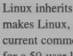

> 本书 CD-ROM 上包含的并非所有软件都以 GNU GPL 分发。务必阅读随程序提供的任何 COPYRIGHT 或 LICENSE 文件。有关 GNU GPL 的更多信息，请浏览至：
> http://www.fsf.org/copyleft/gpl.html.

Linux 继承了超过 25 年的 UNIX 经验、源代码和支持。这使得 Linux 尽管是最新操作系统之一，却比当前商业产品成熟得多。Linux 也物超所值。在撰写本文时，你需要花费近 5,000 美元购买 Windows NT 的 50 用户许可证，而使用本书的费用即可从 Linux 获得更多（包括超过 1,000 个程序）。

还有针对非基于英特尔芯片的计算机的 Linux 版本，例如 Sun Microsystems（SPARC）的计算机，或使用其他中央处理器（CPU）的计算机，例如 Alpha 芯片。要了解有关除基于 x86 架构的计算机之外 Linux 其他发行版的更多信息，请浏览至 http://metalab.unc.edu/LDP/.

Linux 不是共享软件。Linux 不属于公共领域。Linux 不是仅适合长发黑客的“玩具”操作系统。Linux 是用于高端网络服务器操作以及桌面操作系统的可行替代平台。

#### 什么是 OpenLinux?

新术语 OpenLinux 是一个 Linux 发行版，或由 Caldera Systems, Inc. 刻录在 CD-ROM 上的特别调整的软件、配置文件和实用程序的集合。本书后面附有一张装满软件的 CD-ROM，其中包含你开始自学 Linux 所需的一切。

Caldera Systems, Inc.（源自其母公司 Caldera, Inc.）于 1994 年首次发布了 Linux 发行版。OpenLinux 发行版具有其他发行版所不具备的多个功能，例如 Est, Inc. 的 BRU-2000 备份和恢复客户端、DR-DOS、NetWare 3.x 和 4.x 实用程序、NetWare NDS 客户端、Corel 的 WordPerfect 8 for Linux 以及最新的 StarOffice 办公套件。Caldera 还预先配置了 K 桌面环境的桌面面板，使其专门与从本书 CD-ROM 安装的程序一起工作。


> BRU-2000 和 StarOffice 5.0 实际上并未包含在本书 CD-ROM 上的 OpenLinux 2.2 版本中，两者都可从网络免费下载。

该 Linux 发行版的另一个突出特点是，Caldera 通过在 CD-ROM 上包含 Power Quest 的 PartitionMagic 和 Boot Magic 的有限版，使安装 Linux 的过程比以往任何时候都更容易。你会感到非常满意！

#### 所需设备是什么？

如果你能在计算机上运行 DOS 或 Windows，那么你很可能可以安装并运行 OpenLinux。安装 OpenLinux 的一般要求如下：

- 386 或更高兼容 CPU
- 16 兆字节随机存取存储器（RAM）——尽管 Linux 可以使用 8 兆字节（使用 StarOffice 时推荐最低 32 兆字节）
- 1.44MB 3.5 英寸软盘驱动器
- CD-ROM 驱动器
- 完整安装本书 CD-ROM 内容至少需要 300 兆字节至一千兆字节的硬盘空间

#### 支持的设备是什么？

检查 OpenLinux 开箱即支持哪些计算机硬件的最佳且权威的地方是以下网站：
http://www.calderasystems.com/products/openlinux/hardware.html

列出了支持的硬盘和 CD-ROM 驱动器接口（如 IDE、XT 或 SCSI）、并行端口 CD-ROM 驱动器、支持的串行板、鼠标指向设备（rodentimeters）、磁带驱动器、网络卡和 PCMCIA 卡。

安装 OpenLinux 和 X Window System 后，显卡或笔记本用户使用的视频芯片组列在 /usr/X11R6/lib/X11/doc 目录下。要阅读 X11 支持的显卡在线列表（以及使用哪个 X11 服务器），请浏览至以下网站：http://www.xfree86.org/cardlist.html

笔记本用户 definitely 需要浏览 Linux Laptop Pages。上面有关于如何为你的笔记本安装和配置 Linux 和 X11 的具体说明。在以下网站查找你的笔记本型号：http://www.cs.utexas.edu/users/kharker/linux-laptop/

#### 哪些设备无法工作？

随着近几年个人电脑市场的爆炸式增长，越来越多的家庭和企业要么首次购买电脑，要么升级旧电脑。信不信由你，使用一到三年旧的硬件安装 Linux 可能比使用最新最好的 PC 问题更少。这是因为虽然 Linux 得益于世界各地程序员的努力，但并非许多 PC 制造商通过发布硬件规格来支持 Linux（目前还不行！）。没有这些技术细节，程序员很难编写软件。如果你的计算机硬件不受 Linux 支持，请向其制造商投诉！

幸运的是，不受支持的硬件或存在问题的硬件列表比受支持的硬件小得多。例如，你可能会遇到基于旧 486 的 AMD CPU、旧 Cyrix CPU 和基于 Microchannel 的 PC 的问题。当前 Linux 软件对并行端口磁带驱动器和一些 Xircom 以太网卡的支持很少。

#### Winprinters

Winprinters，或依赖于操作系统特定驱动程序的打印机，例如 Hewlett-Packard 710、720、820 和 1000 系列打印机，不受本书 CD-ROM 包含的软件支持。然而，你可以通过使用位于以下网站的特殊软件找到其中一些打印机的支持：http://www.rpi.edu/~normat/technical/ppa

Epson Stylus 彩色打印机存在其他打印支持问题。你可以在以下网站从 Caldera 找到一些答案：http://www.calderasystems.com/support/techguide/styluscolor.html

#### Winmodems

Winmodems（PC 和笔记本制造商试图每台节省几美分的令人厌恶的近期趋势的一部分）是操作系统特定的，Linux 可能永远不会支持它们。这些调制解调器使用的硬件比“真正的”调制解调器少，通过软件驱动程序工作（将所有工作卸载到计算机 CPU 上更便宜；此外，如果你使用 Windows 9x，反正你一次也只能做一件事，对吧？）。如果你购买了配备其中一种调制解调器的 PC 或笔记本，那么调制解调器是否会在未来得到支持或是否能与另一个操作系统一起工作，完全取决于制造商。


> 警惕！许多制造商吹嘘这些调制解调器为“56K ITU V.90 调制解调器”，但却没有提到它们是 winmodems。询问该调制解调器是否可与 DR-DOS、PCDOS 或 MSDOS 一起使用。如果不能，那就是 winmodem。为了安全起见，请购买可与任何计算机操作系统一起使用的外部调制解调器。

#### 红外端口

虽然本书 CD-ROM 上未包含支持计算机红外端口的软件，但好消息是 OpenLinux 提供了完整的红外支持。这意味着，如果你拥有带 IR 端口的笔记本或台式机，现在可以联网、向 IR 打印机打印（如 HP 340Cbi 或 Canon BJC80），甚至无需电缆传输或备份你的 3Com Palm PDA！浏览至以下网站：

http://www.cs.uit.no/~dagb/irda/irda.html

有关于如何下载、安装和配置 Linux IR 支持的说明。有关 HOWTO 文档格式的完整说明，请浏览至以下网站：

http://www.userpage.fu-berlin.de/~r2d2c3po/ir_howto.cgi


> 如果你拥有 3Com Palm Pilot Professional 或 Palm III，OpenLinux 中包含近二十四个 Pilot 支持实用程序。Kenneth Albanowski 的 pilot-xfer 命令使备份 Palm III 变得如此简单：
> 
> `pilot-xfer /dev/pilot -b pilotbackupdirectory`
> 
> 如果你使用 KDE，请使用从 OpenLinux CD-ROM 上的 `/col/install/RPMS` 目录安装的 Kpilot 客户端。这是对你的 Palm 计算机进行管理的图形界面。

```
pilot-xfer /dev/pilot -b pilotbackupdirectory
```


#### 你拥有哪些设备？

在安装 OpenLinux 之前，你需要先了解一些关于你的计算机的信息。拿出纸和笔，然后尽可能填写本节后面的清单中的信息。如果你的 PC 或笔记本电脑制造商没有记录你计算机的所有技术细节，你可能需要浏览制造商的网站或致电获取信息。

- CPU 类型（386 等）
- 系统 RAM 容量（以兆字节为单位）
- 硬盘总大小（以兆字节为单位）
- Linux 交换分区所需的硬盘空间（系统内存或计算机 RAM 的两倍；见第 2 小时，“安装 Linux”）
- 你希望用于 OpenLinux 的硬盘大小（以兆字节为单位，取决于安装类型；见第 2 小时）
- 硬盘控制器类型（例如，IDE/SCSI）
- CD-ROM 控制器类型（例如，ATAPI）
- 串口数量（注意：在撰写本文时，Linux 不支持通用串行总线，或 USB）
- 键盘类型（很可能是 PS/2）
- 键数（101、102、104 等）
- 鼠标类型（PS/2、串行等）
- 红外端口（COM1-COM4、使用的 IRQ、共享等）
- 串口分配（COM1-COM4、使用的 IRQ）
- 调制解调器类型（传真类支持，如 Class 1、2.0、语音等）
- 并行端口分配（0x378、IRQ 5 等）
- 打印机型号和类型（Epson、HP、PostScript、HPCL 等）
- 使用的 PC 卡（调制解调器、网络、闪存等）
- PCMCIA 控制器类型（例如 TI）
- 声音卡类型（SoundBlaster、ESS 等）
- 声音卡 I/O 地址（如 0x220）
- DMA 值（0、1 等）
- 声音卡 IRQ（如 5 或 7）
- 杂项地址（如 MPU 用）
- 显卡类型（使用的芯片组，如 TGUI9680、Cirrus Logic、ATI Rage II 等）
- 显存容量（1MB、2MB、4MB 等）
- 颜色深度能力（256、16 位、24 位等）
- 显示器水平刷新率（如 31.5-60、31.4 等）
- 显示器垂直刷新率（例如 70-100）
- 显示器最大分辨率（800x600、1024x768、1280x1024 等）

你可能不需要所有这些信息来安装 OpenLinux，但迟早在安装 PC 卡、设置声音或配置 X11 时这些细节会派上用场。

#### 如何规划安装？

许多新的 OpenLinux 用户可以轻松自行安装 Linux。如果你在安装过程中遇到问题，不要灰心，也不要放弃！以下是成功安装 OpenLinux 的四个基本障碍：

- 1. 分区硬盘——这是许多人认为 Linux 难以安装的原因之一。今天有多少计算机用户分区过硬盘甚至安装过操作系统？不要被这一步吓倒，它只是为 OpenLinux 在你的硬盘上腾出空间。只需在开始前确保备份重要文档或文件。见表 1.1 了解不同安装的大小需求，然后写下你的需求。许多经验丰富的 OpenLinux 用户根本不理会这一步，直接将 Linux 安装为唯一操作系统。如果不必处理创建或调整硬盘分区，安装 Linux 就轻而易举了。

##### 表 1.1 CALDERA OPENLINUX 安装需求

| 大小（兆字节） | 安装说明 |
|---|---|
| 300 | 小型系统（带 X11 和 KDE），包含适合将计算机用作服务器的程序 |
| 500 | 标准系统（默认）；包含开发工具和其他适合服务器和工作站的程序 |
| 1024 | 完整安装（全部） |

- 2. 配置 X Window 系统——X11 是 OpenLinux 的默认图形界面——但它不是 Linux。X 运行在许多不同类型的计算机和操作系统上，这就是为什么 Linux 有如此丰富的图形程序。你配置 X11 与你的图形硬件配合工作的机会更大，如果你有一张在市场上至少有两年历史的显卡。你将在 OpenLinux 安装期间配置 X11。关于配置 X 的详细信息可在 OpenLinux 安装后在 /usr/X11R6/lib/X11/doc 目录下找到。
- 3. 配置声音——OpenLinux 附带可加载的代码模块，你可以用它来使声音工作，或者你可以重新编译 Linux 内核以配合你的声卡（一些细节可在 http://www.calderasystems.com/support/techguide.html 找到）。如果你不想麻烦内核模块或重新编译，可以浏览 http://www.4front-tech.com/oss.html，并下载 Open Sound System 驱动程序的试用版。这套价格低廉的声音驱动程序支持数百种不同的声音系统。使用 OSS 是为 Linux 配置声卡的最简单方法之一。见第 20 小时，“放松和玩 Linux 游戏”，获取配置 OpenLinux 声音的提示。
- 4. 建立连接——使用 OpenLinux 连接到 Internet 是一个重要步骤。为了使连接 Internet 的工作更轻松，使用 Red Hat netcfg 工具、kppp 客户端或 xisp 客户端来设置你的帐户。如果遇到问题，请务必阅读 /usr/doc/HOWTO 目录下的 PPP HOWTO 和 ISP Hookup HOWTO。第 9 小时，“使用通信程序”，介绍了使用调制解调器配合 OpenLinux 的细节。见第 10 小时，“连接到 Internet”，了解如何建立 PPP 连接。

你接下来要决定如何安装 OpenLinux。我不介绍使用网络或并行线路（PLIP）接口安装 Linux（有关这些方法的细节，请参阅 http://www.calderasystems.com/support/techguide.html）。

#### 从 CD-ROM 启动安装

最简单的方法是安装 OpenLinux CD-ROM 到你的计算机，重新启动并按照提示操作。从 CD-ROM 驱动器启动可能需要你重置计算机的 BIOS 以更改启动磁盘识别顺序（通常在启动计算机后按特定的 F 键（或键序列）完成——请参阅计算机手册了解详情）。

#### 从软盘启动安装

你可以创建一个启动软盘，然后插入 OpenLinux CD-ROM，并从软盘启动以开始安装。创建启动软盘最简单的方法是在 Windows 下安装 OpenLinux 实用程序（见本章后面的部分“从 Windows 准备你的硬盘”）。然后你可以在开始菜单的 OpenLinux 程序文件夹中点击“创建安装磁盘”图标。

你也可以在 DOS 下使用 RAWRITE3.COM 程序创建软盘，如果你无法从 OpenLinux CD-ROM 启动。首先，记下你的 CD-ROM 的驱动器号（如 D 或 E）。要创建启动软盘，请执行以下操作：

- 1. 插入 OpenLinux CD-ROM，然后重新启动到 DOS。在 DOS 命令行中，键入你的 CD-ROM 的驱动器号，切换到 \col\launch\floppy 目录，并像这样启动 RAWRITE3 命令：
- 2. RAWRITE3 程序启动后，它会提示你输入源文件名。键入 INSTALL.144，然后按 Enter。
- 3. RAWRITE3 然后会提示你输入目标驱动器（A 或 B）；键入你的软盘的驱动器号，如 A，然后按 Enter。
- 4. RAWRITE3 然后会提示你在磁盘驱动器中安装目标磁盘。插入一张空白磁盘到驱动器中，然后按 Enter。
- 5. RAWRITE3 将文件 INSTALL.144 复制到你的软盘。
- 6. 完成后，取出并标记磁盘。

```
D:
CD \COL\LAUNCH\FLOPPY
RAWRITE3
```


> 如果你有 PCMCIA CD-ROM 驱动器或需要其他专用支持，请使用单独的软盘重复上述步骤，但使用 MODULES.144 而不是 INSTALL.144。这会创建一个第二个磁盘，其中包含软件，可帮助 OpenLinux 在首次安装步骤中识别你的外部 CD-ROM 或 PC 卡。

标记并妥善保存你的启动软盘。如果你不从 CD-ROM 启动，在第 2 小时你会需要它们。


#### 其他方式

多家硬件厂商也在新硬盘、笔记本电脑或计算机上预装 Linux。如果想要一台开箱即用的完全配置好的计算机，这就是方法。请浏览 http://metalab.unc.edu/LDP/HOWTO/VAR-HOWTO.html。


> 你可以随时请一位有 Linux 经验的朋友过来为你安装 OpenLinux！这是一个分享信息的好方法，有人在身边帮助可以让安装过程更轻松。或者，参加 Linux 用户组（LUG）的 InstallFest！请浏览 http://www.linux.org/users/index.html 找到你附近的 LUG。LUG 定期举行安装会议，你可以在很短时间内完成 OpenLinux 的安装和配置！

#### 规划你的启动过程

启动 Linux 有多种不同方式。你需要决定是否要从启动提示符、DOS 中的命令行、软盘或商业软件程序启动 Linux。

- 1. LILO—Linux 加载器（LILO）是一个用于启动 Linux 或其他操作系统的微小程序。你可以在安装过程结束后将 LILO 安装在 DOS 分区的引导记录或硬盘上 Linux 分区的根分区中。
- 2. LOADLIN.EXE—使用 DOS 中的 LOADLIN 程序启动 Linux。如果你使用此程序，则无需安装 LILO。你需要将 Linux 内核复制到 DOS 分区或软盘上。从 DOS 启动的优点是可以使某些硬件（如 Mwave 适配器）与 OpenLinux 配合工作。
- 3. 启动软盘—启动软盘也可以用来启动 Linux。你可以将 LILO 保存到软盘上，然后启动 Linux、DOS 或其他操作系统。


> 在安装 Windows 之后再安装 OpenLinux 和 LILO。其他操作系统安装通常会无视这一点而覆盖 LILO（尽管可以通过使用 Linux 启动软盘启动并重新运行位于 /sbin 目录下的 lilo 命令来恢复。）

- 4. 软盘—想在安装 OpenLinux 之前先从软盘尝试 Linux 吗？请浏览 http://metalab.unc.edu/LDP/devel.html 并搜索适合软盘的 Linux 发行版。你可以用一张软盘启动 Linux（但你得不到 X Window 系统）。
- 5. System Commander—这是一个可用于启动多个操作系统的商业程序。详情请浏览 http://www.systemcommander.com。
- 6. BootMagic—随 PowerQuest Corp. 的 PartitionMagic 提供，BootMagic 可用于启动多个操作系统，如 Windows NT 和 IBM 的 OS/2。PartitionMagic 的商业版还包含一个名为 PQBoot 的 DOS 实用程序，它列出活动的可启动分区，并可用于启动其他操作系统，如 Linux。详情请浏览 http://www.powerquest.com。

#### 准备你的硬盘

安装过程中的第一步（如果需要，先制作启动软盘）是分区，或在硬盘上腾出空间。如果你只想在计算机上使用 OpenLinux，请跳过本小时的其余部分，直接进入第 2 小时。但如果你想要双启动计算机，或启动至少两个不同的操作系统，你需要在硬盘上创建一个分区，为 OpenLinux 软件提供足够的空间。

分区不过是查看硬盘及其划分方式的一种特殊方法。分区有两种类型：主分区和扩展分区。你的硬盘可以包含四个主分区。如果你需要进一步划分或映射硬盘，可以将其中一个主分区指定为扩展分区（然后可以进一步细分）。

这些分区通常包含文件系统。文件系统是文件或目录写入硬盘的方式。DOS 和旧版 Windows 使用名为 FAT16 的文件系统。新版 Windows 使用 FAT32。Linux 使用两种文件系统：ext2（用于存储文件）和 swap（用于临时存储内存）。

幸运的是，Caldera 的 OpenLinux CD-ROM 包含了为 OpenLinux 分区所需的一切！该 CD-ROM 包含 PowerQuest 的 PartitionMagic 和 Boot Magic 的有限版。安装这些实用程序后，你可以直接从 Windows 设置 Linux 分区（继续阅读以了解如何操作）。

在安装过程中，一些笔记本电脑和台式机用户可能会发现一个由计算机 BIOS 用于“Save to Disk”操作（如使计算机休眠）的小分区。该分区的大小通常与安装在计算机上的系统内存或 RAM 的大小相同。一般来说，请不要动这个分区。另请注意，如果你增加计算机的 RAM，分区可能需要调整大小以匹配新的内部内存大小（这可能会导致其他分区出现有趣的调整或重新调整大小）。

#### 从 Windows 准备你的硬盘

为硬盘做好支持 Windows 和 OpenLinux 启动的准备的第一步是安装 Caldera 和 Power Quest 的实用程序。启动计算机。当 Windows 桌面出现时，插入你的 OpenLinux CD-ROM。OpenLinux 欢迎屏幕应出现，如图 1.1 所示。

##### 图 1.1
OpenLinux 欢迎对话框是你 OpenLinux 之旅的起点！

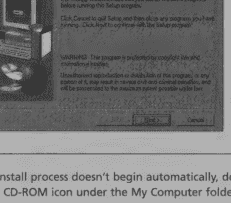

如果安装过程未自动开始，请在“我的电脑”文件夹下双击计算机的 CD-ROM 图标。

按照提示操作，此设置程序将在“开始”菜单中创建 OpenLinux 程序文件夹。该文件夹将包含创建安装（启动）软盘、安装 Boot Magic（以支持 Windows 和 Linux 启动）以及分区硬盘和安装 Linux 的快捷方式。设置完成后，双击“分区并安装 Linux”图标（如图 1.2 所示）。

##### 图 1.2
双击“分区并安装 Linux”程序开始安装。

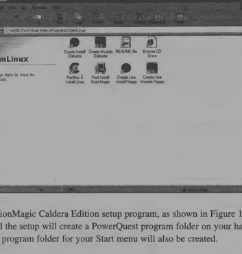

这将启动如图 1.3 所示的 PartitionMagic Caldera Edition 设置程序。按照提示操作，设置将在你的硬盘上创建 PowerQuest 程序文件夹。还将为“开始”菜单创建 PartitionMagic 程序文件夹。

##### 图 1.3
要开始安装，你必须先安装 PartitionMagic Caldera Edition 程序。

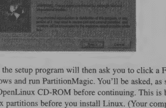

安装完成后，设置程序将要求你点击“完成”按钮。这将关闭 Windows 并运行 PartitionMagic。如图 1.4 所示，你将被要求在继续之前取出 OpenLinux CD-ROM。这是因为你必须先创建 Linux 分区，然后再安装 Linux。（如果 CD-ROM 仍插入，计算机可能会直接重新启动到安装 OpenLinux。）

##### 图 1.4
不要忘记在继续安装之前取出你的 CD-ROM！

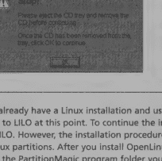

如果你已经安装了 Linux 并使用 LILO，你的计算机此时将重新启动到 LILO。要继续安装，请从 LILO 启动到 Windows。但是，安装程序将无法识别你现有的 Linux 分区。安装 OpenLinux 后，你会在 PartitionMagic 程序文件夹中找到一个“删除 Linux”图标，可用于删除 Linux 分区。在现有 Linux 系统上安装 OpenLinux 的最佳方法是重新启动并使用安装软盘或直接从 CD-ROM 安装 OpenLinux。详情请参阅第 2 小时“安装 Linux”。

PartitionMagic Caldera Edition 仅识别你的第一块硬盘，并且只能创建三种不同大小的分区：300 兆字节、500 兆字节和一千兆字节。当其对话框出现时，点击所需的 Linux 分区大小，然后点击“确定”按钮。然后你会看到 PartitionMagic 的对话框，显示分区进度。分区完成后，插入你的 OpenLinux 启动软盘和/或 OpenLinux CD-ROM，然后重新启动计算机开始安装。

如果你想要使用超过 PartitionMagic 有限版提供的一千兆字节最大值的更多硬盘空间，请使用启动软盘和/或 OpenLinux CD-ROM 直接启动到 OpenLinux 安装。在初始安装期间，选择“自定义”分区方案。但是请注意，你必须有一个可用的现有或空分区；该分区将被格式化为 Linux。

#### 总结

本小时向你介绍了有关 Linux、OpenLinux 以及如何为 Linux 安装做准备的一些基本概念。


#### 问答

Q 我很困惑！安装 OpenLinux 的最佳方式是什么？

A 虽然这完全取决于你的计算机硬件以及你计划如何使用 OpenLinux，但最简单、最直接的安装 OpenLinux 的方法是使用本书后面的 OpenLinux CD-ROM 启动。你可以覆盖任何现有数据并将 OpenLinux 安装为主要操作系统。

Q 我想同时使用 NT 和 OpenLinux！我该怎么办？

A 先安装 NT。但在安装 OpenLinux 时，将 LILO 安装在 Linux 根分区中（参见第 2 小时）。

Q 我有商业版的 PartitionMagic。我可以用这个程序代替 Caldera 版吗？

A 可以。你会拥有更多的灵活性，因为 PartitionMagic 可以从你现有的硬盘空间创建任意大小的分区。Caldera 包含了一个特殊版的 PartitionMagic，以使在硬盘上腾出空间的工作变得更容易一些，但商业版的 PartitionMagic 提供了许多、许多额外的功能。

Q 我有 32 兆字节的 RAM。我应该规划多大的交换空间？最大可以使用多大的交换空间？

A 如果你有 32 兆字节的 RAM，请计划创建一个 64 兆字节的交换分区。一般来说，创建一个至少为计算机 RAM 两倍大小的交换分区（如果你计划运行内存密集型程序，如图形编辑器，则可以更大）。

#### 练习

- 1. 创建你的 OpenLinux 安装启动软盘。确保正确标记它们。
- 2. 安装 OpenLinux 和 PowerQuest 的 Caldera Systems Edition PartitionMagic。注意在“开始”菜单中用于 OpenLinux 和 PartitionMagic 的程序文件夹。
- 3. 坐下来计算你希望与 OpenLinux 一起使用的硬盘空间量。不要忘记包含所需的交换空间！


### 第 2 小时

#### 安装 Linux

本小时向你展示如何安装 OpenLinux。此时，你应该知道想要分配给 OpenLinux 的硬盘空间有多大。你还应该填写了第 1 小时中介绍的清单，“准备安装 Linux”，并在安装过程期间和之后将此信息备好。你还需要 OpenLinux 启动磁盘，如果你的计算机无法从 CD-ROM 驱动器启动。在安装过程中慢慢来，并且在你确定安装对话框中提供的信息之前不要继续。

如果你已经安装过 OpenLinux 或其他 Linux 发行版，请做好迎接 pleasant surprise 的准备！Caldera OpenLinux 的最新版本提供了有史以来最快、最简单的 Linux 安装！Caldera 的团队通过以下等功能使安装 Linux 的任务变得愉快：

- 安装过程的完整图形界面
- 面向专家的一键式硬盘分区
- 在继续系统配置过程的同时从 CD-ROM 后台安装软件包
- 自动检测显卡以配置 X Window 系统
- 安装继续进行时的愉快消遣


> 你已经备份了任何重要文档或文件，对吧？除非你绝对确定不会丢失任何重要数据，否则不要继续安装 OpenLinux。如果你要在全新的台式机或笔记本电脑上安装 OpenLinux，请确保你有恢复 CD-ROM 或已按照制造商的建议备份关键设备驱动程序。当然，你可能能够从制造商的网站上获取大部分重要文件，但不幸的是，许多计算机制造商不提供恢复 CD-ROM，仍然要求最终用户将包含的软件备份到软盘。你已被警告！

#### 开始安装

有经验的安装人员可能跳过了第 1 小时的安装说明。如果是这样，第一步是设置计算机从其 CD-ROM 驱动器启动。这可能需要你重新启动计算机，然后在重新启动期间按住一个功能键以进入计算机的 BIOS 管理器。设置计算机的 BIOS 以更改识别的启动设备的顺序，使 CD-ROM 驱动器首先被识别。你可能需要然后保存这些更改并重新启动计算机。然后，按以下操作：

- 1. 将 OpenLinux CD-ROM 插入计算机，然后重新启动。
- 2. 如果你按照第 1 小时的说明并插入了 CD-ROM，当计算机重新启动时，你会看到 Caldera 的启动画面。
- 3. OpenLinux 开始启动。你会在屏幕上看到各种技术信息闪过，因为 OpenLinux 确定安装在计算机上的各种组件（如硬盘、软盘、串口、键盘或 CD-ROM）并尝试加载各种软件组件。
- 4. 在图 2.1 所示的对话框中，单击选择安装在系统上的鼠标类型。通过将光标移动到标记的测试区域然后单击左、右或中鼠标按钮来测试你的鼠标按钮。完成后，单击“下一步”按钮。

##### 图 2.1

OpenLinux 应该能自动检测你的鼠标，但你可以使用“设置鼠标”对话框来测试你的鼠标按钮。

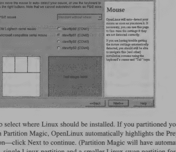

- 5. 系统会要求你选择安装 Linux 的位置。如果你使用 Partition Magic 分区了硬盘，OpenLinux 会自动高亮“已准备分区”按钮——单击“下一步”继续。（Partition Magic 将自动为安装过程创建一个大型的单个 Linux 分区和一个较小的 Linux 交换分区。）

> Partition Magic 的 Caldera 版使用单个 Linux 原生分区和单个交换分区实现了一个简单的分区方案。这是安装 OpenLinux 最简单、最快的方法，但可能不适合更高级用户的需求。关于分区的简要介绍，请阅读 Eric S. Raymond 的 Installation HOWTO（位于 /usr/doc/HOWTO 目录下），尤其是第 6.4 节，“为 Linux 创建分区”。

如果你宁愿使用整个硬盘，请单击“整个硬盘”以格式化并安装 Linux。

> 如果你选择“整个硬盘”，OpenLinux 将格式化你的整个驱动器。确保这就是你想要做的！在安装 Linux（或任何其他操作系统）之前，始终备份重要信息！

如果你想从现有的空闲分区创建多个 Linux 分区，请单击“自定义（仅限专家！）”，然后单击“下一步”按钮。你会看到一个对话框，可以用来分割现有分区以创建不同部分的 OpenLinux 安装的不同分区（许多有经验的 Linux 用户为程序、用户或临时存储创建单独的分区）。使用“自定义（仅限专家！）”对话框从现有的 Linux、Windows 或 DOS 硬盘分区创建 Linux 分区。通过在专家模式中使用“编辑”按钮，你可以更改分区的大小并为 Linux 分区指定挂载点。完成专家模式后，单击“写入”按钮保存更改，然后单击“下一步”按钮继续。

- 6. OpenLinux 现在显示 Linux 分区信息，如图 2.2 所示。你应该至少看到一个根分区（挂载点为“/”）和一个虚拟内存（或交换）分区。如果满意，请单击“格式化所选分区”按钮继续。

##### 图 2.2

安装 OpenLinux 之前格式化你的 Linux 分区

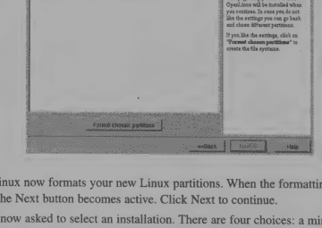

- 7. OpenLinux 现在格式化你的新 Linux 分区。格式化完成后，“下一步”按钮变为可用。单击“下一步”继续。
- 8. 现在系统会要求你选择一种安装方式。有四个选择：最小集（约 300 兆字节，用于带 X Window 系统的服务器安装）；所有推荐的软件包（约 500 兆字节，用于带 X Window 系统和开发软件包的服务器和工作站安装）；所有推荐的软件包加商业软件包；以及所有软件包（约一千兆字节，用于 CD-ROM 上包含的所有软件的完整安装）。单击要安装的软件包，然后单击“下一步”按钮继续。


> OpenLinux 不允许你尝试选择一个超过 Linux 分区可用空间的安装大小。你必须选择一个较小的安装。如果有硬盘空间，你可以通过按后退按钮返回安装对话框来创建更大的 Linux 分区，或稍后创建额外的 Linux 分区。

9. OpenLinux 现在显示一个对话框并要求你选择键盘型号和布局。滚动键盘列表，然后单击你的型号。接下来，选择一个键盘布局（例如 U.S. English）。要测试所选键盘，请在“Test here”字段中单击并输入一些文本。完成后，单击“Next”按钮继续。另外，请注意，在你继续配置过程的同时，软件包安装仍在向你的 Linux 分区复制文件！

10. OpenLinux 现在要求你选择视频卡，如图 2.3 所示。这是安装过程中的关键步骤，可确保你能以计算机视频卡和显示器最佳可能的分辨率运行 X Window System。查看“Card Type”字段，确认计算机的视频卡是否已正确列出。接下来，单击视频卡上安装的视频 RAM 数量（例如 2MB）。即使视频卡已正确列出，也请单击“Probe”按钮以获取更准确的信息。这会运行 XF86_SVGA X11 服务器来探测图形卡以获取设置信息。

##### 图 2.3
OpenLinux 应能自动检测你的视频卡，但你可以单击“Probe”按钮以获得更具体的设置。

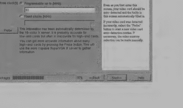

- 11. 单击“Probe”按钮后，会出现一个对话框，要求你确认探测。单击“Probe”按钮继续，或单击“Abort”按钮取消探测。
- 12. 如果探测成功，你的屏幕会变黑并出现一个带有“OK”按钮的对话框。单击“OK”关闭对话框，然后单击“Next”继续配置 X Window System。
- 13. 你现在会看到一个“Select Monitor”对话框，其中列出了显示器以及水平和垂直同步范围，如图 2.4 所示。滚动显示器列表，然后单击与系统一起使用的型号。如果列表中没有你的显示器，请在滚动列表下方输入显示器的名称和同步范围。单击“Monitor name”字段，然后输入名称。通过单击上下箭头输入低和高水平同步范围，然后对低和高垂直同步范围执行相同操作。完成后，单击“Next”按钮。

##### 图 2.4
滚动显示器列表，然后选择特定显示器，或输入有关计算机显示器的详细信息。

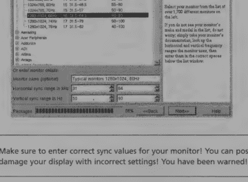


> 请务必为显示器输入正确的同步值！错误的设置可能会损坏你的显示器！你已被警告！

14. 下一个对话框要求你选择首选视频模式，如图 2.5 所示。单击所需的分辨率，例如 800×600，表示显示器上可用的像素数（横向和纵向）。不要选择超出显示器能力的分辨率！接下来，从屏幕右上角的列表中单击所需的显示深度。完成后，单击“Test This Mode”按钮测试你的设置。

##### 图 2.5
“Select Video Mode”对话框用于为显示器和显卡选择最佳分辨率和颜色深度。

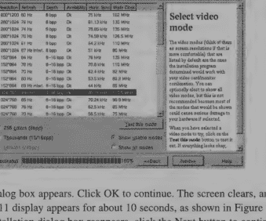

15. 会出现一个确认对话框。单击“OK”继续。屏幕变清，并出现一个代表性的 X11 显示，持续约 10 秒，如图 2.6 所示。当安装对话框重新出现时，单击“Next”按钮继续。

##### 图 2.6
在 X11 配置期间，OpenLinux 允许你测试显卡和显示器，以确保设置正确。

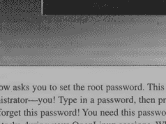

16. OpenLinux 现在要求你设置 root 密码。这是系统管理员——也就是你！的密码。输入密码，然后按 Enter，再次输入。不要忘记此密码！你需要在 OpenLinux 会话期间执行重要配置任务时使用此密码。完成后，单击“Next”按钮。

> 好的密码至少有八个字符，并包含字母和数字的混合。

17. 下一个对话框要求你至少向 OpenLinux 系统添加一个新用户，如图 2.7 所示。首先单击“Real Name”字段并输入你的姓名。按 Enter，然后输入“Login name”。按 Enter，然后输入密码。按 Enter，然后再次输入密码。接下来，单击 bash、tcsh 或 zsh 以选择“Login Shell”。完成后，单击“Add User”按钮。要继续，请单击“Next”按钮。

##### 图 2.7
“Set Login Name(s)”对话框用于在 OpenLinux 安装期间创建新用户。（安装后也可以添加或删除其他用户。）

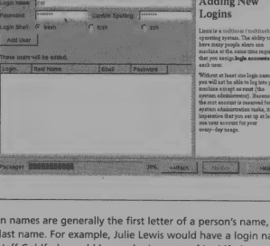

> 登录名通常是个人姓名的首字母，后跟姓氏。例如，Julie Lewis 的登录名是 jlewis，Jeff Goldfarb 的登录名是 jgoldfarb。

18. 你现在可以在图 2.8 所示的对话框中设置网络。如果你的计算机已连接到网络并且已安装网络卡，请输入网络的 IP 地址（例如 192.168.1.2）、主机名（例如 wishbone.erols.com）、Netmask 和 Gateway。如果你的网络有域名服务器，请输入其 IP 地址。如果没有网络卡，请单击“Next”按钮继续。

##### 图 2.8
如果已安装网络卡，请使用“Set Up Networking”对话框输入网络信息，例如计算机的 Internet 协议或 IP 地址号码。

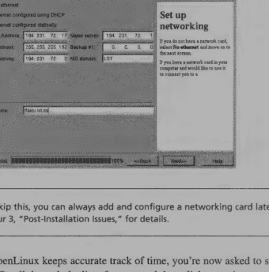

> 如果你跳过此步骤，稍后仍可以添加和配置网络卡。有关详细信息，请参阅第 3 小时“Post-Installation Issues”。

19. 为了确保 OpenLinux 准确跟踪时间，现在要求你选择时区。滚动区域列表，然后单击你的时区。如果计算机的硬件时钟设置为本地时间，请单击“Hardware Clock Runs in Local Time”项，然后单击“Next”继续。

20. 现在放松一下！是时候玩一个熟悉的下落方块游戏了，同时 OpenLinux 继续将文件复制到硬盘。单击“New Game”开始游戏。使用光标键旋转、移动或放置方块。在你玩游戏的同时，屏幕底部的进度条可帮助你监控安装进度。当安装完成时，单击“Finish”按钮。

#### 完成你的 Linux 安装
恭喜！坚持住，因为你几乎完成了 OpenLinux 的安装！单击“Finish”后，OpenLinux 会重新启动计算机到 K 桌面环境的 K 显示管理器登录屏幕（如图 2.9 所示）。

##### 图 2.9
你在 K 显示管理器中首次看到 OpenLinux，在那里你必须登录 Linux。

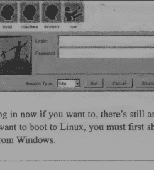

虽然你现在如果想的话可以登录，但安装中仍有一个重要的步骤！如果你想启动到 Linux，必须先关闭、重新启动，然后从 Windows 安装 BootMagic。


> 有经验的 Linux 用户可能想使用 LILO，但应知道此时与之前的 OpenLinux 安装不同，LILO 已被安装，并且默认的 /etc/lilo.conf 配置文件已配置为从根 Linux 分区启动 LILO。这可能不是你想要的，但这是支持商业引导加载程序（如 System Commander 或包含的 Boot Magic 版本）的正确配置。虽然有经验的 LILO 用户可能会使用引导软盘或将 LILO 安装到 DOS 分区的 Master Boot Record，但 MBR 是 Boot Magic 所需的。此时你必须决定是否使用 BootMagic 或 LILO。如果你决定使用 LILO，以 root 身份登录 OpenLinux，然后编辑 /etc/lilo.conf 以指向 MBR，并插入一个支持启动 DOS 的条目。（默认情况下没有包含，并且你可能已经注意到安装过程不会提供配置 LILO 的机会。）如果你决定不单独使用 LILO，BootMagic 然后使用 LILO（安装在你的 Linux 分区上）来启动 OpenLinux。有关更多信息，请参阅 /usr/doc/lilo 目录下的 README 文件。

单击“Shutdown”按钮，然后选择“Shutdown”，并重新启动以重新启动到 Windows。当 Windows 桌面出现时，从“开始”菜单的 OpenLinux 文件夹中单击“Post Install Boot Magic”菜单项。确保你的 OpenLinux CD-ROM 已插入计算机。BootMagic 设置窗口会出现，如图 2.10 所示。


##### 图 2.10

为了启用 DOS、Windows 或 Linux 的启动，您必须安装一个引导加载程序，例如 BootMagic。

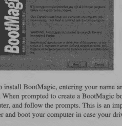

按照提示安装 BootMagic，输入您的姓名并确认许可协议。当提示创建 BootMagic 启动软盘时，将一张空白软盘插入计算机，并按照提示操作。这是重要的一步安全措施，可在驱动器的 MBR 损坏时恢复并启动计算机。

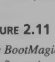

> 您也可以稍后通过点击“开始”菜单上 BootMagic 程序文件夹中的“创建 BootMagic 软盘”图标来制作 BootMagic 启动软盘。

BootMagic 然后安装到您的计算机上，将引导加载程序放置在硬盘的 MBR 中。安装完成后，您会在桌面上看到 BootMagic 配置窗口，如图 2.11 所示。

##### 图 2.11

BootMagic 配置窗口用于设置默认操作系统、重新排序启动列表或设置启动延迟。

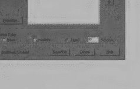

BootMagic 识别出您已在硬盘上创建并安装了 Linux 分区。点击 Linux 菜单名称，然后点击“重新排序”按钮将 Linux 移至列表上方（它本应所在的位置）。接下来，点击“设为默认”按钮使 Linux 成为默认启动操作系统。

BootMagic 的“启动延迟”按钮和“定时延迟”字段使您能够立即启动、等待鼠标点击操作系统名称，或在启动前设置 1 到 99 秒的延迟。确保“启用 BootMagic”复选框已勾选。配置完成后，点击“保存/退出”按钮保存更改。

要启动到 Linux 并登录，请重新启动计算机。BootMagic 然后加载并显示其启动菜单，列出 Linux 然后是 Windows。启动将根据您在配置窗口中设置的延迟开始。然后您会看到 Caldera 定制的 LILO 消息屏幕（来自 /boot 目录下的 message 文件），如图 2.12 所示。

##### 图 2.12

*BootMagic 使用 LILO 启动 Linux.*

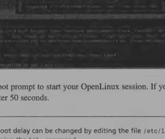

在启动提示符下输入 linux 以启动您的 OpenLinux 会话。如果不执行任何操作，OpenLinux 将在 50 秒后启动。

> 启动延迟可以通过编辑文件 `/etc/lilo.conf` 并重新运行 `lilo` 命令来更改。

#### 登录到 Linux

OpenLinux 启动后，您会再次看到 kdm 客户端的登录屏幕。在登录提示符下，输入 root，然后按 Enter。然后，输入安装过程中使用的密码。

屏幕清空，您使用 X Window System 和 K 桌面管理器（在第 8 小时“探索 K 桌面环境”中讨论）开始您的第一次 OpenLinux 会话，如图 2.13 所示。

##### 图 2.13
OpenLinux X11 KDE 会话的首次视图。

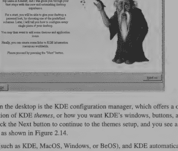

桌面上的主窗口是 KDE 配置管理器，它提供一次性配置 KDE 主题，即您希望 KDE 的窗口、按钮和颜色如何显示。点击“下一步”按钮继续主题设置，您会看到主题选择，如图 2.14 所示。

点击一个主题图标（如 KDE、MacOS、Windows 或 BeOS），KDE 会自动为您的 KDE 会话设置主题。然后，点击“下一步”按钮进入下一屏幕，如图 2.15 所示。

##### 图 2.14

通过点击主题图标从 KDE 的配置菜单中选择窗口主题。

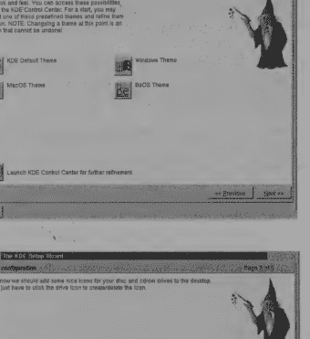

##### 图 2.15

KDE 的设置会在桌面上自动创建方便的软盘和 CD-ROM 图标。

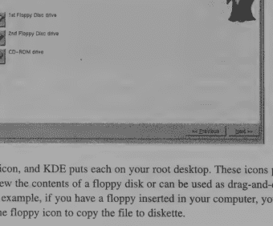

点击每个所需图标，KDE 会将其放置在您的根桌面上。这些图标提供了一种轻松查看软盘内容的方式，或可作为拖放图标用于复制。例如，如果您已将软盘插入计算机，后续可以将文件拖放到软盘图标上以复制文件到软盘。

完成后，点击“下一步”按钮。下一屏幕会询问您是否想要打印机图标。完成后，再次点击“下一步”按钮以配置桌面上的便捷超文本链接（如图 2.16 所示）。

##### 图 2.16

KDE 在设置期间在桌面上创建 Internet 和超文本链接。

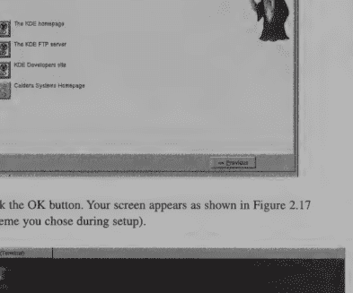

完成后，点击“确定”按钮。您的屏幕将如图所示 2.17（取决于设置期间选择的主题）。

##### 图 2.17

配置后的 KDE 主题 KDE 桌面。


#### 重新启动和关闭

此时，您可以通过点击 KDE 面板上挂锁上方的[content]
##### 图 2.10

为了启用 DOS、Windows 或 Linux 的启动，您必须安装一个引导加载程序，例如 BootMagic。


按照提示安装 BootMagic，输入您的姓名并确认许可协议。当提示创建 BootMagic 启动软盘时，将一张空白软盘插入计算机，并按照提示操作。这是重要的一步安全措施，可在驱动器的 MBR 损坏时恢复并启动计算机。


> 您也可以稍后通过点击“开始”菜单上 BootMagic 程序文件夹中的“创建 BootMagic 软盘”图标来制作 BootMagic 启动软盘。

BootMagic 然后安装到您的计算机上，将引导加载程序放置在硬盘的 MBR 中。安装完成后，您会在桌面上看到 BootMagic 配置窗口，如图 2.11 所示。

##### 图 2.11

BootMagic 配置窗口用于设置默认操作系统、重新排序启动列表或设置启动延迟。


BootMagic 识别出您已在硬盘上创建并安装了 Linux 分区。点击 Linux 菜单名称，然后点击“重新排序”按钮将 Linux 移至列表上方（它本应所在的位置）。接下来，点击“设为默认”按钮使 Linux 成为默认启动操作系统。

BootMagic 的“启动延迟”按钮和“定时延迟”字段使您能够立即启动、等待鼠标点击操作系统名称，或在启动前设置 1 到 99 秒的延迟。确保“启用 BootMagic”复选框已勾选。配置完成后，点击“保存/退出”按钮保存更改。

要启动到 Linux 并登录，请重新启动计算机。BootMagic 然后加载并显示其启动菜单，列出 Linux 然后是 Windows。启动将根据您在配置窗口中设置的延迟开始。然后您会看到 Caldera 定制的 LILO 消息屏幕（来自 /boot 目录下的 message 文件），如图 2.12 所示。

##### 图 2.12

*BootMagic 使用 LILO 启动 Linux.*


在启动提示符下输入 linux 以启动您的 OpenLinux 会话。如果不执行任何操作，OpenLinux 将在 50 秒后启动。

> 启动延迟可以通过编辑文件 `/etc/lilo.conf` 并重新运行 `lilo` 命令来更改。

#### 登录到 Linux

OpenLinux 启动后，您会再次看到 kdm 客户端的登录屏幕。在登录提示符下，输入 root，然后按 Enter。然后，输入安装过程中使用的密码。

屏幕清空，您使用 X Window System 和 K 桌面管理器（在第 8 小时“探索 K 桌面环境”中讨论）开始您的第一次 OpenLinux 会话，如图 2.13 所示。

##### 图 2.13
OpenLinux X11 KDE 会话的首次视图。


桌面上的主窗口是 KDE 配置管理器，它提供一次性配置 KDE 主题，即您希望 KDE 的窗口、按钮和颜色如何显示。点击“下一步”按钮继续主题设置，您会看到主题选择，如图 2.14 所示。

点击一个主题图标（如 KDE、MacOS、Windows 或 BeOS），KDE 会自动为您的 KDE 会话设置主题。然后，点击“下一步”按钮进入下一屏幕，如图 2.15 所示。

##### 图 2.14

通过点击主题图标从 KDE 的配置菜单中选择窗口主题。


##### 图 2.15

KDE 的设置会在桌面上自动创建方便的软盘和 CD-ROM 图标。


点击每个所需图标，KDE 会将其放置在您的根桌面上。这些图标提供了一种轻松查看软盘内容的方式，或可作为拖放图标用于复制。例如，如果您已将软盘插入计算机，后续可以将文件拖放到软盘图标上以复制文件到软盘。

完成后，点击“下一步”按钮。下一屏幕会询问您是否想要打印机图标。完成后，再次点击“下一步”按钮以配置桌面上的便捷超文本链接（如图 2.16 所示）。

##### 图 2.16

KDE 在设置期间在桌面上创建 Internet 和超文本链接。


完成后，点击“确定”按钮。您的屏幕将如图所示 2.17（取决于设置期间选择的主题）。

##### 图 2.17

配置后的 KDE 主题 KDE 桌面。


#### 重新启动和关闭

此时，您可以通过点击 KDE 面板上挂锁上方的


> 本小时所述的所有配置任务都需要您以 root 操作员身份登录。请务必缓慢操作，并在编辑原始文件之前始终备份重要文件！

## X Window 系统

X Window 系统是 Linux 的默认图形界面——但它不是 OpenLinux。X Window 系统最初由一群计算机公司和麻省理工学院（MIT）组成的联盟开发，被称为 X11 或 X，是一种网络窗口系统，与 Linux 一起运行以提供图形服务。配置 X11 的主要任务是选择正确的 X11 服务器（包含在您的 OpenLinux CD-ROM 上），然后正确配置此服务器以与计算机的显卡配合使用。

配置 X11 是新 OpenLinux 用户在安装 OpenLinux 时面临的主要障碍之一。X11 运行在许多不同类型的计算机上，并与许多不同类型的显卡配合使用。如果您拥有一块在市场上至少存在了两年的显卡，那么配置 X11 以与您的图形硬件配合使用的机会会好得多。拥有最新最好的显卡会降低您能够使用 X 的机会——尽管您仍然可以使用 Linux。

包含在您的 OpenLinux CD-ROM 上的 X11 版本来自 The XFree86 Project, Inc.，这是一群来自世界各地的程序员，他们非常努力地为 Linux（以及其他操作系统，例如 BSD）提供免费的图形界面。这些人理应获得高度赞扬。要了解有关 The XFree86 Project 的更多信息，请浏览至 http://www.xfree86.org。

## 如何配置 X Window 系统

本节向您介绍 OpenLinux 的 X11 配置文件：位于 /etc 目录下的 XF86Config 文件。在 OpenLinux 安装期间，X11 通过启动名为 XF86_VGA16 的 X11 服务器使用图形界面。希望您的 OpenLinux 桌面现在能够利用您计算机的监视器和显卡，通过正确选择的 X 服务器和配置文件获得最佳优势。但是，如果您需要重新配置 X11，因为您安装了新的显卡，或者 X11 不能令您满意，您可以重新配置 X11。

xf86config 命令通过基于文本的界面配置 X11。在开始之前，花点时间阅读 /usr/X11R6/lib/X11/doc 目录下的文档。该目录在表 3.1 中进行了总结，包含许多关于加速视频图形、不同视频监视器、各种图形芯片组、不同视频模式的文档，以及若干充满 X11 配置技巧的有用文本文件。

### 表 3.1 XFree86 文档

| 文件 | 描述 |
|---|---|
| AccelCards | 已测试的加速图形卡列表 |
| BUILD | 如何从源代码编译 XFree86 X 发行版 |
| COPYRIGHT | 版权声明 |
| Devices | 贡献的 XF86Config 设备部分的旧文件 |
| Monitors | 贡献的 XF86Config 监视器部分的旧文件 |
| QuickStart.doc | 设置 XFree86 的快速入门指南 |
| README | 关于当前 XFree86 版本的一般信息 |
| README.Config | 配置 XFree86 的详细分步指南 |
| README.DECtga | DEC 21030 用户信息 |
| README.DGA | 如何为 XFree86 DGA 接口编程 |
| README.LinkKit | 如何从头构建 XFree86 的具体信息 |
| README.Linux | Linux 用户关于安装和使用 XFree86 的良好信息 |
| README.MGA | 关于 Matrox Millennium 和 Mystique 显卡的信息 |
| README.Mach32 | 关于 Mach32 XFree86 X 服务器的信息 |
| README.Mach64 | 关于 Mach64 XFree86 X 服务器的发行说明 |
| README.NVIDIA | NVidia NV1、SGS-Thomson STG2000 和 RIVA 128 显卡的说明 |
| README.Oak | Oak Technologies Inc. 芯片组用户的说明 |
| README.P9000 | P9000 XFree86 X 服务器的发行说明 |
| README.S3 | S3 芯片组用户的说明 |
| README.S3V | S3 ViRGE、ViRGE/DX、ViRGE/GX、ViRGE/MX 和 ViRGE/VX 用户的说明 |
| README.SiS | Sis 芯片组用户的说明 |
| README.Video7 | 关于 Video7 驱动程序的自述文件 |

### 表 3.1 继续

| 文件 | 描述 |
|------|-------------|
| README.W32 | W32 和 ET6000 芯片组用户的说明 |
| README.WstDig | Western Digital 芯片组用户的说明 |
| README.agx | 关于 AGX XFree86 X 服务器的信息 |
| README.apm | 关于 Alliance Promotion 芯片组的说明 |
| README.ark | ARK Logic 芯片组用户的说明 |
| README.ati | 关于 XFree86 的 ATI 适配器视频驱动程序的信息 |
| README.chips | 关于 Chips and Technologies 芯片组的说明 |
| README.cirrus | 关于 XFree86 对 Cirrus Logic 芯片组支持的信息 |
| README.clkprog | 外部视频时钟设置程序的编程信息 |
| README.cyrix | 关于 Cyrix 芯片组的信息 |
| README.epson | 关于 EPSON SPC8110（笔记本）芯片组的信息 |
| README.mouse | 关于 XFree86 的 X11 鼠标支持的详细信息 |
| README.neo | 关于 NeoMagic（笔记本）芯片组的信息 |
| README.rendition | 关于 Rendition 芯片组的信息 |
| README.trident | Trident 芯片组用户的说明 |
| README.tseng | Tseng 芯片组用户的说明 |
| RELNOTES | XFree86 的权威发行说明 |
| ServersOnly | 构建 XFree86 X 服务器时目录应有的外观 |
| VGADriver.Doc | 在 XFree86 中添加 SVGA 或 VGA 驱动的 HOWTO |
| VideoModes.doc | Eric S. Raymond 关于构建 XF86Config modelines 的综合论述 |
| xinput | XFree86 中输入设备（如操纵杆）支持的一般信息 |

在使用 xf86config 命令重新配置 X11 之前，以 root 操作员身份登录，并先进行备份，如下所示：

```
# cp /etc/XF86Config /etc/XF86Config.org
```

然后您可以通过在终端窗口的命令行中输入以下命令来启动该命令：

```
# xf86config
```

按 Enter 后，按照提示配置您的显卡和监视器以供 X11 使用。xf86config 命令会在 /etc 目录中生成一个新的 XF86Config 文件。

## XF86Config 文件

XF86Config 文件用于将字体、键盘、鼠标、视频芯片组、监视器功能和颜色深度设置信息正确地提供给您选择的 X11 显示服务器。XF86Config 是一个单一的文本文件，由表 3.2 中总结的几个部分组成。

您可以使用 less 命令浏览系统的 XF86Config 文件（在第 4 小时“阅读和导航命令”中讨论）。在终端的命令行中，使用 less，后跟 XF86Config 的路径，如下所示：

```
# less /etc/XF86Config
```

然后您可以使用光标键浏览文件。阅读完毕后按 Q 键。

### 表 3.2 XF86Config 文件的主要部分

| 部分 | 用途 |
|---|---|
| Files | 告诉 X 服务器颜色、字体或特定软件模块的位置 |
| Module | 告诉 X 服务器应加载哪些特殊模块 |
| ServerFlags | 包含用于允许或禁止特殊操作的开关标志，例如核心转储、键盘服务器关闭、视频模式切换、视频调谐以及鼠标和键盘配置 |
| Keyboard | 告诉 X 服务器预期使用什么键盘以及使用什么设置 |
| Pointer | 告诉 X 服务器使用什么指针以及按钮如何处理 |
| Xinput | 用于图形板、数位笔等设备的特殊部分 |
| Monitor | 指定监视器的详细信息和设置，例如名称、水平同步范围、垂直同步范围和 modelines（每个视频分辨率一个，例如 640x480、800x600、1024x768 等） |
| Device | 提供有关视频芯片组的详细信息，例如 RAM、时钟芯片等 |
| Screen | 指定要使用的 X 服务器、颜色深度（例如每像素 8、16、24 或 32 位）、屏幕尺寸（例如 640x480、800x600、1024x768 等）以及虚拟屏幕的大小 |


> 不要使用拥有与你不同的显卡和显示器的某人的 XF86Config！不正确的设置可能会损坏你的显示器。不要使用超出显示器规格的显示器设置。你已被警告！此规则的唯一例外可能是拥有完全相同组件的 PC 笔记本电脑用户。

在你尝试使用新的 XF86Config 设置启动 X11 会话之前，以 root 操作员身份，使用你喜欢的文本编辑器打开该文件，禁用换行，并检查设置。尤其对于笔记本电脑用户来说，执行此操作至关重要，以检查创建的设置，启用或禁用某些 X 服务器选项，输入正确的视频内存量，并微调显示器设置。

## XF86Config 文件部分

Files 部分告诉 X 服务器颜色名称数据库和系统字体的位置。

## XF86Config ServerFlags 部分

本节的几个部分可用于配置由你的 XFree86 X 服务器启用的特殊操作。通过删除特定标志前面的井号（#）来启用某个操作。大多数用户不会禁用 DontZap 功能，因为它提供了一种快速退出 X 会话的方法。如果你在单一视频分辨率下使用 X，例如 800x600 像素，则可以禁用 DontZap 功能。

## XF86Config Keyboard 部分

Keyboard 部分告诉 X 服务器期望使用何种类型的键盘以及使用的设置，例如语言类型、键字符布局和制造商。

## XF86Config Pointer 部分

Pointer 部分告诉 X 服务器使用什么指针或鼠标以及按钮如何处理。某些 Protocol 设置对于串行鼠标为 Auto，对于总线鼠标为 BusMouse。Device 条目 /dev/mouse 是指向实际设备（如串行鼠标的 /dev/ttyS0）的符号链接。


> 双按钮鼠标用户 definitely 希望启用三按钮仿真器，其中同时按下两个按钮会模拟按下中间按钮或按钮 2。按钮 2 的常见用途是粘贴文本或图形。有关配置鼠标的更多信息，请参阅 /usr/X11R6/lib/X11/doc 目录下的文件 README.mouse。

## XF86Config Monitor 部分

尽管 XF86Config 文件的前几个部分很容易理解，如果你是 XFree86 用户，其初始 XF86Config 文件无法工作，请特别注意 Monitor 部分、Device 部分和 Screen 部分。Monitor 部分包含有关你的显示器的具体细节和设置，例如显示器的名称、其水平和垂直同步范围以及关键的 modelines（每个视频分辨率一个，例如 640×480、800×600、1024×768 等）。理解 modeline 是微调 X11 显示的关键。


> 在微调 XF86Config 文件中的 modelines 之前，请先参阅 /usr/X11R6/lib/X11/doc 目录下的文件 VideoModes.doc 和 README.Config 以获取最佳细节。另一个不错的教程是 /usr/doc/HOWTO 目录下的 XFree86-Video-Timings-HOWTO。

modeline 的基本部分是 10 个不同的值，表示以下内容（从左到右）：

- 屏幕分辨率的标签，例如 800×600
- 视频频率，单位为 MHz
- 显示器每行可见的点数
- 开始水平回扫值（视频同步脉冲开始前脉冲数）
- 结束水平回扫值（同步脉冲结束）
- 显示器上可见和不可见点的总数
- 垂直显示结束值，或显示器上可见的点行数
- 开始垂直回扫值（同步脉冲开始前行数）
- 结束垂直回扫值（同步脉冲结束时的行数）
- 垂直总计值，或显示器上可见和不可见行的总数

## XF86Config Device 部分

Device 部分包含有关你的视频芯片组的详细信息，例如 RAM、时钟芯片等。请注意，即使你告诉 xf86config 或 XF86Setup 你有两兆字节的视频 RAM，这些值也会用井号（#）注释掉。要正确配置 X，你需要在 XF86Config 文件的这一部分中删除 VideoRam 设置前面的井号。


> 你 XF86Config 文件的这一部分至关重要。设备定义用于告诉 X 服务器确切支持何种类型的视频芯片组和选项。有关设备标识符和选项的列表，请参阅与你的芯片组对应的 /usr/X11R6/lib/X11/doc 目录下的 README 文件。

## XF86Config Screen 部分

Screen 部分说明使用哪个 X 服务器、颜色深度（例如每像素 8、16、24 或 32 位）、屏幕尺寸（例如 640×480、800×600 或 1024×768 等）以及虚拟屏幕的大小。

本节包含对你选择的 X 服务器（XF86_SVGA 或其他彩色服务器、4 位和 16 色的 XF86_VGA16 服务器，或单色服务器 XF86_Mono）的说明，说明应支持哪些分辨率和虚拟屏幕大小。

例如，如果你使用 XF86_SVGA 服务器的 8 位或 256 色模式，你可以选择 640×480 显示器（虚拟屏幕为 800×600）或 800×600 显示器。在 X 会话期间，可以按住 Ctrl+Alt 键并按下键盘上的加号（+）或减号（-）键来切换分辨率。笔记本电脑用户在切换分辨率前需要使用 NumLock 键。

## 绕过或禁用 kdm 登录显示

默认的 OpenLinux 配置使用 X11 和 kdm 客户端提供登录屏幕。但是，你可以通过按 Ctrl+Alt+F2 绕过此屏幕，直接进入文本控制台（无 X11）的登录提示。你将看到登录提示。要返回 kdm 登录，请按 Alt+F1。

Alt+F1 或 Alt+F2 被称为虚拟控制台。这意味着使用 Linux 时，你可以同时从同一台计算机的键盘进行多达六次不同的登录。有关使用虚拟控制台和 X11 的详细信息，请参阅第 7 小时“使用 X Window 系统”。

如果你不希望 Linux 启动 X11 或使用 kdm 图形登录显示，可以配置 OpenLinux 在启动后不使用 kdm。首先，以 root 操作员身份登录，并使用 cp 命令复制 /etc 目录下的 inittab 文件，如下所示：

```
# cp /etc/inittab /etc/inittab.org
```

接下来，使用喜欢的文本编辑器（在第 14 小时“文本处理”中讨论），打开该文件，并查找以下行：

```
id:5:initdefault
```

将该行中的数字 5（即 X11 运行级别）更改为 3（即无 X 的多用户运行级别），如下所示：

```
id:3:initdefault
```

保存文件，然后重新启动计算机。Linux 重新启动后，等待 OpenLinux 报告启动进度，然后按 Alt+F2。你将看到登录提示。

然而，更安全的方法是不使用 X11 是在 LILO 启动提示时告诉 OpenLinux 直接启动到多用户模式，如下所示：

```
linux 3
```

按 Enter 后，OpenLinux 将在不使用 X11 或 kdm 的情况下启动。

## 启动 X11 会话

如果你已配置 OpenLinux 不使用 X11，可以在登录后在命令行键入 startx 来启动 X11 会话。要使用 K 桌面环境启动 X 会话，请在命令行键入 kde。要启动使用超过 256 色的 X 会话，请使用 startx 或 kde，如以下两个示例所示（你也可以尝试将 16 替换为 24 或 32）：

```
# startx -- -bpp 16
```

```
# kde -- -bpp 16
```

你还可以更改启动 OpenLinux 并启动 X11 时使用的默认颜色深度。打开系统的 XF86Config 文件，并在 Screen 部分查找以下行：

```
DefaultColorDepth 16
```

此条目告诉默认 X 服务器为显示使用数千种颜色。如果你在 OpenLinux 安装期间的测试中知道你的计算机可以使用数百万种颜色，请将设置更改为以下内容：

```
DefaultColorDepth 32
```

保存文件，然后从命令行或通过 kdm 关闭按钮重新启动 X11。

> 你的显卡和显示器必须能够支持超过 256 色才能使用更高的颜色深度，例如 16、24 或 32。不正确的设置会导致 X 服务器反复尝试使用错误的设置，从而使登录 Linux 几乎不可能。在安装 OpenLinux 时测试你的显卡和显示器；你将知道可以使用哪些默认设置。


## 为 OpenLinux 配置声音

配置 OpenLinux 使用计算机的声音系统可以被视为成功 Linux 安装的最后一个主要障碍之一。当然，如果对你来说播放音乐、观看网络电视或参与 Quake 休闲死亡竞赛很重要，那么声音配置就是一项重要任务。

好消息是，在过去几年中，Linux 已演进到使配置声音的工作变得容易得多。过去，配置 Linux 使用声音涉及一个可能令人沮丧的循环，即配置内核源代码、编译和测试。然而今天，内核使用可加载代码模块为计算机提供声音支持。

更好的消息是，今天大多数计算机在播放声音时遵循通用协议。你可以轻松配置 OpenLinux 通过计算机的声卡播放声音。

## 加载声音模块

OpenLinux 附带近 30 个可加载代码声音模块，位于 /lib/modules/2.2.3/sound 目录下，其中 2.2.3 是你的 OpenLinux 内核版本（或使用 -r 选项的 uname 命令的输出）。请看以下示例：

```
# uname -r
2.2.3
# ls /lib/modules/2.2.3/sound
aci.o      gus.o      opl3sa2.o      soundlow.o
ad1816.o   mad16.o    pas2.o         sscape.o
ad1848.o   maui.o     pss.o         trix.o
adlib_card.o mpu401.o  sb.o           sgalaxy.o    uart401.o
aedsp16.o  msnd.o     softoss2.o     uart6850.o
awe_wave.o msnd_classic.o sonicvibs.o   v_midi.o
cs4232.o     msnd_pinnacle.o sound.o        wavefront.o
es1370.o   opl3.o     soundcore.o
es1371.o   opl3sa.o
```

这些代码模块支持为标准 OpenLinux 2.2 内核配置的声卡。你可以通过查看 /boot 目录下的 WHATSIN-2.2.3-modular 文档（其中 2.2.3 是你的 Linux 内核版本）来了解内核的具体配置。表 3.3 仅列出了 OpenLinux 支持的部分声卡（及兼容卡）和模块。

### 表 3.3 OPENLINUX 2.2 内核模块声音支持

| 名称 | 模块 |
|---|---|
| Crystal CS4232 (PnP) | cs4232.o, ad1848.o |
| Ensoniq ES1370 | es1370.o |
| Ensoniq ES1371 | es1371.o |
| Ensoniq SoundScape | sscape.o |
| 通用 OPL2/OPL3 FM 合成器 | opl3.o |
| Gravis Ultrasound | gus.o |
| MediaTrix AudioTrix Pro | trix.o |
| MPU-401 | mpu401.o |
| OPTi MAD16, Mozart | mad16.o |
| ProAudioSpectrum 16 | pas2.o |
| PSS, ECHO-ADI2111 | pss.o |
| Rockwell Wave Artist (Netwinder) | waveartist.o |
| SoftOSS 软件波表 | softoss2.o |
| Sound Blaster 兼容卡、Aztec Sound Galaxy、SB16/32/64/AWE、ESS、Jazz16 | sb.o |
| 声卡支持 | sound.o, sbcard.o |
| Turtle Beach Wave Front、Maui、Tropez | wavefront.o, maui.o |
| Yamaha OPL3-SA1 | opl3.o |

在开始之前，找到并写下计算机声音系统的 I/O 端口地址、IRQ 和 DMA 通道号。如果你遵循了第 1 小时“Preparing to Install Linux.”中的建议，你就有这些信息。


> 如果你从 CD-ROM 完整安装了 OpenLinux（包含 Linux 源代码），你可以找到一个优秀的教程，以及有关配置 OpenLinux 与声卡配合使用的详细信息。查看目录 `/usr/src/linux/Documentation/sound`，并且务必阅读文件 README.modules。`/usr/src/linux/drivers/sound` 目录包含声音模块的源代码。还请阅读 `/usr/doc/HOWTO` 目录下的 Sound-HOWTO。

以 root 操作员身份登录。在控制台或 X11 终端窗口的命令行中，使用 insmod 命令加载声音内核模块。此过程适用于大多数配备 SoundBlaster 或等效声卡的计算机。输入以下内容，并将 io、irq 和 dma 值替换为你计算机的值：

```
# insmod sound
# insmod uart401
# insmod sb io=0x220 irq=5 dma=1
```

然后你可以使用 lsmod 命令查看声音模块是否已加载，如下所示：

| 模块 | 大小 | 使用者 |
|---|---|---|
| sb | 32660 | 1 |
| uart401 | 5936 | 1 [sb] |
| sound | 58584 | 0 (autoclean) [sb uart401] |
| soundcore | 2404 | 5 (autoclean) [sb sound] |
| soundlow | 300 | 0 (autoclean) [sound] |
| ... |  |  |

你也可以尝试查看 /dev/sndstat 设备的输出，如下所示（你的输出可能不同）：

```
# cat /dev/sndstat
OSS/Free:3.8s++-971130
Load type: Driver loaded as a module
Kernel: Linux noname.nodomain.nowhere 2.2.3 #1 Tue Mar 9 23:27:39 MST 1999
i586
Config options: 0
Installed drivers:
Card config:
Audio devices:
0: ESS ES1688 AudioDrive (rev 11) (3.1)
Synth devices:
Midi devices:
Timers:
0: System clock
Mixers:
0: Sound Blaster
```

## 测试你的声音配置

尝试播放 KDE 发行版中包含的声音。使用 play 命令通过播放 ktalkd.wav（电话铃声）来测试你的声卡，如下所示：

```
# play /opt/kde/share/sounds/ktalkd.wav
```

如果你的声音配置第一次不工作，或如果你输入了错误的设置，使用 rmmod 命令，后跟驱动程序的名称，从系统内存中卸载每个声音模块然后重试。如果声音正常，太好了！

你可以从本书的 CD-ROM 中找到许多为 OpenLinux 安装的声音实用程序。一些实用的工具包括用于 KDE 的 kmix 和用于控制系统声音平衡和来源的 xmixer。

## 使用 COAS 配置声音

OpenLinux 附带一个新实用程序，即 Caldera Open Administration System，或 COAS，你可以用它来管理和配置 Linux。COAS 可用于控制 OpenLinux 系统的许多不同功能，包括以下内容：

- 以太网接口，例如计算机的 Internet 协议（IP）地址
- 文件系统，例如本地或远程存储设备的挂载选项
- 主机名解析，例如计算机查找其他计算机名称和地址的位置
- 内核模块启动时控制，从内存中加载或卸载内核模块，例如声音模块（OpenLinux 包含超过 350 个内核模块）
- 邮件，例如设置电子邮件消息的发送或接收方式
- 网络服务，例如网络信息服务
- 外设控制，用于配置键盘、鼠标或打印机
- 软件管理，用于控制安装在计算机上的软件类型，例如科学或文字处理包
- 系统资源信息，提供有关计算机中央处理单元（CPU）的信息
- 系统服务，例如启动时要启动的服务（例如，打印）
- 时间，例如设置系统时钟和时区（旅行时很有用）
- 用户管理，例如添加、删除或重命名用户和密码

COAS 是一个“正在进行的工作”。这意味着并非所有功能都可能在我们 CD-ROM 包含的版本中启用。查看 http://www.calderasystems.com 并浏览新闻和支持区域以获取有关你的 OpenLinux 版本的信息。

当声音工作正常时，通过单击 K Desktop Environment 面板上的 Application Starter 按钮启动 COAS；选择 COAS，然后单击 Kernel 菜单项，如图 3.1 所示。

### 图 3.1

COAS 客户端可用于配置 OpenLinux 内核模块。

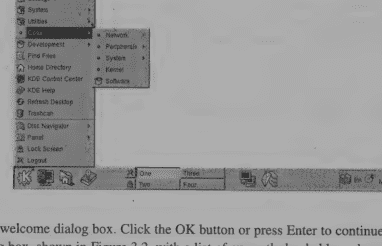

你会看到一个简短的欢迎对话框。单击 OK 按钮或按 Enter 继续。然后你会看到一个对话框，如图 3.2 所示，右侧列出当前已加载的内核模块，左侧列出可用的模块。

### 图 3.2

通过单击左侧（未加载）或右侧（已加载）对话框列表中的模块名称来配置系统的内核模块。

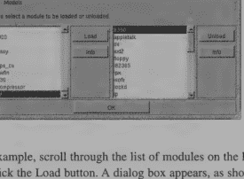

使用此之前的示例，滚动左侧的模块列表，然后选择 sound 模块，单击 Load 按钮。会出现一个对话框，如图 3.3 所示。

### 图 3.3

使用 COAS 配置内核模块的加载方式或时间。

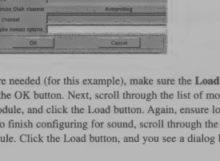

因为不需要任何选项（对于此示例），请确保 Load at boot time 按钮已启用。单击 OK 按钮。接下来，滚动左侧的模块列表，选择 uart401 模块，单击 Load 按钮。再次确保启动时加载，然后单击 OK。要完成声音配置，滚动模块列表并选择 sb 模块。单击 Load 按钮，你会看到一个类似于图 3.4 的对话框。


图 3.4
使用 COAS 轻松为 Linux 配置 SoundBlaster 兼容声卡内核模块！

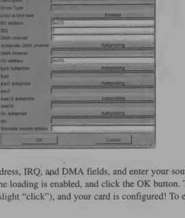

在 I/O 地址、IRQ 和 DMA 字段中单击，并输入声卡的地址。确保启用启动时加载，然后单击“确定”按钮。模块加载（你可能会听到轻微的“咔嗒”声），声卡即已配置！要退出 COAS，请单击“确定”按钮。

## 快速录音脚本

这里有一个简短的录音脚本，你可以用它通过内置或外接麦克风录制声音。该脚本通过使用 dd 命令将指定量的数据（以秒为单位）保存并转换为硬盘。使用你喜欢的文本编辑器将列表 3.1 中的脚本输入到一个文件中：

### 列表 3.1 录音脚本

```
#!/bin/sh
# recorder - record sound to disk file
# usage: recorder [n] soundfilename
echo -ne "recording "
echo -ne $1
echo -ne " seconds of sound to "
echo $2.au
/bin/dd bs=8k count=$1 </dev/audio >$2.au
```

保存文件，名称例如 recorder，然后使用 chmod 命令使脚本可执行，如下所示：

```
# chmod +x recorder
```

首先，使用 kmix 或 xmixer 设置麦克风的输入电平。要录制声音，输入 recorder，后跟秒数，如下所示：

```
# recorder 5 myfirstsound
```

脚本的响应如下：

正在录制 5 秒声音到 myfirstsound.au
5s 录入
5s 录出

播放声音，将其发送到音频设备，如下所示：

```
# cat myfirstsound.au >/dev/audio
```

## 轻松配置声音的方式

当然，还有一种更简单的方法为 OpenLinux 配置声音。浏览 http://www.opensound.com/linux.html，并下载一份 Open Sound System，即 OSS。你可以找到手动声音配置的详细技术流程的链接，或者使用商业版的 OSS，它支持超过 200 种声卡（并且可以为你节省大量时间和精力）。

OSS 使用 shell 脚本安装。当你在线购买 OSS 时，你会通过电子邮件收到许可证消息。你也可以使用 30 天的演示版来试用软件。如果你在系统上配置声音遇到困难，不妨试试 OSS！

## 启用 PCMCIA 卡

如果你在笔记本上安装了 OpenLinux，你应该执行的首要任务之一就是启用你的 PC 卡插槽。几乎所有笔记本电脑都配备 Type III 或 Type II PC 卡插槽，通常用于调制解调器或以太网网卡。然而，还有许多不同类型的 PC 卡用于以下等功能：

- ATA/IDE 卡驱动器（闪存卡、接口）
- ATA/IDE CD-ROM 接口
- 以太网接口
- 以太网/调制解调器组合卡
- 快速以太网接口
- 调制解调器
- SCSI 接口
- 串行接口
- 令牌环接口
- 无线网络接口

你可以在 David Hind 的 PCMCIA Card Services 包中找到超过 275 种受支持卡的列表，该包是一组内核模块，可在启动过程中自动加载并识别插入的 PC 卡。阅读 `/usr/doc/pcmcia` 目录下的文件 SUPPORTED.CARDS。

即使你的卡未列出，它也可能工作，尤其是如果是调制解调器卡。


> Winmodem PC 卡，例如 MegaHertz 系列中的多个型号或其他制造商的产品，在 Linux 下无法工作。请勿为 Linux 购买 winmodem 调制解调器或 PC 卡。

尽管 Card Services 包仅以源代码形式通过链接 http://hyper.stanford.edu/HyperNews/get/pcmcia/home.html 或 Linux 下载站点（如 ftp://metalab.unc.edu/pub/Linux/kernel/pcmcia）分发，你可以在 OpenLinux 系统的 `/lib/modules/2.2.3/pcmcia` 目录下找到模块的已安装二进制文件。然而，Caldera OpenLinux（事实上，没有其他发行版）没有用于启用 Card Services 的笔记本选项。你必须手动为笔记本的 PC 卡控制器配置 OpenLinux。


> 确保你的计算机上已安装 Card Services。如果你在系统上看不到 `/usr/doc/pcmcia-cs-3.0.9` 目录，很可能 Card Services 未安装。要安装卡服务，将 OpenLinux CD-ROM 插入计算机，然后像这样挂载 CD-ROM：
>
> ```
> # mount /mnt/cdrom
> ```
>
> 接下来，使用 rpm 命令像这样安装软件：
>
> ```
> # rpm -i /mnt/cdrom/col/install/RPMS/pcmcia*.rpm
> ```
>
> 这将安装必要的软件和文档。

要启用 Card Services 包以获得 PCMCIA 支持，使用你喜欢的文本编辑器，打开 `/etc/sysconfig` 目录下的文件 pcmcia。它看起来像这样：

```
PCMCIA=yes
PCIC=
PCIC_OPTS=
CARDMGR_OPTS="-f *"
```

如果你想禁用 Card Services，在 PCMCIA= 行中输入单词 no。然而，为了使用 Card Services，你必须在 PCIC= 条目中输入笔记本使用的 PCMCIA 控制器的类型。对许多用户来说，值 i82365 或 tcic 有效。你的条目可能如下所示：

```
PCMCIA=yes
PCIC=i82365
PCIC_OPTS=
CARDMGR_OPTS="-f *"
```

保存文件并退出文本编辑器。然后你可以重新启动 OpenLinux 或像这样启动 Card Services：

```
# /etc/rc.d/init.d/pcmcia start
Starting PCMCIA services: modules cardmgr
```

Card Services 启动并报告 cardmgr，即 PCMCIA 设备管理器，已被激活。该设备管理器监控你的 PC 卡插槽的卡插入或移除。如果插入了调制解调器卡，你应该就可以使用调制解调器了。其他卡，如以太网接口，将被识别，但在你正确为网络配置 OpenLinux 之前无法使用。

启动 Card Services 后，你可以通过至少三种方式检查其状态。首先，你可以使用 dmesg 命令，如下所示：

```
# dmesg

Linux PCMCIA Card Services 3.0.9
kernel build: 2.2.3 #1 Tue Mar 9 05:22:33 MET 1999
options: [pci] [cardbus]
Intel PCIC probe:
TI 1131 PCI-to-CardBus at bus 0 slot 10, mem 0x68000000,
2 sockets
host opts [0]: [ring] [pci + serial irq] [no pci irq]
[lat 168/176] [bus 32/34]
host opts [1]: [ring] [pci + serial irq] [no pci irq]
[lat 168/176] [bus 35/37]
ISA irqs (scanned) = 3,4,7,9 status change on irq 9
cs: IO port probe 0x1000-0x17ff: clean.
cs: IO port probe 0x0100-0x0fff: excluding 0x330-0x337
0x378-0x37f 0x388-0x38f 0x408-0x40f 0x4d0-0x4df 0x4d0-0x4d7
cs: IO port probe 0x0a00-0x0aff: clean.
cs: memory probe 0x00000000-0x0fffffff: clean.
eth0: NE2000 Compatible: port 0x300, irq 3, hw_addr 00:E0:98:04:AA:D5
...
```

这里没有显示所有的 dmesg 输出，但你可以看出该服务已加载，并且 Card Services 找到了一个以太网 PC 卡。


另一种检查方法是查看你的 OpenLinux 系统日志，即位于 /var/log 目录下的名为 messages 的文件。使用 less 分页器，后跟文件路径，如下所示：

```
# less /var/log/messages
..
Mar 23 22:20:32 noname kernel: Linux PCMCIA Card Services 3.0.9
Mar 23 22:20:32 noname kernel: kernel build: 2.2.3 #1 Tue Mar 9
05:22:33 MET 1999
Mar 23 22:20:32 noname kernel: options: [pci] [cardbus]
Mar 23 22:20:32 noname kernel: Intel PCIC probe:
Mar 23 22:20:32 noname kernel: TI 1131 PCI-to-CardBus at bus 0
slot 10, mem 0x60000000, 2 sockets
Mar 23 22:20:32 noname kernel: host opts [0]: [ring] [pci +
serial irq] [no pci irq] [lat 168/176] [bus 32/34]
Mar 23 22:20:32 noname kernel: host opts [1]: [ring] [pci +
serial irq] [no pci irq] [lat 168/176] [bus 35/37]
Mar 23 22:20:32 noname kernel: ISA irqs (scanned) = 3,4,7,9 status
change on irq 9
Mar 23 22:20:32 noname cardmgr[991]: starting, version is 3.0.9
Mar 23 22:20:32 noname cardmgr[991]: watching 2 sockets
Mar 23 22:20:32 noname kernel: cs: IO port probe 0x1000-0x17ff: clean.
Mar 23 22:20:32 noname kernel: cs: IO port probe 0x0100-0x0fff: excluding
0x330-0x337 0x378-0x37f 0x388-0x38f 0x408-0x40f 0x4d0-0x4df 0x4d0-0x4d7
Mar 23 22:20:33 noname kernel: cs: memory probe 0xa0000000-0xa0ffffff:
clean.
Mar 23 22:20:33 noname cardmgr[991]: initializing socket 0
Mar 23 22:20:33 noname kernel: cs: memory probe 0xa0000000-0xa0ffffff:
clean.
Mar 23 22:20:33 noname cardmgr[991]: socket 0: Linksys EtherFast 10/100
Fast
Ethernet
Mar 23 22:20:33 noname cardmgr[991]: executing: 'insmod
/lib/modules/2.2.3/net/8390.o'
Mar 23 22:20:33 noname cardmgr[991]: executing: 'modprobe net/8390'
Mar 23 22:20:33 noname cardmgr[991]: executing: 'insmod
/lib/modules/2.2.3/pcmcia/pcnet_cs.o'
Mar 23 22:20:33 noname kernel: eth0: NE2000 Compatible: port 0x300, irq 3,
hw_addr 00:E0:98:04:AA:D5
Mar 23 22:20:33 noname cardmgr[991]: executing: './network start eth0'
Mar 23 22:20:33 noname cardmgr[991]: + eth0: configuration file not found.
Mar 23 22:20:33 noname cardmgr[991]: start cmd exited with status 1
Mar 23 22:20:33 noname cardmgr[991]: exiting
..
```

这里没有显示所有输出，但你可以看出显示了其他信息，例如已识别卡的型号（在本例中为 Linksys EtherFast 10/100 卡）。查看系统日志也是诊断其他问题的好方法。


如果您使用 X11，诊断、检查或重置 PC 卡的第三种方法是使用 David Hind 的 cardinfo 客户端。像这样从终端窗口的命令行启动 cardinfo：

```
# cardinfo
```

按 Enter 键后，您会看到一个类似图 3.5 中的窗口。

### 图 3.5
cardinfo X11 客户端可用于使用 OpenLinux 监控、重置、挂起、弹出或插入 PC 卡。

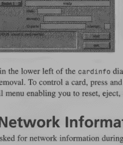

cardinfo 对话框左下角的一个小日志窗口列出了 PC 卡事件，例如插入或移除。要控制卡，请按住卡的 Socket 按钮。您会看到一个小菜单，可让您重置、弹出或插入卡。

## 使用 COAS 配置网络信息
虽然在 OpenLinux 安装过程中您被要求提供网络信息，但这并不是配置接口的唯一机会。如果您在安装期间未输入网络信息，则无需重新安装即可配置网络！使用 COAS 实用程序配置接口的地址。

## 配置您的以太网接口
要配置接口，请在 KDE 桌面中单击应用程序启动按钮，选择 COAS 然后选择网络，并单击以太网接口，如图 3.6 所示。

### 图 3.6
在 K 桌面环境下使用 COAS 配置您的以太网适配器。

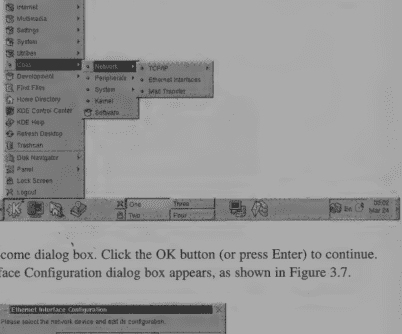

然后您会看到一个欢迎对话框。单击确定按钮（或按 Enter）继续。图 3.7 所示的以太网接口配置对话框会出现。

### 图 3.7
以太网接口配置对话框用于设置网络设备、接口地址和其他信息。

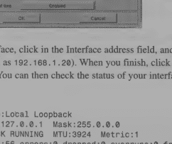

要配置接口，请单击接口地址字段并输入计算机的 IP 地址（如 192.168.1.20）。完成后，单击确定按钮。对话框消失。然后您可以使用 ifconfig 命令检查接口状态，如下所示：

```
# ifconfig
lo Link encap:Local Loopback
inet addr:127.0.0.1 Mask:255.0.0.0
UP LOOPBACK RUNNING MTU:3924 Metric:1
RX packets:56 errors:0 dropped:0 overruns:0 frame:0
TX packets:56 errors:0 dropped:0 overruns:0 carrier:0
collisions:0 txqueuelen:0
```

```
eth0  Link encap:Ethernet  HWaddr 00:E0:98:04:AA:D5
inet addr:192.1.2.34  Bcast:192.1.2.0  Mask:255.255.255.0
UP BROADCAST RUNNING MULTICAST  MTU:1500  Metric:1
RX packets:5 errors:0 dropped:0 overruns:0 frame:0
TX packets:5 errors:0 dropped:0 overruns:0 carrier:0
collisions:0 txqueuelen:100
Interrupt:3 Base address:0x300
```

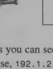

> 如果您看不到活动的本地回环（lo）接口，请使用 ifconfig 命令并使用 lo 和 up 选项，如下所示：
> # ifconfig lo up

如您所见，您现在拥有一个活动的以太网接口（eth0）和地址（在本例中为 192.1.2.34）。如果您已连接到本地网络，请使用 ping 命令尝试测试连接。在终端窗口的命令行中输入 ping，后跟另一台计算机的 IP 地址，如下所示：

```
# ping 192.1.2.36
PING 192.1.2.36 (192.1.2.36): 56 data bytes
64 bytes from 192.1.2.36: icmp_seq=0 ttl=64 time=0.6 ms
64 bytes from 192.1.2.36: icmp_seq=1 ttl=64 time=0.5 ms
64 bytes from 192.1.2.36: icmp_seq=2 ttl=64 time=0.5 ms
64 bytes from 192.1.2.36: icmp_seq=3 ttl=64 time=0.5 ms
64 bytes from 192.1.2.36: icmp_seq=4 ttl=64 time=0.5 ms

--- 192.1.2.36 ping statistics ---
5 packets transmitted, 5 packets received, 0% packet loss
round-trip min/avg/max = 0.5/0.5/0.6 ms
```

按 Ctrl+C 停止 ping 命令，该命令会发送并记录将 64 个字符的“数据包”发送并从远程计算机回显回来所需的时间（以千分之一秒为单位）。远程计算机可能位于本地网络上或世界另一端。


## 设置主机名
如果您在 OpenLinux 安装期间未设置计算机的主机名，您可以稍后通过在 COAS 系统菜单下使用主机名菜单项，或编辑 /etc/sysconfig 目录下的 network 文件来添加它。要手动更改主机名，请使用您喜欢的文本编辑器打开 sysconfig 文件（应如下所示）：

```
NETWORKING="yes"
HOSTNAME=noname.nodomain.nowhere
```

将 HOSTNAME 条目更改为您计算机的主机名，保存文件并退出编辑器。然后您可以使用 hostname 命令验证新的主机名。

## 在 OpenLinux 中使用 Iomega Zip 驱动器
现在 Linux 上有至少三种不同的 Iomega 并行端口 Zip 驱动器（不包括内部 IDE、USB 或 SCSI 驱动器）：原始 Zip 驱动器、Zip Plus 驱动器和新的 Zip 250。

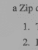

> 有关 Linux 和并行端口设备（如 Zip 驱动器）的最新开发信息，请浏览 http://www.torque.net/linux-pp.html。

以下步骤（使用原始 Zip 驱动器测试）将使您能够挂载和使用 Zip 磁盘：

- 1. 打开并将您的 Zip 驱动器连接到计算机的并行端口。
- 2. 将 Zip 磁盘插入 Zip 驱动器。
- 3. 创建目录（如 /mnt/zip）以访问 Zip 磁盘的内容，如下所示：
```
# mkdir /mnt/zip
```
- 4. 使用 insmod 命令加载 Zip 驱动器的内核模块支持，如下所示：
```
# insmod scsi_mod
# insmod sd_mod
# insmod parport
# insmod parport_pc
# insmod ppa
```

这会加载 SCSI 支持（Zip 驱动器使用低级 SCSI 协议）、并行端口共享支持以及 Zip 驱动器支持。在加载 ppa 模块后，您应该会听到 Zip 驱动器激活。然后您可以使用 mount 命令以及其文件系统类型、设备名称（/dev/sda）和挂载点，如下所示：

```
# mount -t vfat /dev/sda4 /mnt/zip
```

- 5. 要卸载 Zip 磁盘，请使用 umount 命令，后跟挂载点，如下所示：

```
# umount /mnt/zip
```


> 使用 Iomega Zip Plus 或 Zip 250 驱动器的用户需要使用 imm.o 模块，并且在使用 Zip 驱动器时无法与打印机共享并行端口。如果您使用原始 Zip 并行端口驱动器，则可以同时使用 Zip 磁盘和打印。

在验证 Zip 驱动器工作后，您可以使用 COAS 下的内核实用程序在启动时加载 Zip 驱动器的模块。

## 摘要
本小时提供了逐步配置计算机视频卡和监视器的 X11 的方法。将本小时用作微调 X11 配置的起点。

#### 问答
Q 帮助！我的 XFree86 只能提供 320 x 200 的分辨率！

A 在 OpenLinux 安装期间选择了错误的分辨率是有可能的。在 OpenLinux 安装期间务必测试各种 X11 模式，以获得使用最多颜色的最佳分辨率。您也可以尝试使用 xf86config 命令重新配置 X11 并重新启动 X11。请密切注意您为监视器的水平和垂直频率输入的值，并且不要忘记编辑 XF86Config 文件的 Device 部分以设置正确的视频 RAM 数量。如果您拥有最新最好的视频卡之一，该卡可能尚未被 XFree86 支持。XFree86 的 X11 发行版的下一版本很可能会包含针对您图形卡的修复。

#### 练习
- 1. 启动 xvidtune 客户端，然后使用其控件微调 X11 设置。看看是否能在显示器上获得更好的图像。
- 2. 尝试以不同的颜色深度启动 X11 会话。您的显示看起来有不同吗？
- 3. 尝试挂载、从 Zip 驱动器读取和写入。浏览至 http://www.torque.net/。
- 4. 在阅读 XF86Config 手册页的同时滚动浏览您的 XF86Config 文件。


## 第二部分

## 学习 Linux 基础

### 小时

- 4 阅读和导航命令
- 5 操作和搜索命令
- 6 使用 Shell
- 7 使用 X Window 系统
- 8 探索 K 桌面环境


## 第 4 小时

## 阅读和导航命令

本小时将介绍用于导航、搜索和读取文件系统文件和目录的基本 Linux 命令，即 Linux 分区中目录的集合。完成学习后，你将知道如何获取命令帮助、了解自己在 Linux 中的位置以及在硬盘上查找文件。本小时首先介绍目录的导航和搜索，然后介绍如何读取目录和文件。但首先，你将学习如何使用 man 命令帮助自己。

## 使用 man 命令获取帮助

了解 Linux 的第一件事之一是帮助从不遥远。像大多数 UNIX 实现一样，你的 Linux 发行版为大多数程序、实用程序、命令和编程系统调用提供了手册页。你可以获取几乎任何命令的信息，包括 man。例如，通过输入以下内容读取 man 命令的手册页：

```
# man man
```

手册页最初是单页的 UNIX 命令摘要。每个手册页的文件都以一位数字扩展名命名，并放置在 /usr/man 下的子目录中。在初始安装过程中或稍后安装单个程序时，许多 OpenLinux 命令的手册页会被复制到计算机的硬盘上。例如，man 的手册页命名并找到如下：

/usr/man/man1/man.1.gz


> man 命令的手册页名称为 man.1，但扩展名 .gz 表示 man.1 文件已使用 gzip 命令压缩。man 命令在显示手册页之前会自动解压缩文件。有关压缩文件的更多信息，请参阅第 5 小时“操作和搜索命令”中的“压缩和解压缩文件”部分。

/usr/man/man1 目录下有超过 1,000 个手册页文件。但例如，如果你想了解手册页的格式和放置位置，你不会在 man.1 中找到此信息，而是在 /usr/man/man7 下的 man.7 中找到。查看表 4.1 以了解每个手册部分的位置和内容。

## 表 4.1 Linux 手册部分

| 目录 | 内容 |
|---|---|
| /usr/man/man1 | 命令 — 在 shell 中运行的命令 |
| /usr/man/man2 | 系统调用 — 内核函数的文档 |
| /usr/man/man3 | 库调用 — libc 函数的手册页 |
| /usr/man/man4 | 特殊文件 — /dev 目录中文件的信息 |
| /usr/man/man5 | 文件格式 — /etc/passwd 等文件格式的详细信息 |
| /usr/man/man6 | 游戏 |
| /usr/man/man7 | 宏包 — Linux 文件系统、手册页等的描述 |
| /usr/man/man8 | 系统管理 — root 操作员实用程序的手册页 |
| /usr/man/man9 | 内核例程 — Linux 内核源例程或内核模块规范的文档 |

每个手册页传统上都有若干部分；命令的文档也分为若干部分。查看表 4.2 以了解手册页的组织结构。

## 表 4.2 手册页的组织结构

| 部分 | 描述 |
|---|---|
| 名称 | 命令的名称和简要描述 |
| 概要 | 如何使用命令和命令行选项 |
| 描述 | 程序及其选项的解释 |
| 文件 | 命令使用文件及其位置的列表 |
| 另请参阅 | 相关手册页的列表 |
| 诊断 | 异常输出的描述 |
| 错误 | 已知问题 |
| 作者 | 程序的主要作者和其他贡献者 |

在线手册页包含用于 nroff 文本格式化程序的特殊排版代码，使用特殊宏（在 man.7 中记录）控制手册页的显示或打印。有关 nroff 文本格式化程序的更多信息，请参阅第 15 小时“准备文档”。nroff 格式对于其他程序也至关重要，例如 makwhatis、whatis 和 apropos，你将在本章后面学习这些程序。这些程序期望手册页具有一致的格式，以便在搜索操作期间正确显示信息，或在构建有关 OpenLinux 系统程序的信息数据库时正确存储。

你还可以在 /usr/doc 目录下找到 Linux 命令和其他主题的更详细文档，其中包含名为常见问题解答，或 FAQs，以及 How-To 文档，或 HOWTOs 的文件。此外，发布 GNU 软件包的自由软件基金会将大部分文档放在特殊的超文本 info 格式中。本书讨论的许多命令都是 GNU 程序。


Linux 的大部分软件来自由 emacs 编辑器作者 Richard Stallman 创立的自由软件基金会（请参阅第 14 小时“文本处理”）。FSF 在 GNU 通用公共许可证，或 GPL 下分发其软件。Linux 和 GNU 软件的成功和流行部分归功于 GPL 的条款。如果你想了解有关 Linux 的 GNU 软件程序、FSF 或 GNU GPL 的更多信息，可以尝试 info 命令，它是 /usr/info 目录下 GNU 超文本文档的阅读器。你也可以使用 man 命令如下：`man GPL`

man 命令通常根据 /etc 目录下 man.conf 文件中详细说明的指令搜索手册页。这些指令定义了查找手册页的默认目录。查找这些页面的默认位置如下：

- MANPATH /usr/man
- MANPATH /usr/TeX/man
- MANPATH /usr/local/man
- MANPATH /usr/X11R6/man
- MANPATH /usr/openwin/man


> X Window 系统提供了一个名为 xman 的图形化 man 命令。你可以使用 xman 不仅阅读手册页，还可以查看手册页条目的目录。如果你使用 X11 的 K 桌面环境（在第 8 小时“探索 K 桌面环境”中介绍），你会发现 KDE 手册页采用超文本标记语言，或 HTML 格式。

## 导航和搜索文件系统

本节介绍基本导航命令，并展示如何移动 Linux 文件系统、查找文件以及构建文件信息数据库，例如用于 whatis 命令。你将了解替代方法和程序，以及如何加快搜索以快速找到文件。

## 使用 cd 命令移动到不同目录

新术语
cd（change directory）命令是移动到 Linux 文件系统不同部分的<|message|> 基本导航工具。登录 OpenLinux 后，你位于主目录。此目录的名称或路径名以 /home/ 开头，后跟你的用户名。

你可以通过输入命令后跟路径名直接移动到不同目录。例如，以下命令将你移动到 /usr/bin 目录：

```
# cd /usr/bin
```

当你在该目录中时，可以使用以下命令向上移动到 /usr 目录：

```
# cd ..
```

你也可以在 /usr/bin 目录中使用以下命令移动到根目录，或 /：

```
# cd ../..
```

最后，你始终可以使用以下命令返回主目录（你的文件所在位置）

```
# cd
```

或

```
# cd -
```


> 如果你尝试使用 man 命令阅读 cd 手册页，你找不到它。为什么？因为 cd 内置于 shell 中，shell 在你按 Enter 后解释你的命令行。有关更多详细信息，请参阅第 6 小时“使用 Shell”中的 bash。

## 使用 pwd 命令了解当前位置

pwd（print working directory）命令告诉你当前位置并打印工作（当前）目录。例如，如果你执行

```
# cd /usr/bin
```

然后输入

```
# pwd
```

你会看到

/usr/bin

虽然 pwd 命令有手册页，但当你使用 pwd 时，很可能是使用内置于 shell 的 pwd。你怎么知道？如果你尝试使用以下命令调用 pwd，你只会看到当前工作目录被打印：

```
# pwd --help
```

相反，按如下方式在 /bin 目录中使用 pwd 命令：

```
# /bin/pwd --help
```


这会在 /bin 目录下运行 pwd 命令，而不是 shell 内置的 pwd。你会看到 pwd 命令的简短帮助文件，而不是当前目录。如果您对自己的位置有任何疑问，请使用 /bin 目录下的 pwd 命令。

## 使用 find 命令搜索目录中的匹配文件

find 命令是一个功能强大的搜索工具，可用于在硬盘上查找文件。您可以使用简单的 find 命令行轻松地在硬盘上搜索文件。例如，要在 /usr 目录下搜索 spell 命令，请使用以下命令：

```
# find /usr -name spell -print
```

您可以使用 find 命令按日期查找文件，还可以指定时间范围。例如，要查找在过去 100 天内未使用的 /usr/bin 目录中的程序，可以尝试以下操作：

```
# find /usr/bin -type f -atime +100 -print
```

-atime 选项后面跟一个表示天数的数字。要查找 /usr/bin 目录中新建或修改且年龄为一天或更少的文件，可以使用以下选项：

```
# find /usr/bin -type f -mtime -1 -print
```

-mtime 选项后面跟一个天数（本例中为一天或更少），用于查找已修改的文件。find 命令在搜索字符串中也接受通配符（如 * 或 ?），您将在第 5 小时学习到相关内容。作为一个简单示例，您可以使用 find 显示 /usr 目录中的所有 PostScript 文件，方法如下：

```
# find /usr -name '*.ps' -print
```

第 16 小时《图形工具》中的“理解图形格式”部分介绍了 PostScript 文件。

-xdev 是 find 命令的一个方便选项。到目前为止的示例显示的搜索仅限于 /usr 目录。但如果您想从根目录（/）开始搜索怎么办？-xdev 将搜索限制在当前文件系统，本例中为 Linux。如果没有它，find 会愉快地继续通过任何已挂载的 CD-ROM 或您的 DOS 或 Windows 分区进行搜索，可能找到您不感兴趣的文件，从而减慢搜索速度并使搜索输出混乱。

例如，您可以使用 -xdev 选项将 find 命令搜索限制在 Windows 分区。要查找 /mnt/dos 目录下已挂载的 Windows 分区中以 .sys 结尾的所有文件，请按如下方式使用 -xdev 选项：

```
# find /mnt/dos -name *.sys -print -xdev
```

find 命令有许多不同的选项和用途。


> 您还可以让 find 命令执行搜索并销毁任务以从计算机中删除选定的文件。有关详细信息，请参阅第 21 小时《基本系统管理》中的“节省磁盘空间”。

虽然 find 能快速搜索硬盘和文件系统，但还有其他快速查找文件（尤其是程序）的方法。继续阅读以了解更多信息！

## 使用 whereis 命令查找文件

whereis 命令可以快速查找文件，并显示文件二进制文件、源代码和手册页所在的位置。例如，以下命令显示 find 命令位于 /usr/bin 目录，其手册页位于 /usr/man/man1 目录：

```
# whereis find
find: /usr/bin/find /usr/man/man1/find.1.gz
```

您还可以使用 whereis 仅查找程序的二进制版本，方法如下：

```
# whereis -b find
find: /usr/bin/find
```

如果您只想查看程序的位置而不查看其文档，这很有用。如果 whereis 找不到您的请求，您会得到一个空返回字符串，例如：

```
# whereis foo
foo:
```

问题的一部分也可能是文件不在 whereis 命令搜索的任何目录中。whereis 查找的目录已硬编码在程序中。虽然这看起来可能是一个缺点，但将搜索限制在已知目录（如 /usr/man、/usr/bin 或 /usr/sbin）可以加快查找文件的速度。

虽然 whereis 比使用 find 定位程序或手册页更快，但您还可以使用一个更快的搜索工具，称为 locate，有关介绍请参见下一节。


## 使用 locate 命令定位文件

加快文件搜索速度的一种方法是不要搜索文件目录！您可以通过使用 locate 之类的程序来实现。locate 使用单个文件名和位置数据库，通过查看单个文件而不是遍历硬盘来节省时间。使用 locate 查找文件比 find 命令快得多，因为 locate 直接访问数据库文件，找到任何匹配的文件名并显示其结果。

Locate 使用起来很简单。例如，要查找系统上的所有 PostScript 文件，可以输入以下内容：

```
# locate *.ps
```

文件几乎会立即出现在您的屏幕上。您甚至可能会发现 locate 命令行比 find 命令更容易使用。然而，有一个问题：find 可以“开箱即用”，而 locate 需要系统上所有文件的数据库。但不用担心——该过程几乎是自动的。

安装 OpenLinux 后，locate 数据库每天凌晨 5:50 更新。要立即创建 locate 数据库的更新版本，需要使用 updatedb 命令。确保您以 root 操作员身份登录，或使用 su 命令（参见第 21 小时）。在提示符下，输入以下内容：

```
# updatedb
```

updatedb 命令完成工作可能需要一分钟左右，但完成后，locate 的数据库 locatedb 位于 /var/state 目录中。对于 900MB 的文件，locatedb 大约为 700,000 个字符。使用 locate 命令的唯一缺点是，随着时间的推移，随着您向系统添加或删除文件，其数据库可能会过时。幸运的是，OpenLinux 会自动更新 locate 数据库；有关详细信息，请参阅第 24 小时《调度》。

## 使用 whatis 和 apropos 获取命令摘要

当您首次探索 OpenLinux 系统时，您可能会遇到功能不明确的程序。许多 Linux 程序设计为在命令行上使用 ?, -help 或 -help 选项提供一些帮助，但通常不应在不知道程序用途的情况下运行程序。

whatis 命令可能可以帮助您通过从程序手册页派生的摘要行快速了解程序是什么。例如，要了解 who 是什么，可以输入以下内容：

```
# whatis who
```

您的屏幕会清空，whatis 命令会显示如下摘要：

```
who (1)  - show who is logged on
```

按 Q 退出 whatis 命令。然而，与 locate 命令不同，您必须先使用 makewhatis 命令构建命令摘要数据库，该命令位于 /usr/sbin 目录下。为此，请确保您以 root 身份登录，并输入以下内容：

```
# makewhatis
```

makewhatis 命令与 updatedb 命令类似，需要几分钟时间来构建 whatis 数据库，该数据库称为 whatis，位于 /usr/man/man1 目录下。makewhatis 命令有几个选项，但没有手册页。要查看快速摘要，请使用以下命令：

```
# makewhatis -?
```

您需要定期更新 whatis 数据库以跟踪任何新安装的程序。请参阅第 24 小时，了解如何让 OpenLinux 自动执行此操作的提示。

现在您可以看到 whereis 和 whatis 如何帮助您查找程序或了解它们的作用。但如果您想做某事却记不起哪个程序执行什么操作怎么办？在这种情况下，您可以使用 apropos 命令。

例如，如果您记不起哪个命令用于搜索文件，可以输入以下内容：

```
# apropos search
```

```
apropos (1)      - search the whatis database for strings
badblocks (8)    - search a device for bad blocks
bsearch (3)      - binary search of a sorted array
conflict (8)     - search for alias/password conflicts
find (1)         - search for files in a directory hierarchy
hcreate, hdestroy, hsearch (3) - hash table management
lfind, lsearch (3) - linear search of an array
lkbdb (1)        - search bibliographic databases
lookbib (1)      - search bibliographic databases
lsearch (n)      - See if a list contains a particular element
manpath (1)      - determine user's search path for man pages
strbrk (3)       - search a string for any of a set of characters
strspn, strcspn (3) - search a string for a set of characters
tsearch, tfind, tdelete, twalk (3) - manage a binary tree
```


whatis (1)      . 搜索 whatis 数据库中的完整单词。
zgrep (1)      . 搜索可能已压缩的文件以查找
  → 正则表达式
zipgrep (1)    . 搜索可能为 zip 文件的
  → 正则表达式

你在屏幕上看到来自 whatis 数据库的程序列表。读完列表后按 Q 键。apropos 命令使用此数据库搜索你输入的关键字。如果你保持 whatis 数据库为最新状态，就能够使用 apropos 来帮助你找到所需的程序。


> 你也可以使用 man 命令的 -K 选项来做与 apropos 相同的操作，但搜索速度慢，并且会在搜索结果中逐个显示手册页。例如，要搜索处理 PostScript 的任何程序，可以尝试以下操作：
> 
> # man -K PostScript
> 
> 这可能会在你使用 Q 退出之前产生以下输出：
> 
> /usr/man/man7/unicode.7? [ynq] n
> /usr/man/man7/suffixes.7? [ynq] n
> /usr/man/man7/groff_char.7? [ynq] n
> /usr/man/man1/convert.1? [ynq] n
> /usr/man/man1/xv.1? [ynq] n
> /usr/man/man1/xdvi.1? [ynq] n
> /usr/man/man1/dvips.1? [ynq] n
> /usr/man/man1/afm2tfm.1? [ynq] n
> /usr/man/man1/ps2pk.1? [ynq] n
> /usr/man/man1/ps2frag.1? [ynq] q

## 读取目录和文件

现在你已经了解了目录导航、搜索文件以及如何查找有关程序的更多信息，我将向你介绍其他可用的基本 Linux 命令。本节向你展示如何列出目录的内容、制作硬盘目录以及读取文件的内容。你将学习这些命令的基本形式以便入门。

## 使用 ls 命令列出目录

ls（list directory）命令是最常用的程序之一。在最简单的形式中，ls 会列出当前目录中的几乎所有文件。但这个名字很短的命令，可能拥有比任何其他程序都多的命令行选项（截至上次统计超过 75 个）！


为什么 Linux 命令这么多，为什么它们的名字这么短？如果你最初不熟悉 Linux，很快就会发现数百个程序拥有短小、起初难以理解的名字，如 cd、pwd、df、du、ls、as、ar、at、w 等等。不要被吓到！相反，要感谢 Linux 继承了这一丰富的传统 UNIX 工具集合。UNIX 的哲学是，一个好的程序很小并且做一件事做得非常好；操作系统的强大之处在于将多个程序的输出组合起来协同工作。许多命令名称是为了节省输入而选择的。为什么要输入长程序名，而一两个字母就足够了？此外，许多早期的 UNIX 用户通过非常慢的（110 波特）终端线路与远程 UNIX 计算机通信，简短、精确的命令传输速度更快。要更好地欣赏这些简短的命令名称，请阅读第 6 小时。

在简单形式中，ls 会列出当前目录中的文件，如以下示例所示：

```
[home/bball]$ ls
News          axhome        nsmail        search
author.msg    documents     reading       vultures.msg
auto          mail          research
```

示例列出了我的主目录中的文件。

你也可以使用 -m 选项以单行、逗号分隔的方式列出文件：

```
# ls -m
News, author.msg, auto, axhome, documents, mail, nsmail, reading,
=> research, search, vultures.msg
```

如果你不喜欢这种列表方式，可以使用 -x 选项将文件水平排序，而不是默认的垂直排序，如下所示：

```
# ls -x
News          author.msg    auto           axhome         documents
mail          nsmail        reading        research       search
vultures.msg
```

这些都是文件，还是有几个目录？一种方法是使用 -F 选项来判断：

```
# ls -F
News/         axhome        nsmail/       search*
author.msg    documents/    reading/      vultures.msg
auto/         mail/         research/
```

```
# ls -aF
./
../
.Xauthority
.Xdefaults
.addressbook
.addressbook.lu
.bash_history
.bash_logout
.bash_profile
.bashrc
.desksdefaults
.dt/
.dtprofile*
.festival_history
.forward
.fvwm2rc95*
.index/
.mailcap
.mailrc
.mime_types
.ncftp
.nedit
.neditdb
.netscape/
.newsrc
.oldnewsrc
.pinerc
.procmail/
.procmailrc
.tin
.xinitrc*
News/
.author.msg
auto/
axhome/
documents/
mail/
nsmail/
reading/
research/
search*
vultures.msg
```

正如你所见，以句点（.）开头的名称的文件或目录，除非明确请求所有文件，否则 ls 不会显示。使用 -F 选项是一种查看列表中的文件和目录的方法，但如果你有彩色显示器或使用彩色 X11，可以让 ls 以不同颜色显示文件、目录或可执行文件。要做到这一点，使用 --color 选项如下：

```
# ls --color
```

在 X11 中，使用 xterm 终端，目录为蓝色，程序为绿色，普通文件为黑色。你也可以自定义不同类型文件使用的颜色。

例如，要使所有图形文件，如 PCX 或 GIF 图形，以红色显示，并且所有以 .txt 结尾的文本文件以紫色显示，创建一个名为 LS_COLORS 的 shell 环境变量，或系统或用户定义的值，定义颜色并导出变量如下：

```
# LS_COLORS="*pcx=31:*gif=31:*txt=35";export LS_COLORS
```


> ls 手册页列出了默认颜色。你可以将自定义定义放在你的 .bashrc 文件中，以便下次登录 OpenLinux 时使用。作为 root 操作员，你也可以为所有用户指定系统范围的默认颜色。请参阅第 6 小时，了解如何为 OpenLinux 系统上的所有用户定义 LS_COLORS 和其他环境变量。

## 长目录列表

你想了解有关文件的更多信息吗？你可以使用 ls -l 选项使用长格式列表，例如：

```
# ls -l
total 2086
-rw-r--r-- 1 bball users 256382 Dec 30 15:42 162317art.zip
drwx------ 6 bball users 1024 Dec 17 22:35 Desktop
drwxr-xr-x 24 bball users 1024 Dec 2 15:09 Office40
```

```
drwxr-xr-x 22 bball users 1024 Dec 2 11:23 Office50
-rw-r--r-- 1 bball users 29360 Dec 30 14:38 Sheet.as
-rw-r--r-- 1 bball users 705 Dec 30 15:15 Sheet.wk3
-rw-r--r-- 1 bball users 2360 Dec 30 15:15 Sheet.x14
-rw-r--r-- 1 bball users 5632 Dec 30 15:20 Sheet.x15
-rw-r--r-- 1 bball users 2950 Dec 17 20:37 XWP
drwxr-xr-x 5 bball users 1024 Mar 24 19:58 aim
drwxr-xr-x 4 bball users 1024 Dec 30 15:15 axhome
drwxr-xr-x 2 bball users 1024 Dec 23 23:15 documents
drwxr-xr-x 2 bball users 1024 Dec 11 11:06 graphics
drwxr-xr-x 6 bball users 1024 Dec 1 11:19 lg
drwxrwxrwt 2 bball users 1024 Dec 9 16:34 mail
drwx------ 2 bball users 1024 Nov 8 10:56 nsmail
drwxr-xr-x 3 bball users 1024 Nov 16 10:22 rvpayer5.0
drwxr-xr-x 5 bball users 1024 Nov 4 10:49 so50
drwxr-xr-x 2 bball users 3072 Dec 30 15:43 ty12
-rw-r--r-- 1 bball users 12004 Dec 30 12:37 worth.as
-rw-r--r-- 1 bball users 1533 Dec 30 13:09 worth.csv
-rw-r--r-- 1 bball users 227985 Dec 30 13:08 worth.dif
-rw-r--r-- 1 bball users 4905 Dec 30 13:12 worth.sc
-rw-r--r-- 1 bball users 8110 Dec 30 13:09 worth.slk
-rw-r--r-- 1 bball users 1533 Dec 30 13:09 worth.txt
```

正如你所见，有八个不同的列。第一列是文件的权限标志，在第 22 小时“处理文件和文件系统”中介绍。这些标志通常显示文件的类型，以及谁可以读取、写入（修改或删除）或运行该文件。

下一列显示链接数，在第 5 小时讨论。接下来是所有者名称，然后是组名。所有者和组在第 22 小时讨论。接下来列出文件大小，然后是时间戳，说明文件或目录的创建或最后修改时间。最后一列显然是每个文件的名称。

## 指定其他目录

你也可以通过在命令行上指定目录或路径名，使用 ls 命令查看其他目录的内容。例如，如果你想查看 /usr/bin 目录中的所有文件（你可能会看到比这些更多的文件），请使用以下命令：

```
# ls /usr/bin
arch dd gzip netstat stty
ash df hostname nisdomainname su
awk dmesg kill ping sync
basename nsdomainname ksh ps tar
bash doexec ln pwd tcsh
bsh domainname login red touch
cat echo ls rm true
chgrp ed mail rmdir umount
chmod egrep mkdir rpm uname
```

chown false mknod sed ypdomainname
cp fgrep more setserial zcat
cpio gawk mount sh
csh grep mt sleep
date gunzip mv sort

**新术语** 正则表达式是一种特殊字符串指定模式的语言。ls 命令支持使用通配符和正则表达式，这意味着你可以使用与 find 和 locate 命令中看到的示例类似且更复杂的选项。例如，如果你只想在当前目录中搜索文本文件，可以使用以下命令：

```
# ls *.txt
```

最后，如果你想查看系统上的所有文件，可以使用 ls -R 选项，它会递归遍历目录以显示其内容。虽然你可以使用这种方法搜索文件并建立系统文件的目录，但请注意，列出文件可能需要几分钟时间。列表中还可能包含你不想列出的文件，或其他操作系统文件系统上的文件，例如 DOS 或 Windows，特别是如果你使用以下命令：

```
# ls -R /
```

更好的方法可能是使用 -d 选项与 -R 配合使用，只列出一定数量的目录层级。例如，以下命令搜索根（/）目录沿线的三个目录层级：

```
# ls -Rd /*/*/*
```

然而，有一个更好的工具可以让你了解系统的目录结构——tree——将在下一节中讨论。


> 你喜欢 ls -AF 显示目录的方式吗？你希望 ls 始终使用颜色吗？如果你希望 ls 命令始终显示这种详细程度，请参阅第 6 小时。

## 使用 dir 和 vdir 命令列出目录

如果你实在无法掌握使用 ls 列出目录，可以使用 dir 或 vdir 命令。与 ls 相比，这些命令只有大约 45 个命令行选项，但功能同样强大。它们的工作方式与 ls 类似，但具有某些默认值。

dir 命令的工作方式与默认的 ls 命令类似，以排序的列形式列出文件，如以下示例所示：

```
# dir
01_hyph.dat    49_thes.dat    bin            help           store
01_spell.dat   Desktop        config         install.ini    template
01_thes.dat    LICENSE        database       instdb.ins     wordbook
44_hyph.dat    README         download       kino           xp3
44_spell.dat   addin          explorer       l_soffice.xpm
44_thes.dat    autotext       filter         lib
49_hyph.dat    backup         fonts          s_soffice.xpm
49_spell.dat   basic          gallery        sofficecrc
```

vdir 命令的工作方式与 ls -l 选项类似，默认以长格式列出，如下所示：

```
# vdir
total 3659
-rw-rw-rw- 1 bball users 65605 Oct 27 10:00 01_hyph.dat
-rw-rw-rw- 1 bball users 313015 Oct 27 10:00 01_spell.dat
-rw-rw-rw- 1 bball users 375808 Oct 27 10:00 01_thes.dat
-rw-r--r-- 1 bball users 65605 Oct 27 10:00 44_hyph.dat
-rw-r--r-- 1 bball users 313015 Oct 27 10:00 44_spell.dat
-rw-r--r-- 1 bball users 380928 Oct 27 10:00 44_thes.dat
-rw-rw-rw- 1 bball users 51765 Oct 27 10:00 49_hyph.dat
-rw-rw-rw- 1 bball users 602497 Oct 27 10:00 49_spell.dat
-rw-rw-rw- 1 bball users 1191936 Oct 27 10:00 49_thes.dat
drwxr-xr-x 2 bball users 1024 Dec 2 11:21 Desktop
-rw-r--r-- 1 bball users 11631 Oct 27 10:00 LICENSE
-rw-r--r-- 1 bball users 8435 Oct 27 10:00 README
drwxr-xr-x 3 bball users 1024 Dec 2 11:21 addin
drwxr-xr-x 2 bball users 1024 Dec 2 11:21 autotext
drwxr-xr-x 2 bball users 1024 Dec 30 15:41 backup
drwxr-xr-x 2 bball users 1024 Dec 17 11:43 basic
drwxr-xr-x 2 bball users 2048 Dec 2 11:22 bin
drwxr-xr-x 11 bball users 3072 Jan 4 09:52 config
drwxr-xr-x 2 bball users 1024 Dec 2 11:30 database
drwxr-xr-x 2 bball users 1024 Dec 2 11:20 download
drwxr-xr-x 2 bball users 1024 Dec 2 11:20 explorer
drwxr-xr-x 2 bball users 1024 Dec 2 11:22 filter
drwxr-xr-x 4 bball users 1024 Dec 2 11:20 fonts
drwxr-xr-x 14 bball users 2048 Dec 2 11:22 gallery
drwxr-xr-x 4 bball users 1024 Dec 2 11:21 help
-rw-r--r-- 1 bball users 15569 Dec 2 11:22 install.ini
-rw-r--r-- 1 bball users 274209 Dec 17 11:20 instdb.ins
drwxr-xr-x 2 bball users 1024 Dec 2 11:21 kino
-rw-r--r-- 1 bball users 5199 Oct 27 10:00 l_soffice.xpm
drwxr-xr-x 2 bball users 3072 Dec 2 11:21 lib
-rw-r--r-- 1 bball users 812 Oct 27 10:00 s_soffice.xpm
-rw-r--r-- 1 bball users 8406 Jan 4 09:52 sofficecrc
drwxr-xr-x 3 bball users 1024 Dec 2 11:38 store
drwxr-xr-x 13 bball users 1024 Dec 17 11:43 _template
drwxr-xr-x 2 bball users 1024 Dec 2 12:08 wordbook
drwxr-xr-x 5 bball users 1024 Dec 2 11:20 xp3
```

虽然 dir 或 vdir 没有单独的手册页（它们在 ls 手册页中提到），但你可以使用 --help 选项获取每个命令的帮助。

## 使用 cat 命令列出和合并文件

cat（连接文件）命令用于将文件内容发送到屏幕。你也可以使用此命令将文件内容发送到其他文件，使用一种称为输出重定向的过程。本节向你展示此命令的一些基本用法。有关标准输入、标准输出和重定向的更多信息，请参阅第 6 小时。虽然 cat 可用于读取短文件，但通常用于合并、创建、覆盖或追加文件。要使用 cat 查看短文件，可以输入以下命令：

```
# cat test.txt
This text file was created by the cat command.
Cat could be the world's simplest text editor.
If you read this book, you'll learn how to use cat.
This is the last line of text in this file.
```

cat 命令还有许多选项。如果你想查看带行号的文件，以便标记特定短语，可以使用 -n 选项：

```
# cat -n test.txt
1 This text file was created by the cat command.
2 Cat could be the world's simplest text editor.
3 If you read this book, you'll learn how to use cat.
4 This is the last line of text in this file.
```

你也可以使用 cat 同时查看多个文件，因为 cat 接受通配符：

```
# cat -n test*
1 This text file was created by the cat command.
2 Cat could be the world's simplest text editor.
3 If you read this book, you'll learn how to use cat.
4 This is the last line of text in this file.
5 This is the first line of test2.txt.
6 This file was also created by cat.
7 This is the last line of test2.txt.
```

正如你所见，cat 也会在输出中包含第二个文件，并对输出的每一行编号，而不是对每个文件编号。请注意，你也可以使用以下命令同时查看两个文件：

```
# cat test.txt test2.txt
```

输出与使用通配符时完全相同。

但查看多个文件只是使用 cat 的一种方式。你也可以使用 cat 命令与重定向运算符（>）来合并文件。例如，如果你想将 test.txt 和 test2.txt 合并到名为 test3.txt 的第三个文件中，可以使用以下命令：

```
# cat test* > test3.txt
```

你可以按如下方式检查结果：

```
# ls -l test*
-rw-r--r-- 1 bball users 190 Jan  4 16:06 test.txt
-rw-r--r-- 1 bball users 108 Jan  4 16:07 test2.txt
-rw-r--r-- 1 bball users 298 Jan  4 16:07 test3.txt
```

但如果想在不创建更大的第三个文件的情况下合并 test.txt 和 test2.txt 呢？在这种情况下，你首先决定是想将 test.txt 的内容放入 test2.txt，还是将 test2.txt 的内容放入 test.txt。然后，使用 cat 与 >> 重定向运算符，输入以下命令：

```
# cat test.txt >> test2.txt
```

这会将 test.txt 的内容追加到 test2.txt 的末尾。要检查结果，再次使用 cat：

```
# cat test2.txt
This is the first line of test2.txt.
This file was also created by cat.
This is the last line of test2.txt.
This text file was created by the cat command.
Cat could be the world's simplest text editor.
If you read this book, you'll learn how to use cat.
This is the last line of text in this file.
```

请注意，你也可以按如下方式输入命令：

```
# cat -n test.txt >> test2.txt
```


最后，这里有一个技巧，如果你想在不运行文字处理器或文本编辑器的情况下创建一个简短的文本文件，可以使用它。因为 cat 命令可以读取标准输入，所以你可以让 cat 命令创建一个文件并用你的按键填充它。为此，首先输入以下内容，以 myfile.txt 作为示例文件：

```
# cat > myfile.txt
```

现在输入一些文本，例如以下内容：

```
This is the cat word processor.
This is the end of the file.
```

现在按 Ctrl+D 关闭文件。要查看是否有效，请尝试以下操作：

```
# ls -l myfile.txt
```

```
-rw-r--r-- 1 bball users 61 Jan 4 16:11 myfile.txt
```

```
# cat myfile.txt
```

```
This is the cat word processor.
This is the end of the file.
```

cat 命令会打印出任何文件的内容，而不仅仅是文本文件。虽然 cat 对于查看一个或多个简短文件很有用，但当你想读取更长的文本文件时该怎么办？继续阅读，了解分页命令，它们在读取较长文件时能让生活更轻松。

## 使用 more 命令读取文件

more 命令是 Linux 命令家族中的一个，称为分页器。分页命令让你可以逐屏或逐行浏览文件。这非常有帮助，尤其是在阅读大量手册页时，因为 man 命令使用分页器来显示每一页。

more 命令在提供早期分页器的基本功能方面是一个传统的分页器。你可以在命令行中按如下方式使用 more：

```
# more longfile.txt
```

如果需要帮助，可以按 H 键查看帮助屏幕。你还可以使用感叹号字符 (!) 在 more 内部运行其他命令。阅读文本文件很容易，因为你可以通过按空格键前进一屏，按 B 键后退一屏。

more 命令还有许多命令行选项。你可以自定义屏幕提示（more 显示你正在读取的文件的当前百分比）、设置屏幕大小（在文件中向前或向后浏览时显示的行数）、使用多个文件名或通配符，以及打开或关闭滚动，此外还有其他选项。

虽然你可能会发现 more 命令在读取文件时已经足够好，但你可能真的会喜欢 less 分页器。

## 使用 less 命令浏览文件

less 或多或少像 more，但 less 也比 more 多得多。困惑吗？别担心，因为 less 就像 more 一样，也是一个分页命令。它的作者 Mark Nudelman 改进了 more 命令中的许多功能并添加了许多其他功能。

less 命令相比 more 有以下几个优势：
- 你可以使用光标键在文本文件中向前和向后滚动。
- 你可以通过行号或文件百分比使用书签在文件中导航。
- 你可以通过多个文件进行复杂的搜索、模式选项和高亮显示。
- 按键与文字处理程序（如 emacs）兼容。
- 当你到达文件末尾或标准输入末尾时，less 命令不会退出。
- 屏幕底部的信息提示更可定制，并提供更多信息。
- 有大量选项，包括一个单独的键设置程序 lesskey，因此你可以自定义哪些键控制 less。

安装 Linux 时，less 分页器是许多程序（如 man 命令）的默认分页器。如果你需要读取压缩文件（扩展名为 .gz，关于它们你将在第 5 小时学习），你可以使用位于 /usr/bin 目录下的 zless 命令。

例如，我首先使用 ls 命令创建一个包含 /usr/bin 目录中所有 OpenLinux 命令列表的文本文件，如下所示：

```
# ls /usr/bin >programs.txt
```

该命令行创建一个名为 programs.txt 的文本文件。要读取此文件，请按如下方式使用 less 命令：

```
# less programs.txt
```


less 命令加载文件并从文件开头开始显示行。要前进一屏，请按空格键。要后退一屏，请按 B 键。你也可以使用光标键向前、向后，甚至左右移动！通常，less 命令提示符是屏幕左下角的冒号 (:)。但是，你可以使用 -M 命令行选项查看有关文件的更多信息，如下所示：

```
# less -M programs.txt
```

现在当你浏览文件时，less 命令会打印文件名、当前和总行号，以及表示当前文件位置的百分比数字。提示符看起来像以下内容：

```
programs.txt line 91/1221 8%
```

这表明你正在读取文件 programs.txt，1221 行中的第 91 行显示在屏幕顶部。如果你想运行另一个程序，例如 wc 或词数统计程序，请输入感叹号，后跟你的命令行，然后按 Enter，如下所示：

```
! wc programs.txt
```

wc 命令将文件 programs.txt 的行数、单词数和字符数回显到你的屏幕。命令完成后，less 命令会打印单词 done 并要求你按 Enter。

你还可以使用 less 搜索命令快速搜索文本文件。按正斜杠 (/) 然后输入单词或短语的一部分。less 命令会在文件中搜索并高亮显示搜索字符串的第一个匹配实例。要搜索同一短语，只需按 / 然后按 Enter 键。要退出阅读文件，请按 Q 键，然后返回到 shell 的命令行。

## 使用 head 和 tail 命令读取文件的开头或结尾

虽然 head 和 tail 命令本身不是分页器，但当你只想读取文件的开头或结尾时，它们可以让生活轻松很多。虽然这些程序像大多数 Linux 命令一样设计为只做一两件事，但它们做得很好。

head 命令除了传统的 -n x（打印文件的前 x 行）之外还有许多选项。你 Linux 发行版中的 head 命令是 GNU 文本实用程序的一部分，还可以打印文件开头的任意数量的 512 字符、1 千字节（1024 字节）或兆字节大小的块。像 cat 命令一样，head 可以处理二进制文件。如果你以传统方式使用 head，你可以从一个或多个文件的开头剥离行。例如，如果你想查看 Linux 安装指南的每个 HTML 文件的前两行，请使用选项 -n 2 的 head，后跟文件路径，如下所示：

```
# head -n 2 /usr/doc/LDP/install-guide/install-guide-3.2.html/*.html
==> /usr/doc/LDP/install-guide/install-guide-3.2.html/footnode.html <==
<!DOCTYPE HTML PUBLIC "-//IETF//DTD HTML 2.0//EN">
<!--Converted with LaTeX2HTML 96.1-h (September 30, 1996) by Nikos Drakos (nikos@cbl.leeds.ac.uk), CBLU, University of Leeds -->
==> /usr/doc/LDP/install-guide/install-guide-3.2.html/gs.html <==
<!DOCTYPE HTML PUBLIC "-//IETF//DTD HTML 2.0//EN">
<!--Converted with LaTeX2HTML 96.1-h (September 30, 1996) by Nikos Drakos (nikos@cbl.leeds.ac.uk), CBLU, University of Leeds -->
```

请注意，我只包含了前两个文件的输出，并且 head 命令的默认输出是包含文件名（用 ==> 和 <== 包围）。如果你只想要信息而不想要文件名，请使用 -q 选项，如下所示：

```
# head -n 2 /usr/doc/LDP/install-guide/install-guide-3.2.html/*.html
<!DOCTYPE HTML PUBLIC "-//IETF//DTD HTML 2.0//EN">
<!--Converted with LaTeX2HTML 96.1-h (September 30, 1996) by Nikos Drakos (nikos@cbl.leeds.ac.uk), CBLU, University of Leeds -->
<!DOCTYPE HTML PUBLIC "-//IETF//DTD HTML 2.0//EN">
<!--Converted with LaTeX2HTML 96.1-h (September 30, 1996) by Nikos Drakos (nikos@cbl.leeds.ac.uk), CBLU, University of Leeds -->
```

tail 命令在你需要读取大型文件且最有用的信息位于文件末尾时特别有用。一个示例任务是查看系统消息中的错误。位于 /var/log 的一个消息文件包含系统操作的详细信息，但日志是在消息文件末尾更新的。换句话说，文本是追加的，因此最新的消息位于文件末尾。要使用 tail 查看消息文件中的最后 12 行，请确保你以 root 身份登录，然后输入以下内容：

```
# tail -n 12 /var/log/messages
Nov 12 21:02:02 localhost cardmgr[152]: initializing socket 0
Nov 12 21:02:02 localhost cardmgr[152]: socket 0: ATA/IDE
  Fixed Disk Card
Nov 12 21:02:02 localhost cardmgr[152]: executing: 'insmod /lib/modules/2.0.30/pcmcia/fixed_cs.o'
Nov 12 21:02:03 localhost kernel: hdc: SunDisk SDCFB-4,
  3MB w/1kB Cache, LBA, CHS=123/32/32
Nov 12 21:02:03 localhost kernel: ide1 at 0x100-0x107,0x10e on irq 3
```


Nov 12 21:02:03 localhost kernel: hdc: hdc1
Nov 12 21:02:03 localhost cardmgr[152]: executing:
  './fixed start hdc'
Nov 12 21:02:03 localhost cardmgr[152]: initializing socket 1
Nov 12 21:02:03 localhost cardmgr[152]: socket 1: Serial or
  Modem Card
Nov 12 21:02:03 localhost kernel: tty01 at 0x02f8 (irq = 5)
  is a 16550A
Nov 12 21:02:03 localhost cardmgr[152]: executing:
  'insmod /lib/modules/2.0.30/pcmcia/serial_cs.o'
Nov 12 21:30:17 localhost PAM_pwdb[556]: (su) session opened
  for user root by bball(uid=0)


> 如果你尝试此示例，OpenLinux 可能会报告以下内容：
> 
> tail: /var/log/messages: Permission denied
> 
> 这意味着你没有以 root 操作员身份登录！出于安全原因，OpenLinux 阻止普通用户读取系统日志。相反，请尝试按如下方式使用 su 命令：
> 
> su -c 'tail -n 12 /var/log/messages'
> 
> 在按下 Enter 后，su 会要求输入 root 密码。输入 root 操作员的密码并再次按下 Enter 以查看信息。这是一种以 root 身份运行命令的便捷方法。

能够以这种方式读取大文件很方便，因为系统消息可能增长到超过一百万个字符。

## 摘要

本小时介绍了你在 OpenLinux 会话中使用的十多个基本命令。了解如何获取帮助、读取文件、列出目录以及在文件系统中导航是重要的技能。随着你学习如何使用 OpenLinux，你会反复使用其中许多命令。

#### 问答

Q 我在 /usr/doc 目录下的不同目录下找到了名为 README 的文件。如何读取 README 文件？

A 从命令行使用 less 分页器，后跟所需文件的完整路径名。例如，要读取 pdksh shell 的 README 文件，请按如下方式输入包含 less 的命令行并按 Enter：

`less /usr/doc/pdksh-5.2.13/README`

Q 有些路径名真的很长！有没有更简单的方法来读取或列出文件？

A 使用前面的示例，你可以在路径名中使用星号 (*) 如下：

`less /usr/doc/pdksh*/README`

Q 我输入了前面的示例，但使用了星号如下：

`less /usr/doc/p*/README`

less 命令说它正在读取第 1 个文件，共 25 个！发生了什么，我如何读取其他文件？

A 在 /usr/doc 目录下至少有 37 个不同的目录，其名称以字母 p 开头。显然，其中 25 个包含名为 README 的文件。在 less 分页器中，要跳转到下一个文件，输入冒号 (:) 并按 N 键。

Q 如何仅列出目录名称？例如，我想查看 /usr/doc 目录下以字母 z 开头的所有目录的名称。

A 使用 ls 命令的 -d 或目录命令行选项。要查看名称以字母 z 开头的所有目录，请按如下方式输入命令：

`ls -d /usr/doc/z*`

#### 练习

- 1. 使用 cd 命令进入 /usr/bin 目录。然后输入 cd 并按 Enter。你在哪里？
- 2. 再次使用 cd 命令，但这次进入 / 目录。输入 cd - 并按 Enter。接下来，再次输入 cd - 并按 Enter。你在哪里？
- 3. cat 命令的 -n 选项会对显示到屏幕上的行进行编号。如何对使用 less 命令读取的文件中的行进行编号？


## 第 5 小时

## 操作和搜索命令

在本小时中，你将学习创建、复制、删除和移动文件和目录。你还将学习如何搜索文件以及如何压缩和解压缩文件。这些信息基于你在前一小时学到的信息，并且本节学到的命令将在本书后面使用。

## 操作文件或目录

使用 Linux 与使用任何其他计算机操作系统没有区别。你在硬盘上创建、删除和移动文件以组织信息。本节展示了如何快速轻松地完成这些任务。

尽管 Linux 的图形界面 X Window System 可能提供拖放功能或多选以复制或删除文件，但本节学到的许多命令构成了这些操作的基础。即使你不在控制台模式下使用 Linux，了解这些程序的工作原理也是值得的。

## 使用 touch 命令创建文件

touch 命令易于使用，通常有两种原因使用它。第一个原因是创建文件，第二个是更新文件的修改日期。touch 命令是 GNU 文件实用程序包的一部分，并且有几个选项。

使用 touch 创建文件，请使用以下命令：

```
# touch newfile
# ls -l newfile
-rw-r--r-- 1 bball users 0 Jan 5 12:40 newfile
```

如你所见，touch 创建了一个长度或大小为零的文件。你也可以使用以下命令：

```
# > newfile2
# ls -l new*
-rw-r--r-- 1 bball users 0 Jan 5 12:40 newfile
-rw-r--r-- 1 bball users 0 Jan 5 12:41 newfile2
```

与 touch 类似，这也会创建一个长度为零的文件。那么如果可以在命令行上这样做，为什么还要使用 touch 呢？因为 touch 可以更新文件的日期或时间。你甚至可以使用 touch 将文件的日期或时间更改为过去或未来，例如：

```
# touch newfile2
# ls -l newfile2
-rw-r--r-- 1 bball users 0 Jan 5 12:44 newfile2
```

如你所见，文件 newfile2 现在的时间戳年轻了 3 分钟（12:44 而不是 12:41）。你还可以通过使用 touch 命令的 -t 选项，后跟表示月份、日期、时间和年份的数字字符串，来将文件的时间和日期设置为任意时间，例如：

```
# touch -t 122513000 newfile2
# ls -l --full-time new*
-rw-r--r-- 1 bball users 0 Tue Jan 05 12:40:14 1999 newfile
-rw-r--r-- 1 bball users 0 Mon Dec 25 13:00:00 2000 newfile2
```

--full-time 选项和 ls 命令的长格式列表显示，文件 newfile2 现在的时间戳为 2000 年圣诞节下午 1 点（看起来是星期一，确实是星期一）。

touch 的一种用途是在备份操作期间。在备份一系列文件或目录之前或之后，你可以使用 touch 更新文件的时间戳，以便备份程序为下一次备份会话提供参考时间。touch 的另一种用途是在由 cron 管理的计划程序执行的自动文件清理期间删除或保留系统上的日志文件（请参阅第 24 小时“使用调度自动化系统管理”中的“使用 cron Daemon”部分）。如果你使日志文件足够旧，它将被删除。如果你更新它，文件将被保留。

## 使用 rm 命令删除文件

rm 命令删除文件。该命令有几个简单的选项，但应谨慎使用。为什么？因为当 rm 删除文件时，它就消失了。（不过，你可能能够恢复文本文件的部分内容；请参阅本小时稍后的 mc 命令以获取提示。）


> 始终以 root 操作员身份登录 Linux 并使用 rm 命令导致了许多不为人知的悲惨和痛苦的故事。为什么？因为通过一个简单的命令，你可以不仅清除你的 Linux 系统，还可以清除任何已挂载的文件系统，包括 DOS 分区、闪存 RAM 卡或可移动硬盘，如下所示：
> 
> # rm -fr /*
> 
> 该命令使用 -r 选项递归删除所有文件和目录，从根 (/) 目录开始。如果你必须以 root 身份运行 Linux，请确保备份你的系统，并阅读第 23 小时“备份和恢复你的系统”。

rm 命令从命令行删除一个或多个文件。你可以使用以下任何一种：

```
# rm file
# rm file1 file2 file3
# rm file*
```

第一行命令删除名为 file 的单个文件，第二行命令删除三个文件，第三行命令删除当前目录中以字母 file 开头的文件名中的任何文件。使用 rm 的更安全方法之一是通过 -i 或交互式选项，在该选项下会询问你是否要删除文件，例如：

```
# rm -i new*
rm: remove 'newfile'? y
rm: remove 'newfile2'? y
```

你还可以通过使用 -f 选项来强制删除文件，如下所示：

```
# rm -f new*
```

如果使用 -f 选项且没有文件匹配 new* 模式，rm 命令会失败但不会显示错误信息。然而，如果 rm 找到一个目录，即使它是空的，它也不会删除该目录，并且会报错，即使使用 -f，如下所示：

```
# rm -f temp*
rm: temp: is a directory
rm: temp2: is a directory
```

当你同时使用 -f 和 -r 选项时，可以删除目录及其内部找到的所有文件或目录，前提是你拥有它们或具有权限；请参阅第 22 小时，“处理文件和你的文件系统”。-f 和 -r 可以像以下示例那样组合使用：

```
# rm -fr temp*
```


> -r 选项也会使 rm 的行为类似于 rmdir 命令（本小时稍后会讨论）。使用此选项时务必格外小心！通常，在 OpenLinux 中删除文件后，该文件将永远消失！

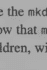

> 一些 X 窗口环境，如 KDE，或生产力套件，如 StarOffice，提供“回收站”式的删除文件方法——文件实际上并未被删除，只是被移到了临时目录。这是一种相对安全但并非万无一失的删除或恢复文件的方法。如果你真的需要恢复文件的帮助，可能可以使用本小时稍后讨论的 mc，或 Midnight Commander 命令。

## 使用 mkdir 命令创建目录

使用 mkdir 命令可以创建一个或多个目录。你可能不知道，mkdir 还能通过单条命令行创建包含父目录和子目录的整个目录层次结构。

该命令是与 cp 和 mv 一起使用的基本工具之一，可用于组织信息。来看一些示例。以下简单的命令行创建单个目录：

```
# mkdir temp
```

但你也可以按如下方式创建多个目录：

```
# mkdir temp2 temp3 temp4
```

你也可以输入以下命令在 temp 下创建名为 child 的目录：

```
# mkdir temp/child
```

这之所以可行，是因为 temp 目录存在（你刚创建了它）。但是，假设你输入以下内容：

```
# mkdir temp5/child
```

```
mkdir: cannot make directory `temp5/child': No such file or directory
```

如你所见，mkdir 会报错，因为 temp5 目录不存在。要使用 mkdir 构建目录层次结构，必须使用 -p，或 parent，选项，如以下示例所示：

```
# mkdir -p temp5/parent/child
```

```
# tree temp5
```

```
temp5
`-- parent
    `-- child

2 directories, 0 files
```

如你所见，mkdir 不仅创建了 temp5 目录，还创建了名为 parent 的子目录，以及 parent 下名为 child 的子目录。

现在你知道了如何创建目录，让我们看看如何删除它们。

## 使用 rmdir 命令删除目录

rmdir 命令用于删除目录。要删除目录，只需输入以下内容：

```
# rmdir tempdirectory
```

但有一个前提：目录必须先为空！如果你尝试删除包含任何文件的目录，会收到如下错误信息：

```
# rmdir temp5
```

```
rmdir: temp5: Directory not empty
```

rmdir 命令与 mkdir 一样也有 -p 选项。你可以使用此选项删除目录层次结构，如下所示：

```
# rmdir -p temp5
rmdir: temp5: Directory not empty
```

嗯……这不起作用！那试试下面的：

```
# rmdir -p temp5/parent
rmdir: temp5/parent: Directory not empty
```

嘿！这也不起作用。现在试试这个：

```
# rmdir -p temp5/*
rmdir: temp5/parent: Directory not empty
```

这越来越令人沮丧了！再试一次：

```
# rmdir -p temp5/parent/child
```

最后！如你所见，必须指定完整的目录树才能删除它。如果使用不带 -p 选项的相同命令行，只会删除 child 目录。但如果有两个或多个子目录怎么办，如以下示例所示：

```
# mkdir -p temp5/parent/child
# mkdir temp5/parent/child2
# tree temp5
temp5
|-- parent
|   |-- child
|   `-- child2
3 directories, 0 files
```

为了删除 temp5 的整个目录系统，你需要使用以下命令：

```
# rmdir temp5/parent/*
```

现在你知道了如何创建和删除目录。接下来，你将学习 mv 命令，可用于移动或重命名文件和目录。

## 使用 mv 命令重命名文件

mv 命令被称为重命名命令，确实可以重命名文件或目录——但对许多人来说，它也是一种移动命令，可在文件系统中移动文件或目录。

实际上，从技术角度来说，文件或目录并没有真正被移动。如果你坚持要了解所有细节，请阅读 Linux 系统管理员指南，或 SAG，可通过以下网站获取：

http://metalab.unc.edu/LDP/LDP/sag/index.html


不想在线阅读 SAG？你可能在 OpenLinux 系统上已安装了副本。尝试使用以下方式使用 lynx 纯文本网页浏览器：

lynx /usr/doc/LDP/system-admin-guide/sag-0.6-html/sag.html

有关使用 lynx 浏览器的更多信息，请参阅第 13 小时，“Internet 下载和浏览”。

在最简单的形式中，mv 可以重命名文件，例如：

```
# touch file1
# mv file1 file2
```

该命令将 file1 重命名为 file2。除重命名文件外，mv 还可以重命名目录，无论它们是否为空。例如，即使你使用 mkdir 命令创建了目录结构，也可以使用 mv 命令重命名新的顶级目录，如下所示：

```
# mkdir -p temp/temp2/temp3
# mv temp newtemp
```

虽然 mv 有九个不同的选项，本节重点介绍其中最常用的两个：-b（备份）和 -i（交互）。这些选项使你能够以相对安全的方式使用 mv——mv 不仅重命名，还会快速且静默地覆盖（不会询问！）第一个选项 -b 会为重命名为已存在名称的任何文件或目录创建备份，例如：

```
# touch uno deux tres
# ls uno deux tres
deux tres uno
# mv uno deux
# ls uno deux tres
ls: uno: No such file or directory
deux tres
```


如你所见，如果不使用 -b，mv 不仅将文件 uno 重命名为 deux，而且在过程中删除了文件 deux。这危险吗？当然危险！现在，试试 -b 选项：

```
# touch uno
# ls uno deux tres
deux tres uno
# mv -b uno deux
# ls deux* tres
deux deux~ tres
```

此示例显示，虽然文件 uno 被重命名并替换了文件 deux，但会创建 deux 的备份，默认扩展名为波浪号（~）。

mv 命令可以静默工作，或者像 rm 一样，你可以使用 -i 选项，例如：

```
# touch file2 file3
# mv file2 file3
# touch file2
# mv -i file2 file3
mv: replace `file3'? y
```

这里，我创建了两个文件，然后将文件 file2 重命名为 file3，从而删除了原始的 file3。然而，我随后使用了 -i 选项，mv 命令会询问是否要覆盖文件。如果没有发生覆盖，即使使用 -i，mv 命令也不会请求许可。你也可以按如下方式组合 -b 和 -i 选项：

```
# mv -bi file2 file3
```

现在你知道了如何删除、重命名或移动文件，那么如何复制文件呢？

## 使用 cp 命令复制

cp，或复制，命令用于复制文件或目录。该命令近有 40 个命令行选项。这里并未全部介绍，但你将学习一些最常用的选项，可节省时间和麻烦。

你最有可能首先以最简单的形式使用 cp，例如：

```
# cp file1 file2
```

这会复制 file1 以创建 file2，并且与 mv 不同，file1 会保留原地。但使用 cp 时必须小心，因为你可以将文件复制到第二个文件上，从而有效地替换它！在这方面，cp 的行为可能像 mv。为了展示这种情况如何发生，请尝试使用 cat 命令创建三个文件，每个文件包含一行文本：

```
# cat > file1
this is file1
# cat > file2
this is file2
# cat > file3
this is the third file
# ls -l file*
-rw-r--r-- 1 bball users 14 Jan 5 13:29 file1
-rw-r--r-- 1 bball users 15 Jan 5 13:29 file2
-rw-r--r-- 1 bball users 23 Jan 5 13:29 file3
```


现在，将一个文件复制到另一个文件上，然后检查文件大小和新文件的内容，如下所示：

```
# cp file1 file2
# ls -l file*
-rw-r--r-- 1 bball users 14 Jan 5 13:29 file1
-rw-r--r-- 1 bball users 14 Jan 5 13:31 file2
-rw-r--r-- 1 bball users 23 Jan 5 13:29 file3
# cat file2
this is file1
```

显而易见，file1 会替换 file2。为了避免这个问题（除非你真的想覆盖文件），你可以使用 -b 或 -i 选项，其作用类似于 mv。下面是一个示例：

```
# cp -i file1 file2
cp: overwrite 'file2'? n
# cp -bi file1 file2
cp: overwrite 'file2'? y
# ls file*
file1 file2 file2- file3
```

请注意，被覆盖的 file2 已被备份。

cp 命令也可以一次复制多个文件。以下示例展示了如何将 tempdir1 目录中的所有文件复制到 tempdir2 目录：

```
# cp tempdir1/* tempdir2
# tree tempdir2
tempdir2
|-- tempfile1
|-- tempfile2
|-- tempfile3

0 directories, 3 files
```

与 rm 命令类似，cp 也有 -r 或递归选项。你可以使用此选项将一个目录复制到另一个目录中。例如，要将 tempdir1 目录及其文件复制到 tempdir2 中，使用以下语法：

```
# cp -r tempdir1 tempdir2
# tree tempdir2
tempdir2
|-- tempfile1
|-- tempfile2
|-- tempfile3
|-- tempdir1
    |-- tempfile1
    |-- tempfile2
    |-- tempfile3

1 directory, 6 files
```

最后，cp 命令具有 -p 选项，其作用类似于 mkdir 的 -p 选项。通常，当你将位于多个目录中的文件复制到另一个目录时，只会复制该文件。以下示例仅将 tempfile1 复制到 tempdir3：

```
# tree tempdir2
tempdir2
|-- tempfile1
|-- tempfile2
|-- tempfile3
|-- tempdir1
    |-- tempfile1
    |-- tempfile2
    |-- tempfile3
1 directory, 6 files
# cp tempdir2/tempdir1/tempfile1 tempdir3
```

但是，如果你想连同其目录结构一起复制文件呢？要做到这一点，可以使用 -P 选项：

```
# cp -P tempdir2/tempdir1/tempfile1 tempdir3
# tree tempdir3
tempdir3
|-- tempdir2
    |-- tempdir1
        |-- tempfile1
2 directories, 1 file
```

cp 不仅复制了单个文件，还创建了子目录结构。

## 使用 ln 命令创建硬链接和符号链接

Linux 同时支持硬链接和符号链接。虽然了解 Linux 中链接的工作原理并不重要，但你需要了解这两种链接之间的区别，以及在使用 Linux 时如何使用链接。要创建硬链接或符号链接，请使用 ln（link，链接）命令。

**New Term** ln 命令可创建两种类型的链接，并将文件与其他文件（包括目录，在 OpenLinux 下目录也只是文件）链接起来。重要的区别在于，硬链接仅在同一文件系统上直接链接两个文件。另一方面，你可以在跨不同文件系统的目录或文件之间使用符号链接。硬链接还有其他优点。如果你使用 ln 命令创建硬链接，你可以在命令行上指定第二个文件，用来引用原始文件，如以下示例所示：

```
# cat > file1
This is file1
# ln file1 file2
# ls -l file*
-rw-r--r-- 2 bball users 14 Jan 5 13:32 file1
-rw-r--r-- 2 bball users 14 Jan 5 13:32 file2

# cat file2
This is file1
```

你可以看到 file2 与 file1 完全相同。如果删除 file1，file2 仍然存在。如果对 file1 进行更改，例如添加文本，这些更改会出现在 file2 中，反之亦然。虽然可以看到两个文件，每个文件大小为 14 个字符，但原始文件仅使用了 14 个字符的硬盘空间（好吧，技术上来说多于这个数，但这取决于分区或硬盘类型的块大小）。

另一方面，虽然符号链接很有用，但也有缺点。下面的示例将说明原因。首先，要创建符号链接，请使用 ln 命令的 -s 选项：

```
# cat >file1
This is file1
# ln -s file1 file2
# ls -l file*
-rw-r--r-- 1 bball users 14 Jan 5 13:48 file1
lrwxrwxrwx 1 bball users 5 Jan 5 13:48 file2 -> file1
```

请注意从 file2 指向 file1 的箭头。这说明 file2 是指向 file1 的符号链接。另请注意，file2 的长度小于 file1。符号链接与硬链接的不同之处在于，符号链接仅仅是原始文件的别名。如果删除符号链接，原始文件不会受到任何影响。然而，如果删除原始文件，你的符号链接就帮不上忙了：

```
# rm -f file1
# cat file2
cat: file2: No such file or directory
```

因为原始文件 file1 不再存在，所以无法通过符号链接 file2 访问其内容。然而，符号链接相比硬链接也有优势。你可以使用符号链接指向 OpenLinux 文件系统上的目录，甚至是另一个文件系统。以下示例中，如果你尝试为 /usr/local/games 目录创建硬链接，ln 命令会报错并退出：

```
# ln /usr/local/games play
ln: /usr/local/games: hard link not allowed for directory
```

但你可以使用符号链接，如下所示：

```
# ln -s /usr/local/games play
```

```
# ls -l play
lrwxrwxrwx 1 bball users 16 Jan 5 14:12 play -> /usr/local/games
```

现在，不必输入像这样的长命令

```
# cd /usr/local/games
```

你可以使用

```
# cd play
```


> 符号链接到其他文件系统上的其他目录，例如 DOS 或 Windows 分区，会很有用。例如，在你的主目录中有一个名为 dos 的目录并链接到 /mnt/dos/windows/desktop，可以使在 Linux 和 Windows 之间复制或移动文件变得容易得多。例如，如果你想在主目录中有一个名为 dos 的链接目录，并且你的 DOS 文件系统挂载在 /mnt/dos 目录下，首先确保 DOS 文件系统已挂载，然后使用 ln 命令创建符号链接，如下所示：
> 
> # ln -s /mnt/dos/windows/desktop dos
> 
> 有关挂载其他文件系统的详细信息，请参阅第 22 小时。

到目前为止，你已经了解了如何使用命令行。如果你熟悉更图形化的文件操作界面，你会喜欢下一个程序 mc。

## 使用 Midnight Commander 程序处理文件

mc 程序，即 Midnight Commander，是一个用于处理文件的图形界面（参见图 5.1）。它是一个可视化 shell（你将在下一小时“使用 Shell”中了解更多关于 shell 的内容）。要启动 mc，请在命令行输入以下内容：

```
# mc
```

本节并未涵盖 mc 程序的所有细节。以下是其功能亮点：

- 同时提供两个目录的可视化界面
- 启用鼠标点击浏览目录
- 支持对话框、鼠标、键盘和功能键的菜单驱动文件操作
- 具有通向 shell 的开放命令行
- 通过鼠标点击运行命令
- 具有广泛的内置超文本帮助屏幕
- 模拟并支持 ls、cp、ln、mv、mkdir、rmdir、rm、cd、pwd、find、chown、chgrp 和 tree 命令
- 比较目录内容
- 使用自定义菜单以便你可以构建自己的命令
- 可用于 telnet 或 FTP 操作的网络链接（参见第 13 小时）
- 提供鼠标点击解压缩文件（参见本小时稍后的“使用 gzip 命令压缩文件”部分）
- 如果你的 Linux 文件系统配置为支持此功能，则可以取消删除文件

Midnight Commander 是处理文件和导航目录时方便实用的工具。你需要投入一些时间学习如何使用此程序，但如果你使用过类似的文件管理界面，你会感觉如鱼得水。

FIGURE 5.1
The Midnight Commander visual shell displays a graphical interface to Linux file commands.

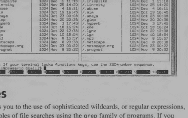

## 搜索文件

本节将介绍使用复杂的通配符或正则表达式，以及使用 grep 系列程序进行文件搜索的简短示例。如果你理解并使用这些表达式，你可以创建可反复使用的精细搜索技术。你将在工作中节省时间和精力，而你的学习投入将在整个 Linux 使用过程中获得丰厚回报。


## 什么是正则表达式？

新术语 正则表达式是使用特殊语法匹配字符串的模式（通常在文件中的文本中，除非你的搜索对象是文件名）。还有扩展正则表达式，可以在搜索模式中使用额外的运算符。这种差异对语法很重要，但不应阻止你学习如何构造准确匹配所需搜索目标的模式。如果你在文件中查找文本，这一点很重要；如果执行潜在危险的操作，例如在系统范围内多次删除文件，则至关重要。

你可以使用一小部分模式字符构建无限数量的正则表达式。表 5.1 包含其中一些字符的简短列表。你应该至少熟悉其中一个（星号），来自之前的示例。

**表 5.1 常用正则表达式**

| 表达式 | 匹配 |
|---|---|
| * | 任意字符 |
| ? or . | 单个字符 |
| {x} | 前一个字符出现 x 次 |
| {x,y} | 前一个字符至少出现 x 次但不超过 y 次 |
| {x,} | 前一个字符至少出现 x 次 |
| (xxx)|(XXX) | 字符串 xxx 或 XXX |
| [xxx] or [x-x] | 字符范围中的一个字符 |
| [XYZ]+ | X、Y 或 Z 至少出现一次 |
| \x | 诸如 ? 或 \ 之类的字符 |
| ^pattern | 行开头处的 pattern |
| $pattern | 行末尾处的 pattern |

这不是模式字符的完整列表。有关更多详细信息，可以阅读 ed 手册页（ed 命令在第 14 小时，“文本处理”中讨论）。目前，先尝试使用不同模式的几个简单示例。

星号对于查找所有字符的匹配很有用。例如，如果你想查找目录中扩展名为 .txt 的所有文本文件，可以使用以下命令：

```
# ls *.txt
14days.txt 96hours.txt datalog.txt datebook.txt day67.txt
```

但假设你想要列出目录中文件名包含数字的所有文件？你可以尝试在 ls 命令行上串联多个搜索，如下所示：

```
# ls *0* *1* *2* *3* *4* *5* *6* *7* *8* *9*
08100097.db      14days.txt       backup001.file   phonelog.111597
08100097.db      32days.msg       day67.txt        phonelog.111597
08100097.db      32days.msg       day67.txt        phonelog.111597
08100097.db      96hours.txt      message.76
08100097.db      96hours.txt      message.76
14days.txt       backup001.file   phonelog.111597
```

显然，这不是你想要的结果，因为多次搜索打印了重复的文件名。要找到你想要的确切内容，请使用正则表达式告诉 ls 列出文件名中包含数字的任何文件，如下所示：

```
# ls *{0123456789}*
0001file.0009    32days.msg       day67.txt
08100097.db      96hours.txt      message.76
14days.txt       backup001.file   phonelog.111597
```

这显示了所有包含文件名中数字的文件，因为你在搜索模式中指定了字符范围或，在本例中，为数字。你也可以使用正则表达式简写来构建更短的表达式以执行相同的操作，例如：

```
# ls *{0-9}*
0001file.0009    32days.msg       day67.txt
08100097.db      96hours.txt      message.76
14days.txt       backup001.file   phonelog.111597
```

你在表达式中指定模式字符的方式很重要。如果只想要以数字结尾的文件列表，可以使用以下命令：

```
# ls *{0-9}
0001file.0009    message.76       phonelog.111597
```

如果只想要以数字开头的文件列表，可以使用此命令：

```
# ls [0-9]*
0001file.0009 08100097.db 14days.txt 32days.msg 96hours.txt
```

这是一个有趣的练习：如果只想列出文件名中数字仅在内部或两端的文件？尝试以下操作：

```
# ls *[-a-z][0-9]*
backup001.file day67.txt
# ls [0-9]*[-a-z]*[0-9]
0001file.0009
```

最后，当你要查找的模式包含模式匹配字符时，如何匹配模式？很简单！使用反斜杠转义该字符，例如：

```
# ls *\?*
cathy?.message
```

正如你所见，使用正则表达式需要一些练习，但你的努力会得到丰厚回报。尝试使用不同的表达式进行实验，看看是否能得到与本节示例类似的结果。

## 使用 grep 命令在文件中搜索

本节向你介绍 grep 命令族。你将了解 grep、egrep 和 fgrep。为了使用这些命令，你应该知道如何使用前面讨论的一些模式匹配技术。你将使用这些命令搜索文件并提取文本。这些程序各自通过搜索文件中的每一行来工作。你可以搜索单个文件或一系列文件。

每个 grep 命令基本上相同，并且有近 20 个不同的命令行选项。唯一真正的区别是 egrep 使用略有不同的模式匹配语法，而 fgrep 使用固定字符串。你将看到每个程序的示例并使用一些常用选项。有关这些程序模式匹配功能的具体细节，请参阅 grep 手册页。

为了向你展示每个程序搜索模式语法的差异，我将在 Matt Welsh 的 Linux 基础安装指南中查找不同的模式（可在 http://metalab.unc.edu/LDP 获取，或在你的 OpenLinux 系统的 /usr/doc/LDP 目录中）。例如，如果你想找到指南中以数字开头的全部行，请使用以下语法：

```
# grep '^[0-9]' guide.txt
1 Introduction to Linux 1
2 Obtaining and Installing Linux 40
3 Linux Tutorial 85
4 System Administration 137
...
# egrep '^[0-9]' guide.txt
1 Introduction to Linux 1
2 Obtaining and Installing Linux 40
3 Linux Tutorial 85
4 System Administration 137
...
# fgrep '^[0-9]' guide.txt
```

你可以看到 grep 和 egrep 返回了搜索结果（我删除了除前四行外的所有输出）。但是请注意，fgrep 不能处理正则表达式。你必须使用 fgrep 命令使用固定模式或字符串，例如：

```
# fgrep friend guide.txt
```

large extent by the window manager. This friendly program is in copy Linux from a friend who may already have the software, or share (Unfortunately, the system was being unfriendly.)

现在使用 egrep 尝试在文件中搜索字母 (b) 的模式：

```
# egrep "\[(b)\]" guide.txt
```

(see Section 1.8 for a list of compatible boards), or (b) there is an connect to the network, or (b) you have a 'dynamic' IP address,

你会看到文件中恰好有两行匹配 (b)。看看使用 grep 搜索时会发生什么：

```
# grep "\(b\)" guide.txt
```

This is version 2.2.2 of the book, "Linux Installation and Getting to PostScript printers. This document was generated by a set of tools from LaTeX source, so there may be a number of formatting problems. This is not the "official" version of the book! Please see ...

哇！这可不是你想要的，对吧？正如你所见，grep 不使用与 egrep 命令相同的语法。但你可以使用更简单的方法：

```
# grep "(b)" guide.txt
```

(see Section 1.8 for a list of compatible boards), or (b) there is an connect to the network, or (b) you have a 'dynamic' IP address,

此模式适用于 grep 和 fgrep。如果你用 egrep 尝试此模式，你会得到与使用 grep 尝试扩展正则表达式相同的结果（每行包含一个 (b)）。

每个 grep 程序都接受几乎相同的命令行选项集。一个流行的选项是 -n，即行号。这很方便，因为你可以看出文件中哪些行包含匹配项。此示例适用于每个 grep 程序：

```
# egrep -n "friend" guide.txt
```

1242:large extent by the window manager. This friendly program is in 1942:copy Linux from a friend who may already have the software, or 5161:(Unfortunately, the system was being unfriendly.)

你可以看到匹配项位于第 1242、1942 和 5161 行。另一个功能是，你不必每次搜索时都重新输入模式。作为一个简单示例，如果你需要反复搜索文件中不同的单词，可以将这些单词放入一个文件供 grep 使用。首先，创建一个文本文件，然后使用 -f 选项指定该文件，如下所示：

```
# cat > mywords
wonderful
Typewriter
War
# grep -nf mywords guide.txt
574:Typewriter Used to represent screen interaction, as in
617:software since the original Space War, or, more recently, Emacs
1998:Now you must be convinced of how wonderful Linux is, and all
2549:inanimate object is a wonderful way to relieve the occasional
3790:Warning: Linux cannot currently use 33090 sectors of
7780:to wear the magic hat when it is not needed, despite wonderful
10091:wonderful programs and configurations are available with a bit
```

因为你也使用了行号选项，需要注意它必须放在 -f（或文件）选项之前，否则 grep 会报告错误，抱怨找不到文件 n，然后退出。

你可以使用 -F 选项让 grep 像 fgrep 一样工作，或使用 -E 选项让它像 egrep 一样工作。你也可以在系统上找到 grep 的一个特殊版本，名为 zgrep，可用于搜索压缩文件，这是下一节的主题。

## 压缩和解压缩文件

本节向你介绍归档和压缩文件的基础知识。然而，关于为系统管理或备份系统目的使用这些程序的详细信息，请参阅第 23 小时。继续阅读，你将学习如何构建自己的归档并节省磁盘空间。

### 使用磁带归档命令创建归档

tar（磁带归档）程序起源于软盘驱动器、硬盘和 CD-ROM 之前早期的计算时代。软件通过大型磁带卷分发和备份，因此计算机上运行的第一个程序之一是磁带阅读器。随着时间的推移，tar 程序证明了其作为一种便捷的文件传输方式的价值，许多 Linux 程序都打包在 tar 归档中（你的 OpenLinux CD-ROM 使用 rpm 程序打包文件；请参阅第 22 小时）。

使用 tar，你可以创建包含多个目录和文件的归档文件。你系统上安装的 tar 版本还支持 -z 选项，可使用 gzip 程序压缩你的归档。（gzip 在本章后面讨论。）

tar 命令有令人眼花缭乱的选项数组，但使用起来并不难。你可以快速轻松地创建任何所需目录的归档。

首先，创建一个包含三个文件的文件夹，然后再创建一个包含另外三个文件的子目录：

```
# mkdir mydir
# cd mydir
# touch file1 file2 file3
# mkdir mydir2
# cd mydir2
# touch file21 file22 file23
# cd ../..
# tree mydir
mydir
|-- file1
|-- file2
|-- file3
|-- mydir2
|   |-- file21
|   |-- file22
|   |-- file23
1 directory, 6 files
```

现在你有了目录和文件，使用 c（创建）和 f（文件）选项通过以下命令创建 tar 归档：

```
# tar cf mydir.tar mydir
# ls -l *.tar
-rw-r--r-- 1 bball users 10240 Jan 5 15:01 mydir.tar
```

请注意，你的原始目录保持不变。默认情况下，tar 不会删除原始目录或文件。如果你想这样做，可以使用 --remove-files 选项，但不推荐。如果你想了解正在发生的事情，可以使用 v 选项，如下所示：

```
# tar cvf mydir.tar mydir
mydir/
mydir/file1
mydir/file2
mydir/file3
mydir/mydir2/
mydir/mydir2/file21
mydir/mydir2/file22
mydir/mydir2/file23
```

tar 命令会显示正在添加哪些目录和文件。这是否意味着你必须添加目录中的所有文件？不！你可以使用 w 或交互式选项，让 tar 询问是否要添加每个文件。例如，这对于有选择地备份小型目录非常有用：

```
# tar cwf mydir.tar mydir
add mydir/?y
add mydir/file1?n
add mydir/file2?y
add mydir/file3?n
add mydir/mydir2?y
add mydir/mydir2/file21?y
add mydir/mydir2/file22?n
add mydir/mydir2/file23?y
```

这里我从此归档中省略了 file1、file3 和 file22。但如何确保呢？一种方法是使用两个 tar 选项，t 用于列出归档内容，f 用于指定要使用的 tar 归档，例如：

```
# tar tf mydir.tar
mydir/
mydir/file2
mydir/mydir2/
mydir/mydir2/file21
mydir/mydir2/file23
```

请注意，如果选项的顺序错误（如 grep 示例），tar 会抱怨并退出。现在你知道了如何创建和查看归档的内容，可以学习如何提取整个归档或单个文件。要提取所有内容，可以使用 -x（提取）选项与 -f 结合使用。为了让你了解正在发生的事情，也请包含 -v 选项：

```
# tar xvf mydir.tar
mydir/
mydir/file2
mydir/mydir2/
mydir/mydir2/file21
mydir/mydir2/file23
```

如果你只想要归档中的几个文件，可以再次使用 w 选项：

```
# tar xvwf mydir.tar
extract mydir/??y
mydir/
extract mydir/file2?y
mydir/file2
extract mydir/mydir2/?y
mydir/mydir2/
extract mydir/mydir2/file21?y
mydir/mydir2/file21
extract mydir/mydir2/file23?y
mydir/mydir2/file23
```

这里，我通过交互方式逐个从归档中提取文件。如果你想从归档中获取单个文件，可以在命令行中指定该文件。对于本示例，原始的 mydir 已被删除，我使用的是一个空目录：

```
# tar xf mydir.tar mydir/mydir2/file23
# tree mydir
mydir
`-- mydir2
    `-- file23

1 directory, 1 file
```

如你所见，只提取了一个文件。不过要小心！tar 命令不会覆盖整个目录，但会覆盖具有相同名称的文件。

在开始构建归档之前，先尝试使用 tar 实验一下。其他可以尝试的功能包括从归档中有选择地删除文件或向现有归档添加文件，下一个程序 cpio 也能做到这一点。


> 你可以使用其他程序，例如 BRU-2000 或 taper 脚本来备份你的文件系统或选定的文件和目录。OpenLinux 还可以通过 cron 调度自动创建文件归档。有关 BRU-2000 和 taper 脚本的信息，请参阅第 23 小时；有关 cron 调度的详细信息，请参阅第 24 小时。

### 创建 cpio 归档

cpio 命令将文件复制到 tar 或 cpio 归档中或从中复制出来。由于 cpio 与 tar 兼容，本节不会详细介绍其工作原理，但它具有 tar 不具备的一些功能，例如以下内容：

- 支持 cpio 和 tar 归档
- 支持多种旧的磁带格式
- 能够从管道读取文件名（你将在下一小时学习）

很少有 Linux 软件包以 cpio 格式分发，甚至可能没有。在互联网上搜索新软件时，你可能不会遇到任何 cpio 归档。但如果你对 cpio 的细节感兴趣，请参阅其手册页。有关如何使用 cpio 备份特定文件的示例，请参阅第 23 小时。

### 使用 gzip 命令压缩文件

gzip 命令压缩文件。该程序不仅有助于通过压缩大型、较少使用的文件来节省磁盘空间，而且与 tar 结合使用时，可能是 Linux 最流行的压缩文件格式。在互联网上搜索新的 Linux 软件时，你经常会找到 .tgz 或 .tar.gz 格式的文件。

你还会发现 /usr/doc/HOWTO 目录下的大部分文档都使用 gzip 压缩。这可以节省大量空间。根据 Free Software Foundation 在 gzip 手册页中的说明，gzip 对文本文件的压缩率约为 60-70%。

gzip 命令易于使用。要压缩文件或磁带归档，请输入以下内容：

```
# gzip mydir.tar
```

默认情况下，gzip 会压缩你的文件，添加 .gz 扩展名，并删除原始文件。要解压缩文件，可以使用 gzip 的伴随程序 gunzip，或使用 gzip -d（解压缩）选项。你必须确保文件具有 .gz（或 .tgz、.z、-z 或 _z）扩展名，否则 gzip 和 gunzip 都会抱怨。如果你想指定自己的扩展名，请使用 -S（后缀）选项。例如，要使用 .gzipped 扩展名压缩磁带归档，请使用 gzip 及其 -S 选项，如下所示：

```
# gzip -S .gzipped mydir.tar
```

gzip 命令还处理 zipped、compressed 或 pack 压缩的文件。如果你想在压缩或解压缩期间获取更多信息，可以使用 -l 或 list 选项来查看文件的压缩或解压缩大小。压缩完前一个示例中的 mydir 目录后，使用 gzip 获取如下统计信息：

```
# gzip -l mydir.tar.gz
compressed uncompr. ratio uncompressed_name
239 10240 97.9% mydir.tar
```

最后，gzip 还提供了一个有用的选项 -t，用于测试压缩文件的完整性。如果文件正常，gzip 不会报告任何内容。如果你需要看到 OK，在测试文件时使用 -tv。

### 使用 compress 命令压缩文件

compress 命令正是这样做的：它压缩文件。这是 UNIX 世界中较早的压缩实用程序之一。

使用 compress 创建的文件传统上具有 .Z 扩展名。要压缩文件，请输入以下内容：

```
# compress file
```

要解压缩文件，使用以下命令：

```
# uncompress file.Z
```

与 gzip 类似，你必须指定一个带有 .Z 扩展名的文件名，否则 uncompress 会报错。

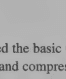

> 想了解 Linux 的其他压缩工具吗？在你的系统上查找 zip、unzip、zipcloak、zipnote、zipsplit、zless、zcat、znew、zmore、zcmp、pack、compact、shar、unshar 或 zforce。你可能找不到全部已安装，但你可以在喜爱的 Linux 软件站点（如 http://metalab.unc.edu/pub/Linux）找到与 OpenLinux 兼容的版本。

## Summary

## 摘要

本小时介绍了创建、删除、移动、复制、搜索、保存以及压缩文件和目录所需的基本 OpenLinux 命令。随着你在练习中对 OpenLinux 了解得更多，你将在基本知识之上构建更复杂和定制的命令。

## Q&A

#### 问答

Q OpenLinux 还有其他文件压缩程序吗？

A 有的。你可能可以通过 bzip2 命令获得更好的压缩效果。该程序使用与 gzip 不同的压缩算法，并随 OpenLinux 包含在 /bin 目录下。你可以通过 .bz2 扩展名识别这些归档文件。

Q 我看到过一些扩展名为 .uu 的文件，想知道这些是否是压缩文件？

Q 如何查看二进制文件内部的内容？如果我尝试使用 cat 或 less 命令，会看到很多乱码。

A 尝试使用 strings 命令。有关如何将 strings 与 less 一起使用，请参阅第 6 小时“使用 Shell。”

Q 如何获取磁带归档中每个文件的更多信息？我知道 t 选项会显示文件和目录名称。

A 在 tar 命令行中使用 v 选项与 t 选项一起，可以查看磁带归档中每个项目的权限、所有者、组、文件大小、日期、时间以及名称。

## Exercises

#### 练习

- 1. tar 程序可以在归档操作期间执行文件压缩。使用 tar 创建一个测试目录的压缩磁带归档。
- 2. OpenLinux 中包含了一些其他压缩程序。它们的名字是什么？（提示：使用你认为“apropos”合适的命令！）
- 3. 如何找到 OpenLinux 发行版中包含的所有压缩文件？


## Hour 6

## 第 6 小时

## Using the Shell

## 使用 Shell

在本小时中，你将了解 shell。尽管在过去 10 年中个人计算的趋势是从命令行转向点按式界面，但 shell 在 Linux 中仍然非常活跃，并且被许多 Linux 程序使用。

本小时不会详细介绍 Linux 或 UNIX shell 的历史，也不会在命令行界面是否更容易或更好使用的问题上站队。也不涉及 shell 编程——本小时甚至整本书都没有足够的篇幅来做到这一点。本小时将讨论你可以在 OpenLinux CD-ROM 上找到的不同 shell，展示如何使用 shell 使你的 Linux 体验更愉快，并介绍使用 shell 和命令行的基础知识。

## What is a Shell?

## 什么是 Shell？

如果你没有使用 X Window System，shell 就是你使用的重要程序之一。shell 为 Linux 提供接口以便运行程序。事实上，shell 只是另一个 Linux 程序。

尽管你可以不使用 shell 设置和运行 Linux（有关详细信息，请参阅第 21 小时“基本系统管理”），即使你使用图形界面程序，你也可能会发现需要使用 shell 的命令行。

shell 是一个命令解释器，可用于启动、挂起、停止甚至编写程序。shell 是 Linux 的一个组成部分，也是 Linux 和 UNIX 设计的一部分。如果把 Linux 内核想象成球体的中心，shell 就是围绕内核的外层。当你从 shell 或其他程序向 Linux 传递命令时，内核（通常）会做出适当的响应。

shell 的类型有很多，但除了第 5 小时“操作和搜索命令”中讨论的视觉 shell Midnight Commander 外，你的 CD-ROM 上至少有五种。你可以通过查看 /etc/passwd 文件的内容或在文件中搜索你的用户名来确定登录 Linux 时使用的 shell。请看以下示例：

```
# fgrep bball /etc/passwd
bball:x:100:100:William H. Ball,,,:/home/bball:/bin/bash
```

你的 shell 列在 passwd 文件条目的末尾（fgrep 搜索示例中的 /bin/bash）。

## What Shells are Available?

## 可用的 Shell 有哪些？

本节列出了 OpenLinux 可用的 shell，以及每个 shell 的一些独特功能以便你入门。这些 shell 都可以运行程序，你可能想探索每个 shell 以了解其工作原理。本节还强调了 shell 之间的一些差异，并指出了重要的配置文件。

所有这些 shell 都支持使用内置的 cd，即 change directory，或更改目录命令来更改目录。有趣的是，ash 和 tcsh shell 没有内置的 pwd，即 print working directory，或打印工作目录命令，必须改用 /bin 目录下的 pwd 命令。


> 你在第一次安装 OpenLinux 时选择了在 OpenLinux 会话中使用特定的 shell。如果你想更改此默认 shell，请使用 chsh 命令，后跟你想使用的 shell 的完整路径名。例如，要将默认更改为 bash，请使用 chsh 以及其 -s 选项，如下所示：
> 
> # chsh -s /bin/bash

这些 shell，列在表 6.1 中，具有很多很多功能。请详细阅读每个 shell 的手册页。一些需要查找和探索的功能包括以下内容：

- shell 的内置命令有哪些？
- 如何处理作业控制（或后台进程，本章后面“在后台运行程序”一节中讨论）？
- shell 是否支持命令行编辑？
- shell 是否支持命令行历史？
- 重要的启动或配置文件有哪些？
- 每个 shell 重要的环境变量有哪些？
- 我可以使用哪些命令行提示？
- 支持哪些编程结构？


> OpenLinux 中还包含其他几个 shell：tcsh，一个简单的 shell 和 Tcl 解释器；wish，X11 的窗口 shell；scotty，一个 Tcl 解释器和 shell；以及 rsh，用于通过网络运行命令的远程 shell。有关详细信息，请参阅 tcsh、wish、scotty 和 rsh 手册页。

TABLE 6.1 SHELLS INCLUDED IN THE OPENLINUX DISTRIBUTION

表 6.1 OpenLinux 发行版中包含的 Shell

| Name | Description |
|------|-------------|
| ash | Compact sh-compatible shell |
| bash | Bourne Again Shell (ksh- and sh- compatible) |
| csh | symbolic link to tcsh |
| ksh | pdksh, public domain Korn (ksh- compatible) shell |
| sh | symbolic link to bash |
| tcsh | csh-compatible shell |
| zsh | Z-shell; a csh-, ksh-, and sh- compatible shell |

| 名称 | 描述 |
|------|-------------|
| ash | 紧凑的 sh 兼容 shell |
| bash | Bourne Again Shell（ksh 和 sh 兼容） |
| csh | 指向 tcsh 的符号链接 |
| ksh | pdksh，公共领域 Korn（ksh 兼容）shell |
| sh | 指向 bash 的符号链接 |
| tcsh | csh 兼容 shell |
| zsh | Z-shell；csh、ksh 和 sh 兼容 shell |

## Features of ash

## ash 的功能

ash shell 由 Kenneth Almquist 编写，是 Linux 可用的最小 shell 之一。该 shell 有 24 个不同的内置命令和 10 个不同的命令行选项。ash shell 支持大多数常见的 shell 命令，例如 cd，以及大多数正常的命令行运算符（本章后面“理解 Shell 命令行”一节中讨论）。

这是一个流行的 shell，通常在你以单用户模式启动 OpenLinux 时使用（在 LILO 启动提示符下键入 linux single）或用于救援模式或 Linux 磁盘版。小的可执行文件大小，通常是 bash shell 的十分之一，使 ash 成为小型文件系统的理想 shell。

## Features of the Default Linux Shell—bash

## 默认 Linux Shell 的功能——bash

bash，或 Bourne Again Shell，由 Brian Fox 和 Chet Ramey 编写，是 OpenLinux 最受欢迎的 shell 之一。它具有 48 个内置命令和十几个命令行选项。bash shell 与 sh shell 完全一样，并且在 /bin 目录下有一个名为 sh 的符号链接指向 bash shell。

bash 不仅像 sh shell 一样工作，还具有 csh 和 ksh shell 的功能。由于 bash 使用非常广泛，本小时的示例使用它。稍后你将学习如何使用 bash shell 自定义命令行提示。

bash shell 具有许多功能。你可以使用箭头键滚动浏览之前的命令（历史功能），可以编辑命令行，如果忘记程序名称，甚至可以使用文件名补全向 shell 请求帮助。你只需键入命令的一部分然后按 Tab 键即可。例如，如果你键入 l 并按 Tab 键，你会看到以下内容：

```
# l<TAB>
laser      less      listres   locale     look       lsac
last       lesskey   lkbib     localedef  lookbib    lsattr
lastb      let       lmorph    locate     lpq        lsc
latex      lex       ln        lockfile   lpr        lsl
lbxproxy   lha       lndir     logger     lprm       lynx
ld         lightning loadkeys  login      lptest     lz
ld86       lisa      loadunimap logname    ls
ldd        lispmtopgm local     logout     lsa
```

bash shell 会列出所有以字母 l 开头的已知命令（或当前目录中的任何可执行文件）。如果记不住复杂的命令名称，这非常方便。

bash shell 还具有内置帮助，可列出所有内置命令以及每个命令的帮助。例如：

```
# help
GNU bash, version 1.14.7(1)
Shell commands that are defined internally. Type 'help' to see this list.
Type 'help name' to find out more about the function 'name'.
Use 'info bash' to find out more about the shell in general.
```

名称旁边的星号 (*) 表示该命令已被禁用。

```
%[DIGITS | WORD] [&] . filename
: [arg...] [job_spec]
alias [name[=value] ...] bg [job_spec]
bind [-lvd] [-m keymap] [-f filename]
break [n]
builtin [shell-builtin [arg ...]] case WORD in [PATTERN] ; [PATTERN] ;;
cd [dir] command [-pVv] [command [arg ...]]
continue [n] declare [-frxij] name=value ...
...
while COMMANDS; do COMMANDS; done { COMMANDS }
```

要获取特定命令的帮助，请在 help 命令后输入命令名称。例如，要获取 help 的帮助，请输入以下内容：

```
# help help
```

```
help: help [pattern ...]
```

显示有关内置命令的有用信息。如果指定了 PATTERN，则对所有匹配 PATTERN 的命令提供详细帮助，否则将打印内置命令列表。

新术语

bash shell 有几个重要的文件，称为资源、运行配置和 shell 启动文件。这些文件在您首次登录 OpenLinux 时使用，用于定义或共享预定义的值或定义，例如所使用的终端类型、默认编辑器和打印机，或可执行程序的位置。/etc/profile 初始化文件在系统范围内（针对所有用户）使用，用于设置选项，例如环境变量（稍后讨论）或在您首次登录时发送消息（例如“Welcome to OpenLinux!”）。您还可以在主目录中使用 .bashrc 登录文件来自定义 bash shell 的启动方式或处理不同的按键（例如 Backspace），以及 .profile 资源文件（也在主目录中），用于在您登录 OpenLinux 后告诉 shell 使用哪个资源文件。

有关 bash shell 的更多信息，有手册页、可使用 info 命令浏览的 info 页面，以及位于 /usr/doc/bash 目录下的文档。

## 公共领域 Korn Shell—pdksh

pdksh，或公共领域 Korn shell，最初由 Eric Gisin 创建，具有 42 个内置命令和 20 个命令行选项。此 shell 位于 /bin 目录下，但在 /usr/bin 目录下也存在一个符号链接。

在您的 Linux 系统中，pdksh shell 被命名为 ksh，并且与 bash shell 类似，如果主目录中不存在名为 .profile 的文件，则读取 shell 初始化脚本 /etc/profile。不幸的是，此 shell 不支持与 bash shell 相同的命令行提示。然而，此 shell 确实支持作业控制（本小时稍后讨论），因此您可以从命令行挂起、后台运行、召回或终止程序。

此 shell 与商业 UNIX 发行版中包含的 Korn shell 的商业版本几乎兼容。此 shell 的文档位于 ksh 手册页中以及 pdksh 目录（位于 /usr/doc/pdksh 目录下）中。

## csh 兼容 Shell 的特性—tcsh

tcsh shell 由 William Joy（以及 47 位其他贡献者）创建，具有 53 个内置命令和 18 个命令行选项。此 shell 模拟 csh shell，但具有更多功能，包括带拼写校正的命令行编辑器。

此 shell 不仅与 bash shell 提示兼容；它提供的提示选项比 bash 更多。如果主目录中不存在 .tcshrc 或 .cshrc 资源文件，tcsh 会使用 /etc 目录下的 csh.cshrc 文件（类似于 bash 的 /etc/profile）。与 bash shell 类似，您可以滚动查看已输入的命令并编辑命令行。

使用 builtins 命令获取 tcsh 命令列表（tcsh 不像 bash shell 那样有 help），如下所示：

```
# builtins
:       @       alias     alloc     bg      bindkey  break
breaksw builtins case      cd        chdir   complete continue
default dirs    echo      echotc    else    end      endif
endsw   eval    exec      exit      fg      filetest foreach
glob    goto    hashstat  history   hup     if       jobs
kill    limit   log       login     logout  ls-F     nice
nohup   notify  onintr    popd      printenv pushd    rehash
repeat  sched   set       setenv    setty   shift
source  stop    suspend   switch    telltc  time     umask
unalias uncomplete unhash   unlimit   unset   unsetenv wait
where   which   while
```

有关此 shell 的更多信息，请阅读 tcsh 手册页，或查看 /usr/doc/tcsh 目录下的 tcsh 目录，以查看常见问题解答（FAQ）文件和其他文本文件。

## zsh

zsh shell 最初由 Paul Falstad 创建，是 Linux 中最大的 shell 之一，具有 84 个内置命令。zsh shell 具有超过 50 种不同的命令行选项，并且还模拟 sh 和 ksh shell 命令。

与 bash 和 tcsh shell 类似，zsh shell 使您能够滚动查看之前的命令并完成、编辑或拼写检查命令行。它还使您能够使用作业控制来管理正在运行的程序。此 shell 具有用于搜索或匹配文件模式的高级命令行选项。

此 shell 的系统范围启动文件位于 /etc 目录中：

- /etc/zlogin
- /etc/logout
- /etc/zshenv
- /etc/zshrc

如果 zsh shell 在主目录中找不到等效文件（但前面带有句点，例如 .zlogin），则会解析这些文件。此 shell 还比其他 shell（例如 bash 或 tcsh）具有更多命令行提示选项。此 shell 具有与其他所有 shell 相似的功能，并且在作为符号链接调用时可以模拟 sh 或 ksh shell（尽管您的 OpenLinux 系统将 sh shell 链接到 bash shell）。

此 shell 有大量信息：10 个手册页文件，以及一个装满帮助文件、示例和其他最新有用信息的 /usr/doc/zsh 目录。

## 理解 Shell 命令行

当您使用 shell 在命令行启动程序时，shell 会解释您的命令，并且命令会将输出回显到您的屏幕上。使用 shell，您可以将程序的输出发送到其他地方，例如文件。事实上，OpenLinux 下几乎所有东西都是文件；这包括终端、打印机等设备，甚至许多可以从其他文件接受输入的程序。shell 还可以将一个程序的输出用作另一个程序的输入，甚至可以告诉程序从文件读取输入。例如，您可以将 ls 命令的标准输出重定向到文件：

```
# touch /tmp/trash/file1 /tmp/trash/file2 /tmp/trash/file3
# touch /tmp/trash/file4
# ls -w 1 /tmp/trash/* >trashfiles.txt
```

**新术语** 第一行命令在 /tmp/trash 目录中创建四个文件。第二行命令使用 ls 命令的输出创建一个文本文件，其中包含 /tmp/trash 目录下文件的名称。大於号 (>) 字符称为标准输出重定向运算符，用于将命令的输出重定向到其他位置。您还可以使用小于号 (<) 字符，即标准输入重定向运算符，将信息提供给其他程序。


> 本小时其余部分使用的示例使用 bash shell。如果您想尝试其中一些命令行，请在命令行输入 bash 并按 Enter 使用 bash shell。完成后，输入 exit，按 Enter，即可返回到原始 shell。

作为一个简单的示例，您可以使用包含已创建文件名的文件来使用 cpio 命令构建归档。您可以通过使用标准输入将文件名提供给 cpio 命令来实现这一点：

```bash
# cpio -o <trashfiles.txt >trash.cpio
1 block
```

此命令行导致 cpio 命令从标准输入（trashfiles.txt 文件）读取文件列表，然后通过标准输出将输出发送到名为 trash.cpio 的文件，从而创建归档。

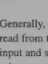

> cpio 命令与 tar 和 dump 命令一样，用于归档或备份 OpenLinux 文件。参阅第 23 小时“备份和恢复系统”，以了解如何使用备份程序。

通常，从 shell 命令行运行的大多数程序都具有从标准输入读取并向标准输出写入的能力。除了标准输入和标准输出之外，还有标准错误输出（几乎总是打印到您的显示器上）。使用前面的示例，如果提供给 cpio 命令的文件列表包含错误，cpio 命令会抱怨并将错误消息发送到您的屏幕：

```bash
# rm -fr /tmp/trash/file3
# cpio -o <trashfiles.txt >trash.cpio
cpio: /tmp/trash/file3: No such file or directory
1 block
```

其中一个现有文件已被删除，但输入文件 trashfiles.txt 仍然包含文件列表，未被更改。当您尝试将该列表用作有效输入来构建归档时，cpio 命令会抱怨并将错误消息发送到您的屏幕（但仍会构建归档）。


shell 为每个输入和输出文件分配一个文件编号。对于标准输入，编号为零（0）。对于标准输出，编号为一（1），对于标准错误（程序通常发送错误消息的地方），编号为二（2）。了解这一点后，你可以静默运行 cpio，并将任何错误发送到文件。可以通过组合标准输出重定向操作符和标准错误的文件编号来实现，如以下示例所示。

```
# cpio -o < trashfiles.txt >trash.cpio 2>cpio.errors
# cat cpio.errors
cpio: /tmp/trash/file3: No such file or directory
1 block
```

如你所见，cpio 命令将其错误发送到了名为 cpio.errors 的文件中，而这些错误通常会发送到标准错误输出（你的显示器）。

通常，每次将输出重定向到文件时，要么创建指定的文件，要么如果文件已存在，则覆盖该文件，其先前内容将不可逆地丢失。

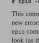

> 你应该谨慎使用文件重定向。如果将输出重定向到现有文件，你将丢失原始文件，这可能不是你想要的。

如果你想保留文件原始内容，可以使用连接（>>），或追加，重定向操作符将程序的输出追加到文件中：

```
# cpio -o < trashfiles.txt >trash.cpio 2>>cpio.errors
```

该命令行保存 cpio.errors 文件的先前内容，并将任何新错误追加到文件末尾。这种方法在运行 cpio 命令时保留错误日志。如果为 Linux 启用了系统日志记录，就会使用此方法。查看（作为 root 操作员）位于 /var/log 目录下的名为 messages 的文件内容。

如果你还记得第 4 小时“阅读和导航命令”中的简单 cat 命令文本编辑器示例，你会记得标准输出重定向操作符与 cat 命令一起使用，从终端读取输入以创建文本文件：

```
# cat >file.txt
this is a line
this is another line
EOF
# cat file.txt
this is a line
this is another line
```

文件结束符，或 EOF，用于关闭文件，通过按住 Ctrl 键并按下 D 键输入。通过使用 <<，或 here，重定向操作符为此简单编辑器添加新功能，该操作符告诉 shell EOF 字符是紧跟在 << 操作符之后的字符：

```
# cat >file.txt <<
> This is a line of text.
> This is another line of text.
# cat file.txt
This is a line of text.
This is another line of text.
```

请注意，在单独一行输入句点（.）后文件即关闭，这比使用控制键组合关闭文件更方便。你可以使用任何字符或字符组合来表示 EOF。

现在尝试使用 here 操作符通过结合 egrep 命令（在第 5 小时“操作和搜索命令”中讨论）和输入重定向来构建一个简单、独立的数据库文件。首先，使用你喜欢的文本编辑器（如随 pine 邮件程序提供的 pico）创建一个名为 db 的文件。输入地址列表，然后通过在开头放置 egrep 命令并在文件末尾放置结束输入字符字符串来包装列表。创建文件如下：

```
# pico db
```


> pico 编辑器可能很容易成为你 OpenLinux 的最爱文本编辑器，因为它易于使用、速度快，并且在保存文本文件时极其安全。有关这个很棒的小编辑器的详细信息，请参阅第 14 小时“文本处理”。

接下来，输入 egrep 命令，后跟简短的地址列表，并以匹配 here 操作符的方式结束文件，如下所示：

```
egrep -i $1 <<zzzz
Debby, 275 Collins Rd., Vestal NY 13850
Cathy, 1001 N. Vermont St., Arlington, VA 22003
Scotty, 2004 N. 16th St., Arlington, VA 22001
Bill, 4000 N. Pennsylvania Ave., Washington, DC 10000
Fred, Slip 417, N. Woodward Ave., Boca Raton, FL 46002
zzzz
```

通过输入 Ctrl+X 保存文件。最后，使用 chmod 命令使文本文件成为可执行程序，如下所示：

```
# chmod +x db
```

这创建了一个简短的地址数据库。通过输入 db，后跟姓名、城市、州或邮政编码来测试你的数据库，如下所示：

```
# db deb
Debby, 275 Collins Ave., Vestal NY 13850
```

数据库通过使用 egrep 命令读取文件直到结束输入字符串 zzzz 来工作。-i 命令行选项告诉 egrep 命令不区分大小写字符。$1 字符串是一个 shell 变量（将在下一节讨论），表示要传递给 egrep 命令的命令行参数。

shell 的输入和输出重定向可以用多种不同的方式使用。本文继续讨论，并介绍 shell 变量并展示一些自定义 shell 的实用技巧。

## 自定义你的 Shell

新术语 当你使用 shell 时，你是在包含环境变量的环境中运行 shell。环境变量是预定义的值或路径名，位于你的主目录和 /etc 目录下的各种资源文本文件中。对于 bash shell，默认的系统范围环境变量在 /etc/profile 文件中定义，而个人设置可以在主目录中的 .bashrc 文件中找到。

有许多不同的环境变量。使用 printenv 或 set 命令查看当前使用的变量列表：

```
# printenv
...
PATH=/usr/local/bin:/bin:/opt/kde/bin:/usr/bin:.:/usr/X11R6/bin:/home/bball/bin
HOME=/home/bball
SHELL=/bin/bash
...
```

本小时不列出你可能为 OpenLinux shell 定义的所有环境变量，但其中最重要之一是 $PATH 变量。该变量告诉 shell 在哪里查找可执行程序。没有 $PATH，你必须输入命令的完整路径或目录层次结构才能运行程序。例如，如果你想运行 ifconfig 命令来检查网络连接状态，你可能会首先尝试在命令行上输入其名称：

```
# ifconfig
bash: ifconfig: command not found
# whereis ifconfig
ifconfig: /sbin/ifconfig
```

如你所见，这并不意味着 ifconfig 命令不存在或未安装在你的系统上；只是你的 shell 不知道在哪里找到该程序。要运行 ifconfig 命令，你可以在命令前输入完整路径名，但如果你需要重复使用此程序，请将其目录包含在 shell 的 $PATH 环境变量的已知路径列表中。

通过在命令行上使用 bash shell 的 export 命令（保存新的变量定义并使其可用于你的 shell）将 /sbin 目录添加到你的 $PATH 变量中来执行此操作：

```
# ifconfig
bash: ifconfig: command not found
# PATH=$PATH:/sbin ; export PATH
# ifconfig
lo        Link encap:Local Loopback
          inet addr:127.0.0.1  Bcast:127.255.255.255  Mask:255.0.0.0
          UP BROADCAST LOOPBACK RUNNING  MTU:3584  Metric:1
          RX packets:436 errors:0 dropped:0 overruns:0
          TX packets:436 errors:0 dropped:0 overruns:0
```

如你所见，你的 shell 现在知道在哪里找到 ifconfig 命令。但这是临时的，仅在你登录或运行特定终端时有效。通过将路径添加到主目录中的 .bash_profile 文件，或如果你是 root 操作员并希望所有用户受益，则添加到 /etc 目录下的 profile 文件，使此更改在每次登录时生效。

在 .bash_profile 文件中查找以下行：

```
PATH=$PATH:$HOME/bin
```

使用文本编辑器，添加 /sbin 目录：

```
PATH=$PATH:$HOME/bin:/sbin
```

如果你是 root 操作员，请在 /etc 目录下的 profile 文件中的以下行添加 /sbin 目录：

```
PATH="/bin:/sbin:/usr/bin"
```

完成这些更改后，使用 bash shell 的 source 命令读取新的 $PATH，如下所示：

```
# source /etc/profile
```

在 profile 文件中，你还会看到类似以下的行：

```
export PS1="[\u@\h \W]\$ "
```

虽然这一行看起来可能有些晦涩，但这是 $PS1 环境变量的提示字符串定义，当你使用 shell 时，它会打印在你的控制台或终端窗口的命令行上。你可以更改此字符串来定义几乎任何类型的提示字符串。前面定义的格式如下：

```
[username@host base_working_directory]$
```

bash shell 有 15 种不同的提示符（tcsh 有 18 种，ksh 有 35 种），你可以将它们与字符字符串组合来自定义提示符。例如，你可以在提示符中显示当前日期和时间。如果你使用 bash shell 的 export 命令，可以从命令行测试不同的提示符：

```
# PS1='Date: \d Time: \t-> ';export PS1
Date: Thu Dec 10 Time: 22:19:01->
```

时间在每次输入命令或按下 Enter 键时都会更新。如果你想在命令行中显示 shell 的名称以及当前目录，请尝试 \s 和 \w 提示符字符：

```
# PS1='\s:\w> '; export PS1
bash:/usr/bin>
```

你还可以使用不同的转义字符和终端序列来控制提示字符串的属性。你可以使用下划线、粗体、闪烁或其他模式的提示字符串：

```
# PS1='[\033[34m\u@\033[0m\033[4m\h\033[0m]:';export PS1
[bbaile@localhost]:
```

此示例使用 xterm X11 终端的正确转义序列（可通过 printenv 命令找到，并查看 $TERMCAP 变量）来通过在提示符中下划线用户名和主机名来更改提示符。你可以在 /etc 目录下的 termcap 文件中以及 termcap 手册页中找到这些定义。有关更多示例和特定 shell 的其他提示字符串，请参阅你的 shell 手册页。

## 新术语

更改提示符只是自定义 shell 工作方式的一种方法。你还可以定义命令快捷方式，即别名，以定制你喜欢的命令的工作方式。你可以在 /etc 目录下的 bashrc 文件中找到为系统定义的至少一个或两个别名。

系统范围的别名定义由 root 操作员输入。你可以将自己的定义放在主目录中的 .bashrc 文件中，但如果你是 root 操作员，你希望为所有用户至少添加以下三个：

```
alias rm='rm -i'
alias cp='cp -i'
alias mv='mv -i'
```

这三个别名使删除、复制和重命名（移动）操作以交互方式进行，并在删除、复制或移动（重命名）文件时提供至少一定的安全保障。如果没有 -i 或交互选项，用户可能在删除或覆盖文件前不会仔细思考。

你还可以定义别名来构建新命令或提供熟悉命令的变体，以避免输入冗长的命令行选项。例如，ls 命令有许多不同的选项，但你可以定义几种变体以使生活更轻松。你可能想尝试的一些别名定义包括以下内容：

```
# list the current directory using color filenames
alias lsc='ls --color'
# long format listing
alias lsl='ls -l'
# show all files except . and ..
alias lsa='ls -AF'
# show all files except . and .. in color
alias lsac='ls -AF --color'
```

在主目录的 .bashrc 文件中输入这些更改后，你可以通过再次使用 bash shell 的 source 命令来使用别名：

```
# source .bashrc
```

现在你可以输入 lsc、lsl、lsa 或 lsac 而无需添加命令行选项。只要确保你不会重新定义现有命令！如果你想出了一些非常有用的别名，请确保它们为系统上活动的每个 shell 定义。

仅仅因为 shell 在系统上可用并不意味着用户可以使用特定 shell 登录。作为 root 操作员，你可以通过编辑 /etc 目录下的 shells 文件来维护系统可接受的 shell 列表。默认情况下，以下 shell 列在 OpenLinux 中：

- /bin/bash
- /bin/sh（指向 bash shell 的符号链接）
- /bin/ash
- /bin/tcsh
- /bin/csh（指向 tcsh shell 的符号链接）
- /bin/ksh
- /bin/zsh

如果你不希望用户能够使用特定 shell，只需将其从列表中删除即可！如果你尝试使用 chsh 命令更改 shell 以便下次登录时使用特定 shell，则该 shell 必须列在 /etc/shells 文件中。chsh 命令会抱怨并在不做任何更改的情况下退出：

```
# chsh -s /bin/zsh
Changing shell for bball.
Password:
chsh: "/bin/zsh" is not listed in /etc/shells.
chsh: use -l option to see list
```

请注意，这并不会限制用户在登录后运行 shell。有效管理谁可以使用特定 shell 的唯一方法是通过更改 shell 的所有权或文件权限（详见第 22 小时，“Handling Files and Your File System，” for details）。

## 在后台运行程序

大多数 shell 还提供了一种方式来启动然后作为后台进程运行程序。在后台启动命令意味着命令在内存中继续运行，同时 shell 命令行的控制权返回到你的控制台。这是一种方便的工作方式，尤其是在使用单独的终端、在 X11 中屏幕空间有限或内存充足时。诸如排序大文件或搜索目录和其他文件系统之类的操作是后台执行的良好候选者。

尽管 Linux 在不使用 X 时提供虚拟控制台（通过 Alt 和功能键访问），并且许多 X11 窗口管理器提供单独的桌面，但在 Linux 中使用时你可能会多次在后台运行程序。

程序可通过在命令末尾使用 & 或与号运算符从 shell 命令行在后台运行。例如，要在 X11 下启动另一个终端程序，你希望程序在后台运行，以便当前终端可用于进一步输入：

```
# rxvt &
```

此命令启动 rxvt 终端，你的命令行提示符返回。程序会被分配一个进程号，你可以使用 ps 或进程状态命令查看，如以下示例所示：

```
# ps
... 
  291  1 R  0:03 rxvt
...
```

在此示例中，为保持列表简短，并非列出所有正在运行的进程。你可以使用 shell 的 kill 命令并提供程序的进程号来停止程序：

```
# kill 291
[1]+ Terminated      rxvt
```

## 新术语

使用 kill 命令控制后台程序是一种粗糙的方法。还有一种更精细的方法使用其他 shell 命令。根据你当前使用的 shell，你可以将正在运行的程序放到后台、挂起程序、继续在后台运行程序、杀死程序或将程序带回终端显示。这被称为作业控制。

如果你正在运行 bash shell，可以按住 Ctrl 键并按下键盘上的 Z 键将正在运行的程序放到后台并挂起其操作：

```
# pine
... program is running... (ctrl-z)...
Pine suspended. Give the "fg" command to come back.
[1]+ Stopped (signal)      pine
# fg
... program returns
```

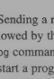

> 为了能够挂起 pine 邮件程序，你必须使用 pine 配置菜单启用挂起功能。在运行 pine 时，按 S 键进入 Setup 菜单，然后按 C 键进入 Configuration 菜单。然后滚动选项直到高亮显示 "enable-suspend"，并按 X 键启用此功能。接下来，按 E 键退出配置屏幕，然后按 Y 键保存更改。现在你能够挂起 pine 邮件程序了。

将正在运行的程序发送到后台并挂起其操作后，可以使用 fg 命令将其带回显示，或使用 bg 命令继续使程序运行。这在你想要启动程序（如新闻阅读器（在第 11 小时，"Configuring Internet Email," 和第 12 小时，"Configuring Internet News" 中讨论）），然后在执行长时间操作（如更新内部新闻组列表）期间挂起并继续运行程序，同时在前台运行其他程序时非常有用。

使用 bash shell，你可以启动、挂起并运行多个程序，然后通过程序的作业号选择性地将后台程序带回显示：

```
# pine
... program is running (ctrl-z)...
Pine suspended. Give the "fg" command to come back.
```

```
[1]+ Stopped (signal)      pine
# sc
... program is running (ctrl-z)...

[2]+ Stopped               sc
# fg %1
... pine program returns...
```

在这个示例中，pine 邮件阅读器被启动然后在后台挂起以启动 sc 电子表格。因为 pine 是第一个被挂起的作业，bash shell 将作业号 1 分配给邮件程序。随后 sc 电子表格被挂起，被分配作业号 2，并通过使用 fg %1 命令指定其作业号来返回到邮件程序。

如果你在后台运行并挂起许多作业，你可能记不住程序的作业号或记不住哪些程序被挂起。你可以通过使用 bash shell 的 jobs 命令来获取已挂起程序的列表：

```
# jobs
[1]  Stopped (signal)      pine
[2]- Stopped              sc
[3]+ Stopped              emacs-nox
# fg %sc
... sc program is running ...
```

这表明 shell 中有三个作业。请注意，与其通过引用其作业号来重新启动 sc 电子表格作业，程序是通过使用带有已挂起作业名称的 fg % 命令将其带回前台的。

你也可以使用同样的方法停止程序。无需使用 ps 命令查找程序的进程号然后发出 kill 命令，你可以使用带 % 运算符的 kill：

```
# kill %1
[1]- Stopped (signal)      pine
# kill %emacs-nox
[3]+ Stopped              emacs-nox
```

这里可以看到如何使用 kill 命令通过其编号或名称停止程序。这比使用 ps 命令容易得多，尤其是在后台运行大量程序或其他进程时。


> 尽管不是任何 shell 的一部分，OpenLinux 也包含 killall 命令，你可以用它按名称终止进程。要使用前面的示例，其中 kill 命令用于停止 rxvt 终端模拟器，而不是输入 kill 后跟进程号，你可以使用：
> # killall rxvt
> 按下 Enter 后，终端模拟器进程被停止，窗口消失。killall 命令还具有 -i 或交互式选项，你可以用它有选择地停止程序，或者可以指定要终止的进程号。

使用你的 shell 的作业控制功能是在多个程序之间高效工作的一种强大方式，尤其是在你使用单个显示器或控制台时。OpenLinux CD-ROM 上包含的所有 shell 都以某种形式包含作业控制。在下一节中，你将看到使用 shell 在单个命令行上运行多个程序的另一种强大方法。

## 如何使用管道

新术语

你已经看到如何将程序的输出重定向到文件，以及如何将该文件的内容重定向到另一个程序。但你可以通过使用 |，或竖线字符，称为管道，一次性完成此操作而无需使用临时文件。使用管道将命令串联在命令行上，称为管道化，是增强单个命令功能的一种快速而强大的方法，也是 Linux 和其他 UNIX 版本的独特优势。

当你开始学习如何使用 Linux 时，你肯定会使用管道命令。管道不仅可以节省你的时间，而且你可以使用不同的管道命令组合来处理特定于你工作方式和你运行的程序的计算任务。一开始，你的管道命令可能很简单，但随着你信心和理解的增长，你可以构建相当复杂的管道。

新术语

Linux 下管道工作良好，因为许多命令也是过滤器，它们接受某种输入，可选择以某种方式处理或修改它，并将结果作为输出发送到标准输出或其他命令。管道几乎可以在任何计算任务中使用，可用于快速查找信息、生成报告、转换数据或查看结果。首先，看看四个简单示例：

```
# ls | lpr
# printenv | fgrep EDITOR
# nroff -man mymanpage.1 | less
# cat document.txt | wc | mail -s "Document.txt Report" bball
```

第一条命令行将当前目录的列表通过行式打印机命令管道传输以打印报告。第二个示例搜索当前 shell 环境的列表并打印默认文本编辑器的值。第三个示例将手册页的格式化输出打印到你的显示器，以便你可以浏览文档以检查错误。最后一个示例将文本文档通过字数统计命令 wc 管道传输，然后通过电子邮件将关于文档中字符、单词和行数的报告发送给用户 bball。

你可以使用管道来应对和解决通常不由单个程序解决的日常问题。这就是使用 OpenLinux 的 shell 的秘密和强大之处！例如，如果你的系统上有大量文档但记不起哪个文档包含某个短语，你可以快速找到此信息。无需运行你的文字处理器并打开每个文件，你可以尝试输入以下内容：

```
# find /home -name *.doc ; xargs fgrep administration | less
```

此命令行使用 find 命令搜索 /home 目录中所有以 .doc 结尾的文件，然后将每个文件的文件名管道传输到 xargs 命令。xargs 命令随后运行 fgrep 命令在每个文件中搜索单词 "administration"，并将结果通过 less 分页器管道传输。你也可以使用管道不仅查找信息，还处理数据并创建新文件。

```
# find *.doc | xargs cat | tr ' ' '\n' | sort | uniq | tee dict | less
```

前面的命令行构建了一个名为 dict 的文件，其中包含所有文字处理文件中包含的唯一单词的排序列表。你称这种文件为什么？词典！说实话，并非所有词典单词拼写都可能正确。

此命令通过将每个找到的文件管道传输到 tr 命令来工作，该命令将每个空格字符转换为回车符以将流拆分为每行一个单词。行流被排序，并且 uniq 命令删除所有相似行的出现，只保留一个。请注意，tee 命令也被用来将流的输出保存到文件中。


> zsh shell 在输入和输出重定向方面包含了一些改进，因此如果你在 zsh shell 命令行上使用管道，可能不需要 tee 命令。有关详细信息，请参阅 zsh shell 文档。

tee 命令用于在特定节点保存管道的结果。当你想在构建管道时测试结果或在复杂管道中保存结果时，这非常方便。看下面的示例：

```
# xwd -out wd.xwd
# xwdtopnm < wd.xwd | pnmto gif | tee wd.gif | gifto pnm | tee wd.pnm |
→ pnmto tiff >wd.tif
```

在这个示例中，使用 X11 xwd 命令创建了一个窗口转储图形，该命令捕获并保存 X 窗口或桌面的内容。然后，使用 xwdtopnm 命令将此图形转换为便携式位图图形。xwdtopnm 命令的输出随后被馈送到 pnmto gif 命令。tee 命令用于将输出以 GIF 格式保存到名为 wd.gif 的文件。同时，GIF 输出由 gifto pnm 命令转换回便携式位图格式，并且 tee 命令再次用于将便携式位图保存为文件 wd.pnm。最后，pnmto tiff 命令将便携式位图文件保存为 TIFF 图像。这是一条命令行和四次图形转换！

使用 Linux 的管道是一种轻松完成工作的简单方法。随着你继续使用 Linux，你很快可以开发出自己的一套喜爱的命令行。当你开发出自己的最爱后，你就可以构建自己的 shell 命令，下一节将介绍相关内容。

## 构建 Shell 脚本

你不必是程序员就可以为 Linux 编写命令。在你熟悉不同程序并发现自己一遍又一遍地输入相同的命令行后，将这些命令行保存到文本文件中，并将其转换为 shell 脚本。最简单的形式，shell 脚本只是你经常使用的一个或多个命令行。看下面的示例：

```
# rxvt -geometry 80x11+803+375 -bg white -fg black -e pico &
# rxvt -geometry 80x24+806+2 -bg white -fg black -e pine &
```

这两条命令行在 800×600 像素显示器的第二个桌面上启动两个 X11 rxvt 终端窗口中的 pico 编辑器和 pine 邮件程序。这些绝对不是你每次想运行这些程序时都想输入的命令行。虽然你可以在移动到另一个桌面后手动启动终端窗口，但正确调整窗口大小然后启动程序可能需要一些时间。通过使用文本编辑器将这些命令行保存到文件中，然后使用 chmod 命令使文件可执行，将这些命令行转换为可执行文件：

```
# chmod +x d2
```


现在当你想要运行这些程序时，你只需要输入以下内容，这当然容易得多：

```
# d2
```

你可以通过使用 shell 变量 $1 和 $2 使这个新命令更灵活，它们代表传递给 shell 命令的第一个和第二个命令行参数。

编辑你创建的文件，并将程序名称更改为这些变量：

```
rxvt -geometry 80x11+803+375 -bg white -fg black -e $2 &
rxvt -geometry 80x24+806+2 -bg white -fg black -e $1 &
```

请注意变量的顺序并不重要。现在当你运行命令时，可以像本示例中那样在命令行上提供程序名称：

```
# d2 pine pico
```

这会得到相同的结果，但从现在开始你可以在终端窗口中运行几乎任何你想要的程序。

关于使用 shell 的讨论以一个简单的 shell 脚本来结束，你可以用它来安全地删除文件。列表 6.1 中的 rmv 脚本没有什么特别之处，但它展示了 shell 脚本的一些强大功能。

## 列表 6.1 RMV 安全删除 Shell 脚本

```
#!/bin/bash
# rmv - a safe delete program
# uses a trash directory under your home directory
#
# when run, always create a directory called .trash
mkdir $HOME/.trash 2>/dev/null
cmdInopts=false
delete=false
empty=false
list=false

# get any command-line options
while getopts "dehl" cmdInopts; do
case $cmdInopts in
d ) /bin/echo "deleting: \c" $2 $3 $4 $5 ; delete=true ;;
e ) /bin/echo "emptying the trash..." ; empty=true ;;
h ) /bin/echo "safe file delete v1.0" ; /bin/echo 'rmv -d[delete] -e[empty] -h[elp] -l[list] file1-4' ;;
l ) /bin/echo 'your .trash directory contains:' ; list=true ;;
esac
done
```

### 列表 6.1 继续

```
# d - delete any files found on the command line
if [ $delete = true ]
then
mv $2 $3 $4 $5 $HOME/.trash
/bin/echo " rmv finished."
fi

# e - empty the trash?
if [ $empty = true ]
then
/bin/echo "empty the trash? \c"
read answer
case "$answer" in
y) rm -fr $HOME/.trash/* ;;
n) /bin/echo "trashcan delete aborted." ;;
esac
fi

# l - show any files in the .trash directory
if [ $list = true ]
then
ls -l $HOME/.trash
fi
```

脚本的第一行调用 bash shell 来运行脚本。在你使用喜欢的文本编辑器输入此脚本后，使用 chmod 命令使脚本可执行：

```
# chmod +x rmv
```

此脚本将不需要的文件移动到你主目录中名为 .trash 的目录。当你确定要删除文件时，可以先验证文件然后清空回收站。因为此脚本应该像常规命令一样运行，所以包含了一个简短的内置帮助命令。


> 如果你想尝试 rmv 脚本，请确保正确输入它，或者将包含 rm -fr $HOME/.trash/* ;; 的行更改为 rm -i $HOME/.trash/* ;;，这比无条件删除安全得多。如果你没有正确输入这一行，你可能会删除整个主目录！

脚本首先在你的主目录中创建一个 .trash 目录（使用 $HOME 环境变量找到）。如果目录已存在，则 mkdir 命令产生的任何错误消息都会被丢弃，将标准错误输出发送到 /dev/null 设备。/dev/null 设备是发送所有抱怨的好地方，因为所有输入都会被丢弃！该设备（被称为“老位桶”）也用于在你不关心程序输出并希望隐藏显示输出时使用。然后定义了四个内部脚本变量：cmdInopts、delete、empty 和 list。

脚本使用 bash shell 的 getopts 命令检查你的命令行是否有任何选项。如果在 case 语句中找到了匹配的字母，则脚本会执行直到两个分号之间的命令。例如，如果你想提醒如何使用脚本，可以使用 -h 或 help 选项：

```
# rmv -h
safe file delete v1.0
rmv -d[delete] -e[empty] -h[elp] -l[list] file1-4
```

这会打印简短的帮助消息，因为脚本在命令行上找到了字母 h，然后使用 echo 命令打印了消息。要删除文件，必须使用 -d 或 delete 命令行选项：

```
# rmv -d berries.jpg bowtie.gif face.gif
deleting: berries.jpg bowtie.gif face.gif rmv finished.
```

这会通过将它们移动到你主目录中的 .trash 目录来删除这三个文件。-d 选项在命令行上被检测到，然后脚本打印一条消息，将文件名回显到你的显示器，并将 delete 变量设置为 true。因为 delete 变量被更改为 true，所以 if ... then 语句中找到的 mv 命令会被执行。

你可以通过使用 -l 或 list 选项来查看回收站的内容，从而验证文件是否已被移动：

```
# rmv -l
your .trash directory contains:
total 36
-rw-r--r-- 1 bball users 11967 Nov 6 14:18 berries.jpg
-rw-r--r-- 1 bball users 14010 Nov 6 14:18 bowtie.gif
-rw-r--r-- 1 bball users 8681 Nov 6 14:18 face.gif
```

与之前一样，因为在命令行上检测到字母 l，脚本将 list 变量设置为 true，然后执行 ls 命令列出你的 .trash 目录的内容。如果你确定要删除这些文件，可以使用 -e 或 empty 命令行选项：

```
# rmv -e
emptying the trash...
empty the trash? n
```

```
trashcan delete aborted.
# rmv -e
emptying the trash...
empty the trash? y
# rmv -l
your .trash directory contains:
total 0
```

rmv 脚本会询问你是否确定要清空回收站。如果你输入 n，则删除操作将被中止。如果你输入 y，则回收站将被删除。因为在命令行上找到了字母 e，empty 变量被设置为 true，并且 if ... then 测试行之后的语句会被运行。脚本会向你的显示器打印一条消息，然后使用 read 命令等待你输入答案。然后对答案进行测试，如果是 yes，则 .trash 目录中的文件将被删除。

使用 shell，你可以快速构建简单的程序来完成主要任务。请随意通过添加功能或改进命令行上文件名的处理方式来改进此程序。一种改进可能是添加处理通配符或整个目录的功能。另一种改进可能是交互式删除文件。有关可在自己的 shell 脚本中使用的其他 shell 命令和操作符的更多信息，请参阅 bash 手册页。

## 摘要

本小时仅介绍了使用 OpenLinux 的 shell 的基础知识。不要被命令行吓倒！掌握任何 shell 的复杂性和特殊性需要大量的练习。确保你实践安全计算：定义别名以强制潜在有害命令以交互方式运行；在删除文件时使用通配符前三思；并且不要一直以 root 操作员身份使用 OpenLinux。关于 OpenLinux 你学得越多，在使用 shell 时解决问题的能力和构建自定义解决方案的信心就越强。

#### 问答

Q 帮助！我正在使用 shell，一个程序运行出错，突然屏幕上全是乱码字符？

A 尝试使用 reset 命令。很可能你的 shell 仍然理解你的键盘输入。输入 reset 并按 Enter 键以重置你的终端或控制台。

Q 如何获取有关 bash 的更多信息？

A 除了 bash 手册页外，你可以在 /usr/doc/bash 目录下找到至少三个额外的信息文件。你也可以尝试在你喜欢的书店搜索有关此 shell 的书籍。

Q 使用 OpenLinux 最好的 shell 是什么？

A 这是一个很难回答的问题，因为每个 shell 都有特定的优点或缺点。然而，bash shell 似乎是最受欢迎的，并且是其他 Linux 发行版的默认 shell。大多数 OpenLinux 用户对这个 shell 很满意，并且许多为 Linux 开发的 shell 脚本都适用于 bash。

#### 练习

- 1. 定位新用户的默认 .bashrc 设置。修改此文件以包含 rm、cp 和 mv 命令的安全别名。
- 2. 你应该编辑哪个文件来添加你自己的个人别名？
- 3. 修改 rmv 脚本来更改回收站目录的位置或名称。
- 4. 如果你使用 -d 选项而不在命令行上提供任何文件名，mv 命令通过 rmv 脚本会报告错误。如何修复这个问题？


## 第7小时

### 使用 X Window 系统


安装在您计算机上的 X Window 系统，正如您在第3小时“配置 X Window 系统”中所学到的，是来自 XFree86 Project, Inc. 的 X11 端口。此图形界面包含约 3,500 个文件，其中近 200 个程序（客户端）、超过 500 种字体，以及近 50 兆字节软件中超过 500 个图形图像文件。您可以在 /usr/X11R6 目录下找到几乎所有（但并非全部文件或程序）的 X11 内容。

本小时向您展示几种启动 X11 的方法，讨论您在 X 会话期间可使用的一些不同的图形界面或窗口管理器，并提供针对系统上安装的几个终端程序（或 shell 控制台）的练习。您还将学习一些基本操作，例如复制和粘贴文本、调整鼠标指针或光标形状，以及进行屏幕截图。最后一节向您展示了一些您可能想要尝试的 X11 客户端示例。

请注意，诸如文本编辑器、图形程序，甚至其他 X11 窗口管理器等许多客户端在本书中各处都有讨论。

### 启动 X

当您首次登录 OpenLinux 时，会看到如下简短信息：

Welcome to your OpenLinux system!
You can start X11 with 'startx' or KDE with 'kde'.

startx 和 kde 命令几乎是相同的 shell 脚本，用于启动 X11 会话。startx 位于 /usr/X11R6/bin 目录下，而 kde 位于 /opt/kde/bin 目录下。要使用 fvwm 窗口管理器（本章稍后“X11 窗口管理器”一节中讨论）与 Looking Glass 桌面客户端启动 X11 会话，请在控制台的命令行中输入 startx，然后按 Enter，如下所示：

```
# startx
```

如果您已正确配置 X11 使其与计算机的显卡配合使用（如第3小时所述），显示屏会清空，几秒钟后 X11 桌面会出现，如图 7.1 所示。

图 7.1
带有 Looking Glass 桌面客户端的 fvwm X11 窗口管理器是使用 OpenLinux 使用 X 的几种方式之一。

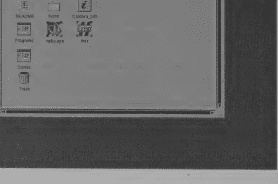

要使用 K 桌面环境（第8小时“探索 K 桌面环境”中讨论）启动 X 会话，请在命令行中输入 kde，然后按 Enter，如下所示：

```
# kde
```

屏幕清空，很快您会看到 KDE 的默认桌面出现，如图 7.2 所示。

图 7.2
KDE 桌面是一个完整的 X11 环境，包含几乎所有现代图形界面的功能。

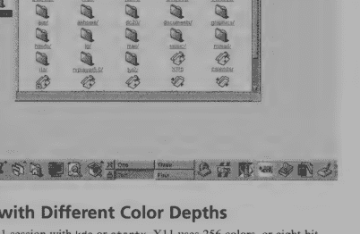

### 使用不同颜色深度启动 X11

当您使用 kde 或 startx 启动 X11 会话时，X11 使用 256 种颜色，或八位平面（一个字节，或每个像素八位）。要使用 16 位平面（或两个字节，或每个像素 16 位）启动 X 会话，请使用 -bpp 选项，后跟 16，如下所示：

```
# startx -- -bpp 16
```

或

```
# kde -- -bpp 16
```

-bpp 16 选项会传递给您在配置 X 时选择的 X 服务器，作为使用 64,000 种颜色的选项。其他颜色深度，例如 24 或 32，可能取决于显卡的功能以及您如何配置您的 XF86Config 文件。

尽管位于 /etc 目录下的 XF86Config 在第3小时中有更详细的描述，但此文件的相关部分位于 Screen 部分。示例显示在清单 7.1 中。

### 清单 7.1 典型的 XF86CONFIG 屏幕部分

```
Section "Screen"
    Driver      "svga"
    Device      "NeoMagic"
    Monitor     "Generic Multisync"
    Subsection  "Display"
        Depth       8
        Modes       "1024x768" "800x600" "640x480"
    #       Virtual 1024 768
    EndSubsection
    Subsection  "Display"
        Depth       16
        Modes       "1024x768" "800x600" "640x480"
    EndSubsection
    Subsection  "Display"
        Depth       24
        Modes       "800x600" "640x480"
    EndSubsection
EndSection
```

请注意清单中的“Display”子部分（针对 NeoMagic 视频图形显示）。每个子部分都以 Depth 设置开始，然后列出不同的 Modes，即分辨率。Depth 设置设置显示深度，即 X 会话的颜色数。如果您始终以 800×600 的分辨率使用 64,000 种颜色的 X，并且不想每次启动 X 时都输入 -- -bpp 16，请编辑您的 XF86Config 文件并简单使用如下“Screen”部分：

```
Section "Screen"
    Driver      "svga"
    Device      "NeoMagic"
    Monitor     "Generic Multisync"
    DefaultColorDepth 16
    Subsection  "Display"
        Depth       16
        Modes       "800x600"
    EndSubsection
EndSection
```

Modes 行告诉 X 服务器在水平和垂直方向上使用特定数量的每英寸点数。您选择的 X 服务器会自动使用与 XF86Config 文件中相应模式行匹配的第一个可用模式值（例如 800×600）。在清单 7.1 中，如果所有模式都有效，您的 X 会话将以每像素八位启动，显示屏宽度为 1024 像素，高度为 800 像素。要在 X 会话期间切换到较低分辨率或模式（例如从 1024×768 切换到 800×600），请按 Ctrl+Alt+KeyPad-。也就是说，按住 Ctrl+Alt，然后按键盘小键盘上的减号 (-) 键。要切换到更高分辨率，请按 Ctrl+Alt+KeyPad+。

清单 7.1 中的 Virtual 行使您能够拥有比屏幕物理区域更大的显示。如果您的计算机显卡和显示器仅支持较低分辨率，例如 800×600，但您需要在更高分辨率下运行 X11 客户端（程序），例如 1024×768，这非常方便。清单 7.1 中的 Virtual 行使用井号 (#) 禁用，但您可以删除井号然后重新启动 X 来启用它。然后您的显示成为一个滚动窗口，当鼠标指针被拖动到屏幕边缘之外时，它会在更大的虚拟显示中移动。


> 不幸的是，一些 X 客户端，例如图形绘图程序 xfig 或街机动作游戏 xboing，需要更大的显示区域。您的屏幕分辨率取决于显卡在特定 X 服务器上的支持程度、显卡上安装的视频内存量、计算机显示器或笔记本电脑屏幕的分辨率能力，以及您如何配置 XF86Config 文件。例如，您不能在仅支持 800×600 分辨率的笔记本电脑上使用 1024×768 显示，但如果安装了足够的视频内存，您可能能够使用 1024×768 或更大的虚拟分辨率。

### 使用 X11 的虚拟控制台

尽管在使用 rxvt 等终端客户端（如本章稍后“使用 X11 终端程序”一节中讨论）时，您可以在 X 会话期间进入 shell 命令行，但在使用桌面计算机上的 X 时，您也可以进入 OpenLinux 控制台。OpenLinux 支持六个不同的虚拟控制台或登录屏幕。当您不使用 X 时，您可以通过按 Alt+FX 进入六个不同的登录提示，其中 X 为 F1 至 F6。

例如，当您首次登录 OpenLinux 时，您位于第一个虚拟控制台。登录后，按 Alt+F2。然后您会看到另一个登录提示，您可以作为另一个用户登录或启动另一个 OpenLinux 会话。要返回到第一个登录屏幕，请按 Alt+F1。

当您登录 OpenLinux 并使用 startx 或 kde 启动 X11 会话时，X 默认使用第七个虚拟屏幕。因为您是从第一个虚拟控制台启动 X 的，所以该控制台不可用。但是，您可以通过按 Ctrl+Alt+F2 进入另一个虚拟控制台，例如第二个。然后您会看到 OpenLinux 登录提示。要返回到 X 会话，请按 Ctrl+Alt+F7。使用这种方法，您可以在 X 会话和不同控制台之间来回切换。

### 启动多个 X11 会话

不仅可以在 X 会话期间使用 OpenLinux 的多个虚拟控制台，您还可以在 OpenLinux 会话期间启动并使用多个 X 控制台。这意味着您可以登录，使用特定颜色深度的一个窗口管理器启动 X，然后转到不同的控制台，登录并使用不同的窗口管理器和颜色深度启动另一个 X 会话。然后，在您的 X 会话期间，在不同的控制台和 X 窗口管理器之间切换！

以下是一个逐步示例，展示如何同时登录并使用 startx 和 kde 命令：

- 1. 启动 OpenLinux 并登录。在命令行中，使用以下命令以 256 种颜色启动 KDE 的 X 会话：
  ```
  # kde
  ```
- 2. 按 Enter 启动 X 会话（它使用第七个虚拟屏幕）。
- 3. KDE 桌面出现后，按 Ctrl+Alt+F2。您位于第二个虚拟控制台和 OpenLinux 登录提示。再次登录 OpenLinux。
- 4. 在命令行中，使用 startx 命令启动一个使用 64,000 种颜色的 X 会话，使用 fvwm 窗口管理器和 Looking Glass 桌面。包含 :1 和 vt8 命令行选项以使用第八个虚拟屏幕启动名为 :1 的第二个 X11 会话，如下所示：
  ```
  # startx -- :1 -bpp 16 vt8
  ```
  屏幕清空，fvwm 和 Looking Glass 桌面出现（如图 7.1 所示）。


> Looking Glass 桌面是一个 X11 客户端，用于在 X11 会话期间提供图形工作区。当您使用 startx 启动 X 会话时，Looking Glass 客户端默认出现。当桌面出现时，单击 Caldera 或 Netscape 图标以阅读 Looking Glass 手册。您可以在此处找到使用此客户端与 X 所需的所有信息。


5. 要进入你的 KDE 会话，请按 Ctrl+Alt+F7。要进入另一个虚拟控制台，请按 Ctrl+Alt+F3（因为第一个和第二个已被使用）。要返回到 fvwm，请按 Ctrl+Alt+F8。

## 使用 xdm 登录 OpenLinux 和 X11

OpenLinux 的默认配置是启动 Linux 到控制台的登录提示符，或 shell 命令行。然而，你也可以直接将 OpenLinux 启动到 X11 登录提示符。这可以通过在 LILO 启动提示符处传递内核消息或启动提示符选项来实现，也可以通过配置 OpenLinux 在启动后启动 X11 和 xdm，或 X 显示管理器客户端来实现。

> 在尝试此操作之前，必须为计算机的显卡正确配置 X，否则可能会导致系统死锁！

要直接启动到 xdm 登录屏幕，请打开计算机，并在 LILO 启动提示符处输入以下内容：

```
linux 5
```

按下 Enter 后，Linux 启动并显示 xdm 登录屏幕，如图 7.3 所示。此方法通过将 OpenLinux 直接启动到特定运行级别来实现，该运行级别在 /etc 目录下的 OpenLinux 系统初始化表 inittab 中指定。运行级别 5 在 /etc/inittab 中定义如下：

```
x:5:respawn:/usr/bin/X11/xdm -nodaemon
```

此行指定当 OpenLinux 启动时，登录提示符由 xdm 提供。要启动你的 X 会话（默认使用 fvwm），输入你的用户名，按 Enter，然后输入你的密码，再次按 Enter。

要配置 OpenLinux 直接启动到此登录屏幕，请以 root 操作员身份登录，然后使用你喜欢的文本编辑器打开 /etc/inittab。滚动文件直到看到以下内容：

```
# Default runlevel.
id:3:initdefault:
```

> 编辑系统的初始化表本质上是危险的！请先制作备份副本，并在编辑此文件时确保禁用换行（例如使用 pico 编辑器时使用 -w 选项）。

### 图 7.3

xdm 客户端是 X 显示管理器，并为 X 提供登录提示。

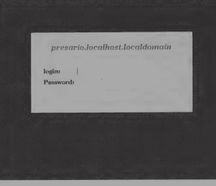

initdefault 行告诉 OpenLinux 默认使用哪个运行级别。要直接启动到 xdm 登录屏幕，将 3 改为 5，如下所示：

```
id:5:initdefault:
```

保存文件，退出文本编辑器，然后使用命令 /sbin/telinit 5 或使用 shutdown 命令重新启动 OpenLinux。当你重新启动到 OpenLinux 时，你会看到 xdm 屏幕，如图 7.3 所示。

> xdm 的一个不错的替代品是 K 显示管理器，或 kdm。该客户端比标准 xdm 客户端提供更多登录选择和配置。有关如何配置 kdm 的详细信息，请参阅第 8 小时中的“配置 kdm”部分。

## X11 窗口管理器

X11 的一大优点是你可以选择如何管理屏幕上的窗口和程序。所有屏幕管理的繁重工作都由窗口管理器完成，窗口管理器只是一个 X11 程序或客户端。当然，你也可以不使用窗口管理器使用 X。例如，在你的主目录中创建一个名为 .xinitrc 的文件，其中包含单行：

```
xterm
```

然后使用 startx 命令。这将启动 X11；但你只有一个终端窗口，没有窗口边框、滚动条、按钮或颜色。没有窗口管理器，X 中的计算生活非常单调！

虽然选择自由是好的，但 X11 的一个缺点是窗口管理器的选择和复杂性可能令人困惑：你可能会被配置文件的数组、脚本或资源设置所淹没。

## 配置 fvwm 窗口管理器

fvwm 窗口管理器由 Evans 和 Sutherland Computer Corporation、麻省理工学院和 Robert Nation 构建，在名为 twm 的早期窗口管理器基础上发展而来。当你使用 startx 命令启动 X 会话时默认使用此窗口管理器，并为 X 提供许多窗口管理器共有的元素：

- 分层根菜单（菜单和子菜单）
- 图形图标（最小化窗口时）
- 3D 窗口按钮（使用阴影和颜色）
- 3D 滚动条（可拖动且带阴影）
- 可自定义的显示颜色和屏幕元素
- 窗口管理器模块（用于图标停靠、分页器等）
- 虚拟桌面（多个屏幕）

虽然在 /etc/X11/fvwm 目录下有一个 fvwm 配置文件 system.fvwmrc，但此窗口管理器的主要元素位于 /usr/X11R6/lib/X11 目录下的 wm1_modules 目录中。fvwm（和其他窗口管理器）的配置和管理是通过 /etc/X11/wmconfig 目录下的一系列宏和配置文件进行的，这些文件已由 wmconfig（窗口管理器配置）命令处理。当你使用 fvwm（和其他窗口管理器）启动 X11 会话时，菜单、颜色、边框、键盘值和窗口管理其他方面的设置会从这些文件处理并构建。这是一个复杂系统，但它提供了一种原始的 *session management*，或保存设置以供下次 X11 会话使用的能力。这些文件列在表 7.1 中。

### 表 7.1 X11 宏和配置文件

| 名称 | 描述 |
|---|---|
| AfterStep.M4 | AfterStep 窗口管理器使用的宏 |
| Common.M4 | 所有窗口管理器的宏和定义 |
| Fvwm1.M4 | fvwm 窗口管理器使用的宏 |
| WmConfig | 用于在重启后重新配置窗口管理器设置的宏 |
| desk | Looking Glass 客户端的启动函数 |
| rc | 关于如何处理配置文件的宏定义 |
| rc.bindings | 鼠标和键盘设置 |
| rc.config | 背景和显示字体设置 |
| rc.functions | 专用鼠标和窗口处理函数 |
| rc.goodstuff | 图标和应用程序启动定义 |
| rc.menus | 菜单定义 |
| rc.menus.exclude | 从菜单中排除的客户端 |
| rc.modules | 窗口和分页器的模块定义 |
| rc.options | 窗口颜色、焦点、图标、外观、放置、装饰和分页器大小 |
| rc.styles | 窗口装饰和图标分配 |
| xinitrc | 启动 X 会话的初始设置和配置 |
| xsessionrc | xdm 启动 X 会话时使用的设置和配置 |

有关 wmconfig 命令如何工作的最佳概述，请阅读 /usr/doc/wmconfig 目录下的文件 Fvwm-Config-Dokumentation.en.txt。


> 幸运的是，你不应（并且可能不应该）编辑这些文件。宏定义的设置和交互相当复杂。除非你确切知道自己在做什么，否则请不要触碰这些文件。

你可以通过根显示中的众多配置菜单更改 fvwm 的显示信息。这些菜单通过在桌面空白区域按 Alt+C（或 Alt+Shift+C）访问，使你能够更改以下许多内容：

- 窗口、图标和菜单的字体
- 窗口颜色（背景和前景）
- 焦点策略（点击窗口激活，或将光标移过它等）
- 设置窗口的处理方式和外观
- 设置默认使用的窗口管理器
- 设置模块、图标或桌面按钮的位置
- 设置哪些模块、图标或桌面按钮出现

要保存你的设置，你必须先选择桌面菜单的启用自动保存主题项。在桌面空白区域按 Alt+C。菜单出现，如图 7.4 所示。

### 图 7.4

你必须先使用 fvwm 配置菜单启用配置保存，然后才能保存 X 会话设置。


点击桌面菜单的启用自动保存主题项。然后你可以通过配置菜单更改不同的设置。完成后再次按 Alt+C。你会看到配置菜单已更改，现在具有保存桌面项，如图 7.5 所示。

### 图 7.5

使用配置菜单的保存选项保存窗口管理器的设置。


点击“Save Now”菜单项保存您的更改（它们会被写入您主目录下 .wmconfig 目录中的 desk 和 rc.config 文件。）

您可以通过终端窗口的命令行或通过 fvwm 的根菜单启动不同的 X11 客户端。要使用此菜单，将鼠标光标移动到桌面的空白区域，点击鼠标左键，然后滚动到所需的程序组，如图 7.6 所示。

## 图 7.6

使用 fvwm 的根菜单启动不同的 X11 客户端。

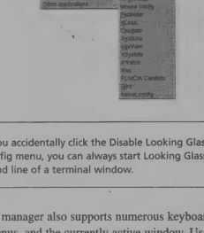

> 如果您不小心在根配置菜单中点击了“Disable Looking Glass”菜单项，您始终可以通过在终端窗口的命令行中输入 lg 来启动 Looking Glass。

fvwm 窗口管理器还支持大量键盘命令来控制鼠标指针、菜单和当前活动窗口。使用这些命令，可以在不将手指从键盘上移开的情况下控制窗口或鼠标并选择菜单项。表 7.2 列出了其中一些更常见的命令。

## 表 7.2 fvwm 窗口和指针键盘命令

| 命令 | 描述 |
|---|---|
| Alt+A | 弹出应用程序菜单 |
| Alt+C | 弹出配置菜单 |
| Alt+D | 弹出桌面菜单 |
| Alt+Esc | 显示窗口的图形列表 |
| Alt+F | 弹出图形菜单 |
| Alt+G | 弹出游戏菜单 |
| Alt+H | 弹出帮助菜单 |
| Alt+I | 弹出互联网连接菜单 |
| Alt+P | 弹出生产力工具菜单 |
| Alt+R | 弹出娱乐菜单 |
| Alt+S | 弹出 Shell 菜单 |
| Alt+T | 弹出终端菜单 |
| Alt+Tab | 激活下一个窗口 |
| Alt+V | 弹出软件开发菜单 |
| Alt+X | 弹出文本和出版菜单 |
| Alt+Y | 弹出系统管理菜单 |
| Ctrl+Alt+向下箭头 | 将指针向下移动 100 像素 |
| Ctrl+Alt+向左箭头 | 将指针向左移动 100 像素 |
| Ctrl+Alt+向右箭头 | 将指针向右移动 100 像素 |
| Ctrl+Alt+向上箭头 | 将指针向上移动 100 像素 |
| Ctrl+向下箭头 | 将活动窗口向下移动到下一个桌面 |
| Ctrl+向左箭头 | 将活动窗口移动到下一个左侧桌面 |
| Ctrl+向右箭头 | 将活动窗口移动到下一个右侧桌面 |
| Ctrl+向上箭头 | 将活动窗口向上移动到下一个桌面 |
| Shift+Alt+Tab | 激活上一个窗口 |
| Shift+Ctrl+Alt+向下箭头 | 将指针向下移动屏幕的 1% |
| Shift+Ctrl+Alt+向左箭头 | 将指针向左移动屏幕的 1% |
| Shift+Ctrl+Alt+向右箭头 | 将指针向右移动屏幕的 1% |
| Shift+Ctrl+Alt+向上箭头 | 将指针向上移动屏幕的 1% |

如果您喜欢 fvwm 窗口管理器，您可能还想尝试 AfterStep，它是对 fvwm 配置文件的一种复杂的定制。

## 启动 AfterStep

AfterStep 窗口管理器由 Frank Fejes、Alfredo Kenji Kojima 和 Dan Weeks 提供，提供了与商业 NEXTSTEP 操作系统类似的窗口管理、控件和其他功能（见图 7.7）。这些功能包括以下内容：

- 3D、可配置的图标
- 用于启动 X11 客户端的“Wharf”或图标停靠栏
- 弹出式、多图标菜单
- 窗帘式窗口控件（双击窗口标题栏可将窗帘拉上或拉下）
- 精致的标题栏、按钮和其他装饰
- 样式化的弹出式根菜单

## 图 7.7

AfterStep 窗口管理器为您的 X 会话提供了精致的窗口控件、图标和应用程序“Wharf”。

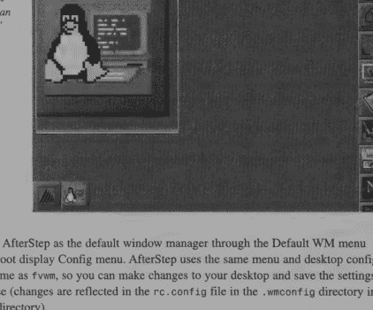

您可以通过根显示配置菜单中的“Default WM”菜单项将 AfterStep 用作默认窗口管理器。AfterStep 使用与 fvwm 相同的菜单和桌面配置方案，因此您可以更改桌面并保存设置以供将来使用（更改会反映在您主目录的 .wmconfig 目录中的 rc.config 文件中）。

## 启动 twm 窗口管理器

twm，或 Tom's Window Manager，位于 /usr/X11R6/bin 目录下，是 X Window System 的原始窗口管理器之一。由 Tom LaStrange 和其他作者开发的 twm 客户端提供了最基本的窗口操作，例如窗口标题、图标、根窗口菜单以及其他自定义鼠标或键盘命令。图 7.8 显示了一个典型的 twm 窗口管理会话。

## 图 7.8

twm，或 Tab 窗口管理器，提供带有程序列表、图标和窗口控件的基本 X11 桌面显示。

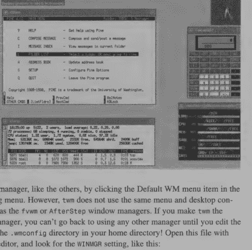

像其他窗口管理器一样，通过点击根显示配置菜单中的“Default WM”菜单项启动此窗口管理器。但是，twm 不使用与 fvwm 或 AfterStep 窗口管理器相同的菜单和桌面配置方案。如果您将 twm 设为默认窗口管理器，直到您编辑主目录中 .wmconfig 目录下的 .rc.config 文件之前，就无法再使用其他管理器！使用您喜欢的文本编辑器打开此文件，并查找如下的 WINMGR 设置：

```
WINMGR="twm"
```

您可以删除此设置或将其更改为其他窗口管理器，如下所示：

```
WINMGR='afterstep'
```

保存文件并重新启动 X11 以使用新的窗口管理器。twm 窗口管理器的配置文件 system.twmrc 位于 /etc/X11/twm 目录中。如果您是 root 操作员，可以自定义此文件以支持系统为所有用户提供的功能和程序。如果您想制作自己的自定义 twm 功能，请将此文件复制为 .twmrc 并保存在您的主目录中。

## X11 终端程序

X11 终端客户端提供一个控制台，可通过命令行访问 shell。虽然您在 X 会话期间不需要使用终端，但最好至少保持一个打开（或图标化），以便启动其他程序。同时打开多个窗口也是一种方便学习新命令的方法，因为您可以在一个窗口中显示手册页，同时在另一个窗口中尝试该程序。您还可以使用多个终端窗口在程序之间复制和粘贴信息。

本节向您介绍您可能希望与 X11 一起使用的几个终端程序：cmdtool、rxvt、xterm、kvt 和 kterm。表 7.3 列出了这些各种终端。

表 7.3 OpenLinux 包含的 X11 终端客户端

| 名称 | 描述 |
|---|---|
| ansi-xterm | xterm-color 的符号链接 |
| cmdtool | 随 Sun 的 OpenWindows 提供的终端窗口模拟器 |
| color-xterm | xterm-color 的符号链接 |
| kterm | 多语言终端模拟器 |
| kvt | 随 KDE 提供的带菜单的 X11 终端 |
| rxvt | 内存高效、彩色终端 |
| xterm | 随 XFree86 提供的标准 X11 终端 |
| xterm-color | 用于以彩色终端运行 xterm 的 Shell 脚本（使用 /etc/termcap 数据库中的 xterm-16color 条目） |

## 更改 xterm 终端设置

xterm 客户端是一个彩色终端模拟器。启动后，它会显示一个打开的窗口，其中包含命令行。您可以运行程序、进行文字处理或执行在不运行 X11 时通常执行的几乎任何功能。与大多数 X11 终端模拟器一样，xterm 具有可调整大小的窗口。根据您使用的窗口管理器，窗口标题栏上的按钮可让您移动、调整大小、最小化或最大化窗口，并且可能允许您关闭或终止窗口以及从窗口启动的任何正在运行的程序。如果您最小化 xterm 窗口，则可能根据窗口管理器在桌面上或图标停靠栏或任务栏中出现一个图标。

> **New TERM** 如果您从另一个终端启动 xterm，您可以通过使用称为 X11 Toolkit 选项的命令行选项来选择新窗口的初始显示方式和位置。这些内容将在本小时稍后“学习 X11 基本操作”一节中讨论。xterm 与 kvt 终端模拟器共享的一个功能是能够即时更改字体。

例如，如果您希望终端使用更大或更小的字体，只需将光标移入终端窗口，按住 Ctrl 键并按下鼠标右键即可。名为 VT Fonts 的菜单会弹出，其中列出了各种大小，您可以从中选择更大或更小的大小。


> xterm 的 VT Fonts 菜单中一个非常棒的功能是 Selection 选项。它的工作原理如下：首先运行 xterm 客户端，然后从命令行启动 xfontsel 客户端。xfontsel 客户端以多种变体显示不同的字体，您可以看到所选字体在不同点大小或方向上的效果。在为显示找到极易读的字体后，点击 xfontsel 窗口顶部的 Select 按钮。然后，将鼠标光标移至 xterm 窗口，按住 Ctrl 键，按下鼠标右键并选择 VT Fonts 菜单项 Selection。Voilà！您的 xterm 窗口现在使用的是您用 xfontsel 客户端选择的字体。这对于找到终端使用的最佳字体非常有用。

虽然几乎所有终端都支持滚动，但并非所有终端模拟器都有漂亮的滚动条。您可以通过按住 Ctrl 键并按下鼠标中键来控制是否启用滚动以及滚动条是否可见（对于双按钮鼠标用户，请确保启用三按钮仿真并同时按下两个鼠标按钮）。

如果您不需要所有这些功能或需要更多内存来运行程序，您可能希望使用下面讨论的 rxvt 终端模拟器。

## 使用内存高效的 rxvt 终端

rxvt 客户端或终端模拟器是一个彩色 X11 控制台窗口，其功能比 xterm 客户端少，但可能更有用，包括以下内容：

- 尺寸较小，因此该客户端使用更少的内存或交换空间
- 彩色终端模拟器
- 支持有限的 X Toolkit 命令行选项
- 没有 Tektronix 4014 仿真，这对于独立的 Linux X11 工作站来说并不是真正需要的

rxvt 支持与 xterm 相同的至少一个命令行选项——-e 选项，用于在独立的 X 窗口中运行程序。-e 选项很有用，如果您想运行


在 X 下运行的程序通常在非图形环境（控制台）中运行，例如：

```
# rxvt -e pico &
```

该命令行在独立窗口中运行 pico 编辑器（pine 邮件程序的一部分）。你可以创建、打开、编辑和保存文件，但当你退出 pico 编辑器时，窗口会消失。这是在 X 下运行交互式控制台程序的一种好方法。

rxvt 客户端还支持许多 X Toolkit 选项，正如你在下一节中会看到的。通过使用这些选项，你可以在桌面的任意位置启动 rxvt 终端，使用任何可用的字体，并选择前景色和背景色。

## 学习 X11 基本操作

使用 X11 和 X11 客户端时，了解一些基本操作非常重要。许多程序接受类似的命令行选项，因此你可以自定义客户端窗口的大小、颜色和位置。本节向你介绍一些更常见的命令行选项并展示如何使用它们。

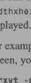

> 并非所有 X11 客户端都支持相同的 X11 选项，即所谓的 X Toolkit 命令行选项。有关这些选项的完整讨论，请参阅位于 /usr/X11/man/man1 目录下的 X 手册页或单个客户端的手册页以获取详细信息。

## 使用 X11 客户端几何设置

你可以使用 geometry 选项，通常形式为 -geometry widthxheight+xoffset+yoffset，来管理客户端窗口的显示方式和位置。

例如，如果你想在屏幕左上角启动一个 rxvt 终端，使用以下命令：

```
# rxvt -geometry 80x25+0+0 &
```

该命令启动一个 80 字符、25 行的 rxvt 终端，并将其窗口放置在显示器的左上角。这里有一个不错的技巧：如果使用支持虚拟窗口的窗口管理器并且有多个桌面可用，你可以不仅在当前桌面启动终端模拟器，还可以在其他桌面启动。

例如，如果当前桌面为 800×600，你可以通过指定 x 和 y 偏移量轻松地在相邻桌面启动其他 X11 客户端，如下所示：

```
# rxvt -geometry 80x25+801+0
```

```
# rxvt -geometry 80x25+0+601
```

第一行命令行启动另一个终端窗口，但位于右侧相邻桌面的左上角。第二行命令行启动另一个终端窗口，但位于下方相邻桌面的左上角。这是一个方便的功能，如果你想在启动 X11 之前不仅设置当前桌面，还设置其他桌面。使用这种方法，你可以在一个桌面启动文字处理，在另一个桌面启动 Web 浏览器，在第三个桌面启动图形程序（假设内存足够）。


> 几何规范对于从命令行构建有序的工作屏幕非常有用。从命令行启动客户端或调整窗口大小来构建你的桌面，然后使用根显示菜单中的“保存桌面”功能保存窗口设置。

## 设置 X11 客户端的背景和前景颜色

你通常也可以使用 -bg 和 -fg 颜色命令行选项设置终端窗口的背景和前景颜色。XFree86 X11 服务器支持的颜色列表可以在 /usr/X11R6/lib/X11 目录下的 rgb.txt 文件中找到。

例如，要以红色背景和黄色前景文本启动 rxvt 终端模拟器，使用以下命令：

```
# rxvt -bg red -fg yellow
```

如果你没有使用 XF86_SVGA 服务器以 8-bpp（每像素 8 位）模式（256 色）运行 X11，可用的颜色选择会更有限。例如，如果使用 XF86_VGA16 服务器，你只有 16 种颜色可用；如果使用单色服务器 XF86_Mono，则只有黑白。你也可以通过使用 xcolorsel 客户端或 xcmapp 客户端来查看可用颜色，这些客户端以网格形式显示颜色并给出颜色的 rgb（红、绿、蓝）值，基数为 16，即十六进制。（有关更多信息，请参阅 X、xcolorsel 和 xcmapp 手册页。）另一个可以尝试的程序是 showrgb 客户端，它会自动列出 rgb 数据库 rgb.txt 的内容。

其他颜色选项包括用于窗口边框颜色选择的 -bd 以及 -rv 和 +rv 反视频模式，后者对单色显示很有用。

## 设置 X11 客户端资源

X Window 系统还通过使用客户端资源支持进一步的客户端配置。这些是包含客户端外观或运行方式各方面设置的文本文件。你也可以在程序首次启动时使用 -xrm 命令行选项指定资源字符串来设置客户端程序的不同资源，但大多数程序仅使用资源文件。

为了更改资源设置，你需要知道 X11 客户端使用哪些资源。你可以通过阅读程序的手册页或查找 /usr/X11R6/lib/X11 目录下的 app-defaults 目录中（但不总是）以客户端名称命名的文件中已安装的设置来找到这些信息，如下所示：

```
# ls -A /usr/X11R6/lib/X11/app-defaults
Axe Pixmap.No3d XLogo Xconq
Axinfo Rosegarden XLogo-color Xconq-color
Before light Rubik XMailbox Xditview
Bitmap Seyon XMixer Xditview-chrtr
Bitmap-color Seyon-color XPaint Xditview.No3d
Bitmap.No3d Seyon.No3d XPat Xedit
Chooser Skewb XPat.No3d Xfd
Chooser.No3d Triangles XPlaycd Xfm
Clock-color Velvet.ad XPlaymidi Xgc
Coolmail Velvet.ad.No3d XPostitPlus Xgc.No3d
Cubes Viewres XPostitPlus.No3d Xloadimage
Dino Viewres.No3d Xrn Xmag
Editres XBlast XScreenSaver Xman
Editres-color XCalc XShowImg Xman.No3d
Editres.No3d XCalc-color XSM Xmessage
Fig XCalc.No3d XClipboard XSok
Fig-color XClipboard.No3d XSok.No3d Xmessage.No3d
Freeciv XClock XSysinfo Xmh
GV XConsole XSysinfo-color Xmh.No3d
GXditview XDaliClock XTar Xmine
Ghostview XDbx XTerm Xosview
Ghostview.No3d XEvIl XTerm-color XtarTan
HMan XFontSel XTroika Xtetris
Hexagons XFontSel.No3d XWatch Xtetris.bw
KTerm XFrisk Xarchie Xtetris.c
Knews XGammon Xbl XvTune
ML XGetfile XbmBrowser netscape.cfg
Mball XISDNLoad XbmBrowser-color xnwdsadmin
Mlink XLoad Xcolorsel
Panex XLock Xcolorsel
Pixmap XPaint
```

你可以看到有相当多的文件包含应用程序默认设置，但安装在 OpenLinux 系统上的超过 370 个 X11 程序并非全部都有设置已安装。每个文件都包含特定 X11 客户端的资源字符串。资源字符串不仅可以提供决定程序显示方式的信息，还可以提供菜单、按钮或其他程序部分的內容和处理方式。

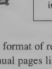

> 你可以在主目录中的 Xdefaults 文件中使用 X11 资源字符串。所选 KDE 客户端的资源和配置设置存储在主目录中的 .kde/share/config 目录中。

资源字符串的格式在 X 手册页中定义，但许多 X11 客户端手册页列出了不同资源的示例，针对特定客户端。例如，如果查看 xpaint 绘图程序主工具箱的资源设置（包含在 /usr/X11R6/lib/X11/app-defaults 目录下的 Xpaint 文件中），你会看到以下值：

```
...
!
! The top level operation/toolbox menu
!
XPaint.width:        232
XPaint.height:       350
...
```

这些值告诉 xpaint 客户端绘制一个垂直工具箱。如果你想要水平工具箱，可以调整工具箱大小，注意窗口管理器在调整大小操作期间显示的尺寸，并使用新设置更改其默认资源设置文件中的工具箱初始大小，例如：

```
...
! The top level operation/toolbox menu
!
XPaint.width:        702
XPaint.height:       122
...
```

有关 X 资源详细信息，请参阅 X 手册页。有关不同客户端资源详细信息，请参阅程序手册页或其他文档。


请确保你的更改反映了你所支持的屏幕尺寸，否则程序可能会在屏幕外启动或窗口过大而无法使用。始终使用感叹号字符作为注释，并且如果编辑默认的或原始应用程序资源文件，请先将原始设置复制到注释行。

## 更改 X11 鼠标和光标模式

使用 X11 时，你可能想要更改鼠标的工作方式或交换鼠标按钮的顺序。这对于左撇子用户特别有用，或者当鼠标的响应与期望设置不同时。你还可以更改窗口管理器使用的光标类型。

要更改根窗口光标，你需要知道有哪些光标可用。例如，你可以在 /usr/X11R6/include/X11 目录下的 cursorfont.h 文件中找到光标列表：

```
#define XC_exchange 50
#define XC_fleur 52
#define XC_gobbler 54
#define XC_gumby 56
#define XC_hand1 58
#define XC_hand2 60
#define XC_heart 62
#define XC_icon 64
...
```

如你所见，此文件中列出了许多类型的光标。了解这些不同类型的光标后，使用 xsetroot 客户端，或根窗口实用程序，来设置你的根光标图像，例如：

```
# xsetroot -cursor_name hand1
```

这会将根光标更改为看起来像一只右指向的手的样式。如果你是左撇子，你可能想要使用左指向的 hand2 光标！

查看所有光标的一个简单方法是使用位于 /usr/X11R6/bin 目录下的 xfd，或 X11 字体显示，客户端。使用 -fn 命令行选项，xfd 客户端会显示位于 /usr/X11R6/lib/X11/fonts/misc 目录中的光标字体 cursor 的整个字符集。

如果你觉得左右鼠标按钮不方便，可以使用 xmodmap 客户端（它也可以更改键盘键）来更改鼠标上这些按钮的顺序。例如，要反转鼠标按钮的顺序，可以尝试以下操作：

```
# xmodmap -e "pointer 3 2 1"
```

这个来自 xmodmap 手册页的示例可以帮助左撇子用户。


> xmouseconfig 客户端是 XFree86 的 XF86Config 设置程序的一部分，是一款图形化鼠标配置实用工具。然而，它不会重新排序鼠标按钮，并且你必须以 root 操作员身份运行该客户端才能保存任何更改。

你还可以使用 xset，或用户偏好，客户端来自定义其他鼠标设置。例如，如果你想加快鼠标加速，或它在屏幕上移动的速度，可以尝试以下设置：

```
# xset m "40 4"
```

如果对你来说太快了，请尝试以下设置：

```
# xset m "4 8"
```

尝试不同的设置。你可以使用 xset m "0 1000" 命令行真正减慢鼠标速度。查看 xset 客户端手册页，了解可以更改的其他 X11 设置，并看看其中一些是否适用于你的系统。

## 如何在 X11 中复制和粘贴

在 X11 中复制和粘贴信息涉及在终端窗口之间传输文本或从一个 X11 客户端到另一个客户端传输图形。例如，你可以使用 xmag 程序选择桌面的一部分，然后将复制的图形粘贴到打开的 xpaint 绘图窗口中（参见第 16 小时，“图形工具”）。要执行此操作，首先运行 xmag 客户端。你会看到一个小角落光标。如果你点击想要放大的屏幕区域，xmag 客户端会在窗口中显示所选内容。然后将光标移动到 xpaint 窗口，进入文件菜单，选择新建画布。然后启动 xmag 客户端。你会看到一个小角落光标。如果你点击想要放大的屏幕区域，xmag 客户端会在窗口中显示所选内容。然后将光标移动到 xpaint 窗口，进入编辑菜单，选择粘贴。你的所选图形将被粘贴到 xpaint 窗口中。


> 使用 KDE 的复制和粘贴操作则大不相同。KDE 感知的应用程序完全支持使用每个客户端编辑菜单中的复制和粘贴菜单项进行复制和粘贴操作。

如果你在一个窗口中运行文字处理器，在另一个终端窗口中运行命令行，你可以在窗口之间复制和粘贴文本。xterm 和 rxvt 终端都支持使用鼠标光标和鼠标按钮进行复制和粘贴操作。要复制文本，首先必须高亮所需文本。如果你只想要一个词，用左鼠标按钮双击该词。如果你想要一行文本，三击该行。如果你想要超过一个词或一行，则需要高亮文本区域。

终端窗口中的文本区域可以通过两种方式选择（取决于你的 X 终端客户端的功能）。将光标移动到文本的开头或结尾，然后按住左鼠标按钮向上或向下拖动以高亮所选文本。你也可以用左鼠标按钮点击文本开头，然后按住 Shift 键点击文本结尾以高亮选择。

高亮文本后，也有两种方法将选择内容粘贴到另一个窗口。一种方法是在目标窗口中点击，按住 Shift 键并按下 Insert 键。另一种方法是在窗口中点击，然后按下中间鼠标按钮（如果你使用双按钮鼠标来模拟三个按钮，也可以同时按下左右鼠标按钮）。

xcutsel 客户端也可以在窗口之间复制。运行此客户端时，你会看到两个名为 Copy PRIMARY to 0 和 Copy 0 to PRIMARY 的按钮。要从一个窗口复制文本到另一个窗口，首先在一个窗口中高亮文本。然后点击 Copy PRIMARY to 0 按钮。然后你可以点击 Copy 0 to PRIMARY 按钮，移动到想要粘贴文本的窗口，并使用键盘或鼠标粘贴文本。

另一个用于复制和粘贴文本的 X11 客户端是 xclipboard 客户端。此程序特别适用于从消息、常见问题解答、HOWTO 或其他文件中复制文本段落。像 xcutsel 客户端一样，xclipboard 将复制的文本放入缓冲区，但额外好处是它会显示文本，你可以将其保存到文件或复制到其他窗口或程序中。

如果你想要做的不只是复制少量图形或文本，你还可以捕获整个窗口或桌面的图片。下一节将向你展示如何捕获、保存和显示来自 X11 桌面的图片。

## 捕获和转储 X11 窗口

你可以使用 X11 附带的几个 X11 客户端来捕获窗口或整个桌面的图片。第一个是 xwd，或 X11 窗口转储程序。你可以使用此客户端拍摄屏幕或任何所需窗口的快照。

xwd 程序易于使用。你需要重定向输出或在命令行上指定文件，因为如果不这样做，文件将被发送到标准输出并滚动你的终端窗口。要重定向输出，请像这样使用 xwd：

```
# xwd > mydump.xwd
```

xwd 客户端还具有 -out 选项，可用于指定输出，如下所示：

```
# xwd -out mydump.xwd
```

按下 Enter 后，你的光标会变成十字准线（+）。如果你点击根桌面，xwd 客户端会转储或捕获整个屏幕的图片。如果你点击窗口，xwd 客户端会捕获窗口的内容，即使它被隐藏或被另一个窗口覆盖。

如果想要捕获正在运行的客户端的一系列图片、展示游戏的高分或创建快速幻灯片，这很有用。捕获的文件采用 X11 窗口转储格式，你可以找到许多用于查看图像的客户端。其中之一是 xwud（X11 窗口反转储）客户端。要查看你的屏幕截图，可以使用以下命令：

```
# xwud -in mydump.xwd
```

你还可以使用位于 /usr/X11R6/bin 目录下的 xloadimage 客户端创建图像幻灯片。例如，如果你创建了一系列屏幕转储，可以使用以下命令构建屏幕截图的循环幻灯片：

```
# xloadimage -fit 1.xwd 2.xwd 3.xwd -goto 1.xwd
```

使用此命令行，你可以通过按键盘上的 N 字符反复翻阅转储文件，或按键盘上的 Q 字符退出。xloadimage 客户端具有许多功能，还可以将屏幕转储文件保存为不同的图形文件格式。有关更多信息，请参阅 xloadimage 手册页。

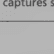

> 你的 OpenLinux CD-ROM 上包含许多其他图形实用工具。参见第 16 小时，了解有关绘图和绘画程序、图形转换实用工具以及其他图像查看器的概述，例如 xv 客户端，它不仅可以捕获屏幕截图，还可以编辑、转换、保存和打印图形。


## 自定义 X11 根窗口和使用屏幕保护程序

如果您使用的是彩色显示器，您可能想要更改根窗口（或桌面窗口）的默认颜色或图案。您可以使用多个 X11 客户端快速轻松地完成此操作。我还将向您展示如何在背景中放置图片以及如何在 X11 中设置和使用屏幕保护程序。

### 设置背景颜色

您可以使用 xsetroot（或根窗口实用程序）更改显示器的背景颜色，该实用程序位于 /usr/X11R6/bin 目录下。正如我之前提到的，您的颜色选择取决于 X11 服务器的颜色深度。如果您使用的是 SVGA 服务器，您可以选择 256 种颜色。例如，您可以使用以下命令更改颜色：

```
# xsetroot -solid red
```

### 设置背景图案

如果纯色对眼睛太刺眼或太单调，您也可以使用 /usr/include/X11/bitmaps 目录中近 90 种不同的位图图形文件之一来设置桌面图案。例如，要为桌面获得红色柳条编织图案，请使用以下命令：

```
# xsetroot -bitmap /usr/include/X11/bitmaps/wide_weave -bg red
```

此命令行告诉 xsetroot 客户端从 X11 位图图形目录加载位图图形文件 wide_weave 并以背景颜色显示图案。如果您使用的是单色显示器，那么在颜色方面您就无能为力了。但您可以使用不同的位图文件更改背景显示的图案和明显色调。尝试 dimple1、dimple3 或 flipped_gray 位图文件。

### 在根显示上显示图片

许多用户喜欢在根窗口中显示喜爱的图片。如果您有一张扫描的喜欢的照片或喜欢的图形，您可以使用 xsetroot 客户端在桌面上显示图像，但图像必须采用 X11 位图格式。

您可以使用之前已讨论过的客户端——xloadimage。例如，使用 -supported 命令行选项查看 xloadimage 客户端识别哪些图形文件格式：

```
# xloadimage -supported
Type Name Can Dump Description
```

| 格式 | 支持 | 描述 |
|---|---|---|
| niff | 是 | 原生图像文件格式 (NIFF) |
| sunraster | 否 | Sun 栅格文件 |
| gif | 否 | GIF 图像 |
| jpeg | 是 | JFIF 风格 JPEG 图像 |
| fbm | 否 | FBM 图像 |
| cmuraster | 否 | CMU WM 栅格 |
| pbm | 是 | 便携式位图 (PBM, PGM, PPM) |
| faces | 否 | Faces 项目 |
| rle | 否 | 犹他 RLE 图像 |
| xwd | 否 | X 窗口转储 |
| vff | 否 | Sun 可视化文件格式 |
| mcidas | 否 | McIDAS 区域文件 |
| vicar | 否 | VICAR 图像 |
| pcx | 否 | PC Paintbrush 图像 |
| gem | 否 | GEM 位图像 |
| macpaint | 否 | MacPaint 图像 |
| xpm | 否 | X 像素图 |
| xbm | 否 | X 位图 |

xloadimage 可使用的文件格式列在左列中。如果您有想要显示的图形，可以使用以下命令：

```
# xloadimage -onroot cathy.gif
```

这将加载图形文件 cathy.gif 并（根据其大小）以平铺或多视图格式显示它。如果您只想在根显示中显示图形的一个大版本，请使用 -fullscreen 命令行选项，例如：

```
# xloadimage -onroot -fullscreen cathy.gif
```

这会导致 xsetroot 命令加载图形并缩放以适应显示。您需要尝试不同大小的图形以获得最佳效果。

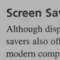

> xv 客户端也可以用于在根显示中放置图像。如果您使用 KDE，请将您喜欢的图像以 JPEG 格式保存在 /opt/kde/share/wallpapers 目录中。然后，您可以使用 KDE 控制中心的“桌面背景”对话框将图像选为其中一个桌面的默认壁纸。

### 屏幕保护程序设置和程序

尽管在桌面上显示彩色图案或图片很有趣，但 X11 屏幕保护程序还提供密码控制。即使屏幕保护程序不再需要保护现代计算机显示器免受持续显示的“烙印”效应，它们仍然很有趣，您可以在 X11 中找到各种有趣的屏幕保护程序。


> KDE 用户可以使用 KDE 控制中心的“桌面屏幕保护程序”对话框来控制屏幕保护。

使用前面介绍的 xset 客户端在 X11 下管理屏幕保护。如果您想查看当前设置，请使用 q 命令行选项（请注意没有使用连字符），例如：

```
# xset q
```

```
Screen Saver:
prefer blanking: yes  allow exposures: yes
timeout: 0    cycle: 600
```

您可以使用 s 命令行选项，后跟单词 on，通过 xset 客户端打开屏幕保护。要以秒为单位设置时间，请使用 s 选项，后跟您希望 X11 服务器等待空白屏幕的秒数，例如：

```
# xset s 10
```

这将超时间隔设置为 X11 屏幕保护程序激活前 10 秒（仅用于测试屏幕保护）。要启用内置于 X11 服务器中的屏幕保护程序，请使用 s 选项并加上单词 on，例如：

```
# xset s on
```

10 秒后，X 显示空白屏幕。如果您想看到图形和背景图案，可以对 xset s 命令行选项使用 noblank 选项，例如：

```
# xset s noblank
```

如您所见，屏幕上显示了一个大 X。要关闭屏幕保护，请使用 s off 命令行选项（如果您使用 xset，请不要忘记将屏幕保护间隔更改为更合理的值，例如 600 代表 10 分钟）。如果这不是您心目中的屏幕保护程序，您可以尝试 xscreensaver 客户端。

由 Jamie Zawinski 编写的 xscreensaver 和 xscreensaver-command 客户端位于 /usr/X11R6/bin 目录下。xscreensaver 客户端有 16 个命令行选项。虽然本章不涵盖所有选项，但使用此屏幕保护程序的基本方法是首先在后台运行 xscreensaver 客户端，如下所示：

```
# xscreensaver -timeout 5 &
```

此命令将屏幕保护程序设置为在五分钟无键盘或鼠标活动后运行。您可以使用 xscreensaver 命令客户端控制此客户端以打开或关闭 xscreensaver 或立即激活它。虽然 xscreensaver 客户端具有 -lock 选项可对显示进行密码保护，但您必须重新编译程序才能启用此功能。

xscreensaver 客户端附带近二十四种不同的屏幕保护程序，它们也可以作为独立程序运行。例如，您可以在窗口中按如下方式运行分形绘图程序 hopalong：

```
# hopalong
```

按下 Enter 后，分形图像会出现在窗口中（如图 7.9 所示），以便您可以看到它的外观。

### 图 7.9

hopalong 客户端是 X11 屏幕保护程序的一部分。

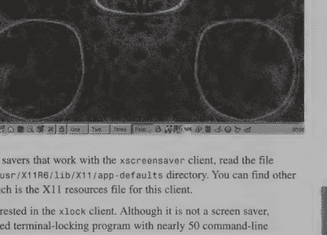

要获取与 xscreensaver 客户端配合使用的屏幕保护程序列表，请阅读 /usr/X11R6/lib/X11/app-defaults 目录中的文件 XScreenSaver。您可以在该文件中找到其他设置，该文件是此客户端的 X11 资源文件。

您可能也会对 xlock 客户端感兴趣。虽然它不是屏幕保护程序，但 xlock 是一款功能强大的终端锁定程序，具有近 50 个命令行选项和 50 多种内置显示。xlock 客户端在您想通过密码保护显示以防止他人在您离开时使用计算机时很有帮助。

默认情况下，在您启动 xlock 程序后，必须在再次使用显示之前输入密码。您可以在不使用密码保护的情况下将其用作简单的屏幕保护程序来显示各种动画，例如：

```
# xlock -duration 10 -nolock -mode random
```

此命令行告诉 xlock 程序显示其动画的随机选择，每个动画运行 10 秒。


> 如果您使用 -inroot 命令行选项，xlock 客户端也可以使您的桌面成为动画显示。这不会保护您的系统，但您可能会觉得视觉效果很刺激！

## 探索 X11 程序

本小时没有足够空间讨论 CD-ROM 上的所有 X11 客户端。您可以在本书其余部分找到有关不同客户端的讨论，但本节向您展示了一些有用的程序，它们可以提供有关系统的更多信息以及使用它们的技巧。

### 使用 xlsfonts 列出 X11 字体

如果您想要一份系统上 X11 识别的所有字体的列表，可以使用 xlsfonts 客户端。如果不带任何选项调用客户端，请使用 less 或 more 等分页器（在第 4 小时“阅读和导航命令”中讨论）。您还可以使用通配符或模式匹配字体名称。这在查找系统上的特定字体时非常方便，例如：

```
# xlsfonts -fn "*italic*"
lucidasans-bolditalic-10
lucidasans-bolditalic-10
lucidasans-bolditalic-12
lucidasans-bolditalic-12
lucidasans-bolditalic-14
lucidasans-bolditalic-14
lucidasans-bolditalic-18
lucidasans-bolditalic-18
lucidasans-bolditalic-24
lucidasans-bolditalic-24
lucidasans-bolditalic-8
lucidasans-bolditalic-8
lucidasans-italic-10
lucidasans-italic-12
```


```
lucidasans-italic-12
lucidasans-italic-14
lucidasans-italic-16
lucidasans-italic-18
lucidasans-italic-18
lucidasans-italic-24
lucidasans-italic-24
lucidasans-italic-8
lucidasans-italic-8
```

正如您所见，这列出了 X11 服务器上已安装或识别的所有斜体字体。您可以使用 xlsfonts 客户端来排查字体是否被识别或已安装，或在启动客户端时查找字体名称以作为 X Toolkit 选项。

## 使用 xwininfo 客户端获取窗口信息

您可以使用 xwininfo 客户端，或窗口信息实用程序，来获取有关窗口的有用信息。使用此命令时，您可以点击另一个窗口以获取详细的信息列表，例如：

```
# xwininfo
xwininfo: Please select the window about which you
would like information by clicking the
mouse in that window.
```

点击所需窗口后，您会看到信息列表，例如以下内容：

```
xwininfo: Window id: 0xc00002 "rxvt"

Absolute upper-left X: 8
Absolute upper-left Y: 397
Relative upper-left X: 0
Relative upper-left Y: 0
Width: 574
Height: 158
Depth: 8
Visual Class: PseudoColor
Border width: 0
Class: InputOutput
Colormap: 0x21 (installed)
Bit Gravity State: ForgetGravity
Window Gravity State: NorthWestGravity
Backing Store State: NotUseful
Save Under State: no
Map State: IsViewable
Override Redirect State: no
Corners: +8+397 -218+397 -218+45
-geometry 80x11+3+40
```

此信息很有帮助，例如，如果您想获取下次运行程序时窗口几何设置的相关规范，或者如果您想通过编辑其资源文件来更改窗口的默认行为。

## 使用 xmessage 客户端制作便签日历

xmessage 客户端由 Chris Peterson 和 Stephen Gildea 创建，是在工作时创建快速笔记作为提醒的一种便捷方式。这个看似简单的客户端易于使用。例如，如果您想快速记录一个电话号码，可以使用以下命令：

```
# xmessage "George called at 10:15; call him back at 555-1212" &
```

此命令行会显示带有您消息文本的 xmessage 客户端窗口。虽然这是一个简单的示例，但您也可以使用 xmessage 客户端来显示程序搜索的输出，或在个人日程中使用它，在工作时自动发送提醒。有关详细信息，请参阅第 18 小时“个人生产力工具”或第 24 小时“使用调度自动化系统管理”。

您还可以使用 xmessage 作为便捷的日历显示程序，如果您需要在屏幕上保留当前日历的副本，或在启动 X 会话时希望桌面上显示日历。您找不到 cal 日历程序的简单 X11 版本，但这里有一个可用版本：

```
# cal | xmessage -file "-" &
```

这会在正方形的 xmessage 客户端窗口中显示 cal 日历程序的输出。


> 您可以在 /usr/X11R6/bin 目录下找到 ical X11 客户端，但这是一个具有更大日历显示的个人调度实用程序。有关详细信息，请参阅第 18 小时。

## 使用 X11 时钟保持时间

如果您是习惯看钟的人，使用 X11 时您很幸运，因为可以找到多个时钟。您一定能找到喜欢的一个。


> 不幸的是，通常随 rxvt 终端一起提供的 rclock 客户端未包含在 OpenLinux 中。此客户端远不止一个时钟；它是一个约会日历和邮件通知程序，如以下示例所示：
> 
> `# rclock -bg red -fg yellow -update 1 -geometry 80x80+718+0 &`
> 
> 此命令行在 800x600 桌面的右上角放置一个带黄色指针（使用 -update 1 选项创建秒针）的正方形红色时钟。主目录中名为 .rclock 的文件用于创建自动提醒。rclock 客户端会在指定时间弹出提醒消息，并可在特定时间运行程序（它每 10 分钟检查一次文件；当邮件到达时，rclock 会反转其显示）。请在您喜欢的 Linux 归档网站上查找此客户端！

xclock 客户端默认以标准钟面显示时间，但您可以使用 -digital 选项使 xclock 看起来像数字时钟。您还可以控制标准时钟指针的颜色或为整点和半点添加报时，例如：

```
# xclock -chime -hd red -hl red -update 2 -geometry 80x80 -bg yellow
```

此命令显示一个 80x80 像素的报时 xclock，黄色表盘，红色指针和扫秒秒针。如果您想要数字版本，可以使用以下命令：

```
# xclock -chime -update 1 -digital -bg yellow
```

此命令显示一个带黄色背景的数字报时时钟。如果您喜欢数字时钟，您可能也会喜欢 xdaliclock 客户端，它使用动画显示数字，并且有许多选项可以控制显示中使用的数字、颜色、形状或字体，例如：

```
# xdaliclock -24 -cycle -font 9x15 -transparent -geometry +697+3
```

此命令在 800x600 显示器的右上角显示一个透明的数字时钟，数字呈融化状且颜色不断变化。如果您点击数字显示，当前的日、月、年会短暂显示。

## 摘要

本小时介绍了与 X Window System 相关的众多初始主题，例如启动、使用不同的颜色深度、在虚拟控制台之间导航以及启动多个 X11 显示。然后您发现了 X11 的多个窗口管理器，了解了如何配置和管理 X11 桌面，并学习了文本和图形的复制粘贴操作。最后，您被介绍了一些有用的 X11 实用程序和客户端，以使您的 X 会话更轻松。

#### 问答

Q 我仍然无法让 X11 与我的计算机的显卡和显示器一起工作！我该怎么办？

A 如果您有一块麻烦的显卡（这通常发生在最新设备上），请尝试从 MetroLink, Inc. (http://www.metrolink.com) 或 Xi Graphics, Inc. (http://www.xig.com) 等供应商处使用适用于 OpenLinux 的商业 X11 发行版。您可能可以获得对新卡的更好支持。

Q 使用 X11 最好的窗口管理器是什么？

A 这是一个宗教问题，超出了本书的范围。检查不同窗口管理器的一个好网站包括 http://www.PLIG.org/~xwinman/ ，您可以在那里找到至少 40 个 X 的不同 GUI 的链接。

Q X11 有多少种不同的窗口管理器？

A 比您想在计算机上安装的还要多！超过 100 个。例如，如果您希望桌面看起来像 Apple Macintosh，请尝试 mlvwm 窗口管理器：http://www.bioele.nuee.nagoya-u.ac.jp/member/tak/mlvwm.html

Q 嘿！您没有提到 GNU 的网络对象模型环境！怎么回事？

A 在撰写本文时，GNU GNOME 的开发进展相当迅速。与 KDE 一样，GNOME 的开发旨在为所有版本的 Linux 提供高质量的环境和界面支持。KDE 包含在 OpenLinux 中，并且在 GNOME 最新发布之前就已建立了日益增长的流行度和追随者。您可以通过浏览 http://www.gnome.org 了解更多关于 GNOME 的信息。

#### 练习

- 1. 使用 xmessage 客户端创建您自己的信息显示。应该显示什么类型的信息？
- 2. 下载并安装一个不同的窗口管理器。它有什么不同？窗口是如何处理的，它们看起来如何？
- 3. 请参阅第 18 小时，了解有关使用 crontab 命令的信息。此命令如何用于配置您的 X11 显示以模拟环境光条件？

## 第 8 小时

### 探索 K 桌面环境

在本小时中，您将了解 X Window System 的最新桌面环境之一。虽然 X11 有超过 50 种不同的窗口管理器，每个都有不同的主题、桌面颜色和装饰（例如窗口控件），但 K 桌面环境，或 KDE，在 OpenLinux 用户中享有至高无上的流行度。您会特别喜欢 KDE，因为 Caldera Systems, Inc. 特别努力配置 KDE 的桌面以匹配 OpenLinux 发行版中的程序。

本小时将帮助您学习如何克服配置 KDE 的挑战，我想您很快就会同意——KDE 易于使用！由于使用 X11 选择和使用窗口管理器是个人偏好的问题，本小时将向您展示如何使用 KDE 控制中心配置 KDE 以更改不同的设置，例如根显示的背景、字体、鼠标和键盘，以及窗口装饰（例如标题栏、滚动条和按钮）的外观。


KDE 具备了一些商业软件库（如 Motif）以及现已逐渐衰落的通用桌面环境（Common Desktop Environment，简称 CDE，或仅由一家厂商 Xi-Graphics 为 Linux 提供）所共有的最新和最复杂的功能。这些功能包括：

- 文件和设备的拖放操作（如复制、移动和删除）
- 通过点选对话框配置桌面以显示颜色、窗口边框和主题
- 程序和其他数据以图标形式表示在桌面或窗口中，并带有文件夹图标
- 对系统键盘、鼠标和声音的图形化配置
- 单击即可方便地编辑文件、查看图形或启动应用程序
- 桌面回收站以实现更安全的删除文件
- 几乎所有桌面操作和 KDE 客户端的弹出菜单和内置帮助
- 网络透明访问（Network Transparent Access，简称 NTA），因此您可以单击 FTP 列表中的图形文档，让计算机上的程序自动下载并显示该图形
- “Sticky Buttons”（粘性按钮）可将应用程序或窗口置于每个桌面上
- 用于根显示背景壁纸图形的 JPEG 图形格式
- 会话管理，因此打开的应用程序和窗口位置在会话之间会被记住（如 CDE）
- 一套个人生产力工具，如磁盘和网络实用程序，旨在利用桌面界面并能够将数据导入和导出到其他工具


> KDE 不仅仅是一个 X11 窗口管理器；它是一个完整的环境，并附带超过 100 个具有一致界面的客户端。每个客户端通常都有“文件”和“帮助”菜单，因此您可以轻松打开文件、退出或获取帮助。评论家赞同这种相似性，而一些用户则更喜欢其他 X11 窗口和客户端管理。幸运的是，由于您使用的是 OpenLinux，选择权在您手中！

## 启动 KDE

默认情况下，您在登录 kdm（或 KDE 显示管理器登录）后启动 KDE。但是，如果您已禁用登录管理器，您应该知道还有另一种启动 KDE 的方法。当您在没有 X11 的情况下登录 OpenLinux 控制台时，您会看到以下提示：

您可以使用 'startx' 启动 X11 或使用 'kde' 启动 KDE。

这是正确的，但如果您已使用 xf86config 命令配置了 X11，并且只是输入 kde 然后按 Enter，您的 KDE 和 X 会话将仅使用 256 种颜色（或 8 位像素深度）启动。要使用更大的颜色深度，请使用 -- -bpp（或每像素位数）选项启动 X 会话。例如，要以数千种颜色启动 KDE，请输入 kde，然后跟上 -bpp 选项，如下所示：

```
# kde -- -bpp 16
```

如果您足够幸运，拥有支持数百万种颜色的显卡，请尝试

```
# kde -- -bpp 24
```

或

```
# kde -- -bpp 32
```


> 可用的颜色深度在 /etc 目录下的 XF86Config 文件中定义。请在 Screen 部分的 Display 子部分中查找 Depth 设置。如果您通过编辑 XF86Config 配置了 X11，请使用井号（#）字符注释掉较低颜色深度的设置。另一种方法是使用 Screen 部分中的 DefaultColorDepth 选项，后跟 8、15、16、24 或 32。然后您只需输入 kde 即可以更高的颜色深度启动 X11。有关配置 X11 的详细信息，请参阅第 3 小时“配置 X Window 系统和 OpenLinux。”


当您使用 xdm 登录 Linux 并运行 X11 时，您可能会发现无法从终端窗口以 root 操作员身份运行程序。这是因为您必须使用 xhost 命令暂时将计算机的主机名添加到 X 服务器的访问列表中。要做到这一点，您可以使用以下公式：`xhost + localhost; su -c "rootcommand"`，其中 rootcommand 是您希望以 root 操作员身份运行的命令的名称（如控制面板或 printtool）。之后，使用 `xhost - localhost` 移除访问权限以保护系统的安全。

## KDE 桌面的功能

如本小时开头所述，KDE 具有现代图形计算机界面所期望的许多功能。KDE 在这些功能的基础上提供了一种易于使用的方式来处理文件，以便您在 X 会话期间更具生产力。本节重点介绍了使用 KDE 桌面时可以完成工作的一些方法。

## 执行基本桌面操作

当您首次启动 KDE 时，您会看到 kfm（或 K 文件管理器）窗口以及根显示（或桌面），如图 8.1 所示。

KDE 桌面由几个元素组成：显示顶部横跨的任务栏、根背景（或根显示）以及屏幕底部沿的桌面面板。在面板中，从左侧开始是应用程序启动按钮（大写的“K”），后面跟着代表不同应用程序、文件夹和目录的几个图标。有四个按钮代表默认的四个虚拟桌面或显示，后面还有更多应用程序图标。（您可能会看到 CriSPlite 编辑器、Netscape、BRU-2000、KDE 帮助和 Kcalc 计算器的图标。）

### 图 8.1

KDE 桌面是您在 X 会话期间体验点选便利性的介绍，具有任务栏、根显示区域、带弹出菜单和客户端按钮的面板以及主目录。

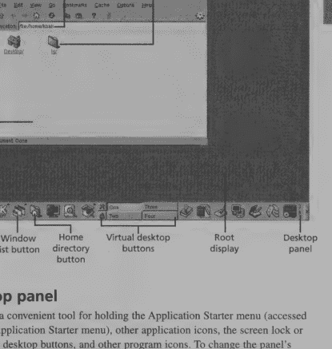

### 使用桌面面板

面板用作方便的工具，用于保存应用程序启动菜单（在您单击应用程序启动菜单时访问）、其他应用程序图标、屏幕锁定或注销按钮、虚拟桌面按钮和其他程序图标。要更改面板的大小或方向，请单击应用程序启动按钮，选择 Panel 然后单击 Configure。

会出现一个对话框，如图 8.2 所示，您可以从中选择不同的设置。完成后，单击 Apply，然后单击 Cancel 按钮。

如果您想更改面板上图标的放置或排列方式，请右键单击所需图标，然后从小型弹出菜单中选择 Remove（删除该项目）或 Move。如果您单击 Move，您可以将图标拖动到面板上的不同位置。如果面板在 KDE 会话期间妨碍了您，请单击面板最左侧的小按钮暂时将面板从屏幕上隐藏。要恢复面板，请再次单击该小按钮，面板将重新出现。

### 图 8.2

面板配置对话框使您可以更改面板和任务栏的外观以及它们在桌面上的放置位置。

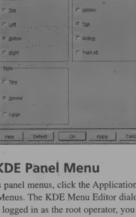

### 编辑 KDE 面板菜单

要编辑桌面的面板菜单，请单击应用程序启动按钮，选择 Panel，然后单击 Edit Menus。KDE 菜单编辑器对话框将出现，如图 8.3 所示。如果您以 root 操作员身份登录，您可以使用拖放来移动菜单列表中的项目或使用 Empty 菜单项创建项目，从而更改和编辑面板菜单上的菜单项。

> 如果您以普通用户身份登录，您只能更改您有权限的菜单项。如果您右键单击 KDE 面板项，您会看到消息“I PROTECTED Button !”。但是，您可以编辑桌面面板上的单个 applink 菜单项。您可以向此菜单添加几乎任何其他命令或客户端。

例如，要创建新的菜单项，请右键单击 Empty 菜单项，然后选择 New。会出现一个新的 Empty 菜单项。右键单击新的 Empty 菜单项，然后单击 Change，kmenuedit 对话框将出现，如图 8.4 所示。填写必填字段，并为菜单项选择大图标和菜单图标。完成后，单击 Ok 保存更改。现在您可以将新项目拖放到面板菜单层次结构中的任何位置。

### 图 8.3

面板菜单编辑器使您可以向面板的菜单中添加或删除菜单项。


### 图 8.4

kmenuedit 对话框用于创建或编辑面板菜单中的新单个菜单项。


## 使用 kfm 文件管理器

K 文件管理器或 kfm 是 KDE 魔法的核心。与在第 7 小时“使用 X Window 系统”中讨论的 Looking Glass 不同，此文件管理器提供了一个可用的桌面，您可以在其中拖放、多选、复制、移动或删除数据文件或程序的图标。kfm 支持的许多桌面操作在您拖动或右键单击文件图标时变得明显。


kfm 桌面，其中包括你的主目录和根显示（如图 8.1 所示），由你主目录中名为 Desktop 的目录表示。如果将文件拖到此文件夹，文件的图标会出现在你的根显示上。同样，如果将文件从其他文件夹或目录拖到桌面，它会出现在你的 Desktop 目录中。

## 使用 KDE 控制中心配置 KDE

KDE 控制中心是通过它可以更改桌面众多设置、获取系统信息（如当前已挂载的设备和容量），或（如果以 root 操作员身份登录）为所有用户配置和控制 KDE 的外观、背景、字体和会话的主要对话框。

点击桌面面板上的“应用程序启动器”按钮，然后点击 KDE 控制中心以显示控制中心对话框。主对话框出现，如图 8.5 所示。

图 8.5
KDE 控制中心对话框可访问系统 KDE 会话的许多不同控件。


## 使用显示管理器选项

在控制中心的下拉菜单中点击“应用程序”，然后点击“登录管理器”以更改 KDE 显示管理器的设置。你必须以 root 操作员身份登录才能访问控制中心的这一部分。登录管理器对话框如图 8.6 所示，可让你更改启动 OpenLinux 时 kdm 对话框的外观。

图 8.6
使用登录管理器对话框更改 kdm 的登录屏幕和其他设置，例如允许登录的 X 窗口管理器类型和数量或用户。


通过点击对话框顶部的不同标签，你可以更改 kdm 登录屏幕的许多不同功能：

- Appearance — 登录对话框中使用的问候字符串、标志、窗口样式和语言
- Background — 壁纸、背景颜色以及壁纸图像的平铺方式
- Fonts — 问候字体
- Sessions — 允许的关机类型、从 kdm 关机或重启 OpenLinux 使用的命令，以及登录后 X 会话使用的“会话”或窗口管理器的类型
- Users — 允许登录的系统用户、用户列表是否排序，以及每个用户使用的图标（可以用扫描的照片替代！）

例如，要控制哪些用户允许直接登录到 OpenLinux 的 X，请在登录管理器对话框中点击“用户”标签。用户对话框出现，如图 8.7 所示。要有选择地控制用户登录，请点击“仅显示所选用户”按钮，然后使用 >> 按钮点击并将用户添加到对话框的“所选用户”部分。

图 8.7
用户对话框可以控制谁被允许使用 X 和 KDE 登录 OpenLinux。


要控制是否任何人可以从 kdm 登录屏幕重启或关机 OpenLinux、系统关机或重启时的时间，以及登录后可以使用哪些窗口管理器，请点击登录管理器对话框的“会话”标签。点击图 8.8 所示的“允许关机”下拉菜单，选择谁有权停止或重启 OpenLinux。完成后，点击“应用”按钮。

图 8.8
会话对话框可以控制谁可以关机或重启 OpenLinux 以及可以使用哪些 X 窗口管理器。


## 更改桌面壁纸

KDE 附带近 150 种不同的壁纸，可用于填充根显示或桌面的背景。要配置当前桌面的壁纸，请点击下拉的“桌面”菜单，然后点击“背景”。你也可以点击桌面面板上的“应用程序启动器”按钮，选择“设置”，然后选择“桌面”，然后选择“屏幕保护程序”。

背景对话框如图 8.9 所示，可让你设置每个桌面的名称、每个桌面的颜色以及桌面是否使用壁纸。要设置不同的壁纸，请在对话框的“壁纸”部分点击“壁纸”弹出菜单，然后点击“应用”。

> KDE 壁纸是 JPEG 格式的图形文件。要增加壁纸选择或使用自己的壁纸，请以 root 操作员身份登录，并将你喜欢的图形（JPEG 格式）复制到 /opt/kde/share/wallpapers 目录。你也可以通过在背景对话框中点击“浏览”按钮，从任何 OpenLinux 目录中选择壁纸图形。

图 8.9
使用背景对话框设置桌面的名称、颜色和壁纸。


## 更改屏幕保护程序

KDE 附带 24 种不同的屏幕保护程序设置。要配置 KDE 桌面的屏幕保护程序，请在 KDE 控制中心从“桌面”下拉菜单点击“屏幕保护程序”。你也可以点击桌面面板上的“应用程序启动器”按钮，然后选择“设置”，然后选择“桌面”，然后选择“屏幕保护程序”。

屏幕保护程序对话框如图 8.10 所示，具有多种设置，例如屏幕保护程序的类型、激活屏幕保护程序前的延迟时间，以及是否需要密码才能返回工作。更改后，点击“应用”按钮，然后点击“确定”关闭对话框。

> 在屏幕保护程序对话框中的示例显示的不同角落右键单击以设置自动屏幕保护或屏幕锁定！会出现一个小的弹出菜单，你可以为每个角落选择“保存屏幕”或“锁定屏幕”。例如，如果将示例显示的左下角设置为开始屏幕保护，下次将鼠标指针移动到显示器的左角（并停留一秒）时，屏幕保护将开始。

图 8.10
屏幕保护程序对话框具有不同的设置，可用于测试屏幕保护程序、设置延迟时间或要求密码。


## 更改默认字体

KDE 还可为菜单、按钮、面板或面板的时钟使用不同的字体。要设置 KDE 桌面的字体，请点击桌面面板上的“应用程序启动器”按钮，选择“设置”，然后选择“桌面”，然后选择“字体”。你也可以从“应用程序启动器”菜单点击 KDE 控制中心，然后点击“桌面”，然后点击“字体”。

字体对话框如图 8.11 所示，显示不同桌面字体的列表以及字体的弹出菜单。首先，点击一种显示项类型，例如“面板时钟字体”，然后选择字体、字体样式（如粗体或斜体）和大小。对话框的示例文本区域会发生变化。要使更改生效，请点击“应用”按钮，然后点击“确定”关闭对话框。

图 8.11
KDE 字体对话框可让你更改菜单、按钮或桌面面板时钟使用的字体。


## 安装系统声音

在 KDE 控制中心点击“声音”下拉菜单，然后点击“系统声音”以配置 KDE 在 X 会话期间使用声音。KDE 识别 28 个单独的系统事件，可为其分配声音。表 8.1 显示了当前支持的事件列表，例如打开或关闭窗口。要让 KDE 在首次启动时播放声音，请在如图 8.12 所示的声音对话框中，首先点击“启用系统声音”，然后点击“启动”系统事件。接下来，将声音文件的图标拖到对话框空白的“声音”区域，然后点击“应用”按钮。下次启动 KDE 时，你会听到声音文件播放。

### 表 8.1 KDE 桌面环境系统声音事件

| 桌面元素 | 事件 |
|---|---|
| Desktop | Changing to 1-8 |
| System | Startup, Logout, Logout Message |
| Window | Activate, Open new, Close, Shade Up, Shade Down, Iconify, Deiconify, Maximize, UnMaximize, Sticky, UnSticky, Trans New, Trans Delete, Move Start, Move End, Resize Start, Resize End |


> KDE 声音必须是 WAV 格式。如果您已安装 StarOffice 5.0，则各种声音的完整目录位于 office5/gallery/Sounds 目录下。通过主目录导航到 Sounds 目录，然后将文件 Applause.wav 拖入声音对话框中，单击启动事件，然后单击应用。 下次启动 KDE 时，您会听到掌声！

图 8.12
声音对话框用于为 KDE 系统事件分配声音。


## 更改键盘和鼠标设置
在 KDE 控制中心从“输入设备”下拉菜单中单击“键盘”，以切换键盘字符重复（按住键时重复打印字符）以及每次按键是否产生按键音。 完成选择后，如图 8.13 所示，单击“应用”按钮。

图 8.13
使用键盘对话框切换键盘重复和按键音。


单击“鼠标”以更改鼠标光标在屏幕上移动的速度以及右手或左手用户的鼠标按钮顺序。 您也可以单击桌面面板上的“应用程序启动器”按钮，然后选择“设置”，然后选择“输入设备”，然后选择“键盘”或“鼠标”来访问这些设置。

图 8.14
鼠标对话框可用于使左手鼠标用户更轻松地使用 KDE 会话！


## 更改窗口按钮、属性和标题栏
单击“窗口”下拉菜单以访问“按钮”、“鼠标”、“属性”和“标题栏”对话框。 您也可以单击桌面面板上的“应用程序启动器”按钮，然后选择“设置”和“窗口”来访问这些设置。 在图 8.15 所示的按钮对话框中切换“左”、“右”或“关闭”下的每个按钮，以添加、删除或放置不同的窗口控件。

图 8.15
按钮对话框用于更改 KDE 会话期间所有窗口的外观。


在图 8.16 所示的标题栏对话框中，单击不同的按钮以更改 KDE 窗口标题栏的外观（控制诸如阴影或是否使用图片之类的元素）。 拖动“标题动画”滑块以更改 KDE 客户端窗口标题的移动速度（当标题比窗口标题栏更宽时）。 “鼠标操作”弹出菜单用于设置双击标题栏时窗口的反应。 （默认设置可能使用“窗口遮罩”效果，但在 X11 下，通常窗口会放大或缩小）

对于更复杂的窗口控制，单击“属性”以使用图 8.17 所示的“窗口”对话框，告诉 KDE 如何在桌面上移动、放置、调整大小或激活窗口。 例如，“焦点策略”部分告诉 KDE 如何使窗口处于活动状态。 默认操作是您必须单击窗口才能激活它，或使其能够接收键盘输入； 其他策略会在鼠标指针位于窗口上方时使窗口处于活动状态。

图 8.16
标题栏对话框设置 KDE 会话期间 KDE 窗口的行为和外观。


窗口下拉菜单下的鼠标对话框用于设置您希望 KDE 窗口如何响应鼠标单击。 您可以在此处找到十几种不同的鼠标操作（例如在活动窗口上单击左键、中键或右键），您可以自定义这些操作。

图 8.17
您可以使用“窗口”对话框微调 KDE 在桌面上处理窗口的方式。


## 通过桌面控制光标移动
边界对话框，您也可以通过面板的应用程序启动器菜单中的“设置”和“桌面”菜单项访问它，在控制虚拟桌面之间的光标移动时是必不可少的。 默认情况下，您必须单击桌面面板上的虚拟桌面按钮才能在桌面之间移动。 但是如果您单击“启用活动桌面边界”项，然后单击“应用”按钮，您可以通过将鼠标光标移动到当前桌面的边缘来切换到另一个桌面。

> 不想单击面板的桌面按钮或拖动鼠标在桌面之间移动？ 改用键盘！ 按 Ctrl+Tab 在桌面之间切换。 按 Alt+Tab 在当前桌面中切换（激活）窗口。

在图 8.18 所示的边界对话框中，拖动不同的滑块以设置桌面切换的时间延迟和每个桌面的敏感边缘的宽度。

图 8.18
边界对话框用于告诉 KDE 是否使用鼠标在桌面之间移动、切换速度以及何时进行更改。


## 摘要
本小时向您介绍了配置 K 桌面环境的基础知识。 有许多功能和专门为与 KDE 配合使用而定制的不同程序，而且每天都会出现更多。

#### 问答
Q KDE 安装在哪里？

A KDE 的主要部分安装在 OpenLinux 文件系统中的 /opt/kde 目录下。 各种 KDE 客户端位于 /opt/kde/bin 目录下。 每个用户在主目录中还有一个 .kde 目录，用于存储个人设置和配置。

Q 如何了解更多关于 KDE 的信息？

A 单击面板的应用程序启动器菜单上的“ KDE 帮助”项。 KDE 的文档以 HTML 编写，并由 kdehelp 客户端显示。 文档文件位于 /opt/kde/share/doc/HTML 目录下，有德语、英语、西班牙语、芬兰语、意大利语和挪威语版本。 所有帮助文件使用的语言由名为 default 的符号文件决定，该文件指向指定的语言目录。 可以通过在 KDE 控制中心的桌面设置下的语言项中更改区域设置来使用其他语言。

Q 我在哪里可以找到更多 KDE 应用程序？

A 浏览 http://www.kde.org 以获取 KDE 最新程序和应用程序套件的列表。 一个名为 K Office 的完整办公生产力程序套件（包括文字处理器和电子表格）目前正在开发中。

#### 练习
- 1. 为 WordPerfect、Applixware 或 StarOffice 等程序创建一个新的应用程序链接，然后将图标安装到桌面面板中。 （提示：阅读“ KFM 手册”使用部分了解详细信息）。
- 2. 下载、创建、扫描并编辑您喜欢的图片以用作 KDE 桌面之一的背景，然后将图片安装为您的壁纸。
- 3. 向 KDE 的系统事件添加不同的声音。
- 4. 更改面板和任务栏的方向，以为显示器提供最大的屏幕空间。


## 第三部分
### 连接外部世界
### 小时
- 9 使用通信程序
- 10 连接到互联网
- 11 配置互联网电子邮件
- 12 配置互联网新闻
- 13 互联网下载和浏览


## 第 9 小时
### 使用通信程序
在本小时中，您将学习如何使用本书 CD-ROM 上安装的程序与外部世界进行通信。 您将学习如何设置串行端口或调制解调器，配置和使用两个通信程序，以及使用 Linux 发送和接收传真。

尽管您的 CD-ROM 包含运行 Linux 通信程序所需的所有软件，但您确实需要一个串行通信端口和调制解调器才能使用 Linux 系统拨号。 我假设您熟悉调制解调器、波特率、奇偶校验或停止位等通信术语，以及如何将调制解调器连接到计算机。

### 设置和测试您的调制解调器
您的第一个任务是找到备用串行端口。 您应该能够在计算机背面找到该端口，它很可能有 9 或 25 个引脚。 如果您使用笔记本电脑，您可能有一个 9 针公串行端口、用于内部调制解调器的 RJ-11 电话插孔，或带有 RJ-11 电话插孔的 PCMCIA 调制解调器卡。

您可以通过查看设备或 /dev 目录在 Linux 中找到串行端口。 在那里定义了许多设备，例如硬盘、软盘和打印机，但您应该查找类型为 ttyS 的设备，例如：

```
# ls /dev/ttyS*
/dev/ttyS0  /dev/ttyS1  /dev/ttyS2  /dev/ttyS3
```

这些设备对应于传统定义的 DOS 串行端口（地址可能与您的计算机相似或不同），如表 9.1 所示。

表 9.1 DOS 和 Linux 串行端口及地址

| DOS 端口 | Linux 设备 | 地址 |
|---|---|---|
| COM1 | /dev/ttyS0 | 0x3F8 IRQ 4 |
| COM2 | /dev/ttyS1 | 0x2F8 IRQ 3 |
| COM3 | /dev/ttyS2 | 0x3E8 IRQ 4 |
| COM4 | /dev/ttyS3 | 0x2E8 IRQ 3 |

如果您笔记本电脑上装有 PCMCIA 调制解调器卡，则在启用这些服务并告诉 Linux 在启动时查找 PCMCIA 设备之前，您无法使用调制解调器（或其他任何 PCMCIA 设备）。 要启用 PC 卡调制解调器，请确保您以 root 操作员身份登录，然后编辑 /etc/sysconfig 目录中名为 pcmcia 的文件，使其如下所示：

```
PCMCIA=yes
PCIC=182365
PCIC_OPTS=
CORE_OPTS=
```

这告诉 Linux 安装 PCMCIA 服务。 保存文件，然后重新启动 Linux。 您的 PC 卡调制解调器（如果安装了其他 PC 卡）应在重新启动期间被识别。


> 如果您在使用 PCMCIA 设备时遇到问题，请阅读 David Hinds 的 PCMCIA-HOWTO，您可以在 /usr/doc/pcmcia 目录下找到它。如果您想要了解 Linux 对 PCMCIA 支持的最新信息，请浏览 http://hyper.stanford.edu/HyperNews/get/pcmcia/home.html
> 要下载 OpenLinux 的最新驱动程序（内核模块），请访问 ftp://csb.stanford.edu/pub/pcmcia
> 如果您在设置串口时遇到问题，请阅读 Greg Hankins 的 Serial-HOWTO，也位于 /usr/doc/HOWTO 目录下。其中对设置串口和安装故障排除有完整讨论。
> 要阅读该文档（这是一个压缩的文本文件），请使用 zless 分页器，如下所示：
> zless /usr/doc/HOWTO/Serial-HOWTO.gz

您可以通过使用 dmesg 命令检查 Linux 启动消息的部分内容来确认串口是否已启用。将 dmesg 命令的输出通过 less 分页器管道传输以显示启动消息并查找类似以下的 Serial driver 消息（完成后按 Q 键退出）：

```
# dmesg | less
```

```
Serial driver version 4.13 with no serial options enabled
ttyS0 at 0x03f8 (irq = 4) is a 16550A
ttyS3 at 0x02e8 (irq = 3) is a 16550A
```

这里复制了 dmesg 文件的一部分，以便您可以看到需要查找的内容。此处的输出表明系统具有 MS-DOS 等效的 COM1 和 COM4 串口，其 IRQ 在括号中列出。如果您看不到串行驱动程序或串口列表，则必须确保为 Linux 内核启用了串行线支持。默认情况下，OpenLinux 自带串行支持，因此这可能不是问题。

使用本节“使用通信程序拨号”中讨论的 minicom 程序与调制解调器进行交互测试。

## 使用 lisa 命令创建 /dev/modem

使用 lisa 命令设置您的调制解调器。lisa 命令在您选择调制解调器类型和调制解调器串口后创建一个符号链接 /dev/modem。确保您以 root 操作员身份运行，或使用 su - 命令，然后使用其 --modem 选项启动 lisa，如下所示：

```
# su -c "lisa --modem"
```

按 Enter 后，您会看到 lisa 对话框，如图 9.1 所示。

## 图 9.1

lisa 管理程序配置所选调制解调器。


滚动选项列表以突出显示与计算机一起使用的调制解调器类型（如今几乎所有调制解调器都兼容 Hayes），然后按 Enter。lisa 命令会要求您选择调制解调器使用的串口，如图 9.2 所示。

## 图 9.2

滚动串口列表，然后按 Enter 选择调制解调器的串口。


滚动串口列表以突出显示调制解调器的串口。按 Enter 后，lisa 会要求您选择调制解调器使用的最高速度。如果您使用的是 33.6 调制解调器，请选择 57600 bps。如果您使用的是 56K 调制解调器，请选择 115200 bps（如图 9.3 所示）。

## 图 9.3

滚动串口速度列表并按 Enter 选择调制解调器串口的最高速度。


按 Enter 后，您将被要求输入传真号码。输入传真号码并按 Enter，或直接按 Enter 完成调制解调器的配置。lisa 命令退出并从所选设备创建一个符号链接（在第 5 小时“操作和搜索命令”中讨论）到名为 /dev/modem 的文件。

您可以通过使用 ls 命令列出文件 /dev/modem 来验证此操作，如下所示：

```
# ls -l /dev/modem
```

lrwxrwxrwx 1 root root 5 Dec 29 15:43 /dev/modem -> ttyS0

> 您也可以从命令行使用 ln 命令自行创建符号链接，就像 lisa 所做的那样。例如，如果您的调制解调器连接到 COM2，请确保您以 root 身份运行，然后输入以下内容：
> 
> ```
> # ln -s /dev/ttyS1 /dev/modem
> ```
> 这会创建一个符号链接 /dev/modem，指向连接到调制解调器的串口。

## 使用通信程序拨号

本节介绍随 OpenLinux 发行版提供的两个通信程序：minicom 和 seyon。minicom 程序可以在不运行 X11 的情况下使用，也可以与 X11 一起使用。seyon 程序必须在运行 X Window System 时使用。

在 /usr/bin 目录下还有一个旧的通信程序，称为 cu。该程序不如 minicom 或 seyon 友好，但如果您有兴趣设置和尝试此程序，请阅读 cu 手册页，并务必阅读 /usr/doc/uucp 目录下的 uucp 软件文档。

## 使用 minicom 设置和拨号

minicom 程序由 Miquel van Smoorenburg 创建，位于 /usr/bin 目录下，是一个友好的通信程序，可用于拨号并连接到其他计算机或 BBS。您可以在不运行 X11 的情况下使用 minicom。如果您运行 X11，可以尝试使用也位于 /usr/bin 目录下的 xminicom shell 脚本。

> 在 X11 终端窗口的命令行中通过输入 `xminicom &` 启动的 xminicom shell 脚本可能在 OpenLinux 1.3 发行版下无法工作。但是，这里有一个可供使用的 xminicom 替代方案。以 root 操作员身份登录，然后使用您喜欢的文本编辑器（例如在第 14 小时“文本处理”中讨论的 pico）创建一个文本文件，如下所示：
> 
> ```bash
> # pico -w xminicom
> ```
> 
> -w 选项禁用换行。输入以下行：
> 
> ```bash
> xterm -bg black -fg green -cr red -n minicom -geometry 80x25
> -e minicom
> ```
> 
> 此命令行启动一个 xterm 终端，背景为黑色，文字为绿色，光标为红色，名称为 minicom，使用 80 个字符乘 25 行，并在窗口内运行 minicom 程序。如果您使用 pico，请按 Ctrl+X 保存文件。接下来，使用 chmod 命令使文本文件成为可执行程序，如下所示：
> 
> ```bash
> # chmod +x xminicom
> ```
> 
> 最后，使用相同或不同的名称将新的 xminicom 命令复制到 /usr/bin 目录。

第一次使用 minicom 时，请确保您以 root 操作员身份运行，以便设置和保存 minicom 的默认文件 minirc.dfl，该文件创建并保存在 /etc 目录中。假设您使用 X11，可以使用以下命令启动 minicom：

```
# xminicom &
```

此命令运行 xminicom 脚本并在 X11 终端窗口中启动 minicom。要获取有关如何使用 minicom 的帮助，请按 Ctrl+A，然后按 Z 键。图 9.4 显示了 minicom 帮助屏幕。

## 图 9.4

minicom 通信程序为用户提供内置帮助。


要配置 minicom，请按 Ctrl+A，然后按 O 键进入配置屏幕。向下滚动并选择 Serial Port Setup，然后按 Enter 键。然后您可以通过按 A 键输入 Serial Device。输入调制解调器连接的设备，例如 /dev/ttyS1，或如果您创建了链接，则为符号链接 /dev/modem。图 9.5 详细说明了串口设置屏幕。

## 图 9.5

通过按一个字母并输入新值来为 minicom 配置串口。


例如，要更改调制解调器的速度，请按字母 E。会出现一个新的对话框，如图 9.6 所示。要更改波特率，请按与所需波特率旁边的字母相对应的键。完成后，按 Enter 返回串行设置对话框。

## 图 9.6

*通过按一个字母为调制解调器设置新的串口速度。*


按 Enter 键，选择 Save setup as dfl，然后再次按 Enter 键，然后按 Escape 键。系统默认值应已设置。然后您可以使用以下命令尝试拨号（将 XXX-XXXX 替换为正确的电话号码）：

```
ATDTXXX-XXXX
```

此命令使用调制解调器的 AT 命令 DT，通过拨号音拨号（有关调制解调器命令的完整列表，请参阅调制解调器手册）。按 Enter 后，调制解调器会拨打电话号码。要退出程序，请按 Ctrl+A，按 X，然后按 Enter。

如果您有多个要拨号的其他计算机的电话号码，可以将它们输入 minicom 的电话目录。您还可以设置 minicom 使用不同的文件传输程序发送或检索文件。有关这些和其他功能的详细信息，请阅读 minicom 手册页。您还可以在 `/usr/doc/minicom` 目录下找到文档，其中包含使用此程序其他功能的详细说明。

## 使用 seyon X11 客户端设置和拨号

由 Muhammad M. Saggaf 编写的 seyon 通信程序仅在 X Window System 下运行，并具有广泛的功能列表。虽然 seyon 不像 minicom 那样简单或最初友好，但它具有以下功能：

- 内置帮助
- 内置电信脚本语言，用于自动拨号并登录到其他计算机系统
- 用于编写电信脚本的内置文本编辑器


-   用于运行命令的命令行 shell 对话框，其输出显示在主通信窗口中
-   用于设置调制解调器速度、奇偶校验和停止位的按钮

如果你创建了指向 /dev/modem 的符号链接，seyon 程序会自动识别并与你的调制解调器配合使用。你要做的就是输入包含拨号号码的 AT 命令字符串以拨出并连接另一台计算机。

如果你需要告诉 seyon 客户端调制解调器的具体设备，请在 seyon 命令中心窗口中单击 Set 按钮（启动客户端时会自动出现）以打开设置窗口。在设置窗口中单击 Port 按钮，并在 Values? 窗口中输入设备名称，例如 /dev/cua1。图 9.7 显示了 seyon 及其设置窗口。

## 图 9.7

X11 客户端 seyon 提供了调制解调器设置的点选便利性。


主 seyon 窗口

主 seyon 控制

帮助窗口

波特率设置

通信设置

单击 OK 按钮，然后单击设置窗口的 Close 按钮。如果你想以默认的调制解调器速度、位数或奇偶校验启动 seyon 程序，请编辑文件 $HOME/.seyon/。该目录在安装 seyon 程序时会自动安装。你可以在启动文件中更改以下行：

```
# set baud
set baud 19200

# can be 5, 6, 7, or 8
# set bits 8
set bits 8

# can be 0 (= no parity), 1 (= odd parity), or 2 (= even parity)
# set parity 0
set parity 0

# can be 1 or 2
# set stopBits 1
set stopBits 1
...
```

如果在使用 seyon 程序时需要帮助，可以在 seyon 命令中心窗口中单击 Help 按钮。会弹出一个窗口显示 seyon 手册页，你可以滚动文本以获取帮助（帮助屏幕显示在图 9.7 中）。

## 设置 Linux 系统以便拨入

你还可以设置 OpenLinux 系统，使计算机的调制解调器接听电话并允许你登录。然后你可以运行公告板系统（BBS）、文字处理器和电子表格程序。如果你至少连接了两台调制解调器到计算机并在家中有两条电话线，甚至可以拨出另一条线路。

大多数细节和自定义配置都在 /usr/doc/HOWTO 和 /usr/doc/getty_ps 目录下的 Serial-HOWTO 中，但这里概述的三个基本步骤应该适用于几乎任何调制解调器。


> 设置 OpenLinux 系统以接受来电涉及编辑 /etc/inittab 文件，如果操作有误可能会导致系统挂起。务必随身携带备份启动盘，并在更改前复制 /etc/inittab 文件。

首先，以 root 操作员身份登录并运行 minicom。使用 AT 命令 &V 显示调制解调器的配置文件或默认设置，例如：

```
AT&V
ACTIVE PROFILE:
B1 E1 L1 M1 N1 Q0 T V1 W0 X4 Y0 &C1 &D2 &G0 &J0 &K3 &O5 &R1 &S0 &T5 &X0 &Y0 -Z0
```

```
S00:000 S01:000 S02:043 S03:013 S04:010 S05:008 S06:004 S07:045 S08:002 S09:006
S10:014 S11:095 S12:050 S18:000 S25:005 S26:001 S36:007 S37:000 S38:020 S44:020
S46:138 S48:007 S51:012 S52:012 S53:010 S54:010 S95:000
```

你可能会看到调制解调器内部配置文件和寄存器的其他值，但你需要确保调制解调器至少设置为以下内容：

```
E1 Q0 V1 S0=1 &C1 &S0
```

你可以使用 AT 命令将调制解调器设置为这些值，例如：

```
ATE1Q0V1S0=1&C1&S0&W
OK
```

请注意，在 AT 命令字符串末尾，使用 &W AT 命令会将调制解调器配置保存为默认值。输入字符串后，你还可以看到调制解调器回显的 OK 提示，并且可以再次发出 AT&V 命令来验证设置。

第二步是在 /etc 目录下创建一个名为 default 的目录，如下所示：

```
# mkdir /etc/default
```

然后，使用 cp 命令从 /usr/doc/getty_ps 目录复制文件 ugetty.autoanswer，并将文件名重命名以匹配调制解调器的串行端口设备，如下所示：

```
# cp /usr/doc/getty_ps-2.0.7h/Examples/ugetty.autoanswer /etc/default/ugetty ttyS0
```

该命令行显示所需的串行端口为 /dev/ttyS0，对应于 DOS COM1 端口。现在使用你喜欢的文本编辑器编辑复制的文件，并查找以下行：

```
ALTLOCK=cua2
```

将 cua2 的默认值更改为与调制解调器的扩展名和串行端口相匹配，如下所示：

```
ALTLOCK=ttyS0
```

保存文件并退出编辑器。

最后一步涉及对 /etc/inittab 系统初始化表的单行编辑。如果查看此文件，你会看到以下行：

```
# less /etc/inittab
...
# Run gettys in standard runlevels
```

```
1:12345:respawn:/sbin/getty tty1 VC linux
2:2345:respawn:/sbin/getty tty2 VC linux
3:2345:respawn:/sbin/getty tty3 VC linux
4:2345:respawn:/sbin/getty tty4 VC linux
5:2345:respawn:/sbin/getty tty5 VC linux
6:2345:respawn:/sbin/getty tty6 VC linux
...
```

每行代表 /etc/inittab 文件开头记录的不同 Linux 运行级别。本讨论不涉及运行级别或 OpenLinux 启动的细节，但要为 Linux 系统启用拨入登录，你只需更改以下行：

```
3:2345:respawn:/sbin/getty tty3 VC linux
```

按如下方式更改：

```
3:2345:respawn:/sbin/ugetty ttyS0 38400 vt100
```

保存文件，并使用 shutdown 命令重新启动系统。此 inittab 条目告诉 OpenLinux 在启动后启动 getty 命令，并让 getty 监视你的 /dev/ttyS0 串行端口的来电。值 38400 不是调制解调器波特率，而是 /etc/gettydefs 文件中的自适应波特率条目（可在 38400 或更低速度下工作）。如果你拨入 OpenLinux 系统，调制解调器会与呼叫调制解调器的速度同步，然后显示登录提示。


当你登录 OpenLinux 时，/etc/issue 文件的内容会在登录提示符之前打印在显示屏上。该文件由 /etc/rc.d 目录中的启动脚本 rc.local 在每次启动 OpenLinux 作为启动过程的一部分时创建。作为 root 操作员，你可以自定义 rc.local 脚本来更改 /etc/issue 文件的内容，如果你想要不同的登录横幅。


如果你设置系统接受来电并想使用 minicom，请以 root 操作员身份运行 minicom。然后在配置菜单的串行端口设置下配置串行设备名称，使其与调制解调器的实际设备名称匹配，例如 /dev/ttyS1，并确保该名称不是符号链接，例如 /dev/modem。

## 发送和接收传真

如果你的调制解调器支持传真协议，很可能你可以使用 OpenLinux 发送和接收传真。在 OpenLinux 下发送和接收传真涉及对接收文件和要发送的文件进行图形转换。CD-ROM 上的 OpenLinux 发行版包含 efax 传真软件家族和文档。在开始之前，请准备好调制解调器的文档，并仔细阅读 /usr/doc/efax 目录下的 efax 手册页和文档。

## 使用 efax 系统传真

由 Ed Casas 开发的 efax 系统是一个简单易用的传真系统，根据其文档，最适合单用户独立 Linux 系统。该软件由一系列程序和脚本组成，并支持 Class 1 和 2 传真调制解调器。

该系统由以下程序组成：

-   `/usr/bin/efax`—传真程序
-   `/usr/bin/efix`—用于准备文本文件以便传真或将文件转换为不同图形格式的图形转换程序
-   `/usr/bin/fax`—用于创建、发送、接收、显示或打印传真文件的 shell 脚本

如果你想预览或传真 PostScript 图形文件，还需要在系统上安装 gs PostScript 解释器和配套查看器 gv。对于查看接收到的传真，可以使用 X11 客户端 xv（在第 16 小时“图形工具”中讨论）。


> 你需要编辑 /usr/bin/fax 脚本来配置传真。但在更改脚本之前，请先为自己做个好事，先复制一份。如果出现错误或删除文件，你需要一份副本来重新安装 efax 软件。

在开始发送或接收传真之前，请查看 /usr/bin/fax shell 脚本。该程序是 efax 传真服务的前端，但你需要检查文件中的几个部分以确保脚本配置正确。例如，第一部分列出了 efax 程序的名称：

```
FAX=/usr/bin/fax
EFAX=/usr/bin/efax
EFIX=/usr/bin/efix
```


这些不应该构成问题，因为在安装软件时程序已安装在正确的位置。下一节列出了您的调制解调器：

```
DEV=modem
```

如果您创建了符号链接，可以使用 modem 这个词。然而，如果您将 Linux 设置为应答登录的来电，请使用设备的实际名称（如 ttyS0，使用我们之前的示例）。接下来要检查的部分是调制解调器支持的传真类型：

```
# CLASS=1
# CLASS=2
# CLASS=2.0
```

使用井号（#）注释或取消注释适当的支持，但确保只列出一个 CLASS。例如，如果您的调制解调器支持最小的 Class 1 传真服务，请将这些条目更改为如下所示：

```
CLASS=1
# CLASS=2
# CLASS=2.0
```

之后，您可以使用电话号码自定义传真：

```
# Use only digits, spaces, and the "+" character.
FROM="0 000 000 0000"
# Your name as it should appear on the page header.
NAME="Your Name Here"
```

在 FROM 行中输入您的电话号码，例如“1 202 555 1212”，并将 NAME 条目更改为您的姓名，例如“Eric Goldfarb”。最后，设置传真的默认页面大小，例如：

```
PAGE=letter
# PAGE=legal
# PAGE=a4
```

注释或取消注释不同的页面大小，但只能使用一个。完成更改后，使用测试命令行选项尝试 fax 命令来测试您的配置和调制解调器，例如：

```
# fax test
............................................
Please wait, this will take a minute...
............................................
--- /usr/bin/fax ---
```

```
FAX=/usr/bin/fax
EFAX=/usr/bin/efax
EFIX=/usr/bin/efix
DEV=/dev/cua1
CLASS=2
...
```

您将获得一份三页的清单，其中包含有关您的配置以及调制解调器对传真脚本查询的响应的信息。如果您想在方便时查看此信息，请将文本的输出重定向到文件，例如：

```
# fax test > faxtest.txt
```

然后您可以阅读任何错误消息或缺少软件的问题。假设一切正常，您可以然后使用 fax 命令尝试传真文档：

```
# fax send -1 8207442 faxtest.txt
```

-1 选项告诉传真程序发送低分辨率（每英寸 98 行）的传真，使用您创建的传真测试信息。要发送高分辨率（每英寸 196 行）的传真，无需选项，例如：

```
# fax send 8207442 faxtest.txt
faxtest.txt.nn is up-to-date
/usr/bin/efax: Tue Dec 29 21:38:02 1998 efax v 0.8a Copyright 1996
-Ed Casas
efax: 38:02 opened /dev/modem
efax: 38:03 dialing 8207442
efax: 38:26 connected
efax: 38:32 session 196lpi 9600bps 8.5"/215mm 11"/A4 1D - - 0ms
efax: 38:32 header: [98/12/29 21:38 Eric Goldfarb (1 317 123 1234)
--> 8207442 p. 1/3
efax: 39:06 sent 202156 lines, 39961+0 bytes, 34 s 9167 bps
efax: 39:09 sent -> faxtest.txt.001
efax: 39:10 header: [98/12/29 21:38 Eric Goldfarb (1 317 123 1234)
--> 8207442 p. 2/3
efax: 39:37 sent 202156 lines, 32200+0 bytes, 27 s 9540 bps
efax: 39:40 sent -> faxtest.txt.002
efax: 39:41 header: [98/12/29 21:38 Eric Goldfarb (1 317 123 1234)
--> 8207442 p. 3/3
efax: 39:50 sent 202156 lines, 9635+0 bytes, 9 s 8564 bps
efax: 39:55 sent -> faxtest.txt.003
efax: 39:56 done, returning 0
```

如您所见，由于扩展名，传真脚本会自动识别您的文件是文本文件。您也可以通过传真发送 PostScript 图形文件。如果您想测试发送此类图形，请尝试以下命令行：

```
# fax send 8207442 /usr/share/ghostscript/4.03/examples/tiger.ps
```

传真 shell 脚本将 PostScript 图形转换为传真格式并将其发送到远程传真（尽管是黑白的，不是彩色的）。

要将计算机设置为自动等待传入传真，您可以使用传真脚本的 wait 命令行选项，例如：

```
# fax wait
running /usr/bin/fax answer
/usr/bin/efax: Tue Dec 29 22:38:02 1998 efax v 0.8a Copyright
© 1996 Ed Casas
```

您还可以使用后台运算符将 shell 脚本置于后台。您可以使用 status 命令行选项检查 Linux 传真机的状态，例如：

```
# fax status
USER PID %CPU %MEM SIZE RSS TTY STAT START TIME COMMAND
root 785 1.8 0.6 1032 404 p2 S < 21:45 0:00 /usr/bin/efax -d /dev/modem
from: /var/spool/fax/modem.785
efax: 45:23 opened /dev/modem
efax: 45:25 waiting for activity
```

这表明 efax 命令正在 /dev/modem 串行端口等待传入传真。要检查是否已收到任何传真，您可以使用 fax 命令的 queue 命令行选项，例如：

```
# fax queue

Fax files in /var/spool/fax :

-rw-r--r-- 1 root root 18449 Dec 29 21:51 1229215055.001
-rw-r--r-- 1 root root 15001 Dec 29 21:54 1229215350.001
-rw-r--r-- 1 root root 16229 Dec 29 21:54 1229215350.002
```

此输出显示已收到两份传真。第一份是在晚上 9:51 收到的单页传真。另一份是三分钟后收到的两页传真。这些传真正在 /var/spool/fax 目录中等待（在您首次使用 wait 命令行选项运行 fax 命令时自动创建）。传真的每一页都保存为单独的文件，同一传真的页面具有相同的 filename，后跟日期和时间，然后以页码作为扩展名。

要查看传真，您可以使用 fax 命令的 view 选项。例如，要查看如图 9.8 所示的单页传真，请使用 view 选项使用 fax 命令，后跟传真的文件名，如下所示：

```
# fax view 1229215055.001
/var/spool/fax/1229215055.001
1229215055.001 ...
```

## 图 9.8

fax 命令会自动运行 X11 xv 图形程序来查看或打印您的传入传真。


要查看传真的所有页面，请使用通配符，例如星号（*），与多页传真名称的第一部分一起使用。以之前的两页传真为例，输入如下命令行：

```
# fax view 1229215350.*
```

传真程序循环浏览文件，并使用您在传真 shell 脚本中指定的查看器显示每一页。您可以使用 X11 xv 客户端打印传真，或者您可以尝试 fax 命令的 print 命令行选项来打印传真，例如：

```
# fax print 1229215350.001
/var/spool/fax/1229215350.001
1229215350.001 ...
```

这会打印传入传真的第一页。您可以使用以下命令打印多页传真的所有页面：

```
# fax print 1229215350.*
```

如果您想删除传真，请使用 rm 命令，例如：

```
# rm /var/spool/fax/1229215350.*
```


> 如果您愿意，可以尝试使用 fax 命令的 rm 命令行选项。然而，这可能很危险，并且可能会删除当前目录中的文件，特别是如果您使用普通星号（*）作为文件名。使用此命令行选项时，您应明确指定传真文件名。

efax 命令族是使用 Linux 发送和接收传真的简单且多功能的方法。fax 命令比手册页中记录的命令更多，包括对语音调制解调器和创建封面页面的支持。请阅读 fax 命令本身以获取更多详细信息。

## 使用 ksendfax 客户端发送传真文档

如果您使用 K 桌面环境或 KDE，您可以使用 ksendfax 快速选择和发送传真。虽然未包含在 OpenLinux CD-ROM 上的 KDE 发行版中，但您可以从 http://www.kde.org 下载一份副本。按照链接进入应用程序部分并下载文件 ksendfax-0.3.1.tar.gz。构建和安装 ksendfax 很简单：首先以 root 操作员身份登录并使用 tar 命令解压缩文件，如下所示：

```
# tar xvfz ksendfax-0.3.1.tar.gz
```

更改目录到 ksendfax 目录，然后使用 configure 和 make 命令构建和安装软件包，如下所示：

```
# configure; make install
```

ksendfax 客户端已安装。如果您以 root 操作员身份登录，请通过单击桌面面板上的应用程序启动按钮，选择图形菜单，然后单击 KsendFax 菜单项来启动 ksendfax。但是，如果您未以 root 操作员身份登录，请从 kvt 终端窗口的命令行启动程序，如下所示：

```
# su -c ksendfax
```

主对话框出现。在文件名部分输入要发送的文件名，或单击浏览按钮选择文件。接下来，如图 9.9 所示，在 Fax no. 字段中输入远程传真机的号码。

要使用您喜欢的传真程序（如 efax）配置 ksendfax，请单击选项菜单下的首选项菜单项。接下来，输入 ksendfax 用于发送传真的命令字符串（如图 9.10 所示）。例如，要使用 fax 脚本与 ksendfax 配合使用，请输入以下内容：

```
/usr/bin/fax send '@@Phone' '@@FName'
```


### 图 9.9

使用 ksendfax 客户端是一种轻松发送传真的方式。


完成后，点击 OK 按钮。要发送传真文档，请按 Ctrl+S、点击“发送传真”按钮，或在“文件”菜单下点击“发送传真”菜单项。会出现一个小对话框，显示传真操作的通信进度。

> 要了解如何为 OpenLinux 的其他传真程序配置 ksendfax，请在 ksendfax 帮助菜单下点击“帮助”菜单项。里面有让 ksendfax 与至少三种不同的传真软件包配合使用的技巧。

### 图 9.10

要使用 ksendfax 与您的传真程序配合，您必须在“首选项”对话框中输入命令字符串。


## 使用 mgetty+sendfax 发送传真文档

mgetty+sendfax 是一个软件包，使用 mgetty 命令，您可以像前面所示的 ugetty 示例一样将其安装在 /etc/inittab 中，并使用 sendfax 程序发送传真。该软件的安装和配置比设置 efax 稍微复杂一些。本节将向您展示如何设置、配置和使用该软件通过调制解调器发送和接收传真文档。

该软件包包含许多文件（太多无法在此列出）。本节中的示例集中在重要的文件上，并向您展示如何配置 sendfax 软件并快速发送传真。您的第一步是确保以 root 操作员身份登录。您需要将目录更改为 /etc 目录下的 mgetty+sendfax 目录。那里有许多文件，例如：

```
# ls -A
dialin.config  fax.deny  faxrunq.config  mgetty.config  voice.conf
fax.allow      faxheader  .login.config  sendfax.config
```

您的首要任务是如果不存在则创建 fax.allow 和 fax.deny 文件。在 fax.allow 文件中，输入您希望启用传真服务的用户名称。至少输入两个名称：root 和您的用户名。

接下来，编辑 faxheader 文件，并在示例页眉行中输入您的姓名和电话，例如：

```
FAX FROM: John H. Doe 1 202 555 1212  TO: @T@  PAGE: @P@ OF @M@
```


> 您应在对 sendfax 配置文件进行更改时使用注释字符 #，并在新行上重新输入更改。这可以避免在出现错误需要将文件恢复到原始状态时带来的麻烦。

示例页眉行会出现在接收传真机上传真页面的顶部。接下来，编辑 sendfax.config 文件，然后查找 fax-devices 部分，并更改调制解调器所连接的设备名称（如 COM2 的 /dev/ttyS1），例如：

```
# which devices to use for outgoing faxes
#fax-devices tty4c:tty4d
fax-devices ttyS1
```

这告诉 sendfax 程序您的传真调制解调器连接到 /dev/ttyS1。接下来，输入您的传真号码，该号码将发送到远程传真机，例如：

```
# which fax number to transmit to the receiving station
#fax-id 49 89 xxxxxxx
fax-id 1 317 123-1234
```

这将向远程传真标识您的传真机。您还需要输入发送传真时要使用的拨号类型，例如：

```
# which command is used to dial out? (Could be ATD, ATDP, ATX3DOW...)
#dial-prefix ATD
dial-prefix ATDT
```

这告诉 sendfax 软件您希望使用音调拨号拨出。保存文件并退出文本编辑器。此时，您几乎准备好开始发送传真。

要使用 sendfax 程序发送一页传真，您必须先将文本文件转换为 Group 3 传真格式。您可以使用位于 /usr/bin 目录下的图形转换程序 pbm-text 和 pbm2g3 程序来完成此操作，例如：

```
# cat myfile.txt | pbmtext | pbm2g3 > myfile.g3
```

这会将文件 myfile.txt 通过 pbmtext 命令管道传输，该命令输出便携式位图图形格式到 pbm2g3 命令，后者然后将字符管道流转换为传真图形格式。完成此操作后，您可以假设您是 root 操作员，使用以下命令发送文件：

```
# /usr/sbin/sendfax -v -l ttyS1 -C cls2 -r 5551212 myfile.g3
Trying fax device '/dev/ttyS1'... OK.
Dialing 5551212... OK.
sending 'myfile.g3'...
```

这运行 sendfax 程序。-v 命令行选项告诉 sendfax 在传真操作期间提供一些反馈。我使用 -l 选项指定 ttyS1 串行端口，并使用 -C cls2 命令行选项通过 Class 2 传真调制解调器发送传真。电话号码 555-1212 使用 -r 选项指定，文件 myfile.g3 是您使用前面命令行管道创建的文件。


> 与 efax 不同，sendfax 命令仅支持 Class 2 传真调制解调器。如果您有 Class 1 调制解调器，请使用 fax shell 脚本。


您还可以使用 mgetty 程序设置 Linux 系统以自动接收传入传真。与 ugetty 程序类似使用，mgetty 也需要在 /etc/mgetty+sendfax 目录中的配置文件进行至少一次更改。您可以进行的更改（作为 root 操作员）是编辑文件 mgetty.config 中的电话识别条目，例如：

```
# set the local fax station id
#fax-id 49 89 xxxxxxx
fax-id 1 317 123 1234
```

这设置了本地传真机的电话号码。完成此操作后，如前所述编辑 /etc/inittab 文件，并使用 mgetty 监听串行端口，例如：

```
3:2345:respawn:/usr/sbin/mgetty -s 38400 ttyS1
```


> 如前所述，对 /etc/inittab 文件的任何编辑都可能存在危险。始终准备一个备用启动盘并先备份该文件。

做出此更改后，保存文件并重新启动计算机。现在，您不仅能够接收传真，还可以从外线拨入并运行 Linux 程序。要查看是否有传真到达，您必须显式查看 /var/spool/fax/incoming 目录，例如：

```
# ls -A /var/spool/fax/incoming
fn4878f9aS1..._IBM-APTIVA-M61_..01  fn4878f9aS1..._IBM-APTIVA-M61_..02
```

这显示有一份两页的传真等待阅读。您可以通过先将它们转换为便携式位图文件格式来阅读传真，例如：

```
# cat /var/spool/fax/incoming/*.01 | g32pbm > faxpage1.pbm
```

将这些传真文件转换为便携式位图格式后，您就可以使用 X11 xv 客户端或 ImageMagick 显示 X11 程序来阅读或打印您的传真。

如您所见，使用 OpenLinux 传真文档时您有几种软件选择。sendfax 程序还有许多其他选项。请阅读其手册页和 /usr/doc/mgetty+sendfax 目录下的文档以了解详细信息。

## 摘要

本小时向您展示了如何配置 OpenLinux 系统以与计算机的调制解调器配合使用。您还学习了如何设置 OpenLinux 应答来电以及如何发送和接收传真文档。

#### 问答

Q 我想了解更多关于调制解调器和传真的信息。有[content]
### 图 9.9

使用 ksendfax 客户端是一种轻松发送传真的方式。


完成后，点击 OK 按钮。要发送传真文档，请按 Ctrl+S、点击“发送传真”按钮，或在“文件”菜单下点击“发送传真”菜单项。会出现一个小对话框，显示传真操作的通信进度。

> 要了解如何为 OpenLinux 的其他传真程序配置 ksendfax，请在 ksendfax 帮助菜单下点击“帮助”菜单项。里面有让 ksendfax 与至少三种不同的传真软件包配合使用的技巧。

### 图 9.10

要使用 ksendfax 与您的传真程序配合，您必须在“首选项”对话框中输入命令字符串。


## 使用 mgetty+sendfax 发送传真文档

mgetty+sendfax 是一个软件包，使用 mgetty 命令，您可以像前面所示的 ugetty 示例一样将其安装在 /etc/inittab 中，并使用 sendfax 程序发送传真。该软件的安装和配置比设置 efax 稍微复杂一些。本节将向您展示如何设置、配置和使用该软件通过调制解调器发送和接收传真文档。

该软件包包含许多文件（太多无法在此列出）。本节中的示例集中在重要的文件上，并向您展示如何配置 sendfax 软件并快速发送传真。您的第一步是确保以 root 操作员身份登录。您需要将目录更改为 /etc 目录下的 mgetty+sendfax 目录。那里有许多文件，例如：

```
# ls -A
dialin.config  fax.deny  faxrunq.config  mgetty.config  voice.conf
fax.allow      faxheader  .login.config  sendfax.config
```

您的首要任务是如果不存在则创建 fax.allow 和 fax.deny 文件。在 fax.allow 文件中，输入您希望启用传真服务的用户名称。至少输入两个名称：root 和您的用户名。

接下来，编辑 faxheader 文件，并在示例页眉行中输入您的姓名和电话，例如：

```
FAX FROM: John H. Doe 1 202 555 1212  TO: @T@  PAGE: @P@ OF @M@
```


> 您应在对 sendfax 配置文件进行更改时使用注释字符 #，并在新行上重新输入更改。这可以避免在出现错误需要将文件恢复到原始状态时带来的麻烦。

示例页眉行会出现在接收传真机上传真页面的顶部。接下来，编辑 sendfax.config 文件，然后查找 fax-devices 部分，并更改调制解调器所连接的设备名称（如 COM2 的 /dev/ttyS1），例如：

```
# which devices to use for outgoing faxes
#fax-devices tty4c:tty4d
fax-devices ttyS1
```

这告诉 sendfax 程序您的传真调制解调器连接到 /dev/ttyS1。接下来，输入您的传真号码，该号码将发送到远程传真机，例如：

```
# which fax number to transmit to the receiving station
#fax-id 49 89 xxxxxxx
fax-id 1 317 123-1234
```

这将向远程传真标识您的传真机。您还需要输入发送传真时要使用的拨号类型，例如：

```
# which command is used to dial out? (Could be ATD, ATDP, ATX3DOW...)
#dial-prefix ATD
dial-prefix ATDT
```

这告诉 sendfax 软件您希望使用音调拨号拨出。保存文件并退出文本编辑器。此时，您几乎准备好开始发送传真。

要使用 sendfax 程序发送一页传真，您必须先将文本文件转换为 Group 3 传真格式。您可以使用位于 /usr/bin 目录下的图形转换程序 pbm-text 和 pbm2g3 程序来完成此操作，例如：

```
# cat myfile.txt | pbmtext | pbm2g3 > myfile.g3
```

这会将文件 myfile.txt 通过 pbmtext 命令管道传输，该命令输出便携式位图图形格式到 pbm2g3 命令，后者然后将字符管道流转换为传真图形格式。完成此操作后，您可以假设您是 root 操作员，使用以下命令发送文件：

```
# /usr/sbin/sendfax -v -l ttyS1 -C cls2 -r 5551212 myfile.g3
Trying fax device '/dev/ttyS1'... OK.
Dialing 5551212... OK.
sending 'myfile.g3'...
```

这运行 sendfax 程序。-v 命令行选项告诉 sendfax 在传真操作期间提供一些反馈。我使用 -l 选项指定 ttyS1 串行端口，并使用 -C cls2 命令行选项通过 Class 2 传真调制解调器发送传真。电话号码 555-1212 使用 -r 选项指定，文件 myfile.g3 是您使用前面命令行管道创建的文件。


> 与 efax 不同，sendfax 命令仅支持 Class 2 传真调制解调器。如果您有 Class 1 调制解调器，请使用 fax shell 脚本。


您还可以使用 mgetty 程序设置 Linux 系统以自动接收传入传真。与 ugetty 程序类似使用，mgetty 也需要在 /etc/mgetty+sendfax 目录中的配置文件进行至少一次更改。您可以进行的更改（作为 root 操作员）是编辑文件 mgetty.config 中的电话识别条目，例如：

```
# set the local fax station id
#fax-id 49 89 xxxxxxx
fax-id 1 317 123 1234
```

这设置了本地传真机的电话号码。完成此操作后，如前所述编辑 /etc/inittab 文件，并使用 mgetty 监听串行端口，例如：

```
3:2345:respawn:/usr/sbin/mgetty -s 38400 ttyS1
```


> 如前所述，对 /etc/inittab 文件的任何编辑都可能存在危险。始终准备一个备用启动盘并先备份该文件。

做出此更改后，保存文件并重新启动计算机。现在，您不仅能够接收传真，还可以从外线拨入并运行 Linux 程序。要查看是否有传真到达，您必须显式查看 /var/spool/fax/incoming 目录，例如：

```
# ls -A /var/spool/fax/incoming
fn4878f9aS1..._IBM-APTIVA-M61_..01  fn4878f9aS1..._IBM-APTIVA-M61_..02
```

这显示有一份两页的传真等待阅读。您可以通过先将它们转换为便携式位图文件格式来阅读传真，例如：

```
# cat /var/spool/fax/incoming/*.01 | g32pbm > faxpage1.pbm
```

将这些传真文件转换为便携式位图格式后，您就可以使用 X11 xv 客户端或 ImageMagick 显示 X11 程序来阅读或打印您的传真。

如您所见，使用 OpenLinux 传真文档时您有几种软件选择。sendfax 程序还有许多其他选项。请阅读其手册页和 /usr/doc/mgetty+sendfax 目录下的文档以了解详细信息。

## 摘要

本小时向您展示了如何配置 OpenLinux 系统以与计算机的调制解调器配合使用。您还学习了如何设置 OpenLinux 应答来电以及如何发送和接收传真文档。

#### 问答

Q 我想了解更多关于调制解调器和传真的信息。有没有资源？
A 首先，阅读 efax 和 mgetty+sendfax 程序的文档，以了解更多关于使用这些程序与 OpenLinux 的信息。如果您想阅读一篇关于使用调制解调器和调制解调器软件的非特定操作系统概述，请阅读 Peter Chen 的《What You Need to Know about Modems》，网址为 http://www.vix.com/flexfax/Modems-PeterChen。

Q 我想关闭调制解调器连接时发出的高 pitched 尖叫声。如何操作？
A 请阅读调制解调器文档了解具体细节，但通常情况下，ATM0 命令会关闭您的调制解调器。

Q 我想听到调制解调器拨号和连接，但不想声音太大！
A 尝试使用 ATM1 命令启用声音，然后尝试使用 ATLx 命令，其中 x 代表 0（低）到 3（高）的扬声器音量。此功能并非所有调制解调器都支持。

Q 我的调制解调器在在线会话期间有时会断开连接！
A 如果您有呼叫等待，传入呼叫可能会干扰您的调制解调器。尝试在任何拨号字符串前面加上 *70（例如 ATDT*70）以禁用呼叫等待。

#### 练习

- 1. 尝试拨打本地公告板服务（BBS）并使用 seyon 或 minicom 程序连接。
- 2. 创建一个图形，然后以 PostScript 格式保存它，并尝试将其作为传真发送。有关在 OpenLinux 会话期间创建图形的更多信息，请参阅第 16 小时。


## 第10小时
### 连接到互联网

在本小时中，您将学习如何使用称为 PPP 的串行线路点对点协议设置 Linux 系统以连接到互联网。连接到互联网是许多新 OpenLinux 用户在安装 OpenLinux、配置 OpenLinux 与计算机声卡配合使用以及配置 X Window 系统与计算机显卡配合使用后面临的最大障碍之一。按照本课的说明操作后，您可以通过互联网服务提供商（ISP）连接到互联网，并进行电子邮件、网页浏览和文件传输。

本小时向您展示如何以最简单、最基本的方式手动连接到您的 ISP。我还将为您指明信息来源，以便您进行故障排除或微调连接。然后您将学习如何使用两个易于使用的图形界面程序 kppp 和 xisp 来设置、启动和停止您的 PPP 连接。

我推荐您使用 PPP 连接，原因如下：

- 虽然它很复杂，但设置起来很容易。
- 您可以在多份 HOWTO 文档中找到有关该协议的文档和详细信息。
- 您可以在 comp.protocols.ppp 新闻组中阅读有关 PPP 的内容，并在 comp.os.linux.networking 新闻组中获取特定于 Linux 的信息。
- 它在连接的两端都提供安全性。
- 它是一种通用协议，几乎所有 ISP 都支持。
- OpenLinux 附带了多个可用于设置 PPP 连接的程序。
- 它足够灵活，可以适应不同类型的连接。

本小时首先列出 OpenLinux 的一些硬件和软件先决条件，然后询问您需要从 ISP 处获取的一些必要信息。使用这些信息，您首先将创建一个自定义脚本集，可用于手动启动或停止连接。然后我将向您展示如何使用两个图形界面程序设置 PPP 连接：用于 K 桌面环境的 kppp 客户端和用于 X11 的 xisp 图形界面客户端。

您还将了解一些方便的实用程序，可用于诊断连接，以及一些可用于监控会话的其他程序。

### 您需要的硬件

您可能已经拥有所需的所有硬件：调制解调器、如果调制解调器是外置的则需要调制解调器电缆，以及电话线。但是，您必须拥有可与 OpenLinux 一起使用的调制解调器。您不能使用以下任何调制解调器与 OpenLinux：

- 3Com/U.S. Robotics 56K V.90 Winmodem
- 3Com/U.S. Robotics 56K Winmodem PC Card
- 3Com/U.S. Robotics Sportster 33.6 Winmodem
- Aztech Systems 56K PCI modem
- Cardinal 56K Windows Fax modem
- Diamond SupraMax 56K ISA/PCI modems
- Hayes 56K Accura V.90 PCI Win modem
- Motorola FM56 ISA/PCI modems
- Mwave adapters (but might work as sound card)
- Viking Components 56K ISA Windows modem
- WinStorm 56K PCI Data/Fax Speaker phone modem
- Zoltrix Phantom/Spirit 56K modems
- Any other modem requiring Windows-only software


> 如果您计划购买调制解调器用于 OpenLinux，请不要购买任何被视为 winmodem 的调制解调器。这些无用的垃圾最近由制造商引入计算机行业，以节省资金并增加硬件生产的利润。Winmodems 使用的芯片比“真正的”调制解调器少，并且依赖于特定于操作系统的软件驱动程序（以及计算机的 CPU）才能工作。不幸的是，许多计算机制造商（尤其是制造和销售笔记本电脑的制造商）不会告诉您提供的或内置调制解调器无法在 Windows 以外的任何操作系统上工作。注意！如果您不确定要购买什么调制解调器，请购买可与任何操作系统配合使用的外置调制解调器，而不仅仅是 Windows。

OpenLinux 的一大优点是它即使在较旧的计算机上也能很好地运行。虽然图形密集型应用程序（如 X）会占用较旧、较慢 PC 的性能，但您不需要 X11、华丽的显示监视器或 16MB VRAM 加速的 3D 显卡即可使用 PPP。然而，您确实需要一个工作的串行端口和调制解调器。

如果您能够在 Linux 下使用调制解调器拨号并使用 minicom 程序或 C-Kermit 连接，那么您很可能不会遇到任何问题。如果您使用的是带有 PC 卡调制解调器的笔记本电脑，并且 cardmgr PCMCIA 设备管理器识别并初始化了您的调制解调器，您应该没问题，因为在启动 OpenLinux 时，任何已识别的卡都会被识别并列出。

检查串行端口识别的一种方法是使用 dmesg 程序，该程序显示启动 OpenLinux 时显示的启动消息。运行 dmesg 程序（通过 less 命令管道传输），并查找输出中描述串行端口的行，类似于以下内容：

```
# dmesg | less
...
ttyS0 at 0x03f8 (irq = 4) is a 16550A
ttyS1 at 0x02f8 (irq = 5) is a 16550A
ttyS3 at 0x02e8 (irq = 3) is a 16550A
...
```

使用 dmesg 很方便，特别是当启动消息滚动得太快而无法阅读时。这些行显示使用设备 ttyS0、ttyS1 和 ttyS3 找到了三个串行端口。另一个需要考虑的是调制解调器的速度。您可能还记得 2400 或 9600 波特调制解调器曾是触音拨号以来最伟大的创新。如果您仍在使用较旧的调制解调器，并且在型号价格下降之前拒绝升级到更新的 V.90 调制解调器，您仍然可以使用 PPP 连接到互联网；大多数旧调制解调器会自动与 ISP 调制解调器组中的更新型号同步。


> 想减少与 ISP 连接时出现问题的几率吗？了解您的 ISP 使用什么调制解调器，并为您的计算机系统购买相同型号。

如果您想收听广播电台、观看实时视频或通过电话连接升级您的 Red Hat Linux 系统，您想要的是您能负担得起的最快的调制解调器和互联网连接。虽然我不建议您尝试通过 1200 或（战栗）300 波特连接完成任何工作（这接近于自虐，但可以做到，正如 ATM 机所证明的那样），您可以在 9600 速度下使用电子邮件、FTP 和纯文本网页浏览。

由您决定，而且，OpenLinux 不就是关于自由选择吗？

### 您需要的 Linux 软件

为了设置您的 PPP 连接，您需要确保您的 Linux 内核支持 PPP。您可能已将 PPP 支持编译到内核中，或在启动 Linux 时作为模块加载。检查系统是否存在 PPP 支持的方法之一是再次使用 dmesg：

```
# dmesg | less
...
PPP: version 2.2.0 (dynamic channel allocation)
TCP compression code copyright 1989 Regents of the University of
California
PPP Dynamic channel allocation code copyright 1995 Caldera, Inc.
PPP line discipline registered.
...
```

您会看到类似的行。

> 默认情况下，OpenLinux 通过可加载的 Linux 内核模块加载 PPP 支持。如果您看不到 PPP，您必须重新编译内核以内置 PPP 支持，构建 PPP 模块并使用 insmod 命令加载驱动程序，或确保在 OpenLinux 安装期间选择了正确的 Linux 内核（其文件名中包含“modular”一词）。您还需要启用网络支持，尤其是 TCP/IP。有关详细信息，请参阅第 2 小时，“安装 Linux”。

您还需要 chat 程序，该程序位于 /usr/sbin 目录下，是 pppd 守护进程软件包的一部分。chat 程序在拨号过程中用于拨号并连接到 ISP 的调制解调器。除 chat 外，您还需要 pppd 守护进程，也安装在 /usr/sbin 目录中。如果安装了 pppd，您可以在 /etc 目录下找到一个 ppp 目录，其中包含以下文件中的一些或全部：

```
# ls /etc/ppp
chap-secrets   options        ppp-on-dialer
connect-errors pap-secrets    ppp-on
ip-up          ppp-off
```

如果您看不到 ppp-on 或 ppp-on-dialer 文件，您可以从 /usr/doc/ppp-2.2.0f 目录复制它们。

本小时中您学习到的第一个设置要求您对 ppp-on 文件进行更改，该文件是一个可执行脚本。接下来，您可能想检查 /etc 目录下是否存在 resolv.conf 文件。如果不存在，不用担心；这是一个包含一两行的简短文件，我会向您展示在文件中输入的内容。

最后，您可能想查看系统上是否有 ifconfig、minicom、netstat、ping 和 route 命令。您将在本章后面使用它们对连接进行一些测试。

> 需要查找命令吗？尝试使用 whereis 或 locate 命令，如下所示： whereis ifconfig 以查看 ifconfig 命令在系统上的位置，或 locate ifconfig 以打印使用 ifconfig 的任何文件或目录的列表。


## 您需要从 ISP 获取的信息

为了通过您的 ISP 使用 PPP 连接到 Internet，您首先，显然，需要一个 PPP 账号。注册服务时，您的 ISP 账号代表很可能假设您想要适用于 Windows 或 Macintosh 计算机系统的设置和软件。如果您说“都不是。我使用的是 Caldera 的 OpenLinux”，而得到的回应是空白的凝视、电话里死一般的寂静，或是“什么是 Linux？”，不要惊慌！

您可能会很幸运。Linux 的普及度正在增长，美国和世界各地的许多 ISP 都认可并支持 Linux 用户。如果您的 ISP 知道 Linux，请询问最低系统要求、任何设置指南或安装提示。本书的 CD-ROM 包含您所需软件的最新稳定版本，所以无论如何您也不必担心。

假设您的 ISP 不了解 Linux，以下是您需要从 ISP 获取的信息：

- 您的账号信息，即用户名（登录名）和密码，以便您可以登录到 ISP 的计算机。
- 您的 ISP 的调制解调器连接号码，以便您可以拨号并连接。
- 您的 ISP 是为您分配静态 Internet 协议（IP）地址还是动态分配 IP 地址（本小时的示例假设使用动态地址，但我会说明在哪里可以为静态 IP 地址进行更改）。
- 您的 ISP 的主域名服务器和辅助域名服务器的 IP 地址和名称。此信息将写入 /etc/resolv.conf 文件（第一示例中已在“编辑 resolv.conf 文件”一节中说明）。


DNS IP 地址的形式为四个 8 位数字，看起来像 205.198.114.1 或 205.198.114.20。这些是 ISP 使用或维护的服务器的地址，用于将主机名（如 metalab.unc.edu）翻译成数字 IP 地址，以便您可以连接、查询或寻址世界各地的其他计算机和用户。本节不涉及 IP 地址机制的细节，本书也不涵盖 Linux 下网络的所有方面。如果您想要更完整的细节，请参阅 /usr/doc/LDP/nag 目录下的 Linux Network Administrators Guide。

- 您的 ISP 邮件服务器的名称或 IP 地址，以便您可以发送和接收邮件（您可能还需要 ISP 邮件服务器的单独用户名和密码）。您需要在第 11 小时“配置 Internet 电子邮件”中使用此信息。
- 您的 ISP 新闻服务器的名称或 IP 地址，以便您可以阅读 Usenet 新闻并订阅新闻组。您需要在第 12 小时“配置 Internet 新闻”中使用此信息。

最后，请询问 ISP 的万维网主页以及您的主页的统一资源定位符（URL），如果 ISP 提供此服务。ISP 的网页可能提供技术公告、帮助文件或其他有助于故障排除连接的信息。

## 手动设置 PPP 连接

掌握这些信息后，您现在可以学习如何指定 ISP 的 DNS 服务器以及如何创建或编辑连接脚本 ppp-on。虽然指定 ISP 的 DNS 服务器（们）对于启动或维护连接并非必要，但您稍后在使用 kppp 和 xisp 客户端以及学习 Internet 电子邮件和新闻时需要这些信息。

### 编辑 resolv.conf 文件

这是一个简单的过程。首先，确保您以 root 操作员身份登录。然后在 /etc 目录中查找名为 resolv.conf 的文件。如果存在，请使用您喜欢的文本编辑器（如 pico（参见第 14 小时“文本处理”））打开它，并添加 search 关键字，后跟 ISP 的域名，以及 ISP 的 DNS 服务器的 IP 地址。如果 ISP 只有一个，那也没问题。如果 ISP 有多个，也没问题。像这样创建并打开文件：

```
# pico /etc/resolv.conf
```

输入以下格式的行：

```
search erols.com
nameserver 205.198.114.1
nameserver 205.198.114.20
```

关闭文件。就这么简单！接下来，您创建或编辑一个可用于启动 PPP 连接的脚本。


## 编辑 PPP 连接脚本

开始之前，您应该知道使用此脚本只是启动 PPP 连接的一种方式。这种方法要求您以 root 操作员身份登录。本章后面您还将学习一种更简单的方法。

我不详细介绍方法，因为我想尽快让您上线。当您获得一个可用的连接后，我建议您查看 pppd 手册页、/usr/doc/HOWTO 目录下的 Robert Hart 的 PPP-HOWTO、/usr/doc/FAQ/PPP-HOWTO 目录下的 Al Longyear 的 PPP-FAQ、ISP-Connectivity mini HOWTO，或 /usr/doc/LDP/nag 目录下 Linux Network Administrators Guide 中的相关章节。

首先要做的是确保您以 root 操作员身份登录。然后，在 /etc/ppp 目录中查找名为 ppp-on 的文件。如果存在，首先制作一个副本（您可以随意命名），或将 ppp-on 重命名为 ppp-on.org。如果没有 ppp-on，请从 /usr/doc/ppp-2.2b 目录复制它。清单 10.1 显示了由 Al Longyear 编写的脚本的部分内容：

### 清单 10.1 ppp-on 连接脚本

```
...
TELEPHONE=555-1212  # The telephone number for the connection
ACCOUNT=username  # The account name for logon (as in 'George Burns')
PASSWORD=password  # The password for this account (and 'Gracie Allen')
LOCAL_IP=0.0.0.0  # Local IP address if known. Dynamic = 0.0.0.0
REMOTE_IP=0.0.0.0  # Remote IP address if desired. Normally 0.0.0.0
...
DIALER_SCRIPT=/etc/ppp/ppp-on-dialer
exec /usr/sbin/pppd lock modem crtscts /dev/modem 57600 \
asyncmap 20A0000 escape FF $LOCAL_IP:$REMOTE_IP \
noipdefault netmask $NETMASK defaultroute connect \
$DIALER_SCRIPT &
```

您需要更改此脚本的几个部分。大多数情况下，您只需要进行少量更改。一些关键元素如下：

- TELEPHONE—在此输入您的 ISP 的调制解调器连接号码。
- ACCOUNT—输入您的用户名或登录名（通常由 ISP 分配）。
- PASSWORD—在此输入您的密码（通常由 ISP 分配）。

DIALER_SCRIPT—输入拨号脚本的完整路径名，该脚本使用 pppd 守护进程的配套 chat 程序。chat 程序会为您进行拨号、连接和登录。如果找不到此脚本的副本，该脚本名为 ppp-on-dialer，请在 /usr/doc/ppp-2.2.0f 目录下查找。（清单 10.2 显示了 ppp-on-dialer 脚本。）


> 如果您的 ISP 计算机未显示 login: 和 password: 提示，您必须在此脚本中将 login: 和 password: 字符串更改为与 ISP 相同的字符串。

### 清单 10.2 ppp-on-dialer 拨号脚本

```
...
exec /usr/sbin/chat -v
TIMEOUT 3
ABORT '\nBUSY\r'
ABORT '\nNO ANSWER\r'
ABORT '\nRINGING\r\n\r\n\r\nRINGING\r'
''
'OK-+++\c-OK' ATH0
TIMEOUT 30
OK ATDT$TELEPHONE
CONNECT ''
login: -login: $ACCOUNT
password: $PASSWORD
```

接下来，检查 ppp-on 脚本中的 pppd 命令行，并将 /dev/modem 更改为与调制解调器连接的设备相匹配。如果您愿意，可以使用第 9 小时《使用通信程序》中概述的方法，从调制解调器的串行端口创建到 /dev/modem 的符号链接。


> 如果您使用的是 14.4 调制解调器，请使用 19200 作为数值；如果您使用的是 28.8 或 33.6 调制解调器，请尝试 57600。如果您使用的是 56K 或 V.90 调制解调器，请尝试使用 115200 的值。您可能能够以更快的速度连接，尤其是在较新的调制解调器上。


> 如果您的 ISP 自动分配 IP 地址（动态 IP 地址，或每次登录时可能不同的地址），您就准备就绪了。但如果您必须连接到特定的（静态或固定）IP 地址，您需要从清单 10.1 中的 pppd 命令行中删除 noipdefault 选项。您还需要将 $REMOTE_IP 字符串更改为 ISP 提供的 IP 地址（您可以在 pppd 命令行中或脚本中 $REMOTE_IP 变量的上方进行此操作）。

最后，确保 ppp-on 和 ppp-on-dialer 脚本都可执行，可以通过 ls -l 检查或使用 chmod 程序修改：

```
# chmod +x /etc/ppp/ppp-on*
```

现在您已准备就绪，假设您的调制解调器已连接到计算机，并且电话线已连接到调制解调器，您可以尝试连接。

## 手动启动和停止 PPP 连接

本节向您展示如何连接到 ISP 并启动 Internet 会话。有几种方法可以做到这一点。您首先看到的是最基本的方法，即不使用刚刚创建的脚本，使用 minicom 程序连接。然后，您将学习如何使用 PPP 连接脚本 ppp-on。


> minicom 程序在第 9 小时中讨论过，它是一个通信程序，您可以使用它拨号并连接到其他计算机或信息服务，例如公告板系统（BBS）。请参阅 minicom 手册页获取更多信息。

### 使用 minicom 连接

使用 minicom 连接到 ISP 的优点在于，您的账号信息和密码不会记录在 /var/log 目录下的系统日志中。您每次想要使用 Internet 时都可以使用 minicom，但您可能会觉得这个过程很繁琐。我首先展示这种方法，因为您可能会发现它有助于验证您在 ppp-on-dialer 脚本中指定的登录名和密码条目是否有效。


这是逐步的方法。你可以这样做，因为 minicom 的一个功能是它能够在不重置调制解调器的情况下退出。这意味着你可以使用 minicom 拨号、连接，然后退出，从而启动与 pppd 守护进程的 PPP 会话。先确保在 /etc/resolv.conf 中输入你的 ISP 的 DNS 服务器信息！方法如下：

- 1. 运行 minicom。
- 2. 输入 ATDT，后跟你的 ISP 的调制解调器号码。
- 3. 等待连接和 ISP 的提示，然后使用用户名和密码登录。注意登录和密码提示是否不同。如果不同，请写下来，以便你拥有编辑 ppp-on-dialer 脚本中聊天程序选项所需的信息。输入密码并按 Enter 后，你可能会看到 ISP 计算机返回的一串乱码；这是正常的，表示 ISP 的计算机已启动 PPP。
- 4. 按 Ctrl+A，然后按 Q 以在不重置调制解调器的情况下退出 minicom。
- 5. 在命令行中，以 root 操作员身份登录，然后输入以下内容：

```
# pppd -d detach /dev/modem &
```

过几秒钟，你就连接上了！（先检查一下——试试后面讨论的一些程序。）

## 使用 ppp-on 脚本连接

使用 ppp-on 脚本来建立 PPP 连接很简单。确保你已以 root 身份登录，然后输入以下内容以启动连接：

```
# /etc/ppp/ppp-on
```


> 你不必以 root 操作员身份登录才能使用 ppp-on 脚本启动 PPP 连接。改用 su 命令，如下所示：
> 
> su -c /etc/ppp/ppp-on
> 
> 按 Enter。输入 root 密码后，脚本就会运行。

请注意，你必须输入脚本的完整路径名。如果连接正常工作，你可以将脚本移动到 /usr/local/bin 目录，或使用以下命令为脚本创建符号链接（你可以随意命名；只是不要使用 pppd）：

```
# ln -s /etc/ppp/ppp-on /usr/local/bin/start-ppp
```

启动脚本后，你可以听到调制解调器连接到电话线路、拨号，然后与 ISP 的调制解调器连接。几秒钟后，你就连接上了！


> 这里有一个提示：如果不喜欢调制解调器的声音或觉得它干扰（尤其是在安静环境中工作时），请使用调制解调器的 AT 命令集关闭调制解调器扬声器。运行 minicom，然后输入 ATM0，按 Enter 键，然后输入 AT&W，再按 Enter 键保存设置。现在你可以启动隐蔽的 PPP 连接！第一个命令关闭扬声器；第二个命令将此设置保存到调制解调器的 NVRAM（非易失性 RAM）。

## 停止 PPP 连接

要停止 PPP 会话，请使用位于 /etc/ppp 目录中的 ppp-off 脚本。要使用它，输入以下内容：

```
# /etc/ppp/ppp-off
```

该脚本通过查找你的网络接口 ppp0 来工作，你可以通过使用下一节中的一些程序进行测试，然后使用 kill 命令杀死 ppp0 的进程 ID（kill 命令将在下一小时讨论）。


> 如果你对设置其他串行线路连接（如 Serial-Line IP 或 SLIP）的细节感兴趣，请查看 /usr/doc/slip-login-2.1.2 目录。

## 使用 kppp 配置 PPP 连接

随 KDE 提供的 kppp 客户端是一个易于使用的图形界面，可用于配置、启动和停止 PPP 连接。本节介绍如何配置 kppp 以与 ISP 配合使用。你必须运行 X11 才能使用 kppp，但你可以在没有 KDE 的情况下使用 kppp

要启动 kppp 客户端，在 X11 终端窗口的命令行中输入 kppp，然后按 Enter。如果使用 KDE，请单击桌面面板上的“应用程序启动器”按钮，然后从“Internet”子菜单中单击 Kppp。kppp 对话框出现，如图 10.1 所示。

### 图 10.1

kppp 客户端可在 X11 会话期间用于设置、启动和关闭 PPP 连接。


## 配置你的 kppp 连接

单击“设置”按钮（图 10.1 所示）开始配置。kppp 配置对话框出现。要定义新连接，请单击“新建”按钮。在“新建账户”对话框中，如图 10.2 所示，输入连接名称和电话号码。

### 图 10.2

kppp 客户端的“新建账户”对话框用于定义 PPP 连接。


完成后，单击对话框顶部的 IP 选项卡。如果有静态（分配）IP地址，请单击“静态 IP 地址”按钮，然后输入地址。如果有动态（随机分配）IP地址，请单击“动态 IP 地址”。完成后，单击 DNS 选项卡以显示 DNS 服务器输入对话框，如图 10.3 所示。

### 图 10.3

kppp 客户端的 DNS 服务器对话框用于定义 ISP 的域名服务计算机的地址。


首先，输入你的 ISP 的域名，然后输入 ISP DNS 服务器的第一个 IP 地址。接下来，单击“添加”按钮将 IP 地址添加到 kppp 列表中。重复此步骤，直到输入所有 DNS IP 地址。使用 kppp 启动连接时，程序会暂时将这些地址添加到 /etc/resolv.conf，并在关闭连接时删除条目。输入完 DNS 地址后，单击对话框中的“登录脚本”选项卡。

这是配置 PPP 连接的关键步骤。单击 Expect 按钮旁边的空白字段（图 10.4 所示），输入短语 ogin:，然后单击“添加”按钮。这告诉 kppp 在与 ISP 计算机连接后查找短语 login: 的一部分。

### 图 10.4

kppp 客户端的“登录脚本”对话框用于定义一系列预期短语和响应，以便将你登录到 ISP 计算机并启动 PPP 连接。


接下来，单击 Expect 按钮，并从弹出菜单中选择 Send 项（图 10.5 所示）。输入你的用户名（由 ISP 分配），然后单击“添加”按钮。这告诉 kppp 在连接过程中检测到短语 ogin: 时发送你的用户名。

### 图 10.5

kppp 客户端根据登录脚本中的预期短语发送用户名和密码。


接下来，再次选择 Expect 项，输入 ssword:（表示 ISP 计算机发送的短语 password:），然后单击“添加”按钮。最后，选择 Send 项，输入你的密码（由 ISP 分配），然后单击“添加”按钮。完成后，单击 OK。你将返回到 kppp 主配置对话框。单击“设备”选项卡以设置 kppp 要使用的调制解调器设备。

在对话框中（如图 10.6 所示），单击每个弹出菜单以选择调制解调器设备、流控制、行终止、连接速度、调制解调器锁定文件和调制解调器超时。如果使用 56K 或 V.90 调制解调器，图 10.6 中的设置完全可以正常工作。完成后，单击“调制解调器”选项卡。

### 图 10.6

kppp 客户端的“设备”对话框用于定义你的调制解调器、其速度和其他设置。


要确切了解 ISP 使用了哪些提示，请按照“使用 minicom 连接”一节中的前述步骤操作。写下提示，并在使用 kppp 构建登录脚本时使用它们。这有助于你在出现问题并需要弄清连接过程中发生了什么时使用。

在“调制解调器”选项卡的对话框中，单击“调制解调器命令”按钮以查看 kppp 使用的默认调制解调器命令。如果调制解调器需要任何特殊设置，请按图 10.7 所示在“初始化字符串”字段中输入正确的命令。完成后，单击 OK 按钮。

### 图 10.7

通过输入 AT 命令或响应字符串，在 kppp 编辑调制解调器命令对话框中配置你的调制解调器。


要完成 kppp 配置，请单击 PPP 选项卡以查看 kppp 设置对话框，如图 10.8 所示。使用此对话框中的不同设置来控制 kppp 在启动或停止后或在停止 X11 会话时如何运行。例如，如果选择“连接时停靠到面板”，则在连接时，一个带有闪烁的红色和绿色发送和接收灯的小调制解调器图标会停靠到桌面面板的最右侧。完成后，单击 OK。你现在已完成 kppp 的配置！


图 10.8
kppp 客户端的 PPP 对话框用于确定 kppp 在您 X11 会话中的位置时应如何操作。


## 使用 kppp 启动和停止 PPP

要启动您的 PPP 连接，请从 kppp 下拉菜单中选择您的 ISP，然后单击连接按钮（见图 10.9）。如果选择显示日志窗口，则在 kppp 尝试连接时会出现一个窗口。这是一个方便的诊断工具，您可以用它来监视 kppp 与您 ISP 计算机之间的进度和对话。当 PPP 连接建立后，kppp 会以一个小型调制解调器图标的形式停靠在您的桌面面板上。kppp 客户端还会在您的 OpenLinux 系统的 /etc/resolv.conf 文件中创建临时的域名和名称服务器条目。

图 10.9
在 kppp 客户端的主对话框中单击连接按钮以启动 PPP 连接。


要获取有关 PPP 连接的信息，请右键单击桌面面板上的调制解调器图标，然后单击恢复菜单项。会出现一个小型对话框，其中显示您的 ISP 名称。要查看有关连接的详细信息，请单击详细信息按钮，然后会出现一个大型对话框，如图 10.10 所示。

图 10.10
kppp 客户端提供多个包含有关 PPP 连接信息的对话框。


要关闭您的 PPP 连接，请在小型对话框中单击断开连接按钮，或在桌面面板上右键单击 kppp 图标后选择断开连接。

## 使用 xisp 配置 PPP 连接

OpenLinux 随附的 xisp 客户端是另一个易于使用的图形界面，您可以用它来配置、启动和停止 PPP 连接。本节向您展示如何配置 xisp 以与 ISP 配合使用。您必须运行 X11 才能使用 xisp。

要启动 xisp 客户端，请在 X11 终端窗口的命令行中输入 su -c "xisp8" 并按 Enter。输入 root 操作员密码后，X-ISP 对话框会出现，如图 10.11 所示。

图 10.11
xisp 客户端可在 X11 会话期间用于设置、启动和关闭 PPP 连接。


### 配置新的 xisp 账户

选择选项菜单并单击账户信息以开始配置。xisp 账户信息对话框会出现（如图 10.12 所示）。要定义新账户，请单击 ISP 名称下方的空白行。会出现一个小型对话框。输入您的 ISP 名称，然后单击确定。输入 ISP 的电话号码、您的账户名称和您的账户密码。请注意，您的密码在屏幕上不会回显，因此请确保正确输入！此外，如果您需要其他选项，例如密码验证，请单击相应的按钮。完成后，单击确定。

图 10.12
使用 xisp 客户端的新账户对话框定义新的 PPP 账户。


接下来，选择选项菜单，然后单击拨号和登录菜单项（如图 10.11 所示）。xisp 拨号和登录对话框（类似于图 10.5 所示的 kppp 对话框）会出现。输入 ISP 的预期字符和响应，并在对话框中选择其他所需选项，如图 10.13 所示。请注意，发送列中的密码会回显到屏幕上（因此请确保没有人从您身后窥视）！完成后，单击确定按钮。

图 10.13
xisp 客户端使用与 kppp 客户端类似的登录脚本自动进行 PPP 连接。


接下来，选择选项菜单并单击通信选项菜单项（如图 10.11 所示）。通信选项对话框会出现，如图 10.14 所示。选择适当的调制解调器设备和波特率。其他大多数默认设置可以照常使用。完成后，单击确定按钮。

图 10.14
使用 xisp 客户端配置新账户时，为您的 OpenLinux 系统选择适当的通信选项。


现在，再次选择选项菜单，然后单击 TCP/IP 选项菜单项（如图 10.11 所示）。TCP/IP 选项对话框会出现，如图 10.15 所示。如果您的 ISP 动态分配 IP 地址，只需为 ip-if/up 单击是按钮，然后输入 ISP 的主 DNS 地址和次 DNS 地址。完成后，单击确定按钮。完成！

图 10.15
TCP/IP xisp 对话框用于定义 ISP 的域名服务计算机的地址。


> 虽然 xisp 应该操作您系统的 /etc/resolv.conf 文件，但它可能不会。您可能需要在启动连接之前将 ISP 的 DNS 地址放入 /etc/resolv.conf 中。此信息对于 Web 浏览和其他 Internet 活动绝对必要。

## 使用 xisp 启动和停止 PPP

要启动您的 PPP 连接，请启动 xisp，然后单击连接按钮。在 xisp 尝试建立连接时，进度和状态会在主 xisp 窗口中滚动（如图 10.16 所示）。当您登录到 Internet 时，您的 IP 地址会出现在 IP: 字段中。xisp 客户端还会跟踪您的在线时间和连接速度。

图 10.16
在 xisp 客户端的主对话框中单击连接按钮以启动 PPP 连接和 Internet 会话。


要关闭您的 PPP 连接，请单击断开连接按钮。如果您需要有关 xisp 的帮助，请阅读其手册页，从其主对话框中选择常规信息菜单项，或查看 /usr/doc/xisp 目录下的 README 文件。

## 检查连接

您可以通过多种方式诊断、排除故障或获取有关 PPP 连接的更多信息。您可以在连接期间使用网络实用程序程序来测试、计时和诊断 ppp0 接口。您还可以检查系统日志，以查找启动、连接和断开连接期间发生的任何问题。

本节向您介绍其中一些网络程序，并向您展示在系统日志中查找更多信息的位置。

### 使用 ifconfig 命令

尽管 ifconfig 命令位于 /sbin 目录下，通常由 root 操作员在网络管理中使用来配置网络接口（本书未涵盖的技能；请参阅 Linux Network Administrators Guide），但您可以使用 ifconfig 查看 PPP 连接的状态。

此命令在您运行诸如新闻阅读器之类的程序时也很有帮助，这些程序看起来“冻结”了，但实际上正在发送和接收数据，而不会在屏幕上显示更新。要使用 ifconfig，只需输入以下内容：

```
# /sbin/ifconfig
lo Link encap:Local Loopback
inet addr:127.0.0.1 Bcast:127.255.255.255 Mask:255.0.0.0
UP BROADCAST LOOPBACK RUNNING MTU:3584 Metric:1
RX packets:17257 errors:0 dropped:0 overruns:0
TX packets:17257 errors:0 dropped:0 overruns:0

ppp0 Link encap:Point-Point Protocol
inet addr:207.226.80.52 P-t-P:207.226.80.4
Mask:255.255.255.0
UP POINTOPOINT RUNNING MTU:1500 Metric:1
RX packets:676 errors:0 dropped:0 overruns:0
TX packets:545 errors:0 dropped:0 overruns:0
```

该命令列出当前活动的网络接口。查看 ppp0 列表，您可以看到通过 PPP 接口收发的数据包数量。间歇性地从 X 下的另一个控制台或终端窗口调用该程序，可以显示正在发送和接收的数据的进度。

### 使用 netstat 命令

netstat 命令是检查网络活动、连接、路由表以及其他网络消息和统计信息的权威命令。如果您有兴趣灵活地列出正在发生的情况，请尝试此命令。例如，您可以尝试以下操作（示例输出在此处已缩写）：

```
# netstat
Active Internet connections (w/o servers)
Proto Recv-Q Send-Q Local Address Foreign Address State
tcp 1 0 localhost:1644 localhost:1322 CLOSE_WAIT
tcp 0 0 localhost:2579 localhost:6000 ESTABLISHED
...
tcp 0 0 serial52.staffnet.:4216 megan.staffnet.com:pop ESTABLISHED
Active UNIX domain sockets (w/o servers)
Proto RefCnt Flags Type State I-Node Path
unix 2 [ ] STREAM CONNECTED 417
...
unix 2 [ ] STREAM 419 /dev/log
unix 2 [ ] STREAM CONNECTED 1982 /dev/log
unix 2 [ ] STREAM 1983 /dev/log
```

netstat 命令有十多种不同的命令行选项。请参阅 netstat 手册页了解更多信息。


## 使用 ping 命令

ping 命令用于验证您的 ISP 的 IP 地址是否有效，并测试 ISP 主机服务器的响应时间。Ping 发送测试数据包并测量主机将信息发回所需的时间，如以下示例所示：

```
# ping staffnet.com
PING staffnet.com (207.226.80.1): 56 data bytes
64 bytes from 207.226.80.1: icmp_seq=0 ttl=254 time=176.9 ms
64 bytes from 207.226.80.1: icmp_seq=1 ttl=254 time=180.0 ms
64 bytes from 207.226.80.1: icmp_seq=2 ttl=254 time=170.0 ms
64 bytes from 207.226.80.1: icmp_seq=3 ttl=254 time=170.0 ms
64 bytes from 207.226.80.1: icmp_seq=4 ttl=254 time=170.0 ms
64 bytes from 207.226.80.1: icmp_seq=5 ttl=254 time=170.0 ms
64 bytes from 207.226.80.1: icmp_seq=6 ttl=254 time=169.7 ms
...
--- staffnet.com ping statistics ---
7 packets transmitted, 7 packets received, 0% packet loss
round-trip min/avg/max = 169.7/172.3/180.0 ms
```

如您所见，ping 命令发送每个数据包并报告数据包被回显所需的时间（以千分之一秒为单位）。默认情况下，ping 会持续发送和接收信息，直到您使用 Ctrl+C 告诉它退出。使用 -f 或 flood 选项对您的 ISP（或任何其他重要的主机计算机）来说并不是好事，因为它会产生网络开销和不必要的网络流量。如果您想在短时间内测试连接，请使用 ping 命令的 -c 选项，后跟一个数字，使 ping 仅发送特定数量的数据包，如下所示：

```
# ping -c 10 staffnet.com
```

## 使用 route 命令

route 命令通常用于设置或删除接口的网络路由，也可用于显示您的 ppp0 接口的运行情况。您可以尝试以下操作：

```
# /sbin/route
Kernel IP routing table
Destination     Gateway         Genmask         Flags Metric Ref    Use Iface
pm2.staffnet.co *               255.255.255.255 UH    0     0         0 ppp0
127.0.0.0        *               255.0.0.0       U     0     0         2 lo
default          pm2.staffnet.co 0.0.0.0         UG    0     0         3 ppp0
```

内核 IP 路由表

| 目标 | 网关 | 掩码 | 标志 | 度量值 | 引用 | 使用 | 接口 |
|---|---|---|---|---|---|---|---|
| pm2.staffnet.co | * | 255.255.255.255 | UH | 0 | 0 | 0 | ppp0 |
| 127.0.0.0 | * | 255.0.0.0 | U | 0 | 0 | 2 | lo |
| default | pm2.staffnet.co | 0.0.0.0 | UG | 0 | 0 | 3 | ppp0 |

此列表（类似于 netstat -r 命令）显示除了正常的回环接口（127.0.0.0，在您的 /etc/hosts 文件中定义）之外，ppp0 接口当前处于活动状态。有关 route 命令的更多详细信息，请参阅其手册页。

## 读取系统日志

如果您想详细了解脚本执行期间正在发生的情况，请查看 /var/log 目录下名为 messages 的系统日志文件。

请尝试以下操作（作为 root 操作员）：

```
# less /var/log/messages
```

在 ppp-on 脚本中查找 pppd 守护进程的启动位置。请注意，您的拨号脚本使用 chat 程序，它执行大部分工作然后退出，随后 pppd 获取并设置网络 IP 地址，如下所示：

```
...
Nov 5 16:29:49 localhost pppd[370]: pppd 2.2.0 started by root, uid 0
Nov 5 16:29:51 localhost chat[371]: timeout set to 3 seconds
Nov 5 16:29:51 localhost chat[371]: abort on (\nBUSY\r)
Nov 5 16:29:51 localhost chat[371]: abort on (\nNO ANSWER\r)
Nov 5 16:29:51 localhost chat[371]: abort on (\nRINGING\r)
→(\nRINGING\r)
Nov 5 16:29:51 localhost chat[371]: send (AT M)
Nov 5 16:29:51 localhost chat[371]: expect (OK)
Nov 5 16:29:51 localhost chat[371]: AT M
Nov 5 16:29:51 localhost chat[371]: OK -- got it
Nov 5 16:29:51 localhost chat[371]: send (ATH0 M)
Nov 5 16:29:51 localhost chat[371]: timeout set to 30 seconds
Nov 5 16:29:51 localhost chat[371]: expect (OK)
Nov 5 16:29:51 localhost chat[371]: M
Nov 5 16:29:51 localhost chat[371]: ATH0 M
Nov 5 16:29:51 localhost chat[371]: OK -- got it
Nov 5 16:29:51 localhost chat[371]: send (ATDT659-9041 M)
Nov 5 16:29:51 localhost chat[371]: expect (CONNECT)
Nov 5 16:30:10 localhost chat[371]: ATDT659-9041 M
Nov 5 16:30:10 localhost chat[371]: CONNECT -- got it
Nov 5 16:30:10 localhost chat[371]: send ( M)
Nov 5 16:30:10 localhost chat[371]: expect (ogin:)
Nov 5 16:30:10 localhost chat[371]: 57600 M
Nov 5 16:30:12 localhost chat[371]: M
Nov 5 16:30:12 localhost chat[371]: M
Nov 5 16:30:12 localhost chat[371]: Staffnet PMO login: -- got it
Nov 5 16:30:12 localhost chat[371]: send (username M)
Nov 5 16:30:12 localhost chat[371]: expect (assword:)
Nov 5 16:30:12 localhost chat[371]: username M
Nov 5 16:30:12 localhost chat[371]: Password: -- got it
Nov 5 16:30:12 localhost chat[371]: send (password M)
Nov 5 16:30:12 localhost pppd[370]: Serial connection established.
Nov 5 16:30:13 localhost pppd[370]: Using interface ppp0
Nov 5 16:30:13 localhost pppd[370]: Connect: ppp0 <-> /dev/modem
Nov 5 16:30:16 localhost pppd[370]: local IP address 207.226.80.171
Nov 5 16:30:16 localhost pppd[370]: remote IP address 207.226.80.214
...
```

您可以查看日志的某些部分来排查调制解调器是否正常工作或 ISP 的调制解调器是否正常工作。希望一切顺利，但如果您在连接或设置脚本时遇到困难，请花时间阅读 chat 和 pppd 手册页，以及 PPP-HOWTO 和 PPP-FAQ。


> 如果您仍然遇到问题，请务必阅读 Robert Hart 的 PPP-HOWTO，以及 Al Longyear 的 PPP-FAQ，其中对设置 PPP 连接进行了更详细的介绍。您可以在其中找到大量有关设置、测试和排除连接故障的有用提示。如果安全性对您来说非常重要，也请务必阅读这些文档。您还可以查阅 comp.os.linux.networking、comp.os.linux.setup 或 comp.protocols.ppp USENET 新闻组，以获取有关使用 PPP 的具体信息或提示。

接下来的两个小时将向您展示如何设置电子邮件和新闻阅读器程序，以便您可以发送和接收电子邮件并阅读一些喜爱的 USENET 新闻组。

## 摘要

本小时您学习了几种使用 PPP 协议设置与 ISP 的 Internet 连接的方法。正如您所观察到的，OpenLinux 附带了多个连接和故障排除实用程序，使连接到 Internet 比以往任何时候都更容易。

#### 问答

Q 我的调制解调器拨号并连接到我的 ISP，但连接几乎立即中断！发生了什么？

A 请确保您已在 ppp-on 脚本中或 kppp 或 xisp 客户端的相应对话框中输入了正确的登录序列。尝试使用 seyon 或 minicom 程序手动连接到您的 ISP，并记下 ISP 计算机的提示字符串。

Q 我使用 minicom 手动连接，但在登录到 ISP 计算机并按 Enter 后，我看到了一串乱码被回显！

A 这可能很正常，表示您的 ISP 计算机已启动 PPP。退出 minicom（不要重置调制解调器），然后测试您的连接。

Q 好的，我已建立连接。现在怎么办？

A 您应首先尝试 ping 远程主机计算机，或尝试 FTP 连接。有关其他 Internet 活动的更多信息，请参阅第 11 小时“配置 Internet 电子邮件”、第 12 小时“配置 Internet 新闻”或第 13 小时“Internet 下载和浏览”。

#### 练习

- 1. 在建立 PPP 连接后，尝试使用其他 Internet 实用程序，例如 whois 命令，来获取有关您 ISP 的信息。在终端窗口的命令行中，键入 whois，后跟您 ISP 的域名，然后按 Enter。您看到了什么？
- 2. 尝试使用 ping 命令查看数据包信息返回到您的计算机有多快。使用 Internet 上不同的主机计算机测试速度并测量差异。


## 第 11 小时

### 配置 Internet 电子邮件

本小时将向您展示如何设置 OpenLinux 系统以处理电子邮件。您还将探索可用于阅读和发送邮件的各种程序，例如 pine 邮件程序和 Netscape Messenger。

首先，您将学习如何设置系统以发送和接收邮件，这是在使用 PPP 设置和连接到 ISP 的经验基础上进行的。

### 设置和获取邮件

实际上设置系统以发送和接收邮件并没有太多工作要做，尽管配置主要的邮件守护进程 sendmail 复杂到足以被视为一门黑魔法，只适合 UNIX 巫师。不过您不必感到畏惧，因为安装 OpenLinux 后即可使用电子邮件。


我无法在本小时内讨论 UNIX 邮件的所有细节，但你应该大致了解电子邮件的工作原理。涉及电子邮件的主要程序在技术上称为传输代理和用户代理。传输代理是一个程序，通常是守护进程，会自动将邮件文件从一台计算机发送到下一台。用户代理是一个程序，也称为邮件阅读器，用于管理消息。你将在本小时学习如何使用这些程序。

安装 OpenLinux 后，你可以找到几乎所有撰写、发送和接收邮件所需的程序。OpenLinux 使用的传输代理是 sendmail，在启动操作系统时会自动配置并运行。至于用户代理和电子邮件实用程序，你有多种选择，至少有九种（列于表 11.1）。

表 11.1 OpenLinux 电子邮件程序

| 名称 | 描述 |
|---|---|
| biff | 邮件通知实用程序 |
| coolmail | 用于 X11 的 3D 动画邮件通知实用程序 |
| elm | 交互式邮件程序 |
| fastmail | 批量邮件程序 |
| fetchmail | 必备的 POP、IMAP 或 ETRN 邮件检索程序 |
| frm, nfrm | 方便的邮箱消息列表实用程序 |
| mail | 基本邮件程序 |
| messages | 方便的邮箱消息计数实用程序 |
| ml | 用于 X11 的邮件用户代理 |
| mush | 电子邮件 Shell |
| mutt | Mutt 邮件用户代理 |
| Netscape Messenger | Netscape Communicator 的邮件用户代理组件 |
| newmail, wnewmail | 邮件通知实用程序 |
| pine | 互联网新闻和电子邮件程序 |
| printmail | 用于准备邮件打印的格式实用程序 |
| procmail | 基于配方的邮件处理器 |
| readmsg | 方便的邮件消息提取实用程序 |
| xbiff | 用于 X11 的邮件通知实用程序 |
| xfmail | 用于 X11 的邮件用户代理 |
| xmail box | 用于 X11 的邮件通知实用程序 |
| xmh | 用于 X11 的邮件用户代理 |

由于你很可能通过 PPP 连接连接到 Internet，本小时概述的邮件处理通用方法如下：

- 1. 登录并建立 PPP 连接。
- 2. 使用检索实用程序或用户代理检索邮件。
- 3. 断开连接（或保持连接以进行几次快速回复）。

这与其他邮件处理方式类似。如果你曾在其他操作系统上尝试过免费的电子邮件拨号账户程序（如 Juno），你就知道通用做法是通过离线撰写和回复邮件来最小化连接时间，然后连接、发送和检索邮件，最后注销。

如果你想了解 Linux 邮件处理的详细信息以及其他信息来源的指针，请阅读 /usr/doc/HOWTO 目录下的 Guylhem Aznar 的 Mail-HOWTO。

## 使用 fetchmail 检索你的电子邮件

到现在你可能在想如何从你的 ISP 获取电子邮件。如果你还记得上一小时的内容，你需要 ISP 邮件服务器的 IP 地址或名称。要获取邮件，你需要 fetchmail，它位于 /usr/bin 目录中。fetchmail 程序由 Eric S. Raymond 编写，他是一位杰出的程序员、开源软件的直言不讳的倡导者，以及全能的好人（希望以其首字母 esr 为人所知）。

该程序具有许多功能，包括守护进程模式或后台模式，可在你连接到 ISP 时定期检查是否有邮件。fetchmail 程序可以使用所有标准的 Internet 邮件检索协议识别和检索邮件，例如以下协议：

- POP2
- POP3
- RPOP
- APOP
- KPOP
- CompuServe POP3 with RPA
- SDPS
- IMAP
- ESMTP ETRN

要检索电子邮件，你需要知道你的 ISP 使用什么协议（大多数 ISP 支持 POP3、APOP 或 IMAP），以及邮件服务器上的用户名和密码。

将所有这些信息汇总，连接到你的 ISP，然后使用 fetchmail 命令获取所有等待的电子邮件。包含 -p 选项，后跟所使用的协议类型，后跟你的 ISP 邮件服务器的名称，最后以 -u 选项和你的用户名结束，如下所示：

```
# fetchmail -p POP3 pop.erols.com -u bball
Enter password for bball@pop.erols.com:
2 messages for bball at pop.erols.com (3524 octets).
reading message 1 of 2 (2335 octets) .. flushed
reading message 2 of 2 (1189 octets) .. flushed
You have new mail in /var/spool/mail/bball
```

按 Enter 后，fetchmail 会提示输入密码（以便访问你的 ISP 邮件服务器），然后检索你的邮件，并刷新（或删除）你的 ISP 邮件服务器上的邮件。如果你想在 ISP 邮件服务器上保留邮件副本（不推荐），请在命令行中包含 -k（keep）选项。


> 不幸的是，随 OpenLinux 1.3 提供的 fetchmail（4.0.7）版本已严重过时。撰写本文时当前版本为 4.7.4，并包含许多改进。要获取更新版本，请浏览 ftp://metalab.unc.edu/pub/Linux/system/mail/pop。要获取最新版本，请浏览 http://www.tuxedo.org/~esr/fetchmail。你可以从两个站点找到 .rpm 和 .tgz 版本。

为了使检索电子邮件更轻松，fetchmail 使用你可以在主目录中创建的名为 .fetchmailrc 的文件的内容。事实上，如果你使用 -fetchmailrc 选项，后跟不同文件的名称，你可以轻松地从不同的账户或 ISP 检索邮件。.fetchmailrc 文件的内容在 fetchmail 手册页中有详细说明，但通常如下所示：

```
poll mailserver protocol POP3 username yourusername password yourpassword
```

使用你喜欢的文本编辑器创建自己的 .fetchmailrc，并将 mailserver 替换为你的 ISP 邮件服务器的名称（如 pop.erols.com），POP3 替换为你的 ISP 邮件服务器协议，yourusername 替换为你的用户名，yourpassword 替换为你的密码。保存文件，退出编辑器，然后像这样检索你的邮件：

```
# fetchmail
```

如果你希望 fetchmail 定期检查是否有等待的邮件（例如每五分钟一次），请使用其守护进程，后跟秒数以指定检查间隔。当你使用 -d 选项以此模式运行时，fetchmail 作为后台进程运行。按如下方式启动命令：

```
# fetchmail -d 300
```

fetchmail 还有一个不错的选项 -c，它仅检查是否有等待的邮件并报告邮件数量以及大小。例如：

```
# fetchmail -c
```

2 messages for bball at pop.erols.com (3435 octets).

默认情况下，你的邮件会进入 /var/spool/mail 目录下以你的用户名命名的单个文件。

记住：fetchmail 程序设计为仅单向工作；它从你的 ISP 邮件服务器检索你的邮件，然后在消息发送后通知你的 ISP 邮件服务器删除（或保留）你的邮件。现在你已经检索了邮件，如何发送、阅读或回复消息呢？这就是用户代理或邮件阅读程序发挥作用的地方。

> 如果在检索邮件时出现错误，请确保 sendmail 守护进程已启动。该服务在 lisa 命令的“配置守护进程/服务器自动启动”菜单下列为邮件传输代理，可确保邮件的正确接收和投递（以及邮件转发）。

## 使用邮件程序发送邮件

本节向你介绍可在 Linux 下使用的三种基本邮件程序。解释从最古老的 mail 程序开始，然后介绍两个屏幕导向的程序 elm 和 pine。

### 使用 mail 程序

mail 程序位于 /bin 目录下，是你可以使用的最简单的邮件程序。它不是屏幕导向的，而是按行工作，使用单字母命令。然而，该程序易于用来创建和发送消息。例如，要创建一条快速消息，请在命令行上调用 mail 并附上电子邮件地址，如下所示：

```
# mail tbali@mcq.com
Subject: Howzit going?
Hope everything is OK with you.
Just wanted to drop a quick line!
EOT
```


邮件程序会提示输入主题行 Subject:。输入邮件主题，然后按 Enter。接下来，在邮件正文中逐行输入文本。完成后，在单独一行输入一个句点 (.)，然后按 Enter。邮件程序会发送邮件。

检索邮件很简单。连接 ISP 并使用 fetchmail 检索邮件后，在命令行中输入 mail，例如：

```
# mail
Mail version 8.1 6/6/93. Type ? for help.
/var/spool/mail/bball/: 5 messages 1 unread
1 MAILER-DAEMON@staffnet Thu Jan 7 18:51 12/510
->"DON'T DELETE THIS MES"
2 majordomo@rim.calder Sun Nov 8 11:26 54/2067
->"Welcome to caldera-us"
3 majordomo@rim.calder Sun Nov 8 11:26 25/982
->"Majordomo results: Re"
4 bball@staffnet.com Thu Jan 7 18:23 69/2805
->"Welcome to caldera-us"
>U 5 bball@staffnet.com Thu Jan 7 18:23 40/1658 "test"
&
```

邮件程序从 /var/spool/mail 目录检索邮件，打印其版本，列出每封邮件的信息，并以和号 (&) 作为提示符显示。请注意，右尖括号 (>) 位于当前邮件之前。基本 mail 命令如下：

- t — 显示或列出当前邮件
- n — 转到下一封邮件并列出它
- + — 移动到下一封邮件并列出它
- - — 移动到上一封邮件并列出它
- h — 重新打印邮件列表（在列出邮件后）
- d — 删除当前邮件
- R — 回复发件人
- r — 回复发件人及所有收件人
- q — 退出，将邮件保存到默认邮箱 mbox
- x — 退出，且不将邮件保存到 mbox

快速发送长邮件的一个便捷方法是使用 shell 的命令行重定向操作符。例如，如果你用喜欢的文本编辑器撰写长邮件，可以使用以下命令发送邮件：

```
# mail -s "How is it going?" myfriend@somewhere.com < mymessage.txt
```

使用这种方法，mail 程序会创建一个邮件，主题由 -s 选项指定（请注意，包含空格的主题行必须用引号括起来），然后将文件 mymessage.txt 放入邮件正文中。但请注意，邮件会立即发送，不会询问你是否真的要发送。

mail 程序有多种不同的使用方式。你可能会觉得它很有用。有关更多信息，请参阅 mail 手册页。虽然使用 mail 快速方便，但接下来的两个邮件程序交互性更强，并提供人们在发送和接收邮件时已习惯的大多数功能。

## 配置和使用 elm 邮件程序

elm 程序已有 10 多年历史，最初由 Dave Taylor 开发，现在由一个名为 The Elm Development Group 的 40 多名程序员团队共同开发。该程序具有交互式屏幕，可从控制台或 X11 终端窗口的命令行使用。


> 与 pine 不同，elm 必须在至少有 14 行的窗口中启动，否则它会报错并退出。

首次启动 elm 时，会询问你是否要创建 elm 的默认邮件文件夹 Mail：

```
# elm
Notice:
This version of ELM requires the use of a .elm directory in your home directory to store your .elmrc and alias files. Shall I create the directory .elm for you and set it up (y/n/q)?
```

按 Y 键，然后按 Enter。elm 具有与 mail 和 pine（在下一节讨论）相似的功能。例如，像在 mail 中一样，你可以使用之前看到的 mail 命令示例从命令行发送邮件，例如：

```
# elm -s "How is it going?" bball@staffnet.com < author.msg
Sending mail...
Mail to bball@staffnet.com
Mail sent!
```

检索邮件后，elm 读取你的邮件并按图 11.1 所示显示

### 图 11.1

elm 邮件程序以列表形式显示邮件。


你可以使用 elm 删除、转发、保存或撰写邮件。在 elm 主显示界面（如图 11.2 所示）中输入 o（options 选项）来自定义部分功能。输入一个字母，然后为诸如默认编辑器（撰写或回复邮件时使用）等功能输入新值，并按 Enter。这些自定义功能在按下 < 键时会被保存到你家目录下 .elm 文件夹中的 .elmrc 文件中。

### 图 11.2

elm 设置对话框用于设置各种选项。


在使用 elm 之前，请务必阅读其手册页。你也可以在 /usr/doc/elm 目录下找到文档。如果想了解更多关于 elm 的信息，还可以查看以下网址：

http://www.myxa.com/elm.html

## 配置和使用 pine 邮件程序

pine（Pine Is Not Elm）邮件程序位于 /usr/bin 目录下，由华盛顿大学开发，是一款交互式邮件和新闻阅读器。这意味着你不仅可以用 pine 发送或阅读邮件，还可以用它阅读 Usenet 新闻组。Usenet 和不同的新闻阅读器将在下一小时“配置 Internet 新闻”中讨论。本节重点介绍为电子邮件配置和使用 pine。

pine 程序还附带一个极易使用的编辑器 called pico，它可能很容易成为你最喜欢的 Linux 文本编辑器，因为它可与任何其他程序一起使用，而不仅仅是 pine。有关 pico 编辑器的更多详细信息，请参阅第 14 小时“文本处理”。

pine 程序易于设置和使用。首次启动程序时，大部分工作会自动完成。首次使用此程序时，它会报告以下内容：

```
# pine
Creating subdirectory "/home/bball/mail" where Pine will store
its mail folders.
```

pine 程序启动并在你的家目录中创建名为 mail 的目录以及 .pinerc 配置文件。你会看到初始问候屏幕（如图 11.3 所示）。

### 图 11.3

pine 邮件程序可与你的控制台或通过 X11 终端窗口一起使用。


在开始撰写或发送邮件之前，请配置 pine 以识别你的用户名、ISP 的邮件服务器，以及如你稍后会看到的 ISP 的新闻服务器。虽然你可以撰写邮件并使用 pine 的延期功能保存已撰写的邮件，但在告诉 pine 你的身份或 ISP 邮件服务器名称之前，无法发送邮件。

为此，首先启动 pine，然后输入 s 再输入 c 进入 pine 的配置屏幕（见图 11.4）。

### 图 11.4

在 pine 配置邮件程序屏幕中指定个人姓名、用户域、smtp 服务器和 nntp 服务器。


输入你的个人姓名、ISP 的域名、ISP 邮件服务器的名称，以及如果知道的话 ISP 新闻服务器的名称。然后输入 e，pine 会询问你是否要保存更改。你的配置随后会保存在家目录中的 .pinerc 文件中。虽然你可以在喜欢的文本编辑器中编辑此文件，但使用 pine 要容易得多。

要撰写邮件，请按 c 键，即进入 pine 的撰写模式（见图 11.5）。

### 图 11.5

在 pine 撰写模式中向多个收件人撰写带文件附件的邮件。


你可以通过在姓名之间输入逗号来指定邮件的多个收件人。你也可以通过在 Attchmnt: 字段中输入文件名（如果文件在你的家目录中）或文件的完整路径（如果文件在文件系统的其他位置）来发送文件附件。

撰写邮件时，使用光标键在文本中移动。你可以使用多个编辑键来更改文本。文本行也可以被删除或恢复删除以便剪切和粘贴。这些键列在表 11.2 中，对应于 pico 编辑器。

### 表 11.2 PINE 邮件撰写编辑命令

| 操作 | 按键 |
|---|---|
| 向后移动一个字符 | Ctrl+B |
| 退格 | Ctrl+H |
| 取消邮件 | Ctrl+C |
| 删除字符 | Ctrl+D |
| 删除行 | Ctrl+K |
| 向下一行 | Ctrl+N |
| 向前移动一个字符 | Ctrl+F |
| 编辑帮助 | Ctrl+H |
| 从文件插入文本 | Ctrl+R |
| 段落对齐 | Ctrl+J |
| 行首 | Ctrl+A |
| 行尾 | Ctrl+E |
| 下一个词 | Ctrl+@ |
| 向下翻页 | Ctrl+V |
| 向上翻页 | Ctrl+Y |
| 延期（保存）邮件 | Ctrl+O |
| 拼写检查 | Ctrl+T |
| 向上移动一行 | Ctrl+P |
| 单词搜索 | Ctrl+W |

完成邮件撰写后，使用 Ctrl+X 立即发送邮件，或使用 Ctrl+O 延期邮件。使用这种方法，你可以在未连接到 ISP 时创建或回复邮件，然后稍后发送。


当你检索邮件时，pine 会查看 /var/spool/mail 目录，然后从你的邮件文件中提取消息并将其放入默认文件夹 INBOX 中，该文件夹位于你的主目录中的名为 mail 的目录里。你还可以创建其他文件夹，并在不同的文件夹中保存和删除邮件以整理邮件。当然，你也可以使用本章后面“配置 procmail 并编写对抗垃圾邮件的配方”一节中讨论的 procmail 方法来自动执行其中的部分流程。

你的邮件文件夹索引以列表形式显示，你可以通过光标键上下滚动来选择邮件（见图 11.6）。从邮件主列表中，你可以删除、恢复、保存、阅读并将邮件导出到你的目录。要阅读邮件，只需按 Enter 键即可。

图 11.6
你可以通过 pine 邮件文件夹的邮件列表来选择邮件。


pine 程序具有许多命令行选项和其他功能，例如内置帮助，你可以通过 pine 主菜单中的问号 (?) 来访问。

## 配置和使用 Netscape Messenger 进行电子邮件

Netscape Messenger 是 Netscape Communicator 套件中的一个组件，是 X Window System 的图形化电子邮件客户端。你可以通过在 Netscape Navigator 窗口中点击 Netscape 组件栏上的 Messenger 按钮，从 Communicator 菜单启动此程序。你也可以使用如下的 -mail 选项通过 netscape 命令启动它：

```
# netscape -mail &
```

当客户端启动时（如图 11.7 所示），选择 Edit 菜单，然后点击 Preferences 菜单项。当 Preferences 对话框出现时，点击 Mail & Groups 项，然后点击 Identity 列表项。输入你的姓名和电子邮件地址，如图 11.8 所示。

图 11.7
Netscape Messenger 是 X11 中易于使用的电子邮件界面。


图 11.8
在 Messenger 对话框中输入你的姓名和电子邮件地址，以及其他所需信息（如你的组织）。


默认情况下，Netscape Messenger 以 HTML 格式发送你的电子邮件正文。如果发送给其他 Netscape 用户是可以的，但对于使用 mail、elm 或 pine 的其他用户来说，这是一种混乱的通信方式。关闭 HTML 消息格式：点击 Mail & Groups 下的 Messages 列表项，然后在 Messages 对话框的 Message Properties 部分取消选择 HTML messages 按钮。

接下来，点击 Mail Server 列表项。此对话框（见图 11.9）用于设置多个关键项目，例如服务器名称和你的 ISP 的邮件检索协议。输入你的用户名（通常是你用于登录 ISP 的名称），然后在 Incoming mail server 字段中输入你的 ISP 邮件服务器的名称（将 outgoing server 条目保持为 localhost）。接下来，点击选择你的 ISP 使用的邮件服务器协议类型。

图 11.9
你可以使用 Messenger Mail Server 首选项对话框设置检索和发送邮件所需的关键信息。


点击 More Options 按钮更改其他设置，例如默认邮件文件夹或 Messenger 检查待处理邮件的频率。

完成后，点击 OK 保存更改。在主 Messenger 窗口中，点击 Get Msg 按钮（见图 11.7）。Messenger 会要求输入密码。点击 OK 按钮检索邮件。新的邮件会以列表形式出现在 Messenger 窗口中。要阅读邮件，点击邮件列表中的所需邮件，其文本会出现在 Messenger 窗口的下半部分。

此时，你可以使用各种 Messenger 按钮来回复、转发、保存、打印或删除邮件。要撰写新邮件，点击 Messenger 菜单栏中的 New Msg 按钮。Messenger Compose 窗口出现，如图 11.10 所示。

图 11.10
通过 Messenger 的 Compose 窗口撰写新邮件、收件人地址并附加网页或文件。


在 To: 字段中点击以输入收件人。要输入多个收件人，在输入电子邮件地址后按 Enter。接下来，点击 Subject: 字段并输入主题。如果你想随邮件发送附件，点击撰写窗口菜单栏中的 Attach 按钮，或选择 File 菜单和 Attach 菜单项。在 Compose 窗口的空白区域（格式栏下方）点击鼠标并输入邮件。完成后，你可以保存邮件为草稿、拼写检查邮件，或点击 Send Now 按钮发送邮件。

## 订阅邮件列表

当你确信邮件系统正常工作时，你可能想订阅一个邮件列表。邮件列表由自动邮件服务器处理，通过将消息转发给邮件列表的所有成员来工作。订阅邮件列表的一个明智方法是注册摘要版，其中当天的邮件流量被浓缩成每天一次或两次的邮件。

你可以通过浏览以下网址了解更多关于邮件列表的信息：

http://www.lsoft.com/lists/listref.html

很可能你能找到一个感兴趣的邮件列表（前述网站可让你搜索当时可用的 135,000 个列表中的超过 21,000 个）。祝你玩得开心！


要通过电子邮件参与关于 OpenLinux 的讨论并与其他 OpenLinux 用户交换信息，请发送邮件至 majordomo@rin.caldera.com，并在邮件正文中包含以下行：

```
subscribe caldera-users youremailaddress@yourisp.com
```

一封电子邮件会要求你确认订阅。请根据邮件指示回复。如需了解此服务的更多信息，请发送邮件至 majordomo@rin.caldera.com，并在邮件正文中包含单词 help。你会收到一封包含大量关于使用 Caldera 邮件列表细节的回复。对于 Caldera OpenLinux 列表的摘要版，请发送邮件至 majordomo@rin.caldera.com，并在邮件正文中包含以下行：

```
subscribe caldera-users-digest youremailaddress@yourisp.com
```

## 配置 procmail 并编写对抗垃圾邮件的配方

### 新术语
我们都习惯于收到垃圾邮件或电话营销电话。日复一日，我们收到信用卡、房屋净值贷款、新长途服务或当地食品市场里烤牛肉特价的优惠。你可以对不需要的邮寄邮件、传真和电话营销电话做些什么，但目前尚无关于垃圾邮件（也称为 SPAM，不应与著名的罐装肉制品混淆）的全国性法规。


### 新术语
然而，你可以使用位于 /usr/bin 目录下的 procmail 来过滤你的来信。你需要创建一个目录、创建几个文件、编写一个小脚本，并通过编写简短的过滤器或 procmail 配方来自定义来信的处理方式。设置系统以整理来信并处理垃圾邮件只需一分钟左右。

第一步是在你的主目录中创建一个名为 .procmailrc 的文本文件。然后，输入以下内容，指定你的邮件目录名称（如果你使用 pine，目录为 mail）、.procmail 目录的位置（你很快会创建它）以及你的 procmail 过滤器文件名称：

```
MAILDIR=$HOME/mail
PMDIR=$HOME/.procmail
INCLUDERC=$HOME/.procmail/rc.mailfilter
```

保存此文件。接下来，在你的主目录中创建一个名为 .forward 的文本文件。此文件需要包含以下行：

```
"|IFS=' ' && exec /usr/bin/procmail -f - || exit 75 #username"
```

此命令行控制 procmail，你应使用自己的用户名代替 "username"。现在，使用 chmod 命令使你的 .forward 文件对所有人可读，并使你的主目录对所有人可搜索。见以下示例（确保你在主目录中）：

```
# chmod 644 .forward
# chmod a+x .
```

你几乎完成了。现在，使用 mkdir 命令创建一个名为 .procmail 的目录，进入该目录并创建一个名为 rc.mailfilter 的文本文件。

此文件用于存放你的 procmail 过滤器或配方。虽然这些配方可以非常复杂（事实上复杂到可以编写自己的邮件投递服务），但本节介绍一些简单的配方供你入门。

首先，检查示例邮件的邮件头（包含 From:、To: 或 Subject: 行）。英国 MG 运动车摘要在每封邮件中都有以下主题行：

```
Subject: mgs@autox.team.net digest #905 Mon Nov 17 10:09:07 MST 1997
```

每封摘要邮件可包含近 100,000 个字符，每天发送两次，因此最好将所有这些摘要放入自己的邮件文件夹中，你可以将其命名为 mgdigest。为此，你在 rc.mailfilter 中输入以下行：

```
:0:
* "Subject:.*digest"
mgdigest
```

这个小型配方会将主题行包含单词 digest 的任何传入邮件保存到邮件程序的邮件目录中名为 mdigest 的邮件文件中（如果你订阅了其他摘要，例如 Caldera 的，你需要创建具有更具体主题行条件的单独配方）。请注意，你不必自己创建这个邮件文件。当你第一次检索邮件并且 procmail 找到匹配项时，它会为你创建。你也可以使用另一个配方将朋友的所有邮件文件保存到特定文件夹中，例如：

```
:0:
*From: *.aol.com
AOL
```

“好的，”你在问，“那垃圾邮件怎么办？”嗯，你知道你想怎么处理垃圾邮件——扔掉它！对于 Linux 用户来说，有一个可以发送垃圾邮件的特殊位置：旧的位桶，/dev/null。所以如果你收到来自 hotlips4u.com 之类的地方的 unwanted 消息，你可以用以下方法将这种垃圾发送到墓地：

```
:0:
*From: *.hotlips4u.com
/dev/null
```


> 垃圾邮件通常很容易识别，因为邮件包含某种巧妙的主题行来引起你的兴趣。其他线索包括你从未请求过邮件中的信息，或者邮件的发件人、收件人或回复至部分被伪造（这是不道德且欺诈的行为）。切勿回复垃圾邮件，即使邮件中包含诸如“若不想再次收到此邮件，请向 bonehead@spammers.com 回复一封包含正文中的单词 UNSUBSCRIBE 的邮件。”之类的信息。这是一个验证你电子邮件地址的陷阱，你可能会收到更多垃圾邮件！

邮件消息不会存储在你的硬盘上，你也不必再处理来自该地址的任何邮件。然而这种方法很简单，如果你收到大量垃圾邮件，你可能想尝试更复杂的配方，这些配方可以过滤掉除你想交换邮件的人之外的所有内容。

如果你想为你的 procmail 服务添加更多功能，请阅读 procmailrc 手册页。有关大量 procmail 配方的优秀选择，请参阅 procmailrc 手册页，其中详细列出了从简单到复杂的众多示例。

想要了解更多关于 procmail、编写 procmail 配方以及过滤邮件的信息吗？请查找 Nancy McGough 的 Filtering Mail FAQ，它定期发布在 comp.mail.misc、comp.mail.elm、comp.mail.pine 以及其他新闻组中。阅读 Usenet 新闻也恰好是下一小时的主题！

## 摘要

本小时向你介绍了 OpenLinux 可用的众多电子邮件程序中的几个。你可以在本书的 CD-ROM 上找到这些程序，以及许多其他程序。

#### 问答

Q 当我尝试从我的 ISP 检索邮件时，fetchmail 报告错误！发生了什么？

A 请确保你使用 fetchmail 指定了正确的协议以匹配你的 ISP 邮件服务器协议。请确保 sendmail 正在运行。此外，请确保你使用的是 fetchmail 的最新版本。有关更多故障排除信息，请参阅 /usr/doc/fetchmail 目录下的 fetchmail FAQ。

Q 我想从 Microsoft Exchange 服务器或通过我的 CompuServe 账户接收邮件。如何操作？

A 请参阅 /usr/doc/fetchmail 目录下的 fetchmail FAQ。里面有你可以用来获取邮件的技巧和窍门，以及在 OpenLinux PPP 会话期间需要避免的陷阱。

Q 我已设置 fetchmail 定期从我的 ISP 检索邮件。如何判断是否已收到邮件？

A OpenLinux 包含许多不同的邮件通知程序。有些适用于控制台，而其他程序仅在 X11 会话期间运行。请参阅 newmail 或 biff 手册页以开始使用。（其他程序列在本次小时开头的表格中）

Q 当我使用 fetchmail 时，它报告“连接失败”和“失败：临时域名服务器错误”。发生了什么？

A 你必须先与你的 ISP 建立 PPP 连接。还请确保你在 .fetchmail rc 文件中正确输入了你的 ISP 邮件服务器的名称。

#### 练习

- 1. 尝试使用不同的邮件程序，例如 xmh、mutt 或 xfmail。这些程序有何不同？你喜欢或不喜欢这些程序的哪些方面？
- 2. 创建不同的 procmail 配方来组织或过滤你的传入邮件。将所有垃圾邮件保存在名为 spam 的文件夹中，然后稍后筛选邮件并将相关副本转发给适当的州检察长办公室并附上投诉。

## 第 12 小时

### 配置互联网新闻

本小时向你介绍了 Usenet 新闻，并展示了如何设置和使用 tin、slrn 以及 K Desktop Environment 的 krn 新闻阅读器程序和 Netscape Communicator 的 Discussions 组件，以便在你的 PPP 连接期间阅读 Usenet 新闻。阅读新闻可以成为无尽的娱乐、帮助来源，甚至是挫折来源（尤其是“信号与噪声”比很低时）。

> Usenet 是一个遍布全球的计算机国际网络，用于共享新闻和邮件。最初由 Tom Truscott 和 James Ellis 于 1979 年开发，Usenet 是一组软件，为北卡罗来纳州两所大学计算机系统之间提供公告板式通信。10 年内，Usenet 增长到 10,000 台计算机系统，虽然 Usenet 最初是为了支持计算机问答而启动的，但在 20 世纪 80 年代末，不同的新闻组或讨论区的数量增长到近 1,000 个。


Usenet 新闻组按层次组织，通常按主题或讨论类型。例如，Linux 新闻组通常组织在 alt.os、comp.os.linux 或 linux 主题下。以下是美国读者感兴趣的部分 Linux 新闻组列表；还有许多其他语言的 Linux 新闻组：

- alt.os.linux.caldera
- comp.os.linux.advocacy
- comp.os.linux.announce
- comp.os.linux.answers
- comp.os.linux.hardware
- comp.os.linux.misc
- comp.os.linux.networking
- comp.os.linux.portable
- comp.os.linux.setup
- comp.os.linux.x

这表明大多数 Linux 主题，例如设置、硬件或 X11，都组织在计算机、操作系统和 Linux 主题下。你会发现许多其他主题也是同样组织方式。虽然不能保证你能找到确切想要的主题，但很有可能你能轻松找到讨论你感兴趣主题的新闻组。

今天，有数十种不同的 Usenet 软件传输程序和新闻阅读器，以及超过 50,000 个不同的新闻组。

所有新闻阅读器都提供以下基本功能：

- 订阅或取消订阅新闻组
- 浏览消息并阅读后续消息（线程）
- 直接向消息作者发送回复邮件
- 向新闻组消息发布后续消息
- 保存消息内容（通常保存在你主目录下的名为 News 的目录中）

tin 阅读器使用名为 .newsrc 的新闻组索引文件（而 slrn 使用名为 .jnewsrc 的文件），通常位于你的主目录中。这些程序不需要 X Window System，因此你可以在通过互联网服务提供商（ISP）连接到互联网后阅读新闻。需要 X11 的 krn 新闻阅读器也使用你主目录中的索引文件，但名称以 .newsrc 开头，后跟你的 ISP 新闻服务器的名称。你将在本小时稍后看到如何配置 krn。

虽然你可以启动 tin 和 slrn 并告诉程序从你的 ISP 新闻服务器检索完整的活动新闻组列表，但程序检索列表时会浪费大量时间（截至本文撰写时约有近 50,000 项）。相反，使用你喜欢的文本编辑器创建 .newsrc 文件，然后输入你想要浏览的新闻组：

```
news.announce.newusers:
comp.os.linux.announce:
comp.os.linux.development.apps:
comp.os.linux.development.system:
comp.os.linux.hardware:
comp.os.linux.misc:
comp.os.linux.networking:
comp.os.linux.setup:
comp.os.linux.x:
comp.windows.x:
comp.windows.x.i386unix:
rec.autos.antique:
alt.humor.best-of-usenet:
rec.humor:
```


> 并非所有 ISP 都提供访问所有现有 Usenet 新闻组。许多新闻组，尤其是包含色情内容的新闻组，可能会被删除或过滤掉。如果你的 ISP 没有提供你感兴趣的特定新闻组，你可以使用你喜欢的 Web 浏览器（在第 13 小时“Internet 下载和浏览”中讨论）通过 http://www.dejanews.com 阅读新闻。

请注意，列表不必按字母顺序排列。你必须在新闻组后输入冒号。如果你输入了 ISP 不支持的新闻组，tin 和 slrn 都会忽略该名称，并且两个程序都会按你在 .newsrc 文件中输入的顺序显示新闻组列表。

为自己开发新闻组列表将大大加快你的新闻阅读速度。

### 使用 tin 新闻阅读器阅读 Usenet 新闻

Iain Lea 的新闻阅读器 tin，位于 /usr/bin 目录中，是一个全屏新闻阅读器，从你主目录中的 .newsrc 读取新闻组列表。tin 阅读器易于使用（参见图 12.1）。你可以使用光标键在显示中导航，使用 Enter 键阅读消息，并使用单个按键回复。


## 图 12.1

tin 新闻阅读器以光标驱动的列表显示新闻组。


要使用 tin 读取 Usenet 新闻，您必须告诉程序您 ISP 的 NNTP 或新闻服务器名称。

您在注册服务时应已收到此信息。

一旦获得名称，您可以通过至少两种方式告诉 tin NNTP 服务器名称：在 /etc 目录下创建仅适用于 tin 的 nntpserver 文件，或创建名为 NNTP_SERVER 的环境变量，后者适用于 tin 和 slrn。

> 您无需在创建 nntpserver 文件或 NNTP_SERVER 变量，如果您使用 kppp 客户端连接到 ISP。kppp 客户端将在您的 OpenLinux /etc 目录的 hosts 文件中创建临时条目。

创建 nntpserver 文件时，首先确保您以 root 身份登录。然后，使用文本编辑器（如 pico），在 /etc 目录下创建一个名为 nntpserver 的文件。该文件没有特殊格式；您只需输入新闻服务器的名称：

```
news.erols.com
```

保存文件并退出编辑器。然而，更好的方法是通过定义名为 NNTP_SERVER 的环境变量来告诉 tin 您 ISP 的新闻服务器。创建环境变量在第 6 小时“使用 Shell”中讨论过。如果您始终使用 bash shell，可以通过一种方式创建 NNTP_SERVER 变量，即以 root 身份登录，然后编辑 /etc 目录下名为 profile 的文件。将以下内容输入到文件中，并确保 NNTP_SERVER 变量放在 export 语句中：

```
NNTP_SERVER=news.erols.com
export NNTP_SERVER
```

然后您可以使用以下命令将变量读入环境：

```
# source /etc/profile
```

从此文件读取新变量后，您可以通过将 env 或 printenv 命令的输出通过管道传递给 fgrep 命令来检查 NNTP_SERVER 变量：

```
# printenv | fgrep NNTP_SERVER
```

NNTP_SERVER=news.erols.com

您也可以注销、重新登录并再次检查。一旦定义，NNTP_SERVER 变量将适用于 tin 和 slrn。

在定义了 NNTP_SERVER 后，连接到您的 ISP 并使用以下命令行调用 tin：

```
# tin -nqr
```

-n 选项告诉 tin 程序您希望它仅从 .newsrc 文件加载新闻组，而 q 选项指定快速启动而不检查任何新新闻组。最后，r 选项告诉 tin 从您 ISP 的 NNTP 服务器远程读取新闻。一旦 tin 读取组并收集任何新新闻，它将以列表形式显示新闻组（参见图 12.1）。使用上或下光标键突出显示新闻组名称然后按 Enter 来阅读组的邮件。邮件列表将出现，如图 12.2 所示。

> 如果您不想使用带 -r 选项的 tin 但需要从远程服务器检索新闻，请使用内置远程检索功能的 rtin 版本的 tin。

## 图 12.2

使用 tin 新闻阅读器列出新闻组的邮件。


要阅读邮件，请滚动列表（使用方向键）并按 Enter。邮件将出现。虽然许多 OpenLinux Usenet 阅读器喜欢潜水或只是阅读邮件，但您可以通过按 r 键直接通过电子邮件回复发帖人并撰写回复或跟进邮件，以及按 f 键发布您的评论。表 12.1 列出了主要的 tin 命令。

## 表 12.1 常用 tin 命令

| 操作 | 命令 |
|---|---|
| 在文章中向后搜索 | ? |
| 跟进并发布（阅读消息时） | f |
| 在文章中向前搜索 | / |
| 列出高亮组中的文章或阅读消息 | Enter |
| 向当前组发布新文章 | W |
| 退出阅读、退出列表或退出 tin | q |
| 阅读 tin 帮助 | h |
| 通过电子邮件回复（阅读消息时） | r |
| 将当前消息保存到磁盘 | s |
| 搜索文章作者（在消息列表中） | a |
| 订阅组（在组列表中） | s |
| 取消订阅组（在组列表中） | u |

您可以配置许多 tin 设置，例如发布或回复邮件时使用的默认编辑器。编辑您主目录下 .tin 目录中的 tinrc 文件。有关此新闻阅读器的其他详细信息，请阅读 tin 手册页。

## 使用 slrn 新闻阅读器阅读 Usenet 新闻

/usr/bin 目录中的 slrn 新闻阅读器由 John E. Davis 编写，是一个类似于 tin 的新闻阅读器。然而，slrn 具有一些 tin 程序不支持的便捷功能：

- 消息头和消息同时显示。
- 可用于显示和消息不同部分的广泛自定义颜色。
- 鼠标光标感知模式。
- 可以在命令行上指定不同的 NNTP 服务器。

图 12.3 显示了 slrn 屏幕。

## 图 12.3

slrn 新闻阅读器具有鼠标感知的菜单以及消息和消息内容的分屏查看。


一旦您在新闻组中阅读邮件，slrn 程序就会提供分屏显示。

您也可以使用 -h 命令行选项在不指定 NNTP_SERVER 变量的情况下运行 slrn：

```
# slrn -h news.staffnet.com
```

一旦您学会了大部分按键命令，这些命令列在表 12.2 中，您也能够快速浏览。


> 这里有一个您在 slrn 手册页上找不到的未记录功能的提示：您可以使用鼠标的左右按钮在邮件之间上下滚动。通过启用鼠标支持以菜单驱动模式使用 slrn。如果您在 X11 下的 xterm 或 rxvt 窗口中运行 slrn，这非常方便。

## 表 12.2 常用 slrn 命令

| 操作 | 命令 |
|---|---|
| 关闭当前文章 | h |
| 对当前文章进行跟进发布 | f |
| 通过电子邮件转发文章副本 | F |
| 进入下一个新闻组 | N |
| 将组（或消息列表）中的所有文章标记为已读 | c |
| 向当前组发布文章 | p |
| 退出阅读文章（在当前组中） | q |
| 退出 slrn（从组列表） | q |
| 阅读当前组中的下一篇文章 | n |
| 通过电子邮件回复当前文章 | r |
| 保存当前文章 | o |
| 搜索文章（在消息列表中） | / |
| 搜索新闻组名称（在组列表中） | / |
| 订阅当前组 | s |
| 取消订阅当前组 | u |

当您启动 slrn 时，程序会在 /var/lib/slrn 目录下查找名为 slrn.rc 的文件，其中包含程序的系统范围默认值。您应该将此文件复制为 .slrnrc 到您的主目录并在此文件上进行更改。虽然您可以执行许多不同的自定义操作，但我在这里介绍一些以供您入门。

首先，在文件中查找 hostname、username、realname 和 replyto 条目。这些条目看起来像这样

```
%set hostname "YOUR.HOSTNAME"
%set username "jd"
%set realname "John Doe"
%set replyto "jd@something.com"
```

将这些条目更改为您的用户名、真实姓名和电子邮件地址：

```
set hostname "erols.com"
set username "bball_NO_SPAM"
set realname "William Ball"
set replyto "bballREMOVE_TO_REPLY@erols.com"
```

请注意，您必须从每行的开头删除百分号字符 (%) 才能启用这些选项。我还在用户名和 replyto 条目中加入了 _NO_SPAM 和 REMOVE_TO_REPLY 短语。这些是为了防止那些阴险、恶毒和愚蠢的计算机用户使用“采集”软件从 Usenet 发帖中提取电子邮件地址并建立垃圾邮件列表。


> 在新闻组发帖中使用无效但易于纠正的电子邮件地址（例如 bball@ALL_SPAMMERS_SHOULD_BE_HANGED_erols.com）是防止自己进入垃圾邮件发送者垃圾邮件列表的一种方法。请参阅第 11 小时“配置 Internet 电子邮件”，了解如何自动丢弃任何传入的垃圾邮件。幸运的是，美国一些州政府，如加利福尼亚，现在对每封不受欢迎的垃圾邮件处以 500 美元的罚款。我希望其他州会出台类似立法，以帮助遏制这种电子瘟疫。

要启用鼠标支持，还请在您的 .slrnrc 文件中查找

```
% Enable xterm mouse support: 1 to enable, 0 to disable
set mouse 0
```

将 set mouse 0 改为 set mouse 1 以在 slrn 中启用菜单和鼠标驱动模式。您可能想要做的另一个更改涉及 slrn 如何显示消息和菜单。请查找 .slrnrc 文件中的颜色部分：

```
% .......................................................
% Colors
% .......................................................
color_header_number "black" "white"
color_header_name "black" "white"
color_normal "black" "white"
color_error "red" "white"
color_status "yellow" "blue"
color_group "blue" "white"
color_article "blue" "white"
color_cursor "black" "white"
color_author "blue" "white"
color_subject "black" "white"
color_headers "black" "white"
color_menu "yellow" "blue"
color_menu_press "blue" "yellow"
color_tree "red" "white"
color_quotes "red" "white"
color_thread_number "blue" "white"
color_high_score "red" "white"
color_signature "red" "white"
color_description "blue" "white"
color_tilde "black" "white"
```

These lines are in the format of display item, foreground color, and background color.

According to the slrn manual page, these colors can be

| black | gray |
|---|---|
| red | brightred |
| green | brightgreen |
| brown | yellow |
| blue | brightblue |
| magenta | brightmagenta |
| cyan | brightcyan |
| lightgray | white |

With a little bit of work, you can devise your own display.

Make your changes and then save the file. To use color during your newsreading sessions, start slrn with its -C or color option:

```
# slrn -C
```

When slrn starts, you'll have a color display and you can use your mouse to click menu items at the top of the screen, click a newsgroup to see lists of messages, or click a message in a message list to read the message.

The slrn newsreader is a flexible, customizable program that will work in black-and-white or color, with or without X11, and with the keyboard and your mouse.

## Reading Usenet News with the knr Client

The knr client, included with KDE, is a graphical interface to reading Usenet news. You must run X11 in order to use the program (but you don't have to use KDE). If you use KDE for your X11 sessions, start knr by clicking the Application Starter button on your desktop's panel, selecting the Internet menu item, and then clicking the News client item. If you use some other window manager, you can start knr from the command line of a terminal window like this:

```
# knr &
```

After you press Enter, the knr main dialog will appear, as shown in Figure 12.4.

To configure knr, select the Options menu and then click Identity. The identity dialog will appear, as shown in Figure 12.5. Enter your real name, your email address (if you want, use the previous method for slrn to mask your address from spammers), and your Organization. (This field cannot be left empty, so you can use the default hyphen (-) entry.) This information will be used when you reply by email or follow up to a newsgroup posting. When finished, click OK to save your settings.

### FIGURE 12.4

The knr newsreader features the familiar KDE graphical interface with a menu bar, buttons, and scrolling window.


### FIGURE 12.5

The knr identity dialog sets your username and email address.


Next, open the Options menu and click NNTP Options. In the dialog, shown in Figure 12.6, type the name of your ISP's mail server. Then, click in the NNTP Server field and type the name of your ISP's news server. If you want knr to connect to your ISP's news server as soon as it starts, select the appropriate option. If you need a username or password to access your ISP's news server, enter the correct username and password. These settings are used when knr connects to your news server and when you email a reply to a Usenet post. When finished, click OK to save your settings.

### FIGURE 12.6

The knr NNTP options dialog is where you set access options for email and news service when news-reading.


You can set other options, such as how long you want to hold onto messages or how to print, through other menu items under the Options menu.

The main knr dialog features a row of buttons you can use to connect to or disconnect from your news server, list or find groups, subscribe or unsubscribe to groups, check for unread articles, or post new articles. To get an initial list of newsgroups from your ISP, click the Get list of active groups button (left of the Find group button with the small magnifying glass). knr will then ask whether it can connect to your ISP's news server. Click OK.

This operation might take several minutes as knr builds a list of newsgroups from your server. You'll see the size of the group file along with the message “Getting active list from server” at the bottom of knr's window. When knr is finished, click the small plus sign (+) to the left of the All newsgroups folder.

The folder will open and list each top hierarchy of Usenet's newsgroups as another series of folders. Scroll through the list, and continue to click open folders until you reach a desired newsgroup, such as alt.os.linux.caldera. The newsgroup will appear, as shown in Figure 12.7.

### FIGURE 12.7

The knr client retrieves a list of newsgroups from your ISP and displays them in a hierarchy of folders.


Click and highlight a newsgroup name and then press the Subscribe button from knr's menu bar. The small, blank document icon of the newsgroup will change to a document with a small quill attached. Repeat this step to build your list of subscribed newsgroups. The next time you start knr, your newsgroups will appear in the Subscribed folder.

To retrieve all available messages in the newsgroup, double-click the newsgroup name. The knr main newsreading window will appear after all unread messages have been retrieved and will show a list of articles (messages). If you click an article, its text will appear in the lower half of the newsreading window, as shown in Figure 12.8.

### FIGURE 12.8

The knr newsreading window features scroll bars and a point-and-click interface for reading, replying to, or following up on newsgroup articles.


The numerous buttons in the window's menu bar let you

- Navigate through the newsgroup's articles
- Search for subjects
- Print
- Save to disk
- Reply to by email
- Follow up with a post
- Reply and follow up
- Forward by email
- Mark as read or unread


Click your mouse button on the Sender, Date, Lines, or Subject column headings to sort the article list.

## Reading Usenet News with Netscape Discussions

Without a doubt, one of the most popular Internet software suites for OpenLinux is Netscape Communicator. You can use the Netscape Discussions component of Communicator to read Usenet news. If you're using KDE, click the Netscape icon in your desktop's panel to start Netscape, and then select the Communicator menu and click the Collabra Discussions menu item.

You can also start Netscape and jump right into Discussions from the command line of a terminal window by using the netscape command and the -news option:

```
# netscape -news &
```

After you press Enter, the Discussions window will appear. It looks similar to Netscape's Messenger, as shown in Figure 12.9.

### FIGURE 12.9

Before configuration to read Usenet news, Netscape Discussions looks very similar to Netscape's Messenger, or email window.


To configure Discussions to read news, first Open the Preferences menu and then click Preferences. Next, in the dialog shown in Figure 12.10, click the Groups Server under the Mail and Groups list item. Type the name of your ISP's news server, and specify the directory you'd like to use to save newsgroups messages. When finished, click OK.

### FIGURE 12.10

The Preferences dialog is where you set the name of your ISP's news server and your news directory.


You'll be returned to the Discussions window. To get a list of newsgroups from your ISP, click the Join Groups button in the window's menu bar. A newsgroup dialog will appear, as shown in Figure 12.11. Make sure your ISP's news server is selected at the bottom of the dialog and then click the Get Discussion Groups button.

### FIGURE 12.11

The newsgroup dialog is used to retrieve and subscribe to various Usenet newsgroups.


Discussions will retrieve the list of newsgroups available from your ISP. This operation, similar to that for knr, might take some time. When Discussions finishes, you'll see a list of newsgroups, sorted by hierarchy. Scroll through the list and open folders until you reach a newsgroup you like. Next, click the newsgroup and then click the Join button to subscribe. A small blue checkmark will appear to right of the newsgroup name. Repeat this step until you have subscribed to the desired number of groups. When finished, click the OK button.

> Instead of clicking the Join button, you can click the tiny ball to the right of each newsgroup name to make the checkmark appear and subscribe to the group.

You're returned to the main Discussions window. Click the small plus sign (+) next to the name of your ISP's news server in the list of folders in the window. The list of your subscribed (joined) groups will appear. To retrieve articles for a newsgroup, double-click the newsgroup's name in the list. Discussions will launch the newsreading window with the list of articles for the group, as shown in Figure 12.12.

### FIGURE 12.12

The Discussions newsreading window lists each newsgroups articles in a scrolling list.


Use the buttons on the newsreading window's menu bar during your group session.


> 为了快速跳转到不同新闻组的文章列表，请点击当前新闻组名称处的下拉菜单（如图12.12所示）并选择一个新组。

## 在向 Usenet 新闻组发帖之前

当你想发帖到 Usenet 新闻组时，应牢记几件事。首先，发帖前最好先潜水一段时间。很可能你在发帖前就能找到所需的答案。确保你发帖到正确的新闻组或新闻组。检查确保你没有交叉发帖，或发送在其他组中可能离题的消息。确保你在正确的新闻组提出正确的问题。那些在 comp.os.windows! 中寻求 Windows 98 建议的不幸恶徒，真是倒霉！最好的情况是会被忽略，最坏的情况是会被无情地火焰攻击并被称作 luser（a user who's a loser）。

请记住 Usenet 是全球性的。你的评论、观点、笑话和观察可能不被 Usenet 社区的其他成员欢迎、有趣或相关。在美国为真之事在其他国家可能不成立。

如果你考虑在 Usenet 新闻组中宣传你的业务或服务，请在适当的新闻组发布你的“广告”（例如，如果你有东西要卖）。在我看来，用广告垃圾邮件轰炸新闻组应招致比社会排斥更严重的报复。50,000 多个新闻组中不止一两个地方可以发帖卖东西。

寻求帮助？如果你在主题行中对请求做了良好的总结，你从其他人那里获得帮助的成功率会高得多：

```
Subj: Help! How do I recover my Linux filesystem?
```

最后，关于 Usenet 你应该知道的一件事是，实际上几乎没有规则。你会与来自世界各地的人交谈。有些人很友善，有些人嘛，就不那么友善了。好消息是，心地善良的新闻组发帖者占多数。

每位 Usenet 新手都应订阅 news.announce.newusers。该新闻组包含常见问题解答、礼仪指南以及有助于你找到答案的实用技巧。你将阅读 Usenet 的历史、找到有趣的统计数据以及一份最新的完整新闻组列表。


## Summary

本小时介绍了 OpenLinux 的四种不同的 Usenet 新闻阅读器。正如你可能学到的那样，每个程序都允许你轻松阅读新闻，但提供不同的功能并需要不同的配置。阅读 Usenet 新闻是一种会上瘾的消遣，当你寻找几乎任何主题的信息或故障排除技巧时，它能带来丰厚回报。

## Q&A

Q OpenLinux CD-ROM 上还包含哪些其他新闻阅读器？

A 与 OpenLinux 一起安装了多个用于控制台或 X Window 系统的其他新闻阅读器。尝试从终端窗口的命令行运行 knew、trn、nn 或 xrn 阅读器。这些程序也是功能强大的新闻阅读器（although perhaps not as popular with the Linux crowd as with users of other variants of the UNIX operating system）。

Q OpenLinux 中是否包含任何新闻阅读实用程序？

A 是的。参见 pnews、lmove、lpost、newsetup 和 newsgroups 命令。

Q 我想在关闭与 ISP 的 PPP 连接后阅读我的新闻文章。有没有程序可以做到这一点？

A 使用 suck 命令。该程序会从你的 ISP 下载文章并根据你指定的命令行保存新闻源，例如保存为单个文件、单独文件或适合其他新闻阅读器的索引文件格式。详情请参阅 suck 手册页。

Q 真的可以用 pine 邮件程序阅读 Usenet 新闻吗？

A 是的！pine 程序几乎相当于两个程序合一。虽然大多数人主要将 pine 用作邮件处理程序，但 pine 可以高效地阅读新闻，如果你的硬盘上没有太多空间存放其他程序（尤其是使用笔记本电脑时），还能节省磁盘空间。在主目录的 .pinerc 文件中或通过 pine 的 setup 和 config 命令指定你的 ISP 的新闻服务器。要阅读新闻，请确保已连接到 ISP，然后运行 pine。切换到文件夹列表视图，按 Enter 键，然后向下移动到新闻集合展开列表并按 Enter 键。

## Exercises

- 1. 使用 knews 的搜索新闻组功能在阅读新闻时查找关于某个主题的新闻组。knews 窗口中哪个按钮用于搜索新闻组？
- 2. 了解你的 ISP 支持多少个新闻组。你的服务是否提供所有新闻组？服务合同中是否明确说明了对组数量的任何限制？
- 3. 编辑用于阅读新闻的文本组列表（如 .jnewsrc 或 .newsrc）是限制年轻用户访问新闻组的一种便捷方法。还有什么其他方法可以限制或保护此列表不被修改？

## Hour 13

### Internet Downloading and Browsing

本小时向你介绍用于从互联网获取信息和程序的程序。我假设你已注册了互联网服务提供商（ISP），并且已配置 OpenLinux 系统以启动和停止点对点协议网络连接。


> 如果你已有本地 ISP 账户但尚未配置 Linux 系统以连接到互联网，请阅读 Hour 10, "Connecting to the Internet," 以获取说明。

我首先向你介绍两种互联网文件传输程序，然后介绍 Linux 上可用的众多万维网浏览器中的一些。

### Using File Transfer Protocol Programs to Get Files

有几种方法可以从互联网上的其他计算机检索文件。你可以使用电子邮件或 Web 浏览器，但如果你只想将文件获取到计算机中，可以使用 ftp（file transfer）程序。ftp 程序是最早支持标准 File Transfer Protocol，或 FTP 的程序之一，也是最初设计用于传输文件的程序。FTP 协议使你能够使用 get 和 put 命令交互式地发送和接收文件。

下一节将向你展示如何使用两个 FTP 传输程序 ftp 和 ncftp。

### Retrieving Files with the ftp Command

ftp 命令位于 /usr/bin 目录下，有五个不同的命令行选项，但最常与主机名或远程计算机名称一起使用，例如：

```
# ftp ftp.mcp.com
```

该命令行指定你想要连接到 Macmillan Publishing 的 ftp 服务器。你不必在命令行中指定主机名，因为你可以交互式运行 ftp 程序，反复连接到不同的计算机并断开连接。ftp 命令有超过 70 个不同的内置命令，包括帮助功能。本小时不涵盖所有不同的命令，但你可以通过阅读 ftp 程序的手册页或使用内置的 help 命令获取有关这些命令的更多信息。

你最有可能使用的一些命令，尤其是在你只想从 Linux 站点检索一些程序或源代码时，列举如下：

- !—提示并运行 shell 命令。这是一种方便查看文件内容、删除下载的文件或检查剩余硬盘空间的方法。
- ascii—以文本形式下载任何指定的文件。
- binary—以二进制形式下载任何指定的文件。在下载大多数压缩的 Linux 文件之前必须使用此命令。
- bye—关闭任何打开的连接并退出 ftp 程序。
- cd —更改目录，例如：

```
> cd ..
```


close—关闭当前连接。

get—从当前目录下载特定文件到你的当前目录，例如：

```
> get killbarney.tgz
```

ls—列出当前目录中的文件或目录。

mget—按顺序下载多个匹配指定模式的文件，例如：

```
> mget kill*.tgz
```

open—打开到指定主机的连接，例如：

```
> open ftp.mcp.com
```

prompt—切换交互式提示（例如在下载多个文件时使用 y 或 n）。

例如，要交互式运行 ftp 命令，只需输入以下内容：

```
# ftp
ftp> help
Commands may be abbreviated. Commands are:
! debug mdir sendport site
$ dir mget put size
account disconnect mkdir pwd status
append exit mls quit struct
ascii form mode quote system
bell get modtime recv sunique
binary glob mput reget tenex
bye hash newer rstatus tick
case help nmap rhelp trace
cd idle nlist rename type
cdup image ntrans reset user
chmod lcd open restart umask
close ls prompt rmdir verbose
delete mdelete proxy send
ftp help exit terminate ftp session and exit
ftp> help exit
terminate ftp session and exit
ftp> help bye
terminate ftp session and exit
bye
ftp> bye
```


> 如果你拥有 ISP 的 shell 或登录账户，在下载大文件时可能会遇到问题，如果你的 ISP 强制执行磁盘配额，这会限制用户目录中可存储的信息量。查看你的 ISP 是否允许你在使用 ftp 时先将目录更改为 /tmp 目录，然后再打开连接下载任何大文件。/tmp 目录稍后会被任何 housekeeping cron tab 例程清理，以腾出更多存储空间，并且你可以下载大文件而不触及配额的硬性限制。

用于演示 ftp 程序的实际操作，我展示了一个用于从北卡罗来纳大学著名的 Linux 仓库（以前称为 sunsite，现在名为 MetaLab）下载压缩文件的示例会话：

```
# ftp ftp.metalab.unc.edu
Connected to helios.metalab.unc.edu.
220- Welcome to UNC's MetaLab ftp archives!
220- (at the site formerly known as sunsite.unc.edu)
220-
220-You can access this archive via http with the same URL.
220-
220-example: ftp://metalab.unc.edu/pub/Linux/ becomes
220- http://metalab.unc.edu/pub/Linux/
220-
220-For more information about services offered by MetaLab,
220-go to http://metalab.unc.edu
220-
220-WE'RE BACK TO USING WUFTPD.
220-You can still get tarred directories if you issue the following
->command:
220- get dirname.tar
220-You can also get gzipped or compressed tarred directories by
->following
220-the .tar with .gz or .Z, respectively.
220-
220-Have any suggestions or questions? Email ftpkeeper@metalab.unc.edu.
220 helios.oit.unc.edu FTP server (Version wu-2.4.2-academ[BETA-13] (6.7) 16:22:52 EDT 1997) ready.
Name (ftp.metalab.unc.edu:bball): anonymous
331 Guest login ok, send your complete e-mail address as password.
Password:
230 Guest login ok, access restrictions apply.
Remote system type is UNIX.
Using binary mode to transfer files.
ftp> cd pub/Linux
250-README for
250-
250-Linux: A copylefted Unix-like operating system for 80386,
250- DEC Alpha, Sun SPARC, Motorola 68k, PowerPC/PowerMac,
250- ARM, Mips R3,4x00, Fujitsu AP/1000+ and more to come.
250-
250-Mirrors are better! Look at the MIRRORS file to find one near you.
250-
250-Email linuxguys@sunsite.unc.edu with comments/complaints about this
archive.
250-
250-Please see HINTS for information on how to get most effective use
out of this archive. HINTS was last updated on 17 March 1997.
250-
250 CWD command successful.
ftp> cd apps
250-README for /apps
250-
250-What you'll find here: large useful packages and applications for
Linux
250-
250-
250 CWD command successful.
ftp> ls
200 PORT command successful.
150 Opening ASCII mode data connection for /bin/ls.
total 41
-rw-r--r-- 1 347 1002 1573 Jul 04 1998 !INDEX
-rw-r--r-- 1 347 1002 2697 Jul 04 1998 !INDEX.html
-rw-r--r-- 1 347 1002 2823 Jul 04 1998 !INDEX.short.html
drwxrwxr-x 26 347 1002 512 Jul 19 1998 .
drwxrwxr-x 25 67 1002 1024 Jan 26 05:28 ..
drwxrwxr-x 2 347 1002 512 Mar 25 1997 MGR
-rw-r--r-- 1 347 1002 91 Jul 04 1998 README
drwxrwxr-x 2 347 1002 512 Sep 03 21:15 appliance
drwxrwxr-x 2 347 1002 512 Dec 27 18:59 cain
drwxrwxr-x 2 347 1002 512 Dec 24 19:44 chinese
drwxrwxr-x 4 347 1002 2560 Jan 25 22:44 circuits
drwxrwxr-x 2 347 1002 512 Apr 01 1997 conferencing
drwxrwxr-x 2 347 1002 1024 Nov 27 18:49 crypto
drwxrwxr-x 12 347 1002 512 Jul 04 1998 database
drwxrwxr-x 4 347 1002 512 Jan 25 21:14 doctools
drwxrwxr-x 7 347 1002 512 Mar 28 1998 editors
drwxrwxr-x 6 347 1002 512 Jul 15 1998 financial
drwxrwxr-x 13 347 1002 512 Jan 25 22:47 graphics
drwxrwxr-x 8 347 1002 1024 Sep 27 20:03 ham
drwxrwxr-x 7 347 1002 1024 Oct 20 20:34 math
drwxrwxr-x 2 347 1002 1536 Jan 25 22:55 misc
drwxrwxr-x 2 347 1002 512 Oct 22 19:10 office
drwxrwxr-x  2 347      1002        1024 Jan 22 21:05 religion
drwxrwxr-x  4 347      1002        1024 Dec 08 20:31 reminder
drwxrwxr-x  7 347      1002         512 Mar 28 1997 serialcomm
drwxrwxr-x 19 347      1002        1536 Jan 11 15:47 sound
drwxrwxr-x  6 347      1002        1536 Nov 19 21:37 tex
drwxrwxr-x  2 347      1002        2048 Jan 25 21:02 video
drwxrwxr-x  6 347      1002         512 Jul 09 1998 wp
drwxrwxr-x 13 347      1002         512 May 19 1997 www
226 Transfer complete.
ftp> cd appliance
250-README for apps/appliance
250-
250-What you'll find here: household appliance control
250-
250-
250 CWD command successful.
ftp> ls
200 PORT command successful.
150 Opening ASCII mode data connection for /bin/ls.
total 250
-rw-rw-r-- 1 347      1002         634 Sep 03 21:15 !INDEX
-rw-rw-r-- 1 347      1002        2454 Sep 03 21:15 !INDEX.html
-rw-rw-r-- 1 347      1002        1197 Sep 03 21:15 !INDEX.short.html
drwxrwxr-x  2 347      1002         512 Sep 03 21:15 .
drwxrwxr-x 26 347      1002         512 Jul 19 1998 ..
-rw-rw-r-- 1 347      1002          79 Sep 03 21:15 README
-rw-rw-r-- 1 754      1002         861 Aug 24 05:05 alarm-0.20b.lsm
-rw-rw-r-- 1 754      1002        6559 Aug 24 05:05 alarm-0.20b.tar.gz
-rw-rw-r-- 1 347      1002       14895 Aug 25 1997 cheaplightswitch-1.0.tgz
-rw-rw-r-- 1 347      1002         666 Aug 25 1997 cheaplightswitch.lsm
-rw-rw-r-- 1 347      1002       29617 May 19 1998 irx-v0.1.tgz
-rw-rw-r-- 1 347      1002         691 May 19 1998 irx.lsm
-rw-rw-r-- 1 347      1002         469 Jun 16 1998 netliting.lsm
-rw-rw-r-- 1 347      1002        28081 Jun 16 1998 netliting.tgz
-rw-rw-r-- 1 347      1002        1007 Jul 14 1997 twd-0.2.lsm
-rw-rw-r-- 1 347      1002       21903 Jul 14 1997 twd-0.2.tgz
-rw-rw-r-- 1 347      1002         580 Jan 22 1996 x-automate-1.00.lsm
-rw-rw-r-- 1 347      1002      110006 Jan 23 1996 x-automate-1.00.tgz
-rw-rw-r-- 1 347      1002        1290 Mar 07 1997 x10-amh-v1.06.lsm
-rw-rw-r-- 1 347      1002       12168 Mar 07 1997 x10-amh-v1.06.tgz
226 Transfer complete.
ftp> binary
200 Type set to I.
ftp> get netliting.tgz
local: netliting.tgz remote: netliting.tgz
200 PORT command successful.
150 Opening BINARY mode data connection for netliting.tgz (28081 bytes).
226 Transfer complete.
28081 bytes received in 8.35 secs (3.3 Kbytes/sec)
ftp> bye
221 Goodbye.
#
```

会话显示，我指定了 MetaLab 上的 ftp 服务器作为我想要连接并检索文件的计算机。按照惯例，许多系统管理员会创建并维护一个名为 ftp 的用户和一个名为 ftp 的目录，以适应信息、软件和软件更新的分发。


> 在你的 OpenLinux 系统上存在一个位于 /home 目录下的 ftp 用户及其目录。此目录（/home/ftp）是你匿名登录后到达的位置。如果你使用用户名和密码登录计算机，你将进入你的主目录。

按照惯例，当你使用 ftp 程序连接到其他计算机时，你在 Name: 提示符下输入用户名为 anonymous，后跟邮件地址形式的密码，例如 user@somewhere.com。

你可以看到，在我登录后，我将目录更改为 pub/Linux 目录。然后我更改到 apps 目录并更改目录到 appliance 目录。如果我知道想要的目录的完整路径，我本可以在单个 cd 命令中指定该路径名，例如：

```
cd pub/Linux/apps/appliance
```

然后我启用了 ftp 命令的二进制传输模式，使用 get 命令检索了文件 netliting.tgz，然后使用 bye 命令注销并退出 ftp 程序。正如你所见，使用 ftp 命令并不困难，是检索文件的一种简便方法。

你也可以打开到自己计算机的匿名 ftp 连接，以在没有可用 Internet 连接的情况下演示 ftp 的工作原理。你可以指定计算机的主机名，你可以通过 hostname 命令获取或使用计算机的 Internet 协议地址，例如：

```
# hostname
presario.localhost.localdomain
# ftp presario
Connected to presario.localhost.localdomain.
220 presario.localhost.localdomain FTP server (Version wu-2.4.2-academ[BETA-17] (1.7) Wed Aug 19 02:55:52 MST 1998) ready.
```


```
Name (presario:bball): anonymous
331 Guest login ok, send your complete e-mail address as password.
Password:
230-Welcome the OpenLinux 1.3 from Caldera Systems, Inc.!
230-
230-
230 Guest login ok, access restrictions apply.
Remote system type is UNIX.
Using binary mode to transfer files.
ftp> ls
200 PORT command successful.
150 Opening ASCII mode data connection for /bin/ls.
total 6
drwxr-xr-x 5 root root 1024 Jan 11 16:11 .
drwxr-xr-x 5 root root 1024 Jan 11 16:11 ..
dr-xr-xr-x 2 root root 1024 Oct 18 14:09 bin
dr-xr-xr-x 2 root root 1024 Oct 18 14:09 etc
drwxr-xr-x 2 root root 1024 Jan 11 16:11 pub
-rw-r--r-- 1 root ftp 55 Jan 11 16:10 welcome.msg
226 Transfer complete.
ftp> bye
221 Goodbye.
#
```

请注意，如果你在没有现有用户名或密码的情况下执行 ftp 登录，你将进入一个 ftp 目录。你也可以使用分配的用户名和密码登录到其他计算机，但在本示例中，我使用自己的系统和计算机的主机 IP 地址。

```
# ftp 127.0.0.1
Connected to 127.0.0.1.
220 presario.localdomain FTP server (Version wu-2.4.2-academic [BETA-17](1) Wed Aug 19 02:55:52 MST 1998) ready.
Name (127.0.0.1:bball): bball
331 Password required for bball.
Password:
230 User bball logged in.
Remote system type is UNIX.
Using binary mode to transfer files.
ftp> ls dos/mp3music
200 PORT command successful.
150 Opening ASCII mode data connection for /bin/ls.
total 40616
drwxr-xr-x 2 bball users 4096 Jan 24 23:25 .
drwxr-xr-x 8 bball users 4096 Jan 24 22:27 ..
-rw-r--r-- 1 bball users 5941544 Jan 25 00:24
Rippingtons-A Place for Lovers.mp3
-rw-r--r-- 1 bball users 4341612 Jan 25 00:48
Rippingtons-Carnival.mp3
-rwxr-xr-x 1 bball users 5704846 Jan 25 01:15
Rippingtons-Highroller.mp3
-rwxr-xr-x 1 bball users 5480811 Jan 25 00:14
Rippingtons-Indian Summer.mp3
-rwxr-xr-x 1 bball users 5538079 Jan 25 01:02
Rippingtons-Moka Java.mp3
-rwxr-xr-x 1 bball users 5704686 Jan 25 09:55
Rippingtons-St. Tropez.mp3
-rwxr-xr-x 1 bball users 4606027 Jan 25 00:01
Rippingtons-Vienna.mp3
-rwxr-xr-x 1 bball users 5150057 Jan 25 00:48
Rippingtons-Weekend in Monaco.mp3
226 Transfer complete.
ftp> bye
221 Goodbye.
#
```

在本示例中，使用我的系统用户名和密码登录后，我进入了我的主目录而不是默认的 ftp 目录。然后我列出了另一个挂载文件系统上的文件夹内容（从路径名或文件无法看出）。如果你与 ISP 之间有开放的 PPP 连接，并且其他用户知道你的计算机的 IP 地址，你和其他用户可以访问你的系统文件并上传和下载文件。

## 使用 ncFTP 程序下载

ncftp 命令位于 /usr/bin 目录下，与原始的 ftp 命令类似，但具有一些独特的改进，例如以下内容：

- 彩色视觉模式
- 带有独立命令行和滚动窗口的状态栏
- 下载的视觉状态——进度条显示文件下载的已用时间和剩余时间
- 书签和书签编辑器，以便你可以使用计算机的简写主机名

与 ftp 命令一样，ncftp 也内置了帮助。由 NCEMRSoft 的 Mike Gleason 编写的 ncftp 命令还提供了许多有趣的命令行选项。如果你知道计算机的主机名和所需文件的完整路径，可以使用单条命令行检索文件，例如：

```
# ncftp -a ftp://ftp.metalab.unc.edu/pub/Linux/apps/appliance/
=>netlting.tgz

# ncftp -a ftp.metalab.unc.edu/pub/Linux/apps/appliance/netlting.tgz
```

这两条命令行都连接到 ftp.metalab.unc.edu 主机，以匿名方式登录，然后检索文件。这是一种从远程计算机检索已知文件的便捷方法。这些命令行也可以在 shell 脚本中使用，或与其他命令结合使用管道来处理传入文件。例如，你可以自动转换传入的图形文件并将其保存到指定目录：

```
# ncftp -c rsd.gsfc.nasa.gov/pub/Weather/GOES-8/gif/mapped/color/
conus/latest.gif | giftopnm | ppmtopcx > /home/ftp/weather.pcx
```

此示例下载一张 .GIF 格式的气象卫星图像，将图形转换为 .pnm 格式然后再转换为 .pcx 格式，并将其保存在你的系统 ftp 区域中。你可以使用这种方法自动下载和更新文件，尤其是在 crontab 文件中使用时。（有关使用 crontab 的详细信息，请参阅第 24 小时“使用调度自动化系统管理”或第 18 小时“个人生产力工具”。）

在交互式下载文件时，ncftp 状态栏很有帮助。虽然我无法展示进度条的动画，但当你使用 ncftp 下载文件时，你会得到有关下载进度的信息，例如：

```
wustl> get app-defaults.color

Receiving file: app-defaults.color
100% 0                                                    ==> 6583 bytes. ETA: 0:00
app-defaults.color: 6583 bytes received in 5.77 seconds, 1.11 kB/s.
ftp.wustl.edu /packages/NCSA/Web/Mosaic/Unix/binaries/app-defaults
wustl>
```

这显示了 Mosaic Web 浏览器 X11 应用程序默认文件的完成下载。


> 如果你经常通过 FTP 使用匿名登录进行大量下载，请在你的主目录中创建一个名为 .netrc 的文件。输入类似这样的单行：
> default login anonymous password yourusername@yourISP.com
> 请使用你的电子邮件地址作为 yourusername@yourISP.com。下次使用 ftp 或 ncftp 命令时，你将自动登录！

## 使用 Linux 浏览器浏览万维网

本节向你介绍几种适用于 Linux 的 Web 浏览器。你可以在本书附带的 OpenLinux CD-ROM 上找到这些浏览器。


你可以在 http://metalab.unc.edu/pub/Linux/apps/www/browsers 找到其他浏览器，例如 Chimera、Mosaic 和 qweb。

本书没有足够的篇幅详细介绍这些浏览器。如果你有兴趣了解 Web 浏览器或编写自己的网页，我建议你阅读以下书籍：

- *《通过示例学习 HTML》，Todd Staufer 著；Que*
- *《使用 HTML》，Mark Brown、John Jung 和 Tom Savola 著；Que*

## 使用 Lynx 命令快速浏览

Lynx 浏览器最初由堪萨斯大学赞助，不支持图形、声音或当今现代 Web 浏览器的任何其他插件功能。尽管如此，你仍然会喜欢 Lynx，因为它速度快、效率高，并且不会占用太多磁盘空间。

Lynx 设计用于在普通显示器或终端上运行，因此使用它不需要运行 X Window 系统。该程序非常适合快速浏览网页以获取所需信息，而不会因过大图形或动画造成的“全球等待”而浪费带宽。

Lynx 浏览器有 66 种不同的命令行选项，但使用起来很简单。如果你正确设置系统并启动 PPP 连接，可以通过在命令行上指定统一资源定位符（URL）或 Web 地址来开始浏览，例如：

```
# lynx http://www.mcp.com
```

图 13.1 显示了 Lynx 浏览器。

如果你需要微调 Lynx 命令的工作方式，可以编辑 /usr/lib 目录中的配置文件 lynx.cfg。我建议你复制此文件并将其复制到你的主目录中，文件名设为 .lynxrc。在此文件中，你可以设置许多 Lynx 功能。例如，如果你指定 ISP 的新闻服务器名称，你就可以阅读新闻：

```
NNTP SERVER: your.ISPnewserver.com
```

做出此更改后，你可以尝试使用以下命令浏览新闻：

```
# lynx news://your.ISPnewserver.com
```

### 图 13.1

Lynx 纯文本 Web 浏览器是一个紧凑、高效的程序，你可以用它快速浏览网页，而无需等待图形加载。


你也可以使用 Lynx 浏览器在不浏览的情况下检索文件。通过这种方法，你可以定期自动研究或获取信息：

```
# lynx http://www.yahoo.com/headlines/news -dump >news.raw
```

在此示例中，网页内容由 lynx 命令下载，然后重定向到文件 news.raw。如果你将光标放在文件或链接上并按 Enter 键，Lynx 也会像其他浏览器一样下载文件。该浏览器的基本导航键是光标键（用于上下滚动当前页面、返回上一页或前进到下一页）、Enter 键（用于加载链接）和 Tab 键（用于转到下一个链接）。使用 Lynx 时获取帮助，请键入问号（？）键。

## 探索 Netscape Communicator

由 Netscape Communications（即将与 America Online 合并）开发的 Netscape Communicator Web 浏览器是所有计算机系统中最受欢迎的浏览器之一。你可以在系统上找到一个专门为 OpenLinux 配置的副本（见图 13.4）。

Netscape 与大多数行为良好的 X11 客户端一样，使用了多个 X11 Toolkit 选项。例如，如果你不喜欢初始窗口过大，可以使用几何设置指定较小的起始窗口。

> 请参阅第 7 小时“使用 X Window 系统”，以了解 X11 工具包选项（如几何设置）的讨论。


你可以使用 -help 选项获取 Netscape 初始命令行选项的列表。一些常用选项列在表 13.1 中。

## 表 13.1 常见的 Netscape Communicator 命令行选项

| 描述 | 选项 |
|---|---|
| 显示版本 | -version |
| 不记住会话设置 | -no-session-management |
| 不记住窗口设置 | -dont-save-geometry-prefs |
| 不显示许可页面 | -no-about-splash |
| 忽略已保存的窗口设置 | -ignore-geometry-prefs |
| 启动到 Composer | -composer or -edit |
| 启动到 Discussions（新闻阅读器） | -discussions or -news |
| 启动到 Messenger | -messenger or -mail |
| 限制颜色 | -install |
| 设置 X11 资源（来自 /opt/netscape/communicator 目录下的 Netscape.ad 文件） | -xrm resource |
| 显示 GUI 帮助 | -nethelp |
| 显示帮助 | -help |
| 启动后图标化 | -iconic |
| 以浮动工具栏启动 | -component-bar |
| 使用黑白 | -mono |
| 使用服务器 svr | -display svr |
| 使用位于 X,Y 的 WxH 大小窗口 | -geometry=WxH+X+Y |
| 使用 X 种颜色 | -ncols X |

其中一些选项在从终端窗口的命令行启动 Netscape 时很有用。例如，正如我在本小时前面指出的那样，geometry 设置可以帮助减小浏览器的初始窗口大小。对于屏幕空间有限的笔记本电脑用户来说，一个更好的选项是 -component-bar 选项，例如：

```
# netscape -component-bar &
```

该命令运行 Netscape，但应用程序及其附加组件，包括 Mailbox、Discussions 和 Composer，会出现在一个短小的垂直浮动窗口中（见图 13.2），你可以将其放在屏幕的一侧。然后，你可以通过点击小窗口中的一个图标来运行所需的组件。

### 图 13.2

Netscape Communicator 为小型桌面提供了一个方便紧凑的组件栏，可用于启动 Navigator 和其他组件。


如果你需要使用 Netscape 的帮助，请使用 Netscape 的帮助菜单信息系统。要获取帮助，请打开帮助菜单，然后点击“帮助内容”菜单项。帮助对话框会出现，如图 13.3 所示。与某些浏览器不同，Netscape 附带了你入门所需的所有帮助文件。你可以找到有关每个组件的信息以及如何设置和使用它们，同时还有关于 HTML 页面组成的完整讨论。

### 图 13.3

Netscape Communicator 附带完整的帮助和学习系统。


你可以通过点击 Looking Glass 桌面上的图标或点击 KDE 桌面面板上的图标从命令行启动 Netscape。Netscape 启动后，Navigator 主窗口会出现。如果你点击 Netscape 的位置字段或 Netscape 按钮栏中的主页按钮，Netscape 会使用地址 file:/usr/doc/html/Caldera_Info 在你的系统上加载一个介绍性帮助页面，如图 13.4 所示。

### 图 13.4

Netscape Communicator 会自动显示安装在计算机上的 OpenLinux 和 Linux 文档的本地链接。


这是一种方便快捷地阅读 OpenLinux 附带的大量文档的方式，如果你想了解更多关于系统的信息，这也是一个很好的开始阅读或搜索的地方。

要浏览到 Internet 地址，请确保你拥有活动的 Internet 连接，然后点击位置字段并输入 URL。Netscape 接受几种类型的 URL：

- about:mozilla 是 Mozilla 复活节彩蛋
- file:// 用于读取本地文件或显示本地图形
- ftp:// 用于登录并显示远程 FTP 服务器
- http:// 用于加载并显示远程网页
- news://your.favorite.newsgroup 用于阅读 Usenet 文章

新术语 Linux 版的 Netscape Communicator 还支持许多不同的插件，即为浏览器添加功能的附加程序。其中一些插件使你能够收听现场广播或观看录制或现场视频。有关使用 Netscape 的插件的更多信息，请浏览以下网址：http://home.netscape.com/plugins/index.html

一个有趣的插件是 RealPlayer 应用程序。该插件可以播放来自世界各地现场互联网电台的立体声音乐，并可在 Netscape 网页或单独窗口中显示视频剪辑或现场电视。见图 13.5。

### 图 13.5

来自 RealNetworks 的 RealPlayer 插件通过你的 PPP 连接显示实时视频和音频。


Netscape Communicator 会自动显示安装在计算机上的 OpenLinux 和 Linux 文档的本地链接。

要查看当前直播电视和广播电台的列表，请浏览以下网址：

```
http://www.timecast.com/stations/realvideo.html
```

有关获取最新 RealPlayer 插件的更多信息，请浏览以下网址：

```
http://www.real.com/products/player/50player/downloadrealplayer.html
```

## 使用 Internet Relay Chat 聊天

irc（Internet relay chat）命令位于 /usr/bin 目录下，是一个可用于在 Internet 上与其他人交谈的程序。运行 irc 时，你可以使用内置的 irc 命令连接到聊天服务器、查看谁正在聊天并设置许多其他选项。

irc 命令内置了超过 110 个不同命令和主题的帮助，其中许多主题还有进一步的子主题帮助。要使用此程序，你需要一个活动的 Internet 连接。默认情况下，irc 程序会尝试连接到默认聊天服务器（另一台支持 IRC 的计算机）。

连接后，屏幕分为两部分。正在进行的讨论和回复占据屏幕上部的大部分。你可以使用屏幕下部向 irc 程序输入命令或将键盘输入的句子作为消息发送给不同的活跃讨论。

使用 irc 与阅读和回复 USENET 新闻组（见第 11 小时“配置 Internet 电子邮件”和第 12 小时“配置 Internet 新闻”）大不相同。讨论和评论在你输入时被读取和发送。你应首先浏览 irc 命令的帮助设施，并阅读有关以下主题的所有可用介绍性信息：basics、commands、etiquette、expressions、intro、ircII、menus、news、newuser 和 rules。

要启动 irc，请在控制台或 X11 终端窗口的命令行中输入命令，如下所示：

```
# irc
*** Connecting to port 6667 of server irc-2.mit.edu
*** Welcome to the Internet Relay Network bball
*** If you have not already done so, please read the new user
information with
/HELP NEWUSER
...
```

按下 Enter 后，屏幕上会滚动显示大量信息。接下来，使用 irc /HELP 命令获取帮助主题列表，例如：

```
> /HELP newuser
> /HELP etiquette
```

下一步是查看哪些聊天组处于活动状态。使用 /LIST 命令。你会看到具有不同名称的组列表。要加入聊天组，请使用 /JOIN 命令，后跟聊天组的名称（前面带有井号），如下所示：

```
> /JOIN #linux
```

按下 Enter 后，你将加入该组，并可能会看到如下消息：

```
*** bball (-bball@207-132-114-136.s196.tnt2.brd.erols.com) has joined
channel #linux
*** Users on #linux: bball whizzo KerNEIDuDe cathy Scrotty
```

消息和聊天句子在你的屏幕上滚动。如果输入句子并按下 Enter，你的消息将被发送给聊天区域中的所有用户。要退出聊天会话，请使用 /LEAVE 命令，如下所示：

```
> /LEAVE
```

按下 Enter 后，你可以 /LIST 其他组或使用 /QUIT 命令退出 IRC。

要了解更多关于参与 irc 聊天会话的信息，请阅读内置帮助文件、ircII 手册页以及 /usr/doc/irc 目录下的 irc 文档。

了解更多关于在 Internet 上聊天的另一个地方是 http://www.irchelp.org。


## 安装和配置 AOL 即时通讯器

AOL 的即时通讯器，或 IM，是一个有趣且易于使用的 X11 客户端，用于通过互联网与朋友聊天。
该服务免费，您无需为软件付费。
该客户端会不断检查，并在朋友登录服务时立即通知您。然后您可以发送即时消息！

您首先需要在 AOL 的网站上注册，然后下载并安装 IM。
访问 http://www.aol.com/aim/home.html 并通过选择屏幕名称和密码并输入您的电子邮件地址来注册服务（您会通过电子邮件从 AOL 收到确认消息）。
接下来，前往下载部分，并选择 Java 版本。
下载名为 aim_linux.sh（一个自解压 shell 脚本）的五兆字节文件大约需要 20 分钟。

下载后，像这样开始安装：

```
# sh aim_linux.sh
```

```
AOL Instant Messenger(TM) Registration Agreement
Your use of AOL Instant Messenger(TM) service ("Service") constitutes your acceptance, and agreement with America Online, Inc. ("AOL"), as follows: You represent and warrant that you are eighteen years or older. You understand and agree that your use of the Service does not constitute membership in the AOL service. You agree that you will not use the Service to publish, post, distribute or disseminate any defamatory, obscene, or other unlawful material or information. You further agree that you will not use the Service to transmit unsolicited commercial messages or use the Buddy Info screens to collect or harvest personal information about users of the Service to transmit unsolicited commercial messages. You will not decompile, reengineer or otherwise copy the Service.
...
```

安装信息显示几屏后，会询问您以下问题：

您是否接受许可协议？(y/n)

输入 y。
然后脚本报告如下：

解压缩并安装 AOL 即时通讯器。

IM 已安装在您的主目录中名为 aim 的目录里。
启动到您 ISP 的 PPP 连接，然后像这样启动 aim：

```
# aim/aim&
```

按下 Enter 后，您会看到主 IM 对话框，如图 13.6 所示。

### 图 13.6

AOL 的 Linux 即时通讯器是一个互联网通知和聊天工具。


在“屏幕名称”字段中输入您的用户名，按 Tab 键，然后输入您的密码。
按下 Enter 后，用户名和密码验证通过，IM 主对话框就会出现。
要配置 IM，请选择“文件”菜单，然后单击“选项”和“编辑首选项”菜单项。
如图 13.7 所示的对话框会出现在 IM 主窗口旁边。

### 图 13.7

主 IM 窗口会显示朋友何时登录互联网、AOL 或即时通讯器，而“设置”对话框用于配置 IM。


现在您可以添加 IM 好友并设置其他选项。
当好友登录时，其姓名会出现在您的 IM 好友列表中。
要发送即时消息，请单击好友的名称，然后在主对话框中单击 IM 按钮。
输入您的消息，然后单击“发送”按钮进行聊天。

## 使用 telnet 命令连接其他计算机

您可以使用 telnet 命令登录远程计算机以运行程序、查看文件或下载数据。
telnet 命令有许多选项，但通常与命令行上的主机名或远程计算机系统名称一起使用以启动 telnet 会话，例如：

```
# telnet computer.somewhere.com
```

此命令将您连接到远程计算机，并收到登录提示。
通常您需要用户名和密码才能进入远程系统。
出于安全原因，很少有计算机系统允许未知用户匿名访问。
您可以通过使用喜欢的搜索引擎，例如通过网络搜索站点找到提供访问权限的计算机系统列表。


> 如果您通过活动互联网连接“telnet”到远程计算机系统，或通过直接拨号到计算机的 shell 账户，您可以使用 sz 和 rz（发送和接收）文件轻松传输程序（如果这些程序驻留在远程计算机上）。在您通过电话线直接拨号到远程计算机后，您可以使用 sz -w 2848 filename.tgz 将文件传输到您的计算机。此命令使用 ZMODEM 通信协议发送文件 filename.tgz。您的通信程序会自动使用此协议开始接收文件（大多数通信程序都是如此）。如果您通过互联网连接连接，伴随程序 rz 会自动开始接收文件。如果不是，您可以手动启动 rz 程序。有关更多信息，请参阅 sz 和 rz 手册页。

您还可以以交互模式运行 telnet 命令，打开和关闭到不同远程计算机的会话。
与 ftp 命令一样，telnet 命令具有内置帮助。
如果您想获取可用帮助主题的列表，可以使用问号（?），例如：

```
# telnet
telnet> ?
```

命令可以缩写。
命令如下：

| 命令 | 描述 |
|---|---|
| close | 关闭当前连接 |
| logout | 强制注销远程用户并关闭连接 |
| display | 显示操作参数 |
| mode | 尝试进入行模式或字符模式（'mode ?' 了解更多） |
| open | 连接到站点 * |
| quit | 退出 telnet |
| send | 传输特殊字符（'send ?' 了解更多） |
| set | 设置操作参数（'set ?' 了解更多） |
| unset | 取消设置操作参数（'unset ?' 了解更多） |
| status | 打印状态信息 |
| toggle | 切换操作参数（'toggle ?' 了解更多） |
| slc | 更改特殊字符的状态（'slc ?' 了解更多） |
| auth | 打开（关闭）身份验证（'auth ?' 了解更多） |
| z | 挂起 telnet |
| environ | 更改环境变量（'environ ?' 了解更多） |
| ? | 打印帮助信息 |

如果您想在没有活动互联网连接的情况下尝试此命令，可以从 X11 下的终端窗口或通过控制台 telnet 到自己的计算机。
与 ftp 命令一样，首先使用 hostname 命令确定计算机的主机名，然后在 telnet 命令行上指定主机名，或运行 telnet 并使用其 open 命令启动会话，例如：

```
# hostname
presario.localhost.localdomain
# telnet presario
Trying 127.0.0.1...
Connected to presario.localhost.localdomain.
Escape character is '^]'.

Caldera OpenLinux(TM)
Version 1.3
Copyright 1996-1998 Caldera Systems, Inc.

login: bball
Password:
You have old mail in /var/spool/mail/bball
Last login: Mon Jan 25 15:28:01 1999 on tty2
You have mail.
#
```

如您所见，在登录提示符处输入用户名和密码后，您会看到 shell 提示符命令行。

## 摘要

本小时向您介绍了互联网上的下载和浏览。
您学习了如何使用 ftp 命令连接到远程计算机并下载文件。
您还了解了 OpenLinux 中包含的几个互联网浏览器。
最后，您了解了 Internet Relay Chat 和 telnet 命令。

#### 问答

**Q** 我在使用 Netscape 时点击了一个下载文件的链接，但新窗口中只得到了一堆乱码。发生了什么？

**A** OpenLinux 中包含的 Netscape 版本配置为自动识别几种文件类型并相应地处理。
但是，如果您点击下载未识别文件类型的链接，Netscape 会尝试将文件下载到窗口中。
下载文件最安全的方法是先按住 Shift 键，然后点击下载文件的链接。
然后 Netscape 会显示文件保存对话框，以便您可以确认文件保存并开始下载。

**Q** 我用 Netscape 开始下载文件了。我可以返回浏览并开始下载其他文件吗？

**A** 可以。您可以同时运行多个下载。

**Q** OpenLinux 中是否包含其他网络浏览器？

**A** 有。您可以尝试适用于 X11 的 amaya 网络浏览器。
根据其开发人员介绍，该浏览器“正在开发中。”

**Q** 如果我正在用 Netscape 下载文件，发送或检索邮件安全吗？

**A** 可以，因为您正在使用网络连接。
但是，您可能会发现速度稍有变慢（取决于您使用的互联网连接类型）。

**Q** 我尝试过 irc，但有些人使用了粗俗语言，真的很恶劣！

**A** 不幸的是，聊天讨论通常不受监管，所以没有人负责。
通常，Linux 聊天群组的成员会更文明一些。

**Q** 我尝试运行即时通讯器，但程序抱怨找不到“Oscar.main”？

**A** 这是与已安装的 Java 开发工具包 JDK 的冲突。
使用 glint、lisa 或 rpm 删除 JDK 包，然后重新启动 IM。

#### 练习

- 1. 下载并安装适用于 Netscape 的 RealPlayer，然后连接到具有现场电视广播的互联网站点。放松一下。
- 2. 连接到互联网，然后启动 irc 命令。加入一个聊天群组，观看对话。
- 3. 尝试使用 ncftp 从 FTP 站点下载已知文件。此程序如何有用？
- 4. 尝试 Netscape（Mozilla）彩蛋。除了引言之外，您还看到了什么？


## 第四部分

## 高效使用 Linux

### 小时

- 14 文本处理
- 15 准备文档
- 16 图形工具
- 17 学习数学和财务工具
- 18 个人生产力工具
- 19 使用 StarOffice 进行家庭办公管理
- 20 放松和玩 Linux 游戏

## 第 14 小时

### 文本处理

本小时提供了 OpenLinux 某些文字处理或文本编辑工具的概述。OpenLinux 可用的文本编辑器超过 100 种，本书光盘上也有十多种。本小时向您展示了使用这些编辑工具的一些亮点和功能。您将找到有关安装和使用 OpenLinux 最新令人兴奋的软件发布（如 Corel 的 WordPerfect 8 和 Star Division 的 StarOffice 套件）的提示。继续阅读以了解使用这些工具的基础知识，并了解如何使用 OpenLinux 进行写作和编辑。

### Linux 环境中的文字处理器

文本编辑器被不同职业的许多不同人使用。休闲用户、作家、程序员和系统管理员都会在 OpenLinux 中不时使用文本编辑器。您肯定需要知道如何更改系统的文本配置文件以使 OpenLinux 按您想要的方式工作。以下是对您可以在 OpenLinux 会话期间使用的不同文字处理器、文本编辑器和文本工具的介绍。


尽管您如何使用计算机决定了哪种类型软件重要且应安装，但大多数人同意，使用计算机时超过一半的时间花在文本编辑器或文字处理器上。随着计算机软件界面的演进和网络通信更集成到我们的工作环境中，这当然会改变，但总的来说，如果您在家中计算机上使用 OpenLinux，您可能大部分时间都在进行文字处理或编辑文件。

本小时的工具是交互式程序，使您能够输入文本、移动光标或下拉菜单。这些程序及其相关文件大小从超过 150 兆字节（如 StarOffice 套件）到少于 200,000 个字符（如 pico 编辑器）不等。表 14.1 列出了本书光盘上随 OpenLinux 提供的编辑器。您还可以找到二十多种文本工具，例如行编辑器，如 ed 或 ex 命令，虽然它们不是交互式的，但可以让您更改、操作或重新排列文本。

### 表 14.1 OpenLinux 的文本编辑器

| Name | Description |
|---|---|
| axe | X11 文本编辑器 |
| CRiSP lite | CRiSP 程序员编辑器 |
| ed | 行编辑器 |
| edy | 文本编辑器（德语） |
| ee, easyedit | emacs 简易模式 |
| elvis, xelvis | vi 文本编辑器的克隆 |
| jed, xjed | 用于控制台和 X11 的程序员编辑器 |
| joe, jmacs, jpico, jstar | Joe 自有编辑器及其变体 |
| kedit | 随 K 桌面环境发行版提供的文本编辑器 |
| nex | Berkeley 行编辑器克隆 |
| nvi | Berkeley vi 编辑器克隆 |
| pico | 文本编辑器（pine 电子邮件程序发行版的一部分） |
| red | 只读行编辑器 |
| sed | 流编辑器 |
| StarWriter | StarOffice 文字处理器 |
| textedit | X11 文本编辑器 |
| uemacs | MicroEMACS 文本编辑器 |
| vim | Vi IMproved，一个程序员文本编辑器 |
| xedit | X11 文本编辑器 |

### XEmacs 环境的特性

你如何称呼一种既能编辑文本、阅读 Usenet 新闻、充当个人日历和日记、发送电子邮件、是编程语言解释器、玩游戏、是 Linux shell 等等的文本编辑器呢？当然是 emacs！

Emacs 代表 Editor Macros，最初由自由软件基金会（FSF）创始人 Richard Stallman 开发。原始的 emacs 编辑器由 FSF 作为 GNU，或 GNU's Not UNIX 项目的一部分分发。XEmacs 是随 OpenLinux 提供的原始编辑器的版本，由 Sun Microsystems 和 Lucid, Inc. 等公司以及 Ben Wing 等程序员改进。虽然这些版本之间存在一些细微差异（纯粹的 emacs 用户可能会坚持认为唯一的真正版本来自 FSF），但 XEmacs 与 FSF 的 GNU 版本一样有用且功能强大。

毫无疑问，emacs 是最广泛可用且功能最全面的免费编辑器，在比任何其他文本编辑器更多的计算机系统上运行。本小时（或本书！）没有足够的时间来涵盖此程序的所有功能。

查看表 14.2 以找到您开始使用的大多数键盘命令。

### 表 14.2 基本 Emacs 命令和按键组合

C-b=按住 Ctrl 键，按 b   M-v=按 Esc 键，按 v

| Action | Key Combination |
|---|---|
| Abort current operation | C-g |
| Cursor backward | C-b |
| Cursor down | C-n |
| Cursor forward | C-f |
| Cursor up | C-p |
| Delete character | C-d |
| Delete line | C-k |
| Delete word | M-d |
| Go to beginning of file | M-< |
| Go to beginning of line | C-a |
| Go to end of file | M-> |
| Go to end of line | C-e |
| Help | C-h |
| Open file | C-x C-f |
| Page down | C-v |
| Page up | M-v |
| Quit | C-x C-c |
| Save As | C-x C-w |
| Save file | C-x C-s |
| Tutorial | C-h t |
| Undo | C-_ or C-x u |

Emacs 有 22 种不同的命令行选项，但很容易开始。要运行 emacs 并打开文本文件进行编辑，请在命令行上指定文件名，如下所示：

```
# emacs myfile.txt
```

这会加载编辑器并打开您的文件。如果您只在命令行上单独指定 emacs，程序会启动，显示一个启动画面，然后在您触摸键盘时清除。如果您是初学者，强烈建议开始 emacs 教程。按住 Control 键并按 H 键。您会在屏幕底部的 emacs 命令行上看到一个提示。输入 T 键，然后按 Enter 开始教程。

如果您在 X11 终端窗口的 shell 提示符下输入此命令，则具有鼠标和菜单支持的 X11 版本 emacs，xemacs，会自动启动（参见图 14.1）。但如果您想运行控制台或非 X11 版本的 emacs 呢？在这种情况下，使用 emacs 与 -nw，或 no-window，命令行选项，如下所示：

```
# emacs -nw myfile.txt
```

此命令在您的 X11 终端窗口中运行 emacs，而没有菜单栏。xemacs 还遵守大多数 X11 Toolkit 选项，例如几何设置。您可能会发现有帮助的一些 X11 选项包括以下内容：

- `-geometry 80x24+400+200`—以 80 个字符宽、24 行高的窗口启动，屏幕位置 X（400）Y（200）
- `-fg color`—将前景设置为颜色
- `-bg color`—将背景设置为颜色
- `-cr color`—将文本光标设置为颜色
- `-mc color`—将鼠标光标设置为颜色


您可用于颜色设置的颜色列在 /usr/X11R6/lib/X11 目录下的 rgb.txt 文件中。

使用这些选项和其他选项（如第 7 小时“使用 X Window 系统”中讨论的 X11 资源设置）来自定义 xemacs 在 X11 中启动时的外观：

```
# emacs -geometry 80x24 -fg black -bg white -mc blue -cr red
```

这会在 80 个字符宽、24 行高的窗口中启动 xemacs。文本为黑色，背景为白色。光标为红色，鼠标光标为蓝色。Emacs 还有 43 个不同的 X 资源设置，您可以配置并输入到主目录中的 .Xresources 文件中。您还可以将编辑器默认值（如换行或 fill-mode 开启）保存在主目录中的名为 .emacs 的文件中。

例如，您可以自动将 xemacs 置于文本和词换行模式，启用每日日记服务，并在主窗口的状态栏 modeline 中放置当前时间。使用 xemacs 创建 .emacs 文件，如下所示：

```
# xemacs .emacs
```

```
(setq default-major-mode 'text-mode)
(setq text-mode-hook 'turn-on-auto-fill)
(require 'appt)
(display-time)
(appt-initialize)
```

按 Ctrl+X 和 Ctrl+S 保存文件，然后按 Ctrl+X 和 Ctrl+C 退出 xemacs。下次启动编辑器时，您会在 modeline 中看到显示的时间。

OpenLinux 的 xemacs 程序包含 14 个不同的包，包含各种文件和实用程序。如果全部安装，emacs 需要超过 60 兆字节的磁盘空间。但是，如果您安装包含编辑器、文档和支持例程的 xemacs 包，您可以节省 45 兆字节。

您可以在 /usr/info/xemacs 目录下找到 xemacs 的文档。您也可以阅读 xemacs 手册页以获取概述。

### Vi IMproved 编辑器的变体 — vim

Bram Moolenaar 的 vim 编辑器是一种与 Bill Joy 的原始 Berkeley Software Distribution vi 编辑器兼容的文本编辑器。X11 版本称为 gvim，具有多个滚动窗口和菜单。


## 图 14.1

XEmacs 编辑器具有分割窗口、内置帮助、教程以及其他提高生产力的工具。


菜单栏

教程模式

按钮工具栏

分割窗口

当前时间

命令行

当前日期

日历显示模式

模式行

滚动条

> 虽然 vim 的 :version 命令显示系统范围的 vimrc 和 gvimrc 资源文件位于 /usr/share/vim 目录下，但这并不正确：这些文件并未随 vim 包一起安装。然而，你可以在运行编辑器时对 vim 进行更改后，使用 :mkvimrc 命令创建自己的资源文件。名为 .vimrc 的资源文件（可复制为 .gvimrc）将在你的主目录中创建，其中包含你的更改。然后你可以编辑并向这些文件添加自己的命令、配置和菜单。

安装 vim 包时，系统会创建多个与 vim 编辑器相关的文件和符号链接：

- /usr/bin/vi -> /bin/vi
- /bin/vi -> /bin/vim
- /bin/view -> /bin/vim
- /usr/bin/view -> /bin/vim
- /bin/vim
- /usr/X11R6/bin/gvim

如图 14.2 所示，vim 编辑器用作 ex、vi 和 view 编辑器的替代品，是一种支持光标移动等功能的视觉编辑器。

## 图 14.2

vim 编辑器具有分割窗口和内置帮助。


与传统的 vi 编辑器相比，vim 编辑器具有多项改进，并提供 23 种不同的命令行选项。在 vim 中你可以找到内置帮助、分屏窗口、块移动、命令行编辑、水平滚动以及用于文字处理的自动换行。

在 X Window 系统下使用的 vim 的 gvim 版本具有自定义颜色、窗口大小、滚动条和菜单。你可以创建包含特定 vim 命令的菜单集，并通过将功能保存在不同的 gvim 资源文件中生成不同的 vim 版本。然后你可以使用 -u 命令行选项加载自定义版本。

为 gvim 创建新菜单很容易。例如，你可以将创建的相关宏或自定义命令分组到单独的菜单中。有关构建自定义菜单的详细信息，请阅读 /usr/share/vim 目录下的 vim_menu.txt 和 vim_gui.txt 文件。

vim 的大部分文档包含在其内置帮助中，而 /usr/share/vim 目录中的 21 个文本文件包含详细的说明。

## Pine 的 pico 编辑器的功能

pico 编辑器随华盛顿大学的 pine 电子邮件程序一起提供，是一款紧凑、高效且易于使用的编辑器，通常用于撰写或回复电子邮件。此编辑器是所有编辑需求的理想替代品，尤其在你需要可靠的文本编辑器但硬盘空间有限时（例如笔记本电脑）非常方便。

尽管体积相对较小，pico 编辑器仍具有你在文字处理器中期望的大多数功能，包括：

- 自动换行
- 内置帮助
- 单词搜索
- 段落对齐
- 文本块移动、复制和删除
- 用于文件和文本插入的目录模式
- 鼠标支持
- 拼写检查

如图 14.3 所示，pico 编辑器具有 16 种不同的命令行选项以及简易但安全的崩溃保护。在意外断电（几乎是导致 Linux 崩溃的唯一方式）时，pico 会尝试在退出前保存正在进行的工作，将文件保存为以 .save 结尾的名称，或若未保存则保存为名为 pico.save 的文件。

## 图 14.3

pico 编辑器是 pine 电子邮件程序发行版的一部分，是一款紧凑且易于使用的编辑器，几乎具备文本编辑器的所有基本功能。


此编辑器是你的 $EDITOR 环境变量的绝佳选择，因为它比指向 vi（vim）命令的默认 $EDITOR 变量更友好、更容易学习。要将 pico 用作编辑器，请在主目录中打开 .profile 文件，然后添加以下行：

```
EDITOR=/usr/bin/pico; export EDITOR
```

作为 root 操作员，通过编辑 /etc/profile 文件为所有用户设置 $EDITOR 变量，并插入同一行。

在这两种情况下，保存文件，然后使用以下命令使用新的 $EDITOR 变量：

```
# source /etc/profile
```

这样做之后，任何需要默认系统编辑器的 Linux 命令都将使用 pico。

你可以在其手册页中找到 pico 的文档，或使用 lynx Web 浏览器通过以下方式阅读 pine 和 pico 技术文档：

```
# lynx /usr/doc/pine-4.02/tech-notes/index.html
```

## 五合一编辑器——joe

Joseph H. Allen 编写的 joe 编辑器有五种不同版本：jmacs、joe、jpico、jstar 和 rjoe。jmacs 版本模拟 emacs 编辑器。jpico 版本模拟 pine 邮件器的 pico 文本编辑器。jstar 版本使用与 WordStar 兼容的键盘命令，而 rjoe 程序是受限编辑器。


> 对于不了解 WordStar 的人：该程序是首批带有拼写检查器的全屏文本编辑器之一，最初为 CP/M 操作系统开发和销售。20 世纪 80 年代初，WordStar 是 DOS 操作系统最流行的文字处理器，其遗产是 Ctrl 键“菱形”。这意味着用户用左小指按下 Ctrl 键，并敲击 WER、ASDF 或 XC 键在文档中移动。

joe 配置文件（针对每种文本模式）位于 /usr/lib/joe 目录下。要创建自己的自定义配置，请将名为 joerc 的文件复制到主目录，以 .joerc 文件名保存，然后编辑此文件以更改 joe 帮助菜单、显示和键盘命令。

你可以在其手册页（需要拼写检查）中找到如图 14.4 所示的 joe 编辑器的文档，并通过使用其内置帮助（Ctrl+X, K）。

## 配置 jed 编辑器

John E. Davis 编写的 jed 编辑器（如图 14.5 所示）有两种版本：一种用于控制台（jed），另一种专为 X Window 系统（xjed）定制。此编辑器还可以使用这些程序的键盘命令模拟其他编辑器，如 WordStar 或 Brief。

## 图 14.4

joe 编辑器有五种版本，可以模拟多个不同编辑器的键盘命令，如 pico 和 emacs。


jed 的主要配置文件位于 /usr/lib/jed/lib 目录下，你可以通过在主目录中放置 .jedrc 文件中的首选项来自定义 jed 的运行方式。将 /usr/lib/jed/lib 目录中的 jed.rc 文件复制到主目录并命名为 .jedrc，然后按需编辑。

## 图 14.5

jed 编辑器具有内置帮助和文本菜单，可用作键盘命令的快捷方式。


jed 编辑器具有内置帮助，但你可以在 /usr/doc/jed 目录下、其手册页中以及 /usr/lib/jed/info 目录下的 info 文件中找到有关 jed 的信息。

## 使用 kedit 编辑器客户端

kedit 编辑器（如图 14.6 所示）随 K 桌面环境一起提供，具有众多功能，包括以下内容：

- 支持文件、编辑、选项和帮助的菜单栏
- 包含以下按钮的工具栏：
- 创建新文档
- 电子邮件
- 帮助
- 执行复制、粘贴和剪切操作
- 打印
- 打开文件
- 保存当前文件
- 自定义颜色和字体
- 插入当前日期和时间
- 通过 FTP 检索 Internet 文档
- 查找和替换
- 通过电子邮件发送文档
- 文本文件插入
- 自动换行

## 图 14.6

kedit 编辑器具有许多不同的功能，如查找和替换、帮助、自定义颜色以及通过 Internet 检索文本文档。


你可以通过创建一个名为 welcome.msg 的文件并写入一些示例文本来测试 kedit 的远程文件检索。将此文件复制到 /home/ftp 目录（作为 root 操作员）。接下来，通过点击桌面面板上的应用程序启动按钮启动 kedit，然后选择应用程序菜单并点击编辑器菜单项。当 kedit 窗口出现时，选择文件菜单，然后点击“打开 URL...”菜单项。检索对话框出现（如图 14.6 所示）。点击“确定”按钮，welcome.msg 文件的文本将被插入到 kedit 的编辑窗口中。

> 要了解如何使用 ftp 命令在 Internet 上导航和下载文件，请参阅第 13 小时，“Internet 下载和浏览”。


## 使用 CRiSPlite 编辑器

CRiSPlite 编辑器随 OpenLinux 提供，是一款主要用于创建和编辑编程源代码的程序员编辑器。此编辑器（商业编辑器的极其有限版本）在 X Window 系统下提供图形界面，并配备可在工作时使用的按钮和菜单。

如果您使用的是 K 桌面环境，可通过点击桌面面板上的编辑器图标启动 CRiSPlite。使用 fvwm2 窗口管理器启动 X 会话后，您也可以在初始的 Looking Glass 桌面中找到一个图标。您也可以通过终端窗口的命令行使用 mcr 命令启动编辑器，如下所示：

```
# mcr
```

编辑器随其窗口出现，如图 14.7 所示。

### 图 14.7
OpenLinux 的 CRiSPlite 编辑器主要是一个编程编辑器。


您也可以通过控制台的命令行使用 cr 命令使用此编辑器，如下所示：

```
# cr
```

按 Enter 启动 CRiSPlite，而不使用 X Window 系统。

## StarOffice 的 StarWriter

StarOffice 生产力程序套件中的 StarWriter 组件（如图 14.8 所示）适用于 OpenLinux，是一款专业且功能强大的文字处理器。此程序（部分用于撰写本书）随 StarOffice 从本书的 CD-ROM 一同安装。此编辑器支持在其他操作系统上更昂贵文字处理器中几乎所有的功能。

### 图 14.8
OpenLinux 的 StarOffice 工具套件中的 StarWriter 组件是一款专业文字处理器。


要安装 StarOffice 4.0，请插入您的 OpenLinux CD-ROM，然后像这样挂载 CD-ROM：

```
# su -c "mount /mnt/cdrom"
```

导航到 CD-ROM 上的 StarOffice 安装目录，如下所示：

```
# cd /mnt/cdrom/Star*/english/prod_lnx
```

在命令行中，使用 StarOffice setup 命令开始安装，如下所示：

```
# setup
```

按 Enter 开始安装。

> 如果您收到更新的 StarOffice 5.0 套件，请先浏览 http://www.stardivision.com 以获取客户编号和注册密钥。您需要按照 StarDivision 注册页面上显示的内容准确输入您的客户姓名、客户编号和注册密钥，才能安装并启用 StarOffice 5.0。有关安装和使用 StarOffice 的更多详细信息，请参阅第 19 小时“使用 StarOffice 进行家庭办公管理”。

StarOffice 安装在您主目录中的 OfficeXX 目录中，其中 XX 代表已安装的 StarOffice 版本（4.0 为 40，5.0 为 50）。通过输入以下内容启动 StarOffice：

```
# Office50/bin/soffice &
```

要创建新的 StarWriter 文档，请点击 StarOffice 开始菜单（位于 StarOffice 桌面的左下角）。StarWriter 出现，如图 14.8 所示。

## Corel 的 Linux 版 WordPerfect

OpenLinux 是一个很棒的 Linux 发行版，现在使用 Linux 还有一个更好的理由：在 1998 年 12 月，Corel, Inc. 发布了 WordPerfect 版本 8 文字处理器，可免费用于 Linux 操作系统的个人使用。WordPerfect 是市场上最成熟、最强大的文字处理器之一（适用于任何操作系统），可以免费下载、安装和使用。


> 您绝对应该注册您的 WordPerfect 副本，即使您只是偶尔使用。Corel, Inc. 需要准确了解 Linux 软件市场的潜力，而您的注册有助于鼓励为 Linux 开发新的商业软件。Corel, Inc. 因以极低的成本向休闲 Linux 用户提供此软件而值得称赞。

要获取您的副本，请浏览 http://www.linux.corel.com/linux8/index.htm。按照链接操作，阅读安装说明，然后下载并安装文件 GUI.tgz（大小接近 24 兆字节）。然后您可以通过输入可执行文件的完整路径（使用 WordPerfect 安装期间指定的安装目录）启动 WordPerfect，如下所示：

```
# /opt/wp/wpbin/xwp &
```

WordPerfect 启动画面出现，同时出现控制对话框和空白的 WordPerfect 文档窗口，如图 14.9 所示。

### 图 14.9
OpenLinux 的 WordPerfect 8 文字处理系统的分发代表了 Corel, Inc. 对全球 Linux 用户社区的集中投资和信心。


## Applix Words

除了系统上安装的文本编辑器之外，还有许多其他 Linux 文字处理程序。这些程序属于公有领域、作为共享软件分发或商业销售。其中一款文字处理器 Applix Words 由 Applix, Inc. 提供，具有许多不同的功能：

- 它是 Applixware 办公工具套件的集成部分，包括电子表格、图形、邮件和演示程序，并支持框架、链接对象和粘贴图形。
- 它提供文档的所见即所得视图，并附带二十多种字体。
- 它导入和导出 20 种不同的文字处理文件格式。
- 它支持广泛的编辑宏。
- 它包含拼写词典和同义词词典。
- 它包含广泛的内置和上下文相关帮助。
- 它创建和编辑超文本标记语言，即 HTML 文档。
- 它可以通过新的菜单或键盘命令完全自定义。
- 它构建索引、表格、目录和词汇表。

Applix Words 需要 X Window 系统。Applixware 套件需要大约 135 兆字节的硬盘空间和 16 兆字节的计算机内存才能舒适运行。从 Applixware CD-ROM 安装 Applix Words 后，使用以下命令运行它：

```
# applix -wp
```

> 截至本文撰写时，Applixware 的最新版本（4.4.1）存在与 OpenLinux 1.3 相关的安装和执行问题。此问题涉及 Caldera 使用较旧版本的共享软件库。幸运的是，您可以安装 Applixware，然后配置其库以与 OpenLinux 1.3 配合使用。首先，以 root 操作员身份登录，然后导航到 /opt/applix/jre15/lib/i386/green_threads 目录。使用 mv 命令将库文件 libd1.so.1 重命名为 libd1.so.1.dontuse。接下来，打开您主目录中的 .bashrc 文件，并输入此新的环境变量定义：export LD_PRELOAD=/lib/libd1.so.1。注销并重新登录 OpenLinux 以使用新定义。现在您可以使用 Applixware 了！

此命令行启动如图 14.10 所示的文字处理器组件。Applix Words 也像 emacs 一样提供教程。要开始学习，请选择帮助菜单，然后下拉教程菜单项。（您也可以按住 Alt 键，然后按 H，接着按 T 键。）

### 图 14.10
Applix Words 程序是一款所见即所得文字处理器，包括可自定义的界面和供作家使用的专业编辑工具。


通过浏览以下网站了解有关 Applix Words 和适用于 Linux 的 Applixware 生产力套件的更多信息：

http://www.applix.com.

## 使用 sed 和其他过滤器更改文本

到目前为止，本小时讨论了具有光标移动、菜单或其他键盘命令的交互式编辑器。系统中还包含了一些其他程序，例如文本过滤器或流编辑器，可以编辑文本。

如果您阅读了第 6 小时“使用 Shell”中的讨论，您会回忆起许多 Linux 程序可以使用 shell 的标准输入和标准输出。通过使用 shell 操作符，例如管道或重定向操作符，您可以使用 Linux 命令通过管道过滤文本以操作或更改文本流。还有一些其他程序，例如 ex 和 sed，专门设计用于编辑过滤后的文本，被称为流编辑器。

感谢 FSF 团队，GNU text-utils 软件包中的二十多种文本实用程序也已安装在您的系统上。此集合包括 cat、cksum、comm、csplit、cut、expand、fmt、fold、head、join、md5sum、nl、od、paste、pr、sort、split、sum、tac、tail、tr、unexpand、uniq 和 wc。

其中一些格式化命令，例如 fmt 和 pr，将在下一小时“准备文档”中讨论，但本节向您展示如何使用其中一些来操作文本。例如，tr 或转译命令可用于处理文本流以翻译、压缩或删除字符。

tr 命令通过在命令行上获取字符集或字符列表并使用它们来转换输入文本来工作。如果您有一份包含大小写的文档，但希望将文本更改为全部大写，您可以通过指定两个字符集来告诉 tr 命令执行此操作。以下示例使用了公有领域软件许可证（位于 /usr/doc/shadow-misc 目录中）：

```
# cat LICENSE
...
1. You may make and give away verbatim copies of the source form of the Standard Version of this Package without restriction, provided that you duplicate all of the original copyright notices and associated disclaimers.

2. You may apply bug fixes, portability fixes and other modifications derived from the Public Domain or from the Copyright Holder. A Package modified in such a way shall still be considered the Standard Version.
...
```

你可以用以下命令将此文档全部改为大写：

```
# cat LICENSE | tr a-z A-Z
```

```
...
1. YOU MAY MAKE AND GIVE AWAY VERBATIM COPIES OF THE SOURCE FORM OF THE STANDARD VERSION OF THIS PACKAGE WITHOUT RESTRICTION, PROVIDED THAT YOU DUPLICATE ALL OF THE ORIGINAL COPYRIGHT NOTICES AND ASSOCIATED DISCLAIMERS.
2. YOU MAY APPLY BUG FIXES, PORTABILITY FIXES AND OTHER MODIFICATIONS DERIVED FROM THE PUBLIC DOMAIN OR FROM THE COPYRIGHT HOLDER. A PACKAGE MODIFIED IN SUCH A WAY SHALL STILL BE CONSIDERED THE STANDARD VERSION.
...
```

文档已通过 cat 命令以管道方式传输到 tr 命令，指定要将从 a 到 z 的小写字母集合转换为大写字母，或 A 到 Z。tr 命令也可以用于转换单个字符。例如，注意在示例文本中，每个数字和句点后面使用了两个空格。你可以通过使用 -s，或 squeeze，命令行选项来用单个字符替换字符的多次出现：

```
# cat LICENSE | tr -s ' '
```

```
...
1. You may make and give away verbatim copies of the source form of the Standard Version of this Package without restriction, provided that you duplicate all of the original copyright notices and associated disclaimers.
...
```

正如你所见，两个空格已被替换为一个空格。tr 命令还可以将输入过滤到其他命令，例如 cut，以便快速生成自定义报告。例如，如果你不需要 ls 命令的 -l，或 long，格式列表中的所有信息，而只想要输出的某些列，你可以通过几个管道过滤列表来获取你想要的任何列：

```
# ls -l
```

```
...
-rw-r--r-- 1 root root 1898 Jan 29 1998 ANNOUNCE
-rw-r--r-- 1 root root 28796 Jul 23 18:13 CHANGES
-rw-r--r-- 1 root root 68500 Mar 16 1997 HOWTO
-rw-r--r-- 1 root root 5040 May 1 1997 LICENSE
-rw-r--r-- 1 root root 850 Dec 14 1997 LSM
-rw-r--r-- 1 root root 11535 May 1 1997 README
...
```

信息量很大，但如果你只想要每个文件的权限、大小和名称，可以使用以下命令快速生成自定义列表：

```
# ls -l | tr -s " " | cut -d" " -f1,8,9  *
...
-rw-r--r-- 1998 ANNOUNCE
-rw-r--r-- 18:13 CHANGES
-rw-r--r-- 1997 HOWTO
-rw-r--r-- 1997 LICENSE
-rw-r--r-- 1997 LSM
-rw-r--r-- 1997 README
...
```

列表现在只显示原始列表的第一、第八和第九列，因为 tr 命令将多个空格压缩成单个空格。输出通过 cut 命令传输，使用 -d 选项指定字段分隔符（在本例中为空格）。请注意，虽然第一列和第二列看起来不错，但第三列有点参差不齐。如果这仍然不是你想要的，可以剪切不同的字段或再次使用 tr 命令将空格分隔符替换为制表符来清理它：

```
# ls -l | tr -s " " | cut -d" " -f1,5,9 | tr " " '\t'
...
-rw-r--r-- 1898 ANNOUNCE
-rw-r--r-- 28796 CHANGES
-rw-r--r-- 68500 HOWTO
-rw-r--r-- 5040 LICENSE
-rw-r--r-- 850 LSM
-rw-r--r-- 11535 README
...
```

列表现在显示每个文件的权限、文件大小和名称。你可以使用这些过滤器来更改文档中的文本，但流编辑器，例如 sed 命令，提供从命令行编辑文本的更强大的方法。例如，示例许可证文档使用短语 this Package 来描述软件包。如果你是新游戏 Nano-Warrior 的软件开发人员，并且需要节省编写版权许可的时间，可以轻松快速地将 this Package 的所有出现更改为 Nano-Warrior，而无需使用文本编辑器：

```
# cat LICENSE | sed 's/this Package/Nano-Warrior(TM)/g'
...
1. You may make and give away verbatim copies of the source form of the Standard Version of Nano-Warrior(TM) without restriction, provided that you duplicate all of the original copyright notices and associated disclaimers.
...
```

sed s，或 substitute，命令用于搜索第一个字符串的所有实例，并由于 g，或 global，命令而将每个实例替换为第二个。原始文本文件未被更改，你可以通过重定向输出来保存新版本。

sed 命令也设计为使用编辑脚本工作。要对文件进行大量常规更改，请创建编辑脚本并使用脚本编辑文件。使用 sed 命令的 -f，或 script file，命令行选项来使用脚本：

```
# sed -f myscript.sed < form.ltr >output.ltr
```


> 你的 OpenLinux 发行版中包含的文本过滤器太多，无法在此小时内讨论；请参阅本节开头附近列出的过滤器命令的手册页。你可能还想尝试 wc，或 word count，程序，它报告文本文档中的字符、单词和行数。

## 检查你的文档拼写

文档中拼写错误的单词可能会很尴尬，尤其是当其他人阅读你的文本时。正确的拼写是写作和文字处理的重要组成部分。就像语法错误会导致编程错误一样，拼写错误会导致沟通不畅、失去潜在工作或客户，或主管的尊重。

幸运的是，你的 Linux 发行版附带了 ispell 拼写检查器，因此你不必遭受拼写错误的尴尬！本节向你展示如何更正文档并修复拼写错误。

### 使用 ispell 命令校正文档

ispell 命令位于 /usr/bin 目录下，是一个交互式拼写程序，你可以单独使用或与文本编辑器一起使用来更正拼写错误。你的 Linux 发行版中包含的几个编辑器，例如 emacs 和 pico，都已设置好自动使用此程序进行拼写检查，但单独使用 ispell 很简单。例如，要检查文件 myfile.txt 的拼写，请使用以下命令：

```
# ispell myfile.txt
```

ispell 程序加载文本，然后在上下文中显示第一个找到的错误，以及一个或多个建议的替换，如以下示例所示：

```
MERCHANTABILITY          File: LICENSE

WARRANTIES, INCLUDING, WITHOUT LIMITATION, THE IMPLIED WARRANTIES OF
MERCHANTABILITY AND FITNESS FOR A PARTICULAR PURPOSE.

? : MERCHANTIBILITY
[SP] <number> R)epl A)ccept I)nsert L)ookup U)ncap Q)uit e(X)it or ?
? for help
```

通过输入 0，建议的替换词的编号，或 R，可以通过重新输入该词来替换该词，从而更正拼写。

使用 L，lookup 命令，查找其他单词，该命令搜索位于 /usr/dict 目录下的系统词典，称为 words。如果你使用 I，或 insert 命令，ispell 会在你的主目录中创建一个个人词典，使用 .ispell_english 作为文件名。

你也可以在 ispell 命令行上指定多个文档：

```
# ispell *.txt
```

此命令行会导致 ispell 加载每个以 .txt 结尾的文件进行拼写检查。如果你更喜欢将 ispell 用作更传统的 UNIX spell 命令，该命令读取文档然后打印出疑似单词的列表，请在命令行上使用 -l，或 list，选项：

```
# ispell -l < LICENSE
```

```
...
Julianne
Haugh
uunet
UU
MERCHANTABILITY
...
```

请注意，< 重定向运算符被使用，因为在 -l 模式下，ispell 命令充当拼写过滤器，检查输入文本流与其词典（位于 /usr/lib/ispell 目录下）是否匹配。你可以将此列表重定向到文件或在命令行上使用 -f 选项：

```
# ispell -l -f errors -a <LICENSE
```

这会将所有拼写错误的单词发送到名为 errors 的文件。ispell 程序有 15 个不同的命令行选项。使用 -L 选项更改上下文，或在疑似错误之前和之后显示的文本量。-b 选项创建原始文档的备份文件，如果你不小心输入了错误的更正，这是一个好主意（这是你版本 ispell 的默认值）。

ispell 包包含另外九个程序，你可以使用它们来构建自己的词典或将个人词典中的单词列表添加到 ispell 词典中。有关这些程序的详细信息，请参阅 ispell 手册页。有关构建自己的词典的详细信息，请阅读位于 /usr/man/man5 目录下的 ispell 手册页。你可以使用以下命令执行此操作：

```
# man 5 ispell
```

ispell 的文档位于其两个手册页和 /usr/doc/ispell 目录下。


## 单词查询和其他技巧

当你只需要快速确认单个单词的拼写时，你不必运行文字处理器或文本编辑器来获取答案，因为你可以使用位于 /usr/bin 目录下的 look 命令。

虽然 look 命令通常用于搜索文件并打印所有匹配给定字符串模式的行，但 look 命令可以快速在系统词典中查找单词。如果你在 look 命令行上未指定要搜索的文件，look 会自动搜索位于 /usr/dict 目录下的系统词典，名为 words。参见以下示例：

```
# look consci
conscience
consciences
conscientious
conscientiously
conscious
consciously
consciousness
```


> 系统词典 words 是指向文件 linux.words 的符号链接，该文件也位于 /usr/dict 目录下。此词典是一个 400,000 字符的纯 ASCII 排序单词列表，包含 45,402 个单词。你可以在喜欢的 Linux 互联网站点上搜索或浏览 ftp://ftp.digital.com/pub/BSD/net2/share/dict 来找到一个更大的词典，名为 web2，其大小超过两兆字节，包含超过 234,000 个单词。

你所要做的就是输入单词开头的几个字符，look 命令就会打印在系统词典中找到的任何匹配项。你也可以使用 ispell 命令的 -a 命令行选项来交互式地检查拼写或快速在键盘上查找一个或多个单词。查找是在 ispell 词典上执行的，而不是系统词典。参见以下示例：

```
# ispell -a
@(#) International Ispell Version 3.1.20 10/10/95
seperate
& seperate 1 0: separate

misspell
& misspell 2 0: ispell, misspell

mississippi
& mississippi 1 0: Mississippi

truncate
*
[Ctrl-d]
#
```

注意 ispell 启动后，会打印一条简短的版本信息，然后等待你的输入。当你输入一个拼写错误的单词时，ispell 会回显该单词，如果找到建议的替换词，则会打印带编号的替换词。另请注意，ispell 甚至会纠正拼写正确但未正确大写的单词。最后，如果你输入一个正确的单词，ispell 只会回显一个星号。要退出，请按 Ctrl+D 输入文本结束字符。

## 摘要

本小时向你介绍了 OpenLinux 的许多文字处理器、编辑器和文本实用程序。你现在也知道如何使用 ispell 命令拼写检查文本文档，以及如何从命令行快速查找单词。

#### 问答

Q 我在使用 xemacs 时发现自己对文档做了很多不正确的更改。我知道 undo 命令，但有没有更快的方法来快速修复？

A 好消息是 xemacs 会创建你文档的备份文件。然而，你可以使用 revert-buffer 命令将文档恢复到原始形式。按下 Esc 键，然后输入 X 键。在命令提示符（在 xemacs 窗口的左下角）中，输入 revert-buffer，然后按 Enter。

Q 救命！我无法让 WordPerfect 工作打印！

A 不要惊慌。参见第 15 小时，“准备文档”，了解使用 WordPerfect 打印的分步说明。

Q 我在使用 ispell 时将一个拼写错误的单词输入到了个人词典中。如何修复？

A 个人词典是一个简单的文本文件。用你喜欢的文本编辑器打开该文件并删除或更正该单词。

Q 我在使用 ispell 时接受了一个错误的单词，并且文件已写入磁盘！如何修复？

A 幸运的是，ispell 会保存一份原始文档的副本，并附加 .bak 扩展名。使用 mv 命令替换错误的文件或重命名备份文件。

Q 在我输入姓名、客户号码和个人密钥后，StarOffice 5.0 不让我安装或完成安装！

A 确保你输入的姓名、客户 ID 和注册号与你在注册 StarOffice 时输入的完全一致。你可以稍后通过配置菜单更改个人信息。

Q 我希望在 kedit 编辑窗口中自动换行。如何操作？

A 选择 Options 菜单，然后点击 kedit Options 菜单项。接下来，点击 Set Fill-Column At 按钮，并输入你希望用于行宽的字符数。

Q 如何使用 CRISPlite 编辑器打印？

A 打开 Setup Options 对话框并选择 Printer。在 Print to file 字段中，输入 | lpr，然后点击 Apply 按钮。

#### 练习

- 1. 在 kedit 编辑器中尝试使用搜索和替换对话框。如果你不是 root 操作员，尝试打开 /usr/doc 目录下的一个文本文件，然后以不同的名称保存文件。为什么不能这样做？
- 2. 创建一个空白的 StarWriter 文档，然后在单独的终端窗口中，突出显示一个程序的输出，例如 ls。应如何将突出显示的文本粘贴到 StarWriter 文档中？（提示：你不能使用鼠标中键！）
- 3. 在 pico 编辑器中尝试使用剪切和粘贴操作来移动文档中的不同段落。如何使用 pico 移动文本块？

## 第 15 小时


## 准备文档

第 14 小时，“文本处理”，讨论了用于创建、编辑和保存文档的文本编辑工具和程序。本小时向你介绍用于格式化和打印文本文档的程序和实用程序。它首先讨论了不同的文本格式化程序，并展示了如何在不使用复杂格式化命令的情况下轻松格式化文档以便打印。然后它展示了如何使用简单的命令行使用更复杂的程序。

本小时以对 OpenLinux 下文档打印基础的讨论结束，并提供了有关如何配置打印机以获得最佳输出的详细信息。

## 格式化文本

尽管你可以使用文本编辑器对文本文档进行基本格式化，但 OpenLinux 的大多数基本编辑程序都缺乏添加页码、加粗、字体更改、缩进或其他花哨文本布局所需的特性。


> 本小时讨论的程序用于准备、格式化、转换和打印文本文档。要使用文字处理器创建专业排版的文档，请尝试 StarOffice 的 StarWriter 或 Corel 的 WordPerfect 8 for Linux。参见第 14 小时了解有关这些程序的更多信息。

使用 OpenLinux 包含的文本实用程序程序生成排版精美的文档通常是一个三步过程。首先，你使用文本编辑器创建文档，并在文本中穿插排版命令，以便在将文档通过格式化程序过滤时产生某些效果。第二步是通过排版程序处理文档并生成格式化输出。第三步是检查格式化，通过预览文档，或者如果你对格式化有信心，则打印文档。

本节展示了如何使用格式化程序生成组织良好的文档。它还讨论了这些程序识别的基本语法或命令。

## 使用文本过滤器格式化文本

在第 14 小时，你被介绍了一些改变不同程序输出或文档内容的文本过滤器。这里讨论的文本过滤器可以帮助你快速格式化文档，如果你不想学习复杂的格式化程序或使用复杂的排版命令。你会发现这些程序对于快速构建带有页眉、页脚、边距和页码的格式化文档很有用。

将目录列表或短文本文件直接发送到打印机而不进行格式化可能没问题，但打印较大的文本文件通常需要更好的格式化。你可以使用的一个命令是位于 /usr/bin 目录下的 pr 命令。pr 命令有 19 个不同的命令行选项来格式化文档，如表 15.1 所示。

表 15.1 常见的 pr 命令行选项

| 选项 | 操作 |
|---|---|
| +x | 在页 x 开始打印 |
| -a | 按列横向打印 |
| -b | 平衡列（最后一页） |
| -c | 使用 `c` 记法使控制字符可见 |
| -d | 使用双倍行距 |


| 选项 | 描述 |
|---|---|
| -e[x[y]] | 将制表符（或 x）转换为空格，使用 y 作为制表符宽度 |
| -f, -F | 在页面之间输出换页符 |
| -h str | 使用 str 作为页眉而不是文件名 |
| -l[x[y]] | 将空格（或 x）转换为制表符，使用 y 个空格作为制表符 |
| -l xx | 页长度设为 xx |
| -m | 在页面上并列打印多个文件 |
| -n[x[y]] | 使用行号（后跟字符 x），数字使用 y 位 |
| -o x | 将左边界设为 x |
| -r | 关闭警告信息 |
| -s[x] | 使用字符 x 分隔列 |
| -t | 关闭默认页眉和页脚 |
| -v | 以 8 进制（八进制表示）显示不可打印字符 |
| -w xx | 将页面宽度设为 xx 个字符 |
| -x | 将页面格式化为 x 列 |

请看以下示例：

```
# pr +4 -h "Draft Number 1" -o 8 <pilotprimer.txt > output.txt
```

此命令行格式化文件 pilotprimer.txt，从第 4 页开始，页眉包含日期、时间、页码以及文字 Draft Number 1；左边界为 8 个空格。使用 > 重定向操作符，格式化的输出随后保存到名为 output.txt 的文件中，您可以在稍后时间打印它。


> 在打印前，通过 less 分页器预览您的格式。

pr 程序还可格式化选定的文本流。一个方便的用途是创建格式化的列。例如，如果您有一段文字，可以通过组合多个过滤器程序，然后使用 -COLUMN 命令行选项（连字符，后跟列数；以下示例中的 -3）来快速创建文本列：

```
# cat cities.txt
Cincinnati, San Francisco, Philadelphia, Chicago, Miami, Norfolk,
Savannah, Seattle, Pittsburgh, St. Louis, Phoenix, Nashville, Las Vegas,
Atlantic City, Raleigh
# cat cities.txt | sed 's/, /#/g' | tr '#' '\n' | sort | pr -l 1 -w 1 -3
Atlantic City      Chicago            Cincinnati
Las Vegas          Miami              Nashville
Norfolk            Philadelphia        Phoenix
Pittsburgh         Raleigh             San Francisco
Savannah           Seattle             St. Louis
```

前面的示例使用逗号分隔的城市列表。通过使用多个过滤器，包括 pr 命令，文本被格式化为可读的列表并按字母顺序排序。命令行首先使用 sed 流编辑器（在第 14 小时讨论）将每个逗号和空格更改为井号（#）符号。井号由 tr 命令（也在第 14 小时讨论）转换为回车符。现在文本是一行一个词的词列表，被送入 sort 命令。排序后的文本被送入 pr 命令以生成三列文本（-l 或页长度选项，值为 1，用于抑制页眉）。

您还可以使用 fmt 命令与 pr 命令结合来更改文本文档的字数换行或宽度。以下示例是公共领域软件许可证的一部分（位于 /usr/doc/shadow-misc 目录下）：

```
# cat LICENSE
...
1. You may make and give away verbatim copies of the source form of the Standard Version of this Package without restriction, provided that you duplicate all of the original copyright notices and associated disclaimers.

2. You may apply bug fixes, portability fixes and other modifications derived from the Public Domain or from the Copyright Holder. A Package modified in such a way shall still be considered the Standard Version.
...
```

尽管此文本在屏幕上打印或使用 pr 命令的默认设置时可能没问题，但如果使用 10 个空格的左边界，文本会超出行。看以下示例：

```
# pr -o 10 <LICENSE
...
1. You may make and give away verbatim copies of the source fo
rm of the
Standard Version of this Package without restriction, provided
that you
duplicate all of the original copyright notices and associated
disclaimers.
2. You may apply bug fixes, portability fixes and other modifi
cations
Package derived from the Public Domain or from the Copyright Holder. A
version modified in such a way shall still be considered the Standard V
ersion.
...
```

前面的示例打印出来看起来 certainly 不好看！要修复此问题，请使用 fmt 命令在用 pr 命令格式化之前先用较小的行宽格式化文本：

```
# cat LICENSE | fmt -w 60 | pr -o 10
```

+   1. You may make and give away verbatim copies of the source form of the Standard Version of this Package without restriction, provided that you duplicate all of the original copyright notices and associated disclaimers.
+   2. You may apply bug fixes, portability fixes and other modifications derived from the Public Domain or from the Copyright Holder. A Package modified in such a way shall still be considered the Standard Version.
+   ...

正如您所见，文本现在在打印时很好地适合您的页面。您还可以通过将 fmt 的输出与 pr 命令的多列选项结合来创建更复杂的[content]
| 选项 | 描述 |
|---|---|
| -e[x[y]] | 将制表符（或 x）转换为空格，使用 y 作为制表符宽度 |
| -f, -F | 在页面之间输出换页符 |
| -h str | 使用 str 作为页眉而不是文件名 |
| -l[x[y]] | 将空格（或 x）转换为制表符，使用 y 个空格作为制表符 |
| -l xx | 页长度设为 xx |
| -m | 在页面上并列打印多个文件 |
| -n[x[y]] | 使用行号（后跟字符 x），数字使用 y 位 |
| -o x | 将左边界设为 x |
| -r | 关闭警告信息 |
| -s[x] | 使用字符 x 分隔列 |
| -t | 关闭默认页眉和页脚 |
| -v | 以 8 进制（八进制表示）显示不可打印字符 |
| -w xx | 将页面宽度设为 xx 个字符 |
| -x | 将页面格式化为 x 列 |

请看以下示例：

```
# pr +4 -h "Draft Number 1" -o 8 <pilotprimer.txt > output.txt
```

此命令行格式化文件 pilotprimer.txt，从第 4 页开始，页眉包含日期、时间、页码以及文字 Draft Number 1；左边界为 8 个空格。使用 > 重定向操作符，格式化的输出随后保存到名为 output.txt 的文件中，您可以在稍后时间打印它。


> 在打印前，通过 less 分页器预览您的格式。

pr 程序还可格式化选定的文本流。一个方便的用途是创建格式化的列。例如，如果您有一段文字，可以通过组合多个过滤器程序，然后使用 -COLUMN 命令行选项（连字符，后跟列数；以下示例中的 -3）来快速创建文本列：

```
# cat cities.txt
Cincinnati, San Francisco, Philadelphia, Chicago, Miami, Norfolk,
Savannah, Seattle, Pittsburgh, St. Louis, Phoenix, Nashville, Las Vegas,
Atlantic City, Raleigh
# cat cities.txt | sed 's/, /#/g' | tr '#' '\n' | sort | pr -l 1 -w 1 -3
Atlantic City      Chicago            Cincinnati
Las Vegas          Miami              Nashville
Norfolk            Philadelphia        Phoenix
Pittsburgh         Raleigh             San Francisco
Savannah           Seattle             St. Louis
```

前面的示例使用逗号分隔的城市列表。通过使用多个过滤器，包括 pr 命令，文本被格式化为可读的列表并按字母顺序排序。命令行首先使用 sed 流编辑器（在第 14 小时讨论）将每个逗号和空格更改为井号（#）符号。井号由 tr 命令（也在第 14 小时讨论）转换为回车符。现在文本是一行一个词的词列表，被送入 sort 命令。排序后的文本被送入 pr 命令以生成三列文本（-l 或页长度选项，值为 1，用于抑制页眉）。

您还可以使用 fmt 命令与 pr 命令结合来更改文本文档的字数换行或宽度。以下示例是公共领域软件许可证的一部分（位于 /usr/doc/shadow-misc 目录下）：

```
# cat LICENSE
...
1. You may make and give away verbatim copies of the source form of the Standard Version of this Package without restriction, provided that you duplicate all of the original copyright notices and associated disclaimers.

2. You may apply bug fixes, portability fixes and other modifications derived from the Public Domain or from the Copyright Holder. A Package modified in such a way shall still be considered the Standard Version.
...
```

尽管此文本在屏幕上打印或使用 pr 命令的默认设置时可能没问题，但如果使用 10 个空格的左边界，文本会超出行。看以下示例：

```
# pr -o 10 <LICENSE
...
1. You may make and give away verbatim copies of the source fo
rm of the
Standard Version of this Package without restriction, provided
that you
duplicate all of the original copyright notices and associated
disclaimers.
2. You may apply bug fixes, portability fixes and other modifi
cations
Package derived from the Public Domain or from the Copyright Holder. A
version modified in such a way shall still be considered the Standard V
ersion.
...
```

前面的示例打印出来看起来 certainly 不好看！要修复此问题，请使用 fmt 命令在用 pr 命令格式化之前先用较小的行宽格式化文本：

```
# cat LICENSE | fmt -w 60 | pr -o 10
```

+   1. You may make and give away verbatim copies of the source form of the Standard Version of this Package without restriction, provided that you duplicate all of the original copyright notices and associated disclaimers.
+   2. You may apply bug fixes, portability fixes and other modifications derived from the Public Domain or from the Copyright Holder. A Package modified in such a way shall still be considered the Standard Version.
+   ...

正如您所见，文本现在在打印时很好地适合您的页面。您还可以通过将 fmt 的输出与 pr 命令的多列选项结合来创建更复杂的[content]
| 选项 | 描述 |
|---|---|
| -e[x[y]] | 将制表符（或 x）转换为空格，使用 y 作为制表符宽度 |
| -f, -F | 在页面之间输出换页符 |
| -h str | 使用 str 作为页眉而不是文件名 |
| -l[x[y]] | 将空格（或 x）转换为制表符，使用 y 个空格作为制表符 |
| -l xx | 页长度设为 xx |
| -m | 在页面上并列打印多个文件 |
| -n[x[y]] | 使用行号（后跟字符 x），数字使用 y 位 |
| -o x | 将左边界设为 x |
| -r | 关闭警告信息 |
| -s[x] | 使用字符 x 分隔列 |
| -t | 关闭默认页眉和页脚 |
| -v | 以 8 进制（八进制表示）显示不可打印字符 |
| -w xx | 将页面宽度设为 xx 个字符 |
| -x | 将页面格式化为 x 列 |

请看以下示例：

```
# pr +4 -h "Draft Number 1" -o 8 <pilotprimer.txt > output.txt
```

此命令行格式化文件 pilotprimer.txt，从第 4 页开始，页眉包含日期、时间、页码以及文字 Draft Number 1；左边界为 8 个空格。使用 > 重定向操作符，格式化的输出随后保存到名为 output.txt 的文件中，您可以在稍后时间打印它。


> 在打印前，通过 less 分页器预览您的格式。

pr 程序还可格式化选定的文本流。一个方便的用途是创建格式化的列。例如，如果您有一段文字，可以通过组合多个过滤器程序，然后使用 -COLUMN 命令行选项（连字符，后跟列数；以下示例中的 -3）来快速创建文本列：

```
# cat cities.txt
Cincinnati, San Francisco, Philadelphia, Chicago, Miami, Norfolk,
Savannah, Seattle, Pittsburgh, St. Louis, Phoenix, Nashville, Las Vegas,
Atlantic City, Raleigh
# cat cities.txt | sed 's/, /#/g' | tr '#' '\n' | sort | pr -l 1 -w 1 -3
Atlantic City      Chicago            Cincinnati
Las Vegas          Miami              Nashville
Norfolk            Philadelphia        Phoenix
Pittsburgh         Raleigh             San Francisco
Savannah           Seattle             St. Louis
```

前面的示例使用逗号分隔的城市列表。通过使用多个过滤器，包括 pr 命令，文本被格式化为可读的列表并按字母顺序排序。命令行首先使用 sed 流编辑器（在第 14 小时讨论）将每个逗号和空格更改为井号（#）符号。井号由 tr 命令（也在第 14 小时讨论）转换为回车符。现在文本是一行一个词的词列表，被送入 sort 命令。排序后的文本被送入 pr 命令以生成三列文本（-l 或页长度选项，值为 1，用于抑制页眉）。

您还可以使用 fmt 命令与 pr 命令结合来更改文本文档的字数换行或宽度。以下示例是公共领域软件许可证的一部分（位于 /usr/doc/shadow-misc 目录下）：

```
# cat LICENSE
...
1. You may make and give away verbatim copies of the source form of the Standard Version of this Package without restriction, provided that you duplicate all of the original copyright notices and associated disclaimers.

2. You may apply bug fixes, portability fixes and other modifications derived from the Public Domain or from the Copyright Holder. A Package modified in such a way shall still be considered the Standard Version.
...
```

尽管此文本在屏幕上打印或使用 pr 命令的默认设置时可能没问题，但如果使用 10 个空格的左边界，文本会超出行。看以下示例：

```
# pr -o 10 <LICENSE
...
1. You may make and give away verbatim copies of the source fo
rm of the
Standard Version of this Package without restriction, provided
that you
duplicate all of the original copyright notices and associated
disclaimers.
2. You may apply bug fixes, portability fixes and other modifi
cations
Package derived from the Public Domain or from the Copyright Holder. A
version modified in such a way shall still be considered the Standard V
ersion.
...
```

前面的示例打印出来看起来 certainly 不好看！要修复此问题，请使用 fmt 命令在用 pr 命令格式化之前先用较小的行宽格式化文本：

```
# cat LICENSE | fmt -w 60 | pr -o 10
```

+   1. You may make and give away verbatim copies of the source form of the Standard Version of this Package without restriction, provided that you duplicate all of the original copyright notices and associated disclaimers.
+   2. You may apply bug fixes, portability fixes and other modifications derived from the Public Domain or from the Copyright Holder. A Package modified in such a way shall still be considered the Standard Version.
+   ...

正如您所见，文本现在在打印时很好地适合您的页面。您还可以通过将 fmt 的输出与 pr 命令的多列选项结合来创建更复杂的[content]
| 选项 | 描述 |
|---|---|
| -e[x[y]] | 将制表符（或 x）转换为空格，使用 y 作为制表符宽度 |
| -f, -F | 在页面之间输出换页符 |
| -h str | 使用 str 作为页眉而不是文件名 |
| -l[x[y]] | 将空格（或 x）转换为制表符，使用 y 个空格作为制表符 |
| -l xx | 页长度设为 xx |
| -m | 在页面上并列打印多个文件 |
| -n[x[y]] | 使用行号（后跟字符 x），数字使用 y 位 |
| -o x | 将左边界设为 x |
| -r | 关闭警告信息 |
| -s[x] | 使用字符 x 分隔列 |
| -t | 关闭默认页眉和页脚 |
| -v | 以 8 进制（八进制表示）显示不可打印字符 |
| -w xx | 将页面宽度设为 xx 个字符 |
| -x | 将页面格式化为 x 列 |

请看以下示例：

```
# pr +4 -h "Draft Number 1" -o 8 <pilotprimer.txt > output.txt
```

此命令行格式化文件 pilotprimer.txt，从第 4 页开始，页眉包含日期、时间、页码以及文字 Draft Number 1；左边界为 8 个空格。使用 > 重定向操作符，格式化的输出随后保存到名为 output.txt 的文件中，您可以在稍后时间打印它。


> 在打印前，通过 less 分页器预览您的格式。

pr 程序还可格式化选定的文本流。一个方便的用途是创建格式化的列。例如，如果您有一段文字，可以通过组合多个过滤器程序，然后使用 -COLUMN 命令行选项（连字符，后跟列数；以下示例中的 -3）来快速创建文本列：

```
# cat cities.txt
Cincinnati, San Francisco, Philadelphia, Chicago, Miami, Norfolk,
Savannah, Seattle, Pittsburgh, St. Louis, Phoenix, Nashville, Las Vegas,
Atlantic City, Raleigh
# cat cities.txt | sed 's/, /#/g' | tr '#' '\n' | sort | pr -l 1 -w 1 -3
Atlantic City      Chicago            Cincinnati
Las Vegas          Miami              Nashville
Norfolk            Philadelphia        Phoenix
Pittsburgh         Raleigh             San Francisco
Savannah           Seattle             St. Louis
```

前面的示例使用逗号分隔的城市列表。通过使用多个过滤器，包括 pr 命令，文本被格式化为可读的列表并按字母顺序排序。命令行首先使用 sed 流编辑器（在第 14 小时讨论）将每个逗号和空格更改为井号（#）符号。井号由 tr 命令（也在第 14 小时讨论）转换为回车符。现在文本是一行一个词的词列表，被送入 sort 命令。排序后的文本被送入 pr 命令以生成三列文本（-l 或页长度选项，值为 1，用于抑制页眉）。

您还可以使用 fmt 命令与 pr 命令结合来更改文本文档的字数换行或宽度。以下示例是公共领域软件许可证的一部分（位于 /usr/doc/shadow-misc 目录下）：

```
# cat LICENSE
...
1. You may make and give away verbatim copies of the source form of the Standard Version of this Package without restriction, provided that you duplicate all of the original copyright notices and associated disclaimers.

2. You may apply bug fixes, portability fixes and other modifications derived from the Public Domain or from the Copyright Holder. A Package modified in such a way shall still be considered the Standard Version.
...
```

尽管此文本在屏幕上打印或使用 pr 命令的默认设置时可能没问题，但如果使用 10 个空格的左边界，文本会超出行。看以下示例：

```
# pr -o 10 <LICENSE
...
1. You may make and give away verbatim copies of the source fo
rm of the
Standard Version of this Package without restriction, provided
that you
duplicate all of the original copyright notices and associated
disclaimers.
2. You may apply bug fixes, portability fixes and other modifi
cations
Package derived from the Public Domain or from the Copyright Holder. A
version modified in such a way shall still be considered the Standard V
ersion.
...
```

前面的示例打印出来看起来 certainly 不好看！要修复此问题，请使用 fmt 命令在用 pr 命令格式化之前先用较小的行宽格式化文本：

```
# cat LICENSE | fmt -w 60 | pr -o 10
```

+   1. You may make and give away verbatim copies of the source form of the Standard Version of this Package without restriction, provided that you duplicate all of the original copyright notices and associated disclaimers.
+   2. You may apply bug fixes, portability fixes and other modifications derived from the Public Domain or from the Copyright Holder. A Package modified in such a way shall still be considered the Standard Version.
+   ...

正如您所见，文本现在在打印时很好地适合您的页面。您还可以通过将 fmt 的输出与 pr 命令的多列选项结合来创建更复杂的[content]
| 选项 | 描述 |
|---|---|
| -e[x[y]] | 将制表符（或 x）转换为空格，使用 y 作为制表符宽度 |
| -f, -F | 在页面之间输出换页符 |
| -h str | 使用 str 作为页眉而不是文件名 |
| -l[x[y]] | 将空格（或 x）转换为制表符，使用 y 个空格作为制表符 |
| -l xx | 页长度设为 xx |
| -m | 在页面上并列打印多个文件 |
| -n[x[y]] | 使用行号（后跟字符 x），数字使用 y 位 |
| -o x | 将左边界设为 x |
| -r | 关闭警告信息 |
| -s[x] | 使用字符 x 分隔列 |
| -t | 关闭默认页眉和页脚 |
| -v | 以 8 进制（八进制表示）显示不可打印字符 |
| -w xx | 将页面宽度设为 xx 个字符 |
| -x | 将页面格式化为 x 列 |

请看以下示例：

```
# pr +4 -h "Draft Number 1" -o 8 <pilotprimer.txt > output.txt
```

此命令行格式化文件 pilotprimer.txt，从第 4 页开始，页眉包含日期、时间、页码以及文字 Draft Number 1；左边界为 8 个空格。使用 > 重定向操作符，格式化的输出随后保存到名为 output.txt 的文件中，您可以在稍后时间打印它。


> 在打印前，通过 less 分页器预览您的格式。

pr 程序还可格式化选定的文本流。一个方便的用途是创建格式化的列。例如，如果您有一段文字，可以通过组合多个过滤器程序，然后使用 -COLUMN 命令行选项（连字符，后跟列数；以下示例中的 -3）来快速创建文本列：

```
# cat cities.txt
Cincinnati, San Francisco, Philadelphia, Chicago, Miami, Norfolk,
Savannah, Seattle, Pittsburgh, St. Louis, Phoenix, Nashville, Las Vegas,
Atlantic City, Raleigh
# cat cities.txt | sed 's/, /#/g' | tr '#' '\n' | sort | pr -l 1 -w 1 -3
Atlantic City      Chicago            Cincinnati
Las Vegas          Miami              Nashville
Norfolk            Philadelphia        Phoenix
Pittsburgh         Raleigh             San Francisco
Savannah           Seattle             St. Louis
```

前面的示例使用逗号分隔的城市列表。通过使用多个过滤器，包括 pr 命令，文本被格式化为可读的列表并按字母顺序排序。命令行首先使用 sed 流编辑器（在第 14 小时讨论）将每个逗号和空格更改为井号（#）符号。井号由 tr 命令（也在第 14 小时讨论）转换为回车符。现在文本是一行一个词的词列表，被送入 sort 命令。排序后的文本被送入 pr 命令以生成三列文本（-l 或页长度选项，值为 1，用于抑制页眉）。

您还可以使用 fmt 命令与 pr 命令结合来更改文本文档的字数换行或宽度。以下示例是公共领域软件许可证的一部分（位于 /usr/doc/shadow-misc 目录下）：

```
# cat LICENSE
...
1. You may make and give away verbatim copies of the source form of the Standard Version of this Package without restriction, provided that you duplicate all of the original copyright notices and associated disclaimers.

2. You may apply bug fixes, portability fixes and other modifications derived from the Public Domain or from the Copyright Holder. A Package modified in such a way shall still be considered the Standard Version.
...
```

尽管此文本在屏幕上打印或使用 pr 命令的默认设置时可能没问题，但如果使用 10 个空格的左边界，文本会超出行。看以下示例：

```
# pr -o 10 <LICENSE
...
1. You may make and give away verbatim copies of the source fo
rm of the
Standard Version of this Package without restriction, provided
that you
duplicate all of the original copyright notices and associated
disclaimers.
2. You may apply bug fixes, portability fixes and other modifi
cations
Package derived from the Public Domain or from the Copyright Holder. A
version modified in such a way shall still be considered the Standard V
ersion.
...
```

前面的示例打印出来看起来 certainly 不好看！要修复此问题，请使用 fmt 命令在用 pr 命令格式化之前先用较小的行宽格式化文本：

```
# cat LICENSE | fmt -w 60 | pr -o 10
```

+   1. You may make and give away verbatim copies of the source form of the Standard Version of this Package without restriction, provided that you duplicate all of the original copyright notices and associated disclaimers.
+   2. You may apply bug fixes, portability fixes and other modifications derived from the Public Domain or from the Copyright Holder. A Package modified in such a way shall still be considered the Standard Version.
+   ...

正如您所见，文本现在在打印时很好地适合您的页面。您还可以通过将 fmt 的输出与 pr 命令的多列选项结合来创建更复杂的[content]
| 选项 | 描述 |
|---|---|
| -e[x[y]] | 将制表符（或 x）转换为空格，使用 y 作为制表符宽度 |
| -f, -F | 在页面之间输出换页符 |
| -h str | 使用 str 作为页眉而不是文件名 |
| -l[x[y]] | 将空格（或 x）转换为制表符，使用 y 个空格作为制表符 |
| -l xx | 页长度设为 xx |
| -m | 在页面上并列打印多个文件 |
| -n[x[y]] | 使用行号（后跟字符 x），数字使用 y 位 |
| -o x | 将左边界设为 x |
| -r | 关闭警告信息 |
| -s[x] | 使用字符 x 分隔列 |
| -t | 关闭默认页眉和页脚 |
| -v | 以 8 进制（八进制表示）显示不可打印字符 |
| -w xx | 将页面宽度设为 xx 个字符 |
| -x | 将页面格式化为 x 列 |

请看以下示例：

```
# pr +4 -h "Draft Number 1" -o 8 <pilotprimer.txt > output.txt
```

此命令行格式化文件 pilotprimer.txt，从第 4 页开始，页眉包含日期、时间、页码以及文字 Draft Number 1；左边界为 8 个空格。使用 > 重定向操作符，格式化的输出随后保存到名为 output.txt 的文件中，您可以在稍后时间打印它。


> 在打印前，通过 less 分页器预览您的格式。

pr 程序还可格式化选定的文本流。一个方便的用途是创建格式化的列。例如，如果您有一段文字，可以通过组合多个过滤器程序，然后使用 -COLUMN 命令行选项（连字符，后跟列数；以下示例中的 -3）来快速创建文本列：

```
# cat cities.txt
Cincinnati, San Francisco, Philadelphia, Chicago, Miami, Norfolk,
Savannah, Seattle, Pittsburgh, St. Louis, Phoenix, Nashville, Las Vegas,
Atlantic City, Raleigh
# cat cities.txt | sed 's/, /#/g' | tr '#' '\n' | sort | pr -l 1 -w 1 -3
Atlantic City      Chicago            Cincinnati
Las Vegas          Miami              Nashville
Norfolk            Philadelphia        Phoenix
Pittsburgh         Raleigh             San Francisco
Savannah           Seattle             St. Louis
```

前面的示例使用逗号分隔的城市列表。通过使用多个过滤器，包括 pr 命令，文本被格式化为可读的列表并按字母顺序排序。命令行首先使用 sed 流编辑器（在第 14 小时讨论）将每个逗号和空格更改为井号（#）符号。井号由 tr 命令（也在第 14 小时讨论）转换为回车符。现在文本是一行一个词的词列表，被送入 sort 命令。排序后的文本被送入 pr 命令以生成三列文本（-l 或页长度选项，值为 1，用于抑制页眉）。

您还可以使用 fmt 命令与 pr 命令结合来更改文本文档的字数换行或宽度。以下示例是公共领域软件许可证的一部分（位于 /usr/doc/shadow-misc 目录下）：

```
# cat LICENSE
...
1. You may make and give away verbatim copies of the source form of the Standard Version of this Package without restriction, provided that you duplicate all of the original copyright notices and associated disclaimers.

2. You may apply bug fixes, portability fixes and other modifications derived from the Public Domain or from the Copyright Holder. A Package modified in such a way shall still be considered the Standard Version.
...
```

尽管此文本在屏幕上打印或使用 pr 命令的默认设置时可能没问题，但如果使用 10 个空格的左边界，文本会超出行。看以下示例：

```
# pr -o 10 <LICENSE
...
1. You may make and give away verbatim copies of the source fo
rm of the
Standard Version of this Package without restriction, provided
that you
duplicate all of the original copyright notices and associated
disclaimers.
2. You may apply bug fixes, portability fixes and other modifi
cations
Package derived from the Public Domain or from the Copyright Holder. A
version modified in such a way shall still be considered the Standard V
ersion.
...
```

前面的示例打印出来看起来 certainly 不好看！要修复此问题，请使用 fmt 命令在用 pr 命令格式化之前先用较小的行宽格式化文本：

```
# cat LICENSE | fmt -w 60 | pr -o 10
```

+   1. You may make and give away verbatim copies of the source form of the Standard Version of this Package without restriction, provided that you duplicate all of the original copyright notices and associated disclaimers.
+   2. You may apply bug fixes, portability fixes and other modifications derived from the Public Domain or from the Copyright Holder. A Package modified in such a way shall still be considered the Standard Version.
+   ...

正如您所见，文本现在在打印时很好地适合您的页面。您还可以通过将 fmt 的输出与 pr 命令的多列选项结合来创建更复杂的[content]
| 选项 | 描述 |
|---|---|
| -e[x[y]] | 将制表符（或 x）转为空格，制表符宽度用 y |
| -f, -F | 页面间输出换页符 |
| -h str | 用 str 作页眉而非文件名 |
| -l[x[y]] | 将空格（或 x）转为制表符，制表符用 y 个空格 |
| -l xx | 页长设为 xx |
| -m | 页面上并列打印多个文件 |
| -n[x[y]] | 使用行号，后跟字符 x，数字占 y 位 |
| -o x | 左边界设为 x |
| -r | 关闭警告信息 |
| -s[x] | 用字符 x 分隔列 |
| -t | 关闭默认页眉页脚 |
| -v | 以八进制显示不可打印字符 |
| -w xx | 页面宽度设为 xx 字符 |
| -x | 页面格式化为 x 列 |

请看以下示例：

```
# pr +4 -h "Draft Number 1" -o 8 <pilotprimer.txt > output.txt
```

此命令从第 4 页开始格式化 pilotprimer.txt，页眉包含日期、时间、页码及 Draft Number 1，左边界为 8 个空格。输出经 > 重定向保存到 output.txt，后续可打印。


> 打印前可通过 less 分页器预览格式。

pr 还可格式化选定文本流。一个常用用途是创建格式化列。例如结合多个过滤器后用 -COLUMN 选项快速生成文本列：

```
# cat cities.txt
Cincinnati, San Francisco, Philadelphia, Chicago, Miami, Norfolk,
Savannah, Seattle, Pittsburgh, St. Louis, Phoenix, Nashville, Las Vegas,
Atlantic City, Raleigh
# cat cities.txt | sed 's/, /#/g' | tr '#' '\n' | sort | pr -l 1 -w 1 -3
Atlantic City      Chicago            Cincinnati
Las Vegas          Miami              Nashville
Norfolk            Philadelphia        Phoenix
Pittsburgh         Raleigh             San Francisco
Savannah           Seattle             St. Louis
```

示例用逗号分隔的城市列表，经多过滤器及 pr 格式化为可读并按字母排序的列表。先用 sed 将逗号空格改为 #，tr 再将其转为回车，sort 排序后 pr 生成三列，-l 1 用于抑制页眉。

还可结合 fmt 与 pr 调整文本换行宽度。以下为 /usr/doc/shadow-misc 下的公共领域许可证片段：

```
# cat LICENSE
...
1. You may make and give away verbatim copies of the source form of the Standard Version of this Package without restriction, provided that you duplicate all of the original copyright notices and associated disclaimers.

2. You may apply bug fixes, portability fixes and other modifications derived from the Public Domain or from the Copyright Holder. A Package modified in such a way shall still be considered the Standard Version.
...
```

屏幕或默认 pr 下可能正常，但左边界 10 空格时会超行：

```
# pr -o 10 <LICENSE
...
1. You may make and give away verbatim copies of the source fo
rm of the
Standard Version of this Package without restriction, provided
that you
duplicate all of the original copyright notices and associated
disclaimers.
2. You may apply bug fixes, portability fixes and other modifi
cations
Package derived from the Public Domain or from the Copyright Holder. A
version modified in such a way shall still be considered the Standard V
ersion.
...
```

打印效果不佳。可先用 fmt 缩小行宽再用 pr 格式化：

```
# cat LICENSE | fmt -w 60 | pr -o 10
```

+   1. You may make and give away verbatim copies of the source form of the Standard Version of this Package without restriction, provided that you duplicate all of the original copyright notices and associated disclaimers.
+   2. You may apply bug fixes, portability fixes and other modifications derived from the Public Domain or from the Copyright Holder. A Package modified in such a way shall still be considered the Standard Version.
+   ...

文本现已合适。也可将 fmt 输出与 pr 的多列选项结合。例如对 pilotprimer.txt，先用 fmt 格式化为 26 字符窄列，再用 pr 生成多列：

```
# fmt -26 <pilotprimer.txt | pr -2 -s\| -o 2 -t -w 60
```

| HACKING THE 3COM PALM
PILOT PERSONAL DIGITAL
ASSISTANT

Although most manufacturers tout their brand of Personal Digital Assistant, or PDA, as the 'easiest to use,' or most 'convenient' device, when it comes to connecting to the Internet, novice PDA and Internet users may still have a hard time in making that first connection to | Information You Need
to Connect

There are several things you need to know before you can starting web browsing, Usenet news reading, or sending and receiving email on your Pilot. When you signed up for your Internet service, you should have received an information packet from your ISP. This information should include: |

未显示全部输出，但可看出 fmt 将文本流转为 26 字符宽列，再由 pr 格式化为两列。-s 后接 \ 和 | 指定竖线为列分隔符，-o 设左边界为两空格，-t 关闭页眉页脚，-w 60 设页宽 60 字符，适合大多数打印机。

若想省纸在一页显示至少两页，可用 mpage 将多页打印在一页：

```
# mpage -2 myfile.txt >myfile.ps
```

该命令用 /usr/bin 下的 mpage 创建 PostScript 文件，将 myfile.txt 内容以每页两页并排形式输出。X11 下可用 gv 预览：

```
# gv myfile.ps
```


> mpage 的 -O、-E 或 -R 选项可打印双面文档，方便制作小册子。也可设置不同边距、字体及页序，详见 mpage 手册页。

结合 fmt、pr 或 mpage 及其他文本过滤器，可进行快速粗略的文本排版。若需更复杂排版，可使用文本格式化程序。

## 使用 groff 格式化文本

使用 OpenLinux 数小时并阅读过手册页后，您可能已熟悉一个复杂格式化程序：groff。用

```
# man ls
```

阅读手册页等价于：

```
# nroff -man /usr/man/man1/ls.1 | less
```


## 新术语

请注意，在命令行上使用的是 nroff 命令而不是 groff。这是因为系统上安装的 nroff 命令是一个 shell 脚本，其编写目的是使用 GNU groff 格式化程序来模拟 nroff 命令。所有 OpenLinux 手册页都是使用一组特殊的 nroff 命令编写的，称为 man 宏。你可以使用 groff 命令使用 man 宏来格式化自己的手册页。例如，如果你为一个名为 nw 的新游戏创建手册页，名为 nw.6 的手册页可能如下所示：

```
.TH Nano-Warrior 6 Games 1/1/98 Linux
.SH NAME
nw - play Nano-Warrior
.SH SYNOPSIS
nw
.B -d
.PP
-d = play deathmatch mode
.SH DESCRIPTION
.PP
The nw command is used to play a game of Nano-Warrior on your Linux console. Play continues until you are wiped out by hordes of alien invaders swarming down the screen.
.PP
Don't give up the fight!
.SH FILES
/usr/games/nw
.PP
$HOME/.nw_scores
.SH BUGS
Probably too many.
```

你可以用以下命令处理此手册页并将其发送到显示器：

```
# groff -Tascii -man nw.6
```

```
Nano-Warrior(6)               Linux                       Nano-Warrior(6)

NAME

nw - play Nano-Warrior

SYNOPSIS

nw -d
    -d = play deathmatch mode

DESCRIPTION

    The nw command is used to play a game of Nano-Warrior on
your Linux console. Play continues until you are wiped out
by hordes of alien invaders swarming down the screen.

    Don't give up the fight!
```

文件

/usr/games/nw
$HOME/.nw_scores

错误

可能太多。

请注意，man 页宏会将各节加粗并自动格式化以下文本。这些和其他手册页宏的列表可在 /usr/man/man7 目录下的 man.7 手册页中找到。你可以用以下命令阅读此手册页：

```
# man 7 man
```

groff 格式化程序还附带其他类型的排版宏集，例如用于格式化文本文件的 me、mm 或 ms 手稿宏。如果你使用这些命令，通常需要在 groff 命令行上指定宏集：

```
# groff -Tascii -mm myfile.txt
```

这些宏中的几个文档位于与 groff 相关的各种手册页上。你 OpenLinux 发行版中记录最好的集合之一是 groff_mm 手册页上的 mm 手稿宏集合。表 15.2 列出了一些可用于生成格式文档的常见宏。

## 表 15.2 常见的 groff mm 宏

| 操作 | 宏名称 |
|---|---|
| 居中对齐 | .ds C |
| 结束文本框 | .b2 |
| 取消对齐 | .sa 0 |
| 打开对齐 | .sa 1 |
| 关闭行填充 | .ds N |
| 打开行填充 | .ds F |
| 缩进 x 的新段落 | .p x |
| 无缩进 | .ds L |
| 右对齐 | .ds R |
| 开始粗体文本 | .b |
| 开始文本框 | .b1 |
| 使用列 | .mc |
| 使用一列 | .1c |
| 使用两列 | .2c |

一些不需要宏集的更常见命令列在表 15.3 中。在打印之前先尝试它们，看看它们对文档的效果。

## 表 15.3 常见的 groff 排版命令

| 操作 | 命令名称 |
|---|---|
| 开始新页 | .bp |
| 开始新段落 | .pp |
| 居中接下来的 x 行 | .ce x |
| 居中文本 x | .ce x |
| 插入（空格）x 英寸向下 | .sp xi |
| 插入 x 英寸向下 | .sv xi |
| 设置字体为粗体 | .ft B |
| 设置字体为罗马体 | .ft R |
| 将行距设置为 x | .ls x |
| 临时缩进 x 英寸 | .ti xi |
| 关闭行填充 | .nf |
| 打开居中 | .ce |
| 打开缩进 x 英寸 | .in xi |
| 打开行填充 | .fi |
| 下划线接下来的 x 行 | .ul x |

当你准备好生成格式文档时，使用 groff 命令的 -T 命令行选项来生成几种不同格式的文档。groff 格式化程序生成 PostScript、TeX dvi（接下来讨论）、文本、HP 打印机控制语言或 PCL 格式。请看以下示例：

```
# groff -Tascii -mm myfile.txt >myfile.txt
# groff -Tps -mm myfile.txt >myfile.ps
# groff -Tdvi -mm myfile.txt >myfile.dvi
```

你可以在打印前使用几种不同的程序预览这些文档，例如对 PostScript（.ps）使用 gv，或对 dvi 文件（.dvi）使用 xdvi。


> gv 程序在第 16 小时“图形工具”中讨论。

## 使用 TeX 格式化文本

TeX 排版系统，最初由 Donald E. Knuth 创立，是一组用于生成专业格式文档的程序和其他实用工具。它比 groff 发行版更复杂得多，包括超过 65 个程序，以及库、宏、字体和文档等相关支持文件。

如果你使用 lisa 或 rpm 命令在系统上安装 TeX，主发行版至少需要 30 兆字节，名为 LaTeX 的一系列相关宏需要 10 兆字节，50 种不同字体需要八兆字节。显然，描述整个系统以及 TeX 系统中每个不同程序的使用方法超出了本小时的范围。但本节将向你展示如何使用示例文档入门。


> 预览 TeX dvi 文档需要一个预处理步骤，在页面甚至显示之前可能需要几分钟。文件必须先由 MakeTeXPK 程序处理，相关进程会占用系统资源。更好的方法是使用 /usr/bin 目录下的 dvips 命令将文件转换为 PostScript，如下所示：
> 现在使用 gv tex.ps 命令用 gv 程序读取文件。

```
dvips -f < texdoc.dvi >tex.ps
```

你可以在多个地方找到 TeX 的文档。你可以阅读相关文件的手册页，检查 /usr/info 目录中的 TeX 信息文件，并浏览 /usr/TeX/texmf/doc 目录。有 10 个不同的文档文件目录，但最简单的方法是使用以下命令用 lynx Web 浏览器阅读你的 TeX 发行版：

```
# lynx ls /usr/TeX/texmf/doc/index.html
```

TeX 发行版文件以有组织的列表显示，你可以浏览以直接下载示例文件和指南到你的主目录。初学者 definitely 应该阅读 TeX 常见问题解答（FAQ）文档。

与 groff 程序一样，TeX 使用插入到文本文件中的格式化命令来操作打印时文件的外观。你创建文件，插入适当的命令或宏来格式化文本，然后通过 TeX 处理文档以创建输出文件，通常为 dvi 格式，你可以预览或打印。

要查看使用 LaTeX 宏的 TeX 示例，请尝试处理 TeX 目录中的示例文件：

```
# latex /usr/TeX/texmf/doc/generic/pstricks/samples.tex
```

这会创建一个名为 samples.dvi 的文件。首先，使用 dvips 命令将文件转换为 PostScript，如下所示：

```
# dvips -f <samples.dvi >samples.ps
```

此命令会输出大量内容。命令完成后，使用 gv 客户端预览 sample.ps 文档，如下所示：

```
# gv samples.ps
```

你可以使用 TeX 生成复杂的图表和文本，但你必须先努力学习 TeX！


> TeX 格式化系统包含许多不同的宏和宏集。复杂格式的细节超出了本书的范围，但鼓励你从简单命令开始尝试，以熟悉排版文档。市场上几乎有 100 本关于使用 TeX 的书籍。如果你认真学习如何使用 TeX，一本好书是必不可少的。

## 打印文本文档

在你完成文本文件的格式化后，使用一系列过滤器或插入的排版命令，你可以打印文件以生成排版的硬拷贝。要控制文档的打印，你需要了解 OpenLinux 如何处理打印以及如何启动、停止、取消和控制打印过程。你可以使用多个打印命令来控制系统上的打印过程。本节首先向你展示打印机在 OpenLinux 下是如何描述的，以及重要打印机文件的位置在哪里。由于大多数家庭 OpenLinux 用户都有并行打印机连接到计算机，本小时的讨论仅限于并行打印机。打印机被认为是字符模式设备，列在 /dev 目录下。请看以下示例：

```
# ls /dev/lp*
/dev/lp0 /dev/lp1 /dev/lp2
```

这显示了系统默认安装的三个并行打印机设备。


> 串行打印机是串行设备，其名称如 /dev/ttySX，其中 X 为 0 到 3 之间的数字（类似于你的调制解调器端口）。阅读 setserial 命令的手册页，了解如何将串行端口设置为打印机支持的最快波特率。阅读 /usr/doc/HOWTO 目录下 Grant Taylor 的 Printing-HOWTO，以获取有关使用串行打印机的额外提示。

要确定打印机是否正常工作，首先确保打印机已插入电源、连接到计算机的并行端口，并且已打开。接下来，启动 OpenLinux 并登录。要了解使用的是哪个打印机并行端口和打印机设备，请将 dmesg 命令的输出通过 less 分页器管道传输，并查找类似以下内容的输出：

```
lp1 at 0x0378, (polling)
```

然后，使用指定的设备（在本例中为 lp1），尝试使用以下命令向打印机发送目录列表：

```
# ls >/dev/lp1
```


> 你可能还会听到打印机在 OpenLinux 启动并加载 lp.o 并行打印机内核模块时激活或复位。

如果你指定了正确的打印机设备，打印机将被激活并打印当前目录列表。如果没有任何反应，请尝试查看 OpenLinux 进程目录中列出的任何设备，如下所示：

```
# cat /proc/devices
```

看看打印机设备驱动程序是否已加载或编译到你的内核中。你会看到类似以下内容：

```
Character devices:
...
...
6 lp
...
```

如果未列出 lp 设备，请确保并行打印 lp.o 模块列在 /etc/modules 目录下的 OpenLinux 模块文件（路径名由 uname -r 和 uname -v 命令返回）中。

## 使用 LPRng 打印系统打印文档

如果你在初始 Linux 安装过程中安装了打印机，可以在 /etc/printcap 文件中找到你的打印机定义。该文件是系统本地和网络打印机的 ASCII 数据库，并描述了每台打印机的功能。

OpenLinux 使用 Patrick Powell 的行式打印机排队系统，名为 LPRng，它是其他 Linux 发行版使用的 lpr 排队系统的更新和改进版本。它具有网络和安全增强功能。首次启动时，OpenLinux 启动 lpd，即行式打印机守护进程。lpd 程序在后台运行，等待打印请求。你使用 lpr 命令启动打印请求：

```
# lpr mydocument.txt
# lpr myfile.ps
```

该命令行将你的文档排队或发送到 /var/spool/lpd 目录中的文件。你也可以使用 lpr 命令作为打印过滤器来打印格式化的文本输出流：


> 通常，发送到打印机的文件会根据 /var/spool/lpd/lp 目录下名为打印过滤器的配置文件集转换为 PostScript。在 OpenLinux 下，你的打印机被指定为 PostScript 打印机（名称为 ps），这使得各种 UNIX 和 Linux 程序能够透明地打印你的文档。

```
# groff -Tascii -mm myfile.txt | lpr
```

该命令行将 groff 格式化程序的输出通过行式打印机排队程序发送。你也可以排队多个文件，然后使用 lpq 命令跟踪你的打印作业或打印请求。参见以下示例：

```
# lpr mes.txt
# lpr test.txt
# lpq
```

```
Printer: ps@presario
Queue: 2 printable jobs
Server: pid 797 active
Unspooler: pid 798 active
Status: printed all 16543 bytes at 14:30:05
Rank Owner/ID Class Job Files Size Time
active bball@presario+796 A 796 (stdin) 16543 14:30:05
2 bball@presario+804 A 804 kdmfix.txt 1500 14:30:10
```

前述示例中 lpq 命令的输出显示，用户 bball 为打印机 ps0@presario 创建了两个作业。如果你不想打印各种排队的文档，可以使用 lprm 命令删除等待中的打印作业。例如，要删除前述示例中 kdmfix.txt 文档的打印作业，请使用以下命令：

```
# lprm 804
```

你也可以（作为 root 操作员）使用 lpc 命令禁用或启用打印机或重新排序作业。当你单独在命令行启动 lpc 时，会看到如下提示：

```
# lpc
>
```

该命令具有内置帮助。要查看命令列表，请使用问号（?），如下所示：

```
# lpc
> ?
usage: %s [-A] [-Ddebuglevel] [-Pprinter] [-V] [command]
  -A          - use authentication
  -Pprinter   - specify printer
  -V          - increase information verbosity
  -Ddebuglevel - debug level
commands:
  abort (printer[@host] | all) - stop server
  disable (printer[@host] | all) - disable queueing
  debug (printer[@host] | all) debuggparms - set debug level for printer
  enable (printer[@host] | all) - enable queueing
  hold (printer[@host] | all) (name[@host] | job | all)* - hold job
  holdall (printer[@host] | all) - hold all jobs on
  kill (printer[@host] | all) - stop and restart server
  lpd [HUP] - get LPD PID, signal it to reread printcap and configuration
  lpq (printer[@host] | all) (name[@host] | job | all)* - invoke LPQ
  lprm (printer[@host] | all) (name[@host]|host|job| all)* - invoke LPRM
  move printer (user:jobid)* target - move jobs to new queue
  noholdall (printer[@host] | all) - hold all jobs off
  printcap (printer[@host] | all) - report printcap values
  quit - exit LPC
  redirect (printer[@host] | off )* - redirect jobs
  release (printer[@host] | all) (name[@host] | job | all)* - release job
  reread - LPD reread database information
  start (printer[@host] | all) - start printing
  status (printer[@host] | all) - status of printers
  stop (printer[@host] | all) - stop printing
  topq (printer[@host] | all) (name[@host] | job | all)* - reorder job
lpc>
```

有关 OpenLinux 打印系统的文档可以在 LPRng 软件发行版的各种 man 页面中找到，也在 /usr/doc/LPRng 目录下。表 15.4 列出了使用的主要组件和程序。

### 表 15.4 打印排队系统实用程序

| 名称 | 描述 |
|------|-------------|
| lpc | 行打印机控制程序 |
| lpd | 行打印机守护进程 |
| lpd.conf | LPRng 配置文件的说明 |
| lpd.perms | LPRng 权限控制文件的说明 |
| lpf | 打印机过滤器（用于打印机定义文件） |
| lpq | 显示打印机 spool 队列 |
| lpr | 启动打印作业 |
| lpracnt | 打印机记账信息实用程序 |
| lprm | 从 spool 队列中删除打印作业 |
| monitor | 记录 lpd 守护进程的信息 |

## 使用 lisa 命令配置打印机

多亏了名为 lisa 的 Linux 安装和系统管理实用程序，使用 OpenLinux 系统安装、更改或删除本地打印机变得轻而易举。该程序位于 /bin 目录下。该程序可与或不与 X Window System 一起使用，以设置你的打印机，以便从命令行或通过各种 X11 客户端进行打印。

由于 lisa 是系统管理工具，你必须确保自己是 root 操作员，然后在控制台或终端命令行输入以下内容来配置打印机：

```
# lisa --printer
```

屏幕清除后，你会看到一个对话框，如图 15.1 所示。

该对话框列出了近 40 种不同的打印机。滚动列表，然后选择与你的打印机匹配的打印机（或具有相同功能）。

### 图 15.1

lisa 程序在你需要为 OpenLinux 配置打印机时提供易于使用的界面。


如果你有一台似乎不受支持的打印机，请检查 Caldera System 的网站 http://www.calderasystems.com/support/techguide.html，看看是否已为你的打印机创建了额外的支持。Epson Stylus 彩色打印机用户 definitely 需要阅读这些打印机的支持说明。如果你想通过网络打印或安装网络打印机， definitely 请阅读“Local Filter for Remote Printer”文档。如果你有一台 PostScript 打印机，请参阅“Setting Up a Real PostScript Printer”文档。

完成后，按 Enter。你会看到一个对话框（图 15.2），列出了几个并行打印机端口。滚动列表，选择计算机打印机的并行端口，然后按 Enter。

### 图 15.2

在你选择打印机后，lisa 会要求你为计算机的打印机选择适当的并行打印机端口。


下一步是选择打印机支持的默认分辨率。该值以水平和垂直每英寸点数表示。如果您不确定打印机，请查阅随打印机附带的制造商手册。滚动浏览分辨率列表（见图 15.3），并选择与打印机功能相匹配的一项。

### 图 15.3

配置 OpenLinux 打印机时选择适当的分辨率。


完成后，按 Enter 键。作为最后一步，您现在会看到一个对话框，询问与打印机一起使用的默认纸张尺寸。这些功能都用于构建和配置打印机的正确打印过滤器。滚动浏览纸张尺寸列表（见图 15.4），选择正确的尺寸，然后按 Enter 键完成打印机配置。

### 图 15.4

配置 OpenLinux 打印机时，您还必须选择默认纸张尺寸。


## 为打印配置 WordPerfect

如果您从 http://www.linux.corel.com/linux8/index.htm 下载并安装了 Corel 的 WordPerfect 8 for Linux 的免费个人使用版，则需要执行以下几个步骤才能打印。这涉及添加并选择打印机驱动程序作为默认打印机。

- 1. 启动 WordPerfect，然后按 F5 键。在 WordPerfect 打印对话框中，单击 Select 按钮。
- 2. 会出现一个选择打印机对话框，如图 15.5 所示。单击打印机创建/编辑按钮。

### 图 15.5

WordPerfect 选择打印机对话框用于创建或编辑打印机。


- 3. 会出现一个打印机创建/编辑对话框。单击添加按钮。
- 4. 会出现一个添加打印机驱动程序对话框（见图 15.6），其中包含可滚动的打印机驱动程序列表。滚动浏览列表，单击 Passthru PostScript 驱动程序（wp60ps02.us.all），然后单击确定按钮。
- 5. 会出现一个很小的创建打印机对话框，使用名称 passpost.prs。单击确定按钮。
- 6. 打印机创建/编辑对话框重新出现，其中 Passthru PostScript 打印机处于突出显示状态。单击设置按钮。
- 7. 会出现一个打印机设置对话框，如图 15.7 所示。在对话框底部附近，单击目标按钮。

### 图 15.6

选择 Passthru PostScript WordPerfect 打印机驱动程序以创建 OpenLinux 打印机。


### 图 15.7

在打印机设置对话框中，单击当前目标部分中的目标按钮以选择文档目标。


- 8. 会出现一个选择目标对话框（如图 15.8 所示），列出 $PRINTER、Disk、lp 和 ps。单击 ps，然后单击确定按钮。
- 9. 在打印机设置对话框中，单击确定按钮。在打印机创建/编辑对话框中，单击确定按钮。在选择打印机对话框中，单击确定按钮。您现在位于主打印对话框。单击确定以打印当前文档，或单击取消以取消打印操作。（您不会丢失创建的新打印机。）

如果您在执行这些步骤之前已在 OpenLinux 下正确设置了打印，现在就可以将 WordPerfect 文档打印到打印机了！

### 图 15.8

在选择目标对话框中，您完成打印机设置。


## 摘要

本小时介绍了可用于格式化和准备文本文档以便打印的一些程序。您还了解了一些 OpenLinux 中包含的更复杂的排版系统。最后，您学习了如何从命令行启动、列出和控制打印作业。您还学习了如何创建和配置与 OpenLinux 一起使用的打印机。

#### 问答

Q OpenLinux 包含哪些其他格式化实用程序？
A 有很多，尤其是将文本文件文档转换为 PostScript 的实用程序。尝试使用 enscript 命令转换文本文档，然后阅读有关 eqn 实用程序用于排版格式化方程、pic 命令用于从文本排版图片以及 makeindex 命令用于创建文档索引的内容。

Q OpenLinux 包含哪些其他排版系统？
A 阅读 amstex 系统的手册页，该系统使用宏扩展 TeX 系统的功能。另一个名为 latex 的系统也包含在 OpenLinux 中。
Q 使用这些宏语言排版似乎很繁琐！有没有更简单的方法来创建这些文档？
A 尝试使用 Lynx 编辑器。这是一种准所见即所得编辑器，可创建样式类似于 latex 的文档。

Q 我尝试打印，lpr 命令返回类似“connection to ps@localhost.localdomain failed—Network is unreachable”的错误！发生了什么？

A 请确保您的 /etc/hosts 文件包含回环设备和本地主机的定义。另外，请确保文件中没有错误的 hostname 定义。

#### 练习

- 1. 尝试打印多个文件，然后从打印队列中删除剩余的作业。
- 2. 使用 lisa 尝试重新配置打印机以使用更高的分辨率。会发生什么？
- 3. 使用多个 man 宏创建自己的 man 页面。尝试使用 nroff 脚本和 groff 程序。哪个效果更好？


## 第 16 小时

### 图形工具

本小时介绍 OpenLinux 的各种图形程序和实用程序。我将首先简要讨论 OpenLinux 中使用的不同图形格式，然后展示如何使用过滤器程序和其他图形实用程序转换图形。这些程序可用于创建、编辑和转换从其他计算机程序或操作系统导入的图形。

您可以在本书的 CD-ROM 上找到大量优秀的图形程序，您可能会对其用途和多功能性印象深刻。本小时结束时，您将能够转换几乎任何类型的图形文件并执行复杂的图形文件转换操作。

## 了解 Linux 图形文件格式

有许多不同类型的图形文件格式，您的系统中已安装了若干类型的示例。如果您使用过其他计算机操作系统，您可能已经熟悉几种不同的格式。然而，如果 OpenLinux 对您来说是新的，请预期会遇到以前从未见过的格式的图形文件。

许多图形文件格式可以通过文件名的扩展名或文件名前缀中的字母来识别。例如，您可能会认识 .GIF、.PCX、.TIF 或 .JPG 等常见扩展名。如果您进行 OpenLinux 的完整安装，您的计算机上将安装超过 5,000 个图形！

表 16.1 列出了众多图形格式以及系统包含的相关转换程序。继续阅读以了解如何将图形图像从一种格式转换为另一种格式。

表 16.1 Linux 图形格式及转换程序

| 格式 | 类型 | 转换程序 |
|---|---|---|
| .10x | Gemini 10X | pbmto10x |
| .3d | 红/蓝 3D 位图 | ppm3d |
| .asc | ASCII 文本 | pbmtoascii |
| .atk | Andrew Toolkit 光栅 | atktopbm |
|  |  | pbmtoatk |
| .avs | AVS X 图像 | convert |
| .bie | 双电平图像专家 | convert |
| .bg | BBN BitGraph 图像 | pbmtobnb |
| .bmp | Windows、OS/2 位图 | bmptoppm |
|  |  | cjpeg |
|  |  | convert |
|  |  | gimp |
|  |  | ppmtobmp |
|  |  | xv |
| .bmp24 | Windows 24 位位图 | convert |
|  |  | xv |
| .brush | Xerox doodle 画笔 | brushtopbm |
| .cgm | 计算机图形元文件 | convert |
| .cmu | CMU 窗口管理器位图 | cmuwtopbm |
| .dcx | ZSoft Paintbrush | convert |
| .ddif | DDIF 图像 | pnmtoddif |
| .dib | Windows 位图图像 | convert |
| .dxb | AutoCAD 数据库文件 | ppmtoacad<br>sldtoppm |
| .dvi | TeX 打印机文件 | dvips<br>dvij4<br>dvij4l<br>dvij2p<br>dvij |
| .eps2 | Encapsulated PostScript Level II | convert |
| .epsf | Encapsulated PostScript | convert |
| .epsi | PostScript 预览位图 | pbmtoepsi<br>convert |
| .epson | Epson 打印机图形 | pbmtoepson |
| .fax | Group 3 传真 | convert |
| .fig | TransFig 图像 | convert |
| .fits | Flexible Image Transport | fitstopnm<br>pnmtofits<br>convert<br>gimp<br>xv |
| .fpx | FlashPix | convert |
| .g3 | Group 3 传真文件 | g3topbm<br>g32pbm<br>g3cat<br>pbm2g3<br>pbmtog3 |
| .gif | Graphics Interchange | cjpeg |


## 表 16.1 续表

| 格式 | 类型 | 转换程序 |
|---|---|---|
|  |  | giftoppm |
|  |  | gif2tiff |
|  |  | gimp |
|  |  | ppmtogif |
|  |  | convert |
|  |  | xv |
| .gif87 | Graphic Interchange | convert |
|  |  | xv |
| .go | Compressed GraphOn | pbmtogo |
| .gould | Gould scanner file | gouldtoppm |
| .icn | Sun icon | icontopbm |
|  |  | pbmtoicon |
| .ico | Microsoft icon | convert |
| .ilbm | IFF ILBM file | ilbmtoppm |
|  |  | ppmtolbm |
| .img | GEM image file | gemtopbm |
|  |  | pbmtogem |
|  |  | imgtoppm |
| .icr | NCSA ICR raster | ppmtolicr |
| .jbig | Joint Bi-level Image Group | convert |
| .jpeg | Joint Photographic Experts Group | cjpeg |
|  |  | djpeg |
|  |  | jpegtran |
|  |  | convert |
|  |  | gimp |
|  |  | xv |
| .lj | HP LaserJet data | pbmtolj |
| .ln03 | DEC LN03+ Sixel output | pbmtoln03 |
| .mgr | MGR bitmap | mgrtopbm |
|  |  | pbmtomgr |
| .miff | MNG multiple-image network | convert |
| .mitsu | Mitsubishi S340-10 file | ppmtomitsu |
| .mpeg | Motion Picture Group | convert |
| .mtv | MTV ray tracer | mtvtopp m, convert |
| .pbm | Portable bitmap | pbm*, convert, xv |
| .pcd | Photo CD | convert |
| .pcl | HP PaintJet PCL | ppmtopixl, convert |
| .pcx | PCX graphics | pcxtoppm, ppmtopcx, convert, gimp, xv |
| .pdf | Portable Document Format | convert, xpdf |
| .pgm | Portable graymap | pbmtopgm, pgmtoppm, ppmtopgm, convert, cjpeg, xv |
| .pi1 | Atari Degas file | pi1toppm, ppmtopi1 |
| .pi3 | Atari Degas file | pbmtopi3, pi3topbm |
| .pict | Macintosh PICT file | pictoppm, ppmtopict, convert |
| .pj | HP PaintJet file | pjtoppm, ppmtopj |
| .pk | PK format font | pbmtopk, pktopbm |
| .plasma | Plasma fractal | convert |
| .plot | UNIX plot file | pbmtoplplot |
| .png | Portable Network Graphic | pngtopnm, pnmto png, convert, gimp, xv |
| .pnm | Portable anymap | pnm*, convert, gimp |
| .pnt | MacPaint file | macptopbm, pbmtomacp |
| .ppm | Portable pixmap | ppm*, cjpeg, convert, xv |
| .ps | PostScript (lines) | pbmtops, pnmtops, convert, xv, gimp, gv |
| .psd | Adobe Photoshop bitmap | convert |
| .ptx | Printronix printer graphics | pbmtoptx |
| .qrt | QRT ray tracer | qrttoppm |
| .rad | Radiance image | convert |
| .ras | Sun rasterfile | pnmtorast, rasttopnm, gimp |
| .rla | Alias/Wavefront image | xv |
|  |  | convert (read-only) |
| .rle | Utah run-length encoded | convert (read-only) |
|  |  | xv |
| .sgi | Silicon Graphics image | pnmtosgi |
|  |  | sgitopnm |
|  |  | convert |
| .sir | Solitaire graphics | pnmtosir |
|  |  | sirtopnm |
| .sixel | DEC sixel format | ppmtosixel |
| .spc | Atari Spectrum file | spctoppm |
| .spu | Atari Spectrum file | sputoppm |
| .sun | Sun rasterfile | convert |
|  |  | gimp |
| .tga | TrueVision Targa file | ppmtotga |
|  |  | tgatoppm |
|  |  | convert |
|  |  | gimp |
|  |  | xv |
| .tiff | Tagged File Format | pnmtotiff |
|  |  | tiff topnm |
|  |  | ppmtotiff |
|  |  | tiff2ps |
|  |  | convert |
|  |  | gimp |
|  |  | xv |
| .tiff24 | Tagged file Format (24-bit) | convert |
|  |  | xv |
| .tim | PSX TIM | convert |
| .ttf | TrueType font file | convert |
| .txt | text file bitmap | pbmtext |
|  |  | convert (read-only) |
| .uil | Motif UIL icon | ppmtoiuil |
|  |  | convert |
| .upc | Universal Product Code | pbmupc |
| .uyvy | 16-bit YUV format | convert |
| .vicar |  | convert (read-only) |
|  |  | xv |
| .viff | Khoros Visualization image | convert |
| .x10bm | X10 bitmap | pbmtox10bm |
| .xbm | X11 bitmap | pbmtoxbm |
|  |  | xbm topbm |
|  |  | convert |
|  |  | xv |
| .xim | Xim file | ximtoppm |
| .xpm | X11 pixmap | ppmtoxpm |
|  |  | xpmtoppm |
|  |  | convert |
|  |  | gimp |
|  |  | xv |
| .xv | xv thumbnail | xvminitoppm |
| .xvpic | xv thumbnail file | xvpictoppm |
| .xwd | X11 Window Dump | ppmtoxwd |
|  |  | xwdtopnm |
|  |  | convert |
|  |  | gimp |
|  |  | xv |
| .ybm | Bennet Yee face file | pbmtoybm |
|  |  | ybmtopbm |
| .yuv | Abekas YUV file | ppmtoyuv |
|  |  | yuvtoppm |
|  |  | convert |
| .zeiss | Zeiss confocal file | zeisstoppm |
| .zinc | Zinc bitmap | pbmtozinc |

## 转换和查看图形

系统上安装的程序有多种方式可以将图形文件转换为不同格式。本小时讨论的若干绘画或绘图程序可以转换图形，并且表 16.1 中的许多程序也可以作为管道命令中的过滤器（详见第 6 小时，“使用 Shell”，具体细节）来转换图形。

你可以使用这些命令的不同组合来转换文件。OpenLinux 用户，例如图形艺术家或系统管理员，出于不同的原因转换文件。艺术家或普通用户可能希望导入或导出图形以供不同的绘图程序使用。系统管理员可能会寻找转换图形以节省磁盘空间的附带好处。在某些情况下，节省的空间相当可观。请看以下示例：

```
# xwd >graphic.xwd
# xwdtopnm <graphic.xwd | convert - graphic.jpg
xwdtopnm: writing PPM file
# ls -l graphic.*
-rw-r--r-- 1 bball users 11003 Jan 27 14:21 graphic.jpg
-rw-r--r-- 1 bball users 851523 Jan 27 14:17 graphic.xwd
```

第一条命令使用 xwd 客户端在你选择一个窗口并按下鼠标左键后创建 X11 窗口转储图形文件（.xwd）。窗口转储文件使用 xwdtopnm 命令转换为 .pnm 格式，并且输出流被送入 convert 命令以创建 .jpg 图形文件。convert 命令后面的连字符（-）指定应使用标准输入代替输入文件名。正如你所见，.jpg 图形文件比 X11 窗口转储图形文件小 77 倍以上！


> 文件压缩的结果和效益因图形文件大小和压缩设置而异。详见 convert 手册页。

还有许多未列在表 16.1 中的图形程序可用于修改图形图像。例如，pnrotate、pnmsmooth 和 pnmscale 命令可旋转、平滑和调整图形图像大小。你可以使用多种此类程序不仅转换图形，还更改其外观或方向。

如果你使用管道转换图形，也可以通过应用这些过滤器程序在飞行中更改图像。例如，如果你有一个 .xpm 格式的图形文件，但想快速将其上下翻转并保存为 .gif 格式，请应用诸如 pnmtflip 命令之类的过滤器程序：

```
# xpmtoppm penguin.xpm | pnmtflip -topbottom | convert - penguin.gif
```

这里，文件 penguin.xpm 从 .xpm 格式转换为 .ppm 格式。xpmtoppm 命令的输出被送入 pnmtflip 命令，该命令使用 -topbottom 选项将图形文件上下翻转。pnmtflip 命令的输出被送入 convert 命令，该命令读取标准输入并将图形流保存为 .gif 格式。

不同过滤器的组合可实现不同的效果。有关其他效果，请参阅诸如 pnmcrop、pnminvert、pnmrotate、pnmscale、pnmsmooth 或 pnmtile 等命令。


> 并非所有随 Linux 发行版提供的图形转换程序都读取标准输入并写入标准输出。在命令行上使用管道进行实验之前，请先阅读任何所需转换程序的手册页。


> 在丢弃原始文件之前，请预览或打印转换结果，以确保你获得想要的效果，并且生成的图形文件不会出现图像质量损失。

如果你尝试复杂的管道，请使用 convert 命令，即 ImageMagick 软件包中的七个程序之一（稍后在“使用 ImageMagick 进行图形编辑”部分讨论），以便更轻松地进行文件转换。此命令位于 /usr/bin 目录下，可转换超过 75 种不同的图形文件格式（甚至包括一些未列在表 16.1 中的格式）。

convert 程序通常通过识别命令行上的不同文件扩展名来工作，如以下示例所示：

```
# xwd >graphic.xwd
# convert graphic.xwd graphic.tiff
```

这里，xwd 客户端用于创建 X11 窗口转储图形文件。convert 命令随后通过在命令行上第二个或输出文件上指定 .tiff 扩展名来创建 .tiff 文件。有关使用 convert 命令的详细信息，请参阅 ImageMagick 和 convert 命令手册页。


## 使用 GIMP 进行图形编辑

您可以在命令行更改或操作图形，但如果使用 X11，使用图像处理程序交互式地处理文件会更有趣。Linux 上最好的最新图形工具之一是 Spencer Kimball 和 Peter Mattis 开发的 GNU 图像处理程序，即 GIMP。

这个功能强大且复杂的程序，如图 16.1 所示，具有许多功能。如果您在其他操作系统上使用过商业软件图像编辑程序（如 Adobe Photoshop），您会欣赏 GIMP 的工具和滤镜。GIMP 具有以下功能：

-   9 个程序操作菜单
-   21 种不同的编辑工具
-   81 个画笔
-   168 个图案
-   123 种不同的插件滤镜和工具，用于创建图像效果或执行操作
-   导入和导出 24 种不同的图形格式
-   多个图像窗口，便于剪切粘贴或对文件进行多视图显示
-   每个图像都有多层，以便叠加效果
-   多级撤销，便于在出错时恢复
-   六个浮动窗口和对话框，用于选择工具、画笔、颜色或图案

新术语 您需要近 23 兆字节的硬盘空间来安装 GIMP 及其软件库、支持文件和相关目录。主要的 GIMP 文件安装在 /usr/X11R6/share/gimp 和 /usr/X11R6/lib/gimp/X.X 目录下，其中 X.X 是当前版本（本文撰写时为 1.0）。库目录包含 GIMP 的插件，它们是由 GIMP 从不同菜单运行的编译模块，可创建效果或更改图像或图像选择。

该程序有 11 种不同的命令行选项（例如 -help 显示选项列表），但不支持 X11 Toolkit 选项，例如几何设置。当您在命令行指定图形文件时，GIMP 会尝试根据文件的扩展名加载和解释文件。启动 GIMP 很简单；只需输入以下内容：

```
# gimp &
```

除非使用 -nosplash 选项，否则在加载时您会看到一个小窗口，提供有关各种 GIMP 资源文件的详细信息。

### 图 16.1

GIMP 图像编辑器是一个令人印象深刻的 X11 客户端，具有许多专业功能，包括近 100 种不同的图形处理滤镜。


您 .gimp 目录下的 gimprc 文件可以包含默认画笔、图案、调色板和临时目录的设置。该文件初始为空，但您可以复制系统范围的默认 gimprc 文件，然后根据需要编辑各种设置。表 16.2 列出了您可以更改的一些常见设置。例如，要在主目录中创建自己的副本，请使用以下命令：

```
# cp /usr/X11R6/share/gimp/gimprc $HOME/.gimp/gimprc
cp: overwrite `.gimp/gimprc'? y
```

> 如果您编辑大型图像文件，很快就会用完磁盘空间，因为 GIMP 初始使用 10 兆字节的系统内存，并在编辑会话期间创建大型临时文件（这并不 unusual，因为即使是商业图像编辑应用程序通常也需要比系统内存大三倍的交换存储）。如果您有单独的硬盘且空间充足，请在 gimprc 文件中更改 swap path（这与您的 Linux 交换分区不同！）设置，使其指向该驱动器上的目录。如果您在内存和硬盘空间方面非常紧张，可以取消注释 gimprc 文件中的 stingy-memory-use 选项。用您喜欢的文本编辑器打开 gimprc，删除 stingy-memory-use 前面的井号（#），然后保存文件。另一方面，如果您拥有大量系统内存，请更改 tile-cache 大小，以强制 GIMP 使用更少的交换空间并运行更快。

系统会首先搜索您的 .gimp 目录以查找可用的默认画笔、工具、图案和其他设置。通过将 /usr/X11R6/share/gimp 目录下的默认值复制到主目录来自定义 GIMP 的运行方式。

### 表 16.2 常见 GIMP 资源设置和默认值

| Name | Value | Description |
|---|---|---|
| allow-resize-windows | off | 图像调整大小期间窗口的自动调整大小 |
| default-brush | 19fcircle.gbr | 默认画笔 |
| default-gradient | German_flag_smooth | 默认渐变 |
| default-palette | Default | 默认调色板 |
| default-pattern | wood2.pat | 默认图案 |
| dont-auto-save | off | GIMP 1.0 中自动保存功能不可用 |
| dont-confirm-on-close | off | 禁用不保存关闭图像 |
| dont-show-rulers | off | 不初始显示标尺 |
| dont-show-tool-tips | off | 禁用帮助文本 |
| install-colormap | off | 8 位显示器的颜色设置 |
| ruler-units | pixels | 以英寸、厘米或像素为单位的测量 |
| stingy-memory-use | off | 小内存系统的设置 |
| swap-path | ~/.gimp | 交换文件位置 |
| temp-path | ~/.gimp/tmp | 临时文件位置 |
| tile-cache-size | 10m | 默认缓存（以兆字节为单位） |
| undo-levels | 5 | 可用的撤销步数 |

当 GIMP 运行时，您可以通过 GIMP 文件菜单下的对话框菜单项撕下不同的对话框和窗口。如果您有一个活动的图像窗口，请在光标位于图像上方时按右鼠标按钮访问完整的 GIMP 菜单系统。各种菜单会级联，您可以通过拖动光标穿过菜单来选择文件、编辑或其他菜单操作。常用编辑键列在表 16.3 中。

### 表 16.3 常见 GIMP 键盘命令

| Action | Key |
|---|---|
| 清除选择 | Ctrl+K |
| 关闭文件 | Ctrl+W |
| 复制选择 | Ctrl+C |
| 剪切选择 | Ctrl+X |
| 填充选择 | Ctrl+. |
| 降低图层 | Ctrl+B |
| 合并图层 | Ctrl+M |
| 打开文件 | Ctrl+O |
| 粘贴剪贴板 | Ctrl+V |
| 退出 | Ctrl+Q |
| 提高图层 | Ctrl+F |
| 重做 | Ctrl+R |
| 保存文件 | Ctrl+S |
| 选择喷枪 | A |
| 全选 | Ctrl+A |
| 选择贝塞尔 | B |
| 选择模糊/锐化工具 | V |
| 选择克隆工具 | C |
| 选择椭圆工具 | E |
| 选择橡皮擦 | Shift+E |
| 选择吸管 | O |
| 选择填充工具 | L |
| 选择套索 | F |
| 选择魔术棒 | Z |
| 选择移动工具 | M |
| 选择下一个工具 | Tab |
| 选择画笔 | P |
| 选择铅笔 | Shift+P |
| 选择矩形选择工具 | R |
| 选择文本工具 | T |
| 显示画笔对话框 | Ctrl+Shift+B |
| 显示调色板对话框 | Ctrl+P |
| 显示图案对话框 | Ctrl+Shift+P |
| 显示标尺 | Ctrl+Shift+R |
| 撤销 | Ctrl+Z |
| 放大 | = |
| 缩小 | - |

除了手册页之外，您几乎找不到关于 OpenLinux 中包含的 GIMP 的信息。如需了解该程序的最新新闻和详细信息，请浏览以下网站：

http://www.gimp.org

这是获取 GIMP 最新版本副本、GIMP 常见问题解答列表链接、GIMP 教程和新插件的最佳位置。

## 使用 ImageMagick 进行图形编辑

ImageMagick 软件包由 John Cristy 创建，是您可以在系统上找到的七个程序的集合。其中一些命令需要 X Window 系统，而其他命令可从命令行使用。convert 命令已在本小时中讨论过，但当您想要处理图形时，您可能会发现其他一些实用程序很有用：

-   animate—显示一系列图形；需要 X11
-   combine—将多个图像组合并叠加为单个图像
-   convert—转换或更改图形文件
-   display—显示带有用于操作图像的菜单的程序；需要 X11
-   import—窗口捕获实用程序；需要 X11
-   mogrify—转换或更改然后覆盖多个图形文件
-   montage—将多个图形组合成更大的图像

ImageMagick 的 display 命令有超过 75 种不同的功能和效果，可用于编辑或更改图形。一个有趣的功能是可以将图像加载到可视目录中，以便您可以查看目录中所有图像的缩略图。


虽然大多数应用程序和 X11 桌面（如背景、窗口框架和程序边框）看起来色彩丰富，但如果你加载并尝试显示一张色彩丰富的彩色图像，显示客户端（如 display 命令）如果在 X 的调色板表中找不到足够的颜色，就会减少图像使用的颜色数量。这是 X11 中的一个技术问题和限制。你可以尝试做两件事：首先，尝试为你的 X 会话使用至少 16 位颜色（使用 -bpp 16 startx 选项）；其次，查看客户端的手册页，看看是否有私有调色板选项。在启动应用程序时使用私有调色板会导致客户端为其窗口显示更好的颜色。缺点（当你使用 xquake.x11 或 xboing 等客户端时很容易看到）是当鼠标指针移动到客户端窗口中时，周边桌面的颜色会被弄乱。

使用 display 命令很简单，但你必须正在运行 X Window 系统。要从终端命令行加载图形文件，输入以下内容：

```
# display nat.jpg &
```

这会加载文件并启动程序。图形文件加载后，会在窗口中显示。点击图形窗口以查看 display 命令的菜单，如图 16.2 所示。要查看图形的可视目录，输入以下内容：

```
# display 'vid:*.gif' &
```

该命令行会加载当前目录下所有 .gif 图形。程序启动后，通过在光标位于图像窗口上方时按下鼠标左键来访问其菜单。display 命令导入和导出 58 种不同的图形格式。程序具有内置帮助功能，还可以创建图形幻灯片。

有关 ImageMagick 的更多信息，请参阅其手册页以及发行版中其他程序的手册页。综合文档可在 http://www.wizards.dupont.com/cristy/ImageMagick.html 获取。

## 使用 xv 命令查看图形

xv 命令（如图 16.3 所示）是一个方便的预览器，用于查看、裁剪、缩放、编辑或转换图形。该命令提供许多复杂的尺寸和颜色控制以及超过 100 个命令行选项。你还可以使用位于 /usr/X11R6/bin 目录下的 xv 来捕获 X11 会话的窗口。

### 图 16.2

ImageMagick 软件包的一部分的 display X11 客户端可用于对多种不同类型的图形进行更改。


> xv 客户端不是自由软件。如果你出于商业目的或机构或政府用途使用此程序，你应该向作者 John Bradley 发送注册费。在 xv 控制对话框中按 Ctrl+A 以查看如何注册。

xv 命令会加载单个文件或如果在命令行上使用通配符则加载一系列图形，如以下示例所示：

```
# xv *.jpg
```

该命令行会加载当前目录下所有以 .jpg 结尾的文件。文件加载后，滚动文件列表以进行更改，或使用图形目录来选择文件。

> xv 客户端在 24 位显示器上功能不佳。如果你需要在 X 会话期间使用大量颜色，请使用 16 位或 24 位颜色启动 X11。

### 图 16.3

xv 命令是一个 X11 客户端，可加载、编辑、捕获、保存或打印图像，并具有复杂的颜色控制功能。


xv 命令可以导入和导出 18 种不同的图形文件格式，还可以打印图形。有关使用 xv 的更多信息，请参阅其手册页并阅读其权威文档。该文件为 128 页的 PostScript 格式。请参阅下一节，了解如何轻松阅读此文档。

## 使用 gv 命令查看 PostScript 文件

gv 命令是一个 PostScript 预览器，用于在打印前检查或阅读 PostScript 图形或文档。你必须运行 X Window 系统才能使用此程序。该命令位于 /usr/X11R6/bin 目录下，由 Johannes Plass 制作的改进预览器，基于 Tim Theilison 的旧 ghostview 程序（安装在 /usr/X11R6/bin 目录下）。

gv 命令（如图 16.4 所示）具有超过 36 个不同的命令行选项，并使用许多 X11 Toolkit 选项，例如几何设置。你可以单独启动 gv，或在命令行上指定文件及其选项：

```
# gv -geometry 640x480 myfile.ps
```

该命令行以 640×480 像素的窗口启动 gv 命令，显示文件 myfile.ps。

> 使用 gv 命令阅读 PostScript 格式的 X11 客户端或程序文档。例如，要快速浏览和阅读 xv 文档，请这样使用 gv：
> 
> # gv -geometry 640x480 /usr/doc/xv-3.18a/xv.docs.ps.gz
> 
> gv 客户端可以读取压缩的 PostScript 文档！

gv 命令的另一个很棒的功能是它可以读取便携式文档格式，即 .pdf 文件。这是一种在不安装 Adobe Acrobat 或 xpdf 等额外 .pdf 阅读器的情况下阅读 .pdf 文档的便捷方法。

### 图 16.4

gv X11 客户端显示 PostScript 或 PDF 文档和图形，并提供易于使用的界面，在打印前预览文件。


gv 命令还使用独特的滚动机制；而不是在文档窗口旁边或下方使用滚动条，矩形按钮控制文档查看区域。你还可以使用不同的命令打印整个文档或选定页面。

你可以在 /usr/doc/gv 目录下找到全面的手册页，以及一系列超文本 .html 文件。

> 使用 lynx 或 netscape Web 浏览器阅读 gv 文档的一种简便方法如下所示：
> 
> # lynx /usr/doc/gv-doc-html-3.5.8/gv.html

## 关于数码相机和扫描仪的一点说明

虽然 Linux 运行在许多不同的计算机上并支持许多不同的硬件设备，但数码相机和扫描仪支持的状态仍处于起步阶段。在专门为了与 OpenLinux 一起使用而购买数码相机或扫描仪之前，请仔细检查所有 Linux 互联网站点上的不同扫描软件，然后阅读尽可能多的文档。

你可以找到来自 Nikon、Epson、Genius、Hewlett-Packard 和 Mustek 的许多型号的扫描仪支持。虽然大多数 Linux 扫描仪需要小型计算机系统接口，或 SCSI 接口，但你可以使用计算机的并行端口找到 Connectix 系列 QuickCams 的支持，或使用串行端口接口的 Kodak DC20 和 DC25。注意：即使来自同一制造商的扫描仪型号之间也存在差异，并非特定系列扫描仪中的所有型号都可能得到支持。

购买前检查支持的最佳地点是 SANE，或 Scanner Access Now Easy 网页。你可以浏览至 http://www.mostang.com/sane/ 并找到有关如何为 OpenLinux 安装 sane 扫描仪驱动程序的教程。为了帮助你做出决定，表 16.4 列出了制造商以及受支持的制造商的扫描仪数量（不是型号）。

### 表 16.4 SANE 支持的制造商及相机或扫描仪数量

| 制造商 | 相机或扫描仪数量 |
|---|---|
| Abaton | 2 |
| Agfa | 8 |
| Apple | 3 |
| Artec | 4 |
| Canon | 3 |
| Epson | 1 |
| Hewlett-Packard | 11 |
| Kodak | 2 |
| Linotype | 1 |
| Microtek | 17 |
| Mustek | 7 |
| Nikon | 3 |
| Plustek | 3 |
| Polaroid | 1 |
| Tamarack | 3 |
| Umax | 19 |
| Vobis | 2 |

寻找扫描仪软件、文档和支持的另一个地方是以下站点的小型图形应用程序捕获软件包集合：

http://metalab.unc.edu/pub/Linux/apps/graphic/capture

如需 QuickCam 支持，请尝试以下站点：

http://www.quickcam.com/developer.html

如果你想使用 xv X11 客户端扫描文档，请在以下站点查找 xvscan 软件：

http://www.tummy.com

## 摘要

本小时向你介绍了可与 OpenLinux 一起使用的图形转换程序。你还了解了几个可用于创建和编辑图形文件的 X11 客户端。OpenLinux 中包含许多额外的图形程序，但扫描仪支持仍然 somewhat limited。

#### 问答

Q OpenLinux 还附带哪些其他绘图和图形编辑程序？ A X11 中包含的经典图形编辑器是 bitmap 客户端。要编辑更复杂的位图，请尝试 xpaint 客户端。要进行技术绘图，例如蓝图，请尝试面向对象的编辑器 tgif 和 xfig。但是，你需要至少 1024×768 的分辨率显示器才能使用这些客户端。

#### 练习

- 1. 在 /usr/X11R6/include/X11 目录下查看，然后从 bitmap 和 pixmap 目录加载一些图像。你使用了哪些客户端？
- 2. 尝试将喜欢的图形文件转换为另一种图形格式。你使用了哪些程序？
- 3. 如果你有一台运行其他操作系统的双启动计算机，请挂载其他文件系统并搜索图形图像。你使用了哪些文件扩展名作为搜索条件，找到多少张图像？


## 第17小时
### 学习数学和金融工具

本课是对 Linux 可用的一些数学和金融工具的介绍。本小时向您展示计算器、电子表格和图形建模程序，并指出您可以找到更多程序的来源。无论您只对设置简单的单屏电子表格感兴趣，还是更愿意使用美国地质调查局的 200 兆字节制图数据绘制详细的地图，您都会找到 Linux 工具来帮助您入门。

本小时首先讨论一些计算器和计算语言，向您介绍一些 Linux 电子表格程序，最后讨论建模程序，如 gnuplot。本小时无法涵盖 Linux 上超过 1,500 种科学应用，但如果您对人工智能、天文学、生物学、化学、数据库系统、电子、线性代数、物理或光线追踪等其他领域感兴趣，您可以找到 Linux 工具来帮助您。

## 计算器

本节向您介绍几种 Linux 计算器。当您支付账单、烹饪甚至旅行时，您会发现其中一些很方便。其中一些计算器可从命令行运行，而其他则在 X Window 系统下运行。

### 使用 dc 命令进行桌面计算

dc（desk calculator）命令是一个命令行计算器，使用逆波兰表示法，或 RPN，来执行计算，并具有超过 30 种不同的运算符和内部命令。位于 /usr/bin 目录下的 dc 命令使用起来很简单：

```
# dc
44
55
+ p
99
q
```

示例显示，要添加两个数字，您首先输入数字，然后输入运算符，然后使用 p 命令打印加法运算符放置在堆栈上的值。q 命令退出 dc 程序。这种执行计算的方法并不像您想象的那样不方便。例如，假设您正在查看本月开出的支票，并且想要检查您书写的计算。使用 dc 命令，您可以输入以下内容：

```
# dc
2500.00
49.95
-
p
2450.05
32.18
-
p
2417.87
q
```

您首先输入 $2500.00 的余额，然后输入 $49.95 作为第一张支票，后跟减法运算符（−）。p 命令打印结果，下一个当前余额 $2450.05 保留在堆栈上（内存中的临时存储区）。您也可以使用 dc 命令读取计算文件而不是在终端输入命令，它有 256 个不同的寄存器，或临时存储区，供您进行计算。有关更多信息和其他功能，请参阅 dc 命令的手册页。

### 使用 X11 xcalc 客户端进行计算

xcalc 客户端是更熟悉的图形计算器之一（见图 17.1），随 XFree86 X Window 系统提供。位于 /usr/X11R6/bin 目录下的 xcalc 命令只有两个命令行选项，-stipple 和 -rpn。-stipple 选项仅为 xcalc 的面板着色，而 -rpn 选项告诉 xcalc 命令使用 rpn 进行计算并改变其外观。

您必须运行 X11 才能使用 xcalc 命令。您可以使用鼠标或键盘输入数字并执行计算。要以正常模式使用 -stipple 选项，请键入以下内容：

```
# xcalc -stipple &
```

### 图 17.1
xcalc 计算器有两个选项也可以一起使用：
-stipple（用于斑驳的背景）和 -rpn（模拟德州仪器计算器）。


要将 xcalc 命令用作 rpn 计算器，请键入以下内容：

```
# xcalc -rpn -stipple &
```

您可以通过编辑其默认文件 Xcalc 来自定义 xcalc 的几乎任何方面，该文件位于 /usr/X11R6/lib/X11/app-defaults 目录下。有关更多信息，请参阅 xcalc 手册页。

### 使用 kcalc 客户端进行计算

kcalc 客户端包含在 K 桌面环境，或 KDE 中，可通过桌面控制面板上的实用程序菜单使用，也可从 X11 终端窗口的命令行启动，如下所示：

```
# kcalc &
```

按 Enter 后，kcalc 对话框如图所示 17.2 所示。要自定义 kcalc 显示，请单击 kcalc 按钮。会出现一个对话框，如图 17.3 所示。要更改背景和前景颜色，请单击更改按钮。要更改字体，请单击显示字体选项卡。

> 如果您需要快速访问命令行但觉得打开终端窗口的过程很繁琐，请使用 KDE 的 miniCLI 客户端：按 Alt+F2，一个小型命令行窗口会出现。输入您的命令，例如 xcalc，然后按 Enter。命令行窗口消失，X11 客户端运行。

### 图 17.2

kcalc 计算器可在几种数字进制中进行计算。


这款由 Bernd Johannes Wuebben 创建的计算器具有三角函数和统计模式，可在 16、10、8 和 2 进制中进行计算。您可以使用数字键、数字键盘或 Num Lock 键输入计算。

> 16、8 和 2 进制的精度可能有限。按 kcalc 按钮后单击关于选项卡以获取更多详细信息。您可能可以通过重建程序来提高 kcalc 的精度。如果源代码未包含在您的 OpenLinux CD-ROM 中，您可以通过 http://www.kde.org 或该站点的其中一个镜像下载 KDE 实用程序发行版的源代码。

### 图 17.3

kcalc 计算器的字体和显示可以自定义。


该计算器也适用于快速转换不同进制的数字。要转换数字，请单击要使用的进制，输入数字，然后单击另一个进制。数字会自动转换。

### 使用 units 命令进行单位转换

如果您曾经为记住英里到米或杯到加仑的转换公式而苦恼，您一定会喜欢 Adrian Mariano 的 units 命令，您可以在 /usr/bin 目录下找到它。想知道每英里有多少弗隆？一平方英里有多少英亩呢？

使用 units 命令的一种方式是从命令行，例如：

```
# units floz gallon
* 0.0078125
/ 128
```

这个简单示例显示如何找出加仑中有多少液盎司。您可以看到有 128，而一液盎司不到一加仑的百分之一。虽然使用命令行对于快速转换很方便，但您也可以按如下方式运行一系列查询：

```
# units
501 units, 41 prefixes

You have: mile*mile
You want: acre
* 640
/ 0.0015625
You have: mile2
You want: acre
* 640
/ 0.0015625
You have: mile^2
You want: acre
* 640
/ 0.0015625
You have: mile
You want: furlong
* 8
/ 0.125
You have: 100 fathoms
You want: feet
* 600
/ 0.0016666667
...
```

在交互模式下，您可以要求 units 进行任意数量的转换。units 命令通过从文件 /usr/share/units.dat 读取其转换数据库来工作。您也可以将此文件复制到主目录并添加自己的自定义转换。如您所见，您可以使用不同的表示法来表示要转换的数量。另一个有趣的功能是 units 还可以执行货币转换，例如：

```
# units dollar yen
* 107.52688
/ 0.0093
```

请注意，这可能并不完全正确，因为货币价值每天都在变化。您可以编辑 units.dat 文件并插入不仅是当前货币价值，还有黄金、白银、铂金或猪肚的价格。有关更多信息，请参阅 units 手册页。

### 使用 bc 语言解释器编程计算器

bc 命令是计算器语言的解释器。您可以使用 Philip Nelson 的此命令在 bc 运行期间编写计算器程序，或让 bc 在启动后运行程序。bc 语言具有近 40 个运算符、函数和编程逻辑关键字。虽然本节不涉及如何在 bc 中编程，但如果您对 bc 语言感兴趣，请尝试 bc 手册页中的简单支票簿平衡程序。该程序可以像 dc 命令的先前示例一样工作。阅读 bc 手册页，然后使用您喜欢的文本编辑器将程序输入到文件中。您可以使用以下命令运行它：

```
# bc nameofyourfile
```

bc 命令首先读取文件 nameofyourfile 中的程序并显示如下内容：

```
...
Initial balance? 2500.00

current balance = 2500.00
transaction? 49.95
current balance = 2450.05
transaction? 32.18
current balance = 2417.87
transaction?
...
```

这只是使用 bc 命令语言的一种方式。稍加努力，你就可以编写自己的程序。如果需要执行更复杂的计算，请使用电子表格应用程序。下一节讨论 Linux 的各种电子表格。

## 电子表格

电子表格程序提供了一种便捷的方式来存储和操作财务或科学数据。你可以使用这些程序来帮助管理家庭或企业。典型用途涉及个人理财，例如跟踪贷款和投资，或进行企业库存控制、人员工作表或会计任务。

你也可以使用这些程序进行预测或“假设”计算。这可以帮助你创建可用于房屋抵押贷款、汽车贷款甚至房屋建筑的估算。在大多数这些程序中，你的想象力是唯一的限制，而且许多程序不仅提供像神奇计算器一样工作的能力，还能创建图形图表，让你直观地看到数据。

其中一些程序在你的 CD-ROM 上。在你连接到 ISP（参见第 10 小时，“连接到互联网”）后，你可以使用 Lynx Web 浏览器或 Netscape Navigator 搜索其他电子表格或财务程序。如果你需要一个与 OpenLinux 一起使用的电子表格程序，你很幸运，因为至少有十几种可供选择。近一半附带源代码，因此你可以进行更改、添加功能或修复问题。近期发布的个人免费使用的电子表格版本，其功能丰富程度与许多昂贵的商业程序相当。

## 使用公共领域的 sc 电子表格

sc（电子表格计算器）命令（见图 17.4）是一个可自由获得的公共领域电子表格程序。该程序是由近 60 名程序员共同完成的，并在许多不同的 UNIX 系统上运行。稍加学习其命令，你就可以构建功能强大的电子表格。sc 程序是免费的，并附带源代码。附带了一个简短的教程和记录其功能的 man 手册页。

如果你在较小的硬盘上运行 OpenLinux 且磁盘空间紧张，该程序尤其方便。sc 程序仅需约 120 千字节的磁盘空间，但提供了大量功能。

使用 sc 程序很容易。你可以在启动时从命令行加载程序，也可以在运行时加载和保存程序。你可以按如下方式运行此程序：

```
# sc
```

### 图 17.4

sc 电子表格计算器可在有或无 X Window 系统的情况下工作，并附带简短教程。


如果你想要 sc 命令的快速参考，请使用 scqref 命令（位于 /usr/bin 目录下）并将输出通过 nroff 和 less 命令管道传输。然后可以随意阅读，或重定向到可编辑和打印的文件，例如：

```
# scqref | nroff -man | less > scref.txt
```

要学习如何使用 sc 电子表格程序，请加载 sc 程序的教程，该教程位于 /usr/doc/sc 目录下：

```
# sc /usr/doc/sc*/tutorial.sc
```

这将运行 sc 并加载教程。一个名为 psc 的附带程序可以通过转换文字处理器或其他电子表格程序文件来帮助导入纯文本数据文件。例如，要准备导出的电子表格文本以供 sc 输入，请按如下方式使用 psc 命令：

```
# psc <mysheet.txt >mysheet.psc
```

sc 程序具有 60 多个内置函数，并且由于你获得了源代码，你可以添加自己的函数。

## 使用 s1sc 电子表格

s1sc 电子表格计算器命令（见图 17.5）是 sc 的改进版本。该程序具有许多新功能，例如改进的菜单、使用颜色（使用 -c 命令行选项）、用于自定义颜色和键的资源文件、改进的打印支持以及信息隐藏。

与 sc 一样，s1sc 程序是免费的并附带源代码。附带了一个简短的教程和记录其功能的 man 手册页。你可以在有或无 X Window 系统的情况下使用此程序。

你可以在启动 s1sc 时从命令行加载程序，也可以在运行时加载和保存程序。要以彩色启动此程序，请按如下方式输入命令：

```
# s1sc -c
```


> 在 X11 中获得颜色支持时，你必须在支持颜色的终端窗口中启动 s1sc。你也可以通过将文件 s1sc.rc 复制到主目录并命名为 .s1scrc 来自定义默认的系统范围设置。然后在你喜欢的文本编辑器中编辑此文件以更改设置。

### 图 17.5

s1sc 电子表格计算器是 sc 的改进版本，也可在有或无 X Window 系统的情况下工作。


要学习如何使用 s1sc 电子表格程序，请加载 s1sc 程序的教程，该教程位于 /usr/lib/slsc 目录下：

```
# s1sc /usr/lib/slsc/tutorial.sc
```

这将运行 s1sc 并加载教程。一个名为 vprint 的附带程序（位于 /usr/lib/slsc 目录下）可用于打印电子表格文件。有关更多信息，请参阅 s1sc man 手册页、/usr/lib/slsc 目录中的各种文件以及 /usr/doc/slsc 目录下的文档。


> 如果你喜欢 sc 或 s1sc 但想尝试 OpenLinux 的其他电子表格程序，请查找 oleo 电子表格，它包含在本书的 CD-ROM 上。你可能还想尝试由威斯康星大学密尔沃基分校软件工程团队创建的 X11 xspread 程序。该程序要求运行 X11，但提供鼠标支持、导入 Lotus 1-2-3 格式文件的能力，并可从电子表格数据生成和显示线图、条形图、堆叠条形图和饼图。在 ftp.cdrom.com 的 /pub/linux/slackware_source/xap/xspread 目录中查找此程序。
> 
> 另一个替代电子表格是 Michael Haardt 的 teapot（表格编辑器和规划器）电子表格程序。该电子表格可在 X11 或你的控制台下工作，并具有导入 sc 和 .WK1（旧 Lotus 格式之一）电子表格文件、导出 CSV、HTML、LaTeX 或 ASCII 文件格式、三维电子表格、自定义键盘功能键支持、优秀文档以及德语、英语或荷兰语版本可用等功能。你可以在以下地址获取副本：ftp://cantor.informatik.rwth-aachen.de/pub/unix/teapot-1.6.3.tar.gz。

## 查找免费的 Wingz 电子表格

来自 Investment Intelligence Systems Corporation 的 Wingz 电子表格是 OpenLinux 的免费电子表格程序。该程序有两种版本，安装时需要超过六兆字节的硬盘空间。Wingz 具有电子表格程序所需几乎所有功能，包括内置脚本语言 HyperScript。你可以使用 HyperScript 构建自定义界面和程序来展示你的电子表格数据。文档不多，但有一些令人印象深刻的示例表可供加载和查看，并且 Wingz 具有内置的上下文相关帮助。

你可以生成多种类型的 3D 图像，并且电子表格可以在打印前链接或预览。要了解更多关于 Wingz 的信息，请浏览 http://www.wingz-us.com。要获取免费副本，请访问 http://metalab.unc.edu/pub/Linux/apps/financial/spreadsheet。

## StarCalc 电子表格程序的功能

StarCalc 电子表格程序（见图 17.6）是 OpenLinux 个人免费使用的 StarOffice 程序套件的一部分。该电子表格程序与 StarCalc 的其他应用程序集成。你可以复制、粘贴或将电子表格数据和图形用作链接对象，如 Applixware 中的那样。

这是一款功能强大的程序，具有商业软件的所有功能。与 StarOffice 套件中的所有其他程序一样，StarCalc 具有打印预览、3D 图像和拖放单元格移动功能。


> 如果你使用的是 StarOffice 4.0，请按 Ctrl+N 打开 StarOffice 模板对话框，然后向下滚动类别列表并单击“电子表格”项。你可以使用七个现成的电子表格文档。如果你使用的是 StarOffice 5.0，请按 Ctrl+N 打开模板对话框，然后向下滚动并选择“财务文档”项。有六种不同的专用电子表格，例如家庭预算、股票投资组合和汽车融资文档。

### 图 17.6
StarCalc 电子表格与 Applix 电子表格一样，具有样式表和鼠标驱动的工具栏，并支持多种图形化查看电子表格数据的方式。


你可以导入和导出多种不同的电子表格格式，如表 17.1 所示。

### 表 17.1 StarCalc 电子表格导入和导出格式

| 导入 | 导出 |
|---|---|
| MS Excel 4, 5, 95, 97 | MS Excel 5, 95, 97 |
| Lotus 123 DOS/WIN |  |
| DIF | DIF |
| CSV | CSV |
| SYLK | SYLK |
| dBase | dBase |
| text | text |

要将电子表格文档导入 StarCalc，请使用 StarCalc 文件菜单中的打开菜单项。要导出电子表格文档，请使用文件菜单中的另存为菜单项。会出现一个对话框，如图 17.7 所示。单击文件类型字段旁边的下拉菜单，即会出现文件类型的滚动列表。滚动列表并单击所需格式。要保存文件，请单击保存按钮。

### 图 17.7

StarCalc 电子表格可以导出 13 种不同格式的文档。


欲了解更多关于 StarCalc 电子表格程序的信息，请浏览 http://www.stardivision.com。另请参阅第 19 小时“使用 StarOffice 进行家庭办公管理”，以获取有关如何使用 StarOffice 和 StarCalc 的更详细信息。

## Applixware 电子表格程序的商业特性

Applixware 电子表格程序（参见图 17.8）是 Linux 商业 Applixware 套件中的 10 个程序之一（参见第 14 小时“文本处理”，了解更多信息）。该电子表格程序使用链接对象与其它 Applixware 程序集成。这意味着如果你更改电子表格文件中的数据，则在文字处理文档中使用的數據或图表也会随之更改。

正如你对商业程序所期望的那样，该电子表格提供了与竞争产品相同的所有功能。除了与套件中其它程序的集成、打印预览或 3D 图形等功能外，该电子表格程序还具有拖放单元格移动、多个视图和众多的数据库功能。

### 图 17.8

Applixware 电子表格具有样式表、鼠标驱动的工具栏并支持多种图形。


你可以导入和导出多种不同的电子表格格式，如表 17.2 所示。

### 表 17.2 APPLIXWARE 电子表格导入和导出格式

| 导入 | 导出 |
|---|---|
| XLS | XLS3, XLS4, XLS5 |
| WKS, WK1, WK3, WK4 | WK1, WK3 |
| DIF, XDIF | DIF |
| CSV | CSV |
| SYLK | SYLK |
| Text | Text |

你可以通过浏览 http://www.applix.com 了解更多关于 Applix 电子表格程序的信息。

## 使用 gnuplot 绘制数学公式

本节向你展示如何使用 gnuplot，这是由 Thomas Williams 和 Colin Kelley 编写的一个交互式绘图程序。该程序支持近 40 种不同的打印机和输出设备，虽然你可能希望使用 X Window System 试验 gnuplot 并使用 PostScript 打印图形（参见第 15 小时“准备文档”，了解如何执行此操作的更多信息）。

尽管 gnuplot（与 GNU 软件无关，但由自由软件基金会在 GNU 通用公共许可证下支持和分发）不是 Linux 可用的唯一数学建模和绘图程序，但它包含在你的 CD-ROM 上。你可以在 /usr/bin/X11R6 目录下找到 gnuplot 程序。

gnuplot 程序（参见图 17.9）是一个完整的交互式绘图程序，最初设计用于绘制数学函数和数据。在这方面，它与其它商业公式解释和绘图程序有些相似。它可以读取和保存文件并具有内置帮助，因此你在使用时可以查询程序。

使用 gnuplot 很简单。该程序有五个不同的命令行选项（例如 -mono 或 -gray 用于强制单色或灰度绘图，以及 -clear 和 -tvtwm 用于先清除窗口或相对于桌面放置窗口），但程序的许多方面可以交互控制或作为加载的 gnuplot 数据文件中的命令进行控制。命令行选项的一个常见用途是使用 -pointsize 选项控制绘制线条的点大小（以像素为单位），例如以下示例：

```
# gnuplot -pointsize 2
```

你可以使用并绘制许多类型的数学表达式，并且根据 gnuplot 文档，任何 C、Pascal、Fortran 或 BASIC 语言的数学语句都可以使用。例如，像这样在 X11 终端窗口的命令行启动程序：

```
# gnuplot
```

按 Enter 后，输入一些变量值，例如以下内容：

```
gnuplot> y = -5
gnuplot> x = 8
```

### 图 17.9

gnuplot 程序可以帮助你可视化数学公式、电子表格数据，甚至是鲸鱼。


要绘制表达式，例如 (x*y) - (x+y)，请使用 plot 命令，后跟表达式，如下所示：

```
gnuplot> plot (x*y)-(x+y)
```

按 Enter 后，会出现一个新的 gnuplot 窗口，其中显示你的表达式的图形。完成后，在 gnuplot 提示符下输入 quit 退出程序。要加载和绘制示例数据文件，请将目录更改为 /usr/X11R6/lib/gnuplot/demo。然后，要显示数据（如图 17.9 所示），请使用 gnuplot 后跟演示文件的名称，如下所示：

```
# gnuplot animate.dem
```

按 Enter 后，你会看到数字化鲸鱼的图像，它开始在 gnuplot 窗口的绘图区域游泳。你可以在 http://www.cs.dartmouth.edu/gnuplot_info.html 找到更多文档、gnuplot FAQ 和 gnuplot 程序的更新。


Linux 上有许多、许多不同的财务和数学应用程序。本小时仅触及表面。你可以找到可以帮助你管理投资组合、跟踪股价或帮助开发建筑项目成本估算的财务应用程序。你还可以找到数百个专门的程序，可用于解决其它科学的特殊计算需求。浏览这些应用程序的最佳网站之一是 http://SAL.KachinaTech.COM。你也可以在 http://metalab.unc.edu/pub/Linux/apps/financial 上找到 Linux 的许多财务工具以及源代码。

## 摘要

本小时向你介绍了 OpenLinux 可用的许多计算器和财务工具。这些程序中的大多数包含在这本书的 CD-ROM 上。

#### 问答

Q 我尝试运行 bc 和 dc 计算器，但 shell 返回“bash: dc: command not found”。

A 使用 lisa、glint 或 kpackage 安装程序。查找科学/数学软件包文件夹。

Q OpenLinux 包含哪些其它计算器、科学程序或数学实用程序？

A 如果你对具有内置编程语言的其它高级可编程计算器感兴趣，请尝试 gp 命令。另一种语言类型的计算器是 yorick 解释器，其语法类似于 BASIC 或 Lisp，并包含用于绘制结果的交互式图形包。其它程序包括以下内容：

- rasmol 该程序用于查看分子图形
- felt 该程序用于有限元分析，其中包括一个名为 velvet 的 CAD 风格的伴随 X11 客户端
- xmgr 该 X11 客户端可以生成复杂数据的高质量可视化。
- mxp 和 xfractint 这些 X11 客户端计算并显示分形图像。

**Q** 我尝试使用 StarOffice 5.0 的文件菜单创建新的电子表格文档，但找不到列出这些类型的文件！

**A** 这在 StarOffice 4.0 中曾经是可能的。如果你使用的是 StarOffice 5.0，请单击 StarOffice 桌面左下角的开始菜单按钮，然后向上滚动并单击电子表格以创建新的电子表格文档。

**Q** 我尝试运行 gnuplot 演示，但显示了几个绘图后出现错误并停止了。发生了什么？

**A** 其中一个绘图文件存在错误。请分别运行演示绘图。

#### 练习

- 1. 启动 gnuplot 并尝试绘制你自己的数学表达式。
- 2. 从其它操作系统或应用程序复制电子表格文件，并尝试将数据导入 StarCalc。尝试导入和导出不同格式。哪些格式效果最好？
- 3. 启动 dc 计算器。输入两个 10 位数字，然后输入星号，然后输入 P 键。会发生什么？
- 4. 比较 sc 和 slsc 电子表格计算器。这些程序有何相似之处？它们有何不同？


## 第 18 小时

### 个人生产力工具

在本小时里，我将向你展示一些日历、命令和 X11 客户端，可用于提高个人生产力。无论是记日记还是创建提醒，你都将学习如何在 OpenLinux 下使用这些工具，使你的生活保持在正轨和按计划进行。

本小时讨论的每个程序或技术都可以用随书附带的 CD-ROM 上的软件实现。阅读完本讨论后，你会发现更多使用这些程序的方法，以打造自己的个人生产力工具和技术组合。

### 使用 at 命令安排个人提醒和任务

如果需要跟踪重要日程、设置提醒或无人值守运行程序，可以使用 at 命令。该命令位于 /usr/bin 目录下，用于安排在指定时间运行的命令或作业。例如，如果你正在进行项目但需要记住搭乘拼车，可以从命令行输入一个快速的 at 作业。


> 系统应默认启用 at 命令的使用。如果没有，请参阅第 24 小时“使用调度自动化系统管理”，了解如何为系统启用 at 命令功能。

例如，要在适当时间向屏幕发送弹出提醒，请使用以下命令：

```
$ at 16:15
at> xmessage -display :0.0 "The car pool is leaving in 15 minutes."
at> <EOT>
warning: commands will be executed using /bin/sh
job 12 at 1998-12-18 16:15
```

这告诉 at 命令运行 xmessage 程序，在指定的 X11 显示器上显示有关你拼车的留言文本，如图 18.1 所示。列表中的结束文本（EOT）表示你应按 Ctrl+D 关闭命令以输入作业。如果命令语法有误，你将在计划时间收到邮件消息。-display 命令行选项告诉 xmessage 命令在哪个屏幕上显示消息，通常为 0.0，你可以使用以下命令找到：

```
# printenv | grep DISPLAY
```

该命令行将 printenv 命令的输出通过 fgrep 管道传输，以搜索你的环境变量（在第 6 小时“使用 Shell”中讨论）中 $DISPLAY 环境变量的值。

你也可以使用 at 命令通过控制桌面颜色来提供视觉提醒（如果你使用 X11），例如：

```
# at 16:15
at> xsetroot -display :0.0 -solid Red
at> xmessage -display :0.0 "The car pool is leaving in 15 minutes."
at> <EOT>
warning: commands will be executed using /bin/sh
job 14 at 1998-12-18 16:15
```

### 图 18.1

at 命令可用于运行任何 OpenLinux 程序或 X11 客户端，如 xmessage，作为提醒。


这将在指定时间将你的桌面或根显示器变为纯红色，然后显示你的消息。如你所见，你可以组合多个命令同时执行多项操作。如果你觉得这种方法方便，也可以将这些命令输入到名为 carpool 的文本文件中，并使用 -f 选项后跟文件名运行命令，如下所示：

```
# at 16:15 -f carpool
warning: commands will be executed using /bin/sh
job 13 at 1998-12-18 16:19
```

at 命令从文本文件中读取命令并给出确认。作为进一步的便利，你可以将此命令行放在主目录中的 .xinitrc 脚本中，以便在一天开始时启动 X11 后安排作业。


> 请参阅第 7 小时“使用 X Window 系统”，了解有关配置 .xinitrc 文件的更多信息。

使用 atq 命令查看所有已安排作业的列表，如下所示：

```
# atq
14 1998-12-18 12:00 a
15 1998-12-18 13:00 a
16 1998-12-18 14:00 a
17 1998-12-18 15:00 a
18 1998-12-25 16:15 a
```

这表明 12 月 18 日安排了四个作业，另外一个安排在 12 月 25 日。使用 at 命令安排作业时，/var/spool/atjobs 目录中会创建包含每个命令的 shell 脚本。atq 命令在此目录中查找你的作业，然后将其打印到显示器上。

你可以使用 at 命令提前数分钟、数小时、数天、数周甚至数年安排作业。如果你想在三小时后运行拼车提醒文件，可以使用 at 命令的加号 (+) 命令行选项，例如：

```
# at +3 hours -f carpool
```

这将在当前系统时间三小时后运行你的作业。你也可以使用时间与日期（格式为 mm/dd/yy）来安排作业，如下所示：

```
# at 16:15 12/25/00
at> xmessage -display :0.0 "The car pool is leaving in 15 minutes."
at> <EOT>
warning: commands will be executed using /bin/sh
job 21 at 2000-12-31 16:15
```

如你所见，at 命令符合 Y2K！使用 atrm 命令控制你的 at 作业。你可以根据编号选择性删除特定作业。例如，使用前面示例中的作业队列，你可以输入以下命令：

```
# atrm 16 18
```

这会删除作业 16 和 18，但保留其他两个作业。使用 at 命令是为特定时间编程一次性提醒的便捷方法。在下一节中，我将向你展示如何安排其他作业定期运行。


> 你也可以使用 Rob Nation 的 X11 时钟客户端 rclock 来安排提醒或在选定日期或时间运行程序。要创建提醒，在主目录中创建名为 .rclock 的文件，并输入提醒命令行。例如：
> 
> 11:30 mwtf Time for lunch!
> 
> 这会在工作日显示午餐提醒。rclock 客户端通常与 X11 rxvt 终端一起分发，但不随 OpenLinux 提供。你可以从 http://babyaga.math.fu-berlin.de/~rxvt/ 获取最新版本，或也可以从 http://metalab.unc.edu/pub/Linux/X11/Xterms/ 获取 rxvt 和 rclock 的 .rpm 文件。要浏览 OpenLinux 和 X11 的各种时钟（其中许多带闹钟）的列表，请访问 http://metalab.unc.edu/pub/Linux/X11/clocks。

### 使用 crontab 命令安排定期提醒

尽管 at 命令有助于安排一次性作业，但如果需要定期完成常规任务，可以使用 Paul Vixie 的 crontab 命令。crontab 命令位于 /usr/bin 目录下，用于将所需时间和命令输入到个人文件中。

crontab 命令通过在 /var/spool/cron 目录中按用户名查找 crontab 安排表来工作。Linux 系统的 crontab 文件称为 crontab，位于 /etc 目录中。运行系统和用户 cron 安排的程序是 cron 守护进程，它在启动 Linux 时启动，并在每分钟唤醒一次以检查系统和用户文件。

要创建自己的 crontab 文件，必须使用命令的 -e 选项，例如：

```
# crontab -e
```

> 确保为系统启用 crontab 使用。请参阅第 24 小时“调度”，了解如何执行此操作的详细信息。你还可以在创建或编辑 crontab 文件时将默认 EDITOR 环境变量定义为你喜欢的文本编辑器。请参阅第 6 小时“使用 Shell”，了解如何设置环境变量，并参阅第 14 小时“文本处理”，了解有关使用各种文本编辑器的信息。

该命令启动 shell 的 $EDITOR 环境变量中定义的默认文本编辑器，以便你可以创建或编辑个人 crontab 文件。但在深入了解 crontab 条目的格式之前，请考虑配置默认编辑器。

如果你的默认编辑器是 vi 并想使用不同的编辑器，可以使用 shell 临时更改 $EDITOR 变量。例如，如果你使用 bash shell 并想使用 pico 文本编辑器，可以使用以下命令：

```
# EDITOR=/usr/bin/pico; export EDITOR
```

这将默认编辑器设置为 pico 编辑器。你可以通过搜索环境变量来确认，例如：

```
# printenv | grep EDITOR
EDITOR=/usr/bin/pico
```


如果你从未创建过 crontab 文件，起初会看到一个空文件，可以在其中输入 crontab 设置，无论你使用哪种编辑器。在你输入自己的计划之前，你需要知道如何格式化 crontab 请求。

crontab 条目的格式如表 18.1 所示。可以在不同字段中使用步长值，例如 */3 表示每三分钟或每小时。也可以使用范围，例如 7-10 表示上午 7、8、9 和 10 点。请注意，对于月份和星期几字段，可以使用数字（星期日为 0 或 7）或名称（前三个字母）。

## 表 18.1 crontab 条目的格式

| 分钟 | 小时 | 日 | 月 | 星期 |
| 0-59 | 0-23 | 0-31 | 0-12 (or names) | 0-7 (or names) |

你可以在 /usr/man/man5 目录下的 crontab 手册页中找到 crontab 请求的格式和一些示例条目。你可以按如下方式阅读此手册页：

```
# man 5 crontab
```

你的 crontab 文件可以包含设置，以在规律甚至不那么规律的时间启动你想要运行的程序，例如：

```
* * * * * somecommand
0,15,30,45 * * * somecommand
0 * * * somecommand
```

第一个示例显示你希望每分钟运行一个程序。第二个 crontab 条目每 15 分钟运行一次程序。第三个示例每小时运行一次程序，整点运行。

要在指定时间每天运行一次程序，你可以使用以下设置：

```
30 7 * * * somecommand
30 0 * * * somecommand
15 16 * * * somecommand
```

第一个示例在上午 7:30 运行。第二个示例在午夜过后 30 分钟运行。第三个示例每天下午 4:15 运行。你也可以在每月的特定日期或每周的特定日期运行程序，例如：

```
30 16 1 * * somecommand
30 15 * * mon somecommand
```

第一个示例在每个月的第一天下午 4:30 运行，第二个示例每周一下午 3:30 运行。为了完善这些示例，你还可以指定特定的月份，例如：

```
30 7 25 12 * somecommand
```

此示例在每年的 12 月 25 日上午 7:30 运行命令。你指定的命令可以是系统实用程序，甚至是你自己的 shell 脚本。你可以使用 crontab 命令的 -l（list）选项打印你的 cron 设置，例如：

```
# crontab -l
# DO NOT EDIT THIS FILE - edit the master and reinstall.
# (/tmp/crontab.XXXXa02274 installed on Fri Dec 18 13:20:49 1998)
# (Cron version -- $Id: crontab.c,v 2.13 1994/01/17 03:20:37
vixie Exp $)  /usr/local/bin/saytime
0,30 * * * /usr/local/bin/saytime
0 8 * * * /usr/local/bin/ppp on
3 8 * * * /usr/bin/fetchmail -u bball -p mypasswd staffnet.com
```

这显示了一个 crontab 文件，每半小时报时，每天上午 8 点启动 PPP 连接，并在 PPP 连接启动后三分钟下载当天的邮件。你可以使用 crontab 命令的 -r（remove）选项删除你的 crontab 文件，例如：

```
# crontab -r
```

使用 crontab 命令是创建、运行和管理定期任务的一种简便方法。即使你可以创建自己的提醒，你可能仍希望使用日历进行短期或长期规划。

## 使用 X11 ical 客户端创建预约提醒

你可以使用 Sanjay Ghemawat 的 ical 日历在个人日历中存储预约和提醒。位于 /usr/X11R6/bin 目录下的 ical 客户端，相对于 cal 或 gcal 日历打印程序，具有许多独特的功能和改进：

- 具有菜单、对话框、滑动控件和按钮的自定义图形 X11 界面
- 复制粘贴、拖放笔记和预约
- 即将发生的事件的闹钟
- 多种日历视图
- 日历文件的导入、导出和自动保存
- 日历文件的群组共享
- 不同日历的打印
- 预约、笔记或提醒的 cron 类型调度
- 待办事项清单
- 内置帮助

当你首次运行 ical 时，程序会显示当前月份，设置为当前日期，并在右侧显示笔记或预约条目列表。通过使用其 -calendar 选项，后跟你希望程序创建的日历文件名，来启动 ical，如下所示：

```
# ical -calendar $HOME/.calendar &
```

这会启动 ical，然后在你的主目录中创建一个名为 .calendar 的日历文件。


> 除非你定义一个名为 CALENDAR 的环境变量指向一个 ical 日历文件，否则每次启动 ical 时都需要指定要使用的日历文件（如果它无法打开日历文件，它会定期发出错误消息）。要定义你的 CALENDAR 环境变量，请使用文本编辑器打开你的 .bashrc 文件并添加以下内容：
> 
> export CALENDAR=$HOME/.calendar
> 
> 现在保存文件。要立即使用此值，请使用 bash shell 的 source 命令，如下所示：
> 
> source .bashrc and press Enter.

ical 客户端还使用许多标准的 X Toolkit 命令行选项，因此你可以将 ical 客户端作为图标启动，例如：

```
# ical -iconic
```

你也可以更改几何设置来设置初始日历大小，如下所示：

```
# ical -geometry 800x600
```

图 18.2 显示了 ical 客户端。

## 图 18.2

ical X11 客户端具有通知、预约、待办事项列表和提醒闹钟。


通知是通过选择一天然后点击日历下方的框并输入来创建的。当天的预约是通过点击特定时间并输入预约名称来创建的。你可以通过按住中间鼠标按钮（如果使用双按钮鼠标，则同时按住左右鼠标按钮）将预约拖动到一天中的任何位置来重新安排你的日程。

在你设置了通知或预约后，你还可以设置闹钟，让 ical 客户端提醒你即将发生的事件。要设置提醒闹钟，首先点击预约，然后选择“项目”菜单中的“属性”项为预约设置闹钟。你也可以直接双击预约以调出闹钟对话框。

你可以让 ical 在预约前 1 到 15 天提醒你，并在预约前一小时最多发出 60 次警告。ical 闹钟通知窗口会在之前选定的时间弹出作为提醒。

> ical 客户端必须正在运行才能接收闹钟。然而，你可以在 crontab 条目中使用 ical 命令及其 -popup 命令行选项。如果使用 -popup，ical 会在窗口中列出当天所有的预约，然后在你按下“确定”按钮后退出。

图 18.3 显示了 ical 客户端的闹钟对话框。

## 图 18.3

ical 客户端的闹钟对话框具有多个级联闹钟和拖放控件。


如果你选择一个预约或通知，你也可以通过选择相应的“重复”菜单项使其按日、周、月或年重复。当你使某项重复时，它会自动在你的日历中复制。

预约也可以通过点击预约并从 ical 的“项目”菜单中选择“待办事项”来设为待办事项。一个框会出现在文本开头。直到你通过用鼠标左键点击该框放置复选标记来完成该项，待办事项才会重新出现在下一天的预约列表中。

你可以使用 ical 的“列表”菜单列出你的预约和通知。如果你想要日历的纸质副本，你可以打印六种不同的内置日历格式或指定日期范围。在打印之前，你也可以预览日历。

ical 客户端是组织个人或群组任务的便捷方式。你可以查看位于 `/usr/lib/ical/contrib` 目录下的一些 ical 配套 shell 脚本和程序，以找到有关如何自定义 ical 以满足你的需求的提示。

> 你可以在 http://www.research.digital.com/SRC/personal/Sanjay_Ghemawat/ical/home.html 找到 ical 的最新版本（v2.2）。


## 使用 emacs 检查日历和保持预约

emacs 文本编辑器在第 14 小时“文本处理”中已有更详细的讨论，它具有许多功能可以帮助你的个人生产力甚至让你娱乐。你可以查看当前日历、查看节日列表（以及更多内容），并保留带预约提醒的日记。

如果你使用 X11，除非你在命令行使用 -nw 命令行选项在终端窗口中运行 emacs，否则会自动运行 X11 版本的 emacs，例如：

```
# emacs -nw
```

启动 X11 版本的 emacs 后，你可以通过点击主菜单中的 Apps，然后 Calendar，然后 3-Month Calendar 来查看上个月、当前月和下个月的日历。emacs 编辑器还为你提供 Diary、日历节日、月相以及日出/日落时间。你也可以使用非 X11 的 emacs 命令 ESC-x-calendar。按下 Escape 键，输入 x，然后输入单词 calendar，按 Enter。emacs 显示如 图 18.4 所示的三月日历。

### 图 18.4
emacs 编辑器内置了一个日历，配有各种日历工具，包括日记和预约提醒。


你可以通过在日历窗口中点击后输入问号来获取有关使用 emacs 日历工具的帮助。日历项目的帮助菜单会出现。在 emacs 中启动日历模式后，Calendar 菜单项将出现在 emacs 菜单栏上。

使用 Calendar 菜单项的 Goto 子菜单可以向前或向后推进日历，或跳转到近 20 种不同的日期类型，如儒略历、伊斯兰历，甚至玛雅历！Holidays 子菜单要么列出屏幕底部日历列表中显示的某段天数或月份的所有节日，要么通过高亮日历列表中的日期来标记节日。Moon 菜单列出月相的不同阶段。


> emacs 中提供了超过 100 种不同的日历命令（除明显的菜单项外）。要接收预约提醒，emacs 必须正在运行。有关更多信息，首先尝试 calendar 的帮助，然后使用 emacs Help 菜单中的 apropos 命令获取更详细的信息。

你也可以使用 Neil Mager 的 emacs 预约命令让 emacs 提醒你重要事件。要设置预约提醒，你必须首先在主目录中创建一个 .emacs 文件，其中包含以下内容：

```
(require 'appt)
(display-time)
(appt-initialize)
```

使用 File 菜单保存此文件。退出并重新启动 emacs。要创建 emacs 日记，启动日历模式。点击 Apps 菜单，然后点击 Calendar 项目，最后点击 3-Month Calendar 项目。启用 emacs 日历模式后，在日历窗口中点击特定日期。然后进入 Calendar 菜单，点击 Diary 子菜单，选择 Insert Daily。你的 scratch 缓冲区会变为 "diary," 并且光标会跟随包含所选日期的文本。创建一些日记条目，然后保存缓冲区（通过 File 菜单），退出并重新启动 emacs。


> emacs 预约功能是用 LISP 编程语言编写的（emacs 的大部分内容及其许多功能都使用 LISP）。你可以通过阅读 emacs 预约功能的源代码来了解设置预约的具体细节，如下所示：

```
less /usr/lib/xemacs-19.16/lisp/calendar/appt.el
```

## 输入预约

重新启动 emacs 后，你可以使用 emacs appt-add 命令在日记中输入预约提醒。首先进入日历模式，用鼠标左键点击特定日期。接下来按下并释放 Escape 键，输入 x，然后输入 appt-add，按 Enter。emacs 窗口底部的命令行会提示你输入预约时间（小时和分钟），如下所示：

```
Time (hh:mm[am/pm]):
```

以 24 小时制（例如 15:00）或 12 小时制（例如 3:00 pm）的形式输入时间。按下 Enter 后，会提示你输入消息，如下所示：

```
Message:
```

输入提醒消息（例如 "Wake up!"），再次按 Enter。

在预约时间前五分钟，emacs 会发出蜂鸣声，然后显示新的 mode line，通知你预约。两分钟后会再次发生同样的情况。你也可以手动向日记文件添加提醒，例如：

- 8:00am Jogging with dog
- 12:00am Lunch with Cathy
- 15:00pm Check with car repair shop

你可以将这些提醒保存在日记文件中的每个日期后面以设置未来预约。如果你想删除预约，在选择特定日期后使用 appt-delete 命令。系统会交互式地询问你从日记中删除哪些预约。

通过使用 emacs 日历模式和预约功能，你可以在个人日记中建立预约历史。尝试不同的模式，并阅读 emacs info 文件获取更多信息。

## 使用 knotes 客户端设置闹钟

使用 K Desktop Environment（KDE）时，你不需要运行大型程序或文字处理器来设置闹钟。如果你想尝试一个易于使用的实用程序，在 X 会话期间设置提醒或闹钟，可以试试随 KDE 实用程序发行版提供的 knotes 客户端。

点击 KDE 桌面面板上的 Utilities 菜单并选择 knotes。桌面上会出现一个类似便签的小窗口。输入一些文本，然后在 knotes 窗口中右键单击。从弹出菜单中向下滚动，选择 Operations 菜单，然后点击 Alarm 菜单项，如图 18.5 所示。

### 图 18.5
knotes 客户端除了提供易于使用的记笔记功能外，还包括闹钟和提醒。


如图 18.6 所示的闹钟对话框会出现。点击日期、月份和年份的上下箭头来设置闹钟日期。点击 AM 或 PM，然后选择小时和分钟来设置闹钟时间。完成后，点击 Set 设置闹钟。

### 图 18.6
使用其闹钟对话框设置 knotes 闹钟是一项轻松的任务。


## 摘要

本小时向你介绍了许多个人生产力程序和 X11 客户端，你可以用它们来跟踪时间、设置预约并记录你的日常。

#### 问答

**Q** 我的光标在 3 个月日历中的一个日期上，但当我尝试插入日记条目时，emacs 报告不在日期上。

**A** 尝试在日历视图中双击该日期。当日期正确选择时，你应该在 Diary 子菜单中看到完整的日志项目列表。

**Q** 我尝试使用 -e 选项运行 crontab，但屏幕清空后左侧列出了许多撇号。发生了什么？

**A** 默认情况下，crontab 使用 vi 编辑器。有关使用此编辑器的更多信息，请参阅 vi 手册页。更好的做法是创建并使用自己的 EDITOR 环境变量，使其指向 pico 编辑器（随 pine 邮件程序提供）。

**Q** 我定义了 EDITOR 环境变量，但使用 crontab -e 时程序会报错退出。发生了什么？

**A** 请确保从 OpenLinux CD-ROM 安装 pine 邮件程序，或在 EDITOR 定义中包含 pico 的完整路径名。shell 会报告错误，crontab 也会报错退出。

#### 练习

```
15 0 4 * * echo "What day is it?"
```

- 1. 检查这个 crontab 条目:
  
  ```
  15 0 4 * * echo "What day is it?"
  ```
  这个条目何时以及多久运行一次？
  
- 2. 在 emacs 中尝试设置多个预约。当预约时间临近时 emacs 会做什么？如果设置预约后退出 emacs 会怎样？
  
- 3. 尝试使用 crontab 命令设置闹钟或预约。然后尝试使用 at 命令设置闹钟或预约。哪个命令更适合使用，为什么？


## 第19小时
### 使用 StarOffice 进行家庭办公管理


新术语 本小时将向您展示如何从 Star Division GmbH 开始使用 StarOffice。这是一款办公自动化生产力套件，或称办公套件，可从 http://www.stardivision.com 下载。

办公套件是一组集成程序的集合，例如文字处理器、电子表格和演示图形客户端，它们可以轻松共享数据，例如文本块、图表或图形图像。

一款好的办公套件使用许多相同的菜单命令，并具有集成的“外观和感觉”，以帮助您更轻松地学习其组件程序。优秀的办公套件能使您的计算体验更高效、更具生产力。我认为您会喜欢 StarOffice，它是 OpenLinux 最新的也是最好的办公套件之一。它可供个人免费使用，但如果将该程序用于商业用途，则必须支付注册费（见以下说明）。

该程序结合您 OpenLinux 系统的强大功能，提供了出色的家庭办公生产力解决方案。您可以用 StarOffice 几乎毫不费力地制作专业排版的彩色文档。

在本小时中，您将学习如何安装和使用 StarOffice 来创建文字处理和电子表格文档。


本小时介绍了使用 StarOffice 5.0 的方法。您可以从 http://www.stardivision.com 免费下载其 50 兆字节的压缩归档。在开始安装软件之前，您必须通过注册获得客户编号和个人密钥。

### 安装和配置 StarOffice
安装 OpenLinux 时不会安装 StarOffice。与其他 Linux 程序不同，您必须通过单独的流程安装 StarOffice。这涉及运行安装脚本将软件复制到您的 OpenLinux 文件系统。

安装过程相当轻松，但您需要运行 X11。您不必以 root 操作员身份登录。当您在独立的 OpenLinux 工作站上安装 StarOffice 时，安装过程会将 StarOffice 安装到您主目录中名为 Office5.0 的目录。


您还可以执行网络安装或从同一 StarOffice 安装支持多用户的安装。请阅读 36 页的 StarOffice 安装指南。文档手册 install_guide.pdf 采用便携式文档格式，但您可以使用 xpdf 客户端（可读取 .pdf 文件）按如下方式阅读它（将 path_to_the_guide 替换为 CD-ROM 或硬盘上的目录路径）：

```
# xpdf /path_to_the_guide/install_guide.pdf
```

要开始安装，请使用 cd 命令导航到 StarOffice 设置目录，并通过键入 ./setup 并按 Enter 键使用 StarOffice 的 setup 命令。StarOffice 5.0 安装对话框出现。单击“下一步”按钮开始安装。然后您会看到软件许可协议对话框。滚动浏览协议，然后单击“接受”按钮继续。会出现一个对话框，要求您输入个人信息。输入您的个人信息，例如姓名、地址、电话号码和电子邮件地址，然后单击“下一步”按钮。然后系统会要求您输入媒体密钥（如果您安装的是下载的副本，则为注册信息）。输入密钥或注册信息，然后单击“下一步”按钮。

> 您以后可以更改个人信息。参见本章“自定义 StarOffice”部分。

然后您会看到一个对话框（如图 19.1 所示），要求您选择一种安装类型。

### 图 19.1
安装 StarOffice 5.0 时选择安装类型。


标准安装需要近 140 兆字节的硬盘空间，外加 20 兆字节用于临时文件。如果您没有这么多空间，请选择最小安装，在安装期间最多只需要略多于 100 兆字节。

> 您也可以选择自定义安装，但不建议这样做。最佳做法是先执行最小安装，然后稍后使用自定义安装添加任何缺失的组件。

单击所需安装类型旁边的按钮。然后系统会询问您希望将 StarOffice 安装在何处，如图 19.2 所示。

### 图 19.2
选择 StarOffice 5.0 的安装位置。


默认位置是您主目录中的 Office5.0 文件夹。如果您选择其他位置，请确保您具有读写权限（参见第 22 小时，“处理文件和文件系统”）。单击“下一步”按钮并确认创建目录后，单击“完成”按钮。您会看到安装窗口，如图 19.3 所示，显示安装进度。在较新型计算机上，此安装通常不到五分钟。

### 图 19.3
StarOffice 5.0 跟踪并显示安装过程的进度和剩余时间。


软件安装完成后，单击“完成”按钮退出 ./setup 脚本。

请务必在安装 StarOffice 后阅读最终安装对话框中显示的文本文件，或 Office5.0 目录下的 README 文件。该文本文件包含有关通过网络安装 StarOffice 以及配置电子邮件、字体和打印机的一些重要提示；它还包含有关 OpenLinux 和 StarOffice 的许可证和简短常见问题解答部分。

### 启动 StarOffice
StarOffice 5.0 由 $HOME/Office5.0/bin 目录中的 soffice 脚本启动。如果您位于主目录中，请使用 soffice 命令如下启动 StarOffice：

```
# Office5.0/bin/soffice &
```

一分钟左右后，StarOffice 桌面出现，如图 19.4 所示。

> 不要忘记在 http://www.stardivision.com/ 注册您的 StarOffice 副本

### 图 19.4
StarOffice 5.0 桌面具有菜单、多个工具栏以及一个工作区，其中包含用于创建新文档或获取帮助的图标。


> StarOffice 在至少拥有 32 兆字节 RAM，或系统内存的 OpenLinux 系统上性能最佳。然而，即使内存翻倍也无法使其启动更快。

### 自定义 StarOffice
如果您犯了错误或想要更改安装 StarOffice 时输入的个人信息，请打开“工具”菜单，选择“选项”菜单项，然后单击“常规”。会出现一个对话框，如图 19.5 所示，可让您更改多个默认 StarOffice 功能。

### 图 19.5
使用“常规选项”对话框设置各种 StarOffice 选项。


> 尽管本小时未讨论，但要使用 StarOffice Mail，您必须在个人信息对话框中输入姓名和电子邮件地址。

要更改的第一个功能之一是启用文档自动保存。单击“常规选项”对话框中的“保存”选项卡。默认“保存”对话框出现，如图 19.6 所示。

单击“自动保存”复选框。保存之间的默认时间间隔为 15 分钟，但此值可设置为 1 到 60 分钟。如果您希望为正在处理的文档创建备份副本，请单击“始终创建备份副本”复选框。另外，请注意“撤销”滚动框级别的默认数量为 20。您可以将 StarOffice 设置为使用多达 100 级的撤销。

### 图 19.6
设置自动保存默认值，以确保在 StarOffice 会话期间定期保存文档。


> 如果您选择“自动保存”，请取消选中“保存提示”复选框（如图 19.6 所示），以避免每次 StarOffice 尝试保存当前文档时都必须响应对话框。

“常规选项”对话框中的其他选项卡提供拼写检查、颜色、工具栏按钮大小、打印机警告和语言的设置。

### 为 StarOffice 安装打印机
幸运的是，如果您已将打印机配置为与 OpenLinux 配合使用（使用 lisa 命令；参见第 15 小时，“准备文档”），则无需更改 StarOffice 的打印机设置。如果您需要进行更改或希望将 StarOffice 设置为使用不同于默认通用 PostScript 打印机的打印机，请单击 StarOffice 工作区中的“打印机设置”图标。

### 使用 StarOffice
StarOffice 桌面或主窗口是进入多个 StarOffice 程序的入口和启动平台。该办公套件是一个大型、功能强大且复杂的程序，包含大量界面元素。要放大桌面窗口，请双击桌面窗口的标题栏（或单击最大化窗口按钮，如果可用）。

> 如果您使用 KDE 并需要为 StarOffice 桌面提供更多空间，请使用 KDE 桌面面板的最小化按钮，或配置面板以自动隐藏（使用面板的配置对话框）。要最大化屏幕空间的使用，请按 Shift+Ctrl+I 将当前 StarOffice 工作区放大到全屏。有关其他键盘命令，请参阅表 19.1。


StarOffice 桌面（如图 19.4 所示）由多个元素组成，例如包含 文件、编辑、查看、工具 等菜单的菜单栏。菜单栏下方是功能栏，一个带有按钮和其他控件的工具栏。如果您点击工作区左上角的右指三角形，桌面左侧会出现一个打开区域（此时三角形指向左侧）。此按钮控制资源管理器 Explorer 的显示，资源管理器提供快速访问不同 StarOffice 文件夹（目录）的功能，例如美术画廊 Gallery 或示例文档文件夹。

> Gallery 在标准安装期间安装，而不是最小安装。如果您执行了最小安装，请重新启动安装脚本，然后选择自定义安装以安装美术作品。

若要查看已安装美术作品的列表，请打开资源管理器，然后点击资源管理器中 Gallery 图标前面的小加号 (+) 。图形类别列表下拉显示。双击某个类别，例如 Flags，第一个几个文件会出现在 Beamer 中（如图 19.7 所示）。

### 图 19.7

StarOffice 桌面中的 Beamer 显示目录中的图形或文件。


Beamer 用于查看资源管理器窗口中列出的目录或图形文件的内容（也用于将图形放置到文档中；请参阅下一节“使用 StarWriter 创建文档”）。请注意，Beamer 显示当前选中文件的路径名。点击资源管理器中 Gallery 图标前面的减号 (-) 关闭 Gallery 和 Beamer。

工作区是 StarOffice 桌面的最大部分。它包含代表不同文档或帮助文件链接的图标。您的第一步是创建一个项目文件夹来组织您的工作。

右键单击工作区的空白区域。弹出菜单出现。选择 新 菜单项，然后点击 文件夹。文件夹出现在工作区中。为文件夹输入名称，例如 MyProjects。按住鼠标左键在文件夹上，拖动文件夹到资源管理器窗口并释放——文件夹从工作区消失，现在位于资源管理器中。

## 使用 StarWriter 创建文档

StarWriter 是 StarOffice 办公套件的文字处理部分。该程序集成在 StarOffice 桌面中，可以与其他 StarOffice 组件共享信息，例如 StarCalc（请参阅本小时稍后的“使用 StarCalc 计算”一节）。StarWriter 具有现代文字处理器的所有功能，包括以下内容：

- 自动拼写检查和更正
- 构建表格、脚注和索引
- 完整的查找和替换功能，包括样式
- 完整的样式控制
- 复杂的文本和字体控制，包括字距和间距
- 剪切、复制、粘贴和可拖动的文本选择
- 文档创建向导（AutoPilot）
- StarOffice 文档项（例如数据或图形）的拖放
- 绘图工具、字段和图形插入
- 连字符控制
- 导入和导出不同文件格式（见表 19.2）
- 超链接插入
- 宏支持
- 多种视图，包括版式和大纲


- 多种缩放级别用于放大/缩小
- 修订控制
- 文档和版式模板
- 同义词库支持

首先在新项目文件夹中创建一个 StarWriter 文档。在资源管理器中双击您的项目文件夹，工作区将被清空。

创建新文档有几种方法：

- 点击桌面左下角的 开始 按钮，然后点击 文本文档 菜单项。
- 打开 文件 菜单，选择 新 项，然后点击 文档 子菜单项。
- 按 Ctrl+N 并从 70 种不同模板文档的列表中选择文档类型。
- 打开 文件 菜单，选择 AutoPilot，然后点击 Letter, Fax, Agenda, or Memo

现在，双击资源管理器中的项目文件夹，隐藏资源管理器，然后在项目的 工作区 中右键单击。从弹出菜单中选择 新建，点击 文档，然后点击 文本文档 菜单项。StarWriter 文本文档窗口出现在工作区中，如图 19.8 所示

### 图 19.8

当前 StarWriter 文档出现在 StarOffice 工作区中。


请注意，StarOffice 在桌面窗口底部有一个类似 KDE 的任务栏。要快速返回初始桌面，请在任务栏中点击其按钮（位于 开始 按钮和 MyProjects 文件夹按钮之间）。现在，点击空白页面，输入一段或几段文字。


> StarWriter 的文档工作区上方有水平标尺和格式工具栏，左侧有垂直工具栏。标尺用于设置边距和制表位，而格式工具栏用于设置字体属性和对齐方式。垂直工具栏可用于多种操作，例如表格、字段或图形插入、拼写检查或查找和替换操作。

双击选择一个词，三击选择一行。按 Shift+End 选择到行尾。要选择多行，请点击插入点，然后向上或向下拖动以突出显示所需文本量。如果您在选定的单词、行或文本块上按住鼠标按钮，可以将选择拖动到文档的另一部分。

要格式化文本，请选择适当的工具栏图标，或右键单击文本并从弹出菜单中选择属性。可以使用 格式 菜单中的字符格式来访问更复杂的控件，例如字体效果、样式、大小或颜色。

StarWriter 在创建文档时有许多不同的键盘命令可用。请参阅表 19.1，了解常用命令（也与 StarCalc 共享）及其操作列表。

### 表 19.1 StarWriter 常用键盘命令

| 操作 | 键盘命令 |
|---|---|
| 中止菜单操作 | Esc |
| 检查拼写 | F7 |
| 复制 | Ctrl+C |
| 剪切 | Ctrl+X |
| 编辑菜单 | Alt+E |
| 文件菜单 | Alt+F |
| 格式菜单 | Alt+O |
| 功能导航器 | F5 |
| 帮助菜单 | Alt+H |


### 表 19.1 继续

| 操作 | 键盘命令 |
|---|---|
| 插入菜单 | Alt+I |
| 新建文件 | Ctrl+N |
| 打开文件 | Ctrl+O |
| 粘贴 | Ctrl+V |
| 打印 | Ctrl+P |
| 退出 | Ctrl+Q |
| 查找和替换 | Ctrl+F |
| 全选 | Ctrl+A |
| 同义词库 | Ctrl+F7 |
| 切换全屏模式 | Ctrl+Shift+I |
| 工具菜单 | Alt+T |
| 撤销 | Ctrl+Z |
| 查看菜单 | Alt+V |
| 窗口菜单 | Alt+W |

## StarWriter 文档的拼写检查和保存

检查文档拼写是一项重要任务。拼写错误会损害您的专业形象，甚至影响您的职业生涯。幸运的是，StarOffice 附带内置拼写检查器，不仅适用于 StarWriter 文档，还适用于任何 StarOffice 文档，包括嵌入文本的图形图像！

打开 工具 菜单，选择 拼写，然后点击 检查 菜单项以启动拼写检查器。如果您不想使用菜单或鼠标，请按 F7。

拼写对话框出现，如图 19.9 所示。

拼写检查器突出显示并显示文档中当前插入点之后找到的第一个拼写错误单词。继续浏览文档，并点击适当的按钮以忽略、替换或全局忽略文档中的该单词。拼写正确但未被识别的单词可以通过点击 添加 按钮添加到您的个人词典中。完成后，点击 关闭 按钮。

### 图 19.9

StarOffice 对所有文档类型进行拼写检查，而不仅仅是 StarWriter 文档。


您也可以在工作时使用自动拼写检查。启用 自动拼写检查，使 StarWriter 自动下划线任何拼写错误或可疑单词。打开 工具 菜单，选择 拼写，然后点击 自动拼写检查。您也可以点击工作区左侧垂直工具栏上用红色下划线的 ABC 小图标来启用自动检查。

> 要将 StarOffice 及其组件设置为始终使用自动拼写检查，请打开 工具 菜单。选择 选项，然后点击 通用 菜单项。在 通用选项 对话框中，点击 语言学 选项卡，并选中 输入时检查拼写 复选框。按 确定 按钮保存更改。

要保存文档，请按 Ctrl+S，或打开 文件 菜单并点击 保存 菜单项。StarWriter 可以打开（导入）和保存（导出）多种文件格式，如表 19.2 所示。

### 表 19.2 StarWriter 5.0 文件格式

| 名称 | 类型 |
|---|---|
| MSWord 6.0/95, 97 | Microsoft Word for Windows 6.0, 95, 97 |
| 富文本格式 | RTF |
| StarWriter 1.0 (read-only), 2.0, 3.0, 4.0, 5.0 | StarOffice |
| StarWriter HTML | 超文本标记语言 |
| 文本 (ANSI, DOS, Mac) | 文本格式 |


图 19.10
StarWriter 可以读取和保存多种格式的文档。


要以不同格式保存文档，请单击下拉的文件类型菜单（如图 19.10 所示），然后单击“确定”按钮。

## 使用 StarCalc 进行计算

StarCalc 是 StarOffice 的电子表格组件。与 StarWriter 类似，该程序与 StarOffice 桌面集成，可以与其它 StarOffice 组件共享信息，例如数据表或图形。例如，您可以创建电子表格，然后将数据粘贴到 StarWriter 文档中。

使用 StarCalc 时，您会很快发现即使创建复杂的电子表格也很简单。正如您可能在第 17 小时“学习数学和财务工具”中所了解的，电子表格非常适合存储、跟踪、可视化和预测数据。本节介绍创建和保存 StarCalc 电子表格的基础知识。

有几种创建 StarCalc 电子表格的方法：

- 双击 StarOffice 桌面工作区中的“新建电子表格”图标。
- 打开“文件”菜单，选择“新建”，然后单击“电子表格”。
- 单击“开始”菜单，然后单击“电子表格”菜单项。
- 输入 Ctrl+N，然后从模板对话框中选择电子表格类型。

目前，双击“资源管理器”中的项目文件夹。

> 您还可以单击 StarOffice 工具栏（菜单栏下方）的下拉菜单，然后单击之前访问过的文档或文件夹。

接下来，在工作区的空白处右键单击鼠标。从弹出菜单中选择“新建”菜单，选择“文档”，然后单击“电子表格”菜单项。工作区清空，您会看到一个熟悉的空白电子表格网格，带有行和列标题（如图 19.11 所示）。

> 请注意，工作区上方的工具栏包含单元格选择和数据输入字段。

通过单击插入点并输入数字，在列和行中输入一些数据。按 Tab 键输入数据并向右移动。按 Enter 键输入数据并向下移动。

## 图 19.11
StarCalc 是一款功能全面且强大的电子表格计算器，可以与其他 StarOffice 组件共享数据和图形。


## 新术语

数字和文本可以像 StarWriter 文档中的那样进行格式化。单击鼠标即可选择单个单元格。通过选择一个单元格然后按住左鼠标按钮拖动来选择多个单元格。一个巧妙的功能是不连续选择，即在所选区域不相邻的情况下进行多次选择。您可以使用不连续选择同时格式化电子表格的两个或多个区域。单击第一个单元格，然后拖动以选择第一个区域。按住 Ctrl 键并单击拖动以选择另一个区域（见图 19.12）。现在您可以根据需要格式化单元格。

## 图 19.12

StarCalc 支持高级格式化功能，例如不连续选择。


要快速汇总数据，请单击数字列的底部单元格，然后单击工作区上方数据输入字段中等于（=）符号旁边的求和按钮（Σ）。X 和复选标记会出现在数据输入字段旁边，该字段中已插入 SUM 公式。单击复选标记接受输入，或单击 X 按钮取消。

完成后，按 Ctrl+S，或打开“文件”菜单并单击“保存”以保存您的工作。StarCalc 可以导入和导出多种电子表格文档格式，如表 19.3 所示。

## 表 19.3 StarCalc 支持的电子表格格式

| 类型 | 名称 |
|---|---|
| dBase | Dbase 数据库 |
| DIF | 文档互换格式 |
| HTML | 超文本标记语言 |
| MSExcel 5.0/95, 97 | Microsoft Excel for Windows 5.0、95、97 |
| StarCalc 3.0, 4.0, 5.0 | StarCalc |
| SYLK | 符号链接格式 |
| Text, CSV | 文本、单元格值 |

StarCalc 支持表 19.1 中列出的所有键盘命令。您还可以使用与 StarWriter 文本相同的拖放机制在工作表中选择和移动突出显示的数据块。

## 使用 StarCalc 图表

StarCalc 可以轻松创建电子表格数据的复杂图表。第一步是单击并拖动以选择所需的电子表格数据。

要开始绘制图表，请单击图表工作区左侧垂直工具栏上的“插入对象”按钮（从上往下数第三个按钮）。会出现一个小型工具栏。单击微小的图表图标，您的光标将变成带有微小图表的加号（+）。在电子表格的空白区域单击并拖动以设置图表的初始大小。当您释放左鼠标按钮时，AutoFormat Chart 对话框出现，如图 19.13 所示。

> 您也可以打开“插入”菜单并单击“图表”菜单项以启动 AutoFormat Chart 对话框。

图 19.13
StarCalc 的 AutoFormat Chart 对话框是开始创建电子表格数据图表图形的简便方法。


要构建图表，请选择所需的任何选项并单击“下一步”按钮。继续通过 AutoFormat 对话框，直到到达带有标记为“创建”按钮的最终对话框（如图 19.14 所示）。

图 19.14
单击一个按钮即可创建电子表格数据的图表图形。


您的图表会出现在电子表格中先前选定的区域（如图 19.15 所示）。然后您可以移动、调整大小或编辑图表。如果单击图表然后按 Ctrl+C，您可以将图表粘贴到另一个 StarCalc 或 StarWriter 文档中。

图 19.15
StarCalc 可以创建电子表格数据的专业图表图形。


## 摘要

本小时向您介绍了适用于 OpenLinux 的 StarOffice。该办公套件提供了一套专业的程序，可帮助您提高工作效率。您学习了如何安装 StarOffice，然后启动 StarWriter 和 StarCalc 以创建外观精美的文档。StarOffice 还附带了多个其他程序，例如数据库、图形和演示文稿包。请阅读 StarOffice 用户指南，了解更多关于 Star Division 提供的这套优秀程序的信息。

#### 问答

## 问 我开始安装 StarOffice 但出现错误！

A 请仔细阅读任何错误消息，然后查看 StarOffice 安装指南。安装脚本需要 X11！出现严重错误时，StarOffice 安装会中止并将您返回到 shell 提示符。如果您反复选择安装类型、取消，然后在未先退出安装脚本的情况下重新尝试安装，则可能会出现安装错误。请再次重新安装。

## 问 我已从 CD-ROM 安装了 StarOffice，但如何弹出我的 CD-ROM？

A 使用 umount 命令。参见第 22 小时，“处理文件和文件系统。”

## 问 使用 StarOffice 时文档保存在哪里？

A 在 Office5a/explorer 目录下查找您创建的任何文件夹。

## 问 我想了解更多关于使用 StarOffice 的信息。还包含哪些其他文档？

A 查找随 StarOffice 分发包一起提供的 user_guide.pdf 文件。然后，使用 xpdf 客户端读取或打印该文档。

## 问 为什么我的退格键不起作用？

A 检查是否在 XF86Config 文件中禁用了 XKEYBOARD 扩展（参见第 3 小时，“安装后问题”）。您也可以尝试使用 xmodmap 命令，如下所示：

```
# xmodmap -e "keycode 22 = BackSpace"
```

#### 练习

- 1. 创建一个 StarWriter 文档，然后输入多个段落。三击一行文本，按住左鼠标按钮拖动所选文本到文档末尾。释放鼠标按钮。会发生什么？
- 2. 保持 StarWriter 文档打开。单击 StarOffice 桌面左下角的“桌面”按钮。双击 StarOffice 工作区中的“新建电子表格”图标。创建电子表格，输入一些新数据并创建图形。当图形出现时，单击图形，然后按 Ctrl+C。选择“窗口”菜单，单击您的 StarWriter 文档。单击插入点，然后按 Ctrl+V。会发生什么？
- 3. 在 StarCalc 电子表格中突出显示一些数据。按 Ctrl+C。导航到您的 StarWriter 文档，单击插入点，然后按 Ctrl+V。会发生什么？


## 第20小时

### 放松与玩 Linux 游戏

现在是坐下来、放松、享受乐趣的时候了。很可能你跳过了本书的其余部分，先读这一章。没关系，因为我们都知道买电脑的真正原因，对吧？为了消灭屏幕上蜂拥而至的外星入侵者！

在本小时你将学习如何使用出色的 kscd 客户端播放音乐 CD。你还将了解 OpenLinux 包含的 70 多款游戏中的一些。

### 使用 kscd 和 xplaycd 客户端播放音乐 CD

把电脑当作立体声系统使用可能显得有点奢侈，但能在工作时听音乐感觉很不错。而且，用 OpenLinux 播放音乐 CD 不仅容易；而且方便有趣！

如果你的声卡能与 Linux 配合使用，太好了！你可以立即开始播放音乐 CD。在 X 会话期间，你可以使用的音乐 CD 播放器客户端有好几个，都已随 OpenLinux 安装。

最好的 CD 播放器之一是随 KDE 提供的 kscd 客户端。该程序不仅可以播放 CD，而且如果你的 Internet 连接处于活动状态，kscd 会在 Internet 上查询，使用你的音乐 CD 的序列号查询远程计算机，并检索你的音乐 CD 的名称、艺术家姓名、音轨数量以及每个音轨的名称。你可以将此信息保存在硬盘上的数据库中。

开始之前，使用 chmod 命令设置 CD-ROM 的权限，使任何人都可以读取你的 CD，如下所示：

```
# su -c "chmod 664 /dev/cdrom"
```


> 你不必使用 KDE 就可以使用 kscd 播放器。但是，你的系统必须安装了 KDE。

启动你的 Internet 连接，然后启动 kscd。如果使用 KDE，单击桌面面板上的“应用程序启动器”按钮，向上滚动到“多媒体”，然后单击“CD 播放器”菜单项。如果使用其他窗口管理器，在命令行中输入 kscd & 并按 Enter。kscd 对话框如图所示 20.1 所示。

kscd 播放器会自动在 Internet 上查找并尝试定位你的 CD 的艺术家和标题。如果需要配置 kscd，例如要查询哪个 Internet 数据库或在显示中使用什么颜色和字体，单击“配置 kscd”按钮（带锤子和螺丝刀的那个）。

### 图 20.1

kscd 音频 CD 播放器连接到 Internet 数据库以显示有关你的音频 CD 的信息。


配置对话框出现，如图 20.2 所示。请注意，“启用远程 CDDB（CD 数据库）”按钮已被选中。如果 kscd 连接到某个远程 Internet 数据库时遇到问题，单击 CDDB 服务器列表中的另一个 CDDB 服务器。如果不想让 kscd 使用 Internet，请取消选择“启用远程 CDDB”按钮。

### 图 20.2
kscd 配置对话框用于通信和显示设置。


使用 CDDB 基本目录字段指定系统音频 CD 数据库的路径名。随着你使用 kscd，你可以将每个 CD 的信息保存在此数据库中。要访问 kscd 的数据库控件，单击 kscd 主窗口中的 CDDB 对话框按钮（位于播放器电源按钮的右侧）。

CD 数据库编辑器对话框出现，如图 20.3 所示。kscd 从远程 Internet 服务器检索到的信息中填写有关你的 CD 的大部分信息（这几乎是即时的，因为只发送和接收少量信息）。单击“保存”按钮，然后系统会要求你从 10 种不同的音乐类别中选择一种。

### 图 20.3

kscd 数据库对话框用于保存有关你的音频 CD 的信息，以便下次播放 CD 时使用。


### 使用 xplaycd 客户端播放音乐

由 Olav Woelfelschneider 编写的 xplaycd 客户端是另一个可用于播放音乐 CD 的客户端。该程序出现在一个小窗口中，带有标准的音乐 CD 控制、水平立体声音量条以及代表 CD 上音轨的按钮列表。你可以通过在水平条的前面或后面单击鼠标左键来提高或降低音乐音量。

从终端窗口的命令行启动此播放器，如下所示：

```
# xplaycd&
```

播放器出现，如图 20.4 所示。

该程序的一个很棒的功能是可以重新排序音轨，甚至多次播放同一音轨。通过单击音轨编号并拖动，可以重新排列 CD 音轨的播放顺序。要多次播放音轨，请用鼠标中键单击音轨编号并沿 CD 音轨序列拖动音轨。释放鼠标按钮时，音轨编号将被复制。

### 图 20.4

xplaycd 播放器具有可拖动的音轨编号，用于重新排序或重复播放音乐音轨。


不使用 X？别担心——你可以用 Sariel Har-Peled 的 cdp 命令播放音乐 CD，该命令位于 /usr/bin 目录下。此命令是文本模式程序，从控制台的命令行启动，如下所示：

```
# cdp
```

当 cdp 启动时，你会看到 CD 上音轨的列表。打开键盘的 NumLock 键以控制如何播放 CD。表 20.1 列出了从键盘区播放 CD 的控制键。

### 表 20.1 cdp 命令键盘区控制

| 操作 | 键盘区键 |
|---|---|
| 软退出（音乐继续） | 0 |
| 帮助 | . |
| 后退 15 秒 | 1 |
| 硬中止（弹出 CD） | 2 |
| 快进 15 秒 | 3 |
| 上一音轨 | 4 |
| 重放 CD | 5 |
| 下一音轨 | 6 |
| 停止 | 7 |
| 切换暂停/恢复 | 8 |
| 播放 | 9 |

cdp 命令有许多命令行选项。一个名为 cdplay 的符号链接可用于在不使用 cdp 交互屏幕的情况下播放音乐。使用 play 选项后跟音轨号，告诉 cdplay 从特定音轨开始播放音乐，如下所示：

```
# cdplay play 3
```

此命令行启动 cdp 程序，你的音乐 CD 从第三音轨开始播放。

### 控制台游戏

如果你不使用 X11，你也可以在控制台上获得乐趣，因为你可以在 /usr/games 目录下找到近 60 款经典游戏。

其中经典之一是冒险游戏。它具有交互式文本屏幕，你可以在其中输入简单命令，尝试深入洞穴、取回宝藏并全身而退。输入程序的完整路径名启动游戏，如下所示：

```
# /usr/games/adventure
```

欢迎来到冒险！！是否需要说明？
是

附近有个巨型洞穴，据说其他人曾在那里找到宝藏和黄金的财富，尽管传闻进入其中的一些人再也没有被看到。据说魔法在洞穴中有效。我将成为你的眼睛和双手。用 1 或 2 个词的命令指挥我。我要警告你，我只看每个词的前五个字母，所以你必须将 'northeast' 输入为 'ne' 以区别于 'north'。（如果卡住了，输入 'help' 获取一些通用提示。有关如何结束冒险等信息，输入 'info'。）

该程序最初由 Will Crowther 开发。当前程序的大多数功能由 Don Woods 添加。请向 Jim Gillogly (jim@rand.org) 投诉有关 UNIX 版本的问题。

你站在通往一座小砖房的道路尽头。周围是森林。一条小溪从建筑物流出，顺着沟渠流下。

输入诸如 inven、look、go west（或 n、w、s、e、up 或 down）的命令。输入 quit 退出游戏。

想挑战一局好棋吗？试试 gnuchess 程序，它能下极强的国际象棋。你的系统上安装了该游戏的几个版本。gnuchess 版本使用光标寻址提供基本的图形显示。gnuchessr 版本在连续走棋后滚动每个棋盘，并使用反显和光标寻址提供更精美的显示。


Moves are entered by specifying the column and row as a letter and number, as in the following example:

```
# gnuchess
Enter [moves] minutes[:sec] [increment][+]:
Computer
GNU Chess
```

```
8 : *R *N *B *Q *K *B *N *R
7 : *P *P *P *P *P *P *P *P
6 : + + + + + + + +
5 : + + + + + + + +
4 : + + + + + + + +
3 : + + + + + + + +
2 : P P P P P P P P
1 : R N B Q K B N R
a b c d e f g h
Playing without hashfile
1: White
Your move is?
Human
```

如果你不想指定计时器，只需在开始游戏后按 Enter 键即可。要将兵从底排向上移动两格，输入 e2e4，然后按 Enter 键。计算机随后会走子，并且棋子新位置会在你的显示器上更新。gnuchess 程序拥有超过 23 个命令行选项，并提供显示对弈模式、提示和计时游戏等功能。更多信息请参阅 gnuchess 手册页。

## 使用 Emacs 游戏

久负盛名的 emacs 编辑器（在第 14 小时“文本处理”中讨论过）不仅可以编辑文本、阅读邮件和处理你的约会，还附带了 18 种古怪的游戏和模式，可供你打发时间，例如 doctor、dunnet、psychoanalyze、pinhead 和 yow。

要玩文本冒险游戏 dunnet，请从命令行使用 emacs：

```
# emacs -batch -l dunnet
Dead end
You are at a dead end of a dirt road. The road goes to the east.
In the distance you can see that it will eventually fork off. The trees here are very tall royal palms, and they are spaced equidistant from each other.
```

这里有一把铲子。
>

该命令行启动游戏。在 > 提示符处，输入诸如 inventory、look 或 go east 之类的命令。要结束冒险，输入 quit。

## X Window 系统的游戏

在本节中，你将了解几种 X11 游戏。你可以玩的游戏超过二十几种，但与其全部讨论，下面几页重点介绍了几款最适合策略和动作的游戏。

如果你喜欢玩棋盘游戏，运气不错！本书的 CD-ROM 上有几种不错的 X Window 系统棋盘游戏。想要更多刺激？试试一些街机视频游戏——你一定能找到喜欢的。以下是其中仅有的几个列表：

- abuse——X 的未来战斗游戏
- acm——X 的空中战斗模拟器
- koules——X 的撞球撞墙游戏
- paradise——网络对战游戏
- scavenger——X11 版的 Lode-runner
- xchomp——经典的类似 Pac-Man 的游戏
- xdemineur——扫雷类型游戏
- xjewel, xxtrojka, xbl——类似俄罗斯方块的游戏
- xlander——月球着陆游戏
- xpilot——网络对战游戏
- xpuzzles——X11 的一系列益智游戏

## 使用 xboard 客户端玩国际象棋

国际象棋是一款经典游戏，你面临的主要挑战之一就是与电脑对弈。要在 X11 中玩国际象棋，请使用 xboard 客户端。该程序使用 GNU 国际象棋引擎，可以通过互联网或电子邮件对弈。

xboard 客户端（见图 20.5）识别许多 X11 Toolkit 选项，例如几何设置，并有 54 个不同的命令行选项。如果你的显示器小于 1024×768 像素，请使用 -size 或 -boardSize small 命令行选项使棋盘适合你的屏幕，如下所示：

```
# xboard -size small &
```

图 20.5
xboard X11 客户端可在你的显示器上、通过互联网或通过电子邮件玩国际象棋。


该命令行以较小的棋子启动 xboard。有关使用 xboard 的更多详细信息，请参阅 xboard 和 gnuchess 手册页。

## 玩 X11 扑克牌接龙

如果你喜欢玩纸牌接龙游戏，你会喜欢 xpat2 X11 客户端。该程序（见图 20.6）提供 14 种不同的接龙游戏，具有计分、提示、内置帮助和声音功能。像这样从终端窗口的命令行启动游戏：

```
# xpat2 &
```

图 20.6
X11 的 xpat2 接龙游戏提供 14 种不同的纸牌游戏。


xpat2 游戏由 Heiko Eissfeldt 和 Michael Bischoff 创建，位于 /usr/X11R6/bin 目录下。更多详细信息，请阅读 xpat2 手册页。

## 为 X11 玩双陆棋

对于双陆棋迷来说，xgammon 客户端（见图 20.7）提供了数小时的乐趣和练习。该游戏由 Lambert Klasen 和 Detlef Steuer 制作，需要 X Window 系统，并在 800x600 像素显示器上舒适运行。

像这样从终端窗口的命令行启动 xgammon：

```
# xgammon &
```

图 20.7
X11 的 xgammon 游戏提供多种玩法，例如电脑对人类，并提供具有挑战性的游戏。


xgammon 客户端有 21 个不同的命令行选项。若想尝试有趣的变化，可以观看电脑与自己对弈：

```
# xgammon -g cvc &
```

这将启动 xgammon 游戏，以便你观看对局。你也可以通过编辑棋盘并在游戏前将双陆棋子放置在不同位置来创建自己的挑战游戏。有关 xgammon 的详细信息，请阅读其手册页。

## 为 X11 玩 Galaga

视频动作街机游戏可以非常有趣，尤其是当它们具有出色的图形和音效时。如果你喜欢射击游戏，你会喜欢 Joe Rumsey 的 xgal 游戏。该 X11 客户端具有简单的键盘界面。

xgal 游戏（见图 20.8）有六个不同的命令行选项，但你可以在终端窗口中输入以下内容无需任何选项即可启动程序：

```
# xgal &
```

图 20.8
X11 的 xgal 游戏具有精美的街机动作和良好的音效。


开始游戏，按空格键。使用左右光标键移动你的飞船在屏幕上，并使用空格键射击。

## 使用 X11 客户端 xboing 打破乐趣

xboing 由 Justin C. Kibell 制作，是 X Window 系统的快节奏、街机品质的球拍和球游戏。该游戏具有出色的图形和音效，并提供数小时的乐趣。你可以从终端窗口的命令行启动 xboing 程序。游戏需要至少 1024×768 像素的显示器。

默认情况下，xboing 不使用声音，因此如果你想在游戏时听到声音，必须使用 -sound 命令行选项。使用 -speed 选项在玩游戏后设置球的动作速度以微调挑战：

```
# xboing -sound -speed 7
```

该命令行以启用声音和非常快的球速启动 xboing。另一个不错的选项是 -grab，它会将你的光标保持在 xboing X11 窗口内，防止你意外激活其他窗口而错过任何动作。有关玩此游戏的更多详细信息，请参阅 xboing 手册页。

## 为 X Windows 玩 Quake

Quake 由 id Software 制作，是 Doom 的后续游戏，Doom 是近年来风靡个人电脑界的最受欢迎的街机游戏之一。你在本书的 CD-ROM 上找不到副本，但你可以下载适用于 Linux 和 X11 的 Quake 版本。

你需要从 ftp://www.cdrom.com/pub/idgames/quake/ 下载 quake106.zip 共享软件资源文件（除非你拥有 Quake 副本），以及从 http://www.mikrus.pw.edu.pl/ids/quake/files.html 下载 quake.x11-1.0-1386-unknown-linux2.0.tar.gz 文件。按照安装说明为 OpenLinux 安装此版本的 Quake。Quake II 粉丝和有兴趣为互联网或网络游戏设置 Quake 服务器的 Linux 用户可以查看 xqf Quake 服务器浏览器和启动器。浏览至 http://www.linuxgames.com/xqf/。

导航到你安装 quake 的目录，并像这样从命令行启动 Quake：

```
# quake.x11
```

游戏以演示模式启动（图 20.9 显示了一些动作）。窗口可以用鼠标调整大小或在桌面上拖动。

图 20.9
玩 Linux 版 Quake 时不要丢掉你的头！


> 如果您将 shareware 或商业版 Quake CD 插入计算机，您将获得 Quake 原声音乐。如果插入任何音乐 CD，在游戏过程中会播放不同的曲目。

## 摘要

本小时向您介绍了适用于 OpenLinux 和 X Window System 的众多游戏中的一小部分。您一定会在系统上找到一些喜欢的游戏。

#### 问答

Q 如何查明 OpenLinux 安装了多少游戏？
A 尝试使用 apropos 命令，如下所示：
`man apropos`

Q 我想将音频 CD 的声音录制到磁盘文件？如何操作？
A 尝试 cdda2wav 命令。

Q 我想转换来自其他操作系统的声音并在 OpenLinux 中使用。包含哪些转换工具？
A 尝试 sox 命令。

Q 我想播放 .mp3 文件。应该使用什么程序？
A 尝试 mpg123 命令。

Q 我喜欢模拟游戏。OpenLinux 是否包含一个？
A 是的。xlinicity 是一个非常好的城市建设模拟器。您还可以找到 X11 客户端 Freeciv，这是一个免费的 Civilization 克隆版（使用 civserver、civclient 和 civ 命令进行游戏）。

Q 我知道安装的游戏不止这些。有更好的方法吗？
A 尝试使用 KDE 包含的 kpackage 客户端，然后在 Recreation 文件夹下查找。

Q 说到 KDE——KDE 包含多少游戏？
A 在撰写本文时，您可以找到近十几个。当然，您始终可以查看 http://www.kde.org 以找到最新选择。

#### 练习

- 1. 下载并安装适用于 OpenLinux 的 Quake for X11 程序。还有其他支持 Quake 和 Linux 的网站吗？如何得知？
- 2. 使用 xm mixer 命令尝试计算机声音系统的声音输入和输出控制。尝试使用第 3 小时的声音录制脚本录制一些声音。
- 3. 从终端窗口的命令行启动 xteddy 客户端。会发生什么？


## 第五部分

## 管理你的系统

小时

- 21 基本系统管理
- 22 处理文件和文件系统
- 23 备份和恢复系统
- 24 使用调度自动化系统管理

## 第 21 小时

## 基本系统管理

本小时向您介绍系统管理的基础知识。您将学习如何使用 su 命令、如何获取系统信息、如何管理其他用户，以及如何使用文件工具使 OpenLinux 系统保持最佳运行状态。虽然本小时讨论的大部分内容由常识性指导组成，但您还将获得一些提高 Linux 性能的宝贵技巧。您将在接下来的三个小时中使用这些知识，这些小时涵盖文件处理、归档和调度。

即使您是唯一使用计算机的人，您仍应学习基本系统管理技能，至少出于以下原因：

- 备份或恢复系统，或至少是重要文件
- 节省磁盘空间
- 安装新软件或升级 Linux 系统
- 向他人教授 OpenLinux，例如同事、朋友、配偶或孩子
- 排除故障


虽然本章描述的一些任务需要 root 权限（您必须以 root 操作员身份运行命令），但您不应始终以 root 操作员身份登录并使用 OpenLinux。这里有一个好理由：始终以 root 身份运行可能很危险，因为您可以访问系统上的所有文件，并且可以随意删除、移动或复制任何文件。您可以使用以下命令抹掉 OpenLinux 系统（请记住第 5 小时“操作和搜索命令”中关于 rm 命令的警告）以及任何其他已挂载的文件系统：

```
# rm -fr /*
```

如果您从自己的账户运行 Linux，就不会出现此问题，因为 rm 会抱怨“Permission denied”并退出。如果您以自己的账户登录但需要以 root 操作员身份对系统进行操作怎么办？这就是 su 命令发挥作用的地方。

## 使用 su 命令以 root 操作员身份运行

su 命令，或 substitute user 命令，允许您以系统上任何用户身份运行命令。位于 /bin 目录中，su 有七种不同的命令行选项。这里涵盖了其中几种最常见的。虽然您最有可能使用 su 来成为 root，但如果您想成为另一个用户并排查电子邮件或打印问题，此命令也很有用。使用 su 命令很简单；例如，要成为 root 操作员，请像这样使用 su：

```
# su -
Password:
su: incorrect password
```

默认情况下，如果您在不带用户名调用 su 命令，su 命令将允许您成为 root 操作员。（使用连字符命令行选项确保您以 root 的环境变量作为 root 操作员运行。）系统会要求您输入密码，如果输入错误，su 会抱怨并退出。如果输入正确的密码，您将以 root 身份登录。要返回到您的 shell，请使用 shell 的 exit 命令：

```
$ su -
Password:
# whoami
root
# exit
$ whoami
bball
```

此示例使用 whoami 命令，显示在执行 exit 命令后，您将返回到正常用户状态。su 命令的另一个方便功能是 -s 命令行选项，用于运行不同的 shell。如果您想尝试不同的 shell 而不使用 chsh 命令永久更改 shell，可以使用以下方法：

```
$ printenv | grep SHELL
SHELL=/bin/bash
$ su -s /bin/ksh
Password:
# printenv | grep SHELL
SHELL=/bin/ksh
# exit
$
```

此示例（显示 printenv 命令通过 fgrep 命令管道的输出）显示尽管默认 shell 是 bash，su 命令允许您临时使用 pdksh，即公共领域 Korn shell。除非您指定自己的用户名，否则您将以 root 操作员身份运行新 shell。更好的方法是

```
$ su -s /bin/ksh yourusername
```

最后，您还可以使用 -c 命令行选项使用 su 命令执行单个命令。这对于执行仅 root 操作员允许的任务非常方便，例如挂载闪存卡：

```
# su -c "mount -t vfat /dev/hde1 /mnt/flash"
Password:
```

此命令行将 /dev/hde1 设备（带有 VFAT（长文件名）文件系统的 SunDisk 闪存卡）挂载到 /mnt/flash 目录挂载点。如果您需要临时挂载或卸载软盘、CD-ROM、Zip 磁盘或其他设备，您会发现这种方法很方便。第 22 小时“处理文件和文件系统”涵盖了挂载和卸载其他文件系统。

如果您以控制台模式使用 Linux（未运行 X11），您可以使用控制台键（Alt+F1 等）以 root 操作员身份运行虚拟控制台来执行 root 操作员任务。然而这是一种不好的便利，因为您可能会被诱惑始终以 root 身份运行。至少使用 su 命令会让您思考为什么要以 root 身份运行。请小心！

下一节将向您介绍可用于确定系统工作情况的工具。

## 获取磁盘空间信息

当您安装 Linux 时，您将系统安装到一个分区，该分区由特定设备指定，例如 /dev/hda1、/dev/sdb1 等。我希望您创建的分区足够大以满足您当前和未来的需求。如何检查磁盘上剩余多少空间，或者说您有多少磁盘？虽然 Linux 可以支持高达 4 TB 的分区大小和高达 2 GB 的最大文件大小，但我们中很少有人富裕到拥有，甚至需要这么多存储空间。即使磁盘存储变得更便宜，当您安装了大量软件或需要工作空间时，它仍然是稀缺资源。

## 使用 df 命令获取文件系统统计信息

df（free disk space）命令位于 /bin 目录中，将收集并汇总所有当前已挂载文件系统的重要统计信息。df 命令易于使用：

```
# df
Filesystem     1024-blocks  Used Available Capacity Mounted on
/dev/hda3          497699 443871    28124      94% /
/dev/hda1          509856  46932    49224      92% /mnt/dos
/dev/hdc1            3868   2596     1272      67% /mnt/flash
/dev/hdb           644324 644324        0     100% /mnt/cdrom
```

此输出显示在 Linux 下挂载的三个不同设备上的四个不同文件系统。第一个是 /dev/hda3 上的 / 目录的根分区；第二个是 /dev/hda1 上的 /mnt/dos 下的 DOS 分区；第三个是 /dev/hdc1 上的 /mnt/flash 下的闪存卡；第四个是 /dev/hdb 上的 /mnt/cdrom 下的 CD-ROM。df 命令还列出了存储设备的大小、已使用量、可用量以及设备的当前容量。请注意，CD-ROM 没有剩余空间。这是因为它以只读方式挂载，意味着您无法在此设备上保存或删除文件。下一个示例中显示的命令将让您知道。

了解您已挂载的不同文件系统的一种方便方法是使用 mount 命令。此命令通常在启动期间由 root 操作员用来挂载和卸载文件系统，但任何用户都可以使用 mount 来显示正在使用哪些类型的文件系统以及文件系统如何挂载：

```
# mount
/dev/hda3 on / type ext2 (rw)
/dev/hda1 on /mnt/dos type msdos (rw)
none on /proc type proc (rw)
/dev/hdc1 on /mnt/flash type msdos (rw)
/dev/hdb on /mnt/cdrom type iso9660 (ro)
```


这表明你的根分区，在 / 目录上，是一个以读写方式挂载的 Linux ext2 文件系统，而 /mnt/dos 和 /mnt/flash 包含 DOS 分区，也以读写方式挂载。（/proc 文件系统是 Linux 用于进程报告的特殊目录，例如正在运行的应用程序、系统状态等。）最后，mount 报告你的 CD-ROM 以只读 iso9660 文件系统的方式挂载。

你可以利用 mount 的信息，通过使用 df 命令的 -t，或文件系统，选项来获取具体信息：

```
# df -t ext2
```

| 文件系统 | 1024-块 | 已用 | 可用 | 容量 | 挂载点 |
|---|---|---|---|---|---|
| /dev/hda3 | 497699 | 443873 | 28122 | 94% | / |

这告诉 df 只显示已挂载的 ext2 文件系统的信息。你可以通过查看 mount 手册页来获取可用于 df 命令指定的有效文件系统列表。mount 命令在第 22 小时，“处理文件和你的文件系统。”中有更详细的介绍。你可以看到，通过使用 df 和 mount 命令，你可以报告已挂载设备的类型、设备的挂载方式以及每个设备剩余的空间。

## 使用 du 命令获取文件系统磁盘使用情况

du（disk usage）命令位于 /usr/bin 目录中，方便地通过报告每个目录或指定路径所需的空间量来总结你的磁盘使用情况。虽然 du 命令有超过 20 个命令行选项，本节介绍其中一些常见选项，其余留给你自行尝试。你可以单独使用 du 命令，或指定目录或路径：

```
# du
904 ./book
12080 ./mail
1 ./tin/.mailidx
1 ./tin/.index
10 ./tin
... 
589 ./News
9 ./index
7 ./procmail
5 ./ncftp
418 ./reading
778 ./documents
27199 .
```

此报告（为简洁起见，并非列出所有目录）显示了一个主目录的内容，总计为 27199 个 1KB 块。如果你觉得难以理解，可以让 du 以字节为单位报告大小：

```
# du -b
897606 ./book
12294410 ./mail
1024 ./tin/.mailidx
1024 ./tin/.index
9382 ./tin
561715 ./News
4033 ./index
4139 ./procmail
2791 ./ncftp
424037 ./reading
784216 ./documents
26785752 .
```

如果这对你来说信息太多，那么你可以使用 --summarize 选项以千字节（使用 --kilobytes 或 -k 选项）或字节（使用 -b 或 --bytes 选项）获取总计：

```
# du -b --summarize
26786903
```

du 命令还可以帮助你跟踪那些无人看管时有时会失控或使用大量磁盘空间的目录。如果你指定一个路径，du 会报告该路径下各目录的不同大小，这可能有助于你找出包含过多信息的位置：

```
# du --summarize -b /var/* | sort -nr
6474535 /var/lib
2336494 /var/log
868163 /var/catman
78362 /var/spool
14591 /var/dt
2385 /var/run
2048 /var/lock
2048 /var/local
1024 /var/tmp
1024 /var/preserve
1024 /var/nis
```

这里，我将 du 命令，该命令被指示汇总每个目录的字节数，与 sort 命令结合使用，后者被设置为使用数值逆序排序。这个单行命令使用了管道（在第 6 小时，“使用 Shell”中讨论），会自动将最大的目录打印在输出列表顶部。你可以看到 /var/log 目录变得相当大。/var/lib 目录会很大，因为它包含 rpm 数据库。（rpm 在第 22 小时中有讨论。）

虽然 du 命令不像 df 命令那样有 -t 选项来指定要报告的文件系统，但你可以使用 -x 选项排除其他文件系统。这有助于避免包含其他已挂载的文件系统，如 DOS 或 Windows。你可以通过在挂载点指定使用报告，让 du 报告其他文件系统。例如，du 会愉快地继续并汇总你的 Windows 目录占用了多少空间：

```
# du -b --summarize /mnt/dos/* | sort -nr
129486405   /mnt/dos/windows
23929345    /mnt/dos/msoffice
20811654    /mnt/dos/photoenf
7744046  /mnt/dos/tranxit
6828992 /mnt/dos/org2
6647520 /mnt/dos/laplink
5556496 /mnt/dos/acrobat3
4041127 /mnt/dos/pcdr
3753962 /mnt/dos/psp
3603489 /mnt/dos/insync
3176769 /mnt/dos/antivirus
2669335 /mnt/dos/airlite
2408920 /mnt/dos/winfax
...
```

此（缩短）报告显示，除了 Windows 操作系统外，某些 Windows 应用程序消耗了最大的空间。这些信息在你需要更多磁盘空间时决定卸载哪些应用程序会有所帮助。

## 使用 symlinks 命令检查符号链接

symlinks 命令检查指定目录中的符号链接。symlinks 命令有几个你可能会觉得有用的命令行选项，包括 -r 或递归选项，可用于检查整个目录。例如，要检查整个文件系统，请使用 -r 选项：

```
# symlinks -r /
dangling: /etc/rc.d/rc0.d/K30diald -> ../init.d/diald
dangling: /etc/rc.d/rc1.d/K30diald -> ../init.d/diald
dangling: /etc/rc.d/rc2.d/K30diald -> ../init.d/diald
dangling: /etc/rc.d/rc3.d/S70diald -> ../init.d/diald
dangling: /etc/rc.d/rc4.d/S70diald -> ../init.d/diald
dangling: /etc/rc.d/rc5.d/S70diald -> ../init.d/diald
dangling: /etc/rc.d/rc6.d/K30diald -> ../init.d/diald
absolute: /etc/mta/sendmail -> /usr/libexec/sendmail/sendmail
absolute: /etc/mta/rmail -> /usr/libexec/sendmail/rmail
dangling: /boot/System.map-2.0.35 -> /usr/src/linux-2.0.35/System.map
absolute: /usr/doc/html/lg -> /usr/doc/lg-doc-1.0
absolute: /usr/doc/boot-1.1/COPYING -> /usr/doc/Copyrights/GPL
...
```

你可以看到，此 symlinks 命令输出显示了针对悬空和绝对符号链接的至少两种诊断类型。（共有六种：absolute、dangling、lengthy、messy、other_fs 和 relative。）悬空链接，或指向不存在文件的链接，可能会引起关注，因为 OpenLinux 无法确定指定文件是否存在。

> 请参阅 symlinks 手册页以获取 absolute、lengthy、messy、relative 和 other_fs 链接诊断的定义。

作为一名初级系统管理员，你可以使用 symlinks 递归查看文件目录，然后打印有关文件系统状态的报告。这里有一个有用的命令行，可用于检查 Linux 文件系统（排除其他系统，如 Windows）中的所有符号链接：

```
# symlinks -vr / | fgrep "dangling" >symlinkstatusreport.txt
```

此命令行使用 symlinks 命令递归遍历你的 OpenLinux 文件系统并报告悬空链接。然后 fgrep 命令在 symlinks 找到悬空符号链接时打印所有匹配项并创建你的报告。随着你成为更熟练的系统管理员，你将设计自己的技巧包来帮助诊断系统。

## 节省磁盘空间

本节为你提供一些节省磁盘空间的技巧。作为系统管理员的一部分是维护文件系统的健康并偶尔执行清理操作以释放磁盘空间。一旦你找到了适合你的系统和工作方式的技术或方法，你会发现可以常规地修剪和恢复数兆字节的磁盘空间。

节省磁盘空间的一个好方法是不要安装太多软件。例如，你真的需要多少种不同的文字处理器？你需要多少图形程序？如果你找到一个功能强大的程序，请删除执行相同功能的其它程序。务必阅读第 22 小时，以了解 rpm 命令如何帮助你通过删除程序包和支持软件来释放磁盘空间并自定义你的 Linux 安装。

你通常可以通过查找使用较少的程序或你不需要的图形或文本集合来减小目录的大小。你已经看到了一种查找可能需要清理的目录的方法。你还应该考虑可以删除的其他文件类型。

例如，一些 Linux 程序会创建以波浪号（~）为前缀的备份文件。你可以按如下方式搜索这些文件：

```
# find / -name ~ -xdev
```

一旦你对结果感到满意，你可以将文件名通过管道传输到 rm 命令，使用 xargs 命令构建清理命令行（尽管你也可以使用 find 命令的 -exec 命令行选项）：

```
# find / -name ~ -xdev | xargs rm -f
```

你还应该搜索名为 core 的文件。这些是 core dumps，或在程序异常中止时创建的程序内存转储。其中一些文件可能非常大！你可以使用 bash 或 pdksh shell 的 ulimit 命令限制这些 core 文件的大小。要查看 core 文件当前允许的大小，请使用 ulimit 命令的 -c 选项：

```
# ulimit -c
100000
```

> 幸运的是，OpenLinux 下默认的 bash shell ulimit 设置对于 core dumps 的大小为 0。如果你是 Linux 程序员并且需要 core 文件（用于调试），请更改此设置。

这并不意味着 core dumps 限制为 1MB，而是 1,000,000 个 512 字节块。你可以使用 -c 选项限制 core 文件的大小，如

```
# ulimit -c 1000
```

这将 core 文件的最大大小设置为 512,000 字节。如果你使用 csh shell，请使用

```
# limit coredumpsize 1000
```

限制这些文件的大小是未来节省磁盘空间的一种方法。其他可删除的候选对象包括

- .bak, *.BAK — 备份文件
- .o — 编译操作期间创建的目标文件
- # — 备份文件
- *, 1, *.2, *.3 — /var/log 目录下系统日志文件的扩展名。

一些日志可能会变得相当大，除非你真的需要它们，否则应将其删除。


请注意在整个系统中删除带有文件编号扩展名的文件，例如 .1：如果你从根目录，或 / 目录开始自动化搜索并销毁任务，你将删除大量库和手册页。

如果您对让 find 命令在文件系统中运行并删除文件感到不舒服，请让命令生成候选文件的报告，如下所示：

```
# find / \( -name core -o -name *.o \) -xdev > deletelist.txt
```

请注意，您也可以设置此命令在无人值守的情况下按固定间隔运行，并将报告通过电子邮件发送给您作为自动提醒。有关详细信息，请参阅第 24 小时，“使用调度自动化系统管理”。

如果您尝试自己的命令组合，很快就会设计出自己的自定义报告和清理操作。您现在知道如何获取有关驱动器空间的信息。您还将在本章后面的“管理用户访问”部分学习有关管理磁盘空间、使用配额（对硬盘使用量的软件限制）的知识。现在，您将学习如何在运行 Linux 时了解计算机内存中发生的情况。


压缩未使用的文件或目录，或归档然后删除这些目录是节省磁盘空间的另一种方法。有关使用压缩实用程序的信息，请参阅第 5 小时，“操作和搜索命令”。另请参阅第 23 小时，“备份和恢复您的系统”，了解备份或恢复 OpenLinux 文件和目录的详细信息。

## 获取内存信息

新术语 虽然行业趋势是提供更多硬盘空间和更多系统内存，或 RAM，价格却更低，但许多人不喜欢花更多钱来扩展系统。好消息是 Linux 在使用内存方面非常高效，因为即使是 16MB 的系统（配有相等量的交换空间）也能很好地运行 X11 和大多数程序。坏消息是程序一直在变大，尤其是在功能蔓延的情况下，越来越多的功能被加入到程序中。（Linux 内核也是如此，过去几年中其大小已增长了三倍。）本节将向您介绍一些有助于理解系统内存的程序，并提供一些节省内存的技巧。

### 使用 free 命令报告内存

free 命令显示空闲和已用内存的细分和总量，包括您的交换文件使用情况。此命令位于 /usr/bin 目录下，有多个命令行选项，但运行和理解起来都很简单：

```
# free
Mem: total used free shared buffers cached
63136 60064 3072 53664 11080 26992
-/+ buffers/cache: 21992 41144
Swap: 130748 2616 128132
```

这显示了一个具有 64MB RAM 和 131MB 交换空间的系统。请注意，几乎所有系统内存都被使用（正常）并且几乎使用了 3MB 的交换空间（太棒了！）。

默认情况下，free 命令以千字节或 1024 字节为单位显示内存。您可以使用 -b 选项以字节为单位显示内存，或使用 -m 选项以兆字节为单位显示内存。您还可以通过 -s 命令使用 free 命令不断监控内存使用情况。如果指定 0.1 秒更新并在 X11 下的终端窗口中运行 free 命令，这对于实时监控非常有用。例如，要在 X11 终端窗口中监控您的磁盘空间，请按如下方式使用 free 命令：

```
# /usr/bin/free -b -s1
```

这将在您的终端窗口中打印滚动报告，每秒更新一次。

### 使用 vmstat 命令报告虚拟内存

vmstat 命令位于 /usr/bin 目录下，是一个通用监控程序，它不仅实时显示内存使用情况和虚拟内存统计信息，还显示磁盘活动、系统使用情况和中央处理器（CPU）活动。如果您在不带任何命令行选项的情况下调用 vmstat，您将获得一次快照：

```
# vmstat
procs memory swap io system cpu
r b w swpd free buff cache si so bi bo in cs us sy id
0 0 0 7468 1060 4288 16552 1 1 10 1 134 68 3 2 96
```

vmstat 报告的主要活动类型是进程（procs）、内存（以千字节为单位）、交换空间（以千字节为单位）、块设备（硬盘）的输入/输出、系统中断（每秒次数）以及中央处理器（CPU）时间用于用户、系统和空闲的百分比。

如果您在 vmstat 命令行上指定以秒为单位的时间间隔，您将获得连续滚动的报告。持续显示计算机上发生的情况可以帮助您找出计算机突然变慢的原因或磁盘活动很多的原因。

### 查看 Shell 的“Ulimit”限制

您在本小时中已经看到如何限制核心转储文件的大小。您可以在 shell 中设置其他设置。如果您使用的是 bash 或 pdksh（ksh）shell，您可以使用 ulimit 命令的 -a 选项打印当前设置：

```
# ulimit -a
core file size (blocks)       0
data seg size (kbytes)        unlimited
file size (blocks)            unlimited
max memory size (kbytes)      unlimited
stack size (kbytes)           8192
cpu time (seconds)            unlimited
max user processes            256
pipe size (512 bytes)         8
open files                    256
virtual memory (kbytes)       2105343
```

如果您使用的是 tcsh 或 csh shell，您可以使用 limit 命令列出当前设置：

```
$ limit
cputime               unlimited
filesize              unlimited
datasize              unlimited
stacksize             8192 kbytes
coredumpsize          0 kbytes
memoryuse             unlimited
descriptors           256
memorylocked          unlimited
maxproc               256
```


这些限制与 root 操作员的限制不同。本示例中显示的限制称为软限制（任何用户都可更改的限制）。

要查看 shell 的硬限制（只能由 root 提高的限制），请以 root 操作员身份登录，并使用 -a limit 选项（对于 bash 或 ksh 的 ulimit 命令使用 -Ha）：

```
$ su
Password:
# limit -h
cputime               unlimited
filesize              unlimited
datasize              unlimited
stacksize             8192 kbytes
coredumpsize          unlimited
memoryuse             unlimited
descriptors           256
memorylocked          unlimited
maxproc               256
```

正如您所见，在 tcsh shell 中以 root 操作员身份查看限制显示出完全不同的情况。这是不以 root 操作员身份运行的另一个好理由。作为系统管理员，您可以使用这些设置来限制每个用户可用的内存量或进程数。如果您有许多人同时在计算机上工作并且想要节省系统内存，这非常方便。对于在独立计算机上以正常登录和工作条件使用 Linux，您会发现默认限制相当合理。

### 使用 kill 命令回收内存

如果您需要快速回收内存，可以使用 kill 命令停止正在运行的程序。要终止特定程序，您应该使用 ps 命令列出当前正在运行的进程，然后使用 kill 命令停止其中一个或全部。默认情况下，ps 命令列出您拥有的进程并且您可以终止：

```
# ps
PID TTY STAT TIME COMMAND
367 p0 S 0:00 bash
581 p0 S 0:01 rxvt
582 p1 S 0:00 (bash)
747 p0 S 0:00 (aplix)
809 p0 S 0:18 netscape.index.html
810 p0 S 0:00 (dns helper)
945 p0 R 0:00 ps
```

ps 命令将列出当前正在运行的程序以及程序的进程号或 PID。您可以使用此信息通过 -9 或 SIGKILL 信号终止进程：

```
# kill -9 809
```

但是，如果您需要高效地回收内存，您应该使用 ps 命令的 m 选项，它还会列出每个进程的内存使用情况：

```
# ps m
PID TTY MAJFLT MINFLT TRS DRS SIZE SWAP RSS SHRD LIB DT
COMMAND
747 p0 0 3 16 208 364 140 224 224 0 0
(aplix)
582 p1 151 274 124 184 436 128 308 268 0 10
(bash)
959 p0 89 20 28 376 404 0 404 320 0 21 ps m
```


```
367 p0 305 826 220 316 600 64 536 428 0 27 bash
810 p0 313 38 164 696 968 108 860 596 0 47 (dns ->help
581 p0 212 508 28 960 1280 292 988 304 0 171 rxvt
809 p0 2615 1205 3900 3692 8684 1092 7592 4644 0 699 ->netscape
```

使用这些信息，你可以看到，如果你想收回最多的内存，应该停止 Netscape Web 浏览器，因为它使用了近 9MB 的系统内存。虽然你通常不会使用 kill 命令来停止程序，但 kill 命令在停止失控或无响应的程序时很有帮助。kill 命令通过向 Linux 内核发送信号并附带 PID 的方式工作，以便内核可以对进程采取行动。你可以使用各种信号，尽管 -9 或 SIGKILL 选项是最突然和最激进的。你可以通过使用 kill 命令的 -l 选项来查看不同信号的列表：

```
# kill -l
1) SIGHUP 2) SIGINT 3) SIGQUIT 4) SIGILL
5) SIGTRAP 6) SIGIOT 7) SIGBUS 8) SIGFPE
9) SIGKILL 10) SIGUSR1 11) SIGSEGV 12) SIGUSR2
13) SIGPIPE 14) SIGALRM 15) SIGTERM 17) SIGCHLD
18) SIGCONT 19) SIGSTOP 20) SIGTSTP 21) SIGTTIN
22) SIGTTOU 23) SIGURG 24) SIGXCPU 25) SIGXFSZ
26) SIGVTALRM 27) SIGPROF 28) SIGWINCH 29) SIGIO
30) SIGPWR
```

有关这些信号和 kill 命令的更多详细信息，请参阅其手册页。

ps 命令有近二十四个命令行选项，你也可以列出所有正在运行的进程。有关更多信息，请参阅 ps 手册页。你也可以使用下面讨论的 top 命令来查找和终止进程。

## 使用 top 和 xload 命令获取系统负载信息

位于 /usr/bin 目录的 top 命令是一个系统监视器，显示有关 Linux 当前如何处理你的内存、交换文件和进程的统计信息。top 程序还显示系统运行了多长时间、CPU 的状态、每个进程的大小等信息。你通常会通过在备用控制台或单独的 X11 终端窗口中运行它来使用 top 命令（参见图 21.1）。

### 图 21.1

top 命令提供你系统的持续显示。


top 命令还有许多交互式控制，包括通过问号或 H 键访问的帮助屏幕。你还可以切换显示的各种模式，例如按内存使用情况列出进程或限制显示的进程数量。这在你只想监视需要系统内存最多的前五个进程时很有帮助，并且如果你的计算机开始出现异常的磁盘或交换文件活动，它可以帮助你诊断问题。

你也可以使用 top 交互式地终止进程，使用 K 键，或使用 R 键更改进程的优先级（CPU 投入到任务中的时间）。top 程序有 19 个不同的交互式命令，你可以通过添加或删除不同的信息字段以及增加或减少进程数量来自定义其显示。有关更多信息，请参阅表 21.1。

### 表 21.1 top 的单键交互式命令

| 命令 | 描述 |
|---|---|
| c | 显示命令名称或完整命令行。 |
| Ctrl+L | 重新绘制显示。 |
| f | 添加或删除显示字段。 |
| H | 按内存使用情况排序显示。 |
| h, ? | 显示帮助。 |
| i | 切换空闲或僵尸进程的显示。 |
| k | 通过进程号（PID）终止进程。 |
| l | 切换负载平均值和运行时间显示。 |
| m | 切换内存信息显示。 |
| n, x | 设置进程数量（n 为交互式）。 |
| P | 按 CPU 使用情况排序显示。 |
| q | 退出。 |
| r | 更改进程的优先级。 |
| S | 更改 CPU 使用情况显示。 |
| s | 设置更新延迟间隔。 |
| Spacebar | 更新显示。 |
| t | 切换进程和 CPU 状态显示。 |
| W | 将当前设置保存到 $HOME/.toprc。 |

在 X11 下使用的 xload 客户端提供系统负载的实时图表，而不是 top 命令的统计信息。系统负载因计算机而异，但你通常可以通过过度的磁盘活动来判断系统是否过载，因为进程在交换文件中来回交换。xload 命令如果运行的程序太多可以提供视觉警告，如果你在 8MB 或 16MB 的 Linux 系统上运行 X11，则可能特别有帮助。

xload 命令有八个不同的命令行选项，你可以自定义移动图形的颜色、刻度线或背景。


> OpenLinux 附带了许多其他有用的实用程序，可用于图形化监视你的系统。如果使用控制台，请尝试 tload 命令。如果使用 X11，请尝试 xosview 客户端，它还可以显示计算机的网络和串行端口状态。

## 使用 uptime 和 w 命令确定 Linux 运行了多长时间

位于 /usr/bin 目录的 uptime 命令显示 Linux 运行了多长时间、在线用户数以及三个系统负载平均值：

```
# uptime
12:44am up 8:16, 3 users, load average: 0.11, 0.10, 0.04
```

如果这些信息对你来说太少，请尝试 w 命令，它首先显示与 uptime 命令相同的信息，然后列出当前已登录用户正在做什么：

```
# w
12:48am up 8:20, 3 users, load average: 0.14, 0.09, 0.05
USER TTY FROM LOGIN@ IDLE JCPU PCPU WHAT
bball tty0 localhost.locald 9:47pm 15.00s 0.38s 0.16s bash
bball tty2 localhost.locald 12:48am 0.00s 0.16s 0.08s w
```

w 命令提供了一点更多信息，如果你想监视具有多个用户的繁忙系统，它尤其有帮助。

## 使用 pppstats 和 mailstats 命令获取网络和邮件信息

位于 /usr/sbin 目录的 pppstats 命令将为你的 PPP 连接的状态和活动提供实时统计显示。这些信息与 ifconfig 命令的输出相似（在第 10 小时“连接到互联网”中讨论）。要使用 pppstats 程序，在连接到 ISP 后，在命令上指定 PPP 接口（通常为 0）：

```
# /usr/sbin/pppstats 0
 in pack comp uncomp err | out pack comp uncomp ip
24791 93 74 5 0 | 1922 72 54 4 14
78 4 3 0 0 | 80 4 3 0 1
129 2 0 0 0 | 160 3 0 1 2
1169 23 21 1 0 | 842 23 20 2 1
12748 28 27 1 0 | 730 27 18 9 0
9582 18 13 5 0 | 375 13 6 7 0
9399 18 16 2 0 | 268 12 8 4 0
71 3 2 0 0 | 80 4 3 0 1
...
```

这显示了 pppstats 命令在新闻阅读会话启动期间每五秒显示一行统计信息后的运行情况。

mailstats 程序是 sendmail 发行版的一部分，位于 /usr/sbin 目录。你可以使用此程序生成有关系统邮件使用情况的报告。此命令通过读取 /var/log 目录下的名为 sendmail.st 的文件来工作。要创建和使用此文件，你必须使用 sendmail 守护进程的 -O StatusFile=/var/log/sendmail.st 选项或在 /etc/sendmail.cf 文件中设置相应的选项。作为测试，你可以在 /var/state 目录中的空 sendmail 日志文件上尝试此命令：

```
# mailstats -f /var/state/sendmail.st
Statistics from Wed Dec 23 20:48:29 1998
M msgsfr bytes_from msgsto bytes_to Mailer
-------------------------------------------
T 0 0K 0 0K
```

## 使用 statserial 命令监视串行端口

statserial 程序最初由 Jeff Tranter 编写，可用于显示串行端口的状态，如果你需要排除调制解调器或串行端口故障，它可以成为救星。要使用 statserial（位于 /usr/bin 目录），你必须在程序的命令行上指定设备。例如，你可以通过指定其符号链接来告诉 statserial 监视你的调制解调器：

```
# ln -s /dev/ttyS1 /dev/modem
# statserial /dev/modem
Device: /dev/modem
```

| 信号名称 | 引脚 (25) | 引脚 (9) | 方向 (计算机) | 状态 | 全名 |
|---|---|---|---|---|---|
| FG | 1 | - | - | - | 帧地 |
| TXD | 2 | 3 | 输出 | - | 发送数据 |
| RXD | 3 | 2 | 输入 | - | 接收数据 |
| RTS | 4 | 7 | 输出 | 1 | 请求发送 |
| CTS | 5 | 8 | 输入 | 1 | 清除发送 |
| DSR | 6 | 6 | 输入 | 0 | 数据集就绪 |
| GND | 7 | 5 | - | - | 信号地 |
| DCD | 8 | 1 | 输入 | 0 | 数据载波检测 |
| DTR | 20 | 4 | 输出 | 1 | 数据终端就绪 |
| RI | 22 | 9 | 输入 | 0 | 振铃指示 |


> 你必须是 root 操作员才能使用 statserial 程序。尝试这样使用 statserial：
> 
> su -c "statserial /dev/modem"

## 管理用户访问

作为系统管理员，你的主要工作之一是管理系统上的用户。这涉及为新用户创建账户、分配主目录、指定用户的初始 shell，以及可能限制每个人可以使用的磁盘空间、内存或进程数量。本节向你展示如何使用不同的命令行程序来管理用户（如 lisa），尽管在运行 X Window System 时，你可以使用图形实用程序完成这些和其他任务。


## 使用 adduser 命令创建用户

安装 OpenLinux 后，你应该做的第一件事之一就是为其他家庭成员创建用户账户。（你在 OpenLinux 安装期间已为自己创建了用户账户。）你应该通过自己的用户账户在 OpenLinux 中进行所有工作，并使用 su 命令进行系统管理。 在 Linux 中创建新用户有几种方法，但本节向你展示简单的方法，使用三条命令：adduser、passwd 和 chfn。

创建新用户的第一步是使用位于 /usr/sbin 目录中的 adduser 命令。你必须是 root 操作员才能运行此程序。如果尝试以普通用户身份运行 adduser，命令将报告错误：

```
# adduser
Only root may add users to the system.
```

adduser 程序还要求你在命令行上指定一个用户名：

```
# adduser cloobie
Looking for first available UID... 502
Looking for first available GID... 502

Adding login: cloobie...done.
Creating home directory: /home/cloobie...done.
Creating mailbox: /var/spool/mail/cloobie...done.
```

不要忘记设置密码。

该命令将创建账户，分配用户标识（UID）和组标识（GID），然后在 /home 目录下创建名为 cloobie 的目录。 作为提醒，adduser 程序会提示你为新用户设置密码。

## 使用 lisa 命令管理用户

lisa 命令是 OpenLinux 的必备系统管理工具。你可以通过其图形界面使用 lisa 创建和管理用户。事实上，你可以使用 --useradm 命令行选项直接进入 lisa 的用户屏幕：

```
# lisa --useradm
```

按下 Enter 后，lisa 命令将显示如 图 21.2 所示。

图 21.2
lisa 命令为 OpenLinux 用户管理提供易于使用的界面。


使用上、下光标键滚动 lisa 菜单，然后按 Enter 显示、添加或删除用户。

## 使用 passwd 命令更改密码

创建新用户后，你必须使用 passwd 命令为其分配密码。此命令将在 /etc 目录中的 passwd 文本数据库中创建默认条目 x。真正的密码以加密形式存储在 /etc/shadow 文件中，其读取权限与 /etc/passwd 文件不同。（尽管任何人都可以读取 /etc/passwd 文件，只有 root 操作员有权查看 /etc/shadow。）为向你展示其工作原理，以下示例首先显示用户 cloobie 在 passwd 和 shadow 文件中的条目。然后，在为新用户创建新密码后，示例会显示新用户在 shadow 密码文件中的条目：

```
# fgrep cloobie /etc/passwd
cloobie:x:503:504:Caldera OpenLinux User:/home/cloobie:/bin/bash
```

你可以看到，尽管已创建账户并包含用户名、UID、GID、姓名、目录和默认 shell，密码字段仍由 x 表示。shadow 密码文件显示

```
# fgrep cloobie /etc/shadow
cloobie:*notset*:9000:0:10000:::
```

要添加密码，输入 passwd 命令以及新用户的名称：

```
# passwd cloobie
New UNIX password:
Retype new UNIX password:
passwd: all authentication tokens updated successfully
```

系统会要求你输入密码，然后要求重新输入以验证。如果一切顺利，密码将被记录在 /etc/shadow 中：

```
# fgrep cloobie /etc/shadow
cloobie:h0Sxtwq7CvJ3::10584:0:10000::1:-1:-1::1073917872
```

/etc/shadow 条目包含用户名、加密密码以及一系列数值，详细说明
- 强制更改密码前的最小和最大天数
- 何时警告需要更改密码
- 用户在警告后可以更改密码的时间长短
- 账户将在何时过期

稍后，用户可以使用 passwd 命令自行更改密码，你应鼓励频繁更改密码。


> 你应该知道并非所有 Linux 发行版都使用 shadow 密码系统。这种保护密码的系统通过使系统的密码对除 root 操作员之外的所有人不可读，从而略微提高系统安全性。作为系统管理员，如果他们忘记密码，你可以更改任何人的密码。别忘了自己的！

最后，你还希望使用 chfn 命令输入有关用户的正式信息，或让用户自行输入此信息。位于 /usr/bin 目录中的 chfn 命令与用户名一起使用，并会提示你输入四行信息：

```
# chfn cloobie
Changing finger information for cloobie.
Name [Caldera OpenLinux User]: Heronimous J. Cloobie
Office []: Maritime Science Historian
Office Phone []: 703 555-1234
Home Phone []: 703 555-1235

Finger information changed.
```

如果现在检查 /etc/passwd 条目，你会看到

```
# fgrep cloobie /etc/passwd
cloobie:x:503:504:Heronimous J. Cloobie,Maritime Science Historian, 703 555-1234,703 555-1235:/home/cloobie:/bin/bash
```

此信息由 finger 命令使用。正式姓名也可在邮件消息中与用户名一起使用：

```
# finger cloobie
Login: cloobie              Name: Heronimous J. Cloobie
Directory: /home/cloobie      Shell: /bin/bash
Office: Maritime Science Historian      Office Phone: 703 555-1234
Home Phone: 703 555-1235
Never logged in.
No mail.
No Plan.
```

finger 命令将从 /etc/passwd 文件中提取用户的信息并以美观的格式打印出来。你在用户 /etc/passwd 条目中应注意的另一件事是末尾的 shell 名称。这不仅可以指定所使用的 shell 类型（你的 Linux 系统默认设置为分配 bash shell），还可以将用户限制为特定程序的一种独特方式。

## 限制登录

你的用户通常可以通过位于 /usr/bin 目录中的 chsh 命令更改登录后使用的 shell。你可以使用 chsh 命令的 -l（列出 shell）选项列出当前可用的 shell：

```
# chsh -l
/bin/bash
/bin/sh
/bin/ash
/bin/ksh
/bin/csh
/bin/tcsh
/bin/zsh
```

chsh 命令会在 /etc 目录下查找名为 shells 的文件并打印列表。这并不意味着这些 shell 可用（已安装），只是“可接受”。你可以编辑此文件，添加或删除用户可以指定的 shell。你应确保此文件中列出的 shell 在你的系统上可用。要更改 shell，你可以输入

```
# chsh -s /bin/ksh
Changing shell for root.
Shell changed.
```

你还可以使用 chsh 命令指定一个程序（而不是 shell），作为用户登录时运行的程序：

```
# chsh -s /usr/bin/pico cloobie
Changing shell for cloobie.
Warning: "/usr/bin/pico" is not listed as a valid shell.
Shell changed.
```

如果程序未在 /etc/shells 文件中列为有效 shell，chsh 程序会发出警告。然后，你检查更改是否已完成：

```
# fgrep cloobie /etc/passwd
cloobie:x:503:504:Heronimous J. Cloobie,Maritime Science Historian, 703 555-1234,703 555-1235:/home/cloobie:/usr/bin/pico
```

前面的示例指定了文本编辑器 pico，它允许用户进行文字处理、打印或拼写检查，仅此而已！用户一旦登录 Linux，就会直接进入文本编辑器。退出文本编辑器后，用户即被注销。这是一种方便的技术，可用于限制用户，尤其是儿童，如果你只想让他们玩游戏。

如果你想为所有新的 OpenLinux 用户设置默认 shell 或主目录，请使用 lisa 命令，如下所示：

```
# lisa --useradm
```

按下 Enter 后，滚动菜单（如图 21.2 所示）至“Set default values”并按 Enter。你将看到如图 21.3 所示的 lisa 菜单。

图 21.3
lisa 命令可以为所有新的 OpenLinux 系统用户设置默认 shell 和目录。


你可以实施其他系统范围的设置或限制。下一节将向你展示如何限制系统硬盘的使用量。

## 设置磁盘配额

**新术语** 在大型多用户系统上，磁盘配额（用户硬盘存储空间限制）不仅是一种生活方式，而且是必需的。你可以在 Linux 系统上实施磁盘配额，而且应该这样做，特别是如果你担心磁盘空间或担心用户会创建巨大的文件并耗尽硬盘空间。你也可以将磁盘配额用作警告装置（也许是购买新硬盘的理由）。本节解释如何启动、设置和停止磁盘配额。


## 使用 quota、quotaon 和 quotaoff 命令进行配额管理

磁盘配额以多种方式限制硬盘空间的使用量。你可以为一组用户设置配额，使用 GID，或对单个用户施加限制。管理磁盘配额时，你会使用以下命令中的一些或全部：

> OpenLinux 附带的默认 Linux 内核不支持磁盘配额。你必须配置、重建并安装一个支持配额的新 Linux 内核。有关重建 OpenLinux 内核以支持磁盘配额的完整且权威的说明，请浏览 http://www.calderasystems.com/support/techguide/COL12-Kernel-Rebuild-1.html。

- quota—报告磁盘配额
- quotaon—打开并为用户设置磁盘配额
- quotaoff—关闭用户磁盘配额
- repquota—也报告配额
- edquota—编辑用户配额
- quotacheck—检查文件系统上的配额使用情况

本书不会讨论这些程序的所有细节（请阅读手册页），但本节向你展示如何为你创建的新用户设置磁盘配额。首先必须为你的 Linux 文件系统启用配额。这涉及编辑 /etc 目录中的文件系统表 fstab。

> 在 /etc 目录中编辑系统配置文件时务必非常小心，尤其是 fstab 或文件系统表文件。你应始终先制作备份副本，然后确保不会做出错误更改，否则可能会导致启动问题。你已被警告！

确保你已以 root 身份登录，然后使用你喜欢的文本编辑器打开 fstab 文件并编辑包含 Linux 分区条目的行：

```
# <device>  <mountpoint>  <filesystemtype> <options> <dump> <fsckorder>
/dev/hda3   /   ext2   defaults 1 1
```

在 defaults 后面添加一个逗号和单词 usrquota：

```
/dev/hda3  /  ext2  defaults,usrquota 1 1
```

保存 /etc/fstab 文件。接下来，使用 touch 命令创建名为 quota.user 的文件，并使文件可读写：

```
# touch /quota.user
# chmod 600 /quota.user
```

完成此操作后，使用 shutdown 命令带 -r 或重启选项重启计算机。以 root 身份重新登录，并使用 /usr/sbin 目录中的 edquota 命令以及 -u 选项编辑新用户的配额：

```
# edquota -u cloobie
```

edquota 命令会读取位于你的根目录或 / 目录下的 user.quota 文件。该文件通常是二进制文件，但 edquota 会使用你在 EDITOR 环境变量中定义的文本编辑器打开文件。如果你不喜欢默认编辑器，可以先临时指定自己的编辑器：

```
# EDITOR=/usr/bin/pico;export EDITOR
```

这样 edquota 命令将使用 pico 文本编辑器。当 edquota 运行后，你将进入编辑器并看到以下文本：

```
Quotas for user cloobie:
/dev/hda3: blocks in use: 50, limits (soft = 0, hard = 0)
inodes in use: 41, limits (soft = 0, hard = 0)
```

虽然不必完全理解这里的所有信息（有关详细信息，请参阅 Albert M.C. Tam 的 mini-HOWTO，Quota，位于 /usr/doc/HOWTO/mini），你可以轻松设置用户目录的最大文件数和最大大小。若要将磁盘空间（块）的限制设置为 3 到 5MB，以及文件（inode）数限制在 500 到 1000 之间，请更改块和 inode 列表的 soft 和 hard 限制值：

```
Quotas for user cloobie:
/dev/hda3: blocks in use: 50, limits (soft = 3000, hard = 5000)
inodes in use: 41, limits (soft = 500, hard = 1000)
```

保存文件。然后，作为最后一步，使用 edquota 再次设置宽限期，但这次使用 -t 选项。如果超出较低的或“soft”限制，你的新用户将被警告：

```
# edquota -t cloobie
```

然后你可以设置超出文件数或磁盘使用量的宽限期警告：

```
Time units may be: days, hours, minutes; or seconds
Grace period before enforcing soft limits for users:
/dev/hda3: block grace period: 1 days, file grace period: 1 days
```

如果你想立即警告用户，请使用一天的宽限期。（你也可以使用分钟或秒。）最后，你可以使用 quota 命令检查新的配额：

```
# quota cloobie
Disk quotas for user cloobie (uid 502):
Filesystem blocks quota limit grace files quota limit grace
/dev/hda3 58 3000 5000 41 500 1000
```

使用磁盘配额有时可能是必要的。如果你的磁盘空间非常宝贵，这可能是一种管理硬盘资源的方法。

## Summary

本小时向你介绍了维护运行 OpenLinux 的计算机所需的一些基本系统管理技能。你还学习了如何在 Linux 运行期间获取有关计算机内存内部情况的信息，以及如何控制后台进程、用户和系统资源，例如硬盘空间。

## Q&A

Q 我尝试将 pico 定义为默认编辑器，但要么收到错误信息，要么 vi 仍然运行。

A 确保你已从 OpenLinux CD-ROM 安装了 pine 邮件程序（使用 lisa、rpm 或 glint）。pico 编辑器是 pine 发行版的一部分。

Q 我使用 lisa 从系统中删除了一个用户，但 /home 下的用户目录仍然存在。

A lisa 等实用程序不会删除用户目录。如果使用 X11，请运行 Red Hat usercfg 客户端。当你在 usercfg 的对话框中单击用户名然后单击删除按钮时，你会看到删除用户主目录的选项。或者，以 root 身份登录并使用 rm 命令删除用户的文件和目录。你还需要删除用户的邮件文件（位于 /var/spool/mail 目录）。

Q OpenLinux 还提供哪些用于管理用户的实用程序？

A 要一次性创建数十或数百个新用户，请参阅 newusers 命令。该命令读取包含新用户名和密码的文本文件，可以用单条命令行创建许多用户。要修改用户账户，请使用 usermod 命令。你也可以使用 userdel 命令删除用户。

## Exercises

- 1. 使用 xosview、xload 或 perf 等其他 X11 实用程序查看系统进程。这些客户端有何不同？
- 2. /home 和 /var/spool 目录可能包含 OpenLinux 系统用户的文件。如何轻松找到系统中属于某个用户的所有文件？


## Hour 22

### Handling Files and Your File system

本小时继续介绍系统管理的基础知识，并向你介绍 Linux 下处理文件的方法。你将学习如何挂载文件系统、管理文件系统表（fstab）以及格式化软盘。你将看到如何保护文件和目录。你还将学习如何从命令行或在 X 会话期间安装或卸载软件。

你将使用这些知识来管理你的 Linux 系统。知道如何管理文件所有权是一项重要的 Linux 技能，可以帮助你日后克服问题。

一个很好的理由是关于文件访问和所有权的安全性。Linux 系统中有一些重要文件，作为 root 操作员，你不希望所有用户都能访问。如果已设置系统以处理拨入呼叫，你需要确保重要文件，甚至其他挂载的文件系统，如 DOS 或 Windows，受到了保护。如果你共享计算机，通常不希望其他用户访问你的文件，但另一方面，你可能想与他人共享文件却不知道如何操作。

本小时从 Linux 文件系统的讨论开始。文件系统和文件系统之间存在区别。文件系统是指分区上目录和文件层次结构的布局。文件系统是指存储设备（如硬盘）的低级格式布局。OpenLinux 识别十多种文件系统。你可以在 /usr/man/man5 目录中的 fstab 或文件系统表手册页中找到列表，但最好查看 mount 命令手册页中支持系统的当前列表。为什么？mount 命令用于在你指定的挂载点或路径上挂载文件系统。现在，先看看 Linux 文件系统。

### How OpenLinux Is Organized

Linux 内核附带的软件来自多种不同的 UNIX 系统。一些程序、实用程序和命令，如 mail，来自名为 Berkeley Software Distribution 或 BSD 的 UNIX 发行版。其他程序和软件组织方法，如启动脚本和启动期间使用的文件组织，来自 AT&T System V UNIX 或其后变种。由于这种混合的传承，Linux 具有混合的目录，虽然大多数评论家说 Linux 更偏向 System V-ish，但你会发现 BSD 和 System V 的元素。

为了更好地说明，清单 22.1 包含由 tree 命令提供的编辑目录列表。

### LISTING 22.1 THE BASIC OPENLINUX FILE SYSTEM, OR DIRECTORY TREE

```
/ - 根目录
|- bin - 被认为必要的程序
|- boot - Linux 启动映像
|- dev - 设备，如串口、打印机、硬盘
|- etc - 网络、X11、邮件等的配置文件
|- home - 用户所在位置（包括 root 作为用户）
|- lib - 软件库、内核模块
|- lost+found - 恢复的文件（来自 e2fsck）
|- mnt - 挂载其他文件系统的目录
| |- cdrom (CD-ROM 光盘)
| |- dos (DOS 文件系统)
| |- flash (闪存)
| |- floppy (软盘)
| |- zip (Zip 驱动器)
|- opt - 可选软件（如 Applix、KDE、Netscape 或 WordPerfect）
|- proc - 内核、设备、进程状态文件
|- root - 系统管理员工作目录
|- sbin - 系统二进制文件（多数仅限 root）
|- tmp - 临时文件存储处，从此处删除
```

- usr - 托管大量、大量软件、库
- X11R6 - X Window System 软件
- bin - 更多软件
- dict - 词典
- doc - 常见问题解答、HOW-TO、软件文档
- etc - 软件配置文件
- games - 好玩，好玩，好玩！
- i386-linux - 开发工具
- include - 编程头文件
- info - GNU 信息
- lib - 更多软件库
- libexec - sendmail、news 配置文件
- local - 本地开发的程序
  - bin
  - doc
  - etc
  - games
  - info
  - lib
  - man
  - sbin
  - src - 本地程序的源代码
- man - 手册页
  - man1.9n
- sbin
- share
- src - Linux 内核的源代码！！！
  - linux -> linux-2.0.35
  - linux-2.0.35
- tmp -> ../var/tmp
- var - 系统日志、spool 目录、压缩的手册页

显而易见，主要的目录结构并不复杂。这里需要理解的重要一点是，在浏览文件系统时，你应该知道自己所在的位置。当你使用诸如 Red Hat 的 rpm、KDE 的 kpackage 或 lisa 命令（这些都在本小时后面介绍）等包管理工具安装软件时，除非你对文件系统有基本了解，否则你不会知道软件安装在哪里。

大致了解不同软件在系统中的存放位置，有助于你在出现问题时追踪或排查故障。许多程序需要在 OpenLinux 文件系统的不同部分安装不同的软件组件。

如果你查看文件系统列表，你会看到一个 /mnt，或 mount，目录。虽然你不必将此目录用作访问其他文件系统的网关，但传统上其他系统就是在这里挂载的。下一节将讨论如何使这些其他系统出现在 mount 目录下。

## 使用 mount 命令访问其他文件系统

mount 命令位于 /bin 目录中，是一个必不可少的程序，不仅系统管理员，或 sysadmins，使用，OpenLinux 在启动和关闭期间也使用它。该命令用于挂载文件系统并使其在 OpenLinux 目录树中可用。启动期间，主要的 Linux 分区，一个 ext2 文件系统，被挂载到根目录，或 /，目录。

你可以让其他文件系统在 OpenLinux 启动时自动挂载，或在使用过程中使用 mount 和 umount 命令挂载和卸载文件系统。Linux mount 命令识别并会挂载（取决于内核模块的配置方式）十多种不同的文件系统。本节重点介绍最常见的，例如 Linux 的 ext2，DOS 或 Windows 的 msdos 或 vfat，以及 CD-ROM 的 iso9660。

对不同文件系统的支持，例如 vfat（为 Win9x 文件系统提供长文件名），包含在可加载的内核模块中。

## 了解文件系统表，/etc/fstab

**新术语** 当你启动 Linux 时，最先运行的脚本之一是 /etc/rc.d 目录下的 rc.boot 脚本。该脚本首先挂载交换分区（在你首次安装 OpenLinux 时创建，用于临时保存系统内存的一部分），然后在检查分区是否有错误后，将 OpenLinux 分区挂载为读写。如果一切正常，它将使用以下命令挂载 /etc 目录中文件系统表 fstab 中描述的所有文件系统：

```
# mount -avt nonfs
```

这会挂载 /etc/fstab 中描述的所有文件系统（排除那些不 meant 自动挂载的，例如 CD-ROM），它是一个简短的文本文件：

| <device> | <mountpoint> | <filesystemtype> | <options> | <dump> | <fsckorder> |
|---|---|---|---|---|---|
| /dev/hda2 | / | ext2 | defaults | 0 | 1 |
| /proc | /proc | proc | defaults | 0 | 0 |
| /dev/hda3 | none | swap | defaults | 0 | 0 |
| /dev/fd0 | /mnt/floppy | ext2 | defaults,noauto | 0 | 0 |
| /dev/hdc | /mnt/cdrom | iso9660 | ro,noauto | 0 | 0 |
| /dev/hda1 | /mnt/dos | vfat | noauto,dev,exec,suid | 0 | 0 |
| /dev/sda4 | /mnt/zip | vfat | noauto,dev,exec,suid | 0 | 0 |
| /dev/hde1 | /mnt/flash | vfat | noauto,dev,exec,suid | 0 | 0 |

fstab 列显示设备名称、文件系统将被挂载的位置、文件系统类型、任何挂载选项、dump 命令（在第 23 小时，“Archiving”中讨论）是否需要检查要归档的文件，以及在重启期间检查文件系统的顺序。


> 你的文件系统表与此处显示的示例会有所不同，特别是如果你的计算机使用 SCSI 接口。这里描述的文件系统表仅是一个示例。

fstab 行显示一个 Linux ext2 文件系统；/proc 或内核进程目录；OpenLinux 交换目录；一个软盘驱动器（/dev/fd0）；CD-ROM 设备（在此列表中，OpenLinux CD-ROM 设备，/dev/cdrom，是指向 /dev/hdc 的符号链接）；与 Linux ext2 分区在同一硬盘上的 DOS 文件系统分区（因为两个系统都使用 /dev/hda 设备）；一个 Iomega Zip 驱动器（/dev/sda4）的条目；以及闪存 RAM 卡上的 DOS VFAT 文件系统。


> 你应该知道编辑文件系统表本质上是危险的。你在第 21 小时，“Basic System Administration.”中学习了如何添加配额。在添加硬盘、新分区等之前，务必先制作备份副本。确保你手头有 OpenLinux 启动盘（安装期间创建）。如果出现问题，你可以用软盘启动，使用 mount 命令将硬盘上的 OpenLinux 分区挂载，然后复制并恢复原始的 /etc/fstab 文件。

通常，root 操作员挂载和卸载文件系统。如果你听从我的建议，不总是以 root 身份运行 Linux，你将必须使用 su 命令来挂载和卸载文件系统：

```
# su -c "mount /mnt/cdrom"
```

该命令将插入的 CD-ROM 挂载到 /mnt/cdrom 目录。该命令的更正式版本（取决于你的系统中符号链接 /dev/cdrom 指向的内容）是

```
# su -c "mount -t iso9660 /dev/hdc /mnt/cdrom"
```

该命令使用 mount 命令指定文件系统类型 iso9660 和要挂载到 /mnt/cdrom 目录的设备 hdc（你的可能不同）。

这看起来打字很多吗？如果你想让这个过程更简单，使用 mount 命令的 user 选项。你就不需要使用 su 命令来挂载 CD-ROM、输入密码或输入长命令行。例如，使用你喜欢的文本编辑器（以 root 操作员身份）打开 /etc/fstab 文件，并将原始的 fstab 条目更改为

```
/dev/hdc    /mnt/cdrom    iso9660 noauto,ro,user,dev,exec  0 0
```

ro 选项指定设备以只读方式挂载。exec 选项将允许任何人从 CD-ROM 运行程序。保存文件以应用更改。你将能够使用以下命令在不成为 root 操作员的情况下挂载 CD-ROM：

```
# mount /dev/hdc
```

或

```
# mount /mnt/cdrom
```

这将自动将你的 CD-ROM 的文件系统挂载到 /mnt/cdrom 路径。你还将能够使用 umount 命令切换你的磁盘，例如：

```
# umount /dev/hdc
```

或

```
# umount /mnt/cdrom
```

尽管你应该仅在 Linux 在独立计算机上使用时才启用这种便利，并且仅针对某些类型的文件系统，例如 CD-ROM，但它很方便，特别是对于可移动文件系统（例如 Iomega Zip 磁盘或闪存内存卡）。另一种可移动文件系统是久经考验的软盘驱动器。下一节讨论软盘驱动器并随后讨论一个软盘实用程序包，可能在 Linux 下处理软盘时使生活更轻松。

## 格式化软盘

本节向你介绍四个可用于从 Linux 命令行格式化软盘的程序。我也一步步带你完成该过程。如果你想备份文件或使用软盘安装和测试新软件，你可能会觉得这些信息有用。你还将学习如何使用 ext2 文件系统以 Linux 原生格式格式化然后挂载你的软盘。


软盘设备位于 /dev 目录下；其中有相当多。您会找到对应几乎所有类型软盘设备的设备。您可以查看 /dev 目录中的软盘设备：

```
# ls /dev/fd*
/dev/fd0      /dev/fd0h880  /dev/fd0u3520  /dev/fd1h1494
/dev/fd1u743
/dev/fd0Compaq0  /dev/fd0u1040  /dev/fd0u360  /dev/fd1h1500
/dev/fd1u1760
/dev/fd0h1440  /dev/fd0u1120  /dev/fd0u3840  /dev/fd1h350
/dev/fd1u1840
/dev/fd0u360  /dev/fd0u1440  /dev/fd0u720  /dev/fd1h410
/dev/fd1u1920
/dev/fd0h1200  /dev/fd0u1600  /dev/fd0u800  /dev/fd1h420
/dev/fd1u2880
/dev/fd0h1440  /dev/fd0u1680  /dev/fd0u820  /dev/fd1h720
/dev/fd1u3290
/dev/fd1u1476  /dev/fd0u1722  /dev/fd0u830  /dev/fd1h880
/dev/fd1u3520
/dev/fd1u4950  /dev/fd0u1743  /dev/fd1  /dev/fd1u1840
/dev/fd1u360  /dev/fd0u1760  /dev/fd1Compaq0  /dev/fd1u1120
/dev/fd1u1680  /dev/fd0u1840  /dev/fd1d360  /dev/fd1u1440
/dev/fd1u720
/dev/fd0h410  /dev/fd0u1920  /dev/fd1h1200  /dev/fd1u1600
/dev/fd0h800  /dev/fd0h420  /dev/fd0u2880  /dev/fd1h1440  /dev/fd1u1680
/dev/fd0h820  /dev/fd0u3200  /dev/fd1h1476  /dev/fd1u1722
/dev/fd0h720  /dev/fd0u830
```

最常用的 3.5 英寸、1.44MB 软盘设备是

- /dev/fd0 — Drive A
- /dev/fd1 — Drive B

若干受支持的软盘格式列在 /etc 目录中的 fdprm，即软盘驱动器参数文件里。请查看文件的一部分：

```
# /etc/fdprm   floppy disk parameter table

# Common disk formats. Names are of the form
# actual media capacity/maximum drive capacity
# (Note: although 5.25" HD drives can format disks at 1.44M, they're
# listed
# as 1200 because that's the common maximum size.)

# 360/360    size sec/t hds trk stre gap rate spec1 fmt_gap
720  9  2  40  0 0x2A 0x02 0xDF  0x50
```


1280/1280  2400  15  2  80  0  0x1B  0x00  0xDF  0x54
360/720    720   9  2  40  1  0x2A  0x02  0xDF  0x50
720/720   1440   9  2  80  0  0x2A  0x02  0xDF  0x50
720/1440  1440   9  2  80  0  0x2A  0x02  0xDF  0x50
360/1200   720   9  2  40  1  0x23  0x01  0xDF  0x50
720/1200  1440   9  2  80  0  0x23  0x01  0xDF  0x50
1440/1440 2880  18  2  80  0  0x1B  0x00  0xCF  0x6C
...

您最可能感兴趣的格式是当今 3.5 英寸高密度驱动器的 1440/1440 描述。如果您没有 1.44MB 软盘，您可以使用此文件中的名称（如 360/360）与 setfdprm（设置软盘参数）命令（位于 /usr/bin 目录中）一起使用，将您的 A: 驱动器软盘与诸如 /dev/fd0 之类的设备关联：

```
# setfdprm -p /dev/fd0 360/360
```

之后，您可以对驱动器进行低级格式化。为此，您使用 fdformat（软盘格式化）命令（位于 /usr/sbin 目录中）。要在默认软盘设备、即 1.44MB 软盘上执行此操作，请将一张空白软盘插入驱动器，然后使用

```
# fdformat /dev/fd0
Double-sided, 80 tracks, 18 sec/track. Total capacity 1440 kB.
Formatting ... done
Verifying ... done
```

这里，您已指示 fdformat 命令对 /dev/fd0 设备进行低级格式化。小心！！确保指定正确的设备。


> 您还应该知道，您可以 alternatively 使用特定的软盘设备进行低级格式化，例如：
> 
> # fdformat /dev/fd0H1440
> 
> 这告诉 fdformat 使用特定于高密度驱动器的软盘设备，在本例中为 A: 驱动器。

下一步是在软盘上创建文件系统。您将使用 mke2fs 命令在软盘上创建 Linux 第二扩展文件系统。mke2fs 命令位于 /sbin 目录下，至少有二十多个命令行选项，但您只会使用其中几个，例如：

```
# /sbin/mke2fs -c -v -L "Linux1" /dev/fd0
mke2fs 1.10, 24-Apr-97 for EXT2 FS 0.5b, 95/08/09
Linux ext2 filesystem format
Filesystem label=Linux1
```

```
360 inodes, 1440 blocks
72 blocks (5.00%) reserved for the super user
First data block=1
Block size=1024 (log=0)
Fragment size=1024 (log=0)
1 block group
8192 blocks per group, 8192 fragments per group
360 inodes per group
```

```
Running command: badblocks -s /dev/fd0 1440
Checking for bad blocks (read-only test): done
Writing inode tables: done
Writing superblocks and filesystem accounting information: done
```

前面的示例使用 -c 选项检查软盘是否有坏块，并使用 -L 选项为软盘命名。为了查看正在进行的操作，它还使用了 -v（详细模式）选项。mke2fs 命令将自动确定软盘的大小，使用位于 /sbin 目录中的 badblocks 命令检查它，然后创建您的 Linux 文件系统。您可能还想使用 -m 选项并将其值设为 0 以获得最多的可用空间，并指定高密度软盘设备（以覆盖 mke2fs 默认保留文件系统 5% 给 root 操作员的行为）：

```
# mke2fs -m 0 /dev/fd0 1440 1440
```

作为最后一步，您可以使用 mount 命令挂载软盘，然后检查软盘的大小，例如：

```
# mount -t ext2 /dev/fd0 /mnt/floppy
# df /dev/fd0
```

| 文件系统 | 1024-块 | 已用 | 可用 | 容量 | 挂载点 |
|---|---|---|---|---|---|
| /dev/fd0 | 1390 | 13 | 1377 | 1% | /mnt/floppy |


> 我已向您展示了挂载软盘的正式 mount 命令行。然而，因为软盘设备已定义在默认 OpenLinux 文件系统表 /etc/fstab 中，您可以简单地使用 mount /mnt/floppy 挂载软盘。

知道如何格式化软盘驱动器很重要。如果您使用 K 桌面环境，请阅读下一节并学习如何使用 KFloppy 实用程序。

## 使用 KFloppy 客户端格式化软盘

如果您使用 X11 和 KDE，可以使用一个名为 KFloppy 的点选式客户端来格式化软盘。要启动此客户端，请单击桌面面板上的 Utilities 菜单，然后在弹出菜单上单击 KFloppy。KFloppy 对话框将如 Figure 22.1 所示出现。

> 您也可以从终端窗口的命令行通过输入 kfloppy & 并按 Enter 来启动 KFloppy。

FIGURE 22.1
Use the KFloppy client to format floppies for the ext2 or DOS filesystems.


要为 Linux 格式化软盘，请单击 File System 弹出菜单并选择 ext2fs。KFloppy 对话框将自动选择完整格式化。插入软盘并单击 Format 按钮开始格式化。进度指示器将出现，如 Figure 22.2 所示。如果您想取消格式化，请单击 Abort 按钮。

FIGURE 22.2
The KFloppy client shows a progress bar when formatting floppies.


当 KFloppy 完成时，它将显示一个对话框，报告软盘是否已格式化、是否发现坏块以及数量，以及已格式化软盘的原始容量（以字节为单位）。（坏软盘应丢弃。）要为 DOS 格式化软盘，请单击 File System 弹出菜单并选择 DOS。然后您可以单击 Quick Erase（用于已格式化的磁盘）或软盘的 Full Format。您还可以输入最多 11 个字符的卷标。单击 Format 按钮开始格式化。

> 幸运的是，如果您尝试格式化已挂载的软盘，kfloppy 客户端会报告错误。您必须先使用 `umount /mnt/floppy` 卸载软盘，然后再尝试格式化其他软盘。

如果您只对 DOS 软盘感兴趣，您将希望探索接下来讨论的 mtools 软件包。

## mtools 软件包

mtools 软件包是一组程序，您可以在几乎所有 MS-DOS 软盘操作中使用。这些命令很有用，因为您无需挂载软盘即可读取、写入或更改软盘的内容。这些实用程序包括

- mattrib — 更改文件属性
- mbadblocks — 软盘测试程序
- mcd — 更改目录命令
- mcheck — 检查软盘
- mcopy — 复制文件到软盘和从软盘复制
- mdel — 删除软盘上的文件
- mdeltree — 递归删除文件和目录
- mdir — 列出软盘内容
- mformat — 格式化软盘
- minfo — 分类并打印软盘特征
- mkmanifest — 从软盘恢复 Linux 文件名
- mlabel — 为软盘命名
- mmd — 创建子目录
- mmount — 挂载软盘
- mmove — 软盘文件和目录的 mv 命令


- mpartition—将 DOS 文件系统作为分区制作
- mrd—删除目录
- mren—重命名文件
- mtoolstest—测试 mtools 软件包安装
- mtype—显示（列出）文件
- mzip—Zip/Jaz 驱动器实用工具
- xcopy—将一个目录复制到另一个目录

本小时不会涵盖所有这些实用工具，但从列表中，你应该能够看出最常用的有 mformat、mdir、mcopy 和 mdel 命令。mformat 命令可以格式化几乎任何类型的软盘设备。这个软件包的一个优点是你不必记住软盘设备的具体名称，例如 /dev/fd0，并且可以使用（可能）熟悉的 A: 或 B: 驱动器标识符。例如，要格式化驱动器 A: 中的软盘，你可以使用

```
# mformat a:
```

这将自动格式化你的软盘。mformat 命令完成后，你可以使用 mcopy 命令在软盘和系统之间复制文件，例如：

```
# mcopy *.txt a:
```

这将把所有以 .txt 结尾的文件复制到你的软盘。要从软盘复制文件，只需将 mcopy 命令的参数（采用 DOS 形式）反转即可：

```
# mcopy a:*.txt
```

这将把所有以 .txt 结尾的文件复制到当前目录或你指定的目录。要查看软盘上的内容，使用 mdir 命令，例如：

```
# mdir a:x.*
Volume in drive A has no label
Directory for A:/

xena msg 8708 11-21-1997 12:14p xena.msg
xgames msg 2798 11-21-1997 12:14p xgames.msg
x rpm msg 3624 11-21-1997 12:14p xrpm.msg
3 file(s) 15 130 bytes
1 067 008 bytes free
```

要为软盘命名，可以使用 mlabel 命令，例如：

```
# mlabel a:
Volume has no label
Enter the new volume label : LINUX
```

你也可以使用特殊的 shell 命令行引用从命令行为软盘命名：

```
# mlabel a:'DOS DISK'
```

这是在软盘标签中使用空格的一种便捷方法。如果你想删除软盘上的文件，使用 mdel 命令：

```
# mdel a:*.txt
```

这将删除 A: 驱动器中软盘上所有以 .txt 结尾的文件。如果你需要执行超出这些基本操作的操作（例如在 OpenLinux 命令行中使用软盘作为目标），你也可以挂载你的软盘。详情请参阅 mount 手册页以及 mount 命令手册页。

现在你知道了如何管理不同的文件系统，下一个部分将介绍如何管理你的文件。

## 管理文件所有权和权限

在 Linux 中管理文件不仅仅是移动文件系统中的文件或按相似行为或主题对文件进行分组。你可以更改文件或目录的所有用户或组，以及你、你的组或其他人是否可以读取、写入或执行（运行）你的文件。

chmod（更改访问权限）命令位于 /bin 目录下，用于授予或收回组或其他人对你的文件的权限。在开始使用 chmod 程序之前，你应该了解 Linux 文件以及 Linux 如何处理文件权限。在第 4 小时，“Reading and Navigation Commands，”你学习了如何使用 ls（列出）命令的 -l 选项获取长格式目录列表。此选项显示文件的模式和权限标志，例如：

```
# ls -l book/*doc
-rw-r--r-- 1 bball bball 78073 Nov 16 19:58 book/24hr06or.doc
-rw-r--r-- 1 bball bball 52287 Nov 16 19:57 book/24hr11or.doc
```

目录和文件的模式和权限标志列在前 10 列中，由 10 个字母的序列组成。（请参阅本章后面“Reading File Permissions Flags”部分。）第一个字母告诉你文件的类型。

### 了解 Linux 文件类型

Linux 至少有八种文件类型，但以下是最常见的四种：

- b—块设备（如硬盘）
- c—字符设备（如串行端口）
- d—目录（也是一种文件）
- l—符号链接（指向另一个文件的小文件）

你通常会在 /dev 目录中找到块设备和字符设备。你的 PC 上的调制解调器或打印机端口很可能是一个字符设备，而你的软盘驱动器是一个块设备，例如：

```
# ls -l /dev/lp0 /dev/ttyS1 /dev/fd0
brw-rw---- 1 root root 2, 0 Aug 19 04:22 /dev/fd0
crw-rw---- 1 root lp 6, 0 Aug 19 04:22 /dev/lp0
crw-rw---- 1 root uucp 4, 65 Nov 24 13:46 /dev/ttyS1
```

如你所见，不同的设备在权限标志前都有 b 或 c（表示块设备或字符设备）。你也可以使用 ls 命令列出目录的权限，使用 -d（目录）选项，例如：

```
# ls -ld book
drwxrwxr-x 2 bbail bbail 1024 Nov 18 19:35 book
```

权限标志中的 d 表示目录。符号链接在 ls -l 列表中也将具有类型 l，例如：

```
# touch file1
# ln -s file1 file2
# ls -l file2
lrwxrwxrwx 1 bbail bbail 5 Nov 23 11:14 file2 -> file1
```

现在你了解了一些基本文件类型，下一个部分将向你展示如何读取权限标志。

### 读取文件权限标志

虽然权限字母序列乍一看可能显得晦涩神秘，但你可以很容易地解读其含义。为此，将九个字符的序列分成三组，每组三个。每组字符代表（从左到右）

- r—文件可以被读取。
- w—文件可以被写入。
- x—文件可以被执行或运行，或者在目录的情况下，可以被搜索。

第一个三字符组用于所有者。如果你创建了文件，你可以更改这些权限中的任何一个。下一个三字符组用于组。如果你回忆起第 21 小时 "Basic System Administration," 中关于 /etc/passwd 文件的讨论，你会知道默认情况下，在创建账户时你会被分配到两个组，一个以你的名字命名，另一个是 users 组。作为系统管理员，或 sysadmin，你可以通过将用户分配到不同的组来组织系统上的用户。

你会在 /etc 目录中的 group 文件中找到 Linux 系统的组列表。该文件包含一个组的文本数据库。这里有一些示例条目：

```
root::0:
wheel::10:
bin::1:bin,daemon
daemon::2:bin,daemon
sys::3:bin,adm
adm::4:adm,daemon
...
users::100:bball,cloobie
bball::500:bball
cloobie::502:cloobie
```

/etc/group 文件的格式为组、密码、组号以及属于该组的用户的以逗号分隔的列表。这意味着你可以为你的组分配读、写或执行权限，并允许或拒绝访问你的文件。作为 root 操作员，或 sysadmin，你可以将用户组织到不同的组中。这很重要，也是你可能需要使用 chown（更改所有权）命令的原因之一，如本小时后面所述。

最后的三字符组表示你授予所有其他用户的读、写和执行权限。现在你知道了如何读取权限，在继续学习 chmod 程序之前，先看一些示例。

当你创建文件时，默认情况下，你和组的成员对该文件具有读和写权限。你可以使用 shell 的 umask 命令更改文件创建权限的默认值。（详情请参阅你的 shell 手册页。）这是一个简单示例：

```
# touch myfile
# ls -l myfile
-rw-r--r-- 1 bball users 0 Dec 26 09:29 myfile
```

这表明只有你（rw-）可以读取和写入文件 myfile，而你的组（r--）和所有其他人（r--）只能读取该文件。如果 myfile 对系统上的每个人都可用，权限将如下所示：

```
-rw-rw-rw-  1 bball  users       0 Dec 26 09:29 myfile
```

现在，任何人（rw-）都可以读取或写入此文件。如果 myfile 仅对你可读可写，权限将如下所示：

```
-rw-------  1 bball  users       0 Dec 26 09:29 myfile
```

这表明你可以（rw-）读取文件，但你的组（...）或其他人（...）不能。如何更改这些设置？你使用 chmod 命令。

### 使用 chmod 命令更改文件权限

你可以使用 chmod 命令以多种方式更改文件或目录权限。学习如何使用此命令并不像 1-2-3 那样简单，但它就像 4-2-1 一样简单！

你至少可以用两种不同的方式使用 chmod 命令。虽然你可以使用 chmod 通过 +x 命令行选项（正如你在第 6 小时，“Using the Shell，”中学到的）从文本文件创建简单命令，但你可能想要设置主目录中某些文件的确切权限，或作为 sysadmin，系统上关键文件的权限。chmod 命令在修改文件或目录权限时使用八进制或基数八表示法。4-2-1 序列对应于权限标志中的三个 rwx 序列。

这是如何工作的？假设你想使你的一个文件私有化，以便没有其他人（当然 root 操作员除外）可以读取或写入你的文件。当你首次创建文件时，也许你可以和你的组读取和写入文件，而其他人只能读取它。知道 4-2-1 对应 rwx，并且知道组和其他人的权限在权限标志中跟随你的权限，你可以使用 chmod 和八进制数字 600 来更改权限：

```
# chmod 600 afile
# ls -l afile
-rw-------  1 bball  users       0 Dec 26 14:50 afile
```


这使得文件仅对你可读可写，因为你为自己启用了读 (4) + 写 (2)，而其他人没有任何权限。要将文件权限改回原始访问权限，你需要为自己启用读 (4) + 写 (2)（6）和你的组 (6)，以及为所有其他用户启用只读权限 (4)，并使用八进制数字 664：

```
# chmod 664 afile
# ls -l afile
-rw-rw-r-- 1 bball users 0 Dec 26 14:50 afile
```

你也可以更改文件目录权限，要么让其他人列出你的目录内容，要么仅允许访问目录中的文件而无法列出目录内容。例如，要保护目录不被窥探（再次说明，除了 root 操作员之外，其他所有人），你可以尝试

```
# mkdir temp
# cd temp
# touch file1 file2 file3
# cd ..
# chmod 700 temp
# ls -ld temp
drwx------ 2 bball users 1024 Dec 26 14:52 temp
```

如果其他任何人尝试查看你的目录，他们会看到

```
# ls /home/bball/temp
ls: /home/bball/temp: Permission denied
```

如果你想允许其他人读取目录中的文件但无法列出内容怎么办？要做到这一点，你可以启用目录的执行权限：

```
# chmod 711 temp
# ls -ld temp
drwx--x--x 2 bball users 1024 Dec 26 14:52 temp
```

现在，其他用户将无法列出你的目录内容，但可以读取你告诉他们在其中的文件。例如：

```
# ls -l /home/bball/temp
ls: /home/bball/temp: Permission denied
# ls -l /home/bball/temp/file1
-rw-r--r-- 1 bball users 0 Dec 26 14:52 /home/bball/temp/file1
```

如你所见，使用 chmod 命令的八进制表示法并不困难。你需要决定的就是要向谁授予访问权限以及你希望你的文件具有何种访问权限。chmod 命令还具有命令行形式：

```
ugoa +- = rwxXsugo
```

本书不详细介绍这种表示法的所有细节（你可以阅读 chmod 命令的手册页以获取更多详细信息），但接下来的几个示例使用之前的示例重复 chmod 的操作。你可以用以下方式保护文件不被任何其他人访问

```
# ls -l file1
-rw-r--r-- 1 bball users 0 Dec 26 14:52 /home/bball/temp/file1
# chmod go-rwx file1
# ls -l file1
-rw------- 1 bball users 0 Dec 26 14:52 file1
```

如你所见，文件现在仅对你可读可写，因为你指定了你的组 (g) 和其他人 (o) 不 (-) 具有读、写或执行 (rwx) 权限。现在，你可以按如下方式保护目录不被窥探：

```
# chmod go-rwx temp
```

为了模仿上一个示例，使其他人能够读取目录中的文件但不能列出目录内容，你可以使用

```
# chmod go+x temp
```

你现在已经熟悉文件和目录权限以及使用 chmod 命令。下一节将展示如何使用 chown 命令更改文件或目录的所有权。

## 使用 chown 命令更改文件所有权

chown（change ownership，更改所有权）命令位于 /bin 目录中，用于永久或临时更改文件或目录的所有权。如果你还记得本小时之前对 /etc/group 文件的讨论，你会记得你的用户可以分配到不同的组。使用 chown 命令，你可以将所有权分配给不同的用户或组，从而允许读取、写入或删除文件和目录。

例如，如果你创建了一个文本文件，你可以使用 chmod 命令与你的组成员或其他人共享。通过使用 chown，你可以明确告诉 Linux 哪些其他用户或组可以访问你的文件。你可以使用 groups 命令来查找你所属的组：

```
# groups
users
```

这表明用户 bball 属于组 users。作为 root 操作员，你属于组 root，例如：

```
# groups
root
```

要查找谁属于某个组，请查看 /etc/group 文件，或使用用户名：

```
# groups cloobie
cloobie : users
```

这表明 cloobie 至少属于一个名为 users 的组。要将你的一个文件分配给 users 组并给予 cloobie 访问权限，你可以使用 chown 命令的 user:group 语法：

```
# chown :users myfile
# ls -l myfile
-rw-r--r-- 1 bball users 0 Dec 26 15:19 myfile
```

你可能会认为要分配特定所有权，可以使用以下方法：

```
# chown cloobie:users myfile
chown: myfile: Operation not permitted
```

发生了什么？这说明了 Linux 为什么有组。你可以将文件的访问权限分配给一个组，但除非你是 root 操作员，否则你不能将文件分配为似乎是由另一个用户创建或拥有的。确保你以 root 操作员身份登录，然后使用

```
# chown cloobie:cloobie myfile
# ls -l myfile
-rw-rw-r-- 1 cloobie cloobie 0 Dec 26 15:19 myfile
```

如你所见，即使文件 myfile 是由用户 bball 创建的，作为系统管理员，你可以将所有权分配给任何用户和任何组。如果你只想更改文件或目录的组所有权，可以使用 chgrp 命令，如果你想更改你的用户或自己的组，可以使用 newgrp 命令。

## 使用 chgrp 和 newgrp 命令更改组和所有权

chgrp（change group，更改组）命令位于 /bin 目录中，仅用于更改组所有权。在这方面，它不如 chown 命令灵活，后者可以同时完成两者。chgrp 命令接受组名或组 ID（GID），例如：

```
# ls -l myfile
-rw-r--r-- 1 bball users 0 Dec 26 15:26 myfile
```

这表明文件属于用户 bball 和组 users。要更改组所有权并授予该组成员其他成员的访问权限，请使用

```
# groups bball
bball : bball users
# chgrp users myfile
# ls -l myfile
-rw-rw-r-- 1 bball users 0 Nov 23 14:16 myfile
```

现在，users 组的其他成员可以访问该文件。除了 chgrp 命令外，你还可以使用 newgrp 命令，它位于 /usr/bin 目录中。虽然 chgrp 命令会将你的一个文件或目录的组所有权更改为你所属的组（或如果你是 root 操作员，则为任何组），但你可以使用 newgrp 来更改你当前的组成员身份：

```
# groups
bball users
# touch file1
# ls -l file1
-rw-rw-r-- 1 bball bball 0 Nov 23 14:53 file1
# newgrp users
# groups
users bball
# touch file2
# ls -l file2
-rw-rw-r-- 1 bball users 0 Nov 23 14:54 file2
# newgrp bball
```

这表明用户 bball 最初属于默认组 bball。通过创建文件显示当前用户和组所有权来验证这一点。接下来，用户 bball 更改为 users 组，创建了一个文件，并验证了创建的文件具有新组的访问权限。最后，用户 bball 改回原始组 bball。


> > newgrp 命令将启动一个新的 shell，你必须使用 shell 的 exit 命令返回到原始提示符。如果你只需要以不同组成员身份运行单个命令，请使用 sg 命令，它不会替换你的 shell。

如你所见，Linux 在分配文件所有权和权限方面为你提供了很大的灵活性。通过使用目录和文件所有权及权限的不同组合，你可以根据工作类型、用户类型或文件类型来组织你的系统。

## 使用 rpm、lisa 和 kpackage 管理 Linux 软件

在 OpenLinux 下，软件的安装和删除是通过 Red Hat Package Manager，即 rpm 命令完成的。rpm 命令通过使用位于 /var/lib/rpm 目录下的软件包和系统已安装软件的数据库来工作。软件包是文件、信息和脚本的归档，在文件被解压缩并保存到文件系统之前和之后使用。rpm 命令、其数据库以及软件包的格式是 lisa 和 kpackage 客户端等前端工具的后端系统。

本节向你介绍 rpm 命令，然后展示如何使用 kpackage 客户端和 lisa 命令安装或删除软件。

### 使用 rpm 命令

你使用 rpm 命令来安装、查询、升级、卸载和验证软件。rpm 如此方便的原因是你可以用它轻松跟踪已安装的软件以及已安装的软件包的版本，然后升级软件包，并在需要时卸载软件——所有操作都通过单行命令完成！

rpm 命令有许多不同的命令行选项，但大多数用户只会使用其中五个选项或模式：

- -i, 或 安装
- -e, 或 卸载
- -q, 或 查询
- -U, 或 升级
- -V, 或 验证

要安装软件包（通常文件名以 .rpm 结尾），请使用 -i 选项，后跟软件包的名称。软件包名称通常包括程序的名称、其版本、软件设计的计算机平台以及 .rpm 扩展名。在安装或删除软件之前，你必须以 root 操作员身份登录或具有 root 权限。例如，要从 OpenLinux CD-ROM 安装 taper 备份软件包，请插入并挂载 CD-ROM，然后使用 rpm：

```
# rpm -i /mnt/cdrom/Packages/RPMS/taper-6.8.2-2.1386.rpm
```


要让 rpm 报告其正在执行的操作，请使用 -v 或 verbose 次要选项。如果您想在安装过程中看到进度指示器，该指示器会打印井号 (#)（因此该选项名为 -h），同时使用 -h 选项，如下所示：

```
# rpm -ivh /mnt/cdrom/Packages/RPMS/taper-6.8.2-2.1386.rpm
taper
########################################
```

软件包组件将被提取并复制到 OpenLinux 文件系统中的适当目录。安装成功后，rpm 数据库将被更新以包含新软件。要验证 taper 软件是否已安装，请使用 -V 或 verify 选项：

```
# rpm -V taper
```

如果没有任何反应，一切正常。但是，如果 taper 包中的任何文件在大小、所有权或权限方面发生变化，您将收到各种错误消息。要在安装软件之前或之后了解有关软件包的更多信息，请使用 rpm 的 -q 或 query 选项。例如，要在安装后查看 taper 软件包的描述，请使用 -q 选项，并配合次要的 i 或 information 选项：

```
# rpm -qi taper
```

```
Name         : taper                     Distribution: OpenLinux 1.3
Version      : 6.8.2                     Vendor: Caldera, Inc.
Release      : 2                         Build Date: Wed Aug 19 06:11:40 1998
Install date: Mon Dec 28 14:02:03 1998   Build Host: buildmeister.caldera.com
Group        : Administration/Archiving  Source RPM: taper-6.8.2-2.src.rpm
Size         : 425903
Packager     : Raymond Will <ray@lst.de>
URL          : http://www.multiline.com.au/~yusuf/
Summary      : Menu driven backup system with support for compression.
Description  : 
This is a tape backup and restore program that provides a friendly user
interface to allow backing/restoring files to a tape drive. Alternatively,
files can be backed up to hard disk files. Selecting files for backup and
restore is very similar to the Midnight Commander interface and allows
easy traversal of directories. Recursively selected directories are supported.
Incremental backup and automatic most recent restore are default settings.
SCSI, ftape, ztape, and removable drives are supported
```

警告：请注意，这是一个 BETA 软件。

要在安装前查询软件包，请使用 -q 选项以及 -l 和 -p 或 package file 选项，后跟软件包的路径名，如下所示：

```
# rpm -qpi /mnt/cdrom/Packages/RPMS/taper-6.8.2-2.1386.rpm
```

您将看到与上一个示例中显示的相同信息。您想在安装前查看软件包中包含哪些命令、文件或文档吗？使用 -q 配合 -l 选项：

```
# rpm -qpl /mnt/cdrom/Packages/RPMS/taper-6.8.2-2.1386.rpm
```

- /sbin/bg_backup
- /sbin/bg_restore
- /sbin/taper
- /usr/doc/taper-6.8.2
- /usr/doc/taper-6.8.2/BUGS
- /usr/doc/taper-6.8.2/CHANGES.html
- /usr/doc/taper-6.8.2/COMPRESSION
- /usr/doc/taper-6.8.2/COPYING
- /usr/doc/taper-6.8.2/CREDITS
- /usr/doc/taper-6.8.2/FAQ.txt
- /usr/doc/taper-6.8.2/VERSION6.8
- /usr/doc/taper-6.8.2/WARNING

您还可以使用 rpm 的 -U 或 upgrade 选项来升级、覆盖并用更新版本替换现有软件。例如，要升级到 taper 命令的新版本，请使用 -U 选项：

```
# rpm -U taper-6.8.4-2.1386.rpm
```

删除软件可能是一项艰巨的任务；许多程序在文件系统中有配置文件、支持库或文档散布各处。然而，如果您使用 rpm，您可以通过单行命令轻松删除软件。例如，要删除 taper 的软件包，请使用 -e 或 erase 选项，后跟程序的名称：

```
# rpm -e taper
```

请注意，这与软件的 .rpm 文件名不同！在删除软件之前，rpm 命令还会检查您即将删除的软件是否会导致其他软件包出现问题。如果是这种情况，rpm 将报告依赖性错误。这是因为另一个软件包可能依赖于已安装的软件。


如果您担心安装或删除软件，请使用 rpm 的 --test 选项。要确切地看到 rpm 将执行什么操作，还请包含 -vv 或 ultra-verbose 选项。例如，要确切地查看 rpm 在删除 taper 软件（但不实际删除软件）时将执行什么操作，请使用如下命令：

```
# rpm --test -evv taper
```

```
D: counting packages to uninstall
D: opening database in /var/lib/rpm/
D: found 1 packages to uninstall
D: uninstalling record number 88728
D: will remove files test = 1
D: /usr/doc/taper-6.8.2/WARNING - removing
D: /usr/doc/taper-6.8.2/VERSION6.8 - removing
D: /usr/doc/taper-6.8.2/FAQ.txt - removing
D: /usr/doc/taper-6.8.2/CREDITS - removing
D: /usr/doc/taper-6.8.2/COPYING - removing
D: /usr/doc/taper-6.8.2/COMPRESSION - removing
D: /usr/doc/taper-6.8.2/CHANGES.html - removing
D: /usr/doc/taper-6.8.2/BUGS - removing
D: /usr/doc/taper-6.8.2 - removing
D: /sbin/taper - removing
D: /sbin/bg_restore - removing
D: /sbin/bg_backup - removing
D: removing database entry
```

## 使用 kpackage

kpackage 客户端随 K Desktop Environment 或 KDE 一起提供，是 rpm 程序的图形界面，并在 X Window 系统下运行。您必须以 root 操作员身份登录才能使用 kpackage 安装和删除软件。与其他需要 root 权限的命令一样，如果您未以 root 操作员身份登录，请从 X11 终端窗口的命令行启动客户端：

```
# su -c kpackage
```

这将启动 kpackage，其窗口将列出系统上已安装的软件包组（如图 22.3 所示）。

### 图 22.3

kpackage 客户端随 KDE 一起提供，在 X11 下运行，并使用 rpm 命令的数据库在您的 OpenLinux 系统中显示已安装的软件。


请注意，您的 OpenLinux 软件被分组在单独的文件夹下。单击 Administration 下的 Archiving 文件夹前的小加号 (+) 标志，然后单击 taper 图标。软件包的描述将出现，如图 22.4 所示。

### 图 22.4

kpackage 客户端从系统 rpm 数据库中显示已安装软件包的信息。


如果您单击 File List 选项卡，将显示 taper 软件包中每个文件及其在 Linux 文件系统中的位置，如图 22.5 所示。要卸载软件，请单击文件信息或文件列表底部的 Uninstall 按钮。

### 图 22.5

kpackage 客户端显示已安装软件包中每个文件的名称，并提供一键 Uninstall 按钮来删除软件。


要安装软件包，请选择 File 菜单，然后单击 Open 菜单项。kpackage 文件选择对话框将出现，如图 22.6 所示。如果您的 OpenLinux CD-ROM 已插入并挂载，您可以导航到 RPMS 目录并通过双击其名称进行安装。

### 图 22.6

kpackage 客户端使用拖放或通过文件选择对话框安装软件。


## 使用 lisa 命令

lisa 命令不仅是大多数 OpenLinux 系统管理任务的图形界面程序，还可以安装或删除软件。同样，您必须以 root 操作员身份登录才能使用 lisa 安装和删除软件。但是，您不需要运行 X11。

要直接进入软件包管理，请使用其 --pkg 选项从命令行启动 lisa：

```
# lisa --pkg
```

lisa 对话框将出现，如图 22.7 所示。

### 图 22.7

您也可以使用 lisa 命令来安装或删除 OpenLinux 软件。


要安装软件包，您必须首先选择目录或文件系统。按 Enter 选择软件包所在的位置。选择对话框将出现，如图 22.8 所示。

### 图 22.8

使用 lisa 安装软件时，您必须首先选择软件包的位置。


如果你选择 CD-ROM，lisa 会尝试首先检测你的 CD-ROM（你应该先挂载 CD-ROM），确认你的 CD-ROM，然后显示初始对话框（如图 22.7 所示），其中软件安装行（第 3 行）处于高亮状态。按 Enter 进入安装对话框，如图 22.9 所示。

## 图 22.9
lisa 命令在其软件安装对话框中使用可滚动的文件列表。


在 CD-ROM 上的 .rpm 文件列表与 OpenLinux 系统 rpm 数据库中已安装的 .rpm 文件列表进行比较后，会显示可用软件包的列表。要选择文件，请滚动列表并按空格键。完成后，按 Enter 安装软件。

要删除软件，请在主软件管理对话框中（如图 22.7 所示）选择软件删除项并按 Enter。你将看到系统上已安装软件包的列表（如图 22.10 所示）。要删除软件包，请滚动列表并按空格键。完成后，按 Enter 删除软件。

## 图 22.10
lisa 命令在其软件删除对话框中使用可滚动的文件列表。


要获取软件包的信息，请在主软件包管理对话框中（如图 22.7 所示）选择信息行项并按 Enter。lisa 命令随后将查询系统 rpm 数据库并显示软件包名称列表，如图 22.11 所示。

## 图 22.11
要获取软件包的信息，请滚动已安装软件列表，选择文件并按 Enter。


滚动列表并使用空格键选择软件包，然后按 Enter 查看软件包信息。此信息与 rpm 命令的 -qi 选项显示的内容完全相同。

> OpenLinux 还包括 Caldera Open Administration System，它为系统 rpm 数据库提供了另一个图形界面。COAS 需要 X11，并使用一个大型窗口，可用于安装和删除软件。

## 摘要
本小时向你介绍了 OpenLinux 文件系统的概念，即 Linux 目录和文件的组织方式。你还了解了不同的文件系统以及如何读取 OpenLinux 文件系统表，即 /etc 目录中的 fstab。此外，你还学习了如何读取和更改文件所有权和权限。你还了解了如何使用三种不同的实用程序查询、安装和删除系统上的软件。所有这些技能都是管理、维护和排除 OpenLinux 故障的重要组成部分。

#### 问答
Q 我尝试使用 fdformat 命令格式化软盘。插入软盘后，输入命令并指定 /dev/fd0 设备，命令报告 Could not determine current format type: No such device。我知道我的软盘可用。发生了什么？

A 可能你在驱动器中没有插入软盘。如果在插入软盘的情况下出现此错误，则软盘不是空白的并且之前已格式化。执行低级格式化时最佳做法是指定设备的确切类型（如 /dev/fd0H1440），例如 fdformat /dev/fd0H1440。

Q 如何为我的 KDE 桌面创建文件夹 参见 "KDE (K Desktop Environment):desktop" 参见 "K Desktop Environment (KDE):desktop"，打开时显示我的 Windows 分区的内容？

A 挂载你的 Windows 分区 参见 "Windows partition:mounting" 然后在主目录的 Desktop 文件夹内创建一个名为 dos 之类的符号链接 参见 "symbolic links"。确保此链接指向 Windows 桌面文件夹——例如，ln -s /mnt/dos/windows/desktop $HOME/Desktop/dos。

#### 练习
- 1. 格式化软盘，然后使用 Linux ext2 文件系统准备磁盘。挂载软盘并从主目录复制文件到磁盘。你使用了哪些实用程序？
- 2. 备份系统文件系统表并将其复制到磁盘。然后，编辑你的文件系统以允许其他人挂载和卸载 CD-ROM。
- 3. 从桌面面板打开 KDE 帮助应用程序，然后单击 Using Templates 以访问 Applications and Devices 项。按照说明创建软盘驱动器的桌面图标。完成后，通过从主文件夹拖动文件将文件复制到软盘。


## 第 23 小时
### 备份和恢复系统
本小时继续讨论基本系统管理技能，并向你展示作为 root 操作员如何使用几种不同的 Linux 实用程序备份和恢复系统。稍加练习，你就可以轻松执行这些系统管理任务。

### 执行备份和恢复前的注意事项
在备份或恢复系统之前，有几件事需要考虑。虽然安装 Linux 后并确保所有设备（如声卡、显卡或磁带驱动器）正常工作时备份是一个理想时间，但还有其他考虑因素。例如，如果 CD-ROM 提供的内核对你的系统工作良好，如果需要进行完整恢复，你可以简单地依赖 CD 作为初始备份。

备份和归档之间存在区别。备份定期执行以保存重要文档、文件或完整系统。归档是为了长期保存重要文档、文件或完整系统。这意味着你应该首先制定备份策略并自问以下问题：

- 我是否需要使用正式的备份策略？
- 我每次都需要备份整个系统吗？
- 我需要备份选定的文件还是整个目录？
- 我应该多久备份一次？
- 我需要保留归档副本多长时间？
- 我需要备份的报告或统计信息吗？
- 我应该使用什么介质（如软盘、磁带或可移动硬盘）？
- 备份应采用什么软件格式（如 tar 或 dump）？
- 我是否需要使用任何专用软件工具，如备份脚本，还是可以手动执行备份？
- 是否应使用压缩、直接复制或加密？

你可以通过查看你使用 OpenLinux 的方式来回答其中一些问题。如果你只是使用 Linux 进行文字处理或运行电子表格，你可能只需备份某些文件或目录即可。如果你使用 Linux 学习编程，请保留程序的原始副本以及不同版本。如果系统上有其他用户，请不仅保存他们的目录副本，还要保存 /etc/passwd 文件、重新创建需要很长时间的文件系统部分（如整个 /etc 目录），甚至整个系统。这样做是为了在硬盘崩溃（不太可能）或系统操作员错误（更可能）发生时能够快速恢复系统。

你的系统大小以及硬盘或其他存储设备的容量可能是制定备份策略的决定因素。如果你的 Linux 系统足够小（约 200MB），你可以快速将所有内容备份到另一块硬盘或磁带驱动器。你也可以使用可移动介质驱动器，如 Iomega Zip 或 Jaz 驱动器或 Syquest EZ-flyer。如果你只需要保存少量小文件，你甚至可以使用高密度软盘进行存储。

你可能会决定采用归档和定期安排的完整或增量备份的组合。你需要选择使用的软件并探索如何尽可能自动化该过程，也许通过使用 crontab 条目（在第 24 小时“使用调度自动化系统管理”中讨论）。无论你做什么，一旦决定了策略，就坚持执行！在遇到问题或丢失文件后创建和使用备份策略是最糟糕的时机。


## 为备份和恢复配置 BRU 备份系统

您可以通过访问 http://www.estinc.com 下载 Enhanced Software Technologies 的 BRU 2000 PE 免费副本。这是商业软件备份应用程序的完整个人版，您可以使用它通过几乎任何磁带驱动器、可移动硬盘驱动器，甚至软盘来备份系统或文件。本节将向您展示如何配置 BRU 2000 PE 并介绍该软件的选定功能，该软件提供数据验证、错误检测、数据压缩以及选择性备份和恢复。

> 本书 CD-ROM 中包含的 BRU 2000 PE 软件与 BRU 2000 的商业版完全相同，但不支持相同的功能（如网络备份）。个人版对于桌面 OpenLinux 系统的备份操作来说已经相当充足。

FIGURE 23.1
BRU 2000 备份和恢复实用程序具有菜单和按钮，用于管理 Linux 系统备份。


使用 lisa、rpm、glint 或 kpackage 程序安装 BRU 软件（参见第 22 小时，“处理文件和文件系统”）。软件安装到文件系统中的 /bru 目录。

您可以在命令行或 X11 会话期间使用 BRU 软件。使用 X 时 BRU 容易得多，但您也可以从控制台的命令行执行备份操作。BRU 拥有 50 多个命令行选项，您可以在备份过程中指定使用。要在命令行使用 BRU，请输入 `bru [options]`。要启动 X 接口，请在 xterm 窗口中输入 `xbru`。有关详细信息，请参阅 BRU 的手册页。

首次运行 BRU 时，您还必须告诉 BRU 使用哪个设备来备份文件。首先用鼠标下拉 File 菜单，然后选择 Configure BRU 菜单项。会出现一个名为 BRU Configuration Utility 的窗口，如图 23.2 所示。


> 您必须以 root 操作员身份运行 BRU 才能配置软件。

FIGURE 23.2
BRU 配置实用程序包含多个窗口，包括磁带设备选择列表。


在此窗口中单击 Devices 按钮，然后单击 New 按钮。会出现一个 New Device 窗口，如图 23.3 所示，其中包含不同设备的滚动列表。

FIGURE 23.3
您可以使用 BRU 2000 PE 创建新的备份设备。


单击 New 按钮以从 BRU 的内置列表中选择新设备，如图 23.4 所示。

FIGURE 23.4
BRU 在其磁带设备选择列表中列出了 37 种不同的设备。


列出了 37 种不同的设备，包括软盘驱动器。如果列表中没有您拥有的设备，请选择 OTHER 设备选项来自定义。例如，如果您有一台较旧的基于软盘的磁带驱动器，使用 QIC-80 格式，请选择 OTHER 并指定磁带设备（最可能是 /dev/rft0，即倒带磁带设备）。

要使用 Zip 驱动器创建备份设备，首先选择 OTHER。选择备份设备后，输入 Zip 驱动器的设备（并行端口 Zip 驱动器为 /dev/sda4）。要完成 Zip 备份设备定义，请在 Device Name 字段中单击，输入 Zip Disk，然后单击 Size 字段，输入 100（确保单击 M 以指定兆字节大小），如图 23.5 所示。

FIGURE 23.5
您可以为 Iomega Zip 驱动器备份设备创建自己的 BRU 设备定义。


要完成定义，请从 BRU 配置窗口的 File 菜单项中单击 Save and Exit。要开始备份，请将 Zip 磁盘插入计算机的 Zip 驱动器。

> 您无需使用 mount 命令挂载 Zip 磁盘；BRU 会通过 /dev/sda4 设备自动使用磁盘。如果在未先插入 Zip 磁盘的情况下开始备份，BRU 会报告错误！

要开始备份，首先从 BRU 的 File 菜单中单击 New Device，然后从设备列表中选择 /dev/sda4，如图 23.6 所示。

FIGURE 23.6
在开始备份操作之前，选择备份设备，例如 /dev/sda4，用于 Zip 磁盘。


从 BRU 程序的 File 菜单中选择 Backup，或单击主 BRU 对话框中的顶部图标（显示从磁盘到磁带的箭头）。

会出现一个文件选择对话框，如图 23.7 所示，可让您选择要备份的整个文件或目录。选择并添加目录或文件后，单击 Options 按钮选择文件压缩或其他选项，或单击 Begin Backup 按钮开始备份。BRU 会要求输入备份名称或卷标，然后开始备份您的数据。如果需要多个卷或磁盘，则在需要时提示您插入。

FIGURE 23.7
BRU 目录和文件选择对话框提供选择性备份集，用于归档目录和文件。


BRU 程序具有许多不同的功能，包括压缩、调度以及磁带归档验证。您可以通过浏览以下网站了解有关此程序的更多信息：

http://www.estinc.com

## 使用 tar 命令备份系统


尽管在第 5 小时“操作和搜索命令”中讨论了 tar 命令的使用，但作为系统管理员，您需要在实施备份策略之前探索一些更复杂的 tar 命令行选项并尝试创建备份。

tar 命令创建磁带归档。您可以将归档写入硬盘、磁带驱动器或几乎任何其他 Linux 设备。要快速备份用户的主目录，请使用 tar 创建归档，如以下示例所示：

```
# tar cPfc users.tar /home
```

此命令行在当前目录中创建磁带归档 users.tar。为了节省磁盘空间，在创建磁带归档时使用压缩是更好的方法。tar 命令支持使用 z 命令行选项进行 gzip 压缩。只需在创建磁带的命令行中包含 z 并修改归档的名称，如下所示：

```
# tar czPfc users.tar.gz /home
```

定期备份这些目录的一种简单方法是将它们保存在不同的文件系统上。如果您已挂载 DOS 或 Windows 分区（参见第 22 小时），请使用 /etc/crontab 条目自动执行备份过程：

```
30 17 * * * root tar czPfc /mnt/dos/windows/desktop/users.tar.gz /home
```


> 只有 root 操作员才能创建或修改 /etc/crontab 中的条目。

此 /etc/crontab 文件中的条目每天下午 5:30 备份您的用户目录，并将归档保存到 Windows 桌面文件夹。如您所见，自动化备份过程并不困难，并且具有在后台无需您注意即可工作的好处；这种类型的过程称为无人值守备份。如果您将数据保存在单独的文件系统上，请确保在尝试恢复信息之前挂载驱动器。如果您使用压缩，请不要忘记在恢复时使用 tar 命令的 x（或提取）选项时包含 z 选项：

```
# cd /
```

```
# tar xzvf /mnt/dos/windows/desktop/users.tar.gz
```

这些命令行从 / 或根目录开始恢复您的用户目录和文件。v 选项在恢复时列出每个文件。虽然将文件备份到硬盘上的另一个文件很容易，但您也可以通过在 tar 命令行上指定磁带设备，使用 tar 命令与磁带驱动器配合使用。


> 不幸的是，Linux 下没有格式化磁带的实用程序。虽然您仍必须使用 DOS 或 Windows 实用程序来执行此操作，但如果您确保购买预格式化磁带，则无需担心格式化。

本小时并未详细介绍安装或使用不同磁带设备的全部细节，但它展示了一般方法以及一些您可以尝试的示例。要使用 tar 命令与磁带驱动器配合使用，您必须在 /dev 目录下找到磁带设备。

其中有许多，但我以通用软盘磁带驱动器 /dev/ftape 为例。

虽然大多数磁带驱动器可以倒带新插入的磁带，但您可以使用 mt（或磁带）命令来倒带或重新张紧磁带。插入磁带，然后使用以下命令：

```
# mt -f /dev/ftape rewind
```

磁带倒带后，使用 mt 命令的 erase 选项擦除它：

```
# mt -f /dev/ftape erase
```

磁带擦除后，您可以通过指定 /dev/ftape 设备将 tar 归档写入磁带：

```
# cd /
# tar cf /dev/ftape /home
```

此命令创建 /home 目录下所有文件和目录的磁带归档。要恢复磁带归档，您必须使用 tar 命令的 x 选项：

```
# cd /
# tar xf /dev/ftape
```

tar 命令还有许多其他选项。探索其中一些，例如用于测试归档的 d 选项。有关更多信息，请参阅 tar 手册页并阅读 /usr/doc/HOWTO 目录下的 ftape HOWTO。


## 使用 cpio 命令进行备份和恢复

cpio（或 copy in and out）命令可以像 tar 命令一样使用，但在归档创建或提取命令行选项方面存在一些差异，尤其如此。例如，要创建 cpio 归档，必须使用 -o（或 create）选项。cpio 命令还需要在构建归档时提供包含路径的文件名列表。为此，可使用 find 命令，它很方便地为你创建所需名称。

例如，如果你有一个名为 x11 的目录，其中包含若干要归档的文件，可以将 find 命令的输出与 cpio 命令结合来构建归档，如下所示：

```
# find x11 | cpio -ov >x11.cpio
cpio: x11: truncating inode number
x11
x11/xfree86faq.txt
x11/xappsfaq.txt
x11/x11faq.txt
x11/disaster.txt
x11/XHints1.txt
1082 blocks
```

该命令行显示 cpio 命令已接收到 x11 目录内文件的名称，使用 -o 选项创建归档，并使用 -v 选项显示正在添加的文件。归档名为 x11.cpio，并使用大于号、即 > 重定向操作符创建。

```
# cpio -i < x11.cpio
1082 blocks
```

该命令行显示，要提取 cpio 归档，可以将小于号、即 < 重定向操作符与 cpio -i 提取选项结合使用。cpio 程序会重新创建目录，并在最后打印写入硬盘的 512 字符块数。

你也可以使用 find 命令和 cpio 的组合来创建系统上任何目录甚至不同文件的归档。要备份属于你并在当天创建或修改过的所有文件，可以使用 find 命令的 -user 和 -mtime 命令行选项：

```
# find /home/bball -user bball -mtime -1 -print | cpio -o >today.cpio
```

该命令行创建了一个名为 today.cpio 的 cpio 归档，其中包含你在过去 24 小时内修改过的所有文件。你在设计备份方式和备份系统的方法上仅受想象力的限制。有关 cpio 命令的更多信息，请阅读其手册页。有关 find 命令的更多信息，请参阅第 5 小时，或阅读 find 手册页。

## 使用 taper 脚本进行磁带驱动器备份和恢复

Yusuf Nagree 编写的 taper 程序是一种备份和恢复程序，用于创建所选文件或目录的压缩或未压缩归档。该程序提供了一个良好的界面来创建和维护磁带归档。你也可以使用其他类型的媒体进行备份。

使用 taper 命令很简单。使用 -T media 选项指定要使用的媒体类型。根据最新文档，taper 命令支持以下选项：

- ftape—随系统一起提供的软盘驱动器磁带驱动程序，用于连接到软盘接口的磁带驱动器
- zftape—较新的软盘驱动器磁带驱动程序，可处理额外的磁带格式
- scsi—使用 SCSI 接口的磁带驱动器的驱动程序
- ide—支持 IDE 磁带驱动器的驱动程序
- removeable—支持软盘或可移动硬盘的驱动程序

如果你没有磁带驱动器，但想尝试 taper 程序来测试将目录备份到软盘的情况，请使用 -T 命令行选项并使用 removable 选项：

```
# taper -T removeable
```

这将启动 taper 程序，如图 23.8 所示。taper 使用默认的可移动设备 /dev/fd0，即软盘。要更改设备类型以使用 Zip 磁盘，请向下滚动到 Change Preferences 项目并按 Enter。在以下对话框中，在 Tape Drive Preferences 项目处按 Enter。

在 Tape Drive Preferences 对话框中，如图 23.9 所示，将 /dev/fd0 的两个实例都更改为 /dev/sda4，即默认的 Zip 磁盘设备。按 Esc 返回主菜单。在主菜单中，在 Backup Module 项目处按 Enter。

### 图 23.8

taper 脚本为目录和文件的归档或备份操作提供图形界面。


### 图 23.9

在 taper 备份操作期间，你可以使用不同的备份设备，例如 /dev/sda4，用于 Zip 磁盘。


在 taper 选择对话框中，如图 23.10 所示，在开始备份之前会要求你选择文件或目录。滚动浏览目录和文件列表，并通过按 I 键选择项目。要获取帮助，请按 H 或 ? 键。完成后，按 F 键开始备份操作。

taper 程序具有许多不同的功能。其文档位于 /usr/doc/taper 目录下的 FAQ.txt 文件中。

### 图 23.10

滚动浏览 taper 选择对话框，使用 I 键选择要备份的文件或目录。


## 摘要

本小时向你介绍了不同的程序和备份 OpenLinux 系统的方法。定期备份是系统管理员的重要职责，完善保存系统和重要文件的实践可以提升你的计算体验。

#### 问答

Q 我不想使用软盘备份系统。我没有可移动硬盘。我也没有磁带驱动器。我可以采取什么最安全的方法来备份重要文件？

A 至少可以备份你的 /etc 目录。该目录可能包含少于 2.5 兆字节的文件，可以备份到两张软盘。另一种方法是将重要文件备份到另一个分区（例如挂载的 msdos 或 vfat 分区）。如果有硬盘空间，你还可以创建一个小的备用 Linux ext2 分区来保存系统配置文件的定期备份。如果根分区出现问题，你可以从此备用分区恢复。

Q 救命！我的系统崩溃了！我没有备份文件！我能做什么？

A 首先，不要惊慌！你备份了重要文件，对吧？你手头有紧急启动盘吗？可能可以通过使用紧急启动盘启动，然后尝试使用启动盘的 mount 命令挂载 OpenLinux 分区来恢复一些文件。如果你的 Linux 分区仍然存在，也可能将分区内容转储到另一个卷上的压缩文件中，然后手动提取相关文件（尽管这很繁琐且不保证成功）。务必随身携带带有恢复工具的启动盘！

Q 使用什么备份介质最好？

A 如今市场上有很多种可移动媒体。在过去 10 年里，可移动光驱的价格和每兆字节成本（一个可能的衡量标准）下降了很多。你需要在成本、速度和可靠性之间取得平衡。本书中已包含一个很棒的备份——你的 OpenLinux CD-ROM，它是本书中使用的大部分软件的工作归档。如果你仔细保存 /home 和 /etc 目录，可以在几分钟内从硬盘灾难中恢复到一个可用的系统。

#### 练习

- 1. 使用 tar 命令创建 /etc 和 /home 目录的压缩归档。文件有多大？
- 2. 使用 du 命令估算 OpenLinux 系统的大小。还有什么其他方法可以了解需要多少空间？
- 3. 调查为硬盘灾难做准备的方法。如果硬盘崩溃，你最担心丢失哪些文件？你可以采取哪些步骤来防止丢失这些文件？

## 第 24 小时

### 使用调度自动化系统管理

在本小时，你将通过学习基本系统管理技能来结束。到目前为止，你已经了解了系统管理员使用的大多数命令，并熟悉了为自己或其他用户维护系统所需执行的大多数任务。本小时展示了如何将这些知识整合起来，使用 cron 守护进程和其他 OpenLinux 调度程序来自动化这些任务。

通过使用本小时概述的程序和技术，你可以自动化许多不同的系统管理任务并保持一个健康、运行良好的系统。第一个主题是 cron 守护进程，然后你将学习如何为系统上的不同用户管理 at 命令设施。


## 使用 cron 守护进程

cron 守护进程，crond，是一个在系统启动后由 /etc/rc.d/init.d 目录中的 cron 脚本启动的程序。这会自动完成，因此您不必担心每次启动 Linux 时都要启动 cron 守护进程。crond 程序在后台运行并检查多个文件。第一个是 /etc 目录中的 crontab 文件。该文件的一部分如下所示：

```
...
03 3 1 * * root [ -x /usr/sbin/cronloop ] && /usr/sbin/cronloop Monthly
04 4 * 6 root [ -x /usr/sbin/cronloop ] && /usr/sbin/cronloop Weekly
05 5 * * root [ -x /usr/sbin/cronloop ] && /usr/sbin/cronloop Daily
42 * * * * root [ -x /usr/sbin/cronloop ] && /usr/sbin/cronloop Hourly
...
```

如您所见，这是一份按小时、每天、每周和每月运行任务的命令列表。cronloop 命令是一个 shell 脚本，它会查找 /etc/cron.d 目录，然后根据 /etc/cron.d 下的 Monthly、Weekly、Daily 和 Hourly 目录中找到的文件运行分配的任务（以 shell 脚本形式）。实际的 shell 脚本位于 /etc/cron.d 目录下的 lib 目录中。

例如，如果您查看 Daily 目录的内容，会发现一个名为 50update-locatedb 的文件，它链接到 /etc/cron.d/lib 目录中的名为 update-locatedb 的 shell 脚本。根据前述 Daily /etc/crontab 条目，该 shell 脚本每天上午 5:50 为 locate 命令构建一个新的数据库：

```
#!/bin/bash
# Make/update the file name database

. /etc/cron.d/lib/functions

TMPDIR=$(cronloop_mk_TMPDIR)
declare -rx TMPDIR

# remove TMPDIR on exit
trap cronloop_rm_TMPDIR EXIT

OMIT="/tmp /proc /mnt /var/tmp /var/spool /dev /net /auto /amd /NetWare"

/usr/bin/updatedb --prunepaths="$OMIT" --netuser=nobody 2> /dev/null
exit 0
```

您可以看到，此脚本执行 updatedb 命令来构建系统的 locate 数据库（参见第 4 小时，“Reading and Navigation Commands”）。

cron 命令还会搜索 /var/spool/cron 目录中带有用户名的个人 crontab 文件。这些文件是用位于 /usr/bin 目录下的 crontab 命令创建的，用户用它们来安排自己的定期任务。

您如何告诉 cron 何时运行这些脚本，又如何知道 locatedb 脚本每天上午 5:50 运行？请继续阅读以了解 cron 命令的格式。

## 管理用户 cron 调度

/etc/crontab 文件用于安排常规的系统范围任务。然而，OpenLinux 允许用户创建自己的 cron 安排。作为 root 操作员，如果您希望用户使用 crontab 命令在 /var/spool/cron 目录下创建个人 cron 文件，您首先需要创建两个文件：/etc/cron.allow 和 /etc/cron.deny。在 /etc/cron.allow 文件下，插入 root 操作员名称 root，以及您希望允许访问 cron 守护进程的任何用户的名称。由于默认的 OpenLinux 安装中不存在这两个文件，因此所有用户都可以访问个人 cron 文件。您可以使用 crontab 命令为用户创建文件，或用户自行创建。


> 始终使用 crontab 命令的 -u 命令行选项。如果您在以 root 身份运行（使用 su 命令后）运行 crontab 且未使用此选项，您将收到用法错误消息。

下一节将向您展示 crontab 文件的格式，以及 Linux 系统的 cron 条目与单个用户的 cron 条目格式之间的区别。

## 使用 crontab 命令设置计划

crontab 条目的格式在第 5 节的 crontab 手册页中有详细说明。要查看手册页，请使用以下命令：

```
# man 5 crontab
```

本页提供了 crontab 条目的规范。然而，为了简化，我将给出一些示例，并在本小时结束时提供一些您可以使用的示例。一般来说，条目的字段如下：

```
minutes hour day of month month day of week command
```

条目通常用空格分隔。然而，/etc/crontab 文件中的 cron 条目必须在星期几条目和命令之间插入用户名。个人 crontab 条目不需要用户名字段。

例如，如果您在笔记本电脑上运行 OpenLinux，但发现从省电休眠唤醒笔记本电脑后 OpenLinux 会丢失时间，请以 root 身份编辑 /etc/crontab 文件，并插入一个命令，每分钟从笔记本电脑的硬件时钟更新 OpenLinux 的时间。像这样在 crontab 条目中使用 hwclock 命令：

```
* * * * * root /sbin/hwclock --hctosys
```

另一个有用的条目可用于构建 whatis 命令的数据库。例如，如果您知道系统在清晨用户很少，可以使用以下设置安排 makewhatis 命令在凌晨 2 点运行：

```
30 2 * * * root /usr/sbin/makewhatis
```

另一方面，作为普通用户，您可以先使用 -e 命令行选项调用 crontab 命令，然后添加以下内容，让 OpenLinux 每 15 分钟告诉您一次时间：

```
0,15,30,45 * * * /usr/local/bin/saytime %
```


> 默认情况下，使用 crontab 的 -e 选项时，OpenLinux 会启动 vi 编辑器。有关如何改用 pico 编辑器的提示，请参阅第 18 小时，“Personal Productivity Tools”。

这会告诉 cron 守护进程每 15 分钟执行一次 saytime 命令以报时。您可以在以下位置找到 saytime 命令：http://metalab.unc.edu/pub/Linux/apps/sound/speech/saytime.tgz

如果您想每分钟听到时间（尽管这可能会让您发疯！），您可以使用以下命令：

```
* * * * * /usr/local/bin/saytime %
```

请注意，如果您在条目的行尾不使用回车符，则应使用百分号 (%)。

以下是一些更多示例条目：

```
* 22 * * 1-4 /usr/bin/wall 'Time for bed! Finished your homework yet?' %
0 1 * * * /usr/bin/find / -xdev -name core -exec /bin/rm {} \; %
0,30 * * * /usr/bin/tput bel >/dev/console %
* 12 25 12 * /bin/echo 'Happy Holidays' | /bin/mail -s Greetings root %
```

第一个示例使用 wall 命令在周一至周四晚上 10 点向所有用户广播温和提醒；数字 22 表示 24 小时制中的小时，而数字 1-4 表示周一至周四。第二个示例（可能最适合 /etc/crontab 条目）在每天凌晨 1 点运行 find 命令搜索系统中的 core 文件并删除找到的文件。第三个示例使用 tput 命令输出，在整点和半点（0 分和 30 分）响终端铃声。最后一个示例在 12 月 25 日中午向 root 操作员发送邮件消息。


> crontab 设置中字段的格式和细节在第 18 小时中有详细解释。这些设置也在手册页第 5 节的 crontab 手册页中概述。请参阅此手册页以获取其他示例设置。

尝试不同的任务和时间。使用 OpenLinux 将文件搜索结果、在线用户报告和运行时间报告直接记录到日志文件。或者使用 OpenLinux 通过电子邮件将信息发送给您。您还可以使用 cron 在您不在时安排备份，或在预选时间让系统关机。

## 使用 atrun 命令管理用户调度

cron 守护进程对于安排定期运行的程序或执行定期任务非常有用，正如您在第 18 小时中所了解的那样。at 命令对于一次性或提醒任务很有用。即使您的 Linux 系统在安装后已自动设置以处理用户 at 调度请求，您也应该知道如何管理 at 命令设施。

默认情况下，当用户使用 at 命令时，命令将以默认 CPU 优先级运行。如果太多用户开始在后台运行更高优先级任务或 CPU 密集型程序，系统性能可能会受到影响。请继续阅读以了解如何管理系统的 at 命令设施，以提供最佳性能和控制。

系统的 at 命令设施由 cron 守护进程启用，该守护进程在启动 Linux 时启动后，会检查 /etc/crontab 文件并看到以下条目：

```
# Run any at jobs every minute
* * * * * root [ -x /usr/sbin/atrun ] && /usr/sbin/atrun
```


正如你所见，这就是 at 命令依赖于 cron 命令的原因：cron 命令会在系统运行时每分钟运行一次位于 /usr/sbin 目录下的 atrun 命令。atrunn 命令随后会搜索 /var/spool/atjobs 目录以查找要运行的作业。例如，如果 root 操作员在当天 14:46 创建一个作业（下午 2:46），你会看到以下内容：

```
# at 14:46
at> echo Hello
at> <EOT>
warning: commands will be executed using /bin/sh
job 11 at 1998-12-14 14:46
```

```
# ls -l /var/spool/atjobs
total 1
-rwx------ 1 root root 842 Dec 14 14:43 a000b00e85b62
```

要创建 at 命令，使用单词 at，后跟一个时间。按下 Enter 后，会出现 at > 提示符。然后你可以输入命令并按 Enter。要停止输入命令并保存作业，请按 Ctrl+D。at 命令随后会告诉你作业编号以及命令执行的日期和时间。正如你在输入命令后 atjobs 目录列表中所看到的，有一个作业正在等待 root 操作员。


> 你可以使用 atq 命令获取有关等待中的 at 作业的更具体信息。如果你是 root 操作员，你会看到用户安排的所有作业，而不仅仅是你安排的作业。

## 控制 batch 和 at 命令

现在你知道了 at 功能是如何运行的，如何控制 at 在你的系统上如何工作以及为谁工作？控制 OpenLinux 系统上 at 工作方式的一种方法是使用 atrun 命令的 -l（负载平均值）选项。此选项控制用户使用 batch 命令提交的任何作业（在第 18 小时与 at 命令一起讨论）。你可以通过指定小于 1.5（默认值）的数字来限制 batch 作业的运行时间，这会告诉 atrun 仅在系统负载平均值较低时运行 batch 作业。负载平均值由系统运行时 /proc/loadavg 文件中的值决定。

你可以按如下方式查看当前负载平均值：

```
# cat /proc/loadavg
0.20 0.11 0.03 2/50 1228
```

这显示了过去 5、10 和 15 分钟的负载平均值。你也可以使用 uptime 命令获取负载平均值，例如：

```
# uptime
7:40pm up 2:44, 3 users, load average: 0.13, 0.08, 0.02
```

要让用户几乎随时使用 batch，请将系统 /etc/crontab 文件中 atrun 命令条目中 -l 选项的值更改为高于默认 1.5 值 的数字。

如何控制用户是否能在你的系统上使用 at 命令？默认情况下，安装 OpenLinux 后，系统上的任何人都可以 使用 at 命令。有四种方法可以控制谁可以使用 at 命令。查看你的 /etc 目录，并找到一个名为 at.deny 的文件。

出于安全原因，at.deny 文件包含 OpenLinux 用户的列表，包括守护进程或其他进程，他们未被启用使用 at。然而，其他所有人都可以 使用 at 命令安排作业。如果你想阻止用户使用 at 命令，将用户的用户名放入 /etc/at.deny 中。如果你不希望系统上的任何人使用 at 命令（当然这不适用于你，因为你是 root 操作员），要么创建一个空的 at.allow 文件，要么从 /etc 目录中删除 at.deny 文件。如果你只想启用某些用户使用 at 命令，在 /etc 目录中创建一个名为 at.allow 的文件，并将用户的用户名放入该文件中。如果 at.allow 和 at.deny 文件从 /etc 目录中删除，只有 root 操作员可以使用 at 命令。

作为 root 操作员控制 at 作业的最后、绝望的措施，使用 atq 命令列出系统上安排的所有 at 作业，如果你看到安排的作业太多，就使用 atrm 命令删除它们，例如：

```
# atq
Date Owner Queue Job#
20:00:00 11/26/97 bball c 12
20:10:00 11/26/97 bball c 13
20:15:00 11/26/97 bball c 14
20:30:00 11/26/97 bball c 15
...
# atrm 12 13 14 15 ...
```

这里，我假设你看到一个很长很长的作业编号列表，并删除它们。这是一种粗暴、鲁莽的处理热情用户的[content]
正如你所见，这就是 at 命令依赖于 cron 命令的原因：cron 命令会在系统运行时每分钟运行一次位于 /usr/sbin 目录下的 atrun 命令。atrunn 命令随后会搜索 /var/spool/atjobs 目录以查找要运行的作业。例如，如果 root 操作员在当天 14:46 创建一个作业（下午 2:46），你会看到以下内容：

```
# at 14:46
at> echo Hello
at> <EOT>
warning: commands will be executed using /bin/sh
job 11 at 1998-12-14 14:46
```

```
# ls -l /var/spool/atjobs
total 1
-rwx------ 1 root root 842 Dec 14 14:43 a000b00e85b62
```

要创建 at 命令，使用单词 at，后跟一个时间。按下 Enter 后，会出现 at > 提示符。然后你可以输入命令并按 Enter。要停止输入命令并保存作业，请按 Ctrl+D。at 命令随后会告诉你作业编号以及命令执行的日期和时间。正如你在输入命令后 atjobs 目录列表中所看到的，有一个作业正在等待 root 操作员。


> 你可以使用 atq 命令获取有关等待中的 at 作业的更具体信息。如果你是 root 操作员，你会看到用户安排的所有作业，而不仅仅是你安排的作业。

## 控制 batch 和 at 命令

现在你知道了 at 功能是如何运行的，如何控制 at 在你的系统上如何工作以及为谁工作？控制 OpenLinux 系统上 at 工作方式的一种方法是使用 atrun 命令的 -l（负载平均值）选项。此选项控制用户使用 batch 命令提交的任何作业（在第 18 小时与 at 命令一起讨论）。你可以通过指定小于 1.5（默认值）的数字来限制 batch 作业的运行时间，这会告诉 atrun 仅在系统负载平均值较低时运行 batch 作业。负载平均值由系统运行时 /proc/loadavg 文件中的值决定。

你可以按如下方式查看当前负载平均值：

```
# cat /proc/loadavg
0.20 0.11 0.03 2/50 1228
```

这显示了过去 5、10 和 15 分钟的负载平均值。你也可以使用 uptime 命令获取负载平均值，例如：

```
# uptime
7:40pm up 2:44, 3 users, load average: 0.13, 0.08, 0.02
```

要让用户几乎随时使用 batch，请将系统 /etc/crontab 文件中 atrun 命令条目中 -l 选项的值更改为高于默认 1.5 值 的数字。

如何控制用户是否能在你的系统上使用 at 命令？默认情况下，安装 OpenLinux 后，系统上的任何人都可以 使用 at 命令。有四种方法可以控制谁可以使用 at 命令。查看你的 /etc 目录，并找到一个名为 at.deny 的文件。

出于安全原因，at.deny 文件包含 OpenLinux 用户的列表，包括守护进程或其他进程，他们未被启用使用 at。然而，其他所有人都可以 使用 at 命令安排作业。如果你想阻止用户使用 at 命令，将用户的用户名放入 /etc/at.deny 中。如果你不希望系统上的任何人使用 at 命令（当然这不适用于你，因为你是 root 操作员），要么创建一个空的 at.allow 文件，要么从 /etc 目录中删除 at.deny 文件。如果你只想启用某些用户使用 at 命令，在 /etc 目录中创建一个名为 at.allow 的文件，并将用户的用户名放入该文件中。如果 at.allow 和 at.deny 文件从 /etc 目录中删除，只有 root 操作员可以使用 at 命令。

作为 root 操作员控制 at 作业的最后、绝望的措施，使用 atq 命令列出系统上安排的所有 at 作业，如果你看到安排的作业太多，就使用 atrm 命令删除它们，例如：

```
# atq
Date Owner Queue Job#
20:00:00 11/26/97 bball c 12
20:10:00 11/26/97 bball c 13
20:15:00 11/26/97 bball c 14
20:30:00 11/26/97 bball c 15
...
# atrm 12 13 14 15 ...
```

这里，我假设你看到一个很长很长的作业编号列表，并删除它们。这是一种粗暴、鲁莽的处理热情用户的方式。更好的方法可能是给用户发送电子邮件，以了解是否有可以在非工作时间或非高峰时段自动执行的任务。

作为系统管理员，你可以完全控制 OpenLinux 系统用户的命令调度。思考一下你应该每小时、每天、每周和每月运行的任务。只要稍加想象，你很快就可以自动化任何你创建的自定义工具、命令行和报告来帮助你管理系统。你最终可以获得更多的磁盘空间、更好的系统运行状况和更满意的用户。

## 摘要

本小时向你介绍了所有系统管理员所需的一项宝贵技能——能够在任何所需日期或时间安排和自动化复杂任务的能力。这成为一名成功的系统管理员的秘诀之一——最初花费时间打造一个通用方法或工具用于系统维护，可以一次又一次地使用。

#### 问答

Q 我希望我的计算机在清晨自动连接到互联网，然后下载当天的新闻并将新闻通过电子邮件发送给我。这可能吗？

A 可以。使用系统 crontab 文件中的 shell 脚本名称来启动连接，暂时休眠、唤醒，然后下载并发送新闻。例如，lynx 浏览器的 dump 选项可以与 mail 命令一起使用，如下所示：

```
lynx http://some.newsource.com/news.html -dump ; mail
 -s 'news' root
```

#### 练习

- 1. 创建个人 crontab 设置，在重要日期如周年纪念日或生日前几天提醒你。你认为 OpenLinux 通知你的最佳方式是什么？
- 2. 列出一些需要自动化的重要任务。如何做到这一点？何时运行这些任务？

## 索引

### 符号


% 运算符, 133
? 选项, 76
$EDITOR
环境, 403
变量, 320, 403
$HOME 环境变量, 139
$PATH
环境变量, 128
变量, 127
$SPRINTER, 355
$PS1 环境变量, 129
$REMOTE_IP
字符串, 232
变量, 232
$TERMCAP 变量, 129
'/ol 位桶, 139
+rv（反向视频）选项, 162
+x 选项, 494

--bpp（每像素位数）选项, 179
--bpp 16 选项, 146
--bpp 16 startx 选项, 374
-9 选项, 464
-9 信号, 463
-a 限制选项, 462
-a 选项, 79, 334, 462
-atime 选项, 74
-b（备份）选项, 99, 101
-b 选项, 99, 333, 456
-bd 选项, 162
-bg 选项, 161
-boardSize small 选项, 442
-bpp 16 选项, 145
-bpp 选项, 145
--bytes 选项, 456
-C（颜色）选项, 278
-C cls2 选项, 219
-C 命令行选项, 389
-c 选项, 245, 253, 453, 459, 487

-calendar 选项, 406
-clear 选项, 394
-color 选项, 80
-COLUMN 选项, 339
-component-bar 选项, 301
-d（解压缩）选项, 82, 91, 114
-d（删除）选项, 139
-d（目录）选项, 492
-d 选项, 141, 253, 331
-digital 选项, 175
-display 命令, 400
-e（空）选项, 139
-e（擦除）选项, 501
-e（卸载）选项, 499
-E 选项, 110, 159, 342, 403, 413, 526
-exec 选项, 459
-f（泛滥）选项, 245
-f（脚本文件）选项, 332
-F 选项, 79-80, 96, 109, 112, 333, 401
-fetchmailrc 选项, 252
-fg 选项, 161

-fr 选项, 96-97
-full-time 选项, 94
-fullscreen 选项, 169
-grab 选项, 445
-gray 选项, 394
-h（停止）选项, 38
-h（帮助）选项, 139
-h 选项, 275, 499
-Ha 选项, 462
-help 选项, 76, 84, 301, 369
-i（提取）选项, 517
-i（安装）选项, 499-500
-i（交互式）选项, 95, 99-101, 130, 134
-inroot 选项, 172
-k（保留）选项, 252
-K 选项, 78, 456
-kilobytes 选项, 456
-l（列出 shell）选项, 472
-l（列表）选项, 114, 139, 333, 405
-l（负载平均值）选项, 528
-l（长）格式列表, 330
-l 模式, 333
-l 选项, 213, 333, 340, 487, 491, 501
用法, 464
-lock 选项, 171
-M 命令行选项, 88
-m 选项, 79, 487
-mail 选项, 260
-modem 选项, 201
-mono 选项, 394
-mtime 选项, 74, 517
-n 2 选项, 89
-n 选项, 84, 91, 273
-news 选项, 282
-nosplash 选项, 369
-nw（无窗口）选项, 316
-nw 选项, 409

-o（创建）选项, 517
-O 选项, 342
-out 选项, 167
-p（包文件）选项, 487, 500
-p（父级）选项, 97
-p 选项, 98, 102, 252
-pkg 选项, 503
-pointsize 选项, 394
-popup 选项, 407
-q（查询）选项, 89, 499-500
-qi 选项, 505
-r（重启）选项, 38
-r（递归）选项, 95-96, 101, 457
-r（删除）选项, 405
-r（重启）选项, 475
-r 选项, 50, 82, 219, 273, 342
-remove-files 选项, 111
-rpn 选项, 383
-rv（反向视频）选项, 162
-s（压缩）选项, 330
-s 命令, 461
-s 选项, 103, 118, 255, 453
-size 选项, 442
-sound 选项, 445
-speed 选项, 445
-stipple 选项, 383
-summarize 选项, 456
-T 媒体选项, 518
-t 选项, 114, 342, 345, 455, 457, 475, 518
-test 选项, 501
-topbottom 选项, 368
-tv 选项, 114
-tvtvm 选项, 394
-U（升级）选项, 499, 501
-u 选项, 252, 319, 475, 525
-update 1 选项, 175

-user 选项, 517
-useradm 选项, 469
-v（详细模式）选项, 517
-V（验证）选项, 499
-v 选项, 112, 219, 517
-w 60 选项, 342
-w 选项, 149, 204
-x（提取）选项, 79, 112
-x 选项, 457
-xdev 选项, 75
-xrm 选项, 162
-z 选项, 110
.GIF, 360
.GIF 格式, 298, 368
.GIF 图像, 374
.html 文件, 377
.JPG, 360
文件, 375
图像文件创建, 367
.PCX, 360
.pdf 文档, 377
.pdf 文件, 377, 416
.ppm 格式, 368
.TIF, 360
.tiff 文件，创建, 368
.xpm 格式, 367
/boot 目录, 50
/dev/modem，创建, 201
lisa 命令用法, 201
/etc/fstab, 482
/JOIN 命令, 305
/LEAVE 命令, 305
/LIST 命令, 305
/proc 目录, 483
/QUIT 命令, 305
0x224, 13
0x382, 13
3Com Palm Pilot Professional, 12
3Com/U.S. Robotics, 224
3D 图像, 391, 393
生成, 391


## A
- 3D 滚动条，151
- 3D 显卡，225
- 3D 窗口按钮，151
- 4-2-1 序列，494
- 基于 490 的 AMD CPU，11
- 56K ITU V.90 调制解调器，12
- 9 针公头串行端口，200
- 缩写主机名，297
- about:mozilla，303
- 滥用，442
- 加速视频图形，43
- 账户过期，471
- 账户信息，228
- 账户名称，241
- 账户程序，拨号，251
- acm，442
- Acrobat（Adobe），377
- 活动图像窗口，371
- 活动 Internet 连接，304，308，436
- adduser 命令，469
  - 用法，469
- Adobe Acrobat，377
- Adobe PhotoShop，369
- 冒险游戏，440
- AfterStep，155
  - 启动，155
  - 用法，156
  - 窗口管理器，152，155，157
- 代理，250
  - 传输，250
  - 用户，250，253
  - 用法，251
- AIM（AOL 即时通讯器），306
- 警报对话框，408
  - 框，412
  - 警报设置
  - knotes 客户端用法，411
- Albanowski, Kenneth，12
- Almquist, Kenneth，119
- Alpha 芯片，9
- amaya Web 浏览器，310
- 环境光条件，176
- America Online（AOL），300
  - 网站，306
- America Online 即时通讯器（AIM）
  - 配置，306
  - 安装，306
- amstex 系统，356
- 动画
  - 用法，175
  - 选择，172
- 匿名访问，308
- 匿名 ftp 连接，291
- AOL（America Online），300，306
  - 网站，306
- APOP，252
- 外观，152
- 追加重定向运算符，125
- Apple Macintosh，176
- 设备目录，295
- 应用程序
  - 默认设置，163
  - 资源文件，164
- 应用程序启动器，184，216，234，278，323
  - 按钮，180，189，192
  - 菜单，189，195
- 应用程序启动定义，152
- Applix，电子表格，391
- Applix Words，327-328
- Applix, Inc.，327
- Applixware，327-328，391
  - 生产力套件，329
  - 电子表格程序，商业功能，393
- 约会
  - 日历，175
  - cron 类型调度，406
  - 输入，411
  - 保留，emacs 用法，409
  - 列出，408
  - 提醒，409
    - 创建，X11 ical 客户端用法，405
  - 时间，411
- appt-delete 命令，411
- apropos 命令，77-78，410，447
  - 用法，72
- apropos 程序，71
- ar 命令，79
- 归档副本，保留，510
- 归档
  - cpio 归档，创建，113
  - 创建，磁带归档（tar）命令用法，110-113
- 归档，509
  - 练习，521
  - 问答，520
  - 摘要，520
- 艺术作品，已安装，列表，422
- as 命令，79
- ASCII
  - 命令，290
  - 数据库，349
  - 文件格式，390
  - 列表，334
- ash shell，118-119
- at（AT）命令，79，206，208，238，400-401，403，413
  - 控制，528
  - 创建，528
  - 字符串，207，209
  - 用法，400，527，529
- at 调度请求，527
- AT&T System V UNIX，480
- AT&V 命令，209
- ATA/IDE 卡驱动器，57
- ATA/IDE CD-ROM 接口，57
- ATAPI，13
- ATDT，233
- ATI Rage II，14
- atjobs 目录，528
- ATLX 命令，221
- ATM 机器，226
- ATM0，234
  - 命令，221
- ATMI 命令，221
- atq 命令，401，528-529
- atrm 命令，402，529
- atrun 命令，529
  - 用法，527
- 总检察长，264，268
- 自动拼写检查
  - 启用，427
- AutoFormat 图表 StarCalc，431
  - 对话框，431
- AutoPilot，423
  - 选择，424
- Aztech Systems，224

## B
- b 文件类型，492
- 后端系统，499
- backgammon，游戏，X11，444
- 背景，374
- 背景颜色，160，278
  - 设置，168
- 后台安装，23
- 后台运算符，214
- 后台进程，119，131
- 背景设置，152
- Backspace 键工作，433
- 备份
  - BRU 备份系统配置，511
  - cpio 命令用法，517
  - 设备，513
  - 设备创建，512
  - 完整，510
  - 增量，510
  - 介质用法，521
  - 名称，514
  - 网络，511
  - 执行注意事项，509
  - 脚本，510
  - 策略，510
    - 制定，510
    - 需要，510
  - taper 脚本用法，518
  - tar（磁带归档）命令用法，515
  - 无人值守，515
  - 实用程序
    - BRU 2040，511
- backup（-b）选项，99-101
- backup（BAK）文件，459
- 备份副本，474
- badblocks 命令，487
- BAK（backup）文件，459
- bash（Bourne Again Shell），30
  - 手册页，140，141
- bash（Bourne Again Shell）shell，121，124，127-128，138，272，403，406，459，462，472
  - 功能，120
  - 运行，132
  - 用法，139
- BASIC，396
  - 语言，395
- 基础系统管理，451
- batch 命令，控制行，528
- 波特率，199，205，210，348
- bball，497
  - 用户，135，498
- bball 用户，350
- BBS（公告板服务），221
- BBS（公告板系统），204，208，232
- bc 计算器，396
- bc 命令，387
  - 语言，387
- bc 语言解释器用法，386
- bc 手册页，386
- Beamer，422
  - 用法，423
- BeOS，35
- Berkeley 软件发行版（BSD），317，480
- bg 命令，132
- biff 手册页，267
- binary 命令，290
- 二进制传输模式，295
- BIOS，15，19
  - 管理器，24
- Bischoff, Michael，444
- bitmap 客户端，379
- bitmap 目录，379
- bitmap 文件格式，220
- bitmap 图形文件，168
- 位，数量，207
- 每像素位数（--bpp）选项，179
- 块设备，492
- 块设备，输入/输出，461
- 块移动，319
- 蓝图，379
- 粗体，337
- 书签，83，297
  - 编辑器，297
- 启动设备，24
- 启动磁盘，紧急，520
- 启动软盘，17
- 启动问题，474
- boot-prompt 选项，149
- BootMagic，18，32，38
  - 安装，19，33
  - 设置窗口，32
- 边框，设置，151
- Bourne Again Shell（bash）shell，120-121
- Bradley, John，375
- Brief，321
- Brown, Mark，299
- 浏览，文件，less 命令，87-88
- BRU
  - 内置列表，512
  - 配置实用程序，512
  - 配置窗口，513
  - 设备定义，513
  - 目录，514
  - 文件选择，514
  - 软件，511
- BRU 2040，511
  - 恢复实用程序，511
- BRU 2040 PE，511-512
  - 软件，511
- BRU 备份系统，配置，511
- BRU-2040，113，180
- 画笔，369-371
- BSD（Berkeley 软件发行版），42，480
- 内置日历，409
- 内置帮助，178，318-320，322，327，406
  - 命令，138，290
- 内置列表，BRU，512
- 内置电信脚本语言，206
- 内置文本编辑器，206
- builtins 命令，122
- 公告板服务（BBS），221
- 公告板系统（BBS），204，208，232
- 烧屏效应，169
- BusMouse，46
- 按钮，151，156
  - 鼠标，159
- bye 命令，295，291
- bzip2 命令，115

## C
- c（create）选项，111
- c 文件类型，492
- C 语言，395
- C-Kermit，225
- 类 CAD 伴侣，396
- cal（calendar），405
  - 程序，174
- 计算
  - kcalc 客户端用法，383
  - X11 xcalc 客户端用法，383
- 计算器编程，bc 语言解释器用法，386
- 计算器，382
- Caldera，7，11，23，34，148，228，264，266，328
  - 启动画面，24
- Caldera 开放式管理体系（COAS）
  - System 菜单，64
  - 用法，53，61
- Caldera System，9，177
  - 网站，352
- calendar（cal），405
  - 约会，175
  - 内置，409
  - 检查，emacs 用法，409
  - 显示程序，174
  - 模式，410-411
  - 打印，406
  - 程序，174
  - 大小，406
  - 视图，405
- 日历文件
  - 自动保存，405
  - 组共享，406
  - 导入/导出，405
- 候选文件，460
- Canon BJC80，12
- 捕获软件包，379
- Card Services，58
- Cardinal，224
- 回车，340
- Casas, Ed，211
- case 语句，139
- cat（concatenate）命令，84-86，88，91，116，125，329
  - 用法，80-81
- cd（change directory）命令，73，79，105，118，290，295
  - 用法，72，91，416
- CD 数据库（CDDB），437
- CD 音乐播放
  - ksced 客户端用法，435
  - xplayed 客户端用法，435
- CD-ROM 控制器类型，13
- CD-ROM 驱动器接口，10
  - ATA/IDE，57
- cdda2wav 命令，447
- CDDB（CD 数据库），437
  - 编辑器对话框，437
- CDE（通用桌面环境），178
- cdp
  - 启动，439
  - 命令，439
- cdplay，439
- 单元格移动，拖放，391，393
- 单元格选择，429
- 中央处理器（CPU），8-9，12，225，464
  - 活动，461
  - 类型，13
- change access permissions（chmod）命令，56，126，136，204，491，495
  - 用法，138，436，494
  - 程序，493
- change directory（cd）命令，73，79，105，118，290，295
  - 用法，72，91，416
- change group（chgrp）命令，497
- change ownership（chown）命令，105，493，496
- 通道号，DMA，47
- 字符设备，492
- 字符模式设备，347
- 图表图形，432
- 聊天
  - 讨论，310
  - 手册页，247
  - 程序，227，231，246
- Chen, Peter，221
- 下棋，xboard 客户端用法，442
- chfn 命令，469
  - 用法，471
- chgrp（change group）命令，105，497
- 子目录，97
- 子子目录，97
- Chimera，299
- 芯片组，14
- chmod（change access permissions）命令，56，126，136，204，491，495
  - 用法，138，436，494
  - 程序，232，493
- chown（change ownership）命令，105，493，496
- chsh 命令，118，130，453，472
- Cirrus Logic，14
- civ 命令，447
- civclient 命令，447
- civserver 命令，447
- cksum 命令，329
- 清理操作，458
- 客户端按钮，181
- 客户端
  - 配置，162
  - 程序，资源，162
  - 资源，162
  - 窗口，自定义，160
- 时钟客户端，402
- 时钟芯片，45，47
- cloobie，497
  - 目录，469
  - 用户，470
- close 命令，291
- cmdlnOpts，139
- cmdtool 程序，158
- COAS（Caldera 开放式管理体系）系统菜单，64
  - 用法，53，61
- 代码模块，50
  - 可加载，50
- Collabra Discussions，282
- 颜色，151，421，425
  - 背景，160
    - 设置，168
  - 自定义，319，323
  - 前景，160
  - 图像，374
  - 监视器，168
  - 名称，数据库，46
  - 打印机，Epson Stylus，352
  - 服务器，48
  - 设置，151，317
  - 视觉模式，293
  - 窗口，153
- color（-）选项，278
- 颜色深度，45，48，148
  - 能力，14
  - 用法，145
  - X11 服务器，168
- 彩色终端模拟器，158-159
  - 窗口，389
- 彩色 X11 控制台窗口，159
- 颜色映射
  - 选项，374
  - 表，374

列分隔符，342
comm 命令，329
逗号分隔列表，493
命令解释器，118
命令行，296
终端，374
命令摘要，获取
apropos 命令用法，76
whatis 命令用法，76
命令行访问，157
命令行参数，127，137
命令行编辑，119，319
命令行编辑器，122
命令行历史，119
命令行操作符，119
命令行选项，119-122，130，139，158-162，169-171，212，214，219，244，275，290，299，301，316，319-320，330，332-334，338-339，345，374，376，389，394，400，402，406-407，409，442，445，452-453，455，457，459，461，466，469，494，515，517-518，525-526
命令行程序，468
命令行提示符，121
选项，123
用法，119
命令行重定向操作符，254

命令行 shell 对话框，207
通用桌面环境 (CDE)，178
通信程序
呼出
minicom 程序用法，204
seyon X11 客户端用法，206
拨出，203
设置
minicom 程序用法，204
seyon X11 客户端用法，206
用法，199
练习，221
问答，221
摘要，220
组件程序，160
compress 命令，用法，114
压缩文本文件，201
压缩文件，110-112
compress 命令，114
gzip 命令，114
压缩，515
用法，510
实用程序，115
计算机
缩写主机名，297
连接，telnet 命令用法，308
内存，460
监视器，169
程序，359
软件，接口，314

连接 (cat) 命令，84-85
连接重定向操作符，125
config 命令，286
配置
对话框，235
菜单，152
规则，349
配置文件，119，151，501
fvwm，151，155
处理，152
configure 命令，216
连接按钮，239
连接速度，237
Connectix，378
控制台
游戏，439
键，453
程序，交互式，160
控制台，虚拟，9
上下文相关帮助，327
控制器类型，13
转换程序，360
图形，368
转换
命令，367-368，373
man 页面，368
用法，368
man 页面，367
程序，368
复制，直接用法，510
复制进出 (cpio)
归档，517，518
命令用法，517
复制，文件，cp 命令用法，100-102
复制/粘贴操作，KDE 用法，166
核心转储，45，459，462

Corel，338，354
WordPerfect 8.0，313
326
cp 命令，48，96
101-102，105，141，209
用法，100-102
CP/M 操作系统，321
cpio (复制进出)
归档，517-518
创建，113
命令，124
用法，517
程序，109
CPU (中央处理器)，8-9，12，225，464
活动，461
优先级，527
类型，13
CPU 密集型程序，527
创建 (-o) 选项，517
创建 (c) 选项，111
CRISPlite 编辑器，180
打印，336
用法，324
Cristy，John，373
cron 命令，95，525
cron 守护进程 (crond)，403，525-527
用法，524
cron 调度，113
管理，525
cron 设置，405
cron 类型调度，406
crond (cron 守护进程)，403，525-527
用法，524
cronloop，命令，524
crontab，413
命令，405，525
用法，176，403，565
条目，510，525
文件，298，404，524
创建，403
编辑，403

man 页面，527
请求，404
设置，527
设置，创建，530
交叉发布，285
csh shell，120，459
用法，462
csh 兼容 shell 功能，122
csplit 命令，329
CSV 文件格式，390
cu man 页面，204
cu 程序，204
货币转换，386
光标字体，164
光标模式，X11，改变，164
光标移动，319，329
控制，桌面用法，195
光标形状，143
光标驱动列表，272
自定义颜色，274，319
323
自定义字体，323
自定义键盘功能键，支持，390
客户 ID，336
自定义脚本，224
剪切和粘贴操作，336
cut 命令，329，331
Cyrix CPUs，11
## D
d 文件类型，492
d 选项，516
守护进程，231，233，246，249，253，529
行打印机，349
模式，251
软件包，227

悬空链接，458
数据输入，字段，429-430
数据库
控件，437
测试，127
日期/时间 (当前)，插入，323
Davis，John E.，274，321
dc (桌面计算器)，396-397
命令，382
程序，382
dd 命令，用法，56
Debian，7
调试，459
解压缩 (-d) 选项，82，91，114
装饰，152，156，177
默认 CPU 优先级，527
默认字体，改变，189
默认图形界面，42
默认 Linux Shell，功能，120
默认纸张大小，353
默认分辨率，选择，353
默认资源设置文件，163
默认设置，340
默认 shell，470，473
默认系统编辑器，321
默认文本编辑器，403
默认壁纸，169
默认窗口管理器，153，156-157
删除，139
删除 (-d) 选项，139
删除文件，rm 命令用法，95-96
分隔符，字段，331
桌面计算，dc (桌面计算器) 命令用法，382

桌面计算器 (dc)，396-397
命令，382
程序，382
桌面
按钮
外观，153
位置，153
客户端，Looking Glass，144
配置方案，156
显示选项，用法，185
菜单，153
面板，180，189
用法，181
图案，168
回收站，178
壁纸，改变，187
设备
驱动程序，打印机，348
标识符，列表，48
名称，显示，483
选项，列表，48
df (空闲磁盘空间)
命令，79，457
用法，454
拨号字符串，221
拨入，账户程序，251
拨号器脚本，231，246
拨出，通信程序用法，203
对话框
命令行 shell，207
安装，23
Diamond SupraMax，224
日记，409
emacs，410
条目，413
文件，411
dict 文件，135
词典，个人，426
数码相机，377
数字时钟，透明，175
dir 命令，82，84
目录，492
归档，460
备份，510
命令行选项，91
压缩，460
创建，mkdir 命令用法，96
(-d) 选项，492
删除，460
层次结构，127
列表，348
dir 命令，82
长目录列表，80
发送，338
规范，81
vdir 命令，82
列表，ls 命令用法，78-79
操作，93
移动，cd 命令用法，72
读取，78
移除，rmdir 命令用法，97
搜索，find 命令用法，74
跟踪，456
断开连接按钮，243
不连续选择，429
讨论区，269
磁盘活动，461
磁盘配额，292
设置，473
支持，8
磁盘空间，460，468，475
节约，451
释放，458
信息
获取，454
保存，458
磁盘使用 (du) 命令，用法，455
显示颜色，可定制，151
display 命令，373
菜单，374
用法，374
显示字体，设置，152
显示项，278
显示管理器客户端，X，149
dma，52
DMA 通道号，51
DMA 字段，56
DMA 值，13
dmesg，226
命令，59，201
文件，201
程序，225
DNS (域名服务器)，30，228
地址，242
服务器，229，233，236
医生，441
文档
自动保存，启用，420
校正，ispell 命令用法，332
创建，425
StarWriter 用法，423
图标，280
准备，335
练习，357
问答，356
摘要，356
打印，LPRng 打印系统用法，349
拼写检查，332
模板，424
查看区域，377
文档创建向导，423
文档，346
域条目，239
域名，235
域名服务器 (DNS)，28，228
地址，242
服务器，229，233，236
DontZap 功能，46
DontZoom 功能，46
DOS COM1 端口，209
DOS 文件系统，104，488
分区，483
DOS 软盘，489
DOS 表单，490
DOS 操作系统，321
DOS 分区，17，32，74，95，104，454，515
DOS 重启，16
DOS 串行端口，200
DOS 实用程序，516
DOS VFAT 文件系统，483
down 命令，440
下载，视觉状态，297
DR-DOS，10，12
拖放操作，178
拖放单元格移动，391，393
拖放控件，408
拖放图标，36
拖放笔记，405
可拖动音轨号，438
绘图编辑程序，379
绘图程序，367
绘图工具，423
驱动器标识符，490
驱动器空间，460
驱动程序
下载，201
软件，225
下拉菜单，185
DT 命令，206
du (磁盘使用) 命令，79，521
目录跟踪，456
用法，455
du 报告，456-457
双启动计算机，18，35，379
转储，510
dump 命令，124，483
转储文件，屏幕，167
转储格式，X11 窗口，167
转储图形文件，X11 窗口，创建，367-368
dump 选项，530
dunnet，441
dvi 文件，345
dvips 命令，346
动态 IP 地址，232，235
## E
e 命令，440
echo 命令，139
ed 命令，106，314
编辑
键，371
宏，327
会话，370
工具，369
编辑器，335
默认值，317
EDITOR 环境，413
变量，475
编辑器宏 (Emacs)，315
edquota，用法，475
edquota 命令，用法，475
efax
命令，214，216
手册页，211
设置，218
软件，211
系统，用法，211
egrep 命令，108-109，126
Eissfeld，Heiko，444
电子邮件，252，257，261，274，442
文档，发送，323
程序
发行版，pine，320
pine，319
实用程序，250
Ellis，James，269
elm
邮件程序，256
配置，255
用法，255
程序，253，262
Elm 开发组，255
Emacs/emacs (编辑器宏)，87，315，316，328，413
约会命令，410
函数，410
日历模式，411
命令，409
日记，410
编辑器，71，133，315，322，332，409，441
游戏，玩，441


- 非 X11 版本, 316
- 文本编辑器, 409
- 用法, 409
- 用户, 315
- X11 版本, 316
- 电子邮件, 223, 249
- 地址, 277, 278, 298, 420
- 配置, 419
- 配置, 249
- 获取, 249
- 消息, 262
- 程序, 476
- 检索
- fetchmail 用法, 251
- 设置, 249
- 用法, 226
- 嵌入文本, 426
- 紧急启动盘, 516
- 空, 139
- 空 (-e) 选项, 139
- 空菜单, 182
- 模拟器, 终端, 134
- 加密, 用法, 510
- 水平消隐结束值, 47
- 垂直消隐结束值, 47
- 结束文件 (EOF) 字符, 126
- 输入结束字符, 126
- 输入结束字符串, 127
- 结束文本 (EOT), 400
- Enhanced Software Technologies, 511
- 放大/缩小, 424
- env 命令, 273
- 环境变量, 76, 117, 127, 129, 139, 272, 400, 452, 475
- $EDITOR, 320
- 环境变量, 115
- EOF (结束文件) 字符, 126
- EOT (结束文本), 400
- Epson, 378
- 打印机, 13
- Stylus, 彩色打印机, 11, 352
- eqn 工具, 356
- 设备, 库存, 13
- 擦除 (-e) 选项, 501
- 擦除选项, 516
- 错误消息, 499
- esr (Raymond, Eric S.), 251
- ESS, 13
- EtherFast 10/100 卡 (Linksys), 60
- 以太网
- 卡, 11
- 接口, 53, 57
- 配置, 61
- 接口配置对话框, 62
- 网络接口, 配置, 41
- PC 卡, 59
- Ethernet/调制解调器组合卡, 57
- Evans and Sutherland Computer Corporation, 151
- 事件, 报警, 405
- ex 命令, 314
- ex 编辑器, 319
- exec 选项, 484
- 可执行程序, 121
- exit 命令, 452, 498
- expand 命令, 329
- Expect 按钮, 236
- Explorer 窗口, 423
- export 命令, 128-129
- export 语句, 272
- ext1 文件系统, 455, 482-484, 488, 508
- ext2 分区, 483
- 扩展文件系统, 486
- 扩展分区, 18
- extract (-i) 选项, 517
- extract (-x) 选项, 79, 112
- extract (x) 选项, 515-516
## F
- f (文件) 选项, 111-112
- Falstad, Paul, 122
- 常见问题 (Frequently Asked Questions), 71
- 快速浏览, Lynx 命令用法, 299
- Fast Ethernet 接口, 57
- FAT16, 18
- FAT32, 18
- 传真
- 类支持, 13
- 文件名, 216
- 图形格式, 219
- 机器, 电话号码, 220
- 号码, 203
- 协议, 211
- 接收, 211
- 发送, 211
- shell 脚本, 214-215, 219
- 软件/文档, 211
- fax 命令, 214
- 尝试, 212
- 用法, 213, 216
- 传真文档, 发送, 218
- ksendfax 客户端用法, 216
- mgetty+sendfax 用法, 218

传真脚本, 216
查询, 213
传真, efax 系统用法, 211
fdformat (软盘格式化) 命令, 486
fdprm, 软盘驱动器参数文件, 485
功能蔓延, 460
Fejes, Frank, 155
毡, 396
fetchmail
命令, 252
常见问题, 267
程序, 253
运行, 253
用法, 251
fg % 命令, 133
fg 命令, 132
fgrep, 400
命令, 108-109, 273, 453, 458
搜索, 118
字段分隔符, 331
字段插入, 425
字段, 423
文件 (f) 选项, 111-112
文件压缩, 110-112, 367
compress 命令用法, 114
gzip 命令用法, 114
文件格式, 423
打开/保存, 427
文字处理, 327
文件处理, 479
练习, 507-511
mc (Midnight Commander) 程序用法, 104
问答, 507
摘要, 505
文件所有权, 479
更改, chown 命令用法, 496
管理, 491
文件权限, 131, 491
更改, chmod 命令用法, 494
标志, 读取, 492
文件读取, 78
head 命令用法, 88, 90
more 命令用法, 86
tail 命令用法, 88, 90
文件传输协议 (FTP)
文档检索, 323
列表, 178
程序, 用法, 290
服务器, 远程, 303
用法, 226
文件名, 141
补全, 116
文件编号扩展, 460
文件
访问, 479
附件, 258
备份, 510
浏览, less 命令用法, 87-88
合并, cat (连接) 命令用法, 84-85
转换, 368
复制, cp 命令, 100-102
创建, touch 命令用法, 94
删除, rm 命令用法, 95-96
扩展, 368, 379
查找, whereis 命令用法, 75
插入, 目录模式, 320
链接, 102-103
列表, cat (连接) 命令用法, 84-85
定位, locate 命令用法, 76
操作, 93
匹配, find 命令用法, 74
名称, 扩展, 360
采购, 文件传输协议 (FTP), 程序用法, 290
重命名, mv 命令用法, 98-99
检索, 290
ftp 命令用法, 290
搜索, 105
grep 命令用法, 108-109
正则表达式, 106-108
选择, 514
大小, 331
传输, 223
程序, 206
解压缩, 110-112
文件系统, 18, 53, 69, 131, 454
访问, mount 命令用法, 482
创建, 486
定义, 480
磁盘使用, 获取 du 命令用法, 455
DOS, 488
ext2, 484, 488, 511
扩展, 486
已挂载, 479
挂载, 479, 482
挂载/卸载, 482-483
导航, 72, 481
OpenLinux, 481
选项, 455
弹出菜单, 488
可移动, 484
行, 483
搜索, 72
统计, 获取, df 命令用法, 454
支持, 9
vfat, 482
Win9x, 482
文件系统处理, 479
练习, 507-511
摘要, 505
文件系统表 (fstab), 474, 479, 507
列, 483
编辑, 483
条目, 484
理解, 482
file://, 303
过滤器, 134
命令, 332
程序, 应用, 367
用法, 329, 331, 347
编写, 265
过滤邮件常见问题, 267
金融应用, 396
金融工具
练习, 397
学习, 381
摘要, 396
find 命令, 74-75, 82, 105, 135, 459-460, 517, 527
用法, 74
查找, 文件, 75
finger 命令, 用法, 472
闪存卡, 453-454
闪存, 13
卡, 453, 484
闪存 RAM 卡, 95, 483
浮动窗口, 369
flood (-f) 选项, 245
软盘格式化, KFloppy 客户端用法, 488
软盘设备
高密度, 487
位置, 485
类型, 485
软盘
格式化, 484
(fdformat) 命令, 486
卸载, 489
软盘驱动器, 10, 24, 484, 510, 513
参数文件 (fdprm), 485
磁带驱动器, 518
软盘工具, 484
流控制, 237
fmt 命令, 329, 340-342
焦点, 152
策略, 153, 193
字体, 342, 346
属性, 425
更改/改变, 158, 335
配置, 419
控制, 423
自定义, 323
效果, 425
国际化, 8
斜体, 173
X11 列表, xlsfonts 用法, 172
脚注, 构建, 423
预测, 387
前景色, 160, 278
格式化文本, 流, 349
格式化命令, 329
TeX, 346
格式化程序, 338
格式化工具栏, 425
格式化工具, 356
Fortran, 395
Fox, Brian, 120
分形绘图程序, 171
分形图像, 171
free 命令, 显示, 461
空闲磁盘空间 (df) 命令, 457
用法, 454
免费编辑器, 315
免费图形界面, 38
自由软件基金会 (FSF), 71, 114, 315, 329, 394
Free Wingz 电子表格, 查找, 390
免费个人使用电子表格, 387
Freeciv, 447
免费软件电子表格程序, 390
前端工具, 499
FSF (自由软件基金会), 71, 114, 315, 329, 394
fstab (文件系统表), 474, 479, 506
列, 483
编辑, 483
行, 483
理解, 482
磁带驱动器, 518
FTP (文件传输协议)
文档检索, 323
列表, 178
程序, 用法, 290
服务器, 远程, 303
用法, 226
ftp 命令, 291, 293-293, 308
运行, 291
用法, 290
ftp 连接, 匿名, 291
ftp 目录, 292
ftp 登录, 292
ftp 程序, 291
演示, 392
用法, 291
ftp 服务器, 291
ftp 用户, 291
ftp://, 303
完整备份, 510
fvwm
命令, 149
显示进程, 152
配置文件, 151
自定义, 155
配置菜单, 153
根菜单, 154
窗口管理器, 152, 154-155, 157
配置, 151
X11 窗口管理器, 144
fvwm2, 窗口管理器, 324
## G
g (global) 命令, 331
Galaga, 游戏, X11, 444
游戏
控制台, 439
emacs, 游戏, 441
模拟, 447
X Window System , 442
X11, 442
垃圾字符, 140, 233, 247
Gateway, 28
gcal 日历, 405
通用公共许可证 (GPL), 9, 71, 394
Genius, 378
几何设置, 用法, 300
几何
选项, 160
设置, 174, 316, 369, 376
用法, 160
规格, 161
get 命令, 290-291, 291
getopts 命令, 139
getty 命令, 210
Ghemawat, Sanjay, 405
GID (组 ID/标识), 469, 474, 497
GIF 格式, 136
giftopnm 命令, 136
Gildea, Stephen, 174
GIMP (GNU 图像处理程序)
常见问题 (FAQs), 373
图像编辑器, 370
信息, 373
安装, 369
菜单系统访问, 371
资源文件, 369
运行, 371
用法, 369
Gleason, Mike, 293
glint, 396
命令, 310, 505
程序, 511
用法, 476
global (g) 命令, 331
GNU, 9, 315
text-utils 包, 329
GNU 国际象棋引擎, 442
GNU 文件实用程序包, 94
GNU GNOME, 开发, 176
GNU 图像处理程序 (GIMP)
常见问题 (FAQs), 373
图像编辑器, 370
信息, 373
安装, 369
菜单系统访问, 371
资源文件, 369
运行, 371
用法, 369
GNU 软件, 394
包, 71
GNU text, 88
gnuchess 手册页, 441, 443
gnuchess 程序, 440
gnuplot
文档, 395
常见问题, 395
程序, 381, 394-395
用法, 394
go west 命令, 440
GPL (通用公共许可证), 9, 71, 394
宽限期警告, 476
图形配置, 178
图形转换, 136
图形文件, 379
转换, 367
图形图像, 426
图形插入, 423
图形接口, 520
图形界面, 12, 23, 143, 145, 234, 502
默认, 42
免费, 42
图形界面程序, 118, 223, 502


图形鼠标配置实用程序，165
图形
应用程序捕获软件包，379
艺术家，367
卡，15, 46, 144-145, 147, 149, 176, 509
检测，24
类型，14
芯片组，43
转换，374
程序，219, 369, 379
转换/查看，367
目录，使用，375
编辑器，379
格式，211, 359, 374
硬件，42
图标，151
图像，367
插入，425
操作
过滤器使用，370
监视器，147, 176
包，交互式，396
垫，45
程序，144
服务，42
流，368
翻译，211, 359
查看，xv 命令使用，374
图形编辑
GIMP (GNU 图像操作程序) 使用，369
ImageMagick 使用，373
程序，379
图形文件，373
.jpg，创建，367
转换，379

格式，368, 376
Linux，理解，360
类型，360
图像质量，368
加载，374
翻译，293
图形工具，359
练习，379
问答，379
摘要，379
grep 命令，109, 112
使用，108-109
grep 程序，105
groff 命令，343
行，344
groff 发行版，346
groff 格式化程序，345
使用，342
groff 格式化程序，344, 349
groff 程序，346
使用，357
组
命令，496
成员资格，498
ID/标识 (GID)，469, 474, 497
所有权，变更，497
root，497
组，变更
chgrp 使用，497
newgrp 使用，497
Groups Server，282
gs PostScript，解释器/伴随查看器，211
gunzip 程序，114
gv 客户端，347
gv 命令，376-377
使用，376
gv 预览器，342
gv 程序，345-346
gvim，317
gvimrc 资源文件，318

gzip 命令，70, 110, 115
使用，114
gzip 压缩，515

## H
Haardt, Michael，390
黑客，9
halt (-h) 选项，38
Hankins, Greg，201
Har-Peled, Sariel，439
硬盘，接口，10
硬盘驱动器，24, 38, 370, 461
添加，483
控制器，类型，13
崩溃，521
分区/映射，18
分区，14, 19, 23
分区，14
准备，18
可移动，510, 518, 516
大小，13
空间，10, 13, 369, 417, 460, 474, 476
数量，22
存储空间限制，473
硬限制，462, 475
硬链接，102-103
创建，ln (link) 命令使用，102-103
硬件设备，377
硬件供应商，17
Hart, Robert，230, 247
收获，软件，277
井号，499
Hayes 56K Accura，224
Hayes 兼容调制解调器，202
head 命令，89, 329
使用，88-90
标题行，218
帮助
内置，406
命令，121, 290
man 命令使用，69
help (-h) 选项，139
here 重定向运算符，126
Hewlett-Packard，11, 378
层次根，151
高密度驱动器，486
高密度软盘设备，487
高端网络服务器操作，9
高亮，87
Hind, David，58, 61, 201
主目录，138, 154, 163, 181, 270, 293, 317, 321, 494
家庭办公管理，StarOffice 使用，415
练习，433
问答，433
摘要，432
hopalong
客户端，171
程序，171
水平线，425
水平滚动，319
水平同步范围，26, 45
主机 IP (Internet Protocol) 地址，292
主机名，228, 276, 290, 308
缩写，293
命令，64, 309
定义，357
解析，53
HOSTNAME 条目，变更，64
HP 344Cbi，12
HP 打印机，13

HP 打印机控制语言，345
HPCL，字体类型，13
HTML (HyperText Markup Language)
文档，327
文件格式，390
格式，72
消息格式，262
页面组成，302
http，303
hwclock 命令，526
超链接，插入，423
HyperScript 脚本语言，390
超文本链接，34
HyperText Markup Language (HTML)
文档，327
文件格式，390
格式，72
消息格式，262
页面组成，302
连字符控制，423

## I
i (information) 选项，500
I/O 地址字段，52
ical 日历，405
ical 客户端，406-407
使用，405
ical X11 客户端，174
图标，152, 157
外观，153
分配，152
定义，152
停靠，151, 156, 158
拖放，33
字体，153
位置，153
菜单，156

id Software，445
IDE，10, 13
ide 驱动，518
ide 磁带驱动器，518
if ... then 语句，139
ifconfig 命令，62, 127, 227, 467
使用，243
IM (Instant Messenger)，306
好友，307
运行，310
图像
文件，编辑，370
质量，图形文件，368
缩略图，373
图像窗口，369, 374
活动，371
图像处理程序，369
ImageMagick
信息，374
man 页面，368
包，368
软件包，375
使用，373
IMAP，252
增量备份，510
缩进，335
索引，构建，423
info 命令，121
信息
显示，152
字段，465
隐藏，389
选项 (i)，500
提示，87
红外 (IR) 端口，12, 13
initdefault 行，150
初始化字符串，字段，238
初始化表，149
inittab，149
inodes，475
列表，475
输入/输出，461
插入排版命令，347
insmod 命令，52, 227
使用，64
install (-i) 选项，499-500
INSTALL，148, 16
安装对话框，23
安装脚本，433
已安装艺术作品，列表，422
Instant Messenger (IM)，306
好友，307
运行，310
interactive (-i) 选项，95, 99-101, 130, 134
交互命令，465
交互控制台程序，160
交互控件，465
交互编辑器，329
交互图形包，396
交互模式，386
交互提示，291
交互拼写程序，332
接口
计算机软件，314
图形，520
串行端口，378
使用，352
内部 IDE 驱动器，64
内部调制解调器，200
内部脚本变量，139
Internet，251, 443
活动连接，304, 308, 436
活动，242
地址，303
浏览，289
练习，310
问答，310
摘要，309
客户端，260
启动，436
类型，310
数据库，436
文档，FTP
检索，323
下载，289
练习，310
ncFTP 程序使用，293
问答，310
摘要，309
电子邮件
配置，249
练习，268
问答，267
摘要，267
文件传输程序，289
链接，37
登录，307
导航，323
新闻
配置，269
练习，287
问答，286
摘要，286
站点，334
Linux，377
Internet 连接，223
练习，248
硬件，224
minicom 命令使用，232
OpenLinux 使用，15
ppp-on 脚本使用，233
问答，247
摘要，247
连接，226, 291
Internet Protocol (IP)，53
地址，28, 63, 229, 232, 235, 243, 246, 251, 295
静态，228
地址分配，228
Internet Relay Chat (IRC)，309
聊天，304
Internet Service Provider (ISP)，223, 226, 249, 251-253, 258-259, 267, 270-273, 279-280, 283, 286, 289, 392, 293, 306, 387, 467
连接，232, 254
Hookup HOWTO，15
主机服务器，245
邮件检索协议，262
名称，241
所需信息，228
电话号码，241
解释器/伴随，查看器，211
Interrupt Request (IRQ)，47, 201
inven 命令，440
Investment Intelligence Systems Corporation，390
io，52
Iomega Zip，510
磁盘，484
驱动器备份设备，513
使用，OpenLinux 使用，64
Plus 驱动器，使用，65

IP (Internet Protocol)，53
地址/地址分配，28, 228, 229, 232, 235, 243, 246
静态，228
IR (红外) 端口，12, 13
IRC (Internet Relay Chat)，309
聊天，304
irc /HELP 命令，305
irc 命令，304, 310
帮助设施，305
irc 程序，304
ircII，man 页面，305
irq，52
IRQ (Interrupt Request)，51, 201
声音卡，13
IRQ 5，13
IRQ 字段，56
ISA/PCI 调制解调器，224
伊斯兰日期，410
iso9660，482-483
iso9660 文件系统，455
ISP (Internet Service Provider)，223, 226, 249, 251-253, 258-259, 267, 270-273, 279-280, 283, 286, 289, 392, 306, 387, 467
连接，232, 254
Hookup HOWTO，15
主机服务器，245
邮件检索协议，262
名称，241
所需信息，228
电话号码，241
ISP-Connectivity mini HOWTO，230
ispell
命令，使用，332
词典，334
手册页，333
包，333

程序，332-333
拼写检查器，332
斜体字体，173

## J
Java Development Kit (JDK)，310
Jaz 驱动器，510
实用程序，490
JDK (Java Development Kit)，310
jed，配置文件，322
jed 编辑器，配置，321
jmacs 编辑器，321
作业控制，8, 119, 132
设施，134
jobs 命令，133
joe 配置文件，321
joe 编辑器，321
join 命令，329
Joy, Bill，317
Joy, William，122
JPEG 格式，169, 187
JPEG 图形格式，178
jpico 编辑器，321
jstar 编辑器，321
Julian 日期，410
垃圾
电子邮件，264, 266, 268
邮件，264-266, 277
Juno，251
对齐，425

## K
K Desktop Environment (KDE)，28, 53, 54, 62, 72, 96, 216, 224, 269, 302, 322, 324, 383-384, 411, 487, 501
应用程序，定位，192
配置管理器，35
配置，KDE Control Center 使用，184
Control Center，177, 184, 189, 191, 192
使用，184
光标移动控制，桌面使用，195
默认字体，变更，189
桌面，188
操作，执行，180
面板，使用，181
桌面，功能，180
练习，192
探索，177
字体对话框，190
帮助，180
键盘/鼠标设置，变更，191
菜单编辑器，182
面板，菜单，编辑，182
属性，变更，193
问答，192
屏幕保护程序，变更，188
会话，193
启动，179
摘要，195

系统声音，
安装，190
主题，32
标题栏，更改，193
用法，145
壁纸，更改，187
窗口按钮，更改，193
窗口，190
K 开发环境 (KDE)，12，53，158，176，234，278，282，383，436，447，481
客户端，163
控制中心，169
图形界面，279
会话，38，149
任务栏，425
用法，148，166，169，421
用户，170
K 显示管理器 (KDM)，32，150
显示管理器选项，用法，185
K 显示管理器 (kdm)，登录屏幕，186
K 文件管理器 (kfm)，180
用法，183
kcal
计算器，384
字体/显示，385
客户端，用法，383
对话框，384
kCalc 按钮，384
Kcalc 计算器，180
kscd
客户端，435
对话框，436
播放器，436

KDE (K 桌面环境)，28，49，54，62，72，96，216，224，269，302，322，324，383，384，411，487，501
应用程序，定位，192
配置管理器，35
配置，KDE 控制中心用法，184
控制中心，177，184，189，191，192
用法，184
光标移动控制，桌面用法，195
默认字体，更改，189
桌面，188
操作，执行，180
面板，用法，181
桌面，功能，180
练习，192
探索，177
字体对话框，190
帮助，180
键盘/鼠标设置，更改，191
菜单编辑器，182
面板，菜单，编辑，182
属性，更改，193
问答，192
屏幕保护程序，更改，188
会话，193
启动，179
摘要，195
系统声音，安装，190
主题，35
标题栏，更改，193
用法，145
壁纸，更改，187
窗口按钮，更改，193
窗口，190
KDE (K 开发环境)，12，53，158，176，234，278，282，436，447，481
客户端，163
控制中心，169
图形界面，279
会话，38，149
任务栏，425
用法，148，166，169，421
用户，170
kde 命令，49，144-145，148
KDE 感知应用程序，166
kdehelp 客户端，192
kdm (K 显示管理器)
客户端，35
登录屏幕，38，186
kdm 图形登录绕过过程，41
显示，用法，48
KDM (K 显示管理器)，35
显示管理器选项，用法，185
kedit 编辑窗口，336
kedit 编辑器，322
客户端，用法，322
keep (-k) 选项，252
Kelley, Colin，394
内核，8，50，118，226
消息，149
进程目录，483
内核模块，58，201，227，348，482
启动时控制，53
配置，55
声音，52
支持，加载，64

字距调整，423
键字符，布局，46
键盘，24
活动，171
配置，45
国际化，8
服务器关闭，45
设置，152
类型，13
值，设置，151
X86Config，46
键盘命令，154，156，327，421，425，431
快捷方式，322
WordStar 兼容，321
键盘/鼠标设置，更改，191
键，数量，13
KFloppy
实用程序，487
客户端使用，488
kfm (K 文件管理器)，180
用法，183
Kibell, Justin C.，445
kill 命令，131，134，234
用法，133，463
killall 命令，134
Kimball, Spencer，369
Klasen, Lambert，444
kmenuedit 编辑器对话框，182
kmix，57
knews，程序，286
knotes 闹钟，412
knotes 客户端
记笔记功能，412
用法，411
Knuth, Donald E.，346
Kodak DC20/DC25，378
Kojima, Alfredo Kenji，155
koules，442
kpackage，396，481
客户端，447，501
命令，用法，499
文件选择，502
程序，511
用法，501
Kpiolt 客户端，12
kppp，223
客户端，15，224，229，234，247，272
命令，用法，234
配置，完成，238
对话框，234
配置对话框，235
连接，配置，235
krn
客户端，280
用法，278
配置，278
对话框，功能，280
身份对话框，279
新闻阅读器，270
功能，279
程序，269
新闻阅读，窗口，281
程序，279，284
搜索，287
kscd 客户端，用法，435
ksendfax 客户端，216
用法，216-217
ksendfax 目录，216
ksh，手动页，122
ksh shell，120，129
命令，122
kterm 程序，158
kvt 程序，158
kvt 终端模拟器，158
窗口，216

## L
L (lookup) 命令，333
l 文件类型，492
语言类型，46
语言，421
笔记本用户，10，46
LaStrange, Tom，156
LaTeX 文件格式，390
LaTeX 宏，346
latex 系统，356
布局，模板，424
Lea, Iain，271
less 命令，87-88，91，116，225，388
用法，87-88
less 分页器，91，135，201，339，348
lesskey 选项，87
信纸尺寸纸张，342
库，346
软件，369
lilo 命令，17，34
LILO (Linux 加载器)，17，21，32
启动提示，49，120，149
安装，39
消息屏幕，34
limit 命令，462
行编辑器，314
行打印机命令，135
守护进程 (lpd)，351
启动，349
排队系统，349
行终止，237
行换行，204
禁用，46，149
link (ln) 命令，102，105
用法，102-103
链接对象，327
链接，423

### Linux
- 归档网站，175
- 启动过程，8
- 计算器，382
- 聊天组，310
- 控制台模式，453
- 自定义分区方案，21
- 定义，8
- 发行版，9，326，332，368
- 文档，303
- 环境，文字处理器，313
- 演变，50
- 传真机，214
- 文件系统，502
- 文件类型，492
- 文件系统，474，480
- 游戏
- 放松/游戏，435
- 练习，448
- 问答，447
- 摘要，447
- 图形文件格式，理解，360
- 安装，458
- 开始，24
- 完成，28
- 指南，39
- HOWTO，25
- 安装准备，7
- 练习，22
- 问答，22
- 摘要，21
- 安装，23，454
- 练习，39
- 问答，39
- 摘要，38
- 互联网站点，377
- 内核，118，201，226，460，464，474，480
- 模块，227
- 笔记本页面，11
- 日志记录，473
- 登录，35
- 本地格式，484
- 新闻组，270
- 程序，220，349，416，459
- 重启，35
- 仓库，392
- 所需软件，226
- 根分区，22
- 运行级别，210
- 运行确定 uptime 命令用法，466
- w 命令用法，466
- shell，功能，120
- 关闭，35
- 站点，290
- 软件管理
- kpackage 命令用法，499
- lisa 命令用法，499
- rpm 命令用法，499
- 主题，270
- 交换分区，13，24，370
- 系统，121，210-211，226，289，466，472-473，479，493
- 备份，511
- 拨号接入，208
- 设置，208
- 升级，451
- 文本编辑器，257
- 用户，7，266
- 实用程序，509
Linux 基础安装指南，108
Linux 浏览器用法，293
Linux 安装和系统管理 (lisa) 实用程序，351
Linux 加载器 (LILO)，17，21
Linux 网络管理员指南，228，243
Linux 分区，7，17，26，32，474，482
创建，20
信息，26
Linux 系统管理员指南，98
Linux 用户组 (LUG)，17
lisa (Linux 安装和系统管理)，396，468
管理程序，202
命令，253，310，346，481
用法，201，351，469，473，499，502
菜单，470
程序，511
用法，357，476
实用程序，351
Lisp，396，410
列表，139
List (-l) 选项，114，139，333，405
list (ls) 命令，491
列出文件/目录 (ls) 命令，291
list shells (-) 选项，472
列表变量，139
列表
目录，78-79
dir 命令，82
目录指定，81
长目录列表，80
vdir 命令，82
文件，cat 命令，84-85

lmove，命令，286
ln (link) 命令，102，105，203
用法，102-104
lo (loopback) 接口，63
lo 选项，63
load average (-l) 选项，528
可加载代码模块，15，50
可加载代码声音模块，50
LOADLIN 程序，17
LOADLIN.EXE，17
本地打印机，349
locate
命令，76-77，82，524
用法，76
数据库，525
ifconfig 命令，227
locatedb 脚本，525
定位，文件，76
锁文件，237
日志信息，351
已登录用户，467
登录条目，验证，232
登录名，228，230
登录提示，147，309
登录屏幕，31，147
登录脚本，235
构建，238
对话框，236
登录，限制，472
long (-l) 格式列表，330
长目录列表，80
长文件名文件系统，453
Longyear, Al，230，247
look 命令，334，440
Looking Glass，183
客户端，148，152
桌面，148，302，324
客户端，144
菜单项，154
lookup (L) 命令，333
loopback (lo) 接口，63
loopback 设备，357
loopback 接口，245
Lotus 1-2-3 格式文件，390
Lotus 格式，390
低级格式，486
低级 SCSI 协议，65
lp 设备，348
lp.o 模块，348
lp.o 并行打印机内核模块，348
lpc 命令，350
lpd (行打印机守护进程)，351
启动，349
lpost 命令，286
lpq 命令，349
lpr 命令，349，357
lpr 排队系统，349
lprm 命令，350
LPRng，349
配置文件，351
权限控制文件，351
打印系统，用法，349
软件发行版，351
ls (列出文件/目录) 命令，291
ls (list) 命令，491
ls -aF 选项，82
ls -l 列表，492
ls -l 选项，80，83，232
ls -R 选项，82
ls 命令，79，82，105，107，123，130，203，330，492
用法，78-79
ls 手册页，80，84
ls 程序，336
lsa，130
lsac，130
lsc，130
lsl，130
lsmod 命令，52
LS_COLORS，80
Lucid, Inc.，315
LUG (Linux 用户组)，17
lurk，274
luser，285
Lynx
浏览器，299，530
用法，300
命令，用法，299
编辑器，用法，356
功能，设置，299
Web 浏览器，321，346，377，387

## M
m 选项，463
Macintosh, Apple，176
macOS，35
宏，152，346
定义，152
文档，344
文件，151
插入，346
语言，356
LaTeX，346
手册页，344
mm 手稿，344
设置，345
支持，423
排版，344
Mager, Neil，410


## M
- 磁带 (mt) 命令，516
- 邮件，53，255
  - 命令，255，530
  - 守护进程，249
  - 消息，266，472
  - 编写，258
  - 检索协议，262
  - 发送，邮件程序
  - 用法，253
  - 服务器，229，251-253，258，262，263，279
  - 协议，267
  - 实用程序，250
- 邮件信息，获取
  - mailstats 命令用法，467
  - pppstats 命令用法，467
- 邮件程序，262，268
  - 消息创建，255
  - 回复，254
  - 用法，253
- 邮件传输代理，253
- 邮件检索协议，251
- 邮件程序配置屏幕，258
- 邮件列表，263
- mailstats 命令，用法，467
- mailstats 程序，467
- make 命令，216
- makeindex 命令，356
- MakeTeXPK 程序，346
- makewhatis 命令，77，526
- makewhatis 程序，71
- man 命令，69-71，73，78，87
  - 用法，69
- man 宏，343
- man 页面宏，344
- 操作
  - 目录，93
  - 文件，93
- 操作命令，93
  - 练习，116
  - 问答，115
  - 摘要，115
- 手册页，70
  - 创建，343
- 手动声音配置，57
- 边距，342
- Mariano, Adrian, 385
- 麻省理工学院 (MIT)，42，151
- 主引导记录 (MBR)，17，32
- 数学应用程序，396
- 数学协处理器，仿真，8
- 数学工具
  - 练习，397
  - 学习，381
  - 摘要，396
- 数学公式绘图，gnuplot 用法，394
- Mattis, Peter, 369
- mattrib，489
- 玛雅日期，410
- mbadblocks，489
- MBR (主引导记录)，17，32
- mc (Midnight Commander)
  - 命令，95-96
  - 程序，功能/用法，104
- mcd，489
- McGough, Nancy, 267
- mcheck，489
- mcopy，489
- mcr 命令，324
- md5sum 命令，329
- mdel，489
  - 命令，491
- mdeltree，489
- mdir，489
  - 命令，490
- 媒体
  - 可移动，521
  - 用法，510
- Media Key，输入，417
- 内存
  - 卡，453
  - 信息，获取，460
  - 保护，8
  - 重新获取，kill 命令用法，463
  - 空间，159
  - 用法，461
  - 虚拟，9
- 内存报告
  - free 命令用法，461
  - vmstat 命令用法，461
- 内存高效的 rxvt 终端，用法，159
- 带菜单的 X11 终端，158
- 菜单
  - 字体，153
  - 设置，151
- 消息，246
  - 作者，270
  - 浏览，270
  - 内容保存，270
  - 创建，255
  - 显示，274，277
  - 文件，89
  - 头部，显示，274
  - 列表，260
  - 发布，270
  - 阅读，270
  - 提醒，411
- MetalLab，292，295
- mformat，489
- md5digest，265
- mget 命令，291
- mgetty 命令，218
- mgetty 程序，220
- mgetty+sendfax，用法，218
- mgetty+sendfax 程序，221
- 基于 Microchannel 的 PC，11
- Midnight Commander (mc)，118
  - 命令，96
  - 程序
    - 功能，104
    - 用法，104
- minfo，489
- minicli 客户端，384
- minicom
  - 命令，227
  - 用法，232
  - 通讯程序，205
  - 手册页，232
  - 电话目录，206
  - 程序，201，203，221，225，232，247
  - 运行，204
  - 用法，204
  - 运行，210
- MIT (麻省理工学院)，42，151
- mkdir 命令，97-98，102，105，139，265
  - 用法，96
- mke2fs 命令，486
- mkmanifest，489
- mlabel，489
  - 命令，490
- mm 手稿宏，344
- mmd，489
- mmount，489
  - 手册页，491
- mmove，489
- 模式行，匹配，146
- 模式值，用法，146
- modeline，317
  - 微调，47
  - 部分，47
  - 时间显示，317
  - 理解，47
- 调制解调器，11，13，57
  - 56K ITU V.90，12
  - 银行，226
  - 卡，200
  - 连接号码，228，230
  - 连接，205，226
  - 设备，237
  - Hayes 兼容，202
  - 内部，200
  - 配置文件，209
  - 端口，348，492
  - 设置，199-200
  - 速度，207
  - 设置，207
  - 支持，212
  - 测试，200
  - 故障排除，468
  - 类型，13
- 模块
  - 外观，153
  - 位置，153
  - MODULES.148，16
- 监控程序，461
- 显示器
  - 水平刷新，14
  - 最大分辨率，14
  - 分辨率能力，147
  - 设置，45
  - 规格，46
  - 垂直刷新，14
- 单色显示，162，168
- 单色服务器，48，161
- Moolenaar, Bram, 317
- more 命令，86
  - 用法，86
- Mosaic，299
- Mosaic Web 浏览器，298
- Motorola FM56，224
- mpage (多页) 命令，342
- mpartition，490
- mpg127 命令，447
- MPU，13
- mrd，490
- mren，490
- MS-DOS (MSDOS)，12，201
  - 软盘，489
  - 分区，516
- mt (磁带) 命令，516
- mtools 包，489
- mtoolstest，490
- mtype，490
- 多用户运行级别，45
- 多语言终端仿真器，158
- 多媒体，436
- 多页 (mpage) 命令，342
- 多列选项，341
- 多视图格式，169
- 多任务处理，8
- 多用户系统，473
- 音乐播放，xplaycd 客户端用法，438
- Mustek，378
- mutt，268
- mv 命令，96，99-101，105，139，141
  - 用法，98-99
- Mwave 适配器，17，224
- mxp，396
- mzip，490

## N
- n 命令，440
- Nagree, Yusuf, 518
- 名称服务器条目，239
- 命名，文件，98-99
- Nano-Warrior，331
- Nation, Rob (Robert)，151，402
- 原生格式，484
- 导航
  - 文件系统，72
  - 键，300
  - pwd (打印工作目录) 命令用法，72
- 导航命令
  - 练习，91
  - 问答，91
  - 摘要，90
- NCEMRSoft，297
- ncftp
  - 命令，297-298
  - 状态栏，298
  - 用法，298，310
- ncFTP 程序，用法，297
- Nelson, Philip, 386
- NeoMagic，视频图形显示，146
- netcfg 工具，15
- Netmask，28
- Netscape，148，180
  - 命令，260
  - 讨论，282
  - 新闻阅读，窗口，282
  - 网页浏览器，377，464
- Netscape Communications，300
- Netscape Communicator，260，269，282，303-304
  - 探索，300
  - Linux 版本，303
  - Web 浏览器，300
- Netscape Messenger，249，261
  - 电子邮件配置，260
  - 电子邮件用法，260
  - 邮件服务器，262
  - 文本发送，262
- Netscape Navigator，387
- Netscape 网页，303
- netstat 命令，227
  - 用法，244
- netstat 手册页，244
- netstat -r 命令，245
- NetWare 3.x，实用程序，10
- NetWare 4.x，实用程序，10
- NetWare NDS 客户端，10
- 网络，13
  - 备份，511
  - 连接，127，289，310
  - 安装，416
  - IP 地址，246
  - 端口，466
  - 打印机，349
  - 服务器操作，9
  - 服务，53
  - 流量，245
  - 窗口系统，42
- 网络信息服务，53
  - 配置，COAS (Caldera Open Administration System) 用法，61
  - 获取
    - mailstats 命令用法，467
    - pppstats 命令用法，467
- Network Object Model Environment，176
- 网络透明访问 (NTA)，178
- 网络卡，10
- 网络增强，349
- 网络协议，8
- 新组 (newgrp) 命令，497-498
- newgrp (新组) 命令，497-498
- newmail，手册页，267
- 新闻阅读器，257
- 新闻服务器，229，258，272，279，282
- newsetup，命令，286
- 新闻组，247，257，271，285，287
  - 文章，导航，281
  - 命令，286
  - 索引文件，270
  - 列表，开发，271
  - 消息，270
  - 发帖人，285
  - 发布，278
  - 订阅/取消订阅，270
- newsreader，132，244
  - 功能，270
- 新闻阅读，279
  - 会话，278，467
  - 实用程序，286
  - 窗口，281-282，284
- newusers 命令，477
- NEXTSTEP，操作系统，155
- Nikon，378
- nl 命令，329
- nn，程序，286
- NTP (ntp)，272
  - 选项，279
  - 服务器，258，273，274，279
- NNTPSERVER (nntpserver)，272
  - 文件，272
  - 变量，275
- no-window (-nw) 选项，316
- noblink 选项，170
- non-X11，emacs 命令，409
- non-X11 版本，emacs，316
- 非图形环境，160
- 非易失性 RAM (NVRAM)，234
- Not UNIX 项目，315
- 注释，cron 类型调度，406
- 通知，列表，408
- nroff 命令，343，388
- nroff 脚本，用法，357
- nroff 文本格式化程序，71
- NTA (网络透明访问)，178
- NVRAM (非易失性 RAM)，234

## O
- 目标文件，459
- 面向对象编辑器，379
- 八进制表示法，495
- od 命令，329
- 非工作时间，529
- 非高峰时间，529
- 办公套件
  - 定义，415
- 办公自动化生产力套件，415
- Office50 文件夹，418
- oleo 电子表格，390
- open 命令，291
  - 用法，309
- Open Sound System (OSS)，57
  - 驱动程序，15
- 开源，软件，251
- OpenLinux，80，90，102，110，113，175，178，249，267，274，282，286，384，387，390，399，402，525，527
  - 1.3，252
  - 发行版，204
  - 启动磁盘，23
  - 启动，24
  - 规划，17
  - 启动过程，8
  - 命令，70，87，115
  - 行，491
  - 配置，149，223
  - 控制台，147
  - 默认配置，149
  - 定义，9
  - 目录，187，460
  - 讨论，264
  - 发行版，116，177，203
  - 文档打印，335
  - 编辑程序，335
  - 设备
    - 问题，11
    - 要求，10
    - 支持，10
  - 文件，460
  - 删除，96
  - 系统，103，192，416，458，481，499
  - 完整安装，51，360
  - 图形程序，359
  - 安装/安装中，61，223，249，469，511
    - 最佳方式，22
    - 启动替代方案，17
    - CD-ROM 启动，15
    - 创建，22
    - 决策，15
    - 软盘启动，16
    - 规划，14
    - Internet 连接，15
  - 内核，474
  - 内核模块，打开，54
  - 登录，72，144，148，186
    - xdm 命令用法，149
  - 调制解调器用法，224
  - 模块文件，348
  - 组织方案，480
  - 分区，482，516


- 准备，对话框，19
- 打印机，353
- 打印
- 处理，347
- 系统，文档，351
- 程序，401
- 重启，150
- 运行，476
- 调度程序，523
- 会话，34，118，147，313
- 关闭，38
- 软件，18，504
- 声音配置，50，57
- 声音实用程序，53
- 系统，76，80，99，123，163，208，220，239，242，249，295，416，420，451，502-503，511，516-521，528，530
- 初始化表，149
- 日志，60
- 用户，473，477
- 使用，64，510
- 用户，223，264，347，367，473
- 实用程序，359
- 工作站，416
- 操作系统，9，11，14，17-18，42，225，250，270，286，324，359-360，457
- CP/M，321
- DOS，321
- 内核，8
- 操作系统特定驱动程序，11
- OSS (开放声音系统)，57
- 驱动程序，15
- 输出重定向，84
- 输出流，367
- 所有权，变更
- chgrp 用法，497
- newgrp 用法，497
## P
- p 命令，382
- 包文件 (-p) 选项，500
- 包管理器，499
- 页面排版，HTML，302
- 页面长度选项，340
- 页码编号，335
- 分页器，86，151
- 模块定义，152
- 保存，342
- 大小，152
- 绘画程序，367
- 调色板，370
- Palm III，12
- Palm Pilot Professional (3Com)，12
- 面板配置对话框，182
- 纸张大小
- 默认，353
- 列表，353
- paradise，442
- 段落对齐，320
- 并行线路 (PLIP) 接口，15
- 并行端口，378
- 分配，13
- 并行打印机，347
- 设备，347
- 内核模块，348
- 并行端口设备，64
- 并行打印机端口，352
- 父级 (-p) 选项，97
- 父目录，97
- 父子目录，97
- 奇偶校验，199，207
- 设置，207
- 分区
- 添加，483
- DOS 文件系统，483
- ext2，483
- 扩展，18
- 主分区，18
- 大小，454
- 交换，482
- Partition Magic，24-25
- 分区
- 硬盘驱动器，23
- 方案，25
- PartitionMagic，18，22
- Caldera Edition
- 硬盘识别，21
- 设置程序，20
- 商业版，22
- Pascal，语言，395
- Passthru PostScript 打印机，354
- passwd
- 文件条目，470
- 文本数据库，470
- passwd 命令，469-470
- 密码，27，149，228-230，240，252，295-296，309，452，469
- 身份验证，241
- 更改，passwd 命令用法，470
- 输入，172，484
- 条目，验证，232
- 字段，470
- 强制更改，471
- 保护，171
- paste 命令，329
- 粘贴的图形，327
- 路径层次结构，127
- 路径名，72，233，295，413，437，440
- 模式，370-371
- 选项，87
- 用法，172
- phm2g3 程序，219
- pbmtext 命令，219
- pbmtext 程序，219
- PC 卡，13
- 控制器，58
- 调制解调器，225
- 插槽，Type II/TypeIII，57
- Winmodem，58
- PC 笔记本，46
- PCDOS，12
- PCL (打印机控制语言)，格式，345
- PCMCIA，16
- 卡，10
- 启用，57
- 服务，启用，41
- 控制器，59
- 类型，13
- 设备，201
- 管理器，225
- 调制解调器卡，200
- 支持，58
- PCMCIA-HOWTO，201
- PDF 文档，377
- pdksh (公共领域 Korn shell)，121，453，459，462
- shell，91
- perf，477
- 外围设备控制，53
- 权限，331
- 外观，494
- 更改，493-494
- 文件，491
- 标志，491，494
- 读取，492
- 管理，491
- root，499
- 个人词典，333，335，426
- 个人姓名，258
- 个人生产力，399
- 工具，学习，399
- 个人生产力工具，178
- 练习，413
- 问答，413
- 摘要，412
- 个人提醒，安排，at 命令用法，400
- 个人任务，安排，at 命令用法，400
- Peterson, Chris，174
- PhotoShop (Adobe)，369
- pico，204
- 编辑器，126，149，160，257，259，314，322，332，336，413，526
- 功能，319
- 文本编辑器，126，136，229，257，272，403，473，475-476
- PID (进程号)，463，470
- pilot-xfer 命令，12
- pine
- compose 模式，258
- 分发，476
- 电子邮件程序，319
- 分发，320
- 电子邮件程序，126，286，413，476
- 邮件文件夹，260
- 邮件程序，132，136，249
- 配置，257
- 用法，257
- 邮件阅读器，133
- 邮件发送器，132，321
- 配置屏幕，258
- 程序，253，255，257，262，265
- Pine 功能，319
- ping 命令，227
- 用法，63，245，248
- 管道，329
- 管道化，134
- 管道，298，329-330
- 实验，368
- 用法，134，367
- pixmap 目录，379
- 放置，152
- Plass, Johannes，376
- 平台，多平台，8
- 播放选项，439
- PLIP (并行线路接口)，15
- plot 命令，395
- 插件功能，299
- 插件过滤器/工具，369
- 插件，303，369
- pnews，命令，286
- pnmcrop 命令，368
- pnmflip 命令，368
- pnminvert 命令，368
- pnmrotate 命令，367-368
- pnmscale 命令，367-368
- pnmsmooth 命令，367
- pnmtile 命令，368
- pnmsmooth 命令，368
- 点选客户端，488
- 点选对话框配置，178
- 点选界面，117，281
- 点对点协议 (PPP)，223，225，249
- 连接，手动启动/停止，232
- HOWTO，15
- 接口，467
- 手动设置，229
- 网络连接，289
- 协议，247
- 会话，267
- 启动
- kppp 命令
- 用法，239
- xisp 命令
- 用法，243
- 停止
- kppp 命令
- 用法，239
- xisp 命令
- 用法，243
- 支持，227
- 点对点协议 (PPP) 连接，224，226，233，251，267，269，289，293，304
- 检查，243
- 配置
- kppp 命令
- 用法，234
- xisp 客户端用法，240
- 脚本，编辑，230
- 启动，299，306
- 停止，234
- 弹出菜单，156，178，181，188
- 弹出提醒，400
- 弹出 root 菜单，156
- POP3，252
- 端口
- 红外 (IR)，12
- 并行打印机，352
- PostScript，345-346，349，356
- 文档，377
- 压缩，376
- 驱动程序，354
- 字体类型，13
- 格式，221，376
- 图形，214，376
- 文件，211，213
- 预览器，376
- 打印机，349，352，421
- 用法，394
- PostScript 文件，70
- 转换，347 *
- 创建，342
- 查看，gv 命令
- 用法，376
- Powell, Patrick，349
- PowerQuest，19，22
- PowerQuest Corp，18
- ppa 模块，65
- ppmtogif 命令，136
- PPP (点对点协议)，15，223，225，249
- 接口，467
- 手动设置，229
- 网络连接，289
- 协议，247
- 会话，267
- 启动，kppp 命令用法，239
- 停止，kppp 命令用法，239
- 支持，227
- PPP (点对点协议) 连接，224，226，233，251，267，269，289，293，304，405
- 检查，243
- 配置
- kppp 命令
- 用法，234
- xisp 客户端用法，240
- 手动启动/停止，232
- 脚本，编辑，230
- 启动，299，306
- 停止，234
- ppp-off 脚本，234
- ppp-on 文件，227，230
- ppp-on 脚本，231-232，246-247
- 用法，233
- ppp-on-dialer 文件，227
- ppp-on-dialer 脚本，231-232
- ppp0 接口，245
- 诊断，243
- ppp0 列表，244
- pppd
- 命令行，231
- 手册页，247
- pppd 守护进程，231，233，246
- 软件包，227
- ppstats 命令用法，467
- ppstats 程序，467
- pr 命令，329，338，340-342
- pr 程序，339
- 预格式化磁带，516
- 演示图形，客户端，415
- 预览器，374
- PostScript，376
- 主 DNS 地址，242
- 主分区，18
- 打印过滤器，349
- 打印作业，349，351
- 删除，351
- 打印选项，215
- 打印预览，391，393
- 打印工作目录 (pwd)，118
- 命令，105
- 用法，73
- 打印页，顺序，342
- printenv
- 命令，400
- printenv 命令，127，129，273，453
- 打印机，11
- 会计信息实用程序，351
- 激活/重置，348
- 功能，349，353
- 配置，419
- lisa 命令用法，351
- 设备驱动程序，348
- 禁用/启用，350
- 过滤器，351
- 安装，421
- 型号/类型，13
- Passthru PostScript，354
- PostScript，421
- 重新配置，357
- 打印队列，351
- 警告，421
- 打印机控制语言 (PCL)，格式，345
- 打印
- 命令，347
- 操作，取消，355
- 请求，349
- 支持，389
- WordPerfect 配置，354
- 进程，8
- 号码 (PID)，131，134，463，470
- 报告，455
- 状态 (ps) 命令，131
- 进程 (procs)，461
- 处理器，多处理器，8
- proc mail，266
- 方法，260
- 配置，264
- 过滤器，265
- 配方，266，268
- 编写，265
- 服务，266
- 用法，265
- procs (进程)，461
- 生产力程序，324
- 生产力工具，399
- 配置文件，128
- 配置资源文件，117
- 程序
- 边框，374
- 文档，阅读，376
- 列表，157
- 内存，转储，459
- 名称，137
- 操作，菜单，369
- 运行，后台，131
- 程序员，313
- 编程
- 构造，支持，119
- 编辑器，324
- 项目文件夹，424
- 创建，423
- prompt 命令，291
- 提示字符串，129
- 提示，交互式，291
- 属性，变更，193
- ps (进程状态) 命令，79，131，133，463-464
- 手册页，464
- PS/2 键盘，13
- ps@presario 打印机，350
- psc 命令，388
- psychoanalyze-pinehead，441
- 公共领域 Korn shell (pdksh)，121，453，459，462
- 公共领域 sc (电子表格计算器) 电子表格，用法，387
- 公共领域软件许可证，329，340
- put 命令，290
- pwd (打印工作目录)，118
- 命令，73，79，105
- 用法，73
## Q
- q 命令，382
- Q 键，88
- q 选项，170，273
- QIC-80 格式，513
- Quake，50
- 播放，X Windows，445
- 服务器浏览器，446
- quake.x11，374
- 查询 (-q) 选项，499-500
- 队列选项，214
- 快速擦除，489
- QuickCam，378
- 支持，379
- 配额
- 命令，用法，476
- 硬限制，392
- 配额操作
- quota 命令用法，474
- quotaoft 命令用法，474
- quotaon 命令用法，474
- qweb，299
## R
- r 选项，273
- r-- 选项，494
- RAM (随机存取存储器)，45，47
- RAM (随机存取存储器)，41，43，420
- Ramey, Chet，120
- rasmol，396
- RAWWRITE3 程序，启动，16
- RAWWRITE3.COM 程序，16
- Raymond, Eric S.，251
- rc.boot 脚本，482
- rclock，客户端，175，402

随机存取存储器
(RAM), 45, 47, 420
读取命令, 140
读取权限, 470
读写执行 (rws),
序列, 494
读写执行 (rwx),
权限, 496
只读 iso9660 文件系统, 455
可读写文件,
475
读取
目录, 78
文件, 78
head 命令, 88,
90
more 命令, 86
tail 命令, 88, 90
读取命令, 69
练习, 91
问答, 91
摘要, 90
README 文件, 243
实时监视器, 461
realname, 276
RealNetworks, 304
RealPlayer
应用程序, 303
下载, 310
安装, 310
插件, 304
重启 (-r) 选项, 38
接收 (rz) 文件, 308
配方, 编写, 264
记录脚本, 56
递归 (-r) 选项,
95-96, 101, 457
Red Hat, 7, 15, 226, 476,
481, 499, 505
重定向运算符, 123,
125, 254, 329, 333, 339,
517
寄存器, 382
注册号, 336

正则表达式, 82
定义, 106-108
定期提醒 安排-
ling, crontab 命令
使用, 403
提醒
创建, 405
cron 类型调度,
406
消息, 411
调度, 403
远程计算机, 290,
293, 308
远程传真机, 216
远程 FTP 服务器, 303
远程主机计算机,
248
远程检索, 273
远程服务器, 273
远程 shell (rsh), 119
远程网页, 303
可移动文件系统,
484
可移动硬盘,
95, 510
删除 (-r) 选项, 405
可移除驱动, 518
可移动硬盘,
518, 516
可移除媒体, 521
删除, 目录, 97
重命名, 文件, 98-99
回复, 直接邮件, 270
replyto, 276-277
分辨率
功能, 监视器,
147
支持, 48
虚拟, 147
resolv.conf 文件, 解析,
229
资源文件, 121-122,
162, 319
资源设置, 151,
162
文件, 默认, 163

资源字符串, 162
格式, 163
X11, 163
资源文件, X11, 171
重启 (-r) 选项, 475
恢复
BRU 备份系统
配置, 511
cpio 命令使用,
517
执行 考虑-
tions, 509
taper 脚本使用, 518
实用程序, BRU 2040, 511
受限编辑器, 321
检索实用程序, 使用,
251
逆波兰表示法
(RPN/rpn), 382
计算器, 383
反向视频 (+rv/-rv)
选项, 162
revert-buffer 命令,
335
版本控制, 424
rgb (红, 绿, 和 蓝)
值, 161
RJ-11 电话插孔,
200
rjoe 编辑器, 321
rm 命令, 97,
100-101, 105, 141, 215,
452, 459
使用, 95-96, 476
rmdir 命令, 96, 98,
105
使用, 97
rmv 脚本, 137, 140
修改, 141
尝试, 138
ro 选项, 484
rodentometers, 10
root, 77
游标, 图像, 164
目录, 516
菜单, 弹出式, 156
程序, 164
root 运算符, 46, 52, 125,
128-129, 140, 149, 201,
204, 208, 216, 219,
229-230, 233, 240, 320,
323, 328, 336, 350, 416,
452-453, 462, 468,
470-471, 479, 483-484,
487, 493, 495, 497-498,
527
运行, su (替代
用户) 命令使用,
452
root 权限 命令-
s, 502
route 命令, 227
使用, 245
rpm, 481
命令, 310, 346,
458, 501
使用, 58, 499
数据库, 456, 499, 502,
504
程序, 110, 511
使用, 476
RPMS 目录, 502
RPN/rpn (逆波兰
表示法), 382
计算器, 383
rsh (远程 shell), 119
rtin, 程序, 273
Rumsey, Joe, 444
运行配置文件,
121
运行级别
多用户, 49
X11, 49
rw- 选项, 494
rwx (读 写 执行)
权限, 496
序列, 494

## S
s 按钮大小, 421
s 命令, 440
s off 选项, 170
s 选项, 170
S.U.S.E., 7
Saggaf, Muhammad M.,
206
SANE (扫描仪访问
现在容易), 网页,
378
Savola, Tom, 299
saytime 命令, 526
sc (电子表格 计算-
器), 389, 397
命令, 388
程序, 387-388
使用, 387
sc 电子表格, 133
缩放线, 466
扫描仪访问现在
容易 (SANE), 网
页, 378
扫描仪, 377
驱动程序, 378
软件, 379
支持, 377
scavenger, 442
调度设置, crontab
命令使用, 525

调度, 515, 523
问答, 530
程序, OpenLinux,
523
请求, 527
摘要, 530
研讨会, 530
scotty, 119
scqref 命令, 388
屏幕
捕获, 143
元素, 可自定义,
151
大小, 45, 48, 164
空间, 131
屏幕转储
创建, 167
文件, 167
屏幕分辨率, 147
标签, 47
屏幕保护程序
设置/程序, 169
使用, 168
X11, 169
屏幕定向 程序-
s, 253
屏幕保护程序, 更改,
188
屏幕截图
捕获, 167
查看, 167
脚本, 151
自定义, 224
文件 (-f) 选项, 332
shell, 136
变量, 内部, 139
滚动条, 151, 281, 377
3D, 151
滚动, 87
列表, 284
窗口, 147, 279, 293
SCSI (小型计算机
系统接口), 10,
13, 378
驱动器, 64
驱动程序, 518

接口, 57, 483, 518
协议, 低级, 65
支持, 加载, 65
查找和替换, 323, 336
功能, 423
程序, 425
搜索条件, 379
搜索并销毁任务, 460
搜索
目录, 74
文件, 105
grep 命令, 108-109
locate 命令, 76
正则表达式, 106-108
系统, 72
whereis 命令, 75
less 命令, 87
搜索命令, 93
练习, 116
问答, 115
摘要, 115
次要 DNS 地址, 242
安全增强, 349
sed 命令, 331
sed 过滤器, 使用, 329
sed s (替换) 命令, 331
自解压 shell 脚本, 306
发送 (sz) 文件, 308
sendfax
配置文件, 218
命令, 219
程序, 218-220
软件, 218-219
sendmail, 249
守护进程, 253
分发, 467
程序, 267

串行板, 支持, 10
串行通信调制解调器/端口, 199
串行接口, 57
串行鼠标, 46
串行端口, 24, 220, 225, 348, 466, 492
9针公头, 200
分配, 13
配置, 205
DOS, 200
列表, 202
监控, statsserial 命令使用, 468
号码, 13
识别, 225
设置, 199, 210
速度, 203
设置, 206
故障排除, 468
串行打印机, 348
串行线路连接, 234
串行线路 IP (SLIP), 234
串行线路支持, 201
串行端口接口, 378
服务器浏览器, 446
服务器操作, 9
ServerFlags, 46
XF86Config, 46
会话管理, 151, 178
set 命令, 127
设置软盘参数 (setfpdrm) 命令, 486
setfpdrm (设置软盘参数) 命令, 486
setup 命令, 286, 325, 416
setup 脚本, 422

seyon
客户端, 207
通信程序, 206
手册页, 208
程序, 203, 207, 221, 247
X11 客户端, 使用, 206
sg 命令, 498
sh shell 命令, 122
shadow
条目, 471
文件条目, 470
密码, 系统, 471
共享库, 8
共享软件库, 328
共享软件, 9
shell, 157
可用性, 118
内置命令, 119
更改, 472
命令行引用, 491
控制台, 143
自定义, 127
定义, 117
初始化脚本, 121
启动, 498
手册页, 493
运算符, 329
所有权, 131
编程, 113
提示, 316
命令行, 309
标准输入, 329
启动文件, 121
支持, 119
UNIX, 117
使用, 117, 140
练习, 141
问答, 140
摘要, 140
变量, 127, 137

shell 命令, 131, 136
行, 147, 149
理解, 123
提示, 290
运行, 290
shell 脚本, 144, 158, 204,
211, 214-215, 219, 293,
401, 408, 524, 530
自解压, 306
构建, 136
showrgb 客户端, 161
shutdown 命令, 38,
150, 210
使用, 475
SIGKILL 选项, 464
SIGKILL 信号, 463
模拟游戏, 447
单词查找, 334
单击便利,
178
单字母命令,
253
单用户模式, 120
大小, 425
幻灯片, 创建, 167
SLIP (串行线路 IP),
234
slrn
手册页, 275, 278
消息显示, 277
新闻阅读器, 278
使用, 274
程序, 271-272, 278
使用/设置, 269
启动, 276, 278
slsc 电子表格, 397
计算器, 389
命令, 389
使用, 389
slsc 程序, 389
小型计算机系统
接口 (SCSI), 378
smtp 服务器, 258
soffice 脚本, 419
软限制, 462, 475
软件
驱动程序, 11, 225
格式, 选择, 510
安装/安装,
451, 499
库, 369
共享, 328
许可证, 公共领域,
329, 330
管理, 53
包, 499
管理, 对话-
框, 504
删除, 499
工具, 需要, 510
传输程序, 270
扑克牌, 播放, X11,
443
sort 命令, 329, 456
声音
简单配置, 57
内核模块, 52
支持, 50
实用程序, 53
声音卡, 15, 51, 509
I/O 地址, 13
IRQ, 13
支持, 50, 57
测试, 53
类型, 13
使用, 41
声音配置/配置
, 15
COAS 使用
手册, 57
OpenLinux, 50
测试, 53
声音模块, 51, 55
可加载代码, 50
加载, 50
SoundBlaster, 13, 52
SoundBlaster 兼容
卡内核模块,
配置, 56
源代码, 8-9, 324,
384, 387-388, 396, 410
检索, 290
source 命令, 128,
130, 406
sox 命令, 447
间距, 423
垃圾邮件, 268
对抗, 264
列表, 277
垃圾邮件发送者, 264, 278
垃圾邮件发送, 285
SPARC, 9
拼写检查, 320, 332,
421, 425
spell 命令, 74
拼写检查器, 321
纠正, 423
ispell, 332
启动, 426
拼写词典, 327
拼写错误, 332
拼写过滤器, 333
拼写程序, 交互-
式, 332
split 命令, 329
分割窗口, 318
分屏窗口, 319
打印队列, 351
排队文件, 350
电子表格, 387, 415,
428
文档, 创建,
416
StarCalc, 433
创建, 428
数据, 431
图表, 431
文档
格式, 430
文件, 390
免费个人使用,
387
程序, 208
运行, 510
三维, 390


## S
- 电子表格计算器 (sc), 389, 397, 429
- 命令, 388
- 程序, 387-388
- 用法, 387
- squeeze (-s) 选项, 330
- 栈, 382
- Stallman, Richard, 315
- 独立计算机, 463
- 独立 Linux 系统, 211
- 独立窗口, 160
- 标准输入重定向操作符, 119
- 标准输出重定向操作符, 119
- Star Division, 313, 432
- GmbH, 415
- StarCalc, 423, 425
- 应用程序, 391
- AutoFormat Chart, 431
- 计算, 428
- 文档, 432
- 图表绘制, 431
- 电子表格, 391, 433
- 创建, 428
- StarCalc 电子表格程序, 特性, 391
- StarDivision, 注册页面, 325
- StarOffice, 96, 191, 324, 336, 338, 391-392
- 4.0, 391, 397
- 组件, 428-429
- 自定义, 420
- 默认功能, 420
- 桌面, 326, 419, 421-422, 428
- 文档, 423
- 文档, 位置, 433
- 文件夹, 422
- 安装配置, 416
- 目录, 325
- 错误, 433
- 指南, 416
- 办公套件, 10, 423
- 选项, 420
- 安装后, 419
- 打印机安装, 421
- 程序, 421
- 会话, 421
- 设置, 420, 427
- 设置目录, 416
- 启动, 419
- 套件, 313, 324
- 任务栏, 425
- 模板对话框, 391
- 用法, 415, 416, 421
- 学习, 433
- StarOffice 5.0, 325, 336, 391, 397, 416
- 安装, 417
- 对话框, 416
- 位置, 418
- 过程, 418
- StarOffice Mail, 用法, 420
- Start Horizontal Retrace 值, 47
- Start Vertical Retrace 值, 47
- 启动文件, 119, 123
- 启动脚本, 210
- startx 命令, 49, 144-145, 148
- 用法, 148, 151
- StarWriter, 324, 338, 423
- 文档, 336, 424, 427-429, 432-433
- 创建, 326, 336, 424, 433
- 保存, 426
- 拼写检查, 426
- 文本, 431
- 文档窗口, 424
- 用法, 423
- 静态 IP (Internet Protocol) 地址, 228, 235
- statserial 命令, 用法, 468
- statsserial 程序, 468
- 状态栏, 293
- 状态选项, 214
- Staufer, Todd, 299
- Steuer, Detlef, 444
- Sticky Buttons, 178
- 便签日历, 制作, xmessage 客户端用法, 174
- stingy-memory-use 选项, 370
- 停止位, 199
- 设置, 207
- 存储设备, 454, 510
- straight copy, 用法, 510
- 流编辑器, 329, 331
- strings 命令, 116
- 样式, 425
- 控件, 423
- 工作表, 393
- su (substitute user) 命令, 451
- 用法, 452
- su 命令, 90, 233, 483, 525
- 用法, 453, 469
- su - 命令, 201
- 主题, 搜索, 281
- substitute (sed s) 命令, 331
- substitute user (su) 命令, 451
- 用法, 452
- suck 命令, 286
- sum 命令, 329
- Sun Microsystems, 9, 315
- SunDisk, 453
- sunsite, 392
- 支持文件, 346, 369
- 支持例程, 317
- 支持的串行板, 10
- SVGA 服务器, 用法, 168
- 交换文件, 464, 466
- 用法, 461
- 交换分区, 13, 24, 482
- Linux, 370
- 交换空间, 22, 159, 461
- 交换存储, 370
- 符号链接, 102-103, 121, 158, 205, 210, 318, 439, 468, 483, 492, 507
- 检查, symlinks 命令用法, 457
- 创建, 203, 207
- ln (link) 命令用法, 102-103
- 悬空, 458
- symlinks 命令, 用法, 457
- 同步范围, 26
- 水平, 26, 45
- 垂直, 45
- sync 值, 输入, 28
- 语法错误, 332
- Syquest EZ-flyer, 510
- sysadmin (system administrator), 458, 463, 468, 482, 493, 497, 523
- sysconfig 文件, 60
- system administrator (sysadmin), 313, 367, 482, 493, 497, 516
- 配置文件, 编辑, 474
- 崩溃, 516
- 词典, 333-334
- 编辑器, 默认, 321
- 字体, 46
- 初始化表, 209
- OpenLinux, 149
- 中断, 461
- 日志, 读取, 246
- 管理, 469
- 内存, 13, 19, 370, 420, 460-461, 464-465
- RAM, 数量, 13
- 资源信息, 53
- 服务, 53
- 声音, 安装, 190
- 用法, 461
- 系统管理, 451
- 基础, 479
- 练习, 477
- 问答, 476
- 摘要, 476
- 工具, 469
- 工具, 351
- 系统备份恢复, 451
- tar (tape archive) 命令用法, 515
- System Commander, 18
- 系统负载平均值, 466
- 信息, 获取 top 命令用法, 464
- xload 命令用法, 464
- System V, 480
- 系统特定软件驱动程序, 225
- 系统范围设置, 473
- systemwide 别名定义, 129
- sz (send) 文件, 308
- sz -w 2088 filename.tgz 命令, 308

## T
- t 选项, 116
- Tab 窗口管理器 (twm) 客户端, 156
- 启动, 156
- 窗口管理会话, 156
- 表编辑器和规划器 (teapot) 电子表格程序, 390
- 表插入, 425
- 表格, 构建, 423
- tac 命令, 329
- tail 命令, 89, 329
- 用法, 88, 90
- tape archive (tar) 归档, 516
- 命令, 111-113, 116, 515, 521
- 用法, 110-113, 515
- 选项, 112
- 程序, 116
- 验证, 515
- 磁带驱动器, 10, 509-510, 516, 518
- 备份, taper Script 用法, 518
- ide, 518
- 恢复, taper Script 用法, 518
- 磁带驱动器, 软盘驱动器, 518
- taper 备份软件包, 安装, 499
- 命令, 501
- 用法, 518
- 程序, 518
- Script, 520
- 用法, 518
- 软件, 499, 501
- tar (tape archive), 510
- 归档, 516
- 命令, 111-113, 116, 124, 216, 515, 521
- 用法, 110-113, 515
- 选项, 112
- 程序, 116
- 验证, 515
- 目标软盘, 16
- 任务栏, 158, 180, 425
- Taylor, Dave, 255
- Tcl 解释器, 119
- tcsh shell, 119
- TCP/IP (Transport Control Protocol/Internet Protocol), 227, 242
- tcsh, 30
- tcsh shell, 118, 129
- 特性, 122
- 用法, 462
- teapot (table editor and planner) 电子表格程序, 390
- tee 命令, 135
- Tektronix 4054 仿真, 159
- 电信脚本语言, 内置, 206
- 电信脚本, 编写, 206
- telnet 命令运行, 308
- 用法, 308
- telnet 会话, 308
- termcap, 手册页, 129
- 终端客户端, 用法, 147
- 终端命令行, 374
- 终端仿真器, 134, 159
- 彩色, 158-159
- kvt, 158
- 多语言, 158
- rxvt, 159
- 启动, 161
- 启动, 160
- X11, 158
- 终端程序, 143, 158
- X11, 157
- 终端设置 xterm, 更改, 158
- 终端窗口, 44, 129, 137, 151, 158, 165, 166, 204, 240, 244, 248, 282, 286, 438, 443-444, 461, 488, 502
- 命令行, 154, 301, 324, 444, 448
- 仿真器, 158
- 文本区域, 166
- test 选项, 212
- TeX 目录, 346
- 分发, 346
- 文件, 346
- 文档, 346
- 信息文件, 346
- 系统, 356
- 排版系统, 346
- 用法, 346-347
- TeX dvi, 345
- 文档, 预览, 346
- 文本, 345
- 文本块, 320
- 配置文件, 313
- 控制, 423
- 编辑工具, 335
- 插入, 目录模式, 320
- 菜单, 322
- 模式程序, 439
- 选择, 423
- 流, 329, 342
- 工具, 314
- 实用程序, 329, 335
- 文本更改过滤器用法, 329
- sed 过滤器用法, 329
- 文本文档, 332
- 转换, 356
- 格式化, 335
- 打印, 347
- 拼写检查, 335
- 文本编辑器, 46, 56, 64, 126, 136, 144, 149, 209, 219, 229, 252, 254, 257, 271-272, 313, 317, 332, 335, 406, 409, 473, 475, 484
- 内置, 206
- 默认, 403
- 特性, 320
- pico, 403
- 用法, 128, 338, 474
- 文本文件, 45, 87, 162, 204, 331
- 压缩, 201
- 格式化, 347
- 插入, 323
- 打开, 316
- 发送, 338
- 文本过滤器, 329, 332
- 用法, 338
- 文本格式化, 335, 342
- groff 格式化程序用法, 342
- TeX 用法, 346
- 文本过滤器用法, 338
- 文本打印, 313
- 练习, 336
- 问答, 335
- 摘要, 335
- 文本处理, 313
- 练习, 336
- 问答, 335
- 摘要, 335
- 基于文本的界面, 43
- 仅文本数据文件, 导入, 388
- 仅文本 Web 浏览器, 300
- 仅文本 Web 浏览, 226
- 文本换行模式, 317
- tgif, 379
- TGU19680, 14
- Theil son, Tim, 376
- 主题, K Desktop Environment, 35
- 同义词典, 327
- 支持, 424
- 线程, 读取, 270
- 三键仿真, 159
- 三键仿真器, 启用, 46
- 三维电子表格, 390
- TIFF 图像, 136
- tile-cache 大小, 370
- 平铺格式, 169
- 时间, 保持, X11 时钟用法, 174
- 超时, 237
- 间隔, 170
- tin 调用, 273
- 命令, 274
- 手册页, 274
- 新闻阅读器, 271
- 程序, 269-273
- 阅读器, 270
- 设置, 274
- tinrc 文件, 274
- 标题栏, 156, 158
- 更改, 193
- tload 命令, 466
- 待办清单, 406
- Token-ring 接口, 57
- 工具栏, 419
- 格式化, 425
- 图标, 425
- 垂直, 425, 427, 431
- 工具, 371
- top 命令, 464
- 用法, 464
- top 程序, 464
- Torvalds, Linus, 8
- touch 命令, 94
- 用法, 94, 475
- 触摸音拨号, 226
- tput 命令, 527
- tr (transliterate) 命令, 329
- 用法, 331
- 传输模式, 二进制, 291
- transliterate (tr) 命令, 329
- 透明数字时钟, 175
- 传输代理, 250
- Transport Control Protocol/Internet Protocol (TCP/IP), 227, 242
- 传输程序, 270
- Tranter, Jeff, 468
- 垃圾目录, 141
- tree 命令, 101, 480
- trn, 程序, 286
- Truscott, Tom, 269
- tty50, 226
- ttyS1, 226
- ttyS1 串行端口, 219
- ttyS3, 226
- twm (Tab window manager), 151
- 客户端, 156
- 窗口管理会话, 156
- 窗口管理器, 启动, 156
- 双键鼠标, 用户, 42
- Type II PC 卡槽, 57
- Type III PC 卡槽, 57
- 排版文档, 338
- 排版命令, 338
- 插入, 347
- 宏, 344
- 程序, 338
- 系统, 356

## U
- UID (user identification), 469-470
- ulimit 命令, 459, 462
- ulimit 设置, 459
- ulimit shell, 查看, 462
- ultra-verbose (vv) 选项, 501
- umask 命令, 493
- umount 命令, 433, 484
- 用法, 61
- uname -r 命令, 348
- uname -v 命令, 348
- uname 命令, 50
- 无人值守备份, 515
- 解压缩文件, 106-108
- undo 命令, 335
- undo 级别, 369
- undump, X11 窗口, 167
- unexpand 命令, 329
- Uniform Resource Locator (URL), 229, 299, 303
- uninstall (-e) 选项, 499


## U
威斯康星大学密尔沃基分校, 390
UNIX, 134
AT&T System V, 480
    发行版, 122, 480
    经验, 9
    邮件, 250
    操作系统, 286
    程序, 349
    shell, 117
    系统, 387, 480
    向导, 249
UNIXC, 249
UNSUBSCRIBE, 266
未使用的文件，压缩, 460
up 命令, 440
up 选项, 63
updatedb 命令, 76-77, 525
upgrade (-U) 选项, 499, 501
uptime 命令, 529
用法, 466
URL（统一资源定位符）, 229, 299, 303
USB（通用串行总线）, 13
    驱动器, 64
USENET/Usenet, 229, 267
    文章, 303
    组，预发帖, 285
    新闻, 269, 286
    Netscape Discussions 用法, 282
    news reading krm 客户端用法, 278
    slrn 新闻阅读器用法, 274
    tin 新闻阅读器用法, 271
    新闻组, 247, 257, 270-271, 280, 283, 304
    常见问题, 285
    帖子, 277
    阅读器, 274
    软件传输程序, 270
用户
    访问，管理, 468
    账户, 469
    代理, 250, 253
    用法, 251
    bball, 135
    clobbie, 470
    创建，adduser 命令用法, 469
    逗号分隔列表, 493
    cron 调度，管理, 525
    域, 258
    组, 498
    硬盘存储空间限制, 473
    标识（UID）, 469-470
    管理, 49
    lisa 命令用法, 469
    多个, 8
    选项, 484
    首选项, 165
    调度管理，atrun 命令用法, 527
    usermod 命令, 477
    用户名, 118, 149, 218, 228-230, 252, 276-277, 279, 295-296, 309, 452-453, 469-470, 472, 526
    usrquota, 475
    实用程序发行版, 384
    uucp 软件文档, 204
    udecode 命令, 115
    uencode 命令, 115
    uugetty 程序, 220

## V
v 选项, 111, 116, 516
van Smoorenburg, Miquel, 204
vdir 命令, 82, 84
velvet, 396
详细模式 (-v) 选项, 487
验证 (-V) 选项, 499
垂直显示结束值, 47
垂直同步范围, 45
垂直工具栏, 425, 427, 431
垂直总计值, 47
VFAT/vfat 文件系统, 453, 482, 483
vfat 分区, 516
vi 命令, 320
vi 默认编辑器, 403
vi 编辑器, 317, 319, 413
视频卡, 10, 65
    选择, 26
视频芯片组, 10, 45, 47
视频频率, 47
视频图形，显示，NeoMagic, 146
视频内存, 147
    数量, 14, 46
视频模式, 43
视频监视器, 43
视频 RAM, 47
    数量, 27
视频分辨率, 45-46
视频同步脉冲, 47
视频调谐, 45
视频模式切换, 45
videomode, 28
VideoRam 设置, 47
view 编辑器, 319
view 选项, 214
Viking Components, 225
vim（visual improved）文档, 319
    命令, 319-320

## W
编辑器, 318, 526
变体, 317
软件包, 318
vimrc 资源文件, 318
虚拟控制台, 9, 48, 131, 148, 453
    用法，X11 用法, 147
虚拟桌面, 151, 180
虚拟内存, 9
    命令，vmstat 命令用法, 461
    统计, 461
虚拟分辨率, 147
虚拟屏幕, 45, 48, 148
    大小，支持, 48
visual improved (vim) 命令, 319, 320
    文档, 319
    编辑器, 318
    变体, 317
visual improved (vim) 软件包, 318
Vixie, Paul, 403
vmstat 命令，用法, 461
vprint 程序, 390
VRAM, 225
VT 字体, 159
vv（超详细）选项, 501
w 命令, 79, 440
用法, 466
w 选项, 111-112
wait 选项, 214
wall 命令, 527
壁纸
    默认, 169
    弹出菜单, 187
WAV 格式, 191
wc（字数统计）命令, 88, 135, 329
wc（字数统计）程序, 332
Web，仅文本浏览, 226
Web 地址, 299
Web 浏览器, 161, 271, 298, 310, 377, 464
    amaya, 310
    lynx, 321, 346
    仅文本, 300
Web 浏览, 223
Web 页面, 229, 299
    浏览, 299
    内容, 300
    Netscape, 303
    远程, 303
网站, 448
    Linux 归档, 175
web2（词典）, 334
Weeks, Dan, 155
Wharf dock, 156
什么是 OpenLinux，用法, 7
所见即所得（WYSIWYG）编辑器, 356
whatis 命令, 72, 76-77, 526
whatis 数据库, 77-78
whatis 程序, 71
whereis 命令, 77
用法, 75
whereis ifconfig 命令, 227
whoami 命令, 453
whois 命令, 248
通配符, 84, 215
用法, 172, 375
Williams, Thomas, 394
Win9x 文件系统, 482
窗口边框, 151
窗口按钮
    3D, 151
    更改, 193
窗口捕获实用程序, 373
窗口颜色, 152-153
窗口控件, 157
窗口遮罩类型, 156
窗口转储
    文件, 367
    程序，X11, 167
窗口仿真器终端, 158
窗口框架, 374
窗口信息，获取，xwininfo 客户端用法, 173
窗口管理器, 143, 148, 151, 158, 164, 176
    AfterStep, 155
    配置, 151
    默认, 153, 156-157
    fvwm, 152, 154-155
        配置, 151
        模块, 151
        设置, 153
    t wm, 151
    启动, 156
    X11, 150
窗口操作, 156
窗口设置, 161
窗口遮罩类型窗口控件, 156
窗口处理函数, 152
窗口化 shell（wish）, 119
窗口系统，网络, 42
Windows, 35
    98, 285
    9x, 12
    应用程序, 457
    装饰, 152
    桌面, 19
    字体, 153
    信息实用程序, 173
    模块定义, 152
    NT, 9
    操作系统, 457
    分区, 74, 104, 515
        挂载, 507
    实用程序, 516
Wing, Ben, 315
Wingz, 390
    电子表格，查找, 390
WINMGR 设置, 157
Winmodem, 11-12, 225
    PC 卡, 58
winprinters, 11
WinStorm, 225
无线网络接口, 57
wish（窗口化 shell）, 119
wmconfig 命令, 152
Woelfelschneider, Olav, 438
字数统计（wc）命令, 135
字数统计（wc）程序, 332
文字处理, 161, 319, 332, 510
    文档，创建, 416
    文件格式, 327
文字处理器, 135, 166, 208, 324, 326, 334, 335, 338, 415, 423
    组件, 328
    功能, 320
    Linux 环境, 313
    WYSIWYG, 328
单词搜索, 320
自动换行模式, 317
自动换行, 317, 319, 320, 323, 340
WordPerfect
    配置, 354
    文档窗口, 326
    文档, 355
    安装, 326
WordPerfect 8.0 (Corel), 313, 326, 338, 354
WordStar, 321
WordStar 兼容键盘命令, 321
工作区, 423
万维网（WWW）
    浏览器, 289
    浏览, 298
    Linux 浏览器，用法, 298
Wuebben, Bernd Johannes, 384
WWW（万维网）
    浏览器, 289
    浏览, 298
    Linux 浏览器，用法, 298
WYSIWYG（所见即所得）, 327
    编辑器, 356
    文字处理器, 328

## X
X
    配置, 149
    服务器，选项, 46
    启动, 144
x（提取）选项, 515-516
X 显示管理器(xdm), 150, 180
    客户端, 149
X 接口, 511
X 手册页, 163
X 手册页, 160
X 资源, 163
X 服务器, 46, 48, 146
    用法, 48
Xfree86, 46
X 会话, 143, 147-148, 157, 181, 190, 374-375, 411, 436, 479
    颜色, 146
    退出, 46
    模式, 147
    分辨率, 147
    设置, 153
    启动, 145, 148-149, 151, 324
    启动，设置/配置, 152
    用法, 148
X 终端客户端, 166
X Toolkit, 406
    命令行选项, 159-160
    选项, 160, 173
X 窗口管理器, 148, 187
X Window 系统, 10, 18, 26-27, 35, 42, 72, 94, 117, 156, 162, 175, 177, 179, 203, 206, 223, 260, 286, 319, 321, 324, 328, 351, 373-374, 382-383, 388-389, 444-445, 468, 502
    配置, 15, 41
    练习, 66
    Q&A, 65
    摘要, 65
    游戏, 442
    安装后问题, 41
    运行, 299, 376
    用法, 143, 394
    练习, 176
    Q&A, 176
    摘要, 175
X Windows，Quake，游戏, 445
X-ISP 对话框, 240
X11, 42, 72, 80, 119, 224, 261, 270, 275, 278, 310, 466, 502
    应用程序默认值, 298
    背包棋，游戏, 444
    基本操作，学习, 160
    位图格式, 168
    位图图形目录, 168
    颜色支持, 389
    配置, 14, 42
    控制台窗口，彩色, 159
    光标模式，更改, 164
    剪切/粘贴过程, 165
    显示, 175, 176
    发行版, 65, 176
    环境, 145
    Galaga，游戏, 444
    游戏, 442
    ical 客户端，用法, 405
    接口, 405
    登录，绕过过程, 41
    限制, 374
    登录，xdm 命令用法, 149
    鼠标模式，更改, 164
    需要, 225
    不使用, 439
    需要, 505
    重新启动, 157
    根窗口，自定义, 168
    运行级别, 49
    运行, 203-204, 234, 390, 416, 453, 503
    rxvt 终端, 136, 402
    屏幕保护程序, 169
    服务器, 11, 42
    设置，微调, 66
    纸牌，游戏, 443
    用法, 61, 131, 147, 204, 369, 409, 466, 476, 488
    实用程序, 175, 477
    工作站, 159
    xcalc 客户端，用法, 383
    xspread 程序, 390
    xwd 命令, 136
X11，启动, 143, 149
    颜色深度用法, 145
X11 客户端, 143, 148, 154, 160, 162, 165-166, 207, 211, 300, 306, 351, 375, 379, 384, 396, 399, 401, 407, 444, 447
    文档，阅读, 376
    几何设置，用法, 160
    启动, 156
    手册页, 163
    资源，设置, 162
    运行, 147
    用法, 167
xpat2, 443
X11 时钟
    客户端, 402
    用法, 174
X11 桌面, 166, 374
    显示, 157
X11 字体
    显示, 164
    列表，xlsfonts 用法, 172
X11 程序, 220, 448
    探索, 172
X11 资源
    文件, 171
    设置, 317
    字符串, 163
X11 服务器, 170, 173
    颜色深度, 168
X11 会话, 46, 235, 267, 278, 342, 374, 511
    启动, 49, 66, 144, 148, 151
X11 终端, 129, 158
    仿真器, 158
    菜单启用, 158
    程序, 157
    窗口, 48, 204, 234, 240, 255, 305, 309, 316, 383, 395, 461, 464
X11 Toolkit 选项, 158, 300, 316, 376, 442
    支持, 369
X11 窗口
    捕获/转储, 167
    转储格式, 167
    转储图形文件，创建, 367-368
    转储程序, 167
    管理器, 131, 144, 150, 178
    还原, 167
X11 xv
    客户端, 215, 220
    图形程序, 215
x86 架构, 9
xargs 命令, 135, 459
xbl, 442
xboard 客户端用法, 442
xboing, 147, 374
    手册页, 445
    X11 客户端, 445
xcalc
    计算器, 383
    客户端, 383
    命令, 383
    用法, 383
    手册页, 383
xchomp, 442


xclipboard 客户端，166
xclock 程序，171
xcmp 地图，161
xcolorel 客户端，161
xcopy，490
xcutsel 客户端，166
xdaliclock 客户端，175
xdemineur，442
xdm
替代，150
登录屏幕，149-150
xdm（X 显示管理器），180
客户端，150
命令，149，152
用法，149
xdvi 文件，345
xemacs，316，335
自定义，317
Xemacs/xemacs
环境，功能，315
编辑器，318
包，317
程序，317
启动，317
XF86Config/XF86Config
命令，43-44
文件，45-46，146，179，433
理解，47
键盘，46
Screen，48
ServerFlags，46
设置，46
用法，46
XF86_Mono，48，161
XF86_SVGA，48
服务器，161
模式，48
X11 服务器，27
XF86_VGA16，42
服务器，48，161
xfd 客户端，164
xfig，147，379

xfmail，268
xfontsel 客户端，159
xfontsel 窗口，159
xfractint，396
XFree86，158，165
用户，47
X 服务器，46
Xfree86 Project, Inc.，42，143
XFree86 X Window System，383
XFree86-Video-Timings-HOWTO，47
xgal 游戏，444
xgammon 客户端，444
Xi-Graphics，178
Xircom 以太网卡，11
xisp，223
xisp 账户
客户端，15，229，247
命令，用法，243
配置，241
xjed，321
xjewel，442
XKEYBOARD 扩展，433
xlander，442
xload，477
客户端，466
命令，466
用法，464
xloadimage
客户端，167-168
格式化，169
手册页，167
xlock 客户端，171
xlsfonts
客户端，用法，172
xmag 客户端，165
xmag 程序，165
xman 命令，72
xmessage，401
命令，400
程序，400

xmessage 客户端，176
用法，174
窗口显示，174
xmgr，396
xmh，268
xminicom
命令，204
脚本，204
shell 脚本，204
xmixer，53，57
命令，448
xmodmap
客户端，165
命令，433
手册页，165
xsmconfig 客户端，165
xosview，477
客户端，466
xpaint
客户端，163，379
绘图程序，163
绘图窗口，165
窗口，165
xpat2
手册页，444
单人纸牌游戏，443
X11 客户端，443
xpdl，377
客户端，416
xplot，442
xplaycd
客户端，用法，435，438
播放器，438
xpmtoppm 命令，输出，368
xpuzzles，442
xqf Quake 服务器浏览器，446
xrn，程序，286
xscreensaver 客户端，170，171
xscreensaver-command 客户端，170
xset
用法，165

- xset 客户端
  - 手册页，165
  - 用法，170
- xset 命令，用法，170
- xset m \ 165
- xset s 选项，170
- xsetroot
  - 客户端，164，168
  - 命令，169
- xspread 程序，390
- XT，10
- xteddy 客户端，448
- xterm
  - 客户端，158-159
  - 程序，158
  - 运行，158
  - 启动，158
  - 终端，80，166，204
  - 设置，修改，158
  - 窗口，158-159，275
- X11 终端，129
- xtrojka，442
- xv 客户端，167，375
  - 功能，375
- xv 命令，376
  - 用法，374
- xv 文档，376
- xv X11 客户端，379
- xvidtune 客户端，启动，66
- xwd 客户端，367-368
- xwd 命令，136
- xwd 程序，167
- xwdtopnm 命令，136
- xwininfo 客户端，用法，173

## Y
- Y2K 合规性，402
- yorick 解释器，396
- yow，441

## Z
- z 选项，515
- Zawinski，Jamie，170
- zftape 驱动，518
- Zip 254 驱动器，64
  - 用法，65
- Zip 备份设备，513
- Zip 磁盘
  - 设备，518
  - 挂载/用法，64
  - 卸载，65
- Zip 驱动器，64，513
  - 用法，41
  - 实用程序，490
- Zip 并行端口驱动器，
  - 用法，65
- Zip Plus 驱动器，64
- zless 分页器，201
- ZMODEM 通信协议，308
- Zoltrix Phantom/Spirit，225
- 缩放级别，424
- zsh，30
- zsh shell，122，135
  - 文档，135

## GNU 通用公共许可证

版本 2，1991 年 6 月
版权所有 © 1989，1991 Free Software Foundation，Inc.
675 Mass Ave, Cambridge, MA 02139, USA
任何人均可复制和分发此许可证文件的逐字副本，但不得更改。

## 前言

大多数软件的许可证旨在剥夺你分享和修改它的自由。相比之下，GNU 通用公共许可证旨在保证你分享和修改自由软件的自由——确保软件对所有用户都是自由的。本通用公共许可证适用于自由软件基金会的大多数软件以及任何作者承诺使用它的其他程序。（自由软件基金会的某些其他软件则受 GNU 库通用公共许可证覆盖。）你也可以将其应用于你的程序。

当我们谈论自由软件时，我们指的是自由，而不是价格。我们的通用公共许可证旨在确保你拥有分发自由软件副本的自由（如果你愿意，可以为此服务收费），你能收到源代码或在需要时获取它，你可以修改软件或将其部分用于新的自由程序；并且你知道你可以这样做。

为了保护你的权利，我们需要制定限制，禁止任何人剥夺你的这些权利或要求你放弃这些权利。如果你分发软件副本或修改它，这些限制会转化为你的某些责任。

例如，如果你分发此类程序的副本，无论是免费还是收费，你必须给予接收者你所拥有的全部权利。你必须确保他们也能收到或获取源代码。你还必须向他们展示这些条款，以便他们了解自己的权利。

我们通过两步保护你的权利：（1）对软件进行版权保护，以及（2）向你提供此许可证，给予你复制、分发和/或修改软件的法律许可。

此外，为了保护每位作者和我们自己的利益，我们希望确保每个人都明白此自由软件没有任何担保。如果软件被他人修改并传阅，我们希望接收者知道他们拥有的不是原版，这样由他人引入的任何问题都不会影响原作者的声誉。

最后，任何自由程序都不断受到软件专利的威胁。我们希望避免自由程序的再分发者各自获得专利许可，从而实际上使程序成为专有软件的危险。为防止这种情况，我们已明确任何专利必须对所有人免费使用许可，否则不得许可。

复制、分发和修改的确切条款和条件如下。

## GNU 通用公共许可证

## 复制、分发和修改的条款和条件

0. 本许可证适用于包含版权持有者放置的声明的任何程序或其他作品，声明其可在本通用公共许可证条款下分发。下文中的“程序”指任何此类程序或作品，而“基于程序的作品”指程序本身或版权法下的任何衍生作品：也就是说，包含程序或其一部分的作品，无论是逐字复制还是经过修改和/或翻译成其他语言。（此后，翻译被无限制地包含在“修改”一词中。）每个被许可人都被称作“你”。

复制、分发和修改以外的活动不属于本许可证的覆盖范围；它们超出其范围。运行程序的行为不受限制，程序的输出仅在其内容构成基于程序的作品时才受覆盖（无论是否通过运行程序产生）。是否属实取决于程序的功能。

1. 你可以在任何媒介上复制和分发程序源代码的逐字副本，如你所收到的，前提是你显著且适当地在每份副本上公布适当的版权声明和免责声明；保持所有提及本许可证和无担保的声明完整；并向程序的任何其他接收者提供本许可证的副本以及程序。

你可以为转移副本的物理行为收取费用，并且你可以自行选择提供担保保护以换取费用。

2. 你可以修改你的一份或多份程序副本或其任何部分，从而形成基于程序的作品，并在上述第1节条款下复制和分发此类修改或作品，前提是你同时满足以下所有条件：

- a) 你必须使修改过的文件带有显著声明，说明你更改了文件以及任何更改的日期。
- b) 你必须使你分发或公布的任何作品，如果其全部或部分包含程序或其任何部分，或源于程序，则必须作为整体无偿地根据本许可证条款许可给所有第三方。
- c) 如果修改后的程序在运行时通常交互式读取命令，你必须使其在以最普通的方式启动进行此类交互使用时，打印或显示公告，其中包括适当的版权声明和无担保声明（或声明你提供担保），并且用户可在这些条件下重新分发程序，并告知用户如何查看本许可证的副本。（例外：如果程序本身是交互式的但通常不打印此类公告，则基于程序的你的作品无需打印公告。）

这些要求适用于修改后的作品整体。如果该作品的可识别部分并非源于程序，并且可以合理地视为独立且单独的作品，则本许可证及其条款在你将它们作为单独作品分发时不适用于这些部分。但当你将同一部分作为基于程序的作品整体的一部分分发时，整体的分发必须遵守本许可证条款，其对其他被许可人的许可延伸至整个整体，从而延伸至每个部分，无论谁撰写。

因此，本节的意图并非主张权利或质疑你对完全由你撰写的作品的权利；其意图是行使控制基于程序的衍生作品或集体作品分发的权利。

此外，将另一部不基于程序的作品与程序（或基于程序的作品）简单聚合在存储或分发介质的卷上，并不使另一部作品纳入本许可证的范围。

3. 你可以在上述第1节和第2节条款下复制和分发程序（或根据第2节基于它的作品）以目标代码或可执行形式，前提是你同时执行以下之一：

a) 附带完整对应的机器可读源代码，该源代码可在通常用于软件交换的介质上根据上述第1节和第2节条款分发；或，

b) 附带书面要约，有效期至少三年，向任何第三方收取不超过你实际执行源代码分发成本的费用，提供完整机器可读的对应源代码副本，并在通常用于软件交换的介质上根据上述第1节和第2节条款分发；或，

c) 附上你收到的有关提供对应源代码分发要约的信息。（此替代方案仅允许在非商业性分发的情况下使用，且仅当你以目标代码或可执行形式收到该程序并附带此要约时，依据上文第 b 小节。）

作品的源代码是指对其进行修改的首选形式。对于可执行作品，完整源代码是指其包含的所有模块的所有源代码，加上任何相关的接口定义文件，以及用于控制可执行文件编译和安装的脚本。然而，作为一项特殊例外，分发的源代码不必包含操作系统主要组件（编译器、内核等）通常随附的东西（以源代码或二进制形式），该可执行文件在其上运行，除非该组件本身随可执行文件一起提供。

如果通过提供从指定位置复制的访问权限来分发可执行文件或目标代码，则从同一位置提供等效的复制源代码的访问权限即视为源代码的分发，即使第三方没有被要求随目标代码一起复制源代码。

4. 你不得复制、修改、再许可或分发本程序，除非本许可证明确规定。你以其他方式复制、修改、再许可或分发本程序的任何尝试均无效，并将自动终止你在本许可证下的权利。然而，只要此类方完全遵守规定，根据本许可证从你处获得副本或权利的各方，其许可证将不会被终止。

5. 你无需接受本许可证，因为你并未签署它。然而，没有其他任何东西授予你修改或分发本程序或其衍生作品的许可。如果你不接受本许可证，这些行为在法律上是被禁止的。因此，通过修改或分发本程序（或基于本程序的任何作品），你表明你接受本许可证并遵守其所有条款和条件，以复制、分发或修改本程序或基于它的作品。

6. 每次你重新分发本程序（或基于本程序的任何作品）时，接收方自动从原始许可方获得许可，可根据这些条款和条件复制、分发或修改本程序。你不得对接收方行使本许可授予的权利施加任何进一步限制。你不对第三方遵守本许可证负责。

7. 如果由于法院判决或专利侵权指控，或出于任何其他原因（不限于专利问题），对你施加的条件（无论是法院命令、协议或其他方式）与本许可证的条件相矛盾，它们并不能使你免除本许可证的条件。如果你无法同时满足本许可证下的义务和任何其他相关义务，则因此你不得分发本程序。例如，如果专利许可不允许所有直接或间接通过你收到副本的人免版税重新分发本程序，那么满足两者唯一的方法就是完全停止分发本程序。

如果本节的任何部分在特定情况下被认定为无效或不可执行，则本节的其余部分仍应适用，且本节整体应在其他情况下适用。

本节的目的并非诱使你侵犯任何专利或其他财产权利主张，或质疑此类主张的有效性；本节的唯一目的是保护自由软件分发系统的完整性，该系统通过公共许可实践实施。许多人已慷慨地为通过该系统分发的各种软件做出贡献，依赖于该系统的持续适用；作者/捐赠者有权决定是否愿意通过任何其他系统分发软件，而被许可人不得强加该选择。

本节旨在明确说明被认为属于本许可证其余部分后果的内容。

8. 如果本程序的分发和/或使用因专利或受版权保护的接口而在某些国家受到限制，则将本程序置于本许可证下的原始版权持有者可以添加明确的地理分发限制，排除这些国家，以便分发仅允许在未被排除的国家或其之间进行。在这种情况下，本许可证将该限制纳入其中，仿佛该限制已写入本许可证正文。

9. 自由软件基金会可不时发布通用公共许可证的修订版和/或新版本。此类新版本在精神上将与当前版本相似，但在细节上可能有所不同，以解决新的问题或关注点。
每个版本都有一个可区分的版本号。如果程序指定了适用于其的本许可证的版本号以及“任何后续版本”，则你可以选择遵循该版本或自由软件基金会发布的任何后续版本的条款和条件。如果程序未指定本许可证的版本号，你可以选择自由软件基金会发布的任何版本。

10. 如果你希望将本程序的部分内容并入分发条件不同的其他自由程序，请写信给作者请求许可。对于由自由软件基金会版权的软件，请写信给自由软件基金会；我们有时对此会做出例外。我们的决定将以两个目标为指导：保持我们所有自由软件衍生作品的自由状态，以及促进软件的共享和再利用。

## 无担保

11. 由于本程序是免费许可的，在适用法律允许的范围内，本程序不提供任何担保。除非另有书面说明，版权持有人和/或其他方按“原样”提供本程序，不提供任何形式的担保，无论是明示还是暗示，包括但不限于适销性和特定用途适用性的暗示担保。本程序的质量和性能的全部风险由你承担。如果本程序被证明有缺陷，你承担所有必要维护、维修或更正的费用。

12. 除非适用法律要求或另有书面协议，任何版权持有人，或任何根据上述规定可能修改和/或重新分发本程序的其他方，均不对你因使用或无法使用本程序而产生的损害负责，包括任何一般性、特殊性、偶然性或后果性损害（包括但不限于数据丢失或数据不准确、你或第三方遭受的损失，或本程序无法与其他程序一起运行），即使该持有人或其他方已被告知此类损害的可能性。

## 条款和条件结束

## Linux 与 GNU 系统

GNU 项目 12 年前启动，目标是开发一个完整的自由类 UNIX 操作系统。“自由”指的是自由，而非价格；它意味着你有权运行、复制、分发、研究、更改和改进软件。

类 UNIX 系统由许多不同的程序组成。我们发现一些组件已作为自由软件可用——例如 X Windows 和 TeX。我们通过帮助说服其开发者使其自由化获得了其他组件——例如伯克利网络实用程序。其他组件是我们专门为 GNU 编写的——例如 GNU Emacs、GNU C 编译器、GNU C 库、Bash 和 Ghostscript。最后一类组件是“GNU 软件”。GNU 系统由这三类共同组成。


GNU 项目不仅仅是开发和分发自由软件。GNU 项目的核心是一个理念：软件应该是自由的，并且用户的自由值得捍卫。因为如果人们拥有自由却不珍惜它，他们很快就不会再拥有它。为了让自由持久，我们必须教会人们珍惜它。

GNU 项目的方法是自由软件和用户自由的理念相互支撑。我们开发 GNU 软件，随着人们接触 GNU 程序或 GNU 系统并开始使用它们，他们也会思考 GNU 理念。软件表明这一理念在实践中是可行的。认同这一理念的人很可能会编写额外的自由软件。因此，软件体现了这一理念、传播这一理念，并从这一理念中成长。

这种方法一直运作良好——直到有人将 Linux 内核与 GNU 系统（当时仍缺少内核）结合起来，并称这种组合为“Linux 系统”。

Linux 内核是由 Linus Torvalds 编写的自由 UNIX 兼容内核。它并非专门为 GNU 项目编写，但 Linux 内核与 GNU 系统配合良好。事实上，将 Linux 添加到 GNU 系统使系统得以完成：它使自由的 UNIX 兼容操作系统得以使用。

但具有讽刺意味的是，将其称为“Linux 系统”的做法削弱了我们传达 GNU 理念的方法。初次印象中，“Linux 系统”听起来像是与 GNU 系统完全不同的东西。而大多数用户也是这样认为的。大多数对“Linux 系统”的介绍都承认 GNU 软件组件发挥的作用。但它们没有说整个系统或多或少就是 GNU 项目十年来一直在编译的同一个 GNU 系统。它们没有说自由的类 UNIX 系统的理念源于 GNU 项目。因此大多数用户并不知道这些事情。

这导致许多用户将自己识别为一个独立的“Linux 用户”社区，与 GNU 用户社区不同。他们使用所有 GNU 软件；事实上，他们使用几乎整个 GNU 系统；但他们不认为自己是 GNU 用户，也可能不会思考 GNU 理念。

这也会导致其他问题——甚至阻碍软件维护的合作。通常当用户修改 GNU 程序使其在特定系统上工作得更好时，他们会将修改发送给该程序的维护者；然后他们与维护者一起工作，解释修改、为其辩护，有时甚至重写它，以使其被安装。

但那些自认为是“Linux 用户”的人更有可能发布一个分叉的“仅限 Linux”版本的 GNU 程序，并认为工作已完成。我们希望每个 GNU 程序都能在基于 Linux 的系统上“开箱即用”；但如果用户不提供帮助，这一目标就变得更难实现。

那么 GNU 项目应如何回应？我们现在应该怎么做才能传播计算机用户自由重要的理念？

我们应该继续谈论分享和更改软件的自由——并教会其他用户珍惜这些自由。如果我们喜欢拥有自由的操作系统，那么我们就有理由思考如何长期保留这些自由。如果我们喜欢拥有多种自由软件，那么我们就有理由思考如何鼓励他人编写额外的自由软件，而不是额外的专有软件。

我们不应接受社区分裂为两部分。相反，我们应该传播这样的信息：“Linux 系统”是变体的 GNU 系统——这些系统的用户是 GNU 用户，他们应该考虑带来了这些系统的 GNU 哲学。

本文就是这样做的一种方式。另一种方式是使用术语“基于 Linux 的 GNU 系统”（或“GNU/Linux 系统”或简称为“Linux”）来指代 Linux 内核与 GNU 系统的组合。

## The FreeBSD Copyright
## FreeBSD 版权

All of the documentation and software included in the 4.4BSD and 4.4BSD-Lite Releases is copyrighted by The Regents of the University of California.
4.4BSD 和 4.4BSD-Lite 发行版中包含的所有文档和软件均由加州大学董事会版权所有。

Copyright 1979, 1980, 1983, 1986, 1988, 1989, 1991, 1992, 1993, 1994 The Regents of the University of California. All rights reserved.
版权所有 1979, 1980, 1983, 1986, 1988, 1989, 1991, 1992, 1993, 1994 加州大学董事会。保留所有权利。

Redistribution and use in source and binary forms, with or without modification, are permitted provided that the following conditions are met:
在满足以下条件的前提下，允许以源代码和二进制形式、是否修改均可重新分发和使用：

- 1. Redistributions of source code must retain the above copyright notice, this list of conditions and the following disclaimer.
- 1. 重新分发源代码必须保留上述版权声明、本条件列表和以下免责声明。
- 2. Redistributions in binary form must reproduce the above copyright notice, this list of conditions and the following disclaimer in the documentation and/or other materials provided with the distribution.
- 2. 以二进制形式重新分发必须在随发行版提供的文档和/或其他材料中重现上述版权声明、本条件列表和以下免责声明。
- 3. All advertising materials mentioning features or use of this software must display the following acknowledgement:
- 3. 提及此软件功能或使用的所有广告材料必须显示以下致谢：
- This product includes software developed by the University of California, Berkeley and its contributors.
- 本产品包含由加州大学伯克利分校及其贡献者开发的软件。
- 4. Neither the name of the University nor the names of its contributors may be used to endorse or promote products derived from this software without specific prior written permission.
- 4. 未经特定事先书面许可，不得使用大学的名称或其贡献者的名称来认可或推广源自此软件的产品。

THIS SOFTWARE IS PROVIDED BY THE REGENTS AND CONTRIBUTORS “AS IS” AND ANY EXPRESS OR IMPLIED WARRANTIES, INCLUDING, BUT NOT LIMITED TO, THE IMPLIED WARRANTIES OF MERCHANTABILITY AND FITNESS FOR A PARTICULAR PURPOSE ARE DISCLAIMED. IN NO EVENT SHALL THE REGENTS OR CONTRIBUTORS BE LIABLE FOR ANY DIRECT, INDIRECT, INCIDENTAL, SPECIAL, EXEMPLARY, OR CONSEQUENTIAL DAMAGES (INCLUDING, BUT NOT LIMITED TO, PROCUREMENT OF SUBSTITUTE GOODS OR SERVICES; LOSS OF USE, DATA, OR PROFITS; OR BUSINESS INTERRUPTION) HOWEVER CAUSED AND ON ANY THEORY OF LIABILITY, WHETHER IN CONTRACT, STRICT LIABILITY, OR TORT (INCLUDING NEGLIGENCE OR OTHERWISE) ARISING IN ANY WAY OUT OF THE USE OF THIS SOFTWARE, EVEN IF ADVISED OF THE POSSIBILITY OF SUCH DAMAGE.
本软件由董事会和贡献者“按原样”提供，任何明示或暗示的保证，包括但不限于适销性和特定用途适用性的暗示保证，均予以否认。在任何情况下，董事会或贡献者均不对任何直接、间接、偶然、特殊、示范性或后果性损害承担责任（包括但不限于替代货物或服务的采购；使用、数据或利润的损失；或业务中断），无论因何原因引起，基于任何责任理论，无论是合同、严格责任还是侵权（包括疏忽或其他），即使已告知此类损害的可能性。

The Institute of Electrical and Electronics Engineers and the American National Standards Committee X3, on Information Processing Systems have given us permission to reprint portions of their documentation.
电气和电子工程师学会以及美国国家标准委员会 X3 信息处理系统委员会已授予我们转载其文档部分内容的许可。

In the following statement, the phrase “this text” refers to portions of the system documentation.
在以下声明中，短语“本文本”指的是系统文档的部分内容。

Portions of this text are reprinted and reproduced in electronic form in the second BSD Networking Software Release, from IEEE Std 1003.1-1988, IEEE Standard Portable Operating System Interface for Computer Environments (POSIX), copyright © 1988 by the Institute of Electrical and Engineers, Inc. In the event of any discrepancy between these versions and the original IEEE Standard, the original IEEE Standard is the referee document.
本文本的部分内容在第二版 BSD 网络软件发行版中以电子形式重新印刷和复制，摘自 IEEE Std 1003.1-1988，IEEE 计算机环境可移植操作系统接口标准（POSIX），版权 © 1988 由电气和电子工程师学会所有。在这些版本与原始 IEEE 标准之间有任何差异时，原始 IEEE 标准为裁判文件。

In the following statement, the phrase “This material” refers to portions of the system documentation.
在以下声明中，短语“此材料”指的是系统文档的部分内容。

This material is reproduced with permission from American National Standards Committee X3, on Information Processing Systems. Computer and Business Equipment Manufacturers Association (CBEMA), 311 First St., NW, Suite 500, Washington, DC 20001-2178. The developmental work of Programming Language C was completed by the X3J11 Technical Committee.
此材料经美国国家标准委员会 X3 信息处理系统许可复制。计算机和商业设备制造商协会（CBEMA），311 First St., NW, Suite 500, Washington, DC 20001-2178。C 编程语言的开发工作由 X3J11 技术委员会完成。

The views and conclusions contained in the software and documentation are those of the authors and should not be interpreted as representing official policies, either expressed or implied, of the Regents of the University of California.
软件和文档中包含的观点和结论属于作者，不应被解释为代表加州大学董事会的官方政策，无论是明示还是暗示。

www@FreeBSD.ORG

## What’s on the CD-ROM?
## CD-ROM 上有什么？

The included CD-ROM contains Caldera’s OpenLinux 2.2 which is freely available from Caldera’s FTP site. This software includes the following:
随附的 CD-ROM 包含 Caldera 的 OpenLinux 2.2，可从 Caldera 的 FTP 站点自由获取。该软件包括以下内容：

- KDE 1.1
- WordPerfect 8
- Netscape Communicator 4.51
- LIZARD, the graphical installation wizard
- LIZARD，图形化安装向导

The following are commercial upgrades which are also available on the included CD-ROM:
以下商业升级程序也可在随附的 CD-ROM 上获得：

- PartitionMagic, Caldera Edition
- BootMagic, Caldera Edition

The following are available in Caldera’s commercial package of OpenLinux 2.2:
以下内容可在 Caldera 的 OpenLinux 2.2 商业包中获得：

- StarOffice 5.0
- BRU

## Snapshots of the Caldera OpenLinux 2.2 Installation
## Caldera OpenLinux 2.2 安装快照

*Sams Teach Yourself Linux in 24 Hours, Second Edition,* walks you through the installation of OpenLinux 2.2, providing a detailed explanation of every step and guiding you through the tricky spots. When you finish, you will be running a powerful new distribution of Linux that is configured to work at maximum effectiveness with your system. The two following figures highlight the new, user-friendly, dialog-driven OpenLinux installation process.
*《Sams 用 24 小时学会 Linux，第二版》* 带你完成 OpenLinux 2.2 的安装，提供每一步的详细解释并指导你度过棘手之处。完成后，你将运行一个功能强大的新 Linux 发行版，该发行版已配置为与你的系统最大限度地有效工作。以下两幅图突出了新的、用户友好、基于对话框的 OpenLinux 安装过程。


With OpenLinux 2.2, you can quickly and easily set up your network card during the installation process. Even if you don't want to set up your network card at this time, you can use the COAS utility to do it at some later time after completing the installation.
使用 OpenLinux 2.2，你可以在安装过程中快速轻松地设置你的网卡。即使你现在不想设置网卡，你也可以在安装完成后使用 COAS 实用程序在稍后时间进行设置。


Selecting a video card is a critical step in the installation process, and OpenLinux 2.2 enables you to perform this step more easily than ever before. After you select and configure your card, you are able to run the X Window system at the best possible resolution for your hardware setup.
选择显卡是安装过程中的关键步骤，而 OpenLinux 2.2 使你能够比以往任何时候都更轻松地执行此步骤。在你选择并配置显卡后，你能够以最适合你的硬件设置的分辨率运行 X Window 系统。


## Sams 24 小时学会 Linux 第二版

## 找到你的答案...

- 使用图形配置实用程序安装 Caldera® OpenLinux
- 排除安装故障
- 配置到 Internet 的 PPP 连接
- 使用 K 桌面环境
- 使用 StarOffice 学习家庭办公效率
- 浏览网页、发送传真、接收电子邮件等
- 使用包含的图形工具，如 GIMP

## 立即开始！

24 个经过验证的一小时课程

在仅 24 节一小时或更短的课程中，你就能开始使用 Linux。通过直接、循序渐进的方法，每一课都建立在前一课的基础上，使你能够从零开始学习 Linux 的基本知识。

提示指出捷径和解决方案

注释以直接的方式阐明概念和程序

警告帮助你避免常见陷阱

Bill Ball 是一名技术作家、编辑和杂志记者，过去 20 年一直在从事计算机工作。他为互联网服务提供商出版了 Linux PPP 网络连接指南，以及在《Computer Shopper》和《MacTech Magazine》等杂志上发表了十多篇文章。Bill 是多本 Linux 相关书籍的作者，包括 Using Linux、Red Hat Linux Unleashed、How to Use Linux，以及畅销书 Sams Teach Yourself Linux in 24 Hours 第一版。

## CD-ROM 包含：

- Caldera OpenLinux 2.2
- Partition Magic, Caldera Edition
- Bootmagic
