# Sams 24小时学会 Linux 第三版


## 从本书中获得最大收益，你应已具备...

- 熟悉计算机基础知识，包括开关机、使用键盘以及在打印机上打印文档
- 对计算机用途有初步了解，并希望更深入了解 Linux 操作系统

可能有帮助的书籍...

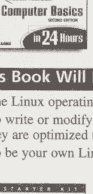

## Sams 自学计算机基础 24 小时

计算的绝佳入门

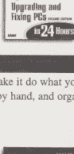

## Sams 自学升级与修复 PC

升级和维修 PC 的逐步方法

## 本书将帮助你学习...

- Linux 操作系统的工作原理以及如何让它按你的意愿运行
- 如何手工编写或修改自己的配置文件，并在系统中组织事物，使其优化以服务于你
- 如何成为自己的 Linux 系统管理员

相关书目...

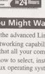

## Sams 自学 Linux-Mandrake 24 小时

适合希望更深入了解 Linux-Mandrake 的读者

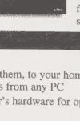

## Linux 硬件手册

适合希望学习如何选择、安装和配置硬件以获得 Linux 操作系统最佳性能的读者

## 你下一步可能想去哪里...

- 精通高级 Linux 系统工具
- 如果你目前未使用，为家庭或办公室电脑添加网络功能，确保你的全部计算能力可从任何 PC 触手可及
- 学习如何为 Linux 操作系统选择、安装和配置计算机硬件以获得最佳性能

可查找的书目...


## Sams 自学 GNOME 24 小时

适合希望通过 GNOME 图形桌面环境探索 Linux 的读者


## Sams 自学网络 24 小时，第二版

教导初学者如何为其计算机系统添加网络功能


## 收购编辑

Shelley Johnston

## 开发编辑

Laura N. Williams

## 执行编辑

Charlotte Clapp

## 项目编辑

Paul Schneider

## 复制编辑

Michael Henry

## 索引员

Deborah Hittel

## 校对员

Kimberly Campanello

Tony Reitz

## 技术编辑

Jason Byars

## 团队协调员

Amy Patton

## 内部设计师

Gary Adair

## 封面设计师

Aren Howell

## 生产

Brandon Allen

Steve Geiselman

Susan Geiselman

## 关于作者

CRAIG 和 COLETTA WITHERSPOON 是作者和培训师，在计算机行业拥有超过二十年的经验，其中与 Linux 相识已有六年。他们撰写了五本 Linux 书籍，包括 *Sams Teach Yourself Linux-Mandrake in 24 Hours*。

## 献词

*献给 Marc 和 Dawn*

## 致谢

与 Macmillan USA 的每个人合作总是令人愉快。他们的支持和帮助使本书成为可能。我们特别要感谢 Neil Rowe 介绍我们认识 Shelley Johnston。感谢 Shelley 给予我们撰写本书的机会。我们还要感谢 Laura Williams 对本书开发的见解和帮助，Jason Byars 检查我们的技术准确性，Mike Henry 如此出色地润色了我们的文字，以及 Paul Schneider 将项目管理到完成。

当然，没有朋友的支持，本书也不可能完成。非常感谢 Henry 和 Maisie 为我们提供住所和餐桌上的新鲜鱼，感谢 Mike 提供电视和餐食让我们放松，以及 Chase 和一群人早上的叫醒服务。

感谢大家。

## 告诉我们你的想法！

作为本书的读者，您是我们最重要的批评者和评论者。我们重视您的意见，想知道我们做得对的地方、可以做得更好的地方、您希望我们出版的领域，以及您愿意分享的任何其他智慧之言。我欢迎您的评论。您可以直接通过电子邮件或写信告诉我您喜欢或不喜欢本书的内容——以及我们可以如何让我们的书籍更出色。

*请注意，我无法帮助您解决与本书主题相关的技术问题，并且由于我收到的邮件数量很大，可能无法回复每一条信息。*

写信时，请务必包含本书的标题和作者，以及您的姓名和电话或传真号码。我会仔细审阅您的评论，并与本书的作者和编辑分享。

Email: webdev_sams@mcp.com

Mail: Mark Taber

副出版人

Sams Publishing

201 West 103rd Street

Indianapolis, IN 46290 USA

## 引言

你好。欢迎阅读《Sams 24 小时学会 Linux》。我们相信您已经听过很多关于 Linux 的炒作，甚至可以打赌您已经听过尝试过 Linux 的人讲述的成功和失败故事。您难道没有一台运行 Microsoft Windows 或 Apple Macintosh 操作系统的电脑吗？那么，为什么要让自己承受学习另一种计算机操作系统的所有麻烦和努力呢？

然而，每隔一段时间就会出现一个新想法，提供一个无与伦比的机会，让你抓住一件好事并将其据为己有。Linux 是一个完整的类 UNIX 操作系统。它是一个完整的实验室，您可以在其中学习系统管理、编程、应用程序创建，以及计算机世界中几乎所有其他需要了解的知识。GNU/Linux 创建了一个环境，提供您自学一些宝贵技能并在现有计算机和网络知识基础上构建所需的所有工具、文档和内置帮助。

### 什么是 GNU/Linux？

Linux 是一个多用户和多任务计算机操作系统，是一个免费的 UNIX 克隆。使其成为 GNU/Linux 的是增加了 Richard Stallman 的自由软件基金会和 GNU 项目提供的丰富免费实用程序和软件。这些应用程序包括文本编辑器、实用程序、工具、操作系统升级等等。来自世界各地的程序员的宝贵贡献被结合起来，生产出从月相时钟到专业音频/视频创作和编辑软件等一切方面的优质应用程序。各种新的多媒体播放器都可供您免费下载。许多 Linux 发行版中都包含文字处理器、图形应用程序和办公套件等办公生产工具，或可供下载时间使用。

### 为什么要自学 Linux？

Linux 操作系统及其相关的免费软件库为小型企业和家庭办公室提供了一种真正经济有效且高效的替代方案。GNU/Linux 提供了一种经济的网络解决方案来保持企业的统一、强大的应用程序来保持最佳的工作流程水平，以及易于配置和适应以完全满足您的需求。

Linux 相比其他操作系统有什么优势？让我们看几个例子：

- Linux 可以让您的旧设备恢复如初以配合新设备使用，并延长其使用寿命。您很快就会认识到使用 Linux 使过时或陈旧设备恢复活力和实用性的潜力。
- Linux 可以用您现有的设备做更多事情。通过让您完全访问计算机的强大功能，Linux 使您能够更好地、更快地管理操作系统并运行应用程序，而只需使用您已有的设备。
- 当您在计算机上安装和配置 Linux 时，您可能永远不需要再购买任何应用程序软件。大多数来自 Macintosh Windows 世界的人都不知道 GNU/Linux 用户存在的庞大免费软件库。Linux 发行版中包含无数专业和科学应用程序，其中许多在功能和性能上超过了它们的商业同类产品。
- Linux 为您提供了一个易于适应的 TCP/IP 服务器软件包，因此建立和管理您的网络——一个特别量身定制以满足您需求的网络——变得简单。

### 为什么使用 Linux-Mandrake 来学习 Linux

还记得 DOS 的旧时光吗？原始的 IBM PC（硬盘出现之前）和 Commodore 64 流行的时候怎么样？是否有一台 CP/M 机器被塞在后屋的壁橱里，您为了怀旧而保留着？也许您的奶奶告诉过您关于计算机甚至没有彩色图片的屏幕的故事？是的，朋友们，有一次您必须在黑屏或绿屏上输入神秘的小半词和首字母才能让计算机做任何事情；没有鼠标，没有 GUI，没有苹果，只有带闪烁光标的命令行。

当然，自那时以来事情已经发生了变化，即使对 Linux 也是如此。


尽管不同的 GNU/Linux 发行版之间存在相似之处，但在处理各个发行版时可能会变得令人困惑。我们希望向您展示如何操作 Linux，无论您选择哪个发行版。我们选择 Linux-Mandrake，因为它比大多数发行版更简洁、更用户友好。Linux-Mandrake 提供多种安装方法。如果您想安装基本系统并快速启动运行，您可以选择其中一种简单的安装方式。或者，您可能希望深入参与安装过程，通过选择软件包并在安装过程中预先配置系统。

Linux-Mandrake 还包含一些强大的工具和实用程序，使使用 Linux 变得更容易。

即使我们以 Linux-Mandrake 作为示例发行版，这里也没有任何花哨的内容来掩盖操作系统的内部工作原理。我们向你展示操作系统的本质所在。本书展示了如何通过命令行使用 Linux-Mandrake 来消除用户界面和其他人先入为主的观念所造成的“中间人”。它还为你提供了最大的机会来设计一个高效的计算机系统，使其更像一名员工而不是玩具。

你会在本书后面的光盘中找到包含在 Linux-Mandrake 发行版中的数百个免费软件程序。而且你并不局限于只使用计算机和光盘上的程序。还有更多优秀的应用程序和工具只需下载即可获得。

## 你应该阅读这本书吗？

你对 UNIX 操作系统感兴趣但觉得它令人生畏且复杂吗？Linux 是 UNIX 家族中更小、更友好的成员。你正在寻找不同的、更好的操作系统吗？Linux 是 Windows 和 Macintosh 计算环境的一种替代方案。你正在寻找对这个新操作系统的介绍吗？你需要帮助克服 Linux 的学习曲线，同时获得扎实的 Linux 操作系统工作知识吗？

这本书是一本以成果为导向的教程——逐步指导你安装、配置和使用 Linux 以提高生产力。它旨在帮助你在安全、无威胁的环境中学习 Linux 操作系统。你会发现本书以通俗易懂的语言对 Linux 操作系统进行了友好介绍，通过引导你完成 Linux 中的熟悉任务和练习来建立理解。书中的材料以补充和扩展你现有知识的方式组织和呈现。

阅读完本书并完成练习后，你将能够在各种机器上安装和配置 Linux-Mandrake 发行版，并且对 GNU/Linux 总体上拥有良好的基础知识。当你熟悉 Linux 后，你就可以开始做出关于如何使用它以及如何根据自己的需求对其进行定制的明智选择。

## 24 小时内你将学到什么

为了帮助你掌握 Linux 的诀窍，我们从循序渐进的方法开始，让你了解 Linux 操作系统的工作原理以及如何让它按你想要的方式运行。你将学习如何安装、配置、管理和修改你的系统及其行为。你不会只是通过向导的选项和预配置文件来完成这些操作。

你将学习如何手工编写或修改自己的配置文件，并组织系统中的事物，使其优化以服务于你。你将在通过命令行输入与计算机交互的同时学习这些和其他内容。

本书深入探讨了 Linux 操作系统的内部工作原理。当你阅读本书中的课程和活动时，你将学习如何成为自己的系统管理员。你将学习如何真正驱动 Linux 操作系统的秘诀，无论你选择哪种 Linux 发行版。

## 本书的组织方式

本书包含了任何想要成为 Linux 操作系统熟练用户或系统管理员的人所需的基本信息。当你阅读本书时，你将学习从用户和管理员的角度理解计算机操作系统所需的概念。你将找到逐步说明来实现这些概念，以使你的 Linux 操作系统最好地为你服务。以下是书页之间内容的大致概述：

- Part I. "Take the Linux Plunge," 帮助你完成 Linux 安装过程并向你介绍操作系统。你将学习操作系统的结构以及为什么你应该始终注意安全。
- Part II, "Learn the Ropes," 向你展示系统用户所需的一切。你将学习如何导航文件系统、执行搜索、将一个文件中的信息复制到另一个文件以及编辑文件。你还将学习命令和 shell 的工作原理。
- Part III, "System Administration," 是初级系统管理员指南。在你能够熟练做出关于系统维护和保养的正确决策之前，你需要掌握这些小时内涵盖的概念。
- Part IV, "Get a GUI," 涵盖 X Window System 的微调。你还将了解可用的窗口管理器和桌面系统以及如何开始使用 X Window System。
- Part V. "Network Administration," 使你连接到互联网并向你展示如何配置系统以分发邮件和新消息。你还将了解如何为系统上的其他用户留言。
- Part VI, "Entertainment," 给你一个机会让你的计算机变得有趣一些。你将探索系统上运行的一些更有趣的游戏。你还将了解如何通过连接音响系统并播放一些老式摇滚乐来获得更多娱乐价值。
- Part VII, "Appendixes," 包含对 KDE 和 GNOME 桌面环境的介绍。

## 有用的学习工具

在每个小时的讨论中都包含了额外的元素，为你提供更多关于如何使用 Linux 操作系统的信息。这些元素旨在在不妨碍你进步的情况下提供额外的知识。

### 了解新术语


New Terms 在整本书中出现，帮助你识别正在讨论的新概念。每个新术语都附带简短的定义，帮助你在该小时内理解正在讨论的概念。

### 查找更多信息


> Notes 用于澄清主题或提供可能对你有用的额外信息。Notes 对于讨论并非必要；它们只是你可能会觉得有趣的信息片段。

### 工作更高效


> Tips 告诉你完成任务时可以使用更短、更高效的方法。Tips 旨在帮助你让工作更轻松，并为可能适合你的解决方案提供提示。

### 避免潜在问题


> Cautions 指出 Linux 操作系统中的潜在问题区域。当你看到 Caution 图标时，你需要小心行事，以避免执行可能导致不良后果的操作或做出决定。你不想伤害你的系统。

### 识别发行版之间的差异


本书包含了任何想要成为 Linux 操作系统熟练用户或系统管理员的人所需的基本信息。当你阅读本书时，你将学习从用户和管理员的角度理解计算机操作系统所需的概念。你将找到逐步说明来实现这些概念，以使你的 Linux 操作系统最好地为你服务。以下是书页之间内容的大致概述：

- Part I. "Take the Linux Plunge," 帮助你完成 Linux 安装过程并向你介绍操作系统。你将学习操作系统的结构以及为什么你应该始终注意安全。
- Part II, "Learn the Ropes," 向你展示系统用户所需的一切。你将学习如何导航文件系统、执行搜索、将一个文件中的信息复制到另一个文件以及编辑文件。你还将学习命令和 shell 的工作原理。
- Part III, "System Administration," 是初级系统管理员指南。在你能够熟练做出关于系统维护和保养的正确决策之前，你需要掌握这些小时内涵盖的概念。
- Part IV, "Get a GUI," 涵盖 X Window System 的微调。你还将了解可用的窗口管理器和桌面系统以及如何开始使用 X Window System。
- Part V. "Network Administration," 使你连接到互联网并向你展示如何配置系统以分发邮件和新消息。你还将了解如何为系统上的其他用户留言。
- Part VI, "Entertainment," 给你一个机会让你的计算机变得有趣一些。你将探索系统上运行的一些更有趣的游戏。你还将了解如何通过连接音响系统并播放一些老式摇滚乐来获得更多娱乐价值。
- Part VII, "Appendixes," 包含对 KDE 和 GNOME 桌面环境的介绍。

### 有用的学习工具

在每个小时的讨论中都包含了额外的元素，为你提供更多关于如何使用 Linux 操作系统的信息。这些元素旨在在不妨碍你进步的情况下提供额外的知识。

#### 了解新术语


New Terms 在整本书中出现，帮助你识别正在讨论的新概念。每个新术语都附带简短的定义，帮助你在该小时内理解正在讨论的概念。

#### 查找更多信息


> Notes 用于澄清主题或提供可能对你有用的额外信息。Notes 对于讨论并非必要；它们只是你可能会觉得有趣的信息片段。

#### 工作更高效


> Tips 告诉你完成任务时可以使用更短、更高效的方法。Tips 旨在帮助你让工作更轻松，并为可能适合你的解决方案提供提示。

#### 避免潜在问题


> Cautions 指出 Linux 操作系统中的潜在问题区域。当你看到 Caution 图标时，你需要小心行事，以避免执行可能导致不良后果的操作或做出决定。你不想伤害你的系统。

#### 识别发行版之间的差异


即使我们以 Linux-Mandrake 作为示例发行版，这里也没有任何花哨的内容来掩盖操作系统的内部工作原理。我们向你展示操作系统的本质所在。本书展示了如何通过命令行使用 Linux-Mandrake 来消除用户界面和其他人先入为主的观念所造成的“中间人”。它还为你提供了最大的机会来设计一个高效的计算机系统，使其更像一名员工而不是玩具。

你会在本书后面的光盘中找到包含在 Linux-Mandrake 发行版中的数百个免费软件程序。而且你并不局限于只使用计算机和光盘上的程序。还有更多优秀的应用程序和工具只需下载即可获得。

### 你应该阅读这本书吗？

你对 UNIX 操作系统感兴趣但觉得它令人生畏且复杂吗？Linux 是 UNIX 家族中更小、更友好的成员。你正在寻找不同的、更好的操作系统吗？Linux 是 Windows 和 Macintosh 计算环境的一种替代方案。你正在寻找对这个新操作系统的介绍吗？你需要帮助克服 Linux 的学习曲线，同时获得扎实的 Linux 操作系统工作知识吗？

这本书是一本以成果为导向的教程——逐步指导你安装、配置和使用 Linux 以提高生产力。它旨在帮助你在安全、无威胁的环境中学习 Linux 操作系统。你会发现本书以通俗易懂的语言对 Linux 操作系统进行了友好介绍，通过引导你完成 Linux 中的熟悉任务和练习来建立理解。书中的材料以补充和扩展你现有知识的方式组织和呈现。

阅读完本书并完成练习后，你将能够在各种机器上安装和配置 Linux-Mandrake 发行版，并且对 GNU/Linux 总体上拥有良好的基础知识。当你熟悉 Linux 后，你就可以开始做出关于如何使用它以及如何根据自己的需求对其进行定制的明智选择。

### 24 小时内你将学到什么

为了帮助你掌握 Linux 的诀窍，我们从循序渐进的方法开始，让你了解 Linux 操作系统的工作原理以及如何让它按你想要的方式运行。你将学习如何安装、配置、管理和修改你的系统及其行为。你不会只是通过向导的选项和预配置文件来完成这些操作。

你将学习如何手工编写或修改自己的配置文件，并组织系统中的事物，使其优化以服务于你。你将在通过命令行输入与计算机交互的同时学习这些和其他内容。

本书深入探讨了 Linux 操作系统的内部工作原理。当你阅读本书中的课程和活动时，你将学习如何成为自己的系统管理员。你将学习如何真正驱动 Linux 操作系统的秘诀，无论你选择哪种 Linux 发行版。

### 本书的组织方式

本书包含了任何想要成为 Linux 操作系统熟练用户或系统管理员的人所需的基本信息。当你阅读本书时，你将学习从用户和管理员的角度理解计算机操作系统所需的概念。你将找到逐步说明来实现这些概念，以使你的 Linux 操作系统最好地为你服务。以下是书页之间内容的大致概述：

- Part I. "Take the Linux Plunge," 帮助你完成 Linux 安装过程并向你介绍操作系统。你将学习操作系统的结构以及为什么你应该始终注意安全。
- Part II, "Learn the Ropes," 向你展示系统用户所需的一切。你将学习如何导航文件系统、执行搜索、将一个文件中的信息复制到另一个文件以及编辑文件。你还将学习命令和 shell 的工作原理。
- Part III, "System Administration," 是初级系统管理员指南。在你能够熟练做出关于系统维护和保养的正确决策之前，你需要掌握这些小时内涵盖的概念。
- Part IV, "Get a GUI," 涵盖 X Window System 的微调。你还将了解可用的窗口管理器和桌面系统以及如何开始使用 X Window System。
- Part V. "Network Administration," 使你连接到互联网并向你展示如何配置系统以分发邮件和新消息。你还将了解如何为系统上的其他用户留言。
- Part VI, "Entertainment," 给你一个机会让你的计算机变得有趣一些。你将探索系统上运行的一些更有趣的游戏。你还将了解如何通过连接音响系统并播放一些老式摇滚乐来获得更多娱乐价值。
- Part VII, "Appendixes," 包含对 KDE 和 GNOME 桌面环境的介绍。

### 有用的学习工具

在每个小时的讨论中都包含了额外的元素，为你提供更多关于如何使用 Linux 操作系统的信息。这些元素旨在在不妨碍你进步的情况下提供额外的知识。

#### 了解新术语


New Terms 在整本书中出现，帮助你识别正在讨论的新概念。每个新术语都附带简短的定义，帮助你在该小时内理解正在讨论的概念。

#### 查找更多信息


> Notes 用于澄清主题或提供可能对你有用的额外信息。Notes 对于讨论并非必要；它们只是你可能会觉得有趣的信息片段。

#### 工作更高效


> Tips 告诉你完成任务时可以使用更短、更高效的方法。Tips 旨在帮助你让工作更轻松，并为可能适合你的解决方案提供提示。

#### 避免潜在问题


> Cautions 指出 Linux 操作系统中的潜在问题区域。当你看到 Caution 图标时，你需要小心行事，以避免执行可能导致不良后果的操作或做出决定。你不想伤害你的系统。

#### 识别发行版之间的差异


> 一

即使我们以 Linux-Mandrake 作为示例发行版，这里也没有任何花哨的内容来掩盖操作系统的内部工作原理。我们向你展示操作系统的本质所在。本书展示了如何通过命令行使用 Linux-Mandrake 来消除用户界面和其他人先入为主的观念所造成的“中间人”。它还为你提供了最大的机会来设计一个高效的计算机系统，使其更像一名员工而不是玩具。

你会在本书后面的光盘中找到包含在 Linux-Mandrake 发行版中的数百个免费软件程序。而且你并不局限于只使用计算机和光盘上的程序。还有更多优秀的应用程序和工具只需下载即可获得。

### 你应该阅读这本书吗？

你对 UNIX 操作系统感兴趣但觉得它令人生畏且复杂吗？Linux 是 UNIX 家族中更小、更友好的成员。你正在寻找不同的、更好的操作系统吗？Linux 是 Windows 和 Macintosh 计算环境的一种替代方案。你正在寻找对这个新操作系统的介绍吗？你需要帮助克服 Linux 的学习曲线，同时获得扎实的 Linux 操作系统工作知识吗？

这本书是一本以成果为导向的教程——逐步指导你安装、配置和使用 Linux 以提高生产力。它旨在帮助你在安全、无威胁的环境中学习 Linux 操作系统。你会发现本书以通俗易懂的语言对 Linux 操作系统进行了友好介绍，通过引导你完成 Linux 中的熟悉任务和练习来建立理解。书中的材料以补充和扩展你现有知识的方式组织和呈现。

阅读完本书并完成练习后，你将能够在各种机器上安装和配置 Linux-Mandrake 发行版，并且对 GNU/Linux 总体上拥有良好的基础知识。当你熟悉 Linux 后，你就可以开始做出关于如何使用它以及如何根据自己的需求对其进行定制的明智选择。

### 24 小时内你将学到什么

为了帮助你掌握 Linux 的诀窍，我们从循序渐进的方法开始，让你了解 Linux 操作系统的工作原理以及如何让它按你想要的方式运行。你将学习如何安装、配置、管理和修改你的系统及其行为。你不会只是通过向导的选项和预配置文件来完成这些操作。

你将学习如何手工编写或修改自己的配置文件，并组织系统中的事物，使其优化以服务于你。你将在通过命令行输入与计算机交互的同时学习这些和其他内容。

本书深入探讨了 Linux 操作系统的内部工作原理。当你阅读本书中的课程和活动时，你将学习如何成为自己的系统管理员。你将学习如何真正驱动 Linux 操作系统的秘诀，无论你选择哪种 Linux 发行版。

### 本书的组织方式

本书包含了任何想要成为 Linux 操作系统熟练用户或系统管理员的人所需的基本信息。当你阅读本书时，你将学习从用户和管理员的角度理解计算机操作系统所需的概念。你将找到逐步说明来实现这些概念，以使你的 Linux 操作系统最好地为你服务。以下是书页之间内容的大致概述：

- Part I. "Take the Linux Plunge," 帮助你完成 Linux 安装过程并向你介绍操作系统。你将学习操作系统的结构以及为什么你应该始终注意安全。
- Part II, "Learn the Ropes," 向你展示系统用户所需的一切。你将学习如何导航文件系统、执行搜索、将一个文件中的信息复制到另一个文件以及编辑文件。你还将学习命令和 shell 的工作原理。
- Part III, "System Administration," 是初级系统管理员指南。在你能够熟练做出关于系统维护和保养的正确决策之前，你需要掌握这些小时内涵盖的概念。
- Part IV, "Get a GUI," 涵盖 X Window System 的微调。你还将了解可用的窗口管理器和桌面系统以及如何开始使用 X Window System。
- Part V. "Network Administration," 使你连接到互联网并向你展示如何配置系统以分发邮件和新消息。你还将了解如何为系统上的其他用户留言。
- Part VI, "Entertainment," 给你一个机会让你的计算机变得有趣一些。你将探索系统上运行的一些更有趣的游戏。你还将了解如何通过连接音响系统并播放一些老式摇滚乐来获得更多娱乐价值。
- Part VII, "Appendixes," 包含对 KDE 和 GNOME 桌面环境的介绍。

### 有用的学习工具

在每个小时的讨论中都包含了额外的元素，为你提供更多关于如何使用 Linux 操作系统的信息。这些元素旨在在不妨碍你进步的情况下提供额外的知识。

#### 了解新术语


New Terms 在整本书中出现，帮助你识别正在讨论的新概念。每个新术语都附带简短的定义，帮助你在该小时内理解正在讨论的概念。

#### 查找更多信息


> Notes 用于澄清主题或提供可能对你有用的额外信息。Notes 对于讨论并非必要；它们只是你可能会觉得有趣的信息片段。

#### 工作更高效


> Tips 告诉你完成任务时可以使用更短、更高效的方法。Tips 旨在帮助你让工作更轻松，并为可能适合你的解决方案提供提示。

#### 避免潜在问题


> Cautions 指出 Linux 操作系统中的潜在问题区域。当你看到 Caution 图标时，你需要小心行事，以避免执行可能导致不良后果的操作或做出决定。你不想伤害你的系统。

#### 识别发行版之间的差异


> 一


- Part II, "Learn the Ropes," 向你展示系统用户所需的一切。你将学习如何导航文件系统、执行搜索、将一个文件中的信息复制到另一个文件以及编辑文件。你还将学习命令和 shell 的工作原理。

- Part III, "System Administration," 是初级系统管理员指南。在你能够熟练做出关于系统维护和保养的正确决策之前，你需要掌握这些小时内涵盖的概念。

- Part IV, "Get a GUI," 涵盖 X Window System 的微调。你还将了解可用的窗口管理器和桌面系统以及如何开始使用 X Window System。

- Part V. "Network Administration," 使你连接到互联网并向你展示如何配置系统以分发邮件和新消息。你还将了解如何为系统上的其他用户留言。

- Part VI, "Entertainment," 给你一个机会让你的计算机变得有趣一些。你将探索系统上运行的一些更有趣的游戏。你还将了解如何通过连接音响系统并播放一些老式摇滚乐来获得更多娱乐价值。

- Part VII, "Appendixes," 包含对 KDE 和 GNOME 桌面环境的介绍。

### 有用的学习工具

在每个小时的讨论中都包含了额外的元素，为你提供更多关于如何使用 Linux 操作系统的信息。这些元素旨在在不妨碍你进步的情况下提供额外的知识。

#### 了解新术语


`New Terms` 在整本书中出现，帮助你识别正在讨论的新概念。每个新术语都附带简短的定义，帮助你在该小时内理解正在讨论的概念。

#### 查找更多信息


> Notes 用于澄清主题或提供可能对你有用的额外信息。Notes 对于讨论并非必要；它们只是你可能会觉得有趣的信息片段。

#### 工作更高效


> Tips 告诉你完成任务时可以使用更短、更高效的方法。Tips 旨在帮助你让工作更轻松，并为可能适合你的解决方案提供提示。

#### 避免潜在问题


> Cautions 指出 Linux 操作系统中的潜在问题区域。当你看到 Caution 图标时，你需要小心行事，以避免执行可能导致不良后果的操作或做出决定。你不想伤害你的系统。

#### 识别发行版之间的差异


> 一

即使我们以 Linux-Mandrake 作为示例发行版，这里也没有任何花哨的内容来掩盖操作系统的内部工作原理。我们向你展示操作系统的本质所在。本书展示了如何通过命令行使用 Linux-Mandrake 来消除用户界面和其他人先入为主的观念所造成的“中间人”。它还为你提供了最大的机会来设计一个高效的计算机系统，使其更像一名员工而不是玩具。

你会在本书后面的光盘中找到包含在 Linux-Mandrake 发行版中的数百个免费软件程序。而且你并不局限于只使用计算机和光盘上的程序。还有更多优秀的应用程序和工具只需下载即可获得。

### 你应该阅读这本书吗？

你对 UNIX 操作系统感兴趣但觉得它令人生畏且复杂吗？Linux 是 UNIX 家族中更小、更友好的成员。你正在寻找不同的、更好的操作系统吗？Linux 是 Windows 和 Macintosh 计算环境的一种替代方案。你正在寻找对这个新操作系统的介绍吗？你需要帮助克服 Linux 的学习曲线，同时获得扎实的 Linux 操作系统工作知识吗？

这本书是一本以成果为导向的教程——逐步指导你安装、配置和使用 Linux 以提高生产力。它旨在帮助你在安全、无威胁的环境中学习 Linux 操作系统。你会发现本书以通俗易懂的语言对 Linux 操作系统进行了友好介绍，通过引导你完成 Linux 中的熟悉任务和练习来建立理解。书中的材料以补充和扩展你现有知识的方式组织和呈现。

阅读完本书并完成练习后，你将能够在各种机器上安装和配置 Linux-Mandrake 发行版，并且对 GNU/Linux 总体上拥有良好的基础知识。当你熟悉 Linux 后，你就可以开始做出关于如何使用它以及如何根据自己的需求对其进行定制的明智选择。

### 24 小时内你将学到什么

为了帮助你掌握 Linux 的诀窍，我们从循序渐进的方法开始，让你了解 Linux 操作系统的工作原理以及如何让它按你想要的方式运行。你将学习如何安装、配置、管理和修改你的系统及其行为。你不会只是通过向导的选项和预配置文件来完成这些操作。

你将学习如何手工编写或修改自己的配置文件，并组织系统中的事物，使其优化以服务于你。你将在通过命令行输入与计算机交互的同时学习这些和其他内容。

本书深入探讨了 Linux 操作系统的内部工作原理。当你阅读本书中的课程和活动时，你将学习如何成为自己的系统管理员。你将学习如何真正驱动 Linux 操作系统的秘诀，无论你选择哪种 Linux 发行版。

### 本书的组织方式

本书包含了任何想要成为 Linux 操作系统熟练用户或系统管理员的人所需的基本信息。当你阅读本书时，你将学习从用户和管理员的角度理解计算机操作系统所需的概念。你将找到逐步说明来实现这些概念，以使你的 Linux 操作系统最好地为你服务。以下是书页之间内容的大致概述：

- Part I. "Take the Linux Plunge," 帮助你完成 Linux 安装过程并向你介绍操作系统。你将学习操作系统的结构以及为什么你应该始终注意安全。

- Part II, "Learn the Ropes," 向你展示系统用户所需的一切。你将学习如何导航文件系统、执行搜索、将一个文件中的信息复制到另一个文件以及编辑文件。你还将学习命令和 shell 的工作原理。

- Part III, "System Administration," 是初级系统管理员指南。在你能够熟练做出关于系统维护和保养的正确决策之前，你需要掌握这些小时内涵盖的概念。

- Part IV, "Get a GUI," 涵盖 X Window System 的微调。你还将了解可用的窗口管理器和桌面系统以及如何开始使用 X Window System。

- Part V. "Network Administration," 使你连接到互联网并向你展示如何配置系统以分发邮件和新消息。你还将了解如何为系统上的其他用户留言。

- Part VI, "Entertainment," 给你一个机会让你的计算机变得有趣一些。你将探索系统上运行的一些更有趣的游戏。你还将了解如何通过连接音响系统并播放一些老式摇滚乐来获得更多娱乐价值。

- Part VII, "Appendixes," 包含对 KDE 和 GNOME 桌面环境的介绍。

### 有用的学习工具

在每个小时的讨论中都包含了额外的元素，为你提供更多关于如何使用 Linux 操作系统的信息。这些元素旨在在不妨碍你进步的情况下提供额外的知识。

#### 了解新术语


`New Terms` 在整本书中出现，帮助你识别正在讨论的新概念。每个新术语都附带简短的定义，帮助你在该小时内理解正在讨论的概念。

#### 查找更多信息


> Notes 用于澄清主题或提供可能对你有用的额外信息。Notes 对于讨论并非必要；它们只是你可能会觉得有趣的信息片段。

#### 工作更高效


> Tips 告诉你完成任务时可以使用更短、更高效的方法。Tips 旨在帮助你让工作更轻松，并为可能适合你的解决方案提供提示。

#### 避免潜在问题


> Cautions 指出 Linux 操作系统中的潜在问题区域。当你看到 Caution 图标时，你需要小心行事，以避免执行可能导致不良后果的操作或做出决定。你不想伤害你的系统。

#### 识别发行版之间的差异


> 一

即使我们以 Linux-Mandrake 作为示例发行版，这里也没有任何花哨的内容来掩盖操作系统的内部工作原理。我们向你展示操作系统的本质所在。本书展示了如何通过命令行使用 Linux-Mandrake 来消除用户界面和其他人先入为主的观念所造成的“中间人”。它还为你提供了最大的机会来设计一个高效的计算机系统，使其更像一名员工而不是玩具。


你会在本书后面的光盘中找到包含在 Linux-Mandrake 发行版中的数百个免费软件程序。而且你并不局限于只使用计算机和光盘上的程序。还有更多优秀的应用程序和工具只需下载即可获得。

### 你应该阅读这本书吗？

你对 UNIX 操作系统感兴趣但觉得它令人生畏且复杂吗？Linux 是 UNIX 家族中更小、更友好的成员。你正在寻找不同的、更好的操作系统吗？Linux 是 Windows 和 Macintosh 计算环境的一种替代方案。你正在寻找对这个新操作系统的介绍吗？你需要帮助克服 Linux 的学习曲线，同时获得扎实的 Linux 操作系统工作知识吗？

这本书是一本以成果为导向的教程——逐步指导你安装、配置和使用 Linux 以提高生产力。它旨在帮助你在安全、无威胁的环境中学习 Linux 操作系统。你会发现本书以通俗易懂的语言对 Linux 操作系统进行了友好介绍，通过引导你完成 Linux 中的熟悉任务和练习来建立理解。书中的材料以补充和扩展你现有知识的方式组织和呈现。

阅读完本书并完成练习后，你将能够在各种机器上安装和配置 Linux-Mandrake 发行版，并且对 GNU/Linux 总体上拥有良好的基础知识。当你熟悉 Linux 后，你就可以开始做出关于如何使用它以及如何根据自己的需求对其进行定制的明智选择。

### 24 小时内你将学到什么

为了帮助你掌握 Linux 的诀窍，我们从循序渐进的方法开始，让你了解 Linux 操作系统的工作原理以及如何让它按你想要的方式运行。你将学习如何安装、配置、管理和修改你的系统及其行为。你不会只是通过向导的选项和预配置文件来完成这些操作。

你将学习如何手工编写或修改自己的配置文件，并组织系统中的事物，使其优化以服务于你。你将在通过命令行输入与计算机交互的同时学习这些和其他内容。

本书深入探讨了 Linux 操作系统的内部工作原理。当你阅读本书中的课程和活动时，你将学习如何成为自己的系统管理员。你将学习如何真正驱动 Linux 操作系统的秘诀，无论你选择哪种 Linux 发行版。

### 本书的组织方式

本书包含了任何想要成为 Linux 操作系统熟练用户或系统管理员的人所需的基本信息。当你阅读本书时，你将学习从用户和管理员的角度理解计算机操作系统所需的概念。你将找到逐步说明来实现这些概念，以使你的 Linux 操作系统最好地为你服务。以下是书页之间内容的大致概述：

- Part I. "Take the Linux Plunge," 帮助你完成 Linux 安装过程并向你介绍操作系统。你将学习操作系统的结构以及为什么你应该始终注意安全。
- Part II, "Learn the Ropes," 向你展示系统用户所需的一切。你将学习如何导航文件系统、执行搜索、将一个文件中的信息复制到另一个文件以及编辑文件。你还将学习命令和 shell 的工作原理。
- Part III, "System Administration," 是初级系统管理员指南。在你能够熟练做出关于系统维护和保养的正确决策之前，你需要掌握这些小时内涵盖的概念。
- Part IV, "Get a GUI," 涵盖 X Window System 的微调。你还将了解可用的窗口管理器和桌面系统以及如何开始使用 X Window System。
- Part V. "Network Administration," 使你连接到互联网并向你展示如何配置系统以分发邮件和新消息。你还将了解如何为系统上的其他用户留言。
- Part VI, "Entertainment," 给你一个机会让你的计算机变得有趣一些。你将探索系统上运行的一些更有趣的游戏。你还将了解如何通过连接音响系统并播放一些老式摇滚乐来获得更多娱乐价值。
- Part VII, "Appendixes," 包含对 KDE 和 GNOME 桌面环境的介绍。

### 有用的学习工具

在每个小时的讨论中都包含了额外的元素，为你提供更多关于如何使用 Linux 操作系统的信息。这些元素旨在在不妨碍你进步的情况下提供额外的知识。

#### 了解新术语


New Terms 在整本书中出现，帮助你识别正在讨论的新概念。每个新术语都附带简短的定义，帮助你在该小时内理解正在讨论的概念。

#### 查找更多信息


> Notes 用于澄清主题或提供可能对你有用的额外信息。Notes 对于讨论并非必要；它们只是你可能会觉得有趣的信息片段。

#### 工作更高效


> Tips 告诉你完成任务时可以使用更短、更高效的方法。Tips 旨在帮助你让工作更轻松，并为可能适合你的解决方案提供提示。

#### 避免潜在问题


> Cautions 指出 Linux 操作系统中的潜在问题区域。当你看到 Caution 图标时，你需要小心行事，以避免执行可能导致不良后果的操作或做出决定。你不想伤害你的系统。

#### 识别发行版之间的差异


> 书中散布着一个特殊图标，用来指出主要 Linux 发行版之间的差异。

### 练习你的技能

Tasks 会引导你逐步了解每个小时所涵盖的信息。通过跟随 Tasks，你可以练习概念、命令、程序和脚本的实际应用。

### 特殊字体

许多元素以与正文不同的字体呈现。以下是它们的含义及处理方式：

- 出现在 *斜体* 中的单词是技术术语，书中首次使用时就会解释。
- 命令、实用程序、代码行、语句和脚本名称以纯 `monospace` 字体显示。换句话说，任何用作代码或在创建或使用代码过程中使用的术语都使用这种特殊字体。你还会发现任何精选的网站也以纯等宽字体显示。
- 你需要输入以执行所述任务或跟随课程的任何输入都以 **粗体等宽** 字体显示。
- *斜体等宽* 字体指定变量。变量是命令中的占位符，需要替换为实际的文件名或命令选项。

## 章节回顾

阅读完一章后，你可能有一些问题，需要帮助澄清任务，或想了解更多关于某个主题。Q&A 部分提供了关于该小时所涵盖主题的常见问题列表。它回答具体问题并帮助你复习本章所呈现的材料。“Workshop” 部分包含测试你对主题掌握情况的测验和帮助你练习所学内容的练习。你甚至可能会发现，通过做练习，你学到了新东西。

我们希望你在完成这 24 小时学习的同时探索 Linux 操作系统时能享受乐趣，并且认为每个小时所涵盖的信息是有价值的。

## 第一部分

### 深入 Linux

### 小时

- 1. 为安装做准备
- 2. 安装 Linux-Mandrake
- 3. 安全是首要任务
- 4. 了解 Linux 操作系统


#### 第 1 小时

##### 为安装做准备

这太酷了；你决定尝试 Linux 操作系统！我们很高兴你决定加入我们，一起学习如何使用这个操作系统领域的新兴力量。随着 Linux 操作系统的到来，它提供了运行 GNU 项目所有应用软件所需的开源平台，你现在有新的机会更好地管理你的计算机并用它探索新的软件应用。

是时候开始你的 Linux 操作系统冒险了。在接下来的一个小时里，你将学习如何为成功的 Linux 安装做准备，具体包括

- 确定哪种 Linux 发行版最适合你的需求和用途
- 选择要安装操作系统的计算机
- 确定你选择的计算机是否与 Linux 操作系统兼容
- 在开始安装操作系统之前收集所需材料

##### 比较 Linux 发行版

你决定尝试 Linux 操作系统可能有很多原因。你可能听说 Linux 操作系统是一个稳定且高效的工作环境。它不容易出现令人 dreaded 的一般保护故障和蓝屏死机。而且，操作系统的抗计算机病毒能力也是一个非常突出的优点。然而，炒作不仅仅关乎操作系统。

你会找到一个应用程序、命令或实用工具来完成几乎任何你需要完成的任务或工作。开源运动提供的可用软件清单令人目不暇接。你会发现每个 Linux 发行版的 CD-ROM 上都包含超过一 GB 的软件。对于艺术爱好者来说，有图形程序可与一些可能超出你预算的商业应用相媲美。程序员会找到足够多的编程语言和工具来忙碌一生。而且还有更多，你可能永远用不完随操作系统安装的命令、实用工具和应用程序。

那么，你准备好尝试 Linux 操作系统了，但从哪里开始呢？首先要做的就是选择一个 Linux 发行版。可供选择的发行版有数十种，而且每天都有新的出现。


> 在整本书中，你会看到 Tux——Linux 企鹅——指向 Linux 发行版存在差异的地方。即使本书大部分时间以 Linux-Mandrake 作为示例，我们也尽最大努力向你展示如何使用 Linux 操作系统，无论你运行的是哪个发行版。

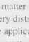

> 本书后面的 CD-ROM 包含最新版本的 Linux-Mandrake。Linux-Mandrake 体现了我们认为适合刚接触 Linux 操作系统的人的优点。Linux-Mandrake 提供技术支持、良好的用户文档、完整的 GNU/Linux 应用程序列表以及易于遵循的安装过程。

### 选择 Linux 发行版时应注意什么

你应该知道，无论选择哪个发行版，Linux 操作系统在每个发行版上都是相同的。差异体现在操作系统的安装过程中、已安装的应用程序、技术支持，以及由发行版创建并设计用于该特定发行版的额外程序和实用工具。

选择 Linux 发行版时，这里有一些需要注意的地方：

- 发行版 CD-ROM 中包含什么？如果你购买盒装套件，你很可能会找到发行版 CD-ROM、一张包含所有应用程序源代码的 CD-ROM、一张包含额外程序（如 StarOffice 或 WordPerfect）的 CD-ROM、启动盘和安装指南。如果你只购买发行版 CD-ROM 而不带所有花哨的附加内容，你会在 CD-ROM 上找到发行版文档的电子版本。
- 你需要技术支持吗？许多发行版提供一定天数的支持。这种支持通常仅限于帮助你在计算机系统上安装发行版。但请注意，如果你运行的是不兼容的硬件，技术支持能做的就很少了。我们将在本章后面讨论硬件。
- 安装发行版有多容易？对任何 Linux 新用户来说，最大的障碍就是安装操作系统。刚开始时，你希望发行版包含丰富的安装帮助信息，能够自动检测计算机硬件，并包含其他指导你完成安装的工具。
- 你将如何使用 Linux 系统？每个发行版都允许你从一组安装类型中选择，或有选择地挑选要安装的应用程序。我们建议你选择其中一种安装类型；肯定会有适合你的配置。每个发行版包含不同的安装类型，但你会找到基本工作站、主要运行图形程序和实用工具的系统、连接到网络的工作站、互联网连接和网页浏览、网络服务器以及 Web 主机的配置。


> Linux 发行版实在太多，我们无法逐一介绍。我们只能告诉你我们的经验。我们安装的第一个 Linux 是 Slackware Linux（在 20 世纪 90 年代初）。经过多次尝试和认真的试错，我们终于获得了操作系统，但没有图形用户界面。配置 X Window System 以充分处理视频显示仍然是一项困难的工作。经过数百次 Linux 安装，我们认为 Slackware Linux 最适合那些对使用 Linux 感到舒适或具有 UNIX 操作系统背景的人。

> 接下来我们转向 Red Hat Linux。安装这个发行版时我们运气好得多。这可能是因为我们之前积累的经验；也可能是因为图形化安装。Red Hat Linux 的优势在于 Red Hat 软件包管理（`RPM`）技术，它使安装应用程序、删除应用程序和保持系统更新变得容易。许多 Linux 发行版使用 `RPM` 技术。我们喜欢 Red Hat Linux 的另一个功能是 `Linuxconf`。`Linuxconf` 使进行各种系统配置更改变得容易。你可以为文件共享创建用户和组账户、创建拨号互联网连接，并更改计算机的启动方式。

许多发行版基于 Red Hat，我们尝试过其中几个。我们的最爱是 Linux-Mandrake，其次是 TurboLinux。这两个发行版在系统配置工具方面都非常强大。Linux-Mandrake 使用 `DrakConf` 来更改视频显示、系统用户和其他系统配置设置的设置。`DrakConf` 还使将计算机连接到网络和连接打印机变得容易。

TurboLinux 的安装过程不如 Linux-Mandrake 详细，但对新用户来说仍然比其他发行版更容易。TurboLinux 包含许多图形配置工具，可帮助你按自己的意愿设置系统。TurboLinux 还提供一系列发行版。如果你要在家庭中使用 Linux，你会想尝试 TurboLinux Workstation。如果你想连接多台计算机，还有 TurboLinux Server。

另一个我们在安装操作系统和配置 X Window System 时取得成功的发行版是 Caldera OpenLinux。Caldera OpenLinux 也是 Linux 新用户的另一个不错选择。我们在该发行版中看到的缺点是过度依赖 KDE 桌面程序和实用工具作为唯一的操作方式，以及频繁升级应用程序的困难。

如果你正在寻找流畅、快速且简单的安装，你应该尝试 Corel Linux OpenLinux。Corel 的人说安装只需四步就完成，这确实是真的。我们习惯于坐在电脑前几个小时，做安装决策并观看软件安装。这个安装让我们目瞪口呆——我们甚至还有点时间剩余。唯一的缺点：它预先配置好了，安装过程中灵活性不大。

我们已经谈了足够长的时间，我们的咖啡也快喝完了。我们想提一下我们对 Linux 发行版的最后三次实验。虽然我们都喜欢这三个发行版，但我们不建议刚开始使用 Linux 的人使用它们。SuSE OpenLinux 是最新、最及时的 Linux 发行版。如果你需要最新的应用程序、新的设备驱动程序或配置 X Window System 的帮助，请访问 SuSE 网站。Debian Linux 适合高级用户。好的一面是，安装后 Debian Linux OpenLinux 是最易于维护的发行版。它也是唯一作为互联网上的合作努力开发的非商业发行版。而且，我们不想忘记 GNU/Hurd，它是全世界操作系统的典范。

在选择发行版之前，请查看互联网上可用的资源以获取更多信息。Linux 总部发行版链接（位于 `www.linuxhq.com/dist.html`）链接到多个提供 Linux 下载的网站。你还会找到多个 Linux 发行版网站的链接。Linux 下载门户网站 Linux Links 提供了令人印象深刻的链接列表（位于 `www.linuxlinks.com/Distributions`），指向流行的发行版。你甚至还能找到大多数鲜为人知的发行版。

有关发行版的最详尽信息可以在该发行版的网站上找到。许多流行 Linux 发行版的地址见表 1.1。在阅读完所有这些资料后，你将更好地了解哪种 Linux 发行版最适合你。在做完所有这些研究后，如果你仍有疑问，可以将它们发布到 `comp.os.linux.answers` 新闻组。

#### 表 1.1 Linux 发行版的 URL 地址

| 发行版 | 网站地址 |
|---|---|
| Caldera OpenLinux | www.caldera.com |
| Corel Linux | linux.corel.com |
| Debian Linux | www.debian.org |
| Linux-Mandrake | www.linux-mandrake.com |
| Linux Pro | www.wgs.com |
| Red Hat Linux | www.redhat.com |
| Slackware Linux | www.slackware.com |
| SuSE | www.suse.com |
| Trans-Ameritech Linuxware | www.trans.am.com |
| TurboLinux | www.turbolinux.com |

### 任务：整理 Linux 阅读清单

在整本书中，你会被引导到各个地方，在那里你可以找到有关某个主题的更多帮助。Linux 帮助的来源非常广泛。以下是每个新用户都应该了解的一些 Linux 帮助和信息来源：

- `www.linuxdocs.org` 维护着 Linux 在线帮助文档的核心。你最常会查看该网站以获取 Linux FAQ 和 HOWTOs 的最新版本。FAQ 回答有关 Linux 的常见问题，而 HOWTOs 则提供以不同方式使用 Linux 的说明。除了阅读 FAQ 外，在安装 Linux 之前，你可能还想阅读以下 HOWTOs：
  - Linux 发行版 HOWTO 突出了主要的 Linux 发行版，并为每个发行版提供一些概览信息。
  - Linux 硬件兼容性 HOWTO 列出了 Linux 支持的硬件，以及在配置设备时遇到问题时可以找到所需驱动程序的位置。
  - 你可能需要一个安装启动盘来开始安装过程。阅读 Linux Bootdisk HOWTO 以了解如何创建此启动盘。
  - 如果你想在笔记本电脑上安装 Linux，请阅读 Linux Laptop HOWTO 和 Saving Space Mini-HOWTO。笔记本安装与常规工作站的需求不同。你需要处理 PCMCIA 设备和更小的硬盘。


- 如果你计划分区 Windows 硬盘并在单独的分区上安装 Linux，请阅读 Linux-Windows95 Mini-HOWTO。
- 2. GNU 项目和自由软件基金会网站 www.gnu.org 包含许多开源程序的下载和帮助文档。
- 3. 由于本书面向初学者，你可能会在 Linux Newbies（www.linuxnewbies.org）感到宾至如归。该网站上的信息适用于首次（甚至可能是第二次）安装 Linux 的用户。你可能会觉得花时间在该网站上是值得的。
- 4. 另一个适合初学者的良好起点是 Linux 元网站 www.firstlinux.com。该网站为准备首次安装 Linux 的用户提供良好建议。
- 5. 当你需要专家建议时，可以访问 The Linux Gurus（位于 thelinuxgurus.org）。你会找到不同 Linux 发行版、应用程序和出版书籍的评测。Guru 还提供了指向其他 Linux 网站的良好链接列表。
- 6. 互联网上最完整的 Linux 资源集合是 Linux 门户网站（www.linuxlinks.com）。其中有一个专门面向初学者的部分。

### 选择 Linux 计算机

在选择了 Linux 发行版后，是时候选择要安装 Linux 操作系统以及发行版中包含的所有酷炫 GNU 软件和实用程序的计算机了。关于 Linux 安装，有很多决定需要做出：
- 将使用哪台计算机运行 Linux 操作系统？如果你刚开始使用 Linux，请找一台可以专门用于学习 Linux 的计算机。
在尝试新操作系统时，你不想占用用于经营业务的机器或你的互联网连接。你也可以考虑在旧设备上安装 Linux，因为硬件更可能与操作系统兼容。一些更新、尖端设备可能很难与 Linux 配合使用。
- 计算机硬件和附属外设是否与 Linux 兼容？成功的安装发生在硬件与操作系统兼容时。你需要收集硬件信息并将其与 Linux 硬件兼容性列表进行核对。如果一切兼容，你就可以开始使用新的操作系统和包含的应用程序。如果硬件未列出，你可能在配置和使用这些设备时遇到问题。
- 你能为 Linux 和相关实用程序分配多少硬盘空间？许多发行版可以安装超过一千兆字节的应用程序。然后你还需要额外的空间来存储数据文件和安装更多应用程序。
初次使用 Linux 的用户可能想考虑将 Linux 作为计算机的唯一操作系统安装。这是 easiest 方法。无需安装第二块硬盘或分区包含数千兆字节数据的现有硬盘。只需让 Linux 操作系统接管整台计算机即可。这不仅使安装变得容易得多，还能为你提供一台单独的机器供学习、犯错、纠正错误，而不必担心危及你用于经营小型企业的工作机器。
如果你想在同一台计算机上运行 Linux 和另一个操作系统（如 Microsoft Windows），你有两个选择。其中最简单的方法是在计算机上安装第二块硬盘并在第二块硬盘上安装 Linux。你的 Windows 驱动器保持安全，且无需复杂的分区。你需要知道如何打开计算机并连接驱动器和电缆。
另一个选择是在同一块硬盘上运行 Linux 和另一个操作系统。这需要对驱动器进行分区，使原始操作系统位于驱动器的一个部分，而 Linux 安装在另一个分区上。
> 如果你不熟悉分区硬盘，我们建议你将 Linux 安装在单独的计算机上，或至少安装在单独的硬盘上。在分区驱动器时一个错误的举动就可能导致你丢失所有宝贵数据。


### 最低推荐硬件要求

Linux 的优势之一是其高效使用硬件资源。Linux 系统的最低配置需要包括
- Pentium 处理器或兼容处理器
- CD-ROM 驱动器
- 32MB RAM，最低
- 最低 500MB 硬盘驱动器空间，建议 1.6GB
- 符合 VESA 2.0 的显卡

> > 有可能在像 386 那样老的机器上运行一些版本的 Linux，最少只需 4 兆字节的 RAM。这不会是带有 X Window 图形环境的安装，因此所有操作都必须仅使用文本屏幕且没有鼠标完成。
这些最低要求将取决于你想要运行的应用程序类型。如果你计划安装任何商业应用程序（如 WordPerfect 或 Star Office），你将需要更多的硬盘空间和更多的 RAM。如果你将在计算机上运行图形应用程序或多媒体，也需要增加 RAM。

### 决定安装什么软件

在安装过程中，你将被要求从超过 1GB 的应用程序和实用程序中选择要随操作系统一起加载的项目。对于拥有大硬盘的用户来说，这不是问题。你可以轻松安装所有程序，然后逐渐卸载以后不使用的应用程序。
> **新术语** 包是编译后的代码，安装到系统上后会成为应用程序或实用程序。
当硬盘空间有限时，你面临着选择包的任务。为了使此任务更轻松，每个发行版都允许你从多个预定义的安装类别中进行选择。这些安装类别设置得让你可以根据你想为 Linux 指定的可用空间量，或根据你想如何使用计算机来选择安装。

### 使用 X Window 系统

配置视频显示可能是 Linux 安装中最困难的部分。有很多变量需要考虑——显示器、显卡、屏幕分辨率、颜色深度和刷新率。如果在调整视频时遇到问题，请考虑设置一台简单的 SVGA 显示器，分辨率为 800x600，颜色为 256 色。当你拥有这个最小显示时，你可以一次调整一个视频设置，直到屏幕看起来完全符合你的要求。

### 添加网络和 Internet 访问

你在 Linux 世界中可能会发现的一个缺点是缺乏即插即用支持。虽然正在进行努力以增加 Linux 的即插即用功能，但在连接 Internet 时兼容性可能会成为问题。大多数内置调制解调器和所有 Winmodems 都与 Linux 不兼容。如果你在让 Linux 识别调制解调器时遇到问题，你可能需要考虑将外部调制解调器连接到计算机。

### chơi 游戏

人们对 Linux 游戏的兴趣日益增长。你会找到旧的标准、低资源使用游戏，如 Solitaire，但在那里你找不到乐趣和刺激。许多为 Microsoft Windows 操作系统开发的游戏正在为 Linux 开发。已有移植到 Linux 的游戏列表正在增长。此外，还有 DOS 和 Windows 模拟器，可让你运行为这些操作系统编写的游戏。许多 Linux 爱好者已转向 Internet 和多人游戏。只要记住，游戏需要强大的视频和声音功能。确保 Linux 支持你的 3D 加速显卡、立体声音系统和游戏杆的驱动程序。

### 确定硬件兼容性

正确配置 Linux 并避免安装过程中出现意外情况的最佳方法是尽可能收集有关计算机上安装的硬件的尽可能多的信息。这时随硬件包装的手册就派上用场了。为了正确设置视频显示，最好取出显示器的手册。如果你没有硬件手册，请致电供应商（或查看他们的网站）以查看是否可以获得替换件。硬件信息也可以通过搜索计算机本身找到——通过要求已安装的操作系统显示系统属性。
每个 Linux 发行商在其网站上发布一份与其 Linux 发行版兼容的硬件列表。另一个列出与 Linux 一般兼容的计算机硬件的资源是 Linux 硬件兼容性 HOWTO（也称为 Hardware-HOWTO）。
要确定你的计算机硬件是否与 Linux 操作系统兼容，请对连接到计算机的设备进行盘点并收集每个设备的系统信息。表 1.2 列出了你需要盘点的设备以及每个设备所需的信息类型。收集这些信息后，你可以将你的列表与 Linux 硬件兼容性 HOWTO 进行比较。

### 表 1.2 为计算机上连接的每个设备收集系统信息

| 设备类型 | 所需系统信息 |
|---|---|
| 硬盘 | 计算机上连接的驱动器数量，是否为 IDE 或 SCSI 驱动器，每个驱动器的大小（以 MB 为单位），分区，为 Linux 分配的空间 |
| CD-ROM 驱动器 | 接口类型（IDE 或 SCSI），制造商和型号 |
| RAM 内存 | 系统上安装的 RAM 容量 |
| 串行端口 | 串行端口数量，端口分配（COM1、COM2），IRQ 地址 |
| 并行端口 | 数量，端口分配（lp1、lp2），IRQ |
| SCSI 适配器 | 制造商和型号 |
| 网卡 | 制造商、型号、编号和芯片组 |
| 调制解调器 | 制造商和型号，速度，通信端口（COM 端口），传真支持 |
| 鼠标 | 鼠标类型（总线、PS/2 或串行），鼠标按钮数量，连接的端口，鼠标协议 |
| 键盘 | 类型，键盘语言和按键数量 |
| 显示器 | 制造商和型号，最大分辨率，垂直和水平刷新率 |
| 显卡 | 制造商和型号，显卡类型，视频芯片组，视频 RAM 容量，颜色深度 |
| 声卡 | 制造商和型号，类型（Sound Blaster、ESS），IRQ 地址，I/O 端口，DMA |
| 打印机 | 制造商和型号，打印机类型（PostScript、PCL） |

### 任务：使用 Microsoft Windows 打印系统信息


许多计算机系统都预装了 Microsoft Windows。如果你的情况也是如此，你可以借助系统属性列表使收集系统信息的任务变得更容易。你可以查看系统设备列表并逐一记录，或打印该列表。要使用 Windows 操作系统收集系统信息，请按照以下步骤操作：

- 1. 打开系统属性对话框。有几种方法可以访问此对话框。右键单击我的电脑图标并从出现的菜单中选择属性。或者，单击开始、设置、控制面板，然后双击系统图标。
- 2. 单击设备管理器选项卡（见图 1.1）以显示计算机上安装的设备类型。

### 图 1.1

从 Windows 系统属性对话框查看设备信息和系统资源冲突。

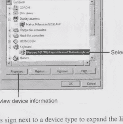

选择设备

点击查看设备信息

- 3. 单击设备类型旁边的加号以展开列表。对于每种设备类型，所有该类型的设备都会出现。
- 4. 单击打印按钮以显示图 1.2 所示的打印对话框。

### 图 1.2

打印系统属性文件的内容。

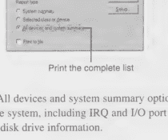

打印完整列表

- 5. 选择所有设备和系统摘要选项按钮。这将打印整个系统的摘要，包括 IRQ 和 I/O 端口摘要、内存和 DMA 使用情况以及磁盘驱动器信息。
- 6. 单击确定将报告发送到打印机。

前面的步骤向你展示了如何打印系统信息。如果你宁愿将此信息保存到电子文本文件，请按照以下步骤操作：

- 1. 打开 Microsoft 系统信息实用程序。单击开始、程序、附件、系统工具、系统信息以显示与图 1.3 所示类似的系统信息。

### 图 1.3

Microsoft 系统信息是查找硬件信息的另一种方法。

选择类别

显示信息

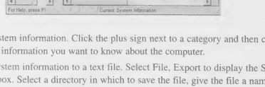

- 2. 显示系统信息。单击类别旁边的加号，然后单击你想要了解的计算机信息类型。
- 3. 将系统信息保存到文本文件。选择文件、导出以显示另存为对话框。选择保存文件的目录，为文件命名（如 `sysinfo.txt`），然后单击保存。
- 4. 查看系统信息文件。打开文本编辑器，如 Microsoft WordPad，并打开你在步骤 4 中创建的文件。示例报告如图 1.4 所示。

### 图 1.4

将系统信息保存到文本文件以供将来参考。

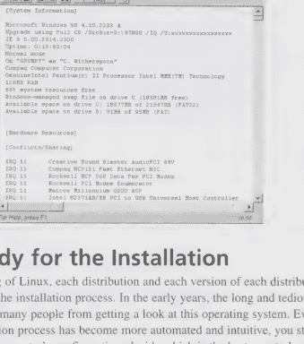

## 为安装做好准备

自 Linux 诞生以来，每个发行版和每个发行版的每个版本都努力简化安装过程。在早期，漫长而繁琐的安装过程阻止了许多人了解这个操作系统。即使安装过程变得更加自动化和直观，你仍然需要确定计算机的配置，决定在系统上加载 Linux 的最佳方式，并了解你选择的 Linux 发行版的安装过程。

在开始 Linux 安装之前，请确保你已做好准备。你需要准备好以下项目：

- 你需要做的第一件事是为你选择的 Linux 发行版的安装 CD-ROM。查看 CD-ROM 的内容是否有任何 `README` 文件。这些文件会给你提示，告诉你在哪里可以找到 CD-ROM 上的更多信息。
- 收集所有必要的硬件信息并阅读 Linux 硬件兼容性 HOWTO。
- 如果计算机无法从 CD-ROM 驱动器启动，你将需要创建一个安装启动盘。即使 CD-ROM 可以启动，创建此启动盘也是一个好主意。你可能在紧急情况下需要此磁盘。
- 在对计算机做任何操作之前，请备份所有数据。没有什么比删除你刚刚创建且尚未上传到 Web 服务器的网站更令人沮丧的了。
- 如果你打算分区硬盘，请运行磁盘碎片整理程序。在分区工具可以将驱动器分割成两个或多个分区之前，磁盘需要先整理清理。

### 任务：创建安装启动磁盘

购买 Linux 盒装套件的一个优点是，盒装套件通常包含启动磁盘以及你可能需要的其他软盘。如果你只有 Linux 发行版的安装 CD，而你的计算机从软盘驱动器启动，你将需要创建一个安装启动磁盘。

#### 新术语

计算机从不同的位置启动，这取决于 BIOS 设置。有些计算机尝试通过先从软盘驱动器查找启动指令，然后再查看硬盘驱动器来启动系统。其他计算机则先查看 CD-ROM。如果你的计算机从 CD-ROM 启动，你就很幸运——只需在准备开始安装 Linux 时将 CD-ROM 放入 CD 驱动器即可。如果你的计算机从软盘驱动器启动，你将需要一个启动磁盘来启动 CD-ROM 上的安装程序。

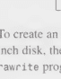

> 一些 Linux 发行版要求你创建其他软盘。TurboLinux 需要一个额外硬件磁盘，它在安装期间用于帮助配置计算机硬件。Slackware 和 Red Hat 也使用救援磁盘，当系统无法正常工作时它很有用。Debian 可以转换为使用软盘来安装系统。

要创建安装启动磁盘，你需要发行版 CD-ROM、一张空白 3.5 英寸磁盘、`rawrite` 程序以及 `rawrite` 的用户文档。要在 MS-DOS 中使用 `rawrite` 程序，请按照以下步骤操作：

- 1. 在 Microsoft Windows 中显示 MS-DOS 提示符。选择“开始”，“程序”，“MS-DOS 提示符”。
- 2. 切换到 CD-ROM 驱动器。键入 `D:` 并按 Enter（其中 `D:` 是你的 CD-ROM 驱动器的驱动器号）。
- 3. 切换到 CD-ROM 上 `rawrite` 程序所在的目录。Linux-Mandrake、Red Hat 和 TurboLinux 将 `rawrite` 存储在 `\dosutils` 目录中（键入 `cd dosutils` 并按 Enter）。在 Slackware 中，`rawrite` 位于 `\install` 目录。示例显示在图 1.5 中。

### 图 1.5

使用 `rawrite` 创建安装启动磁盘。

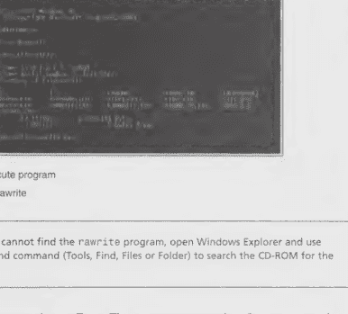

切换到 CD-ROM 驱动器

执行程序

定位 `rawrite`

> 如果找不到 `rawrite` 程序，请打开 Windows 资源管理器并使用查找命令（工具，查找，文件或文件夹）在 CD-ROM 上搜索该文件。

- 4. 键入 `rawrite.exe` 并按 Enter。`rawrite` 程序界面出现并需要输入。
- 5. 指定磁盘映像源文件名。对于 Linux-Mandrake 和 TurboLinux，键入 `D:\images\cdrom.img` 并按 Enter。对于 Red Hat，键入 `D:\images\boot.img` 并按 Enter。在 Slackware 中，键入 `D:\BOOTDSKS.144\bare.i` 并按 Enter。
- 6. 指定目标磁盘驱动器（即软盘驱动器）。键入 `A:` 并按 Enter。然后会提示你将磁盘放入驱动器。完成后，文件将被复制到磁盘上。
- 7. 复制过程完成后取出磁盘。务必适当标记磁盘。例如，如果你选择安装本书后面 CD 上的 Linux-Mandrake 发行版，请将磁盘标记为“Linux-Mandrake 7.1. 安装启动磁盘。”

正如你所见，每个发行版处理安装启动磁盘的创建方式都不同。如果使用这些说明创建启动磁盘时遇到问题，你应该浏览发行版 CD-ROM，查看是否有使用 `rawrite` 和创建启动磁盘的特殊说明。

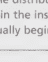

一些发行版还建议你在开始安装之前创建救援磁盘。记住在实际开始安装 Linux 操作系统之前先阅读安装指南。

### 摘要

你现在拥有所需的一切，可以坐在电脑前开始缓慢、逐步的 Linux 操作系统安装过程。在过去的一个小时里，你做出了许多重要决定。你选择了一个发行版和一台兼容 Linux 的计算机来安装该 Linux 发行版。你知道操作系统将驻留在何处，以及随操作系统一起安装的 GNU 程序。你还阅读了所选 Linux 发行版的安装手册。祝好运！

### 问答

Q 人们以哪些不同的方式使用他们的 Linux 系统来帮助他们管理事务和开展业务？

A 目前，Linux 操作系统最流行的用途是运行企业网络和互联网服务器。然而，个人开始找到新的方法让 Linux 为他们服务。许多平面设计师正在享受价格合理的软件工具的可用性。了解艺术家社区如何使用 Linux，请访问 `www.linuxartist.org`。音乐家会在 `www.bright.net/~dlphip/linuxsound` 上找到关于 MIDI 音乐的一些有趣内容。家长注意……你的孩子可能想从该网站下载鼓软件。科学家和工程师会在 `sai.kachinatech.com/index.shtml` 上找到一些专业工具。如果你经常仰望星空，可以尝试 `linux.about.com/compute/linux/library/metalab/blmeta_science_astronomy.htm` 上的一些天文工具。


对于需要帮助保持井然有序的人来说，有许多不同的个人信息程序（例如日历、日记和地址簿）可供选择。使用 `cbb.surgeforge.net` 上提供的 `Checkbook Balancer（CBB）` 或 `www.gnucash.org` 上的 `GNUCash` 管理你的财务。

Q 哪些计算机设备绝对不能与 Linux 操作系统一起使用？

A 简单来说，`Winmodems` 和 `Winprinters`。这些设备依赖于操作系统特定的驱动程序，而这些驱动程序仅为 Microsoft Windows 操作系统开发。

Q 除了 `rawrite` 之外，还有什么其他程序可以用来创建安装启动磁盘？

A 有一个名为 `RawWrite` 的 Windows 版 `rawrite`。你可能在发行版 CD-ROM 上使用文件名 `rawrite.exe` 或 `rawritewin.exe` 找到它。

### 工作坊

通过回答以下问题并完成练习来测试你对本小时所涵盖材料的掌握程度。

#### 测验

- 1. 选择 Linux 发行版时应寻找哪些功能？

初学者最应关注的是安装的简易性和帮助安装操作系统的技术支持。初学者还应购买所选 Linux 发行版的盒装套件。盒装套件包含安装手册和启动磁盘。许多发行版还包含许多附加内容，例如商业程序的试用版。

- 2. Linux HOWTOs 是什么？

`Linux HOWTOs` 是 Linux 在线文档的一部分，由 `www.linuxdocs.org` 上的 Linux 文档项目维护。`HOWTOs` 是关于如何使用 Linux 执行不同任务的说明。操作系统安装后，你将在文件系统中找到 `HOWTOs`（以及其他 Linux 帮助来源）。这些 `HOWTOs` 可以帮助你完成从选择 Linux 发行版到安装操作系统、配置 X Window 系统、设置 Internet 连接以及让计算机播放声音等一切工作。

- 3. Linux 操作系统可在最低的什么计算机配置上运行？

`Linux-Mandrake` 需要 Pentium 处理器（或兼容），软盘驱动器、`CD-ROM` 驱动器、`32MB RAM`、`500MB` 硬盘空间和显卡。

- 4. 在开始安装 Linux 之前，你需要了解计算机的哪些信息？

`Linux` 硬件兼容性 `HOWTO` 列出了与操作系统兼容的所有计算机硬件。至少，你需要知道硬盘上可用空间有多少，`CD-ROM` 驱动器的接口类型，

内存容量、串行和并行端口的详细信息、键盘和鼠标类型、显示器规格、调制解调器或网卡类型，以及视频和声卡规格。

- 5. 安装启动盘的用途是什么？

如果计算机从软盘驱动器启动，则需要启动盘来启动 `CD-ROM` 上的安装程序。

#### 练习

- 1. 开始记录 Linux 日记。找一本笔记本或活页夹来记录笔记。记录你能收集到的有关计算机配置的一切信息。写下你在 Linux 安装过程中所遵循的步骤。安装完成后也要继续维护你的 Linux 日记。记录你对系统所做的更改、连接到系统的外设、用户账户，以及遇到的任何问题及其解决方案。

- 2. 在开始安装 Linux 之前先休息一下。收集所需材料、准备计算机并安装操作系统和 GNU 程序可能需要两到三个小时。


## 第二小时

### 安装 Linux-Mandrake

是时候加载 GNU/Linux 操作系统了，本小时假设你将使用本书后面附带的 Linux-Mandrake 发行版 CD-ROM。即使你选择了另一个 GNU/Linux 发行版，本小时的信息仍可作为安装过程的一般指导，因为所有发行版都遵循相同的安装程序。

本小时你将

- 收集安装操作系统所需的一切

- 在计算机上安装操作系统、应用程序和 X Window 系统

- 学习如何使用超级用户和无特权用户账户登录系统

- 重启和关闭计算机

### 准备工作

是时候安装 GNU/Linux 操作系统了。如果这是你的第一次尝试，祝好运！如果你以前尝试过但失败了，你已经积累了一些经验，这次应该会做得更好。如果你以前尝试过并且成功了，太棒了！

本小时将指导你完成安装过程。不幸的是，我们无法涵盖每台计算机的每种情况。本小时提供的安装说明旨在作为指导，帮助你完成流程。大多数 GNU/Linux 发行版在 CD-ROM 上包含安装手册，你应在开始前阅读。了解的越多，安装过程就会越顺利。

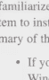

> 如果你在开始安装前觉得需要再阅读一个资源，可以尝试阅读 `www.linuxdoc.org/LDP/gs/gs.html` 上的 Linux 安装与入门指南。

### 安装过程概述

如果这是你第一次安装 GNU/Linux 操作系统，你应在开始前熟悉该过程。这不是一个容易安装的操作系统，但如果你做好准备，可以避免很多挫败感。以下是你在计算机上安装 GNU/Linux 时将经历的步骤摘要：

- 如果你计划在运行 Microsoft Windows 的同一台机器上运行 GNU/Linux，你必须为 GNU/Linux 创建单独的空间。你有两个选择：要么添加第二个硬盘，要么分区 Windows 驱动器。许多发行版允许你在安装过程中分区驱动器。其他发行版则要求在开始安装前必须创建单独的分区（发行版将驻留在其中）。

- 开始安装过程。你需要安装启动盘（你在第 1 小时“为安装做准备”中创建的）和 `Linux-Mandrake` `CD-ROM`（或，如果你选择了其他发行版，则使用该 `CD-ROM`）。在安装过程开始时，你将被要求回答一些关于系统的基本问题——你的语言、鼠标和键盘。

- 设置文件系统并格式化分区。`GNU/Linux` 可以将所有内容存储在单个分区中——系统文件、配置文件和用户数据文件——但这不是一个好主意。为了在遇到问题时让生活更简单一些，你应该至少设置三个分区：一个用于交换空间，一个用于系统文件，一个用于用户文件。

- 配置硬件并设置用户账户。在安装过程中，你有机会创建拨号 Internet 连接、设置系统时钟、配置打印机并添加用户账户。如果你宁愿等到有更多时间和经验，可以暂时跳过打印机和拨号连接，稍后再添加。

- 在你可以使用为 GNU/Linux 设计的众多图形用户界面之前，必须安装并配置 `X Window` 系统。`X Window` 系统控制视频卡、显示器和显示器显示（如屏幕分辨率和颜色深度）。这是安装中最棘手的部分，重要的是你手边要有视频卡和显示器规格。

### 分区你的硬盘

本书后面附带的 `Linux-Mandrake` 发行版以及许多其他发行版的安装程序中都提供了分区硬盘以腾出 GNU/Linux 空间的选项。你可以在不损坏 Microsoft Windows 安装或驱动器上任何数据的情况下执行此操作。

> 在尝试安装任何 GNU/Linux 发行版或分区硬盘之前，请确保你已做好准备并且计算机也已做好准备。尽可能多地了解这个新操作系统。如果你宁愿购买已预装 GNU/Linux 的计算机系统，请访问 GNU 项目网站 `www.gnu.org/links/companies.html`。

> 不幸的是，也可能是幸运的是，并非所有发行版都相同。`Slackware` 和 `Debian` 发行版的安装程序中没有自动磁盘分区功能。如果你安装的是这两个发行版之一或另一个非自动化的 Linux 发行版，你将不得不手动分区驱动器（当然使用工具）。

如果你在只有一块硬盘的 Windows 计算机上安装 Linux，并且希望能够在不涉及另一个操作系统的情况下启动一个操作系统，你将不得不做出安排来共享驱动器。你可以从多种分区工具和方法中选择。

> 无论是否创建分区，都应在安装前准备好硬盘。在开始前从 Windows 操作系统运行 `ScanDisk` 和磁盘碎片整理程序。

`DOS fdisk` 程序可用于分区驱动器，但它会清除磁盘上的所有数据。如果你使用 `DOS fdisk`，你需要在开始前备份 Windows 系统，使用 `fdisk` 程序分区驱动器，重新安装 Windows，然后才能安装 Linux。

如果你不想破坏 Windows 数据，可以使用 `fips` 实用程序来分区驱动器。`fips` 已存在一段时间，但它不提供任何保证，你仍应备份系统。`fips` 实用程序可以在大多数发行版的安装 `CD-ROM` 上找到；如果你的 `CD` 上没有，可以从镜像站点下载。

另一个选择是使用商业磁盘分区程序，如 PowerQuest 的 `PartitionMagic`。这些工具通常价格不贵，并且具有一些不错的功能。`PartitionMagic` 在创建驱动器上的其他分区时仍会保持你的 Windows 系统完整。它还允许你在分区之间移动数据和程序，并实时调整分区大小。

无论你使用哪种方法，你都需要在驱动器上创建一个空的未格式化分区。你创建的分区将被安装程序分割和格式化，使其成为 Linux 文件系统的理想之家。

### 按照安装过程进行


# 安装准备

准备好了吗？你是否收集了有关计算机所需的所有信息？你是否准备好了硬盘？你手边是否有发行版 CD-ROM 和安装启动盘？如果以上所有问题的答案都是肯定的，请将安装启动盘放入软盘驱动器，将 CD-ROM 放入 CD-ROM 驱动器，然后重新启动计算机。即使你的计算机可以从 CD-ROM 驱动器启动，创建安装启动盘并始终将其放在系统附近也很重要。

当计算机重新启动时，你会看到一个启动画面。此时，按 `F1` 可在开始前获得简短介绍，或按 `Enter` 开始安装。在安装过程开始之前，系统将扫描以检测连接到系统的硬件。安装过程将查找硬盘、CD-ROM 驱动器以及任何 SCSI 适配器（如并行端口 Zip 驱动器）。完成后，第一个安装屏幕会出现，要求你选择语言。在继续之前，以下是 Linux-Mandrake 每个安装屏幕的工作方式：

- 在屏幕左侧边缘是安装过程遵循的步骤列表。你需要按顺序完成这些步骤。随着安装的进行，已完成的步骤显示绿色星号，正在进行的步骤用橙色星号表示，未执行的步骤显示红色星号。
- 在左下角（安装步骤列表下方）有一排彩色按钮。这些按钮会改变安装界面的外观。如果您想要不同的配色方案，可以在安装过程中随时点击这些按钮中的任意一个。
- 屏幕左上方包含输入区域。在安装过程的每个步骤中，您将被要求回答一些问题。您可以使用鼠标滚动列表、选择选项，并在每屏问题回答完毕后点击“确定”按钮。
- 屏幕左下角包含有助于您回答屏幕左上方提出的问题的信息。在回答任何问题或选择任何选项之前，您应阅读此帮助信息。使用右侧边缘的滚动条查看所有文本。
- 在浏览每个屏幕时，您可能会发现某些选项已被预先为您选中。这些默认值基于安装过程在扫描系统时找到的信息。对于大多数屏幕，您会发现默认选择对您的系统是正确的。如果是这样，请接受默认值并继续下一步。如果默认选择不正确，请在继续之前选择正确的选项。您需要将所选选项与第 1 小时收集的系统信息进行核对。

## 提供设置信息

第一步是提供一些必要的信息，以便安装过程知道如何进行。首先会要求您选择一种语言。默认情况下会选择“英语（美国）”选项。如果英语不是您的语言，请滚动列表并选择您想要使用的语言。做出选择后，点击“确定”以进入下一步。


> 您不必使用鼠标来选择选项。使用 `Tab` 键在各个字段之间移动，或从一个字段移动到“确定”按钮。箭头键可在选项列表中移动。使用空格键选择一个选项。

接下来会要求您选择一个安装类别。有三个选择：推荐、自定义和专家。如果您想要轻松安装（Linux-Mandrake 会为您做出选择），请选择推荐安装类别。如果想要对安装有更多控制，请选择自定义安装类别。自定义类别使您可以选择要安装在系统上的软件包（或应用程序）。只有真正知道自己在做什么的人才应使用专家安装类别。本节使用自定义安装类别来说明安装过程。

自定义安装类别需要知道您将如何使用系统。您有三个选择：普通、开发和服务器。如果您将使用系统来协助完成作业、管理支票簿、帮助提高小型企业的生产力、冲浪互联网或寻找一些娱乐，请选择普通类别。

接下来，会询问系统是否连接了任何 SCSI 设备。如果连接了 SCSI 设备，请选择“是”以显示 SCSI 设备列表。从列表中选择您的设备。

处理完 SCSI 设备后，会询问您的键盘。再次强调，正确的键盘应默认被突出显示。


Linux-Mandrake 有一个额外的步骤，会询问您一些杂项问题：

- 硬盘优化。最好对这个问题回答“否”。如果您回答“是”，而您的硬盘不支持优化，后续可能会出现问题。
- 安全级别。安全级别决定超级用户（或系统管理员）如何登录系统。如果您希望超级用户直接登录到 root 账户，请选择低或中等安全级别。如果您希望超级用户从用户账户登录（使用 `su` 命令），请选择高安全级别。
- RAM 内存量。安装过程会自动检测系统上安装的 RAM 数量。如果此数字不正确，请在文本框中输入正确的 RAM 数量。
- 可移动媒体自动挂载。这是一个非常实用的功能。设备的自动挂载意味着每当您将软盘、Zip 磁盘或 CD-ROM 放入相应驱动器时，系统会自动知道您已这样做。如果您选择不自动挂载设备，则在插入磁盘后需要告诉操作系统您想要使用该驱动器。您将在第 9 小时“连接硬件设备”中学习如何手动挂载设备。
- 启动时启用 Num Lock。如果您使用键盘右侧的数字键盘，您可能希望选择此选项。

## 设置文件系统

现在是设置要安装 Linux 操作系统的硬盘（或硬盘上的分区）的时候了。建议您为 Linux 文件系统设置四个分区：引导分区、根分区、交换分区和主目录分区。

> 您可以通过点击“自动分配”按钮让 Linux-Mandrake 自动创建所需的各个分区。

Linux 可以作为机器上唯一的已安装操作系统设置，也可以与其他系统共用硬盘。许多老旧设备在尝试运行功能齐全的现代 Windows 版本时可能会不堪重负。

> **选择测试系统**
>
> 我们有一台古董电脑，多年来一直用来练习驾驭激动人心且坎坷的 GNU 之路。它是一台 Pentium 133，作为 Microsoft Windows 机器，其用途几乎已经消失。它不断崩溃，硬盘的声音就像洗衣机一样。两年前，我们将其作为唯一操作系统安装了 GNU/Linux，此后只需进行例行系统维护即可保持运行；自那以后它一直像小猫一样平稳运行。我们每天都将其用作测试机和工作站。

列表 2.1 显示了使用 GNU/Linux 作为唯一操作系统的示例文件系统设置。显示的信息适用于仅运行 Linux 操作系统、具有 16 GB 硬盘和 192 MB RAM 的计算机。

### 列表 2.1 使用 GNU/Linux 作为唯一操作系统创建分区

| 设备 | 文件系统类型 | 大小 | 挂载点 |
|---|---|---|---|
| `hda1` | Linux 原生 | 118MB | `/boot` |
| `hda2` | Linux 原生 | 9996MB | `/` |
| `hda3` | Linux 原生 | 5500MB | `/home` |
| `hda4` | Linux 交换 | 509MB |  |

列表 2.2 显示了双启动计算机的文件系统设置示例。此示例适用于最初设置为运行 Microsoft Windows 的计算机。在安装前已对其进行分区以腾出空间给 GNU/Linux，它具有 6.5 GB 硬盘和 64 MB RAM。

### 列表 2.2 在双启动计算机上创建分区

| 设备 | 文件系统类型 | 大小 | 挂载点 |
|---|---|---|---|
| `hda1` | Win98 FAT32 | 3000MB |  |
| `hda2` | Linux 原生 | 7MB | `/boot` |
| `hda3` | Linux 原生 | 2865MB | `/` |
| `hda4` | Linux 原生 | 500MB | `/home` |
| `hda5` | Linux 交换 | 128MB |  |

在为文件系统设置好不同的分区后，需要对分区进行格式化。如果这是您第一次安装 GNU/Linux，您希望将所有文件系统空间格式化为 Linux 原生，将交换空间格式化为 Linux 交换。您还有机会在格式化驱动器之前检查硬盘上的坏块（或错误）。您应将检查坏块作为预防措施。

## 决定安装哪些软件

如果您选择了自定义安装类别，您将被要求从软件包组列表中进行选择。要安装所有软件，您需要在根分区中至少有 1.3 GB 的硬盘空间。列表 2.1 显示了名为 `hda2` 的设备上的根分区（具有 9996 MB 空间）。列表 2.2 显示了设备 `hda3` 上的根分区，其空间为 2865 MB。

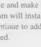

> > 如果您购买了盒装 Linux-Mandrake 发行版，您可能拥有不止一张 CD-ROM。系统会询问您是否拥有第二张 CD-ROM。系统还会提示您何时更换 CD-ROM。

如果系统上的根分区没有足够的空间，您需要从列表中取消选择软件包组。如果您不确定要取消选择哪些软件包，只需全部保留选中状态，安装过程将决定可用空间并自行决定安装多少软件。安装程序会先安装最受欢迎和常用的应用程序，然后继续添加应用程序（使用其自身的优先级方案），直到分区大部分被填满。


> > 在阅读本书的过程中，您可能会发现系统上没有某个应用程序。您可以轻松地从 CD-ROM 安装更多软件。只需翻到第 15 小时，“安装软件。”

选择完软件包后，是时候休息一下，让计算机自行工作了。根据您选择的软件包以及计算机的速度，安装所有软件可能需要 15 到 45 分钟不等。在软件安装过程中，您可以观看进度。每安装一个软件包，您都会看到该软件包的名称和简要说明。

## 配置系统


现在是告诉安装程序您如何使用计算机的时候。其中一些步骤如果您现在不想处理可以跳过。您以后随时可以返回来设置您的 Internet 连接或将打印机连接到计算机。

系统会询问您是否要配置网络。如果计算机连接到局域网，您需要从系统管理员那里获取一些信息（例如计算机的名称和 IP 地址）。如果计算机将用于连接 Internet，您现在可以创建拨号连接，也可以等到第 21 小时“连接到 Internet”学习如何设置调制解调器并连接到您的 ISP。

为了正确设置时钟，操作系统需要知道您所在的时区。滚动列表并找到离您最近的城市。

如果计算机上连接了打印机，您可以在此时配置打印服务，也可以等到第 11 小时“打印文件”来设置打印机。

接下来会要求您为 `root` 账户分配密码。`root` 账户，或超级用户，是操作系统的系统管理员。该账户没有任何限制；这使得超级用户可以对系统做任何她想做的事情。此账户应仅用于系统维护，不应用于常规使用（如打字或画画）或在 Internet 上冲浪。

为了让您不必使用超级用户账户开始第一次 GNU/Linux 体验，一些发行版会要求您设置一个无特权用户账户。您需要知道用户的真实姓名，选择一个用户名，然后提供密码。

接下来，您需要创建一个启动盘。此步骤需要准备一张空白软盘。按照说明创建启动盘，然后将磁盘标记为类似“Linux-Mandrake 7.1 Boot Disk”。创建此磁盘非常重要。如果引导加载程序未正确安装，此磁盘将使您能够启动操作系统，以便您开始享受 GNU/Linux 所提供的一切。

在此安装部分的最后一步询问您希望将 Linux 引导加载程序 `LILO` 安装在何处。Linux-Mandrake 会建议 `LILO` 的安装位置。

### 新术语

引导加载程序是在 `BIOS` 加载后立即介入的程序，它为您提供启动计算机上可能安装的多个操作系统之一的机会。与 Linux 一起安装的引导加载程序是 `LILO`。

## 使用 X Window 系统

安装过程的结束是最困难的，也是最重要的。是时候设置您的显卡和显示器，以便您可以使用 X Window 系统。您需要它来使用任何图形桌面环境，例如 `GNOME`。如果显卡和显示器被列为 GNU/Linux 操作系统的兼容硬件，此过程会容易得多。

您首先会看到一个显示器列表。搜索列表以查看您的显示器是否在其中。如果没有，您需要选择其中一个通用显示器。选择与您的显示器功能相同的显示器。例如

```
A monitor that can do 1024 x 768 at 60hz
```

接下来，您将为显示器选择分辨率和颜色深度。非常重要的一点是不要超过显示器和显卡的功能。

输入正确信息后，安装程序会询问您是否要测试 X 配置。回答“是”。您应该会看到一条消息，内容为 Can you see this？如果可以，请选择“是”。不用担心：如果看不到该消息，几秒钟后系统会假定测试失败，并将您送回开头重新尝试。

X 配置过程中的最后一步是告诉系统您是否希望系统在启动时自动启动 X Window 系统。单击“否”按钮。如果您遇到问题，您宁愿在系统启动时处于 shell 提示符下。从 shell 提示符下，您只需输入 `startx` 即可显示图形用户界面。

恭喜！您已完成漫长的安装过程。取出软盘和 CD-ROM，然后让系统自行重新启动。

# 登录和注销

您可以停止屏住呼吸了。看看您的显示器；您应该会看到登录提示。什么是登录提示？简单来说，登录提示就是您输入一个唯一名称以标识自己为系统授权用户的地方。根据您安装的发行版以及您如何设置 X Window 系统，登录提示可能有各种形状和形式。如果您安装了 Linux-Mandrake 并且选择不在系统启动时启动 X Window 系统，登录提示及其相关信息可能如下所示 Listing 2.3 所示。

### LISTING 2.3 Linux-Mandrake 登录屏幕示例

```
Linux Version 2.2.15-0.25mdk
Compiled #1 Mon Apr 24 03:00:34 PDT 2000
One 133MHz Intel Pentium Processor, 80M RAM
264.60 Bogomips Total
localhost.localdomain

Linux Mandrake release 7.1b (hydrogen)
Kernel 2.2.15-0.25mdk on an i586 / tty1
localhost login:
```

信息很多。是的，各位，这不是您在 2.1 和 2.2 节中看到的计算机。它是我们计算机实验室中的另一台计算机，也是您在翻阅这些页面时最常看到的那一台。Listing 2.3 显示了一台老旧破旧的计算机，配备 133MHz Pentium 处理器和 80MB RAM。但回到重点，登录提示，后面跟着光标。登录是什么意思？登录涉及提供用户名和密码，Linux 会验证这些信息以确定用户是否有权访问计算机系统。

### 新术语

当您安装和配置 Linux 系统时，您至少设置了一个用户账户——超级用户账户，其用户名为 `root`。超级用户可以不受限制地访问整个操作系统——每个文件和每个命令。只有超级用户才能更改系统设置和配置。您可能还设置了一个无特权用户账户。此账户分配给普通用户。此类用户可以访问其主目录中的文件以及普通用户使用的文件（如帮助文件和程序执行文件）。

此时，您需要在使用系统之前向系统提供您的用户名。您提供的用户名由您决定。每个发行版都要求为名为 `root` 的用户创建账户。此账户分配给超级用户（或负责维护和更新计算机系统的人员），并且应仅在执行系统管理任务时使用。

### 新术语

系统管理员负责计算机、计算机操作系统、附属外设、已安装应用程序和数据文件的维护、升级、修复、配置和安全。系统管理员向系统上的各个用户授予对计算机、外设和文件的访问权限。系统管理员还确保用户在操作系统时不会遇到问题，并且系统配置为高效地帮助他们完成工作。

您的另一个选择是以无特权用户身份登录。您可能在安装期间有机会设置这种类型的用户账户，也可能没有。如果您没有设置，请转到第 12 小时“与系统上的其他用户共享文件”，以学习如何创建一个无特权用户账户。这就是你将使用最多的账户。无特权用户账户是你进行日常工作的场所，例如撰写信件、搜索互联网、为你的网页创建图形，以及保持支票簿平衡。

列表 2.4 显示了一个普通用户账户的登录会话示例。进入系统非常容易。首先，输入分配给你的用户名然后按 Enter。你将被要求输入密码。注意，输入密码时你看不到密码。输入完密码后，按 Enter。如果登录成功（即系统在数据库中找到你的用户名和密码），你就可以开始探索了。

### 列表 2.4 用户名为 rusty 的登录会话

```
localhost login: rusty
Password:
[rusty@localhost rusty]$
```

## 以超级用户身份登录

有两种方式作为超级用户工作。第一种是直接登录到 `root` 账户。这意味着你输入 `root` 的用户名然后提供 `root` 账户的密码。

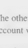

> 由于超级用户可以访问系统上的每个文件、命令和程序，超级用户可能会导致系统崩溃、删除文件或进行其他破坏性更改。请谨慎地只将超级用户密码交给需要知道的人，并仅将超级用户账户用于系统管理。使用无特权用户账户执行其他工作。

另一种成为超级用户的方法是在你的用户账户中工作时临时切换到超级用户账户。这涉及执行 `su` 命令。

## 在控制台之间切换

你一次可以运行六个不同的用户会话。使用键盘顶部的功能键。`F1` 到 `F6` 是可用的控制台。按 `Alt` 加上适当的功能键在控制台之间移动。


> 在使用多个控制台时要注重安全。很容易忘记多个控制台和用户账户是打开的。在离开计算机之前，请检查每个控制台，确保没有用户登录。这有助于防止未经授权进入系统。

## 任务：探索登录过程

在你能让新的操作系统绕着街区开之前，你需要转动钥匙启动引擎。你的钥匙是用户名和密码。按照以下步骤学习如何登录超级用户账户和你的无特权用户账户：

- 1. 访问超级用户账户。在登录提示符处，输入 `root` 并按 Enter。密码提示将出现。
- 2. 输入 `root` 密码并按 Enter。`root` 用户账户的 shell 提示符将显示，可能看起来像以下内容：

  `[root@localhost /root]#`
- 3. 切换到不同的控制台。按 `Alt+F2`。
- 4. 访问你的用户账户。在登录提示符处，输入你在安装期间设置的无特权用户账户的用户名并按 Enter。你将被要求输入该账户的密码。输入密码并按 Enter。
- 5. 从无特权用户账户临时切换到超级用户账户。输入 `su` 并按 Enter。你将被要求输入 `root` 用户账户的密码。输入密码并按 Enter。shell 提示符可能看起来像以下内容：

  `[root@localhost rusty]#`


6. 退出超级用户账户。输入 `exit` 并按 Enter。你将被返回到你的用户账户，再次 shell 提示符可能看起来像以下内容：

`[rusty@localhost rusty]$`

你希望从此用户账户进行日常工作。要返回 root 用户登录的控制台，请按 `Alt+F1`。

## 安装故障排除

在安装期间你可能需要一些额外帮助。你可以在许多地方找到一些好的信息。一个好的来源是 Linux HOWTOs。你可能在文件系统中找到它们，如果不在那里，它们在网页上位于 `www.linuxdocs.org`。以下是你可能会觉得有用的 Linux HOWTOs 列表：

- 安装 HOWTO
- 配置 HOWTO
- 在线故障排除 HOWTO
- 提示 HOWTO
- 分区迷你 HOWTO
- 多磁盘 HOWTO
- LILO 迷你 HOWTO
- 使用 LILO 多重启动迷你 HOWTO
- 启动盘 HOWTO
- 从开机到 Bash 提示 HOWTO

## 任务：关闭系统

当是时候在晚上关闭计算机时，必须请指定的系统管理员介入。关闭系统是系统管理员的工作，因为 `shutdown` 命令只能由超级用户账户执行。这是你作为系统管理员的第一个任务。按照以下步骤登录超级用户账户并关闭计算机：

- 1. 注销你的用户账户。输入 `logout` 并按 Enter。
- 2. 返回 root 用户登录的控制台。按 `Alt+F1`。
- 3. 终止会话。输入 `shutdown -h now` 并按 Enter。系统将进行关机过程并关闭服务和卸载设备。你会在屏幕上看到长长的项目列表滚动。当操作系统关闭自己后，屏幕底部会出现一条消息，告诉你断电。

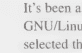

> 如果你只是想重新启动计算机，输入 `shutdown -r now` 并按 Enter。

### 摘要

时间过得真快，但希望你已经使用全新的 GNU/Linux 操作系统启动并运行了。在这一小时里，你安装了操作系统，选择了想要尝试的应用程序类型，并配置了 X Window System，以便在屏幕上显示很酷的图形。系统设置好后，你学习了如何登录超级用户和无特权用户账户以及如何关闭操作系统并关闭计算机。现在你准备好开始探索一个完全由 GNU 组成的自由软件世界了。玩得开心！

### 问答

Q 我真的很想使用 GNU/Linux 操作系统，但我不想安装它。我还有其他选择吗？

A 你可以邀请一位 GNU/Linux 专家共进晚餐，然后请他为你安装操作系统和应用程序。你可能需要用一些自制的葡萄干燕麦饼干作为甜点来贿赂他。你也可以查看你附近的 GNU/Linux 用户组。许多 GNU/Linux 用户组会举行安装会议，你可以带上你的计算机，让别人帮助你安装。你可以在 `www.linux.org/users` 找到用户组列表。你也可以购买预装 Linux 的计算机。要查找供应商列表，请访问 `www.linux.org/hardware`。

Q 是否有其他程序可以用作 LILO，在 Microsoft Windows 和 GNU/Linux 之间启动？

A 我们知道有两个商业程序。如果你想在多个操作系统之间启动，可以尝试 `System Commander`（`www.systemcommander.com`）或 `BootMagic`。`BootMagic` 包含在 PowerQuest `PartitionMagic` 程序中（`www.powerquest.com`）。一些发行版使用 `grub` 在系统启动时选择要加载的操作系统。

Q 当我设置 X Window System 时，我告诉安装过程在系统启动时自动启动 X Window System。如何绕过图形登录显示并在纯文本显示上显示登录提示？

A 你需要切换到不同的虚拟终端。按 `Ctrl+Alt+F1` 查看纯文本登录提示。如果你想返回图形登录，请按 `Alt+F7`。

### 工作坊

通过回答以下问题并完成练习，测试你对本小时所涵盖材料的掌握程度。


### 测验

1. 你可以使用哪些程序在硬盘上创建一个单独的分区来安装 GNU/Linux？

最简单的方法是用商业程序如 PowerQuest 的 `PartitionMagic` 来分区硬盘。`PartitionMagic` 在创建可安装 GNU/Linux 的另一个分区时保持 Windows 系统完整。另一种可靠的方法是使用 `fips`。`fips` 实用程序也允许你在不破坏 Microsoft Windows 安装的情况下创建第二个分区。还有 DOS `fdisk` 程序。此程序会擦除磁盘上的所有数据。在使用 `fdisk` 之前，请记住使用 Windows ScanDisk 和磁盘碎片整理，并备份系统。分区创建后，你需要重新安装 Microsoft Windows，然后才能安装 GNU/Linux。

2. 安装 GNU/Linux 操作系统的基本步骤是什么？

第一步是如果你计划在同一硬盘上同时运行 GNU/Linux 和另一个操作系统，则为 GNU/Linux 创建单独的分区。第二步是通过将安装启动软盘和发行版 CD-ROM 放入适当的驱动器来开始安装过程。然后你需要提供有关计划使用的语言、键盘和安装类别的信息。第三步是设置文件系统。在此步骤中，你为交换空间、系统文件和用户主目录创建分区。第四步的部分是可选的。你有机会将计算机连接到网络或互联网，设置时间，配置打印机并创建用户账户。最后一步是配置 X Window System，这样你就不必在枯燥的纯文本屏幕上工作了。

3. 你需要安装发行版 CD-ROM 上找到的所有软件包吗？

不需要。如果你愿意，可以从最小设置开始，然后随着进展添加程序。只要发行版 CD-ROM 在附近，你就可以快速安装另一个应用程序。此外，如果你确实安装了所有内容，后来硬盘空间不足，你可以同样轻松地删除不使用的应用程序。

4. 超级用户账户和无特权用户账户有什么区别？

超级用户账户（使用用户名 `root`）可以不受限制地访问操作系统。这意味着每个文件、每个命令和每个应用程序。超级用户负责系统管理任务，例如更改系统设置和修改配置。无特权用户账户供所有其他用户使用。这些用户可以访问其主目录中的文件和所有用户使用的公共文件（如帮助文件和程序执行文件）。超级用户还应设置一个无特权用户账户用于工作。

### 练习

- 1. 尝试以不同方式访问超级用户账户。你需要找到仅在必要时使用该账户的方法，并使其登录和注销既快速又方便。学习如何使用单独的控制台执行管理性和配置任务。如果你在桌面环境中工作，请学习如何使用终端模拟器并从用户账户切换到超级用户。你还需要确定家庭或公司中哪些成员需要对系统拥有超级用户访问权限。培训这些人，使他们了解何时以及如何在使用超级用户账户。
- 2. 如果你的 GNU/Linux 安装成功了，就庆祝吧。出去吃晚饭，去海滩，穿凉鞋！如果你的 GNU/Linux 安装不成功，尝试一些故障排除思路。并且，如果那样也不起作用，你可能需要重新开始安装。但，你仍然可以庆祝，因为你在过去一小时里付出了很多努力。


## 第 3 小时

### 安全是第一要务

安全在 Linux 以及所有 UNIX 操作系统中如此根深蒂固，其内置的文件访问和权限系统构成了控制系统中每个文件的基础。UNIX 操作系统将一切视为文件，因此安全在系统内的每个功能和每项操作中都占有重要地位。

安全系统的内部工作原理在全书中都有涉及。安全是一个无处不在的问题，你将经常遇到它。在使用 Linux 时，请记住，在安全方面，预防就是游戏规则。

在本小时，你将

- 维护计算机设备、软件程序和数据的物理安全
- 通过分配密码来限制系统访问，并从超级用户账户执行系统管理任务
- 创建用户和组账户以共享文件，并为共享文件分配权限
- 跟踪系统使用情况，并安排定期的系统和文件维护

### 锁定系统

显然，保护设备和数据最明显的方法之一就是将其锁在只有你有钥匙的地方。这可能看起来是对问题的过度简化，但在现实中，保持设备的物理安全非常重要。对家庭办公室或小型企业而言，计算机和外设的投资可能相当可观。此外，这还不包括软件成本或数据的价值。

计算机的使用地点和方式是决定其应如何保护的决定因素。这可能差异很大，从对家里的游戏电脑不做任何保护，到将供客户使用的电脑永久性地用超强胶水粘在它所在的桌子上。你需要决定自己属于哪一种。确定之后，你就可以确定需要采取什么措施以物理方式保护设备，使其符合你特定情况的需求。

### 创建备份和灾难计划

没有人希望早上打开电脑，却发现程序损坏、数据丢失。如果发现为大老板准备的大报告（你知道，就是你因为及时完成而感到高兴的那份报告）全部变成乱码或干脆丢失，那将是一个令人不安的情况。而且情况可能更糟。

自计算机时代以来，计算机用户一直在寻找保护免受“丢失文件事件”侵害的方法。没有人喜欢这种惊喜。从灾难性损失中恢复的能力完全取决于你事先妥善保存了哪些资产，可以用来在一定程度上恢复丢失的内容。

### 备份文件系统


你可能经历过，或至少见过他人经历过一些重大的计算能力和重要数据损失。这些事故原因多种多样——从意外的硬件故障到无意中误删。回顾任何一次经历，用事后诸葛亮的眼光来看都可能成为很好的教学工具，但你需要有前瞻性来为大多数灾难做好准备。没有人能预测未来，但你可以制定一个计划，一种以合理方式应对的策略。

规划和实施良好的备份实践可以大大减轻管理多用户系统的担忧。它还可以提供一种近乎万无一失的方法，确保至少部分数据（直到最近一次计划备份为止的数据）不会丢失。显然，你越早制定这样的计划并付诸实施，你的情况就越安全。


> 你将在第 10 小时“备份和恢复文件系统”中学习如何创建和实施备份计划。

### 保持文件安全

任何熟悉计算机及其使用的人都知道，有时文件会莫名其妙地丢失。导致这种情况的原因有很多：误删、硬件故障、操作失误、软件错误、白蚁、蟑螂，以及神秘的恶意外星黑客等等。但也有一些缓解措施。安全系统中内置了工具，可以帮助你应对麻烦。这些工具可用于保护你的文件免受我们刚刚列出的所有威胁以及更多威胁。

### 火灾和洪水规划

任何灾难管理与恢复计划的首要考虑是决定你可以采取什么措施来防止对系统造成的所有现实威胁。显然，不同的系统和情况存在很大差异，需要特别考虑。有一句真理是，安全性越高，使用起来就越不方便。考虑到这一点，你可以看到，这一规划练习中非常重要的一部分是确定你和你的用户愿意在多大程度上容忍为确保所需的安全措施所带来的不便。

为最坏的情况做准备：它可能真的会发生。当你决定备份要怎么做时，可以试着想象如果大楼一夜之间烧毁，你会怎么做。想象一下，你必须在没有任何东西的情况下让业务重新运转，只有前一晚备份并存放在防火保险箱中的数据。这样想想，看看是否不会激发一些好主意。

### 任务：创建安全检查清单

由于许多人依赖计算机来处理他们的业务和个人事务，思考计算机的安全性和可靠性非常重要。以下是一些你需要回答的问题，以帮助你开始思考一个良好可靠的安全计划：

- 1. 拿出你的 Linux 日记，开始一个名为“安全计划”的部分。你将使用这一部分来回答一些基本问题，帮助你开始保护计算机和数据安全。
- 2. 计算机是否位于安全的地方？确保计算机免受灰尘、热量和湿度等环境危害的影响。
- 3. 任何路过的人都能使用这台计算机吗？你可能不希望每个人都使用计算机。如果是这样，请将计算机放在只有授权用户才能访问的地方。
- 4. 你的房主/租户/企业保险单是否涵盖计算机的更换？你还应查明保险单是否会因机器丢失而导致的停工时间损失提供赔偿。
- 5. 谁将使用计算机？每个将使用 Linux 系统的人都需要分配一个用户账户。列出需要访问机器的人员名单。
- 6. 系统用户中是否有人需要共享文件？如果是，请确定谁需要与谁共享文件，以及每个人需要如何使用这些文件。
- 7. 你是否有备份重要文件的方法？这是必须做的一项。许多工时、金钱和客户都因文件被意外删除或系统崩溃而损失。

请记住，这份清单只是一个开始。随着你在本小时及后续小时的学习，请思考你的安全计划并在途中添加新想法。

### 保护超级用户安全

`root` 账户属于系统超级用户，也就是系统管理员。登录到 `root` 账户的人可以访问整个系统，包括系统上其他用户的账户。黑客入侵你的系统时，真正想要的就是 `root` 访问权限，以便为所欲为。保持 `root` 账户不受未经授权的人员和可能因意外而误入的人员的侵犯是至关重要的。如果 `root` 账户被攻破，整个系统都可能丢失。

你应该始终遵循的一个经验法则是，仅在执行系统管理任务时才使用超级用户账户。系统管理任务包括进行系统配置更改，例如添加新硬件或向系统添加用户。

> 保持 `root` 账户安全的关键在于良好的密码管理。你还希望创建一个无特权的用户账户来进行工作。有关这些内容的详细说明，请参阅第 12 小时，“在系统上与其他用户共享文件”。

## 以超级用户身份执行管理任务

Linux 的一大乐趣在于你有极好的机会学习成为自己的系统管理员。事实上，如果这是你的 Linux 系统，你就必须成为自己的系统管理员。这可能比你过去所经历的更深入地参与操作系统的技术工作。对于那些之前仅使用过 Apple Macintosh 和 Microsoft Windows 操作系统的用户来说，这尤其可能如此。然而，Linux 是一种多任务、多用户操作系统，能够同时满足多个任务和多个用户的需求。正因为这种灵活性和强大的广阔世界，控制和操作安全就显得尤为重要。拥有 `root` 或超级用户账户密码的人可以更改系统中的任何内容。关键在于能够更改需要更改的内容，而不会损害操作系统的完整性或用户在其各自账户中的自主性。

Linux 完全可配置。这意味着你可以修改操作系统以适应不同的硬件或特殊任务，并且可以对其进行调整以便在特定应用程序下表现更好。你还可以更改操作系统以满足特定用户需求，或为某个团体或特殊项目服务。作为超级用户，你的工作是维护系统并跟进维护和升级设备和软件所需的一切。你也是安装软件、添加新用户、备份系统和管理工作负载的人。在使用 Linux 时，你将执行许多不同的工作并扮演多个角色。最后但并非最不重要的一点，以及我们刚刚暗示的所有事情之上，你是为用户提供他们想要或需要的东西的人。

> Linux 内置了帮助你管理系统的工具。第 9 小时，“连接硬件设备”，展示了当你想要添加新的硬盘驱动器时所涉及的内容。为了确保系统正常运行并且有足够的存储空间，请参阅第 14 小时，“系统维护”。当你想尝试新的软件程序时，请查阅第 15 小时，“安装软件”。

## 日常作为普通用户的工作

到目前为止，你已经看到了系统管理员的许多工作以及多用户系统的需求。你的 Linux 系统可能完全属于你自己，没有其他用户。你可能希望完全根据自己的需求和喜好定制机器。即使你是唯一的用户，你也应该为自己设置一个用户账户。仅在执行系统管理任务时以超级用户身份登录。如果超级用户的特殊权限和访问权仅在需要时保留，系统的安全和福祉将得到最好的保障。

## 限制对系统的访问

限制对系统的访问有许多原因。未经授权的用户即使没有恶意，也可能破坏大量辛苦工作并销毁有价值的数据。当然，还有那些具有恶意意图的人必须加以防范。在 Linux 中限制用户访问计算机的方法是用户分配密码系统。这些密码允许用户访问个人用户的 home 目录。这种密码安全与文件访问权限系统相结合，描述了谁可以访问文件、如何访问以及可以对其做什么。这些密码和文件权限构成了 Linux 安全管理的基石。


> 在第 12 小时，你将学习有关文件权限的知识以及如何使用它们来保护文件免受未经授权的访问。

## 使用影子密码文件

几乎所有 UNIX 系统都支持所谓的影子密码文件。这些文件除了超级用户之外任何人都无法访问，并且以加密形式包含系统中所有用户的密码。Linux 使用可自由获得的 Shadow 包来提供此服务。Shadow 包还支持密码老化和一些用户账户实用程序。


> 你将在第 12 小时学习如何使用影子密码。

## 任务：制定密码选择策略

如果密码被正确选择并经常更改，它们可以成为阻止某人试图未经授权访问你的账户的重要障碍。以下是你在为超级用户和无特权用户账户选择密码时应遵循的指南：

- 1. 使用大写字母、小写字母、数字和符号的混合。
- 2. 不要使用字典单词，特别是不要使用英语单词。如果你在字典中能找到该词，就不要将其用作密码。

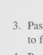

> 密码也不应是某人的名字。不要使用喜欢的宠物的名字、旧情人或新情人、朋友、敌人、生日或电话号码。据说确定你外祖母的娘家姓在你父亲或母亲一方是很容易的事。

- 3. 密码必须易于记忆且快速输入。它们也必须难以猜出。
- 4. 密码应至少为八个字符长。
- 5. 密码可以被设计成看起来像单词，如果这样更容易记住——密码 `2hfArEe`（tooth fairy）就是一个很好的例子，但现在它已经写在这本书里，就不再是一个很好的密码了。
- 6. 在使用密码之前先测试它们。在命令行上输入以下内容：

```
echo password | ispell -l
```

将单词 `password` 替换为你选择的密码。图 3.1 显示了一些选择良好密码的尝试。

- 7. 教育那些将使用系统的人如何选择健全且安全的密码。

```
echo password | ispell -l
```

图 3.1

运行拼写检查器以查看单词是否在 Linux 在线词典中。

密码错误，专有名词

密码错误，字母太少

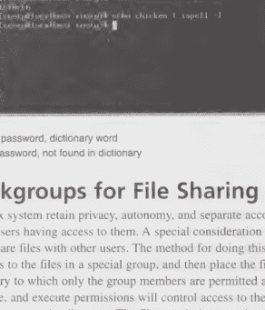

密码错误，字典单词

良好密码，未在字典中找到

## 为文件共享设计工作组


在 Linux 系统上工作的用户保留隐私、自主权以及各自文件的独立账户，而其他用户无法访问它们。必须特别考虑允许用户与其他用户共享文件。实现此目的的方法是将需要访问文件的用户放置在特殊组中，然后将你想要共享的文件放置在只有组成员被允许访问的目录中。设置文件的读、写和执行权限将控制组成员在访问目录时对文件的访问。文件权限可以设置为允许组成员完全的读、写和执行权限，或者可能允许对文件进行较少的访问，例如只读。

## 将用户分配到适当的组

将用户分配到组以及随后的文件访问权限分配构成了 Linux 中安全操作的重要部分。将成员分配到组需要仔细考虑。工作组计算项目是群体过程的函数。该组的成员具有可能持续整个项目生命周期的特殊通信和计算需求。这很直接，但使事情复杂化的是，任何一个个人可能同时在多个项目上工作。

小型企业中的所有员工可能被组织到一个工作组中。即使只有少数员工，也可能有多个项目在进行，项目成员不同。这可能使分配变得混乱。一种处理方法是围绕项目组织所有工作组。这样做可以促进文件、报告和消息的共享。所有这些需要在满足需求并提高项目成员生产力的前提下进行。

## 使用文件权限限制文件访问

系统中的每个文件都可以配置为有选择地允许或拒绝访问或操作。你可能有一份清单，只希望特定组的成员查看和阅读，但不希望他们更改清单上的内容或添加新内容。你可以通过控制为文件配置的用户文件访问权限来实现这一点。

## 控制对用户账户的访问

控制对用户账户的访问是通过密码认证完成的。因为这允许进入系统和用户的私有文件，所以为了系统安全，维护用户密码的完整性非常重要。选择良好的密码，如前所述，并定期更改始终是一个好主意。

以系统管理员的身份，你可能需要替换丢失或忘记的密码，或被泄露的密码。可能有时候你想限制对用户账户的访问。也许用户将休假，你想暂时拒绝访问计算机和用户账户，但保留用户的账户和文件。这些和其他操作可以通过密码系统轻松管理。

## 限制对系统设备的访问

Linux 将一切都视为文件，这包括硬件。为了更容易理解，请将访问打印机视为访问打印机的驱动文件。现在，你可以将与数据文件相同的访问和权限控制应用于系统设备的方式变得更加明显。

> 你将在第 11 小时，“打印文件”中学习如何安装打印机。要配置调制解调器以便连接到互联网，请参阅第 21 小时，“连接到互联网”。


## 定期监控系统

没有什么可以替代保持关注。您的系统的安全性完全取决于您监控系统的好坏以及在添加新用户、安装新软件和升级旧设备时是否勤勉。系统资源的分配应最有利于系统管理。在多用户系统中，这意味着为每个用户分配磁盘空间、用户文件的备份需求、打印机优先级以及许多其他考虑因素。在工作组中，必须监控资源分配以满足群组需求并最大程度地惠及项目。

有内置监视器可以帮助您跟踪操作系统的活动。您可以监控用户使用资源的方式，并利用这些信息帮助您安排维护和必要的系统停机时间。

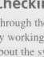

> 您将在第 11 小时学习如何管理发送到打印机的文件。您将在第 17 小时“自动化系统管理任务”中学习如何编写在指定时间运行系统维护任务的小程序。

## 检查 CPU 活动

在大多数 GUI 中提供的一个或多个小型监控小程序的帮助下，或通过在命令行上使用命令，可以获得有关系统资源的信息。有关 CPU 使用情况的信息有助于判断在高峰时段是否可以在系统上运行额外进程。它使您能够看到高峰时段何时出现，以及添加更多应用程序给 CPU 带来的负载有多大。一些更耗 CPU 的应用程序可以保存下来，在 CPU 负载未达到峰值时运行。

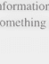

> 可以使用 `top` 命令显示正在运行的进程。`top` 命令在第 13 小时“使用进程”中介绍。

## 跟踪系统上的用户活动

通过查看系统上用户的登录统计信息，可以汇总有关用户在高峰或非高峰时段对系统资源需求的信息。有了这些信息，就可以就分配和调度做出管理决策。终于可以解决用户 Marilyn 在高峰时段不断占用打印机打印电子邮件的问题。Marilyn 收集她从 AOL 广告回复中 `grep` 出来的冷门食谱，并通过她的 Hotmail 账户传输。打印出这些未经加工的珍品后，她会把它们带回家作为草稿，编辑进她即将出版的食谱书中。用户 Marilyn 随意使用 Internet 和网络访问可能会带来其他安全问题，这些问题不如她使用打印机那样明显或令人恼火，但对系统可能造成更大的损害。如果要保持系统的最佳利用率，就有必要经常查看系统是如何被使用以及谁在使用它。


> 显示已登录系统的用户列表并与这些用户通信的内容在第 20 小时“通过网络与用户交谈”中介绍。配置电子邮件和阅读新闻组消息的内容见第 22 小时“并入信息高速公路”。

## 安排维护任务

作为系统管理员，您的一项重要职责是维护一个安全且整洁的系统。为有效做到这一点，必须定期进行文件系统备份和清理以及其他操作系统维护任务。必须定期更新软件和硬件资产以保持其时效性和价值。您的系统的安全性取决于用户遵循您制定的安全指南的情况，以及您安排维护以保持系统和硬件处于最佳运行水平的情况。

## 监视网络和 Internet 访问

之前介绍过的用户 Marilyn 可能有点夸张。有时人们做事考虑不周，有时他们会陷入不恰当使用系统资源或老板时间的行为模式。

在这个即时通信的世界里，在达成世纪交易时，聊天室似乎比电子邮件更有效的方法。然而，这通常并非如此。“实时”网络时间会消耗计算机和企业网络或 Internet 上的资源。这种方法并不总是给对方足够的时间仔细考虑其行为。

## 总结

在过去的一个小时里，您学习了在使用 Linux 操作系统时保持安全意识的重要性。请记住，安全在保护您的系统和数据安全方面发挥着重要作用。这意味着您的硬件被盗或系统崩溃导致数据丢失的可能性降至最低。您还了解到许多用户可以共享同一系统，但每个用户在系统中都有其他用户无法访问的存储文件的空间。再次强调，安全——以密码的形式——防止外部人员访问用户账户。文件共享也涉及安全。用户可能被授予对文件的完全访问权限、仅限读取访问权限，或被禁止任何类型的访问。随着您继续学习后续章节，始终尝试思考如何保护您的投资——计算机设备、数据和时间——的安全。

### 问答

Q 除了通过定期备份、密码和文件权限保护操作系统外，还有什么其他方法可以让计算机系统更安全？

A 始终保持计算机处于清洁环境中并远离静电是个好主意。灰尘和污垢可能是计算机的最大敌人。这些颗粒会在电子部件上堆积，导致计算机过热或短路。

如果不熟悉系统的人使用计算机，请花时间对其进行适当培训，以便他知道如何访问其用户账户以及将文件保存到何处。

另一个好主意是将计算机插入不间断电源 UPS。UPS 可在电力浪涌和电气风暴期间保护计算机，并在停电后为您提供时间保存工作并安全关闭系统，从而保护您的数据。

Q 在本小时中，多次提到需要系统管理员来维护计算机系统。请更详细地解释系统管理员的工作。

A 系统管理员负责保持计算机系统正常运行。系统管理员的工作从规划系统开始，包括从设置计算机和安装操作系统和应用程序软件，到保持系统运行、规划升级以及在设备或数据丢失时恢复系统。

系统管理员定期执行多项工作。这些任务应建立常规。系统上总是有新用户需要添加，旧数据需要从硬盘中删除，软件程序需要升级，新游戏需要安装，以及备份需要存放在安全的地方。

系统管理员还需要确保系统以最佳性能运行。如果多个用户同时共享系统，则必须监控流量。系统管理员还需要确保有足够的硬盘空间用于用户文件、系统文件和程序文件。

而且，最重要的是，系统管理员是系统的安全力量。系统管理员负责教育用户正确使用系统，告知他们如何制定适当的密码，并提醒他们定期更改密码。

### 工作坊

保持计算机系统和数据安全并非易事。在允许太多人访问计算机并让任何人安装任何旧程序到系统上之前，有很多需要考虑的事情。在开始制定系统安全计划之前，请回顾本小时所涵盖的信息，然后决定是否需要将计算机锁起来。鼓励您完成以下练习以帮助您保留本课中学到的知识。您应在继续下一课之前完成这些练习。

### 测验

- 1. 为什么制定定期备份重要文件计划如此重要？

- 您永远不知道灾难何时会来临。它可能以硬盘故障的形式出现，也可能是您无法控制的事情，例如停电或洪水。通过备份文件，您拥有已存放在危险区域之外的文件的第二份副本。规划和实施良好的备份计划可以消除管理大量用户及其所有数据文件的担忧。

- 2. 超级用户是谁？

- 超级用户也称为 `root` 账户。以超级用户身份登录的人可以访问整个系统。这意味着该人可以访问系统上的任何文件或设备。超级用户账户应仅在执行维护、进行配置更改、升级系统和其他系统管理任务时使用。

## 3. 如何限制对系统及系统数据的访问？


系统访问由用户账户和密码控制。每个被授权在系统上工作的用户都应分配一个单独的账户，并要求其选择合适的密码。设置完用户访问权限后，还需要设置对文件的访问权限。每个用户对文件的权限可能不同，具体取决于其需求。

### 练习

- 1. 为了帮助维护你的计算机系统，请在你的 Linux 日记中添加几个新部分。Linux 日记应包含对每台计算机的详细描述。你需要记录已添加到系统或从系统中移除的组件信息、备份和恢复程序、维护任务和时间表，以及配置更改（例如添加的组件、内存和其他升级）。在建立设备清单后，如果发现有东西丢失，可以参考它。这本日记也是控制老化设备、安排新升级、维护系统以及更换磨损部件的无与伦比的工具。
- 2. 做一些预先的功课，提前开始学习文件权限。你需要这些信息，以便在计划允许用户共享文件时设置用户和组账户。从 Linux 手册页开始你的探索（在第 6 小时“查看命令行”中讨论），并阅读 `chmod`、`chown` 和 `chgrp` 命令的资料。一些额外的阅读材料是 Linux 安全 HOWTO。你可以在系统上找到这个 HOWTO（在 `/usr/doc/HOWTO` 目录中）或在 Linux 文档项目（www.ldp.org）上找到。


## 第 4 小时

### 了解 Linux 操作系统

了解任何计算机操作系统听起来可能像是一项学习曲线陡峭的任务。如果你不熟悉 UNIX 操作系统，Linux 最初可能会让人感到困惑。如果是这样，那么是时候我们稍微澄清一下了。计算机操作系统可以被描述为一个带驻留文件员巫师的文件柜。Linux 的巫师称为内核。这个内核/巫师是一个文件员，负责操作归档服务——按顺序归档事物，并在需要时检索它们。对于内核自身无法完成的工作，它会召唤称为守护进程的服务器。但，够了这些比喻…

在本小时，你将：

- 了解 Linux 操作系统的不同部分如何协同工作
- 了解文件在文件系统中的排列方式以及文件在操作系统中的使用方法
- 发现一些好程序并在途中获得帮助
- 了解进程如何融入操作系统图景
- 熟悉系统日志文件

### Linux 操作系统的结构

Linux 操作系统的中心是内核。内核是一段软件，提供你、计算机硬件和附属外设之间的接口。内核负责维护文件系统、执行命令、启动程序、计时系统活动以及管理系统内存和其他资源。图 4.1 显示了内核的不同部分如何协同工作。

图 4.1

内核使用多种工具来帮助它运行操作系统。

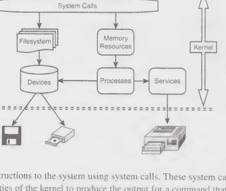

内核使用系统调用向系统发出指令。这些系统调用协调内核的活动，以产生系统用户已执行的命令的输出。

新术语 系统调用是内核与其管理的设备之间的通信，用于指导由内部系统进程或正在运行的应用程序收到的命令请求的操作执行，或从 shell 传递过来。它们是内核执行 shell 命令所使用的工具。你将在第 5 小时“熟悉 Shell”中了解 shell 如何充当用户与操作系统之间的接口。

内核最重要的工作是管理计算机的内存资源。内存资源是启动进程以激活设备和服务并使计算机系统执行其工作所必需的。所有这些活动都通过文件系统进行管理。

### 探索目录结构

因为我们之前告诉你 Linux 操作系统实际上是一个文件系统，让我们快速了解一下文件系统的组织方式。Linux 将一切视为文件；因此，了解 Linux 文件的确切含义以及 Linux 如何在系统中组织文件非常重要。你可能需要的每一种文件都存储在 Linux 文件系统中：系统文件、数据文件、应用程序文件、实用程序文件、驱动程序文件、配置文件等。这些文件每个都有一个名称和在文件系统中存储它的目录。

Linux 文件系统基于树形结构，就像 DOS、Microsoft Windows 和 UNIX 文件系统一样。有一个根目录（用 `/` 字符标识），所有其他目录和子目录都由此生长出来。文件包含在这些目录和子目录中。图 4.2 显示了 Linux 文件系统的基本结构，如从 GNU Midnight Commander 文件管理器所示。

图 4.2

Linux 文件系统的基本结构。

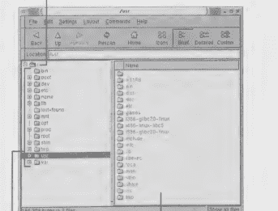

目录名可以由数字、符号和字符的组合组成。目录名包括目录在文件系统中相对于根（`/`）目录的位置。换句话说，目录名包括通过文件系统到达该目录所需遵循的路径。

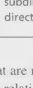

> > 正斜杠字符（`/`）也用于分隔目录、子目录和文件。单独的斜杠字符（`/`）表示根目录。

嵌套（包含）在其他目录中的目录称为子目录。两个目录之间存在父/子关系。你的用户账户的主目录就是这些子目录分支之一。它的名称以 `/` 字符开头，表示根目录。在根目录下有一个子目录，包含系统所有用户的主目录——`/home` 目录。每个用户在 `/home` 子目录中都有自己的子目录。

例如，一个名为 "rusty" 的用户的主目录位于 `/home/rusty` 目录路径中。注意 home 前面没有东西，`/` 前面也没有东西。这表示 `/home` 是根目录的子目录。因为 `/rusty` 后面没有 `/`，可能会让人困惑 `/rusty` 是 `/home` 的子目录还是存储在其中的文件。当然，为了消除困惑，你可以继续在 `/rusty` 后面加上 `/` 来表示它是一个目录。

`/home` 目录不是 Linux 文件系统中唯一的目录。以下是在浏览 Linux 文件系统时你会找到的目录列表：

- 操作系统的基础是根（`/`）目录。它包含 Linux 系统中的所有子目录和文件。你通常会在 `/boot` 目录中找到的一个重要项目是 Linux 内核。如果在这里找不到，你会在 `/` 目录中找到它。


> > 不要在 `/` 目录中存储任何文件。只有系统特定的配置文件（如启动信息文件）才应位于系统的根目录。

- 可执行文件存储在 `/bin`（binary，二进制）目录中。这里是 Linux 存放其基本命令和程序的地方。你在阅读本书的过程中会学到其中许多命令。有启动各种 shell 的命令，用于处理文件（如复制和移动）的命令，用于更改文件权限的命令，以及 `linuxconf` 等配置实用程序。
- `/boot` 目录是存储启动配置文件和命令的地方。该目录包含启动（或启动）系统所需的一切。
- `/dev` 目录是存放计算机硬件组件的所有设备文件（或驱动程序）的地方。当你配置 Linux 使用特定设备时，你会编辑该目录中的一个配置文件。大多数计算机上连接的一个设备是软盘驱动器。软盘驱动器由 `/dev/fd0` 设备文件控制。IDE 硬盘设备文件是 `/dev/hda`，或第二个硬盘为 `/dev/hdb`。对于喜欢 SCSI 的人，这些将是 `sda`、`sdb`、`sdc` 等。
- `/etc` 目录是 Linux 存放系统配置文件和初始化脚本的地方。在后面的小时里，你将学习如何使用文本编辑器编辑该目录中的文件以进行配置更改。你可以编辑这些文件以向系统添加用户并更改其密码（`/etc/passwd` 文件），为文件共享创建组账户（`/etc/group` 文件），并设置拨号上网连接（`/etc/resolv.conf` 文件）。
- 系统中的每个用户都有一个个人目录来存储他或她创建的文件。该目录包含在 `/home` 目录中。在 `/home` 目录中，每个用户都有一个单独的子目录（超级用户除外）。用户主目录用于存储个人文件，系统上的其他用户无法访问。
- `/lib` 目录包含 C 和其他编程语言的库。它还包含启动系统和运行命令所需的共享库映像。
- `/lost+found` 目录是当你认为 Linux 丢失了文件时查找文件的地方。如果系统上有多个分区，每个分区上都有一个 `/lost+found` 目录。
- `/mnt` 目录是其他文件系统可以附加或挂载到 Linux 文件系统的地方。要查看 CD-ROM 的内容，你通常会查看 `/mnt/cdrom` 目录。要查看软盘的内容，请查看 `/mnt/floppy`。
- `/proc` 目录包含 Linux 用于跟踪正在进行进程的虚拟文件。你可能会认为其中一些文件很大，但它们是 *虚拟* 文件，实际上并不存在。它们还有其他有趣的属性。尽管它们在磁盘上完全不占空间，但你无法删除它们。你将在第 9 小时，“连接硬件设备”中学习使用 `/proc` 文件收集有关计算机的信息。
- `/root` 目录是超级用户或系统管理员的主目录。
- `/sbin` 目录是存放供超级用户（系统管理员）使用的文件（或工具）的地方。`/sbin` 目录包含关闭系统、设置系统时钟、检查文件系统错误以及设置网络的命令。
- 临时文件位于 `/tmp` 目录中。这是所有用户都可以临时存储文件以供其他用户访问或临时存储的地方。`/tmp` 目录中存储的所有数据在系统重新启动时都会丢失。
- `/usr` 目录包含不属于 Linux 文件系统的文件。X Window 系统的应用程序和 Linux 游戏合集就是你在这个目录中会找到的例子。`/usr` 目录中还有相当长的帮助文件列表。


日志文件位于`/var`目录中。在这里，你会找到启动日志、`dmesg`日志等。这些日志中的信息表明在启动时加载了什么软件以及系统硬件是如何配置的。

## 任务：探索 /usr 目录

你有两种不同的方法来探索文件系统的内容。一种是从命令行使用一些基本的 Linux 命令。另一种是使用随桌面环境（无论是 KDE、GNOME 还是 FVWM）一起提供的图形文件管理器。

这个任务带你冒险穿过`/usr`目录。这可能是你最安全的探索目录，因为该目录中的文件可供所有用户使用，而且它们是只读文件。按照以下步骤作为示例，了解你在`/usr`目录中可以找到的有用信息和程序：

- 1. 先来点乐趣，找到`/usr/games`目录。从命令行，使用`ls`命令列出目录内容。输入以下内容：

```
ls /usr/games
```

现在按 Enter。你应该会在屏幕上看到游戏列表：

```
[rusty@localhost rusty]$ ls /usr/games
banner bomber civclient civserver fortune matcher xsolider
[rusty@localhost rusty]$
```

- 2. 试试`fortune`游戏。在命令行中，输入`fortune`并按 Enter。如果你在终端窗口中工作，你的显示将看起来像图 4.3 所示。

### 图 4.3

显示文件管理器和终端模拟器的 KDE 桌面。

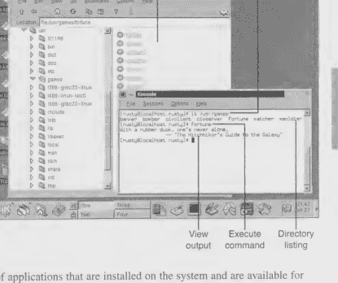

图形文件管理器视图

`ls`命令

查看输出

执行命令

目录列表

- 3. 查看已安装在系统上并可供任何用户使用的应用程序列表。输入`ls /usr/bin`并按 Enter。这是一个相当长的列表，可能在屏幕上快速滚动。

- 4. 在分页器（一种特殊的文件查看器）中读取`/usr/bin`目录的内容。输入`ls /usr/bin | less`并按 Enter。显示将类似于图 4.4。滚动下一页时，按空格键。当你完成查看文件列表时，按 Q 键退出分页器。

### 图 4.4

在`less`分页器中查看文件列表。

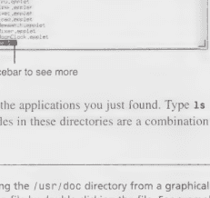

- 5. 找到你刚刚找到的应用程序的帮助手册。输入`ls /usr/doc | less`并按 Enter。这些目录中的文件是文本文件和 HTML 文件的组合。

> 如果你从图形文件管理器查看`/usr/doc`目录，可以通过双击文件打开帮助文件。例如，你可能想阅读位于`/usr/doc/FAQ-Linux`目录中的 Linux FAQ。双击名为`index.html`的文件。文件将在文件管理器或 Web 浏览器（如 Netscape Navigator）中打开。

- 6. 在文件系统中寻找隐藏的艺术作品。你会在`/usr/share/wallpapers`目录和`/usr/share/pixmaps/backgrounds`目录中找到桌面背景。在`/usr/share/icons`目录中，有各种图标采用 X Pixmap（`.xpm`）文件格式，这是一种位图文件格式。

这个任务是对你在`/usr`目录中会找到的一些有趣且有用的信息的简短介绍。你将在第 6 小时“查看命令行”中了解更多关于使用`ls`命令列出目录内容的信息。你还将在第 6 小时了解更多关于使用分页器以及如何使用`man`命令查找系统中已安装命令的帮助信息。

## 查看文件类型

在每个目录中，你都会找到一组文件。Linux 文件是具有唯一文件名的唯一数据集合。Linux 文件的文件名是其相对于根（基本）目录在文件系统中的位置的组合，后跟分配给它的名称。


> 在文件系统中可能有多个文件具有相同的分配名称，但它们不能存储在同一目录中。

Linux 包含许多文件，每个文件都包含不同的信息。它们服务于不同的目的，随着你对 Linux 的了解越来越多，你将了解更多关于文件类型及其用途的知识。首先，我们将集中精力于三种你需要熟悉的文件类型：

- 用户数据文件由你创建，通常包含由文本和数字组成简单数据。像`.txt`文件这样的文件可以用文本编辑器读取，但更复杂的文件，如你用图形或电子表格程序创建的文件，将需要查看器或解释器程序来显示它们。

- 系统数据文件由操作系统用来跟踪用户密码、登录、文件权限以及其他与保持系统平稳运行有关的事情。作为普通用户，你不会涉及这些，但如果你是负责维护系统的系统管理员，你可能需要不时编辑这些文件。

- 可执行文件包含告诉计算机该做什么的指令。这些文件通常称为程序。每当你指示计算机执行某项操作时，你就是在告诉它遵循可执行文件中的指令。

## 任务：命名文件和目录

你可能编辑的任何系统配置文件以及你可能安装的任何应用程序程序都被分配了名称和在系统中的位置。随着你使用这些应用程序，你会为你创建的信件、报告、电子表格、网页和图片向文件系统添加新文件。第一次保存文档时，你需要选择文件系统中的目录来存储文件并为文件命名。以下是一些步骤，帮助你将文档存储在正确的位置并为你创建的文件命名：


> 以下规则适用于目录的命名，因为目录在 Linux 文件系统中只被视为文件。

- 1. 确定文件名的长度。文件名可以包含多达 256 个字符。文件名不仅仅是个别文件的名称；它包括通向该文件的目录路径。例如，位于`/home/rusty/images`目录中名为`picture.gif`的单个文件长度为 30 个字符。实际文件名是`/home/rusty/images/picture.gif`。

- 2. 创建文件名时使用适当的字符。你可以使用字母表中的任何字符（A 到 Z，大写和小写）或 0 到 9 之间的任何数字。你还可以使用破折号（`-`）、下划线（`_`）和句点（`.`）。


> Linux 文件名区分大小写。大写字母 A 与小写字母 a 不是同一个字符。名为`report99.txt`的文件被视为与名为`REPORT99.txt`的文件完全不同。

- 3. 避免可能在文件名中引起问题的键盘字符。不要在文件名中放置空格，不要使用以下字符：`< > ? * " { } [ ] ( ) ` ! | & $ ? -`

- 4. 要创建隐藏文件，请以句点（`.`）开头文件名。如果你想让你的日记文件隐藏，请将文件命名为类似`.diary.txt`。

- 5. 找到命令行并更改到你的主目录。输入`cd`并按 Enter 以确保你在主目录中。

- 6. 创建一个名为`practice`的文件。输入`cat > practice`并按 Enter。光标将移动到屏幕的下一行。输入几个词并按 Enter 移动到下一行。输入几个词并按 Ctrl+D 保存并关闭文件。图 4.5 是一个示例。

- 7. 读取你刚刚创建的文件。输入`cat practice`并按 Enter。

### 图 4.5

使用`cat`命令创建简单的文本文件。

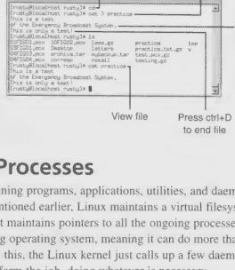

## 生成进程

Linux 将正在运行的程序、应用程序、实用工具和守护进程（服务器）定义为进程。如前所述，Linux 在`/proc`目录中维护一个虚拟文件系统，其中保存着系统中所有正在进行的进程的指针。Linux 是一个真正的多任务操作系统，意味着它可以同时做不止一件事。为了实现这一切，Linux 内核只需调用几个守护进程，然后守护进程接管并执行工作，完成必要的任务。

事情并非如此简单，但这里有一个内核调用最古老的守护进程来完成工作的真实示例。假设你有一份想要打印的文档，于是你向内核发送打印命令。内核对打印了解不足，无法自行打印，因此它调用`lpd`，即行式打印机守护进程。

> 行式打印机守护进程（`lpd`）是最古老的守护进程。在计算机时代的早期，计算机的唯一输出设备是一个吵闹、令人厌恶的设备，称为行式打印机。现代的行式打印机守护进程要复杂得多，但它仍然保留了相同的名称。

`lpd`从内核接收打印任务并生成进程（`spawns`，`forks`也是常用术语）。这只是意味着它复制了自身。然后`lpd`将任务交给它的克隆体，并附带有关打印机、位置和时间的全部细节，然后将其派去执行打印。原始的`lp`守护进程回到内核附近待命，以防再次被调用。这使得内核可以使用`lp`守护进程同时在许多不同类型的打印机上运行多个打印作业——这是一个真正的多任务处理的真实示例。

## 任务：读取内核启动信息文件

多个系统日志文件可以帮助你了解操作系统正在做什么。这些文件通常位于`/var/log`目录中。你应该查看的一个文件是`dmesg`文件。该文件包含内核在启动过程中产生的所有消息。以下是查看系统日志文件的方法：

- 1. 以超级用户身份登录。输入`su`并按 Enter。你将被提示输入`root`账户的密码。


- 2. 阅读首次启动 Linux 操作系统时屏幕上滚动显示的消息。找到命令行并输入 `less /var/log/dmesg` 然后按 Enter。你的屏幕将与图 4.6 所示类似。

图 4.6

操作系统执行启动过程时，各种消息会出现在屏幕上。

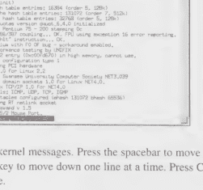

- 3. 滚动浏览内核消息。按空格键一次向下移动一屏。按 `J` 键一次向下移动一行。按 `Ctrl+B` 一次向上移动一屏。

- 4. 查找系统启动时检测到的硬件。你可能会看到类似以下的行：

```
hda: WDC AC31600H, ATA DISK drive
hdb: COMPAQ CRD-256P, ATAPI CDROM drive
ide0 at 0x1f0-0x3f6 on irq 14
```

- 5. 完成后按 `Q` 键返回 shell 提示符。

##### 摘要

在本小时中，你已

图 4.5

使用 `cat` 命令创建简单的文本文件。


## 生成进程

Linux 将正在运行的程序、应用程序、实用工具和守护进程（服务器）定义为进程。如前所述，Linux 在 `/proc` 目录中维护一个虚拟文件系统，其中保存着系统中所有正在进行的进程的指针。Linux 是一个真正的多任务操作系统，意味着它可以同时做不止一件事。为了实现这一切，Linux 内核只需调用几个守护进程，然后守护进程接管并执行工作，完成必要的任务。

事情并非如此简单，但这里有一个内核调用最古老的守护进程来完成工作的真实示例。假设你有一份想要打印的文档，于是你向内核发送打印命令。内核对打印了解不足，无法自行打印，因此它调用 `lpd`，即行式打印机守护进程。

> 行式打印机守护进程（`lpd`）是最古老的守护进程。在计算机时代的早期，计算机的唯一输出设备是一个吵闹、令人厌恶的设备，称为行式打印机。现代的行式打印机守护进程要复杂得多，但它仍然保留了相同的名称。

`lpd` 从内核接收打印任务并生成进程（`spawns`，`forks` 也是常用术语）。这只是意味着它复制了自身。然后 `lpd` 将任务交给它的克隆体，并附带有关打印机、位置和时间的全部细节，然后将其派去执行打印。原始的 `lp` 守护进程回到内核附近待命，以防再次被调用。这使得内核可以使用 `lp` 守护进程同时在许多不同类型的打印机上运行多个打印作业——这是一个真正的多任务处理的真实示例。

## 任务：读取内核启动信息文件

多个系统日志文件可以帮助你了解操作系统正在做什么。这些文件通常位于 `/var/log` 目录中。你应该查看的一个文件是 `dmesg` 文件。该文件包含内核在启动过程中产生的所有消息。以下是查看系统日志文件的方法：

- 1. 以超级用户身份登录。输入 `su` 并按 Enter。你将被提示输入 `root` 账户的密码。

- 2. 阅读首次启动 Linux 操作系统时屏幕上滚动显示的消息。找到命令行并输入 `less /var/log/dmesg` 然后按 Enter。你的屏幕将与图 4.6 所示类似。

图 4.6

操作系统执行启动过程时，各种消息会出现在屏幕上。


- 3. 滚动浏览内核消息。按空格键一次向下移动一屏。按 `J` 键一次向下移动一行。按 `Ctrl+B` 一次向上移动一屏。

- 4. 查找系统启动时检测到的硬件。你可能会看到类似以下的行：

```
hda: WDC AC31600H, ATA DISK drive
hdb: COMPAQ CRD-256P, ATAPI CDROM drive
ide0 at 0x1f0-0x3f6 on irq 14
```

- 5. 完成后按 `Q` 键返回 shell 提示符。

##### 摘要

在本小时中，你已了解 Linux 操作系统。你看到了 Linux 如何使用文件系统来控制计算机的运行方式。你了解了每个目录中包含的内容以及每个目录中文件的工作方式。

##### 问答

Q 我想了解更多关于 Linux 文件系统的内容。你有好的参考资料吗？

A Linux 文件系统结构的标准可以在 `www.pathname.com/fhs/1.2/fsstnd-toc.html` 找到。该标准详细说明了你在每个目录中会找到的文件类型。

Q 在 `/usr/doc` 目录中阅读帮助文件最简单的方法是什么？

A 由于大部分帮助信息都是以 HTML 文件编写的，你可能希望启动 X Window 系统和你喜欢的桌面环境。选择一个图形文件管理器并导航到 `/usr/doc` 目录。如果你双击任何 HTML 文件，这些文件很可能会在 Netscape Navigator 中打开。如果文件管理器不知道用哪个应用程序打开文件，你将被要求选择一个。你可以尝试系统上安装的众多文本编辑器之一。

Q 如何显示系统上正在运行的进程？

A 尝试 `top` 命令。从 shell 提示符输入 `top` 并按 Enter。`top` 命令会显示哪些用户已登录以及他们正在使用哪些命令、应用程序和服务。你将在第 13 小时“使用进程”中了解更多关于进程的信息。

##### 工作坊

建议你完成以下练习，以帮助你保留本课中学到的知识。你应该在进入下一课之前完成这些练习。

##### 测验

- 1. Linux 内核的任务是什么？

- Linux 内核是控制操作系统的软件部分。内核在用户和计算机硬件之间提供接口，负责维护文件系统、执行命令、启动程序、计时系统活动以及管理系统内存和其他资源。

- 2. 除了你的主目录外，Linux 文件系统中最安全且最具信息量的目录是什么？

- `/usr` 目录包含所有授权系统用户可用的文件。该目录中的文件受写保护，无法被更改。`/usr` 目录包含系统上安装的许多应用程序的执行文件（位于 `/usr/bin` 中）。`/usr/doc` 中也有大量帮助信息。

- 3. 操作系统中有哪些三种类型的文件？

- 操作系统中可以找到用户数据文件、系统数据文件和可执行文件。用户数据文件是在使用应用程序时由用户创建的文件。用户数据文件可以是从简单的文本文件到数据库或复杂图形的任何内容。系统数据文件帮助操作系统运行计算机。可执行文件是安装在系统上的命令和应用程序。

- 4. Linux 文件名可以多长？

- 文件名最长可达 256 个字符，但文件名包括到单个文件的目录路径和单个文件的名称。

- 5. 创建一个小文件最简单的方法是什么？

- 使用 `cat` 命令，输入 `cat > filename`。开始此命令后，光标会移动到屏幕的下一行。只需开始输入以向文件添加文本。到达行尾时，按 Enter 进入下一行。要保存文件并关闭它，按 `Ctrl+D`。

- 6. 系统日志文件的用途是什么？

- 系统日志文件让你可以看到操作系统的运行情况。你可以阅读系统启动时出现的消息，并了解谁在使用系统以及是否发生过任何安全漏洞。

##### 练习

- 1. 自行探索 `/usr` 目录。这将让你有机会了解计算机上安装了哪些很酷的应用程序，并阅读随程序提供的帮助文件。转到第 7 小时“在文件系统中移动”，以了解查看目录内容所需的导航命令。

- 2. 查看一些其他系统日志文件。利用这段时间熟悉日志文件，因为你在阅读本书的过程中会使用它们。不要担心现在不理解所有内容。如果你系统上有多个用户，你可能想通过查看 `/var/log/wtmp` 文件来了解谁已登录系统。要查看系统何时关闭或重新启动以及成功的用户登录情况，请阅读 `/var/log/wtmp` 文件。要查看谁曾不成功地尝试登录系统（这可以帮助你追踪可能的安全问题），请阅读 `/var/log/btmp` 文件。查看系统是否安全的另一种方法是查看 `/var/log/secure` 文件。


> 日志文件因发行版而异，因此如果找不到我们在此提到的文件，不要惊慌。

## 第二部分

### 掌握要领

### 小时

- 5 认识 Shell

- 6 查看命令行

- 7 在文件系统中移动

- 8 使用 vi 编辑文本


## 第 5 小时

### 认识 Shell

在接下来的几小时里，你将学习如何在臭名昭著的 Linux 命令行上输入几个词，并让 Linux 操作系统按你想要的方式执行操作。这种神奇的配合借助一个名为 `shell` 的小型 Linux 程序实现。`shell` 程序是你与操作系统通信的解释器。当你在 `shell` 提示符下输入命令时，它会被解释并传递给 Linux 内核。内核随后告诉计算机该做什么。

在本小时，你将

- 了解 `shell` 如何在你、用户和 Linux 内核之间交互

- 使用环境变量来自定义 `shell` 的外观和行为

- 在命令行上编辑文本，并回忆之前使用过的命令

- 使用命令别名为长命令或经常使用的命令创建快捷方式


### 任务：创建临时用户账户


当你安装 Linux 时，你创建了一个超级用户（或 root 用户）账户，可能还创建了一个无特权用户账户。对于每个账户，你可能选择了 shell 程序，也可能使用了默认设置。不管你选择了哪个 shell，登录到账户时 shell 都会自动加载。大多数 Linux 发行版中默认安装的 shell 是 `bash` shell。

如果在安装 Linux 操作系统期间没有为无特权用户创建账户，现在你需要这样做。你会记得，之前章节提到超级用户账户应仅用于系统管理和配置任务。在开始使用 shell、尝试命令和应用程序以及探索 Linux 操作系统之前，你需要为用户账户创建一个登录名。以下是如何使用 `adduser` 和 `passwd` 命令创建登录名的方法：

1. 选择用户名。系统中的每个用户都需要一个唯一的登录名来访问系统及其用户账户。用户名不应超过八个字符。为了让系统管理员的工作更简单，请为用户名使用小写字母。

在本任务中，我们将为 Rusty Spoon 创建一个用户账户。我们选择的用户名是 `rusty`。你可以替换为自己的用户名，也可以将此用户名用于练习 Linux 命令和探索系统。

2. 选择密码。好的密码应由大写字母、小写字母和数字组合而成。密码应至少为八个字符。不要使用字典中可以找到的任何单词，并且在一个密码中不要重复使用字符。

3. 以超级用户身份登录。在登录提示符下，输入 `root` 并按 Enter。然后会提示输入密码。输入密码并按 Enter。Linux-Mandrake 系统上超级用户账户的 shell 提示符可能如下所示：

```
[root@localhost /root]#
```

4. 创建用户账户。在 shell 提示符下，输入 `adduser rusty` 并按 Enter（你可以替换为自己的用户名）。显示应如下所示：

```
[root@localhost /root]# adduser rusty
[root@localhost /root]#
```

5. 为账户分配密码。输入 `passwd rusty` 并按 Enter。你会看到以下内容：

```
[root@localhost /root]# passwd rusty
Changing password for user rusty
New UNIX password:
```

输入密码并按 Enter。如果系统使用 `shadow` 密码，你会注意到在输入时密码不会显示。这确保了系统的安全性。你需要通过再次输入密码并按 Enter 来验证密码。系统显示如下：

```
Retype new UNIX password:
passwd: all authentication tokens updated successfully
[root@localhost root]#
```

6. 切换到新的终端。不要退出超级用户账户以进入用户账户，按 `Alt+F2` 显示一个新的终端窗口和登录提示，如下所示：

```
Linux Mandrake release 7.1b (hydrogen)
Kernel 2.2.15-0.25mdk on an i586 / tty2
localhost login:
```

第二行中，`tty2` 是你当前使用的虚拟终端。如果需要返回超级用户账户，按 `Alt+F1`。

7. 登录到你的用户账户。在登录提示符下，输入账户的用户名并按 Enter。然后会提示输入密码。输入密码并按 Enter。你现在正在 shell 中工作，shell 提示符可能如下所示：

```
[rusty@localhost rusty]$
```

`adduser` 和 `passwd` 命令是向系统添加新用户、分配 shell 并创建主目录的快速简便方法。我们的虚构用户 `rusty` 现在可以使用系统了。当 `rusty` 登录时，`bash` shell 将启动，因为它是 `passwd` 命令使用的默认 shell。此外，该账户的主目录位于 `/home/rusty`。

## 查看 Shell 程序

在第 2 小时“安装 Linux-Mandrake”中提出的一个安装建议是，不要让 X Window System 在启动 Linux 操作系统时自动启动。如果你遵循了此建议，系统启动时会出现一个文本屏幕，要求输入登录名和密码。输入这些信息后，系统会检查你是否为已授权用户，如果是，则会显示 shell 提示符。Linux-Mandrake 系统上超级用户的 shell 提示符示例为

```
[root@localhost /root]#
```


如果你使用的是 KDE 或 GNOME 等图形桌面环境，可以通过打开终端仿真程序来显示 shell 提示符。浏览菜单系统可以找到多个终端仿真程序。它们有各种名称，例如 `XTerm`、`GNOME terminal`、`Eterm` 和 `Konsole`。

shell 提示符是你通往 Linux 内核的网关，使你能够使用系统上安装的任何程序、命令或实用程序。但等等……shell 还能为你做更多。shell 会跟踪你在计算机上执行的工作。它使你能够使用快捷方式请求程序和命令。它还有助于自动化例行任务，例如文件备份。你可以通过编写 shell 可以在指定时间读取然后将指令传递给操作系统的脚本来实现这一点。

### 新术语

shell 程序是 Linux 操作系统的计算机系统用户界面。此界面从用户接受命令并将其翻译成操作系统（更具体地说是 Linux 内核）可以理解的语言。shell 还可用于编写程序、自动化作业控制，并提供脚本机制来自定义系统的工作方式。

你会发现 shell 程序是安装在 Linux 系统上的最重要的程序之一。即使你使用为 X Window System 设计的图形界面之一，你可能仍需要在 shell 提示符下输入命令来启动或停止程序。为了给你一个查看 shell 在系统中的位置的模型并理解它为何如此重要，你可以将 Linux 操作系统想象成一个堆栈：

- 内核（操作系统的核心）位于堆栈底部，利用编译在其中的模块和内核例程来运行计算机并管理你连接的周边设备。
- shell 程序位于内核之上：它从用户接受命令，处理它能处理的命令，并解释其余命令以传递给内核执行。
- 堆栈顶部是应用程序层。shell 管理该层中应用程序的启动，并在必要时在应用程序和内核之间传递信息。

图 5.1 说明了此过程的运作方式。在步骤 1 中，用户在 shell 提示符后输入命令并将其发送到 shell。shell 首先确定命令是其内置命令之一还是应用程序程序。如果命令是应用程序程序，它必须位于 shell 搜索路径列出的目录之一中。如果找到命令，shell 会解释该命令（步骤 2）并将其发送到内核。内核随后告诉 shell（步骤 3）启动该应用程序。

它在第 4 步完成此操作。应用程序运行后，用户直接（第 5 步）与应用程序通信，而 shell（第 6 步）在应用程序和内核之间维护必要的数据流。

### 图 5.1

shell 用于在用户、应用程序和 Linux 内核之间保持通信的过程。

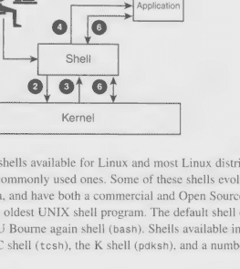

Linux 上有许多 shell 可用，大多数 Linux 发行版都提供了一组最常用的 shell。其中一些 shell 源自 UNIX 操作系统，既有商业版本也有开源版本。Bourne shell（`sh`）是最古老的 UNIX shell 程序。所有 Linux 发行版的默认 shell 都是 GNU Bourne again shell（`bash`）。可用的 shell 包括 C shell（`tcsh`）的开源版本、Korn shell（`pdksh`）以及其他许多 shell。


> 安装期间可供选择的 shell 取决于您选择的 Linux 发行版以及其安装方式。除了标准 shell 之外，您还会在 Red Hat 发行版中找到 Dave Korn 的 Korn shell（`pdksh`）的公共领域版本。Z shell（`zsh`）、A shell（`ash`）以及一些特定于特定 Linux 发行版的其他 shell 也可供使用。

最广泛分发的 UNIX shell 是 Bourne shell（`sh`）。它可能已安装在每个现有的 UNIX 系统上。许多较新的 shell 与 Bourne shell 向后兼容。GNU Bourne again shell（`bash`）由 Brian Fox 和 Chet Ramey 编写，是 `sh` shell 的 GNU/Linux 版本。它是功能增强的版本，具有 C shell（`csh`）和 Korn shell（`ksh`）中的许多功能。它与 `sh` 完全向后兼容。


UNIX shell 之一的 Korn shell（`ksh`）最初由 Dave Korn 创建，也以开源形式提供。由 Eric Gisin 创建的 shell 的公共领域免费版本称为公共领域 Korn shell（`pdksh`）。然而，在 2000 年 3 月，AT&T 发布了原始 Korn shell 的可自由下载的版本，该版本由 Dave Korn 于 1993 年更新，称为 `ksh93`。它并不完全是“开源”，但可供私人及非商业用途下载。

C shell（`csh`）是在加州大学伯克利分校开发的，以更兼容 C 编程语言。C shell 的开源版本是 `tcsh`。`/bin` 目录中有一个指向 `tcsh` shell 的 `csh` shell 的指针（符号链接）。

`bash` shell 的工作方式与 Bourne shell（`sh`）类似。`/bin` 目录中有一个符号链接 `sh`，指向 `bash` shell。`bash` shell 可能是 Linux 中使用最广泛的 shell，并且本小时以它为例。

## 任务：运行 bash Shell

您可能正焦急地等待 shell 提示符并想知道接下来该做什么。首先需要做的是检查您正在使用哪个 shell。在本小时的其余时间，您将使用 `bash` shell。因此，如果您的系统上运行的是其他 shell，您需要启动 `bash` 才能跟上。了解 shell：

- 1. 显示您正在使用的 shell。此信息在 `SHELL` 环境变量中找到。输入 `echo $SHELL` 并按 Enter。如果您使用的是 `bash`，系统将显示以下内容：

```
[rusty@localhost /rusty]$ echo $SHELL
/bin/bash
[rusty@localhost /rusty]$
```

- 2. 如果您未使用 `bash`，请切换到 `bash` shell。输入 `bash` 并按 Enter。您将在屏幕上看到相同的 shell 提示符。

- 3. 如果您希望 `bash` 成为默认 shell，输入 `chsh -s /bin/bash` 并按 Enter。再次检查您是否正在使用 `bash`。输入 `echo $SHELL` 并按 Enter（就像您在步骤 1 中所做的那样）。

- 4. 显示 `bash` help 函数。输入 `help` 并按 Enter。`help` 命令列出 shell 内置的所有命令。

如果文本在屏幕上流逝得太快，请在分页器（文本查看器）中阅读帮助文件。输入 `help | less` 并按 Enter。您将在第 6 小时“查看命令行”中了解更多关于使用命令和分页器的信息。

如果您使用 `less` 分页器从 X 终端内部读取 `bash` 帮助文件，您的屏幕将类似于图 5.2 所示。

### 图 5.2

在 `less` 分页器中显示的 `bash` 帮助文件。

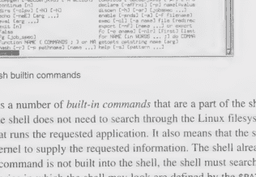

### bash 内置命令

New Term 每个 shell 都有一些内置命令，它们是 shell 的一部分。这意味着 shell 无需在 Linux 文件系统中搜索运行所请求应用程序的可执行文件。它还意味着 shell 无需要求内核提供所请求的信息。shell 已经知道如何响应。如果命令未内置于 shell 中，shell 必须搜索目录路径（shell 可能查找的目录由 `$PATH` 环境变量定义）以查找所请求的命令。

## 查看 Shell 提示符

当您第一次启动 DOS 计算机时，文件 `command.com` 会加载并呈现臭名昭著的 `C:\` 提示符。从此提示符，您可以启动程序、运行实用程序和批处理程序、使用 DELETE、SAVE 和 PRINT，并执行所有其他 DOS 命令。当然，Linux 不使用 `command.com`。shell 程序取代了 Linux 的 `command.com` 并增加了一些自己的功能。

当您登录到 Linux 控制台时，您会看到 shell 提示符。它看起来像这样（如果您使用的是本书后面光盘上找到的 Linux-Mandrake 发行版并且创建了无特权用户帐户）：

```
[rusty@localhost rusty]$
```

第一个 `rusty` 是用户名，其后是计算机的主机名，最后的 `rusty` 是 `rusty` 当前所在的目录名称。您第一次登录系统时会自动放置在自己的用户帐户中。


> 默认 shell 提示符通常因发行版而异。例如，对于用户帐户，Slackware 和 Debian 发行版的提示符如下所示 `localhost:~$` TurboLinux 的默认 shell 提示符与 Linux-Mandrake 的 shell 提示符相同。

当您以 `root` 身份登录时，先前显示的 shell 提示符会更改为使用井号（`#`）而不是用户帐户的美元符号（`$`），如下所示

```
[root@localhost root]#
```

## 任务：更改 Shell 提示符

`bash` 提示符（以及其他 shell 的提示符）的格式可以根据您的需要进行自定义。`bash` shell 有十多种提示符选择，而其他一些 shell 至少有三倍之多。shell 提示符可以更改为显示诸如用户用户名、用户正在工作的目录、当前日期和时间或特殊消息等信息。要更改当前登录会话的 shell 提示符，请按照以下步骤操作：

- 1. 显示 shell 变量。在 shell 提示符下，输入 `printenv` 并按 Enter。如果您无法阅读整个屏幕，请将 `printenv` 命令发送到 `less` 分页器（输入 `printenv | less`）。

- 2. 查找 `PS1` 变量。Linux-Mandrake 系统上的 `PS1` 变量可能如下所示：

```
PS1=[\u@\h \W]\$
```

此变量告诉系统在括号内显示使用主机计算机的用户名和该用户的当前工作目录，然后跟随 `$` 提示符（`root` 帐户为 `#` 提示符）。

- 3. 写下 `PS1` 变量中的信息。

- 4. 决定您希望提示符看起来如何。表 5.1 列出了可用于自定义 shell 提示符的字符代码。

### 表 5.1 用于更改 Shell 提示符的字符代码

| 字符代码 | 描述 |
|---|---|
| `\!` | 在 shell 提示符下显示将要执行的命令的历史列表中使用的编号 |
| `\$` | 在普通用户的提示符中显示 `$`（通常在 shell 提示符末尾找到），在超级用户（或 `root` 用户）的提示符中显示 `#` |
| `\\` | 显示反斜杠字符 |
| `\d` | 显示当前日期 |
| `\h` | 显示您正在工作的计算机的主机名 |
| `\s` | 显示您正在工作的 shell 的名称 |
| `\t` | 显示当前时间 |
| `\u` | 显示登录到系统的用户的用户名 |
| `\W` | 显示当前工作目录 |
| `\xxx` | 显示任何特殊注释（将 `xxx` 替换为您的文本） |

- 5. 更改提示符以显示时间、日期、当前工作目录和 `$` 提示符。输入 `PS1='[\t \d \W]\$ '` 并按 Enter。shell 提示符将更改为显示以下内容：

```
[14:15:33 Fri Jun 16 rusty]$
```


> 一旦您退出帐户，shell 提示符将返回到默认 shell 提示符。

在本任务中，您了解了环境变量以及它们如何用于更改 shell 的外观和功能。`printenv` 命令列出了相当多的环境变量。除了 `PS1` 变量之外，您可能还对 `$PATH` 环境变量感兴趣。`$PATH` 变量告诉 `bash` 在哪里查找可执行程序。如果您在此环境变量中没有定义包含程序存储目录的路径，您将必须键入程序的绝对文件名以告诉 `bash` 在哪里找到它。

**新术语** shell 程序运行在一种环境中，该环境依赖于在每个用户的主目录和 `/etc` 目录中各资源文本文件中存在某些预设值或路径名。这些被称为 *环境变量*。`bash` shell 的默认系统范围变量位于 */etc/profile* 文件中。个人变量设置位于您主目录中的 *.bashrc* 文件中。

## Bash 进阶

每个人都有自己的工作方式，并希望使工作完成得更好。shell 程序提供了一种根据您的偏好自定义计算机工作方式的方法。您可以使用内置的 shell 命令来完成任务，并创建 shell 脚本以在特定时间和日期安排作业运行。shell 还可以设置您的 Linux 工作区，并在启动时加载您需要最高效工作的软件。现在是时候了解 shell 为您做了什么，以便更轻松地与操作系统通信。

## 与 Shell 通信


Linux 使用 `GNU readline` 命令行编辑器来读取和写入命令行。`readline` 编辑器就是您在 shell 提示符后输入文本或在那里读取响应时看到的工作内容。编辑器还可以编辑命令行上的内容。要使用命令行，只需在 shell 提示符后开始输入即可。您会看到光标就在您前面一个字符处。如果犯了错误，只需按 `Backspace` 键删除文本。使用左右箭头键在命令中前后移动。还有一些用于在命令行上移动和编辑文本的命令，如表 5.1 所示。

### 表 5.1 命令行文本编辑命令

| 执行此操作 | 按这些键 |
|---|---|
| 向左移动一个字符 | `Ctrl+B` |
| 向右移动一个字符 | `Ctrl+F` |
| 按单词向左移动 | `Esc+b` |
| 按单词向右移动 | `Esc+f` |
| 移至行首 | `Ctrl+A` |
| 移至行尾 | `Ctrl+E` |
| 删除左侧字符 | `Del` |
| 删除右侧字符 | `Ctrl+D` |
| 删除左侧单词 | `Esc+Del` |
| 删除右侧单词 | `Esc+d` |
| 从光标删除到行尾 | `Ctrl+K` |
| 删除整行 | `Ctrl+U` |

减少在 shell 提示符处输入按键次数的一种方法是使用命令行补全。命令行补全意味着您输入命令或程序名称的一部分，然后要求 `bash` 完成您的输入。如果您在命令行上输入命令或应用程序名称的一部分并按 `Tab`，`bash` 会尝试为您完成命令。`bash` shell 会在系统中搜索所有与您迄今输入的内容匹配的命令和应用程序名称，并尽可能完成命令。如果 shell 收到的数据不足以做出选择，您将被提供可能的补全列表。这使得完成命令输入变得非常简单。要在命令行上看到此功能，请输入 `bas` 并按 `Tab`。

在您按 `Tab` 完成命令后，命令行补全还会尝试为您完成文件名。如果您开始输入文件名然后再次按 `Tab`，shell 会在当前工作目录列出的文件中查找可能的匹配项。

另一种减少击键次数的方法是使用通配符。通配符在命令行中代替其他字符。`bash` shell 使用三种不同的通配符：

- 星号 (`*`) 字符匹配任意数量的字符。
- 问号 (`?`) 匹配单个字符。
- 括号 (`{` 和 `}`) 用于匹配括号内包含的特定字符。

`bash` shell 和一些其他 shell 具有命令历史选项，使您无需再次输入即可重新提交命令。访问命令历史的方式是使用上下箭头键在列表中上下移动。每个先前输入的命令都会出现在命令行上。您可以按 `Enter` 键再次使用任何命令。此功能在您需要反复输入相同的复杂命令时可以节省大量时间。历史记录中保存的命令数量默认值可由用户配置。


> 您将在第 6 小时开始使用命令时学习如何使用这些 shell 快捷方式。


## 告诉命令去向何处

当您使用命令行在 Linux 中启动程序时，shell 会解释您的命令，将其发送到内核，程序的输出会进入标准输出（通常是屏幕）。程序对标准输出的输出可以重定向到文件。请记住 Linux 将一切视为文件，因此标准输出可以重定向到文件、打印机、额外显示器、另一个终端或您可能连接到系统的任何其他输出设备。输出也可以重定向为另一个命令或程序的输入。


> 重定向命令输出时请小心。将输出重定向到文件会创建该名称的文件并将输出放入其中。如果您将输出重定向到现有文件，该文件的内容将被覆盖并永远消失。

您将在第 6 小时“查看命令行”中以及第 7 小时“在文件系统中移动”中学习更多关于在命令行输入的内容时使用重定向。

## 为长命令创建快捷方式

您可能会发现您会定期输入一些命令。例如，如果您使用在线 Linux 帮助系统，您可能会发现自己进入了 `/usr/doc/HOWTO/HTML/en/mini` 这样晦涩的目录。让我们算一下...将 `cd` 命令添加到目录路径，您就得到 31 次击键（这还不包括按住 `Shift` 键）。为了减少击键次数，请创建一个别名。

> **新术语** 命令别名是分配给命令的唯一简短名称。命令别名通过为它们指定昵称使记住长命令变得更容易。您可以只输入别名，而不必输入完整的命令。别名还可以帮助您在处理文件时减少致命错误。您可以为命令分配别名，以便在您真正想要删除文件时询问您。

为以下命令创建别名

```
cd /usr/doc/HOWTO/HTML/en/mini
```

使用 `alias` 命令。首先，您需要为命令想一个别名名称。因为此命令更改为存储 Linux HOWTO 文本版本的目录，示例别名名称可能是 `gotoHOWTO`。要创建此别名，在 shell 提示符处，输入

```
alias gotoHOWTO='cd /usr/doc/HOWTO/HTML/en/mini '
```

`alias` 命令后面跟别名名称。等号 (`=`) 在 shell 提示符处输入别名名称时将被执行的命令之前。不要在等号两侧使用空格。如果命令包含空格或通配符字符，请用引号将命令括起来。

现在要更改为 HOWTO 目录，只需在 shell 提示符处输入 `gotoHOWTO` 并按 `Enter` 键。击键次数已从 31 次减少到 9 次。

您注重安全吗？您可以在文件系统中工作时防止自己意外删除、复制或移动文件。在第 7 小时，您将学习如何使用 `rm`（删除文件）、`cp`（复制文件）和 `mv`（将文件移动到文件系统中的新位置）命令来处理文件。使用这些命令时存在一个危险，即 Linux 在您执行命令时不会告诉您它将要做什么。您可以通过为这些命令创建别名来轻松保护您辛苦获得的数据文件，这些别名会强制命令询问您是否真的想对文件执行指定的操作。

要将 `rm`、`cp` 和 `mv` 命令更改为在交互模式下工作，请使用以下别名命令：

```
alias rm='rm -i'
alias cp='cp -i'
alias mv='mv -i'
```

每当您使用这些命令时，在操作系统开始移动和删除文件之前，您将被要求确认操作。(`cp` 和 `mv` 仅在目标文件存在时才提示。)

## 使用 Shell 脚本执行命令

本小时前面，我们讨论了使用命令重定向和将一个命令的输出通过管道传输到另一个命令，以将命令连接成一个字符串，使其能够执行完整的工作。将这些命令字符串变成可重用的工具，只需将其制作成脚本即可，shell 在您输入简短命令时可以执行这些脚本。

This makes it possible to reduce complex jobs that require many command steps into a simple matter of typing one command (and maybe adding a little information) to have the shell take care of the whole thing for you.

## New Term

Simply put, a shell script is a list of actions that you want the shell to perform that includes the order in which you want the actions performed and where you want the expected results sent.

The basic command philosophy of UNIX, and therefore Linux, is to provide the user with myriad small and specialized commands that can be “plumbed” together with conditional statements, command redirection, and pipes to produce a desired outcome. Your first step in writing a script is to open a text editor (which you’ll learn more about in Hour 8, “Text Editing with vi”) and start stringing commands together. The combination of commands and conditional statements might produce a script such as

```
if cp "filename1" "filename2"
then
  vi "filename2"
else
  echo "failed to make copy"
fi
```


This command string tells `bash` to copy `filename1` to `filename2`, and then call the `vi` text editor with `filename2` displayed. If `bash` cannot copy the file, the `then` statement cannot be met and `bash` cannot open `vi` with the file. The `else` statement then directs `bash` to print the message ‘failed to make copy’ (without the quotes). The final `fi` is the finish statement and must be present for `if...then...else` statements to work. Omitting this is a common error and is the cause of many script failures.

After you have written your script, save the file and make it an executable script by using the `chmod` command as shown here:

```
chmod +x [filename]
```

Any short name you choose to call the script will become the command that you type to run the shell script.


> You’ll learn more about writing scripts in Hour 17, “Automating System Administration Tasks.”

## Summary

During the past hour, you saw how to use the Linux shell as your own personal gopher. You learned how to send commands to the shell and have the shell communicate with the Linux kernel. You also learned that the appearance of the shell (that is, the shell prompt) could be changed to display information suited to your needs. You were also introduced to many of the shortcuts contained within the shell that make it easier to work with your computer.

## Q&A

Q Where can I learn more about each of the shells discussed in this hour?

A Look for the GNU `bash` shell at the Free Software Foundation Web site (www.gnu.org/software/bash/bash.html). The `ksh` shell can be found at www.kornshell.com. The `tcsh` shell is available from ftp.astron.com/pub/tcsh. The `zsh` shell Web site is located at www.zsh.org.

Q Where can I find more information about the `bash` shell?

A You can find additional information and details about `bash` in the `bash` manual page by typing `man bash` and pressing Enter from the shell prompt. The `/usr/doc/bash` directory for the version of `bash` you have installed on your system contains documentation for `bash` functions, scripts, and startup files. You can also use the `info` command to browse the info pages for `bash`. To do this, type `info bash` and press Enter.

Q All the configuration changes to the shell that were discussed in this hour are in effect only for the current session. If I log out, the shell goes back to the default settings. How do I make configuration changes permanent?

A Many things about the `bash` shell can be configured to work the way you want. There are three important files that `bash` uses to predefine values or definitions and share them across the system:

- The `/etc/profile` initialization file is used for all users (system wide) to set options such as the environment variables (discussed later) or to send messages (such as "Hello," and "Good morning, Mr. Phelps") to the screen at login.
- The `.bashrc` configuration file in your home directory can be edited to personalize the way that `bash` starts and to customize how the `bash` shell handles key bindings for certain keys (such as the Backspace key, for instance).
- The `.profile` resource file, which is also found in your home directory, points to the resource file that `bash` is to use after you log in to Linux.

These files can be edited with any of the text editors found in your Linux distribution. In Hour 8, “Text Editing with `vi`,” you’ll learn how to use one of the text editors installed with most Linux distributions.

## Workshop

Test your knowledge of the material covered in this hour by answering the following questions and working through the exercises.

### Quiz

1. What is a shell program and what purpose does it serve in a Linux system?


A shell program acts as a go-between for a user and the Linux kernel. The shell processes commands from the user and sends the instructions to the Linux kernel. The shell has a number of built-in commands and programs. The user can also customize the shell. The shell prompt can be changed to display information useful to the user. There are a number of editing shortcuts that make entering commands easier—a miniature text editor, the ability to recall previously typed commands, creating short names (or aliases) for frequently used commands, and executing user-written scripts that automate frequently performed tasks (such as file backups).

## How do you know which shell you are using and how do you switch between shells?

The shell that loads when you log in to your user account is defined in the `$SHELL` environment variable. To see the contents of this variable, type `echo $SHELL` and press Enter. If you are using the `bash` shell, the response to this command is `/bin/bash`. If you are using another shell and you want to work with `bash`, type `bash` and press Enter.

## How can you tell the difference between the shell prompt for the root user and the shell prompt for an unprivileged (or regular) user?

Most Linux distributions use the pound sign (`#`) as the final character in the shell prompt to indicate the root user account. Regular user accounts use the dollar sign (`$`).

## What program handles the text that is typed after the shell prompt?

The GNU `readline` editor reads what is typed on the command line and displays the text responses to command requests. The editor can also edit whatever is on the command line. To use the command line, begin typing at the shell prompt. The cursor is one character ahead of the text being typed. The `Backspace` key erases text.

The left and right arrow keys move back and forth across the command line. There are also several keyboard shortcuts for moving around the command line and editing text.

### Activities

1. Do some advanced studying. Learn more about the built-in `bash` shell commands.

To see the list of commands, type `help` at the shell prompt. To find more information about a command, type `man` followed by the command name. You'll have to sneak ahead to Hour 6, "Looking at the Command Line," to learn how to use the `man` command to read the manual pages (which are the online help system for the Linux operating system).

2. The `bash` shell prompt can contain useful information to help you get your job done. If it is important that you keep on schedule, set up the prompt to display the date and time. If you move around the filesystem, display the current working directory. Experiment with the `bash` shell prompt by changing the `PS1` variables. Try to change the shell prompt so that it contains the date, the current time, a special message, or just your username.


# Hour 6

## Looking at the Command Line

You might ask why you need to learn to type text commands at the shell prompt when there are so many nifty tools and utilities with graphical front ends that perform the same tasks. There are several good reasons, but the best reason is that it doesn't matter which Linux distribution you are using or how the system is set up, you can always rely on commands to get the work done. One task that you'll perform regularly is file maintenance. In a graphical world, you would open up a file manager and click a few icons to create directories and move files around. With a little practice, you'll find it just as easy to use a few keystrokes to move those same files.

At the end of Hour 2, "Installing Linux-Mandrake," you learned how to access the system from the Linux login prompt. Then you were left standing at the shell prompt and told to execute your first command by shutting down the system.

在本小时中，你将：

- 识别作为 Linux 操作系统用户正常操作所需的基本命令
- 在 shell 提示符下输入时使用正确的命令行语法
- 通过使用通配符和命令行补全成为高效的命令行输入者
- 阅读手册页以了解命令执行什么任务以及如何使用该命令
- 在文件系统中搜索文件并查找文件信息


## 学习命令

有许多充分的理由让你熟悉命令及其用法。如果 X Window System 在你的系统上未正确安装，你将需要使用命令行来正确配置视频显示。在使用 Linux 一段时间后，你会发现无法从图形桌面环境执行所有任务；你需要输入命令或创建脚本。患有重复性劳损的人会发现命令行是一个更舒适的工作环境。文件可以移动和复制，而不会像拖放那样给鼠标手指带来压力。这些只是学习 Linux 命令以及如何从 shell 提示符操作的重要原因中的几个。

你可以使用命令来管理你的 Linux 系统，并且这些命令可以被修改以按你想要的方式运行。命令处理给定请求的方式具有相当大的灵活性。命令可以被修改以执行除命令默认操作之外的任务。这些修改可以采用命令选项、参数、输入/输出重定向或管道的形式。在你发现所有这些元素如何在命令行上协同工作后，你就可以使用任何 Linux 命令。

所有命令都遵循相同的语法，或命令行语法。在你理解这种结构后，输入命令的工作将变得简单。图 6.1 中可以看到命令语法基本形式的两个示例。

图 6.1

`ls` 命令的两个示例：每个使用略有不同的语法。

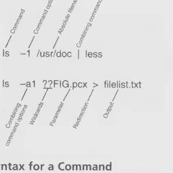

## 命令的基本语法

在接下来的小时中，你将看到许多地方给出了特定命令的语法。对于每个命令，都将有一个命令用法的示例，类似于以下示例：

```
commandname -options [parameter]
```

这条单行命令被称为命令行，它在 shell 提示符后输入。要执行命令，请按 Enter。大多数命令的最小用法是命令和一个或多个命令选项。

**新术语** 命令选项在命令后输入，用于修改命令的结果。在将选项输入到命令行之前，必须先在命令和命令选项之间留一个空格。然后，必须在命令选项前加上一个连字符 (`-`) 字符。连字符告诉 Linux 将连字符后的每个字母视为命令选项。连字符和命令选项之间没有空格。可以有多个命令选项，但不要在连字符和选项之间放置空格。

在第 7 章“在文件系统中移动”中，你将学习如何创建一个简单的命令来查看目录中包含的文件。下面是这种简单命令的示例：

```
ls -l /usr/doc
```

此示例中使用的命令是 `ls`，它显示当前工作目录内容的文文件列表。命令选项是 `-l`，它修改了列表中每个文件显示的信息。参数告诉命令列出 `/usr/doc` 目录的内容，而不是当前工作目录。

**新术语**

命令参数是命令可用来修改其输出的其他类型信息。参数可以是文件、目录或一段时间。参数前面没有连字符。参数指定命令要作用于哪个文件或目录，或者可以设置命令执行的时限。

阅读命令语法时，请注意以下几点：

-   任何以粗体显示的文本必须完全按原样输入。
-   以斜体显示的文本是名称或值的占位符。斜体文本需要替换为实际的文件名或目录，或其他用户提供的数据。
-   出现在方括号([])内的文本是命令的可选部分。命令语法中的这一部分不是执行命令所必需的。不要输入方括号。

## 在命令行上输入

你可以有两种不同的方法来使用命令行。如果你按照第 2 小时的说明操作，在登录到用户账户后你将处于文本屏幕中。如果你觉得勇敢，可以从此文本屏幕工作。如果你登录到用户账户后直接进入桌面环境（如 `KDE` 或 `GNOME`），你仍然可以从终端模拟器程序在命令行上工作。你可能会在系统上找到多种终端模拟器。最流行的是 `xterm`。搜索你的系统，你可能会找到一个好用的终端模拟器。其中一个终端模拟器是 `eterm`（图 6.2 所示）。无论你是从文本屏幕还是终端模拟器输入，命令都会执行相同的操作。

图 6.2

`xterm` 终端模拟器可以配置为显示背景和大文本。

Shell 提示符

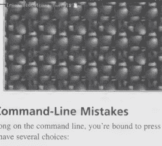

## 纠正命令行错误

在命令行上输入时，你难免会按错键。打字员该怎么办？你有几个选择：

-   对于严重的打字错误，你可能需要考虑清除命令行上出现的所有内容。只需按 `Ctrl+U`。清空命令行后，你可以尝试重新输入命令。
-   如果你很快发现了错误，按 `Backspace` 清除光标左侧的字符。`Backspace` 每次只删除一个字符。一直按 `Backspace` 直到删除错误，然后继续正确输入命令。
-   当错字在命令行中间时，按左箭头键直到光标位于错误右侧。按 `Backspace` 键删除错误。然后你可以插入新文本（它将插入到光标左侧）或使用箭头键移动到命令末尾。

## 使用命令快捷方式

有几个打字快捷方式可以帮助你在命令行的工作更轻松。以下是如何减少每小时按键次数的方法：

-   也许你的记忆力在衰退，记不起最近使用过的命令。按向上箭头键，观看时间倒流，之前输入的命令会出现在 shell 提示符后。按向上箭头键继续查看每个先前输入的命令。当需要的命令出现在 shell 提示符后，按 Enter 执行该命令。
-   `bash` shell 包含一个特性，允许你输入命令或文件名的部分，shell 会猜测完整的命令或文件名。你需要输入足够多的命令或文件名字符以使其可以唯一识别。在输入几个字符后，按 `Tab`，shell 会补全剩余的命令。如果 shell 无法猜测，你会听到一声蜂鸣并出现潜在命令列表。输入更多字符并再次尝试补全命令。
-   使用通配符字符可以让命令发挥更大作用。通配符用于选择符合特定要求的文件或目录。`*` 通配符替换文件或目录名中的一个或多个字符。`?` 通配符替换文件或目录名中的单个字符。你将在第 7 小时学习通配符，在那里你将学习如何查看目录中的文件列表。


> 通配符仅用于文件名和目录名。不要对命令名称或命令选项使用通配符；Linux 将无法识别该命令。

## 更改标准输出

当你执行命令时，命令从键盘读取（标准输入），命令的结果（或输出）出现在屏幕上（标准输出）。如果你希望命令输出出现在其他位置，或希望将输出发送给另一个命令处理，你需要通过称为输入/输出重定向的过程来更改输出。命令重定向是通过 `>` 或 `|` 字符分隔两个或多个命令来完成的。

重定向输出的一种方法是将其保存到文件中而不是在屏幕上显示。这使你能够为以后使用保存输出的快照。`>` 字符用于希望将命令输出发送到文件或打印机时。

大多数 Linux 命令是执行单一任务的简单工具。有时你需要组合两个或多个命令来完成一项工作。例如，如果 `ls` 命令结果显示的文件列表太长而无法阅读，将 `ls` 命令与 `less` 分页器结合使用。这使你能够滚动浏览文件列表。

通过管道（用 `|` 字符指定）来实现命令的组合。管道在两个命令之间充当中间人，其中第一个命令的输出被“管道传输”到第二个命令的输入。


> 当你成为命令行高手后，你会开始组合命令，很快你的命令就会比屏幕还长。当命令太长而无法在一行内容纳时，输入反斜杠（`\`）字符并按 Enter 键以在下一行继续命令。

## 任务：查看命令历史列表

shell 会跟踪你输入的最后 500 条命令。如果你经常使用命令行，使用箭头键滚动命令历史列表可能会花费一些时间。更简单地查看你使用过的命令的方法是使用 `history` 命令。以下是如何轻松列出你使用过的命令并从列表中选择命令执行的方法。

1. 要查看命令历史列表，输入 `history` 并按 Enter。之前执行的命令会以列表形式出现。你会在命令左侧看到一个数字。历史列表的示例显示在列表 6.1 中。该列表包含两列。第一列表示命令输入的顺序。这也是你从列表中执行命令时使用的编号。第二列是命令的执行形式。

### 列表 6.1 `history` 命令的示例输出

```
1 startx
2 man adduser
3 man passwd
4 shutdown
5 vi practice.txt
```

2. 在列表中搜索直到找到你想要执行的命令。要执行命令，输入 `!number` 并按 Enter，其中 `number` 是历史列表第一列中对应你想要使用的命令的编号。根据列表 6.1，要启动 X Window 系统（示例中显示为 `1 startx`），输入 `!1`。

3. 如果命令历史列表比你的屏幕更长，输入 `history | less`。这会将命令发送到 `less` 分页器，你可以使用上、下箭头键滚动列表。要退出分页器并返回 shell 提示符，输入 `q`。

4. 你可能只想查看最近输入的几条命令。要查看最后 10 条命令，输入 `history 10` 并按 Enter。

## 理解手册页

到目前为止，你已经了解了一些将在 Linux 系统上使用的命令，并看到了命令的结构。现在是时候找出在哪里可以找到有关这些命令的更多信息以及如何使用它们。

当你想要了解有关命令的信息，无论是命令的描述还是命令选项列表，请查阅 Linux 手册页（也称为 man 页）。当你使用 `man` 命令请求某个主题的信息时，手册页会显示在你的屏幕上（通过一个名为分页器的实用程序）。分页器用于阅读手册页的内容。

### `man` 命令的语法


手册页是系统中已安装命令的系统参考页。当执行 `man` 命令时，它会搜索手册页标题以查找你请求的主题。以下代码显示了 `man` 命令的语法：

```
man [options] [section] topic
```

Where：

- `topic` 参数通常是命令的名称（也是手册页的标题）。至少，你需要使用主题来使用 `man` 命令。例如，输入 `man man` 会显示有关 `man` 命令的手册页。该手册页描述了手册页的工作方式。输入 `man ls` 会显示描述以不同方式列出目录内容的手册页。表 6.4 显示了各部分的内容。
- 你可以使用 `man` 命令的多个选项来更改默认输出。有时某个命令可能存在多个手册页，但 `man` 命令只显示它遇到的第一个手册页。要一个接一个地显示其他相关手册页，请使用 `-a` 选项与 `man` 命令一起使用（输入 `man -a` 并按 Enter）。
- `section` 参数用于如果你想更改 `man` 命令搜索手册页目录以查找你请求的主题的顺序。这在某个命令存在多个手册页时很有用。表 6.5 显示了手册页系统中包含的不同目录。

## 任务：阅读 man 命令的手册页

当请求手册页时，它会显示在两个分页器之一中——`more` 或 `less`。默认情况下，你系统上的手册页应显示在 `less` 分页器中。因为大多数手册页占用的空间比屏幕可用空间更大，所以你需要学习一些命令来在分页器中阅读整个手册页。熟悉 `man` 命令以及在分页器中阅读手册页的最佳方法是阅读 `man` 命令的手册页。以下是如何显示 `man` 手册页的方法：

- 1. 在 shell 提示符下，输入 `man man` 并按 Enter。`man` 命令的手册页会出现在屏幕上。你只能看到手册页的一部分，具体取决于屏幕大小（参见图 6.3）。

### 图 6.3

`man` 命令的手册页。

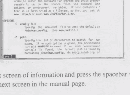

- 2. 阅读第一屏信息，并在想要移动到手册页下一屏时按空格键。
- 3. 按 B 键向后移动一屏浏览手册页。
- 4. 要逐行浏览手册页，请按 Enter。
- 5. 如果你想在手册页中搜索特定单词，输入斜杠字符（`/` 会出现在屏幕底部），然后输入搜索词并按 Enter。搜索到的每个单词出现位置都会在手册页中高亮显示。
- 6. 阅读完手册页后，按 Q 键。分页器将关闭，你将被返回到 shell 提示符。

## 破译手册页

手册页中包含大量信息，但对新 Linux 用户来说可能很难理解。每个手册页都描述了一个命令及其工作原理。表 6.4 简要介绍了手册页的主要部分。

### 表 6.4 手册页中包含的内容

| 部分名称 | 内容 |
|---|---|
| 名称 | 命令的名称和简短描述 |
| 概要 | 命令的使用方法以及相关命令行选项的列表 |
| 描述 | 程序和选项的解释 |
| 选项 | 所有命令行选项的列表，以及每个选项使用方法的简要描述 |
| 另请参阅 | 引用类似信息的其他手册页 |
| 诊断 | 你可能遇到的任何错误消息的描述 |
| 错误 | 与命令或程序使用相关的已知问题 |
| 历史 | 程序开发记录 |
| 作者 | 列出程序作者和其他贡献者的列表 |

手册页中告诉你如何使用命令的两个部分是概要和选项部分。概要部分显示了命令的语法。命令选项适合语法并修改命令的操作。选项允许你微调命令，使其以对你有用的形式输出结果。

## 任务：修改 man 命令的输出

所有命令都使用命令选项来自定义命令的操作。以下是使用 `man` 命令的命令选项的一些练习：

- 1. 输入 `man -a man` 并按 Enter。该命令告诉 `less` 分页器显示所有名为“`man`”的手册页。
- 2. 当第一个手册页出现时，使用空格键滚动文档。
- 3. 阅读完第一个手册页后，按 Q。分页器会格式化第二个 `man` 命令的手册页，该手册页解释了格式化手册页的宏。
- 4. 阅读手册页。完成后按 Q，你将被返回到 shell 提示符。记住，对于我们的示例用户 `rusty`，它看起来像这样：

```
[rusty@localhost rusty]$
```

## 更改搜索顺序

手册页组织在多个目录中，手册页被归类到这些目录中。如果你想在特定目录中搜索手册页，只需在 `man` 命令语法的 `sections` 参数中指定目录编号。你也可以按特定顺序搜索手册页的目录结构。表 6.5 显示了手册页使用的目录结构以及每个目录中可以找到的内容。

### 表 6.5 手册页的目录结构

| 目录 | 内容 |
|---|---|
| `/usr/man/man1` | 在 shell 内运行的命令 |
| `/usr/man/man2` | 系统调用的文档 |
| `/usr/man/man3` | `libc` 函数的手册页 |
| `/usr/man/man4` | `/dev` 目录中文件的信息 |
| `/usr/man/man5` | 特殊文件格式的详细信息，例如 `/etc/passwd` |
| `/usr/man/man6` | 游戏 |
| `/usr/man/man7` | Linux 文件系统和手册页的描述 |
| `/usr/man/man8` | `root` 操作员实用程序的页面 |
| `/usr/man/man9` | Linux 内核源例程的文档 |

在每个这些章节中都有一个介绍页面，描述该目录中包含的手册页。如果你输入 `man intro`，则会显示 `/usr/man/man1` 目录的介绍页面。如果你想阅读有关 Linux 文件系统（位于 `/usr/man/man7` 目录）的命令的介绍页面，请输入 `man 7 intro`。

手册页目录结构并不是按严格的数字顺序搜索的。相反，首先搜索第一个目录（`/usr/man/man1`），然后搜索第八个（`/usr/man/man8`）目录，然后再回到 `/usr/man/man2`、`/usr/man/man3`、`/usr/man/man4`，一直到 `/usr/man/man9`。`man` 命令会搜索手册页目录，直到找到与你的搜索请求匹配的内容为止。

## 任务：阅读 GNU 文档

另一个重要的信息来源来自自由软件基金会的 GNU 项目。你可以在 `info` 文件中找到 GNU 软件的文档。`info` 程序是 GNU 项目中许多程序和软件开发工具的超文本帮助系统。以下是如何阅读 `info` 文件的方法：

- 1. 输入 `info` 并按 Enter。`info` 文件的目录节点会出现在分页器中（见图 6.4）。`info` 文件中涵盖的所有主题都列在这一页上。

图 6.4 `info` 程序中包含的主题列表。

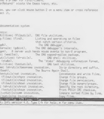

- 2. 按 H 键并阅读 `info` 文件的“入门”部分。使用向下箭头键和 Page Down 键滚动文件。
- 3. 按 D 键返回目录节点。
- 4. 使用向下箭头键查找你想要了解更多的主体。当主体被高亮时，按 Enter。所选主体的 `info` 页面将被显示。
- 5. 阅读完 `info` 页面后按 Q。

## 一些有用的搜索命令

正如你可能开始意识到的那样，学习 Linux 操作系统的任务是一项大工程。命令如此之多，仅了解它们就是一项相当大的工作（更不用说学习如何使用它们了）。此外，每个 Linux 发行版都安装了大量的软件。有几个命令可以搜索你的系统并返回有关文件系统中文件的信息。

## 在系统上定位文件

你在系统上查找文件时最常使用的搜索命令是 `find` 命令。`find` 最常见的用途是定位文件。如果你知道文件名（或者如果你只知道部分文件名，可以使用通配符），`find` 将从当前目录开始并搜索所有子目录以找到你需要的文件。使用 `find` 搜索文件的内容在第 7 小时中介绍。`find` 非常有帮助的另一个任务是进行系统备份（在第 10 小时“备份和恢复文件系统”中介绍）。`find` 命令可以列出自上次备份以来被修改过的文件。如果多个用户共享系统，`find` 命令会告诉你哪些文件属于特定用户或用户组（你将在第 12 小时看到）。

## 显示程序摘要

当你遇到新命令并想快速了解该命令的作用时，请尝试 `whatis` 命令。与显示完整手册页的 `man` 命令不同，`whatis` 命令仅显示手册页中的摘要行。然后，如果你认为这个命令是你可能会使用的，你可以显示手册页并探索自定义命令输出的选项。

> 在键入程序的二进制文件名或在命令行上执行命令之前，务必先了解程序或命令的作用以及命令选项如何修改程序的行为。

## 任务：搜索 whatis 数据库

`whatis` 命令是一个有价值的工具，它提供命令的简要描述，并显示手册页目录（参见表 6.5），你可以在其中找到该命令的手册页。以下是如何搜索 `whatis` 数据库以确定是否要阅读该命令的手册页：

- 1. 输入 `whatis ls` 并按 Enter。`ls` 命令的摘要会出现在 `less` 分页器中，如清单 6.2 所示。
- 2. 阅读 `ls` 命令的摘要。第一列是命令名称，第二列（括号中的数字）是目录编号，第三列是手册页中的简要摘要。
- 3. 完成后按 Q 返回 shell 提示符。


### 4. 查看 `mtools` 是否已安装

假设有人告诉你有一个很酷的 Linux 实用程序叫做 `mtools`，它可以让你在 Linux 中使用 DOS 命令。要查看你的系统上是否真的安装了这样的程序，请输入 `whatis mtools` 并按 Enter。输出显示在清单 6.3 中。

### 5. 同时阅读 `mtools` 命令和 `mtools.conf` 配置文件的手册页

要同时阅读 `mtools` 命令和 `mtools.conf` 配置文件的手册页，请输入 `man -a mtools` 并按 Enter。

### 6. 导航手册页

使用箭头键以及 Page Up 和 Page Down 键导航 `mtools` 实用程序的手册页。

### 清单 6.2 `whatis ls` 命令的输出

```
ls (1)      . list directory contents
```

### 清单 6.3 `whatis mtools` 命令的输出

```
mtools (1)    . utilities to access DOS disks in Unix.
mtools.conf (5) . mtools configuration files
```

### 7. 退出手册页

阅读完手册页后按 Q。第二个手册页（用于 `mtools.conf` 文件）会被格式化并出现在分页器中。

### 8. 返回 shell

阅读手册页并在完成后按 Q。你将被返回到 shell 提示符。


`whatis` 数据库需要定期更新，以便将系统上安装的任何新程序都包含在 `whatis` 数据库中。要了解如何自动化此任务，请参阅第 17 小时“自动化系统管理任务”。

## 查找程序的执行文件

在使用 `whatis` 命令确定命令或程序的作用并阅读手册页以了解如何操作命令之后，你可以使用 `whereis` 命令搜索程序中编码的目录并列出有关文件的各种信息。通过使用 `whereis` 命令，你将了解命令的二进制（或执行）文件、源文件和手册页的位置。

要使用 `whereis` 命令，请输入 `whereis` 后跟命令名称（记得在两者之间加空格）。如果你想知道 `ls` 命令的执行文件和手册页的位置，请输入 `whereis ls` 并按 Enter。

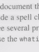

当你只想知道命令的执行文件位于何处时，使用 `which` 命令。

## 查找执行任务的程序

当你需要执行某项任务但不知道什么程序或命令可以为你完成时，请向 `apropos` 命令寻求帮助。例如，你可能有一份想要拼写检查的文档，但你使用的文本编辑器不提供拼写检查器。在 shell 提示符下，输入 `apropos spelling` 并按 Enter。你会看到几个可能有用的程序。获得潜在程序列表后，使用 `whatis` 命令查看该程序是否符合你的需求。

## 任务：在离开办公桌前清除终端屏幕

你会注意到，如果你在终端屏幕上做很多工作，屏幕顶部会有很多文本，而 shell 提示符则在最底部。当你不想看到杂乱时该怎么办？如果你想执行不同的任务并且不想让上一个任务的残留物徘徊在周围，如何开始一个全新的屏幕？当有人到你的办公桌前聊天时，你如何隐藏你的工作？每当你需要空白屏幕时，使用 `clear` 命令。

当你完成计算机工作时，清除屏幕上的所有文本是个好主意。你可能还想退出用户账户。通过清除屏幕，没有人可以看到你正在处理的内容。通过退出账户，你的个人文件会被安全锁定，其他系统用户无法读取或修改你的文件，除非他们有权限。

以下是如何清除屏幕并使你的用户账户和文件安全的方法：

1. 每当你想擦除屏幕时，输入 `clear` 并按 Enter。屏幕上出现的文本将被抹去，剩下的只有 shell 提示符（现在位于屏幕顶部）。
2. 输入 `logout` 并按 Enter。你的用户账户将被关闭，这样就不会有人能够访问你的账户或文件。
3. 如果你在第二个虚拟终端上有一个打开的用户账户，请切换到该终端（通过按 Alt 键和终端的功能键）并退出。

##### 摘要

在这一小时里，你学习了很多关于命令和在命令行上工作的知识，但练习不多。在开始你的命令行之旅之前，了解可用的命令以及如何高效使用这些命令非常重要。随着你阅读本书的其余部分，你将获得更多使用命令的练习。你将看到命令、命令选项和重定向如何协同工作，以构建一个按你想要的方式执行任务的命令。希望到这一小时结束时，围绕命令行使用的一些神秘感已被消除，你可以自信地使用命令行。

## Q&A

**Q** 我在多个不同的终端上使用多个用户账户工作时，如何快速找出我的哪些用户账户已登录？

**A** 尝试使用 `who` 命令。如果你想知道当前使用的是哪个用户账户，输入 `who am i`。

**Q** 除了手册页和 info 页面之外，我是否能在 Linux 文件系统中找到其他类型的隐藏文档？

**A** `HOWTO` 文档（位于 `/usr/doc/HOWTO` 目录中）和 `FAQ`（存储在 `/usr/doc/FAQ` 中）是两个你绝对应该了解的来源。

**Q** 本小时前面有一个常用命令的列表。有没有一个不常用的命令列表供我尝试一下，娱乐一下？

**A** 你想知道自己登录到用户账户有多长时间了吗？输入 `finger username` 然后按 Enter（其中 `username` 是你的用户账户的登录名）。除了显示你已登录的时间外，你还可以查出你正在使用的 shell 的名称，以及是否收到邮件。

如果你想知道每个目录和子目录占用了多少磁盘空间，请使用 `du` 命令。要查看整个系统的空闲和已用磁盘空间，请使用 `df` 命令。

当你需要知道当前时间或日期时，尝试 `date` 命令。

要显示当前月份的日历，请使用 `cal` 命令。如果你想查看其他月份，你需要为 `cal` 命令添加命令选项。

**Q** 我正在 X Window System 中工作，想要阅读手册页。最好的入门方式是什么？

**A** 你可以尝试一个名为 `xman` 的程序。要启动 `xman`，请打开一个 X 终端窗口并在 shell 提示符下输入 `xman`。你可以从手册页列表中快速选择。

## Workshop

测试本小时所涵盖材料的知识，请回答以下问题并完成练习。

### Quiz

1. What basic skills will you need to become an efficient user of the Linux operating system?

你需要掌握的最重要的基本技能是能够在文件系统上高效地处理目录和文件。处理目录涉及查看目录的内容并在目录之间切换。文件通过编辑文件内容、将它们移动到适当的目录以及删除不需要的文件来保持有序。

能够定位文件和搜索信息也很重要。这可以防止文件在系统中丢失，并且有助于你了解系统上安装的命令和程序。为了帮助你更好地使用搜索信息，命令结果可以定向到文件或打印机。

当多个用户在系统上工作时，能够让其他用户访问文件会使文件共享变得容易。

2. What are the three basic parts of a command?

命令的三个部分是命令、命令选项和任何参数。命令选项会修改命令的结果，而参数是另一种用于修改命令输出的输入类型。参数通常是文件名或目录路径。

3. How do you delete typing errors when working on the command line?

要删除整行，请按 `Ctrl+U`。按 Backspace 会删除上一个输入的字符。箭头键可以沿着命令行移动光标，以便在命令行的中间插入文本。

4. What is the syntax for the `man` command?

`man` 命令会显示 Linux 系统上安装的命令的请求参考页。`man` 命令的语法是

```
man [options] [section] topic
```

其中 `topic` 参数是命令的名称，`section` 参数用于在手册页中搜索特定章节，而 `options` 会更改默认输出（例如一次又一次地显示多个相关的手册页）。

### Exercises

1. 使用 `man` 命令阅读本小时讨论的命令的手册页。这是一个很好的探索机会，让你熟悉操作系统所需的命令。在阅读手册页时，思考命令对你有什么用处。记下一些有用的命令选项，这些选项会修改命令输出，使命令对你更有用。

2. 使用 `apropos` 命令查看计算机上安装了哪些程序。如果你已经工作了一整天，想玩一会儿，输入 `apropos game` 看看能玩什么有趣的东西。当是时候放音乐时，输入 `apropos cd` 并查找一些可以在计算机上播放音乐 CD 的 CD 播放器。

## Hour 7

### Moving Around the Filesystem

所有操作系统都有一个共同特征：它们使用目录结构来组织文件。目录的结构像一棵树。主目录，即基本目录，也是所有其他目录分支的目录，是根目录。所有其他从根目录生长出来的目录称为子目录。在这些目录和子目录中，你会找到应用程序和实用程序、设备和系统文件以及数据文件。

你将执行的

最基本的任务是文件管理。文件管理包括在目录之间移动、创建文件、将文件组织到目录中、将文件从一个位置移动到另一个位置以及删除不必要的文件。


在本小时，你将

- 通过在目录之间切换并显示目录中包含的文件列表来处理文件
- 在你的用户账户中添加和删除目录和文件
- 创建文件并查看文件属性
- 复制和重命名文件

## Exploring the Home Directory

在第 4 小时“理解 Linux 操作系统”中，你被介绍到文件系统的基本结构。你看到了文件如何放入目录，以及目录如何嵌套在其他目录中。当用户在系统上分配账户时，他们也会在 `/home` 目录中分配空间来存储个人文件。如果用户的登录名为 `rusty`，那么该用户的个人文件存储在 `/home/rusty` 中。这被称为主目录，是用户登录到其账户后工作的目录。从此目录开始，用户可以创建子目录来组织文件、创建新文件、修改这些文件并删除不需要的文件。只有用户、经用户授权的人员以及 `root` 账户可以访问用户主目录中的文件。

当你首次登录到用户账户时，shell 提示符看起来像这样（也就是说，如果你的用户名是 `rusty`）：

```
[rusty@localhost rusty]$
```

很酷，但这在文件系统中把你放在哪里？输入 `pwd` 并按 Enter。响应出现在屏幕的下一行，对于名为 `rusty` 的用户看起来像这样：

```
/home/rusty
```

注意 shell 提示符出现在下一行。它正在等待你输入另一个命令。这很好，因为现在是探索你的主目录的好时机。

其中保存你创建的任何文件，除非你指定不同的目录。如果你请求一个文件，系统将在你的工作目录中查找该文件。如果文件在不同的目录中，你需要更改到该目录，或将目录路径作为命令参数包含在内。

要查看主目录的内容（此时它也应该是你的工作目录），请使用 `ls` 命令。输入 `ls` 并按 Enter。我们的可靠助手 `rusty` 已经做了一点工作，并创建了一些文件并使用了一些程序。当 `rusty` 输入 `ls` 命令时，列表 7.1 中的输出显示。

### LISTING 7.1 The Output of the ls Command

```
Desktop/  XBF1G03.pcx  XBF1G05.pcx  XBF1G07.pcx  tmp/
XBF1G01.pcx  XBF1G04.pcx  XBF1G06.pcx  nsmail/
```

列表 7.1 中的文件列表没有提供太多信息。很难分辨列表中的哪个项目是文件，哪个是目录。这就是命令选项发挥作用的地方。列出有关文件和目录的更多信息的一种方法是向 `ls` 命令添加长列表格式命令选项。因此，通过使用 `-l` 选项修改 `ls` 命令（输入 `ls -l` 并按 Enter），文件列表包含相当多的文件信息，如列表 7.2 所示。

### LISTING 7.2 The Output of the ls -l Command

```
total 382
drwxr-xr-x  4 rusty  rusty      1024 Apr 25 19:37 Desktop/
-rw-r--r--  1 rusty  rusty     52899 Apr 25 20:50 XBF1G01.pcx
-rw-r--r--  1 rusty  rusty     51966 May  1 09:20 XBF1G03.pcx
-rw-r--r--  1 rusty  rusty     93230 May  1 08:12 XBF1G04.pcx
-rw-r--r--  1 rusty  rusty     76645 May  1 08:56 XBF1G05.pcx
-rw-r--r--  1 rusty  rusty     64473 May  1 09:11 XBF1G06.pcx
-rw-r--r--  1 rusty  rusty     40241 May  1 09:36 XBF1G07.pcx
-rw-r--r--  1 rusty  rusty        0 May 10 20:05 list2.txt
drwxr-xr-x  2 rusty  rusty      1024 May  9 08:01 nsmail/
drwx------  2 rusty  rusty      1024 Apr 25 19:33 tmp/
```

乍一看，列表 7.2 中的所有信息可能看起来令人困惑。尽管如此，花点时间查看每条文件信息。图 7.1 将帮助你更好地理解。

图 7.1

`ls -l` 命令显示的文件列表。

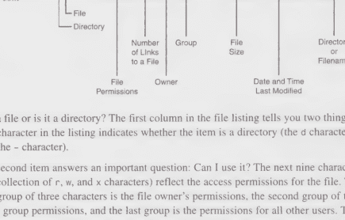

这是文件还是目录？文件列表中的第一列告诉你两件事。列表中的第一个字符表示该项目是目录（字符 `d`）还是文件（字符 `-`）。

第二项回答了一个重要问题：我能使用它吗？接下来的九个字符（由 `r`、`w` 和 `x` 字符组成）反映了文件的访问权限。第一个三字符组是文件所有者的权限，第二个三字符组是组权限，最后一个组是所有其他用户的权限。权限包括读 `r`、写 `w` 和执行 `x`。连字符表示访问被拒绝。第三列和第四列显示拥有该文件的小组和用户。

> 你将在第 12 小时“在系统中与其他用户共享文件”中了解更多关于设置文件权限、更改文件所有权以及将文件分配给组的内容。

文件列表的最后三列显示文件的大小（以字节为单位）、上次更新时间以及文件名。

## ls 命令的语法

`ls` 命令以多种格式列出目录的内容，文件垂直列出。如果不使用选项，文件和目录的名称（但不包括隐藏文件）会以列的形式显示在屏幕上。以下代码显示了 `ls` 命令的语法：

```
ls [options] [filenames]
```

该目录将被列出。可以使用通配符来显示某些文件，例如使用 `*.txt` 仅显示目录中的文本文件。

尝试这些有用的命令选项：

- 要水平而不是垂直列出文件，请键入 `ls -x` 并按 Enter。
- 可以在长列表中显示每个文件的权限和所有者、文件大小以及修改日期。键入 `ls -l` 并按 Enter。
- 要显示所有文件包括任何隐藏文件，请键入 `ls -a` 并按 Enter。如果要在长列表中包含隐藏文件，请键入 `ls -la` 并按 Enter。
- 可以在文件名的末尾添加不同的字符以更轻松地识别不同的文件类型。键入 `ls -F` 并按 Enter。目录后会出现斜杠 `/`，可执行文件后会出现星号 `*`，符号链接后会出现 at `@` 字符。


> 你可以在连字符 `-` 字符后使用多个命令选项（例如 `ls -la` 命令）。命令选项出现的顺序无关紧要，因此 `ls -la` 和 `ls -al` 提供相同的输出。你只能在用于指定命令选项的单个字母的命令中使用多个命令选项。

## 重定向命令输出

以长列表形式显示文件列表是可以的，如果文件列表不太长且适合屏幕显示。如果文件列表很长，列表就会一直滚动过去，你会错过大部分信息。你有选择——你可以将文件列表显示在分页器（如 `less`）中，也可以将输出发送到文件或打印机。这看起来是练习管道和重定向技能的好时机。

如果你将输出发送到 `less` 分页器，你可以随意滚动浏览列表。要将文件列表发送到分页器，请键入 `ls -l | less` 并按 Enter。通过将输出发送到文件，你需要用文本编辑器显示该文件。要创建文本文件，请键入 `ls -l > filename.txt` 并按 Enter。

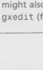

> 你将在第 8 小时“使用 vi 编辑文本”中了解 `vi` 文本编辑器。你可能还会发现在你的系统上安装了其他文本编辑器，例如 `emacs`、`gedit`（用于 GNOME）或 `kedit`（用于 K 桌面环境）。

## 任务：显示 ls 命令选项

很难记住每个命令相关的所有命令选项。以下是列出 `ls` 命令选项的快速方法：

- 1. 键入 `ls --help | less` 并按 Enter。可以在 `ls` 命令中使用的选项列表将显示在 `less` 分页器中。
- 2. 使用箭头键阅读 `ls` 手册页的选项部分。
- 3. 记录任何可能对你有帮助的文件列表命令选项。
- 4. 按 `Q` 退出 `less` 分页器并返回到 shell 提示符。

## 扩展目录树

在使用应用程序时，你需要一个存放工作的地方。存放这些文件的最佳位置是你的用户账户。现在，你可以将所有文件保存在主目录中，但过一段时间后事情会变得混乱。为了帮助组织你的文件系统，请创建目录来存储相关信息。为了跟踪通信、电子表格和扫描的照片，请为每种文件类型创建目录。如果你经营一家小型企业，你可能希望为每个客户或项目创建目录。

## 创建目录

当你想在工作目录中创建子目录时，使用 `mkdir` 命令。创建新目录最简单的方法是使你希望新目录出现的目录成为工作目录。

例如，用户 `rusty` 想创建一个名为 `letters` 的子目录来存储与家人和朋友的通信。如果工作目录是 `/home/rusty`，则使用以下命令创建名为 `/home/rusty/letters` 的子目录：


```
mkdir letters
```

为了确保子目录存在，使用 `ls` 命令。然后，要从主目录更改到新目录，使用 `cd` 命令。`cd` 命令使指定的目录成为新的工作目录。在前面的示例中，用户 `rusty` 将通过键入 `cd letters` 更改到 `letters` 目录。`shell` 提示符更改为显示新的工作目录，如下所示

```
[rusty@localhost letters]$
```

然后，为了确认你确实位于预期的目录中，使用 `pwd` 命令验证工作目录。

> 要返回到你的用户主目录，请在命令行单独键入 `cd` 并按 Enter。

## mkdir 命令的语法

如果你记得 DOS 命令，在创建、删除和复制目录（以及文件）方面你会发现许多相似之处。如果工作目录是包含新目录的目录，则使用 `mkdir` 命令创建新目录最容易。以下是 `mkdir` 命令的语法：

```
mkdir [options] directoryname
```

`directoryname` 参数是要创建的新目录的名称。此目录将是工作目录的子目录。

有两个可以在 `mkdir` 命令中使用的命令选项，你会发现它们很有帮助：

- 要创建包含一系列子目录的父目录，请使用 `parents (-p)` 命令选项。例如，你可能希望在主目录内的单独目录中存储通信文件。在此目录中，你计划为每个客户设立一个目录，而在每个客户目录中，将为每年的通信设立一个单独的目录。使用此示例，键入 `mkdir -p corresp/client/2000` 并按 Enter 创建全部三个目录。这比创建 `corresp` 目录、更改到 `corresp` 目录（使用 `cd` 命令）、创建 `client` 目录等要容易得多。

- 你还可以使用 `mode (-m)` 命令选项为新创建的目录分配访问权限。你将在第 12 小时学习如何为目录分配文件权限。

## 任务：为用户账户创建目录结构

是时候使用一些命令行知识并在你的用户账户中创建几个目录了。将数据文件存储在目录中可以更轻松地查找文件并保持其有序。以下是一些有助于使从命令行创建目录变得更轻松的想法：

- 1. 确保你正在工作在你的主目录中。在 `shell` 提示符下输入 `pwd` 并按 Enter。如果你的用户名是 *rusty*，`pwd` 命令应显示你的主目录如下：

  `/home/rusty`

  如果不在主目录中，输入 `cd` 并按 Enter。现在再次尝试 `pwd` 命令以确认你的位置。

- 2. 创建用于存储通信文件的目录。输入 `mkdir corresp` 并按 Enter。

- 3. 确保 `corresp` 目录位于你的主目录中。输入 `ls` 并按 Enter。

- 4. 切换到 `corresp` 目录。输入 `cd corresp` 并按 Enter。`shell` 提示符将改变，看起来如下：

  `[rusty@localhost corresp]$`

- 5. 为名为 `BigBiz` 的客户创建一月份的通信目录。输入 `mkdir -p BigBiz/Jan` 并按 Enter。

- 6. 为 `BigBiz` 创建通信目录，但为二月份。使用命令历史记录使此任务更轻松。按向上箭头键显示之前输入的命令，按 Backspace 删除命令行中的 `Jan` 部分，然后输入 `Feb` 并按 Enter。

- 7. 确保 `BigBiz` 及子目录已创建。切换到 `BigBiz` 目录（输入 `cd BigBiz` 并按 Enter），然后列出内容（使用 `ls` 命令）。

- 8. 返回你的主目录。输入 `cd` 并按 Enter。

- 9. 使用 `find` 命令查看用户账户中包含的所有文件和目录。输入 `find $HOME -print` 并按 Enter。每个文件和目录（包括完整目录路径）都会打印在屏幕上。如果文件在屏幕上飞快闪过，将输出重定向到 `less` 分页器（输入 `find $HOME -print | less`）或重定向到文件（输入 `find $HOME -print > filename`），以便更轻松地查看列表。

## 理解绝对和相对文件名

当你输入 `ls` 列出目录内容时，只会显示工作目录的内容。如果你搜索文件，并且只指定文件名，Linux 只会在当前目录中查找该文件。如果你想操作不在工作目录中的文件，必须指定文件所在的目录和文件名。

在文件系统中移动到不同目录的方法是 `cd` 命令。要切换到不同目录，输入 `cd` 后跟目录路径。如果主目录是工作目录（例如 `/home/rusty`），并且你想进入 `/home/rusty/letters/chainmail/Feb`，输入 `cd letters/chainmail/Feb` 并按 Enter。无需输入完整的目录路径，因为目标目录相对于工作目录。然而，如果你想进入 `/usr/doc` 目录查看系统上安装的程序的帮助文件，则需要输入 `cd /usr/doc` 并按 Enter。你使用绝对文件名是因为 `/usr/doc` 目录不在工作目录的路径中。

**新术语** Linux 文件名有两种类型——绝对文件名和相对文件名。*绝对文件名* 以斜杠 (`/`) 字符开头，表示文件系统的根目录，后跟指向文件的完整目录路径。系统上的每个文件都有绝对文件名，并且绝对文件名可以从文件系统中的任何位置使用。*相对文件名* 指从工作目录开始的文件位置。相对文件名不以斜杠字符开头。


> 使用与工作目录相关的命令时尝试这些快捷方式：一个点 (`.`) 表示当前目录，两个点 (`..`) 指定当前目录的父目录。如果你想切换到当前工作目录的父目录，输入 `cd ..` 并按 Enter。

## 删除目录

`rmdir` 命令用于删除目录。在删除目录之前，必须先删除目录的内容。这意味着目录中包含的任何文件都需要使用 `rm` 命令删除（在本小时稍后讨论），子目录需要清空然后使用 `rmdir` 命令删除。


> 在学习操作新操作系统时，你可能希望将要删除的目录限制为你在用户账户中创建的目录。

## rmdir 命令的语法

当你想删除目录时，工作目录必须是待删除目录的父目录。此外，如果待删除目录中有任何文件。必须先删除这些文件。以下是 `rmdir` 命令的语法：

```
rmdir directory
```

`directory` 参数是要删除的目录的名称。如果目录不为空，将显示一条消息：

```
rmdir: <directory>: Directory not empty
```

此警告消息提醒你需要手动删除目录的内容。如果待删除目录不为空，命令不会删除该目录或其中包含的任何文件。

## 处理文件

文件可能是你在系统上操作的最基本电子信息单元。文件保存使用应用程序时创建的数据，例如图形图像、文字处理文档、网页或数据库。你创建的每个文件都有一个独特名称，可以存储在系统上的众多目录之一。最可能存储文件的地方是你的主目录。

在系统上保存文件后，你可以对文件执行各种任务。你可以通过在应用程序中打开文件并更改信息来更新文件。文件可以从一个目录移动到另一个目录以更好地组织你的信息。如果你需要文件用于不同目的，也可以将文件的副本保存在多个目录中。

## 创建文件

如果你想快速读取文件内容，使用 `cat` 命令。`cat` 命令一次可以读取一个或多个文件，也可以用于将两个文件的内容合并到一个文件中。它甚至可以创建新文件。而且……所有这些都直接来自命令行。很酷吧？

在让 `cat` 显示文件之前，你需要切换到包含该文件的目录。记住，`cd` 命令在目录之间移动你。当你执行 `cat` 命令（输入 `cat filename` 并按 Enter）时，文件会迅速在屏幕上滚动。

以下是一些可以教给 `cat` 的其他很酷的技巧：

- 当你需要将多个文件的内容合并到一个新文件中时，告诉 `cat` 要合并哪些文件以及顺序，以及新文件的名称。其余的可以交给 `cat`。例如，用户 `rusty` 收集笑话。每个笑话都放在单独的文件中，有时 `rusty` 会挑选几个好笑话与朋友分享。本周，`rusty` 想将名为 `joke27` 和 `joke53` 的笑话文件发送给一些朋友。要将这两个文件合并到名为 `grins1` 的第三个文件中，输入 `cat joke27 joke53 > grins1` 并按 Enter。

- 要将一个文件的内容添加到另一个文件的末尾，告诉 `cat` 追加文件。如果 `rusty` 有一个名为 `guffaws1` 的文件，一些朋友会喜欢，但他也想分享 `joke27`，`rusty` 会使用 `cat` 复制 `joke27` 的内容，然后将内容粘贴到名为 `guffaws1` 的文件末尾。要追加文件，输入 `cat joke27 >> guffaws1` 并按 Enter。

- `cat` 命令也可以用于创建空白文件。用户 `rusty` 想整理一年的最佳笑话集。要创建名为 `best2000` 的新文件，输入 `cat > best2000` 并按 Ctrl+D。现在有了新的空白文件，`rusty` 可以搜索笑话集并使用 `cat` 将最好的笑话追加到 `best2000` 文件的末尾。


## 任务：使用 `stat` 命令显示文件信息

在本小时 earlier，你看到 `ls -l` 命令如何显示有关文件的大量信息。另一种显示文件信息的方式，但这次针对单个文件，是使用 `stat` 命令。`stat` 命令也可以为目录显示相同的信息。以下是如何使用 `stat` 命令：

1. 切换到包含你想要了解更多信息的文件的目录。
2. 显示目录的文件列表（使用 `ls` 命令）并找到该文件。
3. 输入 `stat filename` 并按 Enter。`stat` 命令的示例输出可在列表 7.3 中找到。如果收到 `Can't stat file` 错误消息，则表示文件不存在。

### 列表 7.3 `stat` 命令的输出

```
File: 'XBE1006.pcx'
Size: 64473    Allocated Blocks: 128          Filetype: Regular File
Mode: (0644/-rw-r--r--)    Uid: ( 503/ rusty)   Gid: ( 505/ rusty)
Device: 3, 7   Inode: 75819   Links: 1
Access: Mon May  1 09:36:30 2000
Modify: Mon May  1 09:11:38 2000
Change: Mon May  1 09:11:38 2000
```

4. 将 `stat` 命令的输出与 `ls -l` 命令的输出进行比较。输入 `ls -l filename` 然后按 Enter。

你会注意到相同的权限和用户信息。`stat` 命令会显示有关文件最后访问时间和最后更改时间的更多信息。

## 删除文件

有时你不再需要某个文件。要删除不需要的文件，请使用 `rm` 命令将其删除。使用 `rm` 命令时，你需要指定要删除的文件（或文件）。在从系统中删除文件之前，你还必须对该文件具有写权限。

删除文件时，你可能希望谨慎行事。Linux 可以在每次尝试删除文件时提示你，以确保你真的想永久删除该文件。`rm` 命令具有交互式选项，这样每次删除文件时都会询问你是否真的要删除该文件。如果你希望每次删除文件时都被提示，输入 `rm -i filename` 然后按 Enter。你会看到以下消息：

```
rm: remove 'filename' ?
```

如果你想删除此文件，输入 `Y` 然后按 Enter。这会永久删除文件。如果你错误地执行了 `rm` 命令，输入 `N` 然后按 Enter。文件将保留原位。


> 删除文件后，就无法恢复。为了避免不必要的损失，请始终使用交互式选项使用 `rm` 命令。

## 重命名文件

你可能有许多原因想要重命名文件。也许你不喜欢原来的文件名；它可能不够描述性。`mv` 命令用于重命名文件。

### `mv` 命令的语法

重命名文件时，原来的文件名会被擦除，然后替换为新的文件名。所有信息保持不变，只有名称被更改。以下是 `mv` 命令的语法：

```
mv [options] sourcefile targetfile
```

`sourcefile` 参数是要复制的文件的名称，而 `targetfile` 参数是文件的新名称。例如，如果一个文件名为 `sample1`，而你想将其文件名更改为 `sample2`，输入 `mv sample1 sample2` 然后按 Enter。你也可以以同样的方式重命名目录。在不使用任何命令选项的情况下，`mv` 命令在创建重命名文件时会删除原始文件。在示例中，名为 `sample1` 的文件被重命名为 `sample2`，并且文件 `sample1` 从系统中删除。

两个命令选项经常被使用：

- 为确保不会覆盖现有文件（通过使用同一目录中另一个文件的相同文件名来重命名文件），请使用备份（`-b`）命令选项。要使用此选项，输入 `mv -b sample1 sample2` 然后按 Enter。这会创建一个名为 `sample1~` 的新文件，删除名为 `sample1` 的文件，如果已存在名为 `sample2` 的文件，则它现在将被命名为 `sample2~`。
- 另一种确保不会覆盖现有文件的方法是使用交互式（`-i`）命令选项。交互式选项会让你知道是否即将覆盖现有文件。要使用交互式命令选项，输入 `mv -i sample1 sample2` 然后按 Enter。

## 复制文件

当你需要复制文件时，使用 `cp` 命令。`cp` 命令的工作方式与 `mv` 命令非常相似，只是 `cp` 命令不会删除原始文件。要复制名为 `copy1` 的文件以创建名为 `copy2` 的新文件，输入 `cp copy1 copy2` 然后按 Enter。


使用 `cp` 命令的交互式命令选项（`-i`），以免覆盖任何现有文件。

## 任务：与 Microsoft Windows 共享文件

如果你使用 GNU/Linux 操作系统在计算机上创建文件，你可能会发现想要在另一台运行 Microsoft Windows 的计算机上使用这些文件。也许你扫描了几张宠物的照片并在 The Gimp 中进行了增强，现在你想与朋友分享。当你的朋友有一台旧的 Windows 机器，并且没听说过互联网时，你该怎么办？也许你应该向他介绍 21 世纪和 GNU。在此之前，格式化一张可在朋友计算机上使用的软盘并复制那张精彩的照片。以下是格式化 MS-DOS 软盘的方法：

1. 将软盘放入软盘驱动器中。
2. 从你的用户账户以超级用户身份登录。输入 `su` 然后按 Enter。你将被要求输入 root 密码。输入 root 密码然后按 Enter。
3. 对软盘执行低级格式化。输入 `fdformat /dev/fd0H1440` 然后按 Enter。`(/dev/fd0` 是控制软盘驱动器的设备文件的名称，`H1440` 是磁盘的大小。）你会看到类似列表 7.4 中的消息。

### 列表 7.4 `fdformat /dev/fd0H1440` 命令的输出

```
double-sided, 80 tracks, 18 sec/track. Total capacity 1440 kB.
Formatting ... done
Verifying ... done
```

如果磁盘上有任何坏块，将显示类似列表 7.5 的消息。

### 列表 7.5 `fdformat` 命令的示例错误消息

```
double-sided, 80 tracks, 18 sec/track. Total capacity 1440 kB.
Formatting ... done
Verifying ... floppy0: data CRC error: track 54, head 1, sector 5, size 2
Floppy0: data CRC error: track 54, head 1, sector 5, size 2
Problem reading cylinder 64, expected 18432, read 11264
```

4. 在软盘上创建 DOS-FAT 文件系统，以便你可以在 GNU/Linux 系统和 Microsoft Windows 系统之间共享软盘。输入 `mformat a:` 然后按 Enter。
5. 要将文件从你的用户账户复制到软盘，请更改到包含该文件的目录，然后输入 `cp filename /mnt/floppy` 然后按 Enter。
6. 要返回到你的用户账户，输入 `su username` 然后按 Enter。


> 如果你使用的是 Debian GNU/Linux 发行版，请改用 `superformat` 命令而不是 `fdformat` 命令。

##### 摘要

在命令行上练习一段时间后，你应该开始感到在 GNU/Linux 系统上工作更舒适。在过去的一个小时里，你看到了在文件系统中导航以及创建用于存储文件的目录结构是多么容易。而且你都是直接在命令行上完成的。如果你处理文件和目录时仍然感觉有点不稳，请阅读手册页。你可能还想在你的主目录中进行实验。请记住，你稍后可以随时删除你的实验。

##### 问答

Q 是否有一些好的网站可以让我了解更多关于文件管理和维护我的 GNU/Linux 系统的信息？

A 这里有一些我们遇到的可能引起你兴趣的网站：

堪萨斯城地区 Linux 特别兴趣小组为新的 GNU/Linux 用户准备了一份指南，解释了用户和文件管理的概念。你可以在 `www.sabakisoftware.com/linux/topics/admin` 找到它。

`sunsite.auc.dk/linux-newbie/` 上的 Linux 新手管理员指南包含对新用户和系统管理员有用的信息。你将找到有关安装操作系统、配置系统启动、升级操作系统、处理文件和目录、可用应用程序以及 X Window 系统的信息。

你也可以在 Linux 文档项目（`www.linuxdoc.org`）中搜索资料。你会找到许多指南、Linux HOWTO 和常见问题解答，并且可以搜索手册页。


## Q 除了 cat 命令之外，还有其他简单的方法来读取文件吗？

A 你也可以在 `more` 和 `less` 分页器中读取文件。分页器使你能够逐行或逐屏查看文件内容。`less` 分页器比 `more` 分页器更灵活。`less` 相对于 `more` 的优点是你可以向前和向后滚动文件、搜索文件中的特定文本，并且 `less` 分页器在到达文件末尾时不会自动关闭。

要使用 `less` 分页器读取文件，输入 `less filename` 然后按 Enter。

如果你只需要查看文件的开头几行或最后几行，请使用 `head` 和 `tail` 命令。`head` 命令从文件开头显示指定数量的行。要使用 `head`，输入 `head -n lines filename` 然后按 Enter，其中 `lines` 参数是要在屏幕上显示的行数。

`tail` 命令从文件末尾显示行。要使用 `tail`，输入 `tail -n lines filename` 然后按 Enter。同样，`lines` 参数是你想要查看的行数。

## Q 哎呀！我删除了一个文件并且想要恢复它。我能做什么？

A 尝试 `mc` 命令。当你在命令行输入 `mc` 时，你会调用 Midnight Commander 图形文件管理器。要了解更多关于 Midnight Commander 的信息，请查阅手册页（输入 `man mc` 然后按 Enter）。你可以使用 Midnight Commander 从文本屏幕或从终端仿真器。无论哪种方式，Midnight Commander 都提供鼠标支持。你也可以通过按 F1 键在 Midnight Commander 内部找到帮助。按 F2 键会显示帮助主题列表。突出显示主题并按 Enter 以阅读该主题的帮助文件。

### 练习

通过回答以下问题并完成练习来测试你对本小时所涵盖材料的掌握程度。

#### 小测验

1. 哪三个命令可以防止你在文件系统中迷路，让你知道自己在系统中的位置，并告诉你当前工作目录中存储了哪些文件？

`ls` 命令、`cd` 命令和 `pwd` 命令是跟踪你在文件系统中工作位置所需的基本命令。`pwd` 命令打印你正在工作的目录的目录路径（也称为当前目录）。`cd` 命令在目录之间移动你，并且可以在眨眼间带你返回主目录。`ls` 命令列出目录的内容。

2. 是否可以在命令行上同时使用多个命令选项？

是的，两个或多个命令选项可以放在连字符 `-` 字符之后，并且命令选项的顺序无关紧要（例如，`ls -la` 和 `ls -al` 显示相同的输出）。只有当命令选项由单个字母表示时，才能使用多个命令选项。

3. `mv` 命令和 `cp` 命令有什么区别？

`mv` 命令通常用于重命名文件。当文件被重命名时，原文件名会被删除。`cp` 命令会复制一个文件，系统上既能找到原始文件也能找到文件的副本。

4. 哪个命令选项有助于确保在移动、重命名和复制文件时不会意外删除文件？

交互式命令选项 `-i` 会在您即将覆盖文件时提示您进行确认。交互式命令选项应始终与 `rm`、`mv` 和 `cp` 命令一起使用。

#### 练习

1. 在你的主目录中创建目录结构。思考你将要处理的文件类型（文字处理、电子表格、图形和编程代码）以及如何逻辑地组织你的文件。你可能想按文件类型组织文件。如果你经营一家小型企业，你可能希望为每个项目、每个客户或你销售的每种产品或服务准备文件。如果你是一个认真的园艺爱好者，你可能希望为水果、蔬菜、香草和观赏植物分别创建目录。然后，每个目录可以包含特定植物的子目录。例如，香草目录可以包含欧芹、鼠尾草、迷迭香和百里香的子目录。

2. 如果你比较老派，你可能仍然会把文件带在软盘上，甚至可能通过复制到软盘和从软盘复制来在计算机系统之间传输文件。无论运行哪种操作系统，使用 `mtools` 实用程序都可以轻松处理软盘。`mtools` 实用程序 `mformat` 已在此小时前面介绍过。要了解有关 `mtools` 的更多信息，请阅读手册页（输入 `man mtools` 并按 Enter）。你也可以在 `mtools.Linux.lu/index.html` 找到有关 `mtools` 的更多信息。

# 第 8 小时


## 使用 vi 进行文本编辑

最基本的计算机任务是文本处理。文本处理涉及创建电子文件以存储文字和字符，并对文件进行更改以保持信息最新。创建和更新文件的过程是 Linux 操作系统的基础。Linux 将系统配置信息存储在纯文本文件中。要更改这些文件，你可以在许多使用图形前端的 Linux 配置工具中点击选项并从列表中进行选择。因为这些配置文件是纯文本文件，所以你也可以同样轻松地在文本编辑器中进行相同的配置更改。

每个 Linux 发行版都提供多种文本编辑器。你还会在大多数桌面环境（如 KDE 和 GNOME）中捆绑找到文本编辑器。本小时向你介绍 `vi` 文本编辑器，但我们将使用 `vim` 文本编辑器来展示使用任何 `vi` 克隆程序的基础知识。`vi` 文本编辑器是默认的 Linux 文本编辑器。`vim` 文本编辑器是 `vi` 的改进版本，是 Linux-Mandrake 使用的默认文本编辑器。还有其他版本的 `vi`，例如 `elvis`，你会发现所有版本的 `vi` 工作方式基本相同。

学习从命令行使用文本编辑器非常重要。如果系统出现问题，无法进入 GUI，并且需要进行配置更改以使系统运行起来，你会庆幸自己花了一个小时学习 `vi`。

在本小时中，你将：

- 了解可在文本编辑器中更新的不同类型的配置文件
- 在 `vi` 文本编辑器中打开和读取文件
- 编辑文件并保存更改

## 使用文本编辑器

所有文本编辑器都执行相同的、常见任务——打开文件、编辑文本和保存更改。因为所有文本编辑器都读取和写入 ASCII 文本文件，所以在一个文本编辑器中创建的文件可以在另一个文本编辑器中编辑。更改文件的一种方法是插入和删除文本。所有文本编辑器都提供在文本文件中移动、使用退格键擦除错误以及在任何位置插入文本的方法。更改文件的另一种方法是移动文件中的信息，或复制一段信息并在其他位置使用它。为了使编辑工作更轻松一些，文本编辑器可以搜索文件中的单个单词或文本字符串。你可能想搜索文件以查找文件中的特定单词，或将文本替换为其他文本。完成更改后，请记得保存文件。

## 编辑配置文件

文本编辑器的主要工作是编辑系统配置文件。是的，我们知道这些配置任务可以使用图形前端来更改屏幕分辨率、创建 Internet 连接和更改密码。而且有一些优秀的前端。一个众所周知的配置实用程序是 `linuxconf`（见附录 C，“介绍 GNOME 和 Linuxconf”）。`linuxconf` 执行编辑配置文件、创建用户和组账户、设置文件共享、建立 Internet 连接、显示系统日志以及更改日期和时间的工作。

尽管你可以使用很酷的工具来编辑配置文件，但如果你自己编辑这些配置文件，你可能会发现对系统运行方式的控制更多。一旦你熟悉编辑配置文件，你就可以快速备份文件，输入一些更改，测试这些更改，修复任何问题并实施新的配置。你可能需要编辑两种类型的文件。这些文件控制用户账户的配置和整个系统的配置。

### 新术语

Linux 系统上的用户启动文件使你能够在访问用户账户时配置 shell 和其他程序的行为。有些程序不需要启动文件来保存配置更改。这些程序使用其内置默认配置。

启动文件位于你的主目录中作为隐藏文件（以文件名开头的句点表示）。以下是你可能想要探索的一些启动文件：

- `.bashrc` shell 脚本是一个启动文件，控制你在登录用户账户时发生的许多情况。如果你想更改 shell 提示符的格式、命令历史列表中保存的命令数量、shell 查找命令的目录以及特殊键盘快捷键，只需举几个例子，就需要编辑此文件。如果你使用的是 C shell 或 `tcsh`，请编辑 `.cshrc` 文件。
- 在 X Window 系统中工作时，你可以在启动图形桌面环境时自动启动程序。启动程序的命令添加到 `.xinitrc` 文件中。如果你想更改默认窗口大小、背景颜色以及字体类型和大小，请在 `.Xdefaults` 文件中进行这些更改。
- 桌面环境，如 KDE，会在桌面上放置指向应用程序和文件的快捷方式图标。KDE 使用 `.kdelink` 文件在程序的可执行文件与桌面之间创建链接。
- 如果你是一个经常潜水的新闻组用户，请在 `.newsrc` 文件中跟踪你的新闻组列表。

### 新术语

Linux 包含许多文件，称为系统配置文件，它们控制系统的运行方式。这些文件指定系统如何启动、哪些文件系统和外设可供使用、屏幕分辨率和颜色深度以及与 Internet 或网络的连接。

如果你想通过手工编辑文件来尝试系统配置更改，以下是一些你需要熟悉的文件：

- 同时运行 Linux 和另一个操作系统的系统需要在操作系统之间切换的方法。这可以用一个名为 `lilo` 的工具来完成。如果你需要设置 `lilo` 或操作系统启动时出现问题，请编辑 LILO 配置文件。该文件通常位于 `/etc/lilo.conf` 文件中。如果找不到此文件，请查找 `/boot/lilo.conf` 或 `/etc/lilo/config`。


- 在计算机上访问任何文件系统之前，必须先挂载文件系统；也就是说，文件系统必须与特定目录关联。控制启动时挂载文件系统的文件是 `/etc/fstab` 文件。如果向计算机添加新的硬盘、Zip 驱动器或 CD-ROM 驱动器，您可能需要编辑此文件。

- 启动操作系统时启动进程，请编辑 `/etc/inittab` 文件。进程可以是程序、命令或计划作业。

- 打印机通过 `/etc/printcap` 文件添加到系统中。该文件包含打印机的品牌和型号、其连接的端口以及打印 spool 的位置。

- 要使用 X Window System，您需要配置显示器。显示器型号和类型、刷新率、屏幕分辨率和颜色深度的设置在 `/etc/X11/XF86Config` 文件中配置。

- 作为系统管理员，您负责为将在系统上工作的每个用户和组添加和删除帐户。添加新用户的一种方法是编辑 `/etc/passwd` 文件。要向系统添加组帐户，请编辑 `/etc/group` 文件。


> 随意修改密码和组文件非常危险，在编辑其中的任何内容之前，您必须小心备份所有配置文件。执行此操作的方法可在第 12 章“在系统上与其他用户共享文件”中找到。

- 创建 Internet 连接涉及创建两个脚本并编辑一个文件。您需要一个使用调制解调器建立拨号连接的脚本，以及另一个用于交换用户名和密码等数据的脚本。然后，为了使系统能够找到域名服务器，请编辑 `/etc/resolv.conf` 文件。

- 您可能希望设置 TCP/IP 网络以在家中或小型企业运行网络。要设置网络，需要将有关连接到网络的每台计算机的 IP 地址、网关地址和主机名等信息添加到（取决于您的特定发行版）`rc.inet1`、`rc.inet2`、`/etc/hosts`、`/etc/networks`、`/etc/hosts.conf` 和 `/etc/resolv.conf` 文件中。

## 选择文本编辑器

您喜爱的 Linux 发行版的 CD-ROM 上可能有十几种文本编辑器，互联网上还有更多可供下载。在 Linux 使用生涯中，您在某个时候需要文本编辑器的服务。从命令行使用文本编辑器似乎是浪费时间，但您可能会遇到紧急情况（如系统崩溃！），届时您需要文本编辑器的帮助来恢复。表 8.1 列出了大多数 Linux 发行版捆绑的几种文本编辑器。

表 8.1 Linux 文本编辑器

| 编辑器 | 描述 |
|---|---|
| Code Commander | 用于程序员编辑源代码 |
| CoolEdit | 另一个具有图形界面的文本编辑器，供程序员使用，支持 Python 编程语言 |
| emacs | 最强大的 GNU 文本编辑器之一，支持文本编辑、编程、时间管理和游戏 |
| xemacs | 带有图形用户界面的 emacs |
| gedit | GNOME 桌面环境下的文本编辑器 |
| GXedit | 具有图形界面的文本编辑器，包含拼写检查实用程序，可将文本作为电子邮件发送 |
| jed | 一个小型文本编辑器，可模拟 emacs 和 WordStar |
| xjed | 可在 X Window System 中工作的 jed 版本 |
| joe | 易于使用的文本编辑器，使用 WordStar 键绑定 |
| nedit | 使用图形界面并支持不同语言和文本处理器 |
| vim | vi 的改进版本，允许同时显示多个窗口并具有多级撤销 |
| yudit | 另一个用于 X Window System 的文本编辑器，支持不同语言的文本编辑 |


最受欢迎的文本编辑器是 vi，因为它是较早的文本编辑器之一，并且从 UNIX 世界迁移到 Linux。vi 有许多变体，您很可能会在系统上找到其中一个 vi 克隆。克隆列表包括 `vim`、`elvis` 和 `nvi`。如果您使用 vi 命令启动 vi，如果系统上未安装 vi，则其中一个克隆将会出现。根据 Linux 发行版，会安装其中一个 vi 克隆，并从 vi 命令创建符号链接到启动默认文本编辑器的命令。Linux-Mandrake 使用 `vim`。Slackware 默认使用 `elvis`。本小时的示例使用 `vim` 文本编辑器。

命令行驱动文本编辑器的探索并不止于 vi。还有几个其他值得提及的文本编辑器。便携且轻量级的文本编辑器 `ed` 在紧急情况下很有用。`ed` 的可执行文件可以安装在软盘上，在系统崩溃时为您提供文本编辑器访问权限。如果 X Window System 无法工作，或无法获得终端仿真，则可以使用 `ed` 文本编辑器。与 `ed` 类似的文本编辑器是 `sed`，即流编辑器。

另一个随大多数发行版安装的文本编辑器是 `emacs`。`emacs` 编辑器可能是任何 Linux 发行版安装的最强大的应用程序。`emacs` 不仅适用于 Linux，而且适用于几乎所有可想象的其他操作系统。甚至还有一个名为 `xemacs` 的图形版本，可在 X Window System 下运行。除了是文本编辑器之外，`emacs` 还是编程工具、日程本和 Internet 实用程序集合。

## 任务：阅读 vi 手册页

在尝试任何命令或程序之前，先了解一些有关该程序的信息是个好主意。查找信息的一个地方是手册页（在第 6 小时“查看命令行”中讨论过）。除了涵盖您在 Linux 系统上使用的所有命令外，手册页还包含有关许多程序的信息。请按照以下步骤学习如何搜索手册页以获取有关文本编辑器的信息：

- 1. 显示 vi 手册页。输入 `man vi` 并按 Enter。您系统上安装的 vi 兼容文本编辑器的手册页将在分页器中显示。

- 2. 阅读手册页。特别注意如何使用在线帮助系统。如果在 vi 文本编辑器中工作时需要帮助，请使用 `:help` 命令。

- 3. 阅读本小时前面讨论的任何编辑器的手册页。例如，如果您对 emacs 感兴趣，请输入 `man emacs` 并按 Enter。

- 4. 搜索系统上可能安装的其他文本编辑器。输入 `man -k text editor` 并按 Enter。浏览列表并查找与以下类似的条目：

  - `gEdit (1)` - 基于 GTK+ 的文本编辑器
  - `mcedit (1)` - 适用于类 Unix 系统的全功能终端文本编辑器。
  - `vim (1)` - Vi Improved，一个程序员文本编辑器
  - `xedit (1x)` - X 的简单文本编辑器

- 5. 阅读系统上可能安装的任何其他文本编辑器的手册页。

## 开始使用 vim 文本编辑器

`vi` 文本编辑器（及其克隆 `vim`、`elvis` 和 `nvi`）可以编辑任何 ASCII 文本格式的文件。在编辑系统配置文件和编辑程序时，您会发现 vi 最有帮助。在 vi 中工作时，您始终可以调用在线帮助系统来继续前进（按 Escape，输入 `:help`，然后按 Enter）。`vim` 文本编辑器在 vi 的基础上增加了一些增强功能，例如撤销编辑、查看多个文件和搜索文本的能力。

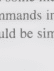

> 如果您不确定从命令行测试 vi，有几个 vi 替代方案。如果您正在使用 KDE 或 GNOME 等 GUI，请尝试 vim 的图形版本。打开终端仿真器并输入 `gvim`。`vim` 文本编辑器在窗口中打开，在菜单中列出所有可用命令，并使用工具栏显示常用命令。

当您第一次启动 vi 时，它可能看起来复杂且难以管理。只要稍加耐心并进行一些记忆练习，您很快就能在文件中移动并执行键盘命令。如果您通过输入 `vi practice.txt` 启动了一个新文件，您的屏幕将类似于图 8.1 所示。

## 图 8.1

`vi` 文本编辑器的显示应如你在屏幕上看到的那样。

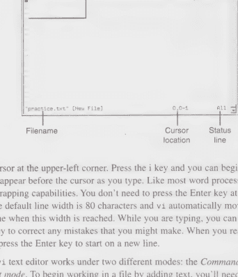

注意左上角的光标。按下 `i` 键即可开始输入。输入时文字会出现在光标之前。与大多数文字处理程序一样，vi 具有文本换行功能。你不需要在每行末尾按 Enter 键。默认行宽为 80 个字符，当达到此宽度时 vi 会自动将光标移动到下一行。在输入时，你可以使用 Backspace 键纠正可能出现的错误。当到达段落末尾时，按 Enter 键开始新行。

###### 新术语

`vi` 文本编辑器在两种不同的模式下工作：命令模式和插入模式。要通过添加文本开始在文件中工作，你需要切换到插入模式。要在文件中移动光标或删除文本，你将在命令模式下工作。你也需要在命令模式下才能访问插入模式。想要切换到命令模式时，按 Escape 键。要访问一种模式，你输入一个单字母命令。进入模式后，若干模式命令使编辑文本变得容易。


当你首次使用 `vi` 打开一个新文件时，你处于命令模式。命令模式使你能够输入命令执行任务。你会遇到的第一个命令是 `i`，它切换到插入模式。要执行此命令，只需在键盘上按 `i`（不要使用大写字母 `I`）。注意屏幕左下角会出现“— INSERT —”消息。进入插入模式后，你可以开始向文件添加文本。用 `Backspace` 键纠正错误。当你想切回命令模式时，按 `Escape` 键。

命令模式还使你能够在文件中移动光标。你可以使用箭头键将光标向上、下、向右和向左移动。`k`、`j`、`l` 和 `h` 键执行相同的移动。

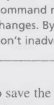

> 在 `vi` 中练习插入模式时，不要使用箭头键、`Page Up` 和 `Page Down` 键或 `Home` 和 `End` 键在文件中移动光标。如果你使用这些键并在文件中发现奇怪字符，请按 `Escape` 键（至少按一次以确保进入命令模式），并输入 `:q!`。这将关闭文件而不保存更改。在练习时这样做可以确保你不会无意中将错误数据保存到文件中。

你还应定期保存文件。你永远不知道何时会突然断电。打开和保存文件的命令只能在命令模式下使用。要访问这些命令，首先输入冒号（`:`）字符。在处理文件时，你可以通过输入 `:w` 并按 `Enter` 快速保存更改（也称为写入文件）。在屏幕底部，你会看到类似以下的消息：

```
'practice.txt' 778L, 25518C written
```

如果你决定要处理另一个文件，输入 `:e filename` 并按 `Enter`。你必须先保存缓冲区区域中的文件更改，然后才能打开新文件。如果未先保存更改，你会看到错误消息。

当你在 `vi` 中完成工作时，输入 `:q` 并按 `Enter`。文本编辑器将关闭，你将被返回到 `shell` 提示符。为了更简单一些，你可以同时保存更改并退出 `vi`；输入 `:wq` 并按 `Enter`。如果你尝试在未保存文件的情况下退出，将会收到错误，除非你使用上面警告中讨论的 `:q!` 命令。

## vi 的语法

当你在 `vi` 中打开文件时，光标位于文件的开头。如果你想从其他位置开始工作，可以指定该位置，`vi` 将打开到该位置。

以下代码显示了 `vi` 的语法：

```
vi [+linenumber] [+/pattern] filename
```

`filename` 参数是程序启动时你希望 `vi` 打开的文件名。例如，如果你想处理名为 `practice.txt` 的文件，输入命令 `vi practice.txt`。

`linenumber` 参数（见表 8.5）是文件在缓冲区打开时光标应放置的行。在 `vi` 中，你可以在左侧边距显示行号。行号在编写编程代码或法律文件时很有用。例如，要在名为 `practice.txt` 的文件中从第 31 行开始工作，使用命令 `vi +31 practice.txt`。

`pattern` 参数用于你希望 `vi` 搜索一段文本时。当 `vi` 找到此文本字符串时，光标会放置在找到文本字符串的第一个实例处。例如，如果你想开始工作的文本文件部分包含文本字符串“introduction”，使用命令 `vi +/introduction practice.txt`。

## 任务：创建文本文件

在你能使用 `vi` 文本编辑器练习之前，你需要一个可以练习光标移动和文本编辑命令的文件。一种跟随余下时间的方法，并拥有第二个帮助来源，是复制随 `vim` 安装的教程。以下步骤指导你创建新文件并向文件中添加一些文本的过程：

- 1. 查找 `vim` 教程文件。在 `/usr/doc/` 目录中查找 `vim-common-??` 子目录。在 Linux-Mandrake 系统上，此文件位于 `/usr/doc/vim-common-5.6/tutor/tutor`。
- 2. 更改为你想要用作工作目录的目录（使用 `cd` 命令）。你可能想使用你的主目录或主目录中的子目录。
- 3. 同时打开 `vi` 并创建练习文件。输入 `vi practice.txt` 并按 `Enter`。此文件将存储在工作目录中。
- 4. 将你在步骤 1 中找到的教程文件内容添加到练习文件中。输入 `:r /usr/doc/vim-common-5.6/tutor/tutor` 并按 `Enter`。如果教程位于其他目录，请确保使用正确的目录路径。你的文件应如下图 8.2 所示。


> 在第 7 小时“在文件系统中移动”中，你学习了如何使用 `cat` 命令将一个文件的内容追加（或插入）到另一个文件的末尾。在 `vi` 中，`:r filename` 命令执行相同的操作。

## 图 8.2

`VIM Tutor` 为学习文本编辑器提供快速入门。

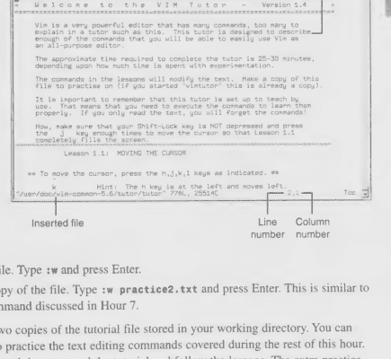

阅读教程

插入的文件

行号

列号

- 5. 保存文件。输入 `:w` 并按 `Enter`。
- 6. 复制文件。输入 `:w practice2.txt` 并按 `Enter`。这类似于第 7 小时讨论的 `cp` 命令。

你现在在工作目录中有两个教程文件的副本。你可以使用这些文件练习本小时余下部分介绍的文本编辑命令。我们还建议你阅读教程并跟随课程。额外的 `vi` 练习将帮助你记住键盘命令和光标移动。

## 文本编辑基础

第一次使用 `vi` 时，你可能会被操作文本编辑器所需的大量键盘命令所淹没。只要记住，即使 `vi` 是一个需要你记住一堆命令的复杂文本编辑器，随着你使用编辑器的次数增多，执行命令和编辑文本会变得更容易。

## 在文件中定位光标

记住光标移动命令不需要花费太多时间；没有多少个。移动光标在屏幕上最简单的方法是将手指放在键盘的基准行上。来吧，你还记得打字课。基准行是字母 `A` 键左侧开始的中间字母行。你需要右手来移动光标。尝试这些光标移动命令（但请记住先按 `Escape`）：

- 按 `h` 将光标向左移动一个字符
- 按 `l` 将光标向右移动一个字符
- 按 `j` 将光标向下移动一行
- 按 `k` 将光标向上移动一行

有时速度是必要的，你可能需要比一次一行更快地在文件中移动。要一次滚动一屏文件，按 `Ctrl+F`。然后用 `Ctrl+B` 向上滚动。还有一些光标移动命令。查看表 8.2，了解在缓冲区窗口中移动光标常用的命令描述。

### 表 8.2 使用光标命令在缓冲区中移动

| 光标移动 | 命令 |
|---|---|
| 向左一个字符 | `h` |
| 向右一个字符 | `l` |
| 向下移动一行 | `j` |
| 向上移动一行 | `k` |
| 移动到下一个词 | `w` |
| 移动到上一个词 | `b` |
| 到行尾 | `$` |
| 到行的开头 | `0` |
| 到下一句 | `)` |
| 到上一句 | `(` |
| 到下一段 | `}` |
| 到上一段 | `{` |

### 表 8.2 继续

| 光标移动 | 命令 |
|---|---|
| 向前滚动一屏 | `Ctrl+F` |
| 向后滚动一屏 | `Ctrl+B` |
| 向前滚动半屏 | `Ctrl+D` |
| 向后滚动半屏 | `Ctrl+U` |
| 转到文件末尾 | `G` |
| 转到第 10 行 | `10G` |

## 插入和删除文本

按 `Escape` 键。系统有提示音吗？如果有，你就处于命令模式，可以准备输入插入文本的命令了。也就是说，在你将光标移动到想要插入文本的位置之后。光标就位后，按 `i` 键（使用小写）并开始输入文本。要将光标移动到新位置，按 `Escape` 并使用光标命令移动。你可以在表 8.3 中找到更多插入文本的方法。

### 表 8.3 向文件中插入文本

| 插入位置 | 使用此命令 |
|---|---|
| 光标字符之前 | `i` |
| 行首 | `I` |
| 光标之后 | `a` |
| 行末 | `A` |
| 光标下方新行 | `o` |
| 光标上方新行 | `O` |
| 覆盖现有文本 | `R` |

有多个命令可用于删除文本，无论你需要删除单个字符还是文本块。删除文本的基本命令是 `d`，后跟一个光标移动符号，以显示应删除的内容。用于删除文本的一些命令显示在表 8.4 中。

### 表 8.4 从缓冲区区域删除文本

| 删除内容 | 使用此命令 |
|---|---|
| 从光标到单词末尾 | `dw` |
| 光标后三个单词 | `3dw` |
| 从光标到行末 | `d$` |
| 从光标到行首 | `d0` |
| 从光标到段落末尾 | `d}` |
| 光标所在的行 | `dd` |
| 当前行及之后 3 行 | `4dd` |
| 光标下的字符 | `x` |
| 光标左侧的字符 | `X` |
| 撤销不想要的更改 | `u` |

## 复制文本

组织文档涉及大量移动文本。在 `vi` 中移动文本时，你必须先 `yank` 文本，将光标移动到文本的新位置，然后将文本粘贴到新位置。

###### 新术语

当你 `yank` 文本时，你是在选择它（尽管你可能看不到屏幕上文本高亮）并制作所选文本的副本。被 `yank` 的文本存储在未命名缓冲区中。此未命名缓冲区是一个临时存放处，其中仅保留最后一次 `yank` 的文本。


要 `yank` 文本，将光标移动到你想要复制的文本开头，按 `y` 键后跟光标移动命令（见表 8.2），该命令将光标移动到文本末尾。例如，要复制从光标位置到行末的文本，按 `y$`。要将光标定位到你想要复制文本的位置，使用光标移动命令。光标就位后，通过按 `p` 粘贴文本。文本将被复制到光标下方的行。


> 如果你想移动文本，先删除要移动的文本（使用表 8.4 中的命令之一）。然后将光标移动到你想要粘贴文本的位置并按 `p` 键。

## 搜索和替换文本

编辑文本文件的最后一种方式是快速查找一个词或一组词并将其替换为其他词。你可能需要替换文本以使文档更有意义。或者，信息可能需要更新，你必须搜索软件应用程序的旧版本号并将其替换为新版本号。你可能还想搜索文件以找到文档中需要仔细检查的地方。

当你想搜索特定词时，按 `Escape` 进入命令模式，输入斜杠（`/`）字符，输入你要搜索的词，然后按 `Enter`。例如，要在文件中查找所有“fox”实例，输入 `/fox` 并按 `Enter`。`vi` 文本编辑器从光标位置开始搜索并查找“fox”的第一个实例。当找到匹配项时，光标会放在该词的第一个字母上。要找到“fox”的下一个出现位置，输入 `/` 并按 `Enter`。

如果你需要查找一个词然后将其替换为另一个词，命令就完全不同了。如果你想找到所有“fox”实例并将其替换为“dog”，按 `Escape` 键进入命令模式，输入 `:%s/fox/dog/g`，然后按 `Enter`。此命令使搜索和替换过程自动化。冒号（`:`）字符告诉 `vi` 你即将输入命令，`%s` 参数告诉 `vi` 搜索整个文件，`g` 参数告诉 `vi` 将“fox” 的所有实例替换为“dog”。当 `vi` 完成替换文本后，屏幕底部会出现类似以下的消息：

```
3 substitutions on 3 lines
```

如果你只想替换 `vi` 找到的第一个匹配项，不要使用 `g` 参数。因此，要仅替换“fox”的第一个出现，输入 `:%s/fox/dog` 并按 `Enter`。


> 你会发现与你在第 6 小时看到的相同类型的命令行历史列表。在输入冒号（`:`）字符后，按上箭头键。你在 `vi` 中输入的最后一条命令将出现在命令行上。你可以使用 `Backspace` 键进行任何更改。


## 任务：配置 vi

`vi` 中有许多选项可供设置以控制编辑环境。这些选项使用 `:set` 命令启用和禁用，范围从在屏幕左侧列出行号到显示光标位置。表 8.5 显示了一些你可以进行的配置更改。要启用这些选项中的任何一个，按 `Escape` 进入命令模式，输入选项（如下表 8.5 所示），然后按 `Enter`。例如，要在屏幕左侧显示行号，使用 `:set number` 选项。然后，要禁用选项，在选项前输入 `no`。因此，当你想关闭行号时，使用 `:set nonumber` 命令。

### 表 8.5 使用配置设置控制编辑环境

| 选项 | 描述 |
|---|---|
| `:set backup` | 覆盖文件后保留文件的副本 |
| `:set incsearch` | 显示部分输入搜索命令的匹配项 |
| `:set lines=X` | 更改一次在屏幕上显示的行数（`X` 为行数） |
| `:set number` | 在屏幕左侧显示行号 |
| `:set ruler` | 在状态行显示光标位置 |
| `:set scroll=X` | 每次滚动窗口的行数（`X` 为行数） |
| `:set visualbell` | 使用视觉信号（在状态行显示为 `^[`）代替蜂鸣声 |

当你使用 `:set` 命令更改选项时，配置更改仅是临时的。当你关闭程序时，配置更改不会保存。下次使用 `vi` 时，将使用默认配置。要更改默认配置，你需要编辑 `.vimrc` 文件。以下是如何使用 `vi` 更改程序默认配置的方法：

- 1. 在你的主目录中找到配置文件。在 shell 提示符下，输入 `ls -a` 并按 `Enter`。你应该在主目录中看到名为 `.vimrc` 或 `.exrc` 的文件。
- 2. 制作 `.vimrc` 文件的备份副本。输入 `cp .vimrc .vimrc.original` 并按 `Enter`。
- 3. 在 `vi` 中打开配置文件。输入 `vi .vimrc` 并按 `Enter`。图 8.3 显示了一个示例 `.vimrc` 文件。

### 图 8.3

编辑并添加选项以更改 `vi` 的默认设置。

删除 'no' 以激活选项

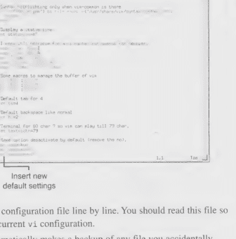

插入新的默认设置

- 4. 使用 `j` 键逐行阅读配置文件。你应该阅读此文件，以便了解当前的 `vi` 配置。
- 5. 更改 `vi` 使其自动备份你意外覆盖的任何文件。滚动到读取以下部分的区域：

  `'Some options deactivate by default (remove the no).`
  `set nobackup`
  `set nohlsearch`
  `set noincsearch`

  将 `set nobackup` 选项更改为读取：

  `set backup`

- 6. 更改默认配置以便在每个打开的文件中显示行号。输入以下内容（从空白行开始）：

  `'Display line numbers to the left of the text`
  `set number`

- 7. 保存文件并退出 `vi`。输入 `:wq` 并按 `Enter`。
- 8. 在 `vi` 中打开一个文件以查看配置更改。图 8.4 显示了一个使用行号的文件示例。

### 图 8.4

在 `vim` 文本编辑器的图形版本中显示的行号

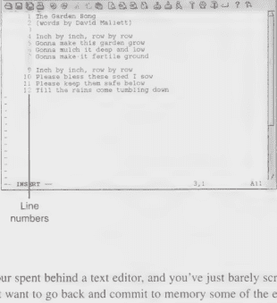

行号

## Summary

已经在文本编辑器前度过了一个漫长的小时，而你才刚刚触及表面。你可能想回去记牢一些学过的编辑命令。这些命令使创建文件、在文件中移动以及编辑文本变得更容易。然后，你可能想探索使用文本编辑器的一些原因。回去看看可以用几个按键轻松更改的配置文件列表。你可能想多了解这些文件，然后尝试一些配置更改。并且，始终记得先制作文件的备份副本。

## Q&A

**Q** 在 Internet 上我可以在哪里找到有关 Linux 文本编辑器的信息？

**A** 最完整的文本编辑器来源可从 Metalab Linux Archive 获取，网址为 `metalab.unc.edu/pub/Linux/apps/editors`。另一个不错的来源是 Dave Central Linux 软件档案，网址为 `linux.davecentral.com/officed.edit.html`。Dave 提供多种格式的许多 Linux 文本编辑器的下载（RPM、源代码和二进制文件），并提供指向编辑器主页的链接。

你也可以尝试各个文本编辑器的主页。你可以在 `www.vim.org` 找到 `vim`，在 `www.gnu.org/software/emacs` 找到 GNU Emacs。

**Q** 我可以在哪里找到有关已安装在我的 Linux 系统上的程序的更多信息？

**A** 许多应用程序将帮助文件存储在 `/usr/doc/` 目录中。你可以用 `less` 和 `more` 分页器阅读这些文件。你也可能会找到已安装程序的手册页。

## Workshop

通过回答以下问题并完成练习，测试你对本小时所涵盖内容的掌握程度。

## Quiz

- 1. 文本编辑器的基本工作是编辑 ASCII 纯文本文件。纯文本文件用于各种用途。文本编辑器可用于撰写电子邮件 correspondence、保存日记文件以及编辑配置文件。

最可能经常被编辑的文件是配置文件。有两种类型的配置文件——控制单个用户账户配置的那些（也称为启动文件），以及控制系统运行方式的那些（称为系统配置文件）。启动文件配置程序在用户访问其账户时的行为。系统配置文件控制诸如启动过程、文件系统和外设的访问、以及屏幕分辨率和色彩深度等项目。

- 2. 在使用程序或命令之前，你应始终尝试先了解一些相关知识。一种快速简便的方法是阅读该程序或命令的手册页。

无论系统安装了哪种 `vi` 克隆，都可以通过在命令行键入 `vi` 来执行它。不同版本如果深入挖掘可能会提供一些特殊功能。根据 Linux 发行版，`vi` 命令与启动 `vi` 克隆的命令之间存在符号链接。例如，Linux-Mandrake 使用 `vim` 文本编辑器；因此，`vi` 和 `vim` 命令之间存在符号链接。

- 3. `vi` 文本编辑器使用两种模式——命令模式和插入模式。文件首次打开时，`vi` 处于命令模式。命令模式使你能够在文件中移动光标并删除文本。要向文件添加文本，请切换到插入模式（只需按下键盘上的小写 `I` 字符）。要返回命令模式，请按 `Escape` 键。

- 4. `h` 键将光标向左移动，`l` 键将光标向右移动，`j` 键将光标向下移动一行，`k` 键将光标向上移动一行。


### 5. 当需要在文件中的其他位置使用文本的副本时，就会提取文本
要提取文本，首先选择要复制的文本（按 `y` 后跟指定要复制文本末尾的光标移动命令），将光标移动到要插入复制文本的位置，然后粘贴文本（在键盘上按 `p`）。

## Exercises

- 1. 开始你自己的 Linux 帮助手册。使用 `vi` 启动一个文件，在其中你可以输入笔记或复制有关你经常使用的不同应用程序、实用程序和命令的信息。此帮助手册可以包含帮助你记住如何使用定期执行的任务的命令、实用帮助文件的位置以及你发现有用的网站的 URL 的信息。

- 2. 试试另一个流行的 GNU/Linux 文本编辑器 `emacs`。 在你使用 `vi` 和 `emacs` 一段时间后，你可以决定哪一个更适合你所做的文本编辑工作。要进行 `emacs` 教程，请使用命令 `Ctrl+H T`。你会发现本小时学到的一些技能在探索 `emacs` 时会有所帮助。要在 Internet 上了解 `emacs`，请访问 `www.gnu.org/software/emacs`。有许多专门介绍 `emacs` 的书籍，许多其他 Linux 书籍也有专门介绍 `emacs` 的一两章。


## PART III

## System Administration

### Hour

- 9 Hooking Up Hardware Devices
- 10 Backing Up and Restoring the Filesystem
- 11 Printing Files
- 12 Sharing Files with Other Users on the System
- 13 Working with Processes
- 14 System Maintenance
- 15 Installing Software
- 16 Updating the Linux Kernel
- 17 Automating System Administration Tasks

## Hour 9

## Hooking Up Hardware Devices

将新硬件设备连接到你的 GNU/Linux 系统已变得比以前容易得多。每个新内核都为可连接到系统的日益增长的硬件设备列表提供驱动模块。当你首次启动系统时，一长串消息会飞快地掠过屏幕。你会注意到有关你拥有的各个硬件部件的信息、制造商、型号号码，甚至是否会工作。然而，这个过程并不总是如此顺利，因此你应该知道如何自行处理。

在本小时，你将

- 学习如何使用软盘和 CD-ROM 驱动器
- 使用 `mtools` 包格式化 DOS 软盘并向其复制文件
- 查找系统信息来源
- 在添加新硬件并对系统进行其他配置更改之前备份配置文件


### Working with Floppy and CD-ROM Drives

GNU/Linux 的最新功能之一是可以自动挂载 CD-ROM 驱动器和软盘驱动器。如果你的系统支持自动挂载，你就幸运了。有了名为 `supermount` 的自动挂载功能，你可以像使用 Microsoft Windows 系统上的这些驱动器一样轻松地使用系统上的软盘和 CD-ROM 驱动器。

好吧，有一些区别。在 Microsoft Windows 中，软盘驱动器称为 `A:`；在 GNU/Linux 中，软盘驱动器称为 `/mnt/floppy`。GNU/Linux 还为驱动器分配一个设备文件。很可能，你会在 `/dev/fd0` 中找到控制软盘驱动器的设备文件。这里有一个很酷的技巧：你可以读取 DOS 磁盘和用扩展文件系统 `ext2` 格式化的磁盘。CD-ROM 驱动器也不称为 `D:`、`E:` 或 `F:`；它称为 `/mnt/cdrom`。根据系统的设置方式，设备文件是 `/dev/hdb`。

> `/mnt` 目录应该已经在你的系统上创建。如果它们不存在，请使用 `mkdir` 命令将它们添加到系统中。

如果你在安装期间选择了 `supermount` 功能，你只需将软盘或 CD-ROM 放入驱动器，前往适当的 `/mnt` 目录，即可查看磁盘的内容。如果你的系统不使用 `supermount` 功能，你将需要在这种方式使用它之前先手动挂载驱动器。

**New Term** 一些发行版在系统启动时给你机会对软盘和 CD-ROM 驱动器进行 `supermount`。通过对驱动器进行 `supermount`，你可以自动访问该驱动器。不提供 `supermount` 选项的发行版要求你每次使用前都挂载驱动器，使用完毕后卸载它。

你如何知道你的系统是否支持 `supermount` 功能？以下是你可以查找答案的多个不同位置。查看 `/proc/mounts` 文件。你可以通过在命令行键入 `cat /proc/mounts` 来查看此文件。列表 9.1 显示了一个设置为使用 `supermount` 的系统。如果你的系统不支持 `supermount` 功能，你将看不到 CD-ROM 驱动器或软盘驱动器的条目。在使用 `supermount` 的软盘驱动器上，当你将文件移动到 `/mnt/floppy` 目录时，文件将自动保存到软盘上。驱动器灯熄灭后，你可以取出磁盘。

### LISTING 9.1 当系统支持自动挂载时 `/proc/mounts` 文件的内容

```
/dev/root / ext2 rw 0 0
/proc /proc proc rw 0 0
/dev/hda1 /boot ext2 rw 0 0
none /dev/pts devpts rw 0 0
/dev/hda7 /home ext2 rw 0 0
/mnt/cdrom /mnt/cdrom supermount rw 0 0
/mnt/floppy /mnt/floppy supermount rw 0 0
```

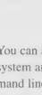

> 如果你正在使用其中一个图形环境（X Window System、GNOME 或 KDE），你可能希望在桌面上划出一小块区域，随时保持一个小型终端窗口打开。你会发现，在终端中输入命令是执行任务和获取信息的一种快捷方式。浏览菜单系统，你可能会找到大约半打不同的终端。

你还可以使用 `mount` 命令查看系统中已挂载且可用的文件系统。要显示已挂载的文件系统，在命令行中输入 `mount`，然后按 Enter。清单 9.2 显示了未使用 `supermount` 功能的系统的已挂载文件系统。在该系统上，使用软盘驱动器和 CD-ROM 驱动器之前必须先挂载它们。

### LISTING 9.2 `mount` 命令的输出

```
/dev/hda1 on / type ext2 (rw)
proc on /proc type proc (rw)
/dev/hda3 on /home type ext2 (rw,usrquota)
none on /dev/pts type devpts (rw,mode+0622)
```

### Task: Mounting a Floppy Drive

如果你的系统未使用 `supermount` 功能，在将磁盘放入驱动器后，你需要挂载软盘驱动器。磁盘在驱动器中时，你可以按需使用该磁盘。然后，在取出磁盘之前，必须卸载驱动器。以下是如何在不使用 `supermount` 功能的情况下使用软盘驱动器的方法：

- 1. 确定软盘驱动器的块设备地址。输入 `dmesg | less` 并按 Enter。查找类似以下的行：

  `Floppy drive(s): fd0 is 1.44MB`

这意味着软盘驱动器位于 `/dev/fd0`。此外，查找描述你的 CD-ROM 驱动器的行。以下是一个示例：

```
hdb: ATAPI 24X CD_ROM drive, 128KB Cache
Uniform CDROM driver Revision 2.56
```

- 2. 将软盘放入软盘驱动器中。

- 3. 挂载驱动器。在命令行中，输入 `mount /dev/fd0 /mnt/floppy`（其中 `/dev/fd0` 是步骤 1 中 `dmesg` 命令列出的设备）并按 Enter。你会看到驱动器指示灯亮起几秒钟。

- 4. 将文件复制到软盘。输入 `cp filename /mnt/floppy` 并按 Enter。在文件复制到软盘时，你会看到驱动器指示灯亮起几秒钟。

- 5. 卸载软盘驱动器。输入 `umount /dev/fd0` 并按 Enter。

- 6. 将软盘取出。取出软盘之前务必先卸载驱动器非常重要。

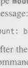

> 如果无特权用户无法访问软盘驱动器，你需要更改权限。作为超级用户，在命令行中输入 `chmod o+rw /dev/fd0` 并按 Enter。

挂载和卸载 CD-ROM 的方式相同。要挂载 CD-ROM，输入 `mount /dev/hdb /mnt/cdrom` 并按 Enter。你应该会看到以下消息：


```
Mount: block device /dev/hdb is write-protected, mounting in read-only
```

CD-ROM 挂载后，你可以使用第 7 小时“在文件系统中移动”中介绍的命令读取目录列表和查看文件。

## Working with DOS Floppies

如果所有这些挂载和卸载的操作让你感到困惑，还有另一种使用软盘的方法。在发行版中，你会找到一个名为 `mtools` 的软件包。`mtools` 软件包包含一组命令，使你能够以与在 DOS（或 Microsoft Windows）系统上使用软盘相同的方式处理软盘上的目录和文件。此外，你不必使用 Linux 文件系统（位于 `/mnt/floppy` 或 `/dev/fd0`）来访问软盘。你可以使用旧的、熟悉的 `A:` designation 来表示软盘驱动器。使用 `mtools` 时，使用软盘前无需先挂载它。以下列表包含一些你会觉得有用的 `mtools` 命令。

- 列出软盘的内容，使用 `mdir` 命令。
- 将文件从软盘复制到 GNU/Linux 系统或从 GNU/Linux 系统复制到软盘，使用 `mcopy` 命令。
- 删除软盘上的文件，使用 `mdel` 命令。
- 重命名软盘上的文件，使用 `mren` 命令。
- 更改文件的属性，使用 `mattrib` 命令。使用此命令，你可以使文件变为只读。
- 格式化软盘，使用 `mformat` 命令。
- 检查软盘上的坏块（错误），使用 `mbadblocks` 命令。
- 在软盘上创建描述软盘内容的标签，使用 `mlabel` 命令。

## Formatting a Floppy Disk

当你购买软盘时，它们通常已预先格式化。这些磁盘可以直接在你的 GNU/Linux 系统上使用。当你想彻底擦除软盘时，你可能希望重新格式化软盘，以便销毁软盘上存储的所有信息，使软盘看起来像全新的。以下是如何使用 `mtools` 命令格式化和处理软盘的方法：

1. 将软盘放入软盘驱动器中。
2. 格式化软盘。输入 `mformat a:` 并按 Enter。如果看到以下错误消息

`mformat: Non-removable media is not supported`

`(You must tell the complete geometry of the disk, either in /etc/mtools or on the command line)`

你需要输入

`mformat -s 18 -h 2 -t 80 a:`

并按 Enter。此命令（用于格式化 1.44MB 软盘）告诉 `mformat` 命令磁盘上有 18 个扇区、2 个磁头和 80 条磁道。你可以在 `/etc/fdprm` 文件中找到此信息。你可以使用 `cat` 命令或 `less` 分页器读取此文件。
3. 为软盘贴标签。输入 `mlabel a: 'description'` 并按 Enter。其中 *description* 是你希望作为标签显示的文本。例如，要将软盘命名为 Testing，输入 `mlabel a: 'Testing'` 并按 Enter。
4. 查看软盘的内容。输入 `mdir a:` 并按 Enter。你会看到以下内容：

```
[rusty@localhost rusty]$ mdir a:
Volume in drive A is Testing (a: = TESTING)
Volume Serial Number is 1EC7-50FF
Directory for A:/

No files

1,457,664 bytes free
```

在此示例中，步骤 3 中的标签为 TESTING（显示在“Volume in drive A is Testing”这一行）。磁盘上没有文件，所有 1.44MB 都是空闲的。
5. 将文件复制到软盘。切换到包含要复制的文件的目录。要复制文件，输入 `mcopy filename a:` 并按 Enter。要查看文件是否已复制到软盘，输入 `mdir a:` 并按 Enter。
6. 将文件从软盘复制到 GNU/Linux 系统。切换到要存储文件的目录。输入 `mcopy a:filename` 并按 Enter。

## Locating Hardware Information

作为你的 GNU/Linux 系统的系统管理员（可能是你）的一项重要工作是维护系统的配置，以充分利用操作系统的灵活性和强大功能。通过了解各种配置文件为你的系统配置了哪些内容，你可以跟踪系统性能并重新配置系统以实现最佳运行。你将通过编辑控制系统行为的配置文件来实现这种性能微调。然而，在真正掌握这一点之前，你需要收集尽可能多的关于系统的信息。

### Task: Gathering Important System Information

你还记得登录提示出现之前屏幕上滚动显示的那些消息吗？它们是内核启动消息，已存储在 `/var/log/messages` 文件中。显示的消息取决于驱动程序配置在系统上。其他文件位于 `/proc` 文件系统，包含有关系统架构的信息；也就是说，连接到系统的所有总线、板卡、控制器和外设。在对系统进行任何配置更改之前，了解这些信息非常重要。以下是如何在 `vi` 文本编辑器中将这些文件作为只读文件查看的方法：

1. 以超级用户身份登录。输入 `su` 并按 Enter。系统会提示您输入 root 密码。输入密码并按 Enter。
2. 以只读方式打开内核启动消息文件。输入 `vi -R /var/log/messages` 并按 Enter。内核启动消息因系统而异，具体取决于作为模块编译或加载到内核中的驱动程序。在浏览文件时，您会注意到在启动过程中每个设备初始化时都会出现相应的消息。
3. 查找系统配置信息。您需要了解屏幕在用作文本终端时的字体和颜色、PCI 总线和 PCI 卡、CPU 类型和处理器速度、系统内存使用情况、鼠标类型、串行和 USB 端口、已挂载的文件系统，以及 Linux 内核的版本号。
4. 在文件中移动。按 `Ctrl+F` 向前移动一屏文件。按 `Ctrl+B` 向后移动一屏。
5. 读完文件后，退出（或 quit）文本编辑器。输入 `:q` 并按 Enter。`vi` 文本编辑器将关闭，您将被返回到 shell 提示符。
6. 返回到您的用户账户。输入 `su username` 并按 Enter。
7. 查看有关 CPU 类型和速度的信息。输入 `vi -R /proc/cpuinfo` 并按 Enter。`-R` 命令选项告诉 `vi` 以只读方式打开文件。`/proc/cpuinfo` 文件的示例显示在列表 9.3 中。读完文件后，输入 `:q` 并按 Enter 关闭文件并退出 `vi`。

### LISTING 9.3 /proc/cpuinfo 文件的内容

```
processor : 0
vendor_id : GenuineIntel
cpu family : 5
model : 2
model name : Pentium 75 - 200
stepping : 12
cpu MHz : 132.770406
fdiv_bug : no
hlt_bug : no
sep_bug : no
f00f_bug : yes
```

### LISTING 9.3 继续

```
coma_bug : no
fpu : yes
fpu_exception : yes
cpuid level : 1
wp : yes
flags : fpu vme de pse tsc msr mce cx8
bogomips : 264.60
```

8. 显示总系统 RAM、已用内存、空闲内存和交换空间。输入 `vi -R /proc/meminfo` 并按 Enter。完成后输入 `:q` 并按 Enter。
9. 列出启动时挂载的文件系统。输入 `vi -R /proc/mounts` 并按 Enter。不要关闭 `vi`。
10. 查看系统上安装的 PCI 设备信息。输入 `:e /proc/pci` 并按 Enter。`:e` 命令告诉 `vi` 您想要处理另一个文件。完成后输入 `:q` 并按 Enter。
11. 列出占用的 I/O 地址、IRQ 和 DMA 通道。输入 `vi -R /proc/ioports /proc/interrupts /proc/dma` 并按 Enter。您可以通过列出以空格分隔的文件名，一次在 `vi` 中打开多个文件。一次只能显示一个文件。
12. 读取 `/proc/ioports` 文件，完成后显示 `/proc/interrupts` 文件。输入 `:next` 并按 Enter。使用 `:next` 命令在文件列表中向前移动；使用 `:prev` 命令在文件列表中向后移动。
13. 读取最后一个文件，完成后退出 `vi`。

## 添加新硬件

在安装过程中，您为硬盘上的分区创建了不同的文件系统和相应的挂载点。如果您认为存储空间不足，可以考虑向系统添加第二个硬盘。以下是向系统添加磁盘所需的步骤：


## 硬件与操作系统兼容性

- 确保硬件与操作系统兼容。您可以在 Linux 硬件兼容性 HOWTO 中找到此信息。您可能还想阅读的其他 HOWTO 有：The Hard Disk Upgrade mini-HOWTO, the Filesystems HOWTO, the CD-ROM HOWTO, the Zip Drive mini-HOWTO, the Jaz Drive HOWTO, the Plug-and-Play HOWTO, and the CD Writing HOWTO。

## 安装硬盘

- 关闭系统并根据制造商的说明安装硬盘。制造商通常会进行低级格式化，但如果没有，您需要自行处理。记得在 Linux 日记中保留笔记，以便在出现问题时可以参考。

- 当您打开计算机并系统重新启动时，观察启动消息。您会看到硬盘的新设备文件被列出。

- 您接下来的主要任务是在硬盘上创建一个或多个分区。使用 Linux `fdisk` 实用程序创建 Linux 分区。分区创建后，使用 `fsck` 命令检查文件系统是否存在错误。

## 配置挂载

- 在 `/etc/fstab` 文件中配置设备。您可以更改文件中的参数，以便文件系统在启动时自动挂载，并告诉内核设备在文件系统中存储文件的位置。

- 当 `/etc/fstab` 配置文件设置好后，文件系统可以在启动时自动挂载，也可以使用 `mount` 命令挂载。

在本小时内，您已通过查看 `/proc/mounts` 文件、执行 `mount` 命令以及阅读内核启动消息来列出文件系统信息。所有这些信息都存储在 `/etc/fstab` 文件中。`/etc/fstab` 的示例显示在列表 9.4 中。您可以使用 `cat` 命令轻松查看此文件（输入 `cat /etc/fstab` 并按 Enter）。`/etc/fstab` 配置文件包含系统启动时挂载文件系统所需的信息。

### LISTING 9.4 /etc/fstab 文件的内容

| 设备 | 挂载点 | 类型 | 选项 | Dump | Pass |
|---|---|---|---|---|---|
| `/dev/hda5` | `/` | ext2 | defaults | 1 | 1 |
| `/dev/hda1` | `/boot` | ext2 | defaults | 1 | 2 |
| none | `/dev/pts` | devpts | mode=0620 | 0 | 0 |
| `/dev/hda7` | `/home` | ext2 | defaults,usrquota | 1 | 2 |
| `/mnt/cdrom` | `/mnt/cdrom` | supermount | fs=iso9660,dev=/dev/cdrom | 0 | 0 |
| `/mnt/floppy` | `/mnt/floppy` | supermount | fs=vfat,dev=/dev/fd0 | 0 | 0 |
| none | `/proc` | proc | defaults | 0 | 0 |
| `/dev/hda6` | swap | swap | defaults | 0 | 0 |

您的列表可能不会以整齐有序的行显示文件内容。列表 9.4 已被修改以说明连接到文件系统并列在 `/etc/fstab` 文件中的每个设备所需的六个字段。文件中的条目使用以下格式：

- 第一列是设备文件。此文件是用户和内核之间的中介。各种应用程序和命令使用此文件访问硬件，例如硬盘或 Zip 驱动器。
- 挂载点是设备文件系统所在的目录。如果您添加硬盘以获得更多用户文件存储空间，可以将挂载点创建为 `/home` 或 `/usr/local` 目录的子目录。
- GNU/Linux 支持多种文件系统类型。如本小时前面所述，您可以使用 DOS 软盘和 CD-ROM 驱动器。Linux 原生文件系统类型是 ext2。
- 选项用于设置设备运行的参数。设备可以设置为读写或只读；可以在启动时自动挂载或不自动挂载；并且文件系统上的用户存储空间可以受限。
- 文件系统可以使用 `dump` 实用程序定期备份。这可能并非所有系统都使用。
- `fsck` 实用程序在启动时检查每个文件系统。文件系统检查的顺序在最后一列中指示。


> 进行配置更改时，每次只做一次更改然后测试该更改。如果更改成功，再进行下一次更改。这是恢复错误的 easiest 方式。如果一次进行多个更改，很难确定可能出了什么问题。此外，如果一次只进行一次更改，测试配置更改会更容易。

## 任务：备份配置文件

以下是如何制作 `/etc/fstab` 文件的副本，以便您可以始终保留原始配置以供参考或从失败的配置尝试中恢复：

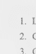

> 这里的庄严且不可违背的经验法则是 NEVER 在备份之前不要随意修改任何配置文件。

- 1. 登录 `root` 账户。
- 2. 切换到 `/etc` 目录。输入 `cd /etc` 并按 Enter。
- 3. 复制 `fstab` 文件。输入 `cp fstab fstab.orig` 并按 Enter。这将文件标识为原始配置。如果使用 `-p` 命令选项，可以将修改日期和时间更改为复制时的时间。
- 4. 写保护该文件。输入 `chmod a-w fstab.orig` 并按回车。

现在你将始终拥有原始配置文件的副本，该文件位于同一目录中。如果你所做的更改无法正常工作，可以参考此文件。当你进行不喜欢的配置更改时，通过恢复原始文件来撤销更改。

> 每当你计划进行配置更改时，请备份当前配置文件。你可以使用 `.old` 或 `.bkup` 等文件扩展名来标识副本。如果你将进行多次配置更改，可能需要保留多个副本（使用 `.old1`、`.old2`、`.old3` 等文件扩展名。）

### 摘要

在过去的一个小时里，你了解到连接到系统的软盘驱动器和 CD-ROM 驱动器在 GNU/Linux 操作系统中的处理方式与 Microsoft Windows 操作系统中的处理方式不同。你学习了如何挂载软盘、CD-ROM 或其他文件系统，以便访问设备上的文件。你还按照添加新硬盘到系统的基本步骤进行操作。而且，在此期间，你看到了第一个可能有机会编辑的配置文件示例。请记住保留所有配置文件的备份副本，并保留每次修改的副本。这使得从错误中回退并进行更正变得容易得多。

### 问答

**Q 是否有除了使用命令行之外格式化软盘的另一种方法？**

A 你可能想尝试 KDE 软盘格式化工具。此软盘格式化实用程序看起来就像 Microsoft Windows 中使用的格式化程序。要启动 KDE 软盘格式化工具，在命令行中输入 `kfloppy`。你也可以在 KDE 菜单系统中找到此实用程序。你可以使用此实用程序创建 DOS 或 Linux 软盘，可以进行快速擦除或完全格式化，还可以为磁盘添加标签。

**Q 在本小时中使用了一些新命令。我再次看到了 cat 命令，还有所有不同的 mtools 命令。我可以在哪里了解更多？**

A `cat` 命令在最简单的用法中可用于查看文件的内容。它简单易用，只将文件显示在屏幕上。本小时中列出的 `mtools` 命令不止这些。你可以使用 `man` 命令查找 `mtools` 和这些命令的手册页。

### 工作坊

通过回答以下问题并完成练习来测试你对本小时所学内容的掌握程度。

## 小测验

1. 某些发行版中发现的 `supermount` 功能执行什么功能？

挂载驱动器可让你自动访问驱动器。在使用媒体上的文件之前，你无需手动挂载驱动器（使用 `mount` 命令）。

2. 你可以在哪里找到有关系统上已挂载文件系统的信息？

一个来源是 `/proc/mounts` 文件。你可以在文本编辑器、`less` 分页器中查看此文件，或使用 `cat` 命令查看。另一种方法是显示 `/var/log/messages` 文件中的内核启动消息，该文件可使用 `dmesg` 命令查看。另一个来源是 `/etc/fstab` 文件。

3. 你输入什么命令来挂载软盘驱动器？

输入 `mount /dev/fd0 /mnt/floppy` 并按回车。如果挂载目录（如 `/mnt/floppy`）不存在，你可以使用 `mkdir` 命令创建此目录。

4. 除了以 Linux 的方式使用软盘驱动器外，你还有其他选择吗？

查找 `mtools` 软件包。此命令集合使你能够以与 DOS 系统上的软盘相同的方式处理软盘上的目录和文件。你不使用 Linux 文件系统设备名称或挂载点；你可以使用 `A:` designation 表示软盘驱动器。无需挂载文件系统即可使用 `mtools`。

5. `/etc/fstab` 中包含什么信息？

设备文件、挂载点、文件系统类型、启动选项、备份频率和文件系统检查。

### 练习


进入`/var/log/messages`和`/proc`文件中的系统信息。如果你决定向系统添加新硬件或进行任何配置更改，你将需要此信息。你可以使用你在`cat`命令中学到的知识（第7小时，“在文件系统中移动”）将这些文件复制到另一个文件。例如，要将`/proc/pci`文件的内容复制到名为`sysinfo`的文件，请输入`cat /proc/pci > sysinfo`并按回车。然后，你可以编辑和格式化名为`sysinfo`的文件，使其在笔记本中看起来不错。记住，你也可以将多个文件追加到现有文件的末尾。

列出你不久后可能需要编辑的系统配置文件。备份每个文件并将备份副本存储在可移动存储介质（如软盘或Zip磁盘）上并妥善保存。你还希望将每次单独的配置更改保存在单独的备份文件中。今天的建议是宁可安全也不要后悔。


# 第10小时

## 备份和恢复文件系统

保留重要系统文件和用户数据文件的副本是维护计算机系统最重要的部分。开发备份系统有助于确保数据免受丢失和破坏。你永远不知道何时会发生硬件问题或文件被意外删除。因此，你应该制定备份计划并定期备份文件。你还需要测试备份文件，以确保在需要使用它们时能够安全恢复。

你的备份计划应包括需要备份的文件列表、备份发生的频率、用于存储备份的介质以及将用于执行备份的工具。

在本小时你将：

- 制定备份计划，以免丢失有价值的文件
- 将文件备份到软盘
- 压缩文件以节省硬盘或备份介质上的空间
- 创建文件归档，并在系统故障或文件丢失后恢复归档

### 制定备份计划

备份系统的重要性怎么强调都不为过。你永远不知道电源何时会中断或硬盘何时会崩溃。即使你可以从发行版CD-ROM恢复操作系统，还有其他文件需要考虑。关于你在系统设置得非常完美之前花费数小时数小时工作的配置更改怎么办？

> 在进行任何配置更改之前，始终复制配置文件。然后，一旦你进行了更改，你也希望保留新配置文件的副本。

然后是用户创建的文件。这些文件每天都在变化（好吧，我们中的一些人每分钟都在更改文件）。通过创建健全的重要文件备份计划并在灾难后恢复系统，节省你自己的痛苦、痛苦和沮丧。

**新术语** 备份文件几乎与复制文件相同，只是备份的文件在文件丢失时可以轻松恢复到系统。备份会制作一组特殊文件，当恢复时，会将文件放置在其目录结构中的原始位置。

按照以下步骤创建备份计划：

1. **列出需要备份的文件和目录。** 你始终希望备份`/etc`目录中的系统配置文件、可能在`/usr/lib`中找到的其他配置文件、通常在`/usr/X11R6/lib/X11`中找到的X Window System配置文件，以及`/usr/src/linux`中的内核源代码。此外，你还希望备份`/home`目录中的用户文件以及`/root`目录中的超级用户文件。

> 阅读“升级你的Linux发行版”迷你HOWTO，了解有关如何为你的Linux系统设计可靠备份计划的更多想法。

2. **找到几个用于备份和归档文件和目录的工具。** 有几个Linux工具可用于归档一组文件，还有工具可用于压缩文件和归档。在查看Linux归档和压缩实用程序时，你需要决定是否只想在Linux机器上使用归档，或者压缩文件是否将在运行Microsoft Windows或Apple Macintosh操作系统的计算机上使用。

3. 决定系统和单个文件需要备份的频率。你需要查看文件更改的频率。如果文件经常更改，你可能需要每天执行备份。如果只是偶尔做一两次配置更改，你可以只在更改时备份配置文件。

4. 选择将用于存储文件的存储介质。如果只有几个文件需要备份，你可以简单地将它们存储在软盘上。如果文件更多，请考虑使用Zip驱动器或可录制CD-R/W驱动器。Linux一直与磁带驱动器配合良好。尽管磁带备份可能正在被淘汰，但旧设备仍然有很多用途。

5. 找到安全存放文件的地方。存放备份介质最安全的地方是与计算机所在位置不同的地点。该位置还必须防火和其他危险。许多人的首选存储地点是银行的保险箱。其他人可能会使用位于安全存储设施中的防火保险箱。你可能还想在附近保留一份备份副本，以便快速恢复丢失的文件。

## 任务：执行简单备份

最简单的方法是将少量文件备份到软盘上。最简单的方法是使用`cp`命令。如果文件太大无法放入软盘，可以使用`gzip`命令进行压缩。当需要备份多个文件时，使用`tar`命令创建归档，然后使用`gzip`命令压缩归档。尝试以下简单的备份例程，将单个文件复制到软盘上：

1. 将软盘放入软盘驱动器。如果需要帮助格式化磁盘，请参阅第7小时，“在文件系统中移动”。如果你从喜欢的仓储俱乐部批量购买已格式化的磁盘，就不需要在Linux系统上格式化这些磁盘以使用它们。只需将它们放入驱动器即可开始使用。

在将文件复制到软盘之前，你需要挂载驱动器。为此，请使用以下格式的`mount`命令：

```
mount /dev/fd0 /mnt/floppy
```

2. 更改包含要备份的文件的目录。使用`pwd`命令查看当前位置，使用`cd`命令在目录间移动，使用`ls`命令查看目录中的文件列表。

3. 将文件复制到软盘。使用以下格式的`cp`命令：

```
cp filename /mnt/floppy
```

在图10.1中，我们的虚构用户`rusty`已将文件复制到软盘，然后验证了软盘的内容。

### 图10.1

软盘是一种廉价的备份介质，对于少量文件来说易于维护。

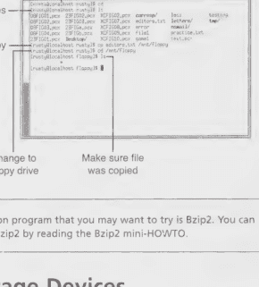

> 你可能还想尝试的另一个压缩程序是Bzip2。你可以通过阅读Bzip2 mini-HOWTO了解更多关于Bzip2的信息。

## 使用存储设备

你有几种存储备份的方法。你的选择取决于需要存储的信息量、计算机预算以及你希望花费多少时间在Linux系统上配置设备。

软盘自计算早期以来就被用作备份介质。软盘价格低廉（并且已预先格式化），易于存储，并且每台计算机都配有软盘驱动器，除了一些仅配备zip驱动器的Macintosh配置。软盘相当可靠，你可以通过正确存储来延长软盘的使用寿命。如果只有几个配置文件需要备份，或者只想备份主目录中的某些文件，软盘效果很好。

当存储空间是考虑因素时，你可能想考虑在Zip或Jaz驱动器上使用可移动磁盘。这些设备允许你存储超过100MB的文件，并且比软盘更可靠。还有一个名为`GtkZip`的实用程序，如图10.2所示，可以使管理Zip磁盘变得更容易。`GtkZip`还可以为Zip磁盘设置安全级别。

### 图10.2

使用`GtkZip`工具通过你的Zip驱动器存储备份。

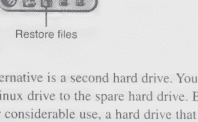

另一种备份替代方案是第二块硬盘。你可以轻松地将文件（或整个系统）从Linux驱动器复制到备用硬盘。由于硬盘在大量使用后才容易出现故障，因此仅用于存储备份的硬盘可能是一种非常可靠的存储介质。然后在需要恢复系统时，硬盘可以比其他介质快得多地完成恢复。

与硬盘价格相近的是可读写的CD-R驱动器。该设备允许你制作一次性的、不可覆盖的备份。如果你需要备份文件的永久记录，就应该使用CD-R驱动器。你也可以在一张CD上归档多达650MB的文件。

你为重要备份文件选择存储设备取决于你需要存储文件的空间大小、计算机系统上已连接的存储设备以及你的预算能负担的新存储设备的费用。在考虑存储设备之前，你可能想阅读以下HOWTO：

- 如果你需要帮助设置和使用Zip驱动器，请阅读“Zip Drive”迷你HOWTO。大多数Linux发行版会自动检测任何并行端口版本的Zip100并安装必要的驱动程序并创建挂载点。SCSI和IDE内部驱动器现在很常见，它们被视为硬盘。如果你有Jaz驱动器，请阅读“Jaz Drive”HOWTO。
- CD刻录机最近变得对普通家庭计算机用户来说负担得起。“CD-Writing”HOWTO解释了与Linux兼容的CD刻录机、如何设置它们，以及你可以使用什么软件将数据文件写入CD以及如何将音乐刻录到CD上。
- 如果你想将整个硬盘备份到第二块硬盘，请阅读“Hard Disk Upgrade”迷你HOWTO。此过程允许你在主硬盘故障时只需更换硬盘。

## 任务：节省磁盘存储空间

减少文件大小的一种方法是使用压缩实用程序。你可能有一个文件太大无法放入软盘。如果是这样，使用`gzip`命令压缩文件使其足够小以便放入。你可能在主目录中有不经常使用的文件。如果是这样，节省一些空间并压缩文件。尝试以下压缩技巧：

1. 使用以下方式使用`gzip`命令压缩文件：

```
gzip -v filename
```


此命令告诉 `gzip` 压缩文件并显示文件的压缩百分比。原始文件将被压缩文件替换，并在文件名末尾添加扩展名 `.gz`。例如，用户 `rusty` 有三个不常用且占用空间的文件（文件列表出现在图 10.1 中）。当 `rusty` 执行以下命令时

```
gzip -v 23FIG??.pcx
```

屏幕上会出现以下内容：

```
23FIG01.pcx: 76.1% -- replaced with 23FIG01.pcx.gz
23FIG02.pcx: 76.1% -- replaced with 23FIG02.pcx.gz
23FIG03.pcx: 76.1% -- replaced with 23FIG03.pcx.gz
```

此列表显示原始文件名、压缩百分比以及压缩文件的新文件名。

## 2. 使用以下方式使用 `gunzip` 命令解压缩文件：

```
gunzip filename
```

例如，如果 `rusty` 想解压缩名为 `23FIG01.pcx.gz` 的文件，他会输入以下内容：

```
gunzip 23FIG01.pcx.gz
```

文件被恢复到原始的未压缩状态，可以由能够读取该类型文件的应用程序使用。

## 3. 使用以下方式使用 `gzip` 命令压缩目录中的每个文件：

```
gzip -rv directorypath
```

如果 `rusty` 想压缩位于用户主目录中的 `corresp` 子目录的内容，将使用以下命令：

```
gzip -rv /home/rusty/corresp
```

## 4. 使用 `gunzip` 命令按如下方式解压缩目录中的每个文件：

```
gunzip -r directorypath
```

当 `rusty` 想使用 `corresp` 子目录中的文件时，需要执行以下命令：

```
gunzip -r /home/rusty/corresp
```

子目录中的所有文件现在都恢复到原始状态。

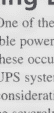

> 如果你通过电子邮件发送文件，可以使用 `gzip` 创建压缩文件。然后可以将此文件作为附件添加到电子邮件中。无论收件人使用哪种操作系统，都应该能够解压缩该文件。

## 额外预防措施

你可以为计算机购买的最重要配件之一是不间断电源（UPS）。停电或电压下降可能随时发生，一旦发生，很可能导致重要数据丢失。许多可用的 UPS 系统还提供浪涌保护和电力缓冲。将 UPS 连接到计算机的另一个关键考虑因素是，如果 Linux 操作系统未正确关闭，可能会严重损坏。因此，非常重要的是你始终使用 `shutdown` 命令关闭 Linux 系统。

当电源中断时，UPS 可为你提供 5 到 15 分钟的时间关闭系统。如果你在灯光熄灭时正坐在电脑屏幕前，这非常好。在这些情况下，当你听到 UPS 开始蜂鸣时，注销所有用户账户并关闭计算机。

当你离开电脑且电源中断时电脑仍在运行，你该怎么办？大多数 UPS 都配有串行电缆和软件，当 UPS 检测到电力下降时可用于关闭系统。如果你在 Windows 操作系统上使用 UPS，你可能已经在使用此设置。你也可以在 Linux 系统上做到这一点。如果 UPS 未附带 Linux 软件，请阅读“UPS”HOWTO 获取更多信息，然后前往 `metalab.unc.edu/pub/Linux/system/ups` 查找可运行你的 UPS 的软件。


## 任务：归档你的主目录

应经常备份的一个目录是你的主目录。主目录中的文件使用最频繁且经常更改。备份主目录最简单的方法是使用 `tar` 命令。`tar` 命令将多个文件合并为一个文件并保存原始目录结构。以下是如何创建整个主目录的归档的方法：


> 在创建归档之前，你可能希望先压缩目录中的所有文件。使用 `gzip` 命令压缩文件。

- 1. 切换到你要归档的目录。使用 `cd` 命令在目录之间移动。
- 2. 将软盘放入软盘驱动器中。
- 3. 使用 `tar` 命令在软盘组上创建归档。使用以下命令语法：
- 4. 移除第一张磁盘，将第二张软盘放入驱动器中，然后按 Enter。主目录中的其余文件将被复制到软盘。根据需要备份的文件数量，系统可能会提示你在驱动器中更换磁盘。归档完成后，你将返回到 shell 提示符。
- 5. 用磁盘编号和日期标记备份磁盘。

```
tar cvf /dev/fd0 /home/username
```

此命令指示 `tar` 创建新归档，在文件放入归档时在屏幕上列出文件，并在软盘驱动器上创建归档。为了使此示例更简短，`rusty` 只会通过输入以下内容来归档主目录中的一个子目录：

```
tar cvf /dev/fd0 /home/rusty/letters
```

当文件被复制到软盘时，每个文件都会在屏幕上列出，如图 10.3 所示。当第一张磁盘已满时，系统会提示你移除软盘并将第二张软盘放入驱动器中。

### 图 10.3

将主目录的内容备份到单个归档中，以便轻松恢复文件。

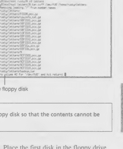

列出目录内容

更改目录

创建归档命令

文件已添加到归档

更换软盘

> 使用软盘上的写保护标签，以便内容不会被意外删除或更改。

- 6. 将归档恢复到你的主目录。将第一张磁盘放入软盘驱动器并输入以下内容：

```
tar xvf /dev/fd0
```

`tar` 命令将开始从软盘驱动器复制文件并将它们写入适当的目录（即你在创建归档时它们在硬盘上原始存储的目录）。请参阅图 10.4 中的示例。当第一张软盘上的文件被复制后，系统会要求你提供第二、第三和第四张磁盘。归档恢复完成后，你将返回到 shell 提示符。

- 7. 归档恢复后，将软盘放在安全的地方，以防以后需要。

> 当你恢复 `tar` 归档时，目录中与 `tar` 文件中的文件同名的任何文件都将被无警告地覆盖。

### 图 10.4

当你需要恢复主目录的内容时，使用你的软盘归档。

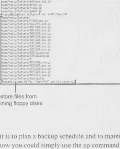

恢复归档

文件正在恢复

从剩余软盘恢复文件

#### 摘要

在本小时中，你了解了规划备份计划和维护重要文件备份的重要性。你学习了如何简单地使用 `cp` 命令在软盘上复制文件。你还学习了如何使用 `gzip` 命令压缩文件以及如何使用 `tar` 命令创建文件归档。现在你有了一些工具，是时候创建自己的备份计划了，即使计算机停止也能帮助你保持业务运行。

#### 问答

**Q 是否有其他备份命令或实用程序可用于备份我的文件？**

**A** `cpio` 命令的工作方式与 `tar` 命令非常相似，但命令选项不同。还有用于压缩文件的 `zip` 命令。一种流行的实用程序是 BRU2000 备份系统（可在 `www.estinc.com` 获取），它可与 Zip 驱动器配合使用。

**Q 我应该保留备份文件的副本多长时间？**

**A** 这是一个难以回答的问题。你需要考虑数据的重要性以及访问数据的频率。这将让你大致了解需要在存储介质上保留备份文件多长时间。如果某些文件你每个月才使用一次，你可能希望保留这些文件的备份八周。八周后，你可以通过擦除介质上的数据并将其用于下一次备份来回收备份介质。你可能有为客户或项目创建需要归档的文件。你可能希望将这些文件存储在耐用存储介质（如 CD-R/W）上数年。

**Q 如果我不知道压缩文件包含什么，有什么方法可以看到文件中的内容吗？**

**A** 你可以使用 `zcat` 命令读取压缩文件（即任何带有 `.gz` 或 `.Z` 扩展名的文件）的内容。要使用 `zcat` 命令，输入 `zcat filename` 并按 Enter。文本将出现在屏幕上。`zcat` 命令不会解压缩文件；它只是一个查看器。

#### 练习

通过回答以下问题并完成练习来测试你对本小时所涵盖材料的掌握程度。

#### 测验

1. Linux 系统上需要定期备份的最重要文件是什么？

配置文件应在进行配置更改之前和之后进行备份。大多数配置文件位于 `/etc` 目录中；其他配置文件位于 `/usr/lib` 目录中。X Window 系统配置文件通常位于 `/usr/X11R6/lib/X11`，内核源代码位于 `/usr/src/linux`。此外，`/home` 目录中的用户文件以及 `/root` 目录中超级用户的文件也需要备份。

2. 备份少量文件最简单的方法是什么？

备份少量文件最简单的方法是使用 `cp` 命令将它们复制到软盘上。

3. 你可以使用哪些类型的存储介质来备份重要数据？


你可以根据需要和预算使用多种类型的介质。最便宜的介质是软盘，非常适合存储少量文件或归档小型目录。Zip 和 Jaz 驱动器可能是大多数用户最有用的存储介质。大多数人可以在一到两个 Zip 或 Jaz 磁盘上备份主目录和重要配置文件。当你想备份整个系统时，可以考虑备份到第二块硬盘。这样，如果硬盘崩溃，你可以轻松地用备份驱动器替换崩溃的驱动器。当然，这也可以用磁带驱动器完成。另一种日益流行的存储介质是可录制 CD-ROM 驱动器。可录制 CD 最多可包含 650MB 的数据。

## 4. 你可以使用什么命令来减小文件的大小？

`gzip` 命令用于压缩文件。压缩文件的目的是节省存储介质上的空间。在将文件作为电子邮件附件发送之前，您可能还想压缩文件。您还可以压缩文件以在硬盘上腾出更多空间。当您需要使用文件时，可以轻松地解压缩文件。

## 5. 为什么应该考虑为计算机连接不间断电源？

恶劣天气和交通事故是停电、电压浪涌和欠压的主要原因。当计算机意外断电时，重要数据可能会丢失。如果 Linux 未能正常关闭，操作系统可能会受损。不间断电源 `UPS` 可保护计算机免受电流剧烈波动的侵害，并为您提供时间保存工作并关闭系统。

## 6. 如何创建用于存储文件的归档？

`tar` 命令将多个文件合并为一个文件并保存原始目录结构。当归档文件恢复到系统上时，文件会被返回到其原始目录。如果这些目录在系统上不存在，解包归档时将创建它们。

## Exercises

1. 拿出你的 Linux 日记并写出你的备份计划。列出需要备份的文件和目录，然后确定备份的频率。然后，在执行备份时，测试备份是否有效，并记录备份了什么、文件备份的日期、存储介质的类型以及备份存储的位置。恢复文件到系统时，您需要这些信息。

2. 如果您的系统包含数 GB 甚至数 GB 的数据，您可能需要考虑实施完全备份和增量备份。您可以通过阅读一本好的 Linux 系统管理书籍来了解更多关于这些复杂（且复杂）的备份方案。您可以从 `www.linuxdoc.org/LDP/sag/index.html` 的 Linux 系统管理员指南开始。


# 第 11 小时

## 打印文件

当您安装 Linux 操作系统时，您有机会在当时为系统设置和配置打印机。如果您在安装期间设置了打印机，您将愉快地——并且希望保守地——制作文件的纸质副本。如果您在安装期间未设置打印机，或者您更换了打印机或添加了第二台打印机，您将需要使用随 Linux 发行版提供的配置工具之一来使打印机正常工作。

在本小时中，您将：

- 了解 Linux 中打印系统的工作原理
- 将打印机连接到计算机并测试连接
- 为打印机配置打印服务
- 打印文件并排除打印问题

## 了解 Linux 打印服务

在您能够从一直在学习的酷炫 GNU 应用程序中打印任何文档之前，您需要配置打印机。Linux 并未为打印机提供舒适的即插即用、自动检测硬件和易于安装的方法。

事实上，Linux 拥有一个复杂的打印系统，允许许多用户同时向多台计算机打印。Linux 不在乎所有打印机是否都忙；它可以耐心地保留打印作业，直到打印机准备就绪。

当您在应用程序中按下打印按钮或执行 `lpr` 命令时，如图 11.1 所示，该命令会将文件暂时存储在称为 spool 目录的暂存区中。文件在 spool 目录中等待，直到行式打印机守护进程 `lpd` 意识到有文件等待打印。此时，`lpd` 会复制自身，抓取 spool 中的文件，并在打印机可用之前与文件一起等待。然后，当打印机空闲时，`lpd` 和文件就会前往打印机，在那里打印文件。

图 11.1

行式打印机守护进程监视 spool 目录中可能到来的任何文件。


**New Term** 打印 spool 是文件系统中的一个目录，文件会暂时存储在其中，直到可以发送到打印机。

如果有多个打印机连接到系统，每个打印机都有自己的 spool 目录。您可以通过指定与该打印机关联的 spool 目录来告诉 `lpr` 命令要将文件打印到哪个打印机。行式打印机守护进程为系统上的每个 spool 目录生成一个 `lpd`。

### 任务：连接打印机到计算机

在 Linux 中配置打印服务之前，您必须将打印机连接到计算机，并确保操作系统能够连接到打印机端口并与打印机通信。在设置打印服务之前，请按照以下步骤确保打印机运行正常：

1. 检查打印机与 Linux 操作系统的兼容性。Linux 硬件兼容性 HOWTO 是一个信息来源。您可能还想阅读 Linux 打印 HOWTO。
2. 将打印机连接到计算机。关闭计算机并关闭电源。连接打印机的串行或并行端口电缆，插入打印机的电源，然后打开打印机。打开计算机并启动操作系统。
3. 确定打印机连接的端口和使用的打印机设备。输入 `dmesg | less` 并按 Enter。您可能需要滚动到文件底部（使用空格键一次滚动一屏）才能找到打印机信息。以下是内核在系统启动期间找到的打印机信息的示例：
4. 确保设备文件与打印机之间的连接有效。输入 `ls > /dev/lp0` 并按 Enter。或者，如果打印机连接到 `lp1`，则输入 `ls > /dev/lp1` 并按 Enter。打印机应打印当前目录列表。

```
parport0: PC-style at 0x378 [SPP,PS2]
parport0: Printer, Hewlett-Packard HP LaserJet 1100
lp0: using parport0 (polling).
```

打印机通常使用 `lp0` 或 `lp1` 打印机设备。上述列表中的最后一行显示 `lp0` 打印机设备正被打印机使用。这意味着打印机的设备文件名为 `/dev/lp0`。如果您的列表显示 `lp1`，则打印机设备文件名为 `/dev/lp1`。

## 配置打印系统

一旦打印机连接并能够与操作系统通信，您就需要设置打印系统。这涉及为打印机命名、为打印 spool 分配目录、指定打印机设备文件，并告诉行式打印机守护进程有关打印机硬件的一些具体信息。


许多 Linux 发行版包含自己的特殊工具，用于配置打印机以与操作系统一起工作。Linux-Mandrake 使用 `DrakConf` 设置打印机。`DrakConf` 中的打印机配置工具基于 Red Hat Linux 打印系统管理器（也称为 `printtool`）。TurboLinux 使用 `TurboPrintCfg` 实用程序设置打印机。您会发现 `TurboPrintCfg` 请求的信息与 `printtool` 相同；只有界面不同。

无论您选择哪个打印机配置实用程序，所有这些程序都会将您提供的信息写入 `/etc/printcap` 文件。


如果您不熟悉 Linux 打印系统的所有技术工作原理，建议您使用其中一个打印机配置实用程序来设置打印机。不当编辑文件可能会在以后导致其他配置实用程序出现问题。只有经验丰富的用户才应手动编辑 `/etc/printcap` 文件以创建打印服务。

### 任务：设置本地打印机

您可以使用各种发行版特定的工具来设置打印机以与 Linux 一起工作，但大多数工具看起来都大致类似于 Red Hat Linux 打印系统管理器工具，或简称为 `printtool`。以下是如何使用 `printtool` 将打印机配置信息写入 `/etc/printcap` 文件：

1. 登录到超级用户账户。
2. 打开终端模拟器并输入 `printtool` 然后按 Enter。您可能会看到一系列错误消息，告知系统上未安装的软件包。单击 OK 以清除错误消息并显示主 `printtool` 窗口，如图 11.2 所示。
3. 单击 Add 按钮。这将显示添加打印机条目对话框。
4. 选择 Local Printer 选项并单击 OK。`printtool` 会自动检测正在使用的打印机设备，并在 Info 对话框中显示检测到的端口。记下检测到的设备。确保它与 `dmesg` 命令检测到的设备相同，然后单击 OK 关闭 Info 对话框。编辑本地打印机条目对话框出现，如图 11.3 所示。

图 11.2

`printtool` 将轻松配置连接到系统的打印机。


图 11.3

`printtool` 会自动设置默认打印服务信息。


5. 记录打印机信息。`printtool` 使用默认值来设置打印服务。

> 彩色喷墨打印机运行成本可能很高。如果您想限制可以发送到打印机的文件大小，请在“文件大小限制（KB）”文本框中输入打印机将接受的最大文件大小。


6. 单击“`Select`”按钮。这将显示图 11.4 所示的“`Configure Filter`”对话框。

7. 从“`Printer Type`”列表中选择打印机厂商和型号。按需更改其他选项，然后单击“`OK`”完成。您将被返回到“`Edit Local Printer Entry`”对话框。

8. 单击“`OK`”返回 `printtool` 主窗口。打印机现在应该已列出。

图 11.4

选择打印机并设置打印选项。


9. 测试打印机。从列表中选择打印机并单击“`Tests`”。打印 ASCII 测试页。测试页将被发送到打印 spool 目录并应打印出来。如果页面未正确打印，请单击“`Edit`”并更改打印机配置。

10. 在您按自己的喜好设置好文本测试页后，尝试打印 PostScript 测试页。

11. 完成后，单击 `PrintTool`，`Quit`。

## 排查打印系统问题

在设置打印机和打印服务时，您可能会遇到一些问题。以下是一些建议供参考：

- 如果打印页面上的文字呈阶梯状，请在 `printtool` 中选择打印机类型时选择“`Fix Stair-Stepping Text`”选项。
- 如果您的打印机不在打印机类型列表中，请选择它将模拟的打印机或与您的打印机非常接近的打印机。您可能需要查找打印机用户手册来获取此信息。
- 打印多页时，最后几页可能不会从打印机中弹出。使用“`Send EOF After Job to Eject Page`”选项。
- 还有其他工具可用于管理打印机。尝试访问 `metalab.unc.edu/pub/Linux/system/printing/INDEX.html` 上的 Linux MetaLab 档案。对于使用 HP LaserJet 打印机的用户，有一个控制面板可让您更改打印机属性（见图 11.5）。

图 11.5

`Ljet Tool` 可让您轻松使用任何 HP LaserJet 打印机进行打印。

更改分辨率

更改纸张大小和方向


## 任务：向打印机发送文件

现在打印机已设置好并准备就绪，您将想要开始向打印机发送文件。您很可能在图形环境中工作，只需在正在使用的应用程序中按打印按钮即可。如果是这种情况，文件将直接发送到打印机，您无需担心任何事情。您也可以使用 `lpr` 命令向打印机发送文件。以下是如何将文件发送到打印 spool 以及如何管理打印 spool 的方法：

1. 向打印机发送文件。要打印文件，输入 `lpr filename` 并按 Enter。在图 11.6 所示的示例中，用户（在此情况下为超级用户）列出了目录内容，然后选择了两个文件进行打印。此命令将文件发送到打印 spool（默认打印机在 `printtool` 中默认为名为 `lp`），在打印机可用之前文件会等待在那里。

在打印 spool 中查看打印作业

向打印机发送文件

图 11.6

查看发送到打印机的作业列表，并在必要时删除打印作业。


从打印 spool 中删除打印作业


在发出命令时提高效率。与其发出两个单独的 `lpr` 命令来向打印机发送两个文件，不如使用一个命令并指定所有文件。要向打印机发送多个文件，输入 `lpr filename file-name` 并按 Enter。

2. 如果设置了第二台打印机，请向该打印机发送文件。输入 `lpr -P printername filename` 并按 Enter。例如，要将名为 `install.log` 的文件发送到名为 `lp0` 的打印机，输入 `lpr -P lp0 install.log`。

3. 检查打印 spool 中文件的状态。输入 `lpq` 并按 Enter。此命令列出正在被打印机处理或等待处理的全部作业，以及作业将被处理的顺序。

4. 从打印 spool 中删除作业。输入 `lprm jobnumber` 并按 Enter。`jobnumber` 是 `lpq` 命令输出中 Job 列中列出的编号。例如，在图 11.6 中，要从打印 spool 中删除名为 `kernel1.txt` 的文件，输入 `lprm 7` 并按 Enter。

5. 清除属于您用户帐户的所有打印作业。输入 `lprm -` 并按 Enter。如果您以超级用户身份执行此命令，所有打印作业都将被从打印 spool 中删除。

### 摘要

在本小时中，您学习了如何在 Linux 中设置打印服务，以便您可以打印创建的文件。您了解到 Linux 并不会立即将文件发送到打印机。它首先将文件放入 spool 目录，直到行式打印机守护进程知道打印机可供使用。您了解到每个发行版都以不同的方式使用打印实用程序来配置打印机和打印服务，并且此配置信息存储在 `/etc/printcap` 文件中。此外，由于错误难免，您还学习了如何从 spool 目录中删除打印作业。

### 问答

Q 除了 Ljet 之外，还有哪些应用程序可以让我更轻松地使用打印机？

A `Ljet` 工具可让您轻松使用 HP LaserJet 打印机。KDE 中还包含一个名为 `Printer Queue` 或 `k lpq` 的打印 spool 监视器。如果您使用 KDE，您可能已注意到桌面上的打印机图标。当您从文件管理器拖动文件并将其放到打印机图标上时，`lpr` 命令将被执行。您还可以将一个打印机小程序放在 GNOME 面板上。

## Q 在哪里可以了解更多关于 Linux 打印系统的内容？

A 从 HOWTO 开始。Linux Printing HOWTO for Linux 展示了如何设置打印机、配置打印软件、查找传真软件以及在文件发送到打印机之前预览文件。Linux Printing Usage HOWTO 介绍了如何打印不同文件格式。如果您有 Hewlett Packard 打印机，您应该阅读 HP HOWTO

## 工作坊

通过回答本小时所涵盖内容的以下问题并完成练习来测试您对材料的掌握程度。

### 测验

1. 当您告诉 Linux 您想打印文档时会发生什么？

在应用程序中按打印按钮会执行 `lpr` 命令。您也可以从 shell 提示符执行 `lpr` 命令。`lpr` 命令将指定文件放入将打印该文件的打印机的打印 spool 目录中。文件在 spool 中等待行式打印机守护进程，后者自行生成以便在打印机可用时立即处理文件并将其发送到打印机。

2. 您使用哪个命令来查找打印机所连接端口的设备名称？

使用 `dmesg` 命令。您可能希望在分页器（如 `less`）中查看命令的输出，以便阅读全部内容。打印机设备信息列出了连接到端口的打印机的制造商和型号以及端口名称（`lp0`、`lp1` 或 `lp2` 之一）。

3. 您能做什么来确保操作系统、设备文件和打印机之间存在连接？

向打印机发送一个小文本文件或使用如下命令将命令（如 `ls` 命令）的输出定向到打印机设备：

```
ls > /dev/lp0
```

4. 打印机配置信息存储在哪里？

所有打印机配置实用程序都将打印机信息存储在 `/etc/printcap` 文件中。不建议手动编辑 `/etc/printcap` 文件，因为其结构复杂，您不希望做出错误更改。

5. 如果你的打印机在 `printtool` 实用程序中未列出，你应该怎么办？

选择一个与你的打印机相近的打印机。你可以尝试同一制造商的其他打印机。你也可以查看打印机文档，看看是否有打印机可以被你的打印机模拟。

6. 在你将打印作业发送到打印队列后，使用什么工具来管理打印作业？

要检查打印队列中文件的状态，请使用 `lpq` 命令。该命令显示正在被打印机处理的作业以及等待处理的作业。要从打印队列中删除作业，请使用 `lprm` 命令。使用 `lprm` 命令时，你需要指定要从打印队列中移除的打印作业的编号。你可以使用 `lpq` 命令找到该编号。

### 练习

- 1. 寻找高效且节约地使用计算机系统的新方法。阅读 Linux Ecology HOWTO。该 HOWTO 包含一些节省电力、纸张和墨水的良好建议。它还包含一些延长计算机硬件使用寿命的好提示，以及如何通过远程控制关闭家中灯光的提示。
- 2. 还记得三个 R 吗？减少、重复使用和回收。我们再增加一个主题——堆肥。如果你的社区为瓶子、塑料和旧报纸赞助了回收计划，请尽你所能参与。在你的家庭办公室或小型企业中放一个纸箱，用来丢弃打印机上出错的纸张。你总可以用这些废纸做笔记。或者，你可以学习如何在自家后院堆肥（从 `www.vegweb.com/composting/resources.shtml` 的堆肥指南开始）。这是一种丰富花园土壤并节省垃圾填埋空间的好方法。

# 第 12 小时

## 与系统上的其他用户共享文件


因为 Linux 是一个多用户操作系统，几个人可以共享同一台机器，而不会干扰其他用户的 home 目录和相关文件。然而，这几个人也可以使用同一个多用户系统来允许与另一用户或组共享选定的文件。你可以在保持 home 目录自主性和个人文件私密性的同时做到这一点。

本小时，你将

- 在系统上管理用户账户
- 创建组账户以促进文件共享
- 将文件的拥有权转移给其他系统用户
- 确定谁可以访问文件以及他们将被允许的访问类型


# 维护用户账户

在第 5 小时“熟悉 Shell”中，你学习了如何使用 `adduser` 命令创建一个无特权用户账户，以便你可以用它来试验你的 Linux 系统。你可以使用此命令创建所需的任意多个用户账户。理想情况下，你应该为每位使用计算机和 Linux 操作系统的人创建一个账户。要查看系统用户列表，请打开 `/etc/passwd` 文件（见图 12.1）。

> 在本小时提到的查看和编辑文件时请务必小心。一个拼写错误可能导致你许多麻烦。避免问题的一种方法是，在尝试更改之前先制作文件的备份副本。然后，如果你犯了错误，可以恢复到原始文件。如果你觉得不舒服编辑这些文件，你可能想探索 LinuxConf，它在附录 B“介绍 GNOME 和 LinuxConf”中有所介绍。

图 12.1

`/etc/passwd` 文件列出了系统中已设置的所有用户。


你会注意到系统中设置了三种类型的用户。它们是：

- 超级用户——`root` 账户用于超级用户。此账户应仅用于执行系统维护和配置任务。
- 个人——无特权用户账户分配给使用系统的人员。每个人都有一个用户名和密码，与系统上其他用户的不同。
- 虚拟用户——系统守护进程账户是由操作系统设置的账户，不供个人使用。这些账户执行特殊任务（例如检索邮件和将文件发送到打印机），并且需要访问系统上的文件。你可以将这些系统守护进程账户视为虚拟用户。

每个用户在 `/etc/passwd` 文件中都有一个单独的条目，包含七个字段。每个字段由冒号（`:`）字符分隔。按出现顺序，这些字段是

- 用户名是用户登录其账户时输入的名称。
- 密码由字母 `x` 表示。这意味着密码已加密，因此某人无法查看 `/etc/passwd` 文件并了解每个人的密码。


> 如果你想阻止用户访问其账户，请在密码字段前面放置一个星号（`*`）。

- 用户识别号（`uid`）是分配给每个账户的唯一编号。系统在处理文件权限时使用此编号来识别用户。
- 组识别号（`gid`）标识用户所属的主要组。用户可以属于多个组，但在 `/etc/passwd` 文件中只列出主要组。你将在本小时后面学习有关组账户的内容。
- 关于用户的杂项信息（`gecos`）也可以放在文件中。这可能包含用户的真实姓名和位置信息（如办公室号码或电话号码）。
- 用户的 home 目录（`homedir`）是用户存储个人文件的位置。这也是用户登录其账户时的默认工作目录。
- 用户登录其账户时运行的 `shell` 是条目中的最后一个字段。大多数 Linux 发行版的默认设置是 `/bin/bash`。

当用户不再使用系统时，你需要删除其账户。你有两个选择：你可以删除账户和用户的 home 目录（连同其内容），或删除账户并保留 home 目录。要删除用户的账户和 home 目录，输入

```
userdel -r username
```

要删除用户的账户并保留其 home 目录，输入

```
userdel username
```


> 你必须以 `root` 账户登录才能执行此操作，并且在用户登录时不能删除用户账户。

## 任务：更改你的密码

每个用户（和超级用户）账户都必须有密码，并且密码应定期更改。以下是更改用户账户密码的方法：

- 1. 登录你的用户账户。
- 2. 输入 `passwd` 并按 Enter。你将被提示输入当前账户密码。
- 3. 输入密码并按 Enter。你将被提示输入新密码。
- 4. 输入新密码并按 Enter。你将被要求验证密码。
- 5. 再次输入新密码并按 Enter。

以下是关于更改密码的几条规则：

- 作为一般经验法则，应定期更改密码（和 `root` 账户密码），例如每月一次或每三个月一次。
- 如果密码被不需要访问该账户的人知晓，请更改密码。
- 当负责维护系统的人不再负责系统时，请更改超级用户密码。更改的一些原因可能是前系统管理员已调至其他部门，或已离开公司。

# 设置组账户

除了在 Linux 系统上设置用户账户外，你可能还想考虑设置组账户。组账户在多个用户需要共享同一文件时很有用。你可以根据需要创建任意多个组账户，并将任意组合的用户分配给该组。用户甚至可以属于多个组。要查看系统上已设置的组列表，请查看 `/etc/group` 文件（见图 12.2）。

图 12.2

`/etc/group` 文件列出了所有已创建的组。


像 `/etc/passwd` 文件一样，每个组在 `/etc/group` 文件中都有单独的条目。每个条目包含四个字段，每个字段由冒号（`:`）字符分隔。按出现顺序，这些字段为

- 组名。
- 密码字段，可选。此字段通常包含字符 `x`。你可以为组设置密码，以便非该组成员的用户可以访问组的 files。外部用户需要使用 `newgrp` 命令来访问该组。
- 组标识号。
- 分配给该组的额外用户列表。这些用户在 `/etc/passwd` 文件的组标识字段中没有列出该特定组。

## 任务：创建组账户

在 Linux 中创建用户账户时，每个用户都会被分配一个主组，其名称与她的用户名相同。添加新组最简单的方法是编辑 `/etc/group` 文件。在开始之前，你必须以超级用户账户登录才能创建组账户。创建组账户的方法如下：

- 1. 在你喜欢的文本编辑器中打开 `/etc/group` 文件。
- 2. 滚动到文件底部并新建一行。在这里输入新组的信息。记住，组信息使用以下格式：

  `group_name:x:groupID:group_members`
- 3. 输入你想分配给组的名称，后跟冒号。例如，如果你想创建一个组，让销售人员可以存储宣传资料和订单表格，你可能想将该组命名为 `sales`。
- 4. 将密码字段留空。输入 `x`。
- 5. 分配一个组标识号。查看最后一个条目的组标识号并使用下一个数字。例如，如果列表中最后一个组的组标识号为 508，则为新组分配组标识号 509。在该数字后跟一个冒号。
- 6. 为组分配成员。如果用户 `rusty` 和 `mona` 将被分配到该组，请用逗号分隔每个名称（名称之间不要有空格）。使用此示例，`sales` 组的条目将如下所示：

  `sales:x:509:rusty,mona`
- 7. 保存文件并关闭它。
- 8. 创建一个目录供组存储文件。为组创建目录的好地方是 `/usr/local`。例如，创建一个 `/usr/local/sales` 目录，让 `sales` 组可以存储文件并创建子目录。

当个人想要知道自己属于哪些组时，只需使用 `groups` 命令即可。例如，用户 `rusty` 将看到以下内容：

```
[rusty@localhost rusty]$ groups
rusty sales
[rusty@localhost rusty]$
```

这表明 `rusty` 有一个专属自己的组，并且他属于 `sales` 组。

用户还可以使用 `id` 命令显示其用户账户的标识号以及分配的组，如下所示：

```
[rusty@localhost rusty]$ id
uid=501(rusty) gid=501(rusty) groups=501(rusty),509(sales)
[rusty@localhost rusty]$
```

如果用户正在其账户中工作，则用户的新的组账户可能不会列出。用户需要注销账户然后重新登录。


如果要删除组账户，请在 `/etc/group` 文件中删除该组的条目。

# 授予文件访问权限

在为将使用系统的每个用户和组创建账户后，用户和组就可以开始在系统上存储文件。当文件（或目录）由组成员创建时，该成员就是文件的拥有者。是此用户可以向其他组成员和其他系统用户授予所有权和权限。文件所有权和权限系统构成了限制和允许访问文件的基础。文件所有权有三种类型：

- 所有者是创建文件的用户。
- 组是所有者所属的默认组。默认情况下，这是 `/etc/passwd` 文件中为文件所有者指定的主组。
- 其他所有权可以分配给不是组成员的系统用户。

新术语 文件权限决定系统上的哪些用户可以访问文件以及允许的访问类型。文件权限通过限制对文件的访问来帮助维护文件的安全性。


文件所有者还可以确定其他用户对文件的访问类型（或权限）。可以为文件或目录分配三种不同级别的文件权限，并且这些权限可以针对不同类型的拥有者设置不同：

- 对文件的读访问允许用户以及具有权限的组查看文件的内容。对目录的读访问意味着用户和组可以列出目录的内容。
- 对文件的写访问授予选定的用户和组修改文件或删除文件的能力。对目录的写访问允许用户和组在目录中创建文件并删除这些文件。
- 对文件的执行访问意味着文件可以作为命令或程序运行。对目录的执行访问允许用户和组访问目录并列出目录中包含的文件的信息。

正如你在第 7 章“在文件系统中移动”中所学到的，`ls -l` 命令列出文件的用户和组所有权以及分配给每个人的权限。图 12.3 显示了一个示例。在此示例中，所有者对文件具有完全访问权限（读、写和执行）。组、所有者和其它用户对文件具有读和执行权限。

图 12.3

所有者对文件具有读、写和执行权限。


## 更改文件所有权

要更改文件的所有权（即用户所有者和组所有者），请使用 `chown` 和 `chgrp` 命令。让我们看一下用户 `rusty` 创建并放置在 `sales` 组目录中的两个文件：

```
-rw-r--r-- 1 rusty rusty 747293 Jul 4 04:04 packages
-rw-r--r-- 1 rusty rusty 155 Jul 7 01:01 tealist
```

对于这两个文件，组所有权需要更改为 `sales` 组。为此，`rusty` 将 `cd` 到 `sales` 目录并按如下方式使用 `chgrp` 命令：

```
[rusty@localhost sales]$ chgrp sales packages
[rusty@localhost sales]$ chgrp sales tealist
```

如果 `rusty` 想将 `tealist` 文件转移给用户 `mona`，`rusty` 将使用以下命令更改所有者：

```
[rusty@localhost sales]$ chown mona tealist
```

列表随后将如下所示：

```
-rw-r--r-- 1 rusty sales 747293 Jul 4 04:04 packages
-rw-r--r-- 1 mona sales 155 Jul 7 01:01 tealist
```

## 保护文件

现在文件的所有者已设置，你可以更改每种类型所有者允许的访问类型。更改文件权限的过程稍微复杂一些。`chmod` 命令更改文件权限。`chmod` 的语法是

```
chmod access_string filename
```

`access_string` 的语法是

```
owner+operator+file permission
```

其中 `owner` 是以下文件所有者中的一个或多个：

- 字符 `u` 设置用户所有者的权限
- 字符 `g` 设置组所有者的权限
- 字符 `o` 设置所有其他人的权限
- 字符 `a` 设置所有三种类型所有者的权限

其中 `operator` 是以下之一：

- 要为指定所有者添加文件权限，请使用 `+` 字符
- 要删除文件权限，请使用 `-` 字符
- 要使用确切的文件权限，请使用 `=` 字符

其中 `file permission` 是以下之一或多个：

- 读访问使用字符 `r` 应用
- 写访问使用字符 `w` 应用
- 执行访问使用字符 `x` 应用

以下文件作为示例：

```
-rw-r--r-- 1 rusty sales 747293 Jul 4 04:04 packages
```

如果用户 `rusty` 想允许 `sales` 组进行写访问，`rusty` 将按如下方式使用 `chmod` 命令：

```
[rusty@localhost sales]$ chmod g+w packages
```

要查看更改，请使用 `ls -l` 命令显示新的文件权限：

```
-rw-rw-r-- 1 rusty sales 747293 Jul 4 04:04 packages
```

你会注意到组权限中的 `w`（表示写访问）。

## 任务：使文件只读

你可能想要使文件只读，以便内容无法更改，只能查看。方法如下：

- 1. 你必须是该文件的拥有者。
- 2. 切换到包含该文件的目录。
- 3. 显示你想要更改权限的文件。例如：

```
-rw-r--r-- 1 mona sales 155 Jul 7 01:01 tasklist
```

- 4. 使用 `chmod` 命令将文件权限更改为所有用户只读。输入 `chmod a-w filename` 并按 Enter。对于本示例，输入 `chmod a-w tasklist` 并按 Enter。文件权限将更改为显示以下内容：

```
-r--r--r-- 1 mona sales 155 Jul 7 01:01 tasklist
```

- 5. 阻止其他用户读取文件。输入 `chmod o-r filename` 并按 Enter。示例中的文件权限将通过输入 `chmod o-r tasklist` 来更改。列表随后将显示为

```
-r--r----- 1 mona sales 155 Jul 7 01:01 tasklist
```

请注意，其他用户对该文件没有任何权限设置，因此无法访问该文件。

### 摘要

限制文件访问的能力很重要，如果多人使用计算机并希望共享文件。在用户可以共享文件之前，他们必须被分配到组中，并且必须设置目录来存储组的 files。组建立后，组成员可以开始在这些目录中存储文件并指定想要给予其他希望使用文件的系统用户的访问类型。

### 问答

Q 我不喜欢第一次设置系统时为自己分配的用户名，但我的主目录中存储了一些不想丢失的文件。有没有办法只更改用户名？

A 登录到超级用户账户并使用 `usermod` 命令。你不仅可以更改用户名，还可以更改主目录的名称以匹配新的用户名，而不会弄乱存储在其中的任何文件。要使用此命令，输入

```
usermod -l new_username -d /home/new_username -m username
```

`-l` 命令选项标识新的用户名，`-d` 命令选项指定新目录，`-m` 命令选项将用户的所有文件移动到新目录。例如，如果有一个名为 `marilyn` 的用户（你之前见过她）

```
usermod -l jane -d /home/jane -m marilyn
```

Q 我阅读了 `chmod` 命令的手册页，它提到使用数字来更改文件权限。你能告诉我更多吗？

A `chmod` 命令为处理文件权限提供了两种不同的选项。本小时向你展示了如何使用字母来更改用户拥有者、组拥有者和其他所有用户的读、写和执行权限。你可能想使用数字方法，其中 4 代表读访问，2 代表写访问，1 代表执行访问。因此，如果你想要对文件具有读和写访问权限，将 4 和 2 相加得到 6。然后，需要为每种类型的拥有者确定此访问权限。因此，如果你想要用户和组拥有者具有读和写访问权限，而所有其他用户具有读访问权限，则命令为 `chmod 664 filename`。

### 练习

通过回答以下问题并完成练习来测试你对本小时所涵盖材料的掌握程度。

#### 小测验

- 1. 当你使用 `adduser` 命令向系统添加新用户时，此信息存储在哪里？

`adduser` 命令将用户信息放在 `/etc/passwd` 文件中。`adduser` 命令使用默认信息分配用户识别号、主目录和 shell 程序。`/etc/passwd` 文件中的密码字段是加密的，因此任何查看此文件的人都无法得知其他用户的密码。

- 2. 有哪三种类型的用户可以访问文件？

创建文件的人称为拥有者，负责该文件。此人可以更改文件权限以将文件所有权转移给其他用户。组拥有者是用户拥有者所属的具有文件访问权限的组。你还可以将所有权分配给既不是拥有者也不是组成员的其他用户。


- 3. 可以授予每种类型的用户哪三种类型的访问权限？

对文件的读访问允许用户查看文件的内容。对目录的读访问允许用户列出目录的内容。写访问赋予用户更改文件或删除文件的能力。对目录的写访问允许用户向目录添加文件并删除目录中的文件。对文件的执行访问意味着文件可以作为命令或程序运行。对目录的执行访问允许用户和组访问目录并列出目录中包含的文件的信息。

- 4. 如何更改用户账户的密码以及何时应更改密码？

在登录到你的用户账户时使用 `passwd` 命令。你将被要求输入当前密码，然后需要提供新密码。你应定期更改密码以使他人更难猜出你的密码。如果你发现有人知道了你的密码，也应更改密码。这对于超级用户（或 `root`）账户尤其重要，因为该账户可以访问系统上的每个文件和目录。

- 5. 为什么要将用户组织成组以及如何创建组账户？

如果多个用户需要共享某些文件，请将这些用户组织成一个组。你可以在系统上拥有任意数量的组账户，用户可以属于多个组。创建组账户最简单的方法是使用你喜欢的文本编辑器编辑 `/etc/group` 文件。你需要为组提供名称和识别号，并列出将成为该组成员的用户。


### 6. 如何快速找出你所属的组？

你可以使用 `groups` 命令或 `id` 命令。两者都会列出你分配的组，而 `id` 命令还会列出你的用户账户以及你所属的组账户的识别号。

### 活动

- 1. 设置一个目录结构，以便系统上的用户可以为工作组目的存储文件。然后根据谁需要与谁共享文件创建组，并为各个目录设置适当的访问权限。然后你需要教育用户正确存储文件的方式以及如何设置权限，以便只有需要知道或需要使用的人才能访问文件。

- 2. 如果你需要加密文件以确保未经授权的人看不到信息，你可能想查看 `www.gnupg.org` 上的 GNU Privacy Guard。这是一个免费的、开源的 PGP 替代品，可以不受限制地使用。它可以解密和验证 PGP 加密，并支持签名和加密。GNU Privacy Guard 还可以用作过滤器，以过滤掉你不希望出现在电子邮件收件箱中的内容。GNU Privacy Assistant 是 GNU Privacy Guard 的图形界面，你会觉得它很有帮助。


## 第 13 小时

### 使用进程

Linux 的优点之一是对 CPU 和内存资源的平滑管理。每次你发出命令或启动程序时，Linux 都会进入文件系统复制程序。Linux 然后将副本放入计算机的内存中。副本进入内存后，`shell` 执行程序，从而启动一个进程。每个进程都通过 `shell` 程序进行维护和管理。在本小时中，你将使用 `bash` `shell` 学习 Linux 如何启动和管理进程。

在本小时中，你将：

- 学习如何启动和停止进程

- 确定系统如何使用内存资源

- 找到有助于监控系统资源的实用程序

## 什么是进程？

随着你在数小时里尝试不同的命令，也许编写了一些 `shell` 脚本，你一直在创建进程却浑然不觉。在第 5 小时《认识 Shell》中，你了解到 `bash` `shell` 如何充当用户与 Linux 内核之间的接口并解释用户的指令。对于用户发出的每个命令，`shell` 都会生成一个自己的克隆来执行该命令。这个克隆被称为子进程。`shell` 与其克隆（或子 `shell`）之间的关系被描述为父/子关系。命令被交给子进程（子 `shell`）执行后，父进程（`shell`）会返回并等待下一个任务。当它收到另一个命令时，就会生成另一个子进程。

新术语 进程是在内存中运行的活动，用于执行命令执行所需的操作。命令可以由用户在命令行输入，包含在 `shell` 脚本中，或由内存中运行的另一个进程（如桌面 GUI）输入。当进程完成其任务后，它会被从内存中移除，从而为其他进程腾出 CPU 时间。典型的系统一次运行约 50 个进程，每个进程都被分配一个唯一的标识号。


> 有一些命令 `shell` 不会为其生成子 `shell`。这些是被称为内置命令的 `shell` 命令。`shell` 本身会执行内置命令所需的操作。

## 进程类型

从用户和交互的角度来看，进程可以分为三类基本类别：

- 交互式进程需要用户输入。交互式进程可能是你运行的程序，例如文本编辑器或图形程序。

- 批处理进程自动执行，无需用户交互。批处理进程可能是你编写的脚本，用于在特定时间备份你的主目录。

- 守护进程在后台运行时为用户和应用程序提供服务。你在启动时启动一些守护进程，例如当文件发送到打印机时接管的进程（`lpd` 行式打印机守护进程）或当你要求系统拨号到你的 ISP 并启动到互联网的 PPP 连接时介入的 PPP 守护进程。

## `ps` 命令的语法

`ps` 命令可以与多个选项一起使用，以提供有关系统上正在运行的进程的定制信息。`ps` 命令的语法是

```
ps [options]
```

当单独使用 `ps` 命令时，它只显示当前活动的进程、进程标识号以及在 `shell` 提示符下输入的命令。`ps` 命令可以通过添加命令选项来显示每个进程的更多信息。以下是一些你可能会觉得有用的命令选项：

- 当你想显示正在运行和停滞的进程时，输入 `ps ax` 并按 Enter。这可能是一个很长的列表。如果是这样，你可以将输出通过管道传递给 `less` 查看器（使用 `ps ax | less` 命令）。

- 默认情况下，`ps` 命令只显示在命令行上输入的命令。要查看实际执行的命令（包括命令的完整目录路径），输入 `ps -e` 并按 Enter。

- 要仅查看后台进程，输入 `ps x` 并按 Enter。

- 当你想知道哪些用户执行了各种正在运行的进程时，输入 `ps u` 并按 Enter。此列表还显示进程使用的 CPU 和内存使用量。（此命令可能需要 `root` 权限。）

## 任务：创建进程

是时候看看关于进程的这些技术术语到底是什么意思，并观察几个进程的运行情况了。因为你可能大部分计算机时间都在图形用户环境（如 KDE 或 GNOME）后面度过，打开一个终端仿真程序并学习执行和终止进程的简单方法。

1. 登录到你的用户账户并启动 X Window 系统以显示你喜欢的桌面环境。

2. 打开一个终端仿真程序。你可以在 GNOME 和 KDE 面板上找到图标，或打开菜单开始查找。图 13.1 显示了使用 Konsole 终端仿真器的 KDE 桌面。

3. 在命令行中，输入 `ps` 并按 Enter。当前正在运行的进程会显示在终端仿真器中。你的输出可能类似于以下内容：

```
[dezi@localhost dezi]$ ps
PID TTY TIME CMD
2666 pts/0 00:00:00 bash
2679 pts/0 00:00:00 ps
[dezi@localhost dezi]$
```

### 图 13.1

进程帮助你管理系统上正在运行的命令。


- 第一个字段（PID）是进程标识号。每个进程都被分配一个唯一号码。你需要这个号码来管理单个进程。

- TTY 字段是进程被执行的终端。如果多个用户在不同的终端工作，每个终端都会被分配一个唯一的 TTY 编号。

- TIME 字段显示进程已使用的 CPU 时间量。

- CMD 字段是用户执行的单个命令或程序的名称。图 13.1 中的示例显示 `bash` `shell` 正在运行，并且使用了 `ps` 命令来显示输出。

4. 在后台运行程序。通过在后台运行程序，命令会被执行并在内存中保持运行，同时 `shell` 提示符的控制权返回给用户。我们将使用一个有趣的 X 程序 `xeyes` 作为示例。输入 `xeyes &` 并按 Enter。`&` 字符告诉 `shell` 你希望程序在后台运行。你的屏幕应该看起来像图 13.2 中的那样。

### 图 13.2

在从 `shell` 提示符执行新命令的同时在后台运行命令。


Process identification number

Execute process in the background

Background process

Execute commands and create more processes

5. 查看正在运行的进程。输入 `ps` 并按 Enter。注意 `xeyes` 程序列在输出中，类似于以下内容：

```
[dezi@localhost dezi]$ ps
PID TTY TIME CMD
2666 pts/0 00:00:00 bash
2886 pts/0 00:00:01 xeyes
2697 pts/0 00:00:00 ps
[dezi@localhost dezi]$
```

6. 关闭 `xeyes` 程序。关闭程序的一种方法是告诉 `kill` 命令你想退出哪个进程。为此，你需要知道命令的进程标识号（pid），并且要意识到这些号码每次运行都会变化。在此示例中，如果你想终止 pid 为 2886 的 `xeyes` 小程序，输入 `kill 2886` 并按 Enter。你会看到 `xeyes` 程序窗口在屏幕上关闭，并且会在终端窗口中看到以下内容：

```
[dezi@localhost dezi]$ kill 2886
[1]+ Terminated xeyes
[dezi@localhost dezi]$
```

7. 再一次查看正在运行的进程。输入 `ps` 并按 Enter。你会注意到你的原始进程（`bash`）和最近一次执行的 `ps` 命令是唯一正在运行的命令。

## 查看系统内存使用情况

Linux 的一大优点是它可以充分利用计算机资源。Linux 使用硬盘上预留的一部分，称为交换空间，以增加可用于运行进程的 RAM 内存资源。Linux 可以像使用 RAM 一样使用交换空间。

因为 Linux 在系统内存（或 RAM）中运行进程，所以跟踪系统内存使用情况很重要。现在，如果你运行的是配备 256MB RAM 和相同量交换空间的强力机器，这可能永远不会成为问题。你可能听说过 Linux 和 X Window 系统在 16MB RAM 和 16MB 交换空间下可以正常运行，如果你为你的基础机器选择了这种方式，内存使用情况肯定会成为你的系统管理优先事项之一。


free 命令显示系统上存在的内存量。此命令使你能够快速检查物理（或 RAM）内存和虚拟（或交换）内存的使用情况。要使用 `free` 命令，在 shell 提示符下输入 `free` 并按 Enter。`free` 命令的示例在列表 13.1 中使用。

### 列表 13.1 free 命令的输出

```
[root@localhost /root]# free
             total       used       free     shared    buffers     cached
Mem:        79252      77720       1532      49972       6292      28520
-/+ buffers/cache:    42908      36344
Swap:       145112         16     145096
```


> `free` 命令以千字节列出内存（一个兆字节等于 1024 千字节）。如果你更愿意以兆字节查看此信息，输入 `free -m` 并按 Enter。

列表 13.1 显示了一个具有 79 兆字节 RAM 的系统，其中约 78MB 正在使用，1.5 兆字节空闲。它还显示了 145MB 的交换空间，其中只有 16KB 正在使用。该系统运行正常。

## 任务：跟踪系统资源使用情况

`top` 工具提供了另一种查看机器上进程的方式。此工具可用于确定每个进程使用哪些资源。它还提供了一个交互式界面，您可以在其中管理进程，例如更改进程的优先级或交互式地终止进程。`top` 工具本身也是一种资源占用大户，因此如果它出现在列表顶部也不要感到惊讶。本任务向您展示如何使用 `top` 工具：

> `top` 有许多交互式命令，您可能想尝试一下。要全面了解 `top`，请查看手册页（在 shell 提示符下输入 `man top`）。

- 1. 启动 `top` 工具。如果您使用的是 X Window 系统，请打开一个终端仿真器窗口。输入 `top` 并按 Enter。示例显示在图 13.3 中。

### 图 13.3

使用 `top` 工具查看哪些进程正在使用宝贵的系统资源。


进程总数

`top` 命令行

执行进程的命令

内存使用情况

进程 ID 号

执行进程的用户

进程使用的 CPU 资源

进程使用的内存资源

- 2. 根据系统内存使用量对进程进行排序。输入 `M`。在 `top` 命令行上，您会看到一条消息，显示“按内存使用情况排序”。进程列表将被更新，使用内存最多的进程将显示在列表顶部。

- 3. 根据 CPU 资源使用量对进程进行排序。输入 `P`。在 `top` 命令行上会出现一条消息，显示“按 CPU 使用情况排序”。进程列表将被更新，使用 CPU 资源最多的进程将显示在列表顶部。

- 4. 终止任务。输入 `k` 以显示消息“终止的 PID”。然后输入您要终止的进程的 PID（或进程标识号）。使用图 13.3，要终止 `xdaliclock` 程序，输入 `k` 显示消息，输入 `3641`，然后按 Enter。`top` 命令随后会询问您是否确定要终止该命令，并在 `top` 命令行上显示“终止 PID 3641，信号为 [15]：”。按 Enter 结束进程。

- 5. 完成后关闭 `top`。输入 `q`。`top` 工具将关闭，您将被返回到 shell 提示符。


> 您可以用 `top` 工具做更多事情。要查看选项列表，请在 `top` 命令行输入 `h`。

## 其他系统监控工具

在本小时的前半部分，您学习了如何从命令行查看系统资源使用情况。如果您使用的是带 GNOME 或 KDE 的 X Window 系统，您会发现许多图形工具可用于查看资源使用信息。

如果您使用的是 GNOME 桌面，您可能想查看 GNOME 系统监视器（见图 13.4）。如果在菜单中看不到 Gnome 系统监视器，请在终端仿真器中输入 `gtop` 并按 Enter。

如果您使用的是 KDE 桌面，您有两个不同的选择。您可以使用 KDE 任务管理器（`ktop`）或 KDE 进程管理实用程序（`kpm`）。KDE 任务管理器显示在图 13.5 中。

### 图 13.4

GNOME 系统监视器是 `top` 工具的图形前端。


显示内存使用情况

更改显示外观

显示硬盘上的可用空间

系统统计信息

`top` 工具输出

### 图 13.5

KDE 任务管理器显示正在运行的进程并绘制 CPU 和内存使用情况图表。


资源使用图

终止进程

X Window 系统还包含一些帮助您跟踪系统使用的工具。`xsysinfo` 实用程序显示 CPU 负载；正在使用的物理内存量，以及正在使用的交换内存量。另一个显示更多信息的实用程序是 `xosview`（显示在图 13.6 中）。

### 图 13.6

`xosview` 实用程序以图形方式显示系统使用情况。


##### 摘要

在本小时中，您学习了程序如何在系统上启动以生成进程，以及如何确定每个进程使用的系统资源量。有多个工具可用于监控系统，告诉您使用了多少 CPU 资源，以及使用了多少内存和可用内存。

##### 问答

Q 程序和进程有什么区别？

A 程序一词通常与用户交互的某种应用程序相关联。程序执行时，会启动一个或多个进程。进程是由 shell 在内存中启动以执行命令的活动。这些命令可能是由用户或应用程序发送给计算机的。

Q 我的 Linux 系统应该有多少交换空间？

A 理想情况下，您应该拥有相当于物理 RAM 两倍的交换空间。交换空间的最小大小应为 16MB。

##### 练习

通过回答以下问题并完成练习来测试您对本小时所学内容的掌握。

### 小测验

1. 什么是进程？

进程是在执行命令时在内存中发生的活动。进程是在命令执行时开始以执行所请求操作的一个 shell 函数。进程使用 RAM 和 CPU 资源。当进程完成其工作后，它将被从内存中移除，从而为其他进程释放资源。进程有三种类型：交互式、批处理和守护进程（服务器）进程。

2. 您可以使用哪些命令来查找系统上正在运行的哪些进程？

`ps` 命令显示系统上正在运行的进程的信息。`ps` 命令会告诉您进程的标识号、进程的状态以及启动进程所执行的命令。`free` 命令显示所有进程正在使用的物理（或 RAM）内存量和虚拟（或交换）内存量。`top` 工具显示每个进程使用哪些资源。它还提供了一个交互式界面，您可以在其中以某种方式管理进程；您可以更改进程的优先级或交互式地终止它们。

3. 如果您从终端仿真器启动程序，如何执行程序同时仍使终端仿真器可用？

您需要将程序在后台运行。要在后台运行程序，请键入程序的可执行文件名称，后跟 `&` 字符。

4. `kill` 命令的功能是什么？

`kill` 命令终止程序的执行。要使用 `kill` 命令，您必须知道要终止的进程的进程标识号。

##### 练习

1. 使用其中一个 `top` 资源表，查看在您使用命令和应用程序时系统资源使用情况如何变化。如果您同时运行多个程序，请注意您的内存使用情况。如果物理内存和交换内存已满，您可能需要关闭一些程序，或者您可能需要投资更多 RAM 内存。

2. 您的系统上交换空间足够吗？阅读 Linux Swap Space mini-HOWTO 以了解有关 Linux 使用交换空间的更多信息。

## 第 14 小时

### 系统维护

您已经过了 halfway 标记，并且可能已经在 Linux 操作系统上花费了相当多的时间。在继续之前，是时候稍作休息，看看您的系统运行情况如何。您需要检查硬盘驱动器，以确保它有足够的空间容纳更多应用程序和用户文件。您可能还想检查系统用户如何利用系统，以及系统如何高效地使用资源来照顾用户。本小时向您展示如何监控系统使用情况以及如何解释正在发生的事情。一旦您了解系统上发生的情况，您就可以更有效地管理计算机资源。

在本小时中，您将：

- 确定硬盘填充速度有多快以及如何创建额外空间

- 跟踪系统上的用户活动并限制用户可以存储文件的空间量

- 当显示的时间不正确时重置时钟


## 管理磁盘空间

在使用 Linux 时，创建新文件并安装新应用程序，您可能会开始出现硬盘空间不足的情况。每隔一段时间，您需要检查并查看剩余多少可用空间。如果空间变得紧张，您可能需要释放一些空间，或者甚至开始限制分配给用户的空间。


作为 Linux 系统管理员，您的职责是确保硬盘和文件系统上有足够的可用空间来存储文件和添加新应用程序。由于文件系统被划分为单独的分区（或设备），您需要知道这些分区的名称。`mount` 命令会告诉您有哪些文件系统可用。列表 14.1 显示了 `mount` 命令的示例。

### 列表 14.1 mount 命令的输出

```
[root@localhost /root]# mount
/dev/hda1 on / type ext2 (rw)
/proc on /proc type proc (rw)
/dev/hda3 on /home type ext2 (rw)
none on /dev/pts type devpts (rw,mode=0622)
```

在 `mount` 命令的输出中，您会找到大量信息。对于每个已挂载的文件系统，设备名称后面跟着挂载点、文件系统类型和访问权限。在列表 14.1 中，第一个文件系统（根分区挂载的位置）位于 `/dev/hda1`，它是 Linux 扩展文件系统（`ext2`），具有读写权限。为了维护该系统，需要密切关注 `/dev/hda3`，因为这里存储着每个用户的 `home` 目录，以及 `/dev/hda1`，因为这里存储着文件系统的其余部分。

一旦您知道需要监视哪个文件系统，就可以使用 `df` 命令查找每个分区的大小，并使用 `du` 命令查看文件系统内各个文件和目录占用的空间。一旦您了解了使用情况，就可以通过消除浪费的空间来采取纠正措施。

### df 命令的语法

`df` 命令列出系统中每个已挂载文件系统的可用（或空闲）磁盘空间。`df` 命令显示每个已挂载文件系统的名称。它显示分区大小、每个文件系统的已用和可用空间、已用空间百分比以及挂载点。以下是 `df` 命令的语法：

```
df [options] [filename]
```

当单独使用 `df` 命令时，它会显示每个已挂载文件系统的信息。您可以使用文件名与 `df` 命令一起使用，以列出单个文件、设备（如硬盘上的分区）、挂载点或文件系统内特定目录的信息。可以按以下不同方式计算单独文件系统的可用空间：

- 列出特定设备的磁盘空间信息。在列表 14.1 中，要查看根文件系统挂载的设备的信息，输入 `df /dev/hda1` 并按 Enter。
- 列出特定挂载点的磁盘空间信息。再次使用列表 14.1，要查看 `/home` 挂载点（存储在 `/dev/hda3` 中）的信息，输入 `df /home` 并按 Enter。

可以使用多个命令选项与 `df` 一起使用，以改变已用和可用空间的显示方式：

- 要以千字节显示总的可用和已用空间，输入 `df -k` 并按 Enter。
- 要以兆字节显示总的可用和已用空间，输入 `df -m` 并按 Enter。

### du 命令的语法

`du` 命令显示目录（以及目录中包含的任何子目录）在文件系统中占用的空间量。默认情况下，`du` 命令列出当前工作目录中包含的目录。以下是 `du` 命令的语法：

```
du [options] [filename]
```

当您想要显示特定文件或目录使用的空间时，在 `du` 命令后指定文件名。例如，要查看 `/home` 目录中每个目录使用的空间量以及 `/home` 目录使用的总空间，输入 `du /home` 并按 Enter。

使用命令选项与 `du` 命令一起使用，以改变已用空间的显示方式：

- 要以千字节显示总的已用空间，输入 `du -k` 并按 Enter。
- 要以兆字节显示总的已用空间，输入 `du -m` 并按 Enter。

## 任务：监控已用磁盘空间

您有多种工具可以帮助您监控硬盘填满的速度。这些工具应定期使用，以跟踪磁盘空间使用情况，并帮助您决定何时需要腾出空间存放更多文件。以下是监控磁盘空间的几个指南：

1. 显示每个已挂载文件系统的可用磁盘空间。输入 `df` 并按 Enter。列表 14.2 显示了具有两个已挂载分区的系统的示例。

### 列表 14.2 df 命令的输出

| 文件系统 | 大小 | 已用 | 可用 | 使用% | 挂载于 |
|---|---|---|---|---|---|
| `/dev/hda1` | 1961M | 1376M | 485M | 74% | `/` |
| `/dev/hda3` | 988M | 4M | 984M | 0% | `/home` |

2. 确定哪个文件系统变得太满。文件系统应包含 5 到 30 之间的可用空间百分比。在列表 14.2 中，`/dev/hda1` 上的文件系统只有 26% 的可用空间；是时候腾出一些额外空间了。`/dev/hda3` 上的文件系统只有 0% 已满（我们的用户没有很忙）。

3. 查看特定目录使用的空间量。这可以帮助您找到过大目录。输入 `du filename` 并按 Enter。


> 有几个目录往往会迅速填满。一个是 `/home` 目录，系统用户在其中存储文件。另一个是 `/usr` 目录，其中存储着所有用户可用的程序。要查看特定用户的磁盘使用情况，输入 `du /home/username` 并按 Enter。

4. 按大小列出系统上的所有目录。输入 `du / | sort -rn` 并按 Enter。如果列表太长，请在 `less` 分页器中查看输出（输入 `du / | sort -rn | less` 并按 Enter）。图 14.1 显示了在 `less` 分页器中显示的目录大小列表示例。

5. 采取增加系统可用空间所需的第一个步骤。确定空间不足的地方并识别可以删除、归档或压缩的文件。

6. 创建一个定期检查可用和已用磁盘空间的计划。如果系统用户非常活跃，您可能希望每周查看他们的磁盘使用情况。

### 图 14.1

最大的目录显示在列表顶部。


目录大小

目录名称

## 创建额外的可用磁盘空间

当您发现文件系统正在填满并且认为需要更多硬盘空间时，您需要采取某种措施来增加存储文件和安装新应用程序的可用空间。一个解决方案是向系统添加第二块（或第三块）硬盘。以下是一些其他建议，帮助您尽可能保留尽可能多的可用硬盘空间：

- **压缩文件。** 您的 `home` 目录（或其他系统用户的 `home` 目录）中可能有一些不经常使用的文件。在不需要时压缩这些文件（使用 `gzip` 等实用程序，见第 10 小时，“备份和恢复文件系统”）。如果需要使用该文件，解压缩只需一秒钟。
- **删除文件。** 删除您不再需要的文件。
- **归档文件。** 将您不定期使用的文件归档到可移动存储介质上，例如软盘或 Zip 磁盘。
- **清理任何临时目录。** 清理诸如 `/tmp` 目录之类的目录并减小系统日志文件的大小（这些文件位于 `/var/log` 目录中）。此外，删除您使用的任何程序自动创建的备份文件。

您将在第 17 小时“自动化系统管理任务”中学习如何减小系统日志文件的大小。

- 移动文件并删除目录。Linux 将目录视为空文件。当目录有大量活动时，例如文件被移动时，目录为空时目录大小可能不会缩小。为了解决这个问题，将目录中的所有文件移出，然后删除该目录。
- 删除不使用的程序。安装 Linux 时，操作系统会连同安装相当多的应用程序。如果您发现不使用其中一些应用程序，请将其删除。第 15 小时“安装软件”告诉您如何卸载应用程序。
- 限制空间量。限制用户在硬盘上存储文件可使用的空间量。

## 定位系统上的未使用文件

重新获得宝贵硬盘空间的一种方法是删除或备份近期未使用过的文件。以下是如何使用 `find` 命令列出适合归档（或垃圾箱）的文件：

- 1. 查找整个文件系统中在过去 180 天内未被访问过的文件。输入 `find / -atime +180 -print` 并按 Enter。这会定位系统上在过去六个月未被访问过的所有文件并在屏幕上显示列表。图 14.2 显示了一些示例输出。

图 14.2

使用 `find` 命令定位近期未使用过的文件。


2. 搜索过去30天未使用过的用户文件。输入 `find /home -atime +30 -print` 然后按 Enter。


> 如果文件列表过长，可将输出定向到 `less` 分页器或保存到文件中。要将输出保存到名为 `oldfiles` 的文件中，输入 `find /home -atime +30 -print > oldfiles` 然后按 Enter。

3. 查找备份文件。大多数备份文件的名称以 `.BAK.` 开头或以波浪号（`~` 字符）结尾。要列出系统上的备份文件，输入 `find / -name "*.BAK.*" -o -name "*~" -print` 然后按 Enter。

## 监视用户活动

保持文件系统有充足的可用空间的一种方法是更有效地管理系统用户。以下是一些可用于训练用户成为更高效系统用户的技巧：

- 训练用户了解备份文件的重要性。
- 教导用户压缩不经常使用的文件。


- 实施一个系统，让用户归档不使用的文件并从文件系统中删除原始文件。

- 阻止用户在其主目录中安装太多应用程序。应用程序应安装在 `/usr` 目录中，以便每个用户都可以访问该程序。这可以防止多个用户不必要地安装相同的程序。

本小时前面，你学习了如何查看用户主目录以确定他们在文件系统中使用的空间大小。如果你的硬盘非常大且用户很少，用户文件占用的空间可能不是问题。当空间变得有限时，你可能还想限制用户存储文件的空间。

## 任务：为系统用户设置磁盘配额

磁盘配额提供了一种防止文件系统过度拥挤的方法。以下是如何限制用户在其主目录中存储文件的磁盘空间的方法：

1. 登录超级用户（或 `root`）账户。

2. 在 `vi` 编辑器中打开 `/etc/fstab` 文件。输入 `vi /etc/fstab` 然后按 Enter。

`/etc/fstab` 文件的示例显示在图 14.3 中。

> 切勿为 `root` (`/`) 文件系统设置配额！许多用户只有一个挂载点，如果你尝试对 `/` 文件系统执行此操作，许多守护进程会非常生气。

### 图 14.3

在 `/etc/fstab` 文件中启用磁盘配额。

包含用户主目录的文件系统

在此处插入用户配额选项


3. 找到要应用磁盘配额的文件系统。你需要更改此条目。参考图 14.3，包含用户主目录（磁盘配额将启用在此处）的文件系统如下所示：

`/dev/hda3 /home ext2 defaults 1 2`

4. 在文件系统上启用磁盘配额。在 `defaults` 条目后输入 `,usrquota`。行应如下所示：

`/dev/hda3 /home ext2 defaults,usrquota 1 2`

5. 保存文件并关闭 `vi`。按 `Esc`，输入 `:wq`，然后按 Enter。

6. 创建一个用于定义配额的文件。此文件需要位于分区的根目录（在本例中为 `/dev/hda3` 分区）。输入 `touch /home/quota.user` 然后按 Enter。

7. 更改文件权限，使只有超级用户可以访问此文件。输入 `chmod 600 /home/quota.user` 然后按 Enter。

8. 重启系统。你需要重启系统以使更改生效。系统重启后，重新登录超级用户账户。

9. 为单个用户设置磁盘空间限制。输入 `edquota -u username` 然后按 Enter。要限制用户 `"rusty"` 的空间，输入 `edquota -u rusty` 然后按 Enter。`quota.user` 文件在 `vi` 文本编辑器中出现。示例显示在图 14.4 中。

### 图 14.4

编辑 `quota.user` 文件以更改单个用户的磁盘使用配额。

限制磁盘空间


限制文件数量

10. 设置用户可用的磁盘空间大小。要将 `rusty` 限制为 5MB 的空间并允许 `rusty` 在短时间内超出该数量（上限为 7MB 的空间），在 `blocks in use` 行中，将软限制更改为 `5000`，硬限制更改为 `7000`。

11. 限制用户可以存储的文件数量。要将 `rusty` 限制在 300 到 500 个文件之间，修改 `inodes in use` 行。软限制为 `300`，硬限制为 `500`。文件现在应如下图 14.5 所示。

### 图 14.5

限制系统每个用户的存储空间和文件数量。


12. 保存更改并关闭文件。

13. 查看你的更改。输入 `quota username` 然后按 Enter。要查看用户 `rusty` 的磁盘配额，输入 `quota rusty` 然后按 Enter。`rusty` 的配额如下所示：

Disk quotas for user rusty (uid 501):

| Filesystem | blocks | quota | limit | grace | files | quota | limit | grace |
|---|---|---|---|---|---|---|---|---|
| `/dev/hda3` | 1560 | 5000 | 7000 |  | 191 | 300 | 500 |  |

## 任务：设置系统时钟

当你安装 Linux 时，你已告诉安装程序你所在的时区。这是 Linux 内核用于使用硬件时钟显示时间的信息。如果你已在安装期间正确设置了计算机的时钟，那么你很可能保持准时。如果你的时间错误怎么办？以下是重置时间的几个简单技巧：

1. 登录 `root` 账户。只有超级用户可以更改系统时间。

2. 检查时间。输入 `hwclock` 然后按 Enter。时间以以下格式显示：

```
Sat Jul 1 19:58:28 2000 -0.281406 seconds
```

此示例显示当前日期为 2000 年 7 月 1 日，当前时间为晚上 7:58。日期正确，但硬件时钟显示的时间不正确。糟糕！

3. 设置时钟使其与 BIOS 时钟中存储的时间匹配。输入 `hwclock -w` 然后按 Enter。时钟现在设置为与 BIOS 时钟匹配。

4. 再次检查时间。输入 `hwclock` 然后按 Enter。硬件时钟保持的时间现在设置为 BIOS 时钟中存储的时间：

```
Sat Jul 1 10:00:37 2000 -0.693272 seconds
```

此示例中显示的时间几乎是正确的时间，2000 年 7 月 1 日星期六上午 10 点。时钟只是偏差了几分钟。

5. 如果时间仍然错误，手动设置时间。使用以下命令语法

`hwclock --set --date="MM/DD/YY HH:MM:SS"`

例如，要将时间设置为 2000 年 7 月 1 日上午 10:15，输入 `hwclock --set --date="07/01/00 10:15:00"` 然后按 Enter。

6. 再次检查时间。输入 `hwclock` 然后按 Enter。

### 摘要

你现在有几项工具可以帮助你管理硬盘空间。在过去一小时里，你学习了如何确定哪些文件和用户使用了超过其公平份额的磁盘空间。你还学习了一些保持可用空间在理想水平的技巧。

### 问答

**Q** 如何扫描我的硬盘以查找错误？

**A** 每次启动 Linux 操作系统时，启动过程都会使用 `fsck` 命令自动检查硬盘是否存在错误。如果你想使用 `fsck` 命令，你需要在运行此命令之前卸载要检查的文件系统。要了解有关 `fsck` 命令的更多信息，请阅读手册页（在 shell 提示符下输入 `man fsck`）。

**Q** 如果我限制单个用户可用的磁盘空间，有没有办法通知他/她？

**A** 你可以始终告知用户你正在限制他们存储文件的可用空间，并让他们知道你设置的限制。用户然后可以使用 `du` 命令查看他们距离限制有多近。另一种方法是使用 `edquota -t` 命令。这允许你自动通知用户他们已用完磁盘空间配额。`edquota -t` 命令在 `vi` 文本编辑器中打开一个文件，你需要指定用户可以超出其限制的天数。宽限期过后，用户将无法向其主目录添加任何新文件。

**Q** 除了 `hwclock` 命令之外，还有其他工具或实用程序可以用来更改 Linux 时钟显示的时间吗？

**A** 有多个图形工具可用于重置时间。如果您想使用与初始 Linux 安装时相同的设置时间流程，请使用 `timeconfig` 命令。此命令允许您更改时区。您可能还会找到时间机器，它提供了一种轻松更改时间和日期的方法。要找到时间机器，请在 shell 提示符下输入 `timetool`。

## Workshop

通过回答以下问题并完成练习，测试您对本小时所学材料的掌握程度。

### Quiz

1. 哪些命令可用于跟踪磁盘空间使用情况？

`df` 和 `du` 命令显示文件系统统计信息。`df` 命令列出每个文件系统的可用磁盘空间量以及分区大小、已用空间量和百分比以及挂载点。`du` 命令显示文件系统内各个文件和目录占用的空间量。

2. 您能实施哪些策略来为硬盘创建更多空间？

压缩未使用的文件。删除或归档不再需要的文件。删除临时目录的内容。学习如何管理系统日志文件。删除不再需要的备份文件并卸载未使用的应用程序。

3. 您可以使用什么命令查找在指定时间段内未被访问过的文件？

使用 `find` 命令配合 `-atime` 命令选项列出已闲置特定天数的文件。您也可以使用 `find` 命令来定位不同应用程序创建的备份文件。

4. 防止系统用户占用过多磁盘空间的最佳方法是什么？

您可以与用户进行简短交谈，提醒他们通过压缩文件和归档不需要的文件来尽可能减小其主目录的大小。然而更好的方法是为其主目录设置磁盘配额。通过设置配额，您可以为用户提供一个可工作的范围，当他们超出此范围时，Linux 将不允许他们在主目录中存储更多文件。

### Exercises


- 1. 与系统用户开会，了解他们为创建的文件所需的存储需求。然后，制定一个计划（您可以将其包含在您的 Linux 日记中），将每个用户限制在可接受的水平。您也可以利用这段时间规划未来的存储需求。如果您的用户计划创建大量图形和多媒体文件，您可能需要考虑为系统添加另一块硬盘。这也是一个与用户讨论负责任使用其主目录的好时机。他们可以通过定期备份和压缩不经常使用的文件来保持井然有序。

- 2. 如果您创建了用户可以共享文件的组帐户，请考虑对分配给特定组的文件设置限制。确定每个组的存储需求，然后为每个组设置磁盘配额。

## Hour 15


### Installing Software

Linux 的有趣之处在于来自自由软件基金会的 GNU 通用公共许可证下的所有软件，以及 X Window 系统的自由可用软件。毕竟，如果没有应用程序帮助您完成工作，操作系统有什么用呢？

在本小时中，您将

- 使用 RpmDrake 在系统上查找已安装的应用程序
- 使用 `rpm` 命令卸载应用程序
- 了解 Linux 应用程序如何依赖于库系统
- 查找新应用程序并将其安装到系统上

### Finding a Few Good Applications

您可能已经开始探索系统以寻找新的有趣应用程序。如果您正在运行 X Window 系统并使用其中一个桌面环境，您可能已经浏览过菜单系统并从不同类别中选择应用程序。也许您使用过 `apropos` 命令来搜索不同类型的程序。您可能还搜索过二进制目录（名为 `/bin` 的目录）以查看执行文件的长列表。

> 另一种了解系统上安装了什么的方法是使用作为 Red Hat 包管理体系（RPM）前端的图形工具。这些包管理器向您展示系统上安装了什么，并使您只需单击几下鼠标即可添加和删除应用程序。当您游览 Linux 世界时，您会找到多个包管理器。KDE 桌面环境使用 KPackage（见图 15.1）来管理应用程序。Linux-Mandrake 有一个类似的版本，称为 RpmDrake，您将在本小时后面学习如何使用它。TurboLinux 使用一个名为 TurboPkg 的专有配置工具（使用菜单系统）来更新软件包。

### FIGURE 15.1

使用 KPackage 阅读计算机上安装的应用程序的描述。


### Task: Working with the RpmDrake Package Manager

在第 14 小时“系统维护”中，您了解到创建硬盘更多空间的一种方法是删除您不使用的程序。如果您不知道自己有什么未使用的东西，就很难知道自己不使用什么。了解系统上安装的应用程序（以及最初未安装的应用程序）的简便方法是使用 RPM 系统的图形前端之一。以下是如何使用 Linux-Mandrake 工具 RpmDrake 在系统上管理应用程序的方法：

- 1. 打开 RpmDrake。单击桌面上的 DrakConf 图标并从配置工具选择中单击 RpmDrake。或者，您可以在终端模拟器中输入 `rpmdrake`。RpmDrake 实用程序更新其已安装软件包的数据库，然后出现在您的屏幕上（如图 15.2 所示）。

> 如果您未登录到超级用户帐户，将要求您输入 root 帐户密码。

更改列表内容

### FIGURE 15.2

使用 RpmDrake 了解系统上安装了什么。


- 2. 显示系统上安装的软件包。单击 Tree、See、Installed Packages。系统上安装的应用程序、实用程序和命令的类别都会在已安装软件包列表中显示。单击 Expand Tree 按钮以查看每个类别的软件包列表。

- 3. 显示已安装软件包的信息。向下滚动列表，直到找到感兴趣的应用程序。单击软件包名称以显示软件包的描述（见图 15.3 为例）。

### FIGURE 15.3

选择一个软件包以了解它做什么以及执行文件位于何处。


对于每个软件包，您会找到程序的描述、版本号以及软件包的大小。面板底部列出了为所选应用程序安装在系统上的文件。要运行应用程序，请查找 `/bin` 目录之一中的文件并输入执行名称。

- 4. 从系统删除软件包。单击 Uninstall 按钮。RpmDrake 会检查依赖关系，如果没有其他程序依赖于所选软件包，则软件包和相关程序文件将被从系统删除。

- 5. 显示在您安装操作系统时未安装的软件包。单击 Tree、See Available Packages。RpmDrake 搜索系统并更新其数据库可能需要几秒钟。

- 6. 查找您想在系统上安装的软件包。滚动浏览列表并单击软件包以查看描述（见图 15.4）。

### FIGURE 15.4

RpmDrake 会告诉您哪些发行版 CD-ROM 上的软件包尚未安装在系统上。


- 7. 安装软件包。单击 Install 按钮。系统会告知您应将哪个 Linux-Mandrake 发行版 CD-ROM 插入 CD-ROM 驱动器。

- 8. 将 CD-ROM 放入 CD-ROM 驱动器并单击 OK。您可能会发现 RpmDrake 会为您打开和关闭 CD-ROM 驱动器门。

- 9. 等待软件包安装到系统上。软件包添加到系统时您会看到进度窗口。软件包安装完成后，您和系统上的所有其他用户都可以使用它。

### Managing Packages with the rpm Command

在本小时的前半部分，您学习了使用 RpmDrake 或 KPackage 等包管理工具从系统删除应用程序并添加新应用程序是多么容易。这些工具是 `rpm` 命令的前端。`rpm` 命令使用数据库（位于 `/var/lib/rpm` 目录）来跟踪系统上安装的软件以及每个已安装软件包正常运行所需的文件。

### Uninstalling Software

那么，让我们再从头开始一次。找到 shell 提示符，并找出哪些软件包已安装在您的 Linux 系统上。要查看已安装的列表

包，输入 `rpm -qa` 然后按 Enter。这可能是一个很长的列表，而且当它在屏幕上飞速掠过时，你可能无法全部读完。如果你想随意阅读已安装包的列表，可以将列表显示在 `less` 分页器中（输入 `rpm -qa | less` 然后按 Enter），或将输出保存到文件（输入 `rpm -qa > filename` 然后按 Enter）。`-qa` 选项告诉 `rpm` 命令查询 RPM 数据库中找到的所有包。图 15.5 显示了已安装包的列表（已保存到名为 `packages` 的文件）显示在 `vi` 文本编辑器中。

### FIGURE 15.5 在系统上读取已安装的包列表。


当你浏览已安装包的列表时，你可能不知道每个包包含什么。要读取包的描述，输入 `rpm -qi packagename` 然后按 Enter。图 15.6 显示了在请求 `mtools` 包信息时出现的描述。

在你阅读完已安装包的列表后，你可能会发现一些你不想让其留在系统上的程序。在卸载包之前，你需要知道包名和版本号。例如，要删除图 15.6 中显示的 `mtools` 包，你需要包名（即 `mtools`）和版本号（即 `3.9.6`）。你也可以查询包以获取此信息，如下所示：

```
[root@localhost ~root]# rpm -q mtools
mtools-3.9.6-5mdk
[root@localhost ~root]#
```

### FIGURE 15.6 查询单个包以了解有关程序能为你做什么的更多信息。


输出显示包名（`mtools`），后面跟着版本号（`3.9.6`），然后是发行号（`5mdk`）。在卸载包时你不需要发行号。要删除 `mtools` 包，输入 `rpm -e mtools-3.9.6` 然后按 Enter。就这么简单。当包从系统中删除后，你会返回到 shell 提示符。为了确保包不再位于系统上，按如下方式查询包：

```
[root@localhost /root]# rpm -q mtools
package mtools is not installed
[root@localhost /root]#
```

## Understanding Dependencies

## 理解依赖关系


你可能已经注意到许多已安装包的文件大小相当小。（你会发现不少包小于一兆字节。）这些程序怎么会这么小却如此强大？秘密在于系统上已安装的共享库。这些库被系统上几乎每个应用程序、实用程序和命令使用。不是每个程序都包含运行程序所需的所有函数，常见的函数都存储在库中，每个程序都可以读取它们并使用所需的函数。你可以看到这会节省硬盘空间，并使程序员开发新程序变得 somewhat 容易一些。

使用一组库来运行另一个程序的缺点是，库必须先安装，另一个程序才能运行。而且，考虑到这一概念的反向，如果你卸载其他程序运行所需的库，你会造成很多问题，你最喜欢的程序可能无法工作，因为它们依赖于你卸载的库。

当你使用 `rpm` 安装和卸载程序时，`rpm` 命令会检查依赖关系。如果卸载其他包依赖的包，你会看到如下消息：

```
[root@localhost /root]# rpm -e libc-5.3.12
error: removing these packages would break dependencies:
libc.so.5 is needed by mswordview-0.5.14b6w-2mdk
```

系统只会返回错误消息：它不会卸载该包。错误消息确实会告诉你哪些应用程序或应用（在本例中为 `mswordview`）依赖于你刚才尝试删除的包。


> 删除包的一个经验法则是，如果其他程序依赖于某个包，不要删除它！

你也可能会发现，在安装包时，在你能够安装所需程序之前，还需要另一个包（或库）。如果你尝试安装一个需要特定库才能操作的包，而该库不在系统上，你会收到依赖失败警告以及缺失库的名称。你需要找到该库并先安装它。所需库安装后，你就可以安装该包，这次会成功。

# Task: Installing Packages from the Linux-Mandrake CD-ROM

# 任务：从 Linux-Mandrake CD-ROM 安装包

再一次，是时候在没有网络的情况下使用命令行从发行版 CD-ROM 安装包了。除非你安装了整个发行版，否则你可能能在 CD-ROM 上找到一些系统上没有的包。在安装任何包之前，你必须以超级用户帐户登录，并且需要将发行版 CD-ROM 放入 CD-ROM 驱动器并挂载驱动器。以下是如何使用命令行向系统添加更多软件应用程序的方法：

- 1. 定位 CD-ROM 上存储 RPM 文件的目录。CD-ROM 上应该有一个名为 `RPMS` 的子目录。使用 `ls` 命令列出 CD-ROM 的内容。


> 本书后面附带的 Linux-Mandrake CD 将 RPM 文件存储在 `/Mandrake/RPMS` 目录中。

- 2. 选择你想要安装的包。对于此任务，将使用一个名为 `kteatime` 的小型应用程序作为示例。它位于 #2 CD 的 `/Mandrake/RPMS2` 目录中。

- 3. 显示你想要安装的应用程序的描述。输入 `rpm -qpi filename`。`filename` 是 RPM 文件的完整目录路径。你将在命令行输入的内容以及出现的信息示例显示在列表 15.1 中。

### LISTING 15.1 Display a Description of the Package You Want to Install

### LISTING 15.1 显示你想要安装的包的描述

```
# rpm -qpi /mnt/cdrom/Mandrake/RPMS2/kteatime-0.1-7mdk.1586.rpm
Name        : kteatime                Relocations: /usr
Version     : 0.1                     Vendor: MandrakeSoft
Release     : 7mdk                    Build Date: Thu 06 Apr 2000 02:33:21 AM HST
Install date: (not installed)         Build Host: kenobi.mandrakesoft.com
Group       : Toys                    Source RPM: kteatime-0.1-7mdk.src.rpm
Size        : 53599                   License: GPL
Packager    : Lenny Cartier <lenny@mandrakesoft.com>
Summary     : Small timer app
Description :
A small timer specifically designed for brewing tea...
```

- 4. 显示将为该包安装的文件及其每个文件的位置。输入 `rpm -qpl filename` 然后按 Enter。列表 15.2 显示了将为 `kteatime` 应用程序安装的文件。

### LISTING 15.2 List the Files That Will Be Installed

### LISTING 15.2 列出将要安装的文件

```
# rpm -qpl /mnt/cdrom/Mandrake/RPMS2/kteatime-0.1-7mdk.1586.rpm
/usr/bin/kteatime
/usr/doc/kteatime-0.1
/usr/doc/kteatime-0.1/ChangeLog
/usr/doc/kteatime-0.1/LICENSE
/usr/lib/menu/kteatime
/usr/share/icons/kteatime.xpm
```

此列表显示 `kteatime` 的执行（或二进制）文件位于 `/usr/bin`。程序的帮助文档可以在 `/usr/doc/kteatime-0.1` 找到。

- 5. 安装所选包。输入 `rpm -ivh filename` 然后按 Enter。此处使用的命令选项会显示包的名称以及表示安装状态的哈希标记。要安装 `kteatime` 应用程序，输入 `rpm -ivh /mnt/cdrom/Mandrake/RPMS2/kteatime-0.1-7mdk.1586.rpm`

- 6. 验证包是否已安装。输入 `rpm -V program-name` 然后按 Enter。要验证 `kteatime` 是否成功安装，输入 `rpm -V kteatime`。如果一切正确安装，什么都不会发生，你将被返回到 shell 提示符。

- 7. 确保程序正常工作。在命令行输入应用程序的执行名称。要测试 `kteatime` 应用程序，输入 `kteatime` 然后按 Enter。`kteatime` 应用程序出现在图 15.7 中。

### FIGURE 15.7 The kteatime application appears as an icon on the panel.

### FIGURE 15.7 kteatime 应用程序作为面板上的图标出现。


右键单击以启动计时器

## Summary

## 总结

在过去的一个小时里，你学习了如何使用 `rpm` 命令以及 `RpmDrake` 前端来管理应用程序。有了这些工具，你可以查明系统上安装了哪些程序，删除你不使用或不需要的任何程序，并添加你发现有用的任何新应用程序。你会在不同的 Linux 发行版上找到的大多数软件，以及可以从互联网下载的包，都采用 RPM 格式。这意味着无论你从哪里获取软件，都可以将其安装到你的系统上。

## Q&A

##### 问答

Q Where can I learn more about using RPM?

Q 我可以在哪里了解更多关于使用 RPM 的信息？

A The first place to look is in the manual pages. Type `man rpm` and press Enter. You'll find that the `rpm` command has many more options than we discussed during this hour. You might also want to read a few of the Linux HOWTOs. The RPM HOWTO tells you how to install the RPM system on your computer (if it is not already installed), how to use RPM, how to fix problems caused by corrupt or


A 首先查看手册页。输入 `man rpm` 然后按 Enter。你会发现 `rpm` 命令有比我们本小时讨论的更多选项。你可能还想阅读一些 Linux HOWTO。RPM HOWTO 告诉你如何在计算机上安装 RPM 系统（如果尚未安装），如何使用 RPM，如何修复由损坏或缺失的程序文件，以及如何构建 RPM 文件（也就是说，如果你是编程类型并且想为 Linux 编写程序）。

另一个信息来源是 RPM 网站 `www.rpm.org`。

### Q Linux 操作系统上的所有软件是否都以 RPM 格式提供？

A 不，你会发现可以安装在系统上的其他格式。有时你会看到二进制发行版，它们使用 `gzip` 或压缩 `tar` 文件格式。二进制发行版可直接使用。你所需要做的就是解包归档文件，文件将被放置在系统中的适当位置。

你还会看到的另一种格式是源代码发行版。使用源代码发行版时，你需要发出命令来编译软件，然后将其安装到系统上。要使用源代码发行版，请解包源代码文件（使用 `tar` 命令），并将其放置在 `/usr/src` 目录的子目录中。接下来，浏览文件并查找 README 文件或任何其他安装说明。README 文件将提供有关如何编译特定源代码以及编译后如何安装程序的进一步说明。

你还会遇到的另一种格式是 DEB 发行版。这些文件专为 Debian Linux 操作系统设计。相当多的优秀应用程序以 DEB 包的形式提供。如果你使用 KPackage 安装软件，你会发现 KPackage 可以处理 DEB 文件。

## Workshop

通过回答以下问题并完成练习来测试你对本小时所学材料的掌握程度。

### Quiz

#### 1. 什么是包管理器，你的系统上有哪些？

包管理器使你能够查看系统上已安装的应用程序，显示应用程序的描述，从系统中删除应用程序，并向系统中添加新应用程序。包管理器系统的基础是 `rpm` 命令。有几种不同的 `rpm` 命令前端，使你能够从图形用户界面管理应用程序。Linux-Mandrake 使用 RPMDrake 来添加和删除系统中的软件包。KDE 桌面包含一个名为 KPackage 的实用程序，可轻松安装软件。其他 Linux 发行版可能已开发了自己的 `rpm` 命令前端。

#### 2. 如何使用 rpm 命令列出系统上安装的命令、应用程序、实用程序和库？

你使用 `rpm` 命令配合查询全部选项（例如 `rpm -qa`）。这会列出系统上所有已安装的软件包。根据你的系统，这可能是一个很长的列表，在终端窗口中难以阅读。为了更轻松地阅读列表，请将输出通过管道传输到分页器（使用 `rpm -qa | less`）或将输出重定向到文件（使用 `rpm -qa > filename`）。

#### 3. 快速轻松地查找已安装程序的工作方式、版本号和程序创建者的信息的方法是什么？

最简单的方法是使用 `rpm` 命令配合 `-qi` 命令选项，后跟应用程序名称来查询单个软件包。例如，要显示 Gimp 绘图程序的描述，请输入 `rpm -qi gimp` 然后按 Enter。

#### 4. 为什么 Linux 中的依赖关系很重要？

Linux 操作系统的一个优点是软件包大小相当小。Linux 使用共享库，其中包含运行许多程序所需的所有通用函数。这些通用函数存储在库中，任何已安装的程序都可以读取库并使用所需的函数。如果你删除其他应用程序依赖的库，那些应用程序将无法再工作。

### Exercises

- 1. 对 Linux 系统上安装的应用程序进行盘点。使用 `rpm` 命令查询数据库并将输出发送到文件（例如，使用命令序列 `rpm -qa > filename`）。在获得文件列表后，显示你从未使用过且一无所知的程序的信息。利用这些信息为硬盘腾出更多空间并卸载不需要的程序。然后，为了确定是否可以安全地删除你不想要的程序，测试每个程序的卸载过程（输入 `rpm --test -evv package-name`）。如果没有依赖关系显示出来，你就可以安全地卸载该软件包。

- 2. 如果你的 Internet 连接正在运行，花一些时间在网上寻找 Linux 系统的新颖有趣的应用程序。通过一些搜索，你会发现许多不在发行版 CD-ROM 上的应用程序。如果你使用 X Window System，请访问 `ftp.x.org` 并探索通过 X.org 和 XFree86 提供的软件。

# Hour 16

## Updating the Linux Kernel

能够免费升级你的 Linux 内核真是一件很不错的事情。现在你已经安装了 Linux，你当然应该想要最新版本，对吧？实际上，这个问题的答案可能是否定的。如果这是 Microsoft Windows 或 Macintosh 操作系统，如果你不升级，特别是在鸡尾酒会上，你可能会被落下。但当你安装 Linux 时，你得到了更好的交易。简而言之，如果你不需要新驱动程序并且没有错误，你就不需要升级。当然，你可能仍然想了解一些关于升级 Linux 内核的知识，以防将来需要这样做。

在本小时中，你将

- 在开始内核升级之前做好一切准备

- 下载内核源代码

- 学习如何编译内核并将其安装到你的系统上


### Preparing to Upgrade the Kernel

在我们进一步讨论升级内核的问题之前，我们需要做一些认真的准备。首先，让我们看看完成这项工作需要什么：

1. 非常仔细地阅读内核 HOWTO。它是由 Brian Ward 自 1994 年以来编写和维护的。感谢他的努力以及其他贡献者（在 HOWTO 中列出）的努力，这长期以来一直是关于内核更新的最佳信息来源。它位于 `www.kernel.org`。

2. 对于那些可能要从更早的发行版升级到内核版本 2.2 的人，你可以在 `www.crynwr.com/kchanges` 上找到有关 2.2 内核发行版内核更改的信息。不幸的是，正如所有快速变化的技术事物一样，该网站尚未更新到当前确切的 2.2.x 版本，但它确实有 2.3.x 开发内核的更改，因此你可以了解事情可能的发展方向。

3. 除了这些来源之外，这里还有一份简短的清单，供你在开始之前调查：

   - `linux.umbc.edu/mirrors/newbie-admin-faq` 上的 Linux 新手指南

   - 另一份初学者指南是 Josh's GNU/Linux Guide，网址为 `jgo.local.net/LinuxGuide`

   - 当然，你会想查看 `www.linuxdoc.org/LDP/sag/index.html` 上的《Linux 系统管理员指南》

   - `www.linuxdoc.org/LDP/lame/LAME/linux-admin-made-easy/book1.html` 上的 Linux Administration Made Easy

4. 查看从内核 HOWTO 中摘录的这组 HOWTO：

   - 如果你需要了解声卡和实用程序，请查看 Sound-HOWTO

   - SCSI-HOWTO 提供了关于 SCSI 控制器和设备的详细信息

   - NET-2-HOWTO 是网络 HOWTO

   - PPP-HOWTO 专门用于拨号 PPP 网络

   - PCMCIA-HOWTO 可用于查找笔记本电脑的驱动程序信息

   - ELF-HOWTO 解释了 ELF 是什么，因为 2.2.x 内核是以 ELF 编译的

   - Hardware-HOWTO 提供了 Linux 支持硬件的概述

   - Module mini-HOWTO 包含有关内核模块的更多信息

   - Kerneld mini-HOWTO 谈论 kerneld（内核守护进程）

这个列表甚至没有触及所有现有信息的表面。但它为你提供了基本的基础，并让你了解内核升级中发生的情况。

5. 确保你拥有当前的最低要求。内核升级实际上将由 Linux 使用你当前 Linux 安装中可用的资源以命令、库和实用程序的形式来完成。这些资源用于交互式地定制新内核的安装并附加你可能想要的模块。这些实用程序必须更新为新内核所需的内容，否则如果你遇到任何问题，你将无法判断你遇到的事情是否确实是错误。Linus Torvalds 将有关这些库和实用程序所需版本的的信息放在内核发行版中包含的 readme 文件中。但你必须下载内核发行版才能获得 readme 文件，因此为了了解你需要考虑的事情，表 16.1 是运行 2.3 内核的软件当前最低要求的摘要。如果你想了解你当前运行的内容，建议的命令应该会告诉你。

### TABLE 16.1 The Minimal Required Versions of the Libraries and Utilities Necessary to Upgrade to the 2.3 Kernel

| 要求 | 版本 | 确定版本的命令 |
|---|---|---|
| 内核模块 | 2.3.10 | `insmod -V` |
| GNU C | 2.7.2.3 | `gcc --version` |
| Binutils | 2.9.1.0.7 | `ld -v` |
| Linux libc5 C 库 | 5.4.46 | `ls -l /lib/libc*` |


| Linux libc6 C 库 | 2.0.7pre6 | `ls -l /lib/libc*` |

| 动态链接器 (ld.so) | 1.9.9 | `ldd --version` or `ldd -v` |

| Linux C++ 库 | 2.7.2.8 | `ls -l /usr/lib/libg++.so.*` or `ls -l /usr/i486-linux-libc5/lib/libg++.so.*` |

| Procps | 1.2. | `ps -version` |

| Procinfo | 16 | `procinfo -v` |

| psmisc | 17 | `pstree -V` |

## 表 16.1 继续

| 需求 | 版本 | 确定版本的命令 |

|---|---|---|

| Net-tools | 1.50 | `hostname -V` |

| Loadlin | 1.6a |  |

| Sh-utils | 1.16 | `basename --v` |

| Autofs | 3.1.1 | `automount --version` |

| NFS (client) | 2.2beta40 | `showmount --version` |

| nfs-utils | 0.1.4 | `rpm -q nfs-utils` (server) |

| Bash | 1.14.7 | `bash --version` |

| Ncpfs | 2.2.0 | `ncpnmount --V` |

| Pcmcia-cs | 3.1.2 | `cardmgr -V` |

| PPP | 2.4.0b1 | `pppd --version` |

| Util-linux | 2.9i | `chsh -v` |

| isdn4k-utils | v3.1beta7 | `isdnctrl 2>&1|grep version` |


> 奇数次要版本号表示开发版内核。请理解，我们并不是建议你升级到 2.3.x 版本。特别是因为在撰写本文时，生产版 2.4 内核即将发布。然而，你可以使用表 16.1 中的命令查看已安装的系统，从而了解在编译新内核并将其安装到你的机器上之前需要升级的内容。

新内核迭代是为了响应 Linux 用户希望为新设备获得驱动程序或修复错误的需求而出现的。当然还有其他原因，但对于大多数 Linux 用户来说，重点在于新驱动程序和错误修复。

## 使用内核模块

为新驱动程序和错误修复而对内核进行的新的添加是通过使用内核模块来管理的。其中一些是动态模块，可以在需要时加载，在不使用时移除以释放空间。这有助于保持内核大小可控。新驱动程序不必构建到内核本身中；它们可以制作为模块。

## 什么是可加载模块？

内核升级过程是通过使用可加载模块来管理的。*可加载模块*是内核代码的独立部分，未直接包含在内核中进行链接。它们可以单独编译，并在需要或请求时插入到正在运行的内核中或从中移除。可加载模块是为每天出现的许多新设备编写驱动程序的首选方式。此外，由于 Linux 内核的规模最近增长很大，设备驱动程序的复杂性和规模也随之增加，模块规模也随之增大，因此压缩实用程序对于合理的下载文件大小是必须的。


> GNU Hurd 旨在能够模块化一切，包括目前构建到 Linux 内核中的东西，以便任何用户都可以挑选和选择模块，以任何他想要或需要的方式构建内核。

## 获取模块包

要获取新内核的源代码，你需要从互联网上下载它。你需要获取的源文件将以归档并压缩的单个文件形式存在，可以通过匿名 FTP 从 `ftp.kernel.org/pub/linux/kernel/vx.x.x` 检索，其中 `x.x.x` 是版本号。最好使用你的国家代码从你所在国家的镜像获取源代码。因此，对于英国，路径将是 `ftp.uk.kernel.org/pub/linux/kernel/vx.x.x`，对于法国则是 `ftp.fr.kernel.org/pub/linux/kernel/vx.x.x`。


> 必须意识到用于编号内核的系统是有意义的。有两种内核编号方法。分配偶数次要编号的内核，例如 2.2.x，是生产版或稳定版内核，已移除错误。那些编号为奇数次要编号的内核，例如 2.3.x，是开发内核，通常未经错误修复就提供给人们试用并贡献他们所能贡献的内容。这些内核不适合没有经验的用户。

下载完成后，希望没有花费太长时间，你就可以深入进行准备工作，以便拥有一个健全、安全且积极的内核升级体验。

由于你可能已使用当前 Linux 安装加载了源文件，你应该有一个目录，其中原始源树仍然安装在其中。如果你的驱动器有空间，最好保存原始源树，以防你想回退。要做到这一点，切换到 `/usr/src` 目录并列出其内容。你会发现其中一个东西是名为 `/usr/src/linux` 的子目录，其中包含你当前安装的 Linux 源树。使用 `mv` 命令将此目录重命名为除 `/linux` 之外的其他名称。常见的重命名方案是在目录名中添加旧内核版本号，如 `linux-2.x.x`。但只要确保 `/usr/src` 中没有名为 `/linux` 的目录即可。

> Linux-Mandrake 和 TurboLinux 发行版的安装程序会自动将目录重命名为 `linux-2.2.x`。其他发行版也可能这样做，但在该目录内有一个 `/include` 目录，其中包含名为 `/linux` 的目录。然而，没有必要更改此目录的名称以保持文件完整。相反，`/usr/src` 目录中有一个名为 `linux` 的符号链接。该链接指向你必须重命名为除 `linux` 之外的其他名称的 `linux-2.x.x` 目录。

你现在已完成准备阶段，是时候进入行动阶段了。首先，你需要解包下载的源代码。为此，确保你在 `/usr/src` 中并输入

```
tar xpvf linux-2.x.x.tar.gz
```

其中 `2.x.x` 是你下载的内核版本。解压源代码后，阅读 `README` 文件！随解压的归档文件找到的 `README` 文件将是你能从你喜爱的 Linux 发行版的人那里获得的最新的建议。因为他们是引入了自己的小变化的人，他们最清楚接下来你应该做什么！阅读完 `README` 后，唯一剩下的就是一跃而入。

> 在第 2 小时“安装 Linux-Mandrake”中，建议你创建一个启动盘。在开始之前，请确保你有此磁盘。你也可以使用 `mkbootdisk` 命令创建启动盘。

## 重新构建内核

现在你真的要开始了。首先，当然，你需要清理一些东西并决定用什么来做。为理清思路，首先输入

```
cd /usr/src/linux
```

然后输入

```
make mrproper
```

这将清理可能遗留的任何杂乱。然后输入

```
make menuconfig
```

如果你正在运行 X Window System，你有另一种选择。你可以输入 `make xconfig`，它会给你一个图形界面来使用。两者都会将配置选项放在菜单层次结构中，使你更容易跟随。

现在你必须做的是，手持 Kernel HOWTO，缓慢而仔细地浏览内核选项列表。你将在适当的地方对是回答 `y`，对否回答 `n`。你会在被提供将事物制作为模块的选择时看到 `m`。你应该尽可能模块化。通过模块化，你可以减少一些内核内存需求，因为模块可以即时加载。然而，一些东西是启动所必需的，不能制作为模块。仔细阅读！完成后，输入

```
make dep
```

这将设置依赖关系并使源代码准备好编译。

## 编译源代码

你越来越接近了。现在我们将制作一些你需要的东西。输入

```
make bzImage
```

这将创建一个压缩的内核映像。现在输入

```
make modules
```

这将编译你刚刚配置的模块。现在输入

```
make modules_install
```

现在，要安装新内核，输入

```
make install
```

这将复制你的新内核和 `system.map` 到启动目录 `/boot`，并使用版本号和所有正确的名称，并更改相应的链接。它还会用 `.old` 扩展名备份你的旧文件并运行 `lilo` 为你的新内核修复它。如果你愿意，你可以稍后使用 `linuxconf` 设置 `lilo` 在你选择时启动新内核或旧内核，如果需要的话。

就这样！你完成了！好吧，几乎……给自己倒一杯烈酒，站在电脑前摆出祈祷的姿势，然后重新启动。你将在几分钟内享受到你的劳动成果，新内核按你设想的那样工作，一切运行完美。当然，如果它不起作用，你仍然有可以启动回来的旧内核，可以再试一次。

## 总结

在过去的一个小时里，你遵循了升级 Linux 内核的漫长而复杂的流程。记住，并不是每次新版本发布时都需要升级每件软件、实用程序、命令、内核、库和编程语言。在升级前先思考。升级对你和你的系统有益吗？如果你看不到附加价值，就不要做它。但，如果你需要新内核来支持你刚购买的花哨新硬件，请仔细重读本章并阅读本小时列出的其他信息来源，以便做好充分准备。

### 问答


Q 是否有更简单的方法升级我的系统？这个内核的东西我应付不了，我担心会搞坏我的系统。

A 你可能想等到你喜爱的 Linux 发行版的下一个版本发布。安装新版本时，你可以在安装开始时选择升级选项。不仅内核会被更新，你喜爱的应用程序也会一起升级。

Q 如何找出我的系统上安装了哪个版本的 Linux 内核？

A 这很容易！只需在命令行输入 `uname -a` 并按 Enter。你不仅会看到内核版本，还会看到计算机的主机名、内核编译次数、内核编译日期以及计算机处理器的型号。

Q 你提到 GNU Hurd。GNU Hurd 是什么，我可以在哪里找到更多信息？

A GNU Hurd 是由自由软件基金会开发的 UNIX 内核。你可以在 `www.gnu.org/software/hurd` 了解更多关于 GNU Hurd 的信息。

## Workshop

测试你在本小时所涵盖材料方面的知识，方法是回答以下问题并完成练习。

### Quiz

1. 在考虑升级内核之前，你应该做的第一件事是什么？

开始之前，你应尽可能多地熟悉内核升级过程。有大量信息可供阅读，这些信息会就为什么以及何时升级内核以及升级过程如何工作提供一些良好建议。在你首次尝试之前，你应该对该过程感到熟悉。

2. 如何区分生产内核和开发内核？

使用偶数次要版本号的内核，例如 `2.2.x`，是生产或稳定内核，已删除错误。那些使用奇数次要版本号的内核，例如 `2.3.x`，是开发内核。开发内核用于测试目的，可能包含大量错误。你可以将开发内核视为测试版软件。

3. 在安装新内核之前，你应该做哪些准备？

你需要确保安装在系统上的所需库和实用程序已更新到某个最低版本号。如果你的系统未使用所需的库和实用程序保持最新，内核将无法正确安装。

### Exercises

1. 在表 16.1 中，升级到 `2.3` 内核所需的库和实用程序的最小必需版本已列出，并附带了告诉你每个库和实用程序版本号的命令。检查你的系统，看看安装了哪些版本。与此同时，你可能还想检查你使用的一些其他程序的版本号，例如 The Gimp 和 Netscape Navigator。如果使用的是旧版本，你可能想看看升级程序是否有益。

2. GNU 项目需要能够为其事业提供帮助的人。如果你有兴趣编写或校对文档、编程和测试软件，或捐款，请访问 GNU 网站 `www.gnu.org/help`。你会很高兴这样做的。

## Hour 17

### Automating System Administration Tasks

很有可能你就是 Linux 系统的系统管理员。这意味着维护和操作系统的所有工作都落在了你身上，以造福你的用户。即使系统上只有一个用户也是如此。如果你是唯一用户，工作量并不大，但很快就会变得繁琐，而且有很多事情要做。在本小时中，你将开始掌握系统维护任务，让 Linux 接管重复且枯燥的部分。这将让你在啜饮早晨咖啡的同时，享受行使系统管理员权限的轻松一面。

在本小时，你将

- Learn about error files
- Edit some files to automate tasks
- Schedule routine tasks with cron


### Dealing with Program Crashes

在 Linux 中并非每天都会发生，但时不时会发生程序崩溃。你知道套路...一切运行正常，然后突然程序崩溃，要么卡住，要么凭空消失。当这种情况发生时，系统会创建一个包含各种信息的 core dump 文件。正如图 17.1 中的 core dump 所示，其中大部分信息看起来像乱码。但对训练有素的人来说，它包含重要的调试信息。

**新术语** core dump 是一个文件，每当系统某处发生故障（也称为崩溃）时，它就会写入你的主目录。core dump 包含故障发生时存储在内存中的进程信息。

图 17.1

core dump 文件的内容。


查看图 17.1，你会注意到 core dump 文件可能相当大。在此示例中，core dump 文件长达 8,738 行（几乎为 2MB）。这在你的硬盘上占用了大量空间，也是一大堆阅读材料。如果 core dump 出现在你的主目录中，你可以在 `less` 分页器中读取其内容。要从命令行执行此操作，请更改到存储 core dump 文件的目录并输入 `less core`。

找到 core dump 原因的一种方法是使用 `gdb` 等调试程序（如清单 17.1 所示）。在清单末尾，你会看到导致错误的程序是 `kshow`，并且它因段错误而失败。`gdb` 调试程序还能做很多事情，但不幸的是，编程超出了本书的范围。如果你想了解更多关于调试器的信息，请阅读手册页（在命令行输入 `man gdb`）。

### LISTING 17.1 Determining the Cause of a Core Dump

```
[root@localhost root]# gdb -c core
GNU gdb 19991106
Copyright 1998 Free Software Foundation, Inc.
GDB is free software, covered by the GNU General Public License, and you are welcome to change it and/or distribute copies of it under certain conditions.
Type "show copying" to see the conditions.
There is absolutely no warranty for GDB. Type "show warranty" for details.
This GDB was configured as "i586-mandrake-linux".
Core was generated by `kshow'.
Program terminated with signal 11, Segmentation fault.
#0 0x8063fec in ?? ()
(gdb) q
[root@localhost root]#
```

### Task: Limiting the Size of Core Dumps

因为大多数 Linux 新手可能不希望 core dump 文件占用宝贵的硬盘空间，所以可以限制 core dump 的大小。你可以为 core dump 设置特定大小，也可以选择不让它出现在你的系统上。以下是如何限制 core dump 大小的方法：

1. 显示 core dump 大小。要查看系统上为 core dump 大小设置的限制，请在 shell 提示符下输入 `ulimit -c` 并按 Enter。以下是你可能看到的输出示例：

```
[root@localhost root]# ulimit -c
100000
[root@localhost root]#
```

2. 防止 core dump 出现在你的系统上。输入 `ulimit -c 0` 并按 Enter。

3. 显示 core dump 大小。输入 `ulimit -c` 并按 Enter。你的输出应如下所示：

```
[root@localhost root]# ulimit -c
0
[root@localhost root]#
```

### Looking at System Log Files

Linux 在日志文件中跟踪各种系统信息。这些文件存储在不同的位置，并由 `syslogd` 守护进程维护。`syslogd` 守护进程在系统启动时启动，并根据 `/etc/syslog.conf` 文件（图 17.2 所示）的内容知道要存储何种类型的信息。`syslogd` 守护进程知道应在哪里记录系统信息后，它每分钟就会愉快地收集来自各处的消息并将其输入日志文件。

图 17.2

输入 `less /etc/syslog.conf` 并按 Enter 查看系统日志文件存储的位置。


你也可以查看 `/var/log` 目录以找到 `syslogd` 守护进程维护的日志。以下是你会找到的几个系统日志：

- The `/var/log/messages` file is the main system log and contains the information gathered by the kernel when the system was last booted.
- The `/var/log/wtmp` file contains the login time and duration for each user.
- The `/var/log/utmp` file is where information about currently logged-in users is kept.


- The `/var/log/lastlog` file is where user login times are stored.

如你所见，随着所有这些系统日志文件以及每分钟添加的新信息，日志文件会迅速失控。为了避免被信息过载淹没，你需要监控系统日志文件的状态并定期清理它们。因为日志是有关系统的重要信息来源，而且其中一些被系统运行的命令使用，所以不应该直接删除它们。你可能希望在归档中保留它们一段时间，然后再清理它们。请记住，它们会占用大量空间，需要移动到另一个存储区域（也许是可移动媒体文件系统），或压缩并保留一段时间然后删除。

## 任务：管理系统日志

`logrotate` 命令提供了控制所有系统日志文件处置所需的工具。`logrotate` 命令提供了一种清空日志文件中的所有数据然后压缩、轮转或邮件发送的方法。但是，在使用 `logrotate` 命令之前，您必须编辑配置文件，以便 `logrotate` 知道如何轮转系统日志文件。

- 1. 在您喜欢的文本编辑器中打开 `/etc/logrotate.d/syslog` 文件。示例（使用 Gedit 文本编辑器）显示在图 17.3 中。

### 图 17.3

`logrotate` 命令的默认配置文件。


- 2. 告诉系统在日志轮转后使用 `gzip` 命令压缩所有日志文件。在文件顶部创建新行，并在空白行上输入 `compress`。文件顶部出现的任何命令都会全局应用；也就是说，这些命令会应用于列出的每个系统日志文件。

- 3. 告诉系统在最旧的副本被删除之前将 `/var/log/messages` 日志文件轮转三次。在读取 `"/var/log/messages {"` 的行后创建空白行，然后输入 `rotate 3` 并按 Enter。这是一个本地命令，因为它仅适用于 `/var/log/messages` 文件。

- 4. 告诉系统每月轮转 `/var/log/messages` 文件。在步骤 3 中创建的空白行上，输入 `monthly` 并按 Enter。`/var/log/messages` 文件将在当月执行 `logrotate` 命令的第一次时被轮转。

- 5. 告诉系统将 `/var/log/messages` 文件移动到超级用户的 home 目录。在步骤 4 中创建的空白处，输入 `olddir /root`。您的文件现在应如下图 17.4 所示。

### 图 17.4

在关闭文件之前校对您的配置更改。


- 6. 对其他系统日志文件进行更改。表 17.1 显示了可用于更改这些系统日志文件处理方式的其他命令。

### 表 17.1 用于告诉 logrotate 如何轮转日志文件的命令

| 命令 | 描述 |
|---|---|
| `compress` | 使用 `gzip` 压缩旧日志 |
| `daily` | 每天轮转日志 |
| `delaycompress` | 在下次轮转时压缩日志 |
| `errors mailto` | 将错误邮件发送到指定地址 |
| `ifempty` | 轮转空日志 |
| `mail mailto` | 删除时将日志邮件发送到指定地址 |
| `monthly` | 每月轮转日志 |

### 表 17.1 继续

| 命令 | 描述 |
|---|---|
| `nocompress` | 不压缩 |
| `noolddir` | 不移动到另一个目录 |
| `notifempty` | 不压缩空日志 |
| `olddir directory` | 将旧日志移动到指定目录 |
| `postrotate` | 日志轮转后运行脚本 |
| `prerotate` | 日志轮转前运行脚本 |
| `rotate n` | 指定要保留的旧日志数量 |
| `size n` | 当日志达到指定字节数时轮转（k 表示千字节，m 表示兆字节） |

- 7. 保存文件并关闭文本编辑器。

- 8. 运行 `logrotate` 命令以尝试新的配置更改。在 shell 提示符下，输入 `logrotate /etc/logrotate.d/syslog` 并按 Enter。

现在当您返回到 `/var/log` 目录时，您会看到 `messages` 系统日志文件的几个文件。所有文件都将被压缩。随着 `messages` 日志的轮转，新日志变为 `messages`，当前日志保存为 `messages.1`，旧的 `messages.1` 变为 `messages.2`，以此类推。


## 创建舒适的工作环境

不仅安全的工作环境受职业安全与健康管理局（OSHA）监管，而且它们对于保持富有成效和快乐的劳动力至关重要。即使您在车库里经营一家小型企业，您仍必须确保您最宝贵的员工——您自己的健康和安全！为自己投保也是个好主意，所以一定要买一份好的保单。

根据劳工统计局的数据，肌肉骨骼疾病（MSDs）占美国工作相关伤害和疾病的三分之一。MSDs 由重复、姿势不良、缺乏运动、力量、振动和低温引起。OSHA 鼓励所有雇主实施人体工程学计划；请在 www.osha-slc.gov/SLTC/ergonomics 了解如何操作。如果您对 OSHA 正在制定的标准感兴趣，请阅读 www.osha-slc.gov/ergonomics-standard/faq-overview.html 上的常见问题解答。

大量 MSDs 是由长时间使用计算机引起的。如果您想预防老式计算机用户遭受的重复性劳损伤害，请尝试一些人体工程学技巧。您可以查阅 Ergoworld（网址为 www.interface-analysis.com/ergoworld）。Ergoworld 包含指向网络上几乎所有人体工程学、重复性劳损伤害和伤害预防网站的链接。

预防计算机相关伤害的最简单方法就是坐直以避免疲劳和背部问题，学习键盘命令和快捷方式以减少鼠标引起的重复性劳损伤害，并定期离开计算机以延缓倦怠。

## 任务：使用 cron 自动轮转系统日志

现在您已经设置了轮转系统日志的系统，您可能希望让计算机自动执行此操作。在此任务中，您将使用 `cron` 在每个月的 1 日和 15 日晚上 6:50 运行日志轮转命令。

- 1. 决定您希望 `cron` 何时运行日志轮转。图 17.5 显示了信息在文件中的排列方式。

### 图 17.5

使用可接受的值填充每个字段。


- 2. 在您喜欢的文本编辑器中打开一个名为 `rotatelogs` 的新文件，并将其存储在您的 home 目录中。

- 3. 在文本编辑器中，输入以下内容：

```
50 18 1,15 * logrotate /etc/logrotate.d/syslog
```

第三个字段（`1,15`）表示命令在当月的 1 日和 15 日运行。您可以使用逗号在单个字段内分隔多个值。

第四个字段（`*`）表示命令每月运行此命令。当您希望字段包含所有可能值时，使用星号（`*`）字符。

第五个字段为空（用空白表示），表示命令不依赖于在特定星期几运行。

第六个字段是根据前五个字段设置的时间要执行的命令。

- 4. 保存并关闭文件。

- 5. 设置文件以便 `cron` 守护进程识别它。输入 `crontab rotatelogs` 并按 Enter。

- 6. 查看您的 `crontab` 文件。输入 `crontab -l` 并按 Enter。`crontab` 列表出现在列表 17.2 中。

### 列表 17.2 crontab 条目

```
[root@localhost root]# crontab -l
# DO NOT EDIT THIS FILE - edit the master and reinstall.
# (rotatelogs installed on Mon Jul 10 22:44:12 2000)
# (Cron version — $Id: crontab.c,v 2.13 1994/01/17 03:20:37 vixie Exp $)
50 18 1,15 * * logrotate /etc/logrotate.d/syslog
[root@localhost root]#
```

- 7. 查看 `crontab` 列表。`/var/spool/cron` 目录中应该有一个文件，其文件名使用您的用户名。例如，由于超级用户创建了此 `crontab` 条目，该文件将位于 `/var/spool/cron/root`。

设置好此文件后，您无需做任何其他事情来确保日志按您的需要轮转。您可以使用相同的程序创建其他 `crontab` 条目。您创建的任何其他 `crontab` 条目都将添加到 `/var/spool/cron` 目录中的文件中。

##### 摘要


在过去的一个小时里，您学习了如何执行一些基本系统管理任务以帮助减少硬盘的存储负载。然后您学习了如何使用 `cron` 守护进程自动执行此任务。本小时探讨了增加硬盘空间和自动执行常规系统任务的几种方法。随着您对 Linux 系统了解得更多，您会发现更多自动执行常规任务的方法。

## Q&A

**Q** 我理解 `cron` 会根据 `crontab` 条目中设置的参数多次运行命令。但如果我想安排一个命令只运行一次怎么办？

**A** 当你只想运行一次命令或进程时，可以使用 `at` 命令。`at` 命令可用于将作业排队以在指定时间执行，并检查或删除已排队以便稍后执行的作业。要使用 `at` 命令，输入 `at` 后跟你希望命令运行的时间然后按 Enter。下一行你会看到 `at>`。输入命令并按 Enter。当你完成输入命令后，按 `Ctrl+D`。

**Q** 是否可以将自己的手册页添加到系统中，以便使用 `man` 命令访问它们？

**A** 可以。你可以创建一个纯文本文件然后将其存储在 `/usr/man` 下的适当目录中。有关更多说明，请阅读 Linux Man Page mini-HOWTO。

## Workshop

测试本小时所涵盖材料的知识，通过回答以下问题并完成练习。

### Quiz

1. 什么是核心转储和核心转储文件中会有什么？

当程序崩溃或在 Linux 中工作时出现其他错误时，会将核心转储写入文件。该文件写入你的主目录。核心转储文件包含故障时存储在内存中的进程信息。该文件包含大量信息，但需要具有编程技能的人才能真正理解发生了什么。你可以通过运行 `gdb` 程序来找出导致核心转储的原因。

2. 如果你不想在计算机上存储核心转储文件，可以怎么办？

你可以使用 `ulimit` 命令设置核心转储文件的大小限制。要将核心转储大小设置为零（这意味着无法写入核心转储文件），请使用 `ulimit -c 0` 命令。

3. Linux 文件系统中有哪些系统日志文件？

主要系统日志称为 `/var/log/messages`，其中包含内核在启动过程中收集的信息。用户的登录时间和会话持续时间存储在 `/var/log/wtmp` 文件中。当你想知道当前有哪些用户登录到系统时，请查看 `/var/log/wtmp` 文件。如果只想查看用户登录时间，请查看 `/var/log/lastlog` 文件。

4. 哪个命令可以轻松轮转系统日志，以免它们堆积在系统上并占用大量空间？

`logrotate` 命令控制系统日志文件的处理方式。`logrotate` 命令可以设置为空日志文件的数据，通过将其保存到可以压缩、删除或发送给系统上用户的文件中。`logrotate` 命令根据配置文件中的信息运行。

5. `crontab` 条目包含哪六个字段？

第一个字段是你希望命令运行的小时后的分钟数。它可以使用 0 到 59 之间的值。第二个字段是你希望命令运行的小时。该字段使用 24 小时制，可接受的值在 0 到 23 之间。第三个字段是你希望命令在当月运行的日期。可接受的值为 1 到 31。第四个字段是月份，可以使用两种不同的值：你可以使用数字表示月份（从 1 到 12），或使用月份的三个字母缩写（例如 `Jan` 表示 January）。第五个字段是你希望命令运行的星期几。值可以为 0 到 6，或使用星期几的三个字母缩写（例如 `Sun` 表示 Sunday）。第六个字段是你希望在前五个字段指定的时间自动运行的命令。

### Exercises

1. 尝试使用 `crontab` 命令，看看是否可以安排一些自己的作业在特定时间、特定日期运行。你可能想阅读 `cron` 和 `crontab` 手册页以了解有关这些命令的更多信息。例如，在设置好 Internet 连接后，你可能希望 `cron` 守护进程在你开始工作前每天早上拨号连接到你的 ISP 并下载你的电子邮件。

2. 你有兴趣获得 Linux 操作系统的认证吗？Linux 专业学院提供三个级别的专业认证。要为考试做准备，请访问 Linux 专业学院网站（`www.lpi.org`）并阅读认证目标。你会找到专门编写的书籍来帮助你为这些考试学习。你也会在像这本书这样的书籍中找到初级系统管理员通过 LPI 一级认证考试所需的大量信息。当你认为自己准备好了时，在其中一个测试中心注册，考试前好好休息一晚，祝你好运！

## PART IV

## Get a GUI

### Hour

- 18 安装 X Window 系统
- 19 安装窗口管理器


## Hour 18

### Installing the X Window System

Linux 使用外部应用程序提供多媒体服务。这与通过操作系统软件的一部分控制视频和音频的系统大不相同。X Window 系统可以被称为 UNIX 的 Windows。它做的事情与 Windows 相同，例如控制在计算机屏幕上的单独窗口中启动和管理图形应用程序。但 X Window 系统实际上能做更多，正如你将看到的那样。X Window 系统通过一个名为 X 服务器的应用程序提供控制 Linux 机器上的视频显示和多媒体设备的方式。

在本小时中，你将

- 了解 X Window 系统的工作原理
- 在配置显示之前做好准备
- 配置视频显示，使 X 在你的系统上工作
- 实时更改视频分辨率和颜色深度

### What Is the X Window System?

当你安装 Linux 操作系统时，你有机会配置 X Window 系统，以便利用 Linux 可用的完整图形界面之一，例如 KDE 和 GNOME。在你选择并为系统配置正确的 X Window 服务器后，它提供视频、音频以及键盘和鼠标等外围设备的控制。X Window 系统甚至具有配置 Linux 内核的工具。它也可以在别人的屏幕上完成这里列出的所有事情。

在计算机上安装 X Window 系统使你能够利用可与 X 一起使用的免费软件世界。X Window 服务器可以操作你的 CD 刻录机，连接到你的摄像机和 VCR，播放电影和音乐 CD，提供跨多平台网络的单一界面，并且单个 X 服务器可以同时管理多台机器的显示。X 还可以在 X 窗口中运行 MS Windows。

### How It Works

X Window 系统是你的计算机运行的应用程序。X Window 是一个服务器，为你的 Linux 机器提供多媒体功能。如果你选择在安装 Linux 时安装 X Window 系统，你会发现所有工具和实用程序，用于在几乎任何显卡、显示器和操作系统组合上选择、配置和调整 X 服务器。

### What You'll Need Before You Begin

希望在你安装 Linux 时，X 服务器已正确安装，以便你可以使用图形用户界面。从文本控制台启动图形界面很容易。登录后，输入 `startx` 并按 Enter。默认桌面环境（通常是 KDE 或 GNOME）将启动。如果你对结果不是完全满意，可以进行更改以获得更好的显示。但在你能够微调显示之前，你需要你在第 1 小时“为安装做准备”中收集的一些信息。以下是你开始所需的信息：

- 键盘语言和按键数量
- 鼠标类型（PS/2 或串行，按键数量）
- 显示器的制造商和型号以及最大分辨率、垂直刷新率和水平刷新率
- 显卡的制造商和型号、显卡类型和芯片组、视频内存量以及颜色深度（8-bit、16-bit、24-bit、32-bit）

### 微调 X Window 系统

如果您无法在计算机上运行 X Window 系统，或对结果不满意，可以通过修改控制 X 服务器行为的配置文件来微调 X Window 系统，以服务于您特定的视频硬件和外设组合。控制 Linux 上 XFree86 版本 X Window 系统的 X 服务器的配置文件是 `/etc/X11/XF86Config` 文件。

X Window 系统由一组服务器组成，可以根据您可能拥有的任何独特的显卡和显示器硬件组合进行定制。完成 X 服务器配置后，服务器配置会存储在 `/etc/X11/XF86Config` 文件中。启动 X 服务器时，它会读取 `/etc/X11/XF86Config` 文件，然后在计算机上设置多媒体和视频显示。要更改计算机上 X Window 系统的安装，您需要编辑 `XF86Config` 文件。这可以通过在文本编辑器中编辑文件或使用配置实用程序来完成。


> 由于在 `/etc/X11/XF86Config` 文件中做出错误选择可能会损坏您的设备，并且由于视频设备的配置是一个复杂且技术性的过程，超出了大多数用户的经验，因此您不应尝试手动编辑 `/etc/X11/XF86Config` 文件。


`/etc/X11/XF86Config`文件告诉 X 服务器在哪里找到调色板数据库、字体库存储位置、要操作的外设设备、显卡和显示器参数、键盘布局、为鼠标运行的特殊功能等等。您可以通过查看在安装 Linux 时随默认 X 安装一起加载的示例文件，了解有关`/etc/X11/XF86Config`文件中包含的信息的更多内容。该示例文件名为`/usr/X11R6/lib/X11/XF86Config.eg`，并在图 18.1 中显示。

### 图 18.1

`/etc/X11/` XF86Config 文件的鼠标部分。


## 任务：阅读 XFree86 文档

如果在安装过程中遇到视频设置问题，您可能需要阅读有关您的显卡和显示器的具体文档。由于每个系统都不同，很难准确告诉您如何设置系统。您最好的做法是在开始之前做好准备。这里可以找到更多信息，帮助您完成 X Window 系统配置过程：

- 1. 了解更多关于 XFree86 项目的信息；上网并导航至 `www.xfree86.org`。
- 2. 在 Linux 文件系统中查找有用的信息。切换到`/usr/X11R6/lib/X11`目录（见图 18.2）。
- 3. 查看您的显示器是否受支持。阅读`/usr/X11R6/lib/X11/MonitorsDB`文件。
- 4. 确保您的显卡受支持。阅读`/usr/X11R6/lib/X11/CardsNames`文件。
- 5. 阅读快速入门指南，以便在开始之前获得更多背景信息（和信心）。该文件位于`/usr/X11R6/lib/X11/doc/QuickStart.doc`。您可能还想阅读`README.Linux`文件。

### 图 18.2

查看文件系统以查找帮助您配置视频设置的信息。


- 6. 阅读您特定显卡的文档。您可以在`/usr/X11R6/lib/X11/doc`目录中找到这些信息。每个受支持的显卡都有多个 README 文件。例如，如果您有 NVidia 显卡，请阅读`README.NVIDIA`文件。
- 7. 阅读有关鼠标支持以及其他输入设备（如操纵杆和绘图板）的支持。这些文件名为`README.mouse`和`xinput`。
- 8. 在开始之前备份`/etc/X11/XF86Config`文件。要备份`/etc/X11/XF86Config`文件，您必须以 root 身份登录。在命令行中，输入以下内容：

```
cp /etc/X11/XF86Config /etc/X11/XF86Config.old
```

此命令将原始的`/etc/X11/XF86Config`文件复制到一个不会被覆盖的不同名称的文件中。这样，如果您的

## 微调 X Window 系统

如果您无法在计算机上运行 X Window 系统，或对结果不满意，可以通过修改控制 X 服务器行为的配置文件来微调 X Window 系统，以服务于您特定的视频硬件和外设组合。控制 Linux 上 XFree86 版本 X Window 系统的 X 服务器的配置文件是`/etc/X11/XF86Config`文件。

X Window 系统由一组服务器组成，可以根据您可能拥有的任何独特的显卡和显示器硬件组合进行定制。完成 X 服务器配置后，服务器配置会存储在`/etc/X11/XF86Config`文件中。启动 X 服务器时，它会读取`/etc/X11/XF86Config`文件，然后在计算机上设置多媒体和视频显示。要更改计算机上 X Window 系统的安装，您需要编辑 XF86Config 文件。这可以通过在文本编辑器中编辑文件或使用配置实用程序来完成。


> 由于在`/etc/X11/XF86Config`文件中做出错误选择可能会损坏您的设备，并且由于视频设备的配置是一个复杂且技术性的过程，超出了大多数用户的经验，因此您不应尝试手动编辑`/etc/X11/XF86Config`文件。

`/etc/X11/XF86Config`文件告诉 X 服务器在哪里找到调色板数据库、字体库存储位置、要操作的外设设备、显卡和显示器参数、键盘布局、为鼠标运行的特殊功能等等。您可以通过查看在安装 Linux 时随默认 X 安装一起加载的示例文件，了解有关`/etc/X11/XF86Config`文件中包含的信息的更多内容。该示例文件名为`/usr/X11R6/lib/X11/XF86Config.eg`，并在图 18.1 中显示。

### 图 18.1

`/etc/X11/` XF86Config 文件的鼠标部分。


## 任务：阅读 XFree86 文档

如果在安装过程中遇到视频设置问题，您可能需要阅读有关您的显卡和显示器的具体文档。由于每个系统都不同，很难准确告诉您如何设置系统。您最好的做法是在开始之前做好准备。这里可以找到更多信息，帮助您完成 X Window 系统配置过程：

- 1. 了解更多关于 XFree86 项目的信息；上网并导航至 `www.xfree86.org`。
- 2. 在 Linux 文件系统中查找有用的信息。切换到`/usr/X11R6/lib/X11`目录（见图 18.2）。
- 3. 查看您的显示器是否受支持。阅读`/usr/X11R6/lib/X11/MonitorsDB`文件。
- 4. 确保您的显卡受支持。阅读`/usr/X11R6/lib/X11/CardsNames`文件。
- 5. 阅读快速入门指南，以便在开始之前获得更多背景信息（和信心）。该文件位于`/usr/X11R6/lib/X11/doc/QuickStart.doc`。您可能还想阅读`README.Linux`文件。

### 图 18.2

查看文件系统以查找帮助您配置视频设置的信息。


- 6. 阅读您特定显卡的文档。您可以在`/usr/X11R6/lib/X11/doc`目录中找到这些信息。每个受支持的显卡都有多个 README 文件。例如，如果您有 NVidia 显卡，请阅读`README.NVIDIA`文件。
- 7. 阅读有关鼠标支持以及其他输入设备（如操纵杆和绘图板）的支持。这些文件名为`README.mouse`和`xinput`。
- 8. 在开始之前备份`/etc/X11/XF86Config`文件。要备份`/etc/X11/XF86Config`文件，您必须以 root 身份登录。在命令行中，输入以下内容：

```
cp /etc/X11/XF86Config /etc/X11/XF86Config.old
```

此命令将原始的`/etc/X11/XF86Config`文件复制到一个不会被覆盖的不同名称的文件中。这样，如果您的折腾导致某些功能无法使用，您始终可以把文件复制回来。

## 使用配置工具调优 X

有向导可用于使`/etc/X11/XF86Config`文件的编辑变得可管理。这些程序通过帮助您从选项列表中进行选择来编辑文件，从而引导您完成配置。编辑完成后，向导会将新配置保存在旧配置相同的位置。事实上，它会覆盖`/etc/X11`目录中您拥有的任何`/etc/X11/XF86Config`。这就是您在上一个任务中复制该文件的原因。


> 许多 Linux 发行版厂商都为`/etc/X11/XF86Config`文件创建了自己的配置实用程序：Red Hat 有 `XConfiguror`，SUSE 有 `SAX`，Mandrake 有 `XFDrake`，TurboLinux 有 `turbocfg`，等等。所有这些厂商提供的程序在不同程度上都应能帮助您完成 X 服务器的配置。然而，自 X11R6 发布 4.0 以来，其中许多发行版特定的实用程序不再像以前那样有效，需要更新。但幸运的是，X.org 的人已经有一个更新的实用程序 `xf86config`，它存在于所有 Linux 发行版中，所以我们将在本小时中集中讨论它。

## 任务：使用 xf86config 命令配置 X11

要开始配置 X Window 系统以微调您的视频显示，您需要登录到 root 账户。在逐步进行每个过程时，您可能希望将 Linux 日记放在身边并写下配置过程中执行的操作。要开始使用 `xf86config`，请在命令行执行以下步骤：

- 1. 开始配置过程。输入 `xf86config` 并按 Enter。出现开屏画面。阅读信息并按 Enter 移动到下一屏。
- 2. 选择您的鼠标。列出了几种鼠标类型（如图 18.3 所示）。输入适用于连接到计算机的鼠标的编号，然后按 Enter。如果您使用的是双键鼠标，将询问您是否希望鼠标像三键鼠标一样工作。输入 y 并按 Enter。


### 3. 选择鼠标设备
按 `Enter` 选择默认设备 `/dev/mouse`。

### 4. 选择使用 Xkeyboard 扩展
输入 `y` 并按 `Enter`。

### 5. 选择键位图（连接到计算机的键盘类型）
按 `Enter` 显示键盘列表。输入对应于您的键盘的编号，然后按 `Enter`。

### 6. 设置显示器规格
按 `Enter` 显示可用显示器类型列表（如图 18.4 所示）。输入最接近您显示器规格的编号，然后按 `Enter`。

### 图 18.3

从列表中选择鼠标。


选择鼠标

输入对应的鼠标编号

### 图 18.4

从列表中选择显示器类型。


选择显示器类型

输入对应的显示器编号

### 7. 选择垂直同步范围
输入对应于您显示器的垂直同步范围的编号，然后按 `Enter`。接下来会询问您有关显示器的一些问题，例如厂商名称和型号。您可以输入答案，或直接按 `Enter` 接受默认值。

### 8. 选择视频卡
输入 `y` 并按 `Enter` 查看卡数据库。滚动列表（通过按 `Enter` 从一页移动到下一页），直到找到安装在计算机中的视频卡。找到卡后，输入对应的编号（显示在左侧），然后按 `Enter`。出现的 information 很重要。它可能看起来像这样：

```
Your selected card definition:

Identifier: SIS 620

Chipset: SiS620

Server: XF86_SVGA

Do NOT probe clock or use any Clock line.
```

您需要记住最后几行的信息以供配置过程中稍后使用。按 `Enter` 继续。

### 9. 选择服务器
输入 `5` 并按 `Enter` 使用您在步骤 8 中选择的卡的服务器。将询问您是否要创建符号链接。输入 `y` 并按 `Enter`。

### 10. 选择视频卡上安装的视频 RAM 数量
输入对应的编号，然后按 `Enter`。然后会要求您提供有关视频卡的信息。您可以直接按 `Enter` 浏览这些字段。

### 11. 提供 Clockchip 设置
从列表中选择一个编号并按 `Enter`。或者，如果卡定义说不要探测时钟或使用任何 Clock 行，直接按 `Enter`。

### 12. 探测时钟
如果您想使用 X -probeonly，则输入 `y` 并按 `Enter`，除非卡定义说不要这样做。在这种情况下，输入 `n` 并按 `Enter`。

### 13. 更改颜色深度
列表显示了可以循环的颜色深度的顺序。如果您想更改顺序，请选择对应于您要更改的颜色深度的编号。阅读说明以帮助您完成每个要更改的颜色深度。


> 当您更改颜色深度时，将询问您是否想要一个大于物理屏幕的虚拟屏幕。如果您不想要一个大于显示器屏幕的显示，则输入 `n` 并按 `Enter`。此选项仅在您使用笔记本电脑时才有用。

### 14. 您现在已接近尾声
将配置写入 `/etc/X11/XF86Config` 文件。输入 `y` 并按 `Enter`。

## 切换显示模式

在你拥有一个可工作的 X 服务器并且显示器上的画面看起来不错后，你可以轻松更改屏幕分辨率和颜色深度。只需按下键盘最右侧数字键盘上的 `Ctrl+Alt` 和加号 `+` 键即可。

不同发行版可能还提供执行相同功能的实用工具。在 Linux-Mandrake 中，你可以使用 `Xdrakres` 实用工具（见图 18.5）来更改分辨率和颜色深度。要找到 `Xdrakres`，请打开 `DrakConf` 工具并单击“更改 X 分辨率”按钮。

### 图 18.5

使用 `Xdrakres` 选择视频显示模式。


选择屏幕分辨率

选择颜色深度

##### 摘要

如果你在安装 Linux 操作系统期间安装和配置 X Window System 时遇到问题，本小时帮助你为修复显示问题做好准备。你了解了在哪里查找有关显卡和显示器的更多资源。你还看到了如何使用 `xf86config` 命令进行调整和微调显示。如果仍然有问题，请确保你拥有兼容的视频硬件，并且在配置过程中做出了正确的选择。

##### 问答

**Q 显示器上显示未正确居中。屏幕一侧有一条黑色线条，另一侧部分桌面被隐藏。我该如何调整？**

**A** 首先你应该做的是调整显示器上的位置控制。大多数显示器前面都有按钮，可以让你更改画面大小或将画面向右、左、上、下移动。如果这样不起作用，请尝试 `xvidtune`。该程序可以在屏幕上移动显示。要使用 `xvidtune`，请打开一个终端仿真器，输入 `xvidtune`，然后按 `Enter`。阅读警告信息并单击“确定”。单击“自动”按钮。然后你可以将显示向上、下、左或右移动。你也可以使其更宽、更窄、更短或更高。

**Q 鼠标工作不正常。我做错了什么？**

**A** 最可能的是你在 `xf86config` 程序中选择了错误的鼠标协议。你可能需要返回并选择不同的鼠标。

##### 练习

通过回答本小时所涵盖内容的以下问题并完成练习来测试你的知识。

## 小测验

### 1. `/etc/X11/XF86Config` 文件中会包含什么类型的信息？

最重要的信息是与视频显示相关的——显示器规格和类型、显卡、键盘类型和鼠标协议。此配置文件中还包含颜色调色板和字体库的位置等信息。

### 2. 在正确配置 X Window System 之前，你需要哪些系统信息？

你需要知道键盘类型、语言和按键数量。对于鼠标，你需要知道鼠标协议和按钮数量。对于显示器，你需要制造商和型号、最大分辨率、垂直刷新率和水平刷新率。对于显卡，你需要制造商和型号、显卡类型和芯片组、视频内存量以及支持的颜色深度。

### 3. 如果你在为计算机配置 X Window System 时遇到问题，在尝试运行 `xf86config` 程序之前应查阅哪些资源？

Linux 文件系统中存储了大量信息。查看 `/usr/X11R6/lib/X11` 目录。在那里你会找到兼容的显示器列表（`MonitorsDB` 文件）和显卡（`CardNames` 文件）。在 `/usr/X11R6/lib/X11/doc` 目录中，有一份配置过程开始前应阅读的快速入门指南。该目录还包含不同受支持显卡的自述文件。鼠标和其他指针设备的自述文件也在这里。

### 4. 如果你的系统启动到纯文本控制台，如何启动 X Window System？

登录后，在 shell 提示符下输入 `startx`。这将启动默认的桌面环境，具体取决于发行版，可能是 KDE 或 GNOME。如果没有获得桌面环境，请按 `Ctrl+Alt+Backspace` 返回到纯文本控制台。然后你应登录到 root 账户并运行 `xf86config` 调整视频显示。

### 5. 更改屏幕分辨率和颜色深度的最简单方法是什么？

要循环浏览可用的分辨率和颜色深度，请按 `Ctrl+Alt` 和数字键盘上的 `+` 键或 `–` 键。你可能还会发现随你喜欢的 Linux 发行版捆绑的易于使用的工具。在 Linux-Mandrake 中，打开 `DrakConf` 并运行 `Xdrakres` 实用工具。

##### 练习

### 1. 你可能会发现屏幕上字体的显示方式不喜欢。使用 `xlsfonts` 命令查看系统上安装了哪些字体，然后阅读 Font Deuglification 小型 HOWTO 和 X Window User HOWTO。

### 2. 查看 X Window System 的一些屏幕保护程序。这些实用工具不仅仅是在你不使用计算机时显示漂亮图片。`xset` 客户端控制铃声音量和持续时间，启用和禁用显示器的 Energy Star 节能功能，控制键盘上的 LED 显示，设置鼠标速度，设置键盘的自动重复率，并在系统空闲时显示屏幕保护程序。你可能还想尝试的另一个屏幕保护程序实用工具是 `xscreensaver`。`xscreensaver` 客户端在系统空闲时显示漂亮图片，并且可以锁定屏幕，防止你在离开办公桌时他人使用系统。

## 第 19 小时

## 安装窗口管理器

窗口管理器并非绝对必要。完全可以在没有窗口管理器的情况下运行 X Window 应用程序，但这是一种相当有限的体验。窗口管理器是管理屏幕上窗口外观和放置的软件应用程序。窗口管理器绘制窗口边框和装饰，并提供滚动条以及其他功能。X 服务器实际上负责在屏幕上绘制所有内容，但窗口管理器为桌面提供特定的外观和感觉，并且许多窗口管理器提供启动应用程序的方法。

在本小时中，你将

- 了解系统上可用的不同窗口管理器
- 更改图形桌面的窗口管理器
- 查找有关 X Window System 可以做什么的更多信息


## 选择窗口管理器


目前，Linux 有两个主要的图形界面桌面——GNOME 和 KDE。这些不是窗口管理器，而是可以在不同窗口管理器上以不同程度成功运行的 GUI 桌面系统应用程序。KDE 拥有自己的窗口管理器，名为 `kwm`，是一个非常好的窗口管理器。GNOME 桌面在 Enlightenment 窗口管理器上运行最佳。这两种桌面系统都功能丰富，具有拖放、自动窗口聚焦以及大量自己的小程序、工具、实用程序和玩具。不幸的是，它们也是资源消耗大户。Red Hat、SuSE、TurboLinux、Linux-Mandrake 等 Linux 发行版提供 GNOME 和 KDE。Debian 发行版仅提供 GNOME。


> 有关 KDE 和 GNOME 桌面环境及其使用方法的更多信息，请参阅附录 A“开始使用 KDE 桌面环境”和附录 B“介绍 GNOME 和 LinuxConf”。

你对窗口管理器的个人选择将取决于你的需求和偏好。有些窗口管理器更适合特定任务，甚至特定口味。有些更适合不同的设置，而其他则与某个桌面环境（如 GNOME 或 KDE）或其他环境更兼容。以下是包含几十种选择中一些简要描述的简短列表：

- `fvwm` 窗口管理器是一个基本的窗口管理器，可让你从点击桌面空白处弹出菜单启动程序。它还具有一个可定制的按钮栏，称为 GoodStuff。由于它小巧快速，因此是 CPU 功率或内存不足的系统的一个不错选择。

- `fvwm2` 窗口管理器是 `fvwm` 的改进版本，多年来深受 Linux 用户欢迎。它具有 `fvwm` 的所有功能，外加一些不错的新增功能。如果你不想运行 GNOME 或 KDE，它是一个不错的选择。

- `fvwm95` 窗口管理器是 `fvwm` 的更新版本，配置为看起来像 Microsoft Windows 95。`fvwm95` 窗口管理器为从 Microsoft Windows 操作系统切换过来的用户提供熟悉的外观和感觉。它还具有 GoodStuff 按钮栏。

- `AfterStep` 基于 NeXT 操作系统的 NeXTStep 桌面。`AfterStep` 是想要炫目图形或声音的用户的一个不错的窗口管理器。`AfterStep` 也比其他一些窗口管理器更容易配置。

- `Enlightenment` 的目标是成为最可配置的窗口管理器。不仅可以选择不同的边框和窗口样式，还可以自行设计。事实上，你可以配置 `Enlightenment` 的每一个细节。图形化配置实用程序让你控制外观和感觉并能够在主题之间进行选择。`Enlightenment` 是与 GNOME 桌面最兼容的窗口管理器。

- `kwm` 窗口管理器支持 KDE 桌面及其大量工具、实用程序和应用程序。

- `xwm` 窗口管理器是原生的 X Window System 窗口管理器。它在称为 `xterm` 的独立窗口中运行应用程序。它占用内存很小，特别适合通过网络运行 X Window System 应用程序。

- `Sawfish`（在你的发行版中可能仍称为 Sawmill）是一款轻量级且快速的新进入者，许多 GNOME 用户发现它非常好用。它是 Linux-Mandrake 发行版中 GNOME 的默认设置。

除了这些窗口管理器之外，可能还有另外三四十种其他窗口管理器在不同程度上执行相同的工作。你可以从互联网上下载其中许多，有的免费，有的则不免费。你的 Linux 安装中甚至可能包含其中几种。

如果你安装了 Linux-Mandrake 发行版，在安装过程中会询问你是否想要安装额外的窗口管理器。如果你选择这样做，切换到其中另一个窗口管理器可以是一项简单的脚本编写练习。更简单的是，如果你使用 GNOME 和 KDE 桌面，可以使用一个图形化工具来更改窗口管理器和桌面。它叫做 `switchdesk`。要在任一桌面内部使用 `switchdesk`，你可以从菜单中选择它，或在终端模拟器中输入 `switchdesk`。要了解更多关于使用 `switchdesk` 的信息，请参阅附录 A。


> 每个窗口管理器都有一个配置文件。一些桌面环境，如 GNOME 和 KDE，提供用于更改和配置其窗口管理器的图形界面。如果你不熟悉配置窗口管理器，最好从默认版本开始。然后你需要查看所选窗口管理器的文档以了解更多关于自定义的信息。

## 任务：更改窗口管理器

对于新 Linux 用户来说，更改桌面环境并不是一项容易的任务，除非你只是想使用桌面切换工具 `switchdesk` 在 KDE、GNOME 和 `fvwm` 之间切换。没有 `switchdesk`，更改桌面环境意味着编辑配置文件。问题是许多 Linux 发行版并不总是使用相同的文件。所以，我们要耍点小聪明，让系统创建一些文件来帮你入门。然后只需要对一个文件进行一次简单的编辑。那么，让我们开始吧：

- 1. 登录到你的用户账户并启动默认桌面环境。输入 `startx` 并按 Enter。

- 2. 列出系统上安装的窗口管理器。查看列出系统上已加载窗口管理器的文件。要在命令行执行此操作，输入 `less /etc/X11/window-managers` 并按 Enter。你的输出可能与图 19.1 中的示例类似。

### 图 19.1

滚动列表以查看系统上安装了哪些窗口管理器。


正如你所见，此文件按每个窗口管理器组织成信息和代码片段（每个条目以 ... 行分隔）。这些包含窗口管理器的名称、其图标文件的名称、简短的精美描述、其启动文件的位置，以及你需要放入主目录中 `.Xclients` 文件中的命令条目以使其成为默认窗口管理器。

对于此任务，我们将切换到 AfterStep 桌面环境，它使用以下脚本：

```
exec /usr/X11R6/bin/afterstep
```

- 3. 使用 `switchdesk` 命令切换到另一个桌面环境。请使用附录 A 末尾的说明。

- 4. 当你回到桌面环境时，在主目录中查找以下文件并在你喜欢的文本编辑器中打开它：

`.Xclients-localhost.localdomain:0`

- 5. 注释掉文件中的每一行。在当前桌面环境的执行命令前放置一个 `#` 字符（注释字符）。（示例见图 19.2。）你可能会看到以下两行之一：

`exec startkde`

`exec gnome-session`

- 6. 在文件末尾输入你想要使用的窗口管理器的脚本。要使用 AfterStep，输入以下内容：

`exec /usr/X11R6/bin/afterstep`

你的文件将看起来像图 19.3 中的那样。

- 7. 保存文件并关闭它。

- 8. 重新启动 X 会话。退出账户。当你回到纯文本控制台时，输入 `startx` 并按 Enter。你将看到图 19.4 中显示的 AfterStep 桌面。

### 图 19.2

注释掉执行命令。


这样做会注释掉该行，并且服务器在下次读取 `.Xclient` 脚本文件时不会读取它。

### 图 19.3

输入你想要使用的窗口管理器的脚本。


AfterStep 脚本

单击桌面以显示菜单系统

### 图 19.4

尝试不同的窗口管理器以找到你喜欢的桌面。


当然，如果你对新选择不满意，只需再次编辑文件并注释掉（或删除）你添加的 `exec` 命令，然后以相同的方式输入新的 `exec` 命令来尝试另一个窗口管理器即可。当你想恢复到最初的状态时，只需删除你放在原始 `exec` 命令前面的 `#` 符号，并注释掉所有其他添加的内容即可。

## 附加资源

关于 X Window System 配置和窗口管理器，有太多内容我们在一小时内无法深入。XFree86 的最新版本中有一些新变化，使系统变得更复杂。有关 XFree86 最新版本中为适应新硬件和升级的操作系统而进行的更改的信息，你需要查阅以下一些地方：

- 了解窗口管理器的最佳资源可以在这两个网站找到：`www.PLIG.org/xwinman` 和 `www.PLIG.org/xwinman/others.html`。

- FVWM 和 FVWM2 的官方网站是 `http://www.fvwm.org/`。要获取最新版本，请查看 `ftp.hpc.uh.edu/pub/fvwm`。

- LessTif（motif 克隆）位于 The Hungry Programmers 网站 `www.lesstif.org`。

- KDE 的网站是 `www.kde.org`。

- GNOME 的官方网站是 `www.gnome.org`。

- CORBA 主页位于 `www.corba.org`。

- Gtk+ 工具包的主页是 `www.gtk.org`。

- Window Maker 网站是 `www.windowmaker.org`。


- AfterStep 网站位于 www.afterstep.org。
- Enlightenment 位于 www.enlightenment.org。
- XFree86 官方网站位于 www.xfree86.org。
- Kenton Lee 的网站列出了超过 700 个 X Window 资源网站 www.rahul.net/kenton/xsites.framed.html。

### 摘要

在这一小时里，你了解了窗口管理器、它们的作用以及哪些已安装和可用。你学习了如何通过编辑主目录中的文件来更改窗口管理器。你还了解到可以查找所选窗口管理器组中每个窗口管理器信息的一些地方。你现在知道了一些可以找到有关配置窗口管理器的详细信息的地点。

### 问答

Q 在第 2 小时“安装 Linux-Mandrake”中，你建议我在 Mandrake 启动时选择不启动 X Window System。我的朋友有一个非常酷的图形登录屏幕，每个用户都有一个可爱的图片。我在哪里可以获得一个？

A 你的朋友可能正在使用 KDE 显示管理器。这个图形化工具使你能够创建带有欢迎消息和可从此屏幕登录的所有用户列表的图形登录屏幕。你可以在 GNOME 和 KDE 菜单中找到 KDE 显示管理器。你也可以在命令行中输入 `kdmconfig`。

Q 有没有办法让我在启动 X Window 会话时自动启动应用程序？

A 在你的主目录中，你可能会找到一个名为 `.xinitrc` 的文件。如果你没有此文件的副本，你可以在 `/usr/lib/X11/xinit/xinitrc` 中找到一个。你可以将此文件复制到主目录。你需要编辑此文件以添加你想要自动加载的文件的执行命令。

Q 如何找出系统上安装了哪些字体？

A 尝试 `xfontsel` 实用程序。在命令行中输入 `xfontsel` 以启动实用程序。阅读手册页（输入 `man xfontsel`）以了解有关实用程序的更多信息。在 Linux-Mandrake 中，你可以尝试 DrakFont 程序。如果你运行双启动系统并安装了 Microsoft Windows，可以将你喜欢的 Windows 字体传输到 Linux 系统。在 KDE 中，你可以尝试 KDE 字体管理器。

### 练习

通过回答以下问题并完成练习来测试你对本小时所涵盖材料的掌握程度。

### 测验

- 1. 从一个桌面环境切换到另一个桌面环境的最简单方法是什么？

最简单的方法是使用桌面切换工具 `switchdesk`。你可以在 KDE 和 GNOME 菜单中找到此工具，或在命令行中输入 `switchdesk`。桌面切换工具是有限的，它只能让你在三个桌面环境之间切换——KDE、GNOME 和 `fvwm`。但它很简单！

2. 在系统上安装的窗口管理器列表在哪里可以找到？

查看 `/etc/X11/window-managers` 文件。该文件列出了窗口管理器的名称、简要描述、执行文件以及访问窗口管理器所需的脚本。

3. 在不丢失原始信息的情况下修改文件的最简单方法是什么？

使用注释字符，即井号（`#`）符号。通过使用注释字符，如果需要恢复到原始值，可以删除注释字符。另一种在不丢失原始内容的情况下进行更改的方法是在开始编辑前制作文件的备份副本。然后，如果出现错误，始终可以通过将副本复制回原始文件名来恢复原始文件。

4. 在本章讨论的各个窗口管理器和桌面环境中，有什么好的地方可以找到更多信息？

访问网站。你也可以在 Linux 文件系统中查找（尝试 `/usr/doc` 目录），可能会找到一些有用的文档。

### 练习

1. 你可以使用主题来美化桌面。访问 Themes.org（www.themes.org）并为你正在使用的窗口管理器下载一个桌面主题。

2. 尝试本小时讨论的一些窗口管理器。如果你的系统 RAM 内存不多，你可能想尝试其中一个轻量级窗口管理器，例如 `fvwm`。记住，这是你的桌面，所以让它为你服务。


## 第五部分

## 网络管理

### 小时

- 20 通过网络与用户交谈
- 21 连接到互联网
- 22 合并到信息高速公路


# 第 20 小时

# 通过网络与用户交谈

无论你的 Linux 系统是连接到网络还是用作独立机器，你都可以轻松地与共享计算机资源的人进行通信。这些方法不需要互联网连接或以太网卡；你只需要学习几个简单的命令并编辑几个文件。

如果你的计算机连接到网络，你可以轻松查出哪些用户已登录系统并向他们发送消息。消息会出现在他们的终端屏幕上，他们可以发出一个命令将回复发送回给你。这种来回通信听起来可能类似于电子邮件。当你没有时间等待回复时，可以使用类似 Internet Relay Chat（IRC）的交互式通信工具与其他用户交谈。

然而，当你的计算机未连接到网络但由几个人共享时怎么办？好吧，是时候调用文本编辑器并设置公告板系统了。你可以编辑两个文件，以便在登录屏幕上或用户登录其帐户后显示消息。

在本小时，你将：

- 列出已登录的用户及其帐户活跃或空闲的时间长度
- 使用 `write` 和 `talk` 命令与系统上的其他用户通信
- 更改登录消息，并在用户访问其帐户时显示每日消息

## 使用 Linux 进行网络连接

计算机网络的目的是存储和分发数据，以便一组人可以轻松高效地共享信息。当几个人需要共同完成一个项目时，网络允许每个人在自己的计算机上工作并在组成员之间共享文件。组成员可以同时查看同一文件，甚至可以同时向文件添加或删除数据，所有这些都不会干扰其他用户的工作。计算机网络提供了一些真正的优势。它减少了在多个用户之间共享单个文件所需的时间和精力，并增强了组成员之间的沟通。

**新术语** 计算机网络是由计算机、打印机、集线器、电缆和其他外围设备组成的互连集合，用于存储和处理数据。客户端/服务器网络提供到服务器的连接，服务器提供中央存储库，用户可以在其中存储和检索文件，用户也可以在其中与他人共享数据。Microsoft Windows 用户可能熟悉点对点网络概念，其中机器可以通过电缆连接并在没有服务器的情况下共享消息和文件。Linux 也可以那样联网，但它已经具有真正的客户端/服务器网络的设施，该网络运行 TCP/IP 就像互联网一样，并且可以通过浏览器以相同的方式使用。

Linux 可以以多种方式用于设置计算机网络。最常见的网络配置是客户端/服务器网络，如图 20.1 所示。大多数 Linux 网络使用客户端/服务器配置，其中服务器控制整个网络，工作站通过网络集线器连接到服务器。

客户端/服务器网络是小型企业在多名员工之间共享信息和计算机硬件的良好解决方案。此外，如果你在家中拥有多台计算机并希望共享文件、打印机和互联网访问，可能就该进行网络部署了。如果你想了解更多关于使用 Linux 设置网络的信息，请从以下 Linux HOWTO 开始：

### 图 20.1

该简单网络容纳四个工作站（客户端）和一个服务器。


- “Linux Networking Overview” HOWTO 是开始的第一站。该 HOWTO 介绍了 Linux 的网络功能，描述了网络协议（如 TCP/IP 和 PPP），并解释了文件和打印机共享。
- “Linux Networking” HOWTO 直到最近一直被称为 “Net-3” HOWTO，解释了在开始构建网络之前你需要什么。其中你会找到有关如何配置网络接口卡以及设置服务器所需了解的信息。
- “Ethernet” HOWTO 列出了与 Linux 兼容的各种以太网卡，并解释了如何配置它们以与操作系统配合工作。该 HOWTO 还讨论了可用于连接网络的不同类型的电缆。

一种不太常见的联网方式是将一个或多个终端连接到计算机，如图 20.2 所示。使用此配置，单台计算机通过串行端口连接控制多个计算机显示器。各种终端可以通过这种方式连接到独立计算机——哑终端、文本终端和图形终端。这是在小规模网络中非常经济有效的方式。有关如何将终端连接到计算机的更多信息，请查看 “Text Terminal” 和 “Serial” HOWTO。

> 串行连接并不是唯一的方法。你也可以使用网络卡和五类无屏蔽双绞线（UTP）布线。


图 20.2

通过串行端口将多个终端连接到计算机。


## 在网络上定位用户

由于 Linux 是多用户、多任务操作系统，许多人可以共享一台计算机的资源。如果计算机连接到网络，将会有许多用户共享相同的网络资源。如果计算机是独立计算机，多个用户可以使用连接的哑终端同时共享计算机。

当所有这些人都登录到系统时，你如何跟踪他们所有人？一种简单的方法是使用 `who` 命令来查出哪些用户已登录系统。至少，`who` 命令会告诉你哪些用户已登录。他们正在工作的终端，以及每个用户登录了多长时间。

## 在网络上列出用户


当你只需要知道哪些用户已登录、他们正在工作的终端以及他们登录的时间时，只需在 shell 提示符下输入 `who` 即可。列表 20.1 显示了当有五个用户使用系统时 `who` 命令的输出。

### 列表 20.1 who 命令的示例输出

```
[rusty@localhost rusty]$ who
root      tty1   Jun 12 03:00
rusty     tty2   Jun 11 11:35
mona      tty3   Jun 11 12:09
dezi      tty4   Jun 11 11:36
lucy      tty5   Jun 11 11:36
```

另一种了解谁在使用网络的方法是使用 `finger` 命令。`finger` 命令显示与 `who` 命令相同的信息，并添加用户的真实姓名、帐户空闲时间、办公室号码和电话号码。列表 20.2 显示了 `finger` 命令显示的已登录用户。

### 列表 20.2 finger 命令的示例输出

```
[rusty@localhost rusty]$ finger
Login Name    Tty Idle Login Time Office Office Phone
root  C Withers 1 05:53 Jun 12 03:00
rusty R Spoon   2     Jun 11 11:35
mona  M Rossman 3     Jun 11 12:09
dezi  D Forearm 4 22:57 Jun 11 11:36
lucy  L Amber   5 22:53 Jun 11 11:36
```

你可能会想知道 `finger` 从哪里找到这些额外信息。如果名称包含在用户的密码文件中，则会显示用户的真实姓名。空闲时间是指自用户对帐户进行任何操作（如在键盘上输入内容或单击鼠标）以来经过的时间。

## who 命令的语法

当你想知道哪些用户已登录系统以及他们的账户活跃了多久时，使用 `who` 命令。以下代码显示了 `who` 命令的语法：

```
who [options]
```

`who` 命令可以在没有任何额外参数的情况下使用，也可以添加一个或多个以下命令选项来显示有关已登录用户的更多信息：

- 当你需要快速查看 `who` 命令可用的选项时，使用 shell 的 `-help` 命令选项。
- 当你不确定自己登录的是哪个用户账户时，使用 `who am i` 命令来显示用户名、主机名、登录的终端以及你已登录的时间长度。
- 要在 `who` 命令的输出中添加列标题，请使用 `-H` 命令选项。
- 可以使用 `-q` 命令选项显示已登录用户列表以及登录用户总数。
- 有时用户可能已登录但并未在其账户中积极工作。要查看账户使用或空闲了多长时间，请使用 `-i` 命令选项。
- 要查看用户是否接受消息（你将在本章后面学习），请使用 `-w` 命令选项。

## 显示用户信息

`finger` 命令也可以用来显示单个用户的特定信息。列表 20.3 显示了用户 "`dezi`" 的显示信息。

### 列表 20.3 finger dezi 命令的结果

```
[rusty@localhost rusty]$ finger dezi
Login: dezi                 Name: D Forsarm
Directory: /home/dezi       Shell: /bin/bash
On since Sun Jun 11 11:36 (EST) on tty4   22 hours 57 minutes idle
No mail.
Plan:
I'll be out of the office next week. I'm taking a vacation.
Time to pull weeds and plant seeds.
```


> 如果你想让他人了解你更多一些，请使用你喜欢的文本编辑器创建一个 Plan 文件。该文件需要位于你的主目录中（`dezi` 会将此文件存储在 `/home/dezi` 中），并且文件名为 `.plan`。列表 20.3 `finger dezi` 命令的结果

## 发送消息给其他用户

一种快速向系统上其他用户发送简短消息的方式是使用 `write` 命令。`write` 命令允许你为已登录系统的另一用户留言。当另一用户准备好回复你的消息时，他或她也将使用 `write` 命令发送回复。


> 如果你无法使用 `write` 命令，超级用户需要启用消息。从 root shell 提示符输入 `mesg y` 并按 Enter。

## write 命令的语法

一种无需设置电子邮件系统即可在网络间发送消息的方式是使用 `write` 命令。以下代码显示了 `write` 命令的语法：

```
write username [ttyname]
Your message here
Ctrl+D
```

这里，`username` 是你想要发送消息给的用户的名称，`ttyname` 参数表示用户登录的终端。当用户登录到多个终端时，使用 `ttyname` 参数来指定要发送消息的终端。

## 发送消息

`write` 命令允许两个用户在不使用电子邮件或语音邮件的情况下通过网络通信。在使用 `write` 命令向另一用户发送消息之前，你需要确保该用户已登录系统。例如，用户 `rusty` 和 `mona` 正在合作一个项目，`rusty` 需要向 `mona` 询问一个问题。要查看 `mona` 是否已登录，`rusty` 会使用 `who` 命令（在 shell 提示符下输入 `who` 并按 Enter）来检查 `mona` 是否正在使用计算机。


一旦 `rusty` 确定 `mona` 已登录，`rusty` 就会通过输入 `write mona` 并按 Enter 发送消息。光标出现在下一行，`rusty` 可以输入消息。当 `rusty` 完成消息撰写后，按下 `Ctrl+D` 将消息发送给 `mona`。以下是 `rusty` 工作终端上显示的内容：

```
[rusty@localhost rusty]$ write mona
Do you have the schedule for the next two weeks?
[rusty@localhost rusty]$
```

现在 `rusty` 只要坐下来放松，直到 `mona` 发送回复。

## 回复消息

当消息从另一用户到达时，你仍将使用 `write` 命令回复该用户。在 `rusty` 之前发送给 `mona` 的消息中，该消息在 `mona` 工作终端上显示如下：

```
Message from rusty@localhost.localdomain on pts/1 at 02:16
Do you have the schedule for the next two weeks?
EOF
```

在 `mona` 能够回复之前，必须按 Enter 键以显示 shell 提示符。然后，`mona` 可以通过执行类似以下命令来回复：

```
[mona@localhost mona]$ write rusty
You'll need to ask Dezi for the updated schedule.
```

`mona` 完成消息撰写后，按下 `Ctrl+D`（Linux 的文件结束字符）将消息发回给 `rusty`。


> 你可能希望在与他人通信时谨慎使用通信命令（如 `write` 和稍后讨论的 `talk`）。有些人工作时不喜欢被打断。你也可能希望保持消息简短；通常一两行就足以给出简短指示、留下所需信息或请求会议。

## 向所有用户发送消息

有时你可能需要向每个已登录系统的用户发送重要消息。系统管理员可能想让大家知道系统何时会因维修而关闭，或者老板可能想让大家知道紧急员工会议。`wall`（write all）命令向系统上的每个用户发送消息。要向每个用户发送消息，请使用以下命令：

```
[rusty@localhost rusty]$ wall
Staff meeting at 3pm today.
Ctrl+D
```

正如你可能注意到的，`wall` 命令的工作方式与 `write` 命令相同。你执行命令，输入消息，然后按 `Ctrl+D` 发送消息。发送的消息在每个用户的终端上显示如下：

```
Broadcast message from rusty (tty2) Mon Jun 12 02:38:37 2000...

Staff meeting at 3pm today.
```

如果用户想回复广播消息，他或她可以使用 `write` 命令向发送者发送消息。

## 关闭消息

有时你可能不想接收其他用户的消息。你可能正在打电话不想有任何干扰，或者你可能正在处理一个大文件不想给系统资源增加更大的负载。


当你不想接收其他用户的消息时，输入 `mesg n` 并按 Enter。无论何时有人尝试使用 `write` 或 `talk` 命令联系你，类似以下的消息会出现在他们的屏幕上：

```
write: rusty has messages disabled
```

当你准备好再次接受消息时，输入 `mesg y` 并按 Enter。

## 与另一用户进行双向对话

有时通过网络与另一用户直接对话可能更有效。通过使用 `talk` 命令，你可以呼叫另一用户进行一对一对话。如果你访问互联网聊天室，你会发现 `talk` 命令的工作方式大致相同。

### 图 20.3

你必须等待受邀的访客加入对话。


当 `rusty` 收到 `mona` 发来的谈话请求时，屏幕上会出现如下消息：

```
Message from Talk_Daemon@localhost at 17:37 ...
talk: connection requested by mona@localhost.
talk: respond with: talk mona@localhost
```

消息的最后一行告诉 `rusty` 使用什么命令与 `mona` 连接。为了让 `rusty` 与 `mona` 聊天，`rusty` 会在 shell 提示符下输入 `talk mona@localhost`。当 `rusty` 回应后，两个终端都会显示连接已建立的消息。现在两个用户已连接，他们可以开始对话。发送消息的用户将在屏幕上半部分输入消息（不必担心光标位置；`talk` 命令会为你处理）。来自接收用户的回复会出现在屏幕下半部分。图 20.4 显示了 `talk` 对话的示例。

`talk` 命令会将你输入的内容在输入时发送给接收方。在接收方终端上显示消息时没有特殊的字符需要输入。当 `talk` 对话结束时，按 `Ctrl+D` 结束会话。

图 20.4

查看 `mona` 和 `rusty` 开始对话后的终端。


## 使用办公留言板

除 `write` 和 `talk` 命令之外，你还可以通过其他方式通过网络与用户通信。第一种方式是更改登录提示之前显示的消息。另一种为所有用户留言的方式是更改用户登录其账户后显示的消息。

## 更改登录消息

有时你可能想在用户登录系统之前向他们传达信息。Linux 使用 `/etc/issue` 文件来更改未使用终端上显示的信息。你可以使用此文件将公司名称添加到登录屏幕，通知用户有关登录的公司政策，或发布系统可供使用的小时数。


> 每个发行版的登录屏幕都不同。Linux-Mandrake 的登录屏幕包含以下信息：
>
> LinuxMandrake release 7.1B (hydrogen)
>
> Kernel 2.2.15-0.25mdk on an i586 / tty1
>
> localhost login:
>
> 在 Slackware 发行版中，登录屏幕可能如下所示：
>
> Welcome to Linux 2.2.13
>
> darkstar login:
>
> 尽管这些登录屏幕不同，每个发行版都使用 `/etc/issue` 文件来控制登录消息，并且只有超级用户才能对该文件进行更改。

## 任务：自定义登录屏幕

当你想在未使用的终端上显示任何人都可以阅读的消息时，需要编辑 `/etc/issue` 文件。以下是如何打开 `vi` 文本编辑器并进行一些更改的方法：

- 1. 以超级用户身份登录。
- 2. 在 `vi` 文本编辑器中打开 `/etc/issue` 文件。输入 `vi /etc/issue` 并按 Enter。文件会出现在文本编辑器中，可能看起来像图 20.5 所示的 `/etc/issue` 文件。

图 20.5

Linux-Mandrake 发行版的原始 `/etc/issue` 文件，其中添加了登录消息。


Tux，企鹅

原始登录消息

超级用户添加的消息

- 3. 将光标置于文件末尾。按 `j` 键将光标向下移动一行。
- 4. 输入你希望在登录屏幕上显示的消息。
- 5. 保存文件并退出 `vi`。按 Esc，输入 `:wq`，然后按 Enter。
- 6. 你的消息不会在你注销并重新登录之前更新。切换到未使用的终端（按 Alt 加功能键）并查看你的更改。

## 创建每日消息

另一种为用户留言的方式是创建每日消息，用户在登录其账户后立即会看到该消息。此消息在用户登录后且在 shell 提示符之前出现。为了创建“每日消息”文件，请在文本编辑器中打开名为 `/etc/motd` 的文件并添加任何你想要的文本。如果此文件不存在，你需要创建它。图 20.6 显示了一个示例 `/etc/motd` 文件。

图 20.6

创建每日消息文件以通知员工或家庭成员重要事件。


创建每日消息文件时，请保持消息简短，以便能够适应终端屏幕。此外，请记住此消息在用户登录后出现。

### 摘要

在过去的一个小时里，你学习了如何窥探并找出谁在使用与你相同的计算机/网络。一旦你知道系统中有哪些人，你就可以使用几个简单的命令与这些用户联系或给他们留言。你还学习了如何编辑 `/etc/issue` 和 `/etc/motd` 文件以向其他用户留言。

### 问答

Q 我设置了多个用户账户来工作。我使用一个账户进行日常工作，并使用另一个账户测试我学到的有关 Linux 的新事物。我有时会搞混自己使用的是哪个账户。你有什么帮助吗？

A 当你想知道自己的身份时，在 shell 提示符下输入 `who am i` 并按 Enter。此命令会告诉你你正在工作的计算机的名称、域（如果计算机连接到网络）、用户名、你正在工作的终端以及你登录的时间。

Q 我知道我可以使用 `finger` 命令在互联网上查找人员。我可以使用 `who` 命令在互联网上搜索人员吗？

A 如果你想在互联网上查找某人，你需要使用 `finger` 命令。`who` 命令只列出登录到与你登录的同一系统的用户。

Q 如何拼写检查登录消息文件和每日消息文件？

A 使用 `ispell` 命令。在你创建每日消息文件或登录文件后，保存文件并关闭它。要检查每日消息文件的拼写，输入 `ispell /etc/motd` 并按 Enter。任何用户都可以使用 `ispell` 命令，但只有超级用户才能拼写检查受限文件（例如 `/etc/motd` 和 `/etc/issue`）。要了解有关 `ispell` 的更多信息，请在 shell 提示符下输入 `man ispell` 读取手册页。

### 工作坊

通过回答以下问题并完成练习，测试你对本小时所涵盖材料的掌握程度。

### 测验

- 1. 使用 Linux 可以通过哪两种不同方式联网？
  首先是客户端/服务器网络，其中一台计算机充当服务器，工作站通过网络集线器连接到服务器。客户端/服务器网络使共享计算机资源、文件、打印机和其他外设以及互联网连接变得容易。
  另一种构建网络的方式是使用串行接口电缆将一系列终端连接到主机计算机。你可以使用此方法连接哑终端、文本终端、图形终端和网络计算机。
- 2. 哪两个命令可以告诉你谁登录了计算机？它们显示了哪些信息。
  `who` 和 `finger` 命令显示登录到系统的用户、他们正在使用的终端以及他们已登录的时间。`finger` 命令还可用于显示有关单个用户的信息。`finger` 命令不仅标识用户，还显示诸如办公室和电话号码之类的附加信息。`finger` 命令还可以显示用户提供的信息（通过 `.plan` 文件）。
- 3. 你可以使用哪些命令向系统上的其他用户发送消息？
  `write` 命令向另一用户发送简短消息。消息的接收者也需要使用 `write` 命令才能回复。`wall` 命令会向每个用户发送一条消息。`talk` 命令用于需要实时对话时。`talk` 命令在发送者在键盘上输入时在接收者的终端上显示信息。
- 4. 如果你不想接收其他用户的消息，如何通知他们？
  使用 `mesg` 命令。通过输入 `mesg n`，每当其他用户尝试向你发送消息（使用 `write` 或 `talk` 命令）时，他或她会被通知你当前不接受消息。当你准备好接收消息时，输入 `mesg y`。

### 练习


1. 如果你的 Linux 系统连接到网络，请使用 `who` 和 `finger` 命令查看网络上其他计算机上登录的用户。例如，要查看名为 "darkstar" 的计算机上登录的用户，输入 `finger @darkstar`。如果你的 Linux 系统连接到互联网，你也可以使用这些命令查找人员。要查看 macmillanusa.com 域上登录的用户，请尝试 `finger @macmillanusa.com`。如果你想了解 macmillanusa.com 上的用户名为 "laura" 的用户，请尝试 `finger laura@macmillanusa.com`。


> `finger` 命令在许多地方被阻止，因此如果它并不总是有效，也不要太惊讶。

2. 为你的家庭成员或员工设置公告板。修改每日消息文件以通知大家重要事件（例如生日和周年纪念日）或当天的特殊活动（例如会议、晚餐邀请和周末露营旅行）。


# 第 21 小时

## 连接到因特网

伸展肌肉，拿起你的冲浪板（好吧，你的调制解调器；我们只是想有点乐趣），准备好冲互联网的波浪。酷！但首先，你需要设置调制解调器并确保它能与 Linux 配合工作。然后你需要创建到你的互联网服务提供商（或 ISP，简称）的拨号连接。本小时将向你展示如何创建 PPP 连接，它被大多数 ISP 使用，并允许你通过调制解调器和电话线连接到因特网。

在本小时中，你将
- 将调制解调器连接到计算机并测试连接
- 了解将你连接到 ISP 的不同工具
- 编写脚本以创建到 ISP 的拨号连接

### 准备工作

你在 Linux 操作系统和 Windows 操作系统之间会发现的一个区别是设置调制解调器和拨号连接到因特网的难易程度。没有向导来引导你。并且在开始之前，你需要知道有关计算机和调制解调器的一些重要信息。在接下来的一个小时里，你将学习成功上网的一些秘诀。在开始之前，你需要做一些准备。收集 ISP 提供的


# 第 21 小时

## 连接到因特网

伸展肌肉，拿起冲浪板（好吧，调制解调器），准备冲浪。酷！先设置调制解调器并确保它与 Linux 兼容。然后创建到 ISP 的拨号连接。本小时介绍如何创建 `PPP` 连接，大多数 ISP 使用，可通过调制解调器和电话线上网。

在本小时中，你将

- 将调制解调器连接到电脑并测试连接
- 了解连接 ISP 的不同工具
- 编写脚本创建到 ISP 的拨号连接

### 准备工作

Linux 与 Windows 在设置调制解调器和拨号上网的难易度不同。没有向导。开始前需了解电脑和调制解调器的信息。接下来你将学习成功上网的要点。开始前需准备。收集 ISP 提供的信息并确保调制解调器兼容 Linux。很多新电脑自带内置调制解调器可能不兼容，尤其是 `Winmodem` 几乎永远不兼容。

### 从 ISP 收集信息

设置 ISP 账号时，ISP 会提供创建拨号连接所需信息。无论选择何种方法，都需要这些信息连接 ISP 服务器。以下是需收集的信息清单：

- 调制解调器拨号以建立与 ISP 初始连接的电话号码。
- 用于识别你为 ISP 系统授权用户的用户名和密码。大多数 ISP 允许自行选择用户名和密码；其他可能分配。
- ISP 的域名。例如 `www.myisp.net`。
- ISP 服务器用于定位因特网上其他电脑的域名服务器地址或 DNS 地址。ISP 可能使用主和次 DNS 地址。DNS 地址形式为 `255.255.255.255`。
- ISP 在你连接因特网时分配给电脑的 IP 地址。大多数 ISP 使用动态 IP 地址，因此你可能不需要此信息。
- 如果使用电子邮件和新闻组，需电子邮件地址、ISP 邮件服务器名称和新闻服务器名称。此外需知道 ISP 的认证协议，`PAP`、`CHAP` 等。你将在第 22 小时“合并到信息高速公路 ISP”中使用这些信息。

ISP 通常在拨号连接建立时分配 IP 地址。它称为 *动态 IP 地址*，因为每次因特网会话分配给连接的 IP 地址都不同。如果 IP 地址每次会话都相同，则为 *静态 IP 地址*。

### 选择调制解调器

大多数现成销售的电脑都已内置调制解调器，可与预装操作系统一起使用。用 Microsoft Windows 让内置调制解调器工作非常容易。不幸的是，Linux 不是这样。如果调制解调器仅用于 Windows 操作系统（称为 `Winmodems`），它将无法在 Linux 上工作。要让其他类型的内置调制解调器在 Linux 上工作，你可能需要花费时间配置调制解调器，设置 IRQ 号并翻转调制解调器上的跳线，如果你幸运的话有它们。

如果你想要快速简单的调制解调器解决方案，请投资外部调制解调器。外部调制解调器使用外部串行端口，Linux 很容易识别。要在 Linux 上设置外部调制解调器，只需将调制解调器连接到电脑的外部串行端口并打开调制解调器的电源开关即可。

> 某些调制解调器可能在系统启动期间被 Linux 内核自动检测。Linux-Mandrake 有一个在启动过程中工作的自动检测功能。如果内核认为新的调制解调器硬件已连接到电脑，它会询问是否要配置调制解调器。你也可以选择忽略消息并跳过配置。

### 任务：设置调制解调器

是时候为你的因特网冒险做准备了。你必须拥有合适的设备，并且必须正确安装，才能充分利用你的冒险。本任务向你展示如何配置调制解调器。

1. 确保调制解调器与 Linux 操作系统兼容；阅读 Linux 硬件兼容性 HOWTO 和 Linux 调制解调器 HOWTO。
2. 将调制解调器连接到电脑；关闭电脑并关闭电源。连接调制解调器的串行端口电缆，插入调制解调器电源，打开调制解调器。打开电脑并启动操作系统。
3. 确定调制解调器连接的串行端口和使用的调制解调器设备。输入 `dmesg | less` 并按 Enter。以下是内核在系统启动期间找到的调制解调器信息示例：

```
Serial driver version 4.27 with MANY_PORTS MULTIPORT SHARE_IRQ enabled
ttyS0 at 0x3f8 (irq = 4) is a 16550A
```

调制解调器通常使用 `ttyS0` 或 `ttyS1` 调制解调器设备。在 MS-DOS 世界中，`ttyS0` 与 `COM1` 相同，`ttyS1` 与 `COM2` 相同。某些 Linux 发行版将这些串行端口命名为 `cua0` 和 `cua1`。

### 连接到你的 ISP

Linux 提供多种方法创建到 ISP 的拨号连接。如果你使用桌面环境之一（如 `KDE` 和 `GNOME`），你会发现许多拨号器可轻松创建拨号连接然后连接到 ISP。许多 Linux 发行版包含一个名为 `LinuxConf` 的配置工具。`LinuxConf` 是设置拨号连接的一种方法。你将在附录 B“介绍 GNOME 和 LinuxConf”中学习如何操作。

如果你使用 `GNOME` 桌面环境，`GNOME PPP` 拨号实用程序（图 21.1 所示）可以设置调制解调器拨号你的 ISP 并保存连接所需其他信息。

> 如果在 GNOME 菜单中看不到 GNOME PPP 拨号实用程序的菜单项，请在命令行输入 `gnome-ppp`。
> 如果你的电话服务包含呼叫等待，请在 ISP 电话号码开头添加 `*70` 代码，以在冲浪因特网时禁用此功能。

`KDE` 桌面环境包含一个类似 GNOME PPP 的工具，称为 `kppp`（图 21.2 所示）。`kppp` 使系统上的每个用户都能创建与其他用户分开的因特网连接。作为附加功能，`kppp` 拨号器包含工具，可测量每次因特网会话在线花费的时间和传输的数据量。如果在 KDE 菜单系统中看不到 `kppp` 拨号器，请在命令行输入 `kppp`。

#### 图 21.1

输入连接 ISP 所需的信息

- 创建新的拨号账号
- 用户名和密码
- 动态 IP 地址分配
- DNS 地址
- ISP 名称
- 调制解调器设备
- ISP 电话号码
- 拨号调制解调器并连接到 ISP

#### 图 21.2

继续之前请确保调制解调器工作。

- 配置调制解调器
- 测试调制解调器连接
- 选择调制解调器设备
- 设置调制解调器速度
- 创建新的拨号账号

> 许多发行版从调制解调器所在的端口创建到 `/dev/modem` 的符号链接。这使它更直观。


当你第一次使用 `kppp` 拨号器时，你会看到一个空白的连接窗口。收集你从 ISP 收集的信息、你关于调制解调器收集的数据，然后单击设置按钮开始配置过程。你的第一个任务是单击设备选项卡并设置调制解调器。使用你从 `dmesg` 命令收集的信息，从下拉列表中选择调制解调器设备。选择连接速度时，如果你有 28.8 或 33.6 调制解调器，使用 57600 的速度，如果你有 56K 或 V.90 调制解调器，使用 115200 的速度。要测试设置并确保 `kppp` 能找到调制解调器，请单击调制解调器选项卡并查询调制解调器。

在你配置调制解调器并确定 `kppp` 识别它之后，告诉拨号器如何连接到你的 ISP。单击账号选项卡并单击新建按钮。新建账号窗口（图 21.3 所示）是你输入拨号 ISP 并执行必要握手所需信息的地方。

### 图 21.3

输入 ISP 提供的用户名、密码和 DNS 地址。


首先：命名连接。你可能想使用 ISP 的名称，或者如果你有多个账号，使用一个描述性的名称来说明账号的用途（是个人使用还是商业使用）。接下来，输入用于访问 ISP 服务器的电话号码以及认证协议（PAP、CHAP 等）。然后，点击 DNS 选项卡并输入 ISP 所需的主 DNS 和辅助 DNS 地址。全部输入完成后，点击确定。你将被返回到 `kppp` 配置窗口，并且会在账号列表中看到连接名称。

拨号连接几乎准备就绪。再次点击确定，返回到主 `kppp` 窗口（见图 21.4），你会再次看到连接名称。你所需要做的只是输入用户名和密码，然后点击连接按钮。调制解调器建立连接后，你就可以尽情上网了。

### FIGURE 21.4

输入用户名和密码并上网！


图 21.5 显示了出现的连接窗口。使用此窗口控制你的在线时间。在浏览时，你可以通过点击详细信息按钮查看通过电话线收发的数据量。

### FIGURE 21.5

`kppp` 连接窗口显示你在线的时间。


## Task: Using Scripts to Connect to Your ISP

与其使用图形工具创建到 ISP 的连接，你可以创建三个不同的 shell 脚本来为你建立连接。第一步是编写一个脚本来执行建立计算机与 ISP 服务器之间 PPP 连接所需的握手。然后你将编写一个脚本拨号到 ISP 并启动 `pppd` 守护进程。最后，你将编辑另一个文件并添加 ISP 的域名服务器名称。


> 此任务假定你正在使用 `vi` 文本编辑器。如果你愿意，也可以使用其他文本编辑器。

- 1. 登录到超级用户账号。
- 2. 使用 `ls` 命令查看 `ppp-on` 和 `ppp-on-dialer` 文件是否位于 `/etc/ppp` 目录中。制作这些文件的备份副本。


> 如果这些文件不在那里，你可以在 `/usr/doc/ppp-2.3.11/scripts` 目录中找到示例脚本。（在 TurboLinux 中，你可以在 `/usr/share/doc/packages/ppp-2.3.1/scripts` 目录中找到它们。）将这两个文件复制到 `/etc/ppp` 目录。

3. 编辑 `/etc/ppp/ppp-on` 文件。输入 `vi /etc/ppp/ppp-on` 并按回车。示例脚本显示在列表 21.1 中。用 ISP 提供的加粗斜体信息替换其中的信息。完成后不要忘记保存工作并关闭文件。

### LISTING 21.1 The Script for the /etc/ppp-on File

```
#!/bin/bash
#
# Script to initiate a ppp connection.
# Change these parameters as needed.
TELEPHONE=555-1212      # The telephone number for the connection
ACCOUNT=username        # The account name for logon
PASSWORD=password       # The password for this account
LOCAL_IP=0.0.0.0        # Local IP address (Dynamic = 0.0.0.0)
REMOTE_IP=0.0.0.0       # Remote IP address if desired. Normally 0.0.0.0
NETMASK=255.255.255.0   # The proper netmask if needed
```

### LISTING 21.1 continued

```
#
# Export them so that they will be available at 'ppp-on-dialer' time.
export TELEPHONE ACCOUNT PASSWORD
#
# This is the location of the script which dials the phone and logs.
DIALER_SCRIPT=/etc/ppp/ppp-on-dialer
#
# Initiate the connection
exec /usr/sbin/pppd debug lock modem crtscts /dev/ttyS0 115200 \
asyncmap 20A0000 escape FF kdebug 0 $LOCAL_IP:$REMOTE_IP \
noipdefault netmask $NETMASK defaultroute connect $DIALER_SCRIPT &
```

将 `TELEPHONE` 字段更改为用于拨号到 ISP 的号码。`ACCOUNT` 字段是你的用户名，而 `PASSWORD` 显然是访问 ISP 账号所需的密码。

> 如果密码包含任何 shell 元字符（例如星号或与号），你可能希望在密码周围加上引号。

脚本中间有一个 `DIALER SCRIPT` 字段。你将下一步编辑此文件。确保这是正确的目录路径。

在脚本的最后一部分，输入调制解调器的设备名称和调制解调器连接的最大速度。

- 4. 使文件可执行。输入 `chmod 755 /etc/ppp/ppp-on` 并按回车。
- 5. 你复制的 `/etc/ppp/ppp-on-dialer` 文件不需要任何更改。如果你没有此脚本的副本，示例脚本显示在列表 21.2 中。

### LISTING 21.2 The Script for the /etc/ppp-on-dialer File

```
#!/bin/bash
#
# This script performs the connection protocol.
#
exec chat -v \
TIMEOUT 3 \
ABORT '\nBUSY\r' \
ABORT '\nNO ANSWER\r' \
ABORT '\nRINGING\r\n\r\nRINGING\r' \
'' '\rAT' \
'OK-+++\c:OK' 'ATH0'
```

### LISTING 21.2 continued

```
TIMEOUT 30 \
OK ATDT$TELEPHONE \
CONNECT \
ogin:--ogin: $ACCOUNT \
assword: $PASSWORD
```

6. 使文件可执行。输入 `chmod 755 /etc/ppp/ppp-on-dialer` 并按回车。
7. 配置 ISP 使用的 DNS 地址号码。输入 `vi /etc/resolv.conf` 并按回车。此文件的示例出现在列表 21.3 中。

### LISTING 21.3 Edit Search and Nameserver Information in the /etc/resolv.conf File

```
search myisp.net
nameserver 255.255.255.244
nameserver 255.255.255.245
```

在第一行，输入 ISP 的域名。在第二行，输入主 DNS 号码。在第三行，输入辅助 DNS 号码。完成后，保存并关闭文件。
8. 拨号到你的 ISP。输入 `/etc/ppp/ppp-on` 并按回车。你应该能听到调制解调器拨号的声音。
9. 当你准备断开与互联网的连接时，输入 `/etc/ppp/ppp-off`。你会看到一条消息，内容为

```
PPP link to ppp0 terminated.
```

## Summary


你已连接到互联网，可以开始使用了。在过去的一个小时里，你学习了几种创建拨号连接以连接到互联网服务提供商的方法。如果单个用户账号将浏览互联网，你可能想使用 GNOME 或 KDE 拨号实用程序。你还看到了创建 shell 脚本来告诉调制解调器何时连接到互联网以及何时断开连接是多么容易。如果你想让一个互联网连接对所有用户可用，你可能想创建 shell 脚本。这样，你只需要设置一次账号。

## Q&A

Q 我通过电缆调制解调器连接到我的 ISP。Linux 能否使用我的电缆调制解调器？

A 可以，有关更多信息，请阅读 Cable Modem HOWTO 和 Linux Modem HOWTO。

Q 我有一个语音/数据/传真调制解调器。我可以用电脑发送传 fax 时可以使用什么程序？

A `KSendFax` 是一个易于使用的数字传真机。你可以在 KDE 桌面环境中找到 `KSendFax`。如果你没有在菜单系统中看到它，请在命令行输入 `ksendfax`。要了解有关 `KSendFax` 的更多信息，请打开应用程序的帮助菜单并阅读 `KSendFax` 手册。其他传真应用程序位于 `metalab.unc.edu/pub/Linux/apps/serialcomm/fax/INDEX.html`。

Q 有没有现成的 shell 脚本来源，我可以对其进行定制以满足我的需求？

A 如果你访问 MetaLab Linux 档案 `metalab.unc.edu/pub/Linux/utils/scripts/INDEX.html`，你会找到一些有用的脚本模板。你会找到一个脚本，用于检查 HTML 文件中的超链接是否一致，一个帮助你保存记事本的脚本，一个列出系统上每个文件的脚本，以及许多其他帮助自动化系统管理任务的脚本。

## Workshop

通过回答以下问题和完成练习来测试你对本小时所学材料的掌握程度。

### Quiz

- 1. 你需要从 ISP 收集哪些信息，以便创建拨号 PPP 连接以接入互联网？

你需要调制解调器拨号以访问 ISP 服务器的电话号码、用于识别你为授权用户的用户名和密码、ISP 使用的认证协议（`PAP`、`CHAP` 等）以及所需的 DNS 地址，以便你的计算机知道使用哪台计算机作为其通往互联网的网关。你还应该知道你的 ISP 是否使用动态 IP 地址分配或静态 IP 地址（很可能使用动态 IP 地址分配）。如果你想访问电子邮件账号或阅读互联网新闻组，你需要电子邮件地址、电子邮件服务器的名称以及新闻服务器的名称。

- 2. 如何找出内核在哪个串口上发现了调制解调器？

使用 `dmesg` 命令读取内核启动消息日志文件。在 Linux 中，调制解调器设备通常称为 `ttyS0`、`ttyS1`、`ttyS2` 和 `ttyS3`。这些设备对应于 MS-DOS 世界中的 `COM1` 和 `COM2` 名称。一些 Linux 发行版将这些串口命名为 `cua0` 和 `cua1`。

- 3. 配置调制解调器时，应选择哪种连接速度？

您希望选择可能的最高连接速度。对于 56K 或 V.90 调制解调器，您可以选择高达 115200 的连接速度。拥有 28.8 或 33.6 调制解调器的用户应选择 57600 的速度。

- 4. 使用 shell 脚本配置 PPP 拨号连接需要哪些文件？

`/etc/ppp` 目录中应有三个 shell 脚本：`ppp-on`、`ppp-dialup` 和 `ppp-off`。此组中唯一需要编辑的文件是 `ppp-on`。您还需要一个名为 `chat` 的程序来执行调制解调器与 ISP 之间的交互。`chat` 程序通常位于 `/usr/sbin/chat`。您还需要编辑的另一个文件是 `/etc/resolv.conf`。该文件包含 ISP 使用的 DNS 地址。

#### 练习

1. 寻找创建与 ISP 拨号连接的其他方法。您可能还想寻找一些工具来帮助您监控连接并在搜索时控制连接。您可以从 `metalab.unc.edu/pub/Linux/system/serial//INDEX.html` 开始。

2. 在您创建了用于连接 ISP 的 `ppp-on` 脚本并确认其正常工作后，您可以将文件的副本（或创建指向该文件的符号链接）移动到 `/usr/bin` 或 `/usr/sbin` 目录。这样，系统上的每个用户（不仅是超级用户）只需在命令行输入 `ppp-on` 即可连接到 Internet。您还希望移动 `ppp-off` 脚本的副本，以便用户可以关闭 Internet 连接。

# 第 22 小时

## 合并到信息高速公路

您的 Internet 连接已启动并运行，您已准备好探索 Internet 及其提供的所有内容。Linux 提供了大量工具，几乎涵盖您可能遇到的所有冲浪需求。有如此多的 Web 浏览器、电子邮件阅读器、新闻阅读器、文件传输程序和聊天工具，您可能不知道从哪里开始。

本小时，您将：

- 使用 Netscape Communicator 快速上手冲浪
- 了解 Linux 电子邮件系统的工作原理
- 在 Usenet 新闻组中查找 Linux 帮助
- 使用 `gFTP` 从 FTP 站点下载 GNUCash 财务管理程序


### 快速入门

在浏览 Linux 系统时，您可能看到过大量可供使用的 Internet 工具列表。Linux Internet 系列中一个熟悉的名字是 Netscape Communicator。Communicator 是一个完整的应用程序套件，包括用于浏览网页的 Navigator（见图 22.1）、用于电子邮件和新闻组消息的统一界面 Messenger、用于构建精美网页的 Composer、用于存储电子邮件地址的地址簿，以及在工作时收听音乐的内置收音机。

图 22.1

在位置文本框中输入 URL 地址，体验历史地点和事件。

更改 Communicator 首选项

查找其他 Communicator 程序


打开网页浏览器

在菜单中查找 Internet 应用程序

电子邮件

地址簿

### 任务：设置 Netscape Communicator

如果您选择安装 Internet 和 WWW 包，大多数 Linux 发行版都会安装 Netscape Communicator Internet 工具套件。如果您想快速上网并开始阅读电子邮件，本任务将向您展示如何配置 Netscape Messenger 以与您的 ISP 配合使用。

- 1. 打开 Netscape Navigator。在您喜欢的 GUI 桌面上寻找 Netscape 图标，或在菜单中搜索。
- 2. 创建您的网络身份。单击 编辑、首选项 显示首选项面板。单击 邮件和新闻组 类别旁边的箭头，从出现的列表中选择 身份（见图 22.2）。

图 22.2

向您发送电子邮件的人以及您在新闻组中交流的人表明您的身份。


在 您的姓名 文本框中输入您希望在消息头中显示的名称。输入您正在使用的 Internet 账户的电子邮件地址。

- 3. 设置传出邮件服务器信息。从类别列表中选择 邮件服务器 以显示图 22.3 所示的选项。
- 在 传出邮件（SMTP）服务器 文本框中输入 ISP 使用的传出邮件服务器名称。在 传出邮件服务器用户名 文本框中输入您用于访问 ISP 邮件服务器的用户名。
- 4. 设置传入邮件服务器信息。单击 添加 按钮显示图 22.4 所示的对话框。

### 图 22.3

告诉 Communicator 您 ISP 的 SMTP 服务器地址。


设置邮件

传入邮件

传出邮件

用户名

### 图 22.4

如果您选择 记住密码 选项，Communicator 将记住您的密码。


邮件服务器

POP3 或 IMAP

用户名

自动下载新邮件

在 服务器名称 文本框中输入 ISP 的邮件服务器名称。从 服务器类型 下拉列表中选择服务器类型（通常为 POP3 或 IMAP）。输入您的用户名并选择 记住密码 选项，如果您不想每次登录邮件服务器下载新邮件时都输入密码。

- 5. 完成后关闭首选项对话框。单击 确定 返回 邮件服务器 面板，您将在其中看到传入邮件服务器的名称列出。再次单击 确定 关闭面板并应用新设置。

设置邮件服务器只是自定义 Communicator 的一种方式。如果您潜伏在新闻组中，请从类别列表中选择 新闻组服务器 并为每个您想浏览的新闻服务器提供 NNTP 名称。如果您在浏览器窗口中阅读文本有困难，请打开 外观 类别并更改字体大小甚至字体样式。要更改首次打开浏览器时出现的页面，请选择 导航器 类别。

### Linux 电子邮件系统的内外


在 Linux 系统上处理电子邮件有两种方法。第一种方法是使用邮件程序发送和接收电子邮件。如果您使用 `POP3` 或 `IMAP` 协议从 ISP 检索邮件并使用 `SMTP` 协议发送传出邮件，则可以使用此方法。邮件程序可以处理所有必要的协议，并知道存储邮件的邮件服务器的名称。您的 Linux 系统上有多个邮件程序可用，`Netscape Messenger` 只是其中之一。

您可能还想了解的另一个邮件程序是 `Kmail`（见图 22.5）。您在 `Netscape Messenger` 中看到的许多功能在 `Kmail` 中也能找到。在这两个邮件程序中，您可以在消息从服务器下载时对其进行过滤和排序。您还可以创建新文件夹来存储消息。如果您使用 GNOME 桌面环境，您可能想尝试 `Balsa`。

> 您可以使用多个邮件通知实用程序与 `Kmail` 配合使用。您可以尝试 `KNewMail` 或 `Biff` 实用程序。这些命令均为全小写名称。

处理电子邮件的第二种方法是网络方法。网络方法使用邮件程序显示传入邮件、撰写新消息并存储消息文件。不同之处在于邮件程序使用邮件传输代理将邮件从发送者路由到接收者。通过使用邮件传输代理，您可以向与您在同一公司工作的人或登录到一百万英里外的 Internet 的人发送邮件。然后邮件传输代理依赖传输协议将邮件消息通过线路传输。

图 22.5

`Kmail` 是另一个有助于管理电子邮件消息的良好工具。


两个最流行的邮件传输代理是 `sendmail` 和 `smail`。这两个程序都需要一定的网络知识，并且需要配置以满足您的网络需求。在邮件传输代理设置好后，还需要另一个程序从 ISP 检索邮件并将其路由到适当的系统用户。许多系统管理员选择 `fetchmail` 来执行此任务。

> 如果您正在考虑使用 Linux 机器搭建网络，请阅读 `www.linuxdoc.org/LDP/nag` 上的《Linux 网络管理员指南》。

## 任务：查找 Linux 新闻组

您将在互联网上找到丰富的 Linux 帮助，而 Usenet 新闻组是很好的来源。新闻组是潜水并阅读他人问题的好地方。在熟悉了某个新闻组后，您可能会鼓起勇气提出自己的一些问题。以下是如何使用 `Netscape Messenger` 阅读与 Linux 相关的新闻组的方法：

- 1. 设置 NNTP 新闻服务器。从 Navigator 浏览器中，选择 编辑、首选项。展开 邮件和新闻组 类别并选择 新闻组服务器。输入 ISP 提供的资讯以及您可能使用的任何其他新闻服务器的资讯（有一些是免费的）。
- 2. 打开 `Netscape Messenger`。选择 通信器、信使。
- 3. 从新闻服务器下载新闻组列表。选择您要使用的新闻服务器。点击 订阅 按钮以显示图 22.6 所示的对话框。点击 刷新列表 按钮以显示服务器上可用的新闻组列表。

### 图 22.6

在您选择要阅读的组之前，需要先下载新闻组列表。


- 4. 搜索与 Linux 相关的新闻组。点击 搜索 选项卡。在 搜索内容 文本框中输入 linux，然后点击 搜索 现在 按钮（如图 22.7 所示）。包含单词 linux 的所有新闻组将出现在列表中。
- 5. 订阅新闻组。滚动浏览列表，当您看到涵盖您感兴趣主题的 Linux 新闻组时，点击新闻组名称然后点击 订阅 按钮。返回 Messenger 窗口后，该新闻组将可供查看。

以下是您可能想要浏览的几个新闻组：

- 许多 Linux 发行版都有专门针对该特定发行版的新闻组。（例如，您可能想查看 `alt.os.linux.mandrake`。）您可能还会发现许多发行版拥有自己的新闻服务器，发行版用户可以在那里聚在一起讨论他们正在做的事情以及可能遇到的任何问题。访问发行版的网站以了解更多信息。

### 图 22.7

*搜索与特定主题相关的新闻组。*


- 要询问有关 Linux 的一般问题，请访问 `comp.os.linux.answers` 新闻组。该新闻组会让您及时了解 Linux HOWTO 的最新版本。
- 如果您遇到硬件问题，请在 `comp.os.linux.hardware` 周围潜水。您可能会学到一些配置那个棘手硬件的技巧。

## 通过线路共享数据

互联网使您能够共享信息、交流想法、开展业务并与世界各地的人保持联系。而您的 Linux 发行版几乎包含您可能需要的所有工具。您可以在命令行中做一些有趣的事情，还有一些在 X Window 系统上运行的优秀实用程序。如果您想知道某人是否在线，请使用 `finger` 命令查看他们是否在家。然后，您可以发送一条简短消息询问他们是否愿意聊一会儿。如果愿意，请启动 `X-Chat`，在其中一个公共房间见面，聊一会儿。

另一种分享想法的方式是通过网站。您需要一个 HTML 编辑器来创建网页，可能还需要一个图形程序来创建网页图像或增强照片。如果您想托管自己的网站，您会找到适合您需求的 Web 服务器软件。为了帮助您开始建立网站，以下是一些您可能会觉得有用的工具：

- `Netscape Communicator` 包含一个名为 `Composer` 的 HTML 编辑器。您也可以使用任何文本编辑器创建自己的 HTML 代码。另一个易于使用的 HTML 编辑器是 `Screem`（可在 `www.screem.org` 找到）。它不仅可以帮助您创建网页，还可以帮助您在网站发布后管理网站。
- 如果您想要漂亮的网页，请前往 `www.linuxartist.org/webdesign` 上的 Linuxartist.org 网页设计资源。您会找到许多 HTML 编辑和图形工具的链接。
- 并非人人都是艺术家，而且如果每个网页至少有一个小图形或一个简单而色彩鲜艳的背景会有所帮助。如果您搜索文件系统，您会找到各种图像和背景。您也可以从多个互联网站点下载免费艺术作品。只需向任何搜索引擎询问免费艺术或免费网页图形即可。

## 从 FTP 站点下载文件

在互联网上传输文件的最古老和最可靠的方法之一是使用 FTP（或文件传输协议）。一个易于使用的 FTP 实用程序是 `gFTP`。您可能会在 GNOME 或 KDE 菜单中找到 `gFTP`，也可以在命令行中输入 `gftp` 来启动程序。以下是如何下载一个可用于管理财务的 GNU 程序的方法：

- 1. 连接到 FTP 站点。对于此任务，您将连接到 MetaLab FTP 归档（见图 22.8）。点击 书签、通用站点、Metalab。该程序已设置为使用匿名登录。您也可以通过在 主机 文本框中输入 FTP 地址来访问 FTP 站点。
- 2. 查找 INDEX 或 README 文件。为了更轻松地浏览 FTP 站点，您会找到描述目录内容的文档。双击文件名以在文本查看器窗口中显示文件（如图 22.9 所示）。
- 3. 导航到包含要下载文件的目录。双击目录名称以切换到该目录。对于此任务，您需要进入 `/pub/Linux/apps/financial/accounting` 目录（如图 22.10 所示）。


### 图 22.8

您会在 `gFTP` 中找到多个已书签的 FTP 站点。

Type FTP address

Find FTP sites

Find out what is in the directory


View communication with the FTP server

### 图 22.9

使用 README 和 INDEX 文件浏览 FTP 站点。


### 图 22.10

选择要下载到计算机的文件。


Select a directory to store downloaded files

Select file to download

View progress

Start download

- 4. 选择下载目录。使用 本地（所有文件） 列表选择您要存储下载文件的计算机上的目录。
- 5. 下载文件。在 FTP 站点上选择要下载的文件，然后点击左指向箭头开始下载过程。对于此任务，请选择 `gnucash-1.1.22.tar.gz`。
- 6. 观看下载进度，或探索 MetaLab FTP 站点，看看是否有其他您可能想尝试的程序。

##### 摘要


互联网是世界上最大的图书馆，里面塞满了层层楼层和架架书架，充满了宝贵的信息、历史故事、娱乐游戏、传记以及幻想和小说的故事。在这一小时里，您学习了一些轻松上网并开始探索的方法。您学习了如何使用 `Netscape Communicator` 浏览网页、发送电子邮件以及潜水 Usenet 新闻组。您还学习了如何使用 `Gftp` 在计算机和 FTP 站点之间传输文件。您只触及了 Linux 互联网工具的冰山一角。

## Q&A

Q 如何使用 `finger` 命令在互联网上查找人员？

A 启动你的互联网连接并上线，打开终端模拟器，然后输入 `finger` 后跟你要查找人员的电子邮件地址。

Q 在我的 Linux 系统上设置电子邮件系统，我可以在哪里找到更多信息？

A 有几篇 HOWTO 你可以开始阅读。`Linux Mail User HOWTO` 提供了电子邮件的良好介绍。你会找到关于许多 Linux 邮件程序以及如何摆脱垃圾邮件的信息。`Linux Electronic Mail Administrator HOWTO` 解释了电子邮件在网络和互联网上如何工作，如何安装和配置邮件传输代理，以及如何管理邮件系统。如果你想将邮件分发给系统上的不同用户，请阅读 `Linux Off-line Mailing Method mini-HOWTO`。

## Workshop

测试你对本小时所涵盖内容的了解，回答以下问题并完成练习。

## Quiz

- 1. 新 Linux 用户开始浏览网页和发送电子邮件消息的最简单方法是什么？

`Netscape Communicator` 套件可在大多数 Linux 发行版 CD-ROM 上找到。对于从 Windows 和 Macintosh 操作系统转向 Linux 的用户，Linux 版 Communicator 外观相同且操作方式相同。`Communicator` 包含全套网页工具。你可以用 `Navigator` 浏览网页，并使用书签和历史列表跟踪你的浏览。`Messenger` 管理邮件和新闻组消息。地址簿帮助你维护朋友、亲戚和客户的电子邮件地址。`Communicator` 还配备了 HTML 编辑器 `Composer`，可帮助你的网站快速上线。

- 2. 在设置邮件软件之前，你需要从你的 ISP 收集哪些信息？

你需要知道你的电子邮件地址、ISP 的收件和发件邮件服务器名称、邮件协议（`POP3` 或 `IMAP`），以及访问邮件服务器所需的用户名和密码。

- 3. 你可以使用哪两种不同的方法发送和接收电子邮件？新 Linux 用户应选择哪种方法以确保快速成功的电子邮件设置？

新 Linux 用户应在进入新领域之前尝试最不复杂的方法。在 Linux 中设置电子邮件账户最快的方法是使用支持 `POP3`、`IMAP` 和 `SMTP` 协议的邮件程序。这些邮件程序可以处理与 ISP 必要的通信。这种方法的缺点是灵活性不强。

另一种方法涉及配置邮件程序、邮件传输代理和传输协议。如果你正在运行网络，你需要使用这种方法将邮件从互联网以及从网络内部传递到网络上的每个用户。

- 4. 你应该使用哪种互联网工具来下载 Linux 系统的新应用程序包？

最可靠的文件下载方法是 `FTP`，即文件传输协议。你会发现相当数量的 FTP 站点包含数 GB 的 Linux 应用程序、工具、实用程序、源代码和示例脚本。像 `gFTP` 这样的 FTP 程序使你能够选择要下载的文件、要下载文件的目标位置，然后在你的机器和 FTP 服务器之间保持传输。

## Exercises

- 1. 现在你已在网上，查找几个可以下载更多 Linux 软件的好站点。开始的地方多得数不胜数。你可以始终从你喜欢的发行版的网站开始。还有专门从事软件下载的站点。你可能想从 `www.linuxsoftware.org` 或位于 `www.rpmfind.net/Linux/RPM` 的 RPM 仓库开始。你也可以探索 `gFTP` 中书签的 FTP 站点。

- 2. 安装你用 `gFTP` 下载的 `GNUcash` 程序。如果需要帮助，请返回第 15 小时，“安装软件”，进行复习。安装 `GNUcash` 后，你就可以开始使用 Linux 系统跟踪你的财务。还有几个其他与 Linux 兼容的个人管理程序。你可以找到管理投资的程序，以及可以管理你时间的程序。


## PART VI

## Entertainment

Hour

- 23 游戏

- 24 家用娱乐系统


## Hour 23

## Playing Games

放学时间！太酷了！你终于可以享受一些乐趣和刺激了。Linux 拥有大量游戏，提供在浪费时间和计算资源的同时沉浸于愉快分心的绝佳机会。事实上，这是开源运动中精力得到很好投入的领域之一。有一些游戏设计为可在任何使用 `X Window System` 的计算机上运行。你会在 `GNOME` 和 `KDE` 桌面环境中安装大量游戏。还有针对不同 Linux 发行版甚至不同 UNIX 发行版的不同游戏集合。你会发现其中相当多的这些精彩小娱乐已安装在你自己的 Linux 系统上。当你对系统上已有的游戏感到厌倦时，你可以在互联网上寻找游戏。

在本小时，你将：

- 在 `GNOME` 和 `KDE` 中查找游戏

- 探索 `X Window System` 和 BSD 游戏集合

- 玩教育类和策略类游戏

- 学习如何在 Linux 上运行 DOS 和 Windows 兼容游戏

## Looking for Games in Too Many Places

很久以前，在遥远的过去，在深深的黑暗中，你做出了关于如何在计算机上安装 Linux 以及随操作系统一起安装哪些应用程序包的若干决定。每个安装中至少有一个游戏集合。游戏来自各处。你会发现一套完全在文本屏幕显示中运行的游戏。其他游戏显示图片、运动、声音，甚至提供对手，并且是 `X Window System` 和各种桌面环境的一部分。

## Accessing the KDE Games

单击 KDE 应用程序启动按钮，你会在列表顶部找到一整套娱乐菜单。KDE 游戏集合包括 `GNOME` 和 `X Window System` 集合中的一些相同游戏。`GNOME` 和 `KDE` 都有几个麻将游戏版本（图 23.1 显示了一个版本），但 KDE 版本让你有机会选择游戏


最可靠的文件下载方法是 FTP，即文件传输协议。你会发现相当数量的 FTP 站点包含数 GB 的 Linux 应用程序、工具、实用程序、源代码和示例脚本。像 `gFTP` 这样的 FTP 程序使你能够选择要下载的文件、要下载文件的目标位置，然后在你的机器和 FTP 服务器之间保持传输。

## Exercises

- 1. 现在你已在网上，查找几个可以下载更多 Linux 软件的好站点。开始的地方多得数不胜数。你可以始终从你喜欢的发行版的网站开始。还有专门从事软件下载的站点。你可能想从 `www.linuxsoftware.org` 或位于 `www.rpmfind.net/Linux/RPM` 的 RPM 仓库开始。你也可以探索 `gFTP` 中书签的 FTP 站点。
- 2. 安装你用 `gFTP` 下载的 `GNUcash` 程序。如果需要帮助，请返回第 15 小时，“安装软件”，进行复习。安装 `GNUcash` 后，你就可以开始使用 Linux 系统跟踪你的财务。还有几个其他与 Linux 兼容的个人管理程序。你可以找到管理投资的程序，以及可以管理你时间的程序。


## PART VI

## Entertainment

### Hour

- 23 游戏
- 24 家用娱乐系统


## Hour 23

### Playing Games

放学时间！太酷了！你终于可以享受一些乐趣和刺激了。Linux 拥有大量游戏，提供在浪费时间和计算资源的同时沉浸于愉快分心的绝佳机会。事实上，这是开源运动中精力得到很好投入的领域之一。有一些游戏设计为可在任何使用 X Window System 的计算机上运行。你会在 GNOME 和 KDE 桌面环境中安装大量游戏。还有针对不同 Linux 发行版甚至不同 UNIX 发行版的不同游戏集合。你会发现其中相当多的这些精彩小娱乐已安装在你自己的 Linux 系统上。当你对系统上已有的游戏感到厌倦时，你可以在互联网上寻找游戏。

在本小时，你将：

- 在 GNOME 和 KDE 中查找游戏
- 探索 X Window System 和 BSD 游戏集合
- 玩教育类和策略类游戏
- 学习如何在 Linux 上运行 DOS 和 Windows 兼容游戏

### Looking for Games in Too Many Places

很久以前，在遥远的过去，在深深的黑暗中，你做出了关于如何在计算机上安装 Linux 以及随操作系统一起安装哪些应用程序包的若干决定。每个安装中至少有一个游戏集合。游戏来自各处。你会发现一套完全在文本屏幕显示中运行的游戏。其他游戏显示图片、运动、声音，甚至提供对手，并且是 X Window System 和各种桌面环境的一部分。

### Accessing the KDE Games

单击 KDE 应用程序启动按钮，你会在列表顶部找到一整套娱乐菜单。KDE 游戏集合包括 GNOME 和 X Window System 集合中的一些相同游戏。GNOME 和 KDE 都有几个麻将游戏版本（图 23.1 显示了一个版本），但 KDE 版本让你有机会选择游戏片的布局方式有多个选项。如果你喜欢 Tetris 街机游戏，你会发现多个版本可供选择。

FIGURE 23.1

将麻将牌匹配直到所有牌都从棋盘上清除。


本书中使用的大多数插图都显示了在 Linux 上运行的各种桌面环境和应用程序包的图像。这些图像是用屏幕捕获实用程序获取的。如果你需要你桌面的图片，请使用 The GIMP 中的屏幕截图实用程序，或者你可以使用 `Ksnapshot` 等独立程序。你还可以在娱乐菜单中找到 Pick X Window Image（使用代号 `xwpick`），（在玩具子菜单下查找）。

### Exploring the GNOME Games

如果你使用 GNOME 用户界面，可以在 GNOME 主菜单中找到 GNOME 提供的游戏集合。查找程序菜单中的娱乐子菜单。在这里你会找到诸如麻将、名为 Patience 的 32 游戏纸牌游戏合集，以及 Linux 版的 Windows Minesweeper 游戏（图 23.2 所示）等有趣的经典游戏。

FIGURE 23.2

小心穿过雷区，以免被炸得粉身碎骨。


并非所有娱乐都是为了好玩和享受；有些非常有用。计算机时代的一个危害是由过度使用鼠标引起的重复性劳损。如果你的鼠标手指感觉有点酸痛，打开 `Mousepedometer`（图 23.3 所示）并查看鼠标在屏幕上移动了多远。要了解有关 `Mousepedometer` 的更多信息，请在窗口内右键单击并从出现的菜单中选择帮助。另一个你可能会觉得有用的工具是 `MoonPhase`。这个小程序可以让你知道满月预计升起的时间。

图 23.3

使用 MousePedometer 测量屏幕里程。


里程表

行程表

> 如果你使用的是其他窗口管理器（如 `FVWM` 或 `AfterStep`），你也可以从窗口管理器的主菜单按钮（通常位于屏幕左下角）中找到“游戏”或“娱乐”菜单。

### X Window 系统的游戏

没有哪套电脑游戏合集是不需要几款优秀的动作冒险游戏的，这些游戏能让你仅凭鼠标指尖轻轻一动，就用激光、相位炮或光子鱼雷把敌人炸成宇宙尘埃。如果你喜欢街机视频游戏，你一定会想查看 X Window 系统的游戏。这些游戏使用图形显示，并允许你使用鼠标或操纵杆在星球上导航（见图 23.4 中的 `XLander`），偷取必要的补给和物资，并征服民众。

图 23.4

看看你能否让月球着陆器降落在月球表面。


月球着陆器

月球表面

由于 X Window 系统控制着 Linux 安装的视频、鼠标和声音，因此 Linux 世界中充斥着 X Window 系统游戏。你的 Linux 发行版中包含策略游戏和视频游戏。你怎么知道游戏是否与 X Window 系统兼容呢？通常，游戏的名称以字母 X 开头。你可以在 `ftp.x.org/contrib/games` 找到更多 X Window 系统的游戏。


> 许多 X 游戏至少需要 16 位颜色（高色）和至少 1024x768 的分辨率。

### 任务：搜索游戏的手册页

学习如何使用游戏的一种方法是阅读帮助手册，可通过打开“帮助”菜单找到。另一种学习游戏规则的方法是阅读手册页。系统上安装的许多程序都有手册页。以下是如何阅读系统上安装的许多游戏的手册页：

- 1. 输入 `man -K game` 并按 Enter。手册页系统将被搜索，并且在手册页中找到的单词 `game` 的第一个实例将会出现。以下是在运行 Linux-Mandrake 的系统上首先显示的内容之一：

`/usr/man/man/guru.n.bz2 [yng]`

在此示例中，你被问是否要阅读名为 `guru` 的程序的手册页。括号内的三个字符是系统可以处理的响应的命令。
- 2. 决定是否要阅读手册页。输入 `y` 并按 Enter 阅读手册页；输入 `n` 并按 Enter 显示搜索中的下一个手册页列表；或输入 `q` 如果你想退出并返回 shell 提示符。
- 3. 在浏览手册页时，记录下听起来有趣的游戏。
- 4. 当你到达列表末尾时，shell 提示符将会出现。尝试另一次搜索。例如，你可能想尝试 `man -K solitaire`。


> `-K` 选项会搜索每一个手册页以查找指定的搜索字符串。这可能是一个缓慢的过程，具体取决于计算机速度等因素。

### BSD 游戏合集

现在你已经看到了一些具有图形前端的游戏，是时候看看一些控制台游戏了。控制台游戏旨在在纯文本屏幕上运行——没有花哨的图形和视频。这些控制台游戏的大多数都可以在 BSD 游戏合集中找到。


> 并非每个 Linux 发行版都能找到 BSD 游戏。最有可能的是，你会在 Slackware 和 Debian 发行版中找到 BSD 游戏。BSD 游戏存储在 `/usr/games` 目录中。如果你无法在系统上找到这些游戏，你可以从 MetaLab Linux 归档 `metalab.unc.edu/pub/Linux/games` 获取。如果你想下载 RPM 文件，请在 `www.rpmfind.net` 的页面上搜索。


生活就是一场赌博，你正在掷骰子。BSD 游戏中提供了一些非常好的骰子和棋盘游戏供你娱乐。你可以和朋友一起玩，也可以与电脑智力对抗。你可以尝试的一些流行棋盘游戏包括 `cribbage`、`monopoly`（见图 23.5）和 `backgammon`。你甚至会找到一个帮助你学习 `backgammon` 的教程：它叫做 `teachgammon`。

图 23.5

你需要发挥一点想象力才能看到 `monopoly` 棋盘。


五张牌梭哈，保留两张牌，自己的牌自己掷，开牌要杰克或更好！`Poker`、`solitaire`、`Mille Bourne`（见图 23.6）以及其他你可以与网络上的其他人一起玩的游戏，或者如果没有，电脑可以安排你与想象中的朋友一起玩。因为许多 BSD 游戏不像它们的弯板、带牌表亲，所以你可能需要阅读每个游戏的手册页来帮助你弄清规则。

图 23.6

在开始旅行之前，请确保后备箱里有一条备胎。

与电脑对战


> 在 Linux 上安装游戏时，你应该将它们放在 `/usr/local/games` 目录中。

## 任务：儿童教育游戏

电脑可以让枯燥的老式家庭作业变得有趣。有游戏可以让你学习数学、科学和其他学校科目等知识。这些有趣的游戏让学习枯燥的科目变得简单有趣。Linux 有一些很棒的儿童游戏，并且是大量优秀软件的绝佳平台，可以帮助他们在学习中脱颖而出。以下是一些可以帮助课后学习的 BSD 游戏：

> 在尝试此任务之前，你可能想先阅读每个游戏的手册页。

1. 测试你的数学技能。输入 `arithmetic` 并按 Enter。会出现如下的数学方程式：

```
12 - 2 =
```

> 如果你无法仅通过输入执行文件的名称来加载 BSD 游戏，你将需要使用完整路径名。例如，如果 `arithmetic` 命令不起作用，请改为输入 `/usr/games/arithmetic`。

2. 输入你的答案并按 Enter。如果答案正确，游戏会告诉你 Right! 并显示另一个数学方程式。

如果答案错误，电脑会说 What? 并在下一行等待光标输入正确答案。

3. 要退出数学游戏，请按 `Ctrl+D`。

4. 用 `hangman` 游戏测试你的单词技能。输入 `hangman` 并按 Enter。

你会看到图 23.7 所示的 `hangman` 游戏。电脑会想一个词，你需要在电脑把你“吊死”之前输入字母来填补空白！

图 23.7

用 `hangman` 游戏测试你的组词技能。


5. 输入一个字母。电脑要么在 Word 区域填补一个空白，要么在绞索上挂上一个身体部位。游戏结束后，电脑会问你是否想再玩一局。输入 `y` 再玩一轮，或输入 `n` 退出。

6. 用 Go Fish 游戏稍作休息。输入 `fish` 并按 Enter。电脑会显示你手中的牌，现在轮到你向电脑要牌。显示内容将类似于以下内容：

你的手牌是：A 4 4 4 7 8 9

你向我要：

7. 输入你想要的牌的字母或数字。电脑要么给你那张牌，要么告诉你“GO FISH!” 。游戏结束后，按 `Ctrl+D`。

8. 测试你的智商。输入 `quiz` 并按 Enter 查看主题列表。记下任何感兴趣的主题。记下主题后输入 `q`。

9. 测试你对首都的了解。输入 `quiz American capital`（如果你愿意，也可以输入 `European capital`）并按 Enter。电脑会显示一个州或国家名称并等待你的回应。你可能会看到如下问题：

```
Haiti?
```

10. 输入首都名称并按 Enter。在这种情况下，输入 `Port-au-Prince` 并按 Enter。电脑会告诉你正确并给出另一个测验问题。完成后，按 `Ctrl+D`。

此任务中使用的游戏是 Linux 提供的教育游戏中的几个。浏览电脑和互联网，找到更多能让你的大脑更聪明的游戏。

## 在 xemacs 中玩游戏

一个不寻常的游戏来源可以在 `xemacs` 文本编辑器中找到。要找到这些游戏，你需要从桌面环境启动 `xemacs`，以便获得带有菜单和工具栏按钮的完整图形版本。游戏位于 Apps 菜单中（查看 Games 子菜单）。

`Tetris` 街机游戏已经存在很长时间了，Linux 版本多得令人眼花缭乱。因此，`xemacs` 也包含一个 `Tetris` 版本（见图 23.8），当你对正在编辑的文本感到厌烦时可以玩。

使用方向键定位下落的方块

图 23.8

用下落的砖块建造一堵墙。


另一种有趣的消磨时间的方式是玩 XEmacs 文本冒险游戏之一。`Dungeon` 在图 23.9 中显示（菜单选项为 `Dunnet`）。要玩这些游戏，计算机将告诉你故事的一部分，然后你需要告诉计算机下一步想做什么。在 `Dungeon` 中，你需要绕开一只愤怒的熊。

告诉计算机去哪里。

### Figure 23.9

文本冒险游戏可能比其视频游戏对应物更具挑战性。


## 在 Linux 上玩 DOS 和 Windows 游戏

让 DOS 或 Windows 程序在不熟悉的操作系统上运行并不是一件容易的事，但有一些帮助。Linux 可以使用两种不同的模拟器来运行部分游戏。对于你的 DOS 游戏，尝试 `dosemu`（DOS 模拟器）；对于你的 Windows 游戏，尝试 `wine`（Windows 模拟器）。

要在 Linux 系统上运行 `dosemu`，必须安装一个版本的 DOS（如果愿意，不必是 MS-DOS）。该模拟器仅设计用于 DOS 程序；Windows 兼容程序可能无法在 `dosemu` 下运行。要了解更多关于 `dosemu` 的信息，请访问 `www.dosemu.org`。你可能首先想从 `dosemu` FAQ 开始（位于 `www.dosemu.org/docs/HOWTO`）。

`Wine` 开发总部（位于 `www.winehq.com`）列出了一些资源，你可以用它们来了解如何在 Linux 下运行为 Windows 操作系统开发的程序。要了解某个应用程序是否能在 `wine` 下运行，请查看位于 `www.winehq.com/Apps/query.cgi` 的 `wine` 应用程序数据库。要阅读人们在 Linux 下成功运行 Windows 兼容游戏的成功案例，请访问 `www.linuxgames.com/wine`。

### 摘要

每个 Linux 发行版都包含各种游戏。许多游戏的来源是 X.org，即 X Window 系统的创建者。其他 UNIX 发行版也有其他游戏可供使用。BSD 游戏集合包含在 Slackware 和 Debian 发行版中。Linux-Mandrake 发行版使用与 Red Hat Linux 一起分发的集合。当然，这都是 Linux，无论你使用哪个发行版，都可以从任何发行版的 CD-ROM 或网站获取游戏。

### 问答

Q 你能推荐一些好的 Linux 游戏网站吗？

A 这是我们最好的清单：

如果你正在寻找严格的下载，请尝试位于 `metalab.unc.edu/pub/Linux/games/INDEX.html` 的 MetaLab Linux 档案。

Linux Game Tome 位于 `www.happypenguin.org`，提供数百款可下载的游戏。还有关于新游戏的新闻，以及可按游戏名称、类型或发布日期搜索的数据库。

Linux Portal 网站 `www.linuxlinks.com/Software/Games` 也有数百款可下载的游戏。游戏按类别组织，你会找到指向游戏网站的链接。

如果商业游戏是你的兴趣，那么你喜爱的许多 Windows 兼容游戏现在已在 Linux 操作系统上运行，并受益于 Linux 带来的性能提升优势。如果你对流行的 Quake 和 Doom 游戏感兴趣，请访问 `www.linuxgames.com`。

该网站及时更新每日 Linux 游戏新闻，并包含指向其他游戏网站的链接。你可以下载 RPM 文件格式的游戏包，可使用 `Gnome-RPM` 或 `KPackage` 轻松安装。你还将找到有关 `wine` 的信息，这是一个正在进行的 Windows 模拟器开发，可能使你能够在 Linux 下运行 Windows 游戏。Turbolinux 发行版包含 `vmware`，似乎能很好地与 Windows 应用程序配合使用。

当然，你也可以随时访问你喜欢的 Linux 发行版的 FTP 站点，看看有什么提供。别忘了让你的喜爱的互联网搜索引擎执行任务，自己做一些勘探。

Q 我的 Windows 机器上连接了一个操纵杆，我想在 Linux 系统上使用它。我可以在哪里了解我的游戏硬件是否能与 Linux 兼容？


A 你可以在位于 `www.linuxdoc.org/HOWTO/Hardware-HOWTO.html` 的 Linux 硬件 HOWTO 中找到有关操纵杆的信息。如果你有任何 USB 外设，你可以在 `www.linux-usb.org` 找到有关使用 USB 设备的

另一种有趣的消磨时间的方式是玩 XEmacs 文本冒险游戏之一。Dungeon 在图 23.9 中显示（菜单选项为 Dunnet）。要玩这些游戏，计算机将告诉你故事的一部分，然后你需要告诉计算机下一步想做什么。在 Dungeon 中，你需要绕开一只愤怒的熊。

告诉计算机去哪里。

### Figure 23.9

文本冒险游戏可能比其视频游戏对应物更具挑战性。


## 在 Linux 上玩 DOS 和 Windows 游戏

让 DOS 或 Windows 程序在不熟悉的操作系统上运行并不是一件容易的事，但有一些帮助。Linux 可以使用两种不同的模拟器来运行部分游戏。对于你的 DOS 游戏，尝试 `dosemu`（DOS 模拟器）；对于你的 Windows 游戏，尝试 `wine`（Windows 模拟器）。

要在 Linux 系统上运行 `dosemu`，必须安装一个版本的 DOS（如果愿意，不必是 MS-DOS）。该模拟器仅设计用于 DOS 程序；Windows 兼容程序可能无法在 `dosemu` 下运行。要了解更多关于 `dosemu` 的信息，请访问 `www.dosemu.org`。你可能首先想从 `dosemu` FAQ 开始（位于 `www.dosemu.org/docs/HOWTO`）。

`Wine` 开发总部（位于 `www.winehq.com`）列出了一些资源，你可以用它们来了解如何在 Linux 下运行为 Windows 操作系统开发的程序。要了解某个应用程序是否能在 `wine` 下运行，请查看位于 `www.winehq.com/Apps/query.cgi` 的 `wine` 应用程序数据库。要阅读人们在 Linux 下成功运行 Windows 兼容游戏的成功案例，请访问 `www.linuxgames.com/wine`。

##### 摘要

每个 Linux 发行版都包含各种游戏。许多游戏的来源是 `X.org`，即 X Window 系统的创建者。其他 UNIX 发行版也有其他游戏可供使用。BSD 游戏集合包含在 Slackware 和 Debian 发行版中。Linux-Mandrake 发行版使用与 Red Hat Linux 一起分发的集合。当然，这都是 Linux，无论你使用哪个发行版，都可以从任何发行版的 CD-ROM 或网站获取游戏。

##### 问答

Q 你能推荐一些好的 Linux 游戏网站吗？

A 这是我们最好的清单：

如果你正在寻找严格的下载，请尝试位于 `metalab.unc.edu/pub/Linux/games/INDEX.html` 的 MetaLab Linux 档案。

Linux Game Tome 位于 `www.happypenguin.org`，提供数百款可下载的游戏。还有关于新游戏的新闻，以及可按游戏名称、类型或发布日期搜索的数据库。

Linux Portal 网站 `www.linuxlinks.com/Software/Games` 也有数百款可下载的游戏。游戏按类别组织，你会找到指向游戏网站的链接。

如果商业游戏是你的兴趣，那么你喜爱的许多 Windows 兼容游戏现在已在 Linux 操作系统上运行，并受益于 Linux 带来的性能提升优势。如果你对流行的 Quake 和 Doom 游戏感兴趣，请访问 `www.linuxgames.com`。

该网站及时更新每日 Linux 游戏新闻，并包含指向其他游戏网站的链接。你可以下载 RPM 文件格式的游戏包，可使用 `Gnome-RPM` 或 `KPackage` 轻松安装。你还将找到有关 `wine` 的信息，这是一个正在进行的 Windows 模拟器开发，可能使你能够在 Linux 下运行 Windows 游戏。Turbolinux 发行版包含 `vmware`，似乎能很好地与 Windows 应用程序配合使用。

当然，你也可以随时访问你喜欢的 Linux 发行版的 FTP 站点，看看有什么提供。别忘了让你的喜爱的互联网搜索引擎执行任务，自己做一些勘探。

Q 我的 Windows 机器上连接了一个操纵杆，我想在 Linux 系统上使用它。我可以在哪里了解我的游戏硬件是否能与 Linux 兼容？

A 你可以在位于 `www.linuxdoc.org/HOWTO/Hardware-HOWTO.html` 的 Linux 硬件 HOWTO 中找到有关操纵杆的信息。如果你有任何 USB 外设，你可以在 `www.linux-usb.org` 找到有关使用 USB 设备的


A 你可以在位于 `www.linuxdoc.org/HOWTO/Hardware-HOWTO.html` 的 Linux 硬件 HOWTO 中找到有关操纵杆的信息。如果你有任何 USB 外设，你可以在 `www.linux-usb.org` 找到有关使用 USB 设备的

另一种有趣的消磨时间的方式是玩 `XEmacs` 文本冒险游戏之一。`Dungeon` 在图 23.9 中显示（菜单选项为 `Dunnet`）。要玩这些游戏，计算机将告诉你故事的一部分，然后你需要告诉计算机下一步想做什么。在 `Dungeon` 中，你需要绕开一只愤怒的熊。

告诉计算机去哪里。

### Figure 23.9

文本冒险游戏可能比其视频游戏对应物更具挑战性。


## 在 Linux 上玩 DOS 和 Windows 游戏

让 DOS 或 Windows 程序在不熟悉的操作系统上运行并不是一件容易的事，但有一些帮助。Linux 可以使用两种不同的模拟器来运行部分游戏。对于你的 DOS 游戏，尝试 `dosemu`（DOS 模拟器）；对于你的 Windows 游戏，尝试 `wine`（Windows 模拟器）。

要在 Linux 系统上运行 `dosemu`，必须安装一个版本的 DOS（如果愿意，不必是 MS-DOS）。该模拟器仅设计用于 DOS 程序；Windows 兼容程序可能无法在 `dosemu` 下运行。要了解更多关于 `dosemu` 的信息，请访问 `www.dosemu.org`。你可能首先想从 `dosemu` FAQ 开始（位于 `www.dosemu.org/docs/HOWTO`）。

`Wine` 开发总部（位于 `www.winehq.com`）列出了一些资源，你可以用它们来了解如何在 Linux 下运行为 Windows 操作系统开发的程序。要了解某个应用程序是否能在 `wine` 下运行，请查看位于 `www.winehq.com/Apps/query.cgi` 的 `wine` 应用程序数据库。要阅读人们在 Linux 下成功运行 Windows 兼容游戏的成功案例，请访问 `www.linuxgames.com/wine`。

##### 摘要

每个 Linux 发行版都包含各种游戏。许多游戏的来源是 `X.org`，即 X Window 系统的创建者。其他 UNIX 发行版也有其他游戏可供使用。BSD 游戏集合包含在 Slackware 和 Debian 发行版中。Linux-Mandrake 发行版使用与 Red Hat Linux 一起分发的集合。当然，这都是 Linux，无论你使用哪个发行版，都可以从任何发行版的 CD-ROM 或网站获取游戏。

##### 问答

Q 你能推荐一些好的 Linux 游戏网站吗？

A 这是我们最好的清单：

如果你正在寻找严格的下载，请尝试位于 `metalab.unc.edu/pub/Linux/games/INDEX.html` 的 MetaLab Linux 档案。

Linux Game Tome 位于 `www.happypenguin.org`，提供数百款可下载的游戏。还有关于新游戏的新闻，以及可按游戏名称、类型或发布日期搜索的数据库。

Linux Portal 网站 `www.linuxlinks.com/Software/Games` 也有数百款可下载的游戏。游戏按类别组织，你会找到指向游戏网站的链接。

如果商业游戏是你的兴趣，那么你喜爱的许多 Windows 兼容游戏现在已在 Linux 操作系统上运行，并受益于 Linux 带来的性能提升优势。如果你对流行的 Quake 和 Doom 游戏感兴趣，请访问 `www.linuxgames.com`。

该网站及时更新每日 Linux 游戏新闻，并包含指向其他游戏网站的链接。你可以下载 `RPM` 文件格式的游戏包，可使用 `Gnome-RPM` 或 `KPackage` 轻松安装。你还将找到有关 `wine` 的信息，这是一个正在进行的 Windows 模拟器开发，可能使你能够在 Linux 下运行 Windows 游戏。Turbolinux 发行版包含 `vmware`，似乎能很好地与 Windows 应用程序配合使用。

当然，你也可以随时访问你喜欢的 Linux 发行版的 FTP 站点，看看有什么提供。别忘了让你的喜爱的互联网搜索引擎执行任务，自己做一些勘探。

Q 我的 Windows 机器上连接了一个操纵杆，我想在 Linux 系统上使用它。我可以在哪里了解我的游戏硬件是否能与 Linux 兼容？

A 你可以在位于 `www.linuxdoc.org/HOWTO/Hardware-HOWTO.html` 的 Linux 硬件 HOWTO 中找到有关操纵杆的信息。如果你有任何 USB 外设，你可以在 `www.linux-usb.org` 找到有关使用 USB 设备的


A 你可以在位于 `www.linuxdoc.org/HOWTO/Hardware-HOWTO.html` 的 Linux 硬件 HOWTO 中找到有关操纵杆的信息。如果你有任何 USB 外设，你可以在 `www.linux-usb.org` 找到有关使用 USB 设备的

另一种有趣的消磨时间的方式是玩 `XEmacs` 文本冒险游戏之一。`Dungeon` 在图 23.9 中显示（菜单选项为 `Dunnet`）。要玩这些游戏，计算机将告诉你故事的一部分，然后你需要告诉计算机下一步想做什么。在 `Dungeon` 中，你需要绕开一只愤怒的熊。

告诉计算机去哪里。

### Figure 23.9

文本冒险游戏可能比其视频游戏对应物更具挑战性。


## 在 Linux 上玩 DOS 和 Windows 游戏

让 DOS 或 Windows 程序在不熟悉的操作系统上运行并不是一件容易的事，但有一些帮助。Linux 可以使用两种不同的模拟器来运行部分游戏。对于你的 DOS 游戏，尝试 `dosemu`（DOS 模拟器）；对于你的 Windows 游戏，尝试 `wine`（Windows 模拟器）。

要在 Linux 系统上运行 `dosemu`，必须安装一个版本的 DOS（如果愿意，不必是 MS-DOS）。该模拟器仅设计用于 DOS 程序；Windows 兼容程序可能无法在 `dosemu` 下运行。要了解更多关于 `dosemu` 的信息，请访问 `www.dosemu.org`。你可能首先想从 `dosemu` FAQ 开始（位于 `www.dosemu.org/docs/HOWTO`）。

`Wine` 开发总部（位于 `www.winehq.com`）列出了一些资源，你可以用它们来了解如何在 Linux 下运行为 Windows 操作系统开发的程序。要了解某个应用程序是否能在 `wine` 下运行，请查看位于 `www.winehq.com/Apps/query.cgi` 的 `wine` 应用程序数据库。要阅读人们在 Linux 下成功运行 Windows 兼容游戏的成功案例，请访问 `www.linuxgames.com/wine`。

##### 摘要

每个 Linux 发行版都包含各种游戏。许多游戏的来源是 `X.org`，即 X Window 系统的创建者。其他 UNIX 发行版也有其他游戏可供使用。BSD 游戏集合包含在 `Slackware` 和 `Debian` 发行版中。`Linux-Mandrake` 发行版使用与 `Red Hat Linux` 一起分发的集合。当然，这都是 Linux，无论你使用哪个发行版，都可以从任何发行版的 CD-ROM 或网站获取游戏。

##### 问答

Q 你能推荐一些好的 Linux 游戏网站吗？

A 这是我们最好的清单：

如果你正在寻找严格的下载，请尝试位于 `metalab.unc.edu/pub/Linux/games/INDEX.html` 的 MetaLab Linux 档案。

`Linux Game Tome` 位于 `www.happypenguin.org`，提供数百款可下载的游戏。还有关于新游戏的新闻，以及可按游戏名称、类型或发布日期搜索的数据库。

`Linux Portal` 网站 `www.linuxlinks.com/Software/Games` 也有数百款可下载的游戏。游戏按类别组织，你会找到指向游戏网站的链接。

如果商业游戏是你的兴趣，那么你喜爱的许多 Windows 兼容游戏现在已在 Linux 操作系统上运行，并受益于 Linux 带来的性能提升优势。如果你对流行的 `Quake` 和 `Doom` 游戏感兴趣，请访问 `www.linuxgames.com`。

该网站及时更新每日 Linux 游戏新闻，并包含指向其他游戏网站的链接。你可以下载 `RPM` 文件格式的游戏包，可使用 `Gnome-RPM` 或 `KPackage` 轻松安装。你还将找到有关 `wine` 的信息，这是一个正在进行的 Windows 模拟器开发，可能使你能够在 Linux 下运行 Windows 游戏。`Turbolinux` 发行版包含 `vmware`，似乎能很好地与 Windows 应用程序配合使用。

当然，你也可以随时访问你喜欢的 Linux 发行版的 FTP 站点，看看有什么提供。别忘了让你的喜爱的互联网搜索引擎执行任务，自己做一些勘探。

Q 我的 Windows 机器上连接了一个操纵杆，我想在 Linux 系统上使用它。我可以在哪里了解我的游戏硬件是否能与 Linux 兼容？

A 你可以在位于 `www.linuxdoc.org/HOWTO/Hardware-HOWTO.html` 的 Linux 硬件 HOWTO 中找到有关操纵杆的信息。如果你有任何 USB 外设，你可以在 `www.linux-usb.org` 找到有关使用 USB 设备的

另一种有趣的消磨时间方式是玩 `XEmacs` 文本冒险游戏之一。`Dungeon` 在图 23.9 中显示，菜单选项为 `Dunnet`。要玩这些游戏，计算机先讲述故事的一部分，然后你需要告诉计算机下一步做什么。在 `Dungeon` 中，你需要绕开一只愤怒的熊。

告诉计算机去哪里。

### Figure 23.9

文本冒险游戏可能比其视频游戏对应物更具挑战性。


## 在 Linux 上玩 DOS 和 Windows 游戏

让 DOS 或 Windows 程序在不熟悉的操作系统上运行并不容易，但有帮助。Linux 可用两种模拟器运行部分游戏。DOS 游戏可尝试 `dosemu`，即 DOS 模拟器；Windows 游戏可尝试 `wine`，即 Windows 模拟器。

在 Linux 上运行 `dosemu` 必须安装一个 DOS 版本，不必是 MS-DOS。该模拟器仅用于 DOS 程序，Windows 兼容程序可能无法在 `dosemu` 下运行。了解更多请访问 `www.dosemu.org`。可先从位于 `www.dosemu.org/docs/HOWTO` 的 `dosemu` FAQ 开始。

`Wine` 开发总部位于 `www.winehq.com`，列出了解如何在 Linux 下运行 Windows 程序的资源。要判断应用能否在 `wine` 下运行，可查看 `www.winehq.com/Apps/query.cgi` 的 `wine` 应用数据库。阅读在 Linux 下成功运行 Windows 兼容游戏的案例，请访问 `www.linuxgames.com/wine`。

##### 摘要

每个 Linux 发行版都包含多种游戏。许多游戏的来源是 `X.org`，即 X Window 系统的创建者。其他 UNIX 发行版也有游戏。BSD 游戏集合包含在 `Slackware` 和 `Debian` 发行版中。`Linux-Mandrake` 使用与 `Red Hat Linux` 一同分发的集合。无论哪个发行版，都可从任意发行版的 CD-ROM 或网站获取游戏。

##### 问答

Q 你能推荐一些好的 Linux 游戏网站吗？

A 以下是最佳清单：

若要严格下载，可尝试位于 `metalab.unc.edu/pub/Linux/games/INDEX.html` 的 MetaLab Linux 档案。

`Linux Game Tome` 位于 `www.happypenguin.org`，提供数百款可下载游戏，还有新游戏新闻及可按名称、类型或发布日期搜索的数据库。

`Linux Portal` 网站 `www.linuxlinks.com/Software/Games` 也有数百款可下载游戏，游戏按类别组织，并提供游戏网站链接。

若偏好商业游戏，许多喜爱的 Windows 兼容游戏现已可在 Linux 上运行并受益于性能提升。若对 `Quake` 和 `Doom` 感兴趣，请访问 `www.linuxgames.com`。

该网站及时更新 Linux 游戏新闻并链接其他游戏站点。可下载 `RPM` 包，用 `Gnome-RPM` 或 `KPackage` 轻松安装。也可找到关于 `wine` 的信息，该 Windows 模拟器开发可能使 Windows 游戏在 Linux 下运行。`Turbolinux` 发行版包含 `vmware`，似乎与 Windows 应用配合良好。

当然也可访问喜爱的 Linux 发行版 FTP 站点查看提供内容，别忘了用搜索引擎自行探索。

Q 我的 Windows 机器上接有操纵杆，想在 Linux 系统上使用，如何知道游戏硬件是否兼容 Linux？

A 操纵杆信息见位于 `www.linuxdoc.org/HOWTO/Hardware-HOWTO.html` 的 Linux 硬件 HOWTO。若有 USB 外设，可在 `www.linux-usb.org` 了解 USB 设备使用。

## Workshop

通过回答以下问题和练习，测试你对本小时内容的掌握。

## Quiz

+ 1. 想了解系统安装了哪些游戏，应去哪里查看？


最容易在各桌面环境的菜单系统中查看。在 KDE 和 GNOME，游戏在娱乐菜单中。另一处是`/usr/games`目录，主要包含控制台游戏。要完整搜索已安装游戏，可用软件包管理器如`KPackage`或`Gnome-RPM`列出已安装程序。

## 2. 安装额外游戏应放在哪个目录？

用户安装的游戏应放在`/usr/local/games`目录。`/usr/games`仅用于 BSD 游戏及安装 Linux 操作系统时安装的其他游戏。

## 3. 不知道程序如何操作，如何查找？

首先查看手册页。若游戏无手册页，打开游戏查看是否有帮助菜单。

## 4. 能否在 Linux 系统上玩 DOS 游戏和为 Windows 设计的游戏？

可以，但不总是容易。有两种模拟器可在 Linux 上运行部分游戏。DOS 游戏可能可在`dosemu`下运行，Windows 兼容游戏可能可在`wine`下运行。第三种选择是 TurboLinux 捆绑的`vmware`包。

## Exercises

1. 上网寻找更多教育游戏。别担心，大脑很大，填满需要很长时间，没有太多教育的说法。

2. 为了更多乐趣，去享受阳光。户外活动对大脑和身体的好处与教育游戏一样。


# Hour 24

## 家用娱乐系统

你已来到最后一小时，现在可以坐下来放松享受娱乐。除了酷游戏，Linux 还有丰富的多媒体阵容，有音乐播放器、视频播放器和图形程序。

本小时你将

- 在计算机上播放音乐 CD
- 观看视频
- 寻找有趣的绘图和图形程序

## 播放音乐 CD

想在工作时盖住背景噪音，可将音乐 CD 放入 Linux 系统的 CD-ROM 驱动器播放喜爱的专辑。每个 Linux 发行版都有多个 CD 播放器。表 24.1 列出了可能已安装的 CD 播放器及执行命令。

### Table 24.1 Select a CD Player

| CD Player | Execution Command |
|---|---|
| GNOME CD player | `gtcd` |
| Grip CD player and ripper | `grip` |
| KDE CD player | `kscd` |
| X window CD player | `xplaycd` |
| Text mode CD player | `cdp` |

最易用且大多数发行版都安装的播放器是 GNOME CD 播放器和 KDE CD 播放器。GNOME CD 播放器如图 24.1 所示，是家用立体声 CD 播放器的电子版，并有额外功能。

### Figure 24.1

使用 GNOME CD 播放器播放喜爱的音乐 CD。


KDE CD 播放器如图 24.2 所示，工作方式与 GNOME CD 播放器类似，并有额外铃声和哨声。要在任一播放器中播放 CD，启动播放器，将音乐 CD 放入 CD-ROM 驱动器，按播放按钮。你会听到 CD 的第一首歌，音轨号会出现在 LED 显示屏中。

### Figure 24.2

KDE CD 播放器是另一款易用的 CD 播放器。


### 任务：下载 CD 专辑信息

轻松跟踪音乐 CD 上的歌曲的一种方法是下载其中一个 CD 数据库中的信息。以下是如何使用 GNOME CD 播放器跟踪您的 CD 播放列表的方法：

- 1. 启动 GNOME CD 播放器并将您喜欢的音乐 CD 放入 CD-ROM 驱动器。
- 2. 更改播放器首选项。单击“首选项”按钮以显示首选项对话框和图 24.3 中所示的 CDDB 选项卡。确保在“地址”文本框中列出了其中一个 CDDB 服务器的地址。如果您不想使用默认的 CDDB 服务器，请输入您喜欢的 CDDB 服务器地址。
- 3. 连接到互联网。
- 4. 下载 CD 数据库信息。单击“打开曲目编辑器”按钮以显示“磁盘信息”面板。然后单击“CDDB 状态”按钮打开“状态”面板。在“状态”面板中，单击“立即获取 CDDB”按钮。信息将被下载并显示在“光盘信息”面板以及 CD 播放器的 LED 显示屏中。
- 5. 开始播放歌曲。您可以在曲目编辑器中双击一首歌曲，或按 CD 播放器上的“播放”按钮。

图 24.3

从中下载 CD 信息的 CD 数据库。


图 24.4

下载 CD 数据库信息。


打开曲目编辑器

来自 CD 数据库的信息

显示状态

双击播放歌曲

开始下载

## 前往观影

另一个有趣的晚间娱乐是去看电影。一些流行的电影格式包括 AVI、动画 GIF 和 QuickTime 动画。您会在喜欢的 Linux 发行版中捆绑找到几个可以处理这些格式的播放器。最受欢迎的电影播放器是 Kaction，如图 24.5 所示。

图 24.5

Kaction 播放器在您的家庭电脑上播放电影。


观看电影

打开 avi 文件

播放/暂停

更改首选项

在您可以使用播放器之前，需要在计算机上存储受支持的电影格式。要开始播放电影，请单击“打开文件”按钮并选择一部电影。然后，单击“播放”按钮并观看影片播放。


> 如果您想从电影中捕获一帧，请按 `c` 键（确保输入小写 `c`）。

## 查看图形文件

您会找到几个图形程序，可以创建各种各样的图像，几乎可以想象任何文件格式。`Gimp` 是 Linux 世界中最知名的图形程序。`Gimp` 可用于创建图像和增强扫描的照片。还有其他矢量绘图程序，例如 `KIllustrator` 和 `Sketch`，易于使用，可以创建一些外观精美的图形。如果您有数码相机，可以使用 `Gphoto` 下载照片。现在，在您将所有这些图片存储在计算机上之后，如何跟踪它们呢？让我们来看看一些图形查看器。


## 使用 Electric Eyes 编辑图像

`Electric Eyes` 是一个图像查看器和编辑实用程序，捆绑在一个整洁的小软件包中。使用 `Electric Eyes`，您可以快速预览图片、调整图像大小并进行色彩校正。要启动 `Electric Eyes`，请在您选择的桌面环境的菜单系统中查找它，或在命令行中输入 `ee`。`Electric Eyes` 的启动屏幕如图 24.6 所示。

当 `Electric Eyes` 出现时，您会看到启动（或打开）屏幕。右键单击启动屏幕以显示菜单系统并打开文件。`Electric Eyes` 可以处理许多文件格式。所选文件会出现在启动屏幕出现的同一窗口中。然后，您需要显示控件。右键单击图像以显示菜单并选择“查看”，“显示/隐藏编辑窗口”。您可能还想显示“列表窗口”。所有这些窗口如图 24.7 所示。

图 24.6

右键单击启动屏幕以打开文件。


右键单击以显示菜单

查看文件

图 24.7

使用编辑控件调整图像大小和颜色设置。


要编辑的图像

更改颜色

单击以编辑新文件

调整图像大小

## 设置幻灯片放映

查看计算机上存储的图像的一种方法是使用 `GQview`（在命令行中输入 `gqview`）。`GQview` 的优点之一是您可以运行目录中所有图像的幻灯片放映。当您打开 `GQview` 时，您的主目录的内容会出现在文件列表中，但您可以更改到您喜欢的任何目录，如图 24.8 所示。

图 24.8

在 `GQview` 中选择文件并在“编辑”菜单中找到图像编辑器。


在您选择了包含要预览的文件的目录后，单击文件以显示预览。如果您想滚动浏览整个文件列表，请选择“查看”，“切换幻灯片放映”。

### 任务：捕获屏幕图像

您可能想知道本书中看到的所有屏幕图像是如何产生的。几个应用程序可用于拍摄桌面的快照或桌面上单个窗口的快照。以下是如何使用 `KSnapshot` 拍摄桌面图片的方法：

- 1. 打开 `KSnapshot`。您可能会在喜欢的桌面环境的菜单系统中找到该程序，也可以在命令行中输入 `ksnapshot`。`KSnapshot` 程序如图 24.9 所示。当 `KSnapshot` 打开时，它会捕获屏幕并在预览窗格中显示。


## 2. 为屏幕捕获文件命名
在“文件名”文本框中输入文件名。您可以通过单击“浏览”按钮来更改文件存储的目录。

## 3. 选择图像格式
单击“文件名”文本框下的向下箭头并为捕获的图像选择文件格式。

## 4. 设置捕获延迟
您可能希望 KSnapshot 在捕获屏幕前等待几秒钟：例如，也许您需要打开一个菜单以便它也能被捕获。输入您希望 KSnapshot 在拍摄桌面图片前等待的秒数。

图 24.9

捕获整个桌面或仅单个窗口。


## 5. 开始屏幕捕获
单击“抓取”按钮并对桌面进行任何必要的更改。KSnapshot 会消失几秒钟，当它重新出现时，捕获的桌面会出现在预览窗格中。

## 6. 保存文件
如果您对屏幕捕获在预览窗格中的显示方式感到满意，请单击“保存”按钮。现在您有了桌面的图片，可以在这一小时后半部分学到的任何图形程序中使用。

### 摘要
这一小时充满了对 Linux 系统的一些有趣和富有创意的用途。您学习了如何将计算机用作立体声系统，以及如何使用在线 CD 数据库服务器之一来跟踪音乐 CD。您还看到了如何在显示器屏幕上观看电影。这一小时的结尾向您介绍了系统中可能安装的几个图形应用程序。计算机中还藏有更多有趣的娱乐内容——四处看看，看看能找到什么。

### 问答
**Q** 本小时预览的一些应用程序未安装在我的计算机上。我该怎么办？

**A** 这些应用程序很可能在您安装的 Linux 发行版的 CD-ROM 上。请转到第 15 小时，“安装软件”，学习如何从发行版 CD-ROM 安装所需文件。

**Q** 我有一批 MP3 音乐文件。Linux 有 MP3 播放器吗？

**A** 您会找到几个适用于 Linux 的 MP3 播放器。最受欢迎的是 X 多媒体系统（也称为 `xmms`）。`xmms` 播放器包含图形均衡器、播放列表以及可更改播放器外观的多种皮肤。您可能还想尝试 KMP3 播放器和 eMusic。

**Q** 我能否在 Linux 程序中使用使用 Windows 操作系统程序创建的图像文件？

**A** 当然可以。Linux 中找到的图形程序支持所有流行的图像文件格式（甚至大多数不流行的格式）。最通用的程序是 The Gimp，它可以完成您从图形程序中需要的几乎所有事情。

**Q** 如果我没有任何图像文件，我可以在哪里找到一些？

**A** 有很多地方可以找到图像。如果您已连接到互联网，请搜索免费的网络图形。系统中也存储了相当多的图像集合。导航到 `/usr/share` 目录并查找图标、`pixmaps`（Linux 版位图图像）、背景和其他图像。

### 工作坊
通过回答以下问题并完成练习来测试您对本小时所涵盖材料的掌握情况。

#### 测验
- 1. 如何使用 CD 播放器列出您喜欢的音乐 CD 的艺术家和歌曲？

许多 Linux CD 播放器具有从 CD 数据库下载专辑信息的功能。您需要连接到互联网才能访问这些数据库。连接后，将 CD 放入 CD-ROM 驱动器并告诉播放器您想要下载专辑信息。信息下载后，它会存储在您的计算机上。每次将该 CD 放入计算机时，播放器都会自动列出正在播放的艺术家和歌曲。

- 2. Kaction 等程序支持哪些电影文件格式？

许多流行的电影格式——包括 AVIs、动画 GIF 和 QuickTime 动画——都可以在 Kaction 中查看。

- 3. 您在 Linux 系统中可能会找到哪些图形程序？

`The Gimp` is the most versatile graphics program in the Linux world. `The Gimp` can create images, do screen captures and touchup photographs. `KIllustrator` and `Sketch` are easy-to-use vector drawing programs. `Gphoto` is a great program for downloading images from your digital camera. There are also several image viewers, such as `Electric Eyes` and `GQview`, which perform simple image editing in addition to image viewing.

- 4. How do you take a picture of your desktop?

You will need a screen-capture program such as `KSnapshot`. Screen-capture programs enable you to take a picture of the entire desktop or just a single window. After the capture has been made, you can give the file any name that you want and you can use a variety of image file formats to store the file.

#### Exercises
- 1. Do you like to sing? Do you want to learn the words to your favorite songs? If so, check out the karaoke and MIDI player called `KMid`. All you need to do is find a few karaoke files (they use the `.kar` extension) and open them in the player. There are a number of sites on the Internet from which you can download files for free. After you’ve opened the file in the player, you’ll see the words highlighted (in the lyrics area of the player) in sync with the melody.

- 2. If you have a large collection of pictures and other graphic images stored on the computer, now is the time to make sure that they are organized so that you can quickly find what you need. You can use a program such as `GQview` to organize your pictures. You can also use the command line or a file manager to create new directories and move files around.


## PART VII

### Appendixes

Hour

- A Getting Started with the KDE Desktop Environment
- B Introducing GNOME and Linuxconf


## APPENDIX A

### Getting Started with the KDE Desktop Environment

Although the majority of this book covers working with the Linux operating system from the command line, you might still feel more comfortable using a graphical interface when working with word processors, graphics programs, Internet tools, and other applications. To use a graphical interface with Linux, you must first install and configure the X Window System (which is covered in Hour 18, "Installing the X Window System"). After the X Window System is set up, you have a variety of desktop environments from which to choose.


Two of the most popular desktop environments are the K Desktop Environment (KDE) and GNOME. Both are included with most Linux distributions. You'll find that both KDE and GNOME have a familiar look and feel, similar to that of the Microsoft Windows and Apple Macintosh graphical user interfaces. This appendix covers KDE, which you might find used as the default user interface by many Linux distributions. In this appendix, you will explore KDE and learn how to

- Identify and work with different elements on the KDE desktop
- Manipulate windows on the desktop and change how windows behave
- Work with more than one desktop area at a time
- Customize the appearance of the desktop

## Understanding Desktop Elements

When you first start KDE, you'll see a number of familiar elements and some brand-new ones on the desktop. Here's an introduction to what you'll find on the KDE desktop. You'll learn how to customize a few of these elements to suit your needs and tastes later in this appendix.


> The desktop shown in Figure A.1 is the default KDE desktop for the Linux-Mandrake distribution. Depending on the distribution installed on your system, your desktop might look different and contain different desktop icons. Some Linux distributions place icons on the desktop that link to their Web sites. If you're connected to the Internet, you can easily look up information and contact technical support for your particular distribution simply by clicking the desktop icon.

NEW TERM The desktop (or root display) is the background for all the elements that appear on the screen. On the desktop, you'll find desktop icons, which are shortcuts to applications, files, and folders. Desktop icons make it quick and easy for you to access files and programs used most often. The desktop background color can be changed to a different color, a combination of colors, or can be replaced by an image file (any file in the JPEG format will work).

The taskbar runs along the top of the screen and contains icons for all the applications that are running on your system. The taskbar displays icons for any window that is open, and icons for windows that are minimized. To display a window on your screen (whether the window is hidden behind other windows, or is minimized), click the icon on the taskbar.

Along the bottom of the screen, you'll see the panel. The panel contains a number of items that make it easy for you to work within the desktop environment. The Application Starter appears at the far left and lists many of the programs and utilities that are installed on the system. Icons on the panel are another quick way to open applications. There's also access to the virtual desktop, which enables you to open and work with applications on different desktop areas.

### FIGURE A.1

KDE contains several ways to start programs and manage your desktop.


> To change the location of the panel or the taskbar on the desktop, right-click in empty space on the panel and select Configure. Make your changes from the Panel tab in the Configuration dialog box. To hide the taskbar or the panel when it is not needed, click the Options tab and place a check in the Auto Hide checkbox.

## Task: Finding and Opening Applications and Utilities

Before you begin learning how windows can be manipulated on the screen, you'll need to open a few programs. This is a good time to explore some of the many applications and utilities that are installed with the Linux distribution.

KDE creates shortcuts in the Application Starter, which makes it easy to find and start some of the more popular programs. Here's a quick tour of the Application Starter and some suggestions for programs that you might like to try:

- 1. Hold the mouse pointer over an icon on the panel. You'll notice that a screen tip appears and describes the program or utility that is launched when you click the icon.


- 2. Find the KDE file manager icon. When you open the KDE file manager, your user home directory is displayed. The file commands found in Hour 7, "Moving Around the Filesystem," can be performed from the KDE file manager. Other Linux distributions and desktop environments use other graphical file managers. You'll find that many of these file managers perform the same basic tasks (such as moving and copying files, and creating directories) and some have additional features (such as FTP).

- 3. Click the Application Starter button to see a list of program categories. As you move the mouse pointer along the menu, items in the list are highlighted. If an arrow appears to the right of a menu item, a second menu appears when the mouse pointer rests on the menu item.

- 4. Move the mouse pointer to Games. Here's where you'll find a number of fun and time-wasting games.

- 5. Move the mouse pointer to Utilities. One utility in this list that you might find useful is KPackage. KPackage keeps track of packages that are installed on your system and can install more packages.

- 6. Click the application with which you want to work. The application window for the application appears on the desktop and an icon for the application appears on the taskbar.

- 7. Click Help, Contents to learn what a program does and how it operates.

## Working with Windows

When working in a graphical desktop environment, all programs and utilities appear inside a window (see Figure A.2). This window is a boxed area on the screen that contains the controls for the window, and the program with elements for user input.

The Window menu lists all the actions available to change the size, state, or position of a window. Click the Window menu button to see the list of choices. Some of these choices also have an associated button on the title bar.

图 A.2

窗口的解剖结构。


标题栏显示窗口内应用程序的名称。要快速将窗口移动到桌面上的不同位置，请单击并拖动标题栏。

当您想要更改窗口大小时，请尝试最小化和最大化按钮。您也可以拖动窗口边框的任意边或角来调整窗口大小。

## 任务：使用 KDE 控制中心

您需要更改桌面外观和操作方式的所有工具都位于 KDE 控制中心。KDE 控制中心包含许多配置模块，可更改桌面的外观、显示系统信息、设置快捷键并控制窗口的外观。您将在本附录后面使用 KDE 控制中心来更改桌面的外观。以下是如何打开 KDE 控制中心并了解其工作原理：

- 1. 使用表 A.1 中列出的方法之一打开 KDE 控制中心（图 A.3 所示）。

### 表 A.1 启动 KDE 控制中心

| 从此起始点 | 通过以下方式打开 KDE 控制中心 |
|---|---|
| KDE 面板 | 单击 KDE 控制中心图标 |
| 应用程序启动器菜单 | 选择 KDE 控制中心 |
| X 终端窗口 | 输入 `kcontrol` |

- 2. 单击类别旁边的加号以显示该类别中包含的配置模块列表。

- 3. 单击列表项以显示配置模块。

### 图 A.3

KDE 控制中心可以帮助您管理整个桌面。


- 4. 单击帮助以了解有关配置模块的更多信息。如果您想阅读完整的帮助手册，请单击帮助、内容。

- 5. 在配置模块中选择选项。

- 6. 单击应用以使更改生效。

- 7. 单击默认以撤消您所做的任何更改并将配置恢复为原始设置。

- 8. 选择另一个配置模块并进行更多更改。

- 9. 单击文件、退出以关闭 KDE 控制中心。

## 在桌面上使用窗口

如果您打开了多个应用程序，您会发现桌面上散布着大小不同的窗口。有这么多打开的窗口，您需要一种方法在桌面上组织它们，以便更轻松地开展工作。了解窗口可以被操作的方式的最佳方法是单击窗口菜单按钮。它通常位于标题栏的左侧。这些菜单项中的许多——那些最常用的——在标题栏上都有关联的图标。


> 标题栏右侧出现的按钮可以移动到标题栏左侧，反之亦然。按钮也可以被移除。这是在 KDE 控制中心完成的（展开窗口类别以找到按钮配置模块）。

新术语 这里有一个技巧，可以在不使用窗口时隐藏窗口——双击标题栏。您会看到窗口的底部部分“卷起”，以至于只有标题栏保留在桌面上。当您想要使用窗口时，双击标题栏即可看到窗口“展开”。这种很酷的技术称为着色。

关闭窗口最安全的方法是首先保存您输入的任何信息，关闭您正在工作的文件，然后从程序的文件菜单中选择退出或关闭命令。您也可以使用标题栏上的关闭按钮，或使用窗口菜单中的关闭命令。

新术语 在同时使用多个窗口时，您需要在窗口接受任何输入之前使其处于活动状态。从一个窗口切换到另一个窗口的过程通常涉及额外的鼠标点击，有时可能很麻烦。控制窗口如何变为活动状态的过程称为焦点策略。

## 处理多个窗口

如果您想要更改使窗口处于活动状态的方法，请打开 KDE 控制中心，展开窗口类别，然后选择属性配置模块。在模块框底部，您会找到焦点策略选项。以下是您可以更改窗口变为活动状态方式的几种方法：

- 要单击窗口内部以使其成为活动窗口，请选择单击以聚焦选项。

- 焦点跟随鼠标选项会在鼠标放置在窗口上方时激活窗口。如果鼠标移离窗口并放置在桌面上，窗口仍保持活动状态，直到鼠标放置在另一个窗口上方。

- 当您只希望窗口在鼠标放置在其上方时保持活动状态时，请选择经典焦点跟随鼠标选项。当鼠标放置在桌面上时，没有窗口处于活动状态。

- 如果您想要将焦点跟随鼠标策略与快速键盘快捷键结合使用，请尝试经典松散焦点选项。使用经典松散焦点策略时，按 `Alt+Tab` 在窗口之间移动。

> 您可以在打开时控制窗口在桌面上的位置。放置策略列表中提供了多个选项。级联选项使桌面看起来整洁有序。使用此选项时，新窗口会覆盖先前打开的窗口，除了标题栏。这使窗口呈现阶梯状外观。

当处理桌面上许多打开的窗口时，让 KDE 清理桌面是一种保持生活简单的方法。当您不确定窗口是否隐藏在其他窗口下方时，右键单击桌面并选择级联窗口。所有打开的窗口将被排列成堆叠形式，以便每个窗口的标题栏都可见。

## 任务：向 KDE 寻求帮助

在第 6 小时“查看命令行”中，您学习了如何使用 `man`、`apropos`、`whatis` 和 `find` 等命令在 Linux 操作系统中搜索信息，以帮助您更好地使用操作系统。您在 KDE 中也会找到大量帮助。以下是如何找到 KDE 帮助文件以及它们能为您做什么：

- 1. 如果您想快速了解屏幕或窗口中元素的函数，请将鼠标指针悬停在任何元素上。屏幕提示会描述元素的功能。


## 通过 KDE 帮助浏览器获取帮助

- 2. 通过单击面板上的 KDE 帮助图标或从应用程序启动器中选择它来打开 KDE 帮助浏览器（图 A.4 所示）。

### 图 A.4

单击 Goto、Contents 以显示欢迎使用 KDE 页面。


查找应用程序和实用程序

以 HTML 格式浏览手册页

阅读 info 页面

了解 KDE

使用关键字搜索信息

要了解有关 KDE 桌面环境工作原理的更多信息，请单击“充分利用 KDE”标题下的任何链接。

还记得如何从命令行访问 Linux 手册页和 GNU info 页面吗？另一种阅读这些页面的方法是单击“获取最多 KDE 帮助内容”标题下的系统手册页内容或系统 GNU info 内容。

要访问类似于 `apropos` 命令提供的关键字搜索的搜索，请单击搜索关键字。在出现的页面中，在输入关键字文本框中输入主题。

要探索系统上安装的程序，请单击 KDE 应用程序帮助索引。浏览列表并单击您感兴趣的应用程序。

- 3. 当您找到认为以后可能需要参考的帮助文件时，请设置书签。在 KDE 帮助浏览器中显示页面并单击书签、添加书签。要访问已书签的帮助文件，请单击书签以显示您已书签的文件列表。

- 4. 在 Internet 上查找帮助。

第一个站点是 K Desktop Environment 主页 `www.kde.org/index.html`。除了找到有关 KDE 的文档外，您还可以找到与 KDE 一起运行的应用程序（如 Koffice）、用于回答 KDE 相关问题的邮件列表以及其他信息来源的链接。

您可以使用主题来装饰桌面和窗口边框。KDE 控制中心中的主题配置模块中有多个主题可用。要找到更多 KDE 主题，请从 `kde.themes.org` 开始。该站点包含可下载并安装到系统上的主题，以及有关如何设计自己的主题的信息。

当您遇到问题时，您可以在 `comp.windows.x.kde` 新闻组上发布问题。

现在是您自行探索的时候了。当您访问列出的网站时，您可能会在这些页面中找到其他感兴趣的网站的列表。试试其中几个。您也可以使用任何搜索引擎查找其他网站（尝试使用 KDE 和 K Desktop Environment 作为搜索词）。

## 在桌面上漫游

在您对在桌面上移动有了感觉后，您可能想要进行一些更改，以便桌面更实用、更具吸引力。如果您同时使用多个应用程序，Linux 是一个不错的选择，因为它具有多任务处理能力。您可以同时撰写信件、设计公司通讯、保持预约安排并冲浪互联网。如果您使用这么多应用程序，您将需要一种方法来保持桌面井然有序。

**新术语** 在面板中间，您会找到四个标记为一、二、三和四的按钮。这些按钮在虚拟桌面之间移动您。虚拟桌面类似于在桌上放着四台显示器。通过单击虚拟桌面按钮，屏幕上会出现一个完全不同的桌面。

为了给原本单调的计算机体验增添一些乐趣，请更改桌面的外观和其他屏幕元素。桌面背景可以用您选择的任何图像填充。当您离开办公桌时，通过设置屏幕保护程序让他人有机会观看一些动态艺术。

## 导航虚拟桌面

如果您同时使用多个应用程序，您可能希望通过为每个任务使用不同的桌面来组织您的工作。不同的应用程序可以显示在不同的虚拟桌面上，每个桌面可以使用不同的背景来帮助区分桌面。例如，您可能希望在一个虚拟桌面上打开 HTML 编辑器和图形程序，在该桌面上创建网站。在另一个虚拟桌面上，您可以运行电子邮件程序和日历来跟踪您的日常业务。而且，在另一个虚拟桌面上，您可以让一个棋类游戏一直运行，并在需要回到工作时可以轻松隐藏它。

> 使用多个桌面工作时很容易迷路。不要使用比实际需要的更多的虚拟桌面，并为每个桌面提供描述性的名称。要自定义虚拟桌面设置，请右键单击面板并选择“配置”以显示 KPanel 配置对话框。单击“桌面”选项卡并使用“可见”滑块更改桌面数量。然后为每个桌面输入描述性标题。

那么当您希望窗口出现在所有虚拟桌面上时该怎么办？这时标题栏上的“粘滞”按钮就派上用场了。如果您需要将日历始终放在前面以提醒您需要完成的事情，请使日历程序所在的窗口保持粘滞。这可以通过单击“粘滞”按钮或从“窗口”菜单中选择“粘滞”来完成。

## 更改桌面外观

现在是时候稍微娱乐一下并装饰桌面了。美化桌面的一种方法是使用颜色、颜色组合、图案或图像作为桌面的背景。当您离开办公桌时想隐藏桌面时，可以尝试使用屏幕保护程序。

## 更改桌面背景

您会发现各种各样的颜色和壁纸图像可用于装饰桌面背景。要找到这些彩色图像，请从 KDE 控制中心开始，展开“桌面”类别，然后选择“背景”配置模块（见图 A.5）。如果您正在使用虚拟桌面，可以为每个桌面设置不同的背景，也可以使所有背景相同（通过在“通用背景”复选框中放置勾选）。

### 图 A.5

背景颜色和壁纸组合的选择几乎是无穷无尽的。


使用虚拟桌面

预览

选择颜色

让 KDE 随机切换背景

> 背景图像不一定是静态图像。有些动画背景非常有趣。其中一种可能已安装的动画背景是热带鱼缸。如果您想尝试此背景，请打开一个 X 终端窗口并输入 `xfish tank`。但请注意：您可能会在等待鲨鱼游过时迷失方向。

## 屏幕保护程序正在改变

屏幕保护程序是在您不工作或离开办公桌时隐藏桌面内容的绝佳方式。您可以在“屏幕保护程序”配置模块中找到所有可用的屏幕保护程序。您可以对所选的任何屏幕保护程序应用多种设置（参见图 A.6 中的“屏幕保护程序”配置模块）。

尽管您可以指定系统必须空闲多长时间后屏幕保护程序才开始，但您可以按自己的命令使屏幕保护程序出现。右键单击示例显示中的任意角落并选择“保存屏幕”。现在，当您离开计算机并希望启动屏幕保护程序时，将鼠标指针移动到屏幕上的同一角落。屏幕保护程序会立即启动，无需延迟。

### 图 A.6

屏幕保护程序在一段时间内无计算机活动后激活。


> 如果您离开计算机，如果您未退出帐户，其他人可能在您的用户帐户中工作。为了保护自己，请通过在“需要密码”复选框中放置勾选为屏幕保护程序设置密码。当屏幕保护程序处于活动状态时，需要您的用户帐户密码才能禁用屏幕保护程序并返回桌面。

## 任务：选择桌面环境

您会发现许多 Linux 发行版在安装 X Window 系统时使用 KDE 作为默认桌面环境。但是，根据安装期间选择的软件包，系统上可能还安装了其他桌面环境（如 GNOME、AfterStep、FVWM 和 AnotherLevel）供您使用。

如果您想探索其中一些其他桌面环境，可以使用名为“桌面切换器”的工具快速在桌面环境之间切换。以下是如何使用“桌面切换器”将 KDE 交换为 GNOME 作为默认桌面环境的说明：

- 1. 打开“桌面切换器”工具（见图 A.7）。单击“应用程序启动器”，“系统”，“桌面切换工具”。或者，打开一个 X 终端窗口，输入 `switchdesk`，然后按 Enter。

- 2. 如果您想探索 GNOME 桌面环境，请单击 GNOME 选项按钮。

- 3. 在“更改仅适用于当前显示”复选框中放置勾选。这仅更改您正在工作的用户帐户的界面。

- 4. 单击“确定”。对话框会通知您必须重新启动 X Window 系统以切换到不同的桌面环境。单击“确定”关闭对话框。

- 5. 退出 KDE。单击面板上的“注销”按钮或从“应用程序启动器”中选择“注销”以显示“会话准备注销”对话框。单击“注销”返回到 shell。

- 6. 重新启动 X Window 系统。输入 `startx` 并按 Enter。X Window 系统将启动（显示黑白背景和大 X 形光标），随后是 Enlightenment，然后在一分钟后 GNOME 出现在屏幕上。

### 图 A.7

即时更改桌面环境。


##### 摘要

本附录为您提供了对 K 桌面环境的非常简要的介绍。您了解了在哪里可以找到一些有趣且有用的应用程序、窗口的工作原理以及如何使用 KDE 控制中心更改桌面的外观。尽管本附录没有详细介绍 KDE 的工作原理，但它为您提供了一些自行探索的好资源。您也可以在当地书店查找专门介绍 KDE 的书籍。您还会在书架上的许多 Linux 书籍中找到 KDE 信息。如果您决定继续使用 KDE，请使用这些资源帮助您高效使用 KDE。如果您对 KDE 不确定，请使用“桌面切换器”，翻到附录 B“介绍 GNOME 和 Linuxconf”，并给 GNOME 一个试用机会。

## 附录 B

### 介绍 GNOME 和 Linuxconf

接下来在桌面环境阵容中是 GNOME。GNOME 是另一个流行且功能强大的桌面环境。本附录中的信息足以让您快速掌握 GNOME。在查看了 KDE 和 GNOME 之后，您可以决定哪个桌面环境适合您。或者，您可能决定继续查看与 X Window 系统兼容的其他桌面环境。


由于我们正在讨论图形用户界面，使用文件管理器可以帮助使文件管理任务变得更容易一些。尽管 GNOME 使用 GNU Midnight Commander 作为其默认文件管理器，但其他文件管理器，如 KDE Explorer 和 X WinCommander，也可用。当您想从命令行休息一下时，可以尝试使用图形文件管理器一段时间。

在过去 24 小时里，您已经了解了如何使用命令设置系统以及如何编辑文件以进行系统配置更改。大多数发行版都包含多种配置实用程序，可为您自动执行这些任务。您会在许多发行版中找到的一个工具是 Linuxconf。


Linuxconf 可以处理许多系统管理和配置任务。为了帮助你了解 GNOME、GNU Midnight Commander 和 Linuxconf，本附录将花费时间学习如何

- 在 GNOME 桌面上识别和自定义对象
- 使用 GNU Midnight Commander 文件管理器操作文件系统
- 使用 Linuxconf 进行系统配置更改

## Exploring GNOME

在附录 A《使用 KDE 桌面环境入门》结尾，你使用桌面切换器来更改桌面环境。当你查看 GNOME 桌面（图 B.1 中显示了一个示例）时，你会看到来自 Microsoft Windows 和 Apple Macintosh 操作系统的许多熟悉元素，但有些东西可能看起来有点不同。

图 B.1

GNOME 桌面提供对应用程序的便捷访问，并且可以根据你的风格进行自定义。


### Looking at the Desktop

桌面是屏幕上所有元素的背景。桌面可以用不同的背景颜色或壁纸进行自定义。窗口装饰可以更改，并且可以设置屏幕保护程序，以防止你在离开办公桌时他人使用计算机。桌面上还放置着可快速打开应用程序、文件和目录的图标。经常使用的程序和文件可以放在桌面上。


> 打开 GNOME 帮助浏览器以获取有关桌面的帮助、阅读手册页并浏览其他文档来源。单击主菜单按钮并选择 程序、Gnome、帮助系统。

面板位于屏幕底部，包含主菜单、各种面板图标、桌面指南和任务列表。面板可以根据你的需要进行自定义。面板可以移动到屏幕上的不同位置，可以向面板添加图标以便轻松启动你最常用的应用程序，也可以从面板中删除对象。要了解有关面板及其工作原理的更多信息，请右键单击面板并选择 面板、面板手册 以显示 Gnome 帮助浏览器。

主菜单包含系统中安装的应用程序、实用程序和其他工具的列表。面板图标是快速访问你经常使用的程序和文件另一种方式。如果主菜单中列出了你经常使用的程序，请将该程序添加到面板。右键单击主菜单中的程序名称以显示菜单，然后选择 将此启动器添加到面板。下次你想使用该程序时，只需单击面板上的图标即可。

GNOME 桌面指南和 GNOME 任务列表使在桌面上管理窗口变得容易。桌面指南控制系统中可用的虚拟桌面，如果你单击桌面指南左侧的箭头，它会显示所有打开的应用程序的列表。任务列表显示在所选虚拟桌面上打开的所有应用程序。当应用程序窗口被最小化时，单击任务列表图标即可最大化该应用程序。


> 要自定义面板，请在面板的空白区域右键单击并选择 面板、属性、全部属性。要自定义桌面指南或任务列表，请右键单击该对象并选择 属性。

### Customizing the Desktop

一点点外观调整就能让桌面变得更具吸引力。为了增添一些色彩，改变背景图像并添加屏幕保护程序。你可以将桌面背景更改为不同的颜色、颜色组合、图案或图片。然后，在计算机未使用时隐藏你的工作内容，从 X Window System 的众多屏幕保护程序中选择一个。窗口边框的外观也可以通过选择众多主题之一来更改。这些主题也可以根据你的喜好进行自定义。

当你准备好进行一次大改造时，打开 Gnome 控制中心并进入其中一个配置模块。要找到 Gnome 控制中心，请打开主菜单并选择 程序、Gnome、设置、Gnome 控制中心。图 B.2 所示的控制中心说明了如何使用图像作为桌面背景。

图 B.2

使用预览屏幕查看背景在桌面上的显示效果。


更改桌面配置是在控制中心完成的，控制中心按配置模块对不同选项进行分组。要查看配置模块列表，请单击每个不同类别旁边的加号。以下是你可能想要对桌面进行的更改：

- 玩一玩桌面背景并选择背景配置模块。从多种单色中选择以制作便于查看其他屏幕元素（如窗口和桌面图标）的背景。双色渐变将一种颜色渐变到另一种颜色，使桌面呈现出既赏心悦目又易于观看的迷幻效果。如果你想要更多景色，请选择图案或图像文件（你会在 `/usr/share/pixmaps` 目录中找到几个）。你甚至可以扫描自己的照片并将其用作壁纸。
- 在不需要时隐藏面板。面板配置模块不仅关闭工具提示，还设置面板的自动隐藏延迟，设置启动器和菜单图标的默认图标，并设置面板图标之间的间距。
- 建议设置屏幕保护程序配置模块以在系统未使用时接管系统。屏幕保护程序最初的想法是为了防止单一静态图像长时间显示在屏幕上，从而导致图像“烧”进显示器。屏幕保护程序还可以让你对屏幕进行密码保护，以便在你离开时他人无法使用计算机。
- 窗口管理器控制窗口边框的外观；即标题栏的颜色以及标题和窗口按钮的放置位置。如果你想改变窗口装饰的外观，请单击默认窗口管理器的外观配置模块。

## Using the GNU Midnight Commander File Manager

在第 7 小时《在文件系统中移动》中，你学习了如何使用命令在目录结构中导航并将文件排序到目录中。如果你过去的经验来自 Windows 和 Macintosh 操作系统，在没有图形文件管理器的情况下工作时，你可能会觉得自己在盲目飞行。如果你想使用图形文件管理器，在 GNU/Linux 世界中有大量文件管理器可供选择。

> 有许多图形文件管理器可供选择，你的系统上安装的文件管理器取决于你使用的桌面环境。KDE 使用 K 文件管理器，而 GNOME 使用 GNU Midnight Commander 的 GNOME 版本。还有其他文件管理器，例如 Xfilemanager，可以在由 X Window System 控制的任何桌面环境下运行。在某些桌面环境中，默认文件管理器在你登录到帐户时会自动打开并显示你的主目录内容。

尽管图形文件管理器的数量可能令人不知所措，但它们基本都以相同的方式工作——单击加号以展开目录树，并单击并拖动文件从一个目录到另一个目录。你可以用文件管理器执行的所有命令都包含在菜单中。最常用的命令可以在工具栏上找到。如果你将鼠标指针悬停在工具栏按钮上，会出现一个工具提示，告诉你该按钮执行的命令。而且，当你需要更多帮助时，打开帮助菜单并查找程序作者可能添加到文件管理器的任何帮助。

由于大多数图形文件管理器的工作方式基本相同，本节讨论的大多数任务都适用于你选择的文件管理器。为了说明如何使用这些文件管理器，使用 GNU Midnight Commander（图 B.3 所示）作为示例。

图 B.3

文件管理器显示你的主目录内容。


展开以显示子目录

返回到你的主目录

显示文件列表

折叠目录

选择一个目录

双击以打开文件


> 如果你使用的文件管理器不显示目录树，你可能可以更改设置。在 K 文件管理器中，选择 查看，显示树。

## 探索文件管理器

当文件管理器打开时，所选目录中找到的文件和子目录列表会以图标形式出现，仅文件名作为描述。工具栏右侧的四个按钮会改变图标的外观以及显示的文件信息。以下是每种显示选项的简要说明：

- 图标视图提供了一种快速查看文件列表的方式。图标代表不同的文件类型，文件名显示在图标下方。
- 简要视图是目录内容的简单列表。仅目录有图标；文件仅以文件名显示。这与 `ls` 命令显示的列表相同。
- 详细视图列出文件名、文件大小以及文件上次修改的日期和时间。
- 自定义视图列出文件名、文件大小和文件权限（你在第 12 小时“在系统上与其他用户共享文件”中学习过的内容）。


> 自定义视图中显示的信息可以自定义。选择 设置，首选项 以显示首选项对话框。点击 自定义视图 选项卡以添加和删除文件列表中的列。

在对任何文件进行操作、更改任何文件名或复制文件之前，必须先选择该文件。选择文件的约定在各个文件管理器之间（甚至在不同操作系统之间）基本相同。你甚至可以让文件管理器根据你指定的某些参数为你选择文件。


使用鼠标选择文件相对简单。提示：使用简要或详细视图以便更轻松地选择文件。尝试以下技巧使用鼠标选择文件：

- 单击文件名以选择单个文件。
- 通过单击第一个文件名，按住 `Shift` 键，然后单击要操作的文件块中的最后一个文件名来选择连续文件。
- 通过单击第一个文件名，按住 `Ctrl` 键，然后单击要选择的任何其他文件来选择列表中的随机文件。


如果要选择的文件都共享一个共同元素（如文件扩展名或文件名中的字母组合），请使用文件管理器为你选择文件。单击 `编辑`，选择文件 以显示图 B.4 所示的对话框。输入搜索条件。记住使用通配符（在第 6 章“查看命令行”中讨论过）来帮助匹配。例如，如果要在目录中选择所有 PCX 文件，请将 `*.pcx` 作为搜索条件输入。

图 B.4

使用通配符过滤文件列表。


> 为了更轻松地在目录之间移动和复制文件，请打开多个文件管理器窗口。要打开文件管理器的第二个实例，请选择 `文件`，创建新窗口。

## 处理文件和目录

随着你使用系统上安装的各种应用程序，你创建的文件存储在你的用户账户的主目录中。你可以将所有这些文件保存在主目录中，但随着时间的推移，你的个人文件系统会变得杂乱，很难找到文件。为了保持文件有序，请在主目录内创建子目录并将文件移动到适当的子目录。

要创建子目录，请选择要创建新子目录所在的目录（来自目录树）。然后单击 `文件`，新建，目录。在出现的对话框中输入新子目录的名称。对目录使用相对文件名。（相对文件名不以斜杠（`/`）字符开头。）

在创建了一些子目录后，你可以开始移动文件并整理。移动文件时，首先在文件列表中显示该文件，并在目录树中显示目录。然后按住文件将其拖动到将存储它的新目录中。

图 B.5

从属性对话框中重命名文件和目录，并更改文件权限。


> 在删除目录之前，必须先删除目录中包含的所有文件。右键单击文件并选择 `删除` 以移除文件。文件从系统中永久删除；你可能无法恢复它们。

## 任务：在文件系统中移动

使用图形界面操作文件系统可以轻松地在目录之间移动、查看目录内容以及创建和移动文件。文件系统中一个安全的练习位置是 `/usr` 目录。该目录包含许多你可能有用的程序。你还将找到有关操作系统和系统上安装的所有应用程序的丰富信息。以下是如何在文件系统中移动并查看一些文件的方法：

- 1. 显示 `/usr` 目录的内容。将目录树滚动到底部并单击 `usr` 旁边的加号。`/usr` 目录中的子目录将出现在目录树中。
- 2. 显示 `/usr/doc` 目录的内容。单击 `doc` 旁边的加号。每个程序、命令、实用程序和应用程序文档的子目录将在目录树中显示。
- 3. 查找 `/usr/doc/linuxconf` 子目录。（你将在本小时稍后使用 Linuxconf。）单击该子目录以在文件列表中显示其内容。
- 4. 查找 `README` 文件。双击文件以打开它。文件将在默认文本编辑器中打开。其他文件类型将在其关联的查看器中打开。例如，HTML 文件可能在 Netscape Navigator 中打开。

如果文件无法自动打开，则会显示图 B.6 所示的对话框。从列表中单击适当的应用程序。

## 图 B.6

浏览应用程序列表并选择适当的程序来查看文件。


自己探索一下。你可能想查看 The Gimp（`gimp`）以数字方式增强你的照片。Check Book Balancer（`cbb`）是一个易于使用的个人理财工具。要读取 Adobe Acrobat 文件，请尝试 `xpdf`。如果你与使用 Windows 操作系统的朋友共享文件，请在通过互联网发送之前使用 `zip` 压缩文件。

## 使用 Linuxconf 进行系统配置

在过去的 24 小时里，你学习了如何使用文本编辑器或命令编辑系统配置文件。你在第 9 小时“连接硬件设备”中学习了如何配置硬件；在第 12 小时“在系统上与其他用户共享文件”中学习了如何创建用户和组账户；在第 18 小时“安装 X Window 系统”中学习了如何调整视频显示；在第 21 小时“连接到互联网”中学习了如何设置互联网连接。即使这些任务可以通过对文本文件的少量更改快速高效地完成，你也可以通过向这些相同文件写入更改的软件实用程序来进行这些更改。


许多 GNU/Linux 发行版包含为特定发行版设计的配置工具和其他实用程序。Linux-Mandrake 包含一个名为 `DrakConf` 的实用程序，它提供了一个图形界面，可从中更改屏幕分辨率、添加用户账户、设置打印机以及其他系统任务。TurboLinux 包含一套完整的配置工具——使用 `TurboXcfg` 配置 X Window 系统，使用 `TurboUserCfg` 创建用户账户，并使用 `Turbonetcfg` 设置互联网连接。`Linuxconf` 由 Red Hat Linux 开发，并包含在大多数发行版中。

`Linuxconf` 是一个易于使用、图形化的实用程序，可以配置系统几乎所有方面。`Linuxconf` 将所有系统配置任务汇集在单一界面下。使用 `Linuxconf`，您可以为组织设置计算机网络或连接到 Internet 服务提供商，创建用户和组账户以便于文件共享，并执行其他系统管理任务，例如保持计算机时钟的准确性。

> 在使用 `Linuxconf` 之前，您必须登录到 root 用户账户，或从您的用户账户获得超级用户访问权限。

如果系统已安装 `Linuxconf`，您可以通过在终端模拟器中输入 `linuxconf` 来轻松打开该实用程序。首次使用 `Linuxconf` 时，您可能会看到一个包含有关使用 `Linuxconf` 的基本信息的帮助窗口。要退出此窗口并显示 `Linuxconf`，请单击 `Quit`。当 `Linuxconf` 打开时，Config 选项卡应如 B.7 图所示出现。要访问其中一个配置模块，请单击 Config 选项卡上的图标。例如，当您单击 `Users Accounts` 图标时，用户账户配置器会打开。从用户账户配置器中，您可以添加或更新用户和组账户并更改 root 密码。

### 图 B.7

`Linuxconf` 主菜单系统可访问所有配置模块。


- 连接到 Internet
- 创建用户和组账户
- 访问软盘、硬盘和 CD-ROM
- 更改 LILO 配置

当您完成在配置模块中的工作时，请单击每个打开窗口底部的 `Quit` 按钮。按下所有 `Quit` 按钮后，系统状态对话框会告知您配置更改尚未写入相应的配置文件。您需要做的就是通过单击“激活更改”按钮告诉 `Linuxconf` 将更改写入相应的配置文件。

## 任务：创建 ISP 连接

`Linuxconf` 可以帮助完成的配置任务之一是创建到 ISP 的连接，以便您可以在 Web 上冲浪。使用网络配置器设置 PPP 连接是一个两步过程。首先，`Linuxconf` 需要知道如何连接到 Internet。然后，需要添加 ISP 提供的名称服务器信息。只需按照以下说明创建 Internet 连接：

> 在开始此任务之前，请确保您已获得 ISP 提供的


当您完成在配置模块中的工作时，请单击每个打开窗口底部的 `Quit` 按钮。按下所有 `Quit` 按钮后，系统状态对话框会告知您配置更改尚未写入相应的配置文件。您需要做的就是通过单击“激活更改”按钮告诉 `Linuxconf` 将更改写入相应的配置文件。

## 任务：创建 ISP 连接

`Linuxconf` 可以帮助完成的配置任务之一是创建到 `ISP` 的连接，以便您可以在 Web 上冲浪。使用网络配置器设置 `PPP` 连接是一个两步过程。首先，`Linuxconf` 需要知道如何连接到 Internet。然后，需要添加 `ISP` 提供的名称服务器信息。只需按照以下说明创建 Internet 连接：

> 在开始此任务之前，请确保您已获得 `ISP` 提供的

`Linuxconf` 是一个易于使用、图形化的实用程序，可以配置系统几乎所有方面。`Linuxconf` 将所有系统配置任务汇集在单一界面下。使用 `Linuxconf`，您可以为组织设置计算机网络或连接到 Internet 服务提供商，创建用户和组账户以便于文件共享，并执行其他系统管理任务，例如保持计算机时钟的准确性。

> 在使用 `Linuxconf` 之前，您必须登录到 `root` 用户账户，或从您的用户账户获得超级用户访问权限。

如果系统已安装 `Linuxconf`，您可以通过在终端模拟器中输入 `linuxconf` 来轻松打开该实用程序。首次使用 `Linuxconf` 时，您可能会看到一个包含有关使用 `Linuxconf` 的基本信息的帮助窗口。要退出此窗口并显示 `Linuxconf`，请单击 `Quit`。当 `Linuxconf` 打开时，`Config` 选项卡应如 B.7 图所示出现。要访问其中一个配置模块，请单击 `Config` 选项卡上的图标。例如，当您单击 `Users Accounts` 图标时，用户账户配置器会打开。从用户账户配置器中，您可以添加或更新用户和组账户并更改 `root` 密码。

### 图 B.7

`Linuxconf` 主菜单系统可访问所有配置模块。


- 连接到 Internet
- 创建用户和组账户
- 访问软盘、硬盘和 CD-ROM
- 更改 `LILO` 配置


当您完成在配置模块中的工作时，请单击每个打开窗口底部的 Quit 按钮。按下所有 Quit 按钮后，系统状态对话框会告知您配置更改尚未写入相应的配置文件。您需要做的就是通过单击“激活更改”按钮告诉 Linuxconf 将更改写入相应的配置文件。

## 任务：创建 ISP 连接

Linuxconf 可以帮助完成的配置任务之一是创建到 ISP 的连接，以便您可以在 Web 上冲浪。使用网络配置器设置 PPP 连接是一个两步过程。首先，Linuxconf 需要知道如何连接到 Internet。然后，需要添加 ISP 提供的名称服务器信息。只需按照以下说明创建 Internet 连接：

> 在开始此任务之前，请确保您已获得 ISP 提供的

Linuxconf 是一个易于使用、图形化的实用程序，可以配置系统几乎所有方面。

文件权限，199-200

登录屏幕，301

输出（输入/输出重定向），100-101

密码，账户，194

屏幕保护程序（KDE Control Center），372-373

shell 提示符，84-85

shells，92

用户名，200

shell 提示符字符代码

\，85

\!，85

\$，85

\d，85

\h，85

\s，85

\t，85

\u，85

\W，85

\xxx，85

注释字符，287

聊天（X-Chat），326

检查账本平衡器，384

网站，24

拼写检查（ispell 命令），304

chgrp 命令，198

子进程，206

chmod 命令，90，199-201

chown 命令，198

清理 KDE 桌面，368

clear 命令，清除终端屏幕，110

清除

目录（释放磁盘空间），221

程序（释放磁盘空间），222

终端屏幕，clear 命令，110

客户端/服务器网络，292

时钟（系统），设置，226-227

克隆（shells），父/子关系，206

关闭窗口，367

CMD 字段，进程，208

Code Commander 文本编辑器，137

Code CoolEdit 文本编辑器，137

代码。参见源代码

收集 ISPs 信息，308

命令别名，88

创建，89

命令历史（bash shell），87

命令行编辑器，readline，86，92

错误，112

修复，99

快捷方式，99-100

终端模拟器，98

命令模式（vi 文本编辑器），140-141

命令输出，重定向，119

命令参数，98

命令脚本

执行，90

编写，90

command.com 文件，83

命令，96，98

adduser，192，201

创建用户账户，78-79

alias，89

apropos，109

bash shell，100

（反斜杠），101

内置，206

cal，111

cat，125，166

读取文件，124

cd，120-123

切换目录，123

cdp，350

chgrp，198

chmod，90，199-201

chown，198

clear，110

cp，89，171

cpio，178

date，111

df，111，218-220

选项，219

dmesg，189

du，111，218-219，227

选项，219

edquota -t，227

exec，284

执行，97

fdformat

错误，128

格式化软盘，128-129

find，222-223

定位文件，107

finger，296-297，305，326，330

输出，295

free，210，215

输出，210

fsck，163，227

grp，350

group，196，202

gtcd，350

gzip，171，180

压缩，174-175

history，101-102

历史列表，查看，101-102

hwclock，226

id，196

ispell，304

kfloppy，165

kill，215

kscd，350

logrotate，257-259，263

lpr，187-190

打印，182

ls，100，117，314

目录，118

选项，119-120

ls -l，117-118

make sconfig，249

man，102，112

man 手册页，103-104

选项，102，105

section 参数，103

语法，102

topic 参数，102

mc，130

mesg，305

mkbootdisk，248

mkdir，121，166

创建子目录，120

选项，121

mount，157，163，218

mtools，166

格式化软盘，159-160

mtools 软件包，159

mv，89

选项，127

重命名文件，127

输出，88

部分，112

passwd，202

创建用户账户，78-79

printenv，84-85

进程，206

ps，207，210，215

语法，207

pwd，116，120

重定向

>（大于符号），100

|（管道），100

rm，89

删除文件，126

rmdir，删除目录，123-124

rpm，240-242

管理软件包，235，238

rpmdrake，233

shells，83

快捷方式，创建，88

shutdown，175

stat，显示文件信息，125-126

su，161

superformat，129

switchdesk，281，286

语法，97-98

talk，299-300，305

tar，171，176-177，180

文本编辑，86-87

时间配置，228

timedout，228

top，215

查看进程，71

us，38

usermod，200

vi 文本编辑器，访问，141

wall，298-299，305

whatis，107

搜索 whatis 数据库，108-109

whatis mtools，108

whereis，109

who，111，295，305

输出，295

语法，296

write，297-298，305

语法，297

x86config，272，274

xlsfonts，277

xpdf，384

xplaycd，350

zcat，查看压缩文件，179

zip，178

注释字符，287

Communicator，320，330

设置，320-321，323

comp.os.linux.answers Linux 新闻组，326

comp.os.linux.hardware Linux 新闻组，326

兼容性（Linux 硬件），18

编译源代码（内核），249-250

Composer HTML 编辑器，327

压缩文件，查看，179

压缩文件

Bzip2，172

释放磁盘空间，221

gzip 命令，171，174-175，180

计算机设备，保护，46

清单，47-48

计算机

备份，170-171

Linux 安装，选择，14-16

网络，定义，292

打印机，连接，183

重启，40

UPS，添加，175

配置文件

备份，164-165

复制，170

LILO，135

linuxconf，编辑，134

系统，135

编辑，135-136

文本编辑器，编辑，134

X Window 系统

编辑，269-272，274

微调，269

配置实用程序

Linuxconf，385

saX，272

TurboUserCfg，384

turbofoxCfg，272

XConfigurator，272

XFDrake，272

配置

bash shell，91-92

KDE 控制中心，366

Messenger，320-323

调制解调器，309-310

鼠标，276

PPP 拨号连接，318

打印机，printtool，184-186

系统，GNU/Linux 安装，35

vi 文本编辑器，148-149

X Window 系统，276

GNU/Linux 安装，36

连接


Internet，`kppp` 拨号器，310

ISPs，312-313，317

Linuxconf，310，386-387

脚本，314-316

控制台游戏（BSD 游戏集合），340

控制中心

GNOME，378-379

KDE，365

配置，366

启动，365

控制用户账户访问，53

复制

文件

配置，170

`cp` 命令，127-128，171

软盘，171

文本，文本编辑器文件，146

CORBA 网站，285

核心转储文件，254-255，262

限制大小，255

Corel Linux OpenLinux，12

网站，13

`cp` 命令，89

复制文件，127-128，171

`cpio` 命令，178

CPU 使用率，监控，54

`cron`，轮换系统日志文件，260-261

`crontab` 条目，261-263

`csh` shell，81-82

`.cshrc` 启动文件，135

光标，移动（文本编辑器文件），144-145

自定义视图（文件管理器），381

自定义

Desktop Guide，377

GNOME 桌面，378-379

GNOME 面板，377

GNOME 任务列表，377

登录屏幕，302

虚拟桌面，371

## D

守护进程

行式打印机，69-70

`lpd`，打印，182

进程，206

`syslog`，256

破折号 (`-`)

命令选项，97

命名文件和目录，68

`data` 命令，111

数据库，搜索（`whatis`），108-109

Dave Central Linux 软件档案网站，150

Dave Korn 的 Korn shell 程序，81

DEB 文件格式，241

Debian Linux，12

网站，13

调试 `gdb`，254

删除

目录，383

`rmdir` 命令，123-124

文件，`rm` 命令，126

组账户，197

文本，文本编辑器文件，145-146

未使用文件，222-223

用户账户，193

用户主目录，193

Desktop Guide（GNOME），自定义，377

Desktop Switcher，切换桌面环境，373-374

桌面

外观，改变，370-373

Desktop Switcher，切换，373-374

GNOME，377

自定义，375-379

KDE

清理，368

元素，362

`switchdesk`，切换，283-286

虚拟，370

自定义，371

多个，371

详细视图（文件管理器），381

`/dev` 目录，存储设备文件，63

开发内核，251

设备文件，存储（`/dev` 目录），63

`df` 命令，111，218

文件系统，218-219

选项，219

输出，220

目录，118

`/`（正斜杠），62

`/bin`，存储可执行文件，63

`/boot`，存储启动文件，63

`cd` 命令，切换，123

清理，221

创建，121-122

`/dev`，存储设备文件，63

删除，383

`/etc`，存储系统管理文件，63

文件系统结构，61

游戏，安装，341，346

`/home`，存储个人文件，63

主目录，116

备份，176-177

删除，193

`/lib`，存储编程语言库，63

`/lost+found`，定位丢失，63

`ls` 命令，118

命令选项，119

`man` 手册页，结构，105-106

`/mnt`，156

查看已挂载文件，63

命名，68

`-`（破折号），68

`.`（句点），68

`_`（下划线），68

`rmdir` 命令，删除，123-124

`/proc`，存储虚拟文件，64

`/root`，存储超级用户文件，64

`root`，62，115

文件系统结构，61

`/sbin`，存储超级用户文件，64

`spool`，打印，182

子目录，关系，62

`/tmp`，存储临时文件，64

`/usr`，383-384

访问文件，64-66

存储 `root` 文件，64

`/var`，存储日志文件，64

通配符，100

工作，116

验证，120

磁盘配额，设置，223-226

磁盘空间

释放

归档文件，221

清理目录，221

清除程序，222

压缩文件，221

删除文件，221

限制空间，222

管理，218-219

监控，219

移动文件，222

用户，223

限制，222

管理，218-219

监控，220

用户，通知，227

磁盘

添加，162-164

启动，22

启动安装，创建，22-26

软盘

格式化，159-160，165

存储文件，172

MS-DOS 软盘，格式化，128-129

显示选项

文件管理器，381

监视器，调整，274-277

显示，参见查看

发行版（Linux）

Caldera OpenLinux，12

Corel Linux OpenLinux，12

Debian Linux，12

Linux-Mandrake，12

Red Hat，11

选择，11-13

Slackware，11

SuSE OpenLinux，12

TurboLinux，12

`dmesg` 命令，189

DOS `fdisk`，分区硬盘，30

`dosemu` 模拟器，游戏，344

下载

文件

FTP，331

FTP 站点，327，329

内核源代码，247-248

DrakConf

Linux-Mandrake，12

打印机，设置，184

实用程序，384

驱动器

CD-R，存储文件，173

CD-ROM，156

挂载，158

软盘，156

挂载，157-158

硬盘，存储文件，173

Jaz，存储文件，172

`supermount`，挂载，156-157

`supermounting`，156

Zip，存储文件，172

`du` 命令，111，218，227

显示已用空间，219

选项，219

语法，219

动态 IP 地址，309

## E

`ed` 文本编辑器，138

编辑

配置文件

`linuxconf`，134

文本编辑器，134

图像，Electric Eyes，353

系统配置文件，135-136

文本，命令，86-87

X Window 系统配置文件，269-272，274

编辑器

命令行，`readline`，86，92

HTML

Composer，327

`links`，327

Screem，327

文本

Code Commander，137

CoolEdit，137

创建文件，142-143

`ed`, 138

编辑配置文件, 134

`elvis`, 138

`emacs`, 137-138

`gedit`, 137

`GXemedit`, 137

`jed`, 137

`joe`, 137

定位信息, 138-139

`nedit`, 137

`nvi`, 138

`sed`, 138

`vi`, 133-134, 138-142, 148-149

`vim`, 133, 137-139

`xemacs`, 137-138, 343-344

`xjed`, 137

`yudit`, 137

`edquota-t` 命令，227

教育游戏

BSD 游戏合集, 341-343

定位, 341-343

Electric Eyes

图像, 编辑, 353

启动, 353

元素 (KDE 桌面), 362

面板, 362

任务栏, 362

ELF-HOWTO, 244

`elvis` 文本编辑器, 138

`emacs` 文本编辑器, 137-138

电子邮件. 参见 Mail

仿真器

`dosemu`, 玩游戏, 344

终端, 命令行, 98

`wine`, 玩游戏, 344

`eMusic` MP3 播放器, 357

Enlightenment

网站, 285

窗口管理器, 280-281

环境变量, 86

环境. 参见 桌面环境

Ergoworld 网站, 260

错误

命令行, 112

命令行, 修复, 99

`fdformat` 命令, 128

硬盘, 扫描, 227

`/etc` 目录, 存储系统配置文件, 63

`/etc/fstab` 文件, 163-164

`/etc/ppp-on` 文件脚本, 314-315

`/etc/ppp-on-dialer` 文件脚本, 315-316

`/etc/resolv.conf` 文件脚本, 316

`eterm` 终端仿真器, 98

Ethernet HOWTO, 293

`exec` 命令, 284

可执行文件, 67

`/bin` 目录, 存储, 63

执行访问文件权限, 197

执行

CD 播放器, 350

命令脚本, 90

命令, 97

外部调制解调器, 309

设置, 309

## F

常见问题, 文件, 111

`fdformat` 命令

错误, 128

格式化软盘, 128-129

`fdisk` 实用程序, 163

`fetchmail`, 检索邮件, 324

虚拟用户, 193

字段

组账户, 195

组标识号, 193

杂项信息, 193

密码, 193

进程

PID, 208

TIME, 208

TTY, 208


shell, 193

用户账户, 193

用户标识, 193

用户的主目录, 193

用户名, 193

文件格式 (Kaction), 357

文件管理器, 115, 380-381

显示选项, 381

文件, 选择, 381-382

K, 380

KDE Explorer, 375

Midnight Commander, 375, 380

X WinCommander, 375

Xfilemanager, 380

文件操作符, 199

文件所有者, 199

文件权限, 197-199

更改, 199

执行访问, 197

读取访问, 197

写入访问, 197

文件传输协议. 参见 FTP

文件名, 72

绝对, 123

参数 (vi 文本编辑器), 141

相对, 123

通配符, 100

文件

//(正斜杠), 62

Adobe, 读取, 384

归档, 221

备份, 170, 179

启动, 存储, 63

Bzip2, 压缩, 172

CD-R 驱动器, 存储, 173

压缩, 查看, 179

压缩, 221

配置

备份, 164-165

复制, 170

编辑, 134

LILO, 135

系统, 135-136

X Window System, 269-274

核心转储, 254-255, 262

限制大小, 255

`cp` 命令, 复制, 127-128, 171

删除, 221

设备, 存储, 63

`/etc/fstab`, 163-166

备份, 164-165

可执行, 67

存储, 63

常见问题, 111

文件管理器, 选择, 381-382

`find` 命令, 定位, 107

软盘

复制到, 171

存储, 172

格式

DEB, 241

gzip, 241

tar, 241

FTP, 下载, 331

FTP 站点, 下载, 327, 329

GNU info 程序, 读取, 106-107

`gzip` 命令, 压缩, 171, 174-175, 180

硬盘, 存储, 173

帮助

书签, 369

KDE, 368-369

存储, 64

查看, 71

主目录, 存储, 63

HOWTOs, 111

存储, 173

图像, 定位, 357

Jaz 驱动器, 存储, 172

日志

存储, 64

查看, 70-71

丢失, 定位, 63

已挂载, 查看, 63

移动, 222, 382

`mv` 命令, 重命名, 127

命名, 68

<-破折号>, 68

.(句点), 68

_(下划线), 68

所有权, 197, 201

更改, 198

权限, 202

访问, 53

组, 118

所有者, 118

打印队列, 发送, 187-188

打印, 187-188

只读权限, 更改, 200

读取, 130

`cat` 命令, 124

README, 内核, 248

`rm` 命令, 删除, 126

根目录, 62

保护, 47

影子密码, 50

共享工作组, 52

大小, 118

启动, 135

`.bashrc` shell 脚本, 135

`.cshrc`, 135

`.kdelnk`, 135

`.newsirc`, 135

`.Xdefaults`, 135

`.xinitrc`, 135

`stat` 命令, 显示信息, 125-126

存储, 124, 171

子目录, 管理, 382

超级用户, 存储, 64

系统管理, 存储, 63

系统数据, 67

系统日志, 72

管理, 257-259

轮转, 260-261

查看, 256-257

临时, 存储, 64

文本编辑器

添加文本, 142-145

复制文本, 146

创建, 142-143

删除文本, 145-146

移动光标, 144-145

替换文本, 147

搜索文本, 147

未使用, 删除, 222-223

用户数据, 67

`/usr` 目录, 访问, 64-66

虚拟, 存储, 64

`whereis` 命令, 定位, 109

Zip 驱动器, 存储, 172

文件系统

备份, 46

`df` 命令, 218-219

HOWTO, 162

已挂载, 显示, 157

移动, 383-384

设置, GNU/Linux 安装, 33-34

结构, 61

目录, 61

根目录, 61

子目录, 61

网站, 71

`find` 命令, 222-223

定位文件, 107

微调 X Window System 配置文件, 269

`finger` 命令, 305, 326, 330

显示用户信息, 296-297

定位用户, 295

输出, 295

fips 实用程序, 分区硬盘, 30

修复错误, 命令行, 99

软盘

文件

复制到, 171

存储, 172

格式化

`mtools` 命令, 159-160

KDE Floppy Formatter, 165

软盘驱动器, 156

挂载, 157-158

Floppy Formatter (KDE), 165

焦点策略 (窗口), 367

字体

粗体等宽, 6

已安装, 查看, 286

斜体等宽, 6

格式 (文件)

DEB, 241

gzip, 241

tar, 241

格式化

软盘

KDE Floppy Formatter, 165

`mtools` 命令, 159-160

MS-DOS 软盘, 128-129

正斜杠 (/)

目录, 62

文件, 62

根目录, 62

子目录, 62

帧, 捕获电影, 353

`free` 命令, 215

输出, 210

查看内存使用情况, 210

自由软件基金会

网站, 91

释放磁盘空间, 223

归档文件, 221

清理目录, 221

清理程序, 222

压缩文件, 221

删除文件, 221

限制空间, 222

移动文件, 222

`fsck` 命令, 163

扫描硬盘错误, 227

`fsck` 实用程序, 164

FTP (文件传输协议), 327

文件, 下载, 331

站点, 下载文件, 327, 329

实用程序 (gFTP), 327

fvwm 窗口管理器, 280

fvwm2 窗口管理器, 280

网站, 285

fvwm95 窗口管理器, 280

## G

游戏

控制台 (BSD 游戏合集), 340

目录, 安装, 346

dosemu 仿真器, 玩, 344

教育

BSD 游戏合集, 341-343

定位, 341-343

GNOME, 337-338

安装, 目录, 341

KDE, 访问, 336

Linux, 17

手册页, 搜索, 339

wine 仿真器, 玩, 344

X Window System, 338-339

xemacs 文本编辑器, 343-344

`gdb`, 调试, 254

`gedit` 文本编辑器, 137

gFTP FTP 实用程序, 327

gid. 参见 组标识号

GIMP, 384

绘图程序, 353

屏幕截图实用程序, 337

Gisin, Eric, 82

GNOME, 375

CD 播放器, 351

控制中心, 378-379

桌面, 377

桌面指南, 377

自定义, 377

Enlightenment 窗口管理器, 280-281

游戏, 337-338

帮助, 377

面板, 377

自定义, 377

系统监视器, 212

任务列表, 自定义, 377

网站, 285

GNU Bourne shell 程序, 81

GNU Emacs 网站, 151

GNU Hurd, 12, 247

网站, 251

GNU Privacy Guard 网站, 203

GNU 项目 网站, 14, 29

GNU/Linux

安装, 28-31, 42

安装类别, 32

选择软件, 34-35

设置文件系统, 33-34

设置硬盘, 33

设置信息, 31-32

系统配置, 35

网站, 244

GQview

图像, 查看, 354

幻灯片, 查看, 355

绘图

程序

Gimp, 353

KIllustrator, 353

Sketch, 353

工具, 链接, 327

查看, 353

大于符号 (>), 重定向命令, 100

grip 命令

执行 Grip CD 播放器, 350

查看, 350

执行 ripper 播放器, 350

组账户, 202

创建, 195-196

删除, 197

字段, 195

查看, 194

组标识号字段 (gid), 193

组权限, 文件, 118

`groups` 命令, 196, 202

`gted` 命令, 执行 GNOME CD 播放器, 350

GTK+

实用程序, 172

网站, 285

GXedit 文本编辑器, 137

gzip 文件格式, 241

`gzip` 命令, 压缩文件, 171-175, 180

## H


Hard Disk Upgrade mini-HOWTO, 162

硬盘

错误, 扫描, 227

文件, 存储, 173

分区, 15, 29

DOS (`fdisk`, 30

fips 实用程序, 30

PartitionMagic, 30

设置, GNU/Linux 安装, 33

硬件

添加, 162-164

兼容性 (Linux), 18

HOWTO, 162, 244

要求 (Linux), 16

帮助文件

GNOME, 377

书签, 369

KDE, 368-369

`/usr` 目录, 存储, 64

查看, 71

`history` 命令, 101-102

历史列表, 查看命令, 101-102

`/home` 目录, 存储个人文件, 63

主目录, 116

`tar` 命令, 备份, 176-177

用户, 删除, 193

HOWTOs

CD 刻录, 162

CD-ROM, 162

ELF-HOWTO, 244

电子邮件, 330

Ethernet, 293

文件, 存储, 173

文件系统, 162

Hard Disk Upgrade mini-HOWTO, 162

硬件兼容性, 14, 18, 162, 244

Jaz 驱动器, 162

摇杆, 346

Kernel mini-HOWTO, 244

Linux, 39-40

Linux Bootdisk, 14

Linux Distribution, 14

Linux Laptop, 14

Linux Networking Overview, 293

Linux-Windows95 Mini-HOWTO, 14

Module mini-HOWTO, 244

NET-2-HOWTO, 244

Net-3, 293

PCMCIA-HOWTO, 244

即插即用, 162

PPP-HOWTO, 244

打印, 189

SCSI-HOWTO, 244

Sound-HOWTO, 244

USBs, 346

Zip Drive mini-HOWTO, 162

HTML 编辑器

Composer, 327

链接, 327

Screem, 327

`hwclock` 命令, 226

## I

图标视图 (文件管理器), 381

`id` 命令, 196

IDPs (LinuxConf), 连接, 310

图像

Electric Eyes, 编辑, 353

文件, 定位, 357

GQview, 查看, 354

屏幕, 使用 KSnapshot 捕获, 355-356, 358

单个用户, 192

`info` 程序 (GNU), 读取文件, 106-107

信息来源 (Linux), 13-14

输入/输出重定向, 更改输出, 100-101

插入模式 (`vi` 文本编辑器), 140

安装

类别 (GNU/Linux 安装), 32

启动磁盘，26

创建，22-23

屏幕（Linux-Mandrake），30-31

安装

CD 播放器，350

游戏，目录，341，346

GNU/Linux，28-31

配置 X Window 系统，36

安装类别，32

选择软件，34-35

设置文件系统，33-34

设置硬盘驱动器，33

设置信息，31-32

系统配置，35

内核，251

Linux，25，42

准备，21-22

第二操作系统，15

选择计算机，14，16

X Window 系统，17

软件包，CD-ROM，238-240

交互式进程，206

Internet

连接，（`kppp`）拨号器，310

监控访问，55

Internet Relay Chat。参见 IRC

IP 地址，动态，309

IRC（Internet Relay Chat），291

`ispell` 命令，检查拼写，304

ISPs（Internet Service Providers）

连接 Linuxconf，386-387

连接到，310-313，317

信息，收集，308

邮件软件，设置，330

脚本，314-316

斜体等宽字体，6

## J

Jaz Drive HOWTO，162

Jaz 驱动器，存储文件，172

`jed` 文本编辑器，137

`joe` 文本编辑器，137

Josh's GNU Linux Guide 网站，244

操纵杆 HOWTO，346

## K

K 桌面环境。参见 KDE

KDE

K 文件管理器，380

K shell 程序，81

Kaction 文件格式，357

Kansas City Area Linux Special Interest Group 网站，129

KDE（K 桌面环境），361

应用程序启动器，364

清理，368

控制中心，365

背景，371

配置，366

屏幕保护程序，372-373

桌面元素，362

面板，362

任务栏，362

Explorer 文件管理器，375

Floppy Formatter，格式化软盘，165

游戏，访问，336

帮助文件，368-369

`kwm` 窗口管理器，281

`kwn` 窗口管理器，280

新闻组，370

进程管理实用程序，212

任务管理器，212

网站，285，370

窗口菜单，364-368

`kdelink` 启动文件，135

Kenton Lee 的网站，285

内核，59-60，72，251

启动消息，160

开发，251

安装，251

可加载模块，247

内存，管理，61

mini-HOWTO，244

模块，246

编号，247

生产，251

README 文件，248

重建，249

源代码

编译，249-250

下载，247-248

网站，247

系统调用，60

升级，249-250

准备，244-248

要求，245-246

网站，244

`kfloppy` 命令，165

`kill` 命令，215

KIllustrator 绘图程序，353

Kmail 邮件程序，323

邮件通知实用程序，323

KMP3 MP3 播放器，357

Korn，Dave，82

Kornshell 网站，91

Kpackage，管理应用程序，232

`kpm`（KDE 进程管理），212

`kppp` 拨号器（Internet 连接），310

`ksed` 命令，执行 KDE CD 播放器，350

KSendFax，317

`ksh93` shell，82

`ksnapshot`，337

捕获屏幕图像，355-356，358

`ktextime` 应用程序，240

`ktop`（KDE 任务管理器），212

`kvm` 窗口管理器，281

`kwn` 窗口管理器，280

## L

语言（编程），存储，63

层（应用程序），80

LessTiff 网站，285

`/lib` 目录，存储编程语言库，63

`LILO` 配置文件，135

限制

大小（核心转储文件），255

空间，222

行式打印机守护进程。参见 `lpd`，69-70

`linenum` 数字参数（`vi` 文本编辑器），142

链接

绘图工具，327

HTML 编辑器，327

Linux

优点，2

发行版

Caldera OpenLinux，12

Corel Linux OpenLinux，12

Debian Linux，12

Linux-Mandrake，12

Red Hat，11

选择，11-13

Slackware，11

SuSE OpenLinux，12

TurboLinux，12

游戏，17

硬件要求，16-18

HOWTOs，39-40

信息来源，13-14

安装，25，28-31，42

安装类别，32

准备，21-22

作为第二操作系统，15

选择计算机，14-16

选择软件，34-35

设置文件系统，33-34

设置硬盘驱动器，33

设置信息，31-32

系统配置，35

X Window 系统，17

X Window 系统配置，36

登录，37

邮件程序，323

调制解调器，17

网络，17

新闻组，13

`alt.os.linux.mandrake`，325

`comp.os.linux.answers`，326

`comp.os.linux.hardware`，326

使用 Messenger 阅读，324-325

操作系统，10

软件网站，331

Linux Administration Made Easy 网站，244

Linux 艺术家网站，24，327

Linux Bootdisk HOWTO，14

Linux Distribution HOWTO，14

Linux Distribution Project 网站，13

Linux Documentation Project 网站，25，129

Linux Game Tome 网站，345

Linux Games 网站，345

Linux Gurus 网站，14

Linux Hardware Compatibility HOWTO，14，18


## Linux Headquarters Distributions Links 网站，13

Linux Installation and Getting Started Guide 网站，28

Linux Laptop HOWTO，14

Linux meta 网站，14

Linux 音乐家网站，24

Linux Network Administrator's Guide 网站，324

Linux Networking Overview HOWTO，293

Linux Newbie Administrator Guide 网站，129，244

Linux Newbies 网站，14

Linux Portal 网站，14，345

Linux Pro 网站，13

Linux System Administrator's Guide 网站，244

Linux System Administrator's Guide，180

Linux-Mandrake，2-3，10-12

DrakConf，12

安装屏幕，30-31

登录屏幕，37，301

网站，13

Linux/Windows95 Mini-HOWTO，14

Linuxconf，376

配置工具，385

编辑配置文件，134

ISPs，连接，310，386-387

Red Hat Linux，12

列出文件，定位（`lost+found` 目录），63

列表

核心转储，255

`crontab`，261

`df` 命令输出，220

`/etc/fstab` 文件，163

`/etc/ppp-on` 文件脚本，314-315

`/etc/ppp-off-dialer` 文件脚本，315-316

`/etc/resolv.conf` 文件脚本，316

`fdformat (/dev/fd0H1440)` 命令，128

`fdformat` 命令错误消息，128

文件安装显示列表，239

`finger` 命令

显示用户信息，296-297

输出，295

`free` 命令输出，210

`history` 命令输出，101

Linux-Mandrake 登录屏幕，37

登录会话，38

`ls -l` 命令，117

`ls` 命令输出，117

`mount` 命令，157

`mount` 命令输出，218

软件包安装显示列表，239

分区

使用双启动计算机创建，34

使用 GNU/Linux 作为唯一操作系统创建，33

`/proc/cpuinfo` 文件，161-162

`stat` 命令输出，126

`supermount` 支持，157

`whatis mtools` 命令输出，108

`who` 命令输出，295

Ljet 工具，188

可加载模块（内核），247

定位

教育游戏，341-343

错误，硬盘驱动器，227

文件

`find` 命令，107

图像，357

丢失文件，`lost+found` 目录，63

`whereis` 命令，109

文本编辑器信息，手册页，138-139

Time Machine，228

用户，网络，295-296

日志文件

管理，257-259

轮转，260-261

`/var` 目录，存储，64

查看，70-71，256-257

日志记录，无特权用户账户，39

登录

GNU/Linux，37

shell 提示符，84

超级用户，38-39

注销，40

登录

提示符，36-37

屏幕

更改，301

自定义，302

Linux-Mandrake，37，301

每日消息，创建，303

Slackware，301

会话，列出，38

`logrotate` 命令，263

管理系统日志文件，257-259

`/lost+found` 目录，定位丢失文件，63

`lpd`（行式打印机守护进程），69-70

打印，182

`lpq` 命令，打印，190

`lpr` 命令，187-188

打印，182，189-190

`ls -l` 命令，117-118

`ls` 命令，100，117，314

命令选项，显示，120

目录，118

命令选项，119

## M

邮件，331

HOWTOs，330

`fetchmail`，检索，324

通知实用程序

Kmail，323

传输代理

`sendmail`，324

`smail`，324

邮件程序

Balsa，323

ISPs，设置，330

Kmail，323

邮件通知实用程序，323

Linux，323

Messenger，323

网络方法，323

维护任务，调度，55

`make xconfig` 命令，249

`man` 命令，102，112

手册页，103-104

选项，102，105

部分参数，103

语法，102

主题参数，102

手册页（手册页），102

添加，262

`bash` shell，91

目录结构，105-106

游戏，搜索，339

`man` 命令，103-104

部分，104

文本编辑器，定位信息，138-139

查看，103-104

管理器（文件），380-381

显示选项，381

K，380

KDE Explorer，375

Midnight Commander，375，380

选择文件，381-382

X WinCommander，375

XFilemanager，380

管理

应用程序

KPackage，232

RpmDrake，233-235

磁盘空间，218-219

文件，115

子目录，382

内存，内核，61

软件包，241

`rpm` 命令，235，238

系统日志文件，257-259

手册页。参见 man pages

`mattrb` 命令，159

`mbadblocks` 命令，159

`mc` 命令，130

`mcopy` 命令，159-160

`mdel` 命令，159

`mdir` 命令，159-160

成员，分配到工作组，52

内存

内核，管理，61

使用，查看，210

菜单，窗口（KDE），364-368

`mesq` 命令，305

`mesq n`，关闭消息，299

`mesq y`，关闭消息，299

消息

内核启动，160

`mesq n`，关闭，299

`mesq y`，关闭，299

用户

回复，298

发送，297

发送给多个，298-299

每日消息，创建登录屏幕，303

Messenger

配置，320-321，323

Linux 新闻组，阅读，324-325

邮件程序，323

Metallab Linux Archive，340

网站，150，315，345

`mformat` 命令，159

Midnight Commander，130

文件管理器，375，380

杂项信息字段（gcos），193

`mkbootdisk` 命令，248

`mkdir` 命令，121，166

创建子目录，120

选项，121

`mlabel` 命令，159

调制解调器

配置，309-310，318

外部，309

设置，309

Linux，17

选择，309

Module mini-HOWTO，244

模块，内核，246-247

监视器显示，调整，274-277

监控

CPU 使用率，54

磁盘空间，219-220

Internet 访问，55

网络访问，55

系统，54

用户活动，54-55

MoonPhase 娱乐，337

`mount` 命令，157，163

定位可用文件系统，218

已挂载文件，查看 `/mnt` 目录，63

已挂载文件系统，显示，157

挂载

CD-ROM 驱动器，158

驱动器，`supermount`，156-157

软盘驱动器，157-158

鼠标，配置，276

Mousepadometa 娱乐，337

电影

帧，捕获，353

启动，353

移动

光标，文本编辑器文件，144-145

文件，382

释放磁盘空间，222

在文件系统之间，383-384

面板，363

任务栏，363

`/mnt` 目录，156

查看已挂载文件，63

MP3 播放器

eMusic，357

KMP3 播放器，357

XMultimedia System，357

`mren` 命令，159

MS-DOS 软盘，格式化，128-129

MSDs（肌肉骨骼疾病），259

`mtools` 命令，166

格式化软盘，159-160

`mtools` 软件包，158，166，236-237

多媒体（X Window System），268

肌肉骨骼疾病。参见 MSDs

音乐家（Linux）网站，24

`mv` 命令，89

选项，127

重命名文件，127

## N

命名

目录，68

-（破折号），68

.（句点），68

_（下划线），68

文件，68

-（破折号），68

.（句点），68

_（下划线），68

Navigator，321

`nedit` 文本编辑器，137

NET-2 HOWTO，244

NET-3 HOWTO，293

Netscape Communicator。参见 Communicator

Netscape Messenger。参见 Messenger


Netscape Navigator。参见 Navigator

网络方法，邮件程序，323

网络，294

访问，监控，55

客户端/服务器，292

计算机，定义，292

创建，304

Linux，17

用户，定位，295-296

新手指南（Linux）网站，244

新闻组

KDE，370

Linux，13

alt.os.linux.mandrake，325

comp.os.linux.answers，326

comp.os.linux.hardware，326

阅读，324-325

`.news` 启动文件，135

通知用户，磁盘空间不足，227

内核编号，247

`nvi` 文本编辑器，138

## O

职业安全与健康管理局。参见 OSHA

操作系统

Linux，10

多重 Linux 安装，15

Windows

打印系统信息，19-20

保存系统信息，20-21

操作符，文件，199

选项

命令，97

`(-)` 破折号，97

`df` 命令，219

`du` 命令，219

`man` 命令，102，105

`mkdir` 命令，121

`mv` 命令，127

`who` 命令，296

组织窗口，367

OSHA（职业安全与健康管理局），259

网站，259

输出

命令，88

重定向，119

输入/输出重定向，修改，100-101

所有者（文件），199

修改权限，118，198

## P

软件包

CD-ROM，安装，238-240

定义，16

管理，241

`mtools`，158，166，236-237

命令，159

移除，236-237

`rpm` 命令，管理，235，238

TurboPkg，更新，232

查看，236

页面，添加 man，262

面板

GNOME，377

自定义，377

KDE 桌面元素，362

移动，363

参数

命令，98

文件名，141

行号，142

模式，142

章节，103

主题，102

父/子关系，shell（克隆），206

分区硬盘，15，29

DOS `fdisk`，30

`fips` 工具，30

PartitionMagic，30

PartitionMagic，41

分区硬盘，30

网站，41

分区

创建，42

双启动计算机，34

GNU/Linux 单一操作系统，创建，33

`passwd` 命令，202

账户，修改，194，202

星号（`*`），193

字段，193

安全，选择，51

用户分配，限制用户访问，50

模式参数（vi 文本编辑器），142

PCMCIA-HOWTO，244

`pdsh` shell，81

执行进程，69-70

句点（`.`），命名文件和目录，68

权限

文件，197-199，202

访问，53

修改，199

执行访问，197

读取访问，197

只读，200

写入访问，197

组，文件，118

所有者，文件，118

个人文件（`/home` 目录），存储，63

Pick X Window Image（`xwpick`），337

PID（进程识别号）字段，进程，208

管道（`|`），重定向命令，100

安全规划，47

玩游戏

`dosemu` 模拟器，344

`wine` 模拟器，344

播放列表，CD 跟踪，351

Plug-and-Play HOWTO，162

定位窗口，368

PPP 拨号连接，配置，318

PPP-HOWTO，244

准备

内核升级，244-248

Linux 安装，21-22

`printenv` 命令，84-85

Printer Queue 工具，打印工具，188

打印机

计算机，连接，183

`printtool`，配置，184-186

问题，故障排除，186

设置，184

打印

文件，187-188

HOWTOs，189

`lpd`，182

`lpq` 命令，190

`lpr` 命令，182，189-190

`spool` 目录，182

系统信息（Windows 操作系统），19-20

工具

Ljet，188

Printer Queue，188

`printtool`，184-186

`printspool`，发送文件，187-188

`printtool`

打印机，配置，184-186

打印工具，184-186

`/proc` 目录，存储虚拟文件，64

`/proc/cpuinfo` 文件，161-162

进程识别号。参见 PID

进程，215

批处理，206

命令，206

创建，207-210

守护进程，206

字段

CMD，208

PID，208

TIME，208

TTY，208

交互式，206

执行，69-70

程序，比较，214

`top` 命令，查看，71

处理文本，133

生产内核，251

编程语言库（`/lib` 目录），存储，63

程序

清除，222

进程，比较，214

RawWrite，25

创建安装启动盘，22

`shell`，77，79-81，92

A，81

Bourne，81

C，81-82

Dave Korn's Korn，81

GNU Bourne，81

K，81

Z，81

提示符，`shell`，80，84，92

修改，84-85

字符代码，85

登录，84

协议（FTP），327

`ps` 命令，207-210，215

语法，207

`PS1` 变量，85

## Q-R

`psksh` shell，82

`pwd` 命令，116

验证工作目录，120

问号（`?`）哈希 shell 通配符，87，100

RAM 交换空间，210

RawWrite 程序，25

创建安装启动盘，22-23

读取访问文件权限，197

只读权限，修改文件，200

阅读

Adobe 文件，384

文件，130

Linux 新闻组（Messenger），324-325

`readline` 命令行文本编辑器，86，92

README 文件（内核），248

重建内核，249

Red Hat Linux，11

Linuxconf，12

网站，13

Red Hat 软件包管理系统。参见 RPM

RPM

重定向

命令输出，119

命令

`>`（大于符号），100

`|`（管道），100

相对文件名，123

移除

按钮，367

软件包，236-237

重命名文件（`mv` 命令），127

替换文本，文本编辑器文件，147

回复消息（用户），298

调整窗口大小，365

资源，跟踪使用，211-212，214

重启计算机，40

限制用户访问（用户分配密码），50

检索邮件（`fetchmail`），324

`rm` 命令，89

删除文件，126

`rmdir`，删除目录，123-124

`root` 账户，保护，48

`/root` 目录，存储超级用户文件，64

`root` 目录，62，115

`//`（正斜杠），62

文件，62

文件系统结构，61

`root` 显示。参见 desktop

`root` 用户名，37

轮转系统日志文件，260-261

RPM（Red Hat 软件包管理系统），11，232

网站，340

`rpm` 命令，240-242

管理软件包，235，238

RPM 仓库网站，331

RPM 网站，241

RpmDrake，232

管理应用程序，233-235

`rpmde...` 命令，233

运行 `bash` shell，83

## S

保存系统信息（Windows 操作系统），20-21

Sawfish 窗口管理器，281

`saX` 配置工具，272

`/sbin` 目录，存储超级用户文件，64

安排维护任务，55

Screen

HTML 编辑器，327

网站，327

屏幕图像（KSnapshot），捕获，355-358

Screen Shot 工具（GIMP），337

屏幕保护程序（KDE 控制中心），修改，372-373

脚本

`/etc/ppp-on` 文件，314-315

`/etc/ppp-on-dialer` 文件，315-316

`/etc/resolv.conf` 文件，316

命令

执行，90

编写，90

ISPs，连接，314-316

`shell`，90

SCSI HOWTO，244

搜索

man 页面，游戏，339

文本，文本编辑器文件，147

`whatis` 数据库，`whatis` 命令，108-109

`section` 参数 `man` 命令，103

保护

计算机设备，46

计算机检查清单，47-48

文件，47

`root` 账户，48

安全

密码，选择，51

规划，47

`sed` 文本编辑器，138

选择

计算机，Linux 安装，14-16

从文件管理器选择文件，381-382

Linux 发行版，11-13

调制解调器，309

密码，安全，51

软件（GNU/Linux 安装），34-35

发送

文件到打印 `spool`，187-188

消息

用户，297


用户（多个），298-299

`sendmail` 邮件传输代理，324

服务器（X Window），268

设置

Communicator，320-323

磁盘配额（用户），223-226

外部调制解调器，309

文件系统（GNU/Linux 安装），33-34

GNU/Linux 安装，31-32

硬盘（GNU/Linux 安装），33

邮件程序（ISPs），330

打印机，184

系统时钟，226-227

`sh` shell，81

着色窗口，367

Shadow 软件包，50

`shadow` 密码文件，50

共享文件（工作组），52

`shell` 字段，193

`shell` 程序，77-81，92

GNU Bourne，81

A，81

Bourne，81

C，81-82

Dave Korn's Korn，81

K，81

Z，81

`shell` 提示符，80，84，92

修改，84-85

字符代码

`!`，85

`!S`，85

`!d`，85

`!h`，85

`!s`，85

`!t`，85

`!u`，85

`!W`，85

`!xxx`，85

`!\`，85

登录，84

`shell` 脚本，90

`.bashrc`，135

ISPs，连接，314-316

`shells`

`ash`，81

`bash`，78，81-82，205

命令历史，87

命令，100

配置，91-92

`man` 页面，91

运行，83

启动，82

通配符，87

修改，92

克隆，父/子关系，206

命令，83

`csh`，81-82

`ksh93`，82

`pdksh`，81

`psksh`，82

`sh`，81

`tsh`，81-82

`zsh`，81

快捷方式

命令行，99-100

命令，创建，88

`shutdowns` 命令，175

关闭系统，40

站点。另见网站

FTP，327-329

大小（核心转储文件），限制，118，255

Sketch 绘图程序，353

Slackware Linux，11

登录屏幕，301

网站，13

幻灯片（GQview），查看，355

小型邮件传输代理，324

软件（GNU/Linux 安装），选择，34-35

Sound-HOWTO，244

源代码（内核）

编译，249-250

下载，247-248

来源，信息（Linux），13-14

拼写，使用 `ispell` 命令检查，304

`spool` 目录，打印，182

Stallman，Richard，1

启动

应用程序，286

`bash` shell，82

Electric Eyes，353

KDE 控制中心，365

电影，353

`vi` 文本编辑，139-140

X Window System，268

启动文件，135

`.bashrc` `shell` 脚本，135

`.cshrc` 文件，135

`.kdelink` 文件，135

`newsrc` 文件，135

`.Xdefaults` 文件，135

`.xinitrc` 文件，135

`start` 命令，显示文件信息，125-126

Sticky 按钮，371

- 存储

- 启动文件 (`/boot` 目录), 63

- 设备文件 (`/dev` 目录), 63

- 可执行文件 (`/bin` 目录), 63

- 文件, 124, 171

- CD-R 驱动器, 173

- 软盘, 172

- 硬盘驱动器, 173

- HOWTO 文档, 173

- Jaz 驱动器, 172

- Zip 驱动器, 172

- 帮助文件 (`/usr` 目录), 64

- 个人文件 (`/home` 目录), 63

- 编程语言库 (`/lib` 目录), 63

- 超级用户文件

- `/root` 目录, 64

- `/sbin` 目录, 64

- 系统配置文件 (`/etc` 目录), 63

- 临时文件 (`/tmp` 目录), 64

- 虚拟文件 (`/proc` 目录), 64

- 结构 (文件系统), 61

- 目录, 61

- 根目录, 61

- 子目录, 61

- `su` 命令, 38, 161

- 子目录, 115

- (`/` 正斜杠), 62

- 创建, 120, 382

- 目录之间的关系, 62

- 文件系统结构, 61

- 文件管理, 382

- `superformat` 命令, 129

- 超挂载, 166

- 驱动器, 156-157

- 超级用户, 192

- 账户, 37, 72

- 文件

- `/root` 目录, 存储, 64

- `/sbin` 目录, 存储, 64

- 登录, 38-39

- 系统管理, 48-49

- 支持 `supermount`, 156-157

- SuSE Linux 网站, 12-13

- SuSE OpenLinux, 12

- 交换空间

- RAM, 210

- 要求, 214

- `switchdesk` 命令, 283, 286

- 桌面切换, 283

- 窗口管理器切换, 281

- 切换

- 桌面环境 (Desktop Switcher), 373-374

- 桌面, 286

- `switchdesk`, 283

- 目录 (`cd` 命令), 123

- 用户, 39

- 窗口管理器, 282-284

- `switchdesk`, 281

- 语法

- 命令, 97-98

- `vi`, 141

- `syslogd` 守护进程, 256

- 系统管理员, 37

- 职责, 56-57

- 超级用户, 48-49

- 系统调用 (内核), 60

- 系统时钟设置, 226-227

- System Commander 网站, 41

- 系统配置文件, 135

- 编辑, 135-136

- `/etc` 目录存储, 63

- GNU/Linux 安装, 35

- 系统数据文件, 67

- 系统信息 (Windows 操作系统)

- 打印, 19-20

- 保存, 20-21

- 系统日志文件, 72

- 管理, 257-259

- 轮转, 260-261

- 查看, 70-71, 256-257

- 系统

- 信息查看, 161-162

- 监控, 54

- 关闭, 40

## T

- `talk` 命令, 305

- 一对一对话, 299-300

- 交谈 (用户), `talk` 命令, 299-300

- `tar` 命令, 180

- 归档创建, 171

- 主目录备份, 176-177

- `tar` 文件格式, 241

- 任务栏

- KDE 桌面元素, 362

- 移动, 363

- `tasklist` (GNOME) 自定义, 377

- `tcsh` 网站, 91

- `tcsh` shell, 81-82

- 临时文件 (`/tmp` 目录) 存储, 64

- 终端模拟器

- 命令行, 98

- `eterm`, 98

- `xterm`, 98

- 终端屏幕 (`clear` 命令) 清除, 110

- 文本

- 添加 (文本编辑器文件), 142-145

- 复制 (文本编辑器文件), 146

- 删除 (文本编辑器文件), 145-146

- 编辑 (`readline` 命令行文本编辑器), 92

- 处理, 133

- 替换 (文本编辑器文件), 147

- 搜索 (文本编辑器文件), 147

- 文本编辑命令, 86-87

- 文本编辑器

- Code Commander, 137

- 配置文件编辑, 134

- CoolEdit, 137

- `ed`, 138

- `elvis`, 138

- `emacs`, 137-138

- 文件

- 添加文本, 142-145

- 复制文本, 146

- 创建, 142-143

- 删除文本, 145-146

- 移动光标, 144-145

- 替换文本, 147

- 搜索文本, 147

- `gedit`, 137

- GXedit, 137

- 信息定位, 138-139

- `jed`, 137

- `joe`, 137*

- `medit`, 137

- `mvi`, 138

- `sed`, 138

- `vi`, 153-154, 158, 159

- 访问命令, 141

- 命令模式, 140-141

- 配置, 148-149

- `filename` 参数, 141

- 插入模式, 140

- `linenum` 参数, 142

- `pattern` 参数, 142

- 启动, 139-140

- `vim`, 133, 137-139

- `xemacs`, 137-138

- 游戏, 343-344

- `xjed`, 137

- `yudit`, 137

- Themes 网站, 287

- TIME 字段, 进程, 208

- Time Machine 定位, 228

- `timeconfig` 命令, 228

- `timetool` 命令, 228

- 标题栏 (KDE Window 菜单), 365-367

- `/tmp` 目录存储临时文件, 64

- 工具

- 配置

- Linuxconf, 385

- TurboUserCfg, 384

- 图形链接, 327


## U

- 打印
- Ljet, 188
- Printer Queue, 188
- `printtool`, 184-186
- `top` 命令, 215
- 查看进程, 71
- `top` 实用程序, 211
- 跟踪系统资源使用, 211-212
- `topic` 参数 (`man` 命令), 102
- 跟踪
- CD 播放列表 (GNOME CD 播放器), 351
- 资源使用, 211-214
- Trans-Ameritech LinuxWare 网站, 13
- 打印机问题故障排除, 186
- TTY 字段 (进程), 208
- TurboLinux, 12
- 网站, 13
- TurboPkg 更新包, 232
- TurboPrintCfg 配置工具, 384
- 设置打印机, 184
- `turboxcfg` 配置实用程序, 272
- 关闭消息
- `mesg n`, 299
- `mesg y`, 299

### U

- `uid`. 参见用户标识
- 下划线 (`_`), 文件和目录命名, 68
- 不间断电源。参见 UPS
- 无特权用户账户, 37-38, 42
- 非屏蔽双绞线。参见 UTP
- 未使用文件删除, 222-223
- 更新包 (TurboPkg), 232
- 升级内核, 249-250
- 准备工作, 244-248
- 要求, 245-246
- UPS (不间断电源), 175
- 添加计算机, 175
- 软件网站, 175
- USB HOWTOs, 346
- 用户标识字段 (`uid`), 193
- 用户主目录字段 (`homedir`), 193
- `usermod` 命令, 200
- 用户名
- 更改, 200
- 字段, 193
- `root`, 37
- 用户
- 访问限制，使用用户分配密码, 50
- 账户
- 控制访问, 53
- 创建, 78-79
- 删除, 193
- 字段, 193
- 利用, 50
- 活动监控, 54-55
- 数据文件, 67
- 磁盘配额设置, 223-226
- 磁盘空间释放, 223
- 虚构的, 193
- 主目录删除, 193
- 个人, 192
- 信息显示, 296-297
- 通知有限磁盘空间, 227
- 消息
- 回复, 298
- 发送, 297
- 发送给多个, 298-299
- 定位网络, 295-296
- 密码限制用户访问, 50
- 超级用户, 192
- 切换, 39
- 交谈 (`talk` 命令), 299-300
- 无特权账户, 37-38, 42
- 查看, 192
- `usr` 目录, 383-384
- 文件
- 访问, 64-66
- 存储, 64
- 实用程序
- 配置
- `saX`, 272
- `turboxcfg`, 272
- `Xconfigurator`, 272
- `XFDrake`, 272
- `DrakConf`, 384
- `fdisk`, 163
- `fips` 分区硬盘驱动器, 30
- `fsck`, 164
- `gFTP`, 327
- `GkZip`, 172
- Kmail 邮件通知, 323
- 屏幕截图 (GIMP), 337
- `top`, 211-212
- `Xdrakes`, 275
- `xfonsel`, 286
- `xsysinfo`, 214
- 利用用户账户, 50
- UTP (非屏蔽双绞线) 布线, 294

## V

- `/var` 目录存储日志文件, 64
- 变量
- `$PATH`, 85
- 环境, 86
- `PS1`, 85
- `vi` 语法, 141
- `vi` 文本编辑器, 133-139
- 命令模式, 140-141
- 命令访问, 141
- 配置, 148-149
- `filename` 参数, 141
- 插入模式, 140
- `linenumber` 参数, 142
- `pattern` 参数, 142
- 启动, 139-140
- 查看
- 命令历史列表, 101-102
- 压缩文件, `zcat` 命令, 179
- 文件信息, `stat` 命令, 125-126
- 图形, 353
- 组账户, 194
- 帮助文件, 71
- 图像 (GQview), 354
- 已安装字体, 286
- `ls` 命令选项, 120
- `man` 页面, 103-104
- 内存使用, 210
- 挂载文件 (`/mnt` 目录), 63
- 挂载文件系统, 157
- 包, 236
- 进程 (`top` 命令), 71
- 幻灯片 (Gvview), 355
- 系统信息, 161-162
- 系统日志文件, 70-71
- 用户, 192
- 用户信息, `finger` 命令, 296-297
- 窗口管理器, 287
- `vim`
- 文本编辑器, 133, 137-139
- 网站, 151
- 虚拟桌面, 370
- 自定义, 371
- 多个, 370
- 虚拟文件 (`/proc` 目录) 存储, 64

## W

- `wall` 命令, 305
- 发送消息给多个用户, 298-299
- Ward, Brian, 244
- 网站
- AfterStep, 285
- BRU200 备份系统, 178
- Caldera OpenLinux, 13
- Checkbook Balancer, 24
- CORBA, 285
- Core Linux OpenLinux, 13
- 创建, 327
- Dave Central Linux 软件档案, 150
- Debian Linux，13
- Enlightenment，285
- Erogworld，260
- 文件系统结构，71
- 自由软件基金会，91
- `fvwm`，285
- `fvwm2`，285
- GNOME，285
- GNU，14
- GNU Emacs，151
- GNU Hurd，251
- GNU Privacy Guard，203
- GNU 项目，29
- Gtk+，285
- Josh 的 GNU/Linux 指南，244
- 堪萨斯城地区 Linux 特别兴趣小组，129
- KDE，285，370
- Kenton Lee，285
- 内核，244
- 内核源代码，247
- Kornshell，91
- LessTif，285
- Linux 管理轻松上手，244
- Linux 艺术家，24
- Linux 发行版项目，13
- Linux 文档项目，25，129
- Linux 游戏典籍，345
- Linux 游戏，345
- Linux 大师，14
- Linux 总部发行版链接，13
- Linux 安装与入门指南，28
- Linux 元数据，14
- Linux 音乐家，24
- Linux 网络管理员指南，324
- Linux 新手管理员指南，129
- Linux 新手指南，244
- Linux 新手，14
- Linux 门户，345
- Linux 门户网站，14
- Linux Pro，13
- Linux 软件，331
- Linux 系统管理员指南，244
- Linux-Mandrake，13
- Linuxartist.org，327
- Metalab Linux 档案馆，150，317，345
- OSHA，259
- PartitionMagic，41
- Red Hat Linux，13
- RPM，241，340
- RPM 仓库，331
- Screem，327
- Slackware Linux，13
- SuSE，12
- SuSE Linux，13
- System Commander，41
- `tcsh`，91
- 主题，287
- Trans-Ameritec Linuxware，13
- TurboLinux，13
- UPS 软件，175
- `vim`，151
- Window Maker，285
- 窗口管理器，285
- XF86，270，285
- `zsh`，91
- `whatis` 命令，107
- 搜索 `whatis` 数据库，108-109
- `whatis` 数据库 (`whatis` 命令，搜索，108-109)
- `whatis mtools` 命令，108
- `whereis` 命令，定位文件，109
- `who` 命令，111，305
- 定位用户，295-296
- 选项，296
- 输出，295
- 语法，296
- 通配符
- `*`（星号），100
- `bash` shell，87
- 目录，100
- 文件名，100
- `?`（问号），100
- Window Maker 网站，285
- 窗口管理器，279
- AfterStep，280
- `fvwm`，280
- `fvwm2`，280
- `fvwm95`，280
- GNOME Enlightenment，280-281
- KDE


- `kvm`，281

- `kwn`，280

- `Sawfish`，281

- `switchdesk`，切换，281

- 切换，282-284

- 查看，287

- 网站，285

- `xwm`，281

- 窗口菜单（KDE），364，367-368

- 标题栏，365，367

- 窗口

  - 激活，367-368
  - 关闭，367
  - 焦点策略，367
  - 组织，367
  - 定位，368
  - 调整大小，365
  - 遮蔽，367

- Windows 操作系统（系统信息）

  - 打印，19-20
  - 保存，20-21

- `wine` 模拟器，玩游戏，344

- `Winmodems`，309

- 工作组

  - 文件共享，52
  - 成员，分配，52

工作目录，116

验证，120

写访问文件权限，197

`write all` 命令。参见 `wall` 命令

`write` 命令，305

回复消息，298

向用户发送消息，297

语法，297

编写命令脚本，90

## X

`X Multimedia System` MP3 播放器，357

`X WinCommander` 文件管理器，375

`X Window` 服务器，268

`X Window` 系统，267-268，326

配置文件编辑，269-272，274

微调，269

配置，276

GNU/Linux 安装，36

游戏，338-339

Linux，安装，17

多媒体，268

启动，268

`X-Chat`，聊天，326

`Xconfigurator` 配置实用程序，272

`Xdefaults` 启动文件，135

`Xdrakes` 实用程序，275

`xemacs` 文本编辑器，137-138

游戏，343-344

`xf86config` 命令，配置 X Window 系统，272，274

`xf86config` 程序，276

`XFDrake` 配置实用程序，272

`Xfilemanager` 文件管理器，380

`xfontsel` 实用程序，286

`XF86` 网站，270，285

`.xinitrc` 启动文件，135

`xjed` 文本编辑器，137

`xfsfonts` 命令，277

`xosview`，跟踪资源使用情况，214

`xpdf` 命令，384

`xplayer` 命令，执行 X window CD 播放器，350

`xsysinfo` 实用程序，跟踪系统资源使用情况，214

`xterm` 终端模拟器，98

`xvidtune` 程序，275

`xwm` 窗口管理器，281

## Y-Z

`yudit` 文本编辑器，137

`Z shell` 程序，81

`zcat` 命令，查看压缩文件，179

`zsh` shell，81

`zip` 命令，178

`Zip Drive` mini-HOWTO，162

`Zip` 驱动器，存储文件，172

`zsh` 网站，91

## SAMS

自学

24 小时内

当你只有时间寻找答案时™


Sams Teach Yourself in 24 Hours 能让你快速获得想要的结果！通过 24 个经过验证的每小时课程，学习你需要的一切以快速上手。它以你能负担的价格提供你需要的答案。

## Sams 24 小时教你 Linux-Mandrake

Coletta and Craig Witherspoon

0-672-31877-6

$24.99 USA/$37.95 CAN

## 其他 Sams 24 小时自学系列图书

- **红帽 Linux**

  Judith Samson

  0-672-31845-8

  $24.99 USA/$37.95 CAN

- **SuSE Linux**

  William Ball

  0-672-31843-1

  $24.99 USA/$37.95 CAN

- **WordPerfect Office 2000 for Linux**

  Alan S. Golub and Judith Samson

  0-672-31911-X

  $24.99 USA/$37.95 CAN

- **GNOME**

  Judith Samson

  0-672-31714-1

  $24.99 USA/$37.95 CAN

- **GIMP**

  Joshua Pruitt and Ramona Pruitt

  0-672-31509-2

  $24.99 USA/$37.95 CAN

- **KDE**

  Nicholas Wells

  0-672-31608-0

  $24.99 USA/$37.95 CAN

## 光盘内容

随附的 CD-ROM 包含 Linux-Mandrake 7.1 GPL 版。

## 从 CD-ROM 安装 Linux-Mandrake

1. 将光盘插入 CD 驱动器。
2. 重启你的电脑。
3. 你可能需要更改 BIOS 设置以从 CD-ROM 启动。通常，你可以在启动序列中使用 `F2` 或 `DEL` 键进入 BIOS 设置程序。
4. 进行更改（如有）并退出 BIOS 设置实用程序。
5. 如果你的 CD 驱动器能够从 CD-ROM 启动，你将启动到 Linux-Mandrake 设置程序。
6. 按照屏幕提示完成安装。

## 从 Windows 创建 Linux-Mandrake 启动软盘

1. 格式化一张 1.44MB 软盘。
2. 双击“我的电脑”，然后双击代表你的 CD-ROM 驱动器的图标。
3. 双击 `DOSUTILS` 文件夹。
4. 现在，双击 `ra writewin`。
5. 在映像文件提示中输入 `CDROM.IMG` 并确保选择了你的启动软盘驱动器，通常为 `A:`。
6. 现在你可以单击“写入”按钮。
7. 将启动软盘留在软盘驱动器中并重启你的电脑。
8. 你可能需要更改 BIOS 设置以从软盘驱动器启动。通常，你可以在启动序列中使用 `F2` 或 `DEL` 键进入 BIOS 设置程序。
9. 进行更改（如有）并退出 BIOS 设置实用程序。
10. 如果你的电脑设置正确，你将启动到 Linux-Mandrake 设置程序。
11. 按照屏幕提示完成安装。

## 从 DOS 或 DOS 提示符创建 Linux-Mandrake 启动软盘

1. 格式化一张 1.44MB 软盘。
2. 输入

   ```
   D:
   ```
   并按 ENTER 键。如果你的 CD-ROM 驱动器不是 `D:`，请用对应你系统的驱动器号替换我们示例中的驱动器号。
3. 输入

   ```
   cd \dosutils
   ```
   并按 ENTER 键。
4. 输入

   ```
   rawrite
   ```
   并按 ENTER 键。
5. 提示时，输入

   ```
   cdrom.img
   ```
   并按 ENTER 键。
6. 提示时，输入你要准备的磁盘的驱动器号并按 <ENTER>。由于你要从此磁盘启动，通常为 `A:`。
7. 将启动软盘留在软盘驱动器中并重启你的电脑。
8. 你可能需要更改 BIOS 设置以从软盘驱动器启动。通常，你可以在启动序列中使用 `F2` 或 `DEL` 键进入 BIOS 设置程序。
9. 进行更改（如有）并退出 BIOS 设置实用程序。
10. 如果你的电脑设置正确，你将启动到 Linux-Mandrake 设置程序。
11. 按照屏幕提示完成安装。

自学

LINUX

SAMS 0-672-31993-4

©2000 Sams Publishing 及其许可方

24小时内

第三版

## 在打开之前请阅读

通过打开此包装，您同意受以下协议约束：

安装程序和作者提供的代码由出版商和作者享有版权。CD-ROM 上的各个程序和其他项目由其各自的作者或其他版权持有者享有版权。本产品中包含的一些程序受 GNU 通用公共许可证管辖，该许可证允许重新分发；请参阅每个产品的许可证信息以获取更多信息。

其他程序经其作者特别许可收录于 CD-ROM 中。

本软件按原样提供，不提供任何形式的保证，无论是明示还是暗示，包括但不限于适销性和特定用途适用性的暗示保证。

出版商及其经销商或分销商不对使用本程序产生的任何索赔或实际损害承担任何责任。（某些州不允许排除暗示保证，因此该排除可能不适用于您。）

## SAMS

自学

Linux

第三版

24小时内

## 学习如何...

- 快速轻松地安装 Linux
- 让 Linux 为您服务
- 优化和个性化您的系统
- 识别 Linux 发行版之间的差异并选择适合您的发行版
- 连接到 Internet 并配置系统以分发邮件和新闻消息
- 编写和修改您自己的配置文件
- 使用 Linux 命令行
- 排除故障并维护您的系统
- 使用 Linux 应用程序

类别：操作系统

涵盖：Linux

用户级别：初级

SAMS

www.samspublishing.com

$24.99 USA

$37.95 CAN

£17.99 Net UK

（含增值税）

## 立即开始！

24 个经过验证的一小时课程


仅需 24 节一小时或更短的课程，您即可开始使用 Linux。采用直接、循序渐进的方法，每节课都建立在前一节课的基础上，让您从零开始学习 Linux 的核心知识。

### 提示
指出捷径和解决方案

### 注释
以直接的方式阐明概念和程序

### 警告
帮助您避免常见陷阱

Craig 和 Coletta Witherspoon 是作者和培训师，在计算机行业拥有二十年经验，使用 Linux 拥有六年经验。他们为多家跨国公司和许多小型企业编写了培训材料，并撰写或合著了多本 Linux 书籍，包括 Sams Teach Yourself Linux-Mandrake in 24 Hours。

## CD-ROM 包含

完全可用的 Linux-Mandrake 7.1，GPL 版——最适合初学者的 Linux 发行版。


