# 24小时快速掌握 Mandrake Linux

- **副出版人**：Mark Taber
- **征稿编辑**：Neil Rowe
- **开发编辑**：Tony Amico
- **执行编辑**：Lisa Wilson
- **项目编辑**：Dawn Pearson
- **文字编辑**：Kezia Endsley
- **索引编撰**：Greg Pearson
- **校对**：Katherine Bidswell
- **技术编辑**：Jim Westveer
- **团队协调员**：Karen Opal
- **多媒体开发**：Dan Scherf
- **内页设计**：Gary Adair
- **封面设计**：Aren Howell
- **文案**：Eric Borger
- **制作**：
  - Lisa England
  - Steve Geiselman
  - Brad Lenser
  - Louis Porter Jr.

## 第二部分 适用于所有场景的界面

### 第 4 小时 生活在图形化工作空间中

- 寻找 GUI：简单明了 ........................................................................................................................50
- 在 GUI 中移动 ....................................................................................................................................54
  - 浏览桌面 ....................................................................................................................................54
  - 渴望寻求帮助 ............................................................................................................................56
- 探索面板 ............................................................................................................................................58
- 操作应用程序窗口 .....................................................................................................................................60
  - 调整窗口大小 ...........................................................................................................................61
  - 移动窗口以腾出空间 ..............................................................................................................62
- 小结 ..........................................................................................................................................................64
- 答疑 ................................................................................................................................................................64
- 实践 ..........................................................................................................................................................65
- 测试 ...................................................................................................................................................................65
- 练习 ..........................................................................................................................................................65

### 第 5 小时 改变你对桌面的看法

- 在虚拟世界中通勤 .....................................................................................................................68
  - 使用多个桌面区域 ............................................................................................................68
  - 定制虚拟桌面 ...................................................................................................................69
  - 使用粘滞窗口 ...................................................................................................................71
- 添加桌面背景和壁纸 ....................................................................................................................72
  - 纯色桌面 .............................................................................................................................72
  - 双色触感 ....................................................................................................................................73
  - 选择桌面壁纸 ........................................................................................................................74
- 使用屏幕保护程序改变装饰 .................................................................................................................75
- 为窗口添加新色彩 .............................................................................................................................76
- 定制桌面图标 ....................................................................................................................................78
- 小结 ................................................................................................................................................................79
- 答疑 ................................................................................................................................................................80
- 实践 ............................................................................................................................................................80
- 测试 ...................................................................................................................................................................81
- 练习 ............................................................................................................................................................81

## 第三部分 理解文件系统

### 第 6 小时 奇妙而神秘的文件系统之旅

- 探索目录结构 ...................................................................................................................................................86
  - 关于目录与子目录 .......................................................................................................................87
  - 进入主目录 ............................................................................................................................89
- 理解 Linux 文件命令 .........................................................................................................................90
  - 使用`pwd`命令确定当前位置 ........................................................................................90
  - 使用`cd`命令切换路径 .............................................................................................................92
- 通过命令行管理目录 ..........................................................................................................................93
  - 创建目录 ........................................................................................................................................................93
  - 删除目录 ..........................................................................................................................................................94
- 开始使用图形化文件管理器 ............................................................................................................................95
  - 更改目录视图的外观 ................................................................................................................96
  - 选择文件 ...................................................................................................................................................................97
- 管理文件和目录 ........................................................................................................................................98
  - 创建目录 ........................................................................................................................................................98
  - 重命名文件和目录 ....................................................................................................................................99
  - 删除文件和目录 .....................................................................................................................................100
- 小结 .................................................................................................................................................................................100
- 答疑 .......................................................................................................................................................................................101
- 实践 ...............................................................................................................................................................................101


- 测试

- 练习

### 第 7 小时 系统管理任务

- 使用 Linuxconf 配置账户
  - 启动 Linuxconf
  - 关闭 Linuxconf

- 操作用户账户
  - 向系统添加用户
  - 更新用户账户
  - 删除用户账户

- 操作组账户
  - 创建新组

- 与一组用户共享文件
  - 设置文件权限

- 收集系统信息

- 更新时间

- 小结

- 答疑

- 实践

- 测试

- 练习

## 第 8 小时 备份文件系统

- 决定如何备份以及备份什么
  - 需要备份的重要文件
  - 使用 `find` 命令

- 使用备份工具
  - 使用 `tar`、`gzip` 和 `cpio`
  - 使用 Dump 实用程序

- 使用软盘驱动器
  - DOS 软盘
  - Ext2 文件系统软盘

- 跨平台文件存储
  - 在 Linux-Mandrake 中使用 DOS 文件

- 使用 Zip 驱动器存储文件

- 在 CD 读写介质上创建备份

- 总结

- 问答

- 研习
  - 测验
  - 练习

## 第 9 小时 管理应用程序

- 寻找一些优秀的程序
  - Gnome-RPM 入门
  - 通过 KPackage 浏览

- 安装应用程序
  - 在 Linux-Mandrake CD-ROM 中寻找应用程序
  - 从互联网下载软件包

- 总结

- 问答

- 研习
  - 测验
  - 练习

## 第 10 小时 小型办公室/家庭办公室组网

- 何时是构建网络的正确时机？

- 规划的重要性
  - 考虑网络的用途
  - 工作站和外设的摆放
  - 选择网络硬件、接口卡和布线

- 记录网络的所有文档
  - 保留设备记录
  - 绘制网络拓扑图

- 构建内联网
  - 将计算机连接在一起
  - 设置 Web 服务器
  - 共享外设
  - 从网络访问调制解调器和互联网
  - 共享打印机
  - 在网络上使用扫描仪

- 网络管理技巧
  - 建立常规操作
  - 建立安全程序
  - 维护网络
  - 为未来做计划

- 总结

- 问答

- 研习
  - 测验
  - 练习

## 第 IV 部分 Linux-Mandrake 投入实战

### 第 11 小时 接入互联网

- 开始之前的准备工作

- 设置 PPP 连接
  - 使用 Linuxconf
  - 使用 UserNet 连接互联网
  - 使用 Kppp

- 使用 Netscape Communicator 浏览网页
  - 探索 Navigator
  - 检查你的邮箱
  - 创建网页

- 使用 gFTP 传输文件

- 在 XChat 中与好友聊天

- 总结

- 问答

- 研习
  - 测验
  - 练习

### 第 12 小时 使用 KLyX 进行文档处理

- 创建新文档

- 输入文本

- 打开和关闭文档

- 编辑文档

- 格式化文档

- 使用样式格式化段落
  - 更改段落外观
  - 应用字符格式
  - 创建列表

- 使用页眉和页脚

- 文档设计元素
  - 利用图形提升视觉效果
  - 在文档中添加表格

- 文档拼写检查

- 总结

- 问答

- 工作坊

- 测验

- 练习

## 第 13 小时 数字支票簿

- CBB 入门
  - 创建账户文件
  - 退出 CBB 前保存数据

- 使用类别追踪消费习惯
  - 查找默认类别列表
  - 编辑类别列表

- 记录交易
  - 记录支票
  - 过账存款
  - 账户间资金转账
  - 编辑交易


- 处理定期交易（第 215 页）
- 账户对账（第 215 页）
  - 创建报告以查找对账问题（第 217 页）
- 总结（第 217 页）
- 问答（第 218 页）
- 工作坊（第 218 页）
- 测验（第 218 页）
- 练习（第 219 页）

## 第 14 小时 使用 Screem 构建网站（第 221 页）

- Screem 准备工作（第 222 页）
  - 创建你的第一个网站（第 223 页）
  - 为你的网站添加网页（第 226 页）
  - 设计网页（第 228 页）
- 总结（第 230 页）
- 问答（第 230 页）
- 工作坊（第 231 页）
- 测验（第 231 页）
- 练习（第 231 页）

## 第 15 小时 打印和传真文档

- 准备打印文档（第 234 页）
  - 使用 Red Hat Linux 打印系统管理器（第 235 页）
  - 使用 HP LaserJet 打印机（第 237 页）
- 从计算机发送传真（第 238 页）
  - KVoice 入门（第 238 页）
  - 创建 Kvoice 传真任务（第 239 页）
- 总结（第 240 页）
- 问答（第 240 页）
- 工作坊（第 241 页）
- 测验（第 241 页）
- 练习（第 241 页）

# 第五部分 Emacs 初学者指南

## 第 16 小时 使用 Emacs 进行文本处理

- Emacs 入门（第 246 页）
  - 启动 XEmacs（第 246 页）
  - 在多个缓冲区之间切换（第 248 页）
- 文件操作（第 249 页）
- 在富文本模式下工作（第 252 页）
  - 输入文本（第 253 页）
  - 在文档中移动（第 255 页）
  - 编辑文本（第 256 页）
- 增强文档（第 257 页）
  - 格式化文本（第 258 页）
  - 格式化段落（第 259 页）
  - 为文档添加颜色（第 259 页）
- 创建大纲（第 260 页）
- 总结（第 262 页）
- 问答（第 262 页）
- 工作坊（第 263 页）
- 测验（第 263 页）
- 练习（第 263 页）

## 第 17 小时 Emacs 帮助系统

- 阅读 Linux `man` 页（第 266 页）
- 使用 Texinfo 文档系统（第 266 页）
- 显示命令文档（第 268 页）
- Lisp 函数介绍（第 269 页）
- 总结（第 270 页）
- 问答（第 271 页）
- 工作坊（第 271 页）
- 测验（第 271 页）
- 练习（第 271 页）

## 第 18 小时 使用 Emacs 进行时间管理（第 273 页）

- 尝试 Emacs 日历（第 274 页）


- 启动日历………………………………………………………………………………274
- 在日期之间跳转………………………………………………………………………275
- 几个有趣的功能………………………………………………………………………275
  - 显示节假日…………………………………………………………………………276
  - 又到满月时…………………………………………………………………………276
- 亲爱的日记……………………………………………………………………………277
  - 记录预约行程………………………………………………………………………278
  - 搜索日记文件………………………………………………………………………281
- 总结……………………………………………………………………………………282
- 问答……………………………………………………………………………………282
- 工作坊…………………………………………………………………………………283
- 测验……………………………………………………………………………………283
- 练习……………………………………………………………………………………283

## 第 VI 部分 探索图形界面

## 第 19 小时 Gimp

- 为艺术冒险做好准备…………………………………………………………………288
  - 系统要求……………………………………………………………………………288
  - 扫描照片……………………………………………………………………………289
- 接下来是……Gimp……………………………………………………………………290
  - 入门指南……………………………………………………………………………291
  - 选择绘图工具………………………………………………………………………292
- 增强照片效果…………………………………………………………………………294
- 总结……………………………………………………………………………………295
- 问答……………………………………………………………………………………295
- 工作坊…………………………………………………………………………………296
- 测验……………………………………………………………………………………296
- 练习……………………………………………………………………………………296

## 第 20 小时 KIllustrator

- KIllustrator 入门………………………………………………………………………298
  - 探索 KIllustrator 窗口……………………………………………………………298
  - 保存你的作品………………………………………………………………………300
- 设置你的图纸…………………………………………………………………………301
- 为绘图对象着色………………………………………………………………………305
- 在图纸中添加文本……………………………………………………………………307
- 总结……………………………………………………………………………………309
- 问答……………………………………………………………………………………309
- 工作坊…………………………………………………………………………………311
- 测验……………………………………………………………………………………311
- 练习……………………………………………………………………………………311

## 第 21 小时 变形是喜剧演员的专利

- 创作周六早晨的卡通片………………………………………………………………314
  - 使用`mvComicsMaker`………………………………………………………………315
  - 使用`Blender`制作动画……………………………………………………………316
  - 3D 建模………………………………………………………………………………317
- 使用变形软件创建动画………………………………………………………………318
  - 理解扭曲（Warping）与变形（Morphing）的区别………………………………318
  - `XMorph`介绍………………………………………………………………………319
- `XMRM`入门……………………………………………………………………………320
- 迈向好莱坞……………………………………………………………………………321
- 总结……………………………………………………………………………………322
- 问答……………………………………………………………………………………322
- 工作坊…………………………………………………………………………………323
- 测验……………………………………………………………………………………323
- 练习……………………………………………………………………………………323

## 第 22 小时 图形查看器与实用工具

- 使用`Electric Eyes`为图像着色并调整尺寸………………………………………326
- 使用`GQView`管理图像文件…………………………………………………………328
- 使用`KView`查看幻灯片………………………………………………………………329
- 使用 KDE 图标编辑器创建图标………………………………………………………330
- 拍摄桌面快照…………………………………………………………………………331
- 总结……………………………………………………………………………………332
- 问答……………………………………………………………………………………333


- 工作坊：333
- 测验：333
- 练习：334

## 第 VII 部分 放轻松，享受乐趣

### 第 23 小时 多媒体

- 播放音乐 CD：338
- 聆听 WAV 和 MIDI 文件：340
- 在自家后院唱卡拉 OK：341
- 观看视频：342
- 总结：342
- 问答：343
- 工作坊：343
- 测验：343
- 练习：343

### 第 24 小时 游戏

- Linux- Linux-Mandrake 自带的有趣内容：346
  - 查看 KDE 提供了什么：346
  - 在 GNOME 中寻找游戏：347
  - 玩 X 策略游戏：348
  - 玩 X 视频游戏：348
- 玩 Linux 游戏：349
- 在互联网上寻找游戏：351
- 使用 Wine 玩 Windows 游戏：352
- 总结：353
- 问答：353
- 工作坊：353
- 测试：353
- 练习：354

## 附录 A 答案

- 第 1 小时：355
  - 测试：355
- 第 2 小时：356
  - 测试：356
- 第 3 小时：356
  - 测试：356
- 第 4 小时：357
  - 测试：357
- 第 5 小时：358
  - 测试：358
- 第 6 小时：358
  - 测试：358
- 第 7 小时：359
  - 测试：359
- 第 8 小时：359
  - 测试：359
- 第 9 小时：360
  - 测试：360
- 第 10 小时：361
  - 测试：361
- 第 11 小时：361
  - 测试：361
- 第 12 小时：362
  - 测试：362
- 第 13 小时：363
  - 测试：363
- 第 14 小时：364
  - 测试：364
- 第 15 小时：365
  - 测试：365
- 第 16 小时：365
  - 测试：365
- 第 17 小时：366
  - 测试：366


- 第 18 小时 ................................................................................................................... 366
  - 测试 .......................................................................................................................... 366
- 第 19 小时 ................................................................................................................... 367
  - 测试 .......................................................................................................................... 367
- 第 20 小时 ................................................................................................................... 367
  - 测试 .......................................................................................................................... 367
- 第 21 小时 ................................................................................................................... 368
  - 测试 .......................................................................................................................... 368
- 第 22 小时 ................................................................................................................... 369
  - 测试 .......................................................................................................................... 369
- 第 23 小时 ................................................................................................................... 369
  - 测试 .......................................................................................................................... 369
- 第 24 小时 ................................................................................................................... 370
  - 测试 .......................................................................................................................... 370

## 索引 371

## 关于作者

Craig 和 Coletta Witherspoon 是自由撰稿人，自 20 世纪 70 年代以来一直为计算机行业写作，为跨国公司和小企业制作培训和宣传材料。他们编写了 16 本计算机书籍，并担任数十本其他书籍的技术编辑。

## 献词

献给 Marlene Hoffmann。

## 致谢

我们要向 Macmillan Computer Publishing 的每一个人表示感谢，感谢他们在整个书籍项目中给予我们的支持和帮助。特别感谢 Karen Opal 将我们推荐给 Neil Rowe。我们要感谢 Neil Rowe 提供的机会以及他给予我们的所有支持。非常感谢 Tony Amico 确保原稿的流畅提交，感谢 Jim Westveer 确保我们对事实的描述准确无误。特别感谢 Kezia Endsley 在润色语言方面所做的出色工作，以及 Dawn Pearson 让这个项目保持在正确的轨道上。

Coletta 还想感谢 Sleepy 多年来作为我们的测试计算机所提供的忠诚且可靠的服务。Sleepy 经历了无数的 beta 测试程序、硬盘崩溃，以及由深夜工作和沮丧的作者所造成的其他各种折磨。

当然，还要感谢我们的公鸡，它们每天早晨把我们叫醒，让我们能精神饱满地开始一天的工作。

## 告诉我们你的想法！

作为本书的读者，您是我们最重要的批评者和评论员。我们非常重视您的意见，想知道我们的做法正确之处、可以改进之处、您希望看到我们出版的领域，以及您愿意分享给我们的任何其他睿见。

作为 Sams 的副出版人，我欢迎您的评论。您可以直接通过传真、电子邮件或写信告诉我您对本书喜欢或不喜欢的地方，以及我们可以做些什么来增强我们的书籍。

请注意，我无法为您提供与本书主题相关的技术问题帮助，且由于我收到的邮件量巨大，可能无法回复每一条信息。

写信时，请务必包含本书的书名、作者，以及您的姓名和电话或传真号码。我会仔细阅读您的评论，并将其分享给参与本书工作的作者和编辑。

传真：317-581-4770

电子邮件：opsys@mcp.com

邮寄地址：

Mark Taber

Associate Publisher

Sams

201 West 103rd Street

Indianapolis, IN 46290 USA

## 引言

### 为什么 GNU/Linux 如此受追捧？

Linux 是一个运行在个人计算机系统上的免费 UNIX 克隆版本。它为用户提供了一个支持真正多任务处理、多用户环境、TCP/IP 网络、X Windows 系统等功能的操作系统。Linux 是 UNIX 的一个小型且友好的版本，包含了学习系统管理、编程、网络以及计算机相关所有知识所需的全部工具。您几乎可以在 Intel i386 系列处理器推出以来制造的每一台个人计算机上安装 Linux。Linux 也可以被移植到 64 位 RISC 处理器系统，如 DEC Alpha 和 Sun Sparc 工作站。

许多旧设备，如 Commodore Amigas 和低端 Pentium 机器，甚至大量的 Apple Macintosh 和 Power PC 平台，都将从安装 Linux 操作系统中大获裨益。在安装 Linux 后，通常每件硬件的运行都能获得某种可衡量的提升。但或许最重要的是，Linux 为普通人提供了一个便捷的平台，让他们能够接触到来自 GNU 项目和其他机构、并在 GPL（GNU 通用公共许可证）下分发的惊人数量的开源软件。

### 尝试 GNU/Linux 的理由

如果您一直想知道，在不花钱的情况下，拥有一台速度更快、且拥有所有梦想中应用程序（从玩游戏到运行专业好莱坞电影工作室）的计算机是什么感觉，那么您需要了解一下 GNU/Linux。

如果您想要一个真正的平台，在家里学习 UNIX，并拥有内置命令帮助以及对计算机所有功能的开放访问权限，那么您需要了解一下 GNU/Linux。

如果您经营着一家需要稳定平台来运行业务/科学应用程序、管理组织内部网络，甚至运行电视台的企业，那么您需要了解一下 GNU/Linux。

## Linux-Mandrake 有什么不同？

本书随附光盘中的 Linux-Mandrake 发行版经过精心组织，旨在为在计算机上安装和配置 Linux 提供最简单的路径。对于需要网络功能和便捷机器配置的用户来说，它组织得尤为出色。安装包中精选并包含了用于配置、升级和修改 Linux-Mandrake 安装的最佳实用程序。发行版光盘中还包含了 Linux 的文档以及针对特殊功能的附加文档。Linux 社区将 Linux-Mandrake 评为最容易安装和配置的 Linux 发行版。针对安装相关问题以及用户在使用该发行版过程中可能遇到的其他问题，在线提供了支持。

## 谁应该阅读本书？

本书面向熟悉其他操作系统（如 DOS/Windows 或 Apple Macintosh 系统）、需要一个良好的 Linux（尤其是 Linux-Mandrake）入门引导的计算机用户。虽然本书是以 Mandrake 用户为目标编写的，但书中讨论的关于 Linux 的通用信息以及所有应用程序软件适用于所有 Linux 用户。

本书面向 Linux 初学者到中级用户，以及具有 Windows、Macintosh 或其他计算机操作系统知识的人员。本书的重点是尽可能利用用户现有的知识，并在此基础上建立对 Linux-Mandrake 的良好理解，并向读者介绍如何使用来自 GNU 项目等机构的开源软件。

## 本书的组织结构

我们设计本书是为了在总共 24 个一小时的工作 session 中，结合随书附带的课程、研讨会和测试来阅读和使用。章节/小时的安排旨在引导读者从 Linux-Mandrake 的基础安装开始，按照逻辑顺序从最简单的任务过渡到更复杂的技术，并介绍那些能最有效地利用 Linux-Mandrake 强大功能、为完成无数任务提供精良且强大工具的应用程序。

在第一部分“安装 Linux-Mandrake”中，我们将带您完成规划 Linux 安装的过程，包括收集成功安装所需的计算机及其外设信息。然后，我们将详细引导您完成安装本身，随后讨论针对任何未能自动运行之情况的故障排除信息和技术。

在第二部分“适用所有场合的界面”中，您将学习在图形用户界面（GUI）中工作。对于命令行经验有限的 Microsoft Windows 或其他操作系统用户来说，这将是一个很好的 Linux-Mandrake 入门。您甚至在这里可以使用不止一种图形用户界面。

在第三部分“理解文件系统”中，您将探索目录结构，学习使用命令行输入以及图形用户界面自带的文件管理器。在这里，您将学习管理系统必须执行的系统管理任务、如何备份系统，以及如何规划使用 Linux-Mandrake 构建企业网络。

在第四部分“让 Linux-Mandrake 投入工作”中，您将学习如何接入互联网，我们将向您介绍 Linux-Mandrake 发行版中自带的一些生产力应用程序以及一些您可以下载的软件。您将学习 KLyX（一个文字处理器）、如何使用 Check Book Balancer（CBB）管理支票簿，以及如何打印和传真文档。您还将遇到一个极其出色的（SCREEMing）HTML 编辑器和站点管理器。

在第五部分“Emacs 初学者指南”中，您将接触到 Linux 发行版中最强大的应用程序——理查德·斯托曼（Richard Stallman）的 Emacs 文本编辑器。Emacs 可以成为您想要的任何样子。它非常复杂，可用于编写应用程序、编辑文件以及许多其他事情。您可以使用 Emacs 编写整个操作系统，但可能需要一段时间才能学会如何如此高效地使用它。您将学习如何使用 Emacs 进行文本处理，以及如何使用非常出色的日历和其他时间管理工具。

第六部分“图形探索”将带您进入 The Gimp、KIllustrator、视频和动画应用程序，以及发行版中包含的许多图形查看器和实用程序的领域。

第七部分“放松并享受乐趣”将向您介绍 Linux-Mandrake 自带的多媒体播放器和游戏，以完善您的 Linux 教育。

## 本书采用的约定

本书使用特殊的字体和其他图形元素来突出显示不同类型的信息。

### 注释（Notes）

> 我们使用注释来提及可以找到更多信息的地方（如程序帮助和互联网）、提醒以及对本书其他章节信息的引用。

### 提示（Tips）

> 这些内容讨论如何更高效地使用程序，以及可以探索哪些领域以提高您的技能。

### 注意（Cautions）

> 我们使用注意标志来指出程序中需要谨慎操作的地方，以避免潜在的问题。

### 新术语（New Terms）

新术语：这是本书的即时词汇表。它在术语出现时定义可能不熟悉的内容。

### 课程（Lessons）

在每章的课程中，我们将通过逐步演示来引导您理解所讲解的概念。

### 问答（Q&A）

“问题与解答”部分突出显示特别重要的项目，并提供关于如何使用本章所涵盖功能的更多信息。

### 练习（Exercises）

这些练习展示了如何使用本章未涵盖的功能，或者告诉您在哪里可以找到与讨论的程序类似的程序。

### CD-ROM 中包含什么？

在本书的末尾，您会找到一张包含 Macmillan Complete Linux 发行版的 CD-ROM，该版本基于 Linux-Mandrake 发行版。您将在该 CD 上找到让 Linux 运行起来所需的一切（可能除了少数几个需要从互联网下载的程序）。

## 第一部分：安装 Linux-Mandrake

### 小时

- 1. 安装准备
- 2. 安装 Linux-Mandrake
- 3. 解决 Linux-Mandrake 安装中的问题

## 第 1 小时：安装准备

恭喜！您与 Linux-Mandrake 的冒险即将开始，您可能会经历人生中最精彩的一次旅程。在旅途中，随着 Linux-Mandrake 驱动您前行，您将看到一些新的景象。但请做一个聪明的骑手，规划好您的行程。这些准备工作将帮助您避开旅途中的危险，并确保您能顺利抵达风景点。通过正确的准备，您可以规划出那些碎石路、盲区和悬崖危险区域，并在前行过程中避免重大问题。

这将会很有趣；您可能会想中途停下来欣赏风景。在成功安装的道路上，有一些秘密等待发现，还有一些隐藏的惊喜。但您不必担心；您在 Linux-Mandrake 的陪伴下开始了这段旅程，这绝对是最好的伙伴。Linux-Mandrake 是最容易安装和配置的 GNU/Linux 发行版之一。在接下来的一个小时里，您将按照 Linux 路径指南操作，学习在计算机上成功安装 Linux-Mandrake 的秘诀。在随后的时间里，您将通过以下步骤为安装做准备：

- 确定您的计算机是否满足最低系统要求
- 决定 Linux-Mandrake 在计算机上的存放位置
- 选择您想要安装的应用程序和服务
- 确保您的设备与 Linux-Mandrake 兼容

### 在您开始之前

使用 Linux-Mandrake 有很多种方式，我们无法在一本书中涵盖所有内容。本书专注于在独立工作站上使用该发行版，并介绍了一些您在家里或工作中可能会用到的精选应用程序。家庭用户将喜欢各种互联网和个人管理应用程序。如果计算机图形是您的专长，您会发现强大的图形应用程序足以胜任任何艺术项目。程序员将发现所有可以想象到的编程环境。当然，GNU/Linux 的强项在于其网络能力。

至少，您应该在具有以下配置的计算机上运行 Linux-Mandrake：

- Pentium 级别或兼容 CPU
- 32MB RAM
- 最低 500MB 硬盘空间，建议 1.6GB
- 键盘、鼠标、声卡和显卡（带 2MB VRAM）
- 软盘驱动器，以及 IDE 或 SCSI CD-ROM
- 调制解调器（用于访问互联网）或以太网卡（如果连接到网络）

> Linux-Mandrake 针对 Pentium 级别计算机进行了优化。这意味着，虽然其他 GNU/Linux 发行版可以在 i386 和 i486 计算机上运行，但 Linux-Mandrake 不可以。请访问 http://mpsupport.linuxcare.com/ 获取适用于 i386 和 i486 计算机的特殊版本。

如果您将运行任何商业应用程序（如 Corel WordPerfect 或 StarOffice），您需要为这些应用程序预留硬盘空间。您还需要检查该应用程序所需的处理器速度和最低 RAM 要求。

Web 图形和类似的小图像文件等图形工作可以在带有 32MB RAM 的 Pentium 133MHz 计算机上舒适地完成。但如果您需要进行高端图形处理、印刷前处理和大幅面照片，或其他高分辨率图像，那么一台配备 64MB RAM 和 500MB 硬盘剩余空间的 Pentium 200 将会是一个极强的工作站——它可以轻松处理大文件。

### 决定如何安装 Linux-Mandrake

最好的 Linux-Mandrake 安装方法是能够适应您特定需求的方案。如果您有一台不再适合运行 Windows 的旧机器，那么它很可能会成为一个出色的 Linux 独立工作站。如果您只有一台计算机，且不想动它的硬盘或操作系统，您可能想将 Linux-Mandrake 安装在第二个硬盘上。如果您需要在同一个驱动器上安装 Linux 和另一个操作系统，您可以为 Linux 创建新分区并在硬盘上安装 Linux-Mandrake。有几种方案可以考虑，但在尝试安装 Linux-Mandrake 之前，您必须做出一些决定并做一些调研工作。

### 将 Linux-Mandrake 作为唯一的操作系统


Linux-Mandrake 可以作为计算机上唯一的操作系统进行安装。这样做的一个好原因是让一台旧的 Windows 机器恢复服务。例如，我们公司有一台旧的 Compaq Presario P133，我们多年来一直将其用作 Windows 测试机。它变得如此不稳定且不可靠，以至于我们每天不得不重启六次或更多次。它的 1.6GB 硬盘不断运转，发出像牙齿打战一样的咯咯声。我们真的以为它完蛋了。我们决定给它最后一次机会，加载 Linux-Mandrake 看看能否将其用作 GNU/Linux 机器。现在它已经运行了几个月没有出现任何故障——我们再次将其投入使用，作为一台 Web 图形工作站。

### 在独立的硬盘上安装 Linux-Mandrake

将 Linux-Mandrake 安装在独立的硬盘上具有几个优点。您可以将计算机作为双启动机器运行，而无需对系统上的任何其他硬盘执行操作，也不必在 Linux 驱动器上为任何其他操作系统文件腾出空间。由于 Linux-Mandrake 体积较小，它及其应用程序软件可以舒适地安装在 1.6GB 的硬盘上且仍有剩余空间。是的，那些旧时代的硬盘对于 GNU/Linux 来说依然运行良好。

### 同时运行 Windows 和 Linux-Mandrake

这是安装 Linux-Mandrake 最复杂的方法。它之所以复杂，是因为它涉及修改单个硬盘以允许其包含不同的操作系统。自从大容量硬盘（2GB 以上）出现以来，大多数计算机制造商在构建机器时安装单个大容量硬盘。为了在这些机器上安装 Linux-Mandrake，必须对这个大硬盘进行分区，以为 Linux 文件腾出空间。

在 Linux-Mandrake 安装过程中，Mandrake 自动设置工具 `DrakX` 将引导您完成分区的任务，通过图形辅助进行调整大小和格式化硬盘，帮助您做出适合特定 Linux 安装的正确选择。如果您愿意，它甚至可以为您自动分区。这曾经是一项复杂的工作，让初学者对安装 Linux 感到非常畏惧。而新的 `DrakX` 安装程序使得在几乎任何现代 PC 上安装 Linux-Mandrake 变得轻而易举。

### 选择随 Linux-Mandrake 一起安装的应用程序

当您开始安装 Linux-Mandrake 时，您可以从三种安装类别中选择一种：

- **Recommended（推荐）** 选项适用于 Linux 完全初学者。
- **Customized（自定义）** 选项适用于熟悉 Linux 并希望指定要安装在系统上的应用程序类型的用户。
- **Expert（专家）** 选项适用于真正经验丰富且精通的 GNU/Linux 大师（您知道您就是其中之一）。

强烈建议您在第一次安装 Linux-Mandrake 时接受默认设置，这样如果您以后决定安装其他内容，可以使用 Mandrake 的工具来安装其他软件包。

### 选择安装包

系统会显示一个要安装的软件包组列表。您可以取消选择某些软件包组，以使用您想要的软件来配置机器，但强烈建议您在第一次安装时接受默认设置。要安装的软件包组列在安装程序显示界面中，推荐的组已被预先选中。

表 1.1 中显示的应用程序组件代表了一个通用工作站的合理配置。

## 表 1.1 定制多用途工作站

| 组件 | 描述 |
| :--- | :--- |
| 图形处理 | 在安装中添加图形应用程序，例如 The GIMP 和 XMorph。 |
| KDE | 安装 KDE 图形用户界面以及一系列为 K 桌面环境设计的应用程序。 |
| GNOME | 安装 GNOME 图形用户界面和若干 GPL 软件应用程序。 |
| 其他窗口管理器 | 安装 `kdm`、`enlightenment`、`fvwm`、`fvwm2` 等。 |
| 邮件/WWW/新闻工具 | 如果您想要发送和接收电子邮件、浏览网页以及参与 Usenet 新闻组，则需要此项。 |
| 通信设施 | 提供许多程序，用于使用系统发送和接收传真、提供语音邮件服务以及使用电话设施。 |
| 办公 | Koffice 的组成部分，例如 KLyX 文字处理器和 KIllustrator 绘图程序。 |
| 多媒体支持 | 为 X Window 系统和文本控制台提供多媒体支持。 |
| 游戏 | 安装在文本控制台上运行的游戏以及在 X Window 系统下运行的游戏。 |
| 系统配置 | 根据系统的配置方式设置受控的守护进程。 |
| Web 服务器 | 允许将机器设置为 Apache Web 服务器。 |
| 网络管理工作站 | 使工作站能够监控其连接的网络流量并对网络配置进行更改。 |
| 文档 | 安装来自 Linux 文档项目（Linux Documentation Project）的信息，以及重要的 HOWTOs 和其他信息。 |
| 数据库 | 安装诸如 MySQL 和 PostgreSQL 等数据库，两者均基于结构化查询语言（SQL）数据库语言。 |
| 杂项 | 选择不包含在上述列表中的软件包。 |

## 整理守护进程

**新术语**：在安装过程中，`DrakX` 会根据您在设置期间做出的选择，选取在计算机系统上运行的守护进程（daemons，或称系统服务器）。守护进程在后台自动运行系统进程。用户无需在执行这些进程之前手动启动它们。`DrakX` 仅加载必要的系统服务。通过这样做，`DrakX` 能够帮助您避免系统过载、安全问题和冲突。但没有什么方案是完美的，您可能会发现自己需要加载一个守护进程来执行原始安装中未包含的服务。表 1.2 中的信息将为您选择其他进程提供帮助。表 1.2 帮助您决定希望在系统上运行哪些守护进程。

## 表 1.2 选择您的守护进程

| 守护进程 | 描述 | 执行的服务 |
| :--- | :--- | :--- |
| `apnd` | 高级电源管理 BIOS 守护进程 | 如果您的计算机使用电池供电，请选择此守护进程。 |
| `atd` | At 守护进程 | 必需。管理计划任务。 |
| `crond` | Cron 守护进程 | 必需。管理重复任务。 |
| `gpm` | 通用鼠标守护进程 | 如果您将在图形用户界面（GUI）中工作，请不要使用此守护进程。 |
| `inet` | 互联网超级服务器 | 处理 `ftp`、`smtp` 和 `asf` 等拨入服务。如果您仅拨出（用于连接互联网），请将其关闭！在默认设置下，它实际上是在邀请任何知道您 IP 地址的人对您的机器发起攻击。 |
| `keytable` | 通用服务 | 必需。加载 `/etc/sysconfig/keyboard` 中设置的选定键盘映射。 |
| `linuxconf` | Linux 配置 | 必需。您将在稍后使用 `linuxconf` 来配置您的系统。 |
| `lpd` | 行打印机后台打印守护进程 | 如果您将把打印机连接到计算机，则需要此项。 |
| `netfs` | 网络文件系统挂载程序 | 用于挂载 NFS、SMB 和 NCP 共享。 |
| `network` | 通用服务 | 系统启动时激活网络接口所需。 |
| `nfs` | 网络文件系统 | 在网络上提供共享文件。 |
| `pcmcia` | 通用服务 | 如果您使用的是笔记本电脑，请使用此服务。 |
| `random` | 随机数生成守护进程 | 必需。 |
| `routed` | 网络路由守护进程 | 如果您使用拨号连接互联网，请不要使用此服务。 |
| `sendmail` | 邮件传输代理 | 如果您的邮件客户端能够独立发送和接收邮件（如 Netscape Mail、kmail、Pine），您可以禁用此服务。在工作站配置中，通常不需要邮件传输代理，但如果您管理着一个永久的互联网连接以及为数个拥有永久 IP 地址的用户提供邮件服务（一个内网），那么您需要保留 `sendmail`。 |
| `syslog` | 系统消息日志记录器 | 必需。 |
| `ypbind` | NIS 绑定程序 | 仅当您的计算机是 NIS（网络信息服务）域的一部分时才需要（`yp` 为其旧名 yellow pages）。在拨号工作站上可能会引起问题。 |

# 安装准备

## 确保您拥有合适的设备

当您的计算机硬件与 GNU/Linux 操作系统兼容时，安装才能成功。为了确定您的硬件是否兼容，在继续操作之前，您必须了解关于计算机的一些信息。如果您的计算机硬件兼容，Linux-Mandrake 很可能会轻松地安装在您的计算机上，您可以开始享受新的 Linux 操作系统以及发行版中包含的应用程序。如果您的设备不兼容，您只会给自己带来麻烦。

## 您需要了解的计算机信息

当您开始探索操作系统更换的世界时，有许多信息您需要开始记录在日志本中。您可以从设备清单及其系统信息开始。表 1.3 列出了每个设备以及您需要了解的相关信息。

## 表 1.3 您需要收集的系统信息

| 针对此设备... | 您需要知道： |
| :--- | :--- |
| CPU | 类型（Pentium、Pentium II） |
| RAM | 系统内存容量 |
| 硬盘驱动器 | 硬盘驱动器数量、编号方式、每个驱动器的容量、分区、硬盘控制器（IDE 或 SCSI）、分配给 Linux-Mandrake 的空间大小 |
| 键盘 | 键盘语言，按键数量 |
| 鼠标 | 鼠标类型（PS/2、串口鼠标，按钮数量） |
| CD-ROM 驱动器 | 制造商，型号，控制器类型（ATAPI、IDE、SCSI 或其他） |
| 显示器 | 制造商和型号，最大分辨率，垂直和水平刷新率参数 |
| 显卡 | 制造商和型号，显卡和芯片组类型，显存，色彩深度（256 色、16 位色、24 位色） |
| 声卡 | 制造商和型号，类型（SoundBlaster、ESS），IRQ 地址 |
| 串口 | 串口数量，端口分配（COM1、COM2），IRQ 地址 |
| 调制解调器 | 制造商和型号，速度，通信端口（COM 端口），传真支持 |
| 打印机 | 制造商和型号，打印机类型（PostScript、HPCL） |
| 网络接口卡 | 制造商和型号 |
| SCSI 控制器 | 制造商和型号 |

> 请使用外置调制解调器。让 Linux-Mandrake 识别内置调制解调器的机会很小。而且，如果它是 Winmodem，那么根本没有机会工作。相反，外置调制解调器运行得非常完美。

## 查找系统信息

查找计算机的必要信息可能需要一些“侦查”工作。如果您的计算机上已经安装了 Microsoft Windows 且计划在其上安装 Linux-Mandrake，您可以使用 Windows 中的工具来了解硬件情况。如果您有计算机随附的任何手册或书籍，也可以在其中查找信息。如果您没有手册，可能可以从设备制造商的网站下载信息。

在安装过程中，您会发现 Linux-Mandrake 非常擅长探测和确定硬件信息。在许多情况下，正确的选项已经在安装程序中被高亮显示。然而，有时探测无法返回准确的信息，您必须手动输入正确的信息。因此，花时间尽可能多地了解您的设备是非常重要的。

## 在 Microsoft Windows 中检查系统属性

收集计算机系统所需大部分信息最简单的方法是通过 Microsoft Windows。您可以查看系统设备列表并逐一记录，但有一种更高效的方法来收集这些信息。请尝试以下步骤：

1. 打开“系统属性”对话框。您可以使用两种方法之一：右键单击“我的电脑”图标并选择“属性”命令；或者，点击“开始” $\rightarrow$ “设置” $\rightarrow$ “控制面板”。在控制面板中，双击“系统”图标。
2. 点击“设备管理器”选项卡。计算机上安装的设备列表将以列表形式显示。
3. 点击设备类型旁的加号以展开列表，显示该类型的所有设备。
4. 点击“打印”按钮以显示如图 1.1 所示的“打印”对话框。


> 检查打印机设置。您可以通过点击“设置”按钮来更改打印机和打印选项。

5. 点击“所有设备和系统摘要”单选按钮。这将打印整个系统的摘要，包括 IRQ 和 IO 端口摘要、内存和 DMA 使用情况以及磁盘驱动器信息。随后是所有系统设备的报告。
6. 点击“确定”将报告发送到打印机。

## 收集计算机用户手册

我们的公司拥有各式各样的计算机，每台电脑都有其独特的附件、显卡、显示器、CD-ROM、ZIP 驱动器、网卡、CPU、用户手册及其他所有配件。为了跟踪每台机器上安装或配置的内容，我们保存了包含随机附带的所有手册、说明书和保修单的日志本和文件。将所有信息集中在一起，使得更改计算机的操作系统变得更加容易管理。

我们为每台机器准备了一个三环活页夹，每当有任何更改时都会进行记录。随着技术变革的速度如此之快，您需要保留支持每台机器和每个组件的所有文档，以便在跨越数年的时间间隔后，仍能在旧设备和新设备之间维持兼容性。

这些三环活页夹也是记录配置更改、计算机问题及相关解决方案，以及您希望在未来避免的错误的好地方。我们知道这看起来像是额外的工作，但总有一天您会庆幸自己留有这些书面记录。

## 图 1.1

“系统属性”对话框包含了您所需的大部分系统信息。

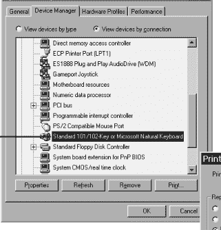

查看设备信息

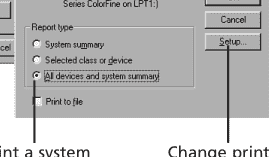

打印系统和设备报告

更改打印机设置

## 确定硬件兼容性

确定硬件兼容性的方法是检查硬件兼容性 FAQ，查看您的硬件是否在列表中。您可以在 Linux-Mandrake 网站 `http://www.linux-mandrake.com/en/fhard.php3` 上找到硬件兼容性列表。此外，还有 Linux 硬件兼容性 HOWTO，网址为 `http://www.linuxdoc.org/HOWTO/Hardware-HOWTO.html`。

您还可以从发行版支持页面寻求信息。有关 Linux-Mandrake 支持的硬件的最新信息，请参阅 Macmilian 支持网页 `http://www.linuxcare.com/mcpsupport/comp_linux.ep1`。

## 为安装做好准备

现在您已经收集了硬件信息，并思考了将如何使用您的 Linux-Mandrake 机器，是时候决定如何将 Linux-Mandrake 安装到您的系统上了。以下是三种建议的 Linux-Mandrake 安装方式的描述：

### 安装准备

- 作为一台独立的 GNU/Linux 机器
- 作为一台双启动机器，将 Linux-Mandrake 安装在独立的硬盘上
- 作为一台双启动机器，将 Linux-Mandrake 安装在共享硬盘上

三种安装方法分别需要执行的任务列在表 1.4 中。

| 任务 | 仅 Linux | 独立硬盘 | 共享硬盘 |
| :--- | :---: | :---: | :---: |
| 备份文件 | x | x | x |
| 创建启动盘 | x | x | x |
| 创建救援盘 | x | x | x |
| 磁盘碎片整理 |  |  | x |
| 安装 Linux-Mandrake | x | x | x |

## 总结

在这一小时内，您学习了如何为安装 Linux-Mandrake 准备计算机。您找到了获取必要信息以确保 Linux 支持您的硬件组件的途径。您学习了在哪里可以找到关于计算机及其组件的信息源，以及通过三种不同方式在计算机上加载 Linux-Mandrake 需要执行哪些具体的安装任务。

## 问答

- **问：我想在开始安装之前进一步了解 Linux-Mandrake。我可以去哪里查询？**

  **答：** 您应该从 Linux-Mandrake 主页 `www.linux-mandrake.com` 和 Macmillian Software 支持页面 `mcpsupport.linuxcare.com` 开始。其他良好的信息源包括 InformIT（`www.informit.com`）和 MandrakeUser.Org（`www.mandrakeuser.org`）。如果您浏览 Usenet 新闻组，请尝试 `alt.os.linux.mandrake`。

- **问：网上有适合 GNU/Linux 初学者的信息源吗？**

  **答：** 请尝试 Linux 门户网站 Linux Links（`www.linuxlinks.com/Beginners`）的初学者页面。那里有几个对刚开始接触 GNU/Linux 的人感兴趣的信息链接。在 Linux Planet（`www.linuxplanet.com/linuxplanet/tutorials`）上也有一些很棒的教程。

- **问：在计算机上安装 Linux-Mandrake 最简单的方法是什么？**

  **答：** 最简单的方法是将 Linux-Mandrake 作为唯一的操作系统。这种安装很简单，因为不需要设置第二个硬盘，也不需要调整分区大小或创建非 Linux 分区。您只需将 Linux-Mandrake CD 放入 CD-ROM 驱动器并重启计算机。硬盘将被清空，并被 Linux-Mandrake 及其一系列酷炫的应用程序所取代。

## 工作坊

过去的一小时用于决定您如何安装 Linux-Mandrake，并确保您的计算机硬件设备兼容。现在是测试您的知识的时候了，在您开始安装过程之前，我们将为您提供一些加分作业以增强您的信心。

### 测验

1. “Linux-Mandrake 为 Pentium 处理器优化”意味着什么？
2. 守护进程（daemon）是什么？
3. 哪种调制解调器最适合 Linux-Mandrake 连接到互联网？
4. 在 Linux-Mandrake 中可以使用 ZIP 驱动器吗？

### 练习

1. 为每台安装了 Linux-Mandrake 的计算机准备一份日志。一个小活页夹可能是最好的选择。使用此日志记录您在过去一小时中收集的计算机系统设备。通过记录安装过程中遵循的步骤、安装后进行的配置更改、遇到的问题及解决方案，以及连接到系统的用户和外设来维护该日志。


## 2. 预安装准备

在投身于一项任务之前，对该主题进行研究总是一个好主意。您可以使用 Windows 计算机阅读 Linux-Mandrake CD-ROM 上的用户文档。导航到 CD 上的 `DOC` 目录。您将找到 Linux-Mandrake 安装指南和用户指南。此外，还有几本关于 K 桌面环境的手册。您可以使用您喜欢的 Web 浏览器或 WordPad 等文本编辑器阅读这些文件。在正式开始安装之前，浏览这些文件会对您很有帮助。


## 安装 Linux-Mandrake

在这一小时内，您将完成最后的预安装任务，并在计算机上安装 Linux-Mandrake。首先，如果您还没有安装启动盘，可能需要制作一个。如果您的计算机从软盘驱动器启动，该安装启动盘将启动 Linux-Mandrake 安装程序。CD-ROM 上有几个可以创建安装启动盘的工具。我们将向您演示传统的 DOS 方法。之后，您需要进行一些简单的清理工作，使计算机处于整洁状态，为 Linux-Mandrake 的安装做好准备。

然后，您将使用 DraX 来帮助在计算机上加载 Linux-Mandrake。DraX 将引导您完成 Linux-Mandrake 的安装过程，并为安装过程中的每个屏幕提供说明。您可能听过一些关于 Linux 安装的恐怖故事。DraX 通过自动检测计算机系统信息，使这个复杂的安装过程变得易于遵循，并帮助您做出安装选择。尽管 DraX 简化了安装任务，但在开始之前，您可能仍然希望阅读本章和《Linux-Mandrake 安装指南》。虽然 DraX……

在你向计算机安装 Linux 的过程中，我们将逐步引导你完成每个 DrakX 安装界面，并帮助你做出正确的选择。一旦 Linux-Mandrake 安装完成，你将学习如何登录和退出你的新 Linux 系统，以及如何正确地关机。今天，你将完成以下任务：

- 创建安装启动盘
- 准备你的硬盘
- 在安装过程中做出正确的选择
- 设置计算机双启动

## 定位启动盘

**新术语**：CD 上的 Linux-Mandrake 安装程序是自启动的，也就是说，如果你拥有一台可以从 CD-ROM 启动的计算机即可。然而，如果你的计算机不能从 CD-ROM 启动，你需要一个*安装启动盘*。这是一个 3.5 英寸磁盘，可用于启动 CD 上的安装程序。安装启动盘的磁盘镜像以及创建带有启动镜像磁盘的程序，可以在本书随附的 Linux-Mandrake 发行版 CD 中找到。

如果你购买的是 Linux-Mandrake 盒装套件，你可能已经拥有了一个安装启动盘。如果没有，你需要制作一个。即使你的计算机可以从 CD-ROM 启动，如果你没有安装启动盘，我们也建议你制作一个。用于制作该磁盘的程序是位于 Linux-Mandrake 安装 CD `\dosutils` 目录下的 `rawrite` 程序。`rawrite` 程序可以在 Windows 的 DOS 窗口中或直接在 DOS 中运行。

## 第 2.1 课：创建安装启动盘

要制作安装启动盘，你需要一张空白的 3.5 英寸磁盘，以及 `rawrite.exe` 程序及其文档。`rawrite` 和文档位于本书随附 CD 的 `\dosutils` 目录中。在开始之前，你可能需要阅读名为 `README` 的文件。如果你想在 DOS 中使用 `rawrite` 程序，请按照以下步骤操作：

> 若要从 Microsoft Windows 进入 DOS 提示符，请点击“开始”按钮并选择“关机”。使用“在 MS DOS 模式下重启”选项。


### 安装 Linux-Mandrake

1. 输入 `D:` 并按 Enter 键切换到 CD-ROM 驱动器（其中 `D:` 是你的 CD-ROM 驱动器）。
2. 输入 `cd dosutils` 并按 Enter 键，切换到 Linux-Mandrake CD 上存储 `rawrite` 程序的目录。

   > 如果你的屏幕提示符没有显示目录而只显示驱动器，请输入 `prompt $p$g` 并按 Enter 键。

   

3. 输入 `rawrite` 并按 Enter 键。`rawrite` 程序界面将出现并要求你提供信息。
4. `rawrite` 首先需要的是磁盘镜像源文件名。输入该文件的路径 `D:\images\cdrom.img` 然后按 Enter 键。
5. 接下来，你需要指定目标磁盘驱动器，即你的软盘驱动器。输入 `A:\` 并按 Enter 键。随后你会收到将磁盘放入驱动器的提示。文件将被复制到磁盘中。
6. 复制过程完成后，取出磁盘。请务必在磁盘上贴上标签：Linux-Mandrake 7.0 安装启动盘。

## 准备硬盘

如果你想在单个硬盘上启动不同的操作系统（例如让 Linux 和 Microsoft Windows 共享一个驱动器），你需要调整 Windows 所在分区的尺寸，并为你的 Linux 文件创建一个新分区。

硬盘分区有几种方法。DOS 的 `fdisk` 程序可以用来在硬盘上腾出空间，但使用 `fdisk` 的一个不幸副作用是会破坏硬盘上的所有数据。如果你想使用 `fdisk` 或另一个驱动器分区程序（如 PartitionMagic），你需要在安装 Linux-Mandrake 之前对驱动器进行分区。

你的另一个选择是让 DrakX 安装程序在你提供一些基本信息后自动进行分区。它将安全地在你的 Windows 硬盘上为 Linux-Mandrake 创建并格式化空间，而不会损坏你的 Windows 安装。

在开始 Linux-Mandrake 安装并对硬盘分区之前，你需要确保驱动器没有错误且已通过碎片整理。这两项工作都可以在 Windows 中使用“磁盘碎片整理程序”完成。

> 如果你找不到磁盘碎片整理程序，请尝试：开始 $\rightarrow$ 程序 $\rightarrow$ 附件 $\rightarrow$ 系统工具。

磁盘碎片整理程序会将你硬盘上的所有内容重新排列成整洁有序的文件系统。在这个过程中，你甚至可能会在硬盘上获得更多空间。当磁盘碎片整理程序完成任务后，你就可以开始为你的 Linux-Mandrake 系统在硬盘上腾出空间了。

## 安装发行版

一旦你的计算机准备好安装，请将 Linux-Mandrake CD 放入 CD-ROM 驱动器，并在需要时将安装启动盘放入软盘驱动器。然后，重启计算机。当计算机重启时，安装过程将接管你的计算机，绕过 Windows 操作系统的启动过程。

Linux-Mandrake 图形安装程序 DraX 包含多个工具来引导你完成安装：

- 屏幕左侧的面板列出了所有安装步骤，指示按钮会随安装进度改变颜色以显示每步的状态。红色表示尚未执行的步骤，橙色表示当前正在处理的步骤，绿色表示该步骤已完成。
- 你可以点击列表中任何可用的步骤（将鼠标光标悬停在其上以确定是否可用），即使你已经完成了该步骤，也可以返回进行修改。
- 如果愿意，你可以自定义安装界面。屏幕左下角的三个按钮条将改变安装界面中使用的颜色。如果你想要不同的外观，可以在安装过程中的任何时间点击其中任何一个按钮。

## 选择语言

你看到的第一个界面是选择语言界面。系统会要求你选择在安装过程中使用的语言。英语是默认的高亮选项，但如果英语不是你的首选语言，请使用滚动条浏览列表并点击高亮显示你想要使用的语言。然后点击 OK 按钮。完成每个界面后，你将自动跳转到下一个界面。

## 选择安装类别

在此界面上，你可以根据想要安装的类别从三种不同的技能级别中选择。在本书中，我们专注于将 Linux 安装并配置为小型企业和家庭的工作站。为了能够控制安装和自定义过程，你需要选择“Customized”（自定义）安装类别。然后系统会提示你指定系统的用途。在接下来的界面中，请选择“Normal”（常规）用途。

> 《Linux-Mandrake 安装指南》（位于本书随附安装 CD 的 `/doc/en/mdkinstallguide/index.html`）是面向那些希望使用“Recommended”（推荐）类别安装 Linux-Mandrake 的用户的。


## 设置 SCSI

接下来的界面会询问你是否有任何 SCSI 适配器。如果有，请选择“Yes”，然后选择你拥有的 SCSI 卡类型。如果你没有 SCSI 适配器卡，请选择“No”。

## 选择安装或升级

下一个界面询问你是要安装一个新的 Linux-Mandrake 系统还是升级现有的系统。这里有几点考虑：你可以更新安装在计算机上的另一个 Linux-Mandrake 版本。但这是一项繁琐的任务，可能需要之前对 Linux 操作系统文件和依赖关系的了解。

你完全不能使用 Linux-Mandrake 来升级你可能安装的任何其他 Linux 发行版。最好的选择是从零开始安装。幸运的是，从 CD 安装 Linux-Mandrake 非常简单，所以我们将采用这种方式。点击“Install”（安装）按钮。

## 选择键盘

下一个界面询问关于你的键盘。这个选择是根据语言选择自动生成的。通常，如果你选择英语，将选择 US 键盘。高亮显示你拥有的类型。为了方便，US-QWERTY 键盘的选项已经高亮显示。但如果你是法国人，也许你更喜欢 FR-AZERTY 键盘。如果是这种情况，请向下滚动列表到 FR-AZERTY 键盘并点击高亮将其作为选择。然后点击 OK 按钮。

## 设置文件系统

DrakX 安装工具需要您提供关于磁盘分区方式以及文件系统在硬盘上挂载位置的信息。如果您安装在 Windows 磁盘上，DrakX 界面将显示设备的图形化表示（第一个 IDE 硬盘为 `hda`，第二个为 `hdb`，依此类推），显示已安装的文件系统类型、驱动器大小以及可能已经存在的任何分区。

首先，点击 `hda` 选项卡顶部的分区以选中它，显示内容将更改为在右侧窗格中显示设备统计信息，左侧窗格将显示需要配置的四个 Linux 分区：

- `/boot`
- `/`
- `/swap`
- `/home`

点击上述列表中的任何项目都会弹出一个对话框，帮助您向 DrakX 提供所需数据，以便它在硬盘上为 Linux-Mandrake 创建足够空间的分区，然后格式化 Linux 原生分区和交换分区，为系统安装做好准备。

如果您是第一次在 Windows 磁盘上安装新系统，最好通过选择“自动分配”（Auto allocate）来允许 DrakX 自动为您分配 Linux 安装空间。随后 DrakX 安装程序将创建您需要的新分区，并为您确定大小并进行格式化。

如果您对 DrakX 的分区方式不满意，可以通过点击“撤销”（Undo）返回并指定您想要的大小。一旦对分区满意，请点击“完成”（Done）。

Linux 操作系统是一个*文件系统*（所有计算机操作系统都是如此）。

> **新术语**：每当您想要将另一个文件系统附加到 Linux 时（例如软盘上的 ext2 或 vfat 文件系统，或 CD-ROM 上的 iso9660 文件系统），您必须告诉 Linux 在 Linux 文件系统的哪个位置查看您所附加的文件系统内容。这被称为挂载点（mount point）。

对于 Linux-Mandrake 系统，软盘驱动器文件系统的*挂载点*或附加点是 `/mnt/floppy`。CD-ROM 文件系统的挂载点是 `/mnt/cdrom`。

## 格式化分区

接下来的屏幕是“要格式化的分区”界面，询问您想要格式化哪些分区。Linux 原生分区将被高亮显示：`/swap`、`/boot`、`/` 和 `/home`。

除非驱动器上已经存在另一个您不想格式化的 Linux 分区（例如可能包含另一个 Linux 版本的分区），否则默认设置就是正确的选择。当您确认结果符合预期时，点击屏幕底部的 OK 按钮。

Linux 格式化大分区可能需要一段时间，如果您的计算机速度较慢，这可能会花费一些时间。所以请放松心情，喝杯咖啡，为接下来的安装过程补充体力。

## 安装系统

下一个屏幕会为您列出要安装的软件包组。所有软件包组默认都被选中。如果您知道自己不会使用某个特定软件包组支持的服务，并且希望释放 Linux 分区中的一些空间，您可以从列表中取消选择该软件包组。换句话说，如果您清楚自己在做什么并且是为了特定目的而自定义安装，您可以挑选选择。这些应用程序和服务在开始阶段将满足您的绝大部分需求。您在这里唯一需要做的是选择默认项。以后您可能想要添加或删除软件包以获得比默认设置更多的灵活性；在安装完成后，您可以轻松地使用 Mandrake 的工具来完成此操作。

做出决定后，点击 OK 按钮。

## 安装状态

现在（在快速处理完咖啡之后），您可以放松心情，享受观看 Linux 解开所有新“玩具”并安装它们的过程。屏幕上有一个漂亮的进度界面，带有图形滑块来表示安装的实时进度。而且，如果您阅读速度很快，在每个软件包安装过程中，屏幕上会显示正在安装的内容列表。

## 网络配置

此处会询问您是否想要配置拨号网络（我们在第 11 小时“接入互联网”中详细讨论），或您的其他网络适配器。如果您有网络适配器，请选择 Yes。您的网卡应该已被自动检测到。如果没有，您必须从列表中选择您的适配器，然后手动输入安装前收集的相关信息。

## 配置时区

系统时钟需要设置为您的地理位置。在列表中向下滚动到离您最近的城市名称，点击高亮显示，然后点击 OK 按钮。

## 配置打印机

接下来会询问您是否想要设置打印机。如果计算机连接了打印机，请点击 Yes 并从选项列表中选择打印机。如果您现在不想执行此步骤，请点击 No。您在第 15 小时“打印和传真文档”中将有第二次机会配置打印机。

## 设置 Root 密码

您被要求为 `root`（即系统管理员）账户分配一个密码。`root` 账户（或超级用户）是管理员账户，没有任何限制。此账户仅用于执行系统维护，不应将其用于日常工作或存储文件。

## 添加用户

此时创建普通用户账户是一件重要的事情，因为如果您不这样做，您将不得不以 `root` 身份登录来执行所有操作。这可能会带来潜在的破坏性。因此，请创建一个非特权用户账户，这样您就可以在登录后随意浏览并习惯 Linux 而无需担心。

输入账户的登录名、用户名和密码。输入密码时，屏幕上不会显示任何内容。

> 关于选择密码的一点策略。Linux 是区分大小写的，因此它能分辨大写和小写字母。一个好的密码长度应至少为六个字符，并且您应该尝试混合使用大写字母、小写字母、数字和符号。

## 创建启动盘

系统会询问您是否想要创建启动盘。选择 Yes 并在 `A:` 驱动器中放入一张空白的 3.5 英寸磁盘。按照屏幕上的指示操作。文件将被传输到您的磁盘中，完成后将打开一个窗口。取出启动盘并为其贴上标签：Linux-Mandrake 7 Start-up Disk。

## 安装引导加载程序

下一个屏幕会询问您想要在哪里安装 Linux 引导加载程序 `lilo`。请参考以下指南：

- 如果您打算将其设置为双启动机器并对 Linux 使用启动盘，请选择“分区的第一个扇区”（First sector of the partition）。
- 如果您打算将该机器仅作为 Linux 机器使用，请选择“引导分区的第一个扇区”（First sector of boot partition）。
- 如果您在双启动系统上使用 `lilo`，而不是使用启动盘或其他引导加载程序（如 BootMagic），请选择 MBR。

在某些情况下，由于某些制造商的专利应用程序或数据在硬盘错误的位置占用了空间，无法使用 `lilo` 或其他引导加载程序。（例如 Compaq 计算机）。在这种情况下，您将使用创建的启动盘来引导 Linux。

## 配置 X

安装程序会运行一个名为 `Xconfigurator` 的 X Window 配置实用程序。`Xconfigurator` 会探测您的计算机以确定您拥有哪种显卡。如果测试成功，安装程序将为您的显卡选择并安装合适的 X Window 服务器。如果测试失败，系统会向您显示一个显卡列表供您选择，并提供手动配置服务器的选项。

如果您的显卡不在列表中，但您拥有必要的信息并且能够正确配置服务器，请现在执行此操作。配置 X Window 并不是安装 Linux 的必要条件。如果您无法完成配置，可以继续安装。我们将在第 3 小时“排除 Linux-Mandrake 安装故障”中回来修复它。

现在您将看到一个显示器列表，建议的显示器将被高亮显示。探测并不总是能返回正确的信息，如果建议的显示器不是您的，请尝试从列表中选择您的显示器。如果您没有看到它，请选择“自定义”（Custom）选项，并使用显示器用户指南中的分辨率和刷新率来配置显示器。

选择显示器后，`Xconfigurator` 将再次探测您的显卡并检查显示器设置，以确定默认的色彩深度和分辨率。您现在可能只想使用默认设置。我们将在第 3 小时向您展示如何调整视频显示。

既然 Linux 认为您的视频显示已正确配置，它将启动 X 来测试配置。您应该能看到 X Window 以及一条消息，询问“Can you see this?”（你能看到这个吗？）。如果能看到，请选择 Yes。程序会等待几秒钟让您回答，如果您没有回答，它将认为测试失败。因此，您需要尽快选择 Yes。

然后您会看到一条消息，询问是否在启动时启动 X。回答 No。在启动时输入 `startx` 是很简单的事情，而且如果视频出现问题，您在启动时需要处于命令行界面。

## 恭喜！

安装到此结束。最后一个屏幕上会出现一条“恭喜，安装已完成”的消息。请取出 CD 和安装启动盘，然后按 Enter 键。计算机现在将重启并进入您的 Linux-Mandrake 操作系统。


引导加载程序（Bootstrap loader）是一个在 BIOS 加载后立即介入的程序，它为您提供一个安装在机器上的操作系统菜单。您可以在启动时选择想要引导的系统。对于许多人来说，这将是在 Windows 和 Linux-Mandrake 之间做出选择，但包括 Linux Loader（`lilo`）在内的引导加载程序也可以加载其他操作系统。您的系统中可能加载了多个版本的 Linux，而且所有这些版本都可以与 OS2 或 Windows NT 共享您的 22GB 硬盘，而不仅仅是 Win9x。

> 如果您将 Linux-Mandrake 安装在第二个硬盘上，您需要使用安装过程中制作的 Linux-Mandrake 启动盘来引导 Linux-Mandrake 系统。

拥有双启动机器有很多原因。能够尝试 Windows 是很棒的，而 Linux-Mandrake 发行版则有许多新东西可以学习和实践。但是，您可能不是计算机的唯一用户，而其他人在刚开始时可能不像您那样对 Linux 充满热情。那些想要启动他们最喜欢的操作系统的人可以毫不费力地完成，完全不会被另一个操作系统的存在所干扰。

在许多情况下，计算机所承担的功能是决定将 Linux 设置为与 Windows 或其他操作系统共享硬盘的决定性因素。

## 总结

在这一小时中，您学习了如何准备计算机以安装 Linux-Mandrake 操作系统。您安装了 Linux 操作系统并设置了 `lilo`，使您的计算机成为了一个双启动计算机。

在第 3 小时中，您将通过配置 XFree86 和配置声音的相关信息来完成 Linux 安装的配置，同时还会介绍 Linux man 手册页，您可以在其中找到关于 Linux 中许多应用程序和实用工具的信息和帮助。

## 问答

- **问：我如何关闭计算机？**

- **答：** 在您注销用户界面并处于命令行状态后，输入 `shutdown -h now`。

  命令中的三个参数告诉计算机它需要知道的信息：what=shutdown（做什么=关机），how=halt（如何=停止），when=now（何时=现在）。系统将自行关闭，然后您可以切断电源。要获取 `shutdown` 命令的选项列表，请输入 `shutdown ?`。

- **问：安装完 Linux-Mandrake 后我精疲力竭，但我依然很兴奋，我想在 Windows 机器上浏览网页。有没有一些好的网站可以访问，帮我为接下来的 22 小时做好准备？**

- **答：** 如果您想了解更多关于图形界面的信息，请访问 KDE 网站 www.kde.org 或 GNOME 网站 www.gnome.org。您可以从 Macmillan 的 Linux 资源网站 www.informit.com 或 Linux-Mandrake 官方网站 www.linux-mandrake.com 了解更多关于 Linux-Mandrake 的信息。

## 研习

我们知道您为了安装 Linux-Mandrake 付出了很多努力，所以我们会尽量放轻松。让我们测试一下您在安装 Linux-Mandrake 过程中学到的一些内容。

### 测验

1. 哪种安装类别允许您选择想要安装在计算机上的软件包？

2. 您在安装过程中创建的启动盘的目的是什么？

3. 当 `lilo` 加载时，如何更改默认启动的操作系统？

### 练习

1. 阅读 CD-ROM 上的文档。您会在 `doc` 目录中发现大部分 HTML 格式的文档。

2. 您坐在计算机前太久了，长时间的安装可能会让您感到紧张。这一次我们真的希望您去做一些运动。记得离开计算机休息一下，走走，摸摸您的狗，或者骑车去山间小路。享受落日。您可以明天再回来，那时您将精神焕发，准备就绪。

## 第 3 小时

### 解决 Linux-Mandrake 安装问题

你们中的许多人在第一次向计算机加载 Linux-Mandrake 时就拥有了完美的体验。好运确实很重要，而幸运的人可以直接跳过本小时的前两个章节，立即开始学习如何寻找帮助和在线手册。

Linux 安装中会出现几个反复出现的问题区域，但不必担心：Linux 拥有补救情况的工具。由于显卡和显示器的种类繁多，有时在初始安装期间探测和配置 X 服务器的自动方法无法完全正常工作，或者找不到任何可用的配置。X Window 可以配置为在您拥有几乎任何硬件组合上运行。本节课的一个章节将向您展示如何使用 `Xconfigurator` 为您系统中的视频配置 X 服务器，并创建最佳的屏幕分辨率、刷新率和色彩深度。

系统上的声音设置有时在安装期间也不会自动处理。配置声音有几种补救措施。如果您使用的是较旧的计算机（如 Pentium 133），您的声卡可能会被找到并且安装成功。较新、更复杂且功能更丰富的系统——尤其是新型多媒体计算机中的 ISA/PCI 声卡——需要特殊处理。本节课中提供了一些优秀的资源以及关于该领域最新技术的更新。

本小时将帮助您解决这些常见的安装问题，还将向您展示如何使用命令行在 Linux 系统中海量的信息中穿行。本小时以介绍一些 Linux 命令及其使用方法结束。今天，您将学习以下内容：

- 如何配置 X Window 系统
- 配置声音的选项
- 在哪里寻找帮助
- 如何使用命令行查找信息
- 一些有用的 Linux 命令

### 调整视频显示

早在第 1 小时“安装准备”中，就解释了各种安装组件。默认组件之一是 X Window System（也称为 X Window）。X Window 是控制视频显示的程序。

回顾一下，唤醒您关于 Linux-Mandrake 安装的记忆。X Window 的配置发生在安装的最后一部分。PCI Probe 寻找视频驱动程序并确定合适的 X Server。然后您被要求选择一台显示器或选择自己的设置。最后，您选择了一种视频模式（即屏幕分辨率和刷新率）。然后，该配置经过了测试。

如果您是幸运儿，您现在运行的是 Linux 兼容硬件，且 PCI Probe 能够正确识别您的显卡。您应该能够直接进入第 4 小时“在图形工作空间中生活”，并使用可用的图形用户界面之一。如果您对设置不完全满意，可以回到这里进行微调。

对于那些不太幸运且设置未能自动配置 X Window 的用户，这里将教您如何自行配置。

### 解决 Linux-Mandrake 安装问题

在大多数情况下，在 Linux-Mandrake 系统上设置 Xfree86 是件简单的事，但如果您恰好拥有较新的图形硬件，或者想要优化 X Window 安装以从硬件中获得最佳性能，您需要知道如何为符合您硬件需求的 X Server 编写配置文件 `XF86Config`。

从零开始学习如何操作是有价值的，有一天您可能想尝试那样做。然而，由于可能有大量使用 Linux 以及大多数其他类 UNIX 操作系统的用户不知道如何从零开始操作，因此有几个配置程序可以帮助您配置 X 服务器，如下所示：

- `XF86Setup` 是由 XFree86 团队提供的一个图形化程序。这是一个非常实用的程序，它首先启动一个最小化的 VGA X 服务器。它允许您从列表中选择鼠标、显示类型和其他选项。然后 `XF86Setup` 程序会为您编写 `XF86Config` 文件。

- `ConfigXF86` 是一个较旧的基于文本的配置程序，它会向您提问，然后根据您的回答生成配置文件。在配置服务器时，这个程序有时在其他程序失效的情况下能起作用。

- 几个 Linux 发行版在各自的发行版中添加了自己的 X 配置工具。Red Hat 有 `Xconfigurator`（您马上就会接触到），SUSE 有 SaX，而 Caldera 为 OpenLinux 的初始安装提供了更自动化的鼠标和视频配置。

Linux-Mandrake 发行版包含了 Red Hat 的 X Window 配置实用程序，名为 `Xconfigurator`。`Xconfigurator` 有自己的用户界面。因此，即使您无法让 X 正常工作，您只需在命令行输入 `xconfigurator`（您必须以 root 账户登录），`Xconfigurator` 的图形用户界面就会出现。

`Xconfigurator` 的工作方式与 `XF86Setup` 非常相似。它使用一个预配置的 `XF86Config` 文件，您可以通过从列表中选择硬件和选项来修改它，然后程序会创建一个新的 `XF86Config` 文件并将其保存到正确的目录中。在 Linux-Mandrake 发行版中，该目录是 `/etc/X11/` 目录。

> `Xconfigurator` 将覆盖您在 `/etc/X11/` 目录中的任何 `XF86Config` 文件。如果您不想丢失现有配置，请在开始前备份现有的 `XF86Config` 文件并对其重命名。为此，您必须以 root 身份登录。在命令行输入：

```bash
cp /etc/X11/XF86Config /etc/X11/XF86Config.old
```

## 第 3.1 课：设置 X 服务器

要开始在您的机器上配置 XFree86，您需要收集所有关于显卡和显示器的数据。在第一小时的准备工作中，您应该已经掌握了所有这些数据。要打开 `Xconfigurator`，您必须以 root 身份登录。然后，在命令行执行以下步骤：

1. 输入 `Xconfigurator` 并按 Enter 键。随后会出现“选择显示器 (Choose a Monitor)”屏幕。

   在这里，您可以从提供的显示器列表中选择您的显示器。关于显示器，您需要了解的重要项目是扫描频率和支持的分辨率。这些信息应该可以在显示器手册中找到。

   

   > 如果您不知道刷新率和分辨率，请从显示器列表中选择一个通用显示器——寻找一个与您的显示器最接近的选项。选择一个您确定您的显示器能够适配的参数描述。

   换句话说，如果您的机器像 Windows 机器一样，运行的分辨率为 1024x768，颜色深度为每像素 16 位（数千色），垂直刷新率为 70Hz，请从列表中选择能够实现该设置的显示器描述。

2. 使用方向键突出显示您的显示器选择，然后按 Tab 键跳转到 OK 并按 Enter 键。“分辨率 (Resolutions)”屏幕随即出现。

   在这里，您可以选择适合您的显示器并满足您需求的分辨率和颜色深度。

   本书中使用的图形是在一台 15 英寸显示器屏幕上截取的，其分辨率为 800x600，颜色深度为 8bpp（即 256 色）。您可能会发现 1024x768 的分辨率和 16bpp 的颜色深度在操作起来会更方便一些。

3. 选择分辨率和颜色深度，按 Tab 键跳转到 OK，然后按 Enter 键。“测试配置 (Test Configuration)”屏幕随后出现。

   此屏幕会告知您 `Xconfigurator` 需要启动 X 来测试配置。

4. 选择 Yes 并按 Enter 键。X 将启动，当 X 服务器加载完毕后，它会弹出一个小窗口询问“Can you see this?”（你能看到这个吗？）。您需要在几秒钟内点击 Yes，否则服务器将认为测试失败，您将不得不从头开始。

## Linux-Mandrake 安装故障排除

选择超出显示器能力范围的参数可能会损坏您的显示器。如果在测试过程中，设置明显不正确，或者 10 秒后屏幕上没有任何显示，请按 Ctrl+Alt+Backspace 来终止 X 服务器。然后您可以再次运行 `Xconfigurator` 并选择不同的设置。


5. 下一个面板会询问您在下次登录时是否要自动启动 X。选择 No。您将返回到命令行提示符。要查看配置结果，请在命令行输入 `startx`。

如果您第一次尝试没有成功，不要太沮丧。只需返回并再次尝试。几乎每个 X 配置都略有不同，大多数人都需要运行一两次配置才能达到完美状态。如果您第一次就成功了，那么您应该为此感到自豪！


## 计算机声音接线

并非所有的计算机声音系统在安装过程中都能被自动识别。某些系统可以通过重新配置来配合现有的多媒体设备。Linux-Mandrake 安装中提供并包含的新免费声音驱动程序是由 Open Sound System 团队提供的 OSS/Free 驱动程序。关于这些驱动程序及其他驱动程序的信息可以在 www.linux.org.uk/OSS 找到。

自从 2.2.x 内核发布以来，Linux 支持模块化声音。这使得为您的系统配置声音的工作变得简单得多。它为 ISA PnP 显卡提供了支持，并且声音在系统中的分布方式意味着您无需在每次重新配置选项时都编译内核。

在过去的几年里，Linux 发生了变化并得到了成长。过去配置声音的工作通常是一个令人沮丧的过程：配置并重新编译内核 → 测试 → 配置并重新编译内核 → 测试，如此循环很久。随着内核使用可加载代码模块来提供声音功能的加入，配置 Linux 声音的工作变得简单得多了。

在大多数情况下，您机器上的 PCI 即插即用（plug 'n play）声卡可以被自动且轻松地配置。以 root 身份登录终端窗口，输入 `sndconfig` 并按 Enter 键。

当 `soundconfig` 介绍面板出现时，按 Enter 键开始探测。系统将探测您的声卡，如果找到了，该声卡将显示在探测结果中。如果列表中出现了声卡，再次按 Enter 键。您系统的声音将自动配置完成。在大多数情况下，这将运行得非常好。

由于并非所有的声音问题都处理方式相同，这里列出了一些您可以访问的网站，以寻找适用于您声卡的免费或商业驱动程序：

- 4Front Technologies 支持 Open Sound System (OSS)。4Front Technologies 在 www.4front-tech.com/linux.html 提供 Linux 商业声音驱动程序。

- 如果您对免费声音驱动程序感兴趣，请访问 www.4front-tech.com/ossfree/index.html，在那里您可以下载 Open Sound System 免费驱动程序。

- Advanced Linux Sound Architecture (ALSA)，网址为 www.alsa-project.org。ALSA 是正在重新设计 Linux 声音系统的官方 Linux 组织。Linux 内核将来将不再使用 OSS，而将使用 ALSA 驱动程序来控制声音。

- 如果您在寻找 Linux 声音子系统的快速参考，请尝试访问 www.uk.linux.org/OSS。

- Creative 开源页面 opensource.creative.com 提供了 Linux Soundblaster Live (Emu10k1) 设备驱动程序、DxR2 显卡的驱动源码，以及 AWE32/64 显卡的驱动和工具源码。

- Sculpcase 信息由 Ecasound 提供，网址为 www.wakkanet.fi/ecasound。Ecasound 是一个多轨音频处理工具。它可以用于播放音频，也可以用于录音和格式转换。不仅如此，它还可以用于创建专业音效，以及混音和录制音频文件。

## 获取帮助

如果您购买了 Linux-Mandrake 套装，您将拥有一本用户手册和其他几份文档，其中包含许多有用的提示、技巧和指导。您可以使用这些内容让 Linux 运行起来。一旦您成功安装了 Linux-Mandrake，对于随 Linux 安装而来的几乎每个应用程序、实用程序和命令，您都可以获得其他真正极具价值的信息来源。

您可以从计算机内部（作为本地文档）或计算机外部（通过互联网）获取信息。表 3.1 描述了本地可用文档在计算机中的存储位置。

### 表 3.1 本地（已安装）文档的位置

| 文档类型 | 查找位置 |
| --- | --- |
| 手册页 (Manual pages) | `/usr/man` |
| Info 文档 | `/usr/info` |
| HOWTO 指南 | `/usr/doc/HOWTO` |
| 常见问题解答 (FAQ) | `/usr/doc/FAQ` |
| 程序文档 | `/usr/doc/<程序名称>` |

可在线获取的文档和帮助包括新闻组、邮件列表和书籍。当然，还有像本书这样的印刷书籍，您所在的地区可能还有 Linux 用户组（lugs），您可以在那里寻求其他 Linux 用户的帮助并获得问题的答案。

只要您愿意寻找，互联网上有大量的文档和帮助。然而，本小时的剩余部分将集中在从 Linux man 手册页中可获取的信息。了解 man 手册页是如何组织起来的，将有助于您更有计划地开展工作，并在寻找内容时节省时间。表 3.2 给出了 man 目录内容的概况。

### 表 3.2 man 手册页的组织方式

| 在此目录中 | 您可以找到 |
| --- | --- |
| `/usr/man/man1` | 您可以在 shell 中运行的命令 |
| `/usr/man/man2` | 关于系统调用的文档 |
| `/usr/man/man3` | libc 函数的手册页 |
| `/usr/man/man4` | 关于 `/dev` 目录中文件的信息 |
| `/usr/man/man5` | 特殊文件（如 `/etc/passwd`）的格式详情 |
| `/usr/man/man6` | 游戏 |
| `/usr/man/man7` | Linux 文件系统和 man 手册页的描述 |
| `/usr/man/man8` | root 操作员实用程序的页面 |
| `/usr/man/man9` | 关于 Linux 内核源码例程的文档 |

Linux 手册页（通常称为 `man pages`）是由 Linux 系统软件的创建者和用户编写的文档汇编。许多页面是由该手册页讨论的软件、命令或实用程序的作者编写的；其他则是来自用户的贡献。Linux man 手册页代表了 Linux 文档项目（LDP）人员的巨大努力。所有做出贡献的人，特别是项目创始人 Matt Welsh，不仅应该因他们的努力而受到赞扬，而且如果可能的话，还应该得到帮助。

## 探索 man 页


虽然 GNU/Linux 的 man 页和 HOWTO 文档包含大量信息，并且你可能在那里找到许多问题的解决方案，但直接在命令行中使用 man 页可能会让人感到有些畏惧。本节将为你提供一条穿越 man 页迷宫的路径。它将向你展示如何找到正确的 man 页，以及进入之后该如何使用。

每个 man 页都分为若干部分，尽管并非所有部分都会出现在每一页中。表 3.3 列出了 man 页的不同部分及其各自的内容。

### 表 3.3 Man 页结构图

| 该部分 | 是对...的描述 |
|---|---|
| `NAME` | 命令的名称和简短描述 |
| `SYNOPSIS` | 如何使用该命令及其命令行选项 |
| `DESCRIPTION` | 对程序及其选项的详细解释 |
| `OPTIONS` | 所有选项及其简短描述 |
| `SEE ALSO` | 相关的 man 页 |
| `DIAGNOSTICS` | 错误消息的描述 |
| `FILES` | 命令使用的文件列表及其位置 |
| `BUGS` | 已知问题 |
| `HISTORY` | 程序开发里程碑 |
| `AUTHOR` | 程序的作者和贡献者 |

man 页是所有 Linux 系统自带的内置在线帮助系统。man 页虽然不能提供所有问题的解决方案，但它们是关于 Linux 命令的可搜索信息库，其权威程度无可比拟。

不过，它们仍有改进空间——内容较为简练，且假设用户具备一定的 UNIX 背景，而新 Linux 用户可能并不具备。此外，每个 man 页都专注于一个特定命令，几乎没有任何帮助能引导你判断 man 页中所描述的命令是否最适合你的需求。但 man 页有一个不可或缺的重要方面：某些命令的行为在不同 Linux 系统之间略有差异，而 man 页是了解你的系统如何响应这些命令最可靠的信息资源。

当你使用 `man` 工具调用系统的 man 页时，`man` 会搜索指定主题的 man 页，然后将输出发送给一个分页器（pager）应用程序。分页器应用程序随后将 man 页打印到标准输出（你的显示器）或任何其他显示设备（如打印机）上。在 man 页中的导航取决于所使用的分页器。最流行的两种分页器程序是 `more` 和 `less`，其中 `less` 是默认选择。

`man` 的简要语法为：

```
man [topic]
```

你只需将要查找的主题传递给 `man` 命令即可调用对应的 man 页。你可以通过指定它应该搜索哪个目录库来修改 `man` 命令的响应。

要在命令行提示符下执行此操作，请输入：

```
man man
```

然后按回车键，显示描述 man 页工作原理的 man 页。建议你在此时仔细阅读该页面。

这里有另一个 `man` 工作方式的示例：假设你正在寻找关于 `ls` 命令的信息。在命令行输入 `man ls` 并按回车键。`man` 会显示 `ls` 命令的功能摘要及其语法和选项。所有 Linux 命令皆然。

在每个帮助页的顶部，第一个标题是 `NAME`，其下方是该命令的简短单行描述。使用 `apropos` 命令，你可以搜索这些单行描述。如果你不确定具体在找什么，可以输入一个关键词，像这样使用 `apropos` 命令进行关键词搜索：

```
apropos print
```

该命令会返回所有简短描述中包含 `print` 的 man 页列表。

在表 3.4 中，你会发现一个非常有用的 Linux 命令短名单，你可以尝试自行探索。每个命令都附带了其功能的简短描述。这个列表绝非完整，但你可能会从中发现一些有用的工具。要进一步了解每个命令的功能及用法，只需输入 `man` 和你感兴趣的命令名称，然后按回车键。

### 表 3.4 有用的 Linux 命令

| 尝试此命令 | 以学习如何 |
|---|---|
| `alias` | 为命令创建别名 |
| `at` | 按预设时间表运行程序 |
| `atq` | 列出等待 `at` 执行的程序 |
| `atrm` | 从 `at` 队列（列表）中删除程序 |
| `cat` | 连接文件（将它们首尾相接） |
| `cd` | 切换到另一个目录（不要使用反斜杠） |
| `chfn` | 更改 `finger` 信息显示 |
| `chmod` | 更改文件或目录的访问权限 |
| `chown` | 更改文件和目录的所有权 |
| `chsh` | 更改你正在使用的 shell |
| `control-panel` | 启动系统管理工具 |
| `cp` | 复制文件 |
| `dd` | 复制磁盘镜像 |
| `df` | 显示可用的剩余磁盘空间 |
| `dir` | 列出目录的内容 |
| `dmesg` | 列出启动消息 |
| `du` | 显示已使用的磁盘空间 |
| `dump` | 制作文件系统备份 |
| `export` | 在 bash 中设置环境变量 |
| `find` | 查找（即搜索）文件 |
| `fdformat` | 对软盘进行低级格式化 |
| `finger` | 查询网络上的用户信息 |
| `free` | 显示 RAM 和交换内存使用情况 |
| `grep` | 查找匹配指定模式的行 |
| `groupadd` | 使用组来管理文件和工作组 |
| `groupdel` | 删除组 |
| `groups` | 显示组列表 |
| `gzip` | 压缩和解压缩文件 |
| `halt` | 关闭计算机系统 |
| `host` | 查询主机信息 |
| `hostname` | 显示系统的主机名 |
| `ifconfig` | 配置网络接口 |
| `init` | 更改运行级别 |
| `insmod` | 安装模块 |
| `kill` | 中止系统进程 |
| `less` | 启动分页器以查看文件和目录 |
| `ln` | 在文件或目录之间创建链接 |
| `locate` | 定位匹配特定模式的文件 |
| `login` | 登录系统或切换用户 |
| `logout` | 退出当前用户账户 |
| `lpc` | 管理打印机队列 |
| `lpq` | 显示打印机队列 |
| `lpr` | 打印文件 |
| `ls` | 列出目录的内容 |
| `lsmod` | 显示已加载的模块 |
| `make` | 编译和维护程序 |
| `makewhatis` | 构建 `make` 数据库 |
| `man` | 显示帮助页 |
| `mcd` | 切换到 DOS 磁盘上的目录 |
| `mcopy` | 将文件复制到 DOS 磁盘 |
| `mdel` | 从 DOS 磁盘删除文件 |
| `mdeltree` | 从 DOS 磁盘删除目录 |
| `mdir` | 列出 DOS 磁盘上目录的内容 |
| `mformat` | 格式化 DOS 磁盘 |
| `mkdir` | 创建新目录 |
| `mkswap` | 设置交换设备（分区） |
| `more` | 启动分页器以查看文件和目录 |
| `mount` | 访问（挂载）文件系统 |
| `mv` | 移动或重命名文件 |
| `netcfg` | 启动网络配置工具 |
| `netstat` | 显示网络连接状态 |
| `passwd` | 更改用户密码 |
| `ping` | 检查网络上的主机 |
| `printtool` | 配置打印机 |
| `ps` | 显示运行中进程的状态 |
| `pstree` | 显示完整的进程树 |
| `restore` | 还原备份（参见 `dump`） |
| `rm` | 删除文件（永久） |
| `rmdir` | 删除目录（永久） |
| `rmmod` | 移除已加载的模块 |
| `rpm` | 管理 RPM 包；安装和升级包 |
| `set` | 临时更改环境变量 |
| `startx` | 启动 X Window 系统 |
| `su` | 切换到超级用户账户 |
| `tar` | 管理归档文件 |
| `top` | 显示所有运行中的进程 |
| `touch` | 创建文件或更改其时间戳 |
| `umount` | 卸载（取消访问）文件系统 |
| `uname` | 显示系统信息 |
| `unzip` | 解压压缩文件 |
| `updatedb` | 构建 locate 数据库 |
| `uptime` | 显示计算机运行时间 |
| `useradd` | 添加用户账户 |
| `userdel` | 删除用户账户 |
| `usermod` | 修改用户账户 |
| `whatis` | 通过阅读命令的简要概述来使用命令 |
| `whereis` | 定位命令二进制文件、源码和 man 页 |
| `which` | 显示程序的执行路径 |
| `who` | 显示登录到网络的用户列表 |
| `whoami` | 显示当前用户名 |

## 在互联网上寻找帮助

互联网上有许多关于 Linux 的信息来源，而且每天都在增加。接下来的列表描述了一些较为有用的资源：

- Linux 常见问题解答列表 (FAQ)。该 FAQ 由 Robert Kiesling 维护；可以通过 `Kiesling@ix.net.com` 与他联系。
- Linux HOWTO 索引。包含一系列 HOWTO 文档，每篇文档都详细描述了 Linux 的不同方面。目前维护 HOWTO 文件的负责人可通过 `linux-howto@metalab.unc.edu` 联系。
- Linux META-FAQ。对于在互联网上寻找 Linux 信息的初学者来说，这是一个很好的起点。它由 Michael K. Johnson 维护，可通过 `johnsonn@redhat.com` 与他联系。
- Linux 信息单 (Info Sheet)。这是对 Linux 系统的技术介绍。它还列出了其他信息来源和一些可用软件。同样由 Michael K. Johnson 维护。

## 总结

在过去的一个小时里，你致力于调整你的 Linux 安装。如果你的视频显示无法正常工作，你使用了 `Xconfigurator` 来修复它。如果你发现计算机没有声音或无法播放音乐 CD，你需要搜索互联网，寻找一个能与你计算机音频系统兼容的声卡驱动程序。最后，你学习了如何使用 `man` 命令从命令行寻找有用的信息。

## 问答

**问：我想进一步了解如何使用 `Xconfigurator` 配置视频显示。还有其他信息来源吗？**

**答：** 如果你想更多地了解视频配置过程，可以阅读 Linux 目录结构中的以下文档：

- 位于 `/usr/X11R6/lib/X11/doc` 的 Xfree86 文档
- 针对你的芯片组的 README 文件（如果有）；同样位于 `/usr/X11R6/lib/X11/doc`
- Xfree86 的帮助页 (manual page)
- XF86Config 的帮助页 (manual page)

若要从命令行访问这些文档和帮助页，请参考本小时中名为“获取帮助”的章节。

**问：我想帮助创建更好的 Linux 用户手册。我该如何帮忙？**

**答：** Linux 文档项目 (The Linux Documentation Project) 是一个志愿者项目，一直在寻找优秀的帮手。如果你觉得有可以贡献的地方，请告知他们。LDP 主站是 `www.linuxdoc.org`。该站点及其许多镜像站点拥有所有在线 Linux 文档、HOWTO、手册以及指向其他信息源的指针。

## 研讨

修复计算机问题并非易事，有时会令人非常沮丧。但请坚持下去；有些 Linux 问题需要尝试几次才能被纠正。这里有几个练习来帮助你巩固 Linux 故障排除知识。

## 测验

1. 为什么大多数配置问题发生在 Linux 安装过程中？
2. Linux 支持哪种音频标准？
3. 如果你想在计算机上阅读 Linux 文档，但无法访问用户界面，该如何操作？

## 练习

1. 运行 `Xconfigurator` 并更改你的屏幕分辨率和色彩深度。记得在开始前备份 `XF86Config` 文件。如果你操作失误，可以随时还原备份的配置文件并返回原始设置。
2. 随着本书的深入，你会发现有些地方我们会向你展示如何使用程序或实用工具来执行任务。其中一些任务可以使用表 3.4 中的命令来完成。例如，在第 7 小时“系统管理任务”中，你学习了如何使用 Linuxconf 创建用户账户。你也可以通过在命令行使用 `useradd` 命令来实现。当你遇到这种命令行操作与程序或工具功能相同的地方时，可以通过在命令行执行相同任务来测试你的技能。

# 第二部分：适用于所有场合的界面

## 小时

- 4 处于图形化工作空间中
- 5 改变你对桌面的看法

# 第 4 小时：处于图形化工作空间中

使用任何操作系统及其相关应用程序和实用工具最简单的方法就是使用图形用户界面 (GUI)。如果你使用过 Microsoft Windows 或 Apple Macintosh 操作系统，那么你可能已经是 GUI 的专家了。本章将向你展示如何像使用其他 GUI 一样轻松地在 KDE 和 GNOME 界面中工作。通过跟随本小时提供的课程，你将学习到以下内容：

- 如何访问你的用户账户以及在图形界面之间进行切换
- 每个桌面元素的函数，如何打开应用程序，以及在 KDE 和 GNOME 中哪里可以找到额外的帮助
- 定制面板以及驻留在面板上的图标的技巧
- 调整窗口大小以及在不需要它们时将它们移开的方法

### 寻找 GUI：一个简单的案例

在 Linux-Linux-Mandrake 安装过程中，我们建议你选择在计算机重启进入 Linux 操作系统时不启动 X Window 系统。如果你按照我们的建议操作，那么在系统重启后，你将看到一张 Linux 企鹅（可爱的小生物）的位图图片、关于 Linux 内核的信息、一些计算机信息，以及一个看起来像这样的登录提示符：

```
localhost login:
```

此外，如果你记得在安装过程中，系统要求你输入 root 密码，以及一个非特权用户的额外用户名和密码。你应该仅使用 root 账户来执行系统管理操作。在接下来的过程中，我们会确保为你指出这些地方。对于这些课程，请使用你的用户账户。我们将通过访问用户账户、体验两种流行的图形用户界面，然后退出系统，来像玩“抢椅子”游戏一样地进行操作。

> 为每个将使用计算机的人创建单独的账户。你将在第 7 小时“系统管理任务”中学习如何创建和管理用户账户。

### 课程 4.1：登录并启动 KDE

**新术语** 你的计算机在静静地等待你对它进行操作。但是，它需要你*登录 (log in)*才能告诉它该做什么。当你登录时，你通过提供用户名和密码请求访问计算机。Linux 操作系统将你的登录信息与其数据库中的信息进行比对，如果匹配，presto（瞧），你就进来了！从此时起，你可以访问自己的用户账户，以及任何你有权限访问的程序和文件。

第一节课程向你展示如何访问你的用户账户并显示 KDE 图形用户界面。尝试以下步骤：

1. 在登录提示符处，输入你在安装期间选择的用户名并按 Enter 键。你将在下一行看到密码提示。
2. 输入你的密码并按 Enter 键。如果你在安装期间选择了使用 shadow 密码的默认设置，那么在输入密码时，你不会看到任何输入的字符，光标也不会移动。你将看到一个类似于以下内容的提示符（其中 `author` 被替换为你的用户名）：

   ```
   [author@localhost author]$
   ```

   这就是便捷的命令行。Linux 极客们热爱这种命令行体验。现在，你可以使用它进入默认的用户界面 KDE。
3. 输入 `startx` 并按 Enter 键。你将看到一个带有黑色 X 的黑白屏幕。这个 X 是光标。你需要再等一分钟，KDE 就会出现在你的屏幕上。

在进入下一节课程之前，有几件事你需要熟悉。图 4.1 中的桌面展示了 KDE 以及在你进一步操作前需要了解的一些功能。

**图 4.1**

*KDE 桌面。*

- 当你点击“应用程序启动器 (Application Starter)”按钮时，会出现应用程序启动器菜单。该菜单将系统中安装的所有软件包组织到子菜单中。只需浏览各种菜单，你就能找到各种应用程序和实用工具。
- “注销 (Logout)”按钮（以及应用程序启动菜单中相应的注销命令）用于当你不再想在 GUI 内部工作而想返回命令行时。
- “终端模拟 (Terminal Emulation)”按钮在点击时会打开一个 X 终端窗口。你可以通过将鼠标指针悬停在每个按钮上并阅读出现的屏幕提示来找到终端模拟按钮。X 终端窗口的工作方式与命令行非常相似。

## 第 4.2 课：在 GUI 之间切换

您已经看到了 KDE 的样子。也许您想尝试一下 GNOME 并将两者进行比较。在执行此操作之前，您需要使用表 4.1 中列出的方法之一来打开桌面切换工具（Desktop Switcher）。

| 从此处打开工具 | 操作步骤 |
|---|---|
| KDE 应用程序启动按钮 | 点击 系统 (System)，桌面切换工具 (Desktop Switching Tool) |
| 命令行或 X 终端 | 输入 `switchdesk` 并按回车键 |
| GNOME 主菜单按钮 | 点击 KDE 菜单，系统 (System)，桌面切换工具 (Desktop Switching Tool) |

现在请按照以下步骤操作：

1. 点击 GNOME 选项按钮，重新配置 X Window 以使用 GNOME 用户界面。


2. 在“更改仅适用于当前显示 (Change only applies to current display)”复选框中打勾，这样您仅更改您用户账户的界面，然后点击“确定 (OK)”。对话框将告知您需要重启 X Window 系统，以便您可以查看 GNOME。

3. 点击“确定 (OK)”，对话框将消失。

4. 点击“注销 (Logout)”按钮，或者点击应用程序启动按钮并在菜单中选择“注销 (Logout)”。此时会出现“会话已准备注销 (Session prepared for logout)”对话框。

5. 点击“注销 (Logout)”。您将返回到命令行。

6. 输入 `startx` 并按回车键。您将再次看到黑白背景和 X 形光标。一分钟后，您将看到 Enlightenment 的状态栏，随后 GNOME 将出现在您的屏幕上，外观类似于图 4.2。

## 第 4.3 课：注销系统

**新术语**：当您完成计算机工作且不希望任何路过的人能够访问您的用户账户时，您需要`注销 (log out)`系统。注销系统意味着您存储在用户目录中的任何文件对于其他用户不可见，且除了您之外，任何人无法更改您的桌面设置。

# 在图形化工作空间中生活

**图 4.2**

GNOME 桌面。

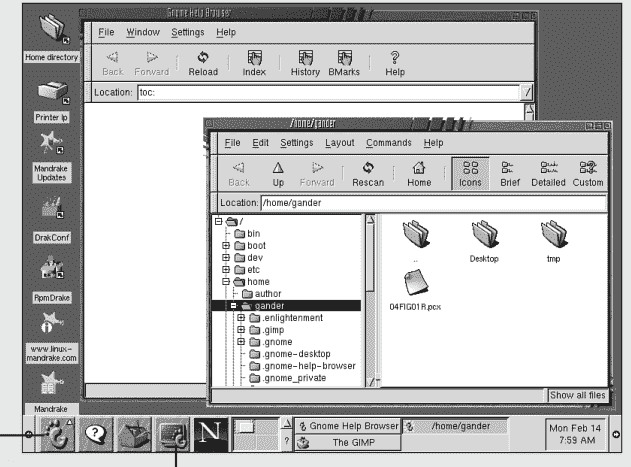

- 主菜单按钮
- 终端模拟按钮

要注销系统，请遵循以下步骤：

1. 通过在应用程序启动器（KDE）或主菜单（GNOME）中选择注销 (Logout) 来退出用户界面。屏幕上会出现注销对话框。

2. 点击注销 (Logout)（在 GNOME 中您还需要点击“是 (Yes)”）。X 服务器将关闭，您将返回到命令行。

3. 输入 `logout` 并按回车键。登录提示符（带着可爱的小企鹅）将出现在屏幕上。

您可以将计算机保持在此状态，直到下次需要使用它。您只需重新登录您的用户账户即可。但是，如果您想关闭计算机，或者需要重启它以使用另一个操作系统，请继续操作。

4. 在登录提示符处，输入 `root` 并按回车键。随后会出现密码提示。

5. 输入 root 密码并按回车键。根账户的命令行提示符将显示出来。

6. 您有两种关机选项。要完全关闭计算机以便切断电源，请输入 `shutdown -h now` 并按回车键。要重启计算机，请输入 `shutdown -r now` 并按回车键。您将看到 Linux 正在关闭系统并停止系统服务。

> 您可以自行切换回您最喜欢的 GUI，以便在接下来的一个小时内完成剩余的课程，并自定义图形桌面的外观。

## 在 GUI 中移动

由于阅读本书的大多数人可能在图形操作系统（如 Microsoft Windows 或 Apple Macintosh）方面有一定的经验，接下来的章节将带您快速游览 KDE 和 GNOME 用户界面。我们旨在为您提供足够的信息让您快速上手，并为您指明几个方向，以便您能够自行深入学习 KDE 和 GNOME。

### 浏览桌面

KDE 和 GNOME 在各类 Linux 用户中都非常受欢迎。我们将让您决定想要使用哪个界面。我们会向您展示这两种 Linux 界面彼此之间，以及它们与 Windows 和 Mac 之间的相似之处。在此过程中，您也会发现一些差异。您可以在图 4.3（显示 KDE 桌面）和图 4.4（显示 GNOME 桌面）中看到其中的一些相似之处。

- KDE 包含一个横跨屏幕顶部的任务栏。每当您使用某个应用程序时，任务栏上都会出现该程序的图标。任务栏还显示已打开但已最小化的应用程序图标。如果您想让某个应用程序窗口出现在所有其他窗口之前，或者想显示一个最小化的窗口，请点击任务栏上的应用程序图标。
- 在 KDE 和 GNOME 桌面上，您都会看到相当多的桌面图标。这些图标用于打开应用程序、文件、文件夹以及启动实用工具。桌面图标可以重新排列或删除，也可以添加新图标。
- 默认情况下，KDE 和 GNOME 的面板 (Panel) 都位于屏幕底部。当您想打开应用程序或在虚拟桌面区域之间切换时，可以使用面板。面板还会告知您时间，并且可以将其隐藏以创造更多桌面空间。
- 在 GNOME 中，主菜单按钮列出了可用的应用程序和实用工具。在 KDE 中，您可以通过点击应用程序启动按钮找到同样的列表。

# 在图形化工作空间中生活

**图 4.3**

KDE 桌面具有很强的可定制性，并提供了便捷访问各种应用程序和实用工具的途径。

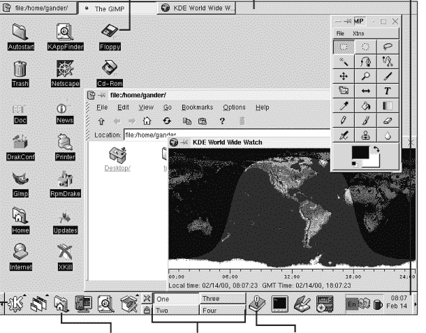

- 应用程序启动器
- 面板图标
- 虚拟桌面图标
- KDE 帮助浏览器
- 面板

**图 4.4**

GNOME 桌面看起来很不错，但经过一些自定义后会更美观。

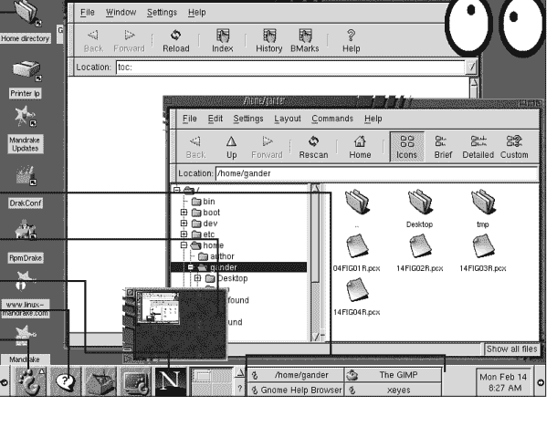

- 桌面图标
- 分页器 (Pager)
- 虚拟桌面图标
- 面板图标
- GNOME 帮助浏览器
- 主菜单
- 面板

GNOME 中还有一个隐藏菜单。点击 GNOME 桌面即可显示 Enlightenment 菜单系统。您会发现 GNOME 和 KDE 中所有相同的用户菜单都显示在这里，如果您愿意，可以通过 Enlightenment 菜单启动应用程序。右键点击 GNOME 桌面以显示 Enlightenment 设置菜单。该菜单允许您访问 Enlightenment 窗口管理器的配置对话框和编辑器，我们将在本章后面讨论。

- 面板图标为您提供了打开常用程序的快捷方式。您可以通过添加和删除图标来自定义面板。
- KDE 和 GNOME 都有能力使用多个桌面区域。虚拟桌面图标提供了在不同桌面之间导航的手段。
- GNOME 分页器 (pager) 的工作方式与 KDE 任务栏相同。任何打开的应用程序和文件都以图标形式显示在分页器上。

## 第 4.4 课：寻找有用的应用程序和实用工具

随 Linux-Mandrake 安装的许多应用程序和实用工具都可以在 KDE 和 GNOME 菜单中找到。花几分钟时间浏览菜单，看看开始使用后会有多少乐趣。这节课很简单，只需浏览菜单列表并打开几个您想探索的程序：

1. 点击 KDE 中的应用程序启动按钮或 GNOME 中的主菜单按钮以查看菜单列表。
2. 将鼠标指针移动到右侧有箭头的菜单项上。您将看到一个应用程序列表。
3. 点击您想要探索的应用程序。瞧！您刚刚打开了您的第一个程序。

### 迫切寻求帮助

当您需要 KDE 和 GNOME 界面的全能参考指南时，请查看各自的帮助浏览器。每个帮助浏览器的工作方式不同，包含的信息也不同。接下来的两节课将向您展示如何访问每个帮助浏览器，并向您介绍每个帮助浏览器包含的不同信息区域。


## 第 4.5 课：使用 KDE 帮助浏览器

KDE 帮助浏览器不仅包含有关用户界面的信息，还可以访问许多应用程序的帮助文件，并包含搜索功能。以下是如何开始使用 KDE 帮助浏览器的步骤：

1. 点击面板上的 KDE 帮助浏览器图标，或从应用程序启动器中选择 KDE Help。KDE 帮助浏览器随即打开。帮助浏览器的外观和操作方式非常像 Web 浏览器（见图 4.5）。

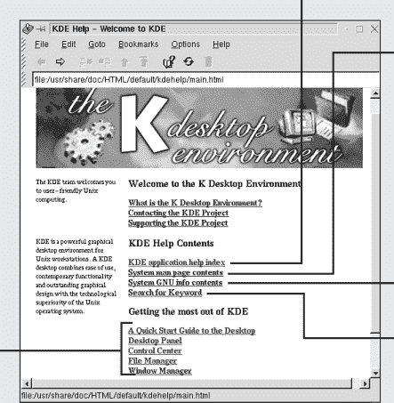

**图 4.5**

KDE 帮助浏览器将您连接到海量的帮助资源。

- 了解更多关于 KDE 桌面的信息
- 浏览 GNU 文档
- 搜索特定的帮助主题

2. 如果您想了解更多关于使用 KDE 桌面的信息，请点击主页底部“充分利用 KDE (Getting the most out of KDE)”部分的链接。您将被带到所选手册的目录页。

3. 通过点击“下一页 (Next)”链接在页面之间跳转，或者使用“后退 (Back)”和“前进 (Forward)”按钮在页面之间翻页，从而阅读手册。

4. 当您准备返回主页时，打开“跳转至 (Goto)”菜单并选择“目录 (Contents)”。现在您可以尝试另一种帮助途径了。

5. 点击“KDE 应用程序帮助索引 (KDE Application help index)”链接，以显示您在 KDE 菜单中可以找到的应用程序和实用工具列表。同样，点击程序的链接即可显示帮助内容。

> 若要同时使用多个浏览器，可以尝试这个技巧。当你想要在另一个独立的浏览器中打开链接时，请使用“文件” $\rightarrow$ “新建帮助窗口”命令来打开当前页面的副本。这样你就可以在保持原页面显示的同时，浏览新页面。


## 探索 GNOME 帮助浏览器

GNOME 帮助浏览器的操作方式与你熟悉的 Web 浏览器类似。但与 KDE 不同，它不包含搜索功能，也无法快速访问应用程序帮助。它包含以下一些实用功能，建议你花时间探索一下：

- GNOME 用户指南包含有关界面操作的信息，以及 CD 播放器和日历的帮助文件。
- Man Pages 会引导你进入按类别整理的完整 man 页列表。这些就是你在第三章“排除 Linux-Mandrake 安装故障”中遇到的那些 man 页，但这里更容易查找和阅读。同样，你可以以 Web 风格进行浏览，并使用“后退”和“前进”按钮进行操作。
- Info pages 将引导你进入 GNU 文档。
- GNOME Documents 包含关于一些 GNOME 实用程序的信息，例如帮助浏览器、一些小游戏和用户指南。

> 你会在许多使用的应用程序中发现帮助文件。打开“帮助”菜单即可查看可用内容。


## 探索面板

尽管 KDE 和 GNOME 面板共享一些相同的功能，但它们的运作方式不同。KDE 提供了极大的灵活性，允许你将面板和任务栏放置在屏幕上的任何位置。GNOME 则包含角面板和边缘面板。默认情况下，每个面板都配备了一些可以启动实用程序的图标。你可以通过删除图标、添加新图标以及移动图标来定制面板。

## 课时 4.6：在 KDE 中移动桌面面板

本课涵盖如何将 KDE 面板和任务栏移动到屏幕的不同侧边。GNOME 不提供相同的灵活性。请按照以下步骤操作：

1. 点击“应用程序启动器”按钮，将鼠标指针移至“面板”，然后点击“配置”。配置对话框将打开并显示“面板”选项卡。
2. 在“位置”区域，点击与你想要移动面板的位置相对应的选项按钮。例如，如果你想将面板置于屏幕右边缘，请选择“右”选项。
3. 如果你想移动任务栏，请点击“任务栏”区域中的选项按钮。若要隐藏任务栏，请点击“隐藏”选项按钮。

> 若要在不需要面板时将其隐藏，请在 KPanel 配置对话框中显示“选项”选项卡，并在“外观”区域选择“自动隐藏”选项。


4. 完成后，点击“确定”关闭对话框并应用更改。

## 课时 4.7：向面板添加应用程序启动器

当你发现某个应用程序经常被用到时，可以将该程序的图标添加到面板上。下次需要该程序时，只需点击面板上的图标即可。

若要向 KDE 面板添加应用程序启动器，请按照以下步骤操作：

1. 点击“应用程序启动器”按钮，将鼠标指针移至“面板” $\rightarrow$ “添加应用程序”。你将看到应用程序菜单中包含的菜单列表。
2. 将鼠标指针移至包含你想从面板启动的应用程序的菜单，然后点击该应用程序。该程序的图标将出现在面板上。

向 GNOME 面板添加启动器同样简单：

1. 点击“主菜单”按钮，将鼠标指针移至包含你想添加到面板的应用程序的菜单，然后右键点击该应用程序。随后会出现一个菜单。
2. 点击“将此启动器添加到面板”。该程序的图标将出现在面板上。下次启动该程序时，只需点击该图标。

## 课时 4.8：为面板图标创建屏幕提示

你可能会发现，当鼠标指针悬停在面板图标上时显示的屏幕提示不够详细。你可以更改屏幕提示以满足你的需求。KDE 和 GNOME 的操作方法相同：

1. 右键点击图标，从出现的菜单中选择“属性”，以显示 `kfm` 对话框（在 KDE 中）或“启动器属性”对话框（在 GNOME 中）。如图 4.6 所示，将出现“启动器属性”对话框。

### 图 4.6

*更改 GNOME 面板上显示的屏幕提示文本。*

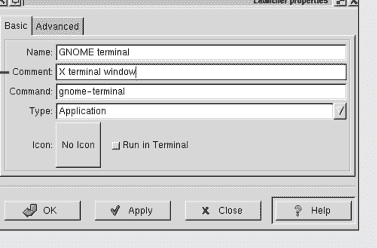

屏幕提示文本

2. 点击“应用程序”选项卡（在 KDE 中）或“基本”选项卡（在 GNOME 中）。
3. 清空“注释”文本框中的内容，输入你希望作为屏幕提示显示的文本。
4. 点击“确定”。下次将鼠标指针悬停在图标上时，你将看到更改后的屏幕提示。

## 操作应用程序窗口

在 GUI（图形用户界面）中工作时，所有的应用程序、实用程序和文件都显示在窗口内。图 4.7 快速展示了窗口标题栏上的按钮。既然谈到这里，让我们回顾一下如何调整窗口大小以及移动窗口。

### 图 4.7

*每个窗口顶部的标题栏包含用于控制窗口大小和状态的一系列控件。*

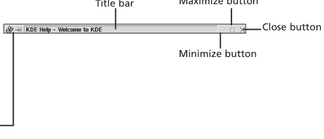

## X Window 系统的技术概述

X Window 系统基于经典的客户端/服务器模型。X 服务器（在你的计算机上运行的软件程序）提供对系统中所有图形硬件的访问。X 客户端是一个与服务器通信并发送服务请求的应用程序。这些请求包括“画一个圆”、“监听键盘输入”、“关注鼠标输入”等。X 服务器则负责绘制圆圈、处理鼠标事件更改、将键盘输入发送到屏幕等。

由于 X Window 基于客户端/服务器架构，它非常适合运行在 TCP/IP 网络上的面向网络的图形系统。互联网是一个 TCP/IP 网络，许多私有网络中使用的基于 Web 的内网也是如此。这使得大量客户端向一个 X 服务器发送请求成为可能。这意味着不仅本地客户端，网络上的远程客户端也可以配置为向你的 X 服务器发送请求。进一步延伸，如果你有 TCP/IP 连接，你可以登录到网络上的另一台计算机，远程运行 X 应用程序，并由本地服务器在你的本地系统上显示。

X Windows 负责创建窗口，但它并不负责调整窗口大小、移动窗口、为边框绘制漂亮的颜色及装饰框架，也不负责添加顶部的按钮；这些工作由另一个名为“窗口管理器”的程序完成。窗口管理器不会影响客户端创建的窗口内容的呈现，它仅提供用于移动、调整大小和关闭窗口的框架和按钮。窗口管理器的功能远不止于此。它们可以配置为允许用户选择焦点策略、鼠标按钮绑定、装饰、显示屏上的窗口方向等等。窗口管理器为 KDE 或 GNOME 等图形用户界面 (GUI) 提供窗口管理服务。

一个 X 服务器只能运行一个窗口管理器。KDE GUI 使用 `kwm` 作为其窗口管理器。GNOME 可以在多种窗口管理器下运行，但并非所有都效果良好。Enlightenment 窗口管理器效果最好；据称 ICE 运行效果也不错。KDE 只能在为其定制的 `kwm` 窗口管理器下运行，而 GNOME 无法在 `kwm` 下运行。这就是为什么当你使用“桌面切换工具”时，必须完全注销 X，然后用新的窗口管理器重启 X 服务器，才能在 KDE 和 GNOME 桌面之间进行切换。

## 调整窗口大小

“窗口”菜单是查找所有控制窗口大小和位置命令最简单的地方。窗口菜单的图标根据应用程序的不同而有所不同。默认情况下，它位于窗口的左上角。点击该图标即可显示列表。你也可以右键点击标题栏来显示“窗口”菜单。

图钉图标是“固定/取消固定”按钮。你可以使用它将窗口固定在屏幕上的位置，即使你切换到了不同的虚拟桌面区域，该窗口依然可见。

点击“最小化”按钮可将窗口缩小为 KDE 任务栏或 GNOME 面板上的一个图标。

使用最大化按钮使窗口填充整个屏幕区域。再次点击最大化按钮可将窗口恢复到原来的（缩小）尺寸。

当窗口小于屏幕时，您可以拖动窗口边框的任意侧边或角。您可以将窗口调整为任何您喜欢的尺寸。

## 将窗口移开

如果您需要快速移动窗口，请点击并按住标题栏，然后将窗口拖动到所需位置。

这里有一个很酷的技巧。双击标题栏，窗口的工作区域将消失，您将只能看到标题栏。再次双击标题栏将使窗口恢复到之前的尺寸。

当您完成对某个窗口的操作后，请点击关闭按钮。但请记得在关闭应用程序窗口之前保存您的工作。

> 保持桌面整洁的一种方法是将所有窗口“遮蔽”（shade），这样就只显示标题栏。然后，当您想操作某个窗口时，通过双击标题栏来取消遮蔽。


### 课时 4.9：更改窗口焦点策略

新术语：当您想操作某个窗口时，通常会点击窗口内部使其变为激活状态或获得“焦点”（focus）。还有其他使窗口激活的方法，这些方法由焦点策略决定。焦点策略设置决定了哪些键盘或鼠标操作会使窗口激活。

KDE 和 GNOME 处理焦点策略的方式不同。让我们先看看 KDE：

1. 点击面板上的控制中心图标，或选择“应用程序启动器” $\rightarrow$ “KDE 控制中心”来打开控制中心。
2. 点击“窗口”类别旁边的加号以显示选项列表。
3. 点击“属性”以显示窗口选项选择。
4. 在“焦点策略”部分，从下拉列表中选择一个选项。

   - 如果您想通过点击窗口内部使窗口激活，请选择“点击聚焦”（Click to focus）选项。
   - 如果您想使用鼠标来决定哪个窗口处于激活状态，请选择“焦点跟随鼠标”（Focus follows mouse）。您只需将鼠标置于想要聚焦的窗口之上即可。如果鼠标移出窗口进入桌面，该窗口仍将保持激活状态。如果鼠标移动到另一个窗口，则该窗口将变为激活状态。
   - “经典焦点跟随鼠标”（Classic focus follows mouse）选项的工作方式与上述“焦点跟随鼠标”非常相似。当鼠标置于窗口之上时，该窗口处于激活状态。不同之处在于，如果鼠标置于桌面区域，则没有激活窗口。

5. 完成更改后，点击“确定”。
6. 点击“文件” $\rightarrow$ “退出”以关闭控制中心。

尝试一下新的焦点设置，看看您是否喜欢。您可以随时返回并尝试不同的焦点策略。


要在 GNOME 中更改焦点策略，请尝试以下操作：

1. 点击面板上的 GNOME 配置工具图标，或打开主菜单并选择“设置”$\rightarrow$“GNOME 控制中心”以显示控制中心。
2. 点击“桌面”旁边的加号展开列表，然后点击“窗口”选项。您将在控制中心的右侧看到一个窗口管理器列表。
3. 点击“运行 Enlightenment 配置工具”按钮以启动 Enlightenment 配置编辑器。
4. 点击“行为”选项。您可以在“高级焦点”选项卡中更改焦点策略。

### 课时 4.10：自定义窗口标题栏按钮

在本小时的最后一课中，您将学习如何移动标题栏上的窗口图标。KDE 提供了一种简单的方法来自定义这些按钮的位置。在 GNOME 中您找不到这个功能。尝试移动几个窗口图标：

1. 打开控制中心。
2. 点击“窗口”旁边的加号展开列表，然后点击“按钮”以显示更改按钮位置的选项。
3. 为每种类型的按钮选择位置。当您点击一个选项按钮时，您会注意到对话框顶部的示例标题栏发生了变化。
   - 如果您希望按钮位于标题栏的左侧，请点击“左”选项按钮。
   - 点击“右”选项按钮将按钮移至标题栏的右侧。
   - 当您不需要某个按钮时，请点击“关闭”（Off）选项按钮。
4. 完成更改后，点击“确定”然后关闭控制中心。

## 本章小结

在过去的一个小时里，您完成了一系列练习，将您目前对图形用户界面（GUI）的知识应用于 KDE 和 GNOME 界面。在开始本课时，您可能已经决定了想要使用哪个 GUI。如果您还没有做出选择，请尝试使用两种界面，直到找到您的偏好。在本课中，您学习了一些 GUI 基础知识，并操作了面板和几个窗口。在下一课中，您将通过自定义桌面和学习如何使用多个桌面来扩展这些技能。

## 问答

- **问**：我想重新排列面板上的图标。该怎么做？
- **答**：右键点击您想要移动的图标，从菜单中选择“移动 Applet”（在 GNOME 中）或“移动”（在 KDE 中）。然后将鼠标移至您想要放置图标的位置（您会注意到图标跟随鼠标指针），点击将其放置在那里。图标将安置在新位置。如果您想删除一个图标，请右键点击它并选择“从面板移除”。

- **问**：我喜欢在电脑工作时听 CD。有没有简单的方法让 CD 播放器随时可用？
- **答**：在 GNOME 中，您可以向面板添加一个 Applet。这是一个简单的 CD 播放器，可以播放、暂停、停止和跳曲。点击主菜单按钮，将鼠标指针移至“面板”$\rightarrow$“添加 Applet”$\rightarrow$“多媒体”，然后选择“CD 播放器”。一个微型 CD 播放器将出现在面板上。只需放入您喜爱的音乐，按下播放按钮即可享受音乐。KDE 面板上已经自带了一个 CD 播放器图标。

- **问**：我可以更改窗口在打开、移动和调整大小时在屏幕上的显示方式吗？
- **答**：此功能在控制面板中设置。进入“窗口”$\rightarrow$“属性”选项。如果您希望窗口默认填充屏幕高度，请勾选“默认仅垂直最大化”复选框。您还可以通过从“放置策略”下拉列表中选择选项，来控制多个窗口在屏幕上的相对显示方式。

## 实践练习

同样地，如果您想测试自己的技能，请尝试以下测验和练习。

### 测验

1. 什么工具可以让您在 KDE 桌面和 GNOME 桌面之间轻松地来回切换？
2. 您发现自己经常在应用程序菜单中搜索同一个程序。您可以怎么做才能更方便地找到并启动该程序？
3. 您可以使用窗口按钮来最小化、最大化和关闭窗口。如果您想对窗口执行其他功能，应该使用哪个按钮？
4. 请列出将窗口移开并创建更多桌面空间的几种不同方法。
5. 解释窗口焦点策略以及使窗口激活的不同方式。

### 练习

1. 要记住在何处找到某个特定的帮助主题并不总是那么容易。在浏览 KDE 或 GNOME 帮助浏览器时，请为以后可能需要的帮助文件设置书签。每个浏览器的操作过程不同。在 KDE 帮助浏览器的“书签”菜单中使用“添加书签”命令。在 GNOME 中，使用“文件”$\rightarrow$“添加书签”。
2. 自定义应用程序启动器菜单。在 KDE 中，点击应用程序启动器按钮，将鼠标指针移至“面板”，然后点击“编辑菜单”。菜单编辑器就是您可以移动菜单中应用程序和菜单项的地方。首次打开菜单编辑器时，KMenuedit 手册将在一个单独的窗口中打开。


## 第 5 小时：改变您的桌面视觉体验

前一个小时的时间用于探索 KDE 和 GNOME 桌面环境。您学习了在何处寻找一些有趣且实用的应用程序。您可能花了一些时间自定义面板，以便更轻松地找到喜爱的应用程序。最后，通过对窗口运行机制的巡览完成了总结。

本小时将在这些知识的基础上，向您展示如何将所有这些窗口安排在多个桌面（虚拟桌面）上。然后，您可以尽情地用颜色、窗口装饰和壁纸来美化您的桌面。在本小时中，我们将再次涵盖 KDE 和 GNOME。在本小时结束时，您将能够：

- 使用虚拟桌面组织窗口
- 使用背景颜色和壁纸美化桌面
- 使用屏幕保护程序锁定他人访问您的用户账户
- 使用配色方案和主题更改窗口边框及其他元素的外观

## 在虚拟世界中穿梭

Linux 的强项之一在于它是一个真正的多任务操作系统。其酷炫之处在于，你可以在桌面上打开大量应用程序，而不会察觉到计算机性能有明显的下降。在上一小时中，你学习了如何操作多个窗口并在桌面上地排列它们。现在，你将学习通过操作多个桌面区域来更高效地管理打开的应用程序。

**新术语**：这些多个桌面区域，或称为*虚拟桌面（virtual desktops）*，给你一种在多个计算机屏幕上工作的感觉。使用虚拟桌面时，你可以在一个桌面区域玩游戏，然后快速切换到另一个包含电子表格和计算器的桌面区域，用以编写一份给老板的重要报告。

你会在面板上找到这些虚拟桌面区域的导航控件。在 KDE 面板上，你会发现四个标有 One、Two、Three 和 Four 的按钮。在 GNOME 中，你会看到一个被分为四个矩形区域的方框。

## 操作多个桌面区域

图 5.1 和 5.2 展示了 KDE 和 GNOME 桌面区域的导航控件。你会注意到一个区别：KDE 桌面区域有名称（One、Two、Three、Four），而 GNOME 桌面区域仅包含在该桌面打开的任何窗口的轮廓。很可能你正在第一个桌面区域工作，即左上角的虚拟桌面按钮。如果你想查看另一个桌面，只需点击另一个桌面按钮即可。

默认情况下，有四个可用的桌面区域。你当前查看的桌面区域的虚拟桌面图标将被高亮显示。要移动到不同的桌面，请点击其他虚拟桌面图标之一。

GNOME 分页器（pager）包含一个任务列表（Tasklist）按钮。当你点击此按钮时，会出现一个打开的应用程序窗口列表。当你记不清某个窗口存储在哪个桌面区域时，只需点击该窗口的任务列表图标即可将其显示。

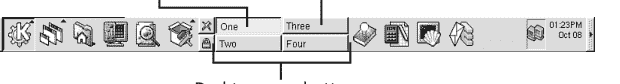

**图 5.1**

*KDE 面板上的虚拟桌面按钮。*

虚拟桌面 #1 任务列表按钮 分页器设置按钮

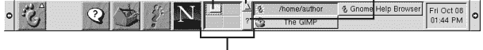

分页器

**图 5.2**

*分页器控制 GNOME 中虚拟桌面之间的导航。*

### 课程 5.1：重新定位窗口

KDE 提供了另一种将窗口移入或移出不同桌面区域的方法。请尝试以下步骤：

1. 点击应用程序窗口的菜单按钮，将鼠标指针移至“移至桌面（To desktop）”选项。此时将出现如图 5.3 所示的桌面区域列表。

   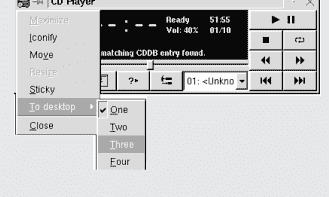

   **图 5.3**

   *使用 KDE 中的窗口菜单在桌面区域之间移动窗口。*

2. 点击你希望将窗口重新定位到的桌面。该窗口将从当前桌面区域消失，并移动到所选的桌面区域。
3. 当你想要操作移动后的窗口时，点击相应的虚拟桌面图标。你将看到一个不同的桌面区域，而重新定位的窗口已准备好等待你。

> 记不清窗口存储在哪里了？点击 KDE 任务栏、GNOME 面板或 GNOME 任务列表上的应用程序图标即可。


## 定制虚拟桌面

在使用了四个虚拟桌面区域后，你可能会发现较少的桌面区域就足够了，或者你可能需要更多。

在 KDE 和 GNOME 中进入更改虚拟桌面工具的路径不同。你还会发现这些工具的外观也不同。在 GNOME 中更改桌面区域数量的方法非常快捷。只需在桌面上右键点击以打开 Enlightenment 设置菜单并点击。对话框包含两个滑块（一个水平，一个垂直，如图 5.4 所示）。当你移动滑块时，桌面的数量会随之改变。

**图 5.4**

在 GNOME 中，你可以更改虚拟桌面的数量以及它们作为面板图标显示的阵列方式。

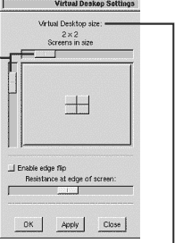

使用滑块更改桌面区域数量

桌面区域数量

### 课程 5.2：更改 KDE 中的桌面区域数量

为了让你在虚拟世界中导航更加方便，KDE 允许你灵活地重命名桌面区域图标。此外，你还可以更改可操作的桌面区域数量。请遵循以下步骤：

1. 点击应用程序启动器按钮，将鼠标指针移至“面板（Panel）”$\rightarrow$“配置（Configure）”以打开 KPanel 配置对话框。
2. 点击“桌面（Desktops）”选项卡。在此选项卡中，你可以更改桌面区域的数量、面板上图标的大小以及桌面区域的标题（见图 5.5）。
3. 要更改给定图标的标题，请选择文本框中的文本并输入新文本。
4. 要更改桌面区域的数量，请点击并向右拖动“可见（Visible）”滑块以创建更多桌面区域，或向左拖动以减少桌面区域数量。

## 更改你的桌面视图

为桌面区域标题使用具有描述性的文本。桌面区域的名称应反映你在每个桌面区域中使用的应用程序类型或执行的工作类型。

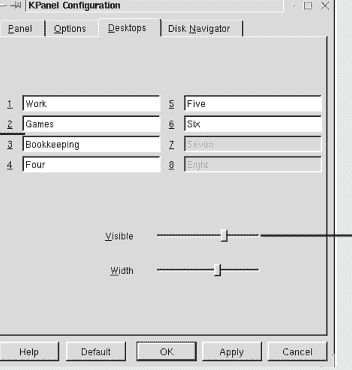

**图 5.5**

在 KDE 中，你不仅可以更改桌面区域的数量，还可以为桌面区域起描述性的名称。

使用描述性的桌面区域标题

增加/减少桌面区域

5. 要更改面板上桌面区域图标的大小，请拖动“宽度（Width）”滑块。
6. 完成所有更改后，点击“确定（OK）”。

## 使用粘性窗口

**新术语**：窗口不一定非要出现在单个桌面区域中。如果你希望无论在哪个桌面区域都能操作某个窗口，请将该窗口设置为*粘性（sticky）*。例如，你可能希望在访问的每个桌面区域都能看到日历。粘性窗口会随着你在桌面区域之间的跳转而移动。因此，无论显示哪个桌面区域，你的日历将始终在那里提醒你重要的日期。

### 课程 5.3：将窗口固定到桌面区域

要创建粘性窗口，请遵循以下步骤：

1. 点击你希望出现在所有桌面区域的窗口的“窗口（Window）”菜单，并选择“粘性（Sticky）”（在 KDE 中）或“固定/取消固定（Stick/Unstick）”（在 GNOME 中）。在 KDE 中，你会注意到粘性图标（位于窗口菜单图标旁的图钉）发生了变化。
2. 点击任何虚拟桌面图标。你设为粘性的窗口将出现在每个窗口中。
3. 如果你不希望该窗口出现在每个桌面区域，请点击粘性图标或返回 GNOME 的窗口菜单。该窗口现在将仅出现在它最初被打开的原始窗口中。

## 添加桌面背景和壁纸

让桌面更具吸引力的一种方法是使用一种颜色、颜色组合或图像作为桌面背景。KDE 和 GNOME 提供了相同的背景选项，且处理方式几乎一致。在接下来的课程中，我们将使用 KDE 界面向你展示如何让你的桌面更加绚丽。

有几种方法可以更改桌面背景。要进入进行这些更改的地方，请尝试表 5.1 中的一种方法。

### 表 5.1：在 KDE 中更改背景设置

| 从此处更改设置 | 操作步骤 |
| :--- | :--- |
| KDE 和 GNOME 面板 | 点击控制中心图标，选择“桌面（Desktop）$\rightarrow$背景（Background）” |
| KDE 和 GNOME 主菜单 | 将鼠标指针移至“设置（Settings）$\rightarrow$桌面（Desktop）$\rightarrow$背景（Background）” |
| KDE 桌面 | 右键点击并选择“显示属性（Display properties）” |

背景显示设置（如图 5.6 所示）列出了三种设计酷炫桌面背景的选项。最简单的是纯色背景。为了增加一点色彩，可以尝试双色背景，你可以将其混合成各种渐变效果。此外，文件系统中还存放了一些扫描的照片图像，你可以尝试使用。

## 纯色桌面

创建纯色背景的步骤非常简单。选择“单色（One Color）”选项，然后点击该选项下方的颜色条。在出现的“选择颜色（Select Color）”对话框中选择一种颜色。点击“确定（OK）”退出对话框。如果你想要一个更出彩的桌面，请尝试接下来的两节课程。

## 更改桌面视图

所以，所以你想自定义 KDE 中的各个桌面区域？如果你想将相同的背景应用于所有桌面区域，请勾选“通用背景（Common Background）”复选框。如果你想将背景仅应用于单个桌面区域，请点击该桌面名称。

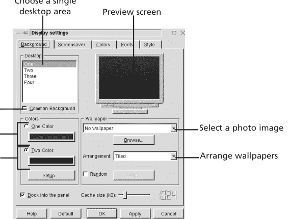

**图 5.6**

*显示设置对话框让桌面装饰变得轻而易举。*

- 将背景应用于所有桌面区域
- 使用纯色背景
- 尝试双色渐变

## 双色触感

**新术语**：渐变（Gradient）是两种颜色的结合，通常是一种浅色和一种深色。每种颜色在与另一种颜色融合时，都会从浅色向深色过渡，而另一种颜色则从深色向浅色过渡。

### 课时 5.4：创建渐变背景

创建渐变首先要选择两种颜色，然后应用其中一个渐变选项：

1. 选择“单色（One Color）”选项按钮，然后点击颜色条来创建第一种颜色。你选择的颜色将显示在颜色条中。
2. 选择“双色（Two Color）”选项并点击颜色条，为渐变选择第二种颜色。选择颜色后，你会注意到预览屏幕发生了变化。
3. 点击“设置（Setup）”按钮以显示“双色背景”对话框。
4. 选择一种混合选项，或者你可以使用双色图案。做出选择后，点击“确定（OK）”返回显示设置。
   - 如果需要水平渐变，请使用“颜色从上到下混合（Blend colors from top to bottom）”选项。
   - 要使用垂直渐变，请选择“颜色从右到左混合（Blend colors from right to left）”。
   - 如果你更愿意使用图案，请点击“使用图案（Use pattern）”选项按钮，并从列表中选择一种图案样式。你将在预览窗口中看到所选内容的预览。
5. 要查看更改在桌面上的效果，请点击“应用（Apply）”。当你打造出完美的桌面后，关闭“显示设置”对话框。

## 选择桌面壁纸

选择桌面壁纸几乎和使用单色背景一样简单。在“桌面显示设置”对话框的“壁纸（Wallpaper）”部分，使用下拉列表选择你希望出现在桌面上的图像。当你做出选择时，壁纸将出现在预览监视器中。如果你不喜欢该选择，请选择另一个。

你可以通过从“排列（Arrangement）”下拉列表中选择一个选项，进一步更改壁纸在屏幕上的显示方式。尝试以下几种排列方式，它们适用于大多数背景图像：

- 要以棋盘格模式显示图像的多个副本，请使用“平铺（Tiled）”选项。
- 如果你想看到两幅图像面对面（即一幅正常，另一幅反向），请尝试“镜像（Mirrored）”选项。
- “居中（Centered）”选项将图像置于屏幕中央，边缘保留背景色。如果你使用“居中”，请选择一种单色或渐变色，以显示在图像未覆盖的桌面区域。此外，尝试选择与图像相匹配的颜色。如果你想看到更少的背景色，请使用“居中最大化（Centered Maxpect）”选项。
- “居中砖块（Centered Brick）”和“居中变形（Centered Warp）”是“居中”选项的酷炫变体。你会在屏幕中间看到图像，背景则是某种图案。你可以使用“单色”和“双色”选项按钮来更改图案颜色。
- “对称平铺（Symmetrical Tiled）”和“对称镜像（Symmetrical Mirrored）”的工作方式与“平铺”和“镜像”相同，但你可能会发现“对称”选项能更好地保留图像的原始宽高比。
- “缩放（Scaled）”选项用图像填充整个桌面，但图像可能会发生失真。

喜欢惊喜吗？勾选“随机（Random）”复选框，你将看到背景每 600 秒更换一次。你可以通过点击“设置（Setup）”按钮来自定义随机生成器。


## 使用屏幕保护程序更改装饰

屏幕保护程序的最初设想是为了保护计算机显示器免受“烧屏（burn-in）”的影响。烧屏是指当一张图像在屏幕上显示时间过长，导致其痕迹永久留在屏幕上。那景象并不好看。屏幕保护程序的设计初衷就是让显示器上的图像不断变化，从而防止烧屏。

那是过去的事了。如今，大多数显示器在计算机不使用时会自动关闭。因此，屏幕保护程序已经变成了“办公室艺术”。但是，只有当你一段时间没工作时才能看到这些艺术品。而当你厌倦了看着屏幕跳动、旋转和嬉戏时，只需移动鼠标或按下键盘上的任意键，现实就再次回归。

有很多地方可以寻找屏幕保护程序。请参考表 5.2 来寻找屏幕保护程序的选择。

### 表 5.2：搜索屏幕保护程序

| 搜索起点 | 遵循路径 |
| :--- | :--- |
| KDE 或 GNOME 面板 | 点击“控制中心（Control Center）”图标，然后选择“桌面（Desktop）$\rightarrow$屏幕保护程序（Screensaver）” |


| KDE 或 GNOME 主菜单 | 将鼠标指针移至“设置 (Settings) $\rightarrow$ 桌面 (Desktop) $\rightarrow$ 屏幕保护程序 (Screensaver)” |
|---|---|
| KDE 桌面 | 右键点击并选择“显示属性 (Display properties)”，然后点击“屏幕保护程序 (Screensaver)”选项卡 |

## 课时 5.5：为屏幕保护程序设置密码保护

使用屏幕保护程序的一个优点是，你可以保持用户帐户登录状态，同时防止未经授权的人员看到你的桌面内容。你可以通过设置密码来实现这一点。

1. 在“屏幕保护程序”列表中滚动并点击你想使用的一个。你将在预览监视器中看到该屏幕保护程序（见图 5.7）。

   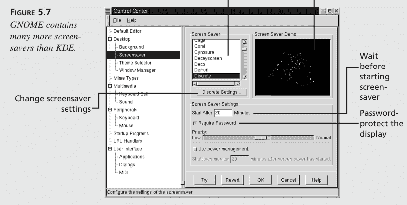

2. 你可以选择使用默认设置，也可以通过点击“设置 (Setup)”按钮（在 KDE 中）或“设置 (Settings)”按钮（在 GNOME 中）来更改颜色和速度等设置。更改设置后，关闭对话框。

3. 将“设置”文本框中的条目更改为你希望计算机在屏幕保护程序启动前处于空闲状态的分钟数。

4. 选择“需要密码 (Require password)”选项。当屏幕保护程序处于活动状态时，任何鼠标或键盘动作都将弹出一个对话框，其中包含当前用户名并要求输入用户密码。

作为屏幕保护程序的替代方案，可以考虑直接关闭显示器。GNOME 可以使用电源管理功能在指定时间后关闭显示器。

5. 完成屏幕保护程序设置后，点击“确定 (OK)”。如果控制中心处于打开状态，你可能还需要将其关闭。

## 为窗口添加新颜色

如果你只想更改 KDE 桌面上显示的窗口边框颜色，只需返回控制中心并选择“桌面 $\rightarrow$ 颜色 (Desktop, Colors)”选项。有多种配色方案可供选择。当你点击不同的配色方案时，你将在预览窗口中看到变化。如果某种颜色不完全符合你的想法，你始终可以更改单个窗口元素的颜色。

## 课时 5.6：尝试 KDE 主题

通过 KDE 主题管理器，几乎可以使用 70 种预设计的桌面主题。这些主题并未安装在你的计算机上，而是打包在存档文件中，在你选择主题并决定安装哪些主题元素后才会安装。虽然有些主题相当古怪，但都非常有创意。请遵循以下步骤：

1. 打开 KDE 控制中心，选择“桌面 $\rightarrow$ 主题管理器 (Desktop, Theme Manager)”选项。你将看到如图 5.8 所示的“桌面主题管理器”。

   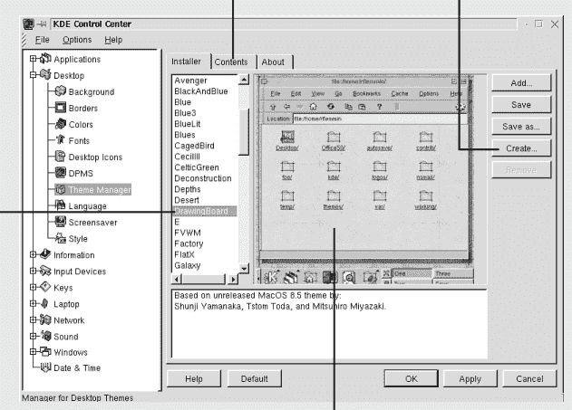

   图 5.8 主题可以给桌面带来前卫或保守的外观。

   在尝试主题之前，请保存当前的桌面设置。为此，点击“创建 (Create)”按钮以显示 `kthememgr` 对话框。在“名称 (Name)”文本框中为你的桌面设置输入一个标题，并在“描述 (Description)”文本框中输入几个词来描述该桌面设置。

2. 浏览主题列表。有相当多的主题可供选择。当你点击一个主题时，你将在预览窗口中看到示例。请注意，颜色、窗口边框和图标都有各自的风格。

3. 如果你想原封不动地使用该主题，请点击“确定 (OK)”并关闭 KDE 控制中心。如果你想按照自己的喜好定制，请继续进行少量自定义。

4. 点击“内容 (Contents)”选项卡。在这里，你可以选择该主题要使用哪些屏幕元素。

5. 在你想在桌面上使用的主题元素旁边打勾。并非所有列出的元素都可用。元素的可用性显示在元素的右侧。主题管理器仅安装你选择且可用的项目。

6. 点击“应用 (Apply)”。主题管理器将解压并安装该主题。享受新外观吧！完成后关闭控制中心。

## 定制桌面图标

既然你已经对桌面做了所有这些更改，可能还有一个项目被遗漏了，那就是桌面图标。你可能会注意到图标文本被包裹在一个方框中，这与桌面背景搭配起来可能不够美观。你可能还觉得图标之间靠得太近。KDE 包含相关设置，使你的桌面更具吸引力。首先，打开“应用程序启动器 (Application Starter)”，将鼠标指针移至“设置 $\rightarrow$ 桌面 $\rightarrow$ 桌面图标 (Settings, Desktop, Desktop icons)”。

桌面图标设置（见图 5.9）允许你自定义图标在桌面上的显示方式。如果你发现桌面图标靠得太近，可以更改水平和垂直网格间距。通过增加水平间距，你可以增加图标列之间的距离。通过增加垂直间距，图标行之间的距离将会变大。要更改图标之间的间距，点击“+ (加号)”按钮增加间距，点击“– (减号)”按钮减少间距。

你还可以更改图标文本的外观。在下一课中，尝试几种不同的图标外观，看看图标能给桌面带来怎样的改变。

## 更改桌面视图

**图 5.9**

通过使用透明的文本背景来改善桌面的外观。

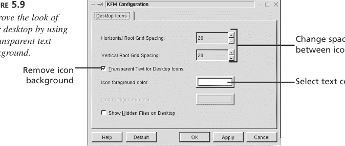

### 第 5.7 课：为图标文本使用透明背景

如果图标文本（出现在 KDE 每个桌面图标下方）包含在一个颜色框内，您可以对其进行更改，使背景消失。此时，您在文本后面看到的是桌面背景。请尝试以下步骤：

1. 在“桌面图标文本透明”（Transparent Text for Desktop Icons）选项中打勾。

2. 点击“图标前景色”（Icon foreground color）颜色条。这将显示“选择颜色”对话框，您可以在其中选择用于桌面图标下方文本的颜色。

   

   > 或者，您可以使用不同的颜色作为文本背景。如果您倾向于这样做，请不要勾选“桌面图标文本透明”复选框，并点击“图标背景色”（Icon background color）颜色条来更改颜色。

3. 准备好应用新的图标设置后，点击“确定”（OK）。

## 总结

在过去的一小时里，您发现工作在虚拟桌面环境中不仅能帮助您保持桌面整洁，还能在不需要应用程序时让它们不碍事且不入眼。您还通过让桌面契合您的个性而获得了一些乐趣。您可能尝试了不同的颜色、图像、配色方案和主题。关于桌面操作和自定义的内容，远比我们在这两小时内涵盖的要多。请探索 KDE 和 GNOME 的文档，或者您也可以访问它们的网站 `http://www.kde.org` 和 `http://www.gnome.org`。

## 问与答

- **问：** 有什么办法可以改变 GNOME 面板上的分页器（pager）的外观吗？

  **答：** 点击 GNOME 分页器设置按钮。它是任务列表下方的一个小问号。您可以让分页器变小，在面板上移动它，或者让它完全消失。

- **问：** 我尝试在 GNOME 中使用壁纸，但我必须浏览文件系统。有没有其他方法可以快速找到壁纸并更改桌面背景？

  **答：** 尝试这个方法：在桌面右键单击，将鼠标指针移动到“启蒙菜单”（Enlightenment Menu）$\rightarrow$“桌面”（Desktop）$\rightarrow$“系统背景”（System Backgrounds）。您有几个类别可供选择。当您显示一个类别时，该类别中所有图像的缩略图都会出现。什么？您看不到所有图像？有些图像列表比您的屏幕长。将鼠标指针移到图像上，当您到达屏幕底部时，列表将滚动，您将看到更多图像。只需将鼠标指针移到屏幕顶部，列表将向相反方向移动。

- **问：** 如果我不想要一直使用同一个屏幕保护程序该怎么办？

  **答：** 如果您使用的是 GNOME，那么您运气不错。请使用“随机屏幕保护程序”（Random Screensaver）选项。每次您回头看，都会看到一套新的线条、方块和其他物体在屏幕上移动。在 KDE 中，您可以使用 X screensaver 选项。

- **问：** 我使用的是 GNOME，我已经把窗口边框改成了我喜欢的颜色，但我不喜欢窗口内部选项按钮和文本等元素的显示方式。我有什么办法吗？

  **答：** 有的。打开 GNOME 控制中心（GNOME Control Center），选择“桌面”（Desktop）$\rightarrow$“主题选择器”（Theme Selector）。这里有 11 个主题可供选择。当您点击其中一个可用主题时，控制中心底部会出现预览。如果您想尝试不同的窗口元素，可以在预览区域进行操作。如果您喜欢 Microsoft Windows 显示元素的方式，请选择 Redmond95 主题。

## 工作坊

又是随堂测验时间，测验结束后，我们将分发一些额外加分作业。我们涵盖了桌面的很大一部分内容，现在来看看您跟进的情况如何。别担心，我们今天不给试卷打分。

### 测验

1. 您在哪里可以找到虚拟桌面的导航控件，以及如何从一个桌面区域移动到另一个桌面区域？

2. 在什么情况下使用粘滞窗口（sticky windows）是有意义的？

3. 当您想要更改桌面背景时，有哪些选项？

### 练习

1. 您可能已经使用了一些随 Linux-Mandrake 安装的背景壁纸图像。您可以创建自己的壁纸，也可以从互联网下载壁纸。如果您想创建自己的壁纸，可以使用图形程序，例如我们在第 19 小时“The Gimp”中介绍的 The Gimp。在收集了几张壁纸图像后，看看能否将它们显示在桌面上。您还可以从 `http://www.themes.org` 下载主题。

2. 在本小时的最后一部分，您更改了桌面许多项目的外观。如果您使用的是 GNOME，您可能想要考虑自定义面板，使其颜色与桌面背景协调。您可以更改 GNOME 面板上图标的背景颜色。要开始操作，请右键单击面板并选择“全局属性”（Global properties）以显示全局面板配置对话框。接下来的操作就交给您自己探索了。但请记住，您始终可以点击对话框底部的“帮助”（Help）按钮。

   

# 第三部分：理解文件系统

## 小时

- 6 奇妙而神秘的文件系统之旅
- 7 系统管理任务
- 8 备份文件系统
- 9 管理应用程序
- 10 小型办公室/家庭办公室联网


## 第 6 小时：奇妙而神秘的文件系统之旅

Linux 文件系统是您存放 Linux 的地方。它包含了所有实用程序文件、应用程序文件、设备文件、系统文件、数据文件以及您可能需要的任何其他类型的文件。我们将从仔细观察 Linux 文件开始这次神奇的之旅。Linux 将一切都视为文件，因此了解 Linux 文件究竟是什么，以及 Linux 在文件系统中如何看待它，是非常重要的。

接下来，我们将查看存放文件的目录结构。Linux 文件系统的组织方式像一棵树——非常像 DOS 和 UNIX 的文件系统——其中第一个目录是树干，所有其他目录都是树的分支。我们将首先使用 Linux 命令行来操作文件系统，然后向您介绍一些出色的图形化文件管理器。在接下来的一个小时里，您将学习如何通过以下方式在 Linux 文件系统中穿梭：

- 使用命令行查看目录并在目录之间移动
- 通过命令行创建子目录
- 使用 Midnight Commander 和 KFM 文件管理器

### 探索目录结构

Linux 文件是具有唯一标识的唯一信息集合。这个标识（文件名）由文件的名称和位置（目录）组成。

Linux 可以在单个目录中存储许多文件。它可以将目录存储在其他目录中。它甚至可以存储同名文件，但不能在同一个目录中。

Linux 文件可能包含多种信息。在您开始探索 Linux 时，您将学习更多关于不同类型文件及其各种用途的知识。您需要熟悉三种类型的文件：

- **用户数据文件**包含您创建的信息，通常由文本和数字组成简单数据。简单的文件（`.txt` 文件）可以用文本编辑器读取。较复杂的文件（由图形或电子表格程序创建的文件）需要解释程序才能读取。
- **系统数据文件**记录用户的登录、密码、权限等信息。作为普通用户，您不会接触这些文件。但如果您是系统管理员，您可能需要编辑这些文件以维护系统。
- **可执行文件**是告诉您的计算机该做什么的指令。这些文件通常被称为程序。当您告诉计算机执行某项操作时，您实际上是在告诉它执行其中一个文件中的指令。

在文件系统中随意尝试之前，可以肯定地说，如果您知道自己在做什么，会有很大帮助。但如果做不到这一点，至少在开始时，通过了解安装 Linux-Mandrake 时设置的文件系统，您可以更好地理解系统。您会在某些目录中发现有用的功能；而其他目录则应交给 Linux 专家处理。

- `/`（根）目录是 Linux 文件系统的基础。它包含 Linux 文件系统中的所有文件和子目录。永远不要在这个目录中存储文件。
- `/bin` 目录是存放基本 Linux 命令和程序的地方。
- `/boot` 目录是存放启动配置文件和命令的地方。
- `/dev` 目录是存放计算机硬件组件设备文件的地方。
- `/etc` 目录包含系统配置文件和初始化脚本。
- `/home` 目录包含系统中所有用户的用户账户，但超级用户除外，超级用户拥有 `/root` 目录（见下文）。每个用户都有一个主目录用于存储个人文件。你无法通过自己的用户账户访问另一个用户的文件。
- `/lib` 目录包含 C 语言和其他编程语言的库文件。
- `/lost+found` 目录是在 Linux 丢失文件时寻找文件的地方。
- `/root` 目录是超级用户或系统管理员的主目录。
- `/sbin` 目录包含供系统管理员使用的工具。
- `/tmp` 目录是一个所有用户都可以临时存储文件的目录；但如果系统重启，这里存储的所有文件都将丢失。
- `/usr` 目录包含不属于 Linux 操作系统的文件，例如 X Window 系统文件和 Linux 游戏集。

## 关于目录与子目录

**新术语** Linux、DOS 和 UNIX 的文件系统都非常相似，它们都采用了树状目录结构。位于树底部的目录，即所有其他目录的父目录，被称为**根目录**，由正斜杠表示。其他所有内容都从中生长出来，像树一样分叉，所有的目录和子目录构成了树的肢体和分支。

目录名与文件名类似，可以使用相同的字符、数字和符号。区分文件名和目录名的方法是——斜杠 (`/`) 字符用于分隔目录和文件。如果斜杠前面没有任何内容，则该斜杠表示根目录。

包含在其他目录中的目录被称为**子目录**。两个目录之间的关系被表述为父/子关系。你的主目录就是这些分支之一——它始于 `/`（根目录），且所有用户在主目录下都有一个子目录。例如，在路径

```text
/home/Joe
```

中，`/home` 显然是一个子目录。由于斜杠 (`/`) 字符前面没有任何内容，这表明它是根目录，因此 `/home` 显示为根目录的子目录。你可以通过斜杠字符的用法知道这一点。

在接下来的一个小时里，你将与我们的虚拟用户 Joe 一起探索文件系统。Joe 的主目录位于 `/home/Joe`。当你查看 Joe 的文件系统时，你可能会发现他比你领先一点。他需要设置几个示例。Joe 创建了一个目录结构来存储他的项目文件。Joe 从一个名为 `books` 的子目录开始。

他还为每个项目需要一个子目录；Joe 当前的项目名为 `Linux`。然后他需要一个地方来存储项目的不同元素，因此他创建了一个 `chapters` 子目录。最后，目录中有一个文件。这一切导致了如下的文件名：

```text
/home/Joe/books/Linux/chapters/Hour6
```


> 在 Linux 中，长文件名非常常见，但在命令行输入时可能会让事情变得混乱。文件名最长可达 256 个字符，且可以包含字母（包括大写和小写）和数字。你还可以使用特殊字符，如点 (`.`)、短横线 (`-`) 和下划线 (`_`)。文件名不能包含保留的元字符，如星号 (`*`) 或问号 (`?`)。

**新术语** 为了让 Linux 稍微容易处理一些，Linux 文件名有两种版本。前面解释的那种如果一遍又一遍地输入会非常累人。它被称为**绝对文件名**。绝对文件名总是以斜杠 (`/`) 字符开头，这表示根目录，然后使用斜杠指定通过目录到达文件位置的确切路径。绝对文件名在文件系统的任何位置都有效。

第二种文件名是指相对于工作目录位置的文件位置。它被称为**相对文件名**。相对文件名是指位于工作目录（你当前所在位置）子目录中的文件。

例如，如果 Joe 正在 `/home/Joe/books/Linux` 目录中工作，他可以使用相对文件规范（仅命名其当前工作目录与文件之间的目录）来获取文件，如下所示：

```text
chapters/Hour6
```

由于文件名不以斜杠开头，系统将从工作目录 (`/home/Joe/books/Linux`) 开始搜索文件。至少这样短了一些。相对文件名仅在你保持在同一个工作目录时有效。如果 Joe 的工作目录更改为 `/home/Joe/books`，则该文件的相对路径将变为 `/Linux/chapters/Hour6`。

这里有一些便捷约定，可用于易于使用且易于记忆的目录：

- 一个点 (`.`) 表示当前目录。
- 两个点 (`..`) 表示当前目录的父目录。
- 所有包含 (`.`) 或 (`..`) 的文件名都是相对文件名。

例如，在主目录的终端中，输入：

```bash
cd ..
```

然后按回车键。你将被带到主目录的父目录，即 Linux 的 `/home` 目录。为了确认这一点，输入：

```bash
pwd
```

然后按回车键。

你也可以在其他命令中使用目录快捷方式，例如复制命令 `cp`。要将文件复制到工作目录中，输入：

```bash
cp ./<filename>
```

然后按回车键。文件将被复制到你的工作目录中。当然，随之而来的是，使用两个点前缀 (`../`) 会将文件的副本放入工作目录的父目录中。

如果你正在处理一个想要使用复制命令保存到主目录的文件，只需输入：

```bash
cp ~/ <filename>
```

然后按回车键。文件将复制到你的主目录，你可以在任何时候轻松找到它。

## 进入主目录


Linux 有一个名为`/home`的子目录。在这个目录中，用户被分配一个目录，他们可以在其中创建自己的子目录来存储文件，以及删除和修改这些文件。在单个用户的主目录中不存储系统文件或属于其他用户的文件。

当你在计算机上安装 Linux-Mandrake 时，你为非特权用户创建了一个用户账户。本例中的用户名为 Joe，你的可能不同。Linux 为用户 Joe 创建了一个主目录，路径为：

```
/home/Joe
```

当你登录 Linux 时，你将处于你的主目录中。

## 理解 Linux 文件命令

在介绍部分，你了解到你将使用命令行在文件系统中移动。现在，在所有 Windows 和 Macintosh 用户开始跳过这部分去寻找更熟悉的内容之前，你应该知道这很简单。它只需要你了解几个命令，其中一个甚至没有任何选项！

## 使用 `pwd` 命令确定你的位置

**新术语**：在仅文本终端的旧时代，命令被输入到电传打字机中，然后显示计算机的响应。`pwd`命令告诉计算机打印工作目录的名称。*工作目录*是 Linux 命令执行操作的默认目录。换句话说，`pwd`告诉计算机打印当前目录的名称。

### 课 6.1：查看你的主目录

让我们追随早期计算机先驱的脚步，在命令行上尝试几个简单的命令。在开始之前，打开一个 X 终端窗口。你可以在 KDE 和 GNOME 面板上找到终端图标。你也可以在“实用程序”菜单中找到终端。

1. 当你打开 X 终端窗口时，你会看到一个像这样的提示符：

   `[Joe@localhost Joe]$`

   光标应该位于提示符旁边。输入`pwd`并按 Enter 键。响应将出现在下一行，看起来像这样：

   `/home/Joe`

   你还会注意到下一行出现了一个提示符，等待另一个命令。

2. 输入`ls`并按 Enter 键。`ls`命令返回一个列表，显示你当前工作目录中的内容。文件和目录的列表可能看起来像这样：

   `Desktop books practice tmp`

   `ls`命令的响应显示了`/home/Joe`目录的内容。你如何知道`ls`命令返回的四个对象是文件还是目录？你无法得知。`ls`命令可以使用修饰符来显示关于内容的更多信息。

   1. 要查找修饰符选项，您必须询问 shell。输入`ls -help`并按 Enter 键。屏幕上会出现完整的命令修饰符列表及其用途。使用终端窗口上的滚动条阅读修饰符选项列表。选项很多，不是吗？

   2. 要显示关于目录内容的更多信息，您需要修改`ls`命令以使用长列表格式。输入`ls -l`并按 Enter 键。此命令将按以下格式返回信息：

      ```
      total 3
      drwxr-xr-x 5 Joe Joe 1024 Nov 9 08:18 Desktop
      drwx------ 3 Joe Joe 1024 Nov 9 14:37 books
      -rw-r--r-- 1 Joe Joe 0 Nov 9 14:40 practice
      drwxr-xr-x 2 Joe Joe 1024 Nov 9 08:15 tmp
      ```

现在，所有这些对您来说可能像乱码一样，所以让我们来理清一下。上面的列表由八列组成。只需记住，显示的第一行告诉您目录中子目录的数量。随后的每一行列出每个项目。

第一列的第一个字符指示该项目是目录（`d`）还是文件（`-`）。在此示例中，第一、第二和第四个项目是目录，第三个项目是文件。

第一列接下来的九个字符每三个一组，反映了文件的访问权限。第一组三个是所有者的权限，第二组是组权限，最后一组三个字符是所有其他用户的权限。按照这里的显示方式，权限分为读取（`r`或`-`）、写入（`w`或`-`）和执行（`x`或`-`）。破折号表示权限被拒绝。您将在第 7 小时“系统管理任务”中详细学习文件权限。

第二列指示指向该文件的链接数。对于目录，这个数字是目录中所有文件的总数加上两个。

第三列是拥有该文件的组名。

第四列是拥有该文件的用户名。

第五列是文件的字节大小。

第六列是文件的 mdate 或最后修改日期。

第七列是最后修改发生的具体小时和分钟。

第八列是文件名。

> 您将在第 7 小时中更深入地学习此处显示的目录信息。

## 使用 `cd` 命令切换路径

`cd`命令用于更改您正在工作的目录。您可以将其想象为在文件系统中从一个物理位置移动到另一个位置。当您想要将当前工作目录更改为其子目录之一时，请使用相对文件名。例如，如果 Joe 想要从他的主目录切换到 books 子目录，他会输入：

```
cd books
```

在命令行输入并按 Enter 键。他的命令提示符将更改以显示新的工作目录，如下所示：

```
[Joe@localhost books]$
```

如果 Joe 使用`pwd`命令，他会发现他现在正在`/home/joe/books`目录中工作。

只要您想要的子目录或文件位于工作目录之下的目录结构中，所有这些操作都将有效。如果您指定的文件位于另一个目录中，除非您使用其绝对文件名并指定完整的目录路径，否则 Linux 将无法找到它。

> 在处理长文件名时，您可能无法在一条命令行中输入完整的文件名。Linux 命令行编辑器将换行视为行尾字符，并且不会读取在第二行继续的命令部分。解决方法是——在每行以第二行延续的末尾使用斜杠（`/`）字符。

## 第 6.2 课：在文件系统中移动

现在您的工具箱中已经有了三个命令，可以用它们来攻克文件系统迷宫。让我们使用这些命令前往`/usr`目录。该目录包含关于 Linux-Mandrake 发行版中许多程序的有用文档。本课您再次需要打开一个 X 终端窗口：

1. 要从您当前在主目录的位置前往`/usr`目录，输入`cd /usr`并按 Enter 键。提示符将更改为类似于以下形式：

   `[Joe@localhost usr]$`

2. 输入`ls -l`并按 Enter 键。命令行将列出`/usr`目录的内容。

> 没有哪里像家一样。如果您迷路了并想回家，您只需在命令行输入`cd`（不带参数）并按 Enter 键。您将被迅速带回主目录。或者，使用`pwd`显示您在文件系统中的位置。

3. 输入`cd`并按 Enter 键。您将返回主目录，提示符将更改以显示您所在的目录，看起来像这样：

   `[Joe@localhost Joe]$`

4. 输入`cd /`并按 Enter 键。您将被移动到根目录，提示符将更改为：

   `[Joe@localhost /]$`

5. 要查看根目录内容的列表，您可以再次使用`ls -l`命令。`ls -l`命令将返回根目录中包含的内容列表。

6. 再次输入`cd`并按 Enter 键。您将返回主目录。如果您不相信，只需输入`pwd`并按 Enter 键。

## 从命令行管理目录

如果您还记得旧的 DOS 命令，您会发现 Linux 文件系统在创建、删除和移动目录时有一些相似之处。目前，我们建议您仅在主目录内的目录中工作。在您进一步了解 Linux 之后，可以在其他位置创建目录。

### 创建目录

在 Linux 中创建目录非常简单。该命令与 DOS 命令`mkdir`相同。使用此命令时，请确保您位于想要创建新目录的工作目录中。

### `mkdir` 命令的语法

以下代码显示了`mkdir`命令的语法。当您想要在任何目录中创建子目录时，将使用此命令：

```
mkdir newdirectory
```

其中`newdirectory`是您想要给新目录起的名字。

### 删除目录

删除目录非常简单。但在尝试删除目录之前，您需要先删除该目录的内容。您可以使用`rm`命令删除文件。

> Linux 在使用`rm`命令时可以使用通配符。这可能非常危险。例如，以下命令将删除当前目录中的所有内容：

`[Joe@localhost Joe]$ rm *`

如果您犯了错，会发现您的文件永远丢失了。

在使用`rm`命令之前，请确保您在包含想要删除的子目录或文件的目录中。如果您想删除工作目录以外任何目录中的文件，请使用绝对文件名。

### `rmdir` 命令的语法

以下代码显示了`rmdir`命令的语法。当您想要从用户主目录中删除任何目录时，将使用此命令。

```
rmdir directory
```

其中`directory`是您想要删除的目录名称。

如果目录不为空，您将看到一条消息，内容为：

```
rmdir <directory> Directory not empty
```

这是一个有趣的消息，因为这是 Linux 极其罕见的安全功能或警告消息。没有文件会被删除，目录将保留在原位；您需要先手动删除文件。

## 开始使用图形化文件管理器

您可以轻松找到两个图形化文件管理器。如果您使用的是 KDE 图形界面，默认文件管理器是 KFM。对于 GNOME，您将使用 GNU Midnight Commander。文件管理器是登录图形界面时自动打开的窗口之一。如果文件管理器没有出现在您的桌面上，您可以在 KDE 和 GNOME 面板上找到图标；或者在主菜单中，它是“主目录”或“文件管理器”选项。桌面上可能还有一个可以打开文件管理器的图标。

KFM 和 Midnight Commander 文件管理器是 Linux 文件系统的图形用户界面。与您之前使用的命令行不同，文件管理器允许您直观地看到自己在文件系统中的操作。您会发现这些文件管理器与其他操作系统的文件管理器之间存在相似之处。KFM 和 Midnight Commander 可以执行所有文件管理任务。

由于 KFM 和 Midnight Commander 的工作方式基本相同，我们将使用 Midnight Commander 为您演示一些文件管理器基础知识（见图 6.1）。在讲解过程中，我们将向您展示这两个文件管理器在操作上的细微差别。

**图 6.1**

首次打开文件管理器时，将显示您的主目录。

- 展开目录
- 折叠目录
- 树状视图
- 目录视图
- 更改窗格大小

您可以使用文件管理器执行的所有命令都包含在菜单中。最常用的命令可以在工具栏上找到。如果您将鼠标指针悬停在工具栏按钮上，会出现一个屏幕提示，告诉您该按钮执行的命令。

左侧窗格显示 Linux 文件系统中所有目录的树状视图。如果您在 KFM 文件管理器中没有看到目录树，请从菜单中选择“视图（View）”，然后选择“显示树（Show Tree）”。右侧窗格显示目录视图，它会显示左侧窗格树状视图中高亮选定目录所包含的文件和目录。

> 要更改树状视图和目录视图窗格的大小，请点击并拖动两个窗格之间底部的滑块。

## 第 6.3 课：查看文件列表

文件管理器的图形界面使在文件系统中移动和查看目录变得更加容易。由于您的主目录（用户账户）中实际上还没有设置任何文件，我们将移动到最适合您随意探索的安全位置：`/usr`目录。

1. 在 Midnight Commander 的树状视图中，点击`/usr`目录。在 KFM 中，点击“根目录（Root）”左侧的箭头（以显示目录列表），然后点击`/usr`目录。该目录的内容将以文件夹和文件图标的形式出现在目录视图中。

2. 在 Midnight Commander 中点击加号，或在 KFM 中点击树状视图中`/usr`目录图标左侧的箭头。这将展开树状视图并显示`/usr`目录下的子目录。

3. Linux How-Tos 是很好的帮助资源。您可以在`/usr/doc/HOWTO`中找到它们。在树状视图中选择此目录，并在目录窗格中显示 HOWTO 目录的内容，如图 6.2 所示。这些 How-Tos 是纯文本文件，为操作操作系统、应用程序、实用程序以及硬件组件提供帮助。您可能会在这里发现感兴趣的内容，因此请花点时间浏览一下清单。这些文件可以使用任何文本编辑器打开。

## 更改目录视图的外观

初次打开文件管理器时，目录视图以图标形式显示目录和文件。还有其他显示选项。您可以将文件和目录显示为文本，或者显示为带有描述的文本。Midnight Commander 的工具栏上有四个可以更改目录视图的图标。您也可以通过“设置（Settings）”菜单更改视图。在 KFM 中，您需要从“视图（View）”菜单中选择一种视图：

### 绝妙而神秘的文件系统之旅

**图 6.2**

在树状视图中展开目录以查看子目录；选择目录以在目录视图中查看其内容。

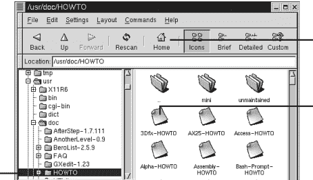

（图注：返回您的用户目录；双击打开文件；选择以显示内容）

- 图标（Icon）视图在您需要快速确定文件类型时非常有用。此视图显示一个代表文件类型的图片图标，下方是文件名。
- 简略（Brief）或短（Short）视图是存储在目录中的文件和子目录的简单列表。
- 详细（Detailed）或长（Long）视图会提供文件的大小及其制作或创建日期和时间。
- 文本（Text）视图提供文件的简单文本列表，以及一些关于文件所有权和权限的信息。

> KFM 可以显示某些文件内容的缩略图（使用“视图（View）”，选择“显示缩略图（Show Thumbnails）”）。这对于预览图形文件以及 KFM 识别的其他文件格式非常方便。

## 选择文件

为了对文件进行任何操作（如重命名或复制），您必须首先在文件管理器中选择相应的文件。选择文件的惯例非常基础且熟悉。甚至有一种方法可以让文件管理器为您自动选择，只需告诉它您想要的文件类型即可。

使用鼠标选择文件相对简单。您可能希望使用除图标视图以外的视图来使用鼠标选择文件。

- 要选择单个文件，请点击它。
- 要选择连续的文件，请点击第一个文件名或图标，然后按住 Shift 键并点击您要选择的块中的最后一个文件。
- 要选择互不连续的文件，请按住 CTRL 键并点击您要选择的文件名或图标。

## 第 6.4 课：使用过滤器选择文件

如果您不想在整个目录中搜索文件，可以使用文件管理器为您进行文件选择。您可以搜索某个特定文件，或者搜索具有共同元素的一组文件。共同元素可以是文件扩展名或字母组合。要设置文件排序标准：

1. 在 Midnight Commander 中，选择“编辑（Edit）”，然后选择“选择文件（Select Files）”。在 KDE 中，转到“编辑（Edit）”，选择“选择（Select）”。随后将打开“选择文件”对话框。

2. 输入您想要选择的标准。（图 6.3 显示了 Midnight Commander 的使用情况。）它可以是一个文件扩展名，例如`.pcx`，在这种情况下您将输入`*.pcx`。或者，您可能想选择以 emacs 开头的文件，那么您将输入`emacs*`。

   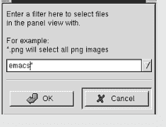

   **图 6.3**

   您需要输入足够的信息以实现精准匹配。

3. 点击“确定（OK）”。文件管理器将在文件系统中进行搜索。所有符合标准的文件都将在文件管理器窗口中被选中。

## 管理文件和目录

当您开始使用 Linux-Mandrake 捆绑的应用程序时，您需要空间来保存您的工作。这些文件可以保存在您的用户账户中。为了使您的文件系统更有条理，您可以创建目录并在目录之间移动文件。

### 创建目录

您可以将所有文件保存在主目录中，但一段时间后，情况会变得拥挤且难以管理。如果您想跟踪您的工作（例如电子表格文件、图形或文字处理文件），您可以按文件类型创建文件夹（子目录），或者您可能想为所有客户项目创建客户文件夹。

要创建新的子目录，请在树状视图中选择您想在其下创建子目录的目录。在 Midnight Commander 中，从菜单中选择“文件（File）”，“新建（New）”，然后选择“目录（Directory）”。在 KFM 中，选择“文件（File）”，“新建（New）”，然后选择“文件夹（Folder）”。这将弹出一个对话框。您只需为目录输入一个名称即可。

> 如果您在树状视图或目录视图中没有看到新目录，请点击“重新扫描（Rescan）”或“重新加载（Reload）”按钮。

## 第 6.5 课：将文件移动到不同的目录

如果您使用了任何 Linux 应用程序并创建了文件，这些文件会自动存储在您的主目录中。现在您已经为文件创建了一个或多个新目录，您可以将其中一些文件从主目录移出，并放入您创建的这些主目录子目录中。

1. 确保您要将文件移入的子目录已在树状视图中显示。

> 可以同时显示多个文件管理器窗口，以便更轻松地将文件从一个窗口拖到另一个窗口。要打开另一个 Midnight Commander 文件管理器窗口，请选择“文件（File）”，然后选择“打开新窗口（Open New Window）”。在 KFM 中，选择“文件（File）”，然后选择“新窗口（New Window）”。

2. 在目录视图中，点击并按住您要移动的文件。然后，将光标拖到您要移动文件的目录。在 Midnight Commander 中，当您释放文件时，它将被移动到选定的目录。KFM 将显示一个菜单，您需要告知 KFM 是要将文件移动到新目录还是复制到新目录。

## 重命名文件和目录

不时地，您会想要重命名文件或目录以方便操作。这可以轻松完成。右键点击您想要重命名的文件，然后从菜单中选择“属性（Properties）”。在“属性”对话框中，在“文件名（File Name）”文本框中为文件或目录输入新名称（见图 6.4）。完成后，点击“确定（OK）”，您将在文件管理器中看到具有新名称的文件。

**图 6.4**

文件和目录都可以通过“属性”对话框重命名。

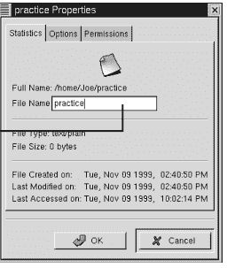

（图注：编辑文件名文本框）

## 删除文件和目录

您不时地需要删除文件和目录。这个过程是一个简单的操作，但您必须确保要删除的目录是空的。Linux 不会删除包含任何内容的目录。要删除文件或目录，请右键点击该文件或目录，然后从出现的菜单中选择“删除（Delete）”。文件或目录将从文件管理器中神奇地消失。

> 请记住，在 Linux 中删除的任何内容都会立即消失。您无法将其恢复，因此请谨慎删除。如果您使用的是 KFM，您可能想将文件移至回收站。


## 总结


又过去了一个漫长的小时，但您现在更多地了解了 Linux 文件系统是如何组织的，以及如何在这个由目录、子目录和文件组成的迷宫中导航。您接触了命令行以及一些帮助您四处走动并确定位置的命令。我们还向您介绍了 GNU Midnight Commander 和 KFM 文件管理器。您会发现这些文件管理器是管理文件系统的简便方法。

## 常见问题解答（Q&A）

**Q** 救命！我忘记文件存放在哪里了。最简单的定位方法是什么？

**A** 有一个“查找文件”实用程序会对您很有帮助。在 Midnight Commander 中，选择“命令”（Commands）->“查找文件”（Find File）。在“查找文件”对话框中输入文件名。如果您不记得完整的文件名，可以使用通配符。随后将显示一个目录列表。选择您想要的文件，然后点击“切换到此目录”（Change to this directory）按钮。

**Q** 我喜欢在文件管理器中以文本形式显示文件和目录，但我想让文本更大一些。可以实现吗？

**A** 在 KFM 中更改字体大小很简单。选择“选项”（Options）->“配置文件管理器”（Configure File Manager）以打开配置对话框。“字体”（Font）选项卡用于控制目录视图中显示的文本大小和字体。您可以在“颜色”（Color）选项卡中更改文本颜色。

**Q** 我把一些文件扔进了 KDE 回收站，现在想要找回。该怎么做？

**A** 打开回收站，将文件复制回您的主目录。

## 研讨会

文件系统是 Linux 中比较重要的方面之一。您需要熟悉文件系统，以便高效地存储文件。在进入更复杂的文件管理任务之前，请先测试您的基础文件存储技能。

## 测验

1. 哪个命令可以告诉你当前在文件系统的哪个位置工作？

2. 哪个命令可以列出工作目录的内容以及目录中每个项目的详细信息？

3. Linux 文件名由什么组成，最大长度是多少？

## 练习

1. 在您的主目录下创建一套用于保存文件的目录结构。您可能需要为信件、财务记录和扫描照片创建子目录。您还可能需要进一步细分子目录；例如，信件目录可以为每位笔友或客户创建子目录。

2. 为了探索您更喜欢哪种用户界面（GNOME 还是 KDE），请尝试使用各自的默认文件管理器——GNOME 使用 Midnight Commander，KDE 使用 KFM。如果您还没有决定使用哪种 GUI，文件管理器的差异将帮助您做出决定。

# 第 7 小时：系统管理任务

即使您在单台计算机上运行 Linux，您仍然可以将这台计算机视为一个单机网络。当多个人可以使用同一台计算机时，您可以创建用户账户，以便每个人都能根据个人偏好设置桌面，并拥有存储个人文件的私密空间。

您还可以创建两个或更多用户可以共享文件的区域。这些目录可以设置权限，以便多个用户可以共同操作并修改文件，或者通过设置不同的权限，使其仅具有读取文件的能力。所有这些操作都使用用户和组账户完成，且必须由 `root` 账户（更广为人知的称呼是超级用户或系统管理员）执行。这是一项艰巨的工作，但您可以使用 Linuxconf 来帮助维护用户和组列表。

在设置好用户和组账户后，您需要创建供用户共享文件的目录。随后，用户可以为组内使用的文件分配所有权和权限。除了维护用户和组账户外，您还需要维护计算机的健康状态。在接下来的一个小时里，您将通过执行以下任务来体验作为系统管理员的工作：

- 为用户创建账户并将用户分配到组。
- 与工作组中的用户共享文件。
- 收集计算机系统信息。
- 使用“时间机器”更改计算机时钟。

## 使用 Linuxconf 配置账户

在本书的学习过程中，您将反复看到 Linuxconf。Linuxconf 是一个图形化的系统配置工具。通过 Linuxconf，您可以设置网络（无论是小型计算机网络还是拨号连接）、管理用于文件共享的用户和组账户，以及执行其他常规系统维护功能（如设置日期和时间）及许多其他任务。现在请记住，所有这些任务都可以通过命令行完成。Linuxconf 为您所做的正是这些，但有一个例外——它让您更直观地看到操作过程。

为了使用 Linuxconf，您必须登录 `root` 账户，或者您的用户账户必须具有超级用户权限。

> 当您以 `root` 或超级用户身份登录时，必须谨慎操作。`root` 账户拥有更改 Linux 文件系统中任何内容的权限。因此，请不要删除任何重要文件。

## 启动 Linuxconf

如果您处于 `root` 账户中，启动 Linuxconf 非常简单。登录 `root` 账户的 GNOME 用户可以在“系统”（System）菜单中找到 Linuxconf。GNOME 和 KDE 用户都可以点击桌面上的 Drakconf 图标，然后从图形界面中选择 Linuxconf。如果您从用户账户执行此操作，系统将提示您输入超级用户密码。如果您仍然找不到 Linuxconf，请打开一个 X 终端窗口，输入 `linuxconf` 并按回车键。

如果您更希望从用户账户使用 Linuxconf，您需要超级用户权限。这意味着您必须知道 `root` 密码。

> 当您登录用户账户并点击 KDE 桌面上的 Linuxconf 图标时，一个面板会要求您输入 `root` 密码。输入完成后，Linuxconf 将打开。

为了以超级用户身份启动 Linuxconf，请打开一个 X 终端窗口，在命令提示符处输入 `su` 并按回车键。系统会要求您输入密码。输入 `root` 密码并按回车键。现在，在命令行输入 `linuxconf` 并按回车键。

当 Linuxconf 打开时，应出现“配置”（Config）选项卡。要管理用户和组账户，请点击“用户账户”（Users accounts）。这样做将打开如图 7.1 所示的用户账户配置器。

**图 7.1**

为每个用户提供独立账户，并使用组在用户之间共享文件。

- Linuxconf 主窗口。
- 管理用户和组账户。
- 添加用户。
- 添加组。

## 关闭 Linuxconf

使用完 Linuxconf 后，您需要点击每个打开窗口底部的“退出”（Quit）按钮。在按下所有这些按钮后，“系统状态”（Status of the system）面板将告知您系统的状态与您的新更改不同步。您只需点击“激活更改”（Activate the changes）按钮，告诉 Linuxconf 执行这些更改即可。

## 管理用户账户

每位使用计算机的人都需要被分配一个*用户账户*。该用户账户由用户名（可以是其姓名的某种形式或自定义名称）和密码组成。随后，每位用户在系统上都会获得一个用于个人文件存储的个人主目录。这还允许用户在各自的账户中根据意愿设置桌面，而无需使用其他用户的设置，也不会更改其他用户的设置。

> **新术语** 如果用户想要共享文件该怎么办？用户需要被组织成*工作组*（workgroups），每个工作组都有共同的工作任务或共享特定信息的共同需求。您可以通过创建组账户并将用户分配到相应的组来管理这些工作组。在设置好用户和组账户后，即可创建目录和文件并设置使用权限。

### 向系统添加用户

您的首项任务是为每个尚未在系统上拥有账户的用户创建账户。对于每个用户账户，您需要用户的全名、登录名和密码。请使用一个易于用户记忆的登录名，并选择一个较难破解的密码。密码应该是大写字母、小写字母、数字和字符的组合。有几个字符不能使用——`, `*`、`/` 和 `\`。此列表还包括 shell 命令分隔符，如 `;`、`@`、`|`、`$`、短横线（dash）和长横线（emdash）。

使密码易于记忆的一种方法是选取一个用户能记住的单词并对其进行修改。例如，您可以选取单词“chicken”并将其改为“ch1CK&”以增加破解难度，然后添加额外的内容（如“ch1CK832”）来增加复杂性。

### 课程 7.1：为新用户创建账户

在开始向系统添加用户之前，请列出您想要授予访问权限的人员名单。然后，分配用户名和密码。您的用户需要这些信息才能登录系统。如果您为计算机系统准备了笔记本，请记录这些用户及其账户信息（但不要记录密码）。请记得将笔记本存放在安全的地方。

1. 点击用户账户配置器窗口“常规”（Normal）选项卡上的“用户账户”（User accounts）。这将打开如图 7.2 所示的“用户账户”窗口。

## 系统管理任务

**图 7.2**

“用户账户”窗口列出了系统中创建的所有用户账户。

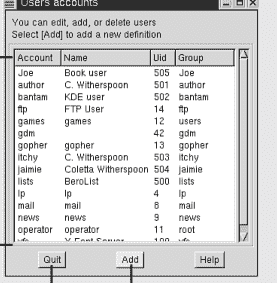

- 现有的用户账户。

### 创建用户账户

2. 点击“用户账户”面板底部的“添加”按钮，显示如图 7.3 所示的“用户账户创建”窗口。此时应选中“基本信息”选项卡。这里用于保存关于每个用户如何登录的信息。

**图 7.3**

你至少需要提供用户的全名、登录名和密码。

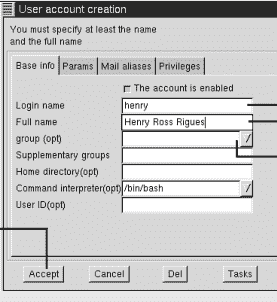

- 账户名称。
- 用户的真实姓名。
- 留空则使用默认目录名。
- 创建账户，然后分配密码。

3. 确保选中了“账户已启用”选项。

4. 输入新用户的“登录名”和“全名”（姓和名）。


> Linuxconf 将自动创建用户目录。如果你希望用户的家目录名称与用户名不同，请在“家目录（可选）”文本框中输入目录路径。

5. 点击**接受**按钮。随后将出现**更改密码**面板。

6. 输入用户的密码并点击**接受**。面板将再次出现，要求你第二次输入密码以确认选择。随后会出现一个通知面板，确认该用户的密码已更改。

> 请谨慎选择密码。如果你输入的密码被 Linux 认为不合适，会出现一条错误消息，告知你为什么这是一个糟糕的密码选择。你可以输入另一个密码，或者选择保留你选定的密码并忽略 Linux 的建议。


7. 点击**确定**。**用户账户**面板的列表中将显示你的新用户。在本课中创建的用户账户在图 7.4 中已高亮显示。

**图 7.4**

一旦你应用更改，新用户就可以访问他们自己的账户了。

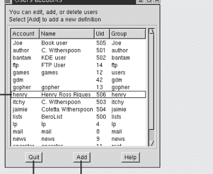

- 新用户已添加到系统。
- 退出以应用更改。
- 添加更多用户。

## 更新用户账户

有时需要对用户账户进行更改，例如更改密码或用户名。更新账户信息的便捷程度与创建新账户一样。

如果你已经关闭了 Linuxconf，则需要启动该程序，打开“用户账户配置器”（通过点击 Linuxconf 主窗口上的“用户账户”按钮），然后点击“用户账户”按钮以显示如图 7.4 所示的用户列表。

接下来的步骤很简单。点击你想要更新的用户账户；随后将出现该选定用户的“用户信息”窗口。在此处进行更改，然后点击“接受”按钮以应用更改。

## 课程 7.2：更改用户密码

定期更改用户密码是一个好习惯。这可以增加外部人员进入系统的难度。如果用户忘记了密码，或者他们认为有人发现了他们的秘密，你也需要更改密码。请按照以下步骤更改用户密码：

1. 在“用户账户”窗口中点击相应的用户账户。随后将出现该用户的“用户信息”窗口，如图 7.5 所示。

2. 如果你需要对用户信息进行任何更改，请选择想要更改的文本并输入新文本。

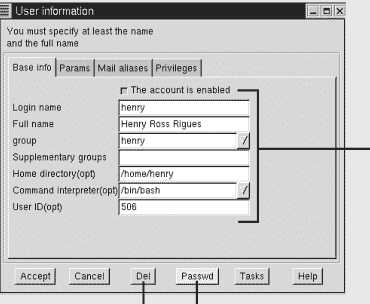

**图 7.5**

为了维护安全性，请定期更新密码并对密码保密。

- 从系统中永久删除用户。
- 更改密码。
- 编辑用户信息。

3. 点击“Passwd”按钮以显示“更改密码”窗口。

4. 输入新密码并点击“接受”。然后，再次输入以确认，并再次点击“接受”。新密码将替换旧密码。同时，“用户信息”窗口将关闭，你将返回到“用户账户”窗口。

5. 点击“退出”按钮，并确保在关闭 Linuxconf 时激活更改。


> 在某些情况下，例如在长期休假期间，你可能希望对用户账户实施限制。当你想要暂时拒绝访问计算机时，请取消选中该账户的“账户已启用”选项。用户的账户和文件将保留在原处，但用户将无法登录。

## 删除用户账户

当用户不再使用系统时，可以关闭其用户账户。如果被删除用户创建的文件被系统中的其他任何人需要，可以将这些文件保存下来供他人使用。如果不需要，你可以删除这些文件以给其他用户释放更多空间。

要删除用户，请从“用户账户”窗口中选择用户账户以显示“用户信息”窗口。然后点击“Del”按钮。系统将询问你如何处理该账户的数据。你有三种选择：

- 归档账户数据。此方法将用户家目录中留下的文件压缩成单个文件。该文件将与所有其他用户的家目录一起放置在`/home`目录下——即一个名为`/oldaccounts`的目录中。
- 删除账户数据。选择此项将删除用户家目录中的所有内容。
- 保留账户数据。此选项将从用户列表中删除该用户，但保留其家目录及其内容。

## 处理组账户

当多个用户需要共享相同的文件时，你会希望将这些用户放入同一个组中。你可以在系统中创建许多组，并将任意组合的用户分配到每个组中。需要记住的重要一点是，组的所有成员需要共享同一组文件。当用户被分配到某个组，且该组被授予访问特定文件和目录的权限时，用户可以通过访问存储这些文件的目录来开始共享文件。

### 创建新组

在启用用户之间文件访问之前，第一步是创建一个组。并不是系统中的每个用户都需要属于某个组；只有那些需要访问组文件的人才需要属于该特定组。

> **课程 7.3：将用户分配到组**

在创建组之前，请确保组中的每个人都已分配用户账户，并记录每个用户的用户名。然后你需要打开 Linuxconf 并显示“用户账户配置器”窗口。

1. 点击“组定义”按钮以打开“用户组”窗口。在图 7.6 中可以看到已经创建了几个组。每个用户都被分配了一个单独的组，此外还有用于控制操作系统的系统组。不要对这些系统组进行任何更改。

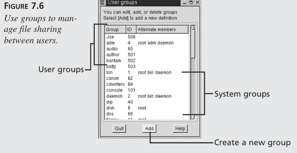

**图 7.6**

使用组来管理用户之间的文件共享。

- 用户组。
- 系统组。
- 创建新组。

2. 点击“添加”按钮以显示如图 7.7 所示的“组规范”窗口。

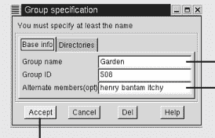

**图 7.7**

在将用户分配到组之前，你需要每个用户的用户名。

- 为组命名。
- 将用户分配到组。
- 应用更改。

3. 在“组名”文本框中为新组输入一个名称。

4. 点击“备选成员（可选）”文本框，输入你想要添加的第一个用户的用户名。然后按下空格键，输入第二个用户名。继续操作，直到你将所有想要的成员都加入组中。

5. 点击“目录”选项卡，在“家基目录”文本框中输入该组存储文件的目录路径。如果目录尚不存在，请不必担心；Linuxconf 将为你创建该目录并赋予适当的权限。

6. 点击“接受”按钮。“组规范”窗口将消失，你添加的成员将出现在“用户组”窗口中组名的旁边，如图 7.8 所示。

## 图 7.8

一旦创建了组，用户就可以开始共享文件和目录。

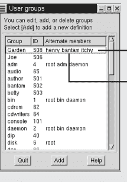

- 新组。
- 分配到该组的用户。

> 如果您需要更改分配到该组的用户，请点击“用户组”窗口中的组名。

## 与用户组共享文件

组织参与项目的人员并使他们能够共享工作成果的一种非常有效的方法，就是由项目所有成员组成一个工作组。这允许工作组共享由组成员创建的文件访问权限。创建文件的组员可以控制其他组员对该文件的访问权限。

文件访问权限的分配或拒绝是 Linux（UNIX）安全系统的核心。访问权限分为三种：读取（read）、写入（write）和执行（execute）。这些权限分配给三种用户：所有者（Owner）、组员（Group member）和其他用户（Miscellaneous/others）。通过控制对文件的访问，你就控制了整体安全。创建文件的用户决定谁有权读取该文件、写入该文件，或者在它是可执行文件的情况下执行它。

## 课 7.4：设置目录的组访问权限

如果您（作为 `root` 或超级用户）创建了一个供组员存储文件的特殊目录，您需要赋予该组访问该目录的权限。请按照以下步骤操作：

1. 打开文件管理器，并在右侧窗格中显示相应的目录，如图 7.9 所示。

### 系统管理任务

**图 7.9**

系统管理员需要向组员授予对该组使用的任何目录的访问权限。

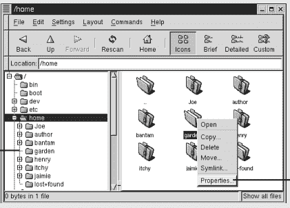

- 工作组目录。
- 编辑属性以更改目录权限。

2. 右键单击该目录，从出现的菜单中选择“属性”。这将打开该目录的“属性”对话框（见图 7.10）。

**图 7.10**

为组分配访问该目录的权限。

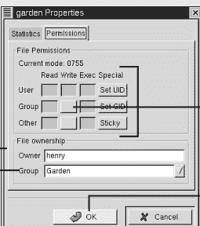

- 设置组管理器。
- 从列表中选择组。
- 选择允许该组保存对目录中文件的更改。
- 应用更改。

3. 清空“所有者”文本框中的内容，输入将为该组管理目录结构和文件的组员姓名。只有目录的所有者才能向该目录写入文件。

4. 点击“组”列表框的下拉箭头，选择将使用该目录的组。组员将拥有该目录的访问权限，但不能在目录中放置新文件。

5. 如果目录所有者希望赋予组员修改组目录中文件并将其保存回目录的能力，请选择“组写入”按钮。

6. 点击“确定”。现在，组员可以开始在组目录中处理其组的文件了。

## 设置文件权限

在设置好组目录并应用组所有者和成员的权限后，所有者需要将组所需的文件移至该组目录中。文件移动完成后，所有者需要决定其他组员如何处理这些文件。

如本小时早些时候提到的，设置文件权限是在维护文件安全的同时，在需要时允许其他用户访问文件的方法。回想一下，您在命令行中使用`ls -l`命令来获取目录内容的详细列表。该信息的一部分是由字符和短横线组成的字符串，它表示文件的访问权限。


要设置文件权限，请右键单击文件并从出现的菜单中选择“属性”。这将打开文件的“属性”对话框。点击“权限”选项卡以显示文件的访问权限选项（如图 7.10 所示）。您可以允许以下类型的文件访问：

- “读取”选项赋予用户（即所有者）和组只读访问权限。
- “写入”选项赋予所选用户和组修改文件的能力。

> 您可以一次为多个文件设置权限。为此，在右键单击并选择“属性”之前，请突出显示所有需要相同权限的文件。


然后，您需要通过显示“组”下拉列表并选择需要访问文件的组，来设置拥有文件访问权限的组。

## 收集系统信息

了解您的系统情况是让任何新事物顺利适应的不可或缺的一部分。您可以获取有关正在运行的 Linux-Mandrake 发行版的信息，以及有关系统发布版本和 Linux 内核的信息。您可以使用自己的用户账户完成此操作。

如果您使用的是 GNOME 用户界面，可以在主菜单的“实用程序”（Utilities）$\rightarrow$“系统信息”（System Info）中找到这些信息。“系统信息”窗口会显示您运行的 Linux 发行版及其内核编号，以及有关计算机当前使用情况的一些信息。要查看硬盘使用了多少空间、内存使用了多少以及 CPU 信息，请点击“详细信息”按钮。

KDE 用户可以通过主菜单$\rightarrow$“设置”（Settings）$\rightarrow$“信息”（Information）找到大部分相同的信息。这将显示一个您可以跟踪的不同项目菜单。您也可以打开 KDE 控制中心并选择“信息”类别。

## 更新时间

在世界各地的温带时区（夏威夷、波多黎各、维尔京群岛、亚利桑那州大部分地区和印第安纳州部分地区除外），每年会发生两次夏令时变更。现在我们要处理夏令时——这个维持良好出勤记录和记住电视节目播出时间的重大障碍——但 Linux 会自动处理。虽然这很方便，但它无法解决像从一个时区移到另一个时区，或者在时钟慢了几分钟时将其重置为正确时间之类的问题。

要在 KDE 界面中更改时间或日期，请打开主菜单并选择“设置”$\rightarrow$“日期和时间”。点击您想要更改的项目（如小时、分钟或日期），然后点击上或下箭头将显示内容更改为您想要的值。

## 总结

在过去的一个小时里，您学习了担任计算机网络系统管理员的基本情况。这仅仅是系统管理员职责的一小部分。当多个用户共享一台计算机、目录和文件时，管理员需要确保每个人都有适当的账户，设置好用户组，并确保每个人都能访问他们有权使用的文件。

## 问答

- **问：** 我经常听到关于 Linux 日志文件的说法。我知道它们显示了对计算机配置所做的更改。我该如何查看 Linuxconf 对系统所做的更改？

- **答：** 打开 Linuxconf 并点击主窗口中的“控制”选项卡。然后点击“日志”以打开系统日志窗口。该窗口有两个选项——“启动消息”和“Linuxconf 日志”。点击“Linuxconf 日志”。配置更改列表将在另一个窗口中出现，您可以点击任何一项更改来查看执行的命令。

- **问：** 还有其他我可以用来查看计算机运行情况的实用程序吗？

- **答：** 这取决于您使用的是哪个用户界面。查看硬盘占用空间的一种快速方法是使用 KDiskFree，它位于 KDE 主菜单的“系统”下。此外还有 K 文件系统控制（位于 KDE 主菜单的“实用程序”中），它同样显示硬盘被如何占用。KDE 还有一个“用户管理器”，但只有在登录 root 账户时才可用。

  如果您使用的是 GNOME，请尝试 GNOME DiskFree。您可以在 GNOME 主菜单的“实用程序”菜单中找到它。该实用程序会显示硬盘上的可用空间。在“实用程序”菜单中还有一个用于更改登录用户账户密码的实用程序。此外，GNOME 系统监视器也在“实用程序”菜单中；如果您想了解计算机运行的具体细节，请查看它。

- **问：** 可以使用 Linuxconf 来更改计算机的时间吗？

- **答：** 可以。打开 Linuxconf 并点击主窗口中的“控制”选项卡。然后选择“日期和时间”。您需要在“工作站日期和时间”窗口的文本框中输入正确的日期和时间。

  由于使用 Linuxconf 需要登录 root 账户，您可能会发现 Time Machine 也是一个方便的工具。您可以通过 GNOME 主菜单选择“系统”$\rightarrow$“时间工具”来找到它。

## 实践

管理用户和组是共享文件的一种简单方法。在测试了您的系统管理知识后，请在您自己的系统上尝试这些新技能。

## 测验

1. 您使用什么方法与系统上的其他用户共享文件？
2. 您如何赋予组员修改文件的能力？
3. 您可以在哪里查看计算机硬盘使用了多少空间？
4. 什么时候您需要更改计算机时钟的时间？

## 练习

1. 你可能想进一步了解文件权限的工作原理。一种方法是阅读一些关于文件命令的 man 手册页。查找 `chmod` 命令，它用于更改访问权限。此外还有 `chown` 命令，用于更改文件和目录的所有权属。你可能还想查阅 Linux 安全 HOWTO（`/usr/doc/HOWTO/Security-HOWTO`）以学习如何保持计算机系统的安全。它涵盖了物理安全、用户和组、文件权限、密码以及备份和恢复程序。

2. 拿出你的系统管理员笔记本，记录下你创建的用户。接下来，决定用户将如何共享文件。你可能想创建一个目录，让家庭管理人员共享家庭预算信息。另一个目录可以由共同创建网站的成员访问。你还需要记录你创建的所有组以及用于共享文件的目录结构。

# 第 8 小时：备份文件系统

执行备份是系统管理员或任何计算机所有者最重要的维护工作之一。无论你拥有的是一台计算机还是许多联网计算机，你都需要维持一个良好的备份系统，以确保你的数据免于丢失或损坏。因此，花一些时间组织你的数据并建立一个良好的备份系统至关重要。

在规划备份策略时，了解你应该备份什么、可以将数据备份到什么介质上以及可以使用哪些工具来控制备份是非常重要的。今天，你将学习以下内容：

- 哪些重要文件需要备份
- 如何使用备份和归档命令
- 如何使用备份介质

## 决定如何备份以及备份什么

毫无疑问，当你学习使用 Linux-Mandrake 时，一些实验性的操作可能会导致你的 Linux 系统出现意想不到的“定制”结果。有时这些更改无法轻易恢复，甚至你可能无法通过简单的重新安装系统来将事物恢复到你想要的状态。但是，由于你的 CD-ROM 或原始软盘可以作为绝佳的备份，因此可能不需要备份整个系统。

> “升级你的 Linux 发行版”mini-HOWTO（位于 `/usr/doc/HOWTO/mini` 目录或 `www.linuxdoc.org/HOWTO/mini/Upgrade.html`）为备份你的 Linux 系统提供了一个可靠的计划。

### 需要备份的重要文件

你通常会进行更改的文件是位于 `/etc` 中的系统配置文件。你安装的程序的其他配置文件也应备份。你还应该归档一些目录——`/usr/lib/lib` 和 `/usr/X11R6/lib/X11` 目录（后者是因为它包含你的 X Window 配置文件）。

如果你构建或升级了自己的内核，你还应该备份位于 `/usr/src/linux` 的内核源代码文件。

> 你可能还记得，我们一直唠叨让你准备一个笔记本，记录对 Linux 系统所做的更改、遇到的问题以及相应的解决方案。那么，现在又是这样一个时刻：如果你记录下自己的操作并写下备份的内容，一旦系统发生不幸的事情，这将是一个巨大的帮助。

你应该备份每个用户的主目录。这些目录位于 `/home` 中，但 root 用户除外，其目录位于 `/root`。

如果你配置了 Linux 系统来接收电子邮件，你可能想备份用户的入站邮件文件。它们位于 `/var/spool/mail`。

## 使用 `find` 命令

`find` 绝对是任何文件系统管理员最有用的命令之一。使用带有正确参数的 `find` 可以帮助你通过文件名、文件权限或最后修改时间在整个系统中定位文件。该命令还可以为它找到的文件执行程序。`find` 还可以生成它找到的文件列表，然后该列表可以与 `tar` 结合使用来归档文件（以及该列表）。

### 使用 `find` 命令定位文件

当你需要在 Linux 文件系统中查找某些文件时，请使用 `find` 命令。`find` 命令的语法为：

```bash
find path expression
```

`path` 参数指定你想要开始查找的文件系统位置（例如 `/` 根目录）或要搜索的目录的具体路径。

`expression` 参数指定 `find` 执行你想要的特定任务时应使用的选项。表达式以 `-`、`(`、`)` 或 `!` 开头。其后的所有参数都被解释为表达式的其余部分。如果你没有给 `find` 提供路径，它将使用当前目录。如果你没有给 `find` 提供表达式，它将使用 `-print` 作为表达式。

例如：

```bash
find / -mtime -7 \! -type d -print > /tmp/backuplist.weekly
```

上述命令将完成以下任务：

- 路径参数（在本例中为 `/`）从根目录开始搜索。
- `-mtime -7` 表达式参数查找在过去 7 天内修改过的文件。
- `! -type d` 表达式参数排除类型为 d（目录）的文件。（你需要 `/` 字符来告诉 shell `!` 不是 shell 命令，而是 `find` 命令的否定操作。）
- `-print > /tmp/backuplist.weekly` 表达式参数将文件名列表打印到 `/tmp` 目录下的 `backuplist.weekly` 文件中。

在本小时内没有时间或空间详细讲解 `find` 的所有用途。你可以从 GNU `find` 的 man 手册页中获取使用信息。要充分发挥其优势需要一定的练习，但投入时间和精力是非常值得的。

## 使用备份工具

你的 Linux-Mandrake 发行版中包含几个用于备份或归档文件和目录的优秀工具。本节涵盖 Linux 命令行实用程序。

### 使用 `tar`、`gzip` 和 `cpio`

一旦你选定了想要备份的文件和目录，就可以使用 `tar` 命令将它们直接备份到备份介质中。`tar` 可以与任何你拥有的介质配合工作，但它不压缩文件。`tar` 命令还可以创建多卷归档，以便在软盘或磁带等小容量介质上使用。

`tar` 命令有 49 个选项（至少数出来的），使你能够以各种方式进行复制和从归档中恢复。Tar 是 tape archive（磁带归档）的缩写，最初是为了将备份写入磁带介质而开发的。它的优点包括能够备份整个目录结构并完整地恢复它们。它的缺点是缺乏容错能力。这使得它容易受到存储介质坏道问题的影响，这种情况在软盘和磁带上经常发生。尽管 `tar` 最初是为磁带备份开发的，但它在其他介质上同样运行良好。

### 使用 `tar` 创建归档

一旦你编译了一个文件列表（使用 `find` 命令），然后就可以告诉 `tar` 归档这些文件。`tar` 命令的语法为：

```bash
tar functionoptions files
```

其中 `functionoptions` 是一个表示要执行的操作（功能）的单字母，加上一个或多个单字母（该功能的选项）。在命令中，功能字母和选项字母之间没有空格。`files` 是 `tar` 将放入归档中的文件列表。

在以下示例中：

```bash
tar -cv -T /tmp/backuplist.weekly -f /dev/cdrw
```

`tar` 执行以下任务：

- `-cv` 参数创建归档（功能 `c`）并在打包或解包归档时打印大量信息（选项 `v`）。
- `-T /tmp/backuplist.weekly` 参数备份 `backuplist.weekly` 文件中列出的文件。
- `-f` 参数告诉 `tar` 使用接下来的参数作为归档名称。
- `/dev/cdrw` 参数将归档存储在 `/dev/cdrw` 设备中。

> 组织和个人备份数据的方式多种多样。因此，与其浪费时间浏览选项列表，不如查阅 `tar` 的 man 手册页。

一旦你将存档打包（tarred），就可以使用 gzip 工具 `gzip` 对其进行压缩。生成的 `.tgz` 文件将小得多。然而，`gzip` 存在与 `tar` 相同的容错问题。大多数压缩程序（包括 `gzip`/`gunzip`）都依赖于数据存储在一个无中断的平滑数组中，且没有缺失或损坏的块，才能正确地还原数据。

> 请测试你的备份介质，确保其中不包含任何损坏的块或扇区。花时间执行此操作，可以避免在 `gunzip` 无法工作且随后无法使用 `tar` 打开存档时陷入困境。

你的 Linux 发行版中还包含另一个存档实用程序，可以帮助你避免一些与 `tar` 相关的问题——`cpio`。`cpio` 工具为 `tar` 的其中一个问题提供了解决方案。该问题源于 `tar` 存储备份的方式：`tar` 存档被存储为一个单一文件，这意味着如果存档文件以任何方式损坏，`tar` 就无法访问其中包含的任何文件。

`cpio` 工具像 `tar` 一样将文件一起存档，但它使用更简单的方法存储它们，并能从数据损坏中恢复。它可以将文件复制进出 `cpio` 存档和 `tar` 存档。不过，`cpio` 仍然无法很好地从损坏的 gzipped 文件中恢复。

## 使用 `dump` 工具

Linux-Mandrake 安装光盘上有一个名为 `dump` 的工具。`dump` 工具检查 Linux 文件系统中的文件，并确定哪些文件需要备份。然后，它将这些文件复制到给定的介质（磁带）中。如果备份内容对于该介质来说太大，则会被拆分为多个卷。`dump` 工具可用于备份整个文件系统，或者进行增量备份，以备份自上次增量备份以来所有已更改的文件。如果你想使用 `dump`，请查看其命令语法的 man 手册页。

## 使用软盘驱动器

备份少量文件最简单的方法无疑是将它们复制到软盘上——可以通过简单的复制，或使用 `tar` 和 `gzip` 工具。对于只有一台 Linux 计算机的用户，这可能是一个充分的备份方案，甚至在很长一段时间内都适用。当然，你利用 3.5 英寸软盘驱动器作为备份设备的能力取决于你需要备份的数据量。大型系统的全量备份可能需要高达 2GB 的存储空间，这显然需要太多的软盘。对于这种规模的任务，还有其他选择；我们将在本小时稍后的“在 CD 读写介质上创建备份”章节中讨论。

虽然 3.5 英寸软盘无法存储大量数据，但如果你的通用备份计划是保留已安装应用程序的安装介质，然后只需每隔几天备份一次工作文件，那么它们仍然能发挥相当不错的作用。使用软盘驱动器作为备份设备有几种选择。你可以将它们格式化为 DOS 软盘，然后在 Linux 中读取其中存储的文件。或者，你可以在软盘上安装 Linux 文件系统（ext2 文件系统），然后直接将数据复制到那里。接下来的章节将讨论将 3.5 英寸软盘驱动器用作 DOS 驱动器并在其上存储 Linux 文件。

### DOS 软盘

在初始设置期间，Linux-Mandrake 会配置你的软盘驱动器以自动确定文件系统类型。换句话说，当你在软盘驱动器中挂载 DOS 磁盘时，它将识别 vfat 文件系统并将驱动器挂载为 DOS 驱动器。当你挂载一个具有 ext2 文件系统的磁盘时，也会发生相同的过程：Linux 会检查文件系统类型并将软盘挂载为 Linux 驱动器。无论挂载的是哪种文件系统，你都可以从中读取文件并向其保存文件。这比必须手动挂载每个软盘文件系统有了巨大的改进。

另一个巨大的优势是，它使你能够将 Linux RPM 包和应用程序下载到任何方便的计算机上。与许多有时需要数兆字节空间的 Windows 和 Macintosh 应用程序不同，Linux 应用程序往往更小巧、更精炼。事实上，相当多的应用程序（甚至是许多复杂的程序）足够小，可以下载到单个 1.44MB 的软盘中。你可以直接将软盘带到你的 Linux 机器上并安装该应用程序。

### Ext2 文件系统软盘

Ext2 是 Linux 原生文件系统类型。如果你使用 Linux 格式化软盘，它会在软盘上创建一个 ext2 文件系统，你可以将其挂载并作为硬盘上 Linux 系统的扩展使用。通过在软盘上使用 ext2 文件系统，你可以使用 Linux 文件系统管理工具来跟踪你的数据，并且可能能够还原或恢复损坏的数据。

### 跨平台文件管理

当你安装 Linux-Mandrake 时，你是将其安装在 Windows 机器硬盘的一个分区上，并安装了 Linux/Windows 互联功能。这允许你使用 Linux 文件管理器访问 Windows 驱动器。你也可以将 Linux 文件存储在这个 Windows 驱动器上。

## 课程 8.1：将文件移动到 DOS 分区

将文件从 Linux 分区复制或移动到 DOS/Windows 分区只需要简单的拖放。请遵循以下步骤：

1. 打开 KDE 文件管理器，从“视图 (View)”菜单中选择“展开树 (Expand Tree)”，然后导航到存储你要移动或复制文件的 Linux 目录。
2. 确保你的 Windows 分区已挂载。打开第二个 KDE 文件管理器，并导航到你想要移动或复制文件的 Windows 目录。
3. 在第一个文件管理器中点击你要移动的文件，将其拖到第二个文件管理器的右窗格中，然后释放按钮。
4. 从弹出菜单中选择“移动 (Move)”或“复制 (Copy)”。文件将被移动或复制。

> 你可以用同样的方式将文件从 Windows 分区传输到 Linux 分区。

## 在 Linux-Mandrake 中使用 DOS 文件

有些类型的 DOS 文件 Linux 可以读取（例如 `.txt` 文件），而且对于大多数图形格式都有查看器，除了像微软的 Windows 元文件（`.wmf`）格式等少数格式外。还有一套在 Linux 之前开发的工具集，包含对非原生文件系统的支持，称为 Mtools。Mtools 软件包包含一组命令，允许你在 Linux 中操作 Windows 目录和文件。如果你在安装 Linux-Mandrake 时选择了 DOS/Windows 互联，则会安装 Mtools 软件包。要查找更多关于 Mtools 命令及其操作的信息，请参阅以下命令的 man 手册页：


`mattrib`、`mcd`、`mcopy`、`mdel`、`mdir`、`mformat`、`mlabel`、`mmd`、`mrd`、`mread`、`mren`、`mtype`、`mwrite`

有几个 Linux 应用程序可以有效地处理 Windows 格式的文件。Emacs、Maxwell 和 WordPerfect 可以读取 `.doc` 文件并导出富文本格式 (RTF) 文件。还有像 StarOffice 和 AppliXare 这样的办公生产力套件应用程序，可以将文件转换，但准确度各异，你可能需要手动编辑转换后的文件以获得完全想要的结果。

## 使用 Zip 驱动器存储文件

Iomega Zip 和 Jaz 驱动器已经存在一段时间了，它们有不同的容量。Zip 驱动器有 100MB 和 250MB 两种规格，而 Jaz 驱动器最多可存储 2GB 数据。磁盘可以用 Windows vfat 32 文件系统或 ext2 Linux 原生文件系统进行格式化，并作为另一个硬盘使用。

## 在 CD 读写介质上创建备份

正如我们在本小时早些时候提到的，有些系统需要大型存储介质来进行全量备份。当你备份一个拥有许多用户和各种备份需求的网络系统时，你不会希望维护成堆的磁盘或磁带（这些仍必须小心地存储在远离腐蚀影响的地方）。目前的最佳解决方案可能是使用 CD-R 或 CD-R/W 驱动器在紧凑光盘上创建备份。这将为你提供一种不易损坏的非磁性存储介质，如果你需要长期保存，其寿命可达 100 年。

## 总结

你可以采取的最重要的维护任务之一就是进行定期备份。备份非常重要，以防由于用户错误或自然灾害（如停电）导致文件丢失、删除或损坏。通过将这些文件保存在一个单独的存储介质上，你可以确保 Linux 处于良好的运行状态。

## 问答

- **问：** 我的电脑连接了一个 Iomega Zip 驱动器。有什么资源可以帮助我在 Linux 系统上设置 Zip 驱动器吗？

- **答：** 你应该阅读 `www.linuxdoc.org/HOWTO/mini/Zip-Drive.html` 上的 Zip Drive mini HOWTO。你可能想查看 `www.torne.net/~campbell` 上的最新 Zip 并口驱动程序。尝试使用 `jaZip` 程序，它同时支持 Iomega Zip 和 Jaz 驱动器。你可以在 `www.scripps.edu/~jsmith/jazip` 找到 `jaZip`。

## 工作坊

保持 Linux 系统的安全意味着你必须不断备份重要文件。为了验证你在过去一小时中所学内容的掌握情况，你必须测试自己的知识。

1. 文件系统中哪些是最重要、应当被备份的文件？
2. 可以使用哪些备份工具来备份和归档重要文件？
3. 可以使用什么类型的介质来存储备份？

## 练习

1. 现在你可以再次尝试在记录 Linux 系统的笔记本中增加一个章节。为你的 Linux 系统创建一个备份计划。决定哪些文件需要备份哪些以及备份频率。然后选择一个存储备份的介质（软盘、磁带或 CD）。接着，找一个安全的地方存放备份介质。
2. 上网查看是否能找到其他可以帮助你备份文件并创建压缩归档（例如你在 Windows 操作系统中习惯使用的 `.zip` 文件）的应用程序。

> **问：** 我的电脑连接了 CD-R/W 刻录机。在哪里可以找到关于如何在 Linux 中使用它的信息？
>
> **答：** 你应该首先查看 `metalab.unc.edu/linux/HOWTO/CD-Writing-HOWTO.html` 上的 CD-Writing HOWTO。这份 HOWTO 提供了设置 CD-R/W 所需的所有信息，以及烧录 CD 所需的程序。
>
> **问：** 除了保持文件系统备份外，还有什么其他方法可以保护我的 Linux 系统吗？
>
> **答：** 你可能需要考虑将 Linux 系统连接到不间断电源（UPS）。如果意外断电，Linux 将无法正常关机，在电源恢复后，你可能会遇到系统无法启动的问题。通过为系统连接 UPS，你可以设置 Linux，以便在断电且 UPS 发出警报时，Linux 能自动正常关机。要了解更多操作方法，请阅读 UPS-HOWTO（`www.linuxdoc.org/HOWTO/`）。

# 第 9 小时：管理应用程序

几个小时前，在第 4 小时“在图形化工作空间中生活”中，你学习了如何浏览 KDE 和 GNOME 菜单，以寻找 Linux 计算机上可用的一些应用程序。在浏览了所有这些菜单和应用程序列表后，你可能在心里想：“这个 Linux 发行版里不可能还有更多应用程序了。”嗯，再想想。

GNOME 和 KDE 菜单仅包含 Linux-Mandrake CD-ROM 上数百个应用程序包中的一小部分。有大量应用程序已经安装，但并未包含在菜单中。而且可能还有一些应用程序尚未安装。这完全取决于你在安装 Linux-Mandrake 时选择了哪些组件。在本小时中，你将学习如何搜索系统和 CD-ROM 以寻找更多应用程序。

当你对 Linux 更加自信后，你可能会想独立探索，并在互联网上寻找 Linux 的应用程序包。你会惊讶地发现那里有如此之多资源。除了下载时间外，所有这些都是免费的。

有两个工具可以帮助你寻找已安装的应用程序并安装更多应用程序——KPackage 和 Gnome-RPM。在本小时结束时，你将知道如何使用这些工具来完成以下操作：

- 寻找未在 GNOME 和 KDE 菜单中出现的应用程序
- 确保应用程序已正确加载，并删除不需要的应用程序
- 从 CD-ROM 安装应用程序包
- 从互联网下载并安装软件包

## 寻找一些优秀的程序

在计算机领域，应用程序才是核心。计算机的吸引力在于软件程序能够轻松地完成从撰写短信到创建复杂 Web 图形的所有工作。Linux 的乐趣在于拥有海量的软件应用程序集。其中一些应用程序在 Linux-Mandrake CD 上，另一些则可以在互联网上找到。

**新术语**

一旦你找到了这些程序，接下来的简单步骤就是说服一个软件包管理器（package manager）为你安装该程序。软件包管理器简化了 Linux 软件包的安装和升级。软件包管理器不仅能在你的 Linux 系统上加载新程序，还能帮助你保持这些程序的更新并确保它们按预期运行。

通过软件包管理系统的神奇力量，你甚至可以通过搜索损坏的文件并替换它们来修复已安装的应用程序。软件包管理器确保在安装和卸载软件包时维护文件依赖关系。软件包管理器甚至会告知你需要安装哪些额外的软件包，才能使所选软件包正常工作。

在你决定开始向 Linux 系统添加或删除应用程序之前，你应该先浏览一下软件包管理器，看看系统中已经安装了什么。KDE 和 GNOME 各自拥有自己的软件包管理实用程序。让我们来看看它们如何为你服务。

> 点击桌面上的 RpmDrake 图标将打开下面描述的 Kpackage 实用程序的 Mandrake 前端，它增加了一项功能，让你能够显示 Linux CD 上尚未加载到系统中的软件包。

## Gnome-RPM 入门

Linux-Mandrake 构建在 Red Hat Linux 发行版之上，并使用 Red Hat 软件包管理系统 (RPMS) 来管理应用程序。Gnome-RPM 是 Red Hat 软件包管理系统的 GNOME 图形前端，该工具将操作应用程序以及将已安装程序与其源代码（以及其他此类复杂的各种技术操作）进行对比地变成了简单的任务。

所有像安装、升级和卸载软件包这样简单而关键的任务必须由 root 账户执行。但普通用户可以查询软件包并验证它们以确定其状态。

要找到 Gnome-RPM，请从主菜单选择“系统 (System)”，然后选择“GNOME RPM”。你也可以在 X 终端窗口中输入 `gnorpm`。

花点时间观察图 9.1 所示的 Gnome-RPM 窗口。左侧出现的目录树列出了已安装软件包的类别。右侧面板显示每个类别中包含的软件包列表。要展开目录列表，只需点击目录名称旁边的加号。

**图 9.1**

Gnome-RPM 列出了随 Linux 操作系统安装的所有软件包。

- 点击展开列表
- 显示某个类别中的软件包
- 选择一个软件包

### 课程 9.1：使用 Gnome-RPM 寻找已安装的应用程序

Gnome-RPM 可以为你提供大量关于随 Linux-Mandrake 安装的应用程序的信息。对于此练习，你不需要登录 root 账户。系统上的任何用户都可以查看已安装应用程序的信息。以下是了解如何利用 Linux 系统实现更多功能的步骤：

1. 从某个类别中选择一个软件包，然后点击“查询 (Query)”按钮以显示该应用程序的软件包信息。示例见图 9.2。

   **图 9.2**

   查询软件包以了解其功能、所在位置以及在哪里可以找到更多信息。

   - 程序执行命令
   - 版本号
   - 程序描述
   - 程序执行目录
   - 已安装文件的位置
   - 从系统中删除应用程序

2. 如果你在 KDE 或 GNOME 菜单中找不到该程序，请打开 X 终端窗口，输入在“软件包信息 (Package Info)”窗口顶部找到的程序执行命令。程序将启动，或者 X 终端窗口中会出现包含关于如何运行该程序的更多信息的提示。

3. 每当你怀疑某个程序运行不正常时，请点击“验证 (Verify)”按钮。Gnome-RPM 将验证该应用程序是否正确安装，并检查程序文件是否存在问题。在将其安装内容与源码对比后，它会告知你任何问题。

> 如果你想了解更多关于某个应用程序的信息，请查找该软件包的文档文件。（你会看到列表第一列中有一个字母 D。）记录下文档文件的目录路径和文件名，然后在文本编辑器或浏览器窗口中打开该文件。

4. 阅读完软件包信息后，点击“关闭 (Close)”按钮。

## 浏览 KPackage

KPackage 是 KDE 的软件包管理器，虽然它执行的大多数操作与 Gnome-RPM 相同，但执行方式略有不同。有几种方法可以进入 KPackage。你可能会在 KDE 桌面上发现一个 RPM 图标；如果没有，请尝试“实用工具 (Utilities)”下的 KDE 应用程序启动器菜单。你也可以在 X 终端窗口中输入 `kpackage`。KPackage 软件包管理器界面如图 9.3 所示。

## 管理应用程序

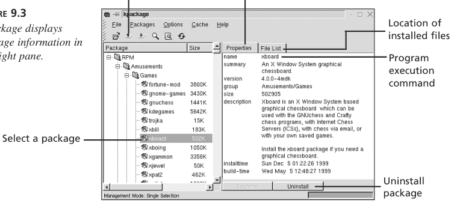

**图 9.3**

KPackage 在右侧窗格中显示软件包信息。

选择软件包 →  
安装文件的位置 →  
程序执行命令 →  
卸载软件包 →

要查看已安装软件包的完整列表，请单击 KPackage 工具栏上的“展开软件包树”（Expand Package Tree）按钮。当您从类别列表（窗口左侧）中选择一个软件包时，详情将显示在右侧。

> 当您显示软件包信息时，“安装/卸载”（Install/Uninstall）按钮会被激活。如果您查询的是已安装的软件包，按钮将显示为“卸载”（Uninstall）；如果您查询的软件包尚未安装，按钮将显示为“安装”（Install）。

### 课 9.2：使用 KPackage 卸载应用程序

您可能会发现，软件包管理器中列出的某些应用程序仅仅是在占用系统空间，而您希望将这些空间留给以后可能想要安装的其他应用程序。在从 Linux 系统卸载程序之前，您需要登录 root 账户。

在 KPackage 和 Gnome-RPM 中，您都可以在信息窗口的底部找到卸载软件包的按钮。要删除系统中不再需要的任何软件包，您需要执行以下操作：

1. 选择您想要卸载的软件包并显示软件包信息窗口。
2. 点击“卸载”（Uninstall）按钮，显示如图 9.4 所示的确认对话框。

   **图 9.4**

   从 Linux 系统中选择您想要卸载的软件包。

   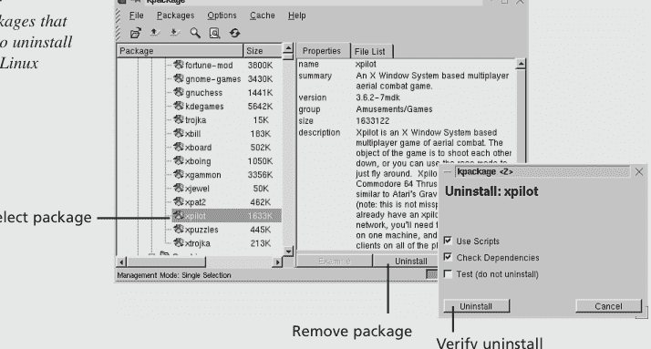

3. 如果您确定要从系统中删除所选软件包，请点击“卸载”（Uninstall）按钮。KPackage 将从系统中删除所有相关应用程序文件。应用程序卸载完成后，您将返回到 KPackage 窗口。

## 安装应用程序

现在您已经有机会浏览 Linux 系统并查看所有已安装的软件，是时候加载更多软件了。要在 Linux 机器上安装软件安装包，您需要软件包管理器的帮助。软件包管理系统通过提供便捷的升级路径和新应用安装方式，使您能够维护 Linux 系统及其应用程序。

显然，寻找更多软件的首选之地是 Linux-Mandrake CD-ROM。除非您在初始安装期间选择了安装所有组件，否则 CD 上仍有大量软件供您尝试。

除了 Linux-Mandrake CD 上的软件外，您还可以安装来自其他 Linux 发行版的软件包。例如，如果您有 Red Hat 或 Slackware 发行版，请将该 CD 放入光驱并查看可用软件。

由于 Linux 是在互联网上构思和开发的，所有适用于 Linux 操作系统的应用程序都可以在网络上找到。您只需要找到想要的软件包，下载并安装即可。

### 在 Linux-Mandrake CD-ROM 上查找应用程序

寻找更多软件的首选之地是 Linux-Mandrake CD。这些应用程序不仅易于查找和加载，而且您可以相对确定这些软件包在 Linux-Mandrake 上能正确安装。

> 无论您使用哪个 Linux 发行版 CD，您都会在 CD-ROM 的 `RPMS` 子目录中找到所有可用软件包。

### 课 9.3：使用 Gnome-RPM 安装软件包

是时候再次取出 Linux-Mandrake CD，看看在计算机上加载 Linux 操作系统时有哪些软件包没有安装。要从 CD 安装应用程序包，请登录 root 账户并执行以下步骤：

1. 将 Linux-Mandrake CD-ROM 放入光驱并挂载 CD-ROM。
2. 打开 Gnome-RPM 并点击工具栏上的“安装”（Install）按钮。“安装”窗口将打开并显示一个类别列表，其中包含 Linux Mandrake CD 上尚未安装在计算机上的 RPMS 软件包。
3. 点击“展开树”（Expand Tree）按钮。类别列表将展开以显示该类别中的所有软件包（如图 9.5 所示）。

   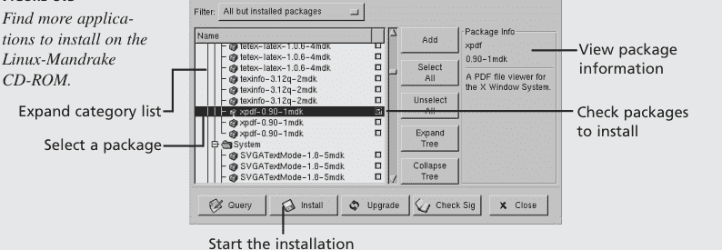

   开始安装

4. 点击软件包名称以阅读该软件包的描述。
5. 在您想要安装的软件包旁边的方框中打勾。
6. 点击“安装”（Install）按钮。在软件包安装过程中会出现一个状态对话框。安装完成后，您将返回到“安装”窗口。

> 如果为了使选定软件包正常工作而需要其他软件包，则会出现“依赖问题”（Dependency Problems）对话框。要安装这些依赖项，请点击“否”（No）按钮，选择所需的软件包，然后再次尝试安装。


7. 完成应用程序安装后，点击“关闭”（Close）按钮返回 Gnome-RPM。

## 从互联网下载软件包

当然，还有许多应用程序未包含在 Linux-Mandrake 发行版中。许多软件可以通过互联网上的 Linux 站点获取。毕竟这是 Linux，任何发行版站点都是可以尝试的。定期访问不同发行版的站点以查看有哪些可用软件及其更新也是非常有益的。

Linux 的增长如此迅速，几乎每天都有新东西出现。定期浏览互联网上的各种 Linux 站点和镜像站点是一个好主意。镜像站点的 `pub` 目录中经常有并非所有站点都具备的工具。通过这种方式，您可以保持应用程序的升级并获取新应用。

### 课 9.4：使用 KPackage 安装应用程序

从互联网下载并安装 Linux 软件比您想象的要简单。如果您认为自己是一个 Web 浏览达人，可以尝试一下您的下载技巧。以下是从互联网安装 Linux 软件的方法：

> 在开始本课之前，您需要连接互联网。如果您需要创建拨号连接，请参阅第 11 小时“接入互联网”。您还需要登录 root 账户。


1. 打开您最喜欢的 Web 浏览器并导航至 `rufus.w3.org`。在这里您会发现比您可能需要的还要多的应用程序。当您发现喜欢的软件时，将其下载到计算机上。您可以将其存储在 `/root` 目录的子目录中。
2. 打开 KFM 文件管理器，导航到存储下载的 RPM 文件的目录。
3. 点击您下载的软件包。KPackage 将打开，左侧窗格显示“安装软件包”（Install Package）面板，右侧窗格显示所选软件包的“属性”页（Properties sheet）和“文件列表”（File list）（见图 9.6）。

   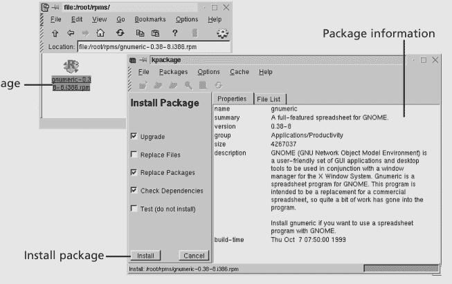

   **图 9.6**

   KDE 能够识别您何时想要加载软件包。

   下载软件包

“安装软件包”对话框为您提供了几个选项：

- 当您想要安装新软件包、升级软件包或重新安装已安装的软件包时，请使用“升级”（Upgrade）选项。“升级”过程可确保删除旧软件包的所有版本（如果存在），并应用原始设置。“卸载”功能并不总是能很好地清理应用程序和模块之间的依赖关系。
- 要替换已安装应用程序中的文件，请选择“替换文件”（Replace Files）选项。KPackage 实用程序通过替换损坏或丢失的文件来修复损坏的应用程序。
- 使用“替换软件包”（Replace Packages）选项来替换软件包。请将此选项与“升级”选项结合使用。
- 当您想要检查安装软件包产生的所有依赖关系时，请选择“检查依赖”（Check Dependencies）选项。
- 当您选择“测试（不安装）”（Test (do not install)）选项时，KPackage 会检查文件系统以确定软件包安装是否会成功。可以使用此方法来确定某个棘手的应用程序是否安装正确。
4. 做出选择后点击“安装”（Install）。KPackage 将开始安装。软件包安装完成后，您将返回 KPackage 面板，此时右侧窗格不显示任何内容。

## 总结


在过去的一个小时里，您了解到计算机上可用的 Linux 应用程序可能比您最初认为的要多。在浏览了 Linux-Mandrake CD（可能还有其他 Linux 发行版）之后，您可能发现了更多对您有用的应用程序。如果这些还不够，您可以上网并根据自己的心愿（以及硬盘的大小）下载 Linux 应用程序。

## 问答

**问：是否可以使用 KPackage 和 Gnome-RPM 一次安装或卸载多个软件包？**

**答：**如果您使用 Gnome-RPM，每次点击一个软件包，它就会被选中。请注意 Gnome-RPM 窗口底部状态栏会告知您选中了多少个软件包。如果您点击“卸载”（Uninstall）按钮，所有选中的软件包都将从系统中删除。如果您想要取消所有选中软件包，请点击“取消选择”（Unselect）按钮。

KPackage 有两种管理模式，用于控制您是每次只能选择一个软件包，还是可以选择多个软件包。要从单选模式切换到多选模式，请点击 `Packages` $\rightarrow$ `Multiple Selection Mode`。

**问：有没有什么简单的方法可以在互联网上找到我可以下载并安装在 Linux 机器上的软件包？**

**答：**Gnome-RPM 有一个很酷的 Web 查找工具。如果您已连接到互联网，请点击“Web 查找”（Web Find）按钮。Gnome-RPM 将联系 `rufus.w3.org` 网站并下载可用 Linux 软件包的列表。浏览此列表需要一段时间，因为它很长。当您发现感兴趣的软件包时，点击它即可显示软件包信息。如果您需要该软件包，可以直接安装，或者先下载 RPM 文件稍后再安装。

**问：**我在哪里可以了解更多关于 Red Hat 软件包管理系统的工作原理？

**答：**请尝试访问 `www.linuxdoc.org/HOWTO` 上的 RPM-HOWTO。此外还有一个 RPM+ Slackware 微型指南（mini-howto）。

## 工作坊

现在我们又结束了一个小时的学习，是时候看看你对软件包验证、安装和卸载这些内容的掌握程度了。由于大多数人需要操作系统的原因是为了运行应用程序，因此你应该确保你理解过去一小时所学到的知识。

### 测验

1. 什么是软件包管理器？在 Linux-Mandrake 发行版中可以使用哪些软件包管理器？
2. 如何找到安装在 Linux 计算机上但未出现在 KDE 或 GNOME 菜单中的软件程序？
3. 在哪里可以找到可安装在 Linux 计算机上的软件包？

### 练习

1. 使用 Gnome-RPM 为任何你想快速访问的应用程序创建桌面快捷方式。选择该应用程序，然后点击 `Packages` $\rightarrow$ `Create desktop entry`。系统会要求你为桌面快捷方式选择一个图标和保存位置。将快捷方式保存到 `/home/username/.gnome-desktop` 目录中。
2. 跟踪一些你最喜欢的 Linux 程序的更新情况。当新版本发布时，你可能想要升级它。使用 Gnome-RPM 中的 Web Find 工具来保持软件的最新状态。

# 第 10 小时：小型办公室/家庭办公室的网络构建

总的来说，Linux 是网络构建的一个好选择。这一点可以从当今存在的所有网络都运行在 UNIX 家族操作系统（如 Linux）的某个成员上得到证明。

对于小型办公室网络，Linux 是一个特别好的选择。因为 Linux 比其庞大的 UNIX 亲属更小巧、更友好，因此在操作时压力较小。而且，在创建和管理基于 Linux 网页版内网（Intranet）时，Linux 也能为你提供帮助。

建立一个网络并根据你目前的需求进行定制、规划未来的增长，以及利用它来推进你的商业目标，这一切都需要仔细的规划。只要你有良好的计划，Linux 的速度和效率就可以在几乎任何网络环境中被利用并为你高效工作。

本小时的重点是网络规划，信息主要面向于规划一个规模大到需要一定程度网络管理的网络。你们中的一些人可能会发现这超出了目前的实际需求，甚至可能觉得有点令人生畏。随着你的网络知识和需求的增长，本小时包含的信息将变得对你更有用且更全面。

如果你正在规划一个拥有几台工作站的小型办公室网络或家庭网络，并希望开始行动，本小时的指南将帮助你制定一个良好的计划。

在本小时中，你将评估你的需求和资产，并通过学习以下内容来规划一次成功的网络安装：

- 何时开始规划网络并实施网络计划
- 保持良好的文档记录和设备记录
- 搭建内网（Intranet）
- 保持网络的良好运行状态

## 何时是构建网络的正确时机？

**新术语：**构建*网络*（network）的正确时机就是需求出现之时。网络的目的是服务于人。网络应该以提高人们生产力的方式为他们提供服务。它应该通过消除工作流程中的瓶颈和障碍，以及加速沟通并减少团队项目中的徒劳努力来提供帮助。它还可以通过为组织增长的规划提供某种结构，帮助促进资源的优化分配和利用。

当你拥有两台或两台以上需要联网的计算机时，就是构建网络的时候。这看起来可能有点过于简单化。但是，如果你尽早开始并规划你的网络以最大限度地利用现有资源，随着组织的增长，你可以向网络添加更多组件，让它随你一起成长。

## 规划的重要性

良好的网络规划对于确保满足你的需求和目标、指导设备采购以及保持网络增长的目标感和方向感至关重要。

网络的成功实施始终是仔细规划的直接结果。规划过程解决了具体的需求和必要的变更，并定义了满足硬件/软件要求以及组织网络目标所需的资源。

**新术语：** *网络规划*（network planning）与网络实施之间的关系必须经过仔细考虑。为了产生效果，网络规划必须与一个期望实现的、可识别的变更相关联，其重点必须放在以有序的方式实施该变更上。

规划侧重于三个因素：人员、流程和组织。任何健康、强健的企业都寻求发展和增长。如果工作组经过仔细组织，能够共享资源、沟通以及网络提供的增强工作环境，你的用户将更具生产力，工作流程将更加顺畅，整个过程将对你组织的底线（利润）产生积极影响。

网络规划的成败取决于网络满足用户需求以及组织未来增长和扩展需求的能力。未来的用户需求可能很难评估，但组织整体的增长计划通常记录在生产目标、人力需求和预算的预测中。

## 考虑网络将如何被使用

确定网络将如何使用以及由谁使用，是决定外设（如打印机和扫描仪）、网络组件和工作站放置位置的有机组成部分。当然，如果你的组织规模很小，只有两台计算机，这可能是一件简单的事。然而，如果你只有一个扫描仪、一个调制解调器、一个 CD 刻录机，但有六台打印机、两个并行端口 Zip 驱动器，且第二台计算机不在同一个房间……那么你可以预见到潜在的问题。

如果你需要考虑一大群人，以及更多的机器和外设，你肯定会发现潜在的混乱程度呈几何级数增加。控制用户和设备的放置位置是优化网络利用率的核心。放置设备和分配用户的首要考虑因素是了解谁将与谁合作，以及谁需要共享什么。

## 工作站和外设的放置

在选择工作站和设备的地点时，需要考虑一些重要因素。由于用户的考虑，环境对设备位置的影响最大。从理论上讲，将工作站锁在橱柜里以远离灰尘和人流可能很棒，但用户可能不喜欢在那里工作。

在决定工作站放置位置时，用户的愿望和需求比将其接入网络的布线难度要重要得多。工作站必须在人体工程学上合理布置，以为用户提供最佳的工作环境，并方便与工作组其他成员的互动。

工作站和工作组成员的放置会影响服务器和外设的位置。尽可能让更多的工作组成员能够方便地访问打印机或其他外设很重要；如果规划得当，你可能会降低网络布线或额外组件的费用。

放置设备时还需要考虑一些环境问题。就像旧的大型机必须保存在具有温度控制和空气过滤等功能的*洁净*室一样，微机也必须防范许多相同的风险——即便程度有所不同。

### 远离设备灰尘

灰尘是电子设备最严重的敌人之一。冷却风扇电机堵塞会导致设备过热。组件表面堆积的灰尘沉积可能会导致短路。磁盘表面薄薄的一层灰尘会转移到驱动器的读写头上，并随时间推移将其损坏。

### 避免网络组件过热

过热会导致磁盘驱动器死机并损坏介质。过热的冷却风扇电机失效，其结果将是其他组件过热并失效。过热还会引起其他问题：处理器错误、内存芯片错误以及缩短网络设备的使用寿命。

### 避免电源问题

大多数电子设备对电源波动很敏感。特别是网络服务器，必须有良好的*洁净*电源（没有跌落或尖峰）。你需要确保网络服务器没有连接到容易波动或承受额外负载的电源，也没有与其他办公设备连接在同一个电路中。

**新术语：**即使你的电源看起来很完美，也可以考虑安装一个*不间断电源 (UPS)* 设备。这些设备提供电池备份电源，通常可持续约 15 分钟，为有序地关闭计算机和其他应用程序提供时间。

## 让网络外设易于访问

网络打印机必须放置在用户能够轻松访问的区域。如果打印机将连接到服务器，请记住并行电缆的长度不应超过 25 英尺。如果打印机无法放置在距离服务器如此近的位置，则必须寻找另一种解决方案。

> 即使打印机能够放置在 25 英尺的电缆长度范围内，网络的整体性能也可能会降低，因为服务器需要为网络打印功能分配资源。

最佳解决方案是将打印机直接连接到局域网（LAN），这在位置选择上提供了更大的灵活性。Intel 制造了一个名为 *netport* 的设备，它允许你在网络的任何地方连接打印机。

第二种选择是将打印机连接到充当打印服务器的工作站。这种方案的缺点是工作站执行其他工作的能力会降低，并且在打印大型网络打印作业时，可能无法将其用作工作站。网络的其他组件也必须让用户能够访问，并且方便进行维护任务。

## 选择网络硬件、接口卡和电缆

网络运行在由电缆、集线器、路由器、服务器和其他外设组成的系统之上。根据你选择的网络布局，你可以减少对网络硬件的需求。组件之间的距离将决定需要多少个交换机、路由器和额外的网络组件。将工作站和外设放置在邻近位置将降低对网络硬件的需求。

网络通常由以下四种电缆类型之一连接：

- 同轴电缆包含一个中心导体，周围由绝缘层包裹，最外层覆盖着网状导体层。它对电磁干扰具有相对免疫力，适用于可能存在其他电缆或设备信号干扰的嘈杂安装环境。
- 非屏蔽双绞线（UTP）电缆可能是小型网络最受欢迎的选择，因为它几乎适用于除光纤布线以外的所有场景。许多建筑中的电话线就是 UTP 线，而且几乎总是存在可用作网络连接的额外容量。

> UTP 电缆分为不同的等级类别，由数字标识。用于网络的等级是 UTP 5 类线（category 5）。

- 屏蔽双绞线在结构上类似于同轴电缆。不同之处在于，屏蔽双绞线具有成对电缆组成的中心核心。然后，像同轴电缆一样，周围包裹着一层编织绝缘导体。它同样具有抗干扰能力，但比 UTP 传输信号的距离更远。
- 光纤是最有效的传输载体，也是最昂贵的。光纤电缆既可以传输宽带信号（如电缆电视和广播频道等多个不同信号的无线电波传输），也可以传输基带信号（单信号传输）。它们能够以极高速度进行远距离传输（100 公里及以上），并且几乎不受环境危害和电磁干扰的影响。

> 光纤网络的测试设备非常昂贵，且需要经过技术培训的人员进行安装。小型网络不太可能需要这种类型的布线。

选择用于组网的硬件需要你决定最适合你需求的网络拓扑（布局）。近期网络硬件的价格大幅下降，你可以以仅在几年前的一小部分成本购买高速自动切换集线器和网络接口卡。网络硬件组件的价格随时间地点的不同而波动，因此你需要货比三家。

如果你没有大型网络或充足的预算，你仍然可以使用两张以太网卡和一根电缆连接两台计算机。两块 10Mbit 10base2 NIC（以太网卡）很便宜，你可以使用细网线（一种同轴线）和 BNC 接头（类似于银色的 T 型接头）将所有设备连接起来。你不需要集线器。

你可以在两台同时使用 Linux 和 Windows 操作系统的机器之间设置 TCP/IP 网络。具体操作指南可见 `www.mandrakeuser.com/connet/cmlan.html`。

**新术语：**每台计算机以及每台直接连接到网络的设备都需要一个 *网络接口卡*（NIC）。外设上的连接器必须与将其连接到网络连接点时的连接器相同。

## 记录网络的所有信息

对网络规划进行文档化绝对至关重要。分配资源和规划新采购需要详细的清单。收集这些信息的最佳时机是在你准备将设备连接到网络时。

绘制一张网络图，标明工作站、服务器、布线的位置以及外设的连接方式。这将帮助你规划访问路径并避免潜在问题，例如高流量区域，或避免在可能受到电力线或设备干扰的区域铺设网络电缆。

除了网络的物理布局信息外，你还需要收集拟安装在网络上的每个组件的详细信息。

### 保存设备记录

有必要保存包含网络上所有设备详细信息的良好记录。对现有硬件进行尽可能详尽的盘点。这将方便你未来对工作站或外设进行任何必要的更改，帮助你分配工作站资源，并为决定购买额外设备提供重要指导。

为了正确配置网络，网络设备的文档必须包含特定的信息。我们为公司创建了一些表格，将其作为收集每台连接网络设备信息的指南。在查看需要详细文档的不同网络组件时，我们会与你分享其中几个表格。

> 你可能需要查看设备内部，以收集设备清单表所需的部分信息。这也是使用压缩空气除尘清理设备的绝佳机会。

### 确定工作站配置

你需要收集网络上每台计算机的信息。图 10.1 所示的“工作站信息工作表”列出了你应该记录的每个网络组件的主要要点。

**图 10.1**

*记录连接到网络的每台工作站的用户、位置和内部组件。*

| 工作站信息工作表 | 数值 |
| :--- | :--- |
| 主要用户姓名 | ___________________________ |
| 工作站位置 | ____________________ |
| 网络服务器 | _______________________________ |
| 其他服务器 | ________________________________ |
| **基本信息** | |
| 处理器类型 | ____________________________ |
| 操作系统 | _____________________________ |
| 显示器类型 | ______________________________ |
| 鼠标 | _______________________________________ |
| 已安装内存 (MB) | __________________________ |
| BIOS 制造商 | ____________________________ |
| **磁盘驱动器** | |
| 硬盘驱动器：驱动器类型 | _________________ |
| 控制器类型 | ___________________________ |
| 驱动器容量 | ______________________________ |
| 软盘驱动器：A 驱动器 | ___________________ |
| B 驱动器 | ______________________________________ |
| 其他 | ________________________________________ |
| 额外驱动器：类型 | ______________________ |
| **调制解调器** | |
| 制造商 | _________________________________ |
| 波特率 (BAUD rate) | ___________________________________ |
| COM 端口 | ____________________________________ |
| **网卡** | |
| 配置 | ________________________________ |
| 节点地址 | _________________________________ |
| **声卡** | |
| 制造商 | _________________________________ |
| 配置 | ________________________________ |
| **其他信息** | ______________________________________________ |

## 收集打印机信息

您需要收集所有连接到网络或单个工作站的打印机及其可选设备（如信封适配器或其他附件）的信息。您需要这些信息来为用户配置软件应用程序并设置网络打印系统。图 10.2 显示了一个可以帮助您收集这些信息的示例工作表。

**图 10.2**

收集打印机信息，以便在网络上正确配置打印机。

| 打印机信息工作表 |
| :--- |
| 打印机名称 |
| 打印机位置 |
| **基本信息** |
| 打印机类型 |
| 制造商 |
| 型号 |
| 序列号 |
| 仿真模式 |
| 打印机 RAM |
| **连接端口** |
| 并行端口 |
| 串行端口 |
| 端口连接至 |
| **连接系统** |
| LAN 连接 ID |
| 协议 |
| 队列名称 |
| **其他信息** |

## 绘制网络图

您需要的不仅仅是一张简单的电缆布线图。您必须记录所有网络组件的位置，包括集线器（hub）、路由器、中继器、调制解调器、打印机、服务器、工作站、UPS，甚至您可能拼接在电缆中的任何分段。当某个组件发生故障且没有人记得前任网络管理员将其放在哪个机房时，这些信息将变得极其宝贵。

网络图中包含或引用的信息必须详尽。组件和电缆的型号以及安装日期可以帮助您跟踪网络分段的年限，以及需要为其制定什么样的维护计划。

## 构建内网（Intranet）

计算机网络的目标是将计算机及其所有支持硬件组件连接在一起，从而最大限度地提高用户对资源的使用率和可用性。您希望能够充分利用网络中昂贵的组件，并方便用户之间共享设备和信息。

Linux-Mandrake 可以设置一个 TCP/IP 网络（类似于互联网）作为您的私有网络或内网。您需要配置网络拓扑结构，安装发行版自带的 Web 服务器软件，然后配置工作站和外设以建立网络。TCP/IP 为您提供一个私有内网，该内网仍可连接到互联网，并为您的网络用户提供访问其个人账户的权限。

### 将计算机连接在一起

除了少数使用无线电波的无线网络外，布线是连接所有网络的基础。如果您从未安装过网络，且您的网络规模较大且复杂，您应该考虑联系布线公司或经过行业认证的顾问，以帮助您规划网络并协助您正确安装电缆和连接器。

#### 铺设电缆


如果您打算亲自安装电缆，以下技巧可以帮助您规划最佳的电缆安装方案：

- 如果可能，请沿走廊或通道铺设电缆。这样您就不必在检查布线问题时在办公桌和用户之间爬来爬去。
- 避免将工作站或外设放置在电缆长度规范的极限边缘。必要时，您可能需要从服务器到工作站安装一条直连线，但尽量避免出现零散的乱线。
- 始终准备比实际需要更多的电缆。这样做可以避免两种潜在的麻烦。第一，您可以避免因为余量不足而不得不将网络连接器安装在天花板上或墙壁半中间的情况。第二，在 UTP（非屏蔽双绞线）的情况下，您可以为扩展留出空间，并在紧急情况下准备好切换到未使用的电缆，而不是在无法承受网络停机时间时浪费时间去排查布线问题。

### 安装网络接口卡

可能需要为接口卡配置一些基本信息，概述如下：

- **基础输入/输出地址（Base I/O Address）**。个人计算机使用十六进制数字系统来识别系统中的卡，每张卡都需要唯一的地址。这些基础 I/O 地址的常见分配范围在 `200hex` 到 `300hex` 之间。
- **基础内存地址（Base Memory Address）**。某些网络接口卡使用部分计算机主内存以加快与 CPU 的通信。除 NIC 以外的卡也使用相同的系统（通常称为共享内存）。VGA 卡经常使用 `A000h` 或 `C000h`，某些类型的 SCSI 控制器使用 `B200h` 附近的地址。取决于您的工作站配置如何启动并访问网络，您可能需要此区域的内存空间。常见的共享内存地址范围在 `A000h` 和 `E000h` 之间。
- **中断请求（IRQ）**。许多网卡使用中断来通知 CPU 数据已准备好并等待处理。IBM Token Ring 系统允许共享中断，但 IBM 通常不是最经济的方案。对于所有其他拓扑结构，每张卡的中断地址必须唯一。COM 端口、打印机端口、磁盘控制器和其他设备使用了大部分 IRQ，但在许多 PC 上，`IRQ2`、`IRQ3`、`IRQ5`、`IRQ9`、`IRQ10` 和 `IRQ11` 通常可用。

图 10.3 所示的 PC 设备设置工作表列出了您应该为连接到网络的每个工作站记录的关于 IRQ、基础 I/O 地址和基础内存地址的信息。

**图 10.3**

记录网络中每个工作站上安装的每个设备的设置。

| PC 设备设置工作表 | | | |
| --- | --- | --- | --- |
| **主用户姓名** | ___________________ | **工作站位置** | ___________________ |
| **硬件设备** | **IRQ** | **基础 I/O 地址** | **基础内存地址** |
| COM 1 | | | |
| COM 2 | | | |
| LPT 1 | | | |
| LPT 2 | | | |
| 软盘驱动器控制器 | | | |
| 硬盘驱动器控制器 | | | |
| 鼠标 | | | |
| 调制解调器 | | | |
| 网络接口卡 | | | |
| 声卡 | | | |
| 显卡 | | | |

## 设置 Web 服务器

**新术语**：`Web 服务器` 是互联网的核心；它们也是内网的核心。Linux 发行版都随发行版附带了 Web 服务器软件。您将配置该服务器软件，使其成为您内网的 Web 服务器。

服务器的文档和指南可以在 Web 服务器的应用程序包中找到。要访问这些信息，您可以使用 `Gnome-RPM` 或 `KPackage` 查询 Web 服务器包。有关使用包管理器的更多信息，请参阅第 9 小时“管理应用程序”。

### 共享外设

网络设计的一个主要考虑因素是用户共享连接到网络的外设的需求。外设的放置受物理空间布局的影响，同时也受用户的愿望和需求的影响。

共享系统的组织方式以及网络组件的交互方式在用户和网络资产的整体管理中起着至关重要的作用。您不能忘记人为因素；例如，它会影响彩色打印机的放置位置以及其他外设的调整位置。

#### 从网络访问调制解调器和互联网

是的，网络上的每个人都可以共享调制解调器以访问互联网。与 ISP 的连接是由 root 账户通过网络服务器建立的。然后可以为网络上的每个用户配置该连接。

但在某些情况下，这并不可行。部分或全部用户可能在不同的 ISP 拥有账户，或者其中一些人仍在使用 AOL。关于设置互联网账户的信息见第 11 小时“接入互联网”。

#### 共享打印机

打印机曾经是建立网络的唯一真实原因。它是设备之间差异最大的外设。这种差异本身就可能使配置过程变得漫长。

直到最近，打印机仍是连接到网络的最昂贵的组件之一，也是使用最频繁的组件。与任何昂贵的设备一样，最大化利用率是一个目标。

由于打印机种类繁多，确保其配置信息易于获取是非常必要的。有关配置打印机的信息，请参阅第 15 小时“打印和传真文档”。

## 在网络上使用扫描仪

扫描仪与打印机一样，需要放置在靠近用户的地方。如果它们被用作复印机的替代品，则需要放置在打印机旁边以便于使用。

您需要的扫描仪类型取决于您的需求、预算以及哪款扫描仪能获得 Linux 的最佳支持。

> Linux 安装版提供的 SANE 驱动程序可与多种扫描仪良好协作。要了解关于 SANE 的更多信息，请将 Web 浏览器指向 `www.mostang.com/sane`。

## 网络管理技巧

**新术语**：`网络管理员` 是承担维护和运行网络所有责任的人员。该管理员需要能够预测未来，识别组织的当前需求，并管理日常的网络运行。

网络管理员的工作从规划网络开始，涵盖了与网络的安装、维护、增长和管理相关的所有事情。为了正确管理网络，网络管理员有一长串必须完成的任务。

## 建立常规流程

制定每日和每周的维护常规。这将帮助您组织时间，以免将所有时间都花在网络维护上。以下任务应按计划执行：

- 添加新用户
- 清理硬盘
- 安装升级程序
- 执行备份和归档
- 恢复损坏或丢失的文件和数据
- 监控网络流量
- 收集用于计费和优化的数据
- 为管理层生成报告

## 建立安全程序

可以说，维持网络资源的可用性对公司的运营至关重要。您的用户必须能够访问他们需要的资源（并且可能被引导远离他们不需要的资源），而那些不应拥有访问权限的用户则应被禁止访问。以下是一些实施良好配置管理安全的技巧：

- 仅在文件服务器上加载经授权的分发软件。
- 仅对网络配置进行经授权的更改。
- 保留当前网络配置工作表的副本。
- 定期检查设备配置。
- 维护服务器软件的备份。
- 在将软件引入网络之前进行测试。

## 维护网络

维护网络可能需要大量工作。这项工作的一大部分是管理网络的日常运行，包括：

- 建立网络文档
- 为网络用户提供支持
- 开发培训计划
- 管理网络配置
- 尝试新技术

## 为未来规划

除了所有其他工作外，网络管理员必须紧跟新技术和新应用，并能够响应用户对网络服务日益增长的需求。作为网络管理员，您需要将注意力集中在：

- 提高网络性能
- 评估新的硬件和软件产品
- 扩展网络服务
- 连接到其他网络

## 总结

在本小时中，您了解了在构建网络之前需要经过的规划过程。在开始将计算机和外设连接在一起之前，规划您的网络及其增长至关重要。这种提前规划将帮助您避免诸如设备不兼容以及现有网络没有空间添加更多工作站等问题。

## 问答

- **问**：我真的需要网络吗？我的家庭办公室里只有一台工作站，还有一台在拜访客户时随身携带的笔记本电脑。
- **答**：在这种情况下，网络会非常有用。如果您忘记将重要客户文件从工作站上传到笔记本电脑会怎样？如果您拥有网络，您可以从笔记本电脑（在客户办公室时）拨号连接到工作站并下载所需文件。
- **问**：跟踪我拥有的并想连接到网络的每一件计算机设备真的那么重要吗？
- **答**：维护详细的网络文档的重要性怎么强调都不为过。通过跟踪网络及其附件，在网络安装完成后，您就拥有了一个极其宝贵的维护助手。文档还为规划更改和增长提供了不可或缺的工具。此外，拥有完整的网络文档（从规划阶段一直到通电运行）将极大地帮助任何可能担任网络管理员的其他用户。

## 研习

构建网络并非易事。在您开始将计算机、打印机、扫描仪和其他设备连接在一起之前，有很多需要考虑的事情。因此，在您开始规划网络之前，请回顾过去一小时所学的内容，然后决定您是否准备好购买几百英尺的电缆并挑战这个“网络怪兽”。

## 测验

1. 在开始构建网络之前，您应该执行的第一项任务是什么？
2. 为什么在实际创建网络之前，先在纸上设计网络很重要？
3. 为什么网络管理员的工作如此重要？

## 练习

1. 在本书中，我们一直建议您在计算机旁放一个笔记本，以便记录 Linux 安装情况、对系统所做的任何更改以及用户和组信息。现在是时候在笔记本中增加一个关于网络规划的新章节了。请复刻您在本小时中看到的表格，并开始收集在将工作站和外设连接到新网络时所需的信息。
2. 休息一下，去购物。在开始购买网卡（NIC）、集线器（Hub）和电缆之前，看看有哪些可用产品及其价格。记住，您的网络需要控制在预算之内。在购买任何设备之前，请确保该设备与 Linux 以及您的其他硬件和软件兼容。

# 第 IV 部分：让 Linux-Mandrake 投入工作

## 小时

- 11 接入互联网
- 12 使用 KLyX 处理文档
- 13 数字化支票簿
- 14 使用 Scream 构建网站
- 15 打印和传真文档

# 第 11 小时：接入互联网

检查电子邮件和在互联网上阅读早间头条，正成为越来越多的人每天早晨的习惯。是什么吸引了这么多人使用这种信息媒介？互联网充满了新创意、娱乐、就业机会、音乐、图片、新闻、体育和天气预报。我们不会用冗长的评论来浪费您的时间，因为我们知道您想尽快连接并开始冲浪。在本小时的开始，我们为您提供两种创建互联网连接的选项。

如果多个用户共享同一台机器，且所有用户都需要访问同一个互联网账户，请使用 `Linuxconf` 创建一个所有用户可以共享的通用连接。如果只有一个人使用连接，请尝试 KDE 的一部分 `Kppp` 拨号程序。此外，由于您可能熟悉许多互联网应用（如浏览器、电子邮件和 FTP），我们将向您展示 Linux-Mandrake 提供的部分最佳应用，但不会详细介绍如何使用它们。

我们提供足够的信息让您起步。如果您像我们一样是 Web 成瘾者，请放松肌肉，抓起您的冲浪板，在接下来的一个小时里尽情遨游，并学习如何：

- 使用 `Linuxconf` 创建 PPP 连接
- 设置 `Kppp` 以连接到互联网
- 为电子邮件和新闻组配置 `Netscape Communicator`
- 使用 `GNOME FTP` 下载文件
- 在 `XChat` 上与朋友进行实时对话

## 开始之前的准备工作

当您在互联网服务提供商（ISP）处开设账户时，ISP 会为您提供一份信息清单——包括用户名、密码、接入电话号码、服务器名称和 IP 地址。当您在计算机上创建用于连接 ISP 服务器的连接时，将需要这些信息。您在本书后面的发行版 CD 中可以找到所有需要的软件。您还需要一个串行调制解调器（serial modem）和一个用于拨号的串行通信端口。

**新术语**：我们将处理 `PPP（点对点协议，Point-to-Point Protocol）` 连接的设置。这是最常见的互联网连接类型。该协议由大多数 ISP 支持，并为建立连接的人员和接收连接的人员提供了一定程度的安全保障。

在阅读 Linux-Mandrake 兼容性列表时，您可能已经注意到，支持的调制解调器非常少。您在列表中几乎找不到内置调制解调器，当然也找不到任何 Winmodems。对于调制解调器，您的最佳选择是能够与任何操作系统协作的外部（串行）调制解调器。

如果您想检查系统并查看调制解调器的位置，请打开一个 X 终端窗口并输入 `dmesg`。您将在输出中发现如下所示的行：

```text
ttyS00 at 0x03f8 (irq = 4) is a 16550A
```

`ttyS00` 标识是计算机上的第一个串行端口。稍后在配置连接时，您将需要此信息。


> Linux 和 DOS 使用不同的编号系统来命名通信端口。DOS 中的 COM1 相当于 `ttyS0`，COM2 相当于 `ttyS1`。Linux 中的串行端口被命名为 `cua0`、`cua1` 等。

现在您已经收集了来自 ISP 的信息，并且调制解调器已连接到计算机，接下来需要决定您想如何使用该连接以及谁将使用该连接。

## 设置 PPP 连接

设置 PPP 连接允许您通过调制解调器和电话线连接到互联网。您使用哪些工具来创建该连接取决于个人偏好。本节概述了创建 PPP 连接的两种方案。第一种是 `Linuxconf`，它在第 7 小时“系统管理任务”中被用于执行系统管理任务，例如管理用户账户和授予文件访问权限。如果您之前觉得 `Linuxconf` 易于操作，那么在创建互联网连接时，您会发现它同样友好。`Linuxconf` 还允许系统中设置的所有用户账户使用同一个互联网连接。如果您使用此方法，可能想了解您的 ISP 是否能为单个账户设置多个邮箱。这样，每个用户在 ISP 处都有一个独立的电子邮件地址，但所有用户都使用同一个 PPP 连接。

另一种方法是使用 KDE 包含的 `Kppp` 拨号器。`Kppp` 拨号器可以从用户账户中设置，无需进入 root 账户。系统上的每个用户将设置一个单独的互联网连接。与 `Linuxconf` 不同，用户之间不共享 PPP 连接。此外，如果您更喜欢 Microsoft Windows 的 DUN 界面外观，您会发现 `Kppp` 界面非常熟悉。使用 `Kppp` 的好处在于它提供了额外的工具，可以帮助您跟踪上网时间。

### 使用 Linuxconf

`Linuxconf` 是一个简单易用的图形化工具，用于配置 Linux 系统中几乎任何您想要的内容。它的目标是将所有 Linux 配置任务整合在一个界面下。这是一项艰巨的任务，而它完成得非常出色。`Linuxconf` 可以帮您完成的配置任务之一就是建立与 ISP 的连接，这样您就可以在网上消磨数小时。在开始之前，请收集从 ISP 获得的创建连接所需的信息。然后，启动 `Linuxconf`。为了使用 `Linuxconf` 配置 PPP 连接，您需要以 root 用户登录。您可以通过表 11.1 找到在 KDE 或 GNOME 中定位 `Linuxconf` 的多种方法。

> 如果您忘记登录 root 账户，请在 GNOME 中打开一个 X 终端窗口，在提示符处输入 `su` 并按 Enter 键。系统将要求您输入密码。在 KDE 中，当您尝试打开 `Linuxconf` 时，会弹出一个对话框要求输入 root 密码。如果您能提供 root 密码，您将以具有 root 权限的超级用户身份登录。


#### 表 11.1：打开 Linuxconf

| 起始点 | 通过以下方式打开 Linuxconf |
| --- | --- |
| KDE 桌面 | 点击 DrakConf 图标并选择 Linuxconf |
| GNOME 主菜单 | 导航至 System → LinuxConf |
| X 终端窗口 | 输入 `linuxconf` 并按 Enter 键 |

`Linuxconf` 主窗口包含两个选项卡——Config（配置）选项卡和 Control（控制）选项卡。在 Config 选项卡上，点击 Networking 以显示网络配置程序（应显示 Client tasks 选项卡），如图 11.1 所示。

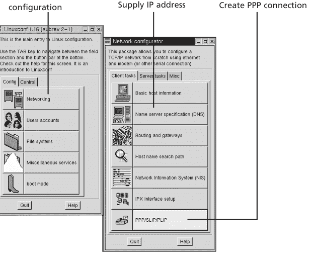

**图 11.1** `Linuxconf` 执行许多系统管理和配置任务。

使用网络配置程序设置 PPP 连接是一个两步过程。首先，您需要告诉 `Linuxconf` 您如何连接到互联网；即电话号码、用户名和密码以及调制解调器。这可以通过点击 PPP/SLIP/PLIP 按钮找到。然后，您需要点击 Name server specification (DNS) 按钮，提供由互联网服务提供商提供的名称服务器信息。只需按照每个窗口中的说明操作，或跟随下一课的步骤进行。

## 第 11.1 课：使用 Linuxconf 设置互联网连接

在开始本课之前，请确保您拥有 ISP 提供的所有信息，调制解调器已连接到计算机且电源已开启。然后，按照以下步骤操作：

1. 点击网络配置程序窗口中 Client tasks 选项卡底部的 PPP/SLIP/PLIP 按钮。这将打开 PPP/SLIP/PLIP Configurations 对话框。
2. 点击 Add 按钮以打开 Type of Interface 对话框。
3. 选择 PPP 选项并点击 Accept。您正在创建的连接的 PPP 接口面板将出现（见图 11.2）。

   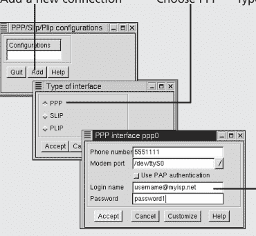

   **图 11.2** 输入 ISP 要求的接入信息。

4. 在 `Phone number` 文本框中输入您用于连接 ISP 的电话号码。

   > 输入电话号码时，只需输入数字。不要使用空格、连字符或括号。如果您需要拨号才能获得外线，请将该号码放在 ISP 电话号码之前。

   

5. 从 Modem port 列表框中选择您的调制解调器端口。
6. 除非您的 ISP 要求其他方式，否则选择 Use PAP authentication 选项。
7. 填写您的登录名（通常是您的电子邮件地址）以及用于登录账户的密码。
8. 点击 Accept 按钮。您刚刚配置的 `ppp0` 连接将出现在 PPP/SLIP/PLIP Configurations 对话面板中。
9. 点击 PPP/SLIP/PLIP Configurations 面板中的 `ppp0` 条目，以显示 `ppp0` 的 PPP 接口对话框，如图 11.3 所示。

**图 11.3** 为您的互联网连接配置调制解调器硬件。


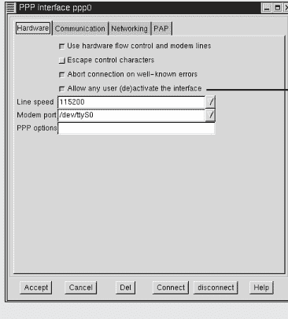

## 允许所有用户访问调制解调器

- 10. 在 `Hardware` 选项卡上，确保选中了 `Use hardware flow control and modem lines` 以及 `Abort connection on well-known errors` 选项。

- 11. 确保选中了 `Allow any user to (de)activate the interface` 选项。这样，所有用户都可以通过各自的用户账户连接到互联网。

> 测试连接。当您点击 `Connect` 按钮时，`Linuxconf` 将尝试检测调制解调器，然后拨号连接 ISP。

- 12. 点击 `Accept` 按钮。`PPP Interface` 面板将关闭，您将回到 `PPP/SLIP/PLIP Configurations` 对话框。

- 13. 点击 `Quit` 按钮关闭对话框。现在您可以配置服务器连接了。

- 14. 在网络配置程序面板上，点击 `Name server specification (DNS)`。`Resolver Configuration` 面板将出现，如图 11.4 所示。

- 15. 在 `nameserver 1` 这一行，输入 ISP 给您的主 DNS 号码。如果您有备用 DNS 号码，请在 `nameserver 2` 这一行输入。

图 11.4 输入您的 ISP 所使用的 IP 地址。

- 16. 点击 `Accept`。`Resolver` 配置面板将消失。

- 17. 您现在已完成 `Network Configurator` 和 `Linuxconf` 的操作。点击每个窗口底部的 `Quit`。窗口将消失，您现在可以尝试连接了。

## 使用 UserNet 连接到互联网

一旦 `root` 用户在 `Linuxconf` 中创建了 PPP 连接，系统上的每个用户都可以使用该连接。如果您想要一种快速、简单直接的方法来拨号连接 ISP，请尝试 `UserNet`。`UserNet` 没有冗余功能，没有花哨的定时器，什么都没有。但它确实能迅速建立连接，而且非常简单。参考表 11.2 来打开 `UserNet`。

### 表 11.2 建立 UserNet 连接

| 从此处连接 | 尝试此路径 |
|---|---|
| X 终端窗口 | 输入 `usernet` 并按 `Enter` |
| AnotherLevel 菜单 | 点击 `Networking`, `Usernet` |

> 不要关闭那个终端。如果您关闭 X 终端窗口，`UserNet` 界面也会随之关闭。相反，请将终端窗口最小化以避免干扰。在您注销互联网并关闭 `UserNet` 窗口之前，请不要关闭它。

`UserNet` 会显示您机器上配置的、且您当前账户可用的所有 PPP 连接。图 11.5 中所示的示例显示了一个 PPP 连接。其他连接将显示为 `ppp1`、`ppp2` 等，并显示在 `ppp0` 之下。

**图 11.5**

当您不需要担心跟踪上网时间时，请尝试 `UserNet`。

在每个 PPP 连接按钮的右侧，您会看到一个 `Status` 按钮。当您首次打开 `UserNet` 时，`Status` 按钮应该是红色的。这意味着您尚未连接到互联网，在点击您想要使用的 PPP 连接的 `Toggle interface` 按钮之前，您无法继续操作。

> 打开调制解调器。如果您使用的是外置调制解调器，请在尝试连接之前确保它已开启并准备就绪。

当您激活连接时，在调制解调器拨号期间，`Status` 按钮将变为黄色。当调制解调器与您的 ISP 服务器建立连接后，`Status` 按钮将变为绿色。一切准备就绪。当您想要断开连接时，点击该 PPP 连接的 `Toggle interface` 按钮。`Status` 按钮将变回红色。

> 当您想要断开连接时，不要点击 `Status` 按钮。否则您的连接将无法正常断开。

现在您已经连接到互联网，可以跳过下一节关于使用 `Kppp` 的内容，直接进入有趣的部分，比如浏览网页和下载酷炫的东西。或者，如果您不喜欢这种方法，可以在 `Linuxconf` 中删除 PPP 连接，尝试使用 `Kppp` 拨号器。

## 使用 Kppp

在使用了 `Linuxconf` 和 `UserNet` 之后，您可能会发现自己想要一种不同的方式来配置互联网连接。或者，您可能不希望所有用户账户都访问同一个互联网账户。也许某些用户不需要访问互联网。再或者，您可能只是想要一个看起来像在亲爱的旧版 Windows 中那样拨号器。

您的另一个选择是 `Kppp` 拨号器。`Kppp` 拨号器为每个用户账户单独设置。这里不存在互联网账户共享，且您无需是 `root` 用户即可建立连接。作为一个额外亮点，`Kppp` 拨号器包含可以测量每次会话上网时长和传输数据量的工具。首先，您需要打开 `Kppp` 拨号器，具体操作请参考表 11.3。

### 表 11.3 定位 Kppp 拨号器

| 从此处开始 | 采取此路径 |
| :--- | :--- |
| KDE 菜单 | 前往 `Internet`, `Kppp` |
| X 终端窗口 | 输入 `kppp` 并按 `Enter` |

当 `Kppp` 拨号器打开时，您会看到一个空白的连接框。在准备好拨号连接 ISP 所需的信息后，点击 `Setup` 按钮。这将显示 `Kppp` 配置对话框。您的首项任务是点击 `Device` 选项卡（如图 11.6 所示），告诉 `Kppp` 在哪里可以找到您的调制解调器。您需要从 `Modem Device` 下拉列表中选择调制解调器端口。您可能还想更改连接速度。如果您想确保拨号器检测到了调制解调器，请点击 `Modem` 选项卡并查询调制解调器。

配置好调制解调器后，就到了告诉 `Kppp` 如何呼叫 ISP 的时候了。点击 `Accounts` 选项卡，然后点击 `New` 按钮以打开新账户对话框——如图 11.7 所示，其中显示的是 `Dial` 选项卡。

**图 11.6**

通过查询调制解调器，确保您选择了正确的调制解调器设备。

**图 11.7**

为您的 ISP 提供接入电话号码和 IP 地址。

您首先需要做的是为连接命名。使用一个能帮您记住正在使用哪个互联网账户的名称。然后，输入您用于访问 ISP 的电话号码。接着，点击 `DNS` 选项卡并输入您的 ISP DNS 服务器所使用的 IP 地址。输入 ISP 建立连接所需的所有信息后，点击 `OK`。您将在 `Kppp` 配置对话框的 `Account Setup` 列表中看到该连接名称。

您的拨号连接即将完成。在 `Kppp` 配置对话框上点击 `OK`，您将在拨号器窗口的 `Connect to` 列表框中看到该连接名称（见图 11.8）。您只需输入 ISP 所需的用户名和密码，然后点击 `Connect` 按钮。

**图 11.8**

输入连接 ISP 所需的用户名和密码，然后您就可以畅游网络了。

> 接通电源。如果您使用的是外置调制解调器，请确保它已开启。

太棒了！您已连接！您已经使用 `UserNet` 或 `Kppp` 作为拨号器建立了连接，现在您只需要一些互联网软件来浏览网站和阅读电子邮件。您可能还需要一个优秀的 FTP 客户端，我们将探讨 `gFTP`。如果您喜欢在网上与他人实时聊天，请查看 `XChat`。

## 使用 Netscape Communicator 在 Web 上工作

Linux-Mandrake 发行版中捆绑了许多 Web 浏览器、电子邮件工具和新闻组阅读器，它们在 KDE 和 GNOME 下均可运行。其中最受欢迎的是 `Netscape Communicator`。`Communicator` 包含了一整套互联网应用程序，包括 Web 浏览器、电子邮件客户端、新闻阅读器和网页设计工具。在 `Communicator` 和其他几个互联网应用程序（如稍后在本小时中介绍的 FTP 和 IRC 聊天）的帮助下，您的互联网活动基本得到了全面覆盖。

在您开始探索 `Communicator` 套件之前，请使用您喜欢的连接方法拨号连接到您的 ISP。

### 探索 Navigator

我们将从 `Netscape Navigator` Web 浏览器开始介绍。您会在 KDE 和 GNOME 面板上找到 `Navigator` 的图标。您也可以在 KDE 和 GNOME 的 `Internet` 菜单中找到它。

您会注意到 `Navigator` 在 Linux 中的外观与在 Windows 中一样，且具有相同的功能。如果您找到了一个想要访问的新站点，只需在 `Netsite` 文本框中输入 URL 地址并按 `Enter`。您请求的网页将开始下载过程，不久之后（取决于页面附带的图形和多媒体数量以及您的调制解调器速度），您将看到整个网页（如图 11.9 所示）。如果您认为以后还想访问此页面，请将其添加到 `Bookmarks`（书签）列表中。

当您需要在互联网上查找信息时，点击 `Search` 按钮。`Navigator` 可以帮助您使用多种搜索引擎和 Web 数据库。

在 `Navigator` 窗口的底部有一个工具栏，可以启动任何 `Communicator` 应用程序。事实上，您会在所有 `Communicator` 应用程序的底部发现这个工具栏。当您浏览完网页想要检查邮件时，点击 `Email` 按钮以启动 `Messenger`。

**图 11.9**

现在 Linux 操作系统已经可以使用一些流行的游戏了。这个网站展示了其中一部分。

- 追踪经常访问的网站
- 访问新网站
- 搜索互联网
- 修改个人工具栏
- 新闻组
- 地址簿
- 网页编辑器
- 电子邮件
- 启动 `Communicator` 应用程序
- 浏览器

## 检查您的邮箱

`Communicator` 使用的电子邮件客户端是 `Messenger`。`Messenger` 同样可以处理新闻组。通过 `Messenger`，您可以发送和接收电子邮件，在消息区域查看附件，以及创建文件夹来对邮件进行分类。您甚至可以发送包含丰富图形和 HTML 格式的消息。但请节约带宽。

> 随时关注您的朋友。使用地址簿存储电子邮件和地址信息。随后您可以使用地址簿来填写新消息的“收件人”字段。

## Messenger 入门

当您第一次打开 `Messenger` 时，可能会被告知它无法访问您的 ISP（互联网服务提供商）邮件服务器。您需要设置首选项。所以让我们先完成这项工作，然后继续执行程序。

## 课 11.2：设置 Messenger 首选项

`Messenger` 需要知道去哪里检查您的邮件。同时，您可能想要更改 `Messenger` 外观的一些设置。请按照以下步骤操作：

- 1. 点击 `Edit`（编辑），`Preferences`（首选项）以显示 `Netscape` 首选项面板。“`Mail & Newsgroups`”（邮件与新闻组）类别将被选中。

- 2. 在“`Mail & Newsgroups`”类别的主面板中，您可以更改 `Messenger` 显示消息的方式，以及 `Messenger` 对您所执行的操作做出响应的方式。

- 3. 点击 `Identity`（身份）选项。您需要输入您希望在消息头中显示的姓名以及您的电子邮件地址。这些信息将显示给您消息的接收者。

- 4. 点击 `Mail Servers`（邮件服务器）选项以显示如图 11.10 所示的面板。在 `Outgoing mail (SMTP) server`（外发邮件 (SMTP) 服务器）文本框中输入您的 ISP 使用的外发邮件服务器名称。

**图 11.10**

为 `Messenger` 提供它需要存放和取回邮件的服务器名称。

- 5. 要告知 `Messenger` 您的 ISP 接收邮件服务器的名称，请点击 `Incoming Mail servers`（接收邮件服务器）框中的 `POP`，然后点击 `Edit`（编辑）按钮以显示如图 11.11 所示的对话框。

您会潜水阅读新闻组吗？在访问新闻组之前，请从 `Newsgroups Servers`（新闻组服务器）类别中设置一个新闻服务器。

**图 11.11**

`Communicator` 需要知道在哪里取回您的邮件。

- 6. 在 `Server Name`（服务器名称）文本框中输入您的 ISP 提供给您的邮件服务器名称。

- 7. 在 `User Name`（用户名）文本框中输入您邮件账户的用户名。如果您不想在每次检查新消息时都输入密码，请选择 `Remember Password`（记住密码）选项。

- 8. 您可能希望 `Messenger` 为您自动检查邮件。如果检查频率不是每 10 分钟一次，请告知 `Messenger` 您希望的检查频率。

- 9. 点击 `OK`（确定）返回到 `Mail Servers` 面板。您将看到列出的接收邮件服务器。

- 10. 在 `Netscape` 首选项窗口上点击 `OK` 以关闭面板并应用新设置。您现在可以接收所有在邮箱中积压的邮件了。

## 检查新消息

第一次点击 `Messenger` 工具栏上的 `Get Msg`（获取消息）按钮时，系统会要求您输入访问账户的密码。之后，您将看到一个状态对话框，告知您正在下载的消息数量以及下载完成的百分比。当 `Messenger` 完成消息检查后，新消息将出现在 `Message List`（消息列表）中。

## 创建网页

**新术语** 分享信息的最佳方式是通过网页，或者如果您有大量信息要分享，则通过整个网站。`Netscape Composer` 是一个功能齐全的、图形化的、具有相同显示器设置的所见即所得（WYSIWYG+）HTML 编辑器。

您可以在 `Composer` 页面中插入常见的 HTML 元素——超链接、图像、线条和表格。哦对了，还有文本，这是任何网页最重要的部分。您可以像在大多数文字处理程序中一样格式化文本——字体样式和大小、段落对齐和格式，以及彩色文本。（`Composer` 甚至还隐藏了彩虹般绚丽的功能。）别忘了，在使用 `Composer` 将页面发布到 Web 服务器之前，请使用拼写检查器。

开始使用 `Composer` 最快的方法是从 Netscape 网站下载一个模板，然后对其进行编辑，使其包含您的文本和图片。而且，实话说，您不必非要使用 Netscape 模板；您可以利用课 11.3 中的信息，复制您在互联网上发现的任何网页并在 `Composer` 中使用。

## 课 11.3：使用模板创建网页

在尝试本课之前，请确保您已连接到互联网。然后按照以下步骤操作：

- 1. 点击 `File`（文件），`New`（新建），`Page From Template`（从模板创建页面），以在 `Navigator` 中显示 Netscape 网页模板页面（如图 11.12 所示）。在页面中间，您将看到一个模板列表。

- 2. 浏览模板列表，直到找到一个与您想要设计的网页紧密匹配的模板。要选择模板，请点击链接在浏览器窗口中显示该模板。如果您不喜欢该模板，请点击浏览器的 `Back`（后退）按钮返回模板列表。

- 3. 在浏览器窗口显示所选模板时，点击 `File`（文件），`Edit Page`（编辑页面）。这将在一个新的 `Composer` 窗口中打开该模板，如图 11.13 所示。

> 进度太快了吗？您可以通过查看 `Help`（帮助）菜单来了解更多关于不同 `Communicator` 程序的信息。Netscape 提供了一些非常优秀的帮助文档。

**图 11.12**

选择一个符合您的需求和风格的网页模板。

- 从可用模板中选择
- 保存您的工作
- 创建超链接
- 插入图像

**图 11.13**

替换文本和图像，创建一个独具您个人特色的网页！

- 格式化文本
- 替换文本
- 创建表格

- 4. 根据您的心意进行编辑，并且不要忘记时不时地保存您的工作。

- 5. 编辑完成后，请向您的 ISP 咨询关于如何在他们的服务器上发布网页的说明。

## 使用 gFTP 传输文件

谁说 Linux 应用程序不够流畅？如果您需要一个在互联网上传输文件的工具，请尝试 `gFTP`。FTP（文件传输协议）是最古老的互联网实用程序之一，而且它仍然是文件传输的最佳方法。无论您需要匿名登录还是需要密码，`gFTP` 都能让您访问任何 FTP 站点。您还会发现一个您最喜欢的浏览器功能——保存经常访问的 FTP 站点列表的能力。有关 `gFTP` 的路径，请参见表 11.4。

**表 11.4 寻找 gFTP**

| 起点 | 操作路径 |
| :--- | :--- |
| GNOME 主菜单 | 移至 `Internet` $\rightarrow$ `gftp` |
| X 终端窗口 | 输入 `gftp` 并按 `Enter` |

为了使用 `gFTP` 进行匿名登录，您需要告诉程序您的电子邮件地址。点击 `FTP` $\rightarrow$ `Options`（选项）打开选项对话框。在 `General`（常规）选项卡中，在第一个字段中输入您的电子邮件地址。您可以根据选择更改任何其他选项。阅读完列表后，完成后点击 `OK`。

现在是时候寻找一个 FTP 站点，登录并四处看看了。图 11.14 中的示例显示了匿名登录。在 `Host`（主机）文本框中输入 FTP 地址并按 `Enter`。

**图 11.14**

您可以从任何允许匿名访问的 FTP 站点下载文件。

- 存储下载的文件 $\rightarrow$
- 查看登录和读取消息 $\rightarrow$
- 访问 FTP 站点 $\rightarrow$
- 选择要下载的文件 $\rightarrow$
- 开始下载 $\rightarrow$
- 查看下载进度 $\rightarrow$

对于经常访问的 FTP 站点，您可能希望将它们保留在书签列表中。如果您点击“书签”菜单，会发现已经为您提供了一系列 FTP 站点列表。只需点击其中一个书签，即可访问该 FTP 站点，且远程目录窗口将显示该站点上的所有文件夹。您可以尝试使用 `gFTP` 自带的书签，这足以让您消磨一段时间。

要浏览远程站点，首先在主目录中寻找 `Readme` 文件。双击该文件即可打开一个窗口来阅读内容。该文件包含了关于如何使用目录中资源的最新建议。要打开文件夹，请双击它们。

要下载文件，请在用户目录中选择您想要保存文件的文件夹，选择要下载的文件，然后点击下载按钮（即向左的箭头）。现在，您可以坐下来，放松心情，观察下载进度。如果您的连接出现问题，`gFTP` 会记住中断的位置并恢复下载。再也不用担心浪费下载时间。

## 使用 XChat 与好友聊天


聊天，或称互联网中继聊天（IRC），是一种流行的网络消遣方式。通过各种聊天服务器的运作，人们可以通过输入消息并由接收者输入响应来实时对话。这些聊天室经过组织，使得群体可以通过对话交流，也可以为私人对话提供私人空间。我们要研究的互联网中继聊天程序是 XChat。要启动 XChat 程序，请参阅表 11.5。

### 表 11.5 与伙伴们聊天

| 起始步骤 | 后续操作 |
| :--- | :--- |
| GNOME 主菜单 | 选择 Internet $\rightarrow$ xchat IRC client |
| X 终端窗口 | 输入 `xchat` 并按 Enter |

您的桌面上将打开两个窗口——XChat：服务器列表（Server List）和终端窗口。在“服务器列表”窗口中，您需要在“用户信息（User info）”部分填写所需信息。如果您愿意，可以使用匿名名称。终端窗口则是您输入消息和阅读响应的地方。

当您准备好查看聊天室时，请在“服务器列表”中浏览服务器及其可用的聊天室（见图 11.15）。要查看聊天室，请点击服务器名称旁边的加号。

### 图 11.15

从多个预选的聊天服务器中选择。

- 提供身份信息
- 查看服务器列表
- 显示聊天室
- 选择一个房间
- 加入正在进行的聊天

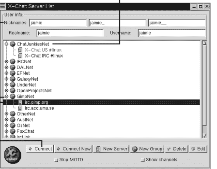

浏览列表后，点击您想进入的聊天室，然后点击“连接（Connect）”按钮。“服务器列表”窗口将消失，您所选服务器的欢迎消息和详细信息将在 XChat 窗口中显示，如图 11.16 所示。

### 图 11.16

阅读讨论，或者勇敢地加入其中。

- 阅读对话线程
- 输入您的响应
- 发布您的响应

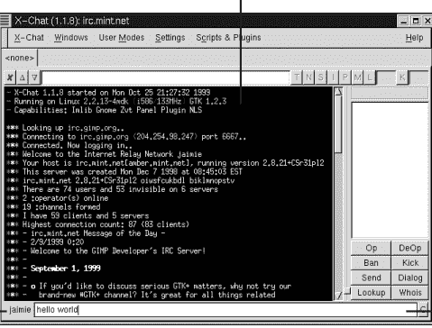

输入一句友好的问候，频道里的某个人会向您问好。在那之后，就就像在公交车上与人交谈一样自然。

## 本节小结

在这一小时中，您使用了 LinuxConf 和 UserNet 的组合，或者使用了 KPPP 拨号器配置了互联网连接。您学习了如何使用 Netscape Communicator 互联网应用套件在网络上浏览。您还接触了另外两款增强 Web 体验的工具——XChat 和 gFTP。还有其他一些我们在此未提及的互联网工具和实用程序，我们鼓励您去尝试。

## 问答

- **问：** 我的互联网连接似乎不像以前那样正常工作了。我想知道问题是否出在我的计算机和 ISP 服务器之间。我该怎么办？

- **答：** 您可以使用 `ping` 命令来验证您是否使用了正确的 ISP IP 地址，查看 ISP 服务器响应请求所需的时间，以及传输过程中是否有数据丢失。当您连接到 ISP 时，输入以下命令：

  `ping -c 5 mysp.net`

  `-c 5` 选项告诉 `ping` 命令向您的 ISP 服务器发送数据包（持续 5 个时间单位）。然后它会向您报告服务器将数据包传回您的计算机所需的时间。如果您愿意，可以更改时间量。您还需要将 `mysp.net` 替换为您 ISP 的域名。您也可以使用此命令测试您的计算机与互联网上其他服务器之间的连接。

- **问：** 但我也许不想使用命令行来查看响应时间。而且，我想了解更多关于互联网运行情况的信息。您还有其他建议吗？

- **答：** 今天是您幸运的一天。KDE 包含了一组网络实用程序。您可以在 KDE 菜单的 Internet $\rightarrow$ Network utilities 下找到它们。通过一个统一的界面，您可以找到 ping、traceroute、主机解析（host resolution）和 finger 实用程序。

  如果您只需要 finger 实用程序，KDE 中也有提供。它同样在 Internet 菜单中，但位于 User information 下。

## 实践环节

希望在过去的一小时里，您在 Web 上的探索过程非常愉快。好吧，虽然我们似乎每小时都要打破一次您的幻想，但现在是时候测试您的 Web 知识了。

### 测验

1. 为所有用户账户设置互联网连接的最有效方法是什么？
2. 如何设置仅由创建连接的用户使用的互联网连接？也就是说，系统上的其他用户无法使用该连接。
3. 使用 Netscape Communicator 可以进行哪些不同的互联网活动？
4. 从互联网下载文件的最快方式是什么？

### 练习

1. 计划一次与住在国家其他地区或地球另一端的亲友的“网络聚会”。您可以在 IRC 服务器上预留一个私人房间，并给每个人一个进入房间的秘密口令。尽情狂欢吧！

2. 除了 Linux-Mandrake 许多内置应用程序中的 man 手册和帮助文件之外，还有更多帮助资源。您可以从许多 FTP 站点下载帮助文档。您可以通过访问这些 FTP 站点来进一步学习本书中涵盖的一些应用程序。但要注意，您可能会发现海量的信息。例如，导航到 `ftp.gimp.org` 并下载 Gimp 手册。它虽然有 14MB，但充满了实用建议和彩色图片。四处看看，看看您能找到多少帮助。

# 第 12 小时：使用 KLyX 进行文档处理

Linux-Mandrake 安装了多种文本编辑器和文字处理器。在浏览 KDE 和 GNOME 菜单，或使用 KPackage 或 Gnome RPM 查看 CD-ROM 上的软件包列表时，您可能会遇到 KLyX。KLyX 非常适合处理备忘录和信函等短文档。它也可以处理较大的文档，并包含页码、目录、交叉引用、图片和表格等功能。

您可能认为 KLyX 的工作方式与其他文字处理程序一样。其实，KLyX 略有不同。简单来说，KLyX 更像是一个专业的排版系统。它负责文档制作的每一个方面。KLyX 使用文档类（document classes）和模板作为信函、报告和书籍的起点。每个文档类和模板都包含一个样式列表。这些样式控制文档的外观，并跟踪页码、章节和节的编号。

在这一小时中，您将使用 KLyX 创建一个包含文本、列表、表格和图形图像的文档。您还将学习如何通过以下方式使文档外观更美观：

- 使用模板创建文档并格式化文本
- 使用多种列表样式
- 使用表格组织信息
- 插入能够强化文档信息的图形图像

## 创建新文档

KLyX 是您可以在 KDE 菜单中找到的应用程序之一。它最有可能在“应用程序（Applications）”菜单中。如果您找不到它，请尝试在 X 终端窗口中输入 `klyx`。如果仍然不行，您可能需要在系统中安装 KLyX。第一次使用 KLyX 时，您会看到一个询问对话框。KLyX 需要创建一个目录文件，用于存储您对程序配置所做的更改。点击“是（Yes）”以创建目录并在屏幕上显示 KLyX。

您会注意到 KLyX 窗口看起来与许多其他文字处理程序非常相似。这里有各种菜单、按钮和其他屏幕元素。此外，还有一个熟悉的工作区，您可以在其中输入并格式化文本、表格和图像。

在开始使用 KLyX 之前，请查看图 12.1 并熟悉不同的屏幕元素。

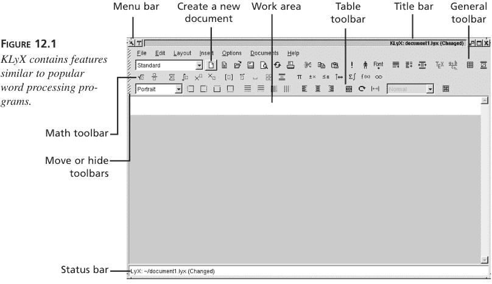

### 图 12.1

KLyX 包含与流行文字处理程序类似的功能。

## 使用 KLyX 处理文档

- 标题栏显示文档名称，并包含最小化、最大化和关闭窗口的窗口控制按钮。
- 菜单栏包含程序可以执行的所有命令。您可能会发现，有时工具栏按钮失效时，菜单命令依然有效。
- 常规工具栏包含执行文件命令（如打开、保存、预览和打印）、在文档中移动文本（剪切、复制和粘贴）、格式化文本和段落以及插入图像和表格的按钮。

> 如果您更倾向于仅使用菜单，或者希望为工作区域留出更多空间，可以隐藏并移动菜单和工具栏。拖动菜单栏或工具栏左侧的条形区域，可将其移动到屏幕上的另一个位置。点击该条形区域可隐藏菜单和工具栏。

要确定打开 KLyX 程序时显示哪些工具栏，请选择“选项 (Options)”、“屏幕选项 (Screen Options)”，然后点击打开的对话框中的“工具栏 (Toolbars)”选项卡。如果您希望工具栏仅在您使用该功能时出现，请选择“自动 (Automatic)”选项。


- 数学工具栏允许您轻松地向文档中添加数学公式。
- 表格工具栏用于创建和格式化表格。表格可以包含任意数量的行和列，您可以根据需要更改表格的大小。为了使表格更美观或使信息更突出，您可以为表格添加边框并格式化表格文本。
- 工作区域是您输入文本和插入其他项目（如表格和图像）的地方。
- 底部是 `minibuffer`（状态栏），它显示您当前正在处理的文档及其目录路径，显示文档是只读的还是可编辑的，以及文档是否有未保存的更改。

> 如果您想了解更多关于 KLyX 的信息，请查看“帮助 (Help)”菜单并阅读“简介 (Introduction)”、“教程 (Tutorial)”和“用户指南 (User's Guide)”。


现在您已经大致了解了 KLyX，是时候开始处理文档了。您可能想直接开始输入文本，但在开始之前，请考虑以下几种不同的启动方式。

- 如果您只想开始输入，可以通过点击常规工具栏上的“新建 (New)”按钮来使用默认文档类和相关样式。这将显示“打开”对话框，您可以在其中选择要存储新文件的目录并为新文件输入名称。
- 如果您的绝大多数文档外观相似，可以更改默认页面布局。您可以更改每个新建文档的纸张方向、页面页边距、默认文档类、字体、段落间距以及所使用的列数。
- 如果您需要创建信函、短文或书籍手稿，有几个预先设计好的模板是非常好的起点。点击“从模板新建 (New From Template)”按钮。如果这些模板中没有一个完全符合您的需求，您可以修改模板并将其另存为不同的名称。

## 第 12.1 课：设置默认文档布局

如果您创建的大多数文档使用相同的基本布局，您可以更改默认页面布局特性。这意味着您不必在每次开始新文档时都进行布局更改。一旦保存了默认文档布局，每次点击“新建”按钮时，都会使用您偏好的布局。要更改默认文档设置，请执行以下步骤：

1. 点击“新建”按钮以创建空白页。这将显示一个“打开”对话框。导航到您想要保存文件的目录，并在“位置 (Location)”文本框中输入文件名。然后点击“确定 (OK)”以显示空白文档窗口。
2. 点击“布局 (Layout)”、“文档 (Document)”，显示如图 12.2 所示的“文档布局”对话框。

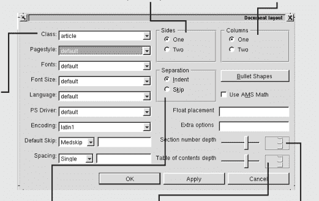

### 图 12.2

使用文档类来创建具有专业外观的文档。

- 选择文档类
- 在段落之间添加空格
- 出现在目录中的标题级别
- 显示标题级别的编号

3. 从“类 (Class)”下拉列表中选择一个文档类。您可能会发现以下文档类很有用：

   - Article（文章）用于需要节标题的短文档。它不使用页眉，且单面打印。
   - Book（书籍）用于创建大型文档，这些文档被组织成“部分 (parts)”，进一步细分为“章节 (chapters)”等。此类会自动为文档页面添加页眉，并设置为双面打印。
   - Letter（信函）用于需要地址信息或信头位置、收件人信息和结语的短文档。它不使用任何节或章标题。
   - Report（报告）用于比文章或信函长，但比书籍短的文档。它使用章标题，单面打印，且不使用页眉。
   - Slides（幻灯片）可用于生成幻灯片或投影透明胶片，以便在演示或演讲期间传达额外信息或强调重点。


> 当使用“文档类”时，明智的做法是在您有机会查看默认布局在打印页面上的效果之前，不要更改“文档布局”对话框中的其他选项。

4. 文档可以单面打印或双面打印。如果文档将双面打印（如书籍），KLyX 将处理所需的特殊格式。“双面 (Two sides)”选项打印的页面会在页边距留出额外空间，以便于装订文档。此选项还为奇数页和偶数页使用不同的页眉格式。
5. 文档可以打印为单行横跨整个页面，或者分列打印。要在打印页面上选择显示的列数，请查看“列 (Columns)”部分。点击“一 (One)”选项按钮以显示单行连续文本。点击“二 (Two)”选项按钮以在页面上显示两列文本。
6. 完成更改后，点击“确定 (OK)”。
7. 点击“布局 (Layout)”、“纸张 (Paper)”，显示如图 12.3 所示的“配置纸张格式”对话框。

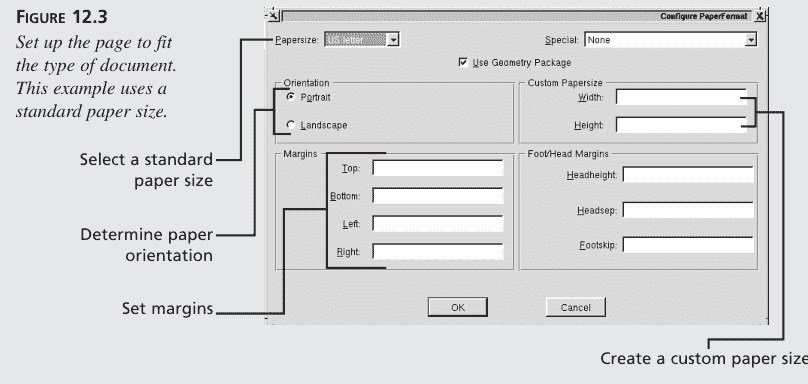

### 图 12.3

设置页面以适应文档类型。本示例使用了标准纸张尺寸。

- 选择标准纸张尺寸
- 确定纸张方向
- 设置页边距
- 创建自定义纸张尺寸

8. 如果您将使用标准纸张尺寸，请从“纸张尺寸 (Papersize)”下拉列表中选择尺寸。
9. 对于选定的纸张尺寸，决定纸张方向：

   - 如果您希望文本沿纸张短边运行，请使用“纵向 (Portrait)”选项。这是通常打印信函和报告的方式。
   - 如果您希望文本沿纸张长边运行，请使用“横向 (Landscape)”选项。这适用于长表格和演示文稿。

10. 当您对页面设置满意时，点击“确定 (OK)”。
11. 要创建新的默认页面布局，请点击“布局 (Layout)”、“将布局保存为默认 (Save layout as default)”。系统会询问您是否要将刚刚更改的设置保存为新默认值。点击“是 (Yes)”。现在，每次创建新文档时，KLyX 都会使用您指定的文档布局设置。

## 输入文本

页面设置好后，就可以开始输入文本了。您会注意到光标位于工作区域的左上角。当您开始输入时，光标始终在文本前面一步。如果您输入错误，请按下退格键 (`backspace`)。光标将后退，您输入的最后一个字符将消失。

> 要删除整个单词，请按 `Ctrl+Delete` 或 `Ctrl+backspace`。被删除的文本将被放入剪贴板。这些组合键的功能与“剪切 (Cut)”按钮相同。

KLyX 在您输入时会自动换行，因此当您到达右页边距时，光标会自动移至下一行。请注意，KLyX 窗口底部没有水平滚动条。KLyX 在屏幕上显示的文档并非完全等同于打印后的样子。KLyX 稍后会处理正确的文本宽度。目前，您无需前后滚动窗口内容即可阅读每个段落。

> 要查看文档打印后的样子，请点击“预览 (Preview)”按钮或选择“文件 (File)”、“预览 (Preview)”、“查看 DVI (View DVI)”。

当您到达段落末尾时，请按回车键 (`Enter`)。在每个段落末尾只需按一次回车键。连续按两次回车键不会在段落之间添加额外空间。段落之间的间距是通过格式样式实现的。如果您想在文档中移动，只需点击您希望光标出现的位置。

> 您可以通过选择“编辑 (Edit)”、“撤销 (Undo)”来撤销对文档所做的任何更改。KLyX 包含无限次数的撤销。

在 KLyX 窗口中输入时，有几点需要记住：

- 在每个段落末尾仅按一次回车键。KLyX 根据应用于段落的样式在段落之间添加空间。
- 在句子末尾仅使用一个空格。因为 KLyX 对字体使用比例间距，单词和句子之间的空间可能会根据一行中需要显示的字符数而有所不同。单词之间的空间总是比句子末尾的空间小。

一个很好的经验法则是：保存您的文档，且经常保存。您肯定不想丢失辛勤工作的成果，因此在工作时请经常点击“保存 (Save)”按钮。

您可能会发现并非所有项目都使用相同的文档类。如果您需要创建一个不使用默认文档布局设置的文档，您可以轻松地选择一个不同的文档类（通过选择“布局 (Layout)”、“文档 (Document)”），然后根据需要更改新文档的设置。

## 第 12.2 课：从模板创建新文档

KLyX 提供了许多模板，可以帮助简化文档布局的工作。每个模板适用于不同类型的文档。如果您经常给客户或朋友写信，可以尝试使用信函模板。对于需要章节、节、交叉引用和目录的较长篇幅作品，可以使用书籍模板。如果您需要进行演示，请尝试使用幻灯片模板。

从模板创建文档时，在选择模板之前，您需要指定存储文件的目录和文件名。文档创建完成后，要保存更改，只需点击“保存更改”按钮即可。

1. 点击“文件 (File)”，选择“从模板新建 (New from template)”，以显示“打开 (Open)”对话框。
2. 双击主目录中您想要存储文件的子目录。
3. 在“位置 (Location)”文本框中点击，输入文件名，然后点击“确定 (OK)”。随后会出现模板目录的“打开”对话框，如图 12.4 所示。

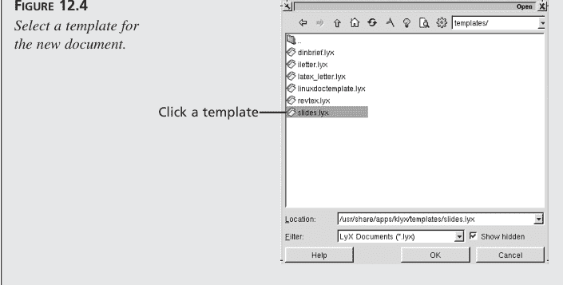

4. 选择一个模板。您可能会发现以下模板很有用：

   - 要创建标准的商务信函，请使用 `latex_letter.lyx` 模板。
   - 如果您想发挥写作才华，为 Linux 文档项目 (Linux Documentation Project) 编写用户手册或 HOWTO 指南，可以使用一个特定的模板（名为 `linuxdoctemplate.lyx`）。您会发现 Linux-Mandrake 发行版（以及所有 Linux 发行版）中的大多数应用程序帮助文件都使用了此模板。该模板也非常适合作为书籍布局的起点。
   - 如果您正在规划一次演示并希望使用幻灯片或透明投影页，请使用 `slides.lyx` 模板。

5. 点击“确定 (OK)”。KLyX 窗口中将出现一个新的文档模板，其中包含文档元素的占位符（幻灯片模板的示例见图 12.5）。

### 图 12.5

使用模板快速开始设计文档。

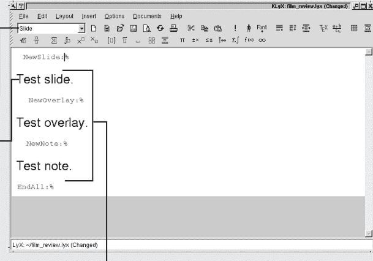

使用样式格式化文本

占位符文本

幻灯片模板

> 文档创建后，您可以通过选择“布局 (Layout)”，点击“文档 (Document)”，并从“类 (Class)”下拉列表中选择不同的文档类来更改文档类别。

## 打开和关闭文档


现在您的 KLyX 窗口中可能打开了多个文档。您可能想要在文档之间来回切换，或者在离开计算机之前关闭某个文档（以及可能关闭 KLyX 程序）。您在返回时随时可以重新打开文件。您可以通过菜单执行这些操作：

- 当同时打开多个文档时，可以使用“文档 (Documents)”菜单在文档之间切换。菜单中列出了每个打开的文档；只需点击您想要查看的文档即可。
- 使用“文件 (File)”，选择“另存为 (Save as)”以将文件另存为不同的名称。您不仅可以用不同的名称创建文件的副本，还可以将这个新文件放在不同的目录下。
- 选择“文件 (File)”，点击“关闭 (Close)”来关闭 KLyX 窗口中显示的文档。
- 选择“文件 (File)”，点击“退出 (Exit)”来关闭 KLyX 及其所有打开的文档。

> 当您关闭 KLyX 时，如果存在包含未保存更改的打开文档，系统会发出警告。

当您想要打开保存在主目录中的文件时，请点击“打开 (Open)”按钮。您将看到与第 12.2 课中相同的“打开”对话框。要打开文件，请显示文件所在的目录并双击文件名。文件将在一个单独的窗口中打开。现在，您可以对之前开始的文档进行一些修改了。

## 编辑文档

在完成文档的初稿后，就可以回头进行一些编辑了。您会发现有些地方需要添加文本。这很简单——我说的是如何添加，而不是如何构思文本。只需点击您想要添加文本的地方并开始输入即可。至于措辞则取决于您。其他文本编辑命令要求您首先选择要操作的文本。

在复制一段文本或将其移动到文档中的其他位置之前，必须先选中它。要选择文本，请在文本开始处点击并按住，然后将鼠标指针拖动到文本末尾。您会注意到文本被高亮显示了。

您也可以通过使用方向键来代替鼠标。将光标置于文本开始处，然后按住 Shift 键，同时使用方向键将光标移动到文本末尾。

文本选中后，您可以删除整个文本块，将其移动到文档中的另一个位置，或者创建文本副本并将其粘贴到其他地方。使用“剪切 (Cut)”、“复制 (Copy)”和“粘贴 (Paste)”工具栏按钮来编辑文本。

> 如果您在文档中添加了一些不满意的内容且不知道如何删除，请返回到文档的最后一次保存副本并重试。选择“文件 (File)”，点击“还原至保存版本 (Revert To Saved)”以撤销更改。

## 第 12.3 课：重新排列文档

在本课中，您将选择文档中的现有文本并将其移动到文档的另一个位置。如果您和大多数人一样，在尝试在纸上组织思路时会进行大量的剪切和粘贴。请尝试以下步骤：

1. 选择您想要移动的文本。
2. 点击“剪切 (Cut)”按钮。选中的文本从屏幕上消失，但保留在剪贴板中。


> 您可以通过点击“复制 (Copy)”按钮来移动文本副本，同时将选中的文本保留在原处。

3. 将光标移至您想要粘贴文本的位置。
4. 点击“粘贴 (Paste)”按钮。选中的文本在原位置重新出现。如果您想将此文本复制到另一个位置，请将光标置于新位置并再次点击“粘贴”按钮。您可以一直这样操作，直到剪贴板被其他文本覆盖。

## 格式化文档

在清理文档并润色文字后，就可以添加一些格式来让文字看起来更美观了。您有几种选择来更改文本在页面上的显示方式。当您想要更改单个单词或短行文本的外观时，请使用字符格式化。当您想要更改整个段落的外观时，请使用段落格式化。为了让文档具有统一的外观并能够控制格式更改，请使用“样式 (styles)”，接下来将对此进行讨论。

### 使用样式格式化段落

**新术语** 让文档美观的第一步是使用工具栏上的“段落环境 (Paragraph Environment)”列表来更改整个段落的格式。`段落环境`在其他文字处理程序中通常被称为`样式 (style)`。段落环境是一组格式属性的集合，可以通过选择段落然后从“段落环境”列表中选择样式来将其应用于段落。

样式非常方便，因为您可以轻松更改段落的格式。样式还用于创建文档中不同级别的文本，例如标题和目录项。KLyX 中有许多现成的样式可供使用。要将段落环境应用于段落，请将光标置于该段落中，打开“段落环境”列表，然后点击一个样式。观察该段落在屏幕上的外观变化。

### 更改段落外观

在您输入并敲出那些段落时，请注意段落是如何格式化的。页面上的第一个段落没有缩进，但随后的每个段落都有缩进。同时请注意，段落之间没有额外的间距。如果您不希望段落缩进，可以更改默认格式。要更改为在段落之间放置额外空间且不缩进的段落格式，请点击“布局 (Layout)”，选择“文档 (Document)”以显示“文档布局”对话框（如图 12.2 所示），并在“分隔 (Separation)”部分选择“跳行 (Skip)”选项。

如果您需要更改其他段落属性，例如段落周围的间距、段落内部的行间距、悬挂缩进或边框，您需要在“段落 (Paragraph)”对话框中进行这些更改。要进入该对话框，请选择您要格式化的段落，然后点击“布局 (Layout)”，选择“段落 (Paragraph)”。


> 将一个段落与其他段落区分开的一种方法是使用`边注 (margin notes)`。边注类似于脚注。这些额外的细节信息出现在段落旁边，而不是在页面底部或书籍末尾。

要创建边注，请将光标置于该注释所属段落的末尾，然后点击“插入边注 (Insert Margin Note)”按钮（或通过菜单选择“插入 (Insert)”，然后选择“边注 (Margin Note)”）。

## 第 12.4 课：自定义单个段落

有时您可能需要文档中的某个段落看起来与其它段落不同。您可能想将左对齐的段落更改为页面居中的段落。某些段落可能需要在上方和下方留出更多空间。其他段落可能需要特殊的字体来强调。为了使段落更加突出，可以在整个段落周围绘制边框，或者仅在顶部画一条线即可。在本课中，您将更改单个段落的外观：

1. 选择您想要格式化的段落。您不需要高亮显示整个段落，只需将光标置于该段落中即可。
2. 点击“布局 (Layout)”，选择“段落 (Paragraph)”，以打开如图 12.6 所示的“段落环境”对话框。

### 图 12.6

通过“段落环境”对话框更改单个段落的外观。

- 更改段落对齐方式
- 添加边框
- 段落距离左页边距缩进
- 更改段落上方和下方的间距
- 添加行间距

3. 通过点击相应的“对齐”按钮来更改段落对齐方式。
4. 如果您想在段落上方或下方添加间距，请在“垂直间距”部分的“上方”和“下方”列表框中选择间距。
5. 要将段落的第一行向右移动并远离左页边距，请确保“无缩进”复选框为空。
6. 要更改段落内的行间距，请从“行间距”下拉列表中选择相应的选项。
7. 段落周围的边框可用于突出显示笔记或侧栏等文本。您可以在段落上方放置一条线，在段落下方放置一条线，或者在上方和下方同时放置线条。在“线条”部分的“上方”和“下方”复选框中打勾，即可在段落上方和下方添加线条。
8. 完成更改后，点击“确定”返回文档。您将看到更改后的结果。

## 应用字符格式

您可以为文本应用多种字符格式属性。可以通过更改字体大小来显示文本的重要性级别。为了增加强调，可以使用**粗体**字符或*斜体*。下划线也可以使文本脱颖而出。您还可以使用两种不同的字体来区分标题和正文。

要通过鼠标点击为文本应用字符格式，请选择文本，然后点击“布局” $\rightarrow$ “字符”，以打开如图 12.7 所示的“字符样式”对话框。

### 图 12.7

使用与周围文本外观不同的字体，使词语和短语脱颖而出。

字体大小

“字符样式”对话框提供了一种快速更改文本外观的方法。做出选择后，点击“应用”按钮。您将看到文本所做的更改，且“字符样式”对话框将保持打开状态。您可以通过选择另一块文本并点击“应用”按钮，使用相同的设置对其进行格式化。

> 使用“布局”菜单中的“强调样式”、“名词样式”和“粗体样式”命令快速格式化文本。

## 创建列表

当信息需要排序时，列表会非常方便。列表非常适合组织需要完成的任务。列表可以是以会议前分发的议程形式出现。在概述执行给定任务所需步骤的程序手册中也可以找到列表。您可以在 KLyX 中创建四种类型的简单列表：

- 项目符号列表（bulleted list）简单地是一组无序项目。KLyX 使用 `Itemize` 段落环境来格式化项目符号列表项。
- 数字列表（numbered list）由必须处于特定顺序的项目组成，例如执行任务所需的步骤。`Enumerate` 样式会自动为列表中的每个项目编号。如果某个项目被移动，列表中的数字会自动调整。
- 定义列表（definition list）包含一系列术语及其相应的定义，并使用 `List` 样式。此样式在术语和定义之间留有空间。
- 描述列表（description list）是一系列短段落，其中每个项目的第一行位于左页边距，而后续每一行都缩进。此类列表使用 `Description` 样式。

图 12.8 显示了这四种类型列表的示例。

### 嵌套列表项

> 要在列表中嵌套项目，请选择要嵌套的项目，然后点击“更改环境深度”按钮。

## 使用页眉和页脚

**新术语** 保持长文档有序的一种方法是使用`页眉和页脚`。页眉和页脚在文档的每一页上显示相同的信息。页眉出现在页面顶部，页脚出现在页面底部。两者都位于页边距和页面边缘之间。

如果您使用的是文档模板，模板可能已经包含一个预格式化的页眉，也可能不包含。您可以使用此默认页眉，也可以更改为 KLyX 提供的其他页眉格式之一。

要更改为不同的标题样式，请打开“布局”菜单并选择“文档”。“文档布局”对话框的`Pagestyle`下拉列表中包含多种标题样式（见图 12.9）。

## 课程 12.5：页码编号

保持长文档有序的最简单方法是在文档的页眉或页脚中使用自动页码编号。在本课程中，您将为文档创建一个页眉，其中不仅包含页码，还包含有关文档的其他信息：

1. 点击“布局” $\rightarrow$ “文档”。出现如图 12.9 所示的“文档布局”对话框。
2. 从`Pagestyle`下拉列表中，选择您希望在每页上显示标题和页码的方式。共有五个选项：
   - `Default`（默认）：使用由文档类或模板定义的标题和页码样式。
   - `Empty`（空白）：在文档页面上不使用标题或页码。
   - `Plain`（普通）：仅包含页码。
   - `Headings`（标题）：显示页码以及章标题和编号，或节标题和相应的编号。
   - `Fancy`（自定义）：允许您为文档创建自定义的页眉和页脚。
3. 选择页眉样式后，点击“确定”。您将返回文档。当您将文档发送到打印机时，将看到这些页眉。

## 文档的设计元素

为了增加趣味性和色彩，您可以在文档中添加图形图像。KTeX 可以导入任何可以转换为 PostScript (EPS) 文件的图像（`.eps` 或 `.ps` 文件格式）。您可以使用 EPS 文件的方式有两种：

- 封装 PostScript (Encapsulated Postscript) 文件单独出现在一行中，与任何文本分开。图像被视为一个单独的段落，文本仅出现在图像的上方和下方。图像的左右两侧不会出现文本。
- 内联 (Inlined) EPS 文件就像句子中的另一个词一样。您可以在段落中的任何位置插入内联 EPS 文件，文本将在图像的上方、下方和两侧流动。

> 请参阅第 22 章“图形查看器和实用程序”，查找可以将图形文件转换为 PostScript 文件的程序。提示：尝试使用 XFig、The Gimp 或 Electric Eyes。

除了彩色图形，您还可以创建表格来组织信息，使其在正文中脱颖而出。表格的另一个用途是在页面布局期间。当您想要排列文本和图像，或者仅仅是文本列时，表格使这项任务变得简单。

## 使用图形美化

图形是增强文档信息传达的一种好方法。图形应该增强文本，而不是分散注意力。图像的一个良好用途是信件上的 Logo 或正文中提到的某样东西的照片。

添加图像很简单；只需在文档中选择您想要插入图片的位置，然后点击工具栏上的“插入图形”按钮。此按钮会在文档中添加一个图片占位符。一旦图片占位符进入文档，您可以通过点击图像显示“编辑图形”对话框来调整其大小。使用“宽度”和“高度”选项使图像变大或变小。您还可以通过更改段落环境来改变它在页面上的位置。

## 课程 12.6：添加封装 PostScript 图像

> 要更改图片对齐方式，将光标置于与图像相同的行上，然后点击“布局” $\rightarrow$ “段落” $\rightarrow$ “段落”。在“段落环境”对话框中更改“对齐”选项。

在尝试向文档添加图片或其他图形图像之前，请将文件转换为 PostScript 格式。完成后，接下来的步骤是为图像创建占位符，然后决定图像出现在页面的哪个位置。

要插入图像，请遵循以下步骤：

1. 点击您想要插入图像的位置，然后从菜单中选择“插入” $\rightarrow$ “图形”。您将看到“插入图形”对话框。
2. 点击“确定”以选择默认的“封装 PostScript”选项，并在文档中显示一个占位符。
3. 右键单击图形占位符并选择“编辑”。您将看到“编辑图形”对话框（如图 12.10 所示）。

### 图 12.10

通过“编辑图形”对话框确定图片在页面上的显示方式。

4. 点击“浏览”按钮来定位 EPS 图像文件。
5. 设置图像在打印文档中应显示的高度和宽度。考虑以下选项：
   - `Default`（默认）：按图像的原始文件大小插入。
   - 使用英寸或 cm（厘米）来设置图像在页面上显示的大小。在选项列表底部的文本框中输入高度或宽度。

## 向文档添加表格

*表格*是由行和列组成的单元格集合。表格中的每个单元格都可以包含文本或图形。表格可用于组织相关信息，或作为页面布局工具。

要开始创建表格，请点击文档中您想要插入表格的位置，然后选择“Insert”（插入） $\rightarrow$ “Table”（表格）。此时将出现“Insert Table”（插入表格）对话框。选择您希望表格包含的行数和列数。此时您无需担心单个单元格的宽度。KLyX 将自动调整表格单元格的宽度，以适应您添加到每个单元格中的信息。完成后点击“OK”（确定）。您的表格已就绪，现在可以对其进行设置了。


> 请注意，顶部的单元格行与表格的其余部分是分开的。这一行单元格通常用于显示每列的描述性标签。

向表格单元格中插入文本非常简单。只需点击单元格并开始输入即可。添加图形图像同样简单——点击单元格并插入图像。图像进入单元格后，您甚至可以调整其大小。事实上，几乎所有您在文档中对文本和图形进行的操作都可以在表格中完成。

## 第 12.7 课：创建表格

尝试动手创建一个表格，将其用作页面设计和布局工具。以下是创建表格需要执行的步骤：

1. 创建表格。确定您需要的行数和列数。稍后您可以使用“Tables”（表格）工具栏上的“Add Row”（添加行）和“Add Column”（添加列）按钮来增加行和列。
2. 在每个单元格中输入文本。在输入的同时，对文本进行格式化。您可以使用本章前面看到过的许多字符和段落格式样式。
3. 将您想要使用的任何图形图像插入到表格中，并根据需要调整图像大小。
4. 如果您需要更改任何列的宽度，请点击您想要调整的列，然后点击“Tables”（表格）工具栏上的“Width of Column”（列宽）按钮。该按钮会显示一个对话框，您可以在其中输入列宽。该列将被调整大小，而其他列将保持原样。
5. 现在决定您是否希望在表格外缘添加边框。此时您也可以添加或删除单元格之间的线条。
6. 要合并两个或多个单元格，请选择要合并的单元格，然后点击“Tables”（表格）工具栏上的“Multicolumn”（多列）按钮。
7. 要对齐单元格内的文本，请将光标置于单元格中，然后点击“Tables”（表格）工具栏上的“Align Left”（左对齐）、“Align Center”（居中对齐）或“Align Right”（右对齐）按钮。
8. 对表格进行调整，直到您得到一个能够传达信息且组织良好、设计精美的表格。

> 行将被添加到光标所在行的下方，列将被添加到光标的右侧。

## 文档拼写检查

就在您认为工作快要完成时，还有一项最后的任务需要执行。在将文档发送到打印机之前，请运行拼写检查实用程序。要启动拼写检查，请保存文件，将光标移至文档开头，然后点击“Edit”（编辑） $\rightarrow$ “Spellchecker”（拼写检查器）。

KLyX 使用`ispell`程序来检查文档中的每个单词。它在图 12.11 所示的“Spellchecker”（拼写检查器）对话框中显示未知单词。拼写检查还会建议正确的单词，并将其显示在“Replace”（替换）文本框中。如果拼写检查猜测正确，请点击“Replace word”（替换单词）按钮，下一个拼写错误的单词将出现在“Unknown”（未知）文本框中。

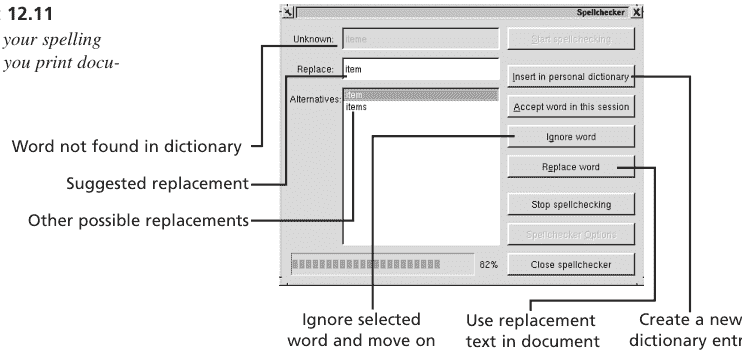

### 图 12.11

在打印文档之前检查拼写。

您还可以从可能的匹配列表中选择不同的单词。如果您点击“Alternatives”（替代方案）列表中的一个单词，它将出现在“Replace”（替换）文本框中。如果您在列表中没有看到正确的单词，请在“Replace”（替换）文本框中对文本进行修正。然后，再次点击**Replace** word（替换单词）以做出更改。

处理拼写检查所选单词还有其他选项：

- 有时所选单词是正确的，但不在词典中。如果您想保持所选单词不变，请点击“Ignore word”（忽略单词）。
- 如果您在整个文档中多次使用了该单词，且不希望拼写检查再次显示此单词，请点击“Accept word in this session”（在本会话中接受单词）。
- 当正确的拼写未显示在“Replace”（替换）文本框或“Alternatives”（替代方案）列表中时，请在“Replace”（替换）文本框中输入正确拼写，然后点击“Replace word”（替换单词）按钮。


- 当您多次使用非词典单词（如人名）时，可以将正确拼写添加到个人词典中。下次运行拼写检查时，系统将不再要求您验证该单词，拼写检查会自动处理。如果您之前输入错误，拼写检查现在已知晓正确拼写。

## 总结

正如您所看到的，在短时间内创建一份专业外观的文档是可能的。KLyX 可以为您处理许多文本格式化的细节，以便您可以专注于优秀的文字内容。在过去的一小时里，您学习了如何使文本在页面上脱颖而出，如何将文本排列在表格中，以及如何添加增强文字表现力的图形图像。在探索 Linux-Mandrake 的过程中，您会发现其他文字处理和文本编辑程序。您可能会发现，在这一个小时中习得的技能将帮助您快速上手该发行版中的其他酷炫应用程序。

## 问答

- **问：** 我注意到 KLyX 中有一些奇怪的纸张和信封尺寸。为什么？

- **答：** 您看到的奇怪尺寸是欧洲纸张尺寸。此外还有一种 `executive` 尺寸，传统上由公司高管用于个人信纸。这种纸张质量很高，带有雕刻的信头。

- **问：** 更改 KLyX 所使用的引号类型最简单的方法是什么？

- **答：** 使用“Layout”（布局）菜单中的“Quotes”（引号）命令。有六种引号样式可供选择。每一种都是卷曲引号样式或括号引号样式的变体。

- **问：** 我有在 Microsoft Word 中创建的文件，我想在 Linux 中使用这些文件。我有什么选择吗？

- **答：** KLyX 可以导入 ASCII 文件。请在“Insert”（插入）$\rightarrow$“Insert ASCII File”（插入 ASCII 文件）下查找选项。您可以选择“As Lines”（作为行）插入 ASCII 文件，使每行成为一个单独的段落。要保留原始段落，请使用“As Paragraphs”（作为段落）。您也可以在任何 X Window 程序中复制文本并将其粘贴到 KLyX 中。

## 研讨会

在使用了 KLyX 一段时间后，您会注意到它拥有许多与其他文字处理程序相同的功能。测试您的文字处理技能，看看您在 KLyX 中应用得如何。

## 测验

1. 如何在文档中将文本从一个位置移动到另一个位置？
2. 如果您想在表格的单个单元格周围放置边框，该怎么做？
3. 在哪里可以找到可插入文档的特殊符号，如何使用它们？
4. 如何调整插入文档的图形图像的大小？

## 练习

1. 如果您使用 KLyX 进行通信，可以尝试创建自己的信函模板。该模板可以包含带有您的地址、电话号码和徽标或小型图形的信头。您还可以自定义信函模板的其他部分，例如签名空间以及抄送和附件。
2. 尝试做一个负责任的 Linux 用户。Linux-Mandrake 发行版中的软件程序受 GNU 通用公共许可证保护，并由个人支持。如果您发现程序中有 bug，请向所有者发送报告。通常可以通过查看“Help”（帮助）$\rightarrow$“About”（关于）来查找所有者是谁。许多程序还需要编程支持和文档。欲了解更多信息，请访问 <http://www.gnu.org>。


# 第 13 小时：支票簿数字化

当您想到核对支票簿余额时，脑海中浮现的第一个词是什么？枯燥乏味？如果有人能帮您记录银行余额并在每月末对账，您会更开心吧？好吧，您不能总是得到想要的一切。但简化这项琐事的一种方法是使用财务管理软件程序。

在 Linux-Mandrake 发行版中，您可以找到 Check Book Balancer（简称 CBB）。CBB 是一款易于使用的支票簿管理工具，可记录银行账户的交易，将银行对账单与您的登记簿进行核对，并跟踪您的资金去向。

CBB 界面包含一个输入交易（即您开出的每张支票和每笔存款）的区域和一个查看账户登记簿的区域。它看起来就像您随身携带在钱包里的支票簿登记册。在每月末，CBB 会为您完成大部分对账工作。您只需告知 CBB 哪些交易出现在银行对账单上即可。此外，CBB 还可以向您展示您的辛苦钱花在了哪里。

在接下来的一个小时里，您将学习如何使用 CBB 来管理您的财务事务。具体而言，您将使用 CBB 来：

- 为您的每个支票账户、储蓄账户和信用卡账户创建文件
- 建立一个类别列表以跟踪您的支出
- 保持账户登记簿的最新状态
- 在每个月底核对您的账户

## CBB 入门

在开始使用 CBB 之前，您应该在用户账户中创建一个单独的目录，用于保存您的 CBB 文件。在此目录中，您将保存账户文件和类别列表。最好将这些信息与存储在用户目录中的文件分开存放。您的目录路径可能如下：

```text
/home/username/Finances
```

创建新目录后，就可以打开 CBB 并开始整理了。请参考表 13.1 来找到 CBB。

### 表 13.1：打开 CBB

| 从此处开始 | 尝试此操作 |
| --- | --- |
| AnotherLevel 菜单 | 点击 Applications $\rightarrow$ Finance $\rightarrow$ Check Book Balancer |
| X 终端窗口 | 输入 `cbb` 并按下回车键 |

第一次打开 CBB 时，系统会为您创建一个临时文件。该文件名为 `noname.cbb`，且不包含任何信息。您将看到一个类似于图 13.1 的窗口。

您需要做出的第一个决定是开始为账户录入数据的日期。除非您的银行在对账单上使用不同的起始日期，否则您可能希望选择每年的第一天或每月的第一天。如果是那样，请使用银行的起始日期。要告知 CBB 您将从哪个日期开始输入交易，请点击 File $\rightarrow$ Preferences $\rightarrow$ Set Startdate。在 Set Startdate 中，输入您希望开始录入交易的日期，然后点击 OK。


> **保存首选项更改。** 每当您更改首选项设置时，都需要通过选择 File $\rightarrow$ Preferences $\rightarrow$ Save Preferences 来保存这些更改。

## 创建账户文件

现在开始整理。您需要收集所有将使用 CBB 跟踪的账户信息。您可以跟踪在各家银行的所有支票账户和储蓄账户，也可以跟踪您的信用卡账户。

对于每个要跟踪的账户，您需要为该账户创建一个文件，然后提供初始余额。

### 课程 13.1：设置账户

以下是如何为账户创建文件以及如何指定起始余额的方法。您需要为要在 CBB 中使用的每个账户执行此过程：

1. 点击 File $\rightarrow$ Make New Account 以打开“Make Account”对话框，如图 13.2 所示。

   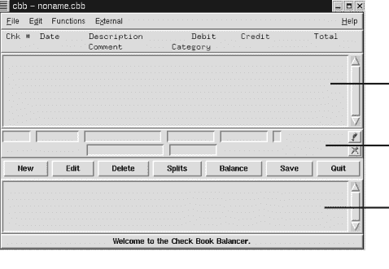

   **图 13.1**

   *CBB 窗口看起来像一个纸质支票簿登记册。*

   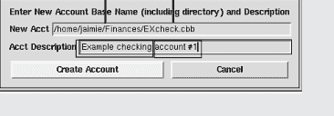

   **图 13.2**

   *为将在 CBB 中使用的每个账户创建一个文件。*

2. 在 New Acct 文本框中输入账户的目录路径和文件名。文件名使用 `.cbb` 扩展名。
3. 在 Acct Description 文本框中给账户起一个标题，然后点击 Create Account。您将看到一个信息/警告对话框，告知您将为您创建一个空的类别账户。在本小时的后续内容中，您将学习如何修改此类别列表以适应您的消费习惯。
4. 点击 OK，您将返回到 CBB 窗口，在此您可以设置账户的起始余额。
5. 点击录入区域的 Date 字段，输入余额的日期。
6. 点击 Description 字段，输入 `Beginning Balance`（起始余额）。
7. 点击 Credit 字段，输入起始余额的金额。录入区域应类似于图 13.3 所示。

   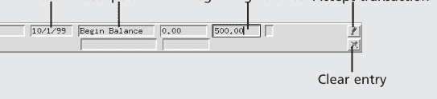

   **图 13.3**

   *为每个账户设置起始余额。*

8. 点击 Accept 按钮将起始余额添加到登记簿中。您将看到一个“Yes/No”对话框，询问您是否要为该条目使用类别。
9. 点击 Yes。您将在账户登记簿（Account Register）中看到起始余额条目。

> **操作失误？** 您可以点击 Clear Entry 按钮来清除录入字段。

> 如果您创建了多个账户，可以在账户列表中找到它们。要操作特定账户，请双击账户列表中的相应条目。

## 退出 CBB 前保存数据

在您创建账户、更新类别列表以及在 CBB 中输入交易时，所有工作都存储在内存中。在输入交易和执行其他任务时，建议您频繁点击 Save 按钮。

如果您不小心忘记保存文件，CBB 会自动创建备份文件并定期将数据保存到该文件中。如果您需要使用此备份文件，其名称为 `#filename.cbb#`，并保存在原文件所在的同一目录下。

## 使用类别跟踪消费习惯

**新术语** 类别（Categories）帮助 CBB 跟踪您的资金去向。每一种消费项目（如房租或汽油）都是一个单独的类别。

CBB 包含一个类别列表，您可以根据需要使用并编辑该列表，也可以创建自己的类别列表。一旦有了初始类别列表，您可以在使用过程中随时添加和删除类别。

### 查找默认类别列表

大多数人可能会发现使用默认类别列表是最简单的开始方式。通过使用此默认列表，您拥有了一组常用的现有类别。请记住，一旦开始使用此默认列表，您可以轻松地对其进行修改，以适应您的生活方式和消费习惯。

### 课程 13.2：构建初始类别列表

如果您不确定可能需要哪些类别，请使用默认类别列表。请按照以下步骤操作：

1. 在账户列表中双击您想要应用默认类别的账户。该账户将在账户列表中被选中，文件名将显示在标题栏中。
2. 点击 Functions $\rightarrow$ Add Default Categories。一个确认对话框将询问您是否真的要导入默认类别。当然，请选择是。
3. 点击 Yes，现在您可以对该列表进行更改了。

### 编辑类别列表

无论您是否选择使用默认类别列表，如果您想跟踪资金去向，都需要使用类别。默认类别列表包含许多记录交易所需的类别，但您可能需要进行一些修改。如果您想创建自己的类别列表，请列出那些频繁出现的支出项目，然后打开类别列表（Category List）。

要打开类别列表，请选择 Functions $\rightarrow$ Category List。如果您使用了默认类别列表，类别列表窗口将如图 13.4 所示。当您滚动列表时，您会看到经常使用的类别、偶尔需要的类别以及完全不需要的类别。

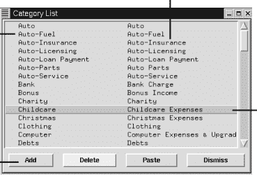

**图 13.4**

*使用类别来跟踪您的支出。*

- 类别 (Category)
- 选择要删除的类别 (Select a category to delete)
- 添加新类别 (Add a new category)

如果您认为不需要某个类别，请突出显示该类别并点击 Delete 按钮。系统将要求您确认选择。如果您需要向列表中添加类别，请点击 Add 按钮并填写描述新类别的信息。

### 课程 13.3：创建新类别

> 如果您想跟踪资金去向，每种支出类型都需要一个类别。您可能还想为不同的收入来源创建单独的类别。请按照以下步骤操作：

1. 打开类别列表（Category List）。
2. 点击 Add 按钮，显示如图 13.5 所示的“Add New Category”对话框。

   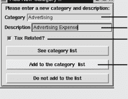

   **图 13.5**

   *创建额外的收入和支出类别。*

   - 类别名称 (Category name)
   - 类别描述 (Category description)
   - 用于税务目的 (Used for tax purposes)
   - 将类别添加到列表 (Add category to list)

3. 为类别输入一个名称，用以描述收入或支出的类型。
4. 您可以在 Description 文本框中添加几个词，以提醒自己该类别是用作什么的。
5. 如果该类别是您在纳税申报单中申报的项目，请选择 Tax Related? 选项。
6. 完成后，点击“添加”以将类别列表加入。新类别将按字母顺序显示在类别列表中。

> 如果您在输入交易时需要向列表中添加新类别，您可以即时创建类别。只需在输入区域的“类别”字段中输入该类别的名称。系统将询问您是否要将该类别添加到列表中。

## 记录交易

一旦您通过输入交易开始日期、设置账户以及创建自定义类别列表完成了 CBB 的设置，就可以开始输入所有的支票、存款、自动提款机收据和信用卡单据了。

## 记录支票

最常见的交易可能是您用来支付账单的支票。您会发现 CBB 的交易输入区域看起来非常像纸质支票簿登记册中的行。如果您熟悉纸质支票簿登记册，会发现 CBB 的交易输入区域与之非常相似。图 13.6 显示了一个简单的支票账户交易。

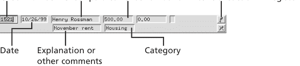

**图 13.6**

为通过支票支付的账单创建登记项。

要输入支票信息，请点击输入区域中的每个字段，并按照支票上的记录输入支票号码、日期、收款人以及金额信息。然后添加一个类别。当所有信息都提供完毕后，按下 Enter 键或点击“接受交易”按钮将交易添加到登记册中。

第一次记录支票时，您需要手动输入支票号码。下次输入支票时，只需输入一个 `+`（加号）；CBB 将显示下一个顺序的支票号码。

如果您使用类别来跟踪支出，在“类别”字段输入类别类型时有几个技巧。首先，无论您选择哪个技巧，请确保光标位于“类别”字段中。

- 第一个技巧是：打开“类别列表”，选择您想要应用于该付款的类别，然后点击“粘贴”按钮。返回登记册后，您将在“类别”字段中看到该类别。
- 另一个技巧是：输入类别名称的首字母并按下 Tab 键。如果 CBB 能猜到该类别，它将自动填充剩余部分。如果不能，请再输入一个字母并按下 Tab 键。如此往复，直到整个类别名称出现在字段中。

> 在输入交易时，请保持“类别列表”窗口打开。您可以使用此列表来完成输入区域中的“类别”字段。

## 课程 13.4：为一项付款分配两个类别

有时您写的一张支票可能适用于两个类别项。例如，您可能去超市买一些杂货，但同时在那里买了邮票。要为一项付款分配两个类别，请按照以下步骤操作：

1. 打开您开出支票的账户。
2. 在“支票 #”字段中输入支票号码。或者，如果您是按顺序记录支票，在该字段中输入加号，下一个支票号码将自动出现。
3. 在“描述”字段中输入您开支票的个人或公司名称。
4. 在“借方”字段中输入支票金额。
5. 将光标置于“类别”字段，并点击“分拆”按钮以打开“类别分拆”窗口，如图 13.7 所示。
6. 输入您想要记录部分总付款金额的第一个类别名称。您可以在“类别”字段中直接输入第一个类别的名称，或者打开“类别列表”并粘贴该类别，或者输入单个字母并按下 Tab 键使用自动完成功能。
7. 在“金额”字段中输入应用于第一个类别的金额。由于这是一项付款，数字前需要加上负号 (`-`)。
8. 点击第二个类别的“类别”字段。请注意，该类别的金额已经为您计算好了。输入第二个类别的名称。
9. 当各类别之和等于付款总额时，点击“关闭”按钮。“类别分拆”窗口将关闭，您输入的数据将出现在输入区域的“类别”字段中。

## 支票簿数字化

| 第二类别 | 第一类别 | 余额自动计算 |
| :--- | :--- | :--- |

**图 13.7**

交易金额可以在多个类别之间进行分配。


（输入支票信息 $\rightarrow$ 打开账户 $\rightarrow$ 分配多个类别 $\rightarrow$ 将分拆应用于交易）

10. 交易完成后，点击“接受交易”按钮。该交易将出现在账户登记册中，且账户余额将减少支票的金额，如图 13.8 所示。

**图 13.8**

如果您一直遵循示例，您的支票簿登记册应该是这样的。


## 过账存款

您会发现向 CBB 输入存款与输入支票非常相似。唯一的区别是您不需要使用支票号码，且金额输入在“贷方”字段中。毕竟，您希望余额增加，不是吗？图 13.9 中的示例显示了一个简单的存款操作。


## 账户间资金转移

在您需要资金但不在正确银行账户中的时候，您需要进行转账。一次转账实际上是两项交易的合集。首先，它是从一个账户中提取资金；其次，它是向另一个账户存款。如果您的银行允许您在账户之间转移资金，且这些账户已在 CBB 中设置，您可以通过一个简单的步骤完成这两项交易。

> 在对转账进行修改时请保持警觉。更改应同时出现在资金提取账户和资金存款账户中。您可能需要检查这两个账户中的交易，以确保处理正确。

## 课程 13.5：将资金从储蓄账户转移到支票账户

让我们假设现在又是假期时间，您需要购买西伯利亚之旅的火车票。您前往银行将资金从储蓄账户转移到支票账户，这样您就可以给为您寻找这个优惠方案的旅行代理人开一张支票。请遵循以下步骤：

1. 打开储蓄账户的账户登记册。您将从该账户转移资金并将其存入支票账户。
2. 输入进行转账的日期。
3. 输入转账的描述；例如，`Vacation 2000`。
4. 在“借方”字段中输入转账金额。
5. 在类别字段中，从“类别列表”中选择资金将要存入的支票账户（银行账户列在底部），并在确认信息正确后接受该交易。您的示例应类似于图 1.30 中的内容。


**图 1.30**

仅需一次记录即可在两个账户之间转移资金。


### 6. 查看转账后的账户余额

现在打开您的支票账户登记册。您会看到账户余额已增加了转账金额，并且该交易已按日期顺序排列。

## 编辑交易

当您需要修改已输入的交易时，在账户登记册中选择该交易并点击“编辑”按钮。交易将出现在输入区域中。进行任何更改后，点击“接受交易”按钮以更新登记册中的交易。

## 处理重复交易

您可能有许多定期支付的账单或常规的存款类型（例如工资单）。为了避免重复输入相同信息的麻烦，您可以使用 CBB 的记忆功能。

首先输入支票号码和日期。输入描述中的几个字符并按下 Tab 键。CBB 将在记忆中搜索最匹配的内容并为您填充其余信息。如果信息正确，点击“接受交易”按钮。您也可以根据需要对该条目进行任何更改。

如果您不想使用自动填充的信息，请按下 `Ctrl+Tab`（光标必须仍在“描述”字段中）。此时将仅保留您输入的信息。随后您需要自行完成交易。每次交易您只能要求 CBB 搜索一次记忆。

## 账户对账

在每月的某个时间，您的银行会向您发送账户对账单。您的工作是确保银行提供的信息与您在 CBB 中存储的信息一致。您的第一步是拿好对账单，在 CBB 中打开相应的账户，然后点击“余额”按钮。在您完成告知 CBB 的过程之后……

对账单期末余额以及出现在对账单上的交易，希望你的记录与银行的记录能够一致。如果不一致，你需要对这个谜团的原因进行一些调查研究。你可以运行几份报告来获取一些线索。

> 一旦账户平衡，下次对账时，将只出现未结算的交易。

## 第 13.6 课：账户对账

又到了每月的这个时候；银行对账单已经寄到了。在你进行下一次购物狂欢之前，最好确保你的记录与银行的记录一致。请按照以下步骤操作：

1. 打开你想要平衡的账户，点击 `Balance`（余额）按钮以调出未结算交易列表。
2. 输入对账单期末余额。你可能需要确认 CBB 中的对账单期初余额与你对账单上的余额相匹配。
3. 双击那些出现在银行对账单上的交易。在你标记为已结算的每笔交易左侧会出现一个星号。此外，随着你选择交易，差额将发生变化，如图 13.11 所示。


随着你从登记簿中结算交易，差额（Difference）会逐渐减少。

选择已结算交易

—账户已对账！

4. 当所有交易都被选中后，点击 `Update`（更新）按钮。Balance 窗口将关闭，你会注意到在登记簿的 Credit（贷方）列右侧，那些出现在银行对账单上的交易旁边会出现一个“x”。

## 创建报告

你可以创建几份报告来确定为什么你的 CBB 记录无法与银行对账单对齐。要查找报告，请点击 `Functions`（功能），`Reports`（报告）。

### 交易列表报告（The Transaction List Report）

`Transaction List` 看起来就像该账户的账户登记簿。你可以看到哪些交易已在银行结算（通过金额列右侧的“✓”标识）以及哪些尚未结算。你还可以使用此报告来验证输入的金额是否正确，以及交易是否记录在相应的银行账户中。

该主题还有其他变体。你还可以选择“按类别划分的交易列表（Transaction List by Category）”报告。此报告根据类别对交易进行排序，并显示每个类别的小计。如果你不想查看所有交易，而只想查看类别和金额，请选择“按类别划分的简短列表（Short List by Category）”报告。

### 未结算交易报告（The Uncleared Transactions Report）

此报告仅显示那些尚未在银行结算的交易。这样你就知道哪些支票尚未结算。你还可以使用此报告来确保 CBB 中所有出现在对账单上的交易都已结算。

### 缺失支票报告（The Missing Checks Report）

如果你需要知道登记簿中是否漏入了某个支票号码，或者某个支票号码是否被输入了两次，请运行 `Missing Checks Report`（缺失支票报告）。

## 总结

现在你已经有机会尝试使用 Check Book Balancer（CBB）了，希望你发现了一个能减轻日常生活中压力和负担的新工具。通过利用这个电子记账员，你再也不必疯狂地按下计算器按键来查看支票账户中还剩多少钱。将你的记录与银行对账单对账会更快，因为你不需要亲自进行繁琐的数字计算。在利用 CBB 追踪基础财务状况之后，你可能会想利用这些信息来制定预算和储蓄计划。


> 如果你发现输入交易时犯了错误并想在登记簿中编辑该交易，可以在对账时进行操作。只需显示 CBB 窗口，编辑交易，切换回 Balance 窗口，然后点击 Refresh（刷新）按钮即可。

## 问答（Q&A）

**问：我为每个账户创建了文件。现在我对它们的命名不满意。有什么办法可以将这些名称改为更具描述性的名称吗？**

答：打开账户，然后选择 `File`（文件），`Save Account As`（账户另存为）。

**问：我的财务数据在 CBB 中安全吗？**

答：如果你的 CBB 文件存储在系统的用户主目录下，除非他人拥有你用户账户的访问权限，否则无法访问这些文件。如果你不想让别人进入你的账户，可以登出用户账户或在屏幕保护程序上设置锁定。此外，请确保你保存的任何 CBB 文件备份都存储在安全的地方（例如锁上的文件柜或银行保险箱）。如果你是加密专家，可以使用 `Preferences`（首选项）菜单中的 CBB 加密功能。

**问：我想确保我使用的是最新版本的 CBB。有什么简单的方法可以保持程序更新吗？**

答：启动你的互联网连接，让我们来看看。点击 `External`（外部），`Install the Latest CBB`（安装最新版 CBB）。CBB 将处理下载安装包、解包（untar）和解压（gunzip）以及随后的安装事宜。完成后你需要重启 CBB。

## 研习（Workshop）

你可能认为仅仅让你整理财务就足以作为这一个小时的测试了。并非如此。我们希望引领你走向极度且独立富有的道路！是的，我们的梦想规模很大。所以，让我们确保你的财务魔法运行良好，看看你对过去一个小时所学内容的记忆情况。

### 测验

1. 当你为每个银行账户和信用卡账户设置单独文件时，如何在这几个账户文件之间切换？
2. 如果你在输入交易时没有设置合适的类别，创建新类别的最快方法是什么？
3. 如果有许多定期支付的账单（如电话费和车贷），如何快速输入这些重复交易？
4. 如何确保你的记录与银行对账单一致？

### 练习

1. 你可能注意到你的 CBB 窗口看起来与本小时示例中显示的不一样。尝试通过设置不同的尺寸来改变窗口的外观。路径如下：`File`（文件），`Preferences`（首选项），`Appearance`（外观），`Set Dimensions`（设置尺寸）。你需要保存这些首选项更改并重启程序才能看到效果。
2. Quicken 用户可以导出其 Quicken 数据并将其导入 CBB。在 Quicken 中，选择 `File`（文件），`Export`（导出），`Export`（导出），然后选择你想在 CBB 中使用的账户。如果你想使用多个账户，需要分别导出每个账户。然后，将 Quicken 的 QIF 文件传输到 Linux 的主目录下，并在 CBB 中选择 `File`（文件），`Import QIF File`（导入 QIF 文件）。你可能还想尝试将 CBB 文件导出到 Quicken。
3. 使用 CBB 进行一些预算规划。首先运行“按类别划分的平均每月支出（Average Monthly Expenses by Category）”报告。该报告会向你展示收入的去向。查看报告以确定可以在哪里减少开支。这是一个开始为不时之需而储蓄的好机会。


# 第 14 小时：使用 Screem 构建网站

你是否正在寻找一个功能先进的网页编辑程序，能让你想起 Windows 和 Macintosh 时代的那些网页编辑器？在第 11 小时“接入互联网”的最后一部分中，你了解到可以使用 Netscape Composer 创建网页。Composer 没有问题，但也许你正在寻找一些更强大的功能——一些更丰富、更花哨的功能。

Screem 与 Composer 的不同之处在于，Screem 旨在创建和管理一个完整的网站。Screem 将你的网站视为一个单一单元，而不是一组独立的网页集合。因为你的网页作为站点被统一管理，如果在其中一个页面上进行了影响其他页面的更改（例如重命名一个被站点内其他页面链接的页面），Screem 会自动更新超链接和导航栏。

无论您设计的是大型还是小型网站，请启动您的 Web 浏览器，因为在 Linux-Mandrake CD 中找不到 Screem。在接下来的一个小时里，您将通过执行以下操作来熟悉 Screem：

- 从互联网下载 Screem 并将其安装到您的计算机上
- 为网站创建基础结构
- 向网页添加文本、HTML 标签、超链接和图像

## 为使用 Screem 做准备

Linux 最令人兴奋的事情之一就是软件软件包的可获得性。虽然许多软件程序可以在 Linux-Mandrake CD 上找到，但您在互联网上能找到更多的 Linux 软件。您需要从互联网下载的 Linux 应用程序之一就是 Screem。

现在，您可能会认为下载像 Screem 这样的网页编辑器需要一整天的时间。事实上，Linux 的美妙之处在于，大多数 Linux 应用程序不需要占用大量硬盘空间，也不需要很长的下载时间。Screem 的下载大小仅为 1.3MB。

### 第 14.1 课：安装 Screem

由于 Screem 不在 Linux-Mandrake CD-ROM 中，您需要从 Screem 的网站下载 RPM 文件。获取 Screem 的地址如下：

1. 现在开始获取 Screem。导航至 `www.screem.org` 寻找 Screem RPM。向下滚动页面直到进入 Download 部分。您需要下载名为 `screem-0.1-98-1.i386.rpm` 的文件。
2. 在您的系统上安装 Screem RPM。打开文件管理器并显示您刚刚下载的 RPM 文件。若要从 KDE 升级软件包，请点击该文件以显示安装窗口。在 GNOME 中，右键点击文件并选择 `Upgrade`。

   > 如果您需要关于如何安装软件包的复习课程，请参阅第 9 小时“管理应用程序”。

3. 安装完成后，您可以打开一个 X 终端窗口，输入 `screem` 并按 Enter 键。Screem 网站创建程序将打开，如图 14.1 所示。

## 启动您的第一个网站

根据您使用其他操作系统的经验，您可能熟悉“向导”（wizards）的概念。向导通过引导您完成一项任务并提出相应的问题来简化您的操作。

**新术语：** Screem 也包含许多向导，只不过您会发现它们被称为“德鲁伊”（druids）。无论您如何称呼它们，这些向导/德鲁伊都比我们这些凡人更聪明，并且已经知道您为了完成一项工作需要做的一切。

创建您自己的网站最简单的方法是借助 Site 德鲁伊。Site 德鲁伊会引导您完成设置网站结构的整个过程，然后在您准备向联网世界公开您的网站时，收集将网站上传到 ISP Web 服务器所需的所有信息。


使用 Screem 创建网站地图、设计页面并自动更新链接。

### 第 14.2 课：组织您的网站

在开始设计网页之前，您需要告诉 Screem 您想将网站保存在计算机的什么位置，以及在您准备在互联网上发布网站时，该网站将上传到哪个 Web 服务器。要使用 Site 德鲁伊帮助您启动网站，请遵循以下步骤：

> 在开始本课之前，您可能需要咨询您的 ISP，获取将网站上传到其 Web 服务器的指南。

1. 点击 `New Site` 按钮以显示 Site 德鲁伊的启动界面。阅读启动信息并点击 `Next` 以显示德鲁伊的下一个界面。
2. 在 Site Pathname 文本框中输入您想要保存网站的目录路径。例如，如果您想将其保存在用户主目录的子目录中，路径可能类似于 `/home/username/website`。
3. 在 Site Name 文本框中输入网站的名称。这个名称将出现在 Web 浏览器的标题栏中。第一个界面的示例见图 14.2。完成后，点击 `Next`。


Site 德鲁伊需要知道文件的保存位置以及您想为网站起的标题。

4. 下一个界面会询问您是否要使用模板来创建网站的目录结构，或者为网页创建统一的外观。由于您尚未创建任何模板，请点击 `Next`。

## 使用 Screem 构建网站

5. 然后德鲁伊会询问您是否要使用版本控制软件程序来跟踪网站的更新。如果您了解版本控制软件，请选择此选项并输入该程序的路径。如果不了解，请点击 `Next` 进入下一个界面。
6. 在 Remote Address 文本框中输入您的网站托管商要求您上传网页的地址。您还需要添加可以访问您网站的 URL 地址。示例见图 14.3。完成后，点击 `Next`。


告诉 Site 德鲁伊在您的 ISP Web 服务器上的哪个位置上传您的网站。

7. 下一个界面需要知道您将如何把网页上传到 Web 服务器。从 Remote Method 下拉列表中选择您的 ISP 所要求的方法。许多 ISP 使用 FTP。您还需要在 Remote Path 文本框中输入网站在 ISP Web 服务器上存储的目录路径。准备好进入下一步时，点击 `Next`。
8. 输入 ISP 提供的用于访问 Web 服务器的用户名和密码，以便您可以上传文件。完成后点击 `Next`。
9. 您的网站已准备就绪。点击 `Finish`，您将在文件树（File tree）中看到新网站的雏形。

> 如果您需要更改输入到 Site 德鲁伊中的任何信息（例如网站发布的位置），请选择 `Settings`，`Site`。

## 向您的网站添加网页

一旦您构建了网站的结构，就可以开始添加页面了。将页面插入网站非常简单；Page 德鲁伊会为您完成所有繁琐的工作。Page 德鲁伊不仅能向您的网站添加页面，还可以设置文本、链接以及背景颜色或图像。

如果您的网站将包含大量页面，您可能想要创建一个目录结构来存储不同类型的页面。例如，如果您的网站包含产品信息、公司简介和员工页面，您可能希望将每组放置在单独的子目录中，如下所示：

```text
/home/username/website/products
/home/username/website/profile
/home/username/website/employees
```

使用子目录可以通过将信息进行逻辑分组，使大型网站的管理变得更容易。您可以使用文件管理器来创建这些子目录。有关使用文件管理器的帮助，请返回第 6 小时“神奇而神秘的文件系统之旅”。

### 第 14.3 课：创建新网页

构建网站结构的一部分是将您希望包含在网站中的页面添加到 Site 树（Site tree）中。当您创建页面时，页面中包含的唯一内容是标题和颜色信息。您将在页面创建之后添加具体内容（如文本、超链接和图像）。要向您的网站添加页面，请跟随本课操作：

1. 点击 `File`，`New`，`New Page` 来启动 Page 德鲁伊。
2. 点击 `Next` 进入 Page 德鲁伊的第一个界面。
3. 在 Page Path 文本框中输入新页面的目录路径和文件名。参考第 14.1 课的示例，路径可能类似于 `/home/username/website/pagename.html`。

   您还应在 Page Title 文本框中为页面输入标题。当访问该页面时，此标题将出现在 Web 浏览器的标题栏中。示例见图 14.4。点击 `Next` 进入下一个界面。
4. 然后您需要为网页的不同元素选择颜色。要更改默认颜色，请点击您想要更改的元素的选项按钮，然后点击相应的颜色按钮以显示颜色选择器。选好颜色后，点击 `Next`。

## 使用 Screem 构建网站


向 Page 引导程序（druid）提供所创建页面的目录路径、文件名、标题和作者。

5. 如果您想为页面背景使用图像文件，请选择“Use background image”选项，然后输入要使用的图像的目录路径和文件名。满意后，点击“Next”。
6. 页面创建完成。点击“Finish”，您将看到新页面被添加到文件树中，如图 14.5 所示。


网页已添加到文件树中，准备好在编辑器区域添加内容。

保存工作

新页面

在此添加内容

页面结构

> 请记得经常保存您的网页。当您点击“Save”按钮时，网站中的所有页面都会被保存。无需逐个保存每个页面。

## 设计网页

您的站点结构已完成，并且已经添加了几个页面。现在是时候开始在这些页面中添加内容了。要显示您想要添加文本、超链接和图片的页面，请双击文件树中的文件。这将使页面在 Screem 编辑器中显示。从这里开始，如何设计一个美观的页面就由您决定了。

> Screem Page 引导程序会创建每个网页所需的 HTML 标签。这些标签指示页面的开始和结束（`<HTML>` 标签）、标题信息（`<HEAD>` 标签）、页面的标题（`<TITLE>` 标签）以及在 Web 浏览器中显示的页面部分（`<BODY>` 标签）。只需记住，您的内容需要放置在 `<BODY>` 标签之间。


## 使用 HTML 标签格式化文本


为文本添加 HTML 标签很简单，只需将文本输入编辑器，选中它，然后在标签树中浏览并找到合适的 HTML 标签即可。图 14.6 显示了一个插入到网页正文中的一级标题示例。


**图 14.6** 使用标签树（Tag Tree）选择 HTML 标签。

您也可以在输入文本之前先选择 HTML 标签。这样做时，开始和结束标签会出现，光标将位于标签之间。然后您可以输入文本。

> 如果您想查看页面在 Web 浏览器中的显示效果，可以点击“Preview”标签或点击“View”按钮。

## 超链接到互联世界

超链接是互联网的运输载体。超链接可以将访问者在您的网站内从一个页面引导至另一个页面，将访问者引导至您自己的网站之外，并使访问者能够轻松地与您沟通。

有几种方法可以创建超链接。您可以直接在编辑器中输入代码。您可以使用标签树来辅助。或者，为了方便，可以启动链接向导（Link Wizard）。您可以通过点击工具栏上的“Link Wizard”按钮，或选择“Insert” $\rightarrow$ “Link”来进入链接向导（如图 14.7 所示）。


**图 14.7**

选择您要创建的超链接类型，并向向导提供链接信息。

- 关闭向导
- 保持向导开启并创建更多超链接
- 向导会记住您之前输入的信息

### 插入图像

在这一小时的最后一个向导技巧中（见图 14.8），点击工具栏上的“Image Wizard”按钮（或选择“Insert” $\rightarrow$ “Image”）。您可以使用此向导将图像添加到您的网页中。


**图 14.8**

*图像向导（Image Wizard）的操作非常直观。将鼠标悬停在文本框上可显示屏幕提示。*

### 小结

在这一小时中，您学习了如何使用 Screem 开始创建网站。Screem 不仅仅是一个网页编辑器。使用 Screem，您不仅可以创建 HTML 代码，还可以管理网站的各个方面。如果您重命名或重新排列站点中的页面，Screem 将自动更新您的站点。

### 问答

- **问：我有在另一个网页编辑器中创建的网页。我可以在 Screem 中使用这些页面吗？**

  答：在 Screem 中打开这些文件非常简单。点击“Open Site”按钮并导航到存储网页的目录。文件导入后，Screem 会要求您输入站点信息。

- **问：我想进一步学习如何编写 HTML 代码。您能推荐一些好的资源吗？**

  答：一定有大量的书籍会教您如何通过编写自己的 HTML 代码来创建网页。我们接触过的较好的书籍之一是 Laura Lemay 编写的 *Sams Teach Yourself Web Publishing with HTML in 21 Days*。

如果您想在互联网上寻找 HTML 帮助，请查看 About.com。About.com 是一个包含所有人所需信息的 Web 门户。Web 设计师会发现 About.com 的两个区域最为有用：`html.about.com` 和 `webdesign.about.com`。

要直接咨询 HTML 权威机构，请访问万维网联盟（World Wide Web Consortium）的超文本标记语言主页：`www.w3.org/MarkUp`。

## 练习

现在是检查您的网站设计技能的时候了。这里有几个测验问题来测试您在过去一小时中学到的知识。此外还有几个练习来帮助您创建更好的网站。

### 测验

1. 什么是 `druid`（引导程序）？
2. 列举 `druid` 能让您的工作变得更简单的两种方式。
3. 哪些 HTML 标签提供了网页的基本结构？

### 练习

1. 如果您有一个包含多个页面且有多人协作的大型网站，您可能想使用“To Do”功能来跟踪每个页面需要完成的任务、谁负责完成该任务以及何时需要完成。要访问待办事项列表，请点击“View Site To Do List”按钮。
2. 让网站看起来美观的最简单方法之一是使用图形。您的任务是收集视觉协调的图像，为您的网站提供一个统一的主题。有几个 Linux 程序可以用来自行创建图形。在第六部分“追求图形”中，您将了解到 The Gimp、KIllustrator 以及许多其他可以帮助您创建美观艺术作品的图形实用工具。您也可以从互联网下载图像；使用搜索引擎寻找免费的 Web 图形。您也可以在计算机上找到图像。（在 `/usr/share/wallpapers` 中查找 `.jpg` 格式的背景图像。）


# 第 15 小时：打印和传真文档

尽管在一个完全无纸化办公的环境中工作是一个符合生态学的想法，但仍然需要纸质文档，因为有时电子文件无法满足需求。您可能会发现，并非所有计算机都配置好处理您创建的文件类型，而且并非所有人希望他们的电子邮箱充斥着文件附件。如果您在屏幕上编辑文档感到困难，您可能想打印一份文件副本。在这些情况下，您需要将一台 Linux 兼容的打印机连接到计算机，然后告诉 Linux 如何使用该打印机。

无纸化办公的另一个障碍是传真机。传真仍然是一种流行的传输文档的方式（并非所有人使用电子邮件）。通过传真机减少纸张使用的一种方法是使用传真软件程序。这将使您的纸张使用量减少一半——您发送的传真被保存为电子文件，只有接收者收到纸质副本。

在接下来的一个小时里，您将学习如何使用计算机打印和传真文档。具体来说，您将学习如何执行以下操作：

- 确定系统中是否已配置打印机
- 配置本地打印机
- 更改惠普（Hewlett-Packard）LaserJet 打印机的设置
- 使用 `KVoice` 发送传真

## 准备打印文档

在安装 Linux-Mandrake 期间，您可以选择设置打印机。如果您在安装期间没有执行此操作，则需要在打印任何文件之前配置打印机。

**新术语**：首先，检查打印机是否已连接到并行端口，已接通电源并已开启。如果您使用 *pass-through parallel port cable*（透传并行端口电缆），则没有问题。透传并行端口电缆允许您在计算机和打印机之间连接一个设备（如 CD-ROM 驱动器、扫描仪或 ZIP 驱动器）。您会发现，在使用连接到透传电缆的设备时，将无法使用打印机。

如果您不知道计算机是否已设置打印机，请尝试第 15.1 节中的练习。

## 第 15.1 节：Linux 是否已配置打印机？

在尝试设置打印机之前，请测试计算机的并行端口上是否配置了任何设备。首先，您需要登录 root 账户。登录后，打开一个 X 终端窗口。然后，按照以下步骤操作：

1. 在命令提示符下，输入命令：

   ```bash
   ls > /dev/lp1
   ```

   其中 `lp1` 是连接打印机的并行端口名称。这会将目录列表发送到并行打印机端口。

   如果已配置打印机，打印页面上会出现若干行阶梯状的线条。不必担心这是如何实现的，它仅表示您可以使用该打印机。

   如果打印机没有打印，会出现类似以下响应：

   ```text
   bash: /dev/lp1: Device not configured
   ```

2. 如果未配置打印机，请使用 `printtool` 来设置打印机（在下一节中讨论）。

## 使用 Red Hat Linux 打印系统管理器

设置打印机以在 Linux 系统中运行的一种快捷方法是使用 Red Hat Linux 打印系统管理器。该工具（也称为 `printtool`）管理连接到计算机的所有打印机。您不仅可以添加和删除打印机，还可以限制发送到打印机的文件大小。

**新术语**：`printtool` 可以配置大约 60 种打印机类型，用作本地或网络打印机。本地打印机直接连接到计算机工作站（通常通过并行端口）；只有该工作站能向该打印机发送作业。

如果您的计算机连接到网络，您可以通过网络访问打印机。此外，您可能需要走到走廊尽头去取打印的文件。这对您来说很方便，因为系统管理员负责在网络上设置新设备，并确保所有配置正确且正常工作。

要进入 Red Hat Linux 打印系统管理器，您必须首先登录 root 账户。然后，在 X 终端窗口中输入 `printtool`。

> 您也可以从 DrakConf 访问 Red Hat Linux 打印系统管理器。选择“打印机配置”选项。您会发现 DrakConf 的打印机配置方法与 Red Hat 打印工具略有不同。


随后会出现一系列错误窗口。不必担心这些问题。这些错误是为了告知您计算机上未安装的软件包。配置本地打印机时不需要这些软件包。随后会出现 `printtool` 启动窗口，如图 15.1 所示。


## 第 15.2 课：配置本地打印机

在开始本课之前，您可能需要准备好打印机的用户手册。如果您的打印机不在 `printtool` 列表中，您需要选择一个与您的打印机设置最接近的打印机。请按照以下步骤配置用于 Linux 系统的本地打印机：

1. 点击“添加（Add）”按钮，显示“添加打印机条目（Add a Printer Entry）”对话框。
2. 选择“本地打印机（Local Printer）”选项按钮，然后点击“确定（OK）”。`printtool` 会搜索任何并行打印机设备，并在“信息（Info）”对话框中列出检测到的端口。您可能需要记录下检测到的并行端口。点击“确定（OK）”进入“编辑本地打印机条目（Edit Local Printer Entry）”对话框（如图 15.2 所示），在此处您将配置打印机。

   

   **图 15.2**

   设置 `printtool` 驱动打印机所需的信息。

   - 记录打印机名称
   - 限制打印文件大小
   - 选择打印机驱动程序

3. 点击“选择（Select）”按钮，打开如图 15.3 所示的“配置过滤器（Configure Filter）”对话框。

   

   **图 15.3**

   选择一个与您的打印机密切匹配的打印机，或者选择一个您的打印机可以模拟的打印机。

   - 选择打印机
   - 设置打印默认值

4. 在“打印机类型（Printer Type）”列表中滚动查找并选择您的打印机（或与其接近的打印机）。然后点击**确定（OK）**。您将返回到“编辑本地打印机条目”对话框。请注意，打印机已出现在“输入过滤器（Input Filter）”文本框中。
5. 再次点击**确定（OK）**。您将返回到 `printtool`，打印机将列在其中。
6. 要测试打印机，请从列表中选择该打印机，然后点击“测试（Tests）”，选择“打印 Postscript 测试页（Print Postscript test page）”。一个信息对话框将告知您测试页已打印。页面是否打印正确？如果没有，您可能需要对打印机进行更改。只需选择该打印机并点击“编辑（Edit）”按钮即可。
7. 完成后，点击“PrintTool”，选择“退出（Quit）”。现在您可以开始打印了。

## 使用 HP LaserJet 打印机

拥有 Hewlett-Packard LaserJet 打印机的用户可以使用一个实用程序，让您在桌面上管理您的 HP LaserJet 打印机。该工具允许您更改纸张大小和方向、打印分辨率以及许多其他选项。

要找到此实用程序，请打开 KDE 主菜单，选择“实用程序（Utilities）”，再选择“实用程序（Utilities）”，最后选择“HP LaserJet 控制面板（HP LaserJet Control Panel）”。您也可以在 X 终端窗口中输入 `kljettool`。

HP LaserJet 控制面板打开在“纸张（Paper）”选项卡。在该选项卡中，您可以更改纸张方向、打印副本数以及纸张方向。“打印机（Printer）”选项卡（如图 15.4 所示）可更改打印分辨率和密度，并选择不同的打印机（如果系统上设置了多台打印机）。


在 HP LaserJet 控制面板中进行更改后，这些更改将应用于您打印的所有页面。当您想再次更改默认打印设置时，请打开该实用程序并修改设置。

## 从计算机发送传真

如果您想在方便的计算机屏幕前发送传真，必须首先将兼容传真的调制解调器连接到计算机。然后，您必须决定要使用哪个传真程序。在本小时的最后一部分，我们将研究 `KVoice`，它可以发送简单的单页传真，或者发送存储在计算机上的文件。

### KVoice 入门

虽然 `KVoice` 的功能远不止发送传真，但您还必须拥有一个能够接听语音电话的调制解调器。配备适当的调制解调器，`KVoice` 可以成为一个功能齐全的电话答录机和传真系统。

在开始使用 `KVoice` 之前，root 账户需要设置 `KVoice` 以发送传出传真。要启动 `KVoice`，请从 KDE 主菜单中选择“应用程序（Applications）”，然后选择“语音邮件与传真（Voice Mail & Fax）”。您也可以在 X 终端窗口中输入 `kvoice`。

第一次打开 `KVoice` 时，会出现一条通知，指出 `KVoice` 之前从未运行过。当您点击“确定（OK）”时，程序将尝试确定您的系统配置。即使 `KVoice` 坚持认为其配置正确，您仍应检查设置选项，以确保一切按计划运行。

一切就绪后，如图 15.5 所示的 `KVoice` 窗口将出现在屏幕上。


**图 15.5**

*如果您的家庭或企业需要传真和答录系统，请尝试使用 `KVoice`。*

## 第 15.3 课：检查 KVoice 配置

尽管 `KVoice` 会检查自身配置，但您仍然需要执行一些配置任务。为了确保 `KVoice` 设置正确以发送传真，请跟随本课进行操作：

1. 点击“选项（Options）”，选择“设置（Setup）”以打开设置对话框。
2. 点击如图 15.6 所示的“调制解调器（Modem）”选项卡。您需要在此对话框中执行几项任务。

   

   **图 15.6**

   *`KVoice` 需要知道调制解调器的端口、速度和制造商。*

   以下是您需要在“调制解调器”选项卡中执行的配置任务：

   - 从“调制解调器设备（Modem Device）”下拉列表中选择连接调制解调器的端口。
   - 从“波特率（Baud Rate）”下拉列表中选择调制解调器速度。
   - 从“调制解调器类型（Modem Type）”下拉列表中选择调制解调器制造商。

3. 点击“传真（Fax）”选项卡，将电话号码文本框中的小 x 替换为计算机连接的电话号码。
4. 完成更改后点击“确定（OK）”。您现在可以使用新的传真程序发送传真了。

## 创建 KVoice 传真作业

`KVoice` 允许您发送包含纯文本的传真，或者发送一份传真封面页以及存储在计算机上的文件。要开始新的传真，选择“传真（Fax）”，选择“新传真（New Fax）”。这将打开如图 15.7 所示的传真窗口。


**图 15.7**

填写 `KVoice` 封面页并附加任何所需文件。

- 收件人的传真号码
- 发送传真
- 编写简短的消息
- 附加要随传真发送的任何文件

发送传真很简单。只需在“收件人（To）”文本框中输入收件人的传真号码，并在其下方的空间中写一段简短的笔记。如果您需要附加任何文件，请选择“文件（File）”，选择“添加文件（AddFile）”。将打开一个对话框，您可以在文件系统中搜索要附加的文件。完成后，点击“发送消息（Send Message）”按钮。传真将被放入传真队列中，直到您选择“传真（Fax）”，选择“发送缓冲文件（Send spooled）”。

## 总结

由于很难摆脱对纸质文档的需求，打印和传真仍然是与他人沟通的流行方式。在本小时中，您学习了如何设置 Linux 计算机，以便从所有您喜爱的应用程序中进行打印。您还学习了如何使用 `KVoice` 将这些文档传真给他人。

## 问答

- **问：** 有没有快速访问文件打印的方法？

  **答：** 您可以将打印机图标放在桌面或面板上。要从 GNOME 主菜单将打印机图标放在面板上，请选择“面板（Panel）”，选择“添加小程序（Add applet）”，选择“实用工具（Utility）”，选择“打印机小程序（Printer Applet）”。当您想打印文件时，打开文件管理器窗口，选择要打印的文件，将其拖动到打印机图标上并松开。文件将自动打印。

  在 KDE 中，使用 KDE 配置向导（位于“实用工具”菜单中）将图标放置在桌面上。您也可以从文件管理器中拖动文件并将其放置在打印机图标上以打印文件。

- **问：** 通过 `KVoice` 发送传真的页眉行包含的信息不正确。我该如何修复这个问题？

  **答：** 这是一个大家都爱听的答案。你需要编辑 `/etc/mgetty+send-fax/faxheader` 文件。最简单的方法是打开一个文本编辑器（例如 gEdit、GXedit、KEdit 或在第 16 小时“使用 Emacs 进行文本处理”中涵盖的 Emacs），然后打开该文件。将星号之间的文本替换为你的姓名或公司名称，并将随后的数字更改为你的传真电话号码。完成后的文件看起来像下面这样：

  ```text
  FAX FROM: C. Witherspoon 1 555 555 1212 TO: @T0 Page @P@ OF @M0
  ```

## 研习会（Workshop）


问题，问题，还是问题。为什么我们总是问这么多问题？嗯，我们想确保你对过去一小时学到的信息感到舒适。如果还没有，请回头阅读那些你第一次阅读时遗漏的部分。

## 测验（Quiz）

1. 本地打印机和网络打印机之间有什么区别？
2. Linux 支持的比较受欢迎的打印机有哪些？
3. KVoice 的传出传真中应包含多少信息？

## 练习（Exercises）

1. 测试一下你在跟随本书课程学习过程中创建的一些文档。你是否用 KLyX 创建了文字处理文件？或者你已经开始使用 Check Book Balancer 来管理你的财务了？尝试通过打印一些你最喜欢的 Linux 程序的文件来测试你的打印机设置。
2. 给自己一个挑战。如果你的调制解调器可以接收传入的语音电话，请将 Kvoice 设置为电话答录系统。

# 第五部分

## Emacs 初学者指南

### 小时

- 16 使用 Emacs 进行文本处理
- 17 Emacs 帮助系统
- 18 使用 Emacs 进行时间管理

## 第 16 小时：使用 Emacs 进行文本处理

Emacs 是任何 Linux 发行版中最强大的应用程序之一。真正令人惊讶的是，几乎所有现有的操作系统都可以使用 Emacs。Emacs 可以成为你想要的任何样子。它是一个文本编辑器、一个编程工具、一个预约簿以及一组互联网实用程序。你还会发现一些隐藏的消遣游戏。而这仅仅是开始。所有这些使得 Emacs 变得复杂且令人望而生畏。但不要让这些阻碍你。

在接下来的三小时里，你将通过完成一些熟悉的任务来学习如何解开 Emacs 的迷宫。本小时将向你展示如何在 Emacs 中移动以及如何处理文本文件。下一小时将向你展示如何自定义 Emacs。这本 Emacs 初学者指南的最后一小时将向你展示如何使用日历工具记录预约和日记。

在完成这三小时的巡礼之后，开始将 Emacs 用于一些日常任务，阅读帮助文件并在网上搜索 Emacs 帮助，随着时间的推移，你会逐渐深入了解这个程序。为了让你起步，在接下来的一个小时里，你将操作 Emacs 并学习如何执行以下操作：

- 在多个打开的文件之间导航
- 创建新文件和打开现有文件
- 处理包含格式化文本的文件
- 构建大纲

### Emacs 入门

轻松学习一个新软件应用程序的一种方法是通过操作类似应用程序来应用你所学到的知识。本小时对这个理论进行了微调，通过使用 XEmacs 向你介绍 Emacs。XEmacs 是带有图形界面和一些附加应用程序的 GNU Emacs。尽管使用 XEmacs 的菜单和工具栏更容易，但本小时将向你展示如何使用标准 Emacs 命令在 XEmacs 中移动。

出于几个原因，你会想要记住这些命令。如果你知道这些命令，就可以轻松地在不同的操作系统上使用 Emacs。通过使用本小时介绍的命令，你将为理解未来可能遇到的其他 Emacs 命令打下基础。而且，如果你喜欢在键盘上花费更多时间而减少使用鼠标，这些命令仅由几个按键组成。

### 启动 XEmacs

在 Linux-Mandrake CD 中可以找到几种不同版本的 Emacs。我们将从 XEmacs 开始，因为它默认安装。但如果你希望使用 GNU Emacs 版本或 Emacs for X Windows 版本，仍然可以跟随本小时的学习。如果你在 GNOME 或 KDE 菜单中找不到 Emacs，请在 X 终端中输入 `emacs`。如果 XEmacs 已自动安装在你的系统上，请参考表 16.1 开始使用。

**表 16.1 定位 XEmacs**

| 启动位置 | 使用方法 |
| :--- | :--- |
| GNOME 主菜单 | 将鼠标指针移动到 Editors, XEmacs |
| KDE 应用程序启动器 | 点击 Applications, X Emacs |
| X 终端窗口 | 输入 `xemacs` 并按回车键 |

当 XEmacs 首次在屏幕上打开时（如图 16.1 所示），你会看到一个启动画面，其中显示了你正在使用的 XEmacs 版本以及一些访问帮助的命令。

**图 16.1**

XEmacs 启动画面。

在开始之前，花点时间看看 XEmacs。你可能会注意到一些不熟悉的屏幕元素，在其他情况下，屏幕元素的名称可能是你不认识的。以下是你将在屏幕上看到的快速概览。随着本小时的学习深入，你将了解更多关于这些屏幕元素的知识：

- `工具栏（toolbar）`包含执行许多常用任务的按钮。要查明按钮的功能，请将鼠标指针悬停在某个按钮上。描述将出现在`minibuffer`中。
- `缓冲区（buffer）`是你处理文件和应用程序的区域。每个打开的文件和应用程序都包含在一个单独的`缓冲区`中。图 16.1 显示了 XEmacs 窗口中显示的一个缓冲区。窗口可以被分割，以便一次查看多个缓冲区。
- 将`模式行（modeline）`视为状态栏。模式行告诉你缓冲区中包含的文件名称以及对缓冲区的更改是否已保存。
- `小程序缓冲区（minibuffer）`是 Emacs 的命令行。如果 Emacs 认为你正在输入命令，该命令将出现在`minibuffer`中。`minibuffer`还会提示你输入完成命令可能所需的信息。

> Emacs 假设你使用的是三键鼠标。因此，如果你使用的是两键鼠标，方法是：当被告知点击鼠标中键时，同时点击鼠标右键和左键。

### 在多个缓冲区之间切换

**新术语** 每次打开文件时，文件都会被放置在一个`缓冲区（buffer）`中。缓冲区会跟踪文件在其中期间可能做出的任何更改。缓冲区将存储这些更改，但你需要保存文件才能使更改永久生效。

当你打开了多个文件时，可以使用 Buffer 菜单在需要时显示某个缓冲区。当你完成对某个缓冲区中文件的操作后，保存文件然后关闭该缓冲区。请跟随课程 16.1 打开几个缓冲区，浏览它们，并关闭一个你不需要的缓冲区。

### 课程 16.1：在缓冲区窗口中显示 Emacs 教程

Emacs 包含一个广泛的帮助系统。其中许多帮助可以通过 Help 菜单或输入简单命令来访问。一个很好的起点是 Emacs 教程。该教程不仅包含优质信息，你还可以使用此文件练习在文本文件中移动和编辑文本。尝试以下步骤：

1. 在缓冲区中打开 Emacs 教程。从菜单栏选择 Help, Basics, Tutorials, English。你也可以按 `Ctrl+1+H`。教程将出现在缓冲区中，你将不再看到启动画面。注意模式行中教程文件的名称。
2. 点击 Buffers 菜单。菜单列表显示所有打开的缓冲区。你应该能看到教程、启动画面（splash screen）和一个草稿（scratch）的缓冲区。这些都是活动缓冲区。
3. 点击 Splash 缓冲区，使启动画面成为活动缓冲区。
4. 要关闭 Splash 缓冲区并关闭启动画面文件，点击 File, Delete Buffer `*Splash*`。启动画面应该不再有打开的文件或缓冲区，此时教程缓冲区应成为活动缓冲区。
5. 再次点击 Buffers 菜单。菜单现在应该只列出教程（tutorial）和草稿（scratch）缓冲区。

## 文件操作

**新术语** 当您打开现有文件或创建新文件时，您可以选择将文件打开在整个框架（frame）中显示，或者在拆分窗口（split window）中打开，使其与另一个文件共用该框架。窗口是比较两个文档信息的一种简便方法，也是在处理一个文件的同时浏览另一个文件的一种方式。

由于您使用的是 XEmacs，在窗口之间移动就像点击您想要激活的窗口一样简单。然后您可以使用滚动条在页面中移动。

### 创建新文件

当您需要一个空白文件时，不能简单地要求 Emacs 给您一个空白缓冲区（buffer）。在窗口中出现空白缓冲区文件之前，必须先创建新文件。要创建新文件，请使用以下文件命令之一：

- 若要在单独的框架中打开文件，请点击“Open File”（打开文件）、“Open in New Frame”（在新建框架中打开）或使用命令 `Ctrl+X 5 F`。
- 若要在窗口中打开文件，请选择“File”（文件）→“Open in Other Window”（在另一个窗口中打开）。您也可以使用命令 `Ctrl+X 4 F`。

使用菜单创建新文件会打开一个“Find File”（查找文件）对话框，如图 16.2 所示。使用该对话框导航到您想要存储新文件的目录，然后输入文件名。一个空白文件将出现在框架或窗口中（取决于您的选择）。在您保存文件之前，该文件实际上并不存在；在此之前，它存储在一个临时缓冲区中。


> 要查找更多 Emacs 帮助，请使用 `Ctrl+H A` 命令。它可以访问 Hyper Apropos 功能。您提供一个关键字，Emacs 将列出与该关键字匹配的函数、变量和命令。按下 Enter 键或用鼠标中键点击其中一项列表即可获取更多信息。输入 `q` 将退出 Hyper Apropos。

**图 16.2**

创建一个可以在缓冲区中编辑的空白文件。


- 使用鼠标中键选择目录
- 输入文件名

### 课程 16.2：在拆分窗口中打开文件

在拆分窗口中打开文件允许您同时处理两个文件。您现在应该还打开着第一课的 Emacs 教程。现在您将打开一个空白文件，并学习如何在两个窗口之间导航：

1. 使用 `Ctrl+X 4 F` 命令创建新文件。在输入命令时，您会在`微型缓冲区（minibuffer）`中看到该命令。完成输入后，`微型缓冲区`将显示此消息：

   `Find file in other frame: ~/`

   系统要求您提供想要存储文件的目录和文件名。默认位置是用户账户的主目录。
2. 输入目录路径（如果需要）和文件名，然后按 Enter。框架将被拆分为两个，并在底部窗口中创建新文件，如图 16.3 所示。

**图 16.3**

拆分窗口是同时查看多个文件内容的一种便捷方法。


- 光标指定当前活动窗口
- Emacs 教程
- 点击并拖动以调整大小
- 新文件

3. 要在窗口之间移动光标，请使用 `Ctrl+X 0` 命令。如果光标位于新文件中，它将移动到教程文件。再次使用 `Ctrl+X 0` 命令可移回新文件。当光标在窗口之间移动时，它会记住在窗口中的最后位置，并在您切回该窗口时返回到该位置。
4. 如果您想在一个窗口中工作（添加或编辑文本），同时滚动另一个窗口以阅读文件中的信息，请使用 `Esc Ctrl+V` 命令来滚动非活动窗口。您只能在另一个窗口中向前滚动，不能向后滚动。或者，您可以直接使用鼠标拖动滚动条。
5. 要关闭拆分窗口，请将光标置于要关闭的窗口中，然后使用 `Ctrl+X 0` 命令。此命令会保持所有其他窗口打开。

### 保存文件

创建新文件或在缓冲区中对文件进行更改后，您需要保存更改。当您想要将缓冲区的内容保存到实际文件时，请从菜单中选择“File”（文件）→“Save [FILENAME]”（保存 [文件名]），或使用 `Ctrl+X Ctrl+S` 命令。微型缓冲区将显示类似以下的消息：

`Wrote /home/user/filename`

当您想将缓冲区的内容保存到不同的文件时，需要以新名称保存文件。从菜单中选择“File”（文件）→“Save As”（另存为）；或使用 `Ctrl+X Ctrl+W` 命令。您需要指定要保存文件的目录和文件名。


> 要验证更改是否已保存，请查看模式行（modeline）的前四个字符。如果没有更改，模式行中会出现 `"----"`。如果缓冲区中的文本已被编辑且尚未保存，您将在模式行中看到 `"-**-"`。只读文件在模式行中使用 `"--%%"`，而当您对只读缓冲区进行更改时，模式行中会出现 `"-%%*"`。

当您在缓冲区之间切换时，第一个缓冲区中任何未保存的工作在您处于第二个缓冲区时仍将保持未保存状态。如果您不想来回切换以保存文件，请点击“File”（文件）→“Save Some Buffers”（保存部分缓冲区）（或使用命令 `Ctrl+X S`）。对于每个包含未保存更改的缓冲区，系统都会询问您是否真的要保存该文件。

### 打开文件

早些时候您学习了如何关闭缓冲区中的文件。当您关闭文件并想再次处理它时该怎么办？请参考表 16.2 来决定如何打开文件。

**表 16.2 在框架或拆分窗口中打开文件**

| 打开文件方式 | 使用此菜单或命令 |
| :--- | :--- |
| 在新框架中 | File, Open in New Frame <br> `Ctrl+X 5 F` |
| 在新窗口中 | File, Open in New Window <br> `Ctrl+X 4 F` |
| 以只读方式 | `Ctrl+X Ctrl+R` |

菜单命令会打开一个“Find file”（查找文件）对话框（类似于图 16.2 所示）。点击鼠标中键选择目录并选择文件。命令将在微型缓冲区中显示提示，您在此输入目录路径和文件名。

## 在富文本模式下工作

**新术语** 现在您已经学会了如何在 Emacs 中移动，是时候了解几种不同的 Emacs 工作模式了。`模式（Modes）`用于执行某些特定任务，例如文本处理或编程。通过将 Emacs 置于某种模式，程序可以帮助您更轻松地完成工作。Emacs 包含几种相互独立运行的主模式（major modes），以及许多可以与主模式结合使用的次要模式（minor modes）。

本节将向您展示如何使用文本模式（Text mode，一种主模式）和富文本模式（Enriched mode，一种次要模式）在 Emacs 中处理格式化文本。通过结合使用这两种模式，您可以创建包含格式化段落和文本、彩色文本和高亮、以及粗体和斜体的文档。

### 课程 16.3：启动文本文件

在开始输入和格式化文本之前，您需要确保 Emacs 知道您想要处理富文本。让我们通过创建新文件并输入几个命令来进入该模式。

1. 在新框架中创建新文件。使用 `Ctrl+X 5 F` 命令或选择“File”→“Open in New Frame”。
2. 选择您想要存储新文件的目录并输入文件名。富文本文件可以使用 `.doc` 扩展名。
3. 输入 `Alt+X text-mode` 并按下 Enter 键来开启文本模式。
4. 输入 `Alt+X enriched-mode` 并按下 Enter 键来开启富文本模式。请确保在开始输入文本之前启用文本模式和富文本模式。要确认您处于正确的模式，请查看模式行。编辑模式应显示为 `Text Enriched`。
5. 在缓冲区中输入几个词，例如文档的标题。
6. 将缓冲区内容保存到文件。您可以使用 `Ctrl+X Ctrl+S` 命令来执行此操作。

### 输入文本

现在 Emacs 知道您想要处理格式化文本，您可以开始在缓冲区区域输入。在输入时，当您到达窗口右边缘时，光标会自动移至段落的下一行。在每行末尾，您将看到一个延续字符，如图 16.4 所示。


**图 16.4**

在缓冲区中输入文本，就像在文字处理软件中一样。

- 行尾字符
- 按两次 Enter 键在段落之间留出空间

请注意，单词在行尾并不总是显示正确。而且，如果您更改 Emacs 窗口的宽度，文本行的宽度也会随之改变。如果您想使用默认行宽，请使用自动填充模式（Auto Fill mode）。通过使用此次要模式，单词将在出现空格或回车符时断行。要使用自动填充命令，请使用 `Alt+X auto-fill-mode` 并按下 Enter。在应用自动填充模式后输入的任何文本都将适应默认行宽。

如果您在应用自动填充模式之前输入了文本，这些文本将不会改变。要将其余段落更改为适应默认行长，请使用“Fill paragraph”命令。将光标置于你想要重新填充的段落中并按下 `Alt+Q`。你会发现文本变得更加易读。课程示例中的文本已经过重新填充，现在看起来整洁得多，如图 16.5 所示。

**图 16.5**

使用自动填充（Auto Fill）来重新格式化长度超过默认行宽的段落。


—重新填充后的段落

自动填充模式

## 插入重复字符

有时你可能希望在文本中多次重复同一个字符。你有时会在信息表（例如书籍的目录）中看到重复字符作为分隔符。以下代码显示了在文本中连续重复单个字符的语法：

```text
Ctrl+U number character
```

`Ctrl+U` 是告诉 XEmacs 你将使用数字参数的命令，`number` 是你想要插入该字符的次数，而 `character` 是你希望出现在文本中的键盘按键。

例如，命令：

```text
Ctrl+U 12 -
```

将生成：

```text
------------
```

## 在文档中移动

Emacs 使用两种方法在缓冲区窗口中移动文本。第一种是鼠标/键盘法。你可以使用熟悉的鼠标操作滚动条，并将光标移动到不同的位置。键盘上也有几个用于移动光标的按键——方向键、Page Up、Page Down、Home 和 End。

另一种方法是输入命令。这并不像你想象的那么难。光标命令涉及在按下键盘上另一个键的同时，按住 Ctrl 键或 Alt 键。表 16.3 列出了一些你可以用来在缓冲区窗口中移动光标的常用命令。如果你想成为 Emacs 的高级用户，学习这些光标命令是一个好主意。

> **新术语** 在 Linux 世界中，PC 键盘上的 Alt 键被称为`Meta`键。`Meta`键这一术语是从 UNIX 世界继承而来的。并非所有类型的计算机系统都使用相同的键盘按键。`Meta`键的替代方案是 Esc 键。但如果你的键盘上有 Alt 键，请直接使用 Alt 键。


### 表 16.3 使用光标命令在文本中移动

| 光标方向 | 命令 |
| :--- | :--- |
| 向下移动一屏 | `Ctrl+V` |
| 向上移动一屏 | `Alt+V` |
| 向上移动一行 | `Ctrl+P` |
| 向下移动一行 | `Ctrl+N` |
| 向左移动一个字符 | `Ctrl+B` |
| 向右移动一个字符 | `Ctrl+F` |
| 将光标位置居中于窗口 | `Ctrl+L` |
| 向右移动一个单词 | `Alt+F` |
| 向左移动一个单词 | `Alt+B` |
| 行首 | `Ctrl+A` |
| 行尾 | `Ctrl+E` |
| 句首 | `Alt+A` |
| 句尾 | `Alt+E` |
| 缓冲区文件开头 | `Alt+<` |
| 缓冲区文件结尾 | `Alt+>` |

## 在光标命令中使用数字参数

让我们把事情变得稍微复杂一点。你可以移动指定数量的字符空格、行、单词或句子。你不必一次只移动一行或一屏。以下代码显示了在光标命令中使用数字参数的语法。

```
Ctrl+U [number] [cursor command]
```

`Ctrl+U` 是告诉 Emacs 你将使用数字参数来执行光标命令的命令，`number` 是你想要移动的单位数量，而 `cursor command` 则指示你是想向前还是向后移动，是以字符还是以句子为单位。

此语法的例外是 `Ctrl+V` 和 `Alt+V` 命令，它们控制屏幕滚动。在这些命令中使用数字参数不会滚动整个屏幕，而是按指定的行数移动屏幕。

假设你想要将光标向下移动五行。你使用命令 `Ctrl+U 5 Ctrl+N`。当你输入这个组合键时，你会看到该命令出现在微缓冲（minibuffer）中。例如，要在文本中向前移动八个句子，请使用 `Ctrl+U 8 Alt+E`。

> 如果命令没有响应或执行时间过长，请输入命令 `Ctrl+G`。你也可以使用 `Ctrl+G` 来放弃一个你不想完成的命令。


## 编辑文本

**新术语** 当你尝试组织文档中的文本时，在对最终结果满意之前，你可能会频繁地移动内容。Emacs 使用经典的剪切和粘贴方法，在 UNIX 世界中更广为人知的称呼是 `kill`（杀死/剪切）和 `yank`（yank/粘贴）。

当你想要移动一段文本时，首先用鼠标选中该文本。然后点击“编辑” $\rightarrow$ “剪切”；对于键盘爱好者，可以使用命令 `Ctrl+W`。然后将光标置于你想插入文本的位置，选择“编辑” $\rightarrow$ “粘贴”。表 16.4 列出了其他可用于重新排列文字的编辑命令。

> 如果你想将文本放入 X 剪贴板（以便在其他应用程序中使用），请选中该文本并点击“编辑” $\rightarrow$ “剪切”。该文本可以粘贴到 Emacs 的另一个位置或另一个应用程序中。


### 表 16.4 编辑命令

| 执行此编辑操作 | 使用此组合键 |
| :--- | :--- |
| 删除左侧一个字符 | `Delete` |
| 删除右侧一个字符 | `Ctrl+D` |
| 剪切（kill）光标左侧的单词 | `Alt+Delete` |
| 剪切光标右侧的一个单词 | `Alt+D` |
| 从光标位置剪切至行尾 | `Ctrl+K` |
| 从光标位置剪切至句尾 | `Alt+K` |
| 剪切指定数量的行 | `Ctrl+U [number] Ctrl+K` |
| 粘贴（yank）已删除的文本 | `Ctrl+Y` |
| 撤销编辑 | `Ctrl+X U` |

> 要显示某个命令的帮助文件，请使用 `Ctrl+H K [command]`。如果你想了解更多关于 Yank 命令的信息，请使用 `Ctrl+H F Ctrl+Y`。如需通用帮助，请使用 `Ctrl+H Ctrl+H` 命令。

## 增强文档

在输入并组织好文件中的文本后，就可以对文本进行格式化了。你可以通过菜单应用粗体和斜体文本格式、更改段落对齐方式以及进行其他格式更改，也可以使用一系列格式化命令。

在执行任何格式化命令之前，必须先选中文本或段落。你可以通过将光标置于段落内部来选中整个段落。要选中特定文本，请在文本开头点击并按住，然后拖动到文本结尾。

另一种选中一段文本的方法是将光标置于文本开头并按下 `Ctrl+空格键`。这将在文档中设置一个标记（Mark）。然后，按住 Shift 键，同时使用方向键将光标移动到该文本块的末尾。一旦选中该文本块，你就可以执行命令，例如将该文本块设为粗体。

> 要将格式化文本恢复为默认文本样式，请选中该文本，然后从菜单中选择“编辑” $\rightarrow$ “文本属性” $\rightarrow$ “移除属性”。

## 格式化文本

你可以为文本应用许多格式属性。在应用属性之前，你需要先选中文本。文本格式属性可以在“编辑”菜单的“文本属性” $\rightarrow$ “外观 (Face)”下找到。

你可以通过两种方式使用命令来格式化文本。如果你想格式化的文本已经出现在缓冲区中，请选中该文本，然后使用表 16.5 中列出的格式化命令之一。如果你想在输入文本之前设置格式，请将光标置于下一个文本开始的位置，使用格式化命令，然后开始输入文本。

### 表 16.5 应用文本格式化

| 文本格式属性 | 命令 |
| :--- | :--- |
| 默认文本格式 | `Ctrl+X Shift+F D` |
| 粗体文本 | `Ctrl+X Shift+F B` |
| 斜体文本 | `Ctrl+X Shift+F I` |
| 粗斜体文本 | `Ctrl+X Shift+F L` |
| 下划线文本 | `Ctrl+X Shift+F U` |


> 要查看文本格式，请选中文本并点击“编辑” $\rightarrow$ “文本属性” $\rightarrow$ “列出属性”。

## 课程 16.4：更改默认制表位（Tab Positions）

如果你想让文本按行和列对齐，最简单的方法是使用制表符（tabs）。默认情况下，Emacs 每隔 10 个空格设置一个制表位。请跟随以下步骤更改你文档的制表位：

1. 将光标置于文档中你想要使用制表符的位置。
2. 输入 `Alt+X edit-tab-stops` 并按下 Enter 键来使用“设置制表位”命令。这将显示如图 16.6 所示的制表位缓冲区。
3. 要删除一个制表标记，必须先选中它（可以使用右方向键突出显示该标记，或直接点击该标记）。然后按下空格键，标记将消失。
4. 要创建制表标记，请将光标移动到你想要放置标记的位置，然后输入冒号（`:`）字符。

## 使用 Emacs 进行文本处理


通过输入冒号创建新制表位

图 16.6

使用制表位（tabs）使文本按行和列对齐。

选择要删除的制表位标记并按空格键

将制表位间距应用于文档

5. 安排好制表位标记后，保存更改。输入 `Ctrl+C Ctrl+C`。Tab Stops 缓冲区关闭，您将返回到文档中。
6. 现在您可以使用 Tab 键在文本中创建列。

## 段落格式化

您可能希望以不同的对齐方式排列段落，使它们在页面上呈现出不同的视觉效果。要更改段落的对齐方式，请选择该段落，然后从 Edit（编辑）、Text Properties（文本属性）、Justification（对齐方式）中选择一种对齐方式。您有以下选择：

- Center（居中）：将每一行放置在当前左页边距和右页边距的正中间。
- Full（两端对齐）：使文本两端对齐，文本左边缘在左页边距上，右边缘在右页边距上。在大量文本块中，这种对齐方式难以阅读。
- Right（右对齐）：每一行沿右页边距对齐。段落的左边缘是不整齐的。
- Unfilled（左对齐/不填充）：每一行沿左页边距对齐。段落的右边缘是不整齐的。

> 您可以通过缩进段落来增加强调效果。选择您想要缩进的整个文本块，然后选择 Edit（编辑）、Text Properties（文本属性）、Indentation（缩进）、Indent More（增加缩进）。

## 为文档添加颜色

有两种方法可以为文本添加颜色。您可以更改文本字符的颜色——即前景色。您也可以为文本背后的区域应用颜色——即背景色。

在开始为文本应用颜色之前，请显示可供选择的颜色列表。从菜单中选择 Edit（编辑）、Text Properties（文本属性）、Display Colors（显示颜色）。颜色缓冲区（Colors buffer）将出现在框架底部的一个拆分窗口中，如图 16.7 所示。

### 图 16.7

颜色可以应用于文本或文本周围的区域。


| 编辑属性命令 | 输入颜色名称 | 显示颜色列表 |
| :--- | :--- | :--- |

接下来的步骤是选择您想要应用颜色的文本，并决定是使用前景色还是背景色。现在，返回 Edit（编辑）、Text Properties（文本属性）菜单并选择 Foreground Color（前景色）或 Background Color（背景色）。最后出现的菜单中没有列出任何颜色，只列出了一个 Other（其他）选项。当您选择 Other 时，系统会提示您在缓冲区中输入颜色名称。这时颜色缓冲区就派上用场了。滚动列表直到看到所需的颜色，然后在缓冲区中输入名称。按下 Enter 键后，颜色将应用于文本。

下次您再次进入 Foreground Color 和 Background Color 菜单时，之前选择过的颜色将出现在列表中。要重复使用某种颜色，请直接从菜单中选择该颜色，而无需在缓冲区中输入颜色名称。

## 创建大纲

作家最常用的工具就是大纲。大纲能帮助您以逻辑顺序安排关于某个主题的想法。它还能显示一个主题与其他主题之间的关联性。大纲不仅仅对于长篇手稿（如本书）是必要的。如果您从大纲开始，会发现写一篇短期的期末论文、研究报告或给老板的备忘录会容易得多。

在开始创建大纲之前，打开一个新文件并开启 Enriched Text（富文本）模式。如果您需要温习，请返回到第 16.3 节。在这种模式下，您需要添加 Outline（大纲）次要模式。输入 `Alt+X outline-minor-mode`。模式行（mode-line）中的编辑模式将显示为：

```
(Text Enriched Outl)
```

您的大纲将由两类行组成——标题文本和正文文本。标题代表一个特定的主题级别，其前面由一系列星号引导。单个星号是第一级标题，两个星号代表第二级标题，依此类推。正文文本是支持其上方标题的任何信息。正文文本不使用星号。以下是大纲文件中标题和正文文本表示方式的示例：

- `*` 第一级标题

  常规文本出现在大纲中。

  文本行之前不要使用星号。

- `**` 第二级标题
- `**` 第二级标题

  常规文本可以为大纲添加描述和注释。

- `***` 第三级标题
- `***` 第三级标题
- `*` 第一级标题

  另一个带有标题行的第一级主题。

如果您需要在大纲中移动文本，请使用之前讨论的 `kill`（剪切）和 `yank`（粘贴）命令。您还可以展开和折叠大纲，以查看进度。

您可能已经注意到，当您添加 Outline 次要模式时，菜单栏上出现了三个新菜单——Headings（标题）、Show（显示）和 Hide（隐藏）。使用 Headings 菜单可以在大纲的不同级别之间跳转。如果您更倾向于使用命令，可以在菜单右侧找到列出的命令。Hide 菜单将折叠大纲，使正文文本消失，或者使正文文本及更低级别的大纲消失。要将这些隐藏项重新显示，请使用 Show 菜单。

> 在编辑大纲之前，请务必显示整个文档。如果您删除了一行可见行，所有随后的不可见（或隐藏）行也将被删除。


## 总结

好了，这就是您在 Emacs 导览中的第一个小时。我们希望您在探索这个功能最强大的程序时过得愉快。您目前对 Emacs 的了解还仅仅停留在表面。您可能想要回顾并记住一些已经学到的 Emacs 命令。这些命令可以让创建文件、在缓冲区中移动以及编辑格式化文本变得更加容易。您可能还想尝试分屏窗口和框架。当您需要处理多个文件时，分屏窗口和框架非常方便；而且正如您在接下来的两个小时中将发现的，窗口和框架非常适合运行多个 Emacs 应用程序。

## 问答

- **Q**：我该如何创建并排的拆分窗口，而不是上下堆叠的？
- **A**：使用 `Ctrl+X 3` 命令。
- **Q**：我想更改 Emacs 文件的页边距。该怎么做？
- **A**：您不能直接更改页边距，但您可以更改每行显示的字符数。默认情况下，Emacs 设置为每行显示 70 个字符。要更改此设置，请使用命令 `Ctrl+U [number] Ctrl+X F`，其中 `[number]` 是您希望每行出现的字符数。
- **Q**：我如何使用 Emacs 搜索文本并将其替换为我指定的文本？
- **A**：您可以通过两种方法进入搜索和替换命令。从菜单中选择 Edit（编辑）、Replace（替换）；或使用 `Alt+%` 命令。这两者都会在微型缓冲区（minibuffer）中显示以下内容：

  `Query replace:`

  输入您想要被替换的文本并按 Enter。微型缓冲区将包含以下内容：

  `Query replace [text] with:`

  输入您想要用作替换的文本并按 Enter。Emacs 将在缓冲区中搜索该文本，当它找到第一个实例时，您将在微型缓冲区中看到：

  `Query replacing [text] with [text]:`

  您还会看到缓冲区中该文本的第一次出现被高亮显示。如果您想替换该文本，请输入 `Y` 并按 Enter。如果您不想替换高亮文本，请输入 `N`。然后 Emacs 将寻找下一次出现。输入 `Q` 停止搜索和替换。

## 实践环节

又一个小时过去了。标准操作流程显示，现在是进行另一个实践环节的时间，您可以在这里测试所学技能。如果您能轻松通过测验和练习，请直接跳转到下一个小时。如果您有些吃力，不必担心；没人会知道您把课程读了两遍。

### 测验

1. Emacs 窗口中的模式行（modeline）位于何处，它的作用是什么？
2. 如何在 Emacs 中启动一个新文件？
3. 哪些命令可以将光标移动到缓冲区文件的开头和结尾？
4. 在大纲中，第三级标题前有几个星号？

### 练习

1. 上网进一步了解 Emacs 和 XEmacs。访问 GNU 网站查看他们为 Emacs 提供了什么（`www.gnu.org/software/emacs/`）。XEmacs 网站（`http://www.xemacs.org/`）也包含一些用户手册。有关 Gnus 新闻阅读器的帮助，请访问 `www.gnus.org`。要了解更多关于 VM 邮件阅读器的信息，请尝试 `www.wonderworks.com`。如果您喜欢新闻组，请查看 `gnu.emacs.help`、`comp.emacs`、`comp.emacs.xemacs`、`gnu.emacs.gnus`，以及 `gnu.emacs.vm.info`。
2. 在打印任何文档之前，您需要确保所有拼写正确。尝试使用 Emacs 拼写检查器。您可以在 Apps（应用）、Spell-Check Buffer（拼写检查缓冲区）下找到它。

> **Q** Emacs 能将光标位置显示为行号，而不是文档的百分比吗？
>
> **A** 使用 `Alt+X line-number-mode` 命令。这将会在模式行中显示光标所在的行。您还可以通过使用 `Alt+X column-number-mode` 命令来显示光标所在的列。这两个命令都起到开关的作用。当您不再想在模式行中看到行和列位置时，再次输入该命令即可。

# 第 17 小时：Emacs 帮助系统

既然你已经有机会熟悉了 Emacs 并了解了它的文本处理模式，现在是时候利用 Emacs 来进一步学习 Linux、Emacs 以及其他 GNU 应用程序了。

为了帮助你理解第 16 小时“使用 Emacs 进行文本处理”中涉及的一些概念和命令，你将使用 Emacs 的帮助命令。

你可能还想花一些时间了解让 Emacs 运行的编程语言。Emacs 以及你在 Emacs 下运行的一些其他程序都使用了 Lisp 编程语言。如果你能理解 Emacs 的运行机制，你就可以创建自己的 Emacs 应用程序。你还将能够根据自己的需求自定义 Emacs。

在接下来的一个小时里，你将学习如何执行以下操作：

- 使用 Emacs 阅读 Linux man 手册页
- 搜索 GNU 文档
- 查找命令和 Lisp 函数的文档

## 阅读 Linux man 手册页

还记得第 3 小时“排除 Linux-Mandrake 安装故障”中的 Linux man 手册页吗？没错，它们回来了！只不过在第 3 小时中，你学习的是如何从命令行阅读手册页。你也可以在 Emacs 中阅读手册页。

根据你安装的 Emacs 版本，进入手册页的菜单序列有所不同。要在 Emacs for X11 中访问手册页，请选择 Help $\rightarrow$ Manuals $\rightarrow$ Manuals $\rightarrow$ Read Man Page。在 XEmacs 中，请前往 Help $\rightarrow$ Manuals $\rightarrow$ UNIX Manual。随后，极小缓冲区（minibuffer）中会出现以下命令：

`Manual entry: (default buffer.)`

如果你想显示描述手册页如何工作的手册页，请输入 `man man` 并按下 Enter 键。这与在命令行中使用如下简写语法是一样的：

`man man`

手册页将显示在一个缓冲区窗口中，如图 17.1 的示例所示。

> 你可以将手册页保存到用户目录中，然后使用在第 16 小时中学到的文本模式和编辑工具来处理这些文件。


**图 17.1**

在独立的框架或分屏窗口中显示手册页。

### 使用 Texinfo 文档系统

了解 Emacs 和其他 GNU 程序的一种方法是浏览 Texinfo 文档系统。这种文档是通过一个名为 Info 的程序来阅读的。要显示可以通过 Info 访问的主要主题列表（如图 17.2 所示），请使用`Ctrl+H I`命令。

**图 17.2**

Texinfo 文档显示在目录（Directory）节点中。

选择一个主题。你可以使用第 16 小时中讨论的光标命令在这些 Info 页面中移动。主题以粗体列在左侧。当你将鼠标悬停在某个主题上时，该主题会被高亮显示。要查看某个主题的文档，请中键点击（或同时点击鼠标左右键）该主题。图 17.3 显示了`tar`命令的 Info 页面。

> 如果你想了解更多关于 Info 的信息，请使用`Ctrl+H I`命令来显示 Info 入门手册。

**图 17.3**

你可以像浏览网页一样在 Info 页面中导航。

每个 Info 文件都包含一个菜单，你可以用它在 Info 文件中跳转。要显示一个菜单主题，请中键点击该主题名称。

你可以使用页面顶部的 Node、Next、Prev 和 Up 导航工具配合中键，在 Info 文件的页面之间跳转，以及在 Directory 节点之间来回切换，在那里你可以中键点击选择另一个主题。

## 显示命令文档

上一小时讨论的第一个 Emacs 命令是`Ctrl+H T`命令。当你按下这一系列按键时，Emacs 教程会出现在一个缓冲区窗口中。

从那时起，你看到了大量的主题列表，涵盖了诸如移动光标、编辑文本以及在文本模式下工作等任务。这些命令全部显示为一系列按键组合。

如果你想进一步了解这些命令，可以使用 Describe Key 命令。

### Describe Key 命令的语法

以下代码展示了如何查找有关某个命令的信息：

`Ctrl+H K [command key sequence]`

其中`Ctrl+H K`是显示帮助文档的命令，而`[command key sequence]`是你请求文档的命令（以一系列按键的形式输入）。

例如，要查看保存（save）命令的文档，请输入以下内容：

`Ctrl+H K`

这将在极小缓冲区中显示：

`Find documentation for key:`

然后，输入保存命令的按键组合，即：

`Ctrl+X Ctrl+S`

该命令的文档（如图 17.4 所示）将出现在一个缓冲区窗口中。

## 介绍 Lisp 函数

在上一小时中，你学习了如何在文本模式下处理格式化文本。如果你还记得，启用文本模式的命令是`Alt+X text-mode`。命令中的`text-mode`部分就是 Lisp 函数。你可能也注意到，在 Describe Key 命令显示的文档第一行中出现了 Lisp 函数名称。

**新术语** GNU Emacs 文本编辑器是用`Lisp`编程语言编写的。Lisp 代表 LIST Processing（列表处理）。这种编程语言使用由指令列表编写的代码。这些指令告诉计算机在出现某个命令时该做什么。

Lisp 通过用括号标记列表的边界来保持这些列表的顺序。这使得 Lisp 代码在非程序员看来很奇怪。

> 如果你想学习更多关于 Lisp 编程的知识，请访问`www.gnu.org/manual/emacs-lisp-intro`上的 Programming in Emacs Lisp 网页。

如果你想自定义 Emacs，具备基础的 Lisp 编程背景至关重要。如果你想将 Emacs 用作电子邮件阅读器，你需要编写一个简短的 Lisp 函数，以便 Emacs 知道在哪里获取你的邮件。

**图 17.4**

使用 Describe Key 命令了解命令。

Describe Function 命令显示所请求的 Lisp 函数的文档。输入`Ctrl+H F`以在极小缓冲区中显示：

`Describe function:`

输入函数名称并按下 Enter 键。如果你想了解更多关于与文本模式命令相关的函数，请输入：

`text-mode`

并按下 Enter 键。该函数的文档将如图 17.5 所示显示。

**图 17.5**

使用 Describe Function 命令了解 Lisp 函数。

> 要阅读你当前工作模式的文档，请输入`Ctrl+H M`。

## 总结

在研究完手册页和 Info 文件后，你应该能更好地理解 Linux 的运行方式，以及如何使用安装在 Linux 系统中的一些命令和程序。如果你对编程感兴趣，可能会想将 Emacs 作为编程环境。

### 问答

- **问：** 在哪里可以学习更多关于 Emacs 的知识？
- **答：** 最佳的起点是 Emacs 官方网站（`www.emacs.org`）。
- **问：** 我输入了几个命令，然后 Emacs 发生了奇怪的事情。而且……我不记得我做了什么。有什么办法能看到我使用了哪些命令吗？
- **答：** 使用`Ctrl+H L`命令来显示你输入的最后 100 个命令。然后使用`Ctrl+H K`和`Ctrl+H F`命令来进一步了解`Ctrl+H L`命令显示的这些命令。

### 工作坊

过去的一个小时用于学习如何使用 Emacs 来进一步了解 Emacs 和 Linux。接下来的学习取决于你自己。测试你的知识，看看你是否能自学一两个新的 Emacs 技巧。

#### 测验

1. 在哪里可以找到`man`命令？
2. 如何查找某个命令的文档？
3. 什么是 Lisp？

#### 练习

1. 创建你自己的 Linux 帮助手册。当你浏览 Emacs 中的手册页、Info 页面和其他帮助文件时，复制你认为有用且能帮助你理解 Linux 和 Emacs 的信息。你还可以添加自己的笔记和指导。
2. 让你的计算机说话。Emacspeak（可在`cs.cornell.edu/home/raman/emacspeak`获取）是一个专为视障人士设计的语音界面。你可能想查看`www.emacs.org/Emacspeak-HOWTO.html`上的 Emacspeak FAQ。

# 第 18 小时

## 使用 Emacs 进行时间管理

如果你不记录重要的日期和会议，尝试让生活和工作井井有条有时会变得令人困惑。在 Linux-Mandrake 发行版中，你会发现许多日历程序，例如 iCal 和 GNOME Calendar 便是其中的代表。

此外，还有一个在 Emacs 内部运行的日历应用程序。这个日历可用于记录约会并设置提醒，以免错过会议；用于跟踪生日和周年纪念日等重要日期；并帮助提醒你需要完成的事项。在开始本小时的学习之前，如果你不熟悉 Emacs 的工作方式，可能需要先阅读第 16 小时“使用 Emacs 进行文本处理”。本小时将通过向你介绍 Emacs 日历来帮助你组织时间。你将学习如何：

- 翻阅日历月份并选择日期
- 查询节假日和月相
- 维护一份重要日期和约会列表
- 设置提醒，以免错过与老板的任何会议

## 尝试 Emacs 日历

你会发现 Emacs 日历缺乏一些其他日历程序中常见的华丽图形界面。不要因此而望而却步。Emacs 日历可以非常出色地让你的生活变得有序，而且你将有机会进一步了解 Emacs。在接下来的一个小时里，你将学习如何使用大量命令在日历中导航，而不仅仅是使用鼠标。而且，正如我们之前所说，你越使用 Emacs，就会发现它越多，进而想要学习更多。

在开始之前，请确保你的计算机屏幕上已显示 Emacs 或 XEmacs。

### 启动日历

最简单的启动方式是显示一个三月日历，其中包含当前月、上个月和下个月。从菜单中选择 Apps $\rightarrow$ Calendar $\rightarrow$ 3-Month Calendar。你也可以使用`Alt+x Calendar`命令。日历将显示在框架底部的缓冲区中，如图 18.1 所示。你会注意到当前日期被高亮显示了。

**图 18.1**

Emacs 日历显示当前三个月。滚动日历可显示其他月份。

- 使用方向键选择日期
- 当前日期
- 使用命令更改日期

如果你想显示不同的三个月期间，需要使用`Ctrl+u Alt+x Calendar`命令。小缓冲区（minibuffer）会提示你输入年份（默认显示当前年份，你可以编辑此日期），然后是月份。输入你想要查看的月份并按 Enter 键。你将看到请求的月份以及前一个月和后一个月。

### 在日期之间移动

在你向某个日期添加日记信息（如约会和生日）或查看特定日期的其他信息之前，日历上的该日期必须处于高亮状态。你可以使用键盘上的方向键或 Page Up 和 Page Down 键在日历中移动。更简单的方法是使用表 18.1 中的命令在天、周、月和年之间跳转。

**表 18.1**

| 要选择此时间段 | 使用此命令 |
| --- | --- |
| 下一天 | `Ctrl+f` |
| 前一天 | `Ctrl+b` |
| 本周开始 | `Ctrl+a` |
| 本周结束 | `Ctrl+e` |
| 向后一周 | `Ctrl+n` |
| 向前一周 | `Ctrl+p` |
| 本月开始 | `Alt+a` |
| 本月结束 | `Alt+e` |
| 向后一月 | `Alt+}` |
| 向前一月 | `Alt+{` |
| 本年开始 | `Alt+<` |
| 本年结束 | `Alt+>` |
| 向后一年 | `Ctrl+X ]` |
| 向前一年 | `Ctrl+X [` |
| 跳转到指定日期 | `G+D` |
| 跳转到当前日期 | `.`（句点） |

### 几个有趣的功能

在我们进入枯燥的日历维护任务之前，让我们先尝试玩一下日历。有一些方法可以显示特定日期或一段日期范围内的节假日。或者，如果你需要知道月相以便规划夏季花园，日历也可以为你提供这些日期。

### 显示节假日

Emacs 日历知道美国认可的所有节假日、主要宗教节日以及冬夏至和春秋分的时间。你可以使用菜单来显示节假日列表，但表 18.2 中的命令能让你更灵活地控制显示哪些节假日。

**表 18.2 显示节假日的命令**

| 要显示以下内容的节假日 | 输入此命令 |
| --- | --- |
| 选定日期 | `H` 或点击鼠标中键 |
| 日历中显示的月份 | `A` 或从菜单中选择 Apps, Calendar, Holidays |
| 前一个月、当前月和下个月 | `Alt+X holidays` |
| 指定的月份和年份 | `Ctrl+U Alt+X holidays` |
| 指定的年份范围 | `Alt+X list-holidays` |
| 在日历中高亮节假日 | `X` |
| 取消高亮节假日 | `U` |

> 需要短暂休息吗？看看 Apps $\rightarrow$ Games 菜单。你会发现很多消磨时间的小玩意、有趣的各种游戏以及刻薄幽默的语录。

### 又到满月时分

当你需要知道下次满月何时到来时，可以让日历显示月相的每个阶段的日期。日历还会显示每个阶段的时间（使用你的本地时区）。表 18.3 列出了用于显示你选择的一段时间内月相日期和时间的命令。

**表 18.3 使用月相日历决定何时种植蔬菜园**

| 显示以下时间的月相 | 使用此命令 |
| --- | --- |
| 日历显示的期间 | `Shift+M` |
| 前一个月、当前月和下个月 | `Alt+X phases-of-moon`或从菜单选择 Apps Calendar, Phases of the Moon |

## 亲爱的日记

你需要记录待办事项、要去的地方、生日和周年纪念日，或者你做过的事情吗？在 Emacs 中创建一个日记文件，随心所欲地书写吧。日记文件存储你的想法、约会和重要日期。Emacs 可以搜索日记，帮助你在存储的海量文字中找到特定事件。对于那些需要温柔提醒该去预约牙医的人来说，Emacs 可以替代你系在小拇指上的那根绳子。

### 课程 18.1：开始你的日记

当你第一次在日记中创建条目时，你还会创建一个文件，其中存储了你所有的日记条目、约会和提醒。在你向缓冲区添加内容并保存文件之前，这个文件实际上只存在于缓冲区中。本节将向你展示如何启动日记文件、添加简单的日记条目并保存文件。请遵循以下步骤：

1. 在日历中显示包含你想创建日记条目的日期的月份。
2. 在你想创建日记条目的日期上点击鼠标中键（如果没有中键，请同时点击左键和右键）。随后会出现一个菜单。
3. 点击 Insert diary entry。框架顶部会出现一个名为`diary`的新窗口。你选择的日期将出现在日记缓冲区中。你还会注意到日期和光标之间有一个空格。日期和每个条目的开头之间必须始终有一个空格。
4. 开始输入日记条目。一个条目可以由一行或多行组成。如果你使用多行，在日期之后的每行开头都需要至少留一个空格。通过留白，你是在告诉 Emacs 这仍然属于同一个条目。Emacs 会忽略那些不以日期或空格开头的行。图 18.2 展示了日记条目的外观。
5. 使用`Ctrl+X Ctrl+S`命令保存日记文件。现在你拥有了一个在不需要时可以关闭的日记文件。

> 当你想阅读日记时，需要打开日记文件。在日历上选择任何日期并使用`S`命令。是的，只需按下键盘上的`S`键。

**图 18.2**

日记条目必须以日期开头；条目中的后续行必须以空格开头。

- Emacs 添加日期
- 显示月份
- 输入日记条目
- 中键点击日期

## 跟踪预约

除了单纯地写日记，您还可以使用日记事文件来跟踪在特定日期需要完成的预约或任务。日记可以跟踪未来某个单一日期发生的预约或任务，也可以跟踪定期循环的项目。在输入预约后，您可以让 Emacs 在重要会议或截止日期之前的一段时间向您发送提醒。

### 输入预约

当预约预计仅发生一次时，您可以通过选择相应的日期并使用`I+D`命令来创建简单的日记条目。当您在键盘上按下`I`键随后按下`D`键时，所选日期将出现在日记文件的末尾。然后您可以输入该预约的简短描述（见图 18.3）。

> 不要担心这些条目在文件中的出现顺序。稍后您将学习搜索命令，以便找到所需的信息。

输入预约时间时，请务必标明上午或下午。并且确保时间中没有空格。例如，使用 9:15 a.m. 或 6:00 p.m. 这样的格式。Emacs 使用这种时间格式来设置提醒。

**图 18.3**

输入预约的时间和简短描述。

- 输入描述 $\rightarrow$
- 保存日记 $\rightarrow$
- 选择预约日期

请记住，输入预约时适用相同的规则。如果您想使用多行，日期之后的所有行必须以空格开头。在添加条目后，您还需要保存日记文件。

## 课程 18.2：跟踪生日和纪念日

当您需要记住特殊日期及其发生的年份时，请创建一个特殊的日记条目来记录该事件的日期和年份。请按照以下步骤操作：

1. 显示您想要记录出生、结婚或其他事件的年份和月份的日历。
2. 选择事件发生的日期。
3. 使用`I+A`命令创建日记条目。
4. 输入关于谁出生或谁结婚的信息。您将得到一个类似这样的条目：

   `%%(diary-anniversary 1 22 1901) Grandma Goodie's birthday`

   该条目将在 1901 年奶奶出生后的每年的 1 月 22 日出现。
5. 保存日记文件。

### 输入循环预约

您可能有定期举行的会议或待办事项，无论是每周、每月还是每年。如果一个事件定期发生，无需选择该事件发生的每一个日期并分别创建条目。您可以告诉 Emacs 该事件发生的频率，Emacs 将创建所有必要的条目。图 18.4 中的日记文件展示了用于跟踪循环事件的各项命令示例。

**图 18.4**

Emacs 使用特殊的日期格式来跟踪定期发生的项目。

- 每周同一天发生的事件
- 每月一日发生的事件
- 每年发生一次的事件提醒
- 当事件每周在同一天发生时（例如每周五备份计算机文件），您首先需要选择该星期几的任意一个日期，然后使用`I+W`命令。该星期几将出现在日记文件的末尾。您只需输入一份关于需要完成工作的笔记即可。
- 对于每月在同一日期举行的会议，请选择该日期并使用`I+M`命令。
- 要跟踪每年同一日期发生的事件，请选择该日期（所使用的年份并不重要），然后使用`I+Y`命令。

## 课程 18.3：安排假期时间

有时您可能需要为假期、会议或孩子参加夏令营而预留一段日期范围。

1. 中键点击假期的第一天，并选择“Mark date”。Emacs 会记住假期的第一天，您将在 minibuffer 中看到“Mark set”消息。
2. 点击假期的最后一天，然后使用`I+B`命令。日记条目的开头将被放置在日记文件的末尾，看起来像这样：

   `%%(diary-block 12 19 1999 12 31 1999)`

   这表示安排在 1999 年 12 月 19 日至 1999 年 12 月 31 日的假期。
3. 输入假期的描述。
4. 保存日记文件。

### 设置预约提醒

为了让 Emacs 能在预约前几分钟自动提醒您，您需要在`.emacs`文件中添加几行代码。如果您想尝试这个任务，请前往课程 18.4 进行一些自定义工作。

## 课程 18.4：自定义您的`.emacs`文件

在 Emacs 能够通知您即将到来的预约之前，您需要自定义控制 Emacs 运行方式的文件。请按照以下步骤操作：

1. 使用`Ctrl+X Ctrl+F`命令打开`.emacs`文件。
2. 输入`.emacs`并按 Enter 键。Emacs 配置文件将在窗口中出现。
3. 滚动到文件底部并输入以下内容：

```lisp
(display-time)
(add-hook 'diary-hook 'appt-make-list)
(diary 0)
```

4. 保存文件然后关闭它。
5. 您现在可以回到日历和日记中，输入任何您已计划的预约。完成后，保存日记文件。
6. 每晚午夜后的某个时间，Emacs 会更新预约列表，以便为您准备好次日早晨的内容。


- 7. 每天早晨的第一件事，在 Emacs 窗口中显示日记文件。如果选中了日历，可以使用 `D` 命令，或者使用 `Alt+X diary` 命令。在白天，Emacs 将在计划预约前 10 分钟给您提醒。

### 搜索日记文件

现在您已经添加了大量的文本、预约和生日，您可能会好奇如何搜索一个巨大的日记文件。Emacs 可以为您完成这项工作。您只需要给 Emacs 一个日期。表 18.4 列出了几个可用于显示您选择的日期的日记条目的命令。如果您想知道某个日期是否有条目，请使用 `highlight dates` 命令来突出显示日历上有条目的日期。

### 表 18.4 根据需求显示日记条目

| 要显示的内容 | 使用此命令 |
| :--- | :--- |
| 所选日期的日记条目 | `D` |
| 当前日期的日记条目 | `Alt+X diary` |
| 整个日记文件 | `S` |
| 突出显示有日记条目的日期 | `M` |
| 取消日历上的突出显示 | `U` |
| 打印日记缓冲区 | `Alt+X print-diary-entries` |
| 将提醒邮件发送给自己 | `Alt+X diary-mail-entries` |

## 总结

在花时间使用 Emacs 日历和日记之后，希望您至少找到了一种可以使用这些工具来组织时间并确保按计划进行的方法。使用日历工具更好地利用时间带来的好处之一，就是有更多时间去做真正感兴趣的事情。

## 问答

- **问：我想编辑日记中已创建的一些条目。最好的方法是什么？**

  **答：** 首先，您需要显示整个日记文件。通过在日历中选择任意日期并使用 `S` 命令来实现。这将显示整个日记文件。如果您不编辑整个日记文件，可能会不小心删除以后需要的内容。修改完成后，您需要使用 `Ctrl+X Ctrl+S` 命令保存日记文件。

- **问：有没有简单的方法提醒我每三周更换一次隐形眼镜？**

  **答：** 使用循环日记条目来跟踪定期发生但并非在每月或每周同一天发生的事件。要创建此类条目，请在日历上选择您想要设置该事件的第一个日期（例如您开始佩戴一副新隐形眼镜的那天），然后使用 `I+C` 命令。`minibuffer` 将提示您输入天数。对于 3 周的间隔，输入 21。您将看到一个类似这样的日记条目：

  `%%(diary-cyclic 21 11 6 1999) Change contacts`

## 工作坊

Emacs 看起来可能不像那种带锁和钥匙的经典日记本，但它确实是一个合适的电子替代品。使用 Emacs 的日历和日记功能来让你的生活井然有序，并记录你的个人历史。为了激励自己，请继续关注本工作坊。

### 测验

- 1. 快速跳转到与当前选中日期相隔数月或数年的日期的最快方法是什么？
- 2. 如何跟踪发生在每周、每月或每年特定日期的预约和其他事件？
- 3. 如何显示当前日期的预约列表和其他日记条目？

### 练习

- 1. 在一天结束、生活归于平静之时坐下来，花些时间写日记。告诉你的日记你这一天做了什么，你的目标和愿望，你的抱怨和不满，以及成功与失败。偶尔，回到过去阅读你的日记。
- 2. 查找你家乡在特定日期的日出和日落时间。在开始之前，你需要知道你所在位置的经纬度。你可以通过进入 Apps 菜单并选择 Calendar $\rightarrow$ Sunrise/Sunset 来查找日出和日落时间。你也可以在日历上选择一个日期并使用 `Shift+$` 命令。微缓冲（`minibuffer`）会提示你需要的信息，以便为你提供时间。

## 第 VI 部分：进军图形学

| 小时 | 主题 |
| :--- | :--- |
| 19 | The Gimp |
| 20 | KIllustrator |
| 21 | Morphing 是给喜剧演员准备的 |
| 22 | 图形查看器与实用工具 |

## 第 19 小时：The Gimp

Linux 产品线中较为流行且最强大的程序之一就是 The Gimp。The Gimp 是一款全能的图形工具，可以处理从简单绘图到重型照片编辑的所有工作。从初学者到图形专业人士，每个人都能在 The Gimp 中找到创建出色艺术作品所需的工具。

你可以用 The Gimp 做的事情太多了，以至于我们在一个小时内几乎只能触及这个酷炫图形工具的皮毛。但我们可以做的是帮你配置计算机系统，以便你能够根据需要使用 The Gimp，并向你展示一些照片编辑技巧。

为了帮你快速上手 The Gimp，在本小时内你将学习以下内容：

- 运行 The Gimp 的硬件要求，以及在哪里获取关于使用扫描仪和图形平板电脑的帮助
- 如何使用 The Gimp 工具箱中的画刷和颜料
- 增强照片和进行快速修补的一些提示和技巧

## 为艺术冒险做好准备

在开始探索 The Gimp 之前，你可能想坐下来决定计划如何使用它。你是想为报告或期末论文创建简单的插图？你是想为你的网站创建图像？你只是想让你的照片看起来更美观？还是说你是一个需要运行在低端工作站上的高端图形应用程序的穷困艺术家？

根据你的需求，看看运行 The Gimp 以获得高效体验需要多少计算机性能。在追求更完美艺术的过程中，你还可以使用扫描仪、数字相机和图形平板电脑。但在将扫描仪连接到 Linux 系统之前，你需要检查硬件兼容性列表，确保你拥有额外的驱动程序和软件，使这些外设能与 The Gimp 协同工作。

### 系统要求

由于 The Gimp 可以处理任何图形工作（从创建简单插图到编辑高分辨率照片扫描件以及处理印前生产），因此了解具体需要多少硬件，以便根据需求使用 The Gimp 至关重要。

最低配置下，The Gimp 可以在一台配备 16MB RAM 和 40MB Linux 交换分区的 486-66/DX2 计算机上运行。你还需要硬盘空间来处理图像文件。理想情况下，你应该保留至少 200MB 的可用硬盘空间。具有此配置的计算机可以制作简单的插图并处理低分辨率（且文件较小）的照片图像。但请注意，The Gimp 在这种环境下运行可能会很慢。

虽然 The Gimp 可以在 8 位（256 色）显示器上运行，但你可能并不总是满意其结果。The Gimp 更倾向于 16 位或更高的色彩深度。

与许多软件应用程序一样，如果你想要更强的性能，请增加 RAM。更多的 RAM 意味着更大的交换空间，这意味着你可以创建更大的图像而对系统的消耗较小。

Web 图形工作需要更强悍的计算机。一台配备 32MB RAM 和 64MB 交换分区的 Pentium-133 将表现出色。大多数家庭用户和许多小型企业会发现这个配置足以创建贺卡、宣传册以及 GIF 和 JPEG 图像。

专业艺术家或摄影师会对 The Gimp 提出更高要求，例如处理大文件的能力、执行更复杂的图像编辑，以及为印刷机准备照片和图形。如果你希望在 The Gimp 中达到这个境界，你至少需要一台配备最低 64MB RAM 的 Pentium-200。你可能还需要 500MB 或更多的可用硬盘空间。

如果你拥有支持 Wacom IV 或 Wacom V 协议的 Wacom 图形平板电脑，请在 `www.lepied.com/xfree86` 寻找 Wacom Xinput 驱动程序。

### 扫描照片

SANE（Scanner Access Now Easy 的缩写）是一个应用程序编程接口，用于访问光栅图像扫描仪硬件。通过 SANE，你可以从平板扫描仪、手持扫描仪、视频和静止相机以及帧抓取设备中捕捉图像。

在决定将扫描仪连接到 Linux 系统之前，你应该确保系统中已安装 SANE（Scanner Access Now Easy）接口。

要确定你的扫描仪是否与 Linux 和 The Gimp 兼容，请访问 SANE 后端驱动程序网页 `www.mostang.com/sane/sane-backends.html`。该页面列出了 SANE 支持的驱动程序以及这些驱动程序可工作的硬件。你会发现此列表中的大多数扫描仪使用 SCSI 接口。

有些 SANE 驱动程序可以操作数字相机。例如，`sane-qcam` 提供了操作 Connectix QuickCam 相机的驱动程序。然后你可以使用 `xcam` 应用程序从数字相机抓取照片。

你可以使用 `gPhoto` 预览存储在数字相机上的图像，然后选择图像下载到计算机。`gPhoto` 可以对你的数字照片进行缩放、色彩校正和打印。

有几个程序可以用来自扫描仪捕捉图像。这里有两个你可以用来扫描照片和其他艺术作品的程序：

- SANE 环境原始的图形扫描界面是 `xscanimage`。`xscanimage` 可以从平板扫描仪、幻灯片和胶片扫描仪以及相机中获取单张图像。`xscanimage` 包含在 Linux-Mandrake CD 中，并在安装 SANE 软件包时自动安装。
- 如果你想将扫描仪用作扫描仪/传真机/复印机，请查看 Xsane。你可以从 `www.wolfsburg.de/~rauch/sane/sane-xsane.html` 下载 Xsane。Xsane 允许你将扫描的图像保存为多种实用格式（包括 `.png` 和 `.jpg`）。

## 接下来是……The Gimp

你可能已经迫不及待地想开始绘画了。熟悉绘图程序的最佳方法是查看所有可用的画刷、颜料和选择工具。The Gimp 配备了相当强大的军械库。

### 课程 19.1：首次启动 The Gimp

本课将向你展示如何首次打开 The Gimp。一旦 The Gimp 出现在屏幕上，你可能想查看一些可用的 Gimp 帮助。按照以下步骤开始你的 The Gimp 艺术冒险：

1. 如果你在 KDE 或 GNOME 菜单中，或者在桌面的图标中找不到 The Gimp，请在 X 终端窗口中输入 `gimp` 并按 Enter 键。安装对话框会告知你，在程序启动之前，需要将几个文件安装到你的用户主目录中。
2. 点击 Install 以加载必要的文件。安装完成后，用户安装日志（User Installation Log）会告知你文件已安装在你的主目录中。

   存储在用户主目录中的文件是初始化文件和模块。这种设计使得系统上的每个用户都可以为自己的用户账户自定义 The Gimp，而不会影响其他用户账户。
3. 点击 Continue，在程序和插件加载时，The Gimp 的启动画面（splash screen）会出现。
4. 当 The Gimp 出现时，你会看到工具箱（Toolbox）和一条当日提示（Tip of the Day）消息。
5. 通过点击 Next Tip 按钮阅读几条提示。阅读完毕后，点击 Close。

你可能想要从 `manual.gimp.org` 下载最新的 Gimp 用户手册。

## 入门指南

Gimp 工具箱（如图 19.1 所示）包含帮助您绘制对象和选择图像区域的工具。工具箱还包含用于打开和保存文件、显示画笔和颜色选项以及运行创建对象脚本的菜单。


图 19.1

Gimp 工具箱包含了您绘制和编辑图形所需的所有艺术工具。

> 将鼠标指针悬停在工具箱工具上可显示简短描述。

## 课程 19.2：创建空白画布

既然有了工具箱，现在就来设置一个画布，以便您尝试使用工具箱中的工具。以下是如何打开一个新文件并将其保存为 Gimp 原生文件格式的方法：

1. 点击“文件”（File） $\rightarrow$ “新建”（New），显示如图 19.2 所示的对话框。

   

   图 19.2

   为绘图区域设置尺寸和背景填充。
2. 在“宽度”（Width）和“高度”（Height）文本框中设置绘图区域的尺寸（以像素为单位）。

   > 建议您在 RGB 模式下工作。稍后您可以将作品转换为灰度图。
3. 为画布背景选择填充类型。请选择以下选项之一：

   - “背景”（Background）选项使用颜色选择器中的背景色作为画布颜色。
   - “白色”（White）选项为您提供白色画布。
   - “透明”（Transparent）选项在创建透明 GIF 或不需要任何背景颜色时非常有用。
   - “前景”（Foreground）选项使用颜色选择器中的前景颜色。
4. 点击“确定”（OK）。绘图区域将在单独的窗口中显示在屏幕上。
5. 右键单击绘图区域，选择“文件”（File） $\rightarrow$ “另存为”（Save As），以显示“保存图像”对话框。
6. 浏览到您想要保存文件的目录。
7. 在“确定文件类型”列表中选择 XCF。这是 Gimp 的原生文件格式。在使用 Gimp 处理文件时，请使用此文件格式。

   > 此文件格式支持 Gimp 的所有工具和功能。完成绘图后，您可以将文件保存为多种图像文件格式。
8. 在“选择”（Selection）文本框中输入文件名。您不需要添加扩展名，Gimp 会为您自动添加。完成后点击“确定”（OK）。现在您可以开始尝试绘图工具了。

### 选择绘图工具

现在您已经有了空白画布，可以尝试一些绘图工具了。您可以用任何能想象到的任何颜色创建各种形状。

> 您可以通过双击工具按钮并更改选项来改变工具的操作方式。

## 课程 19.3：绘制直线

在画布上绘制对象之前，您需要执行相当多的步骤。您需要决定使用什么颜色以及确定其他一些选项。请按照以下步骤创建一条简单的直线：

1. 点击“铅笔”（Pencil）工具按钮以选中它。
2. 点击颜色选择器中的前景颜色，以显示如图 19.3 所示的“颜色选择”对话框。

   

   **图 19.3**

   从颜色选择对话框中为线条、填充和渐变选择颜色。
3. 点击并拖动颜色条中的滑块来选择颜色。颜色的各种深浅（从最深到最浅）显示在颜色条的左侧区域。
4. 点击您想要用于线条的颜色深浅。注意颜色框中的前景颜色会变为您选择的颜色。
5. 点击“文件”（File） $\rightarrow$ “对话框”（Dialogs） $\rightarrow$ “画笔”（Brushes），以显示如图 19.4 所示的“画笔选择”对话框。

   

   **图 19.4**

   从各种画笔尺寸和图案中进行选择。
6. 点击您想要使用的画笔样式，并根据需要更改不透明度和间距选项。
7. 在画布上绘制线条。在您想要开始线条的地方点击并按住指针，将指针移动到线条末尾，然后释放鼠标按钮。

## 增强照片

由于照片的效果并不总是如您所愿，因此拥有一个强大的照片编辑器的帮助是非常棒的。有几种简单的方法可以修复曝光过度和不足的照片、改变色彩失衡、调整亮度和对比度、裁剪掉照片中不需要的区域以及隐藏瑕疵。以下是一些让照片看起来更好的技巧：

- 如果您的照片曝光不足或过度，请尝试调整动态范围（右键单击绘图区域，选择“图像”（Image） $\rightarrow$ “颜色”（Colors） $\rightarrow$ “色阶”（Levels））。
- 当颜色显示不正确时，请尝试“曲线”颜色校正工具（“图像”（Image） $\rightarrow$ “颜色”（Colors） $\rightarrow$ “曲线”（Curves））。您可以选择想要校正的颜色（红、绿或蓝）。
- 要增加图片的温暖感，请更改颜色饱和度（“图像”（Image） $\rightarrow$ “颜色”（Colors） $\rightarrow$ “色相-饱和度”（Hue-Saturation））。选择您想要更改的颜色并调整色相、亮度值和饱和度。

  

  > 在应用这些增强效果时，您会在照片中看到变化。如果您不喜欢该更改，请右键单击图像并选择“编辑”（Edit） $\rightarrow$ “撤销”（Undo）。
- 如果图像太暗，请更改亮度（“图像”（Image） $\rightarrow$ “颜色”（Colors） $\rightarrow$ “亮度-对比度”（Brightness-Contrast））。您可以使图像变亮或变暗并更改对比度。
- 当您不想对整张图片进行更改时，请使用其中一个选择工具在区域周围绘制轮廓。您可以将区域分开，以便每个区域可以独立处理。
- 您还可以对照片应用滤镜以产生不同的效果。如果您想让照片看起来更像绘画，请使用“画布”滤镜（“滤镜”（Filters） $\rightarrow$ “艺术”（Artistic） $\rightarrow$ “应用画布”（Apply Canvas））。如果照片模糊，请对其进行锐化（“滤镜”（Filters） $\rightarrow$ “增强”（Enhance） $\rightarrow$ “锐化”（Sharpen））。
- 要去除不美观的瑕疵、划痕或任何您不想要在照片中的物体，请尝试“克隆”工具（您可以在工具箱中找到它）。

  

  > 网络上有非常优秀的 Gimp 教程。您可以从 Gimp 官方网站（`www.gimp.org`）开始搜索。

您可能还想查看 *Sams Teach Yourself Gimp in 24 Hours*。

## 总结

Gimp 是一款几乎能满足所有需求的通用图形工具。在这一小时中，您学习了如何设置计算机来处理不同的图形任务。然后您尝试了绘图工具（这需要您提供创意），并获得了一些让照片看起来比实物更出色的技巧。

## 问答

- **问：在哪里可以找到更多可以在 Gimp 中使用的画笔、图案和渐变？**

  **答：** 如果您查看 Linux-Mandrake CD，您会发现一个可以安装的软件包，它能向 Gimp 目录添加更多画笔和图案文件。您需要安装名为 `gimp-data-extras-1.0.0-6mdk.noarch.rpm` 的软件包。

  您也可以从 `www.gimp.org/data.html` 下载画笔、图案和渐变。

- **问：我知道有一个扫描仪插件可以从 Gimp 中扫描图像。在哪里可以找到如何操作的方法？**


**答：**我们建议您回到网络上寻找相关帮助。如果您想将 Xscanimage 作为 Gimp 插件使用，请将浏览器指向`www.mostang.com/sane/man/xscanimage.1.html`。您将在这里找到如何将`xscanimage`与扫描仪配合使用以及如何将其作为 Gimp 插件使用的说明。

如果您想将 Xsane 作为 Gimp 插件使用，请导航至`www.wolfsburg.de/~rauch/sane/sane/xsane-gimp-doc.html`查看说明。

- **问：我不想在绘图上花太多时间。您能推荐一些快速上手的方法吗？**
- **答：**查看 Script-Fu 下的 Xlns 菜单。您会发现相当丰富的标志（logos）、网页元素和图案生成器。

您也可以在 Linux 文件系统中寻找可以修改的图像。您还可以从互联网下载免费图形。您在工作场所存储的其他图形应用程序中可能也能找到剪贴画。

## 工作坊

### The Workshop

The Gimp 的功能如此强大，以至于没有任何一本书或教程能够涵盖所有内容。这一个小时为您简要介绍了 The Gimp 的工具。如果您发现 The Gimp 是一个有用的工具，请每天抽出一点时间学习一项新任务或技巧。本工作坊为您提供了一些入门建议。

### 测验

1. 在 The Gimp 中处理图像和照片时，应该使用什么文件格式？
2. 如何更改应用于绘图对象的颜色？
3. 您可以使用哪些基础的照片增强功能来修正照片的质量？

### 练习

1. 为您的照片增添艺术感并尝试使用滤镜。在 The Gimp 中打开您的照片，并使用`.xcf`扩展名将其保存为新文件名。这样可以保留您的原始照片。然后，右键点击照片，从“滤镜 (Filters)”菜单中选择一个滤镜。如果您不喜欢该效果，请按`Ctrl+Z`撤销更改。
2. 尝试使用颜色调色板（文件 (File) $\rightarrow$ 对话框 (Dialogs) $\rightarrow$ 调色板 (Palette)）而不是颜色选择器来更改颜色拾取器中的前景色和背景色。

## 第 20 小时：KIllustrator

您是否曾想过自己的涂鸦可以变成艺术品？您是否需要为员工会议创建图表？您的创业小公司需要 Logo 吗？您想创建自己的网页图形吗？嗯，如果以上任何一个问题的答案是肯定的，那么欢迎来到 KIllustrator。

与许多绘图程序不同，KIllustrator 是一个矢量绘图程序。那么，矢量绘图程序有什么特别之处呢？这类绘图程序允许您创建对象（如直线、矩形、圆形和多边形），而无需占用大量内存或降低刷新率。

这是如何实现的？每个形状都使用角度、坐标和距离以数学术语进行描述。程序知道对象在屏幕上的哪个点开始，在哪里转弯，在一个方向上延伸多长，以及在哪里结束。它不需要存储中间的每个点（就像位图程序那样）。

这意味着无论您如何缩小或放大图像，都能保持图像的分辨率和质量。如果您觉得这很棒，那就采取行动，开始绘制吧！在接下来的一个小时里，您将学习如何使用 KIllustrator 完成以下任务：

- 创建基本形状（圆形、正方形和直线）
- 组织您的绘图并保存工作
- 更改绘图形状的外观
- 在绘图中添加文本

### KIllustrator 入门

KIllustrator 是 Linux-Mandrake 发行版中众多图形程序之一。如果您需要一个拥有 Adobe Illustrator 或 CorelDraw! 般强大功能的图形程序，您应该尝试一下 KIllustrator。

您很可能可以在 KDE 应用程序启动器（Application Starter）的“图形 (Graphics)”目录下找到 KIllustrator。如果您在 GNOME 或 KDE 菜单中找不到 KIllustrator，请在 X 终端窗口中输入`killustrator`。如果仍然找不到，您可能需要回到第 9 小时“管理应用程序”，从 CD 中安装该程序。

> 另一个您可能想尝试的矢量绘图程序是 Sketch。您找不到 Sketch 的帮助文件，但您会发现本小时学到的技能在操作 Sketch 时也会很有帮助。Sketch 的优点是它可以导入比 KIllustrator 更多的文件类型。它的缺点是不支持图层。

### 探索 KIllustrator 窗口

当您第一次打开 KIllustrator 时，可能会注意到一些熟悉的屏幕元素和绘图工具。菜单栏和标准工具栏位于窗口顶部（如图 20.1 所示）。窗口左侧是绘图工具，右侧是颜色拾取器。

您创建的任何对象都始于绘图工具。绘图工具帮助您创建直线、圆形、正方形和多边形。将鼠标指针悬停在绘图工具上即可阅读该工具的描述。颜色拾取器允许您更改所创建的每个形状的轮廓颜色和内部颜色。

> 工具栏可以移动到 KIllustrator 窗口的任何位置，也可以从窗口中移除。点击并按住工具栏的左侧或顶部，将其移动到窗口中的任何位置或移出窗口。或者，您可以点击工具栏来隐藏它，仅留下一个小图标。点击此图标可使工具栏重新出现。

**图 20.1**

KIllustrator 窗口包含了许多在其他绘图程序中常见的工具。

### 20.1 节：绘制基本形状

在 KIllustrator 工具箱中，有三种形状的使用频率比其他形状更高——徒手线、矩形和圆形。本节将向您展示如何创建这些形状，以及在开始之前如何使用颜色拾取器为形状选择颜色。以下是创建彩色基本形状的方法：

1. 右键点击颜色拾取器中的一种颜色，以设置形状的线条颜色。此时会出现一个警告对话框，告知您默认颜色将被更改。点击“是 (Yes)”。
2. 如果您要创建正方形或圆形，请在颜色拾取器中点击您想要用作填充色的颜色。另一个警告框会出现，告知您默认颜色将被更改。点击“是 (Yes)”。
3. 选择您要创建的形状的绘图工具（徒手线、矩形或椭圆工具）。
4. 在您想要形状开始的地方点击并按住，然后将鼠标指针拖离该点。请注意，形状会在您用鼠标绘制时出现。当形状在页面上达到您想要的样子时，松开鼠标按钮。您的形状可能像图 20.2 中显示的那样。

> 如果您不想为线条或填充使用颜色，请找到带有叉号的颜色框。这是透明颜色框。

> 如果您想绘制完美的正方形或圆形，请在绘制形状时按住`Ctrl`键。

**图 20.2**

使用形状和颜色的组合来创建酷炫的图像。

- 透明
- 绘制直线
- 填充正方形
- 椭圆
- 选择对象
- 徒手线
- 矩形
- 圆形

5. 如果您需要更改对象的大小，请点击“选择模式 (Selection Mode)”工具，然后点击您想要调整大小的对象。对象周围会出现控制点。点击并拖动控制点即可看到对象改变形状。如果您希望形状与原始形状保持比例，请在调整大小时按住`Ctrl`键。

> 如果您不喜欢所做的更改，请从“编辑 (Edit)”菜单中选择“撤销 (Undo)”。Illustrator 会记住您做的每一次更改，您可以撤销绘图直到画布变为空白。如果您不小心撤销了某些内容，请选择“编辑 (Edit)” $\rightarrow$ “重做 (Redo)”。

### 保存您的工作

无论怎么强调及时且频繁地保存工作都不为过。既然说到这里，频繁备份也是必须的。因此，如果您还没有建立常规的备份系统，请参阅第 8 小时“备份文件系统”。

第一次需要保存工作时，点击“保存文档 (Save Document)”按钮。您将看到“另存为 (Save As)”对话框。选择您想要存储文件的目录，并在“位置 (Location)”文本框的目录路径末尾输入文件名。这将以 KIllustrator 的原生文件格式（`.kil`）保存文件。您需要保留一个`.kil`文件，以便可以使用 KIllustrator 修改绘图。`.kil`文件格式保留了任何特殊的 KIllustrator 功能，例如图层。

绘图完成后，您可以根据需要将其保存为多种格式。如果您计划在网页上使用绘图，请尝试 GIF、JPEG 或 PNG 图像格式。KIllustrator 可以将图像文件保存为更多文件格式（见表 20.1）。当您准备将绘图转换为另一种格式时，选择“文件 (File)” $\rightarrow$ “导出 (Export)”。

**表 20.1 将 KIllustrator 绘图导出为多种文件格式**

| 支持的图像格式 | 文件类型 |
| --- | --- |
| Graphics Interchange Format | `.gif` |
| Joint Photographic Experts Group | `.jpg` |
| Portable Network Graphics | `.png` |
| Encapsulated Postscript | `.eps` |
| X11 Pixmap | `.xpm` |
| Portable Pixmap | `.ppm` |

### 设置您的绘图

现在您已经完成了快速导览，是时候规划您的第一幅绘图了。从哪里开始？用铅笔和一张纸。在开始计算机生成绘图之前，您可能想先做几个草图并记一些笔记。图 20.3 展示了一份手册封面的设计页。手册封面的不同元素被放置在不同的图层上，以便可以通过更改文本来为不同产品创建封面。

您已经看到 KIllustrator 在创建基础图像方面表现出色。它还包含一些帮助您布局设计并保持有序的工具。

在绘图中创造平衡的一种方法是使用网格 (grid)。网格将您的绘图区域划分为一系列行和列。

如果您想使用网格来帮助排列绘图，请选择“布局 (Layout)” $\rightarrow$ “网格 (Grid)”。图 20.4 所示的“网格 (Grid)”对话框是您设置网格尺寸的地方。

## 使用网格创建平衡

**图 20.3**

- 在开始绘图前，先在纸上勾勒你的设计想法。
- 将设计元素分层
- 绘制初步草图
- 涂鸦也可以提高效率
- 使用辅助线对齐对象
- 规划特效
- 选择绘图颜色

**图 20.4**

网格有助于将你的绘图组织成逻辑区块。

- 将对象与最近的网格线对齐
- 在屏幕上显示网格线

### 测量单位

设置间距：设置每个网格标记之间的距离，包括横跨页面的网格线和从上到下的网格线。由于该网格将帮助你在页面上定位对象，请选择“显示网格”选项以在画布上显示网格线。如果你在任何时候想要隐藏网格线，请选择“视图”，然后选择“显示网格”。

### 新术语

另一种用于组织绘图的方法是使用图层。图层是一种将多个绘图组合成一个绘图的方法。当你使用图层时，图像的不同部分被放置在不同的图层上。当不同的图层进行排列时，某个图层上的图像可能会覆盖较低图层上的图像。

使用图层有许多优点。最明显的是你可以重新排列图层的顺序，使绘图看起来不同。也就是说，你可以通过更改图层顺序，将对象从其他对象后面移出。另一个优点是，当绘图的某些元素不需要时，你可以隐藏绘图的部分内容。例如，你可能有一个不希望总是与标志（logo）一起出现的标语。将标语放在一个图层上，将标志放在另一个图层上。

## 课程 20.2：使用图层

在计划绘图时，某些部分你可能并不希望在每次打印绘图或将其导出为另一种文件格式时都使用。或者，绘图的一部分可能需要根据不同目的而呈现不同的颜色。当绘图需要可以根据需求轻松显示或隐藏的独立元素时，请使用图层。

在开始本课之前，你需要为绘图准备一个新的画布。如果 KIllustrator 窗口中没有显示空白页，请点击“新建文档”按钮或选择“文件”，然后选择“新建”。以下是如何组织你的绘图，以便将不同元素放置在独立图层上的步骤：

1. 点击“布局”，选择“页面”以显示“页面布局”对话框。使用此对话框为你的绘图设置页面尺寸。
2. 要为绘图添加图层，请点击“视图”，选择“图层”。随后会出现如图 20.5 所示的对话框。

**图 20.5**：图层在设计你的杰作时能为你提供更大的灵活性。

> 在绘图时请保持“图层”对话框处于打开状态。这样你可以轻松更改图层的顺序以及是否允许对图层进行更改。

3. 要创建新图层，请点击“新建图层”按钮。新图层将出现在列表顶部。
4. 要更改新图层出现的顺序，请确保该图层已被选中，然后点击“下移”按钮。新图层现在将位于第一个图层之下。
5. 要更改图层名称，请双击图层名称。光标将出现在名称末尾。使用退格键删除文本，然后输入你自己的文本。按下`Enter`键以接受更改。
6. 图层名称左侧的三个按钮控制图层的使用方式。这些按钮充当开关。如果你能看到按钮图标，则该功能开启；如果看不到按钮图标，则该功能关闭。
   - “可见”按钮决定你是否能在 KIllustrator 窗口中看到该图层。点击“可见”按钮可隐藏绘图中的该图层，按钮图标也将消失。再次点击“可见”按钮，该图层上的艺术品将重新成为绘图的一部分。
   - “可编辑”按钮允许你对图层进行更改。当此按钮关闭时，你无法对该图层上的任何元素进行任何更改。
   - “可打印”按钮决定该图层是否随绘图的其余部分一起打印。
7. 当你准备在某个图层上绘图时，请（从“图层”对话框中）选择你想要创建形状的图层，然后回到 KIllustrator 窗口开始绘图。
8. 通过点击另一个图层来切换图层，并绘制另一幅图。
9. 隐藏创建对象的第一个图层。此时你应该只能看到在第二个图层上绘制的对象。

> 另一种限制可见画布范围的方法是使用“缩放”工具。通过使用“缩放”工具，你可以放大想要操作的绘图部分。“缩放”工具在你需要查看细小文字时非常有用。

## 为绘图对象着色

在本小时的早些时候，你学习了在画布上绘制对象之前如何为绘图对象选择颜色。如果你不喜欢所选的颜色该怎么办？很简单，更改它。在操作的同时，你还可以更改形状轮廓的粗细。

要更改形状的颜色，请点击“选择模式”工具，然后点击你想要更改的形状。选中形状后，右键点击该形状并从菜单中选择“属性”。出现的对话框（见图 20.6）会向你显示形状的类型及其在画布上的坐标。

**图 20.6**：从“属性”对话框更改形状的轮廓颜色和填充颜色。

### 关于选中对象的信息

轮廓是出现在形状外边缘的线条。通过显示“轮廓”选项卡并做出新选择，这条线可以呈现不同的颜色和线条样式。

出现在形状内部的颜色是填充色。你也可以对该颜色进行更改。显示“填充”选项卡，你有几种填充颜色的选择：

- 纯色 (Solid)：用单一颜色填充形状。
- 图案 (Pattern)：使用由白色和你选择的另一种颜色组成的图案填充形状。
- 渐变 (Gradient)：使用两种颜色填充形状。形状中的每种颜色都与另一种颜色融合。
- 无填充 (No Fill)：使形状中间保持透明。

点击你想要应用于对象的填充选项单选按钮。当你选择一个单选按钮时，会出现一个颜色或图案列表，你可以从中进行选择。完成对对象轮廓和填充的更改后，点击“确定”。

## 课程 20.3：使用渐变色填充形状

为绘图对象添加特效的一种简单方法是用渐变填充形状。开始本课前，你需要绘制一个形状（圆、方块或多边形）。形状的初始填充颜色无关紧要。一旦创建了形状，按照以下步骤用渐变色填充：

1. 选择你想要用渐变色填充的绘图对象。
2. 右键点击对象，从出现的菜单中选择“属性”。这将显示“属性”对话框。
3. 要移除形状的轮廓，点击“轮廓”选项卡以显示图 20.7 所示的轮廓属性。然后点击“样式”下拉列表箭头，选择透明选项（它是列表中的第一个，仅显示为空白）。

**图 20.7**：使用渐变填充时，请先移除形状的轮廓。

4. 点击“填充”选项卡以显示填充属性。
5. 点击“渐变”单选按钮。渐变填充选项将出现在对话框的右侧。
6. 点击第一个颜色的“颜色”按钮，显示图 20.8 所示的“选择颜色”对话框。

**图 20.8**：选择两种颜色以创建渐变填充。

- 设置第一种颜色
- 设置第二种颜色
- 创建渐变
- 设置形状
- 选择颜色
- 预览

7. 在“系统颜色”区域点击一种颜色，然后点击“确定”。你选择的颜色将出现在第一个渐变色的颜色条中。
8. 点击第二个颜色的颜色按钮，从“选择颜色”对话框中选择一种颜色。
9. 点击“样式”下拉列表并设置渐变的形状。你将在“预览”窗口中看到渐变的效果。
10. 当渐变达到你想要的效果时，点击“确定”。渐变颜色和样式将被应用于选中的对象。

## 向绘图中添加文本

人们常说一张图片胜过千言万语；但话又说回来，人不能仅靠图片生活。向绘图中添加文本是一个简单的过程。首先，选择您希望文本出现的图层。然后，选择“文本”工具，点击画布上您想要放置文本的位置。最后，开始输入文本。

文本显示在页面上后，你可以选中该文本并将其拖动到新位置。右键点击文本并从菜单中选择“属性”以更改字体样式和大小。

如果你想使用存储在另一个文档中的文本，请使用应用程序的“编辑 (Edit)”、“复制 (Copy)”命令复制该文本。要将文本粘贴到你的 KIllustrator 绘图中，请使用“编辑 (Edit)”、“粘贴 (Paste)”。然后你可以将文本移动到任何需要的位置。

## 第 20.4 课：围绕形状排列文本

文本并不总是必须遵循直线。你可以通过将文本与对象对齐，让你的文本带有一点卷曲或一些曲线。你可以使用几种形状中的一种来为文本设置路径。你可以使用的形状包括自由手绘线、折线、贝塞尔曲线、多边形和椭圆。以下是创建弯曲或波浪形文本的方法：

1. 选择“文本工具”，在画布上输入几个单词。文本放置在何处并不重要。
2. 创建一个绘图对象，用于对齐文本。
3. 选择你在步骤 1 中创建的文本。示例见图 20.9。

### 图 20.9

尝试将文本沿不同的对象对齐。

4. 点击“排列 (Arrange)”、“文本沿路径 (Text along Path)”。鼠标指针将变为一个粗大的向右箭头。
5. 点击你想要对齐文本的形状。文本将从对象的左侧开始对齐，并沿轮廓向右移动。示例见图 20.10。
6. 文本排列完成后，如果不再需要，你可以删除用于对齐文本的对象。你也可以将文本移动到画布上的不同位置。点击并拖动文本即可移动。

### 图 20.10

文本从对象的左边缘开始对齐。

文本现在呈曲线状。

## 总结

在这一小时中，你学习了在 KIllustrator 中创建绘图的一些基本方法。虽然你可以创建简单的单层绘图，但你也可以根据你的创意将其变得尽可能复杂。你学习了如何创建简单形状并在其设计中添加一种或多种颜色。你还学习了如何将绘图分成多个图层以获得更高的灵活性。唯一你还没有学到的是如何成为一名艺术家。你需要自行探索你能力的这一方面。


## 问答

- **问：** 我有在其他绘图程序中创建的图形文件。我可以在 `KIllustrator` 中使用这些文件吗？

- **答：** 你的 `KIllustrator` 绘图中可以使用多种图像文件格式。大多数图像是插入到绘图中的，而不是导出。

如果你有 Web 图形（保存为 `GIF`、`JPEG` 或 `PNG` 图像），可以通过选择“编辑 (Edit)”、“插入 (Insert)”、“位图 (Bitmap)”将它们添加到绘图中。你也可以通过此菜单选择添加 X11 位图（`.xbm` 格式）和 X11 像素图（`.xpm`）。使用对话框导航到存储图像文件的目录。然后，这些图像可以在绘图中随意移动、缩放和旋转——随你所需。

许多剪贴画集是以 Windows 元文件 (Metafile) 格式保存的。你可以通过选择“编辑 (Edit)”、“插入 (Insert)”、“剪贴画 (Clipart)”来插入这些图像。

- **问：** 如果我自己没有任何图像文件怎么办？

- **答：** 有很多地方可以找到图形图像。尝试在 Web 上寻找；如果你让搜索引擎搜索免费图形，你会对能找到的东西感到惊讶。在下载任何图像之前，请阅读有关使用该网站图像的规则。你还可以在 `Linux-Mandrake` 发行版中找到图像。搜索文件系统或 CD，看看你能找到什么。

- **问：** 将绘图对象对齐到网格线非常简单。但如果我不希望对象在网格线上，而是需要某个其他位置来进行对象对齐怎么办？

- **答：** 尝试使用辅助线 (helplines) 功能。点击“布局 (Layout)”、“辅助线 (Helplines)”以进入“设置辅助线”对话框。你可以设置一条或多条水平、垂直或两者兼有的辅助线。输入你希望辅助线出现在页面上的位置，然后点击“添加 (Add)”按钮。你会发现辅助线可以用作网格线的替代品，或者作为网格线的补充。

- **问：** 我该如何绘制多边形？

- **答：** 有两种工具可以用来绘制多边形。第一个是“创建折线 (Create Polyline)”工具。要使用此工具，点击你想要开始形状的位置，移动鼠标指针，点击你想要第一条线结束的位置，然后点击每条额外线条想要结束的位置。当你想要将第一条线与最后一条线连接时，在想要结束形状的位置点击右键。

你也可以使用“创建多边形 (Create Polygon)”工具。双击“创建多边形”工具按钮以打开“设置多边形工具”对话框。在该对话框中，你可以选择你希望在形状中出现的顶点数量，将其设为凹多边形，并平滑粗糙的边缘。

- **问：** 我在一个图层上创建了几个对象，我想让他们全部沿画布的左边缘对齐。我该怎么做？

- **答：** 对象可以通过多种方式对齐。第一步是选择每个需要对齐的对象。在点击每个对象时按住 `Shift` 键。对象被选中后，点击“排列 (Arrange)”、“对齐 (Align)”以显示“对齐”对话框。在“对齐 (Align)”选项卡中，对象可以水平或垂直对齐。你还可以在“分布 (Distribute)”选项卡中选择对象之间的间距。

## 研习

如果你使用过其他图形程序（例如 Adobe Illustrator 和 CorelDraw！），你可能会发现 `KIllustrator` 非常简单。如果你没有，请尝试本研习中的练习。

### 测验

1. 如何更改用于绘制形状的颜色？
2. 网格线的目的是什么，在 `KIllustrator` 中如何使用它们？
3. 在绘图中使用图层在什么时候会有帮助？
4. 是否可以在 `KIllustrator` 绘图中添加不以水平直线出现在页面上的文本？

### 练习

1. 设计一张可以为特殊场合自定义的卡片。将不同的设计元素放在单独的图层上。例如，你可能希望在第一层放置问候语，在第二层放置设计，在第三层为每个接收者放置个性化信息。在 Web 上寻找免费剪贴画。如果你需要一些设计灵感，可以去当地的贺卡店购物，或者在 Web 上看看一些电子贺卡。
2. 尝试将你的 `KIllustrator` 绘图导出为多种文件格式。然后尝试将这些文件作为你网站上的图形，或作为其他应用程序（如文字处理程序或另一个图形程序）中的图形元素。

## 第 21 小时：变形是给喜剧演员准备的

你是一名专业艺术家，或者计划长大后成为一名艺术家吗？你厌倦了停留在原地的扁平图形吗？你准备好将你的艺术和创意技能推向极限了吗？如果你对其中任何一个问题的回答是肯定的，那么你准备好在接下来的一个小时里，看看 Linux 社区正在开发的一些新颖且令人兴奋的图形程序了吗？

Linux 迅速取得进展的特定领域包括动画、`3D` 渲染和视频编辑。这为预算有限的艺术家以及想要学习这些技术的人提供了绝佳的机会。

再一次提醒，本小时讨论的许多动画、渲染和视频应用程序在 `Linux-Mandrake` CD 中找不到——你需要从互联网下载这些程序。但这正是 Linux 的美妙之处。如果你能在 Web 上找到它，就可以免费下载，测试程序，如果你喜欢就保留它。如果不喜欢，你可以将其卸载，你损失的只有下载时间。

在接下来的一个小时里，你将接触到许多视频和动画程序。你将学习在哪里找到这些程序，如何进行基础操作，然后使用这些程序来执行以下任务：

- 为你使用其他图形应用程序创建的绘图制作动画
- 创建 `3D` 景观
- 使用变形 (morphing) 技术使图片动画化
- 编辑视频

### 创建周六早晨的卡通片

动画艺术涵盖的世界比你周六早晨看到的卡通片要广泛得多。动画不仅仅是给孩子看的。许多独立电影工作室和主流电影工作室都使用动画。动画不一定由卡通绘图组成。有些动画看起来比现实生活更加宏大。

**新术语：** 动画 (Animation) 描述了一系列绘图，其中每幅绘图包含在一个单独的帧中。每幅绘图与前一幅略有不同；这就是动画中增加动作的方式。一部动画电影每秒需要 24 幅绘图才能创建流畅的动画。计算机动画每秒可能需要超过 24 幅绘图。

如果你在想如何开始制作动画，可以使用你之前学习的一些绘图程序（例如第 19 小时的 `The Gimp` 和第 20 小时的 `KIllustrator`）来创建你的卡通角色和背景。然后，查看本节讨论的动画程序。

要了解更多关于如何创建动画的信息，请访问以下网站：

- 动画学习者站点 `come.to/animate` 提供了关于创建动画的良好通用介绍。
- Aimee's Studio（`aimee.wyvernweb.com`）包含丰富的教程。你可以在 `aimee.wyvernweb.com/anim/animatr.html` 找到动画文章和教程。
- Animation Meat（`www.animationmeat.com/index2.html`）包含动画教程、技术和技巧。
- Royal Frazier's GIF Animation（`www6.uniovi.es/gifanim/gifmake.htm`）向你展示如何创建动画 `GIF`，同时也涵盖了创建动画的基础知识。

Linux 平台下运行着几种不同的动画程序。让我们来看看两个截然不同的软件——`mvComicsMaker` 和 `Blender`。`mvComicsMaker` 是两者中更简单、更不容易让人望而生畏的。`Blender` 的功能则远不止动画，它看起来更像专业动画师和视频制作者所使用的动画软件。

## 使用 `mvComicsMaker`

`mvComicsMaker` 可以创建位图和矢量动画，并将其保存为 `MVA`（`mvComicsMaker` 原生文件格式）、`FLC`、`BMP` 或 `PNG` 文件格式。`mvComicsMaker` 支持导入 `BMP` 和 `PNG` 格式的文件，将其用作动画的背景。

要获取 `mvComicsMaker` 副本，请访问 `mvComicsMaker` 网页 `members.xoom.com/miishland/9mvCM.html`。你需要下载 `i386` 二进制文件、教程和示例。这三个文件加起来体积惊人地小——不足 `700KB`。

`mvComicsMaker` 程序在屏幕上以四个不同的窗口打开。每个窗口执行不同的功能，具体说明如下：

- 主窗口（如图 2.1 所示）用于控制文件和动画。在主窗口中，你可以启动一个新动画或编辑现有动画。该窗口中的控件用于设置新帧以及动画在编辑窗口中播放的速度。


- 编辑窗口（如图 2.12 所示）是绘图区域。在此窗口中，你可以添加背景图像并处理曲线。该窗口还负责运行动画。


- 显示曲线窗口（如图 21.3 所示）用于控制和编辑矢量图形，向动画添加文本，并控制曲线在动画中的运作方式。

### 图 21.3

使用曲线处理矢量图像。


- 背景窗口（如图 21.4 所示）用于控制位图图形并将这些图像添加到帧中。背景是动画中首先显示的对象。背景窗口还用于对动画进行放大和缩小。

### 图 21.4

使用背景窗口将图像放置在帧中。


## 使用 `Blender` 制作动画

如果 `mvComicsMaker` 不能满足你的需求，可以尝试一下 `Blender`。`Blender` 不仅仅是一个动画程序，它还能进行 `3D` 建模、渲染并执行后期制作任务。

如果你对 `Blender`（一个免费软件）感兴趣，可以在 `www.blender.nl` 找到该程序、教程以及购买商业版本的相关信息。


你可能会发现安装 `RPM` 版本的 `Blender` 更为方便。你可以在 `sunsite.org.uk/Mirrors/ftp.calderasystems.com/pub/openlinux/contrib./RPMS/libc6` 找到一个，下载名为 `blender-1.70a-1.1386.rpm` 的文件。

## 3D 建模

如果你喜欢创建 `3D` 对象，Linux 下有几个程序在外观和感觉上与 Windows 操作系统下运行的一些 `3D` 程序非常相似。

**新术语：** 较为为人熟知的 `3D` 建模程序之一是 `POV-Ray`。实际上，`POV-Ray` 是一个光线追踪程序。光线追踪（Ray tracing）可以创建看起来像照片的计算机图像。这些图像是在你指定了包含哪些对象、它们的形状、颜色和纹理，以及光线从哪个方向反射到对象之后绘制的。

`POV-Ray` 网站位于 `www.povray.org`。你可以从 `ftp.povray.org/pub/povray/Official/Linux` 下载 `POV-Ray` 的 Linux 版本，你需要的文件名为 `povlinux.tgz`。


访问 `www.povray.org/ftp/pub/povray/Official/Docs` 可以找到 `POV-Ray` 用户手册。

另一个在 Windows 操作系统下很常见的 `3D` 程序是 `RenderMan`。Linux 世界中与 `RenderMan` 相当的是 Blue Moon Rendering Tools 集合（你可以在 `www.bnrt.org` 找到它们）。Blue Moon Rendering Tools 是支持光线追踪、辐射度、光源、纹理映射、着色、运动模糊、阴影和景深的一组程序。

另一个符合 `RenderMan` 规范的程序是 GNU `GMAN`。GNU `GMAN` 支持 `zbuffer`、辐射度、光线追踪和运动模糊。你可以在 `www.2ad.com/gman` 找到 GNU `GMAN`。


GNU `GMAN` 的硬件要求是配备 `64MB RAM` 的 `Pentium 200MHz` 计算机。它在配置较低的计算机上仍能运行，但性能可能会较慢。

如果你想进一步了解如何在 Linux 计算机上创建 `3D` 图像，可以尝试访问以下网站：

- 3D Linux dot Org（`www.3dlinux.org`）是跟踪 Linux 3D 最新动态的绝佳场所。
- Linux 3D（`linux3d.netpedia.net`）包含一个详尽的列表，涵盖了适用于 Linux 操作系统的 3D 环境、渲染器、建模器和其他工具。
- Linux 3D 站点（`glide.xxedgex.com`）列出了在 Linux 系统上创建 3D 图像所需的硬件和软件，同时包含一份全面的 3D 参考清单。
- 一本有趣的电子杂志是 *The Rendering Times*（`www.spake.org/rtimes`），你可以在那里找到帮助你创建令人印象深刻的 3D 效果的信息。

## 使用变形软件创建动画

变形（Morphing）是一种将一张图像转换为另一张图像的动画序列。源图像中的像素被映射到目标图像中的像素。通过将源图像和目标图像都扭曲成相同的形状，然后将它们融合在一起，从而创建出动画。扭曲过程反向运行，一张图像便转化为另一张图像。用户可以选择从该序列中保存的图像（pics）数量。变形程序以增量方式执行工作，这些增量被保存为名为 `pics` 的独立图像。随后，这些图像序列被运行为一段动画。

## 理解扭曲与变形的区别

**新术语：** 图像可以被扭曲（`warped`），然后通过数字方式相互转换（`morphed`）。变形的核心思想是指定一个将第一幅图像扭曲成第二幅图像的扭曲方式。当然，反向运行该过程则将第二幅图像扭曲成第一幅。随着程序运行，第一幅图像逐渐被扭曲并缓慢淡出；与此同时，第二幅图像以扭曲状态开始，并随着缓慢淡入而向第一幅图像方向扭曲。

## 变形是喜剧演员的利器

在源图像和目标图像中分配定义影响域的矢量可以创建扭曲。像素距离矢量越近，受扭曲效果的影响就越大。为了获得影响域，你必须成对设置矢量。一对矢量设置在源图像中，另一对设置在目标图像中。变形程序使用的数学公式控制每个像素从源图像到目标图像的像素坐标变换。这意味着每个像素都受到所有矢量对的影响，这就是图像产生扭曲的方式。

序列早期的图像看起来像源图像。序列中间的图像是源图像向目标图像扭曲一半与目标图像向源图像扭曲一半的平均值。当你到达序列最后的图像时，它们看起来会更像目标图像。

中间图像是预测最终效果的关键；如果中间图像看起来不错，那么整个动画序列很可能效果都很好。常见的变形过程是将两幅图像扭曲到具有相同的形状，然后将它们交叉溶解为一幅。

如果你想了解更多关于变形的技术细节，请查看以下网站：

- 莱斯大学数字图像处理课程网站在 `www.owlnet.rice.edu/~elec539/Projects97/morphjrks/themainpage.html` 包含关于图像变形的项目信息。
- 几位斯坦福大学的教授为 SIGGRAPH 撰写了一篇关于基于特征的体积变形（Metamorphosis）的论文，可在 `www-graphics.stanford.edu/papers/morph` 找到。

## XMorph 简介

`XMorph`（如图 21.5 所示）是一个图像扭曲程序，可以在 `Linux-Mandrake` CD 中找到。`XMorph` 使用 `Targa`（`.tga`）文件作为变形的源图像和目标图像。

要开始制作自己的变形图片，你需要准备两个大小（像素）相同的文件。将一个加载为源图像（通过文件菜单），另一个加载为目标图像。然后，在两幅图像中点击并拖动网格点来塑造变形形状。完成后，你可以对图像进行扭曲，从而获得单幅图像或一系列可用于动画的变形图像。

### 图 21.5

`XMorph` 通过两张图像创建变形动画。

## XMRM 入门

`XMRM` 是一款数字图像变形程序，具有许多可能的应用场景。它也是那些你在 `Linux-Mandrake` CD 中找不到的应用程序之一。你可以在以下位置找到 `XMRM`：

- `XMRM` 主页位于 `www.cg.tuwien.ac.at/research/ca/mrm/xmrm.html`
- `XMRM` 手册页面可见于 `www.cg.tuwien.ac.at/~xmrm`
- 若要使用你喜欢的 FTP 工具下载该程序，请访问 `ftp.cg.tuwien.ac.at/pub/linux/xmrm` 并下载名为 `xmrm20_static.tgz` 的文件。该文件小于 `1MB`。

> 如果你使用 KDE 文件管理器，可以在 KDE 文件管理器中右键点击 `tgz` 文件，并从下拉菜单中选择“存档管理器 (Archiver)”。然后使用存档工具将文件解压到你的主目录或 `/usr` 目录中。文件解压后，点击文件管理器中的 `XMRM` 图标即可启动 `XMRM` 程序。

当你点击 `XMRM` 图标时，会打开 `XMRM` 主窗口（如图 21.6 所示）。该主窗口显示五个控制面板。安装 `XMRM` 时，还会安装几个示例文件。它们位于安装 `XMRM` 的 `Samples` 子目录中。你可以尝试操作的两个文件名为 `morph.prj` 和 `warp.prj`。要打开这些文件，请选择 `File → Load Project`。

### 变形是为喜剧演员准备的

> 该程序无法在 `8-bit` 色下运行。你可能还需要运行高于 `800x600` 的屏幕分辨率。

### 图 21.6

加载源图像和目标图像以开始变形。

- 动画序列的帧数
- 计算扭曲（warp）和变形（morph）值
- 加载图像
- 创建动画

> 请务必使用“窗口 (Window)”菜单（位于左上角）来关闭程序运行期间开启的任何 `XMRM` 窗口。如果你点击任何 `XMRM` 窗口右上角的关闭按钮，整个程序都将关闭。

### 走向好莱坞

如果你有一台摄像机，你可能会有兴趣将你的家庭视频数字化，对其进行简单的修饰，并将其准备好上传到你的网站。视频数字化是与亲友保持联系以及向潜在客户展示产品的绝佳方式。

Linux 目前正在取得进展的领域之一就是视频制作。学习 Linux 视频技术最好的来源之一是位于 `www.exploits.org/v41` 的 Video for Linux 资源。在这里，你可以找到与 Linux 兼容的电视卡、无线电卡和 `QuickCam` 驱动程序的信息。


Linux Media Labs LLC（`linuxmedialabs.com`）为 Linux 操作系统销售视频采集卡。这款视频源采集卡与 MainActor（`www.mainactor.com`）捆绑销售，后者是一个多媒体创建软件包，包含一个基于时间轴的视频顺序编辑器和一个动画程序。你可能还想查看他们在`linuxmedialabs.com/linuxvideo.html`的 GNU/Linux 视频采集/编辑/播放 MPEG 项目。

如果你想了解更多关于视频编辑的信息，这里有几个很好的起点：

- LinuxPower.org 有一系列关于使用 Linux 制作电影的文章。每部分的 URL 列于此处：
  - 第一部分：`linuxpower.org/display_item.phtml?id=120`
  - 第二部分：`linuxpower.org/display.php?id=125`
  - 第三部分：`linuxpower.org/display.php?id=128`
  - 第四部分：`linuxpower.org/display.php?id=134`
  - 第五部分：`linuxpower.org/display.php?id=139`
- 《桌面视频：视频编辑入门指南》可见于 Hardware Central（`www.hardwarecentral.com/hardwarecentral/tutorials/923/1`）。
- 如果你需要视频术语词典，请访问 Videonics 视频词汇表：`www.videonics.com/video-glossary.html`。

## 总结

在过去的一小时里，你接触到了几个可以在 Linux 系统上运行的多媒体程序。没有太多时间详细介绍其中任何一个程序，但我们为你提供了可以查找更多信息的途径。请记住，你始终可以使用程序“帮助（Help）”菜单中的帮助文件。

## 问答

### 问：什么是 Qt？

**答：** Qt 是一个软件工具包，使编写和维护图形用户界面应用程序变得简单。Qt 是面向对象的，使用 C++ 编写。使用 Qt 开发软件时，你可以重新编译代码，使你的程序能在 UNIX 和 Microsoft Windows 操作系统上运行。你可以在`www.troll.no`了解更多关于 Qt 的信息。

### 问：互联网上是否有一个相对完整的 Linux 多媒体应用程序列表？

**答：** 请尝试 LinuxStart 网站的多媒体页面（`www.linuxstart.com/applications/multimedia.html`）。

### 问：我对 Linux 很感兴趣，但还没看到适合我业务的应用程序。我制作电视广告，需要专业质量的视频编辑软件。你有任何建议吗？

**答：** 如果你不急于一时，Free Film Project 的人员正试图组织 Linux 社区来创建一家商业质量的电影工作室。他们的目标是创建一套能够制作、管理、设计和发布电影及动画的工具集。关于 Free Film Project 的信息可见于`www.gnu.org/software/ffp/ffp.html`和`www.geocities.com/ResearchTriangle/Facility/6309/index.html`。

你可能还想查看`heroine.linuxbox.com/bcast2000.html`的 Broadcast 2000。该程序可以对电影和声音进行采集、渲染、编辑、合成、混音和母带处理。

## 工作坊

在过去的一小时里你玩得开心吗？希望你发现了一些能激发你创造力的多媒体应用程序。

## 测验

1. 哪类软件应用程序可以创建动态图像？
2. 什么是动画？
3. 扭曲（warping）和变形（morphing）有什么区别？

## 练习

1. 本小时介绍的许多程序在 Windows 操作系统上都有等效程序。看看你是否能为你想要探索的任何程序找到 Windows 上的对应产品。使用这些 Windows 程序的帮助文档可以为学习 Linux 程序提供良好的基础。
2. 如果你有一台摄像机，请尝试将一些你最喜欢的电影片段数字化。一旦将视频存储在计算机上，请尝试使用一个视频编辑程序，将你的业余作品变成当地电影节的下一个获奖作品。

# 第 22 小时：图形查看器与实用工具

过去几个小时里，我们进行了一场图形化的旋风之旅。你已经学会了如何使用 Linux-Mandrake 提供的最出色的图形程序来创建自己的图像。但如果你的图形处理需求相对简单呢？

你的系统中分布着几个实用工具，允许你查看各种图像文件格式并执行简单的编辑工作，如调整大小、旋转和设置桌面壁纸。在本小时中，你将接触到其中几个实用工具。

你可能还有其他需要特殊工具的图形需求。例如，你可能想创建自己的桌面和面板图标。然后，如果你想向朋友展示新图标的样子，你可以给桌面拍张照。你将看到几个能完成此工作的工具。

在接下来的一个小时里，你将学习如何使用以下图像实用程序执行各项任务：

- 使用 Electric Eyes 编辑图像
- 使用 GQview 筛选图像文件
- 使用 KView 查看幻灯片
- 使用 Icon Editor 创建图标
- 使用 KSnapshot 给桌面截图

## 使用 Electric Eyes 为图像上色和调整大小

Electric Eyes 是一个难得的发现。它将图像查看器、图形显示和编辑实用工具巧妙地结合在一起。在时间紧迫时，Electric Eyes 提供了我们大多数人寻找的许多工具。

当你苦于调整公司时报“1920 年代最佳草地保龄球奖杯照片”比赛的所有提交照片大小时，Electric Eyes 是一个很好的帮手。它在危机时刻非常有用，比如当你的老板的所有促销演示幻灯片都变成了奇怪的绿色且尺寸不对，而你必须进行灾难控制时。

Electric Eyes 可以编辑图像的颜色、亮度和对比度。你可以裁剪图像、编辑和调整图像大小，并将它们显示为缩略图（原始图像的微缩版本）。你还可以将它们以幻灯片形式显示，并保存为多种格式。

要启动 Electric Eyes，请在 KDE 和 GNOME 主菜单的“图形（Graphics）”下查找，或在 X 终端窗口中输入`ee`。

Electric Eyes 打开时，会显示如图 22.1 所示的启动界面。首要任务是显示“编辑控制（Edit Controls）”窗口、“图像列表（Image List）”窗口和工具栏。你可以通过右键点击 Electric Eyes 启动界面并选择“视图（View）”菜单来找到这些选项。

## 图形查看器与实用工具

**图 22.1**

Electric Eyes 启动界面。


### 显示屏幕提示——获取额外帮助

图像列表（Image List）可以包含多种几乎任何图形文件格式的文件（见图 22.2）。要开始向列表中添加图像，请点击“打开新文件（Open a New File）”按钮。随后出现的“选择要加载的文件（Select a File to Load）”对话框可以将单个文件添加到图像列表中，也可以将所选目录中的所有文件全部添加。它甚至还有一个预览窗口来帮助您查找图像文件。

图像加载完成后，您可以通过点击图像列表中的文件名来处理图片。图像文件将显示在单独的窗口中，而预览则显示在编辑控制（Edit Controls）窗口中。


**图 22.2**

使用编辑控制来更改图像大小和色彩平衡。

| 编辑控制功能 |
| :--- |
| 密度（Density） |
| 亮度（Brightness） |
| 对比度（Contrast） |
| 调整大小（Resize） |
| 翻转与旋转（Flip and rotate） |
| 屏幕捕获（Screen capture） |
| 在图像列表中显示缩略图 |
| 点击查看文件 |

所有图像都由三种颜色（红、绿、蓝）和一个色调（灰）组成。您可以使用 Electric Eyes 来更改这些颜色中每个方面的不同属性。编辑控制窗口的顶部有四个颜色控制按钮。

要更改颜色，请点击相应的颜色控制按钮。然后您可以使用滑块来更改每种颜色的密度、亮度和对比度。如果您想保留颜色更改，请点击“应用（Apply）”按钮。如果您想恢复到原始图像，请点击“重置（Reset）”按钮。

如果您想更改图像的大小或方向，可以在编辑控制窗口的底部找到这些控制项。您可以使用预设的增量来增加或减小文件大小，也可以设置自定义大小。

> 如果您想将图像文件用作桌面背景，请右键点击图像，选择“文件（File）”，然后选择“设置为桌面背景（Set as Desktop Background）”。

## 使用 GQView 管理图像文件

GQView 是另一个像 Electric Eyes 一样便捷的图形管理工具。GQView 可以显示单张图像，或者对目录中的所有图像运行幻灯片放映。它还提供了让您放大、缩小以及将图像调整至屏幕大小的工具。

GQView 可以过滤图像，仅显示特定格式的图像。它还提供了一种方法，让您将最喜欢的图形程序用作外部编辑器。只需从列表中选择您想要使用的图形程序，GQView 就会加载该程序并显示图像。

您可以在 GNOME 主菜单的“图形（Graphics）”下找到 GQView，或者在 X 终端窗口中输入`gqview`。当 GQView 出现在屏幕上时，您的主目录内容将显示在目录列表（Directory List）和文件列表（File List）中，如图 22.3 所示。


通过目录列表进行导航，以便在文件列表中显示您想要处理的文件。当您点击文件列表中的某个文件名时，图像将出现在预览窗格中。

“文件（File）”菜单包含管理图像文件的命令。您可以在用户账户中创建新目录来存储图像。然后，您可以复制系统上的任何文件并将其放置在此新目录中。您还可以将文件从一个目录移动到另一个目录，或者将其从系统中删除。

> 如果您想观看目录下所有图像文件的幻灯片，请点击“视图（View）”，选择“切换幻灯片（Toggle Slideshow）”。

要使用另一个图形程序作为外部编辑器，您只需打开“编辑（Edit）”菜单并从列表中点击您喜欢的程序。您选择的程序将在桌面上打开，并在其图像窗口中显示图像。

> 您可以向编辑菜单中添加或删除外部编辑器。选择“编辑（Edit）”，然后选择“选项（Options）”。点击“外部编辑器（External Editors）”选项卡，输入您想添加到列表中的编辑器的名称和执行命令。

## 使用 KView 观看幻灯片

正如 Electric Eyes 是 GNOME 的图像查看器一样，KView 是 KDE 的通用图像查看器。您可以使用 KView 来裁剪、旋转和翻转图像。KView 也可以创建幻灯片。

要从 KDE 主菜单打开 KView，请选择“图形（Graphics）”，然后选择“图像查看器（Image Viewer）”。您也可以在 X 终端窗口中输入`kview`。

您可以依次打开多个文件（选择“文件（File）”，然后“打开（Open）”），KView 会记录这些文件。要查看已打开文件的列表，请点击“图像（Images）”，选择“列表（List）”，以显示图 22.4 所示的图像列表。


**图 22.4**

显示图像列表以开始幻灯片放映。

当您点击图像列表中的一个文件时，所选图像将出现在 KView 窗口中。如果您希望文件以幻灯片方式出现，请点击“开始幻灯片（Start Slide）”按钮。

除了作为图像查看器外，KView 还可以旋转和翻转图像，删除图像中不需要的区域，并将图像用作桌面壁纸。

## 使用 KDE 图标编辑器创建图标

KDE 图标编辑器用于创建图标。如果您有创意，可以设计用于桌面的图标。或者，如果您非常有创意，可以将新图标设计为桌面主题的一部分。但如果您觉得需要一些练习，可以复制一个现有的图标文件并尝试修改它。这样一来，如果您不喜欢最终产品，还可以恢复到原始版本。

> 在 Linux 系统中找到的大多数图标都是`.xpm`格式。

要打开图标编辑器，请显示 KDE 主菜单并选择“图形（Graphics）”，然后选择“图标编辑器（Icon Editor）”（见图 22.5）。您也可以在 X 终端窗口中输入`kiconedit`。

**图 22.5**

编辑现有图标文件或创建原创图标。


图标编辑器的操作方式与您见过的其他位图绘图程序类似。使用绘图工具在画布上创建形状、应用颜色并擦除区域。使用颜色选择器为画布上的形状和像素着色。

## 对桌面进行快照

**新术语** 您是否好奇本书中看到的图片是如何创建的？很简单。我们使用了屏幕捕获实用程序（screen capture utility）。Linux 有几种可以拍摄桌面照片的应用程序和实用工具，KSnapshot 就是其中之一。

KSnapshot（如图 22.6 所示）是一个 KDE 屏幕捕获实用工具，它可以设置为捕获整个屏幕或仅捕获所选窗口。您需要指定桌面图像的文件名以及保存该文件的目录。您还可以选择五种图像文件格式来保存屏幕快照。

您可以在 KDE 主菜单的“图形（Graphics）”中选择“快照（Snapshot）”找到 KSnapshot。您也可以在 X 终端窗口中输入`ksnapshot`。

**图 22.6**

KSnapshot 是拍摄桌面照片的一种简单方式。


- 输入文件名 →  
- 图像文件格式 →  
- 屏幕捕获前暂停 →  
- 选择保存文件的目录 →  
- 点击预览全尺寸图像

当 KSnapshot 打开时，它会捕获屏幕并在预览窗格中显示。如果您想保留该截图，只需在“文件名（Filename）”文本框中输入目标目录和文件名，选择保存文件的格式，然后点击“保存（Save）”。

如果您需要不同的屏幕捕获图像，请在“延迟（Delay）”文本框中设置 KSnapshot 拍摄屏幕照片前的等待时间，点击“抓取（Grab）”，然后在 KSnapshot 拍摄另一张照片之前（在 allotted 时间内）布置好屏幕。如果您只需要特定窗口的照片，请在“仅抓取包含光标的窗口（Only grab the window containing the cursor）”复选框中打勾，点击“抓取（Grab）”，然后点击您想要捕获的窗口。

## 总结

您刚刚了解了 Linux-Mandrake 提供的一些附加图形实用工具。这些实用工具可用于对图像文件进行微调以及管理这些文件。如果您处理图形文件，可能会发现自己需要本小时所涵盖的其中一些程序。

## 问答

- **Q**：在哪里可以找到图标示例？

  **A**：KDE 图标编辑器可以打开多种类型的文件（`.xpm`、`.gif`和`.jpg`），并将文件保存为`.xpm`格式。您可以在互联网或 Linux 文件系统中搜索一些示例文件。包含大量图标文件的两个目录如下：

  - `/usr/share/icons`
  - `/usr/share/pixmaps`

- **Q**：发行版中是否包含其他有用的图像实用程序？

  **A**：`quickshow`支持最流行的图像文件格式。它还充当文件浏览器，您可以查找符合搜索条件的文件。`kshow`可以以幻灯片形式显示一系列图像，并可以复制文件。如果您需要将图像从一种文件格式转换为另一种格式，请尝试`xv`。

  此外，还有两个您可能想要尝试的绘画程序——`kpaint`和`xpaint`。

- **Q**：我想创建自己的 Mandelbrot（分形艺术）作为桌面背景。有能实现此功能的程序吗？

  **A**：使用分形生成器（`kfract`）来创建 Mandelbrot。您可以将图像保存为`.bmp`格式。然后，您可以使用本小时介绍的其他图像查看器将该图像用作桌面壁纸。

## 工作坊

您可以绘制许多图片，增强照片，以及收集图像。因此，您需要一些图形实用程序来帮助您管理所有这些艺术作品。测试您的技能，看看您能否跟上不断增长的无价艺术收藏。

## 测验

1. 哪些图形实用程序可以将图像放置在桌面上，哪些程序可以将桌面转换为图像文件？
2. 哪些图形实用程序可以改变图像文件的外观？
3. 什么是缩略图？

## 练习

1. 在今天，您接触了 KDE 图标编辑器。您了解到可以使用该工具制作桌面图标。您可能想进一步学习如何创建完整的桌面主题。以下是一些可以帮助您入门的网站：
   - `x.themes.org`
   - `gtk.themes.org`
   - `kde.themes.org`
2. 您可能已经使用本书涵盖的各种图形程序创建了图片。或者，您可能拥有从网上下载的图像收藏。如果您的收藏规模越来越大，请花些时间将这些文件组织成目录结构。您可以使用像 GQview 这样的程序，或者在文件管理器中操作。

# 第 VII 部分：坐下来尽情享受

## 小时

- 23 多媒体
- 24 游戏

# 第 23 小时：多媒体

您几乎已经接近这段漫长的 24 小时旅程的终点了。所以，放点音乐，舞动起来吧。如果您是那种喜欢瘫在沙发上的类型，那就放一段视频，舒舒服服地靠在椅背上。

在本小时中，您将了解一些 GNU/Linux 多媒体播放器。如果您喜欢在工作时听自己喜爱的旋律，请尝试不同的 CD 播放器。在本小时的开头，您将看到三个 CD 播放器。

如果您与朋友分享音乐和视频文件，或者从互联网下载这些文件，大多数流行文件格式都有相应的播放器。而且，如果您喜欢跟着音乐一起唱歌但又不确定歌词，请查看卡拉 OK 播放器。

坐下来享受音乐，同时学习如何执行以下操作：

- 创建音乐 CD 数据库
- 播放电子声音和音乐
- 跟着跳动的球唱歌
- 在小屏幕上观看电影


## 播放音乐 CD

噪音在我们办公室周围是常有的事。整个社区都为我们的工作日贡献了一份力量——狗在叫，公鸡在啼，鸟在`screeching`，工人在说话，拖拉机在回火。您大概能想象那个画面。

为了掩盖背景噪音，我们将一些古典音乐放入其中一台办公电脑的 CD-ROM 驱动器中，并调大音量。

如果您喜欢在工作时听音乐，请查看表 23.1 中列出的 CD 播放器。

**表 23.1 选择 CD 播放器**

| CD 播放器 | 执行命令 |
| :--- | :--- |
| GNOME CD 播放器 | `gtcd` |
| KDE 小型/简单 CD 播放器 | `kscd` |
| X Window CD 播放器 | `xplaycd` |

列表中的第一个 CD 播放器是 GNOME CD 播放器（如图 23.1 所示）。这是一个易于使用的 CD 播放器，并且具有能够自动从互联网数据库下载 CD 信息（如标题、艺术家和歌曲列表）的额外优势。

**图 23.1** GNOME CD 播放器自动从互联网下载 CD 信息。

如果您想要一个功能更多的 CD 播放器，请查看图 23.2 所示的 KDE CD 播放器。KDE CD 播放器同样从互联网数据库下载 CD 信息，但它不是自动完成的。它在您听 CD 的方式上提供了更多的灵活性。

歌曲列表位于 CD 播放器本身，这使得选择歌曲变得非常简单。您还可以随机打乱歌曲播放顺序，或者在关闭之前反复循环播放 CD。

**图 23.2**

随机打乱歌曲列表以增加多样性。

- 下载 CD 信息
- 随机打乱歌曲列表
- 更改显示颜色和字体
- 选择要播放的歌曲

另一个易于使用的 CD 播放器是 X Window CD 播放器（如图 23.3 所示）。这里没有花哨的功能。播放选定歌曲很简单；只需点击播放器底部的曲目编号即可。您还可以点击随机打乱按钮，直到找到您喜欢的曲目顺序。该播放器不支持互联网 CD 数据库，但如果您愿意，可以手动输入歌曲信息。

- 播放/停止
- 随机打乱歌曲列表

**图 23.3**

使用 CD 专辑封面创建您自己的歌曲列表。

### 课程 23.1：在互联网上查询 CD 信息

在本课程中，您将使用 GNOME CD 播放器从在线 CD 数据库下载专辑标题、艺术家和歌曲名称。然后您将学习如何从播放列表中选择歌曲。要学习如何追踪您的音乐 CD，请按照以下步骤操作：

1. 连接到您的互联网服务提供商。
2. 打开 GNOME CD 播放器并将音乐 CD 放入 CD-ROM 驱动器。播放器将查询数据库并显示艺术家和专辑标题。
3. 点击“打开曲目编辑器”按钮以显示专辑中的歌曲列表。示例见图 23.4。
4. 要从曲目编辑器播放歌曲，请双击歌曲标题。

> 如果您想为歌曲做笔记，可以在“曲目信息”下方的文本框中输入信息。

**图 23.4**

曲目编辑器列出了音乐 CD 中找到的歌曲。

- 打开曲目编辑器
- 输入注释
- 下载 CD 数据库信息
- 双击播放歌曲

5. 要查看所有已下载信息的专辑列表，请点击“首选项”按钮并选择“CDDB 设置”选项卡（如图 23.5 所示）。

**图 23.5**

更新本地 CD 数据库，以保持与您的音乐 CD 收藏同步。

- 更改显示颜色和字体
- 您的个人音乐 CD 收藏
- 数据库下载站点
- 显示 CD 信息

> 如果您想录制音乐 CD（作为 WAV 文件），您可以尝试使用 Grip CD 播放器和抓轨工具。

## 聆听 WAV 和 MIDI 文件

如果您在互联网上收集声音和音乐文件，您需要一个媒体播放器来播放这些文件。Web 上最流行的两种声音文件格式是 WAV 和 MIDI 格式。

当您需要一种简便的方法来聆听 WAV 文件时，请打开 KDE 媒体播放器（如图 23.6 所示）。您可以通过 KDE 主菜单下的“多媒体”访问此媒体播放器，或者在 X 终端窗口中输入`kmedia`。

**图 23.6**

使用 KDE 媒体播放器聆听 WAV 文件。

- 打开 WAV 文件 $\rightarrow$

另一个您可能会觉得有用的媒体播放器是 KDE MIDI 播放器。要找到 KDE MIDI 播放器（如图 23.7 所示），请在 KDE 主菜单下的“多媒体”中查找，或在 X 终端窗口中输入`kmidi`。

**图 23.7**

从新闻组下载 MIDI 文件并使用 MIDI 播放器播放歌曲。

- 创建播放列表
- 音量控制
- 在播放列表中随机跳转

> 如果您使用的是 KDE 桌面，可以直接从文件管理器打开 WAV 和 MIDI 文件。打开文件管理器并点击您想要播放的文件。相应的播放器将打开并开始播放该文件。

## 在自家后院唱卡拉 OK

您喜欢唱歌，但并不总是知道在广播中听到的歌曲的歌词吗？您和您的朋友们有一个车库乐队，需要更多素材吗？学习新歌曲最简单的方法之一是从互联网下载卡拉 OK 文件（扩展名为`.kar`）。然后，找到一个卡拉 OK 播放器并开始记忆这些曲调。

要找到 KDE MIDI 和卡拉 OK 多媒体播放器（如图 23.8 所示），请在 KDE 主菜单下的“多媒体”中查找，或在 X 终端窗口中输入`kmid`。

您也可以使用卡拉 OK 播放器播放`.mid`文件。

**图 23.8**

使用 KMid 卡拉 OK 播放器学习唱歌。

- 打开卡拉 OK 或 MIDI 文件
- 跟随闪烁的文字一起演唱

## 观看视频

对于所有电视和电影爱好者，Linux-Mandrake 发行版中包含了几个电影播放器。其中最强大的视频播放器是`aKtion`（如图 23.9 所示）。您可以在 KDE 主菜单的“多媒体 (Multimedia)”下找到`aKtion`，或者在 X 终端窗口中输入`aktion`。`aKtion`可以处理`.avi`、`.mov`和`.mpg`视频文件格式。

**图 23.9**

`aKtion`可以播放大多数视频文件格式。

## 本章小结

多媒体是 Linux 操作系统应用程序开发中的最新动态。本小时向您展示了 Linux-Mandrake 发行版中提供的一些音乐和视频播放器。您会发现这些播放器极其易于使用。如果您想了解更多关于 Linux 多媒体的信息，请密切关注互联网上的最新 Linux 新闻。

## 问与答

- **问**：我尝试播放 WAV 和 MIDI 文件，但听不到任何声音。我该怎么办？
- **答**：您的声卡可能配置不正确。您可以使用声音配置工具来纠正此问题，但在开始之前，请确保您知道声卡的 I/O 端口、IRQ 和 DMA 设置。

要配置声卡，请登录 root 账户并在命令提示符下输入`sndconfig`。这将运行声音配置工具。如果您的声音配置工具没有检测到声卡，您需要从列表中手动选择。

您也可以使用 DrakConf 中的声卡配置工具。打开 DrakConf 并选择“硬件配置 (Hardware configuration)”选项。DrakConf 将尝试检测声卡和其他设备。从设备列表中选择声卡并运行配置工具以测试声音。

- **问**：如果我想播放 MPEG 文件，可以使用哪些播放器？
- **答**：如果您想播放`.mp3`格式的文件，请尝试 KDE MPEG 音频播放器 (`kmpg`)。KDE MPEG 音频播放器不仅可以播放 MP3 文件，您还可以收听来自互联网的广播。此外还有 Kmp3 播放器。

## 实践演习

在这一小时的歌舞升平之后，您可能认为我们会忘记测试您在过去一小时中学到的知识。我们将跳过才艺表演，但这里有几个问题来测试您的“表演技巧”。

### 测验

1. 记录所有音乐 CD 数据库最简单的方法是什么？
2. 互联网上常见的一些流行音频文件格式有哪些？

### 练习

1. 您可能会发现，除了过去一小时涵盖的内容外，您还有其他多媒体需求。您可以从互联网下载其他媒体播放器。此外还有电视调谐器，这样您就可以在计算机屏幕上观看喜爱的电视节目。在互联网上进行一些研究，看看关于在 Linux 中使用多媒体应用程序您还能学到什么。
2. 组织一次您自己的卡拉 OK 聚会。上网下载您喜爱的歌曲。有相当多包含`.kar`文件存档的网站。收集几个曲目后，使用 KMid 创建卡拉 OK 文件集。这将使管理合唱变得更加容易。您还可以打印歌词（文件 $\rightarrow$ 保存歌词），以防您的朋友需要歌词速查表。

## 游戏

恭喜！您已经来到了最后一小时。是时候开派对了，让游戏开始吧！Linux 拥有大量游戏。事实上，您的 Linux 发行版自带了许多有趣的小消遣。

除了系统中已有的游戏外，Linux 还为一些开始在互联网爱好者中流行的人气多人游戏提供了极佳的平台。在体验了一些 Linux 原生游戏后，您将有机会尝试移植到 Linux 的商业游戏。

您还将花一些时间寻找在互联网上获取更多游戏的方法，并了解如何在 Linux 上运行来自其他流行操作系统的游戏。

在接下来的一个小时里，您将学习如何：

- 在 Linux 系统中搜索有趣的游戏
- 安装为 Linux 设计的商业游戏
- 在互联网上寻找游戏
- 确定您的 Windows 游戏是否能在 Linux 上运行

## Linux-Mandrake 自带的有趣内容

让我们回到开头花几分钟时间回顾一下您在安装过程中可能选择的一些组件。通过安装 KDE 和 GNOME 界面，许多为了娱乐而设计的游戏也随之安装了。此外，您在安装 Linux-Mandrake 时还有机会加载几个游戏组件（控制台游戏和 X 游戏）。

如何找到所有这些游戏？首先，浏览 KDE 和 GNOME 菜单。

### 查看 KDE 提供了什么

如果您从 KDE 应用程序启动按钮开始，会有一个存储了若干游戏的“游戏 (Games)”子菜单。您会发现许多卡牌游戏（如扑克）、许多棋盘游戏（如 Abalone、麻将、扫雷和 Reversi）以及一些拼图游戏（还记得魔方吗？）。

也许您在 KDE 游戏菜单中发现的最令人兴奋的游戏是 GnuLactic Conquest（如图 24.1 所示）。如果您找不到该游戏，请打开 X 终端窗口并输入`konquest`。GnuLactic Conquest 是一款两名或多名玩家互相竞争以占领宇宙的游戏。要设置游戏和玩家列表，请点击窗口左侧的“新游戏 (New Game)”按钮。在开始之前，您可能还想阅读帮助文件。

## 在 GNOME 中寻找游戏

GNOME 主菜单同样包含一个“游戏 (Games)”子菜单，其中有大量内容可供您娱乐。您可能还会注意到其中列出了一些与 KDE 菜单中相同的游戏。

> KDE 和 GNOME 都有一个与经典瓷砖游戏完全相同的麻将版本。但 KDE 版本有三种不同于标准游戏的瓷砖布局。

如果您是骰子游戏的粉丝，请拿出您的骰子杯，聚集在 GNOME Tali 周围（见图 24.2）。GNOME Tali 是对 20 世纪 70 年代非常流行的 Yahtzee 骰子游戏的改编。如果您想尝试一下手腕技巧，选择“游戏 (Game)” $\rightarrow$ “新游戏 (new Game)”，看看您相对于计算机玩家的得分如何。如果您更愿意与真实的朋友一起玩，请点击“设置 (Settings)” $\rightarrow$ “偏好 (Preferences)”并选择不同等级的玩家。

**图 24.2**

GNOME Tali 是一款面向骰子玩家的策略游戏。

- 选择您的得分……
- 点击骰子重新投掷
- 投掷选中的骰子
- 等待其他玩家轮流操作

## 玩 X 策略游戏

GNOME 中还有另一个列出了许多 X 游戏的菜单。X 游戏是在您安装 Mandrake 系统时配置的 X 服务器上运行的游戏。如果您想测试您的策略（以及您的耐心），请尝试其中的几个游戏。从 GNOME 主菜单开始，将鼠标指针移动到“AnotherLevel 菜单” $\rightarrow$ “游戏 (Games)” $\rightarrow$ “策略 (Strategy)”。

在这里，您会发现一些您喜爱的棋盘游戏，如双陆棋和国际象棋，以及其他尝试在最短时间内解决谜题的游戏。目前最好的国际象棋游戏之一是 GnuChess 象棋引擎。GnuChess 使用 XBoard（如图 24.3 所示）作为图形用户界面。要启动 XBoard，请在 AnotherLevel 菜单中查找，或在 X 终端窗口中输入`xboard`。

**图 24.3**

当您想要一盘安静、舒适的国际象棋时，请打开 XBoard。

- 白方移动 $\rightarrow$
- 跟踪走法 $\leftarrow$
- 暂停游戏 $\leftarrow$
- 将棋子拖放到位置 $\rightarrow$

## 玩 X 视频游戏

如果您在游戏中更倾向于一些动作元素，请尝试一些 X 视频游戏。您可以在 AnotherLevel 菜单的“游戏 (Games)” $\rightarrow$ “视频 (Video)”下找到这些游戏。

对于那些喜欢将微型火星人炸得粉碎的人来说，XKobo 是另一款砰砰作响的太空射击游戏。如果您更倾向于悠闲地巡航，请尝试 XPilot 飞行模拟器。而且，如果没有某个版本的俄罗斯方块，任何视频游戏厅都是不完整的。Linux 版本被称为 Xtrojka（见图 24.4）。

## 玩 Linux 游戏

你会发现许多热门游戏已被移植到了 Linux 操作系统。该类别中的几个先驱是来自 ID Software 的 Quake 系列游戏和来自 Activision 的 Civilization（文明）。如果你想购买这些游戏，请访问`www.macmillansoftware.com/catalog/software_results.cfm`。


图 24.4

看看你能将彩色方块排列得多么整齐。

> 在安装这些程序之前，请仔细检查系统要求。许多这类游戏需要大量的硬盘空间。你可能还会发现，如果你在较低的分辨率（如 800x600）下运行屏幕，或者没有 3D 加速显卡，你将无法获得梦寐以求的显示效果。

要安装大多数这类游戏，你需要寻找 CD 上的 Readme 文件或打印的用户手册，其中会告知你如何安装和玩游戏。请务必仔细阅读说明。

### 课程 24.1：安装 Civilization

如果你在寻找一款安装起来像 Windows 操作系统上的游戏一样简单的游戏，Civilization 可能是你的答案。不过，在安装程序之前，你必须首先登录 root 账户。

Civilization 是一款动画策略游戏，它为你提供了一个独特的机会，让你通过跨越多个时代的级别来建立和塑造你自己的文明（并统治它）。你将引导你的文明从古代世界的原始起步，一直到公元 3000 年未来的星球殖民。早期世界的行动、决策、战争结果和其他因素都会反映在未来的世界中。Civilization 可以作为多人游戏运行，也可以仅由你对抗机器。

1. 将 Civilization CD-ROM 放入计算机的 CD-ROM 驱动器中。
2. 在命令行输入`mount /dev/cdrom`并按 Enter 键挂载 CD-ROM，以便系统可以读取磁盘内容。
3. 输入`sh /mnt/cdrom/install`并按 Enter 键。Civilization: Call To Power 的安装界面将会出现。请注意，窗口左侧有三个按钮。
4. 点击 Install 按钮。屏幕上将出现 Welcome to Civilization: Call To Power 安装对话框（见图 24.5）。


> 如果你以后决定不想在计算机上保留这款游戏，请挂载 CD-ROM 驱动器，显示安装窗口，然后点击 Uninstall 按钮。


5. 点击你想要安装程序的挂载点。
6. 如果你的计算机空间足够，可以通过选择 Install videos 选项将演示视频安装到硬盘上。如果空间不足，请不要选择此选项。相反，你在玩游戏时需要挂载 Civilization CD-ROM，程序将从 CD-ROM 播放视频。
7. 点击 Install 按钮。安装过程将开始（如图 24.6 所示）。随着安装的进行，你将在左上角看到状态，并在窗口底部看到状态栏。你还可以阅读图形上的标注，以获取有关游戏部件的一些技术细节。


8. 安装完成后，系统会询问你是否要在几个目录中创建符号链接。点击 No to All 按钮。然后你将返回到初始安装界面。
9. 点击窗口底部的 Installation Complete 按钮。
10. 关闭初始安装界面后，你可以登录用户账户并开始玩游戏。要启动游戏，请打开一个 X 终端窗口，输入`/usr/local/games/CivCTP/civctp`并按 Enter 键。游戏将加载并显示开场界面。

> 你也可以在桌面上放置一个 Civilization 游戏的链接。打开文件管理器并导航到`/usr/local/games/CivCTP`目录。在 KFM 中，将`civctp`文件拖到桌面，并在释放鼠标按钮时从出现的菜单中选择 Link。

## 在互联网上寻找游戏

所以，你还没玩够？在寻找更多消磨业余时间的方法？是时候连接互联网，看看 Linux 游戏领域有哪些可用资源了。

Linux Portal 网站在`www.linuxlinks.com/Software/Games`提供了 350 多款游戏。这些游戏按类别组织，同时还包含许多这些游戏网站的链接。

最大的 Linux 游戏收藏集之一是 Linux Game Tome (`www.happypenguin.org`)。那里有 300 多款可供下载的游戏。该网站还包含关于新游戏发布的新闻，以及一个可以按名称、类型或发布日期搜索游戏的数据库。

Tucows 也在`linux.tucows.com`托管了许多 Linux 应用程序。Tucows 包含许多游戏以及大量用于多种目的的其他应用程序。


LinuxApps 网站（`www.linuxapps.com`）包含的不止是游戏。你会发现几乎所有你能想象到的软件类别。软件按类别排列。

Linux Archives 网站（`www.linuxarchives.com`）有少量游戏和精选的其他 Linux 软件。你还会发现指向其他存档网站的链接，那里有其他操作系统的软件集。

为了跟上 Linux 游戏领域的最新动态，请浏览 Linux Games 网站（`www.linuxgames.com`）。该网站每天更新 Linux 游戏新闻，并提供指向各种其他游戏网站的链接。你还可以从 Linux Games 站点（`ftp.linuxgames.com`）下载游戏。许多游戏程序以 RPM 文件形式提供，可以使用 `Gnome-RPM` 或 `KPackage` 安装到你的系统中。

另一个 Linux 游戏信息来源是 GameSpot 的 Linux 页面：`www.gamespot.com/features/linux`。

## 使用 Wine 玩 Windows 游戏

你们中的许多人可能有在 Windows 操作系统上玩的挚爱游戏。要让一个程序在并非为其设计的操作系统上运行并非易事（而且大多数时候是不可能的）。但是，或许还有希望。目前，一个名为 Wine 的 Windows 模拟器正在开发中，它允许你在 Linux 上运行 Windows 程序。Wine 仍处于开发阶段，不推荐用于日常使用，但你可能想研究一下 Wine，看看它是否是你想要尝试的东西。

Wine 开发总部（`www.winehq.com`）为想要在 UNIX/Linux 操作系统下运行 Windows 兼容软件的人提供了各种资源。如果你想知道某个应用程序是否能在 Wine 下运行，请查看 Wine 应用程序数据库：`www.winehq.com/Apps/query.cgi`。这是一个可搜索的数据库，你可以限制显示的应用程序类型。在撰写本文时，该数据库包含 1900 多个应用程序。

关于使用 Wine 在 Linux 下运行你最喜欢的 Windows 兼容游戏的另一个信息源可以在 Wine 成功案例中找到：`www.linuxgames.com/wine`。

## 总结

在过去的一小时里，你学习了如何寻找许多已安装在系统上或可以从 Linux-Mandrake CD 安装的游戏。希望你在浏览菜单并决定喜欢哪些游戏时获得了一些乐趣。当你对这些游戏感到厌倦后，你可以寻找许多商业游戏，或者从互联网上下载游戏。

## 问答

- **Q**：我知道我的 Linux 计算机上安装的游戏肯定比我在 KDE 或 GNOME 菜单中看到的要多。有什么办法可以找出还安装了哪些其他游戏吗？

- **A**：要查看计算机上安装了什么，请打开 `Gnome-RPM` 或 `KPackage`。在窗口左侧，你会看到一个软件包类别列表。展开列表即可查看所有已安装的软件包。

如果你想了解关于某个软件包的更多信息，请点击它。在 `KPackage` 中，应用程序的描述将出现在窗口右侧。在 `Gnome-RPM` 中执行相同操作，请点击 `Query` 按钮以查看游戏或其他应用程序的描述。

- **Q**：最好的接龙游戏（Solitaire）是什么？

- **A**：试试 `xypat2`。这款接龙游戏包含 14 种你可以独自玩的纸牌游戏。

- **Q**：我想尝试一款多人游戏。有没有我可以先使用的演示版？

- **A**：你可能会在 `/usr/games` 目录中找到 FreeCiv 的副本。点击名为 `civ` 的文件。FreeCiv 是另一款太空探索/征服宇宙游戏，是 Civilization 游戏的克隆版。

## 工作坊

在我们刚刚告诉你要在这一小时里寻找乐趣之后，现在又要考验你的游戏知识，这看起来可能有点疯狂。但嘿，你可以边学边玩。

### 测验

1. 在哪里可以找到安装在 Linux 系统上的游戏？

2. Linux-Mandrake CD 上有许多游戏。除此之外，你还可以在哪些地方找到 Linux 游戏？

3. 什么是 Wine？

### 练习

1. 如果你安装了 Civilization 游戏，你可以向 GNOME 桌面添加一个符号链接来打开该程序。该符号链接需要从 `/usr/local/games/CivCTP/civctp` 指向你的桌面目录。然后，你可以使用 `/usr/local/games/CivCTP` 目录下的 `icon.xpm` 文件作为桌面图标的图形。

2. 访问本小时提到的部分游戏网站，看看能否找到你感兴趣的游戏。如果找到了，请将其下载并安装到你的系统中。然后，尽情享受你的新游戏吧。

## 附录 A

### 答案

#### 第 1 小时

##### 测验

1. Linux-Mandrake 为 Pentium 优化意味着什么？

   该操作系统经过增强以在 Pentium 级机器上运行，且无法在 i386 或 i486 机器上运行。

2. 什么是守护进程（daemon）？

   `daemon` 是一个系统服务器，它在后台运行，通过自动执行进程而无需用户协助。

3. Linux-Mandrake 连接互联网最适合使用哪种调制解调器？

   外部串行调制解调器是最佳选择，因为 GNU/Linux 不支持 PCI 内部调制解调器。

4. Linux-Mandrake 可以使用 ZIP 驱动器吗？

   可以，但仅限并行端口连接版本。

#### 第 2 小时

##### 测验

1. 哪种安装类型允许你选择想要安装在计算机上的软件包？

   自定义安装会为你提供一个应用程序类型列表供你选择。你可能不需要全部内容，而且你的空间可能不足以容纳所有内容。如果你选择了过多的软件包，安装程序会告知你空间不足，并要求你重新检查列表并选择较少的软件包。如果你没有安装所有内容也不必担心，以后可以安装更多应用程序。

2. 在安装过程中创建的启动盘的目的是什么？

   如果出于某种原因，你无法启动新安装的 Linux-Mandrake，请将启动盘放入软盘驱动器并重启计算机。一个精简版的 Linux 将加载并启动进程以访问你的 Linux 系统。需要使用启动盘的原因包括 LILO 或 BootMagic 安装故障，或者 LILO 或 BootMagic 无法在系统上使用。

3. 如何更改 BootMagic 加载时默认启动的操作系统？

   通过从 PowerQuest BootMagic 程序组中选择 BootMagic Configuration 返回到 Microsoft Windows 中的 BootMagic 配置。从 Menu Name 列表中选择你想要作为默认值的操作系统，然后点击 Set as Default 按钮。

#### 第 3 小时

##### 测验

1. 为什么大多数配置问题发生在 Linux 安装过程中？

   导致硬件配置问题的主要原因是使用了不在 Linux 硬件兼容性列表上的硬件。如果硬件在列表中，那么它很有可能在 Linux 安装过程中被自动检测到。

2. Linux 支持哪种声音标准？

   与 Open Sound System（OSS）兼容的计算机声卡将在 Linux 安装期间被检测到，你将能够在计算机上播放声音和音乐。Advanced Linux Sound Architecture（ALSA）是一个更新的声音系统，随着组件性能达到或超过现有组件，它将逐步取代目前的 Linux 声音架构部分内容。

3. 如果你想在计算机上阅读 Linux 文档，但无法访问用户界面，该怎么做？

   你可以使用 `man` 命令在命令行阅读 Linux 帮助页（man pages）。

#### 第 4 小时

##### 测验

1. 哪个工具能让你在 KDE 桌面和 GNOME 桌面之间轻松切换？

   `Desktop Switching Tool` 是在两种桌面环境之间来回切换最简单的方法。`Desktop Switching Tool` 还提供了对 `AnotherLevel` 桌面环境的便捷访问。如果你使用的是 GNOME，可以在主菜单（Main Menu）中找到 `AnotherLevel` 菜单。在这些菜单中，你会发现一些在 KDE 或 GNOME 菜单中找不到的应用程序。

2. 你发现自己经常在应用程序菜单中搜索同一个程序。你可以做些什么来让查找和启动应用程序变得更容易？

   在面板上放置该应用程序的图标。如果你发现面板上的图标堆积过多，可以考虑将图标放在桌面上。打开主菜单，点击并选择你想要从桌面启动的应用程序，然后将图标拖到桌面的空白区域。

3. 你可以使用窗口按钮来最小化、最大化和关闭窗口。如果你想对窗口执行其他功能，应该使用哪个按钮？

   窗口（Window）菜单显示了你可以对窗口执行的命令列表。它不仅仅限于最小化和关闭。你可以对窗口进行遮蔽（shade）、固定（stick）并记住窗口状态。如果你在 KDE 中工作，点击 `Window Menu` 按钮即可显示窗口菜单。在 GNOME 中，你需要右键点击窗口标题栏。

4. 列出可以使窗口不再碍事并创造更多桌面空间的几种不同方法。

   最小化窗口，使其成为 KDE 任务栏或 GNOME 面板上的一个图标。你也可以遮蔽窗口，这样你看到的就只有标题栏。

5. 解释窗口聚焦策略（window focus policy）以及使窗口激活的不同方法。

   聚焦策略设置用于确定使窗口激活所需的键盘或鼠标操作。使窗口激活的一种方法是点击窗口内部。你也可以设置聚焦策略，使得只需将鼠标指针移动到窗口区域即可使窗口激活。

#### 第 5 小时

##### 测验

1. 在哪里可以找到虚拟桌面的导航控件，如何从一个桌面区域移动到另一个桌面区域？

   导航控件位于 KDE 和 GNOME 面板上。默认情况下，这些控件位于面板中间。GNOME 将这些导航控件称为分页器（pager）。在桌面区域之间移动很简单，只需点击你想要在屏幕上显示的桌面区域图标即可。

2. 什么时候使用粘滞窗口（sticky windows）是有意义的？

   如果你在多个桌面区域之间工作，你可能希望无论使用哪个桌面区域，都能使用某些应用程序窗口。通过将窗口设为粘滞，该窗口将跟随你从一个桌面区域移动到另一个桌面区域。

3. 当你想更改桌面背景时有哪些选项？

   最简单的背景（可能也是最护眼的）是纯色背景。两种颜色可以混合形成渐变色，或者与预设的图案结合使用。图形图像也可以用作壁纸。图像可以居中，仅占据屏幕中间的一小块区域；可以平铺，以行和列的形式显示图像的多个小副本；或者填充整个屏幕。

#### 第 6 小时

##### 测验

1. 哪个命令可以告诉你当前在文件系统的哪个位置工作？

   `pwd` 命令。如果你在命令行工作并执行文件管理任务，可能需要定期使用 `pwd` 命令。随时了解自己在文件系统中的位置总是很有好处的。

2. 哪个命令可以给你提供工作目录的内容列表以及目录中每个项目的详细信息？

   `ls -l` 命令显示工作目录内容的详细列表描述。该列表中的信息会告诉你：该项目是文件还是目录、文件权限、所有者、文件大小以及最后更新日期。

3. Linux 文件名由什么组成，最大长度是多少？

   Linux 文件名由目录路径和文件名组成。文件名最长可达 256 个字符。它们可以包含字母和数字，以及点（`.`）和下划线（`_`）等字符。文件名不能包含星号（`*`）或问号（`?`）。

#### 第 7 小时

##### 测验

1. 您使用什么方法与系统上的其他用户共享文件？

   您需要为每个将访问计算机的人员创建用户账户。完成后，您需要决定哪些用户需要共享文件，并根据文件共享需求创建组。然后，您可以为每个组创建一个单独的目录，用于存储文件，并为该目录和文件分配读写访问权限。

2. 您如何赋予组员修改文件的能力？

   首先，每位要加入该组的用户必须被添加到组列表中。然后，该组必须拥有对该目录的写权限以及对指定目录中任何文件的写权限。

3. 在哪里可以查看计算机硬盘使用了多少空间？

   有几种实用工具可以使用，但能提供所需信息及其他系统信息的工具可以在 KDE 控制中心的“信息（Information）”类别下找到。

4. 什么时候需要更改计算机时钟的时间？

   如果您在安装 Linux-Mandrake 时正确设置了时区，即使在夏令时切换时，您的计算机时钟也应该能正常运行。如果您搬家并更改到不同的时区，则必须重置时钟。有时时钟可能会偏差几分钟，这时您需要使用实用工具来调整时间。

#### 第 8 小时

##### 测验

1. 文件系统中最重要的、应该备份的文件是什么？

   在对系统进行任何配置更改之前和之后，应始终备份配置文件和内核源文件。您还应该备份用户账户中的数据文件。

2. 可以使用哪些备份工具来备份和归档重要文件？

   您可以使用三个命令——`tar`、`gzip` 和 `cpio`。您还可以使用 `dump` 工具。

3. 可以使用什么类型的介质来存储备份？

   任何可以与 Linux 系统分离的介质都可能是良好的备份介质。软盘可以存储少量数据。Zip 或 Jaz 驱动器可用于存储大量数据，例如用户账户的数据文件。如果您想备份整个 Linux 系统，请使用 CD 或单独的硬盘。

#### 第 9 小时

##### 测验

1. 什么是软件包管理器，Linux-Mandrake 发行版中提供哪些软件包管理器？

   软件包管理器是一个用于在 Linux 计算机上安装、升级和卸载软件的实用工具。软件包管理器自动执行将必要文件加载到正确位置并检查文件之间依赖关系的进程。软件包管理器承担了加载新程序的所有繁重工作。

   `KPackage` 和 `Gnome-RPM` 都包含在 Linux-Mandrake 发行版中。`KPackage` 与 KDE 图形用户界面协作，而 `Gnome-RPM` 与 GNOME 界面协作。虽然这两个实用工具执行的功能相同，但它们处理每项任务的方式不同。

2. 如何找到安装在 Linux 计算机上但未在 KDE 或 GNOME 菜单中显示的软件程序？

   打开软件包管理器（`KPackage` 或 `Gnome-RPM`），然后浏览软件类别列表。要了解如何执行其中一个程序，请显示软件包信息并查找执行命令。（它通常是软件包信息中列出的第一项。）

3. 在哪里可以找到可安装在 Linux 计算机上的软件包？

   首先可以从 Linux-Mandrake 发行版 CD-ROM 开始。除非您选择安装所有组件，否则仍有许多程序未加载到您的机器上。

   另一个寻找地点是其他 Linux 发行版的 CD。并非所有 Linux 发行版都完全一样。某些发行版拥有其他发行版没有的软件，或者拥有该软件的更新版本。

   Linux 可用软件包最完整的列表可以在互联网上找到。许多网站提供 Linux 应用程序的下载。如果您想在互联网上寻找 Linux 软件，请查看各种 Linux 发行版的网站或查询自由软件基金会（`www.gnu.org`）。

#### 第 10 小时

##### 测验

1. 在开始构建网络之前，您应该执行的首项任务是什么？

   首先，您需要记录将连接到网络的每一件设备（工作站、打印机、扫描仪）。尽可能多地收集关于每个组件的信息。您对设备的了解越多，就越能更好地规划网络。在确定网络将使用哪些设备后，您可以使用这些信息为拟建的网络绘制方案。

2. 为什么在实际创建网络之前在纸上设计网络很重要？

   构建网络时需要克服的主要障碍之一是确保所有设备兼容。由于您需要从目前拥有的计算机设备开始，因此您需要确保所有设备能协同工作。

   为未来的增长做计划同样重要。随着您的家庭办公室或小型企业的成长，您会希望在网络中增加更多工作站。您需要确保网络上有足够空间添加这些工作站。您还应该为以后可能想要利用的新技术做计划。

3. 为什么网络管理员的工作如此重要？

   网络管理员负责维持网络的正常运行。这包括为每个需要访问网络的用户设置账户，以及创建账户以便多个用户可以在工作组中共享文件。网络管理员还负责备份网络，以免丢失重要文件。网络管理员还必须规划网络的增长，并紧跟能给组织带来益处的新技术变革。

#### 第 11 小时

##### 测验

1. 设置一个所有用户账户均可使用的互联网连接最有效的方法是什么？

   `Linuxconf` 允许您创建一个连接，任何登录到用户账户的人都可以使用。此外，通过使用 `Linuxconf`，您可以使用 `UserNet` 连接到互联网。`UserNet` 建立连接速度快，且在连接丢失时会自动重拨。

2. 如何设置一个仅由设置连接的用户使用的互联网连接？也就是说，系统上的其他用户无法使用。

   使用 `Kppp` 拨号器。`Kppp` 拨号器的外观和操作非常像 Microsoft Windows 中使用的拨号连接。除了拨号调制解调器并连接到您的 ISP 之外，`Kppp` 拨号器还可以记录您的互联网使用情况。

3. 使用 Netscape Communicator 可以进行哪些不同的互联网活动？

   Netscape Communicator 包含一套完整的互联网工具。`Navigator` 网页浏览器可以显示您遇到的几乎任何网页。`Messenger` 可以发送和接收电子邮件。您的邮件可以用纯文本撰写，也可以添加色彩和风格并使用 HTML 格式。您还可以使用 `Messenger` 潜水（浏览）新闻组。`Messenger` 将邮件和新闻消息存储在您指定的文件夹中。Communicator 还包含一个地址簿，您可以保存所有认识的人的姓名、电子邮件地址、邮寄地址和其他信息。可以通过新邮件窗口访问地址簿，这样您就无需记住电子邮件地址。最后一个成员是 `Composer`。如果您想创建网页，`Composer` 可以处理大部分 HTML 格式化需求。

4. 从互联网下载文件的最快方式是什么？

   FTP 是最快的下载方法。使用 FTP 程序（如 `gFTP`）下载文件，您不必担心连接中断。如果互联网连接断开，FTP 程序将保存已下载的文件部分，并在连接重新建立时继续下载。

#### 第 12 小时

##### 测验

1. 如何在文档中将文本从一个位置移动到另一个位置？

   首先，您必须选择要移动的文本。然后，您可以选择“编辑”→“剪切”或点击“剪切”工具按钮。接着，将光标移至您希望文本移动到的位置，然后点击“粘贴”工具按钮（或选择“编辑”→“粘贴”）。如果您想将文本放置在文档的另一个位置，请将光标移至该位置并再次点击“粘贴”。所选文本将被再次复制。


- 2. 如果想在表格的单个单元格周围添加边框，该怎么做？

  将光标置于该单元格中，然后选择“表格”工具栏上的一个或多个“边框”按钮。您也可以右键单击表格，从菜单中选择“上边框”、“下边框”、“左边框”或“右边框”。

- 3. 在哪里可以找到可插入到文档中的特殊符号，以及如何使用它们？

  LyX 包含一个可供选择的符号列表。将光标置于您想要插入符号的位置，然后点击“插入特殊字符”（Insert Special Character）。接着，直接从列表中点击所需的符号即可。

- 4. 如何调整已插入文档的图形图像的大小？

  点击图像以显示“编辑图形”（Edit Figure）对话框。您可以通过选择尺寸选项，并在选项按钮列表底部的文本框中输入数值来更改宽度和高度。

## 第 13 小时

### 测验

- 1. 当您为每个银行账户和信用卡账户设有独立文件时，如何在账户文件之间进行切换？

  有两种方法可以实现。如果账户列表显示在 CBB 窗口中，双击您想要使用的账户，该账户的登记簿将显示出来。如果您在账户列表中没有看到该账户，请点击“文件”（File）$\rightarrow$“加载账户”（Load Account）。您需要在“选择文件”（Select File）对话框中选择相应的账户文件。

- 2. 如果您在输入一项交易且没有设置合适的类别，创建新类别的最快方法是什么？

  在输入区域的“类别”（Category）字段中输入类别的名称。当您确认该交易时，CBB 会询问您是否要将该类别添加到列表中。如果您回答“是”，该类别将被添加。

- 3. 如果有许多定期支付的账单（如电话费和车贷），如何快速输入这些循环交易？

  CBB 会记住您输入的每一项内容。每次支付循环账单（如电话费）时，输入支票号码和日期。然后，输入描述中的前几个字符并按下 Tab 键。CBB 将为您填充该交易的其余部分。如有需要，您可以编辑该交易。准备好进入下一项时，确认该交易即可。

- 4. 如何确保您的记录与银行对账单一致？

  当银行对账单送达时，进行账户核对。您可以通过打开相应的账户并点击“余额”（Balance）按钮来完成此操作。然后，勾选银行对账单上列出的每项交易。理想情况下，CBB 计算出的期末余额应与银行对账单上的期末余额相同。如果不同，您需要运行几份报告来查找差异。

## 第 14 小时

### 测验

- 1. 什么是 druid？

  `druid` 提供了一种自动化方式来帮助您执行任务。`druid` 会引导您逐步构建网站和网页。`druid` 会提出问题，由您提供答案，在过程结束时，请求的任务即告完成。对于那些从 Windows 操作系统转向 Linux 的用户来说，`druid` 就等同于“向导”（wizard）。

- 2. 请列举 druid 让您的工作变得更简单的两种方式。

  `druid` 执行的使网站创建变得稍简单的两项任务是：创建网站的基础结构以及向网站添加页面。工具栏上还有几个向导，可以方便地向网页添加图像、创建超链接、设计表格以及将网站上传到 ISP 的 Web 服务器。

- 3. 哪些 HTML 标签提供了网页的基本结构？

  所有网页都需要四个 HTML 标签——`<HTML>` 标签、`<HEAD>` 标签、`<TITLE>` 标签和 `<BODY>` 标签。`<HTML>` 标签表示该文件使用 HTML 语言。`<HEAD>` 标签包含文件的头部信息。`<TITLE>` 标签是您在 `<HEAD>` 标签中能找到的最常见的标签。`<TITLE>` 标签在用于查看页面的 Web 浏览器标题栏中显示网页的标题。`<BODY>` 标签包含网页的内容。

  每个 HTML 标签都由括号包围，并且需要开始标签和结束标签。开始标签开启某项功能，结束标签关闭该功能。例如，要告诉浏览器随后的文本是标题，请使用 `<TITLE>` 标签。然后，在标题文本结束时，您需要告诉 Web 浏览器它已读到标题末尾，因此使用 `</TITLE>` 标签。

## 第 15 小时

### 测验

- 1. 本地打印机和网络打印机有什么区别？

  本地打印机连接到单个工作站，且只有该工作站可以向该打印机打印。网络打印机通常不连接到任何工作站，它们通过网络接口卡和电缆连接到网络。任何具有适当权限并登录到网络的用户都可以访问网络打印机。

- 2. Linux 支持哪些较受欢迎的打印机？

  惠普（Hewlett-Packard）DeskJet 和 LaserJet 打印机名列前茅。大多数此类打印机型号都受到支持。即使您的 HP LaserJet 未在列表中，您也可以尝试使用通用的 HP LaserJet 驱动程序或 LaserJet 4 和 5 的驱动程序。佳能（Canon）、爱普生（Epson）和 DEC 打印机也在列表中。如果您没看到您的打印机，可以尝试纯文本打印机或 PostScript 打印机。

- 3. KVoice 外发传真可以包含多少信息？

  最重要的信息是接收者的传真号码。如果没有这个，调制解调器将无法拨号。您还需要为传真封面页输入一段简短的备注。如果您有更多信息需要发送，可以将电子文件作为附件随传真发送。

## 第 16 小时

### 测验

- 1. modeline 在 Emacs 窗口的什么位置，它的作用是什么？

  `modeline` 位于每个窗口的底部，包含缓冲区（buffer）中数据的状态信息。`modeline` 指示缓冲区中是否存在任何未保存的更改、缓冲区中包含的文件名、缓冲区使用的任何模式，以及光标在缓冲区窗口中的位置。

- 2. 如何在 Emacs 中启动一个新文件？

  当您创建文件时，实际上是在打开一个新缓冲区。您告诉 Emacs 去查找一个文件，但您给 Emacs 的名称尚不存在。Emacs 为该文件创建一个缓冲区。然后，当文件被保存时，它就变成了存储在计算机硬盘上的实际文件。文件创建后，您可能想要应用一个或多个主模式（major modes）和次模式（minor modes）——例如文本模式（Text mode）、增强模式（Enriched mode）或大纲模式（Outline mode）。

- 3. 哪些命令可以将光标移动到缓冲区文件的开头和末尾？

  `Alt+<` 命令将光标移动到文件文本的开头。`Alt+>` 命令将光标移动到文档的末尾。

- 4. 在大纲中，三级标题前有几个星号？

  三级标题前应该有三个星号。一级标题需要一个星号，二级标题需要两个星号。您还需要确保正在使用大纲次模式（Outline minor mode），这样您就可以折叠大纲以仅显示标题。您也可以展开大纲以显示正文文本。

## 第 17 小时

### 测验

- 1. 在哪里可以找到 man 命令？

  在“帮助”（Help）菜单中。没有可以直接启动 `man` 命令的快捷键序列。在 X11 版 Emacs 中，选择 Help $\rightarrow$ Manuals $\rightarrow$ Read Man Page。在 XEmacs 中，点击 Help $\rightarrow$ Manuals $\rightarrow$ UNIX Manual。

- 2. 如何查找某个命令的文档？

  使用“描述按键”（Describe Key）命令，输入 `Ctrl+H K` 然后按下该命令的按键序列。例如，要显示“数字参数”（Numeric Argument）命令的文档，请输入 `Ctrl+H K Ctrl+u`。

- 3. 什么是 Lisp？

  Lisp 是用于编写 Emacs 的编程语言。Lisp 代码是一系列向计算机发送指令的列表。计算机随后执行这些指令，您在屏幕上看到结果。

## 第 18 小时

### 测验

- 1. 将日期快速移动到与当前选定日期相隔数月或数年的日期，最快的方法是什么？

  您可以使用 `G+D` 命令跳转到特定日期。

- 2. 如何跟踪发生在每周、每月或每年特定日期的预约和其他事件？

  使用 `I+W`、`I+M` 和 `I+Y` 命令来创建这些条目。要使用该命令，您首先需要选择事件发生的具体日期，然后使用相应的命令。Emacs 将输入相应的日期格式。您只需输入足够的信息，以便您知道该日期将发生什么。

- 3. 如何显示当前日期的预约列表和其他日记条目？

  使用 `Alt+X diary` 命令。此命令将显示日记中所有使用当前日期的条目。无论日历中选择了哪个日期都无关紧要。

## 第 19 小时

### 测验

- 1. 在 The Gimp 中处理图像和照片时，应该使用哪种文件格式？

  The Gimp 使用 `.xcf` 文件格式作为其原生文件格式。通过使用此文件格式，您可以保留工作文件中 The Gimp 的所有功能。`.xcf` 格式对于保留图层、通道和其他元素至关重要，这些元素使得对图像的不同区域进行操作成为可能。

- 2. 如何更改应用于绘图对象的颜色？

  点击颜色选择器中的前景色图标。这将打开一个颜色选择器。您不仅可以选择一种颜色，还可以选择颜色的色调。

- 3. 您可以使用哪些基本的照片增强功能来修正照片的质量？

  您可以修复曝光不足、色彩不平衡、色彩饱和度、亮度、对比度，去除瑕疵，并为您的照片应用各种滤镜。

## 第 20 小时

### 测验

- 1. 如何更改用于绘制形状的颜色？

  使用 KIllustrator 窗口右侧的颜色栏。当您右键单击颜色框时，可以更改轮廓的默认颜色。单击颜色框则更改填充颜色。

- 2. 网格线的作用是什么，在 KIllustrator 中如何使用它们？

  网格线不仅能帮助您将对象对齐到一条直线上，还用于将绘图区域划分为若干部分。这些部分用于放置对象，使它们在页面上显得均衡。要为绘图设置网格线，请选择 Layout $\rightarrow$ Grid，然后选择每条网格线之间的距离。要显示或隐藏网格线，请从菜单中选择 View $\rightarrow$ Show Grid。

- 3. 在绘图中何时使用图层是有帮助的？

  当绘图中的某些部分不需要在每种用途中都显示或打印时。通过使用图层，您可以选择要查看、编辑和打印的元素。

- 4. 是否可以在 KIllustrator 绘图中添加不以水平直线形式出现在页面上的文本？

  是的，您可以通过将文本对齐到椭圆、徒手线、贝塞尔曲线、折线或多边形，来添加具有某种形状的文本。您首先需要输入文本，然后创建形状。完成后，激活 Selection Mode 工具并单击该文本。然后选择 Arrange $\rightarrow$ Text along Path，并单击您希望文本出现的位置。

## 第 21 小时

### 测验

- 1. 哪些类型的软件应用程序可以创建动态图像？

  动画程序通过显示一系列图片（每张图片位于不同的帧中）来创建动作。每帧中使用的图像是在绘图程序（如 The Gimp）中创建的。

  变形（Morphing）程序通过将一个对象转换为另一个对象来创建动作。这种转换是以增量方式进行的，并且每次更改都可以被记录，从而使整个序列可以作为一个电影播放。

  视频编辑应用程序处理数字化视频，允许您向视频中添加动画、文本、语音和其他声音。

- 2. 什么是动画？

  动画是指一系列绘图，其中每幅绘图包含在一个单独的帧中。每幅绘图都与前一幅略有不同。以定时序列显示这些帧即可产生运动效果，即动画。

- 3. 扭曲（Warping）和变形（Morphing）有什么区别？

  当图像被扭曲时，它会被失真。当它被变形时，图像被改变，使其看起来像另一幅图像。

## 第 22 小时

### 测验

- 1. 哪些图形实用程序可以将图像放置在您的桌面上，哪些程序可以将桌面转换为图像文件？

  有几个程序可以将图像转换为您的桌面壁纸。您可以使用包括 Electric Eyes 和 Kview 在内的程序。

  如果您需要拍摄整个桌面或桌面单个窗口的快照，可以使用 Electric Eyes 或 Ksnapshot。您甚至可以在 The Gimp 中找到屏幕捕捉实用程序（请查看 Xins 菜单）。

- 2. 哪些图形实用程序可以更改图像文件的外观？

  Electric Eyes 可以更改图像的颜色、大小和方向。您可以在 GQview 中选择一个文件，并使用 GQview 在图形编辑器（如 The Gimp、KIllustrator 或 Electric Eyes）中打开该文件。Kview 可以裁剪图像并更改方向。

- 3. 什么是缩略图？

  缩略图是图像的微缩表示。缩略图经常在文件浏览器中用作预览。缩略图让您在打开文件之前有机会查看它。

## 第 23 小时

### 测验

- 1. 建立所有音乐 CD 数据库最简单的方法是什么？

  GNOME 和 KDE CD 播放器可以下载您放入 CD-ROM 驱动器的音乐 CD 的信息。您需要连接到 Internet 才能下载数据库信息。下载的信息包括专辑标题、艺术家和歌曲列表。

- 2. 互联网上常见的流行音频文件格式有哪些？

  MIDI 和 WAV 文件非常常见。这两种文件格式都相对较小（这意味着传输速度快），并且大多数计算机操作系统都有可用的播放器。Web 浏览器也可以自动播放这些声音。

## 第 24 小时

### 测验

- 1. 在哪里可以找到安装在 Linux 系统上的游戏？

  如果您使用图形界面（如 KDE 或 GNOME），可以从主菜单按钮开始，导航到 Games 菜单。在 GNOME 菜单中还能找到 AnotherLevel 菜单。您可以在 AnotherLevel 菜单中找到策略游戏和视频游戏。

  另一种查找已安装游戏程序的方法是打开 KPackage 或 Gnome-RPM，并浏览已安装软件包列表。您还可以挂载 Linux-Mandrake CD 以查找更多游戏。

- 2. Linux-Mandrake CD 上有很多游戏。还有哪些地方可以找到 Linux 游戏？

  最近有几家软件发行商开始将他们的游戏移植到 Linux 操作系统。这些 Linux 版本与 Windows 版本相同（价格也大致相同）。

  互联网上也有许多可以下载 Linux 游戏的地方。其中一些网站专门提供游戏，另一些则提供多种软件方案供选择。

- 3. 什么是 Wine？

  不，它不是晚餐时供应的饮料。Wine 是目前正在开发中的 Windows 模拟器。Wine 将允许您在 Linux 操作系统上运行 Windows 应用程序。Wine 目前还不稳定，仅在您想要进行实验时才应使用。

## 索引

### 符号

- `/`（斜杠）字符，目录，87

- `3D` 建模程序，317-318

- `3DLinux.org` 网站，318

- `4Front Technologies` 网站，38

### A

- 绝对文件名，88

- 访问权限（组账户）
  - 目录访问权限，设置，112-113
  - 文件访问权限，设置，114

- 账户
  - Check Book Balancer 账户，215-217
    - 平衡，215-217
    - 创建，207-208
    - 命名，218
    - 记录，216-217
    - 保存，208
    - 安全，218
  - 组账户，110-111
  - 目录访问权限，设置，112-113
  - 文件权限，设置，114
  - 文件共享，112-114
  - 用户账户，106-110
    - 创建，106-108
    - 删除，110
    - 密码，106-109
    - 更新，108-109
    - 工作组，106

- 地址
  - 基础内存地址，151
  - 基础输入/输出地址，150

- 管理（网络），153-154

- 高级 Linux 声音架构（ALSA）网站，38

- Aimee's Studio 网站，314

- `aKtion` 视频播放器，342

- 对齐
  - 绘图对象（KIllustrator），310
  - 段落（Emacs），259

- 动画，314
  - 动画程序，314-316, 320-321
    - Blender，316
    - `mvComicsMaker`，315-316
    - 变形，318-319
      - `XMorph`，319
      - `XMRM`，320-321

- Animation Learner's Site 网站，314

- Animation Meat 网站，314

- 测验答案，355-371

- `apmd` 守护进程，14

- 应用程序启动器，添加至 GUI 面板，59

- 应用程序窗口（GUI），60-63
  - 焦点策略，更改，62-63
  - 移动，62
  - 属性选项，设置，64
  - 尺寸调整，61
  - 标题栏按钮，定制，63

- 应用程序
  - 下载，136
  - 查找，130, 138
  - 安装，134-135
  - `GNome-RPkg`，135-136
  - `KPackage`，136-138
  - 多个应用程序，138
  - 管理，参见软件包管理器
  - 卸载（KPackage），133-134

- 预约（Emacs 日历），278-281

- `apropos` 命令，41

- 文章文档类（KLYx），185

- `atd` 守护进程，14

- 自动填充模式（Emacs），253-254

- 备份工具，121-123
  - 跨平台文件存储，124-126
  - DOS 文件，125-126
  - `find` 命令，120-121
  - 使用软盘驱动器，123-124
  - 需要备份的重要文件，120
  - 将文件移动到 DOS 分区，125
  - Zip/Jazz 驱动器，126

- 账户余额平衡（Check Book Balancer），215-217

- 基础内存地址，151

- 基础输入/输出地址，150

- Blender，316

- Blue Moon 渲染工具，317

- 书籍文档类（KLYx），185

- 启动盘界面（安装程序），28

- BootMagic，30

- Broadcast 2000，323

- 浏览器（Web 浏览器）


- `Netscape Navigator`, 169
- 缓冲区窗口（`Emacs`）, 247–248
- 项目符号列表（`KLYx`）, 创建, 194–195

### 预约

- 输入, 278–279
- 生日, 记录, 279
- 创建, 277
- 循环日记条目, 282
- 编辑条目, 282
- 打开, 277
- 周期性预约, 输入, 279–280
- 搜索, 281
- 休假时间, 规划, 280
- `emacs` 文件, 定制, 281
- 节假日, 显示, 276
- 月相日历, 276

- 开始, 274
- 画布（`Gimp`）, 创建, 291–292
- 分类（`Check Book Balancer`）, 209
  - 创建, 210–211
- 分类列表（`Check Book Balancer`）, 209–210
- 分类列表窗口（`Check Book Balancer`）, 209
- `cd` 命令, 92–93
- `CD` 驱动器, 64, 338–340
- `CD` 读/写驱动器
  - 备份文件, 126
  - 为 `Linux` 进行设置, 127
- `CD-Writing HOWTO` 网站, 127
- 字符格式化（`KLYx`）, 应用, 192–194
- `Check Book Balancer (CBB)`, 205–218

## B

- 背景设置（桌面）, 72–75
  - 渐变背景, 73–74
  - 纯色背景, 72
  - 壁纸, 选择, 74–75
- 备份文件, 120–126
  - 备份工具, 121–123
  - 使用 `CD` 读/写驱动器, 126

## C

- 线缆, 穿通并行端口线缆, 234
- 布线, 145–146
  - 配置, 150
- 日历（`Emacs`）, 274–282
  - 日期, 查看, 275
  - 日记文件, 277–282
  - 周年纪念日, 记录, 279
  - 预约提醒, 设置, 281
- 支票, 记录, 211–213
  - 存款, 过账, 214
  - 编辑交易, 215
  - 缺失支票报告, 217
  - 打开, 206
  - 付款, 分配两个类别, 212–213
  - 经常性交易, 215
  - 开始日期, 设置, 206
  - 交易列表报告, 217
  - 转账, 214–215
  - 未结清交易报告, 217
  - 更新, 218
- 支票, 在 `Check Book balancer` 中记录, 211–213
- 文明（`Civilization`）, 安装, 349–351
- 关闭 `Linuxconf`, 105
- 同轴电缆, 146
- 颜色（`Emacs`）, 259–260
- 颜色选择器（`KIllustrator`）, 298
- 配色方案（桌面）, 76
- 给绘图对象着色（`KIllustrator`）, 305–307
- 命令文档, 显示, 268
- 命令
  - `apropos` 命令, 41
  - `Describe Function`, 270
  - `Describe Key`, 268
  - 显示最近输入的 100 条命令（`Emacs`）, 271
  - `emacs`, 246
  - `Emacs`
    - 日历命令, 275–276, 282
    - 光标命令（`Emacs`）, 255–256
    - 编辑命令, 257
    - 文件命令, 90–93
  - `find` 命令, 备份文件, 120–121
  - `gimp`, 291
  - `gnuplot`, 131
  - `kpackage`, 132
  - `Linux` 命令, 42–44
  - `ls` 命令, 41
  - `man` 命令, 41
  - `mkdir` 命令, 93–94
  - `ping` 命令, 178
  - `rm` 命令, 94
  - `rmdir` 命令, 94
  - `tar`, 122–123
- `Communicator (Netscape)`, 169–174
  - `Composer`, 173–174
  - `Messenger`, 170–172
  - `Navigator`, 169
- 要安装的组件界面（安装程序）, 27
- 计算机用户手册, 17
- 计算机, 关闭, 31
- 配置过滤器对话框, 236
- 配置过滤器格式对话框（`KLYx`）, 185
- 配置
  - `KVonce`, 239
  - 网络线缆, 150
  - 打印机, 234–237
    - 本地打印机, 236–237
    - Red Hat Linux 打印系统管理器（`print-tool`）, 235
  - 测试并行端口配置, 234
  - 声音, 37–38
  - 声卡, 343
  - 视频, 37–45
  - `X Windows`, 34–37
    - `ConfigXFBk6`, 35
    - `X` 服务器, 设置, 36–37
    - `Xconfigurator`, 35–37, 45
    - `XFB6Config` 文件, 35
    - `XFB6Setup`, 37
- 配置各种连接（互联网连接）
  - 点对点协议（`PPP`）, 160–167, 169
  - 故障排除, 178
- `cpu` 实用程序, 123
- 创建多边形工具（`KIllustrator`）, 310
- 创建折线工具（`KIllustrator`）, 310
- `Creative` 开源网站, 38
- `cron` 守护进程, 14
- 光标命令（`Emacs`）, 255–256
- 光标位置（`Emacs`）, 显示, 263
- 自定义安装, 12–15
  - 守护进程, 选择, 13–15
  - 安装软件包, 选择, 12–13
- 定制
  - 虚拟桌面, 69–71
  - 窗口标题栏按钮, 63
- 循环日记条目（`Emacs` 日历）, 282

## D

- 守护进程, 13–15
- 日期和时间, 更改, 115–116
- 日期（`Emacs` 日历）, 选择, 275
- 定义列表（`KLYx`）, 创建, 195
- 删除
  - 目录, 94, 100
  - 文件, 94, 100
  - 文本（`KLYx` 文档）, 186
  - 用户账户, 110
- 存款, 过账（`Check Book Balancer`）, 214
- `Describe Function` 命令, 270
- `Describe Key` 命令, 268
- 描述列表（`KLYx`）, 创建, 195
- 设计元素（`KLYx` 文档）, 添加, 197
- 设计网页（`Screem`）, 228–230
- 桌面切换工具, 52
- 桌面
  - `Gnome` 桌面, 54–56
    - 背景设置, 72–75
    - 更改, 72–75
    - 配色方案, 76
    - 图标, 定制, 78–79
    - 分页器设置, 80
    - 屏幕保护程序, 75–76, 80
    - 主题, 80–77
    - 虚拟桌面, 68–72
  - `KDE` 桌面, 54–56
    - 背景设置, 72–75
    - 更改, 72–75
    - 配色方案, 76
    - 图标, 定制, 78–79
    - 屏幕保护程序, 75–77
    - 主题, 77–78
    - 虚拟桌面, 68–72
- 图表（网络）, 149
- 对话框
  - 配置文件类型, 236
  - 显示设置属性, 73
  - 编辑本地打印机条目, 236
  - 网格, 301
  - `KLyX`
    - 配置纸张格式, 185
    - 文档布局, 184
    - `Kpp` 编辑配置, 167–168
  - 启动器属性, 60
  - 图层, 303
  - 创建账户, 207
  - 新账户, 167
  - `PnP` 接口, 164
  - 打印, 17
  - 属性, 305
  - 选择颜色, 306
  - 系统属性, 17
- 日记文件（`Emacs` 日历）, 277–282
  - 周年纪念日, 记录, 279
  - 预约
    - 输入, 278–279
    - 周期性预约, 输入, 279–280
  - 提醒, 设置, 281
- 生日, 记录, 279
  - 创建, 277
  - 循环日记条目, 282
  - 编辑条目, 282
  - 打开, 277
  - 搜索, 281
  - 休假时间, 规划, 280
- 目录, 86–89
  - 更改当前工作目录, 92–93
  - 内容, 查看, 90–91
  - 创建, 93–94
  - 删除, 94, 100
  - 文件名, 88–89, 92
  - 图形化文件管理器, 参见图形化文件管理器
  - 家目录, 89
  - 名称, 87
  - 重命名, 99
  - 根目录, 87
  - 斜杠（`/`）字符, 87
  - 子目录, 88–87
    - 创建, 98
  - 工作目录, 90
- 目录访问权限, 设置（组账户）, 112–113
- 磁盘碎片整理程序, 23–24
- `DiskFree`, 116
- 磁盘, 安装启动盘, 22–23
- 显示设置对话框, 73
- 显示 `Emacs` 光标位置, 265
- 文档类（`KLyX`）, 184–185
- 文档布局对话框（`KLyX`）, 184
- 文档（网络文档）, 147
  - 设备记录, 147–149
  - 重要性, 155
  - 网络图, 149
- 文档（`KLyX`）
  - 检查, 200–201
  - 关闭, 190
  - 创建, 183, 188–189
  - 表格, 创建, 199–200
  - 默认布局, 设置, 184–186
  - 删除文本, 186
  - 设计元素, 添加, 197
  - 编辑, 190
  - 封装 `Postscript (EPS)`
  - 图像, 添加, 198–199
  - 输入文本, 186–187
  - 格式化, 191
  - 图形, 添加, 197
  - 打开, 189
  - 打印预览, 187
  - 打印, 185–186
  - 重新排列, 191
  - 表格, 添加, 199
- `DOS` 文件, 备份, 125–126
- `DOS` 软盘, 备份文件, 124
- `DOS` 分区, 将文件移动至, 125
- 下载应用程序, 136
- 绘制线条（`The Gimp`）, 293
- 绘图程序（`Illustrator`）, 298–309
  - 对齐对象, 310
  - 颜色选择器, 298
  - 给绘图对象着色, 305–307
  - 创建多边形工具, 310
  - 创建折线工具, 310
  - 设计图纸, 301–304
  - 绘制基本形状, 299–300
  - 绘图工具, 298
  - 填充颜色, 305–307
  - 网格, 301–302
  - 辅助线, 310
  - 导入图形文件, 309
  - 图层, 302–304
  - 多边形, 绘制, 310
  - 保存工作, 300–301
  - 选择模式工具, 305

### 增强照片 | 375

- 文本，添加到绘图，307–309
- 工具栏，移动，298
- 窗口，298–299
- 缩放工具，304

### 驱动程序

- `SANE`, 153
- 声卡驱动, 37–38

### 驱动器

- `CD` 读/写驱动器, 126–127
- 软盘驱动器, 123–124
- `Jazz` 驱动器, 126
- `Zip` 驱动器, 126

### `druid`（屏幕）, 223–227

- 页面 `druid`, 226–227
- 站点 `druid`, 224–225

### 双启动机器

30

### `dump` 实用程序

123

### 灰尘（硬件问题）

144

## E

- `Ecasound` 网站, 38
- 编辑命令（`Emacs`）, 257
- 编辑控制窗口（`Electronic Eyes`）, 327–328
- 编辑本地打印机条目对话框, 236
- 编辑
  - 类别列表（`Check Book Balancer`）, 209–210
  - 日记文件条目（`Emacs` 日历）, 282
  - 文本（`Emacs`）, 256–257, 262
  - 交易（`Check Book Balancer`）, 215
- 编辑器
  - `Emacs`, 246
    - 缓冲区窗口, 247–248
    - 光标命令, 255–256
    - 光标位置, 显示, 263
    - 文件操作, 249–253
    - `Hyper Apropos` 函数, 249
    - 迷你缓冲区（`minibuffer`）, 247
    - 状态栏（`modeline`）, 247
    - 模式, 252
    - 大纲, 260–261
    - 分割窗口, 249
    - 启动, 240–247
    - 文本编辑, 256–257, 262
    - 文本输入, 253–254
    - 文本格式化, 257–262
    - 工具栏, 247
  - `Screem`, 221–222
    - `druid`, 223
    - 安装, 222
    - 网站, 创建, 224–230
- `Electric Eyes`, 326–328
- `Emacs`, 246
  - 缓冲区窗口, 247–248
  - 光标命令, 255–256
  - 光标位置, 显示, 263
  - 显示最后输入的 100 条命令, 271
  - 文件
    - 创建, 249, 252–253
    - 打开, 250–252
    - 保存, 251
  - 帮助系统
    - 命令文档, 显示, 256–268
    - `Lisp` 函数, 269–270
    - `man` 手册页, 阅读, 266
    - `Texinfo` 文档系统, 266–268
  - `Hyper Apropos` 函数, 249
  - 迷你缓冲区（`minibuffer`）, 247
  - 状态栏（`modeline`）, 247
  - 模式, 252
  - 大纲, 260–261
  - 分割窗口, 249
  - 启动, 240–247
  - 文本编辑, 256–257
    - 搜索/替换操作, 262
  - 文本输入, 253–254
  - 文本格式化, 257
    - 颜色, 259–260
    - 命令, 258
    - 页边距, 262
    - 段落对齐, 259
    - 制表位, 258–259
  - 工具栏, 247
- `Emacs` 日历, 274–282
  - 日期, 选择, 275
  - 日记文件, 277–282
    - 周年纪念日, 记录, 279
    - 约会提醒, 设置, 281
    - 约会, 输入, 278–279
    - 生日, 记录, 279
    - 创建, 277
    - 循环日记条目, 282
    - 编辑条目, 282
    - 打开, 277
    - 经常性约会, 输入, 279–280
  - 文件
    - 搜索, 281
    - 休假时间, 规划, 280
  - `emacs` 文件, 自定义, 281
  - 节假日, 显示, 276
  - 月相日历, 276
  - 启动, 274
- `emacs` 命令, 246
- `emacs` 文件, 自定义, 281
- `Emacs` 网站, 271
- 电子邮件, `Netscape Messenger`, 170–172
- 封装 `Postscript` 文件（`KLyX`）, 197
- 封装 `Postscript` 图像（`KLyX` 文档）, 添加, 198–199
- 增强照片（`The Gimp`）, 294
- 富文本模式（`Emacs`）, 252
  - 光标命令, 255–256
  - 文本编辑, 256–257
  - 文本输入, 253–254
  - 文本文件, 创建, 252–253
  - 文本格式化, 257–260
- 设备文档, 147
  - 重要性, 155
  - 打印机信息, 149
  - 工作站配置, 148
  - 以太网电缆, 147
- 可执行文件, 86
- `exploits.org` 网站, 322
- `ext2` 文件系统的软盘, 124

## F

- 传真（`KVoxe` 程序）, 238–241
- 文件命令, 90–93
- 文件权限, 设置（用户组账户）, 114
- 文件传输协议（`FTP`）, `gFTP` 实用程序, 175–176
- 文件名, 88–89, 92
- 文件, 86
  - 备份, 120–126
  - 备份工具, 121–123
    - 使用 `CD` 读/写驱动器, 126
  - 跨平台归档, 124–126
    - `DOS` 文件, 125–126


- `find`命令，120-121
  - 使用软盘驱动器，123-124
- 需要备份的重要文件，120
- 将文件移动到 DOS 分区，125
- Zip/Jazz 驱动器，126
- 创建（Emacs），249，252-253
- 删除，94，100
- DOS 文件，备份，125-126
- `emacs`文件，自定义，281
- 可执行文件，86
- 图形文件，导入到 KLIllustrator，309
- 导入（Scream），230
- 卡拉 OK 文件，播放，341
- KLIllustrator 文件，保存，300-301
- MIDI 文件，聆听，341-343
- 在目录之间移动，99
- 移动到 DOS 分区，125
- MPEG 文件，播放，343
- 打开（Emacs），250-252
- 重命名，99
- 从 KDE 回收站恢复，101
- 保存（Emacs），251
- 选择（图形化文件管理器），97-98
- 与用户组共享，112-114
- 系统数据文件，86
- 通过 Internet 传输，使用 `gFTP` 实用程序，175-176
- 类型，86
- 用户数据文件，86
- 视频文件，播放，342
- WAV 文件，聆听，340，343
- `XF86config`文件，35

## 文件系统，86-89

- 目录，86-89
  - 更改当前工作目录，92-93
  - 内容，查看，90-91
  - 创建，93-94，98
  - 删除，94，100
- 文件名，88-89，92
- 家目录，89
- 名称，87
- 重命名，99
- 根目录，87
- 斜杠（`/`）字符，87
- 子目录，87-88
- 工作目录，90
- 文件命令，90-93
- 文件类型，86
- 图形化文件管理器，95-98
  - 目录，删除，100
  - 目录，重命名，99
  - 目录视图，96-97
  - 文件，删除，100
  - 文件，在目录之间移动，99
  - 文件，重命名，99
  - 选择文件，97-98
  - 子目录，创建，98
- 归档系统，26
- 填充颜色（KLIllustrator），305-307
- 过滤器，选择文件（图形化文件管理器），98
- `find`命令，备份文件，120-121
- Find File 实用程序，101

## 查找

- 互联网上的游戏，351-352
- 已安装的应用程序，131-132
- 系统信息，16-17，114-115

## 软盘驱动器，备份文件，123-124

## 焦点策略（应用程序窗口），更改，62-63

## 字体大小，更改（KFM 图形化文件管理器），101

## 页脚，195

## 格式化

- 字符（KLyX），193-194
- Emacs 文本，257
  - 颜色，259-260
  - 命令，258
  - 页边距，262
  - 大纲，260-261
  - 段落对齐，259
  - 制表位，258-259
- 文本（Screen），228-229

## 分形艺术，333

## 分形生成器（`kfract`），333

## 框架（Emacs），249

## 自由电影项目（Free Film Project），323

## FreeCiv，353

## FTP（文件传输协议），`gFTP`实用程序，175-176

## 函数，Lisp 函数，269-270

# G

## 游戏，346-353

- 文明（Civilization），安装，349-351
- FreeCiv，353
- GNOME 游戏菜单，347-348
- GNOME Tali，347
- GnuChess，348
- GnuLactic Conquest，346
- KDE 游戏菜单，346
- Linux 游戏，349
  - 系统要求，349
- Xine Windows 模拟器，352
- X 游戏，348
- `xpat2`，353
- Xtrojka，348

## GameSpot 网站，352

## 通用工具栏（KtLibX），173-175

## `gFTP`实用程序，175-176

## Gimp，Thg，290

- 空画布，创建，291-292
- 线条，绘制，293
- 照片增强，294
- 扫描仪插件，295
- 启动，290
- 系统要求，288-289
- 工具箱，291
- 教程，294
- 用户手册，290

## `gimp`命令，290

## `gimp-data-extras-1.0.0-5mdk.noarch.rpm`软件包，295

## GNOME CD 播放器，338-340

## GNOME DiskFree，116

## GNOME 游戏菜单，347

- X 游戏，348

## Gnome 图形用户界面，52

- 应用程序窗口，60-64
  - 焦点策略，更改，62-63
  - 移动，62
  - 属性选项，设置，64
  - 尺寸调整，64
  - 标题栏按钮，自定义，63
- CD 播放器小程序（applet），64
- 桌面，54-56
  - 背景设置，72-75，80
  - 颜色方案，76
  - 图标，78-79
  - 页码，80
  - 屏幕保护程序，75-76
  - 主题，77-80
  - 虚拟桌面，68-72
- 帮助浏览器，58
- 注销，52-54
- 菜单，56
- 面板，58-60
  - 应用程序启动器，添加，59
  - 图标屏幕笔记，创建，59-60
  - 图标，重新排列，64

## GNOME 打印机图标，创建，240

## GNOME 系统监视器，116

## GNOME Tali，347

## GNOME 网站，31，79

## Gnome-RPM，131

- 应用程序
  - 查找已安装的应用程序，131-132
  - 安装，135-136
  - 已安装软件包列表，353
  - 启动，131
- Web 查找实用程序，138

## `gnorpom`命令，131

## GNU GMAN，317

## GNU Midnight Commander，95

- 目录
  - 删除，100
  - 重命名，99
  - 视图，96-97
- 文件
  - 删除，100
  - 在目录之间移动，99
  - 重命名，99
  - 选择，97-98
- 子目录，创建，98

## GnuChess，348

## GnuLactic Conquest，346

## `gpm`守护进程，14

## GQView，328-329

## 渐变背景（桌面），73-74

## 渐变色（kIllustrator），306-307

## 图形化文件管理器，95-98

- 目录
  - 删除，100
  - 重命名，99
  - 视图，96-97
- 文件
  - 删除，100
  - 在目录之间移动，99
  - 重命名，99
  - 选择，97-98
- 子目录，创建，98

## 图形用户界面（GUIs），50-54

- Gnome，请参阅 Gnome 图形用户界面
- KDE，请参阅 KDE 图形用户界面
- 相互切换，52

## graphics（图形）

- 3D 建模程序，317-318
- 动画程序，314-316
- 变形程序，318-321
  - XMorph，319
  - XMMorph，320-321
- The Gimp，287-290
  - 创建空白画布，291-292
  - 线条绘制，293
  - 照片增强，294
  - 扫描仪插件，295
  - 启动，290
- 系统要求，288-289
- 工具箱，291
- 教程，294
- 用户手册，290
- 图形程序
  - Electronic Eyes，326-328
  - GQView，328-329
  - KDE 图标编辑器，330-333
- KIllustrator，298-309
  - 对齐对象，310
  - 颜色选择器，298
  - 给绘图对象着色，305-307
  - 创建折线工具，310
  - 设计绘图，301-304
  - 绘制基本形状，299-300
  - 绘图工具，298
  - 填充颜色，305-307
  - 网格，301-302
  - 辅助线，310
  - 导入图形文件，309
  - 图层，302-304
  - 多边形绘制，310
  - 保存工作，300-301
  - 选择模式工具，305
  - 在绘图中添加文本，307-309
  - 工具栏移动，298
  - 窗口，298-299
  - 缩放工具，304
- KSnapshot，331-332
- KView，329-330
- 网格对话框，301
- 网格（KIllustrator），301-302
- 用户组账户，110-111
  - 目录与权限设置，112-113
  - 文件权限设置，114
  - 文件共享，112-114

## 组规范窗口（Linuxconf），111

- GUI（图形用户界面），50-54
  - Gnome（Gnome 图形用户界面）
  - KDE，参见 KDE 图形用户界面
  - 界面切换，52

## `gzip`工具，123

# H

- 硬盘分区，23
  - 磁盘碎片整理程序，23-24
  - 分配挂载点，26
- 硬件
  - 布线，145-146
  - 除尘问题，144
  - 设备文档，147
    - 重要性，155
    - 打印机信息，149
    - 工作站配置，148
  - 以太网卡，147
  - NIC（网络接口卡），147
    - 安装，150-151
    - 过热，144
  - 外设网络共享，152-153
  - 电源，144

## Hardware Central 网站，322

- 硬件兼容性确定，18
- 页眉线（传真），241
- 页眉，195
- 发热（硬件问题），144
- 帮助浏览器（GUI），57-58
- 帮助系统
  - Emacs 帮助系统
    - 显示命令文档，268
    - Lisp 函数，269-270
    - 阅读 `man`页，266
  - Texinfo 文档系统，266-268
  - 互联网资源，44-45
  - 本地文档，38-39
    - `man`页，39-44
    - Linux 命令，42-44
    - 章节，40
- 辅助线（KIllustrator），310
- 节假日（Emacs 日历）显示，276
- 家目录，89
- 家庭办公网络，141-142
  - 管理，153-154
  - 构建，150
  - 线缆，150
  - NIC（网络接口卡），150-151
  - Web 服务器，152
    - 布线，145-146
    - 文档记录，147
  - 设备记录，147-149
    - 重要性，155
    - 网络拓扑图，149
    - NIC（网络接口卡），147
  - 规划，142-143
    - 外设位置，145
    - 电源，144
    - 用户需求，143
    - 工作站位置，143-144
  - 共享资源，152-153
  - 拓扑结构，146

## HP LaserJet 打印机打印设置更改，237

- HTML 标签
  - 使用 Screem 插入，228-229
  - 在线资源，230

## Hyper Apocus 框架（Emacs），249

## 创建超链接（Screem），229

- 图标屏幕便笺（GUI 面板）创建，59-60

## icons（图标）

- 桌面图标，78-79
- KDE 图标编辑器，330-333
- 创建打印机图标，240
- 图像查看器
  - Electric Eyes，326-328
  - GQView，328-329
  - KView，329-330

## images（图像）

- 3D 建模程序，317-318
- 动画程序，314-316
- 插入 Web 页面（Screem），230
- 变形程序，318-321
  - XMorph，319
  - XMRM，320-321
- 照片
  - 增强，294
  - 扫描，289-290

*另见* graphics

## importing files（导入文件）

- Screem，230
- KIllustrator，309
- `inet`守护进程，14
- Info 程序，266-268

## InformIT 网站，19，31

- 内联 EPS 文件（KLyx），197

## 安装启动盘，22-23

## 安装包（自定义安装）选择，12-13

## 安装界面（安装程序），24

- 添加非特权用户界面，28
- 启动盘界面，28
- 选择语言界面，24
- 安装组件界面，27
- 配置打印机界面，27
- 配置时区界面，27
- 磁盘设置界面，26
- 安装状态界面，27
- 安装路径界面，25
- 键盘类型界面，25
- Lilo 安装界面，28-29
- 显示器设置界面，29
- 网络配置界面，27
- 待格式化分区界面，27
- PCI 探测界面，29
- Root 密码界面，28
- SCSI 配置界面，25

## 查找已安装应用程序，131-132

## 已安装包列表，353

## installing（安装）

- 应用程序，134-135
  - Civilization，349-351
  - Gnome-RPM，135-138
  - KPackage，136-138
- Linux-Mandrake，10-15
  - 与 Windows 共存，11
  - BootMagic，30
  - 自定义安装，12-15
  - 创建安装启动盘，22-23
  - 安装界面导航，24-30
  - 安装任务，18
  - 互联网资源，44-45
  - 本地文档，38-39
  - `man`页，39-44
  - 最低系统要求，10
  - 硬盘分区，23
  - 配置声音，37-38
  - 系统信息，15-18
  - X Windows 配置，34-37
- 安装多个应用程序，138
- NIC（网络接口卡），150-151
- Screem，222
- 安装在独立硬盘上，11
- 作为唯一操作系统安装，11，20

## Internet（互联网）

- 从互联网下载应用程序，136
- 查找游戏，351-352
- 技术支持资源，44-45
- 使用 `gFTP`工具传输文件，175-176

## Internet connections（互联网连接）

- 点对点协议（PPP），160-169
- Kppp 拨号器，166-169
- Linusman，161-165
- UserNet，165-166
- 故障排除，178

## intranets（内联网）

- 构建，150-152

*另见* networks

## IRC（互联网中继聊天）

- Xchat 程序，176-177

## IRQ（中断请求），151

# J

- Jaz 驱动器文件备份，126
- jazZip 程序，126

# K

- K 文件系统控制，116
- 播放卡拉 OK 文件，328
- KDE Come 播放器，338
- KDE 游戏菜单，346
- KDE 图形用户界面，50-51
  - 应用程序窗口，60-63
  - CD 播放器图标，64
  - 桌面，54-56
    - 背景设置，72-76
    - 颜色方案，76
    - 图标，78-79
    - 屏幕保护程序，75-76
    - 主题，77-78
    - 虚拟桌面，68-72
  - 帮助浏览器，57
  - KPackage，132-133
    - 安装应用程序，136-138
    - 启动，132
    - 卸载应用程序，133-134
  - 登录，50-51
  - 注销，52-54
  - 菜单，56


- 网络实用程序，178
  - 面板，58-60，64
  - 创建打印机图标，240
  - KDE 图标编辑器，330-333
  - KDE 媒体播放器，340
  - KDE MIDI 和卡拉 OK 多媒体播放器，341
  - KDE MIDI 播放器，341
  - KDE MPEG 音频播放器，343
  - KDE 网站，31，79

- `KDiskFree`，116
- 键盘类型界面（安装程序），25
- 键表守护进程，14
- `KFM` 图形文件管理器，95
  - 目录，99-100
  - 目录视图，96-97
  - 文件，99-100
  - 更改字体大小，101
  - 选择文件，97-98
  - 创建子目录，98

- `KIllustrator`，298-309
  - 对齐对象，310
  - 颜色选择器，298
  - 给绘图对象着色，305-307
  - 创建多边形工具，310
  - 创建折线工具，310
  - 设计绘图，301-304
    - 网格，301-302
    - 图层，302-304
  - 绘图工具，298
    - 网格，301-302
    - 辅助环/线，310
    - 导入图形文件，309
    - 图层，302-304
  - 多边形绘制，310
  - 保存工作，300-301
  - 选择模式工具，305
  - 形状
    - 在周围排列文本，308-309
    - 更改颜色，305-306
    - 绘制，299-300
  - 文本
    - 在绘图中添加，307-309
    - 在形状周围排列，308-309
    - 工具栏移动，298
  - 窗口，298-299
  - 缩放工具，304

- `KLyX`，182
  - 创建项目符号列表，193-195
  - 字符格式化，193-194
  - 创建定义列表，195
  - 创建描述列表，195
  - 文档类，184-185
  - 文档
    - 拼写检查，200-201
    - 关闭，190
    - 创建，183，188-189
    - 添加设计元素，197
    - 编辑，190
    - 添加 EPS 封装图像，198-199
    - 格式化，191
    - 添加图形，197
    - 打开，189
    - 打印预览，187
    - 打印，185-186
    - 重新排列，191
    - 添加表格，199-200
    - EPS 封装文件，197
  - 常规工具栏，183
  - 内联 EPS 文件，197
  - 界面，182
  - 创建列表，195
  - 数学工具栏，183
  - 菜单栏，183
  - 小型缓冲区，183
  - 编号选项，196
  - 页面布局，184-186
  - 页面编号，196-197
  - 段落，191-193
  - 表格工具栏，183
  - 模板，184，189
  - 文本居中，186-187
  - 标题栏，183
  - 撤销功能，187
  - 工作区，183

- `KPackage`，132-133
  - 已安装包列表，353
  - 安装应用程序，136-138
    - 启动，132
    - 卸载应用程序，133-134

## K

- `kpackage` 命令，132
- `Kppp` 配置对话框，167-168
- `Kppp` 拨号器，166-169
  - 打开，167
- `Kshow`，333
- `KSnapshot`，331-332
- `KuickView`，333
- `KView`，329-330
- `KVoice`，238-241

## L

- `LAN`（局域网），145
- 启动器属性对话框，60
- 图层（Illustrator），302-304
- 图层对话框，303
- `LDP`（Linux 文档计划），39
  - 网站，46
- 信函撰写类（`KLyX`），185
- `Lilo` 安装界面（安装程序），182-185，28-29
- 线条绘制（The Gimp），293
- 链接创建（Screemo），229
- 链接创建站点，318
- Linux 3D 网站，318
- Linux Archives 网站，352
- Linux 命令，42-44
- Linux Game Tome 网站，352
- Linux 游戏，349
- Linux Games 网站，352
- Linux Links 网站，19
- Linux Media Labs LLC 网站，322
- Linux Online 网站，37
- Linux Planet 网站，19
- Linux Portal 网站，351
- Linux Sound Subsystem 网站，38

- Linux-Mandrake，安装，10-15
  - 与 Windows 并存安装，11
  - `BootMagic`，30
  - 自定义安装，12-15
  - 创建安装启动盘，22-23
  - 安装界面导航，23-30
  - 安装任务，18
  - 互联网资源，44-45
  - 本地文档，38-39
  - `man` 手册页，39-44
  - 最低系统要求，10
  - 硬盘分区，23
  - 安装在独立硬盘上，11
  - 作为唯一操作系统安装，11，20
  - 声音配置，37-38
  - 系统信息，15-18
  - X Windows 配置，34-37

- Linux-Mandrake 网站，19，31
- LinuxApps 网站，352
- Linuxcare 网站，180
- `Linuxconf`，104-105，161-165
  - 关闭，105
  - 组账户，110-111
    - 创建，110-111
    - 设置目录访问权限，112-113
    - 设置文件权限，114
    - 文件共享，112-114
  - 组规格窗口，111
  - 网络配置器，162
    - 打开，162
    - 启动，104-105
  - 系统日志，115
  - 更改时间和日期，116
  - 用户账户配置器，105
- 用户账户配置器窗口，110
- 用户账户创建窗口，107
- 用户账户
  - 创建，106-108
  - 删除，110
  - 密码，106-109
  - 更新，108-109
- 用户组窗口，110-111
- 用户信息窗口，109
- 用户账户窗口，106
- `linuxconf` 守护进程，14
- LinuxPowerWeb.org 网站，322
- LinuxStart 网站，323
- Lisp 函数，269-270
- Lisp 编程语言，269
- 列表，在 `KLyX` 中创建，194-195
- 局域网（`LAN`），145
- 本地文档（帮助系统），38-39
- 本地打印机配置，236-237
- 登录（KDE 图形用户界面），50-51
- 注销（图形用户界面），52-54
- 日志，`Linuxconf` 系统日志，115
- `lpd` 守护进程，14
- `ls` 命令，41，90-91

## M

- macmillan Software 网站，349
- MainActor 网站，322
- 维护例程（网络管理），153-154
- 创建账户对话框，207
- `man` 命令，41
- `man` 手册页，39-44
  - Linux 命令，42-44
  - 在 Emacs 中阅读，266
  - 章节，40
- 桌面主题管理器，77
- MandrakeUser.Org 网站，19
- 边注（`KLyX` 段落），192
- 页边距（Emacs），262
- 数学工具箱（`KLyX`），183
- 最大化按钮（应用程序窗口），62
- 菜单栏（`KLyX`），183
- Messenger（Netscape），170-172
- Meta 键，255
- MDI 文件，播放，341-343
- Midnight Commander，95
  - 目录，99-100
  - 目录视图，96-97
  - 文件
    - 删除，100
    - 在目录间移动，99
    - 重命名，99
    - 选择，97-98
  - 创建子目录，98
- 微缓冲（`minibuffer`）
  - Emacs，247
  - `KLyX`，183
- 最小化按钮（应用程序窗口），61
- 最低系统要求（安装 Linux-Mandrake），10
- 缺失检查报告（Check Book Balancer），217
- `mkdir` 命令，93-94
- 状态行（`modeline`，Emacs），247
- 调制解调器，通过网络访问，152
- 模式（Emacs），252
- 监视器设置界面（安装程序），29
- 月相日历（Emacs 日历），276
- 变形（`morphing`），318-321
  - `XMRoph`，319
  - `XMRM`，320-321
- 挂载点，26
- 移动
  - 应用程序窗口，62
  - 目录间移动文件，99
  - 在多个桌面间移动窗口，69
- MPEG 文件，播放，343
- `Mtools`，125
- 多媒体
  - `aKtion` 视频播放器，342
  - CD 播放器，338-340
  - KDE 媒体播放器，340
  - KDE MIDI 和卡拉 OK 多媒体播放器，341
  - KDE MIDI 播放器，341
  - KDE MPEG 音频播放器，343
- 多桌面区域，68-72
  - 更改桌面区域数量，70-71
  - 自定义，69-71
  - 导航控件，68
  - 重新定位窗口，69
  - 固定窗口，71-72
- 音乐 CD，播放，338-340
- `mvComicsMaker`，315-316

## N

- 命名
  - 账户（Check Book Balancer），218
  - 目录，99
  - 文件，99
  - `mkdir`，99
- Emacs 文档导航，255-256
- 导航控件（桌面区域），68
- Navigator（Netscape），169
- `netfs` 守护进程，14
- 网络端口（`netports`），145
- Netscape Communicator，169
  - Composer，173-174
  - Messenger，170-172
  - Navigator，169
- 网络管理员，153
- 网络配置界面（安装程序），27
- 网络配置器（`Linuxconf`），162
- 网络守护进程，14
- 网络拓扑图，149
- 网络实用程序（KDE），178
- 网络，141-142
  - 管理，153-154
  - 布线，145-146
  - 记录文档，147
  - 设备记录，147-149
  - 重要性，155
  - 网络拓扑图，149
  - 构建内网，150-152
  - NIC（网络接口卡），147
  - 规划，142-145
  - 共享资源，152-153
  - 拓扑结构，146
- 新账户对话框，167
- `nfs` 守护进程，14
- NIC（网络接口卡），147
  - 安装，150-151
- 编号选项（`KLyX`），196

## O

- 打开
  - CBB（Check Book Balancer），206
  - Emacs，99
  - 日记文件（Emacs 日历），277
  - 文件（Emacs），250-252
  - `Kppp` 拨号器，167
  - `Linuxconf`，162
  - UserNet，165
- 光纤布线，146
- 组织网站（Screem），224-225
- 大纲（Emacs），260-261
- 过热（硬件问题），144

## P

- 软件包管理器，130
  - Gnome-RPM，131
    - 查找已安装应用程序，131-132
    - 安装应用程序，135-136
    - 启动，131
    - Web 查找实用程序，138
  - `KPackage`，132-133
    - 安装应用程序，136-138
    - 启动，132
    - 卸载应用程序，133-134

- 软件包
  - 下载，136
  - 查找，138
  - 已安装软件包列表，353
  - 查找已安装软件包，131-132
  - 安装，134-135
    - Gnome-RPM，135-136
    - `KPackage`，136-138
  - 多个软件包，138
  - 卸载 `KPackage`，133-134

- 页面向导（Page druid，Screem），226-227
- 页面布局（`KLyX`），184-185
- 页码编号（`KLyX`），196-197
- 面板（GUI），58-60
  - 添加应用程序启动器，59
  - 创建图标屏幕注释，59-60
- 图标重新排列，64
- 在桌面上移动，58-59
- 段落
  - 对齐（Emacs），259
  - `KLyX`
    - 更改外观，192
    - 自定义，192-193
    - 使用样式进行格式化，191
    - 边注，192
- 硬盘分区，23
  - 磁盘碎片整理，23-24
  - 分配挂载点，26
- 分区（DOS），移动文件到分区，125
- 待格式化分区界面（安装程序），26-27
- 直通并行端口电缆，234
- 屏幕保护程序密码保护，57-58
- 密码（用户账户），106-108
  - 更改，109
  - 分配两个类别（Check Balancer），212-213
- PCI 探测界面（安装程序），23
- `pcmcia` 守护进程，14
- 外设，通过网络共享，152-153
- 照片
  - 增强（The Gimp），294
  - 扫描，289-290
- 图片，312
- `ping` 命令，178
- 网络规划，142-143
  - 外设位置，145
  - 电源供应，144
  - 用户需求，143
  - 工作站位置，143-144
- 多边形绘制（`KIllustrator`），310
- 过账存款（Check Book Balancer），214
- POV-Ray，317
- 电源供应规划，144
- PPP（点对点协议），设置 PPP 连接，161-169
  - `Kppp` 拨号器，166-169
  - `Linuxconf`，161-165
  - `UserConf`，165-166
- PPP 接口对话框，164
- 首选项（Netscape Messenger），170-172
- 打印对话框，17
- 创建打印机图标，240
- 打印机
  - 配置，234-237
  - 本地打印机，236-237
  - Red Hat Linux 打印系统管理器（`printtool`），235
  - 测试并行端口配置，234
  - 记录文档，149
  - 更改 HP LaserJet 打印机打印设置，237
  - 本地打印机，236-237
  - 直通并行端口电缆，234
  - 共享，152-153
- 打印 `KLyX` 文档，185-187
- `printtool`，235
- Emacs Lisp 编程
  - 网页，269
- 编程语言，Lisp，269
- 程序
  - Emacs，246
    - 缓冲窗口，247-248
    - 光标命令，255-256


- 显示光标位置，263
- 文件操作，249–253
- Hyper Apropos 函数，249
- 微缓冲（minibuffer），247
- 状态行（modeline），247
- 模式，252
- 大纲，260–261
- 分割窗口，249
- 启动，246–247
- 文本编辑，256–257，262
- 文本输入，253–254
- 文本格式化，257–262
- 工具栏，247

### Screem，221–222

- 向导（druids），223
- 安装，222
- 网站创建，224–230

### The Gimp，287–290

- 创建空白画布，291–292
- 绘制线条，293
- 照片增强，294
- 扫描仪插件，295
- 启动，290
- 系统要求，288–289
- 工具箱，291
- 教程，294
- 用户手册，290
- 属性，系统属性，17
- 属性对话框，305
- `pwd` 命令，90

## Q–R

- Qt，322
- 测验答案，355–371
- `random` 命令，14
- 编写程序，创建安装启动盘，22–23
- 光线追踪，317
- 账目核对（Check Book Balancer），216–217
- 记录支票（Check Book Balancer），211–213
- 循环交易（Check Book Balancer），215
- 相对文件名，88
- 重命名目录/文件，99
- 重复字符，在 Emacs 中输入，254
- 报告文档类（KLiX），185
- 从 KDE 回收站还原文件，101
- 莱斯大学数字图像处理课程网站，319
- `rm` 命令，94
- `rmdir` 命令，94
- 根目录，87
- Root 密码界面（安装程序），28
- 路由守护进程，14
- Royal Frazier 的 GIF 动画网站，314

## S

- SANE（Scanner Access Now Easy），289–290
- SANE 驱动程序，153
- 保存
  - 账户（Check Book Balancer），208
  - 文件
    - Emacs，251
    - KIllustrator，300–301
- 扫描仪
  - SANE（Scanner Access Now Easy），289–290
  - 共享，153
  - Xcanimage 插件（Gimp），294
- Screem，221–222
  - 向导（druids），223
  - 安装，222
  - 网站创建
    - 超链接，229
    - 图像，230
    - 导入文件，230
    - 页面显示，228
    - 插入页面，226–227
    - 站点组织，224–225
    - 文本格式化，228–229
- 屏幕截图工具，KSnapshot，331–332
- 屏幕注释，为 GUI 面板图标创建，59–60
- 屏幕保护程序，75–76
- SCSI 配置界面（安装程序），25
- 搜索/替换操作（Emacs），262
- 搜索
  - 日记文件（Emacs 日历），281
  - 互联网游戏，351–352
  - 屏幕保护程序，75
  - 系统信息，16–17
- 安全
  - 账户（Check Book Balancer），218
  - 网络，154
- 选择颜色对话框，306
- 选择模式工具（KIllustrator），305
- 选择
  - 日期（Emacs 日历），275
  - 文件（图形化文件管理器），97–98
- `sendmail` 守护进程，15
- 服务器（X server），设置，36–37
- 形状（KIllustrator）
  - 在周围排列文本，308–309
  - 颜色更改，305–306
  - 绘制，299–300
- 共享资源，152–153
- 与用户组共享文件，112–114
- 屏蔽双绞线电缆，146
- 站点向导（Screem），224–225
- 调整应用程序窗口大小，61
- 斜杠（`/`）字符，目录，87
- 幻灯片文档类（KLiX），185
- 幻灯片演示（KView），329–330
- 小型办公网络，141–142
  - 管理，153–154
  - 构建，150–152
  - 布线，145–146
  - 文档记录，147
  - 设备记录，147–149
  - 重要性，155
  - 网络图，149
  - 重要性，155
  - NIC（网络接口卡），147
  - 规划，142–143
  - 外设位置，145
  - 电源供应，144
  - 用户需求，143
  - 工作站位置，143–144
  - 共享资源，152–153
  - 拓扑结构，146
- 纯色背景（桌面），72
- 纸牌游戏（Solitaire），353
- 声音配置，37–38
- 声卡配置，343
- 声音驱动程序，37–38
- 拼写检查（KLiX 文档），200–201
- 分割窗口（Emacs），249
- 斯坦福计算机图形实验室网站，319
- 启动
  - Emacs，246–247
  - Emacs 日历，274
  - Gnome-RPM，131
  - KDE 图形用户界面，50
  - KPackage，132
  - KVconsole，238
  - Linuxconf，104–105
  - The Gimp，290
  - X，29
- 状态栏（KLiX），183
- 粘滞窗口，72–77
- 样式（KLiX 段落），191
- 子目录，87–88
  - 创建，98
- SunSITE 网站，317
- 切换
  - Emacs 缓冲区，248
  - GUI，52
- `syslog` 守护进程，15
- 系统安装文件，86
- 系统信息，15–18
  - 查找，16–17，114–115
  - 确定硬件兼容性，18
- 系统日志（Linuxconf），115
- 系统监视器（System Monitor），116
- 系统属性，17
- 系统属性对话框，17
- 系统要求（游戏），349

## T

- 表格（KLiX 文档），199–200
- 表格工具栏（KLiX），183
- 制表符（Emacs），258–259
- 标签（HTML）
  - 使用 Screem 插入，228–229
  - 在线资源，230
- `tar` 命令，122–123
- 技术支持资源，44–45
- 模板
  - KLiX，184，189
  - 网页模板（Netscape Composer），173–174
- Texinfo 文档系统，266–268
- 文本
  - 添加到图纸（KIllustrator），307–309
  - 在形状周围排列（KIllustrator），308–309
  - 桌面图标文本，透明背景，79
  - 编辑（Emacs），256–257，262
  - 在文档中输入（KLiX），187
  - 格式化
    - Emacs，257–262
    - Screem，228–229
    - KLiX 文档，186
- 文本编辑器，参见 Emacs
- 文本输入（Emacs），253–254
- The Gimp，参见 Gimp，The
- The Rendering Themes 网站，318
- 主题（桌面主题），77–80
- 时间和日期更改，115–116
- 标题栏（KLiX），183
- 标题栏按钮（应用程序窗口），自定义，63
- 工具栏（Emacs），247
- 工具箱（The Gimp），291
- 拓扑结构（网络），146
- 交易列表报告（Check Book Balancer），217
- 使用 `gFTP` 工具通过互联网传输文件，175–176
- 转账（Check Book Balancer），214–215
- 透明背景（桌面图标文本），79
- Troll 网站，322
- 故障排除
  - 互联网连接，178
  - Linux-Mandrake 安装
  - 互联网资源，44–45
  - 本地利用，38–39
  - `man` 手册页，39–44
  - 声音配置，37–38
  - X Windows 配置，34–37
- Tucows Lin 网站，352
- 关闭计算机，31
- 双绞线电缆，146

## U

- 未结清交易报告（Check Book Balancer），217
- 撤销功能（KLiX），187
- 卸载 KPackage，133–134
- 非屏蔽双绞线（UTP）电缆，146
- 更新
  - Check Book Balancer，218
  - 用户账户，108–109
- 升级你的 Linux 发行版 mini-HOWTO 网站，120
- UPS（不间断电源），127，144
- 用户账户配置器（Linuxconf），105
- 用户账户配置器窗口（Linuxconf），110
- 用户账户创建窗口（Linuxconf），107
- 用户账户，106–110
  - 创建，106–108
  - 删除，110
  - 组账户
    - 创建，110–111
  - 目录访问权限设置，112–113
  - 文件权限设置，114
  - 共享文件，112–114
  - 密码，106–109
    - 更改，109
    - 更新，108–109
  - 工作组，106
- 用户数据文件，86
- 用户组窗口（Linuxconf），110–111
- 用户信息窗口（Linuxconf），109
- 用户手册，17
- UserNet，165–166
- 用户账户窗口（Linuxconf），106
- UTP（非屏蔽双绞线）电缆，146

## V

- 视频配置，45
- 视频配置，34–37
- 播放视频文件，342
- 视频制作，321–322
  - Free Film Project，323
- Videonics 视频术语表网站，322
- 虚拟桌面，68–72
  - 更改桌面区域数量，70–71
  - 自定义，69–71
  - 导航控件，68
  - 重新定位窗口，69
  - 粘滞窗口，71–72

## W

- Wacom XInput 驱动程序，289
- 壁纸（桌面），选择，74–75，80
- 聆听 WAV 文件，340，343
- 网页浏览器，Netscape Navigator，169
- 网页编辑器，Screamer，221–222
  - 向导（druids），223
  - 安装，222
- 网站创建，224–230
- 网页
  - 使用 Netscape Composer 创建，173–174
  - 使用 Screamer 创建，226–230
- 用 Emacs Lisp 编程，269
- Web 服务器，152
- 网站
  - 3DLinuX.org，318
  - 4Front Technologies，38
  - 高级 Linux 声音架构（ALSA），38
  - Aimee's Studio，314
  - 动画学习者站点，314
  - Animation Meat，314
  - Blender，316
  - Blue Moon 渲染工具，317
  - CD-Writing HOWTO，127
  - 使用 Screamer 创建，221–222
    - 向导（druids），223
    - 超链接，229
    - 图像，230
      - 导入文件，230
      - 页面显示，228
      - 插入页面，226–227
    - Screamer 安装，222
    - 站点组织，224–225
    - 文本格式化，228–229
  - Creative Open Source，38
  - Ecasound，38
  - Emacs，271
  - exploits.org，322
  - GameShot，352
  - GNOME，31，72
  - Hardware Central，322
  - InformIT，19，31
  - KDE，31，79
  - Linux BSD，318
  - Linux Archives，352
  - Linux 文档项目（LDP），46
  - Linux Game Tome，352
  - Linux Games，352
  - Linux Links，19
  - Linux Media Labs，322
  - Linux Online，37
  - Linux Planet，19
  - Linux Portal，351
  - Linux 声音子系统，38
  - Linux-Mandrake，19，31
  - LinuxApps，352
  - Linuxcare，10，18–19
  - LinuxPower.org，322
  - LinuxStart，323
  - Macmillan Software，349

## X-Z

- MainActor，322
- MandrakeUser.Org，19
- mvComicsMaker，315
- POV-Ray，317
- 莱斯大学数字图像处理课程（Rice University Digital Image Processing course），319
- Royal Frazier 的 GIF 动画，314
- SANE 驱动程序，289
- SANE 驱动程序，153
- 斯坦福计算机图形学实验室（Stanford Computer Graphics Laboratory），319
- SunSITE，317
- The Rendering Times，杂志，318
- Troll Tech，322
- Tuxows Linux，352
- 升级您的 Linux 发行版 mini-HOWTO，120
- Videonics 视频词汇表，322
- Wine 开发总部，352
- Zip 驱动器 mini HOWTO，126
- X，启动，29
- X 游戏，348
- X 服务器，设置，36–37
- X 终端窗口，90
- X Windows，配置，34–37
- X Windows CD 播放器，339
- X Windows 系统，61
- XChat 程序，176–177
- Xconfigurator，29，35–37，45
- XF86Config 文件，35
- XF86setup，35
- XMorph，319
- XMRM，320–321
- xpat2，353
- Xtrojka，348
- `ypbind` 守护进程，15
- Zip 驱动器 mini HOWTO 网站，126
- Zip 驱动器，126
- 缩放工具（KIllustrator），504
- 窗口（windows）
  - 应用程序窗口（GUIs），60–63
  - Emacs
    - 缓冲区窗口，247
    - 分割窗口，249
  - 在多个桌面间重新定位，69
  - 粘滞窗口，71–72
  - X 终端窗口，90
  - X Windows 系统，61
- Wine 开发
  - 总部网站，352
- Wine Windows 模拟器，352
- 工作组，106
- 工作目录，90
- 工作站，记录配置，148

## 您询问的 IT 网站……

InformIT 是一个完整的在线图书馆，为 IT 专业人员、学生和企业用户提供信息、技术、参考、培训、新闻和观点。

### 在这里寻找 IT 解决方案！

www.informit.com

通过打开本软件包，即表示您同意受以下协议的约束：


来自作者的代码由出版商和作者拥有版权。CD-ROM 上的单个程序和其他项目由其各自的作者或其他版权持有者拥有版权。本产品包含的部分程序受 GNU 通用公共许可证（GNU General Public License）管辖，该许可证允许重新分发；详情请参阅许可证信息。

CD-ROM 上的其他程序是经由其作者特别许可而包含在内的。

本软件按“原样”提供，不提供任何形式的明示或暗示保证，包括但不限于对适销性和特定用途适用性的暗示保证。出版商及其经销商或分销商均不承担因使用本程序而引起的任何所谓或实际损害的任何责任。（某些州不允许排除暗示保证，因此该排除条款可能不适用于您。）

## 光盘内容

配套 CD-ROM 包含 Linux-Mandrake 7.0 GPL 版本。

### 从 CD-ROM 安装 Linux-Mandrake

1. 将光盘插入 CD 驱动器。
2. 重新启动计算机。
3. 您可能需要更改 BIOS 设置以从 CD-ROM 启动。通常，您在启动序列期间使用 `F2` 或 `DEL` 键进入 BIOS 设置程序。
4. 进行更改（如有）并退出 BIOS 设置实用程序。
5. 如果您的 CD 驱动器支持从 CD-ROM 启动，您将进入 Linux-Mandrake 安装程序。
6. 按照屏幕上的提示完成安装。

### 从启动软盘安装 Linux-Mandrake

1. 使用 DOS 或 Windows，格式化一张 1.44MB 的软盘。
2. 将两个文件从 CD-ROM 复制到硬盘上的临时位置（例如 `C:\TEMP`）：`D:\IMAGES\BOOTNET.IMG` 和 `D:\DOSUTILS\RAWRITE.EXE`。如果您的 CD 驱动器盘符不是 `D:`，请替换为与您系统对应的盘符。
3. 在 DOS 提示符下，移至您复制这两个文件的目录。输入 `RAWRITE` 并按 `<ENTER>`。
4. 当收到提示时，输入名称 `BOOTNET.IMG` 并按 `<ENTER>`。
5. 当收到提示时，输入您将要准备的磁盘盘符并按 `<ENTER>`。由于您将从该磁盘启动，通常为 `A:`。
6. 如果您的磁盘驱动器中还没有启动软盘，请现在插入。
7. 重新启动计算机。
8. 您可能需要更改 BIOS 设置以从软盘驱动器启动。通常，您在启动序列期间使用 `F2` 或 `DEL` 键进入 BIOS 设置程序。
9. 进行更改（如有）并退出 BIOS 设置实用程序。
10. 如果您的计算机设置正确，您将进入 Linux-Mandrake 安装程序。
11. 按照屏幕上的提示完成安装。
