# 24 小时自学 Python

2022 年由 Internet Archive 在 Kahle/Austin 基金会的资助下数字化

## Sams 24 小时自学 Python

| 角色 | 姓名 |
| :--- | :--- |
| 征稿编辑 | Scott D. Meyers |
| 开发编辑 | Scott D. Meyers |
| 执行编辑 | Charlotte Clapp |
| 项目编辑 | George E. Nedeff |
| 文字编辑 | Barbara Hacha |
| 索引员 | Heather McNeill |
| 技术编辑 | Aahz Maruach |
| 团队协调员 | Amy Patton |
| 媒体专家 | Craig Atkins |
| 内页设计 | Gary Adair |
| 封面设计 | Aren Howell |
| 撰稿人 | Eric Borget |
| 排版技术员 | Ayanna Lacey, Heather Hiatt Miller, Stacey Rechwine-DeRome |

在接下来的一个小时里，我们将构建一个简单的类，详细讨论它，并学习如何与之通信。

## 工作坊

### 问答

**Q** 有没有一种比较好的方式来理解多态？

**A** 你可以将多态对象想象成一群猫。它们每只都不同，但如果你开始用棍子戳它们，你很快会发现它们地反应方式惊人地相似。

**Q** 元组是不可变对象，这意味着一旦创建就无法更改。然而，元组允许包含任何你想要的其它类型的对象，包括像列表这样的可变对象。如果列表在元组内部，Python 允许你修改这些列表吗？

**A** 是的，可变对象总是保留其原始属性。元组在构建后无法更改，但在你放入元组的列表中，你几乎可以进行任何想要的操作。你不能删除整个列表，但可以删除列表中的单个成员。

**Q** 如果字符串也是对象，为什么它们没有自己的方法？为什么我们必须导入 `string` 模块？

**A** 因为 Python 在基础（或内置）数据类型与其他类型的对象之间仍然存在一种人为的二分法。允许所有对象拥有方法意味着（除其他事项外）用户可以在所有对象上添加或更改方法，而不仅仅是用户定义对象。这引发了许多问题，其中一些正由 Guido 和 `types-sig` 成员（SIG 代表 Special Interest Group，特别兴趣小组）解决。他们完成的一部分工作将出现在 Python 2.0 中，或者最早可能在 Python 1.6 中出现。

### 测试

1. 对象必须具有：
   - a. 状态 (State)
   - b. 行为 (Behavior)
   - c. 自我 (Self)
   - d. 标识 (Identity)

2. 面向对象编程的概念包括：
   - a. 祖先、兄弟、后代、长辈和对象
   - b. 类、对象、继承、封装和多态
   - c. 时间、空间、金钱、风格和阶级
   - d. 类、行为、状态、标识和 Cookie

3. 对象是：
   - a. 事物的集合
   - b. 类的实例化
   - c. 更像猫而不是 Cookie
   - d. 编程之佛性的表达

### 答案

1. d. 对象可以有状态、行为或两者兼有，但所有对象必须有标识。

2. b. 类、对象、继承、封装和多态是正确答案，但我敢肯定很多人认为如果没有 Cookie，这一切就不值得。

3. a. b. c. 和 d. 所有答案都正确。如果你不理解编程的佛性，别担心：只有那些声称理解它的人其实并不理解。

### 练习

访问 Object-Oriented FAQ（<http://www.cyberdyne-object-sys.com/oofaq2/>）以获取关于面向对象编程的更高级信息。请记住，Python 的 OOP 设施不像某些其他语言那样严密或安全。

查看 Python `types-sig` 页面（<http://www.python.org/sigs/types-sig/>），了解关于消除基础数据类型与用户定义对象之间二分法的主要问题。

# 第 10 小时

## 定义对象

> 大多数乐队在学会演奏的那一刻就开始变得糟糕。
>
> ——Gary Burger, The Monks 乐队主吉他手

在这一小时中，我们将学习如何构建可用的对象。然后我们将学习如何向简单的对象发送消息，如何查看其内部内容，以及如何在实际情况中使用它。在这一小时结束时，你应该能够：

- 编写一个类
- 根据类创建对象
- 为类编写方法
- 理解如何使用对象继承

我们将从讨论上一小时末尾使用的 `now` 类开始。

## 第一个类

你会看到在示例 10.1 中，我仅包含了 `now` 类的代码。

### 示例 10.1：Class `now`

```python
1 class now:
2     def __init__(self):
3         self.t = time.time()
4         self.year, \
5         self.month, \
6         self.day, \
7         self.hour, \
8         self.minute, \
9         self.second, \
10        self.dow, \
11        self.doy, \
12        self.dst = time.localtime(self.t)
```

在 Python 中创建类实例时，特殊方法 `__init__()` 会像普通函数一样被调用，唯一的区别是，在调用类的任何方法时，都会传递一个特殊的第一个参数 `self`。这个特殊参数仅仅是对对象自身的引用。为了解释 `self` 的含义和作用，我们需要简短地探讨一下变量和函数。

如你所知，每当你给变量赋值时，就会创建一个变量：这就是我们在 `now` 类的 `__init__()` 方法中执行的操作：

`self.t = time.time()`

在这里，我们通过分配一个与计算机当前时间相对应的数字，显式地创建了变量 `t`。为什么我们不能直接创建 `t` 就完事了？因为如果我们那样做，我们将创建的是所谓的局部变量，而不是类的成员。这意味着，如果在函数内部创建变量而没有对其进行限定，那么只有该函数能看到它——这也包括类。如果我们使用：

`t = time.time()`

而不是使用 `self` 参数，那么只有 `__init__()` 函数能看到 `t`，而我们使用 `now` 类创建的任何对象都无法感知到它的存在。这意味着任何函数或方法都处于一个“盒子”之中；你可以通过调用函数或方法并传入正确的参数将东西放入，也可以通过使用返回值将东西取出。函数在盒子内部创建东西，但除非它使用你给它的输入参数，否则它无法在盒子外部创建东西。函数和方法无法跳出盒子思考。

虽然你可以调用函数或方法并使用返回值来赋值或创建变量，但函数本身无法在它的盒子之外创建任何东西——除非该函数使用了 `self` 参数。我们在示例 10.1 中看到了这是如何实现的。在对象中创建变量（在 OOP 术语中称为成员）的方式与 Python 创建所有变量的方式相同——即通过给该成员赋值。这就是示例 10.1 中发生的事情：`self.t`、`self.year`、`self.month` 等变量正被创建为 `now` 类的成员。`localtime()` 函数返回一个 9 元组；像前一个示例中所示的赋值操作会解包该元组，将值放入 `=` 号左侧的变量中，完全符合你的预期。`dow` 代表 “day of the week”（星期几），`doy` 表示 “day number of the year”（一年中的第几天），如果实行夏令时，`dst` 为 1，否则为 0。

在你创建 `now` 类的实例后，你可以在盒子外部查看实例，看到 `__init__()` 方法已经创建了变量。你可以检查这些变量，可以修改它们，可以添加新方法，并且可以调用类内部的任何方法；你甚至可以在创建实例后修改方法和变量。然而，如果你这样做，当你创建另一个实例时，你添加的方法和变量不会出现在新实例中。（有一种方法可以实现这一点，但很长一段时间内你都不会想这么做，本书也不会涵盖此内容。）

正如你在前一章中看到的 `now` 类的原始示例（见示例 9.2），创建类的实例非常简单：

```python
n = now()
print "The year is", n.year
```

你可能会注意到，创建类的实例看起来非常像调用一个函数。事实确实如此：Python 在幕后做了一些魔术，它制造了一个通用对象，然后将其作为 `self` 参数传递给一个实际上看起来像这样的函数调用：

```python
n = now.__init__(object)
```

在创建了类的实例后，你可能认为可以直接调用类的 `__init__()` 方法，像这样：

```python
n = now()
o = now.__init__(n)
print "year", o.year, n is o
```

如果你运行上述代码，你会看到一个 `AttributeError`，它告诉你对象 `o` 不是 `now` 类的实例，而是一个 `None` 对象。这是因为你传递给 `__init__()` 的 `self` 参数并不是一个真正的自引用。只有 Python 能构造一个能在这种调用中真正起作用的通用对象。把它归结为魔术吧。

## 修改类

虽然我们在上一节中讨论的类在某种程度上是有用的，因为它将两次函数调用封装进了一个易于使用的对象创建过程中，但如果它如果它能以极少的工作量提供更多信息，将会更有用。这就是我们现在要做的事情（并非双关语）——构建一个功能更强大的新类。我们将在本小时开始构建这个类，并在接下来的一个小时以及讨论特殊类方法的那个小时中逐步增加它的功能。

我们的新类应该具备什么功能？这里有一个简单的清单：

- 核心要求自然是告诉我们当前的日期和时间。
- 同时，它应该能够在当前机器架构的限制内处理非当前日期。
- 它应该支持简单的日期算术运算。
- 它应该易于扩展。

稍后还会有更多的添加，但作为开始，这些已经足够了。

代码清单 10.2 显示了经过轻微修改后的类。

### 代码清单 10.2：当前的类

```python
#!/usr/local/bin/python
import time
class now:
    def __init__(self):
        self.t = time.time()
        self.storetime()
    def storetime(self):
        self.year, \
        self.month, \
        self.day, \
        self.hour, \
        self.minute, \
        self.second, \
        self.dow, \
        self.doy, \
        self.dst = time.localtime(self.t)

n = now()
print 'The year is', n.year
print n
```

我们在这里所做的只是提供一个简单的方法，可以在任何时候使用它将时间值填充到相应的成员变量中。这意味着即使在创建了 `now` 类的实例之后，我们也可以通过设置当前时间来更新它：

```python
n = now()
n.t = time.time()
n.storetime()
```

另一种替代实现方案是将当前时间存储为调用 `localtime()` 函数返回的元组；然后提供通过名称检索每个所需时间单位的方法。代码清单 10.3 给出了使用该方法的部分实现。

### 代码清单 10.3：实现 `now` 类的另一种方式

```python
class now:
    def __init__(self):
        self.t = time.time()
        self.current = time.localtime(self.t)
    def year(self):
        return self.current[0]
    def month(self):
        return self.current[1]
```

然而，这种定义类的方式要求用户在访问日期部分时需要输入更多内容，尽管它是一种更传统的 OOP（面向对象编程）方法。例如，你会这样访问年份：

```python
n = now()
print n.year()
```

不过，Python 并不总是像其他语言那样传统。

当你运行 `now.py`（来自代码清单 10.2）时，你会发现当最后一行被执行（`print n`）时，打印出的内容并没有太大帮助：

```text
<_main__now instance at 7fa450>
```

这唯一告诉我们的是 `n` 是一个类实例，而这一点我们早就知道了。我们需要一种方法来告诉 Python 当我们尝试打印一个实例时希望发生什么。既然是 Python，自然有办法实现。我们将使用所谓的“特殊类方法”。在第 13 小时“Python 中的特殊类方法”中将专门用一整个小时来讨论这些内容，所以你可以将此处视为该章节的预告。

你已经见过一个特殊的类方法了：`__init__()` 就是其中之一。每当你实例化一个类时，Python 都会在类定义中查找此方法，如果存在则运行它。如果不存在，也不会发生糟糕的事情，但定义一个在创建时不执行任何初始化操作的类是没有太大意义的。这类“怪胎”也有其用途，但它们很晦涩，主要用于 Python 内省（以及其他我不理解的话题）的形而上学氛围中，因此我在本书中不会深入探讨。

每当你输入像 `print n` 这样的语句且 `n` 是一个类实例时，Python 会在类定义中查找名为 `__str__()` 的特殊类方法。该方法需要返回一个代表类实例的字符串；如果没有合理的字符串表示，返回一个简单的描述也是完全可以接受的。但在我们的 `now` 类的情况下，有一个非常合适（且符合预期）的字符串表示。`time` 模块（反正我们已经在用了）包含一个能为我们提供此功能的函数；`time.ctime()` 返回一个完全符合我们需求的字符串。请按照代码清单 10.4 所示修改 `now.py`。

### 代码清单 10.4：修改 `now` 类

```python
1 #!/usr/local/bin/python
2 import time
3 class now:
4     def __init__(self):
5         self.t = time.time()
6         self.storetime()
7     def storetime(self):
8         self.year, \
9         self.month, \
10        self.day, \
11        self.hour, \
12        self.minute, \
13        self.second, \
14        self.dow, \
15        self.doy, \
16        self.dst = time.localtime(self.t)
17     def __str__(self):
18         return time.ctime(self.t)
19
20 n = now()
21 print "The year is", n.year
22 print n
23 s = n
24 print s
```

运行 `now.py`：你应该能看到图 10.1 所示的输出（当然，时间会有所不同）。

**图 10.1**

修改后的 `now.py` 输出。

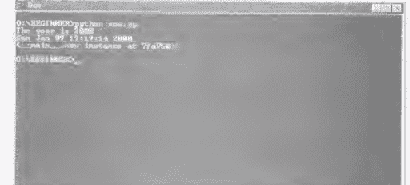

除了在执行 `print` 语句时隐式调用 `str()` 外，你还可以显式调用 `str()`：

```python
n = now()
s = str(n)
print s
```

另一个处理字符串表示的特殊类方法是 `__repr__()`。每当你将类实例放入反引号（backticks）中时，就会调用它：它与 `__str__()` 方法的不同之处在于，按照惯例，`__repr__()` 应该返回一个稍后可用于重新创建该实例的字符串。换句话说，`repr(n)`（其中 `n` 是 `now` 类的实例）的输出应该能够使用某个尚未编写的函数或方法转换回 `now` 类的实例。目前，只需将以下行添加到你的类定义中：

```python
def __repr__(self):
    return time.ctime(self.t)
```

你会注意到它与 `__str__()` 方法的定义相同；类经常这样设置。但由于 Python 对这两种形式 `__str__()` 和 `__repr__()` 进行了区分，正如你通过检查之前显示的图 10.1 可以看到的那样，我们需要提供这两个版本。

## 类之分立

代码清单 10.5 显示了你现在应该拥有的类，以及新封装的测试代码。

### 代码清单 10.5：带有 `__repr__()` 和 `__str__()` 方法的 `Now.py`


```python
1 #!/usr/local/bin/python
2 import time
3 class now:
4     def __init__(self):
5         self.t = time.time()
6         self.storetime()
7     def storetime(self):
8         self.year, \
9         self.month, \
10        self.day, \
11        self.hour, \
12        self.minute, \
13        self.second, \
14        self.dow, \
15        self.doy, \
16        self.dst = time.localtime(self.t)
17     def __str__(self):
18         return time.ctime(self.t)
19     def __repr__(self):
20         return time.ctime(self.t)
21 if __name__ == '__main__':
22
23     n = now()
24     print "The year is", n.year
25     print n
26     x = now()
27     s = 'x'
28     print s
```

因为我们添加了`if __name__ == '__main__':`测试，这意味着我们可以在其他模块中导入`now`并在解释器中修改它，如图 10.2 所示。

**图 10.2**

在解释器中使用`now`类

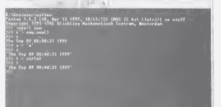

我们可以在任何模块中使用`now`类；但它不够灵活，因为它仅在创建新对象的那一刻构建一个包含时间和日期字段的对象。

为了构建一个更有用的类，我们将为其添加另一个特殊方法。在`now.py`的`def __repr__`行之后添加以下行：

```python
def __call__(self, t=-1.0):
    if t < 0.0:
        self.t = time.time()
    else:
        self.t = t
    self.storetime()
```

这个新方法将使我们能够完成两件事：

1. 将类实例更新为当前时间。
2. 将实例使用的时间设置为标准 UNIX 时间范围（1970 年至 2038 年）中的任何时间。

你可以在图 10.3 中看到这是如何工作的。

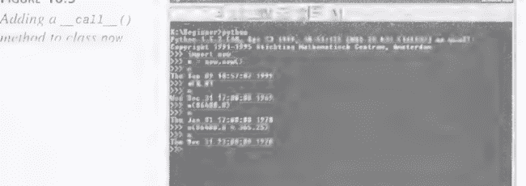

我们在这里所做的是添加了一个特殊方法，让我们能够像调用函数一样调用类的实例。从`now`类创建对象总是会给我们当前时间，正如你在图 10.3 中看到的。当我调用对象`n`并提供时间值（参数`t`）为 0.0 时，我正将`n`设置为 UNIX 时间的纪元（epoch）或零点。这被定义为 1970 年 1 月 1 日的一天之始，即 1970 年 1 月 1 日 00:00:00 小时。0.0 被显示为 1969 年 12 月 31 日下午 5 点的原因是我处于山地时区（Mountain Timezone），并且我使用了`time`模块中的`localtime()`函数。所有美国时区都比 UTC 晚若干小时，并且可以通过调整夏令时来偏离这些标准。

UTC 曾经被称为格林威治标准时间，或 GMT。本初子午线（东经 0 度）直接穿过英国格林威治（发音为 “grennich”）的皇家天文台，并提供了所有时间计算的基准线。在 1884 年的国际子午线会议上，除了法国人以外的所有人都将其选为“世界的本初子午线”。1970 年，国际电信联盟举行了一次新会议。GMT 每天从中午开始，但当名称改为 UTC 时，一天的开始时间也改为 00:00:00 时。UTC 意味着协调世界时（Coordinated Universal Time），但字母与单词并不匹配。选择 UTC 这个缩写正是因为它在任何语言中都不代表任何具体词汇。

## 修改阿肯色州的名字

我们简单的类现在将成为一个新类的基础，该新类将继承自`now`类。正如你在上一小时记忆的那样，继承是面向对象编程的属性之一；我们现在准备好看看它是如何工作的。代码清单 10.6 展示了如何定义一个继承自旧类的名为`today`的新类。

### 代码清单 10.6 Class today

```python
#!/usr/local/bin/python
import time
import now
class today(now.now):
    def __init__(self, y = 1970):
        self.t = time.time()
        self.t.strftime()
if __name__ == "__main__":
    n = today()
    print "The year is", n.year
    print n
    x = today()
    s = 'x'
    print s
```

当一个类继承自另一个类且 Python 为继承者调用`__init__()`方法时，所有为被继承者（也称为父类）定义的方法在新类中立即可用，就像我们将它们直接写在新类中一样。另一方面，类变量在我们在子类中创建它们或者调用父类的`__init__()`方法之前并不存在。代码清单 10.5 展示了第一种方法——即显式创建变量。我们可以通过将代码改为使用第二种方法（在子类的`__init__()`方法中调用父类的`__init__()`方法）来简化之前的代码，如下所示：

```python
def __init__(self, y = 1970):
    now.now.__init__(self)
```

这会为我们调用`now`类的`__init__()`方法，从而避免代码重复——这始终是一件好事。通过这样做，我们可以随时更改`now`类，并确保更改将自动传输到任何导入它的模块或类中。

在进入下一章之前，让我们为新的`today`类添加一个方法；我们将添加一个`update()`方法，它允许我们将今天的日期设置为 1970 年到 2038 年之间的任何时间，如代码清单 10.7 所示。

### 代码清单 10.7 向 Class today 添加新方法

```python
1  #!/usr/local/bin/python
2  import time
3  import now
4  class today(now.now):
5      def __init__(self, y = 1970):
6          now.now.__init__(self)
7      def update(self, tt):
8          if len(tt) < 9:
9              raise TypeError
10         if tt[0] < 1970 or tt[0] > 2038:
11             raise OverflowError
12         self.t = time.mktime(tt)
13         self(self.t)
14 if __name__ == "__main__":
15     n = today()
16     print "The year is", n.year
17     print n
18     x = today()
19     s = x
20     print s
21     tt = (1999,7,16,12,59,59,0,0,-1)
22     x.update(tt)
23     print x
```

我们的新方法`update()`接收一个代表任意时间的元组，运行一些简单的检查，并尝试使用`time.mktime()`函数将元组转换为时间；Python 中的时间表示为浮点数，这里显示的日期代表的数字是 932151599.0。图 10.4 展示了运行`today.py`的结果。

**图 10.4**

运行`today.py`。

在接下来的一个小时里，我们将开始为`today`类添加更多方法使其更实用：我们仍然需要能够为`today`对象添加和减去时间的变化。

## 总结

在这一小时中，我展示了：

- 如何编写一个类
- 如何从类创建对象
- 如何为类编写方法
- 如何使用对象继承

## 工作坊

### 问答

**问：为什么 1970 年和 2038 年对 UNIX 来说是特殊的日期？**

**答：**1970 年 1 月 1 日 00:00:00 时是所有 UNIX 日期的基准时间。当前时间在 UNIX 系统中始终存储在一个整数中；在大多数情况下，该整数的大小为 4 字节或 32 位。因为时间被存储为自纪元（epoch）以来的秒数且带有符号，因此通常只有 31 位空间；这意味着在许多 UNIX 系统上，时间计数器将在 2038 年 1 月 19 日回绕到零。一些 UNIX 实现移除了时间计数器的符号，增加了另外 68 年，而其他实现则简单地将时间类型从 4 字节扩大到 8 字节，从而有效地消除了实际限制。

**问：我在哪里可以获得关于`time`模块的详细信息？**

**答：**您可以在 http://www.python.org/doc/current/download.html 下载所有 Python 文档。选择您喜欢的文档样式。如果您没有偏好，最容易上手的是 HTML 版本，您可以在任何 Web 浏览器中查看。按照安装说明进行，然后查看索引页并点击“Global module index”链接。点击`time`链接。如果您更喜欢在线阅读，请直接访问 http://www.python.org/doc/current/modindex.html 并在那里点击`time`。

### 测验

1. `t = time.time()`和`self.t = time.time()`之间有什么区别？

   a. 第一个创建了一个在包含它的模块中可见的变量，第二个创建了一个仅在类定义内部可见的变量。

   b. 第一个创建了一个临时变量，第二个创建了一个永久变量。

   c. 没有区别。

   d. 第一个创建了一个仅在包含它的方法或模块中可见的变量，第二个创建了一个对任何知道该类定义的函数或模块都可见的变量。

2. `__str__()`和`__repr__()`方法之间有什么区别？

   a. 没有区别。

   b. `__str__()`方法可以返回任何字符串，但`__repr__()`方法应该返回一个可用于重建对象的字符串。

   c. `__str__()`方法必须返回字符串，但`__repr__()`可以返回二进制数据。

   d. `__str__()`方法执行写入或打印，而`__repr__()`执行读取。

3. 当一个类继承另一个类时，你必须调用父类的`__init__()`方法来创建哪个部分？

   a. 父类的方法

   b. 父类的成员变量

   c. 方法和变量都需要

   d. 父类的父类

### 答案

1. d. 在函数内部使用的`t = time.time()`创建了一个函数局部变量。在模块内部，它创建了一个模块局部变量。在类内部使用`self.t = time.time()`则创建了一个在类可见的任何地方都可见的类变量。

2. b. `__str__()`方法可以返回任何你认为合适的字符串，但`__repr__()`应该返回一个你可以用来重建原始对象的字符串。不过，通常两者之间没有实际区别。

3. b. 你必须要么调用父类的`__init__()`方法（它会创建成员变量），要么在子类的`__init__()`方法中显式创建它们。

### 练习

使用代码清单 10.3 中显示的替代实现重写`today`类。你更喜欢哪种风格？为什么？

您可以在 http://www.rmg.nmm.ac.uk/index.html 了解更多关于格林威治皇家天文台的信息（顺便说一句，它不再在格林威治维持天文台了），您可以在 NASA 的太空学院页面 http://liftoff.msfc.nasa.gov/academy/rocket_sci/clocks/time_gmt.html 阅读关于 UTC 的内容。

您可以通过寻找 Mack McCormick 在 Raglan 专辑 *The Unexpurgated Folk Songs of Men* 中的录音来了解“Changing the Name of Arkansas”。遗憾的是，该专辑已绝版（且唱片公司已倒闭），而且它不适合胆小的人。

您可以在 http://www.the-monks.com/ 了解 The Monks 是谁。

# 第 11 小时

## 面向对象编程概念

> 扔掉那个大的。
>
> ——《掷榴弹入门》

在这一小时中，我们将讨论一些更多的面向对象编程（OOP）概念，无论是在本书后续内容中还是在你的编程生涯中，你都需要理解这些概念。它们包括：

- 标识（Identity）
- 封装（Encapsulation）、接口（interfaces）和契约（contracts）
- 命名空间（Namespaces）和作用域（scope）

### 标识

当你思考数字时，不难发现每个数字都有其独特的个性。正如在第 9 小时中指出的那样，“1 就是 1”（隐含着“1 不是 2”）这一概念是对象标识属性的基础。请注意，对象的这种标识属性与数学中的恒等运算（identity operation）不同，后者仅仅是一个使操作数保持不变的运算。当你思考对象时，情况可能没那么清晰，直到你记得在 Python 中所有数字都是对象。任何数值对象总是可以很容易地与任何其他数值对象区分开来。

让我们做一个小实验，在 Python 中创建几个简单的对象。运行清单 11.1 所示的程序。

#### 清单 11.1 bunch.py

```python
#!/usr/local/bin/python
class bunch:
    def __init__(self):
        pass
if __name__ == "__main__":
    b = []
    for i in range(0, 25):
        b.append(bunch())
    print b
```

你可以看到，这创建了一个包含类实例的列表。当你运行这个程序时，你会看到两件事。首先，列表`b`包含 25 个`bunch`类的实例。其次，你可以通过两种方式之一将任何给定实例与其他实例区分开：通过在列表`b`中的位置，或者通过“ID”。ID 就是 Python 在显示类似以下内容时打印出的东西：

`__main__.bunch instance at 7f7f7f00`

“7f7f7f00”就是 ID 编号；有 C 语言经验的人会将其识别为地址或指针，但就 Python 而言，它只是一个唯一的标识符，一种跟踪对象以便在正确的时间将其丢弃的方式。

你可能还会注意到，`bunch`类的实例是毫无价值的。虽然你可以将每个实例与邻居区分开，但这样做并没有太大意义，因为该类既没有状态也没有行为。就像糟糕的经理一样，这些 bunch 列表占据着空间等待过期，期间什么也不做。

清单 11.2 做了与`bunch.py`相同的事情，不同之处在于，它创建的是我们在上一章构建的`today`类的实例，而不是`bunch`类的实例。

#### 清单 11.2 todays.py

```python
#!/usr/local/bin/python
import today
if __name__ == '__main__':
    b = []
    for i in range(0,25):
        b.append(today.today())
    print b
```

当然，当你运行这个程序时，你会发现这些实例并不比之前的 bunch 更有用！为了获得一些至少看起来有用的东西，请将循环体中的`b.append()`行修改为如下所示：

```python
x = today.today()
x(i*86400)
b.append(x)
```

（记得保持缩进。）然后运行程序。你会发现`today`类的每个实例代表不同日期上的同一个时间。终于，我们看到所有这些不同且可区分的实例至少具有变得有趣和有用的潜力。正如格雷戈里·贝特森（Gregory Bateson）所指出的，“信息是任何产生影响的差异”。我们修改后的 `todays.py` 程序向我们展示了产生影响的差异。例如，我们可以遍历实例列表，计算每天同一时间的潮汐水平，或者日食的可能性，甚至是钓鱼的概率。这就是对象标识属性的本质：如果对象之间的差异没有产生影响，那么仅仅能够区分对象是不够的。

### 封装

在第 9 小时中，封装（OOP 的组成部分之一）被定义为两部分的结合：接口（interface）和实现（implementation）。通过观察我们的`today`类，我们可以研究这些想法的真正含义。我们类的接口是什么？记住，接口仅仅定义了如何调用函数或方法，或者如何实例化一个对象。带着这些概念，让我们检查我们的类，见清单 11.3。

#### 清单 11.3 Class today


```python
class today(now.now):
    def __init__(self, y = 1970):
        now.now.__init__(self)
    def update(self, tt):
        if len(tt) < 6:
            raise TypeError
        if tt[0] < 1970 or tt[0] > 2038:
            raise OverflowError
        self.t = time.mktime(tt)
        self(self.t)
```

`today` 类的基本接口有两个：

1. `__init__(self, y, 1970)`
2. `update(self, tt)`

这两个接口代表了程序员与用户（或调用者）之间的一份契约。这份契约实际上在说：“如果你，用户，根据公布的接口正确地激活接口，那么我，程序，将向你返回你契约中要求的答案。”值得注意的是，契约也没有规定内部如何实现，只规定了它会被实现。例如，你可以编写自己的 `time.mktime()` 版本，而不是使用时间模块内部的版本。只要你记录了它实际做了什么，它甚至不需要以相同的方式运行或返回相同类型的数值。`now` 类公开了以下五个接口：

1. `__init__(self)`
2. `storetime(self)`
3. `__str__(self)`
4. `__repr__(self)`
5. `__call__(self, t=-1.0)`

因此，`today` 类的接口总数是 7 个，因为我们需要计算所有可用的接口。由于 Python 不仅公开了类的行为，还公开了类的状态，因此将保存时间的变量 `t` 计算为接口的一部分是公平的。然而，按照惯例，除非程序员记录了如何操作以及操作时的限制，否则类的状态通常不由用户/调用者修改。与其他 OOP 语言不同，Python 没有一种机制能绝对禁止从外部修改类实例。类用户甚至可以在任何时间为任何给定对象添加状态和行为。作为程序员，你可以通过文档来劝阻这种行为，但你无法阻止它。

我提到过记录方法和函数，但你还没有看到在 Python 中进行此类文档记录的一种更有价值的方式：docstring（文档字符串）机制。任何函数、方法或模块都可以内置一个文档字符串，如果该字符串存在，任何感兴趣的人都可以查看。清单 11.4 显示了 `now` 类一个修改后的 `storetime()` 方法。

### 清单 11.4 Modified `storetime()`

```python
def storetime(self):
    """storetime():
    Input: instance of class now
    Output: None
    Side effects: reads the member variable t and converts t into
    9 member variables representing the same time as t.
    
    self.year, \
    self.month, \
    self.day, \
    self.hour, \
    self.minute, \
    self.second, \
    self.dow, \
    self.doy, \
    self.dst = time.localtime(self.t)
    """
```

如你所见，方法中添加了一个用三引号括起来的字符串，用于解释 `storetime()` 的作用。记住，即使是 Python 中的函数和方法也是对象。除了原始或基础对象外，所有对象都可以拥有状态和行为。在这里，当我们添加三引号字符串时，我们实际上是在向 `storetime()` 方法添加一个特殊变量的定义：它的名称是 `__doc__`。读取我们方法的 docstring 的方式类似于图 11.1 中所示的内容。

注意，docstring 没有提及 `storetime()` 是如何实现的。这是刻意为之的。`storetime()` 作为一个公开接口，契约约定提供某种服务，但该服务的用户不需要关心服务是如何执行的。例如，你可以编写自己的 `mktime()` 版本，甚至直接在 `storetime()` 内部进行计算。要将 `self.t` 中提供的时间戳直接转换为天数，只需将 `self.t` 除以 86400（一天的秒数）。当然，你会剩下一些秒数，你可以通过对成员 `self.t` 取模 86400 来确定。你可以看到，这些剩余的秒数可以转换为一天中的具体时间。给定天数和当前时间，完全有可能（尽管不一定简单）确定年份、月份和日期，事实上，可以确定我们公开接口所需的所有内容。在我们的案例中，使用 time 模块的 `mktime()` 函数很简单，但如果你愿意，没有什么能阻止你自己编写一个 `mktime()` 版本。

### 图 11.1

打印文档字符串（`__doc__`）。

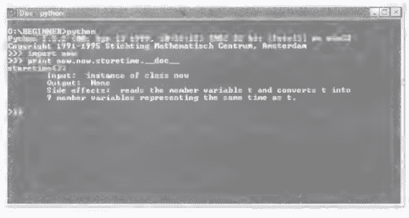

文档字符串（docstring）是 Python 的一个重要特性。你应该尝试为大多数程序提供文档字符串，至少在你的程序会被其他哪怕一个人使用时应该如此。除了能帮助他人理解你的程序这一显而易见的好处外，另一个附加好处是，当你发现必须重新访问、重写或调试自己的旧程序时，它对你自己也很有帮助。

要为你编写的整个模块创建文档，只需在文件开头（紧跟在任何起始注释之后）提供一行或多行文档字符串。这里有一个适用于 `now.py` 的简单示例：

```python
"""This is a test documentation string for the now module."""
```

你可以通过输入以下内容将其打印出来：

```python
print now.__doc__
```

这很简单且显而易见。除了附在每个函数和方法上的 `__doc__` 变量（或属性）之外，类也可以拥有文档。方法如下：

```python
class now:
    """This line demonstrates how to add class documentation."""
```

你需要先导入类文件，然后将其打印出来：

```python
print now.now.__doc__
```

请记住，第一个 `now` 是模块，第二个 `now` 是存在于 `now` 模块中的类，而 `__doc__` 是 `now` 类的文档字符串属性。我相信这已经非常清楚了。 ;-)

## 命名空间与作用域

变量存储在哪里？函数和方法呢？类和模块又在哪里？我认为研究这些问题的最好方法是更仔细地观察我们在前一节讨论的文档字符串。让我们简单地从启动解释器开始，无论是在 IDLE 中还是在你的命令行窗口（根据情况选择 DOS 或 shell）。在你看到 `>>>` 提示符后，输入 `dir()`。你应该看到如下响应：

```python
[ '__builtins__', '__doc__', '__name__' ]
```

我们现在看到的是什么？嗯，它看起来像一个列表。真的是吗？让我们检查一下。

```python
>>> type(dir())
<type 'list'>
>>>
```

是的，这是一个列表。什么的列表？为了得到答案，我们需要查阅 Python 文档，找出 `dir()` 的作用：

> 如果不带参数，返回当前局部符号表中的名称列表。如果带有参数，则尝试返回该对象的有效属性列表。

“属性”（Attributes）是“名称”的另一种称呼，例如函数名、变量名或类名。在你的交互式会话中，创建一个变量并重新运行 `dir()`：

```python
>>> dir()
[ '__builtins__', '__doc__', '__name__' ]
>>> spam = 42
>>> dir()
[ '__builtins__', '__doc__', '__name__', 'spam' ]
>>> spam
42
>>>
```

在不带参数的情况下，内置函数 `dir()` 返回它所知道的所有名称的列表。这很简单，但“当前局部符号表”是什么意思？为此，让我们看看另一个内置函数 `locals()`，看看文档是怎么说的：

> 返回一个代表当前局部符号表的字典。

啊。符号表就是一个字典——也就是说，它是我们的基础数据类型之一，包含名称（通常称为键）和值。如果你在交互式会话中尝试 `locals()` 函数，你应该会看到类似这样的内容：

```python
>>> locals()
{'spam': 42, '__doc__': None, '__name__': '__main__', \
     '__builtins__': <module '__builtin__' (built-in)>}
>>>
```

你可以看到，你刚刚创建的变量 `spam` 已被列出并与值 42 相关联。请注意，字典键 `__builtins__` 也被列出了，其值为 `<module '__builtin__' (built-in)>`。如果 `__builtins__` 是一个模块，那么它应该也拥有属性，就像我们当前的交互式会话一样。在交互式会话中尝试 `dir(__builtins__)`。你应该会得到类似这样的结果：

```python
>>> dir(__builtins__)
['ArithmeticError', 'AssertionError', 'AttributeError', 'EOFError', 'Ellipsis',
 'EnvironmentError', 'Exception', 'FloatingPointError', 'IOError', 'ImportError',
 'IndexError', 'KeyboardInterrupt', 'LookupError', 'MemoryError',
 'NameError', 'None', 'NotImplementedError', 'OSError', 'OverflowError',
 'RuntimeError', 'StandardError', 'SyntaxError', 'SystemError', 'SystemExit',
 'TypeError', 'ValueError', 'ZeroDivisionError', 'debug', 'doc', 'docstring',
 'import', 'name', 'getattr', 'apply', 'buffer', 'callable', 'doc', 'chr', 'cmp',
 'coerce', 'compile', 'complex', 'delattr', 'dir', 'divmod', 'eval', 'execfile',
 'exit', 'filter', 'float', 'getattr', 'globals', 'hasattr', 'hash', 'hex', 'id',
 'input', 'int', 'intern', 'isinstance', 'issubclass', 'len', 'list', 'locals',
 'long', 'map', 'max', 'min', 'oct', 'open', 'ord', 'pow', 'quit', 'range',
 'raw_input', 'reduce', 'reload', 'repr', 'round', 'setattr', 'slice', 'str',
 'tuple', 'type', 'vars', 'xrange']
```

嗯。我们的 `dir()` 函数告诉我们 `__builtins__` 拥有一个文档字符串；试着把它打印出来：

```python
>>> print __builtins__.__doc__
Built-in functions, exceptions, and other objects.

Noteworthy: None is the ‘nil’ object; Ellipsis represents ‘...’ in slices.
>>>
```

我们在这里学到了什么？

- `__builtins__` 是一个模块（`type(__builtins__)`）。
- ……它有一个符号表（`dir(__builtins__)`）。
- ……其中包含 `__doc__` 和 `__name__` 的条目。
- 如果我们输入 `dir()`，我们会得到一个符号表中的符号。
- ……其中包含 `__doc__` 和 `__name__` 的条目。
- 我们是在一个模块中吗？

事实上，是的。仍在交互式会话中，输入 `import now` 并重新运行 `dir()`。现在 `now` 成为了列表中的一个名称，如果你输入 `type(now)`，你应该会得到 `<type 'module'>`。这一切表明我们始终处于一个模块中；无论你是直接在交互式会话的解释器中运行，还是从文件运行程序。Python 都在一个特殊的模块中执行你告知的所有操作。所有模块都有特殊的属性 `__name__`；现在，`__name__` 当然是 `now`。如果你在运行解释器时打印出你所在模块的名称，它会显示 `__main__`。不过，`__main__` 模块与其他模块有一个区别：你不能使用 `__main__` 名称作为限定符来访问某个名称。例如，你可以使用 `__doc__`，但不能说 `__main__.__doc__`。你只能使用 `__doc__`。因此，缺少限定名意味着“当前的 `__main__` 模块”。

当你输入 `dir()` 和 `dir(now)` 时，第二种形式提供了模块的名称（你已经导入的模块），而第一种形式默认使用当前的 `__main__` 模块。在这两种情况下，你会看到每个列表中都列出了几个相同的名称。对于 `dir()`，你会看到：

```python
[ '__builtins__', '__doc__', '__name__' ]
```

如果你随后导入 `now` 并运行 `dir(now)`，你会看到这个：

```python
[ '__builtins__', '__doc__', '__name__', 'now', 'time' ]
```

这两个模块共有的名称是 `__builtins__`、`__doc__` 和 `__name__`。以下是其中的机制：

- 当 Python 启动时，它会创建一个名为 `__main__` 的模块，该模块附有一个字典（这就是你运行 `dir()` 时看到的内容）。
- 每当你运行一个 `import name` 语句时，Python 就会创建另一个拥有自己字典的模块（`dir(now)`）。
- 因为某些名称在两个模块中是相同的，所以必须有一种方法来区分哪个名称是哪个。
- 告知 Python 你想要哪个名称的方法是通过限定（qualification）：`__doc__` 与 `now.__doc__`。
- 名称（无论是变量名、函数名还是类名）仅仅是与特定模块关联的字典中的键或属性。
- 存储这些名称的字典的简写被称为*命名空间*（namespace）（我打赌你以为我们永远不会提到这个词！）。
- 内置函数 `dir()` 只是列出了一个命名空间中的所有名称。

每个模块都有自己的命名空间；每个函数也有自己的命名空间。事实上，Python 中的大多数对象都有自己的命名空间（当然，基础数据类型除外）。你经常会看到关于 Python 只有两个或三个命名空间的说法。这并不完全准确；Python 具有两到三个级别的命名空间。

你实际上可以看到命名空间字典，虽然这需要一点功夫。事实证明，Python 维护了一个已加载模块的内部列表，你可以毫不费力地访问该列表。列表 11.5 展示了如何实现这一点。

## 面向对象编程概念

### 示例 11.5 `namespace.py`

```python
#!/usr/local/bin/python
import sys
import now
k = sys.modules.keys()
print "Keys:", k
print ""
for i in k:
    if i == "__main__":
        print i, sys.modules[i].__dict__
print dir()
```

我限制了输出，仅打印 `__main__` 模块命名空间中的内容。你可以去掉这里的 `if` 测试，但如果你这样做，它会打印出大量你可能不感兴趣的内容。

函数也有命名空间，但你不能以同样的方式访问它们。在示例 11.5 中，我们能够看到所有的模块命名空间，但如果你尝试从外部查看函数的命名空间，必须使用 `dir()` 函数。也就是说，你不能执行以下操作：

```python
def f():
    "doc string"
    z = 42
```

```python
print sys.modules["__main__"].__dict__["f"].__dict__
```

尽管这看起来是合乎逻辑的做法，但如果你尝试这样做，会得到一个 `AttributeError`。

然而，如果你将前一行 `print sys.modules...` 修改为：

```python
print "DIR", dir(f)
print "DIR", dir(sys.modules["__main__"].__dict__["f"])
```

你会发现这两行打印出的内容是相同的。

但在函数 `f()` 内部，你可以打印出该函数自身所看到的局部命名空间。将 `f()` 修改为如下内容：

```python
def f():
    "doc string"
    z = 42
    print f, dir()
```


如果你运行修改后的函数并将其与`dir(f)`进行比较，你会发现它们截然不同。事实上，你在`f()`输出中看到的唯一东西是一个包含名称`z`的列表。虽然`dir(f)`包含对`__doc__`属性的引用，但`f()`内部的`dir()`则没有。这意味着函数无法看到自己的文档字符串（docstrings）。

函数也无法看到其他函数内部的情况。在你的`namespace.py`文件中添加以下内容：

```python
def d():
    """another doc string"""
    z = 44
    x = 9.999
    print "d", dir()
```

依次运行这些函数，你可以看到它们感知到的命名空间是不同的：

```
f [ 'z' ]
d [ 'x', 'z' ]
```

虽然每个函数中都有一个名为`z`的变量，但`f()`内部的`z`与函数`d()`内部的`z`完全不同。不过，函数可以看到并修改不在其命名空间中的内容。

```python
def e():
    'yet another doc string'
    z = 22
    global z
    z = 9999
    print 'e', dir()
```

当你运行最后一个函数时，很明显这里有两个`z`：一个存在于模块级别，另一个存在于函数`e()`内部。我们可以向函数明确它应该引用哪个`z`。`global z`这行代码告诉函数不要在函数自身的命名空间中寻找`z`，而是在封闭的（enclosing）命名空间中寻找。没有`local`关键字来执行反向操作，因此一旦你在函数中使用`global`将变量标记为存在于非局部命名空间中，你就无法将其改回。

（在我看来）Python 中有三个级别的命名空间。它们分别是：

- `__builtins__`命名空间。所有模块、函数和类都能看到它，但对它们来说它是透明的。
- 全局命名空间（Global namespace）。这是模块创建时自带的命名空间。虽然你无法看到其他对象的局部命名空间，但你可以通过限定名来看到、使用和修改全局（或模块）命名空间中的任何内容。
- 局部命名空间（Local namespace）。这是类、类中的方法以及函数所看到的命名空间。

你可能会从其他书籍或其他 Python 开发者那里听到略有不同的观点，但这是我认为可行的一种观点。

在结束命名空间的讨论之前，还有几点需要说明。

示例 11.6 展示了两件事：

1. 函数可以嵌套。你可以构建仅存在于另一个函数内部的函数。
2. 命名空间不嵌套。内部函数无法看到存在于外部函数内部的变量。从命名空间的角度来看，`inner()`和`outer()`是存在于封闭模块`namespace`中的两个不相关的函数。

### 示例 11.6 nesting.py

```python
#!/usr/local/bin/python
import sys
global_var = 9999
def outer():
    z = 42
    def inner():
        global z
        y = 666
        z = 99
        print dir()
    inner()
    print dir(), z
outer()
```

内部函数无法看到在外部函数命名空间中创建的变量。`global z`这行代码告诉函数`inner()`在看到对`z`的引用时忽略局部命名空间。对`z`的第一次引用是`z = 99`这行，它并没有改变`outer()`中`z`的值，而是在封闭的全局命名空间中创建了一个新的变量`z`。

类在命名空间方面的规则与函数相同。类可以嵌套，但命名空间不嵌套。每个类实例拥有自己的局部命名空间，因此无法看到另一个类命名空间中的变量或方法，即使该类是在现有类内部构建的。

最后，我们应该讨论作用域（scope）。在许多文献中，你会看到作用域和命名空间被交替使用，但它们并不相同。作用域恰当地定义了变量、类或函数所在的命名空间，以及对象的生命周期。在函数内部创建的变量既具有局部命名空间也具有局部作用域；当函数结束时，在局部命名空间中创建的所有变量都会超出作用域——也就是说，它们不再存在。Python 会回收超出作用域的变量所使用的任何内存。因为命名空间本身已经超出作用域，Python 知道它应该遍历该命名空间，追踪命名空间中名称所使用的任何资源并将其丢弃，然后销毁该命名空间。

## 总结

在这一小时里，我们学习了对象和标识（identity）、封装（encapsulation）以及命名空间和作用域。在关于标识的章节中，我们了解到仅仅能区分对象是不够的，差异必须具有某种意义。在封装部分，我们学习了接口和契约；在最后一节中，我们学习了命名空间如何控制对象的可见性以及对象能看到的内容。

## 研习

### 问答

**问**：为什么会有`__builtins__`命名空间？这些内置函数不能放在每个新对象的命名空间中吗？

**答**：在其他编程语言中经常这样做，但在 Python 中，这个术语主要指的是对象打包和调用方式，而不是如何隐藏信息。这是因为 Python 有一种根本不同的观点，即通常可以信任程序员和用户不会把事情搞砸。

**问**：为什么会有`__builtins__`命名空间？这些内置函数不能放在每个新对象的命名空间中吗？

**答**：当然可以，但结果意味着每个对象中都会有大量名称；这可能会导致一定程度的命名空间污染。通过在每个新命名空间中仅放置一个指向内置命名空间的引用，可以将命名空间槽位保持在最低限度。

### 测验

1. `"<__main__.bunch instance at 7f7f00>"`是什么意思？
   - a. 与西兰花（broccoli）有关的东西。
   - b. `__main__`模块有一个 ID 为`7f7f00`的 bunch 类实例。
   - c. 它是`__main__`模块的命名空间。
   - d. 它是`__main__`模块的标识属性。

2. 文档字符串（docstring）的正确语法是什么？
   - a. `docstring = "Documentation"`
   - b. `__doc__ = "Documentation"`
   - c. `"""Documentation"""`
   - d. `doc = Don't quote me`

3. 你可以使用哪些内置函数来检查命名空间？
   - a. `namespace()`
   - b. `dir(namespace)`
   - c. `locals()`、`globals()`和`dir(namespace)`
   - d. `scope()`

### 答案

1. b. `"<__main__.bunch instance at 7f7f00>"`意味着`__main__`有一个显示该 ID 的 bunch 类实例。
2. b. 文档字符串是经过正确引号包裹的字符串，占据模块、类、类方法或函数中的特定位置。
3. b. `dir()`函数仅向你提供一个存在于命名空间中的名称列表；`locals()`和`globals()`返回一个镜像命名空间的字典。你可以将`dir()`函数看作是先调用字典方法`keys()`然后进行排序。

### 练习

编写一个替代的`mktime()`例程。关于方向的提示，可以在网上搜索 Julian Day 和 Joseph Justus Scaliger。另一个可能的起点是 Peter Meyer 的日历页面，网址为`http://www2.papeterie.ch/serendipity/hermetic/cal_stud.htm`。

虽然与 Python 和本章介绍的概念只有微弱联系，但这个链接中的文章：`http://www.inf.gr.htw-zittau.de/~wagenkn/Natasha_Chen.html`，标题为 "High School Computing: The Inside Story"，非常迷人且发人深省。如果你将文中的 "Scheme" 替换为 "Python"，文章的观点可能会让你觉得更加亲切。

# 第 12 小时：更多 OOP 概念

> 错误几乎总是具有神圣性质的。永远不要试图去纠正它们。
>
> ——萨尔瓦多·达利

在上一小时中，我们讨论了几个 OOP 概念：标识（identity）、封装（encapsulation）和命名空间（namespaces）。在本小时中，你将学习更多 OOP 概念，例如：

- 使用“私有”变量进行数据隐藏
- 多态（Polymorphism）
- 多重继承（Multiple inheritance）

## 使用“私有”变量进行数据隐藏

Python 的设计初衷并不是为了强制执行传统的数据隐藏（也称为访问控制）概念。许多其他 OOP 语言有简单的方法来显式地隐藏或公开类变量和方法。例如，Java 和 C++ 使用特殊的关键字，其唯一作用就是告知编译器某些数据应该被公开——或不被公开。对于这两种语言，关键字包括：

- public
- private
- protected
- 无关键字，在 C++ 中默认提供“private”访问权限，在 Java 中提供“friendly package”访问权限

在深入探讨 Python 之前，简单回顾一下这些关键字的含义及其用途会很有帮助。

- Public（公开）顾名思义：任何使用该类的函数或方法都可以读取和修改任何被标记为 public 的变量或函数。其他类中的方法可以直接进入并更改其中的内容。数据隐藏的支持者认为，这里的危险在于类可能会遭到意外或有意的操纵，从而破坏或摧毁对象的内部一致性。
- Private（私有）意味着只有类自身内部的方法才被允许更改或使用标记为 private 的状态和行为。类外部的任何内容都无法读取或写入这些变量。其好处据称是，程序员始终能准确知道类中发生了什么，并且它受到了免于未经授权访问的保护。
- Protected（受保护）意味着类本身以及任何继承自该类的子类都可以读写该信息。Protected 方法只能由类中的其他方法或继承自该类的子类调用。这里的一个好处是只有“经批准”的类才能更改状态并调用方法。例如，在一个处理磁盘 I/O 的类中，保护对象不接收监视器（显示屏）I/O 可能是审慎的做法。
- Friendly package access（友好包访问），在 Java 中，意味着任何源自与目标类在同一目录文件中定义的类都可以更改状态、行为并使用方法。

Python 没有特殊的标记关键字来控制类成员的访问。大多数访问控制是通过约定完成的，少部分是通过利用类、变量和方法命名技术实现的，即使用一个或多个前导下划线来发出信号，表明不应该盲目地公开所有类、变量和方法。在 Python 中，有一些特殊的保留名称组（我们将对其进行讨论），它们都以底线开头。在 Python 中，只有一个下划线可以限制数据暴露，但它实际上并不能防止访问：任何有经验的人如果愿意，都可以获取并修改任何位置的任何变量。

第一个特殊名称是`_`；它仅在你交互式运行解释器时存在。每当你执行一个语句（例如`"1 + 1"`）时，交互式 Python 会将结果存储在`_`变量中，该变量在进行某种计算之前并不存在。你可以在非交互式会话中将`_`用作自定义名称，但明智的做法是不要这样做。

第二个特殊名称（实际上是一组名称）是以单个下划线开头的任何名称。这是你真正需要关注的唯一特殊名称。当你使用`from <module> import *`时，任何以单个下划线开头的名称都不会被导入到导入模块的命名空间中。为了了解其工作原理，请看代码清单 12.1。

**代码清单 12.1 imptest1.py**

```python
1  #!/usr/local/bin/python
2  _CHANGEOVER="Sep 3 1752"
3  from today import *
```

这是一个非常简单的程序：它唯一做的事情就是创建了一个仅在文件`imptest1.py`中可见的变量。代码清单 12.2 展示了使用该变量的尝试。

**代码清单 12.2 imptest2.py**

```python
1  #!/usr/local/bin/python
2  from imptest1 import *
3  x = today()
4  print x
5  print dir()
6  try:
7      print _CHANGEOVER
8  except:
9      try:
10         print imptest1._CHANGEOVER
11     except:
12         print "Can't find _CHANGEOVER"
```

如果需要，可以参考第 8 小时中关于`try`和`except`的讨论，以了解其工作原理。图 12.1 显示了运行`imptest2.py`的输出。

从`dir()`的输出可以看出，`imptest2.py`的命名空间中没有名为`_CHANGEOVER`的变量。`imptest1`模块可以看到并使用这个变量，但其他人不能。

**图 12.1**

运行`imptest.py`

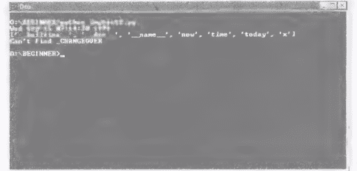

然而，修改该变量是可能的，尽管我们必须像代码清单 12.3 所示那样修改`imptest2.py`。

**代码清单 12.3 修改后的 imptest2.py**

```python
1  #!/usr/local/bin/python
2  import imptest1
3  x = imptest1.today()
4  print x
5  print dir()
6  print dir(imptest1)
7  try:
8      print _CHANGEOVER
9  except:
10     try:
11         print imptest1._CHANGEOVER
12     except:
13         print 'Can't find _CHANGEOVER'
```

图 12.2 显示了现在发生的情况：

**图 12.2**

运行修改后的`imptest.py`

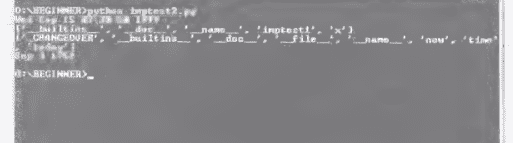

如你所见，如果避免使用`from <module> import *`，那么查看（以及因此更改）`_CHANGEOVER`变量就变得非常简单。

下一组特殊名称由以两个下划线开头且结尾的名称组成。这些被称为特殊类方法名，你将在下一小时中详细学习。当然，你已经见过其中几个了：`__call__`、`__init__`等。所有这些特殊类方法名都由 Python 定义，但如果你想利用它们允许的功能，则需要实现具体的 method。

最后一组是你完全不需要担心的一组，因为这是一个相当高级的概念。但为了完整性，这里做一个快速概览。作为类成员（变量或方法）且以两个下划线开头但**不**以两个下划线结尾的名称，会受到 Python 所谓的“类私有名称修饰”（class-private name mangling）的影响。Mangling 是一个从 C++ 借用的术语，简单来说就是“更改”。其核心思想是，如果你不希望类的用户看到你创建的类中的某些变量或方法，就在它们的名字前加上两个下划线。使用你类的程序员可以看到并修改普通名称的成员，但他们只能通过使用 Python 自身的名称修饰规则才能看到双下划线名称。你可以在惯常的地方`http://www.python.org/`找到更多信息，但本书不会深入探讨细节。

在下一节中，我们将讨论 Python 和多态。

## 多态

在第 9 小时中，我们将多态定义为向许多对象发送一种消息并从每个对象获得适当响应的能力。你已经见过例子了，比如`now`和`today`类使用的`__init__()`方法。Python 在创建实例时会向每个类发送一条消息；编写 Python 类的程序员必须在类中构建`__init__()`方法，以便他们能够精确控制类创建时发生的情况。然而，你应该意识到，并不总是需要`__init__()`方法；有时你只需要具有某些行为的对象，而完全不在意对象具有什么样的状态。因此，多态不是自动的；程序员必须采取某些措施，使他们的对象能够做出适当的响应。

在`__init__()`方法的情况下，每个类都可以自由地执行任何操作，以正确地创建（或不创建）自身。你可以更改`__init__()`接收的参数数量，但第一个参数除外。所有类方法都需要第一个参数作为类的一个实例。按照惯例，第一个参数总是被称为`self`。Python 中没有法律或限制规定它必须被称为`self`，但几乎每个人都这么称呼。为了使你的程序尽可能具有可读性，强烈建议你在这一问题上遵循传统。

`__init__()`方法不返回值。如果由于某种原因，你的初始化例程未能完成其预定工作，你应该抛出一个异常。（我怀疑之所以称之为“抛出异常”是因为这有点像把一根圆木塞进正在转动的自行车辐条中。）在这种情况下，最好的选择可能是`AttributeError`，不过你可能想要尝试定义自己的异常。异常也是类，因此通过继承它们来构建自己的异常并不困难。其他多态方法需要遵守一个接口（记得封装吗？）。例如，当使用`+`运算符将两个对象相加时使用的`__add__()`方法，需要两个参数——`self`和`other`——并且必须返回一个被相加类的实例。我们将在接下来的一个小时中详细讨论这些指定的接口。


尽管 Python 提供了许多种多态消息，正如我们在接下来的一个小时中将看到的，它们并不能覆盖你可能希望从自定义对象中获得的所有响应。事实上，你构建的大多数对象将拥有由你定义的、提供与内置特殊方法不同行为的方法。通过继承，可以轻松地构建一个完整的对象类层次结构，这些对象都响应你指定的单个消息。

例如，玛雅数学中的日期和数字有很多共同特征，但与此同时，它们也有一些重要的区别。数字是统一的 20 进制，但日期是混合基数的：除了第二位是 18 进制外，其余都是 20 进制。因此，日期类可以继承自数字类，并且仍然共享大量的行为和几乎所有的状态。

有时你需要在这两种类型之间进行转换。最简单的方法是让数字类拥有一个名为（惊喜！）`convert()` 的方法，它会自动返回一个日期。日期类继承自数字类，将拥有一个同名方法，但它会自动返回一个数字。在两种情况下，你向实例发送相同的消息（`<instance>.convert()`），但你会得到相应的对象作为返回。

在接下来的章节中，我们将讨论继承，并看看如何继承多个类。

## 多重继承

在第 10 小时中，我们看到了普通继承是如何工作的。你应该参考的示例 10.5 展示了继承自 `class now` 的 `class today`。在本节中，我们将学习如何实现多重继承；也就是说，如何构建一个从多个类继承状态和行为的类。

## 更多 OOP 概念

到目前为止，多重继承最常见的用法是所谓的 `mixin`（混入）类；也就是说，这些类非常通用，以至于它们可以被混入到几乎任何类型的类中。

例如，你可以定义一个类，其方法会遍历对象的命名空间，查找所有属性，并返回一个代表每个属性的可打印字符串列表。你可以将这个类混入到你构建的几乎所有类中。通过将该方法命名为 `__repr__`，你就可以避免为每个定义的新类编写一个新的 `__repr__()` 方法。根据你的类或项目的大小，这可能会节省大量时间。

> 在计算机科学中，`token`（令牌/词法单元）一词用于描述输入给 `parsing engine`（解析引擎）的极小片段。解析引擎是一个程序（或其一部分），它读取结构化输入，并根据 token 代表的含义及其顺序来决定该输入的意义。例如，在你的 DOS 命令提示符中，`|` token 具有特殊含义，`|` token 也是如此。就像地铁或公交令牌一样，投入的越多，换来的行程就越长。有时，它会把你带到你不想去的地方。

然而，因为 `class today` 已经有一个 `__repr__()` 方法，我们将添加一个不同的混入类。你看过那些版权日期用罗马数字表示的老电影吧？让我们构建一个类，它除了将年份转换为罗马数字外不做任何事情（将数字转换为罗马数字比将罗马数字转换为普通的 10 进制数字要容易得多）。

表 12.1 显示了我们将要使用的罗马数字的组成部分（也称为元素，或者在计算机科学语言中称为 token）。

### 表 12.1 罗马数字的元素或 Token

| Token | Value |
| :--- | :--- |
| I | 1 |
| V | 5 |
| X | 10 |
| L | 50 |
| C | 100 |
| D | 500 |
| M | 1000 |

顺便说一句，这是一个不完整的所有可能 token 列表。中世纪的僧侣们大大扩展了这个系统，不仅增加了新的 token，还增加了作为现有含义乘数的修饰符。例如，上方带横线的 X 代表 10,000，因此横线是一个 1000× 的乘数。我们在这里仅尝试提供电影日期，因此本书不会深入讨论任何更复杂的内容。

示例 12.4 显示了一个将年份转换为罗马数字的简单混入类。

### 示例 12.4 `roman.py`

```python
#!/usr/local/bin/python
import string
import sys

class roman:
    def __init__(self,y):
        if y < 1:
            raise ValueError
        self.rlist = []
        ms = y / 1000
        tmp = y % 1000
        if ms > 0:
            self.rlist.append("M" * ms)
        ds = tmp / 500
        tmp = tmp % 500
        if ds > 0:
            self.rlist.append("D" * ds)
        cs = tmp / 100
        tmp = tmp % 100
        if cs > 0:
            self.rlist.append("C" * cs)
        ls = tmp / 50
        tmp = tmp % 50
        if ls > 0:
            self.rlist.append("L" * ls)
        xs = tmp / 10
        tmp = tmp % 10
        if xs > 0:
            self.rlist.append("X" * xs)
        vs = tmp / 5
        tmp = tmp % 5
        if vs > 0:
            self.rlist.append("V" * vs)
        js = tmp
        if js > 0:
            self.rlist.append("I" * js)

    def ryear(self):
        s = ""
        for i in self.rlist:
            s = s + i
        return s

if __name__ == "__main__":
    if len(sys.argv) > 1:
        yr = string.atoi(sys.argv[1])
    else:
        yr = 1999
    x = roman(yr)
    print x.ryear()
```

前面的 `append()` 行为选择正确数量的字符提供了一个简单的解决方案；我们利用 `*` 运算符对字符串的处理能力，只需将正确的字母乘以千位、五百位、百位等的数量即可。`"C" * 4` 会产生一个读取为 `"CCCC"` 的字符串，这正是我们这里需要的。

在不带参数的情况下运行此程序将把 1999 翻译成罗马数字。提供参数则可以显示你想要的任何年份的罗马数字。图 12.3 显示了以 2000 作为年份运行时的结果。

### 图 12.3 运行 `roman.py`

请注意，虽然 `roman.py` 产生的罗马年等值在技术上是正确的，但它们仅在最字面的意义上正确。虽然你偶尔会看到 19 世纪被写成 `"MDCCCC"`，但你更经常看到它被写成 `"MCM"`，而且你永远不会看到 90 被写成 `"LXXXX"`，而总是写成 `"XC"`。当然，不是 `"VIII"` 而是 `"IX"`。

利用这些简写，1999 更恰当地应该写成 `"MCMXCIX"`。因此，我们的 `roman` 类有点笨。不过它确实有效，至少足以用于演示目的。

`Roman` 类也可以用另一种方式构建——一种没有任何状态变量、只有行为的方式。所有将 10 进制转换为罗马数字字符串的代码都可以移到 `__init__()` 之外的一个方法中，继承自 `roman` 的类将获得该方法而无需调用 `__init__()` 方法。

好了，让我们混入 `roman` 类。示例 12.5 展示了为多重继承而修改后的 `today` 类。

### 示例 12.5 修改 `today`：`today-roman.py`

```python
1  #!/usr/local/bin/python
2  import time
3  import now
4  import roman
5  class today(now.now, roman.roman):
6      def __init__(self, y = 1970):
7          now.now.__init__(self)
8          roman.roman.__init__(self,y)
9      def update(self,tt):
10         if len(tt) < 9 :
11             raise TypeError
12         if tt[0] < 1970 or tt[0] > 2038:
13             raise OverflowError
14         self.t = time.mktime(tt)
15         self.t(self.t)
16         roman.roman.__init__(self,self.year)
17 if __name__ == "__main__":
18     n = today()
19     print "The year is", n.year
20     print n
21     x = today()
22     s = 'x'
23     print s
24     tt = (1999,7,16,12,59,59,0,0, -1)
25     x.update(tt)
26     print x, x.t
27     print "Roman", x.year()
28     st= x
29     print st
```

图 12.4 展示了运行该代码后的结果。

### 图 12.4 运行 `today-roman.py`

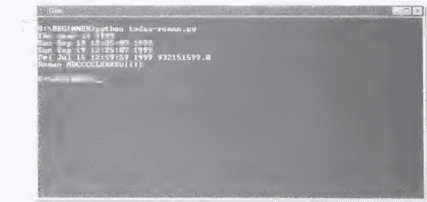

## 更多 OOP 概念

让我们给 `roman` 类添加一个 `__repr__` 方法。在 `roman.py` 的 `ryear()` 方法之后添加以下代码行：

```python
def __repr__(self):
    return(self.ryear())
```

然后运行 `today-roman.py`。你应该看不到输出有任何区别。然而，如果你现在将类定义行中的继承顺序从这样：

```python
class today(now.now, roman.roman):
```

改为这样：

```python
class today(roman.roman, now.now):
```

那么在运行时你应该能看到区别。图 12.5 展示了你将看到的结果。

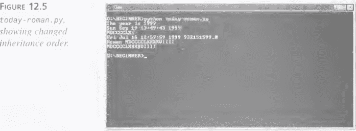

第一次运行时，被调用的 `__repr__` 方法是位于 `now` 类中的；而第二次在修改继承顺序后，被调用的则是我们刚刚添加到 `roman` 类中的方法。这证明了继承类的顺序非常重要，而且你可以让彼此继承的类拥有同名方法（否则，多态就无法实现）。

每当你创建一个使用多继承的对象时，Python 会按照从左到右的顺序在各个类中进行搜索。每当遇到一个与已找到名称重复的名称时，第二个会被忽略。在使用多继承时需要格外小心，否则你很可能会调用一个本不该调用的方法，从而获得奇怪的结果。

## 总结

在本小时中，我们了解到虽然你无法阻止那些真正决心要查看的人，但你可以采取一些步骤将类和变量隐藏在另一个程序的视线之外。我们进一步学习了多态，并学习了如何使用多继承来构建 `mixin` 类。

在接下来的一个小时里，我们将更详细地讨论特殊类方法，之前你只是简单地接触到了它们。

## 工作坊

### 问答

- **问**：如果没有多继承，生活难道还不够复杂吗？
- **答**：确实如此。但多继承有时会带来巨大的收益，尤其是当你编写大量相关类的时候。它是避免大量代码重复的一种好方法。

- **问**：罗马数字？玛雅数字怎么了？
- **答**：它们会回来的。你可以把罗马数字作为家庭作业来研究。

- **问**：其他语言中的多继承与 Python 有什么不同？
- **答**：大部分非常相似，但语法通常更复杂；在 C++ 等语言中，它可能会像 `goto` 语句一样，将对象变成一个“面条代码”的噩梦。然而，如果使用得当并有详尽的文档，它可以极大地简化程序员的生活。

### 测验

1. 以单个下划线开头的变量名表示什么？
   - a. 即使是 Python 也看不见这样的变量。
   - b. 当它在类内部时，其他类看不见它。
   - c. 它不会通过 `from <module> import *` 被导入。
   - d. 这样的名称会被 Python “混淆”（mangled）。

2. `self` 是什么？
   - a. 由五蕴构成的幻象。
   - b. 相当于 C++ 的 `this` 指针，只是换了个名字。
   - c. 对象修改自身的一种方式。
   - d. 多态运作的一个例子。

3. 使用多继承时，最应该注意什么？
   - a. 在所有混入的类中，无论是变量还是方法，都不要有相同的名称。
   - b. 永远不要构建一个计算复活节日期的类。
   - c. 不要使用任何递归类。
   - d. 指定类的顺序决定了哪个重复命名的方法或变量最终进入结果对象。

### 答案

1. c. 以单个下划线开头的变量在通过 `from <module> import *` 导入其所在的模块时不可见。

2. b. 在 Python 中，`self` 与 C++ 的 `this` 相同，它允许对象修改自身。佛陀说它也是一种幻象，但当 `self` 是一个对象时，他可能是错的。

3. d. 指定类的顺序决定了哪个重复命名的方法或变量最终进入结果对象；如果不允许重复名称，多态将不复存在。另外两个选项可能也是不错的建议。

### 练习

编写“多继承”章节开头描述的那个 `mixin` 类，为任何继承它的类提供一个 `__repr__()` 方法。修改 `today` 类以利用你的混入类。

后来，在我开始使用 C++ 之后，我曾考虑将该库转换为使用 C++ 风格的运算符重载。幸运的是，在我采取这个自我毁灭的冲动之前，我发现了 Python，在 Python 中我可以用这种方式完成同样的工作：

```python
r = ( 20L * 819L ) % 13
return r
```

甚至可以这样：

```python
return ( 20L * 819L ) % 13L
```

但更棒的是，当我弄清楚如何在类中定义自己的类和特殊方法后，我发现做类似这样的事情变得非常简单：

```python
from mayalib import *

x = mayanum()
x()
x = x + "13.0.0.0.0"
x()
print x.gregorian()
```

如果用 C 语言，这需要多得多的代码行数，编写和调试的时间会长得多，而且绝不会如此清晰。（顺便说一下，这段代码会打印出玛雅历著名的“结束日期”在我们格里高利历中的日期；请从该书的网站 `http://www.pauauhtun.org/TVPython/` 下载代码并运行。）

有时，类在响应某个特定消息或运算符时应该做什么是很明显的：例如，在玛雅日期的例子中，`+` 运算符的功能很明确。它应该将一个玛雅日期与另一个玛雅日期，或者能被转换为玛雅日期的对象相加。

但有时情况并非如此清晰。例如在第 15 小时中，我们将构建一个类来帮助跟踪录在录像带上的电视节目，此时 `+` 运算符应该做什么就不那么明确了。然而，在前期花一点时间进行设计，可以通过大幅减少试错时间在以后获得回报。如果你思考 VHS 录像带在现实生活中是什么以及它们是如何运作的，一个解决方案就自然浮现了。

磁带是容器。它们可以是空的，可以包含一个或多个节目，有时你会覆盖掉全部或部分内容。有时你的 VCR 录像机会把它们吃掉（如果你的 VCR 吃掉了一盘《星际迷航》的磁带，那是该接受死刑的时候了！）。

因此，我们需要一个磁带类，它可以为空，也可以包含程序类的实例。想想你对真实磁带的操作：你在其中添加节目，有时会删除节目。看到了吗？你可以定义知道如何处理其他类的类，并能以各种有用方式对这些被包含的类进行操作。

当然，在前期花时间研究设计问题总是好事，但 Python 提供了如此强大的工具，以至于你通常可以花时间去尝试——并抛弃——一个想法的多种实现。在这个过程中，你可以准确地看到一个类在实际使用时是如何表现的。

你可以通过尝试并修改行为，直到你和 Python 共同发现该类真正应该做什么，从而确定类的功能。有时这会带来真正的惊喜，比如你发现一个类最擅长做的事情，在开始构建它时你完全没有想到。

这种人机辩证法可以带来极大的收获——但有时它也会让你吃亏。你必须愿意承担风险并抛弃那些行不通的代码。通常在 Python 中，投入到某种实现上的开发时间非常短，这会促使你形成一种心态，让你觉得承担这类风险是可以接受的。

顺便提一下，我们刚才进行的这种分析——观察一个对象，确定它是什么以及它包含什么——是 OOP（面向对象编程）设计中的一个重要工具。构建一个属于某种类型并包含其他对象（这些对象以同样的方式进行分析）的对象，就是你开始构建类及其实现的起点。尽管“是一个/包含”分析法非常简单，但它在 OOP 设计中能让你走得很远。

我们稍后在第 15 小时中将重新讨论磁带类和程序类，但在此期间，让我们继续学习更多关于类特殊方法的知识。

## 使用特殊方法

在附录 D 中，你会发现一个所有可能的类特殊方法的字母顺序列表（截至 Python 1.5.2 版本）；任何用户定义的类（即你作为程序员想要构建的任何类）都可以根据你的需要选择实现或不实现它们。

不过，如果“你的需要”是有意义的，那会更有帮助。很多时候，很明显为某个对象实现特定的类方法是在浪费时间。例如，在磁带类中，`*` 运算符能做什么？没有什么能阻止你将其定义为销毁磁带及其所有节目的一种方式，但你的类对象用户绝不会梦到这意味着这个。

最好是坚持使用像 `+` 和 `-` 这样至少能让人们觉得“哦，这有道理”的方法，而不是让他们查阅每一个运算符的含义并让他们思考“她到底为什么要那样设计？”


许多特殊类方法要求特定种类、特定顺序的参数，并要求返回特定种类的值。其他方法则灵活得多，唯一的要求是它们必须接受标准的 `self` 参数。你记得，`self` 只是一个简单、显式的方式，让方法能够知道它属于哪种对象，并赋予它改变自身状态和/或行为的能力。你已经见过后者的一个例子：`__init__()` 方法仅要求接受 `self` 且不返回任何内容。你想添加的任何其他参数都是可选的，而非强制的；你是类的设计者，所以你可以要求任何你想要的参数。在你告诉 Python 这些要求后，Python 会为你强制执行，但 Python 本身对 `__init__()` 方法没有额外的要求。

这意味着你可以定义你的类的 `__init__()` 方法什么都不做，然后定义其他方法在之后动态地添加状态和/或行为。定义一个“什么都不做”的方法很简单，只需使用 `pass`：

```python
class egg:
    def __init__(self):
        pass
```

`pass` 关键字在类定义中的作用与它在 `if` 语句和 `try/except` 语句中的作用相同；它只是显式地告诉 Python：“我真的希望你在这里什么都不做。”

类方法，尤其是那些旨在用于数值风格运算符的方法，通常有更严格的要求。举个简单的例子，看 `__add__()` 方法，它必须恰好接受两个参数（`self` 和 `other`），并返回一个作为 `self` 和 `other` 相加或拼接结果的新对象。当然，你可以将其定义为执行完全不同的操作且依然满足要求，但那个“完全不同的操作”确实应该在某种程度上是有意义的。例如，不要定义一个执行乘法操作的 `__add__()` 方法！

不过，有时稍微违反规则也是有道理的。例如，集合论定义了集合的连接（join）、并集（union）和交集（intersection），并有特定的运算符来表示它们，但这些专用运算符在 Python 的字符集中并不存在。在这种情况下，你将 `+` 运算符定义为两个集合的连接，将 `|` 运算符定义为并集，将 `&` 运算符定义为交集是有道理的。任何稍微懂得一点集合论的人都会迅速理解这些运算符的作用，并做出必要的心理调整以适应你的集合实现。

与 `__add__()` 和其他方法协同工作，`__coerce__()` 方法是一种非常强大的方式，可以让你的类将其他类型、基础类型或完全不同种类的类对象转换为你的类实例。它同样有严格的要求：它接受 `self` 和 `other` 作为参数，并且必须将 `self` 和 `other` 作为一个元组 `(self, other)` 返回。`other` 可以是基础数据类型的实例，可以是与 `self` 相同的类的实例，也可以是其他用户定义的类。你必须检查所有支持的不同类型，在 `__coerce__()` 方法中执行相应操作，最后返回所需的元组。在这个返回的元组中，`other` 成员应该是与 `self` 类型相同的新实例。（虽然允许将 `self` 转换为与 `other` 相同的类型，但这有点奇怪，所以你应该有非常充分的理由这样做。我目前想不出任何合理的理由。）

在深入探讨最实用的方法之前，值得讨论一个自带一些“陷阱”的方法：`__del__()`。许多其他面向对象编程（OOP）语言拥有所谓的垃圾回收（garbage collection），简单来说，这意味着解释器会不时地检查所有已创建的对象，找出所有你不再使用的对象，然后将它们清除。Python 有一种清除不再需要的垃圾的机制，但它根本不是垃圾回收。它被称为引用计数（reference counting），其含义是每当创建一个对象时，Python 会以一种隐藏的方式对其进行跟踪，给对象添加一个特殊的计数器，以便知道有多少个函数、类或方法正在使用它。当没有任何人使用某个对象时，Python 就会将其丢弃，从而释放出可以给其他对象使用的内存空间。在以下代码中，你将看到一个包含局部变量 `i` 的函数定义：

```python
def spam(y):
    i = y * 400
    ...do whatever is needed...
```

当 `i` 被创建时，`i` 所在的那个小对象框中有一个被设置为 1 的隐藏计数器，代表该变量的使用者数量。在函数结束时，当 `i` 超出作用域，且显然你不再需要使用它时，Python 会将隐藏计数器减 1。这样做时，它发现 `i` 的引用计数器为 0，因此会彻底删除该对象。虽然目前存在许多非常复杂的垃圾回收器，但引用计数机制稳定、健壮且非常易于理解。在 Guido 的观点中，它的主要优势在于极强的可移植性，而复杂的垃圾回收器几乎都与特定的机器或操作系统相关，在新的甚至稍微不同的操作系统上运行需要更多时间。此外，大多数垃圾回收器必须定期暂停解释器的运行，以扫描内存并寻找要删除的对象，而引用计数则不会发生这种情况。这类暂停可能会导致程序对用户命令的响应出现不可接受的延迟。

在像 Python 这样动态的语言中，引用计数的主要缺点是（出于我在此不便展开的原因），并不总是能够确定计数器是否完全准确。在这种情况下，Python 会采取保守策略，不删除可疑的内存。这意味着在 Python 的内存中可能会出现一些没有人使用且无法被任何人引用的对象。这类对象会占用内存空间，但除此之外没有其他危害。对于如今的大多数计算机来说，内存不再像以前那样昂贵且珍贵，因此这里那里浪费一点内存并不是一个大问题。

每当一个对象即将被 Python 删除时，会调用 `__del__()` 方法。有一个内置函数叫做 `del()`，但它的作用仅仅是递减对象的引用计数。如果计数器还没有归零，则不会调用 `__del__()` 方法。清单 13.1 展示了一个可以尝试的示例。

### 清单 13.1 删除对象，del.py

```python
#!c:\python\python.exe

class spam:
    def __init__(self,s):
        self.s=s
    def __del__(self):
        print self.s,"is about to be deleted!"

a = spam("one")

def eggspam():
    z = spam("two")

if __name__ == "__main__":
    print "Calling eggspam()"
    b = eggspam()
    t = []
    for i in range(10):
        t.append(a)

    for i in range(9,-1,-1):
        print "Calling del() on number", i
        del(t[i])

    x = spam("three")
```

图 13.1 显示了运行 `del.py` 的结果。

**图 13.1 运行 del.py。**

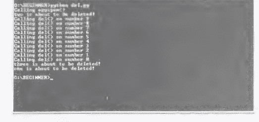

通过检查代码你可以看到，函数 `eggspam()` 创建了一个 spam 对象，但立即将其丢弃。另一方面，列表 `t` 拥有 10 个对 spam 对象 `a` 的引用。当列表中的项按反序删除时，发生的一切只是 `a` 的引用计数在递减。只有当计数器达到零时，`a` 才会真正被丢弃。最后，我们创建了最后一个 spam 对象，但没有显式地删除它：当 Python 退出时，它会丢弃所有剩余的对象，正如 spam 对象告诉我们的那样。

每当你需要遍历一个列表并删除其中的项时，你应该始终按反序进行，就像清单 13.1 中的第二个 `for` 循环那样。这样做很好，因为每次从列表中删除一项时，都会改变列表的长度，这意味着如果我们从 0 遍历到 9，到我们到达索引 5 时，索引 5 之后将没有任何项。你可以简单地将第二个 `for` 循环改为如下内容来看看它是如何运作的：

```python
for i in range(10):
    del(t[i])
```

然后再次运行 `del.py`。

## 特殊方法

### 数值特殊类方法

在本节中，我们将扩展简单的 spam 类，以演示最重要的数值特殊类方法。类似的方法被分组成类似的类型，例如数值类型的数值方法，类类型的类方法，以及其他类型的序列和映射方法。在本节涵盖的数值方法中，第一个是 `__add__()`。

如你所记得，`__add__()` 需要 `self` 和 `other` 参数，并且必须返回一个新的 spam 对象（好吧，“必须”这个词可能太强了；允许就地修改 `self` 然后返回它而不是一个新对象，但这被认为是不良实践）。为了查看效果，让我们给类添加一些状态。下一个清单 13.2 显示了所需的更改。

### 清单 13.2 在 spam.py 中实现 add()

```python
1 #!/usr/local/bin/python
2 class spam:
3     def __init__(self):
4         self.eggs = 1
5     def __del__(self):
6         pass
7     def __add__(self, other):
8         rt = spam()
9         rt.eggs = self.eggs + other.eggs
10        return rt
11  if __name__ == "__main__":
12      a = spam()
13      b = spam()
14      a = a + b
15      print("a now has", a.eggs, "eggs")
```

当你运行 `spam.py` 时，它应该告诉你一只狗有两颗蛋（eggs）。你可以很容易地看出，`__sub__()` 方法就和 `__add__()` 方法一样，只不过是将相加改为相减。使用 `__mul__()` 和 `__div__()` 对 spam 对象进行乘法和除法应该也很清晰。大多数数值方法都非常直观。所有方法的完整列表在附录 D 中。

然而，当你想要将一个 spam 对象和一个字符串相加时该怎么办？

```python
a = spam()
a = a + "24"
a = "24" + a
print a.eggs
```

为了实现这种行为，你需要为 spam 类添加两个额外的方法：`__coerce__()` 方法和 `__radd__()` 方法。为了保持简单，我们只在需要时向 `__coerce__()` 添加类型，因此在第一个练习中，我们仅添加字符串类型。清单 13.3 向你展示如何操作。

### 清单 13.3 拥有更多蛋的 Spam

```python
1  #!/usr/local/bin/python
2  import string
3  
4  class spam:
5      def __init__(self):
6          self.eggs = 1
7      def __del__(self):
8          pass
9      def __add__(self,other):
10         rt = spam()
11         rt.eggs = self.eggs + other.eggs
12         return rt
13     def __coerce__(self,other):
14         rt = spam()
15         if type(other) == type(rt):
16             return (self,other)
17         elif type(other) == type(""):
18             e = string.atoi(other)
19             rt.eggs = e
20             return (self,rt)
21         else:
22             return None
23     def __radd__(self,other):
24         return self + other
25
26    if __name__ == "__main__":
27        a = spam()
28        b = spam()
29        a = a + b
30        print "a now has", a.eggs, "eggs"
31        a = a + "24"
32        print "a now has", a.eggs, "eggs"
33        a = "24" + a
34        print "a now has", a.eggs, "eggs"
```

图 13.2 显示了运行修改后的 `spam.py` 得到的输出。

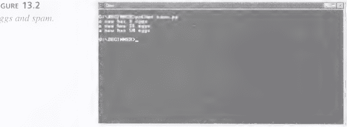

请注意，在 `__radd__` 方法中，我们不需要做任何特殊或奇怪的事情；Python 确保参数的顺序与 `__add__` 方法中保持一致。因为我们已经实现了 `__add__` 方法，我们可以通过简单地确保它在 `__radd__` 方法内部被调用来利用该方法。你可以将此视为一个通用规则。如果你实现了常规方法和 `__coerce__` 方法，那么 `__r*__` 方法可以通过调用常规方法并利用你已经完成的工作来实现。这是 Python 在大多数情况下能够“正确行事”的一个绝佳例子。

因为我们的 spam 类具有数值特性，我们可以为其构建更多数值方法；`__abs__` 就是一个很好的例子。清单 13.4 展示了该方法以及其他一些数值特殊类方法。

### 列表 13.4 数值特殊类方法

```python
1 #!c:\python\python.exe
2 import string
3 
4 class spam:
5     def __init__(self):
6         self.eggs = 1
7     def __del__(self):
8         pass
9     def __add__(self,other):
10        rt = spam()
11        rt.eggs = self.eggs + other.eggs
12        return rt
13    def __coerce__(self,other):
14        rt = spam()
15        if type(other) == type(rt):
16            return (self,other)
17        elif type(other) == type(""):
18            e = string.atoi(other)
19            rt.eggs = e
20            return (self,rt)
21        elif type(other) == type(0):
22            rt.eggs = other
23            return (self,rt)
24        else:
25            return None
26    def __radd__(self,other):
27        return self + other
28    def __abs__(self):
29        return abs(self.eggs)
30    def __long__(self):
31        return long(self.eggs)
32    def __float__(self):
33        return float(self.eggs)
34    def __int__(self):
35        return int(self.eggs)
36    def __complex__(self):
37        return complex(self.eggs)
38    def __divmod__(self,other):
39        return divmod(self.eggs,other.eggs)
40    def __and__(self,other):
41        return self.eggs & other.eggs
42 
43 if __name__ == "__main__":
44     a = spam()
45     b = spam()
46     a = a + b
47     print "a now has", a.eggs, "eggs"
48    a = a + '24'
49    print "a now has", a.eggs, "eggs"
50    a = '24' + a
51    print "a now has", a.eggs, "eggs"
52    b = b + '13'
53    print divmod(a,b)
54    print a & b
```

其余数值特殊类方法的实现留作练习，但实现起来应该并不太难。

## 序列和映射特殊类方法

在本节中，我们将构建一个可修改（或可变）的类：这类对象在某些情况下非常有用。列表 13.5 展示了我们对 `parrots` 类的初步尝试。


```python
1  #!c:\python\python.exe
2
3  import string
4  import sys
5
6  class parrot:
7      def __init__(self,s=""):
8          self.s = list(s)
9      def __repr__(self):
10         t = ""
11         t=string.join(self.s,'')
12         return t
13     def __str__(self):
14         return parrot.__repr__(self)
15     def __add__(self,other):
16         rt = parrot(self)
17         rt.s = rt.s + other.s
18         return rt
19     def __radd__(self,other):
20         return self + other
21     def __coerce__(self,other):
22         if type(other) == type(self):
23             return (self, other)
24         elif type(other) == type(""):
25             rt = parrot(other)
26             return (self, rt)
27         elif type(other) == type([]):
28             print "type list"
29             rt = parrot()
30             for i in other:
31                 if len(i) > 1:
32                     for j in i:
33                         rt.s.append(j)
34                 else:
35                     rt.s.append(i)
36             return (self, rt)
37         elif type(other) == type({}):
38             return None
39         else:
40             rt = parrot(str(other))
41             return (self, rt)
42     def __getitem__(self, key):
43         if type(key) == type(0):
44             return self.s[key]
45         else:
46             raise TypeError
47     def __getslice__(self,i,j):
48         s = self.s[i:j]
49         t = ""
50         for k in s:
51             t = t + k
52         return t
53     def __setitem__(self, key, value):
54         if type(key) == type(0):
55             self.s[key] = value
56         else:
57             raise TypeError
58     def __setslice__(self,i,j,value):
59         self.s[i:j] = list(value)
60     def __len__(self):
61         return len(self.s)
62
63 if __name__ == "__main__":
64     if len(sys.argv) > 1:
65         s = sys.argv[1]
66     else :
67         s = "I'm a little teapot!"
68     p = parrot(s)
69     print p
70     q = parrot (" I'm not schizophrenic!")
71     print "Add:", p + q
72     x = ["N", "o", " that bird's not dead", "!"]
73     print "Add:", p + x
74     print "Index[9]: ", p[9]
75     print "Index[-9]: ", p[-9]
76     p[11], p[13] = p[13], p[11]
77     p[14], p[16] = p[16], p[14]
78     print p
79     pa = p[11:17]
80     print pa
81     print "Add:", p + ' ' + q
82     p[11:17] = "parrot"
83     print p, len(p)
```

`parrot` 类中使用了相当多的特殊方法，但仍有许多其他有用的方法可用。例如，我们还没有实现 `__cmp__()`，而在对一群杂乱的鹦鹉（或者猛禽……）进行排序时，这个方法会很有帮助。

你应该特别注意第 76 行使用的技巧 `p[11], p[13] = p[13], p[11]` 以及接下来的第 77 行。每当你需要交换任何两个变量的值时，都可以使用这种方法。其他语言可能会创建一个临时变量来存储待保存的值，像这样：

```python
temp = a
a = b
b = temp
```

但 Python 允许你用这种方式实现同样的功能：

```python
a, b = b, a
```

这样要简洁得多。

如果你实现了更多的特殊方法，你就拥有了一个可变字符串类，可以将其用于任何你想要的地方。在接下来的一个小时里，你将学习更多关于在编写的其他程序中复用组件（如 `parrot` 类）的知识。

## 访问与特殊类方法

最后要查看的两类特殊类方法是访问方法和类方法。访问方法是指当类的用户尝试获取或设置类成员时被调用的方法；而类方法（如 `__call__()`、`__del__()` 等）则定义了对象作为一个整体单元被操作时的行为。`__cmp__()` 方法是一个类方法，因为每当两个对象之间进行比较时，它都会被调用。

类方法本身不言自明，除了可能需要注意的 `__init__()`（你已经见过了）和 `__hash__()`。`__hash__()` 仅当你确定确实需要将对象用作字典键，且对象不可变时才应使用。大多数用户定义的对象都是可变的，因此通常不适用此方法。但如果适用，你可以像往常一样在 Python 网站（`http://www.python.org/`）上寻找更多信息。

不过，访问方法更有趣。你可以使用它们来拦截向你构建的类添加成员的请求，从而限制类的用户可能造成的破坏（如果你怀疑他们想搞破坏的话）。访问方法包括 `__delattr__()`、`__getattr__()` 和 `__setattr__()`。

第一个方法在通过 `del()` 删除类的某个属性时被调用。为了防止删除，你可以在打印一条消息后抛出一个异常。如果允许删除属性，你需要直接操作对象的字典。换句话说，你不能这样定义 `__delattr__()` 方法：

```python
def __delattr__(self, name):
    ...判断操作是否允许...
    del(self.name)
```

这样做会让 Python“心绞痛”，因为每次对属性调用 `del()` 方法时，都会调用 `__delattr__()` 方法。相反，你应该这样实现：

```python
def __delattr__(self, name):
    ...判断操作是否允许...
    del(self.__dict__[name])
```

这样 Python 和你都会开心得多。这本书中之前还没有用到的一个词是“递归”（recursive）。简单来说，递归是指一个函数调用自身。当一个函数不断地调用自身且没有停止方法时，就会发生无限递归。递归函数非常有用，但它们必须包含一种在完成时停止的方法。这就是在 `__delattr__()` 方法中调用 `del()` 的错误之处：它会导致无限递归。

第二个方法 `__getattr__()` 在有人尝试访问一个尚不存在的属性时被调用。例如，在之前展示的 `parrot` 类中，它只有一个状态属性（列表 `s`），你可以添加一个 `__getattr__()` 方法，每当有人尝试访问除 `s` 以外的属性时，就返回与列表 `s` 对应的字符串值。像这样：

```python
def __getattr__(self, name):
    return str(self.__dict__["s"])
```

最后，第三个方法 `__setattr__()` 在有人尝试向类添加新属性（即创建新变量）时被调用。这里的情况与前两个方法类似……

在这些方法中，你必须小心地使用类的字典来获取真实的属性。然而，这种方法在实际使用中可能比你预想的要复杂一些：不要忘记，每当创建属性时（即使是你想要创建的属性），它都会被调用。代码清单 13.6 展示了所有三种访问类特殊方法的示例；请仔细观察 `__setattr__()` 方法。

### 代码清单 13.6 不含垃圾邮件的鸡蛋（Eggs Without Spam）

```python
#!/usr/local/bin/python
import string
import sys
class egg:
    def __init__(self):
        self.yolks = 1
        self.white = 1
        self.brains = 0
        self.spam = 0
    def __delattr__(self, name):
        if name == "spam":
            print "All eggs must have spam!"
            raise AttributeError
        print "deleting", name
        del(self.__dict__[name])

    def __setattr__(self, name, value):
        try:
            s = self.__dict__[name]
        except KeyError:
            if name not in [ "yolks", "white", "brains",
                            "spam", "salt", "pepper" ]:
                print "you're not allowed to add", name, "to eggs"
            else :
                s = self.__dict__[name] = value
        else :
            s = self.__dict__[name] = value

    def __getattr__(self, name):
        if name == 'yolks':
            return self.__dict__['spam']
        else:
            raise AttributeError

x = egg()
print x.yolks
x.spam = 1
x.snot = 1
try:
    del x.spam
    # (continued from page 238)
except AttributeError:
    print "I couldn't get rid of the spam!"
print x.spam
x.spam = 1000
print x.spam
del x.yolks
try:
    print x.yolks
except AttributeError:
    print "No Yolks!"
x.white = 29
print "Snot is", x.snot, "white is", x.white
```

请注意，为了尽可能保持代码简洁，我们在 `__setattr__()` 方法（从第 17 行开始）中使用了 `try - except - else` 结构。

## 总结

在本小时中，我们学习了类的特殊方法。你应该能够：

- 使用类的特殊方法来实现运算符重载。
- 实现类的特殊方法以处理类的初始化和其他维护任务。
- 识别类的特殊方法的不同类别，以及如何以及何时使用它们。
- 防止除你之外的任何人添加、删除或读取你类中的属性。

在接下来的一个小时中，我们将学习可重用组件——何时使用它们，何时构建它们，以及如果你不想自己构建，在哪里可以找到现成的组件。

## 研讨会

### 问答

**问：为什么我们必须使用 `pass`？**

**答：** 对于 Guido 来说，直接将其删除并允许程序员定义完全没有主体的类和方法会同样简单，其他控制流语句也是如此。然而，强制要求使用 `pass` 意味着你必须采取一个显式的步骤，向 Python 表明你确实打算什么都不做，而不是单纯地忘记写了。

**问：我可以让类相互引用吗？也就是说，spam 可以包含 eggs，而 eggs 也可以包含 spam 吗？**

**答：** 当然可以。但是，你应该意识到这种做法会创建循环引用，而 Python 的引用计数机制无法正确地跟踪循环引用。这是导致应用程序浪费内存的方式之一。尽管如此，在某些情况下，创建循环引用几乎是不可避免的。

### 测验

1. 类的特殊方法的四个类别是什么？

   a. 数值型、字符串型、类方法、访问方法

   b. 数值型、序列/映射型、类方法、访问方法

   c. 多立克式、爱奥尼式、科林斯式（希腊柱式）

   d. 存在、不存在、非不存在、非非不存在

2. 三个访问类特殊方法是什么？

   a. `__del__()`、`__init__()` 和 `__cmp__()`

   b. `__add__()`、`__radd__()` 和 `__mul__()`

   c. `__delattr__()`、`__getattr__()` 和 `__setattr__()`

   d. `__and__()`、`__or__()` 和 `__xor__()`

3. 交换两个变量值最有效的方法是什么？

   a. `tmp = a, a = b, b = tmp`

   b. `a ^ b`

   c. `a, b = b, a`

   d. `swap(a, b)`

### 答案

1. b，我们涵盖了数值型、序列/映射型、类方法和访问类的特殊方法。Python 1.6 或 2.0 可能会增加或更改这些类别中的某些内容。

2. c，三种访问方法是 `__delattr__()`、`__getattr__()` 和 `__setattr__()`。

3. c，Python 中的最佳方法是第三种 `a, b = b, a`，因为它允许你完全避免使用临时变量。

### 练习

以代码清单 13.4 为基础，为 `spam` 类实现其余的数值类特殊方法。

以代码清单 13.5 为基础，为 `parrot` 类实现更多的类特殊方法。虽然所示代码已经包含了除两种以外的所有序列和映射类型，但你可能希望构建一个 `__sub__()` 方法，例如，它会在 `self` 字符串中搜索并如果匹配则从 `self` 中减去另一个字符串。至少，你应该实现 `__cmp__()` 方法。

看看你是否能想出一种比 `try`、`except`、`else` 更简单的方法来构建代码清单 13.6 中 `egg` 类的 `__setattr__()` 方法。

你可以从本书的网站 `http://www.pauahtun.org/TYPython/` 下载 `mayalib` 的代码，其中包含用于操作玛雅历日期和数字的类和函数。你也可以在同一个网站的首页 `http://www.pauahtun.org/` 找到关于玛雅历本身的信息。

# 第 14 小时

## 弗兰肯斯坦博士的实验室

> 永远不要开启一个你不知道如何关闭的东西。
>
> ——给农场孩子的建议（由 Darryl Nelson 提供）

在上一小时中，我们讨论了类的特殊方法，这是使 Python 对面向对象编程（OOP）特别友好的想法之一。这次，我们将应用另一个 OOP 概念——软件可重用性，并学习 Python 使软件重用变得简单的一些方法。虽然在这个项目中我们不会使用类，但你将接触到一种开发软件的流程。并非所有内容都能一次性完成，所以我们的“弗兰肯斯坦”项目将延续到下一个小时。在这两个小时结束时，你应该能够：

- 构建一个专门为可重用性设计的模块
- 为该模块编写文档
- 为模块添加内置测试
- 寻找由他人构建的可用组件

### 创建可重用组件

每当你发现自己在编写一个需要多次使用的函数或方法时，请考虑构建一个模块。每当你考虑构建一个可以重用的模块时，请考虑将其公开；其他人可能会发现它和你一样有用。


就在几天前，我发现我 Web 服务器上的几个 Python 程序无法运行。我追踪到问题出在文件第一行错误；我在 Windows NT 上运行 Apache Web 服务器。这样做的一个好处应该是网站的配置和管理与 UNIX/Linux 版本相似，甚至完全相同。我很喜欢这一点，虽然全世界看到的服务器运行在 NT 上，但我将其镜像在两个不同的 Linux 系统上——一个在公司，一个在家里。Apache 各个版本之间存在一些令人恼火的微小差异，而且每次从一个系统复制到另一个系统时，都需要更新每个 CGI 程序的首行，这件事我经常忘记——导致用户无法使用我的玛雅历工具（`www.pauhautun.org/tools.html`）并给我发送厌恶邮件，我像任何人一样讨厌这种邮件。这次发生这种情况时，我用 Python 写了一个短程序来帮我更新这些文件。

## 新术语

通用网关接口（Common Gateway Interface，简称 CGI）是一种 Web 服务器应用程序从用户那里收集信息的方法，通常是通过在网页上放置表单并使用 CGI 脚本来处理收集到的信息。这些脚本也被称为 cgi-bin 程序，通常用 Perl 编写，有时用 C 编写，现在越来越多地使用 Python。在本书后面，你将看到一些 Python CGI 程序的示例。

因为其他人可能会遇到同样的困境，我决定将其整理并公之于众。这个程序最初非常简单，目的很单一。我们会增加一点功能，但它并不是为了极致的多功能而设计的——它非常像一个“只会一招”的程序。我在设计和构建它时所经历的步骤可能会有所帮助。以下是我在开始工作之前问自己的问题清单：

- 我试图解决的问题是什么？
- 是否有其他人写过能满足我需求的程序？
- 实现更改所需要的绝对最小值是什么？
- 我如何避免修改不需要修改的文件？
- 是否有人写过能让我更容易实现需求的模块？

## 弗兰肯斯坦博士的实验室

这个问题的具体细节是：无论在 Windows 还是 UNIX 上，Apache 都要求任何非实际可执行文件（也就是说，不是机器语言）的 CGI 程序必须以两个特殊字符 `#!` 开头，随后紧跟该程序的绝对路径。对于我的 Red Hat Linux 系统，这意味着任何 Python 程序的第一行必须是 `#!/usr/bin/python`；而在我的 NT 系统上，同一行必须是 `#!c:\python\python.exe`。其他 UNIX 系统和 Linux 发行版通常将 Python 放在 `/usr/local/bin/python`，因此在这些系统上，第一行必须写成 `#!/usr/local/bin/python`。

在 Python 网站上进行快速搜索后，我发现还没有人专门针对这个问题写过解决方案，但在过程中，我发现了一个关于 `sys` 模块的引用，其中包含一个正是我需要的变量：`sys.executable` 包含了 Python 解释器的完整路径。于是，我写好了程序的开头几行，如下所示：

```python
import sys

pbang = "#!" + sys.executable
if sys.platform == "win32":
    sys.stderr.write ( "Python Version " + sys.version + " Running on Windows\n" )
elif sys.platform == "linux2":
    sys.stderr.write ( "Python Version " + sys.version + " Running on Linux\n" )
else :
    sys.stderr.write ( "Python Version " + sys.version + " Running on " + \
    sys.platform + " \n" )

print pbang
```

`#!` 字符组合通常被称为 hash-bang 或 pound-bang（程序员给非字母数字字符起的其他有趣名称还包括用 shplat 表示 `*`，suck 表示 `<`，spit 表示 `>`，以及 squiggles 表示 `{` 和 `}`）。我们想知道 `pbang` 变量应该包含什么，但我们假设在运行它时并不知道，因此运行上述脚本的正确方式如图 14.1 所示。

### 图 14.1：Python 驻留在哪里

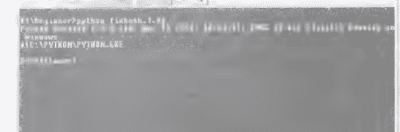

我还打印出了版本号，仅用于信息告知。我使用了 `sys.stderr.write()` 而不是通常的 print 语句，是因为我想确保用户总能读到某些特定消息；使用 `sys.stdout` 的 print 很容易被重定向到其他地方。如果用户运行 `python fixhash.py > tempfile`，我不希望她面对的是一个没有任何消息的屏幕，而是一个告诉她哪里出错了的文件。这不是良好的用户界面实践。

> `stdin`、`stdout` 和 `stderr` 是从 UNIX 继承而来的三个特殊名称，用于预先打开的、被视为文件的对象。这些名称分别代表标准输入、标准输出和标准错误；在 UNIX 中，所有程序在任何时候都可以使用这些对象，但运行在 Windows 上的应用程序并非如此。具有 UNIX 传承的程序（如 Python）会做出特别努力，即使在 Windows 上也提供这些流。

因为我想修改潜在的大量文件，所以我知道程序的总体结构将是这样的：

```python
for i in list_of_files:
    if i is not this_program:
        check first line of file
        if line is not equal to pbang:
            modify the file
```

请注意，上面的列表不是真正的 Python 代码，而被称为伪代码。伪代码（Pseudo code）是一种描述程序大致结构的简写方式。当你勾勒程序结构时，你完全不想在语法上浪费任何时间；因为伪代码永远不会被实际运行，所以你不必担心错误和程序崩溃。首先使用伪代码进行勾勒，然后实现真正的代码，通常采取由外向内的顺序，在经过多次“编码-测试”迭代以确保程序正常运行的过程中，逐渐细化。

第一步是如何获取文件列表。这很简单，因为我记得 `os` 模块包含一个专门为此设计的函数：`os.listdir()`。因此，我知道程序主体的第一几行将是：

```python
olist = os.listdir('.')
nfiles = 0
for i in olist:
    if i != program name:
```

如何获取程序名称？我绝对不想在程序运行的同时修改程序自身的文件——这有点像在给自己做脑科手术，让我感到不安。同样，我知道 `sys` 模块提供了对 `argv` 列表的访问（即程序被调用时的所有参数），并且按照惯例，`argv` 参数列表的第一个元素总是程序的名称。由于程序的这个官方名称总是包含文件的完整路径，我知道我必须丢弃除最后一部分之外的所有名称，仅保留名称而不保留路径。这可以很容易地实现，如下所示：

```python
nm = os.path.split(sys.argv[0])[1]
```

因为 `os.path.split()` 返回一个包含路径和程序名称的列表（按此顺序），所以对该函数返回的列表应用索引运算符（`[1]`）是简单直接的。通过忽略索引 0，`nm` 变量最终只包含程序名称。此时，我们的代码如下所示：

```python
nm = os.path.split(sys.argv[0])[1]
dlist = os.listdir('.')
nfiles = 0
for i in dlist:
    if i == nm:
        continue
    ...check first line of file...
```

检查文件第一行的一种方法是使用 `open()` 打开文件并读取一行，然后将该行与我们存储在 `pbang` 变量中的内容进行比较。但考虑到后续，我们想要的不仅仅是一个路径检查器，还要一个路径修改器。在 C 等其他语言中，我们必须检查该行，并且如果需要修改，不仅要写出新行，还要写出文件的所有剩余部分。此外，如果不需要，我们不想复制整个文件，这就是软件复用发挥作用的地方。

我在 `www.python.org` 的文档中搜索，偶然发现了 `fileinput` 模块。该模块包含允许逐行读取文件的方法，并提供了一种原位重写文件的方式（也就是说，无需在将临时文件重命名为旧文件之前创建临时文件）。这正是这种情况所需要的。我决定编写一个函数，在确定必要时重写文件；代码的主体部分改为：

```python
dlist = os.listdir("..")
nfiles = 0
for i in dlist:
    if i == nm:
        continue
    if len(i) > 4:
        if i[-3:] == ".py":
            sys.stderr.write("Checking " + i + "...\n")
            for line in fileinput.input(i):
                if fileinput.isfirstline():
                    if line[-1] != pbang:
                        fileinput.close()
                        t = os.access(i, os.W_OK)
                        if t == 0:
                            sys.stderr.write(i + " is not writable; skipping.\n")
                        else:
                            sys.stderr.write("Modifying " + i + "...\n")
                            rewritefile(i)
                            nfiles = nfiles + 1
                        break
                else:
                    fileinput.close()
                    break

sys.stderr.write("Files modified: " + nfiles + "\n")
```

注释：`os` 模块包含一个方法 `access()`，允许我们检查文件是否可写。如果不可写，我们直接跳过该文件，但告知用户我们正在这样做。`os.W_OK` 是一个特殊的标志或符号，用于告诉 `access()` 方法我们要确定文件是否可写。`isfirstline()` 方法仅告诉我们是否正在处理第一行，随后的代码将该第一行与 `pbang` 进行比较。

如果第一行与 `pbang` 相等，则关闭文件并继续处理下一个文件（这就是 `break` 的作用，它会跳出 for 循环）；否则，我们关闭文件并调用 `rewritefile()` 函数，将文件名作为参数传递。我曾考虑在第一行与 `pbang` 之间进行不区分大小写的比较，但由于大小写在 UNIX 系统中很重要，我决定放弃；我宁愿在 Windows 系统上多修改几个文件，也不愿在 UNIX 系统上漏掉任何一个。最后一行告诉用户修改了多少个文件。

为了测试此类代码，你可以轻松地编写一个所谓的存根函数（stub function）来代替 `rewritefile()` 函数。存根（Stubs）是函数或方法，它们具有在最终完成的程序中将要拥有的相同签名，但它们要么什么都不做，要么仅打印调试信息。你应该编写一个至少能打印文件名称的存根函数，将其插入到你的 `fixhash.py` 文件中，然后运行程序来测试你的逻辑（实际上，你是在测试我的逻辑和你的打字准确度，但你明白我的意思）。

这里是真正的 `rewritefile()` 函数：

```python
def rewritefile(fip):
    mode = os.stat(fip)[ST_MODE]
    for line in fileinput.input(fip, inplace=1):
        if fileinput.isfirstline():
            if line[2] == "#!":
                sys.stdout.write(pbang + "\n")
            else:
                sys.stdout.write(pbang + "\n")
                sys.stdout.write(line)
        else:
            sys.stdout.write(line)
    fileinput.close()
    os.chmod(fip, mode)
```

注：由于这是一个函数，模块中的变量可以在函数内部被引用，但不能对其进行赋值。这就是为什么我们可以在函数中直接使用 `pbang` 而无需使用全局 `global pbang` 语句的原因——我们仅在模块上下文中为其赋值，之后无需再对其进行修改。

`os` 模块包含一个 `stat()` 函数，允许我们检索有关文件和目录的大量信息；而我们唯一感兴趣的是文件的模式（mode）。不过，为了获得 `ST_MODE` 的定义，我们必须从 `stat` 模块中导入它：在这种情况下，`from stat import *` 是合适的；我们实际上并不关心模式的具体内容，只是想在稍后将其保存并还原。在这种情况下，模式告诉我们文件是否可执行、可写和/或可读。我们在修改文件之前获取其模式，并在修改后将其还原，因为修改过程通常会改变这些模式；这在类 UNIX 系统上通常如此，而在 Windows 上则不然，但为了保证可移植性，你应该始终保存并还原它们。

`for line in fileinput.input(fip, inplace=1):` 这行语句利用了 `fileinput` 模块一个非常出色的特性。`inplace=1` 是一个关键字参数，它告诉模块我们想要就地重写文件：当我们使用这个特殊参数调用 `fileinput.input()` 后，模块会创建文件的副本并重新打开原文件以进行写入。从那时起，任何调用 `write()` 或发送到 stdout 的 print 语句都会被发送到新文件中。

完成后，我们检查文件的第一行，如果它包含“hash-bang”语法（`#!`），我们就替换该行。如果它不是这样开始的，我们就将 hash-bang 行添加到文件的开头。此后，对于文件中的所有剩余行，我们只需将每一行写入 stdout，它们就会自动进入新文件。当调用 `fileinput.close()` 时，新文件将被关闭，原文件的内部副本将被删除。

### 代码清单 14.1：一个完整的 `fixhash.py`


```python
import os
import sys
import fileinput
from stat import *

pbang = "#!" + sys.executable

if sys.platform == "win32":
    sys.stderr.write("Python Version " + sys.version + \
    " Running on Windows\n")
elif sys.platform == "linux2":
    sys.stderr.write("Python Version " + sys.version + \
    " Running on Linux\n")
else:
    sys.stderr.write("Python Version " + sys.version + \
    " Running on " + sys.platform + "\n")

nm = os.path.split(sys.argv[0])[1]

def rewritefile(fip):
    mode = os.stat(fip)[ST_MODE]
    for line in fileinput.input(fip, inplace=1):
        if fileinput.isfirstline():
            if line[:2] == "#!":
                sys.stdout.write(pbang + "\n")
            else:
                sys.stdout.write(pbang + "\n")
                sys.stdout.write(line)
        else:
            sys.stdout.write(line)
    fileinput.close()
    os.chmod(fip, mode)

dlist = os.listdir(".")
nfiles = 0

for i in dlist:
    if i == nm:
        continue
    if len(i) > 4:
        if i[-3:] == ".py":
            sys.stderr.write("Checking " + i + "...\n")
            for line in fileinput.input(i):
                if fileinput.isfirstline():
                    if line[:2] != pbang:
                        fileinput.close()
                        t = os.access(i, os.W_OK)
                        if t == 0:
                            sys.stderr.write(i + \
                            " is not writable; skipping.\n")
                        else:
                            sys.stderr.write("Modifying " \
                            + i + "...\n")
                            rewritefile(i)
                            nfiles = nfiles + 1
                    break
                else:
                    fileinput.close()
                    break

sys.stderr.write("Files modified: " + str(nfiles) + "\n")
```

如前面的代码所示，`fixhash.py` 是一个完整且可运行的应用程序，它出色地完成了任务：只要它仅由一两个人使用，就不需要进行其他更改。然而，了解将其转换为供公众使用的模块的步骤将非常有启发性，因为其他人很可能会发现它很有用。即使他们不觉得有用，它在未来你自己的其他维护任务中也可能会派上用场，特别是如果我们添加更多功能来增强其实用性。

我们可以做的第一项额外工作是添加一个用于操作目录的命令行参数。这样做将允许我们将`fixhash.py`存储在一个始终被用于搜索可执行程序和脚本的目录中，而不需要在每次需要它时将其复制到目标目录。在 UNIX 上，这意味着将程序放在你的个人 bin 目录或某些中心化的、广为人知的地点，例如`/usr/local/bin`。然而，在 Windows 上，不存在类似的标准位置；我的解决方案是（因为我在 Windows 上使用 MKS 工具包来获得类似 UNIX 的工具）始终将此类通用工具放入我的`c:/$msnt`目录（对于任何 Windows 平台，这通常都是`c:/$msnt`）。不过，你的解决方案应该是根据你的需求而定，而不是我的。

如果我们检查程序的主体部分，应该相当容易地确定支持命令行参数所需的更改。代码清单 14.2 显示了必要的少量更改。

### 代码清单 14.2 为`fixhash.py`添加命令行参数

```python
def fixdirectory(d):
    dlist = os.listdir(d)
    nfiles = 0
    for i in dlist:
        if i == nm:
            continue
        if len(i) > 4:
            if i[-3:] == ".py":
                sys.stderr.write("Checking " + i + "...\n")
                for line in fileinput.input(i):
                    if fileinput.isfirstline():
                        if line[:2] != pbang:
                            fileinput.close()
                            t = os.access(i, os.W_OK)
                            if t == 0:
                                sys.stderr.write(i + \
                                " is not writable; skipping.\n")
                            else:
                                sys.stderr.write(\
                                "Modifying " + i + "...\n")
                                rewritefile(i)
                                nfiles = nfiles + 1
                            break
                        else:
                            fileinput.close()
                            break

    return nfiles


if __name__ == "__main__":
    nmod = 0
    if len(sys.argv) > 1:
        dirnames = sys.argv[1:]
    else:
        dirnames = ["."]
    for s in dirnames:
        nmod = nmod + fixdirectory(s)
    sys.stderr.write("Files modified: " + str(nmod) + "\n")
```

在应用上述更改后，我先在当前目录运行了`fixhash.py`，运行正常，然后在另一个目录运行。图 14.2 显示了在第二种情况下发生了什么。

### 图 14.2 糟糕！

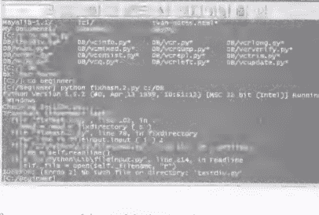

如你所见，我忘记了一些东西（这种情况并不像我想象的那么少见），所以我们必须修正几个假设。显然，命令行参数起作用了，但尽管它找到了目录（否则，它怎么知道该打开哪个文件？），但它无法打开文件。这是因为我们只将文件名传递给了`fileinput`模块，而没有传递目录名。这很容易修复，你可以在代码清单 14.3 中看到。

### 代码清单 14.3 修复`fixhash.py`

```python
def fixdirectory(d):
    dlist = os.listdir(d)
    nfiles = 0
    for i in dlist:
        if i == nm:
            continue
        if len(i) > 4:
            fname = d + "/" + i
        if fname[-3:] == ".py":
            sys.stderr.write("Checking " + fname + "...\n")
            for line in fileinput.input(fname):
                if fileinput.isfirstline():
                    if line[:2] != pbang:
                        fileinput.close()
                        t = os.access(fname, os.W_OK)
                        if t == 0:
                            sys.stderr.write(fname + \
                            " is not writable; skipping.\n")
                        else:
                            sys.stderr.write("Modifying " \
                            + fname + "...\n")
                            rewritefile(fname)
                            nfiles = nfiles + 1
                            break
                    else:
                        fileinput.close()
                        break
    return nfiles
```

如果我们应用这些更改并再次运行，图 14.3 显示了结果。

### 图 14.3 修正后的`fixhash.py`

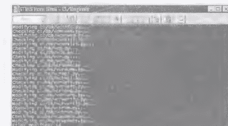

请注意，即便在 Windows 上，也不需要使用那些糟糕的反斜杠；如果底层操作系统需要，Python 会将更美观的 UNIX 风格正斜杠转换为反斜杠。

那么，现在该做什么？我们已经添加了命令行参数（顺便提一下，`dirnames`行中的`s`确保了命令行上的多个目录名称能被正确处理），但我们真的已经尽力扩大`fixhash.py`的适用范围了吗？递归修复怎么说？也就是说，假设我们希望`fixdirectory()`函数从一个特定目录开始，不仅修复该目录下的所有 Python 文件，还要修复其下方所有子目录中的所有 Python 文件。

其实，提供这种功能并不难。我在 Python 文档的可用模块中搜索，发现了`os`模块中的`os.walk()`函数，这正是我们想要的。因为我们已经使用了`os`模块的`os.path.split()`函数，所以我们甚至不需要导入任何新模块。同时，我们还可以用`os.path.join()`函数替换示例 14.3 中简单的字符串拼接操作；`os.path.join()`足够智能，它会在必要的地方自动插入斜杠：

`fname = d + "/" + i`

变成了：

`fname = os.path.join(d, i)`

这样一来，如果目录名`d`恰好带有尾随斜杠，`join()`就不会像我们原来的字符串拼接那样添加额外的斜杠。

我们的`fixdirectory()`函数目前只接受一个参数，但为了配合`os.walk()`函数使用，我们需要对其进行修改；以下是 Python 文档中该函数的语法和描述：

`walk(path, visit, arg)`

对于根目录为`path`的目录树（如果`path`本身是目录，则包括`path`）中的每个目录，调用函数`visit`并传递参数（`arg`、`dirname`、`names`）。参数`dirname`指定被访问的目录；参数`names`列出该目录中的文件（通过`os.listdir(dirname)`获取）。

因此，要使用`walk()`函数，我们只需要在程序的主部分调用它，并传递起始目录（`path`）、修改后的`fixdirectory()`函数（`visit`）以及其他内容（`arg`）。最后一个参数只是你向`visit`函数传递信息的一种方式——通常你不需要它，但在某些情况下，能够传递基于每棵树而变化的信息会很有帮助。示例 14.4 显示了修改后的`fixdirectory()`函数。

### 示例 14.4 修改`fixhash.py`


```python
1  def fixdirectory ( arg, d, dlist ) :
2      global nfiles
3      nfiles = 0
4      for i in dlist :
5          if i == nm :
6              continue
7          if len ( i ) > 4 :
8              fname = os.path.join (d, i )
9              if fname[-3 : ] == ".py" :
10                 sys.stderr.write ( "Checking " + fname + "...\n" )
11                 for line in fileinput.input ( fname ) :
12                     if fileinput.isfirstline ( ) :
13                         if line[ : -1 ] != pbang :
14                             fileinput.close ( )
15                         t = os.access ( fname, os.W_OK )
16                         if t == 0 :
17                             sys.stderr.write ( fname + "\n"
18                             " is not writable; skipping.\n" )
19                     else :
20                         sys.stderr.write ( 
21                         "Modifying " + fname + "...\n" )
22                             rewritable ( fname )
23                             nfiles = nfiles + 1
24                             break
25                     else :
26                         fileinput.close ( )
27                     break
```

请注意我们需要修改的内容很少：只需添加额外的参数，删除对`os.listdir()`的调用，并添加一行全局变量`nfiles`。最后一行是为了跟踪修改的文件数量，这就需要在模块中添加一个额外的函数来检索该数值。如下所示：

```python
def getnfiles():
    return nfiles
```

当然，我们可以告诉用户通过访问`fixhash.nfiles`来获取文件数量，但提供一个简单的函数会是更整洁的接口。修改程序的主部分同样简单，请参见示例 14.5。

### 示例 14.5 修改 `fixhash.py` 以使用 `os.path.walk()`

```python
1  if __name__ == "__main__":
2      nmod = 0
3      if len( sys.argv ) > 1 :
4          dirnames = sys.argv[ 1 : ]
5      else :
6          dirnames = [ "." ]
7      for s in dirnames :
8          os.path.walk ( s, fixdirectory, 0 )
9          nmod = nmod + getnfiles ( )
10 
11  sys.stderr.write ( "Files modified: " + str(nmod) + "\n" )
```

图 14.4 显示了在包含另一个目录且两者都包含 Python 文件的目录上运行修改后程序的执行结果。

### 图 14.4 在目录树上运行 `fixhash.py`

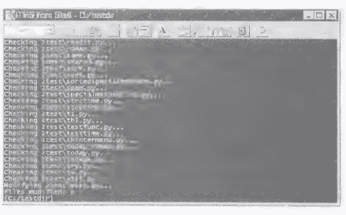

## 总结

在本小时中，我们涵盖了开发可重用模块的过程。我们构建了一个名为`fixhash`的模块并对其进行了完善。在接下来的一个小时里，我们将完成该模块并为其编写文档。

## 工作坊

### 问答

- 问：为什么 Python 在不同的 Unix 系统上位于不同的位置？
- 答：大多数不同的位置源于类 UNIX 系统的两个主要分支（BSD 和 System V）之间的差异。System V 并没有真正的地方来存放本地开发的工具（而这类工具很多），因此 Berkeley (BSD) 开发了`/usr/local`位置。System V 后来提出了`/var`和`/opt`（并制定了详细的规则来管理这些目录中的程序放置），而不同的 Linux 发行版自由地采用了来自 BSD 和 System V 的部分或全部位置。

### 测验

1. 获取目录中文件列表的最佳方法是什么？
   - a. `os.path.list()`
   - b. `os.listdir()`
   - c. `sys.listdir()`
   - d. `sys.dir()`

2. `sys.platform`的用途是什么？
   - a. 告知你当前运行的操作系统。
   - b. 告知你运行的硬件设备。
   - c. 告知你是否正在使用 Active Desktop。
   - d. 没有人用它。

### 答案

1. b. 最佳（而且除非你想自己写，否则真的是唯一选择）的方法是使用`os.listdir()`。`dir()`函数的功能完全不同。

2. a. `sys.platform`变量告知你的程序运行在什么操作系统上。这可以帮助你避免使用在某些操作系统上不可用的函数。

### 练习

你可以在`http://www.ithaca.edu/library/Training/wwwquiz.html`看到一个表单使用的绝佳示例。同一网站还提供了一个不错的互联网术语词汇表。

在研究`rewritefile()`函数后，你应该对存根函数（stub functions）的有用性有了更好的认识。你可以在`rewritefile()`函数中加入哪些扩展信息，使其更易于开发或调试？

在示例 14.1 的第 35 行，你可以看到我们获取了一个目录下所有以标准 Python 文件后缀`.py`结尾的文件列表。你也应该能想象到，如果有人将目录命名为`spam.py`之类的内容会发生什么。在 Python 文档中搜索一种方法，以确定一个路径究竟是文件而不是目录；并在代码列表中添加相应的行。将新代码添加到`fixhash.py`的最终版本中。提示：查看`os.stat()`的文档。

在`fixdirectory()`函数中添加不区分大小写的比较，但仅在 Windows 系统上激活。提示：查看`string`模块的文档。

# 第 15 小时

## 实验室，第二部分

> 空行是没有好处的。
>
> ——Natalie Goldberg

在上一小时中，我们开始构建一个可重用模块，我们将在本小时中将其完成。最后，你将学习更多关于软件开发过程的知识，并学习如何：

- 构建一个专门为可重用性设计的模块
- 为该模块编写文档
- 为模块添加内置测试
- 寻找可供使用的他人构建的组件

### 继续制作可重用组件

上一小时，我们完成了一个可运行的`fixhash.py`，它能从命令行给出的任何目录开始，向下遍历目录结构，修复它遇到的所有 Python 文件。


当然，这个模块的用户可能并不总是想要进行递归修复（在这种情况下，*recursive*意味着从给定目录开始，访问树中的每个目录和子目录；递归还有其他含义，但我们在本书中不会用到），因此让我们添加一个命令行参数名，用以开启或关闭此功能。代码清单 15.1 包含了程序主体的新代码。

### 代码清单 15.1 为 `fixhash.py` 添加命令行标志

```python
1  if __name__ == "__main__":
2      nmod = 0
3      recurse = 0
4      if len(sys.argv) > 1:
5          if len(sys.argv[1]) == '-r':
6              recurse = 1
7          if recurse and len(sys.argv) > 2:
8              dirnames = sys.argv[2:]
9          elif recurse and len(sys.argv) <= 2:
10             dirnames = [ "." ]
11         else:
12             dirnames = sys.argv[1:]
13     else:
14         dirnames = [ "." ]
15     for s in dirnames:
16         if not recurse:
17             dlist = os.listdir(s)
18             fixdirectory(0, s, dlist)
19         else:
20             os.path.walk(s, fixdirectory, 0)
21             nmod = nmod + getnfiles()
22 
23 sys.stderr.write("Files modified: " + str(nmod) + "\n")
```

图 15.1 展示了运行`python fixhash.py -r`的结果。

以及下一个。图 15.2 展示了运行`python fixhash.py`的结果。

还有一件事必须完成。程序的主体部分应该被放置在一个包装器（wrapper）中，这样模块的用户就不必编写自己的包装器。代码清单 15.2 是对`fixhash.py`的最终修改。

### 图 15.1

运行`fixhash.py -r`。

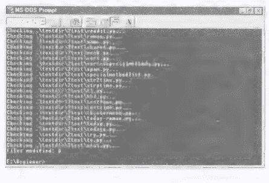

### 图 15.2

运行`fixhash.py`。

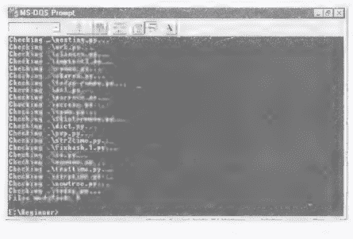

### 代码清单 15.2 最终版本的 `fixhash.py`


```python
1  #!/usr/local/bin/python
2
3  import os
4  import sys
5  import fileinput
6  from stat import *
7
8
9  pbang = "#!" + sys.executable
10 nfiles = 0
11 nm = ""
12
13 def init( v = 0 ) :
14     global nm
15     if v != 0 :
16         if sys.platform == "win32" :
17            sys.stderr.write( "Python Version " + sys.version + \
18                " Running on Windows\n" )
19            elif sys.platform == "linux2" :
20                sys.stderr.write( "Python Version " + sys.version + \
21                " Running on Linux\n" )
22            else:
23                sys.stderr.write( "Python Version " + sys.version + \
24                " Running on " + sys.platform + "\n" )
25
26    nm = os.path.split( sys.argv[ 0 ] )[ 1 ]
27
28    def getfiles( ) :
29        return nfiles
30
31    def rewritefile( fip ) :
32        global pbang
33        mode = os.stat( fip )[ ST_MODE ]
34        for line in fileinput.input( fip, inplace = 1 ) :
35            if fileinput.isfirstline( ) :
36                if line[ :1 ] == "#!":
37                    sys.stdout.write( pbang + "\n" )
38                else :
39                    sys.stdout.write( pbang + "\n" )
40                    sys.stdout.write( line )
41            else :
42                sys.stdout.write( line )
43        fileinput.close( )
44        os.chmod( fip, mode )
45
46    def fixdirectory( arg, d, dlist ) :
47        global nfiles
48        nfiles = 0
49        for i in dlist :
50            if i == nm :
51                continue
52            if len( i ) > 4 :
53                fname = os.path.join( d, i )
54            if fname[ -3 : ] == ".py" :
55                if arg[ 1 ] == 0 :
56                    sys.stderr.write( "Checking " + fname + "...\n" )
57                for line in fileinput.input( fname ) :
58                    if fileinput.isfirstline( ) :
59                        if line[ :1 ] != pbang :
60                            fileinput.close( )
61                            t = os.access( fname, os.W_OK )
62                            if t == 0 :
63                                if arg[ 1 ] == 0 :
64                                    sys.stderr.write( \
65                                    ( fname + " is not writable; skipping\n" ) )
66		else :
67			if arg != 0 :
68					sys.stderr.write \
69				( "Modifying " + fname + "...\n" )
70			rewritefile ( fname )
71			nfiles = nfiles + 1
72			break
73		else :
74			fileinput.close( )
75			break
76	return nfiles
77
78 def fixhash ( d, r, v ) :
79	nmod = 0
80	if type ( d ) != type ( [] ) :
81		dl = list ( d )
82	else :
83		dl = d
84	initial ( v )
85	for i in dl :
86		if not r :
87			dlist = os.listdir ( i )
88			fixdirectory ( v, i, dlist )
89		else :
90			os.path.walk ( i, fixdirectory, v )
91		nmod = nmod + getnfiles ( )
92	return nmod
93
94 if __name__ == '__main__' :
95	nmod = 0
96	recurse = 0
97	if len ( sys.argv ) > 1 :
98
99		if sys.argv[1] == '-r' :
100			recurse = recurse + 1
101		if recurse and len ( sys.argv ) > 2 :
102			dirnames = sys.argv[ 2 : ]
103		elif recurse and len ( sys.argv ) <= 2 :
104			dirnames = [ "." ]
105		else :
106			dirnames = sys.argv[ 1 : ]
107	else :
108		dirnames = [ "." ]
109	nmod = fixhash ( dirnames, recurse, 1 )
110
111	sys.stderr.write ( "Files modified: " + str(nmod) + "\n" )
```

最后这次修改使得导入该模块成为可能。代码清单 15.3 展示了具体操作方法。

### 代码清单 15.3：`testhash.py`

```python
1 #!/usr/local/bin/python
2 
3 import sys
4 import fixhash4
5 
6 if __name__ == "__main__":
7     nmod = 0
8     recurse = 0
9     verbose = 0
10    if len ( sys.argv ) > 1 :
11 
12        if sys.argv[1] == '-r' :
13            recurse = recurse + 1
14        if recurse and len ( sys.argv ) > 2 :
15            dirnames = sys.argv[ 2 : ]
16        elif recurse and len ( sys.argv ) <= 2 :
17            dirnames = [ ".", "" ]
18        else :
19            dirnames = sys.argv[ 1 : ]
20    else :
21        dirnames = [ ".", "" ]
22    nmod = fixhash4.fixhash ( dirnames, recurse, verbose )
23 
24    if verbose :
25        sys.stderr.write ( "Files modified: " + str(nmod) + "\n" )
26    else :
27        sys.exit ( nmod )
```

## 为你的组件编写文档

改善模块并增加他人使用可能性的主要任务之一就是编写它们的功能文档。这意味着你必须为你的函数、类和方法添加文档字符串（docstrings）。这是你最起码应该做的。我更倾向于在添加文档字符串的同时提供 HTML 文档。通常，你可以将文档字符串直接复制到任何你使用的 HTML 编辑器中，进行简单的格式化，然后将 Python 代码和 HTML 文件一起分发在一个压缩包中。

你会发现，文档能够决定他人是否会使用你的代码。不久前，我编写了一些我认为非常实用的快速 shell 脚本，但没有花太多精力编写文档。我在当时加入的一个邮件列表中公布了它，第二天我收到了三封信，说它看起来很有趣，但因为没有文档，他们不打算使用。这三封信足以让我意识到问题的严重性。我完成了文档并重新发布了代码。不过，我再也没有收到那三个抱怨者的回复。

与其重复展示所有带有新文档字符串的代码，我将简单地提供一个带有文档字符串的函数示例：代码清单 15.4 展示了经过文档化的 `fixhash()` 函数。

### 代码清单 15.4：为 `fixhash()` 编写文档

```python
1 def fixhash ( d, r, v ):
2     """This function runs fixdirectory() on each directory
3     in d (a list). If r is non-zero, os.path.walk() is
4     used to recursively fix the entire tree rooted at each
5     directory in the list. If v is non-zero, messages
6     are printed to stderr. Returns # of files modified.
7     """
8
9     nmod = 0
10    if type ( d ) != type ( [ ] ):
11        dl = list ( d )
12    else :
13        dl = d
14    initial ( v )
15    for i in dl :
16        if not r :
17            dlist = os.listdir ( i )
18            fixdirectory ( v, i, dlist )
19        else :
20            sys.stderr.write ( "here fixdirectory " + i + "\n" )
21            os.path.walk ( i, fixdirectory, v )
22            nmod = nmod + getnfiles ( i )
23    return nmod
```

图 15.3 展示了 HTML 文档的示例页面。其余的 HTML 文档以及本书本章和前一章所有代码的完整版本，均可在本书的网站`http://www.pauaunton.org/TYPython/`获取。

### 图 15.3

`fixhash` 模块的示例文档。

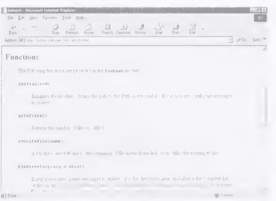

尽管我坚信奉文档的重要性，但文档与代码中的注释是有区别的。多年前，当我刚开始学习编程时，经常向工作单位的一位资深工程师寻求帮助。起初，我会在代码中写大量的注释；那位工程师看着代码，手指揉着胡须说：“我很难读懂这些东西；你的注释太多了，而且很多注释与代码实际的功能不符，反而成了干扰。”我想我当时并没有领悟到这一点，因为我仍然像疯了一样地写注释。有一天，我又带着一些极其啰嗦的代码去找他，他厌恶地看着代码说：“好吧，够了。”我以为他要拒绝再帮我了。没想到，他开始编写一个他自己的程序。在几分钟内，就在我变得越来越焦虑的时候，他的新程序写好了。他将我的代码运行在他的程序中，并将输出放入一个新文件中。“这样好多了，”他说，“现在我可以读懂它了。”他写了一个程序来删除我代码中的注释。他怒视着我说道：“代码应该能够自解释。如果你看着代码不能明白它在做什么，那么无论写多少注释都没有用。”

所以现在，当我谈到文档时，我的意思是接口必须有文档。不要解释函数内部的代码在做什么；将自己限制在描述如何使用该函数以及它返回什么。例如，这是一个毫无价值的注释：

```python
i = i + 1 # Add one to i
```

看到了吧？太多这样的注释会让你抓狂。对于函数，请使用 `docstring` 属性来提醒自己和任何阅读代码的人：该函数应该做什么、应该如何被调用以及它返回什么（如果有返回值的话）。因此，在下一章的代码中，你会看到 `docstrings`，但几乎没有注释；注释应限制在最少，仅用于解释特别复杂代码，或者放置标记以提醒自己在特定位置需要进一步完善。代码清单 15.4 展示了一个解释性的 `docstring` 和一个有用的单行注释。

### 代码清单 15.4：一个有用的注释

```python
def FindYear( s ):
    """Search string s for year of the form "(1999)",
    with leading whitespace. Returns the string without
    the year part, followed by the numeric year. If there's
    no year, returns None.
    """
    global _yearre
    global _yearrec
    if _yearrec == 0:
        _yearrec = re.compile( _yearre )
    so = _yearrec.search( s )
    if so == None :
        return None
    st, ep = so.span( )
    st = st + 1 # skip whitespace
    y = string.atoi( s[ st + 1 : ep - 1 ] )
    rt = s[ : st - 1 ] + s[ ep : ]
    return rt, y
```

这个注释的作用仅仅是提醒你注意某行代码的原因，而这个原因可能并不完全显而易见——我们正在跳过不需要的空白字符。

代码中注释的另一个作用是为那些文档缺失严重（当然是由其他程序员编写的，绝不是你）的函数、模块或类提供提示或文档。有时，这种需求可以通过 `docstrings` 来满足，但有时你可能希望在一个特别晦涩的函数调用附近提供一条注释。

## 测试你的组件

我想在这一章的学习过程中，你已经看到了测试的重要性。`fixhash` 模块内置了自己的测试，正如代码清单 14.7 中的 `if __name__ == "__main__":` 代码所示。但在该模块开发过程的每个步骤中，你都会看到我们进行了一次又一次的测试，逐渐完善代码，使其不仅能正常工作，而且更接近于他人认为有用的状态。

以下列表描述了在开发模块时改进测试的几种方法：

- 测试边界条件。例如，如果你有一个接受特定范围数字的函数，请使用范围内的数字、范围外的数字以及正好在边界上的数字来测试该函数。
- 使用非预期的输入进行测试。例如，如果你有一个期望接收数字字符串的函数，请给它输入一个字母字符串。
- 如果你正在开发一个模块，请内置一个测试。
- 如果你正在导入一个模块，尝试从调用程序设置用户不应该设置的变量。例如，你可以尝试将 `fixhash` 模块中的 `nm` 变量设置为`""`或一个数字。
- 在与开发目录不同的目录下运行你的测试程序。如果它需要目录，请同时向它传递绝对路径和相对路径。
- 始终留意那些可能会导致程序崩溃的可疑代码。如果你不发现这些 bug，别人也会发现。
- 你可以遵循的最佳建议是：当有人在使用你的软件遇到问题时，假设这是你的错。在软件工程中，没有容纳那些认为自己永远正确且问题总是别人造成的空间。

## 寻找他人构建的组件


在开发`fixhash`模块的过程中，我尽量公开尽可能多的开发流程。其中很大一部分工作是尝试弄清楚两件事。第一，是否已经有其他人构建了该工具？第二，是否有人开发了可以在我们想要构建的工具开发中使用的模块？通常，寻找此类信息的最佳地点是`http://www.python.org/`，其首页内置了搜索功能。你可以将搜索范围限制在 Python 官方网站、Usenet 帖子，或者搜索整个网络。Usenet 帖子包含大量关于新软件、技巧、惯用法和帮助的公告。最难的部分是知道搜索什么；优化搜索不在本书的讨论范围内，但 Python 搜索页面（`http://www.python.org/search/`）提供了很多帮助，如果你对寻找的目标有一定想法，它可以帮你大大缩小范围。

如果你加入 Python 邮件列表或 Python-tutor 邮件列表，你可以发布咨询，询问是否有人已经构建或正在开发你可以使用的东西。请参阅`http://www.python.org/epsa/MailingLists.html`。

## 总结

在过去的两个小时里，我们涵盖了开发可重用模块的过程。我们构建了一个模块——`fixhash`——并对其进行了完善、测试和编写文档。在你有了想要实现的功能想法后，你应该能够查出是否已有他人开发了你想要的东西，或者开发了你可以用来构建目标功能的工具。在邮件列表（或 Usenet 新闻组）发布咨询也是了解他人是否对你想构建的东西感兴趣的好方法。

在接下来的一个小时里（这也是本书第三部分的最后一章），我们将构建一个完整的类，并更全面地尝试我们的 OOP 概念。我不会说太多话；你将看到的大部分内容将是代码。

## 工作坊

### 问答

**问** 可重用软件真的那么重要吗？

**答** 如果你喜欢一直重复造轮子，那么并不重要。然而，如果你宁愿只写一次代码，然后能够一次又一次地使用它而无需担心，那么它看起来就好得多了。

### 测验

1. 你应该多久测试一次程序？

   - a. 25 次
   - b. 50 次
   - c. 直到它能工作为止
   - d. 直到它能工作，然后你让它崩溃，接着再次让它恢复工作

2. 给定两个声称能完成相同工作的软件库，但只有一个有文档，你应该使用哪一个？

   - a. 更好的程序员写的那个
   - b. 速度最快的那个
   - c. 有文档的那个
   - d. 大家都说你应该使用的那个

### 答案

1. d. 你需要测试你的程序并尝试让它们崩溃。每当有东西崩溃时，你就可以修复它；最终，你会对自己的代码产生极大的信心（否则你就放弃并把它扔掉）。

2. c. 这应该是不言而喻的。使用有文档的那个。无论编写它的程序员多么优秀，或者有多少专家极力推荐，如果没有文档，除非你读代码的能力强到一天能读懂 Linux 内核，否则不值得冒这个风险。

### 练习

为`testhash.py`添加另一个命令行选项，以允许用户开启或关闭`verbose`变量。你可能想看看`getargs`模块，可以在`http://www.pauautun.org/ftp.html`页面的底部附近找到。当然，它有完整的文档；请参阅`http://www.pauautun.org/getargs.html`。

为你找一个好用的归档程序并坚持使用它。我更倾向于 WinZip，可以通过`http://www.winzip.com/`获取。我用它来代替`tar`和`gzip`，即使是分发仅限 UNIX 的应用程序也是如此，因为`gzip`可以解压 WinZip 归档文件，且文件体积比`gzip`的更小。

如果你对软件测试感兴趣，我所知道的最好的书可能是 Brian Marick 的 *The Craft of Software Testing*（Prentice-Hall, 1999）。Brian 有着独特的视角和生动的写作风格。起码，你应该读读 Brian 那篇极具启发性的论文 "Classic Testing Mistakes"，可以在`http://www.rstcorp.com/marick/classic/mistakes.html`找到。查看 Brian 的网站以获取更多关于测试的参考资料：`http://www.rstcorp.com/marick`。

# 第 16 小时：运动中的对象

> 这听起来可能很复杂，但如果你一开始就在使用 VIM，那么显然你天生就完全不害怕复杂性。
>
> ——Alan Daniels

在之前的两个小时里，我们专注于构建可重用的组件。这一次，我们将研究一个由两个类和大量“胶水”函数组成的完整应用程序。本小时的主要目的不一定是让你实际完成某项任务，而是让你更多地接触能够解决实际问题的运行代码。尽管有“在实践中学习”的格言，但事实往往是，通过阅读也能学到同样多的东西。对于代码来说尤其如此；阅读和理解代码的能力可能是你在编程领域能习得的最有用的技能。除非作者故意将代码写得晦涩难懂，否则阅读 Python 代码是很简单的。在本小时结束时，你应该在阅读代码以及将比之前见过的更大的程序如何组合在一起进行可视化方面积累更多经验。

## 一个完整的应用程序

你可能还记得在第 6 小时中提到我录了很多电视节目。事实上，我有 5,000 多盘录像带，因此我确实需要某种东西来追踪这些带子上的节目。正如你可能记得的那样，所有带子都用十六进制编号。在第 13 小时讨论特殊类方法时，我们还讨论了 OOP 设计的一个概念——is-a/contains（是一个/包含）关系，并使用录像带和节目进行了讨论。录像带是一个容器，它可以为空，可以存放节目，也可以重复使用。录像带（cassette）和节目（program）是我们完整应用程序中使用的两个类。

我已经录制节目很多年了，并不是一直有 Python 来帮忙，但我确实需要某种计算机辅助。当时的“数据库”简单地是一个特定格式的文本文件，由一个能执行若干任务的 C 程序读取。然而，它无法更新文本文件，因此所有对文本文件的添加都在文本编辑器中完成。C 程序会对记录进行排序，将节目恰当地放入相应的录像带中，然后根据需要按字母顺序或数字顺序打印清单。我添加了复杂的搜索功能，但很快意识到那是浪费时间；我需要的所有搜索都可以通过 grep（一个在文本文件中查找文本模式的 UNIX 程序）更快、更高效地完成。然而，在我开始使用 Windows 机器后，我想做一个比 C 程序更具移植性的东西：Python 是自然之选。

尽管在本章展示的程序中使用了类，但许多辅助函数是从对应的 C 版本相当直接地翻译过来的。其中一些函数是 Python 版本中新增的，但总体而言，这个程序更多是一个为了解决实际问题而“自然生长”出来的例子，而不是一个优秀设计的典范。如果我今天从零开始，这个程序会更加面向对象。基于我对 Python 更深层次的理解，我确信它也会精简很多。

### `shelve`

程序的整体架构相对简单。录像带被包含在一个字典中，十六进制编号是每盘带子的键，每盘带子维护一个该带子上节目的字典，序号作为键。我们将从一个基于文本的输入文件在内存中构建数据库：内存数据库创建后，我们将使用`shelve`模块将数据库存储在磁盘上。以这种方式存储数据库被称为持久化（persisting）。

`shelve`模块为我们提供的功能是，允许我们将任意 Python 对象以二进制格式存储，并将生成的存储库视为一个字典。普通的内存字典可以使用任何只读 Python 类型作为键，但磁盘字典（即`shelf`）只能使用字符串——不能使用数字，也不能使用元组；只能使用字符串。要了解更多详情，你可以访问`http://www.python.org/doc/current/lib/module-shelve.html`开始阅读。我不会描述其接口，但你稍后在本章的代码中将能看到它是如何使用的。

### 输入记录格式

为了使节目录入尽可能简单，输入记录的文件格式最初设计为易于 C 程序解析。这是一个示例：

`0001;0;sp,T120;89,89: Masterpiece Theatre: Last Place on Earth, The: 1: Poles Apart`

从位置 0 到第一个冒号`:`的所有内容都是报头。它提供了录像带编号、节目在带子上的位置、速度、带子尺寸、已用分钟数以及实际用于该节目的分钟数等信息。第一个冒号之后的所有内容提供具体的节目信息：系列（`Masterpiece Theatre`）、节目标题（`"The Last Place on Earth"`）、集数 (1) 和集标题（`"Poles Apart"`）。这些字段由字符组合`:\t`（即冒号或制表符）分隔。任何有效的节目至少包含一个字段，但之后可以有任意数量的附加字段。对于电影，我们需要追踪日期 (1999)。注释包含在`{ }`字符中，搜索关键字包含在`[ ]`字符中。最后，必须有一种方法来表明某个节目已被更好的副本取代。接下来的条目描述了一个使用了所有这些可选特性的节目：

`0045;2;ep,T120;139,139: Hidden Fortress, The [Japanese] {Xd} (1958): ->119`

45 号带子的序号 2。*The Hidden Fortress* 是一部 1958 年的日本电影（由黑泽明执导）。不幸的是，电影结尾丢失了（`{Xd}`），所以当有机会获得更好的副本时，我这么做了，那个更好的副本在 119 号带子上。

自然地，该格式的部分内容是后来添加的；`ep,T120`最初只是`ep`。例如，分钟数字段最初仅为在带子上使用的分钟数，而不是一个用于分钟数的指示符后接无广告长度（59,46 将是一个《星际旅行》节目的分钟数条目；时长 59 分钟，但去掉广告后实际上只有 46 分钟）。而且所有插件必须与早期的记录兼容。我们 vcr 程序的“胶水”部分读取输入文件并解析每条记录，根据需要创建新的录像带类；录像带类知道如何创建相应的节目。胶水部分将在后面描述；首先让我们讨论需要的两个类。

### 类

我们需要为 vcr 应用程序创建两个类。如前所述，这两个类是`cassette`和`program`。清单 16.1 展示了`program`类（行号表示该类定义在`vcr.py`文件中的位置）。

#### LISTING 16.1 Class `program`

```python
284 class program :
285     def __init__ ( self, s = "", n = 0 ) :
286         if s == "" and n == 0 :
287             self.seq = -1
288             self.year = None
289             self.comments = None
290             self.keywords = None
291             self.rplcd = None
292             self.tape = n
293         else:
294             self.year = None
295             self.comments = None
296             self.keywords = None
297             self.rplcd = None
298             self.tape = n
299         i = string.index ( s , ":" )
300         h = header ( s[ 0 : i ] )
301         self.seq = string.atoi ( h[ 0 ] )
302         sp, tlen = parts ( h[ 1 ], n )
303         self.sp = tspeed ( sp )
304         if self.sp == -1 :
305             print "UNDEFINED Tape speed:", n, sp
306             self.sp = 1 # Default speed
307         self.tlen = tsize ( tlen )
308         if self.tlen == -1 :
309             print "UNDEFINED Tape size:", n, tlen
310             self.tlen = tsizes[ "T120" ]
311             self.ttime, self.ctime = tuple ( map ( string.atoi, \
312             list ( parts ( n[ 2 ], n ) ) ) )
313     stuff = s[ i + 1 : ]
314     self.fields = [ ]
315     q = string.splitfields ( stuff , ":\t" )
316     # loop through list of fields, alpha and numeric
317     for k in q :
318         if alldigits ( k ) :
319             if k == "" :
320                 print h, "empty string", n
321                 k = 0
322             self.fields.append ( string.atoi ( k ) )
323         else :
324             r = FindReplaced ( k ) # Returns [ list, ]
```

```python
325            if r != None :
326                self.rplcd = r
327            else :
328                e = Extract ( k )
329                if e == None :
330                    print "TAPE %04X Hosed." % ( n )
331                    raise ValueError
332                if e[ 1 ] != None :
333                    self.year = e[ 1 ]
334                if e[ 2 ] != None :
335                    self.comments = e[ 2 ]
336                if e[ 3 ] != None :
337                    self.keywords = e[ 3 ]
338                self.fields.append( e[ 0 ] )
339
340    def __len__( self ) :
341        return self.ttime
342
343    def speed( self ) :
344        return speedname ( self.sp )
345
346    def size ( self ) :
347        return sizename ( self.tlen )
348
349    def __repr__ ( self ) :
350        s = " %s " % ( self.seq )
351        n = 0
352        for i in self.fields :
353            if type ( i ) == type ( 0 ) :
354                s = s + 'i'
355            else :
356                s = s + SwapThe ( i )
357            if n == 0 :
358                if self.year != None :
359                    s = s + ' (%d)' % ( self.year )
360                if self.comments != None :
361                    s = s + ' (%s)' % ( self.comments )
362                if self.keywords != None :
363                    s = s + ' [%s]' % ( self.keywords )
364        s = s + ' ,'
365        n = n + 1
366        return s
```

`__init__()`方法目前是最大的，它被分成了两个部分。第一部分是在调用`program()`时不带任何参数而选择的，第二部分是在调用它并传入输入字符串和磁带编号时选择的。在没有参数的情况下，会创建一个虚拟记录，之后可以用准确的信息来填充；当提供了输入字符串和磁带编号时，输入字符串会被解析以填充类的所有成员，包括无论有多少个字段。实际的数据成员如下：

- `seq`——磁带上的程序序列号。
- `year`——如果是电影，则为发行年份。
- `comments`——如果发现了注释，则放在这里。
- `keywords`——如果发现了关键字，则放在这里。
- `rplcd`——如果该程序已被取代，新的磁带编号在此。
- `tape`——每个程序都知道它所属的磁带编号。
- `sp`——录制该程序时的速度。
- `tlen`——磁带的大小（T120, T30 等）。
- `ttime`——程序在磁带上实际占据的时间。
- `ctime`——程序的运行时间，不包括广告。
- `fields`——1 到 n 个描述性程序信息字段；这些字段被进一步细分为某种标题和数字字段。


注：在该类的`__init__()`方法中调用的大多数函数都是不言自明的——或者当你稍后看到它们的代码时就会明白，但请注意第 315 行的`string.splitfields()`调用。这是 Python 真正大放异彩的地方；它获取输入字符串（`"stuff"`）并根据`\ :`分隔符将其拆分为一个列表。因为生成的列表现在包含了这个特定程序的所有字段，并且分隔符标记得如此清晰，你可以看到每个字段可以包含任何字符。随后会对该字段进行检查（如果`alldigits(k)`），以查看它是否是用于集数（episode numbers）之类的数字字段。像 2001 这样的电影标题，只需在标题前加上反斜杠即可表示：`\2001`。

下一个类`cassette`如代码清单 16.2 所示（同样，行号表示该类定义应插入到`ver.py`中的位置）。

#### 代码清单 16.2：Class cassette

```python
431  class cassette :
432      def __init__ ( self, n = 0, s = None ) :
433          self.num = n
434          self.l = { }
435          if s == None :
436              pass
437          else :
438              t = program ( s [ 5 : ], self.num )
439              self.set ( t )
440
441      def key ( self ) :
442          return "%04X" % ( self.num )
443
444      def keys(self):
445          if len(self.l) == 0:
446              return None
447          k = self.l.keys()
448          k.sort()
449          return k
450
451      def cat(self, s):
452          if s != None:
453              t = program(s[5:], self.num)
454              self.set(t)
455
456      def __len__(self):
457          t = 0
458          k = self.l.keys()
459          k.sort()
460          for l in k:
461              i = self.l[l]
462              if i != None:
463                  t = t + i.ttime
464          return t
465
466      def speed(self):
467          s = tapespeed(self)
468          return speedname(s[0])
469
470      def size(self):
471          return tapesize(self)
472
473      def programs(self):
474          return len(self.l)
475
476      def programlist(self):
477          if isdummy(self):
478              return None
479          rslt = []
480          for i in self.l.keys():
481              rslt.append(self.l[i])
482          return rslt
483
484      def sequence(self, n):
485          if type(n) == type(0):
486              k = "%02d" % (n)
487          elif type(n) == type(""):
488              k = n
489          else:
490              k = "%s" % (n)
491          if self.l.has_key(k):
492              return self.l[ k ]
493          return None
494
495      def set ( self, p ) :
496          try :
497              n = p.seq
498          except AttributeError :
499              return
500          k = self.sequence ( n )
501          if k == None :
502              self.l[ "%02d" % ( n ) ] = p
503
504          self.l[ "%02d" % ( n ) ] = p
505
506      def __repr__ ( self ) :
507          s = "%04X\n" % ( self.num )
508          if len ( self.l ) == 0 :
509              s = s + "No Tape"
510          else :
511              j = self.l.keys ( )
512              j.sort ( )
513              for k in j :
514                  i = self.l[ k ]
515                  s = s + "i + "\n"
516          return s
517
518      def nreplaced ( self ) :
519          if len ( self.l ) == 0 :
520              return 0
521          n = 0
522          k = self.keys ( )
523          for i in k :
524              p = self.l[ i ]
525              if p.rplcd != None :
526                  n = n + 1
527          return n
528
529      def getreplaced ( self ) :
530          if len ( self.l ) == 0 :
531              return None
532          d = { }
533          k = self.keys ( )
534          for i in k :
535              p = self.l[ i ]
536              if p.rplcd != None :
537                  d[ i ] = p.rplcd
538          if len ( d ) == 0 :
539              return None
540          return d
541
542      def numeric ( self, fld = 0 ) :
543          x = self.programlist ( )
544          return x
545
546      def alphabetic ( self, fld = 0 ) :
547          x = self.programlist ( )
548          return x
```

`cassette`类中的数据成员是：

- `num`——磁带的编号
- `l`——存储程序的字典

仅此而已。真正的信息存储在程序字典`l`中。`cassette`类确实只是一个容器，正如它应该的那样。它有一些方法，但没有什么复杂的；最重要的方法是`set()`方法，它根据序列号将程序插入到`l`的正确位置。该序列号是字典的键——记住，键必须是字符串，因为我们要将所有这些信息存储在文件数据库中。顺便说一下，在 Python 中，存储在文件数据库中被称为**pickling**（序列化）。事实上，`pickle`模块为我们处理了实际存储 Python 对象的细节；而`shelve`模块则让我们无需学习这些细节。这是一件好事。

## Glue（胶水代码）

你可以将“胶水”定义为让所有其他部分正常工作的所有辅助代码。我们可以拥有这两个优秀的类，但如果没有读取输入文件、构建数据库和解析字符串的代码，我们实际上除了一个什么都不做的抽象对象之外什么也没有。代码清单 16.3 显示了`vcr.py`模块中剩余的代码（注意行号中的空隙，那是类定义将被插入的地方）。

### 代码清单 16.3：vcr.py 的胶水代码

```python
1 #!/usr/local/bin/python
2
3 import os
4 import sys
5 import math
6 import string
7 import re
8
9 defaultdbfilename = ""
```

## 列表 16.3

```python
11  if sys.platform == 'win32':
12      _defaultdbfilename = "/DB/vcrdb"
13  else:
14      _defaultdbfilename = "/bigtmp/DB/vcrdb"
15
16  _tsizes = {"T10": 10,
17      "T15": 15,
18      "T20": 20,
19      "T30": 30,
20      "T60": 60,
21      "T90": 90,
22      "T120": 120,
23      "T130": 130,
24      "T160": 160,
25      "T180": 180,
26      "T200": 200,
27  }
28
29  _tspeeds = { 'sp' : 1, 'lp' : 2, 'ep' : 3, 'slp' : 3, 'sx' : 4 }
30
```

接下来的 10 行是正则表达式。你不必完全理解它们，但它们确实有效。


```python
31  _yearre = r"[ \t]+(\d{0,9}[0-9][0-9][0-9])"
32  _yearrec = 0
33  _commentre = r" {.*}"
34  _commentrec = 0
35  _keywordre = r"[\.\*]"
36  _keywordrec = 0
37  _there = r", The\S, As\S, As\S, The\s(\l, The\s(\l, The\s(\l, As\s(\l,"
38  _there = r", As(\l, As(\l, An\s(\l, An\s(\l, An\s(\l"
39  _therec = 0
40
41  def FindYear( s ):
42      """Search string s for year of the form ("1999"),
43       with leading whitespace. Returns the string without
44       the year part, followed by the numeric year. If there's
45       no year, returns None.
46       """
47      global _yearre
48      global _yearrec
49      if _yearrec == 0 :
50          _yearrec = re.compile( _yearre )
51      so = _yearrec.search( s )
52      if so == None :
53          return None
54      st, ep = so.span( )
55      st = st + 1 # skip whitespace
56      y = string.atoi( s[ st + 1 : ep - 1 ] )
57      rt = s[ : st - 1 ] + s[ ep : ]
58      return rt, y
59
60 def FindComment( s ) :
61  """Search string s for a comment of the form
62  {comment}"; if not found, return None. Otherwise,
63  return tuple of string with comment removed and
64  the comment string.
65  """
66  global _commentre
67  global _commentrec
68  if _commentrec == 0 :
69      _commentrec = re.compile( _commentre )
70  so = _commentrec.search( s )
71  if so == None :
72      return None
73  st, ep = so.span( )
74  st = st + 1
75  comment = s[ st + 1 : ep - 1 ]
76  rt = s[ : st - 1 ] + s[ ep : ]
77  return rt, comment
78
79 def FindKeyword( s ) :
80  """Search string s for keywords of the form
81  {keywords}". If not found return None,
82  else return tuple of string with keywords
83  removed and the string of keywords.
84  """
85  global _keywordre
86  global _keywordrec
87  if _keywordrec == 0 :
88      _keywordrec = re.compile( _keywordre )
89  so = _keywordrec.search( s )
90  if so == None :
91      return None
92  st, ep = so.span( )
93  st = st + 1
94  keyword = s[ st + 1 : ep - 1 ]
95  rt = s[ : st - 1 ] + s[ ep : ]
96  return rt, keyword
97
98 def SwapThe( s ) :
99  """If string s ends in " , A" or " , An" or " , The", then
100    eliminate the comma and prepend A, An or The to the string,
101    which is returned. Otherwise, return the original string.
102    """
103    if s:
104        global _there
105        global _therec
106        if _therec == 0:
107            _therec = re.compile( _there )
108            so = _therec.search( s )
109        if so == None:
110            return s
111        st, ep = so.span( )
112        rb = s[ st : st ]
113        ws = string.strip( s[ st + 1 : ] )
114        if ws[ 0 ] == 'T':
115            rb = "The " + rb
116        elif len( ws ) == 1 :
117            rb = "A " + rb
118        elif ws[ 0 ] == 'A' and ws[ 1 ] == 'n':
119            rb = "An " + rb
120        else :
121            rb = "A " + rb
122        return rb
123    return s
124
125    def Extract( s ):
126        """ Searches string s for year, comments and keywords.
127        Returns tuple of (string, year, comments, keywords);
128        string will have all the others removed, and any item
129        not found will be None. """
130        if s:
131            if s[ 0 ] == "\\":
132                ss = s[ 1 : ]
133            else :
134                ss = s[ : ]
135            year = None
136            comments = None
137            keywords = None
138            
139            tm = FindYear( ss )
140            if tm != None :
141                year = tm[ 1 ]
142                ss = tm[ 0 ]
143            cm = FindComment( ss )
144            if cm != None :
145                comments = cm[ 1 ]
146                ss = cm[ 0 ]
147            km = FindKeyword( ss )
148            if km != None :
149                keywords = km[ 1 ]
150                ss = km[ 0 ]
151            return ss, year, comments, keywords
152        return s
153
154 def FindReplaced( s ) :
155    """Searches string s for replacement markers, of the
156    form "->1200" and "->1200,1355". Returns list of the
157    cassettes pointed to or None, if there are no replacements.
158    """
159    i = string.find( s , "->" )
160    n = 0
161    if i == 0 :
162        i = i + 2
163    c = string.find( s[ i : ] , "," )
164    if c < 0 :
165        try :
166            n = string.atoi( s[ i : ] , 0x10 )
167        except ValueError :
168            return None
169        return [ "%04x" % ( n ) ] # make into dict key
170    else :
171        t = string.splitfields( s[ i : ] , "," )
172        tl = [ ]
173        for u in t :
174            try :
175                n = string.atoi( u , 0x10 )
176            except ValueError :
177                pass
178            us = "%04x" % ( n )
179            tl.append( us )
180        return tl
181    else :
182        return None
183
184 def speedname( v ) :
185    """Returns the string representing the speed of
186    the tape. 200 returns "T200" and so on. Returns
187    None if the speed is bogus.
188    """
189    for i in _tspeeds.keys( ) :
190        if v == _tspeeds[ i ] :
191            return i
192    return None
193
194 def sizename( v ) :
195    """Returns the string representing the size of
196    the tape. 1 returns "sp" and so on. Returns
197    None if the speed is bogus.
198    """
199    if type ( v ) == type ( " " ):
200        return v
201    for i in _tsizes.keys ( ) :
202        if v == _tsizes[ i ] :
203            return i
204    return None
205
206 def minutize ( m ) :
207     """Converts used tape minutes into string
208     representing used minutes or used hours
209     and minutes.
210     """
211     t = int ( m )
212     h = t / 60
213     hm = t % 60
214     if h != 0 :
215         if h == 1 :
216             ss = ""
217         else :
218             ss = "s"
219         if hm == 1 :
220             mm = ""
221         else :
222             mm = "s"
223         s = "%d hour%s %02d minute%s" % ( h, ss, hm, mm )
224     else :
225         if t == 1 :
226             ss = ""
227         else :
228             ss = "s"
229         s = "%02d minute%s" % ( t, ss )
230     return s
231
232 def tupleize ( m ) :
233     """Converts used tape minutes into tuple
234     of hours and minutes.
235     """
236     t = int ( m )
237     h = t / 60
238     hm = t % 60
239     return ( h, hm )
240
241 def tsize ( s ) :
242     """Converts name of a tape size (T120, T160, etc.) into a
243     number, indicating minutes at sp. Returns -1 for bogus
244     strings.
245     """
246     if _tsizes.has_key(s):
247         return _tsizes[s]
248     return -1
249
250 def tspeed(s):
251     """Converts name of a speed (sp, ep, etc.) into
252     number-1, 2, etc. Returns -1 for bogus strings.
253     """
254     if _tspeeds.has_key(s):
255         return _tspeeds[s]
256     return -1
257
258 def header(s):
259     """Converts string s into list by splitting on semicolons.
260     """
261     x = string.splitfields(s, ";")
262     return x
263
264 def parts(s, n):
265     """Splits s on "," characters; if there's not two,
266     representing used time/less commercials, raise
267     an error.
268     """
269     x = string.splitfields(s, ",")
270     if len(x) != 2:
271         print "Panic:%d 0x%04x: %s %d" % (n, n, s, len(x))
272         raise ValueError
273     return tuple(x)
274
275 def alldigits(s):
276     """Checks s; return a 0 on the first non-digit character found.
277     """
278     for i in s:
279         if i not in string.digits:
280             return 0
281     return 1
282
367
368 def fieldcmp(l1, l2):
369    """Used in sorting. The usual thing. -1, 0, 1
```

### 列表 16.3 接前页


```python
370    for field comparison.
371    """
372    l1 = len ( l1 )
373    l2 = len ( l2 )
374    n = max ( l1, l2 )
375    for pl in range ( 1, n ) :  # The field[0]s are always
376                               # equal when we get here
377        try :
378            f1 = l1[ pl ]
379        except :
380            f1 = None
381        try :
382            f2 = l2[ pl ]
383        except :
384            f2 = None
385        if f1 != None and f2 == None :
386            return -1
387        if f1 == None and f2 != None :
388            return 1
389        if type ( f1 ) == type ( 0 ) and type ( f2 ) == type ( 0 ) :
390            if f1 < f2 :
391                return -1
392            if f1 > f2 :
393                return 1
394        return fieldcmp ( l1[ pl : ], l2[ pl : ] )
395        if type ( f1 ) == type ( "" ) and type ( f2 ) == type ( "" ) :
396            if f1 < f2 :
397                return -1
398            if f1 > f2 :
399                return 1
400        return fieldcmp ( l1[ pl : ], l2[ pl : ] )
401        if type ( f1 ) == type ( 0 ) :
402            return 1
403        return -1
404    return 0

406 def alphasort ( p1, p2 ) :
407    """Compare programs p1 and p2
408    """
409    if p1.fields[ 0 ] < p2.fields[ 0 ] :
410        return -1
411    if p1.fields[ 0 ] > p2.fields[ 0 ] :
412        return 1
413    return fieldcmp ( p1.fields, p2.fields )

415 def numsort ( p1, p2 ) :
416    """
417    numsort ( p1, p2 ) :
418    class program p1, p2
419    returns -1, 0 or 1 depending on numeric sequence in tape.
420    """
421    if p1.tape < p2.tape :
422        return -1
423    if p2.tape < p1.tape :
424        return 1
425    if p1.seq < p2.seq :
426        return -1
427    if p2.seq < p1.seq :
428        return 1
429    return 0
```

`Cassette` 类在此处定义。

```python
549
550 def isdummy ( t ) :
551     """Returns 1 if the cassette t is a dummy record
552     0 otherwise.
553     """
554     if len ( t.l ) == 0 :
555         return 1
556     return 0

558 def ismixed ( t ) :
559     """class cassette t
560     Returns a list containing speeds used in the cassette,
561     or None if only one speed is used.
562     """
563     k = t.keys ( )
564     sp = 0
565     n = 0
566     rt = [ ]
567     if isdummy ( t ) :
568         return None
569     for j in k :
570         p = t.sequence ( j )
571         if n == 0 :
572             sp = p.sp
573         else :
574             if p.sp != sp :
575                 if sp not in rt :
576                     rt.append ( sp )
577                 if p.sp not in rt :
578                     rt.append ( p.sp )
579         n = n + 1
580     if len ( rt ) > 0 :
581         rt.sort ( )
582         return rt
583     else :
584         return None

586 def makekey ( n ) :
587     """Returns valid shelve dictionary key of 4 hex digits
588     from number n.
589     """
590     if type ( n ) == type ( 0 ) :
591         k = "%04X" % ( n )
592         return k
593     elif type ( n ) == type ( "" ) :
594         k = string.upper ( n )
595         while len ( k ) < 4 :
596             k = "0" + k
597         return k
598     else :
599         raise KeyError

601 def dummyrecord ( n ) :
602     """Creates a dummy cassette--placeholder.
603     """
604     if type ( n ) == type ( 0 ) :
605         x = cassette ( n , None )
606     else :
607         i = string.atoi ( n , 0x10 )
608         x = cassette ( i , None )
609     return x

611 def tapenumber ( s ) :
612     """Returns number from string s, where s
613     has the form "12D3......"
614     """
615     n = string.splitfields ( s , ";" )
616     return string.atoi ( n[ 0 ] , 0x10 )

618 def percentoftape ( tp ) :  # A cassette record
619     """Returns percent of cassette used.
620     """
621     n = len ( tp )
622     pt = 0.0
623     if len ( tp.l ) == 0 :
624         return pt
625     j = tp.l.keys ( )
626     j.sort ( )
627     for k in j : # Program records
628         i = tp.l[ k ]
629         m = i.sp * i.tlen # total length of tape in speed minutes
630         if m == 0 :
631             print("Divide by Zero: Tape %s sequence %s" % \
632                   (tp.num, i.seq) )
633             raise ZeroDivisionError
634         p = float ( i.ttime ) / float ( m )
635         pt = pt + p
636     return pt

638 def percentleft( tp ) : # Cassette record
639     """Returns percent of cassette unused.
640     """
641     pt = percentoftape ( tp )
642     return 1.0 - pt

644 def tapesize ( tp ) :
645     """Returns string representing size of tape;
646     T90, T120, etc.
647     """
648     if isdummy ( tp ) :
649         return "T0"
650     b = tp.l[ "00" ].tlen
651     return sizename ( b )

653 def tapespeed ( tp ) : # Cassette record
654     """Returns tuple of tape speed index
655     and length of tape at that speed.
656     """
657     sp = 0
658     tlen = 0
659     if isdummy ( tp ) :
660         return sp, tlen
661     j = tp.l.keys ( )
662     j.sort ( )
663     for k in j : # Program records
664         i = tp.l[ k ]
665         sp = i.sp
666         tlen = i.tlen
667     return sp, tlen

669 def minutesleft ( tp ) : # Cassette record
670     """Returns minutes left at the ruling tape speed.
671     """
672     if isdummy ( tp ) :
673         return 0.0
674     if len ( tp.l ) == 0 :
675         return 0.0
676     sp, tlen = tapespeed ( tp )
677     l = percentleft ( tp )
678     mins = sp * tlen # Total number of minutes at final tape speed
679
680     m = mins * l
681     return m

683     try :
684         _vcrfile = os.environ[ "VCRLIST" ]
685     except :
686         print "$VCRLIST not set in environment!"
687         sys.exit ( 0 )

689     _thedict = { }
690     global _total_t
691     _total_t = 0

693     def creatememdb ( fname = None ) :
694         """Creates an in-memory database from the file.
695         """
696         global _total_t
697         global _thedict
698         lineno = 0
699         commentdict = { }
700         nodisc = 0
701         if fname == None :
702             ff = open ( _vcrfile, "r" )
703         else :
704             ff = open ( fname, "r" )
705             nodisc = 1
706         swt = -1
707         current_t = -1

709         ct = cassette ( -1, None )

711         while 1 :
712             b = ff.readline ( )
713             lineno = lineno + 1
714             if not b :
715                 _thedict[ "%04X" % ( ct.num ) ] = ct
716                 if swt == current_t :
717                     _total_t = _total_t + 1
718                 break
719             b = b[ : len ( b ) - 1 ]  # Remove newline
720             if len ( b ) < 1 :       # Skip blank lines
721                 continue

723             if b[ 0 ] == '#' :
724                 ck = "%08d" % ( lineno )
725                 commentdict[ ck ] = b
726                 continue
727             swt = tapenumber ( b )
728             if swt != current_t :
729                 if ct.num != -1 :
730                     _thedict[ "%04X" % ( ct.num ) ] = ct
731                 if nodisc == 0 :
732                     while swt != current_t + 1 :
733                         print "Discontinuity: got 0x%x expected 0x%x" % \
734                               ( swt, current_t + 1 )
735                         current_t = current_t + 1
736                         ct = dummyrecord ( current_t )
737                         _thedict[ "%04X" % ( ct.num ) ] = ct
738                         _total_t = _total_t - 1
739                     current_t = swt
740                     ct = cassette ( current_t, b )
741                     _total_t = _total_t + 1
742                 else :
743                     ct.cat ( b )
744             if len ( commentdict ) > 0 :
745                 _thedict[ "COMMENTS" ] = commentdict

747         ff.close ( )
748         return _thedict, _total_t
```


```python
import shelve


def createfiledb(fname=None):
    """Create the file database from
    the memory database.
    """

    global _thedict
    global _defaultdbfilename
    if len(_thedict) == 0:
        creatememdb(fname)
    if fname == None:
        db = shelve.open(_defaultdbfilename)
    else:
        db = shelve.open(fname)
    print "Number keys:", len(_thedict.keys())
    for i in _thedict.keys():
        try:
            db[i] = _thedict[i]
        except:
            print "ERROR. ERROR"
            print _thedict[i]
    db.close()
    return db
```

### 列表 16.3 接前页

```python
def openfiledb(fname=None):
    global _defaultdbfilename
    if fname == None:
        db = shelve.open(_defaultdbfilename)
    else:
        db = shelve.open(fname)
    return db


def closedb(db):
    if type(db) == type({}):
        pass
    else:
        db.close()


def getkeys(vdb):
    """Returns the keys for the database.
    """
    if vdb == None:
        return None
    k = vdb.keys()
    for i in range(len(k) - 1):
        if k[i] == "COMMENTS":
            k = k[:i] + k[i + 1:]
            break
    if "COMMENTS" in k:
        print "COMMENTS NOT REMOVED in", len(k), "'KEYS", k
        raise IndexError
    return k


def findtape(s, db=None):
    """Look for tape s, assumed to be a hex number as a string.
    """
    global _thedict
    i = string.upper(s)
    while len(i) < 4:
        i = "0" + i
    if db == None:
        try:
            return _thedict[i]
        except:
            return None
    else:
        try:
            return db[i]
        except:
            return None


def dumptape(j, vdb):
    """Dump the database in the input file format.
    """
    i = findtape(j, vdb)
    n = i.key()  # Already formatted
    ks = i.keys()  # List of sequences, in order
    if ks == None:
        sys.stdout.write(" # %s:\t*NO TAPE*\n" % (n))
        return
    for r in ks:
        p = i.sequence(r)
        # Use write to prevent trailing space.
        sys.stdout.write(
            " %s:%d,%d,%s,%d,%d"
            % (n, p.seq, speedname(p.s), sizename(p.tlen), p.time, p.ctime)
        )
        u = 0
        for f in p.fields:
            if type(f) == type(""):
                if alldigits(f):
                    sys.stdout.write(":\t\"%s\"" % (f))
                else:
                    sys.stdout.write(":\t%s" % (f))
            else:
                sys.stdout.write(":\t%s" % (f))
            if u == 0 and (p.year or p.comments or p.keywords):
                if p.keywords:
                    sys.stdout.write(" [%s]" % (p.keywords))
                if p.comments:
                    sys.stdout.write(" {%s}" % (p.comments))
                if p.year:
                    sys.stdout.write(" (%04d)" % (p.year))
            u = u + 1
        if p.rplcd:
            sys.stdout.write(":\t->")
            nn = len(p.rplcd)
            nr = 0
            for q in p.rplcd:
                sys.stdout.write(" %s" % (q))
                if nr != nn - 1:
                    sys.stdout.write(",")
                nr = nr + 1
            sys.stdout.write("\n")


def reprprog(p):
    """Printable string representation of a program object.
    """
    rs = ""
    if p != None:
        rs = rs + "%04X;%d;%s;%d,%s;%d,%d" % (
            p.tape,
            p.seq,
            speedname(p.sp),
            sizename(p.tlen),
            p.ttime,
            p.ctime,
        )
        u = 0
        for f in p.fields:
            if type(f) == type(""):
                if alldigits(f):
                    rs = rs + ":\t%s" % (f)
                else:
                    rs = rs + ":\t%s" % (f)
            else:
                rs = rs + ":\t%s" % (f)
        if u == 0 and (p.year or p.comments or p.keywords):
            if p.keywords:
                rs = rs + " [%s]" % (p.keywords)
            if p.comments:
                rs = rs + " (%s)" % (p.comments)
            if p.year:
                rs = rs + " (%04d)" % (p.year)
        u = u + 1
        if p.rplcd:
            rs = rs + ":\t->"
            nn = len(p.rplcd)
            nr = 0
            for q in p.rplcd:
                rs = rs + " %s" % (q)
                if nr != nn - 1:
                    rs = rs + " ,"
                    nr = nr + 1

        return rs


def reprtape(j, vdb):
    """Printable string representation of a cassette object.
    """
    rs = ""
    ns = 0
    i = findtape(j, vdb)
    if i == None:
        rs = "Couldn't find %s in the database." % (j)
        return rs
    n = i.key()  # Already formatted
    ks = i.keys()  # List of sequences, in order
    if ks == None:
        rs = " # %s:\t*NO TAPE*" % (n)
        return rs
    ls = len(ks) - 1
    for r in ks:
        p = i.sequence(r)
        rs = rs + reprprog(p)
        if ns != ls:
            rs = rs + "\n"
            ns = ns + 1
    return rs


def onlyspeed(t, ssp):
    """Check to see if cassette t is ssp only.
    """
    xl = ismixed(t)
    if xl == None:
        sp, tlen = tapespeed(t)
        if ssp == sp:
            return ssp
        return 0


def isspeed(t, ssp):
    """See if cassette t has some or all programs recorded
    at ssp speed.
    """
    xl = ismixed(t)
    if xl == None:
        sp, tlen = tapespeed(t)
        if ssp == sp:
            return ssp
        elif ssp in xl:
            return ssp
        return 0


if __name__ == "__main__":
    if len(_thedict) == 0:
        creatememdb()
    print "Total tapes: %d 0%x%s " % (_total_t, _total_t)
    print "--------------------------------------------------"

    createfiledb()
    print " "
```

这些胶水函数大多是不言而喻的：请阅读其文档字符串（docstrings）。其他函数包括：

- `creatememdb()`——根据输入文件创建内存数据库，输入文件的位置预计在环境变量 `VCRLIST` 中定义。
- `createfiledb()`——从内存数据库创建持久化的磁盘数据库（shelved disk database）。
- `openfiledb()`——以读写模式打开已创建的文件数据库。
- `closedb()`——关闭文件数据库。

文件数据库创建完成后，其他程序可以通过导入 `vcr.py` 并使用上述函数进行打开和关闭来使用它。我将在下一节展示如何操作。

## 命令行界面

由于原始的 C 程序在很大程度上是 `ver.py` 的模型。列表 16.4 展示了 C 程序的帮助输出。

### 列表 16.4 vcr C 版本的帮助输出


## `vcr` 选项

```text
1 vcr options [-?h:voarsS+KKEfHdcNPtI Pe fRpn1LV0] are:
2 -h) Help, stderr.
3 -?) Help, stdout.
4 -v) Print version & die.
5 -i<file>) Input file if not '-/VcrList'.
6 -o<file>) Output file (default stdout).
7 (a) Sort by program title.
8 (r) Reverse sense of sort.
9 -S<string>) Select by matching <regular expression>.
10 -+) Extend search/select to include files.
11 -K) Confine search/select to keywords only.
12 -k) Print keywords.
13 -E) Don't print description.
14 -F<string>) Print output using %Format <string>.
15 -H) Help, %Format.
16 -d<string>) Debug function:level.
17 -c) Case-insensitivity off in RE searches.
18 -x x, -x x, -x x, -x [ (hex) of tape #s to select.
19 
20 -N<string>) 
21 -T<string>) Produce HTML files for entries selected.
22 -I<string>) Produce HTML index files for entries selected.
23 -P) Produce PostScript labels for entries selected.
24 -e) PostScript: edge labels only.
25 -f) PostScript: face labels only.
26 -R) Report total running time of tapes.
27 -p<string>) .pro file to use instead of default.
28 -n#) Number of character columns wide.
29 -l) Report and show longest single field.
30 -L) Report and show only the longest single field.
31 -V) Don't put a, an and the first at print time.
32 -O) Write output file in input format.
```

对于`vcr`数据库，我们打算仅实现其中几个功能。我并不打算实现全部功能，因为其中一些没有太大意义，而另一些则不再有用。此外，由于使用了数据库，还会出现其他有用的功能。

而不是使用像 C 程序那样经过排序的列表。我们要构建的程序实际上不会驻留在`vcr.py`模块中，而是会导入该模块。第一个程序非常简单：查询数据库中特定磁带的内容。代码如清单 16.5 所示。

### 清单 16.5 `vcq.py`

```python
1 #!/usr/local/bin/python
2 
3 import os
4 import sys
5 import shelve
6 import string
7 import time
8 from vcr import cassette
9 from vcr import program
10 import vcr
11 
12 try :
13     vcrfile = os.environ[ "VCRLIST" ]
14 except :
15     print "$VCRLIST not set in environment!"
16     sys.exit( 0 )
17 
18 if len ( sys.argv ) > 1 :
19     vdb = vcr.openfiledb ( )
20     for i in range ( 1, len ( sys.argv ) ) :
21         t = vcr.findtape ( sys.argv[ i ], vdb )
22     if t != None :
23         print t, "Length:", len ( t ), "speed", t.speed ( ), "size", \
24             t.size ( ), \
25             "minutesleft", vcr.minutesleft ( t )
26         print '-------'
27         k = t.keys ( ) # Auto sort
28     for j in k :
29         y = t.sequence [j ] # sequence will take either ints or strings.
30 
31         if y.fields[ 0 ] != None :
32             for z in y.fields :
33                 if type ( z ) != type ( 0 ) :
34                     print vcr.SwapThe ( z )
35                 else :
36                     print z
37             if y.year != None :
38                 print "%04d" % ( y.year ),
39             if y.comments != None :
40                 print "{%s}" % ( y.comments ),
41     if y.keywords != None :
42         print "[%s" % ( y.keywords ),
43     print "%s----------" % ( j )
44
45     vcr.closedb ( vdb )
```

在上述程序中，请注意我们同时导入了`vcr`以及`from vcr import cassette`（和`program`）；这样做是因为`shelve`模块需要知道我们放入和从文件数据库中读取的 Python 对象的类名。程序简单地假设它遇到的任何命令行参数都是要搜索的磁带编号，这是通过使用`findtape()`函数来实现的。原始的 C 程序允许范围查询：例如，1000-1FFF 或 -1FFF。最终，我计划为`vcq.py`添加范围支持（当然，除非你想来做）。

下一个命令行程序会遍历数据库，并查找所有剩余时间超过一定量的磁带。当你需要寻找一个一小时的空白空间（例如，为了录制《星际迷航》）时，这会非常有用。清单 16.6 展示了这一点。

### 清单 16.6 `vcrleft.py`

```python
1  #!/usr/local/bin/python
2
3  import os
4  import sys
5  import shelve
6  import string
7  from vcr import cassette
8  from vcr import program
9  import vcr
10
11 try :
12    _vcrfile = os.environ[ "VCRLIST" ]
13 except :
14    print "$VCRLIST not set in environment!"
15    sys.exit ( 0 )
16
17 spd = 0
18
19 howmuch = 28.0
20 lessthan = 9999.0
21 tlist = [ ]
22 mlist = [ ]
23
24 def prlist ( list ) :
25     tpr = 0
26     n = len ( list )
27     z = 0
28     i = 0
29     for z in range ( n ) :
30         print list[ z ],
31         tpr = tpr + 1
32         i = z % 3
33         if i == 2 :
34             print " "
35         else :
36             print "\t",
37         if i != 2 :
38             print " "
39             print "........................................................"
40
41
42 if len ( sys.argv ) > 1 :
43     howmuch = float ( string.atoi ( sys.argv[ 1 ] ) )
44     if len ( sys.argv ) > 2 :
45         try :
46             lessthan = float ( string.atoi ( sys.argv[ 2 ] ) )
47         except :
48             if sys.argv[ 2 ] == "sp" :
49                 spd = 1
50             elif sys.argv[ 2 ] == "lp" :
51                 spd = 2
52             elif sys.argv[ 2 ] == "ep" or sys.argv[ 2 ] == "slp" :
53                 spd = 3
54             else :
55                 print "I don't understand", sys.argv[ 2 ]
56                 raise ValueError
57     if len ( sys.argv ) > 3 :
58         if sys.argv[ 3 ] == "sp" :
59             spd = 1
60         elif sys.argv[ 3 ] == "lp" :
61             spd = 2
62         elif sys.argv[ 3 ] == "ep" or sys.argv[ 3 ] == "slp" :
63             spd = 3
64         else :
65             print "I don't understand", sys.argv[ 3 ]
66             raise ValueError
67 vdb = vcr.openfiledb ( )
68 lst = vcr.getkeys ( vdb )
69 lst.sort ( )
70 print "Looking for", howmuch, "<", lessthan, "minutes, in", \
71     len ( lst ), "Keys"
72 print "........................................................................"
73 
74 for j in lst:
75     i = vcr.findtape ( j, vdb )
76     t = vcr.minutesleft ( i )
77     if spd != 0 :
78         if not vcr.onlyspeed ( i, spd ):
79             continue
80     if howmuch < t <= lessthan :
81         x,y = vcr.tapespeed ( i )
82         hl, ml = vcr.tupleize ( t )
83         st = "T%04X %s  %03dm %02d:%02d" % (i.num, vcr.speedname ( x ), t, \
84             hl, ml )
85         mlist.append ( st )
86         st = "%03dm %02d:%02d -- T%04X %s" % ( t, hl, ml, i.num, \
87             vcr.speedname ( x ))
88         tlist.append ( st )
89 
90 tlist.sort ( )
91 mlist.sort ( )
92 
93 
94 prlist ( mlist )
95 prlist ( tlist )
96 
97 vcr.closedb ( vdb )
```

这段代码的大部分内容应该是显而易见的。命令行参数预计是你要查找的时间量（分钟），随后是速度；如果省略了时间量，程序则假设你只提供了速度。默认搜索的时间量为 28 分钟。

## 总结

在这个小时里（这也是本书前三分之一部分的最后一个小时），我向你们展示了大量代码。其中一些代码，比如正则表达式，并不一定需要被完全理解：如果它激发了你的兴趣，尽管去研究那些正则表达式是在做什么。提示请参阅练习部分。我希望你们通过阅读所有这些代码能够获得一种直观的感受和经验，了解各个部分是如何组合在一起的。所有代码都可以从本书的网站下载；我提供了一个小的样本作为输入文件，以及一个解释如何在你的系统上运行它的`readme`文件。当然，我不会提供我的整个视频数据库。而且，我的任何磁带都不对外出借。

## 工作坊

### 问答

- **问：** 这一个小时我们一直在读代码。真的还需要测验吗？
- **答：** 不需要。你们应该休息一下。

### 练习

关于正则表达式的权威书籍是 O'Reilly & Associates 出版的 Jeffrey E.F. Friedl 所著的 *Mastering Regular Expressions*。David Ascher 对这本书评价道：“在我看来，Jeffrey Friedl 的书是我拥有的少数几本我认为物有所值的书之一，尽管其中的 Python 知识已经过时，而且我尽可能地少用正则。即便没有其他理由，它也证明了人类的心灵会执迷于钻研深奥的知识，仅仅是因为它能做到。” 确实是极高的评价。

为`vcq.py`添加范围功能。提示：查看我的`getargs`模块，可以在 http://www.pauautun.org/ftp.html 页面底部找到。当然，它有完整的文档：参见 http://www.pauautun.org/getargs.html。当你添加完范围功能后，请将更改发送给我，我会在本书的网页上为你署名。这是你获得名声和财富的机会。

# 第三部分

## 引入 Python GUI

### 小时

- 17 引入 Python GUI
- 18 Tk 控件 I
- 19 Tk 控件 II
- 20 Tk 图形 I
- 21 Tk 图形 II
- 22 Tk 图形 III
- 23 Mandelbrot 集合
- 24 杂项

## 第 17 小时：引入 Python GUI

> 我今天重新拍摄了一些头部 [照片]。我得告诉你，蟒蛇不喜欢在拍头部特写时听话。全程都是一场战斗，但好在它们和我都没有受到严重的撕裂伤。
>
> ——John Hollister

这是本书最后三分之一部分的第一章，在这一部分中，你将学习 Python 的官方 GUI 库，`Tkinter`。我相信你还记得 GUI 代表图形用户界面（Graphical User Interface）。你会发现，由于多种原因，GUI 编程与命令行界面编程有所不同，因此在进入实际编程之前，我们将讨论编程模型和一些底层理论（相信我，这些理论并不难）。在本小时结束时，你应该能够：

- 描述命令行编程与 GUI 编程之间的区别
- 解释什么是事件队列
- 解释什么是事件
- 解释什么是回调函数

这是另一个那些让你写不了任何代码的枯燥章节；接下来的几章将足以弥补这一缺失。

### GUI 编程模型

我记得当苹果公司推出 Lisa 电脑时，我当时就职公司的其中一位副总裁买了一台带到公司。他把它放在公共计算机实验室里，允许每个人试用。在那家公司，甚至秘书们都是计算机发烧友，所以你可以想象这台机器被使用得多么频繁。当然，我也试用了它，并且体验非常好。几个月后，Macintosh 问世了；基于使用 Lisa 的经验，几位工程师出门买了 Macintosh。然而，我买不起，所以我最初接触 Mac GUI 的经历仅限于操作公司购买的唯一一台机器上连接的 PostScript 打印机。那个夏天，大多数晚上我都加班到很晚来学习 PostScript。

很久以后，在 X Windows 推出之后，我转到了图形项目组并得到了一台 Sun 工作站——我随即根据拉里·尼文（Larry Niven）小说《保护者》（Protector）中的 Pak 角色将其命名为“Phssthpok”。事实证明这是一个很好的选择，尽管大多数其他工程师坚持将其称为“fishhook”（鱼钩），因为在我拿到机器后不久，我们几台机器上的时间服务器（`timeserver`）软件被发现有一个非常严重的 bug。


时间服务器软件应该是用来保持网络时间同步的；我们的代码在运行几个小时后会工作正常，但突然之间时间会跳回一个多小时，有时甚至更多。软件中的 bug 最终被追踪到了；结果发现是一个不该出现符号的地方出现了一个符号。也就是说，一个原本应该执行加法修正的 `if` 分支却执行了减法。在有人花时间实际单步执行代码并发现时间修正本该前进却后退之前，至少有四个人看过这段有问题代码，而且不只看了一次，而是看了好几次。虽然 Python 比许多其他语言更容易调试，而且尽管调试不是本书涵盖的主题，但你应该记住这个故事。请逐行单步执行你的代码，确保它确实在执行你认为它在执行的操作。四个人（包括我）在处理关键代码时未能做到这一点，导致公司网络在几个月的时间里运行状态不佳。

我的第一个 GUI 程序会连接到网络并查询美国海军天文台（U.S. Naval Observatory）其中一个站点的当前时间：它会设置我那台 Sun 工作站的时间，我将该机器设为本地网络的主时间服务器，然后由我的 Sun 工作站为所有其他机器设置时间。因此，Phssthpok 充当了我们网络的“保护者”，覆盖了我们自己那个带有 bug 的软件。

在那个 Sun 工作站上使用 X 是我第一次真正接触 GUI 编程（我想那是 X11 Release 2，但也可能是 X10 的最终版本），这让我受益匪浅。图形部分并不太难，但我很难习惯事件驱动（event-driven）范式，而这是所有 GUI 运行的方式。在我们目前为止编写的程序中，程序实际上驱动着逻辑流。用户运行程序，而程序实际上根据用户提供的初始条件集告诉用户该做什么；当程序运行结束时，它就会退出。

另一方面，GUI 程序是在用户指示它们运行时运行的。它们显示图形对象，例如对话框或编辑窗口之类的东西。在显示界面之后，它们什么也不做，直到用户告诉它们该做什么。当用户完成操作后，由她告诉程序退出。

命令行程序中的逻辑通常相对简单。当此类程序运行时，它从 A 点开始，步进到 B 点，依此类推直到 Z 点，然后退出。此类程序的主体部分可能是最重要的部分：从这里开始，去那里，在这里结束。GUI 程序通常有一个“从这里开始”的部分，但其主体部分通常极其简单，且通常看起来像这样（这是伪代码，不是真正的 Python）：

```python
while there are events:
    do something with those events
```

这里的重点是事件，而不是逻辑流。这看起来可能是一个微小的区别，但理解这种区别是多么根本至关重要。命令行程序遵循严格的顺序：A, B, C, . . . Z，然后退出。GUI 程序执行初始设置，然后等待事件；因为在实际操作中由用户决定程序的行为，所以无法预测哪些事件会在何时到达。最后，GUI 程序只有在用户指示它退出时才会退出。我认为基本的区别在于可预测性：给定一组初始条件，命令行程序（理论上）是完全可预测的。而 GUI 程序则不然，因为每次运行此类程序可能具有相同的初始条件，但用户在每次运行中可能会执行完全不同的操作。

事件是如何传递的？这个角色在现有的各种窗口系统中有所不同；在 X Windows 下，事件由一个服务器程序接收并传递给一个单独的客户端程序。这里的两个程序都被称为“用户级”程序；也就是说，它们不是实际操作系统的组成部分，而是由用户启动的普通程序。在 Windows（所有版本）中，窗口系统被集成到操作系统中：X Windows 则是作为 UNIX 操作系统之上（或之下）的另一个应用程序层。Macintosh 操作系统，或者至少是我使用过的早期版本，也将窗口系统集成在其中。

早期版本也没有命令行界面，尽管我了解到现在情况有所改变；事实上，最新版本（MacOS X）将操作系统层和 GUI 层分开了。正如你可能猜到的，我已经很多年没用过 Macintosh 了。

但在所有情况下，事件都是由用户以各种方式生成的：通过移动鼠标、按下按键或点击鼠标按钮。生成的事件被放入一个队列中，由服务器（可能是操作系统的一部分，也可能不是）取出，并放入另一个队列中，用户应用程序从该队列中将其取出。因此，从编程角度理解什么是“队列（queue）”似乎很重要。

你可以将事件队列想象成插入干燥豌豆（或者如果你愿意，可以想象成纸团）的吸管。豌豆插入后，将其取出的唯一方法是从吸管的另一端取出；你不能在吸管内部对其进行摆弄。取出豌豆后，你可以用它煮汤，或者做任何你想做的事，包括将其插入另一个吸管或队列中，而无需对其进行其他操作。程序或服务器可以将事件插入队列，但一旦进入，除非有程序或服务器来到另一端将事件取出，否则它们不会出来；这是通过轮询（polling）完成的。我们之前展示的伪代码 `while` 循环就演示了这一点；它只是一个无限循环，从队列中提取一个事件，处理它，然后立即回去等待更多事件。

这就引出了另一个话题。有两种“处理事件”的方式：同步（synchronous）和异步（asynchronous）。在之前展示的 `while` 循环中，循环的 `do` 部分可以同步或异步地调用函数。在同步模型中，`do` 将调用一个函数来执行某些工作，然后等待返回值。在等待函数结束期间，除了函数内部的处理，不会发生其他任何事情。在异步模型中，`do` 将调用该函数，然后立即继续检查是否有另一个事件到达。如果有，该 `do` 可以直接继续调用另一个函数。这意味着两个函数可以同时运行——这与同步模型的情况完全不同。命令行界面程序大多是同步的。

在 UNIX 上，一类被称为守护进程（daemons，特意使用了旧式拼写）的命令行程序异步运行。在 Windows 上，类似的程序被称为服务（services）。我之前描述的时间服务器软件就是 UNIX 上的这样一个守护进程。NT 同样提供时间服务器服务。当分析守护进程或服务的程序结构时，就会发现它们与窗口系统几乎完全相同，因为它们同样进入 `while` 循环（或非常相似的结构）并等待事件。

然而，事件驱动的窗口系统不可避免地属于异步类型。为了保持对用户操作合理的响应速度，窗口系统不能在用户移动手部导致鼠标移动等细节处理之前，就坐在那里干等着函数执行完毕（如果它们真的能执行完的话）。此外，后台还会发生一些用户通常不知道也不关心的事情；某些进程必须绘制窗口边框并保持其更新。文件有时需要更新——Windows 的 `.ini` 文件就是一个很好的例子——而且某些事件的发生意味着其他事件（在 Windows 中称为消息）也必须被传递。

> **后台**（background）和**前台**（foreground）这两个术语，在应用于计算机执行的任务时，可以追溯到最早的多处理计算机。IBM 360 计算机将内存分为两部分，即前台和后台，这两部分被称为内存分区。程序必须经过特殊的重新编译才能在后台分区运行。后台程序的运行速度比前台程序慢得多，而前台程序的运行速度则被大幅降低。作为第一步，这种做法是可以接受的，但按照今天的标准，这种方法是不可行的。不过，值得记住的是，我参与工作过的最大的 IBM 360 只有 256KB 的内存。那是 KB，而不是 MB。我写这本书的这台机器有 320 MB 的 RAM。

Windows 95/98 和 NT 在你不知情的时候花费大量时间更新系统注册表，现在注册表已在很大程度上取代了 `.ini` 文件。不过原理是一样的；设置会更改，程序需要追踪信息，因此每当你没在关注时（大部分时间如此），这些项和设置就会被塞进注册表中。与 X Windows 不同（由于 UNIX 操作系统处理了大部分工作，X Windows 仅做少量此类操作），Windows 还必须处理运行键盘、运行视频显示、操作硬盘等事情。所有这些事情都不能等到你的纸牌游戏完全绘制完毕才开始。

## 事件

既然你已经学习了事件是如何生成和传递的，并顺便了解了另一种传统的数据结构——队列，现在是时候了解事件有什么用处了。你需要知道哪些事情会产生事件。在下一节中，我们还将研究在运行 X Windows 和 Python/Tkinter 的 UNIX 系统上，不同类型的事件可能携带的信息。

所有的窗口系统都运行你的显示设备，它由一个或多个显示器、键盘和鼠标组成。显示器（通常）是一个被动设备——一个仅输出设备——需要在其上绘制窗口和对话框：壁纸、时钟和任务栏就是需要绘制的其他项的示例。然而，键盘和鼠标是主动设备（触摸屏显示器的“触摸”部分也是如此）。你可以按下键盘上的键，可以移动鼠标指针，也可以点击鼠标按钮。每一个这样的动作都会产生一个事件，而且大多数可能的动作都有与之相关的事件。也就是说，一次按键有一个按下（press）动作和一个释放（release）动作，并且总有某种方式可以确定是否同时按下了其他键（如 Shift 或 Ctrl）。鼠标指针的移动总是关联有 X 和 Y 坐标，其中 X 是显示器宽度的位置，Y 是显示器高度的位置。鼠标按钮点击具有 X 和 Y 坐标、按钮编号、是按下还是释放动作，以及同时按下的键盘键的指示。后者通常限于所谓的修饰键——Shift、Ctrl、Alt 等。

因为我们关注的是运行 Python/Tkinter 时可用的事件类型，所以我不会描述 Windows 下定义的（数百个）额外事件：除非你使用 Mark Hammond 的 Win32 扩展，否则大多数事件在 Python 中不可用。阅读并下载这些扩展的最佳地点是 `http://starship.python.net/crew/mhammond/`。

表 17.1 列出了 Tkinter 中使用的事件。

| 事件 | 动作 |
| :--- | :--- |
| Activate | 此窗口/部件现在是活动窗口。 |
| ButtonPress, Button | 鼠标按钮被按下；`Button1` = 鼠标按钮 1，依此类推。`Double-Button-1` = 双击鼠标按钮 1。你甚至可以使用 `Triple-Button-1`。 |
| ButtonRelease | 鼠标按钮被释放。 |
| Circulate | 窗口/部件的 Z 轴顺序位置发生了变化。 |
| Colormap | 颜色映射表改变：我认为这在 Windows 上不会发生。 |
| Configure | 大小、形状或位置发生了变化。 |
| Deactivate | 此窗口/部件不再是活动窗口。 |
| Destroy | 此部件即将被销毁。 |
| Enter | 鼠标指针进入了此窗口/部件的边界。 |
| Expose | 此窗口/部件的部分或全部曝光情况发生了变化。 |
| FocusIn | 此部件获得了键盘焦点。 |
| FocusOut | 此部件失去了键盘焦点。 |
| Gravity | 你不需要关心这个。 |
| KeyPress, Key | 按键被按下：`Keya` = 键盘键 a，依此类推。 |
| KeyRelease | 键盘键被释放。 |
| Motion | 鼠标指针移动。 |
| Leave | 鼠标指针移出了此窗口/部件（“猫王已经离开大楼”）。 |
| Map | 此窗口/部件被显示。 |
| Property | 窗口/部件的某些属性发生了变化，例如颜色。 |
| Reparent | 父窗口/部件更改为另一个窗口/部件。 |
| Unmap | 此窗口/部件被隐藏。 |
| Visibility | 可见性变化：图标化、最大化等等。 |

如你所见，有很多事件。并非所有事件都有用，而且你不太可能在任何单个程序中使用所有事件。随着学习的深入，有用事件的含义将变得清晰。然而，为了响应这些事件，你需要为你感兴趣的事件注册并提供处理程序（handlers）或回调函数（callbacks）。如果你的程序没有为某个事件注册，那么当该事件发生时，它不会收到通知；回调函数和事件注册将是下一节的主题。

## 回调函数

要为事件注册，你需要创建某种部件（widget）。部件是具有特殊属性的窗口；每当你运行一个 GUI 程序时，你都能看到执行不同功能的部件或等效物。按钮是部件，编辑字段、菜单、滚动窗口和图标也是部件。内部包含较小窗口的窗口是父部件；显示屏幕上所有窗口和部件的父级是根窗口（root window），所有部件必须有父级。每当你运行 IDLE 时，你都能看到很多部件——其中大部分是菜单和菜单选项。IDLE 完全是用 Python/Tkinter 编写的。但在创建部件之前，你需要进行一些最基本的初始化，如下所示：

```python
from Tkinter import *
root = Tk()
```

这些行初始化了 Tkinter，并将 `root` 变量填充为你需要知道的所有关于根窗口的信息；它是一个对象。在你初始化并获取根对象之后，你就可以准备创建部件了：

```python
button = Button(root)
```

这确实足够简单，不是吗？当然，按钮现在什么也不会做（事实上在稍后之前它也是不可见的），所以我们还需要做一些工作。首先，如果我们立即显示这个按钮，它上面没有任何文本。以下是添加文本的方法：

```python
button["text"] = "Ave atque vale!"
```

这一行的作用是将 `button` 像字典一样对待（它实际上可能不是，但我们可以假装它是，因为 `button` 对象具有 `__getattr__` 方法；见第 13 章“特殊类方法”），找到 `text` 属性，并将其值设置为 *Ave atque vale*（拉丁语，意为“你好，再见”）。此时我们可以显示按钮，但它仍然没有任何作用。为了使其能够执行操作，我们必须注册一个事件并提供一个回调函数。方法如下：

```python
def die(event):
    sys.exit(0)

button.bind("<Button1>", die)
```

就是这么简单。我们定义了一个函数 `die()`，并将其作为 `bind()` 方法的回调函数名。`bind()` 方法需要两个参数，第一个是你想要注册回调函数的事件字符串。字符串中的 `<` 和 `>` 部分是必需的，其他部分与表 17.1 中给出的名称一致。第二个参数是回调函数的名称，该函数接收一个参数 `event`。这个 `event` 参数在 `die()` 中没有被使用，但在以后许多其他回调函数中我们会用到它。

还有另一种指定回调函数的方法。许多部件具有可以直接分配回调函数的特殊属性。对于按钮，另一种方法如下：

```python
def die():
    sys.exit(0)

...

button["command"] = die
```

当我们这样操作时，就不需要为 `die()` 使用 `event` 参数了。

无论使用哪种方法分配回调函数，在拥有一个实际运行并能执行操作的程序之前，我们只需要做两件事。以下是需要添加的两行代码：

```python
button.pack()
root.mainloop()
```

就这样。`pack()` 方法被称为几何管理器（geometry manager）方法；它向按钮发送一条消息，告诉按钮计算自己应该有多大，并将其调整为能够容纳我们给出的文本的适当尺寸，同时为了美观地添加一点边距。根部件（root widget）的 `mainloop()` 方法则发送一条消息，意思是：“好了，设置和初始化已经完成；现在开始接收并处理事件。”这就是我们的事件循环——即 *只要有事件，就对这些事件执行某些操作*（记得我们之前展示的伪代码 `while` 循环吗？）。

如果你愿意，可以将之前的这几行代码手动输入到 Python 中，或者放入一个文件中。代码清单 17.1 展示了整个文件。

### 代码清单 17.1：`ave.py`

```python
1 #!/usr/local/bin/python
2 
3 import sys
4 from Tkinter import *
5 
6 def die(event):
7     sys.exit(0)
8 
9 root = Tk()
10 button = Button(root)
11 button["text"] = "Ave atque vale!"
12 button.bind("<Button-1>", die)
13 button.pack()
14 root.mainloop()
```

图 17.1 展示了运行后的样子。

**图 17.1**

运行 `ave.py`。

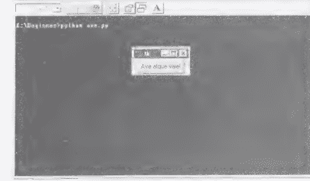

到目前为止，你已经看到回调函数在 Python 中仅仅是函数。在 C 和 C++ 中，回调函数也是函数，但无论是在注册还是在函数本身实现上，都要复杂得多。下面是一个 C 语言回调函数的示例：

```c
static void
ButtonCallback(Widget w, XtPointer cd, XtPointer dd)
{
    /* Exit processing. ... */
    exit(0);
}
```

而你注册该回调的方式是：

```c
XtAddCallback(w, XmNactivateCallback, ButtonCallback, (XtPointer)cd);
```

这个 C 回调函数被极大地简化了；一个真实的函数可能会运行很多行代码。当然，你还需要更多的支持代码来进行启动和初始化、构建部件以及正确配置部件；在完成所有这些之后，主事件循环也仅比 `while ... do` 循环稍微复杂一点。最后，你还必须编译 C 程序，这个步骤会给过程增加更多延迟。相比之下，Python/Tkinter 让你在短短几分钟内就能创建一个功能完整的程序。一个与 `ave.py` 等效的用 C 编写的 X Windows 程序至少需要 100 行代码，并且更容易出现 Bug。

## 总结

我们涵盖了 GUI 编程的一点历史、命令行编程与 GUI 编程的区别、什么是事件、什么是回调以及什么是事件队列。在接下来的一个小时里，我们将使用 Tkinter 编写一些入门级的 GUI 程序。

## 研讨会

### 问答

- **问**：嘿，我以为你说过我们不会进行任何编程？
- **答**：我是这么说的。我想我撒谎了，不是吗？
- **问**：你听说过的最大的 IBM 360 是哪一台？
- **答**：IBM 360/90 Model I 有 1MB 内存。据我所知，只有一台——在华盛顿特区；它体积如此巨大且运行温度极高，以至于必须用水冷。根据我记得的照片，它占据了一个大房间。大概像个篮球场那么大。

### 测验

1. 关于事件队列如何运行，哪个比喻比较恰当？


1. 它像什么？

   a. 它像食堂里的一叠盘子：你把盘子压下去，然后从顶部取走。

   b. 它像一根绳子：你拉一端，另一端的东西就被拽动。

   c. 它像一根塞满纸团的吸管：塞进一个，另一个末端就出来一个。

   d. 它像一个没气的轮胎：只有胎面，跑不动。

2. 谁决定 GUI 程序何时结束？

   a. 程序员。当任务完成后，程序退出。

   b. 计算机。当内存耗尽时，计算机崩溃。

   c. 操作系统。当操作系统感到无聊时，它跳到蓝屏死机。

   d. 用户。当用户完成处理后，她告诉程序退出。

3. 什么是回调（callbacks）？

   a. 一个有电话答录机且真的会回复消息的人。

   b. 一个注册在每次事件到达时被调用的一方法或函数。

   c. 一个调用你调用它时提供的其他方法或函数的方法或函数。

   d. Windows 操作系统中负责拨打你电话的一个部分。

### 答案

1. c. 一根塞满纸团的吸管。盘子是对 FIFO（先进先出）栈的比喻，这是另一种经典的数据结构。队列在整个过程中保持相同的顺序；也就是说，如果事件 A 先于事件 B，那么在队列另一端移除事件时，情况依然如此。

2. d. 用户。命令行程序通常由程序员决定任务何时结束。

3. b. 当来自事件队列的事件（你的程序已为其注册）到达时，它会激活一个回调函数或方法。


### 练习

你可以通过访问 Dave Nichols's Place (`http://www.geocities.com/SiliconValley/Lakes/5705/360.html`) 来体验 60 年代在 IBM 大型机上工作是什么感觉。我在考虑买他的一件 T 恤——那件写着“我参与创建了千年虫 (`Y2K bug`)”的。可惜千年虫最后被证明几乎不可见。


## 第 18 小时

### Tk 部件 I

> 生命太短，不应浪费时间在糟糕的语言上进行编程。
>
> ——Robert Meegan

在这一小时中，我们开始学习 Tkinter 中的窗口（windows）和部件（widgets）。在本小时结束时，你将能够：

- 区分窗口和部件
- 识别几种不同类型的部件
- 在 Tkinter 应用程序中使用回调

#### 窗口与部件

窗口和部件的区别很明显：窗口仅仅是你屏幕上被某种方式标记出来的区域，通常是由你的窗口管理器（在 X Windows 中）或 Windows 操作系统添加的可视化边框来定义的。部件与窗口相同，但它具有额外的行为——听起来很熟悉？应该是的。部件通常是窗口的一个较小部分。图 18.1 应该能让这个区别变得直观：

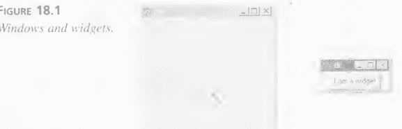

**图 18.1**

窗口与部件。

左边的对象是一个简单的窗口：除了占用屏幕空间外什么也不做，因为它没有按钮或菜单。其代码（虽然不多）如下：

```python
from Tkinter import *
root = Tk()
root.mainloop()
```

退出此程序的唯一方法是点击右上角的 X 按钮。另一方面，右边的对象是一个包含部件的窗口——一个写着“I am a widget”的按钮。它实际上能执行操作：如果你按下按钮，它会退出程序（你应该记得上一章的内容）。代码清单 18.1 展示了代码。

#### 代码清单 18.1 `tkt3.py`

```python
1 #!/usr/local/bin/python
2 
3 from Tkinter import *
4 import sys
5 
6 root = Tk()
7 button = Button(root)
8 button['text'] = "I am a widget"
9 button.pack()
10 root.mainloop()
11 
```

同样，这个清单看起来应该很熟悉，因为它与第 17 章“介绍 Python GUI”中的 `ave.py` 非常相似。

正如我之前指出的，部件具有行为和状态：它们有你可以调用的方法和你可以设置的属性。图 18.1 左侧出现的根窗口并不是一个真正的窗口：它实际上是 Tkinter 对窗口的一个封装：因为 Tkinter 中的所有部件都是这个根窗口（或顶层窗口）的子级，因此它具有某些属性和行为，所有子级都继承这些属性和行为。记得我们之前讨论过的 Python 对象继承吗？Tkinter 中的所有部件都是对象，因此所有部件都具有状态（属性）和行为（方法）：你可以通过继承它们并修改行为来满足你的需求。

Tkinter 部件的参考页面可以在 `http://www.pythonware.com/library/tkinter/tkclass/index.htm` 找到。这些页面列出了各种类型的部件、它们的属性及其方法。所有不同的部件将在接下来的内容中按字母顺序进行描述和展示。这里提供了一些简单的测试脚本以及一些注释：在第 19 章“Tk 部件 II”关于滚动条和文本部件的章节中，我将展示一个真正具有实用功能的完整应用程序。图 18.2 中显示的 Button 部件使用起来相当简单。代码清单 18.2 展示了如何操作：

#### Button 部件

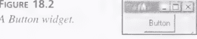

#### 代码清单 18.2 `tkbutton.py`

```python
1 #!/usr/local/bin/python
2 
3 from Tkinter import *
4 import sys
5 
6 def die(event):
7     sys.exit(0)
8 
9 root = Tk()
10 button = Button(root)
11 button["text"] = "Button"
12 button.bind("<Button>",die)
13 button.pack()
14 
15 root.mainloop()
```

如你所见，它与清单 18.1 中显示的 `tkt3.py` 基本上是一样的。不过，我们可以用另一种方式创建按钮：我们可以使用 Tkinter 的选项语法，其工作方式如下：

```python
button = Button(root,text="Button",command=die)
```

这一行代码将取代代码清单 18.2 中的第 10 到 12 行。在创建任何部件时，你可以使用之前展示的 “keyword=value” 语法来设置任意数量的选项。对于 `tkbutton.py` 唯一的问题是 `command` 选项期望接收一个不带参数的回调函数，因此必须修改 `die()` 以去掉 `event` 参数。对于创建这个 Button 部件来说，这种替代方法并没有带来太多好处，但也没有什么损失。选项方法可以，

然而，在很多情况下，后者会更简单且更具可读性；有些小部件拥有大量的选项。你应该养成使用实际事件绑定（event bindings）而不是 `command=callback` 风格的习惯；以这种方式作为选项安装的回调函数仅限于一个事件和一个特定的参数列表。使用事件绑定可以让你的回调函数精准满足你的需求。如图 18.3 所示的 Canvas 小部件在自然状态下看起来很简洁（且枯燥）。在该部件中绘制图形（这正是它的强项）将在后续章节中进行深入讨论。

#### Canvas 小部件


展示如何显示该部件的最简单程序如代码清单 18.3 所示。

```python
#### Listing 18.3 tkcanvas.py
#!/usr/local/bin/python

from Tkinter import *
import sys

def die(event):
    sys.exit(0)

root = Tk()
button = Button(root)
button["text"] = "Button"
button.bind("Button-1", die)
button.pack()

canvas = Canvas(root)
canvas["height"]=64
canvas["width"]=64
canvas["borderwidth"]=2
canvas["relief"]=RAISED
canvas.pack()

root.mainloop()
```

高度、宽度等可以使用我们在 Button 小部件替代方法中使用的选项方法来设置，但对于这样一个小型演示程序来说，这并没有太大区别。许多选项将在后续章节中涵盖。

#### Checkbutton 小部件

如图 18.4 所示，Checkbutton 小部件用于“是-否”条件，或者只有两种状态（开启和关闭）的切换（toggle）变量（源自切换开关）。


图 18.4 一个 Checkbutton 小部件。

代码清单 18.4 展示了如何使用它。

#### 代码清单 18.4 `tkcheckbutton.py`

```python
#!/usr/local/bin/python

from Tkinter import *
import sys

def die(event):
    sys.exit(0)

root = Tk()
button = Button(root)
button["text"] = "Button"
button.bind("<Button-1>", die)
button.pack()

checkbutton = Checkbutton(root)
checkbutton["text"] = 'Checkbutton'
checkbutton.pack()

root.mainloop()
```

我向你展示的大多数（如果不是全部）小部件在不同平台上看起来会有所不同。例如，图 18.5 展示了 Checkbutton 在 UNIX 上的样子，而在 Mac 上它的外观也会有所不同。


图 18.5 UNIX 上的 Checkbutton 小部件。

#### Entry 小部件

图 18.6 所示的 Entry 小部件用于从用户那里获取文本输入。它被限制在单行，而你稍后将看到的 Text 小部件可以拥有多行。代码清单 18.5 展示了一种简单的使用方法。

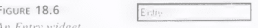

图 18.6 一个 Entry 小部件。

#### 代码清单 18.5 `tkentry.py`

```python
1 #!/usr/local/bin/python
2 
3 from Tkinter import *
4 import sys
5 
6 def die(event):
7     print entry.get()
8     sys.exit(0)
9 
10 root = Tk()
11 button = Button(root)
12 button["text"] = "Button"
13 button.bind("Button", die)
14 button.pack()
15 
16 entry = Entry(root)
17 entry.insert(0, "Entry")
18 entry.pack()
19 
20 root.mainloop()
21 
```

当你通过按下按钮退出程序时，程序会打印你输入到 Entry 小部件中的文本；第 7 行展示了如何使用 `get()` 方法读取该值。`get()` 方法在许多小部件中都很通用，`set()` 方法同样如此。

#### Frame 小部件

图 18.7 所示的 Frame 小部件用于承载其他内容。它还被用来占据空间；也就是说，它既可以用作占位符，也可以出于美学原因用作分隔符。


图 18.7 一个 Frame 小部件。

代码清单 18.6 展示了一个显示 Frame 小部件的简单程序；请注意，必须设置高度和宽度。

#### 代码清单 18.6 `tkframe.py`

#### Label 小部件

图 18.8 所示的 Label 小部件是最有用的部件之一。

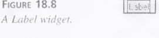

它包含不可编辑的文本，且非常易于使用，如代码清单 18.7 所示。

#### 代码清单 18.7 `tklabel.py`

```python
1 #!/usr/local/bin/python
2 
3 from Tkinter import *
4 import sys
5 
6 def die(event):
7     sys.exit(0)
8
9 root = Tk()
10 button = Button(root)
11 button["text"] = "Button"
12 button.bind("<Button>",die)
13 button.pack()
14 labelx = Label(root)
15 labelx["height"] = 1
16 labelx.pack()
17 label = Label(root)
18 label["text"] = "Label"
19 label["borderwidth"] = 1
20 label["relief"] = SOLID
21
22 label.pack()
23
24 root.mainloop()
```

该程序使用了一个额外的标签（`labelx`）且不含文本，将其作为分隔符；同样可以使用 Frame 小部件来达到目的。

#### Listbox 小部件

图 18.9 所示的 Listbox 小部件用于为用户提供多个选项。在构建该部件时，使用常规的构造方法比使用选项方式更容易。


代码清单 18.8 展示了具体操作。

#### 代码清单 18.8 `tklistbox.py`

```python
1 #!/usr/local/bin/python
2
3 from Tkinter import *
4 import sys
5
6 elements = [ "item5", "item4", "item3", "item2", "item1" ]
7
8 def die(event):
9     sys.exit(0)
10 
11 root = Tk()
12 button = Button(root)
13 button["text"] = "Button"
14 button.bind("<Button>",die)
15 button.pack()
16 labelX = Label(root)
17 labelX["height"] = 1
18 labelX.pack()
19 
20 listbox = Listbox(root)
21 for i in elements :
22     listbox.insert(0, i)
23 listbox.pack()
24 
25 root.mainloop()
```

第 21 行的 `for` 循环将每个项目的文本插入到列表中。你可以通过多种方式向 listbox 添加元素或项目，这仅仅是其中一种方法。

#### Tkinter 变量

要在 Tkinter 小部件中使用变量，你必须首先理解所有的 Tk/TCL 变量都是字符串。因此，每当一个小部件需要一个它可以修改的变量时（我们将在接下来的菜单小部件描述中看到这种用法），你必须使用一组专门为 Python 和 Tkinter 之间接口而设计的特殊变量。关于这些变量，你需要知道的是它们是对象而非简单的字符串：它们都继承自一个名为 `Variable` 的类，该类具有所有不同类型共有的某些基础方法和状态。每种具体的变量类型都知道如何根据其自身特殊需求来获取和设置自己的值。表 18.1 列出了 Tkinter 变量及其描述和创建示例。

#### 表 18.1 Tkinter 变量

| 名称 | 描述 | 示例 |
| :--- | :--- | :--- |
| `StringVar()` | 保存字符串值 | `x = StringVar("Text")` |
| `IntVar()` | 保存整数值 | `x = IntVar(42)` |
| `DoubleVar()` | 保存浮点数值 | `x = DoubleVar(3.14159)` |
| `BooleanVar()` | 保存真/假值 | `x = BooleanVar("true")` |

要检索这些变量中任何一个的值，只需使用 `get()` 方法：例如 `print x.get()`。要设置值，请使用 `set()` 方法：`x.set(2*pi)`。每当你需要将变量值发送到小部件或从小部件中获取值时，都需要使用 Tk 变量，我们将在接下来的内容中看到。

#### Menu 和 Menubutton 小部件

Menu 小部件本身无法独立显示；它必须包含 Menubutton 小部件。你可以将 Menu 小部件想象成类似于承载内容的 Frame 小部件。菜单有两种主要类型：菜单栏（menu bars）和选项菜单（option menus）。菜单栏就像图 18.10 中显示的那样。


你在各种 Windows 应用程序中都见过它们。代码清单 18.9 展示了一个标准菜单栏的代码。

#### 代码清单 18.9 `tkmenu.py`


```python
1 #!/usr/local/bin/python
2 
3 from Tkinter import *
4 import tkMessageBox
5 import sys
6 
7 def die():
8     sys.exit(0)
9 
10 def callee():
11     print "I was called; few are chosen"
12 
13 def about():
14     tkMessageBox.showinfo("tkmenu","This is tkmenu.py Version 0")
15 
16 root = Tk()
17 bar = Menu(root)
18 
19 filem = Menu(bar)
20 filem.add_command(label="Open...", command=callee)
21 filem.add_command(label="New...", command=callee)
22 filem.add_command(label="Save", command=callee)
23 filem.add_command(label="Save as...", command=callee)
24 filem.add_separator()
```

```python
25  filem.add_command(label="Exit", command=die)
26
27  helpm = Menu(bar)
28  helpm.add_command(label="Index...", command=callee)
29  helpm.add_separator()
30  helpm.add_command(label="About", command=about)
31
32  bar.add_cascade(label="File", menu=filem)
33  bar.add_cascade(label="Help", menu=helpm)
34
35  root.config(menu=bar)
36  root.mainloop()
37
```

第 13 行和第 14 行显示了“关于（About）”菜单项的一个特殊回调：`MessageBox` 控件将在本章稍后部分讨论。第 19 行创建了一个 `Menu` 控件，它是多个 `Menubutton` 控件的容器，这些 `Menubutton` 在第 20 行到第 25 行中被添加到其中。在第 24 行，我们添加了一个分隔符（separator）——它仅仅是一条线，在其他菜单项和“退出（Exit）”选项之间提供某种视觉上的分隔。正如你所看到的，我们甚至没有直接调用 `Menubutton()`，而是使用了 `Menu` 控件内置的方法：`add_command()` 的语法比 `Menubutton()` 更易于使用。

第 27 行到第 30 行创建并填充了另一个 `Menu`，在第 32 行和第 33 行中，我们将创建的这两个菜单添加到菜单栏中，该菜单栏在第 17 行被创建为根窗口的子级。`add_cascade()` 方法在菜单栏中放置一个标签，然后将指定的菜单附加到该标签上：点击该标签会弹出相应的“级联（cascade）”菜单。图 18.11 显示了级联菜单弹出后的样子。

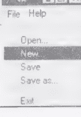

**图 18.11** 一个级联菜单。

这种级联菜单也可以在单个 `Menubutton` 上挂载其他级联菜单，但我并不特别喜欢这样的设计。菜单通常是很敏感的东西，因此依赖的菜单越多，用户就越容易感到烦躁，因为菜单可能会在指针下方突然消失。顺便提一下，菜单中的省略号（如“New...”中的“...”）按照惯例意味着如果你选择该项，会弹出一个对话框。而箭头或类似的指示符则意味着如果你选择该项，会出现另一个菜单。菜单可以包含子菜单、复选框、常规选择项和分隔符。

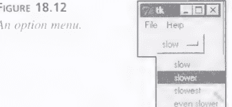

**图 18.12** 一个选项菜单。

然而，选项菜单（Option Menu）稍微复杂一些（见图 18.12）。虽然不是强制性的，但通常需要提供一个 Tkinter 变量来设置选项菜单的标签。选项菜单可以出现在 Tk 容器控件中的任何位置，而不仅仅是应用程序主窗口（或对话框）顶部的菜单栏中。代码清单 18.10 显示了图 18.12 中选项菜单的代码。

#### 代码清单 18.10 `tkoptionmenu.py`

```python
1  #!/usr/local/bin/python
2
3  from Tkinter import *
4  import tkMessageBox
5  import sys
6
7  def die():
8      global xx
9      print xx.get()
10     sys.exit(0)
11
12 def callee():
13     print "I was called; few are chosen"
14
15 def about():
16     tkMessageBox.showinfo("tkmenu", "This is tkmenu.py Version 0")
17
18 root = Tk()
19 bar = Menu(root)
20
21 filem = Menu(bar)
22 filem.add_command(label="Open...", command=callee)
23 filem.add_command(label="New...", command=callee)
24 filem.add_command(label="Save", command=callee)
25 filem.add_command(label="Save as...", command=callee)
26 filem.add_separator()
27 filem.add_command(label="Exit", command=die)
28
29 helpm = Menu(bar)
30 helpm.add_command(label="Index...", command=callee)
31 helpm.add_separator()
32 helpm.add_command(label="About", command=about)
33
34 bar.add_cascade(label="File", menu=filem)
35 bar.add_cascade(label="Help", menu=helpm)
36
37 root.config(menu=bar)
38 frame = Frame(root)
39 frame.pack()
40 xx = StringVar(frame)
41 xx.set("slow")
42
43 fm = OptionMenu(frame,xx,"slow","slower","slowest","even slower")
44 fm.pack()
45 root.mainloop()
46
```

如你所见，它包含与代码清单 18.9 相同的菜单栏代码，此外还增加了选项菜单的新代码。第 40 行设置了一个 Tkinter 字符串变量，并在第 43 行中使用它；`OptionMenu()` 的第二个参数必须是一个 Tkinter 变量，这里它被设置为 `"slow"`。这为菜单提供了默认设置，从而确定了选项菜单的初始标签。当从菜单中选择另一个选项时，变量 `xx` 的值也会随之改变。第 8 行和第 9 行展示了如何获取该值并将其打印出来。

#### `MessageBox` 控件

`MessageBox` 控件被称为“对话框”，因为它们是从主应用程序中弹出并保持在主窗口之前的窗口，直到用户按下默认按钮。对于大多数对话框和消息框，这个默认按钮通常标记为“OK”，但并非必须。例如，“yesno”消息框仅有标记为“Yes”和“No”的按钮，这显然是符合逻辑的。使用大多数消息框最简单的方法是使用便捷函数，正如你在代码清单 18.10 的第 16 行中所见。我们稍后将看到如何使用实际的 `MessageBox()` 调用，以便对问题框进行自定义。请注意，这里所有的图片都是 Windows 消息框；UNIX 版本有很大不同，特别是使用了单色图标而非彩色图标，但其功能和用法保持一致。

#### Info MessageBox（信息消息框）

#### 代码清单 18.11 `tkmessage.info.py`

```python
1 #!/usr/local/bin/python
2
3 from Tkinter import *
4 import tkMessageBox
5 import sys
6
7 def die(event):
8     tkMessageBox.showinfo("tkMessageBox", "tkMessageBox.showinfo")
9     sys.exit(0)
10
11 root = Tk()
12 button = Button(root)
13 button['text'] = 'Button'
14 button.bind("<Button>", die)
15 button.pack()
16
17 root.mainloop()
```

便捷函数 `showinfo()`（第 8 行）的第一个参数是对话框的标题，第二个参数是要在对话框本身中显示的文本。图 18.13 展示了它运行时的样子。

**图 18.13** 一个 Info MessageBox 控件。


大多数其余的消息框使用起来同样简单。

#### Warning MessageBox（警告消息框）

例如，图 18.14 中显示的警告框使用方式几乎完全相同。

**图 18.14** 一个 Warning MessageBox 控件。


代码清单 18.12 显示了相关代码。

#### 代码清单 18.12 `tkmessage.warning.py`

```python
1 #!/usr/local/bin/python
2
3 from Tkinter import *
4 import tkMessageBox
5 import sys
6
7 def die(event):
8     tkMessageBox.showwarning("tkMessageBox","tkMessageBox.showwarning")
9     sys.exit(0)
10
11 root = Tk()
12 button = Button(root)
13 button["text"] = "Button"
14 button.bind("<Button>",die)
15 button.pack()
16
17 root.mainloop()
```

只有第 8 行有所不同。

#### Error MessageBox（错误消息框）

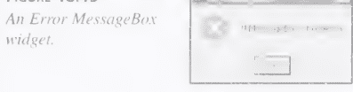

错误框（见图 18.15）的情况也是如此，它同样只有一个按钮。代码清单 18.13 展示了它的使用多么简单。

#### 代码清单 18.13 `tkmessage.error.py`

```python
1 #!/usr/local/bin/python
2
3 from Tkinter import *
4 import tkMessageBox
5 import sys
6
7 def die(event):
8     tkMessageBox.showerror("tkMessageBox","tkMessageBox.showerror")
9     sys.exit(0)
10
11 root = Tk()
12 button = Button(root)
13 button["text"] = "Button"
14 button.bind("<Button>",die)
15 button.pack()
16
17 root.mainloop()
```

同样，只有第 8 行不同。我们讨论的这三种对话框有很多共同点，因为它们只有一个按钮；用户不需要进行任何操作，只需确认已看到该对话框即可。在错误框的情况下，除非你（程序员）确定不会产生不良影响（即用户不会丢失任何数据），否则通常最好退出应用程序。在大多数情况下，退出并让用户稍微不快，比继续运行并冒着破坏或扭曲数据的风险要好。然而，下一组消息框使用了多个按钮，因为预计用户需要做出决定，且程序需要对用户的决定做出适当响应。

#### Yesno MessageBox（是/否消息框）

图 18.16 中显示的消息框很自然地提出了一个“是或否”的问题。

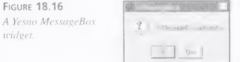

代码如下所示在代码清单 18.14 中。

#### 代码清单 18.14 `tkmessage.askyesno.py`

```python
1 #!/usr/local/bin/python
2 
3 from Tkinter import *
4 import tkMessageBox
5 import sys
6 
7 def die(event):
8     response = tkMessageBox.askyesno("tkMessageBox",
9             "tkMessageBox.askyesno")
10 
11     print response
12     sys.exit(0)
13 
14 root = Tk()
15 button = Button(root)
16 button["text"] = "Button"
17 button.bind("<Button>",die)
18 button.pack()
19 
20 root.mainloop()
```

如果你运行这段代码，你会发现点击“Yes”按钮会打印出 1；当点击“No”按钮时，结果为 0。`askyesno()` 函数返回一个值，用于指示用户点击了哪个按钮，该值在第 8 行被收集。通过添加一个 `if` 语句来检查响应，你可以根据用户的选择决定是否退出程序。

#### Okcancel 消息框

在这个消息框中（如图 18.17 所示），你可以看到我们同样只有两个按钮，尽管它们的标签不同。

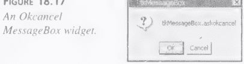

代码清单 18.15 展示了相关代码（以及它与另一个双按钮消息框的相似之处）。

#### 代码清单 18.15 `tkmessage.askokcancel.py`

```python
1 #!/usr/local/bin/python
2 
3 from Tkinter import *
4 import tkMessageBox
5 import sys
6 
7 def die(event):
8     r = tkMessageBox.askokcancel("tkMessageBox", \
9         "tkMessageBox.askokcancel")
10    print r
11    sys.exit(0)
12 
13 root = Tk()
14 button = Button(root)
15 button['text'] = 'Button'
16 button.bind("<Button>",die)
17 button.pack()
18 
19 root.mainloop()
```

当你运行这段代码时，你会发现响应与之前的对话框相同：要么是 1，要么是 0。

#### Retrycancel 消息框

这个对话框（如图 18.18 所示）是另一个双按钮消息框，行为方式也完全相同。


**图 18.18**

一个 Retrycancel 消息框组件。

代码清单 18.16 展示了相关代码。

#### 代码清单 18.16 `tkmessage.askretrycancel.py`

```python
1 #!/usr/local/bin/python
2
3 from Tkinter import *
4 import tkMessageBox
5 import sys
6
7 def die(event):
8     r = tkMessageBox.askretrycancel("tkMessageBox", \
9         "tkMessageBox.askretrycancel")
10    print r
11    sys.exit(0)
12
13 root = Tk()
14 button = Button(root)
15 button["text"] = "Button"
16 button.bind("<Button>",die)
17 button.pack()
18
19 root.mainloop()
```

这三个双按钮便捷函数的使用方法是相同的：弹出一个标准的问题对话框，以便用户可以用两种（有限的）方式之一来回答一个简单的问题。这些对话框都返回 0 或 1，这意味着你应该记住哪个按钮返回哪个值：0 表示“否”、“取消”或“忽略”，而 1 表示“是”、“确定”或“重试”。

#### Question 消息框

对于三按钮消息框（如图 18.19 所示），我们必须求助于直接调用 `Message()` 方法；对于超过两个按钮的消息框，没有便捷函数。请注意，这里我们使用了关键字风格来设置选项。

**图 18.19**

一个 Question 消息框组件。


代码清单 18.17 展示了相关代码。

#### 代码清单 18.17 `tkmessage.askquestion.py`


```python
1 #!/usr/local/bin/python
2 
3 from Tkinter import *
4 import tkMessageBox
5 import sys
6 
7 def die(event):
8     x = tkMessageBox.Message(root,type=tkMessageBox.ABORTRETRYIGNORE,
9         icon=tkMessageBox.QUESTION,
10        title="tkMessageBox",
11        message="tkMessageBox.askquestion")
12    r = x.show()
13    tkMessageBox.showinfo("Reply", r )
14    sys.exit(0)
15 
16 root = Tk()
17 button = Button(root)
18 button["text"] = "Button"
19 button.bind("<Button>",die)
20 button.pack()
21 
22 root.mainloop()
```

第 8 到 11 行展示了关键字参数：我们使用 `tkMessageBox` 模块中定义的特殊常量来指定类型（三个按钮）和图标（`QUESTION` 图标）。虽然标题（`title`）和消息（`message`）是通过关键字选项传递的，但它们是普通字符串，与使用便捷函数时一样。由于没有可用的便捷函数，我们必须创建消息框（`x = tkMessageBox.Message()`），然后调用 `x.show()` 方法。我们在第 12 行获取 `show()` 返回的值，然后使用 `showinfo()` 便捷函数来显示用户按下的按钮。当你运行这个程序时，请注意 `r` 是一个字符串；这是不使用便捷函数导致的结果。

你可以对所有的消息框使用这种相同风格；便捷函数就如其名——仅仅是为了方便，而不是必需的。

## 总结

我们讨论了各种基础的 Tkinter 组件，从 `Button` 组件到不同类型的消息框。在接下来的一个小时里，我们将讨论更多 Tkinter 组件（从 `Radiobuttons` 到 `Text`），构建一个完整的应用程序，并演示 `Toplevel` 组件。

## 工作坊

### 问答

- **问**：为什么 Windows、X Windows 和 Mac 的组件看起来如此不同？

- **答**：最初，Windows 和 X Windows 的组件看起来相当相似，因为它们都演变自 HP 开发的一个共同祖先。在 X Windows 上，HP 组件以一种相对直接的方式演变为 Motif 组件。Windows 组件受到 Mac 组件的影响（Mac 组件生长自 Xerox Palo Alto 研究实验室开发的类似对象），演变成了 Windows 类，并在从 Windows 3.1 到 Windows 95 的过渡中再次改变了外观。Tk/Tcl 的开发人员最初使用了在所有三个平台上看起来都相同的组件，但最近他们改为在三个不同的平台上使用原生组件集。我怀疑改变的原因是，那些可移植的组件看起来太笨拙了。

- **问**：我在 Windows 上经常看到一种将列表与滚动条相结合的组件。它们是什么，Tkinter 中有吗？

- **答**：这些通常被称为组合框（combo boxes），在 Tkinter 本身中不可用。然而，澳大利亚的 Greg McFarlane 编写了一个非常出色的名为 "Python Megawidgets" 的包，其中就包含组合框；可以在 `http://www.ascp1.com.au/pmw/` 找到。Greg 说：“它由一组基类和一个基于此基础构建的灵活且可扩展的巨型组件库组成。这些巨型组件包括笔记本（notebooks）、组合框（comboboxes）、选择组件（selection widgets）、分窗组件（panned widgets）、滚动组件（scrolled widgets）、对话窗口等。” 它们同样是用纯 Python 编写的，不需要 C 扩展（如果你机器上没有 C 编译器，这一点很重要）。

### 测验

1. 哪种组件的操作类似于开关？

   a. `Button`

   b. `List`

   c. `Check box`

   d. `Entry`

2. 菜单栏（menu bars）和选项菜单（option menus）的区别是什么？

   a. 菜单栏横跨应用程序主窗口的整个顶部；选项菜单位于窗口底部的栏中。

   b. 菜单栏菜单是下拉的；选项菜单是向侧面拉出的。

   c. 选项菜单可以出现在窗口的任何位置，而菜单栏必须在顶部。

   d. 只有名称不同，其他方面完全相同。

### 答案

1. c. `check box` 组件的操作类似于开关；它们只有两种状态：选中和未选中。

2. c. 选项菜单可以用于窗口的任何位置；菜单栏则横跨顶部。

### 练习

买一份“外星人绑架人身保险”，以防你被 Heechee 绑架。把 Scott Meyers 设为受益人。然后被绑架，尝试提交理赔申请。

研究 GUI 编程的历史；一个极佳的起点是 Michael S. Hoffman 有趣的网页 "The Unix GUI Manifesto"，网址为 `http://www.cybtrans.com/infostrc/unixgui.htm`。

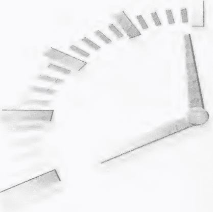

# 第 19 小时：Tk 组件 II

> 尽管那辆 Trans Am 已经十岁了，身上的凹痕和故障足以证明这一点，但它在过弯时依然像蟒蛇一样紧贴路面。
>
> ——Sara Paretsky，《Hard Time》

在上一小时中，我们开始学习许多种基础的 Tkinter 组件。在本小时，我们继续讨论。在本小时结束时，你将能够：

- 识别更多基础组件
- 将多个组件组合成小型应用程序
- 编写一个完整的应用程序：`tkeditor`

## Radio Button 组件

我怀疑你们中很少有人足够年长，能记得汽车收音机上那种旧式的按钮，但它们正是 `radio button` 组件的直接祖先。汽车收音机按钮在性质上完全是机械的（正如任何拆解过……（就像有人能告诉你的一样）；按下其中一个，之前被按下的另一个就会弹出——并发出独特的“thock”声。

Widget 单选按钮（见图 19.1）的“接线”方式相同，这就是为什么你永远不会看到单个的单选按钮——正如灵长类动物学中所说，“孤独的狒狒就是死狒狒”。UNIX 单选按钮的设置方式相同，但它们采用的是菱形按钮（见图 19.2）。

**图 19.1**

单选按钮。


**图 19.2**

UNIX 单选按钮。

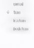

然而，即使在 Windows 上，你也可以指定单选按钮采用像普通按钮一样的外观（见图 19.3）。

**图 19.3**

非单选按钮外观的单选按钮。


在代码清单 19.1 所示的代码中，你可以看到，在没有参数的情况下运行它会给出默认的圆形（或菱形）单选按钮，而给程序提供任何命令行参数则会生成扩展的常规按钮。

### 代码清单 19.1 `tkradiobutton.py`

```python
1 #!/usr/local/bin/python
2 
3 from Tkinter import *
4 import sys
5 
6 def die(event):
7     global v, periods
8     print periods[v.get()][0]
9     sys.exit(0)
10 
11 root = Tk()
12 button = Button(root)
13 button["text"] = "Quit"
14 button.bind("<Button>",die)
15 button.pack()
16 
17 v = IntVar()
18 v.set(2)
19 
20 periods = [
21 ("kin", 0),
22 ("uinal", 1),
23 ("tun", 2),
24 ("katun", 3),
25 ("baktun", 4),
26 ]
27 
28 if len(sys.argv) > 1:
29     indicator = 0
30     filler="X"
31     expander=1
32 else:
33     indicator = 1
34     filler=None
35     expander=0
36 for t, m in periods :
37     b = Radiobutton(root, text=t, variable=v, value=m, \
38         indicatoron=indicator)
39     if indicator == 1 :
40         b.pack(anchor=W)
41     else :
42         b.pack(expand=expander,fill=filler)
43 
44 root.mainloop()
```

在第 17 行和第 18 行中，我们使用了 Tk 变量；这次是一个整数。不过，完全没有理由不能使用 `StringVar()` 调用并将我们的周期元组列表指定为这样：`("kin", "kin"), ("uinal", "uinal")`。然后我们可以使用 `v.get()` 将值打印为字符串，或者使用 `showinfo()` 便捷函数在消息框中显示所选值。

## Scale 控件（刻度控件）

Scale 控件可以显示为水平样式（见图 19.4）或垂直样式（见图 19.5）。

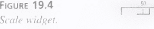


每当你希望用户能够从特定边界的连续范围内选择一个值时，就会用到它们。这里显示的是使用默认范围，即 0 到 100（提供 101 个离散值）。代码清单 19.2 展示了如何对这两种样式进行编码，其中垂直版本使用了不同的范围。

### 代码清单 19.2 `tkscale.py`

```python
1 #!/usr/local/bin/python
2 
3 from Tkinter import *
4 import sys
5 import string
6 
7 def die(event):
8     sys.exit(0)
9 
10 def reader(s):
11     f = string.atoi(s)
12     f = f - 32
13     c = f / 9.
14     c = c * 5.
15     print "%s degrees F = %f degrees C" % (s, c)
16 
17 root = Tk()
18 button = Button(root)
19 button["text"] = "Quit"
20 button.bind("<Button>",die)
21 button.pack()
22 
23 scale1 = Scale(root, orient=HORIZONTAL)
24 scale1.pack()
25 scale2 = Scale(root, orient=VERTICAL,from_=-40,to=212,command=reader)
26 scale2.pack()
27 
28 root.mainloop()
```

如果你运行这个程序，你会发现垂直刻度控件已被设置为将华氏度转换为摄氏度（我自己总是认为它是 Centigrade，因为我学习它的时候就是这么叫的，但名字现在变了）。你还会注意到 `-40` 在两个刻度中是相同的温度；这被称为 gosh 数，因为当你了解到这一点时，你会说 “gosh”（天哪）。似乎没有太多其他可说的了，对吧？

然而，像我们在代码清单 19.2 中那样将信息打印到 `stdout` 并不是在 GUI 中向用户提供答案最优雅的方式，因此让我们修改 `tkscale.py`，在回调函数中更新几个标签；这将使用户界面全部集中在一个窗口中。既然如此，让我们去掉多余的刻度控件，并给窗口起一个合适的标题。代码清单 19.3 显示了修改后的代码。

### 代码清单 19.3 `tkscale2.py`

```python
1 #!/usr/local/bin/python
2 
3 from Tkinter import *
4 import sys
5 import string
6 
7 def die(event):
8     sys.exit(0)
9 
10 def reader(s):
11     global label
12     f = string.atoi(s)
13     f = f - 32
14     c = f / 9.
15     c = c * 5.
16     label["text"] = "Degrees Fahrenheit: %s" % (s)
17     label["text"] = "Degrees Celsius: %d" % (int(c))
18 
19 root = Tk()
20 button = Button(root,width=25)
21 button["text"] = "Quit"
22 button.bind("<Button-1>",die)
23 button.pack()
24 
25 flabel = Label(root,text="Degrees Fahrenheit:")
26 flabel.pack(anchor=W)
27 scale2 = Scale(root, orient=VERTICAL,from_=-40,to=212,command=reader)
28 scale2.pack()
29 label = Label(root,text="Degrees Celsius:")
30 label.pack(anchor=W)
31 
32 root.title("Fahrenheit to Celsius")
33 
34 root.mainloop()
```

图 19.6 显示了整个应用程序运行时的样子。

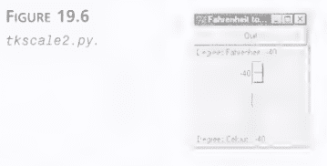

## Text、Scrollbar 和 ScrolledText 控件

Text 控件（见图 19.7）类似于多行输入控件。它们还配备了完整的*绑定*（bindings）——也就是说，绑定到鼠标点击和按键的动作。复制一段高亮文本被绑定到当前平台的相应按键（Windows 上为 `Ctrl+C`），剪切和粘贴也是如此，以此类推。代码清单 19.4 显示了运行文本控件的最简代码。

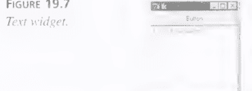

### 代码清单 19.4 `tktext.py`

```python
1 #!/usr/local/bin/python
2 
3 from Tkinter import *
4 import sys
5 
6 def die(event):
7     sys.exit(0)
8 
9 root = Tk()
10 f = Frame(root)
11 f.pack(expand=1, fill=BOTH)
12 button = Button(f,width=25)
13 button["text"] = "Button"
14 button.bind("<Button-1>",die)
15 button.pack()
16 t = Text(f,width=25,height=10,relief=RAISED,bd=2)
17 t.pack(side=LEFT, fill=BOTH, expand=1)
18 
19 root.mainloop()
```

在第 16 行中，选项关键字 `bd` 是 `borderwidth` 的缩写。少数（并非很多）选项关键字确实有缩写形式。

### 滚动条（Scrollbars）

滚动条用于上下移动文本控件等内容（见图 19.8）。你可以将其设置为水平方向，但 Tkinter 对此内置的支持非常少。大多数滚动条与 Text 控件结合使用以提供 `ScrolledText` 控件，与 `Canvas` 控件结合使用以提供绘图的滚动，以及与 `FileDialog` 控件结合使用（后者允许用户在原生 Windows 版本中左右滚动，在纯 Tkinter 版本中上下滚动）。


与其提供单独显示滚动条的代码（这没什么用），代码清单 19.5 向你展示如何简单地使用 `ScrolledText` 控件（一个复合控件——也就是说，由两个或更多基础控件组成）。

### 代码清单 19.5 `tkscrollbar.py`


```python
1 #!/usr/local/bin/python
2
3 from Tkinter import *
4 from ScrolledText import *
5 import sys
6
7 def die(event):
8     sys.exit(0)
9
10 root = Tk()
11 f = Frame(root)
12 f.pack(expand=1, fill=BOTH)
13 button = Button(f, width=25)
14 button["text"] = "Quit"
15 button.bind("<Button-1>", die)
16 button.pack()
17
18 st = ScrolledText(f, background="white")
19 st.pack()
20
21 root.mainloop()
```

这几行代码虽然没有提供保存你输入到控件中文本的方法，但在极小的空间内实现了过去需要数百行 C 代码才能完成的功能（实际上，它仍然需要；这里的每一行 Python/Tkinter 代码都调用了一个用 C 编写的全规模控件）。控件是非常智能的对象，你可以利用这一点，而无需担心底层细节（例如光标放在哪里，如何以及在哪里绘制字母 Q 等）；这被称为*抽象*（abstraction），它是使用 Python 这种高级语言的最佳理由之一。运行`tkscrollbar.py`将给我们图 19.9 所示的`ScrolledText`控件。

**图 19.9**

一个`ScrolledText`控件。

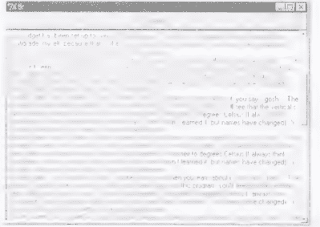

为了完整起见，让我们为在`ScrolledText`控件中创建的文件添加一种保存方式。这意味着我们将不得不添加一个菜单栏，既然如此，我们也可以顺便添加一个关于 (About) 对话框。这里只有一部分是新的，即保存和打开文件的方法。代码清单 19.6 显示了我们`tkeditor`应用程序的完整代码。

### 示例 19.6 `tkeditor.py`

```python
1  #!/usr/local/bin/python
2  
3  from Tkinter import *
4  from ScrolledText import *
5  import tkMessageBox
6  from tkFileDialog import *
7  import fileinput
8  
9  st = None
10 
11 def die():
12     sys.exit(0)
13 
14 def openfile():
15     global st
16     pl = END
17     oname = askopenfilename(filetypes=[("Python files", "*.py")])
18     if oname:
19         for line in fileinput.input(oname):
20             st.insert(pl,line)
21 
22 def savefile():
23     sname = asksaveasfilename()
24     if sname:
25         ofp = open(sname,"w")
26         ofp.write(st.get(1.0,END))
27         ofp.flush()
28         ofp.close()
29 
30 def about():
31     tkMessageBox.showinfo("Tkeditor", "Simple tkeditor Version 0\n"
32     "Written 1999\n"
33     "For Teach Yourself Python in 24 Hours")
34 
35 
36 if __name__ == "__main__":
37     global st
38     root = Tk()
39     bar = Menu(root)
40 
41     filem = Menu(bar)
42     filem.add_command(label="Open...", command=openfile)
43     filem.add_command(label="Save as...", command=savefile)
44     filem.add_separator()
45     filem.add_command(label="Exit", command=die)
46 
47     helpm = Menu(bar)
48     helpm.add_command(label="About", command=about)
49     bar.add_cascade(label="File", menu=filem)
50     bar.add_cascade(label="Help", menu=helpm)
51     root.config(menu=bar)
52 
53     f = Frame(root,width=512)
54     f.pack(expand=1, fill=BOTH)
55 
56     st = ScrolledText(f,background="white")
57     st.pack(side=LEFT, fill=BOTH, expand=1)
58     root.mainloop()
```

图 19.10 显示了`tkeditor.py`运行时的状态（其中包含它自身的代码）以及由`openfile()`回调函数显示的关联文件对话框。

### 图 19.10

运行`tkeditor.py`。

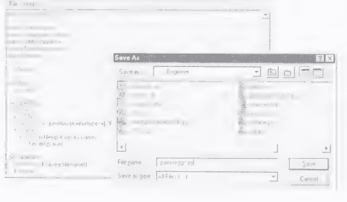

示例 19.5 共有 59 行代码，其中包含一些空行。就在几年前，要在程序中实现相同的功能还需要数百行代码，而再早几年则需要数千行。

还有许多功能有待实现，但没有一个很难做到。例如，完全可以将图片嵌入到文档中；你只需要修改保存文件的方式，即使是这样也不会太困难（想想`pickle`）。在本章末尾的练习中，你可以找到一个可能想要实现的功能列表。

## Toplevel 控件

Toplevel 控件是表现得就像应用程序主窗口一样的控件；例如，你可以为`tkeditor.py`添加一个“New ...”菜单项，用来打开一个全新的编辑器窗口，该窗口看起来与原窗口完全一样（稍后我们将添加这个功能）。IDLE 就是这样实现的；从菜单中选择 New ... 会打开一个新窗口，其中已经运行着一个新的 Python 解释器。示例 19.7 展示了一种实现多个 Toplevel 控件的简单方法。

### 示例 19.7 `tktoplevel.py`

```python
1 #!/usr/local/bin/python
2 
3 from Tkinter import *
4 import sys
5 
6 wl = []
7 
8 def die():
9     print "You created %d new toplevel widgets" % (len(wl))
10    sys.exit(0)
11 
12 def newwin():
13     global root
14     wl.append(Toplevel(root))
15 
16 root = Tk()
17 bar = Menu(root)
18 filem = Menu(bar)
19 filem.add_command(label="New...", command=newwin)
20 filem.add_separator()
21 filem.add_command(label="Exit", command=die)
22 
23 bar.add_cascade(label="File", menu=filem)
24 root.config(menu=bar)
25 root.mainloop()
```

在图 19.11 中，你可以看到这在实践中是如何工作的：我选择了四次 New ...。

### 图 19.11

来自`tktoplevel.py`的多个 Toplevel 控件。


当然，拥有多个除了占用空间外什么也不做的顶级窗口对我们没有太大帮助：让这些额外的窗口发挥作用会更有价值。如果我们将`tkeditor`与 Toplevel 控件结合起来，我们就可以编辑一个文件，并从菜单中选择 New... 来创建更多的编辑窗口。有几种方法可以实现这一点，但最优雅的方法是创建一个类，为我们实例化一个编辑器窗口。这样做，不仅能将程序主体的规模缩减到仅几行，而且我们可以在任何 Tkinter 程序中，在需要的时候导入该模块并实例化一个编辑器。示例 19.8 显示了相关代码，其中包括一个编辑器类（从第 20 行开始）及其关联的方法，以及三个不需要作为类一部分的函数（`die()`第 12 行；`about()`第 15 行；以及`neweditor()`第 71 行）。

### 示例 19.8 `multi-editor.py`

```python
1 #!/usr/local/bin/python
2 
3 from Tkinter import *
4 from ScrolledText import *
5 import tkMessageBox
6 from tkFileDialog import *
7 import fileinput
8 
9 tl = []
10 root = None
11 
12 def die():
13     sys.exit(0)
14 
15 def about():
16     tkMessageBox.showinfo("Tkeditor", "Simple tkeditor Version 1\n"
17     "Written 1999\n"
18     "For Teach Yourself Python in 24 Hours")
19 
20 class editor:
21     def __init__(self, rt):
22         if rt == None:
23             self.t = Tk()
24         else:
25             self.t = Toplevel(rt)
26             self.t.title("Tkeditor %d" % len(tl))
27             self.bar = Menu(rt)
28 
29         self.filem = Menu(self.bar)
30         self.filem.add_command(label="Open...", command=self.openfile)
31         self.filem.add_command(label="New...", command=neweditor)
32         self.filem.add_command(label="Save as...", \
33             command=self.savefile)
34         self.filem.add_command(label="Close", command=self.close)
35         self.filem.add_separator()
36         self.filem.add_command(label="Exit", command=die)
37
38         self.helpm = Menu(self.bar)
39         self.helpm.add_command(label="About", command=about)
40
41         self.bar.add_cascade(label="File", menu=self.filem)
42         self.bar.add_cascade(label="Help", menu=self.helpm)
43         self.t.config(menu=self.bar)
44 
45         self.f = Frame(self.t, width=512)
46         self.f.pack(expand=1, fill=BOTH)
47 
48         self.st = ScrolledText(self.f, background="white")
49         self.st.pack(side=LEFT, fill=BOTH, expand=1)
50 
51     def close(self):
52         self.t.destroy()
53 
54     def openfile(self):
55         pl = END
56         oname = askopenfilename(filetypes=[("Python files", "*.py")])
57         if oname:
58             for line in fileinput.input(oname):
59                 self.st.insert(pl, line)
60             self.t.title(oname)
61 
62     def savefile(self):
63         sname = asksaveasfilename()
64         if sname:
65             ofp = open(sname, "w")
66             ofp.write(self.st.get(1.0, END))
67             ofp.flush()
68             ofp.close()
69             self.t.title(sname)
70 
71 def neweditor():
72     global root
73     tl.append(editor(root))
74 
75 if __name__ == "__main__":
76     root = None
77     tl.append(editor(root))
78     root = tl[0].t
79     root.mainloop()
```

你还可以看到，每当我们编辑文件或保存文件时，都会重新设置当前编辑器窗口的标题；这在第 60 行和第 69 行通过 Toplevel 控件的`title()`方法实现。Toplevel 控件还有许多其他有用的功能，Tkinter 文档中列出了所有这些功能。

再次注意到，我们的多窗口编辑器仅有 79 行代码。大约在 1984 年的时候，我花了几周时间尝试编写一个编辑器。我在写到大约 10,000 行左右时放弃了，因为我无法在脑海中跟踪整个项目的逻辑；当时没有任何抽象化处理，所以我迷失方向也就不足为奇了。这个在不到一天内构建的小型编辑器应用程序，比我当年写的要强大得多。（公平地说，1984 年的编辑器是一个专用编辑器，旨在编辑有向图系统中的节点和连接；但在实际的编辑部分我确实迷路了，而那部分几乎可以用这 79 行 Python 代码完全替代。）图 19.12 显示了我们的多窗口应用程序运行的情况。

### 图 19.12

多窗口编辑器运行。

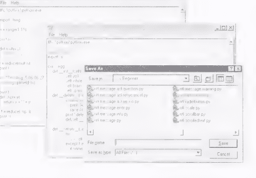

至此，我们完成了对各种基础 Tkinter 控件的讨论。

## 总结

我们已经涵盖了剩余的基础 Tkinter 控件，并编写了两个程序（`tkscale2.py`和`multi-editor.py`），其中一个（`multi-editor.py`）用极少的代码实现了极高的实用价值。在下一章中，我们将使用 Canvas 控件来讨论 Tk 图形。随后，我们将编写一个计算 Mandelbrot 集合并在 Canvas 控件中显示的程序。

### 问答

> 问：在 Windows 机器上，我注意到大型应用程序的一种常见外观是单个窗口包含许多较小的窗口（例如编辑器）。Tkinter 对此有支持吗？
>
> 答：你的意思是微软的 MDI，即多文档界面（Multiple Document Interface）。在 Tkinter 中确实没有类似的功能。也许你应该编写一些支持类？如果是我来做，我会从 Greg McFarlane 出色的 PMW 库开始，该库在上一小时中有所介绍。
>
> 问：我在 Linux 机器上运行了`multi-editor.py`，结果文件打开/保存/对话框丑得像 1972 年的雷鸟车（Thunderbird）。为什么我得忍受这个？
>
> 答：你不需要忍受；你可以编写自己的对话框。或者你可以等到 Tk/TCL 开始使用 KDE 或 GNOME 工具集来实现其基础组件。如果你懂一些 C 或 C++ 编程，你可以贡献力量，让 Tk/TCL 组件看起来更顺眼。一个很好的起点是 K Desktop Environment 的主页 http://kde.fnet.pl/ 或 GNOME 开发者的站点 http://developer.gnome.org/。

## 研习（Workshop）

### 测验

1. 根窗口（root window）和 Toplevel 组件之间有什么区别？

   - a. 根窗口不能包含任何其他组件。
   - b. Toplevel 组件只能包含有限数量的子组件。
   - c. 没有区别。
   - d. 根窗口没有父级，但 Toplevel 组件使用根窗口作为其父级。

2. 为什么`multi-editor.py`中的某些回调函数是类方法而不是普通函数？


- a. 函数不能用作回调，只有方法可以。
- b. 如果使用函数，我们将永远不知道是哪个窗口调用了我们。
- c. 当时觉得这是一个好主意。
- d. 方法运行速度更快。

### 答案

- 1. d. 在一个 Tkinter 应用程序中永远只有一个根窗口；它没有父级（`Tk()`），而 `Toplevel` 组件使用创建的根窗口作为它们的父级。
- 2. b. 方法属于类。因此，我们可以在类中存储相应的 `Text` 组件，而被调用的方法始终知道它应该更新哪个 `Text` 组件。

### 练习

学习关于 gosh 数字的一种愉快方式是阅读 Fred Pohl 的 *Heechee* 系列书籍，从 *Gateway* 开始。总共有五本书：

1. *Gateway*
2. *Beyond the Blue Event Horizon*
3. *Heechee Rendezvous*
4. *Annals of the Heechee*
5. *The Gateway Trip*

我不会告诉你 gosh 数字首次出现在哪本书中。如果你想严格按照时间顺序开始，第一个故事是《金星商人》（The Merchants of Venus），收录在 *The Gateway Trip*（故事集）中。

我们在 `tkeditor.py` 和 `multi-editor.py` 的实现中有一个小漏洞：当保存文件时，保存的版本末尾可能会出现一个额外的空行。请找到该漏洞并修复它。

为 `tkeditor.py` 添加更多功能。以下是一个列表的开头；你可以根据需要自行添加：

- 添加命令行解析，以便用户在启动时指定文件名。
- 添加将图片嵌入到文本组件中的能力。
- 修复 `Save as...` 命令，使其也能保存图片。
- 添加保存（Save）命令。
- 添加一种选择字体的方法。
- 添加一种为文本不同区域着色的方法。
- 研究将 `tkeditor.py` 或 `multi-editor.py` 变成一个功能齐全的 HTML 文档编辑器需要做些什么。
- 为完成的编辑器编写文档。
- 分享你的代码。
- 坐下来享受名声和财富带来的好处。

# 第 20 小时

## Tk 图形 I

> 警惕那些随身携带螺丝刀的程序员。
>
> ——Constantinos A. Kotsokalis

在之前的两个小时里，我们学习了许多种基础的 Tkinter 组件。在这一小时中，我们将继续讨论一个章节，然后进入图形部分。在这一小时结束时，你将能够：

- 使用新型菜单（弹出式菜单和按需构建菜单）。
- 将列表框（list box）和滚动条（scrollbar）组合成一个有用的单元。
- 在 Tk 组件中使用预构建的图形图像。
- 理解 Canvas 组件中不同类型的对象。

### 新菜单

在第 18 小时中，我们学习了 `Menu` 组件，它们是 `Menubutton` 组件的容器。然而，我们只学习了两种非常标准的类型：菜单栏（在大多数应用程序的顶部）和选项菜单（可以出现在应用程序窗口的任何位置）。在进入图形部分之前，我们需要涵盖以下内容：

- 弹出式菜单（Pop-up menus），通过特定的鼠标点击（通常是右键）弹出。
- 按需构建菜单（Built-to-order menus），或称为“即时”构建的菜单。

许多应用程序都使用这种弹出式菜单。代码清单 20.1 展示了如何构建一个这样的菜单。

#### 代码清单 20.1：`tkpopup.py`

```python
1 #!/usr/local/bin/python
2 
3 from Tkinter import *
4 import string
5 import sys
6 
7 def die(event=None):
8     sys.exit(0)
9 
10 def getxy(something):
11     s = something.geometry()
12     return map(int, string.splitfields[s[1+string.find(s,":",')+ '+':])
13 
14 def new_file(event=None):
15     print "Opening new file"
16 
17 def open_file(event=None):
18     print "Opening existing file"
19 
20 def activate_menu(event=None):
21     x, y = getxy(root)
22     menu.Tk_popup(x+event.x, y+event.y)
23 
24 root = Tk()
25 root.canvas = Canvas(root, height=100, width=100)
26 root.canvas.pack()
27 menu = Menu(root)
28 menu.add_command(label="New...", underline=0, command=new_file)
29 menu.add_command(label="Open...", underline=0, command=open_file)
30 menu.add_separator()
31 menu.add_command(label="Exit...", underline=0, command=die)
32 menu['tearoff'] = 0
33 
34 root.canvas.bind("<Button-3>", activate_menu)
35 
36 root.mainloop()
```

这里只有一行真正需要解释，因为其他内容你之前几乎都见过。在第 12 行中，你看到了一个接近于我平时编写的最晦涩的代码。我们需要在这个回调中获取主窗口（`root`）的几何尺寸，这由第 11 行的 `s = something.geometry()` 调用返回；该方法返回一个格式为 “100x100+64+64” 的字符串，这是 X Windows 下使用的标准几何字符串。100x100 代表窗口的宽度和高度——在本例中是 100x100 像素。+64+64 代表 x 坐标和 y 坐标（同样以像素为单位），距离屏幕左边缘和顶边缘的距离。

因为我们拥有的是一个字符串，我们需要将其部分内容解码为数字。当我们真正弹出菜单（第 22 行）时，我们从几何字符串中唯一需要的是 x 和 y 坐标，因此在单行中执行尽可能多的处理会更高效。`string.find()` 调用在返回的字符串中搜索第一个出现 + 号的位置；我们将其加 1（因为返回值是找到的 + 号的位置），然后使用切片从 + 号后的数字一直截取到末尾。例如，这将给我们 “64+64”，然后我们再次使用 + 将其拆分为字符串列表，因此 `string.splitfields()` 调用的返回值将是 `['64', '64']`。接着我们将这个字符串列表传递给 `map()` 调用，它使用 `int()` 调用将每个字符串转换为整数。最后，该函数将整数列表返回给调用者，调用者正在寻找 x 和 y 坐标；这些坐标与相应的 `event.x` 和 `event.y` 值相加，以获得鼠标点击的屏幕坐标（而非根窗口坐标）。`menu.tk_popup()` 的调用需要屏幕坐标。

通常，弹出式菜单不配备 Exit... 函数；这类功能更适合由标准菜单栏提供。不过，对于像这个演示程序这样的小程序来说，这样做没问题；只需记住，在弹出式菜单中很容易误选函数。代码清单 20.1 展示了程序的运行情况。

**图 20.1**

来自 `tkpopup.py` 的弹出式菜单。

一种有用的技巧是能够即时构建菜单：也就是说，不再硬编码菜单的内容，而是观察用户之前的操作，决定菜单中应该放入什么。这其中最难的部分是设置回调函数，这为返回 `lambda`（匿名）函数提供了上下文。在我看来，使用 `lambda` 语句来构建匿名菜单的回调函数显得格外恰当。代码清单 20.2 展示了如何即时构建菜单、如何构建级联菜单，以及——作为奖励——如何在程序中使用预构建的图形。

#### 示例 20.2：`tkcascadingmenu.py`

```python
1 #!/usr/local/bin/python
2 
3 from Tkinter import *
4 import os
5 import string
6 
7 img = None
8 
9 def die():
10     sys.exit(0)
11 
12 def listgifs(d="."):
13     l = os.listdir(d)
14     rl = []
15     for i in l:
16         t = string.lower(i)
17         g = string.rfind(t,".gif")
18         if g >= 0:
19             rl.append(i)
20     if len(rl)<1:
21         rl = None
22     else:
23         rl.sort()
24         return rl
25 
26 def setimage(s):
27     global elements
28     global lb
29     global img
30     if s in elements:
31         img = PhotoImage(file=s)
32         lb["image"] = img
33 
34 def main():
35     global elements
36     global lb
37     elements = listgifs()
38     if not elements:
39         print "No gifs"
40     n = len(elements)
41     nm = n / 10
42     no = n % 10
43     if no:
44         nm = nm + 1
45     print "For %d files, I'll make %d menus" % ( n, nm )
46     root = Tk()
47     mb = Menu(root)
48     cb = Menu(mb)
49     cb.add_command(label="Exit",command=die)
50     gm = Menu(mb)
51     for i in range(nm):
52         tm = Menu(gm)
53         if i == nm - 1 and no != 0:
54             lim = no
55         else:
56             lim = 10
57         for j in range(lim):
58             ne = (10 * i) + j
59             tm.add_command(label=elements[ne],
60                 command=lambda m=elements[ne]:setimage(m))
61     gm.add_cascade(label="Gif lists %d" % (i), menu=tm)
62
63     mb.add_cascade(label="File", menu=cb)
64     mb.add_cascade(label="Gifs", menu=gm)
65
66     lb = Label(root, text="No gif")
67     lb.pack()
68     root.config(menu=mb)
69     root.mainloop()
70
71 if __name__ == "__main__":
72     main()
```

第 12-25 行的 `listgifs()` 函数通过使用 `os.listdir()` 方法返回当前目录下所有 GIF 文件的已排序列表。由于 Python 缺乏不区分大小写的字符串比较函数，我们通过对从 `listdir()` 获取的列表中的每个项目使用 `string.lower()`，并将小写结果与我们要查找的后缀进行比较，从而实现了自定义的比较逻辑。或者，你也可以使用 `fnmatch` 模块，它提供了以平台相关方式定位文件的功能。例如，你可以像示例 20.3 中那样编写 `listgifs()` 函数。

#### 示例 20.3：使用 `fnmatch` 模块编写 `listgifs()`

```python
1
2  def listgifs(d="."):
3      l = os.listdir(d)
4      rl = []
5      for i in l:
6          if fnmatch.fnmatch(i, "*.gif"):
7              rl.append(i)
8      if len(rl) < 1:
9          rl = None
10     else:
11         rl.sort()
12     return rl
13
```

`fnmatch()` 的第二个参数是“shell 通配符”或“shell 表达式”，这在 UNIX 系统中很常见。DOS 对通配符提供了有限的（或许用“欠缺”这个词更合适）支持，但与此不同。表 20.1 解释了在 `fnmatch()` 模式中可使用的特殊字符。

#### 表 20.1：UNIX 风格的 Shell 通配符

| 模式 | 匹配内容 |
| :--- | :--- |
| `*` | 0 个或多个任意字符。 |
| `?` | 任意单个字符。 |
| `[abc]` | [ ] 中列出的任意一个字符。 |
| `[a-z]` 或 `[0-9]` | - 是简写，这样你就不必列出起始和停止字符之间的每一个字符。 |
| `[!seq]` | 不在 seq 中出现的任何字符。 |

GIF 文件（即图形交换格式图片）最初仅被设计为 CompuServe 的图片格式；现在它是互联网上最常用的图形格式。关于其使用产生了很多争议，主要是因为 Unisys（Lempel-Ziv-Welch (LZW) 压缩方法的专利所有者，该方法用于将文件大小减至最低）的行为相当令人费解。请参阅练习以了解更多关于 GIF 及其争议的信息；底线是，读取和渲染该格式的程序没有任何限制，但使用压缩算法写入该格式的程序会对作者施加复杂的条件（以及专利费）。Tkinter 没有为 GIF 文件提供 `write()` 方法。

第 26-32 行的 `setimage()` 函数是真正让我们使用 GIF 文件的函数：我们使用 Tkinter 内置的 `PhotoImage()` 函数来读取文件并产生一个能被所有 Tkinter 控件识别的图像。`elements` 变量只是一个由 `listgifs()` 生成的当前目录下所有 GIF 文件的列表。`lb` 变量持有一个 `Label` 控件。这里有一个陷阱：持有图像的 `img` 变量必须是全局变量；否则，当 `setimage()` 函数结束时，该变量会消失，使用该图像的控件也会随之失效。

这个程序还演示了一种替代的编码风格：C 程序总有一个 `main()` 函数，这是程序执行时的起点。这里展示的技术模仿了 C 风格，尽管 Python 并不遵循这一惯例。`if __name__ == "__main__":` 行是 Python 的惯例，在这里它仅仅是调用了 `main()` 函数。我通常不使用这种风格（我认为 Python 不是 C，简称 PINC），但这是一项你会遇到且应该了解其历史的技巧。

在第 37-50 行中，我们构建 GIF 列表，将其赋值给一个全局变量，决定要构建多少个级联菜单，并构造“文件 (File)”菜单。第 51-63 行展示了构造级联菜单的基本方法：创建一个 `Menu` 控件，将 10 个 GIF 文件名作为命令添加进去，然后调用 `add_cascade()` 将其作为子菜单添加到包含它的 `Menu` 控件中。循环完成后，我们在第 64 和 65 行将菜单添加到菜单栏中。棘手的部分出现在第 60 和 61 行，我们在那里构建一个命令 `Menubutton` 控件，并使用 `lambda` 来实现回调。

我们希望在回调中发生的是：用户在菜单上选择的名字被传递，以便可以在 GIF 文件列表中进行查找。如果 `Menubutton` 控件足够智能，能够在被选中时跟踪文本就太好了，但事实并非如此；因此，我们必须亲自处理。那么，我们就不能直接使用 `setimage()`，因为没有办法传递名称；命令回调不能有任何参数。然而，`lambda` 的问题在于它不能使用赋值语句。我们必须使用默认参数技巧，如果只检查 `lambda` 语句本身就可以看到这一点。

```python
lambda m=elements[ne]:setimage(m)
```

当我们构建子菜单时，我们知道图像的名称：即 `elements[ne]`。为了告诉 `lambda` 它是哪个名称，我们必须在已知该名称时（即构造时）通过 `m=elements[ne]` 将其传递进去；`m` 会被替换为实际的文件名。稍后，当回调被激活时，`setimage()` 将使用 `m` 变量被调用，由于默认参数的存在，`m` 正是在构建菜单时确定的相应文件名。到此为止，一切就简单了。图 20.2 显示了 `tkcascadingmenu.py` 运行的情况。

#### 图 20.2

运行 `tkcascadingmenu.py`。

顺便提一下，`PhotoImage()` 函数仅支持两种格式：GIF 和 PPM。Windows 用户很少会有 PPM 文件，但 Linux/UNIX 用户很可能拥有；这里的一个增强方案是在 `listgifs()` 函数中增加支持，使其在列出 GIF 的同时也能列出 PPM 文件（如果你有任何 PPM 文件的话，这将是一个增强）。


便携式像素图（PPM）格式是几年前由 Jeff Poskanzer 开发的。它旨在成为彩色图形文件的绝对最低通用分母，并成为其单色图像 PBM 格式（Portable Bitmap）的自然继承者。它并不真正适合用作存储文件的格式（尽管有时会被这样使用），因为它非常臃肿，完全没有使用压缩。更多信息请参阅练习。

任何菜单都可以有子菜单，而子菜单也可以有子菜单。通常情况下，在用户界面中依赖这种菜单风格并不是个好主意，但在某些情况下它能起到有用作用，主要是为了减小菜单的尺寸。当菜单上的内容过多时，人们会感到厌烦，尤其是如果他们看不到顶部和/或底部的条目时。如果你在 1280x1024 的显示器上规划和实现菜单（或者像我的一个朋友那样使用 1600x1280；他声称没有其他人盯着他的屏幕看足够久以至于发现他没在工作。如果有更高分辨率，你可以打赌他也会用那个），而用户在 640x480 的屏幕上运行，这种情况就会发生。

### 滚动 Listbox 控件

滚动 `Listbox` 控件与你在许多 Windows 应用程序中看到的组合框（combo boxes）不同；后者是可编辑的，且通常高度只有一行。而滚动 `Listbox` 则是具有指定大小的列表框，附带一个滚动条，以便你可以使用滚动条在列表框中上下移动列表。`Listbox` 和 `Scrollbar` 控件都内置了支持这种行为的特殊函数，因此将两者连接起来并不困难。示例 20.4 展示了如何实现。

#### 示例 20.4 `tkscrolledlistbox.py`

```python
1 #!/usr/local/bin/python
2 
3 from Tkinter import *
4 import sys
5 import os
6 import string
7 
8 def setn(event):
9     global elements
10    global listbox
```

```python
11  global lb
12  global img
13  x = listbox.curselection()
14  n = string.atoi(x[0])
15  img = PhotoImage(file=elements[n])
16  lb["image"] = img
17
18  def listgifs(d="."):
19    l = os.listdir(d)
20    rl = []
21    for i in l:
22      t = string.lower(i)
23      g = string.rfind(t,".gif")
24      if g >= 0:
25        rl.append(i)
26      if len(rl)<1:
27        rl = None
28      else:
29        rl.sort()
30    return rl
31
32  def die(event):
33    sys.exit(0)
34
35  root = Tk()
36  button = Button(root)
37  button["text"] = "Quit"
38  button.bind("<Button>",die)
39  button.pack()
40  labelx = Label(root)
41  labelx["height"] = 1
42  labelx.pack()
43
44  elements = listgifs()
45
46  frame = Frame(root,bd=2,relief=SUNKEN)
47  frame.pack(expand=1,fill=BOTH)
48  scrollbar = Scrollbar(frame,orient=VERTICAL)
49  listbox = Listbox(frame,exportselection=0,height=10,
                    yscrollcommand=scrollbar.set)
50  listbox.bind("<Double-Button-1>",setn)
51  for i in elements :
52    listbox.insert(END, i)
53  scrollbar.config(command=listbox.yview)
54  listbox.pack(side=LEFT)
55  scrollbar.pack(side=LEFT, fill=Y)
56  listbox.select_set(0)
57  listbox.see()
58  lb = Label(root,text="No gif")
59  lb.pack()
60
61  root.mainloop()
```

我们基于 `tkcascadingmenu.py` 的通用框架，通过复用部分代码来构建：`listgifs()` 保持不变，而 `setn()` 与 `setimage()` 类似。因为我们没有使用 `lambda` 且没有必要使用，所以可以直接将 `setn()` 用作回调函数。我们在第 51 行将其绑定到双击事件上，这样就需要双击才能加载新图片。新内容位于第 49 行至 59 行之间。

当我们在第 49—50 行创建 `Listbox` 控件时，我们将 `scrollbar.set()` 方法赋值给 `Listbox` 内置的 `yscrollcommand`。当我们在第 54 行配置滚动条时（`configure` 接收选项并在控件创建后将其应用），我们将内置的 `yview()` 方法赋值给滚动条的 `command` 变量。这两个条件就足以实现滚动功能。

在第 57 行，我们确保 `Listbox` 控件中的第一个项目被选中，在第 58 行，我们告知控件确保该选中项可见。要加载新图像，只需在滚动框中双击图像名称即可。图 20.3 展示了运行时的外观。

#### 图 20.3

运行 `tkscrolledlistbox.py`


如果你为 `tkcascadingmenu.py` 添加了 PPM 增强功能，你可以直接将修改后的 `listgifs()` 函数迁移到 `tkscrolledlistbox.py` 中。

### Python Imaging Library（PIL）

然而，如果你想使用两种以上的图形格式，你应该下载并安装 Python Imaging Library，可以在 http://www.pythonware.com 找到。由于 Windows 的安装说明缺失，这里简要说明如下：

1. 从 http://www.pythonware.com/downloads.htm#pil 下载安装包。
2. 将安装包解压到临时目录；你会在临时目录中发现一个新目录，其中包含 `PIL`、`Scripts` 和 `tkinter.dll`。
3. 将 `PIL` 目录中的所有文件复制到你的 `Python/Lib` 目录（例如 `C:\Python\Lib`）。
4. 将 `Scripts` 目录中的所有文件复制到你的 `Python/Tools/Scripts` 目录。
5. 将 `tkinter.dll` 复制到你的 Python 根目录。

完成这些步骤后，你就可以访问更多图形图像格式。在 Linux 或其他 UNIX 平台上，你需要自行编译；完整的构建说明包含在源码包中（可在同一个下载页面获取）。

安装后的使用极其简单，尤其是对于我们的有限用途。只需继续导入 `Tkinter`，但增加一行：`import Image, ImageTk`。之后，唯一的实际变化（除了如何查找文件）就是将原本的 `img = PhotoImage(...)` 行改为 `img = ImageTk.PhotoImage()`。就这样，你现在可以使用更多图像格式了。代码清单 20.5 展示了一个完整的应用程序。

#### 代码清单 20.5 `tkpil.py`


```python
#!/usr/bin/python

from Tkinter import *
import sys
from tkFileDialog import *
import os
import string
import Image, ImageTk

def buildmenu(xx=0):
    global pwd
    global root
    global lg
    global bar
    if pwd != None:
        lg = listgifs()
        if lg != None:
            n = len(lg)
            gifm = Menu(bar)
            if n < 20:
                n = 0
                for i in lg:
                    gifm.add_command(label=i,
                                    command = lambda m = i:setimage(m))
                n = n + 1
        else:
            nm = n / 20
            no = n % 20
            if no:
                nm = nm + 1
            for i in range(nm):
                tm = Menu(gifm)
                if i == nm - 1 and no != 0:
                    lim = no
       else:
           lim = 20
           for j in range(lim):
               ne = (20 * i) + j
               tm.add_command(label=lg[ne],
                              command=lambda m=lg[ne]:setimage(m))
           gifm.add_cascade(label="List gifs %d"%(i),menu=tm)

    if xx == 0:
        bar.delete(2)
        bar.add_cascade(label="Gifs",menu=gifm)

class MyDialog:
    def __init__(self, parent,txt):
        top = self.top = Toplevel(parent)
        Label(top, text="Enter new directory").pack()
        self.e = Entry(top)
        self.e.insert(0,txt)
        self.e.pack(padx=5)
        b = Button(top, text="OK", command=self.ok)
        b.pack(pady=5)

    def ok(self):
        global pwd
        global root
        global lg
        npwd = self.e.get()
        if npwd and npwd != "":
            pwd = npwd
            os.chdir(pwd)
            root.title(pwd)
            buildmenu()
            self.top.destroy()

def cd():
    global pwd
    global root
    d = MyDialog(root,pwd)
    root.wait_window(d.top)

def listgifs(d="."):
    l = os.listdir(d)
    rl = []
    for i in l:
        t = string.lower(i)
        g = string.rfind(t, '.gif')
        if g >= 0:
            rl.append(i)
    if len(rl)<1:
        rl = None
    else:
        rl.sort()
    return rl

def setimage(s):
   global lg
   global img
   global pwd
   if s in lg:
       _label["image"] = img = ImageTk.PhotoImage(file=s)
       pwd = os.getcwd()
       root.title(pwd+'/'+s)

def die():
   sys.exit(0)

def sv():
   global _label
   global img
   p1 = END
   oname = asksaveasfilename(initialfile="untitled.ppm",filetypes=[
       ("PPM files", "*.ppm"),
   ])
   if oname:
       img.save(oname)

def ls():
   global _label
   global img
   p1 = END
   oname = askopenfilename(filetypes=(("Gif files", "*.gif"),
       ("Jpeg files", "*.jpg"),
       ("PNG files", "*.png"),
       ("PPM files", "*.ppm"),
       ("XBM files", "*.xbm"),
       ("All files", "*.*")))
   if oname:
       _label["image"] = img = ImageTk.PhotoImage(file=oname)
       root.title(oname)

def main():
   global _label,img,root
   global lg
   global pwd
   global gifm
   global bar
   global img
   img = None
   lg = listgifs()
   root = Tk()
   if len(sys.argv)>1:
       fn = sys.argv[1]
       img = ImageTk.PhotoImage(file=fn)
   else:
       try:
           fn = "X oc.gif"
           img = ImageTk.PhotoImage(file=fn)
       except:
           if lg and lg[0]:
               fn = lg[0]
               img = ImageTk.PhotoImage(file=fn)
   pwd = os.getcwd()
   root.title(pwd+'/'+fn)
   bar = Menu(root)
   filem = Menu(bar)
   filem.add_command(label="Open...",command=ls)
   filem.add_command(label="Save as...",command=sv)
   filem.add_command(label="Change directory...",command=cd)
   filem.add_separator()
   filem.add_command(label="Exit",command=die)

   bar.add_cascade(label="File", menu=filem)
   if lg != None:
       buildmenu()
   else:
       bar.add_cascade(label="None")
   root.config(menu=bar)
   if img:
       _label = Label(root,image=img)
   else:
       _label = Label(root,text="No gif files found")
   _label.pack()

   root.mainloop()

if __name__ == "__main__":
    main()
```

之前你已经看过绝大部分内容：我将菜单创建代码移到了 `buildmenu()` 函数中，在 `ls()` 函数（第 111 行）中添加了文件对话框，并添加了一个小型对话框（第 47-67 行）以允许用户更改当前工作目录。这个小型对话框在第 69 行的 `cd()` 函数中被调用，但所有工作都在对话框代码本身的 `ok()` 函数中完成。第 62-67 行执行实际操作，调用 `os.chdir()` 来前往新目录，然后重新构建文件列表，以此类推。图 20.4 显示了“进入新目录”对话框。

**图 20.4**

`tkpil.py` 和“进入新目录”对话框。

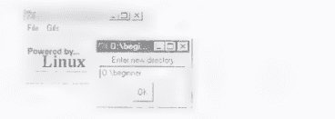

我还添加了一个“另存为...”菜单项，允许您以 PPM 格式保存任何图像（`ImageTk` 类仅提供该写入格式；PIL 支持其他写入格式，但它们需要不同的文件加载方式，这在 PIL 文档中有所涵盖）。图 20.5 显示了 `askopenfilename()` 对话框，它与 `asksaveasfilename()` 对话框非常相似。

**图 20.5**

`tkpil.py` 和“打开文件”对话框。

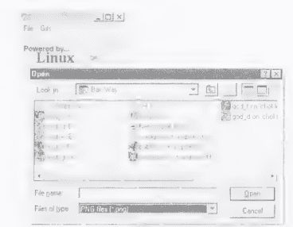

（顺便说一下，那就是 Linux 按钮里的那只飞行企鹅。）下载并安装 Python Imaging Library 是值得的：最大的优势在于您可以创建自己的绘图或图像，使用它们并分发它们，而无需依赖 GIF 文件，因为 GIF 在最好的情况下也是有问题的。请注意，它确实存在一些问题，特别是在 UNIX 特有的图形格式（如 XBM 和 XPM）中。如果您不使用这两种格式的文件，可能不会注意到任何异常。在接下来的章节中，您将开始学习如何使用 Canvas 控件创建自己的绘图和图像。

### Canvas 控件

Canvas 控件专为绘图设计，提供了大量的可用方法。在 http://www.pythonware.com 存在一些文档，但不完整且相当简略。不过，在使用它之前，您必须首先理解绘图范式。与大多数图形工具包一样，您通常不会逐像素地绘制事物；相反，您构建某种数据结构，通过相应的命令将其传递给窗口或控件，然后由可绘制对象（窗口或控件）为您完成工作。如果您有其他工具包的经验，可能会觉得 Tkinter 的 Canvas 控件提供的绘图方法比其他工具包少，但只要结合正确的基本指令，您可以绘制任何想要的内容。例如，没有绘制单个像素的命令；您必须使用 `Rectangle()` 或 `Line()` 方法。这应该鼓励您寻找将多个请求组合成一个的方法（在稍后您将看到的 Mandelbrot 集显示中，我并没有采用这种方法）。

Canvas 控件用于绘制对象的各种基本范式与其他 GUI 系统略有不同。在大多数其他系统中，您可以使用点、线或其他绘图原语绘制到屏幕上的绘图区域或离屏区域，且此类绘制会立即发生。而在 Canvas 控件中，您描述一个对象（例如矩形），并将该描述放入控件的待绘制对象列表中。绘制的对象直到控件更新时才会出现，并且它会被绘制在任何已存在的对象之上。您可以删除已绘制的对象，它们将在下次更新时消失。绘制的对象也可以极其复杂，但一旦绘制完成，只需极少的工作即可将其移动到 Canvas 上的任何位置。例如，这使得在另一幅图之上添加十字准星变得简单，且可以轻而易举地移动或撤回。稍后在 Mandelbrot 绘图应用程序中，我们将具体看到这一点。这种绘图风格的缺点是，任何给定的 Canvas 控件都可能包含数千个对象；包含单个像素的绘图很容易达到这种复杂度水平。内存占用较高，且更新速度可能会慢得令人痛苦。尽管如此，所获得的灵活性通常足以抵消内存和速度问题。

以下章节描述了 Canvas 控件中包含的图形对象；在每种情况下，虽然 Canvas 控件都有创建对象的方法，但使用提供的便捷函数会更容易。底层的 Canvas 方法形式为 `create_rectangle()` 或 `create_line()`。

#### Rectangle（矩形）对象

矩形由四个坐标指定：左上角的 x 和 y，以及右下角的 x1 和 y1。x,y 为 0,0 指的是 Canvas 的左上角；然而，要看到绘制在 0,0 处的像素，您必须将 `borderwidth` 和 `highlightthickness` 选项设置为 0。如果不这样做，焦点高亮将绘制在 Canvas 控件之上（从而占用可见区域）。如果您需要某种边框，最佳实践是将 Canvas 控件包含在一个 Frame 控件中，并将边框选项应用于该 Frame。

`Rectangle()` 调用的语法为：

`Rectangle(cv, x, y, x1, y1, options...)`

一个典型的调用可能是这样的：

`Rectangle(cv, 100, 100, 200, 200, fill="red")`

这将在 Canvas `cv` 上绘制一个 100 像素见方的红色矩形，其左上角（用 Tk 的术语来说是 NW，即西北方向）设置在坐标 100 和 100 处。作为参考，相应的 `create_rectangle()` 调用为：

`cv.create_rectangle(x, y, x1, y1, options...)`

有几个有用的选项可用，但为了不在本书中逐一涵盖，我编写了一个演示程序，可以从本书的网站下载：http://www.pauauhtun.org/TYPython/CanvasDemo.html。说明和截图详细展示了如何使用 Canvas 绘图对象的所有可用选项。

#### Line（直线）对象

直线同样由四个坐标指定，与矩形相同：x 和 y 是直线的起点，x1 和 y1 是终点。语法为：

`Line(cv, x, y, x1, y1, options...)`

一个典型的调用可能是：

`Line(cv, 100, 100, 200, 100, fill='blue')`

#### Arc（弧线）对象

弧线不是圆；您可以将它们绘制成占据 360 度，但用于绘制圆的正确对象是 Oval（稍后介绍）。图 20.6 显示了 CanvasDemo.py（可下载的演示程序）的截图并解释了原因。

图片顶部的弧线是“饼图切片（pie slice）”风格；另外两种风格是“弧线（arc）”和“弦（chord）”。绘制右侧所有三种弧线的调用为：

`Arc(cv, x, y, x1, y1, extent=90, fill="#808080", style="pieslice")`

`Arc(cv, x, y, x1, y1, extent=90, fill="#808080", style="arc")`

`Arc(cv, x, y, x1, y1, extent=90, fill="#808080", style="chord")`

选项决定了最终效果。请注意，您可以绘制 0-359 度的弧线，但您需要使用比使用 Oval 对象更多的参数。


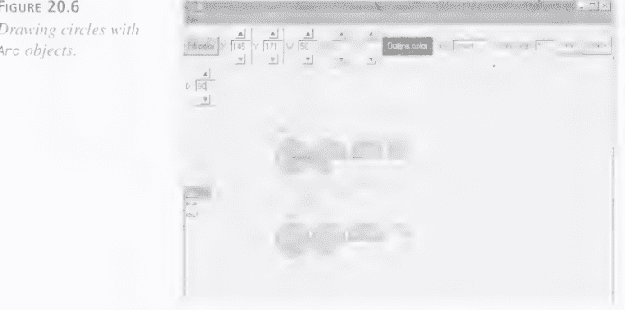

**图 20.6**

*使用 Arc 对象绘制圆。*

#### Oval（椭圆）对象

要绘制与前例相同的圆，您可以使用以下代码：

`Oval(cv, x, y, x1, y1, fill="#808080")`

您需要记住，圆、弧线和椭圆都不是相对于它们的中心绘制的（椭圆有两个焦点，而不是一个有意义的“中心”）；相反，它们的包围盒（bounding boxes）决定了它们被绘制的位置，因此中心只能通过计算得出（如果您在意的话）。因此，只需更改包围盒的尺寸，就可以很容易地将一个正圆转换为一个完美的椭圆。图 20.7 显示了仅更改包围盒的结果。


### 图 20.7

*拉伸包围盒，拉伸 Oval 对象。*

### Polygon（多边形）对象

多边形是由线段组成的封闭图形。您可以拥有任意数量的线段，但仅由两条线组成的图形不能是多边形；为了闭合图形，它必须至少有三条线段。线段和角度全部相同的多边形被称为“正”多边形；正六边形和正五边形就是很好的例子。当然，边数足够多且角度足够浅的多边形与圆无法区分，但您可能不想通过列出数千个点来指定一个圆（尽管这是可行的）。三角形是最简单的多边形，且像大多数在绘图中实用的多边形一样，不规则的情况比规则的情况更多。`Polygon` 对象可用于绘制正多边形和不规则多边形，但如果您想绘制正多边形，您将需要一个程序来帮助您计算顶点的位置；互联网上有几个这样的免费程序，但当然它们不是用 Python 编写的（更多信息请参阅练习）。


> 顶点（vertex）是两条线相交的点。如果两条线以 180 度角相交，则没有顶点，只有一条线。`Vertex` 的复数形式是 `vertices`。

这是因为 Tkinter 不会像处理圆、弧线或椭圆那样为您进行计算；您必须向 Tkinter 提供一个点 `(x,y)` 列表，它会在它们之间绘制直线。如果您有一个由九条边组成的多边形，您需要告知 Tkinter 所有九个顶点：与某些图形系统不同，您不需要将起始顶点作为第十个顶点包含在列表中。Tkinter 会假设您想要闭合多边形，因此它会将最后一个顶点和第一个顶点连接起来。以下代码绘制了一个简单的三边多边形：

`Polygon(cv, 130, 130, 130, 258, 258, 258, 130, 30, fill="#FFFFFF")`

这段代码假设您在 400x400 的 Canvas 控件上绘图，并且控件的背景颜色不是白色（通常是某种灰色）。我们稍后将详细讨论多边形。

### Bitmap（位图）对象

位图被称为“单平面”图像。也就是说，图像中没有内置颜色：相反，图像由处于开启或关闭状态的位组成。这些图像最常见的存储格式是由 X Windows 推广的 X Bitmap 格式，即 XBM。正如您之前看到的，Tkinter 通过使用 `ImageTk` 对象提供对这类图像的支持。然而，使用 `Bitmap` 对象时，您不必先构建图像：您只需指定获取位图的文件名即可。在创建对象时，您还可以指定前景色和背景色。以下代码正是这样做的：

```python
bmpn = "@GVI.xbm"
item = Bitmap(cv, 368, 368, bitmap=bmpn, foreground="#808080")
```

`@` 符号告诉 `Bitmap()` 调用去搜索一个文件，而不是使用其内置的位图图像——同样，这里假设你在一个 400×400 的 Canvas 控件上进行绘制。此次调用的结果如图 20.8 所示。


### Image 对象

与 Bitmap 对象类似，Image 也是图片，但其中嵌入了颜色值：标准的 Tk PhotoImage 方法支持它们，但仅限于 GIF 和 PPM 格式。对于其他格式，你需要使用本章前面（以及练习中）提到的 PIL。以下代码显示了一张彩色图像，它被放置在与前述位图相同的 Canvas 相同位置上：

```python
img = PhotoImage('GV1.ppm')
item = ImageItem(cv,368,368,image=img)
```

由于 Image 这个名称已被 Tkinter 占用，因此这个便捷函数被命名为 `ImageItem`。图 20.9 显示了生成的 Image 对象。


### CanvasText 对象

Text 对象很简单——给出一组坐标、文本、颜色，你的文本就会被显示出来。以下代码正是如此：

```python
item = CanvasText(cv,368,368+48,fill="#007090",text="The image god of god GVI of Palenque")
```

图 20.10 显示了结果。

请注意，`Text` 对象的默认放置方式是以你提供的坐标为中心。要使用更常规的放置方式，你可以在创建 `Text` 对象时提供 `anchor=NW` 选项。

### Window 对象

Window 对象用于将任何你想要的 Tkinter 控件放置在 Canvas 对象内部，包括另一个 Canvas 对象。以下代码演示了如何包含一个简单的按钮：

```python
btn = Button(cv,text="Image",command=drawImage)
item = Window(cv,368,368,anchor=SW,window=btn)
```

图 20.11 显示了包含 Button 控件的 Canvas。

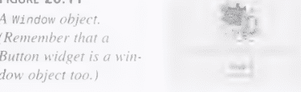

## 总结

我们涵盖了几种菜单，构建了一个可滚动 `Listbox`，接触了 Tkinter 的一些图像能力（包括少量的 Python Imaging Library），回顾了 Canvas 控件的绘制范式，并讨论了 Canvas 控件中可用于绘制的各种对象。

在下一章中，我们将介绍简单的图形和动画。

## 工作坊

### 问答

- **问：其中一个扇形看起来很像吃豆人。可以用 Python 做游戏吗？**

  **答：** 当然可以。如果你完全用 Python 编写，运行速度可能不会很快，所以你可能需要至少将其部分内容用 C 语言编写。1998 年在休斯顿举行的第七届国际 Python 会议上，有一篇关于使用 Python 进行虚拟世界模拟的文章。更多信息请参阅 `http://www.foretec.com/python/workshops/1998-11/proceedings/papers/asbahr/asbahr.html`。

- **问：图 20.6 显示了一些相当华丽的控件；为什么你没有讲解那些？**

  **答：** 那些是 Python MegaWidgets 的示例，超出了本书的范围。请参阅 PMW 网站 `http://www.dscp1.com.au/pmw/`。

### 测试

1. 如何滚动 `Listbox` 控件？

   a. 你必须实现三个不同的回调函数，一个用于 `Scrollbar` 控件，一个用于 `Listbox` 控件。

   b. 你只需要为滚动条构建一个回调函数。

   c. 你必须自己绘制滚动条，否则它无法工作。

   d. 你只需要利用 `Scrollbar` 和 `Listbox` 控件自带的预置回调函数。

2. `Bitmaps` 和 `Images` 之间有什么区别？

   a. 没有区别——底层都是一样的。

   b. `Images` 是带颜色的 `Bitmaps`。

   c. 这取决于你如何使用它们。

   d. `Bitmaps` 速度更快。

### 答案

1. d. 正确的回调函数已经内置；你只需要将它们分配给正确的选项。

2. b. `Images` 确实是带颜色的 `Bitmaps`；`Bitmap` 中的每个像素占用 1 位，而 `Images` 至少需要 8 位来存储像素的颜色。

### 练习

你可以在 `http://www.ioccc.org/` 了解更多关于混淆代码的信息，这里是国际混淆 C 语言代码大赛的首页。虽然重点是 C 语言，但用任何语言编写混淆代码都是可能的。用 Python 来实现更困难，但只要坚定地运用平庸之才，任何人都能做到。

有关 GIF 格式及其争议的信息，请参阅 Burn All Gifs 网站：`http://burnallgifs.org/`。Eric S. Raymond 在他的网站 `http://www.tuxedo.org/~esr/` 上发表了许多有趣的文章，其中一些与 GIF 问题有关。

有关 netpbm 和其他图形格式的信息，请访问 Graphics Muse：`http://www.graphics-muse.org/`。

一个刚刚开通的新站点是 Tim Middleton 创建的 Vaults of Parnassus（`http://www.vex.net/parnassus/`）。它承诺将成为寻找 Python 模块的最佳地点。它做得非常好，一些最晦涩的内容在这里很容易被追踪到。它还承诺成为 CPAN 存档（定位 Perl 模块的标准站点）的 Python 等价物——不过要酷得多。（顺便说一句，Parnassus 是希腊神话中的 Python 居住在洞穴中的山脉。）

有关正多边形和铺砌的信息，请访问 `http://www.scienceu.com/geometry/articles/tiling/`。该主题的权威书籍是 Branko Grunbaum 和 G.C. Shephard 合著的《Tilings and Patterns》。由 W.H. Freeman 出版，遗憾的是现在已绝版，但任何像样的图书馆都会有（或能够获取）一本。


# 第 21 小时：Tk 图形 II

> 我希望我们所有人都能用印度墨水和水彩刷来交流；掌握窍门需要一段时间，但从那时起一切都变得简单了。它还鼓励人们用更少的文字填充更多的含义！
>
> ——Don Arnstine

在上一小时，我们开始学习 Tk 图形。本小时，我们将继续讨论颜色和一些简单的动画。在本小时结束时，你将能够：

- 对颜色有初步的了解
- 使用 Canvas 控件实现简单的动画

## 颜色

颜色是一个宏大的主题；关于颜色的许多话题有数百本，甚至数千本书。如果你想对计算机和颜色有基本的了解，Charles Poynton 的《Digital Video》可能是个很好的起点。

这意味着我只能轻微地触及极少数观点，因为颜色中的大部分内容都超出了本书的范围。为了真正理解，你应该准备投入数年时间研究颜色（而不是半小时）。

这里是对颜色的一次“闪电战”式介绍（请坐稳了）。1931 年，国际照明委员会（CIE）描述了用于描述颜色的数学模型，这些模型提供了衡量所有其他颜色空间的标准。因为人类眼睛包含三种颜色光感受器（对于记得高中生物的人来说，称为锥细胞），CIE 系统中的任何颜色都可以仅用三个维度来定位：这三个维度足以描述任何颜色空间。我将讨论范围限制在 RGB（红-绿-蓝）颜色空间，因为这是计算机几乎唯一使用的空间。

RGB 颜色空间是线性的；也就是说，每个维度可以被分成等大小的部分，且每个轴的长度相同。请注意，并非所有可见颜色都能在 RGB 颜色空间中被精准定位；事实上，只有 CIE 拥有足够复杂地指定每种可见颜色的模型。所有其他颜色空间出于实用或经济原因都做出了妥协；例如，一种对电视广播特别有用的颜色空间被称为 YIE。然而，这些其他颜色空间目前对你没有用处，且超出了本书的范围。图 21.1 显示了 RGB 颜色空间；在这里的印刷页上它以灰色阴影出现，所以要查看彩色效果，请运行随附的程序。

### 图 21.1

RGB 颜色立方体。

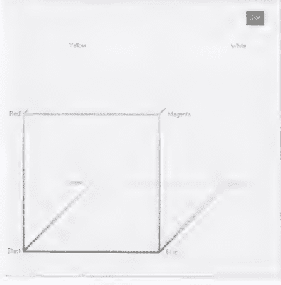

当然，在彩色模式下，你会看到左前垂直边从黑色渐变为红色，后垂直边从绿色渐变为黄色，依此类推。代码清单 21.1 显示了以下代码：

### 示例代码 21.1 `ccube.py`

该程序绘制了图 21.1 所示的三维颜色立方体的二维表示。


```python
#!/usr/local/bin/python
import sys
from Tkinter import *
from Canvas import Rectangle,Polygon,Window,CanvasText

def GreenCyan():
    global bll,cv
    brl = [0,0xFF,0]
    tmp = bll[:]
    for i in range(ncolors):
        cm = "#%02X%02X%02X" % (brl[0],brl[1],brl[2])
        Rectangle(cv,tmp[0],tmp[1],tmp[0]+dg,tmp[1]+4, 
                  fill=cm,outline="",tag="colorcube")
        tmp[0] = tmp[0] + dg
        brl[2] = (brl[2] + hr) % 0x100

def GreenYellow():
    global bll,cv
    brl = [0,0xFF,0]
    tmp = bll[:]
    for i in range(ncolors):
        cm = "#%02X%02X%02X" % (brl[0],brl[1],brl[2])
        Rectangle(cv,tmp[0],tmp[1],tmp[0]+4,tmp[1]-dg,
                  fill=cm,outline="",tag="colorcube")
        tmp[1] = tmp[1] - dg
        brl[0] = (brl[0] + hr) % 0x100

def YellowWhite():
    global bul,cv
    brl = [0xFF,0xFF,0]
    tmp = bul[:]
    for i in range(ncolors):
        cm = "#%02X%02X%02X" % (brl[0],brl[1],brl[2])
        Rectangle(cv,tmp[0],tmp[1],tmp[0]+dg,tmp[1]+4,
                  fill=cm,outline="",tag="colorcube")
        tmp[0] = tmp[0] + dg
        brl[2] = (brl[2] + hr) % 0x100

def WhiteCyan():
    global bur,cv
    brl = [0xFF,0xFF,0xFF]
    tmp = bur[:]
    for i in range(ncolors):
        cm = "#%02X%02X%02X" % (brl[0],brl[1],brl[2])
        Rectangle(cv,tmp[0],tmp[1],tmp[0]+4,tmp[1]+dg,
                  fill=cm,outline="",tag="colorcube")
        tmp[1] = tmp[1] + dg
        brl[0] = (brl[0] - hr) % 0x100

def BlackBlue():
    global fll,cv
    brl = [0,0,0]
    tmp = fll[:]
    for i in range(ncolors):
        cm = "#%02X%02X%02X" % (brl[0],brl[1],brl[2])
        Rectangle(cv,tmp[0],tmp[1],tmp[0]+dg,tmp[1]+4,
                  fill=cm,outline="",tag="colorcube")
        tmp[0] = tmp[0] + dg
        brl[2] = (brl[2] + hr) % 0x100

def BlackRed():
    global fll,cv
    brl = [0,0,0]
    tmp = fll[:]
    for i in range(ncolors):
        cm = "#%02X%02X%02X" % (brl[0],brl[1],brl[2])
        Rectangle(cv,tmp[0],tmp[1],tmp[0]+4,tmp[1]-dg,
                  fill=cm,outline="",tag="colorcube")
        tmp[1] = tmp[1] - dg
        brl[0] = (brl[0] + hr) % 0x100

def RedMagenta():
    global ful,cv
    brl = [0xFF,0,0]
    tmp = ful[:]
    for i in range(ncolors):
        cm = "#%02X%02X%02X" % (brl[0],brl[1],brl[2])
        Rectangle(cv,tmp[0],tmp[1],tmp[0]+dg,tmp[1]+4,
                  fill=cm,outline="",tag="colorcube")
        tmp[0] = tmp[0] + dg
        brl[2] = (brl[2] + hr) % 0x100

def MagentaBlue():
    global fur,cv
    brl = [0xFF,0,0xFF]
    tmp = fur[:]
    for i in range(ncolors):
        cm = "#%02X%02X%02X" % (brl[0],brl[1],brl[2])
        Rectangle(cv,tmp[0],tmp[1],tmp[0]+4,tmp[1]+dg,
                  fill=cm,outline="",tag="colorcube")
        tmp[1] = tmp[1] + dg
        brl[0] = (brl[0] - hr) % 0x100

def BlackGreen():
    global fll,cv
    brl = [0,0,0]
    tmp = fll[:]
    eg = dg / 2
    for i in range(ncolors):
        cm = "#%02X%02X%02X" % (brl[0],brl[1],brl[2])
        Polygon(cv,
            tmp[0],tmp[1],
            tmp[0]+eg,tmp[1]-eg,
            tmp[0]+eg+3,tmp[1]-eg+3,
            tmp[0]+3,tmp[1]+3,
            fill=cm,outline="",tag="colorcube")
        tmp[0] = tmp[0] + eg
        tmp[1] = tmp[1] - eg
        brl[1] = (brl[1] + hr) % 0x100

def BlueCyan():
    global flr,cv
    brl = [0,0,0xFF]
    eg = dg / 2
    tmp = flr[:]
    for i in range(ncolors):
        cm = "#%02X%02X%02X" % (brl[0],brl[1],brl[2])
        Polygon(cv,
            tmp[0],tmp[1],
            tmp[0]+eg,tmp[1]-eg,
            tmp[0]+eg+3,tmp[1]-eg+3,
            tmp[0]+3,tmp[1]+3,
            fill=cm,outline="",tag="colorcube")
        tmp[0] = tmp[0] + eg
        tmp[1] = tmp[1] - eg
        brl[1] = (brl[1] + hr) % 0x100

def RedYellow():
    global ful,cv
    tmp = ful[:]
    brl = [0xFF,0,0]
    eg = dg / 2
    for i in range(ncolors):
        cm = "#%02X%02X%02X" % (brl[0],brl[1],brl[2])
        Polygon(cv,
            tmp[0],tmp[1],
            tmp[0]+eg,tmp[1]-eg,
            tmp[0]+eg+3,tmp[1]-eg+3,
            tmp[0]+3,tmp[1]+3,
            fill=cm,outline="",tag="colorcube")
        tmp[0] = tmp[0] + eg
        tmp[1] = tmp[1] - eg
        brl[1] = (brl[1] + hr) % 0x100

def MagentaWhite():
    global fur,cv
    tmp = fur[:]
    brl = [0xFF,0,0xFF]
    eg = dg / 2
    for i in range(ncolors):
        cm = "#%02X%02X%02X" % (brl[0],brl[1],brl[2])
        Polygon(cv,
            tmp[0],tmp[1],
            tmp[0]+eg,tmp[1]-eg,
            tmp[0]+eg+3,tmp[1]-eg+3,
            tmp[0]+3,tmp[1]+3,
            fill=cm,outline="",tag="colorcube")
        tmp[0] = tmp[0] + eg
        tmp[1] = tmp[1] - eg
        brl[1] = (brl[1] + hr) % 0x100

def LabelVertices():
    global cv,fll,flr,blr,bll,fur,bul,bur
    CanvasText(cv,fll[0] - 17,fll[1],text="Black",tag="colorcube")
    CanvasText(cv,flr[0] + 25,flr[1],text="Blue",tag="colorcube")
    CanvasText(cv,blr[0] + 20,blr[1],text="Cyan",tag="colorcube")
    CanvasText(cv,bll[0] - 30,bll[1],text="Green",tag="colorcube")
    CanvasText(cv,bul[0] - 15,bul[1],text="Red",tag="colorcube")
    CanvasText(cv,fur[0] + 20,fur[1],text="Magenta",tag="colorcube")
    CanvasText(cv,bul[0] - 25,bul[1],text="Yellow",tag="colorcube")
    CanvasText(cv,bur[0] + 25,bur[1],text="White",tag="colorcube")

def ColorCube():
    # Back rectangle first:
    GreenCyan()
    GreenYellow()
    YellowWhite()
    WhiteCyan()
    # Diagonals:
    RedYellow()
    BlackGreen()
    MagentaWhite()
    BlueCyan()
    # Front rectangle:
    BlackBlue()
    BlackRed()
    RedMagenta()
    MagentaBlue()
    LabelVertices()

if __name__ == "__main__":
    # Vertices of the rgb cube
    # fll = front lower left;
    # bur = back upper right; etc.
    # The various functions draw
    # the necessary edges.
    fll = [32,468]
    flr = [286,468]
    ful = [32,212]
    fur = [286,212]
    bll = [160,340]
    blr = [412,340]
    bul = [160,84]
    bur = [412,84]

    ncolors = 32
    hw = 256

    dg = hw/ncolors
    hr = 0x100 / ncolors

    def die(event=0):
        sys.exit(0)

    root = Tk()
    root.title("RGB Color Cube")
    cv = Canvas(root,width=512,height=512,borderwidth=0,
                highlightthickness=0)
    ColorCube()

    button = Button(cv,text="Quit",background="black",
                    foreground="red",command=die)
    Window(cv,468,32,window=button)

    cv.pack()

    root.mainloop()
```

（请注意，如果你使用的是 256 色或更低色深的显示器，应将 `ncolors` 的值更改为 16；否则，你的立方体可能会出现略显奇怪的颜色。）

这段代码的大部分内容在我们之前讨论的各种 Tk 组件中应该已经非常熟悉了，包括在 `Canvas` 组件上绘制矩形和多边形的便捷函数。请注意，在第 221-223 行中，我们构建了一个“退出”按钮，并使用 `Window()` 便捷函数将其安装到 `Canvas` 组件中。你之前没见过的唯一内容出现在第 11 行，即 `cm = "#%02X%02X%02X" % (brl[0],brl[1],brl[2])`。这会产生一个类似于这样的字符串：黑色为 `"#000000"`，白色为 `"#FFFFFF"`。

Tkinter 要求所有颜色规范要么是名称（如 `"red"`、`"white"` 或 `"black"`），要么是以 `#` 符号（记得，这是一个 octothorpe 符号）开头的 RGB 颜色字符串。接下来的六个十六进制数字指定了 RGB 空间中的坐标：前两位是红色位置，接下来的两位是绿色位置，最后两位是蓝色位置。深红色将由 `"#800000"` 指定，即恰好位于红色轴的中点，而沿绿色或蓝色轴没有移动（axes 是 axis 的复数形式）。

在示例代码 21.1 的所有函数中，我们将特定颜色轴的长度分为 32 份（我们使用的颜色数量），并绘制每个所得颜色的微小矩形或多边形，直到构建出整个轴。表 21.1 显示了立方体中每个轴（或边缘）的颜色范围（按绘制顺序给出）。

### 表 21.1 颜色轴的颜色范围

| 轴 | 颜色范围 | 函数 |
| :--- | :--- | :--- |
| 绿-青 (后下左—后下右) | #00FF00—#00FFFF | `GreenCyan()` |
| 绿-黄 (后下左—后上左) | #00FF00—#FFFF00 | `GreenYellow()` |
| 黄-白 (后上左—后上右) | #FFFF00—#FFFFFF | `YellowWhite()` |
| 白-青 (后上右—后下右) | #FFFFFF—#00FFFF | `WhiteCyan()` |
| 黑-蓝 (前下左—前下右) | #000000—#0000FF | `BlackBlue()` |
| 黑-红 (前下左—前上左) | #000000—#FF0000 | `BlackRed()` |
| 红-洋红 (前上左—前上右) | #FF0000—#FF00FF | `RedMagenta()` |
| 洋红-蓝 (前上右—前下右) | #FF00FF—#0000FF | `MagentaBlue()` |
| 黑-绿 (前下左—后下左) | #000000—#00FF00 | `BlackGreen()` |
| 蓝-青 (前下右—后下右) | #0000FF—#00FFFF | `BlueCyan()` |
| 红-黄 (前上左—后上左) | #FF0000—#FFFF00 | `RedYellow()` |
| 洋红-白 (前上右—后上右) | #FF00FF—#FFFFFF | `MagentaWhite()` |


我在每个轴上仅使用了 0-32 的范围，这总共产生了 32³，即 32,768 种颜色；理论上，你可以将每条边分成任意多份，唯一的限制是 Python 的浮点数计算能力。你可以把 RGB 颜色立方体想象成 Scrooge 大叔的钱库（据我记得，它的尺寸大约和土星装配大楼一样大），其中每枚硬币或每张钞票都由三维坐标来描述，因此每件物品都有不同的颜色。可能性仅由硬币或钞票的大小来限制可能性（不过，Scrooge 似乎拥有比钞票多得多的硬币）。大多数计算机彩色显卡允许的颜色范围有限，从 16 种（低端）到 16,777,216 种（高端）。后者是一个每条边有 256 种颜色的颜色立方体，这也是 Tkinter 颜色规范字符串所允许的最大值。

虽然 RGB 颜色立方体能够足够准确地表示相应的色彩空间，但它并不能让你真正感受到颜色之间的关系。为此，我们转向色轮，这无疑是你小学时代就接触过的东西。图 21.2 显示了这样一个色轮；它经过了简化，因为以前在词典和百科全书中显示的典型色轮被分成了若干扇区，而这张图没有。

### 图 21.2

一个色轮。

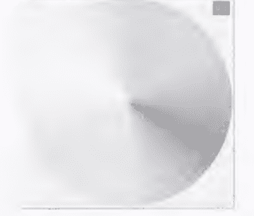

在顶部，你看到的是红色：向左 120 度是绿色，向右 120 度是蓝色。这些是原色，至少在计算机圈子（此处双关，指色轮）中是这样。在距离红色 180 度的位置你看到青色；距离绿色 180 度是洋红色；距离蓝色 180 度是黄色。这些是互补色。当然，要真正看到彩色的色轮，你必须运行清单 21.2 中给出的程序。

### 清单 21.2 `tkwheel.py`

```python
1 #!/usr/local/bin/python
2
3 from Tkinter import *
4 from Canvas import Rectangle,Oval,Arc,Window
5 from colormap import *
6 import sys
7
8 cmap = SetupColormap0(360)
9
10 root = Tk()
11 cv = Canvas(root,width=401,height=401,borderwidth=0,
12     highlightthickness=0)
13 ar = Oval(cv,0,0,400,400)
14 for i in range(360):
15     e = (i + 90) % 360
16     ps = Arc(cv,0,0,400,400,start=e,extent=1,fill=cmap[i],outline="")
17
18 def die(event=0):
19     sys.exit(0)
20
21 button=Button(cv,text="Quit",foreground="red",background="black",
22     command=die)
23 Window(cv,380,20,window=button)
24 cv.pack()
25
26 root.mainloop()
27
28
29
```

在这个小程序中，新项目非常少。一个是第 15 行，我们在那里给出了饼图切片的起始角度（你可能记得，这是 `Arc()` 便利函数的默认类型）。所有 `Arc()` 类型都将 0 位置或角度定义为向右 90 度，而不是垂直 90 度。我认为这很奇怪，所以我调整了起始角度，将其放在我认为应该在的位置。另一个你之前没见过的项目是第 8 行对 `SetupColormap0()` 的调用；`SetupColormap0()` 来自 `colormap` 模块（第 5 行 `from colormap import *`），这里没有展示该模块。这是因为该模块为了能够以特定顺序提供颜色列表（一个颜色映射表），在另一个色彩空间 HLS（代表色相-亮度-饱和度）中构建颜色映射。当颜色规范在 RGB 空间时很难进行排序，但在 HLS 色彩空间中却非常简单。`colormap.py` 的代码可在本书的网页 http://www.pauhatun.org/TYPython/ 上找到，但这超出了我们讨论的范围。你无需理解其工作原理即可使用各种颜色映射函数：只需提供你想要的颜色数量，所有 `SetupColormap()` 函数将返回一个包含你请求数量的颜色列表，并在末尾额外增加一个黑色条目（原因将在稍后讨论 Mandelbrot 集合时变得清晰）。

RGB 颜色规范非常适合构建灰度级列表：因为任何红色、绿色和蓝色分量全部相同的 RGB 规范都是一个灰度级。清单 21.3 显示了 `SetupColormap()` 函数的代码。

### 清单 21.3 `SetupColormap6()`

```python
1
2 def SetupColormap6(ncolors):
3   cmap = []
4   xd = 1.0/ncolors
5   for i in range(0,ncolors):
6     r = g = b = 0xFF - ((i * xd) * 0xFF)
7     cmap.append("#%02X%02X%02X" % (r,g,b))
8   cmap.append("#000000")
9   return cmap
```

你可以看到这个函数确实非常简单。通过将我们的灰色轴长度定义为 1.0，我们可以将其除以颜色数量，从而得出每个灰度级的增量。你可能会对我使用“灰色轴”这个词感到困惑，因为当你查看图 21.1 中的颜色立方体时，似乎并没有这样的东西。然而，如果你从黑色顶点画一条对角线到白色顶点，你会发现该线上的每个点在 `r`、`g` 或 `b` 每个维度上的坐标都是相同的。在第 6 行，我们将增量 `xd` 乘以 `i`，得到灰色轴上的位置。然后我们将该结果乘以 `0xFF`，将其转换为 RGB 维度。图 21.3 在窗口中显示了一个灰色映射表。


### 图 21.3

灰色阴影。

清单 21.4 显示了实现这种灰度级“喷泉”的代码。

### 清单 21.4 `fountain.py`

```python
1 #!/usr/bin/python
2
3 import sys, string
4
5 from Tkinter import *
6 from Canvas import Rectangle,Window
7 from colormap import *
8
9 def die(event=0):
10     sys.exit(0)
11
12 w = 512
13 h = 64
14 root = Tk()
15 cv = Canvas(root,width=w,height=h,borderwidth=0,
16          highlightthickness=0)
17 cmap = Graymap(256)
18 wd = 2
19 x = y = 0
20 for i in range(256):
21     Rectangle(cv,x,y,x+wd,y+h,fill=cmap[i],width=0,outline="")
22     x = x+wd
23 gb=Button(root,text="Quit",command=die)
24 item=Window(cv,450,32,window=gb)
25 cv.pack()
26 root.mainloop()
27
```

如果你想让黑色在左侧而不是右侧，只需对第 17 行返回的颜色映射调用 `cmap.reverse()` 即可，因为 Python 的列表具有非常有用的方法，如 `sort()` 和 `reverse()`。第 17 行显示了对 `Graymap()` 的调用，这与调用 `SetupColormap6()` 相同：它返回一个 Tkinter 颜色字符串列表，然后为每个绘制的矩形进行索引以提供填充颜色。在这种情况下，填充颜色仅仅是一个灰色阴影，矩形宽 2 像素，高 64 像素。

这样的“喷泉”可以用在很多地方：现在已经绝版的 *PostScript Journal* 在其中一期中介绍了灰度喷泉及其绘制方法：在下一期中，它开始将此用于内页布局（随后该期刊停刊了）。

在今天的现代彩色显示器上，制作彩色喷泉可能会更有趣。考虑到我们用于绘制图 21.2 中色轮的同一组颜色映射函数，这并不特别困难。（如果你想仅使用 RGB 颜色立方体的一个面来制作彩色喷泉，在不使用任何颜色映射函数的情况下你会怎么做？）图 21.4 显示了用 `SetupColormap0()` 替换 `Graymap()` 调用（以及一些其他微调）后的结果。

### 图 21.4

一个彩色喷泉。

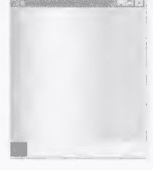

清单 21.5 提供了完整代码。

### 清单 21.5 `colorfountain.py`

```python
1 #!/usr/local/bin/python
2 
3 import sys, string
4 
5 from Tkinter import *
6 from Canvas import Rectangle, Window
7 from colormap import *
8 
9 def die(event=0):
10     sys.exit(0)
11 ncolors = 256
12 w = 256
13 h = 256
14 root = Tk()
15 frame = Frame(root)
16 cv = Canvas(frame, width=w, height=h, borderwidth=0,
17           highlightthickness=0)
18 cmap = Setupcolormap0(ncolors)
19 wd = w/ncolors
20 x = y = 0
21 for i in range(ncolors):
22     Rectangle(cv, x, y, x+wd, y+h, fill=cmap[i], outline="")
23     x = x+wd
24 qb=Button(frame, text='Exit', command=die,
25           foreground="red", background="black")
26 frame.pack()
27 cv.pack(side=TOP)
28 qb.pack(side=LEFT)
29 root.mainloop()
30 
```

这段代码与 Listing 21.4 基本相同，唯一的区别是 Canvas 组件的宽度和高度。当然，我希望你能运行这个程序，这样你就能看到彩色喷泉真正的样子。在接下来的一个小时里，我们的彩色喷泉将为简单的动画提供一个有趣的背景。

## 动画

1972 年 Pong 问世时我还在上大学；我记得在伊利诺伊州渥太华附近的采石场和铁路沿线花了一个长周末挖掘地质课所需的化石后，我和一群朋友去了 Papa Charlie's（芝加哥希腊镇的一家比萨店）。我们坐下来，扫视了一下弹珠机所在的位置，看到一个显示器上有一个白色的小球在跳动。我对游戏一直没什么兴趣，但我承认我尝试玩了一下。过了一会儿我就失去了兴趣，但仍然对这台计算机印象深刻。我之前接触的最新计算机都是占据整个房间的庞然大物（还记得吗，“我参与创造了千年虫”），而这里有一台大约照片亭大小的机器，竟然能实现图形显示并玩游戏。回想起来，我意识到那是我对计算机兴趣被重新点燃的时刻。下一个季度，我修了一门动物考古学课程。教授建议我们鉴定数千块从土耳其遗址收集的动物骨骼碎片，并将结果用计算机制表。他认识一个编写了统计分析程序的开发者，他认为我们可以调整数据格式以适配该程序。虽然那个项目最终没能成功，但从那时起，我一直以某种方式与计算机打交道。

因此，我认为向你们介绍动画的最佳方式是展示一个 Pong 风格的程序；真正的 Pong 有一两个挡板，你的目标是阻止球飞过你并冲出屏幕，但对我来说这根本没有意思（更不用说超出了我的手眼协调能力）。因为我手头有很多玛雅文字符号，所以自然而然地想到用符号代替球，并允许几个符号在周围跳动，而不仅仅是一个。因为我想要一个更有趣的背景，我们将使用上一节中开发的彩色喷泉作为跳动符号的背景。这正是每个人都需要的，对吧？

不过，我们需要先做一个小小的离题。直到下一个小时我们才会真正接触跳动符号；在此期间，让我们先来打场台球。

当你观看 Pong 时，起初你会觉得它就像打台球一样。也就是说，球撞击边缘后以相同的角度反弹。如果它以 45 度角撞击，它将以 45 度角飞出。当你运行清单 21.6 所示的程序时，可以看到这一过程。

### 清单 21.6 `tkpool.py`

```python
#!/usr/local/bin/python
import sys, string

from Tkinter import *
from Canvas import Rectangle,Line,ImageItem,CanvasText
from math import *

w = 128.0
h = 256.0
xp = 0
yp = h
xdelta = 2.0
ydelta = -2.0
wball = None
filename="white.gif"

img = None
txt = None

def Radians(x):
    return(x * (pi/180.0E0))

def Degrees(x):
    return(x * (180.0/pi))

def die(event=0):
    sys.exit(0)

def moveball(*args):
    global cv,img,h,w,ball,xp,yp,xdelta,ydelta
    cv.move(wball,xdelta,ydelta)
    if xp >= 0.0 and yp >=0.0:
        if xp >= w:
            xdelta = xdelta * -1.0
        xp = xp + xdelta
        yp = yp + ydelta
        cv.after(10,moveball)
    else:
        cv.delete(wball)

def chsize(event):
    global w,h,xp,yp,xdelta,ydelta
    w = event.width
    h = event.height

def shoot(event):
    global cv,img,h,w,wball,xp,yp
    global xdelta,ydelta,filename,txt
    img = PhotoImage(file=filename)
    xp = event.x
    yp = event.y
    xdelta = 2.0
    if yp < h/2.0:
        if ydelta < 0:
            ydelta = ydelta * -1.0
    else:
        if ydelta > 0:
            ydelta = ydelta * -1.0
    a = yp - h/2.0
    bw = w - xp
    # A is the angle formed by hypotenuse
    # a is the height of the triangle, side a
    # b is the width of the triangle, side b
    # c is the length of hypotenuse, side c
    # All three trig routines could return 0,
    # so those calls could be put inside a try:
    # except: block.
    A = atan2(a,bw)
    deg = Degrees(A)
    c = 2.0/sin(A)
    b = 2.0/tan(A)
    xdelta = abs(b)
    cv.delete(wball)
    cv.delete(txt)
    wball = ImageItem(cv,xp,yp,image=img)
    txt = CanvasText(cv,w-25,h-25,font="Helvetica 14",
                text="%d%2 d" % int(deg))
    cv.after(10,moveball)

if __name__ == "__main__":
    root = Tk()
    cv = Canvas(root,width=w,height=h,borderwidth=0,
                background="#409040",
                highlightthickness=0)
    cv.bind("<Configure>", chsize)
    cv.bind("<Button-1>", shoot)
    root.bind("<Escape>", die)
    cv.pack(expand=1,fill=BOTH)
    root.mainloop()
```

这个程序中包含了几项新内容：在你看完图 21.5 后我将详细讨论。

### 图 21.5

打台球。


在第 83—93 行中，我们构建了一个典型的 Tk 窗口，其中包含一个 `Canvas` 组件。在第 91 行中，我们告诉 `pack()` 该 `Canvas` 应该是可扩展的（允许改变大小），并且应始终填满其包含组件（即 `root` 窗口）的全部空间。这不仅确保了 `Canvas` 填满整个窗口，还允许用户通过抓取窗口边界上的标准调整大小区域并移动边缘或角落，将窗口调整为他们喜欢的任何尺寸。因为我们始终需要准确知道窗口的大小，所以我们安装了一个函数，每当窗口大小改变时就会被调用。我们在第 88 行使用 `bind()` 方法，将 `"<Configure>"` 作为我们希望回调的事件；在第 44—47 行中，我们可以看到 `chsize()` 回调函数唯一做的事情就是为我们记录 `Canvas` 组件窗口的尺寸。

在第 90 行，我们再次使用 `bind()` 方法，以便在用户按下 Esc 键时调用 `die()`；这样我们就无需提供“退出”或“结束”按钮。不过，我们必须在 `root` 窗口上安装这个回调，因为 `root` 窗口总是拦截所有的按键操作，而不会将它们传递给 `Canvas` 组件。在第 89 行，我们为 `Canvas` 组件中任何位置的鼠标点击添加了一个回调，这个回调函数 `shoot()` 是真正执行工作的地方。它会从你点击的位置向 `Canvas` 右边缘的中心发射一颗台球，球会在那里以发送时的相同角度反弹。这里有一些陷阱，我在接下来的 `shoot()` 详细讨论中会解释。

`shoot()` 函数在执行其他操作之前，首先使用我们在上一个小时中看到的 `PhotoImage()` 函数抓取球的图像（第 52 行）。你可以用任何你想要的 GIF 图像来替代它，但它应该是相对较小且正方形的。接下来的操作是在第 53 和 54 行，将鼠标点击的 x,y 坐标记录在 `xp` 和 `yp` 变量中，以便另一个函数 `moveball()` 可以看到并使用它们。该函数调用 `Canvas` 组件中的 `move()` 方法，并使用 `wball` 变量：`Canvas` 组件知道球图像的位置，并按指定的量对其进行移动。这个量存储在 `xdelta` 和 `ydelta` 变量中；它们被称为 delta 变量，因为在数学中，任何代表向量（方向和速度）微小变化的量传统上都用希腊字母 delta（`Δ`）表示。第 56 到 61 行检查球应该向哪个方向移动：如果用户点击在下半部分，则向窗口顶部移动；如果点击在上半部分，则向底部移动。因为我们必须知道球反弹的角度，所以必须使用三角函数；这确实不可避免，但教授三角函数超出了本书的范围（如果你需要，请查看练习部分中推荐的优秀网页）。你只需要相信我的话——三角函数是必要的，而且它们确实有效。

为了使用三角函数，我们必须知道一些数值，例如我们处理的直角三角形的宽度和高度。每当鼠标点击并获得 x,y 坐标时，我们就拥有了构建三角形所需的所有条件。三角形的高度在第 62 行计算，`a = yp - h/2.0`（我们始终将球瞄准同一个坐标，即窗口右边缘的中心），宽度在第 63 行计算，`bw = w - xp`。图 21.6 显示了直角三角形边和角的传统名称。

### 图 21.6

直角三角形命名法。

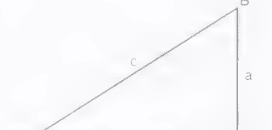

你可以看到，我所称的“宽度”对应于边 b 的长度，而“高度”对应于边 a 的长度：边 c 是斜边（记得勾股定理吗？这里就在实际应用）。因为我们知道边 a 和边 b 的长度，我们可以轻松计算出角度 A。我们在第 71 行执行此操作：`A = atan2(a, bw)`。你可以使用 `math` 模块（`from math import *`）中的 `atan()` 函数代替 `atan2()`，但那样你必须先将边 a 的长度除以边 b 的长度。`atan2()` 在计算角度 A 的反正切之前，会帮我们完成这个除法。顺便提一下，在前一张图中，标记为 A 和 B 的三角形顶点分别对应鼠标点击位置 (A) 和窗口右边缘的中心 (B)。C 是沿 y 轴距离点 B 一定距离的点。

由于 `math` 模块中的所有三角函数都操作并返回弧度值而非角度值，因此我们需要一个将弧度转换为角度的函数，这可以在第 25 和 26 行找到。虽然所有的圆都包含 360 度，但同样的 360 度仅相当于 6.28318530718... 弧度；也就是说，`2 * pi 弧度 = 360 度`。三角函数偏好弧度，但我们要在 `Canvas` 组件上显示计算出的角度，所以需要 `Degrees()` 函数。我还提供了一个相应的 `Radians()` 函数，它接收角度并返回弧度，尽管我们在本程序中没有用到它。第 72 行调用该函数并将结果存储在 `deg` 变量中。

第 74 行（`b = 2.0/tan(A)`）在边 a 的长度设定为 2.0 像素时，通过计算角 A 的正切值来计算边 b 的长度。边 a 代表我们的 `ydelta` 变量，我们将其设置得足够小，以便在程序运行时产生合理的运动感。此处方程的答案可能是正数也可能是负数，由于我们希望球仅向右方射出，因此我们使用答案的绝对值。正如你在第 75 行（`xdelta = abs(b)`）中所看到的。到此为止，我们已经完成了该函数中所需的所有数学计算。

第 76 行和 77 行会删除旧的球体图像和旧的文本（如果它们存在于 `Canvas` 控件的 x,y 坐标处）。在第 78 行，我们将球体图像添加到 `Canvas` 中，其 x,y 坐标由鼠标点击决定。在第 79 行和 80 行，我们为 `Canvas` 控件创建了一个文本项，放置在左下角，用于告知我们射球的角度。

真正移动球的函数在第 81 行被调用：`cv.after(10, moveball)`。调用 `Canvas` 的 `after()` 方法的作用是安装一个 10 毫秒后触发的定时器，届时将调用 `moveball()` 函数。转到第 32—42 行的 `moveball()` 函数，我们可以看到它最重要的工作是通过较小的增量 `xdelta` 和 `ydelta`，对 `ball` 对象（在第 78 行的 `shoot()` 函数中构建）调用 `Canvas` 的 `move()` 方法。然而，该函数还必须检测球是否达到了窗口边缘，这是通过在第 36 行仅检查 x 坐标来实现的，我们将该 x 坐标与窗口宽度进行比较。如果球处于边缘，我们只需将 `xdelta` 乘以 -1，这起到了反转球运动方向的作用。角度保持不变，只有方向发生了改变。这就是台球和 Pong 游戏的精髓：反转增量的符号，你就能改变方向并反射角度。例如，如果球以精确的 45 度角进入，当增量符号反转时，球将以 135 度角从边缘弹回。边缘形成 180 度角；要计算反弹角度，只需从 180 度中减去入射角。

## 总结

在这一个小时里，你学习了 RGB 色彩空间的一些细节——如何用灰度级和彩色绘制喷泉。你学习了如何使用 `Canvas` 控件制作简单的动画，而且你可能阅读了比你真正想知道的更多的三角函数知识（虽然其实也不多）。

下一个小时，我们将进入弹跳字符程序（在完成 `tkpool` 程序后，这对你来说应该更容易），最后学习 Mandelbrot 集。

## 工作坊

### 问答

**问：** 台球真的就这么简单吗？凭借在这里学到的知识和我的口袋计算器，我能成为一名职业赌球手吗？

**答：** 角度和三角函数是台球中最简单的部分。你还必须考虑球的旋转（无论哪个方向——水平、垂直或介于两者之间）、球与台面毛毡之间的摩擦力，以及你在击球时手指是否抖动，等等。关于谁能赢得台球比赛，混沌理论比三角函数有更多要讨论的内容。不过，如果你想尝试，我不会阻止你。（但你还没准备好接触混沌理论。）

**问：** 我以为三角函数很难，但这些内容看起来很简单。真的是这样吗？

**答：** 现在比没有计算器和计算机的时代简单得多了。以前你必须在印刷的三角函数表中查找所有角度；例如，你必须在表中查找哪个角度的正切值是 0.488673541719。现在你只需使用 `atan()` 或 `atan2()` 函数（或计算器上的反三角函数按钮）就能发现正确的角度是 24.43954957804 度。

### 测验

1. 如果原色是红、绿、蓝，那么互补色是什么？

   a. 黄色、橙色和紫红色

   b. 黄绿色、粉红色和紫色

   c. 黄色、品红色和青色

   d. 抗红、抗绿和抗蓝

2. 反转图 21.4（彩色喷泉）中颜色顺序最简单的方法是什么？

   a. 你必须更改 `colormap` 模块内部的色相角。

   b. 获取颜色列表并调用其 `reverse()` 方法。

   c. 在访问颜色列表时更改起始颜色索引。

   d. 你必须使用不同的色彩空间。

3. 你认为如果在 `tkpool.py` 的 `moveball()` 函数中同时改变 `xdelta` 和 `ydelta` 的符号会发生什么？

   a. 球会飞出窗口边缘。

   b. 球会撞击左边缘并弹回。

   c. 球会消失。

   d. 球会原路返回，并沿着鼠标点击原点下方的路径回溯。

### 答案

1. c. 如果原色是红、绿、蓝（如 RGB 色彩空间所示），则互补色是黄色、品红色和青色。其他色彩空间可能有不同的原色。例如，YMC 色彩空间将黄色、品红色和青色作为原色。那么红、绿、蓝就变成了什么？

2. b. 因为 `colormap` 函数都返回普通的 Python 列表，你只需要调用返回列表的 `reverse()` 方法即可。第三个选项也是可行的，但我认为没那么简单。

3. d. 改变 `ydelta` 的符号会将球的轨迹翻转到窗口的另一半（相对于 `xdelta` 符号改变后的位置）：它会直接快速回到鼠标指针下方。

### 练习

网络上学习色彩的最佳且最准确的地方是 Charles Poynton 的 Color Technology 页面：`http://www.informap.net/~poynton/Poynton-color.html`。

有关 Pong 及其历史的更多信息，请访问 `http://members.spree.com/sip/stompsearch/gamesite/cooljava/pong/default.htm`。在这里可以找到一段有趣的历史：`http://www.fas.org/cp/pong_fas.htm`。

如需一个优秀的三角函数简短复习课程，请访问 `http://aleph0.clarku.edu/~djoyce/java/trig/`。

找出为什么弧度在三角函数中很有用。从同一个页面开始。

修改 `tkpool.py`，使 `xdelta` 始终为 2.0 像素，而不是 `ydelta`。

# 第 22 小时：Tk 图形 III

> 威利是一条相当不寻常的蛇，因为他热爱阅读。蛇通常不太关心书本，大概是因为它们没有手来拿书。
>
> ——Walter R. Brooks，《飞行员弗雷迪》

在之前的一个小时里，我们继续学习 Tk 图形，包括颜色和一些简单的动画。本小时，我们将继续学习更多动画，并以几何管理器结束。在本小时结束时，你将能够：

- 使用 `Canvas` 控件制作更多动画
- 使用三种几何管理器：`Place`、`Pack` 和 `Grid`。

## 更多动画

在之前的一个小时里，我承诺向你展示如何使用玛雅字符而非白色小球来制作一个类 Pong 的动画。让我们先定义我们的“比赛场地”。图 22.1 显示了我们将要绘制的内容。

**图 22.1**

比赛场地。

挺枯燥的，对吧？尤其是灰度模式下。运行清单 22.1 所示的代码，看看它在彩色模式下是什么样子。

**清单 22.1 `tkfield.py`**

```python
#!/usr/local/bin/python

import sys, string, random
from Tkinter import *
from Canvas import ImageItem, Rectangle, CanvasText
from colormap import *

class Glyphs(Frame):
    def die(self, event=0):
        sys.exit(0)

    def __init__(self, parent=None, nobj=0, wwidth=640, wheight=480):
        self.pause=0
        self.xdelta=[]
        self.ydelta=[]
        self.xmin = 16
        self.ymin = 16
        self.windowwidth = wwidth
        self.windowheight = wheight
        self.xlim=self.windowwidth - self.xmin
        self.ylim=self.windowheight - self.ymin
        self.xpos=[]
        self.ypos=[]
        self.img = []
        self.pictures = []
        self.deltav = 1
        self.parent=parent
        Frame.__init__(self, self.parent)
        Pack.config(self)

        self.nobj = nobj
        self.buildglyphs(nobj)
```

```python
33 
34 def buildglyphs(self,n=1):
35     self.ncolors = 128
36     self.cmap = SetupColormap1(self.ncolors)
37 
38     self.draw = Canvas(self,
39                 width=self.windowwidth,height=self.windowheight)
40     self.llabel=CanvasText(self.draw,self.windowwidth - 100,
41                 self.windowheight - 32,text="",font="Helvetica 20")
42     self.parent.bind("<Escape>",self.die)
43     sr = 1*(self.windowheight / self.ncolors)
44     x = 0
45     y = 0
46     w = self.windowwidth
47     for c in self.cmap:
48         if c == "#000000":
49             break
50         item=Rectangle(self.draw,x,y,w,y+sr,fill=c,
51                 outline="",width=0)
52         y = y + sr
53     self.draw.pack()
54 
55 if __name__ == "__main__":
56 wwidth=1
57 wheight=1
58 if len(sys.argv) > 1:
59     nobj=string.atoi(sys.argv[1])
60     if len(sys.argv) > 3:
61         wwidth=string.atoi(sys.argv[2])
62         wheight=string.atoi(sys.argv[3])
63 else:
64     nobj=-1
65 root=Tk()
66 if wwidth == -1:
67     wwidth=root.winfo_screenwidth()
68     wheight=root.winfo_screenheight()
69 if nobj == -1:
70     suff=""
71 else:
72     suff=" Brothers"
73 root.title("Flying Glyph " + suff)
74 glyphs = Glyphs(root,nobj,wwidth,wheight)
75 
76 glyphs.mainloop()
```

虽然这段代码除了弹出一个窗口外没做什么，但它确实非常有用。这是因为我们是在为大型应用程序构建框架，而不是在编写一个只弹出一个带有大量颜色的简单小窗口的小程序。这个大型应用程序将会相当复杂，这就是为什么我们从第 8 行开始定义一个类 `Glyphs`。`Glyphs` 继承自 `Frame` 控件，这意味着它本身就是一个控件，从而可以使用 `Frame` 控件的方法。当一个类继承自父类时，它必须手动调用父类的 `__init__()` 方法，这在第 28 行完成。在第 29 行中，我们调用了 `pack()` 方法，这必须在控件变为可见之前执行。这里的处理方式是，当类被实例化时，返回的类对象即可直接使用。第 74 行和第 76 行展示了我们如何创建实例，然后调用该实例的 `mainloop()` 方法。这应该向你表明，几乎所有 Tk 控件都继承了 `mainloop()` 方法，因此可以作为独立应用程序运行。为了证明这一点，请看清单 22.2。

### 清单 22.2 `tkm.py`

```python
1 #!/usr/local/bin/python
2 from Tkinter import *
3 import sys
4 
5 def die(event=0):
6     sys.exit(0)
7 
8 x = Button(None,text="Hello, World!",command=die)
9 x.pack()
10 x.mainloop()
```


看到了吗？我们所做的仅仅是创建了一个按钮，而没有像之前那样调用常规的 `root=Tk()`。这段代码运行良好，但你不能调用 `title()` 方法，而且缺失了其他几个功能，不过它完全可以使用，尤其是当你只需要一个像警告框或者一个（极简）输入框之类的东西时。大多数情况下，你需要只有 `Toplevel` 控件才能提供的功能。

在清单 22.1 的第 42 行，我们将 Esc 键绑定到了 `die()` 方法，这样我们就无需提供“退出”按钮。在第 67 行和 68 行中，我们获取用户显示器的宽度和高度：我们窗口的默认大小是整个屏幕。如果你愿意，可以轻松地更改这一点；例如，你可以将屏幕的宽度和高度除以二。第 47-52 行在 `Canvas` 控件上绘制了许多颜色各异的矩形。在这里，它们从顶部开始向下绘制，与我们在前一章中使用喷泉效果不同。为了获得不同的效果，你可以使用 `colormap` 模块中的一个 `OtherSetupColorMap()` 函数。但请记住，`cmap` 列表中的最后一个元素总是黑色，这就是为什么当循环中使用的元素为黑色时会执行 `break`。另外请注意，我们在第 40 行和 41 行创建的 `CanvasText` 项目将不可见，因为它被设置为空字符串；稍后我们将看到它的用途。`Glyphs` 类中的所有其他变量都是为了以后使用，我们将在接下来的几个步骤中使用它们。

我们要做的第一件事是添加对图像的支持；事实上，最高支持 20 张图像。我们还将为图像添加到起始位置时增加随机放置功能。清单 22.3 展示了包含新添加内容的完整代码。

### 清单 22.3 `tkfield2.py`

```python
1 #!/usr/local/bin/python
2 
3 import sys, string, random
4 from Tkinter import *
5 from Canvas import ImageItem,Rectangle,CanvasText
6 from colormap import *
7 
8 class Glyphs(Frame):
9     def die(self,event=0):
10        sys.exit(0)
11
12    def __init__(self,parent=None,nobj=0,wwidth=640,wheight=480):
13        self.smallglyphlist = ['x_ahau.gif',"x_imix.gif","x_ik.gif",
14        "x_akbal.gif", "x_kan.gif","x_chicchan.gif", "x_cimi.gif",
15        "x_manik.gif", "x_lamat.gif", "x_muluk.gif", "x_oc.gif",
16        "x_chuen.gif", "x_eb.gif", "x_ben.gif", "x_ix.gif",
17        "x_men.gif", "x_cib.gif", "x_caban.gif", "x_etznab.gif",
18        "x_cauac.gif",
19        ]
20        self.bigglyphlist = ["ahau.gif","imix.gif","ik.gif",
21        "akbal.gif", "kan.gif","chicchan.gif", "cimi.gif",
22        "manik.gif", "lamat.gif", "muluk.gif", "oc.gif",
23        "chuen.gif", "eb.gif", "ben.gif", "ix.gif",
24        "men.gif", "cib.gif", "caban.gif", "etznab.gif",
25        "cauac.gif",
26        ]
27        self.pause=0
28        self.xdelta=[]
29        self.ydelta=[]
30        self.xmin = 16
31        self.ymin = 16
32        self.windowwidth = wwidth
33        self.windowheight = wheight
34        self.xlim=self.windowwidth - self.xmin
35        self.ylim=self.windowheight - self.ymin
36        if self.windowwidth < 800:
37            self.glyphlist = self.smallglyphlist
38        else:
```

### 清单 22.3 接续

```python
39          self.glyphlist=self.bigglyphlist
40          self.xpos=[]
41          self.ypos=[]
42          self.img = []
43          self.pictures = []
44          self.deltav = 1
45          self.parent=parent
46          Frame.__init__(self, self.parent)
47          self.pack()
48
49          if nobj<0 or nobj>len(self.glyphlist):
50              nobj=len(self.glyphlist)
51          self.nobj = nobj
52          self.buildglyphs(nobj)
53
54      def buildglyphs(self,n=1):
55          self.ncolors = 128
56          self.cmap = SetupColormap0(self.ncolors)
57
58          self.draw = Canvas(self,
59              width=self.windowwidth,height=self.windowheight)
60          self.label=CanvasText(self.draw,self.windowwidth - 100,
61              self.windowheight - 32,text="",font="Helvetica 20")
62          self.parent.bind("<Escape>",self.die)
63          sr = 1*(self.windowheight / self.ncolors)
64          x = 0
65          y = 0
66          w = self.windowwidth
67          for c in self.cmap:
68              if c == "#000000":
69                  break
70              item=Rectangle(self.draw,x,y,w,y+sr,fill=c,
71              outline="",width=0)
72              y = y + sr
73
74          self.deltav = self.windowwidth/128 + 1
75
76          for i in range(n):
77              self.img.append(PhotoImage(file=self.glyphlist[i]))
78              if i == 0:
79                  self.xmin = self.img[i].width()/2
80                  self.ymin = self.img[i].height()/2
81                  self.xlim=self.windowwidth - self.xmin
82                  self.ylim=self.windowheight - self.ymin
83
84              if i%2==0:
85                  self.xdelta.append(self.deltav)
86                  self.ydelta.append(self.deltav)
87              else:
88                  self.xdelta.append(-self.deltav)
89                  self.ydelta.append(-self.deltav)
90
91          self.xpos.append(random.randint(self.xmin,self.xlim))
92          self.ypos.append(random.randint(self.ymin,self.ylim))
93
94          self.pictures.append(ImageItem(self.draw,self.xpos[i],
95                                   self.ypos[i],image=self.img[i],
96                                   tags=self.glyphlist[i]))
97
98          self.draw.pack()
99
100 if __name__ == "__main__":
101     wwidth=-1
102     wheight=-1
103     if len(sys.argv) > 1:
104         nobj=string.atoi(sys.argv[1])
105         if len(sys.argv) > 3:
106             wwidth=string.atoi(sys.argv[2])
107             wheight=string.atoi(sys.argv[3])
108
109     else:
110         nobj=1
111     root=Tk()
112     if wwidth == -1:
113         wwidth=root.winfo_screenwidth()
114         wheight=root.winfo_screenheight()
115         if nobj == 1:
116             suff=""
117         else:
118             suff=" Brothers"
119         root.title("Flying Glyph" + suff)
120         glyphs = Glyphs(root,nobj,wwidth,wheight)
121
122         glyphs.mainloop()
```

你能立即看到的最大的变化是第 13-26 行添加了几个名字看起来非常有趣的列表。这些是我们将在“飞行象形文字机”中使用的图像文件的名称：这些图像可以在本书的网站（另见 [http://www.pauautn.org/days.html](http://www.pauautn.org/days.html)）随程序一起找到，应当放置在运行程序的同一目录下。尽管我对 GIF 文件有所保留，但你会注意到列出的所有图像文件都是 GIF 格式。原因有两点：

1. PNG 文件通常是建议用来替代 GIF 的更优选择，且支持透明度，但两大主流互联网浏览器并不支持 PNG 的透明度。在等待浏览器赶上的同时，请购买一款合法的商业 GIF 透明度软件，例如 Alchemy Mindwork 的 Gif Construction Set Pro。Gif Construction Set Pro 是合法的。

2. `PhotoImage()` 仅支持 PPM 和 GIF 文件；而 PPM 不支持透明度。

这里有两个列表：`smallglyphlist` 包含一组 32×32 的字符图形（glyphs），而 `bigglyphlist` 包含一组 64×64 的字符图形。在第 36 行，程序会检查窗口宽度是否小于 800；如果是，则使用小型图形；否则，使用大型图形。我是凭经验决定使用小型或大型图形的尺寸阈值的。这意味着我不断尝试，直到我觉得看起来合适为止。在现代软件工程术语中，这种做法被称为迭代开发（iterative development）或逐步细化（stepwise refinement）。在其他编程语言中，这种“试错式”的开发方法是不被看好的，除非它有一个好听的名字。按照常规，你应该在写代码之前写详细的规格说明书，直到写得耳朵流血为止。但在使用 Python 时，除了极大型项目，为所有项目编写详细的规格说明书几乎是徒劳的；当你写了足够的 Python 代码以至于能确定如何编写规格说明书时，程序往往已经写完了。而且通常在午饭前就完工了。

关于代码的进一步注释：当我们在第 78 行创建图像时，我们将它们添加到列表（`img`）中，以便稍后访问，因为如果我们想移动它们，就需要这样做。接下来的几行（79-83 行）获取列表中第一个图像的大小，并计算飞行的字符图形可以接近边缘的距离。默认情况下，`Canvas` 控件使用图像的中心点进行定位；为了让图像看起来像是从边缘反弹，我们不允许它们靠近边缘的距离小于其尺寸的一半。在第 75 行，我们计算了一个称为 `deltav` 的值；这是一个火箭科学术语（读作 “delta vee”，通常用希腊字母 delta 编写），表示火箭加速度增加的速度。我们的字符图形不会随时间增加加速度，但我们仍然使用这个术语，简单地用来表示字符图形是以小步长（针对小型图形）还是大步长（针对大型图形）移动。第 85-90 行根据字符图形在创建顺序中是奇数奇数还是偶数，为其应用正值或负值的 `deltav`。这意味着一些字符图形将开始向右反弹，而另一些则向左反弹。第 92 和 93 行决定字符图形在 `Canvas` 控件中出现的位置。调用 `random.randint()` 在我们之前计算的范围内选择一个整数值，对于 256×256 的窗口，窗口的宽度和高度范围都将是 32 到 224。我们将这些选定值分别添加到 x 坐标列表（`xpos`）和 y 坐标列表（`ypos`）中。第 95-97 行最终让我们创建实际的 `Canvas` 控件 `ImageItems`，我们将它们存储在另一个列表 `pictures` 中。创建图片后，在调用 `mainloop()`（第 121 行）之后，它们将显示在 `Canvas` 上。此时，你应该通过在命令行输入命令 `python tkfield2.py 1 256 256` 来运行此程序。这应该会产生一个如图 22.2 所示的图像——在 256×256 的窗口中显示单个字符图形。

### 图 22.2

一个（非）飞行的字符图形。


下次运行程序时，字符图形应该会出现在其他位置。如果你看到了该字符图形，请在命令行输入 `python tkfield2.py 20 256 256`，你应该能看到类似图 22.3 的效果。

### 图 22.3

所有（非）飞行的字符图形。


如果你在没有任何命令行参数的情况下运行该程序，你的整个屏幕将被填满，且字符图形将是大尺寸的。我没有提供相应的截图，因为它会比这一页还大（或者我可以将其缩小，但在那种情况下，字符图形的大小将和你在这里看到的相同）。现在运行程序。

现在我们准备好移动这些字符图形了（想象图 22.3 中的字符图形在各处移动）。下一步的代码如列表 22.4 所示。

### 列表 22.4 `tkfield3.py`


```python
#!/usr/local/bin/python
2

import sys, string, random
from Tkinter import *
from Canvas import ImageItem, Rectangle, CanvasText
from colormap import *

class Glyphs(Frame):
    def die(self, event=0):
        sys.exit(0)

    def __init__(self, parent=None, nobj=0, wwidth=640, wheight=480):
        self.smallglyphlist = ["x_ahau.gif", "x_imix.gif", "x_ik.gif",
        "x_akbal.gif", "x_kan.gif", "x_chicchan.gif", "x_cimi.gif",
        "x_manik.gif", "x_lamat.gif", "x_muluk.gif", "x_oc.gif",
        "x_chuen.gif", "x_eb.gif", "x_ben.gif", "x_ix.gif",
        "x_men.gif", "x_cib.gif", "x_caban.gif", "x_etznab.gif",
        "x_cauac.gif",
    ]
    self.bigglyphlist = ["ahau_m.gif", "imix_m.gif", "ik_m.gif",
        "akbal_m.gif", "kan_m.gif", "chicchan_m.gif", "cimi_m.gif",
        "manik_m.gif", "lamat_m.gif", "muluk_m.gif", "oc_m.gif",
        "chuen_m.gif", "eb_m.gif", "ben_m.gif", "ix_m.gif",
        "men_m.gif", "cib_m.gif", "caban_m.gif", "etznab_m.gif",
        "cauac_m.gif",
    ]
    self.pause = 0
    self.xdelta = []
    self.ydelta = []
    self.xmin = 16
    self.ymin = 16
    self.windowwidth = wwidth
    self.windowheight = wheight
    self.xlim = self.windowwidth - self.xmin
    self.ylim = self.windowheight - self.ymin
    if self.windowwidth < 800:
        self.glyphlist = self.smallglyphlist
    else:
        self.glyphlist = self.bigglyphlist
    self.xpos = []
    self.ypos = []
    self.img = []
    self.pictures = []
    self.deltav = 1
    self.parent = parent
    Frame.__init__(self, self.parent)
    self.pack()

    if nobj < 0 or nobj > len(self.glyphlist):
        nobj = len(self.glyphlist)
        self.nobj = nobj
        self.buildglyphs(nobj)

    def buildglyphs(self, n=1):
        self.ncolors = 128
        self.cmap = SetupColormap0(self.ncolors)
        self.draw = Canvas(
            self,
            width=self.windowwidth,
            height=self.windowheight
        )
        self.llabel = CanvasText(
            self.draw,
            self.windowwidth - 100,
            self.windowheight - 32,
            text="",
            font="Helvetica 20"
        )
        self.parent.bind("<Escape>", self.die)
        sr = 1 + (self.windowheight / self.ncolors)
        x = 0
        y = 0
        w = self.windowwidth
        for c in self.cmap:
            if c == "#000000":
                break
            item = Rectangle(
                self.draw,
                x,
                y,
                w,
                y + sr,
                fill=c,
                outline="",
                width=0
            )
            y = y + sr

        self.deltav = self.windowwidth / 128 + 1

        for i in range(n):
            self.img.append(PhotoImage(file=self.glyphlist[i]))
            if i == 0:
                self.xmin = self.img[i].width() / 2
                self.ymin = self.img[i].height() / 2
                self.xlim = self.windowwidth - self.xmin
                self.ylim = self.windowheight - self.ymin

            if i % 2 == 0:
                self.xdelta.append(self.deltav)
                self.ydelta.append(self.deltav)
            else:
                self.xdelta.append(-self.deltav)
                self.ydelta.append(-self.deltav)

            self.xpos.append(random.randint(self.xmin, self.xlim))
            self.ypos.append(random.randint(self.ymin, self.ylim))

            self.pictures.append(
                ImageItem(
                    self.draw,
                    self.xpos[i],
                    self.ypos[i],
                    image=self.img[i],
                    tags=self.glyphlist[i]
                )
            )

        self.draw.pack()
        self.after(10, self.moveglyphs)

    def moveglyphs(self, *args):
        if self.pause == 1:
            self.after(10, self.moveglyphs)
            return

        for n in range(self.nobj):
            self.draw.move(
                self.pictures[n],
                self.xdelta[n],
                self.ydelta[n]
            )
            tmp = self.xpos[n] + self.xdelta[n]
            if tmp > self.xlim or tmp < self.xmin:
                self.xdelta[n] = self.xdelta[n] * -1
                self.xdelta[n] = self.xdelta[n] + \
                    random.choice((0, 1)) - 2
            if self.xdelta[n] == 0:
                self.xdelta[n] = self.xdelta[n] + 1
            self.xpos[n] = self.xpos[n] + self.xdelta[n]

            tmp = self.ypos[n] + self.ydelta[n]
            if tmp > self.ylim or tmp < self.ymin:
                self.ydelta[n] = self.ydelta[n] * -1
                self.ydelta[n] = self.ydelta[n] + \
                    random.choice((0, 1)) - 2
            if self.ydelta[n] == 0:
                self.ydelta[n] = self.ydelta[n] + 1
            self.ypos[n] = self.ypos[n] + self.ydelta[n]

        self.after(10, self.moveglyphs)


if __name__ == "__main__":
    wwidth = -1
    weight = -1
    if len(sys.argv) > 1:
        nobj = int(sys.argv[1])
        if len(sys.argv) > 3:
            wwidth = int(sys.argv[2])
            weight = int(sys.argv[3])
    else:
        nobj = -1
    root = Tk()
    if wwidth == -1:
        wwidth = root.winfo_screenwidth()
        weight = root.winfo_screenheight()
    if nobj == 1:
        suff = ""
    else:
        suff = " Brothers"
    root.title("Flying Glyph" + suff)
    glyphs = Glyphs(root, nobj, wwidth, weight)

    glyphs.mainloop()
```

## 这里有什么新内容？

第 99 行调用了`moveglyphs()`方法，以及第 101—127 行该方法的定义。你已经在之前的课程中看到如何使用`after()`方法了。

前一小时的内容，所以你已经知道当你的回调函数被`after()`调用时，你必须在回调函数中再次调用`after()`。第 127 行这样做了，第 103 行也是如此。第 102 行检查`pause`变量是否被设置，是为了让我们有一种手段来停止符号的运动；我们稍后会连接这个变量。

你可能会好奇为什么我只为`after()`使用了一个单一的回调函数；为什么不为每一个符号都设置一个独立的回调函数？答案相当简单：在 UNIX 中，任何给定程序可用的定时器数量基本上是无限的；但在 Windows 中，定时器的数量受到严格限制，因此是一种稀缺资源。据说 Windows 95 移除了这个限制，但即便如此，它也没有提供任何支持移除该限制的措施。当定时器超过 10 个左右时，程序性能会大幅下降，因此在 Windows 上拥有更多定时器确实不是一个可行的方案。仅使用一个处理大量工作的定时器就能提供足够的性能。

`moveglyphs()`的基本结构相当简单——事实上，比我们前一小时讨论的之前的程序`tkpool.py`还要简单。你可能已经注意到我在这里甚至没有导入`math`；这是有原因的。在我们那个简单的撞球演示中，我们使用`trig`（三角函数）来帮我们计算角度。然而，在这里我们是在模拟 Pong 游戏——而 Pong 并不需要三角函数。三角运算可能非常耗费计算资源，而且我敢打赌，在 1972 年，他们可能只有类似 6502 的 CPU 和 1 到 2 KB 的内存可以使用。在那种机器上你不会做三角运算，尤其是为了在屏幕上移动一个球。现在，记得在前一小时我说过，当你第一次看 Pong 时，你会觉得它就像打撞球一样吗？这就是它为什么不像的原因：如果你有一个球在屏幕上不断反弹，并且你不改变角度或反弹点，球在每次反弹时都会遵循相同的路径。我们不希望这样，在你观看 Pong 几分钟后，你会意识到它一点也不像撞球。没有三角函数，就没有撞球效果；那么这里发生了什么？

让我们来看看`moveglyphs()`中的 for 循环。循环由我们创建的对象数量控制；我们在第 77 行将图像放入了`img`列表中，并在第 94 行将`ImageItems`添加到了 Canvas 中，并将它们放入了`pictures`列表中。当我们创建`ImageItems`时，我们还在第 96 行给它们分配了标签（tags），即我们可以用来引用它们的字符串，以便能移动它们。我们直接使用文件名作为标签，这是最简单的方法。因此，我们在循环体中所做的是通过在第 107 行调用 Canvas 组件的`move()`方法，根据符号自身的`xdelta`和`ydelta`来移动相应的符号。我们使用了在创建符号时赋予它的标签。

在符号移动之后，我们要计算它在下一次循环中（即下一次`after()`被调用时）将会发生什么。我们还需要记录符号的新位置。在第 109 行，我们取出旧的 x 坐标，加上`xdelta`，并将结果放入一个变量`tmp`（临时变量）中。如果该位置在 x 限制（`xmin`和`xlim`）之内，我们就直接将新 x 坐标传输给`xpos`（第 116 行）。然而，如果新位置在边缘，我们就需要采取行动，这就是第 111—115 行的功能。第 111 行翻转了角度，就像我们在前一小时的`tkpool.py`中所做的那样。然后，我们加上`xdelta`的值以及`random.choice()`的结果减去 2。（顺便说一下，`random`模块是 Python 首选的随机数生成器。）`choice()`方法从它作为参数接收的元组`(0,1)`中随机选择一个元素并返回。结果将是 0 或 1。然后我们从结果中减去 2，得到 -1 或 -2，并将其加到`xdelta`的新值上。在第 114 行，我们检查新值是否为 0，如果是，则为其加上 1。

这些行（111—115）对符号`xdelta`的影响很简单：每当符号撞击窗口边缘时，我们只需微调`xdelta`，这将改变三角形 b 边的长度。你可能会问，什么三角形？那么，观察符号移动一分钟：你会发现它们从未直线地上下移动或直线地左右移动。它们总是以一定的角度移动；事实上，它们沿着由 b 边（`xdelta`）和 a 边（`ydelta`）组成的直角三角形的斜边移动。delta 值始终是整数且数值相当小，因此形成的三角形永远不会太大，且取值范围有限。因为我们只在窗口边缘更改`xdelta`和`ydelta`，所以符号在两次反弹之间始终沿直线移动。有时你会看到一个符号在反弹后呈现特别锐利的角度，然后在下一次反弹时以截然不同的角度缓慢移开。第一种情况可能是由`xdelta`为 1 且`ydelta`为 9 产生；而第二种情况可能是由`xdelta`为 2 且`ydelta`为 1 引起。

第 119—124 行执行相同的操作，只不过是针对`ydelta`，或者更准确地说，是三角形的 a 边。我相信你现在可以看到，无论是在我们的飞行符号程序还是在 Pong 中，我们是如何在不调用任何三角函数的情况下实现效果的。

代码清单 22.5 再次展示了完整的程序，仅进行了几处微小的修改。

### LISTING 22.5 `tkfield4.py`


```python
#!/usr/local/bin/python

import sys, string, random
from Tkinter import *
from Canvas import ImageItem, Rectangle, CanvasText
from colormap import *


class Glyphs(Frame):
    def die(self, event=0):
        sys.exit(0)

    def snap(self, event=0):
        if self.pause == 0:
            self.pause = 1
        else:
            self.pause = 0

    def lifter(self, event=0):
        x = self.draw.gettags(CURRENT)
        if len(x) == 1:
            return
        self.llabel["text"] = x[0]
        self.draw.lift(self.llabel)
        y = self.draw.find_widthtag(x[0])
        if y:
            self.draw.lift(y[0])

    def __init__(self, parent=None, nobj=0, wwidth=640, wheight=480):
        self.smallglyphlist = [
            "x_ahau.gif", "x_imix.gif", "x_ik.gif",
            "x_akbal.gif", "x_kan.gif", "x_chicchan.gif", "x_cimi.gif",
            "x_manik.gif", "x_lamat.gif", "x_muluk.gif", "x_oc.gif",
            "x_chuen.gif", "x_eb.gif", "x_ben.gif", "x_ix.gif",
            "x_men.gif", "x_cib.gif", "x_caban.gif", "x_etznab.gif",
            "x_cauac.gif",
        ]

        self.bigglyphlist = [
            "ahau_m.gif", "imix_m.gif", "ik_m.gif",
            "akbal_m.gif", "kan_m.gif", "chicchan_m.gif", "cimi_m.gif",
            "manik_m.gif", "lamat_m.gif", "muluk_m.gif", "oc_m.gif",
            "chuen_m.gif", "eb_m.gif", "ben_m.gif", "ix_m.gif",
            "men_m.gif", "cib_m.gif", "caban_m.gif", "etznab_m.gif",
            "cauac_m.gif",
        ]

        self.pause = 0
        self.xdelta = []
        self.ydelta = []
        self.xmin = 16
        self.ymin = 16
        self.windowwidth = wwidth
        self.windowheight = wheight
        self.xlim = self.windowwidth - self.xmin
        self.ylim = self.windowheight - self.ymin

        if self.windowwidth < 800:
            self.glyphlist = self.smallglyphlist
        else:
            self.glyphlist = self.bigglyphlist

        self.xpos = []
        self.ypos = []
        self.img = []
        self.pictures = []
        self.deltav = 1
        self.parent = parent

        Frame.__init__(self, self.parent)
        Pack.config(self)

        if nobj < 0 or nobj > len(self.glyphlist):
            nobj = len(self.glyphlist)

        self.nobj = nobj
        self.buildglyphs(nobj)

    def buildglyphs(self, n=1):
        self.ncolors = 128
        self.cmap = SetupColormap0(self.ncolors)

        self.draw = Canvas(
            self,
            width=self.windowwidth,
            height=self.windowheight,
        )
        self.llabel = CanvasText(
            self.draw,
            self.windowwidth - 100,
            self.windowheight - 32,
            text="",
            font="Helvetica 20",
        )

        self.parent.bind("<Escape>", self.die)
        self.parent.bind("<Button-1>", self.snap)
        self.parent.bind("<Button-3>", self.lifter)

        sr = 1 + (self.windowwidth / self.ncolors)
        x = 0
        y = 0
        w = self.windowwidth

        for c in self.cmap:
            if c == "#000000":
                break
            item = Rectangle(
                self.draw,
                x,
                y,
                w,
                y + sr,
                fill=c,
                outline="",
                width=0,
            )
            y = y + sr

        self.deltav = self.windowwidth / 128 + 1

        for i in range(n):
            self.img.append(PhotoImage(file=self.glyphlist[i]))

            if i == 0:
                self.xmin = self.img[i].width() / 2
                self.ymin = self.img[i].height() / 2
                self.xlim = self.windowwidth - self.xmin
                self.ylim = self.windowheight - self.ymin

            if i % 2 == 0:
                self.xdelta.append(self.deltav)
                self.ydelta.append(self.deltav)
            else:
                self.xdelta.append(-self.deltav)
                self.ydelta.append(-self.deltav)

            self.xpos.append(random.randint(self.xmin, self.xlim))
            self.ypos.append(random.randint(self.ymin, self.ylim))

            self.pictures.append(
                ImageItem(
                    self.draw,
                    self.xpos[i],
                    self.ypos[i],
                    image=self.img[i],
                    tags=self.glyphlist[i],
                )
            )

        self.draw.pack()
        self.after(10, self.moveglyphs)

    def moveglyphs(self, *args):
        if self.pause == 1:
            self.after(10, self.moveglyphs)
            return

        for n in range(self.nobj):
            self.draw.move(
                self.glyphlist[n],
                self.xdelta[n],
                self.ydelta[n],
            )

            tmp = self.xpos[n] + self.xdelta[n]
            if tmp > self.xlim or tmp < self.xmin:
                self.xdelta[n] = self.xdelta[n] * -1
                self.xdelta[n] = self.xdelta[n] + random.choice((0, 1)) - 2

            if self.xdelta[n] == 0:
                self.xdelta[n] = self.xdelta[n] + 1

            self.xpos[n] = self.xpos[n] + self.xdelta[n]

            tmp = self.ypos[n] + self.ydelta[n]
            if tmp > self.ylim or tmp < self.ymin:
                self.ydelta[n] = self.ydelta[n] * -1
                self.ydelta[n] = self.ydelta[n] + random.choice((0, 1)) - 2

            if self.ydelta[n] == 0:
                self.ydelta[n] = self.ydelta[n] + 1

            self.ypos[n] = self.ypos[n] + self.ydelta[n]

        self.after(10, self.moveglyphs)


if __name__ == "__main__":
    wwidth = -1
    wheight = -1

    if len(sys.argv) > 1:
        nobj = string.atoi(sys.argv[1])
        if len(sys.argv) > 3:
            wwidth = string.atoi(sys.argv[2])
            wheight = string.atoi(sys.argv[3])
    else:
        nobj = -1

    root = Tk()

    if wwidth == -1:
        wwidth = root.winfo_screenwidth()

    weight = root.winfo_screenheight()

    if nobj == 1:
        suff = ""
    else:
        suff = " Brothers"

    root.title("Flying Glyph" + suff)
    glyphs = Glyphs(root, nobj, wwidth, weight)

    glyphs.mainloop()
```

我们在这里所做的只是添加了两个新方法`snap()`和`lifter()`（第 12–26 行），并将这些方法绑定到事件上（第 79 行和第 80 行）。第一个方法`snap()`绑定到鼠标的`"<Button-1>"`事件，使所有图形停止。这就是`pause`变量的功能，`moveglyphs()`每次被调用时都会检查它：如果`pause`被设置为 1，那么`moveglyphs()`仅调用`after()`然后返回。因此，尽管`snap()`（用于快照 snapshot）非常简单，但其效果显著。

第二个新函数`lifter()`完成了两件事。它绑定到`"<Button-3>"`事件；当你用鼠标右键点击窗口时，第 19 行会检查鼠标指针下方是否有一个图形。如果有，变量`x`将包含多个元素，而元组的第一个成员将包含我们在创建`ImageItem`时添加的标签。如果我们找到了一个图形，那么`lifter`将使用该标签作为第 76 行创建的`CanvasText`项的文本。因为右键点击一个移动中的图形比较困难，请使用`snap()`方法（左键点击）冻结显示，然后右键点击一个静止的图形。结果如图 22.4 所示。

**图 22.4**

获取名称。

飞行的图形程序还有几个可以扩展的方向：请参阅练习以获取一些建议。

下一节将讨论几何管理器，但代码量很少。

## 几何管理器（The Geometry Managers）

Tkinter 有三个几何管理器，其主要工作是管理部件（widgets）在另一个部件内部的放置位置、部件的大小以及它们彼此之间的相对位置。我不会在这些内容上花费太多时间；一方面，从你在本书这部分开始学习 Tkinter 以来，你就一直在使用其中一个。另一方面，它们相当简单，通常你一次只需要其中一个就能完成基础的几何管理。

这三个管理器按复杂度排序如下：

- Place 几何管理器
- Pack 几何管理器
- Grid 几何管理器

因为 Python 是一种面向对象（OO）语言，且所有部件都继承自父类，所以几何管理器作为类方法提供在每个部件上；你不需要像在其他 GUI 工具包中那样创建一个管理器并告知它要控制哪些部件。只有当你对创建的任何部件调用其特定方法`create()`、`place()`、`pack()`或`grid()`时，几何管理器才会生效。

### Place

Place 管理器虽然最简单，但也相当难用。你可以用它做两件事：

通常情况下，你不想硬编码部件的坐标：这并不是一种高效地利用时间的方式。此外，这样做会让用户很难调整应用程序的大小。要实现放置，只需对任何部件调用`place()`方法，如下所示：

```python
x = Button(root, text="Place")
x.place(x=10, y=10)
```

上述代码将 x、y 坐标设置为 10，因此在左边缘和顶边缘与 Button 部件之间将有 10 像素的间距。然而，更 interesting 的是能够相对于其父部件来放置部件。代码清单 22.6 展示了一个类定义，它使用 Place 管理器将部件固定在窗口的边缘。

**代码清单 22.6 相对放置部件**

```python
class Placer:
    def __init__(self, w):
        global death

        opts = [
            (N, 0.5, 0),
            (NE, 1, 0),
            (E, 1, 0.5),
            (SE, 1, 1),
            (S, 0.5, 1),
            (SW, 0, 1),
            (W, 0, 0.5),
            (NW, 0, 0),
            (CENTER, 0.5, 0.5),
        ]

        for an, xx, yy in opts:
            item = Button(w, text=an)
            item.place(relx=xx, rely=yy, anchor=an)

            if an == CENTER:
                item["command"] = die
                item["image"] = death
            else:
                item["command"] = lambda x=an: prn(x)
```

行号表明这是一个较大文件`tkgeom.py`的片段，可以从本书的网站下载。图 22.5 显示了由`Placer`类构建的窗口。


为了解释这是如何实现的，你必须假设窗口的每边（在本例中只是根窗口）长度为 1（无论其实际长度是多少），且相对放置坐标使用十进制分数而非像素来指定。`opts` 列表以元组形式包含第 76 行 `place()` 方法调用所需的三个参数。例如，`for` 循环的第一次迭代将列表中的第一个元组解包到变量 `an`、`xx` 和 `yy` 中，然后像这样传递给 Place 管理器（变量被其值替换）。

```python
item.place(relx=0.5, rely=0, an=N)
```

也就是说，将部件置于父窗口顶部的中心，并使用部件的北（North）侧作为锚点；如果你查看图 22.5 的顶部，你会发现 N 按钮确实出现在顶部中心。如果锚点变量（`an`）是 `CENTER`，我们就将其设为“退出”按钮，并在其中放入一张图片，而不是通常枯燥的“Quit”或“Exit”文本。顺便说一下，那是代表死亡的玛雅符号。我认为对于一个退出按钮来说足够恰当。

但这说明了一个有用的技巧：你可以构建一个带有文本的按钮，但如果你决定使用图片代替文本，不需要删除文本。在 Label 和 Button 部件中，图片会覆盖文本，因此要获得一个带有图片的按钮，你只需要将 `image` 属性设置为任何你想要的图片（在你使用 `PhotoImage()` 创建图片之后，此步骤在上述代码中未显示）。你应该检查 `opts` 列表中的元组项，并推断在调用 `place()` 方法时它们分别起到了什么作用。如果你调整窗口大小，居中的按钮将保持居中，而所有其他按钮将贴在窗口相应的边缘上。

### Pack

这就是你一直以来一直在使用的管理器，每当你在前面章节的程序中调用 `pack()` 方法时就在使用它。Place 几何管理器适用于静态（硬编码）放置和相对放置，但 Pack 管理器在处理堆叠和排列（或者如果你更喜欢，可以说成列和行）方面极其出色。也就是说，使用它的最佳方式是将具有相似方向的部件放在一个 `Frame` 部件中并进行 `pack`。代码清单 22.7 正是这样做的。

**代码清单 22.7 密集打包**

```python
30
31 class Packer:
32     def __init__(self,w):
33         global death
34         n = 0
35         self.a = Frame(w)
36         self.a.pack(side=TOP,expand=1,fill=BOTH)
37         for i in range(3):
38             item=Button(self.a,text='n')
39             item.pack(side=LEFT,expand=1,fill=BOTH)
40             item['command'] = lambda x=n : prn(x)
41             n = n +1
```

### 列表 222.7 继续

```python
42     self.b = Frame(w)
43     self.b.pack(side=TOP,expand=1,fill=BOTH)
44     for i in range(3):
45         item=Button(self.b,text='n')
46         item.pack(side=LEFT,expand=1,fill=BOTH)
47         if i == 1:
48             item["command"] = die
49             item["image"] = death
50         else:
51             item["command"] = lambda x: n = prn(x)
52             n = n+1
53     self.c = Frame(w)
54     self.c.pack(side=TOP,expand=1,fill=BOTH)
55     for i in range(3):
56         item=Button(self.c,text='n')
57         item.pack(side=LEFT,expand=1,fill=BOTH)
58         item["command"] = lambda x: n = prn(x)
59         n = n+1
60
```

我们正在创建九个按钮，就像我们使用 Place 管理器时那样，但在这里我们创建了三个框架（`self.a`、`self.b` 和 `self.c`），并在每个 Frame 控件内部创建三个按钮。在中间的框架中，我们对待中间按钮的方式与使用 Place 管理器时相同。因此，我们拥有一个由三个 Frame 控件组成的堆栈，每个控件包含一排三个按钮。图 22.6 展示了其运行时的样子。


**图 22.6**

Pack 几何管理。

按钮 0、1 和 2 在框架 `self.a` 中；3、death 和 5 在 `self.b` 中；6、7 和 8 在 `self.c` 中。整个窗口是可调整大小的；抓取其中一个角，拉伸它，看看会发生什么。它能这样工作是因为我们为所有框架以及每个框架中的所有按钮都指定了 `expand=1` 选项和 `fill=BOTH` 选项。尝试各种 `fill` 选项的组合看看会发生什么；例如，将 `fill` 选项改为 `None`、`X` 或 `Y`。

### Grid

这是最有趣且最灵活的几何管理器。它让人想起 `troff` 插件 `tbl` 中的表格绘制命令。如果你不知道这意味着什么，可能对你更有利。基本上，Grid 管理器将窗口划分为一个包含列和行的网格。你不需要预先告诉它有多少行和列；它会根据你调用的 `grid()` 方法来确定所需的内容。列表 22.8 所示的代码应该能起到解释作用。

### 列表 22.8 Gridlock

```python
11
12  class Grider:
13      def __init__(self,w):
14          global death
15          names=["A","B","C",
16                  "D","E","F",
17                  "G", "H", "I",
18          ]
19          n = 0
20          for i in range(3):
21              for j in range(3):
22                  item=Button(w,text=names[n])
23                  if names[n] == "E":
24                      item["command"] = die
25                      item["image"] = death
26                  else:
27                      item["command"] = lambda x=names[n] : prn(x)
28                      item.grid(row=i,column=j,sticky=E+W+N+S)
29                  n = n+1
30
```

这里我们同样是使用两个嵌套的 `for` 循环来创建九个按钮。注意第 28 行的 `grid()` 调用，它将按钮分配到对应的行和列位置。我们还设置了 `sticky` 选项，在这种情况下，它告诉 Grid 管理器可以根据需要随意扩展其持有的控件。图 22.7 展示了我们的九个按钮在运行时的 Grid 管理器效果。


**图 22.7**

Grid 几何管理器。

你可能认为 Grid 看起来和 Pack 没有太大区别，但等到你开始处理真正复杂的窗口布局时就知道了。只需进行几处微小修改，我们就可以通过在 Grid 管理器的额外行中使用 Pack 管理器来实现一些相当巧妙的操作。修改后的代码在列表 22.9 中。

### 列表 22.9 在 Grid 内部使用 Pack

```python
11
12 class Gridder:
13     def __init__(self,w):
14         global death
15         names=["A","B","C",
16             "D","E","F",
17             "G","H","I",
18         ]
19         n = 0
20         for i in range(3):
21             for j in range(3):
22                 item=Button(w,text=names[n])
23                 if names[n] == "E":
24                     item["command"] = die
25                     item["image"] = death
26                 else:
27                     item["command"] = lambda x=names[n] : prn(x)
28                     item.grid(row=i,column=j,sticky=E+W+N+S)
29                 n = n+1
30         f = Frame(w)
31         b1=Button(w,text="Phobos")
32         b1["command"] = lambda x="fear" : prn(x)
33         b2=Button(f,text="Deimos")
34         b2["command"] = lambda x="terror" : prn(x)
35         b1.pack(side=LEFT)
36         b2.pack(side=RIGHT)
37         f.grid(row=3,column=0, columnspan=3)
38
```

图 22.8 展示了其运行时的样子。


**图 22.8**

Grid 和 Pack 管理器共同协作。

如果仅使用 Grid 管理器，要以同样的方式排列底部的两个按钮会困难得多。请注意，你必须非常小心：如果你犯了错，为两个额外的按钮 `b1` 和 `b2` 使用了错误的父级，Grid 和 Pack 管理器将尝试配置同一个窗口（根窗口），它们之间会发生冲突。你将不得不强制结束程序，因为它永远不会出现在屏幕上。你可以在一个几何管理器内部使用另一个，但不能在同一个父级下的同一个窗口中使用不同的几何管理器。

在下一章中，我们将使用 Grid 管理器，并在 Pack 管理器的辅助下，构建一个用于查看 Mandelbrot 集合图形的 GUI。

## 总结

在这一小时中，你学习了如何构建一个类似 Pong 的机制来实现动画，并且初步了解了三种几何管理器：Pack、Place 和 Grid。之后，你将学习 Mandelbrot 集合背后的数学知识，并为该集合构建一个 GUI 查看器。

## 工作坊

### 问答

**问** Alchemy Workshop 是唯一一家提供合法产品来制作 GIF 文件透明或动画的公司吗？

**答** 不是。Photodex 的 CompuPic 提供了透明功能（虽然可能不支持动画）；此外，它支持的格式比大多数 Alchemy 程序更多。市面上也存在一些免费软件，但我会非常谨慎地使用它们；它们的法律状态充其量是有问题的。不过，你应该研究这个问题，并选择适合你需求的程序。我不是在做推荐，只是告诉你几个根据目前对 GIF 情况的理解而合法的程序。当然，我对任何后果概不负责。

**问** 为什么图 22.8 中的布局这么难？在我看来并不复杂。

**答** 如果你将水平维度分为三等分，就像第 0 行（A、B 和 C）那样，那么没有办法告诉 Grid 管理器将第 3 行（Phobos 和 Deimos）分为两部分。如果你真的想仅使用 Grid 管理器，你必须告诉它将第 0 行分为六部分，并为按钮 A、B 和 C 设置 `columnspan` 选项。在第 3 行中，你需要为两个按钮各设置 `columnspan` 选项为 3。实际上，最简单的方法就是添加一个 Frame 并在第 3 行使用 Pack 管理器。

### 测验

1. 在 `tkfield4.py` 中，我们使用什么来替代三角函数？

   a. 随机数生成器

   b. 预先绘制的 `x,y` 坐标

   c. 对数表

   d. 微积分

2. 为什么在 `tkfield4.py` 中我们不为每个飞行的符号使用不同的定时器？

   a. 这意味着我们需要提供 20 倍的代码。

   b. 我们确实使用了，它只是看起来像单个定时器。

   c. Windows 对运行的定时器数量有严苛的限制。

   d. 在生产环境中我们会这么做，但为了教学目的，使用一个就足够了。

3. 在 `tkfield4.py` 中，我们如何停止符号的移动？

   a. 我们移除定时器回调。

   b. 我们通过始终将相同的值代入 `xdelta` 和 `ydelta` 来伪造。

   c. 我们设置一个标志，告诉定时器回调直接返回而不执行任何操作。

   d. 我们设置一个标志，告诉定时器回调将自身重新设置为定时器回调，并在移动任何符号之前返回。

### 答案

1. a. 巧妙地使用 `random` 模块的随机数生成器，使我们无需使用三角函数。

2. c. 据说 Windows 95 已经取消了活动定时器数量的限制，但似乎并没有在支持大量定时器方面做出任何努力。创建超过 10 个定时器会让计算机（隐喻地）瘫痪。无论限制是设计如此还是意外导致，它们仍然是限制：10 个定时器是不够的。

3. d. 在窗口任何位置右键单击都会设置一个标志：定时器回调在下一次激活时会看到该标志，并像往常一样将自身设置为定时器回调，但在移动任何符号之前就返回。随后的右键单击会取消该标志。

### 练习

要了解更多关于我在这里使用的符号的信息，请访问 `http://www.pauahtun.org/days.html`。这些是玛雅 tzolkin 历法中 260 天神圣历法中 20 个命名日期的符号。

Alchemy Mindworks 可以在 `http://www.mindworkshop.com/alchemy/alchemy.html` 找到。关于其 GIF 产品合法性的声明可以在 `http://www.mindworkshop.com/alchemy/lzw.html` 找到。Gif Construction Set Pro 也可以为你制作动画 GIF。CompuPic 可以在 Photodex 的网站 `http://www.photodex.com` 找到。

将图形符号更改为其他让你满意的内容——例如麻将牌。


# 第 23 小时：曼德博集合（The Mandelbrot Set）

> 要将树木和郊狼列入参考文献目录是很困难的。

> ——乔治亚·约翰逊（Georgia Johnson）

在上一小时中，我们完成了对 Tk 图形的讨论，并涵盖了 Tkinter 中可用的几何管理器。在本小时中，我们将应用前六小时学习的所有知识，构建一个完整的应用程序，用于计算和显示曼德博集合（Mandelbrot sets）以及相关的朱利亚集合（Julia sets）。

## 曼德博集合

1985 年 8 月的《科学美国人》杂志出版了；我工作单位的许多工程师在第二天早晨就带着一些简单的曼德博程序来了，到周末时，几乎每个人都有了自己的程序。到了周一，由于大量曼德博计算同时运行，导致在公司那七台计算机（两台 Vax 和五台 Gould）上尝试进行任何实际工作时，都出现了明显的迟缓。

这种场景可能在全国各地重复上演，尽管我认为我们这里的工程师比例比大多数地方都要高。当时，我能接触到的最好的图形机是一个 Intelecolor 终端，下载速度被限制在 9600 波特。尽管在当时我们最快的机器（一台现已绝迹的 Gould NP1）上计算一个曼德博集仅需五分钟，但将生成的图形下载到显示屏上可能需要数小时。这简直是种煎熬，而且那个阴极射线管无论如何也只有八种颜色。我试着让公司为我的终端出钱买一张以太网卡，但我的老板说：“没门！我知道你想用它干什么！”我几乎无法反驳他。

我怀疑在那个版本的《科学美国人》出版后的前几个月里，我们国家 90% 到 95% 的计算能力都致力于生成曼德博集合图形。现在，你也可以参与其中，虽然有点迟了。


如果你现在用 C 语言计算曼德博集，速度会非常快。你用来学习 Python 的机器很可能比我们当时使用的 Gould NP1 快至少三倍。我和几个朋友设法还原了 NP1 的主频为 33MHz；在 1985 年，这是一款非常快速的机器，由 ECL 逻辑和四个处理器构建。我写这本书时使用的一台机器是 400MHz 单处理器系统，另一台是双处理器 266MHz 系统。在 1985 年，编写曼德博计算器的唯一可能语言是 C，因为其他任何语言都会慢得惊人。

然而，你在这里将看到的程序完全是用 Python 和 Tkinter 编写的，因此你应该做好执行时间较慢的心理准备，至少以今天的标准来看是这样。尽管所有计算都是在 Python 中完成而非 C 扩展，我仍然可以在五分钟或更短的时间内计算并显示该集合的一幅图形。在你理解其原理后，可以寻找更快速的实现；目前至少有一个相当快速的 Python 版本，但它使用了 Python 的 Numeric 扩展（NumPy，见 <http://numpy.sourceforge.net/>）和 Windows 的 wxPython 窗口 GUI（见 <http://alldunn.com/wxPython/>），这两者都远远超出了本书的范围。

我相信你们都见过曼德博集合的照片，但为了保险起见，请看图 23.1。

这是一幅整个集合的图像。颜色为黑色的像素是该集合的成员；其他所有内容都不是成员。在最近的一部关于曼德博集合的纪录片中（由亚瑟·C·克拉克主持，贝诺阿·曼德博——他在 1980 年发现了该集合——出演），克拉克博士解释说，曼德博集合比宇宙还要大。或者至少，这是他的推测。

为了确保万无一失，他询问了斯蒂芬·霍金。霍金博士表示同意，并引用了物理实体的尺寸下限——普朗克长度（$1.616 \times 10^{-35}$ cm）。这个维度比夸克小得多，是我们宇宙的基本常数之一。不可能存在比它更小的东西。

但当我们处理像曼德博集合这样的数学模型时，并没有这样的限制；唯一的限制是你计算机的浮点运算能力——顺便说一句，这种限制是很严重的。要绘制真正优秀的“brots”，你确实需要无限精度，但谁能拥有那个呢？即使是 Python 也没有，或者至少现在还没有。

**图 23.1**

曼德博集合。

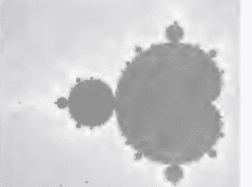

### 数学原理

计算该集合的数学原理极其简单。基本公式是：

$z = z^2 + c$

方程中省略了一些假设。$z$ 和 $c$ 都是复数，且公式未提及该公式被应用于代表复平面一部分的区域中的每一个像素。

对于曼德博集合，该平面中我们感兴趣的部分在 x 维度上从 -2.0 延伸到 2.0，在 y 维度上从 -2.0 延伸到 2.0（-2.0 位于左上角）。为了澄清，请记住我们之前关于复数的讨论，它们由实部和虚部组成。复平面将 x 坐标视为复数的实部，将 y 坐标视为虚部。因此，复平面上的任何一个点都表示一个复数；这就是前述公式中的 $c$。

在 Python 中，你可以使用 `c=complex(x, y)` 轻松创建复数 $c$。在图 23.2 中，你可以看到显示复平面重要部分的图表。

与任何维度一样，这里的 x 和 y 维度包含无限个点。因为我们要将结果显示在计算机屏幕上，所以我们不必计算由“无限 $\times$ 无限”产生的平面中无限个点，而可以继续确认平面中任何给定区域内可见像素的数量。

对于本章使用的程序，我选择的视口是 400×400 像素。因此，虽然每个维度上有无限个点，但我们在每个维度上只观察其中 400 个点：这就是我们观察的轴的“分辨率”。那么，在本章的程序中，我使用的 x 分辨率为 400，y 分辨率也是 400。但这仍然意味着我们覆盖的区域是 160,000 个像素——这是一个不小的数字。

**图 23.2**

复平面。

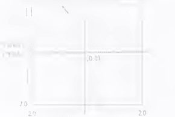

当我们知道自己在计算什么时，这个数字会增加。我们必须将公式 $z = z^2 + c$ 应用于每个像素。但我们不知道 $z$ 是什么，对吧？如果你愿意，可以将其视为第三个维度，衡量其在复平面之上的距离（就像 x, y, z 维度一样）。

那么，对于每个像素，我们需要决定该像素是否为曼德博集合的成员，如果是，我们将该像素涂成黑色。如果该像素不是集合的成员，我们需要知道该像素在复平面之上的高度，并为其涂上相应的颜色。

我们如何决定一个像素（或点）是否为集合的成员？我们将公式应用于某个特定像素，并观察它与平面原点 (0, 0) 之间距离的变化。然后，我们可以应用以下极其简单的规则：

1. 永远不会远离平面的点是集合的成员，我们将它们涂成黑色。
2. 向无穷远处远离平面的点不是集合的成员，我们将根据它们远离平面的速度为其涂色。

如你所知，尝试计算“永远”和“无穷”并不是一个好主意，因此我们划定一些任意的界限，以便我们能够标记或为点着色。

第一个界限是复平面之上的截断距离。x 轴的大小为 4.0（从 -2.0 到 2.0），所以你可能会认为 z 轴也应该是 4.0。然而，因为我们不想计算负距离，所以我们将范围限制在 0 到 2.0 之间。

平面本身之上的距离是通过使用公式 $z = z^2 + c$ 然后应用 `abs()` 函数计算得出的。请注意，`abs()` 是一个可以接受任何类型的数值参数的函数，因此你不需要导入 `math` 或 `cmath` 模块。

对于普通数字，`abs()` 函数只需移除数字的所有符号；`abs(-4)` 返回 `4`，而 `abs(3.14159)` 返回 `3.14159`。计算复数的绝对值则稍微复杂（complex）一点。你需要计算各部分的平方并求和，然后对结果开平方根。也就是说，以复数 `(-0.5, 0.1j)` 为例，其绝对值为：

```python
sqrt(( -0.5 * -0.5) + (1 * 1))
sqrt((0.25) + (1))
sqrt(1.25)
1.11803398875
```

你可以在交互式 Python 会话中运行上述代码行；请注意，所示数字并非真实的复数。要使用复数，请同样在交互式会话中运行以下代码行：

```python
c = -0.5+1j
abs(c)
```

你应该会得到相同的答案：1.11803398875。（如果结果不同，要么是你运行在具有特殊特性的系统上，例如支持极大的浮点数，要么是你的 Python 安装出现了严重问题。）

在像 C 这样没有内置复数的传统语言中，我们必须费很大劲才能计算出绝对值，这会使我们的代码变得复杂。幸运的是，我们使用的是 Python，因此我们几乎可以原封不动地应用我们的公式，我就不再费心解释在其他语言中必须处理的复杂情况了（毕竟，我是在试图说服你使用 Python！）。

以下是我们即将使用的算法（这是伪代码，而非真实的 Python）：

```python
for every pixel in the x dimension:
    for every pixel in the y dimension:
        c = complex(x, y)
        for every pixel in the z dimension:
            if abs(z) > 2.0:
                break
            z = (z**2) + c
            color the z pixel black if abs(z) was never true
            else color the z pixel according to the number of iterations
                before it went above 2.0
```

平面边缘上的点在开始时就已经超过了我们的 2.0 限制。考虑 `abs(-2.0+2.0j)`，其值为 2.82842712475，因此迭代次数（超过 2.0 所需的循环次数）将为零。清单 23.1 中的小程序允许你观察复平面上任意单点的行为。

#### 清单 23.1 `ctest.py`

```python
#!/usr/local/bin/python

import sys
import string

c=-0.5+1j
z=0j

if len(sys.argv)>2:
    r=string.atof(sys.argv[1])
    i=string.atof(sys.argv[2])
    c=complex(r,i)

print "initial value of c", abs(c)
for i in range(64):
    print "step ",i,"value of z",z,"distance (abs()) of z",abs(z)
    if abs(z)>2.0:
        break
    z = (z**2) + c
print "color z", i
```

第 6 行和第 7 行的默认值是我们之前示例中所使用的。默认输出如清单 23.2 所示。

#### 清单 23.2 `ctest.py` 的输出

```text
initial value of c 1.11803398875
step 0 value of z 0j distance (abs()) of z 0.0
step 1 value of z (-0.5+1j) distance (abs()) of z 1.11803398875
step 2 value of z (-1.25+0j) distance (abs()) of z 1.25
step 3 value of z (1.0625+1j) distance (abs()) of z 1.45907719124
step 4 value of z (-0.37109375+3.125j) distance (abs()) of z 3.14695655694
color z 4
```

自然地，靠近中心 (0,0) 的值将被染成黑色，而边缘的值将根据我们起始的颜色进行着色。因此，我们可以说，远离曼德博集（Mandelbrot set）的值会迅速逃逸到无穷大，而我们越靠近该集合，值逃逸的速度就越慢。当它们不逃逸时，它们就是该集合的成员。

我们可以将平面上非成员点的行为视为被无穷大所吸引。吸引子（attractors）的概念是混沌理论的一部分，但这不应让你感到畏惧；它的意思仅仅是，在不受干扰的情况下，它们会向那里演进。

因为我们没有无限且能力无穷的计算机，我们不知道这些非集合成员的点是否真的会เดินทาง到无穷大，但在所有实际用途中，我们可以将它们视为确实如此。

颜色的选择取决于确定像素是否逃逸到无穷大所需的迭代次数。在清单 23.2 中，颜色值为 4，或者因为我们将使用前两章动画中使用的 `colormap` 模块的相同颜色映射函数，所以它是我们所用任何颜色映射表中的第四种颜色。对于默认颜色映射，这个颜色是 `"#F2620C"`。

清单 23.3 显示了修改后的 `ctest.py`，用于显示所选颜色。

#### 清单 23.3 `ctest2.py`

```python
1  #!/usr/local/bin/python
2
3  import sys
4  import string
5  from colormap import *
6
7  from Tkinter import *
8
9  cmap = SetupColormap0(64)
10
11 c=0.5+1j
12 z=0j
13
14 if len(sys.argv)>2:
15   r=string.atof(sys.argv[1])
16   i=string.atof(sys.argv[2])
17   c=complex(r,i)
18
19 print "initial value of c", abs(c)
20 for i in range(64):
21   print "step",i,"value of z",z,"distance( abs()) of z",abs(z)
22   if abs(z)>2.0:
23     break
24   z = (z**2) + c
25 print "color z", i, cmap[i]
26
27 root=Tk()
28 root["background"]=cmap[i]
29 root.mainloop()
```

### 曼德博程序

图 23.1 中的图片是使用清单 23.4 所示的程序绘制的。

#### 清单 23.4 `mandelbrot2.py`


```python
1 #!/usr/local/bin/python
2
3 from Tkinter import *
4 from Canvas import Line, Rectangle
5 import sys
6 import string
7 from colormap import *
8 from tkFileDialog import *
9
10 class Msize:
11     def __init__(self, xr=400, yr=400, xs=-2.0, ys=-1.25, xw=2.6, yw=2.6):
12         self.xresolution = xr
13         self.yresolution = yr
14         self.cxsize = self.xresolution
15         self.cysize = self.yresolution
16         self.znought = 0j
17         self.xstart = xs
18         self.ystart = ys
19         self.xwidth = xw
20         self.ywidth = yw
21         self.xend = self.xstart + self.xwidth
22         self.yend = self.ystart + self.ywidth
23         self.xdiv = self.xwidth / self.xresolution
24         self.ydiv = self.ywidth / self.yresolution
25
26     def __call__(self):
27         return (self.xstart,
28             self.ystart,
29             self.xwidth,
30             self.ywidth,
31             self.xend,
32             self.yend,
33             self.xdiv,
34             self.ydiv
35         )
36     def set(self, x0, y0, xw, yw):
37         self.xstart = x0
38         self.ystart = y0
39         self.xwidth = xw
40         self.ywidth = yw
41         self.xend = self.xstart + self.xwidth
42         self.yend = self.ystart + self.ywidth
43         self.xdiv = self.xwidth / self.xresolution
44         self.ydiv = self.ywidth / self.yresolution
45
46     def __repr__(self):
47         s = "xstart %s ystart %s xwidth %s ywidth %s xend %s yend %s" \
48           " xdiv %s ydiv %s xresolution %s yresolution %s" % \
49      (self.xstart,self.ystart,
50       self.xwidth,self.ywidth,
51       self.xend,self.yend,
52       self.xdiv,self.ydiv,
53       self.xresolution,self.yresolution)
54      return s
55
56  class AboutDialog:
57      def __init__(self,parent,s="Mandelbrot"):
58          self.logotxt= """%s Cruiser
59      Copyright © 1999, 2000
60      by Ivan Van Laningham
61      Written for
62      Teach Yourself Python in 24 Hours""" %s
63          top = self.top=Toplevel(parent)
64          top["background"] = "white"
65          self.i=PhotoImage(file="X_GodNLogo5.gif")
66          self.lg = Label(top,text="",bd=0)
67          self.lg["image"] = self.i
68          self.lg.pack()
69          self.l=Label(top,text=self.logotxt,bd=0,background="white")
70          self.l.pack(side=LEFT)
71
72          self.b = Button(top,text="OK", command=self.ok,
73                      background="#000000",foreground="white")
74          self.b.pack(side=LEFT)
75
76      def ok(self):
77          self.top.destroy()
78
79  class Mandel:
80      def __init__(self,ncolors,root,xs=-2.0,ys=-1.25,xw=2.6,yw=2.6,
81              xr=400,yr=400):
82          im=["64-mdb5.gif","64-mdb5.600.gif","64-mdb5b.800.gif"],
83          un = Quit(...) 
84          self.root = root
85          self.debug = 0
86          self.useimages = 0
87          self.origxstart = xs
88          self.origystart = ys
89          self.origxwidth = xw
90          self.origywidth = yw
91          self.origxresolution = xr
92          self.origyresolution = yr
93          self.xstart = xs
94          self.ystart = ys
95          self.xwidth = xw
96          self.ywidth = yw
97          self.xend = self.xstart + self.xwidth
98          self.yend = self.ystart + self.ywidth
```

#### 列表 23.4（续）


```python
98	self.mdb = None
99	self.waitvar = 0
100	self.xresolution = xr
101	self.yresolution = xr
102	self.cxsize = self.xresolution
103	self.cysize = self.yresolution
104	self.znought = 0
105	self.xdiv = self.xwidth / self.xresolution
106	self.ydiv = self.ywidth / self.yresolution
107	self.calculating = 0
108	self.ncolors = ncolors
109	self.colorlist = ["2",
110		"4",
111		"8",
112		"16",
113		"32",
114		"64",
115		"128",
116		"256",
117		"512",
118		"1024",
119	]
120	self.colormaps = {"map 1":SetupColormap0,
121		"map 2":SetupColormap1,
122		"map 3":SetupColormap2,
123		"map 4":SetupColormap3,
124		"map 5":SetupColormap4,
125		"map 6":SetupColormap5,
126		"map 7":SetupColormap6,
127	}
128	self.imagelist = im
129	self.cmapcommand = SetupColormap
130	self.cmapname = "map 1"
131	self.cmap = self.cmapcommand(self.ncolors - 1)
132	self.stopnow = 0
133	self.mdsize = None
134	self.xdrawn = None
135	self.ydrawn = None
136	self.zdrawn = None
137	self.ux1 = 0
138	self.uy1 = 0
139	self.uil = 0
140	self.progress = None
141	self.progressize = 10
142	self.xlab = None
143	self.ylab = None
144	self._label = None
145	self.cv = None
146	self.scX = None
147	self.scY = None
148	self.scZ = None
149	self.x0 = None
150	self.x1 = None
151	self.y0 = None
152	self.y1 = None
153	self.zlabel = None
154	self.listbox = None
155	self.listbox1 = None
156	self.qbutton = None
157	self.cbutton = None
158	self.cabutton = None
159	self.rbutton = None
160	self.cimg = [None, None]
161	self.cimg = None
162	self.caimg = None
163	self.rimg = None
164	self.J = None
165	self.qname = qn
166	self.qimage = qim
167	self.locked = 0
168	self.qaction = None

170	self.afterid = None

172	self.buildMenu()
173	self.buildAndSetButtons()

175	self.buildNColorControl()
176	self.buildCMapControl()

178	self.buildXYLabels()
179	self.setXYLabels()

181	self.buildProgress()
182	self.buildCanvas()

184	self.waitvar = IntVar(0)
185	self.root.title("Mandelbrot Cruiser")
186	self.afterid = self.listbox.after(250, self.colorpoll)

188 def setXYLabels(self, m=None):
189    if not self.__dict__.has_key("center"):
190        self.center = 0
191    if m == None:
192        xs = 'X start %f width %f xdiv %f' % \
193            (self.xstart, self.xwidth, self.xdiv)
194        self.xlab['text'] = xs
195        ys = 'Y start %f width %f ydiv %f' % \
196            (self.ystart, self.ywidth, self.ydiv)
196        self.ylab["text"] = ys
197        self.zlabel["text"] = "Zoom:%f\nC = %s" % \
198        (self.xwidth/self.xwidth, self.center)
199    else:
200        xs = "X start %f width %f xdiv %f" % \
201        (m.xstart, m.xwidth, m.xdiv)
202        self.xlab["text"] = xs
203        ys = "Y start %f width %f ydiv %f" % \
204        (m.ystart, m.ywidth, m.ydiv)
205        self.ylab["text"] = ys
206        self.zlabel["text"] = "Zoom:%s\nC = %s" % \
207        (self.xwidth/m.xwidth, self.center)

209 def resetter(self, event=0):
210    if self.calculating:
211        return
212    self.xstart = self.origxstart
213    self.ystart = self.origystart
214    self.xwidth = self.origxwidth
215    self.ywidth = self.origywidth
216    self.xend = self.xstart + self.xwidth
217    self.yend = self.ystart + self.ywidth
218    self.xdiv = self.xwidth / self.xresolution
219    self.ydiv = self.ywidth / self.yresolution
220    self.msize = Msize(self.xresolution, self.yresolution,
221        self.xstart, self.ystart, self.xwidth, self.ywidth)
222    self.setXYLabels()
223    self.cv.delete(ALL)
224    self.progress.delete(ALL)
225    self.xdrawn = None
226    self.ydrawn = None
227    self.zdrawn = None
228    self.mdb = self.cdivimage()
229    self.img = self.cv.create_image(self.xresolution/2, \
230        self.yresolution/2, anchor=CENTER, image=self.mdb)
231    self.xSC.set(self.xresolution/2)
232    self.ySC.set(self.yresolution/2)
233    self.zSC.set(self.yresolution/2)

235 def zoomer(self, event=0):
236    if self.calculating:
237        return
238    if self.mdsize == None:
239        self.mdsize = Msize(self.xresolution, self.yresolution,
240            self.xstart, self.ystart, self.xwidth, self.ywidth)
241    oldxw = self.xwidth
242    oldyh = self.ywidth
243    w = self.x1 - self.x0
244    xp0 = self.x0 * self.xdiv
245    xp1 = self.x1 * self.xdiv
246    newxst = self.xstart + xp0
247    newxe = self.xstart + xp1
248    h = self.y1 - self.y0
249    yp0 = self.y0 * self.ydiv
250    yp1 = self.y1 * self.ydiv
251    newyst = self.ystart + yp0
252    newye = self.ystart + yp1
254    self.mdsize.set(newxst, newyst,
255        newxe - newxst,
256        newye - newyst)
257    self.setXYLabels(self.mdsize)

259 def xliner(self, event=0):
260    if self.calculating:
261        return
262    n = self.scX.get()
263    y = self.scY.get()
264    x1 = n * self.xdiv
265    x1 = self.xstart + x1
266    y1 = y * self.ydiv
267    y1 = self.ystart + y1
268    self.center = complex(x1, y1)
269    if self.xdrawn == None:
270        self.xdrawn = Line(self.cv, n, 0, n, self.yresolution-1,
271            fill="#ffffffff")
272    else:
273        self.cv.coords(self.xdrawn, n, 0, n, self.yresolution-1)
274    self.setXYLabels(self.mdsize)

276 def yliner(self, event=0):
277    if self.calculating:
278        return
279    n = self.scY.get()
280    x = self.scX.get()
281    x1 = x * self.xdiv
282    x1 = self.xstart + x1
283    y1 = n * self.ydiv
284    y1 = self.ystart + y1
285    self.center = complex(x1, y1)
286    if self.ydrawn == None:
287        self.ydrawn = Line(self.cv, 0, n, self.xresolution-1, n,
288            fill="#ffffffff")
289    else:
290        self.cv.coords(self.ydrawn, 0, n, self.xresolution-1, n)
291    self.setXYLabels(self.mdsize)

293 def zliner(self, event=0):
294    if self.calculating:
295        return
296    self.xliner()
297    self.yliner()
298    n = self.scZ.get()
299    x = self.scX.get()
300    y = self.scY.get()
301    x1 = x * self.xdiv
302    x1 = self.xstart + x1
303    y1 = y * self.ydiv
304    y1 = self.ystart + y1
305    self.center = complex(x1, y1)
306    limb = min(x, y)
307    limb = min(self.xresolution - x, self.yresolution - y)
308    limc = min(lima, limb)
309    # x and y are the coordinates of the center.
310    # x0 and y0 are the upper-left coordinates:
311    self.x0 = x - n
312    if self.x0 < 0:
313        self.x0 = 0
314    self.y0 = y - n
315    if self.y0 < 0:
316        self.y0 = 0
317    # x1 and y1 are the lower-right coordinates:
318    w = x + self.x0
319    if w > limc:
320        w = limc
321    self.x1 = x + w
322    if self.x1 > self.xresolution-1:
323        self.x1 = self.xresolution-1
324    if self.x1 - self.x0 > (limc * 2):
325        self.x0 = self.x1 - (limc * 2)
326    h = y - self.y0
327    if h > limc:
328        h = limc
329    self.y1 = y + h
330    if self.y1 > self.yresolution - 1:
331        self.y1 = self.yresolution - 1
332    if self.y1 - self.y0 > (limc * 2):
333        self.y0 = self.y1 - (limc * 2)
334    if x == 0 or y == 0:
335        self.x0 = self.y0 = 0
336        self.x1 = self.y1 = self.xresolution-1
337    if self.x1 - self.x0 == 0 or self.y1 - self.y0 == 0:
338        self.x0 = self.y0 = 0
339        self.x1 = self.y1 = self.xresolution-1
340    if self.zdrawn == None:
341        self.zdrawn = Rectangle(self.cv, self.x0, self.y0,
342            self.x1, self.y1, outline="#ffffff")
343    else:
344        self.cv.coords(self.zdrawn, self.x0, self.y0, self.x1, self.y1)
345    self.zoomer()

347 def die(self, event=0):
348    self.stopnow = 1
349    self.root.quit()

351 def cancel(self, event=0):
352    self.stopnow = 1
353    self.cv.delete(ALL)
354    self.xdrawn = None
355    self.ydrawn = None
356    self.zdrawn = None
357    self.progress.delete(ALL)
358    self.dithimage()
359    self.img = self.cv.create_image(self.xresolution/2,
360        self.yresolution/2, anchor=CENTER, image=self.mdb)
361    self.cv.update()

363 def colorpoll(self):
364    if self.calculating:
365        pass
366    else:
367        now = self.listbox.curselection()
368        nn = string.atoi(self.ncolorlist[string.atoi(now[0])])
369        if nn != self.ncolors:
370            self.ncolors = nn

372        x = self.listbox1.curselection()
373        s = x[0]
374        tname = self.listbox1.get(s)
375        if tname != self.cmapname:
376            self.cmapname = tname
377            self.cmapcommand = self.colormaps[self.cmapname]
378    self.afterid = self.listbox.after(250, self.colorpoll)

380 def updateProgress(self):
381    if self.stopnow:
382        return
383    Rectangle(self.progress,
384        self.uxl, self.uyl,
385        self.uxl + self.progressize - 2, self.uyl + 16,
386        fill=self.cmap[self.uil % self.ncolors],
387        outline="",
388        width=0)
389    self.progress.update()
```


#### 示例 23.4（续）


```python
390         self.uxl = self.uxl + self.progressize
391         self.uil = self.uil + 1
392
393     def waitcalc(self):
394         if self.calculating:
395             return
396         self.cv.after(1,self.calc)
397         self.cv.wait_variable(self.waitvar)
398
399     def calc(self):
400         self.waitvar.set(1)
401         self.cv.delete(ALL)
402         self.xdrawn=None
403         self.ydrawn=None
404         self.zdrawn=None
405         self.progress.delete(ALL)
406         self.mdb = self.dithimage()
407         self.img = self.cv.create_image(self.resolution/2,
408         self.resolution/2,anchor=CENTER,image=self.mdb)
409         oldcursor = self.cv['cursor']
410         self.cv['cursor'] = "watch"
411         self.calculating=1
412
413         if self.mdsize != None:
414             self.xstart,self.ystart,self.xwidth,self.ywidth, \
415             self.xend,self.yend,self.xdiv,self.ydiv = \
416             self.mdsize()
417
418         x = self.xstart
419         self._label['text'] = \
420         "Beginning calculation with %d colors %s..." %
421         (self.ncolors,self.cmapname)
422         self.cmap = self.cmapcommand(self.ncolors - 1)
423         if self.ncolors < 64:
424             dwell = 64
425         else:
426             dwell = self.ncolors
427         self.scX.set(self.xresolution/2)
428         self.scY.set(self.yresolution/2)
429         self.scZ.set(self.yresolution/2)
430         if self.debug == 0:
431             for xX in range(self.xresolution):
432                 y = self.ystart
433                 for yY in range(self.yresolution):
434                     c = complex(x,y)
435                     z = self.znought
436                     i = 0
437                     for i in range(dwell):
438                         if abs(z)>2.0:
439                             break
440                         z=(z**2)+c
441                     hcol = self.cmap[i % self.ncolors]
442                     self.mdb.put((hcol,), (xX,yY,xX+1,yY+1))
443
444                     y = y + self.ydiv
445
446                     if self.stopnow:
447                         self.updateProgress()
448                         self.stopnow=0
449                         self._label["text"] = "Finished calculation."
450                         self.uiL = self.uiL = self.uxL = 0
451                         self.calculating=0
452                         self.resetter()
453                         self.cv["cursor"] = oldcursor
454                         self.waitvar.set(0)
455                         return
456                     if xX != 0 and xX % self.progressize == 0 \
457                     and yY % 0 == 0:
458                         self.updateProgress()
459                 x = x + self.xdiv
460                 self.img = self.cv.create_image(self.xresolution/2,
461                 self.yresolution/2,anchor=CENTER,image=self.mdb)
462         self.cv.update()
463         self.updateProgress()
464         self._label["text"] = "Finished calculation."
465         self.mdsize=Msize(self.xresolution,self.yresolution,
466         self.xstart,self.ystart,self.xwidth,self.ywidth)
467
468         self.setXYLabels(self.mdsize)
469         self.uiL = self.uyL = self.uxL = 0
470         self.stopnow = 0
471         self.calculating=0
472         self.cv["cursor"] = oldcursor
473         self.waitvar.set(0)
474
475     def changeImages(self,event,None=None):
476         if event != None:
477             self.useimages = event
478         elif self.useimages:
479             self.useimages=0
480         else:
481             self.useimages=1
482         try:
483             self.qbutton.grid_forget()
484             self.cbutton.grid_forget()
485             self.rbutton.grid_forget()
486             self.cabutton.grid_forget()
487             del self.qbutton
488             del self.cbutton
489             del self.rbutton
490             del self.cabutton
491         except:
492             pass
493         self.buildAndSetButtons()
494
495     def dithimage(self):
496         if self.mdb != None:
497             del self.mdb
498         if self.xresolution == 600:
499             f=self.imagelist[1]
500         elif self.xresolution == 800:
501             f=self.imagelist[2]
502         else:
503             f=self.imagelist[0]
504         self.mdb = PhotoImage(file=f)
505         return self.mdb
506
507     def about(self,event=0):
508         d = AboutDialog(self.root)
509         self.root.wait_window(d.top)
510
511     def saveit(self,event=0):
512         sname = asksaveasfilename(initialfile="untitled.ppm",
513         filetypes=[("PPM files", ".ppm")])
514         if sname and self.mdb:
515             self.mdb.write(sname,format="ppm")
516
517     def popJulia(self,event=0):
518         if self.J == None:
519             import julia2
520             topl=Toplevel(self.root)
521             topl.transient(self.root)
522             self.J = julia2.Julia(self.ncolors,topl)
523         n=self.scX.get()
524         y=self.scY.get()
525         x1 = n * self.xdiv
526         x1 = self.xstart + x1
527         y1 = y * self.ydiv
528         y1 = self.ystart + y1
529         self.J.center=complex(x1,y1)
530         self.J.lock(1)
531         self.J.setXYLabels()
532         self.J.waitcalc()
533         elif self.J.calculating:
534             print "Sorry!" # This needs an error box.
535         else:
536             s=self.J.root.state()
537             if s != "normal":
538                 self.J.root.deiconify()
539             n=self.scX.get()
540             y=self.scY.get()
541             x1 = n * self.xdiv
542             x1 = self.xstart + x1
543             y1 = y * self.ydiv
544             y1 = self.ystart + y1
545             self.J.center=complex(x1,y1)
546             self.J.lock(1)
547             self.J.setXYLabels()
548             self.J.waitcalc()
549
550     def buildMenu(self):
551         bar = Menu(self.root)
552         filem = Menu(bar)
553         filem.add_command(label="Save as...",command=self.saveit)
554         filem.add_command(label="Use button images",
555             command=self.changeImages)
556         filem.add_separator()
557         filem.add_command(label="Exit",command=self.die)
558         bar.add_cascade(label="File", menu=filem)
559         helpm = Menu(bar)
560         helpm.add_command(label="About",command=self.about)
561         bar.add_cascade(label="Help", menu=helpm)
562         self.filem = filem
563         self.root.config(menu=bar)
564
565         self.pop = Menu(self.root)
566         self.pop.add_command(label="Show Julia set...",
567             command=self.popJulia)
568         self.pop["tearoff"]=0
569
570     def buildButtons(self):
571         self.qbutton=Button(self.root,text=self.qname)
572         if self.qaction != None:
573             self.qbutton["command"] = self.qaction
574         else:
575             self.qbutton["command"] = self.die
576
577         self.cbutton=Button(self.root,text="Cancel",
578             command=self.cancel)
579         self.rbutton = Button(self.root,text="Reset",
580             command=self.resetter)
581         self.cabbutton=Button(self.root,text="Calculate",
582             command=self.waitcalc)
583         if self.useimages:
584             self.qimg[0]=PhotoImage(file=self.qimage[0])
586             self.qimg[1]=PhotoImage(file=self.qimage[1])
587             self.qbutton["image"] = self.qimg[self.locked]
588             self.cimg=PhotoImage(file="x_akbal.gif")
589             self.cbutton["image"] = self.cimg
590             self.rimg=PhotoImage(file="G718.gif")
591             self.rbutton["image"] = self.rimg
592             self.caimg=PhotoImage(file="xoc_1.gif")
593             self.cabbutton["image"] = self.caimg
594
595     def buildAndSetButtons(self):
596         self.buildButtons()
597         self.qbutton.grid(row=0,column=0)
598         self.cbutton.grid(row=0,column=1)
599         self.rbutton.grid(row=0,column=4)
600         self.cabbutton.grid(row=0,column=5)
601
602     def buildNcolorControl(self):
603         f1 = Frame(self.root,width=60,height=32)
604         scrollbar = Scrollbar(f1,orient=VERTICAL)
605         self.listbox=Listbox(f1,exportselection=0,height=1,
606                                 width=5,yscrollcommand=scrollbar.set,selectmode=SINGLE)
607         n = 0
608         ns = -1
609         for i in self.ncolorlist:
610             if i == str(self.ncolors):
611                 ns = n
612             self.listbox.insert(END,i)
613             n = n + 1
614         if ns == -1:
615             self.ncolorlist.append(str(self.ncolors))
616             self.listbox.insert(END,str(self.ncolors))
617             ns = n
618         scrollbar.config(command=self.listbox.yview)
619         self.listbox.pack(side=LEFT)
620         scrollbar.pack(side=LEFT)
621         self.listbox.select_set(ns)
622         self.listbox.see(ns)
623         f1.grid(row=0,column=2)
624         self.root.columnconfigure(2,minsize=30)
625
626     def buildCmapControl(self):
627         f2 = Frame(self.root,width=70,height=32)
628         scrollbar1 = Scrollbar(f2,orient=VERTICAL)
629         self.listbox1=Listbox(f2,exportselection=0,height=1,
630                                 width=6,yscrollcommand=scrollbar1.set,selectmode=SINGLE)
631         k = self.colormaps.keys()
632         k.sort()
633         for i in k:
```


```python
634    self.listbox1.insert(END,i)
635    scrollbar1.config(command=self.listbox1.yview)
636    self.listbox1.pack(side=LEFT)
637    scrollbar1.pack(side=LEFT)
6338    self.listbox1.select_set(0)
639    f2.grid(row=0,column=3)
640    self.root.columnconfigure(3,minsize=70)
641
642 def buildXYLabels(self):
643    self.xlab = Label(self.root,text="")
644    self.ylab = Label(self.root,text="")
645    self.xlab.grid(row=1,column=0,columnspan=3,sticky=W)
646    self.ylab.grid(row=1,column=3,columnspan=3,sticky=E)
647    self.Label = Label(self.root,text="")
648    self.Label.grid(row=2,column=1,columnspan=5)
649    self.Zlabel = Label(self.root,text="Zoom:%f" % 1.0)
650    self.zlabel.grid(row=2,column=0)
651
652 def buildProgress(self):
653    f=Frame(self.root)
654    self.progress = Canvas(f,width=self.cxsize,height=16,
655                      borderwidth=0,highlightthickness=0,selectborderwidth=0)
656    self.progress.pack(side=TOP)
657    f.grid(row=3,column=0,columnspan=6)
658
659 def buildCanvas(self):
660    f = Frame(self.root,width=self.cxsize+54,height=self.cysize+54)
661
662    self.cv = Canvas(f,width=self.cxsize, height=self.cysize,
663                      borderwidth=0,highlightthickness=0,selectborderwidth=0)
664    self.mdb = self.dithimage()
665    self.img = self.cv.create_image(self.xresolution/2,
666                      self.yresolution/2,anchor=CENTER,image=self.mdb)
667    self.cv.place(relx=0.5,rely=0.5,anchor=CENTER)
668    self.cx = Scale(f,orient=HORIZONTAL,from_=0,
669                      to=self.xresolution - 1,
670                      length=self.cxsize,showvalue=0,command=self.xliner)
671    self.cx.set(self.xresolution/2)
672    self.cx.place(relx=0.5,rely=0,anchor=N)
673
674    self.cy = Scale(f,orient=VERTICAL,from_=0,
675                      to=self.yresolution - 1,
676                      length=self.cysize,command=self.yliner, showvalue=0)
677    self.cy.set(self.yresolution/2)
678    self.cy.place(relx=0,rely=0.5,anchor=W)
679
680    self.cz = Scale(f,orient=HORIZONTAL,to=0,
681                      from_=self.yresolution - 1,length=self.cxsize,
682                      showvalue=0,command=self.zliner)
683      self.scZ.set(self.yresolution/2)
684      self.scZ.place(relx=0.5,rely=1,anchor=S)
685      f.grid(column=0,row=4,columnspan=6)
686      self.cv.bind("<Button-1>",self.clicker)
687      self.cv.bind("<Button-3>",self.clacker)
688
689    def clicker(self,event=0):
690        x,y=event.x,event.y
691        x1=self.xstart+(x*self.xdiv)
692        y1=self.ystart+(y*self.ydiv)
693        self.scY.set(y)
694        self.scX.set(x)
695
696    def clacker(self,event=0):
697        self.pop.post_event(self.x_root,event.y_root)
698
699    if __name__ == "__main__":
700        if len(sys.argv)>1:
701            ncolors=string.atoi(sys.argv[1])
702        else:
703            ncolors=32
704        root=Tk()
705        mandel=Mandel(ncolors,root)
706
707        mandel.root.mainloop()
```

代码量显然太多，无法对每一行都进行详细解释，因此我将仅对其中一些重要部分提供简要描述。图 23.3 展示了启动`mandelbrot2.py`时的默认外观。

图 23.4 展示了启动时的另一种外观（可通过“文件”菜单选择：文件 → 使用按钮图像；或者编辑`mandelbrot2.py`并将`useImages`设置为 1）。

第 10-55 行的`Msize`类提供了一种跟踪我们所查看图像尺寸的方法。我们利用它来预先计算想要查看的集合位置，以及在所需的 x 和 y 分辨率中，每个像素对应的 x 和 y 维度的划分大小。这给了我们一个缩放比，你在运行程序时可以看到它的实际效果。通过使用滚动条，你可以从较大的图像中选择一个正方形区域进行放大，以便更详细地检查。图 23.5 显示了一个已经选出的矩形。

#### 图 23.3

运行`mandelbrot2.py`。

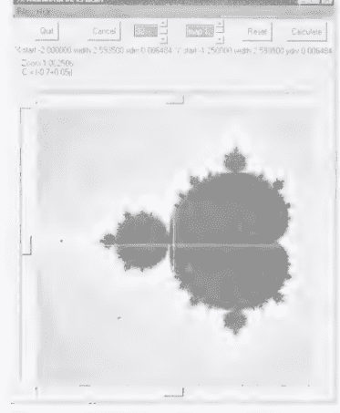

#### 图 23.4

使用按钮图像。


#### 图 23.5

准备放大，比例为 5.55 比 1。

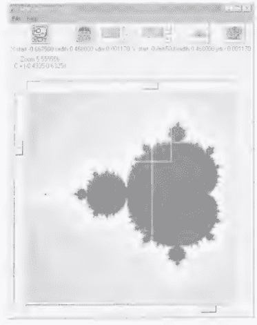

接下来的图 23.6 展示了计算出的部分。

#### 图 23.6

正在放大。


我们将整个应用程序构建为一个类`Mandel`：这使得利用继承来修改它以计算 Julia 集变得非常容易，我们将在本章稍后部分简要讨论。第 79 行`__init__()`方法中的图像列表`im`允许我们在应用程序启动时提供预先计算好的 Mandelbrot 图像：如图 23.3 和 23.5 所示。这样一来，如果我们想跳过全集的计算直接进入缩放界面，就能很容易地知道当前位置。

第 363-379 行的`colorpoll()`方法让我们无需双击颜色数量和颜色映射选择器的滚动列表框；该方法每 250 毫秒激活一次，检查已设置的任何值，并将这些值传递给类成员`self.ncolor`和`self.cmap`。

`xliner()`、`yliner()`和`zliner()`方法允许我们在复平面上的任何位置选择一个正方形中心并放大以更详细地查看。`x`和`y`方法根据滚动条的位置绘制线条，而`zliner()`方法则根据底部滚动条的位置调整缩放正方形的大小。

第 399-473 行的`calc()`方法是执行繁重工作的地方。因为分辨率是 400 像素，这意味着我们必须为 160,000 个像素选择颜色；有些像素的迭代次数不超过一次，而所有在集合中的像素都将具有`dwell`所设置的任意值——至少为 64。

`Mandel`类中大多数其余的方法都是不言自明的；如果你有疑问，请重新阅读代码并观察屏幕上的行为。然而，第 517-549 行需要解释。

## Julia 集

曾在第一次世界大战中服役的加斯顿·莫里斯·朱利亚（Gaston Maurice Julia）在 1918 年之前发现了以他命名的集合，并在当年发表了其构造细节。虽然他在当时的数学家中颇有名气，但他的工作被遗忘了，直到贝诺阿·曼德博（Benoit Mandelbrot）在至少部分基于朱利亚工作的基础上发现了曼德博集。得知 Julia 集先被发现可能会让你感到惊讶，但你需要记住，真正的奇迹在于朱利亚在没有现代高速计算机的帮助下，能够发现任何分形对象。

曼德博集和 Julia 集的主要区别在于：在曼德博集中，我们遍历集合中的所有点，将 x,y 坐标转换为复数，然后确定该点是否逃逸到无穷大。在 Julia 集中，我们执行相同的操作，但我们从曼德博集中选取一个单一的点来提供 x,y 坐标。我们仍然遍历复平面上的所有点，仍然计算 z 是否逃逸到无穷大，但在整个计算过程中我们保持值 c 为常数。我们使用复坐标 x,y 来提供 z 的起始值，而不是像曼德博集那样使用 (0, 0j)。这意味着我们基本上可以使用相同的计算来显示 Julia 集，并且我们可以使用曼德博集来挑选点。图 23.7 显示了从曼德博集中选择的点 (-0.778, -0.1515j) 计算出的 Julia 集。

你可以使用此处提供的应用程序对 Julia 集进行缩放，就像对曼德博集那样。图 23.8 显示了选择一个正方形区域进行放大。

图 23.9 显示了放大的正方形。

### 图 23.7

(-0.778, -0.1515j) 的 Julia 集。

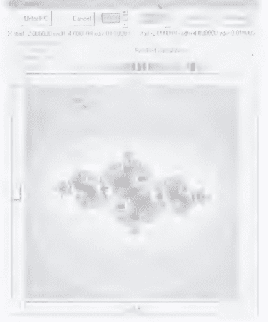

### 图 23.8

准备缩放。

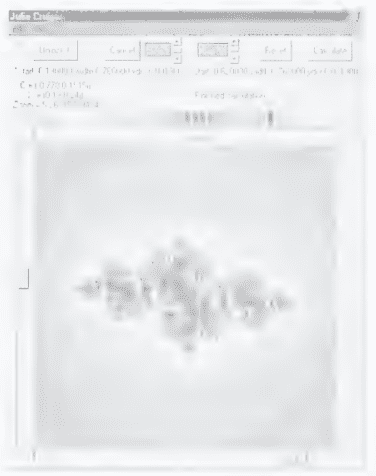

### 图 23.9

缩放。

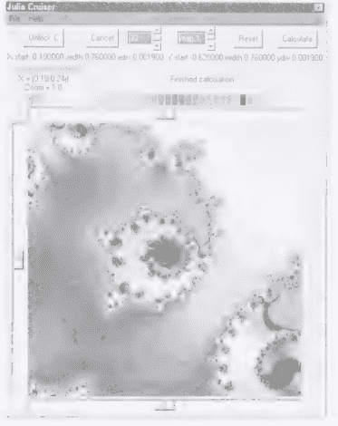

因为我们将`Mandel`定义为一个类，所以在构建`Julia`类时可以对其进行继承。代码清单 23.5 展示了所需的额外文件。

### 代码清单 23.5 `julia2.py`


```python
#!/usr/local/bin/python

from Tkinter import *
from Canvas import Line, Rectangle
import sys
import string
from colormap import *
from tkFileDialog import *
from mandelbrot2 import *

class Julia(Mandel):
    def __init__(self, ncolors, root, xs=-2.0, ys=-2.0, xw=4.0, yw=4.0,
        xr=400, yr=400,
        im=["new-mdb.gif", "new-mdb.600.gif", "new-mdb.800.gif"],
        qn="Lock C", qim=["x_kankin_1.gif", "x_pop_1.gif"]):
        Mandel.__init__(self, ncolors, root, xs, ys, xw, yw, xr, yr, im, qn, qim)
        self.calculating=0
        self.center=0j
        self.root.title("Julia Cruiser")
        self.qaction=self.lock
        self.qbutton["command"] = self.qaction
        self.locked=0
        self.xhairs=0j
        self.filem.delete(4)
        self.filem.delete(3)
        self.root.protocol('WM_DELETE_WINDOW',self.killafter)

    def killafter(self):
        self.root.withdraw()

    def lock(self,locker=None):
        if locker != None:
            self.locked=locker
        elif self.locked==0:
            self.locked=1
        else:
            self.locked=0
        if self.locked:
            self.qbutton["text"]="Unlock C"
        else:
            self.qbutton["text"]="Lock C"
        if self.useimages:
            self.qbutton["image"] = self.qimg[self.locked]

    def popJulia(self,event=0):
        pass

    def setXYLabels(self,m=None):
        if not self.__dict__.has_key('center'):
            self.center=0j
            self.xhairs=0j
        if m == None:
            xs = " X start %f width %f xdiv %f " %
            (self.xstart, self.xwidth, self.xdiv)
            self.xlab['text'] = xs
            ys = " Y start %f width %f ydiv %f " %
            (self.ystart, self.ywidth, self.ydiv)
            self.ylab['text'] = ys
            self.zlabel['text']='C = %s\nX = %s\nZoom = %s ' %
            (self.center, self.xhairs, self.xwidth/self.xwidth)
        else:
            xs = " X start %f width %f xdiv %f " %
            (m.xstart, m.xwidth, m.xdiv)
            self.xlab['text'] = xs
            ys = " Y start %f width %f ydiv %f " %
            (m.ystart, m.ywidth, m.ydiv)
            self.ylab['text'] = ys
            self.zlabel['text']='C = %s\nX = %s\nZoom = %s ' %
            (self.center, self.xhairs, self.xwidth/m.xwidth)

    def xliner(self,event=0):
        if self.calculating:
            return
        n=self.scX.get()
        y=self.scY.get()
        x1 = n * self.xdiv
        x1 = self.xstart + x1
        y1 = y * self.ydiv
        y1 = self.ystart + y1
        if not self.locked:
            self.center=complex(x1,y1)
        self.xhairs=complex(x1,y1)
        if self.xdrawn==None:
            self.xdrawn = Line(self.cv,n,0,n,self.yresolution-1,
                fill="#ffffff")
        else:
            self.cv.coords(self.xdrawn,n,0,n,self.yresolution-1)
        self.setXYlabels(self.mdsize)

    def yliner(self,event=0):
        if self.calculating:
            return
        x=self.scX.get()
        n=self.scY.get()
        x1 = x * self.xdiv
        y1 = n * self.ydiv
        x1 = self.xstart + x1
        y1 = self.ystart + y1
        if not self.locked:
            self.center=complex(x1,y1)
        self.xhairs=complex(x1,y1)
        if self.ydrawn==None:
            self.ydrawn = Line(self.cv,0,n,self.xresolution-1,n,
                fill="#ffffff")
        else:
            self.cv.coords(self.ydrawn,0,n,self.xresolution-1,n)
        self.setXYlabels(self.mdsize)

    def zliner (self,event=0):
        if self.calculating:
            return
        self.xliner()
        self.yliner()
        n=self.scZ.get()
        x=self.scX.get()
        y=self.scY.get()
        x1 = x * self.xdiv
        y1 = y * self.ydiv
        x1 = self.xstart + x1
        y1 = self.ystart + y1
        if not self.locked:
            self.center=complex(x1,y1)
        self.xhairs=complex(x1,y1)
        self.setXYLabels(self.mdsize)
        lima = min(x,y)
        limb = min(self.xresolution * x, self.yresolution * y)
        limc = min(lima,limb)
        # x and y are the coordinates of the center.
        # x0 and y0 are the upper left coordinates:
        self.x0 = x - n
        if self.x0 < 0:
            self.x0 = 0
        self.y0 = y - n
        if self.y0 < 0:
            self.y0 = 0
        # x1 and y1 are the lower right coordinates:
        w = x - self.x0
        if w > limc:
            w = limc
        self.x1 = x + w
        if self.x1 > self.xresolution-1:
            self.x1 = self.xresolution-1
        if self.x1 - self.x0 > (limc * 2):
            self.x0 = self.x1 - (limc * 2)
        h = y - self.y0
        if h > limc:
            h = limc
        self.y1 = y + h
        if self.y1 > self.yresolution - 1:
            self.y1 = self.yresolution - 1
        if self.y1 - self.y0 > (limc * 2):
            self.y0 = self.y1 - (limc * 2)
        if x == 0 or y == 0:
            self.x0 = self.y0 = 0
            self.x1 = self.y1 = self.xresolution-1
        if self.x1 - self.x0 == 0 or self.y1 - self.y0 == 0:
            self.x0 = self.y0 = 0
            self.x1 = self.y1 = self.xresolution-1
        if self.zdrawn==None:
            self.zdrawn = Rectangle(self.cv,self.x0,self.y0,
                self.x1,self.y1,outline="#ffffff")
        else:
            self.cv.coords(self.zdrawn,self.x0,self.y0,self.x1,self.y1)
        self.zoomer()

    def resetter(self):
        Mandel.resetter(self)
        self.locked=0
        self.qbutton["text"]="Lock C"
        self.center=0j
        self.xhairs=0j

    def calc(self):
        self.waitvar.set(1)
        self.cv.delete(ALL)
        self.xdrawn=None
        self.ydrawn=None
        self.zdrawn=None
        self.progress.delete(ALL)
        self.mdb = self.dithimage()
        self.img = self.cv.create_image(self.xresolution/2,
                                   self.yresolution/2,anchor=CENTER, image=self.mdb)
        oldcursor = self.cv["cursor"]
        self.cv["cursor"] = "watch"
        self.calculating=1

        if self.mdsize != None:
            self.xstart,self.ystart,self.xwidth,self.ywidth, \
            self.xend,self.yend,self.xdiv,self.ydiv = \
            self.mdsize()

        x = self.xstart
        self._label["text"] = \
            "Beginning calculation with %d colors %s..." % \
            (self.ncolors,self.cmapname)
        self.cmap = self.cmapcommand(self.ncolors - 1)
        if self.ncolors < 64:
            dwell = 64
        else:
            dwell = self.ncolors
        C = self.center
        self.scX.set(self.xresolution/2)
        self.scY.set(self.yresolution/2)
        self.scZ.set(self.yresolution/2)
        if self.debug == 0:
            for xX in range(self.xresolution):
                for yY in range(self.yresolution):
                    x = self.xstart + xX * self.xdiv
                    y = self.ystart + yY * self.ydiv
                    z = complex(x,y)
                    i = 0
                    for i in range(dwell):
                        if abs(z)>2.0:
                            break
                        z=(z**2)+C
                    hcol = self.cmap[i % self.ncolors]
                    self.mdb.put((hcol),(xX,yY,xX+1,yY+1))

        if self.stopnow:
            self.updateProgress()
            self.stopnow=0
            self._label["text"] = "Finished calculation."
            self.uil = self.uyl = self.uxl = 0
            self.calculating=0
            self.resetter()
            self.cv[ "cursor"] = oldcursor
            self.waitvar.set(0)
            return
        if xX != 0 and xX % self.progressize == 0 \
            and yY == 0:
            self.updateProgress()
        x = x + self.xdiv
        self.img = self.cv.create_image(self.xresolution/2,
            self.yresolution/2,anchor=CENTER,image=self.mdb)
    self.cv.update()
    self.updateProgress()
    self._label["text"] = "Finished calculation."
    self.mdsize=Msize(self.xresolution,self.yresolution,
            self.xstart,self.ystart,self.xwidth,self.ywidth)

    self.setXYlabels(self.mdsize)
    self.uil = self.uyl = self.uxl = 0
    self.stopnow = 0
    self.calculating=0
    self.cv[ "cursor"] = oldcursor
    self.waitvar.set(0)

    def about(self,event=0):
        d = AboutDialog(self.root,"Julia")
        self.root.wait_window(d.top)

    def clicker(self,event=0):
        x,y=event.x,event.y
        x1=self.xstart+(x*self.xdiv)
        y1=self.ystart+(y*self.ydiv)
        self.scY.set(y)
        self.scX.set(x)

    def clacker(self,event=0):
        pass

    if __name__ == "__main__":
        if len(sys.argv)>1:
            ncolors=string.atoi(sys.argv[1])
        else:
```


```python
267    ncolors=32
268    root=Tk()
269    julia=Julia(ncolors,root)
270
271    julia.root.mainloop()
272
```

我对 Julia 代码有几点评论。主要地，我们在代码中需要做的是修改现有行为，因此我们提供了自己的方法，用来覆盖 Mandel 代码中相应的方法。这些方法包括 `calc()`、`clicker()` 和 `popJulia()`，它们要么需要执行不同的操作，要么需要改为不执行任何操作。我们所做的真正不同的改动是更改了“退出”按钮的标签和行为；对于 Julia 显示器，我们将现在的“锁定”按钮用于锁定 `c` 值的选择，这样我们仍然可以使用滚动条来选择中心点并调整缩放框的大小。如果我们不这样做，每次移动滚动条都会将 Julia 集移动到未知区域。第 32-43 行的 `lock()` 方法是完成这项工作的主要地方。当我们启动 Julia 集探索（在第 517 行等位置）时，我们还会设置中心点并锁定该中心。然后我们自动开始计算；所有这些都在清单 23.4 的第 529-532 行中完成。

## 总结

在这一倒数第二个小时中，我们学习了 Mandelbrot 集和 Julia 集、如何计算它们，并使用了 Tkinter 来提供用于显示它们的 GUI。在接下来的一个小时中，我们将讨论 CGI Web 编程，并以一些零碎的内容和一点（令人恐惧的）哲学作为结束。

## 工作坊

### 问答

- **问**：除了让计算机运行到最大容量之外，Mandelbrot 集有什么用处？

- **答**：如果你像某些人一样对这些集合的美感免疫（包括我的妻子，她说：“呸，看起来像腰果花布！”），你应该意识到分形几何和混沌理论在从天气预报到图像压缩的方方面面都有有用的应用。

- **问**：你在本章中没有真正提到分形几何。那是什么？

- **答**：这是一个由 Benoit Mandelbrot 创立的数学术语和分支。他认为分形几何是自然的几何学：微小的事物与巨大的事物相似。看看海岸线：从太空开始，放大（就像我们对 Mandelbrot 或 Julia 集所做的那样），你会注意到无论你多么接近，它看起来总体上就像从太空看到的一样。在网上搜索更多信息；那里有海量资料。请参阅练习中引用的书籍。

### 测验

1. Mandelbrot 集的公式是什么？

   a. $\text{E} = \text{mc}^2$

   b. $\text{a} = \text{r}^2$

   c. $z = z^2 + c$

   d. $\text{F} = \text{G} (\text{m, m.}) / \text{d}^2$

2. 计算一个 400 乘 400 像素、32 色的 Mandelbrot 集大约需要多少次浮点运算？

   a. 160,000

   b. 1,000,000,000

   c. 5,120,000

   d. 2,560,000

3. Mandelbrot 集中包含多少个 Julia 集？

   a. 一个

   b. 160,000 个

   c. 每个点对应一个

   d. 无限多个

### 答案

1. c. Mandelbrot 公式（去掉无关的冗余）是 $z = z^2 + c$。

2. d. 最后一个答案 2,560,000 可能最接近事实。它不可能是 160,000，因为我们必须遍历所有点，且它们在复平面上的距离并不相同。如果它是 5,120,000，那么所有像素都将是黑色的，由于太无聊，我们就不会去计算它了。

3. c. Mandelbrot 集中的每个点都有一个对应的 Julia 集，因此 Mandelbrot 集被称作 Julia 集的目录。因为 Mandelbrot 集中的点数是无限的，所以 Julia 集的数量也是无限的。

### 练习

一个结合了普朗克常数和古戈尔普莱克斯（googolplexes）的有趣页面可以在 `http://www.informatik.uni-frankfurt.de/~fp/Tools/GetAGoogol.html` 找到。

关于 Mandelbrot 集的更多信息，请参阅以下内容：

- A. K. Dewdney. "Computer Recreations" 载于 *Scientific American* 253, no. 2 (August 1985): 16-24。
- Benoit B. Mandelbrot. *The Fractal Geometry of Nature*. San Francisco: W. H. Freeman and Company, 1977, 1982. ISBN 0-7167-1186-9。
- `http://linas.org/art-gallery/escape/escape.html`
- *Colours of Infinity*：在 PBS 上播出的纪录片，由 Arthur C. Clarke, Benoit Mandelbrot, Michael Barnsley, 和 Ian Stewart 出演。我找不到比这更多的信息了；它在盐湖城的捐款周期间播出，他们把演职员表缩减到了无法阅读的大小。互联网搜索也一无所获。

关于计算机图形学的更多信息，公认的圣经是：*Computer Graphics: Principles and Practice, Second Edition in C*，作者 James D. Foley, Andries van Dam, Steven K. Feiner 和 John F. Hughes。纽约：Addison-Wesley, 1990。

# 第 24 小时

## 杂项

> 这只狗刚刚跑了一千英里。
>
> ——Lynda Plettner，狗拉雪橇运动员，在 1999 年 Iditarod 比赛结束时谈到她的领头犬 RG。

在之前的一个小时中，我们讨论了 Mandelbrot 和 Julia 集及其数学原理，并讨论了一个计算和显示它们的程序。本小时的内容大部分是杂项，首先是对 Web CGI 编程的简要介绍。然后我们讨论正确的实践、正确的心态和正确的理解。

### CGI

正如你在前面章节中所知道的，CGI 代表通用网关接口（common gateway interface）。Web CGI 编程的编程范式与普通的交互式程序略有不同。使用 CGI 时，你将 Python 程序放入一个特定位置，然后通过 Web 浏览器访问该程序；程序以一种称为 HTML（超文本标记语言）的语言输出结果。HTML 存在各种增强功能，例如允许用户填写表单并将信息提交回同一个或不同的程序。关于 Web 服务器、Web 浏览器、HTML 和 CGI 编程的详细解释远远超出了本书的范围；请参阅练习以获取更多相关资源。

我自己的配置包括一台运行 Windows NT 4.0 OS（带 SP5）和 Win32 版 Apache 1.3.9 Web 服务器的相当缓慢的服务器。一个更稳定的组合是运行 Linux 而不是 NT，并使用相同版本的 Linux 版 Apache 服务器。目前在工作中 NT 对我来说更方便。我假设你可以访问 Web 服务器并且已经正确设置。许多 ISP 在你购买月度互联网服务时会提供某种形式的免费网页托管作为附加福利，尽管这些免费服务中很少提供 Python。Perl 要常见得多，但你可以给 ISP 打电话要求安装 Python。在 Python 安装并运行后，你通常需要知道它在 Web 服务器机器上的位置；就 Apache Web 服务器而言确实如此。因为我自己安装和维护 Web 服务器，我知道 Apache 在哪里，也知道 Python 在哪里。`cgi-bin`（CGI 程序的通用位置）是我放置完成的 Python 程序的地方，在我的系统中，它位于 `c:\inetpub\cgi-bin`；Apache 位于 `c:\Apache`，Python 位于 `c:\Python`。对于 Apache 来说，所有放置在 `cgi-bin` 目录中的 Python 程序必须以“hash-bang”行 `#!c:\Python\python.exe` 开始，否则它们将无法运行。在第 15 小时中，我们讨论了 `fixhash.py` 程序，用于自动追踪 Python 程序第一行中的错误并自动修复这些错误，如果你最终维护自己的 Web 服务器，可能会发现它很有用。

如果你没有运行自己的 Web 服务器，且已经说服 ISP 安装 Python，你需要验证他们是否正确安装了 Python。所有标准模块必须安装在 Python 能找到的地方，尤其是 `cgi.py` 模块对于实用的 Python CGI 程序是必需的。如果你的 ISP 运行的是 NT，那么 ISP 只需要运行 Python 安装程序，并告知他们运行的任何 Web 服务器 Python 在系统中的位置即可。在 Linux 上稍微复杂一点，但如果 ISP 管理员遵循 Python 发行版随附的安装说明，一切应该都能正常工作。如果不能，你将不得不与 ISP 管理员合作尝试解决问题。如果你陷入这种情况，Python 邮件列表可能会提供帮助。

清单 24.1 展示了经过修改以在 Web 上运行的传统“Hello, World!”程序。

#### 清单 24.1 `hellocgi.py`

```python
1 #!c:\Python\python.exe
2
3 def print_content():
4     print "Content-type: text/html"
5     print
```

```python
6
7  def print_header():
8      print "<html><title>Pythonic Hello World</title><body>"
9
10 def print_footer():
11     print "</body></html>"
12
13 print_content()
14 print_header()
15 print "Hello, World!"
16 print_footer()
17
```

`/usr/bin/python` 是我家用 Linux 机器上 Python 所在的路径。我在家里镜像了我的实际网站，并确保 Python CGI 程序在 NT 和 Linux 下尽可能地以相同的方式运行。这种设置让我可以在不使用实际服务器进行测试和开发的情况下开发 Web 应用程序；程序在家庭服务器上调试完毕后，我可以将它们上传到真实服务器，而且 99% 的情况下它们可以直接运行。图 24.1 展示了我们将 `hellocgi.py` 放入 `cgi-bin` 目录并使用 Netscape 访问该网页时发生的情况。

#### 图 24.1

你好，Web 世界。


你在 Location 字段中看到的 URL 不仅包括 Web 服务器地址 (`http://www.pauaunton.org`) 和脚本名称 (`hellocgi.py`)，还包括两者之间的 CGI bin 目录：`/cgi-bin`。这就是你系统中被指定为 CGI 二进制文件位置的目录名称；虽然你可以将其命名为任何你想要的名称，但传统上它被称为 `cgi-bin`。如你所见，这个测试程序没有做太多事情。在代码清单中最重要的观察点是 `print_content()` 函数：无论你的 CGI 程序变得多么复杂，你总是需要通过运行此函数开始。它向 Web 服务器打印 `Content-type: text/html` 这一行；这告诉服务器它接收到的信息是要显示给用户的。

让我们尝试一些稍微复杂一点的操作；我们将构建一个表单，用户可以通过他们的 Web 浏览器填写该表单以注册软件。当按下 Submit 按钮时，清单 24.2 中显示的程序会向你和提交表单的人发送电子邮件。

#### 清单 24.2 `register.py`

```python
1 #!c:\Python\python.exe
2 import os
3 import sys
4 import cgi
5 import SMTP
6 
7 thisscript=os.environ["SCRIPT_NAME"]
8 
9 mailhost="mail.callware.com"
10 mailfrom="ivanlan@callware.com"
11 mailto="ivanlan@callware.com"
12 ccto="ivanlan@callware.com"
13 
14 def print_content():
15     print "Content-type: text/html"
16     print 
17 
18 def print_header():
19     print """<html><title>Pythonic Registration Form</title>
20     <body bgcolor=white text=black>"""
21 
22 def print_footer():
23     print "</body></html>"
24 
25 def print_form():
26     print """<h1><center>Please Register!</center></h1>
27 <p>Please register software before downloading it. Thank you,
28 <hr>
29 <p>
30 <form name=form action=%s method=post>
31 Enter your name:
32 <input type="edit" name="name"><br>
33 Enter your email address:
34 <input type="edit" name="email"><br>
35 Enter the name of the software you are downloading:
36 <input type="edit" name="software"><br>
37 Enter the amount you are willing to pay in dollars for the software:
38 <input type="edit" name="pay"><br>
39 <hr>
40 <input type="submit">
41 <input type="reset">
42 </form>
43 """ % (os.environ["SERVER_NAME"],thisscript)
44
45 print_content()
46 print_header()
47
48 form = cgi.FieldStorage()
49 if form.has_key("name") and form.has_key("email"):
50   nm = form["name"].value
51   em = form["email"].value
52   sw = form["software"].value
53   sm = form["pay"].value
54   print "<p align=center><font size=7>Thank you!
55   <font size=3><br>
56   <hr>
57   "
58
59   print """<p align=left>Thank you %s. Your email address, %s,
60   will shortly receive an invoice for %s dollars, for downloading
61   the %s package. If you do not pay up within 5 business days,
62   all your files will be erased.<br>
63   <hr>
64   <p align=right>Have a nice day
65   """ % (nm, em, sm, sw)
66   msg="""Hello, %s (%s):
67   You recently downloaded %s from %s.
68   Please send %s dollars immediately to:
69
70   Ransom
71   PO Box 6969
72   Washington DC 55512
73
74   If you do not send money, we have a catapult.
75   Thank you for your attention to this matter.
76
77   Anonymous
78   """ % (nm, em, sw, os.environ["SERVER_NAME"], sm)
79
80   s=SMTP.SMTP(mailhost)
81   s.send_message(mailfrom, em,
82       "Software Registration", msg)
83   s.send_message(mailfrom, ccto,
84       "Software Registration", msg)
85   s.close()
86 else:
87   print_form()
88   print_footer()
```

这个版本是为我的官方网站设置的：对于你自己的版本，只需编辑第 7-11 行，在适当的地方替换为你的 Web 服务器名称和 `cgi-bin` 目录，并将电子邮件地址更改为你自己的。当你在 Web 浏览器的 Location 字段中输入正确的 URL 时，你应该会看到类似图 24.2 的界面。

#### 图 24.2 访问 `register.py`


在表单中填写你的姓名和正确的电子邮件地址，按下 Submit 按钮，你应该会看到一个类似于图 24.3 的网页。


#### 图 24.3 提交 `register.py`


在运行此程序之前，你需要获取 Vladimir Ulogov 的 SMTP 模块，可以在 `http://starship.python.net/crew/gandalf/SMTP.py` 找到。该模块封装了标准的 `smtplib` 模块，使其极其易于使用。第 79-84 行展示了它使用起来多么简单。只要你知道正确的邮件主机，这个表单在 Linux、Windows 95/98 和 NT 上都能正常工作。它可能在 Macintosh 上也能运行，但我没有办法测试这一点。

为了分析注册程序中发生了什么，请看清单 24.2 的第 44 行起。程序的主体部分首先打印 content-type，然后打印页眉（header）。这部分始终相同（查看前两张插图中的标题栏），但在第 48 行，我们实例化了一个来自 `cgi` 模块（在第 4 行导入）的 `FieldStorage` 类对象。在 CGI 程序中，构建表单很容易，但在用户填写后读取表单很难。`cgi` 模块使读取过程相对轻松。第 49 行检查表单对象是否已被填写；如果调用 `has_key()` 方法失败，则表示用户尚未在相关的表单元素中输入任何文本。如果第 49 行的条件为假，我们将跳转到第 86 行并调用 `print_form()` 函数，这就是显示图 24.2 中空白表单的部分（`print_form()` 从第 24 行到第 44 行）。然而，如果第 49 行的评估结果为真，那么从第 50 行开始，我们处理用户提供的信息，在第 65-77 行定义要发送的消息，并显示图 24.3 所示的网页，以告知用户其信息已被正确接收。定义好要发送的电子邮件消息后，第 79-84 行创建一个 SMTP 对象，该对象连接到你的邮件服务器并将消息副本发送给相关方（第 80 和 82 行）。在发送完消息后，我们在第 84 行关闭电子邮件连接。

回顾一下，这是你编写任何 Python CGI 程序的基本大纲：

- 导入模块，定义变量和函数（第 2-44 行）。
- 定义一个函数来打印包含 Submit 按钮（见第 40 行）并使用 post 方法（第 30 行）的表单。
- 确保将表单提交给脚本自身（第 7 和 43 行）。
- 创建表单的实例（第 48 行）。
- 测试表单是否已被填写（第 49 行）。
- 如果否，向 Web 浏览器打印表单（第 86 行）。
- 如果是，使用 `cgi.FieldStorage` 读取信息并对其采取操作（第 50-84 行）。
- 打印 HTML 页面的结尾（第 87 行的 `print_footer()`）。

有了这个大纲、毅力以及 Python，没有任何 CGI 编程任务是你能无法完成的。

### 调试

在我的显示器顶部，有几个巨大的塑料昆虫。当人们问我为什么拥有它们时，我告诉他们这些 bug 是我的图腾。通常，他们接着会问什么是图腾，我告诉他们图腾是动物氏族的首领；一些美洲原住民部落与例如水 buffalo 图腾达成了契约。图腾是什么……

赋予部落的权力是杀死并利用动物族群中个体成员的许可，从而增加部落的生存机会；而图腾要求回报的是仪式上的遵守，通常表现为不食用或不使用动物的某些部位，以及举行仪式请求原谅夺走了一个对图腾而言神圣的生命。如果这些仪式没有被遵守，部落的猎人们就有冒犯图腾的风险，而图腾将通过拒绝再派遣该族群的个体来供养部落以进行报复。（如果你认为图腾崇拜不是美国生活方式的一部分，你应该开始观察周围。看看电视上所有那些以快乐的奶牛、跳舞的猪、唱歌的鸡等为特色的广告——它们全部被拟人化，并传递着一个明确的信息：“吃掉我们没关系。”）

调试传统语言是一项可能占据几乎任何类型项目大部分开发时间的任务。事实上，如果没有 bug，如今被雇用的软件工程师数量会比现在少得多。这就是为什么我把我的图腾摆在外面，让每个人都能看到：我不希望各种 bug 族群的图腾停止向我派遣个体让我去发现并修复。你可能会觉得这相当愚蠢，但你永远不知道。这样做没有坏处，而且它能不断提醒人们，万物皆有关联。尤其在软件领域，“杂草亦是宝”。

与此同时，Python 的调试极其简单，简单到令人害怕：每当程序出现问题时，Python 解释器几乎总能准确地告诉你哪一行出了错。而且，在你掌握了语言基础并遇到几次常见的错误之后，大多数异常信息都相当清晰。但仍有一些可以从传统语言迁移到 Python 的技巧是有帮助的。

最基础的技巧或许是在代码中插入 `print` 语句，这样你就可以观察在程序执行期间一个或多个变量发生了什么。不要低估这种技巧的力量，尤其是在 Python 中；这可能是发现你的设计是否被准确转化为实现的快捷方式。使用 C 或某种编译语言，在源码中插入 `printf()` 调用并不那么高效，因为修改源码后，你必须在运行程序前重新编译。而在 Python 中，你修改程序后可以立即运行。在 Python 中，插入和删除 `print` 语句的开销通常非常小。

下一个主要技巧是单步执行代码。也就是说，你不再像普通用户那样运行程序，而是在另一个名为调试器的程序下运行它。对于命令行 Python 程序，该调试器名为 `pdb`。其文档可以在 `http://www.python.org/doc/current/lib/module-pdb.html` 找到，且内容非常清晰。我使用 `pdb` 的经验表明，到目前为止，它的最佳用途是通过函数或方法逐步推进，以查看我认为代码中正在发生的事情是否真的在发生。不过，你可以使用 `assert()` 来完成部分相同的工作而无需使用调试器；它告诉 Python：“这是我认为正在发生的事情；如果我错了，请抛出异常。”但有时，使用 `pdb` 在遇到某个函数后停止，然后逐行执行该函数中的代码，检查变量以确保它们包含你认为的值，并确保函数根据这些值执行了你认为它应该执行的操作，这是没有任何替代方案的。

但我认为阅读代码仍然是最重要的调试技巧。每当出现问题时，请检查你的代码。假装你是一台计算机（事实上，归根结底，这正是程序员应该最擅长的事），并在脑海中逐行执行代码；填充变量并尝试确定你在这里究竟在告诉 Python 做什么。这可能与你认为的情况不同，而反复阅读代码有时可能是说服自己“你告诉 Python 做了与你初衷相反的事情”的唯一方法。如果你无法通过这种方式找到问题的答案，可以添加一两个 `print` 语句；不要过度使用，否则很快就会让你的代码变得不可读，并且你会忘记最初试图实现的目标。如果该技巧失效，那么就该启动调试器并极其详尽地观察具体发生了什么。不过，对这一过程的详细介绍超出了本书的范围。

### 正确的实践

> 坐禅实践是我们真实本性的直接表达。严格来说，对于人类而言，除了这种实践没有其他实践；除了这种生活方式没有其他生活方式。
>
> ——铃木俊隆，《禅心，初学者之心》

现代编程中太多的部分依赖于丑陋的工具和丑陋的代码来产生丑陋的结果。很多人说：“只要它能工作，谁在乎它是否丑陋？”其他程序员说：“我们不知道什么是丑陋的；我们也不知道什么是美丽的。”他们都对。格雷戈里·贝特森曾对玛格丽特·米德说：“我不知道什么是艺术。”米德说：“没关系，格雷戈里。我知道。”

在亲手实践之前，没有人真正知道什么是美，或者什么是艺术。知道你是否在创作艺术的唯一方法就是去实践。这就是所谓的“正确实践”。先实践，后分析。换句话说，当你正在做事时，你不能浪费时间去质疑你所做之事的有效性；用禅语来说，当你吃一颗草莓时，就吃这颗草莓。也就是说，吃这颗草莓，而不要检查、讨论或分析餐具、盘子，以及从草莓种子到收获、到餐桌、到你盘中的整条因果链。草莓就在那里；它是一个事实，应当就其本身而享受。

当然，草莓就像 Python 一样，与万物相连，所以有时你确实得考虑餐具。但大多数时候，你不需要。这是因为 Python 与许多编程语言不同，它不会强迫你关注错误的事情和错误的观念。如果你已经读完了这本书，并且专注且定期地练习，你就已经对 Python 了解得足够多，可以让工具成为你的化身。这就是正确实践的目标——不再思考你所使用的工具。

### 正确的态度

> 当你成为你，禅就成为了禅。当你是你，你看到事物本来的样子，你便与周围环境融为一体。
>
> ——铃木俊隆，《禅心，初学者之心》

换一种说法：当 Python 成为 Python，你就成为了你。在实践的早期阶段，很多次你会感到厌烦，完全不知道最初为什么要尝试学习这门语言。你应该为此做好准备。一些禅宗流派在关键时刻会用棍子敲击学生，试图将他们从自满中唤醒，并将他们的注意力重新拉回到他们应该做的事情上——实践。其他禅宗流派则简单地告诉学生，在某个时间点他们会讨厌禅，在这种时候，他们应该准备好重新投入努力。

在德克萨斯州奥斯汀每年举办的玛雅会议（Maya Meetings，全球玛雅研究者的主要会议和研讨会）上，这种态度已经制度化了。会议的最后六天被交给实际操作研讨会。我将这些长期的研讨会描述为“被锁在房间里，被交给未翻译的铭文，并被告知：‘翻译这个’”。初次参加这些研讨会的人在第一天就会被告知这一周内他们的感受。前两天，任何事情都完全没有意义。你会感到迷茫，但你会发现其他所有人同样迷茫和困惑。到周三下午或周四上午，你会感到愤怒。你会想要把这一切全部扔掉，爬上飞机回家。请坚持住，因为到周四下午或周五上午，你会经历一个“豁然开朗”的时刻；你会认为你理解了自己在做什么。这就是突破时刻，并非因为你真的理解了发生了什么（你并不理解），也不是因为你突然神奇地知道了如何翻译象形文字，而是因为你对所做的事情产生了一种正确 Attitude。

我认为这是一个极其重要的过程，因为一方面，通过提前警告初学者，让他们知道自己在这一周里的心态和感受将遵循一个与数百名其他学生经历类似的模式，初学者的注意力会立即集中在练习上，并为练习中必然会出现的历程做好准备。关注点从学生个体转移到了练习本身；学生们从“噢，我好惨”转变为“如果我能坚持苦干，他们说我就会领悟”。而事实确实如此。你也将如此。

这个过程的另一个重要结果是，在玛雅会议（Maya Meetings）运行的 25 年里，玛雅研究领域得到了相当大的增长且变得相当强大，这在很大程度上归功于其创始人琳达·舍勒（Linda Schele）的一个简单假设：每个人都有贡献之能。虽然并非每个初学者都成为了著名的玛雅学家，但确实有少数人做到了。许多其他学生也为该领域做出了重要贡献；如果没有初学者的洞察力，一些象形文字可能永远无法被翻译。琳达从一开始就假设任何人都可以参加研讨会；欢迎所有人。参加人数并不限于学术精英。唯一的先决条件是你必须关心铭文研究和玛雅研究。近乎痴迷的热情不仅是被期待的，而且是有帮助的。

在编程中，同样期待这种近乎痴迷的热情。换句话说：当你与某人交谈时，最好关注对方。你的态度不应该是“我希望她闭嘴，这样我就能谈论我自己”，而应该是“如果我倾听她而不是谈论我自己，我也许能学到一些有趣的东西。我可能会感到惊讶。我的思维可能会得到拓展”。

将编程视为你与机器之间的一场对话，或者如果你愿意，可以称之为一种辩证法。你的思维可能会得到拓展。

### 正确的理解

> 禅不是某种兴奋，而是对我们日常琐事的专注。我们对佛教的理解不仅仅是理智上的理解。真正的理解就是实际的练习本身。
>
> ——铃木俊隆，《禅心，初学者之心》

我在几行前说过，玛雅会议中的突破时刻是学生们认为自己明白了发生了什么，也就是他们经历了“顿悟（Aha!）”时刻。这个时刻并非真正的理解，而仅仅是正确态度的觉醒。正确的理解出现得要晚得多。它出现于当你意识到练习与态度是一体的，且编程作为一个过程包含数百个——如果不是数千个——“顿悟”时刻之时。不是单一的一个时刻，而是一个永不停歇的流。

很多年前，当我尝试写科幻小说时，我常想那些“真正”的作家从哪里获得灵感。我为点子而挣扎；每当我想到一个可能融入故事的点子，我就会把它写在索引卡上（那时还没有个人电脑，尤其是没有 PDA），然后仔细地存档。这些点子从未结出果实，因为我太忙于寻找和记录这些点子，以至于从未写过故事。这是一件好事，因为那些“点子”是陈词滥调，而如果写成了故事，也将不值得阅读。

“真正”的科幻作家经常被问到：“你的灵感来自哪里？”事实上，这是最常见的问题。一位作家曾回答说：“我偷来的。”这比你想象的要深刻得多，因为这就是我们所有人都在做的事。没有点子是全新的；没有点子是在真空中产生的（像稳态宇宙论中的氢原子那样）；没有点子是原创的。所有的点子都生长在影响我们的事物之中，而影响我们的事物本身就是点子。“新”点子仅仅是对既有概念的微小扭曲。通过关注你周围发生的事情，通过专注于你的每一个日常习惯，你会以一种非理智的方式意识到，存在着需要被填补的需求，而且确实是一股永不停歇的需求之流。其中一些需求可能是你自己的，你可以通过编写一个小 Python 程序来解决，就像我们之前用 `fixhash.py` 程序所做的那样；其中一些需求可能是他人的，在这种情况下，你可以分析问题并用 Python 构建工具来提供解决方案。有些需求可能是公司的需求，在这种情况下，Python 可能是完美的原型设计语言，或完美的胶水语言，有时甚至是完美的生产语言。但在所有情况下，当你编写程序时，你很快会明白，你程序中的每一行在某个时刻都曾被其他人写过，尽管是为了服务于不同的需求。你偷走了每一行，并改变了每一行。

从某种意义上说，构成程序的所有行、词汇和想法都在不断地被重用、回收和赋予新生命。这是一个已经持续多年并有望在可预见的未来继续进行的过程。卡尔·萨根说过：“我们都由星尘组成。”构成我们的原子起源于新星的白炽熔炉——爆炸的恒星将这些原子抛向宇宙。最终，行星系统由恒星碎屑形成；最终，生命诞生；最终，有了我们。

这能带给你什么？首先你是在不理解的情况下练习：然后，你带着一种态度和认知去练习，即只要你坚持，你就会“领悟”；最后，你意识到练习本身就足够理解了。我的意思是，关键点在于：你通过练习学到了这么多，而你练习得如此之多，以至于你获得了一种沉淀在理智思维之下的态度和理解。吃草莓时不要思考你具体将如何使用叉子、盘子或处理剩下的叶子。骑自行车时不要好奇你是如何保持平衡的。如图 24.4 所示，写程序时不要思考你的工具；直接写程序。成为程序本身。

**图 24.4**

林旭华专门为本书创作了这幅书法。大致翻译为，“Python 心，初学者之心”。


## 总结

禅心的练习就是初学者之心。初次探询的纯真——我是谁？——在整个禅修过程中都是必需的。初学者的心是空的，没有专家的习惯，准备好接受，准备好怀疑，并向所有可能性开放。这是一种能够看到事物原貌的心，能够循序渐进且在瞬间意识到万物本原的心。这种禅心的练习贯穿本书始终。无论是直接地还是有时通过推论，书中的每个章节都涉及如何在冥想和生活中保持这种态度。这是一种古老的教学方式，使用最简单的语言和日常生活中的情境。这意味着学生应该自学。

——理查德·贝克，《禅心，初学者之心》导论

## 研讨会

### 问答

- **Q**：你曾经卖出过任何科幻小说吗？
- **A**：没有。但我确实收获了很多拒稿信。其中一些我还保留着：我最喜欢的一封是在一张两英寸见方的纸片上用铅笔潦草地写着“不（No）”。顺便说一下，这是来自 *Ted White Amazing Stories* 的，给那些关注这类事情的人参考。
- **Q**：听起来你认为编程的重点根本不在于程序，而在于编程的过程和练习。是这样吗？
- **A**：这便是佛性。

### 练习

要了解更多关于 HTML 的知识，请参阅 O’Reilly 出版社由 Chuck Musciano 和 Bill Kennedy 编写的 *HTML: The Definitive Guide, 3rd Edition*。Danny Goodman 编写的 *Dynamic HTML: The Definitive Reference*（同样由 O’Reilly 出版）也很有用。

关于优秀调试技术的海量汇编是 Microsoft Press 出版的 Steve C McConnell 所著的 *Code Complete: A Practical Handbook of Software Construction*：ISBN: `1556154844`。

若想了解更多关于吃草莓的看法（如果你还没完全厌烦它们），请访问 `http://www.pauautun.org/vietnam/abacus.html`。实际上，我不喜欢草莓，但说“草莓”比说“金枪鱼排”听起来更好。

## 第 IV 部分

## 附录

- A 精选参考书目
- B Python 编辑器
- C Python 保留字
- D Python 特殊类方法
- E 其他 Python 资源

## 附录 A

### 精选参考书目

以下书籍并非全部直接用于本书的撰写，但在多年的时间里，它们在培养我的编程知识、风格和哲学方面都被证明是极其宝贵的。无论如何，它们很可能也会成为你们的得力助手。

- Bateson, Gregory. *Steps to an Ecology of Mind*. New York, NY: Ballantine, 1973. 经典论文，风格风趣且迷人：你还希望得到什么？包含一篇关于海豚学习如何学习的惊人论文。
- Bateson, Gregory. *Mind and Nature: A Necessary Unity*. New York, NY: Dutton, 1979. 简单，但不容易。
- Beckmann, Peter. *A History of Pi*. New York, NY: St. Martin's Press, 1976. 不仅仅是迷人——简直令人着迷。
- Bergin, Thomas J., and Richard G. Gibson, eds. *History of Programming Languages*. Reading, MA: Addison-Wesley, 1995. 涵盖了较晚的编程语言，如 Ada、Algol 68、C、C++、CLU、离散模拟语言、FORMAC、Forth、Icon、Lisp、Concurrent Pascal、Pascal 和 Smalltalk。远没有 1981 年 Wexelblat 编撰的那卷那样迷人，但仍然值得一读。
- Hall, Edward T. *The Silent Language*. New York, NY: Doubleday, 1959.


- Kernighan, Brian, and Dennis Ritchie. *The C Programming Language*. 第 2 版. New York, NY: Prentice-Hall, 1988. 我更倾向于第一版，但第二版在某种程度上更现代。关于 C 语言你需要知道的一切都在这本书中，同时还包含优秀的通用编程建议。
- Knuth, Donald E. *The Art of Computer Programming. Volume 1: Fundamental Algorithms*. 第 3 版. Reading, MA: Addison-Wesley, 1997. 深刻且不可或缺。`http://sunburn.stanford.edu/~knuth/`。
- Knuth, Donald E. *The Art of Computer Programming. Volume 2: Seminumerical Algorithms*. 第 3 版. Reading, MA: Addison-Wesley, 1997. 深刻且不可或缺。`http://sunburn.stanford.edu/~knuth/`。
- Knuth, Donald E. *The Art of Computer Programming. Volume 3: Sorting and Searching*. 第 2 版. Reading, MA: Addison-Wesley, 1998. 深刻且不可或缺。`http://sunburn.stanford.edu/~knuth/`。
- Lutz, Mark. *Programming Python*. Sebastopol, CA: O'Reilly, 1996. 厚实，充满了信息和技巧。已经是程序员的 Python 爱好者会发现这本书非常有用。
- Lutz, Mark. *Python Pocket Reference*. Sebastopol, CA: O'Reilly, 1998. 在你全部背下来之前，它是绝对不可或缺的。
- Lutz, Mark, and David Ascher. *Learning Python*. Sebastopol, CA: O'Reilly, 1999. 非正式、像聊天一样轻快的风格；适合具有一定编程经验的 Python 爱好者。
- Nahin, Paul J. *An Imaginary Tale: The Story of the Square Root of Minus One*. Princeton, MA: Princeton University Press, 1998. 令人愉悦且迷人。
- Niven, Larry. *Rainbow Mars*. New York, NY: St. Martin's Press, 1999. 时间旅行。
- Philip, Alexander. *The Calendar: Its History, Structure and Improvement*. Cambridge, MA: Cambridge University Press, 1921. 这本小书愉快、认真且有用，它包含了据我所知唯一可读且可理解的关于 epacts（月差）的解释。
- Pirsig, Robert M. *Zen and the Art of Motorcycle Maintenance: An Inquiry into Values*. New York, NY: William Morrow & Company, 1974. 阅读关于“陷入僵局”的部分。阅读关于“车把垫片”的部分。查看 Steele 和 Disanto 的指南。
- Press, William H., Saul A. Teukolsky, William T. Vetterling, and Brian P. Flannery. *Numerical Recipes in C: The Art of Scientific Computing*. Cambridge, MA: Cambridge University Press, 1993. 内容优秀且有用，但要小心。有一个专门的网站 (`http://math.jpl.nasa.gov/nr/nr.html`) 致力于记录这本书中的错误和低效之处。不过，无论如何它都是一个很好的起点集合。
- Steele, Thomas J., and Ronald L. Disanto. *Guidebook to Zen and the Art of Motorcycle Maintenance*. New York, NY: William Morrow & Company/Quill, 1990. 值得参考的路线图。
- Suzuki, Shunryu. *Zen Mind, Beginner's Mind*. New York, NY: Weatherhill, 1972. 额，你还期待什么呢？
- Thompson, J. Eric S.. *Maya Hieroglyphic Writing: An Introduction*. 第 3 版. Norman, OK: University of Oklahoma Press, 1971. 比较陈旧（第一版于 1950 年出版），且就象形文字翻译而言并没有特别大的帮助，但从数学角度来看很重要且有用。风格博学但冗长，有些人对此表示强烈反对。
- Watters, Aaron, Guido van Rossum, and James C. Ahlstrom. *Internet Programming with Python*. Foster City, CA: IDG Books Worldwide, 1996. 由 Guido 本人及其他人撰写，对 CGI 编程有很好的强调。
- Wexelblat, Richard L., ed. *History of Programming Languages*. Chestnut Hill, MA: Academic Press, 1981. 许多早期编程语言的迷人且有趣的历史；虽然没有涵盖 C, C++ 等，但涵盖了所有基础且原始的语言，如 FORTRAN, APL（Python 的祖先之一）, Simula, COBOL 等。你光在扉页上就能花上好几周时间。

## 附录 B

### Python 编辑器

互联网上有许多优秀的编辑器：这里仅列举其中几个。

#### `vi` 和 `vim`

`vi`（发音为 vee-aye）编辑器是经典的 UNIX 编辑器，已被移植到包括 Windows 在内的许多其他平台。最初由 Bill Joy（现就职于 Sun Microsystems）为 Berkeley UNIX 编写，其基础命令集在二十年里保持不变。虽然它得到了扩展和改进，但我 80 年代初学习的所有命令、技巧和快捷键在我在所有平台上工作时依然有效，且运行良好。

`vim` 编辑器（vi improved）是目前最好的 `vi` 扩展版本。此版本具有极大地扩展的命令集，支持语法高亮，甚至有一个特殊的 Python 模式以确保正确的缩进和着色。图 B.1 展示了在启用我的个人偏好设置的情况下，使用 `vim` 编辑 Python 程序的情况。

**图 B.1**

`vim` 编辑 Python 程序。

```python
#!/usr/local/bin/python
import sys
import string
import leap

if __name__ == "__main__":
    if len(sys.argv) > 2:
        leap.process(sys.argv[0], sys.argv[0], "year gear year...")
        sys.exit(1)
    else:
        for i in sys.argv[1:]:
            y = strpkg.atoi(i)
            j = leap.is_leap(y)
            g = leap2.gregorian_leap(y)
            if j == g:
                if j:
                    print i, "is leap in the Julian calendar."
                else:
                    print i, "is not leap in the Julian calendar."
            if g != j:
                if g:
                    print i, "is leap in the Gregorian calendar."
            else:
                print i, "is not leap in the Gregorian calendar."
```

`"lg.py"` 25 行, 576 字符。

你可以在 `http://www.vim.org/` 找到关于下载、安装、运行和自定义 `vim` 的所有相关信息。

`vim` 是免费软件。

#### Emacs

毫无疑问，`Emacs` 是有史以来可定制程度最高的编辑器。以下是 Emacs 在线 FAQ (`http://www.emacs.org/FAQ/faq_4.html#SEC27`) 中关于该程序历史的一段简短引用：

`Emacs` 最初是 Editor MACroS 的首字母缩写。RMS [Richard M. Stallman，自由软件基金会创始人] 说他“选择 Emacs 这个名字是因为在当时 ITS 上‘E’还没有被用作缩写。”第一个 `Emacs` 是 1976 年 RMS 在 MIT 为 PDP-10 上的 ITS 系统下的 `TECO` 编辑器（Text Editor and COrrector，最初是 Tape Editor and COrrector）编写的一组宏。RMS 已经通过具有可编程按键的实时全屏模式扩展了 `TECO`。`Emacs` 是由 Guy Steele 发起的，旨在统一 MIT 许多不同的 `TECO` 命令集和按键绑定，最后由 RMS 完成。

然而，在流行神话中，`Emacs` 变成了 escape-meta-alt-control-shift 的代名词，指的是执行默认携带的常用命令时复杂的组合键。我喜欢 `Emacs`，曾经花六周时间学习 `Emacs Lisp`（专门为构建 `Emacs` 而创建的 Lisp 方言）并进行自定义。

`Emacs` 专门用来适应我的工作风格。实际上我更喜欢它而不是 `vi`，但由于我现在必须在 Windows 机器以及 UNIX 和 Linux 机器上工作，我发现如果要使用我的自定义键绑定，我需要投入大量资金购买键盘，而使用 `vi` 则更简单且具有很强的可移植性。

不过，为了让您了解默认版本的样子，图 B.2 显示了我偶尔在 Windows 机器上运行的版本。

**图 B.2**

`Emacs` 编辑 Python 程序。


`Emacs` 同样也是免费软件。获取关于 `Emacs` 维护、使用和相关知识的所有信息的最佳地点是 `http://www.emacs.org/`。

#### Xemacs

这个名为 `Xemacs` 的编辑器同样是免费软件，它基于 `Emacs`，最初基于 FSF 的 19 版本。它自称是“EMACS：下一代”。我自己不运行这个编辑器，所以这里没有包含相关图片，但 Python 邮件列表上的许多人都对其评价很高。获取下载信息的最佳地点是其主页 `http://www.xemacs.org/`。

#### Alpha

`Alpha` 是一款适用于 Macintosh 的共享软件编辑器；不过，其共享软件费用非常合理，而且同样地，许多人在 Python 邮件列表上对其评价极高。请访问 `http://alpha.olm.net/` 获取信息。我没有 Macintosh 电脑，所以这里没有包含相关图片。

#### IDLE

`IDLE` 随您的 Python 发行版一起提供，但在许多 Linux 发行版中可能没有预先安装。即使是在其配置程序中广泛使用 Python 的 Red Hat 发行版中，`IDLE` 也不是默认安装的。原因是 `IDLE` 是从 Python 1.5.2 开始提供的，而 Red Hat 5.2 分发的是 1.5.1（这绝对是一个稳定版本，本书中所有的示例和代码都应该无需更改即可运行）。Red Hat 6.0 和 6.1 随附 1.5.2 版本，包括安装在 `/usr/bin` 中的 `IDLE`。

我认为 `IDLE` 值得花功夫去安装，但很多人可能不这么想。例如，在某些 Linux 发行版上，让它运行起来非常困难。在 Red Hat 上，您可以自行构建 Python，但为了避免破坏 Red Hat 的脚本，您需要将其安装到 `/usr/bin` 而不是默认的 `/usr/local/bin`；这可以通过在编译 Python 之前运行配置脚本时指定 `./configure --prefix /usr/bin` 来轻松实现。如果您不知道我在说什么，那么最好保持 Red Hat 5.2 Python 1.5.1 版本的原样安装。

Python 1.5.2 的 Windows 安装程序为您提供所有 Python 内容以及 `IDLE`，唯一的是它没有为 `IDLE` 创建桌面快捷方式。请参考第 2 小时了解如何自行创建快捷方式的说明。虽然您在本书中看到了很多 `IDLE` 运行的图片，但图 B.3 显示了 `IDLE` 的编辑器窗口，正在编辑之前在其他编辑器中展示过的同一个 Python 程序。


**图 B.3**

`IDLE` 编辑 Python 程序。

获取包括 `IDLE` 在内的 Python 信息的常规地点是 `http://www.python.org/`。

由 Daryl Harms 编写的关于 `IDLE` 的极其出色的教程可在 `http://www.python.org/doc/howto/idle/` 获取。它将彩色图片与详细解释相结合。


# 附录 C：Python 中的保留字和标识符

## 保留字

Python 不允许您将任何保留字用作变量名或函数名。以下是完整列表及其简要说明：

- `and`：逻辑与。
- `assert`：断言某个条件存在或为真。
- `break`：跳出 `while` 或 `for` 循环。
- `class`：开始类定义。
- `continue`：立即跳至 `while` 或 `for` 循环的顶部。
- `def`：开始函数定义。
- `del`：删除（销毁）随后的对象。
- `elif`：`if` 子句。
- `else`：`if` 子句：也用于 `for`、`while` 和 `try`。
- `except`：如果 `try` 失败，则执行随后的语句。
- `exec`：运行 Python 代码。
- `finally`：如果 `try` 成功，则执行随后的语句。
- `for`：开始 `for` 循环。
- `from`：开始限定导入语句。
- `global`：在全局命名空间（“模块全局”）中查找随后的变量名。
- `if`：`if` 子句。
- `import`：查找、读取并执行一个模块，允许您访问其中的变量、函数和类。
- `in`：序列成员资格。
- `is`：身份查询。
- `lambda`：开始匿名函数定义。
- `not`：逻辑非。
- `or`：逻辑或。
- `pass`：什么都不做。
- `print`：输出。
- `raise`：通知异常情况。
- `return`：退出函数。
- `try`：尝试随后的语句并查看它们是否工作。
- `while`：开始 `while` 循环。

## 保留标识符

某些类别的标识符（变量或函数名）具有特殊含义。它们是：

- `_`：该变量*仅*在交互式解释器模式中使用。当它存在时，它存储最后一次计算的结果；该变量存在于 `__builtin__` 模块中。如果它不存在，则没有特殊含义且未定义。请把这个留给 Python。
- `_*`：任何以底线开头的变量都不会被 `from module import *` 导入。创建以单个底线开头的变量是可以的，但按照惯例，您应该仅在创建该变量的模块中使用它。
- `__*__`：任何以两个底线开头并以两个底线结尾的名称都由 Python 定义：包括 `__main__`、`__import__`、`__add__` 等。您可以自行实现其中一些函数（见附录 D），但绝不要创建像这样命名的变量。
- `__*`：用于类私有名称修饰（name mangling）：您实际上不需要这个，因为这是一个相当高级的概念，但您可以在 `http://www.python.org/` 了解更多信息。

## 内置名称

`__builtin__` 模块包含一组最小的函数名，您绝不应该尝试将它们用作函数名或变量名。您*可以*重新定义它们，但您不会喜欢其结果。重新定义这些名称属于“不应该做的事情”之列。以下是完整列表。在常规地点 `http://www.python.org/` 查找更多信息。


`__import__()`, `abs()`, `apply()`, `buffer()`, `callable()`, `chr()`, `cmp()`, `coerce()`, `compile()`, `complex()`, `delattr()`, `dir()`, `divmod()`, `eval()`, `execfile()`, `filter()`, `float()`, `getattr()`, `globals()`, `hasattr()`, `hash()`, `hex()`, `id()`, `input()`, `intern()`, `int()`, `isinstance()`, `issubclass()`, `len()`, `list()`, `locals()`, `long()`, `map()`, `max()`, `min()`, `oct()`, `open()`, `ord()`, `pow()`, `range()`, `raw_input()`, `reduce()`, `reload()`, `repr()`, `round()`, `setattr()`, `slice()`, `str()`, `tuple()`, `type()`, `vars()`, `xrange()`


# 附录 D：Python 中的特殊类方法

特殊类方法是 Python 的一个重要特性，使其成为一种极其灵活的语言。所有用户定义的类都可以提供这些方法的实现，每当 Python 解释器调用相应的操作时，这些方法就会被调用或触发。您将在第 13 章“Python 中的特殊类方法”中找到关于所有这些方法的详细讨论。

这里列出的内容仅旨在唤起您的记忆，而非提供详细解释。因此，这些方法按字母顺序排列。按用途排列的列表可以在官方 Python 参考手册中找到：http://www.python.org/doc/current/ref/index.html，第 3.3 节。每个解释之前都有该方法的常规用途。

请注意，在以下方法中，当提到“返回结果”或类似措辞时，您需要创建一个新对象来返回。例如，`x = x + y` 将 `x` 和 `y` 作为输入，但创建了一个全新的对象来返回，并在计算完成后将其赋值给 `x`。

- `__abs__(self)`: 数值：返回 `self` 的绝对值（无符号）。
- `__add__(self,other)`: 数值和序列：将 `self` 加到 `other` 上，或将 `self` 和 `other` 拼接，并返回结果。
- `__and__(self,other)`: 数值：返回 `self` 与 `other` 进行按位与（`&`）操作的结果。
- `__call__(self[,args])`: 类：如果将您的类视为函数是有意义的，请实现此方法；`args` 是可选的。
- `__cmp__(self,other)`: 类，其他：由所有比较操作调用。如果 `self` < `other` 返回 -1，如果 `self` 和 `other` 相等返回 0，如果 `self` > `other` 返回 1。
- `__coerce__(self,other)`: 数值：每当 `self` 和 `other` 必须转换为共同类型以进行某种算术运算时调用。通常，您将 `other` 转换为您类的实例，尽管您也可以将您的类转换为 `other` 的任何类型。返回一个元组：(`self`,`other`)。
- `__complex__(self)`: 数值：如果您的类可以转换为复数，请返回该复数等效值。
- `__del__(self)`: 类：当您的类实例即将被销毁时调用。有很多陷阱；详见第 13 章。
- `__delattr__(self,name)`: 访问：当调用 `del object.name` 时调用。
- `__delitem__(self,key)`: 序列和映射：当调用 `del object[key]` 时调用。
- `__delslice__(self,i,j)`: 序列和映射：当调用 `del object[i:j]` 时调用。

```python
__div__(self,other)
```

数值：用 `other` 除以 `self` 并返回结果。

```python
__divmod__(self,other)
```

数值：用 `other` 除以 `self` 并返回结果和余数的元组。

```python
__float__(self)
```

数值：如果你的类可以转换为浮点数，则返回其等效的浮点数。

```python
__getattr__(self,name)
```

访问；仅在 `object.attribute` 查找失败时调用。返回 `attribute` 的值或引发 `AttributeError`。

```python
__getitem__(self,key)
```

序列和映射：在调用 `object[key]` 时被调用。键通常为整数；如果你的类支持负索引，则必须在此方法中实现。

```python
__getslice__(self,i,j)
```

序列和映射：在调用 `object[i:j]` 时被调用。`i` 和 `j` 均为整数；负索引的实现由该方法决定。

```python
__hash__(self)
```

类；返回一个可用于哈希索引的 32 位值。在将类对象用作字典的键以及调用内置 `hash()` 函数时被调用。如果你的类是可变的，请不要实现 `__hash__` 方法。

```python
__hex__(self)
```

数值：返回一个代表该类十六进制等效值的字符串。

```python
__init__(self[,args])
```

类；在创建类实例时被调用。`args` 为可选参数。

```python
__int__(self)
```

数值：如果你的类可以转换为整数，则返回其等效的整数。

```python
__invert__(self)
```

数值：返回按位`取反`操作（`~`）的结果。

```python
__len__(self)
```

序列和映射：由内置函数 `len()` 调用。返回该类的长度，定义方式由你决定。

```python
__long__(self)
```

数值：如果你的类可以转换为长整数，则返回其等效的长整数。

```python
__lshift__(self,other)
```

数值：返回对该类进行左移（`<<`）`other` 位或单位的结果，但仅在有意义时执行。

```python
__mod__(self,other)
```

数值：用 `other` 除以 `self` 并返回余数。

```python
__mul__(self,other)
```

数值：将 `self` 乘以 `other` 并返回结果。

```python
__neg__(self)
```

数值：执行等同于将该类乘以 -1 的操作并返回结果。

```python
__nonzero__(self)
```

类：为真值测试返回 0 或 1。例如 `if your instance:` 表达式等。

```python
__oct__(self)
```

数值：返回一个包含该类八进制表示的字符串。

```python
__or__(self)
```

数值：对该类执行等同于按位或操作（`|`）并返回结果。

```python
__pos__(self)
```

数值：执行等同于将该类乘以 1 的操作。这是恒等操作。

```python
__pow__(self,other[,modulo])
```

数值：执行等同于将 `self` 提升至 `other` 次方的操作。如果提供了 `modulo` 参数，则执行 `(self ** other) % modulo`。

```python
__radd__(self, other)
```

数值：将 `self` 和 `other` 相加并返回结果。例如，在 `1 + class` 而非 `class + 1` 时被调用。

```python
__rand__(self, other)
```

数值：返回 `self` 与 `other` 进行按位与（`&`）操作的结果。当左操作数不是你的类实例时被调用。

```python
__rdiv__(self, other)
```

数值：用 `other` 除以 `self` 并返回结果。当左操作数不是你的类实例时被调用。

```python
__rdivmod__(self, other)
```

数值：用 `other` 除以 `self` 并返回结果和余数的元组。当左操作数不是你的类实例时被调用。

```python
__repr__(self)
```

类：由内置函数 `repr()` 和字符串转换（反引号）调用。按照惯例，它应该返回一个稍后可用于重新创建类实例的字符串。

```python
__rlshift__(self, other)
```

数值：返回对该类进行左移（`<<`）`other` 位或单位的结果，但仅在有意义时执行。当左操作数不是你的类实例时被调用。

```python
__rmod__(self, other)
```

数值：用 `other` 除以 `self` 并返回余数。当左操作数不是你的类实例时被调用。

```python
__rmul__(self, other)
```

数值：将 `self` 乘以 `other` 并返回结果。当左操作数不是你的类实例时被调用。

```python
__ror__(self, other)
```

数值：对该类执行等同于按位或操作（`|`）并返回结果。当左操作数不是你的类实例时被调用。

```python
__rpow__(self, other)
```

数值：执行等同于将 `self` 提升至 `other` 次方的操作。`pow(self, other[, modulo])` 没有 r-等效版本。当左操作数不是你的类实例时被调用。

```python
__rrshift__(self, other)
```

数值：返回对该类进行右移（`>>`）`other` 位或单位的结果，但仅在有意义时执行。当左操作数不是你的类实例时被调用。

```python
__rshift__(self, other)
```

数值：返回对该类进行右移（`>>`）`other` 位或单位的结果，但仅在有意义时执行。

```python
__rsub__(self, other)
```

数值：从 `self` 中减去 `other` 并返回结果。当左操作数不是你的类实例时被调用。

```python
__rxor__(self, other)
```

数值：对该类执行等同于按位异或操作（`^`）并返回结果。当左操作数不是你的类实例时被调用。

```python
__setattr__(self, name, value)
```

访问：在尝试执行 `object.attribute = value` 赋值时被调用。在实现此方法时，请将值插入实例属性字典中：`self.__dict__[name] = value`。

```python
__setitem__(self, key, value)
```

序列和映射：在尝试执行 `object[key] = value` 赋值时被调用。键通常为整数。

```python
__setslice__(self, i, j, sequence)
```

序列和映射：在尝试执行 `object[i:j] = sequence` 赋值时被调用。键通常为整数。

```python
__str__(self)
```

类：由内置函数 `str()` 和 `print` 语句（以及 `%` 格式化表达式）调用；应返回一个字符串，但不需要像 `__repr__` 的返回值那样必须是一个实际的 Python 表达式。

```python
__sub__(self,other)
```

数值：从 `self` 中减去 `other` 并返回结果。

```python
__xor__(self,other)
```

数值：对该类执行等同于按位异或操作（`^`）并返回结果。

# 附录 E

## 其他 Python 资源

几乎所有你想了解的关于 Python 的内容都可以在以下网站找到：

`http://www.python.org`

如果你正在寻找 Python 代码、扩展模块和可导入模块，最好的搜索起点是 The Vaults of Parnassus，网址为 `http://www.vex.net/parnassus/`。除了出色的搜索引擎外，模块和软件包还按主题进行了索引。

不过，其他一些网站也很有趣，`www.python.org` 上的几个页面值得特别提及。

- Atari 平台的 Python：`http://www.qnxs.com/~chrish/Atari/MiNT/python.html`
- Macintosh Python 资源：`http://www.cwi.nl/~jack/macpython.html`

Macintosh 页面描述了仅在 Macintosh 上可用的 Python 分发版特性，包括 Just van Rossum 的集成开发环境（IDE），其中包含编辑器、调试器和类浏览器。

- 用 Java 实现的 Python：`http://ccr.jp/python.org`
- Aaron Watters 编写的 Python 教程：`http://www.networkcomputing.com/unixworld/tutorial/005/005.html`
- Starship Python：`http://starship.python.net/`

Starship Python 是 PSA（Python 软件活动）成员可以获得免费 Web 空间，并可以免费发布其 Python 模块和扩展供下载的地方。该网站包含许多有趣且有用的模块。

加入 PSA，网址为 `http://www.python.org/psa/`

- Lawrence Livermore 国家实验室的数值 Python 及 Python：`http://xfiles.llnl.gov/python.htm`
- Python 与科学：`http://www.python.org/topics/scicomp/`

所有的 Python 邮件列表都可以在以下网站找到：

`http://www.python.org/psa/MailingLists.html`

这是一个商业站点，但项目非常有趣：

`http://www.pythonware.com`

为 Python 爱好者提供的非英语资源：

`http://www.python.org/doc/NonEnglish.html`

最后，最新的官方文档应始终在以下地址可用：

`http://www.python.org/doc/`

此外，本书中的附录 A “选定书目”提供了你可以参考的 Python 及相关书籍清单。

## 符号

- `+`（加法运算符），47，90
- `=`（赋值语句），53
- `\`（反斜杠），84
- `:`（冒号），67
- `{ }`（花括号），102
- `/`（除法运算符），47
- `" "`（双引号），84
- `==`（相等运算符），54，66
- `\'` 转义字符，86
- `\"` 转义字符，86
- `\0` 转义字符，86
- `\n` 转义字符，86
- `\\` 转义字符，86
- `**`（幂运算符），47
- `%`（格式化）运算符，133
- `>`（大于运算符），55，65
- `#!`（hash-bang）示例问题，225-226
- 文件列表查找，226
- `fileinput` 模块，227
  - 命令行参数添加，231-232
  - 目录名称修复，232-233
  - `fixhash.py` 程序，229-230
- 导入，243-244
- `os.path.walk()`
  - 函数添加，235-236
  - 递归修复，234-235
  - 开启/关闭递归修复，240
  - 包装器放置，240，242-243
- 程序名称查找，226
- `rewritefile()` 函数，227-229
- `_` 标识符，472
- `<`（小于运算符），55，65
- `%`（取模运算符），38，47
- `*`（乘法运算符），47，90
- `()`（圆括号）
  - 数学公式，43-44
  - 元组，97
- `>>>` 提示符，24
- `' '`（单引号），84
- `_`；特殊名称，191
- `[]`（方括号），99
- `-`（减法运算符），47
- `_`（下划线），191
- 32 位数字，33

## A

- `\a` 转义字符，86
- `a <-> b`（小于/大于）运算符，66
- `abs()` 函数，412
- `__abs__()` 方法，212-214，476
- 绝对值，413
- 抽象，326
- 访问控制。参见数据隐藏
- 访问特殊方法，216-219
- ACM 网站，17
- Activate 事件，290
- `add` 级联方法，307
- `__add__()` 方法，194，207，210-211，476
- 添加
  - 内置测试，227-229
  - 命令行参数，231-232
  - 方法
    - 类，167-169，212-214
    - `today` 类，171
    - Python 和 Tcl 位置，22
  - 字符串，90，132
  - 测试，118
  - `try/except` 语句，138-139
- 为 `maxint` 列表添加 1，71
- 加法（数学），32-33
  - 浮点数，36


- 谷歌数（`googol`）, 36
- 长整数, 34-35
- 加法运算符（`+`）, 47, 90
- Alpha, 467
- 美国信息交换标准代码（ASCII）, 87-88
- 一个虚构的故事：负一平方根的故事, 462
- `and` 关键字, 66, 469
- `__and__()` 方法, 476
- 动画, 372
  - 类 Pong 示例完整程序, 394-398
  - 图像支持, 385-388
  - 移动图形, 389-394
  - 游戏场地, 381-385
  - 台球程序, 375-377
  - 分析, 375-377
  - 列表, 372-374
- 匿名函数, 130
- `\a`ny 转义字符, 86
- Apache Web 服务器, 446
- `append()` 方法, 100
- Arc 对象, 351
  - 弧线，绘制, 351
- 参数向量（`argv`）, 119
  - 参数, 113
    - 默认参数, 115
    - 使用其调用函数, 115
    - `lambda` 语句, 130
  - `open()` 函数, 135
  - `sort()` 方法, 100
  - 特殊方法, 206
  - 用户提供，读取, 119-120
- `argv`（参数向量）, 119
  - 数组, 106-107
- 《计算机程序设计艺术》网站, 462
- ASCII（美国信息交换标准代码）, 87-88
- `ascii.py` 程序, 88
- `.askyesno()` 函数, 313
- 汇编器, 122
- 汇编器“Hello World!”程序网站, 122
- `assert` 关键字, 469
- 赋值语句（`=`）, 53
- 天文距离测量，儒略年偏好网站, 74
- 异步事件, 288
- `atoi()` 函数, 94, 140-141
- `atol()` 函数, 94
- 吸引子（曼德博集合）, 414
- 属性, 181。另见 名称
- `ave.py` 程序, 293
- 轴分辨率（曼德博集合）, 411

## B

- `\b` 转义字符, 86
- 后台任务, 289
- 反斜杠（`\`）, 84
- 对象行为, 149
- 贝诺瓦·曼德博, 410
- 大整数（`bigints`）。参见 长整数（`longs`）
- `bind()` 方法, 292
  - 绑定, 324
- Bitmap 对象, 353-354
- 位图，绘制, 353-354
- 位（`bits`）
  - 定义, 33
  - 符号, 72
- `BlackBlue()` 函数, 366
- `BlackGreen()` 函数, 366
- `BlackRed()` 函数, 366
- 块（`blocks`）, 55
- `BlueCyan()` 函数, 366
- `BooleanVar()` Tkinter 变量, 305
- `break` 语句, 62, 469
  - `continue` 和 `while` 语句, 63
  - `for` 语句, 58
  - `while` 语句, 60
- 定制菜单，创建, 337-342
- 内置函数
  - `dir()`, 181
  - `filter()`, 129-130
  - `locals()`, 181
  - `map()`, 126-128
  - `reduce()`, 128-129
  - `repr()`, 132
- 内置名称, 472
- `__builtins__` 命名空间, 185
- `bunch` 类实例
  - 示例程序, 176
- `bunch.py` 程序, 176
- 按钮组件, 299-300
- `ButtonPress`、`Button` 事件, 290
- `ButtonRelease` 事件, 290
- 按钮
  - 按钮组件, 300
  - 复选按钮组件, 301
  - 菜单, 306-309
- 字节, 33

## C

- C, 9
- C 回调示例, 294
- 《C 程序设计语言》, 462
- C++
  - 类定义，年份打印示例, 155-157
  - 数据隐藏关键字, 190
- `c.py` 程序, 74
- `calc()` 方法, 433
  - 计算
    - 复数的绝对值, 411-414
    - 曼德博级数, 411-414
    - 吸引子, 414
    - 轴分辨率, 411
    - 颜色, 415
    - 复平面, 411
    - 极限, 412
    - 点行为观察, 413-414
    - 确定集合点, 412
- `call()` 方法, 169, 476
- 回调, 291-294。另见 函数
  - `ave` 示例, 293
  - C 样本, 294
  - 注册, 294
  - 指定, 292
- 调用函数, 114
  - 使用默认参数, 115
  - 多个函数, 115
- Canvas 组件, 300, 349-350
  - 弧线, 351
  - 位图, 353-354
  - 演示程序网站, 351
  - 维度, 375
  - 示例, 300
  - 图像, 354
  - 直线, 351
  - 椭圆, 352
  - 多边形, 352-353
  - 矩形, 350-351
  - 文本对象, 354
  - 窗口对象, 355
  - CanvasText 对象, 354
- 级联菜单
  - 创建, 337-342
  - 菜单栏, 307
- `cassette` 类, 256–259
- Cassidy, Simon（日历网站）参见 `site`, 75
- `ccube.py` 程序, 361-366
- `ceil()` 函数, 40-41, 44-45
- CGI（通用网关接口）, 10, 15, 224
  - Web CGI 编程, 445-451
    - `hellocgi.py` 程序, 446-447
    - `register.py` 程序, 448, 450-451
  - 安全性, 15
- `cgi-bin` 程序, 224
- 混沌理论, 414
- 复选按钮组件, 301
- `chr()` 函数, 89
- CIE（国际照明委员会）, 360
- `Circulate` 事件, 290
- `class` 关键字, 469
- 类特殊方法, 216-219
- 类私有名称修饰（name mangling）, 193
- 类
  - `bunch`, 176
  - `cassette`, 256–259
  - 创建, 162–163
  - 定义, 152
  - 定义年份打印
    - 示例
    - C++, 155–157
    - Python, 156–157
  - 继承, 153
  - 方法, 170
    - `today` 类示例。参见 `today` 类
  - 变量, 170
  - 实例
    - `bunch` 类示例程序, 176
    - `today` 类示例程序, 177
  - 实例创建, 163
  - `Mandel`, 432
  - 添加方法, 167–169
  - 混合, 195
    - `roman` 类与 `today` 类混合（示例）, 197–198
    - 罗马数字类（示例）, 196–197
  - `Msize`, 430
  - 命名空间, 186
  - 字符串表示, 166
  - 时间值填充方法添加, 164–165
  - `parrots`, 214–216
  - 程序, 254–256
  - `spam`
    - `__add__()` 方法, 210–211
    - `__radd__()` 方法, 211–212
    - 数值特殊方法添加, 212–214
  - 特殊方法, 475–480
  - `today`
    - 定义, 170
    - 实例示例程序, 177
    - 接口, 177–178
    - 添加方法, 171
    - 与 `roman` 类混合（多重继承示例）, 197–198
- 清理处理程序
  - （临时文件）, 141
  - `clear()` 方法, 103
  - `closedby()` 函数, 275
- `__cmp__()` 方法, 476
- COBOL, 13
  - 代码, 25
  - `__coerce__()` 方法, 207, 211–212, 476
- 冒号（`:`）, 67
- 颜色, 359
  - 颜色喷泉, 370–372
  - 补色, 367
  - 灰度喷泉, 369–370
  - 历史, 360
  - 曼德博集合, 415
  - 原色, 367
  - 范围（颜色轴）, 366
  - RGB 颜色空间, 360
    - `cub` 示例, 361–366
    - `SetupColorMap6()` 函数, 369
    - 色轮, 367–369
- `colorfountain.py` 程序, 371–372
- `Colormap` 事件, 290
- `colorpoll()` 方法, 432
- 组合框, 316
- 命令行参数
  - 添加到 `fishx.py` 程序, 231–232
  - 命令行程序, 287
- 命令
  - `Ctrl+D`, IDLE, 27
  - 解释器, 24
  - `Ctrl+Q`, 27
  - `Ctrl+Z`, 24
  - 文件菜单 退出, 27
  - 在解释器中输入, 24
  - Windows 弹出菜单 创建快捷方式, 27
- 注释
  - 与文档化的比较, 246
  - 有用示例, 246–247
- 国际照明委员会（CIE）, 360
- 比较变量, 93
- 比较运算符, 65–66
- 编译语言, 19–20
- 补色, 367
- `__complex__()` 方法, 476
- `__call__()` 方法, 169
- 创建, 162–163
- 文档字符串, 179
- `localtime()` 函数添加, 165
- 方法, 167–168
- 复数, 76-80
  - 绝对值
  - 计算, 413
  - 乘法, 78
- 复平面
  - （曼德博集合）, 411
- 组件。参见 reusable components; tokens
- 字符串拼接, 90, 132
- `Configure` 事件, 290
- 配置
  - `PATH` 环境变量, 22
  - Python 安装, 22-23
- 常量, 64
- `continue` 关键字, 62-63, 470
- 控制流, 54
  - `break` 语句, 62
  - `continue` 语句, 62
  - `for` 语句, 57-58
  - `if` 语句, 54-57
  - 缩进, 55
  - 语法, 56
- `pass` 语句, 63
  - 程序示例, 63-64
  - `while` 语句, 60-61
- 将数字/序列/字典转换为字符串, 132
- 协调世界时（UTC）, 170
- `copy()` 方法, 100
- `count()` 方法, 100
- 计数数字, 76
- `create rectangle()` 方法, 351
- 创建快捷方式命令（Windows 弹出菜单）, 27
- `createfield()` 函数, 275
- `creatememdb()` 函数, 275
- `ctest.py` 程序, 413-414
- `ctest.py` 程序输出, 414
- `ctest2.py` 程序, 415
- `Ctrl+D` 命令
  - IDLE, 27
  - 解释器, 24
- `Ctrl+Q` 命令, 27
- `Ctrl+Z` 命令, 24
- 花括号（`{ }`）, 102
- 自定义元组, 98-99

## D

- 守护进程, 288
- 数据隐藏
  - Java/C++ 关键字, 190
  - 使用私有变量, 189-193
    - 类私有名称修饰（name mangling）, 193
    - 以单下划线开头的名称示例, 191-193
    - 特殊类方法名, 193
    - 特殊名称, 191
- 数据类型, 70
  - 数组, 106-107
  - 字典, 102-106
    - `{ }` 花括号, 102
    - 分发表, 106
    - 创建空字典, 102
    - 键, 102
    - 原位创建键/值, 102
    - 玛雅月名示例, 105
    - 菜单处理, 106
    - 方法, 103-104
- 其他编程语言的使用, 108
  - 更新, 104
- 数值, 70-71
  - 复数, 76-80
  - 浮点数, 75
  - 整数, 71-73
  - 长整数, 73-75
- 序列, 84
  - 列表, 99-102
  - 字符串, 84-89, 91-92, 94-96
  - 元组, 96-99
- 数据库
  - 查询, 277-280
  - 存储, 252-253
- `Deactivate` 事件, 290
- 调试器, `pdb` 调试器, 452
- 代码调试, 451-453
  - `pdb` 调试器, 452
  - `print` 语句, 452
  - 阅读代码, 453
- `def` 关键字, 113, 470
- 默认参数, 115
  - 使用默认参数调用函数, 115
  - `lambda` 语句, 130
- 定义函数, 113
  - 角度转换为弧度, 377
- `del` 关键字, 470
- `del.py` 程序, 208-210
  - `__delattr__()` 方法, 217, 476
- 删除
  - 绘制对象, 350
  - 对象, 208-210
  - `__delitem__()` 方法, 476
  - `__delslice__()` 方法, 476
  - `__del__()` 方法, 208-210, 476
- `delta` 变量, 375
- `deltav`, 388
- `Destroy` 事件, 290
- 对话框。另见 messageboxes
  - 输入新目录, 349
  - 打开文件, 349
- 字典, 102-106
  - `{ }` 花括号, 102
  - 转换为字符串, 132
  - 分发表, 106
  - 创建空字典, 102
  - 键, 102
  - 原位创建键/值, 102
  - 玛雅月名示例, 105
  - 菜单处理, 106
  - 方法, 103-104
  - 命名空间, 183-184
  - 其他编程语言的使用, 108
  - 更新, 104
- `dir()` 函数, 181
  - 分发表, 106
  - `__divmod__()` 方法, 477
  - `__div__()` 方法, 477
- 除法, 37-39
- 除法运算符（`/`）, 47
- `divmod(x,y)` 函数, 39, 47
- 空方法（do-nothing methods）, 207
- 文档字符串（docstrings）, 180
- 文档字符串, 179
- 编写文档
  - 与注释对比, 246
  - 模块, 180
  - 可重用组件, 244-247
  - 双引号（`" "`）, 84
- 双精度浮点数, 75
- DoubleVars/Tkinter 变量, 305
- 绘制
  - 弧线, 351
  - 位图, 353-854
  - 图像, 354
  - 直线, 351
  - 多边形, 352-353
  - 矩形, 350-351
  - 文本对象, 354
- 绘制对象，删除/移动, 350
- 动态类型, 70-71

## E

- `\b` 转义代码, 86
- 编辑器, 465-468
  - Alpha, 467
  - Emacs, 466-467
  - IDLE, 468
  - vi, 465-466
  - vim, 465-466
  - Xemacs, 467
- 元素, 195
- `elif` 关键字, 470
- `else` 子句
  - `for` 语句, 58
  - `while` 语句, 61
- `else` 关键字, 470
- Emacs, 466-467
- 可嵌入性（Python）, 14
- 空列表, 150


- 封装，153–154，177–180
  - 方法/函数
    - 文档，179
    - `today` 类接口，177–178

- `Enter` 事件，290
- 输入新目录对话框，349
- `entry` 控件，301–302
- 环境变量
  - `PATH`，22
  - `PYTHONPATH`，22
- 等于运算符（`==`），54，66
  - 错误框，311–312
- `error messagebox` 控件，311–312
- 转义字符，84
- 转义代码
  - 示例（`xtxt.py`），86–87
  - 字符串，85–86
- 事件，289–291
  - 传递，287
  - 队列，288
  - 同步/异步，288
  - `Tkinter`，290–291
- `except` 语句，470
- `atoi()` 函数，140–141
  - `readit.py` 程序，138–139
  - 临时文件清理处理程序，141
  - 异常，142
- `exec` 关键字，470
- 退出命令（文件菜单），27
- 退出
  - GUI 程序，287
  - `IDLE`，27
  - 解释器，24
- 指数运算，41–43
- 指数运算符（`**`），47
- `Expose` 事件，291
- 表达式，53
- 可扩展性（Python），14
  - 扩展包，Tcl/Tk，10

## F

- `\f` 转义代码，86
- 文件格式，253
- 文件菜单命令，退出，27
- 文件对象，135
  - 方法，136–137
  - 打开，135
  - 从文件读取行/向 `sys.stdout` 写入行的程序，137
  - 打印错误消息后退出，139–140
  - 运行，138
  - 添加 `try/except` 语句，138–139
  - `stdout`，135
- `fileinput` 模块，227
  - 文件，25
  - `helloworld.py`，25
  - `leap.py`，64
- `filter()` 函数，129–130
- `finally` 关键字，470
- `find()` 函数，95
- 寻找可重用组件，248
- `finddirectory()` 函数，234–235
- `fishash()` 函数，245
- `fishash.py` 程序，229–230
  - 添加命令行参数，231–232
  - 目录名称修复，232–233
  - 导入，243–244
  - 添加 `os.path.walk()` 函数，235–236
  - 递归修复，234–235
  - 开启/关闭递归修复，240
  - 包装器放置，240，242–243
- `__float__()` 方法，477
- 浮点数表示法，36，42，47
- 浮点数，36，75
  - 限制网站，75
  - 四舍五入，39–41
- `floor()` 函数，40–41，44–45
- 流程图，12
- `fnmatch` 模块，339–340
- `FocusIn` 事件，291
- `FocusOut` 事件，291
  - `for` 语句，57–59，470
  - 前台任务，289
- 格式规范，133
- 格式说明符，133
- 格式化
  - 使用 `%` 运算符，133
  - 格式说明符，133
  - 字符串，133–135
- 数学公式，43–44
- `FORTRAN`，9
- `fountain.py` 程序，369–370
- 分形几何，442
- `frame` 控件，302–303
- 友好的包访问（Java），190
  - `from` 关键字，470
- `funcname` 参数
  - `sort()` 方法，100
- 函数式编程，126
- 函数。另见 `call-backs`；`methods`
  - `abs()`，412
  - 匿名函数，130
  - 参数。参见 `arguments`
  - `askyesno()`，313
  - `atof()`，94
  - `atoi()`，94，140–141
  - `atol()`，94
  - `BlackBlue()`，366
  - `BlackGreen()`，366
  - `BlackRed()`，366
  - `BlueCyan()`，366
  - 内建名称，472
  - 调用，114–115
  - `ceil()`，40–41，44–45
  - `chr()`，89
  - `closedb()`，275
  - `createfiledb()`，275
  - `creatememdb()`，275
  - 默认参数，115
  - 定义，113
  - `dir()`，181
  - `divmod(x,y)`，39，47
  - 文档编写
    - 封装，179
    - `fishash()` 示例，245
  - 空列表示例，150
  - `filter()`，129–130
  - `find()`，95
  - `finddirectory()`，234–235
  - `fishash()`，245
  - `floor()`，40–41，44–45
  - `GreenCyan()`，366
  - `GreenYellow()`，366
  - `gregorian_leap()`，114
  - `join()`，95
  - `julian_leap()`，114
  - `leap2.py` 程序，116
  - `leap2.py` 程序输出，116–117
  - `listgifs()`，339–340
  - `local()`，181
  - `longjmp()`，112
  - `look()`，127
  - `MagentaBlue()`，366
  - `MagentaWhite()`，366
  - `map()`，126–128
  - 方法。对比，99
  - `moveball()`，375
  - 名称，65
  - 命名空间，184–185
  - 命名空间，183
  - 嵌套，186
  - `open()`，135
  - `openfilebd`，275
  - `ord()`，89
  - `os.listdir()`，226
  - `os.path.split()`，227
  - `path.join`，234
  - 用途，112
  - `range()`，59
  - 递归，217
  - `RedMagenta()`，366
  - `reduce()`，128–129
  - `RedYellow()`，366
  - `repr()`，132
  - 每次返回新列表示例，151
  - `rewritefile()`，227–229
  - `SetupColormap6()`，369
  - `shoot()`，375
  - `split()`，94
  - `sqrt()`，78
  - `srt()`，101
  - 字符串函数，94–96
  - 存根（stubs），228
  - 类型转换，40
  - 变量。打印，134
  - 变量。创建，162–163
  - `WhiteCyan()`，366
  - `YellowWhite()`，366

## G

- 垃圾回收，208–210
- 加斯顿·莫里斯·朱利亚，433
- 几何管理器，399
  - `grid`，402
    - 将窗口划分为网格，403
    - 与 `pack` 几何管理器的组合，403–404
  - `pack()`，401
    - 与 `grid` 几何管理器的组合，403–404
    - 填充控件，401–402
  - `place`，399–401
- `get()` 方法，103
- `__getattr__()` 方法，217，477
- `__getitem__()` 方法，477
- GIF（图形交换格式），340
- `global` 关键字，470
- 全局命名空间，185
- 格林威治标准时间（GMT），170
- 戈戈尔（googol），36，42
- 戈戈尔普莱克斯（googoplex），43
- `goto` 语句，12–13，67
- 图形交换格式文件（GIFs），340
- 图形用户界面。参见 GUI
- `Gravity` 事件，291
- 灰度喷泉（RGB 颜色空间），369–370
- 大于运算符（`>`），55，65
- `GreenCyan()` 函数，366
- 格林威治标准时间（GMT），170
- `GreenYellow()` 函数，366
- 格里高利闰年函数，114
- `gregorian_leap()` 函数，114
- `grid` 几何管理器，402
  - 将窗口划分为网格，403
  - 与 `pack` 几何管理器的组合，403–404
- `grid()` 方法，403
- GUI（图形用户界面），126，285
  - 编程模型，286–289
  - 事件队列，288
  - 事件。传递，287
  - 同步/异步事件，288
  - 程序，126
- 《禅与摩托车维修艺术指南》，463

## H

- `__hash__()` 方法，477
- hash-bang（`#!`）示例问题，225–226
  - 文件列表。寻找，226
  - 文件输入模块，227
  - `fixbash.py` 程序，229–230
  - 添加命令行参数，231–232
  - 目录名称修复，232–233
  - 导入，243–244
- `os.path.walk()`
- function addition（函数添加），235–236
- recursive fixes（递归修复），234–235
- turning on/off（开启/关闭）
  - recursive fixes（递归修复），240
- wrapper placement（包装器放置），240，242–243
- program name finding（程序名称查找），226
- `rewritefile()` function（`rewritefile()` 函数），227–229
- `has_key()` method（`has_key()` 方法），9，25–26
- “Hello, World” program（“Hello, World” 程序），9，25–26
- `helloclg.py` program（`helloclg.py` 程序），446–447
- `helloworld.py` file（`helloworld.py` 文件），25
- `__hex__()` method（`__hex__()` 方法），477
- hexadecimal（十六进制），33–34
- High-order bits（高位），72
- History of Pi, A（圆周率的历史），461
- History of Programming Languages（编程语言历史），461–463
- IBM 360/90 Model computer（IBM 360/90 型计算机），294

## I

- identifiers (reserved)（标识符（保留）），472
- identity (objects)（标识（对象）），152，176–177
- IDLE (Integrated Development Environment)（IDLE（集成开发环境）），21，26，468
  - exiting（退出），27
  - platform support（平台支持），28
  - shortcut, creating（快捷方式创建），27
  - starting（启动），27
  - troubleshooting（故障排除），28
  - variables（变量），52
- IEEE-64 standard（IEEE-64 标准），40
- if statement（`if` 语句），54–57，470
  - (colon)（冒号），67
  - indenting（缩进），55
  - pass statements（`pass` 语句），63
  - while statements（`while` 语句），61
  - syntax（语法），56
- Image objects（`Image` 对象），354
- images, drawing（图像绘制），354。另见 Mandelbrot sets
- imaginary numbers（虚数），77
- Imaging Library（图像库），344–349
  - implementation（实现），153–154
- implementing `__add__()` method（实现 `__add__()` 方法），210–211
- import keyword（`import` 关键字），471
- importing `fixhash.py` program（导入 `fixhash.py` 程序），243–244
- `imptest1.py` program（`imptest1.py` 程序），191
- `imptest2.py` program（`imptest2.py` 程序），191，193–193
  - in operator（`in` 运算符），90，93，471
  - indenting if statements（`if` 语句缩进），55
  - index sequence operator（索引序列运算符），90
- `index()` method（`index()` 方法），100
- indexing（索引）
  - strings（字符串），91–92
  - tuples（元组），97–98
  - infinite loops（死循环），60
- info messagebox widget（info 消息框组件），309–310
  - information boxes（信息框），309–310
- inheritance（继承）
  - classes（类），153
  - methods（方法），170
  - multiple inheritance（多重继承），194–199
    - inheritance order（继承顺序），199
  - other programming languages（其他编程语言），200
  - roman class mixed with today class（roman 类与 today 类混合），197–198
  - roman numeral mixing class（罗马数字混合类），196–197
  - today class example（today 类示例），170
  - variables（变量），170
- `__init__()` method（`__init__()` 方法），162，477
- input records（输入记录），253
- `insert()` method（`insert()` 方法），100
- installing（安装）
  - Python
    - configuring（配置），22–23
  - Imaging Library（图像库），344
  - Windows version（Windows 版本），21
  - Tcl/Tk package（Tcl/Tk 包），21
- instances（实例），152
  - bunch class example program（bunch 类示例程序），166
  - classes, creating（创建类），163
  - today class example program（today 类示例程序），177
  - instantiation（实例化），152
- `__int__()` method（`__int__()` 方法），477
- integers（整数），71–73，76。另见 numbers
  - complex numbers（复数），76–80
  - floating point numbers（浮点数），75
  - long（长整型），73–75
- maxint limit（maxint 限制）
  - adding 1 to listing（列表加 1），71
  - large maxints listing（大 maxint 列表），72–73


- `Integrated Development Environment`（集成开发环境）。见 `IDLE`

- `interfaces, today class`（接口，`today` 类）, 177–178

- `Internet Programming with Python`（使用 Python 进行互联网编程）, 463

- `interpreted languages`（解释型语言）, 20

- `interpreters`（解释器）, 20, 24

- `inttest.py` program（`inttest.py` 程序）, 72–73

- `IntVar()` Tkinter variable（`IntVar()` Tkinter 变量）, 305

- `__invert__()` method（`__invert__()` 方法）, 477

- `irrational numbers`（无理数）, 76

- `is` keyword（`is` 关键字）, 66, 471

- `items()` method（`items()` 方法）, 104

- `iterate`（迭代）, 58

- `iteration`（迭代）, 58

- `iterative development`（迭代开发）, 388

## J

- `Java`, data hiding keywords（`Java` 数据隐藏关键字）, 190

- `join()` function（`join()` 函数）, 95

- `Julia sets`（朱利亚集）, 433, 436–441
  - `Mandelbrot sets`, compared（与曼德博集比较）, 433
  - program example（程序示例）, 435–441

- `Julia, Gaston Maurice`（加斯顿·莫里斯·朱利亚）, 433

- `julia2.py` program（`julia2.py` 程序）, 435–441

- `julian_leap()` function（`julian_leap()` 函数）, 114

## K

- `KeyPress`, Key event（`KeyPress` 按键事件）, 291

- `KeyRelease` event（`KeyRelease` 释放事件）, 291

- keys, creating dictionaries（键，创建字典）, 102

- `keys()` method（`keys()` 方法）, 104

- keywords（关键字）, 52, 65, 另见 statements
  - `and`, 469
  - `assert`, 469
  - `break`, 469
  - `class`, 469
  - `continue`, 470
  - `def`, 113, 470
    - defined（定义）, 26
  - `def`, 470
  - `elif`, 470
  - `else`, 470
  - `except`, 470
  - `exec`, 470
  - `finally`, 470
  - `for`, 470
  - `from`, 470
  - `global`, 470
  - `if`, 470
  - `import`, 471
  - `in`, 471
  - `is`, 471
  - `Java/C++` data hiding（`Java/C++` 数据隐藏）, 190
  - `lambda`, 471
  - listing of（列表）, 469, 471
  - `not`, 471
  - `or`, 471
  - `pass`, 207, 471
  - `print`, 26, 471
  - `private` (`Java/C++`)（私有（`Java/C++`））, 190
  - `protected` (`Java/C++`)（保护（`Java/C++`））, 190
  - `public` (`Java/C++`)（公有（`Java/C++`））, 190
  - `raise`, 471
  - `return`, 471
  - `try`, 471
  - `while`, 471

## L

- `label` widget（`label` 组件）, 303–304

- `lambda` statement（`lambda` 语句）, 130–131, 471

- large `maxints` listing（大 `maxint` 列表）, 72–73

- `lbm.py` program（`lbm.py` 程序）, 95–96

- `leap.py` file（`leap.py` 文件）, 64

- `leap2.py` program（`leap2.py` 程序）, 116

- `leap2.py` program output（`leap2.py` 程序输出）, 116–117

- *Learning Python*（《学习 Python》）, 462

- `Leave` event（`Leave` 离开事件）, 291

- `__len__()` method（`__len__()` 方法）, 478

- `len()` operator（`len()` 运算符）, 91

- less than operator (`<`)（小于运算符（`<`））, 55, 65

- levels (namespace)（层级（命名空间））, 185

- light year length Web site（光年长度网站）, 74

- limits (Mandelbrot sets)（限制（曼德博集））, 412

- `Lin, Xuhua`（林旭华）, 457

- `Line` objects（`Line` 对象）, 351

- lines, drawing（直线绘制）, 351

- `Linux`, 8

- `Linux` binary installation packages Web site（`Linux` 二进制安装包网站）, 31

- `listbox` widget（`listbox` 组件）, 304–305

- `listboxes`（`listbox` 列表框）, 304–305

- `listgets()` function（`listgets()` 函数）, 339–340

- listings（代码清单）
  - access special methods（访问特殊方法）, 218–219
  - `__add__()` method implementation (`spam` class)（`__add__()` 方法实现（`spam` 类））, 210–211
  - adding 1 to `maxint`（`maxint` 加 1）, 71
  - adding objects to strings (`spam` with more eggs example)（将对象添加到字符串（更多鸡蛋的 `spam` 示例））, 211–212
  - adding tests to modules（向模块添加测试）, 118
  - `atoi()` in function（函数中的 `atoi()`）, 140–141
  - `ave` callback example（`ave` 回调示例）, 293
  - bad `lambda` statement example（错误的 `lambda` 语句示例）, 131
  - `bunch` class instances example program（`bunch` 类实例示例程序）, 176
  - `button` widget（`button` 组件）, 299
  - calling functions（调用函数）, 114
  - calling functions with default arguments（使用默认参数调用函数）, 115
  - calling multiple functions（调用多个函数）, 115
  - `canvas` widget（`canvas` 组件）, 300
  - cascading menus, creating（创建级联菜单）, 337–342
  - `cassette` class（`cassette` 类）, 256–259
  - `checkbutton` widget（`checkbutton` 组件）, 301
  - class definition, year printing example（类定义，年份打印示例）
    - `C++`, 155–157
    - `Python`, 156–157
  - color fountains（彩色喷泉）, 371–372
  - color wheel program（色轮程序）, 367–369
  - control flow example program（控制流示例程序）, 63–64
  - data hiding with private variables（使用私有变量进行数据隐藏）
    - `impltest1.py` program, 191
    - `impltest2.py` modified program, 192–193
    - `impltest2.py` program, 191
  - default arguments（默认参数）, 115
  - deleting objects（删除对象）, 208–210
  - `entry` widget（`entry` 组件）, 301–302
  - error messagebox（错误消息框）, 86–111
  - escape codes example（转义代码示例）, 86–87
  - `filter()` function example（`filter()` 函数示例）, 129
  - `fixhash()` function（`fixhash()` 函数）
    - documentation（文档）, 245
  - `fixhash.py` program（`fixhash.py` 程序）, 229–230
    - command-line arguments additions（命令行参数添加）, 231–232
  - directory name fix（目录名修复）, 232–233
  - `fixdirectory()`
    - function（函数）, 235
    - `os.path.walk()`
    - function（函数）, 235–236
    - turning on/off（开启/关闭）
      - recursive fixes（递归修复）, 240
      - wrapper placement（包装器放置）, 240, 242–243
  - `frame` widget（`frame` 组件）, 302–303
  - function returning new lists every time（每次返回新列表的函数）
    - example（示例）, 151
  - function with empty list example（带空列表的函数示例）, 150
  - graylevel fountains（灰度喷泉）, 369–370
  - `gregorian_leap()` function（`gregorian_leap()` 函数）, 114
  - `grid/pack` geometry manager combination（`grid/pack` 几何管理器组合）, 403–404
  - `hellocpy.py`, 446
  - info messagebox（info 消息框）, 309–310
  - `Julia sets` example（朱利亚集示例）, 435–441
  - `label` widget（`label` 组件）, 303–304
  - large `maxints`（大 `maxint`）, 72–73
  - `leap2.py`, 116
  - `leap2.py` output（`leap2.py` 输出）, 116–117
  - light year length（光年长度）, 74
  - `listbox` widget（`listbox` 组件）, 304–305
  - `listget()` function with `fnmatch` module（配合 `fnmatch` 模块的 `listget()` 函数）, 339–340
  - `look()` function（`look()` 函数）, 127
  - `mainloop()` method inheritance（`mainloop()` 方法继承）, 384
  - Mandelbrot sets color（曼德博集颜色）, 415
  - point behavior observations（点行为观察）, 413–414
  - program example（程序示例）, 415–430
  - Mayan month-name dictionary（玛雅月名字典）, 105
  - menu bar（菜单栏）, 306–307
  - multi-editor application（多编辑器应用程序）, 330–332
  - `name.py`, 118
    - customized（自定义）, 119–120
    - output（输出）, 118
    - with arguments（带参数）, 120
    - without arguments output（不带参数输出）, 120
  - `namespace.py`, 183–184
  - nesting functions/namespaces（嵌套函数/命名空间）, 186
  - `now` class（`now` 类）, 162
    - `localtime()` function addition（`localtime()` 函数添加）, 165
    - methods（方法）, 167–168
    - string representation（字符串表示）, 166
    - time value stuffing method addition（时间值填充方法添加）, 164–165
  - numeric special methods (`spam` example)（数值特殊方法（`spam` 示例））, 212–214
  - `okcancel` messagebox（`okcancel` 消息框）, 313
  - option menu（选项菜单）, 308–309
  - `parrots` class（`parrots` 类）, 214–216
  - Pong-like animation example（类似 Pong 的动画示例）
    - complete program（完整程序）, 394–398
    - images support（图像支持）, 385–388
    - moving glyphs（移动符号）, 389–394
    - playing field（游戏区域）, 382–385
  - pool program（台球程序）, 372–377
  - pop-up menus, creating（创建弹出菜单）, 336–337
  - printing ASCII example（打印 ASCII 示例）, 88
  - printing function variables（打印函数变量）, 134
  - `program` class（`program` 类）, 254–256
  - Python Imaging Library, importing/usage example（Python 图像库导入/使用示例）, 345–349
  - question messagebox（question 消息框）, 310
  - radio buttons（单选按钮）, 320–321
  - `readit.py`, 137
  - quitting after error message prints（错误消息打印后退出）, 139–140
  - running（运行）, 138
  - `try/except` statement addition（`try/except` 语句添加）, 138–139
  - `try/except` statement addition output（`try/except` 语句添加输出）, 139
  - `reduce()` function numeric example（`reduce()` 函数数值示例）, 129
  - turning string lists into single strings（将字符串列表转换为单个字符串）, 128
  - `register.py`, 448
  - `retrycancel` messagebox（`retrycancel` 消息框）, 314
  - RGB colorspace cube example（RGB 颜色空间立方体示例）, 361–366
  - `roman` class mixed with `today` class（`roman` 类与 `today` 类混合）, 197–198
  - roman numeral mixing class（罗马数字混合类）, 196–197
  - scale example（scale 示例）, 322–323
  - scale example2（scale 示例 2）, 323–324
  - Scrolled Listbox widget（带滚动条的 Listbox 组件）, 342–344


- `Scrolled Text` widget（带滚动条的 `Text` 组件），325-326
- `SetupColormap6()` function（`SetupColormap6()` 函数），369
- `srt()` function（`srt()` 函数），101
- `storetime()` method（`storetime()` 方法），179
- string concatenation（字符串拼接），132
- string functions, number printing example (`lbm.py`)（字符串函数，数字打印示例（`lbm.py`）），95-96
- temporary files cleanup handler（临时文件清理处理程序），141
- `testhash.py` program（`testhash.py` 程序），243-244
- `Text` widget（`Text` 组件），324-325
- `tkeditor` application（`tkeditor` 应用程序），326-328
- `today` class（`today` 类）
  - defining（定义），170
  - interfaces（接口），177-178
  - new method, adding（添加新方法），174
- `today` class instances example program（`today` 类实例示例程序），177
- `Toplevel` widgets（`Toplevel` 组件），329
- useful comment example（有用的注释示例），246-247
- `vcr` program（`vcr` 程序），259-275
  - querying for particular tape contents（查询特定磁带内容），277-278
  - searching for specific amount of time on tapes（在磁带上搜索特定时间段），278-280
- `vcr` program C version help output（`vcr` 程序 C 版本帮助输出），276
- warning messagebox（warning 消息框），310-311
- widgets（组件）
  - example（示例），298
  - packing（打包），401-402
  - placing relatively（相对放置），399-401
  - windows, dividing into grids（窗口，划分为网格），403
- yesno messagebox（yesno 消息框），312

- lists（列表），99-100, 102
  - `[ ]` (square brackets)（`[ ]`（方括号）），99
  - `argv` (argument vector)（`argv`（参数向量）），119
  - empty（空列表），150
  - methods（方法），100
    - placing all numbers after any strings function example (`sort.py`)（将所有数字放在任何字符串之后的函数示例（`sort.py`）），101
    - returning new entry time（返回新条目时间），151
  - local namespace（局部命名空间），185
  - `locals()` function（`locals()` 函数），181
  - `lock()` method（`lock()` 方法），441
  - `__long__()` method（`__long__()` 方法），478

- long integers（长整数），73-75
- long numbers（大数），46
  - adding/subtracting（加/减），34-35
  - dividing/multiplying（除/乘），38
- `longimp()` function（`longimp()` 函数），112
- `look()` function（`look()` 函数），127
- `__lshift__()` method（`__lshift__()` 方法），478

#### M

- Macintosh widgets（Macintosh 组件），316
- `MagentaBlue()` function（`MagentaBlue()` 函数），366
- `MagentaWhite()` function（`MagentaWhite()` 函数），366
- mailing lists (Python)（邮件列表（Python）），248
- main modules（主模块），119-120
- `mainloop()` method（`mainloop()` 方法），384
- `Mandel` class（`Mandel` 类），432
- Mandelbrot sets（曼德博集），409-411, 441
  - Julia sets, compared（与朱利亚集比较），433
  - mathematics for calculating（计算数学），411-414
    - attractors（吸引子），414
    - axis resolution（轴分辨率），411
    - color（颜色），415
- 复平面，411
- 极限，412
- 点行为
  - 观察，413-414
- 集合点
  - 确定，412
- 程序示例，415-430
- 程序示例分析，430-433
- Mandelbrot, Benoit，410
- `mandelbrot2.py` 程序，415-430
- `mandelbrot2.py` 程序分析，430-433
- 名称修饰（mangling），193
- `Map` 事件，291
- `map()` 函数，126-128
- 映射特殊方法，214-216
- Mark Hammond 的 Win32 扩展网站，290

##### 数学（math）

- 32 位数字，33
- 加法，32-33
- 浮点数，36
- 巨大的数（googol），36
- 长整数，34-35
- `ceil()` 函数，40-41, 44-45
- 除法，37-39
- 乘方，41, 43
- 浮点数，36, 39-41
- `floor()` 函数，40-41, 44-45
- 公式，43-44
- 巨大的数（googol）
  - 定义，36
  - 科学计数法，42
- 巨大的数之次方（googolplex），43
- 长整数，38, 46
- Mandelbrot 集合，411-414
  - 吸引子，414
  - 轴分辨率，411
  - 颜色，415
  - 复平面，411
  - 极限，412
  - 点行为观察，413-414
  - 集合点
    - 确定，412
- 取模，37-39
- 乘法，37-39, 78
- 运算符，36, 37, 47
- 优先级规则，43
- 四舍五入，39-41
- 科学计数法，36, 42, 47
- 减法，32-33
- 浮点数，36
- 巨大的数（googol），36
- 长整数，34-35

`max()` 运算符，91-93

maxint 限制
- 在列表中加 1，71
- 大型 maxint 列表，72-73

*Maya Hieroglyphic Writing: An Introduction*，463

玛雅日历工具网站，224

玛雅月份名称字典，105

MDI（多文档界面），333

内存，分区，289

菜单栏，创建，306-307

菜单处理，106

### 菜单组件（menu widget），306-309

- 菜单栏，306-307
- 选项菜单，308-309

menubutton 组件，306-309
- 菜单栏，306-307
- 选项菜单，308-309

##### 菜单（menus）

- 按需构建，337-342
- 按钮，306-309
- 层级/级联
  - 创建，337-342
  - 菜单栏，307
- 菜单组件，306-309
- 选项菜单，308-309
- 弹出式，336-337

### 消息框组件（messagebox widgets），309

- 错误（error），311-312
- 信息（info），309-310
- 确定取消（okcancel），313
- 问题（question），315
- 重试取消（retrycancel），314
- 警告（warning），310-311
- 是否（yesno），312

消息框，309。另见对话框
- 错误，311-312
- 信息，309-310
- 确定取消，313
- 问题，315
- 重试取消，314
- 警告，310-311
- 是否问题，312

### 方法（methods）。另见函数

- `__abs__()`，212-214, 476
- `__add__()`，194, 207, 210-211, 476
- `__and__()`，476
- `__call__()`，169, 476
- `__cmp__()`，476
- `__coerce__()`，207, 476
  - 将对象添加到字符串，211-212
- `__complex__()`，476
- `__delattr__()`，217, 476
- `__delitem__()`，476
- `__delslice__()`，476
- `__del__()`，208-210, 476
- `__divmod__()`，477
- `__div__()`，477
- `__float__()`，477
- `__getitem__()`，217, 477
- `__getitem__()`，477
- `__getslice__()`，477
- `__hash__()`，477
- `__hex__()`，477
- `__init__()`，162, 477
- `__int__()`，477
- `__invert__()`，477
- `__len__()`，478
- `__long__()`，478
- `__lshift__()`，478
- `__mod__()`，478
- `__mul__()`，478
- `__neg__()`，478
- `__nonzero__()`，478
- `__oct__()`，478
- `__or__()`，478
- `__pos__()`，478
- `__pow__()`，478
- `__radd__()`，211-212, 479
- `__rand__()`，479
- `__rdivmod__()`，479
- `__rdiv__()`，479
- `__repr__()`，167, 479
- `__rlshift__()`，479
- `__rmod__()`，479
- `__rmul__()`，479
- `__ror__()`，479
- `__rpow__()`，480
- `__rshift__()`，480
- `__rsub__()`，480
- `__rxor__()`，480
- `__setattr__()`，217, 480
- `__setitem__()`，480
- `__setslice__()`，480
- `__str__()`，166, 480
- `__sub__()`，481
- `__xor__()`，481

##### 列表方法（list methods）

- `add cascade()`，307
- 添加
  - 类，167-169
  - `today` 类，171
- `append()`，100
- `bind()`，292
- `calc()`，433
- 类继承，170
- `clear()`，103
- `colorpoll()`，432
- `copy()`，103
- `count()`，100
- `create rectangle()`，351
- 字典，103-104
- 文档化，179
- 文件对象，136-137
- 函数，与其对比，99
- `get()`，103
- `grid()`，403
- `has_key()`，103
- `index()`，100
- `insert()`，100
- `items()`，104
- `keys()`，104
- 列表，100
- `lock()`，441
- `mainloop()`，384
- `moveglyphs()`，392
- `reply()`，293, 401
- `place()`，399
- `read()`
  - 文件对象，136-137
  - 写入对象，137
- `readline()`，136
- `remove()`，100
- `reverse()`，100
- `sort()`，100
- 特殊，见特殊方法
- `storetime()`，179
- `update()`，104, 171
- `values()`，104
- `writelines()`，137
- `xlinert()`，432
- `ylinert()`，432
- `zlinert()`，432

`min()` 运算符，91-93

Mind and Nature: A Necessary Unity，461

Minix，8

### 混入类（mixin classes），195

- roman 类与 `today` 类混入（示例），197-198
- 罗马数字类（示例），196-197

`mod__()` 方法，478

### 模块（modules），117

- 文档化，180
- `filepump`，227
- `fnmatch`，339-340
- `main`，119-120
- `name.py`
  - 定制化，119-120
    - 带参数输出，120
    - 不带参数输出，120
    - 不带参数输出，120
- 名称，118
- 命名空间，183
- 程序名称，118
- 重构可重用性
  - 为 `fixhash.py` 程序添加命令行参数，231-232
  - 添加内置测试，227-229
  - 创建，224-227
  - `fixhash.py` 程序的目录名修复，232-233
  - 文档化，244-247
- 查找，248
- `fixhash.py` 程序，229-230
- 导入，243-244
- `fixhash.py` 程序的文件的数量函数，235-236
- `fixhash.py` 程序的递归修复，234-235
- 测试，247-248
- 开启/关闭递归修复，240
- 包装器位置，240, 242-243
- `shelve`，252-253
- `sys`，33
- 添加测试，118
- `time`，173
- Vladimir Ulogov 的 SMTP 模块，450

取模，37-39

取模运算符（`%`），38, 47

`Motion` 事件，291

`moveglyph()` 函数，375

`moveglyphs()` 方法，392

移动绘制对象，350

`Msize` 类，430

`__mul__()` 方法，478

`multi-editor.py` 程序，330-332

多文档界面（MDI），333

### 多重继承，194-199

- 继承顺序，199
- 其他编程语言，200
- roman 类与 `today` 类混入，197-198
- 罗马数字混入类，196-197

乘法，39, 79, 38

乘法运算符（`*`），47, 90

#### N

- `\n` 转义码，86
- 名称变量，118
- `name.py` 程序，118
  - 定制化，119-120
  - 带参数输出，120
  - 不带参数输出，120
- `name.py` 程序输出，118
- 名称
  - 内置，472
  - 函数，65
  - 模块，118
  - 程序，117-118
  - 直角三角形边/角，376
  - 特殊类方法名称。见特殊方法 methods
  - 变量，52
- `namespace.py` 程序，183-184
- 命名空间，181-186
  - `__built_ins`，185
  - 类，186
  - 字典，183-184
  - 函数，184-185
  - 全局，185
  - 层级，185
  - 局部，185
  - 嵌套，186
- 自然数，76
- `__neg__()` 方法，478
- 负索引，91
- 负数，`floor()` 和 `ceil()` 函数，44-45
- 函数嵌套，186
- `nesting.py` 程序，186
- `__nonzero__()` 方法，478
- 空操作（no-ops），63, 207, 471
- `not in` 运算符，90
- `not` 运算符，66, 471
- `now` 类
  - `__call__()` 方法，169


- 创建，162-163
- 文档字符串，179
- `localtime()` 函数添加，165
- `__repr__()`/`__str__()` 方法，167-168
- 字符串表示，166
- 时间值填充方法添加，164-165

- `now.cpp` 程序，155-157
- `now.py` 程序，156-157
  - `__call__()` 方法，169
  - `__repr__()`/`__str__()` 方法，167-168
- 数制，76
- 数字。另见整数
  - 32 位，33
  - 复数，76-80
  - 转换为字符串，132
  - 浮点数，36, 39-41, 75
    - 巨大的数（googol）
      - 定义，36
      - 科学计数法，42
      - 巨大的数之次方（googolplex），43
      - 虚数，77
      - 无理数，76
    - 长整数，46, 73-75
      - 加/减，34-35
      - 除/乘，38
    - 自然数，76
    - 负数，44-45
    - `pi`，76
    - 有理数，76-77
    - 实数，76

### 数值数据类型，70-71

- 复数，76-80
- 浮点数，75
- 整数，71-73
  - 长整数，73-75

`Numerical Recipes in C: The Art of Scientific Computing` 网站，463

`NumPy`（数值扩展），410

#### O

面向对象设计，13

面向对象编程。见 OOP

对象，148-149。另见 OOP

- 添加到字符串，211-212
- `Arc`，351
- 行为，149
- `Bitmap`，353-354
- `CanvasText`，354
- 删除，208-210
- 标识/身份，152, 176-177
- `Image`，354
- `Line`，351
- `Oval`，352
- `Polygon`，352-353
- `Rectangle`，350-351
- 状态，149
- 变量，149-152
- 窗口，355

`__oct__()` 方法，478

井号（`#`），366

`okcancel` 框，313

`okcancel` 消息框组件，313

### OOP（面向对象编程），152

- 类定义。year
  - 打印示例
    - C++ 列表，155-157
    - Python 列表，156-157
- 类，152-153
- 使用私有变量隐藏数据，189-193
  - 类私有名称修饰，193
  - 以单下划线开头名称示例，191-193
- 特殊类方法名称，193
- 特殊名称，191
- 封装，153-154, 177-180
- 方法/函数文档，179
- `today` 类接口，177-178
- 实现，153-154
- 继承
  - 方法，170
  - `today` 类示例。见 `today` 类变量，170
- 实例，152
- 实例化，152
- 多重继承，194-199
  - 继承顺序，199
- 其他编程语言，200

`roman` 类与 `today` 类混入，197-198

罗马数字混入类，196-197

### 命名空间，181-186

- `__builtins__`，185
- 类，186
- 字典，183-184
- 函数，184-185
- 全局，185
- 层级，185
- 局部，185
- 嵌套，186

对象标识，152, 176-177

多态，154-155, 193-194

作用域，186

打开文件对话框，349

`open()` 函数，135

`openfiledb()` 函数，275

打开文件对象，135

操作数，36

##### 操作系统

- IDLE 支持，28
- Linux，8
- Minix，8
- UNIX，8

运算符重载，90, 203-206

### 运算符，36

- `%`（格式化），133
- 比较，65-66；`in`，90, 93
- 索引序列，90
- `len()`，91
- 数学，47, 90
- `not in`，90
- 优先级规则，43
- 切片序列，90
- 字符串，90-91

选项菜单。创建，308-309

`or` 关键字，471

`__or__()` 方法，478

`ord()` 函数，89

- 顺序（多重继承），199

`os.listdir()` 函数，226

`os.path.split()` 函数，227

`Oval` 对象，352

椭圆绘制，352

运算符重载，203-206

## P

- `pack` 几何管理器，401
  - `grid` 几何管理器组合，403-404
  - 布局部件（packing widgets），401-402

`pack()` 方法，293, 401

- 软件包
  - PythonWin，22
  - Tcl/Tk，10, 21
  - Win32Api 扩展，22

参数，参见 arguments

- 圆括号（`()`）
  - 数学公式，43-44
  - 元组，97

鹦鹉类（parrot classes），214-216

解析引擎，195

分区，内存，289

- `pass` 语句，63, 207, 471

`PATH` 环境变量，22

`path.join()` 函数，234

`pdb` 调试器，452

持久化，252-253

`pi`，76

序列化（pickling），259

- `place` 几何管理器，399-401

`place()` 方法，399

普朗克长度，410

- 点（曼德博集合）
  - 行为观察，413-414
  - 颜色，415
  - 确定，412

`Polygon` 对象，352-353

多边形绘制，352-353

多态，154-155, 193-194

- 类 `Pong` 动画
  - 示例
    - 完整程序，394-398
  - 图像支持，385-388
  - 移动图符（glyphs），389-394
  - 游戏区域，381-385

- `pool` 程序，375-377
  - 分析，375-377
  - 列表，372-374

- 弹出菜单，创建，336-337

可移植性（Python），15

- 可移植图形用户界面，参见 tkinter
- Portable Pixmap 格式文件，342

`__pos__()` 方法，478

pound-bang，参见 hash-bang

`__pow__()` 方法，478

PPM 文件（Portable Pixmap 格式），342

- 优先级规则（数学），43

原色，367

`print` 语句，26, 52, 452, 471

打印

- 函数变量，134
- 字符串，131-132

`private` 关键字（Java/C++），190

- 私有变量，189-193
  - 程序类，254-256

- 编程（GUI），286-289
- 编程语言
  - C，9
  - COBOL，13
    - 编译型，19-20
  - FORTRAN，9
    - 解释型，20
    - 面向对象设计，13

- 编程模型事件（GUI）
  - 传递，287
  - 队列，288
    - 同步/异步，288

`Programming Python`，462

- 程序，参见 scripts
  - `ascii.py`，88
  - `ave.py`，293
  - `bunch.py`，176
  - `c.py`，74
  - `ccube.py`，361-366
  - `cgi-bin`，224
  - `colorfountain.py`，371-372
  - 命令行，287
  - 控制流示例，63-64
  - `ctest.py`，413-414
  - `ctest.py` 输出，414
  - `ctest2.py`，415
  - `del.py`，208-210
  - `fixhash.py`，229-230
    - 命令行参数添加，231-232
    - 目录名修复，232-233
  - 导入，243-244
  - `os.path.walk()` 函数添加，235-236
  - 递归修复，234-235
    - 开启/关闭递归修复，240
  - 包装器放置，240, 242-243
  - `fountain.py`，369-370
  - GUI，126
    - `"Hello World"`，9, 25-26
  - `hellocgi.py`，446-447
  - `imptest1.py`，191
  - `imptest2.py`，191-193
  - `inntest.py`，72-73
  - `julia2.py`，435-441
  - `lbmn.py`，95-96
  - `leap2.py`，116
  - `leap2.py` 输出，116-117
  - 曼德博示例，415-430
  - 曼德博示例分析，430-433
  - `mandelbrot2.py`，415-430
  - `mandelbrot2.py` 分析，430-433
  - `multi-editor.py`，330-332
  - `name.py`，118
    - 自定义，119-120
    - 输出，118
    - 带参数输出，120
    - 无参数输出，120
  - 名称，117-118
  - `namespace.py`，183-184
  - `nesting.py`，186
  - `now.cpp`，155-157
  - `now.py`，156-157
    - `__call__()` 方法，169
    - `__repr__()`/`__str__()` 方法，167-168
  - `pool`，375-377
    - 分析，375-377
    - 列表，372-374
  - `readit.py`，137
    - 错误消息打印后退出，139-140
    - 运行，138
    - `try/except` 语句添加，138-139
  - `register.py`，448, 450-451
  - `roman.py`，196-197
  - 保存，25
  - `sorti.py`，101
  - `span.py`
    - `__add__()` 方法实现，210-211
    - 更多示例（eggs），211-212
    - 数字特殊方法，212-214
  - `testhash.py`，243-244
  - `tkbutton.py`，299
  - `tkcanvas.py`，300
  - `tkcascadingmenu.py`，337-342
  - `tkcheckboxbutton.py`，301
  - `tkeditor.py`，326-328
  - `tkentry.py`，301-302
  - `tkfield.py`，382-385
  - `tkfield2.py`，385-388
  - `tkfield3.py`，389-394
  - `tkfield4.py`，394-398
  - `tkframe.py`，302-303
  - `tklabel.py`，303-304
  - `tklistbox.py`，304-305
  - `tkm.py`，384
  - `tkmenu.py`，306-307
  - `tkmessage.askokcancel.py`，313
  - `tkmessage.askquestion.py`，315
  - `tkmessage.askretrycancel.py`，314
  - `tkmessage.askyesno.py`，312
  - `tkmessage.error.py`，311
  - `tkmessage.info.py`，309-310
  - `tkmessage.warning.py`，310-311
  - `tkoptionmenu.py`，308-309
  - `tkpil.py`，345-349
  - `tkpool.py`，375-377
    - 分析，375-377
    - 列表，372-374
  - `tkpopup.py`，336-337
  - `tkradiobutton.py`，320-321
  - `tkscale.py`，322-323
  - `tkscale2.py`，323-324
  - `tkscrollbar.py`，325-326
  - `tkscrolledtextbox.py`，342-344
  - `tkt3.py`，298
  - `tktext.py`，324-325
  - `tkteoplevel.py`，329
  - `tkwheel.py`，367-369
  - `today-roman.py`，197-198
  - `todays.py`，177
  - `vcq.py`，272-278
  - `vcr`
    - C 版本帮助输出，276
    - 磁带设计，256-259
    - 输入记录格式，253
    - 程序类，254-256
    - 查询特定磁带内容，277-278
    - 程序其余部分，259-275
    - 在磁带上搜索特定时间段，278-280
  - `shelve` 模块，252-253
  - `vcr.py`，259-275
  - `vcrleft.py`，278-280
  - `xst.py`，86-87

前推历（proleptic calendars），121

提示符，Python，24

`Property` 事件，291

`protected` 关键字（Java/C++），190

原型设计，14

PSA（Python 软件活动），11

伪代码，226

`public` 关键字（Java/C++），190

勾股定理，376

## Python

- 优势，1-4
- 发展历史，10-12
- 劣势，14
- 邮件列表，248
- 提示符，24
- 网站，28, 248, 452

Python 和 Tcl 位置，添加到路径，22

Python 财团（Consortium），11

Python 编辑器，465-468

- Alpha，467
- Emacs，466-467
- IDLE，468
- vi，465-466
- vim，465-466
- Xemacs，467

Python 图像库（PIL），344-349

Python Megawidgets 网站，316

Python 简明参考（Pocket Reference），462

Python 参考手册网站，475

Python 软件活动（PSA），11

`PYTHONPATH` 环境变量，22

PythonWin 软件包，22

## Q

查询数据库，277-280

询问对话框，315

question messagebox 部件，315

在错误消息打印后退出 `readit.py`，139-140

## R

`\r` 转义码，86

`__add__()` 方法，211-212, 479

`RadioButton` 部件，320-321

*Rainbow Mars*（斜体），462

`raise` 关键字，471

`__rand__()` 方法，479

`range()` 函数，59

有理数，56-77

原始字符串（raw strings），89

`__rdivmod__()` 方法，479

`__rdiv__()` 方法，479

`read()` 方法，136-137

`readit.py` 程序，137

- 错误消息打印后退出，139-140
- 运行，138
- `try/except` 语句添加，138-139

`readline()` 方法，136

实数，76

`Rectangle` 对象，350-351

矩形绘制，350-351

递归（函数），217

递归修复

- `fishhash.py` 程序，234-235
- 开启/关闭，240

红-绿-蓝色彩空间，参见 RGB colorspace

`RedMagenta()` 函数，366

`reduce()` 函数，128-129

`RedYellow()` 函数，366

引用计数，208-210

`register.py` 程序，448-451

注册回调，294


`remove()` 方法, 100

Reparent 事件, 291

`repr()` 函数, 132

`__repr__()` 方法, 167, 479

保留标识符, 472

保留字, 参见 `keywords`

资源, 编程书籍, 461-463

检索 Tkinter 变量, 306

`retrycancel` 对话框, 314

`retrycancel` `messagebox` 部件, 314

`return` 语句, 114, 471

- 可重用组件
  - `#!` (hash-bang) 示例, 225–226
  - 为 `fixhash.py` 程序添加命令行参数, 231–232
  - `fixhash.py` 程序的目录名修复, 232–233
  - 文件列表, 查找, 226
  - `fileinput` 模块, 227
  - `fixhash.py` 程序, 229–230
  - 导入, 243–244
  - 为 `fixhash.py` 程序添加 `os.path.walk()` 函数, 235–236
  - 程序名, 查找, 226
  - 递归修复, 234–235
  - `rewritefile()` 函数, 227–229
  - 开启/关闭递归修复, 240
  - 包装器放置, 240, 242–243
  - 文档化, 244–247
    - 注释, 对比, 246
  - `fixhash()` 函数示例, 245
  - 查找, 248
  - 创建前需要考虑的问题, 224
  - 测试, 247–248

`reverse()` 方法, 100

`rewritefile()` 函数, 227–229

- RGB (红-绿-蓝) 色彩空间, 360
  - 颜色喷泉, 370–372
  - 立方体示例, 361–366
  - 灰度喷泉, 369–370
  - `SetupColormap()` 函数, 369

- 正见 (Zen), 455–456

- 正行 (Zen), 453–454

- 正思 (Zen), 454–455

- 直角三角形, 376

- `__rlshift__()`, 方法, 479

- `__rmod__()`, 方法, 479

- `__rmul__()`, 方法, 479

- 罗马数字 mixin 类 (示例), 196–198

- 罗马数字, 195

- `roman.py` 程序, 196–197

- `__ror__()`, 方法, 479

- 浮点数舍入, 39–41

- `__rpow__()`, 方法, 480

- `__rshift__()`, 方法, 480

- `__rsub__()`, 方法, 480

- 运行
  - `look()` 函数, 127
  - `readit.py`, 138
  - 脚本, 25

- `__rxor__()`, 方法, 480

## S

保存程序/脚本, 25

`Scale` 部件, 321

- 示例, 322–323
- 示例2, 323–324
- 科学计数法, 36, 42, 47
- 作用域, 186
- 滚动条, 参见 `ScrolledText` 部件, `Scrolled Listbox` 部件, 342–344

`ScrolledText` 部件, 325–326

- 安全性, CGI 编程, 15

`self` 参数, 206

- 序列数据类型, 84
  - 转换为字符串, 132
  - 列表, 99–102
    - `[ ]` (方括号), 99
    - 方法, 100
    - 将所有数字放在任何字符串之后的函数示例 (`sort.py`), 101
  - 字符串, 84–96
    - 拼接, 90
    - 转义码, 85–87
    - 函数, 94–95
      - `in` 运算符, 93
    - 索引, 91–92
    - `min()`/`max()` 运算符, 93
    - 负索引, 91
  - 数字打印
    - 函数示例 (`lbn.py`), 95–96
    - 运算符, 90–91
  - 打印 ASCII
    - 示例 (`ascii.py`),

- 原始字符串 (raw strings), 89
- 单/双引号, 84
- 切片 (slicing), 91-92
- 三引号字符串, 85
- 变量比较, 93
- 元组 (tuples), 96-99
  - 自定义, 98-99
  - 索引, 97-98
  - 圆括号, 97
  - 解包 (unpacking), 97
- 序列特殊方法, 214-216
- 服务器, Apache Web 服务器, 446
- `__setattr__()` 方法, 217, 480
- `__setitem__()` 方法, 480

- 集合 (sets)
  - 实现理论, 207

- `Julia`, 433, 436-441
  - Mandelbrot 集合, 对比, 433
  - 程序示例, 435-441

- `Mandelbrot`, 409-411, 441
  - Julia 集合, 对比, 433
  - 计算数学, 411-414
  - 程序示例, 415-430
  - 程序示例分析, 430-433

- `__setslice__()` 方法, 480

- `SetupColorMap6()` 函数, 369

- `shelve` 模块, 252-253

- `shoot()` 函数, 375

- 快捷键 (IDLE), 创建, 27

- 符号位, 72

**Silent Language, The**, 462

- Simon Cassidy (历法太阳) 网站, 75

- 单引号 (`' '`), 84

- 单下划线 (`_`), 191

- 网站 (Web), 参见 Web sites

- 切片序列运算符, 90

- 字符串切片, 91-92

- `sort()` 方法, 100

- `sort.py` 程序, 101

- 意面代码 (spaghetti code), 12

- `spam` 类
  - `__add__()` 方法, 210-211
  - `__coerce__()` / `__radd__()` 方法, 211-212
  - 数值特殊方法添加, 212-214

- `spam.py` 程序
  - `__add__()` 方法实现, 210-211
  - 更多 eggs, 211-212
  - 数值特殊方法, 212-214

- 特殊方法, 166-167, 206
  - `__abs__()`, 212-214
  - 访问, 216-219
  - `__add__()`, 194, 207, 210-211
  - 参数, 206
  - 类, 216-219
  - `__coerce__()`, 207, 211-212
  - `__delattr__()`, 217
  - `__del__()`, 208-210
  - 空操作方法, 207
  - `__getattr__()`, 217
  - 方法列表, 475-480
  - 映射, 214-216
  - 数值, 210
    - `__add__()`, 210-211
    - 添加到类, 212-214
    - `__coerce__()`, 211-212
    - `__radd__()`, 211-212
  - `self` 参数, 206
  - 序列, 214-216
  - `__setattr__()`, 217

- 特殊名称
  - 单下划线 (`_`), 191
  - 类私有名称修饰 (name mangling), 193

- 特殊类方法名称。参见 特殊方法 (special methods)

- 格式规范 (specifications), 133

- 格式限定符 (specifiers), 133

- `split()` 函数, 94

- `sqrt()` 函数, 78

- 方括号 `[ ]`, 99

- 波浪号 (squiggles), 102

- `srt()` 函数, 101

- 标准错误 (`stderr`), 226

- 标准输入 (`stdin`), 226

- 标准输出 (`stdout`), 226

- Starship Python 网站, 450

- 启动 IDLE, 27

- 对象状态, 149

- 语句。另见 关键字 (keywords)
  - 赋值, 53
  - `break`, 62
  - `continue` 和 `while` 语句, 63
  - `for` 语句, 58
  - `while` 语句, 60
  - `continue`, 62-63
  - `except`
    - `atoi()` 函数, 140-141
    - `readit.py` 程序, 138-139
    - 临时文件
      - 清理处理器, 141
  - `for`, 57-59
  - `goto`, 12-13, 67
  - `if`, 54-55, 57
    - `:` (冒号), 67
    - 缩进, 55
    - `pass` 语句, 63
  - 语法, 56
    - `while` 语句, 61
  - `lambda`, 130-131
    - 错误示例, 131
    - 默认参数, 130
  - `pass`, 63
  - `print`, 52-452
  - `return`, 114
  - `try`, 138-139
    - `atoi()` 函数, 140-141
    - 临时文件
      - 清理处理器, 141
  - `while`, 60-61
    - `break` 和 `continue` 语句, 63
    - `if` 语句, 61

- `stderr` (标准错误), 226
- `stdin` (标准输入), 226
- `stdout` (标准输出), 226
- `stdout` 文件对象, 135
- 单步执行代码 (调试), 452
- Steps to an Ecology of Mind, 461
- 逐步细化, 388
- `storetime()` 方法, 179
- 存储数据库, 252-253
- `__str__()` 方法, 166, 480

- 字符串, 84-96
  - 拼接, 90, 132
  - 文档, 179
  - 转义代码, 85-87
  - 格式化, 133-135
  - 函数, 94-96
  - `in` 运算符, 93
  - `min()`/`max()` 运算符, 93
  - 负索引, 91
  - 对象, 添加, 211-212
  - 运算符重载, 90
  - 运算符, 90-91
  - 打印, 88, 131-132
  - 原始字符串, 89
  - 表示
    - `__repr__()` 方法, 167
    - `__str__()` 方法, 166
  - 单/双引号, 84
  - 切片, 91-92
  - 三引号字符串, 85
  - 变量比较, 93

- `StringVars()` Tkinter 变量, 305

- 结构化编程, 12

- 桩 (stubs), 228
  - `__sub__()` 方法, 481

- 子程序, 113

- 减法, 32-33
  - 浮点数, 36
  - 巨大数 (googol), 36
  - 长整数, 34-35

- 减法运算符 (`-`), 47

- 符号表, 181

- 同步事件, 288

- 语法, 10
  - `for` 语句, 58
  - `if` 语句, 54-57
  - `while` 语句, 60-61

- `sys` 模块, 33

## T

- `\t` 转义代码, 86
- 表格, 符号表, 181
- Tcl/Tk 软件包, 10, 21
- Teach Yourself Python in 24 Hours 网站, 75
- `testhash.py` 程序, 243-244
- 测试
  - 可重用组件, 247-248
  - 可重用模块, 227-229
- 测试, 添加到模块, 118
- 文本对象, 绘制, 354
- `Text` 控件, 324-325
- The Calendar: Its History, Structure and Improvement, 462
- `time` 模块, 173
- 时间服务器软件, 286
- `tkbutton.py`, 299
- `tkbutton.py` 程序, 299
- `tkcanvas.py` 程序, 300
- `tkcascademenu.py` 程序, 337-342
- `tkcheckbutton.py` 程序, 301
- `tkeditor.py` 程序, 326-328
- `tkentry.py` 程序, 301-302
- `tkfield.py` 程序, 382-385
- `tkfield2.py` 程序, 385-388
- `tkfield3.py` 程序, 389-394
- `tkfield4.py` 程序, 394-398
- `tkframe.py` 程序, 302-303
- `Tkinter`, 10
  - 动画, 372
    - Pong-like 示例。参见 Pong-like 动画示例池程序, 372-377
  - `button` 控件, 299
  - 回调函数, 291-294
    - ave 示例, 293
    - C 示例, 294
    - 注册, 294
    - 指定, 292
  - `Canvas` 控件, 349-350
    - 弧线, 351
    - 位图, 353-354
    - 演示程序网站, 351
    - 图像, 354
    - 直线, 351
    - 椭圆, 352
    - 多边形, 352-353
    - 矩形, 350-351
    - 文本对象, 354
    - 窗口对象, 355
  - 级联菜单, 创建, 337-342
  - 颜色, 359
    - 颜色喷泉, 370-372
    - 颜色范围 (颜色轴), 366
      - 互补色, 367
    - 灰度喷泉, 369-370
    - 历史, 360
    - 原色, 367
    - RGB 立方体示例, 361-366
    - `SetupColormap6()` 函数, 369
    - 色轮, 367-369
  - 事件, 289-291
  - 几何管理器, 399
    - `grid` (网格), 402-404
    - `pack` (打包), 401-402
    - `place` (放置), 399-401
  - 初始化, 291
  - MDI (多文档界面) 支持, 333
  - 动态菜单, 创建, 337-342
  - 多版本应用程序, 330-332
  - 弹出菜单, 336-337
  - Python Imaging Library, 344-349
  - `RadioButton` 控件, 320-321
  - `Scale` 控件, 321-324
  - `Scrolled Listbox` 控件, 342-344
  - `ScrolledText` 控件, 325-326
  - `Text` 控件, 324-325
  - `tkeditor` 应用程序示例, 326-328
  - `Toplevel` 控件, 328-329
  - 变量, 305-306
  - 控件 (widgets)
    - `button`, 299-300
    - `canvas`, 300
    - `checkbutton`, 301
    - 创建, 292
    - `entry`, 301-302
    - 错误消息框, 311-312
    - 示例, 298
    - `frame`, 302-303
    - 信息消息框, 309-310
    - `label`, 303-304
    - `listbox`, 304-305
    - Mac, 316
    - `mainloop()` 方法
    - 继承, 384
    - `menu`, 306-309
    - `menubutton`, 306-309
    - `messagebox`, 309
    - `okcancel` 消息框, 313
    - `question` 消息框, 315
    - 参考页网站, 299


- `retrycancel` 消息框，314
- `warning` 消息框，310-311
- Windows，316
- 窗口，对比，297-299
- X Windows，316
- `yesno` 消息框，312

- `tklabel.py` 程序，303-304
- `tklistbox.py` 程序，304-305
- `tkm.py` 程序，384
- `tkmenu.py` 程序，306-307
- `tkmessage.askokcancel.py` 程序，313
- `tkmessage.askquestion.py` 程序，315
- `tkmessage.askretrycancel.py` 程序，314
- `tkmessage.askyesno.py` 程序，312
- `tkmessage.error.py` 程序，311
- `tkmessage.info.py` 程序，309-310
- `tkmessage.warning.py` 程序，310-311
- `tkoptionmenu.py` 程序，308-309
- `tkpil.py` 程序，345-349
- `tkpool.py` 程序，375-377
  - 分析，375-377
  - 列表，372-374
- `tkpopup.py` 程序，336-337
- `tkradiobutton.py` 程序，320-321
- `tkscale.py` 程序，322-323
- `tkscale2.py` 程序，323-324
- `tkscrollbar.py` 程序，325-326
- `tkscrolledlistbox.py` 程序，342-344
- `tkt3.py` 程序，298
- `tktext.py` 程序，324-325
- `tktoplevel.py` 程序，329
- `tkwheel.py` 程序，367-369
- `today` 类
  - 定义，170
  - 接口，177-178
  - 方法，添加，171
  - 与 `roman` 类混合（多继承示例），189-198
- `today` 类实例
  - 示例程序，177
- `today-roman.py` 程序，197-198
- `todays.py` 程序，177
- 标记（tokens），195
- `Toplevel` 控件，328
  - 与 `tkeditor` 应用程序示例结合，328-332
  - 示例，329
- 三引号字符串，85
- IDLE 故障排除，28
- `try` 语句，138，471
  - `atoi()` 函数，140-141
  - `readit.py` 程序，138-139
  - 临时文件清理处理器，141
- 元组（tuples），96-99
  - 自定义，98-99
  - 索引，97-98
  - 圆括号，97
  - 解包，97
- 类型转换函数，40

## U

- UNIX，8
  - 守护进程，288
  - 日期，172
- UNIX 风格的 shell 通配符，340
- Unmap 事件，291
- 元组解包，97
- 无符号数，73
- `update()` 方法，104，171
- 更新字典，104
- 用户提供参数，读取，119-120
- UTC（协调世界时），170

## V

- `\v` 转义代码，86
- 值（键），102
- `values()` 方法，104
- 变量，51-54，149-152
  - 赋值，53
  - 内置名称，472
  - 类继承，170
  - 字符串比较，93
  - 创建，162-163
  - 增量（delta），375
  - 环境
    - `PATH`，22
    - `PYTHONPATH`，22
  - 函数，打印，134
  - 名称，52，118
  - 私有，189-193
  - Tkinter，305-306
- `vcq.py` 程序，277-278
- `vcr` 程序
  - C 版本帮助输出，276
  - `cassette` 类，256-259
  - 输入记录格式，253
  - `program` 类，254-256
  - 查询特定磁带内容，277-278
  - 程序其余部分，259-275
  - 在磁带上搜索特定时长，278-280
  - `shelve` 模块，252-253
- `vcr.py` 程序，259-275
- `vcrlept.py` 程序，278-280
- 版本（Python），11
- 顶点，353
- `vi` 编辑器，465-466
- `vim` 编辑器，465-466
- Visibility 事件，291
- Vladimir Ulogov 的 SMTP 模块，450

## W

- 警告框，310-311
- 警告消息框组件，310-311
- Web CGI 编程，445-451
  - `hellocgi.py` 程序，446-447
  - `register.py` 程序，448-451
- Web 服务器，Apache Web 服务器，446
- 网站
  - ACM，17
  - 《计算机程序设计艺术》（The Art of Computer Programming），462
  - 汇编语言“Hello World!”程序，122
  - 天文距离测量儒略年偏好，74
  - Canvas 组件演示程序，351
  - Emacs，466
  - 光年长度，74
  - Linux 二进制安装包，21
  - Mark Hammond 的 Win32 扩展，290
  - 玛雅历法工具，224
  - 《C 语言数值计算指南：科学计算的艺术》（Numerical Recipes in C: The Art of Scientific Computing），463
  - NumPy（数值扩展），410
  - Python，28，452
  - Python 图像库（Python Imaging Library），344
  - Python 邮件列表，248
  - Python Megawidgets，316
  - Python 参考手册，475
  - Python 搜索页面，248
  - `shelve` 模块，253
  - Simon Cassidy（历法学者），75
  - Starship Python，450
  - Tcl/Tk 下载，21
  - 《24 小时自学 Python》（Teach Yourself Python in 24 hours），75
  - Tkinter 组件概览页面，299
  - 用于 Windows 的 wxPython 窗口 GUI，410
- `while` 语句，60-61，471
  - `break` 和 `continue` 语句，63
  - `if` 语句，61
- `WhiteCyan()` 函数，366
- 空格/空白符，25
- 组件（widgets）
  - 按钮（button），299-300
  - 画布（canvas），300，349-350
    - 弧线，351
    - 位图，353-354
    - 演示程序，351
    - 尺寸，375
    - 示例，300
    - 图像，354
    - 线条，351
    - 椭圆，352
    - 多边形，352-353
    - 矩形，350-351
    - 文本对象，354
    - 窗口对象，355
  - 复选按钮（checkbutton），301
  - 创建，292
  - 输入框（entry），301-302
  - 示例，298
  - 框架（frame），302-303
  - 标签（label），303-304
  - 列表框（listbox），304-305
  - Mac，316
  - `mainloop()` 方法继承，384
  - 菜单（menu），306-309
    - 菜单栏，306-307
    - 选项菜单，308-309
  - 菜单按钮（menubutton），306-309
    - 菜单栏，306-307
    - 选项菜单，308-309
  - 消息框（messagebox），309
    - 错误，311-312
    - 信息，309-310
    - 确定/取消，313
    - 问题，315
    - 重试/取消，314
    - 警告，310-311
    - 是/否，312
  - 打包（packing），401-402
  - 相对布局（placing relatively），399-401
  - 单选按钮（RadioButton），320-321
  - 参考页面网站，299
  - 滑块（Scale），321
    - 示例，322-323
    - 示例 2，323-324
  - 带滚动条的列表框（Scrolled Listbox），342-344
  - 带滚动条的文本框（ScrolledText），325-326
  - 文本（Text），324-325
  - 顶层窗口（Toplevel），328
    - 与 tkintered 应用程序结合的示例，330-332
    - 示例，329
  - Windows，316
  - 窗口，对比，297-299
  - X Windows，316
- 通配符，340
- Win32Api 扩展包，22
- 窗口对象，355
- Windows
  - 安装包，22
  - Python 安装，21
  - 组件，316
- 窗口（windows）
  - 划分为网格，403
  - 组件，对比，297-299
- Windows 弹出菜单命令，创建快捷方式，27
- 封装器（wrappers），将 `fix-hash.py` 程序放入其中，240，242-243
- `write()` 方法，137
- `writelines()` 方法，137
- 用于 Windows 的 wxPython 窗口 GUI，410
- 《禅与摩托车维修艺术：一场关于价值的探究》（Zen and the Art of Motorcycle Maintenance: An Inquiry into Values），462
- 《禅心，初心》（Zen Mind, Beginner's Mind），463
- `zliner()` 方法，432

## X-Y-Z

- X Windows，316
- Xemacs，467
- `xliner()` 方法，432
- `\xnn` 转义代码，86
- `__xor__()` 方法，481
- `xtst.py` 程序，86-87
- `YellowWhite()` 函数，366
- 是/否消息框组件，312
- 是/否问题框，312
- `yliner()` 方法，432
- 禅（Zen）
  - 正确的态度，454-455
  - 正确的实践，453-464
  - 正确的理解，455-456

## SAMS 24 小时自学 Python

### 现在就开始！

24 节经过验证的一小时课程。

### 学习如何……

- 将 Python 用作服务器或工作站的系统管理工具。
- 使用 Python 创建跨平台应用程序。
- 使用面向对象编程技术进行编程。
- 为编写 Python 程序采用适当的格式化技巧。
- 使用 tkinter 构建可移植的图形界面。
- 使用 Python 进行 CGI 编程。
- 随着编程技能的增长，寻找额外的 Python 资源。

只需 24 节每节一小时或更短的课程，您将能够使用 Python（一种跨平台的面向对象编程语言）创建自己的程序。通过简单直接的分步方法，每节课都在前一节课的基础上构建，让您能够从头开始学习 Python 的核心要点。

**提示（Tips）**指出快捷方式和解决方案。

**注意（Notes）**以直接的方式阐明概念和步骤。

**警告（Cautions）**帮助您避免常见的陷阱。

Ivan Van Laningham 是 Callware Technologies, Inc. 的高级软件工程师。在该公司，他提供 Web 服务器和 UNIX 的协助与咨询，并使用包括 Python 在内的多种语言从事 GUI 设计和编程工作。

| 详情 | 数值 |
| :--- | :--- |
| 价格 | $24.99 美元 / $37.95 加元 / €17.99 英国净价 |
| 类别 | 编程 |
| 覆盖范围 | Python |
| 用户级别 | 初学者 |

SAMS

www.samspublishing.com
