# Sams 24小时自学Shell编程（第2版）

## 关于作者

SRIRANGA VEERARAGHAVAN 是受过材料科学训练的科学家，也是职业软件工程师。他在 `C`、`Java`、`Perl` 和 `Bourne Shell` 等软件开发方面拥有数年的经验，并为多本图书做出贡献，包括 `Solaris 8: Complete Reference`、`UNIX Unleashed` 和 `Special Edition Using UNIX`。Sriranga 于1997年毕业于加州大学伯克利分校，目前正在继续深造。他目前受雇于 `Sun Microsystems, Inc.` 的服务器设备部门。在加入 `Sun` 之前，Sriranga 在 `Cisco Systems, Inc.` 工作。除其他兴趣外，Sriranga 喜欢山地自行车、古典音乐，以及与他的兄弟 Srivaths 一起玩 Marathon。可以通过电子邮件联系 Sriranga，邮箱为 `ranga@soda.berkeley.edu`。

## 献词

*献给我奶奶，她教会我热爱英语。*

*献给我妈妈，她教会我热爱编程语言。*

## 致谢

编写一本关于 `shell` 编程的书籍是一项艰巨的任务，因为存在众多的 `UNIX` 版本和 `shell` 版本。感谢我的开发编辑 Steve Rowe、技术编辑 Michael Watson 以及校对编辑 Kezia Endsley 的辛勤工作，我得以确保本书全面、正确地涵盖了材料。他们的建议和评论帮助极大。

除了书籍的技术方面外，协调和管理出版流程的任务也十分困难。我的收购编辑 Kathryn Purdam 在处理所有编辑问题并耐心与我合作以确保本书按时出版方面的帮助是无价的。

撰写书籍需要花费大量时间，使得难以集中精力于工作和家庭活动。感谢我的经理 Larry Coryell、我的父母、我的兄弟 Srivathsa，以及我的叔叔和阿姨 Srinivasa 和 Suma 的支持，我得以平衡工作、家庭和写作。

感谢 Sams 的优秀团队中所有参与本书工作的人。没有他们的支持，这本书就不复存在。

## 告诉我们你的想法！

作为本书的读者，您是我们最重要的批评者和评论者。我们重视您的意见，并希望了解我们做得对的地方、可以做得更好的地方、您希望我们出版的领域，以及您愿意提供的任何其他智慧之言。

您可以直接通过电子邮件或信件告诉我您喜欢或不喜欢本书的内容，以及我们可以如何使我们的书籍更强。

*请注意，我无法帮助您解决与本书主题相关的技术问题，并且由于我收到的邮件数量很大，可能无法回复每一条消息。*

写信时，请务必包含本书的标题和作者，以及您的姓名和电话或传真号码。我会仔细审阅您的评论，并与本书的作者和编辑分享。

Email: `opensource@samspublishing.com`

Mail:

Mark Taber

Sams Publishing

800 East 90th Street

Indianapolis, IN 46240 USA

## 引言

近年来，随着 `Linux` 的出现，`UNIX` 操作系统的受欢迎程度大幅提升。对于 `UNIX` 的程序员和用户来说，这并不令人意外：`UNIX` 被设计为提供一个功能强大且易于使用的环境。

`UNIX` 的主要优势之一是它附带了大量标准程序。这些程序执行各种各样的任务，从列出文件到阅读电子邮件。与其他操作系统不同，`UNIX` 的关键特性之一是这些程序可以组合起来执行复杂任务并解决您的问题。

`UNIX` 中最强大的标准程序之一是 `shell`。`Shell` 是一个提供一致且易于使用的环境来在 `UNIX` 中执行程序的程序。如果您曾经使用过 `UNIX` 系统，您就与 `shell` 交互过。

`Shell` 的主要职责是读取您键入的命令，然后要求 `UNIX` 内核执行这些命令。除此之外，`shell` 还提供了几种复杂的编程结构，使您能够做出决策、重复执行命令、创建函数并在变量中存储值。

本书集中介绍标准 `UNIX shell`，即 `Bourne shell`。当 Dennis Ritchie 和 Ken Thompson 在 20 世纪 70 年代初开发 `UNIX` 的大部分内容时，他们使用了一个非常简单的 `shell`。第一个真正的 `shell`，由 Stephen Bourne 编写，出现在 20 世纪 70 年代中期。原始的 `Bourne shell` 多年来略有变化；一些功能被添加，其他功能被移除，但其语法及其产生的强大功能保持不变。

`Shell` 最吸引人的特性是它使您能够创建脚本。脚本是包含您想要运行的命令列表的文件。因为每个脚本都包含在文件中，而每个文件都有一个名称，所以脚本使您能够将现有程序组合起来创建完全新的程序来解决您的问题。本书教您如何快速轻松地创建、执行、修改和调试 `shell` 脚本。习惯编写脚本后，您会发现自己用它们解决越来越多的問題。

## 本书的组织方式

本书假定您对 `UNIX` 有一定的熟悉程度，并且知道如何登录、创建和编辑文件，以及在一定程度上如何处理文件和目录。如果您很久没有使用 `UNIX` 或不熟悉其中一个主题，请不要担心：本书的第一部分会彻底回顾这些材料。

本书分为三个部分：

- 第一部分是对 `UNIX`、`shell` 以及一些常用工具的介绍。
- 第二部分介绍使用 `shell` 进行编程。
- 第三部分介绍 `shell` 编程的高级主题。

第一部分由第 1 章至第 7 章组成。以下内容在各章中介绍：

- 第 1 章“`Shell` 基础”讨论了与 `shell` 相关的几个重要概念，并描述了 `shell` 的不同版本。
- 第 2 章“脚本基础”描述了创建和运行 `shell` 脚本的过程。它还涵盖了登录过程以及 `shell` 执行的不同模式。
- 第 3 章“文件操作”和第 4 章“目录操作”提供了在处理文件和目录时使用的命令概述。这些章节向您展示如何列出目录内容、查看文件内容以及操作文件和目录。
- 第 5 章“输入和输出”涵盖了 `echo`、`printf` 和 `read` 命令以及 `<` 和 `>` 输入重定向操作符。本章还介绍了如何使用文件描述符。
- 第 6 章“操作文件属性”介绍了文件属性的概念。它涵盖了不同类型的文件以及如何修改文件的权限。
- 第 7 章“进程”向您展示如何启动和停止进程。它还解释了进程 ID 术语以及如何查看它们。

到目前为止，您应该对 `UNIX` 基础有良好的掌握。这将使您能够开始编写使用第二部分介绍的概念来解决实际问题的 `shell` 脚本。第二部分是本书的核心，由第 8 章至第 18 章组成。它向您介绍在 `shell` 中编程时可用的所有工具。以下内容在这些章节中介绍：

- 第 8 章“变量”解释了 `shell` 编程中变量的使用，展示了如何创建和删除变量，并解释了环境变量的概念。
- 第 9 章“替换”和第 10 章“引用”涵盖了替换和引用的主题。第 9 章向您展示了四种主要替换类型：文件名、变量、命令和算术替换。第 10 章向您展示了不同类型引用的行为及其对替换的影响。
- 第 11 章“流程控制”和第 12 章“循环”全面介绍了流程控制和循环。流程控制结构 `if` 和 `case` 以及循环结构 `for` 和 `while` 都在此介绍。
- 第 13 章“参数”向您展示如何编写使用命令行参数的脚本。特殊变量和 `getopts` 命令在此详细介绍。
- 第 14 章“函数”讨论了 `shell` 函数。函数在名称和一组命令之间提供映射。在 `shell` 脚本中学习使用函数是一种强大的技术，有助于解决复杂问题。
- 第 15 章“文本过滤器”、第 16 章“使用正则表达式过滤文本”和第 17 章“使用 `awk` 过滤文本”涵盖了文本过滤。这些章节向您展示如何使用多种 `UNIX` 命令，包括 `grep`、`tr`、`sed` 和 `awk`。
- 第 18 章“其他工具”介绍了 `shell` 编程中使用的一些工具。讨论的命令包括 `type`、`test`、`id`、`bc` 和 `expr`。

到目前为止，您已足够了解 `shell` 和 `UNIX` 中可用的外部工具，可以解决大多数问题。本书的最后一部分、第三部分旨在帮助您解决 `shell` 编程中遇到的最困难的问题。第三部分涵盖第 19 章至第 24 章，内容如下：

- 第 19 章“信号”解释了信号的概念，并向您展示如何发送信号以及如何使用 `trap` 命令处理信号。
- 第 20 章“调试”讨论了 `shell` 的内置调试工具。它向您展示如何使用语法检查和 `shell` 跟踪来查找和修复错误。
- 第 21 章“使用函数解决问题”和第 22 章“使用 `Shell` 脚本解决问题”涵盖了问题解决。第 21 章介绍可使用函数解决的问题。第 22 章介绍了某些实际问题并展示如何使用 `shell` 脚本解决它们。
- 第 23 章“可移植性脚本”涵盖了可移植性主题。在本章中，您将重写前几章中的多个脚本，使其可在不同版本的 `UNIX` 上移植。
- 第 24 章“`Shell` 编程常见问题”是问答章节。提出了多个常见编程问题，并附有详细答案和示例。

本书的每一章都包含各种命令的完整语法说明，以及若干示例来说明命令的使用。示例旨在向您展示如何将命令应用于解决实际问题。每章末尾都有几个问题供您检查学习进度。有些问题是简答题，而另一些则要求您编写脚本。

第 24 章之后，提供四个附录供您参考：

- 附录 A“命令快速参考”提供了完整的命令参考。


- 附录 B“术语表”包含本书中使用的术语。
- 附录 C“问题答案”包含本书所有问题的答案。
- 附录 D“Shell 函数库”包含第 21 章“使用函数解决问题”中讨论的 shell 函数库列表。

## 关于示例

在阅读各章时，请尝试输入示例，以便更好地感受计算机的响应方式以及每个命令的工作原理。在使示例正常工作后，请尝试通过更改命令来实验示例。不要害怕实验。实验（无论成功还是失败）都能教会您关于 UNIX 和 shell 的重要知识。

许多示例和问题的答案可从以下 URL 下载：

http://www.csua.berkeley.edu/~ranga/downloads/tysp2.tar.Z

下载此文件后，切换到文件保存的目录并执行以下命令：

```
$ uncompress tysp2.tar.Z
$ tar -xvf tysp2.tar
```

这将创建一个名为 `tysp2` 的目录，其中包含本书的示例。

本书中的示例没有任何形式的保证。已投入大量精力使示例尽可能具有可移植性。为此，示例已在以下版本的 UNIX 上进行了测试：

- Sun Solaris 版本 2.5.1 至 8
- Hewlett-Packard HP-UX 版本 10.10 至 11.0
- OpenBSD 版本 2.6 至 2.9
- Apple MacOS X 10.0 至 10.1.2
- Red Hat Linux 版本 4.2、3.1、5.2、6.0 和 6.2
- FreeBSD 版本 2.2.6 和 4.0 至 4.3

有可能某些示例在其他版本的 UNIX 上无法正常工作。如果您遇到问题或对示例或本书内容的改进有建议，请随时通过以下电子邮件地址联系我：`ranga@soda.berkeley.edu`

我感谢您对本书的任何建议和反馈。

## 本书使用的约定

本书包含以下功能：


注释为您提供有关当前主题的评论和旁注，以及某些概念的完整解释。


提示提供了在 shell 中更有效地编程的快捷方式和提示。

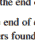

警告提醒您避免让生活变得痛苦并防止编程中的陷阱。

新术语以斜体显示。每章介绍的新术语都列在该章末尾的“术语”部分。

每章末尾，您会找到方便的摘要和测验部分（答案见附录 C）。

此外，您会在本书中发现各种排版约定：

- 命令、变量、目录和文件在正文中以特殊的等宽字体显示。
- 您输入的命令等以粗体显示。
- 语法说明中的占位符以等宽斜体字体显示。这表示您将用实际的文件名、参数或其他元素替换占位符。

# 第一部分

## UNIX 与 Shell 工具简介

### 小时

- 1. Shell 基础
- 2. 脚本基础
- 3. 处理文件
- 4. 处理目录
- 5. 输入和输出
- 6. 操作文件属性
- 7. 进程


### 第 1 小时

#### Shell 基础

我父亲是一位热衷于木工的爱好者。他有一个工具箱，里面装着他所有的木工工具，从螺丝刀和凿子到电动砂光机和电动钻。多年以来，他用这些工具建造了从玩具桥到棚屋等各种东西。通过使用相同的工具，他能够建造项目所需的各个元素。

在许多方面，shell 编程与木工相似。木工项目需要项目的设计及其元素以及合适的工具。在 shell 编程中，项目设计由程序员提供，而工具则是 UNIX 提供的实用程序或命令。有简单的命令如 `ls` 和 `cd`，也有 `awk` 和 `sed` 这样的命令，它们是 UNIX 中的电动工具。

简单的命令很容易学习。你可能已经知道如何使用其中许多命令。电动工具需要更长时间学习，但在掌握它们之后几乎任何问题都可以解决。本书涵盖了简单工具和电动工具，主要关注 UNIX 中最强大的工具 shell。在本章中你将学习关于

- 简单、复杂和复合命令
- 命令分隔符
- 不同类型的 shell


#### 什么是命令？

命令是一个包含 UNIX 可以运行或执行的指令集的文件。在 Mac OS 或 Windows 等操作系统中，命令是通过点击其图标来执行的。在 UNIX 中，命令是通过输入其名称并按 Enter 或 Return 来执行的。例如，要执行 `date` 命令，使用以下方式：

```
$ date [ENTER]
Wed Dec  9 08:49:13 PST 1998
$
```

`date` 命令的目的是显示当前日期、星期几、时间和年份。注意命令执行完毕后会显示字符 `$`。该字符是提示符。当提示符出现时，可以输入命令名称以供执行。`shell` 读取命令名称并尝试执行它。命令执行期间，提示符不会显示。当命令执行完毕后，提示符再次显示。


> `$` 字符是供你输入命令的提示符。它不是命令本身的一部分。
> 
> 例如，要执行 `date` 命令，只需在提示符下输入单词 `date`。不要输入 `$ date`。某些系统如果输入 `$ date` 而不是 `date` 可能会显示错误消息。

以下是执行 `who` 命令的另一个例子：

```
$ who
vathsa    tty1    Dec  6 19:36
ranga     tty0    Dec  9 08:23
$
```

`who` 命令显示当前正在使用 UNIX 机器的所有人员或用户的列表。输出的第一列列出了已登录人员的用户名。在此系统上，有两个用户，`vathsa` 和 `ranga`。第二列列出了他们登录的终端，最后一个列出了他们登录的时间。输出因系统而异。在某些版本的 UNIX 或 Linux 中，输出中可能还有额外的列。在你的系统上试一下，看看谁已登录。

对于不熟悉登录 UNIX 系统过程的读者，详细信息在第 2 章“脚本基础”中讨论。

#### 简单命令

命令 `who` 和 `date` 是简单命令的例子。简单命令是指只需在提示符下指定命令名称即可执行的命令。执行简单命令的语法是

```
$ cmd
```

这里 `cmd` 是要执行的命令的名称。

UNIX 中的简单命令可以是 `who` 和 `date` 这样的小命令，也可以是 Web 浏览器或电子表格程序这样的大命令。UNIX 中大多数命令都可以作为简单命令执行。

#### 复杂命令

复杂命令由命令名称后跟参数列表组成。参数是在命令名称后指定的修饰符，用于改变命令的行为。复杂命令的语法是

```
$ cmd arg1 arg2 ... argN
```

这里 `cmd` 是你想要执行的命令的名称，`arg1` 到 `argN` 是你想要给予 `cmd` 的参数。例如，你可以使用 `who` 命令来确定关于你自己的信息，执行方式如下：

```
$ who -i
ranga pts/0 Dec 9 08:49
$
```

在此模式下，`who` 省略了其他用户的信息，只打印关于你的信息。这是一个复杂命令的例子。这里，`cmd` 是 `who`，参数 `arg1` 和 `arg2` 分别是 `-i` 和 `1`。这些参数改变了 `who` 命令的行为。大多数命令接受修改其行为的参数。

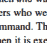

> 尽管你可以为命令指定任何参数，但大多数命令只理解少数几个参数。有些命令会忽略它们不理解的参数，而有些则会显示错误消息。第 2 章中讨论的 `man` 命令可以帮助确定命令理解的参数。

当 `who` 作为简单命令执行时，它显示了所有已登录用户的信息。这被称为 `who` 命令的默认行为。命令的默认行为是指命令作为简单命令执行时产生的输出。

#### 复合命令

可以将简单命令和复杂命令组合成复合命令。复合命令由一系列简单命令和复杂命令组成，每个命令由分号 `;` 分隔。复合命令的语法是

```
$ cmd1 ; cmd2 ; cmd3 ; ... ; cmdN ;
```

这里，`cmd1` 到 `cmdN` 都是简单命令或复杂命令。执行顺序为 `cmd1`，然后是 `cmd2`，然后是 `cmd3`，依此类推。当 `cmdN` 执行完毕后，提示符返回。

复合命令的例子是

```
$ date ; who am i ;
Wed Dec 9 10:10:10 PST 1998
ranga pts/0 Dec 9 08:49
$
```

这里复合命令由简单命令 `date` 和复杂命令 `who am i` 组成。`date` 命令先执行，然后执行 `who am i` 命令。之前复合命令的行为与每个命令分别执行时相同，如下所示：

```
$ date
Wed Dec 9 10:25:34 PST 1998
$ who am i
ranga pts/0 Dec 9 08:49
$
```

以这种方式执行命令与使用复合命令之间的区别在于，在复合命令中，只有在组成该复合命令的所有命令都执行完毕后才会返回提示符。


## 命令分隔符

分号字符 (`;`) 被视为命令分隔符。命令分隔符表示一个命令结束和另一个命令开始的位置。如果没有使用命令分隔符来分隔复杂命令中的每个单独命令，系统将无法区分一个命令的结束和下一个命令的开始。

例如，如果不使用第一个分号执行前面的例子，如下所示，

```
$ date who am i
```

系统会产生类似以下的错误消息：

`date: bad conversion`

在这种情况下，`date` 认为它作为复杂命令执行，参数为 `who`、`an` 和 `i`。`date` 命令对这些参数感到困惑并显示错误消息。使用复杂命令时，请记住使用分号字符。

你也可以使用分号字符来终止单个简单命令和复杂命令。以下两个命令产生相同的输出：

```
$ date
$ date ;
```

在第一种情况下，简单命令 `date` 执行，提示符返回。在第二种情况下，`shell` 认为正在执行复合命令。它开始执行复合命令中的第一个命令（本例中为 `date`）。当此命令完成后，`shell` 尝试执行下一个命令。在这种情况下，没有其他命令可执行，因此提示符返回。

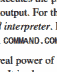

> 你经常会在脚本中看到分号用于终止简单命令和复杂命令。因为在 C、Perl 和 Java 等其他语言中，分号是用于终止命令的，许多脚本程序员在脚本中也以相同的方式使用它。使用分号用于此目的没有开销。

## 什么是 Shell？

`shell` 为你提供了与 UNIX 系统的接口。它从你那里读取输入并执行你指定的程序。程序执行期间，它显示其输出。因此，`shell` 通常被称为 UNIX 系统的命令解释器。对于熟悉 Windows 的用户，UNIX `shell` 类似于 DOS `shell`，`COMMAND.COM`。

`shell` 的真正强大之处在于它远不止是一个命令解释器。它也是一个功能强大的编程语言，包含条件语句、循环和函数。

如果你熟悉其他编程语言中的这类语句，你可以快速学习 `shell` 编程。如果你以前没见过这些，不用担心。通过本书中的示例和练习，你将学会如何有效地使用所有这些语句。

## Shell 提示符

提示符 `$`，本章前面已讨论过，是由 `shell` 打印的。当提示符显示时，你可以输入命令。`shell` 会等待你按下 Enter 或 Return 键后才读取输入。执行的命令是通过检查输入的第一个词来确定的。词是一组由空格或制表符分隔的字符。`shell` 对输入的处理如下：

```
$ word1 word2 word3 ... wordN
```

第一个词 `word1` 一直被假定为要执行的命令的名称。如果只有一个词，如以下示例所示，`shell` 只是执行该命令：

```
$ date
```

如果有多个词如下，

```
$ who am i
```

多余的词会作为参数传递给 `word1` 指定的命令。

## Shell 的不同类型

您系统上的提示符可能与本书中使用的简单 `$` 不同。实际显示的提示符取决于您使用的 `shell` 类型。在 UNIX 中，有两种主要的 `shell` 类型：

- Bourne（包括 `sh`、`ksh`、`bash` 和 `zsh`）

- C（包括 `csh` 和 `tcsh`）

如果您使用大多数 Bourne 类型的 `shell`，默认提示符的最后一个字符是美元符号字符 `$`。如果您使用 C 类型的 `shell` 或 `zsh`，默认提示符的最后一个字符是百分号字符 `%`。

本书涵盖 Bourne 类型的 `shell`。除非特别说明，本书中的示例和练习答案都适用于任何 Bourne 类型的 `shell`。C 类型的 `shell` 有几个问题使其不适合 `shell` 编程，因此本书不予涵盖。有关此主题的更多信息，请参阅以下文章：

http://www.faqs.org/faqs/unix-faq/shell/csh-whynot/


> 在 UNIX 中，有两种类型的账户，普通账户和 `root` 账户。普通用户被分配普通账户。`root` 账户是一个具有特殊权限的账户，UNIX 系统管理员（称为 `sysadmin`）使用它来执行维护和升级。当使用 `root` 账户时，Bourne 类型和 C 类型的 `shell` 都会将 `#` 字符显示为提示符的最后一个字符。作为 `root` 用户执行命令时请务必极其谨慎，因为命令会影响整个系统。本书中的示例都不需要您拥有 `root` 账户访问权限即可执行。

### Bourne Shell

原始 UNIX `shell` 由 Steve Bourne 于 1970 年代中期在新泽西州的 AT&T Bell Labs 编写。由于 Bourne `shell` 是出现在 UNIX 系统上的第一个 `shell`，因此它通常被称为“the shell”。历史上，它被安装为 `/bin/sh`。

除了是命令解释器之外，Bourne `shell` 是一种功能强大的语言，其编程语法类似于 ALGOL 语言。Steve Bourne 在英国剑桥大学时编写过 ALGOL-68 编译器，他非常喜欢该语言的语法，以至于他以此为模型设计了 `shell` 的语法。

Bourne `shell` 的一些特性包括

- 进程控制（参见第 7 章，“进程”）

- 变量（参见第 8 章，“变量”）

- 正则表达式（参见第 9 章，“替换”）

- 流程控制（参见第 11 章，“流程控制”，和第 12 章，“循环”）

- 强大的输入和输出控制（参见第 5 章，“输入和输出”）

- 函数（参见第 14 章，“函数”）

人们对 Bourne `shell` 的主要抱怨之一是，虽然它非常适合编程，但交互使用起来很困难。一些主要缺点是

- 缺少文件名补全

- 缺少命令历史或命令编辑

- 执行多个后台进程困难

### C Shell

C `shell` 于 1980 年代初由加州大学伯克利分校的 Bill Joy 编写。C `shell` 的设计目的是使 `shell` 更易于交互使用。它首次出现在 BSD UNIX 中，后来被纳入 AT&T 的 UNIX 版本。C `shell` 通常安装为 `/bin/csh`。

C `shell` 将 `shell` 的语法从旧的类似 ALGOL 的语法更新为更现代的类似 C 的语法。当时，大多数人认为这一改变将简化伯克利 UNIX 程序员的 `shell` 编程，他们精通 C 及其语法。事实证明，由于以下缺陷，C `shell` 只能用于最简单的脚本：

- 弱输入和输出控制

- 缺少函数

- 语法令人困惑

尽管 C `shell` 在脚本方面没有流行起来，但它在交互使用方面变得非常流行。导致这种流行度的一些关键改进是：

- `命令历史`。先前执行的命令可以被召回以重新执行。命令在重新执行前也可以被编辑。

- `别名`。C `shell` 允许创建简短的助记名称，可以代替完整的命令名称输入。别名是 Bourne `shell` 函数的简化形式。

- `文件名补全`。C `shell` 在输入文件名的几个字符后可以自动补全文件名。

- `作业控制`。C `shell` 允许执行多个后台进程，并允许通过 `jobs` 命令对其进行控制。

TENEX/TOPS C `shell`，`tsch`，是 C `shell` 的较新版本，具有多种可用性增强功能。例如，它可以使用上、下箭头键滚动命令历史记录，并允许使用左右箭头键编辑命令。有关 `tsch` 的更多信息，请参阅以下 URL。

http://www.dubois.ws/software/csh-tsh-book/

### Korn Shell

多年以来，可供选择的 `shell` 只有 Bourne `shell` 和 C `shell`。这意味着大多数用户必须学习两种 `shell`，Bourne `shell` 用于编程，C `shell` 用于交互使用。为了解决这个问题，AT&T Bell Labs 的 David Korn 编写了 Korn Shell，`ksh`。它结合了 C `shell` 的所有交互功能，同时保留了 Bourne `shell` 的类似 ALGOL 的语法。Korn Shell 通常安装为 `/bin/ksh` 或 `/usr/bin/ksh`。

Korn Shell 为 Bourne `shell` 添加的一些额外特性包括

- 命令历史和历史替换

- 命令别名和函数

- 文件名补全

- 数组（参见第 8 章）

- 内置整数运算（参见第 9 章）

总体而言，`ksh` 与 `sh` 完全兼容。存在一些细微差异可能会影响脚本的执行。本书在适当的地方会注明此类差异。

`ksh` 有几个变体。官方版本预装在大多数商业 UNIX 版本中，例如 Solaris 和 HP-UX。对于其他系统，它可从以下位置以二进制形式获得

http://www.kornshell.com

大多数非商业 UNIX 版本，例如 Linux 和 BSD，使用 Korn Shell 的公共领域版本 `pdksh`。Eric Gisin 使用 Charles Forsyth 的公共领域 V7 `shell` 以及 BRL `shell` 的部分内容创建了 `pdksh`。目前，`pdksh` 由 Michael Rendell 维护。它可从以下位置以源代码和二进制形式获得


http://web.cs.nun.ca/~michael/pdksh/

对于 shell 程序员来说，官方版本和公共领域版本的 `ksh` 没有区别——在一种版本中运行的脚本在另一种版本中也能运行。对于用户来说，官方版本提供了一些不错的功能，例如使用 Tab 键而不是 Esc 键进行命令行补全。

`ksh` 的另一个变体是 POSIX shell。电气和电子工程师学会（IEEE）创建了 POSIX 标准，以帮助程序员编写与各种系统兼容的可移植程序。某个特定标准，1003.2/ISO 9945.2 Shell and Tools 规范，规定了可移植 shell 的语法和行为，这本质上是 `ksh` 的语法和行为。大多数商业 UNIX 厂商正在缓慢采用 POSIX 标准。HP 目前在其所有新的 HP-UX 系统上将 POSIX shell 作为默认 shell `/bin/sh` 发行。

### Bourne Again Shell

Bourne Again Shell，`bash`，由自由软件基金会的 Brian Fox 编写，作为 Bourne shell 的替代品。目前 `bash` 由 Chet Ramey 维护。它结合了 `csh`、`tcsh` 和 `ksh` 的大多数功能，同时保留了与原始 Bourne shell 的兼容性并符合 POSIX 标准。

大多数 Linux 发行版，例如 Red Hat、Debian 和 Slackware，都将 `bash` 安装为 `/bin/sh` 和 `/bin/bash`。由于许可限制，原版 Bourne shell 不能轻松地随 Linux 分发。由于 `bash` 与 Bourne shell 兼容，大多数 Linux 发行版选择使用 `bash` 的副本代替真正的 Bourne shell。

对于非 Linux 系统，`bash` 可在 http://cnswww.cns.cwru.edu/~chet/bash/bash.html 以源代码和二进制形式获得

`bash` 除 Korn Shell 之外的一些特性包括

- 变量名、用户名、主机名、命令和文件名的名称补全
- `cd` 命令中路径名的拼写校正
- 无限大小的数组
- 2 到 64 之间任意进制的整数运算

### Z Shell

Z shell，`zsh`，由 Paul Falstad 在普林斯顿大学求学期间编写。它极具可定制性，并且与 `ksh` 大多兼容。

在 Mac OS X 系统上，`zsh` 安装为 `/bin/zsh` 和 `/bin/sh`。由于许可问题，Apple 选择不随 Mac OS X 分发原始的 Bourne shell。Apple 将 `zsh` 分发为其 Bourne shell 替代品。

对于非 Mac OS X 系统，`zsh` 可从以下位置获得

http://zsh.sunsite.dk/

除了 `zsh` 和 `bash` 的特性外，`zsh` 的一些额外特性包括

- 高度可配置的命令行编辑
- 完全可编程的文件名、用户名、主机名和历史记录补全
- 高度可定制的键盘映射

### 摘要

本章介绍了 shell 基础，包括简单命令、复杂命令和复合命令的执行。介绍了 shell 的概念以及多个不同的 shell，包括 `ksh`、`bash` 和 `zsh`。下一章“脚本基础”将更详细地探讨 shell 的功能，从 shell 的交互式和非交互式使用开始。

### 问题

1. 将以下每项分类为简单、复杂或复合命令：

```
$ ls
```

```
$ date ; uptime
```

```
$ ls -l
```

```
$ echo "hello world"
```

如果您之前 chưa 见过其中某些命令，请在系统上尝试一下。随着您阅读本书的进展，每个命令都将被正式介绍。

2. 在单个简单或复杂命令末尾加上分号会有什么效果？

例如，以下命令的输出会有不同吗？

```
$ who am i
```

```
$ who am i ;
```

3. 两种主要类型的 shell 是什么？请给出每种类型的一个 shell 示例。

### 术语

**参数** 参数是改变命令行为的命令修饰符。

**命令分隔符** 命令分隔符表示一个命令结束和另一个命令开始的位置。最常见的命令分隔符是分号字符（`;`）。

**命令** 命令是可以执行的程序。要执行命令，输入其名称并按 Enter 或 Return。

**复杂命令** 复杂命令由命令名和参数列表组成。

**复合命令** 复合命令由分号字符（`;`）分隔的简单命令和复杂命令列表组成。

**默认行为** 命令的默认行为是在其作为简单命令运行时生成的输出。

**提示符** 提示符由 shell 显示。当提示符存在时，可以向 shell 提供要执行的命令。在本书中，`$` 字符用于表示提示符。

**Shell** Shell 是 UNIX 系统的接口。它读取输入并根据该输入执行程序。当程序执行完毕后，它会显示该程序的输出。Shell 有时被称为命令解释器。

**简单命令** 简单命令是在提示符下仅给出其名称即可执行的命令。

**词** 词是由空格和制表符分隔的字符集合。


### 第 2 小时

### 脚本基础

第 1 章“Shell 基础”介绍了 shell 和命令的概念，并描述了 shell 如何读取输入并执行指定的命令。本章在此基础上扩展了这些基本概念，更详细地解释了 shell 是什么以及它如何工作，包括与 shell 相关的登录和注销过程。

本章还解释了如何将通常交互式执行的命令分组到文件中，从而创建程序或脚本。脚本是 shell 的强大之处，因为它们允许将命令组合在一起以创建新命令。

具体而言，本章涵盖的主题包括

- UNIX 系统
- Shell 初始化
- 获取帮助

#### UNIX 系统

UNIX 系统由两个主要组件组成：

- 实用程序
- 内核

实用程序是可以执行的程序。前一章中的 `who` 和 `date` 程序就是实用程序的例子。

命令与实用程序略有不同。术语 utility 指程序的名称，而术语 command 指程序以及为改变其行为而指定的任何参数。对于简单命令，有时使用术语 command 代替术语 utility。

内核是 UNIX 系统的核心。它为实用程序提供访问计算机硬件的手段。它还处理命令的调度和执行。

当计算机关闭电源时，内核和实用程序都存储在硬盘上。当计算机启动时，内核从磁盘加载到内存中，并在计算机关闭之前一直保留在内存中。另一方面，实用程序存储在磁盘上的文件中，仅在请求执行时才加载到内存中。例如，当执行以下命令时，

```
$ who
```

内核从磁盘上的文件加载 `who` 命令，将其放入内存并开始执行。当程序执行完毕后，它会在被移除之前在机器内存中保留一段时间。这使得经常使用的命令执行得更快。考虑 `date` 命令连续快速执行三次时会发生什么情况：

```
$ date
Sun Dec 27 09:42:37 PST 1998
$ date
Sun Dec 27 09:42:38 PST 1998
$ date
Sun Dec 27 09:42:39 PST 1998
```

第一次执行 `date` 命令时可能需要从计算机硬盘加载，但第二次和第三次 `date` 命令通常仍保留在计算机内存中，从而允许更快执行。在您的系统上试试，看看第一次是否有轻微延迟，而第二次和第三次没有延迟。

#### 命令和文件

在 UNIX 中，大多数命令都存储在磁盘上的单独文件中。例如，`who` 和 `date` 命令存储在磁盘上名为 `who` 和 `date` 的两个单独文件中；它们不是 shell 的一部分。这允许在不修改 shell 的情况下添加新命令并修复现有命令中的错误。如果您不熟悉文件的概念，请不要惊慌！文件将在下一章中介绍。

#### 登录

就像 `date` 一样，shell 是存储在磁盘上的程序。主要区别在于 shell 在您登录时加载到内存中，并在您注销之前一直保留在内存中。

当您首次连接到 UNIX 系统时，会显示登录提示。通常看起来类似于

```
login:
```

在这里，您需要输入用户名，即您在 UNIX 系统上的身份。输入用户名后，会出现另一个提示：

```
login: ranga
Password:
```

在这里，您需要输入与您输入的用户名对应的密码。您的用户名、密码和相关文件称为您的用户账户。系统管理员负责创建您的用户账户并为您提供与其关联的用户名和密码。

在读取用户名和密码后，系统会在用户数据库中查找与提供的信息匹配的条目，用户数据库通常位于文件 `/etc/passwd` 中。如果找到匹配项，则执行与该条目关联的 shell；否则，显示错误。


对于不熟悉 UNIX 文件和目录名称（如 `/etc/passwd`）的人来说，这些主题在第 3 章“使用文件”和第 4 章“使用目录”中介绍。本章对文件和目录进行了简要讨论。从其他操作系统对文件和目录的一般概念足以理解示例。

以下是我系统上 `/etc/passwd` 的一个示例条目：

```
ranga:x:500:100:Sriranga Veeraraghavan:/home/ranga:/bin/bash
```


该条目由多个字段组成，每个字段之间用冒号 `:` 分隔。后续章节将解释每个字段存储的信息。目前，仅最后两个字段很重要。最后一个字段存储与账户关联的 `shell`。倒数第二个字段存储账户的 `home` 目录。`home` 目录是你登录后首先进入的位置。在某些文档中，你会看到 `home` 目录用波浪号 `~` 表示，或波浪号后跟斜杠 `~/`。在前面的示例中，`shell` 为 `/bin/bash`，`home` 目录为 `/home/ranga`。你的 `shell` 和 `home` 目录很可能不同。

在大多数情况下，系统管理员会为特定版本的 UNIX 分配默认 `shell`。在某些情况下，有两个默认值，系统管理员可以根据个人偏好在两者之间选择。

某些常见 UNIX 版本的默认 `shell` 如下：

- Solaris 使用 Bourne shell 或 C Shell。
- HP-UX 使用 POSIX shell。
- BSD 使用 Korn Shell 或 C Shell。
- Mac OS X 使用 Z Shell 或 C Shell。
- Linux 使用 Bourne Again Shell。

为简洁起见，我们假设你被分配了 Bourne shell、`Korn Shell` `ksh`、`Bourne Again Shell` `bash` 或 `Z Shell` `zsh` 作为你的 `shell`。

## Shell 模式和初始化

本节中，我们首先将讨论各种 Bourne 类型 `shell` 的启动过程，然后我们将检查 `shell` 的不同执行模式。

### 初始化过程

登录后，系统会代表你执行一个 `shell`。当该 `shell` 开始执行时，它处于未初始化状态。在此状态下，其正常运行所需的多个参数尚未定义。`shell` 会经历一个称为初始化的过程来定义这些参数。初始化涉及的步骤和文件在每个 `shell` 中都不同，因此我们将分别检查每种 Bourne 类型 `shell` 使用的过程。一般来说，每个 `shell` 都使用位于 `/etc` 目录中的默认或系统范围配置文件，以及位于你的 `home` 目录中的一组个人配置文件。

### Bourne Shell

Bourne shell 初始化有四个步骤，涉及初始化文件（也称为 init 文件）`/etc/profile` 和 `.profile`。过程如下：

- 1. `shell` 检查文件 `/etc/profile` 是否存在。
- 2. 如果存在，`shell` 读取它；否则，`shell` 跳过它。
- 3. `shell` 检查你的 `home` 目录中是否存在文件 `.profile`。
- 4. 如果存在，`shell` 读取它；否则，`shell` 跳过它。

执行完这些步骤后，会显示提示符。Bourne shell 的默认提示符为 `$`（美元符号后跟一个空格）。

### Korn Shell

Korn Shell `ksh` 的初始化与 Bourne shell 非常相似。它有六个步骤，涉及 init 文件 `/etc/profile`、`.profile` 和 `.kshrc`：

- 1. `ksh` 检查文件 `/etc/profile` 是否存在。
- 2. 如果存在，`ksh` 读取它；否则，`ksh` 跳过它。
- 3. `ksh` 检查你的 `home` 目录中是否存在文件 `.profile`。
- 4. 如果存在，`ksh` 读取它；否则，`ksh` 跳过它。
- 5. `ksh` 检查你的 `home` 目录中是否存在文件 `.kshrc`。
- 6. 如果存在，`ksh` 读取它；否则，`ksh` 跳过它。

执行完这些步骤后，会显示提示符。`ksh` 的默认提示符为 `$`（美元符号后跟一个空格）。

### Bourne Again Shell

Bourne Again shell `bash` 初始化比 Korn shell 和 Bourne shell 初始化稍长。它有八个步骤，涉及 init 文件 `/etc/profile`、`.bash_profile`、`.bash_login` 和 `.profile`：

- 1. `bash` 检查文件 `/etc/profile` 是否存在。
- 2. 如果存在，`bash` 读取它；否则，`bash` 跳过它。
- 3. `bash` 检查你的 `home` 目录中是否存在文件 `.bash_profile`。
- 4. 如果存在，`bash` 读取它；否则，`bash` 跳过它。
- 5. `bash` 检查你的 `home` 目录中是否存在文件 `.bash_login`。
- 6. 如果存在，`bash` 读取它；否则，`bash` 跳过它。
- 7. `bash` 检查你的 `home` 目录中是否存在文件 `.profile`。
- 8. 如果存在，`bash` 读取它；否则，`bash` 跳过它。

执行完这些步骤后，会显示提示符。`bash` 的默认提示符为 `bash$`（字符串 `bash$` 后跟一个空格）。

### Z Shell

Z shell `zsh` 初始化相当长，且与其它 `shell` 的初始化过程不相似。它有 16 个步骤，涉及 init 文件 `/etc/zshenv`、`.zshenv`、`/etc/zprofile`、`.zprofile`、`/etc/zlogin` 和 `.zlogin`：

- 1. `zsh` 检查文件 `/etc/zshenv` 是否存在。
- 2. 如果存在，`zsh` 读取它；否则，`zsh` 跳过它。
- 3. `zsh` 检查你的 `home` 目录中是否存在文件 `.zshenv`。
- 4. 如果存在，`zsh` 读取它；否则，`zsh` 跳过它。
- 5. `zsh` 检查文件 `/etc/zprofile` 是否存在。
- 6. 如果存在，`zsh` 读取它；否则，`zsh` 跳过它。
- 7. `zsh` 检查你的 `home` 目录中是否存在文件 `.zprofile`。
- 8. 如果存在，`zsh` 读取它；否则，`zsh` 跳过它。
- 9. `zsh` 检查文件 `/etc/zshrc` 是否存在。
- 10. 如果存在，`zsh` 读取它；否则，`zsh` 跳过它。
- 11. `zsh` 检查你的 `home` 目录中是否存在文件 `.zshrc`。
- 12. 如果存在，`zsh` 读取它；否则，`zsh` 跳过它。
- 13. `zsh` 检查文件 `/etc/zlogin` 是否存在。
- 14. 如果存在，`zsh` 读取它；否则，`zsh` 跳过它。
- 15. `zsh` 检查你的 `home` 目录中是否存在文件 `.zlogin`。
- 16. 如果存在，`zsh` 读取它；否则，`zsh` 跳过它。

执行完这些步骤后，会显示提示符。`zsh` 的默认提示符为 `host%`。这里 `host` 是你系统的主机名。例如，在名为 `nars` 的系统上，默认的 `zsh` 提示符将为 `nars%`。

## 初始化文件内容

通常 `shell` 的 init 文件相当简短。这些文件的目的是以尽可能少的开销提供一个完整的工作环境。本节中，我们将查看 Bourne shell 所需的基本设置。如果你使用的是不同的 `shell`，可以将这些设置放入该 `shell` 使用的 init 文件中。

init 文件 `.profile` 包含你所有的 `shell` 初始化设置。你可以在此文件中添加任意多的自定义信息。你需要配置的最小信息集包括

- 用于定位命令的目录列表
- 用于定位命令手册页的目录列表

### 设置 PATH

当你输入命令时，

```
$ date
```

`shell` 在执行命令 `date` 之前必须先找到它。`PATH` 变量指定 `shell` 应在其中查找命令的目录。最基本的设置如下：

```
PATH=/bin:/usr/bin
```

冒号字符 `:` 分隔的每个单独条目都应是目录。目录在第 4 章中讨论。

如果你要求 `shell` 执行一个命令，但它在 `PATH` 变量给出的任何目录中都找不到该命令，则会出现类似以下的消息：

```
$ hello
hello: not found
```

### 设置 MANPATH

在 UNIX 中，在线帮助从一开始就可用。下一节“Getting Help”讨论如何使用 `man` 命令访问在线帮助。为了使该命令正常工作，你必须告诉 `shell` 帮助页面位于何处。此信息使用 `MANPATH` 指定。一个常见的设置是

```
MANPATH=/usr/man:/usr/share/man
```

与 `path` 类似，冒号字符 `:` 分隔的每个单独条目都是目录。

当你使用 `man` 命令请求在线帮助时，它会在 `MANPATH` 给出的每个目录中搜索与你请求主题相对应的在线帮助页面。例如，命令

```
$ man who
```

查找对应于 `who` 命令的在线帮助页面。如果找到该页面，则会显示它。

## 交互式和非交互式 Shell

`Shell` 可以在两种不同的模式下运行：交互式和非交互式。在交互式模式下，`shell` 期望从你那里读取输入并执行你指定的命令。这种模式被称为交互式，因为它与用户进行交互。在非交互式模式下，`shell` 不与用户交互；相反，它读取存储在文件中的命令并执行它们。当它到达文件末尾时，它会退出。

大多数人熟悉交互式模式：登录、执行 `shell` 中的一些命令，然后注销。

### 启动交互式 Shell


要以交互式模式启动 shell，你可以在提示符下输入其名称。例如，以下命令以交互式模式启动 `bash`：

```
$ /bin/bash
bash$
```

第一个提示符 `$`，是在你登录时由代表你启动的 shell 显示的；第二个提示符 `bash$`，是由你启动的 `bash` 显示的。

此时，我们有两个交互式 shell：第一个 shell 在等待另一个 shell 完成。乍一看，这听起来不太有用，但在某些情况下它会非常有帮助。例如，如果你需要对 shell 设置进行更改，测试更改的最简单方法是启动另一个 shell，执行并验证更改，然后退出回原始的未更改 shell。

要退出第二个 shell，你可以使用 `exit` 命令：

```
bash$ exit
$
```

这会将你返回到原始 shell。如果你在此处输入 `exit`，系统将注销你。`exit` 命令在所有 Bourne 类型 shell 中都有效。

### 启动非交互式 Shell

你可以按如下方式以非交互式模式启动 shell：

```
$ /bin/sh filename
```

这里 `filename` 是包含要执行命令的文件的名称。作为示例，考虑复合命令：

```
$ date ; who
```

让我们将这些命令放入名为 `login.s` 的文件中。首先在编辑器中打开一个名为 `login.s` 的文件，输入此命令并保存文件。现在你可以使用以下命令执行此文件中的命令：

```
$ /bin/sh login.s
```

这会执行复合命令并显示其输出。这是 shell 脚本或 shell 程序的第一个示例。基本上，shell 脚本是包含命令列表的文件。当 shell 执行文件包含的命令时，它不会与用户交互。因此，当 shell 用于执行 shell 脚本时，据说它以非交互式模式执行。

### 使 Shell 脚本可执行

编写 shell 脚本时最重要的任务之一是使 shell 脚本可执行并确保在脚本上调用正确的 shell。

在之前的示例中，你创建了执行以下复合命令的 `login.s` 脚本：

```
date ; who ;
```

如果你想通过仅键入其名称来运行脚本，你需要做两件事：

- 将文件标记为可执行。
- 确保使用正确的 shell 执行脚本。

要使此脚本可执行，你需要执行如下形式的命令：

```
chmod a+x filename
```

`chmod` 命令在使用此形式时，将 `filename` 指定的文件标记为可执行。有关 `chmod` 及其功能的完整讨论，请参阅第 6 章，“操作文件属性”。例如，以下命令将文件 `login.s` 标记为可执行：

```
$ chmod a+x login.s
```

为了确保使用正确的 shell 执行脚本，你必须将以下形式的魔术行作为脚本的第一行添加：

```
#!shell
```

这里 `shell` 是应用于执行脚本的 shell 的名称。在大多数情况下，你希望将 `/bin/sh` 用作 `shell`，但如果你想为脚本使用 `ksh`，你也可以指定 `/bin/ksh`。没有魔术行，当前 shell 总是用于评估脚本，而不管脚本是为哪个 shell 编写的。如果你从脚本中省略魔术行，`csh` 和 `tcsh` 用户可能无法正确运行它们。

### #!/bin/sh 的魔力

`#!/bin/sh` 必须是 shell 脚本的第一行，以便使用 `sh` 运行脚本。如果它出现在任何其他行，则被视为注释并被所有 shell 忽略。

添加此内容后，`logins` 脚本包含两行：

```
#!/bin/sh
date ; who ;
```

现在可以通过仅键入其名称来执行脚本：

```
$ logins
Tue Sep 18 18:44:12 PDT 2001
ranga console Sep 12 18:22
```

### 注释

shell 脚本的魔术第一行 `#!/bin/sh` 引入了注释的概念。注释是嵌入在 shell 脚本中不打算由 shell 执行的语句。在 shell 脚本中，注释以 `#` 字符开头。`#` 与行尾之间的所有内容都被视为注释的一部分，并被 shell 忽略。

向脚本添加注释非常简单：使用编辑器打开脚本并添加以 `#` 字符开头的行。例如，要向 `logins` shell 脚本添加以下行，

```
# print out the date and who's logged on
```

你可以使用编辑器打开文件 `logins` 并将此行插入为文件中的第二行。现在脚本有三行：

```
#!/bin/sh
# print out the date and who's logged on
date ; who ;
```

因为注释被忽略，所以脚本的输出没有变化。注释不会减慢脚本的速度，因为 shell 只会跳过它们。

你还可以通过在命令后添加 `#` 字符来向包含命令的行添加注释。例如，你可以按如下方式向行 `date ; who ;` 添加注释：

```
date ; who ; # execute the date and who commands
```

当你编写 shell 脚本时，请务必使用注释来解释脚本正在做什么。如果其他人必须查看你的 shell 脚本，它将有助于他理解你的脚本如何工作。注释还可以帮助你在编写脚本数月或数年后弄清楚脚本正在做什么。

### 获取帮助

当你阅读本书时，你可能想要获取有关所讨论的命令和功能的更多信息。UNIX 的在线帮助功能提供了其中大部分信息。其他一些资源包括涵盖 shell 编程的网站和 Usenet 新闻组。

#### man

UNIX 的每个版本都附带大量称为 man pages（手册页的缩写）的在线帮助页面。`man` pages 是有关你的 UNIX 系统的权威来源。它们包含有关内核和所有实用程序的完整信息。

你可以使用 `man` 命令访问 man pages：

```
man cmd
```

这里，`cmd` 是你想要获取更多信息的命令的名称。作为示例，

```
$ man uptime
```

在 Solaris 机器上显示以下 man page：

```
User Commands                          uptime(1)

NAME
       uptime - show how long the system has been up

SYNOPSIS
       uptime

DESCRIPTION
       The uptime command prints the current time, the length of
       time the system has been up, and the average number of jobs
       in the run queue over the last 1, 5 and 15 minutes. It is,
       essentially, the first line of a w(1) command.

EXAMPLE
       Below is an example of the output uptime provides:
       example$ uptime
```


```
10:47am up 27 day(s), 50 mins, 1 user,
load average: 0.16, 0.28, 0.20
```

SEE ALSO

w(1), who(1), whodo(1M), attributes(5)

NOTES

who -b gives the time the system was last booted.

#### 手册页部分

如前例的输出所示，man page 分为几个部分，这些部分在表 2.1 中描述。几乎每个 man page 都包含这些部分。各部分中材料的內容和风格因系统而异。

表 2.1 手册页中的部分

| 部分 | 描述 |
|---|---|
| NAME | 本部分给出命令的名称以及对其的简短描述。 |
| SYNOPSIS | 本部分描述命令可以运行的所有不同模式。如果命令接受参数，则在此部分中显示它们。 |
| DESCRIPTION | 本部分包含命令的详细描述。如果命令接受参数，则每个参数都将在本部分中完全解释。 |
| EXAMPLE | 本部分包含演示如何执行命令的示例。它还可能包含一些示例输出。并非所有 man pages 都包含此部分。 |
| SEE ALSO | 本部分列出与该命令相关的其他命令。 |
| NOTES | 本部分通常列出有关命令的一些附加信息。有时它列出已知错误。 |

大多数 man pages 包含表 2.1 中给出的所有部分，并且可能包含表 2.2 中描述的一个或两个可选部分。

表 2.2 手册页中发现的可选部分

| 部分 | 描述 |
|---|---|
| AVAILABILITY | 本部分描述包含对给定命令支持的 UNIX 版本。有时它列出你需要从供应商处购买的可选软件包以获得命令的额外功能。 |


| `KNOWN BUGS` | 本部分通常列出命令的一个或多个已知问题。如果你遇到的问题未包含在此部分中，应向供应商或作者报告。 |

#### 表 2.2 继续

| 部分 | 描述 |
|---|---|
| `FILES` | 本节列出使命令正确运行所需的文件。它还可能列出可用于配置命令的文件。 |
| `AUTHORS or CONTACTS` | 这些部分列出命令的作者或作者，并提供联系信息，例如电子邮件或邮寄地址。 |
| `STANDARDS COMPLIANCE` | 如果命令的行为由标准组织（如 ISO（国际标准化组织）、IEEE（电气和电子工程师学会）或 ANSI（美国国家标准学会））指定，本节列出相关标准或标准。 |

尝试使用 `man` 命令获取本章讨论的一些命令的更多信息。

如果 `man` 命令找不到您请求的命令对应的手册页，它会发出错误消息。例如，命令

```
$ man apple
```

在我的系统上会产生类似以下内容的错误消息：

No manual entry for apple

确切的错误消息取决于您的 UNIX 版本。

### UNIX 系统手册

术语 manual page 源自 UNIX 的原始版本，当时在线页面以大型装订手册的形式提供。总共有八种不同的手册，涵盖 UNIX 系统的主要主题。这些手册在表 2.3 中描述。

表 2.3 UNIX 系统手册

| 手册章节 | 描述 |
|---|---|
| 1 | 涵盖命令。 |
| 2 | 涵盖 UNIX 系统调用。系统调用在程序内部使用，例如 `date`，以向内核请求服务。 |
| 3 | 涵盖库。库用于存储 C 程序员使用的非内核相关函数。 |
| 4 | 涵盖文件格式。例如，文件 `/etc/passwd` 的格式记录在此部分中。 |

#### 表 2.3 继续

| 手册章节 | 描述 |
|---|---|
| 5 | 一个次要部分，涵盖文件格式。 |
| 6 | 包含在 UNIX 上玩游戏的说明。（UNIX 并非一直都是严肃的学术和商业操作系统；它最初是一个游戏平台！） |
| 7 | 涵盖设备驱动程序。 |
| 8 | 涵盖系统维护。 |

在印刷版中，您必须知道要在其中查找特定手册页的部分。`man` 相对于印刷手册的巨大优势在于，`man` 会在手册的所有部分中查找您请求的信息，使获取帮助变得容易得多。

### 在线资源

除了 `man` 之外，还有几个 Usenet 新闻组、网站和电子邮件列表，是了解不同 shell 和 shell 编程的良好信息来源。

用于 shell 编程问题和信息的主要 Usenet 新闻组是 `comp.unix.shell`。在发帖提问之前，您应该阅读该新闻组的常见问题解答（FAQ）。FAQ 位于 http://www.faqs.org/faqs/unix-faq/shell/intro/

通常您会发现您的问题，或与之非常相似的问题，在本 FAQ 或后面提到的其他 FAQ 中已有答案。

对于有关 Bourne Again shell（`bash`）的问题，您可以订阅 `bash` 电子邮件列表：`bug-bash@gnu.org`。订阅表单位于 http://mail.gnu.org/mailman/listinfo/bug-bash

如果您更喜欢阅读新闻而不是电子邮件，该电子邮件列表以新闻组 `gnu.bash.bug` 的形式提供。在向新闻组发帖之前，您应该阅读位于 http://www.faqs.org/faqs/unix-faq/shell/bash/ 的 `bash` FAQ

对于有关 Z Shell（`zsh`）的问题，您可以订阅 `zsh-users` 邮件列表：`zsh-users@sunsite.dk`。订阅说明可在 http://zsh.sunsite.dk/Arc/mlist.html 找到

在向邮件列表发帖之前，您应该阅读位于 http://www.faqs.org/faqs/unix-faq/shell/zsh/ 的 `zsh` FAQ

以下网站也是 shell 编程的优秀参考：

http://www.h.eng.cam.ac.uk/~help/tpl/unix/scripts/scripts.html

http://www.shelldorado.com/

第一个网站包含由剑桥大学的 Tim Love 编写的 shell 编程教程。第二个网站是 Heiner Steven 在 Sun Microsystems 维护的 shell 脚本和 shell 编程信息档案。

### 摘要

本章更详细地介绍了 shell 是什么以及它如何运行。描述了各种 shell 的 init 过程以及 init 文件 `.profile` 中所需的基本信息。还介绍了 shell 的不同操作模式，即交互式和非交互式。Shell 编程依赖于非交互式模式，因为它使文件中指定的命令能够被执行。

我们还介绍了 `man` 和 man pages，即 UNIX 中的在线帮助系统。最后，介绍了 shell 编程信息的在线来源，例如 Usenet 新闻组、网站和电子邮件列表。

下一章通过向您展示如何列出文件、查看文件内容和操作文件，正式介绍了文件的概念。

### 问题

- 1. Shell 用于初始化自己的两个文件是什么？
- 2. 为什么需要设置 `PATH` 和 `MANPATH`？
- 3. shell 脚本中以下行的目的是什么？
  - `#!/bin/sh`
- 4. 您应该使用什么命令来访问在线帮助？

```
#!/bin/sh
```

### 术语

**Commands** 命令由程序名称以及零个或多个参数组成。您可能会看到术语 command 用于代替术语 utility 表示简单命令，其中仅给出程序名称。

**Comments** 注释是嵌入在 shell 脚本中但不由 shell 执行的语句。

**Home Directory** 主目录是您登录后首先进入的位置。

**Interactive Mode** 在交互模式下，shell 从用户读取输入并执行指定的命令。这种模式称为交互式，因为 shell 正在与用户交互。

**Kernel** 内核是 UNIX 系统的核心。它为实用程序提供访问机器硬件的手段。它还处理调度和执行命令。

**Man Pages** 每个版本的 UNIX 都附带大量称为 man pages（手册页的简称）的在线帮助页。man pages 是有关您的 UNIX 系统的权威来源。它们包含有关内核和所有实用程序的完整信息。


### Non-interactive Mode
在非交互模式下，shell 不与用户交互；相反，它读取存储在文件中的命令并执行它们。当 shell 到达文件末尾时，它会退出。

### Shell Initialization
在 shell 启动后，它会经历一个称为初始化的阶段，在此阶段设置重要参数。

### Shell Script
shell 脚本是存储在文件中的命令列表。

### Uninitialized Shell
未初始化的 shell 是尚未读取其 init 文件以设置其正常操作所需参数的 shell。

### Utilities
实用程序是可以执行的程序，例如 `who` 和 `date`。

## 第 3 小时

## 使用文件

在 UNIX 中有两种基本类型的文件：普通文件和特殊文件。普通文件包含数据、文本或程序指令。UNIX 系统上的几乎所有文件都是普通文件。本章介绍对普通文件的操作。

特殊文件主要用于提供对硬件的访问，例如硬盘、CD-ROM 驱动器、调制解调器和以太网适配器。一些特殊文件类似于别名或快捷方式，使您可以使用不同的名称访问单个文件。特殊文件在第 6 章“操作文件属性”中介绍。

普通文件和特殊文件都存储在目录中。目录类似于 Mac OS 或 Windows 中的文件夹，并在第 4 章“使用目录”中详细介绍。

在本章中，我们将研究普通文件，重点关注以下主题：

- 列出文件
- 文件内容
- 操作文件

### 列出文件

我们将首先使用 `ls`（缩写为 list）命令来列出当前目录的内容：

```
$ ls
```

输出将类似于以下内容：

```
Desktop    Icon    Music    Sites
Documents  Library Pictures Temporary Items
Downloads  Movies  Public
```

我们可以看出当前目录中有多个项目，但此输出并不能告诉我们这些项目是文件还是目录。要找出哪些项目是文件、哪些是目录，我们可以为 `ls` 指定 `-F` 选项。选项是以连字符或破折号字符 `'-'` 开头的参数。

以下示例说明了 `ls` 的 `-F` 选项的使用：

```
$ ls -F
```

现在目录的输出略有不同：

```
Desktop/    Icon    Music/    Sites/
Documents/  Library/ Pictures/ Temporary Items/
Downloads/  Movies  Public/
```

如你所见，一些项目现在末尾带有 `/`，表示每个这样的项目都是一个目录。其他项目，例如 `Icon`，未附加任何字符。这表明它们是普通文件。

当为 `ls` 指定 `-F` 选项时，它会附加一个字符来指示所列每个项目的类型。确切的字符取决于你的 `ls` 版本。对于普通文件，不会附加字符。对于特殊文件，会在文件名后附加 `@`、`|` 或 `#` 等字符。有关 `-F` 选项的更多信息，请查阅 `ls` 命令的 UNIX 手册页。你可以按如下方式操作：

```
$ man ls
```

> **选项区分大小写**
>
> 可以指定给命令（如 `ls`）的选项是区分大小写的。在指定选项时，你需要确保已指定选项的正确大小写。例如，`ls` 的 `-F` 选项的输出与指定 `-f` 选项时产生的输出不同。

到目前为止，你看到 `ls` 在一行上列出多个文件。虽然这对于阅读输出的人类来说是可以的，但在 shell 脚本中操作起来很困难。Shell 脚本更适合处理文本行，而不是一行上的各个单词。虽然可以像第 17 章“使用 awk 过滤文本”中介绍的 `awk` 语言等外部工具来处理一行上的多个单词，但当每个文件单独列在一行时，操作输出会容易得多。你可以使用 `-l` 选项将 `ls` 的输出修改为此格式。例如，

```
$ ls -l
```

产生以下列表：

```
Desktop
Documents
Downloads
Icon
Library
Movies
Music
Pictures
Public
Sites
Temporary Items
```

### 隐藏文件

到目前为止你所看到的示例中，输出仅列出了可见的文件和目录。你也可以使用 `ls` 来列出不可见或隐藏的文件和目录。不可见或隐藏文件是指第一个字符为点或句点（`.`）的文件。许多程序，包括 shell，都使用此类文件来存储配置信息。不可见文件的一些常见示例包括

- `.profile`，Bourne shell（`sh`）初始化脚本
- `.kshrc`，Korn Shell（`ksh`）初始化脚本
- `.cshrc`，C Shell（`csh`）初始化脚本
- `.rhosts`，远程 shell 配置文件

所有不以 `.` 字符开头的文件都被视为可见。

要列出不可见文件，请为 `ls` 指定 `-a` 选项：

```
$ ls -a
```

目录列表现在类似于以下内容：

```
.  ..  FBLockFolder  Icon  Public
.  ..  .bash_profile  Library  Sites
.CFUserTextEncoding  Desktop  Movies  Temporary Items
```

```
.DS_Store    Documents    Music
.FBIIndex    Downloads    Pictures
```

如你所见，此目录包含多个不可见文件。

请注意，在此输出中，文件类型信息丢失。要获取文件类型信息，请按如下方式指定 `-F` 和 `-a` 选项：

```
$ ls -a -F
```

输出更改为以下内容：

```
./          .ssh/          Movies/
../         Desktop/       Music/
.CFUserTextEncoding   Documents/   Pictures/
.DS_Store   Downloads/     Public/
.FBIIndex   Icon?          Sites/
.FBLocalfolder/ Library/      Temporary Items/
```

有了文件类型信息，你会看到有两个不可见目录（`.` 和 `..`）。这些目录是存在于所有目录中的特殊条目。第一个 `.` 表示当前目录，而第二个 `..` 表示父目录。这些概念在第 4 章中有更详细的讨论。

### 选项分组

在前面的示例中，你单独指定了 `ls` 的选项。你也可以将选项组合在一起，如下所示：

```
$ ls -aF
$ ls -Fa
```

这两个命令都等同于以下命令：

```
$ ls -a -F
```

选项的顺序对 `ls` 并不重要。作为选项分组的示例，请考虑以下等效命令：

```
ls -l -a -F
ls -laF
ls -alF
ls -Fal
```

选项 `-l`、`-a` 和 `-F` 的所有排列都会产生相同的输出：

```
./
../
.CFUserTextEncoding
.DS_Store
```

- .FBCIndex
- .FBCLockFolder/
- .ssh/
- Desktop/
- Documents/
- Downloads/
- Icon?
- Library/
- Movies/
- Music/
- Pictures/
- Public/
- Sites/
- Temporary Items/

### 文件内容

在上一节我们使用 `ls` 命令查看了列出文件和目录。在本节中我们将查看 `cat` 和 `wc` 命令。`cat` 命令让你查看文件的内容。`wc` 命令提供有关文件中单词数和行数的的信息。

#### cat

要查看文件的内容，我们可以按如下方式使用 `cat`（缩写为 concatenate）命令

```
cat [opts] file1 ... fileN
```

这里 `opts` 是 `cat` 理解的一个或多个选项，而 `file1...fileN` 是应打印其内容的文件的名称。选项 `opts` 是可选的，可以省略。本节后面将讨论两个常用的选项。

以下示例说明了 `cat` 的使用：

```
$ cat fruits
```

此命令打印名为 `fruits` 的文件的内容：

| 水果 | 价格/磅 | 数量 |
|---|---|---|
| Banana | $0.89 | 100 |
| Peach | $0.79 | 65 |
| Kiwi | $1.50 | 22 |
| Pineapple | $1.29 | 35 |
| Apple | $0.99 | 78 |

如果指定多个文件，输出将包含两个文件的内容连接在一起。例如，以下命令输出文件 `fruits` 和 `users` 的内容：

```
$ cat fruits users
```

```
Fruit  Price/lbs  Quantity
Banana $0.89 100
Peach $0.79 65
Kiwi $1.50 22
Pineapple $1.29 35
Apple $0.99 78

ranga
vathsa
amma
```


## 数字编号行

`cat` 的 `-n` 选项将为每一行输出编号。可按如下方式使用：

```
$ cat -n fruits
```

这会产生以下输出

```
1  Fruit  Price/lbs  Quantity
2  Banana $0.89 100
3  Peach $0.79 65
4  Kiwi $1.50 22
5  Pineapple $1.29 35
6  Apple $0.99 78
7
```

从此输出可以看出，此文件中的最后一行是空白的。我们可以使用 `-b` 选项要求 `cat` 跳过对空白行的编号，如下所示：

```
$ cat -b fruits
```

现在输出类似于以下内容：

```
1  Fruit  Price/lbs  Quantity
2  Banana $0.89 100
3  Peach $0.79 65
4  Kiwi $1.50 22
5  Pineapple $1.29 35
6  Apple $0.99 78
```

空白行仍存在于输出中，但未编号。如果空白行出现在文件中间，它会被打印但不编号：

```
$ cat -b hosts
1  127.0.0.1  localhost  loopback

2  128.32.43.52  soda.berkeley.edu  soda
```

如果指定多个文件，文件的内容将在输出中连接，但每个文件的行编号都会从 1 重新开始。作为说明，以下命令。

```
$ cat -b fruits users
```

产生以下输出

```
1 Fruit Price/lbs Quantity
2 Banana $0.89 100
3 Peach $0.79 65
4 Kiwi $1.50 22
5 Pineapple $1.29 35
6 Apple $0.99 78

1 ranga
2 vathsa
3 amma
```

## WC

现在让我们看看如何获取有关文件内容的一些信息。使用 `wc` 命令（缩写为 word count），我们可以获取文件中包含的总行数、单词数和字符数的计数。此命令的基本语法是：

```
wc [opts] files
```

这里 `opts` 是表 3.1 中给出的一或多个选项，而 `files` 是你想要检查的文件。选项 `opts` 是可选的，可以省略。

### 表 3.1 wc 选项

| 选项 | 描述 |
|---|---|
| `-l` | 行数计数。 |
| `-w` | 单词数计数。 |
| `-m` | 字符数计数。此选项在 Mac OS X、OpenBSD、Solaris 和 HP-UX 上可用。此选项在 FreeBSD 和 Linux 系统上不可用。 |
| `-c` | 字符数计数。此选项是 Linux 和 FreeBSD 上 `-m` 选项的等效项。 |

当未指定选项时，`wc` 的默认行为是打印出文件中包含的行数、单词数和字符数的摘要。例如，命令

```
$ wc fruits
```

生成以下输出：

```
8      18      219 fruits
```

第一个数字，在本例中为 8，是文件中的行数。第二个数字，在本例中为 18，是文件中的单词数。第三个数字，在本例中为 219，是文件中的字符数。行末列出了文件名。当指定多个文件时，文件名有助于识别与特定文件关联的信息。

如果指定多个文件，我们会给出每个文件的计数以及总计。例如，命令

```
$ wc fruits users
```

生成输出类似于以下内容：

```
8      18      219 fruits
3      3       19 users
11     21      237 total
```

您系统上的输出可能略有不同。

### 计数行数

要计数行数，可以使用 `-l`（即 lines）选项。例如，命令

```
$ wc -l fruits
```

生成输出

```
8 fruits
```

第一个数字，在本例中为 8，是文件中的行数。文件名列在行末。

当指定多个文件时，每个文件的行数会列出，同时列出所有指定文件的总行数。例如，命令

```
$ wc -l fruits users
```

生成输出

```
8 fruits
3 users
11 total
```

### 计数单词

要计数文件中单词数，可以使用 `-w`（即 words）选项。例如，命令

```
$ wc -w fruits
```

生成输出

```
18 fruits
```

第一个数字，在本例中为 18，是文件中的单词数。文件名列在行末。

当指定多个文件时，每个文件的单词数会列出，同时列出所有指定文件的总单词数。例如，命令

```
$ wc -w fruits users
```

生成输出

```
18 fruits
3 users
21 total
```

### 计数字符

要计数字符数，需要使用 `-m` 或 `-c` 选项。`-m` 选项在 Mac OS X、OpenBSD、Solaris 和 HP-UX 上可用。在 FreeBSD 和 Linux 系统上，应改用 `-c` 选项。

例如，在 Solaris 上命令

```
$ wc -m fruits
```

生成输出

```
219 fruits
```

生成输出

```
219 fruits
18 users
237 total
```

### 组合选项

`wc` 的选项可以组合在一起并按任意顺序指定。例如，要获取文件 `fruits` 的行数和单词数计数，可以使用以下任意命令：

```
$ wc -w -l fruits
$ wc -l -w fruits
$ wc -lw fruits
$ wc -lw fruits
```

这些命令的输出完全相同：

```
8 18 fruits
```

输出列出了文件中的行数，其后是文件中的单词数。文件名指定在行末。当指定多个文件时，每个文件的信息会列出，同时列出相应的总值。

## 操作文件

在前面的章节中，您查看了列出文件和查看其内容。在本节中，您将使用 `cp`、`mv` 和 `rm` 命令查看复制、重命名和删除文件。

### 复制文件 (cp)

`cp` 命令（copy 的缩写）用于复制文件。命令的基本语法是

```
cp src dest
```

也可以为 `cp` 指定多个源文件，前提是目标 `dest` 是一个目录。复制多个文件的语法是

```
$ cp src1 ... srcn dest
```

这里 `src1 ... srcn` 是源文件，`dest` 是目标目录。例如，以下命令

```
$ cp fruits users Documents/
```

在 `Documents` 目录中创建文件 `fruits` 和 `users` 的副本。

### 交互模式

`cp` 的默认行为是如果目标文件存在则自动覆盖。这种行为可能导致问题。可以使用 `-i` 选项（interactive 的缩写）来防止此类问题。在交互模式下，`cp` 会在覆盖任何文件之前提示确认。

假设文件 `fruits.sav` 存在，以下命令

```
$ cp -i fruits fruits.sav
```

会产生类似以下的提示：

```
overwrite fruits.sav? (y/n)
```

如果选择 y（yes），文件 `fruits.sav` 将被覆盖；否则文件保持不变。实际提示在不同版本的 UNIX 中有所不同。

### 常见错误

当遇到错误时，`cp` 会生成一条消息。以下是一些常见的错误条件：

- 源文件 `src` 是一个目录。
- 源文件 `src` 不存在。
- 当指定多个源文件 `src1 ... srcn` 时，目标 `dest` 不是一个目录。
- 与多个源文件 `src1 ... srcn` 一起指定了不存在的目标 `dest`。
- `src1 ... srcn` 中的某个源不是文件。

第一种错误类型由以下命令说明：

```
$ cp Downloads/ fruits
```

因为 `src`（本例中为 `Downloads`）是一个目录，所以会生成类似以下的错误消息：

```
cp: Downloads: is a directory
```

在本例中，`dest` 是文件 `fruits`；如果 `dest` 是一个目录，也会生成相同的错误。

第二种错误类型由以下命令说明：

```
$ cp fruits.sav
```

```
cp: cannot access fruits: No such file or directory
```

这里文件名 `fruits` 被拼错为 `fruits`，导致错误。在本例中 `dest` 是文件 `fruits.sav`；如果 `dest` 是一个目录，也会生成相同的错误。

第三种错误类型由以下命令说明：

```
$ cp fruits users fruits.sav
```

```
usage: cp [R -H | -L | -P] [-f | -i | -n] [-p] src target
cp [R -H | -L | -P] [-f | -i | -n] [-p] src ... srcN directory
```


因为 `dest`，本例中为 `fruits.sav`，不是目录，所以会显示突出 `cp` 命令正确语法的用法说明。输出在您的系统上可能不同，因为某些版本的 `cp` 不显示用法信息。

如果文件 `fruits.sav` 不存在，错误消息为

```
cp: fruits.sav: No such file or directory
```

这说明了第四种错误类型。

第五种错误类型由以下命令说明：

```
$ cp fruits Downloads/ users Documents/
```

```
cp: Downloads is a directory (not copied).
```

尽管 `cp` 对目录 `Downloads` 报告错误，其他文件仍正确复制到目录 `Documents`。

### 重命名文件 (mv)

`mv` 命令（`move` 的缩写）可用于更改文件名。基本语法是

```
mv src dest
```

这里 `src` 是文件的原始名称，`dest` 是文件的新名称。例如，命令

```
$ mv fruits fruits.sav
```

将文件 `fruits` 的名称更改为 `fruits.sav`。如果重命名成功，`mv` 没有输出。

如果 `src` 不存在，将生成错误。例如，

```
$ mv op fritus fruits.sav
mv: fritus: cannot access: No such file or directory
```

与 `cp` 类似，如果 `dest` 已存在，`mv` 不会报告错误。旧文件会被自动覆盖。可以通过指定 `-i` 选项（`interactive` 的缩写）来避免此问题。在交互模式下，`mv` 会在覆盖任何文件之前提示确认。

假设文件 `fruits.sav` 已存在，命令

```
$ mv -i fruits fruits.sav
```

会产生类似以下的确认提示：

```
overwrite fruits.sav?
```

如果选择 `y`（`yes`），文件 `fruits.sav` 将被覆盖；否则文件保持不变。实际提示在不同版本的 UNIX 中有所不同。

### 删除文件 (rm)

`rm` 命令（`remove` 的缩写）可用于删除文件。其语法是

```
rm file1 ... fileN
```

这里 `file1 ... fileN` 是要删除的一个或多个文件的列表。例如，命令

```
$ rm fruits users
```

删除文件 `fruits` 和 `users`。

因为使用 `rm` 删除的文件无法恢复，您应确保只指定真正要删除的文件。确保的一种方法是指定 `-i` 选项（`interactive` 的缩写）。在交互模式下，`rm` 在删除每个文件之前都会提示。例如，命令

```
$ rm -i fruits users
```

会产生类似以下的确认提示：

```
fruits: ? (n/y) y
users: ? (n/y) n
```

在这种情况下，您回答 `y`（`yes`）删除 `fruits`，`n`（`no`）不删除 `users`。因此，文件 `fruits` 被删除，但文件 `users` 保持不变。

### 常见错误

使用 `rm` 时最常见的两个错误是

- 指定的文件之一不存在。
- 指定的文件之一是目录。

第一种错误类型由以下命令说明：

```
$ rm users fritus hosts
rm: fritus non-existent
```

因为文件 `fruits` 被误拼写为 `fritus`，所以无法删除。其他两个文件被正确删除。

第二种错误类型由以下命令说明：

```
$ rm fruits users Documents/
rm: Documents directory
```

`rm` 命令无法删除目录，并显示错误信息说明此事实。它正确地删除了另外两个文件。

### 摘要

本章讨论了以下主题：

- 使用 `ls` 列出文件
- 使用 `cat` 查看文件内容
- 使用 `wc` 统计文件中的单词、行数和字符数
- 使用 `cp` 复制文件
- 使用 `mv` 重命名文件
- 使用 `rm` 删除文件

了解如何执行这些基本任务中的每一个对于成为一名优秀的 shell 程序员至关重要。在接下来的章节中，你将使用这些基础知识来创建解决实际问题的脚本。

### 问题

1. 什么是不可见文件？如何使用 `ls` 列出它们？

2. 以下命令的输出是否有任何区别？

   a. `$ ls -a1`

   b. `$ ls -1 -a`

   c. `$ ls -1a`

3. 应指定哪些选项给 `wc` 来仅统计文件中的行数和字符数？

4. 假设 `hw1`、`hw2`、`ch1` 和 `ch2` 是文件，而 `book` 和 `homework` 是目录，以下哪个命令会产生错误信息？

   a. `$ cp hw1 ch2 homework`

   b. `$ cp hw1 homework hw2 book`

   c. `$ rm hw1 homework ch1`

   d. `$ rm hw2 ch2`

### 术语

**目录** 目录用于存放普通文件和特殊文件。目录类似于 Mac OS 或 Windows 中的文件夹。

**不可见文件** 不可见文件是指第一个字符为点号或句点 `.` 的文件。许多程序（包括 shell）使用此类文件来存储配置信息。不可见文件也称为隐藏文件。

**选项** 一个选项是以连字符或破折号字符 `-` 开头的参数。

**普通文件** 普通文件是包含数据、文本或程序指令的文件。UNIX 系统上的几乎所有文件都是普通文件。

**特殊文件** 特殊文件主要用于提供对硬件（如硬盘、CD-ROM 驱动器、调制解调器和以太网适配器）的访问。一些特殊文件类似于别名或快捷方式，使您能够使用不同的名称访问单个文件。


## 第4小时

### 使用目录

UNIX 使用一种分层结构来组织文件和目录，这被称为 *目录树*。该树有一个单一的根节点，即斜杠 `/`；所有其他目录都包含在其下方。

每个目录，包括 `/`，都可以存储文件和其他目录。每个文件都存储在某个目录中，每个目录（除 `/` 外）都存储在另一个目录中。

这与 Windows 和 Mac OS 使用的多根分层结构略有不同。在这些操作系统中，所有设备（软盘驱动器、CD-ROM、硬盘等）都位于同一最顶层。UNIX 模型略有不同，但一旦你适应了它，就非常方便。

本章介绍目录树并展示如何操作其构建块：目录。具体来说，我们将涵盖的主题有

- 目录树
- 切换目录
- 列出文件和目录
- 操作目录

### 目录树

要理解目录树的起源和优势，让我们考虑一个需要组织的项目。写一本书。起初，把与书籍相关的所有文档放在一个位置是最容易的。随着你对书籍的编写，你可能会发现很难找到与特定章节相关的材料。

如果你用笔和纸写书，解决这个问题的最简单方法是将与第一章相关的所有页面取出来放入一个标记为第1章的文件夹中。随着你写更多章节，你可以将与这些章节相关的材料放入单独的文件夹。如果你坚持这种方法，到书完成后你将会有很多单独的文件夹。你可能会把所有文件夹放入一个盒子并用书名标记该盒子。（然后你可以把盒子堆放在你的衣柜里。）

通过将不同章节的材料分组到文件夹中并将文件夹分组到盒子中，写书所需的众多页面变得井然有序且易于访问。当你想查看某本书的第5章时，你可以从衣柜里取出那个盒子并查看与第5章相关的文件夹。

你可以用同样的方法来处理计算机上的项目。起初，书籍的所有文件可能都在你的主目录中，但随着你写更多章节，你可以创建目录来存储与特定章节相关的材料。最后，你可以将所有这些目录分组到一个以书名为名的目录中。

正如你可能看到的，这种安排创建了一个倒置的树，根在顶部，目录从根分支出来。存储在目录中的文件可以被视为叶子。

这引出了父目录和子子目录的概念。例如，考虑两个目录 `A` 和 `B`，其中目录 `A` 包含目录 `B`。在这种情况下，`A` 被称为 `B` 的父级，`B` 被称为 `A` 的子级。

目录树深度的唯一限制是文件的绝对路径不能超过 `1,024` 个字符。绝对路径将在本章后面介绍。

### 文件名

每个文件和目录都有一个与其关联的名称。该名称被称为该文件或目录的文件名。每个文件和目录也与其父级名称相关联。当文件名与父目录名称组合时，结果称为路径名。路径名的两个示例是

```
/home/ranga/docs/book/ch5.doc
```

```
/usr/local/bin/
```

正如你所见，路径名由斜杠 `/` 分隔的几个单词组成。路径名中的各个单词是文件或目录的名称。合在一起，单词和斜杠构成路径名。路径名中的最后一个单词是被引用的文件或目录的实际名称。其余单词是其父目录的名称。在前一个示例的第一个路径名中，文件名是 `ch5.doc`。


严格来说，文件名最长可达 255 个字符，并且可以包含除 `/` 之外的任何 ASCII 字符。通常，路径名中使用的字符是字母数字字符（a 到 z、A 到 Z 和 0 到 9）以及句点（`.`）、连字符（`-`）和下划线（`_`）。其他字符，例如空格、制表符以及 shell 的特殊字符（`[`、`]`、`$`、`&`、`*`、`?`、`{`、`}`、`|`、`\`、`'`、"`、`<`、`>`、`;` 和 `:`）通常会被避免，因为许多程序无法正确处理它们。例如，考虑一个具有以下名称的文件：

```
A Farewell To Arms
```

大多数程序会将其视为四个分别名为 A、Farewell、To 和 Arms 的文件。解决此问题的变通方法在第10章“引用”中介绍。

关于文件名需要注意的一点是，同一目录中的两个文件不能具有相同的名称。以下两个路径名都引用同一个文件：

```
/home/ranga/docs/ch5.doc
/home/ranga/docs/ch5.doc
```

而以下路径名引用的是不同的文件：

```
/home/ranga/docs/ch5.doc
/home/ranga/docs/books/ch5.doc
```

文件名也是区分大小写的：你可以在同一目录中拥有仅大小写不同的两个文件。例如，以下路径名引用不同的文件：

```
/home/ranga/docs/ch5.doc
/home/ranga/docs/CH5.doc
```

### 路径名

为了访问文件或目录，必须指定其路径名。正如你所见，路径名由两部分组成：目录的名称及其父级名称。UNIX 提供两种指定父目录名称的方法，从而导致两种类型的路径名：

- 绝对
- 相对

#### 路径名的类比

以下语句说明了绝对路径名和相对路径名之间的区别：

"我住在圣何塞。"

"我住在美国加利福尼亚州圣何塞。"

第一句话只给出我居住的城市。它没有提供更多信息，因此它是一个相对位置。它可能位于任何包含名为 San Jose 的城市的州或国家。第二句话完全限定了位置，因此它是一个绝对位置。

#### 绝对路径名

绝对路径名表示从根目录开始的文件或目录的位置，并列出根目录与感兴趣的文件或目录之间的所有目录。由于绝对路径名列出了从根目录开始的路径，因此它们始终以斜杠（`/`）字符开头。无论当前目录是什么，绝对路径都指向文件或目录的确切位置。以下是绝对路径名的示例：

```
/home/ranga/work/bugs.txt
```

此绝对路径告诉你文件 `bugs.txt` 位于目录 `work` 中，而 `work` 位于目录 `ranga` 中，而 `ranga` 又位于目录 `home` 中。路径开头的斜杠告诉你目录 `home` 位于根目录中。

#### 相对路径名

相对路径名使你能够通过指定相对于当前目录的路径来访问文件和目录。当当前目录更改时，指向文件的相对路径名也可能更改。

要了解当前目录是什么，请使用 `pwd` 命令（print working directory 的缩写），它会打印出你当前所在的目录的名称。例如，

```
$ pwd
/home/ranga/pub
```

告诉我们当前目录是 `/home/ranga/pub`。

当你指定相对路径名时，路径名的开头没有斜杠字符。相对路径名是位于当前目录与你要表示的文件或目录之间的目录列表。

如果你的路径名指向当前目录下方的目录，可以通过指定其名称来访问它。例如，目录名 `docs/` 指的是位于当前目录中的目录 `docs`。

为了访问当前目录的父目录或树中比当前级别更高的其他目录，请使用两个点（`..`）的特殊名称。UNIX 文件系统使用两个点（`..`）表示树中位于你上方的目录，并使用单个点（`.`）表示当前目录。

让我们看一个说明相对路径名用法的示例。假设当前目录是

`/home/ranga/work`

相对路径名

`../docs/ch5.doc`

表示文件

`/home/ranga/docs/ch5.doc`

而

`./docs/ch5.doc`

表示文件

`/home/ranga/work/docs/ch5.doc`

你也可以使用以下相对路径引用此文件：

`docs/ch5.doc`

你不必在引用位于当前目录或其子目录中的文件或目录的路径名前加上 `/`。

### 切换目录

现在我们已经介绍了目录树的基础知识，让我们看看如何使用 `cd`（change directory 的缩写）命令在树中移动。

#### 主目录

首先打印工作目录：

```
$ pwd
/home/ranga
```

前面的示例应该表明我位于我的主目录中。你的主目录是在登录 UNIX 机器时开始的初始目录。确定主目录位置的最简单方法是执行以下操作：

```
$ cd
$ pwd
/home/ranga
```

当你不带参数发出 `cd` 命令时，它会将当前目录更改为主目录。`cd` 命令完成后，`pwd` 命令会打印工作目录，而该目录恰好是你的主目录。

#### 更改目录

你可以使用 `cd` 命令做的不只是更改到主目录；它可以通过指定有效的绝对或相对路径来更改到任何目录。语法如下：

```
cd dir
```

这里 `dir` 是你想要更改到的目录的名称。例如，命令

```
$ cd /usr/local/bin
```

更改到目录 `/usr/local/bin`。无论我们之前在哪个目录，此命令始终将我们放置在目录 `/usr/local/bin` 中。这就是使用绝对路径的优势。让我们再看一个例子。假设当前目录是

```
$ pwd
/home/ranga
```

从此目录，我们可以使用以下相对路径 `cd` 到目录 `/usr/local/bin`：

```
$ cd ../../usr/local/bin
```

更改当前目录意味着你的所有相对路径指定必须相对于新目录而不是旧目录。例如，考虑以下命令序列：

```
$ pwd
/home/ranga/docs
$ cat names
ranga
vatthaa
anna
$ cd /usr/local
```

```
$ cat names
cat: cannot open names
```

当第一次发出 `cat` 命令时，工作目录为 `/home/ranga/docs`。文件 `names` 位于此目录中，因此 `cat` 命令找到了它并显示了其内容。

在 `cd` 命令之后，工作目录变为 `/usr/local`。因为该目录中没有名为 `names` 的文件，所以 `cat` 产生了错误消息，指出无法打开文件。要从新目录访问文件 `names`，你需要指定文件的绝对路径或从当前目录的相对路径。

#### 常见错误

使用 `cd` 时最常见的错误是

- 指定多个参数
- 尝试 `cd` 到一个文件
- 尝试 `cd` 到一个不存在的目录

指定多个参数的示例如下所示：

```
$ cd /home /tmp /var
$ pwd
/home
```

正如你所见，`cd` 仅使用其第一个参数。其他参数将被忽略。有时，在 shell 编程中，这会成为一个问题。当你在 shell 脚本中发出 `cd` 命令时，你需要确保最终进入正确的目录。

现在让我们看看尝试 `cd` 到一个文件的情形。示例如下：

```
$ pwd
/home/ranga
$ cd docs/ch5.doc
cd: docs/ch5.doc: Not a directory
$ pwd
/home/ranga
```

这里，我们尝试更改到一个不是目录的位置，`cd` 报告了错误。如果出现此错误，工作目录不会更改。`pwd` 的输出说明了这一点。

最后，让我们尝试 `cd` 到一个不存在的目录：

```
$ pwd
/home/ranga
$ cd final_exam_answers
cd: final_exam_answers: No such file or directory
```

```
$ pwd
/home/ranga
```

这里，我们尝试进入目录 `final_exam_answers`，而该目录不存在，因此 `cd` 报告了错误。最后的 `pwd` 命令显示工作目录没有更改。

### 列出文件和目录

在第 3 章“使用文件”中，你查看了使用 `ls` 命令列出当前目录中的文件。现在让我们看看如何使用 `ls` 命令列出任何目录中的文件。

#### 列出目录

要列出目录中的文件，可以使用以下语法：

```
ls dir
```

这里，`dir` 是你想要列出内容的目录的绝对或相对路径名。

例如，以下两个命令都将列出目录 `/usr/local` 的内容（假设工作目录是 `/home/ranga`）：

```
$ ls /usr/local
$ ls ../.. /usr/local
```

在我系统上，列表类似于

```
X11    bin    gimp    jikes    sbin
ace    doc    include    lib    share
ataik  etc    info    man    turboj-1.1.0
```

你系统上的列表可能看起来完全不同。

你可以使用第 3 章中介绍的任何选项来更改输出。例如，命令

```
$ ls -aF /usr/local
```

产生的输出为


```
../    stalk/    gimp/    lib/    turboj-1.1.0/
./    bin/    include/    man/
X11/    doc/    info/    sbin/
ace/    etc/    jikes/    share/
```

你也可以指定多个目录作为参数。例如，

```
$ ls /home /usr/local
```

在我的系统上产生以下输出：

/home:

anna  ftp  httpd  ranga  vathsa

/usr/local:

X11  bin  gimp  jokes  sbin

ace  doc  include  lib  share

atalk  etc  info  man  turbo-1.1.0

每个目录的内容之间用一个空行分隔。

### 列出文件

你可以将文件和目录混合作为 `ls` 的参数：

```
$ ls .profile docs/ /usr/local /bin/sh
```

这会列出指定的文件以及目录的内容。如果不想列出目录的内容，需要指定 `-d` 选项给 `ls`。

这会强制 `ls` 仅显示目录的名称，而不显示其内容：

```
$ ls -d /home/ranga
/home/ranga
```

`-d` 选项可以与 `ls` 的其他任何选项组合使用。示例如下

```
$ ls -afd /usr/local /home/ranga /bin/sh
/bin/sh
/home/ranga/
/usr/local/
```

#### 常见错误

如果你指定的文件或目录不存在，`ls` 会报告错误。例如，

```
$ ls tomorrows_stock_prices.txt
tomorrows_stock_prices.txt: No such file or directory
```

如果你指定多个参数而不是一个，`ls` 只会对不存在的文件或目录报告错误。它会正确列出其他项。例如，

```
$ ls tomorrows_stock_prices.txt /usr/local .profile
```

产生错误信息

tomorrows_stock_prices.txt: No such file or directory

/usr/local:

X11  bin  gimp  jokes  sbin

ace  doc  include  lib  share

atalk  etc  info  man  turbo-1.1.0

.profile

### 操作目录

操作目录最常见的方式有

- 创建目录

- 复制目录

- 移动目录

- 删除目录

#### 创建目录

你可以使用 `mkdir` 命令（make directory 的缩写）创建目录。其语法是

```
mkdir dir
```

这里，`dir` 是你想要创建的目录的绝对或相对路径名。例如，命令

```
$ mkdir hw1
```

在当前目录中创建目录 `hw1`。另一个示例是：

```
$ mkdir /tmp/test-dir
```

该命令在 `/tmp` 目录中创建目录 `test-dir`。`mkdir` 命令在成功创建请求目录时不会产生输出。如果指定多个目录，`mkdir` 会尝试创建每个目录。例如，`$ mkdir docs pub` 在当前目录下创建目录 `docs` 和 `pub`。

#### 创建父目录

有时当你想要创建目录时，其一个或多个父目录可能不存在。如果是这种情况，`mkdir` 会发出错误信息。例如，`$ mkdir /tmp/ch4/tst` `mkdir: Failed to make directory '/tmp/ch4/tst': No such file or directory` 为了创建父目录，你可以指定 `-p`（p 代表 parent）选项给 `mkdir`。例如，`$ mkdir -p /tmp/ch4/tst`

将创建所有必需的父目录。为了创建此目录，`mkdir` 将使用以下流程：

- 1. `mkdir` 检查目录 `/tmp` 是否存在。如果不存在，`mkdir` 会创建它。

- 2. `mkdir` 检查目录 `/tmp/ch04` 是否存在。如果不存在，`mkdir` 会创建它。

- 3. `mkdir` 检查目录 `/tmp/ch04/test1` 是否存在。如果不存在，`mkdir` 会创建它。

#### 常见错误

使用 `mkdir` 时最常见的错误是尝试创建已存在的目录。如果目录 `/tmp/ch04` 已存在，则命令

```
$ mkdir /tmp/ch04
```

会产生类似以下的错误信息：

```
mkdir: cannot make directory '/tmp/ch04': File exists
```

如果你尝试使用与文件相同的名称创建目录，也会发生错误。例如，以下命令

```
$ ls -F docs/names.txt
names
$ mkdir docs/names
```

会导致错误信息

```
mkdir: cannot make directory 'docs/names': File exists
```

如果你为 `mkdir` 指定多个参数，它会尽可能创建这些目录。对于每个无法创建的目录都会生成错误信息。

#### 复制文件和目录

在第 3 章中，你学习了使用 `cp` 命令复制文件。现在让我们看看如何使用它来复制目录。

要复制目录，需要指定 `-r` 选项给 `cp`。其语法如下：

```
cp -r src dest
```

这里，`src` 是你想要复制的目录的路径名，`dest` 是你想要放置副本的位置的路径名。当指定 `-r` 选项时，`src` 下的所有文件和目录都会被复制到 `dest`。例如，

```
$ cp -r /docs/book /mnt/zip
```

将 `docs` 目录中的 `book` 目录复制到 `/mnt/zip` 目录。如果 `/mnt/zip` 下不存在 `book` 目录，它将被创建。

##### 复制多个目录

你可以以与复制多个文件类似的方式复制多个目录。如果 `cp` 遇到多个源，所有源目录都会被复制到目标目录。目标目录被假定为最后一个参数。例如，命令

```
$ cp -r docs/book docs/school work/src /mnt/zip
```

将位于 `docs` 目录中的 `school` 和 `book` 目录复制到 `/mnt/zip`。它还将位于 `work` 目录中的 `src` 目录复制到 `/mnt/zip`。复制完成后，`/mnt/zip` 类似于以下内容：

```
$ ls -af /mnt/zip
./  ../  book/  school/  src/
```

你也可以在参数列表中混合文件和目录。例如，

```
$ cp -r profile docs/book .kshrc doc/names work/src /mnt/jaz
```

将所有请求的文件和目录复制到 `/mnt/jaz` 目录。

如果参数列表仅包含文件，`-r` 选项没有任何效果。

##### 常见错误

与复制目录相关的最常见问题是使用非目录作为目标。示例如下

```
$ cp -r docs /mnt/zip/backup
cp: cannot create directory '/mnt/zip/backup': File exists
$ ls -f /mnt/zip/backup
/mnt/zip/backup
```

如你所见，`cp` 操作失败，因为已存在一个名为 `/mnt/zip/backup` 的文件。

#### 移动文件和目录

在上一章中我们学习了使用 `mv` 重命名文件，但其真正目的是在目录树的不同位置之间移动文件和目录。基本语法是：

```
mv src dest
```

这里，`src` 是你想要移动的文件或目录的名称，`dest` 是你想要文件或目录最终所在的目录。例如，

```
$ mv /home/ranga/names /tmp
```

将 `/home/ranga` 目录中的文件 `names` 移动到 `/tmp` 目录。

移动目录完全相同：

```
$ mv docs/ work/
```

将目录 `docs` 移动到目录 `work` 中。要将目录 `docs` 移回当前目录，可以使用命令：

```
$ mv work/docs .
```

`mv` 的一个优点是你可以在一个命令中同时移动和重命名文件或目录。例如，

```
$ mv docs/names /tmp/names.txt
```

将 `docs` 目录中的文件 `names` 移动到 `/tmp` 目录并重命名为 `names.txt`。

##### 移动多个项目

就像使用 `cp` 一样，你可以指定多个文件或目录作为源。例如，

```
$ mv work/ docs/ .profile pub/
```

将目录 `work` 和 `docs` 以及文件 `.profile` 移动到目录 `pub` 中。

当移动多个项目时，不能重命名它们。如果想重命名并移动项目，必须为每个项目使用单独的 `mv` 命令。

##### 常见错误

使用 `mv` 时可能出现的两个常见错误是

- 将多个文件和目录移动到不存在的目录

- 将文件和目录移动到一个文件

这些情况会产生相同的错误信息，因此看一个示例来说明会发生什么：


```
$ mv .profile docs pub /mnt/jaz/backup
mv: when moving multiple files, last argument must be a directory
$ ls -af /mnt/jaz
./  ../  archive/  lost+found/  old/
```

如你所见，`/mnt/jaz`目录中不存在名为`backup`的目录，因此`mv`报告错误。如果`backup`恰好是一个文件，也会报告相同的错误。

### 删除目录

可以使用两个命令删除目录：

- `rmdir`
- `rm -r`

第一个命令`rmdir`（`remove directory`的缩写）只能用于删除空目录。它被认为“安全”，因为最坏情况下，你只是丢失一个空目录，该目录可以用`mkdir`轻松重新创建。

第二个命令`rm -r`会删除目录及其所有内容。它被认为“不安全”，因为可能意外删除整个系统。


> 使用`rm`删除文件或目录时，请确保只删除你不需要的文件。
>
> 使用`rm`删除的文件无法恢复，因此错误可能很难恢复。

#### rmdir

`rmdir`的语法是

```
rmdir dir1 ... dirN
```

这里，`dir1 ... dirN`是你想要删除的目录。必须指定至少一个目录。例如，命令

```
$ rmdir ch01 ch02 ch03
```

如果它们为空，则删除目录`ch01`、`ch02`和`ch03`。`rmdir`命令在成功时不会产生输出。

#### 常见错误

使用`rmdir`时可能出现的常见错误包括

- 尝试删除非空目录
- 尝试使用`rmdir`删除文件

对于第一种情况，你需要知道如何判断目录是否为空。你可以使用`ls`命令的`-A`选项来做到这一点。空目录不会产生输出。如果有输出，则指定的目录不为空。

例如，如果目录`bar`为空，则以下命令

```
$ ls -A bar
```

不会返回任何内容。此目录可以用`rmdir`删除。

现在假设目录`docs`不为空。以下命令

```
$ rmdir docs
```

会产生错误信息

```
rmdir: docs: Directory not empty
```

为说明第二种错误类型，假设`names`是一个文件。以下命令

```
$ rmdir names
```

会产生错误信息

```
rmdir: names: Not a directory
```

#### rm -r -P

你可以指定`rm`的`-r`选项来删除目录及其内容。语法如下：

```
rm -r dir1 ... dirN
```

这里`dir1 ... dirN`是你你要删除的目录的名称。例如，命令

```
$ rm -r ch01/
```

删除目录`ch01`及其内容。此命令不产生输出。

你可以按如下方式指定文件和目录的组合：

```
$ rm -r ch01/ test1.txt ch01-old.txt ch02/
```

为了使`rm`更安全，你可以组合`-r`和`-i`选项。

#### 常见错误

使用`rm`时最常见的错误是尝试删除不存在的文件或目录。在这种情况下，`rm`会报告错误。例如，如果目录`midterm_answers`不存在，尝试删除它会失败如下：

```
$ rm -r midterm_answers
```

```
rm: midterm_answers: No such file or directory
```

#### 摘要

在本章中，我们研究了目录操作。具体涵盖了以下主题：

- 使用文件名和路径名
- 切换目录
- 列出文件和目录
- 创建目录
- 复制和移动目录
- 删除目录

我们回顾了这些主题，因为在编写 shell 脚本时知道如何执行这些功能很重要。随着你阅读本书的深入，你会发现目录操作在 shell 脚本中相当频繁地出现。

#### 问题

1. 以下哪些是绝对路径名？哪些是相对路径名？
   - a. `/usr/local/bin`
   - b. `.././home/ranga`
   - c. `docs/book/ch01`
   - d. `/`

2. 在执行了以下一系列`cd`命令后，`pwd`命令的输出是什么？

```
$ cd /usr/local
$ cd bin
$ cd .././tmp
$ cd
```

3. 应使用什么命令将目录`/usr/local`复制到`/opt/pgms`？

4. 应使用什么命令将目录`/usr/local`移动到`/opt/pgms`？

5. 给定目录`backup`的以下列表，能否使用`rmdir`命令删除此目录？如果不能，请给出可用的命令。

```
$ ls -a backup
./  ../  sysbak-988322  sysbak-988112
```

#### 术语

**绝对路径名** 绝对路径名表示从`/`开始的文件或目录的位置，并列出`/`与感兴趣的文件或目录之间的所有目录。路径名`/etc/hosts`是一个绝对路径名。

**目录树** UNIX中用于组织文件和目录的分层结构。

**文件名** 文件的名称。文件`/etc/hosts`的名称是`hosts`。

**父目录** 包含给定目录的目录。如果目录`B`包含在目录`A`内，则目录`A`被视为目录`B`的父目录。

**路径名** 文件的文件名与其父目录的文件名组合而成。位于目录`/etc`中的文件`hosts`的路径名为`/etc/hosts`。

**相对路径名** 相对路径名表示相对于当前目录的文件或目录的位置。路径名`../etc/hosts`是一个相对路径名。

**根目录** 根目录`/`是UNIX目录树中最顶层的目录。

**子目录** 包含在另一个目录中的目录。如果目录`A`包含目录`B`，则目录`B`被视为目录`A`的子目录。


### 第 5 小时

#### 输入和输出

到目前为止，你一直在查看输出消息的命令。在本章中，你将了解 shell 脚本可用的不同类型的输出。你还将发现用于从用户获取输入的机制。具体来说，你将涵盖的领域有

- 输出到屏幕
- 输出到文件
- 从文件输入
- 从用户输入

#### 输出

如前几章所述，大多数命令都会产生输出。例如，命令

```
$ date
```

在终端窗口中产生当前日期：

```
Thu Nov 12 16:32:35 PST 2001
```

当命令产生的输出写入终端时，你说程序已将其输出打印到标准输出，或`STDOUT`。运行`date`命令时，它会将日期打印到`STDOUT`。你也见过命令产生错误消息，例如：

```
$ ln -s ch01.doc ch01-01.doc
ln: cannot create ch01-1.doc: File Exists
```

错误消息不会写入`STDOUT`，而是写入一种称为标准错误或`STDERR`的特殊类型的输出，专门用于错误消息。大多数命令使用`STDERR`用于错误消息，使用`STDOUT`用于信息消息。你将在本章后面查看`STDERR`。在本节中，你将了解 shell 脚本如何使用`STDOUT`将消息输出到以下各项：

- 终端 (`STDOUT`)
- 文件
- 终端和文件

#### 输出到终端

可以用于向`STDOUT`输出消息的两个常用命令是`echo`和`printf`。`echo`命令主要用于打印需要简单格式化的字符串。`printf`命令是 C 语言函数`printf`的 shell 版本。它提供了高度灵活的输出格式化功能。

#### echo

`echo`的语法如下

```
echo str
```

这里`str`是你想要打印的消息。例如，命令 `$ echo Hi` 产生以下输出：`Hi` 你也可以在输出中嵌入空格，如下所示：`$ echo Safeway has fresh fruit` `Safeway has fresh fruit` 除了空格之外，你还可以在`str`中嵌入标点符号和格式转义序列。

#### 嵌入标点符号

标点符号用于需要向用户提问、完成句子或发出警告时。例如，以下命令可能用作安装脚本中的提示：

```
echo Do you want to install?
```

通常，重要的错误消息以感叹号结尾。例如，以下命令

```
echo ERROR: Could not find required libraries! Exiting.
```

可能出现在配置程序执行的脚本中。你也可以使用任何组合的标点符号。例如，以下命令使用了逗号 (`,`)、问号 (`?`) 和感叹号 (`!`) 标点符号：

```
$ echo Eliza, where the devil are my slippers?!?
Eliza, where the devil are my slippers?!?
```

#### 使用转义序列格式化


# echo 输出格式化与转义序列

前面示例中的输出由单行组成，单词之间用空格分隔。经常需要将输出格式化为列或多行。通过使用转义序列，你可以格式化 `echo` 的输出。转义序列是代表另一个字符的特殊字符序列。当 shell 遇到转义序列时，它会用不同的字符替换该转义序列。`echo` 命令理解几种格式转义序列，其中最常见的是在表 5.1 中给出。

## 表 5.1 echo 命令的转义序列

| 转义序列 | 描述 |
|---|---|
| `\n` | 打印换行字符 |
| `\t` | 打印制表符 |
| `\c` | 打印字符串而不带默认的尾随换行符 |


> 表 5.1 中给出的 `echo` 命令的转义序列并不适用于所有 shell。这些转义序列在 Bourne Shell (`/bin/sh` 或 Solaris 上的 `/bin/sh`) 和 Korn Shell (`ksh`) 中有效。它们在 `bash` 或 `zsh` 中无效。本章后面介绍的 `printf` 命令可作为 `bash` 和 `zsh` 中此限制的解决方法。

`\n` 转义序列通常在需要生成多行输出时使用。例如，命令

```
$ FRUIT_BASKET="apple orange pear"
$ echo "Your fruit basket contains:\n$FRUIT_BASKET"
Your fruit basket contains:
apple orange pear
```

生成一个以列表描述为前缀的水果列表。此示例说明了使用转义序列的两个重要方面：

- 整个输入字符串 `str` 均被引用。
- 转义序列出现在字符串 `str` 的中间，且未被空格分隔。

每当在用于 `echo` 的输入字符串中使用转义序列时，该字符串必须被引用，以防止 shell 在命令行上展开转义序列。引用在第 10 章“Quoting”中进行了详细说明。此外，输入字符串是对输出应如何显示的规范；除非输出需要如此格式化，否则不应使用空格来分隔转义序列。

可以使用多个 `echo` 命令重写任何使用 `\n` 转义序列的 `echo` 命令。例如，你可以使用两个 `echo` 命令生成与前例相同的输出：

```
$ echo "Your fruit basket contains:"
$ echo $FRUIT_BASKET
```

另一个常用的转义序列是 `\t` 序列，它在输出中生成制表符。通常在需要制作一个小型表格或生成只有几行长的表格输出时使用它。作为示例，以下命令生成两个用户及其用户名的简表：

```
$ echo "Name\tUser Name\nSriranga\ttranga\nSrivathsa\tvathsa"
Name        User Name
Sriranga    tranga
Srivathsa   vathsa
```

从输出可以看出，标题 `User Name` 并未在其列上方居中。你可以通过添加另一个制表符来修复此问题。

为生成大型表格，下一节介绍的 `printf` 命令是首选，因为它提供了对表中每一列大小的更大控制。

`\c` 序列经常用于需要生成用户提示或诊断输出的 shell 脚本中。如前例所示，`echo` 的默认行为是在其输出末尾添加换行符。当你生成提示时，这不是最友好的用户行为。当使用 `\c` 转义序列时，`echo` 在完成打印输入字符串后不会输出换行符。以下示例说明了此选项的使用：

```
$ echo "Do you want to play a game? (y/n) \c"
```

它产生以下消息：

Do you want to play a game (y/n)?

某些版本的 `echo` 不理解 `\c` 转义序列。这些版本的 `echo` 将 `\c` 按字面处理，其结果输出如下所示：

```
$ echo "Please enter your name \c"
echo Please enter your name
$
```

在这些版本的 `echo` 中，你需要改用 `-n` 选项而不是 `\c`。在第 23 章 "Scripting for Portability" 中，你将开发一种自动处理此差异的机制。

## printf

`printf` 命令与 `echo` 命令类似，因为它使你能够将消息打印到 STDOUT。在最基本的形式中，其用法与 `echo` 相同。例如，以下 `echo` 命令：

```
$ echo "Is that a mango?"
```

与 `printf` 命令相同：

```
$ printf "Is that a mango?\n"
```

唯一的主要区别是，指定给 `printf` 的字符串明确要求在字符串末尾使用 `\n` 转义序列，以便打印换行符。`echo` 命令会自动打印换行符。


> `printf` 命令位于 Linux、Solaris、MacOS X 和 HP-UX 机器上的 `/usr/bin` 目录中。`printf` 命令是 `bash` 中的内置命令。

`printf` 的强大之处在于它能够使用格式规范执行复杂的格式化。此的基本语法如下：`printf format arguments`

这里，`format` 是一个包含一个或多个格式化序列的字符串，而 `arguments` 是与 `format` 中指定的格式化序列相对应的字符串。对于熟悉 C 语言 `printf` 函数的人来说，`printf` 命令支持的格式化序列与之相同。格式化序列的形式为：`%[ -]m.nx`

这里 `%` 开始格式化序列，`x` 标识格式化序列的类型。表 5.2 给出了 `x` 的可能值。

### TABLE 5.2 Formatting Sequence Types

| 字母 | 描述 |
| --- | --- |
| s | 字符串 |
| c | 字符 |
| d | 十进制（整数）数字 |
| x | 十六进制数字 |
| o | 八进制数字 |
| e | 指数浮点数 |
| f | 定点浮点数 |
| g | 紧凑浮点数 |

根据 `x` 的值，整数 `m` 和 `n` 的解释不同。通常 `m` 是字段的最小长度，`n` 是字段的最大长度。如果指定实数字段格式，`n` 则被视为应使用的精度。连字符 (`-`) 使字段左对齐。默认情况下，所有字段均右对齐。

以下命令说明了 `printf` 的使用：

```
printf "%16s%16s\n" "Name" "User Name"
printf "%16s%16s\n" "Sriranga" "ranga"
printf "%16s%16s\n" "Srivathsa" "vathsa"
```

格式 `%16s%16s\n` 指定输出字符串应分为两列，每列长 16 个字符并由空格分隔。这些命令的输出将类似于以下内容：

```
Name          User Name
Sriranga      ranga
Srivathsa     vathsa
```

正如你所见，标题和列未正确对齐。你可以通过在格式规范中添加 `-` 来修复此问题：

```
printf "%-16s %-16s\n" "Name" "User Name"
printf "%-16s %-16s\n" "Sriranga" "ranga"
printf "%-16s %-16s\n" "Srivathsa" "vathsa"
```

这些命令的输出将类似于以下内容：

```
Name          User Name
Sriranga      ranga
Srivathsa     vathsa
```

要格式化数字，请指定数字格式化序列，例如 `%f`、`%e` 或 `%g`，而不是字符串格式化序列 `%s`。本章末尾的一个问题使你熟悉使用数字格式。

## Output Redirection

在开发 shell 脚本的过程中，你经常需要捕获命令的输出并将其存储在文件中。当输出在文件中时，可以轻松编辑和修改。捕获命令的输出并将其存储在文件中的过程称为输出重定向，因为它将命令的输出重定向到文件而不是屏幕。要将命令或脚本的输出重定向到文件，而不是 STDOUT，请使用输出重定向运算符 `>`，如下所示：

```
cmd > file
list > file
```

第一种形式将命令 `cmd` 的输出重定向到 `file` 指定的文件，而第二种形式将 `list` 的输出重定向到 `file` 指定的文件。如果 `file` 存在，其内容将被覆盖；如果 `file` 不存在，则会创建它。例如，命令

```
date > now
```

将 `date` 命令的输出重定向到文件 `now`。输出不会出现在终端上，而是放在文件中。如果你查看文件 `now`，你会发现 `date` 命令的输出：

```
$ cat now
Sat Nov 14 11:14:01 PST 1998
```

你也可以按如下方式重定向列表的输出：

```
{ date; uptime; who ; } > mylog
```

这里命令 `date`、`uptime` 和 `who` 的输出被重定向到文件 `mylog`。


当你使用输出重定向运算符将输出重定向到文件时，shell 会用你指定的命令的输出覆盖该文件中的数据。例如，命令 `$ date > now` 会用 `date` 命令的输出覆盖文件 `now` 中的所有数据。因此，你应格外小心，确保指定的文件不包含重要信息。

## Appending to a File

简单地通过重定向输出来覆盖文件通常是不期望的。幸运的是，shell 提供了使用 `>>` 运算符的第二种输出重定向形式，它将输出追加到文件。基本语法如下：

```
cmd >> file
list >> file
```

在此形式中，输出会被追加到 `file` 的末尾。如果文件不存在，则会创建它。例如，你可以使用以下命令防止每次添加日期时文件 `mylog` 的数据丢失：

```
{ date; uptime; who ; } >> mylog
```

如果你查看 `mylog` 的内容，你会发现它包含两个列表的输出：

```
11:15am up 79 days, 14:48, 5 users, load average: 0.00, 0.00, 0.00
ranga tty1 Aug 28 14:12
ranga tty2 Aug 28 14:13
ranga tty0 Oct 27 19:42 (:0.0)
amma tty3 Oct 30 08:29 (localhost)
ranga tty4 Nov 14 11:13 (rishi.bosland.u)
Sat Nov 14 11:15:54 PST 1988
11:15am up 79 days, 14:48, 5 users, load average: 0.00, 0.00, 0.00
ranga tty1 Aug 28 14:12
ranga tty2 Aug 28 14:13
ranga tty0 Oct 27 19:42 (:0.0)
amma tty3 Oct 30 08:29 (localhost)
ranga tty4 Nov 14 11:13 (rishi.bosland.u)
```

## Redirecting Output to a File and the Screen

在某些情况下，你需要将脚本的输出同时定向到文件和终端。一个例子是需要生成其活动日志文件的 shell 脚本。对于交互式脚本，日志文件不能仅包含重定向到文件的脚本输出。

将输出重定向到文件和屏幕，可以使用 `tee` 命令。基本语法如下：

```
cmd | tee file
```

这里 `cmd` 是命令的名称，例如 `ls`，而 `file` 是要写入输出的文件名。例如，命令

```
$ date | tee now
```

在终端上产生以下输出：

```
Sat Nov 14 19:50:16 PST 2001
```

相同的输出也被写入文件 `now`。

## 输入

许多 UNIX 程序是交互式的并从用户读取输入。要在 shell 脚本中使用此类程序，需要以非交互方式为其提供输入。此外，脚本通常需要向用户询问输入以便正确执行命令。

要向交互式程序提供输入或从用户读取输入，需要使用输入重定向。在本节中，您将详细了解以下方法：

- 从文件重定向输入
- 从用户读取输入
- 将一个命令的输出重定向到另一个命令的输入

### 输入重定向

当您需要在脚本中使用交互式命令，例如 `mail` 时，需要为命令提供输入。一种方法是將命令的输入存储在文件中，然后告诉命令从该文件读取输入。您可以使用输入重定向来实现这一点。输入可以以与输出重定向类似的方式重定向。一般而言，输入重定向为

```
cmd < file
```

这里 `file` 的内容成为 `cmd` 的输入。作为示例，以下命令是重定向的绝佳用法：

```
Mail ranga@soda.berkeley.edu < Final_Exam_Answers
```

这里 `Mail` 命令的输入，即成为邮件消息正文的部分，是文件 `Final_Exam_Answers`。在这个特定示例中，教授可能会执行此功能，而该文件可能包含当前期末考试的答案。

### Here 文档

输入重定向的额外用途是在创建 here 文档中。假设您需要将电话号码或 URL 列表发送到打印机。您可以将要发送到打印机​​的信息输入到 here 文档中，然后将该 here 文档发送到打印机。这比使用临时文件要简单得多，临时文件需要创建然后应删除。

Here 文档的一般形式如下：

```
cmd << delimiter
document
delimiter
```

这里 shell 将 `<<` 运算符解释为读取输入直到找到包含指定 `delimiter` 的行的指令。直到包含 `delimiter` 的行之前的所有输入行然后被馈送到 `cmd` 的标准输入。`delimiter` 告诉 shell here 文档已完成。没有它，shell 将永远继续读取输入。`delimiter` 必须是一个不包含空格或制表符的单个词。例如，要打印快速的 URL 列表，您可以使用以下 here 文档：

```
lpr << MYURLS
http://www.csua.berkeley.edu/~ranga/
http://www.cisco.com/
http://www.marathon.org/story/
http://www.gnu.org/
MYURLS
```

要在此示例中删除制表符，您可以为 `<<` 运算符提供 `-` 选项。

您还可以将 here 文档与输出重定向结合使用如下：

```
cmd > file << delimiter
document
delimiter
```

如果以此形式使用，`cmd` 的输出将被重定向到指定的文件，而 `cmd` 的输入成为 here 文档。例如，您可以使用以下命令创建包含前面给出的简短 URL 列表的文件：

```
cat > urls << MYURLS
http://www.csua.berkeley.edu/~ranga/
http://www.cisco.com/
http://www.marathon.org/story/
http://www.gnu.org/
MYURLS
```

### 读取用户输入

在 shell 脚本中常见的任务是提示用户输入然后读取其响应。您可以使用 `read` 命令读取用户的响应并将其存储在变量中。变量在第 8 章“变量”中详细解释。`read` 命令的语法如下：

```
read name
```

它读取用户在按下 Enter 之前输入的整行，并将输入字符串分配给 `name` 指定的变量。以下示例说明了 `read` 的用法：

```
echo "What is your name? \c"
read NAME
```

用户的响应存储在变量 `NAME` 中。

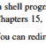

> 在某些版本的 `echo` 中，前一个示例中的 `\c` 将按字面意思出现在输出中如下：
> 
> What is your name? \c
> 
> 如果您遇到此行为，您应该改用以下 `echo` 命令，而不是前一个示例中给出的命令：
> 
> `echo -n "What is your name?"`

## 管道

大多数在 UNIX 中设计用于处理文件的命令也可以从 STDIN 读取输入。这使您能够使用一个程序过滤另一个程序的输出。使用一个程序操作另一个程序的输出是在 shell 编程中最常见的任务之一。本节提供了该技术的简短描述；第 15、16 和 17 章包含更详细的示例。

您可以使用管道将一个命令的输出重定向到另一个命令的输入，管道将多个命令用管道连接如下：

```
cmd1 | cmd2 | ... | cmdN
```

管道字符 `|` 将 `cmd1` 的标准输出连接到 `cmd2` 的标准输入，以此类推。命令可以简单也可以复杂，具体取决于需要。以下命令说明了管道的用法：

```
tail -f /var/adm/messages | more
ps -ael | grep "UID" | more
```

在第一个示例中，`tail` 命令的标准输出被管道传输到 `more` 命令的标准输入，这使得输出可以一次一屏地查看。在第二个示例中，`ps` 的标准输出连接到 `grep` 的标准输入，而 `grep` 的标准输出连接到 `more` 的标准输入，以便可以一次一屏地查看 `grep` 的输出。`tail` 和 `grep` 命令在第 15 章“文本过滤器”中详细解释。


> 关于管道的重要一点是每个命令都作为单独的进程执行，并且管道的退出状态是最后一个命令的退出状态。
> 
> 在编写必须进行错误处理的脚本时，牢记这一事实至关重要。

## 文件描述符

当您发出任何命令时，会打开三个文件并与该命令关联。在 shell 中，每个文件都由一个称为文件描述符的小整数表示。文件描述符是一种机制，您可以通过它将一个数字与文件名关联，然后使用该数字从文件中读取和写入。文件描述符通常称为文件句柄。

- 标准输入 `STDIN`，`0`
- 标准输出 `STDOUT`，`1`
- 标准错误 `STDERR`，`2`


每个文件后面的整数是其文件描述符。通常，这些文件与用户的终端关联，但它们可以重定向到其他文件。在本章之前的示例中，您已使用默认文件描述符使用输入和输出重定向。本节介绍输入和输出重定向的一般形式。

## 将文件与文件描述符关联

您可以使用 `exec` 命令将任何文件与文件描述符关联。将文件与文件描述关联很有用，当您需要多次将输出或输入重定向到文件但不想重复文件名时。要打开文件进行写入，请使用以下形式之一：

```
exec n>file
exec n>>file
```

这里 `n` 是一个整数，`file` 是要打开进行写入的文件名。第一种形式如果文件存在则覆盖指定文件。第二种形式追加到指定文件。例如，以下命令

```
$ exec 4>f64.out
```

将文件 `f64.out` 与文件描述符 `4` 关联。

> 使用 `STDOUT` 进行输出重定向时要小心。如果您意外重定向 `STDOUT`，您的命令可能看起来停止工作。例如，以下命令：
>
> `$ exec 1>f61.out`
>
> 将 `STDOUT` 重定向到文件 `f61.out`。如果您执行此命令，您所有的命令输出都将被放在文件 `f61.out` 中。您将在终端上看不到任何输出。

要打开文件进行读取，您可以使用以下形式：

```
exec n<file
```

这里 `n` 是一个整数，`file` 是要打开进行读取的文件名。

## 通用输入/输出重定向

您可以通过组合文件描述符和输出重定向运算符来执行通用输出重定向。一般形式为

```
cmd n> file
```

```
cmd n>> file
```

这里 `cmd` 是命令的名称，例如 `ls`；`n` 是文件描述符（整数）而 `file` 是文件名。第一种形式将 `cmd` 的输出重定向到指定文件，而第二种形式将 `cmd` 的输出追加到指定文件。例如，您可以按如下方式以一般形式编写标准输出重定向：

这里 `cmd` 是命令的名称，例如 `ls`；`n` 是文件描述符（整数），`file` 是文件的名称。例如，标准输入重定向可以按如下一般形式书写：

```
cmd 0<file
```

## 将 STDOUT 和 STDERR 重定向到单独的文件

文件描述符最常见的用途之一是将 `STDOUT` 和 `STDERR` 重定向到单独的文件。基本语法是

```
cmd > file1 2> file2
```

这里命令 `cmd` 的 `STDOUT` 被重定向到 `file1`，而 `STDERR`（错误信息）被重定向到 `file2`。通常会省略 `STDOUT` 文件描述符 `1`，因此更简短的形式是

```
cmd > file1 2> file2
```

你也可以使用追加操作符代替任一标准重定向操作符：

```
cmd >> file1 2> file2
```

```
cmd > file1 2>> file2
```

```
cmd >> file1 2>> file2
```

第一种形式将 `STDOUT` 追加到 `file1` 并将 `STDERR` 重定向到 `file2`。第二种形式将 `STDOUT` 重定向到 `file1` 并将 `STDERR` 追加到 `file2`。第三种形式将 `STDOUT` 追加到 `file1` 并将 `STDERR` 追加到 `file2`。

以下示例说明了第一种形式：

```
ln -s ch05.doc ./docs >> /tmp/ln.log 2> /dev/null
```

这里 `ln` 的 `STDOUT` 被追加到文件 `/tmp/ln.log`，而 `STDERR` 被重定向到文件 `/dev/null`，以便丢弃它。

> `/dev/null` 文件是所有 UNIX 系统上都可用的一个特殊文件，用于丢弃输出。它有时被称为位桶。如果将命令的输出重定向到 `/dev/null`，它将被丢弃。例如，命令
>
> `rm file2 > /dev/null`
>
> 会丢弃 `rm` 命令的输出。
>
> 如果你使用 `cat` 将 `/dev/null` 的内容显示到一个文件中，该文件的内容将被擦除：
>
> `$ cat /dev/null > file`
>
> 执行此命令后，文件仍然存在，但其大小为零。

## 将 STDOUT 和 STDERR 重定向到同一文件

你已经了解如何使用文件描述符将 `STDOUT` 和 `STDERR` 重定向到不同的文件，但有时需要将两者重定向到同一文件。一般来说，可以按如下方式操作

```
cmd > file 2>&1
list > file 2>&1
```

这里 `cmd` 的 `STDOUT`（文件描述符 `1`）和 `STDERR`（文件描述符 `2`）被重定向到指定的文件。以下是需要同时重定向标准输出和标准错误的情况：

```
rm -rf /tmp/my_tmp_dir > /dev/null 2>&1 ; mkdir /tmp/my_tmp_dir
```

在这种情况下，你对 `rm` 命令打印的错误信息或信息性消息不感兴趣。你只想删除目录，因此其输出或打印的任何错误信息都被重定向到 `/dev/null`。

如果你有一个命令或列表需要将其标准错误和标准输出追加到文件中，可以使用以下输出重定向形式之一：

```
cmd >> file 2>&1
list >> file 2>&1
```

可能需要此操作的命令示例是

```
rdate -s ntp.nasa.gov >> /var/log/rdate.log 2>&1
```

这里你使用 `rdate` 命令将本地机器的时间与 Internet 时间服务器同步，并希望保留所有消息的日志。

## 打印消息到 STDOUT

你也可以使用这种输出重定向形式将错误消息输出到 `STDERR`。基本语法是

```
echo str 1>&2
printf format args 1>&2
```

你也可能会看到省略 `STDOUT` 文件描述符 `1` 的这些命令：

```
echo string >&2
printf format args >&2
```

## 重定向两个文件描述符

你可以使用输出重定向的一般形式将一个文件描述符的输出重定向到另一个文件描述符：

```
n>&m
```

这里 `n` 和 `m` 是文件描述符（整数）。当令 `n=1` 且 `m=2` 时，`STDERR` 被重定向到 `STDOUT`。输出重定向的一般形式通常与 `exec` 结合使用，以复制已打开的输出文件描述符：

```
exec n>&o
```

这里 `n` 是一个新的文件描述符，`o` 是一个已打开的输出文件描述符。例如，如果文件描述符 `4` 按如下方式打开：

```
exec 4>out.txt
```

那么命令：

```
exec 5>&4
```

会使文件描述符 `5` 成为文件描述符 `4` 的副本。给定这两个 `exec` 命令，以下命令的输出：

```
date 1>&5
```

将最终进入文件 `out.txt`。

输入重定向的一般形式与输出重定向的一般形式类似：

```
n<&m
```

这里 `n` 和 `m` 是文件描述符（整数）。输入重定向的一般形式通常与 `exec` 结合使用，以复制已打开的输入文件描述符：

```
exec n<&o
```

这里 `n` 是一个新的文件描述符，`o` 是一个已打开的输入文件描述符。在以下示例中，文件描述符 `6` 成为 `STDIN` 的副本：

```
exec 6<&0
```

## 关闭文件描述符

可以使用以下语法关闭一个已打开的文件描述符：

```
exec n>&-
```

这里 `n` 是一个已打开的文件描述符。当文件描述符被关闭时，尝试从中读取或写入会导致错误。以下示例关闭之前打开的文件描述符 `4`：

```
exec 4>&-
```

## 摘要

在本章中，你学习了输入和输出的概念，并研究了 `echo` 和 `printf` 命令，这些命令用于从 shell 脚本中生成消息。你还学习了输出重定向，并介绍了将命令输出重定向和追加到文件的方法。你还学习了文件描述符的概念，并看到了其使用的几个方面，包括为读写打开文件、关闭文件以及将两个文件描述符的输出重定向到一个源。

在后续章节中，你将扩展本章所涵盖的内容，并将看到更多输入和输出重定向以及文件描述符使用的应用。

## 问题

- 1. 哪些文件描述符与 `STDOUT`、`STDERR` 和 `STDIN` 相关联？
- 2. 使用 `printf` 将数字 `16`、`255` 和 `65535` 转换为十六进制和八进制。
- 3. 给定以下脚本：

```
exec 6>out.txt
exec 5>&6
exec 1>&5
date
```

`date` 的输出最终在哪里？

## 术语

**转义序列** 表示另一个字符的特殊字符序列。

**文件描述符** 与文件关联的整数。使你能够使用整数而不是文件名从文件中读取和写入。

**输入重定向** 在 UNIX 中，将文件的输入发送到命令的过程。

**输出重定向** 在 UNIX 中，捕获命令的输出并将其存储到文件中的过程。它将命令的输出重定向到文件而不是屏幕。

**STDERR** 标准错误。用于错误消息的一种特殊输出。`STDERR` 的文件描述符为 `2`。

**STDIN** 标准输入。用户输入从 `STDIN` 读取。`STDIN` 的文件描述符为 `0`。


**STDOUT** 标准输出。脚本的输出通常到 STDOUT。STDOUT 的文件描述符为 1。


### 第 6 小时

#### 操作文件属性

除了文件和目录之外，UNIX 还支持几种特殊文件类型以及每个文件和目录的一组属性。Shell 脚本经常被要求创建特殊文件并操作文件属性。本章讨论与特殊文件和文件属性相关的以下主题：

- 创建链接
- 修改文件权限
- 修改文件所有权和组成员资格

#### 文件类型

UNIX 文件可以包含重要数据和可执行程序，也可以表示设备、目录或指向其他文件的指针。本节介绍 UNIX 下可用的不同类型的文件。

#### 确定文件类型

你可以使用 `ls` 命令的 `-l` 选项来确定文件类型。当指定此选项时，`ls` 的输出包含文件类型及其属性以及名称。例如，命令

```
$ ls -l /home/ranga/profile
```

会产生以下输出：

```
-rwxr-xr-x 1 ranga users 2368 Jul 11 15:57 .profile*
```

如你所见，输出中的第一个字符是一个连字符（`-`）。这表示这是一个普通文件。对于特殊文件，第一个字符是表 6.1 中给出的字母之一。后续章节详细描述了这些特殊文件。

表 6.1 不同文件类型的特殊字符

| 字符 | 文件类型 |
|---|---|
| - | 普通文件 |
| l | 符号链接 |
| c | 字符特殊 |
| b | 块特殊 |
| p | 命名管道 |
| d | 目录文件 |

要获取目录的文件类型信息，需要同时指定 `-d` 选项和 `-l` 选项。例如，为了获取目录 `/home/ranga` 的文件类型信息，你使用以下命令：

```
$ ls -ld /home/ranga
```

这会产生以下输出：

```
drwxr-xr-x 27 ranga users 2048 Jul 23 23:49 /home/ranga/
```

#### 普通文件

普通文件是 UNIX 系统中最常见的文件类型。它们可用于存储任何类型的数据，包括系统可执行二进制数据。通常确定一个文件是普通文件并不能告诉你太多关于该文件的信息。通常你需要知道某个文件是二进制程序、shell 脚本还是 C 语言库。在这些情况下，`file` 命令非常有用。其语法如下：

```
file filename
```

这里，`filename` 是你想要获取更多信息的文件的名称。例如，命令：

```
$ file /bin/sh
```

将产生与以下类似的输出：

```
/bin/sh: ELF 32-bit MSB executable SPARC Version 1,
	statically linked, stripped
```

根据此输出，你可以判断文件 `/bin/sh` 是为基于 SPARC 的系统编写的可执行程序。你系统上的输出很可能不同。

#### 链接

链接是一个指向系统上另一个文件的文件。链接对于在系统的多个位置维护文件的多个副本非常有用，而无需为副本使用存储空间。因为链接只是指向另一个文件，所以更改链接的内容会改变原始文件的内容。同样，改变原始文件的内容似乎也会改变链接的内容。

UNIX 支持两种类型的链接，硬链接和符号链接。

#### 硬链接

硬链接是一个指向另一个文件的特殊目录项。硬链接有一些限制：

- 硬链接不能指向目录：它只能指向文件。
- 硬链接与它指向的文件无法区分：无法判断某个特定文件是硬链接还是原始文件。

硬链接可以使用 `ln`（link 的缩写）命令创建。其语法如下：

```
ln src target
```

这里 `src` 是 `target` 应该指向的路径名。例如，如果你想让硬链接 `banana` 指向文件 `apple`，可以按如下方式创建链接：

```
$ ln apple banana
```

如果创建硬链接时出现问题，`ln` 会显示错误消息；否则，不会显示任何输出。

当硬链接从一个目录移动到另一个目录时，它可以继续指向原始文件而不会出现任何问题。例如，考虑以下命令：

```
$ echo I drink lemonade in the summer > lemonade
$ cat lemonade
I drink lemonade in the summer
$ ln lemonade summer_drink
$ cat summer_drink
I drink lemonade in the summer
$ mv summer_drink ..
$ cat ../summer_drink
I drink lemonade in the summer
```

从输出中可以看到，即使文件 `summer_drink` 被移出创建它的目录，它仍然指向原始文件。

当硬链接被删除时，它指向的原始文件不受影响；只会删除链接。如果原始文件被删除，原始文件的条目会被移除，但其内容会保留在磁盘上，直到链接被删除为止。例如：

```
$ echo Pomegranates are very juicy > juicy
$ ln juicy pomegranate
$ cat pomegranate
Pomegranates are very juicy
$ rm juicy
$ cat pomegranate
Pomegranates are very juicy
cat: juicy: No such file or directory
```

正如你所见，即使文件 `juicy` 已被移除，文件 `pomegranate` 仍继续指向文件 `juicy` 的内容。

> 如果一个文件有多个硬链接到它，仅仅删除该文件不足以释放磁盘空间；你必须删除指向该文件的所有硬链接。

#### 符号链接

符号链接或 `symlink` 是一个存储指向另一个文件路径名的特殊文件。当访问 `symlink` 时，系统会自动读取 `symlink` 中存储的路径名并访问对应路径名的文件，因此 `symlink` 可以指向系统上的任何文件。`symlink` 中存储的路径名可以是绝对路径或相对路径。如果存储的是相对路径名，则该路径名相对于链接所在的目录，而不是当前工作目录。

符号链接的 `ls -l` 输出看起来类似于以下内容：

```
lrwxrwxrwx 1 root root 9 Oct 23 13:58 /bin/ -> ./usr/bin/
```

`symlink` 是使用 `ln` 的 `-s` 选项创建的。语法如下：

```
ln -s src target
```

这里 `src` 是 `target` 应该指向的路径名。例如，如果你想创建指向文件 `lime` 的 `symlink` `citrus`，可以使用以下命令：

```
ln -s lime citrus
```

如果创建 `symlink` 时出现问题，`ln` 会显示错误消息；否则，不会显示任何输出。

如果使用相对路径创建 `symlink`，则在从创建的目录移动到另一个目录时可能无法正常工作。例如：

```
$ echo Persimmons are bitter until they ripen > persimmon
$ ln -s persimmon bitter
$ cat bitter
Persimmons are bitter until they ripen
$ mv bitter ..
$ cat ../bitter
cat: ../bitter: No such file or directory
$ ls -l ..
lrwxrwxrwx 1 root root 9 Jan 13 00:16 ../bitter@ -> persimmon
```

从输出中可以看到，只要两个文件位于同一目录，链接 `bitter` 就能正确指向文件 `persimmon`。当 `bitter` 被移动后，链接停止工作，因为在 `bitter` 的新目录中不存在名为 `persimmon` 的文件。可以通过在创建 `symlink` 时使用绝对路径来避免此问题。

当 `symlink` 被删除时，它指向的文件不受影响。当 `symlink` 指向的文件被删除或移动到其他位置时，`symlink` 将无法正常工作。例如：

```
$ echo Plums were plentiful this year > plums
$ ln -s plums plentiful
$ cat plentiful
Plums were plentiful this year
$ rm plums
$ cat plentiful
cat: plentiful: No such file or directory
$ ls -l plentiful
lrwxr-xr-x 1 ranga wheel 5 Jan 13 00:25 plentiful -> plums
```

从输出中可以看到，即使该文件已被删除，链接 `plentiful` 仍指向文件 `plums`。这导致了 `cat` 的错误消息。

#### 常见错误

创建链接时遇到的两个常见错误发生在

- `target` 已存在。
- `target` 是一个目录。

如果 `target` 是文件，`ln` 将不会创建请求的链接。例如，如果当前目录中存在文件 `.exrc`，则以下命令：


```
$ ln -s /etc/exrc .exrc
```

会产生以下错误消息：

```
ln: cannot create .exrc: File exists
```

如果 `target` 是目录，`ln` 会在该目录中创建链接，文件名与 `src` 相同。例如，如果当前目录中存在目录 `pub`，则以下命令：

```
$ ln -s /home/ftp/pub/ranga pub
```

会创建链接 `pub/ranga`，而不是抱怨目标是目录。

忘记这种行为是 shell 脚本中问题的常见来源。

## 设备文件

在 UNIX 中，设备，如硬盘、键盘和打印机，是通过设备文件访问的。有两种类型的设备文件：字符特殊文件和块特殊文件。

设备文件通常位于 `/dev` 目录中。

### 字符特殊文件

字符特殊文件提供了一种逐字符与设备通信的机制。通常字符设备代表“原始”设备。对字符特殊文件执行 `ls -l` 的输出如下所示：

```
crw------- 1 ranga users 4, 0 Feb 7 13:47 /dev/tty0
```

输出中的第一个字母 `c` 表示这是一个字符特殊文件。日期前的两个额外数字称为主设备号和次设备号。UNIX 使用这两个数字来识别连接到字符特殊文件的设备驱动程序。

### 块特殊文件

块特殊文件提供了一种通过传输大量数据块而不是单个字符与设备通信的机制。块特殊文件通常用于访问硬盘和可移动介质。对块特殊文件执行 `ls -l` 的输出如下所示：

```
brw-rw---- 1 root disk 8, 0 Feb 7 13:47 /dev/sda
```

输出中的第一个字母 `b` 表示该文件是块特殊文件。文件的主设备号和次设备号标识连接到块特殊文件的设备驱动程序。

### 命名管道

UNIX 的一个重要特性是，你可以用很少的工作将一个程序的输出重定向到另一个程序的输入。例如，以下命令：

```
$ who | grep ranga
```

将 `who` 命令的输出作为 `grep` 命令的输入。在命令行上，使用临时匿名管道，但有时程序需要对通信通道有更多控制。命名管道是充当命令行上临时匿名管道的文件。

命名管道可以使用 `mkfifo` 命令创建。其语法如下：

```
mkfifo file
```

这里 `file` 是你想赋予管道的文件名。例如，以下命令创建名为 `mypipe` 的命名管道：

```
$ mkfifo mypipe
```

此命名管道的 `ls -l` 输出将类似于以下内容：

```
prw-r--r-- 1 ranga wheel 0 Nov 22 17:39 mypipe
```

第一个字符 `p` 表示该文件是命名管道。

## 所有者、组和权限

文件权限和文件所有权是 UNIX 的重要组成部分，因为它们提供了一种安全的文件存储方法。UNIX 中每个文件都有以下属性：

- 所有者权限
- 组权限
- 其他（世界）权限

所有者的权限决定文件所有者可以对文件执行哪些操作。组的权限决定作为该组成员的用户可以文件所属组的权限，指明可以对文件执行的操作。其他用户的权限指明所有其他用户可以对文件执行的操作。

可以对文件执行的操作有读、写和执行。如果用户具有读权限，该用户可以查看文件的内容。具有写权限的用户可以更改文件的内容，而具有执行权限的用户可以执行该文件。

### 查看权限

`ls -l` 命令显示文件的权限。例如，以下命令：

```
$ ls -l .profile
```

生成以下输出：

```
-rwxr-xr-x 1 ranga users 2368 Jul 11 15:57 .profile
```

从输出中可以看出这是一个普通文件。第一个连字符 `-` 之后出现的字符表示文件的权限。权限之后列出所有者和组。对于此文件，所有者是 `ranga`，组是 `users`。

前三个字符表示文件所有者的权限，接下来的三个字符表示文件所属组的权限，最后三个字符表示所有其他用户的权限。各个字符的含义在表 6.2 中进行了说明。

表 6.2 基本权限

| 字母 | 权限 | 定义 |
|---|---|---|
| r | 读取 | 用户可以查看文件的内容。 |
| w | 写入 | 用户可以更改文件的内容。 |
| x | 执行 | 用户可以运行该文件，很可能是一个程序。对于目录，必须设置执行权限才能让用户访问目录。 |

前例中文件的权限表明用户具有读、写和执行权限，而 `users` 组成员和其他所有用户只有读和执行权限。

### 目录权限

目录上的 `x` 位授予对目录的访问权限。如果未设置访问位，则读和写权限无效。目录上的读权限使用户能够使用 `ls` 命令查看位于目录中的文件及其属性。目录上的写权限允许用户向目录添加和删除文件。仅授予用户执行权限的目录不会使用户能够查看目录内容或向目录添加或删除任何文件，但会允许用户运行位于目录中的可执行文件。

> 为确保文件安全，请同时检查文件权限和文件所在目录的权限。
> 如果文件对所有者、组和其他用户具有写权限，则文件不安全。
> 如果文件位于对所有者、组和其他用户具有写和执行权限的目录中，则该目录中的所有文件都不安全，无论文件本身的权限如何。

### SUID 和 SGID 文件权限

通常在执行命令时，为了完成其任务，必须以特殊权限执行。例如，当你使用 `passwd` 命令更改密码时，你的密码存储在文件 `/etc/shadow` 中。作为普通用户，出于安全原因，你无法读取或写入此文件，但在更改密码时，你需要对该文件具有写权限。这意味着 `passwd` 程序必须授予你额外的权限，以便你能够写入文件 `/etc/shadow`。

通过一种称为设置用户 ID（SUID）和设置组 ID（SGID）位的机制向程序授予额外权限。当你执行启用了 SUID 位的程序时，你将继承该程序所有者的权限。未设置 SUID 位的程序将以启动该程序的用户权限运行。当程序执行时，它通常以用户的组权限执行。具有 SGID 位的文件将使用这些组权限执行。

例如，用于更改密码的 `passwd` 命令由 `root` 所有，并且启用了 set UID 位。当你执行它时，在命令运行时你实际上就成为 `root`。

如果在该文件上启用了 SUID 或 SGID 权限，则 SUID 和 SGID 位显示为字母 `s`。SUID 位位于通常存放所有者执行权限的权限位中。例如，以下命令：

```
$ ls -l /usr/bin/passwd
```

生成以下输出：

```
-r-sr-xr-x 1 root bin 10831 Feb 7 13:47 /usr/bin/passwd
```

这表明 SUID 位已设置并且 `root` 拥有该命令。如果出现大写字母 `S` 而不是小写字母 `s`，则表示未设置执行位。

粘滞位对目录施加额外的文件删除权限。目录对用户启用写权限可使该用户向此目录添加和删除任何文件。如果在目录上启用了粘滞位，则只有在你是以下用户之一时才能删除文件：

- 粘滞目录的所有者
- 被删除文件的所有者
- 超级用户 `root`

你应考虑为任何非特权用户可以写入的目录启用粘滞位。此类目录的示例包括临时目录和公共文件上传站点。

目录也可以利用 SGID 位。如果目录设置了 SGID 位，则添加到目录的任何新文件都会自动继承该目录的组，而不是写入文件的用户的组。

## 更改文件和目录权限

`chmod` 命令更改文件或目录的权限。其语法如下：

```
chmod expression files
```

这里，`expression` 是一个说明如何更改权限的语句。有两种类型的表达式：符号和八进制。符号表达式方法使用字母来更改权限，而八进制表达式方法使用数字。八进制方法中的数字是基数为 8（八进制）的数字，范围从 0 到 7。

### 符号方法

符号表达式使用以下形式的语法：

```
(who)(action)(permissions)
```

表 6.3 显示了 `who` 的可能值。表 6.4 显示了可能的动作，表 6.5 显示了可能的权限设置。利用这三个参考表，你可以构建表达式。

表 6.3 who

| 字母 | 代表 |
|---|---|
| u | 所有者 |
| g | 组 |
| o | 其他 |
| a | 所有 |

表 6.4 actions

| 符号 | 代表 |
|---|---|
| + | 向文件添加权限 |
| - | 从文件移除权限 |
| = | 显式设置文件权限 |

表 6.5 permissions

| 字母 | 代表 |
|---|---|
| r | 读取 |
| w | 写入 |
| x | 执行 |
| t | 粘滞位 |
| s | SUID 或 SGID |

现在让我们看几个使用 `chmod` 的示例。要为目录中所有文件授予“世界”读访问权限，你可以使用以下其中一个命令：

`$ chmod a+r *`

`$ chmod guo+r *`

如果命令成功，则没有输出。

要阻止除 `.profile` 文件所有者之外的任何人写入它，请尝试：

`$ chmod go-w .profile`

要拒绝访问你主目录中的文件，你可以尝试以下其中一个命令：

`$ cd ; chmod go+ *`


`$ cd ; chmod go-rwx *`

指定用户部分或权限部分时，字母的顺序无关紧要。因此这些命令是等效的：

```
$ chmod gouo+rX
$ chmod uog+rX
```

如果你需要对一个或多个文件应用多组权限更改，可以使用逗号分隔的列表。例如：

```
$ chmod go-w,a+x a.out
```

删除 `a.out` 上的组和“世界”写权限，并为每个人添加执行权限。

要为你的主目录设置 SUID 和 SGID 位，请尝试以下操作：

```
$ cd ; chmod ug+s .
```

到目前为止，我们检查的示例涉及更改目录中文件的权限。然而，`chmod` 还允许你通过使用 `-R` 选项来更改目录中每个文件的权限（包括子目录中的文件）。

例如，如果目录 `pub` 包含以下目录：

```
$ ls pub
```

`./`  `../`  `README`  `faqs/`  `src/`

你可以使用以下命令更改权限，以允许其他人读取文件 `README` 以及目录 `faqs` 和 `src` 中包含的文件：

```
$ chmod -R o+r pub
```

### 八进制方法

通过八进制表达式更改权限，你只能显式设置文件权限。此方法使用一个数字为三个用户类别（所有者、组和其他）分配所需的权限。各个权限的值如下：

- 读权限的值为 `4`
- 写权限的值为 `2`
- 执行权限的值为 `1`

将你想要授予的权限的值相加会得到一个介于 `0` 和 `7` 之间的数字。此数字将用于指定所有者、组，最后是其他类别的权限。

使用八进制方法设置 SUID 和 SGID 会将这些位放在标准权限之前。权限 SUID 和 SGID 的取值分别为 `4` 和 `2`。

让我们看一些示例来了解如何使用八进制方法更改权限。为了将目录中所有文件的“其他用户”读权限设置好，请执行以下操作：

```
chmod 0444 *
```

要阻止除 `.profile` 文件所有者之外的任何人写入它，请执行以下操作：

```
chmod 0600 .profile
```

### 常见错误

许多新用户发现文件权限的八进制指定令人困惑。最重要的是要记住，八进制方法是对文件设置或分配权限，但不会添加或删除权限。这意味着八进制模式没有等价于

```
chmod u+rwx .profile
```

最接近的八进制版本是

```
chmod 0600 .profile
```

但它会移除除用户之外的所有人的权限。它还可能通过移除该用户的执行权限来降低用户的权限。

### 更改所有者和组

`chown`（change owner 的缩写）更改文件的所有权，而 `chgrp`（change group 的缩写）更改文件所属的组。某些旧系统上不可用 `chgrp` 命令，因此必须改用 `chown` 命令。本节介绍如何使用 `chown` 和 `chgrp` 两者来更改文件的组。

#### 更改所有权

`chown` 命令更改文件的所有权。基本语法如下：

```
chown user:group files
```

这里，`user` 是系统上的用户名或用户 ID（`uid`），`group` 是系统上的组名或组 ID（`GID`），`files` 是要应用更改的文件列表。如果省略 `group`，则仅更改文件的所有者。如果省略 `user`，则仅更改文件的组。以下示例说明了如何使用此命令更改文件的所有者：

```
chown ranga: /home/http/html/users/ranga
```

这会将给定目录的所有者更改为用户 `ranga`。以下示例说明了如何使用 `chown` 仅更改文件的组：

```
chown :authors /home/ranga/docs/ch5.doc
```

在这种情况下，给定文件的组被更改为 `authors` 组。

当包含 `-R` 选项时，`chown` 命令会递归更改所有文件的所有权。例如，命令

```
chown -R ranga: /home/httpd/html/users/ranga
```

会将给定目录下所有文件和子目录的所有者更改为用户 `ranga`。

超级用户 `root` 具有不受限制地更改文件所有权的能力，但普通用户会受到一些限制。普通用户只能更改他们自己拥有的文件的所有者。

> 使用 `chown` 命令时请小心。如果您将文件的所有权授予另一用户，您将无法重新获得该文件的所有权。只有该文件的新所有者或超级用户才能将所有权归还给您。

在某些系统上，普通用户无法使用 `chown` 命令。这通常发生在系统运行磁盘配额时。在磁盘配额系统下，用户可能只允许存储 `100MB` 的文件，但如果他们更改某些文件的所有权，其可用磁盘空间就会增加，并且他们仍然可以访问这些文件。

#### 更改组所有权

`chgrp` 命令更改文件所属的组。该命令的语法如下：

```
chgrp group files
```

这里 `group` 可以是系统上的组名或 `GID`，`files` 是要应用更改的文件列表。例如，命令：

```
chgrp authors /home/ranga/docs/ch5.doc
```

会将给定文件的组更改为 `authors` 组。与 `chown` 类似，所有版本的 `chgrp` 也都理解 `-R` 选项。

> 某些旧系统不包含 `chgrp` 命令。如果您使用的是此类系统，可以改用 `chown` 命令代替 `chgrp` 命令。

> 要用 `chown` 代替 `chgrp`，可以按如下方式调用它：
>
> `chown :group files`
>
> 这里 `group` 是系统上的组名或 `GID`，`files` 是要应用更改的文件列表。

### 摘要

在本章中，您学习了有关文件和文件权限的几个重要主题。

具体来说，您研究了：

- 确定文件的类型
- 使用符号和八进制表示法更改文件和目录权限
- 为文件和目录启用 SUID 和 SGID 权限
- 更改文件或目录的所有者
- 更改文件或目录的组

正如您在后续章节中将看到的，这些任务中的每一个在 shell 脚本中都很重要。

### 问题

对于这三个问题，请参考以下 `ls -l` 输出：

```
crw-r----- 1 bin sys 188 0x001000 Oct 13 00:31 /dev/
drwxr-xr-x 1 bin ?
drwxr-xr-x 1 root bin 1024 Oct 13 16:25 /etc/passwd
-r--r--r-- 1 root bin 28572 Nov 6 1987 /usr/bin/ping
```

1. 识别上面每个文件的类型。
2. 识别上面每个文件的所有者和组。
3. 描述上面每个文件的拥有者、组和所有“其他”用户的权限。

### 术语

**普通文件** UNIX 系统中最常见的文件类型，可用于存储任何类型的数据，包括系统可执行二进制数据。

**链接** 指向系统上另一个文件的文件。

**硬链接** 指向另一个文件的特殊目录项。

**符号链接** 存储指向另一个文件的路径名的特殊文件。符号链接通常称为 `symlink`。

**字符特殊文件** 提供一种逐字符与设备通信的机制。

**块特殊文件** 通过传输大量数据块来提供与设备通信的机制。

### 第 7 小时

### 进程

在 UNIX 中，每个程序都作为一个进程运行。进程是运行程序的一个实例。例如，如果三个人同时运行同一个程序，那么就有三个进程，而不是一个。在本章中，您将学习有关进程和作业以及它们可以执行的各种模式。您还将了解用于列出和终止进程的命令。具体来说，您将研究以下主题：

- 启动进程
- 列出正在运行的进程
- 终止进程
- 操作父进程和子进程

#### 启动进程

每当您在 UNIX 中发出命令时，它都会代表您创建或启动一个新进程。当您在第 4 章“使用目录”中尝试 `ls` 命令列出目录内容时，系统为您启动了 `ls` 命令进程。

UNIX 通过一个五位数字 ID 来跟踪进程，该 ID 称为 `pid`（process identifier 的缩写）。系统中每个进程都有一个介于 `1` 和 `32,767` 之间的唯一 `pid`。当所有可能的数字都被使用后，`pid` 最终会重复。系统上不能同时执行具有相同 `pid` 的两个进程。

#### 前台进程

默认情况下，每个进程都在前台运行。它从键盘获取输入并将输出发送到屏幕。您可以使用 `ls` 命令看到这一点。例如，当您执行 `ls` 命令时：

```
$ ls
```

它会执行并显示当前目录的内容：

```
Desktop Downloads Library Music Public
Documents Icons Movies Pictures Sites
```


在命令运行时，您无法运行任何其他命令（启动任何其他进程）。您可以输入命令，但不会出现提示，也不会发生任何事情，直到该命令完成。对于通常运行很快的 `ls` 命令来说，这不是问题，但如果您有一个运行时间很长的程序——例如大型编译、数据库查询、计算 pi 的程序或服务器——终端将被占用。

幸运的是，您不必等待一个进程完成才能启动另一个进程。UNIX 提供了在后台启动进程、挂起前台进程以及在前台和后台之间移动进程的功能。

## 后台进程

后台进程在不连接到您的键盘的情况下运行。如果后台进程需要任何键盘输入，它会等待。后台运行进程的优点是您可以运行其他命令；不必等到它完成才能启动另一个进程！

启动后台进程最简单的方法是在命令末尾添加一个与号（`&`）。例如，如果您在后台执行 `ls`：

```
$ ls &
```

输出将类似于以下内容：

```
[1] 621
$ Desktop Downloads Library Music Public
Documents Icons Movies Pictures Sites
```

`shell` 产生的输出第一行告诉你进程正在后台运行：

```
[1] 621
```

该行包含有关后台进程的两个信息——作业 ID（job identifier 的简称）和 `pid`。`shell` 会为每个在后台执行的命令分配一个作业 ID。

如果你执行此命令，你可能会注意到在目录列表的最后一行之后没有得到提示符。这是因为提示符实际上会立即出现在作业行之后，紧挨着 Desktop。你可以在不等待 `ls` 完成的情况下立即输入命令。如果你现在按下 Enter 键，你会看到类似以下内容：

```
[1] + Done                  ls &
$
```

第一行告诉你后台 `ls` 作业已成功完成。第二行是另一个命令的提示符。

如果发生错误，你会看到不同的完成消息。例如，如果你尝试列出名为 `no_such_file` 的文件，你会收到错误：

```
$ ls no_such_file &
[1] 25389
$ no_such_file: No such file or directory
```

第一行是后台进程信息，第二行显示下一个命令的提示符以及来自 `ls` 的输出——错误消息。如果你再次按下 Enter，以下消息会出现在你的屏幕上：

```
[1] + Done(2)          ls no_such_file &
$
```

这表明 `ls` 命令以非零状态退出，在本例中为 2。下一行的美元符号 (`$`) 是命令提示符。

### 后台进程需要输入

如果你运行一个需要输入的后台进程，并且没有将其重定向为从文件而不是键盘读取，进程将会停止。在空命令提示符下按 Enter 或启动命令会返回相应消息。例如，考虑以下脚本：

```
#!/bin/sh
read LINE
echo $LINE
exit $?
```

将此脚本命名为 `read.sh` 并按如下方式在后台执行：

```
$ read.sh &
$
```

因为此命令在你提供输入之前不会产生任何输出，你看到的只有命令提示符。在提示符下按 Enter 会导致类似以下的消息：

```
[1] + Stopped (SIGTSTP)    read.sh &
```

此消息告知你命令 `read.sh` 目前因信号 `SIGTSTP` 而停止。此信号 (`SIG`) 告诉你程序正在等待终端 (`TT`) 输入 (`IN`)。有关信号的更多信息，请参阅第 19 章“信号”。在 `bash` 和 `zsh` 中不会呈现有关信号的信息。

如果你收到此类消息，你有两个选择。你可以杀死进程并使用重定向的输入重新运行它，或者你可以将进程带到前台，给它所需的输入，然后让它作为前台或后台进程继续。本章解释了如何处理这两种选择。

### 将前台进程移到后台

除了使用 `&` 在后台运行进程外，你还可以将前台进程移入后台。在前台进程运行时，`shell` 不会处理任何新命令。在你能够输入任何命令之前，你必须挂起前台进程以获取命令提示符。大多数 UNIX 系统上的挂起键是 `Ctrl+Z`。

> 你可以使用 `stty` 命令确定哪个键执行哪个功能。输入
>
> `$ stty -a`
>
> 你会看到以下内容，以及大量其他信息：
>
> `intr = ^C; quit = ^\; erase = ^H; kill = ^U;`
> `eof = ^D; eol = ^@; susp = ^Z;`
> `eol2 = ^0; start = ^Q; stop = ^S; susp = ^Z;`
> `dsusp = ^Y; reprint = ^R`
> `discard = ^O; werase = ^W; lnext = ^V`
>
> `susp` 之后条目 (`^Z` 在此示例中) 是挂起前台进程的键。字符 `^` 代表 `Ctrl`。如果 `Ctrl-Z` 对你不起作用，请使用前面所示的 `stty` 命令来确定你系统的键。

当前台进程被挂起时，命令提示符使你能够输入更多命令；原始进程仍在内存中，但不会获得任何 CPU 时间。要恢复前台进程，你有两个选择——后台和前台。`bg` 命令使你能够在后台恢复被挂起的进程，而 `fg` 命令将其返回到前台。本节介绍 `bg` 命令，而 `fg` 命令将在下一节介绍。

例如，假设你启动了一个长时间运行的进程，在本例中为 `long_running_process`：

```
$ long_running_process
```

在它运行时，你决定它应该在后台运行，以便你的终端不被占用。为此，你按下 `Ctrl+Z` 键并看到以下内容（`^Z` 是你按下的 `Ctrl+Z` 键的回显）：

```
^Z[1] + Stopped (SIGTSTP)    long_running_process
$
```

你被告知作业编号 (`1`) 以及进程已停止，然后你会得到提示符。实际消息可能会根据你使用的 `shell` 而有所不同。要在后台恢复作业，你按如下方式输入 `bg` 命令：

```
$ bg
[1]   long_running_process &
$
```

结果，进程在后台运行。请注意第二行的最后一个字符，`&`。作为提醒，`shell` 在那里显示 `&` 以提醒你作业正在后台运行。它就像你在行尾输入 `&` 的命令一样。

默认情况下，`bg` 命令将最近挂起的进程移至后台。你可以同时挂起多个进程。为了区分它们，你可以在命令行上使用以百分号 (`%`) 为前缀的作业编号。

在以下示例中，你启动了两个长时间运行的进程，挂起两者，并将第一个放入后台。接下来的几行显示启动和挂起两个前台进程：

```
$ long_running_process
^Z[1] + Stopped (SIGTSTP)    long_running_process
$ long_running_process2
^Z[2] + Stopped (SIGTSTP)    long_running_process2
$
```

要将第一个移至后台，你使用以下命令：

```
$ bg %1
[1]   long_running_process &
$
```

第二个进程仍处于挂起状态，可以按如下方式移至后台：

```
$ bg %2
[2] long_running_process2 &
$
```

能够指定要对哪个作业执行操作（例如移至前台或后台）显示了为后台进程分配作业编号的重要性。

### 将后台进程移至前台 (fg 命令)

当你有一个在后台或被挂起的进程时，你可以使用 `fg` 命令将其移至前台。默认情况下，最近被挂起或移至后台的进程会移至前台。你也可以使用其作业编号指定作业。

> 如果你不确定哪个作业将被移至后台或前台，不要猜测。将作业编号放在 `bg` 或 `fg` 命令上，以百分号为前缀。

使用上一节中的长时间运行进程，前台进程被挂起并移入后台的示例如下：

```
$ long_running_process
^Z[1] + Stopped (SIGTSTP)    long_running_process
$ bg
[1] long_running_process &
$
```

### 保留后台进程 (nohup 命令)

只需在你实际要运行的命令之前添加它即可。因为 `nohup` 设计用于在没有终端连接时运行，它希望你将输出重定向到文件。如果你不这样做，`nohup` 会自动将其重定向到名为 `nohup.out` 的文件。

使用 `nohup` 在后台运行进程如下所示：

```
$ nohup ls &
[1] 6695
$ Sending output to nohup.out
```

因为你没有重定向 `nohup` 的输出，所以它会自动为你重定向。如果你重定向了输出，你将看不到第二条消息。等待几分钟并按下 Enter 后，你会看到以下内容：

```
[1] + Done             nohup ls &
$
```

### 等待后台进程完成 (wait 命令)

在做其他事情之前等待后台进程完成有两种方法。你可以每隔几分钟按一次 Enter 键，直到收到完成消息，或者你可以使用 `wait` 命令。


`wait` 命令有三种使用方式——不带选项（默认值）、带进程 ID 或带以百分号为前缀的作业编号。该命令将等待你指定的作业或进程完成。

如果你未指定作业或进程（默认设置），`wait` 命令会等待所有后台作业完成。在启动一系列后台作业的 shell 脚本中使用不带任何选项的 `wait` 是很有用的。当它们全部完成时，它可以继续处理。

使用上一示例中的 `ls` 命令运行时，你可以使用以下命令强制等待：

```
$ wait %1
```

在作业编号 1 完成之前，你无法输入另一个命令。使用 `wait` 时，你不会收到完成消息。

### 列出和终止进程

你可以在前台和后台启动进程，挂起它们，并在前台和后台之间移动它们，但你如何知道哪些命令正在运行？有两条命令可以帮助你找到答案——`jobs` 和 `ps`。

#### 作业

`jobs` 命令会显示被挂起的进程以及在后台运行的进程。由于 `jobs` 作为前台进程运行，因此它无法显示活动的 前台进程。在下面的示例中，你有三个作业——第一个（作业 3）正在运行，第二个（作业 2）被挂起（在发出 `Ctrl-Z` 之后的前台进程），第三个（作业 1）在后台等待键盘输入时停止：

```
$ jobs
[3] + Running        first_one &
[2]  - Stopped (SIGTSTP)  second_one
[1]   Stopped (SIGTTIN)   third_one &
```

你可以使用 `fg` 和 `bg` 命令操作这些作业。最近的作业是作业号 3（用加号显示）；如果未提供作业号，`fg` 或 `bg` 作用于此作业。其之前的最近作业是作业号 2（用减号显示）。

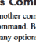

> `jobs` 列表上出现加号和减号的原因是，当一个作业完成并启动另一个作业时，作业号会被重新分配。在前面的示例中，如果作业号 2 完成并且你启动另一个作业，它会被分配作业号 2 并加上一个加号，因为它是最近的作业。

#### `ps` 命令

另一个显示所有正在运行进程的命令是 `ps`（process status 的缩写）命令。默认情况下，它显示你正在运行的进程。它还接受许多选项，其中一些在此描述。

最简单的示例（与前一个示例中运行的三个作业相同）是单独使用 `ps` 命令：

```
$ ps
  PID TTY      TIME CMD
 6738 pts/6    0:00 first_one
 6739 pts/6    0:00 second_one
 3862 pts/6    0:00 ksh
 9865 pts/6    0:00 ps
 6770 pts/6    0:01 third_one
```

对每个正在运行的进程，这提供了五项信息：`pid`、`TTY`（运行此进程的终端）、该进程消耗的时间或 CPU 量，以及正在运行的命令名称。虽然你正在运行三个作业，但你有五个进程。当然，额外的进程之一就是 `ps` 命令本身。剩下的进程 `ksh` 是 shell。

如果你使用的是 BSD 或旧版本的 Linux，你的输出将类似于以下内容：

```
$ ps
PID TT STAT TIME COMMAND
13849 q0 Ss 0:00:06 -ksh (ksh)
13190 q0 R+ 0:00:01 ps
```

对每个正在运行的进程，这为你提供了五项信息：`pid`、`TT`（运行此进程的终端）、`STAT`（作业的状态）、该进程消耗的 `TIME` 或 CPU 量，最后是正在运行的命令名称。

`ps` 最常用的标志之一是 `-f`（full 的缩写）选项，它提供了更多信息，如以下示例所示：

```
$ ps -f
UID PID PPID C STIME TTY TIME CMD
dhovarth 6738 3662 0 16:23:03 pts/6 0:00 first_one
dhovarth 6739 3662 0 16:22:54 pts/6 0:00 second_one
dhovarth 3853 3657 0 10:19:53 pts/6 0:00 ksh
dhovarth 6892 3662 4 10:51:50 pts/6 0:00 ps -f
dhovarth 6770 3662 2 16:35:45 pts/6 0:03 third_one
```

表 7.1 显示了这些列的含义。`-f` 选项在 BSD 或 Linux 中的等价项是 `-ux`。BSD 和 Linux 中的列标题可能与表 7.1 中描述的略有不同。

#### 表 7.1 `ps -f` 列

| 标题 | 描述 |
|---|---|
| `UID` | 该进程所属的用户 ID（运行它的人）。 |
| `PID` | 进程 ID。 |
| `PPID` | 父进程 ID（启动它的进程的 ID）。 |
| `C` | 进程的 CPU 利用率。 |
| `NI` | Nice 值——用于计算进程优先级。 |
| `STIME` | 进程开始时间（开始时）。 |
| `CMD` | 启动此进程的命令。带 `-f` 的 `CMD` 与不带 `-f` 的不同；它显示任何命令行选项和参数。 |

请注意，所有命令的 `PPID` 都是 `3662`，这是正在执行的 `ksh` 实例的 `pid`。由于所有进程都在 `ksh` 中启动，因此它是这些进程的父进程。

> 你可能想知道为什么 `third_one` 的 `TIME` 发生了变化。在我输入 `ps` 和 `ps -r` 命令之间，`third_one` 使用了一些 CPU 时间——两秒钟。在更大的 UNIX 服务器上，可以用很少的 CPU 时间完成大量工作。这就是为什么 `ps` 命令显示为零 CPU 时间；它使用了时间，但不足以向上舍入到一秒。


另外两个常见选项是 `-e`（every 的缩写）和 `-u`（user 的缩写）。如果想查看数据库是否正在运行或是否有人在玩 `Zork`（一种老式基于文本的计算机游戏），`-e` 选项很有用。`-e` 选项在 BSD 和 Linux 中的等价项是 `-a` 选项。由于繁忙系统上运行的进程很多，通常会将 `ps -e` 或 `ps -a` 的输出通过管道传递给像 `grep` 这样的文本过滤器（参见第 15 章，“文本过滤器”）。

`-u` 选项很有用，如果你想查看特定用户正在做什么——他们是否忙碌或有时间聊天；你的老板是否忙碌或检查你是否没有在玩 `Zork`？使用 `-u` 时，你在 `-u` 之后指定要列出的用户。`-u` 选项在 BSD 或 Linux 中的等价项是 `-U` 选项。

#### 终止进程（`kill` 命令）

与作业和进程一起使用的另一个方便的命令是 `kill` 命令。顾名思义，`kill` 命令会终止进程。就像 `fg` 和 `bg` 命令一样，作业号前面加上百分号。要终止前面关于等待键盘输入的示例中的作业号 1，可以使用以下命令：

```
$ kill %1
[1] - Terminated    third_one &
$
```

你也可以通过在命令行上指定 `pid`（不使用作业号的百分号）来终止特定进程。要使用进程 ID 终止前面示例中的作业号 2（进程 `6738`），可以使用以下命令：

```
$ kill 6738
$
```

#### 父进程和子进程

在 `ps` 命令部分中的 `ps -f` 示例中，每个进程都被分配了两个 ID 号：进程 ID（`pid`）和父进程 ID（`ppid`）。系统中的每个用户进程都有一个父进程。你执行的大多数命令的父进程是 shell。你的 shell 的父进程通常是操作系统或终端通信进程（例如，`telnet` 连接的 `in.telnetd`）。

如果你检查 `ps -ef` 的输出，你会看到你所有命令的父进程都是 `3662`，这是登录 shell（在此为 `ksh`）的 `pid`：

```
$ ps -f
UID PID PPID C STIME TTY TIME CMD
dhovarth 6738 3662 0 16:23:03 pts/6 0:00 first_one
dhovarth 6739 3662 0 16:22:54 pts/6 0:00 second_one
dhovarth 3662 3657 0 08:16:53 pts/6 0:00 -ksh
dhovarth 6682 3662 4 10:51:50 pts/6 0:00 ps -f
dhovarth 6770 3662 2 16:35:45 pts/6 0:03 third_one
```

如你所见，`ksh` 的 `ppid` 是 `3657`。你系统上的输出、你的 shell 及其进程 ID 很可能不同。使用 `ps -ef`（或某些系统上的 `ps -aux`）和 `grep` 查找该数字，你会看到以下内容：

```
$ ps -ef | grep 3657
dhovarth 9778 3662 4 10:52:50 pts/6 0:00 ps -f
dhovarth 9779 3662 0 16:52:51 pts/6 0:00 grep 3657
root 3657 771 0 08:16:53 ? 0:00 in.telnetd
dhovarth 3662 3657 0 08:16:53 pts/6 0:00 -ksh
```


这告诉你终端会话由 `in.telnetd`（telnet 守护进程）处理，它是 `ksh` 的父进程。进程之间存在父子关系。`in.telnetd` 是 `ksh` 的父进程，`ksh` 是 `in.telnetd` 的子进程，但也是 `ps` 和 `grep` 的父进程。

当子进程从其父进程 `fork`（或创建）时，它会收到父进程环境的副本，包括环境变量。子进程可以更改自己的环境，但这些更改不会反映在父进程中，并在子进程退出时消失。

### 子 shell

每当你运行一个 shell 脚本时，除了脚本中的任何命令外，还会创建 shell 解释器的另一个副本。这个新的 shell 被称为子 shell，就像包含在另一个之下或之内的目录被称为子目录一样。

展示此现象的最佳方式是通过示例。例如，考虑以下运行 `ps` 并退出的脚本：

```
#!/bin/ksh
ps -ef | grep dhovarth
exit 0
```

运行时，`psit` 产生以下输出：

```
$ psit
dhovarth 9830 3662 0 13:58:42 pts/6 0:00 ksh psit
dhovarth 9851 9830 19 14:05:24 pts/6 0:00 ps -ef
dhovarth 9852 9851 0 13:58:42 pts/6 0:00 grep dhovarth
dhovarth 9832 9830 0 13:58:42 pts/6 0:00 grep dhovarth
$
```

运行为进程 9830 的子 shell 是进程 3662 的子进程，即原始的 `ksh` shell。`ps` 和 `grep` 是进程 9830（`ksh psit`）的子进程。当 `psit` 脚本完成并退出时，子 shell 退出，控制权返回到原始 shell。

你也可以通过输入 shell 名称来启动一个子 shell（`ksh` 代表 Korn，`sh` 代表 Bourne，`csh` 代表 C Shell）。如果你的登录（默认）shell 是其中一种，而你想使用另一种，这个功能就很方便。从 Korn Shell 开始并启动 C Shell 的情况如下所示：

```
$ csh
% ps -f
UID PID PPID C STIME TTY TIME CMD
dhorvath 3662 3657 0 08:10:53 pts/6 0:00 -ksh
dhorvath 3266 3662 11 10:50:40 pts/6 0:00 ps -f
dhorvath 9846 3662 1 10:50:53 pts/6 0:00 csh
%
```

C shell 使用百分号作为提示符。`csh` 命令启动 shell 后，提示符变为百分号。`ps` 命令显示 `csh` 是 `ksh` 的子进程和子 shell。要退出 `csh` 并返回到父 shell，可以使用 `exit` 命令。

### 进程权限

默认情况下，进程以运行它的用户的权限运行。在大多数情况下，这是有意义的，使你只能在自己的文件上运行命令或实用程序。然而，有时用户需要访问他们不拥有的文件。这是一个很好的例子是 `passwd` 命令，通常存储为 `/usr/bin/passwd`。它用于更改密码并修改 `/etc/passwd` 以及系统配备的 shadow 密码文件。

一般用户不应该对密码文件有写访问权限；他们可以即时创建用户。程序本身具有这些权限。如果你使用 `ls` 查看该文件，你会在所有者和组权限中通常出现 `x` 的位置看到字母 `s`。`/usr/bin/passwd` 的所有者是 `root`，它属于 `sys` 组。无论谁运行它，它都具有 `root` 用户的权限。

### 覆盖当前进程（`exec` 命令）

你可以使用 `exec` 完全更改你的 shell 解释器，而不创建子 shell。

要从 `ksh` 转换为 `csh`，可以使用以下方法：

```
$ exec csh
% ps -f
UID PID PPID C STIME TTY TIME CMD
dhorvath 3662 3667 0 08:10:53 pts/6 0:00 csh
dhorvath 3266 3662 11 14:50:40 pts/6 0:00 ps -f
%
```

提示符发生变化，`ps` 显示 `csh` 而不是 `ksh`，但使用原始的 `pid` 和开始时间。

### 摘要

在本章中，你查看了 shell 提供的涉及进程的四个主要主题：

- 启动进程
- 列出正在运行的进程
- 终止进程（`kill` 命令）
- 操作父进程和子进程

当你编写脚本并使用 shell 时，了解如何处理进程可以提高你的生产力。

### 问题

- 1. 如何在后台运行命令？
- 2. 如何确定正在运行哪些进程？
- 3. 如何将前台进程改为后台进程？

### 术语

后台 描述通常以较低优先级运行且输入与交互会话断开的进程。输入和输出通常被定向到文件或其他进程。

后台进程 在 UNIX 下无需用户交互即可运行的自主进程。

子进程 参见子进程。

`子 shell` 参见子 shell。

`父进程标识符` 在 `ps` 命令的标题中显示为 `PPID`。这是父进程的进程标识符。另请参见父进程。

`父进程` 这些进程控制其他通常称为子进程或子进程的进程。参见进程。

`父 shell` 该 shell 控制其他通常称为子 shell 或子 shell 的 shell。登录 shell 通常是父 shell。

`进程标识符` 在 `ps` 命令的标题中显示为 `pid`。它是分配给系统中每个正在运行的进程的唯一编号。

`进程` UNIX 下离散的、正在运行的程序。用户的交互会话是一个进程。进程可以调用（运行）并控制另一个程序，然后该程序被称为子进程。最终，用户所做的一切都是操作系统的子进程。

`子进程` 在其他进程控制下运行，这些进程通常称为父进程。参见进程。

`子 shell` 在另一个 shell 控制下运行，通常称为父 shell。通常，登录 shell 是父 shell。

## 第二部分

### Shell 编程

### 小时

- 8 变量
- 9 替换
- 10 引号
- 11 流程控制
- 12 循环
- 13 参数
- 14 函数
- 15 文本过滤器
- 16 使用正则表达式过滤文本
- 17 使用 `awk` 过滤文本
- 18 其他工具


#### 第 8 小时


### 变量

变量是保存值的词。值可以是任何文本字符串。shell 使你能够创建、分配和删除变量。虽然 shell 管理一些变量，但 shell 脚本中变量的管理主要取决于程序员。通过使用变量，你可以使脚本具有灵活性和可维护性。

在本章中，我们将研究以下主题：

- 创建变量
- 访问变量
- 数组变量
- 删除变量
- 环境变量

### 使用变量

shell 编程中可以使用两种类型的变量：

- 标量变量
- 数组变量

标量变量一次只能保存一个值。数组变量可以保存多个值。本节探讨这两种变量的使用。

### 标量变量

标量变量定义如下：

```
name=value
```

这里 `name` 是变量的名称，`value` 是变量应保存的值。例如，

```
FRUIT=peach
```

定义变量 `FRUIT` 并将其值赋为 `peach`。

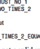

> 标量变量通常被称为名称-值对，因为变量的名称和值可以被视为一对。

### 变量名

变量名只能包含字母（a 到 z 或 A 到 Z）、数字（0 到 9）和下划线字符（`_`）。此外，变量名只能以字母或下划线开头。以下是有效变量名的示例：

- `FRUIT`
- `FRUIT_BASKET`
- `TRUST_NO_1`
- `TWO_TIMES_2`

但 `2_TIMES_2_EQUALS_4` 不是有效的变量名。要使其成为有效名称，我们需要在其名称开头添加下划线：`_2_TIMES_2` 以数字开头的变量名，例如 `1`、`2` 或 `11`，保留给 shell 使用。你可以使用这些变量存储的值，但你不能自行设置其值。

你不能使用其他字符如 `*`、`?` 或 `-` 的原因是这些字符对 shell 有特殊含义。如果你尝试使用这些特殊字符创建变量名，它会使 shell 感到困惑。例如，变量名

```
FRUIT-BASKET
2*2
TRUST_NO_1!
```

都是无效名称。第一个变量名生成的错误消息类似于以下内容：

```
$ FRUIT-BASKET=apple
/bin/sh: FRUIT-BASKET=apple: not found.
```

### 变量值

你可以在变量中存储或分配任何你想要的值。例如，

```
FRUIT=peach
FRUIT=2apples
FRUIT=apple*pear*kiwi
```

变量的一个常见错误是分配包含空格的值。例如，以下赋值

```
$ FRUIT=apple orange plum
```

会导致此错误消息：


```
sh: orange: not found.
```

包含空格的值需要加引号。例如，以下两个赋值都是有效的：

```
$ FRUIT="apple orange plum"
$ FRUIT='apple orange plum'
```

这两种引用方案之间的区别在第 10 章“引号”中介绍。

## 访问值

你可以通过在其名称前加上美元符号（`$`）来访问变量中存储的值。当 shell 看到 `$` 时，它执行以下操作：

1. 读取下一个词以确定变量的名称。
2. 检索变量的值。如果找不到值，shell 使用空字符串 `""` 作为值。
3. 用变量的值替换 `$` 和变量名。

此过程称为变量替换，在第9章“替换”中有更详细的介绍。以下示例演示了此过程：

```
$ FRUIT=peach
$ echo $FRUIT
peach
```

在此示例中，shell 首先确定变量 `FRUIT` 已经被引用。接下来它查找 `FRUIT` 的值。最后字符串 `$FRUIT` 被替换为 `peach`，即 `FRUIT` 的值，这就是 `echo` 命令打印的内容。

如果不使用美元符号（`$`），则不会执行变量替换，而是直接使用变量名。例如，

```
$ echo FRUIT
FRUIT
```

只是打印出 `FRUIT`，而不是变量 `FRUIT` 的值。

美元符号（`$`）仅在访问变量值时使用。定义变量或为变量赋值时不应使用它。例如，赋值

```
$ $FRUIT=apple
```

会生成以下错误信息

```
sh: peach=apple: not found
```

假设 `FRUIT` 的值为 `peach`。如果变量 `FRUIT` 没有值，则错误将是

```
sh: =apple: not found
```

## 数组变量

数组是一种使用单个名称将一组变量组合在一起的方法。无需为每个需要的变量创建新名称，您可以使用单个数组变量存储所有变量。

要了解数组的工作原理，请考虑以下示例。假设我们正试图使用一组标量变量来表示本书中的章节。我们可以选择以下变量名来表示其中的一些章节：

- `CH01`
- `CH02`
- `CH15`
- `CH07`

每个变量名都有特定格式：字母 `CH` 后跟章节号。此格式可作为将这些变量组合在一起的方式。数组变量通过使用数组名与称为索引的数字结合来形式化这种分组。索引用于定位数组中的条目或元素。

> 数组在 Bourne shell 中不可用。数组首次出现在 Korn shell `ksh` 中，并被 Z-Shell `zsh` 采用。Bourne Again Shell `bash` 的最新版本（3.0 及更新版本）包含对数组的支持，但旧版本不支持。一些 Linux 发行版仍随附旧版本的 `bash`。

> 如果您使用的是 `bash`，以下命令可让您确定其版本：
>
> `$ echo $BASH_VERSION`
>
> 如果输出以字符串 `'1.'` 开头，如下所示：
>
> `1.14.7(1)`
>
> 您使用的 `bash` 版本不支持数组。本节中的示例在 1.x 版本的 `bash` 中无法工作。
>
> 如果输出以字符串 `'2.'` 开头，如下所示：
>
> `2.03.0(1)-release`
>
> 您使用的 `bash` 版本支持数组。本节中的示例在 2.0 及更新版本的 `bash` 中可工作。

## 创建数组变量

创建数组变量最简单的方法是为其某个索引赋值。这表示如下：

```
name[index]=value
```

这里 `name` 是数组的名称，`index` 是您想要设置的数组项的索引，`value` 是您想要为该项设置的值。在 `ksh` 中，`index` 必须介于 0 到 1,023 之间的整数。在 `bash` 或 `zsh` 中没有此类限制。唯一的限制是 `index` 必须为整数。它不能是浮点数或十进制数，例如 `10.3`，或字符串，例如 `apricot`。

例如，以下命令

```
$ FRUIT[0]=apple
$ FRUIT[1]=banana
$ FRUIT[2]=orange
```

设置名为 `FRUIT` 的数组的前三个项的值。您也可以使用标量变量执行相同的操作，如下所示：

```
$ FRUIT_0=apple
$ FRUIT_1=banana
$ FRUIT_2=orange
```

尽管这对于少量项来说效果很好，但对于大量项来说，数组表示法要高效得多。如果您必须仅使用 Bourne shell 编写脚本，可以使用此方法模拟数组。

在前面的示例中，数组索引按顺序设置。这不是必需的。例如，以下命令设置 `FRUIT` 数组中索引 10 处项的值：

```
$ FRUIT[10]=plum
```

shell 不会在索引 2 和索引 10 之间创建一堆空白数组项来填补空间；它只是跟踪包含值的那些数组索引。

如果定义了与标量变量同名的数组变量，则标量变量的值将成为数组索引 0 处的元素的值。例如，如果执行以下命令

```
$ FRUIT=apple
$ FRUIT[1]=peach
```

则 `FRUIT` 的零号元素的值为 `apple`。此时，对标量变量 `FRUIT` 的任何访问都被视为对数组项 `FRUIT[0]` 的访问。

第二种数组初始化形式可用于一次设置多个元素。此初始化形式的语法在 `ksh` 和 `bash` 之间有所不同。在 `ksh` 中，语法如下：

```
set -A name value1 value2 ... valueN
```

在 `bash` 中，语法为

```
name=(value1 ... valueN)
```

两种样式都可以在 `zsh` 中使用。无论采用何种样式，`name` 都是数组的名称，`value1` 到 `valueN` 是要设置的项的值。一次设置多个元素时，将使用从 0 开始的连续数组索引。

例如 `ksh` 命令

```
$ set -A band derri terry mike gene
```

或 `bash` 命令

```
$ band=(derri terry mike gene)
```

等同于以下命令：

```
$ band[0]=derri
$ band[1]=terry
$ band[2]=mike
$ band[3]=gene
```

> 在 `bash` 中设置多个数组元素时，您可以在值前放置数组索引：
>
> `myarray=( [0]=derri [3]=gene [2]=mike [1]=terry )`
>
> 数组索引不必按顺序排列。

## 访问数组值

可以按如下方式访问数组变量：

```
${name[index]}
```

这里 `name` 是数组的名称，`index` 是所需元素的索引。例如，如果数组 `FRUIT` 如前例中初始化，则命令

```
$ echo ${FRUIT[2]}
```

会产生以下输出：

`orange`

您可以通过以下一种方法访问数组中的所有项：

```
${name[*]}
${name[@]}
```

这里 `name` 是您感兴趣的数组的名称。如果 `FRUIT` 数组如前例中初始化，则命令

```
$ echo ${FRUIT[*]}
```

假设 `FRUIT` 如前例中定义，使用以下命令访问整个数组

```
$ echo ${FRUIT[*]}
```

会得到五个项，而不是四个：

`apple banana orange passion fruit`

使用此形式的数组访问访问 `FRUIT` 的命令会得到五个值，其中 `passion` 和 `fruit` 被视为单独的项。要仅得到四个项，您必须使用以下形式：

```
$ echo ${FRUIT[@]}
```

此命令的输出看起来与之前的命令相似：

`apple banana orange passion fruit`

但命令只会看到四个项，因为 shell 会引用最后一个项 `passion fruit`，使其被视为单个项。

## 只读变量

只读变量是在定义后其值无法更改的变量。一旦变量被指定为只读，就无法摆脱它或修改其值；它及其值会一直存在，直到 shell 退出。

变量可使用 `readonly` 命令标记为只读。考虑以下命令集：

```
$ FRUIT=kiwi
$ readonly FRUIT
$ echo $FRUIT
kiwi
$ FRUIT=cantaloupe
```

最后一条命令会产生类似以下内容的错误信息：

`/bin/sh: FRUIT: This variable is read only.`

正如您所见，我们可以读取变量 `FRUIT` 的值，但不能覆盖其中存储的值。

此功能通常在脚本中用于确保关键变量不会被意外覆盖。

在 `ksh`、`bash` 和 `zsh` 中，`readonly` 可用于将数组和标量变量都标记为只读：

```
$ FRUITBASKET=(apple orange pear)
$ readonly FRUITBASKET
```


```
$ echo ${FRUITBASKET[1]}
orange
$ FRUITBASKET[1]=kiwi
```

The last command results in an error message similar to the following:

上条命令会导致类似以下的错误信息：

```
sh: FRUITBASKET[1]: is read only
```

This example used the bash style array assignment; if you are using ksh you will need to change the first command to the following:

本示例使用了 bash 风格的数组赋值；如果您使用的是 ksh，则需要将第一个命令更改为以下内容：

```
$ set -A FRUITBASKET apple orange pear
```

### Unsetting Variables
### 取消设置变量

`Unsetting` a variable tells the shell to remove the variable from the list of variables that it tracks. This is like asking the shell to forget a piece of information because it is no longer required.

*取消设置*变量会告诉 shell 从其跟踪的变量列表中移除该变量。这就像要求 shell 忘记某条信息，因为它不再需要。

Both scalar and array variables can be unset using the `unset` command:

标量变量和数组变量都可以使用 `unset` 命令取消设置：

```
unset name
```

Here `name` is the name of the variable to unset. For example, the following command unsets the variable `FRUIT`:

这里 `名称` 是要取消设置的变量的名称。例如，以下命令取消设置变量 `FRUIT`：

```
unset FRUIT
```

The `unset` command cannot be used to unset variables that have been marked read-only via `readonly`. There is no way to unset a read-only variable; it persists until the shell exits.

`取消设置` 命令无法用于取消设置通过 `readonly` 标记为只读的变量。无法取消设置只读变量；它会一直存在直到 shell 退出。

### Environment and Shell Variables
### 环境变量和 Shell 变量

When the shell starts a program, it passes that program a set of variables called the `environment`. The environment is usually a small subset of the variables defined in the shell. Each variable in the environment is called an `environment variable`.

当 shell 启动程序时，它会向该程序传递一组称为 `环境` 的变量。环境通常是 shell 中定义变量的一个小子集。环境中的每个变量称为 `环境变量`。

The variables we have examined thus far have been local variables. `Local variables` are variables whose value is restricted to a single shell. Local variables are not passed to programs started by the shell.

迄今为止我们检查过的变量都是局部变量。`局部变量` 是其值仅限于单个 shell 的变量。局部变量不会传递给由 shell 启动的程序。

In addition to local and environment variables, there is a third category of variables called `shell variables`. These are special variables set by the shell that are required for proper operation of the shell. Some shell variables are environment variables, whereas others are local variables.

除了局部变量和环境变量之外，还有第三类变量称为 `shell 变量`。这些是由 shell 设置的特殊变量，用于 shell 的正常运行。某些 shell 变量是环境变量，而其他则是局部变量。

Table 8.1 compares these three categories of variables.

表 8.1 比较了这三类变量。

TABLE 8.1 A Comparison of Local, Environment, and Shell Variables

表 8.1 局部变量、环境变量和 Shell 变量的比较

| Attribute | Local | Environment | Shell |
|---|---|---|---|
| Accessible by child processes | No | Yes | Yes |
| 可被子进程访问 | 否 | 是 | 是 |
| Set by users | Yes | Yes | No |
| 由用户设置 | 是 | 是 | 否 |
| Set by the shell | No | No | Yes |
| 由 shell 设置 | 否 | 否 | 是 |
| User modifiable | Yes | Yes | No |
| 用户可修改 | 是 | 是 | 否 |
| Required by the shell | No | No | Yes |
| 由 shell 要求 | 否 | 否 | 是 |

### Exporting Environment Variables
### 导出环境变量

Environment variables are just local variables that have been placed into the environment via the `export` command:

环境变量只是通过 `export` 命令放置到环境中的局部变量：

```
export name
```

The variable specified by `name` is placed in the environment. The process of placing variables into the environment is often referred to as exporting the variable. The standard shell idiom for exporting variables is

由 `name` 指定的变量被放置到环境中。将变量放置到环境中的过程通常称为导出变量。导出变量的标准 shell 惯用语是

```
name=value ; export name
```

An example of this is

例如

```
PATH=/sbin:/bin ; export PATH
```

Here a value is assigned to `PATH`, and then `PATH` is exported. Often, the assignment statement of an environment variable and the corresponding `export` statement are written on one line to clarify that the variable is an environment variable. This helps the next programmer, who has to maintain the script, quickly grasp the use of certain variables.

这里为 `PATH` 分配一个值，然后导出 `PATH`。通常，环境变量的赋值语句和相应的 `export` 语句写在一行上，以明确该变量是环境变量。这有助于维护脚本的下一个程序员快速掌握某些变量的使用。


A single export command can be used to export more than one variable. For example,

单个 `export` 命令可用于导出多个变量。例如，

```
export PATH HOME UID
```

exports the variables `PATH`, `HOME`, and `UID` to the environment.

将变量 `PATH`、`HOME` 和 `UID` 导出到环境。

## Exporting Variables in ksh, bash, and zsh

### 在 ksh、bash 和 zsh 中导出变量

An alternative form for exporting variables is available in `ksh`, `bash`, and `zsh`:

在 `ksh`、`bash` 和 `zsh` 中提供了一种导出变量的替代形式：

```
export name=value
```

In this form, the variable specified by `name` is assigned the specified `value` and then that variable is marked for export. In this form command,

在此形式中，由 `name` 指定的变量被赋予指定 `value`，然后该变量被标记为导出。在此形式中命令，

```
export PATH=/sbin:/bin
```

is equivalent to

等价于

```
PATH=/sbin:/bin ; export PATH
```

In this form, any combination of `name` or `name=value` pairs can be given to the `export` command. For example, the command

在此形式中，可以向 `export` 命令提供 `name` 或 `name=value` 对的任意组合。例如，命令

```
export FNHOME=/usr/frame CLEARHOME=/usr/atria PATH
```

assigns the specified values to the variables `FNHOME` and `CLEARHOME` and then exports the variables `FNHOME`, `CLEARHOME`, and `PATH`.

为变量 `FNHOME` 和 `CLEARHOME` 分配指定的值，然后导出变量 `FNHOME`、`CLEARHOME` 和 `PATH`。

## Shell Variables

### Shell 变量

Shell variables are variables that the shell sets during initialization and uses internally. Table 8.2 gives a list of the most common shell variables. Some other shell variables are covered in the section "Variable Substitution" in Chapter 9.

Shell 变量是 shell 在初始化期间设置并在内部使用的变量。表 8.2 列出了最常见的 shell 变量。一些其他 shell 变量在第 9 章“变量替换”部分中介绍。

**TABLE 8.2 Shell Variables**

**表 8.2 Shell 变量**

| Variable | Description |
|---|---|
| 变量 | 描述 |
| `PWD` | Indicates the current working directory as set by the `cd` command. |
| `PWD` | 表示由 `cd` 命令设置的当前工作目录。 |
| `UID` | Expands to the numeric user ID of the current user, initialized at shell startup. |
| `UID` | 展开为当前用户的数字用户 ID，在 shell 启动时初始化。 |
| `SHLVL` | Increments by one each time an instance of `bash` is started. This variable is useful for determining whether the built-in `exit` command ends the current session. |
| `SHLVL` | 每次启动 `bash` 实例时递增一。此变量有助于确定内置 `exit` 命令是否结束当前会话。 |
| `REPLY` | Expands to the last input line read by the `read` built-in command when it is given no arguments. This variable is not available in Bourne shell. |
| `REPLY` | 当 `read` 内置命令不带参数时，展开为最后一次读取的输入行。此变量在 Bourne shell 中不可用。 |
| `RANDOM` | Generates a random integer between 0 and 32,767 each time it is referenced. You can initialize the sequence of random numbers by assigning a value to `$RANDOM`. If `$RANDOM` is unset, it loses its special properties, even if it is subsequently reset. This variable is not available in Bourne shell. |
| `RANDOM` | 每次引用时生成 0 到 32,767 之间的随机整数。您可以通过为 `$RANDOM` 分配值来初始化随机数序列。如果 `$RANDOM` 被取消设置，即使随后重置，它也会失去其特殊属性。此变量在 Bourne shell 中不可用。 |
| `SECONDS` | Each time this parameter is referenced, it returns the number of seconds since shell invocation. If a value is assigned to `$SECONDS`, the value returned on subsequent references is the number of seconds since the assignment plus the value assigned. If `$SECONDS` is unset, it loses its special properties, even if it is subsequently reset. This variable is not available in Bourne shell. |
| `SECONDS` | 每次引用此参数时，它返回自 shell 调用以来的秒数。如果为 `$SECONDS` 分配值，则后续引用返回的值为自分配以来的秒数加上分配的值。如果 `$SECONDS` 被取消设置，即使随后重置，它也会失去其特殊属性。此变量在 Bourne shell 中不可用。 |
| `IFS` | Indicates the Internal Field Separator that is used by the parser for word splitting after expansion. `$IFS` is also used to split lines into words with the `read` built-in command. The default value is the string. `\t\n`, where  is the space character, `\t` is the tab character, and `\n` is the new-line character. |
| `IFS` | 表示解析器在展开后进行单词分割时使用的内部字段分隔符。`$IFS` 也用于 `read` 内置命令将行拆分为单词。默认值是字符串。`\t\n`，其中 是空格字符，`\t` 是制表符，`\n` 是换行符。 |

**TABLE 8.2 continued**

**表 8.2 继续**

| Variable | Description |
|---|---|
| 变量 | 描述 |


| `PATH` | Indicates the search path for commands. It is a colon-separated list of directories in which the shell looks for commands. A common value is `PATH=/bin:/sbin:/usr/bin:/usr/sbin:/usr/local/bin:/usr/ucb` |

| `PATH` | 表示命令的搜索路径。它是以冒号分隔的目录列表，shell 在其中查找命令。常见的值是 `PATH=/bin:/sbin:/usr/bin:/usr/sbin:/usr/local/bin:/usr/ucb` |

| `HOME` | Indicates the home directory of the current user: the default argument for the `cd` built-in command. |

| `HOME` | 表示当前用户的 home 目录：`cd` 内置命令的默认参数。 |

### Summary

### 摘要

This chapter covered using variables for shell script programming. You saw how scalar and array variables were defined, accessed, and unset. We also looked at a special category of variables known as environment variables. In subsequent chapters, we will look at how variables are used to achieve a greater degree of flexibility and clarity in shell scripts.

本章介绍了 shell 脚本编程中使用变量。您了解了标量变量和数组变量如何定义、访问和取消设置。我们还研究了一类特殊的变量，即环境变量。在后续章节中，我们将研究如何使用变量来实现 shell 脚本更大的灵活性和清晰度。

### Questions

### 问题

- 1. Which of the following are valid variable names?
- 1. 以下哪些是有效的变量名？
- a. `_FRUIT_BASKET`
- a. `_FRUIT_BASKET`
- b. `1_APPLE_A_DAY`
- b. `1_APPLE_A_DAY`
- c. `FOUR_SCORE&7YEARS_AGO`
- c. `FOUR_SCORE&7YEARS_AGO`
- d. `Variable`
- d. `Variable`

- 2. Is the following sequence of array assignments valid in sh, ksh, and bash?
- 2. 以下数组赋值序列在 sh、ksh 和 bash 中是否有效？

```
$ adams[8]=hitchhikers_guide
$ adams[1]=restaurant
$ adams[3]=thanks_for_all_the_fish
$ adams[42]=life_universe_everything
$ adams[5]=mostly_harmless
```

- 3. Given the preceding array assignments, how would you access the array item at index 8 in the array adams? How would you access every item in the array?
- 3. 给定上述数组赋值，如何访问数组 `adams` 中索引为 8 的数组项？如何访问数组中的每个项？

- 4. What is the difference between an environment variable and a local variable?
- 4. 环境变量和局部变量有什么区别？

### Terms

### 术语

`Array Variable` An array variable is a variable that groups multiple scalar variables together using a single name. Each of the individual scalar variables is accessed via an index.

`数组变量` 数组变量使用单个名称将多个标量变量组合在一起。每个单独的标量变量通过索引访问。

`Environment` The environment is a set of variables that the shell passes to every program it starts.

`环境` 环境是一组 shell 传递给其启动的每个程序的变量。

`Environment Variable` An environment variable is a variable that is a member of the environment.

`环境变量` 环境变量是环境成员的变量。

`Exporting` The process of placing a variable in the environment is called exporting.

`导出` 将变量放置到环境中的过程称为导出。

`Local Variable` A local variable is a variable that is present within the current instance of the shell. It is not available to programs that are started by the shell.

`局部变量` 局部变量是存在于当前 shell 实例中的变量。它对由 shell 启动的程序不可用。

`Read-Only Variable` A read-only variable is a variable whose value cannot be changed.

`只读变量` 只读变量是其值不能更改的变量。

`Scalar Variable` A scalar variable can hold only one value at a time.

`标量变量` 标量变量一次只能保存一个值。

`Shell Variable` A shell variable is a variable that is set by the shell and is required by the shell to function correctly.

`Shell 变量` Shell 变量是由 shell 设置且 shell 正确运行所必需的变量。

`Unsetting` Unsetting a variable removes it from the list of variables tracked by the shell.

`取消设置` 取消设置变量会将其从 shell 跟踪的变量列表中移除。

`Variable` A variable is a word that holds a value. The value can be any text string.

`变量` 变量是一个保存值的词。值可以是任何文本字符串。

`Variable Substitution` Variable substitution is the process by which the shell replaces the name of a variable with its value.

`变量替换` 变量替换是 shell 用变量的值替换变量名称的过程。

## 第9小时

### 替换

当 shell 遇到包含一个或多个 *元字符* 的表达式时，它会对该表达式执行 *替换*。元字符是在 shell 中具有特殊含义的字符。替换是 shell 将包含元字符的字符串转换为不同字符串的过程，该字符串是解释元字符的结果。在上一章中，你看到了 `$` 元字符如何用于访问变量的值，这一过程称为 *变量替换*。除了变量替换之外，shell 还可以执行几种其他类型的替换。本章详细介绍了这些类型的替换及其相关的元字符。具体涵盖的主题有

- 文件名替换
- 基于值的变量替换
- 命令替换
- 算术替换


### 文件名替换（Globbing）


最常见的替换类型是文件名替换或 globbing。Globbing 是 shell 将包含 globbing 元字符或通配符的字符串扩展为文件名列表的方法。表 9.1 列出了 globbing 中使用的通配符。

表 9.1 Globbing 元字符（通配符）

| 通配符 | 描述 |
|---|---|
| `*` | 匹配任意字符的零个或多个出现 |
| `?` | 匹配任意字符的一个出现 |
| `[characters]` | 匹配给定字符中任意一个的一个出现 |

任何操作文件的命令或脚本都可以利用 globbing。本节中的示例使用 `ls` 命令，因为其输出清楚地说明了 globbing 的结果。

### `*` 元字符

文件名替换的最简单形式是星号或星号 `*` 元字符。`*` 匹配文件名中任意字符的零个或多个出现。

单独使用时，`*` 匹配当前目录中的所有可见文件名。例如，命令

```
$ ls *
```

列出当前目录中的每个文件和每个目录的内容。不可见的文件或目录不会被列出。

虽然 `*` 有时单独使用，但其主要用途是匹配文件前缀和后缀。

#### 匹配前缀

要匹配文件前缀，可以按如下方式使用 `*`：

Here `cmd` is the name of a command, such as `ls`, and `prefix` is the filename prefix you want to match. 例如，以下命令列出当前目录中以字母 CGI 开头的所有文件和目录：

```
$ ls CGI*
```

通过稍微改变前缀，你可以改变匹配的文件列表。例如，命令

```
$ ls CGIGet*
```

生成以下文件列表：

```
CGIGet.java
CGIGetTest.java
```

改变后缀可以让你操作匹配的文件名列表，直到列表只包含你感兴趣的文件名。

#### 匹配后缀

要匹配文件后缀，可以按如下方式使用 `*`：

```
cmd *suffix
```

Here `cmd` is the name of a command, such as `ls`, and `suffix` is the filename suffix you want to match. 例如，以下命令列出当前目录中以字母 java 结尾的所有文件和目录：

```
$ ls *java
```

```
CGI.java CGIGet.java CGIGetTest.java CGIpost.java CGIpostTest.java
```

通过稍微改变后缀，你可以改变匹配的文件列表。要仅列出以 Test.java 结尾的文件，可以按如下方式调整命令：

```
$ ls *Test.java
```

```
CGIGetTest.java CGIpostTest.java
```

改变后缀也允许你操作匹配的文件名列表，以便获得你感兴趣的文件名列表。

#### 匹配前缀和后缀

你可以通过以下方式使用 `*` 字符同时匹配前缀和后缀：

```
cmd prefix*suffix
```

Here `cmd` is the name of a command, such as `ls`, `prefix` is the filename prefix, and `suffix` is the filename suffix. 例如，以下命令列出当前目录中前缀为 CGIGet 且后缀为 java 的所有文件和目录：

```
$ ls CGIGet*.java
```

```
CGIGet.java CGIGetTest.java
```

在文件名替换表达式中也可以使用多个 `*`。例如，如果你只需要列出前缀为 CGI、后缀为 java 且包含字符 st 的文件，可以使用以下命令：

```
$ ls CGI*st*.java
```

输出如下：

```
CGIGetTest.java CGIpost.java CGIpostTest.java
```

#### Globbing 区分大小写

使用 `*` 时，指定前缀和后缀的正确大小写非常重要。例如，命令 `$ ls CGI*` 产生以下输出：

```
CGI.java CGIGet.java CGIGetTest.java CGIpost.java CGIpostTest.java
```

而命令 `$ ls cgi*` 不会产生相同的文件列表。

### `?` 元字符

`*` 的一个限制是它匹配零个或多个字符。考虑一种情况，你需要列出所有名称形式为 ch0X.doc 的文件，其中 X 是一个数字或字母。乍一看，命令

```
$ ls ch0*.doc
```

会产生适当的列表，但检查输出显示并非如此：

```
ch01.doc ch01-1.doc ch01-2.doc ch02.doc ch02-1.doc ch02-2.doc ch03.doc ch03-1.doc ch03-2.doc
```

为了仅匹配一个字符，你需要使用问号元字符。`?` 精确匹配一个字符的实例。使用 `?` 重写前一个示例得到：

```
$ ls ch0?.doc
```

现在输出仅包含你感兴趣的文件：

```
ch01.doc ch02.doc ch03.doc
```

假设你需要查找所有名称形式为 chXY.doc 的文件，其中 X 和 Y 是任意数字或字符。你可以使用两个 `?` 元字符来获得所需的文件列表：

```
$ ls ch??.doc
```

```
ch01.doc ch02.doc ch03.doc
```

#### 常见错误

如果 shell 找不到与包含 `?` 的表达式匹配的任何文件，shell 会将 `?` 视为普通字符。因为大多数文件名不包含 `?`，这通常会产生错误消息。例如，以下命令：

```
$ ls ch7?.doc
```

产生错误消息：

```
ls: ch7.doc: No such file or directory
```

因此，shell 脚本需要验证作为参数指定的文件的存在。执行此类检查的程序在第 11 章 "Flow Control." 中讨论。

### 匹配字符集

`?` 和 `*` 通配符的两个潜在问题是

- 任何字符，包括连字符 `-` 或下划线 `_` 等特殊字符，都会被这些字符匹配。
- 没有办法仅匹配字母或仅匹配数字。

有时你需要对要匹配的字符有更多控制。考虑一种情况，你需要匹配形式为 ch0X 的文件名，其中 X 是 0 到 9 之间的数字。`?` 也不 `*` 运算符都不适合此任务。

为了匹配字符集，你需要使用 `[` 和 `]` 元字符。使用这些元字符的语法如下：

```
cmd [chars]
```

Here `cmd` is the name of a command, such as `ls`, and `chars` is the set of characters to match. 例如，以下命令满足这些要求：

```
$ ls ch[0123456789].doc
ch01.doc ch02.doc ch03.doc
```

#### 字符范围

在前一个示例中，该集合包含你要匹配的所有字符的显式列表。如果需要处理大量字符集，这可能会很麻烦。你可以通过使用 `-` 元字符指定字符范围来简化此操作。字符范围是通过提供集合中的第一个和最后一个字符来指定字符集的方法。例如，字符范围 `0-9` 指定零到九之间（包括）的所有数字。

列出以小写字母开头的所有文件。要匹配所有以大写字母开头的文件，请使用以下命令：

```
$ ls [A-Z]*
```

你也可以在一个集合中组合多个字符范围。例如，

```
$ ls [a-zA-Z]*
```

匹配所有以字母开头的文件，而命令

```
$ ls *[^a-zA-Z0-9]
```

匹配所有以字母或数字结尾的文件。

将集合与其他元字符结合使用可以为文件名替换提供最大的灵活性。

#### 否定集合

考虑一种情况，你需要列出所有文件，除了包含特定字母的文件，例如字母 a。你可以通过两种方式解决这个问题：

- 指定文件名应包含的所有字符。
- 指定文件名不包含字母 a。

如果你选择第一种方法，你需要构造文件名可以包含的所有字符的集合。你可以从以下开始：

```
[b-zA-Z0-9]
```

该集合不包括文件名中允许的特殊字符。尝试包含所有这些字符会创建一个繁琐的集合，并带有复杂的引用：

```
[b-zA-Z0-9_!~^'\\|(){}[]]
```

与此相比，第二种方法似乎简单得多，因为你只需要指定要排除的字符集。这是通过使用 `!` 运算符实现的。当 `!` 是集合中的第一个字符时，shell 仅匹配不包含 `!` 后面集合中字符的文件名。该运算符的语法是：

```
cmd [!chars]
```

Here, `cmd` is the name of a command, such as `ls`, and `chars` is the set of characters that should not be matched.

例如，你可以使用以下命令列出所有文件，除了以字母 a 开头的文件

```
$ ls [!a]*
```

### 变量替换


在上一章中，你学习了变量替换的一种基本形式，即如何使用 `$` 元字符检索变量的值。除此之外，shell 还提供了几种其他高级变量替换形式，使 shell 程序能够根据变量的状态操作变量的值。

高级变量替换有两大类：

- 变量具有值时采取的操作
- 变量不具有值时采取的操作

这些操作范围从一次性值替换到中止脚本。这些类别被细分为四种变量替换形式。这些形式在表 9.2 中进行了总结。

表 9.2 高级变量替换

| 名称 | 语法 | 描述 |
|---|---|---|
| 默认值替换 | `${param:-word}` | 如果 `param` 为空或未设置，则用 `word` 替换 `param`。`param` 的值不会改变。 |
| 默认值赋值 | `${param:=word}` | 如果 `param` 为空或未设置，则将 `param` 设置为 `word` 的值。 |
| 空值错误 | `${param:?msg}` | 如果 `param` 为空或未设置，则将 `msg` 打印到 `STDERR` 并退出 shell。 |
| 设置时替换 | `${param:+word}` | 如果 `param` 已设置，则使用 `word` 代替 `param` 的值。`param` 的值不会改变。 |

### 默认值替换

高级变量替换的第一种形式允许在变量值为 null 时替换默认值。语法如下：

`${param:-word}`

这里 `param` 是变量的名称，`word` 是默认值。仅当 `param` 未设置时才执行替换。此外，`word` 不会被赋给 `param`；shell 只是用 `word` 替换表达式。以下示例说明了其行为：

```
$ unset MYFRUIT
$ FRUIT=${MYFRUIT:-APPLE}
$ echo MYFRUIT is $MYFRUIT, FRUIT is $FRUIT
MYFRUIT is , FRUIT is APPLE
```

### 默认值赋值

高级变量替换的第二种形式在变量值为 null 时为变量赋值。语法如下：

```
${param:=word}
```

这里 `param` 是变量的名称，`word` 是在变量值为 null 时要赋的值。以下示例说明了其行为：

```
$ unset FRUIT
$ echo FRUIT is $FRUIT
FRUIT is
$ echo FRUIT is ${FRUIT:-APPLE}
FRUIT is APPLE
```

### 空值错误

有时替换或分配默认值可能会隐藏 shell 脚本中的问题。为了在 shell 脚本的关键部分发现此类问题，可以使用第三种变量替换形式，当变量未设置时向 `STDERR` 输出消息。语法如下：

```
${param:?msg}
```

这里，`param` 是变量的名称，`msg` 是要打印到 `STDERR` 的消息。

如果 shell 脚本或 shell 函数需要设置某个变量才能正确执行，则可以使用这种变量替换形式。例如，如果变量 `$HOME` 未设置，以下表达式会导致 shell 退出：

```
: ${HOME:? 'Your home directory is undefined.'}
```

除了使用前面描述的变量替换形式外，此示例还使用了 no-op（no operation 的缩写）命令 `:`。该命令不执行任何工作；它只是计算传递给它的参数。

### 设置时替换

变量替换的最后一种形式用于在变量设置时替换值。语法如下：

```
${param:+word}
```

这里 `param` 是变量的名称，`word` 是在变量设置时要替换的值。如果 `param` 未设置，则不进行替换。此形式不会更改变量的值。它通常由脚本用来指示脚本正在调试模式下运行：

```
echo ${DEBUG:+'Debug is active.'}
```

### 命令和算术替换

另外两种替换形式是命令替换和算术替换。命令替换使你能够捕获命令的输出，而算术替换使你能够在 shell 中执行基本的整数运算。

#### 命令替换

命令替换是 shell 执行一组给定命令然后用其输出替换命令的位置的机制。当命令以 `` `command` `` 给出时执行命令替换

这里 `command` 可以是简单命令、管道或列表。

> > 执行命令替换时，请确保使用的是反引号字符，而不是单引号字符。命令替换仅在给出反引号或 backtick 字符 ` 时由 shell 执行。使用单引号代替反引号是常见错误，会导致难以找到的 bug。

命令替换通常用于将命令的输出赋给变量，如以下示例所示：

```
DATE=`date`
USERS=`who | wc -l`
UP=`date ; uptime`
```

在第一个示例中，`date` 命令的输出成为变量 `DATE` 的值。在第二个示例中，管道的输出成为变量 `USERS` 的值。在最后一个示例中，列表的输出成为变量 `UP` 的值。

你也可以使用命令替换为其他命令提供参数。例如，

```
grep `id -un` /etc/passwd
```

> 一些系统管理员有特殊脚本来跟踪并报告访问密码文件 `/etc/passwd` 的用户。在执行访问此文件的命令之前，请与系统管理员核实，以确保你没有违反站点策略。

#### 算术替换

算术替换允许你使用 shell 执行简单的整数运算。它最初在 `ksh` 中引入，并已纳入 `bash` 和 `zsh`。`Bourne shell` 中不可用。使用 `Bourne shell` 的脚本必须使用 `expr` 或 `bc` 等外部程序（在第 18 章“其他工具”中介绍）来执行基本的整数运算。

当遇到以下形式的表达式时执行算术替换：

```
$((exp))
```

这里 `exp` 是使用表 9.3 中给出的运算符构造的数学表达式。评估 `exp` 时使用标准优先级规则。

表 9.3 算术替换运算符

| 运算符 | 描述 |
|---|---|
| `/` | 除法运算符。将两个数相除并返回结果。 |
| `*` | 乘法运算符。将两个数相乘并返回结果。 |
| `-` | 减法运算符。将两个数相减并返回结果。 |
| `+` | 加法运算符。将两个数相加并返回结果。 |
| `()` | 括号用于明确哪些表达式应先于其他表达式求值。 |

如果 `exp` 的求值结果不是整数（whole number），则 `exp` 的值将被截断。作为说明，请考虑以下命令：

```
$ echo $(( 5/2 ))
2
```

除法的结果是 2.5，但在整数运算中 .5 被忽略，返回截断结果 2。结果不会四舍五入；小数点后的所有内容都被丢弃。

#### 优先级示例

以下示例说明了优先级的规则：

```
$ echo $(( ( (5 + 3*2) - 4 ) / 2 ))
3
```

如果你难以理解输出，只需从最内层括号中包含的子表达式开始分解操作：

- 1. `(5 + 3*2)`。因为 `*` 的优先级高于 `+`，所以此子表达式求值为 11。
- 2. 用第 1 步的结果替换得到子表达式 `(11 - 4)`。其求值为 7。
- 3. 用第 2 步的结果替换得到子表达式 `7 / 2`。其求值为 3.5，截断为 3。

#### 常见错误

算术替换中的常见错误是在括号之间插入空格。第一组或最后一组括号之间不应有空格。正确的语法如下：

```
$(( exp ))
```

如果在括号之间插入空格，如下所示：

```
$ ( ( exp ) )
$ ( ( exp ) )
$ ( ( exp ) )
```

shell 将生成错误消息。确切的错误消息取决于 `exp`。例如，以下所有命令：

```
$ echo $ ( ( 5/2 ) )
$ echo $ ( ( 5/2 ) )
$ echo $ ( ( 5/2 ) )
```

将产生类似以下的错误消息：

```
sh: command not found: 5
```

在某些系统上，错误消息为

```
sh: no such file or directory: 5
```

### 摘要

在本章中，你了解了 shell 中可用的四种替换形式：

- 文件名替换
- 变量替换
- 命令替换
- 算术替换

当你编写脚本并使用 shell 解决问题的过程中，这些类型的替换将具有极大的实用性。

### 问题

1. 应使用什么通配符组合来列出当前目录中以 `hwXY_Z.ABC` 形式结尾的所有文件？其中 X 和 Y 可以是任意数字；Z 是 2 到 6 之间的数字；A、B 和 C 是字符。
2. 如果变量 `MYPATH` 未设置，以下行执行什么操作：`: ${MYPATH:=/usr/bin:/usr/sbin:/usr/ucb}`
3. 上一问题中给出的命令执行的操作与以下命令执行的操作有什么区别：`: ${MYPATH=/usr/bin:/usr/sbin:/usr/ucb}`
4. 以下命令的输出是什么（在输入到 shell 之前先自行推算）：`echo $(( 3 * 2 + ( 4 - 3 / 4 ) ))`

#### 术语


### 字符范围
通过给出集合中第一个和最后一个字符来指定一组字符的方法。

### 通配
`shell` 用于生成与特定表达式匹配的文件列表的过程。也称为文件名替换。

### 元字符
在 `shell` 中具有特殊含义的字符。

### 替换
`shell` 将包含元字符的字符串转换为不同字符串的过程，该字符串是解释元字符的结果。

### 通配符
用于通配的元字符。两个主要的通配符是 `*` 和 `?`。


## 第 10 小时

### 引号

在前一章中，你了解了替换，只要输入包含元字符或 `$` 的命令就会自动发生。`shell` 对这些和其他特殊字符的解释通常很有用，但有时需要关闭 `shell` 替换，让每个字符代表其本身。关闭字符的特殊含义称为引用，可以通过三种方式完成：

- 使用反斜杠 (`\` )
- 使用单引号 (`'`)
- 使用双引号 (`"`)

引用可能是一个非常复杂的问题，即使对于经验丰富的 UNIX 程序员也是如此。在本章中，你将研究这些引用的每一种形式并学习如何使用它们。你将学习一系列简单规则，以帮助你理解何时需要引用以及如何正确执行。

### 使用反斜杠进行引用

首先，让我们使用 `echo` 来更好地了解 `shell` 如何处理特殊字符。例如，

```
$ echo Hello world
```

在你的屏幕上显示以下消息：

Hello world

观察如果在 Hello 和 world 之间添加分号 (`;`) 元字符会发生什么：

```
$ echo Hello; world
```

Hello

sh: world: Command not found

分号 (`;`) 字符告诉 `shell` 它已到达一个命令的末尾，后面跟着的是一个新命令。此字符使一行上可以有多个命令。因为 `world` 不是有效命令，所以你会收到错误消息（你系统上的错误消息可能略有不同）。

为了显示元字符，你需要引用它。当字符被引用时，其特殊含义被禁用。在 `shell` 中，字符使用反斜杠 (`\` ) 字符进行引用。作为示例，你可以通过按如下方式引用分号来解决前一个示例中的问题：

```
$ echo Hello\; world
```

Hello; world

正如你所见，引用字符 (`\` ) 在输出中不会显示。`shell` 预处理命令行，执行变量替换、命令替换和文件名替换，除非通常会引发替换的特殊字符被引用。然后反斜杠从命令参数中删除，因此正在运行的命令永远看不到引用字符。


> 使用反斜杠引用元字符的技术通常被称为转义。引用和转义这两个术语经常可以互换使用。

> 
> 你也可能会看到反斜杠被称为转义字符。

这里是另一个需要转义的示例：

```
$ echo You owe $1250
```

You owe 250

这看起来像是一个简单的 `echo` 语句，但请注意输出不是预期的，因为 `shell` 将 `$1250` 中的 `$1` 视为 `shell` 变量 `$1`。`$` 元字符必须被引用以避免变量替换：

```
$ echo You owe \$1250
```

现在你得到了期望的输出：

You owe $1250

现在假设你需要打印一条包含反斜杠的消息：

```
$ echo A:\ is my floppy drive
```

A:\ is my floppy drive

正如你所见，反斜杠没有出现在输出中。这是因为单个反斜杠始终用于引用下一个字符，在本例中为空格。为了获得反斜杠，你需要按如下方式用反斜杠引用它：

```
$ echo A:\\ is my floppy drive
```

A:\ is my floppy drive

### 元字符和转义序列

前面的示例涵盖了需要引用的三个元字符。需要引用的完整元字符集如下：

`*` `?` `[` `]` ``` ` ` \ ` `$` `;` `(` `&` `)` `|` `#` 换行符 制表符

经常你会看到换行符和制表符分别表示为 `\n` 和 `\t`。当反斜杠位于普通字符之前，例如 `n` 或 `t` 时，所得到字符串称为转义序列，具有特殊含义。正如你在第 5 章“输入和输出”中所学，转义序列使脚本输出的消息中可以嵌入换行符和制表符等特殊字符。

### 使用单引号

这里有一个 `echo` 命令必须修改，因为它包含许多特殊 `shell` 字符：

```
$ echo <-$1250.**,?; (update?) [y|n]
```

你可以通过在每个特殊字符前加上反斜杠来引用整个字符串，但这很繁琐，并且使生成的命令难以阅读和理解：

```
$ echo \<-\$1250.\*\*\?\,\; \(update\?\) \[y\|n\]
```

引用一大组字符的替代技术是在字符串开头和结尾加上单引号 (`'`)。当字符串使用单引号引用时，字符串内的所有元字符都会失去其特殊含义并被视为字面量。例如，以下命令等同于前一个示例：

```
$ echo '<-$1250.**,?; (update?) [y|n]'
```


> 引用常规字符是无害的，因为无论是否被引用，常规字符的处理方式都相同。这对于反斜杠、单引号和双引号都是如此。在前面的示例中，你将单引号放在整个字符串周围，同时引用了特殊字符以及不需要引用的常规字母和数字。严格来说，你不必这样做；你只需引用包含元字符的字符串部分即可。引用所有内容只是更简单，无论是编写还是维护，并且不会产生性能损失。

如果要在输出的字符串中出现单引号，你不应将整个字符串放在单引号内：

```
$ echo 'It's Friday'
```

这会失败并且只输出以下字符，同时光标等待更多输入：

>

> 符号是二级 `shell` 提示符（如存储在 `PS2` `shell` 变量中），它表示你已输入多行命令——到目前为止输入的内容不完整。单引号必须成对出现，其作用是引用它们之间的所有字符。万一你想知道，你不能通过在嵌入的单引号前加上反斜杠来解决这个问题。为了解决这个问题，你需要仅按如下方式引用 It's 单词中的单引号：

```
$ echo It\'s Friday
```

### 使用双引号

在许多情况下，你需要引用一些元字符，但允许 `shell` 评估其他元字符。例如，以下 `echo` 命令包含一些必须引用的元字符，而另一些则不应引用：

```
$ echo "$USER owes \$1250.**,?; [as of `date '+%m/%d'`]"
```

因为字符串使用单引号，输出很容易预测——所见即所得：

```
$USER owes \$1250.00... [ as of `date +%m/%d` ]
```

正如你所想象的，这并不是你想要的；单引号阻止了变量替换和命令替换的发生，因此变量 `$USER`（其中包含当前用户的用户名）没有被替换为适当的值，且 `date` 命令也没有被执行。因此现在的问题是引用大多数元字符，例如 `*` 和 `;` ，但允许某些元字符，例如 `$` 和 ``` ，被求值。

双引号是解决此问题的办法。双引号禁用除 `$` 和 ``` 之外的所有元字符，从而允许在引号字符串中执行变量和命令替换。看看如果将单引号替换为双引号会发生什么，如下所示：

```
$ echo "$USER owes \$1250.00... [ as of `date +%m/%d` ]"
Fred owes 250... [ as of 12/21 ]
```

如你所见，双引号允许你将许多元字符原样显示，同时仍能启用变量和命令替换。然而，正如你可能注意到的，所欠金额是错误的，因为 `$1` 被替换了。要纠正这一点，你需要使用反斜杠转义 `$`：

```
$ echo "$USER owes \$1250.00... [ as of `date +%m/%d` ]"
```

转义后的美元符号不再是特殊字符，因此金额现在在输出中正确显示：

```
ranga owes $1250... [ as of 12/21 ]
```

如果需要在双引号字符串内打印双引号，你需要用反斜杠 (`\` ) 对其进行引用，如下所示：

```
$ echo "He said \"Hello my dear!\""
He said "Hello my dear!"
```

### 引用规则和情况

现在你已经了解了引用的基础知识，让我们来看一些额外的规则，这些规则将帮助你更有效地使用引用。

### 引用忽略词边界

在英语中，你习惯于引用整个单词或句子。在 `shell` 编程中，必须引用特殊字符，但常规字符是否与同一单词中一起被引用并不重要，如下所示：

```
$ echo 'Hello; world'
Hello; world
```

只要特殊字符保持被引用，你就可以将引号移离词边界。此命令产生的输出与前一个命令相同：

```
$ echo 'Hel'lo'; 'w'or'ld
Hello; world
```

当然，如果引号位于词边界上，行会更容易阅读。这个简单的例子说明了引用可以使用的方式。在你将遇到的一些更复杂的引用情况下，移离词边界的引用将很有用。

### 在命令中组合引用


你可以在同一命令中自由地从一种引用类型切换到另一种引用类型。例如，以下命令包含单引号、反斜杠和双引号：

```
$ echo The 'USER' variable contains this value > "|$USER|"
The 'USER' variable contains this value > |ranga|
```

从输出中可以看到，你可以在同一命令中混合使用多种引用形式。

### 在单个参数中嵌入空格

对于 shell 而言，一个或多个空格或制表符构成单个命令行参数分隔符。例如，以下命令的输出：

```
$ echo Name Address
```

现在输出中保留了多个空格：

Name Address

必须引用空格才能将它们嵌入到单个命令行参数中：

```
$ mail -s Meeting tomorrow fred jane < meeting.notice
```

`mail` 命令使你能够向用户列表发送邮件。`-s` 选项使以下参数可作为邮件的主题使用。虽然单词 `tomorrow` 是主题的一部分（`Meeting tomorrow`），但它被视为接收消息的用户之一，这会导致错误。你可以通过使用三种引用类型中的任何一种来引用主题中的嵌入空格来解决此问题：

```
mail -s 'Meeting tomorrow' fred jane < meeting.notice
```

```
mail -s "Meeting tomorrow" fred jane < meeting.notice
```

```
mail -s `Meeting tomorrow` fred jane < meeting.notice
```

> 除非用户 `fred` 和 `jane` 在你的系统上存在，否则前面的示例中的 `mail` 命令很可能无法投递邮件，并会在你的主目录中创建一个名为 `dead.letter` 的文件。

### 引用换行以延续到下一行

换行字符位于 UNIX shell 脚本每一行的末尾；它是一个特殊字符，告诉 shell 它已遇到行的末尾。当脚本正在创建时，每次你在行末按 Enter 或 Return 时都会插入换行字符。

> 通常你无法在脚本中看到换行字符，但如果你使用 `vi` 编辑器，`vi` 命令
>
> `:set list`
>
> 会用美元符号标记每个换行字符。这使你可以看到脚本中换行所在的位置。

你可以引用换行字符以使长命令扩展到另一行，如下所示：

```
$ cp file1 file2 file3 file4 file5 file6 file7 \
> file8 file9 /tmp
```

请注意第一行的最后一个字符是反斜杠。此反斜杠引用了行末的换行字符。shell 识别到这一点并显示 `>`（PS2 提示符）以确认你正在输入续行或多行命令。为了正确工作，第一行末尾的反斜杠之后不得有任何字符，包括空格。

被引用的换行也像空格或制表符一样充当参数分隔符。例如：

```
$ echo 'Line 1
> Line 2
```

命令第一行末尾的换行被引用，因为它位于一对单引号之间。此命令的输出为

Line 1

Line 2

### 引用以访问包含特殊字符的文件名

在上一章中，你看到任何包含字符 `*`, `?`, `[`, 和 `]` 的单词都会自动扩展为与指定模式匹配的文件列表。例如，命令：

```
$ rm ch1*
```

删除当前目录中名称以前缀 `ch1` 开头的所有文件。在这种情况下，`*` 字符是一个特殊字符。大多数时候，这正是你想要的，但有一种情况你需要使用引用来移除该字符的特殊含义。假设你在目录中有以下文件：

`ch1`    `ch1*`    `ch1a`    `ch15`

请注意文件名 `ch1*` 包含 `*` 字符。虽然这绝对不推荐，但有时你会遇到文件名包含奇怪字符的文件（通常此类文件是意外创建的）。如果你只想删除文件 `ch1*`，以下命令就太过分了：

```
$ rm ch1*
```

因为它会删除所有以 `ch1` 开头的文件。要仅删除名为 `ch1*` 的文件，你需要引用 `*`。为此目的，你可以使用反斜杠、单引号或双引号：

```
$ rm ch1\*
$ rm 'ch1*'
$ rm "ch1*"
```

引用特殊字符会去掉其通配符含义并使你能够删除所需的文件。

> 避免在文件名中使用特殊字符，因为每次访问该文件时你都必须引用特殊字符。在处理文件名中包含文件名扩展元字符的文件时也要格外小心。如果在没有正确引用的情况下将此类文件名提供给 `rm` 或 `rs` 命令，你可能会在发现错误之前丢失许多文件。

### 引用正则表达式通配符

在第 16 章“使用正则表达式过滤文本”中，你将学习另一种称为正则表达式的表达式。正则表达式使用与文件名替换相同的一些通配符字符，如下 `grep` 命令所示（该命令在第 15 章“过滤文本”中介绍）

```
grep '[8-9][0-9]*' report2 report7
```

被引用的字符串 `'[8-9][0-9]*'` 是一个正则表达式，`grep` 在文件 `report2` 和 `report7` 的内容中搜索它。`grep` 模式中的通配符必须被引用，以防止 shell 错误地将该模式替换为与模式匹配的文件名列表。

> 你应该始终引用你的正则表达式以保护它们免受 shell 文件名扩展的影响，但有时即使不引用它们也能工作。shell 仅在找到名称与模式匹配的现有文件时才扩展模式。如果你恰好在一个找不到匹配文件的目录中，模式会被保留，`grep` 仍能正常工作。但是，如果你移动到另一个目录，相同的命令可能会失败。

### 引用反斜杠以启用 echo 转义序列

在第 5 章中，你看到 `echo` 使你能够在输出中使用转义序列，例如 `\n`。例如，

```
$ printf "Line 1\nLine 2\n"
```

显示如下内容：

Line 1

Line 2

你可能会想知道引用规则在这里如何适用。如果反斜杠去掉了其后字符的特殊含义，那输出中不应该只看到 `n` 吗？

双引号内的反斜杠只有在其前面是以下四个字符之一时才是特殊的：

- `$`
- `` ` ``
- `"`
- `\`

双引号内的 `\n` 被视为两个普通字符，传递给 `echo` 命令作为参数。`printf` 命令启用了它自己的特殊字符集，这些字符由前面的反斜杠表示。传递给 `printf` 的 `\n` 告诉 `printf` 显示一个换行符。在此示例中，`\n` 必须被引用，以便反斜杠能够传递给 `printf`，而不是在 `printf` 看到它之前被移除。看看当你不引用反斜杠时会发生什么：

```
$ printf Line 1\nLine 2\n
```

这会显示：

Line 1\nLine 2n

`\n` 未被引用，因此 shell 在 `printf` 看到参数之前移除了反斜杠。因为 `printf` 看到的是 `n` 而不是 `\n`，所以它只是显示 `n`，而不是期望的换行符。

### 用于 cpio 和 find 的通配符引用

还有像 `printf` 这样的其他命令，它们有自己的特殊字符，必须被引用才能使 shell 不加改动地传递它们。`cpio` 是一个用于保存和恢复文件的命令。它允许你使用文件名扩展元字符来选择要恢复的文件。为了使 `cpio` 实际接收到这些元字符，它们必须像以下示例中那样被引用：

```
$ cpio -icdvum 'usr2/*' < /dev/rmt0
```

`-icdvum` 包含传递给 `cpio` 的选项，用于指定它应如何从磁带设备 (`/dev/rmt0`) 恢复。字符串 `usr2/*` 表示从磁带上的 `usr2` 目录恢复所有文件。再次说明，如果通配符未被引用，此命令有时仍能正确工作，因为如果在当前路径中找不到匹配的文件，shell 扩展就不会发生（在本例中，如果当前目录中没有 `usr2` 子目录）。最好引用这些 `cpio` 通配符，以确保命令每次都能正常工作。


> 在使用 `cpio` 命令从 `/dev/rmt0` 等磁带设备恢复文件之前，请咨询您的系统管理员，以确保您拥有使用此类设备的足够权限。

第 18 章“其他工具”中介绍的 `find` 命令也支持自己的通配符。例如，在以下命令中

```
find / -name 'ch*.doc' -print
```

`ch*.doc` 是一个通配符模式，告诉 `find` 显示所有以 `ch` 开头并以 `.doc` 后缀结尾的文件名。与 shell 文件名扩展不同，此 `find` 命令会检查系统上的所有目录以查找匹配项。然而，通配符必须使用单引号、双引号或反斜杠进行引用，以便通配符传递给 `find` 而不是由 shell 扩展。

### 摘要

在本章中，你了解了三种引用类型以及何时使用它们：

- 反斜杠
- 单引号
- 双引号

此外，你还学习了几条引用规则：

- 反斜杠去掉了其后字符的特殊含义。
- 执行命令前，进行引用的字符会被移除。
- 单引号移除了所有被包含字符的特殊含义。
- 引用普通字符是无害的。
- 单引号字符串内部不能插入单引号。
- 双引号移除了大多数被包含字符的特殊含义。
- 引用可以忽略词边界。
- 不同类型的引用可以在一个命令中组合使用。
- 引用空格以将它们嵌入单个参数中。
- 引用换行符以在下一行继续命令。


- 使用引用来访问包含特殊字符的文件名。
- 引用正则表达式通配符。
- 引用反斜杠以启用 `echo` 转义序列。

### 问题

1. 给出一个 `echo` 命令来显示此消息：

`It's party time!`

2. 给出一个 `echo` 命令来显示包含以下字段的一行：

- 变量 `$USER` 的内容
- 一个空格
- 单词 "owes"
- 五个空格
- 一个美元符号 (`$`)
- 变量 `$DEBT` 的内容（该变量仅包含数字）

示例输出:

`fred owes     $25`

### 术语

**转义** 对字符进行转义意味着在该字符前加上反斜杠（`\`）。转义可以移除 shell 命令中字符的特殊含义，也可以添加特殊含义，就像你在 `echo` 命令中看到的 `\n` 一样。反斜杠后面的字符称为转义字符。

**字面字符** 这些字符没有特殊含义，也不会导致额外操作。引用会使 shell 将通配符视为字面字符。

**元字符** 一个具有额外含义或导致 shell 或其他 UNIX 命令采取某种操作的字符。

**换行符** 这 literally 是 ASCII 值为 10 的换行字符。一般来说，换行符是 shell 的特殊字符，表示已输入完整的命令行，现在可以执行。

**引用** literally 将选定的文本用某种类型的引号括起来。当应用于 shell 命令时，引用通过将字符用单引号或双引号括起来或转义字符来禁用 shell 对特殊字符的解释。


### 第 11 小时

### 流程控制

命令在 shell 脚本中执行的顺序称为脚本的流程。在你迄今为止查看的脚本中，流程始终相同，因为每次执行的是同一组命令。然而，大多数脚本需要根据一个或多个条件改变其流程。允许脚本流程有条件地改变的命令称为条件流程控制命令，或简称流程控制命令。

shell 中可用的两个主要流程控制语句是：
- `if` 语句
- `case` 语句

`if` 语句通常用于命令的条件执行，而 `case` 语句则允许根据多个模式中哪一个最先匹配变量来执行任意数量的命令序列。在本小时中，你将学习流程控制和两个条件语句。

### if 语句

`if` 语句根据给定条件为真还是假来执行操作。`if` 语句使用命令的返回码来确定条件是真还是假。返回码为零被视为真，而非零返回码被视为假。`if` 语句的语法如下：

```
if list1
then
list2
elif list3
then
list4
else
list5
fi
```

`elif` 和 `else` 语句都是可选的。如果有 `elif` 语句，就不需要 `else` 语句，反之亦然。`if` 语句可以用任意数量的 `elif` 语句编写。

因为 `if` 语句被视为一个列表，所以它也可以写在一行上：

```
if list1 ; then list2 ; elif list3 ; then list4 ; else list5 ; fi ;
```

通常这种形式仅用于简短的 `if` 语句。

`if` 语句的执行如下：
1. `list1` is executed.
2. If the exit code of `list1` is 0 (true), `list2` is executed and the `if` statement terminates.
3. Otherwise, `list3` is executed.
4. If the exit code of `list3` is 0 (true), `list4` is executed and the `if` statement terminates.
5. If the exit code of `list3` is non-zero, `list5` is executed.

### if 语句示例

以下示例说明了 `if` 语句的使用：

```
if uencode cherry.gif cherry.gif > cherry.uu ; then
echo "Encoded cherry.gif to cherry.uu"
else
echo "Error encoding cherry.gif"
fi
```

查看通过此语句的控制流程：
1. First, the command
`uencode cherry.gif cherry.gif > cherry.uu`
is executed.
2. If this command is successful, the command
`echo "Encoded cherry.gif to cherry.uu"`
is executed and the `if` statement exits.
3. Otherwise the command
`echo "Error encoding cherry.gif"`
is executed, and the `if` statement exits.

你可能已经注意到，在此示例中 `if` 和 `then` 语句都出现在同一行。大多数 shell 程序员更喜欢这样编写 `if` 语句，以便使语句更简洁、更易读。

### 常见错误

使用 `if` 语句时可能出现的四个常见错误是
- 在单行形式中省略 `then` 语句前的分号 (`;`)。
- 使用 `else if` 或 `elseif` 而不是 `elif`。
- 使用 `elif` 语句时省略 `then` 语句。
- 在 `if` 语句末尾写 `if` 而不是 `fi`。

这些情况下生成的错误消息因系统而异。在以下示例中显示了一个典型的错误消息；你系统上的实际错误消息可能使用略有不同的措辞。

以下示例说明了第一种类型的错误：

```
if uencode cherry.gif cherry.gif > cherry.uu then
echo "Encoded cherry.gif to cherry.uu"
else
echo "Error encoding cherry.gif"
fi
```

如果你遇到类似的错误信息，请确保 `then` 语句前有一个分号。

第二种错误类型可以通过修改以下示例来说明：

```
if uencode cherry.gif cherry.gif > cherry.uu ; then
 echo "Encoded cherry.gif to cherry.uu"
 elif rm cherry.uu ; then
 echo "Encoding failed, temporary files removed."
 else
 echo "An error occurred."
 fi
```

这里有一个 `elif` 语句，如果 `uencode` 失败则删除中间文件 `cherry.uu`。如果将 `elif` 改为如下的 `else if`

```
if uencode cherry.gif cherry.gif > cherry.uu ; then
 echo "Encoded cherry.gif to cherry.uu"
 else if rm cherry.uu ; then
 echo "Encoding failed, temporary files removed."
 else
 echo "An error occurred."
 fi
```

会生成类似以下错误信息：

```
sh: syntax error: unexpected end of file
```

如果将 `elif` 改为如下的 `elseif`

```
if uencode cherry.gif cherry.gif > cherry.uu ; then
 echo "Encoded cherry.gif to cherry.uu"
 elseif rm cherry.uu ; then
 echo "Encoding failed, temporary files removed."
 else
 echo "An error occurred."
 fi
```

会生成类似以下错误信息：

```
sh: syntax error near unexpected token 'then'
```

以下示例说明了第三种错误类型：

```
if uencode cherry.gif cherry.gif > cherry.uu ; then
 echo "Encoded cherry.gif to cherry.uu"
 elif rm cherry.uu
 echo "Encoding failed, temporary files removed."
 else
 echo "An error occurred."
 fi
```

这里省略了 `elif` 语句后面的 `then` 语句。这会生成类似以下错误信息：

```
sh: syntax error near unexpected token 'else'
```

以下示例说明了第四种错误类型：


```
if uencode cherry.gif >cherry.uu ; then
echo "Encoded cherry.gif to cherry.uu"
else
echo "Error encoding cherry.gif"
if
```

这里将最终的 `fi` 语句写成了 `if`。这会生成类似以下错误信息：

```
sh: syntax error: unexpected end of file
```

此错误表明 `if` 语句未使用 `fi` 语句关闭。

### 使用 test

通常提供给 `if` 语句的列表是一个或多个 `test` 命令。`test` 命令的语法如下：

```
test expr
```

这里 `expr` 是使用 `test` 理解的选项之一构造的。评估 `expr` 后，`test` 返回 `0`（真）或 `1`（假）。左方括号 `[`，通常用作 `test` 的简写：

```
[ expression ]
```

这里 `expr` 是 `test` 理解的任何有效表达式。右方括号 `]`、左方括号 `[` 后的空格以及右方括号前的空格是必需的。如果没有空格和右方括号，shell 就无法判断 `expr` 的开始和结束位置。

`test` 理解的表达式主要有三种类型：

- 文件测试
- 字符串比较
- 数值比较

#### 文件测试

文件测试表达式测试文件是否符合特定条件。文件测试的一般语法为

```
test option file
or
[ option file ]
```

这里 `option` 是表 11.1 中给出的选项之一，`file` 是文件或目录的名称。

表 11.1 `test` 的文件测试选项

| 选项 | 描述 |
|---|---|
| `-b file` | 如果 `file` 存在且是块特殊文件则为真。 |
| `-c file` | 如果 `file` 存在且是字符特殊文件则为真。 |
| `-d pathname` | 如果 `pathname` 存在且是目录则为真。 |
| `-e pathname` | 如果 `pathname` 指定的文件或目录存在则为真。 |
| `-f file` | 如果 `file` 存在且是普通文件则为真。 |
| `-g pathname` | 如果 `pathname` 指定的文件或目录存在且其 SGID 位已设置则为真。 |
| `-h file` | 如果 `file` 存在且是符号链接则为真。此选项在某些旧系统上不可用。 |
| `-k pathname` | 如果 `pathname` 指定的文件或目录存在且其“粘滞”位已设置则为真。 |
| `-p file` | 如果 `file` 存在且是有名管道则为真。 |
| `-r pathname` | 如果 `pathname` 指定的文件或目录存在且可读则为真。 |
| `-s file` | 如果 `file` 存在且大小大于零则为真。 |
| `-u pathname` | 如果 `pathname` 指定的文件或目录存在且其 SUID 位已设置则为真。 |
| `-w pathname` | 如果 `pathname` 指定的文件或目录存在且可写则为真。 |
| `-x pathname` | 如果 `pathname` 指定的文件或目录存在且可执行则为真。目录必须可执行才能访问其内容。 |
| `-o pathname` | 如果 `pathname` 指定的文件或目录存在且由当前进程的有效用户 ID 所拥有则为真。 |


> `-w` 和 `-x` 选项仅测试文件权限标志。它们不考虑底层磁盘的状态。例如，CD-ROM 或 DVD 等只读磁盘上的文件可能设置了可写位，但由于底层介质为只读，无法写入。

接下来的几个示例取自 OpenBSD 的系统启动脚本 `/etc/rc`，说明了文件测试的使用。本节不会介绍表 11.1 中列出的每个选项；只是足够让你对文件测试运算符在现实世界中的使用方式有一个大致的了解。

第一个示例说明了使用 `-d` 选项测试目录是否存在：

```
# /var/crash should be a directory if core dumps
# are to be saved.
if [ -d /var/crash ]; then
savecore /var/crash
fi
```

这里脚本确定目录 `/var/crash` 是否存在。如果目录存在，则执行 `savecore`。如果目录不存在，则 `if` 语句不执行任何操作。

第二个示例说明了使用 `-f` 选项测试普通文件是否存在：

```
if [ -f /var/account/acct ]; then
echo "turning on accounting"; acct on /var/account/acct ;
fi
```

这里脚本确定文件 `/var/account/acct` 是否存在。如果文件存在，脚本输出消息：

turning on accounting

并执行 `acct on /var/account/acct`。如果文件不存在，则 `if` 语句不执行任何操作。

第三个示例说明了使用 `-x` 选项确定文件是否可执行：

```
if [ -x /usr/libexec/vi.recover ]; then
echo "preserving editor files"; /usr/libexec/vi.recover
fi
```

这里脚本确定文件 `/usr/libexec/vi.recover` 是否可执行。如果文件可执行，脚本输出消息：

preserving editor files

并执行 `/usr/libexec/vi.recover`。如果文件不可执行，则 `if` 语句不执行任何操作。

#### 字符串比较

`test` 和 `[` 命令允许进行简单的字符串比较。它们可用于确定字符串是否为空以及两个字符串是否相同或相等。有关字符串比较的选项列于表 11.2。

表 11.2 `test` 命令的字符串比较选项

| 选项 | 描述 |
|---|---|
| `-z str` | 如果 `str` 长度为零则为真。 |
| `-n str` | 如果 `str` 长度非零则为真。 |
| `str1 = str2` | 如果 `str1` 和 `str2` 相等则为真。 |
| `str1 != str2` | 如果 `str1` 和 `str2` 不相等则为真。 |

#### 检查字符串是否为空

确定字符串是否为空有几种方法。最常见的方法是按如下方式使用 `-z` 选项：

```
test -z str

or

[ -z str ]
```

这里 `str` 是你要检查的字符串。例如，考虑以下 `if` 语句：

```
if [ -z "$FRUIT_BASKET" ] ; then
  echo "Your fruit basket is empty"
else
  echo "Your fruit basket contains: $FRUIT_BASKET"
fi
```

如果变量 `$FRUIT_BASKET` 没有值，则消息：

Your fruit basket is empty

会产生。否则会产生包含 `$FRUIT_BASKET` 值的消息。

如果你改用 `-n` 选项而不是 `-z` 选项，示例将如下更改：

```
if [ -n "$FRUIT_BASKET" ] ; then
  echo "Your fruit basket has the following fruit: $FRUIT_BASKET"
else
  echo "Your fruit basket is empty"
fi
```

你可能注意到在之前的示例中变量 `$FRUIT_BASKET` 被引用了。引用处理了 `$FRUIT_BASKET` 未设置或为空的情况。如果 `$FRUIT_BASKET` 未设置且你没有引用它，将显示类似以下错误信息：

```
test: argument expected
```

没有引号，在 shell 执行变量替换后，语句看起来如下：

```
[ -z ]
```

`test` 命令抱怨缺少必需的参数，因为 `-z` 的 `str` 参数缺失。当使用引用时，变量替换后相同的语句如下所示：

```
[ -z "" ]
```

这里 `str` 为 `""`，因此 `test` 正常工作。

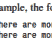

> 当 `bash` 遇到没有值的变量时，它会自动使用值 `""`。因此在 `bash` 中你不必引用变量。

> 尽管在 `bash` 中引用不是必需的，但为了清晰和可维护性，你仍应在脚本中包含它。

#### 字符串相等性

`test` 和 `[ ]` 命令使你能够确定两个字符串是否相等。如果两个字符串包含相同的字符序列，则认为它们相等。例如，以下字符串被认为相等：

```
'There are more things in heaven and earth'
'There are more things in heaven and earth'
```

而以下字符串由于大小写差异而不被认为相等：


```
'than are dreamt of in your philosophy'
'than are dreamt of in your Philosophy'
```

检查两个字符串是否相等的语法是

```
test str1 = str2
```

```
[ str1 = str2 ]
```

Here `str1` and `str2` are the two strings being compared. If these two strings are equal, the test succeeds and returns true (`0`). If the two strings are not equal, the test fails and returns false (`1`).

以下示例，略微修改自 OpenBSD 的 `/etc/rc`，说明了字符串比较的常见用法：

```
# if $portmap == YES, the portmapper is started.
if [ "$portmap" = "YES" ]; then
    echo -n 'portmap'; portmap
fi
```

这里 `str1` 是 `$portmap` 的值，而 `str2` 是字符串 `YES`。`if` 语句使用 `=` 运算符来确定存储在 `$portmap` 中的值是否等于 `YES`。如果 `$portmap` 等于 `YES`，则会发出一条消息并执行程序 `portmap`。

请注意，在此示例中 `$portmap` 被引用了。就像之前的示例一样，引用用于防止在 `$portmap` happen to be unset or null 时变量替换导致的问题。如果 `$portmap` 未被引用并且恰好为空，则会产生类似以下内容的错误消息：

```
test: argument expected
```

有时使用另一种引用技术来避免此类错误。基本上它涉及在 `str1` 和 `str2` 前加上一个额外的字符，通常是 `X`。此技术的语法是

```
test X$str1 = X$str2
or
[ X$str1 = X$str2 ]
```

如果 `str1` 或 `str2` 为空，则使用字符串 `X` 代替空值。使用此技术重写前面的示例得到：

```
# if $portmap == YES, the portmapper is started.
if [ X$portmap = X'YES' ]; then
    echo -n 'portmap'; portmap
fi
```

如果 `$portmap` 为空，则比较字符串 `X` 和 `XYES`；由于这些字符串不匹配，测试失败。如果 `$portmap` 为 `YES`，则比较字符串 `XYES` 和 `XYES`；由于这些字符串匹配，测试成功。

### 字符串不等

你可以使用 `!=` 运算符来确定两个字符串是否不相等。此运算符的语法与 `=` 运算符类似：

```
test str1 != str2
or
[ str1 != str2 ]
```

这里 `str1` 和 `str2` 是正在比较的两个字符串。如果这两个字符串不相等，测试成功并返回 `0`（true）。如果这两个字符串相等，测试失败并返回 `1`（false）。

以下示例，略微修改自 OpenBSD 的 `/etc/rc`，说明了 `!=` 运算符的用法：

```
if [ "$lpd_flags" != 'NO' ]; then
  echo -n 'printer: ' lpd_flags
fi
```

这里 `str1` 是变量 `$lpd_flags` 的值，而 `str2` 是字符串 `NO`。你可以确定 `$lpd_flags` 的值是否不是 `NO`。如果该值不是 `NO`，则程序会发出一条消息并使用 `$lpd_flags` 的值作为其参数执行 `lpd`。

就像之前的示例一样，使用了引用以处理 `$lpd_flags` 未设置或为空的情况。有时使用的一种替代技术涉及在 `str1` 和 `str2` 前加上一个额外的字符，通常是 `X`。此技术的语法是

```
test X$str1 != X$str2
or
[ X$str1 != X$str2 ]
```

如果 `str1` 或 `str2` 为空，则使用字符串 `X` 代替空值。使用此技术重写前面的示例得到：

```
if [ X$lpd_flags != X'NO' ]; then
  echo -n 'printer: ' lpd_flags
fi
```

如果 `$lpd_flags` 为空，则比较字符串 `X` 和 `XNO`；由于这些字符串不匹配，测试成功。如果 `$lpd_flags` 为 `NO`，则比较字符串 `XNO` 和 `XNO`；由于这些字符串匹配，测试失败。

### 数值比较

`test` 和 `[` 命令也可以用于比较整数。基本语法是

```
test int1 op int2
```

or

```
[ int1 op int2 ]
```

这里 `int1` 和 `int2` 可以是任何正整数或负整数，而 `op` 是表 11.3 中列出的运算符之一。如果 `int1` 或 `int2` 是字符串而不是整数，则将其视为 `0`。

表 11.3 `test` 命令的数值比较运算符

| 运算符 | 描述 |
|---|---|
| `int1 -eq int2` | `int1` 等于 `int2` 时为真。 |
| `int1 -ne int2` | `int1` 不等于 `int2` 时为真。 |
| `int1 -lt int2` | `int1` 小于 `int2` 时为真。 |
| `int1 -le int2` | `int1` 小于或等于 `int2` 时为真。 |
| `int1 -gt int2` | `int1` 大于 `int2` 时为真。 |
| `int1 -ge int2` | `int1` 大于或等于 `int2` 时为真。 |

shell 脚本中的一个常见任务是检查程序的退出代码。数值比较运算符允许你轻松检查命令的退出状态，并根据命令是否执行正确执行不同的操作。例如，考虑以下命令：

```
ln -s /usr/local/bin/bash /usr/bin
```

如果你在命令行上执行此命令，你可以看到任何错误消息并介入修复问题。在 shell 脚本中，错误消息被忽略，脚本继续执行。在大多数情况下，忽略错误是一个错误。

最后一条命令的退出状态存储在变量 `$?` 中，因此你可以使用此变量按如下方式检查命令是否成功：

```
if [ $? -eq 0 ]; then
  echo "Command was successful.";
else
  echo "An error was encountered."
  exit
fi
```

请记住，退出代码 `0` 表示成功，非零退出代码表示失败。如果命令以退出代码 `0` 退出，则会发出“success”消息；否则，会发出错误消息并调用 `exit`。


> 在某些脚本中，你可能会看到 `-` 运算符被用作 `-eq` 运算符的替代。一些极其旧版本的 shell 不包含 `-eq` 运算符，因此 shell 程序员被迫改用 `-` 运算符。所有现代 shell，包括 Bourne shell、`ksh`、`bash` 和 `zsh`，都支持 `-eq` 运算符。

通过使用 `-ne` 运算符，你可以按如下方式简化前面的示例：

```
if [ $? -ne 0 ] ; then
 echo "An error was encountered."
 exit
fi
echo "Command was successful."
```

在这里你检查命令是否失败。如果是，则发出错误消息并退出；否则，继续执行程序的其余部分（在本例中你只是发出“success”消息）。这个版本比使用 `else` 子句的前一个示例稍有效率。

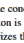

> 在某些脚本中，你可能会看到 `!-` 运算符被用作 `-ne` 运算符的替代。一些较旧版本的 shell 不包含 `-ne` 运算符，因此 shell 程序员被迫改用 `!-` 运算符。所有现代 shell，包括 Bourne shell、`ksh`、`bash` 和 `zsh`，都支持 `-ne` 运算符。

### 复合表达式

到目前为止，你处理的是单个表达式，但很多时候你需要组合表达式以测试特定条件。当两个或多个表达式组合时，结果称为复合表达式。

你可以通过使用 `test` 和 `[` 的内置运算符，或使用条件执行运算符 `&&` 和 `||` 来创建复合表达式。创建复合表达式的另一种方法是使用否定运算符 `!`，它否定一个表达式。表 11.4 总结了这些运算符。

表 11.4 创建复合表达式的运算符

| 运算符 | 描述 |
|---|---|
| `! expr1` | `expr1` 为假时为真。 |
| `expr1 -a expr2` | `expr1` 和 `expr2` 都为真时为真。 |
| `expr1 -o expr2` | `expr1` 或 `expr2` 任一为真时为真。 |

使用内置运算符创建复合表达式的语法是

```
test expr1 op expr2
or
[ expr1 op expr2 ]
```


这里 `expr1` 和 `expr2` 是任何有效的 `test` 表达式，而 `op` 是 `-a`（and 的缩写）或 `-o`（or 的缩写）。如果使用 `-a` 运算符，则 `expr1` 和 `expr2` 都必须为真，复合表达式才为真。如果使用 `-o` 运算符，则 `expr1` 或 `expr2` 任一为真，复合表达式才为真。

使用条件运算符创建复合表达式的语法是

```
test expr1 op test expr2
or
[ expr1 ] op [ expr2 ]
```

这里 `expr1` 和 `expr2` 是任何有效的 `test` 表达式，而 `op` 是 `&&`（and）或 `||`（or）。如果使用 `&&` 运算符，则 `expr1` 和 `expr2` 都必须为真，复合表达式才为真。如果使用 `||` 运算符，则 `expr1` 或 `expr2` 任一为真，复合表达式才为真。

以下 `if` 语句取自 OpenBSD 的 `/etc/rc`，说明了使用内置运算符 `-a` 构造的复合表达式：

```
if [ -f /sbin/kbd -a -f /etc/kbdtype ]; then
  kbd `cat /etc/kbdtype`
fi
```

此 `if` 语句的执行方式如下：

- 1. 首先进行测试
  - `-f /sbin/kbd`
  - 执行。如果文件 `/sbin/kbd` 存在，则测试返回 true（0），否则测试返回 false 且 `if` 语句不执行任何操作。
- 2. 如果 `/sbin/kbd` 存在，则进行第二个测试
  - `-f /etc/kbdtype`
  - 执行。如果文件 `/etc/kbdtype` 存在，则测试返回 true（0），否则测试返回 false 且 `if` 语句不执行任何操作。如果第一个测试失败，则不执行此测试。
- 3. 如果两个文件都存在，则执行命令
  - `kbd `cat /etc/kbtype``
  - 执行。

作为条件运算符使用方式的说明，前面的示例可以重写为使用条件运算符，如下所示：

```
if [ -f /sbin/kbd ] && [ -f /etc/kbtype ]; then
kbd `cat /etc/kbdtype`
fi
```

你只是用 `&&` 和 `[` 替换了 `-a` 运算符。此版本的执行方式与前一个示例类似：

- 1. 首先是表达式
  - `[ -f /sbin/kbd ]`
  - 求值。如果文件 `/sbin/kbd` 存在，则表达式返回 true (0)，否则测试返回 false 且 `if` 语句不执行任何操作。
- 2. 如果 `/sbin/kbd` 存在，则表达式
  - `[ -f /etc/kbdtype ]`
  - 求值。如果文件 `/etc/kbdtype` 存在，则测试返回 true (0)，否则测试返回 false 且 `if` 语句不执行任何操作。如果第一个测试失败，则不会执行此测试。
- 3. 如果两个文件都存在，则命令
  - `kbd `cat /etc/kbdtype``
  - 执行。

两个版本之间的区别在于，在第一个版本中 `list` 是一个单一命令，而在第二个版本中 `list` 是一个复合命令。

一些程序员更喜欢使用条件运算符的版本，因为各个测试是隔离的。其他程序员更喜欢第二种形式，因为它只调用一次 `[` 命令，因此对于大量测试来说可能略微更高效。如果你的 shell 脚本需要可移植性，你应该使用条件运算符。


> 在之前的示例中，你在复合表达式中只使用了两个表达式。你并不限于两个表达式。你可以将任意数量的表达式组合成一个复合表达式。

### 否定一个表达式

否定会反转测试表达式的结果。原本为真的表达式会被视为假，反之亦然。否定运算符的基本语法是

```
test ! expr
```

或

```
[ ! expr ]
```

这里 `expr` 是任何有效的测试表达式。

以下示例取自 OpenBSD 的 `/etc/rc` 启动脚本，说明了 `!` 运算符的使用：

```
if [ ! -f /etc/motd ]; then
    install -c -o root -g wheel -m 664 /dev/null /etc/motd
fi
```

此示例使用 `install` 命令在文件不存在或不是普通文件时创建文件 `/etc/motd`（UNIX 系统上的每日消息）。执行过程如下：

- 1. 首先进行测试
  - `-f /etc/motd`
  - 执行。
- 2. 由于 `!` 运算符，测试结果被否定。如果文件 `/etc/motd` 存在且是普通文件，则复合表达式返回 false (!)，否则返回 true。
- 3. 如果上一步的结果为 true，则创建文件 `/etc/motd`；否则，`if` 语句不执行任何操作。

此示例也可以写成以下任一命令：

```
test ! -f /etc/motd && install -c -o root -g wheel -m 664 /dev/null /etc/motd
[ ! -f /etc/motd ] && install -c -o root -g wheel -m 664 /dev/null /etc/motd
```

这能达到相同的结果，因为只有当 `test` 或 `[` 命令返回 true 时才会执行 `install`。

### case 语句

`case` 语句是 shell 中可用的第二种流程控制形式。其语法如下：

```
case word in
    pattern1)
        list1
        ;;
    pattern2)
        list2
        ;;
    ...
    patternN)
        listN
        ;;
esac
```

这里字符串 `word` 会与从 `pattern1` 到 `patternN` 的每个模式进行比较。当找到匹配的模式时，随后该匹配模式的列表将被执行。

当列表执行完毕时，特殊命令 `;;` 表示流程应跳转到 `case` 语句的末尾。`;;` 与 C 语言中的 `break` 命令类似。如果未找到匹配项，`case` 语句不执行任何操作。模式的最小数量为一个。模式的最大数量没有限制。

一些程序员更喜欢使用更简洁的 `case` 语句形式，写法如下：

```
case word in
    pattern1) list1 ;;
    ...
    patternN) listN ;;
esac
```

只有在要执行的命令列表很短时才应使用这种形式。

### 一个 case 语句示例

以下示例说明了 `case` 语句的使用：

```
FRUIT=kiwi
case "$FRUIT" in
    apple) echo "Apple pie is quite tasty." ;;
    banana) echo "I like banana nut bread." ;;
    kiwi) echo "New Zealand is famous for kiwi." ;;
esac
```

`case` 语句的执行如下：

- 1. 变量 `FRUIT` 中包含的字符串展开为 `kiwi`。
- 2. 字符串 `kiwi` 与第一个模式 `apple` 进行比较。因为不匹配，程序继续下一个模式。
- 3. 字符串 `kiwi` 与下一个模式 `banana` 进行比较。因为不匹配，程序继续下一个模式。
- 4. 字符串 `kiwi` 与最后一个模式 `kiwi` 进行比较。因为匹配，产生以下消息：
  - New Zealand is famous for kiwi.

### 常见错误

使用 `case` 语句时常见的两个错误如下：

- 在列表末尾省略 `;;`。
- 在 `case` 语句末尾写成 `case` 而不是 `esac`。

为了说明第一种类型的错误，前面的示例被修改，使第一个列表之后缺少 `;;`：

```bash
FRUIT=kiwi
case "$FRUIT" in
apple) echo 'Apple pie is quite tasty.'
banana) echo 'I like banana nut bread.' ;;
kiwi) echo 'New Zealand is famous for kiwi.' ;;
esac
```

此省略会产生类似以下的错误信息：

`bash: syntax error near unexpected token `banana'`

这条错误信息的意思是，在 shell 尝试执行模式 `apple` 的列表时，它看到了模式 `banana` 的开始。因为该模式在 shell 遇到模式 `apple` 列表的结束之前就开始了，所以产生了错误信息。为了说明第二种类型的错误，结尾的 `esac` 被改为 `case`：

```bash
FRUIT=kiwi
case "$FRUIT" in
apple) echo 'Apple pie is quite tasty.' ;;
banana) echo 'I like banana nut bread.' ;;
kiwi) echo 'New Zealand is famous for kiwi.' ;;
case
```

此更改会产生类似以下的错误信息：


bash: syntax error near unexpected token `case'

这条错误信息的意思是，shell 没有看到 `case` 语句的适当闭合 `esac`。

### 使用模式

在前面的示例中，你使用了固定字符串作为模式。以这种方式使用时，`case` 语句基本上是一个 `if` 语句。例如，与前一个示例中 `case` 语句对应的 `if` 语句是

```bash
if [ "$FRUIT" = apple ] ; then
  echo "Apple pie is quite tasty."
elif [ "$FRUIT" = banana ] ; then
  echo "I like banana nut bread."
elif [ "$FRUIT" = kiwi ] ; then
  echo "New Zealand is famous for kiwi."
fi
```

尽管 `case` 语句更简洁、更易读，但 `case` 语句的真正强大之处并不在于增强脚本的可读性；其强大之处在于它使用模式而不是固定字符串来进行匹配。模式是一个由普通字符和特殊通配符组成的字符串。模式决定是否存在匹配。`case` 语句的模式使用与第 9 章“Substitution”中介绍的路径名扩展模式相同的特殊字符。模式还可以包含 OR 运算符，`|`。

一个使用模式的简单 `case` 语句示例如下：

```bash
case $- in
  *i*) # an interactive shell
    PS1="uname -n $"
    PATH="$PATH:$HOME/bin"
    export PS1 PATH ;;
esac
```

特殊变量 `$-` 包含 shell 选项的列表。在这种情况下，你判断该列表是否包含字母 `i`，表示 shell 是交互式的。检查 `$-` 是否包含字母 `i` 是确定 shell 以交互模式还是非交互模式运行的最可移植方法。在此示例中，如果 shell 以交互模式运行，则设置提示符 `PS1` 和命令搜索路径 `PATH`；否则，不执行任何操作。

### 摘要

在本章中，您研究了 shell 中可用的两种主要流程控制机制：`if` 和 `case`。您还查看了 `test` 命令及其在 `if` 语句中的使用。具体而言，本章涵盖了以下主题：

- 执行文件测试
- 执行字符串比较
- 执行数值比较
- 使用复合表达式

在下一章中，您将研究循环，它们是流程控制语句的补充。

### 问题

1. 以下命令有什么区别？

```
if [ -e /usr/local/bin/bash ] ; then /usr/local/bin/bash ; fi
if [ -x /usr/local/bin/bash ] ; then /usr/local/bin/bash ; fi
```

2. 给定以下变量声明，

```
HOME=/home/ranga
BINDIR=/home/ranga/bin
```

以下 `if` 语句的输出是什么？

```
if [ $HOME = $BINDIR ] ; then
    echo "Your binaries are stored in your home directory."
fi
```

3. 编写一个测试命令，可用于测试 `/usr/bin` 是否为目录或符号链接。

4. 给定以下 `if` 语句，编写等效的 `case` 语句：

```
if [ "$ANS" = "Yes" -o "$ANS" = "yes" -o "$ANS" = "Y" -o "$ANS" = "Y" ] ;
then
    ANS="y"
else
    ANS="n"
fi
```

### 术语

`条件流程控制命令` 允许脚本的流程有条件地改变的命令。也称为流程控制命令。

`复合表达式` 当两个或多个表达式组合时，结果称为复合表达式。

`流程控制命令` 参见条件流程控制命令。

`否定表达式` 反转测试表达式的结果。原本为真的表达式被视为假，反之亦然。

## 第12小时


### 循环

循环使您能够多次执行一系列命令。两种主要类型的循环是 `while` 循环和 `for` 循环。除这两种类型外，`ksh`、`bash` 和 `zsh` 还支持另一种称为 `select` 循环的循环类型。它可用于向 shell 脚本用户展示一个选项菜单。在本章中，您将详细研究循环。具体而言，本章涵盖以下主题：

- `while` 循环
- `for` 循环
- `select` 循环
- 循环控制

### while 循环

`while` 循环使您能够重复执行一组命令，直到出现某些条件。它通常用于需要重复操作变量值时。`while` 循环的基本语法是

```
while cmd
do
  list
done
```

这里，`cmd` 是一个单一命令，而 `list` 是一组一个或多个命令。虽然 `command` 可以是任何有效的 UNIX 命令，但它通常是第 11 章“流程控制”中介绍的类型测试表达式。常被称为 `while` 循环体的 `list`。`do` 和 `done` 关键字不被视为循环体的一部分，因为 shell 仅使用它们来确定 where `while` 循环的开始和结束。

`while` 循环的执行按以下步骤进行：

- 1. 执行 `cmd`。
- 2. 如果 `cmd` 的退出状态非零，则退出 `while` 循环。
- 3. 如果 `cmd` 的退出状态为零，则执行 `list`。
- 4. 当 `list` 执行完毕后，返回步骤 1。

如果 `cmd` 和 `list` 都很短，`while` 循环可以写成单行如下：

```
while cmd ; do list ; done
```

这里有一个简单的例子，使用 `while` 循环显示从零到九的数字：

```
x=0
while [ $x -lt 10 ]
do
    echo $x
    x=`expr $x + 1`
done
```

其输出如下所示：

0

1

2

3

4

5

6

7

8

9

每次循环执行时，变量 `x` 都会被检查是否具有小于 10 的值。如果 `x` 的值小于 10，则此测试表达式的退出状态为 0。在这种情况下，`x` 的当前值会被显示，然后 `x` 增加 1。如果 `x` 等于 10 或大于 10，测试表达式返回 1，导致 `while` 循环退出。


> 前面的示例使用 `expr` 命令来递增和递减变量 `$x`。如果您不熟悉 `expr` 命令，不用担心，它在第 18 章“其他工具”中介绍。

### while 循环的嵌套

可以将 `while` 循环用作另一个 `while` 循环体的一部分，如下所示：

```
while cmd1 ; # this is loop1, the outer loop
do
  list1
  while cmd2 ; # this is loop2, the inner loop
do
    list2
done
  list3
done
```

这里 `cmd1` 和 `cmd2` 是单一命令，而 `list1`、`list2` 和 `list3` 是一组一个或多个命令。`list1` 和 `list3` 都是可选的。

在存在两个 `while` 循环 `loop1` 和 `loop2` 的情况下，`loop1` 被称为主循环或外层循环，而 `loop2` 被称为内层循环。在描述内层循环 `loop2` 时，许多程序员说它嵌套了一层深。嵌套一词指的是 `loop2` 位于 `loop1` 的循环体中。如果您在 `loop2` 的循环体中有一个 `loop3`，它将被嵌套两层深。嵌套的层级是相对于最外层循环而言的。对循环嵌套的深度没有限制，但您应尽量避免将循环嵌套超过四或五层，以避免在脚本中查找和修复问题时出现困难。

作为循环嵌套的说明，让我们在您用于计数到九的循环内部再添加一个倒计时循环：

```
x=0
while [ "$x" -lt 10 ] ; # this is loop1
do
  y="$x"
  while [ "$y" -ge 0 ] ; # this is loop2
do
    print "$y"
    y=`expr $y - 1`
  done
echo
  x=`expr $x + 1`
done
```

引入的主要更改是变量 `y`。它在 `loop2` 执行前被设置为 `x - 1` 的值。因此，每次 `loop2` 执行时，它都会以相反的顺序显示大于 0 且小于 `x` 的所有数字。输出如下所示：

```
0
1 0
2 1 0
3 2 1 0
4 3 2 1 0
5 4 3 2 1 0
6 5 4 3 2 1 0
7 6 5 4 3 2 1 0
8 7 6 5 4 3 2 1 0
9 8 7 6 5 4 3 2 1 0
```

### 使用 while 验证用户输入

假设您需要编写一个脚本，要求用户输入目录名称。您可以使用以下步骤从用户获取信息：

- 1. 向用户提问。
- 2. 读取用户的响应。
- 3. 确定用户是否以目录名称作为响应。

但是当用户给出不是目录的响应时该怎么办？


最简单的选择是无所作为，但这并不友好。通过告知用户错误并再次要求输入目录名称，您的脚本可以更加友好。`while`循环非常适合执行此操作。事实上，`while`循环的常见用途是确定用户输入是否已正确收集。通常会采用类似以下策略：
- 1. 将变量的值设为空。
- 2. 启动一个在变量值不为空时退出的`while`循环。
- 3. 在`while`循环中，向用户提问并读取用户的响应。
- 4. 验证响应。
- 5. 如果响应无效，则将变量的值设为空。这使`while`循环能够重复。
- 6. 如果响应有效，变量的值不会改变。它继续保存用户的响应。由于变量的值不为空，`while`循环退出。

实现此功能的`while`循环如下

```
RESPONSE=
while [ -z "$RESPONSE" ] ;
do
```

```
echo 'Enter the name of a directory where your files are
located:'
read RESPONSE
if [ ! -d "$RESPONSE" ] ; then
  echo 'ERROR: Please enter a directory pathname.'
  RESPONSE=
fi
done
```

这里，您将用户的响应存储在变量`RESPONSE`中。最初此变量被设为空，使`while`循环开始执行。当`while`循环首次执行时，会提示用户如下：
Enter the name of a directory where your files are located:

用户可以在此提示下输入目录名称。当用户输入完毕并按下 Enter 后，`read`将输入存储到变量`RESPONSE`中。然后您检查以确保输入是目录。如果输入不是目录，您会发出错误消息并重复。会产生错误消息，以便用户知道输入有什么问题。如果用户未输入任何值，变量`RESPONSE`仍为空。在这种情况下，存储在变量`RESPONSE`中的值不是目录，因此会产生错误消息。

### 输入重定向和 while

`while`循环还可以与输入重定向和`read`结合使用，以便一次读取文件的一行。基本语法是

```
while read LINE
do
  :: # manipulate file here
done < file
```

在`while`循环体中，您可以操作指定文件的每一行。这方面的一个简单例子是

```
while read LINE
do
  case $LINE in
    '*root*') echo $LINE ;;
  esac
done < /etc/passwd
```

这里仅显示文件`/etc/passwd`中包含字符串`root`的行。

输出将类似于以下内容：

```
root:x:0:1:Super-User:/sbin/sh
```

### while 和子 Shell

前一个示例中使用的循环存在一个问题：在 Bourne shell 和旧版本的`ksh`中，它是在子 Shell 中执行的。这意味着对脚本环境的任何更改，例如导出变量和更改当前工作目录，在`while`循环完成后可能不会保留。作为示例，请考虑以下脚本：

```
#!/bin/sh
if [ -f "$1" ] ; then
i=0
while read LINE
do
i=`expr $i + 1`
done < "$1"
echo $i
fi
```

此脚本尝试统计作为参数传递给它的文件中的行数。

执行此脚本时使用文件

```
$ cat dirs.txt
/tmp
/usr/local
/opt/bin
/var
```

可能会产生以下不正确的输出：
0

虽然你在`while`循环中使用命令`i=`expr $i + 1``增加`$i`的值，但在`while`循环完成后，`$i`的值并未保留。在这种情况下，你需要在`while`循环内部更改变量的值，然后在循环外部使用该值。解决此问题的一种方法是先进入循环前重定向 STDIN，然后在循环完成后恢复 STDIN。基本语法是

```
exec n<&0 < file
while read LINE
do
: # manipulate file here
done
exec 0<&n
```

这里，`n`是一个大于 2 的整数，`file`是你想要读取的文件名。通常`n`选择为 3、4 或 5 这样的小数字。这样就可以构造一个 shell 版本的`cat`命令，如下所示：

```
#!/bin/sh
if [ $# -ge 1 ] ; then
  for FILE in "$@"
  do
    exec 4<&0 < "$FILE"
    while read LINE ; do echo $LINE ; done
    exec 0<&4 4<&-
  done
fi
```

### until 循环

`while`循环非常适合在某个条件为真时执行一组命令的情况，但有时你需要执行一组命令直到某个条件为真。`until`循环可在`ksh`、`bash`和`zsh`中使用，提供此功能。其语法是

```
until cmd
do
  list
done
```

这里`cmd`是一个单一命令，而`list`是一组一个或多个命令。虽然`cmd`可以是任何有效的 UNIX 命令，但它通常是第 11 章“流程控制”中介绍的类型测试表达式。

`until`循环的执行与`while`循环类似：
- 1. 执行`cmd`。
- 2. 如果`cmd`的退出状态为非零，则退出`until`循环。
- 3. 如果`cmd`的退出状态为零，则执行`list`。
- 4. 当`list`执行完毕后，返回步骤 1。

如果`cmd`和`list`都很短，`until`循环可以写成单行，如下所示：
```
until cmd ; do list ; done
```

在大多数情况下，`until`循环等同于使用 `!`运算符否定`cmd`的`while`循环。例如，以下`while`循环

```
x=1
while [ ! $x -ge 10 ]
do
  echo $x
  x=`expr $x + 1`
done
```

等同于以下`until`循环：

```
x=1;
until [ $x -ge 10 ]
do
  echo $x
  x=`expr $x + 1`
done
```

`until`循环与等价的`while`循环相比没有优势。由于它不被 Bourne shell 支持，大多数程序员不偏爱它。这里介绍它是为了完整性。

### for 和 select 循环

与`while`循环在某个条件为假时退出不同，`for`和`select`循环操作于项目列表。本节详细介绍这两种循环。

#### for 循环

`for`循环使你能够对列表中的每个项目重复执行一组命令。它最常见的用途之一是对大量文件执行相同的一组命令。基本语法是

```
for name in word1 word2 ... wordN
do
  list
done
```

这里`name`是变量的名称，`word1`到`wordN`是由空格分隔的字符序列（单词）。每次`for`循环执行时，变量`name`的值都会被设置为单词列表中的下一个单词，`word1`到`wordN`。第一次，`name`被设置为`word1`；第二次，它被设置为`word2`；以此类推。这意味着`for`循环执行的次数取决于指定的单词数量。例如，如果向`for`循环指定以下单词
there comes a time
the loop would execute four times. In each iteration of the for loop, the commands specified in list are executed.

循环将执行四次。在`for`循环的每次迭代中，`list`中指定的命令都会被执行。

`for`循环可以写成单行，如下所示：
`for name in word1 word2 ... wordN ; do list ; done`

如果`list`和单词数量都很短，通常会选择单行形式；否则，优先选择多行形式。

一个简单的`for`循环示例是

```
for i in 0 1 2 3 4 5 6 7 8 9
do
  echo $i
done
```

此循环按如下方式计数到九：
- 0
- 1
- 2
- 3
- 4
- 5
- 6
- 7
- 8
- 9

请注意，虽然输出与`while`循环相同，但`for`循环做的事情完全不同。在每次迭代中，`$i`被设置为列表中的下一个项目。当列表结束时，循环退出。在此示例中，你选择列表为 0 到 9 的数字。在`while`循环中，下一个要显示的数字是计算得出的，并不属于预先确定的列表。

如果你稍微更改列表，请注意输出如何变化：

```
for i in 0 1 2 4 3 5 8 7 9
do
  echo $i
done
```

- 0
- 1
- 2
- 4
- 3
- 5
- 8
- 7
- 9

### 操作一组文件


假设你需要从一个目录复制一批文件到另一个目录并更改副本的权限。你可以通过手动复制每个文件并更改权限来实现。

这正是我们感兴趣的。事实上，这也是 `for` 循环最常见的用途之一——遍历一组文件名并对这些文件执行某些操作。

执行此操作的步骤如下：

- 1. 创建一个变量名为 `file` 或 `FILE` 的 `for` 循环。其他常用的名称包括 `i`、`j` 和 `k`。变量名通常是单数。
- 2. 创建要操作的文件列表。这通常使用第 9 章“替换”中讨论的文件名替换技术来实现。
- 3. 在循环体中操作文件。

以下 `for` 循环就是一个示例：

```
for FILE in $HOME/.bash*
 do
  cp $FILE $HOME/public_html
  chmod a+r $HOME/public_html/$FILE
 done
```

在此循环中，你使用文件名替换来获取主目录中以 `.bash*` 开头的文件列表。在循环体中，这些文件中的每个文件都被复制到 `public_html` 目录并对所有人可读。

### select 循环

`select` 循环提供了一种创建编号菜单的简便方法，用户可以从中选择选项。当你需要让用户从一组选项中选择一个或多个项目时，它很有用。`select` 循环是在 `ksh` 中引入的，并被 `bash` 和 `zsh` 采用。它在 Bourne shell 中不可用。

`select` 循环的基本语法是

```
select name in word1 word2 ... wordN
 do
  list
 done
```

这里 `name` 是变量的名称，`word1` 到 `wordN` 是由空格分隔的字符序列（单词）。在用户做出选择后要执行的命令集由 `list` 指定。

`select` 循环的执行过程如下：

- 1. `list` 中的每个项目都会连同编号一起显示。
- 2. 显示一个提示符，通常是 `#?`。
- 3. 当用户输入一个值时，`$REPLY` 被设置为该值。
- 4. 如果 `$REPLY` 包含一个已显示项目的编号，则由 `name` 指定的变量被设置为 `list` 中被选中的项目。否则，`list` 中的项目会再次显示。
- 5. 当做出有效选择时，`list` 执行。
- 6. 如果 `list` 没有使用 `break` 等循环控制机制从 `select` 循环退出，则过程从步骤 1 重新开始。

如果用户输入多个有效值，`$REPLY` 包含用户的所有选择。在这种情况下，由 `name` 指定的变量不会被设置。

#### select 循环示例

`select` 循环的一个常见用途是在配置软件的脚本中。以下示例是此类脚本的简化版本。实际的配置命令已被省略，因为它们与本次讨论无关。

```
select COMPONENT in comp1 comp2 comp3 all none
do
  case $COMPONENT in
    comp1|comp2|comp3) CompConf $COMPONENT ;;
    all) CompConf comp1
         CompConf comp2
         CompConf comp3
         ;;
    none) break ;;
    *) echo "ERROR: Invalid selection, $REPLY." ;;
  esac
done
```

`select` 循环呈现的菜单如下所示：

```
1) comp1
2) comp2
3) comp3
4) all
5) none
#?
```

如你所见，列表 `comp1 comp2 comp3 all none` 中的每个项目都以一个数字为前缀显示。用户可以输入其中一个数字来选择特定组件。如果做出有效选择，`select` 循环将执行其主体中包含的 `case` 语句。此 `case` 语句根据用户输入执行正确的操作。这里的正确操作是调用名为 `CompConf` 的命令、退出循环或显示错误消息。

#### 更改提示

你可以通過更改變量 `PS3` 來更改 `select` 循環顯示的提示。如果未設置 `PS3`，則會顯示默認提示 `#?`。例如，以下命令

```
$ PS3="Please make a selection -> "; export PS3
```

將前一個示例中顯示的菜單更改為以下內容：

```
1) comp1
2) comp2
3) comp3
4) all
5) none
Please make a selection ->
```

請注意，所使用的 `PS3` 值以空格作為最後一個字符。這確保用戶輸入不會與提示符混在一起，從而使菜單更友好。

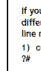

> 如果你使用 `zsh`，前一個示例的輸出將與上面顯示的略有不同。在 `zsh` 中，菜單項是在單行上列出，而不是在單獨的行上列出：
>
> 1) comp1 2) comp2 3) comp3 4) all 5) none
>
> #
>
> 如你所見，提示符仍然列在單獨的一行上。


> 在 2.0 之前的 `bash` 版本中，並不總是使用存儲在 `PS3` 中的值作為 `select` 循環的提示。此問題在 `ksh` 或 `zsh` 中不存在。

### 循環控制

到目前為止，你已經了解了創建循環以及使用循環來完成不同任務。有時你需要停止循環或跳過循環的迭代。在本節中，你將研究用於控制循環執行的 `break` 和 `continue` 命令。

#### 無限循環和 break 命令

回想一下，`while` 循環在滿足特定條件時終止。這發生在 `while` 循環的任務完成時。如果你在指定 `while` 循環的終止條件時犯了錯誤，它可能會無限期地繼續。例如，假設你在測試表達式中忘記在 `x` 之前指定 `$`：

```
x=0
while [ x -lt 10 ]
do
  echo $x
  x=`expr $x + 1`
done
```

此循環將無限期地顯示數字。一個永遠執行而不終止的循環會執行無限多次。因此，這樣的循環被稱為無限循環。

在大多數情況下，無限循環是不需要的，並且源於編程錯誤，但在某些情況下它們可能是有用的。例如，假設你需要等待特定事件，例如有人登錄系統。你可以使用無限循環每隔幾秒檢查事件是否發生。因為你不知道需要執行循環多少次，所以你需要使用 `break` 命令退出無限循環。`break` 命令終止或中斷循環。

你可以使用 `while` 循環通過將 `cmd` 指定為 `:` 或 `/bin/true` 來創建無限循環。無限 `while` 循環的基本語法是

```
while :
do
  list
done
```

在大多數無限循環中，`while` 循環通常通過 `break` 命令從 `list` 內部退出。

考慮以下讀取並執行命令的交互式腳本：

```
while :
do
  read CMD
  case $CMD in
    [qQ]|[qQ]|[uU]|[tT]) break ;;
    *) $CMD ;;
  esac
done
```

在此循環中，每次迭代開始時都會讀取一個命令。如果該命令是 `q` 或 `Quit`，則循環退出；否則，循環會嘗試處理該命令。

#### 跳出嵌套循環

`break` 命令還接受一個參數，一個大於或等於 1 的整數，表示要跳出的層數。此功能在嵌套循環中有用。

考慮以下嵌套 `for` 循環：

```
for i in 1 2 3 4
 do
  mkdir -p /mnt/backup/docs/ch${i}
  if [ $? -eq 0 ] ; then
    for j in doc c h m p l sh
    do
      cp $HOME/docs/ch${i}/*.$j /mnt/backup/docs/ch${i}
      if [ $? -ne 0 ] ; then break 2 ; fi
    done
  else
    echo "Could not make backup directory."
  fi
done
```

在此循環中，你正在將幾個重要文件備份到備份目錄。外部循環負責創建備份目錄，而內部循環則根據擴展名複製重要文件。在內部循環中，你使用帶有參數 `2` 的 `break` 命令。這表示如果複製時發生錯誤，則應終止兩個循環，而不是僅終止內部循環。

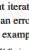

> 前一個示例會複製你主目錄 `$HOME` 中的幾個文件並將它們放在 `/mnt` 下的目錄中。請在執行此示例之前確保你的系統管理員允許你將文件從主目錄複製到 `/mnt`。

#### continue 命令

`continue` 命令與 `break` 命令類似，只是它只導致當前循環迭代退出，而不是整個循環。當發生錯誤但你想嘗試執行循環的下一次迭代時，此命令很有用。

例如，以下循環在其中一個輸入文件有問題時不會退出：


```
for FILE in $FILES ;
do
  if [ ! -f "$FILE" ] ; then
    echo "ERROR: $FILE is not a file."
    continue
  fi
  # process the file
done
```

如果 `$FILES` 中的其中一個文件名不是文件，此循環會跳過它，而不是退出。

### 摘要

循環允許你重複執行一組命令。在本章中，你研究了以下類型的循環：

- `while`
- `until`
- `for`
- `select`

你還研究了嵌套循環、無限循環和循環控制的概念。下一章介紹參數的概念，該概念需要大量使用循環。

### 問題

1. 以下 `while` 循環需要做哪些更改

```
x=0
while [ $x -lt 10 ]
do
  echo "$x: "
  y=$(( $x -1 ))
  x=$(( $x +1 ))
  while [ $y -ge 0 ] ; do
    y=$(( $y -1 ))
    echo "$y"
  done
  echo
done
```

使得輸出如下所示：

```
0
0 1
0 1 2
0 1 2 3
0 1 2 3 4
0 1 2 3 4 5
0 1 2 3 4 5 6
0 1 2 3 4 5 6 7
0 1 2 3 4 5 6 7 8
0 1 2 3 4 5 6 7 8 9
```

2. 編寫一個 `select` 循環，列出當前目錄中的每個文件，並允許用戶通過選擇其編號來查看文件。除了列出每個文件外，還使用字符串 `Exit Program` 作為退出循環的鍵。如果用戶選擇的項目不是普通文件，程序應識別該問題。如果沒有輸入，菜單應重新顯示。

### 術語

`主體` 由循環執行的命令集。

`無限循環` 永遠執行而不終止的循環。參見 `循環`。

`迭代` 循環主體的一次執行。

`循環` 使你能夠多次執行一系列命令。兩種主要的循環類型是 `while` 和 `for` 循環。

`嵌套循環` 當一個循環位於另一個循環的主體內部時，據說它嵌套在另一個循環內部。

# 第 13 小時

## 參數

如你在前幾章所見，UNIX 中程序調用的一般格式是

```
cmd opts files
```

這裡 `命令` 是命令名稱，`選項` 是你需要指定的任何選項，而 `文件` 是命令應操作的文件的可選列表。

考慮以下示例：

```
$ ls -l *.doc
```

這裡 `ls` 是命令，`-l` 是唯一的選項，而 `*.doc` 是 `ls` 操作的文件列表。

由於大多數 UNIX 用戶熟悉此界面，因此最好在 shell 腳本中使用此格式。這意味著可以具有選項的腳本必須能夠正確讀取和解釋它們。

本章探討與傳遞給 shell 腳本的選項處理相關的以下主題：

- 與選項解析和命令執行相關的特殊變量
- 使用 `case` 語句手動處理選項
- 使用 `getopts` 命令處理選項


對於僅支持一兩個選項的腳本，第一種方法易於實現且效果很好，但許多腳本允許給出多個選項的任何組合。對於此類腳本，`getopts` 命令非常有用，因為它提供了解析選項的最大靈活性。

### 特殊變量

shell 定義了幾個與選項解析和命令執行相關的特殊變量。表 13.1 描述了所有這些特殊變量。

表 13.1 特殊 Shell 變量

| 變量 | 描述 |
|---|---|
| `$0` | 命令正在執行的名稱。對於 shell 腳本，這是調用它的路徑。 |
| `$n` | 這些變量對應於腳本被調用時使用的參數。這裡 `n` 是對應於參數位置的正十進制數（第一個參數是 `$1`，第二個參數是 `$2`，以此類推）。 |
| `$#` | 傳遞給腳本的參數數量。 |
| `$*` | 所有參數都被雙引號引用。如果腳本接收兩個參數，`$*` 等同於 `"$1 $2"`。 |
| `$@` | 所有參數都被單獨雙引號引用。如果腳本接收兩個參數，`$@` 等同於 `"$1" "$2"`。 |
| `$?` | 上一個執行的命令的退出狀態。 |
| `$$` | 當前 shell 的進程號。對於 shell 腳本，這是它們執行的進程 ID。 |
| `$!` | 上一個後台命令的進程號。 |

### 使用 `$0`

讓我們從查看 `$0` 開始。此變量通常用於確定可以用多個名稱調用的腳本的行為。考慮以下腳本：

```sh
#!/bin/sh
case $0 in
  "*listar") TARGS="-tvf $1" ;;
  "*maketar") TARGS="-cvf $1.tar $1" ;;
esac
tar $TARGS
```

你可以使用此脚本列出 `tar` 文件（`tar` 是 tape archive 的缩写，是在 UNIX 中分发文件的常见格式）的内容，或根据脚本被调用的名称创建 `tar` 文件。待读取或创建的 `tar` 文件指定为脚本的第一个参数 `$1`。

让我们将此脚本命名为 `mytar`，并为其创建两个符号链接，分别命名为 `listtar` 和 `maketar`，如下所示：

```
$ ln -s mytar listtar
$ ln -s mytar maketar
```

如果脚本以 `maketar` 的名称被调用并给定一个目录或文件名，它将创建包含该目录或文件内容的 `tar` 文件。假设你有一个名为 `fruits` 的目录，其内容如下：

```
$ ls fruits
apple banana mango peach pear
```

你可以将脚本作为 `maketar` 调用，以获得包含此目录的名为 `fruit.tar` 的 `tar` 文件，方法是发出以下命令：

```
$ ./maketar fruits
```

如果要列出此命令创建的 `tar` 文件的内容，可以按如下方式调用脚本：

```
$ ./listtar fruits.tar
rw-r--r-- 500/100 0 Nov 17 08:48 1998 fruits/
rw-r--r-- 500/100 0 Nov 17 08:48 1998 fruits/apple
rw-r--r-- 500/100 0 Nov 17 08:48 1998 fruits/banana
rw-r--r-- 500/100 0 Nov 17 08:48 1998 fruits/mango
rw-r--r-- 500/100 0 Nov 17 08:48 1998 fruits/pear
rw-r--r-- 500/100 0 Nov 17 08:48 1998 fruits/peach
```

确切的输出取决于系统上 `tar` 的版本。某些版本包含比此处显示更详细的输出。

### 使用说明

`$0` 的另一个常见用途是在脚本的使用说明中。使用说明是脚本输出的简短消息，用于告知用户脚本的正确调用语法。所有供多位用户使用的脚本都应包含使用说明。

通常，使用说明类似于以下内容：

```
echo "Usage: $0 [options][files]"
```

回到 `mytar` 脚本，添加使用说明会很有帮助，特别是如果脚本以 `listtar` 或 `maketar` 以外的名称执行时。你可以按如下方式实现此更改：

```
case $0 in
  "*listtar") TARGS="-tvf $1" ;;
  "*maketar") TARGS="-cvf $1.tar $1" ;;
  *) echo "Usage: $0 [file/directory]" ; exit 0 ;;
esac
```

现在如果脚本被调用为例如 `mytar`，它将输出以下消息：

Usage: mytar [file/directory]

此消息正确描述了脚本的使用方法，但没有告知你脚本的名称被错误给出。有两种可能的纠正方法：

- 在使用说明中硬编码有效名称
- 修改脚本使其使用其参数来决定应以何种模式运行

为演示选项的使用，下文将使用后一种方法。

### 选项和参数

选项在命令行中给出以更改脚本或程序的行为。例如，`ls` 命令的 `-a` 选项会将 `ls` 命令的行为从列出所有可见文件更改为列出所有文件（如第 3 章所述）。本节将向你展示如何使用选项来更改脚本的行为。

通常你会看到或听到选项被称为参数。两者之间的区别很微妙。命令的参数是命令行中命令名称之后出现的所有单独字符串或单词，而选项只是那些改变命令行为的参数。

例如，在以下示例中：

```
$ ls -aF fruit
```

命令是 `ls`，其参数为 `-aF` 和 `fruit`。`ls` 命令的选项为 `-aF`。

### 处理参数

为说明选项的使用，让我们更改 `mytar` 脚本，使其使用第一个参数 `$1` 作为模式参数，`$2` 作为要读取或创建的 `tar` 文件。你可以按如下方式实现此更改：

```
USAGE="usage: $0 [-c|-t] [file|directory]"
case "$1" in
  -t) TARGS="-tvf $2" ;;
  -c) TARGS="-cvf $2 $2" ;;
  *) echo "$USAGE"
     exit 0
     ;;
esac
```


三个主要更改如下：

- 所有对 `$1` 的引用都已更改为 `$2`，因为现在第二个参数是文件名。
- `listtar` 已被 `-t` 替换。
- `maketar` 已被 `-c` 替换。

现在运行 `mytar` 会产生以下输出：

```
Usage: ./mytar [-c|-t] [file|directory]
```

要使用此版本创建目录 `fruits` 的 tar 文件，请使用以下命令

```
$ ./mytar -c fruits
```

要列出生成的 tar 文件 `fruits.tar` 的内容，请使用以下命令

```
$ ./mytar -t fruits
```

### 使用 basename

目前，`mytar` 的使用说明输出脚本被调用时使用的完整路径。它真正应该输出的只是脚本的名称。你可以使用 `basename` 命令来纠正此问题。

`basename` 命令接受文件或目录的绝对或相对路径名，并从该路径返回仅文件或目录名。基本语法如下：

```
basename file
```

例如，

```
$ basename /usr/bin/sh
```

打印以下内容：

```
sh
```

使用 `basename`，你可以按如下方式更改 `mytar` 脚本中的变量 `$USAGE`：

```
USAGE="Usage: basename $0 [-c|-t] [file|directory]"
```

以便使用说明产生期望的输出：

```
Usage: mytar [-c|-t] [file|directory]
```

你也可以在 `mytar` 脚本的第一版本中使用 `basename` 命令，以避免在 `case` 语句中使用 `*` 通配符字符：

```
#!/bin/sh
case `basename $0` in
listtar) TARGB="-tvf $1" ;;
maketar) TARGB="-cvf $1.tar $1" ;;
*) echo "Usage: $0 [file|directory]"
exit 0
esac
tar $TARGB
```

在此版本中，`basename` 允许你匹配脚本可以被调用的确切名称。作为原始版本潜在问题的说明，你可以看到如果脚本被调用为

```
$ ./makelisttar
```

原始版本将使用第一个 `case` 语句，即使它是错误的，但新版本将落到后面并报告错误。

### 模拟 basename

一些较旧的 Linux 和 BSD 系统不包含 `basename` 命令。如果使用此类系统，你可以通过创建提供等效功能的 shell 脚本来模拟此命令。`basename` 的 shell 脚本版本可能如下所示：

```
#!/bin/sh
if [ -n "$1" ] ; then
echo "$1" | sed 's/.*\/[^\/]*$/'
else
echo 'Usage: basename [file]' >&2
exit 1
fi
exit 0
```

如果不理解 `sed` 命令的工作原理也不必担心。你将在第 16 章“使用正则表达式过滤文本”中阅读更多相关内容。

### 常见参数处理问题

现在 `mytar` 脚本使用选项来设置脚本运行的模式，你需要解决另一个问题。也就是说，如果未提供第二个参数 `$2`，该怎么办？你不必担心如果未提供第一个参数 `$1` 会发生什么，因为 `case` 语句通过默认 `case *` 处理这种情况。

检查所需参数数量的最简单方法是查看参数数量 `$#` 是否与所需参数数量匹配。你可以按如下方式将此检查添加到脚本中：

```
#!/bin/sh

USAGE="Usage: basename $0 [-c|-t] [file|directory]"

if [ $# -lt 2 ] ; then
    echo "$USAGE"
    exit 1
fi

case "$1" in
    -t) TARGS="-tvf $2" ;;
    -c) TARGS="-cvf $2 $2" ;
    *) echo "$USAGE"
    exit 0
    ;;
esac

tar $TARGS
```

### 处理额外文件

`mytar` 脚本基本完成，但仍可进行一些改进。例如，它仅处理作为参数给出的第一个文件，并且不会确定该参数是否真的是文件。

你可以通过使用特殊的 shell 变量 `$@` 来添加对所有文件参数的处理。让我们首先修改 `-t` 选项以使用此变量：

```
case "$1" in
    -t) TARGS="-tvf"
        for i in "$@"
        do
            if [ -f "$i" ] ; then
                tar $TARGS "$i"
            fi
        done
        ;;
    -c) TARGS="-cvf $2 $2" ;
```

```
tar $TARGS
;;
*) echo "$USAGE" ;
exit 0
;;
esac
```

主要更改是

- `-t` `case` 现在包含一个处理参数的 `for` 循环。
- `for` 循环中有一个 `if` 语句，用于确定参数是否为文件。如果参数是文件，则对该文件执行 `tar`。

> **`$*` and `$@`**
>
> shell 脚本中指定的参数存储在两个特殊变量 `$*` 和 `$@` 中。这两个特殊变量的主要区别在于它们存储参数的方式：`$*` 在不保留引用的情况下存储每个参数，而 `$@` 在保留引用的情况下存储每个参数。
>
> `$*` 的行为有时会引起问题。例如，如果你的脚本有一个包含空格的文件名作为参数：
>
> `mytar -t 'my tar file.tar'`
>
> 使用 `$*` 而不是 `$@` 会造成问题，因为 `for` 循环将针对名为 `my`、`tar` 和 `file.tar` 的文件执行三次，而不是仅针对你请求的文件 `my tar file.tar` 执行一次。通过使用 `$@`，你可以避免此问题，因为每个参数都按其在命令行上被引用的方式存储。

### 一些小问题

`mytar` 中有两个小问题需要处理：

- `mytar` 将其所有参数，包括第一个参数 `$1`，视为文件。因为你使用第一个参数来指示脚本运行的模式，所以不应将其视为文件。这将减少 `for` 循环的执行次数，并防止脚本尝试对名为 `-t` 的文件运行 `tar`。
- 另一个问题涉及脚本在操作失败时应做什么。在列出操作的情况下，如果 `tar` 无法列出文件的内容，你应跳过该文件并打印错误。

你可以通过使用 `shift` 来移除第一个参数，从而解决第一个问题。你可以通过使用变量 `$?` 来检查 `tar` 的退出状态，从而解决第二个问题。如果实现这些更改，你的脚本将变为：

```
#!/bin/sh

USAGE="usage: `basename $0` [-c|-t] [files|directories]"

if [ $# -lt 2 ] ; then
  echo "$USAGE" ;
  exit 1 ;
fi

case "$1" in
  -t) shift
      TARGS="-tvf" ;
      for i in $* ;
      do
        if [ -f "$i" ] ; then
          FILES=`tar $TARGS $i 2>/dev/null`
          if [ $? -eq 0 ] ; then
            echo ; echo "$FILES"
          else
            echo "ERROR: $i not a tar file."
          fi
        else
          echo "ERROR: $i not a file."
        fi
      done
      ;;
  -c) shift
      TARGS="-cvf" ;
      tar $TARGS archive.tar $*
      ;;
  *) echo "$USAGE"
     exit 0
     ;;
esac
exit $?
```

### Shell 脚本中的选项解析

在之前的示例中，你手动处理了传递给脚本的选项。在这个第二个示例中，你将探索第二种方法，使用 `getopts` 命令。`getopts` 命令的语法如下：

```
getopts option-string var
```

这里 `option-string` 是一个字符串，由 `getopts` 应考虑的所有单字符选项组成，而 `var` 是应将选项设置为的变量的名称。通常 `var` 是一个名为 `OPTION` 的变量。

`getopts` 解析命令行上给定选项的过程如下：

- 1. `getopts` 检查所有命令行参数，查找以 `-` 字符开头的参数。
- 2. 当找到以 `-` 字符开头的参数时，它将 `-` 之后字符与 `option-string` 中给出的字符进行比较。
- 3. 如果找到匹配项，则指定的 `var` 被设置为该选项；否则，`var` 被设置为 `?` 字符。
- 4. 重复步骤 1 到 3，直到所有选项都被考虑。


## 5. 解析完成后，`getopts` 返回非零退出代码。这使得它可以轻松地在循环中使用。此外，当 `getopts` 完成后，它将变量 `OPTIND` 设置为最后一个参数的索引。

`getopts` 的另一个功能是能够指示需要额外参数的选项。这可以通过在选项后跟冒号 `:` 字符来实现。在这种情况下，解析选项后，额外参数将被设置为名为 `OPTARG` 的变量的值。

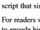

> `bash` 的某些早期版本（1.x）并未完全支持 `getopts` 命令。如果您使用的是较旧版本的 `bash`，在执行本节中的示例时可能会遇到一些错误。如果可能，您应该升级到 `bash` 2.0 或更新版本，或在使用这些示例时使用 `ksh` 或 `zsh` 等替代 `shell`。

### 使用 getopts

为了了解 `getopts` 的工作原理以及如何处理选项，你将编写一个脚本来简化 `uuencode` 文件的过程。

对于不熟悉 `uuencode` 的读者来说，它是一个最初用于将二进制文件（可执行文件）编码为 ASCII 文本的程序，以便可以通过电子邮件发送或通过 FTP 传输。今天，MIME 编码已取代 `uuencode` 用于电子邮件附件，但它仍用于向新闻组发布二进制文件以及通过调制解调器传输二进制文件。

你首先将检查此脚本的接口，这有助于理解实现。你的脚本应能够接受以下选项：

- `-f` 用于指定输入文件名
- `-o` 用于指定输出文件名
- `-v` 用于指示脚本应为详细模式

实现这些要求的 `getopts` 命令是

```
getopts f:o:v OPTION
```

这表示除 `-v` 之外的所有选项都需要一个额外参数。所需的支持变量有

- `VERBOSE`，用于存储详细标志的值。默认情况下，此变量的值为 `false`。
- `INFILE`，用于存储输入文件的名称。
- `OUTFILE`，用于存储输出文件名的名称。如果此值未设置，`uudecode` 将使用与输入文件相同的名称并在其后附加 `.uu` 扩展名。

以下循环实现了这些要求：

```
VERBOSE=false
while getopts f:o:v OPTION ;
do
  case "$OPTION" in
    f) INFILE="$OPTARG" ;;
    o) OUTFILE="$OPTARG" ;;
    v) VERBOSE=true ;;
    ?) echo "$USAGE" ;
       exit 1
  esac
done
```

现在你已经处理了选项解析，需要处理错误条件。例如，如果未指定输入文件，你的脚本应该怎么做？最简单的行为是带错误退出，但稍加工作，你可以使脚本更加用户友好。

通过利用 `getopts` 将变量 `OPTIND` 设置为最后扫描的选项的值这一事实，你可以让脚本假设其后的第一个参数是输入文件名。如果没有剩余参数，你应该退出。你的错误检查可以按如下方式实现：

```
shift `echo "$OPTIND - 1" | bc`
if [ -z "$1" -a -z "$INFILE" ] ; then
```

```
echo "ERROR: Input file was not specified."
exit 1
fi

if [ -z "$INFILE" ] ; then
INFILE="$1"
fi
```

这里你使用 `shift` 命令丢弃脚本中由 `getopts` 处理的最后一个参数减一的参数。需要移动的参数的确切数量由 `bc` 命令计算，该命令是命令行计算器。其用法在第 18 章中有详细说明。严格来说，你不必移动参数；它只是简化了 `$1` 语句。

移动参数后，你需要检查新的 `$1` 是否包含值。如果不包含值，你输出错误消息并退出；否则，你将 `INFILE` 设置为 `$1` 指定的文件名。

你还需要设置输出文件名，以防未指定 `-o` 选项。你可以使用变量替换来实现这一点

```
: ${OUTFILE:=${INFILE}.uu}
```

这里你将输出文件的名称设置为输入文件加上 `.uu` 扩展名，如果未给出输出文件。你使用 `:` 命令防止 `shell` 尝试执行变量替换的结果。

在确保所有输入正确后，实际工作相当简单。你使用的 `uudecode` 命令如下：

```
uudecode $INFILE > $OUTFILE ;
```

在执行此命令之前，你还应检查输入文件是否确实是一个文件，因此你的程序的实际主体是：

```
if [ -f "$INFILE" ] ; then
uudecode "$INFILE" "$INFILE" > "$OUTFILE" ;
fi
```

此时脚本已完全可用，但你仍需要添加详细报告的支持。这将前面的 `if` 语句更改为以下内容：

```
if [ -f "$INFILE" ] ; then
if [ "$VERBOSE" = "true" ] ; then
echo "uencoding $INFILE to $OUTFILE..." \c
fi
uudecode "$INFILE" "$INFILE" > "$OUTFILE"
RET=$?
if [ "$VERBOSE" = "true" ] ; then
```

```
MSG="Failed"
if [ $RET -eq 0 ] ; then
  MSG="Done."
fi
echo $MSG
fi
fi
```

你可以简化详细报告，只在 `uencode` 完成后打印一条语句，但发出两条语句，一条在操作开始前，一条在操作完成后，更加用户友好。这种方法清楚地表明操作正在执行。

完整的脚本如下：

```
#!/bin/sh
USAGE="Usage: `basename $0` [-v] [-f] [filename] [-o] [filename]";
VERBOSE=false

while getopts f:o:v OPTION ;
do
  case "$OPTION" in
    f) INFILE="$OPTARG" ;;
    o) OUTFILE="$OPTARG" ;;
    v) VERBOSE=true ;;
    ?) echo "$USAGE"
       exit 1
       ;;
  esac
done
shift `echo "$OPTIND - 1" | bc`

if [ -z "$1" ] && [ -z "$INFILE" ] ; then
  echo "ERROR: Input file was not specified."
  exit 1
fi
if [ -z "$INFILE" ] ; then
  INFILE="$1"
fi

: ${OUTFILE:=${INFILE}.uu}

if [ -f "$INFILE" ] ; then
  if [ "$VERBOSE" = "true" ] ; then
    echo "uencoding $INFILE to $OUTFILE... \c"
  fi
  uencode $INFILE $INFILE > $OUTFILE
  RET=$?
```

```
if [ "$VERBOSE" = "true" ] ; then
    MSG="Failed"
    if [ $RET -eq 0 ] ; then
        MSG="Done."
    fi
    echo $MSG
fi
exit 0
```

假设此脚本名为 `uu`，你可以用以下所有方式对其文件进行 `uuencode` 编码：

`uu ch13.doc`

`uu -f ch13.doc`

`uu -f ch13.doc -o ch13.uu`

在上述每个命令中，文件 `ch13.doc` 都会被 `uuencode` 编码。最后一个命令将结果放入文件 `ch13.uu` 而不是默认的 `ch13.doc.uu`；如果文档需要在 DOS 或 Windows 系统上使用，则可能需要这样做。

由于此脚本使用了 `getopts`，只需指定 `-v` 选项，之前给出的任何命令都可以在详细模式下运行。

### 摘要

本章中，你研究了如何在 `shell` 脚本中处理参数和选项。

具体来说，你研究了以下方法：

- 使用 `case` 语句手动处理参数和选项
- 使用 `getopts` 处理选项

你通过了两个示例来说明每种方法的实现原理和 rationale。 此外，你还看到了几个与参数和命令执行相关的特殊变量。

正如你在后面的章节中会看到的，使用选项大大提高了 `shell` 脚本的灵活性和可重用性。

### 问题

1. 向 `nytar` 脚本添加 `tar` 文件提取功能。

假设 `-x` 选项表示用户想要提取 `tar` 文件，并且用于提取 `tar` 文件的 `TARGS` 的正确值是 `-xvf`。

2. 向 `uu` 脚本添加提取选项。假设 `-x` 选项表示应提取文件，并且使用命令 `uudecode $INFILE` 来提取 `uuencode` 文件。

### 术语

**用法说明** 脚本输出的一条简短消息，用以告知用户脚本的正确调用语法。


## 第14小时

### 函数


# Shell 函数

Shell 函数提供了一种将名称映射到命令列表的方法。函数类似于其他编程语言中的子程序和过程。你也可以将它们视为迷你 shell 脚本，包含退出代码和参数。脚本与函数的主要区别在于，执行 shell 脚本时会启动一个新的 shell 实例，而函数则在当前 shell 实例中运行。

本章分为以下两个部分：

- 使用函数
- 理解作用域、递归、返回代码和数据共享

第一部分介绍了定义函数的语法并说明了其用法，而第二部分则涵盖了与脚本和函数交互相关的更高级主题。

## 使用函数

函数定义如下：

```
name () { list ; }
```

这里，`name` 是函数名，`list` 是命令列表。命令列表 `list` 被称为函数体。`name` 后面的括号 `{` 和 `}` 是必需的。

函数的工作是将 `name` 绑定到 `list`，以便每当指定 `name` 时就会执行 `list`。在定义函数时，`list` 不会被执行：shell 会解析 `list` 以确保没有语法错误，并将 `name` 存储在其命令列表中。以下示例说明了基本的函数定义：

```
ls1() { ls -l ; }
```

这里你定义了函数 `ls1` 并将 `list` 指定为 `ls -l`。

在 `ksh`、`bash` 和 `zsh` 中有一种可用的替代函数定义形式：

```
function name { list ; }
```

这里，`name` 是函数名，`list` 是要执行的命令列表。

这种函数定义形式在 Bourne shell 中不可用。需要移植到旧系统的脚本不应使用这种形式来定义函数。

### 执行函数

你可以通过指定其名称来执行或调用已定义的函数。例如，你可以按如下方式执行前面示例中定义的函数 `ls1`：

```
$ ls1
```

这会导致 shell 执行函数体，在本例中为命令 `ls -l`，并输出结果。输出将类似于以下内容：

```
total 6
drwxr-xr-x  3 root  wheel  512 Oct 29 08:59  ./
drwxr-xr-x 25 root  wheel  512 Oct 29 08:02  ../
drwxr-xr-t  2 root  wheel  512 Nov  3 17:49  vi.recover/
```

函数通常在命令行或脚本内定义。一旦定义，函数在该 shell 或脚本启动的所有子 shell 中都作为有效命令。例如，如果你输入以下命令：

```
$ ls1() { ls -l ; }
```

函数 `ls1` 成为一个有效的命令名，可以通过指定 `ls1` 来访问。它在子 shell 中也同样可访问：

```
$ ( ls1 )
total 6
drwxr-xr-x  3 root  wheel  512 Oct 29 08:59  ./
drwxr-xr-x 25 root  wheel  512 Oct 29 08:02  ../
drwxr-xr-t  2 root  wheel  512 Nov  3 17:49  vi.recover/
```

在脚本中定义的函数可在该脚本及其启动的任何子 shell 中访问。例如，考虑以下脚本：

```sh
#!/bin/sh
lsl () { ls -l ; }
cd "$1" && lsl
```

函数 `lsl` 仅在该脚本中可用。

### 参数

就像你可以用参数执行命令一样，你也可以用参数执行函数。调用函数的一般语法如下：

```
name arg1 ... argN
```

这里，`name` 是函数名，`arg1 ... argN` 是函数的参数。指定给函数的参数与指定给 shell 脚本的参数以相同的方式访问；各个参数可作为 `$1`、`$2` 等访问，而所有参数的集合可作为 `$0` 访问。

以下函数说明了单个参数的使用：

```sh
printMsg () { echo "$1: $2" ; }
```

此函数使用 `echo` 打印一条消息，其中包含冒号 `:`，它在执行时分隔前两个参数，如下所示：

```
printMsg Error Failed
```

输出为

```
Error: Failed
```

按定义，此函数只能处理两个参数；它会忽略其他所有参数。为了使函数更有用一些，它需要能够处理任意数量的参数。由于指定给函数的所有参数都可在变量 `$*` 中获得，你可以按如下方式使用它：

```sh
printMsg() {
PREFIX="$1"
shift
echo "$PREFIX: $*"
}
```

这里，你重新定义了函数 `printMsg`。它将第一个参数保存在 `$PREFIX` 中，然后使用 `echo` 以所需格式打印消息。你使用 `shift` 在调用 `echo` 之前从 `$0` 中移除第一个参数。现在你可以用任意数量的参数执行该函数，消息将被正确打印。例如，如果按如下方式执行 `printMsg`：

```
printMsg Info All Quiet on the Western Front
```

输出为

```
Info: All Quiet on the Western Front
```

### 函数链

函数链是调用另一个函数的过程。以下脚本说明了函数链：

```
#!/bin/sh
orange () {
echo "Now in orange"
banana      # call func2()
}
banana () {
echo "Now in banana"
}
orange
```

此脚本定义了两个函数 `orange` 和 `banana`，然后执行 `orange`。第一个函数 `orange` 输出一条消息然后调用函数 `banana`。第二个函数 `banana` 仅输出一条消息。此脚本的输出为

```
Now in orange
Now in banana
```

### 常见错误

声明和使用函数时常见的两个错误是

- 在函数定义中省略括号 `()`。
- 在函数调用中指定括号 `()`。

以下示例说明了第一种错误：

```
ls1 { ls -l ; }
```

这里，`ls1` 后缺少括号。这是一个无效的函数定义，将导致类似以下内容的错误消息：

```
sh: syntax error: ')' unexpected
```

以下命令说明了第二种错误：

```
$ ls1()
```

这里，函数 `ls1` 连同括号 `()` 一起被执行。这将不起作用，因为 shell 会将其解释为使用名称 `ls1` 重新定义函数。通常此类调用会导致类似以下内容的提示：

```
>
```

这是 shell 在期望你提供更多输入时产生的提示。它期望的输入是函数 `ls1` 的主体。

### 别名与函数

别名是命令的缩写或替代名称，通常具有助记性。别名最初是在 `csh` 中引入的，后来被 `ksh`、`bash` 和 `zsh` 采用。它们在 Bourne shell 中不受支持。

别名使用 `alias` 命令定义：

```
alias name='cmd'
```

这里 `name` 是别名名称，`cmd` 是在指定 `name` 时要执行的命令。别名与函数相似，因为它们将命令与名称关联起来。两个主要区别是

- 在别名中，`cmd` 不能是复合命令或列表。
- 在别名中，没有办法操作参数列表 `$0`。

由于其功能有限，别名在 shell 程序中并不常用。这里讨论它们是为了完整性。

例如，以下命令定义了别名 `ls1` 并指定当指定命令 `ls1` 时应执行命令 `ls -l`：

`alias ls1='ls -l'`

此别名等同于函数：

`ls1 () { ls -l $0 ; }`

别名的常见用途是为命令指定一组默认选项。例如，假设你有以下别名：

`alias ls*='ls -a'`

当给出 `ls` 命令时，shell 执行 `ls -a` 而不是不带选项的 plain `ls`。可以使用如下函数来模拟此行为：

`name () { path $0* ; }`

这里，`name` 是要被“别名化”的命令的名称，`path` 是命令的完全限定路径。例如，以下函数等价于前一个示例中给出的别名：

```
ls () { /bin/ls -a "$*" ; }
```

### 取消别名

一旦定义了别名，就可以使用 `unalias` 命令取消设置它：

```
unalias name
```

这里，`name` 是要取消设置的别名的名称。例如，以下命令取消别名 `ls1`：

```
unalias ls1
```

### 取消设置函数

一旦定义了函数，就可以通过 `unset` 命令将其取消定义：

```
unset name
```

这里，`name` 是你要取消设置的函数的名称。例如，以下命令取消先前定义的函数 `ls1()`：

```
unset ls1
```

取消设置函数后就无法执行它。

## 理解作用域、递归、返回码和数据共享

现在你对 shell 脚本中函数的用法和操作有基本了解，让我们来看一些更高级的话题，如作用域、递归、返回码和数据共享。

### 作用域

术语 `scope` 指的是程序中可以访问变量值的区域。有两种类型的作用域：

- 全局作用域 如果变量具有全局作用域，其值可以在脚本中的任何位置访问。具有全局作用域的变量称为全局变量。


## 局部作用域

如果变量具有局部作用域，其值只能在声明它的函数内部访问。具有局部作用域的变量称为局部变量。

默认情况下，除了与函数参数关联的特殊变量之外，所有变量都具有全局作用域。在 `ksh`、`bash` 和 `zsh` 中，局部作用域的变量可以使用 `typeset` 命令声明。`typeset` 命令将在本章后面讨论。该命令在 Bourne shell 中不受支持，因此严格依赖 Bourne shell 的脚本中不可能存在程序员定义的局部变量。

### 全局变量

以下脚本说明了全局变量的行为：

```sh
#!/bin/sh

pearFunc() {
    pear=2                # set $pear
    echo "In pearFunc(): pear is $pear"  # print out its value
}
pearFunc                # call pearFunc
echo "Outside of pearFunc(): pear is $pear"  # print out $pear
```

首先脚本定义了一个函数 `pearFunc`，它设置全局变量 `$pear` 的值（默认情况下所有变量都是全局的）并输出该值。然后脚本执行 `pearFunc`。最后，脚本在函数外部打印 `$pear` 的值。输出为

```
In pearFunc(): pear is 2
Outside of pearFunc(): pear is 2
```

从输出可以看出，在函数 `pearFunc` 中分配给变量 `$pear` 的值在 `pearFunc` 外部是可访问的。

全局变量的常见用途是从函数向主脚本传递信息，如以下脚本所示：

```sh
#!/bin/sh

readPass () {
    PASS=""               # clear password
    echo -n "Enter Password: "   # print the prompt
    stty -echo            # turn off terminal echo to prevent peeping!
    read PASS             # read the password
    stty echo             # restore terminal echo
    echo                  # printout a new line to make output nice
}
readPass
echo Password is $PASS
```

此脚本使用 `readPass` 函数从用户读取密码。`readPass` 函数读取密码并将其存储在全局变量 `PASS` 中。然后脚本使用变量 `PASS` 访问密码。

`readPass` 函数相当简单。函数首先取消定义 `PASS`。然后它发出密码提示并使用 `stty -echo` 命令停用终端回显。终端回显被停用是因为你不希望除用户之外的人无意中看到密码。接下来，你使用 `read` 命令读取密码并将其值存储在 `PASS` 中。最后，你使用 `stty echo` 命令恢复终端回显并回显一个新行。

### 局部变量

局部变量使用 `typeset` 命令定义：

`typeset var1=val1 ... varN=valN`

这里，`var1` ... `varN` 是变量名，`val1` ... `valN` 是要分配给变量的值。值是可选的，如以下示例所示：

```
typeset fruit1 fruit2=banana
```

此命令声明两个局部变量 `fruit1` 和 `fruit2`，并将值 `banana` 分配给变量 `fruit2`。

以下脚本说明了局部变量的行为：

```bash
#!/bin/sh

pearFunc () {
    typeset pear=2;               # set $pear
    echo "In pearFunc(): pear is $pear"   # print out its value
}

pearFunc                        # call pearFunc
echo 'Outside of pearFunc(): pear is $pear'  # print out $pear
```

首先，脚本定义了一个函数 `pearFunc`，它设置局部变量 `$pear` 的值并输出该值。然后脚本执行 `pearFunc`。最后，脚本在函数外部打印 `$pear` 的值。输出为

```
In pearFunc(): pear is 2

Outside of pearFunc(): pear is
```

从输出可以看出，当在 `pearFunc` 内部访问 `$pear` 的值时，它的值为 2，但当在函数外部访问 `$pear` 的值时，它没有值。

### 递归

在上一节中，你了解了函数链的概念，即一个函数调用另一个函数。递归是函数链的一种特殊情况，其中函数调用自身。以下示例说明了递归的使用：

```
reverse() {
  if [ $# -gt 0 ]; then
    typeset arg=$1
    shift
    reverse "$@"
    echo "$arg "
  fi
}
reverse "$@"
```

此脚本按相反顺序打印其参数。它通过使用 `$@` 作为参数调用函数 `reverse` 来实现。`reverse` 函数非常简单；它判断是否有参数。如果没有参数，函数不执行任何操作。否则，它保存第一个参数，使用 `shift` 将其从参数列表中移除并调用自身。一旦此调用返回，函数只需打印它保存的参数。

如果将脚本命名为 `reverse.sh` 并使用参数 `a b c` 执行它，如下所示：

```
#!/bin/sh

readPass () {
  PASS=''           # clear password
  echo -n "Enter Password: "  # print the prompt
  stty -echo        # turn off terminal echo to prevent peeping!
  read PASS         # read the password
  stty echo         # restore terminal echo
  echo              # printout a new line to make output nice
}

readPass
echo Password is $PASS
```

输出为

```
c

b

a
```


> 在前一个示例中，你使用 `/bin/sh` 执行了脚本。这在 Solaris 和 SunOS 系统上不起作用。在这些系统上，你需要使用 `/bin/ksh` 而不是 `/bin/sh` 执行脚本，因为 Solaris 上的 `/bin/sh` 不支持 `typeset` 命令。

此脚本的执行过程如下：

1. 脚本执行 `reverse "$@"`（effectively 它调用 `reverse a b c`）。

2. 函数 `reverse` 判断 `$#`（参数个数）是否大于 0。在这种情况下，`$#` 将等于 3（`a b c`）。

3. 因为 `$#` 大于 0，`reverse` 将第一个参数 `$1`（在这种情况下为 `a`）保存在局部变量 `$arg` 中，然后调用 `shift` 将其从 `$0` 中移除。现在，`$0` 包含两个参数 `b c`。

4. 函数 `reverse` 使用缩短后的 `$0` 调用自身。

5. 函数 `reverse` 判断 `$#`（参数个数）是否大于 0。在这种情况下，`$#` 将等于 2（`b c`）。

6. 因为 `$#` 大于 0，`reverse` 将第一个参数 `$1`（在这种情况下为 `b`）保存在局部变量 `$arg` 中，然后调用 `shift` 将其从 `$0` 中移除。现在，`$0` 只包含一个参数 `c`。

7. 函数 `reverse` 使用缩短后的 `$0` 调用自身。

8. 函数 `reverse` 判断 `$#`（参数个数）是否大于 0。在这种情况下，`$#` 将等于 1。

9. 因为 `$#` 大于 0，`reverse` 将第一个参数 `$1`（在这种情况下为 `c`）保存在局部变量 `$arg` 中，然后调用 `shift` 将其从 `$0` 中移除。现在，`$0` 不包含参数。

10. 函数 `reverse` 使用缩短后的 `$0` 调用自身。

11. 函数 `reverse` 判断 `$#`（参数个数）是否大于 0。因为 `$0` 中没有参数，此检查失败且函数返回。

12. 在 `reverse` 调用返回后，你输出局部变量 `$arg` 的值，在这种情况下为 `c`，并返回。

13. 在 `reverse` 调用返回后，你输出局部变量 `$arg` 的值，在这种情况下为 `b`，并返回。

14. 在 `reverse` 调用返回后，你输出局部变量 `$arg` 的值，在这种情况下为 `a`，并返回。

### 分而治之


递归通常用于使用一种称为分而治之的技术来解决问题。基本上，分而治之意味着问题被分解为越来越小的实例，直到找到一个足够小可以直接求解的实例为止。每个太大而无法直接求解的实例都通过递归求解，并将解决方案组合起来以产生原始问题的解决方案。

> 你在前面的示例中使用了分而治之；函数 `reverse` 不断用参数列表 `$*` 的越来越小的部分递归调用自身，直到所有参数都被耗尽，然后它只是打印每个参数。

### 返回码

当 shell 脚本完成时，它可以使用 `exit` 命令通过退出码返回退出状态。`exit` 的函数对应物是 `return` 命令。此命令允许函数返回退出状态。函数中的退出状态称为其返回码。返回码的约定与退出码相同；`0` 表示成功，非零表示失败。

`return` 命令的语法是

```
return rc
```

这里 `rc` 是返回码。下面的函数说明了 `return` 的用法：

```
isInteractive () {
  case $- in
    "*i"*) return 0;  # if $- contains i, the shell is interactive
  esac
  return 1
}
```

你可以使用此函数按如下方式检测特定 shell 是否为交互式：

```
if isInteractive ; then
  echo "Interactive shell"
else
  echo "Non-interactive shell"
fi
```

### 数据共享

到目前为止你看到的函数大多是独立的，但在大多数 shell 脚本中，函数要么依赖于其他函数，要么与之共享数据。在本节中，你将查看一个三个函数协同工作并共享数据的示例。

### 在文件系统中移动

`C shell`，`csh`，引入了三个用于在 UNIX 目录树中快速移动的命令：

- `popd`
- `pushd`
- `dirs`

这些命令在内部维护一个目录栈，并使用户能够向栈中添加和删除目录以及列出栈的内容。

### 理解栈

对于不熟悉编程概念“栈”的读者，可以将其想象成一叠盘子：你只能在栈顶添加或移除盘子。你只能访问最上面的盘子，而不能访问栈中任何中间的盘子。编程中的栈类似。你只能在栈顶添加或移除一个项目。

这些命令在 Bourne shell 或 `ksh` 中不可用。`bash` 和 `zsh` 的较新版本引入了这些命令。在本节中，你将把这些命令分别实现为 shell 函数，以便它们可以在任何类 Bourne shell 中使用。

在 `csh` 中，这些命令使用的目录栈由 shell 内部维护；在本次实现中，你将把栈维护为一个全局导出的环境变量，名为 `_DIR_STACK`。`_DIR_STACK` 中的条目由冒号 `:` 分隔，就像 `PATH` 或 `MANPATH` 中的条目一样。这使你能够处理几乎任何目录名。

### 实现 dirs

首先让我们来看三个函数中最简单的 `dirs`。此函数只是列出目录栈中的条目：

```
dirs() {
    OLDFS=$IFS      # save IFS (internal field separator)
    IFS=:           # set IFS to :, so that we can process
                    # each entry in _DIR_STACK easily

    for i in $_DIR_STACK  # print out each entry in _DIR_STACK
    do
        echo "$i \"
    done

    echo            # print out new line (makes output pretty)

    IFS="$OLDFS"    # restore IFS
}
```

首先，你将 `IFS` 的当前值保存在 `OLDFS` 中，然后将 `IFS` 设置为 `:`。因为 `IFS` 是 shell 的内部字段分隔符，修改它允许你使用 `for` 循环遍历 `_DIR_STACK` 中的各个条目。处理完所有条目后，你会恢复 `IFS` 的值。

> shell 使用变量 `IFS` 的值将字符串拆分为单独的词。`IFS` 的默认设置为空格和制表符字符。这使 shell 能够确定大多数字符串中的词数。通常，shell 使用 `IFS` 的默认值来确定提供给命令、脚本或 shell 函数的选项数量，以及为 `for` 循环指定的项目数量。
>
> 在前面的示例中，你操纵了 `IFS` 的值以简化 `_DIR_STACK` 中条目的处理。

### 实现 pushd

`pushd` 函数比 `dirs` 函数稍微复杂一些。除了列出栈中的目录外，它还必须切换到请求的目录，然后将该目录添加到栈顶。请求的目录是函数的第一个参数。如果未指定参数，则使用当前目录（`.`）。

此示例按如下方式实现 `pushd`：

```
pushd() {
  # set REQ to the first argument (if given, otherwise use .)
  REQ="${1:-.}"
  # if $REQ is not a directory, print an error and return
  if [ ! -d "$REQ" ] ; then
    echo "ERROR: $REQ is not a directory." >&2
    return 1
  fi
  # if we can cd to $REQ, update _DIR_STACK and print it out
  # otherwise print an error and return
  if cd "$REQ" > /dev/null 2>&1 ; then
    _DIR_STACK=$(pwd) ; export _DIR_STACK ;
    dirs
  else
    echo "ERROR: Cannot change to directory $REQ." >&2
    return 1
  fi
  unset REQ
}
```

此函数首先确定要压入栈的目录。它使用第 9 章“Substitution”中介绍的变量替换的默认值替换形式来获取此值。然后，函数确定请求的目录是否确实是一个目录。如果它不是目录，你会打印错误并返回 `1` 以表示失败。否则，你会切换到该目录，然后使用新目录的完整路径更新目录栈。你可能需要使用完整路径而不是 `$REQ` 中的值，因为存储在 `$REQ` 中的值可能是相对路径。目录栈更新后，你可以调用 `dirs` 来输出存储在栈上的目录。

### 实现 popd

`popd()` 函数比另外两个函数复杂得多。让我们来看它执行的操作：

1. 从目录栈中移除第一个条目
2. 更新目录栈以反映移除操作
3. 切换到从栈中移除的条目所指示的目录
4. 显示当前目录的完整路径

为了简化第一个和第二个操作，你可以为 `popd()` 实现一个名为 `_popd_helper()` 的辅助函数。此函数执行所有工作；`popd()` 只是它的一个包装器。通常你需要以这种方式编写函数：一个提供简单接口的函数和另一个执行实际工作的函数。

### 实现 _popd_helper

让我们先来看 `_popd_helper` 函数，看看目录栈是如何被操作的：


```
_popd_helper() {
  # set the directory to pop to the first argument, if
  # the directory stack is empty, return 1
  # otherwise get rid of POPD from the arguments

  POPD="$1"
  if [ -z "$POPD" ] ; then
    echo 'ERROR: The directory stack is empty.' >&2
    return 1
  fi
  shift
  # if any more arguments remain, reinitialize the directory
  # stack, and then update it with the remaining items,
  # otherwise set the directory stack to null
  if [ -n "$1" ] ; then
    _DIR_STACK="$1" ;
    shift ;
    for i in $@ ; do _DIR_STACK="${_DIR_STACK}:${i}" ; done
  else
    _DIR_STACK=
  fi
  # if POPD is a directory cd to it, otherwise issue
  # an error message
  if [ -d "$POPD" ] ; then
    cd "$POPD" >/dev/null 2>&1
    if [ $? -ne 0 ] ; then
      echo "ERROR: Could not cd to $POPD." >&2
    fi
    pwd
  else
    echo "ERROR: $POPD is not a directory." >&2
  fi
  unset _DIR_STACK
}
```

此函数期望目录栈中的每个目录都作为参数传递给它，因此它首先检查的是 `$1`，即第一个参数，是否有值。你通过将 `$POPD` 设置为 `$1` 然后检查 `$POPD` 是否有值来实现这一点。如果目录栈为空，你会发出错误消息并返回；否则，你使用 `shift` 缩短栈。此时，你已经完成了第一个操作。

接下来，你确定在从中移除条目后目录栈是否变为空。因为栈中的各个项目是此函数的参数，所以你需要检查 `$1`，即新的第一个参数，是否有值。如果有，你会用此值重新初始化目录栈，然后将所有剩余值重新添加到栈上；否则，你将目录栈的值设为空。此时，你已经完成了第二个操作。

最后的 `if` 语句处理第三和第四个操作。在这里，你确定存储在 `$POPD` 中的路径是否是一个目录。此检查是必要的，因为该路径可能在添加到目录栈后已被从系统中移除。如果路径是一个目录，你会尝试 `cd` 到该目录。如果切换成功，你会打印目录的完整路径，否则打印错误消息。

### 包装函数

现在你知道了辅助函数的工作原理，你可以编写一个合适的包装函数来将 `_DIR_STACK` 的值转换为单独的参数。这相当容易，多亏了 `IFS`。

`popd()` 函数是

```
popd() {
    OLDFS="$IFS"
    IFS=":"
    _popd_helper $DIR_STACK
    IFS="$OLDFS"
}
```

在此函数中，你首先保存 `IFS` 的旧值。然后将 `IFS` 设置为 `:` 并使用目录栈作为参数调用 `_popd_helper`。`_popd_helper` 返回后，你恢复 `IFS` 的值。

### Summary

在本章中，你学习了如何在 shell 脚本中使用函数。你所学习的一些重要主题是

- 创建函数

- 调用函数

- 使用变量作用域

- 函数链式调用和递归

- 函数的返回码

- 函数之间的数据共享

在第 21 章“使用函数解决问题”中，你将重新审视函数并学习如何创建可用于多个脚本的一组函数。在下一章中，你将探索文本过滤的主题。

### Questions

1. 编写一个函数来确定命令是否位于 `$PATH` 中的某个目录中。命令将作为第一个参数提供。如果命令位于 `$PATH` 中的某个目录中，你的函数应打印该命令的完整路径并返回 0。否则你的函数应返回 1 并可选择打印错误消息。

2. 编写一个函数来创建目录（及其所有父目录）、更改到该目录然后打印该目录的完整路径。请在所有级别包含错误检查。确保你的函数生成所有错误消息，而不是它执行的命令。

3. 重写你在问题 2 中编写的函数，而不使用 `mkdir -p`。

4. 增强本章给出的 `readPass` 函数，使其读取密码两次并确认两个密码相同。

5. 第 5 章“输入和输出”介绍了从 shell 脚本提示用户的概念。编写一个可用于提示用户响应的函数。此函数应接受单个参数，即提示，并应将用户的响应放在变量 `RESPONSE` 中。确保在所有级别包含错误检查。

### Terms

**别名** 缩写或替代名称，通常易记，用于命令。

**函数链式调用** 从另一个函数中调用函数的过程。

**函数** 提供将名称映射到命令列表的方式。函数类似于其他编程语言中的子程序和过程。

**全局作用域** 如果变量具有全局作用域，其值可以在脚本内的任何位置访问。

**全局变量** 具有全局作用域的变量被称为全局变量。

**局部作用域** 如果变量具有局部作用域，其值只能在声明它的函数内部访问。

**局部变量** 具有局部作用域的变量被称为局部变量。

**递归** 函数链式调用的一种特殊情况，其中函数调用自身。

**返回码** 函数的退出状态称为其返回码。返回码的约定与退出码相同；0 表示成功，非零表示失败。

**作用域** 指程序中可以访问变量值的区域。


## Hour 15

### 文本过滤器

Shell 脚本经常被要求操作和重新格式化命令的输出。有时此任务仅需通过过滤掉某些行来显示输出的一部分，但在大多数情况下，所需要的处理要复杂得多。

在本章中，你将查看可用于过滤文本的几个命令。这些命令是

- `head`

- `tail`

- `grep`

- `sort`

- `uniq`

- `tr`

### head 和 tail 命令

在第 3 章“使用文件”中，你使用 `cat` 命令查看文件内容。此命令可让你查看整个文件，但通常你需要对显示的行有更多控制。`head` 和 `tail` 命令提供了部分控制。

#### head 命令

`head` 命令用于显示文件的开头几行。其基本语法是

```
head [-n lines] files
```

这里 `files` 是你希望 `head` 命令处理的 `files` 列表。如果没有 `-n lines` 选项，`head` 命令会显示其标准输入的前 10 行。当指定此选项时，`head` 会显示 `lines` 指定的行数。


> 在某些 Linux 版本中，`-n lines` 选项的输出可能比你指定的行数少一行。例如，命令：
>
> 
>
> $ `head -n 5 file`
>
> 
>
> 可能只产生四行输出而不是预期的五行。

尽管此命令对于查看大型 README 文件的顶部很有用，但其真正的威力体现在日常应用中。考虑以下问题：你需要在目录中生成最近访问的五个文件列表。你可以通过分解问题来设计解决方案。首先，你可以使用 `ls -l` 命令生成目录中的文件列表。例如，如果你对目录 `/home/ranga/public_html` 中的文件感兴趣，可以使用以下命令：

```
$ ls -l /home/ranga/public_html
```

在这种情况下，生成以下文件和目录列表：

- rcs

- cgi-bin

- downloads

- humor

- images

- index.html

- misc

- projects

- school

接下来，你需要按最后访问日期对列表进行排序。这可以通过指定 `ls` 命令的 `-ut`（按最后访问时间排序）选项来实现：

```
$ ls -lut /home/ranga/public_html
```

输出现在变为如下：

```
RCS
humor
misc
downloads
images
resume
projects
school
cgi-bin
index.html
```

要检索最近访问的五个文件列表，你可以将此 `ls` 命令的输出通过管道传递给 `head` 命令，如下所示：

```
$ ls -lut /home/ranga/public_html | head -5
```

这会产生以下列表：

```
index.html
RCS
humor
misc
downloads
```

#### tail 命令

`tail` 命令用于显示文件的最后几行。其基本语法与 `head` 命令相似：

```
tail [-n lines] files
```


这里 `files` 是 `tail` 命令应处理的 `files` 列表。如果没有 `-n lines` 选项，`tail` 命令会显示其标准输入的最后 10 行。当指定此选项时，`tail` 会显示 `lines` 指定的行数。

为了说明 `tail` 命令的使用，考虑生成位于 `/var/spool/mail` 中的五个最旧邮件 spool 列表的问题。你可以再次使用 `ls -t` 命令，但这次你只需使用 `-t`（按最后修改时间排序）选项：

在此列表中，文件按从新到旧的顺序列出。为了反转顺序，你可以按如下方式指定 `ls` 命令的 `-r` 选项：

```
ls -lrt /var/spool/mail | tail -5
```

这会将输出更改为如下：

- ranga

- vathea

- same

- root

- anna

### follow 选项

`tail` 命令的一个非常有用的功能是 `-f`（即 `follow`）选项：

```
tail -f file
```

指定 `-f` 选项可让你在程序写入文件时检查指定文件。

如果你需要查看正在调试的程序生成的日志文件，但又不想等待程序完成，你可以启动程序然后使用 `tail -f` 查看其日志文件。一些 Web 管理员使用类似以下命令来监视其系统收到的 HTTP 请求：

```
$ tail -f /var/log/httpd/access_log
```

> 如果你使用 `tail -f`，请确保不要长时间运行它。此命令可能会给负载较重的机器的资源带来不必要的负担。

### 使用 grep

`grep` 命令可让你定位包含特定单词或短语的文件中的行。单词 `grep` 是 `globally regular expression print` 的缩写。该命令源自原始 UNIX 文本编辑器 `ed` 的一个功能。要在 `ed` 中查找一个单词，使用了以下命令：

```
g/word/p
```

#### 查找单词

`grep` 命令的基本语法是

```
grep word file
```

这里 `file` 是你要搜索指定 `word` 的单词的文件名。`file` 中包含 `word` 的每一行都会被显示。当你指定多个文件时，`grep` 会在每一行输出前加上包含该行的文件名称。

例如，以下命令会定位文件 `ch15.doc`（本章）中单词 `pipe` 的所有出现位置：

```
$ grep pipe ch15.doc
I’ve broken the command into two lines, with the pipe character
as the
the right thing and use the next line as the command to pipe to. It’s
The first few lines look like (ten actually, I piped the output to
```

如果指定多个文件，输出将如下所示：

```
$ grep pipe ch15.doc ch15-01.doc
ch15.doc:I’ve broken the command into two lines, with the pipe
character as the
ch15.doc:the right thing and use the next line as the command to
pipe to. It’s
ch15.doc:The first few lines look like (ten actually, I piped the
output to
ch15-01.doc:I’ve broken the command into two lines, with the pipe
character as the
ch15-01.doc:the right thing and use the next line as the command to
pipe to. It’s
ch15-01.doc:The first few lines look like (ten actually, I piped
the output to
```

正如你所见，包含单词 `pipe` 的每一行前都加上了文件名。

如果 `grep` 在任何指定的文件中都找不到包含所请求单词的行，则不会产生输出。例如，

```
$ grep utilities ch15.doc
```

因为单词 `utilities` 未出现在文件 `ch15.doc` 中，所以不会产生输出。

#### 不区分大小写的匹配

`grep` 的一个特性是它区分大小写；`grep` 只匹配在内容和大小写上都与该单词相同的单词。例如，`grep` 将单词 `Apple`† 和 `applet` 视为不同的单词。例如，命令

产生输出：

```
all unix users
The GNU versions of these commands support all the
unix has several additional pieces of information associated with it.
unix counterparts, but implement a few nice options which makes their
unix files names, but they are, and handling them correctly is
```

另一方面，命令

```
$ grep UNIX ch15.doc
```

产生不同的输出：

```
GNU stands for GNU's not UNIX and is the name of a UNIX-compatible
Project utilities are the GNU implementation of familiar UNIX programs
```

有时你希望无论指定的大小写如何都能匹配单词。这可以通过使用 `-i` 选项来实现。你可以使用 `-i` 选项如下获取前面两个示例输出的总和：

```
$ grep -i UNIX ch15.doc
```

```
GNU stands for GNU's not UNIX and is the name of a UNIX-compatible
Project utilities are the GNU implementation of familiar UNIX programs
*programs
all unix users
The GNU versions of these commands support all the
unix has several additional pieces of information associated with it.
unix counterparts, but implement a few nice options which makes their
unix files names, but they are, and handling them correctly is
```

#### 从 STDIN 读取

当未指定文件时，`grep` 会在输入到 `STDIN` 的行中查找匹配项。这使得 `grep` 非常适合与管道一起使用。例如，以下命令会在 `who` 命令的输出中查找所有名为 `ranga` 的用户：

```
$ who | grep ranga
ranga tty1 Aug 26 14:12
ranga tty2 Nov 23 14:15 (rishi.bosland.u)
```

#### -v 选项

大多数情况下你使用 `grep` 在文件中搜索特定单词，但有时你想要获取所有不匹配特定单词的行列表。使用 `grep`，这很简单——指定 `-v` 选项。例如，以下命令会生成 `/etc/hosts` 中不包含 `#` 字符的所有行列表：

```
$ grep -v '^ #' /etc/hosts
```

输出将类似于以下内容：

```
10.32.43.51 scotch scotch.CSUA.CSUA.Berkeley.EDU

10.32.43.52 internal.internal.soda.CSUA.Berkeley.EDU

10.32.43.139 mkv.csua.berkeley.edu
```

`-v` 选项的一个常见用途是解析 `ps` 命令的输出。例如，如果你正在查找系统中正在运行的所有 `bash` 实例，你可以使用以下命令

```
$ /bin/ps -ef | grep bash
```

通常输出只包含 `bash` 的信息，但有时输出看起来像以下内容：

```
ranga 3277 3276 2 13:41:45 pts/0 0:02 -bash
ranga 3463 3277 4 18:38:26 pts/0 0:00 grep bash
```

此列表中的第二个进程是你刚刚运行的 `grep` 命令。因为它并不是真正的 `bash` 实例，所以你希望将其从输出中移除。你可以使用 `-v` 选项如下操作：

```
$ /bin/ps -ef | grep bash | grep -v grep
```

这会移除多余的输出：

```
ranga 3277 3276 0 13:41:45 pts/0 0:02 -bash
```

#### 行号


当 `grep` 在文件中查找给定单词时，它会跟踪已检查的行号。你可以通过指定 `-n` 选项让 `grep` 列出行号以及匹配的行。当指定此选项时，`grep` 的输出格式如下：

```
file:line number:line
```

这里 `file` 是匹配发生的文件名，`line number` 是匹配行所在文件的行号，而 `line` 是包含指定单词的完整行。例如，命令

```
$ grep -n pipe ch15.doc ch15-01.doc
```

产生以下输出：

```
ch15.doc:968:I've broken the command into two lines, with the
character as the
ch15.doc:971:the right thing and use the next line as the command
to pipe to. It's
ch15.doc:1014:The first few lines look like (ten actually, I piped
the output to
ch15-01.doc:964:I've broken the command into two lines, with the
pipe character as the
ch15-01.doc:966:the right thing and use the next line as the command
to pipe to. It's
ch15-01.doc:1009:The first few lines look like (ten actually, I
piped the output to
```

正如你所见，行在两个文件中可能相同，但行号不同。

### 仅列出文件名

有时你并不关心文件中匹配特定单词的实际行。你只想要包含该单词的所有文件列表。例如，以下命令会在 `projects` 目录中的所有文件中查找单词 `delete`：

```
$ grep delete projects/*
```

在这种情况下，它产生以下输出：

```
poops.c:/* Function to delete a node from the heap. Adapted from
*introduction
poops.c:void heap_delete(binary_heap *a,int i) {
poops.c: node deleted;
poops.c: /* return void if an error if the input is invalid, ie trying
*to delete
poops.c: sprintf(messages,"heap_delete()"); hd, no such element.",i);
poops.c: /* switch the item to be deleted with the last item, and
*then
poops.c: deleted = a->elements[i];
poops.c: /* compare priority(a->elements[i][deleted]) ? heap_
*up(a,i); heap_down(a,i); */
poops.c:heap_delete(binary_heap *a,int i) {
scheduler.c: /* if the requested id is in the heap, delete it */
scheduler.c: heap_delete(any_heap,node_num);
```

查看输出时，你会看到只有三个文件——`poops.c`、`poops.h` 和 `scheduler.c`——包含单词 `delete`。在这里，你必须生成匹配行的列表，然后手动查看包含这些行的文件名。通过使用 `grep` 命令的 `-l` 选项，你可以更快地得出此结论。例如，以下命令

```
$ grep -l delete projects/*
```

```
poops.c
poops.h
scheduler.c
```

产生你想要的列表。

### 计数单词

计数单词是 shell 脚本中的一项基本功能。有很多方法可以做到这一点，其中最简单的是 `wc` 命令。不幸的是，它只显示字符数、单词数或行数。那么当你需要统计文件中特定单词的出现次数时怎么办？`wc` 命令就不够用了。在本节中，你将使用以下命令解决此问题：

- `tr`
- `sort`
- `uniq`

`tr` 命令（缩写自 transliterate，意为转写）会将一组中的所有字符更改为另一组中的字符，而 `sort` 命令则对输入文件中的行进行排序。`uniq` 命令（缩写自 unique，意为唯一）会打印文件中的所有唯一行。

本章的文本 `ch15.doc` 被用作本节示例的输入文件。

#### `tr` 命令

解决此问题的第一步是消除输入文件中的所有标点符号和分隔符。你需要这样做，因为字符串 `'end.'` 和字符串 `'end'` 实际上是同一个词 `end`。你可以使用 `tr` 命令完成此任务。该命令的基本语法是

```
tr 'set1' 'set2'
```

这里 `set1` 中的所有字符都会被转写为 `set2` 中的字符。通常使用字符本身，但前几章中介绍的转义序列也可以使用。

要完成你的第一个任务，可以使用以下命令：

```
$ tr '!?";:[]{}(),.' ' ' < ch15.doc
```

这里你将 `set2` 指定为空格字符，因为在删除标点符号后，由 `set1` 中的字符分隔的词仍需保持分离。

请注意，字符 `[` 和 `]` 被写成 `\[` 和 `\]`。正如本章后面会看到的，这两个字符在 `tr` 中具有特殊含义，需要使用反斜杠字符 (`\`) 进行转义才能正确处理。

> 在某些版本的 Linux 上，`tr` 命令无法正确处理前一个示例中使用的 `\` 转义序列，并可能生成类似以下的错误信息：
>
> `tr: invalid backslash escape '\['`
>
> 你可以通过使用本章后面描述的标点符号类来解决此问题。

此时大多数词都由空格分隔，但仍有一些词可能由制表符和换行符分隔。为了获得准确的计数，所有词都需要由空格分隔，因此你需要将所有制表符和换行符转换为空格，如下所示：

```
$ tr '!?";:[]{}(),.\t\n' ' ' < ch15.doc
```

下一步是将所有大写形式的词转写为小写形式，因为 `To` 和 `to` 以及 `The` 和 `the` 实际上是同一个词。你可以通过使用 `tr` 将所有大写字符 `'A'-'Z'` 更改为小写字符 `'a'-'z'` 来实现，如下所示：

```
$ tr '[:upper:]' '[:lower:]' < ch15.doc | tr 'A-Z' 'a-z'
```

这里你将第一个 `tr` 命令的输出通过管道传递给第二个 `tr` 命令。第一个 `tr` 命令的输入是文件 `ch15.doc`，而第二个 `tr` 命令的输入是第一个 `tr` 命令的输出。

#### `tr` 版本之间的差异

在此示例中，你对 `set2` 使用了一个空格。大多数版本的 `tr` 将其解释为将 `set1` 中的所有字符转写为空格。某些版本的 `tr` 并非如此。

你可以通过以下测试确定你的 `tr` 版本是否工作正常：

```
$ echo 'Hello, my dear' | tr ',! ' ' '
```

大多数版本的 `tr` 会产生以下输出：

```
Hello my dear
```

某些版本会产生以下输出：

```
Hello my dear!
```

要从这些版本的 `tr` 获得所需的行为，请确保 `set1` 和 `set2` 具有相同数量的字符。在这种情况下，`set2` 需要包含两个空格：

```
$ echo 'Hello, my dear' | tr ',! ' '  '
```

#### 挤压空格

此时，几行中的词之间有多个空格分隔。你需要将这些多个空格减少或挤压为单个空格，以避免以后生成计数时出现问题。为此，你需要使用 `tr` 命令的 `-s`（缩写为 squeeze，意为挤压）选项。基本语法是

```
tr -s set1
```

当 `tr` 遇到 `set1` 中字符的多个连续出现时，它会将其替换为该字符的仅一次出现。例如，

产生输出

```
fed me
```

`feed` 中的两个 `e` 被减少为单个 `e`。

如果你在 `set1` 中指定多个字符，替换是字符特定的。例如：

```
$ echo 'Shell Programming' | tr -s '\n'
```

产生以下输出：

```
Shel Programing
```

正如你所见，`Shell` 中的两个 `l` 被减少为单个 `l`。此外，`Programming` 中的两个 `m` 被减少为单个 `m`。

使用此选项，你可以将第二个 `tr` 命令输出中的多个空格挤压为单个空格：

```
$ tr '!?;:\|(){}[].,:;\'\n' ' ' < ch15.doc | tr 'A-Z' 'a-z' | tr -s ' '
```

### `sort` 命令


要获取每个词的使用次数，你需要使用 `sort` 命令对文件进行排序。在最简单的形式中，`sort` 命令对输入的每一行进行排序。在此示例中，你需要修改 `tr` 的输出，使其每行列出一个词。你可以通过将所有空格更改为换行符来实现，如下所示：

```
$ tr '!?;:\|(){}[].,:;\'\n' ' ' < ch15.doc | tr 'A-Z' 'a-z' | tr -s ' ' |
tr ' ' '\n'
```

现在你可以通过添加 `sort` 命令来对输出进行排序，如下所示：

```
$ tr '!?;:\|(){}[].,:;\'\n' ' ' < ch15.doc | tr 'A-Z' 'a-z' | tr -s ' ' |
tr ' ' '\n' | sort
```

### uniq 命令

此时你已拥有确定文件中特定词出现次数所需的所有信息。你只需要一个命令来为你计算此信息。该命令是 `uniq`。

默认情况下，`uniq` 命令会丢弃重复行中的所有行，只保留一行。例如，命令

```
$ echo *
peach
peach
peach
apple
apple
orange
$ cat fruits.txt
$ uniq fruits.txt
```

产生输出

```
peach
apple
orange
```

正如你所见，`uniq` 丢弃了重复行的所有行，只保留一行。

`uniq` 命令通过比较连续行来生成文件中的唯一项列表。为了正常工作，其输入需要已排序。例如，如果你按如下方式更改 `fruits.txt`

```
$ echo '
peach
peach
orange
apple
apple
peach
' > ./fruits.txt
$ uniq fruits.txt
```

`uniq` 的输出对你的目的来说是不正确的：

```
peach
orange
apple
peach
```

回到原始问题，你需要 `uniq` 不仅打印唯一词的列表，还打印词出现的次数。你可以通过指定 `uniq` 命令的 `-c`（缩写为 count，意为计数）选项来实现：

```
$ tr '[:punct:]' '\n' < ch15.doc | tr 'A-Z' 'a-z' | tr -s ' ' | tr ' ' '\n' | sort | uniq -c
```

### 排序数字

此时输出按字母顺序排序。虽然这很有用，但如果按词出现次数对列表进行排序，则更容易确定使用最频繁的词。要获得这样的列表，你需要让 `sort` 按数值而不是字符串比较进行排序。如果能先打印最大值会更好。默认情况下，`sort` 最后打印最大值。为了满足这两个要求，你需要使用 `sort` 命令的 `-n`（缩写为 numeric，意为数字）和 `-r`（缩写为 reverse，意为反向）选项：

通过将输出通过管道传递给 `head`，你可以了解十个重复最多的词：

```
$ tr '!?";|\()[]{},.'\n' < ch15.doc | tr 'A-Z' 'a-z' | tr -s ' ' | tr ' ' '\n' | sort | uniq -c | sort -rn | head
```

```
369 the
104 to
127 of
115 is
115 and
111 a
80 files
70 file
69 in
65
```

### 在不同列中排序数字

在前面的输出中，你使用了 `sort -rn` 命令按数字对输出进行排序，因为数字出现在第一列而不是第二列。如果数字出现在其他任何列中，则不可能这样做。假设输出如下所示：

```
$ cat switched.txt
files 80
file 70
is 115
and 115
a 111
in 69
' 65
the 369
to 104
of 127
```

现在你需要告诉 `sort` 按第二列排序；你不能简单地使用 `-r` 和 `-n` 选项。你需要使用 `-k`（缩写为 key，意为键）选项。

`sort` 命令为文件中的每一行构造一个“键”，然后将这些键按排序顺序排列。默认情况下，键跨越整行。`-k` 选项使你能够以列为单位指定键的开始位置和结束位置。一行中的列数是该行中单独词（由制表符或空格分隔的字母数字字符串）的数量。例如，以下行包含三列：

```
files 80 100
```

`-k` 选项的基本语法是

```
sort -k start,end files
```

这里 *start* 是键的起始列，而 *end* 是键的结束列。第一列是 1，第二列是 2，以此类推。对于 `switched.txt`，*start* 和 *end* 都是 2，因为只有两列，并且你想对第二列进行排序。你可以使用以下命令

```
$ sort -rn -k 2,2 switched.txt
403 the
121 command
120 to
120 of
88 '
84 tr
84 in
79 a
78 grep
73 ls
```

### 使用 tr 的字符类

如果你查看前面命令的输出，你可能会注意到本章中第五常见的词是单引号字符。你正确地在思考发生了什么，因为我们说过第一个 `tr` 命令已经处理了标点符号。好吧，问题在于你处理了所有能放在单引号之间的字符，而单引号本身放不进去。你不能用反斜杠转义单引号，因为某些版本的 shell 不能处理转义的单引号。

那么解决方案是什么？

解决方案是使用 `tr` 中的预定义字符集。`tr` 命令知道几个字符类，而标点类就是其中之一。表 15.1 给出了字符类名称的完整列表。

表 15.1 `tr` 命令理解的字符类

| 类 | 描述 |

|---|---|

| alnum | 字母和数字 |

| alpha | 字母 |

| blank | 水平空白 |

| cntrl | 控制字符 |

| digit | 数字 |

| graph | 可打印字符，不包括空格 |

| lower | 小写字母 |

| print | 可打印字符，包括空格 |

表 15.1 继续

| 类 | 描述 |

|-------|-------------|

| punct | 标点符号 |

| space | 水平或垂直空白 |

| upper | 大写字母 |

| xdigit | 十六进制数字 |

调用 `tr` 使用其中一个字符类的语法如下：

```
tr '[:classname:]' 'set2'
```

这里 `classname` 是表 15.1 中给出的类之一的名称，而 `set2` 是你希望 `classname` 中的字符被转译成的字符集。例如，你可以使用 `punct` 和 `space` 类来去掉问题中的标点和空格，如下所示：

```
$ tr '[:punct:]' '' < ch5.doc | tr '[:space:]' '' | tr 'A-Z' 'a-z' | tr -s ' ' | uniq -c | sort -rn | head
```

输出现在变为：

```
411 the
182 command
159 i
123 to
122 of
105 a
93 tr
90 grep
80 in
73 is
```

你也可以用 `upper` 和 `lower` 类替换 `'A-Z'` 和 `'a-z'`，但在这种情况下使用类并没有什么实际优势。

### 摘要

在本章中，你查看了一些在脚本中用于过滤文本的重度使用的命令。这些命令包括：

- `head`
- `tail`
- `grep`
- `sort`
- `uniq`
- `tr`

你还学会了如何组合这些命令来解决诸如统计文本文件中某个词重复次数等问题。在第 16 章中，你将学习另外两个文本过滤命令 `awk` 和 `sed`，它们提供了对编辑行以及打印输出的特定行和列的更多控制。

### 问题

1. 给定以下 shell 函数

```bash
lspids() { /bin/ps -ef | grep "$1" | grep -v grep ; }
```

使必要的更改，以便当函数按如下方式执行时

```bash
$ lspids -h ssh
```

输出如下：

```
UID PID PPID C STIME TTY TIME COMMAND
root 2121 1 0 Nov 16 ? 0:14 /opt/bin/sshd
```

另外，当函数执行为

```bash
$ lspids ssh
```

输出如下：

```
root 2121 1 0 Nov 16 ? 0:14 /opt/bin/sshd
```

这里你使用 `ssh` 作为指定给 `grep` 的词，但你的函数应该能够使用任何词作为参数。

另外，在执行 `ps` 命令之前，验证是否有足够的参数。

如果你使用的是 Linux 或基于 BSD 的系统，请改用以下版本的函数 `lspids` 作为起点，而不是前面给出的版本：

```bash
lspids() { /bin/ps -auxw 2> /dev/null | grep "$1" | grep -v grep ; }
```

（提示：`/bin/ps` 命令输出中的第一行是标题。）

2. 采用你在第 1 题中编写的函数，并添加一个 `-s` 选项，按进程 ID 对 `ps` 命令的输出进行排序。进程 ID，即 `pids`，不必按从大到小的顺序排列。


如果你使用的是 Linux 或 BSD 系统，你需要在第 1 列上排序。在其他系统上，你需要在第 2 列上排序。

### 术语

- `grep` 一个用于定位文件中包含特定词或短语的行命令。术语 `grep` 是 short for globally regular expression print。
- `head` 用于显示文件前几行的命令。
- `tail` 用于显示文件最后几行的命令。


## 第 16 小时

### 使用正则表达式过滤文本

UNIX 中最强大的文本过滤工具是一对名字奇怪的程序，`awk` 和 `sed`。这些程序允许 shell 程序员轻松地使用正则表达式编辑文本文件并过滤命令的输出。正则表达式是描述字符串集合的紧凑表示法。

流编辑器 `sed` 是为 shell 程序使用而创建的编辑器。顾名思义，`sed` 是流向的：输入被读取，在内部修改，然后修改后的版本被打印出来。输入文件不会被更改。本章涵盖在 shell 脚本中使用 `sed`。具体来说我们将

- 正则表达式
- 使用 `sed`

第 17 章“使用 `awk` 过滤文本”涵盖了 `awk` 编程的细节；然而，`awk` 和 `sed` 之间的一些相似之处在 本章开头进行了讨论。

#### `awk` 和 `sed` 的基础

`awk` 和 `sed` 之间存在许多相似之处：

- 两者具有相似的调用语法。
- 两者都在其输入文件的每一行上执行一组程序员指定的指令。
- 两者都使用正则表达式来查找字符串和匹配的行。

对于不熟悉正则表达式的人来说，它们将很快被解释。

#### 调用语法

`awk` 和 `sed` 的调用语法如下：

```
awk 'script' files
```

这里 `cmd` 是 `awk` 或 `sed`，`script` 是 `awk` 或 `sed` 理解的命令列表，而 `files` 是 `cmd` 作用的文件列表。

`script` 周围的单引号是必需的，以防止 shell 意外执行替换。`script` 的实际内容在 `awk` 和 `sed` 之间差异很大。`sed` 的命令集在本章后面介绍，而 `awk` 的命令集在下一章介绍。

如果未给出文件名，`awk` 和 `sed` 都从 `STDIN` 读取输入。这使它们能够用作其他命令的输出过滤器。

#### 基本操作

当 `awk` 或 `sed` 命令运行时，它执行以下操作：

- 1. 从输入文件读取一行
- 2. 复制该行
- 3. 在该行上执行 `script`
- 4. 进入下一行并重复步骤 1

这些操作说明了 `awk` 和 `sed` 的主要目的——它们提供了一种使用单个脚本对文件中的每条记录或行进行操作的方法。当每条记录都已读取时，输入文件将被关闭。如果输入文件是 `filenames` 中指定的最后一个文件，则命令退出。

#### 脚本结构和执行

脚本通常由一个或多个以下形式的行组成：

```
/pattern/ action
```

这里 `pattern` 是正则表达式，而 `action` 是当遇到 `pattern` 时 `awk` 或 `sed` 应采取的操作。包围 `pattern` 的斜杠字符（`/`）充当分隔符，并指示 `pattern` 的开始和结束。可以指定多个 `pattern` 和 `action` 对。

当 `script` 执行时，它对每个记录使用以下过程：

- 1. 每个 `pattern` 依次搜索直到找到匹配。
- 2. 找到匹配时，对记录执行相应的 `action`。
- 3. `action` 完成后，选择下一个 `pattern` 并重复步骤 1。
- 4. 当所有 `pattern` 都耗尽时，读取下一行并重复步骤 1。

就在执行步骤 4 之前，`sed` 会自动输出修改后的记录。为了获得这种行为，`awk` 必须手动输出修改后的记录。

`awk` 和 `sed` 中采取的操作相当不同。在 `sed` 中，操作由编辑单个字母的命令组成，而在 `awk` 中，操作通常是一组编程语句。

#### 正则表达式

正则表达式是描述字符串集合的紧凑表示法。正则表达式的构造类似于算术表达式；各种运算符用于组合较小的表达式。正则表达式的基本构建块是

- 普通字符
- 元字符

普通字符是

- 大写和小写字母，如 `A` 或 `b`
- 数字，如 `1` 或 `2`
- 字符，如空格或下划线

元字符是在正则表达式内部具有特殊含义的字符：它们被扩展以匹配普通字符。通过使用元字符，你无需显式指定你想要匹配的所有普通字符的不同组合

匹配。`sed` 和 `awk` 都理解的基本元字符集合在表 16.1 中给出。

### 表 16.1 元字符

| 字符 | 描述 |
|---|---|
| `.` | 匹配除换行符外的任何单个字符。 |
| `*` | 匹配其紧邻前一个字符的零次或多次出现。 |
| `[chars]` | 匹配 `chars` 中给出的任意一个字符，其中 `chars` 是一个字符序列。你可以使用 `-` 字符来表示字符范围。如果 `^` 字符是 `chars` 中的第一个字符，则匹配一个未在 `chars` 中指定的字符。 |
| `^` | 匹配一行的开头。 |
| `$` | 匹配一行的结尾。 |
| `\` | 将 `\` 后紧跟的字符原样处理。这用于转义（移除特殊含义）元字符。 |

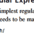

> 正则表达式有多种称呼——其中最常见的是 `regex` 和 `patterns`。元字符有时也被称为通配符。这些术语经常可以互换使用。

#### 正则表达式示例

最简单的正则表达式是精确表示需要匹配的字符序列的表达式。例如，下面的正则表达式

```
/peach/
```

精确匹配字符串 `peach`。如果该表达式在 `awk` 或 `sed` 中使用，包含字符串 `peach` 的任何行都将被选中，包括以下类似的行：

我们后院有一棵桃树

我更喜欢桃子而不是李子

#### 匹配字符

现在让我们看一个稍微复杂一点的例子。下面的表达式

```
/[a-c]/
```

匹配相同的字符串以及诸如 `ace`、`yacc` 和 `arctic` 之类的字符串。它还匹配下面的行

```
close the window
```

尽管该句子中没有字母 `a`。这是因为 `*`。它匹配其紧邻前一个字符的零次或多次出现。

关于 `*` 的另一个重要点是它会尝试进行最长的匹配。例如，考虑表达式

```
/a*a/
```

和下面的行

```
able was I, ere I saw elba
```

这里你要求匹配包含以字母 `a` 开始和结束的字符串的行。在示例行中，有几种可能性：

```
able wa
```

```
able was I, ere I sa
```

```
able was I, ere I saw elba
```

`*` 总是进行最长的匹配；在这种情况下，选择最后一个。

`.` 和 `*` 可以结合起来获得与第 8 章“变量”中介绍的 `*` 文件名扩展等效的行为。例如，下面的表达式

```
/ch.*.doc/
```

匹配字符串 `ch01.doc`、`ch02.doc` 和 `chdoc`。shell 的 `*` 通配符匹配相同名称的文件。

#### 字符集合

`.` 操作符的一个主要限制是它不能让你指定想要匹配哪些字符；它匹配所有字符。要在正则表达式中指定特定字符集，我们需要使用方括号字符 `[` 和 `]`，如下所示：

/[chars]/

这里匹配给定集合 `chars` 中的单个字符。正则表达式中使用集合的方式几乎与文件名替换中使用集合的方式相同。表 16.2 显示了一些常用的字符集合。

作为使用集合的示例，下面的表达式匹配字符串 `The` 和 `the`：

/[T t]he/

### 表 16.2 常用集合

| 集合 | 描述 |
|---|---|
| `[a-z]` | 匹配单个小写字母 |
| `[A-Z]` | 匹配单个大写字母 |
| `[a-zA-Z]` | 匹配单个字母 |
| `[0-9]` | 匹配单个数字 |
| `[a-zA-Z0-9]` | 匹配单个字母或数字 |

有时很难确定需要匹配的确切字符集。假设你需要匹配除字母 `T` 之外的每个字符。构造一个包含除字母 `T` 之外的每个字符的集合容易出错；你可能会忘记空格或标点字符。为了解决这个问题，你可以使用否定运算符 `^`。例如，匹配除 `T` 之外的所有字符的集合是 `[^T]`

当 `^` 是集合中的第一个字符时，匹配集合中未给出的任何字符。这称为反转。任何集合，包括表 16.2 中给出的集合，都可以通过指定 `^` 作为第一个字符来反转或否定。例如，下面的表达式 `/[^a-zA-Z0-9]/` 匹配字符串 `chapter` 和 `chocolate` 的开头，但不匹配字符串 `ch01` 或 `ch02`。

你可以使用 `*` 字符组合集合以扩展其功能。例如，下面的表达式 `/ch[0-9]*\.doc/` 匹配字符串 `ch01.doc` 和 `ch02.doc`，但不匹配字符串 `chdoc` 或 `changedoc`。

#### 锚定表达式

假设我们需要查找以单词 `the` 开头的行。例如，

```
the plains were rich with crops
```

我们可能想使用下面的简单表达式：

/the/


尽管该表达式会匹配以 the 开头的行，但它也会匹配下面的行：

```
there were many orchards of fruit tree
in the dark it was like summer lightning
```

简单表达式的两个主要问题是

- 只有单词 `the` 应该被匹配。以 `there` 等词开头的行不应被匹配。
- 单词 `the` 应该位于行的开头。

为了解决第一个问题，我们可以添加一个空格，如下所示：

`/the /`

为了解决第二个问题，你需要 `^` 元字符，它匹配一行的开头。在正则表达式中，`^` 将表达式锚定到行的开头：只有以表达式开头的行才会被匹配。通常，包含表达式的任何行都会被匹配。

通过添加 `^` 如下，

`/^the /`

你就得到了一个仅匹配以单词 `the` 开头的行的表达式。

表达式也可以使用 `$` 锚定到行的末尾。例如，下面的表达式

```
/friend$/
```

匹配行

我曾是，也将永远是你的朋友

但它不匹配行

朋友有什么用

你可以将 `^` 和 `$` 与集合和其他元字符结合起来，根据表达式匹配行。例如，下面的表达式

```
/^Chapter [1-9]*[0-9]$/
```

匹配诸如

第 1 章

第 20 章

之类的行

但它不匹配诸如

第 00 章 引言

第 101 章

之类的行

因为 `^` 和 `$` 元字符将表达式锚定到行的开头和结尾，所以空行由表达式 `/^ *$/` 匹配。

### 转义元字符

有时我们需要在字符串中匹配元字符。假设我们需要匹配包含价格的行：

```
Peaches $0.89/lbs
Oil $15.10/barrel
```

价格包含两个元字符 `$` 和 `.`，而字符串包含第三个元字符 `/`。例如下面的表达式

```
/\$[0-9]\.[0-9]\/[a-zA-Z]*/
```

不会匹配之前的任何一个字符串，原因如下：

- 表达式中的第一个字符是 `$` 字符。因为 `$` 匹配行的结尾，表达式尝试在行尾之后查找字符，这是一个不可能匹配的表达式。
- 因为 `.` 匹配任何字符的单次出现，这个表达式可能会产生误报；诸如 `8x00` 和 `1234` 之类的字符串将被匹配，而不仅仅是所需格式的字符串。
- 表达式包含三个斜杠，这构成了一个混乱或无效的表达式。前两个斜杠用作表达式的分隔符。

我们可以通过使用反斜杠元字符（`\`）来转义元字符来解决这些问题。当正则表达式中存在反斜杠时，其后紧跟的字符始终被原样处理。例如，`$` 匹配行的结尾，但 `\$` 匹配美元符号（`$`）。当普通字符前面有反斜杠时，反斜杠没有效果。例如，`\a` 和 `a` 都被视为小写字母 `a`。

用转义重写我们之前的表达式得到以下内容：

`/\$[0-9]\.[0-9]\/[a-zA-Z]*/`

该表达式正确匹配价格。


> 为了匹配 `\, 你可以使用它本身进行转义：`\\`.

### 有用的正则表达式

表 16.3 提供了一些有用的正则表达式。

TABLE 16.3 一些有用的正则表达式

| 字符串类型 | 表达式 |
|---|---|
| 空行 | `/^$/` |
| 整行 | `/^.*$/` |
| 一个或多个空格 | `/ +/` |
| HTML（或 XML）标签集 | `/<[^>]+>/` |
| 有效 URL | `/[a-zA-Z][a-zA-Z0-9+.-]*:\/\/[a-zA-Z0-9][a-zA-Z0-9.-]*\.[a-zA-Z]{2,}/` |
| 格式化的美元金额 | `/[$][0-9]+(\.[0-9]{2})?/` |

### 使用 sed

`sed` 是一个流编辑器，它对输入的每一行执行一组操作。这使得 `sed` 可以用作过滤器。`sed` 命令的基本语法是

`sed 'script' files`

这里 `files` 是一个或多个文件列表，而 `script` 是以下形式的一个或多个命令

`/pattern/ action`

其中 `pattern` 是一个正则表达式，`action` 是表 16.4 中给出的命令之一。如果省略 `pattern`，则对输入的每一行执行 `action`。

TABLE 16.4 `sed` 中可用的一些操作

| 操作 | 描述 |
|---|---|
| `p` | 打印该行（p as in print） |
| `d` | 删除该行（d as in delete） |
| `s` | 用另一个表达式替换一个表达式（s as in substitute） |

### 打印行

让我们从 `sed` 中最简单的功能开始——打印匹配表达式的行。

以下是一个小型水果市场的价格清单：

```
$ cat fruit_prices.txt
Fruit    Price/lbs
Banana   0.89
Peach    0.79
Kiwi     1.50
Pineapple 1.29
Apple    0.99
Mango    2.20
```

该文件列出了水果名称及其每磅价格。以下大多数示例假定该列表存储在文件 `fruit_prices.txt` 中。

首先，让我们打印出每磅价格低于 1 美元的水果清单。我们需要使用 `sed` 命令 `p`：

```
/pattern/p
```

这里 `pattern` 是一个正则表达式。

让我们尝试以下 `sed` 命令：

```
$ sed '/ 0.[0-9][0-9]$/p' fruit_prices.txt
```

这将打印出匹配以下表达式的所有行：

```
/ 0.[0-9][0-9]$/
```

该表达式指定只有以 `0.89` 和 `0.99` 等价格结尾的行才会被打印。开头的 `0` 确保以 `2.20` 或 `10.10` 等价格结尾的行不会被打印。

查看输出，

```
Fruit    Price/lbs
Banana   0.89
Banana   0.89
Peach    0.79
Peach    0.79
Kiwi     1.50
Pineapple 1.29
Apple    0.99
Apple    0.99
Mango    2.20
```

我们发现价格低于一美元的水果行被打印了两次，而价格高于一美元的水果行只打印了一次。这演示了 `sed` 的默认行为——它会将每一行输入打印到输出。为了避免这种行为，我们可以按如下方式指定 `sed` 的 `-n` 选项：

```
$ sed -n '/0.[0-9][0-9]$/p' fruit_prices.txt
```

这会将输出更改为如下：

```
Banana 0.89
Peach 0.79
Apple 0.99
```

### 删除行

假设我们用完了芒果，因此需要从列表中删除它们。为了完成此任务，我们可以使用 `sed` 命令 `d`：

```
/pattern/d
```

这里 `pattern` 是一个正则表达式。

我们可以使用以下 `sed` 命令：

```
$ sed '/^[Mm]ango/d' fruit_prices.txt
```

此命令删除以单词 `mango` 或 `Mango` 开头的行。输出如下：

Fruit Price/lbs

Banana 0.89

Peach 0.79

Kiwi 1.50

Pineapple 1.29

Apple 0.99

请注意，你不需要指定 `sed` 的 `-n` 选项即可获得正确的输出。`p` 命令告诉 `sed` 生成额外的输出，而 `d` 命令告诉 `sed` 修改常规输出。

虽然你已经修改了输出并验证其正确，但文件仍需要更新。你可以借助 shell 来完成：

$ mv fruit_prices.txt fruit_prices.txt.$$

$ sed '/^[Mm]ango/d' fruit_prices.txt.$$ > fruit_prices.txt

$ cat fruit_prices.txt

首先，我们将文件 `fruit_prices.txt` 重命名为 `fruit_prices.txt.$$`。请记住，变量 `$$` 的值是当前 shell 的进程 ID。将 `$$` 的值附加到文件末尾是创建具有唯一名称的临时文件的常用方法。

接下来，我们使用 `sed` 从临时文件中删除以 `Mango` 或 `mango` 开头的行。然后将 `sed` 命令的输出重定向到文件 `fruit_prices.txt`。

我们使用 `cat` 来显示更新是否成功：

| 水果 | 每磅价格 |
| Banana | 0.89 |
| Paech | 0.79 |
| Kiwi | 1.50 |
| Pineapple | 1.29 |
| Apple | 0.99 |

现在我们知道更新已正确完成，可以按如下方式删除临时文件：

```
$ rm fruit_prices.txt.$$
```

### 执行替换

到目前为止，你可能已经注意到我们文件中 Peach 被拼写为 Paech。我们可以使用 `sed` 命令 `s` 将 Paech 替换为正确的拼写来修复它：

```
/pattern1/s/pattern2/pattern3/
```


这里 `pattern1`、`pattern2` 和 `pattern3` 都是正则表达式。`s` 命令在匹配 `pattern1` 的任何行上将 `pattern2` 替换为 `pattern3`。

经常省略 `pattern1`，因此你会看到 `s` 命令如下使用：

```
s/pattern2/pattern3/
```

如果省略 `pattern1`，则对每一行输入执行 `s` 命令。

要修复 Paech 的拼写，可以使用以下 `sed` 命令：

```
$ sed 's/Paech/Peach/' fruit_prices.txt
```

现在输出类似于以下内容：

| 水果 | 每磅价格 |

| Banana | 0.89 |

| Peach | 0.79 |

| Kiwi | 1.50 |

| Pineapple | 1.29 |

| Apple | 0.99 |

你不需要指定 `sed` 的 `-n` 选项即可获得所需输出。`s` 命令与 `d` 命令类似，因为它告诉 `sed` 修改其正常输出。

### 常见错误

`s` 命令的一个常见错误是忘记一个或多个 `/` 字符。例如，假设你要发出以下命令：

```
$ sed 's/Peach/Peach' fruit_prices.txt
```

会产生类似以下的错误信息：

```
sed: command garbled: s/Peach/Peach
```

此错误信息说明了 `sed` 错误信息的标准样式：

```
sed: command garbled: command
```

`sed` 只是重复命令并说明它无法理解该命令。不会产生任何额外的错误信息或信息，因此你必须自己确定出了什么问题。

### 执行全局替换

在上一个示例中，你只需要修复单行上的一个拼写错误。有时你可能需要执行多次更正。例如，查看以下文件：

```
$ cat nash.txt
```

things that are equal to the same thing are equal to each other

在此文件中，单词 equal 被拼写为 eqal。你可以尝试使用 `s` 命令按如下方式修复它：

```
$ sed 's/eqal/equal/' nash.txt
```

things that are equal to the same thing are equal to each other

如你所见，第一个拼写错误已修复，但第二个未修复。这是 `s` 命令的默认行为：它在每一行上只执行一次替换。要执行多次替换，我们需要使用 `g`（表示 global）操作符：

`/pattern1/s/pattern2/pattern3/g`

`g` 操作符告诉 `s` 命令在匹配 `pattern1` 的行上将 `pattern2` 的每个出现替换为 `pattern3`。如果省略 `pattern1`，则对输入的每一行进行操作。

在这种情况下，我们需要按如下方式使用 `g` 操作符：

```
$ sed 's/eqal/equal/g' nash.txt
```

### 重用表达式的值

回到水果价格清单，假设我们想通过在每个价格前加上 `$` 字符来更改列表以反映价格以美元计。通过使用以下表达式，我们可以匹配所有以价格结尾的行：

`/ *([0-9][0-9]?)\.[0-9][0-9]/`

问题在于用前面加上 `$` 字符的价格替换现有价格。看起来我们需要为文件中的每一行编写单独的 `s` 命令。幸运的是，`s` 命令提供了 `&` 操作符，使我们能够在 `pattern2` 中重用来自 `pattern1` 的匹配字符串。

我们可以按如下方式重用匹配到的价格：

```
$ sed 's/ *([0-9][0-9]?)\.[0-9][0-9]/\$&/' fruit_prices.txt
Fruit      Price/lbs
Banana     $0.89
Peach      $0.79
Kiwi       $1.50
Pineapple  $1.29
Apple      $0.99
```

### 使用多个 sed 命令

从上一个示例可以看出，我们能够更新价格，但 Peach 仍然被拼写为 Paech。为了执行这两个更改，你必须对文件执行多个 `sed` 命令。这可以通过以下两种方式之一实现：

- 执行第一次更改然后更新文件。执行第二次更改命令然后更新文件。
- 使用单个 `sed` 命令执行两次更改，然后更新文件。

正如你所猜测的，第二种方法更高效且不易出错，因为文件只更新一次。你可以按如下方式使用单个 `sed` 命令执行两次更改：

```
sed -e 'cmd1'... -e 'cmdN' files
```

这里 `cmd1` ... `cmdN` 是前面讨论的类型 `sed` 命令。每个命令都应用于 `files` 指定的每个文件中的每一行。

我们可以使用以下任一命令执行两次更新：

```
$ sed -e 's/Paech/Peach/' -e 's/ *([0-9][0-9]?)\.[0-9][0-9]/\$&/' fruit_prices.txt
$ sed -e 's/ *([0-9][0-9]?)\.[0-9][0-9]/\$&/' -e 's/Paech/Peach/' fruit_prices.txt
```

两个命令产生相同的输出：

| Fruit | Price/lbs |
|---|---|
| Banana | $0.89 |
| Peach | $0.79 |
| Kiwi | $1.50 |
| Pineapple | $1.29 |
| Apple | $0.99 |

要更新文件，我们可以使用以下流程：

```
$ mv fruit_prices.txt fruit_prices.txt.$$

$ sed -e 's/Peach/Peaches/' -e 's/[0-9][0-9]*\.[0-9][0-9]/$&/' fruit_prices.txt.$$ > fruit_prices.txt

$ cat fruit_prices.txt
```

| Fruit | Price/lbs |
|---|---|
| Banana | $0.89 |
| Peach | $0.79 |
| Kiwi | $1.50 |
| Pineapple | $1.29 |
| Apple | $0.99 |

### 在管道中使用 sed

如果未指定文件列表，`sed` 会从 `STDIN` 读取行，使其在管道中很有用。

作为使用 `sed` 在管道中的示例，我们将使用它来确定用户的数字用户 ID（uid）。在大多数系统上，`/usr/bin/id` 命令会打印出当前用户的 uid 和 gid 信息。`id` 的输出类似于以下内容：

```
$ /usr/bin/id

uid=500(ranga) gid=100(users)
```

这就是我们想要的。请注意，当我们添加第二个 `s` 命令时，我们从 `sed` 的单命令形式更改为使用 `-e` 选项的多命令形式。

### 摘要

本章中，我们研究了使用正则表达式过滤文本。涵盖的一些主要主题包括

- 匹配字符
- 指定字符集
- 锚定表达式
- 转义元字符

我们还研究了 `awk` 和 `sed` 之间的相似性，并详细介绍了 `sed` 的使用。

在下一章中，我将介绍 `awk` 命令及其编程语言。使用本章涵盖的材料，您将能够使用 `awk` 执行困难的文本操作。

### 问题

1. 使用 `sed` 编写一个 shell 函数，搜索列表文件中某个单词或简单表达式，并打印出匹配列表。你不需要支持所有可能的 `sed` 表达式。你的函数应将其要查找的单词作为第一个参数。它应将其其他参数视为文件列表。
提示：使用双引号（"）而不是单引号（\'）来包围你的 `sed` 脚本。

2. 编写一个 `sed` 命令，其输入为 `uptime` 命令的输出，并仅打印负载平均值。`uptime` 命令的输出类似于以下内容：

```
$ uptime

6:34pm up 2 day(s), 49 min(s), 1 user, load average:

0.00, 0.00, 0.02
```

你的输出应类似于以下内容：

```
load average: 0.85, 0.01, 0.03
```


### 3. 编写一个 `sed` 命令，其输入为 `df -k` 命令的输出，并仅打印以 `/` 开头的行。`df -k` 命令的输出类似于以下内容：

```
Filesystem    kbytes    used    avail    capacity    Mounted on
/dev/dsk/c0t0d0s0    793262    45514    223979    67%    /
/proc    0    0    0    0%    /proc
/dev/dsk/c0t0d0s1    123455    4813    108297    5%    /var
/dev/dsk/c0t0d0s5    942130    136019    649361    18%    /opt
swap    366852    15708    349344    5%    /tmp
kanchi:/none    1199016    860165    468383    59%    /users
```

在 HP-UX 上，使用 `df -b` 命令而不是 `df -k`。

### 4. 编写一个 `sed` 命令，其输入为 `ls -l` 命令的输出，并打印常规文件的权限和文件名。目录、链接和特殊文件不应出现在输出中。`ls -l` 的输出将类似于以下内容：

```
-rw-r--r-- 1 ranga users 85 Nov 27 15:34 fruit_prices.txt

-rw-r--r-- 1 ranga users 80 Nov 27 15:33 fruit_prices.txt.7880

lrwxrwxrwx 1 ranga users 9 Nov 27 18:01 nash -> nash.txt

-rw-r--r-- 1 ranga users 62 Nov 27 16:06 nash.txt

lrwxrwxrwx 1 ranga users 8 Nov 27 19:01 urls -> urls.txt

-rw-r--r-- 1 ranga users 180 Nov 27 12:34 urls.txt
```

你的输出应类似于以下内容：

```
-rw-r--r-- fruit_prices.txt

-rw-r--r-- fruit_prices.txt.7880

-rw-r--r-- nash.txt

-rw-r--r-- urls.txt
```

#### 术语

`Anchoring` 用正则表达式锚定会将匹配限制为以该表达式开头或结尾的行。

`Escaping` 在元字符前加上 `\` 称为转义。转义后的元字符按字面处理。

`Meta-Characters` 元字符是在正则表达式内部具有特殊含义的字符；它们被扩展以匹配普通字符。

`Regular Expression` 正则表达式是描述字符串集合的紧凑表示法。


在第 16 章“使用正则表达式过滤文本”中，您学习了如何使用 `sed` 和正则表达式来过滤文本。在本章中，您将了解另一个功能强大的文本过滤程序 `awk`。

### 第 17 小时

#### 使用 awk 过滤文本

`awk` 是一个程序和完整的编程语言，可让您在许多文件中搜索模式并有条件地修改文件，而无需担心打开文件、读取行或关闭文件。它存在于所有 UNIX 系统中，速度很快，易于学习，极其灵活。本章重点介绍在 shell 脚本中最常用的 `awk` 元素，具体包括：

- 字段编辑
- 变量
- 流程控制语句

#### 什么是 awk？

`awk` 是一个程序和编程语言，可让您根据模式搜索文件并修改这些文件中的记录。名称 `awk` 来自其创建者 Alfred Aho、Peter Weinberger 和 Brian Kernighan 的姓氏。`awk` 于 1978 年被添加到 UNIX 第 7 版中，此后一直是其不可或缺的一部分。

`awk` 有三个版本：

- Original `awk`
- New `nawk`
- The POSIX/GNU version `gawk`

自 1978 年首次引入 UNIX 以来，原始 `awk` 基本保持不变。它旨在成为一种用于过滤文本和生成报告的小型编程语言。到 20 世纪 80 年代中期，人们开始用 `awk` 编写大型程序，因此其作者决定对其进行扩展。这个版本称为 `nawk`（new awk 的缩写），于 1987 年公开发布，并成为 SunOS 4.1.x 的一部分。`nawk` 本应取代 `awk`，但这尚未发生。像 HP-UX 和 Solaris 这样的商业 UNIX 版本仍同时提供 `awk` 和 `nawk`。BSD 系统也提供 `awk` 而不是 `nawk`。

1992 年，电气和电子工程师学会（IEEE）将 `awk` 作为其可移植操作系统接口标准（POSIX）的一部分进行了标准化。`gawk`，即 `awk` 的 GNU 版本，基于 POSIX 标准。所有 Linux 系统都提供 `gawk`。

本章中的示例适用于任何版本的 `awk`。

#### 基本语法

`awk` 命令的基本语法是

```
awk 'script' files
```

这里，`files` 是一个或多个文件的列表，`script` 是以下形式的一个或多个命令：

```
/pattern/ { actions }
```

这里 `pattern` 是一个正则表达式，`actions` 是本章后面介绍的命令中的一个或多个。如果省略 `pattern`，`awk` 将对每一行输入执行 `actions`。

让我们从一个简单的任务开始：打印文件中的行。为了打印文件 `fruit_prices.txt`（来自上一章），您可以使用以下命令：

```
$ awk '{ print ; }' fruit_prices.txt
```

```
Fruit Price/lbs Quantity

Banana $0.80 100

Peach    $0.79    65

Kiwi     $1.50    22

Pineapple $1.79   55

Apple    $0.99    78
```

这里 `awk` 命令 `print` 用于打印输入的每一行。当 `print` 命令不带参数时，它会按读取的方式原样打印输入行。请注意，`print` 命令后面有一个分号（`;`）。这个分号指示 `awk` 命令的结束位置。尽管某些旧版本的 `awk` 不需要分号，但包含它是一个良好的做法。

#### 字段编辑

`awk` 可用的最方便的功能之一是它会自动将输入行分成字段。字段是由一个或多个字段分隔符字符分隔的一组字符。默认字段分隔符是制表符和空格。

当读取一行时，`awk` 将解析的字段放入变量 `$1` 表示第一个字段，`$2` 表示第二个字段，以此类推。字段的值使用字段运算符 `$` 访问。例如，第一个字段是 `$1`。

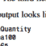

> > `awk` 中 `$` 的用法与 shell 中略有不同。
> `$` 仅在访问字段变量的值时才需要。它不是在访问其他变量的值时需要。在 `awk` 中创建和使用变量将在本章后面详细解释。

为了演示字段的使用，让我们看看如何使用它们仅从文件中打印水果名称及其数量：

```
$ awk '{ print $1 $3 ; }' fruit_prices.txt
```

这里你使用 `awk` 从每一行输入中打印两个字段：

- 第一个字段，其中包含水果名称
- 第三个字段，其中包含数量

输出如下所示：

```
FruitQuantity

Bananas100

Peach65

Kiwi22

Pineapple35

Apple78
```

注意输出中字段之间没有分隔符。这是 `print` 命令的默认行为。若要在每个字段之间打印空格，则需要使用逗号运算符，如下所示：

```
$ awk '{ print $1 , $3 ; }' fruit_prices.txt
```

```
Fruit Quantity

Banana 100

Peach 99

Kiwi 22

Pineapple 35

Apple 78
```

你可以使用 `awk` 的 `printf` 命令而不是 `print` 命令来格式化输出，如下所示：

```
$ awk '{ printf "%-15s %s\n" , $1 , $3 ; }' fruit_prices.txt
```

```
Fruit Quantity

Banana 100

Peach 65

Kiwi 22

Pineapple 35

Apple 78
```


第 5 章“输入和输出”中讨论的 `printf` 命令的所有功能都可在 `awk` 命令 `printf` 中使用。

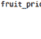

> 输出字段的顺序不受其在输入中出现顺序的限制。
> 
> 在之前的示例中，字段 `$1` 和 `$3` 的输出顺序保留了输入顺序：`$1` 在 `$3` 之前输出。没有要求保留输入顺序；你完全可以毫无问题地先输出 `$3` 再输出 `$1`（除了会产生令人困惑的表格之外）：
> `awk '{ print "%s %-15s\n" , $3 , $1 ; }' fruit_prices.txt`

### 按模式执行特定操作

假设你想通过在那些水果后打印一个尾随的 `*` 来突出显示价格超过一美元的水果。为了实现这一点，你需要根据匹配到的水果价格的模式执行不同的操作。你从以下脚本开始：

```
#!/bin/sh

awk '

/ *\$[1-9][0-9]*\.[8-9][0-9]* */ { print $1,$2,$3,"*"; }

/ *\$[1-9][0-9]*\.[0-9][0-9]* */ { print $0 ; }

' fruit_prices.txt
```

这里有两个模式：第一个查找价格高于一美元的水果，第二个查找价格低于一美元的水果。当遇到价格高于一美元的水果时，三个字段会连同行尾的 `*` 一起输出。对于所有其他水果，行会按读取时的原样打印。

假设此脚本名为 `fruit_prices.sh` 且位于当前目录中，可以按如下方式调用：

```
$ ./fruit_prices.sh
```

输出如下所示：

```
Banana $0.69 100

Peach $0.79 65

Kiwi $1.50 22 *

Pineapple $1.29 35

Apple $0.99 78
```

这里的一个问题是，你想用 `*` 标记的行不再以与其他行相同的方式格式化。你可以使用 `print` 来解决这个问题，但一个更简单的解决方案是使用 `$0` 字段。变量 `$0` 由 `awk` 用来存储读取时的整行输入。

让我们按如下方式更改脚本：

```
#!/bin/sh

awk '

/ *\$[1-9][0-9]*\.[0-9][0-9]* */ { print $0,"*"; }

/ *\$0\.[0-9][0-9]* */ { print ; }

' fruit_prices.txt
```

这会更改输出，使所有行都正确格式化：

```
$ ./fruit_prices.sh

Banana $0.69 100

Peach $0.79 65

Kiwi $1.50 22 *

Pineapple $1.29 35 *

Apple $0.99 78
```

### 比较运算符

现在假设你需要通过附加字符串 `REORDER` 来标记所有数量少于 75 的水果以便重新订购。在这种情况下，你需要检查保存数量的第三个字段是否小于或等于 75。

为了解决这个问题，你需要使用比较运算符。在 `awk` 中，比较运算符比较数字和字符串的值。它们的行为类似于 C 语言或 shell 中找到的运算符。当使用比较运算符时，`awk` 命令的语法变为如下：

```
expression { actions }
```

这里的 `expression` 使用表 17.1 中给出的比较运算符之一构造。

#### 表 17.1 awk 中的比较运算符

| 运算符 | 描述 |
|---|---|
| `<` | 小于 |
| `>` | 大于 |
| `<=` | 小于或等于 |
| `>=` | 大于或等于 |
| `==` | 等于 |
| `!=` | 不等于 |
| `value ~ /pattern/` | 如果值匹配模式则为真 |
| `value !~ /pattern/` | 如果值不匹配模式则为真 |

你可以使用以下脚本解决你的问题：

```
#!/bin/sh

awk '

$3 <= 75 { printf "%s\t%s\n",$0,"REORDER" ; }

$3 > 75 { print $0 ; }

' fruit_prices.txt
```

这里你确定第三个字段是否包含小于或等于 75 的值。如果是，则打印输入行后跟字符串 `REORDER`。接下来，你确定第三个字段是否包含大于 75 的值，如果是，则按原样打印输入行。

假设此脚本名为 `reorder.sh` 且位于当前目录中，可以按如下方式调用：

```
$ ./reorder.sh
```

此脚本的输出如下所示：

```
Fruit Price/lbs Quantity

Banana $0.89 100

Peach $0.79 65 REORDER

Kiwi $1.50 22 REORDER

Pineapple $1.29 35 REORDER

Apple $0.99 78
```

### 复合表达式

通常，你需要组合两个或多个表达式来检查特定条件。当你组合两个或多个表达式时，结果称为复合表达式。复合表达式是通过使用 `&&`（与）或 `||`（或）复合运算符构造的。语法是

```
(expr1) && (expr2)

(expr1) || (expr2)
```

这里 `expr1` 和 `expr2` 是使用表 17.1 中给出的条件运算符构造的表达式。包围 `expr1` 和 `expr2` 的括号是必需的。当使用 `&&` 运算符时，两个 `expr1` 和 `expr2` 都必须为真，复合表达式才为真。当使用 `||` 运算符时，如果 `expr1` 或 `expr2` 中任一为真，则复合表达式为真。

作为使用复合表达式的示例，你可以使用复合运算符获取所有价格超过一美元且数量少于 75 的水果列表：

```
#!/bin/sh

awk '

($2 ~ /^\$[1-9][0-9]?/ && $3 < 75) {

printf "%s\t%s\n",$0,"REORDER" ;

}

' fruit_prices.txt
```

如果此脚本名为 `reorder_expensive.sh` 且位于当前目录中，可以按如下方式调用：

```
$ ./reorder_expensive.sh
```

输出如下所示

```
Kiwi    $1.58    22    *    REORDER

Pineapple    $1.29    35    *    REORDER
```

#### 复合表达式运算符

`&&` 运算符通常称为 and-and 运算符，因为它由两个与号（and 字符）组成。同样，`||` 运算符被称为 or-or 运算符。

### next 命令

让我们重新考虑“reorder”脚本：

```
#!/bin/sh

awk '

$3 < 75 { printf "%s\t%s\n",$0,"REORDER" ; }

$3 > 75 { print $0 ; }

' fruit_prices.txt
```

显然它做了比必要更多的工作。例如，当输入行是

Kiwi    $1.50      22

脚本的执行如下：

- 1. 检查第三列的值 22 是否小于 75。因为该值小于 75，脚本继续执行步骤 2。
- 2. 打印输入行后跟 `REORDER`。
- 3. 检查第三列的值 22 是否大于 75。因为该值不大于 75，脚本读取下一行。

因为步骤 2 已经打印了一行，所以实际上没有必要执行步骤 3。为了防止步骤 3 执行，你可以使用 `next` 命令。`next` 命令告诉 `awk` 跳过所有剩余的模式和表达式，而是读取下一行输入并从第一个模式或表达式开始。

让我们更改脚本以使用 `next` 命令：

```
#!/bin/sh

awk '

$3 <= 75 { print $0,"REORDER"; next ; }

$3 > 75 { print $0 ; }

' fruit_prices.txt
```

现在当遇到以下行时：

Kiwi    $1.50      22

脚本的执行如下：

- 1. 检查第三列的值 22 是否小于 75。因为该值小于 75，脚本继续执行步骤 2。
- 2. 打印输入行后跟 `REORDER`。
- 3. 读取下一行输入并从第一个模式重新开始。

如你所见，对于此输入行，第二个比较（`$3 > 75`）永远不会执行。

### 使用 STDIN 作为输入

回想一下，`awk` 命令的基本形式是

```
awk 'script' files
```

如果省略文件列表，`awk` 会从 `STDIN` 读取其输入。这使你能够使用 `awk` 来过滤其他命令的输出。例如，命令

```
$ ls -l
```

产生的输出格式类似于以下内容：

```
total 64

-rw-r--r-- 1 ranga users 635 Nov 20 11:18 awkfruit.sh

-rw-r--r-- 1 ranga users 115 Nov 20 14:07 fruit_prices.txt

-rw-r--r-- 1 ranga users 80 Nov 27 15:53 fruit_prices.txt.7680
```


`-lrwxrwxrwx 1 ranga users 8 Nov 27 19:01 nash -> nash.txt`

`-rw-r--r-- 1 ranga users 62 Nov 27 16:08 nash.txt`

`-rw-r--r-- 1 ranga users 11 Nov 20 10:38 nums.txt`

`-lrwxrwxrwx 1 ranga users 8 Nov 27 19:01 urls -> urls.txt`

`-rw-r--r-- 1 ranga users 180 Nov 27 12:34 urls.txt`

让我们使用 `awk` 来操作 `ls -l` 命令的输出，以便只打印文件的名称和其大小。你感兴趣的值存储在字段 9 和 5 中：文件名称在字段 9 中，其大小在字段 5 中。以下命令打印每个文件的名称及其大小：

```
$ ls -l | awk '$1 != /total/ { print $9, $5 }'
```

输出看起来像以下内容：

```
awkfruit.sh 635
fruit_prices.txt 115
fruit_prices.txt.7680 80
nash 8
nash.txt 62
nums.txt 11
urls 8
urls.txt 180
```

### 使用 awk 功能

到目前为止你已经了解了使用 `awk` 的基础知识，现在你将查看其更强大的一些功能：

- Variables
- Flow control
- Loops

#### 变量

`awk` 中的变量与 shell 中的变量类似；它们是保存值的词。

定义变量的基本语法是

```
name=value
```

这里 `name` 是变量的名称，`value` 是该变量的值。例如，以下 `awk` 命令

```
fruit="peach"
```

创建变量 `fruit` 并将其赋值为 `peach`。无需初始化变量；第一次使用时它会自动初始化。

与 shell 类似，变量名只能包含字母、数字和下划线。变量名不能以数字开头。

你可以在同一个脚本中为变量赋数值和字符串值。例如，考虑以下 `awk` 命令：

```
fruit="peach"
fruit=100
```

第一个命令将值 `peach` 分配给变量 `fruit`。第二个命令将值 `100` 分配给变量 `fruit`。

你分配给变量的值也可以是另一个变量或字段的值。例如，以下 `awk` 命令

#### 使用数值表达式

你也可以将变量赋值为数值表达式的值。数值表达式是加、减、乘、除两个数字的命令，其形式为

```
num1 operator num2
```

这里 `num1` 和 `num2` 可以是常量，例如 `1` 或 `2`，也可以是变量名。`operator` 是表 17.2 中列出的数值运算符之一。对 `num1` 和 `num2` 执行 `operator` 指定的操作，并返回答案。例如，以下 `awk` 命令

```
a=1
b=a+1
```

将值 `2` 分配给变量 `b`。

#### 表 17.2 awk 中的数值运算符

| 运算符 | 描述 |
|---|---|
| `+` | 加 |
| `-` | 减 |
| `*` | 乘 |
| `/` | 除 |
| `%` | 取模（余数） |
| `^` | 指数运算 |

> 如果 `num1` 或 `num2` 是其值是字符串而不是数字的变量的名称，`awk` 使用值 `0` 而不是该字符串。
> 如果使用尚未创建的变量，`awk` 会创建该变量并将其值设为 `0`。

作为使用数值表达式的示例，让我们看一个统计文件中空行数量的脚本：

```sh
#!/bin/sh

for i in $@ ;
do
    if [ -f $i ] ; then
        echo $i
        awk '/^$/ { x=x+1 ; print x ; }' $i
    else
        echo "ERROR: $i not a file." >&2
    fi
done
```

在 `awk` 命令中，每当遇到空行时，你递增变量 `x` 并打印它。由于每个文件都会运行一次新的 `awk` 命令实例，因此每个文件的计数都是唯一的。

考虑文件 `uris.txt`，其中包含四行空行：

```
$ cat uris.txt
http://www.cusa.berkeley.edu/~ranga
http://www.cisco.com
ftp://prep.ai.mit.edu/pub/gnu/
ftp://ftp.redhat.com/
http://www.yahoo.com/index.html
ranga@kanchi:/home/ranga/pub
ranga@soda:/home/ranga/docs/book/ch01.doc
```

如果脚本命名为 `uris.sh` 并位于当前目录中，可以通过以下方式调用它来统计文件 `uris.txt` 中的空行数：

```
$ ./uris.sh uris.txt
```

输出看起来像以下内容：

```
uris.txt
1
2
3
4
```

#### 赋值运算符

在前面的示例中，`awk` 命令：

```
awk '/^$/ { x++ ; print x ; }' $1
```

使用赋值：

```
x=x+1
```

在 `awk` 中，这可以使用加法赋值运算符更简洁地写成：

`x += 1`

这里，赋值运算符 `+=` 取 `x` 的值，给它加上 `1`，然后将结果赋给 `x`。

一般来说，赋值运算符的语法为

`name operator num`

这里 `name` 是变量的名称，`operator` 是表 17.3 中指定的运算符之一，`num` 是变量名或 `1` 或 `2` 等数值常量。

#### 表 17.3 awk 中的赋值运算符

| 运算符 | 描述 |
|---|---|
| `+=` | 加 |
| `-=` | 减 |
| `*=` | 乘 |
| `/=` | 除 |
| `%=` | 取模（余数） |
| `^=` | 指数运算 |

使用赋值运算符是编写形式为 `name=name operator num` 的数值表达式的简写。

许多程序员更喜欢使用赋值运算符，因为它们比常规数值表达式稍微简洁一些。

#### 特殊模式：BEGIN 和 END

在前面的示例中，`awk` 命令

```
awk ' { x++ ; print x ; } ' $1
```

每次递增时都会打印 `x` 的值。如果能够打印空行的总数会好得多。为了实现这一点，你需要使用特殊模式 `BEGIN` 和 `END`。

回顾一下，`awk` 脚本中命令的一般语法是

```
/pattern/ { actions }
```

通常 `pattern` 是正则表达式，但你也可以使用两个特殊模式 `BEGIN` 和 `END`。考虑到这些模式，`awk` 命令的一般形式为

```
awk '
BEGIN { actions }
/pattern/ { actions }
/pattern/ { actions }
END { actions }
' files
```

当指定 `BEGIN` 模式时，`awk` 在读取任何输入之前执行其操作。当指定 `END` 模式时，`awk` 在退出之前执行其操作。当给出这些模式时，`awk` 的执行脚本如下：

- 1. 如果存在 `BEGIN` 模式，则执行其指定的操作。
- 2. 读取一行输入并将其解析为字段。
- 3. 将指定的每个模式与输入行进行比较，直到找到匹配项。当找到匹配项时，脚本执行为该模式指定的操作。此步骤对所有可用模式重复。
- 4. 在存在输入行时重复步骤 2 和 3。
- 5. 在脚本读取所有输入行后，如果存在 `END` 模式，则执行该模式指定的操作。

`BEGIN` 模式必须是第一个指定的模式，`END` 模式必须是最后一个指定的模式。在 `BEGIN` 和 `END` 模式之间你可以有任意数量的形如：
`/pattern/ { action ; }` 的 `awk` 命令

`BEGIN` 和 `END` 都是可选的。如果程序仅由 `BEGIN` 模式组成，`awk` 不会读取文件。

为了解决这个问题，你可以使用 `END` 模式打印 `x` 的值。修改后的 `uris.sh` 脚本如下：

```sh
#!/bin/sh

for i in $*
do
  if [ -f "$i" ] ; then
    echo "$i\c"
    awk '
      /^ */ { x++ ; next; }
      END { printf "%s\n",x; }
      ' "$i"
  else
    echo "ERROR: $i not a file." >&2
  fi
done
```


现在输出看起来像

```
$ ./uris.sh uris.txt
uris.txt 4
```

如果你在系统上的输出看起来像以下内容：

```
uris.txt\c
4
```

而不是如图所示，你需要将脚本中的以下行替换：
`echo "$i\c"`
with the line:
`echo -n "$i"`

#### 内置变量

除了您可以定义的变量之外，`awk` 还预定义了几个变量。这些变量的完整列表在表 17.4 中给出。

表 17.4 `awk` 中的内置变量。

| 变量 | 描述 |
|---|---|
| `FILENAME` | 当前输入文件的名称。 不应更改此变量的值。 |
| `NR` | 输入文件中当前输入行或记录的编号。 不应更改此变量的值。 |
| `NF` | 当前行或记录中的字段数。 不应更改此变量的值。 |
| `OFS` | 输出字段分隔符（默认为空格）。 |
| `FS` | 输入字段分隔符（默认为空格和制表符）。 |
| `OFMT` | 数字的输出格式（默认为 `%.6g`）。 |
| `ORS` | 输出记录分隔符（默认为换行符）。 |
| `RS` | 输入记录分隔符（默认为换行符）。 |

#### 使用 `FILENAME` 和 `NR`

在前面的示例中，您使用 `shell` 打印输入文件的名称。通过结合使用变量 `FILENAME` 和 `BEGIN` 语句，您可以在 `awk` 中完成所有这些操作。顺便说一下，您可以使用 `END` 模式中的以下表达式更改之前的脚本，以打印文件中空白行的百分比：

`100*(x/NR)`

这里您使用变量 `NR`，它存储当前记录或行号。在 `END` 模式中，`NR` 的值是已处理的最后一行的行号，这与已处理的总行数相同。

经过这些更改后，脚本如下

```
#!/bin/sh

for i in $*
do

  if [ -f "$i" ] ; then

    awk '/^$/ { file=FILENAME; x+=1; next } END { printf "%s %d %.1f\n", file, x, (100*(x/NR)); }' "$i"

  else

    echo "ERROR: $i not a file." >&2

  fi

done
```

新的输出如下

```
$ ./urls.sh urls.txt

urls.txt    4    36.4
```

请注意，百分比以十进制或浮点值给出。 `awk` 将所有数字都视为浮点值，并从其所有计算中返回浮点值。

#### 更改输入字段分隔符

输入字段分隔符 `FS` 控制 `awk` 如何拆分输入行中的字段。`FS` 的默认值是字符串 `" "`（空格或制表符）。因为大多数命令，例如 `ls` 或 `ps`，使用空格或制表符分隔列，所以此默认值使您能够轻松地使用 `awk` 操作其输出。

您可以手动将 `FS` 设置为其他任何字符，以影响 `awk` 如何拆分输入行。通常，在查看系统数据库（如 `/etc/passwd`）时，会更改此字符。可用于更改 `FS` 的两种方法如下

- 在 `BEGIN` 模式中手动重置 `FS`
- 指定 `awk` 的 `-F` 选项

例如，让我们使用以下 `BEGIN` 模式将 `FS` 设置为冒号 (`:`)：

```
BEGIN { FS=":"; }
```

以下 `awk` 调用等同于 `BEGIN` 模式：

```
awk -F ':' '{ ... }'
```

输出类似于以下内容：

```
root /
daemon /
bin /usr/bin
sys /
adm /var/adm
ranga /home/ranga
```

#### 允许 `awk` 使用 Shell 变量

大多数 `awk` 版本没有直接访问 `shell` 设置的环境变量值的方法。为了使 `awk` 使用这些变量，您必须按如下方式在命令行上将它们转换为 `awk` 变量：

```
awk 'script' awkvar1=value awkvar2=value ... files
```

这里，`script` 是您想要执行的 `awk` 脚本。变量 `awkvar1`、`awkvar2` 等是您想要设置的 `awk` 变量的名称。通常，`files` 是一个文件列表。

假设您想要生成 `fruit_prices.txt` 中所有水果的列表，这些水果的数量小于或等于某个数字 `x`，其中 `x` 由用户提供。为了实现这一点，我们需要将用户提供的 `x` 的值传递给 `awk`。假设用户提供的值 `x` 可用在 `shell` 变量 `$1` 中，脚本如下

```
#!/bin/sh

NUMFRUIT="$1"

if [ -z "$NUMFRUIT" ] ; then NUMFRUIT=75 ; fi

awk '
$3 <= numfruit { print ; }
' numfruit="$NUMFRUIT" fruit_prices.txt
```

只有水果数量少于指定数量的行才会被打印。

假设此脚本名为 `reorder_user.sh` 且位于当前目录中，可以按如下方式执行：

```
$ ./reorder_user.sh 25
```

这会产生以下输出

```
Kiwi    $1.50    22
```

#### 流程控制

`awk` 中有三种主要的流程控制形式：

- `if` 语句
- `while` 语句
- `for` 语句

`if` 和 `while` 语句与 `shell` 中找到的语句相似；而 `for` 语句更接近 C 编程语言中的版本。

#### `if` 语句

`if` 语句使您能够在执行某些 `awk` 命令之前进行测试。

您在前面的示例中使用的模式匹配和表达式本质上是影响 `awk` 程序整体执行过程的 `if` 语句。

`if` 语句的基本语法如下

```
if (expr1) {
    action1
} else if (expr2) {
    action2
} else {
    action3
}
```

这里 `expr1` 和 `expr2` 是使用条件运算符创建的表达式。包围 `expr1` 和 `expr2` 的括号是必需的。操作——`action1`、`action2` 和 `action3`——可以是任何序列的有效 `awk` 命令。包围这些操作的括号仅在操作包含多个语句时才需要，但大多数程序员为了清晰和可维护性总是包含它们。

`else if` 和 `else` 语句都是可选的。`else if` 语句的数量没有限制。

执行过程如下：

- 1. 评估 `expr1`（`if`）。
- 2. 如果 `expr1` 为真，则执行 `action1` 并退出 `if` 语句。
- 3. 如果 `expr1` 为假，则评估 `expr2`（`else if`）。
- 4. 如果 `expr2` 为真，则执行 `action2` 并退出 `if` 语句。
- 5. 如果 `expr2` 为假，则执行 `action3` 并退出 `if` 语句（`else`）。

作为一个简单的示例，让我们编写一个脚本，打印 `fruit_prices.txt` 中的水果列表并突出显示以下条件：

- 项目的价格是否超过一美元
- 是否需要重新订购该项目

与前面的示例一样，您将使用 `*` 字符和字符串 `REORDER` 来突出显示这些条件。

使用 `if` 语句，脚本如下

```
#!/bin/sh

awk '{
    printf "%s\t$%s", $8;
    if ( $2 ~ /[3-9][0-9]*|[0-9][0-9]/ ) {
        printf " * ";
        if ( $3 > 75 ) {
            printf "REORDER\n";
        } else {
            printf "\n";
        }
    } else {
        if ( $3 < 75 ) {
            printf "REORDER\n";
        } else {
            printf "\n";
        }
    }
}' fruit_prices.txt ;
```

如果脚本名为 `reorder_expensive.sh` 且位于当前目录中，可以按如下方式调用：

```
$ ./reorder_expensive.sh
```

输出如下所示

```
Fruit    Price/lbs    Quantity
Banana   $0.89        100
Peach    $0.79        65       * REORDER
Kiwi     $1.50        22       * REORDER
Pineapple $1.29       35       * REORDER
Apple    $0.99        78
```

#### `while` 语句

`while` 语句在表达式为真时执行 `awk` 命令。基本语法如下

```
while (expr) {
    actions
}
```


这里 `expr` 是使用条件运算符创建的表达式。包围 `expr` 的括号是必需的。应执行的操作 `actions` 可以是任何序列的有效 `awk` 命令。包围操作的括号仅在操作包含多个语句时才需要，但大多数程序员为了清晰和可维护性总是包含它们。

以下示例使用 `while` 循环以相反的顺序打印文件 `fruit_prices.txt` 的字段：

``` 
#!/bin/sh

awk '{

    x=NF;

    while (x>0) {

        printf "%6s ",$x;

        x-=1;

    }

    print "";

}' fruit_prices.txt
```

这里，您使用 `NF` 访问当前记录中的字段数。您还使用字段访问运算符 `$` 结合变量 `x` 来访问特定字段的值。

如果此脚本名为 `reverse_fruit.sh` 且位于当前目录中，可以按如下方式调用：

```
$ ./reverse_fruit.sh
```

输出类似于以下内容：

Quantity   Price/lb   Fruit
100        $8.99      Banana
65         $0.79      Peach
22         $1.50      Kiwi
35         $1.29      Pineapple
78         $0.99      Apple

### do 语句

`while` 语句的一个变体是 `do` 语句。它也在表达式为真时执行某些操作。`while` 和 `do` 之间的主要区别在于 `do` 语句至少执行一次。基本语法如下

```
do {
    actions
} while (expr)
```

这里 `expr` 是使用条件运算符创建的表达式。包围 `expression` 的括号是必需的。应执行的操作 `actions` 可以是任何序列的有效 `awk` 命令。包围操作的括号是必需的

仅当操作包含多条语句时才需要，但大多数程序员为了清晰和可维护性而包含它们。

作为示例，您可以使用 `do` 循环重写前一个示例中的 `while` 循环：

```
#!/bin/sh

awk '{
x=NF;
do {
printf("%ld\t%s", $x);
x-=1;
} while(x>0);
print "";
}' fruit_prices.txt
```

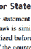

> `do` 语句的行为在 `nawk`、`gawk` 和 `awk` 之间有所不同。如果您想使用该语句，应坚持使用 `nawk` 或 `gawk`，因为旧版本的 `awk` 可能无法处理它。如果您担心与旧版 UNIX 的可移植性，应避免使用 `do` 语句。

### for 语句

`for` 语句使您能够重复执行命令一定次数。`awk` 中的 `for` 循环与 C 语言中的 `for` 循环类似。`for` 循环有一个计数器，在循环开始执行前进行初始化。在每次迭代开始时，计数器的值会与预定义值进行比较。当比较为真时，循环执行。如果比较为假，循环终止。每次循环执行时，计数器都会递增。这与 shell 中的 `for` 循环大不相同，后者为列表中的每个项目执行一组命令。

`for` 循环的基本语法是

```
for (init_entr; test_entr; incr_entr) {
    action
}
```

这里 `init_entr` 初始化计数器变量，`test_entr` 是测试计数器变量值的表达式，而 `incr_entr` 增加计数器的值。`for` 循环使用的表达式周围的括号是必需的。应执行的操作 `action` 是任何一系列有效的 `awk` 命令。操作周围的大括号仅在操作包含多条语句时才需要，但大多数程序员为了清晰和可维护性总是包含它们。

`for` 循环的常见用途是遍历记录中的字段并输出它们，同时可能在过程中修改每个记录。下面的 `for` 循环以两个空格分隔打印记录中的每个字段：

```
#!/bin/sh

awk '{
  for (x=1;x<=NF;x++) {
    printf "%s  ",$x ;
  }
  printf "\n";
}' fruit_prices.txt
```

### 摘要

本章介绍了 `awk` 编程。`awk` 是 UNIX 中最强大的文本过滤工具之一。通过使用 `awk`，可以以仅使用 shell 难以或不可能的方式修改和转换文本。

本章涵盖的一些重要主题包括：

- 字段编辑
- 特定模式的操作
- 使用 `STDIN` 作为输入
- 变量
- 数字和赋值表达式
- 使用流程控制

除这些主题外，`awk` 还提供多行编辑、数组和函数等功能。如果您有兴趣了解更多关于这些主题的信息，请查阅以下来源之一：

*《UNIX 编程环境》* 由 Brian Kernighan 和 Rob Pike (Prentice-Hall, 1984)

*《AWK 编程语言》* 由 Alfred Aho、Peter Weinberger 和 Brian Kernighan (Addison-Wesley, 1984)

*《Effective AWK 编程》* 由 Arnold Robbins 和 Michael Brennan (O'Reilly & Associates, 2001)

*《sed & awk》* 由 Arnold Robbins 和 Dale Dougherty (O'Reilly & Associates, 1997)

*《GNU awk 用户指南》* 由 Arnold Robbins (SCC, 1996)

### 问题

1. 使用 `for` 语句，编写一个 `awk` 脚本，打印记录中每个字段的逆序。

2. 编写一个 `awk` 脚本以平衡支票账户。您的程序需要在用户每次进行交易时打印账户余额。

交易存储在文件中。文件中的每一行或记录具有以下格式：

```
command:date:comment:amount
```

这里 `date` 是交易进行的日期，`comment` 是描述交易的字符串（包括嵌入的空格），`amount` 是交易金额。`command` 决定应如何对余额使用 `amount`。有效命令为

- `B` 表示余额。遇到此命令时，账户余额应设置为交易金额。
- `D` 表示存款。遇到此命令时，交易金额应加到余额中。
- `C` 表示支票。遇到此命令时，交易金额应从余额中减去。
- `W` 表示取款。遇到此命令时，交易金额应从余额中减去。

`C`（支票）和 `W`（取款）命令之间的主要区别在于，`C`（支票）命令在其记录中添加了一个额外字段：

```
command:date:comment:number:amount
```

此外，`B`（余额）命令仅使用两个字段：

```
B:amount
```

这里 `amount` 是账户中的余额金额。

就此问题而言，您需要关注第一个字段，其中包含命令；第二个字段，其中包含交易日期；以及最后一个字段，其中包含交易金额。

示例输入文件如下所示：

```
$ cat account.txt

B:0

D:10/24/97:initial deposit:1000

C:10/25/97:credit card:101:100

W:10/30/97:gas:21.43

W:10/30/97:lunch:11.34

C:11/02/97:toner:41.45

C:11/04/97:car payment:347.23

D:11/06/97:dividend:87.34

W:11/10/97:emergency cash:200
```

您的输出应如下所示：

```
10/24/97 1000.00

10/25/97 900.00

10/30/97 878.57

10/30/97 867.23

11/02/97 825.78

11/04/97 478.55

11/06/97 1165.89

11/10/97 965.89
```

### 3. 修改您为问题 2 编写的程序，以在处理完所有输入记录后打印最终（总）余额。您的输出现在应如下所示：

```
10/24/97 1000.00

10/25/97 900.00

10/30/97 878.57

10/30/97 867.23

11/02/97 825.78

11/04/97 478.55

11/06/97 1165.89

11/10/97 965.89

Total 965.89
```

（提示：使用 `END` 模式）

### 4. 修改您在问题 3 中编写的程序以支持新命令：

- `M` 表示最低余额。当余额低于此最低余额时，应在输出行的末尾打印警告。

`M`（最低余额）命令仅使用两个字段：

```
M:amount
```

这里 `amount` 是账户中的余额金额。

输入文件更改如下：

```
$ cat account.txt

B:0

M:500

D:10/24/97:initial deposit:1000

C:10/25/97:credit card:101.00

W:10/30/97:gas:21.43

W:10/30/97:lunch:11.34
```


C:11/02/97:toner:41.45

C:11/04/97:car payment:247.23

D:11/06/97:dividend:987.34

W:11/10/97:emergency cash:280

```
您的输出应类似于以下内容：

10/24/97    1000.00

10/25/97    980.00

10/30/97    878.57

10/30/97    867.23

11/02/97    825.78

11/04/97    478.55 * Below Min. Balance

11/06/97    1165.89

11/10/97    965.89

      Total    965.89
```

#### 术语

**字段** 由一个或多个字段分隔符字符分隔的一组字符。默认字段分隔符字符为制表符和空格。

**字段分隔符** 控制输入行如何被拆分为字段的方式。在 shell 中，字段分隔符存储在变量 `IFS` 中。在 `awk` 中，字段分隔符存储在 `awk` 变量 `FS` 中。`shell` 和 `awk` 都使用空格和制表符作为字段分隔符的默认值。


### 第 18 小时

#### 其他工具

在本章中，您将查看几个有用的 UNIX 命令，这些命令经常出现在 shell 脚本中，您也可以在自己的程序中使用。本章涵盖的特定命令集包括：

- `eval`
- `:`
- `type`
- `sleep`
- `find`
- `xargs`
- `bc`
- `expr`

#### 内置命令

本章检查的第一组命令是内置命令。内置命令是 shell 本身的一部分；它不是存储在磁盘上的单独文件中。内置命令比外部程序由于从磁盘文件读取和加载时没有开销，因此是程序。除非你在循环数千次，否则使用的是内置命令还是外部命令通常无关紧要。你将要检查的内置命令有 `eval`、 `:` 和 `type`。

#### eval 命令

`eval` 命令用于在执行替换后让 shell 执行命令时。基本语法是

```
eval cmd
```

这里 `cmd` 是任何有效的 shell 命令。`eval` 命令通常在通过变量替换或命令替换插入 shell 特殊字符时使用（参见第 9 章“替换”）。例如，

```
$ OUTPUT="> out.txt"
$ echo hello $OUTPUT
```

变量 `OUTPUT` 包含 `>` 符号，用于将标准输出重定向到名为 `out.txt` 的文件。然而，如果你在 `echo` 语句中尝试使用 `OUTPUT` 变量，你会发现输出会显示在屏幕上而不是写入文件 `out.txt`：

```
hello > out.txt
```

输出显示在屏幕上而不是写入文件，是因为在 shell 第一次查找重定向操作符时，重定向操作符 `>` 并不存在。你可以通过在命令开头插入 `eval` 来解决这个问题，如下所示：

```
$ eval echo hello $OUTPUT
```

#### : 命令

`: ` 命令被称为 no-op（no-operation 的缩写）命令，除了以零退出码退出外什么也不做。`: ` 命令有三种常见用途如下：

- `if` 语句
- `while` 循环
- 变量替换

#### : 与 if

`: ` 命令有时用作 `if` 语句中 `then` 之后的命令。例如：

```
if [ -x $CMD ] ; then
:
else
    echo Error: $CMD is not executable >&2
fi
```

如果 `then` 后面没有命令，shell 会标记语法错误，因此你可以插入 `: ` 命令作为临时无操作命令，后续可以用其他代码替换。

#### : 与 while

因为 `: ` 总是返回成功结果，所以它被用来创建无限循环，如下所示：

```
while :
do
    list
done
```

这种类型的循环会一直持续下去，直到循环内部执行 `break` 为止。无限循环对于从用户那里获取有效输入很有用。例如：

```
while :
do
    echo -n "Do you want to play a game (y/n)? "
    read RESPONSE
    case "$RESPONSE" in
        [mM][nN][oO]) break ;;
        [yY][eE][sS]) RESPONSE="y" ; break ;;
        *) RESPONSE="y" ; break ;;
    esac
    echo "Error: Invalid response: $RESPONSE"
done
```

此循环提示用户回答以下问题：

Do you want to play a game (y/n)?

然后它读取用户的响应，将其存储在变量 `RESPONSE` 中，并验证响应是否以某种 yes 或 no 的形式给出。如果给出错误响应，则显示错误消息并再次执行循环。否则循环会中断，并将用户的响应存储在变量 `RESPONSE` 中。

> 有些程序员在创建无限循环时使用 `true` 代替 `: `。使用 `: ` 更高效，因为它是一个 shell 内置命令，而 `true` 是一个外部命令，必须从磁盘读取。

#### : 与变量替换

`: ` 命令的另一种用途利用了 shell 会对其参数进行求值的事实。这是一种调用变量替换的有用方法。例如：

```
: ${LINES:=24} ${TERM?'TERM not set'}
```

`: ` 是一个无操作，但 shell 仍会对其参数进行求值。因此，如果 `LINES` 为空或未定义，则将其设置为 24。如果 `TERM` 为空或未定义，整个脚本将以错误消息 "TERM not set" 中止。

#### : 与 C shell

你有时可能会发现 `: ` 被用作旧 shell 脚本的第一行。某些早期版本的 C shell 包含一个错误，会自动假设以 `#` 为第一个字符的任何脚本都是 C shell 脚本。因此，Bourne shell 脚本必须以 `#` 符号之外的其他内容开头；`: ` 常常被用于此目的。

当前版本的 C shell 不再包含此错误，但一些旧的 Bourne shell 脚本仍使用 `: ` 作为第一行。

#### type 命令

`type` 命令会告诉你命令的完整路径名，如果 shell 能在搜索路径 `$PATH` 中找到该命令。基本语法是

```
type cmd1 ... cmdN
```

这里 `cmd1...cmdN` 是命令名称。如果一个命令不是存在于磁盘上的外部命令，`type` 会告诉你它是否属于以下之一：

- shell 内置命令
- shell 关键字或保留字
- 别名

如果给定的命令是另一个命令的别名，`type` 还会给出运行该别名时实际调用的命令。例如，

```
$ type true vi case ulimit history
true is /bin/true
vi is /usr/bin/vi
```

```
case is a keyword
ulimit is a shell builtin
history is an exported alias for fc -l
```

如果搜索单个命令，可以使用 `type` 的退出码来确定该命令是否能在搜索路径 `$PATH` 中找到。如果能找到命令，`type` 会以退出码 0 表示成功，1 表示失败。例如，下面的函数允许你确定系统中是否存在特定命令：

```
haveCMD () {
  type "$1" > /dev/null 2>&1
  return $?
}
```

#### sleep 命令

`sleep` 命令暂停指定的秒数。基本语法是

```
sleep n
```

其中 `n` 是要休眠或暂停的秒数。某些类型的 UNIX 允许指定其他时间单位。通常建议 `n` 不要超过 65,534。

`sleep` 命令可用于在清除屏幕之前给用户时间阅读输出消息。它也可以在你想要发出一系列蜂鸣声时使用：

```
echo -e "A value must be input!\a"
sleep 1
echo -ne "\a"
sleep 1
echo -ne "\a"
```

`\a` 会导致 `echo` 输出可听见的蜂鸣声。在某些 UNIX 系统上，需要 `-e` 选项才能使 `\a` 发出蜂鸣声。`-n` 选项会抑制 `echo` 通常打印的新行。`sleep` 命令在前面的示例中用于给出间隔一秒的蜂鸣序列。

`sleep` 可在循环中使用以定期重复作业：

```
while :
do
  date
  who
  sleep 300
done >> logfile
```


这段代码使登录系统的用户列表每五分钟（300 秒）追加到 `logfile` 一次。如果你想让这段代码一直运行，必须定期清空 `logfile`，以免它占用所有磁盘空间。

### find 命令

`find` 命令是一种非常强大、非常灵活的方式，用于创建符合给定条件的文件列表。基本语法是

```
find dir options actions
```

其中 `dir` 是目录的名称，`options` 和 `actions` 在本节中讨论。

这是一个简单示例：

```
$ find / -name alpha -print
```

此示例查找所有名为 `alpha` 的文件并将完整路径名显示到屏幕（标准输出）。当你确定有一个名为 `alpha` 的文件但记不清它在哪个目录中，或想知道它是否存在于多个目录时，了解此命令很有用。该命令的可能输出如下：

/reports/1998/alpha
/reports/1998/region2/alpha
/tmp/alpha

> 如果你将 `find` 的起始目录指定为 `/`，UNIX 将搜索系统上的每个目录。由于许多目录无法访问，这会产生许多错误消息。你可以使用输出重定向将错误消息重定向到 `/dev/null`，如下所示：`find dir options action 2> /dev/null`

你将很快详细了解 `find` 命令的各个元素。文件不仅可以根据名称选择，还可以根据大小、上次修改日期、上次访问日期等进行选择。首先让我们通过对每个部分的简要解释来检查这个更复杂的示例，以便你了解 `options` 和 `actions` 的样子：

```
$ find /reports/1998 -name alpha -type f -print -exec lp {} \;
```

表 18.1 对这些元素进行了分解。

| 命令元素 | 描述 |
|---|---|
| `/reports/1998` | 起始目录。`find` 只在此目录及其子目录中查找符合以下条件的文件。 |
| `-name alpha` | 一个选项，表示你只查找名称为 `alpha` 的文件——例如 `/reports/1998/region2/alpha`。`find` 命令不会检查文件名目录部分中的任何单词是否包含 `alpha`。它只检查文件名本身。 |

#### 表 18.1 继续

| 命令元素 | 描述 |
|---|---|
| `-type f` | 一个选项，表示你只查找类型为 `f` 的文件，这意味着常规或普通文件，而不是目录、设备文件等等。所选的任何文件都必须同时满足两个条件：它们必须命名为 `alpha`，并且必须是常规文件。 |
| `-print` | 一个操作，表示将匹配选项所给出条件的文件的路径名显示到标准输出。 |
| `-exec lp {} \;` | 一个操作，表示使用 `lp` 命令打印匹配条件文件的硬拷贝。可以指定多个操作。 |

### find：起始目录

因为大多数系统包含大量文件，`find` 的执行可能需要几分钟或更长时间。因此，`find` 允许你指定一个起始目录，以缩小它需要搜索的文件数量。只有该目录及其所有子目录中的文件会被检查。起始目录可以是绝对路径名或相对路径名。如果你指定一个绝对路径名，例如 `/reports`，

```
$ find /reports -name alpha -print
```

那么找到的所有文件都以绝对路径名指定，如以下示例输出所示：

/reports/1998/alpha
/reports/1998/region2/alpha

如果你指定一个相对路径名来查找，

```
$ cd /reports

$ find ./1998 -name alpha -print
```

所有文件都相对于起始目录显示。例如，

./1998/alpha
./1998/region2/alpha

要搜索整个系统，你可以将 `/` 指定为起始目录。例如，以下 `find` 命令会显示系统中所有名为 `alpha` 的文件：

`find / -name alpha -print`

要搜索整个系统同时仍以相对路径名显示文件名，可以执行以下操作：

```
$ cd / && find . -name alpha -print
```

在这种情况下，你首先 `cd` 到 `/`，然后告诉 `find` 从当前目录（`/`）开始搜索所有目录，查找名为 `alpha` 的文件。

示例输出：

```
./reports/1998/alpha

./reports/1998/region2/alpha
```

关于相对路径名与绝对路径名的这一点很重要，如果你使用 `find` 生成要备份的文件列表。使用相对路径名进行备份更好，这样可以使文件恢复到临时目录。

### find：-name 选项

`-name` 选项使你能够指定 `find` 要匹配的确切或部分文件名。你已经看到过如何指定完整文件名的示例。为了指定部分路径名，你需要使用第 9 章中的文件名替换元字符。例如，

```
find / -name '*alpha' -print
```

这会显示文件名中任何位置包含 `alpha` 的所有文件。这里有一些示例输出：

/reports/1998/alpha
/reports/1998/alpha2
/reports/1998/old/alpha
/reports/1998/region2/alpha
/tmp/alpha
/usr/fred/alphadms

第 9 章中涵盖的所有通配符都可以使用：
- `*` `?` `[characters]` `[!characters]`

你必须用单引号将包含这些通配符的文件名括起来（参见第 9 章）；否则，你的 `find` 命令不总是会给出期望的结果。

### find：-type 选项

`-type` 选项使你能够指定要搜索的文件类型，如以下示例所示：

```
find / -type d -print
```

`-type d` 表示目录，因此只显示目录文件。在此示例中，整个系统中的所有目录都会显示。请注意，没有给出 `-name` 选项，因此无论名称如何都会显示所有目录。表 18.2 列出了其他类型。

#### 表 18.2 find 命令可用的类型

| 类型 | 描述 |
|------|-------------|
| f | 常规或普通文件 |
| d | 目录 |
| b | 块特殊设备文件 |
| c | 字符特殊设备文件（原始） |
| l | 符号链接 |
| p | 命名管道 |

### find：-mtime、-atime、-ctime

`find` 命令有三个选项，允许你根据文件的最后修改、访问或更改时间查找文件：
- `-mtime` 查找最后修改时间早于、恰好为或晚于 `n` 天的文件。
- `-atime` 查找最后访问时间早于、恰好为或晚于 `n` 天的文件。
- `-ctime` 查找最后更改时间早于、恰好为或晚于 `n` 天的文件。

当文件首次创建时，或之后所有者、组或权限被更改时，文件被视为已更改。

这些选项中的每一个都必须指定一个额外的整数参数 `n`，以天为单位：
- `+n` 查找最后修改、访问或更改时间超过 `n` 天的文件。
- `n` 查找最后修改、访问或更改时间恰好为 `n` 天的文件。
- `-n` 查找最后修改、访问或更改时间少于 `n` 天的文件。

让我们看几个示例来说明这些选项的工作方式。以下 `find` 命令定位最后修改时间少于五天的文件：

```
find / -mtime -5 -print
```

这种命令在你确定最近修改过文件但记不起其名称或目录时很有用。要查找在最近 `n` 天内未被修改的文件，你需要查找最后修改时间超过 `n` 天的文件：

```
find / -mtime +90 -print
```

这显示了所有最后修改时间超过 90 天的文件——也就是说，在过去 90 天内未被修改的文件。

### -atime 常常被夜间备份击败

理论上，如果磁盘空间不足，想查找很长时间未被访问的文件以便归档和删除，`find` 的 `-atime` 选项是有用的。然而，一些备份程序，例如 `tar`，会使 `-atime` 失去作用，因为在系统备份期间所有文件都会在夜间被访问。

### find：-size 选项

`-size` 选项使你能够根据文件大小定位文件。当你想找到占用磁盘空间最大的文件时很有用。

在 `-size` 之后，你必须指定一个整数：
- `+n` 查找包含超过 `n` 个块的文件。
- `n` 查找包含恰好 `n` 个块的文件。
- `-n` 查找包含少于 `n` 个块的文件。

例如，以下命令打印所有大于 2,000 块的文件的名称：

```
find / -size +2000 -print
```


需要搜索包含确切块数的文件的情况非常罕见。通常你查找包含超过 `n` 个块或少于 `n` 个块的文件。一个常见错误是忘记这类 `find` 选项的加号或减号，然后疑惑为什么 `find` 没有找到预期的文件。

### 什么是块？

块是磁盘可分配给文件的最小单元。尽管文件中的数据大小可能远小于块的大小，但它仍占用磁盘上的恰好一个块。

块的大小因系统而异。在 BSD 和 Solaris 系统上，块大小通常为 512 字节。在 Linux 上通常为 1024 字节。

### find：组合选项

如果你指定多个选项，文件必须匹配所有选项才会被显示：

```
find / -name alpha -size +50 -mtime -3 -print
```

这里 `find` 仅在以下所有条件为真时才显示文件：
- 名称为 `alpha`
- 大小大于 50 个块
- 文件最后修改时间少于三天

你可以使用 `-o` 指定逻辑“或”条件：

```
find / ( -size +50 -o -mtime -3 ) -print
```

请注意使用转义括号来分组“或”选项。这会查找文件大小大于 50 个块或最后修改时间少于三天的文件

### find：否定选项

你可以使用 `!` 符号来选择不匹配给定选项的文件：

```
find /dev ! ( -type b -o -type c -o -type d ) -print
```

这会定位 `/dev` 目录及其子目录中所有不是块特殊设备文件、字符特殊设备文件或目录的文件。这是一个有用的命令，用于定位用户拼写错误的设备名称，这会在 `/dev` 中留下常规文件，可能浪费大量磁盘空间。此示例中的括号已转义，以便 shell 不会尝试解释它们。

### find：-print 操作

`-print` 操作告诉 `find` 显示匹配 `-print` 之前给定选项的所有文件的路径名。如果你将 `-print` 操作放在其他选项之前，则这些选项不会用于选择过程：

```
find / -size 20 -print -mtime +30
```

此命令打印所有包含少于 20 个块的文件。`-mtime` 选项被忽略，因为它出现在命令行的 `-print` 操作之后。

如果命令行上未指定操作，则在 Linux 和 BSD 系统上默认执行 `-print`。在其他版本的 UNIX 上，你必须明确包含 `-print`，否则不会生成输出。

### find：-exec 操作

`-exec` 操作允许你为匹配给定选项的每个文件指定要执行的命令。`-exec` 选项的语法是

```
-exec cmd \;
```

这里 `cmd` 是你想要执行的命令的名称。字符串 `\;` 必须终止该命令，否则 `find` 会显示类似以下的语法错误：

```
find: -exec, no terminating ';'
```

如果你需要在 `cmd` 中访问文件名，可以使用字符串 `{}`。例如，以下命令：

```
$ find / -name alpha -exec chmod a+r {} \;
```

对每个名为 `alpha` 的文件执行 `chmod`，使每个人都可以读取该文件。另一个示例，

```
$ find / -name core -exec rm -f {} \;
```

在整个系统中查找名为 `core` 的所有文件并执行 `rm` 命令将其删除。

指定 `rm` 的 `-f` 选项是为了让 `rm` 在你不拥有文件且没有写入权限时不要求确认。这对 `root` 定期运行很有用，因为如果进程中止，它可能会在当前目录中留下名为 `core` 的调试文件。过一段时间后，这些 `core` 文件并不小，累积起来可能会占用不合理的磁盘空间。此 `find` 命令通过查找并删除这些 `core` 文件来恢复该磁盘空间。

### xargs
`xargs` 是一个从标准输入接收单词列表并将这些单词作为参数提供给给定命令的命令：

```
cat filelist | xargs rm
```

你不能直接将 `cat` 的输出通过管道传递给 `rm`，因为 `rm` 不会从标准输入查找文件名。`xargs` 读取 `cat` 传递的文件并构建以 `rm` 开头、以文件名结尾的命令行。如果文件数量很大，`xargs` 会多次运行 `rm` 命令，每次删除其中的一些文件。你可以使用 `-n` 选项指定从标准输入构建到命令行上的参数数量：

```
cat filelist | xargs -n 20 rm
```

`-n 20` 表示在每个命令行上只放置 20 个参数，因此每次只删除 20 个文件。以下是另一个示例，可让你更深入地了解 `xargs` 的工作原理：

```
$ ls

acme

report16

report13

report34

report32
```

```
$ ls | xargs -n 2 echo '-->'
--> acme report16
--> report13 report34
--> report32
```

第一个 `ls` 命令显示当前目录中只有五个文件。（这五个可以是普通文件或目录；对于本示例无关紧要。）接下来你将 `ls` 的输出通过管道传递给 `xargs`，后者组合并执行此命令（其中之一）：

```
echo --> acme report16
```

该命令以 `echo -->` 开头，因为这些是传递给 `xargs` 命令的参数。该命令随后包含从标准输入读取的两个文件名，因为 `-n 2` 告诉 `xargs` 每次只向每个 `echo` 命令添加两个来自标准输入的词。`-->` 被添加为第一个 `echo` 参数，以便你可以直观地找到每个单独 `echo` 命令的输出。可以看到 `xargs` 调用了 `echo` 三次来处理标准输入中指定的所有文件。

在某些情况下，文件名展开产生的文件列表可能过长，shell 无法处理。例如，考虑以下错误消息：

```
$ rm arg abc*
rm: arg list too long
```

当前目录包含太多以 `abc` 开头的文件名，因此打印了错误消息，且没有任何文件被删除。你可以使用 `xargs` 按如下方式解决此问题：

```
ls | grep "abc" | xargs -n 20 rm
```

这里你使用 `grep`（在第 15 章“文本过滤器”中介绍）和正则表达式（在第 16 章“使用正则表达式过滤文本”中介绍）来过滤 `ls` 的输出，仅传递以 `abc` 开头的文件名。然后你使用 `xargs` 调用 `rm` 对这些文件进行操作并删除它们。无论当前目录中有多少个以字符串 `abc` 开头的文件，这都有效。

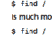

> 如果你使用 `find` 处理成千上万个文件，`xargs` 比 `-exec` 更高效。因为 `xargs` 仅在需要时调用命令，因此使用更少的系统资源并执行更快。例如，命令
> 
> `$ find / -name core -print | xargs rm -f`
> 
> 比
> 
> `$ find / -name core -exec rm -f {} ;`
> 
> 更高效。

### expr 命令
`expr` 命令可用于执行简单的整数算术。`expr` 命令的一般语法是

```
expr int1 op int2
```

这里，`int1` 和 `int2` 是整数，`op` 是表 18.3 中给出的运算符之一。分隔 `op` 与 `int1` 和 `int2` 的空格是必需的。

**表 18.3 expr 操作数**

| 操作数 | 描述 |
|---|---|
| + | 加法 |
| - | 减法 |
| * | 乘法 |
| / | 整数除法（结果中的任何分数部分将被丢弃） |
| % | 除法运算的余数（也称为模函数） |

让我们看几个说明 `expr` 用法的示例。第一个示例说明乘法：

```
$ expr 3 \* 5
15
```

请注意，`*` 符号必须转义，以防止 shell 将其视为文件名扩展元字符。第二个示例说明整数除法：

```
$ expr 8 / 3
2
```

请注意，分数结果被忽略，只返回整数部分。第三个示例说明余数或模函数：

```
$ expr 19 % 7
5
```

余数或模是除法运算后剩余的部分。模函数通常简称为 `mod`。在此示例中，`7` 进入 `19` 两次余数为 `5`。可以说 `19 mod 7` 等于 `5`。

在 shell 编程中，`expr` 通常在反引号内使用来递增变量：

```
CNT=`expr $CNT + 1`
```

在此示例中，`expr` 将 `1` 加到变量 `CNT` 的当前值。命令替换允许你将新值赋回变量 `CNT`。

### expr 与正则表达式
`expr` 命令——在 `ksh`、`zsh` 以及 `bash`（2.x 及更高版本）的新版本中——还可以返回正则表达式匹配的字符数。其语法如下

```
expr str : regex
```

这里，`str` 是字符串，`regex` 是要计数的字符的正则表达式。例如：

```
$ ABC=1234abc
$ expr $ABC : '.*'
7
```


这里，`.*`是一个正则表达式模式，表示所有字符，因此变量`$ABC`的所有字符都被计数。在这种情况下，`expr`显示它包含七个字符。在以下示例中

```
$ expr $ABC : '[0-9]*'
4
```

正则表达式`[0-9]*`匹配任意一组数字。在此示例中，`expr`统计字符串开头出现的数字个数。

如果正则表达式`regex`的一部分被转义括号分组，`expr`会返回括号指示的模式部分：

```
$ expr abcdef : '\(..\).\|..'
cd
$
```

每个句点都是正则表达式通配符，表示给定字符串的一个字符。中间的两个句点被包含在转义括号中，因此这两个字符`cd`被输出。此示例还说明`expr`之后的字符可以是字面字符字符串，但在脚本中更常见的是该字符串由变量或命令替换生成。

### bc 命令
`bc`命令是一个不限于整数的算术工具：

```
$ bc
scale=4
8/3
2.6666
2.5 * 4.1/6.9
1.4855
quit
$
```

在此示例中，你调用`bc`并将`scale`设置为`4`，这意味着你希望它将任何分数计算到小数点后四位。你要求它计算`8/3`，结果为`2.6666`，然后进行更复杂的计算。请注意空格是可选的。最后你输入`quit`返回到 shell 提示符，`bc`可以处理加法（`+`）、减法（`-`）、乘法（`*`）、除法（`/`）、余数或取模（`%`）以及整数指数运算（`^`）。它可以准确计算任意大小的某些数字

```
9238472938742937 * 29384729347298472
27147092868732339864748626982264
```

并且`bc`可用于 shell 变量赋值，将计算值赋给变量：

```
AVERAGE=`echo "scale=4; $PRICE/$UNITS" | bc`
```

这里使用`echo`命令打印被管道传递给`bc`的指令。第一个指令将`scale`设置为`4`；第二个指令是除法运算。这些指令被管道传递给`bc`，后者进行计算并返回结果。反引号允许将`bc`的结果存储在变量`AVERAGE`中。

你也可以使用`bc`在不同数字基数之间转换：

```
bc
ibase=16
obase=8
400
100
77
2F
10*3
18
quit
$
```

`obase=16`将输出基数设置为十六进制；`ibase=8`将输入基数设置为八进制。重要的是先设置输出基数。首先你输入`400`。它显示八进制`400`是十六进制`100`。接下来你输入`77`。它显示八进制`77`是十六进制`3F`。然后你将`10`和`3`相乘，结果等于`24`，因为八进制`10`是十进制`8`，`8*3`为`24`。然而，由于输出基数是十六进制，`bc`将十进制`24`转换为十六进制，结果为`18`。

### 摘要
在本章中，你学习了几种杂项工具：

- `eval`
- `:`
- `type`
- `sleep`
- `find`
- `xargs`
- `expr`
- `bc`
- `rsh`/`rlogin`/`rcmd`/`remote`

本章很大一部分讨论了`find`命令的基础知识。请查阅`find`的手册页，你可以看到其他对脚本有用的`find`选项，这里未涉及。

### Questions

- 1. 你即将运行一个名为`process2`的自定义命令，但首先想确定该命令位于何处。请给出一个 UNIX 命令来完成此操作。
- 2. 如何确定`/data`下所有包含名为`process2`的文件的目录，同时允许显示任何可能的前缀或后缀（例如，你想查找`process2-doc`这样的名称）？
- 3. 如何将变量`PRICE`中的数值增加为当前值的`3.5`倍？允许小数点后保留两位数字。

### Terms

`内置命令`其代码是 shell 的一部分的命令，而非存在于单独磁盘文件中的实用程序，后者必须在执行前读入内存。

`取模`请参阅余数。

`无操作`一个不执行任何操作的命令，因此可用作虚拟命令或占位符，在语法要求命令时使用。

`余数`除法运算的余数，即当数额不能整除时剩余的部分。


## Part III

### Advanced Topics

Hour

- 19 信号
- 20 调试
- 21 使用函数解决问题
- 22 使用 Shell 脚本解决问题
- 23 可移植性脚本编写
- 24 Shell 编程常见问题解答


### Hour 19

#### Signals

*信号是发送给程序的软件中断，表示发生了重要事件。事件可能从用户请求到非法内存访问错误不等。某些信号，例如中断信号，表示用户要求程序执行非正常控制流程中的操作。*

由于信号可以在脚本执行期间的任何时间到达，它们为 shell 脚本增加了额外的复杂性。脚本必须考虑到这一点，并包含额外的代码，以便在信号到达时无论脚本正在做什么，都能确定适当的响应。

本章将介绍以下与信号相关的主题：

- 在 shell 编程中遇到的不同类型的信号
- 如何使用`kill`命令发送信号
- 处理信号
- 如何在脚本中使用信号

#### How Are Signals Represented?

在 UNIX 中，每种可能发生的事件都由一个单独的信号表示。每个信号都是一个小的正整数。在 shell 脚本编程中最常遇到的信号列于表 19.1。这些信号在所有版本的 UNIX 上都可用。

Table 19.1 Important Signals for Shell Scripts

| 名称 | 值 | 描述 |
|---|---|---|
| SIGHUP | 1 | 检测到控制终端挂断或控制进程死亡 |
| SIGINT | 2 | 来自键盘的中断 |
| SIGQUIT | 3 | 来自键盘的退出 |
| SIGKILL | 9 | 终止信号 |
| SIGALRM | 14 | 闹钟信号（用于计时器） |
| SIGTERM | 15 | 终止信号 |

除了表 19.1 中列出的信号外，你可能会看到对信号 0 的引用。该信号更像是 shell 约定而非真正的信号。当 shell 脚本使用`exit`命令退出或执行脚本中的最后一个命令时，shell 会向自身发送信号 0，以指示脚本已完成并应终止。

#### Getting a List of Signals

系统理解的所有信号都列在 C 语言头文件`/usr/include/sys/signal.h`中。一些厂商为此文件提供手册页，你可以按如下方式查看：

```
$ man signal
```

获取系统支持的信号列表的另一种方法是使用`kill`命令的`-l`选项。在 Solaris 系统上，输出为

```
$ kill -l
1) SIGHUP      2) SIGINT      3) SIGQUIT     4) SIGILL
5) SIGTRAP     6) SIGABRT     7) SIGEMT      8) SIGFPE
9) SIGKILL    10) SIGBUS     11) SIGSEGV    12) SIGSYS
13) SIGPIPE   14) SIGALRM    15) SIGTERM    16) SIGUSR1
17) SIGUSR2   18) SIGCHLD    19) SIGPWR     20) SIGWINCH
21) SIGURG    22) SIGIO      23) SIGSTOP    24) SIGTSTP
25) SIGCONT   26) SIGTTIN    27) SIGTTOU    28) SIGPOLL
29) SIGPROF   30) SIGXCPU    31) SIGXFSZ    32) SIGWAITING
33) SIGLWP    34) SIGFREEZE  35) SIGTHAW    36) SIGCANCEL
37) SIGLOST
```

实际的信号集合取决于你的 UNIX 版本。

#### Default Actions

每个信号，包括表 19.1 中列出的信号，都有一个与其关联的默认操作。默认操作是在没有信号处理程序的情况下系统代表程序采取的操作。信号处理程序是由程序提供的函数，定义在接收到信号时要采取的操作。信号处理程序将在本章后面介绍。

一些常见的默认操作是

- 终止进程。
- 忽略信号。
- 转储核心。这会创建一个名为`core`的文件，其中包含进程接收到信号时的内存映像。
- 停止进程。
- 继续已停止的进程。

我们感兴趣的信号都具有相同的默认操作：终止进程。

#### Delivering Signals

有几种方法可以将信号发送给程序。最常见的方法是用户在程序执行时按下 Ctrl+C，从而向程序发送`SIGINT`。接收到`SIGINT`后，程序的默认行为是终止。

另一种发送信号的方法是`kill`命令：

```
kill -signal pid
```


这里 `signal` 是要发送的信号的编号或名称，`pid` 是应发送信号的目标。回顾第 7 章“进程”，`PID`（进程 ID）是内核在程序执行时分配给程序的编号。

#### SIGTERM

在前几章中，我们研究了不指定信号使用 `kill` 的情况。当省略 `signal` 时，`kill` 会向 `pid` 指定的进程发送 `SIGTERM`（终止）。因此以下两个命令是等效的：

```
kill pid
```

```
kill -s SIGTERM pid
```

#### SIGHUP

以下命令

```
$ kill -s SIGHUP 1001
```

向 PID 为 1001 运行的程序发送 HUP（挂断）信号。你也可以按如下方式使用信号的数值：

```
$ kill -1 1001
```

此命令也向 PID 为 1001 运行的程序发送挂断信号。尽管该信号的默认操作是终止进程，但许多 UNIX 程序使用该信号作为应重新初始化自身的指示。因此，如果你试图终止或杀死一个进程，应使用不同的信号。

#### SIGQUIT and SIGINT

在某些情况下，`SIGTERM` 不足以终止进程。在这种情况下，你可以尝试向进程发送 `SIGQUIT`（退出）或 `SIGINT`（中断）：

```
$ kill -s SIGQUIT 1001
```

或

```
$ kill -s SIGINT 1001
```

其中一个信号应能终止进程，要么要求它退出（QUIT 信号），要么要求它中断其处理（INT 信号）。

#### SIGKILL

要终止一个顽固拒绝死亡的程序，你可以使用 `SIGKILL`。该信号通常用其整数值 9 表示。`SIGKILL` 的特殊属性是它无法被捕获；任何接收到它的进程都会立即终止。

以下命令向 PID 为 1001 运行的程序发送 `SIGKILL`：

```
$ kill -9 1001
```

使用 `SIGKILL` 的缺点是接收它的进程从未有机会正确清理，因此可能会使它正在使用的文件处于损坏状态。因此，你应仅在所有其他信号都无法终止进程时才使用此信号。

#### Dealing with Signals

程序可以以三种方式处理信号：

- 什么都不做，让默认操作发生。这是程序处理信号最简单的方法，因为它不需要额外的代码。
- 忽略信号并继续执行。这种方法与什么都不做不同，因为忽略信号要求程序具有显式忽略信号的代码。
- 捕获信号并执行特定于信号的命令。此方法要求程序定义一个在接收到信号时执行的函数。这是处理信号最复杂且最强大的方法。

第一种方法是所有 shell 脚本的默认行为。迄今为止您查看过的所有脚本都使用此方法处理信号。本节说明使用第二种和第三种方法的脚本。

#### trap 命令

`trap` 命令设置和取消在接收到信号时采取的操作。其语法是

```
trap name sigs
```

这里 `name` 要么是一组命令的列表，要么是要执行的 shell 函数的名称，而 `sigs` 是一组信号的列表。当脚本接收到 `sigs` 中列出的信号时，`name` 指定的命令将被执行。如果省略 `name`，`trap` 会将给定 `sigs` 的操作重置为默认操作。

`trap` 的一些常见用途是

- 清理临时文件
- 始终忽略信号
- 仅在关键操作期间忽略信号

我们将在本章后面介绍第四种用途，即设置计时器。

#### 清理临时文件

如果脚本创建了临时文件，通常的做法是在脚本退出前删除这些文件。大多数脚本在正常执行期间能正确执行此类清理，但很少有脚本在信号发生时执行适当的清理操作。请考虑以下脚本：

```
#!/bin/sh

TMPF=.arch

uname -m > $TMPF

read ARCH < $TMPF

rm -f $TMPF

echo $ARCH

exit 0
```

此脚本创建了一个临时文件 `.arch`，并在退出前将其删除。在正常情况下，脚本退出后临时文件将不存在。然而，如果接收到信号，临时文件可能不会被删除。为了解决这个问题，我们可以使用 `trap` 如下：

```
trap 'rm -f $TMPF; exit 2' 1 2 3 15
```

当接收到 `SIGHUP`、`SIGINT`、`SIGQUIT` 或 `SIGTERM` 信号时，临时文件将被删除，并以返回代码 2 调用 `exit`，表示脚本在异常情况下退出。通常脚本正常退出时，其退出代码为 0。如果发生任何异常，退出代码应为非零。

有时需要更复杂的清理。在这种情况下，应使用 shell 函数或信号处理程序。例如，我们可以修改 `uu` 脚本（在第 13 章“参数”中描述）使其具备信号安全性，可以添加类似以下内容：

```
cleanup() {

  if [ -f "$OUTFILE" ] ; then

    print "Cleaning Up...";

    rm -f "$OUTFILE" 2> /dev/null ;

    echo "Done."

  fi

}

trap cleanup 1 2 3 15
```

函数 `Cleanup` 将在脚本接收到 `SIGHUP`、`SIGINT`、`SIGQUIT` 或 `SIGTERM` 信号时被调用。此函数会删除脚本的输出文件（如果该文件存在）。通过在接收到信号时进行清理，不会留下部分编码的文件来混淆用户。

#### 多个信号处理程序

在前面的示例中，单个信号处理程序用于所有信号。这不是严格要求，并且经常不同信号有不同的处理程序。例如，以下 `trap` 命令完全有效：

```
trap cleanup 2 15

trap init 1
```

```
echo "Usage: $0 cmd."

exit 1

fi

Init() {

  if [ "$1" != "" -a "$1" != "0" ] ; then

    if kill -0 $1 > /dev/null 2>&1 ; then

      kill $1 > /dev/null 2>&1 || return

    fi

  fi

  $PROG &

}

Cleanup() {

  if [ "$1" != "" -a "$1" != "0" ] ; then

    kill -9 $1 > /dev/null 2>&1

  fi

  exit 2

}

trap Cleanup 2 3 15

trap Init 1

while ; ;

do

  if [ "$1" != "" -a "$1" != "0" ] ; then

    wait $1

  fi

  $PROG &

done

exit 0
```

此脚本在后台启动作为第一个参数指定的程序，并等待该程序终止。如果程序终止，它将被再次启动。脚本在接收到 `SIGINT`、`SIGQUIT` 或 `SIGTERM` 时退出。如果脚本接收到 `SIGHUP`，它会尝试重新启动程序。

#### 忽略信号

在某些情况下，如果接收到信号，很难进行清理。在这种情况下，忽略信号比处理它们更好。忽略信号有两种方法：

```
trap '' sigs

trap : sigs
```

这里，`sigs` 是要忽略的信号列表。第一种形式向 `trap` 传递一个空 `''` 参数，`trap` 将其解释为忽略。第二种形式指定要执行的命令为 `:`，这是一个空操作命令，如你可能回忆的那样。由于两种形式产生相同的结果，请随意使用其中任何一种。

作为示例，我们可以通过在脚本开头添加以下行来更新第 12 章中的 `uu` 脚本以忽略所有信号：

```
trap '' 1 2 3 15
```

#### 在关键操作期间忽略信号

如果你在脚本开头指定如下的 `trap` 命令

```
trap '' 1 2 3 15
```

脚本将忽略所有信号直到完成。从程序员的角度来看，这似乎是个好主意，但从用户的角度来看则不是。理想的方法是仅在脚本的最关键部分期间忽略信号。这允许用户终止脚本，同时确保关键操作不会被信号中断而执行。

假设我们有一个 shell 脚本，其中有一个名为 `DoImportantStuff()` 的 shell 函数，不应被信号中断。为了确保此函数不被中断，你可以在调用函数之前安装信号处理程序，并在调用完成后将其重置：

```bash
trap '' 1 2 3 15

DoImportantStuff

trap 1 2 3 15
```

第二次调用 `trap` 只有信号参数。这会导致 `trap` 将每个信号的处理程序重置为默认处理程序。

#### 设置计时器

在许多脚本中，存在执行需要大量时间完成的命令的关键部分。在极少数情况下，这些命令可能无法完成处理。为了解决这种情况，你需要在脚本中设置一个计时器。当计时器到期时，脚本应终止并通知用户问题。在本节中，你将查看一个简单的脚本，演示使用 `SIGALARM` 结合信号处理程序设置计时器的主要方面。

我们脚本的主体执行以下操作：

- 1. 为 `SIGALARM` 设置处理程序。
- 2. 设置计时器。
- 3. 执行程序。
- 4. 等待程序执行完成。
- 5. 取消设置计时器。

如果计时器在程序执行完成前到期，`SIGALARM` 的处理程序应终止程序。

主体类似于以下内容：

```bash
```


# main()

```
trap AlarmHandler 14

SetTimer 15

SPROG &

CHPROGIDS="$CHPROGIDS $!"

wait $!

UnsetTimer

echo "All Done."

exit 0
```

主体中唯一之前未提及的是 `CHPROGIDS` 变量。此变量维护脚本启动的进程的 PID 列表，以便 `SIGALARM` 的信号处理程序可以终止这些进程。

## AlarmHandler

现在让我们来看一下 `SIGALARM` 的信号处理程序 `AlarmHandler`：

```bash
AlarmHandler() {
  echo "Got SIGALARM, cmd took too long."
  KillSubProcs
  exit 14
}
```

这是一个简单的函数，它向屏幕打印一条消息，调用函数 `KillSubProcs`，并以退出代码 14 退出。此退出代码用于指示警报被触发。

`KillSubProcs` 函数杀死脚本的所有子进程，这些进程存储在变量 `CHPROGIDS` 中：

```bash
KillSubProcs() {
  kill ${CHPROGIDS:-$!}
  if [ $? -eq 0 ]; then
    echo "Sub-processes killed."
  fi
}
```

这是一个简单的函数，它向屏幕打印一条消息，调用函数 `KillSubProcs`，并以退出代码 14 退出。此退出代码用于指示警报被触发。

`KillSubProcs` 函数杀死脚本的所有子进程，这些进程存储在变量 `CHPROCSIDS` 中：

```bash
KillSubProcs() {
  kill $CHPROCSIDS
  if [ $? -eq 0 ] ; then
    echo "Sub-processes killed."
  fi
}
```

## SetTimer

一旦 `SIGALARM` 的信号处理程序就位，我们需要一个设置计时器的函数。我们使用的函数是 `SetTimer`：

```bash
SetTimer() {
  DEF_TOUT=${1:-10}
  if [ $DEF_TOUT -ne 0 ] ; then
    sleep $DEF_TOUT & kill -s 14 $$
    CHPROCSIDS="$CHPROCSIDS $!"
    TIMERPROC=$!
  fi
}
```

此函数接受一个参数，表示计时器应设置的秒数。默认值为 10 秒。

计时器本身相当简单；它只是命令 `sleep $DEF_TOUT & kill -s 14 $$` 在后台执行。此命令使用 `sleep` 等待一段时间（存储在 `$DEF_TOUT` 中），之后使用 `kill` 向脚本发送 `SIGALRM`（请记住脚本的 PID 存储在 `$$` 中）。

由于计时器在后台运行，我们需要使用其 PID 更新子进程列表 `$CHPROCSIDS`。我们还将计时器的 PID 保存到 `$TIMERPROC`，以便以后在需要取消设置计时器时使用它。

## UnsetTimer

最后，我们需要一个函数来取消 `SetTimer` 启动的计时器。`UnsetTimer` 函数通过使用 `kill` 终止计时器来实现这一点（`SetTimer` 将计时器的 PID 保存到 `$TIMERPROC` 中）：

```bash
UnsetTimer() {
  kill $TIMERPROC
}
```

### 完整的计时器脚本

完整的计时器脚本如下：

```sh
#!/bin/sh

AlarmHandler() {
  echo "Got SIGALARM, cmd took too long."
  KillSubProcs
  exit 14
}

KillSubProcs() {
  kill $CHPROCSID:$!
  if [ $? -eq 0 ] ; then
    echo 'Sub-processes killed.' ;
  fi
}

SetTimer() {
  DEF_TOUT=$1:10;
  if [ $DEF_TOUT -ne 0 ] ; then
    sleep $DEF_TOUT & $!
    CHPROCSID=$CHPROCSID $!
    TIMERPROC=$!
  fi
}

UnsetTimer() {
  kill $TIMERPROC
}

# main()
trap AlarmHandler 14

SetTimer 15

$PROG &

CHPROCSID=$CHPROCSID $!

wait $!

UnsetTimer

echo "All Done."

exit 0
```

### 摘要

本章介绍了信号的概念。信号通知程序发生了重要事件。

首先我们研究了 shell 编程中遇到的最常见信号。随后讨论了获取系统支持的信号列表的方法。本节还介绍了信号传递的概念以及与信号关联的默认操作。

第二部分演示了两种信号处理方法。第一种方法是捕获信号并使用信号处理器处理它们。第二种方法是忽略信号。最后，我们探讨了使用信号设置计时器的用法。

### 问题

1. 以下是在本章前面介绍的“live”脚本的主体。修改脚本，使 `SIGQUIT` 在 `wait` 命令返回后导致其退出。

```bash
# main()
trap Cleanup 2 3 15
trap Init 1
PROG=$1
Init
while : ;
do
  wait $!
  SPROG &
done
```

2. 为计时器脚本添加一个信号处理器来处理 `SIGINT`。

### 术语

`信号` 信号是发送给程序的软件中断，用于指示发生了重要事件。

`默认操作` 默认操作是在没有信号处理器的情况下，系统代表程序采取的操作。

`信号处理器` 信号处理器是程序提供的函数，定义了接收到信号时应采取的操作。

## 第 20 小时


### 调试

你所查看的大多数脚本都相当简短，因此调试问题归结为检查输出以确保其正确。

对于较大的 shell 脚本，尤其是用于更改系统配置的脚本，仅根据输出推断问题来源是不够的。到你得到输出时可能为时已晚——脚本可能已做出错误且可能具有破坏性的修改。

幸运的是，shell 提供了多个内置命令来启用不同的调试支持模式。内置调试支持在你需要为他人开发的大型脚本添加功能时非常有帮助；它可以帮助你确保你的更改不会影响脚本的其余部分。

本章介绍了调试 shell 脚本的几种技术，重点如下：

- 语法检查
- Shell 跟踪

### 启用调试

到目前为止，你对执行 shell 脚本的基本语法已经相当熟悉：

```bash
$ script arg1 arg2 ... argN
```

这里 `script` 是脚本的名称，`arg1` 到 `argN` 是脚本的参数。

执行 shell 脚本的另一种方法是

```bash
$ /bin/sh opt script arg1 arg2 ... argN
```

这会调用 shell，在本例中为 `/bin/sh`，并使用 `opt` 指定的调试选项，并指示 shell 执行 `script`。表 20.1 列出了各种调试选项。

启用调试的第二种方法是更改脚本的第一行。通常，脚本的第一行是

```bash
#!/bin/sh
```

UNIX 使用这一行来确定可用于执行脚本的 shell。这表示应使用 shell `/bin/sh` 来执行脚本。你可以按如下方式修改这一行以指定调试选项：

```bash
#!/bin/sh opt
```

这些启用调试模式的方法在脚本被调用时生效，因此有时被称为调用激活调试模式。

表 20.1 Shell 脚本的调试选项

| 名称 | 选项 | 描述 |
|---|---|---|
| 无执行 | -n | 读取所有命令，但不执行它们。 |
| 详细 | -v | 显示读取时的所有行。 |
| 执行跟踪 | -x | 显示命令及其参数在执行时。常被称为 shell 跟踪。 |

### 调试与 `$-`

当其中一个调试选项被激活时，对应该选项的字母会被添加到变量 `$` 中。例如，如果使用 `-v`（详细）选项，则字母 `v` 会被添加到 `$` 中。同样，当使用 `-x` 时，字母 `x` 会被添加到 `$` 中。

你可以通过使用类似以下的 `case` 语句来检测其中一个选项是否处于活动状态：

```bash
case $- in
*v*) : # verbose mode
*x) ;; shell tracing mode
;;
esac
```


### 使用 set 命令

在调用激活的调试模式中，调试模式在脚本开始时生效并一直保持到脚本退出。大多数时候你只需要调试一个函数或脚本的一小部分。在这些情况下，为整个脚本启用调试是过度操作。

正如本章后面将看到的，调试输出相当庞大，通常很难从噪音中分辨出真正的错误。你可以通过使用 `set` 命令仅在需要调试信息的脚本部分启用调试模式来解决此问题。

### 使用 set 启用调试

`set` 命令的基本语法是

```
set opt
```

这里 `opt` 是表 20.1 中列出的选项之一。

`set` 命令可以在 shell 脚本中的任何位置使用，许多脚本在脚本正常执行过程中使用它来更改调试标志。因为这些调试模式仅在 shell 脚本程序员使用 `set` 命令时才被激活，所以它们有时被称为程序员激活模式。

考虑以下 shell 脚本的摘录（行号仅供参考）：

```
1 #!/bin/sh
2 set -x
3 if [ -z "$1" ] ; then
4     echo "ERROR: Insufficient Args."
5     exit 1
6 fi
```

该脚本在第 2 行启用了 shell 跟踪（`-x` 选项）：

```
set -x
```

因为该命令出现在 `if` 语句（第 3 行至第 6 行）之前，所以在 `if` 语句执行期间 shell 跟踪将处于活动状态。除非在脚本后面显式禁用，否则 shell 跟踪将一直生效直到脚本退出。你将在本章的“Shell Tracing”部分查看 shell 跟踪对脚本输出的影响。

### 使用 set 禁用调试

你可以使用 `set` 命令按如下方式禁用调试模式：

```
set +opt
```

这里 `opt` 是表 20.1 中给出的选项之一对应的字母。例如，以下命令禁用 shell 跟踪：

```
$ set +x
```

要停用已启用的任何和所有调试模式，可以使用命令：

```
$ set -
```

### 为单个函数启用调试

`set` 命令最常见的用途之一是在函数执行前启用特定调试模式，然后在函数完成时禁用调试。

例如，假设你有一个有问题的函数名为 `BuggyFunction()`，并且你只想在该函数执行期间启用 shell 跟踪。你可以使用以下命令：

```
set -x ; BuggyFunction; set +x ;
```

这里调试模式在函数被调用前立即启用，并在函数完成后禁用。这种方法比在函数内部显式使用 `set` 命令启用调试更受欢迎，因为它使函数的实现保持不变。

### 使用语法检查

处理任何 shell 脚本时，在尝试执行之前检查脚本的语法是个好主意。这将帮助你找到并修复大多数问题。

要启用语法检查，请按如下方式使用 `-n` 选项：

```
/bin/sh -n script arg1 arg2 ... argN
```

这里 `script` 是脚本的名称，`arg1` 到 `argN` 是该脚本的参数。如果 `script` 中存在语法错误，shell 会生成错误消息以指示错误来源。

检查以下脚本的语法（行号仅供参考），看看能否发现错误：

```
1 #!/bin/sh
2
3 YN=y
4 if [ $YN = "yes" ]
5     echo "yes"
6 fi
```

如果此脚本存储在文件 `buggy1.sh` 中，可以按如下方式检查其语法：

```
$ /bin/sh -n ./buggy1.sh
```

输出如下所示：

```
./buggy1.sh: syntax error at line 7: 'fi' unexpected
```

这告诉你，当 shell 尝试读取第 7 行时，发现第 6 行的 `fi` 语句是不预期的。到现在你可能已经明白，shell 试图读取第 7 行的原因是第 4 行的 `if` 语句没有用 `then` 语句正确终止：

```
if [ $YN = 'y' ]
```

此行应读作：

```
if [ $YN = 'y' ] ; then
```

通过此更改，你会发现命令

```
$ /bin/sh -n ./buggy1.sh
```

不会产生任何输出，表明脚本中没有语法错误。

### 为什么语法检查很重要

在查看了前面示例中的 shell 脚本后，你可能会想知道为什么不能直接执行 shell 脚本来确定问题。毕竟，命令的输出：

```
$ /bin/sh ./buggy1.sh
```

```
buggy1.sh: syntax error at line 7: 'fi' unexpected
```

与以下命令的输出相同：

```
$ /bin/sh -n ./buggy1.sh
```

在这种特定情况下，这没有区别，但并非总是如此。例如，考虑以下脚本（行号仅供参考）：

```sh
#!/bin/sh

Failed() {
  if [ $1 -ne 0 ]; then
    echo "Failed. Exiting."; exit 1;
  fi
  echo "Done."
}

echo "Deleting old backups, please wait... \c"
rm -r backup > /dev/null 2>&1
Failed $?

echo "Make backup (y/n)? \c"
read RESPONSE
case $RESPONSE in
  [yY][yY][Ee][Ss]*)
    echo "Making backup, please wait... \c"
    cp -r docs backup
    Failed $?
    ;;
  [nN][Oo])
    echo "Backup Skipped." ;;
esac
```

此脚本中至少有三个错误。看看你能否找到它们。


> 在找到并修复其中包含的错误之前，不要尝试运行此脚本。

如果此脚本在名为 `buggy2.sh` 的文件中，执行它会产生以下输出：
Deleting old backups, please wait... Done.
Make backup (y/n)?

在提示符下输入 `y` 会产生以下错误：
./buggy2.sh: syntax error at line 21: ')' unexpected

由于脚本中的错误，你无法进行备份，而且你已经丢失了之前的备份。可以想象，这是一个非常糟糕的情况。

脚本没有更早检测到错误的原因在于 shell 读取和执行脚本的方式；它逐行读取和执行 shell 脚本，就像在命令行中一样。在这种情况下，shell 会读取并执行行，直到遇到问题。

当指定 `-n` 选项时，shell 不会执行脚本。它只是检查每一行的语法。在前面的示例中使用此选项将避免运行脚本时遇到的问题。

### 使用详细模式

现在你知道了为什么应该使用语法检查，让我们通过查看 `buggy2.sh` 的第 21 行来追踪问题的来源：

21 [nN][Oo])

不足以确定问题的来源。有时知道语法错误发生的位置是不够的——你必须知道错误发生的上下文。为了确定问题的上下文，你可以使用 `-v`（v 代表 verbose）调试模式。当指定此选项时，shell 会在读取时打印脚本的每一行。

如果单独指定 `-v` 选项，shell 会执行脚本中的每一行。因为你只想检查语法，所以需要将 `-n` 和 `-v` 选项组合如下：

```
$ /bin/sh -nv script arg1 arg2 ... argN
```

如果使用这些调试选项执行 `buggy2.sh`

```
$ /bin/sh -nv ./buggy2.sh
```

输出如下所示（行号仅供参考）：

```
1 #!/bin/sh
2
3 Failed() {
4   if [ $1 -ne 0 ]; then
5     echo 'Failed. Exiting.' ; exit 1 ;
6   fi
7   echo 'Done.'
8 }
9
10 echo 'Deleting old backups, please wait... \c'
11 rm -r backup > /dev/null 2>&1
12 Failed $?
13
14 echo 'Make backup (y/n)? \c'
15 read RESPONSE
16 case $RESPONSE in
17   [yY][yY][Ee][Ss]*)
18   echo 'Making backup, please wait... \c'
19      cp -r docs backup
20      Failed $?
21   [nN][Oo])
-> //buggy2.sh: syntax error at line 21: '}' unexpected
```

根据此输出，问题很明显：第 20 行没有用 `;;` 终止 `case` 语句的第一个模式。你可以进行以下任一更改来修复脚本：


Failed ;;

or

Failed

;;

```

在进行任一更改后，你会发现命令

```
$ /bin/sh -n buggy2.sh
```

不会产生错误消息。正如你在下一节中将看到的，这并不一定意味着脚本没有错误。

### Shell 追踪

在许多情况下，语法检查会让你的脚本看起来健康无恙，即使其中仍潜伏着错误。对 shell 脚本运行语法检查类似于对文本文档运行拼写检查——它可能会找到大部分拼写错误，但无法修复诸如 `read` 拼写成 `red` 之类的问题。为了找到并修复文本文档中的此类错误，你需要校对它。Shell 追踪就是对你的 shell 脚本进行校对。

在 shell 追踪模式下，每个命令都会以执行的确切形式打印。因此，shell 追踪模式通常被称为执行追踪模式。Shell 追踪由 `-x` 选项启用（`x` 代表 `execution`）。以下命令可为整个脚本启用追踪：

```
$ /bin/sh -x script arg1 arg2 ... argN
```

也可以使用 `set` 命令启用追踪：

```
set -x
```

在输出中，以加号 (`+`) 开头的行是 shell 执行的命令。其他行是这些命令的输出。正如你从输出中看到的，shell 会打印它执行的确切命令。这在调试中非常有用，因为它使你能够确定是否所有替换都已正确执行。

### 使用 Shell 追踪查找语法错误

在前面的示例中，你使用了脚本 `buggy2.sh`。此脚本的一个问题是它在询问是否要创建新备份之前就删除了旧备份。为了解决这个问题，脚本重写如下：

```bash
#!/bin/sh

Failed() {

  if [ $1 -ne 0 ] ; then

    echo "Failed. Exiting." ; exit 1 ;

  fi

  echo "Done."

}

YesNo() {

  echo "$1 (y/n)? \c"

  read RESPONSE

  case $RESPONSE in

    [yY][yY][Ee][Ss]) RESPONSE=y ;;

    [nN][Oo]) RESPONSE=n ;;

  esac

}

YesNo "Make backup"

if [ $RESPONSE = "y" ] ; then

  echo "Deleting old backups, please wait... \c"

  rm -fr backup > /dev/null 2>&1

  Failed $?

  echo "Making new backups, please wait... \c"

  cp -r docs backup

  Failed $?

fi
```

此脚本中至少有三个语法错误和至少一个逻辑疏忽。看看你能否找到它们。

假设脚本名为 `buggy3.sh`，首先按如下方式检查其语法：

```
$ /bin/sh -n ./buggy3.sh
```

因为没有输出，所以可以执行它：

```
$ /bin/sh ./buggy3.sh
```

脚本首先提示如下：

```
Make backup (y/n)?
```

回答 `y` 会产生类似以下的输出：

```
Deleting old backups, please wait... Done.
Making new backups, please wait... buggy3.sh: test: argument expected
```

现在你知道脚本存在问题，但错误消息没有告诉你问题所在，因此你需要手动追踪。从输出中你知道旧备份已成功删除；因此，错误可能在脚本的以下部分：

```
echo "Making new backups, please wait... \c"
cp -r docs backup
Failed
```

让我们仅为此部分启用 shell 追踪：

```
set -x
echo "Making new backups, please wait... \c"
cp -r docs backup
Failed
set +x
```

输出如下所示（假设你回答 `y`）：

```
Make backup (y/n)? y
Deleting old backups, please wait... Done.
+ echo Making new backups, please wait... \c
Making new backups, please wait... + cp -r docs backup
Failed
+ { -ne 0 }
buggy3.sh: test: argument expected
```

从此输出可以看出，问题出现在以下语句中：

```
[ -ne 0 ]
```

根据第 11 章“Flow Control”，你知道数值测试命令的形式是

```
[ num1 operator num2 ]
```

这里看起来 `num1` 不存在。此外，从追踪中可以看出，此错误发生在执行 `Failed` 函数之后：

```
Failed() {
    if [ $1 -ne 0 ] ; then
    echo "Failed: Exiting." ; exit 1 ;
}
```

```
fi
 echo "Done."
}
```

此函数中只有一个数值测试；该测试比较 `$1`，即函数的第一个参数，以查看其是否等于 `0`。问题现在应该很明显了。当调用 `Failed` 时，你忘记为其提供参数：

```
echo "Making new backups, please wait... \c"
cp -r docs backup
Failed
```

因此，数值测试失败了。此 bug 有两种可能的修复方法。第一种是修复调用该函数的代码：

```
echo "Making new backups, please wait... \c"
cp -r docs backup
Failed $?
```

第二种是引用第一个参数 `"$1"` 来修复函数本身：

```
Failed() {
 if [ "$1" -ne 0 ] ; then
  echo "Failed. Exiting." ; exit 1 ;
 fi
 echo "Done."
}
```

通过引用第一个参数 `"$1"`，当函数在没有参数的情况下被调用时，shell 会使用空或空字符串。在这种情况下，数值测试不会失败，因为 `num1` 和 `num2` 都有值。

最好的做法是同时执行这两种修复。应用这些修复后，shell 追踪输出类似于以下内容：

```
Make backup (y/n)? y
Deleting old backups, please wait... Done.
+ echo Making new backups, please wait... \c
Making new backups, please wait... + cp -r docs backup
+ Failed $?
+ [ "$1" -ne 0 ]
+ echo Done.
Done.
+ set +x
```

### 使用 Shell 追踪查找逻辑错误

如前所述，此脚本中至少有一个逻辑错误。在 shell 追踪的帮助下，你可以定位并修复此错误。

考虑此脚本产生的提示：

```
Make backup (y/n)?
```

如果你不输入响应而只是按 Enter 或 Return，脚本会报告类似以下的错误：

```
./buggy3.sh: [: =: unary operator expected
```

为了确定此错误发生的位置，最好将整个脚本在 shell 追踪模式下运行：

```
$ /bin/sh -x ./buggy3.sh
```

输出类似于以下内容：

```
+ yes? Make backup
+ echo Make backup [y/n]? \c
+ /bin/echo Make backup [y/n]? \c
Make backup [y/n]? + read RESPONSE
[ + y ]
./buggy3.sh: [: =: unary operator expected
```

空白行是按下 Enter 或 Return 而未对提示进行响应的结果。shell 执行的下一行是错误消息的来源：

```
[ + y ]
```

这是 `if` 语句的一部分：

```
if [ $RESPONSE = "y" ] ; then
```

虽然这个问题可以通过仅引用 `$RESPONSE` 来修复，

```
if [ "$RESPONSE" = "y" ] ; then
```

更好的修复方法是确定它为何未被设置并更改该代码，使其始终设置 `$RESPONSE`。查看脚本，你会发现此变量由 `YesNo` 函数设置：

```
YesNo() {
    echo "$1 (y/n)? \c"
    read RESPONSE
    case $RESPONSE in


[yY][eE][sS]) RESPONSE=y ;;

[nN][oO]) RESPONSE=n ;;

esac

}

```

这里有两个问题。第一个是 `read` 命令

```
read RESPONSE
```

如果用户只是按 Enter 或 Return，则不会为 `$RESPONSE` 设置值。由于你无法更改 `read` 命令，你需要找到解决该问题的不同方法。

问题。基本上你有一个逻辑问题——`case` 语句需要验证用户输入，而它目前并未执行此操作。解决问题的简单方法是按如下方式更改 `YesNo`：

```
YesNo() {

  echo "$1 (y/n)? \c"

  read RESPONSE

  case "$RESPONSE" in

    [yY][Ee][Ss]) RESPONSE=y ;;

    *) RESPONSE=n ;;

  esac

}
```

现在你将除 "yes" 之外的所有响应都视为否定响应。这包括用户简单地输入 Enter 或 Return 时生成的空响应。

### 使用调试钩子

在之前的示例中，你能够使用 shell 追踪推断出 bug 的位置。为了为脚本的特定部分启用追踪，你必须编辑脚本并插入 `debug` 命令：

```
set -x
```

对于较大的脚本，更好的做法是嵌入调试钩子。调试钩子是能够在关键代码段中启用 shell 追踪的函数。调试钩子通常以两种方式之一激活：

- 使用命令行选项（通常为 `-d` 或 `-x`）运行脚本。
- 使用环境变量设置为 `true` 运行脚本（通常为 `DEBUG=true` 或 `TRACE=true`）。

以下函数允许你通过将 `DEBUG` 设置为 `true` 来激活和停用调试：

```
Debug() {

  if [ "$DEBUG" = "true" ] ; then

    if [ "$1" = "on" -o "$1" = "ON" ] ; then

      set -x

    else

      set +x

    fi

  fi

}
```

要激活调试，可以使用以下命令：

```
Debug on
```

要停用调试，可以使用以下任一命令：
`Debug`
`Debug off`

实际上，向此函数传递除 `on` 或 `ON` 之外的任何参数都会停用调试。

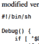

> 关于调试的常规做法是仅在必要时激活它。默认情况下，调试应处于关闭状态。

为了演示此函数的使用，你可以修改脚本 `buggy3.sh` 中的函数，使其在变量 `DEBUG` 被设置时自动启用调试。`buggy3.sh` 的修改版本如下：

```
#!/bin/sh

Debug() {

  if [ "$DEBUG" = "true" ] ; then

    if [ "$1" = "on" -o "$1" = "ON" ] ; then

      set -x

    else

      set +x

    fi

  fi

}

Failed() {

  Debug on

  if [ "$1" -ne 0 ] ; then

    echo "Failed. Exiting." ; exit 1 ;

  fi

  echo "Done."

  Debug off

}

YesNo() {

  Debug on

  echo "$1 (y/n)? \c"

  read RESPONSE

  case "$RESPONSE" in

    [yY]|[yY][eE][sS]) RESPONSE=y ;;

    *) RESPONSE=n ;;

  esac

  Debug off

}

YesNo 'Make backup'

if [ "$RESPONSE" = "y" ] ; then
```

```
echo 'Deleting old backups, please wait... \c'

rm -r backup > /dev/null 2>&1

Failed $?

echo 'Making new backups, please wait... \c'

cp -r docs backup

Failed $?

fi
```

如果脚本以以下任一方式执行，输出不会发生变化：

```
$ /bin/sh ./buggy3.sh

$ ./buggy3.sh
```

如果以以下任一方式执行同一脚本，则输出包含 shell 追踪：

```
$ DEBUG=true /bin/sh ./buggy3.sh

$ DEBUG=true ./buggy3.sh
```

### 摘要

在开发或维护大型 shell 脚本的过程中，你需要查找并修复其中的错误。本章介绍了如何使用 shell 来促进此任务。涵盖的一些主题包括：

- 启用调试
- 使用 `sh -n` 和 `sh -nv` 进行语法检查
- 使用 shell 追踪查找语法和逻辑错误
- 在 shell 脚本中嵌入调试钩子

通过学习调试 shell 脚本所使用的技术，你可以修复自己的脚本并维护其他程序员编写的脚本。

### 问题

- 1. 在 shell 脚本中启用调试的三种主要形式是什么？
- 2. 增强本章给出的 `Debug()` 函数，以便在调试停用后程序员必须按 Enter 或 Return。

当你调试包含数十个函数的脚本时，此功能使你能够在执行下一个函数之前研究特定函数的调试输出。

### 术语

`调试钩子` 在关键代码段中启用 shell 追踪的函数。

`执行追踪` 参见 shell 追踪。

`调用激活` 在脚本被调用时生效的调试模式的启用方法。

`程序员激活` 仅当 shell 脚本程序员使用 `set` 命令时才激活的调试模式。

`Shell 追踪` 每个命令都以其执行的确切形式打印。

`语法检查` 在不执行脚本的情况下验证其语法的过程。

## 第 21 小时


### 使用函数解决问题

在之前的章节中，你编写了执行特定任务的简短 shell 脚本。这些脚本中的许多执行了常见的操作，例如显示错误和警告消息以及提示用户输入。为了轻松重复这些任务，你为脚本创建了可重用的函数。

在本章中，你将此步骤更进一步，创建一个可在 shell 中 readily 重用的函数库。库是 shell 脚本可以访问的函数的存储库。你将检查的与库相关的具体主题是

- 库基础
- 创建库

### 库基础

在这本书的许多脚本中，你创建了显示错误消息并提示用户输入的实用函数。当两个脚本需要

使用相同的函数，你只是把函数从一个脚本复制到另一个脚本。这种方法在处理一两个脚本时效果很好，但在处理大量脚本时就会失效。假设你有一打脚本共享同一个函数，并且你在该函数中发现了一个错误。你可以想象修复所有这些脚本会有多困难。通用函数的存储库或库可以降低开发和维护这些 shell 脚本的复杂性。

### 什么是库？

创建函数库与创建 shell 脚本完全一样。脚本与库之间的唯一区别在于，库只包含函数定义，而脚本可以同时包含函数定义和可执行代码。脚本中的可执行代码由脚本中函数定义之外的所有命令组成。

在下面的 shell 脚本中，第 1、2 和 4 行是可执行代码：

```sh
1 #!/bin/sh
2 MSG="hello"
3 echo_error() { echo "ERROR:" $1 ; }
4 echo_error $MSG
```

第 3 行包含函数定义，不是可执行代码。

库不包含任何可执行代码；它只包含函数定义。例如，下面是一个库：

```sh
#!/bin/sh
echo_error() { echo "ERROR:" $1 ; }
echo_warning() { echo "WARNING:" $1 ; }
```

严格来说，没有什么能阻止库包含可执行代码；脚本与库之间的区别纯粹是概念上的。

### 使用库

你可以使用 `.` 命令在脚本中访问作为库定义的函数。其语法是

`. file`

这里，`file` 是库的路径名。当库通过 `.` 命令访问时，被称为 sourced 或 loaded。如果 `file` 不是有效的路径名或不是脚本，shell 将显示错误消息然后退出。因此，大多数脚本在执行任何命令之前都会先加载所有库。

例如，如果前一个示例中给出的函数存储在名为 `messages.sh` 的文件中，可以使用以下命令加载它们：

```sh
. messages.sh
```

你可以重写脚本

```sh
1 #!/bin/sh
2 MSG="hello"
3 echo_error () { echo "ERROR: $1" ; }
4 echo_error $MSG
```

以使用库 `messages.sh` 如下：

```sh
1 #!/bin/sh
2 . $HOME/lib/sh/messages.sh
3 MSG="hello"
```


### 4 echo_error `$MSG`

```
```

本示例假定文件 `messages.sh` 存储在目录 `$HOME/lib/sh` 中。如果该目录不包含 `messages.sh` 或 `messages.sh` 不是脚本，则在 shell 退出之前会产生类似以下的错误消息：

```
sh: /home/ranga/lib/sh/messages.sh: No such file or directory
```


> 当你使用 `.` 命令包含文件时，请确保该文件不包含 `exit` 命令，因为这会导致当前 shell 实例退出。
> 
> 如果你使用 `.` 命令在登录会话中包含文件，你的会话将被终止，你将不得不重新登录。

#### 创建库

现在你已经了解了创建和使用库的基础知识，你可以创建一个实用函数库来促进脚本任务。在本节中，你将了解库中的几个函数。本章末尾的“问题”部分要求你为此库再开发五个附加函数。整个库，包括你将被要求开发的函数的示例实现，列在附录 D，“Shell Function Library”中。

#### 命名库

为本次讨论的目的，假设库位于文件 `$HOME/lib/sh/libTYP2.sh` 中。该库的名称是这样推导出来的：

- `libTYP2.sh` 中的 `lib` 表示此文件是一个库。这与 C 语言中使用的约定类似。
- `libTYP2.sh` 中的 `.sh` 表示此文件包含类 Bourne shell 代码。
- 目录 `$HOME/lib` 表示此文件是一个库，因为它位于 `lib`（library 的缩写）目录中。
- 目录 `$HOME/lib/sh` 表示该文件是一个 shell 库，因为它位于 `lib` 目录下的 `sh` 目录中。

要在脚本中使用此库，你需要使用以下命令加载它：

```
. $HOME/lib/sh/libTYP2.sh
```

> 库不需要存储在 `$HOME/lib/sh/libTYP2.sh`；你可以将库放在任何位置。如果你将库放在替代位置，你的脚本就需要使用其绝对路径名加载它。例如，如果你将库放在 `/usr/local/lib/sh` 中，你的脚本就必须按如下方式加载它：
> `. /usr/local/lib/sh/libTYP2.sh`
> 你也需要在本章后面涵盖的示例中使用此替代路径。

#### 命名函数

对于库中的每个函数或函数组，本节提供简要描述，然后是实现和对实现的讨论。

这些函数使用以下命名方案：

- `printString` 用于显示由 String 描述的消息的函数。
- `promptString` 用于提示用户输入的函数。这里 String 是函数在读取用户输入后设置的全局变量的名称。
- `isString` 用于确定由 String 描述的特定条件是否为真或假并返回适当值（真为 0，假为 1）的函数。
- `getString` 用于检索由 String 描述的某种类型数据的函数。

其中一些函数需要在所有版本的 UNIX 上正常工作时进行修改。在本章中，你只会看到差异。在第 23 章，“Scripting for Portability”中，你将看到如何修改这些函数以考虑 UNIX 版本之间的差异。

#### 显示错误和警告消息

该库中的前两个函数 `printError` 和 `printWarning` 促进了从脚本中显示错误和警告消息。错误消息通常在发生难以恢复的意外事件，例如命令失败时显示。警告消息通常在发生意外但可恢复的事件时显示。

```bash
# Name: printError
# Desc: prints an message to STDERR
# Args: $1 -> message to print
printError () {
    echo "ERROR: $1" 1>&2
}
```

```bash
# Name: printWarning
# Desc: prints an message to STDERR
# Args: $1 -> message to print
printWarning () {
    echo "WARNING: $1" 1>&2
}
```

由于这两个函数都显示指示遇到错误条件的消息，因此它们使用输出重定向将消息显示在 STDERR 上，后者保留用于错误报告。

#### 提问

在交互式 shell 脚本中，你经常需要从用户那里获取输入。输入可能是对问题的简单是或否响应，也可能更复杂。库中的接下来的两个函数旨在帮助获取用户对问题的响应输入。

#### 询问是或否问题

脚本提出的最常见问题之一会引发是或否的响应。函数 `promptYESNO` 提供了询问是或否问题并收集响应的可重用方法。此实现在函数完成后将用户的响应——y 表示是，n 表示否——存储在全局变量 `YESNO` 中。

```bash
# Name: promptYESNO
# Desc: Asks a yes/no question
# Args: $1 -> The prompt
# $2 -> The default answer (optional)
# Globals: YESNO -> set to the users response y for yes, n for no
promptYESNO () {
    YESNO=""
    if [ $# -lt 1 ] ; then
        return 1
    fi
    _YNPROMPT="$1 (y/n)? "
    _YNDEFANS=""
    case "$2" in
        [yY][eE][sS]) _YNDEFANS="y" ;;
        [nN][oO])     _YNDEFANS="n" ;;
    esac
    _YNPROMPT="$_YNPROMPT[$_YNDEFANS] "
    while :
    do
        printf "%s" "$_YNPROMPT"
        read YESNO
        case "${YESNO:-$_YNDEFANS}" in
            [yY][eE][sS])
                YESNO="y"
                break
            ;;
            [nN][oO])
                YESNO="n"
                break
            ;;
            *) YESNO="" ;;
        esac
    done
    unset _YNPROMPT _YNDEFANS
    export YESNO
    return 0
}
```

此函数可以处理两个参数：

- `$1` 被视为构建是/否问题的基线。它是必需的。
- `$2` 是默认答案，可选。

首先函数清除 `YESNO` 的值。然后函数确定是否至少提供了一个参数，因为你至少需要一个参数。如果没有提供参数，函数返回 1，表示使用不当：

```
if [ $# -lt 1 ] ; then
    return 1
fi
```

Next, the function creates two internal variables, `_YNPROMPT` and `_YNDEFANS`:

```
_YNPROMPT="$1 (y/n)? "
_YNDEFANS=""
```

The variable `_YNPROMPT` holds the question, whereas `_YNDEFANS` holds the default answer. Initially, `_YNDEFANS` is set to null, and then a case statement is used to set its value:

```
case "$2" in
  [yY][yY][aA][eE][sS]) _YNDEFANS="y" ;;
  [nN][nN][oO]) _YNDEFANS="n" ;;
esac
```

This case statement determines whether the second argument is in the form of y, n, yes, or no (regardless of case). If it is, `_YNDEFANS` is set appropriately and the prompt, `_YNPROMPT`, is updated to reflect this:

```
_YNPROMPT="$_YNPROMPT ($_YNDEFANS) "
```


After updating the prompt, the function enters an infinite `while` loop that exits when the user provides a valid response to the question stored in `_YNPROMPT`. The `while` loop first prints the prompt and then reads the response into the variable `YESNO`:

```
printf '$_YNPROMPT'
read YESNO
```

Once a response has been read, a `case` statement evaluates the response:

```
case "${YESNO: -_YNDEFANS}" in
  [yY][yY][eE][sS]) YESNO="y"
    break
    ;;
  [nN][nN][oO]) YESNO="n"
    break
    ;;
  *) YESNO="" ;;
esac
```

If some form of `y`, `n`, `yes` or `no` was entered, `YESNO` is set appropriately and the loop terminates by calling `break`; otherwise, the value of `YESNO` is set to null and the loop executes again. This allows the function to keep prompting the user for a response until a valid response is specified.

Finally, the function unsets the variables that store the prompt and the default answer. The function then exports the variable `YESNO` to the environment in order to ensure that this variable is available to commands executed after the function completes. Finally, the function returns `0`:

```
unset _YNPROMPT _YNDEFANS
export YESNO
return 0
```

### 使用 promptYESNO

Now that you know how this function works, take a look at an example of its use:

```
#!/bin/sh
. $HOME/lib/sh/libTYP2.sh
promptYESNO "Do you want to play a game"
if [ "$YESNO" = "y" ] ; then
/usr/games/tictactoe
else
echo "Maybe later."
fi
```

This generates the following prompt:

Do you want to play a game (y/n)?

If the response is some form of `y` or `yes`, the variable `YESNO` is set to `y` and the `if` statement executes the command `/usr/games/tictactoe`. If the response is some form of `n` or `no`, the variable `YESNO` is set to `n` and the `if` statement prints the message:

Maybe later.

If any other response is specified, the prompt will be repeated.

The following example illustrates the use of a default argument as follows:

```
#!/bin/sh
. $HOME/lib/sh/libTYP2.sh
promptYESNO "Do you want to play a game" "y"
if [ "$YESNO" = "y" ] ; then
/usr/games/thermonuclearwar
else
echo "Maybe later."
fi
```

This generates a prompt similar to the following:

Do you want to play a game (y/n)? [y]

When the default answer is specified, the users can simply press Enter or Return or they can manually specify a response. If the users specify `y` or `yes` or choose the default answer, the system will execute a game on the user's behalf.

### 提示用户响应

In some shell scripts, you need to gather more information from the users than a simple yes or no response. For example, an installation script might have to ask for the name of a directory or the location of a file. The `PROMPTRESPONSE` function can elicit this type of information from the user. The function in this example stores the user's response in the global variable `RESPONSE`. Validation of the response should be handled outside the function.

```bash
# Name: promptRESPONSE
# Desc: Asks a question
# Args: $1 -> The prompt
# Args: $2 -> The default answer (optional)
# Globals: RESPONSE -> set to the users response
promptRESPONSE () {
  RESPONSE=""
  if [ $# -lt 1 ]; then
    return 1
  fi
  _RDEFANS="${2:-$2}"
  _RPROMPT="$1 $_RDEFANS: [$_RDEFANS ]"
  while :
  do
    printf '%s' "$_RPROMPT"
    read RESPONSE
    RESPONSE="${RESPONSE:-$_RDEFANS}"
    if [ -n "$RESPONSE" ]; then
      break
    fi
    RESPONSE=""
  done
  unset _RDEFANS _RPROMPT
  export RESPONSE
  return 0
}
```

This function can handle two arguments:

- `$1` is treated as the base from which to construct the question. It is required.
- `$2` is the default answer and is optional.

First the function clears the value of `RESPONSE`. Then the function determines whether at least one argument was supplied, because you need at least one argument. If no arguments are supplied, the function returns `1`, indicating improper use:

```
if [ $# -lt 1 ] ; then
return 1
fi
```


Next, the function creates two internal variables, `_RDEFANS` and `_RPROMPT`:

```
_RDEFANS="${2:-$2}"
_RPROMPT="?$1 _RDEFANS:{ $_RDEFANS } "
```

The variable `_RDEFANS` holds the default answer and is set to the value of `$2`, but only if a second argument was specified. The variable `_RPROMPT` holds the question and is based on the value of `$1` and `_RDEFANS`.

Next, the function enters an infinite while loop that exits when the user provides a valid response to the question stored in `_RPROMPT`. The while loop first prints the prompt and then reads the response into the variable `RESPONSE`:

```
printf '%s' "$_RPROMPT"
read RESPONSE
```

Variable substitution then ensures that `RESPONSE` contains a value or a default value:

```
RESPONSE="${RESPONSE:-$_RDEFANS}"
```

If `RESPONSE` contains a value, the loop terminates by issuing `break`; otherwise the loop sets `RESPONSE` to null and repeats:

```
if [ -n "$RESPONSE" ] ; then
break
fi
RESPONSE=""
```

The function then unsets the variables that store the prompt and the default answer and exports the variable `RESPONSE` to the environment in order to ensure that this variable is available to commands executed after the function completes. Finally, the function returns 0:

```
unset _RDEFANS _RPROMPT
export RESPONSE
return 0
```

#### 使用 promptRESPONSE

Now that you know how this function works, take a look at an example of its use:

```
#!/bin/sh
. $HOME/lib/sh/libTP52.sh
promptRESPONSE "What is your favorite fruit"
echo "Your favorite fruit is $RESPONSE."
```

This generates the following prompt:

```
What is your favorite fruit?
```

The echo statement then displays the response:

```
Your favorite fruit is apple.
```

#### 检查磁盘空间

System administrators often use scripts to keep apprised of the disk usage in certain essential directories. For example, if the incoming mail or news directories were to fill up, users would not be able to obtain new e-mail or news articles. The next two functions in this library ease the process of monitoring disk usage.

#### 确定可用空间

The free space in a directory can be determined using the `df -k` (k as in kilobytes) command. The output of this command is similar to the following:

```
$ df -k
Filesystem  1024-blocks  Used Available Capacity Mounted on
/dev/hda1   1190814    664866  413867   59%    /
/dev/hda1   4128240   1578837  2235787  48%  /internal
/dev/hd01   152567   681766  706759   47%  /store
/dev/hda3   320886    72521   231034  24%  /tmp
```

When a directory or file is specified as an additional argument, the output just contains information about the partition where that directory or file is located:

```
$ df -k /home/ranga
Filesystem  1024-blocks Used Available Capacity Mounted on
/dev/hda1   1190814    664866  463867   59%    /
```

As you can see, the output consists of a header followed by information about the partitions on your system. The amount of free space in a given partition is stored in the fourth column. This function uses `awk` to retrieve this value.

```
# Name: getSpaceFree
# Desc: Outputs the space avail for a directory
# Args: $1 -> The directory to check
getSpaceFree () {
  if [ $# -ge 1 ]; then
    df -k $1 2>/dev/null | awk 'NR != 1 { print $4; }'
    return $?
  fi
  return 1
}
```

As you can see, the function is quite simple. It first determines whether it was supplied as an argument. If an argument was supplied, the `df -k` command is executed and its output is modified by `awk`:

```
df -k $1 2>/dev/null | awk 'NR != 1 { print $4; }'
```

You use the `awk` expression

```
NR != 1
```

to skip the header in the first line of the output. For more information on `awk`, review Chapter 17, “Filtering Text with `awk`.”

The following example illustrates the use of this function:

```
getSpaceFree /usr/local
```

The output of this command is similar to the following (provided the directory `/usr/local` exists on your system):

```
2333788
```


The number returned is in kilobytes, which in this case translates to 2.3GB free in the directory `/usr/local`.

In some cases, you might need to compare the output of this function to some value. For example, the following example determines whether more than 20,000KB are available in the directory `/usr/local`:

``` 
#!/bin/sh

. $HOME/lib/sh/libTYP52.sh

if [ "`getSpaceFree /usr/local`" -gt 20000 ]; then

    echo "Enough space"

fi
```


> If you are using HP-UX, the `df -k` command used in the previous functions will not work properly for you. You will need to use an alternate form of the `df` command covered in Chapter 23.

## 确定已用空间

Sometimes you need to know how much disk space a directory uses rather than the amount of free space available. For example, a system might have a temporary directory that needs to be cleaned out when it exceeds a certain size.

你可以使用 `du`（disk usage 的缩写）命令来确定目录使用的磁盘空间量。因为你对整个目录以千字节为单位的磁盘使用量感兴趣，所以需要使用 `-s`（sum 的缩写）和 `-k`（kilobytes 的缩写）选项。`du -sk` 命令的输出如下所示：

```
$ du -sk /home/ranga/pub

4922 /home/ranga/pub
```

目录大小以千字节为单位列在第一列。此函数使用 `awk` 来检索该数字。

```
# Name: getSpaceUsed
# Desc: output the space used for a directory
# Args: $1 -> The directory to check
getSpaceUsed () {
  if [ -d $1 ] ; then
    du -sk $1 | awk '{ print $1; }'
    return $?
  fi
  return 1
}
```

此函数几乎与 `getSpaceFree` 一样简单。它首先确定是否提供了参数。如果没有提供参数，它会显示错误消息并返回。否则，它会确定第一个参数是否为目录。如果不是，则显示错误消息并返回函数。

此函数相当简单；如果第一个参数 `$1` 是目录，它会执行 `du` 来确定磁盘使用量，然后使用 `awk` 检索该值：

```
du -sk '$1' | awk '{ print $1; }'
```

如果第一个参数不是目录，函数返回 `1`，表示失败。

以下示例说明了此函数的使用方法：

```
getSpaceUsed /usr/local
```

输出类似于以下内容（前提是你的系统上存在 `/usr/local` 目录）：

```
15164
```

返回的数字以千字节为单位，在本例中相当于约 15.1 MB。

通常，你会想要将此函数的输出与某个值进行比较。例如，以下示例确定 `/var/tmp` 目录是否使用了超过 10,000 KB：

```
/var/tmp:
#!/bin/sh
#HOME/lib/libTYP52.sh

if [ "`getSpaceUsed /var/tmp`" -gt 10000 ] ; then
printWARNING "You're using too much space!"
fi
```

## 通过进程名称获取进程 ID

`ps` 命令的一个难点是，很难通过指定进程名称来获取命令的进程 ID（PID）。此功能对于启动和停止进程的脚本至关重要。库中的下一个函数提供了此功能。

```
# Name: getPID
# Desc: Outputs a list of process id matching $1
# Args: $1 -> the command name to look for
getPID() {
    if [ $# -lt 1 ] ; then
        return 1
    fi
    PSOPTS="-ef"
    /bin/ps $PSOPTS | grep "$1" | grep -v grep | awk '{ print $2; }'
}
```

如你所见，此函数是对命令 `/bin/ps -ef` 输出的一组过滤器。第一个 `grep` 命令查找与第一个参数匹配的所有行。例如，在命令行上执行此操作会产生类似以下的输出：

```
/bin/ps -ef | grep sshd
```

这里你正在查找包含单词 `sshd` 的所有行。输出可能类似于以下内容：

```
root 1449 1 8 12:23:06 ? 0:02 /opt/bin/sshd

ranga 1451 944 5 12:23:08 pts/0 0:00 grep sshd
```

如你所见，输出包含两行。第一行包含你要查找的命令的进程 ID，但第二行包含你执行的 `grep` 命令的进程 ID。为了忽略此类行，管道中使用了命令 `grep -v grep`。最后，`awk` 提取进程 ID，该 ID 存储在 `ps` 输出的第二列中。如果有多个进程具有所请求的名称，此函数会显示每个进程 ID。

使用 Linux 或 BSD 系统的读者必须更改此函数才能使其正常运行。在这些系统上，变量 `PSOPTS` 的值应设置为 `-auxw` 而不是 `-ef`。在第 23 章中，你将看到如何将这些更改合并到函数中，以便它在任何版本的 UNIX 下无需修改即可运行。

以下命令说明了 `getPID` 的使用方法：

```
getPID httpd
```

此命令的输出是进程 ID 列表，类似于以下内容：

- 330
- 331
- 332
- 333
- 334

## 获取用户的数字用户 ID

一些 shell 脚本需要确定用户是否有足够的权限执行命令。例如，启动脚本可能需要以 root（UID 0）身份运行才能正确修改系统文件。

可以使用 `id` 命令检查用户的 ID。该命令的默认行为是输出有关当前用户的信息：

```
$ id

uid=500(ranga) gid=100(users) groups=100(users),101(ftpadmin)
```

如果作为参数提供了用户名，`id` 命令会输出该用户的信息：

```
$ id vathsa

uid=501(vathsa) gid=100(users) groups=100(users)
```

本章的函数支持这两种模式。

```
# Name: getUID
# Desc: outputs a numeric user id
# Args: $1 -> a user name (optional)
```

```
getUID() {
  id $1 | sed -e 's/.*uid=//' -e 's/(.*//'
}
```

此函数执行 `id` 命令，然后使用 `sed` 过滤掉所有不重要信息。

当单独执行 `getUID` 时

`getUID`

输出类似于以下内容：

500

当函数带用户名调用时

`getUID vathsa`

输出类似于以下内容：

501

通常你需要将此输出与某个已知 UID 进行比较，如下所示：

```
#!/bin/sh

. $HOME/lib/sh/libTYP52.sh

if [ "`getUID`" -gt 100 ] ; then

printERROR 'You do not have sufficient privileges.'

exit 1

fi
```


这里检查 `getUID` 函数的输出是否大于 100。

### 摘要

在本章中，你研究了函数库。库可以通过为常见的脚本任务提供共享接口来简化你的脚本。你还研究了库中的几个函数。通过使用和改进这些实现，你可以在遇到特定问题时避免重复造轮子。

### 问题

- 1. 编写一个名为 `toLower` 的函数，将其参数转换为全小写并输出转换后的字符串到 `STDOUT`。（提示：使用 `tr` 。）
- 2. 编写一个名为 `toUpper` 的函数，将其参数转换为全大写并输出转换后的字符串到 `STDOUT`。（提示：使用 `tr` 。）
- 3. 编写一个名为 `isSpaceAvailable` 的函数来检查目录是否包含一定量的磁盘空间。
函数应接受两个参数。第一个参数指示要检查的目录，第二个参数指示要检查的空间量。如果未提供两个参数或第一个参数不是目录，函数应返回 1。

如果有足够的空间，你的函数应返回 0。这使你能够按如下方式使用它：

```
if isSpaceAvailable /usr/local 20000 ; then

: # perform some action

fi
```

（提示：使用函数 `getSpaceFree` 。）
- 4. 修改你的 `isSpaceAvailable` 函数以接受一个可选的第三个参数，指定要检查的空间量的单位。

默认值应保持为千字节，但应支持 `m` 或 `mb` 表示兆字节，`g` 或 `gb` 表示吉字节。如果给出其他单位，则假设用户指的是千字节。

（以下转换因子适用于此问题：1 兆字节等于 1024 千字节，1 吉字节等于 1024 兆字节。）

（提示：使用 `bc` 命令。）
- 5. 编写一个名为 `isUserRoot` 的函数，确定用户的 ID 是否等于 0。如果未给出用户，则应确定当前用户的 ID 是否为 root。（提示：使用 `getUID` 。）

### 术语

**可执行代码** 脚本中除函数定义之外包含的所有命令的部分。

**库** shell 脚本可以访问的函数存储库。

## 第 22 小时

### 使用 Shell 脚本解决问题

在第 21 章“使用函数解决问题”中，你研究了可在 shell 脚本中使用的几个有用函数。在本章中，你将了解两个 shell 脚本，它们展示了如何使用 shell 脚本来解决日常问题。

这些脚本说明了如何使用前几章介绍的工具来创建新的可重用工具。对于每个脚本，本章首先描述其开发的动机，然后介绍一些设计问题。然后它展示脚本并讨论脚本的流程。

本章研究了与以下主题相关的两个脚本：

- 启动脚本
- 维护地址簿


### 启动脚本

对许多 shell 程序员来说，一个常见的任务是编写系统启动脚本。在本节中，你将开发一个基本系统启动脚本，该脚本可以在稍作编辑后重复使用。在开始之前，让我们先了解一下 UNIX 系统启动和初始化的一些背景知识。

#### 系统启动

当 UNIX 系统启动时，第一个被执行的程序是 `init`（通常位于 `/sbin`）。该程序负责系统的启动和初始化。在早期的 UNIX 版本中，`init` 由脚本 `/etc/rc` 协助完成此任务。该脚本处理了系统初始化的所有细枝末节，例如检查磁盘、启动网络层以及启用控制台和远程登录程序。

当系统管理员希望在系统启动时启用额外服务时，他或她必须编辑 `/etc/rc` 以包含启动系统所需的命令。这种方法存在两个问题：

- `/etc/rc` 中的一个拼写错误或失误可能导致系统无法启动，并且可能需要数小时或数天才能恢复。
- 系统软件的升级可能会覆盖 `/etc/rc`，导致系统管理员丢失所有修改。

为了解决这两个问题，BSD 引入了第二个启动脚本 `/etc/rc.local`，其中包含所有系统特定的启动命令。该脚本永远不会被系统软件的更新所升级，即使该脚本包含错误，系统仍能正确启动。尽管 `rc.local` 解决了这两个问题，但仍然存在其他问题：

- 在系统关机期间，没有简单的方法以干净的方式停止所有正在运行的程序。
- 软件厂商无法轻松地将其程序集成到系统启动或关机中。如果软件厂商提供了一个需要在启动时启动的程序，他们只能在软件安装脚本中编辑 `rc.local` 脚本，这是一个容易出错的操作。
- 没有办法强制执行启动和关机依赖关系；如果程序 B 依赖于程序 A 先启动，系统管理员必须手动排列 `rc.local` 中的命令顺序以强制执行该依赖关系。
- 没有办法限制系统启动时启动的程序数量；也没有办法将系统启动到有限的维护模式。

#### AT&T System V 系统初始化

当 AT&T 发布 System V UNIX 时，他们通过引入基于 `init` 脚本和运行级别的新系统初始化基础设施解决了这些问题。

`Init` 脚本是简单的脚本，最初存储在 `/sbin/init.d` 中，负责启动和停止单个程序。每个需要在启动时启动的程序都有一个 `init` 脚本，这使得系统管理员易于维护，同时也为软件厂商将其程序集成到系统启动过程中提供了简便的方法。由于 `init` 脚本也负责停止程序，因此它们可用于在系统关机期间干净地停止进程。本节后面你将开发一个 `init` 脚本。

运行级别将系统启动划分为七个级别（零到六），并提供了一种强制执行启动依赖关系并将系统服务的启动划分为不同级别的方法。每个运行级别都有特定的目的，并且能够实现有限的维护模式以及关机模式。不同运行级别的描述见表 22.1。

#### 表 22.1 运行级别

| 运行级别 | 名称 | 描述 |
|---|---|---|
| 0 | 停止 | 用于关闭系统并断电（如果硬件支持）。 |
| 1 | 单用户 | 用于执行备份、升级和其他维护活动的有局限的维护模式。运行级别 1 只能由超级用户 root（uid 0）使用。 |
| 2 | 多用户 | 系统启动支持多用户以及基本网络服务所需的所有程序。 |
| 3 | 网络多用户 | 系统启动任何额外的网络程序，例如 Web 服务器、FTP 服务器和邮件服务器。大多数系统通常在此运行级别使用。 |
| 4 | 未使用 | 此运行级别目前未使用，除了在 HP-UX 上用于启动窗口环境 HP VUE。 |
| 5 | 图形多用户或停止 | 在 Linux 系统上，此运行级别用于自动启动 X11 窗口环境。在 Solaris 及其他系统上，它用于停止系统并断电（如果硬件支持）。 |
| 6 | 重启 | 用于重启系统。 |

#### Solaris 上的运行级别 5

除了表 22.1 中涵盖的运行级别外，Solaris 还包含一个额外的运行级别，即运行级别 5。运行级别 5 是 Solaris 中运行级别 1 的等价物，用于将系统置于单用户模式。

#### Init 脚本的工作原理

每个运行级别都有一个对应的目录。运行级别目录位于 `/sbin`，其名称形式为 `rcLvL.d`，其中 `LvL` 是对应特定运行级别的整数（0-6）。每个目录包含指向 `/sbin/init.d` 中适用于该运行级别的 `init` 脚本的特殊命名的链接。链接的命名如下：

- `SXXName`—对应于启动脚本。称为启动脚本。
- `KYYName`—对应于关机脚本。称为停止脚本。

在这两种情况下，`XX` 和 `YY` 都是 00 到 99 的数字，`name` 是该链接对应的 `init` 脚本的名称。数字 `XX` 允许通过脚本名称强制执行启动和关机依赖关系，因为编号较小的脚本将在编号较大的脚本之前执行。通常，`YY` 应等于 100 – `XX`。这允许程序按与启动序列相反的顺序关闭，从而强制执行关机依赖关系。

例如，`rc3.d` 中安全 shell 守护进程（SSH）的启动脚本链接可能如下所示：

```
$ ls -l /sbin/rc3.d/S99sshd

lrwxr-xr-x 1 root wheel 14 Jun 5 18:47 /sbin/rc3.d/S99sshd ->

/sbin/init.d/sshd
```

`rc5.d` 和 `rc6.d` 中对应的关机脚本可能如下所示：

```
$ ls -l /sbin/rc5.d/K01sshd /sbin/rc6.d/K01sshd

lrwxr-xr-x 1 root wheel 14 Jun 5 18:47 /sbin/rc5.d/K01sshd ->

/sbin/init.d/sshd

lrwxr-xr-x 1 root wheel 14 Jun 5 18:47 /sbin/rc6.d/K01sshd ->

/sbin/init.d/sshd
```

当达到特定运行级别时，所有以 `K` 开头的脚本（停止脚本）都将使用参数 `stop` 执行。然后所有以 `S` 开头的脚本（启动脚本）都将使用参数 `start` 执行。这定义了每个 `init` 脚本的基本接口：它必须接受并理解参数 `start` 和 `stop`：

```
script [ start | stop ]
```


当系统首次启动时，它处于运行级别 1。它首先执行`/sbin/rc1.d`目录中的所有停止脚本，然后执行该目录中的所有启动脚本。一旦运行级别 1 对应的目录中的所有脚本都已执行，就使用参数`start`执行运行级别 2 对应的目录中的脚本，然后执行运行级别 3 中的脚本。当运行级别 3 中的所有脚本执行完毕后，系统即可供一般使用。

当系统关机并断电或停止时，`/sbin/rc5.d`目录中的脚本将被执行。当系统重启时，`/sbin/rc6.d`目录中的脚本将被执行。

### 平台差异

除了 BSD 之外，UNIX 厂商 readily 采用了 AT&T 的初始化基础设施。BSD 仍继续使用基于文件`/etc/rc`和`/etc/rc.local`的系统。

Hewlett-Packard 在 HP-UX 10.0 中采用了它，并进行了轻微修改使用。在 HP-UX 中，init 脚本仍存储在目录`/sbin/init.d`中，运行级别目录仍命名为`/sbin/rc?.d`，但启动和停止脚本具有三位数字`XXX`或`YYY`，而不是仅两位数字`XX`或`YY`。因此在 HP-UX 上，`YYY`应等于`1000 - XXX`。

Sun Microsystems 在 Solaris 2.0（SunOS 5.0）中采用了它并根据其需求进行了修改。在 Solaris 中，init 脚本存储在目录`/etc/init.d`中，运行级别目录命名为`/etc/rc?.d`。

Linux 也采用了修改后的 AT&T 风格初始化。在 Linux 中，init 脚本存储在`/etc/rc.d/init.d`中，运行级别目录命名为`/etc/rc.d/rc?.d`。Linux 还更改了与运行级别 5 相关的含义；而不是使用此运行级别来停止系统并断电，它被用于启动图形窗口环境（X11）所需的进程。Linux 也保留了一些 BSD 的痕迹，因为它仍使用文件`rc.local`（已重新定位到目录`/etc/rc.d`）。

> **BSD 可能最终采用 System V 初始化**
> 
> 尽管 BSD 在十多年里一直避免采用 System V 风格的初始化，但变革的迹象正在出现。一个名为 NetBSD rc.d System 的倡议由 NetBSD 基金会在 2001 年夏季推出。有关该倡议的更多信息可在以下论文中找到：
> 
> http://www.cs.rmit.edu.au/~luken/papers/rc.d.pdf

### 开发 Init 脚本

如前所述，init 脚本的基本接口是`script [ start | stop ]`

你将首先为安全外壳守护进程（SSH）创建一个脚本，实现此接口，然后添加若干改进以增强脚本的功能。完成脚本后，本节将介绍将脚本适配到不同程序所需的更改。

为本节目的，假设你的 init 脚本名为`sshd`且存储在`/sbin/init.d`中。启动脚本的实际位置取决于系统，如前所述。

#### 基础脚本

下面的脚本实现了基本`start`和`stop`接口：

```
#!/bin/sh

PGM=/usr/local/sbin/sshd

PGM_OPTS=

case "$1" in

  start) $PGM $PGM_OPTS ;;

  stop) /bin/ps -ef | grep "$PGM" | grep -v grep | \
        awk '{ print $2; }' | xargs kill 2> /dev/null

        ;;

esac

exit 0
```

在脚本开头，你定义了两个变量`$PGM`和`$PGM_OPTS`。变量`$PGM`包含要启动程序的完整路径（本例中为`/usr/local/sbin/sshd`）；而变量`$PGM_OPTS`包含可能需要指定给程序的任何额外选项或参数。

变量定义之后跟随的`case`语句会评估提供给脚本的参数。如果参数为`start`，则存储在`$PGM`中的程序按如下方式执行：`$PGM $PGM_OPTS`

如果参数为`stop`，则程序使用以下复合命令停止：`/bin/ps -ef | grep "$PGM" | grep -v grep | awk '{ print $2; }' | xargs kill 2> /dev/null`

基本上，此命令使用`grep`在`ps`的输出中查找所有与存储在`$PGM`中的字符串匹配的条目。然后它忽略同时包含`$PGM`和`grep`的任何条目。然后它使用`awk`提取这些进程的进程 ID 并使用`kill`终止这些进程

尽管基础脚本可用，但仍有一些问题需要解决才能使其更易用：

- 脚本在存储在`$PGM`中的程序不存在或不可执行时没有错误报告。
- 脚本在存储在`$PGM`中的程序已运行时没有错误报告。
- 如果向脚本提供无效参数（或未提供参数），则不会提供使用信息。

为了解决第一个和第二个问题，你可以将`case`语句的`start`子句更改为以下内容：

```
start)

if [ ! -x "$PGM" ] ; then

    echo "Error: Not executable: $PGM" 1>&2

    exit 1

fi

RUNNING=`/bin/ps -ef | grep "$PGM" | grep -v grep | head`

if [ -n "$RUNNING" ] ; then

    echo "Error: Already running: $PGM" 1>&2

    exit 1

fi

"$PGM" $PGM_OPTS

;;
```

如你所见，`start`子句现在包含两个`if`语句来执行必要的错误检查。首先，你使用`-x`文件测试选项验证程序是否可执行。如果不可执行（或不存在），则报告错误消息并退出脚本。否则，脚本继续进行下一步错误检查。

为了检查程序是否已在运行，你使用以下复合命令：

`RUNNING=`/bin/ps -ef | grep "$PGM" | grep -v grep | head``

如果程序已在运行，则变量`RUNNING`的值将包含至少一个程序实例的`ps`输出。否则`RUNNING`将为空。你使用`-z`选项检查变量`RUNNING`；如果它不为空，则报告错误消息。

`start`子句的最后一部分保持不变；你只需按如下方式执行程序：

```
"$PGM" $PGM_OPTS
```

为了解决第三个问题，你只需向`case`语句添加一个默认子句：

```
* ) echo 'Usage: $0 [ start | stop ]' ; ;
```

加入这些更改后，脚本现在如下所示：

```
#!/bin/sh

PGM=/usr/local/sbin/sshd

PGM_OPTS=

case "$1" in

start)

  if [ ! -x "$PGM" ] ; then

    echo 'Error: Not executable: $PGM' 1>&2

    exit 1

  fi

  RUNNING=`/bin/ps -ef | grep "$PGM" | \
    grep -v grep | head -1`

  if [ -n "$RUNNING" ] ; then

    echo 'Error: Already running: $PGM' 1>&2

    exit 1

  fi

  "$PGM" $PGM_OPTS

  ;;

stop)

  /bin/ps -ef | grep "$PGM" | grep -v grep | \
  awk '{ print $2 }' | xargs kill 2>/dev/null

  ;;

*) echo 'Usage: $0 [ start | stop ]' 

  exit 1

  ;;

esac

exit 0
```

#### ps 的问题

此脚本的一个问题在于使用`ps`命令。如你可能从第 7 章“进程”中回忆到的，`ps`理解的选项在各系统间有所不同。此脚本使用了 Solaris 风格的`-ef`选项。Linux 和 BSD 系统并不总是支持这些选项，因此在这些系统上你需要改用`auxww`选项。此脚本应能够检测其运行的系统类型并相应地进行调整。

你可以使用`uname -s`命令检测系统类型，然后使用`case`语句修改`ps`命令中的选项：

```sh
case `uname -s` in
Linux|Darwin|BSD) PS="/bin/ps auxwx" ;;
*) PS="/bin/ps -ef" ;;
esac
```

此`case`语句评估`uname -s`命令的输出。如果输出为 Linux、Darwin（MacOS X）或某个版本的 BSD，则变量`ps`设置如下：

```sh
PS="/bin/ps auxwx"
```

否则它默认为 Solaris 风格的值：

```sh
PS="/bin/ps -ef"
```


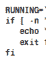

> > `uname` 命令将在下一章详细讨论。就本章而言，只需知道 `uname -s` 命令输出系统类型即可。

现在剩下的就是更改 `start` 和 `stop` 子句以使用 `$PS` 的值而不是直接调用 `ps`：

```sh
start)
if [ ! -x "$PGM" ] ; then
 echo "Error: Not Executable: $PGM" 1>&2
exit 1
fi
RUNNING=`$PS | grep "$PGM" | grep -v grep | head`
if [ -n "$RUNNING" ] ; then
echo "Error: Already running: $PGM" 1>&2
exit 1
fi
"$PGM" $PGM_OPTS
;;
stop)
$PS | grep "$PGM" | grep -v grep | \
awk '{ print $2 ; }' | xargs kill
;;
```

包含所有这些更改的完整脚本如下：

```sh
#!/bin/sh
PGM=/usr/local/sbin/sshd
PGM_OPTS=
case `uname -s` in
    Linux|Darwin) PS="/bin/ps auxwx" ;;
    *) PS="/bin/ps -ef" ;;
esac

case "$1" in
    start)
        if [ ! -x "$PGM" ] ; then
            echo "Error: Not Executable: $PGM" 1>&2
            exit 1
        fi

        RUNNING=`$PS | grep "$PGM" | grep -v grep | head`
        if [ -n "$RUNNING" ] ; then
            echo "Error: Already running: $PGM" 1>&2
            exit 1
        fi

        "$PGM" $PGM_OPTS
        ;;
    stop) $PS | grep "$PGM" | grep -v grep | \
        awk '{ print $2 }' | xargs kill 2> /dev/null
        ;;
    *) echo "Usage: $0 [ start | stop ]"
        exit 1
        ;;
esac
exit 0
```

### 改进

目前，init 脚本已相当完整，并执行了启动和停止其控制的程序所需的所有功能。你可以做两个可用性和功能性改进：

- **支持多个参数。** 目前，仅评估第一个参数。这意味着如果你想重启程序，你必须执行以下操作：

```
# /sbin/init.d/sshd stop ; /sbin/init.d/sshd start ;
```

如果脚本处理多个参数，你可以在一个命令中停止并启动程序，而不是两个命令：

```
/sbin/init.d/sshd stop start
```

UNIX 程序员和管理员认为任何减少输入量的修改都是可用性改进。
- **支持启用和禁用 init 脚本，而无需从运行级别目录或 init 文件目录中删除其链接。**
- **验证调用脚本的用户是否为 root。**

在本节中，你将实现前两个改进，并将被要求在第章末尾的问题中实现最后一个改进。

为了支持多个参数，你只需将主 `case` 语句嵌入 `for` 循环中，如下所示：

```sh
for ARG in "$@"
do
case "$ARG" in
start)
if [ ! -x "$PGM" ] ; then
echo "Error: Not Executable: $PGM" 1>&2
exit 1
fi
RUNNING=`ps -ef | grep "$PGM" | grep -v grep | head`
if [ -n "$RUNNING" ] ; then
echo "Error: Already running: $PGM" 1>&2
exit 1
fi
"$PGM" $PGM_OPTS
;;
stop)
$PS | grep "$PGM" | grep -v grep | \
awk '{ print $2 }' | xargs kill
;;
*) echo "Usage: $0 [ start | stop ]"
exit 1
;;
esac
done
```

`for` 循环遍历存储在 `$@` 中的所有参数，`case` 语句评估这些参数中的每一个，而不是仅评估 `$1`。此修改存在一个问题：如果未给出参数，则不再输出使用消息。这是因为如果 `$0` 不包含值，则 `for` 循环不会执行，而在未给出参数时即为这种情况。为纠正此问题，你只需检查此情况并在脚本中更早地输出使用消息，使用以下 `if` 语句：

```sh
USAGE="usage: $0 [ start | stop ]"
if [ -z "$@" ] ; then
echo $USAGE
exit 1
fi
```

使用消息现在存储在变量中，因为你现在需要在脚本中的两个位置输出它，如果它位于脚本中的单个位置，则更容易维护和更新。

为了完成第二个任务，你需要想出一种启用和禁用 init 脚本的方法，而无需处理从各种运行级别目录中删除其链接的麻烦。可以采用的方法如下：

- 如果存在名为 `/etc/.no-pgm` 的文件，其中 `pgm` 为程序的名称，则 init 脚本在启动程序的目的上认为自身已禁用。如果此文件不存在，则 init 脚本认为自身已启用。
- 在 init 脚本中添加对两个额外参数 `enable` 和 `disable` 的支持，以控制文件 `/etc/.no-pgm` 的创建和删除。

你可以从变量 `$PGM` 中使用 `sed` 命令按如下方式提取 `pgm`，即程序的名称：

```sh
echo $PGM | sed -e 's!.*/!!'
```

此 `sed` 命令删除存储在 `$PGM` 中的路径中的所有目录信息，只给出程序的名称。你可以按如下方式将其存储在变量中：

```sh
PGM_NAME=`echo $PGM | sed -e 's!.*/!!'`
```

要启用程序，你只需使用 `rm` 删除文件 `/etc/.no-pgm_name`：

```sh
rm -f '/etc/.no-$PGM_NAME'
```

因此 `case` 语句中的 `enable` 子句为

```sh
enable) rm -f '/etc/.no-$PGM_NAME' ;;
```

禁用脚本几乎一样简单。你只需使用 `touch` 命令创建文件 `/etc/.no-$PGM_NAME`：

```sh
touch '/etc/.no-$PGM_NAME'
```

因此，`case` 语句中的 `disable` 子句为

```sh
disable) touch '/etc/.no-$PGM_NAME' ;;
```

支持启用和禁用程序的最终修改在 `start` 子句中；你需要修改此子句以检查程序是否被禁用，如果被禁用则拒绝启动它。这可以通过以下 `if` 语句实现：

```sh
if [ -e "/etc/.no-$PGM_NAME" ] ; then
echo "Error: Program disabled: $PGM" >&2
exit 1
fi
```

包含所有这些改进的最终脚本在清单 22.1 中给出。行号供你参考。

#### 清单 22.1 sshd Init 脚本的完整清单

```bash
1 #!/bin/sh

2

3 USAGE="Usage: $0 | start | stop | enable | disable | "

4

5 # print out an usage message if no arguments are specified

6

7 if [ -z "$1" ] ; then

8 echo "$USAGE"

9 exit 1

10 fi

11

12 # variables that hold the location of the program, any options

13 # that might be required and the name of the program itself

14

15 PGM=/usr/local/sbin/sshd

16 PGM_OPTS=

17 PGM_NAME=`echo $PGM | sed 's!.*/!!'`

18

19 # determine the correct options for ps

20

21 case `uname -s` in

22 Linux|Darwin|*BSD) PS="/bin/ps aux" ;;

23 *) PS="/bin/ps -ef" ;;
```


24 esac

25

26 # evaluate each argument

27

28 for ARG in $*

29 do

30 case "$ARG" in

31 "start")

32

33 # check if the program is disabled

34

35 if [ -e "/etc/.no-$PGM_NAME" ] ; then

36 echo "Error: Program disabled: $PGM" >&2

37 exit 1

38 fi

39

40 # verify that the program is executable

41

42 if [ ! -x "$PGM" ] ; then

43 echo "Error: Not Executable: $PGM" >&2

44 exit 1

45 fi

46

47 # check if the program is running

48

49 RUNNING=`$PS | grep "$PGM" | grep -v grep | head`

50 if [ -n "$RUNNING" ] ; then

```

#### 清单 22.1 继续

```

51      echo 'Error: Already running: $PGM' >&2

52      exit 1

53  fi

54

55  # start the program

56

57  "$PGM" $PGM_OPTS

58  ;;

59

60  stop)

61

62      # stop the program

63

64  $PS | grep "$PGM" | grep -v grep | \
65  awk '{ print $2 ; }' | xargs kill

66  ;;

67

68  enable)

69

70      # remove the .no file to enable this program

71

72  rm -f '/etc/.no-$PGM_NAME'

73  ;;

74

75  disable)

76

77      # create the .no file to disable this program

78

79  touch '/etc/.no-$PGM_NAME'

80  ;;

81

82  *) echo "$USAGE"

83      exit 1

84  ;;

85  esac

86  done

87

88  exit 0

```

#### 调整脚本

此脚本相当灵活，可以通过仅修改两个变量 `$PGM` 和 `$PGM_OPTS` 来启动、停止、启用和禁用几乎任何程序。目前它们设置如下：

```
PGM=/usr/local/bin/sshd
PGM_OPTS=
```

如果需要将脚本用于不同的程序，例如 Web 服务器，你可以按如下方式简单地复制脚本：

```
# cd /sbin/init.d
# cp sshd httpd
```

这假设脚本存储在目录 `/sbin/init.d` 中，并且你希望给 Web 服务器的启动脚本命名为 `httpd`。启动脚本的实际位置因系统而异，如前所述。一旦你有了副本，你可以仅按如下方式修改 `$PGM` 和 `$PGM_OPTS` 的变量定义：

```
PGM=/usr/local/bin/httpd
PGM_OPTS=-DSSL
```

这假设名为 `httpd` 的 Web 服务器位于 `/usr/local/bin` 中，并且需要使用 `-DSSL` 选项启动。进行此修改后，你可以按如下方式启动 Web 服务器：

```
# /sbin/init.d/httpd start
```

要停止它，你可以执行以下操作：

```
# /sbin/init.d/httpd stop
```

剩下的就是在适当的运行级别目录中创建启动和停止链接。通常启动链接在 `rc3.d` 目录中，而停止链接在 `rc5.d` 和 `rc6.d` 目录中（Linux 除外，Linux 中仅在 `rc6.d` 目录中）。

你可以按如下方式创建这些链接：

```
# cd /sbin/rc3.d && ln -s ../init.d/httpd S98httpd
# cd /sbin/rc5.d && ln -s ../init.d/httpd K02httpd
# cd /sbin/rc6.d && ln -s ../init.d/httpd K02httpd
```

需要创建链接的实际目录取决于系统，如前所述。例如，在 Solaris 上可能使用的命令是

```
# cd /etc/rc3.d && ln -s ../init.d/httpd S99httpd
# cd /etc/rc5.d && ln -s ../init.d/httpd K20httpd
# cd /etc/rc6.d && ln -s ../init.d/httpd K20httpd
```

在 Linux 上你需要类似以下内容：

```
# cd /etc/rc.d/rc3.d && ln -s ../init.d/httpd S98httpd
# cd /etc/rc.d/rc6.d && ln -s ../init.d/httpd K02httpd
```

#### 维护地址簿

在本节中，你将研究解决许多人的常见问题：跟踪地址和电话号码。许多人，包括我自己，经常收到需要保持联系的人的名片或电子邮件。电子邮件和名片往往会丢失，导致需要联系某人时出现问题。解决此问题的良好方案是将所有联系信息存储在计算机上，以便你可以轻松访问和操作。

在本节中，你将开发一组协同工作的脚本来维护一个简单的地址簿。地址簿将存储以下信息：

- 姓名
- 电子邮件地址
- 邮寄地址
- 电话号码

这些信息中的每一项都可以包含几乎任何字符，包括空格或其他特殊字符，如连字符 `-`、句点 `.` 或单引号 `'`。因此你需要以允许如此广泛字符范围的格式保存信息。常用的格式是使用冒号 `:` 字符分隔每条信息。例如，以下信息：

Sriranga Veeraraghavan
ranga@soda.berkeley.edu
1136 Wunderlich Dr. San Jose CA 95129
408-444-4444

可以存储为：

```
Sriranga Veeraraghavan:ranga@soda.berkeley.edu:1136 Wunderlich Dr. San Jose CA 95129:408-444-4444
```

这里除了冒号之外，任何特殊字符都可以使用。此外，此格式使你能够使任何字段可选。例如，

```
:vathsa@kanchi.bosland.us::408-444-4444
```

可以表示对于某个人仅知道电子邮件地址和电话号码。

为了维护你的地址簿，你需要几个脚本：

- `showperson` 用于显示地址簿中一个或多个人的信息
- `addperson` 用于向地址簿添加人员
- `delperson` 用于从地址簿删除人员

以下示例假设地址簿存储在文件 `$HOME/addressbook` 中。

#### 显示人员

任何地址簿必须执行的主要任务之一是查找有关某人的信息然后显示它。你将开发一个名为 `showperson` 的脚本来处理此任务。

要查找有关某人的信息，你可以使用 `grep`。例如，

```
$ grep vathsa addressbook
```

列出文件 `addressbook` 中包含单词 `vathsa` 的所有行。对于你的地址簿，输出可能如下所示：

```
:vathsa:kanchi.bosland.us:+488-444-4444
```

如你所想，你的脚本应格式化 `grep` 命令的结果。一个不错的格式是将姓名、电子邮件地址、邮寄地址和电话号码列在单独的行上。你可以使用 `awk` 命令来实现这一点：

```
awk -F ':' '{ print "Name: " $1; print "Email: " $2; print "Address: " $3; print "Phone: " $4 }'
```

通过将这些命令组合起来，你可以构建 `showperson` 脚本，如清单 22.2 所示（行号供你参考）。

#### 清单 22.2 showperson 脚本的清单

```
1 #!/bin/sh
2 # Name: showperson
3 # Desc: show matching records in addressbook
4 # Args: $1 -> string to look for in addressbook

PATH=/bin:/usr/bin

# check that a string is given

if [ "$#" -lt 1 ]; then
  echo 'USAGE: `basename $0` name'
  exit 1
fi
```


### check that the address book exists

```
MYADDRESSBOOK="/home/addressbook"
if [ ! -f "$MYADDRESSBOOK" ]; then
  echo "ERROR: $MYADDRESSBOOK does not exist, or is not a" >&2
  echo "file." >&2
  exit 1
```

#### 列表 22.2 继续

```bash
# get all matches and format them

grep "$1" $MYADDRESSBOOK |
awk -F: '{
printf "%-10s %-10s %-10s %-10s %-10s", $1,$2,$3,$4,$5
"Name:"$1,"Email:"$2,"Address:"$3,
"Phone:"$4 ;
}
exit $?
```

脚本中有三个主要操作：

- 1. 验证参数数量。
- 2. 检查地址簿是否存在。
- 3. 查找所有匹配项并打印它们。

在第一部分（第 10–13 行），脚本检查是否至少给出一个参数。如果是，脚本继续；否则，它打印使用信息并退出。在第二部分，脚本检查地址簿是否存在。如果不存在，脚本打印错误信息然后退出；否则继续。在脚本的最后一部分，`grep` 获取匹配项列表，`awk` 对其进行格式化。为了确保输出的间距均匀，`awk` 命令对信息及其描述都使用了格式化。

例如，

```
$ ./showperson ranga
```

生成与以下类似的输出：

```
Name:    Sirranga Veeraraghavan
Email:   ranga@soda.berkeley.edu
Address: 1136 Wunderlich Dr. San Jose CA
Phone:   408-444-4444
```

注意第二列中的所有信息是如何正确对齐的。

你也可以使用 `showperson` 来查找特定字符串的匹配项。例如。

```
$ ./showperson va
```

生成两个匹配项：

Name:
Email: vathsa@oosland.us
Address:
Phone: 408-444-4444

#### 添加人员

地址簿最重要的事情之一是能够轻松地向其中添加信息。如果需要手动编辑地址簿来添加信息，你很可能会犯错误，例如忘记添加冒号来分隔字段。通过使用脚本，可以避免此类错误。

在本节中，你将查看 `addperson` 脚本。它使你能够通过交互式提供信息或通过命令行选项在命令行上提供信息来向地址簿添加条目。当未给出选项时，脚本进入交互模式。在非交互模式下，它尝试从命令行选项获取必要的信息。

无论模式如何，脚本都会将用户提供的信息存储到以下变量中：

- `NAME` 存储用户提供的姓名。
- `EMAIL` 存储用户提供的电子邮件地址。
- `ADDR` 存储用户提供的邮寄地址。
- `PHONE` 存储用户提供的电话号码。

在交互模式下，你按如下方式提示每条记录中的信息：

```bash
printf "%-10s " "Name:" ; read NAME
printf "%-10s " "Email:" ; read EMAIL
printf "%-10s " "Address:" ; read ADDR
printf "%-10s " "Phone:" ; read PHONE
```

在每个提示之后，你读取并将用户的输入，包括空格和特殊字符，存储在相应的变量中。在非交互模式下，你使用 `getopts` 来扫描选项：

```bash
while getopts n:e:a:p: OPTION
do
    case $OPTION in
        n) NAME="$OPTARG" ;;
        e) EMAIL="$OPTARG" ;;
        a) ADDR="$OPTARG" ;;
        p) PHONE="$OPTARG" ;;
        ?) echo "USAGE: $USAGE" >&2 ; exit 1 ;;
    esac
done
```

如你所见，非交互模式下脚本理解的选项是

- `-n` 用于姓名（设置 `NAME`）
- `-e` 用于电子邮件地址（设置 `EMAIL`）
- `-a` 用于邮寄地址（设置 `ADDR`）
- `-p` 用于电话号码（设置 `PHONE`）

获取所需信息后，你可以通过将格式化的记录追加到地址簿文件的末尾来更新文件，如下所示：

```
echo "$NAME;$EMAIL;$ADDR;$PHONE" >> "$MYADDRESSBOOK"
```

这里假设变量 `MYADDRESSBOOK` 包含地址簿文件的路径名。

完整的 `addperson` 脚本在列表 22.3 中给出（行号供你参考）。

#### 列表 22.3 addperson 脚本的完整列表

```bash
#!/bin/sh
# Name: addperson
# Desc: add a person addressbook
# Args: -n <name>
#      -e <email>
#      -a <postal address>
#      -p <phone number>
#
# initialize the variables
PATH=/bin:/usr/bin
MYADDRESSBOOK=$HOME/addressbook
NAME=""
EMAIL=""
ADDR=""
PHONE=""
```

#### 列表 22.3 继续


```bash

# prompt for the info

printf "%-10s " "Name: " ; read NAME
printf "%-10s " "Email: " ; read EMAIL
printf "%-10s " "Address: " ; read ADDR
printf "%-10s " "Phone: " ; read PHONE

else

# this is noninteractive mode

# initialize a variable for the usage statement

USAGE=`basename $0` " [-n name] [-e email] [-a address] [-p phone]"

# scan the arguments to get the info

while getopts n:e:a:p: OPTION
do
case $OPTION in
n) NAME="$OPTARG";;
e) EMAIL="$OPTARG";;
a) ADDR="$OPTARG";;
p) PHONE="$OPTARG";;
?) echo "USAGE: $USAGE" >&2; exit 1 ;;
esac
done
fi
NAME=`remove_colon $NAME `
EMAIL=`remove_colon $EMAIL `
ADDR=`remove_colon $ADDR `
PHONE=`remove_colon $PHONE `

echo "$NAME:$EMAIL:$ADDR:$PHONE" >> "$MYADDRESSBOOK"

exit $?
```

该脚本首先初始化其变量（第 11–16 行）。然后你将存储用户信息的内部变量设置为 null，以避免与用户环境中导出的变量冲突。

下一步是创建以下函数（第 20 行）：

```bash
remove_colon() { echo "$1" | tr ':' ' ' ; }
```

你使用此函数确保用户输入中不包含任何冒号。

然后你检查是否给出任何参数（第 22 行）。如果没有给出参数，你进入交互模式（第 23–36 行）；否则，你进入非交互模式（第 38–56 行）。

在交互模式下，你提示每条信息并读取它。在产生第一个提示之前，你发出 `stty` 命令（第 28 行），以确保用户可以在输入过程中擦除任何错误。


在非交互模式下，你使用 `getopts` 获取命令行上提供的信息。在本节中，你还初始化包含此命令使用语句的变量 `USAGE`。

获取必要信息后，你对每个变量调用 `remove_colon` 函数（第 59–62 行）。由于用户可能指定包含冒号的信息，跳过此步骤可能会损坏地址簿并混淆 `show-person` 脚本。最后你更新地址簿并退出。

使用脚本在交互模式下的示例是

```
$ ./addperson
Name: James Kirk
Email: jim@enterprise.a.starfleet.mil
Address: 1781 Main Street James Town Iowa UFP
Phone:
```

这里你只提供了 Jim Kirk 的姓名、电子邮件地址和邮寄地址。因此当你在地址簿中查找 James Kirk 时，你会发现他的电话号码为空：

```
$ ./showperson
Name: James Kirk
Email: jim@enterprise.a.starfleet.mil
Address: 1781 Main Street James Town Iowa UFP
Phone:
```

你可以使用命令的非交互形式执行相同的操作，如下所示：

```
$ ./addperson -n 'James Kirk' -e jim@enterprise.a.starfleet.mil \
-a '1781 Main Street James Town Iowa UFP'
```

注意在命令行上，你需要引用包含空格的条目。

### 删除人员

偶尔，你需要从地址簿中删除某人。在本节中，你将查看一个名为 `delperson` 的脚本，它从地址簿中删除人员。

从地址簿中删除某人是一项更困难的任务，因为你必须确认每个选定删除的记录。你需要执行两个主要任务

- 1. 制作地址簿中与指定名称匹配的行列表。
- 2. 基于用户反馈，从地址簿中删除适当的条目。

由于删除操作可能会从地址簿中删除信息，因此你必须格外小心地备份并在原始地址簿的副本上工作，而不是在原始地址簿上工作。

为了简化提示和打印错误消息，此脚本使用在第 21 章中介绍的 shell 函数库 `libDTYSP2.sh`。

脚本的基本流程如下：

- 1. 复制地址簿并使用副本进行所有修改。
- 2. 从此副本获取所有匹配行列表并将它们存储在删除文件中。
- 3. 对删除文件中的每条记录，打印出该记录并询问用户是否应删除该行。
- 4. 如果用户希望删除该记录，则从地址簿副本中删除该记录。
- 5. 删除完成后，备份原始地址簿。
- 6. 使编辑后的副本成为地址簿。
- 7. 清理临时文件并退出。

对于这些步骤中的每一步，你都使用一个函数来确保执行的操作成功。

#### 列表 22.4 delperson 脚本的完整列表

```
#!/bin/sh
# Name: delperson
# Desc: del a person addressbook
# Args: $1 -> name of person to delete

# get the helper functions

. $HOME/lib/sh/libDTYSP2.sh

PATH=/bin:/usr/bin
```

#### 清单 22.4 继续

```bash
12 # check that a name is given
13
14 if [ $# -lt 1 ] ; then
15
16 printUsage "basename name"
17 exit 1
18
19 # check that the address book exists
20
21 MYADDRESSBOOK="$HOME/addressbook"
22 if [ ! -f "$MYADDRESSBOOK" ] ; then
23 printerror "$MYADDRESSBOOK does not exist, or is
24 not a file."
25 exit 1
26
27 # initialize the variables holding the location of the
28 # temporary files
29 TMPF1=/tmp/appupdate.$$
30 TMPF2=/tmp/abdeltets.$$
31
32 # function to clean up temporary files
33
34 doCleanup() { rm "$TMPF1" "$TMPF1.new" "$TMPF2" 2> /dev/null ; }
35
36 # function to exit if update failed
37 Failed() {
38 if [ "$?" -ne 0 ] ; then
39 shift
40 printerror $0
41 doCleanup
42 exit 1
43 fi
44 }
45 # make a copy of the address book for updating,
46 # proceed only if successful
47 cp "$MYADDRESSBOOK" "$TMPF1" 2> /dev/null
48 Failed $? "Could not make a backup of the address book."
49
50 # get a list of all matching lines from the address book copy
51 # continue if one or more matches were found
52 grep "$1" "$TMPF1" > "$TMPF2" 2> /dev/null
53 Failed $? "No matches found."
54
55 # prompt the user for each entry that was found
```

```bash
59 exec 5< "$TMPF2"
60 while read LINE <&5
61 do
62
63 # display each line formatted
64
65 echo "$LINE" | awk -F ':' '
66 printf "%-10s %-10s %-10s %-10s \n\n", \
67 "Name:",$1,"Email:",$2,"Address:",$3,
68 "Phone:",$4 ;
69 '
70
71 # prompt for each line, if yes try to remove the line
72 promptYESNO "Delete this entry" "n"
73 if [ "$YESNO" = "y" ] ; then
74
75 # try to remove the line, store the updated version
76 # in a new file
77
78 grep -v "$LINE" "$TMPF1" > "$TMPF1.new" 2> /dev/null
79 Failed $? "Unable to update the address book"
80
81 # replace the old version with the updated version
82
83 mv "$TMPF1.new" "$TMPF1" 2> /dev/null
84 Failed $? "Unable to update the address book"
85
86 fi
87 done
88 exec 5<&-
89
90 # save the original version
91
92 mv "$MYADDRESSBOOK" "$MYADDRESSBOOK".bak 2> /dev/null
93 Failed $? "Unable to update the address book"
94
95 # replace the original with the edited version
96
97 mv "$TMPF1" "$MYADDRESSBOOK" 2> /dev/null
98 Failed $? "Unable to update the address book"
99
100 # clean up
101
102 doCleanup
103
104
105 exit $?
```

在脚本的第一部分（第 8–30 行），你执行了一些初始化步骤：

- 1. 从 `libDTYSP2.sh`（第 8 行）获取辅助函数。
- 2. 检查是否提供了要删除的名称（第 14–17 行）。
- 3. 检查地址簿是否存在（第 21–25 行）。
- 4. 初始化临时文件变量（第 29 行和第 30 行）以及 `PATH`（第 10 行）。

初始化后，你创建了几个额外的辅助函数：

- `doCleanup` 用于删除临时文件（第 34 行）
- `Failed` 用于发出错误消息、删除临时文件，并在关键命令失败时退出（第 37–44 行）


脚本的第一步是复制地址簿（第 40 行）。如果此步骤失败，你将退出（第 50 行）。如果此步骤成功，你将列出地址簿中与用户指定的名称匹配的所有行（第 55 行）。如果无法成功创建此文件，你将退出（第 56 行）。

接下来你进入删除循环（第 60–89 行）。对于与用户提供的名称匹配的每一行，你打印该行的格式化版本（第 66–69 行）。请注意，你使用的是 `showperson` 脚本中使用的相同 `awk` 语句。

对于每一行匹配项，询问用户是否应删除该条目（第 73 行）。如果用户同意（第 74 行），你执行以下操作：

- 1. 尝试从地址簿副本中删除该行。将修改后的版本存储在不同的文件中（第 79 行）。
- 2. 用修改后的副本替换地址簿副本（第 84 行）。

如果任一操作失败，你将退出（第 80 行和第 85 行）。

删除完成后，你备份原始地址簿（第 93 行）。然后用编辑后的版本替换地址簿（第 98 行）。同样，如果任一操作失败，你将退出（第 94 行和第 99 行）。

最后清理并退出。

以下是此脚本运行的示例：

```
$ ./delperson Sriranga
Name: Sriranga Veeraraghavan
Email: sriranga@berkeley.edu
Address: 1150 Wondell Dr, San Jose CA
Phone: 408-444-4444

Delete this entry [y/n] [n] y
```

这里你回答了是。你可以按如下方式确认删除是否成功：

```
$ ./showperson sriranga
$
```

由于 `showperson` 没有输出，你知道该条目已被删除。

### 摘要

本章介绍了使用 shell 脚本来解决两个问题：

- 创建 `init` 或启动脚本
- 维护地址簿

在第一个示例中，你学习了系统如何启动以及脚本如何用于简化此过程。在第二个示例中，你开发了三个脚本来修改和查看地址簿的内容。这些脚本的一些亮点是

- `showperson` 脚本向你展示了如何使用 `grep` 和 `awk` 命令格式化输入。
- `addperson` 脚本向你展示了如何在一个脚本中同时使用交互式和非交互式模式。
- `delperson` 脚本向你展示了如何使用 `grep` 命令和文件描述符准确地更新文件。

本章中的示例演示了如何将前几章介绍的工具应用于解决实际问题。以这些脚本为例，你可以看到用于解决日常问题的一些技术。

下一章探讨了编写脚本以确保它们在不同版本的 UNIX 之间可移植的几种方法。

### 问题

1. 在 `sshd` `init` 脚本中添加一个检查，以验证用户是否为 `root`。（Init 脚本应仅由 `root` 执行。）

提示：使用 `id` 和 `sed` 命令。

2. `showperson` 脚本根据用户提供的名称列出地址簿中所有匹配的条目。产生的匹配是区分大小写的。如何更改脚本匹配，使其不区分大小写？

3. `showperson` 和 `delperson` 脚本都复制了以下代码

```
PATH=/bin:/usr/bin

# check that a name is given

if [ $# -lt 1 ]; then
  printusage "`basename $0` name"
  exit 1
fi

# check that the address book exists

MYADDRESSBOOK="$HOME/addressbook"
if [ ! -f "$MYADDRESSBOOK" ]; then
  printerror "$MYADDRESSBOOK does not exist, or is
  not a file."
  exit 1
fi

and
awk -F: '{
  printf "%-10s %-10s %-10s %-10s
  %-10s\n", $1, $2, $3, $4
}'
```

你如何重写这些脚本，使此代码可以在两个脚本之间共享，而不是在两者中重复？

4. `delperson` 脚本使用 `grep` 命令生成匹配条目的列表。这可能会在以下情况下混淆用户：

```
$ ./delperson to
Name: James T. Kirk
Email: jim@enterprise.nil
Address: 1701 Main Street Anytown Iowa
Phone: 555-555-5555

Delete this entry (y/n)? [n]
```

这里 `Anytown` 中的 `to` 被匹配了。

应对 `delperson` 脚本做出哪些更改，以便仅选择名称与用户指定名称匹配的条目进行删除？（提示：改用 `sed` 命令。）

5. 如果 `delperson` 在处理删除时收到信号，所有中间文件都会被留下。可以采取什么措施来防止这种情况？

### 术语

- **初始化脚本** 原本存储在 `/sbin/init.d` 中的简单脚本，负责启动和停止程序。
- **运行级别** 将系统启动划分为七个级别（零到六），并提供一种方法来强制执行启动依赖关系并将系统服务的启动划分为不同的级别。


## 第 23 小时

### 可移植性脚本编写

Shell 编程是 UNIX 的重要组成部分，因为 shell 脚本可以轻松移植到许多不同的 UNIX 版本。在许多情况下，shell 脚本在多个系统上无需修改即可正常运行。

确保 shell 脚本完全可移植的最简单方法是将其限制为仅使用所有 UNIX 版本都可用的命令和功能。有时这意味着脚本必须实现变通方法来处理特定 UNIX 版本的限制。

在本章中，我们将研究与 shell 脚本可移植性相关的以下主题：

- 确定系统运行的 UNIX 版本
- 使 shell 脚本适应不同的 UNIX 版本

### 确定 UNIX 版本

在开始调整 shell 脚本来使其可移植之前，您需要知道 UNIX 的不同类型以及如何区分它们。UNIX 的三大主要类型是

- BSD（伯克利软件发行版）
- System V
- Linux

这些三种 UNIX 类型中命令的位置和某些命令支持的选项是不同的。本章重点介绍与命令相关的一些主要差异。

### BSD

UNIX 最早在 1970 年代由 AT&T 的贝尔实验室开发。多年以来它一直仅限于 AT&T 和少数几所大学。在 1980 年代初期，加州大学伯克利分校从 AT&T 贝尔实验室获得了 UNIX 的源代码。在 1980 年代到 1990 年代初期，伯克利系统研究小组对 UNIX 进行了重大改进和进步。这些改进定期以伯克利软件发行版或 BSD 的名称发布。

在 1990 年代初期，伯克利团队解散并向公众发布了源代码。多个团体和公司采用了 BSD 源代码并提供了自己的 BSD 版本。目前开发可自由获得的 BSD 版本的三大主要团体是

- FreeBSD 项目：http://www.freebsd.org
- NetBSD 基金会：http://www.netbsd.org
- OpenBSD：http://www.openbsd.org

目前参与 BSD 开发和分发的两大主要公司是 Apple Computer 和 Wind River Systems。Apple 的 MacOS X 基于 FreeBSD。Wind River 的 BSD/OS 也基于 FreeBSD。BSD 的另一个商业版本是 Sun Microsystems 的 SunOS4。Sun 自 1990 年代初期以来不再支持或开发 SunOS4，但它在一些大学中仍然相当流行。

### System V

System V（有时缩写为 SysV）是 AT&T 贝尔实验室发布的最新版本的 UNIX。System V UNIX 是大多数商业版本 UNIX 的标准。Sun Microsystems 的 Solaris 和 Hewlett-Packard 的 HP-UX 都基于 System V UNIX。

System V 中为 UNIX 添加的一些新功能是

- 一个新的引导系统
- 一个名为 STREAMS 的网络子系统
- 一个进程间通信和内存共享系统
- 标准化系统管理工具
- 预包装软件的安装和移除系统

System V UNIX 还更改了文件系统的布局。表 23.1 列出了 BSD 目录及其 System V 等价物。

表 23.1 BSD 目录的 System V 等价物

| BSD | System V |
|---|---|
| `/bin` | `/usr/bin` |
| `/sbin` | `/usr/sbin` |
| `/usr/adm` | `/var/adm` |
| `/usr/mail` | `/var/mail` or `/var/spool/mail` |
| `/usr/tmp` | `/var/tmp` |

`/bin` 和 `/sbin` 目录在某些基于 System V 的 UNIX 版本中仍然存在。


在 Solaris 上，这些目录分别是 `/usr/bin` 和 `/usr/sbin` 的链接。在 HP-UX 上，这些目录仍然包含启动时必需的一些命令。这些目录中存储的命令与 BSD 中的命令不同。大多数从 BSD 切换到 System V 的厂商仍在 `/usr/ucb` 目录中提供 BSD 版本。

除此之外，许多基于 System V 的 UNIX 版本引入了 `/opt` 目录，试图标准化预包装软件产品的安装位置。在旧系统上，曾使用包括 `/usr`、`/usr/contrib` 和 `/usr/local` 在内的许多不同位置来安装可选软件包。

### Linux

Linux 可被视为 UNIX 的第三个版本。它是独立于 BSD 或 System V 源代码开发的。Linux 由 Linus Torvalds 在 1990 年代初期在赫尔辛基大学编写。它结合了 System V 和 BSD 中发现的最佳功能。Linux 中的命令和网络层与 BSD 相似，而系统配置和预包装软件安装的标准化工具与 System V 相似。Linux 的一些主要厂商是 Caldera、Debian、Mandrake、Red Hat、Slackware 和 SuSE。

### 使用 uname 确定 UNIX 版本

编写可移植 shell 脚本的第一步是确定哪个版本的 UNIX 正在执行您的 shell 脚本。这可以使用 `uname` 命令确定：

```
uname options
```

这里，`options` 是表 23.2 中给出的一个或多个选项。

**表 23.2 uname 命令的选项**

| 选项 | 描述 |
|---|---|
| `-a` | 打印所有信息 |
| `-m` | 打印当前硬件类型 |
| `-n` | 打印系统的主机名 |
| `-r` | 打印操作系统发行级别 |
| `-s` | 打印操作系统的名称（默认） |

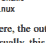

> 在 SunOS 上，`uname` 的 `-a` 选项显示系统摘要信息。要获取完整信息，请使用 `uname` 的 `-X` 选项。

默认情况下，`uname` 命令打印操作系统的名称。输出如下所示：

```
$ uname
Linux
```

这里，输出表明机器的操作系统名称是 Linux。通常，这足以确定 UNIX 版本，如表 23.3 中所列的值所示。

**表 23.3 uname 显示的所选 UNIX 版本名称**

| 名称 | 描述 |
|---|---|
| Linux | 运行 Linux 的系统 |
| HP-UX | 运行 Hewlett-Packard 的 HP-UX 的系统 |
| FreeBSD | 运行 FreeBSD 的系统 |
| OpenBSD | 运行 OpenBSD 的系统 |
| Darwin | 运行 Apple 的 MacOS X 的系统 |
| SunOS | 运行 Sun Microsystems 的 SunOS（基于 BSD）或 Solaris（基于 System V）的系统 |

### 处理 SunOS

SunOS 是 Sun Microsystems 开发的 UNIX 操作系统的名称。SunOS 最初基于 BSD UNIX，但此后已更改为基于 System V UNIX。尽管营销名称已更改为 Solaris，但 `uname` 仍产生 SunOS 输出。需要在 Solaris 和更早的基于 BSD 的 SunOS 版本（如 SunOS4）上运行的 shell 脚本需要区分这两个版本。

要确定系统是否运行 Solaris 或 SunOS，您可以检查操作系统的版本。SunOS 版本 5 及更高版本是 Solaris（基于 System V）；SunOS 版本 4 及更低版本是 SunOS（基于 BSD）。

要确定操作系统的版本，您可以使用 `uname` 的 `-r` 选项：

```
$ uname -r
5.5.1
```

这表明操作系统的版本是 5.5.1。如果您想将操作系统名称添加到此输出中，请使用 `-r` 和 `-s` 选项：

```
$ uname -rs
SunOS 5.5.1
```

这表明机器正在运行 Solaris。运行基于 BSD 的 SunOS4 的机器上的输出可能是

```
SunOS 4.1.3
```

### 确定硬件类型

有时 shell 脚本被编写为硬件特定程序的包装器。例如，安装脚本通常对特定操作系统支持的不同硬件平台是相同的。虽然安装脚本可能对每个硬件平台都相同，但安装的文件通常是不同的。

要确定硬件类型，您可以使用 `-m` 选项：

```
$ uname -m
sun4m
```

一些常见的返回值及其硬件类型列在表 23.4 中。

**表 23.4 uname 命令返回的硬件类型**

| 硬件 | 描述 |
|---|---|
| 9800/xxx | Hewlett-Packard 9000 系列工作站。xxx 的一些常见值是 700、712、715 和 750。 |
| i386 | 基于 Intel 386、486、Pentium 或 Pentium II 的工作站。 |

#### 表 23.4 继续

| 硬件 | 描述 |
|---|---|
| i586 | 使用 Intel Pentium II、III 或更新处理器的系统。 |
| sun4x | Sun Microsystems 工作站。x 的一些常见值是 c（SparcStation 5 和 2）、n（SparcStation 5、10 和 20）和 u（UltraSparc）。 |
| Power Macintosh | 运行 MacOS X 的 Apple Macintosh。 |

### 确定系统的主机名

许多 shell 脚本需要检查系统的主机名。在 BSD 系统上，传统的执行方法是使用 `hostname` 命令，如以下示例所示：

```
$ hostname
soda.CSUA.Berkeley.EDU
```

在 System V 和 Linux 中，`hostname` 命令并不总是可用。应改用 `uname -n` 命令：

```
$ uname -n
kashi
```

因为 `uname -n` 命令在 System V 和 BSD UNIX 上都可用，所以它更适合用于可移植 shell 脚本。

### 使用函数确定 UNIX 版本

您刚刚查看了使用 `uname` 命令收集特定系统正在运行的 UNIX 版本的信息。现在您需要一种方法在 shell 脚本中使用此信息。如您在第 21 章“使用函数解决问题”中所见，创建 shell 函数来执行此任务将为您提供最大的灵活性：

```
getOSName() {
case "`uname -s`" in
*BSD)
 echo bsd ;;
Darwin)
 echo darwin ;;
SunOS)
 case "`uname -r`" in
 5.*) echo solaris ;;
 *) echo sunos ;;
 esac
 ;;
Linux)
 echo linux ;;
HP-UX)
```

```
echo hpux ;;
AIX)
    echo aix ;;
*)
    echo unknown ;;
}
```

正如你所见，这个函数并不复杂。它检查 `uname -s` 的输出并查找匹配项。在 SunOS 的情况下，它还会检查 `uname -r` 的输出以确定操作系统是 Solaris 还是 SunOS。

在许多情况下，你需要为特定系统调整命令（如 `ps` 或 `df`）的选项，以便从该命令获得期望的输出。在这种情况下，你需要能够'询问'操作系统是否为某种类型的能力：

```
isOS() {
    if [ $# -lt 1 ] ; then
        echo "ERROR: Insufficient Arguments." >&2
        return 1
    fi
    REG=`echo $1 | tr '[A-Z]' '[a-z]'`
    if [ "$REG" = "`getOSName`" ] ; then return 0 ; fi
    return 1
}
```

此函数将第一个参数与函数 `getOSName` 的输出进行比较，如果两者相同则返回 0（真）；否则返回 1（假）。

使用此函数，可以编写类似以下的 if 语句：

```
if isOS hpux ; then
    # HP-UX specific commands here
elif isOS solaris ; then
    # Solaris specific commands here
else
    # generic unix commands here
fi
```

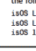

> `isOS` 函数不直接检查 `$1` 的值，而是使用变量 `REG` 的原因，是为了给函数使用者提供更大的灵活性。例如，此实现允许使用以下任何一种方法来检查系统是否运行 Linux：

> `isOS LINUX`

> `isOS Linux`


> `isOS` `linux`

### 提高可移植性的技术

在不同版本的 UNIX 之间提高 shell 脚本可移植性有两种常见技术：
- 条件执行
- 抽象

条件执行根据系统类型改变脚本的执行方式，而抽象则通过将条件语句放在函数内部来保持脚本的基本流程不变。

### 条件执行

使用条件执行来提高可移植性的脚本在开头包含一个 `if` 语句，设置多个变量以指示在特定平台上使用的命令集。本节介绍条件执行使用的两种常见情况：
- 确定远程 shell 命令
- 确定在提示中使用 `echo` 命令的正确方法

第一种情况说明了根据操作系统类型设置变量。第二种情况说明了根据特定系统上命令（`echo`）的行为设置变量。

#### 执行远程命令

条件执行的一种常见用途是在需要对远程系统执行命令的脚本中。在大多数 UNIX 版本中，你可以使用 `rsh`（远程 shell）命令在远程系统上执行命令。不幸的是，该命令并非在所有 UNIX 版本中都可用。例如在 HP-UX 上，`rsh` 可用但它不是远程 shell 程序——它是受限 shell 程序。在 HP-UX 上，你需要使用 `remsh` 命令在远程系统上执行命令。

需要在远程系统上执行命令的脚本在其开头可能有如下形式的 `if` 语句：

```
if SystemIs HP_UX ; then
RCMD=remsh
else
RCMD=rsh
fi
```

设置变量 `$RCMD` 后，远程命令可以按如下方式执行：

```
"$RCMD" host command
```

这里，`host` 是远程系统的主机名，`command` 是要执行的命令。

#### echo 命令在提示中的问题

大多数需要提示用户的程序需要能够打印不以换行符结尾的提示。在第 5 章“输入和输出”中，使用 `echo` 命令的 `\c` 转义序列来执行此操作存在几个问题。变通方法是使用 `/bin/echo` 命令。

虽然这适用于基于 System V 的 UNIX 版本，但在某些基于 BSD 的系统上不起作用。你需要改为指定 `echo` 的 `-n` 选项。通过使用以下 shell 脚本，你可以创建一个 shell 函数 `echo_prompt`，以便在所有版本的 `echo` 中可靠地显示提示：

```
_ECHO=/bin/echo
_N="-n"
_O="-c"
ECHOTEST=`$_ECHO "hello \c"`
if [ "$ECHOTEST" = "hello \c" ] ; then
  _N="-n"
  _O=""
fi
export _ECHO _N _O
echo_prompt() { $_ECHO $_N "$*" $_O ; }
```

此脚本片段使用 `/bin/echo` 变通方法作为构建正确 `echo` 命令的基础。它检查 `echo` 命令的输出以确定 `\c` 序列是否被正确处理。如果不是，则启用 `-n` 选项。

确定适当的值后，使用这些值创建函数 `echo_prompt`。此函数使你能够在每个系统上可靠地输出提示。

### 抽象

抽象是一种用于在 shell 函数内部隐藏 UNIX 版本之间差异的技术。通过这样做，shell 脚本的整体流程不受影响。当调用函数时，它会决定执行哪些命令。

你将学习两种不同的抽象示例：
- 使 `getSpaceFree` 函数在 HP-UX 上运行
- 使 `getPID` 函数同时在 BSD 和 System V 上运行

本节使用本章前面给出的函数 `getOSName` 和 `isOS`。

#### 为 HP-UX 适配 getSpaceFree

回顾第 21 章中介绍的 `getSpaceFree` 函数：

```
getSpaceFree() {
  if [ $# -lt 1 ] ; then
echo "ERROR: Insufficient Arguments." >&2
return 1
fi

DIR="$1"
if [ ! -d "$DIR" ] ; then
  DIR="/usr/bin/dirname $DIR"
fi

df -k "$DIR" | awk 'NR != 1 { print $4 ; }'
}
```

此函数以千字节为单位打印目录中的可用空间。其输出在 `isSpaceAvailable` 函数中使用，以确定特定目录中是否有足够的空间。虽然这适用于大多数系统（Solaris、Linux、BSD），但在 HP-UX 系统上不起作用，因为 HP-UX 系统上 `df -k` 的输出与其他版本的 UNIX 相差很大。

```
$ df -k /usr/sbin
/usr  (/dev/vg00/lvol8  ) :  737344 total allocated Kb
                        368296 free allocated Kb
                        369048 used allocated Kb
                        50 % allocation used
```

为了以更易于解析的格式获取输出，你需要改用 `df -b` 命令：

```
$ df -b /usr/sbin
/usr  (/dev/vg00/lvol8  ) :  392808 Kbytes free
```

为了在所有系统（包括 HP-UX）上使用 `isSpaceAvailable`，你需要更改 `getSpaceFree` 函数以考虑这一点。修改后的版本如下所示：

```
getSpaceFree() {
  if [ $# -lt 1 ] ; then
    echo "ERROR: Insufficient Arguments." >&2
    return 1
  fi

  DIR="$1"
  if [ ! -d "$DIR" ] ; then
    DIR="/usr/bin/dirname $DIR"
  fi

  if isOS HPUX ; then
    df -b "$DIR" | awk '{ print $5 ; }'
  else
    df -k "$DIR" | awk 'NR != 1 { print $4 ; }'
  fi
}
```

在这里，调用 `isOS` 函数以确定要执行的命令。

#### 为 BSD 适配 getPID

回顾第 21 章中介绍的 `getPID` 函数：

```
getPID() {
    if [ $# -lt 1 ]; then
        echo 'ERROR: Insufficient Arguments.' >&2
        return 1
    fi

    PSOPTS='-ef'
    /bin/ps $PSOPTS | grep "$1" | awk '/grep/ { next; } { print $2; }'
}
```

此函数仅在 `ps -ef` 命令生成所有正在运行进程的列表的系统上才能正确工作。在 BSD 系统和旧版 Linux 系统上，你需要使用命令
`ps -auxw`
来获取正确的输出。该命令在 BSD 系统上工作正常，但旧版 Linux 系统会产生以下警告信息：
> warning: '-...' deprecated; use 'ps -aux', not 'ps -auxw'

通过使用本章前面给出的 `getOSName` 函数，你可以将 `getPID` 函数适配为与 BSD、Linux 和 System V 版本的 `ps` 一起工作。`getPID` 的修改版本如下：

```
getPID() {
    if [ $# -lt 1 ]; then
        echo 'ERROR: Insufficient Arguments.' >&2
        return 1
    fi

    case `getOSName` in
        bsd|sun|sunos|linux|darwin)
            PSOPTS='-auxw' ;;
        *)
            PSOPTS='-ef' ;;
    esac

    /bin/ps $PSOPTS 2>/dev/null | grep "$1" | \
    awk '/grep/ { next; } { print $2; }'
}
```

函数的两个主要更改是
- `case` 语句根据操作系统名称设置变量 `PSOPTS`。
- `ps` 的 STDERR 被重定向到 `/dev/null`，以便丢弃在旧版 Linux 上生成的警告消息。

#### Linux 中的 ps

在 Linux 中，`ps` 命令在不同版本之间有所不同。在旧版本的 Linux 2.0 中，`-auxx` 命令中的连字符未得到正确支持，而在当前版本中，连字符得到支持，System V 风格的 `-ef` 选项也得到支持。考虑到这一点，你可以按如下方式修改 `getPID()` 函数：


```
getPID() {
  if [ $# -lt 1 ]; then
    echo "ERROR: Insufficient Arguments." >&2
    return 1
  fi

  PSOPTS="-ef"
  case `getOSName` in
    bsd|sunOS|darwin)
      PSOPTS="-auxx" ;;
    linux)
      case `uname -r` in
        [01].*) PSOPTS="-auxx" ;;
        2.0*) PSOPTS="-auxx" ;;
      esac
      ;;
  esac

  `/bin/ps $PSOPTS | grep "$1" |`
  awk '/grep/ { next; } { print $2; }'
}
```

此版本避免了必须重定向到 `/dev/null`，并允许你检测 `ps` 命令可能报告的任何问题。

### 摘要

在本章中，你学习了如何使用 `uname` 确定正在运行的 UNIX 版本。此外，你还开发了 `getOSName` 和 `isNS?` 函数，以帮助将 shell 脚本适配到多个 UNIX 版本。你还研究了以下提高 shell 脚本可移植性的技术：

- 条件执行
- 抽象

在条件执行中，脚本的流程会根据所使用的 UNIX 版本而改变。在抽象中，函数实现被修改以考虑 UNIX 版本之间的差异；脚本的整体流程保持不变。

使用本章中的技术和技巧，你可以将 shell 脚本移植到不同版本的 UNIX 上。

### 问题

- 1. 编写一个名为 `getCharCount` 的函数，打印文件中字符的数量。使用 `wc` 获取字符计数。Linux、FreeBSD 和 SunOS（不是 Solaris）使用 `-c` 选项用于 `wc`，而其他版本的 UNIX 使用 `-m` 选项。可随意使用 `getOSname` 函数。

### 术语

**抽象** 使用抽象的脚本通过将条件执行语句放在函数内来保留相同的基本流程。当函数被调用时，它会决定在给定平台上执行哪些命令。

**条件执行** 根据系统类型更改脚本的执行。 使用条件执行的脚本通常在脚本开头包含一个 `if` 语句，该语句设置变量和在特定平台上使用的命令。

# 第 24 小时


### Shell 编程常见问题解答

每个前面的章节都专注于 shell 编程中的一个单独主题，例如变量、循环或调试。随着你阅读本书的进展，你处理了需要之前章节知识的问题。本章采用了略有不同的方法，通过尝试回答一些经常被问到的 shell 编程问题。具体来说，本章涵盖了 shell 编程的三个主要领域的问题：

- `shell` 和命令
- 变量和参数
- 文件和目录

每个部分都包含几个常见的 shell 编程问题（和答案！）。这些问题旨在帮助你解决或避免常见问题。一些问题提供了关于 UNIX 的更深入的背景信息，而另一些则说明了之前章节中介绍的概念。

### Shell 和命令问题

本节涵盖了一些关于 shell 本身以及 shell 如何执行命令的常见问题。

#### 为什么我的脚本的第一行必须是 `#!/bin/sh`？

第 2 章“脚本基础”指出，`#!/bin/sh` 必须是脚本中的第一行，以确保使用正确的 shell 执行你的脚本。由于 shell 执行命令所使用的底层机制，这一行必须是 shell 脚本的第一行。

当你要求 shell 按如下方式执行命令时

```
$ date
```

shell 使用 `exec` 系统调用来要求 UNIX 内核执行你请求的命令。系统调用是内置于 UNIX 内核中的 C 语言函数，使你能够访问内核的功能。shell 将应执行的命令名称传递给 `exec` 系统调用。此系统调用读取文件中的前两个字符以确定如何执行命令。对于 shell 脚本，前两个字符是 `#!`，表示脚本需要由另一个程序解释而不是直接执行。行的其余部分被视为要使用的解释器的名称。

通常解释器是 `/bin/sh`，但你也可以在此行上为 shell 指定选项。有时指定诸如 `-x` 或 `-v` 之类的选项以启用调试。这也使你能够通过使用 `/bin/ksh`、`/bin/bash` 或 `/bin/zsh` 而不是 `/bin/sh` 来编写针对特定 shell 如 `ksh`、`bash` 或 `zsh` 调优的脚本。（shell 的确切路径可能因系统而异。）

#### 如何在我的初始化脚本中访问当前 shell 的名称？

在你的 shell 初始化脚本中，当前 shell 的名称存储在变量 `$0` 中。

使用单个由 `sh`、`ksh` 和 `bash` 共享的 `.profile` 的用户在该文件末尾附近使用此变量结合 `case` 语句来执行额外的 shell 特定启动。例如，你可以在 `.profile` 中使用以下 `case` 语句根据 shell 不同地设置提示符 `PS1`：

```
case "$0" in
*bash) PS1="\t \h \# " ;;
*ksh) PS1="\u@\h \$ " ;;
*sh) PS1="\u@\h \$ " ;;
esac
export PS1
```

这里，你将 shell 指定为 `*bash`、`*ksh` 和 `*sh`，因为某些版本的 UNIX 会在登录 shell 前放置 `-` 字符，但在其他 shell 前不放置。

#### 如何判断当前 shell 是交互式还是非交互式？

一些脚本需要能够确定它们是在交互式 shell 还是非交互式 shell 中运行的能力。通常这仅限于你的 shell 初始化脚本，因为你不希望每次这些脚本执行时都进行全方位的初始化。其他一些示例包括可以从 `at` 或 `cron` 命令运行的脚本。

你可以通过检查变量 `$-` 的值来判断 shell 是否为交互式。如果该值包含字母 `i`，则 shell 为交互式。否则，它是非交互式的。以下 `case` 语句说明了检查 `$-` 值的一种方法：

```bash
case $- in
*i) : # interactive
    # commands for interactive shells go here
    ;;
*)  : # non interactive
    # commands for non-interactive shells go here
    ;;
esac
```

以下示例说明了此 `case` 语句的使用：

```bash
isInteractive () {
case $- in
  *i) echo Interactive ; ec=0 ;;
  *)  echo Non-Interactive ; ec=1 ;;
esac
return $ec
}
```

此函数可用于确定当前 shell 是否为交互式。

#### 如何丢弃命令的输出？

有时你需要执行命令，但不希望输出显示在屏幕上。在这些情况下，你可以通过将其重定向到文件 `/dev/null` 来丢弃输出：

```bash
cmd > /dev/null
```

这里 `cmd` 是你想要执行的命令的名称。该文件是一个特殊文件（称为位桶），会自动丢弃其所有输入。例如，以下命令丢弃 `grep` 命令的输出：

```bash
if grep soda /etc/hosts > /dev/null ; then
echo 'Soda found!'
fi
```

因为命令也会输出错误消息，所以你通常必须将 `STDERR` 重定向到 `/dev/null`。如果不重定向 `STDERR`，当命令失败时你的脚本将显示该错误消息，这可能会使用户感到困惑。要丢弃你的输出命令及其错误输出，你可以将 `STDERR`（文件描述符 2）重定向到 `STDOUT`（文件描述符 1），然后将 `STDOUT` 重定向到 `/dev/null`，如下所示：

```
cmd > /dev/null 2>&1
```

以下示例说明将 `STDERR` 和 `STDOUT` 都重定向到 `/dev/null`：

```
if grep soda /etc/hosts > /dev/null 2>&1 ; then
 echo "Soda found!"
fi
```

#### 如何在 STDERR 上显示消息？

你可以通过将 `STDOUT` 重定向到 `STDERR` 来在 `STDERR` 上显示消息，如下所示：

```
echo msg 1>&2
```

这里 `msg` 是你想要显示的消息。例如，以下命令的输出显示在 `STDERR` 而不是 `STDOUT` 上：

```
$ echo 'This is an error message' 1>&2
```

如果你对执行额外格式化的 shell 函数感兴趣，请参阅第 21 章“使用函数解决问题”，其中涵盖了几个在 `STDERR` 上显示消息的 shell 函数。

#### 如何确定命令是否执行成功？

你可以通过检查 shell 存储在变量 `$?` 中的命令的退出代码来确定命令是否执行成功。根据惯例，成功命令的退出代码为 0。非零退出代码表示失败。

通常使用以下形式的 `if` 语句来检查命令是否执行成功：


```
cmd
if [ $? -eq 0 ] ; then
  # cmd successful
else
  # cmd failed
fi
```

这里 `cmd` 是一个需要检查其退出状态的命令。以下示例说明了这一点：

```bash
grep soda /etc/hosts > /dev/null 2>&1
if [ $? -ne 0 ] ; then
 echo "Soda Found!"
else
 echo "No entry in /etc/hosts for soda."
fi
```

这里你执行一个 `grep` 命令，然后使用存储在 `$?` 中的值检查该命令的退出状态。

### 如何确定 shell 是否能找到特定命令？

你可以使用第 18 章 "Other Tools" 中介绍的 `type` 命令来确保 shell 能找到命令或 shell 函数：

```bash
type cmd > /dev/null 2>&1
if [ $? -eq 0 ] ; then
 # we have cmd, execute commands that require cmd
else
 # we don't have cmd, execute alternate commands (if any)
fi
```

这里 `cmd` 是你想要检查的命令的名称。`type` 命令是 `sh`、`bash` 和 `zsh` 中的内置命令。在 `ksh` 中，`type` 通常是一个别名，`whence -v`。

一种替代形式省略了对存储在 `$?` 中的退出状态的显式检查：

```bash
if type cmd > /dev/null 2>&1 ; then
 # we have cmd, execute commands that require cmd
else
 # we don't have cmd, execute alternate commands (if any)
fi
```

这种形式依赖于 `if` 将退出代码 0 解释为 true 的事实。

以下示例说明了 `type` 命令的可能用法：

```bash
if type basename > /dev/null 2>&1 ; then
 : # we have basename, nothing to do
else
 # we don't have basename, define a function that
 # implements the same functionality
 basename () {
 if [ -n "$1" ] ; then
 echo "${1%/*}/"
 else
 echo "Usage: basename [file]" 1>&2
 return 1
 fi
 }
return 0
}
fi
```

此 `if` 语句检查 `basename` 是否存在；如果不存在，则定义一个函数实现。

### 我可以使用 && 和 || 运算符有条件地执行命令吗？

`&&` 和 `||` 运算符通常用于有条件地执行命令。使用这些运算符的基本语法是

```
cmd1 op cmd2
```

这里 `cmd1` 和 `cmd2` 是两个命令，`op` 是 `&&` 或 `||` 运算符。如果 `op` 是 `&&`，则仅当 `cmd1` 成功时才执行 `cmd2`。如果 `op` 是 `||`，则仅当 `cmd1` 失败时才执行 `cmd2`。

以下示例说明了 `&&` 的用法：

```
type bash > /dev/null 2>&1 && { HAVE_BASH=1 ; echo "bash found" ; }
```

此命令等价于以下 `if` 语句：

```
type bash > /dev/null 2>&1
if [ $? -eq 0 ] ; then
HAVE_BASH=1
echo "bash found"
fi
```

以下示例说明了 `||` 的用法：

```
grep soda /etc/hosts > /dev/null 2>&1 || echo 'Soda not found!'
```

此命令等价于以下 `if` 语句：

```
grep soda /etc/hosts > /dev/null 2>&1
if [ $? -ne 0 ] ; then
echo 'Soda not found!'
fi
```

### 如何在单独的 shell 中执行某些命令？

在单独的 shell 中执行一组命令的最简单方法是使用括号 `()`，如下所示：

```
( list ; )
```

这里 `list` 在单独的 shell（称为子 shell）中执行，并且 `list` 中的命令对工作目录（通过调用 `cd`）或环境变量所做的任何更改都不会影响调用 `list` 的脚本中的值。

例如，以下函数允许你在不更改当前工作目录的情况下确定目录的绝对路径名：

```
abspath () { cd "$1" && pwd ; }
```

### 变量和参数问题

本节探讨了一些与变量及其在 shell 脚本中的使用相关的问题。它还涵盖了与命令行参数相关的问题。

### 如何将位于一个脚本中的函数和变量定义包含到另一个脚本中？

要将一个脚本中定义的函数和变量定义包含到另一个脚本中，你需要使用 `.` 命令，如下所示：

```
. file
```

这里 `file` 是你想要包含的脚本的路径名。这一主题在第 21 章 "Problem Solving with Functions." 中有详细介绍。


> 使用 `.` 命令包含文件时，请确保文件中不包含 `exit` 命令，因为这会导致当前 shell 实例退出。

> 如果你使用 `.` 命令在登录会话中包含文件，你的会话将被终止，你需要重新登录。

### 是否可以一次考虑 shell 脚本的每个参数？

这可以通过以下形式的 `for` 循环来实现：

```
for arg in "$*"
do
  list
done
```

这里变量 `arg` 将依次设置为每个参数。指定的命令列表 `$list` 将为每个参数执行。以下函数说明了此 `for` 循环的用法：

```
echoargs () {
  for arg in "$@"
  do
    echo $arg
  done
  return 0
}
```

### 如何将传递给我的脚本的所有参数转发给另一个命令？

shell 程序员的常见任务是为命令编写包装脚本。包装脚本可能需要在特定命令开始执行前定义一组变量并以某种方式更改环境。

编写包装脚本时，你需要将传递给脚本的所有参数转发给命令。通常以下内容就足够了：

```
cmd "$@"
```

这里 `cmd` 是你想要执行的命令的名称。

这里有一个问题，如果未向脚本指定参数，某些版本的 shell 会将 `"$@"` 展开为空字符串 `""`。如果未指定参数，你希望执行 `cmd`，而不是 `cmd ""`。为避免此问题，可以使用以下方法：

```
command ${@:-"$@"}
```

这里你使用的是第 9 章 "Substitution." 中讨论的变量替换形式之一。在这种情况下，你检查变量 `$@` 是否有值。如果有，则用值 `"$@"` 替换它。如果脚本未给定任何命令行参数，`$@` 将为空；因此不会替换任何值。

### 如何在 sed 命令中使用 shell 变量的值？

在 `sed` 命令中使用变量的最简单方法是用双引号 (`" "`) 而不是单引号 (`' '`) 括住你的 `sed` 命令。因为 shell 对双引号字符串执行变量替换，所以 shell 会在 `sed` 执行前替换你指定的任何变量的值。

例如，命令

```
sed "/$DEL/d" file1 > file2
```

删除 `file1` 中包含存储在变量 `$DEL` 中的值的所有行。

### 如何将命令的输出存储在变量中？

你可以通过组合赋值运算符 `=` 和反引号将命令的输出存储在变量中：

```
var=`cmd`
```

这里 `var` 是变量的名称，`cmd` 是你想要存储输出的命令。例如，以下命令将当前日期存储在变量 `THEDATE` 中：

```
THEDATE=`date`
```

### 如何检查变量是否有值？

有几种方法可以确定这一点。最简单的是 `if` 语句：

```
if [ -z "$VAR" ] ; then
  list ;
fi
```

这里 `VAR` 是变量的名称，`list` 是在 `VAR` 没有值时要执行的命令列表。通常 `list` 将 `VAR` 初始化为某个默认值。例如，以下命令如果 `THEDATE` 没有值则初始化变量 `THEDATE`：

```
if [ -z "$THEDATE" ] ; then
  THEDATE=`date`
fi
```

如果你只关心变量初始化，这可以使用变量替换以更简洁的方式实现。例如，之前的 `if` 语句可以写成

```
: ${VAR:=default}
```

这里 `default` 是如果 `VAR` 没有值应分配给 `VAR` 的默认值。如果你需要执行一组命令来获取默认值，可以使用反引号 (`) 来获取要替换的值：

```
: ${VAR:=`default`}
```


这里 `default` 是要执行的命令列表。如果 `VAR` 没有值，这些命令的输出将被分配给它。以下命令也初始化变量 `THEDATE`：

```
: ${THEDATE:=`date`}
```

## 文件和目录问题

本节探讨了一些关于文件和目录的问题。这些问题包括特定命令的相关问题以及说明如何使用命令解决特定问题的示例。

### 如何确定目录的绝对路径名？

Shell 脚本处理目录时通常需要确定目录的绝对路径名，以便对这些目录执行正确的操作。

你可以使用 `cd` 和 `pwd` 命令按如下方式确定目录的绝对路径名：

```
ABSPATH=`{ cd dir > /dev/null && pwd ;}`
```

这里 `dir` 是目录的名称。该命令将目录更改为指定的目录 `dir`，然后使用 `pwd` 命令显示该目录的完整路径名。然后你将 `pwd` 的输出，即 `dir` 的完整路径，赋给变量 `ABSPATH`。因为 `cd` 命令会更改当前 shell 的工作目录，所以你在子 shell 中执行它。因此 shell 脚本的工作目录保持不变。

下面的函数也提供了此功能：

```
abspath () { if [ -n "$1" ] && { cd "$1" > /dev/null && pwd ; } }
```

这里，你判断是否提供了第一个参数，如果提供了，就 `cd` 到该目录并打印其绝对路径。

### 如何确定文件的绝对路径名？

确定文件的绝对路径名比确定目录的绝对路径名稍难。你需要结合使用 `dirname` 和 `basename` 命令以及 `cd` 和 `pwd` 命令来确定文件的绝对路径名：

```
CURDIR=`pwd`
cd `dirname file`
ABSPATH=`pwd`/`basename file`
cd $CURDIR
```

这里 `file` 是你想要确定其绝对路径名的文件名称。首先你将当前目录的当前路径保存到变量 `CURDIR` 中。接下来你移动到包含指定文件 `file` 的目录。

作为示例，下面的函数实现了此功能：

```
absfpath () {
 if [ -z "$1" ] ; then
  return 1
 fi
 CURDIR=`pwd`
 cd `dirname $1`
 ABSPATH=`pwd`/`basename $1`
 cd "$CURDIR"
}
```

### 如何定位特定文件？

UNIX 目录树的结构有时会使定位文件和命令变得困难。为了定位文件，通常需要搜索某个目录及其所有子目录。最简单的方法是使用 `find` 命令：

```
find dir -name file -print
```

这里 `dir` 是 `find` 应开始搜索的目录名称，而 `file` 是它应查找的文件名称。

`find` 命令的 `name` 选项也适用于第 9 章中介绍的标准文件名替换操作符。例如，命令

```
find /home/ranga -name "*.txt" -print
```

显示目录 `/home/ranga` 及其所有子目录中以字符串 `.txt` 结尾的所有文件列表。

### 如何在目录中的每个文件中 grep 某个字符串？

当你处理涉及许多文件的大型项目时，记住各个文件的内容变得困难。浏览所有文件查找特定信息要容易得多。

你可以使用 `find` 命令结合 `xargs` 命令在目录及其所有子目录中包含的每个文件中查找特定字符串：

```
find dir -type f -print | xargs grep "string"
```

这里 `dir` 是开始搜索的目录名称，而 `string` 是要查找的字符串。这里你为 `find` 命令指定 `-type` 选项，以便仅对常规文件进行字符串搜索。作为示例，下面的命令在 `/usr/include` 中的所有 C 语言头文件中搜索字符串 `pid_t`：

```
$ find /usr/include -type f -print | xargs grep pid_t
```

### 如何删除目录中匹配特定名称的所有文件？

一些编辑器和程序会创建大量临时文件。通常你需要在这些程序之后进行清理，以防止硬盘被填满。删除匹配特定名称的一组文件最简单的方法是按如下方式使用 `find` 和 `xargs` 命令：

```
find dir -type f -name 'name' -print | xargs rm
```

这里 `dir` 是目录的路径名，而 `name` 是你想要删除的文件名。例如，下面的命令从目录 `/home/cvs` 中删除所有以 `~` 结尾的文件：

```
find /home/cvs -type f -name '*~' -print | xargs rm
```

使用 `find` 和 `xargs` 的唯一限制是 `xargs` 无法正确处理包含空格的路径名。如果你需要删除路径名包含空格的文件，则需要使用 `find` 的 `-exec` 选项而不是 `xargs`：

```
find dir -type f -name 'name' -exec rm '{}' \; -print
```

### 我可以使用什么命令将所有 *.aaa 文件重命名为 *.bbb 文件？

在 DOS 和 Windows 中，你可以使用 `rename` 命令按如下方式将目录中的所有 `*.aaa` 文件重命名为 `*.bbb`：

```
rename *.aaa *.bbb
```

在 UNIX 中你可以使用 `mv` 命令重命名文件，但不能同时重命名多个文件。为此，你需要使用 `for` 循环：

```
OLDSUFFIX=aaa
NEWSUFFIX=bbb
for FILE in "*.$OLDSUFFIX"
do
NEWNAME=`echo "$FILE" | sed -e 's/\.$OLDSUFFIX/\.$NEWSUFFIX/'`
mv "$FILE" "$NEWNAME"
done
```

这里你生成当前目录中以变量 `OLDSUFFIX` 的值结尾的所有文件列表。然后你使用 `sed` 修改每个文件的名称，通过从文件名中删除 `OLDSUFFIX` 的值并将其替换为 `NEWSUFFIX` 的值。你在 `sed` 表达式中使用 `$` 字符将 `OLDSUFFIX` 中的后缀锚定到行尾；这确保模式确实是文件名后缀。在获得新名称后，你将文件从存储在 `FILE` 中的原始名称重命名为存储在 `NEWNAME` 中的新名称。

为了防止潜在的数据丢失，你可以考虑修改此循环以指定 `mv` 命令的 `-i` 选项。例如，如果在执行此循环之前存在文件 `1.aaa` 和 `1.bbb`，则循环退出后，`1.aaa` 的原始版本将被覆盖，因为 `1.bbb` 被重命名为 `1.aaa`。如果使用 `mv -i`，则在重命名 `1.bbb` 之前会提示你：

mv: overwrite 1.aaa (yes/no)?

你可以回答 `no` 以避免丢失此文件中的信息。你系统上 `mv` 产生的实际提示可能不同。

### 我可以使用什么命令将所有 aaa* 文件重命名为 bbb* 文件？

上一个问题中使用的技术也可以用来解决这个问题。在这种情况下，你可以使用变量 `OLDPREFIX` 保存文件当前具有的前缀，并使用 `NEWPREFIX` 保存你希望文件具有的前缀。作为示例，你可以使用下面的 `for` 循环将所有以 `aaa` 开头的文件重命名为以 `bbb` 开头：

```sh
OLDPREFIX=aaa
NEWPREFIX=bbb
for FILE in "$OLDPREFIX*"
do
  NEWNAME=`echo "$FILE" | sed -e 's/\($OLDPREFIX\)/$NEWPREFIX/'`
  mv "$FILE" "$NEWNAME"
done
```

### 如何将我的文件名设为小写？

当你从 Windows 或 DOS 系统向 UNIX 系统传输文件时，文件名可能会全部变为大写字母。你可以使用以下命令将这些文件重命名为小写：

```sh
for FILE in *
do
  mv -i "$FILE" `echo "$FILE" | tr '[A-Z]' '[a-z]'` > /dev/null
done
```

这里，你使用 `mv -i` 命令以避免覆盖文件。例如，如果目录中同时存在文件 `APPLE` 和 `apple`，你可能不希望重命名文件 `APPLE`。

### 如何在我的文件中消除回车符 (^M)？

如果你将文本文件从 DOS 机器传输到 UNIX 机器，你可能会在每行末尾看到 "^M"（Ctrl-M）。该字符对应于回车。在 DOS 中，换行由字符序列 `\r\n` 表示，其中 `\r` 是回车，`\n` 是换行。在 UNIX 中，换行仅由 `\n` 表示。当文本文件

在 UNIX 中查看时，`\r` 会显示为 "^M"。可以使用 `tr` 命令按如下方式从文件中删除 "^M"：

```
tr -d '\015' < file > newfile
```

这里 `file` 是包含回车符的文件名称，而 `newfile` 是删除回车符后你希望赋予文件的名称。你使用八进制表示 `\015` 表示回车，因为某些版本的 `tr` 不能正确解释转义序列 `\r`。

### 摘要

本章探讨了一些在 shell 编程中遇到的常见问题。这些问题及其答案将帮助你编写更大更好的脚本。


现在你已经完成了全部 24 章，你已经学习了 shell 的基础知识及其高级功能的使用。在你继续编程时，使用本书作为参考，帮助你记住 shell 编程的复杂细节。

我希望你不仅学会了高效地使用 shell 编程，而且也享受 shell 编程的乐趣。感谢阅读！


## 第四部分

### 附录

- A 命令快速参考
- B 术语表
- C 问题解答
- D Shell 函数库


### 附录 A

#### 命令快速参考

本附录总结并回顾了以下脚本元素：

- 保留字和内置 shell 命令
- 条件表达式
- 算术表达式（仅限 ksh、bash 和 zsh）
- 参数和变量
- 参数替换
- 模式匹配
- I/O
- 杂项命令摘要
- 正则表达式通配符

#### 保留字和内置 Shell 命令

以下大多数命令都是内置命令；它们存在于 shell 内部，而不是外部程序。本书讨论的一些 shell 不包含所有这些命令，因此仅限于特定 shell 或 shell 的命令在该命令的描述中会注明。

尽管本书涵盖的 shell 下大多数这些命令功能相同，但有些则不相同。本附录一般性地描述这些命令，对于您系统的具体信息，您应使用 `man` 命令查阅感兴趣命令的手册页。

`.`（句点）在当前 shell 中执行脚本，而不是作为子进程。

`:`（冒号）空操作命令。它什么也不做，但 shell 仍会处理该命令的参数以进行变量和命令替换。

`alias`（仅限 ksh、bash 和 zsh）为命令创建简短名称。

`bg`（Korn/Bash）在后台启动已挂起的作业。

`break` 退出当前 `for`、`while` 或 `until` 循环。

`case` 执行与匹配 `expr` 的模式对应的命令。模式可以使用文件名扩展通配符。

```
case expr in
  pattern1) list1 ;;
  ...
  patternN) listN ;;
esac
```

`cd` 更改目录。如果指定了参数，`cd` 将当前目录更改为该目录（如果可能）。否则 `cd` 将目录更改为用户的主目录。

`continue` 跳过循环中剩余的命令并开始循环的下一迭代。

`do` 表示循环体的开始。

`done` 表示循环体的结束。

`echo` 将其参数显示到标准输出。在 ksh、bash 和 zsh 中，`echo` 是内置命令。在 Bourne shell 中它是位于 `/bin/echo` 的外部命令。

`esac` 表示 `case` 语句的结束。

`eval` 导致 shell 重新解释其后的命令。

`exec` 执行以下命令，该命令替换当前进程而不是作为子进程运行。

`exit` `n` 以状态码 `n` 结束 shell 脚本。

`export` 将变量标记为环境变量，使其可以传递给任何子进程和调用的程序。

`false`（仅限 ksh、bash 和 zsh）始终返回不成功或逻辑假结果。

`fg`（Korn/Bash）将后台或挂起的作业带到前台。

`fi` 表示 `if` 语句的结束。

`for` 多次执行一段代码。

```bash
for var in list1
 do
 list2
 done
```

`function`（Korn/Bash）定义函数的关键字。

`getopts` 在循环中重复调用的函数，用于处理命令行参数。

`if` 允许条件执行。

```bash
if list1 ; then
 list2 ;
elif list3 ; then
 list4 ;
...
else
 listN ;
fi
```

`integer`（仅限 ksh、bash 和 zsh）指定整数变量。

`jobs`（仅限 ksh、bash 和 zsh）列出后台和挂起的作业。

`kill` 向进程发送信号；通常用于终止进程或重新初始化守护后台进程。

`let`（仅限 ksh、bash 和 zsh）执行整数算术运算。

`pwd` 打印当前工作目录或当前目录。

`read` 等待一行标准输入并将每个单词保存到作为参数指定的变量中。如果单词多于变量，则将剩余单词保存到最后一个变量中。


`readonly` 将变量标记为只读，因此其值无法更改。

`return` `n` 以返回码 `n` 从函数返回。

`select`（仅限 ksh、bash 和 zsh）显示菜单并启用用户选择。

`set` 显示或更改 shell 选项。

`shift` 丢弃 `$1` 并将所有位置参数上移一位以填补其位置。

`test` 提供许多选项来检查文件、字符串和数值。常以（左括号）表示。该命令在 ksh、bash 和 zsh 中是内置命令。Bourne Shell 使用位于 `/bin/test` 的外部版本。

`trap` 指定在接收到特定信号时执行的代码。

`type` 显示以下命令的路径名或指示其是否为内置命令或别名。

`typeset`（仅限 ksh、bash 和 zsh）设置变量的类型并可选地设置其初始值。

`ulimit` 显示或设置最大文件或资源限制。

`umask` 显示或设置掩码以影响您创建的任何新文件或目录的权限。

`unalias`（仅限 ksh、bash 和 zsh）删除别名。

`unset` 取消定义其后的变量。

`until`（仅限 ksh、bash 和 zsh）循环直到测试命令为真（成功）。

```
until test
 do
  list
 done
```

`wait` 在所有后台作业完成前暂停。

`whence`（仅限 ksh 和 zsh）类似于 `type` 命令。

`while` 在测试命令为真（成功）时循环。

```
while test
 do
  list2
 done
```

#### 条件表达式

本节总结条件表达式或测试。条件表达式主要与 `test` 命令一起使用，结合 `if` 语句以及 `while` 和 `until` 循环。

#### 文件测试

以下条件表达式用于执行文件和目录相关测试。

| 表达式 | 描述 |
|---|---|
| `-a file` | 文件存在时为真（仅限 ksh、bash 和 zsh） |
| `-b file` | 文件为块特殊设备时为真 |
| `-c file` | 文件为字符特殊设备时为真 |
| `-d dir` | dir 为目录时为真 |
| `-e file` | 文件存在时为真 |
| `-f file` | 文件为普通文件时为真 |
| `-g file` | 文件设置了 SGID 权限位时为真 |
| `-G path` | path 存在且其组与用户当前组 ID 匹配时为真（仅限 Linux 和 BSD 系统） |
| `-h file` | 文件为符号链接时为真 |
| `-k path` | path 设置了粘滞位时为真 |
| `-L file` | 文件为符号链接时为真（仅限 ksh、bash 和 zsh） |
| `-O file` | 运行此命令的用户拥有文件时为真（仅限 ksh、bash 和 zsh） |
| `-p file` | 文件为命名管道或 fifo 时为真 |
| `-r path` | path 可读时为真 |
| `-s file` | 文件大小大于零时为真 |
| `-S file` | 文件为套接字时为真 |
| `-t des` | des 是与终端设备关联的文件描述符时为真 |
| `-u file` | 文件设置了 SUID 权限位时为真 |
| `-w path` | path 可写时为真 |
| `-x path` | path 可执行时为真 |

#### 字符串测试

以下条件表达式用于评估字符串及其内容。

| 表达式 | 描述 |
|---|---|
| `-z string` | 字符串为空时为真 |
| `-n string` | 字符串大小非零时为真 |
| `string` | 字符串不为空（`""`）时为真 |
| `s1 = s2` | 字符串 s1 等于 s2 时为真 |
| `s1 != s2` | 字符串不相等时为真 |

#### 整数比较

以下条件表达式用于评估整数。比较在第一个非数字处停止。

| 表达式 | 描述 |
|---|---|
| `n1 -eq n2` | n1 的值等于 n2 时为真。 |
| `n1 -ne n2` | n1 不等于 n2 时为真 |
| `n1 -gt n2` | n1 大于 n2 时为真 |
| `n1 -ge n2` | n1 大于或等于 n2 时为真 |
| `n1 -lt n2` | n1 小于 n2 时为真 |
| `n1 -le n2` | n1 小于或等于 n2 时为真 |

#### 复合表达式


以下条件运算符用于构造复合条件表达式。

| 表达式 | 描述 |
|---|---|
| `[ ! expr ]` | `expr` 为假时为真（逻辑非） |
| `[ expr1 -a expr2 ]` | `expr1` 和 `expr2` 都为真时为真（逻辑与） |
| `[ expr1 && expr2 ]` | `expr1` 和 `expr2` 都为真时为真（逻辑与） |
| `[ expr1 -o expr2 ]` | `expr1` 或 `expr2` 任一为真时为真（逻辑或） |
| `[ expr1 || expr2 ]` | `expr1` 或 `expr2` 任一为真时为真（逻辑或） |

### 算术表达式（仅限 ksh、bash 和 zsh）

整数变量赋值的一般格式如下：

```
let "VARIABLE=integer_expression"
```

为了在命令中嵌入整数计算，可以使用以下语法：

```
$((integer_expression))
```

### 整数表达式运算符

整数运算符用于对整数值执行简单的算术运算。

以下列表（按从最高到最低的运算符优先级顺序）描述了 `ksh`、`bash` 和 `zsh` 中支持的整数运算符。此列表中描述的逻辑运算符在为真时返回 `1`，在为假时返回 `0`。

- `-` 一元减号（否定其后的值）
- `!` 逻辑非，二进制按位取反
- `* / %` 乘法、除法、取模（余数运算）
- `+ -` 加法、减法
- `>> <<` 右移、左移，例如：`$((32 >> 2))` 给出 `8`（将 `32` 右移 `2` 位与除以 `4` 相同）
- `<= >=` 小于或等于、大于或等于
- `> <` 大于、小于
- `== !=` 等于、不等于
- `&` 按位与运算，例如：`$((5 & 3))` 将 `5` 转换为二进制 `101`，`3` 转换为二进制 `011`，按位与后结果为 `1`
- `^` 按位异或运算
- `|` 按位常规或运算
- `&&` 逻辑与
- `||` 逻辑或
- `*= /= %=` C 语言类型赋值，例如，`$((A *= 2))` 表示将变量 `A` 乘以 `2`，将结果保存在 `A` 中，并替换结果
- `+= -= ...` 更多 C 语言类型赋值
- `>>= <<=` 使用右移、左移的更多 C 语言类型赋值
- `&= ^= |=` 使用与、异或和常规或的更多 C 语言类型赋值


### 参数和变量

本节描述参数和变量。

#### 用户定义变量

程序员定义的任何变量都是用户定义变量。用户定义变量名

- 必须以字母开头
- 只能包含字母或数字
- 通常使用大写字母以区别于 UNIX 命令

变量使用赋值运算符 `=` 赋值，如下所示：

```
VAR=value
```

这里，`VAR` 是变量名，`value` 是你要赋给它的值。

变量使用 `unset` 命令取消设置，如下所示：

```
unset var1 ... varN
```

这里 `var1 ... varN` 是要取消设置的变量名。

#### 变量替换

存储在变量中的值可以使用 `$` 运算符按如下方式访问：

```
$VAR
```

这里 `VAR` 是你要访问其值的变量名。变量替换的其他形式包括以下内容：

`${var}` 替换 `var` 的内容，`var` 可以是变量名或表示位置参数的数字

`${var:-word}` 替换 `var` 的内容，但如果它为空或未定义，则替换 `word`，`word` 可能包含未加引号的空格

`${var:=word}` 替换 `var` 的内容，但如果它为空或未定义，则将 `var` 设置为 `word` 并替换 `word`

`${var:?word}` 替换 `var` 的内容，但如果它为空或未定义，则中止脚本并将消息作为最终错误输出。消息可能包含未加引号的空格。

`${var:+word}` 如果 `var` 不为空，则替换 `word`；否则不替换任何内容

#### 数组变量（仅限 ksh、bash 和 zsh）

数组提供了一种使用单个变量名加上索引对变量进行分组的方法。索引必须始终为正整数。在 `ksh` 中，索引的最大值为 `1024`。`bash` 或 `zsh` 中不存在此类限制。

在 `ksh` 和 `zsh` 中，数组变量使用 `set` 命令按如下方式初始化：

```
set -A ARRAY val1 ... valN
```

在 `bash` 中，数组变量按如下方式初始化：

```
ARRAY=(val1 ... valN)
```

在任何情况下，`ARRAY` 都是数组的名称，`val1 ... valN` 是数组前 `N` 个元素的值。

数组在 Bourne shell 以及 `bash 1.x` 及更早版本中不可用。

- `ARRAY[index]=value` 将 `ARRAY` 中由 `index` 表示的元素的值设置为 `value`
- `${ARRAY[index]}` 替换 `ARRAY` 中索引 `index` 元素的值。
- `${ARRAY[*]}` 替换 `ARRAY` 中的所有元素
- `${ARRAY[@]}` 替换 `ARRAY` 中的所有数组元素，并将每个元素视为单独双引号

#### 特殊变量

以下是由 shell 本身创建和修改的特殊变量。这些变量不能由脚本更改。

| 变量 | 描述 |
|---|---|
| `$0` | 正在执行的命令或脚本的名称 |
| `$n` | 位置参数——即在命令行上编号为 `1` 到 `9` 的参数 |
| `$#` | 命令行上给出的位置参数数量 |
| `$*` | 所有命令行参数的列表 |
| `$@` | 所有命令行参数的列表，每个参数单独双引号 |
| `$?` | 上一个执行的命令的数字退出状态（即返回码） |
| `$$` | 当前 shell 的 PID（进程 ID）号 |
| `$!` | 上一个后台命令的 PID（进程 ID）号 |

#### Shell 变量

以下变量由 shell 使用，但可以由脚本修改。

`CDPATH` 包含以冒号分隔的目录列表，以便于 `cd` 命令。

`HOME` 是你的主目录。

`IFS` 包含内部字段分隔符字符。

`OPTARG` 是 `getopts`（Korn/Bash）处理的最后一个命令行参数。

`OPTIND` 是 `getopts`（Korn/Bash）处理的最后一个命令行参数的索引。

`PATH` 包含以冒号分隔的目录列表，用于搜索不带斜杠给出的命令。

`PS1` 是主 shell 提示符字符串。

`PS2` 是续行用的次要 shell 提示符字符串。

`PWD` 返回当前目录。

`RANDOM` 每次调用时返回不同的随机数（从 `0` 到 `32,767`）（仅限 `ksh`、`bash` 和 `zsh`）。

`REPLY` 是通过 `select` 命令从 `read` 读取的最后一行输入（仅限 `ksh`、`bash` 和 `zsh`）。

`SECONDS` 返回自 shell 调用以来的秒数（仅限 `ksh`、`bash` 和 `zsh`）。

`SHLVL` 返回当前嵌套的 shell 数量。

`UID` 是数字用户 ID 号。

### 输入/输出

本节讨论 I/O。表 A.1 描述了标准的 UNIX 文件描述符，而其他部分描述了输入和输出重定向以及“here”文档。

#### 表 A.1 标准 UNIX I/O 摘要

| 缩写 | I/O 描述 | 文件描述符 |
|---|---|---|
| STDIN | 标准输入 | 0 |
| STDOUT | 标准输出 | 1 |
| STDERR | 标准错误 | 2 |

#### 输入和输出重定向

输入和输出重定向可以按如下方式执行：

- `cmd > file` 将 UNIX 命令的 STDOUT 保存到文件
- `cmd 1> file` 同上
- `cmd >> file` 将 UNIX 命令的 STDOUT 追加到文件
- `cmd 1>> file` 同上
- `cmd 2> file` 将 UNIX 命令的 STDERR 保存到文件
- `cmd 2>> file` 将 UNIX 命令的 STDERR 追加到文件
- `cmd < file` 从文件而不是键盘向 UNIX 命令提供 STDIN
- `cmd 0< file` 同上
- `cmd1 | cmd2` 将 `cmd1` 的 STDOUT 通过管道作为 `cmd2` 的 STDIN
- `cmd | tee file` 将 UNIX 命令的 STDOUT 保存到文件，同时也作为 STDOUT 输出相同文本
- `exec n> file` 将文件描述符 `n` 的输出重定向到（覆盖）文件。这适用于后续的 UNIX 命令。
- `exec n>> file` 同上，但追加到文件而不是覆盖
- `cmd 2>&1` 将 UNIX 命令的 STDERR 重定向到 STDOUT 当前指向的位置
- `cmd 1>&2` 将 STDOUT 重定向为 STDERR。当 `echo` 显示错误消息时应这样做。
- `cmd n>&m` 将文件描述符 `n` 重定向到文件描述符 `m` 当前指向的位置。这是前面示例的概括。


`exec n>&-` 关闭文件描述符 `n`

### Here 文档

Here 文档从后续行向 UNIX 命令提供 STDIN，直到在行首找到定界符：

```
cmd << delimiter
line1
lineN
delimiter
```


### 模式匹配和正则表达式

本节描述元字符以及文件名扩展、`case` 语句的模式匹配和正则表达式的规则。

#### 文件名扩展和模式匹配

文件名扩展的规则如下：

- 命令行上包含元字符的任何单词都会扩展为与模式单词匹配的文件列表。
- 如果未找到匹配的文件名，则模式单词不被替换。
- 元字符不能匹配前导句点或斜杠。

文件名扩展元字符为

| 符号 | 含义 |
|---|---|
| `*` | 匹配任意字符的 0 个或多个 |
| `?` | 匹配任意字符的恰好 1 个 |
| `[list]` | 匹配列表中任意字符的恰好 1 个 |
| `[^list]` | 匹配不在列表中的任意字符的恰好 1 个 |

#### 有限的正则表达式通配符

所有正则表达式模式都可以包含以下通配符：

| 符号 | 含义 |
|---|---|
| `^pattern` | 仅当模式位于行首时才匹配 |
| `pattern$` | 仅当模式位于行尾时才匹配 |
| `.` | 匹配任意字符的恰好 1 个 |
| `[list]` | 匹配列表中任意字符的恰好 1 个 |
| `[^list]` | 匹配不在列表中的任意字符的恰好 1 个 |
| `*` | 匹配前一个元素（字符或表达式）的 0 次或多次重复 |
| `.*` | 匹配任意字符的 0 个或多个 |

#### 扩展的正则表达式通配符

这些是仅在某些命令中受支持的附加正则表达式通配符：

| 符号 | 含义 |
|---|---|
| `{n}` | 匹配前一个元素的 n 次重复 |
| `{n,}` | 匹配前一个元素的 n 次或多次重复 |
| `{n,m}` | 匹配前一个元素至少 n 次但不超过 m 次 |
| `?` | 匹配前一个元素 0 次或 1 次 |
| `+` | 匹配前一个元素 1 次或多次 |


## APPENDIX B

### Glossary

**绝对路径名** 表示从 `/` 开始并列出 `/` 与感兴趣的文件或目录之间的所有目录的文件或目录位置。路径名 `/etc/hosts` 是一个绝对路径名。

**抽象** 使用抽象的脚本通过将条件执行语句放在函数内来保持相同的基本流程。当调用函数时，它会决定在给定平台上执行哪些命令。

**别名** 命令的缩写或替代名称，通常是易记的。

**锚定** 对正则表达式进行锚定可将匹配限制为以表达式开头或结尾的行。

**参数** 改变命令行为的命令修饰符。

**数组变量** 使用单个名称将多个标量变量组合在一起的变量。每个单独的标量变量通过索引访问。

**后台** 描述通常以较低优先级运行且其输入与交互会话断开的进程。输入和输出通常被定向到文件或其他进程。

**后台进程** 在 UNIX 下无需用户交互即可运行的自主进程。

**Bash** 参见 Bourne-Again Shell。

**块特殊文件** 通过传输大量数据块来提供与设备通信的机制。

**主体** 由循环执行的命令集合。

**Bourne Shell** 原始的 UNIX shell 由 Steve Bourne 于 1970 年代中期在新泽西州的 AT&T Bell Labs 编写。由于 Bourne shell 是出现在 UNIX 系统上的第一个 shell，因此它通常被称为“the shell。”

**Bourne-Again Shell** 由自由软件基金会的 Brian Fox 编写，用作 Bourne shell 的替代品的 shell。目前 `bash` 由 Chet Ramey 维护。它结合了 `csh`、`tcsh` 和 `ksh` 的大多数功能，同时保持与原始 Bourne shell 的兼容性并符合 POSIX 标准。

**字符范围** 通过仅给出集合中第一个和最后一个字符来指定一组字符的方法。

**字符特殊文件** 提供一种一次一个字符与设备通信的机制。

**子进程** 参见子进程。

**子 Shell** 参见子 Shell。

**命令分隔符** 表示一个命令结束和另一个命令开始的位置。最常见的命令分隔符是分号字符 (`;`)。

**命令** 由程序名称以及零个或多个参数组成。你可能会看到术语 `command` 用于简单命令而不是术语 `utility`，当仅给出程序名称时。

**注释** 嵌入在 shell 脚本中但不由 shell 执行的语句。注释旨在成为内部可读的人类文档，涵盖脚本的内部工作原理。

**复杂命令** 由命令名称和参数列表组成的命令。

**复合命令** 由分号字符 (`;`) 分隔的简单命令和复杂命令列表组成的命令。

**条件执行** 根据系统类型更改脚本的执行。使用条件执行的脚本通常在脚本开头包含一个 `if` 语句，该语句设置变量以指示在特定平台上使用的命令。

**条件流程控制命令** 允许脚本流程有条件地更改的命令；也称为流程控制命令。

**csh** 参见 C-Shell。

**C-Shell** 一个 shell，由 Bill Joy 于 1980 年代初在加州大学伯克利分校编写。C-Shell 的设计目的是使 shell 更易于交互使用。它首次出现在 BSD UNIX 中，后来被纳入 AT&T 的 UNIX 版本。C shell 通常安装为 `/bin/csh`。

**默认操作** 系统在没有信号处理程序的情况下代表程序采取的操作。

**默认行为** 命令的默认行为是在将其作为简单命令运行时生成的输出。

**目录** 用于保存普通文件和特殊文件。目录类似于 MacOS 或 Windows 中的文件夹。

**目录树** UNIX 中用于组织文件和目录的层次结构。

**环境** shell 传递给其启动的每个程序的一组变量。环境为命令提供有关当前用户和系统的有用信息。命令搜索路径、在线帮助搜索路径、时区和本地语言设置是通常存储在环境中的信息类型的示例。

**环境变量** 环境的成员变量。

**转义序列** 代表另一个字符的特殊字符序列。

**转义** 在字符前放置反斜杠 (`\`)。转义可以删除 shell 命令中字符的特殊含义，也可以像 `echo` 命令中的 `\n` 那样添加特殊含义。反斜杠后面的字符称为转义字符。

**可执行代码** 脚本中函数定义之外的所有命令。

**导出** 将变量放入环境的过程。

**字段** 由一个或多个字段分隔符字符分隔的一组字符。默认字段分隔符字符是制表符和空格。

**字段分隔符** 控制输入行如何被拆分为字段的方式。在 shell 中，字段分隔符存储在变量 `IFS` 中。在 `awk` 中，字段分隔符存储在 `awk` 变量 `FS` 中。shell 和 `awk` 都使用空格和制表符作为字段分隔符的默认值。

**文件描述符** 与文件关联的整数。使您能够使用整数而不是文件名从文件读取和写入。

**文件名** 文件的名称。文件 `/etc/hosts` 的名称是 `hosts`。

**函数链** 从另一个函数调用一个函数的过程。

**函数** 提供将名称映射到命令列表的方法。函数类似于其他编程语言中的子例程和过程。

**全局作用域** 如果变量具有全局作用域，则其值可以在脚本内的任何位置访问。

**全局变量** 具有全局作用域的变量。

**通配** shell 用于生成与特定表达式匹配的文件列表的过程。通配也称为文件名替换。

**硬链接** 指向另一个文件的特殊目录项。硬链接不能指向目录；它只能指向文件。硬链接也与它指向的文件无法区分；无法判断特定文件是硬链接还是原始文件。

**主目录** 登录后开始的目录。

**无限循环** 无限期执行而不终止的循环。

**输入重定向** 在 UNIX 中，将输入从文件发送到命令的过程。

**交互模式** shell 从用户读取输入并执行指定命令的模式。此模式称为交互模式，因为 shell 正在与用户交互。

**不可见文件** 首字符为点或句点 (`.`) 的文件。许多程序（包括 shell）使用此类文件来存储配置信息。不可见文件也称为隐藏文件。

**迭代** 循环体的一次执行。

**内核** UNIX 系统的核心。它为实用程序提供访问机器硬件的手段。它还处理调度和执行命令。

**Korn Shell** AT&T Bell Labs 的 David Korn 编写了 Korn shell，`ksh`。它结合了 C shell 的所有交互功能，同时保留了 Bourne shell 的类似 ALGOL 的语法。Korn shell 通常安装为 `/bin/ksh` 或 `/usr/bin/ksh`。

**ksh** 参见 Korn Shell。

**库** shell 脚本可以访问的函数存储库。

**链接** 指向系统上另一个文件的文件。

**字面字符** 这些字符没有特殊含义，不会引起额外操作。引用会导致 shell 将通配符视为字面字符。


### 局部作用域
如果变量具有局部作用域，则其值只能在声明它的函数内访问。

### 局部变量
存在于当前 shell 实例中的变量。它对 shell 启动的程序不可用。局部变量也是具有局部作用域的变量。

### 循环
使您能够多次执行一系列命令。两种主要类型的循环是 `while` 和 `for` 循环。

### 手册页
每个版本的 UNIX 都附带大量称为手册页（manual pages 的简称）的在线帮助页面。手册页是有关您的 UNIX 系统的权威来源。它们包含有关内核和大多数实用程序的完整信息。

### 元字符
在 shell 中具有特殊含义的字符。

### 换行
这 literally 是 ASCII 值为 10 的换行字符。一般来说，换行字符是 shell 的特殊字符，表示已输入完整的命令行，现在可以执行。

### 嵌套循环
当一个循环位于另一个循环的主体内部时，称其嵌套在另一个循环中。

### 非交互模式
shell 不与用户交互的模式；相反，它读取存储在文件中的命令并执行它们。当 shell 到达文件末尾时，它会退出。

### 选项
以连字符或破折号字符 `-` 开头的参数。

### 普通文件
包含数据、文本或程序指令的文件。UNIX 系统上的几乎所有文件都是普通文件。


#### 输出重定向
在 UNIX 中，将命令的输出捕获并存储到文件中的过程称为输出重定向，因为它将命令的输出重定向到文件而不是屏幕。

#### 父目录
包含给定目录的目录。如果目录 B 包含在目录 A 内，则目录 A 被认为是目录 B 的父目录。

#### 父进程标识符
在 `ps` 命令的标题中显示为 `PPID`。这是父进程的进程标识符。另请参阅 父进程。

#### 父进程
这些进程控制其他进程，这些进程通常被称为子进程或子过程。另请参阅 进程。

#### 父 Shell
此 shell 控制其他 shell，这些 shell 通常被称为子 shell 或子 shell。登录 shell 通常是父 shell。另请参阅 Shell。

#### 路径名
文件的名称与其父目录的文件名组合而成。位于目录 `/etc` 中名为 `hosts` 的文件的路径名为 `/etc/hosts`。

#### 管道
用于将一个命令的标准输出连接到另一个命令的标准输入。

#### 进程标识符 (PID)
在 `ps` 命令的标题中显示为 `PID`。它是分配给系统中每个正在运行的进程的唯一编号。

#### 进程
UNIX 下的离散、正在运行的程序。用户的交互会话是一个进程。进程可以调用（运行）并控制另一个程序，然后该程序被称为子进程。最终，用户所做的一切都是操作系统的子进程。

#### 提示符
由 shell 显示。当提示符存在时，可以向 shell 提供要执行的命令。在本书中，`$` 字符用于表示提示符。

#### 引号
将选定文本 literally 括在某种类型的引号内的过程。当应用于 shell 命令时，引号通过将字符括在单引号或双引号内或转义字符来禁用 shell 对特殊字符的解释。

#### 只读变量
其值无法更改的变量。

#### 递归
函数链中的一种特殊情况，其中函数调用自身。

#### 普通文件
UNIX 系统上最常见的文件类型，可用于存储任何类型的数据，包括系统可执行二进制数据。

#### 相对路径名
表示相对于当前目录的文件或目录的位置。路径名 `../etc/hosts` 是一个相对路径名。

#### 返回代码
函数的退出状态。返回代码的约定与退出代码相同；0 表示成功，非零表示失败。

#### 根目录
UNIX 目录树中最高层的目录 `/` 称为根目录。

#### 标量变量
一次只能保存一个值的变量。

#### 作用域
指程序中可以访问变量值的区域。

#### Shell
对 UNIX 系统的接口。它读取输入并基于该输入执行程序。当程序执行完毕后，它会显示该程序的输出。Shell 有时被称为命令解释器。

#### Shell 初始化
Shell 启动后，会经历一个称为初始化的阶段，在此阶段设置重要参数。

#### Shell 脚本
存储在文件中的命令列表。

#### Shell 变量
由 shell 设置且 shell 为正确运行所必需的变量。

#### 信号
发送给程序的软件中断，用于指示发生了重要事件。

#### 信号处理程序
程序提供的函数，定义接收到信号时应采取的操作。

#### 简单命令
只需在提示符下给出其名称即可执行的命令。

#### 特殊文件
主要用于提供对硬件（如硬盘、CD-ROM 驱动器、调制解调器和以太网适配器）的访问的文件。一些特殊文件类似于别名或快捷方式，使您能够使用不同的名称访问单个文件。

#### STDERR
标准错误。用于错误消息的一种特殊类型的输出。`STDERR` 的文件描述符为 `2`。

#### STDIN
标准输入。用户输入从 `STDIN` 读取。`STDIN` 的文件描述符为 `0`。

#### STDOUT
标准输出。命令和脚本的输出通常写入 `STDOUT`，`STDOUT` 连接到终端。`STDOUT` 的文件描述符为 `1`。

#### 子目录
包含在另一个目录中的目录。如果目录 A 包含目录 B，则目录 B 被视为目录 A 的子目录。


#### 子进程
在其他进程的控制下运行，这些进程通常被称为父进程。另请参阅 进程。

#### 子 Shell
在另一个 shell 的控制下运行，该 shell 通常被称为父 shell。通常，登录 shell 是父 shell。另请参阅 Shells。

#### 符号链接
存储指向另一个文件的路径名的特殊文件。符号链接通常称为 `symlink`。

#### 未初始化 Shell
尚未读取其 init 文件以设置其正常操作所需参数的 shell。

#### 取消设置
从 shell 跟踪的变量列表中删除变量。

#### 用法说明
脚本输出的简短消息，用于告知用户脚本的正确调用语法。

#### 实用程序
可以执行的程序，例如 `who` 和 `date`。

#### 变量
保存值的词。值可以是任何文本字符串。

#### 变量替换
shell 用变量的值替换变量名的过程。

#### 通配符
在 globbing 中使用的元字符。两个主要通配符是 `*` 和 `?`。

#### 单词
由空格和制表符分隔的字符集。

#### zsh
参见 Z-Shell。

#### Z-Shell
由 Paul Falstad 在普林斯顿大学学习期间编写的 shell。它极其可定制，并且与 `ksh` 大部分兼容。


### 附录 C

#### 问题答案
本附录列出了每个小时末尾问题的答案。

#### 第 1 小时
- 1. 第一个是简单命令。第二个是由两个简单命令构成的复合命令。最后两个是复杂命令。
- 2. 没有任何效果。两个命令的输出都相同。
- 3. 两种类型是 Bourne（包括 `ksh`、`bash` 和 `zsh`）和 C（`csh` 或 `tcsh`）。

#### 第 2 小时
- 1. 这些文件是 `/etc/profile` 和 `.profile`。
- 2. 如果未设置 `PATH`，shell 找不到要执行的命令。如果未设置 `MANPATH`，shell 找不到在线帮助。
- 3. 它指定应使用 shell `/bin/sh` 来执行脚本。
- 4. `man` 命令。

#### 第 3 小时
- 1. 不可见文件是名称以 `.` 字符开头的文件。您可以通过为 `ls` 指定 `-a` 选项来列出它们。
- 2. 不会。每个命令都会产生相同的结果。
- 3. 在 Solaris、HPUX 和 BSD（包括 MacOS X）上，使用命令
  ```
  $ wc -ln
  ```
  在 Linux 上使用命令
  ```
  $ wc -lc
  ```
- 4. `(b)` 和 `(c)` 将生成错误消息，指出 `homework` 是一个目录。

#### 第 4 小时
- 1. `(a)` 和 `(d)` 是绝对路径名。`(b)` 和 `(c)` 是相对路径名。
- 2. `pwd` 命令将输出到您主目录的完整路径。
- 3. 以下命令将有效：
  ```
  cp -r /usr/local /opt/pgms
  ```
- 4. 以下命令将有效：
  ```
  cp -r /usr/local /opt/pgms ; rm -r /usr/local
  ```
- 5. 不可以，您不能使用 `rmdir` 命令，因为目录不为空。您可以使用以下命令：
  ```
  $ rm -r backup
  ```

#### 第 5 小时
- 1. 与 `STDOUT`、`STDERR` 和 `STDIN` 关联的文件描述符分别为 `1`、`2` 和 `0`。
- 2. 您可以使用以下 `printf` 语句：
  ```
  printf "%o %o %o \n" 16 255 65535
  printf "%x %x %x\n" 16 255 65535
  ```
- 3. 输出最终进入文件 `out.txt`。


## 第 6 小时

1. 这些文件的文件类型为

`/dev/rskc0t1d0` 字符特殊文件

`/etc/passwd` 普通文件

| /usr/local | 目录 |
|---|---|
| /usr/bin/ping | 普通文件 |

2. 这些文件的所有者和组是

| /dev/rdsk/c0t1d0 | 所有者 bin | 组 sys |
|---|---|---|
| /etc/passwd | 所有者 root | 组 sys |
| /usr/local | 所有者 bin | 组 bin |
| /usr/bin/ping | 所有者 root | 组 bin |

3. 这些文件的权限是

`/dev/rdsk/c0t1d0`

所有者 读和写

组 读

其他 无

`/etc/passwd`

所有者 读

组 读

其他 读

`/usr/local`

所有者 读、写和执行

组 读、写和执行

其他 读、写和执行

`/usr/sbin/ping`

所有者 读和 SUID 执行

组 读和执行

其他 读和执行

## 第 7 小时

1. 在命令行末尾加上一个与号（`&`）。
2. 使用 `ps` 命令。
3. 使用挂起键（通常是 `Ctrl+Z`）停止前台进程，然后使用 `bg` 命令将其在后台恢复。

## 第 8 小时

1. (a) 和 (d) 是有效的变量名。(b) 以数字开头因此无效。(c) 包含 `&` 字符，这不是变量名的有效字符。
2. 这些赋值在 `ksh`、`bash` 和 `zsh` 中有效，但在 Bourne shell 中无效。Bourne shell 仅支持标量变量。


3. 要访问索引为 5 的数组项，请使用以下命令：

```
$ {adans[5]}
```

要访问数组中的每个项，请使用以下命令：

```
$ {adans[@]}
```

4. 环境变量是其值可以被 shell 的子进程访问的变量。局部变量仅限于特定的 shell；其值不能被子进程访问。

## 第 9 小时

1. 以下命令将完成此任务：

```
$ ls *m[8-9][8-9][2-6].???
```

2. 如果 `MYPATH` 未设置，则将其设置为给定值，然后进行替换。
3. 如果 `MYPATH` 未设置，则用给定值替换它。`MYPATH` 保持未设置状态。
4. 10.

## 第 10 小时

1. 你可以使用双引号如下：

```
$ echo 'It\'s <party> time!'
```

2. 以下命令将完成此任务：

```
$ echo "$USER owes \$$DEBT"
```

## 第 11 小时

1. 区别在于第一个命令会尝试运行命令而不检查它是否可执行。因此如果文件存在但不可执行，命令将失败。第二个命令考虑到了这一点，并且仅在可执行时才尝试运行命令。
2. 输出是

你的二进制文件存储在你的主目录中。

3. 以下任何命令都是有效的：

```
$ test -d /usr/bin || test -h /usr/bin
```

```
$ [ -d /usr/bin ] || [ -h /usr/bin ]
```

```
$ test -d /usr/bin -o -h /usr/bin
```

```
$ [ -d /usr/bin -o -h /usr/bin ]
```

4. 以下 `case` 语句涵盖了给定的组合以及更多组合：

```
case "$ANS" in
  [Yy]|[Yy][Ee][Ss] ANS="y" ;
  * ) ANS="n" ;;
esac
```

## 第 12 小时

1. 这里有一个可能的实现：

```
x=0
while [ $x -lt 10 ]
do
  y=0
  while [ $y -lt $x ] ; do
    echo "$y c"
    y=$(($y+1))
  done
  echo
done
```

2. 这里有一个可能的实现：

```
#!/bin/bash

select FILE in * "Exit Program"
do
  if [ -z "$FILE" ] ; then continue ; fi
  if [ "$FILE" = "Exit Program" ] ; then break ; fi
  if [ ! -f "$FILE" ] ; then
    echo "$FILE is not a regular file."
    continue
  fi
  echo $FILE
  cat $FILE
done
```

## 第 13 小时

1. 一个正确的实现如下：

```
#!/bin/sh

USAGE='Usage: basename $0 [-c|-t] [files|directories]'
```


```
if [ $# -lt 2 ] ; then
  echo 'USAGE' ;
  exit 1 ;
fi

case "$1" in
  -t|-v)
    TARGS="$@"; shift
    for i in "$@" ; do
      if [ -f "$i" ] ; then
        FILES=`tar "$i" 2>/dev/null`
        if [ $? -eq 0 ] ; then
          echo "$i"
          echo 'FILES'
        else
          echo 'ERROR: $i is not a tar file.'
        fi
      else
        echo 'ERROR: $i not a file.'
      fi
    done
    ;;
  -c) shift ; TARGS="-cvf" ;
    tar $TARGS archive.tar "$@"
    ;;
  *) echo 'USAGE'
    exit 0
    ;;
esac
exit $?
```

2. 一个可能的实现如下：

```
#!/bin/sh

USAGE='Usage: basename $0 [-v] [-x] [-f] [filename] [-o] [filename]'

VERBOSE=false
EXTRACT=false

while getopts f:o:xV OPTION ; do
  case "$OPTION" in
    f) INFILE="$OPTARG" ;;
    o) OUTFILE="$OPTARG" ;;
    v) VERBOSE=true ;;
    x) EXTRACT=true ;;
    ?) echo 'USAGE' ;
       exit 1
       ;;
  esac
done

shift `echo "$OPTIND - 1" | bc`
```

```bash
if [ -z "$1" -o -z "$INFILE" ] ; then
  echo 'ERROR: Input file was not specified.'
  exit 1
fi
if [ -z "$INFILE" ] ; then INFILE=$1 ; fi
: ${OUTFILE:=${INFILE}.wuj}

if [ -f "$INFILE" ] ; then
  if [ "$EXTRACT" = "true" ] ; then
    if [ "$VERBOSE" = "true" ] ; then
      echo "uudecoding $INFILE..." '\c'
    fi
    uudecode "$INFILE" ; RET=$?
  else
    if [ "$VERBOSE" = "true" ] ; then
      echo "uuencoding $INFILE to $OUTFILE..." '\c'
    fi
    uuencode "$INFILE" "$INFILE" > "$OUTFILE" ; RET=$?
  fi
  if [ "$VERBOSE" = "true" ] ; then
    MSG="Failed" ; if [ $RET -eq 0 ] ; then MSG="Done." ; fi
    echo $MSG
  fi
else
  echo "ERROR: $INFILE is not a file."
fi
exit $RET
```

## 第 14 小时

1. 一个可能的实现是


```
inPath () {
  OLDFIFS=$IFS
  IFS=:
  RC=1
  for i in $PATH
    do
      if [ -x "$i/$1" ] ; then
        echo "$i/$1"
        RC=0
        break
      fi
    done
  IFS=$OLDFIFS
  return $RC
}
```


### 2. 一个可能的实现是

```
mymkdir() {

if [ $# -lt 1 ] ; then
 echo "ERROR: Insufficient arguments." >&2
 return 1
fi

mkdir -p "$1" > /dev/null 2>&1
if [ $? -eq 0 ] ; then
 cd "$1" 2>/dev/null
 if [ $? -eq 0 ] ; then
 pwd
 else
 echo "ERROR: Could not cd to $1." >&2
 fi
else
 echo "ERROR: Could not mkdir $1." >&2
fi
}
```

### 3. 你可以用对以下函数的调用替换第 2 题中的 mkdir -p：

```
mkdirp() {
OLDDIFS="$IFS"
IFS=/
for i in $1
do
 if [ -z "$i" ] ; then i="/" ; fi
 if [ -z "$parent" ] ; then
 parent="$i"
 elif [ "$parent" = "/" ] ; then
 parent="$parent$i"
 else
 parent="$parent/$i"
 fi
 if [ ! -d "$parent" ] ; then
 if [ ! -e "$parent" ] ; then
 mkdir "$parent"
 if [ $? -ne 0 ] ; then
 echo "mkdir $parent failed."
 IFS="$OLDDIFS"
 return 1
 fi
 else
 echo "$parent exists, but is not a dir."
 IFS="$OLDDIFS"
 return 1
 fi
 fi
fi
done
IFS="$OLDDIFS"
return 0
}
```

#### 4. 一个可能的解决方案是

```
readPass () {
  stty -echo
  while : ;
  do
    PASS1=""
    PASS2="Enter Password: "
    echo -n "Enter Password: "
    read PASS1
    if [ -z "$PASS1" ] ; then
      echo
      echo "Error: Password must not be blank. Try again." 1>&2
      fi
      continue
    fi
    echo -n "Enter Password (confirm): "
    read PASS2
    if [ "$PASS2" != "$PASS1" ] ; then
      echo
      echo "Error: Passwords do not match. Try again." 1>&2
      fi
      continue
    fi
    PASS="$PASS1"
    break;
  done;
  stty echo
  echo
}
```

#### 5. 一个可能的实现是

```
Prompt_RESPONSE() {
  if [ $# -lt 1 ] ; then
    echo "ERROR: Insufficient arguments." >&2
    return 1
  fi
  RESPONSE=
  while [ -z "$RESPONSE" ]
  do
    echo "$1\c "
    read RESPONSE
  done
  export RESPONSE
}
```


## 第 15 小时

### 1. 一个示例实现是

```
ispids() {
  USAGE="usage: ispids [-h] process"
  HEADER=false
  PSCMD="/bin/ps -ef"
  case "$1" in
    -h) HEADER=true ; shift ;;
  esac
  if [ -z "$1" ] ; then
    echo $USAGE
    return 1
  fi
  if [ "$HEADER" = "true" ] ; then
    $PSCMD 2> /dev/null | head -n 1 ;
  fi
  $PSCMD 2> /dev/null | grep "$1" | grep -v grep
}
```

对于 Linux 或 FreeBSD，将变量 PSCMD 从

```
PSCMD="/bin/ps -ef*"
```

改为

```
PSCMD="/bin/ps -auxe*"
```

### 2. 以下是一个可能的实现：

```
ispids () {
  USAGE="usage: ispids [-h -s] process";
  HEADER=false;
  SORT=false;
  PSCMD="/bin/ps -efk";
  SORTCMD="sort -rnk 2,2";
  for OPT in $@;
  do
    case "$OPT" in
      -h)
        HEADER=true;
        shift
        ;;
      -s)
        SORT=true;
        shift
        ;;
```

```
*) 
echo $USAGE;
return 1
esac;
done;
if [ -z "$1" ]; then
echo $USAGE;
return 1;
fi;
if [ "$SHEADER" = "true" ]; then
$PSCMD | head -1;
fi;
if [ "$SORT" = "true" ]; then
$PSCMD 2> /dev/null | grep $1 | grep -v grep | $SORTCMD;
else
$PSCMD 2> /dev/null | grep $1 | grep -v grep;
fi
}
```

对于 Linux 和 FreeBSD，将变量 SORTCMD 改为

SORTCMD="sort -rn"

而不是

SORTCMD="sort -rn -k 2,2"

你还需要将变量 PSCMD 从

PSCMD="/bin/ps -ef"

改为

PSCMD="/bin/ps -auxw"

## 第16小时

- 1. 一种可能的实现是

```
sgrep() {
if [ $# -lt 2 ]; then
echo 'USAGE: sgrep pattern files' >&2
exit 1
fi
PAT="$1"; shift;
for i in $@
do
if [ -f "$i" ]; then
sed -n "/$PAT/p" $i
else
echo "ERROR: $i not a file." >&2
```

```
done
return 0
}
```

2. 以下命令可以完成此任务：

$ uptime | sed 's/.* load/'

3. 有两种可能的解决方案：

$ df -k | sed -n '/\/$/p'

$ df -k | sed '/^\/1/ d'

4. 以下命令将解决此问题：

/bin/ls -al | sed -e 's/^[^ ]*/-d' -e 's/*[0-9].* / /'

## 第17小时

1. 一种可能的实现如下：

```
#!/bin/sh
if [ $# -lt 1 ]; then
echo 'USAGE: `basename $0` files'
exit 1
fi
awk '{
for (i=NF;i>=1;--i) {
printf "%s ", $i ;
}
printf "\n" ;
}' $0
```

2. 一种可能的解决方案是


```
#!/bin/sh
awk 'BEGIN { FS=":" ; }
$1 == "B" {
BAL+=$NF ; next ;
}
$1 == "D" {
BAL += $NF ;
}
$1 == "C" || $1 == "W" {
BAL-=$NF ;
}
$1 == "C" || $1 == "W" || $1 == "D" {
printf "%10s %8.2f\n",$2,BAL ;
}
}' account.txt ;
```

另外，你可以使用 `-F` 选项：

```sh
#!/bin/sh

awk -F: '

$1 == "B" {

 BAL+= $NF ; next ;

}

$1 == "D" {

 BAL += $NF ;

}

($1 == "C") || ($1 == "W") {

 BAL -= $NF

}

($1 == "C") || ($1 == "W") || ($1 == "D") {

 printf "%10s %8.2f\n",$2,BAL ;

}

' account.txt ;
```

#### 3. 以下是一个可能的实现：

```sh
#!/bin/sh

awk -F: '

$1 == "B" {

 BAL+= $NF ;

 next ;

}

$1 == "D" {

 BAL += $NF ;

}

($1 == "C") || ($1 == "W") {

 BAL -= $NF

}

($1 == "C") || ($1 == "W") || ($1 == "D") {

 printf "%10s %8.2f\n",$2,BAL ;

}

END {

 printf "\n%10s %8.2f\n","Total",BAL ;

}

' account.txt ;
```

#### 4. 一种可能的实现是

```sh
#!/bin/sh

awk -F: '

$1 == "B" {

 BAL+= $NF ;

 next ;

}

$1 == "M" {

 MZN+= $NF ;

 next ;

}

$1 == "D" {
```


```
} $1 == "C" || $1 == "W" {
BAL -= $NF ;
}
$1 == "C" || $1 == "W" || $1 == "D" {
printf "%10s %8.2f",$2,BAL ;
if ( BAL < MIN ) { printf " Below Min. Balance" }
printf "\n" ;
}
END {
printf "%10s %8.2f\n","Total",BAL ;
}
' account.txt ;
```

### 第18小时

- 1. 以下命令将完成此任务：

  `$ type process2`

- 2. 以下命令将完成此任务：

  `$ find /data -name "process2" -print`

- 3. 以下命令将完成此任务：

  `PRICE=`echo "scale=2; 3.5 * $PRICE" | bc``

### 第19小时

- 1. 这里有一个可能的实现：

```
trap Cleanup 2 15
trap Init
trap "quit=true" 3
PROG="$1"
Init

while :
do
wait $!
if [ "$quit" = true ] ; then exit 0 ; fi
$PROG &
done
```

- 2. 这里有一个可能的实现：

```
#! /bin/sh
AlarmHandler() {
echo "Got SIGALARM, cmd took too long."
KillSubProcs
exit 14
```

```
}
IntHandler() {
    echo "Got SIGINT, user interrupt."
    KillSubProcs
    exit 2
}
KillSubProcs() {
    kill ${CHPROCSIDS:=$!}
    if [ $? -eq 0 ] ; then echo "Sub-processes killed." ; fi
}
SetTimer() {
    DEF_TOUT=$1;
    if [ $DEF_TOUT -ne 0 ] ; then
        sleep $DEF_TOUT & kill -s 14 $$ &
        CHPROCSIDS="$CHPROCSIDS $!"
        TIMERPROC=$!
    fi
}
UnsetTimer() {
    kill $TIMERPROC
}
# main()
trap AlarmHandler 14
trap IntHandler 2
SetTimer 15
$PROG &
CHPROCSIDS="$CHPROCSIDS $!"
wait $!
UnsetTimer
echo "All Done."
exit 0
```

### 第20小时

1. 三种主要方法如下

- 以以下方式运行脚本：

  `$ /bin/sh option script arg1 arg2 arg3`

- 将脚本的第一行改为

  `#!/bin/sh option`

- 使用 `set` 命令如下：

  `set option`

这里 `option` 是你想要启用的调试选项。

2. 这里有一个可能的实现：

```
Debug() {
  if [ "$DEBUG" = "true" ] ; then
    if [ "$1" = "on" -o $1 = "ON" ] ; then
      set -x
    else
      set +x
    fi
    echo ">>Press Enter To Continue<<"
    read press_enter_to_continue
  fi
}
```

### 第21小时

1. 一种可能的实现是

```
################################################
# Name: toLower
# Desc: changes an input string to lower case
# Args: $0 -> string to change
################################################

toLower() {
  echo $0 | tr '[A-Z]' '[a-z]'
}
```

2. 一种可能的实现是

```
################################################
# Name: toUpper
# Desc: changes an input string to upper case
# Args: $0 -> string to change
################################################

toUpper() {
  echo $0 | tr '[a-z]' '[A-Z]'
}
```

3. 一种可能的解决方案是

```
################################################
# Name: isSpaceAvailable
# Desc: returns true (0) if space available
# Args: $1 -> The directory to check
#      $2 -> The amount of space to check for
################################################

isSpaceAvailable() {
```

```
if [ $# -lt 2 ] ; then
  printERROR "Insufficient Arguments."
  return 1
fi

if [ ! -d "$1" ] ; then
  printERROR "$1 is not a directory."
  return 1
fi

if [ `getSpaceFree "$1"` -gt "$2" ] ; then
  return 0
fi
return 1
}
```

4. 一种可能的解决方案是


```
####################################
# Name: isSpaceAvailable
# Desc: returns true (0) if space available
# Args: $1 -> The directory to check
# $2 -> The amount of space to check for
# $3 -> The units for $2 (optional)
#      k for kilobytes
#      m for megabytes
#      g for gigabytes
####################################

isSpaceAvailable() {

  if [ $# -lt 2 ] ; then
    printERROR "Insufficient Arguments."
    return 1
  fi

  if [ ! -d "$1" ] ; then
    printERROR "$1 is not a directory."
    return 1
  fi

  SPACE_MIN="$2"

  case "$3" in
    [mM]|[mM][bB])
      SPACE_MIN=`echo "$SPACE_MIN * 1024" | bc` ;;
    [gG]|[gG][bB])
      SPACE_MIN=`echo "$SPACE_MIN * 1024 * 1024" | bc` ;;
  esac
```
```bash

if [ `getSpaceFree "$1"` -gt "$SPACE_MIN" ] ; then

  return 0

fi

return 1

}

```
5. 一种可能的解决方案是
```bash

######################

# Name: isUserRoot

# Desc: returns true (0) if the users UID=0

# Args: $1 -> a user name (optional)

######################

isUserRoot() {

  if [ "`getUID $1`" -eq 0 ] ; then

    return 0

  fi

  return 1

}

```

#### 第22小时

- 1. 你可以在 `init` 脚本开头添加类似以下内容的检查：
  ```bash
  CURUID=`id -u`
  if [ "$CURUID" -ne 0 ] ; then
    echo "Error: Only root (uid=0) can run this script." 1>&2
    exit 1
  fi
  unset CURUID
  ```
- 2. 使用 `grep -i` 代替 `grep`。
- 3. 它们可以被重写为函数并存储在 shell 库中，供两个脚本访问。
- 4. 你可以更改以下行
  ```bash
  55 grep "$1" "$TMPF2" > /dev/null
  56 Failed $7 "No matches found."
  ```
  to
  ```bash
  55 sed -n "/$1/p" "$TMPF2" > "$TMPF2" 2> /dev/null
  56 test -s "$TMPF2" > /dev/null
  57 Failed $7 "No matches found."
  ```
  你还可以更改以下行
  ```bash
  79 grep -v "$LINE" "$TMPF1" > "$TMPF1.new" 2> /dev/null
  ```
  to
  ```bash
  sed -e "s/$LINE//" "$TMPF1" > "$TMPF1.new" 2> /dev/null
  ```

#### 第23小时

5. 添加一个信号处理器。一个简单的例子可能是
```
trap "echo \"Cleaning Up.\" ; doCleanUp ; exit 2;" 2 3 15
```
你应该在以下行之前将此添加到脚本中：
```
cp "$MYADDRESSBOOK" "$TMPF" 2> /dev/null
```
1. 一种可能的实现是
```
getCharCount() {
  case "`getOSName`" in
    bsd|sun|sunos )
      WCOPI="-c" ;;
    * )
      WCOPI="-m" ;;
  esac
  wc $WCOPI $0
}
```


### 附录 D

#### Shell 函数库

本附录包含第 21 章“使用函数解决问题”中的完整 shell 函数库。库可通过以下 URL 下载：
`http://www.csua.berkeley.edu/~ranga/downloads/tysp2/libtysp2.sh`

#### LISTING D.1 库 libTYP S2.sh 的列表
```sh
# Name: printError
# Desc: prints an error message to STDERR
# Args: $0 -> message to print

printError () {
  echo "ERROR: $0" 1>&2
}

# Name: printWarning
# Desc: prints a message to STDERR
# Args: $0 -> message to print

printWarning () {
  echo "WARNING: $0" 1>&2
}
```

#### LISTING D.1 继续
```sh
# Name: promptYESNO
# Desc: Asks a yes/no question
# Args: $1 -> The prompt
#       $2 -> The default answer (optional)
# Global: YESNO -> set to the users response y for yes, n for no

promptYESNO () {
    YESNO=""

    if [ "${1:-t}" ] ; then
        return 1
    fi

    _YNPROMPT="$1 (y/n)? "
    _YNDEFANS=""

    case "$2" in
        [yY][eE][sS] ) _YNDEFANS="y" ;;
        [nN][oO] ) _YNDEFANS="n" ;;
    esac

    _YNPROMPT="$_YNPROMPT[${_YNDEFANS:-[${_YNDEFANS}]}] "

    while :
    do
        printf " $_YNPROMPT"
        read YESNO
        case "${YESNO:-${_YNDEFANS}}" in
            [yY][eE][sS] )
                YESNO="y"
                break
                ;;
            [nN][oO] )
                YESNO="n"
                break
                ;;
            * ) YESNO="" ;;
        esac
    done

    unset _YNPROMPT _YNDEFANS
    export YESNO
    return 0
}

# Name: promptRESPONSE
# Desc: Asks a question
# Args: $1 -> The prompt
```

#### LISTING D.1 继续


```bash
# $2 -> The default answer (optional)
# Globals: RESPONSE -> set to the users response

promptRESPONSE () {
    RESPONSE=""

    if [ $# -lt 1 ] ; then
        return 1
    fi
    _RDEFANS="${2:2:$2}"
    _RPROMPT="${1} [${_RDEFANS}:${_RDEFANS}] "

    while :
    do
        printf '%s' "$_RPROMPT"
        read RESPONSE
        RESPONSE="${RESPONSE:-$_RDEFANS}"
        if [ -n "$RESPONSE" ] ; then
            break
        fi
    RESPONSE=""
    done
    unset _RDEFANS _RPROMPT
    export RESPONSE
    return 0
}

# Name: getSpaceFree
# Desc: Outputs the space avail for a directory
# Args: $1 -> The directory to check

getSpaceFree () {
    if [ $# -ge 1 ] ; then
        df -k "$1" 2>/dev/null | awk 'NR != 1 { print $4; }'
        return 0
    fi
    return 1
}

# Name: getSpaceUsed
# Desc: output the space used for a directory
# Args: $1 -> The directory to check

getSpaceUsed () {
    if [ -d "$1" ] ; then
        du -sk "$1" | awk '{ print $1; }'
```

### LISTING D.1 继续

```sh
return $?
return 1
}
# Name: getPID
# Desc: Outputs a list of process id matching $1
# Args: $1 -> the command name to look for
getPID() {
    if [ $# -lt 1 ]; then
        return 1
    fi
    PSOPTS="-ef"
    /bin/ps $PSOPTS | grep "$1" | grep -v grep | awk '{ print $2; }'
}
# Name: getUID
# Desc: outputs a numeric user id
# Args: $1 -> a user name (optional)
getUID() {
    id $1 | sed -e 's/(.*// ' -e 's/^uid=//'
}
# Name: toLower
# Desc: changes an input string to lower case
# Args: $0 -> string to change
toLower() {
    echo $0 | tr '[A-Z]' '[a-z]' ;
}
# Name: toUpper
# Desc: changes an input string to upper case
# Args: $0 -> string to change
toUpper() {
    echo $0 | tr '[a-z]' '[A-Z]'
}
```


## 索引

### 符号

& (ampersand), 后台进程, 106

&& 和复合运算符, 273

-atime 选项, find 命令, 301

` (backquote), 命令替换, 143

\ (反斜杠)

echo 命令转义序列, 155-156

换行字符, 154

引用, 148-149

tr 命令, 239

#| bin/sh, 404

{ } (大括号), while 语句, 286

-c 选项, uniq 命令, 242

$ 字符, 10

; 字符, 12

: 字符, 24

shell 命令, 294-296

if 语句, 295

while 语句, 295-296

/ 字符, 53

# 字符, 注释, 30

- 字符, getopts 命令, 206

+ 字符, shell 跟踪, 333

: (冒号), 420

;; 命令, case 语句, 175

. 命令, 在其他文件中包含函数和变量定义, 409

--ftime 选项, find 命令, 301

$ (美元符号)

字段运算符, 269

换行字符, 153

使用双引号进行引用, 151

" (双引号), 引用, 150

-exec 操作, find 命令, 303-304

-f 选项, tail 命令, 234

-i 选项, grep 命令, 236

-k 选项, sort 命令, 243

-l 选项, grep 命令, 238

[>] (小于号), 引用, 150

^M (回车) 从文件中删除, 415-416

-m 选项, uname 命令, 393

$ (元字符), 252

* (元字符), 252

. (元字符), 252

\ (元字符), 252

-mtime 选项, find 命令, 301

-n 选项, 328

find 命令, 300

grep 命令, 327

sort 命令, 242-243

$? 变量, 198

^ (否定运算符), 254

! 运算符, 171

until 循环, 187

>> 运算符, here 文档, 80

|= 运算符, test 命令, 169

|| 运算符, 171, 408

&& 运算符, 171, 408

|| (或) 复合运算符, 273

% (百分号), 作业编号前缀, 109

. (句点), 39, 420

-print 操作, find 命令, 303

-r 选项

sort 命令, 242-243

uname 命令, 393

-s 选项, tr 命令, 240

[<>] (重定向符号), eval 命令, 294

; (分号), 148

awk 命令, 269

! 符号, find 命令, 303

' (单引号), 过滤, 244

-size 选项, find 命令, 302

-type 选项, find 命令, 300

$USAGE 变量, 202

-v 选项, 351

grep 命令, 236-237

$? 变量, 198

$# 变量, 198, 203

$* 变量, 198

$@ 变量, 198

与 $* @ 相比, 204

$0 变量, 198-199, 404

用法语句, 199-200

$? 变量, 198

$@ 变量, 198

与 $* 相比, 204

变量值, 124

* 通配符

basename 命令, 202

通配, 136

* 通配符, 通配, 139

? 通配符, 通配, 138

常见错误, 138-139

-x 选项, 332

### A

a- 选项, 39

绝对路径名, 56

find 命令, 299

抽象, 可移植性, 397-400

账户, 14

操作 (find 命令)

-exec, 303-304

-print, 303

适应性, init 脚本, 372-373

addperson 脚本, 378-379

地址簿, 373-374

添加人员, 377-380

删除人员, 380-383

交互模式, 377

列出人员, 375-377

非交互模式, 377

ALARM 信号, 处理函数, 321

alias 命令, 217

别名, 217, 420

C shell, 16

显示路径名, 206

函数, 比较, 217-218

unalias, 218

ampersand (&), 后台进程, 106

锚定, 正则表达式, 254-256

and-and 运算符 (&&), 273

将输出追加到文件, 78

参数, 200

basename 命令, 201

模拟, 202

cd 命令, 59

逐一考虑, 409

示例, 201

转发到另一个命令, 410

函数, 执行, 215-216

mkdir 命令, 63

使用 xargs 命令将参数传递给命令, 304

shell 跟踪, 335

故障排除, 203-205

算术

be 命令, 307

expr 命令, 306

算术表达式, 425

算术替换, 144

常见错误, 145-146


# 索引

运算符, 144-145

优先级, 145

数组变量, 121-127, 427

数组

访问值, 127-128

索引, 126

表示法, 126

支持数组, 427

为变量赋值, `awk`, 276

赋值运算符, 数值表达式, 278-279

将文件与文件描述符关联, 82-83

AT&T System V UNIX

参见 System V UNIX

`awk`

调用语法, 250

操作, 250-251

与 `sed` 对比, 250

`awk` 命令, 268-269

比较运算符, 271-272

复合表达式, 273

`next` 命令, 273-274

字段编辑, 269-270

流程控制, 283

`do` 语句, 286

`for` 语句, 286-288

`if` 语句, 284-285

`while` 语句, 285

使用其格式化地址簿, 375

`FS`, 282

数值变量, 277

特定模式操作, 270-271

STDIN 作为输入, 274-275

变量, 276

数值表达式, 276-283

### B

后台进程, 106-107

`fg` 命令, 110

需要输入, 107-108

将前台进程移至, 108-110

防止终止, 110

等待, 111

`backquote` (`), 命令替换, 143

`backslash` (\), 148-149

`echo` 命令转义序列, 155-156

换行字符, 154

`backslash` 字符 (\), `tr` 命令, 239

`basename` 命令, 201-202, 412

`bash` (Bourne Again shell), 17, 15

导出变量, 130

初始化, 25

在线资源, 34

Bash shell

整数表达式, 425

支持数组, 427

通配符, 430

`bc` 命令, 307-308

蜂鸣, 使用 `sleep` 命令发出一系列, 297

BEGIN 模式, 数值表达式, 279-280

Berkeley Software Distribution (BSD), 390

`bg`, 420

`bg` 命令, 109

位桶, 405

块特殊文件, 94

Bourne Again shell (`bash`), 17

数组, 125

初始化, 25

在线资源, 34

通配符, 430

- Bourne 型 shell，14-15

- 大括号 { }，`while` 语句，286

- `break` 命令，192-193，420

- 嵌套循环，194

- BSD（Berkeley Software Distribution），390

- BSD UNIX

- 抽象，`getPID` 函数，399-400

- 来自 System V，391

- BSD 网站，390

- 内置 shell 命令，293

- 内置变量，281-283

- C

- C shell

- (:) 字符，296

- 起始于 Korn Shell，116

- -c 选项（`wc` 命令），43

- 基于 C 的 shell `tcsh`，16

- C 型 shell，14-16

- 回车符，从文件中删除，415-416

- `case` 语句，175-176，420

- 常见错误，176-177

- 模式，177

- 大小写敏感，选项，38

- `cat` 命令，41

- -n 选项，42

- `cd` 命令，420

- 参数，59

- 更改目录，58-59

- 错误，59

- 导航目录树，57

- `CDPATH` 变量，428

- 更改目录，58-59

- 字符特殊文件，94

- 字符

- 在文件内容中计数，45

- 匹配，正则表达式，252-253

- 集合，正则表达式，253-254

- 子目录，54

- 子进程，114-115

- 权限，116

- 子 shell，115-116

- `chmod` 命令，98

- 常见错误，101

- 八进制方法，100-101

- 符号表达式，98-100

- `chown` 命令，101-102

- 组，102-103

- 限制，102

- 关闭文件描述符，86

- 命令解释器，13

- 命令行，选项，200

- 命令替换，143-144

- 命令，22

- (:) 字符，294-296

- `if` 语句，295

- `while` 语句，295-296

- (:) 冒号符号，420

- (.) 句点，420

- 由 shell 访问，`#!/bin/sh`，404

- 别名，217

- 别名，420

- 参数

- 转发到另一个命令，410

- 命令，410

- 使用 `xargs` 命令传递，504

- `awk`，268-269

- 比较运算符，271-274

- 字段编辑，269-270

- 流程控制，283-288

- 特定模式操作，270-271

- STDIN 作为输入，274-275

- 变量，276-283

- `basename`，201，412

- 模拟，202

- `bc`，307-308

- `bg`，109，420

- `break`，192-193，420

- 嵌套循环，194

- `case` 语句，420

- `chmod`，98

- 常见错误，101

- 八进制方法，100-101

- 符号表达式，98-100

- `chown`，101-102

- 组，102-103

- 限制，102

- `cd`，420

复杂，11

复合，12

复合表达式，424

`continue` 语句，420

复制文件，46

错误，47

交互模式（`cp` 命令），47

默认行为，11

确定 shell 是否可以找到，407-408

`dirname`，412

`do` 语句，420

`done` 语句，420

`echo`，420

条件执行，397

使用单引号修改，149

输出，72

`esac` 语句，420

`eval`，294，420

`exec`，116-117，421

在单独的 shell 中执行，408

`exit`，223

`exit n`，421

`export`，130，421

`expr`，306-307

`false`，421

`fg`，110，421

`fi` 语句，421

文件，90

文件描述符，82

文件测试，423

`find`，298-299，413

`-name` 选项，301

`-cmin` 选项，301

`-exec` 操作，303-304

`-mtime` 选项，301

`-n` 选项，300

`-print` 操作，303

`-size` 选项，302

`-type` 选项，300

组合选项，302

否定选项，303

起始目录，299-300

`for` 语句，421

`function` 语句，421

`getopts`，421

`globbing`，136

`grep`，234

行号，237

列出文件名，238

搜索单词，235-236

`head`，232-233

`hostname`，394

`if` 语句，160-161，421

常见错误，161-163

`integer` 语句，421

整数测试，424

`jobs`，112，421

`kill`，114，421

`-l` 选项，314

信号，315

`let`，421

`ls`

字符特殊文件，94

`-d` 选项，90

文件类型，90

`-l` 选项，90

`man`，31，33

`mv`，重命名文件，414

`nohup`，110

选项大小写敏感，38

选项，200

分组，40

输出，参见输出概述，10

`passwd`，`$?` hi，97

使用 `sleep` 命令暂停，297

`print`，`awk`，269

`printf`，输出，75-77

提示符，10

`ps`，112-113，366-368

`pwd`，421

引用

组合，152

`echo` 转义序列，155-156

嵌入空格，152-153

包含特殊字符的文件名，154-155

换行字符，153-154

通配符，155

单词边界，152

`read`，81，421

`readonly`，128，422

重定向到 `/dev/null`，405-406

删除目录，66

删除文件，49

错误，50

重命名文件，48

`return`，223，422

`rsh`，396

`sed`，多个，262-264

`select`，422

分隔符，12

`set`，327-328，422

`shift`，208，422

简单，9，11

`sleep`，297

`sort`，241

排序数字，242-243

STDERR，406-407

字符串测试，424

`stty`，108

地址脚本，380

`tail`，233-234

`follow` 选项，234

`test`，163，422

复合表达式，171-174

空字符串，166-167

文件测试，164-165

数值比较，170-171

字符串比较，166-169

字符串相等，167-168

字符串不相等，169

`tr`，239

字符类，244-245

删除回车符，416

删除空格，240-241

`trap`，317，422

清理临时文件，318-319

`type`，296-297，422


`typeset`，220，422

`ulimit`，422

`umask`，422

`unalias`，218，422

`uname`，392-393

使用函数确定版本，394-395

硬件类型，393，394

`uniq`，241-242

`unset`，129，218，422

`until`，422

有条件地使用运算符执行，408

查看文件内容，41-43

组合选项，46

计数字符，45

计数行，44

计数单词，45

`wait`，111，422

`whence`，422

`while`，422

`while` 循环，182

`xargs`，304-305

注释，30

常见错误，`chmod` 命令，101

比较别名和函数，217-218

比较运算符（`awk` 命令），271-272

复合表达式，273

`next` 命令，273-274

复杂命令，11

复合命令，12

复合表达式比较运算符，273

`test` 命令，171-174

`test` 命令，424

条件执行运算符，171

条件执行，可移植性，396-397

条件表达式，423

条件语句。参见流程控制

`continue` 命令，194

`continue` 语句，420

复制

目录，63

目录（多个），64

文件，`cp` 命令，46-47

计数器变量（`for` 语句），287

计数

查看文件信息中的字符，45

查看文件信息中的行，44

查看文件信息中的单词，45

`cp` 命令，46

`-p` 选项，63-64

错误，47

交互模式，47

`cpio` 命令，引用通配符，156-157

`csh`，栈，224

### D

- `date` 命令，10
- 调试模式，变量替换，143
- 调试
- 调试模式，327
- 调用激活，326-327
- 启用，326
- 执行跟踪模式，332
- `set` 命令，327-328
- shell 跟踪，332-333
- 调试钩子，337-339
- 逻辑错误，335-337
- 语法错误，333-335
- 语法，328-331
- 详细模式，331-332
- 调试钩子，shell 跟踪，337-339
- 默认操作（信号），315
- 定义变量，122
- 删除
- 目录，66
- 文件（`rm` 命令），49-50
- 行，`sed`，259-260
- 地址簿中的人员，381
- 分隔符，从输入文件删除，239
- 交付统计信息，315
- `delperson` 脚本，381-383
- `dev` 目录，设备文件，94
- 设备驱动程序，块特殊文件，94
- 目录
  - `()`，53
  - BSD 和 System V 等效项，390-391
  - 更改，58-59
  - 清理文件，414
  - 复制，63
  - 复制多个，64
  - 创建，62
  - 常见错误，63
  - 父目录，62
  - 确定完整路径名，412
  - 磁盘空间，352
  - `find` 命令，`-type` 选项，300
  - 在其中 `grep` 每个文件，413
  - 主目录，24
  - 信息（`ls -ld` 命令），90
  - 列出，60
  - 列出其中的文件，38
  - 移动，64
  - 移动（多个），65
  - 权限，96-97
  - 更改，98-101
  - 删除，66
  - 运行级别，362-363
  - 树，53-54
  - 文件名，54
  - 导航，57
  - 路径名，55-57
- 目录栈
  - 添加目录到，225-226
  - 列出，224-225
  - 操作（`popd` 函数），226
- `dirname` 命令，412
- `dirs` 函数，224-225
- 磁盘空间
  - 文件所有权，102
  - `find` 命令，304
  - 函数库，351-354
  - 删除临时文件，414
- 分而治之，222
- 除法运算（`expr do` 语句），182，420
- `awk` 命令，流程控制，286
- 文档，here 文档，80
- 美元符号（`$`）
  - 字段运算符，269
  - 换行字符，153
  - 使用双引号引用，151
  - 变量，访问值，124
- `done` 语句，420
- 双引号，150

### E

- `-e` 选项（`ps` 命令），114
- `echo` 命令，420
- 条件执行，307
- 使用双引号修改，150
- 使用单引号修改，149
- 输出，72
- 格式化，73-75
- 标点符号，73
- 传递参数给，305
- `echo_prompt` 函数，397
- 编辑器，流 (`sed`)，249，257
- `elif` 语句，与 `else` 语句一起，160
- `else if` 语句，284
- `else` 语句，与 `elif` 语句一起，160
- 嵌入输出格式化，73-75
- `printf` 命令，76-77
- 标点符号，73
- END 模式，数值表达式，279-280
- 环境变量，129
- 导出，130
- 错误信息
  - 后台进程，107
  - 输出，72
  - 重定向，84-85
- 错误信息（函数库），344-345
- 错误。另见故障排除
  - `cd` 命令，59
  - `cp` 命令，47
  - 函数，216-217
  - `if` 语句，161-163
  - `ln` 命令，符号链接，94
  - `ls` 命令，61
  - `mkdir` 命令，63
  - `mv` 命令，63
  - `rm` 命令，50，67
  - `rmdir` 命令，66
  - 变量替换，142
- `esac` 语句，420
- 转义字符，使用格式化输出，74-75
- `echo` 命令，75
- 转义序列，149
- `echo` 命令，155-156
- `etc/shadow` 文件，97
- `eval` 命令，294，420
- 感叹号 (`!`) (`find` 命令)，303
- `exec` 命令，116-117，421
- `exec` 系统调用，404
- 执行跟踪模式，332
- `exit` 命令，223，421
- `export`，421
- `export` 命令，130
- 导出
  - 环境变量，130
  - `ksh`、`bash` 和 `zsh` 中的变量，130
- `expr` 命令，306-307
- 表达式
  - 算术，425
  - 复合，171
  - 条件，423
  - 正则表达式，249-252
  - 锚定，254-256
  - 示例，252-257
  - 匹配字符，252-253
  - 元字符，251-252，256-257
  - 字符集，253-254
  - 符号，98

### F

- `-F` 选项，38
- `false` 命令，421
- `fg` 命令，110，421
- `fi` 语句，421
- 字段编辑 (`awk` 命令)，269-270
- 字段，269
- `file` 命令，90
- 文件描述符，82
  - 将文件与之关联，82-83
  - 关闭，86
  - 重定向，85-86
  - STDERR，82
  - STDIN，82
  - STDOUT，82
- 文件句柄。另见文件描述符，82
- 文件类型，确定，90
- 文件名替换。另见 globbing
- `FILENAME` 变量，281
- 文件名，54
  - 展开规则，430
  - 设置为小写，415
  - 特殊字符，155
- 文件
  - 将输出追加到，78
  - 与描述符关联，82-83
  - 块特殊，94
  - 更改所有者，101-102
  - 限制，102
  - 字符特殊，94
  - 复制 (`cp` 命令)，46-47
  - 确定完整路径名，412-413
  - 设备，94
  - `file` 命令，90
  - 过滤
    - `grep` 命令，234-238
    - `head` 命令，232-233
    - `tail` 命令，233-234
    - 使用 `find` 命令查找，299
  - 在目录中 `grep` 每个文件，413
  - 隐藏，39
  - 链接，91-92
  - 列出，61
  - 可见，39
  - 在目录中列出，38
  - 列出行，235
  - 定位，413
  - 使用 `for` 循环操作，189-190
  - 最近访问的，列出，232
  - `nohup.out`，111
  - 所有权，95
  - 存储密码，97
  - 权限更改，98-101
  - 查看，96
  - 使用 `awk` 打印输入行，268
  - 读取权限，96
  - 普通，90
  - 删除 (`rm` 命令)，49-50
  - 删除回车符，415-416
  - 删除名称匹配的临时文件，414
  - 重命名，414-415
  - `mv` 命令，48
  - SGID 权限，97-98
  - shell 初始化，25
  - shell 脚本，29
  - 特殊，37
  - STDERR，82
  - STDIN，82
  - STDOUT，82
  - SUID 权限，97-98
  - 符号链接，92-93
  - 符号链接，常见错误，94
  - 临时，清理，318-319
  - `test` 命令，164-165
  - 复合表达式，171-174
  - 空字符串，166-167
  - 数字比较，170-171
  - 字符串比较，166-169
  - 字符串相等，167-168
  - 字符串不相等，169
  - `test` 命令，423
  - 查看内容，41
  - 组合选项，46
  - 计数字符，45
  - 计数行，44
  - 计数词，45
  - 获取有关信息，43
  - 编号行，42
  - 过滤文本，249
  - `awk` 命令，268-269
  - 比较运算符，271-274
  - 字段编辑，269-270
  - 流程控制，284-288
  - 特定模式操作，270-271


- `STDIN` 作为输入，274-275

- 变量，276-283

- 过滤文本文件

- `grep` 命令，234

- 行号，237

- 列出文件名，238

- 搜索单词，235-236

- `head` 命令，232-233

- `tail` 命令，233-234

- `follow` 选项，234

- `find` 命令，298-299，413

- `-atime` 选项，301

- `-ctime` 选项，301

- `-exec` 操作，303-304

- `-mtime` 选项，301

- `-n` 选项，300

- `-print` 操作，303

- `-size` 选项，302

- `-type` 选项，300

- 组合选项，302

- 否定选项，303

- 引号通配符，156-157

- 起始目录，299-300

查找文件，413

流程控制，159

`awk` 命令，283-285

流程控制，285-288

`case` 语句，175-176

常见错误，176-177

模式，177

`if` 语句，160-161

常见错误，161-163

测试，163

复合表达式，171-174

空字符串，166-167

文件测试，164-165

数值比较，170-171

字符串比较，166-169

字符串相等，167-168

字符串不相等，169

语句流程，159

`for` 循环，188

操作文件集，189-190

`for` 语句，421

`awk` 命令，流程控制，286-288

前台进程，106

`fg` 命令，110

移动到后台，108-110

`fork` 子进程，115

格式规范 (`printf` 命令)，76-77

格式化输出

`echo` 命令，73-75

`printf` 命令，76-77

FreeBSD，390

`FS` 属性 (`awk` 命令)，282

函数链，216

递归，221-223

函数库，344

检查磁盘空间，351-354

错误信息，344-345

检索进程 ID 名称，354-355

检索用户数字用户 ID，355-356

用户输入，345-351

`function` 语句，421

函数，213-214

别名，比较，217-218

数据共享，223

调试，`set` 命令，328

调试钩子，337

确定 UNIX 版本，395

`dirs`，224-225

`echo`，提示，397

`getopts`，380

`getOSName`，395

`getPID`，399-400

`getSpaceFree`，抽象，397-398

`getUID`，356

在其他文件中包含变量定义，409

`init` 脚本，368-372

调用，214-215，217

参数，215-216

错误，216-217

函数链，216

主代码，342

命名，344

`popd`，226

包装器，227-228

`popd` 助手，226-227

`pushd`，225-226

`SetTimer`，322

未定义，218

### G

`gawk` 命令，268

通用输入/输出重定向，83-84

`getopts` 命令，198，205-210，421

`getopts` 函数，380

`getOSName` 函数，395

`getPID` 函数，抽象，399-400

`getSpaceFree` 函数，抽象，397-398

`getUID` 函数，356

全局作用域，218-220

全局变量，218-220

全局正则表达式打印，另见 `grep`

`globbing`，136

`*` 通配符，136

`?` 通配符，138

常见错误，138-139

匹配字符集，139-141

匹配后缀和前缀，137-138

`*` 通配符，139

GNU (`gawk` 命令)，268

`grep` 命令，234

`-l` 选项，238

`-n` 选项，237

`-v` 选项，236-237

地址簿，提取名称，375

在每个文件中 `grep` 字符串，415

行号，237

列出文件名，238

正则表达式，引号，155

搜索单词，235

大小写无关，235-236

`STDIN`，236

分组选项，40

组，更改所有者，102-103

### H

硬链接，91-92

硬件，确定，393-394

`head` 命令，232-233

帮助功能，31

UNIX 系统手册，33

帮助，另见在线帮助

`here` 文档，80，429

隐藏文件，39

层次结构，目录，53

主目录，24，57

`HOME` 变量，132，428

`hostname` 命令，394

HP-UX

`/bin`、`/sbin` 目录，391

抽象，`getSpaceFree` 函数，397-398

远程系统命令，396

`wc` 命令，计数文件字符，45

### I

`-l` 选项 (`cp` 命令)，47

I/O (输入/输出)，428

I/O 重定向，429

IEEE，`awk` 标准，268

`if` 语句，160-161，295，421

`awk` 命令，流程控制，284-285

常见错误，161-163

脚本可移植性，396

语法检查，379

`IFS` 变量，131，428

忽略信号，319-320

索引号，125

数组变量，访问，127

无限循环

`() `字符，295

`break` 命令，192-193

嵌套循环，194

`continue` 命令，194

`init` 脚本，361-366

适应性，372-373

函数，368-372

平台差异，363

初始化，System V UNIX，363

初始化脚本，访问当前 shell 名称，404

初始化 shell，24

Bourne Again (`bash`)，25

文件内容，26

设置 `MANPATH` 变量，27

设置 `PATH` 变量，27

Korn (`ksh`)，25

Z (`zsh`)，26

内部循环，183

输入，79

后台进程，107-108

管道，81-82

使用 `awk` 打印行，268

读取，81

重定向，79

通用重定向，83-84

`here` 文档，80

`while` 循环，185-187

`xargs` 命令，304

输入/输出，另见 I/O

整数算术，306

`integer` 语句，421

整数，`test` 命令，424

交互模式，地址簿，377

交互式 shell，28

确定，405

启动，28

解释器，404

中断信号，313

不可见文件，39

调用激活的调试模式，326-327

调用语法

`awk`，250

`sed`，259

调用函数，214-215, 217

参数，215-216

错误，216-217

函数链式调用，216

### J

作业 ID，107

`jobs kill` 命令，114

`jobs` 命令，112, 421

### K

内核，22

通过系统调用访问功能，404

`kill` 命令，114, 421

`-l` 选项，314

信号，315

Korn、`ksh` shell，16-17, 25

Korn shell

整数表达式，425

从 Korn shell 启动 C Shell，116

支持数组，427

通配符，430

`ksh`（Korn shell），16, 25

导出变量，130

初始化，25

### L

`-l` 选项（`wc` 命令），43

`let` 命令，421

库，342-344

检查磁盘空间，351-354

命名，343-344

获取进程 ID 名称，354-355

获取用户数字用户 ID，355-356

用户输入，345-351

行号（`grep` 命令），237

行（`sed`）

删除，259-260

打印，258-259

链接，91

文件，硬链接，91-92

Linux

与 BSD 和 System V 相比，391

`gawk` 命令，268

`wc` 命令，统计文件字符数，45

列出

目录，60

文件，61

可见文件，39

列出信号，314

列表

`addperson` 脚本，378-379

`delperson` 脚本，381-383

函数库，461-464

`showperson` 脚本，375-376

`shl init` 脚本，371-372

局部作用域，218-220

局部变量，129, 218, 220

登录，23

逻辑，使用 shell 检查

跟踪，335-337

登录，日志记录，297

循环

控制

`break` 命令，192-194

`continue` 命令，194

`for`，188

操作文件集合，189-190

无限循环，192-193

`continue` 命令，194

嵌套循环，194

`select`，190-192

更改提示符，192

`until`，187

`while`，181-183

嵌套，183-184

`until` 循环，187-188

验证用户输入，184-185

循环（`while`），输入重定向，185-187

小写，将文件名设置为，415

`ls` 命令

字符特殊文件，94

`d-` 选项，90

错误，61

文件类型，确定，90

`l-` 选项，90

列出目录，60

列出文件，61

列出可见文件，39

选项

大小写敏感，38

分组，40

### M


m- 选项（`wc` 命令），43

`mail` 命令，使用嵌入空格进行引用，153

邮件 spool，列出最旧的，233

主循环，183

`man` 命令，31, 33

`man` 手册页，31-32

操作目录，62

复制，63

多个，64

创建，62

移动，64

移动多个，65

删除，66

`MANPATH` 变量，27

手册（UNIX 系统），33

匹配

字符，正则表达式，252-253

元字符，256-257

内存

命令，22

内核，22

实用程序，22

消息

在 `STDERR` 上显示，406

打印到 `STDOUT`，85

元字符，135，另请参阅通配符

双引号，150

使用反斜杠引用，148-149

正则表达式

转义，256

匹配，256-257

单引号，149-150

元字符（正则表达式），251-252

`mkdir` 命令，62

`-p` 选项，62

常见错误，63

取模函数，306

移动目录，64

多个 `sed` 命令，262-264

`mv` 命令，48

错误，65

移动目录，64

重命名文件，414

### N

`-n` 选项（`cat` 命令），42

名称值对，122

命名管道，95

命名

文件（`mv` 命令），48

库，343-344

变量，122-123

否定运算符（`!`），254

嵌套，183

循环，打破无限循环，194

`while` 循环，183-184

`NetBSD`，390

换行字符，153

换行符，转换为空格，239

新闻组，shell 编程资源，34

`next` 命令，比较运算符，273-274

`nohup` 命令，110

`nohup.out` 文件，111

非交互式 shell，启动，28

非交互模式，地址簿，377

非交互式 shell，确定，405

记法，字符串集合，251

数字，排序，242

不同列，243

数字表达式，276

`awk` 命令

赋值运算符，278-279

内置变量，281-283

shell 变量，283

特殊模式，`BEGIN`，`END`，279-280

数字测试，335

### O

八进制方法（`chmod` 命令），100-101

在线帮助

`man` 命令，31, 33

`MANPATH` 变量，27

`OpenBSD`，390

操作

`awk`，250-251

`sed`，250-251

运算符

`(!)`，171

`( =~ )` 测试命令，169

`(&&)`，171, 408

`( >> )` ，here 文档，80

`||`，171, 408

算术替换，144-145

比较，272

Korn/Bash 整数表达式，425

否定（`!`），254

`OPTARG` 变量，428

`OPTIND` 变量，428

选项解析，205-206

`getopts` 命令，206-210

选项，200

组合 `find` 命令，302

查看文件内容时，46

与参数相比，200

调试选项，326

分组，40

否定，`find` 命令，302

`ps` 命令，114

`uname` 命令，392

`wc` 命令，43

或-或运算符（`||`），273

外层循环，183

输出，71

重定向，77

追加到文件，78

通用重定向，83-84

管道，81-82

到文件和屏幕，78

重定向到 `/dev/null`，405-406

`STDERR`，72

重定向，84-85

`STDOUT`，72

打印消息到，85

重定向，84-85

到终端，72

`echo` 命令，72-75

`printf` 命令，75-77

所有者，改变文件所有者，101-102

组，102-103

所有权，文件，95

### P-Q

p- 选项（`mkdir` 命令），62

错误，63

父目录，54

父进程，114-115

权限，116

子 shell，115-116

`passwd` 命令，`SUID` 位，97

`passwd` 文件，登录，23

密码文件，进程权限，116

密码

存储在文件中的，97

登录，23

`PATH` 变量，132, 428

设置，27

路径名，54

绝对，56

确定目录完整路径名，412

确定文件完整路径名，412-413

为命令显示，296

`find` 命令，298

相对，56-57

类型，55

模式匹配，430

`awk` 命令，270

`if` 语句，284

模式（`*`，`?`），307。另请参阅正则表达式

百分号（`%`），作业号前缀，109

权限

使用 `chmod` 命令更改，98

常见错误，101

八进制方法，100-101

符号表达式，98-100

目录，96-97

文件所有权，95

文件，查看，96

八进制表达式值，99

进程，116

读取，96

`SGID` 文件权限，97-98

`SUID` 文件权限，97-98

世界可读，99

世界可写，100

写入，97

`pid`（进程 ID），106

管道，81-82

`sed` 在管道中，263-264

管道，命名，95

管道，最近访问的文件，233

加号（`+`）字符，shell 跟踪，333

`popd` 函数，226

包装器，227-228

`popd_helper` 函数，226-227

可移植性

抽象，397-400

条件执行，396-397

使用函数确定版本，394-395

硬件类型，393-394

改进，396

`uname` 命令，392-393

`UNIX` 版本，390

`POSIX`，`awk`，268

井号（`#`），注释，30

优先级，算术替换，145

前缀，在 globbing 中匹配，136-137

`print` 命令，与 `awk` 一起使用，269-270

`printf` 命令，270

输出，75

格式化，76-77

打印

行，`sed`，258-259

消息，到 `STDOUT`，85

进程

后台，106-107

`fg` 命令，110

将前台进程移至后台，108-110

防止终止，110

等待，111

子进程，114-115

权限，116

子 shell，115-116

`exec` 命令，116-117

前台，106

函数库

ID 名称，检索，334-355

用户数字用户 ID，检索，355-356

作业号，分配，110

`jobs` 命令，112

`kill` 命令，114

限制，106

父进程，114-115

权限，116

子 shell，115-116

`ps` 命令，112-113

启动，105

`sourcing`，108

配置文件，shell 初始化，27

配置文件，使用 `$0` 变量的 shell 特定启动，404

程序员激活模式，327

程序

使用 `SGID` 位执行，97

shell，13, 23

Bourne Again，17

Bourne 类型，15

C 类型，16

Korn，16-17

提示符，14

类型，14

Z，18

信号，316

实用程序，22

提示符，10

后台进程，107

使用 `select` 循环更改，192

`echo` 命令，397

shell，14

`ps` 命令，112-113, 366-368

`PS1` 变量，428

`PS2` 变量，428

公共目录，磁盘空间，352

标点符号，嵌入输出，73

`pushd` 函数，225-226

`pwd` 命令，421

`PWD` 变量，131, 428

引用

组合引用，152

`echo` 转义序列，155-156

嵌入空格，152-153

包含特殊字符的文件名，154-155

换行字符，153-154

通配符，155

`cpio` 和 `find` 命令，156-157

使用反斜杠，148-149

使用双引号，150

使用小于号，150

使用单引号，149-150

单词边界，152

引用值，123

`-r` 选项（`cp` 命令），63-64

`rmdir` 命令，67

`RANDOM` 变量，131, 428

`read` 命令，81, 421

读取权限，96

只读变量，128

读取输入，81

`readonly` 命令，128, 422

递归，221-223

重定向

文件描述符，85-86

输入，79

通用重定向，83-84

here 文档，80

`while` 循环，185-187

输出，77

追加到文件，78

通用重定向，83-84

管道，81-82

`STDOUT`，84-85

到文件和屏幕，78

重定向符号（`eval` 命令），294

`regex`。另请参阅正则表达式

正则表达式通配符，431

正则表达式，249-252

（`.`），307

锚定，254-256

示例，252-257

匹配字符，252-253

元字符，251-252

转义，256

匹配，256-257

引用，153

字符集，253-254

普通文件，90

相对路径名，56-57

`find` 命令，300

余数，306

远程命令，条件执行，396

目录，66

文件（`rm` 命令），49-50

删除文件，414-415

`mv` 命令，49

`REPLY` 变量，131, 428

`RESPONSE` 变量，295, 349-351

返回代码，223

`return` 命令，223, 422

`rm` 命令，49


错误，50，67

`rmdir` 命令

`-r` 选项，67

删除目录，66

语法，66

`root` 账户，14

根目录，53

`rsh` 命令，396

运行级别 5，362

运行级别，361

目录，362-363

标量变量，121

`scale`（`bc` 命令），308

作用域，218-219

全局作用域，218-220

局部作用域，218-220

### R

### S

脚本

`$0` shell 变量，199

注释，30

通配符展开，136

初始化，361-363

适应性，372-373

函数，368-372

平台差异，363

初始化，364-366

操作失败，204

选项解析，205-206

`getopts` 命令，206-210

变量替换，142

`while` 循环，181-182

嵌套，183-184

`until` 循环，187-188

验证用户输入，184-185

使用通配符搜索文件，140

`SECONDS` 变量，131，428

`sed`

在管道中，263-264

调用语法，250

操作，250-251

与 `awk` 对比，250

`sed`（流编辑器），249，257

操作，257

删除行，259-260

打印行，258-259

替换，260-262

语法，257

故障排除，261

`sed` 命令

多个，262-264

在其中使用 shell 变量，410-411

`select` 命令，422

`select` 循环，190-192

更改提示符，192

分号（`;`），148

`awk` 命令，269

`if then` 语句，161

分隔符（命令），12

`set` 命令，327-328，422

`x` 选项，352

设置组 ID，参见 `SGID`

设置用户 ID，参见 `SUID`

`SetTimer` 函数，322

`SGID` 文件权限，97-98

`shadow` 文件，97

`shell` 脚本，29

注释，30

调试，326-331

`set` 命令，327-328

详细模式，331-332

使其可执行，29

可移植性

抽象，397-400

条件执行，396-397

使用函数确定版本，394-395

硬件类型，393-394

改进，396

信号，314

临时文件，清理，317

`UNIX` 版本，392

`shell` 跟踪，332-333

调试，单个函数，328

调试钩子，337-339

禁用，328

逻辑错误，335-337

`set` 命令，327

语法错误，335-335

`shell` 变量，129，131，198，428

`shell`，13，23

访问名称，404

数组，125

`awk` 命令变量，283

`Bourn Again`，17

`Bourne` 类型，15

内建变量，427

`C` 类型，16

默认，24

在单独的 `shell` 中执行命令，408

`find` 命令，407-408

初始化，24

`Bourne Again shell（bash）`，25

`Korn shell（ksh）`，25

`Z shell（zsh）`，26

初始化

文件内容，26

设置 `MANPATH` 变量，27

设置 `PATH` 变量，27

交互模式，28

`Korn`，16-17

登录，23

使脚本可执行，29

非交互模式，启动，28

提示符，14

子 `shell`，115

类型，14

未初始化，24

使用运算符有条件地执行，408

在 `sed` 命令中使用变量，410-411

变量，列出，428

`Z shell`，18

`shift` 命令，208，422

`SHLVL` 变量，131，428

`showperson` 脚本，375-376

`SIGNAL` 信号，320

示例计时器脚本，323

设置计时器，322

取消设置计时器，322

`SIGUP` 信号，315

`SIGINT` 信号，316

`SIGKILL` 信号，316

信号，313-314

`ALARM`，处理函数，321

清理临时文件，318-319

处理，316

默认操作，315

传递，315

忽略，319

在关键操作期间，320

`kill` 命令，315

列表，314

列出，314

多个处理程序，318

设置操作，317

`SIGALARM`，320

示例计时器脚本，323

设置计时器，322

取消设置计时器，322

`SIGUP`，315

`SIGINT`，316

`SIGKILL`，316

`SIGQUIT`，316

`SIGTERM`，315

`SIGQUIT` 信号，316

`SIGTERM` 信号，315

单个命令，9，11

单引号（`'`），149-150

过滤，244

`sleep` 命令，297

`Solaris`

`uname` 命令，393

`wc` 命令，计数字符，45

`sort` 命令，241

`-k` 选项，243

`-n` 选项，243

`-r` 选项，243

排序数字，242

不同列，243

空格

将制表符/换行符转换为，239

使用 `tr` 命令删除，240-241

特殊字符

反斜杠（`\`），148

文件名，通过引用访问，154-155

特殊文件，37

特殊变量，198

`$?`，198-199

用法语句，199-200

堆栈，224

`csh`，224

目录

向其添加目录，225-226

列出，224-225

操作（`popd` 函数），226

标准错误。参见 `STDERR`

标准输入。参见 `STDIN`

标准输出。参见 `STDOUT`

启动

系统，360

系统脚本，360

启动脚本，360

语句

`case`，175-176

常见错误，176-177

模式，177

`if`，160-161，295

常见错误，161-163

`while`，295-296

`STDERR`（标准错误），72，82

命令执行，406-407

在其上显示消息，406

重定向，84-85

`STDIN`（标准输入），82

`grep` 命令，236

`awk` 命令的输入，274-275

`xargs` 命令，304

`STDOUT`（标准输出），72，82

打印消息到，85

重定向，84-85

流编辑器（`sed`），249，257

操作，257

删除行，259-260

打印行，258-259

替换，260-262

语法，257

故障排除，261

字符串比较（`test` 命令），166

字符串

集合，记法，251

`test` 命令，424

`stty` 命令，108

`addperson` 脚本，380

子目录，54

子 `shell`，115-116

`while` 循环，186-187

替换变量，426

替换（`sed`），260-262

后缀，在 `globbing` 中匹配，137

`SUID`，文件表达式值，101

`SUID` 文件权限，97-98

`SunOS`（`uname` 命令），393

支持数组，427

挂起进程，108

符号表达式（`chmod` 命令），98-100

符号链接。参见 `symlink` 文件

`symlinks`，92-93

常见错误，94

语法

使用 `shell` 跟踪检查，233-235

调试，328-331

详细模式，331-332

调用，250

`rmdir` 命令，66

系统启动，360

`System V`（`SysV`），390-391

`System V UNIX`，361

初始化，363

`SysV`（`System V`），390-391

T

制表符，转换为空格，239

`tail` 命令，233-234

`-f` 选项，234

`follow` 选项，234

`tar` 文件

参数，201

使用 `$0` 变量列出内容，199

`tcsh shell`，16

临时文件，清理，317，414

`trap` 命令，318-319

终端，输出到，72

`echo` 命令，72-75

`printf` 命令，75-77

`test` 命令，163，422

复合表达式，171-174

空字符串，166-167

文件测试选项，164

文件测试，164-165

数值比较，170-171

字符串比较，166-169

字符串相等，167-168

字符串不相等，169

文本，过滤，249

`awk` 命令，268-288

文本文件，过滤

`grep` 命令，234-238

`head` 命令，232-233

`tail` 命令，233-234

`then` 语句，故障排除，161

计时器

`ALARM` 信号，处理函数，321

`SIGALARM` 信号，320

示例计时器脚本，323

设置计时器，322

取消设置计时器，322

`tr` 命令，239

`-s` 选项，240

字符类，244-245

删除回车符，416

删除空格，240-241

版本，240

跟踪，332-333

调试钩子，337-339

禁用，328

逻辑错误，335-337

`set` 命令，327

语法错误，333-335

转写单词，`tr` 命令，239

`trap` 命令，317，422

清理临时文件，318-319

树（目录），54

文件名，54

导航

更改目录，58-59

主目录，57

路径名，55

绝对，56

相对，56-57

故障排除

地址簿，377


### U

参数，203-205

后台进程，107

`sed`，261

`type` 命令，296-297，422

`typeset` 命令，220，422

UID 变量，131，428

`ulimit` 命令，422

`umask` 命令，422

`unalias` 命令，218，422

`unaliases`，218

`uname` 命令，392-393

`-m` 选项，393

`-r` 选项，393

使用函数确定版本，394-395

硬件类型，393-394

SunOS，393

未定义函数，218

`uniq` 命令，241-242

UNIX

命令，10

复杂，11

复合，12

默认行为，11

分隔符，12

简单，11

目录，55

`cd` 命令，57

更改，58-59

复制，63

复制多个，64

创建，62

创建父目录，62

文件名，54

列出，60

操作，62

移动，64

移动多个，65

路径名，55-57

删除，66

树，54

内核，22

`man` 手册页，31

章节，32

在线资源，34

`shell`，13

Bourne Again，17

Bourne 类型 `shell`，15

C 类型 `shell`，16

默认，24

Korn `shell`，16-17

提示符，14

Z `shell`，18

系统手册，33

`unset` 命令，129，218，422

取消设置变量，129

`until` 命令，422

`until` 循环，187-188

用法语句，`$0` 变量，199-200

用户 ID，检索，355

用户输入

函数库，345-351

使用 `while` 循环验证，184

用户定义变量，426

用户名，23

用户。另见 输入

登录，23

使用 `sleep` 命令记录登录，297

进程 ID，113

配置文件，`shell` 特定

使用 `$0` 变量启动，404

`shell`，交互模式，28

### V

实用程序，22

`uencode` 命令，

选项解析，208

验证用户输入，

`while` 循环，184-185

有效性（变量），122

值

访问（数组变量），127

引用，125

变量，123

变量替换，135，141

默认值

赋值，142

替换，141

选项解析，208

变量错误，142

变量

`$!`，198

`$#`，198

`$@`，198

`$*`，198

`$0`，198-199，404

用法语句，199-200

`$?`，198

`$@`，198

`$*`，198

`$USAGE`，202

参数，故障排除，203-205

数组，121，125-127，427

数组，124

访问值，127-128

`awk` 命令，276

数值表达式，276-283

内置 `shell`，427

检查值，411

逐个考虑参数，409

定义，122

环境，129

导出，130

`FILENAME`，281

全局，218-220

在其他文件中包含函数和定义，409

局部，129，218

命名，122-123

只读，128

`RESPONSE`，295，349-351

标量，121

`sed` 命令，在其中使用 `shell` 变量值，410-411

`shell`，129，131，428

特殊，198

替换，426

取消设置，129

用户定义，426

验证用户输入，185

有效性，122

值，123

访问，123

`YESNO`，345-349

详细模式，331-332

版本

`awk` 命令，268

确定，390

使用函数确定版本，394-395

`tr` 命令，240

`uname` 命令，392-393

硬件类型，393-394

查看

文件内容，41

组合选项，46

计数字符，45

计数行，44

计数单词，45

获取有关信息，43

编号行，42

文件权限，96

可见文件，列出，39

### W-Y

`-w` 选项（`wc` 命令），43

`wait` 命令，111，422

`wc` 命令，43

网站

BSD，390

在线帮助资源，31

UNIX 资源，34

`whence` 命令，422

`while` 命令，422

`while` 循环，181-182

嵌套，183-184

`until` 循环，187-188

验证用户输入，184-185

`while` 循环，输入重定向，185-187

`while` 语句，295-296

`awk` 语句，流程控制，285

`who` 命令，10

默认行为，11

通配符，430，另见元字符

`expr` 命令，307

`find` 命令，300

通配，136

`*` 通配符，136，139

`?` 通配符，138-139

匹配字符集，139-141

引用，155

与 `cpio` 和 `find` 配合使用，156-157

正则表达式，431

单词

计数出现次数，241-242

计数，238

文件内容中计数，45

转写，239

世界读权限，99

世界写权限，100

包装脚本，将参数转发到其他命令，410

写权限，97

`xargs` 命令，304-305

`YESNO` 变量，345-349

Z

Z `shell` (`zsh`)，18

初始化，26

在线资源，34

零完成代码，294

`zsh` (Z `shell`)，18，26

导出变量，130

初始化，26

在线资源，34
