# Sams 10分钟学会 UNIX


## 关于作者

William Ray 是 UNIX 系统管理员、程序员和培训师。在获得数学学士学位和计算机科学硕士学位后，Will 花了五年时间做他喜欢的工作——作为一名程序员构建 X Window System 用户界面。过去六年里，他一直处于距离获得生物物理学博士学位还有两年之遥的状态。为了在与试管和微生物争论时保持理智，Will 为俄亥俄州立大学生物科学学院开发了一个计算机图形中心。在支持各种 Silicon Graphics 和 Sun UNIX 硬件的同时，Will 担任该中心的系统管理员、网站管理员和代理主任。他还为数百名使用该中心的学生和教职员工提供了用户支持和 UNIX 培训。

最近为了缩短两年毕业期限，Will 训练他的妻子接管中心的行政工作。虽然这似乎缩短了毕业时间，但他似乎无法让自己远离计算机话题。因此，他一直在通过撰写计算机书籍和纠缠妻子谈论中心来分散自己的注意力。

## 献词

致我亲爱的妻子 Joan，因为她是我最出色的 UNIX 学徒。

## 致谢

感谢所有帮助过这个项目的人。我特别要感谢我的兄弟 John 的合作工作，以及我的妻子 Joan 纠正我糟糕的语法并忍受我奇怪的写作时间。我还要感谢我的开发编辑 Laura Bulcher 和我的执行编辑 Grace Buechlein，她们推翻了我听到的关于编辑的一切；以及技术编辑 Aron Hsiao 和 Eric Richardson，让我保持诚实。

## 告诉我们您的想法！

作为本书的读者，您是我们最重要的批评者和评论者。我们重视您的意见，想知道我们做得对的地方、可以改进的地方、您希望我们出版的领域，以及您愿意分享给我们的任何其他智慧之言。

我欢迎您的评论。您可以直接通过电子邮件或信件告诉我您喜欢或不喜欢本书的内容——以及我们可以做些什么来让我们的书籍更出色。

*请注意，我无法帮助您解决与本书主题相关的技术问题，并且由于我收到的邮件数量很大，我可能无法回复每一条消息。*

写信时，请务必包含本书的标题和作者，以及您的姓名和电话或传真号码。我会仔细审阅您的评论并与本书的作者和编辑分享。

E-mail: feedback@sams publishing.com
Mail: Mark Taber
Associate Publisher
Sams Publishing
201 West 103rd Street
Indianapolis, IN 46290 USA

## 引言

### 欢迎来到 UNIX 世界

欢迎阅读《Sam's Teach Yourself UNIX in 10 Minutes》。如果您像大多数第一次使用 UNIX 的人一样，您可能对使用 UNIX 会是什么样子有一些想法——大多数都令人望而生畏。人们可能告诉过您 UNIX 使用困难，命令晦涩，界面不直观。您几乎肯定听说过 UNIX 功能强大，但这种强大是以陡峭的学习曲线为代价的。学习和使用 UNIX 会很有趣和有收获的想法可能离您的想法最远。本书的内容希望能改变您的想法。您将学习如何使用 UNIX 的命令行和图形用户界面，并熟悉日常高效使用 UNIX 所需的命令。

### 那么 UNIX 到底是什么？

UNIX 是一个功能强大的多任务（它可以同时运行多个程序）操作系统。它最初被设计为用于测试操作系统实现想法的实验操作系统，从其谦逊的根源发展成为网络服务器和程序开发的领先商业平台。

由于其根源，UNIX 的许多部分都是以“尽可能简单的方式”实现的。虽然这会导致操作系统中的某些低效率，但它也证明是 UNIX 最大的优势之一——许多“尽可能简单的方式”想法最终成为用户的巨大好处。例如，尽可能简单的方式往往导致数据存储位置或访问方式的抽象。与其关心某物位于何处，不如设计一种单一的数据访问方式。然后每当需要从某种新型设备检索数据时，您只需创建一个软件，允许通过预先存在的接口访问新数据。

UNIX 也是一个多用户操作系统。与个人计算机对多用户想法的某些实现不同，在 UNIX 中，许多用户可以同时使用一台机器。从每个用户的角度来看，他们控制着整台机器。此外，UNIX 不仅仅是隐藏您的文件不让其他用户看到，它实际上赋予您拒绝或允许其他用户访问您文件的能力，使它们对被拒绝访问的用户来说不可见且无法访问。

在您使用 UNIX 一段时间后，您会发现一个有趣的事情是，许多更有用的实用程序和应用程序都是由像您一样的其他用户编写和支持的。UNIX 操作系统的强大功能、构建复杂命令的简易性以及 UNIX 强大的编程和网络联系，培养了 UNIX 用户强烈的合作精神。长期以来一直存在一种传统，即为解决某个问题而构建的软件会由其作者提供给 UNIX 社区，其余人使用，这又成为构建更复杂命令的又一块基石。您可能会惊讶地发现，UNIX 上最强大的编译器和调试器都是免费提供的，许多其他有用应用程序也是如此。虽然您可能熟悉个人计算机世界中的共享软件概念，但 UNIX 免费软件的概念可能会让您至少略感惊讶。许多 UNIX 免费软件在优雅性、完整性以及——最重要的是——对软件错误报告的响应速度上可与商业软件相媲美，甚至超过商业软件。与单一的共享软件作者不同，许多 UNIX 免费软件由整个用户社区支持。例如，如果您使用其中一种免费的 UNIX 数据库系统并发现一个错误，那么由为该特定项目贡献代码的数百名用户之一修复您的错误——并且在一周内发布新版本——是完全可以预期的。

### UNIX 的版本

稍微了解一下，您可能会注意到有许多不同的 UNIX 版本（通常称为风格）可供使用，有时甚至来自同一厂商就有多种风格。如果您使用多个不同的 UNIX 版本，您会注意到的最大一致差异是在基于 AT&T 的 System V UNIX

以及伯克利标准发行版 BSD/4.X UNIX。本书力求尽可能通用，不偏向任何厂商或实现方式。作者所知晓的命令行为差异已在正文中注明，但当然存在（可能性？概率？确定性？——是的，确定性）其他差异也存在的可能性。本书将教你如何使用 UNIX 的内置手册和帮助系统来查找此处未按所述运行的命令的额外信息。


提示 如果示例中的某些内容在你的系统上无法运行，不必惊慌——请查阅在线手册或询问机器的其他用户。不同版本的 UNIX 有时命令的版本略有不同——了解你的系统上事物的工作方式是值得花费时间的。

## 如何使用 UNIX？

除非你只是将 UNIX 机器用作预包装商业应用程序的平台，否则你与 UNIX 的交互很可能主要是文本形式的——在命令行提示符下输入命令。大多数 UNIX 实现都提供 GUI（图形用户界面）；然而，即使在运行 GUI 时，你很可能要做的大部分工作也涉及在 GUI 中可用的终端窗口中输入命令。

不要让必须使用文本命令的事实让你感到担心。虽然它不如拖放复制文件那样直观，但命令行界面实际上是 UNIX 的优势之一。通过走捷径，UNIX 命令往往是执行单一简单操作的简单命令。将许多这些简单命令组合起来形成更复杂的命令——这些命令能够完成你能想象到的几乎任何事情——的能力，使得 UNIX 真正强大。

在某些版本的 UNIX 中，你还可能会在 GUI 的一部分中发现内置的有用实用程序。其中一些使 GUI 几乎与你可能熟悉的个人电脑界面一样复杂。本书中你将被介绍到 KDE（K 桌面环境），即此类界面的一个特定风格。KDE 被选为本书的代表性示例，因为它可在广泛的 UNIX 变体上使用，因为它是更复杂的示例之一，而且因为它是用户支持的免费产品的绝佳示例。


> **警告** 尽管可能很诱人，但即使你拥有像 KDE 那样复杂和方便的 GUI 产品，也请不要完全依赖 GUI 实用程序。虽然 GUI 实用程序通常比使用命令行更快、更容易，但 GUI 版本的命令很少具有命令行版本所具有的相同功能和可扩展性。如果你只依赖 GUI，你将限制自己，无法充分利用你所拥有的全部功能。

## 如何使用本书

本书设计为一系列课程。早期的课程为你概述了如何开始使用 UNIX、如何获取帮助，以及一些 UNIX 哲学，以帮助你理解为什么有些事情是以它们的方式完成的。课程通过你第一次坐在机器上时需要使用的命令类型的示例，逐步深入到更高级的主题。对于早期主题，你会找到大多数命令使用的逐行说明，并附有可在自己的机器上跟随的示例。随着主题变得更高级，信息变得更多是对命令功能的概述。当你达到这一点时，请不要犹豫使用 UNIX 的内置手册。鉴于 UNIX 用户可用的命令数量庞大以及功能多样，在如此大小的书中深入介绍哪怕一小部分命令也是不可能的。相反，你将获得查找深入信息的资源，以及足够的信息来知道需要寻找什么。

如果你完全是 UNIX 新手，建议你从开头开始，至少学习到第 7 课，“阅读文件”。完成第 7 课后，你将掌握足够的 UNIX 命令来了解 UNIX 的大致内容，并开始使用 UNIX 变得富有成效。当然，鼓励你继续完成其余课程。如果你完成第 7 课后心中有特定的任务，你将能够从剩余课程中挑选你需要了解的内容。

如果你已经对 UNIX 有一些熟悉，但正在寻找更高级主题的快速入门，请随意浏览课程以学习你想要的部分。本书中的任何示例都不依赖于前一个示例的结果，因此你可以在任何你想要的地方切入。如果你对 UNIX 的经验足以让你自如地移动，也许执行一些程序，你可能会觉得可以直接处理一些更高级的主题。当然，建议你至少浏览一下入门课程，因为你可能尚未接触到 UNIX 的一些“哲学”。这有助于理解更复杂的课程的如何和为何。

## 本书适合谁

本书主要面向第一次接触 UNIX 或 UNIX 经验很少、希望或需要无需大量时间投入就成为富有成效的 UNIX 用户的用户。课程的风格以及命令和选项的呈现方式使得新用户可以快速开始使用 UNIX，而无需掌握每条命令的每一个细节。除了最常见的命令和命令选项外，用户还获得了随着需求增长查找更多信息的能力。在更高级的课程中，用户将获得足以展示 UNIX 环境固有可能性和能力的概述，以及开始利用这些能力的工具。

那些使用 UNIX 一段时间——但只是偶尔使用——发现自己想要了解更多或更熟悉 UNIX 的用户也将从本书中受益，既可作为快速参考，也可作为加深对操作系统理解和熟练度的垫脚石。

## 作者的一点说明

不要让 UNIX 吓到你——无论你是为工作还是为乐趣而来，不要让你的 UNIX 体验让你沮丧。自 1989 年以来一直使用 UNIX 并培训他人使用 UNIX，我看到新用户遇到的最大问题是他们让使用 UNIX 成为工作，而不是让 UNIX 为他们工作。

UNIX 是一个非常强大的操作系统，可以让你根据个人需求和喜好对其进行定制，而本书将向你展示如何让它为你服务。在多年为计算机图形实验室培训用户使用 UNIX 机器的过程中，我见过太多用户拒绝真正学习如何让机器为他们工作。

与其花几分钟学习如何定制操作系统和环境以使生活更轻松，他们宁愿花数小时或数天手工处理重复性任务。如果你把 UNIX 想象成一个零件箱，你可以把它们组合起来创建任何你想要的工具，你就可以让生活更轻松，让工作更快，让计算机体验更愉快。简单地说，没有一个零件特别有趣或强大，但通过正确组装这些零件，聪明的用户可以让 UNIX 自动完成几乎所有的工作。

阅读本书，完成你需要的任何示例，但最重要的是，记住这里包含的内容只是 UNIX 真正可以实现的功能的预告。

## 本书使用的约定

本书使用以下约定：

- 你输入的信息以粗体等宽字体显示。
- 屏幕输出将以等宽字体显示。
- 菜单和菜单选项、你按下的键以及你可能与之交互的按钮和其他屏幕组件的名称以加粗蓝色字体显示。
- Return 键与 Enter 键同义。


此外，本书使用以下侧边栏来标识有用的信息：

提示将引导您找到可消除困惑或节省时间的捷径和解决方案。

警告帮助您避免常见的陷阱。

通俗英语解释新术语和定义。


## 第 1 课
### 开始使用

在本课中，您将学习如何登录和退出 UNIX 系统，以及操作机器的一些基础知识。您还将了解一些 UNIX 背景，例如它为何以这种方式运行。

多年来，UNIX 一直是一个令人困惑的话题，吓退了许多人。互联网和万维网都是建立在 UNIX 机器之上的；因此，随着对互联网连接需求的增长，加上对更高性能和稳定性的渴望，感兴趣使用 UNIX 的人数急剧上升。与此同时，个人电脑变得越来越易于使用，这也推动了实用工具的发展，使 UNIX 用户的生活更轻松。此外，这也有助于将 UNIX——在其所有变体中——从服务器机房推向桌面并进入家庭。

### 登录过程

当您坐在 UNIX 电脑前时，您会首先注意到在做任何事情之前需要登录。UNIX 基于多用户原则——多个用户可以在同一台机器上拥有自己的账户、程序和设置。如果您熟悉 Windows 95/98，多用户可能听起来很熟悉。然而，Windows 95/98 并不能保护用户的文件不被他人访问；它只是“隐藏”它们。此外，Windows 95/98 不像 UNIX 那样允许多个用户同时运行程序。

### 所有权和权限

UNIX 包含所有权和权限的概念。文件由单个用户拥有，权限控制谁可以在系统上查看、编辑或运行文件。幸运的是，普通用户几乎无需担心所有权问题。如果需要在系统上与其他用户共享文件，您可以查看第 19 课“权限”。登录计算机后，您在当前会话期间创建的所有文件都将自动归您的账户所有。

### 多用户

除了控制和跟踪谁拥有什么之外，UNIX 还允许多个用户同时访问系统。这与传统个人电脑操作系统提供的桌面环境截然不同。例如，当您正在处理电子表格时，您的同事可能正在为工程项目运行一系列计算。许多不同的进程可以由可能数百个不同的用户在单台计算机上同时运行。第 11 课“进程”解释了进程的概念以及如何管理它们。

### 登录提示

为了登录您的计算机，您需要提供用户名和密码。您的系统管理员很可能会为您提供用户名和密码。输入信息后，UNIX 会加载您账户的相应配置，您就可以开始使用系统了。输入用户名和密码时显示的屏幕因配置而异。您可能会遇到两种情况：图形登录屏幕或基于文本的屏幕。


> 大小写是否重要 当您登录 UNIX 或使用其其他功能时，重要的是要记住 UNIX 是区分大小写的。操作系统将字母的大写和小写形式解释为两个不同的字符。因此，如果您获得的密码看起来像 KiWisRgood，您可以肯定机器不会允许您使用 kiwisrgood 登录。

### 基于文本的登录

基于文本的登录屏幕因 UNIX 发行版而异。大多数基于文本的 UNIX 登录提示看起来像这样：

```
login:
password:
```

当您看到 login: 提示时，输入您的用户名并按回车。随后会立即出现 password: 提示。成功输入用户名和密码后，您将到达 shell 提示符。登录时需要注意几件事：不要使用退格键，因为某些系统无法正确解释它。此外，输入密码时数据不会显示在屏幕上（这是为了保护您的账户免受窥视）。现在您已准备好开始向系统发出命令。不要担心如果您不知道下一步该做什么；您很快就会学会如何做些有成效的事情。

> 如果我输入错误怎么办？如果登录时出现错误也不用担心。系统会将失败的尝试记录到安全文件中。在默认的 UNIX 配置中，您有另一次登录的机会，因此如果第一次没有成功，也无需惊慌——每个人都会犯错！

### 图形登录

而不是文本提示，您的机器可能配置了更精致的东西——一个图形屏幕，您可以在其中输入登录信息。这与基于文本的系统完全相同，只是它会立即将您启动到 X Windows 环境中。一些图形登录屏幕允许用户从各种登录 shell 中选择或执行某些管理任务，但所有屏幕都提供登录系统的基本功能。它们各自都有一个输入用户名的区域和一个输入密码的区域。某些版本的 UNIX 允许您在这些字段之间使用 Tab 键，而其他变体则要求您将光标定位到每个字段并单击以选择要输入的字段。无论如何，在明显的位置输入用户名和密码，然后按回车或单击登录按钮。

### 注销过程

现在您知道了如何登录系统，这里快速了解一下注销过程及其重要性。您已经知道您的计算机可以同时供多人使用，并且可以拥有由许多不同人拥有的文件。登录过程将您标识给系统，使您可以使用自己的用户名控制计算机。如何撤销这一点？这就是注销过程的作用。它会关闭您可能打开的任何文件并关闭您可能遗留运行的任何程序。如果您一直保持登录状态，可能会使系统暴露于安全风险——更不用说您遗留运行的进程可能会减慢其他用户的计算机速度。完成使用后最好始终注销计算机。UNIX 用户如果没有正确注销可能会遇到严重问题。

### 从基于文本的会话注销

如果您没有运行图形会话（屏幕上看不到任何窗口），注销所需的唯一命令竟然是 logout。

要从命令提示符注销，请输入：

```
>logout
```

系统立即返回到登录提示符。就这样。您已成功从计算机注销。


> 注销替代方案 某些 UNIX shell 有挑剔的名声。在某些情况下，输入 logout 时，UNIX shell 可能会回复“Not login shell”消息并继续让您保持登录状态。别担心——即使 shell 拒绝接受 logout 命令，您仍然可以使用 exit 命令注销。它与 logout 方式相同，并且会说服即使是挑剔的 UNIX 版本也允许您退出系统。

### 从 KDE 会话注销

如果您通过 KDE 图形界面登录 UNIX 系统，您可以通过指向和单击退出系统。注销方法如下：
- 1. 单击 K 符号，弹出主 KDE 菜单。
- 2. 从菜单中选择注销
- 3. KDE 会提示您并告知它已准备好关闭您的会话。单击注销按钮完成此过程。

### UNIX 命令提示符

您可能在想，如果只能登录和注销，UNIX 对您有什么用。耐心点！如果操之过急，UNIX 会有点令人不知所措。UNIX 的强大之处在于其丰富的内置实用程序以及进程可以组合起来执行任务的方式，而这些任务在其他操作系统上可能需要定制编程。例如，假设您在 UNIX 计算机上运行 Web 服务器，并且想要统计名为 kiwi 的机器的访问次数。如果您是程序员，编写一个程序来完成此操作并不困难——但使用 UNIX 您不需要！相反，您只需输入如下命令：

```
>grep "kiwi" /var/log/httpd/access.log ; wc -l
```

此示例使用 grep，一个查找模式的程序，来查找 Web 服务器日志中包含 kiwi 的所有行；然后它将结果交给 wc，一个用于计数事物的程序。显然，您目前还不被期望知道如何构造此命令——但到本书结束时您将能够做到。

当您向 UNIX 输入命令时，您实际上是在输入到称为 shell 的东西。对于所有老 DOS 用户来说，shell 有点像 Command.Com 的加强版。如果您还记得 DOS 的时代，您可能也记得添加了计算机功能的各种 DOS shell。UNIX 有多种可供使用的 shell，每种 shell 都提供不同的功能。除了为用户提供运行命令的地方外，shell 还提供一种脚本语言，它类似于 DOS 批处理文件，但功能更强大。

使用 shell 编写的程序称为 shell 脚本。


### 种类繁多的 Shell

由于 UNIX 可用的 Shell 数量众多，大多数用户会尝试不同的 Shell，直到找到最喜欢的一个。你可能永远不需要更改你的 Shell，除非你打算编写一个 Shell。第 15 课，“User Utilities,” 讨论了你可以用来切换到不同 Shell 的技术。以下是其中几种可用 Shell 的简要概述，以及它们提供的优势：

- **sh**—Bourne Shell，sh 是 Shell；它可在你可能使用的任何 UNIX 发行版上使用，并提供简单的脚本语法。大多数人仅在编写必须在任何 UNIX 机器上运行的程序时才使用 sh Shell。
- **csh**—C Shell。（是的，它发音像 seashell。）csh Shell 的名称取自 C 编程语言。csh 提供的脚本环境与 C 语言相似，并提供足够的灵活性来编写可在大多数 UNIX 机器上运行的冗长、自定义脚本。
- **tcsh**—扩展 C Shell。此 Shell 是 csh 的扩展版本，是大多数 UNIX 变体上 csh 的非常流行的替代品。此 Shell 包括文件名补全和易于访问的命令历史记录。
- **bash**—Bourne-again Shell。（UNIX 程序员以具有奇怪的幽默感而闻名。）bash 是一种现代 Shell，主要受到 Linux 社区的关注，并作为大多数 Linux 机器的默认 Shell 包含在内。此 Shell 具有与 csh 相同的功能，但为用户和程序员提供高级功能。bash 包括命令和文件名补全，以及在不同登录会话中保持持久的易于访问的命令历史记录。

可用的 Shell 远不止这些，但这四种很可能构成你会遇到的绝大部分。不要担心如果你坐在运行不同 Shell 的计算机前。你仍然可以使用本书获得的知识操作计算机。你可能会遇到脚本架构的一些变化，但你不会迷路。

### Shell 命令语法

使用 Shell 与输入你想要使用的命令然后按回车一样简单。然而，有一些规则可能会有所帮助，如果你在使用命令时遇到困难：

- 命令区分大小写，通常为小写。与 Windows 不同，你不能混合大小写仍使功能正常工作；你必须完全按照系统上存储的方式输入命令。
- 经常，当前目录不包含在 PATH 环境变量中，该变量指定了所有可以通过仅键入命令名称访问的命令目录。（你将在第 16 课，“Modifying the User Environment.” 中了解如何修改此设置。）由于当前目录不一定包含在内，你可能在一个包含名为 parachute 的程序的目录中，但你会发现无法通过键入 parachute 来运行该程序。为了运行命令，只需通过在前面加上 ./ 告诉系统 parachute 命令在你所在的同一目录中即可。因此，可以通过在目录内部键入 ./parachute 来运行 parachute。

> . 和 / 是怎么回事？这些字符代表当前目录 (.) 和目录分隔符 (/)。一起使用时，./ 本质上是你当前所在的目录的路径。

有些特殊符号、命令等可能会使你的 Shell 处于似乎无法使用的状态。这通常意味着你启动了一些期望从你那里获得输入的进程。有三个控制字符可以帮助你重新控制命令。要输入其中一个控制字符，请按住控制键同时按下相应的字母：

- Ctrl+d—告诉计算机你已完成向命令发送输入。如果不小心启动了程序且无法退出，这很有用。
- Ctrl+c—UNIX 中断字符。这通常会终止当前正在运行的任何程序，然后返回到命令提示符。
- Ctrl+z—挂起当前进程。这会挂起你正在运行的进程并返回到命令提示符。注销会终止挂起的命令。

不要害怕尝试书中讨论的命令，并探索系统以发现更多。你会惊讶于一点输入能完成什么。

### 摘要

本课教授了你一些非常重要的技能，这些技能是你开始有效地使用 UNIX 计算机所需要的。虽然介绍的大多数概念相对简单，但它们对于理解 UNIX 如何以及为何以这种方式运行很重要。

- Login—登录 UNIX 使系统能够将你识别为用户并对你创建和修改的文件应用适当的拥有权。每个用户都有自己的环境，并且可以与其他用户同时运行程序。
- Logout—从计算机注销会关闭打开的文件并结束当前用户拥有的进程。使用完毕后务必注销系统。
- The Command Line—UNIX 命令行使你能够通过串联各种内置命令来创建复杂功能。其他系统需要专用软件才能完成的事情通常可以使用内置 UNIX 实用程序完成。
- Shells—你可以使用许多不同类型的 Shell。根据你作为程序员和用户的需求，你需要评估你认为必要的 Shell 功能，并做出适当选择。
- Using the Command Line—正如你所期望的，命令可以直接键入到 Shell 中。请记住命令通常为小写，如果命令未包含在 PATH 环境变量中，你可能需要指定命令的路径。


## 第 2 课

### UNIX 文档和查找帮助

*本课将向你展示如何使用几种方法查找有关 UNIX 内置命令和功能的信息。*

如果你稍微探索过你的 UNIX 系统，你可能已经注意到你的计算机上有成千上万个不同的文件和应用程序。起初你可能会觉得有点不知所措，但操作系统的多样性和广泛功能正是其吸引力的一部分。如果你想做某事，你可以肯定 UNIX 有一个实用程序或实用程序组合可以完成工作。你脑中最大的问题可能就是，“How do I use this stuff?”

### UNIX 手册页

虽然一些 UNIX 命令如果你在命令行上简单键入命令就会提供即时反馈和帮助信息，但这种帮助通常仅对只需要快速提醒的经验用户有用。另一方面，UNIX 手册（man）页是获取有关如何使用系统上命令的完整信息的最快、最简单来源。它们提供有关程序做什么以及如何使用它们的信息，以及你可能感兴趣的其他相关实用程序的信息。如果你是程序员，man 页还可以提供有用的编程信息。

### man

要显示手册页，请使用 man 命令。在最简单的形式中，你可以使用 man 后跟你想要查找的命令。

例如，要查找 date 命令的手册页：

```
>man date
```

DATE(1)
DATE(1)

#### NAME

date - print or set the system date and time

#### SYNOPSIS

```
date [-u] [-d datestr] [-s datestr] [--utc]
[-universal] [--date=datestr] [--set=datestr]
[--help] [--version] [+FORMAT] [MMDDhhmm[CC]YY[.ss]]
```

#### DESCRIPTION

本手册页记录了 GNU 版本的 date。
date with no arguments prints the current time and date
(in the format of the '%c' directive described below).
If given an argument that starts with a '+', it prints
the current time and date in a format controlled by
that argument, which has the same format as the format
string passed to the 'strftime' function.

...


> Turn Off the Alarm  如果你的系统对 man date 的响应返回的信息与此处显示的不同，请不要惊慌。不同的制造商——以及不同版本的 UNIX——有时会提供略有不同的命令，你看到的 man 页反映了系统正确的相关信息。
> 
> 如果你的 man 命令返回无信息、抱怨找不到 date 的手册页，或——更糟糕的是——令人 dread 的命令未找到响应，请联系你的系统管理员。你可能被困在一台缺少或损坏手册页的机器上，你的管理员很可能可以为你修复它。


如何阅读剩余内容？当你在屏幕上看到 ... 时，表示还有更多文本可读。man 手册不会自动滚动，因此你需要按空格键查看更多文本。按 q 退出页面并返回命令行。

这只是通过 man 命令返回的信息中很小的一部分，但足以让你了解概况。你很快会发现，使用 man 手册来了解系统上所有可用内容需要花费一些时间。你可以通过以下四种命令之一查看命令的摘要说明来加快速度：man -f、man -k、whatis 或 apropos，后跟你想要探索的命令名称。这些功能返回的结果相似，但搜索的方式有两种不同的方法。

### man 变体、apropos、whatis

如果你知道想要查询的命令，请使用 man -f 或 whatis，后跟命令名称。

例如，要打印 date 命令的摘要，请输入：

```
>man -f date
 date (1)      - print or set the system date and time
END
```

会返回 date 的简短描述。按 q 返回命令行。

如果你不太确定要找什么，man -f 和 whatis 会在每个可用命令的描述中搜索匹配的关键词。如果运行这些命令时出现任何错误，可能是因为 whatis 数据库已被从系统中移除，或尚未创建。你需要联系系统管理员，请他或她使用 makewhatis 生成使用 whatis 所需的数据库文件。因为这是一个会影响系统受保护区域的功能，大多数用户无法使用。

现在，尝试对主题 time 运行 whatis。这会列出几个相关条目。

```
>whatis time
time (2)      - get time in seconds
time (n)      - time the execution of a script
Time::local (3) - efficiently compute time from local and GMT time
Time::gmtime (3) - by-name interface to Perl's built-in gmtime() function
Time::localtime (3) - by-name interface to Perl's built-in localtime() function
Time::tm (3)   - internal object used by Time::gmtime and Time::localtime
END
```

你可以看到 time 关键词在 whatis 数据库中出现了六个不同的条目。要返回命令提示符，你需要按 q。

### 额外的字母和数字是什么意思？

你可能已经注意到有些命令后面跟着字母或数字；这是该命令的章节号。例如，time 后面同时跟着 n 和 2。这意味着 time 命令有两种不同的用途。要了解每种变体的信息，请使用 man 后跟章节号或字母以及命令。例如，man n time 或 man 2 time。

如果你完全不确定想要什么，并且关键词搜索没有返回有用的结果，请尝试 apropos 或 man -k 命令。这会像 whatis 一样搜索描述，但也会显示你指定的字符串的部分匹配项。

尝试对 time 运行 apropos，并将结果与类似的 whatis time 命令的结果进行比较：

```
>apropos time
clock (3)     - Determine processor time
clock (n)     - Obtain and manipulate time
convdate (1)  - convert time/date strings and numbers
date (1)      - print or set the system date and time
difftime (3)  - calculate time difference
```

| 命令 | 描述 |
|---|---|
| ftime (3) | 返回日期和时间 |
| ftpshut (8) | 在指定时间关闭 ftp 服务器 |
| kbdrate (8) | 重置键盘重复速率和延迟时间 |
| ldconfig (8) | 确定运行时链接绑定 |
| metamail (1) | 基于 mailcap 的多媒体邮件处理的框架 |
| nanosleep (2) | 暂停执行指定时间 |
| nwftime (1) | 显示/设置 NetWare 服务器的日期和时间 |
| parsedate (3) | 将时间和日期字符串转换为数字 |
| ... |  |

该命令在我的系统上实际返回了超过 70 个匹配项，远多于 whatis time 显示的结果。使用 apropos 或 man -k 时，尽量具体，否则你可能会花费大量时间筛选无关信息。别忘了，... 表示可以通过按空格键访问更多信息。如前所述，按 q 会返回到命令提示符。

### 内置帮助

许多常见的 UNIX 命令都有内置帮助，其内容不如 man 手册详细——而且可以迅速调出。如果你发现自己 constantly 使用 man 手册来查找特定命令可用的选项，你可能想看看它是否有自己的帮助摘要页。如果你花了很多时间使用压缩或归档工具，你会明白我的意思。对于许多命令，-help 提供了所需的信息。在某些情况下，可能只需 -h 或 -?。如果第一个不起作用，再试一次。内置帮助可能不可用，所以如果遇到不按预期工作的情况，不要感到惊讶。

要查看 date 命令的内置帮助，请输入：

```
>date --help
Usage: date [OPTION]... [+FORMAT]
or: date [OPTION] [MMDDhhmm[[CC]YY][.ss]]
Display the current time in the given FORMAT, or set the system date.

-d, --date=STRING      display time described by STRING,
-f, --file=DATEFILE    not 'now'
                       like --date once for each line of
                       DATEFILE
-r, --reference=FILE   display the last modification time
                       of FILE
-R, --rfc-822          output RFC-822 compliant date string
-s, --set=STRING       set time described by STRING
-u, --utc, --universal print or set Coordinated Universal
                       Time
--help                 display this help and exit
--version              output version information and exit
...
```

虽然不如 man 手册详细，但信息有用且简洁。

根据可用资源，系统管理员可能选择不在你的 UNIX 系统上安装 man 手册。手册页占用的磁盘空间并不 trivial，在这些情况下你会学会欣赏许多应用程序提供的内置帮助功能。

### 额外文档

许多软件会将额外文档安装到一个特殊的 info 数据库中，可通过 emacs 编辑器的 Meta-X-info 命令访问。在 emacs 编辑器中，该编辑器在第 8 课“文本编辑”中更全面地介绍，你可以通过依次输入 escape、x、info、return 进入 info 数据库。这会将你置于某种（文本）菜单驱动的界面，用于特定软件文档。菜单选项通过光标控制键导航；通过回车键选择。大多数软件使用 info 数据库来存放用户手册大小的文档。你无需担心现在是否能实际访问 info 数据库；当你进入第 8 课并学习 emacs 介绍时，请记住 info 数据库的额外功能。

### 程序和操作系统相关

新的 UNIX 发行版在其桌面环境中内置文档，或将其作为选项提供。Sun 有其 Answerbook 数据库，定期更新以包含有用的信息以及常见问题及其答案。SGI 包含本质上是一套以 HTML 格式标记的在线书籍。文件包括从简单的帮助文档到几部已出版专业参考书的完整版。无论你使用哪种 UNIX，请在机器上查找本地安装的文档——它通常包含大量以比其他任何地方都更方便的形式汇编的信息。Linux 是 UNIX 的一种变体，拥有庞大的草根用户基础。因此，大多数 Linux 发行版都包含大量由用户开发和维护的文档。以下是其中一些资源的介绍。

### Linux 主页

即使你使用的是商业 UNIX，从 Linux——这种公开编写和支持的 UNIX 变体——中仍有可学习之处。作为由用户为用户创建的资源，此文档通常是关于 UNIX 免费软件/共享软件的最新的文档。

Linux 主页 (http://www.linux.org/) 是一个极佳的起点；它提供指向供应商、应用程序、活动和其他 Linux 精品的链接。

### Linux 文档项目

Linux 文档项目 (LDP) 是与 Linux 相关的持续更新的信息集合。LDP 包含常见问题解答 (FAQs)、HOWTOs 以及与 Linux 系统的安装和维护相关的其他文档。这对 UNIX 用户很有价值，因为两者相似。要查看最新信息，请查阅位于 http://sunsite.unc.edu/LDP/ 的在线 LDP 参考。

### 新闻组

新闻组提供了一种结构较少的信息查找方式，但你会惊讶于能从完全陌生的人那里获得多少支持。无论你的需求是什么，都有一个 UNIX 新闻组可以提供答案。入门时，请查看


- comp.unix.advocacy
- comp.unix.questions
- comp.unix.misc

### KDE 帮助系统

如果您在日常工作中大部分时间使用 KDE，就会很高兴地知道 KDE 拥有自己的内置 HTML 帮助系统，该系统与 KDE 环境集成得非常紧密。

> 各式提示 如果您不想使用完整的帮助系统，KDE 的 ToolTips 可能会帮到您。ToolTips 是当您将光标移到图标或菜单选项上时显示的简短信息片段。并非所有应用程序都支持 ToolTips，但如果您不知道某项功能的作用，只需将光标移至其上，等待几秒钟，看看是否会出现 ToolTip。

每个应用程序都有自己的帮助菜单，其布局遵循 KDE 规范，从而在所有 KDE 应用程序中保持一致性。

要从应用程序内部访问帮助查看器，只需从“帮助”菜单中选择“内容”。图 2.1 显示了从 Karm（KDE 个人信息管理器）内部可用的帮助。

KDE 帮助查看器是一个功能齐全的 HTML 查看器。您可以像在任何 Web 浏览器中一样，通过单击链接在帮助文件中导航。

> 袖子里的技巧 因为 KDE 帮助和文件浏览器本质上只是一个 HTML 浏览器，您可以使用 KDE 浏览器查看其他任何 UNIX HTML 文档。在浏览器窗口顶部输入要查看的文件的 URL，然后按回车键。

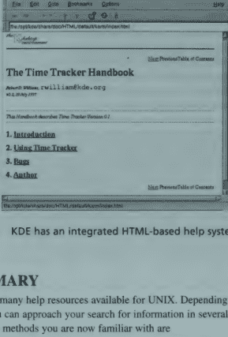

图 2.1 KDE 具有集成式的基于 HTML 的帮助系统。

### 摘要

UNIX 有许多帮助资源可供使用。根据您的需求，您可以以多种不同的方式进行信息搜索。您现在熟悉的方法有

- UNIX 手册页 — 使用 man 命令显示特定命令的完整信息。apropos、man -k、man -f 和 whatis 命令可以显示摘要信息并搜索特定类型的命令。
- 内置帮助 — 许多程序具有内置帮助，可以通过命令行参数显示，通常是 --help 或 -h。
- 本地文档 — 每个 UNIX 安装都带有系统管理员个性的一点点东西，因此每个安装都略有不同。本地文档可以帮助您找到安装与整体规范不同的地方。
- **在线资源** — Linux 主页和文档项目在浏览大量在线 Linux 信息时提供了极佳的起点。请记住，尽管信息专门针对 Linux，但其中大部分也适用于其他 UNIX 变体。comp.unix.* 新闻组对于难以找到的答案也非常有用。
- **KDE 帮助系统** — KDE 为大多数应用程序提供了出色的内置帮助。只需从每个应用程序中位于“帮助”菜单中的“内容”进行选择即可。


## 第 3 课

### 图形用户界面

*在本课中，您将学习 X Windows GUI 的基础知识，以及足够的信息来开始配置和自定义您的环境。*

### X WINDOWS 概述

尽管大多数 UNIX 版本都可以通过控制台的命令行界面访问，但还有更简单的方法。在命令行界面之上，有多种图形用户界面（GUI）可用。其中一些 GUI 是专有的，但大多数都符合称为 X Window System 或 X Windows 的开放标准接口。一些厂商已通过专有增强功能扩展了 X Windows 标准。不幸的是，这些增强功能可能导致界面部分与在其他 UNIX 版本上的远程显示不兼容。不过，由于总体原则相似，您会发现熟悉一种 GUI 也能很好地迁移到其他 GUI。

### X WINDOWS 基础

与 Macintosh 和 MS-Windows 环境不同，X Windows 是一个提供一组界面显示功能的系统。

> X 标记位置  X Windows 通常被称为 X#，其中 # 是主要版本号；或者，您可能会遇到 X#R n，其中 # 是主要版本号，n 是次要版本号。截至本文撰写时，X11R6 是当前版本，但通常被称为 X11——更简单地说就是 X。

X Windows 为程序显示窗口、按钮和其他用户交互部件提供设施。它实际上被实现为在计算机上运行的一种服务器程序。想要使用 X Windows 显示功能的客户端程序会向服务器发出请求，要求其执行某些显示功能。对于客户端或服务器应用程序而言，它们是在同一台机器上运行还是被数英里的网络分隔开并不重要——客户端发出显示请求，服务器则尽力满足。

个人电脑窗口系统与 X Windows 之间的另一个区别是，界面的外观和感觉由单独的程序控制，而不是由 X Windows 服务器控制。在 X Windows 模型中，X 服务器负责处理客户端显示请求，例如显示窗口的请求。然而，除非客户端专门为自己绘制标题栏，否则 X 不会为其提供标题栏。必须运行单独的程序来创建标题栏并实际管理用户交互，例如移动窗口、图标化/最小化窗口或提供应用程序停靠功能。

### 启动 X WINDOWS

在许多 UNIX 主机上，系统管理员已配置 X，使其在机器启动时自动启动。如果您的系统未自动启动 X，则需要在登录后手动启动它。执行此操作的两种最常见方法是程序 xinit 和一个名为 startx、x1 或 xstart 的 shell 脚本（名称不固定）。如果您使用的是原版 Solaris 系统，可能需要使用 /usr/openwin/bin/openwin。startx（及其变体）通常是一个 shell 脚本，可自动执行对 xinit 的部分调用。如果您好奇事物是如何完成的以及有哪些选项可用，这是开始浏览的好地方。（Shell 脚本在第 14 课“基础 Shell 脚本”中介绍。）

在 X 服务器本身启动后，您需要启动一些 X 应用程序。通常，这些应用程序的默认集合由位于您主目录中的文件 .xinitrc 的自动执行启动。某些 UNIX 变体不使用此文件，或以违反直觉的方式使用它。例如，如果存在 .xinitrc，IRIX 会使用它；如果不存在，IRIX 会使用其自己的专有配置实用程序。某些 Linux 变体使用名为 ****.m4 的文件。您的系统管理员可以更改默认配置。如果找不到 .xinitrc，您可能会发现您的系统在登录之间“自动神奇地”记住您打开了哪些窗口以及它们的位置。

.xinitrc 文件——如果存在——包含一系列与以下类似的行：

```
#!/bin/sh
xrdb -load $HOME/.X11defaults
xscreensaver -timeout 10 &
xterm -geometry 80x30+10+10 &
```

如果这确实是您的 .xinitrc 文件，当您启动 X11 时，.xinitrc 文件将：

- 第 1 行 — 通过 Bourne shell sh 运行自身。
- 第 2 行 — 从您主目录中的文件 .X11defaults 加载服务器资源数据库（本课后面会讨论）。
- 第 3 行 — 启动 xscreensaver 命令，分配 10 分钟超时，并将其置于后台。
- 第 4 行 — 启动一个 xterm（终端），宽度为 80 个字符，高度为 30 个字符，将其放置在屏幕顶部和左侧各 10 像素处。

您将在本课后面看到更多 X 程序命令行选项的示例。

### 使用 X WINDOWS

X Windows 的外观和感觉主要取决于您选择的窗口管理器。（您可以在本课后面了解更多关于窗口管理器及其一些选项的信息。）您会发现各种管理器之间存在一些共同点。其中一些一致的特性可能对任何使用过的人来说都很熟悉

以前使用过带鼠标的计算机。 然而，其中一些即使对熟悉 Macintosh 和 MS-Windows 环境的用户来说也可能很新。 需要记住的重要事项如下：

- **X 针对三键鼠标设计**——大多数 X 软件使用左键进行指向、点击和选择。 X 使用中间键进行通用功能，如移动或调整窗口大小，以及右键进行应用程序特定功能，如打开应用程序内弹出菜单。 当然，任何应用程序都可能修改这些用法，因此查阅文档始终是合适的。
- **X 具有焦点输入的概念**——在 Macintosh 或 MS-Windows 平台上，如果你在键盘上输入，你通常期望输入出现在任何活动窗口或对话框中——在 X Windows 中并非如此。 在 X 中，窗口管理器可以选择将你的输入焦点设置在任何它选择的位置。 大多数窗口管理器可以配置为将输入焦点放在最前面的窗口上，将输入焦点放在选定的窗口上（X 不必是最前面的窗口），或将输入焦点放在光标所在的窗口上。 最后一个选项，虽然与你可能熟悉的界面不同，通常被认为是最强大的。 将窗口管理器配置为焦点跟随光标时，你可以通过简单地将光标移动到大部分隐藏窗口的任何可见部分然后输入，来将输入定向到一个大部分隐藏的窗口——例如启动一个非交互式程序。 无需浪费时间将该窗口带到前面，输入命令，然后再将窗口移回你真正想要工作的窗口下方。


> **如果你的输入消失了** 如果你在输入并且注意到输入的内容没有出现在你认为应该出现的地方，很可能你的输入焦点在另一个窗口中。 检查以确保你的光标在正确的位置，或者——如果你的系统配置为点击聚焦——确保你已点击了你打算输入的位置。 在使用不同输入焦点方法的平台之间切换时，很容易感到困惑。

在 X 中，窗口管理器或任何其他程序都可以将任意命令附加到任意用户操作。 例如，程序可以在用户右键单击标题栏时附加显示菜单的操作。 窗口管理器可以在用户在窗口系统的空白背景中左键、右键或中键单击时弹出各种菜单；或者也可以在用户按住 shift 键同时左键、右键或中键单击时发生——可能性无穷无尽。 一个流行的终端程序 xterm 在用户按住控制键并在窗口中左键、右键或中键单击时会弹出其配置菜单。 一些窗口管理器会为每个应用程序的标题栏附加一个包含关闭和调整大小等常用命令的标准菜单。 其他窗口管理器则将这些功能附加到标题栏中的弹出菜单或按钮。 即使在同一 UNIX 版本的不同安装中，你也会发现程序行为的差异。 本地配置选项会对界面产生显著影响。 找到任何特定选项或命令的最佳建议是阅读可用文档并询问其他本地用户。

大多数窗口管理器可以使窗口图标化。 由于客户端程序窗口的实际显示并非由客户端处理，X 服务器和窗口管理器可以为用户体验做出一些有用的贡献。 其中一个贡献是，当客户端请求具有特定特征的窗口时，服务器不必以这种方式向用户表示该窗口——它只需要像具有这些特征一样对待它即可。 这使得服务器可以例如任意缩放窗口，或将其缩小并作为图标处理。 如果你熟悉任务栏或应用程序 Dock 的概念，可以将图标化窗口视为已最小化的窗口，但你可以将其存储在屏幕的任何位置。

### 配置 X Windows

大多数 X Windows 的配置由服务器资源数据库处理。 当客户端向服务器发出请求时，服务器会检查此数据库以确定该客户端的用户偏好。 服务器资源数据库按用户加载，通过命令 xrb 加载，该命令需要在启动 X11 后自动执行。 xrb 从通常命名为 .X11defaults 的点文件加载配置信息。 （点文件在第 16 课“修改用户环境”中讨论。） .X11defaults 通常包含类似以下的行：

```
xbiff*onceOnly:		 on
xbiff*_wm_option.autoRaise:	 off
xbiff*mailBox:		 /usr/spool/mail/mymail
```

如果你在 .X11defaults 文件中包含这些行，你就是在告诉你的 X 服务器，如果 xbiff 启动（一个在你有新邮件时通知你的 X11 程序），它需要设置某些选项：

- 第 1 行 — 设置 xbiff 特定的选项，关于响铃通知你的频率。
- 第 2 行 — 设置关于窗口管理器对 xbiff 处理的选项——它特别告诉窗口管理器，如果 xbiff 在需要通知你时位于其他窗口之后，不要将其带到前面。 （请记住，X11 提供显示，而单独的程序提供诸如窗口控件等的管理。）
- 第 3 行 — 告诉 xbiff 应该查找的邮箱的位置。

由于每个客户端支持不同的选项并且允许窗口管理器有不同程度的控制，你需要查阅每个客户端的文档以了解你可以配置的内容以及如何配置它。

除了服务器资源数据库之外，客户端经常具有命令行选项，可以控制客户端与 X11 的交互。 看看以下命令：

```
> xterm -fg "black" -bg "white" -fn 6x10 -geometry 85x30+525+1
```

这启动了一个 xterm 会话，其配置如下：前景色为黑色，背景色为白色（白底黑字），字体为 6x10 点。 它还设置了几何信息，使得窗口宽 85 个字符，高 30 个字符，并放置在屏幕左边缘 525 像素处，从顶部向下 1 像素处。

同样，不同的程序有不同的可用选项，你的本地文档是你获取有关确切配置的最新信息的最佳来源。

### 窗口管理器

由于 X Windows 仅提供基础的用户界面组件显示功能，需要一个额外的程序来提供有用的用户界面。 该程序是窗口管理器。 根据你运行的 UNIX 变体，你可能有多种窗口管理器的选择。 每种都提供略有不同的功能，具有相应的不同优缺点。

#### twm

最常见——也是功能最少——的窗口管理器之一是 twm。 twm 在图 3.1 中显示其管理显示，提供非常基础的窗口管理功能，并且几乎存在于或可在所有 UNIX 实现中使用。 如果你在具有不同 UNIX 版本的多平台环境中工作，你可能会发现 twm 很方便，因为你的配置可以在所有机器上保持一致。 对于其简单性而言，twm 也提供了界面用户可扩展性的最佳选择之一。 如果你愿意，可以创建自己的标准按钮出现在 twm 标题栏中以执行任意命令。 你还可以构建自己的弹出菜单，在光标进入窗口时自动执行命令，按应用程序名称和类型自定义窗口管理器颜色和操作，以及大量其他自定义。 要启动 twm 窗口管理器，在启动 X 后执行 twm（你可能可以在 .xinitrc 文件中自动执行此操作）。 所有这些自定义的控制文件名为 .twmrc，很可能位于你的主目录中。

正如你在图 3.1 中看到的，twm 允许你同时打开多个窗口。 在窗口分层期间——即使窗口可能部分被其他窗口覆盖——你可以将输入焦点集中到隐藏的窗口，从而能够在任何打开的窗口中工作。 已被图标化的活动应用程序可以单击以恢复到正常大小。


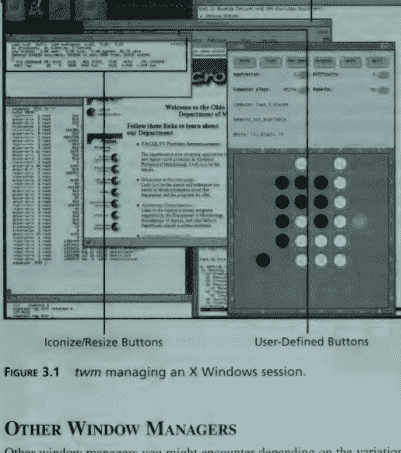

图 3.1 twm 管理着一个 X Windows 会话。

### 其他窗口管理器

其他窗口管理器你可能会遇到，这取决于你运行的 UNIX 变种，包括

- olwm—Sun 的 OpenWindows 环境的默认管理器。
- mwm—Motif 窗口管理器。许多商业窗口管理器都基于 mwm，或者试图仿效 mwm。
- 4dwm—运行 IRIX 的 SGI 的默认窗口管理器。
- tvtwm—twm 的实验性扩展，包含设置虚拟屏幕的能力。

还有许多其他窗口管理器，而且很可能有多种可供你在机器上使用。在调查完你的选项后，你可以开始构建一个完全符合你想要的感觉和行为的自定义环境。

记住，提供诸如标题栏等用户界面功能的正是窗口管理器。如果你发现自己面对的屏幕看起来像图 3.2（窗口缺少标题栏，没有滚动条，没有图标），那是因为没有窗口管理器在运行；它可能由于某种原因没有启动，或者已经崩溃。你可以尝试通过输入 twm 来启动窗口管理器——如果有一个终端窗口打开并且接受键盘输入（将键盘输入定向到特定窗口也是窗口管理器的功能）。如果没有，你需要退出 X Windows 环境并修改你的启动文件，以便在启动 X 服务器后立即启动你选择的窗口管理器。

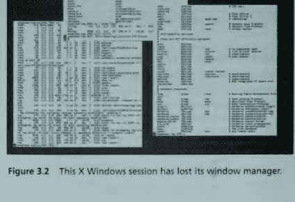

图 3.2 此 X Windows 会话已丢失其窗口管理器。

### 桌面环境

历史上，窗口管理器仅用于管理用户的屏幕。然而，一种新型的窗口应用程序正在出现。这种类型不仅以经典意义上作为窗口管理器发挥作用，还为用户提供额外的功能。这些桌面环境通常提供复杂的窗口管理，以及类似于 MS-Windows 或 Macintosh 界面的桌面。桌面经常包括文件管理功能、创建和使用图标来启动应用程序的能力，以及用于计算机管理和配置的集成图形工具集。

随着 UNIX 厂商试图使他们的机器更方便使用，你可以期待这些桌面环境变得更加复杂；即使今天，其功能和简洁性也迅速接近流行的个人电脑界面的水平。

尽管像 Sun 和 SGI 这样的行业巨头已经推出了 OpenWindows 和 IRIX 桌面等重要产品，但最显著的贡献之一是由非营利性的互联网协作努力所做出的，该努力正在开发免费软件产品 KDE。KDE 是一个可自由获取和下载的桌面环境，与各种 UNIX 实现兼容。

#### KDE

KDE 代表 K 桌面环境，并且——根据作者的说法——K 代表什么都没有。这里讨论 KDE 而不是商业桌面环境之一，是因为它令人惊讶的复杂程度以及对如此广泛平台的移植性。


> 兼容性 根据 KDE FAQ，KDE 目前已知支持 Linux、Solaris、FreeBSD、IRIX 和 HP-UX，并且预计可以在使用 gnu gcc 编译器的几乎任何系统上编译。

KDE 提供了一个复杂的窗口管理器，具有方便的扩展，例如多个虚拟屏幕、可由用户自定义的菜单，以及在登录会话之间自动记住程序及其在屏幕上的位置的功能。

此外，KDE 提供了一个桌面环境，支持（除其他外）文件和目录的图标、应用程序停靠区和快速启动按钮栏。正如你在图 3.3 中看到的，KDE 提供的用户界面比 twm（和其他典型的窗口管理器）界面更用户友好。

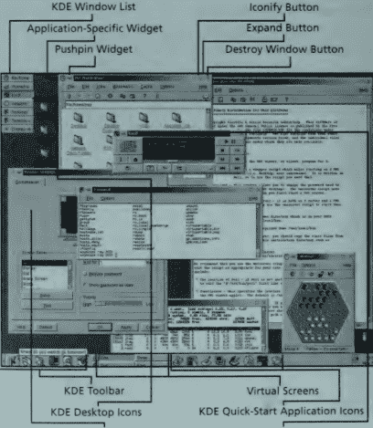

图 3.3 KDE 让 X Windows 更友好。

以下是一些 KDE 窗口功能的介绍：

- **KDE Window List**—向你显示当前可用的所有窗口的列表，即使它们在屏幕上完全被隐藏。
- **Application-Specific Widget**—标题栏上最左侧的小部件。其功能特定于与窗口关联的应用程序。
- **Pushpin Widget**—此按钮将窗口锁定到你的显示器，使其在你访问的任何虚拟屏幕上都可用。
- **Iconify, Expand, and Destroy Window Buttons**—这些按钮让你控制窗口；将其最小化、最大化或完全关闭。
- **KDE Quick-Start Application Icons**—让你只需一次点击即可访问最常用的程序。
- **KDE Toolbar**—此面板包括用于启动程序、选择窗口和配置环境的弹出菜单，以及其他有用的实用工具。
- **KDE Environment Setup Utility**—允许你控制诸如屏幕保护程序、显示设置等内容。
- **KDE Desktop Icons**—这些位于你桌面上的图标代表文件、目录或应用程序。

除了用户界面的复杂性之外，KDE 还提供了一套用于配置你的机器和用户界面的集成工具，并提供了一组有用的点按式界面来访问通用的 UNIX 程序和实用工具。其中一些实用工具将在其他课程中讨论；因此，如果你已经在使用某种桌面环境，请注意这些部分，了解 KDE——以及桌面环境总体上——如何让你的生活更轻松。

如果你正在寻找一种让你的 UNIX 体验感觉更像个人电脑的方法，请咨询你的系统管理员是否可以为你安装 KDE。

### 摘要

本课向你介绍了图形用户界面的背景，特别是 X Window 系统。理解 X Windows 将使你能够利用这些基于图形的工具。

- X Windows 基于客户端/服务器模型。客户端可以在你想要的任何地方运行并发出显示请求。服务器在具有显示屏幕的机器上运行并尝试满足这些请求。
- X Window 系统需要窗口管理器来实现诸如标题栏等用户界面便利。
- X Windows 鼠标的行为可能很奇怪——如果第一次不成功，请继续点击。
- X Windows 可以以多种不同的方式将键盘输入聚焦到窗口。请注意你的光标所在位置。
- 在 X Windows 环境中，图标通常代表最小化的窗口而不是应用程序。
- 桌面环境的出现正在将应用程序图标带入 X Windows 世界。

对于桌面环境的所有功能，以及新窗口管理器的所有自动化，它们的配置通常存储在你主目录中丑陋的文本文件中。如果你想将环境从一台机器复制到另一台机器，这些是很好的起点。

## 第 4 课

### 文件系统


*在本课中你将学习 UNIX 文件系统的基础知识以及一些方便的技巧，使你的 UNIX 生活更轻松。*

对初学者来说，UNIX 文件系统可能看起来是一个奇怪且不受欢迎的地方——那么多文件，而你只有一条命令行的输入。兽皮和石刀时代，对吧？错。虽然最初访问 UNIX 文件系统可能看起来晦涩且原始，但 UNIX 提供了极其复杂的文件访问和控制。这种复杂性源于许多简单的命令，可以从中构建更复杂的命令。

### 文件系统设计

在简单的命令有意义之前，你需要了解有关 UNIX 文件系统设计的几件事。虽然这可能看起来不是用户体验中非常重要的一部分，但 UNIX 文件系统与你可能熟悉的个人电脑文件系统有点不同。实际上，你可能会发现最大的差异正是你喜欢的。

*UNIX 文件系统有一个单一的根目录。* 与 Macintosh 文件系统在其桌面上有多个驱动器图标或 Windows 文件系统有其 ABC 不同，UNIX 文件系统有一个单一的顶级目录——*根* 目录。UNIX 认为其文件本质上是按树形排列的，以根目录为基部或根。然而，UNIX 的树与正常树相比是倒置的。根目录可以包含文件和其他目录，第二级目录可以包含更多文件和更多目录，依此类推。


### 根目录的威力
UNIX 使用单词 root 来描述两个不同的概念。一个是 root 用户，即对机器上所有事务拥有绝对控制权的人。另一个是根目录，即机器上被视为文件系统顶部的那个单一特定目录。

你不需要关心驱动器在哪里。其他驱动器如果不是用字母或图标命名，会出现在什么地方？在 UNIX 中，它们只是作为位于文件系统任何位置的目录出现。奇怪吗？一点也不。UNIX 完全将硬件和文件的物理位置的概念从用户的关注中移除。这可能需要一段时间才能习惯，但当你习惯后，你会发现用户根本没有必要担心文件物理上位于何处。如果你知道它的名称以及在文件系统中如何找到它，为什么还要担心它生活在哪个氧化金属块上（顺便说一下，硬盘就是由这种东西制成的）？如果你想想，你会发现这还有其他重要的好处。例如，如果你的系统管理员某天发现他已用完磁盘空间来安装新软件，他可以透明地重新排列磁盘和文件。他可以将某些超载目录中的所有内容移动到新磁盘上，并挂载新磁盘，使其出现在与旧目录相同的位置——而你永远不会察觉到差异。

### 挂载驱动器
告知文件系统驱动器存在以及它将在哪个目录出现的过程。在大多数 UNIX 变体中，普通用户不能挂载驱动器。如果你碰巧在一台允许普通用户挂载驱动器的系统上，你需要联系你的系统管理员以了解你可以挂载哪些驱动器，以及如何挂载它们。

*事实上，你甚至不需要关心你的文件存放在什么状态下。这种抽象的另一个好处是，你的系统管理员可以使物理上位于远程机器上的文件、目录或驱动器透明地出现在你的机器的文件系统中。你在访问远程位置的文件时可能注意到的唯一区别可能是由于网络造成的轻微减速。这意味着什么？如果你的系统设置正确，无论你在哪里或坐在哪台机器前，无论你在主要办公室还是世界另一端，你的所有文件都出现在相同的位置，所有软件也都在你一直期望的位置。*

*即使你不在乎你的文件在哪里，你总是在某个地方。* UNIX 将用户环境的大部分概念基于用户“身处某个地方”，位于并在某个特定目录中工作。随着新图形桌面环境工具的出现，这变得不再是普遍概念，但在使用 UNIX 时仍然是一个值得记住的好主意。

*UNIX 命令和文件名区分大小写。* 对于 Windows 和 Macintosh 用户来说，这可能相当令人惊讶：UNIX 对你输入的内容的解释相当字面。MyFile 在纸面上看起来与 myfile 不相同，在 UNIX 中也不相同。务必注意你尝试使用的文件名或命令的大小写。信不信由你，Mail 和 mail 是两个不同的命令，两者都可在许多 UNIX 变体上使用——而且它们做的事情不同！

*文件有三个属性。* UNIX 对文件属性的想法非常简单——文件可以是可读或不可读、可写或不可写、可执行或不可执行。任何这些选项的组合都是可能的，尽管有些组合并不特别合理。一般来说，程序将是可读且可执行的，而数据文件将是可读的并且可能可写。然而，UNIX 会照你说的做。例如，如果你告诉它某个数据文件是可执行的，它很乐意让你尝试运行你的 Rolodex 文件——这不太可能成功；如果你告诉它某个程序是可写的，它同样乐意让你编辑你的文字处理器——这很可能会使软件变得无用。

*一切都属于某人。* UNIX 文件系统中的每个文件和目录都携带着详细说明其所有者的信息。文件的拥有者可以允许或禁止其他用户或其他用户组访问该文件，并可以控制文件是否可执行、可读或可写。

现在你已经对你的命令将要与之交互的内容有了一些了解，你可以开始学习需要知道的内容以便四处移动。

### 浏览文件系统
处理 UNIX 文件系统的最基本命令是用于在目录之间移动以及查找其中文件内容的命令。在移动之前，了解你所在的位置是个好主意。

### 你在哪里？ pwd
pwd（当前工作目录）命令要求你的机器告诉你你当前所在的目录。只要你在运行命令行，它就在文件系统的某个位置——输入 pwd，它就会告诉你在哪里。

例如：
```
> pwd
/priv/home/ray/public_html/
```

#### 路径细节
/priv/home/ray/public_html/ 是一个路径。路径最简单的解释是从根目录到当前文件或目录必须经过的最短目录集。路径中的每个目录都用 / 分隔。

### 主目录
对每个用户来说，有一个特定的目录是特殊的。这就是你的主目录。从浏览文件系统的角度来看，这个目录与任何其他目录相同；然而，它很重要，因为当你登录时，你最初就在这里。你可以期望在你的主目录中或其下方的任何内容都只属于你。为了让你的生活更轻松，UNIX 不要求你记住主目录的路径。相反，它允许你简单地将主目录引用为 ~，并将任何其他人的主目录引用为 ~username。

现在你知道了你在哪里，接下来你可能想知道与你在一起的文件是什么。

### 列出文件
实际上，在 UNIX 中，你几乎可以在任何地方列出文件，除了你没有权限的地方（有关权限的更多信息请参见第 19 课“权限”）；不过，最容易列出文件的地方是“这里”——无论当前在哪里。

### LS
ls 命令列出文件。不带参数发出时，ls 列出当前目录（pwd 会告诉你的那个目录）中的文件和子目录。例如
```
> pwd
/priv/home/ray/public_html/
> ls
cgi_bin          test.html
images           vral
index.html
```

前面的示例显示你的当前目录路径是 /priv/home/ray/public_html，并且该目录包含五项。从这个列表中看不出来，但 cgi_bin、images 和 vral 是目录，而 index.html 和 test.html 是文件。

#### 涵盖基础
在前面的示例中，你实际上并不需要发出 pwd 命令来使用 ls 命令。它是为了清晰起见而包含的。如果你已经知道自己在文件系统中的位置，就没有理由要求计算机重复告诉你。

如果你想列出当前目录以外的某个目录中的文件，例如根目录中的文件，你可以带目录选项发出 ls 命令：
- 1. 确定你想要列出的目录的名称。
- 2. 按以下方式发出 ls 命令：ls <directory name>。

如果你想列出根目录 / 的内容，你会输入：
```
> ls /
CDROM          lib
bin            priv
core           tmp
dev            vmunix
etc            usr
include        var
```

这里除了 vmunix，即 UNIX 核心的软件，以及 core，即应该真正扔掉的错误文件之外，其他都是目录。

#### 文件名事实
记住 UNIX 文件名，因而命令，也是区分大小写的。UNIX 将大写字母排在小写字母之前。这就是为什么 CDROM 会出现在 bin 之前。

如何判断它们是目录？使用 ls 选项要求它在列表中提供更多信息，特别是“long”选项。

按以下方式发出命令：ls -l <directory name>.
```
> ls -l /
 total 14
dr-xr-xr-x 2 root 512 Jan 8 1995 CDROM
lrwxrwxr-x 1 root 7 Dec 7 1994 bin -> /usr/bin
-r--r--r-- 1 root 8503728 Oct 25 20:16 core
drwxr-xr-x 3 root 11264 Nov 7 13:02 dev
drwxr-xr-x 11 root 3072 Nov 7 13:01 etc
drwxr-xr-x 46 root 2560 Jan 11 1995 include
drwxr-xr-x 23 root 4096 Oct 13 16:29 lib
drwxr-xr-x 4 root 512 Jul 4 1997 priv
drwxrwxrwx 3 root 512 Nov 24 00:30 tmp
-rwxr-xr-x 1 root 1382769 Aug 12 12:57 vmunix
drwxr-xr-x 29 root 1024 Oct 27 17:53 usr
lrwxrwxr-x 1 root 8 May 21 1995 var -> /usr/var
```


### ls 变体
不同版本的 UNIX 都有 ls 命令，其输出略有不同。不管你使用的是哪种版本的 ls，你都会看到类似的字段——也许还有几个其他的。目前不必关心出现的任何额外字段。

这个列表乍一看可能有点复杂，但你此刻需要理解的部分相当直接。

- 首先是一行告诉你此目录中有多少个项目——在本例中为 14 个。
- 接下来是详细说明目录内容的行，每个项目一行。
- 每行左侧看起来像乱码的十个字符实际上是文件的属性信息。其中的第一个字符告诉你该行是目录还是文件；第一个字符为 d 的行是目录。以 - 开头的行是普通文件。眼尖的观察者可能会注意到 bin 和 var 的行以 l 开头。这表示它们实际上是链接，即其他文件或目录的别名（链接将在本课后面更深入地讨论）。剩下的九个字符分为三组，每组三个，分别表示文件所有者、文件所属组以及其他人对文件的读、写和执行权限。你将在第 19 课学习如何操作这些设置，以及关于文件所有权、组和“其他人”的更多概念。
- 在十个权限信息字符之后，每行都包含 root。这是文件或目录的所有者。在前面的示例中，root 用户拥有目录中的所有内容。如果你看到包含 root 的双列条目，那是因为你的 ls 命令同时显示了组信息和用户信息。在第 19 课熟悉组之前，不必关心这两列中的第二列。

- 接下来是一个数字，有时小有时大。这是文件或目录占用的磁盘空间大小。对于目录来说，这不是目录内容占用的空间，而是控制该目录的数据文件占用的空间。该值以字节为单位。如你所见，目录占用的空间非常小——尽管其内容可能另当别论。相反，vmunix 大约占用 1.4Mb，而那个本应早已删除的讨厌的 core 文件占用了 8.5Mb。
- 文件大小之后是文件的最近修改日期。如果文件在过去一年内被修改，则给出日期和时间；否则给出日期和年份。
- 最后是文件名。请注意，文件名与前一个示例中 ls 版本给出的名称相同，除了 bin 和 var，它们有一个指向路径的奇怪指针。如前所述，这些实际上是其他目录的别名，指针指向它们所链接的路径。

到现在你也许已经注意到，总行声称此目录包含 14 个项目，但列表中只出现了 12 个。这是因为出于礼貌，UNIX 会隐藏一些文件，除非用户特别要求显示。以 .（点）开头的名称的文件默认不显示。通常，控制和配置文件——你不希望它们 clutter 你的目录列表——会以点命名，这样在日常使用中就不会看到它们。然而，如果你想查看它们，只需提出请求即可。在这种情况下，使用 ls 的 all 选项。

```
>ls -al /
 total 14
drwxr-xr-x 1 root 8 Nov 24 00:30 .
-rw-r--r-- 1 root 42 Dec 13 1997 .login
dr-xr-xr-x 2 root 512 Jan 8 1995 CDROM
lrwxrwxr-x 1 root 7 Dec 7 1994 bin ->
/usr/bin
-r--r--r-- 1 root 8503728 Oct 25 20:16 core
drwxr-xr-x 3 root 11264 Nov 7 13:02 dev
drwxr-xr-x 11 root 3072 Nov 7 13:01 etc
drwxr-xr-x 46 root 2560 Jan 11 1995 include
drwxr-xr-x 23 root 4096 Oct 13 16:29 lib
drwxr-xr-x 4 root 512 Jul 4 1997 priv
drwxrwxrwx 3 root 512 Nov 24 08:30 tmp
-rwxr-xr-x 1 root 1382769 Aug 12 12:57 vmunix
drwxr-xr-x 20 root 1024 Oct 27 17:53 usr
lrwxrwxr-x 1 root 8 May 21 1995 var -> /usr/var
```

请注意，列表中出现了两行新内容：一行是名为 . 的文件，一行是名为 .login 的文件。.login 文件是典型的 UNIX 配置文件；你可以在任何用作主目录的目录中看到此类文件。. 文件可能有点出乎意料；然而这是很正常的。. 目录存在于 UNIX 机器上的每个目录中，本质上等同于当前目录。例如，命令 ls 和命令 ls . 会产生相同的结果，因为 ls 默认列出当前目录，而 . 就是当前目录。

根目录 / 是唯一的，因为它内部没有名为 .. 的目录。.. 目录表示“此目录的上级目录”。因此，如果你当前在 /priv/home/ray/public_html，ls .. 会列出 /priv/home/ray 的内容。

ls 命令除了这里讨论的选项外还有许多其他选项：用于排序的选项、用于制表数据的选项，以及用于向“简短”列表添加标志以显示文件属性的选项。除了前面讨论的 -l 和 -a 选项外，最有用的还有 -F 选项，用于指示文件属性，以及 -R 选项，用于递归列出指定目录下的所有文件。

### 更改目录：cd
现在你已经知道如何确定自己的位置以及周围有什么，是时候四处逛逛了。要从一个目录移动到另一个目录，使用 UNIX 命令 cd。如果你想从当前位置移动到另一个目录，你

- 1. 确定当前位置（如果不知道，使用 pwd 命令）。
- 2. 选择要前往的目录（本例为 /usr/local）。
- 3. 按如下方式发出 cd 命令：cd <directory name>

例如：

```
> pwd
/priv/home/ray/public_html
> cd /usr/local
> pwd
/usr/local
```

最后的 pwd 显示 /usr/local 为当前目录，正是我们想要的。

### pushd 和 popd
更改目录之间的一种更强大的方法是使用目录栈。

> Stack 在计算机术语中，栈是一种数据存储类型，其工作原理与盘子堆栈类似。在盘子堆栈中，盘子只能从顶部添加到堆中或从堆中取出，最近添加的盘子最先被取出。数据存储栈的工作方式完全相同。数据被推入栈中，覆盖之前的数据，并从栈中弹出，露出之前的数据。

如果你当前在一个目录中并想暂时更改到另一个目录，使用两个 cd 命令并不是唯一的方法。通过使用 pushd 命令，你可以将当前目录放在目录栈上，并将当前目录更改为新目录。当你准备返回到上一个目录时，只需使用 popd 即可恢复旧目录。

如果你想从当前目录更改到另一个目录，然后自动返回，请按如下方式使用 pushd 和 popd 命令：

- 1. 决定要去哪里。
- 2. 按如下方式发出 pushd 命令：pushd <directoryname>
- 3. 你现在已在新目录中，可以在此工作任意长时间。你的上一个目录正在栈中等待你。
- 4. 当你完成工作并想返回到上一个目录时，按如下方式发出 popd 命令：popd。

例如：

```
> pwd
/usr/local
> pushd /var/adm
/var/adm /usr/local
> pwd
/var/adm
...now you can work here as long as you like.
> popd
/usr/local
> pwd
/usr/local
```

如果你想在系统上试试，并且你已经尝试使用 ls 命令列出根目录，你有多种目录可供尝试。如果目录 /usr 存在（几乎总是存在），你可以使用 pushd /usr，浏览一下，然后使用 popd 返回到你现在所在的位置。

你现在几乎了解了在 UNIX 文件系统中导航的所有内容，但在继续其他主题之前，还有一个额外的变化你需要了解。

### 相对路径和绝对路径
到目前为止，你使用过的所有路径都是绝对路径——即从根目录开始并以文件或目录名称结束的路径。在现实生活中你会很快觉得这很烦人，因此 UNIX 也提供了相对路径的概念。相对路径相对于当前目录。在你的工具箱中加入相对路径后，如果当前目录是 /usr/local/，而你想进入 /usr/local/bin/ 目录，你可以选择发出两个不同的 cd 命令。你可以输入 cd /usr/local/bin 或 cd bin；两者

导致你的新当前目录为 /usr/local/bin。你也可以使用目录元素 ..，它之前已作为相对路径组件讨论过。例如，如果你当前在 /usr/local/bin 且想进入 /usr/local/lib，你可以选择 cd /usr/local/lib，或 cd ../lib。

> 路径的注意事项 所有绝对路径都以 / 开头；所有相对路径都不以 / 开头。

到目前为止，你已经知道如何确定自己的位置、目录中有哪些文件，以及如何移动到不同目录。现在是学习一些技巧的时候了。

### 支持的 Shell 中的文件名展开

某些 Shell（其中最常见的是 tcsh 和 bash）支持文件名展开。本质上，这是一种让 Shell 帮你完成部分输入的方法。如果你的 Shell 支持文件名展开，你可以在输入文件名或目录名的开头——最好输入足够的部分以唯一标识该文件——后按下 Tab 键来使用此功能。例如，如果你想编辑当前目录中一个名为 mybigfile.dat 的已有文件，你可能会发出命令：`vi mybi<Tab>`。（vi 是一个编辑器，将在第 8 课“文本编辑”中讨论。）如果当前目录中没有其他以字符“mybi”开头的文件，Shell 会自动为你补全文件名。如果你确实有其他以“mybi”开头的文件，Shell 会发出蜂鸣声，你需要输入更多文件名使其唯一，然后再尝试 Tab 键。

记住，所有这些技术可以一起使用。如果你正在 /usr/local/bin 工作，突然想起忘记编辑 /usr/local/myincludes 中的一些文件，你可以用 `pushd ./myin<Tab>` 进入那里，再用 `popd` 返回。

### 使用 KDE 导航文件系统

如果你觉得在命令行中移动很别扭，会很高兴知道 KDE 提供了非常用户友好的文件系统导航方式。KDE 的文件管理系统在“一切皆为网页”的理念上超越了 Windows 98 的基于 Web 的桌面概念。每个文件管理器窗口都支持普通 Windows 或 MacOS 窗口的全部功能，同时也是一个功能齐全的 Web 浏览器。略微偏离你可能习惯的双击模型，KDE 只需单击一次即可执行操作。

#### 简单的 KDE 操作

在 KDE 中，文件由通常表示文件类型的图标表示。目录显示为文件夹。双击目录类似于从命令行使用 cd 进入该目录；会打开一个新窗口显示该目录的内容。图 4.1 显示了一个 KDE 文件管理器窗口。

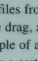

> **浏览你的文件** 请注意，文件管理器窗口会显示其正在显示的目录的 URL。因为每个窗口都是一个 Web 浏览器，你可以将 Web 或 FTP 地址替换到 URL 字段中，KDE 就会立即带你前往——当然，前提是你有互联网连接！

正如你所期望的，要在不同位置之间移动或复制文件，你只需将文件从一个位置拖到另一个位置。拖动结束时会出现一个弹出菜单，询问你是否要复制或移动文件。这就是上下文菜单的示例，它会在特定上下文中执行操作时出现。

要删除文件，将要删除的文件拖到垃圾箱图标。右键单击该图标并选择清空垃圾箱以完成操作。

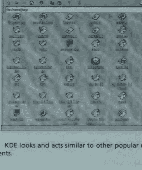

图 4.1 KDE 看起来和行为与其它流行的桌面环境相似。

使用以下步骤创建新文件夹：

- 1. 在想要文件夹出现的位置右键单击。
- 2. 从弹出的上下文菜单中选择新建。
- 3. 从其子菜单中选择文件夹。

> 返回主目录 如果你需要在 KDE 中返回主目录，只需寻找带有一个小房子图标的文件夹图标。单击此图标会打开一个显示主目录的 KDE 文件管理器窗口。

如果你花几分钟玩玩 KDE，你会发现它的简洁和优雅与商业桌面操作系统不相上下。如果你以前使用过个人电脑，你可能会难以相信在 UNIX 世界中，大多数真正优秀的软件都是用户编写、社区支持、基于开放标准并且完全免费的！这让大操作系统厂商感到恐惧。

有很多东西可以探索，所以如果你正在运行 KDE 系统，在继续第 5 课“查找文件”之前，花几分钟四处看看。

### 摘要

本课已为你在文件系统和典型环境中工作提供了基本技能。如果你在学习材料中遇到任何问题，请在进入下一课之前先练习。以下是本课要点的回顾：

- UNIX 抽象了数据的物理位置。不要担心你的数据和软件的物理位置——如果你的系统管理员在尽职尽责，就不重要。
- UNIX 区分大小写。在大小写方面要特别注意，尤其是在在 UNIX 机器和个人电脑之间传输文件时。
- UNIX 文件具有可读性、可写性和可执行性属性。你可以设置自己拥有的文件的属性，使其无法执行、无法写入且无法读取。你不希望这样做。
- pwd 命令告诉你当前所在位置。
- ls 命令告诉你目录中的文件。
- cd 命令带你前往某处。
- pushd 命令记住你所在的位置，而 popd 命令带你返回。
- 尽可能使用相对路径。如果目录靠近当前目录，通常使用从当前目录的相对路径比使用从 / 开始的绝对路径更方便。
- 记住所有这些功能和命令可以协同工作。UNIX 的精髓在于将许多执行你所需工作的小部分的小程序和功能组合成一个按你想要的方式精确执行的便捷工具。
- 桌面环境可以让你的生活更轻松——它们自动化了一些日常例行任务，并为一些更困难的任务提供友好的界面。如果你的系统没有 KDE，不必担心——很可能要么可以在其上安装 KDE（如果你对系统管理员足够好），要么它已经附带了一个功能相当的漂亮桌面环境。

## 第 5 课

### 查找文件


在本课中，你将学习使用 UNIX 内置的搜索工具查找文件。

在第 4 课“文件系统”中，你学习了如何列出目录中的文件以及如何在目录之间导航。你可能也注意到标准 UNIX 发行版包含大量文件。你肯定会遇到这种情况：你知道想要使用文件的名称，但不知道它位于何处。与其使用 cd 和 ls 在整个文件系统中寻找，你可以使用 UNIX 的搜索实用程序来帮助定位所需内容。

### 查找文件

要定位文件，你需要知道有关它的一些信息：其名称的一部分、创建的时间，或许是其大小。掌握这些信息后，你可以调用 find 命令，让它在文件系统中搜索与你的查询匹配的内容。

### 按名称查找文件

最常见的搜索类型是按文件名搜索。你可能在其他操作系统上使用过类似的 find 文件命令。你提供要查找的文件名或文件名的一部分，系统会返回匹配列表。


> 使用 find 在尝试 find 命令之前，有件事你需要知道。如果你在大型文件系统上运行 find，尤其是在网络上挂载的文件系统上，它可能需要很长时间。


按名称搜索文件，请使用以下步骤：

- 1. 确定要搜索的文件名称。如果需要，可以在文件名搜索中包含通配符。
- 2. 选择搜索的起始目录。如果要搜索整个文件系统，起始目录将为 /。
- 3. 按如下方式调用 find 命令：`find <starting directory> -name <filename> -print`。

例如：

```
>find / -name sound -print
/usr/src/linux-2.6.35/drivers/sound
/usr/src/linux-2.6.35/drivers/sound
/var/lock/subsys/sound
/etc/rc.d/init.d/sound
```

> **搜索错误** 如果你在搜索整个文件系统，很可能会遇到诸如

`find: /home/ftp/bin: Permission denied`
`find: /home/ftp/etc: Permission denied`

这完全正常，并非警报原因。系统只是在扫描文件系统搜索文件时，遇到了你没有权限读取的目录。如果你将搜索范围限制在你的主目录（系统可表示为 ~），就不会看到这些错误。

系统已响应请求，找到四个名为 sound 的不同文件。由于 find 被指示搜索整个文件系统，搜索花费了超过一分钟；有数百个目录和数千个文件名被处理。

你可能会想为什么需要在命令后加上 -print。这是因为 find 除了告诉你找到的内容外，还能做其他事情。另一方面，如果你不使用 -print 选项，大多数版本的 find 会很高兴地去为你查找文件，然后退出——而且什么都不告诉你。记住，UNIX 会非常字面地执行你告诉它的内容。

### 按日期查找文件

想象一下，你刚刚在系统上创建了一个文档文件，但记不起它的名称。怎么才能找到它呢？一个可能的解决方案是按时间搜索，找到比某个时间更新的文件。要按创建日期搜索文件，请执行以下操作：

- 1. 确定文件相对年龄（以天为单位）。
- 2. 选择搜索的起始目录。记住，/ 会搜索整个文件系统，而 ~/ 只搜索你的个人目录。
- 3. 使用 -ctime 选项调用 find：`find <starting directory> -ctime <days old> -print`。

例如：

```
>find ~/ -ctime 2 -print
/home/jray/getip.c
/home/jray/a.out
/home/jray/getip2.c
/home/jray/.saves-8395-postoffice
```

如果你输入了此命令，你将搜索主目录中在过去两天（48 小时）内被修改过的文件。如果这些是你的结果，其中一个就是你要找的文件。

### 按大小查找文件

按大小查找文件的优势可能在系统开始用完空间之前并不明显。UNIX 在程序崩溃时通常会保存一个名为 core 的文件；这被称为核心转储。核心文件包含程序崩溃时内存中的所有信息，可供程序员调试问题。通常核心文件可以删除，除非你想自己尝试
调试程序。问题在于这些文件往往写入你可能不知道的目录中，并在不知情的情况下静默消耗磁盘空间。当然，如果磁盘空间不足，你会想找到可能由其他进程创建的大文件；因此，仅按名称查找 core 是不够的。要按大小搜索，请使用以下步骤：

- 1. 选择要搜索的目标文件大小，find 将为你定位所有该大小（或更大）的文件。
- 2. 选择起始目录。
- 3. 使用 -size 选项启动 find 程序：find <starting directory> -size <#> -print。

例如：

```
>find ~/ -size 1024k -print
/home/jray/bochs/bochs-980513/core
/home/jray/postgres51/core
```

这里看到的 find 命令已定位到两个核心文件（希望它们实际上不在你的主目录中），大小为 1024k 或更大。如果有其他大文件，也会被列出；不过在这种情况下，只找到了核心文件。

除了 -name、-ctime 和 -size 之外，还有许多其他命令行开关可与 find 一起使用。如果你有兴趣了解更多，请务必查看 find 手册页。

### whereis

whereis 命令在预设的若干目录上执行快速搜索，并返回你指定的文件的源代码、二进制文件和手册页的路径。作为通用查找工具，它不如 find 有用，但仍可能派上用场。

例如：

```
>whereis time
time: /usr/bin/time /usr/include/time.h /usr/man/man2/time.2
=>/usr/man/man1/time.1
```

whereis 命令显示 time 二进制文件位于 /usr/bin/time，而头文件位于 /usr/include/time.h。还返回了两个手册页路径。如果你有兴趣找到程序及其相关文件在机器上的位置，whereis 可能就能解决问题。

### which

最后，which 命令也可以帮助你定位位于 PATH 环境变量指定目录之一中的文件。第 16 课“修改用户环境”讨论了如何配置 PATH 变量。这作为查找文件的方法用处不大，而更像是一种方法，用于找出输入命令时执行的是哪个版本的程序。例如，如果你的系统有两个不同的名为 time 的程序，你可以使用 which 命令找出输入 time 时运行的是哪一个。你可以像使用 whereis 一样调用 which——只需提供要查找的文件名即可。

例如：

```
>which time
/usr/bin/time
```

UNIX 返回 time 命令的完整路径。which 命令是你迄今为止见过的最不可配置的命令，但它也是最快的。如果你曾经想回忆程序的位置，不妨试试 which。

### 查找包含单词或模式的文件

UNIX 中最强大的内置程序之一是 grep。grep 实用程序可让你快速在文件内容中搜索特定单词或模式。grep 有三种形式：grep、egrep 和 fgrep。这些版本之间的差异基于它们能处理的正则表达式的复杂程度。正则表达式定义了一种文本模式，可用于在不知道要搜索的具体单词或短语时搜索文件。（你将在第 13 课“正则表达式”中了解更多关于正则表达式的内容。）fgrep 命令是三者中最快的，但处理的是最不复杂的表达式。为了安全起见，你始终可以使用普通的 grep，它在每种情况下、每个系统上都能同样工作。那么，如何使用这个很棒的工具呢？很简单——只需提供要查找的单词或模式，以及要搜索的文件：

- 1. 选择要查找的单词或短语。
- 2. 找到要搜索的文件名。如果它在另一个目录中，必须指定完整的路径名。你也可以使用通配符搜索多个文件。
- 3. 在命令行输入 grep `<pattern to find>` `<file or files to search>`。

例如：

```
>grep "jray" *.txt
8979-10.txt:<manager>=jray
log.txt: Access by jray on 11/12/98
kiwi.txt: jray loves to eat kiwis. But don't you think that
->it would be
```

此示例在任何以 .txt 结尾的文件中搜索 jray。它找到了三个包含该字符串的文件——8979-10.txt、log.txt 和 kiwi.txt；每个文件名后面跟着包含 jray 的文本。你可能想要添加到 grep 的两个选项是 -i 以忽略大小写，以及 -n 以显示每个文件中匹配的行号。你可以将这些标志添加到命令行中，紧跟在 grep 命令之后。

grep 命令是一个极其有价值的工具，当你以后学习正则表达式时它会变得更有价值。记住回到本课来测试你在第 13 课中学到的一些内容。

### 使用 KDE 查找功能

对于运行 KDE 的用户来说，你会很高兴知道 KDE 内置了一个查找实用程序，它提供了命令行版本 find 和 grep 的许多相同功能。KDE 为这些功能提供了一个友好的界面，对于在 MacOS 或 Windows 电脑上运行过搜索的任何人来说都相当熟悉。KDE 查找实用程序如图 5.1 所示。


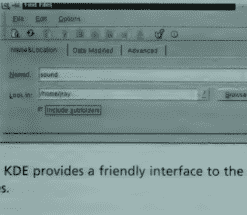

图 5.1 KDE 为 UNIX find 和 grep 实用程序提供了一个友好的界面。

在 KDE 环境中搜索，请使用以下步骤：

- 1. 单击 K 工具栏图标以调出主 KDE 菜单。
- 2. 选择“查找文件”。
- 3. 从三个选项卡之一中选择适当的搜索条件。
- 4. 在“查找文件”工具栏中单击小放大镜以定位匹配的文件。

“查找文件”中有三个不同的选项卡，可执行三种不同的搜索：

- - **名称和位置**—如果您正在搜索文件名，则需要使用此选项卡。您可以输入部分文件名并为搜索提供起始目录。这相当于您之前使用的 find -name 命令。
- - **修改日期**—与前面讨论的 find -ctime 选项类似，“修改日期”选项卡使您能够根据文件修改日期搜索文件系统。
- - **高级**—高级选项使您能够定位特定类型的文件或在文件中搜索单词或短语。

当然，您可以继续在 KDE 中使用命令行实用程序，但如果您更习惯于指向和单击，知道您有此选项是很不错的。

### 摘要

在基于 UNIX 的计算机上查找某物可能有点困难，因为有大量可供搜索的文件和目录。值得庆幸的是，UNIX 提供了一组强大的实用程序来帮助您找到所需的内容。在本课中，您学习了几种根据名称和属性查找文件的方法。您现在也熟悉在文件中搜索特定单词或短语。

- - **find**—find 命令可以根据多种条件在整个 UNIX 文件系统或任何目录下的区域中搜索特定文件。您已经看到如何根据名称、创建日期和大小查找文件。
- - **whereis**—如果您正在查找程序文件、其源代码或其手册页，whereis 命令可能适合您。whereis 搜索预设的常见文件位置列表并快速返回找到的任何内容的路径。
- - **which**—which 函数取决于您的 PATH 环境变量。它在您为特定文件名指定的路径中进行搜索。
- - **grep (grep/egrep/fgrep)**—grep 命令集是在文件中搜索特定单词或模式的实际内容的极其强大的方法。将 grep 命令与正则表达式（参见第 13 课）结合使用时，其威力是惊人的。
- - **查找实用程序**—KDE 提供了一个易于使用的界面，涵盖了 find 和 grep 的许多功能。

## 第 6 课

### 在 Shell 上操作文件


*在本课中，您将学习如何执行基本的文件维护功能，例如创建和删除文件和目录。*

您使用 UNIX 命令的频率不太可能超过文件维护命令集。值得庆幸的是，您将使用的命令非常简短，只有几个重要的选项。虽然这些命令和选项最初看起来可能很简单，但结合您可以使用它们完成的工作以及您将在第 14 课“基本 Shell 脚本编写”中学习到的自动化知识，您会发现这些命令可以执行您能想象到的几乎任何文件维护任务。

### 操作文件和文件夹：命令行

命令行是您访问 UNIX 文件系统的首要接口，也是创建、删除和重新排列文件的首要工具。软件提供文件创建和删除工具并不罕见，但这些工具很少像命令行那样强大。即使您打算在日常工作中避免使用命令行，您也需要了解这些工具。


Tweedle Dee 在使用命令行时，请记住这一点：您作为参数提供给命令的文件名可以是相对路径或绝对路径。这意味着如果您有一个名为 tweedle 的命令，它会处理一个文件，如果您输入

**tweedle myfile**，您将在当前目录中处理文件 myfile。

**tweedle ../myfile**，您将在上一级目录中处理文件 myfile。

**tweedle /priv/home/henry/myfile**，您将在目录 /priv/home/henry 中处理文件 myfile（假设您当然有权限在该目录中处理文件）。

请记住，前面的示例中的 tweedle 是一个假设的命令，具有假设的结果——UNIX 没有这样的命令。它在这里仅用于帮助解释“以某种不确定的方式修改”命令。您可以将任何操作替换为 twiddle/tweedle。

### 创建新空文件：touch

touch 命令用于更新文件的“上次修改”时间并将其设置为当前时间。这似乎是一个奇怪的需求，但如果您有一个应用程序对特定时间之后的新文件执行某些功能，这将是一个非常有用的实用程序。


### 利用 touch

您可能想要记住可以使用 touch 命令的一个地方是与备份和归档软件一起使用。许多全系统备份程序默认仅备份自上次备份以来修改过的文件（这称为增量备份）。如果您想确保文件已备份，即使您最近没有修改它，您也可以 touch 该文件以更改修改日期，使其看起来在您 touch 时已被修改。

touch 文件的一个有用副作用是，如果您尝试 touch 的文件不存在，touch 它会将其创建为新的空文件。

如果您需要更新文件的修改日期或创建新的空文件，请执行以下操作：

- 1. 确定要更新或创建的文件或文件的文件名。
- 2. 按以下方式发出 touch 命令：`touch <filename> <filename>` ...

例如，输入

```
> touch myfile
```

如果 myfile 之前存在，其上次修改日期现在将设置为当前时间。如果 myfile 之前不存在，它现在将作为一个空文件存在，其上次修改日期为当前时间。

当然，如果您想创建多个文件或更新多个文件的修改日期，您可以输入类似以下内容：

```
> touch myfile1 myfile2 myotherfile
```

这会导致 myfile、myfile2 和 myotherfile 都具有更新的修改日期或根据需要被创建。

> touch 的其他用途 当您对 UNIX 足够熟悉，可以开始使用 shell 脚本（在第 14 课中讨论）来自动化您的工作时，您会发现 touch 命令对于创建允许脚本相互通信的标志文件很有用。请在以下情况下记住 touch 命令

```
remove myfile (y/n)?
```

这是 rm 交互模式，一项保护措施，旨在确保您确实打算删除指定的文件（如果您真的想删除，请按 y）。通常，您的系统管理员会将系统配置为默认以交互模式运行 rm。在第 16 课“修改用户环境”中，您将学习如何更改此默认值——但建议您在确定对 UNIX 感到满意之前将其保留在交互模式下。

### rm 的选项

rm 命令支持几个有用的选项：

- - i—交互。i 会使 rm 在实际删除每个文件之前询问您是否确认删除。虽然这可能看起来很烦人，但如果您的系统管理员未将系统配置为默认以交互模式使用 rm，请习惯以 rm -i <file1> <file2>... 的形式发出 rm 命令。
- - f—强制。f 请求 rm 不考虑文件权限执行删除。请记住，您可以创建文件并设置权限，以便即使您作为所有者也无法读取或写入该文件。如果您不使用强制模式，rm 在尝试删除您无法写入的文件时，会询问您是否要覆盖权限。
- - r—递归。r 是 rm 的一个非常强大的选项；递归模式不是胆小的人适合的。当您以 rm -f <directoryname> 的形式发出 rm 命令时，rm 会递归删除该目录及其所有内容。如果目录包含其他目录，它们也会以相同的方式被删除。

### 创建目录：mkdir

目录对于将文件组织成合理的分组非常有用。如果您需要创建目录，请使用以下步骤：

- 1. 决定要将目录命名为什么。
- 2. 按 mkdir <directoryname> 的形式发出 mkdir 命令。

例如

```
> mkdir fresh_new_directory
```

这会创建一个名为 fresh_new_directoty 的新目录，它将位于当前目录中。不幸的是，目录名拼写错误，所以你还需要使用下一个命令。就像 touch 一样，你可能想使用 mkdir 创建几个额外的目录，以便用下一个命令 rmdir 将它们删除。

### 删除空目录：rmdir

对于组织来说，留下不再需要的旧目录并不是很有帮助，因此偶尔你可能需要删除一个。命令 rmdir 用于删除空目录。按照以下步骤使用 rmdir 删除目录：

- 1. 确定你想要移开的目录或目录。
- 2. 按如下方式发出 rmdir 命令：rmdir <directory1> <directory2> <directory3>....

例如

```
> rmdir fresh_new_directoty an_old_directory/kludgedir
```

这会删除前面示例中拼写错误的目录；它还会删除此示例中位于目录 an_old_directory 中的名为 kludgedir 的目录。

rmdir 命令不会影响非空目录，因此如果你周围有许多目录，它是一个方便的清理命令。你可以通过发出以下命令让它尝试删除当前目录中的所有内容：

```
> rmdir *
```

你现在不需要理解这种语法——你将在第 13 课“正则表达式”中学习到。 此外，输入此命令后你可能会收到数十条错误消息；但以这种方式使用 rmdir 的最终结果是，该目录中的任何空目录都会消失，而其他内容不受影响。

### 同时删除文件和目录：rm -r

由于 rmdir 命令仅适用于空目录，你最终需要一种方法来删除目录及其所有内容。为此，递归模式下的 rm 命令是解决方案。如果需要删除目录及其所有内容，请按以下步骤操作：

- 1. 确定你想要删除的目录的名称。
- 2. 按如下方式发出 rm 命令：rm -r <directoryname>。

例如，输入

```
> rm -r /priv/home/henry/junkdirectory
```

这会删除目录 /priv/home/henry/junkdirectory 并递归删除其所有内容。

如果你设法删除了当前目录（这不是一件有趣的事），最终你会收到错误消息，提示 Cannot stat current directory、can't stat . 和 . not found。UNIX 需要多长时间才能意识到你突然位于“无处”，取决于你运行的命令，但你始终可以通过输入 cd ~ 来返回主目录，从而挽救这种情况。

### 复制文件：cp

如果需要复制文件，你需要 cp 命令。此命令可以复制单个文件到新的目标文件，或将一个或多个文件复制到单个目标目录。

按照以下步骤使用 cp 命令复制单个文件：

- 1. 确定源文件名，以及你希望复制到的目标文件名。
- 2. 按如下方式发出 cp 命令：cp <sourcefile> <destinationfile>。

要使用 cp 命令将一个（或多个）文件复制到目标目录，请按以下步骤操作：

- 1. 确定所有源文件名和目标目录的名称。cp 命令不会为你创建目标目录，因此如果它不存在，你需要先使用 mkdir 命令。
- 2. 按如下方式发出 cp 命令：cp <source1> <source2> ... <destinationdir>。

例如，输入命令

```
> cp myfile1 /priv/home/henry/myfile2
```

此处显示的示例将当前目录中的文件 myfile1 复制并放置在 /priv/home/henry/myfile2 中。

以下是其第二种形式：

```
> cp /etc/sendmail.cf /priv/home/henry/myfile2 myfile1 /tmp
```

这次它会将目录 /etc 中的文件 sendmail.cf、目录 /priv/home/henry 中的文件 myfile2 以及当前目录中的 myfile1 复制，然后将副本放置在目录 /tmp 中。

请记住，你不需要复制多个文件就可以使用“复制到目录”版本——只需提供一个文件名和目标目录即可。

### 复制目录：cp -r

就像 rm 命令有用于删除目录的递归模式一样，cp 命令也有用于复制目录的递归模式。如果使用 -r 选项发出 cp 命令，它会尝试将每个源文件名视为目录并递归复制到目标目录。按照以下步骤使用 cp 命令：

- 1. 确定你想要复制的目录的名称。
- 2. 按如下方式发出 cp 命令：cp -r <source1> <source2> ... <destdir>。

例如，发出命令

```
> cp -r /usr/local/httpd/logs /tmp
```

cp 命令在目录 /tmp 中创建一个名为 logs 的新目录，并将目录 /usr/local/httpd/logs 的内容复制到这个新的 /tmp/logs 目录中。

### 移动文件和目录：mv

如果你只是需要移动（重命名）文件而不是复制它们，你需要使用 mv 命令。此命令使用与 cp 命令相同的两种形式：第一种将文件从一个名称移动（重命名）到另一个名称，第二种将一个或多个文件移动到目标目录。

按照以下步骤使用 mv 命令重命名单个文件：

- 1. 确定文件的当前名称和你希望它具有的名称。
- 2. 按如下方式发出 mv 命令：mv <currentname> <newname>。

例如，如果你有一个名为 todays_mail 的文件并希望将其与备份邮件一起保存，你可能会输入

```
> mv todays_mail ~/mymaildir/June10.mail
```

此命令会将当前目录中的文件 todays_mail 移动到目录 ~/mymaildir 中的文件 June10.mail（请记住，那就是位于你主目录中的目录 mymaildir）。

按照以下步骤使用 mv 命令将一个或多个文件移动到新位置：

- 1. 确定你想要移动的所有文件的名称以及你希望将它们移动到的目录的名称。
- 2. 按如下方式发出 mv 命令：mv <file1> <file2> ... <destinationdir>。

例如

```
> mv /usr/local/httpd/logs/error_log /priv/home/henry/myfile2 /tmp
```

此命令将文件 error_log 从目录 /usr/local/httpd/logs 移动，并将文件 myfile2 从目录 /priv/home/henry 移动到目录 /tmp。


#### mv 的限制

mv 命令也可以使用与移动和重命名文件完全相同的语法来移动和重命名目录——只需提供目录名而不是文件名即可。

不幸的是，对于此任务，mv 命令的限制比你希望的要多一些。它不能在物理设备之间移动目录；因此，有时如果你尝试将目录从一个位置移动到另一个位置，UNIX 在文件系统中的物理设备抽象就会突然咬你一口，并出现如下错误消息：

```
Can't move directories across partitions
```

如果发生这种情况，最简单的解决方案是使用 copy 命令复制有问题的目录，然后删除原始目录。

### 创建链接：ln

本课中你将学习的最后一个文件管理实用程序是用于创建文件链接或别名的命令。ln 命令用于创建文件链接，以便一个文件可以在多个位置出现并具有多个名称。

为了了解此命令的用途，请考虑你希望朋友查看你的日常日程的情况。每天或每周（如适用），你可以创建一个包含日程的新文件并以当前日期命名。由于你不想不断地给朋友提供新的文件名来查看你的日程，你可以创建一个名为 myschedule 的链接，然后将其指向包含当前日程的任何文件。你的朋友可以随时查看 myschedule 来获取你的日程，而你可以整齐地保存日常计划存档。

按照以下步骤使用 ln 命令创建链接：

- 1. 确定你想要链接的文件的名称。ln 命令愿意创建指向不存在文件的链接，这不是特别有用，因此请确保你知道要链接的正确文件名。
- 2. 确定你希望通过该名称访问文件的替代名称。
- 3. 按如下方式发出 ln 命令：ln -s <realfilename> <alternate name>。不必担心 -s 命令的意义。这表示链接是软链接，即日常使用中常见的类型，而非对非管理员类型来说不太有用的硬链接。

例如，如果你想轻松浏览 Web 服务器日志文件，你可能会发出命令

```
> ln -s /usr/local/httpd/logs/access_log ~/weblog
```

如果你这样做，你将在主目录中创建一个名为 weblog 的链接。此链接将是文件 /usr/local/httpd/logs/access_log 的替代名称。

你可以几乎像操作真实文件一样操作此链接。如果你尝试读取其内容，你将读取真实文件的内容。如果你尝试修改或编辑它，你将编辑真实文件的内容。然而，如果你删除链接，你只会删除链接；真实文件仍然存在。为了区分链接和真实文件，如果你对链接执行 ls -l，它会显示为指向另一路径的文件名。

```
> ls -l ~/weblog
lrwxrwxr-x 1 ray 7 Nov 28 1998 weblog -> /usr/local/httpd/logs/access_log
```


Web 服务器提示 使用 ln 命令的一个非常有用的地方是在处理 Web 服务器时——如果你不会使用 Web 服务器，请忽略此提示。许多 Web 服务器在用户未在其 URL 中指定文件名时会默认提供一个名为 index.html 的文件。如果你希望默认显示一个页面，但又不想将其命名为 index.html，你只需为实际文件创建一个链接并命名为 index.html，服务器永远不会知道其中的区别。

### 摘要

本课中你学习了一组命令，可用它们以任何你想要的方式管理和整理文件。

非常重要的一点是记住，当你向 UNIX 命令提供文件名作为参数时，文件名可以是文件的相对路径或绝对路径。如果你只给出文件名，则指定的是当前目录中的文件。如果你给出文件的部分路径（如 ../<filename>，或 <directoryname>/<filename>），则指定的是相对路径。最后，你始终可以给出从 / 目录到文件的绝对路径。以下是本课的快速回顾：

- The touch 命令将文件的修改日期设置为当前时间。这相当于在需要时创建新的空文件。
- The rm 命令删除文件。在你相当确定自己知道自己在做什么之前，使用 rm -i 选项，然后再继续使用一段时间。非交互模式下运行的递归 rm 可能擦除你的整个磁盘。
- The cp 命令复制一个或多个文件。虽然有点过度简化，但最容易记住的是：如果从单个文件开始，目标需要是单个文件；如果从多个文件开始，目标必须是能够容纳多个文件的东西（如目录）。你也可以将单个文件复制到目录中。
- The mv 命令的工作方式与 cp 非常相似，只是它重命名或移动文件。mv 命令无法跨物理硬件边界移动目录，因此有时 UNIX 的硬件抽象会因此命令而失效。如果发生这种情况，请寻求 cp 命令的帮助。
- The ln 命令创建可用于访问文件或目录的替代名称。当你需要某物出现在多个不同位置时，或当你需要使来自不同文件在不同时间的信息都显示为相同的名称时，这很方便。


## 第 7 课

### 读取文件

*在本课中你将学习几个实用程序，它们使你能够查看文本文件的部分内容或全部内容。*

你的 UNIX 机器可用于数百种应用；无论用途如何，你都需要知道如何完成一个非常简单的任务：读取文件。大多数 UNIX 应用使用简单的基于文本的配置文件，附带基于文本的说明文件，并存储基于文本的日志文件。毫无疑问，你会想要利用这些信息。除了加载文本编辑器或文字处理器之外，你还能怎样做到这一点？本课通过展示几个快速而粗糙的命令来回答这个问题，这些命令使你能够查看计算机上所有文件的内容。

### 拼接文件：cat

查看文件最简单的方法是使用 cat，即拼接命令。这可能看起来有点奇怪，因为拼接通常指的是将某物添加到另一物上的过程。cat 确实就是这样做的——它将你提供的所有数据拼接起来然后交还给你。如果向命令提供多个文件名会怎样？它会一个接一个地显示所有被给定名称的文件的内容。你可以将 cat 与重定向操作符一起使用（你将在第 12 课“输入和输出”中学习这些操作符）来创建一个包含多个其他文件内容的文件。不过现在，你将使用 cat 来显示文件。

要显示文件，只需将你想要显示的文件或文件作为参数提供给 cat 即可。

例如，假设你有两个文件，一个名为 kiwi.txt，包含文本“Kiwis are small, brown, and fuzzy,”，另一个文件名为 food.txt，包含“They are good to eat.”。让我们看看使用 cat 它们时会发生什么。

```
>cat kiwi.txt food.txt
```

Kiwis are small, brown, and fuzzy.
They are good to eat.

The contents of the two files are displayed on the screen, one after the other. Pretty easy, huh? The biggest problem you'll have with cat is that files scroll off the screen if they are too large—but you're about to learn a way around that.

> **UNIX 快捷方式** 如果你想显示目录中所有以 .txt 结尾的文件，你可以使用本课讨论的任何命令配合通配符。命令 `cat *.txt` 会显示当前目录下所有以 .txt 结尾的内容。

### 一页一页查看：分页器

cat 命令在你只是想快速显示一些信息时很好——但对于滚动速度过快而难以阅读的大文件怎么办？幸运的是，有一些实用程序专门用于从命令行读取文件：more，以及更新且更强大的 less。它们通常被称为分页器，因为它们一次一页地将文件显示到你的窗口或屏幕上。

### 无处不在的分页器：more

像 cat 一样，使用 more 只需输入命令，后跟你想要显示的文件或文件即可。

例如，输入

```
>more longfile.txt
```

这会使用 more 显示文件 longfile.txt。展示该命令的输出是浪费空间，因为结果只是文件的内容，一次一页地显示。相反，下面是一些你可以在 more 内部使用的命令来控制过程：

- Spacebar—Advances the output to the next page.
- q—Quits out of the more program, exiting to the command line.
- s—Skips forward one line in the file. Use this to slowly advance through the file.
- f—Skips an entire page in the file.
- /<pattern>—Search and jump to a pattern or word in the file.
- ? or h—Displays help for the more command. Because you can use this while viewing a file, it's probably the most important one to remember.

more 可能在你使用的任何 UNIX 计算机上都可用。如果你幸运的话，你的系统可能包含——或你的系统支持人员可能足够好心安装了——less。信不信由你，less 比 more 更强大。

### 更强大的分页器：less

Less 提供了一个重要功能，而 more 的某些版本缺乏该功能——能够在文件中向后移动。再一次，调用 less 与使用 cat 和 more 相同。只需将你想要查看的文件作为参数提供给命令即可。

例如

```
>less longfile.txt
```

与 more 一样，less 一次一页地显示 longfile.txt。从 less 控制输出与 more 非常相似。有几个命令可以让你在 less 中移动：

- Spacebar—Advances the output to the next page.
- b—Backs up one page.
- q—Quits out of the less program, exiting to the command line.
- Up arrow (or k)—Scroll up one line.
- Down arrow (or j)—Scroll down one line.
- /<pattern>—Search forward and jump to a pattern or word in the file.
- ?<pattern>—Search backwards and jump to a pattern or word in the file.
- h—Displays help for the less command.

请记住，这并不是 more 和 less 支持的所有选项的全面列表。事实上，如果这本书要包含你可以用 less 使用的所有选项，它可能要占用 20 页。这里包含的内容旨在为你入门提供足够的信息。

### 查看文件的一部分

有些情况下，你只对文件顶部或底部存储的内容感兴趣。虽然乍听起来可能很奇怪，但如果你花很多时间使用 UNIX，你会发现这些是非常有用的技巧。假设你有一个目录，里面充满了保存的电子邮件或新闻组消息。与其完整显示每条消息，你可能只想查看消息的头部，其中包含主题和发件人地址。要做到这一点，使用 head 命令来显示文件的开头。同样，如果你正在运行 Web 服务器并想查看最近访问你网站的几个人，你可以使用 tail 来查看日志文件的末尾。

### 查看开头：head

你可能会注意到我们所看过的所有程序之间有一个共同点。要运行它们，只需提供命令，后跟你想要查看的文件或文件即可。head 也是如此。默认情况下，head 显示你指定的每个文件的前十行。

例如

```
>head news112.msg
From ksteinmetz@nwu.edu Mon Mar 4 13:11:12 PST 1998
Article: 28223 of comp.sys.next.sysadmin
Path: magnus.acs.ohio-state.edu!math.ohio-state.edu!
→newsfeed.acns.nwu.edu!news.acns.nwu.edu!news
From: ksteinmetz@nwu.edu (Kimberly A. Steinmetz)
Newsgroups: comp.sys.next.sysadmin


主题：回复：问：启动死锁？如何解决？
日期：3 Mar 1996 18:23:32 GMT
组织：美国伊利诺伊州埃文斯顿西北大学
行数：44
消息ID：<4hc034s026@news.acns.nwu.edu>

在此示例中，文件 news112.msg 的前十行被显示。如果您想更改显示的行数，请使用选项 -#，其中 # 是您想要查看的行数。

### 查看末尾：tail

Tail 是 head 的逆操作。与从文件开头显示文件不同，tail 显示文件末尾的内容。因为大多数日志都是通过在末尾添加内容来增长的，所以 tail 是查看任何日志最新添加内容的好方法。

例如

```
>tail /var/log/httpd/access_log
204.123.9.20 - - [28/Nov/1998:00:52:40 -0500] "GET
/../lifetime/lt2-1e.html HTTP/1.0" 200 3399
204.123.9.20 - - [28/Nov/1998:00:52:40 -0500] "GET
/../lifetime/lt1-2a.html HTTP/1.0" 200 3561
204.123.9.20 - - [28/Nov/1998:00:52:41 -0500] "GET
/../enviro/fa97/enviro_5.html HTTP/1.0" 200 3839
204.123.9.20 - - [28/Nov/1998:00:52:41 -0500] "GET
/../enviro/fa97/enviro_4.html HTTP/1.0" 200 3972
204.123.9.20 - - [28/Nov/1998:00:52:42 -0500] "GET
/../b865/b865_01.html HTTP/1.0" 200 15368
204.123.9.20 - - [28/Nov/1998:00:52:42 -0500] "GET
/../agf-fact/agf-125.html HTTP/1.0" 200 13540
204.123.9.20 - - [28/Nov/1998:00:52:43 -0500] "GET
/../aex-fact/463.html HTTP/1.0" 404 170
204.123.9.20 - - [28/Nov/1998:00:52:43 -0500] "GET
/../aex-fact/480_76.html HTTP/1.0" 404 173
204.123.9.20 - - [28/Nov/1998:00:52:43 -0500] "GET
/../hyg-fact/3000/3019.html HTTP/1.0" 200 8127
216.106.18.176 - - [28/Nov/1998:00:52:55 -0500] "GET
/../HTTP/1.1" 200 15679
```

显示了 Web 服务器日志的最后十条条目。因为日志文件大小约为 50MB，所以不必使用 cat 或 more 逐行阅读它来查看底部内容真是太好了！您可以通过使用 -# 选项来更改 tail 显示的行数，就像使用 head 时一样。

### 监视文件增长：tail -f

Tail 的一个非常有用的功能是能够在文件增长时显示文件，而不仅仅是显示文件末尾然后退出。使用 -f（follow）选项与 tail 会打开一个文件，显示最后十行，并开始监视文件的最新信息。当向文件写入新行数据时，它会立即显示在屏幕上。要交互式地监视前一个示例中的 Web 服务器日志，请使用 tail -f /var/log/httpd/access_log，您将看到 Web 服务器的访问情况实时出现。（这当然假设您的机器正在运行 Web 服务器，并且其日志存储在 /var/log/httpd/access_log 中。）按下 Ctrl+c 即可退出此 tail 模式。

### 其他文件格式

除了文本文件之外，您可能会在 UNIX 计算机上遇到需要查看的其他文档和 README 文件格式。以下是您可能会遇到的简要总结，按它们可能具有的文件名扩展名列出：

- **.Z**—一种 UNIX 压缩文件。要查看其中一个文件的内容，您需要使用巧妙命名的 uncompress 命令将其解压缩，或者使用 zcat 命令直接查看。
- **.gz**—这是一个 gzipped，即 gnu-zipped 文件。（Zip 是一种压缩格式。）某些文档可能以此格式存储。与解压缩，或更确切地说是 gunzip 文件（gunzip 是实际扩展文件的程序）相比，您可以使用 gzcat 直接显示文件。
- **.ps, .eps**—这些是 Postscript 文件。如果您查看这些文件，您会注意到可以阅读内容，但有很多多余的格式信息。如果需要查看 Postscript 文件，请查看 ghostscript（或 gs）命令、ghostview 命令或 xpsview 命令。
- **.html**—HTML 文件，很明显！如果您没有运行 X Window System，您可以使用 lynx Web 浏览器从命令行读取 HTML 文件。如果您正在运行 X Window System，只需在 Web 浏览器中加载该文件即可。
- `.tex`—一个 TeX 格式的文件。TeX 是一种页面布局语言，有时用于存储程序文档。请使用 `tex` 程序或 `latex` 程序来处理这些文件。
- `.dvi`—TeX 格式文件的结果，介于标记语言和实际纸质输出之间。DVI 实际上旨在成为一种设备无关文件，允许在任何平台上以类似的方式显示标记数据。要查看 dvi 文件，如果您正在运行 X Window System，请尝试 `xdvi` 程序，如果您想打印文档，请使用 `dvips` 或 `dvips`，如果您被困在纯文本终端上，请使用 `dvi2tty`。

这涵盖了您会遇到的大多数情况。如果您遇到此处未包含的文件格式，请查找随附的 README.TXT 或 README.1ST 文件——这些文件很可能包含有关如何使用未知文件的信息。

### 摘要

您的 UNIX 计算机可能包含大量文档文件，并且每安装一个新软件就会带来更多文档。本课应已为您提供了有关显示文件或文件部分的不同方式的清晰图景。以下是回顾：

- `cat`—连接命令显示您指定的所有文件，依次显示。它不会在页面末尾暂停。
- `more/less`—more 和 less 被称为分页器。它们一次一屏地分页显示其输入文件。less 提供了在文件中向后滚动的能力，而 more 则提供仅向前查看。
- `head`—显示文件的前几行。当您尝试查看电子邮件消息等文件中的标题信息时，这很有用。
- **tail**—查看文件的末尾。使用 -f 选项时，tail 提供了非常有用的显示日志文件生成时的功能。与其让每个程序都需要自己的监视实用程序，不如使用 tail -f。
- **其他文件格式**—虽然许多 UNIX 信息文件基于文本或 HTML，但您可能会遇到其他格式。本课简要介绍了其中一些格式以及可用于处理它们的程序。


## 第 8 课
### 文本编辑

*在本课中，您将学习在 UNIX 环境中编辑文件的基础知识。*

正如我在第 7 课“阅读文件”中指出的那样，使用 UNIX 时您经常需要处理文本文件。现在您知道如何阅读它们，是时候学习如何创建和编辑它们了。在本课中，您将学习如何启动和退出最常用的编辑器、执行简单的插入和删除操作并保存您的工作。

许多 UNIX 程序使用文本文件作为输入，创建文本文件作为输出，或在文本文件中设置配置命令和变量。为了更改这些文件的内容，您需要使用文本编辑器。

事实上，大多数 UNIX 软件并不知道文本文件与其他文件之间的区别。从操作系统的角度来看，文件就是文件就是文件。如果用户选择将其中一些视为包含文本，而另一些视为包含程序，那是用户自己的事情。这种对文件内容缺乏关注的一个有趣后果是，操作系统同样乐意允许您使用文本编辑器编辑电子表格程序的内容，就像它允许您尝试运行您的电子邮件一样。当然，如果您实际上在电子邮件上设置了执行权限并尝试运行它，它几乎肯定会立即 segmentation-fault——崩溃；但 UNIX 会尝试。

### 编辑以取胜
如果您是程序员，您可能会发现这种区别的缺乏是有用的。有时，您可能会发现一个程序需要进行小的更改，例如更正拼写错误或更改措辞。在这种情况下，有时最方便的方法就是直接将可执行文件加载到文本编辑器中，并在二进制文件中直接进行更正。这不是胆小者的技巧，但有时这是您需要的快速修复……有时对于您没有源代码的软件来说，这是唯一的修复方法。

如果您花很多时间与长期使用 UNIX 的用户讨论 UNIX 编辑器，您会发现最常见的两个编辑器——vi 和 emacs 的用户之间存在战争般程度的分歧。虽然这些编辑器在功能上实际上是相辅相成的，并且都是您工具箱中有用的工具，但您很可能会遇到许多坚持认为其中一个或另一个编辑器完全无用的用户。如果您听从他们，您就会剥夺自己在某些任务中获得更好解决方案的机会。

大多数 UNIX 编辑器功能强大。例如，emacs 不仅包含自己的内置编程语言，还可以作为文本终端用户完整的窗口系统。然而，本快速指南中没有足够的空间来涵盖超过基础知识。在掌握此处介绍的简单任务后，有兴趣的读者可以去图书馆或书店，从众多关于每个流行 UNIX 编辑器的书籍中进行选择。

### 快速而粗糙的编辑：vi

vi 编辑器是 UNIX 最通用的编辑器。有些用户称其为 vee-eye，而另一些用户称其为 vye。（似乎没有共识，但称其为 vye 的人仍然是错的！）vi 不是一个容易的编辑器，也不是一个友好的编辑器。它所拥有的，不过是一个启动速度很快、内存占用非常小的编辑器，您会在每台 UNIX 上找到它

你面前坐着的机器。由于其无处不在，了解 vi 的基础知识将使你即使在没有更方便的编辑器可用时也能处理文件。

如果需要使用 vi，请按以下步骤操作：

- 1. 确定要编辑的文件。
- 2. 使用命令 `vi <filename>` 启动。vi 编辑器也可以在不带文件名启动，以防你想开始一个新文档且尚未决定名称。

启动 vi 时，有一些需要了解的事情才能使其有用。这里包含了 Return 键，因为虽然某些命令在按下相应键后立即生效，但其他命令需要在其后按下 Return。

vi 运行于两种模式之一：命令模式或插入模式。在命令模式下，你可以控制光标位置、删除字符和保存文件等操作。在插入模式下，你可以插入字符。起初这种区别可能会令人困惑，但你会发现在使用 vi 执行某些任务时，其速度和通用性超过了其奇怪的界面。表 8.1 中列出了一些最常用的任务。

#### 表 8.1 常见的 vi 操作

| 模式 | 键/键组合 | 操作 |
|---|---|---|
| 命令模式 | l | 向右移动 |
|  | h | 向左移动 |
|  | j | 移至下一行 |
|  | k | 移至上一行 |
|  | 将光标置于要删除的字符上然后按 x 键 | 删除一个字符 |

#### 表 8.1 继续

| 模式 | 键/键组合 | 操作 |
|---|---|---|
|  | 按两次 d 键 | 删除整行（包括删除空行） |
|  | 将光标定位到要追加的行并按 A | 在行尾追加 |
|  | i（在光标下字符之前）或 a（在光标下字符之后） | 切换到插入模式 |
|  | :w Return | 保存文件 |
|  | :w<filename> | 保存文件到新名称 |
|  | :q Return | 退出 vi |
|  | :q! Return | 不保存退出 |
| 插入模式 | Esc key | 切换到命令模式 |
|  | Backspace 和 Delete 键 | 仅对刚插入的数据进行退格或删除 |

由于无法逐步演示示例，请尝试输入以下示例；请记住比较你输入的内容，参考前面的命令列表，并观察会发生什么。虽然此示例并未揭示更细致的细节，但你将学到足够的内容，至少能够进行有用的工作，并让你从自己陷入的棘手 vi 情况中脱身。

请尝试完全按照此处显示的方式输入以下内容并观察会发生什么。当文本中出现新行时，按 Return。记住 Esc 是转义键。

```
> vi mynewfile
!This is my new file
This is line one of my new file
This is a test
This is line four of my new file<esc>kddkA
This is line three of my new file<esc>
==khhhhhhhhhhhhhhxxitwo<esc>:wq!
```

你的机器将响应：

"mynewfile" [New file] 4 lines, 119 characters

现在，看看你得到的内容。

```
> cat mynewfile
This is my new file
This is line two of my new file
This is line three of my new file
This is line four of my new file
```

### 编辑器之王：emacs

在 vi 奇怪的语法和微小占用空间的另一端是 emacs。在某些圈子里，人们认为 emacs 是 “emacs makes a computer slow” 的缩写，因为 emacs 无疑是编辑器中的编辑器。包括电子邮件阅读客户端、新闻阅读客户端、编程语言、在线帮助数据库和窗口系统（仅列出其中几个功能），emacs 几乎可以肯定能做你希望编辑器做的任何事情。随着今天更快的机器和几乎无限的内存，emacs 甚至可能快到启动时你不需要喝杯咖啡休息。

从普通用户的角度来看，emacs 的界面比 vi 直观得多。你始终处于插入模式，Control 功能是通过使用 Control+键序列而不是单独的模式来处理的。要使用 emacs，你需要执行以下操作：

- 1. 确定要编辑的文件名。
- 2. 使用命令 emacs <filename> 启动。emacs 编辑器也可以在不带文件名启动，如果你想创建新文件。

启动 emacs 后，你需要了解一些基础知识才能使其有用。（但你几乎不需要下面的列表，因为 emacs 启动时立即提供了一系列获取帮助的方式。）在下面的列表中，每当你看到 Ctrl+ 后跟一个字符时，表示你需要按住 Control 键并输入该字符：

- emacs 编辑器没有单独的命令输入模式。你始终是在输入命令或输入文本——两者之间无需切换模式。这就像你可能熟悉的大多数文字处理器。要输入文本，只需输入你想要显示的内容；要输入命令，只需输入命令（通常是 Ctrl+某键，或 Esc x 某键）。
- 你可以在几乎所有版本的 emacs 和终端组合中使用方向键键盘定位光标。如果方向键不起作用，你也可以使用 Ctrl+f 向前移动、Ctrl+b 向后移动、Ctrl+p 移至上一行和 Ctrl+n 移至下一行来定位光标。新版本的 emacs 也允许你使用鼠标定位光标，但许多用户实际上发现这比光标键不方便。
- 你可以通过输入 Ctrl+k 删除从光标到当前行末尾的所有内容。
- Ctrl+g 是 emacs 的“退出正在进行的操作”命令——如果你开始输入命令后改变主意，请使用 Ctrl+g。
- 如果你使用 Ctrl+k 删除一行或多行，你可以输入 Ctrl+y 将它们恢复。
- 要保存当前正在编辑的文件，请输入 Ctrl+x Ctrl+s。
- 要将文件保存到新文件名，请输入 Ctrl+x Ctrl+w <filename>Return。
- 要退出 emacs，请输入 Ctrl+x Ctrl+c。如果 emacs 提示你有关未保存的缓冲区，那是因为你有未保存的工作。你可以返回保存工作，或回答“quit anyway?”问题的 Yes 并继续你的工作。

### 命令基础

除了 emacs 中可用的 Ctrl+ 命令集之外，还有一套令人惊讶的可扩展命令集，当你使用转义键时就会启用。这些命令通常被称为 emacs 元命令，尽管从其名称中得名的带 meta 键的机器早已淡出历史。尽管它们过于复杂和具体，无法在本书记载，但可以通过输入 Esc x，然后输入某种命令，例如 info、what-line 或 goto-line，来访问许多有趣的 emacs 元命令。事实上，你可以通过输入 Esc x，然后输入几个字符（即你认为命令名称的开头），后跟一个空格，来找到许多有用的 emacs 命令。编辑器随后会列出所有名称相似的命令；经常其中一个就是你想要的！

一个你可能想尝试的有用的元命令如下：启动 emacs，然后输入 Esc+xhelp+Spacebar（如果第一个空格只是导致你输入的帮助后面加上一个连字符，则再加一个空格）。这将列出以 help 开头的 emacs 命令——包括诸如“help-for-help”之类的有用内容，是一个很好的起点。

### emacs 教程

与其提供一个供你挑选的快速示例，emacs 提供了自己的帮助和教程功能。始终鼓励新用户参加 emacs 教程，以熟悉编辑器的功能，并学习如何向其寻求其他功能的帮助。

要进入 emacs 教程，你只需启动 emacs，然后输入 Ctrl+h（按住 Ctrl 键，按 h，松开 Ctrl 键，然后按 i）。如果你在 Ctrl+h 后输入 ?——而不是 i——你会看到实际上 i 有很多替代方案；这些替代方案提供了大量不同类型的帮助信息。现在，先进行教程。如果你好奇，你可能需要花几个月时间探索其他选项。


### 桌面环境工具：KDE 的内置编辑器

许多桌面环境，例如 KDE，提供了一个非常方便的点选式文本编辑器，具有您可能已从个人电脑编辑程序中期望的所有方便的基于鼠标的功能。

要激活 KDE 编辑器，请点击 KDE 工具栏中的 K。现在，从弹出菜单中选择“应用程序”，然后从其子菜单中选择“编辑器”。一个看起来像图 8.1 所示的窗口将会打开。

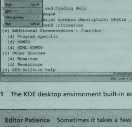

图 8.1 KDE 桌面环境内置编辑器。

**编辑耐心** 有时基于 X Windows 的应用程序启动需要几秒钟——并且没有旋转的沙漏光标来显示机器实际上正在执行您要求的操作。如果编辑器没有立即打开，请不要担心。如果在编辑器打开之前再次选择编辑器，最终您会同时运行两个编辑器。

内置的 KDE 编辑器包含 GUI 编辑器中您可能期望的所有常规点选选择、复制、插入和删除功能。此外，它使用 KDE 对数据位置的抽象，允许诸如直接从基于 Web 的 URL 打开和保存文件等操作。在图 8.1 中，您可以看到其中一个 KDE 文本编辑器菜单已被选中。下拉菜单中出现了几个这些方便的功能。

### 摘要

在本课中，您了解了 UNIX 平台上两个最流行的文本编辑器：vi 和 emacs。对于这两个编辑器来说，通过实践学习是最好的，本课将为您提供执行文本编辑器中三个最重要的任务所需的工具：启动编辑器、编辑文本，以及在操作失误时优雅退出。由于您知道如何在不保存的情况下退出 vi 和 emacs，因此不要害怕尝试。您还了解了 KDE 的内置编辑器，它是桌面环境中对来自旧 UNIX 世界的基于文本窗口编辑器的替代方案。以下是回顾：

- vi 编辑器快速方便，适合对文件进行小幅修改。它的用户界面即使在最宽容的情况下也可能被称为不直观。vi 编辑器的无处不在、执行速度快以及对磁盘空间需求小，使其成为快速编辑的便捷选择——尤其是在不熟悉的机器上工作时。
- Esc :q! 可以迅速让您退出 vi，并且不会保存您所做的任何更改。
- emacs 编辑器包含了编辑器所需的一切，甚至更多，再多一些。在较旧的硬件上，emacs 启动非常慢、响应也非常慢，但这在今天快速的机器以及极其廉价的磁盘空间和内存面前已在很大程度上得到缓解。学习 emacs 教程，探索其 info 文件（Esc+xinfo+Return），如果您想充分利用此编辑器，请找一本关于 emacs 的书阅读。
- Ctrl+x Ctrl+c，然后对任何“仍要退出吗？”的问题回答 Yes，可以迅速让您退出 emacs，并且不会保存您所做的任何更改。


## 第 9 课

### 文本和文件实用工具

*在本课中，您将通过学习如何对文本文件执行一些常规和非常规任务，来完善您对文本实用工具的了解。*

本课中您将看到的一些内容可能看起来并不有用，但将这些信息与其他命令结合使用可以非常强大。如果您开始学习 shell 脚本（在第 14 课“基础 Shell 脚本”中讨论），您会欣赏到 UNIX 包含的实用工具可以让您的编程生活更简单。

### 计数行、词和字符：WC

如果您想快速获取机器上文本文件的统计信息，但又不想将其加载到文字处理器中，您可以使用 wc 命令提供单个文件中行数、词数和字符数的信息。

使用 wc，只需提供您想要分析的文件名，格式如下：wc <filename>。如果您向 wc 传递多个文件名，所有文件都会被处理，并返回所有内容的总计。

例如

```
>wc *.txt
  390   2799  16284  intro.txt
  4944  43494  257939 lesson7.txt
  5244  46293  274223 total
```

在此示例中，我们处理了当前目录中的所有 .txt 文件（intro.txt 和 lesson7.txt）。每个文件返回四列信息。第一个值是文件中的行数，第二个是文件中的词数，第三个是字符数。当然最后一列是文件名。如果您只想限制为行、词或字符，可以分别使用 -l、-w 或 -c 选项。

> wc 的用途 wc 的常见用途是检查日志文件中的条目数。例如，要查看 Web 服务器自上次重置日志文件以来收到的点击次数，您可以使用类似 wc -l /var/log/httpd/access_log 的命令。这会返回 access_log 文件中的行数。由于每一行代表一次点击，您可以使用 wc 快速统计点击次数。

### 排序信息：sort

排序是另一个有用的功能，您可以使用内置命令快速完成，而不必编写专用实用程序。例如，假设您有一个名为 kiwi.txt 的文件，其中包含以下内容：

```
Joan 92
Will 78
John 21
Kim 99
Kama 05
Jack 07
```

手工排序这些（暂时忽略数字）非常简单，但如果您有几千个名字而不是六个怎么办？您可以使用 sort 命令。让我们尝试在 kiwi.txt 上运行 sort，看看会发生什么：

```
>sort kiwi.txt
Jack 07
Joan 92
John 21
Kama 05
Kim 99
Will 78
```

一切都如您所期望的那样排序了。现在，如果您想按数字而不是按名称排序怎么办？要做到这一点，您需要按照以下步骤操作：

- 1. 决定您想要按哪个列排序，然后使用 +<columnnumber> 作为命令的参数通知 sort。
- 2. 您还需要在使用 -t 选项告诉 sort 列之间的分隔字符是什么。在这种情况下是几个空格，因此您将使用 -t " "。
- 3. 最后，由于姓名和数字之间空格数量不一，您需要使用忽略空白选项 -b 告诉 sort 将一组空格计为单个空格。

例如

```
>sort +2 -t " " -b kiwi1.txt
Kama 05
Jack 07
John 21
Will 78
Joan 92
Kim 99
```

Bingo！正是您所希望的，对吧？现在文件已按第二列中的数字排序。sort 还有许多其他选项，您可以使用手册页自行探索，但您可以看到它如何用于对以不同格式存储的各种数据进行排序。

### 切分文件：split

假设您需要通过电子邮件向朋友发送一个巨大的文件，但他们的电子邮件系统不支持接收如此大的消息。是时候编写一个特殊的分割实用程序了吗？不用，已经为您做好了。split 命令可以根据文件中的行数或字节数将文件切分为您想要的任意长度的段。按照以下步骤使用 split：

- 1. 选择输入文件。对于此示例，我使用的是来自 sort 命令的 kiwi.txt。
- 2. 确定您希望每个输出文件存储的行数。您将通过使用 -l <行数> 作为 split 命令的选项来指定这一点。如果您更喜欢使用 k 或 MB 的数量，可以使用 -b 选项配合 k 或 m。例如：-l 3 将文件分成每段三行的片段；使用 -b 10k 会产生大小为 10k 的片段；-b 10m 则创建 10 兆字节的片段。
- 3. 为结果选择一个基本输出文件名。
- 4. 使用以下语法调用 split：split <段选项> <输入文件> <输出文件>。

例如

```
>split -l 3 kiwi.txt kiwisplit
>more kiwisplit*

:::::::::::::::
kiwisplitaa
:::::::::::::::
Joan 92
Will 78
John 21
:::::::::::::::
kiwisplitab
:::::::::::::::
Kim 99
Kama 05
Jack 07
```

上一个示例中的 kiwi.txt 文件已通过 split 处理，并被分成两个各含三行文件：kiwisplitaa 和 kiwisplitab。我使用 more 命令显示了文件内容，因为 split 在完成后不会提供反馈。

在将文件分割到合理大小后，您可以将其传输到讨厌的邮件服务器，或您想要的任何其他地方。这只是另一个内置实用程序的例子，它在您最意想不到的时候肯定会派上用场。


### 重新组装分割文件：cat

如果你有一堆分割的文件想要重新组合起来，该怎么办？很简单——还记得 `cat` 命令吗？当你有一系列文件命名为类似 `<basename>`、`<basename>aa`、`<basename>ab`、`<basename>ac`... `<basename>zz` 时，你可以通过以下方式发出 `cat` 命令来重新组装它们：`cat <basename>* > complete.file`。`cat` 为你连接文件后，你可以将 `complete.file`（或你命名的任何名称）用 `mv` 移动到你想要的任何最终名称。


> **处理输出文件** 最好将输出文件命名为 complete file 之类的名称——与 `<basename>` 完全不同——然后再将其移动到目标位置或最终文件名。这可以避免在你真的希望最终文件名仅为 `<basename>` 的情况下可能出现的混淆

### 比较和修订文件：diff AND patch

你可能习惯于创建文档并发送修订版。不幸的是，大多数时候你可能不得不发送完整的文件副本，而实际上只有这里那里改动了几个词。在 UNIX 社区中，有大量的信息交流，源代码不断地在各方之间传递。与其总是发送完整文件，人们依靠 `diff` 和 `patch` 命令只传输修订之间发生变化的信息。

### 使用 diff

`diff` 函数接受两个文件——原始模板文件和更新后的文件——并生成一个输出 `patchfile`，其中包含足够的信息，仅凭 patchfile 和模板文件即可重建更新后的文件。假设你有原始文件 `templatefile.txt`，其内容如下：

```
Now is the time for all good
kiwis to come to the aid of
puppies.
```

你将此文件分发给所有同事。（这只是一个例子，大家。）然而，几天后你将这个精彩的文件更新为新文件——updatedfile.txt——看起来像这样：

```
Now is the time for all good and bad
kiwis to come to the aid of
puppies and children.
```

与其将新文件 (updatedfile.txt) 重新分发给每个人，你只需制作一个包含原始文件和新文件之间所有更改的补丁。为此，使用以下语法使用 diff 命令：diff <template file> <updated file> > <patchfile>。patchfile 可以是你想要的任何文件名。

> **重定向输出** 此示例中的独立 > 用于将输出重定向到特定文件，由你命名。你可以在第 12 课“输入和输出”中了解更多关于重定向的内容。

例如

```
>diff templatefile.txt updatedfile.txt > patchfile.txt
```

程序将运行并返回命令行，没有任何消息。如果你有兴趣查看 patchfile 的内容，可以随意使用 cat 或 more 查看它。在此示例中，生成的 patchfile 命名为 patchfile.txt；将其分发给拥有原始 templatefile.txt 并需要更新它的人。

> **文件比较** diff 命令在你只想知道两个相同文件的副本是否相同或不相同的情况下也很实用。如果你发现自己有多个相似文件的副本，diff 是快速了解它们是否相同的方法，如果不相同，则了解它们之间做了哪些更改。如果 diff 没有输出，则文件之间没有差异。

### 使用 patch

现在 patch 程序派上用场了。你只需为 patch 提供你想要修补的文件名，然后是 patchfile 的名称即可调用它。

例如

```
>patch templatefile.txt patchfile.txt
patching file 'templatefile.txt'
```

就是这样。文件 templatefile.txt 现在已被更新，并且与文件 updatedfile.txt 相同。你可以通过查看 templatefile.txt 来验证这一点：

```
>cat templatefile.txt
Now is the time for all good and bad
kiwis to come to the aid of
puppies and children.
```

如果你查看了 patchfile，你可能会注意到它的大小与 updatedfile.txt 差不多，那么为什么不直接分发整个文件而不是补丁呢？对于像本示例中使用的这样的小文件，创建补丁真的没有意义。然而，如果你处理的是几千行长的文件，其中中间只有一两行被更改，你会发现 patch 和 diff 是避免发送大量冗余信息的绝佳方法。

> **重要提醒** 请务必记住保留模板文件的副本。在此示例中，补丁直接应用于模板文件，并且模板文件已更新。如果所有后续补丁都是基于更新后的文件创建的，没有问题；然而，如果补丁是基于原始模板创建的，则 templatefile.txt 不再可以被修补。

### 摘要

你刚刚学习的命令展示了 UNIX 操作系统内置的一些强大功能。你可能在其他桌面系统上见过类似的实用工具，但它们是附加组件或商业软件的一部分。在 UNIX 的情况下，这一切都是操作系统的一部分，还有更多内容！以下是本课所学内容的回顾：

- **wc**—wc 命令可以为单个文件或一组文件提供快速的字符、行数和词数统计。
- **sort**—sort 使你能够对文本文件中单独行包含的信息进行排序。它理解数据列/字段的概念，因此你可以用它以多种不同的格式对数据进行排序。
- **split**—如果你有文件在发送电子邮件、写入软盘等时有点太大，可以使用 split 命令将其切分成更小的文件。split 可以创建包含一定数量行、千字节或兆字节的文件。
- **diff/patch**—diff 和 patch 的组合使你能够以高效的方式分发更新（文档、源代码等）。而不是发送整个更新文件的副本，你可以使用 diff 创建仅包含一个文件版本与下一个版本之间更改的 patchfile。

## 第 10 课

### 压缩和归档工具


*在本课中，你将学习用于压缩和归档文件的常见 UNIX 工具，以及一些可用于监控磁盘使用情况的工具。*

尽管节约磁盘空间几乎已成为过去，但偶尔仍有必要压缩文件或将其打包用于归档目的。

### 压缩文件

从历史上看，硬盘存储空间在企业和家庭使用环境中都是昂贵的商品。

> **时代确实在变** 纯粹从历史角度来看，一块 80Mb SCSI-1 驱动器在 1988 年售价为 369 美元，而作者的一位朋友最近找到的一块用于 PC-AT 的 20Mb MFM 替换驱动器包含了其原始包装收据——账单高达 720 美元！今天，500 美元可以买到 5GB 或更多的存储空间。

随着今天极其便宜的硬盘驱动器，最大化磁盘使用效率的压力比过去低得多；但在某些环境中，例如学校，压力仍然存在。如果你碰巧使用的是磁盘空间非常宝贵的环境，你可以使用本课压缩部分中的命令来减少文件占用的空间——或在允许的空间中容纳更多内容。即使磁盘空间不是你的问题，在通过电子邮件发送文件或通过互联网分发文件等情况下，压缩文件也可能是明智的选择。

使用 UNIX 时，你可能会遇到三种主要的压缩格式：使用 UNIX 程序 compress 制作的压缩文件、使用 UNIX 或个人计算机版本的 PKZIP 程序制作的 zip 文件，以及使用 GNU gzip 实用程序制作的 gzipped 文件。每种格式都有用于压缩和解压缩的程序集。最近出现的 bzip2 压缩实用程序也值得关注，尽管它是新来者，但对于紧密压缩看起来很有前景。

### compress/uncompress/zcat

创意命名的 compress 命令使用一种较旧的 UNIX 压缩格式，随着 gzip 格式流行度增加而逐渐消亡。使用 compress 命令创建的文件具有文件后缀 .Z。要使用 compress 命令压缩文件，你只需按 compress <filename> 发出命令。

同样创意命名的 uncompress 命令解压缩（惊喜！）compress 命令的结果。要使用 uncompress 命令，你按 uncompress <filename>.Z 发出命令。

zcat 命令（其名称略少直观）是 cat 的一个版本，它读取压缩文件而不是普通文本文件。

使用 zcat 与使用 compress 和 uncompress 一样直观；按 zcat <filename>.Z 发出命令。如果你想查看大文件，可以将输出通过管道传输到你偏好的分页器。为此，按 zcat <filename>.Z | more 发出命令。竖线 | 是 UNIX 管道字符——它将前一个命令的输出传输到后一个命令的输入。（你将在第 12 课“输入和输出”中了解更多相关内容。）

例如，如果你有一个名为 stuffed.Z 的压缩文件，并且想在不先解压缩的情况下读取 stuffed，你可以输入：

```
> zcat stuffed.Z | more
```

你的机器将通过使用 more 来分页显示文档内容。

### zip/unzip
基于 PC 标准 PKZip 程序的算法，zip 和 unzip 程序的工作方式正如你所期望的那样：zip <filename> to compress a file with zip, and unzip <filename>.z to unzip the files.

使用 zip 格式（在 UNIX 中使用文件后缀 .z）创建文件以分发给其他 UNIX 用户通常不是一个好主意，因为 zip 和 unzip 并非 UNIX 用户始终可用；这些实用程序是自由软件，因此如果需要访问它们，请让系统管理员安装它们。然而，如果你的目标是 Macintosh 或 Windows 计算机的用户，zip 是一种他们很可能能够读取的文件格式。

zip 和 unzip 程序都有一些可能有用的选项，其列表可以通过在任一命令后加上选项 -h 来显示。

### gzip/gunzip/gzcat
gzip, the GNU free software answer to the compress/uncompress suite of programs, was created in response to the realization that UNIX's compress/uncompress programs were based on proprietary algorithms—and that this might someday entail licensing fees. 同样，gzip、gunzip 和 gzcat 程序的工作方式与 compress/uncompress/zcat 套件基本相同。用 gzip 格式压缩的文件使用文件后缀 .gz，并且通常比用 compress 压缩的文件更小。

为了让你的生活更轻松一些，GNU 在其 gunzip 和 gzcat 实用程序中包含了处理压缩的 (.Z) 文件的能力。

> 你可能会发现 gzip 和 gunzip 存在于你的系统中，但 gzcat 缺失。某些发行版已将 gzcat 重命名为 zcat，因为它也能处理压缩文件。

### bzip2/bunzip2
尽管 bzip2 是 UNIX 压缩领域相对较新的补充，bzip2 压缩器似乎比 compress 或 gzip 产生更好的压缩。bzip2 的语法和选项是有意做成与 gzip 相似的，因此当你随着其流行度增长而遇到此程序时，不会太难弄明白。用 bzip2 压缩遵循 gzip 格式 bzip2 <filename>，它会生成压缩文件 <filename.bz2>。解压缩是 simply bunzip2 <filename.bz2>。

截至本文撰写时，bzip2 压缩和解压缩实用程序似乎仍在开发中，因此发现命令随时间演变并不奇怪（bzip2 和 .bz2 文件是之前生成 .bz 文件的 bzip 程序的更新）。如果你遇到这些程序并且需要做超出简单压缩或解压缩的操作，建议你查阅本地手册页以获取更当前的信息。

### 管理你的磁盘使用情况
如果你在一个需要担心磁盘使用量的系统上，有必须保持在之下的磁盘配额，或者只是好奇你的文件占用了多少空间，有几种方法可以查看这些数据；它们在下面的列表中详细说明：

- **ls 命令** 回顾第 4 课，“文件系统”，你知道可以使用 ls 命令配合 -l 选项来显示文件或文件的磁盘使用情况。如果你需要快速扫描文件以查看哪些占用最多空间，这是一种快速的方法。
- **find 命令** 在第 5 课，“查找文件”中，你被介绍如何使用 find 命令查找大于特定大小的文件。虽然对于此目的而言与 ls -l 命令的实用性相似，find -size # 是收集所有大于 # 千字节的文件信息的更快方法——你只需要知道你要查找的 # 是多少。
- **df 命令** 主要由系统管理员类型使用，df 命令提供磁盘使用信息。根据你的 UNIX 版本，你可能需要给 df 不同选项才能使其产生可读输出；但你感兴趣的一般形式是 df -l .，它要求文件系统告诉你当前目录所在驱动器的使用情况。响应通常以逻辑设备名称（可以忽略）形式给出，其后是有关设备总容量、设备上使用的存储量、设备使用百分比以及设备的挂载点（设备出现的目录的路径）的信息。你可能需要尝试 df -l . 或 df -k . 的变体，或查看手册页以找到适用于你 UNIX 版本的选项。
- **du 命令** 另一个系统管理员类型的命令，du 提供按目录的磁盘使用信息。同样，不同版本的 UNIX 使用略有不同的语法，你最感兴趣的一般形式是 du -s *，它要求文件系统为当前目录中的所有内容生成磁盘使用摘要。对于当前目录中的每个项目，du -s * 返回文件或目录内容使用的总磁盘空间摘要。根据你的 UNIX 版本，你可能需要也可能不需要向 du 提供 -k 标志以说服它以千字节为单位显示磁盘使用量（否则它以文件系统原生块大小——通常为 512 字节——为单位显示磁盘使用量）。

### 归档文件：tar
如果你花很多时间使用 UNIX 系统，你一定会遇到 tar 文件。Tar 是 Tape Archive 的缩写，尽管 tar 命令及其输出很少再用于磁带归档。更复杂、更强大的程序已接管了磁带归档的工作，但 tar 命令仍然是个人归档和文件分发方便有用的工具。

tar 命令在其最简单形式中要么创建要么解包归档文件。创建归档时，你为 tar 提供归档的文件名和要归档的文件列表。然后程序收集所有文件并将它们捆绑到单个 tar 文件中，你可以将其存储以备将来使用，或通过 World Wide Web、FTP 或电子邮件方便地分发。解包归档时，你为 tar 提供 tar 文件的名称，它会将文件内容提取到当前目录中，文件名、路径和内容与归档时系统上完全相同。

要使用 tar 创建归档，请使用以下步骤：

1. 确定你想要的归档 tar 文件的名称；通常，它将具有后缀 .tar。
2. 确定要包含在 tar 文件中的所有文件的名称，或更常见的是，要归档的目录的名称。
3. Issue the tar command as `tar -cvf <tarfilename.tar> <files or directories>`。

例如，如果你在当前目录中有一个名为 lots-a-stuff 的目录，你可以通过键入以下内容来归档 lots-a-stuff 的全部内容——其中的所有文件、其中的所有目录、其中所有目录中的所有文件，等等：

```
> tar -cvf lotsastuff.tar lots-a-stuff
```

因为你使用了 -v（或详细）选项，你的机器会通过告诉你它正在归档中的每个文件来响应；最终你会得到一个名为 lotsastuff.tar 的新文件。此新文件包含你的 lots-a-stuff 目录的全部内容，所有目录结构和文件属性信息都保持完整。

要解包 tar 文件，你只需发出命令 tar -xvf <tarfilename.tar>。

如果你把这个文件给朋友，你的朋友可以通过键入以下内容来解包 tar 文件：

```
> tar -xvf lotsastuff.tar
```

在列出文件中的所有内容之后（再次是 -v 选项），你的朋友在他的或她的当前目录中有一个名为 lots-a-stuff 的新目录，其中包含你 lots-a-stuff 目录的完整内容。你的 lots-a-stuff 目录中的任何子目录及其所有内容都存在。

#### 礼貌使用 tar
如果你不知道 tar 文件中有什么，在解包之前最好使用 tar -tvf <tarfile.tar>。-t 选项是 tell 选项，要求 tar 告诉你文件的内容而不是解包它。这是一种有用的方法来确定创建 tar 文件的人是否是一个好人，他把所有东西放在一个目录中然后归档该目录，还是一个不礼貌的人在归档前把所有东西放在当前目录中。如果你遇到一个不礼貌用户创建的 tar 文件并在不方便的地方解包它——例如你的主目录——tar 最终会把文件散布到你的主目录各处。然后你将被迫手动找到所有文件并将它们放入子目录，这有时可能是一个非常乏味的过程。做一个礼貌的用户——不要归档文件，归档目录。

如果你不小心解包了一个不友好的 tar 文件，你可以通过自动化 rm 命令再次将其全部删除。（你将在第 14 课，“基础 Shell 脚本编写”中了解更多此类自动化。）如果你足够勇敢尝试，命令 \rm -rf `tar -tf <tarfile>` 就能解决问题。然而，直到你对 UNIX 足够熟悉以查找该命令的各部分并理解其作用之前，不建议你尝试此操作。

### 为电子邮件传输做准备：uuencode/uudecode
如果你需要将文件发送给另一用户，你可以通过将其包含在电子邮件消息中轻松完成。今天的个人电脑都可以通过使用附件相当透明地完成此操作，但 UNIX 用户在很大程度上被落在了后面。UNIX 机器上的电子邮件早于大多数个人电脑的存在，UNIX 用户一直在使用文件

在电子邮件中全球传播多年，早在个人电脑发现互联网概念之前。许多 UNIX 用户，然而，仍被困在手工制作附件的工作上——这似乎有点不公平，因为正是 UNIX 机器承担了让个人电脑用户能够使用互联网的工作。如果您没有使用其中一种更用户友好的电子邮件客户端（有关电子邮件客户端的更多信息请参见第 18 课《访问网络资源》），该客户端可以自动处理附件，那么您需要手动创建它们并自行插入到电子邮件中。不过，这并不是一项非常困难的任务。更困难的任务是说服您可能需要交互的个人电脑用户使用跨平台的附件格式，例如 uuencode，而不是 popmail 客户端作者本周决定偏爱的某种专有格式。

uuencode 程序接受任何文件作为输入，并生成可包含在电子邮件消息中的文件编码。对人来说，此文件的内容看起来像随机字符；然而在接收端，用户可以使用 uudecode 程序提取原始文件。由于每个电子邮件程序都不同，您需要查阅电子邮件客户端的文档，了解如何在消息中包含文件。在这里，您只需学习如何从原始文件创建 uuencoded 文件，以及如何在另一端再次对其进行 uudecode。

要使用 uuencode 命令，您需要遵循以下步骤：

- 1. 确定您要为电子邮件传输编码的文件名称。
- 2. 确定您希望文件在另一端称呼自己为什么。
- 3. 以 uuencode <filename> <callmethis> > <filename>.uue 的形式发出 uuencode 命令（是的，您需要在 <filename>.uue 参数之前输入 >。）

您的计算机随后会生成一个名为 <filename>.uue 的文件，其中包含该文件的 uuencoded 版本。

例如，如果您有一个名为 sendtojoe 的文件并且想要对其进行 uencode，您可以输入以下内容：

```
> uuencode sendtojoe hijoe > joe.uue
```

您的计算机生成一个名为 joe.uue 的文件，Joe 解码后文件名为 hijoe，并包含您的 sendtojoe 文件的内容。

现在您可以复制粘贴、包含或执行所需的操作，将您刚刚创建的文件插入电子邮件消息并发送到您想要的任何地方。

当然，如果您收到一个 uuencoded 文件，您需要知道如何解码该文件。解码 uuencoded 文件也非常简单；以 `uudecode <filename.uue>` 的形式发出 uudecode 命令。

您的机器将在当前目录中生成一个与原始 uuencoded 文件完全相同的文件。

> **澄清 .uue** .uue 文件的文件名和它将解码成的文件名不必相同。这有时会令人困惑。如果您收到一个名为 kludge.uue 的文件，发出 uudecode kludge.uue 命令后，如果在目录中找不到名为 kludge 的文件，请不要惊慌。uuencoded 文件包含文件名以及 uuencoded 文件内容。要了解 uudecoded 文件将命名为什么，请使用 head 命令查看 uuencoded 文件的前几行。解码后将出现的文件名显示在第一行。

### KDE 归档工具

桌面环境现在也提供方便的拖放文件压缩和归档工具。例如，KDE 环境提供了 KZip 归档和压缩工具。

要访问 KZip 工具，请单击 KDE 工具栏上的 K，从弹出菜单中选择 Utilities，然后从其子菜单中选择 Zip。类似于图 10.1 所示的窗口将会出现。

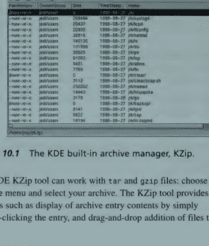

*图 10.1 KDE 内置归档管理器，KZip。*

KDE KZip 工具可以处理 tar 和 gzip 文件：从 File 菜单中选择 Open 并选择您的归档文件。KZip 工具提供便捷功能，例如通过双击条目即可显示归档条目内容，以及拖放添加文件到归档中。

### 摘要

当您需要节省磁盘空间或缩短文件传输时间时，您可能需要借助某种压缩实用程序来压缩文件。以下是本课所学内容的回顾：

- 在 UNIX 系统上，三个常见的压缩实用程序是无处不在的 compress、更新且更智能的 gzip 以及跨平台的 zip 程序。相对较新的 UNIX 压缩领域新增成员是 bzip2，它似乎比 compress 或 gzip 产生更好的压缩效果。
- 当您需要向其他用户提供一组文件或仅为将来使用而归档一组文件时，您可以使用 tar 创建包含所有文件在一个方便包中的 tar 文件。
- 不要做一个不礼貌的用户并使用 tar 归档单个文件。相反，将您想要归档的所有文件放入一个目录并对该目录进行 tar 归档。
- 如果您需要通过电子邮件向某人发送文件，您可以使用 uuencode 命令创建可通过电子邮件发送的文件编码。
- 如果您对文件进行 uudecode 后无法立即找到它，请不要惊慌——真实的文件名以纯文本形式存储在文件开头。


## 第 11 课
### 进程

*在本课中，您将学习如何处理进程：查看它们、终止它们并让它们服从您的意愿！*

在之前的课程中您在系统上运行过的一切，以及在剩余课程中您将要运行的一切，都在您的系统上创建了进程。每个命令都会创建一个进程，UNIX 操作系统会运行该进程直到它完成或被终止。与某些桌面操作系统不同，您可以创建完全在后台运行的进程，或在半夜启动并运行的进程——甚至无需您登录到计算机。

### 同时运行多个命令

UNIX 使您能够同时运行多个命令。这种功能称为多任务处理，也以不同形式出现在某些其他操作系统中。使 UNIX 不同的是，UNIX 上绝对的一切都是一个进程：想要一个时钟？运行一个程序。需要复制文件？那也是一个进程。打开一个窗口——又是另一个进程。虽然许多个人电脑操作系统允许您同时运行几个应用程序，但大多数通过将所有功能作为一个大型程序的一部分来处理其大部分功能。在 UNIX 上，实际操作系统非常小，它同时运行大量程序以为您提供界面和其他功能。

随着 UNIX 绝对需要运行许多同时程序只是为了为用户提供环境而来的是，用户可以运行他或她想要的任意多个同时程序。在 UNIX 系统上，您为想要做的事情运行程序。由于操作系统的运行方式，在它们运行时您是否登录实际上并不重要。您的登录——您猜对了——只是一个进程。

### 将命令放入后台：&

使命令在后台运行很简单；您只需在包含命令的行末尾添加一个 & 即可。

例如，假设您正在运行一个名为 analog 的程序来分析您的 Web 服务器日志文件。大多数日志分析对于繁忙的 Web 服务器来说需要相当长的时间，因此您可能不想等待命令完成。为了在后台运行 analog，您只需输入以下内容：

```
>analog /var/log/httpd/access_log &
[3] 32566
>
```

结果有点晦涩，但您可以看到自己已返回到命令行，准备继续工作！返回的两个数字标识了系统上的进程。第一个结果 [3] 表示这是您发送到后台的第 3 个进程。第二个数字 32566 是进程 ID。您的 UNIX 系统可能同时运行数百个进程，每个进程都被分配一个唯一编号。无论您的进程被分配什么编号，都将作为第二个结果值返回。


> 同时运行多个命令 要按顺序运行多个命令并将整个组放入后台，您可以使用以下语法：{<command 1>; <command 2>; <command 3>} &。这会创建一个新的 shell 来执行命令并将其置于后台。例如，如果您想对两个文件运行 analog 实用程序，您可能会使用以下内容：(analog /var/log/httpd/access_log; analog /var/log/httpd/new_access_log) &


### 挂起命令并将其放到后台：CTRL+Z 和 bg

如果你不小心启动了一个命令而没有将其放到后台，仍然可以将其转为后台进程。假设你启动了 analog 命令而没有使用 & 符号。

以下是示例：

```
>analog /var/log/httpd/access_log
```

要将其转为后台进程，首先按 Ctrl+z 挂起该进程。例如

```
Ctrl+z
[3]+ Stopped           analog
=>/var/log/httpd/access_log
```

analog 命令现在已被挂起，并被分配了进程号 3。请记住，这与进程 ID 不同。它标识的是在你的会话中本地的进程号，而非系统全局的。

要完成将 analog 放到后台，使用 bg 命令后跟你想放到后台的本地进程号，如 bg %<process number>。在本例中，analog 被分配了进程号 3，因此你需要与 bg 一起使用它。例如

```
>bg %3
[3]+ analog /var/log/httpd/access_log &
```

UNIX 会显示 analog 现在已在后台运行（带 &），你就可以继续使用系统了。

> 使用 bg 如果你不带参数发出 bg 命令，它会将你最近挂起的作业放到后台；因此，这里你可能只需使用 bg 就行了。

### 将进程返回到前台：fg

如果进程被意外放到后台，或者你想将进程返回到前台以便手动控制或检查其状态，该怎么办？在这种情况下，你可以使用命令 fg 和进程号将该进程返回到前台，语法为 fg <process number>。

在前面的示例中，analog 进程在被放到后台时被分配了本地进程号 3。要将其带回前台，你应输入以下内容：

```
>fg %3
analog /var/log/httpd/access_log
```

你现在又完全控制了 analog 进程，因为它现在在前台运行。

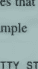

> 丢失进程号？如果忘记了本地进程号怎么办？使用 jobs 命令。jobs 命令会列出所有已挂起和后台进程的简短列表，以及它们的关联编号。

### 列出正在运行的进程：ps

如果你真的开始使用 UNIX 的后台功能，某个时候你会想知道自己运行了什么。为此，你可以使用 ps 命令。ps 命令会返回你当前拥有的所有进程列表。

例如

```
>ps
```

| PID | TTY | STAT | TIME | COMMAND |
|-----|-----|------|------|---------|
| 8832 | p1 | R | 0:00 | ps |
| 30674 | p1 | S | 0:00 | /bin/login -h NEW93114217.columbus.here.com -p |
| 30675 | p1 | S | 0:00 | -bash |
| 31136 | p1 | T | 0:00 | analog /var/log/httpd/access_log |

#### 使用 ps

如果你的 ps 命令返回的结果与这些不完全相同也不必惊慌。这是不同版本的 UNIX 拥有相似但不完全相同的命令的地方之一。ps 命令有很多用于格式化显示的选项，因此你可能想查看一下系统的 man 手册。

如果你运行 ps 并看到此结果，这意味着这些是你当前运行的所有命令。列分别是系统进程 ID（PID）、控制终端、进程状态（运行、睡眠等）以及进程本身。这些只是你拥有的进程。如果你想查看任何人运行的所有内容，尝试运行 ps -ax——这会列出所有用户的进程（-a）和所有没有控制终端的进程（-x）。如果这不起作用，则尝试 ps -ef。ps 命令有大量选项可以返回大量信息。请查看 man 手册了解更多信息。目前的主要关注点是你可以列出系统上正在运行的内容并获取进程 ID。

### 杀死进程：kill, kill, kill!

*杀死听起来可能有点严厉，但确实很好地概括了结果。当你杀死一个进程时，无论它在做什么都会停止。如果你正在编辑文件，如果杀死进程而不是正常退出编辑器，你可能会丢失整个文件。*

#### 使用 kill

虽然 kill 命令主要用于停止进程，但它也可以用于向进程发送信号。SIGKILL 就是其中一种信号，但还有其他较不严重的信号。取决于你发送的信号，进程可能会重新加载其配置文件并重新初始化自己。当你运行诸如 Web 服务器之类的东西并且需要在不关闭服务器的情况下添加 MIME 类型或更改某些服务器选项时，这非常方便。要查看可使用 kill 发送的信号列表，请按如下方式调用命令 kill -l：

```
>kill -l
1) SIGHUP      2) SIGINT      3) SIGQUIT     4) SIGILL
5) SIGTRAP     6) SIGIOT      7) SIGBUS      8) SIGFPE
9) SIGKILL     10) SIGUSR1    11) SIGSEGV    12) SIGUSR2
13) SIGPIPE    14) SIGALRM    15) SIGTERM    16) SIGCHLD
17) SIGCONT    18) SIGSTOP    19) SIGTSTP    20) SIGTTIN
21) SIGTOU     22) SIGURG     23) SIGXCPU    24) SIGXFSZ
25) SIGVTALRM  26) SIGPROF    27) SIGWINCH   28) SIGIO
29) SIGPWR
```

你在系统上运行的软件的文档通常包含它会响应的信号信息。你最需要的信号是 SIGHUP 和 SIGKILL。SIGHUP 是挂断信号，通常会强制服务器进程重新加载配置信息。另一方面，SIGKILL 会强制命令退出——无论如何。要发送其中一个信号，使用 kill <signal number> <process ID> ...。

例如，要杀死进程号 31136，输入以下内容：

```
>kill -9 31136
[2]+ Killed analog
=>/var/log/httpd/access_log
```

如果你再次查看进程列表，PID 31136 将不复存在。你已成功杀死它！通过输入以下内容检查：

```
>ps
```

| PID | TTY | STAT | TIME | COMMAND |
|-----|-----|------|------|---------|
| 18303 | pt | R | 0:00 | ps |
| 30674 | pt | S | 0:00 | /bin/login -h NEW93114217.columbus.here.com -p |
| 30675 | pt | S | 0:00 | -bash |

确实如此，kill 已消除了进程号 31136，analog 不再在系统上运行。

### 退出 shell 以杀死进程

如果你已将多个进程放到后台，在注销系统时很可能不需要显式杀死它们。shell 会向你启动的所有进程发送 SIGHUP 信号，这可能会杀死它们。如果你想创建一个在退出 shell 时不会被杀死的进程，可以使用 nohup 来实现。

### 防止死亡：nohup

nohup 命令可以作为任何其他命令的前缀，以防止它因 SIGHUP 信号而被杀死。例如，如果你想防止在退出 shell 时 analog 进程被杀死，按如下方式运行它：

```
>nohup analog /var/log/httpd/access_log &
nohup: appending output to 'nohup.out'
```

这会在后台运行你的 analog 程序并防止你在退出 shell 时它被杀死。系统还指出，命令产生的任何输出都将存储在名为 nohup.out 的文件中。

### 进程优先级：nice 和 renice

在 UNIX 上运行的进程具有不同的优先级。分配给进程的优先级会影响其完成所需的时间，以及系统上其他进程运行所需的时间。进程在计算机 CPU 上获得时间片。优先级级别决定了某个进程获得多少个时间片。运行一个计算密集型任务却不需要快速完成并占用计算机所有处理器时间是不太友好的。

UNIX 上的优先级范围从 20 到 -20，默认级别为 0。虽然看起来有点反向，但 -20 实际上是进程可以拥有的最高优先级，而 20 是最低的。要控制进程优先级，使用 nice 和 renice 命令。

#### 使用 nice

nice 是另一个用作要运行命令前缀的命令。nice 的语法是 `nice <-priority> <command>`。继续本课中你一直在使用的 analog 示例，你将以可能的最低优先级级别运行 analog。分析日志文件不是高优先级任务——没有必要快速运行它。


> nice nice 命令是同名命令之间细微差异的又一个例子。某些版本的 nice 使用 -n <priority> 而不是 <priority>。

例如

```
>nice -20 analog /var/log/httpd/access_log &
```

这会将 analog 命令放到后台并分配给它优先级 20。请记住，这是进程可以拥有的最低优先级！


> 更改优先级 普通用户无法将优先级设为低于 0——只有 root 用户可以这样做。你可以这样理解：不使用 nice 运行程序就是你能获得的最高优先级，而你可以使用 nice 命令使其对其他用户更友好。

#### 使用 renice

然而，假设你已经以默认优先级启动了一个命令，并且它已经运行了一天——例如，分析那个庞大的 Web 服务器日志——而你不知道它何时会完成。你可能会想降低其优先级，从而减少它对机器资源的使用，并让它在决定完成时再完成。你可以使用 renice 来更改已在运行的命令的优先级。

要做到这一点，请按以下步骤操作：

- 1. 首先，你需要获取进程列表并记下要更改的 PID。
- 2. 使用以下语法发出 renice 命令：renice <priority> <process ID>。

例如

```
>ps
PID TTY STAT TIME COMMAND
8832 p1 R 0:00 ps
30674 p1 S 0:00 /bin/login -h
=>NEW93114217.columbus.here.com -p
30675 p1 S 0:00 -bash
31136 p1 R 0:00 analog /var/log/httpd/access_log
```

如果你想更改 analog PID 31136 使其以更低的优先级运行，可以按以下方式使用 renice 命令：

```
>renice +15 31136
31136: old priority 0, new priority 15
```

PID 31136 现在以优先级 15 运行，而非原来的优先级 0。

> 超级用户权限 必须注意，只有超级用户（root）才有能力提高正在运行进程的优先级。你只能降低进程的优先级——所以不要降低优先级然后想着如果运行太慢可以再提高。降低之后它就卡在那里了，除非你的系统管理员为你修复。

### 在你的计算机上检查进程：top

查看系统上繁忙的进程与运行 top 命令一样简单。top 显示一个不断更新的进程列表、它们使用的时间以及进程优先级。要退出 top，请按 UNIX 中断序列 Ctrl+c。

> **获取正确结果** 中断序列实际上是你的 shell 的一个功能。如果你的 shell 配置严重错误（这有时会在你远程登录到 UNIX 机器而它无法识别你使用的终端类型时发生），按下 Ctrl+c 可能只会在屏幕上显示 ^C。要修复此问题，你可以尝试发出命令：stty intr Ctrl+c。

使用最多 CPU 时间的进程列在显示的顶部，如下所示：

```
>top
9:47pm up 2 days, 5:44, 2 users, load average:
0.07, 0.02, 0.00
83 processes: 82 sleeping, 1 running, 0 zombie, 0 stopped
CPU states: 1.8% user, 4.8% system, 0.0% nice, 93.4% idle
Mem: 6310K av, 57324K used, 5776K free,
=34064K shrd, 5316K buff
Swap: 128924K av, 0K used, 128924K free 36656K cached
PID USER PRI NI SIZE RSS SHARE STAT %CPU%MEM TIME COMMAND
12448 jray 15 0 740 740 556 R 0 6.5 1.1 0:01 top
12435 root 0 0 692 692 528 S 0 9.1 1.0 0:00 in.
=telnetd
1 root 0 0 412 412 344 S 0 0.0 0.6 0:02 init
2 root 0 0 0 0 SW< 0 0.0 0.0 0:00 kflushd
3 root -12 12 0 0 SW< 0 0.0 0.0 0:00 kswapd
521 root 0 0 888 888 676 S 0 0.0 1.4 0:00
=CGServer
498 root 0 0 316 316 260 S 0 0.0 0.5 0:00
=mingetty
436 root 0 0 628 628 516 S 0 0.0 0.9 0:00
=safe_mysql d
...
```

返回的信息非常多，而且如果你观察显示，它会实时更新。你可以看到 CPU 使用率、内存百分比以及许多其他信息。要了解更多信息，请查看 top 的 man 手册。

### 调度命令：at 和 cron

有了在后台运行进程的能力，就可以在不登录计算机的情况下安排进程在特定时间运行。有两种方法可以设置你的 UNIX 计算机在特定时间运行命令。不幸的是，这些功能可能被禁用，这取决于管理员选择实施的控制级别。允许用户在任何想要的时间安排命令可能会有点危险。你想要查看的两个命令是 cron 和 at，描述如下：

- cron—在你的系统上不断运行，很可能已经在使用来运行日志轮转和各种清理命令。你可以创建一个个人 crontab 文件，其中包含你想要命令运行的间隔信息，然后使用 crontab <filename> 命令将你的请求添加到系统的 crontab 文件中。cron 使你能够以小到一秒或长到一年的间隔运行命令。在某些 UNIX 版本中，你也可以使用 crontab -e 直接将当前设置的 crontab 条目带入编辑器。
- at—使你能够运行一次命令，而不是按重复间隔运行。如果有一个处理器密集型任务你想在工作时间后运行，以便不影响其他任务，这很有用。

在尝试使用 crontab 或 at 之前，请先咨询你的系统管理员。盲目安排进程可能会影响其他用户，如果不适当的进程同时安排运行，会极大地降低系统性能。

### X WINDOWS 进程

如果你在 X Window System 中玩过，很可能已经很明显你可以同时运行多个程序。这些程序中的每一个都使用自己的 PID，就像你期望的那样。这些程序是分别启动的，因此它们实际上已经在共享处理器时间——没有程序在前台或后台。你可以从命令行调整进程优先级，就像对任何其他程序一样。退出 X Windows 会杀死你正在运行的所有活动进程。

### 摘要

你在本课中学到了很多内容。理解进程起初可能有点困难，但根据你对系统的使用，你可能永远不需要做比将进程放到后台更多的事情。如果你只使用 KDE，你会发现进程的工作方式与任何桌面操作系统上完全一样。以下是本课讨论内容的回顾：

- &—可以用 & 符号将进程放到后台。如果你要运行一个完成时间很长且几乎不需要用户交互的东西，就可以使用它。
- bg/fg—bg 和 fg 命令可用于在后台和前台操作之间移动进程。
- ps—要列出你在系统上运行的所有进程，请使用 ps 命令。你也可以查看由其他用户控制的进程，但你不能修改它们的优先级或杀死它们（指进程，而不是用户）。
- kill—此命令用于向进程发送信号。通常此信号会终止进程的执行。在其他情况下，它可以使程序重新读取其配置文件或重新初始化自身。
- nohup—退出 shell 会向该 shell 中运行的所有进程发送 SIGHUP（挂断）信号。要使进程在你注销后继续运行，请使用 nohup 命令。
- nice/renice—计算机上的每个进程都有一个优先级，控制进程完成任务时获得的处理器时间。优先级范围从 -20 到 20，负数表示优先级更高。
- top—top 命令显示系统上当前 CPU 使用率最高的进程。显示会持续更新，因此你可以查看随着新进程添加到系统时它们占用了多少 CPU 时间。
- at/crontab—你可以使用 at 和 crontab 函数在系统上的特定时间安排命令运行。在尝试之前，你需要咨询系统管理员并阅读相应的 man 手册。
- X Window System（X Windows）—在 X Window System 下运行的程序同时执行。无需担心手动将进程放到后台或前台。你也可以从命令行调整 X Windows 应用程序的优先级，就像对任何其他进程一样。


## 第12课
### 输入与输出


*在本课中你将学习如何管理 UNIX 进程输入输出和进程间通信。*

现在你已经了解了一些关于使用 UNIX 及其文件系统以及管理 UNIX 进程的知识，是时候开始整合这些内容并探索 UNIX 的真正威力了。在本课中，你还将学习使 UNIX 如此实用的基本工具之一：通过输入输出重定向进行进程间通信。

UNIX 比普通桌面操作系统强大得多的核心在于它抽象进程输入输出的方式——简单却异常有效。借用 UNIX 对输入输出的模型来表述，你可以想象 UNIX 将程序的用户输入视为一个流——一个信息流。程序返回给用户的输出也可以同样看待。此外，如果程序从用户处接收的输入是一个信息流，操作系统为什么要在意这个流是由用户、文件还是另一个程序提供的呢？当你把输入输出理解为仅仅是数据流时，你立刻就能看出，从操作系统的角度来看，这些流的端点无关紧要。只要输入流的来源提供了程序所需的信息，它来自何处并不重要。同样，只要输出流的目的地“像用户一样表现”，操作系统就没有理由关心输出流实际去了哪里。

UNIX 如何让用户使用这个模型？通过提供输入输出重定向的概念。

### 重定向

为了适应其基于信息流的世界观，UNIX 定义了一些程序必须遵守的概念。具体来说，UNIX 为每个程序定义了若干信息连接，并允许用户操作这些连接的来源和目的地。

### 标准输入

程序的输入连接称为 STDIN——标准输入。程序可以期望从用户或其他地方传来的输入数据流出现在 STDIN 中。

当你与基于命令行程序交互时，程序是从 STDIN 读取你输入的数据。如果你不想手工输入数据，可以将其放入文件并将文件重定向到程序的 STDIN。

一个可用于示例的程序是 spell 程序。spell 命令查找拼写错误。给定其 STDIN 上的输入，spell 会解析它，将输入与词典进行核对，并返回找到的任何拼写错误。从命令行发出时，你可能会输入以下内容：

```
> spell
Now is the tyem for all good kiwis to
come to thie ayde of some very good UNIX users
Ctrl+d
```

按下 Ctrl+d 完成输入，spell 开始工作，返回以下内容：

```
tyem
thie
ayde
```

每个拼写错误的单词都会显示出来，就像你期望的那样——乍一看并不特别有用。spell 程序其实并不关心输入是你键入的还是来自文件。

> **使用 spell** 实际上，更恰当的说法是 spell 程序并不关心输入来自文件还是用户。spell 程序设计为使用来自文件或程序的输入；只是由于输入/输出模型，它并不介意输入来自用户。UNIX 上你会找到的许多程序都属于同一类——它们设计为接收来自其他程序和文件的输入或向其提供输出。由于只有输入/输出模型才允许与软件进行直接用户交互，你偶尔会发现这些程序对话的语法略显奇怪。只要记住，它们并不是真正设计用来与用户对话的。

使用你喜欢的文本编辑器创建一个包含之前输入的相同文本的两行文件，然后尝试通过重定向其 STDIN 来使用 spell。如果你的文件名为 reallydumbfile，你可以通过输入以下内容在上面运行 spell：

```
> spell < reallydumbfile
tyem
thie
ayde
```

< 字符将右侧文件的 contents 导入到左侧命令的 STDIN。

### 标准输出

UNIX 为程序提供的输出连接称为 STDOUT——标准输出。就像你可以从文件重定向 STDIN 一样，如果你想将命令的输出发送到文件，可以重定向 STDOUT。> 字符将左侧程序的 STDOUT 导入到右侧文件的内容中。例如，如果你喜欢查看 Web 服务器日志文件的内容，并且想将最后 30 行放入名为 kiwis-logs 的文件中以便编辑，可以使用以下命令：

```
> tail -30 /usr/local/httpd/logs/access_log > kiwis-logs
```

此示例指示 shell 创建文件 kiwis-logs 并将 tail 命令的 STDOUT 放入其中。如果 kiwis-logs 已存在，则在写入数据前文件会被清空。

如果由于某种原因你定期收集日志文件的末尾，你可能希望对其进行完整归档。你可以指示 shell 将数据追加到文件而不是先清空文件。要做到这一点，请按如下方式发出命令：

```
> tail -30 /usr/local/httpd/logs/access_log >> kiwis-logs
```

>> 字符对将左侧程序的 STDOUT 追加到右侧文件中。

当然，你可以组合这些重定向；如果你想检查拼写并将结果保存到文件中，可以返回到你的 spell 命令，输入以下内容：

```
> spell < reallydumbfile > reallydumbspellings
```

### 标准错误

为了让你的生活更轻松，UNIX 实际上为程序定义了两种不同的数据输出流。第一种是 STDOUT，你已经了解过。第二种是 STDERR，用于允许程序向用户提供错误消息。如果用户正在重定向 STDOUT 而程序只能将错误放在 STDOUT 上，用户可能永远看不到错误——它们全部进入重定向的文件。相反，程序可以使用 STDERR 来报告错误，如果用户未重定向它，他们仍可在 STDOUT 被导向其他文件或程序时看到错误消息和警告。

如果你想将 STDERR 放入与存储 STDOUT 相同的<|message|> 中，请在命令中使用 >& 而不是 >；你可以按如下方式操作：

```
> spell < reallydumbfile >& reallydumbspelling
```

#### Shell 变体
如果你使用的是其他 shell，请注意重定向是语法差异显著的地方之一。请查阅你偏好的 shell 的 man 手册以了解更多信息。

### 管道

UNIX 不仅可以将 STDIN 和 STDOUT 重定向到文件，而且由于这些对 UNIX 来说是数据流，它还提供了将这些流直接在不同程序之间管道传输的想法。有了管道，你就可以直接将一个程序的 STDOUT 用作另一个程序的 STDIN。

要在 UNIX 中创建管道，你只需在命令行上在程序之间使用 | 字符即可。

再次使用示例比大量文字更具说明性。以你收集 Web 服务器日志文件的强迫性为例。如果不是将它们收集到文件中，而是想通过发送文件尾部来取悦和惊讶你的所有朋友（使用电子邮件将在第 18 课“访问网络资源”中讨论），你可以使用以下命令在不保存到文件的情况下做到这一点：

```
> tail -30 /usr/local/httpd/logs/access_log | mail
```

到目前为止，你的 UNIX 命令库可能还不够大，无法使这成为真正有用的功能，但随着你对 UNIX 了解得越多，你会发现它是一个简化任务的强大工具。

目前，你可以让此功能为你服务的一种方式是将内容管道传输到分页器。例如，如果你想分页查看 ls 命令的输出，可以将其管道传输到 more。尝试输入以下内容：

```
> ls -lRaF / | more
```

你会看到特别长的列表；如果你最终不按 Ctrl+c 退出此列表，它可以持续数天。因为这实际上是整个文件系统在长格式下的完整递归列表，你不会经常使用这个特定的 ls 命令。但无论何时你想分页查看 ls 列表——或任何其他流出屏幕的程序输出——你都可以将其管道传输到 more。


请仔细观察后续示例，因为管道将在本书其余部分以更有用的上下文出现。

### 分割管道：tee 命令

有时，你可能希望将 STDOUT 写入文件，同时继续通过管道将其发送到另一个程序。在这种情况下，可以使用 tee 命令。

考虑收集 Web 日志尾部的（日益繁琐）示例。如果像前一个示例那样仅仅通过电子邮件发送给朋友还不够满意，你可以使用 tee 命令同时将其保存到文件中。输入以下内容：

```bash
> tail -30 /usr/local/httpd/logs/access_log | tee kiwi_logs
> cat kiwi_logs | mail friend@somewhere.com
```

如果你既想将文件的尾部保存到 kiwi_logs 中，又想发送给朋友以取乐，这会帮到你。

### 摘要

在本课中，你了解了 UNIX 进程输入输出模型，以及 UNIX 如何轻松地让用户将程序连接起来完成复杂任务。以下是一些关键要点的回顾：

- 每个程序都有 STDIN、STDOUT 和 STDERR。并非所有程序都将其用于用户交互（如 PhotoShop 这类程序并不适合命令行控制），但对于绝大多数使用它们的程序，这些输入输出连接是可以操作的。
- 你可以通过手工输入、从文件或从另一个程序提供程序在 STDIN 上期望的输入数据。
- 如果你想将其收集起来供以后使用而不是在生成时查看，可以将程序的 STDOUT 和 STDERR 发送到文件中。
- 你可以将一个程序的 STDOUT 通过管道传输到另一个程序的 STDIN。
- 管道的一个立即可用的用途是将特别冗长的程序的输出通过管道传输到分页器（more、less）。

## 第 13 课

### 正则表达式


*在本课中你将学习正则表达式背后的基础知识，以及如何将其与 grep 命令一起使用。*

正则表达式是一件美妙的事情——在阅读本课时请将其视为事实，你就会没问题。正则表达式，或 RE，被广泛用于许多编程语言和 UNIX 命令中。它们有点晦涩，但极其重要。尽管在本课中你只会结合正则表达式查看 grep 命令，但你可以将这些知识应用到几乎所有使用正则表达式的地方。掌握正则表达式需要时间；本课篇幅较短，仅作为该主题的入门介绍。

### 模式匹配

正则表达式是一种指定字符模式的方法，然后可以将该模式与现有文本进行匹配。它们可用于在不确定要查找内容时定位信息，也可用于执行极其复杂的搜索和替换操作。Perl（实用提取和报告语言）编程语言在很大程度上使用正则表达式，被认为是最适合——如果不是最好的——用于创建动态 Web 应用的语言之一。

### 在 grep 中指定正则表达式

在 grep 中指定正则表达式的格式如下：`grep <regular expression> <filename>` ... 因为本课以 grep 为例，请熟悉此格式。其他程序有时要求正则表达式两侧用 / 括起来；grep 则不是这种情况。

### 匹配单个和多个字符：. 和 *

鉴于正则表达式定义了一种匹配方法，本节讨论正则表达式中最常见的部分以及如何使用它们来匹配示例模式。对于示例，你将使用一个名为 sample.txt 的示例文件（如果你想跟随操作，请现在用你喜欢的文本编辑器创建它）；它看起来像这样：

```
This is a test
Kim Steinmetz
(614) 555-0591
(815) 555-0000
"special stuff"
1998
1999
1800
1750
```

句点字符 (.) 可用于匹配任意字符。例如，假设你记不起前述文件中 Kim 姓氏的拼写。你很可能会把 i 和 e 搞混。在这种情况下，你可以按如下方式使用 .：

```
> grep "St..nmetz" sample.txt
Kim Steinmetz
```

St 和 nmetz 构成了正则表达式中明显的部分——它们直接与名字 Steinmetz 中的字母匹配。因为你不确定 i 和 e，所以你简单地用句点替换了它们，grep 返回了你想要的行。

使用 * 你可以匹配模式或模式部分的任意次数出现。假设你只知道 Kim 的姓氏以 s 开头以 z 结尾。在这种情况下，你可以结合使用 * 和 . 来匹配 s 和 z 之间的任何内容；输入以下内容：

```
> grep "S.*z" sample.txt
Kim Steinmetz
```

果然，这效果很好！你现在几乎可以忘记她的名字拼写了，对吧？

Figuring Out • 需要注意的是，* 将匹配模式的任意次数出现，包括零次。这意味着表达式 s.*z 会很高兴地匹配字符串 Sz。如果你的表达式出现了未计划的匹配，这可能是原因。

使用 \ 来转义特殊字符。一些字符被 shell 使用，因此必须使用 \ 进行转义。你也可能想在可能为特殊字符的字符前使用它。在大多数情况下，如果不确定，使用 \ 也无妨。例如，shell 通常期望你用双引号 (" ) 将包含空格的字符串括起来——它使用双引号来分组字符串中的单词。如果你需要在文件中搜索包含双引号的行，不能 grep for "; 而应使用以下命令：

```
> grep \" sample.txt
"special stuff"
```

在双引号前使用 \ 会告诉 shell 不要尝试将其正常解释为包围字符，而是直接将其传递给 grep 命令进行处理。

### 在正则表达式中使用和否定范围：[ ] 和 ^

你注意到一直在使用的 sample.txt 文件中包含一些日期。假设你只想匹配 1700-1800 年代的年份。为此你可以使用范围，正则表达式中指定如下：[<起始点>--结束点>]。起始点和结束点可以是数字或字母表中的范围。

例如，输入以下内容：

```
> grep "[1][7-8][0-9]*" sample.txt
1800
1750
```

你这里的模式说明任何有效匹配必须以 1 开头，后跟 7 到 8 范围内的数字，再后跟 0 到 9 范围内一个或多个数字。范围可以帮助你从文件中提取某些值。你可以通过应用否定运算符来扩展范围的功能。

字符 ^ 如果在范围规范的开头使用，则会否定一个范围。否定范围将匹配与该范围相反的内容。

例如，输入以下内容：

```
> grep "[1][^7-8][0-9]*" sample.txt
(614) 555-0591
(815) 555-0000
1998
1999
```

注意，你现在匹配的任何内容都不在 1700 年代或 1800 年代。你还匹配了两个电话号码，如果查看第三个及后续字符，确实与你指定的模式匹配。

**找到完美匹配** 你会注意到你要求 grep 命令匹配一个 1，后跟不在 7 到 8 范围内的某物，再后跟在 0 到 9 范围内的某物；你匹配了模式 14)。你最初可能会感到惊讶，因为 ) 不在 0 到 9 范围内。请记住，* 字符要求 grep 查找零个或多个某物——在这种情况下，你匹配了 1，一个不在 7 到 8 范围内的东西，以及零个来自 0 到 9 的东西。这与许多 shell 中使用的正则表达式语法并不完全相同。请查阅你 shell 的手册页以了解 shell 处理正则表达式的不同方式。

### 匹配行的开始和结束：^（再次）和 $

为了唯一匹配示例文件中的年份，你可以使用行首和行尾正则表达式字符来停止 grep

从匹配电话号码开始。这些字符通常被称为锚点，因为它们将模式锚定在一行的开头或结尾。由于 1998 和 1999 都在一行的开头，因此很容易。

如果 ^ 在范围之外使用，^ 字符匹配一行的开头。

$ 匹配一行的结尾。如果你的模式落在行的末尾，你可以用 $ 将其锚定在此位置。

例如，输入以下内容：

```
>grep "^[7-8][0-9]*" sample.txt
```

1998
1999

这样更像了。只有这两个日期被返回，因为它们位于一行的开头。电话号码不再匹配，因为匹配的部分不在行的开头。

### 正则表达式的用途

你刚刚学到的只是你可以生成的正则表达式中非常小的一部分。正则表达式可以用于各种不同的应用。例如，sed 流编辑器可以即时从文本流中替换文本模式。（它非常适合编辑两个程序之间的 STDOUT -> STDIN 流！）能够对一千个文件进行全局正则表达式搜索和替换——而不是逐个编辑——是一件美妙的事情。当你使用 shell 时，你也可以使用完整的正则表达式库的子集来指定操作的文件名。

例如，如果你有一组名为 test1、test2、test3、test4 和 test5 的文件，并且想要将 3 到 5 号文件复制到新目录，你可以使用如下的正则表达式：

```
>cp test[3-5] newdirectory
```

你需要查阅你正在运行的 shell 的手册页，以确定它支持哪些正则表达式。其他使用正则表达式的工具也是如此。不幸的是，尽管 RE 本身相当标准，任何单个应用程序对其支持的程度完全取决于该应用程序。Perl，例如，是一个应用程序（同时也是一个完整的编程环境），它大量使用正则表达式。

随着万维网的日益普及，快速可靠地处理用户提供的信息的需求也随之而来。不幸的是，很难控制用户可能在表单或其他交互式 Web 文档中提交的信息类型。如果你打算进行 Web 编程，你会发现正则表达式是救星，可以用来从表单中提取数据并将其转换为可用格式。如果这听起来很有趣，你最好了解一下 Perl 编程语言，因为它对正则表达式的使用非常强。

### 总结

正则表达式是描述要匹配模式的一种极其灵活的方式。由于许多 UNIX 应用程序，包括 shell，都支持正则表达式，因此了解它们的工作原理和用途非常重要。希望本课为你提供了这一背景。以下是复习：

- . — 这匹配任意字符。每当你不确定特定位置的字符是什么时都可以使用它。
- * — 使用 * 匹配特定模式的任意次数出现。你可以将其与 . 或范围结合使用。
- \ — 特殊字符需要使用 \ 字符转义。如果需要在模式中使用引号字符 (*)，你必须对其进行转义。
- 范围 — 你可以匹配数字或字母的范围来限制模式。范围用 [] 字符括起来。要否定一个范围，请在范围规范开头使用 ^。
- ^/$ — 这两个特殊字符分别匹配一行的开头和结尾。它们通常被称为锚点，因为它们将模式锚定在一行的特定位置。
- 正则表达式 — 这些用于许多 UNIX 程序中，可以成为极其强大的工具。请阅读你的 shell 和其他实用程序的手册页，以确定它们对正则表达式的支持程度。

## 第 14 课

### 基础 Shell 脚本编写


*在本课中你将学习更多关于使用 shell 脚本进行自动化和自定义背后的魔力*

当你在第 12 课“输入和输出”中学习管道时，你可能已经开始看到使 UNIX 如此强大和可配置的一些原因。你可能没有意识到，使用管道只是 UNIX 自定义和自动化任务所能做的最开始。随着你阅读本课，你很快就会发现管道只是冰山一角。

Shell 脚本本质上是用 shell 语言编写的小程序。如果你是 PC 时代的 Windows 之前用户，你会认识到 shell 脚本与 BATCH 文件相似。Macintosh 用户，虽然在日常生活中没有命令行负担，仍然会看到它与 AppleScript 和 Frontier 脚本语言的相似性。虽然超过几十行脚本的东西可能最好用 shell 以外的语言编写，但把 shell 脚本当作小程序来思考是对它们为用户提供的灵活性和便利性的不公。

### 花小力气办大事：Shell 脚本

你通常会在想要将一组需要反复执行的操作组合成一个方便的单一操作时创建 shell 脚本。

例如，你可能习惯上班后先浪费一点时间——给所有同事发送一封写着“Howdy Neighbor”的电子邮件，发送打印作业打印出个人网页最近的 100 次访问，打开一个 xterm
并阅读几个新闻组，等等。如果你想节省时间和按键次数，你可以编写一个小 shell 脚本来自动完成所有这些。你可以把它全部放在一个文件中并命名为 waste-time；这样，以后你只需上班后输入 waste-time，就能让计算机自动为你浪费时间。

使用 shell 脚本或 shell 脚本技术的另一个例子是使用一些可以直接在 shell 中自动执行某些任务的命令——无需放入文件中。本课主要会介绍这些，因为它们更容易学习且更实用。随着你对 UNIX 越来越熟悉，你自然会倾向于把正在输入的内容放入文件——另一个 shell 脚本程序员就诞生了。

### Shell 脚本文件

如前所述，shell 脚本是使用你手动与 shell 交流的相同语言编写的小型程序。用 UNIX 做到这一点是理所当然的——记住 UNIX 的输入输出模型？Shell 根本不在乎是你在向它发出命令，还是命令来自其他来源，例如文件。

> Shell 变体 本节中的示例专为 csh 或 tcsh shell 设计。如果你使用的是不同的 shell，你需要查阅该 shell 的手册页以确定正确的语法，更改默认 shell（参见第 15 课“用户实用程序”中的 csh 程序），或通过输入 csh 或 tcsh 启动 csh 或 tcsh shell。

作为使用 shell 脚本文件可以做什么的快速介绍，以前面的 waste-time 示例为例。如果你想真正编写一个 shell 脚本来完成这些操作，你需要将到目前为止看到的一些工具与一些尚未看到的工具结合起来。然而，为了你的学习，以下是需要做的操作：

1. 确定你的 Web 服务器日志的名称；这里假设为 /usr/local/httpd/logs/access_log。
2. 确定你的用户名。（到目前为止你最好知道这个！）为本示例的目的，你的名字是 bob，电子邮件地址是 bob@every.important.com。
3. 弄清楚如何用一条命令向一群人发送电子邮件。这种行为通常不被赞同，除非有正当理由，因此在本示例中你只需给自己发送电子邮件。
4. 弄清楚你如何阅读新闻。这里使用 trn 命令。
5. 了解你的 shell 的二进制文件位置。如果你使用 csh，这里假设为 /bin/csh。
6. 弄清楚如何在你的系统上打印。本示例假设你的系统上安装了 lpr。
7. 创建 shell 脚本文件：vi waste-time。
8. 向 shell 脚本文件添加以下行：
9. 保存文件并退出编辑器。在 vi 中，使用 :wq!Return。
10. 更改文件的属性以便可以执行它：chmod 755 waste-time。
11. 执行你的新 shell 脚本：./waste-time。

```
#!/bin/csh
echo "Howdy Neighbor" | mail bob@every.important.com
grep "bob" /usr/local/httpd/logs/access_log |
-tail -100 | lpr
xterm -e trn &
exit
```

> 注意！你可能能够也可能不能仅使用 waste-time 而不是 ./waste-time，具体取决于当前目录是否在你的 PATH 环境变量中（使用 echo $PATH 检查）。


如果一切正常，你的脚本将产生与本节开头所述完全一致的结果。

为了解释 shell 脚本中发生的几件事，以下内容可能会有所帮助——其中大部分内容从你迄今为止学到的知识中即可理解：

- **echo**—此命令将其内容输出到其 STDOUT。此处它用于创建包含 "Howdy Neighbor," 的 STDOUT 流，然后通过管道将其馈送到 mail 的 STDIN。
- **mail**—此命令可以从 STDIN 读取消息并将其发送给一组收件人。（mail 在第 18 课“访问网络资源”中进行了讨论。）
- **grep**—你知道 grep 的作用，也知道 tail 的作用。找到匹配 bob 的最后 100 行后，它们会被传递给 lpr 的 STDIN。lpr 将数据发送到打印机。（lpr 在第 17 课“打印”中进行了讨论。）
- **xterm**—启动一个终端，可以通过使用 -e 选项来指示它在终端窗口中启动一个程序。

### 海滩上那么多 Shell

如果你花在玩弄你的 UNIX 账户上的时间与阅读本书的时间一样多，那么你可能已经发现，UNIX 为你提供了大量可用的 shell。这些 shell 的语法和可用命令从细微差异到极大差异不等。为了本课的目的，你将使用与 csh 和 tcsh 兼容的命令和语法。

bourne shell sh 如果你担心向未知用户分发大型复杂的脚本，可能是编写脚本的最佳 shell。不过它并不是命令行上最易用的 shell，因此最好从你日常使用的同一个 shell 开始。

### 反复执行：foreach

与其花时间把命令收集到文件中以便自动化，你可以利用大量简单的自动化技术，而这些技术根本不需要把命令放入文件。其中一个用于此目的的命令是 foreach 命令。

### 反复执行命令

如果你发现自己需要对一组文件中的每个文件重复执行某个操作，foreach 命令可以帮助你。它接受一个文件列表，并对其中每个文件执行某项操作。其用法比解释更容易演示。如果你有一组需要处理的文件，可以按照以下步骤使用 foreach：

- 1. 确定你想要做什么。在此示例中，你有一堆目录，并且想要为每个目录创建一个 tar 文件。
- 2. 确定你想要对其执行操作的 文件/目录 名称。在本例中，你将为目录 mydirectory、yourdirectory 和 herdirdirectory 创建 tar 文件。
- 3. 选择一个要使用的变量名；这里你将只使用一个名为 test 的变量。变量名具体是什么并不重要，只要它不与命令名称冲突即可。
- 4. 以 foreach <variablename> (<filenames>) 的形式发出 foreach 命令。然后 foreach 命令会通过显示一个问号来询问你对每个文件想要做什么。用你需要执行的内容填入即可。再次说明，在示例中你将对文件进行 tar 归档。在向 foreach 提供你想要执行的操作命令后，通过单独一行放置命令 end 来结束它。

为说明示例，输入以下内容：

```
> foreach test (mydirectory yourdirectory herdirdirectory)
? tar -cvf $test.tar $test
? end
```

你的机器将通过为你提供的每个文件运行 tar 命令来做出响应。在 foreach 命令循环内部，请注意表达式 $test 的使用。foreach 会遍历你提供的 文件名列表，并依次将每个文件名放入 test 变量中。要在 shell 中使用变量的内容，请在其前面加上 $ 符号。例如，foreach 首先将 mydirectory 放入变量 test 中。然后它运行 tar 命令，shell 将 test 变量扩展为 mydirectory。实际执行的 tar 命令看起来如下：tar -cvf mydirectory.tar mydirectory。循环的下一次迭代中，foreach 将 yourdirectory 放入变量 test 中，并重复该过程。

你可以在 shell 中使用正则表达式，而不是枚举文件名来使用 foreach 命令。如果注意到前面的示例，你想要 tar 的所有目录实际上在名称中有一部分是共同的——在本例中是 directory。如果你想在不向 foreach 枚举所有目录名称的情况下产生相同的结果，你可以按如下方式发出前面的 foreach 命令：foreach test (*directory) 你可以使用在第 13 课“正则表达式”中学到的模式匹配工具来匹配你想要的任何文件集合。

### 重命名多个文件

你可能已经注意到 mv 命令无法执行一些非常方便的操作，例如使用新名称而不是新位置重命名多个文件；这正是 foreach 的理想问题。

例如，想象一下你有一个宠物项目的一些文件，它们被命名为 brokenjunk.start、brokenjunk.today、brokenjunk.gif 等等。突然你的老板决定让你把这些文件交给开发部门，因为他们下周想要演示你的项目。这从未发生在你身上，对吧？如果发生了，你可能想把文件重命名为更专业一些的名称。与其一个一个地重命名文件，你可以使用 foreach 命令为你自动化此任务。在这种情况下，你可能会输入以下内容：

```
> foreach test (brokenjunk.*)
> mv $test importantstuff.$test:e
> end
```

你可能不会立即理解其中的 $test:e 部分。这表示“展开 $test 变量并丢弃文件名中最后一个 . 之后之外的所有内容”——在本例中，就是使文件不同的部分（start、today 等等）。

当然，对于三个文件来说这不是一个非常有用的命令，但如果你有一个包含数百个文件 的项目，它可以为你节省大量输入。

### 修改并替换原件

另一个可以使用 foreach 命令的有用技巧是当你需要对许多文件应用一个过程时——并且你希望在不创建新文件的情况下执行它，而是直接就地替换旧文件。

假设你有一组图像文件，每个文件都有一个你想要裁剪掉的边框，然后你想将其缩放到更小的尺寸。如果虚构的命令 crop 从 STDIN 读取文件并将其数据写入 STDOUT，你可能会使用与以下类似的 foreach 命令：

```
> foreach test (*.gif)
? crop < $test > holding
? mv holding $test
? end
```

为什么不直接执行 crop < $test > $test 呢？因为你无法保证在仍在读取文件时写入文件是安全的——因此你将结果存储在名为 holding 的临时文件中。随后使用 mv 命令将临时文件移回原始文件名。

### 稍后再做：sleep

一个只是坐着等待一段时间的命令的实用性可能并不明显，但当你有想要在相对较短的间隔内重复的操作时，你会发现它的用处。如果你遇到需要 shell 脚本暂停一段时间的情况，可以使用 sleep 命令。只需按如下方式发出 sleep 命令：sleep <seconds>。shell 会暂停，直到经过这么多秒。它随后继续执行它正在进行的操作。

### 条件执行：while 和 if

如果你想对自动化的控制变得更复杂，可以使用条件语句，这些语句只能在特定条件适用时激活脚本的某些部分。

要使用条件语句，你需要为语句创建一个要测试的条件。这可以复杂到你想要的程度，但现在，你需要坚持使用简单的东西，例如等于。

### while

while 命令，使用语法 while <condition>，在某个条件成立时执行操作。

虽然以下示例很有趣，但请考虑你感到非常孤独并想要获取一些电子邮件的情况。当你执行 /bin/mail 时，它告诉你的全部是 No mail。真是一个悲伤的日子。为了让你的日子更光明一些，你为自己写了一个小脚本，每隔一段时间就向几位朋友发送电子邮件，请求他们回邮。当然你不想成为一个傻瓜，在他们回复后仍继续给他们发送电子邮件，所以你希望在收到电子邮件后停止，或者仅在未收到时继续。

如果你真的想尝试这个，你可以通过输入类似以下的小脚本来实现：

```
> set hopeful=`/bin/mail | grep -cv No`
> while ($hopeful==0)
> echo "please send me mail" | mail myfriend@somewhere.com
> echo "please send me mail" | mail anotherfriend@elsewhere.com
> sleep 60
> set hopeful=`/bin/mail | grep -cv No`
> end
```

这个傻乎乎的小脚本利用 grep 来统计不包含 No 匹配的行数（-c 选项）且不匹配的行（-v 选项），并将结果赋给名为 hopeful 的变量。将 /bin/mail 通过管道传递给 grep 命令并放在单反引号内会导致 shell 执行这些命令并返回其输出；该输出就是被赋给变量 hopeful 的内容。


因为你没有邮件，而且当你没有邮件时，mail 唯一返回的响应是 No mail，所以最初不包含 No 的行数为零。

脚本使用 mail 发送几封可怜的求助信，然后休眠 60 秒。之后，它会再次检查你的邮箱状态。如果在此期间你收到了邮件，mail 会给出邮件头而不是 No mail 响应。在这种情况下，不匹配 No 的行数会有一个非零的数值。（当然，前提是你不是那种倒霉的人，你的朋友回复：“No, we won't reply—go away!”）

如果存在不包含 No 的行，hopeful 将不等于零，而 while 循环会终止。如果 hopeful 仍然为零，嗯，你朋友的邮箱会很快被填满...

### USING if

if 命令的工作方式与 while 命令非常相似，只是它不会循环；它只是根据条件执行一条命令。if 命令的语法如下：if ( <condition> ) <command>。

用另一个愚蠢的例子来说，如果你因为没有电子邮件而感到恼火，并且讨厌看到那个 No mail 响应，你可以使用 shell 脚本来解决这个问题。你可以尝试创建一个名为 checkmail 的 shell 脚本文件，其内容如下：

```
#!/bin/csh
set foo=`/bin/mail ; grep -cv 'No'`
if ($foo == 0) echo "You poor guy"
```

同样，它会使用 /bin/mail 来确定你是否有邮件；如果你没有邮件，嗯，你的电脑会表示同情。

### SUMMARY

Shell 脚本可以让你添加功能并自定义你的环境。你可以选择做一些复杂的事情，比如创建小型程序，也可以做一些简单的事情，比如自动化日常重复任务。以下是本课要点的回顾：

- 你的 shell 脚本可以存储在文件中，以便你只需输入一条命令即可执行多条命令。
- 有许多不同的 shell——你的 shell 可能与这里介绍的工作方式不同，但可能具有类似的功能。如果不是，换一个更好的 shell！
- foreach 命令使你能够对一组文件中的每一个文件重复执行一组命令。
- while 命令使你能够在某个条件成立时重复执行一组命令。
- if 命令使你能够基于条件语句执行或不执行一条命令。
- sleep 命令在一段时间内什么都不做——有时这实际上很有用。

## LESSON 15
User Utilities


*在本课中你将学习如何更改你的密码和 shell，以及修改其他信息。*

UNIX 提供了丰富的实用程序来帮助你控制系统为你的用户账户存储的信息。在本课中，你将通过一些有用的命令行实用程序了解如何监控系统的使用情况。

### CHANGING YOUR PASSWORD: passwd AND yppasswd

在网络环境中，你需要做最重要的事情之一就是更改密码。为了保持安全环境，密码通常需要定期更改。

密码有两种更改方式。如果你在网络环境中，你可能需要使用 yppasswd，它会在所有联网机器上更新你的密码。判断你是否处于这种环境的最明显方式是，如果你可以用相同的用户名和密码登录多台计算机并访问相同的信息。这是 UNIX 计算机实验室的常见设置。如果你的机器是一台独立的 UNIX 计算机，只需使用 passwd 命令即可。两个命令的操作方式完全相同，只是更新后的密码存储位置不同。

例如，输入以下内容：

```
>passwd
Changing password for jray
Old password: *****
New password: *****
Retype new password: *****
Password successfully changed
```

你输入的密码在输入时不会回显到显示屏上。这里加入了星号是为了显示正在输入。如果密码更改成功，UNIX 会用类似“Password successfully changed.”的消息来指示。在某些情况下，UNIX 可能会阻止你选择某些密码，如果它们太短或基于其内置词典文件中的单词。如果你的 UNIX 机器就是这样设置，并且你输入了不可接受的密码，passwd 命令通常会告诉你需要做什么来纠正它。选择混合字母、数字和字母大小写的密码，并且不要基于常见单词。

### CHANGING YOUR SHELL: chsh

在本书开头，你学习了可以运行的各种不同的 shell。现在你将学习如何更改它们。使用 chsh 命令，你可以选择在机器上注册使用的 shell 之一。在实际更改 shell 之前，你可能想先查看计算机上可用的 shell。你可以用 chsh -l 命令来做到这一点，如下所示：

```
>chsh -l
/bin/bash
/bin/sh
/bin/ash
/bin/bsh
/bin/tcsh
/bin/csh
/bin/ksh
```

在这个例子中，有七个不同的 shell 可供选择。如果你想从当前选择更改为 ksh，你可以这样做：

```
>chsh
Changing shell for jray.
Password: ****
New shell [/bin/bash]: /bin/ksh
Shell changed.
```

下次你登录机器时，你将使用 ksh 而不是之前的 shell。你可能永远不需要更改你的 shell，除非你系统上的默认 shell 是 Bourne shell

(sh)。如果你想尝试其他 shell，随意；你随时可以改回来。

### GETTING AND CHANGING USER INFORMATION: finger AND chfn

每个用户都有一些关于其物理地址的信息作为系统密码文件的一部分存储。这使得其他用户可以快速找到联系他们所需的信息。显示此用户数据的命令是 finger。用户信息可以在用户账户创建时存储，但系统管理员经常没有时间填写；因此，你的信息可能不完整，甚至为空。为了更改它，你将使用 chfn。

### USING finger

使用 finger 命令很简单。只需使用 finger <username> 来获取本地系统的用户信息。要获取远程系统上某人的信息，你可以尝试以下操作：finger <username>@<remote host>。具体是否可行取决于远程主机的配置方式和远程主机的类型。

看下面的例子：

```
>finger jray@poisontooth.com

[poisontooth.com]
Login: jray                          Name: John Ray
Directory: /home/jray               Shell: /bin/bash
On since Sun Nov 29 16:35 (EST) on tty0 from 192.168.0.91
      6 hours 47 minutes idle
No mail.
No Plan.
```

这是关于该用户的 finger 信息返回的内容。如你所见，这里没有什么特别有趣的内容。这是因为还没有设置任何个人信息。你可以看到他登录系统的时间长度、他的真实姓名和他的主目录。jray 可以使用 chfn 向他的账户资料添加个人信息。

### USING chfn

chfn 命令运行一个交互式进程，使你能够为你的账户设置一些个人信息。在命令行上不带任何选项运行 chfn，如下所示：

```
>chfn

Changing finger information for jray.
Password: *****
Name [John Ray]: John Ray
Office []: 7879 Rhapsody Drive
Office Phone []: (614) XXX-XXXX
Home Phone []: (614) XXX-XXXX
```

jray 可以更改或设置他的全名、他的办公室地址以及他的家庭和办公室电话号码。如果你使用 chfn 并且不想设置某个值，就不要设置——除非是公司的政策，否则你不必提供这些信息。现在 jray 已经添加了一些关于他自己的信息，你可以重新运行 finger 命令来查看结果。

输入以下内容：

```
>finger jray@poisontooth.com

[poisontooth.com]
Login: jray              Name: John Ray
Directory: /home/jray    Shell: /bin/bash
Office: 7879 Rhapsody Drive    Office Phone: (614) XXX-XXXX
Home Phone: (614) XXX-XXXX
On since Sun Nov 29 16:35 (EST) on tty0 from 192.168.0.91
6 hours 48 minutes idle
On since Sun Nov 29 21:47 (EST) on tty1 from 192.168.0.211
No mail.
No Plan.
```

好多了！现在办公室地址和办公室/家庭电话号码显示正确。根据你使用系统的方式，你可能不想设置任何这些信息。如果是这种情况，你可以随意把 chfn 命令从记忆中抹去。


### 监控你的系统：date、uptime 和 who

现在请关注几个可用于监控系统的命令。能够看到谁登录了你的机器以及计算机的当前状态是很方便的。下面简要介绍三条命令，它们会显示在检查计算机时可能有用的信息。

#### 使用 date

date 命令顾名思义，会返回当前日期和时间。如果你拥有超级用户权限，还可以使用 date 来设置计算机的日期和时间。普通用户账户没有此功能。只需输入以下内容：

```
>date
Mon Nov 30 01:15:17 EST 1998
```

没什么复杂的。你可能会想，为什么还要花篇幅介绍这样一个命令。答案很简单：没有 date 命令，你怎么知道计算机当前的日期和时间信息？如果你使用 X Windows，桌面上可能有一个时钟，但在窗口环境之外，当你盯着屏幕几个小时后完全失去时间感时，date 命令就变得非常有用。

#### 使用 uptime

uptime 是另一个简单而有用的命令。它会返回当前时间、登录系统的用户数、系统运行时间以及系统所承受的负载情况。只需在命令行提示符下输入 uptime，如下所示：

```
>uptime
1:20am up 2 days, 9:18, 2 users, load average: 1.10,0.90,0.10
```

从这个结果可以看出，现在是凌晨1:20（是的，真的！），系统自上次重启以来已运行两天九小时十八分钟。目前有两位用户登录到系统。负载平均值由三个数值组成：第一个是过去一分钟内的系统负载，第二个是10分钟的平均负载，第三个是15分钟的平均负载。这些值很少超过一或二。如果你看到系统负载平均值超过五，你的计算机真的很忙。

#### 使用 who

如你所知，UNIX 是一个多用户系统。这意味着任何时候都可能有多个不同用户登录。如果你的系统似乎很慢，你可能想检查谁在使用计算机，这样你就可以跑到他们桌前大喊大叫。要查看谁已登录，请按如下方式使用 who 命令：

```
>who

jray tty0 Nov 29 16:35 (192.168.0.91)
yort tty1 Nov 29 21:47 (192.168.0.211)
```

目前有两位用户登录到系统。who 会返回每个登录用户的用户名、控制终端的名称、他们登录的日期和时间，以及他们连接的 IP 地址。

> 记住 finger 如果你不认识连接到系统的其中一个用户，请记住 finger 命令。你可以使用此命令获取有关系统上其他用户的更多信息。

#### 其他命令行和 KDE 实用程序

系统上还有数百种其他实用程序可用于监控网络连接、处理文件，甚至生成日历（cal）。如果你想探索，可以尝试列出 /usr/bin 和 /usr/local/bin 目录中的文件，或阅读任何听起来有趣的 man 手册页。

KDE 环境提供了自己的实用程序，包括一个名为 KArm 的个人信息管理器（PIM）、一个名为 KFloppy 的软盘格式化工具、一个名为 KCD 的 CD 播放器等等。单一的参考书籍根本无法完全涵盖所有这些主题。你最好的办法是浏览文件系统并研究看起来有趣的命令。命令行实用程序可用的大量 man 手册页提供了极佳的参考信息。KDE 还提供了全面的在线帮助，这让生活变得相当轻松。

### 摘要

UNIX 拥有大量内置实用程序。在本课中，你学习了几个修改与账户配置文件相关信息的程序，以及一些用于监控计算机状态和当前使用者的实用程序。以下是本课中讨论的其他内容的概述：

- **passwd/yppasswd**—passwd 命令更改你的账户密码。如果你在联网的 UNIX 计算机环境中，可能需要改用 yppasswd 命令。
- **chsh**—使用 change shell 命令更改当前 shell。如果不确定要切换到哪个 shell，可以使用 chsh -l 列出系统上可用的 shell。
- **finger**—此命令查找计算机上或远程计算机上账户的个人信息。出于安全原因，finger 有时会被禁用，因此你可能无法使用 finger 获得预期的结果。
- **chfn**—使用此命令更改 finger 信息。你可以用它更改全名，以及账户配置文件中的办公地址和办公/家庭电话号码。
- **date**—简单地说，date 显示计算机上的当前日期和时间。
- **uptime**—uptime 命令提供有关操作系统状态的摘要信息，包括在线时长、登录用户数以及过去15分钟内系统的平均负载。
- **who**—who 使你能够查看所有登录到计算机的用户、他们连接的日期以及连接的网络地址。如果机器似乎很慢，你可能想使用 who 来找出所有处理器时间都去哪了。
- **Other utilities**—系统上的实用程序太多，无法在本节中全部涵盖。幸运的是，man 手册页为系统上大多数程序提供了详尽的文档。此外，KDE 也有自己的综合文档系统。

## 第16课

### 修改用户环境


*在本课中你将学习使用哪些工具来修改你的环境以及某些命令的工作方式。*

有大量程序共同协作创造 UNIX 用户体验。正因如此，你需要学习结合程序的文档使用本节的工具来实现你想要的修改。

> Shell Assumption 本课将假设你使用 csh 或 tcsh 作为 shell。如果你使用不同的 shell，一些语法需要更改，但思想保持不变。

### 别名

shell 为用户提供的最有用功能之一是创建命令别名的能力。别名，简单来说，就是别名。例如，如果你是一个长期使用 DOS 的用户，你可能会发现自己在删除文件时输入 del 而不是 rm。想改变这个吗？只需使用 alias 命令设置一个别名即可。语法如下：`alias <newname> <command to run>`。如果你真的想为 del 创建该别名，输入以下内容：`alias del rm`。设置此别名后，每次输入 del 时，它都会执行 rm 命令。

比简单地重命名命令更有用的是，你可以使用 alias 命令创建强制特定选项的元命令。例如，始终让 rm 处于交互模式（rm -i）是个好主意。要用别名实现这一点，可以输入以下内容：alias rm 'rm -i'。（注意单引号的方向。）现在，每当你输入 rm 时，它实际上执行的是 rm -i。

如果你想让别名更复杂，甚至可以在别名内部构建小型多命令脚本。例如，考虑你想从账户访问两个不同新闻服务器的情况。在这种情况下，也许是一个用于常规 Usenet 新闻组的公共服务器，以及一个用于内部新闻的企业服务器。trn 和 rn 命令一次只能理解一个新闻服务器，更糟糕的是，它们将“已读内容”信息保存在一个固定名称的文件中。该怎么办？使用 alias 命令为你自动化这些操作。以下两个别名将解决你的问题：

```
> alias readcorporate 'setenv NNTP_SERVER
server.big.company.com;'
cp ~/.corp-newsrc ~/.newsrc;\
trn; cp ~/.newsrc ~/.corp-newsrc'
```

```
> alias readpublic 'setenv NNTP_SERVER
public.newstand.com;'
cp ~/.public-newsrc ~/.newsrc;\
trn; cp ~/.newsrc ~/.public-newsrc'
```

它们做什么？以下是解释：

- 每条的第一个设置一个环境变量，告诉 trn 去哪里获取新闻。下一节将详细介绍。
- 每条的第二行将设置文件复制到你主目录中的 .newsrc 文件。trn 命令使用 .newsrc 文件来跟踪你已读的新闻和新新闻。如果你使用两个不同的服务器和两组不同的新闻组，不幸的是你不能使用同一个 .newsrc 文件，因此你会保留两个文件，让别名在需要时为你复制正确的文件。
- 第三行不言自明。trn 命令读取 Usenet 新闻组。有关此内容的更多信息请参见第18课，“访问网络资源。”


第四行乍看之下可能有点神秘，但其实也很简单。因为 trn 命令会用你刚阅读的信息更新 .newsrc 文件，所以你希望在下次阅读新闻时保留该文件；因此，你将其复制回其存放位置。

现在你只需输入 readcorporate 即可从公司新闻服务器 server.big.company.com 读取新闻，而要读取公共 Usenet 新闻组，只需输入 readpublic。

### 环境变量

如本书前面所述，你使用的大多数软件以及使用 UNIX 时工作的界面都是通过看似晦涩的文本文件配置的。其他软件则由称为环境变量的特殊 shell 变量配置。（请回顾第 14 课“Basic Shell Scripting.”中的 shell 变量。）

环境变量被程序用来获取运行所需的特定信息。例如，你可能会遇到想要一个包含其帮助文件信息路径的环境变量的程序。其他程序则使用环境变量来包含诸如窗口大小或放置偏好等内容的自定义设置。在前面的 aliases 部分中，你可能注意到有一个程序希望设置一个环境变量来告诉它要联系哪个 Internet 主机。

环境变量的设置语法与普通 shell 变量略有不同，因此不要使用 set <variablename>=<value>，而应使用以下语法：

```
setenv <variablename> <value>.
```

假设你有一个程序要求将环境变量 HELPFILE_LOC 设置为包含其帮助信息的目录。除非设置了此变量，否则它找不到所需的信息且无法正常工作。如果发现帮助文件位于目录 /usr/local/helpstuff 中，你可以使用以下命令设置所需的变量：

```
> setenv HELPFILE_LOC /usr/local/helpstuff
```

使用环境变量进行配置信息的程序数量相当多，但格式始终相同。你需要做的只是找出需要设置哪个变量，然后将其设置为正确的值。


> 使用 printenv 如果你想查看 shell 中已设置的环境变量，可以使用 printenv 命令。

如果你正在运行 X Windows 并尝试在与客户端运行的机器不同的机器上显示，可能需要按如下方式设置 DISPLAY 变量：`setenv DISPLAY <machinename>:0.0`

如果运行程序时出现类似 ld.so not found 的错误提示，你可能需要使用类似 `setenv LD_LIBRARY_PATH /usr/local/lib` 的命令设置 LD_LIBRARY_PATH。

可能性真的无穷无尽——幸运的是，进行设置的过程相对轻松。请记住，在一个 shell 中所做的设置不会影响其他 shell。如果你需要同时访问多个配置，可以在同时运行的不同 shell 中将同一个环境变量设置为不同的值。

### 路径

另一个特殊的 shell 变量是 path 变量。它告诉 shell 在哪里查找你想要执行的程序。还记得 find 命令为你查找东西花了多长时间吗（refer to Lesson 5, "Finding Files"）？因为你不希望每次尝试执行程序时都花费那么长时间，所以你不希望系统在机器上搜索所有内容来查找程序。相反，shell 会保留一个要查找程序的简短列表，并且只搜索这些位置。

#### Shell 与可执行文件

从技术上讲，当你尝试执行程序时，它甚至不会搜索这些位置。shell 实际上会保留在这些位置找到的所有可执行文件的目录。如果在你登录期间其中一个位置出现新的可执行文件，你的 shell 不会在你执行 rehash 命令之前知道它，该命令会要求 shell 返回并重建目录。

你可能会注意到，如果当前目录中有一个程序的副本，在某些情况下输入文件名会导致命令未找到错误。这是因为 path 变量通常不包含当前目录。你可以通过输入 ./<programname> 来执行当前目录中的程序，或者将当前目录添加到你的路径中。

#### 处理路径

通常当前目录会被排除在路径之外，因为包含它会带来一定的安全风险。如果当前目录在你的路径中，你可能会被诱骗执行任意程序，因为它们被命名为常见的 UNIX 命令并偷偷放入你的目录中。如果你想将当前目录放入路径中，始终将其放在路径的末尾。这样，正常的 UNIX 命令会在任何可能进入系统的特洛伊木马之前被找到。

如果你想查看当前的路径，可以使用 echo $path。如果缺少你需要的路径，例如当前目录和 /usr/local/bin，你可以使用以下命令添加它们：

```
set path=( $path /usr/local/bin . )
```

### 用户默认值：点文件

你的账户在登录时和启动 shell 时会自动为你配置某些功能。除了 shell 之外，其他程序偶尔也会使用点文件来保存配置信息。点文件 literally 就是以 . 字符开头的文件名，你很可能会在主目录中发现大量此类文件。一些常见的文件如下：

- **.login 和 .logout**——顾名思义，分别在登录时和注销时执行的文件。如果你查看这些文件，会发现它们是使用你已熟悉的命令的 shell 脚本。.login 脚本通常用于诸如在你想要为自己设置多个不同环境时交换各种配置文件的集合，以及执行登录时需要自动处理的其他操作。.logout 脚本使用频率要低得多，但它可以包含在注销时需要执行的有用操作。你可以如何使用 .login 和 .logout 文件？例如，添加命令在每次登录和注销时将日期和时间信息回显到文件中。如果你曾经需要填写工时表，你会觉得这个方法很有吸引力。
- **.cshrc 或 .profile**——在打开 shell 时执行的 shell 脚本。shell 有自己的在启动时执行的脚本。请查阅 shell 的文档了解此信息。再次说明，你熟悉其语法。在此文件中，你可以包含执行诸如向环境添加自定义路径、设置环境变量以及设置你可能感兴趣的别名等操作的命令。
- **.plan**——一个包含系统在有人 fingers 你时返回给对方的信息的文件。用户通常在其 .plan 文件中包含联系信息、喜欢的引言以及他们认为有趣的轶事。将你希望人们在远程查找你时看到的内容放入你的 plan 中。放入 .plan 文件中的内容后，试试 finger 命令，看看你的新信息显示效果如何。
- .X11defaults 或 .Xdefaults——此文件包含服务器资源数据库使用的设置。该文件的语法在 Lesson 3, "The Graphical User Interface." 中简要介绍过。一般来说，你不需要修改此文件，但在其中你可以配置许多关于 X 服务器如何处理各种程序以及各种 X11 程序如何工作的选项。如果你选择探索它，请先制作备份副本，以防需要恢复。备份后，不要害怕进行修改。语法很直接，如果你能坚持到现在，你很可能能够弄清楚如何进行大多数你可能想尝试的修改。

你肯定还会发现目录中有其他点文件。不要害怕查看它们。你会发现大多数文件比你想象的更易读。虽然起初可能有点令人望而生畏，但让 UNIX 为你工作的重要部分是通过修改这些文件来自定义你的环境。先备份，但不要害怕尝试——这正是使用 UNIX 的乐趣之一！

### 修复损坏的终端：stty

有时，你可能会发现自己处于一个似乎有点失控的命令行窗口中。Delete 键产生 ‘?’, Backspace 键产生 ‘^H’, 而 Ctrl-c 显示 ‘^C. 如果这种情况发生在你身上，你需要重置终端的擦除和中断参数。为此，输入以下两个命令：

```
> stty erase Delete
> stty intr Ctrl+c
```


> 使用 stty 为了方便你，一些 stty 版本现在支持使用插入符号表示法为控制字符赋值。相反，你不必在前面的 stty intr 示例中实际输入 Ctrl+c，也许可以输入 stty intr ^C。


你也可以使用 stty erase Backspace，如果你的键盘布局让 Backspace 比 Delete 更方便的话。如果你的终端完全失控并且 Return 键似乎不再正常工作，你可以尝试使用以下命令：stty sane Ctrl+j。该命令尝试将终端重置为默认设置，但不能保证一定有效。

### 更改 KDE 外观

与大多数桌面环境一样，KDE 包含自定义桌面环境的能力，就像你在 Windows 或 MacOS 下所做的那样。你可以设置背景、屏幕保护程序、字体以及窗口环境的其它属性。你所做的更改不是系统范围的更改；它们仅影响你的个人设置，所以尽情自定义吧！图 16.1 显示了你可以自定义的不同设置的示例。

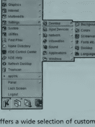

FIGURE 16.1 KDE offers a wide selection of custom configuration options.

使用以下步骤更改 KDE 的外观：

- 1. 单击主 K 工具栏菜单项。
- 2. 从菜单中选择“设置”项。
- 3. 选择你想要更改的属性（桌面、声音等）。
- 4. 从你选择的类别中选择任何合适的子属性。例如，桌面允许你更改颜色、背景、字体等。
- 5. 进行你想要的更改，然后单击“应用”或“确定”按钮以设置它们。

### 摘要

在本课中，你被介绍到通过使用别名、环境变量和配置文件来修改环境设置的想法。进行这些修改使你能够使工作环境成为自己的。以下是本课所涵盖内容的回顾：

- 环境变量经常用于为程序指定单个配置选项，例如提供程序所需的目录指针。
- path 变量跟踪系统在你输入命令时搜索命令的位置。如果系统上存在某个命令，但该命令的路径不在你的 path 变量中，在你输入命令名称时将找不到它。
- 别名是 UNIX shell 的一个非常强大的功能。它们使你能够重命名命令，或使命令在你发出时始终使用某些选项。
- 点文件无处不在。许多程序使用包含配置信息的文本文件用于控制目的。这些文件几乎普遍具有以 . 字符开头的名称。它们是查找 shell 设置自动化以及为窗口系统配置选项的地方。
- stty 命令如果有东西导致它开始异常行为，可以挽救你的终端会话。

不要害怕尝试。你刚刚完成了一节关于修改用户环境的课程。现在去做吧！


## 第 17 课
### 打印

*在本课中你将学习如何将打印请求（或作业）打印到网络上的打印机。*

正如你可能预料的那样，UNIX 抽象了打印机的物理位置的概念，因此本地（直接连接）和远程打印机以相同的方式访问。

UNIX 演变早期的一个分歧导致出现了两种不同的 UNIX 打印方法：lp 系统和 lpd 系统。lpd 是在 Berkeley 标准发行版（BSD）UNIX 源代码基础上创建的，而 lp 是在 AT&T System V 源代码基础上创建的。不幸的是对用户而言，这些系统只是不同到足以让人困惑。从系统管理员的角度来看，lp 似乎是专门为了让生活更困难而创建的。正因为如此，你会发现许多运行基于 System V 的操作系统版本的 UNIX 机器，其 lp 已被 BSD lpd 系统取代。

### 发送打印作业：lpr 或 lp

在 UNIX 中，许多人可以同时打印。因此，当你向打印机发送打印请求时，它会被分配一个作业号。如果需要取消打印作业，该号码用于从打印队列中删除作业。只有 root 用户或拥有打印作业的人才能将其从队列中删除。

> **Postscript vs. Non-Postscript** 本课中假设你正在打印到 PostScript 打印机。然而，你的系统可能配置为使用光栅化器解释 PostScript，并打印到非 PostScript 打印机。

如果你很幸运，你的机器上可以使用 lpd 系统，你就可以使用 lpr 程序套件。如果你使用的是 lp 的机器，请注意指出 lp 差异的部分。

lpr（行式打印机）命令是将数据发送到打印机的主要方法。lpr 基本上将数据直接转储到你指定的打印机。要使用 lpr，请按照以下步骤操作：

- 1. 确定你想要使用的打印机名称。这可能由你的系统管理员设置。
- 2. 选择你想要打印的文件。目前，只选择文本文件。你很快就会看到一些其它格式。
- 3. 使用以下命令发送打印作业：lpr -P<printer name> <filename> <filename> .... 如果你的计算机上只配置了一台打印机，很可能你只需输入 lpr <filename> <filename> ...

> 小心... P 和打印机名称之间没有空格。

例如，输入以下内容：

```
>lpr -Phod samplefile.txt
```

此命令的结果是文件 samplefile.txt 被发送到名为 hod 的打印机。根据打印机的负载，打印作业可能很快会被处理。

> 打印多份 如果你需要打印一份文档的多个副本，你不需要发送单独的打印作业。相反，你可以将副本数量指定为 lpr 命令的选项。只需在 lpr 后跟 #-<number of copies> 即可打印作业中每个文件的该数量的副本。

有一些文件格式和特殊打印情况可能需要打印命令特别注意。这种特别注意以过滤器的形式出现，过滤器应用于文件并将信息转换为打印机可以处理的格式。以下是一些过滤器：

- **.ps** Postscript 文件。Postscript 文件将由 lpr 命令自动处理。你可以像打印纯文本文件一样打印它们。
- **.dvi** Tex 文件。来自 tex 的文件包含特殊的页面布局指令。你可以使用 -d 选项与 lpr 一起正确打印这些文件。
- **.tr** Troff 文件。这是手册页的标准文件格式。如果你想打印手册页，可以使用 -t 选项。
- **Text files with really long lines** 如果你因行超出页面末尾而打印文本文件时遇到问题，可以即时重新格式化文件以使其适应。为此，使用 -p 与 lpr。


**系统怪癖** 系统配置时未安装前面提到的大多数过滤器并不罕见。你可以期望一个细心的系统管理员已配置你的系统以正确处理 postscript 和纯文本，但你可能会发现许多人已将剩余的处理留给你。在这种情况下，你必须找到并使用适当的软件将数据文件处理为 postscript 或纯文本，然后将这些处理后的文件发送到 lpr 命令。


**使用 lp 和 lpr** lp 命令的工作方式与 lpr 命令非常相似，但差异足以让熟悉 lpr 的用户感到烦恼。不是使用 -P 选项指定打印机，而是使用 -d 选项。

使用 -<number of copies> 而不是 -#<number of copies>。

当你使用 lp 将作业发送到打印机时，它会给出如下消息：request id is <uniqname> #。记住这个 <uniqname> # 组合，因为如果你最终决定不希望它打印，这就是你需要知道的信息来删除作业。

lp 系统本应通过自动处理文件类型的检测和适当的转换来让你的生活更轻松，而不是为特定类型的文件提供特定选项，然而，每种类型的打印机和每个安装都可能有不同的选项可用。希望你永远不需要知道这些特定于安装的选项，但如果需要，请查看本地文档以了解你的系统能做什么。

### 检查打印作业状态：lpq

在你将作业发送到打印机后，你很可能想要能够检查它是否已完成打印，尤其是如果它是一个位于你建筑物另一层或完全在另一栋建筑中的网络打印机！要检查作业的状态，你需要查看你提交作业的打印机的队列。你可以使用 lpq -p<printer name> 命令来执行此操作。再次，如果你的系统上只有一个打印机，你可能只需单独发出 lpq。

例如，输入以下内容：

```
>lpq -Phod
```

| 排名 | 所有者 | 作业 | 文件 | 总大小 |
|---|---|---|---|---|
| 1st | agrove | 27 | test.txt | 19 bytes |
| 2nd | jray | 28 | samplefile.txt | 10021 bytes |

这个示例显示 hod 打印队列中目前有两个不同的作业。其中一个由 agrove 拥有，而用户 jray 拥有

第二。每个作业都被排序；这显示了它将被打印的顺序。正在打印的文件名称也会显示出来，以及大小和作业 ID 号。

#### 状态检查
与 lpq 不同，lp 系统使用 lpstat。了解 lp 打印系统的所有信息最简单的方法是使用以下命令：lpstat -t。这会列出系统上所有可用的打印机，以及列出打印机上的所有作业。

### 取消打印作业：lprm
有时你可能会发现自己向打印机发送了打印请求，但实际上并不想发送——也许你发送了 3,000 页的百科全书文件，而不是你打算发送的三页报告。不管怎样，有一个命令可以让你从打印机队列中移除项目：lprm。

如果需要使用 lprm，请按以下步骤操作：

- 1. 使用 lpq 命令查找要移除的作业 ID 号。
- 2. 使用以下语法调用 lprm：`lprm -P<printer name> <job ID>`。

例如，如果你想从上一个示例中的队列中移除作业 #28（假设你是 jray 用户），你应输入以下内容：

```
>lprm -P hod 28
```

要验证结果，可以使用 lpq 再次检查队列：

```
>lpq -P hod
```

| 排名 | 所有者 | 作业 | 文件 | 总大小 |
|------|-------|-----|-------|------------|
| 第1 | agrowes | 27 | test.txt | 19 字节 |

作业 #28 已不再在队列中，也不会被打印。如果不小心输入了别人的打印作业 ID 也不用担心——你只能取消自己的作业。

如果你想移除所有已发送的待处理打印作业，可以使用 * 字符代替作业 ID。这会取消你发送到打印机的所有内容。


### 取消打印作业
lp 系统使用 cancel 命令而不是 lprm。要取消打印机作业，使用 lpstat -t 命令列出作业，选择作业 ID，然后按如下方式发出 cancel 命令：cancel <jobid>。由于 lp 使用唯一名称而不是仅数字来跟踪打印作业 ID，因此无需指定要从哪个打印机移除作业。

### 精美打印：ENSCRIPT
如果你想做一些花哨的打印，可以使用 enscript 命令将文本文件转换为 postscript 并添加一些炫目的功能。（这可能并非安装在所有系统上——如果需要且找不到，请让系统管理员为你安装。）例如，如果你想在一张纸的一面打印两页文本，enscript 可以正确格式化你的文档。它还可以为每页打印横幅信息，帮助你识别已打印的文件以及正在查看的页码。

要以最基本的形式使用 enscript，请执行以下操作：

- 1. 选择你的打印机。
- 2. 选择要打印的文件。
- 3. 按如下方式运行 enscript：enscript -d <printer name> <filename> <filename> ...

例如，要使用 enscript 打印文件 samplefile.txt，你应输入以下内容：

```
>enscript -d hod samplefile.txt
```

```
[ 1 pages * 1 copy ] sent to printer
```

与 lpr 不同，enscript 会给出一些正在发生的事情的反馈。这里它告诉用户它已将一页发送到打印机，并请求默认的副本数：一个。该命令以其基本形式输出与 lpr 非常相似。它只是将文件转储到打印机。不同之处在于，你可以添加命令行选项来更改打印输出的外观。以下是你可以使用的一些选项：

- **页码范围**—使用选项 `-a <start page>-<end page>` 打印页码范围，而不是全部。
- **美化打印源代码**—如果你是程序员，使用 `-E` 命令行开关时，enscript 可以以美观的格式并带高亮打印你的源代码。
- **花哨的页眉**—如果你想轻松识别页面上文本所属的文件和页码，可以使用 `-G` 让 enscript 打印花哨的页眉。
- **横向模式**—而不是沿页面的短边打印，`-r` 选项将页面旋转 90 度并以横向模式打印。
- **多列**—要每张打印页打印两页文本，请使用 `-2` 选项。你可能还想使用 `-r` 横向模式开关，以便一切都能适当容纳。
- **高亮条**—如果你正在阅读源代码或类似电子表格的数据，可能很难在页面上跟随一行。使用 `-H` 选项在页面上打印浅灰色高亮条。
- **多份副本**—与 lpr 的语法略有不同，enscript 可以使用 `-n <number of copies>` 选项打印作业的多个副本。

虽然我相信到现在你不需要被提醒，但请务必查看 man 手册以获取有关 enscript 的更多信息。你可以使用更多选项来进一步自定义打印输出的外观。

### 摘要
在本课中，你学习了从命令行打印所需的命令。如果你在使用 KDE 环境中的应用程序，它实际上正在使用你在这里看到的相同命令将信息发送到打印机。lpr、lpq 和 lprm 命令套件构成了从 UNIX 和大多数 UNIX 计算机打印的基础。enscript 是锦上添花。以下是本课重点的回顾：

- **lpr 和 lp**—lpr 和 lp 命令用于将文件发送到打印机。如果文件类型不是纯文本，它可以由过滤器处理以正确格式化信息供你的打印机使用。
- **lpq 和 lpstat**—当打印请求从 lpr 或 enscript 发送到打印机时，它会被添加到打印机队列。使用 lpq 或 lpstat -t 程序显示所有待处理的打印机事务、其对应的作业 ID 和所有者。
- **lprm 和 cancel**—如果你想从打印队列中移除作业，lprm 或 cancel 就能解决问题。
- **enscript**—enscript 是一个用于在打印机上进行花哨打印的有用实用程序。它允许每张打印机页包含多页文本、漂亮的图形页眉以及各种其他功能。


## 第 18 课
### 访问网络资源
*在本课中你将了解 UNIX 的另一个优势——网络连接。*

你现在几乎完成了对 UNIX 操作系统的旋风式之旅，但你远未完成探索和学习 UNIX 为你提供的功能。

UNIX 在网络方面表现出色。如在讨论 UNIX 文件系统设计时提到的那样，通过适当的配置，你可以将 UNIX 机器分布在全球各地，并且在每台你登录的机器上，你的用户环境、文件和程序都会出现——就像在家一样。

你的家庭环境能够以同样的轻松程度将自身分发到分散的机器上为你工作，你也可以从家庭机器将工作负载分发到这些相同的机器上。本课将为你提供一些允许这种工作负载分发的程序的概述。

### telnet
telnet 是一个简单的终端程序。在其主要用途中，它使你能够在远程机器上打开登录会话。要使用 telnet 命令，按如下方式发出命令：`telnet <remote machine>`，其中 `<remote machine>` 是 IP 地址或主机名。你将被提示输入登录名和密码提示，就像你坐在远程机器的控制台前一样。


> TELNET 具体说明 在 telnet 登录和密码提示时遇到 Backspace 和 Delete 无法正常工作的情况并不罕见。不要惊慌；这只是表明远程机器还不知道你使用的是哪种终端。如果问题在登录会话中仍然存在，请参阅第 16 课“修改用户环境”中的 stty 部分。

### rlogin
rlogin 命令与 telnet 命令非常相似，只是它在尝试连接时携带了一些用户信息。如果你的帐户在多台机器上有效，它们可能已设置好以便你在它们之间连接而无需每次都登录。按如下方式尝试 rlogin 命令：rlogin <remote machine>。如果你幸运的话，你将进入远程机器上的 shell。如果不幸运，你会看到登录提示；从那里开始，rlogin 的功能与 telnet 完全相同。

### slogin
slogin 命令是一种远程终端程序，提供数据流的强加密。如果你机器上运行着安全外壳服务器，强烈建议你使用此命令。rlogin 和 telnet 命令都会以明文形式通过网络发送你的登录名和密码信息，以及你输入的任何其他内容。恶意用户只需少量易于获得的破解软件即可嗅探这些信息并危害你的帐户。（请不要称他们为黑客。黑客行动迅速、肮脏，往往是出色的程序员。他们不会入侵——破解者才会。）

要了解安全外壳服务器是否正在运行，以及设置 slogin 命令（使用前需要相当多的配置），建议你联系系统管理员。他或她会很乐意告诉你有关 slogin 命令或任何替代方案的信息，并帮助你提高系统安全性。


### rn/trn

The rn and trn commands read Usenet newsgroups. -> rn 和 trn 命令用于读取 Usenet 新闻组。Although they have retreated slightly into the background because of the World Wide Web, Usenet newsgroups were once considered to be the collective memory of the Net. -> 尽管由于万维网的出现它们已稍稍退居幕后，Usenet 新闻组曾经被认为是网络的集体记忆。Even though the Web has eclipsed newsgroups in terms of visibility, the fact that newsgroups function as topic-oriented chat rooms and provide almost real-time interaction makes them still a useful source of help and information. -> 即使在可见度方面网页已超越新闻组，但新闻组作为主题导向的聊天室并提供近乎实时的交互这一事实，使它们仍然是有用的帮助和信息来源。You can use the rn or trn command to access information that ranges from the technical, to the idiotic, to the sublime. -> 你可以使用 rn 或 trn 命令访问从技术性到荒谬再到崇高的各种信息。The rn and trn commands are executed simply by name, and internally take both single-key commands and multi-character commands followed by Return. -> rn 和 trn 命令只需按名称执行，内部同时接受单键命令和随后按 Return 的多字符命令。The primary commands you need to know when you are in rn or trn are as follows:
在 rn 或 trn 中，你需要了解的主要命令如下：

- The commands for listing newsgroups—l <topic>Return lists all newsgroups that contain that topic. For your topics, keep small parts of words—such as comp for computer topics—until you become familiar with the newsgroup naming conventions.
列出新闻组的命令——l <topic>Return 会列出包含该主题的所有新闻组。对于你的主题，请保留单词的小部分——例如计算机主题的 comp——直到你熟悉新闻组命名惯例为止。
- The command for going to a newsgroup—Type g <newsgroup name>Return, and then follow the instructions.
进入新闻组的命令——输入 g <newsgroup name>Return，然后按照说明操作。
- The command for help—h (no Return) brings up rather copious context-sensitive help at almost any point in the program.
帮助命令——h（无需按 Return）会在程序的几乎任何位置调出相当详尽的上下文相关帮助。

The trn command is a slightly more sophisticated version of rn, offering article selection by subject thread; you will probably prefer it if it's available. -> trn 命令是 rn 的稍复杂版本，提供按主题线程选择文章；如果可用，你可能更喜欢它。Either version can be highly configured with command-line switches and configuration files.
两个版本都可以通过命令行开关和配置文件进行高度配置。

### ftp

The ftp command provides you with a way to retrieve files from remote machines that aren't set up to share file systems with yours. -> ftp 命令为你提供了一种从未设置与你的文件系统共享的远程机器检索文件的方法。If your machine is running an ftp-server, you might be able to use it to provide your files to the rest of the world as well. -> 如果你的机器正在运行 ftp-server，你也可能用它向全世界提供你的文件。Contact your system administrator about this.
请联系你的系统管理员了解此事。

To use the ftp command, simply enter the command as follows: ftp <ftp server>, where the ftp-server is the IP address or hostname of a remote machine running an ftp-server. -> 要使用 ftp 命令，只需按如下方式输入命令：ftp <ftp server>，其中 ftp-server 是运行 ftp-server 的远程机器的 IP 地址或主机名。If you've connected properly, you'll get a prompt for a username and password.
如果连接正确，你会得到用户名和密码的提示。

Some ftp-servers enable you to connect without an account on the system. For these, use the username anonymous and give your email address as the password.
一些 ftp-server 允许你在系统上没有账户的情况下连接。对于这些服务器，使用用户名 anonymous 并以你的电子邮件地址作为密码。

Once connected to an ftp-site, you can cd and ls your way around. Using the command get <filename> enables you to retrieve a file and put <filename> enables you to send one from your directory to the remote system.
连接到 ftp 站点后，你可以使用 cd 和 ls 在其中导航。使用命令 get <filename> 可以检索文件，而 put <filename> 可以将文件从你的目录发送到远程系统。


> **CORRUPTING YOUR DATA** Some ftp-servers corrupt data unless you issue the command binary after you are connected. They're actually trying to fix the difference between the way that UNIX and PC-type machines handle carriage-returns in files, but they just end up screwing things up when talking to another UNIX machine. If you end up with corrupted files after you've downloaded them, try again, but issue the binary command before the get command.
> **破坏你的数据** 一些 ftp-server 在你连接后未发出 binary 命令时会损坏数据。它们实际上是在尝试修复 UNIX 和 PC 类机器处理文件回车符方式之间的差异，但在与另一台 UNIX 机器通信时却适得其反。如果你下载后得到损坏的文件，请重试，但在 get 命令之前发出 binary 命令。

### Web Browsers: Netscape and Lynx
网页浏览器：Netscape 和 Lynx

The following sections discuss the Netscape and Lynx Web browsers.
以下各节讨论 Netscape 和 Lynx 网页浏览器。

#### Netscape

Netscape is the GUI-based Web browser that is available on the largest number of UNIX platforms. -> Netscape 是可在最大数量的 UNIX 平台上使用的基于 GUI 的网页浏览器。It functions in much the same way as the Macintosh or PC versions that you might already be familiar with—point, click, and repeat as necessary. -> 它的功能与你可能已经熟悉的 Macintosh 或 PC 版本大体相同——点击、单击并根据需要重复。If it's available on your system, you can most likely start Netscape by simply typing netscape in any X Windows terminal.
如果它在你的系统上可用，你很可能只需在任何 X Windows 终端中输入 netscape 即可启动 Netscape。

#### Lynx

Lynx is a text-based Web-browser, for those times when you're stuck in a text window. -> Lynx 是一种基于文本的网页浏览器，适用于被困在文本窗口时的情况。Start it with this command: lynx <URL>. -> 使用以下命令启动它：lynx <URL>。You get a textual representation of the page, at which the URL points. -> 你会得到指向该 URL 的页面的文本表示。Lynx is a surprisingly full-featured browser for what you might think is an extremely limited market. -> 对于你可能认为的极其有限的市场而言，Lynx 是一款出人意料功能齐全的浏览器。The market is actually a bit bigger than you might think. -> 实际上市场比你想象的大一些。Lynx starts and loads pages much faster than graphic-based browsers. -> Lynx 启动和加载页面比基于图形的浏览器快得多。This makes it a convenient alternative if you need to check a Web page quickly and don't need either the graphics or the wait.
这使其成为一个方便的替代方案，如果你需要快速查看网页而不需要图形或等待时间。

### Email

Of all the network tools you'll make use of from your UNIX account, email is likely to be the most frequently used. -> 在你从 UNIX 账户使用的所有网络工具中，电子邮件可能是使用最频繁的。Email enables you to communicate with your friends and colleagues, exchange files, and contact people all over the planet. -> 电子邮件使你能够与朋友和同事交流、交换文件并联系世界各地的人。As is fitting to its position of most-used tool, email also has the widest range of software available. -> 考虑到它是最常用的工具这一地位，电子邮件也有最广泛的软件可用。Most versions of UNIX come with at least two different programs for accessing email, and frequently have a handful of others that have been installed over time. -> 大多数 UNIX 版本至少附带两种用于访问电子邮件的程序，并且经常随着时间的推移安装了若干其他程序。Although they are only a small sampling of the programs available, the following programs are commonly used for accessing and working with email:
虽然它们只是可用程序中的一小部分，但以下程序常用于访问和处理电子邮件：

- **Mail**—Found on almost all UNIX systems, Mail is a command-line driven mail reading system. It's a fairly simple program without many customization features, but it's fast and convenient to use if you don't need fancy mail filters or a menu-driven interface.
**Mail**——几乎所有 UNIX 系统上都有，Mail 是一个命令行驱动的邮件阅读系统。它是一个相当简单的程序，没有太多自定义功能，但如果你不需要花哨的邮件过滤器或菜单驱动界面，使用起来非常快速方便。
- **mail**—Also found on almost all UNIX systems, mail is not something you want to use for reading mail unless you absolutely must. You will usually find that the major use for mail is using it in shell scripts, as has been demonstrated in several places in this book.
**mail**——也几乎存在于所有 UNIX 系统上，除非绝对必要，否则你不想用它来阅读邮件。通常你会发现 mail 的主要用途是在 shell 脚本中使用，正如本书多处所示。
- **pine and elm**—Not standard on most commercial UNIX flavors, pine and elm are both full-screen mail reading programs with simple-to-use and intuitive menus and configuration options. The pine program is somewhat more powerful than elm, but both are good mail readers for users who want convenience in a text-based email reader.
**pine and elm**——不是大多数商业 UNIX 版本的标准配置，pine 和 elm 都是全屏邮件阅读程序，具有简单易用且直观的菜单和配置选项。pine 程序比 elm 稍微强大一些，但两者对想要在基于文本的电子邮件阅读器中获得便利的用户来说都是不错的选择。
- **mh**—The Mail Handler. The mh suite of programs must be close to the least, if not the least, intuitive mail reading package available. It is also the most powerful by far. The mh philosophy is very similar to the UNIX philosophy—break the job at hand down into the smallest building blocks possible, make each of these programs, and enable the user to put them together to make any custom configuration desired. Only choose mh as your mail reader when you've become comfortable doing a bit of shell script programming because you have to construct custom aliases and scripts before mh shows you its true power.
**mh**——邮件处理程序。mh 程序套件几乎是最不直观的邮件阅读包，如果不是最不直观的话。它也是迄今为止最强大的。mh 的理念与 UNIX 的理念非常相似——将手头的任务分解为尽可能小的构建块，将每个构建块做成程序，并使用户能够将它们组合起来实现任何所需的自定义配置。只有在你熟悉进行一些 shell 脚本编程后才选择 mh 作为邮件阅读器，因为你必须先构建自定义别名和脚本，mh 才会展现其真正的威力。
- **procmail**—The Mail Processor. The procmail program is designed to do sophisticated automatic processing of your email as it is received. If you want to add automatic processing of your email to your account, you might want to check whether procmail is available on your system.
**procmail**——邮件处理器。procmail 程序旨在在收到邮件时对其进行复杂的自动处理。如果你想为账户添加电子邮件的自动处理，可以检查 procmail 是否在你的系统上可用。
- **Graphical email interfaces**—Many desktop environments provide graphical email readers. For the user interested in the ultimate in point-and-click convenience, look to your desktop environment software. Netscape additionally provides an email client on UNIX platforms, but it is only a popmail client and cannot read from your UNIX mail spool unless your machine is also running a POP3 server. An example of the KDE email client (appropriately named *Mail client*) is shown in Figure 18.1.
**图形化电子邮件界面**——许多桌面环境提供图形化邮件阅读器。对于追求极致点按便利性的用户，请查看你的桌面环境软件。Netscape 在 UNIX 平台上还提供电子邮件客户端，但它仅是 popmail 客户端，除非你的机器也运行 POP3 服务器，否则无法从你的 UNIX 邮件 spool 读取。KDE 邮件客户端（恰当地命名为 *Mail client*）的示例如图 18.1 所示。

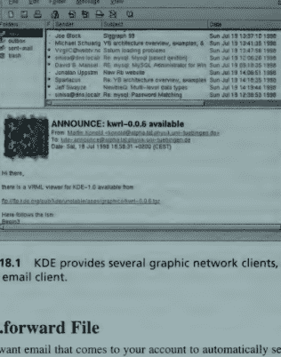

FIGURE 18.1 KDE provides several graphic network clients, including an email client.
图 18.1 KDE 提供多个图形网络客户端，包括电子邮件客户端。

#### The .forward File
.forward 文件

If you want email that comes to your account to automatically send itself somewhere else, you can make use of the .forward file. -> 如果你希望发到你账户的电子邮件自动发送到其他地方，可以使用 .forward 文件。Not only can the .forward file be used to forward your email to another email address, but it can also be used to forward your email into programs if you want to use software to process your email.
.forward 文件不仅可用于将电子邮件转发到另一个电子邮件地址，还可用于将电子邮件转发到程序中，如果你想使用软件处理电子邮件的话。

The format of the .forward file is simple:
.forward 文件的格式很简单：

- To forward your email to another email address, create a file named .forward in your home directory. Into this file, put a single line containing the address to which you want your mail forwarded. Execute the command `chmod 644 ~/.forward` to set the permissions properly (some flavors of UNIX are particular about this), and you're done. All email coming to your account is forwarded to the new address.
要将电子邮件转发到另一个电子邮件地址，请在你的主目录中创建一个名为 .forward 的文件。在该文件中，放入一行包含你希望邮件转发的地址。执行命令 `chmod 644 ~/.forward` 以正确设置权限（某些 UNIX 版本对此很挑剔），然后完成。所有发到你账户的电子邮件都会转发到新地址。
- To forward your email into a program for automatic processing, create the .forward file in your home directory. In the .forward
要将电子邮件转发到程序进行自动处理，请在你的主目录中创建 .forward 文件。在 .forward

file, put a single line containing the pipe character | followed by the path to the program that you want to use. Run chmod on the file as with forwarding your email to another account, and you're done. Incoming email is then piped into whatever command you put in the .forward file.

### Summary

In this lesson, you were introduced to a sampling of tools that enable you to make use of the network resources around you—and around the world. As you explore UNIX you'll find that this was really only a small sampling, and that there are new tools for you to use appearing constantly. Some will be replacements or upgrades for the commands outlined here, and others will be completely new. Don't be afraid to try them out. Here's a quick review of this lesson's key points:

- The telnet command can connect you to remote machines. If you have different accounts on different machines, you'll probably find yourself using it frequently.
- The rlogin command also connects you to remote machines, but is more useful than telnet if the machines you work on are configured to allow you to rlogin between them without giving a username or password.
- The slogin command provides security for remote connections. If you have it, use it. With people breaking into UNIX machines daily, the network is becoming a very scary place. Using the secure connection provided by slogin protects your network traffic from prying eyes.
- The trn and rn commands read Usenet newsgroups. Newsgroups can be a lot of fun and useful in finding information, but they can also be a big drain on your time.
- The ftp command connects you with ftp servers and enables you to transfer files around the world.
- Netscape is available for many UNIX platforms. Lynx is a fast text-based Web browser. Both are useful for accessing World Wide Web resources.
- You're likely to have a wide choice of options for accessing email. Check with other users of your system to find out what's available and what local configuration information you need.

## LESSON 19
### PERMISSIONS


*In this lesson you will learn what permissions are, and how to change them.*

UNIX file permissions might be something that you never have to deal with, but if you want to share files with other users on your system, chances are you need to know a little bit about the concept.

### OWNERS, GROUPS, AND PERMISSIONS

The owner of a file is exactly what it sounds like—the person who owns the file. Each file has information stored with it that identifies the account that owns it. Files can be given to other users by changing the owner information to match their username. In general, the person who creates a file is the person who owns it.

Each file on the UNIX system also has a secondary piece of information stored that records the group ownership of the file. Groups are collections of users. By allowing a group to share ownership of files, many people can work together on a project and have their changes immediately available to other members of the group. Creation of groups is a system administration task, so if you need a group created for a project, talk to your system administrator.

Permissions control what actions a user can perform on a file or directory. There are three basic actions, which are pretty much self-explanatory: read, write, and execute. Read permissions control whether someone can view a file. Write allows or disallows changes to be made to a file. Lastly, execute permissions control whether a file can be run, or executed. In the case of a directory, these change a bit. If a directory has execute permissions turned off, you cannot cd into the directory, view its contents, or write to it. It is effectively turned off. If read permissions are turned off,

you can still create files in the directory and read them, but you cannot get a listing of what is in the directory. Lastly, if the write permission for a directory is turned off, you can view a listing of the contents and read files, but you cannot create any new files.

When permissions are applied to a file or folder, they are applied at three distinct levels: owner, group, and world. The owner permissions simply control what permissions the file owner has. Group permissions determine what actions can be performed by members of the same group to which the file belongs. Your system administrator can create new groups or add you to be a member of a group. You can think of world permissions as being permissions for a huge group that encompasses all the users on your computer. If there is any sort of guest access to your computer, you can assume that any active world permissions apply to anyone who can access your computer.

### CHECKING THE OWNER, GROUP, AND ASSOCIATED PERMISSIONS: ls -l

You've already used the ls command extensively, but you probably haven't been paying too much attention to the extended information it can return. If you run ls -l to list your directories, you can see the owner, group, and associated permissions for any file.

For example, type the following:

```
>ls -l
-rwxr--r-- 1 jray jray 2024 Oct 28 20:39 kiwi.tar
-rw------- 1 jray test 1463882 Jul 2 11:33 magical-beans.gz
drwxrwxr-x 5 jray test 1024 Nov 5 12:25 kytn
...
```

> Listing Owners and Groups Some versions of ls won't show you the owner and group simultaneously with this command. Usually, they list group and owner if you add the -g option, as in ls -lg.

The information you're interested in here is in the first, third, and fourth columns:

- The first column identifies the owner, group, and world permissions that are active for a file or directory. The first character is a d if the filetype is a directory. Normally this is a - for a normal file. The remainder of the characters, as you might guess, stand for read, write, and execute (x). The first three characters (following the initial - or d character) are the active owner permissions, the second three characters are the group permissions, and the last three are world permissions.
- The third column is the file owner.
- The fourth column is the group owner.

In this example, the kiwi.tar file has read/write permissions for the owner, and read permissions active for the group and world. The owner of the file is jray and the group that the file belongs to is jray. The second file, magical-beans.gz, only has read/write permissions for the owner. (jray). The group that magical-beans.gz belongs to is test; the group test has no permissions to operate on the file. The last "file," kytn, is actually a directory. The owner of kytn is jray and the corresponding group is test. The owner and group both have full read, write, and execute permissions for this directory, whereas the world has only read and execute.

### CHANGING PERMISSIONS: chmod

Now that you know what permissions are, you probably want to know how to change them. This is accomplished with the chmod command. There are two modes of operation that you can use with chmod: a quick-and-dirty mode, and a more user-friendly method of setting permissions.

The symbolic user-friendly mode uses easy-to-remember commands to set or unset permissions. To use this, do the following:

1. Pick a permission level. If you want to set permissions for the owner, the level is u. If you want to change permissions for the group, it is g. For world permissions, choose o. Lastly, if you want to affect all the levels of permissions (owner, group, and world), use a.
2. Choose an operation. Decide whether you want to set (turn on) or unset (turn off) a particular level of permission. If you want to set a permission, the operation is +; if you want to unset a permission, it is -.
3. Choose the permission itself. If you want to operate on the read permission, choose r, for write choose w, and for execute choose x.
4. Issue the chmod command in this manner: chmod <permission level><operation><permission> <filename> <filename> ...

For example, if you want to activate group write permissions for the “magical-beans.gz” file shown earlier, type the following:

```
>ls -l magical-beans.gz
>chmod g+w magical-beans.gz
```

To see if this worked, you can run ls -l on the filename as follows:

```
>ls -l magical-beans.gz
-rw--w--- 1 jray test 1463882 Jul 2 11:33 magical-beans.gz
```

Sure enough, write permissions are now active for the test group members.

Because of its symbolic nature, this method for adjusting file permissions might be easy for some; however, there is another syntax that you might find faster and easier. This deals with setting the actual bit mask that controls a file's permissions. Turning on one of three binary bits can represent each level of permissions. The first of these bits (from left to right) controls read, the second controls write, and the third toggles execute.

Look at it this way:

```
100 - Read permission - The decimal equivalent of
this binary value is 4.
010 - Write permission - The decimal value for write is 2.
001 - Execute permission - The decimal representation is 1.
```

Using this technique, you can easily set multiple permissions at once. For example, it's easy to see that 110 is the combination of the read and write

权限。此二进制字符串的十进制值是 6（4+2）。要使用这种设置文件权限的方法，你需要同时为所有者、组和其它用户设置权限——使用三位数字。每一位数字都是你想要设置的权限之和。第一位是所有者，第二位是组，第三位是其它用户

例如，假设你想让所有者拥有完全权限，而组和其它用户拥有读和执行权限。完全权限是通过将所有权限值相加得到的（4+2+1=7）。读和执行权限的组合是 4+1=5。因此，你用来设置此权限的三个数字是 7、5 和 5，以一个三位数字 755 输入。这种形式的 chmod 语法如下：chmod <permissions> <filename> <filename> ...

例如，请查看以下内容：

```
>chmod 755 magical-beans.gz
>ls -lg magical-beans.gz
-rwxr-xr-x 1 jray test 1463982 Jul 2 11:33 magical-beans.gz
```

正如你所期望的，所有者拥有完全的读、写和执行权限，而组和其它用户拥有读和执行权限。随着经验的积累，你可能会发现这种第二种方法是最快设置权限的方式。只要记住读（4）、写（2）和执行（1），你就没问题了。

> 在目录级别更改权限 如果你想更改整个目录结构（目录内的所有文件和目录）的权限，可以使用命令行选项 -R 与 chmod 命令一起递归地更改目录内的所有内容。

### 更改文件的所有者：chown

此命令对你帮助不大，因为它只能由超级用户（root）使用。如果你需要更改文件的所有者，请让你的系统管理员为你运行此命令。chown 的语法很简单：chown `<new owner> <filename> <filename> ...`

例如，输入以下内容：

```
>chown agoves magical-beans.gz
>ls -lg magical-beans.gz
-rwxr-xr-x 1 agoves test 1463882 Jul 2 11:33
  magical-beans.gz
```

文件现在由用户 agoves 拥有（与本课中一直拥有它的 jray 相反）。

另一种授予所有权的方式 如果由于某种原因，另一个用户需要拥有你拥有的文件，你可以始终授予他们读权限并允许他们复制文件。创建的副本由另一用户拥有。

### 更改文件的组：chgrp

虽然你不能更改文件的所有者，但你可以使用 chgrp 命令更改文件所属的组。但是，要做到这一点，你必须是该组的成员。你的系统管理员有创建新组并将用户添加到这些组的能力。如果你对自己的组成员资格有任何疑问，请询问管理员你的账户是如何配置的。

使用 chgrp，请按照以下步骤操作：

- 1. 选择你想要更改的文件或文件。
- 2. 确定文件现在属于哪个组。
- 3. 使用以下命令更改文件的组：chgrp `<new group> <filename> <filename> ...`

例如，输入以下内容：

```
>chgrp admins magical-beans.gz
>ls -lg magical-beans.gz
-rwxr-xr-x 1 agoves admins 1463882 Jul 2 11:33
  magical-beans.gz
```

臭名昭著的 magical-beans.gz 文件现在属于 admins 组。组员对该文件具有读和执行权限。

chgrp 最明显的使用场景是在协作项目时。如果你创建了一个想要与许多人共享的文件，你需要将文件的组更改为所有用户都属于的组。

> 在目录上运行 chgrp chgrp 命令与 chown 类似，也可以通过使用 -R 选项递归地在目录上运行。这在你想要同时修改大量文件和目录时可以节省大量时间。

### 登录到新组：newgrp

如果你在进行项目工作，你可能不想不断更改所创建文件的组；如果你处理数百个文件，这可能会变得非常单调。幸运的是，有一种方法可以登录到你所属的组。这是通过 newgrp 命令完成的。执行此命令后创建的所有文件都将在你切换到的组成员身份下。此更改会一直持续到你注销或再次使用 newgrp 命令为止。使用 newgrp，输入以下内容：newgrp <new group>。

例如，输入以下内容：

```
>newgrp admins
```

执行此命令后，本会话中创建的所有后续文件都属于 admins 组。

### 临时成为另一用户：su

su，即 substitute user 命令，使你能够在一个登录会话中切换到另一个用户账户。在 UNIX 下，这会更改你的有效用户 ID——这意味着创建的所有文件都将有效地好像是另一用户创建的一样。你的实际用户 ID 保持不变。然而，一个明显的副作用是，即使你使用 su “成为”另一用户，运行 mail 检查的是你最初用于登录的用户账户的电子邮件。要使用 su 命令，只需按如下方式输入：su <user to switch to>。

例如，输入以下内容：

```
>su agoves
```

Password: ******

如果你是你，你现在可能会使用 whoami 命令如下，以验证系统现在认为你有效地是 agoves：

```
>whoami
```

agoves

正如你所希望的！你现在可以在 agoves 账户下执行操作。


### 账户共享指导

在用户之间共享账户密码不是一个好主意。对于此示例，你看到一个用户切换到 agoves 账户，这不一定是好事。因为系统认为用户现在是 agoves，用户所做的大多数事情都被记录为由 agoves 完成——她可能不会很欣赏这一点。

su 更恰当的使用是切换到非个人账户。有几个账户由数据库服务器等拥有，是适当使用 su 的主要候选对象（用于执行数据库文件的维护）。

由于 su 有很大的滥用潜力，其使用通常仅限于管理员账户用户，并且在所有情况下 su 的使用都会被系统记录。未经许可尝试此命令，至少会引起管理员对你的注意。

### 摘要

在本课中，你学习了权限、所有者和组的用途。你现在了解了使其他用户能够访问你的文件所需的条件，以及如何使用组权限在项目上协作。你可能想花几分钟时间与你的系统管理员谈谈，了解他或她是如何决定管理组的。此外，你可能想请求创建包含你想要共享文件的其他用户的组。以下是本课的一些重点回顾：

- Permissions—文件权限控制谁可以访问文件，以及他们对文件的访问级别。权限有三个级别：读、写和执行。这些权限可以应用于所有者、组或其它用户。
- chmod—chmod 命令更改文件或目录的权限。操作有两种方法——符号法和数字法。它们都能实现同样的目的，所以使用你感到舒适的那一种。
- **chown**—只有超级用户才能更改文件的所有者。如果你能说服管理员这样做，chown 会更改所有者。为什么你可能不想尝试的原因在第 20 课“特权命令”中有所介绍。
- **chgrp**—你可以使用 chgrp 函数更改文件所属的组。你只能将文件更改为你所属的组。
- **newgrp**—与其不断更改所创建文件的组，你可以使用 newgrp 登录到你所属的组。在登录会话剩余时间内创建的所有文件都在该组下创建。
- **su**—substitute user 命令有效地在一个登录会话中切换到另一个用户。如果你有另一个账户的密码，可以使用 su 在该账户下执行操作。你创建的任何文件都由该用户拥有。


## 第20课
### 特权命令


*在本课中你将了解一些 UNIX 用户很少遇到的特殊命令。*

本课中的命令仅限 root 用户运行，但这里的信息将帮助你理解 root 的一些关注点，并使与系统管理员的对话更易理解。

由于 UNIX 的工作方式（有多用户、多进程，以及可能由数百人拥有的文件），某些命令如果交给普通用户使用会造成混乱。这些命令会执行诸如格式化磁盘、重启系统以及创建或删除设备等操作。

### 单用户模式

每台 UNIX 机器都可以配置为启动到单用户模式，在该模式下机器没有网络资源且只能支持一个用户登录。这是维护模式，使 root 用户能够在不必担心其他用户更改他们正在处理的内容的情况下修复系统问题。在某些版本的 UNIX 中，如果机器发生特别严重的崩溃，它可能会自动重新启动到单用户模式。有些需要在输入任何命令前要求 root 密码，而其他则直接进入 root shell。如果你不小心导致 UNIX 机器崩溃并且它进入了单用户模式，请不要触碰任何东西！你所做的任何事情都可能使诊断崩溃变得不可能；更糟的是，它可能对系统造成毁灭性的影响。对于 root 用户，rm 命令中一个按键的拼写错误就可能从上到下删除整个文件系统。

#### fsck

时不时会听到系统管理员抱怨不得不 fsck 一个驱动器。UNIX 通常会合理地维护其驱动器，但问题偶尔也会出现。fsck 命令是 UNIX 的磁盘修复程序，用于清理由崩溃或错误的软件片段引起的问题。大多数 UNIX 系统在启动时会对驱动器进行 fsck，预期结果是包含文件数量和驱动器碎片化程度的分析报告。如果你正在观看 UNIX 机器启动，不要过于担心如果看到 fsck 报告问题——UNIX 会自动尝试修复它们。在大多数情况下它会成功，并且在对驱动器使用 fsck 后系统会重新启动重启过程。如果驱动器存在严重问题，自动 fsck 会以下列错误信息退出：Run fsck by hand。如果出现这种情况，不要触碰任何东西——去找系统管理员。

#### mount/umount

mount 命令指示系统将磁盘驱动器挂载到文件系统中的特定目录。正如第 4 课《文件系统》中所讨论的，UNIX 通过使驱动器在文件系统中表现为目录来抽象物理硬件。该命令告诉系统如何访问驱动器或在网络上定位它，以及将其挂载到文件系统的何处。umount 命令正好相反——它移除已挂载的设备。

如果你登录系统并看到类似 No Home Directory - using / 的消息，不要惊慌。很可能你的主目录没问题——它只是位于未挂载的驱动器上。这种情况不常发生，但由于驱动器和资源在网络上共享，只需有人绊倒一条网络跳线，就可能导致某些设备在电线修复前无法使用。

如果你遇到前面提到的错误，或者在输入密码后被直接踢出系统（如某些系统会发生的情况），请在联系系统管理员前等待 15 分钟再试一次。很可能他们已经知道问题并正在尝试修复，但成群的用户打电话投诉会拖慢他们的进度。

#### shutdown/reboot

虽然个人电脑越来越挑剔，要求关机而不是简单地断电，但 UNIX 机器仍然更挑剔。当然，这种差异源于 UNIX 使用数十个协同工作的程序构成看似操作系统的事实。这些程序中的每一个在任何时刻都可能正在修改、移动、创建或删除文件。如果你简单地切断 UNIX 机器的电源，你会中断所有这些进程，并且很可能破坏它们当时正在处理的文件。如果这些文件只是诸如文字处理器文档之类的东西，这只是一个小问题。不幸的是，UNIX 还会移动和更新对操作系统至关重要的文件。简单地切断 UNIX 机器的电源可能会完全损坏驱动器，导致系统无法使用——简而言之，不要这样做。

为防止此问题，UNIX 提供了 shutdown 命令和 reboot 命令，各自目标明确。这两个命令会优雅地退出所有正在运行的软件，将磁盘缓存信息写入驱动器，并完成各自的任务。出于显而易见的原因，它们仅限 root 用户使用，然而一些 UNIX 硬件制造商开始在机器上安装软电源开关。软电源开关实际上并不关闭机器：它们以 root 身份执行 shutdown 命令，而无需密码。在大多数系统管理员眼中，这纯粹是糟糕的做法。如果你的机器有其中一个软电源开关，请不要使用它。其他用户可能正在使用你的机器，或者你的机器可能为其他机器提供磁盘资源。关闭它很可能在本地网络上造成混乱，并让你在系统管理员最不喜欢的用户名单上占据高位。

#### chown

chown 命令用于将文件的拥有者从一个账户更改为另一个账户。显然，普通用户不能使用此命令，但如果你需要此操作，系统管理员可以为你完成。记住，你始终可以使用 cp 命令获取一份可读的文件副本——更改所有权可能并非必要。

### 让系统管理员满意

UNIX 是一个非常字面化的操作系统，它或多或少地完全按照你的指示执行。如果你最终做了损害自己账户的事情并需要系统管理员从备份中恢复你的账户，请预期他/她不会很高兴。如果你做了导致网络安全漏洞或损坏系统上其他用户文件的事情，请预期他/她会变成一个喷火的食人魔。

你面对的是一类专业人士，他们的工作非常困难，必须在处理令人头脑发胀的技术问题、整个用户社区的综合需求以及个人用户的需求之间取得平衡。

大多数系统管理员对他们支持的用户群怀有最美好的意图和愿望，但他们也承受着巨大的时间压力。问题补丁和安全修复几乎每天都会出现并需要应用到操作系统上——未能应用其中任何一个都可能使你的系统容易受到崩溃或外部攻击。还有来自用户的持续压力，他们“绝对需要”安装某物，或刚刚删除了他们下周需要演示的编程项目。而且，还有一些用户只是需要帮助理解某物如何工作。

系统管理员很少在事情进展顺利时听到用户的反馈，因此他们变得有点怕用户并不罕见。所有这些加起来形成的工作量导致许多系统管理员在很短的时间内就精疲力竭。

如果你的系统管理员为你做得很好，请在与他们打交道时牢记他们的工作以及它对你的意义。偶尔说一句“谢谢”可以大大驯服那个喷火的食人魔，据说 Orange Crush 或 Mountain Dew 和披萨也有帮助。


### 摘要

在本课中，你被介绍了一些不应该或不能做的事情，希望理解为什么不应该和不能做它们会使你与系统管理员的互动更轻松。系统管理员的工作很艰难，他们必须在保持系统为所有用户正常运行（有时需要他们强硬且不灵活）与创建个人用户工作所需的环境之间取得微妙平衡。大多数人确实有兴趣让系统为你尽可能最好地工作，但很多人没有时间有太多耐心。希望，了解那些使你的系统管理员生活更困难的事情类型，以及为什么不应该做它们，能够让你保持在管理员的好感中。以下是本课中其他要点的回顾：

- 切勿触碰看起来正在运行 root shell 的机器。
- 不要因为未挂载的驱动器而打扰 root（你的系统管理员），除非很明显没有人知道这件事。
- 切勿在未经管理员许可的情况下关闭机器电源。如果你机器上有关机按钮，就假装它根本不存在。
- Root（管理员用户）可以为你更改文件的拥有者，但请考虑是否真的有必要，或者复制一份是否就够了。


## 索引

### 符号

- & (与号), 113
- > (尖括号)
- >> 运算符, 127
- >& 运算符, 128
- >> 运算符, 128
- * (星号), 132-134
- \ (反斜杠), 133
- [] (方括号), 133
- ^ (插入符号), 134-135
- $ (美元符号), 135
- ... (省略号), 18
- / (正斜杠), 14
- | (管道), 14, 132. 另见 点文件
- | (管道字符), 102, 129
- ? 命令 (vi), 87
- ? (问号), 20, 78
- ~ (波浪号), 42
- \w 命令 (vi), 87
- / 记法, 14
- # 选项 (tail 命令), 80
- -2 选项 (enscript 命令), 170
- 4dwm 窗口管理器, 33
- 账户，共享, 189
- alias 命令, 155
- 别名, 72-74, 155-157
- 与号 (&), 113
- 锚点, 134-135
- Answerbook 数据库, 22
- apropos 选项 (man 命令), 19-20
- 归档文件
  - KZip 工具, 109-110
  - tar 命令, 105-107
- 星号 (*), 132-134
- at 命令, 122
- 附件 (电子邮件), 107-109
- 属性 (文件), 41

### A

- -a 选项
  - enscript 命令, 170
  - ls 命令, 46-47
  - ps 命令, 116

### B

- b 命令 (less 实用程序), 78
- -b 选项
  - sort 命令, 95
  - split 命令, 96
- 后台进程，运行
  - & 命令, 113
  - bg 命令, 114
- 反斜杠 (\), 133
- 备份, 65
- bash shell (Bourne-again shell), 13
- 文件开头，读取, 79-80
- bg 命令, 114

### C

binary 命令, 175
位掩码, 184
Bourne shell (sh), 13
Bourne-again shell (bash), 13
括号 ({ }), 133
中断字符 (Ctrl+c), 15
浏览器
  Lynx, 176
  Netscape, 175
内置帮助
  --help 选项, 20-21
  -? 选项, 20
  -h 选项, 20
bunzip2 命令, 104
bz 文件名扩展名, 104
bzip2 命令, 104

-c 选项 (wc 命令), 94
C-Shell (csh), 13
cancel 命令, 169
取消打印作业
  cancel 命令, 169
  lprm 命令, 168-169
插入符号 (^), 134-135
cat 命令, 76-77, 97
cd 命令, 47-48
更改
目录
  cd 命令, 47-48
  popd 命令, 48-49
  pushd 命令, 48-49
文件组, 186-187
文件所有权, 185-186
KDE (K Desktop Environment)
  外观, 162-163
  密码, 147-148
  权限, 183-185
  shell, 148-149
字符
  计数, 93-94
  模式匹配, 132-133
检查. 另见 显示

chfn 命令, 150
chgrp 命令, 186-187
chmod 命令, 183-185
chown 命令, 185-186, 193
csh 命令, 148-149
列，打印, 170
命令行实用程序. 另见 命令
命令模式 (vi), 86
命令未找到错误消息, 159
命令提示符, 12
命令. 另见 进程
  alias, 155
  别名, 155-157
  参数, 63-64
  bg, 114
  binary, 175
  内置帮助
    --help 选项, 20-21
    -? 选项, 20
    -h 选项, 20
  bzip2, 104
  cancel, 169
  大小写敏感, 9, 14, 41
  cat, 76-77, 97
  cd, 47-48
  chfn, 150
  chgrp, 186-187
  chmod, 183-185
  chown, 185-186, 193
  csh, 148-149
  compress, 102
  控制字符, 14-15
  cp, 69-71
  cron, 122
  date, 151
  df, 105
  diff, 97-98
  du, 105
  echo, 140
  egrep, 59
  elm, 177
  emacs, 21
enscript, 169-170
exit, 11
fg, 115
fgrep, 59
find, 55, 104
  -ctime 选项, 57
  -name 选项, 56
  -print 选项, 56
  -size 选项, 57-58
finger, 149
foreach, 140-143
fsck, 192
ftp, 174-175
grep, 59-60, 140
  -i 选项, 60
  正则表达式, 131
gunzip, 103
gzcat, 103
gzip, 103
head, 79-80
if, 145
jobs, 115
KDE (K Desktop Environment)
  Contents (Help 菜单), 23
  Find Files, 60-62
  Zip (Utilities 菜单), 109
kill, 116-117
less, 78-79
ln, 72-74
logout, 11
lp, 166-167
lpq, 167-168
lpr, 165
lprm, 168-169
lspstat, 168
ls, 43-44, 104, 182-183
  -a 选项, 46-47
  -F 选项, 47
  -l 选项, 44
  -R 选项, 47
lynx, 176
mail, 140, 176
man, 17-18
  apropos 选项, 19-20
  错误消息, 17
  -f 选项, 18
  -k 选项, 19-20
  whatis 选项, 18
mh, 177
mkdir, 67-68
more, 77-78
mount, 192
mv, 71-72
netscape, 175
newgrp, 187-188
nice, 118-119
nohup, 117-118
passwd, 147-148
patch, 99
路径, 14
pine, 177
popd, 48-49
procmail, 177
ps, 115-116
pushd, 48-49
pwd, 42
reboot, 193
rehash, 159
renice, 119-120
rlogin, 173
rm, 66-67
rmdir, 68-69
rn, 174
setenv, 158
shutdown, 193
sleep, 143
slogin, 173
sort, 94-95
spell, 126-127
split, 95-96
stty, 161-162
su, 188
tail, 80-81
tar, 105-107
tee, 130
telnet, 172-173
top, 120-121
touch, 64-66
trn, 174
uncompress, 102
unmount, 192
unzip, 103
uptime, 151-152
unicode, 109
uencode, 107-109
vi, 86
wc, 93-94
whereis, 58-59
which, 59
while, 144-145
who, 152
xrdp, 30
xinit, 27
xterm, 30, 140
yppassword, 147-148
zcat, 102
zip, 103
比较文件, 98
compress 命令, 102
压缩文件, 81, 101-102
  bzip2 命令, 104
  compress 命令, 102-103
  gzip 命令, 103
  zip 命令, 103
连接文件, 76-77, 97
条件命令
  if, 145
  while, 144-145
配置 X Windows, 30-31
Contents 命令 (Help 菜单), 23
上下文菜单, 51
Control 键命令
  Ctrl+c, 15
  Ctrl+d, 14
  Ctrl+f, 89
  Ctrl+g, 89
  Ctrl+k, 89
  Ctrl+p, 89
  Ctrl+y, 89
  Ctrl+z, 15
复制
  目录, 70-71
  文件, 69-70
核心转储, 57
核心文件, 57
计数字符/词, 93-94
cp 命令, 69-71
cron 命令, 122
csh shell (C-Shell), 13
.cshrc 文件, 160
-ctime 选项 (find 命令), 57
自定义. 另见 更改
D
-d 选项
  enscript 命令, 169
  lp 命令, 166
  lpr 命令, 166
数据库, 21-22
date 命令, 151
日期，显示, 151
删除
  目录, 68-69
  磁盘驱动器, 192
  文件, 51, 66-67
桌面环境 (KDE), 152-153
  兼容性, 35
  自定义, 162-163
  编辑器, 91-92
  文件
    删除, 51
    查找, 60-62
    导航, 51, 53
  文件夹, 52
  帮助系统, 23
  KZip 工具, 109-110
  注销, 12
  窗口功能, 37
Destroy Window 按钮 (KDE), 37
设备无关文件, 82
df 命令, 105
diff 命令, 97-98
目录
  绝对路径, 49
  更改
    cd 命令, 47-48
    popd 命令, 48-49

### E

pushd 命令, 48-49
复制, 70-71
创建, 67-68
当前目录，查找, 42
删除, 68-69
主目录, 42
移动, 71-72
所有权, 41
相对路径, 49
根, 39-40
磁盘驱动器
  挂载, 40, 192
  移除, 192
磁盘使用，管理, 104-105
显示
  日期/时间, 151
  环境变量, 158
  文件
    cat 命令, 76-77
    head 命令, 79-80
    less 命令, 78-79
    more 命令, 77-78
    tail 命令, 80
  已登录用户, 152
  手册页, 17-19
  权限, 182-183
  打印作业状态
    lpq 命令, 167-168
    lpstat 命令, 168
  进程, 120-121
  系统摘要信息, 151-152
分割文件为段, 95-96
文档
  Linux, 22
  本地, 21-22
  手册页
    定义, 16
    显示, 17-19
    搜索, 19-20
  新闻组, 22
美元符号 ($), 135
点文件, 160
.cshrc, 160
.forward, 178-179
.login, 160
.logout, 160
plan, 160
profile, 160
.X11 defaults, 30, 161
.Xdefaults, 161
下载文件, 174-175
驱动器
  挂载, 40, 192
  移除, 192
du 命令, 105
.dvi 文件名扩展名, 82, 166
-E 选项 (enscript 命令), 170
echo 命令, 140
编辑器, 84-85
emacs
  退出, 89
  帮助, 90
  启动, 88
  教程, 90
KDE (K Desktop Environment) 内置编辑器, 91-92
sed (流编辑器), 135-136
vi, 85
  命令模式, 86
  示例, 87-88
  插入模式, 86
  启动, 86
  任务, 86-87
egrep 命令, 59
电子邮件. 另见 邮件
省略号 (...), 18
elm 程序, 177
emacs 编辑器, 88-89
  退出, 89
  帮助, 90
  meta 命令, 21, 90
  启动, 88
  教程, 90
电子邮件
  访问
    elm 程序, 177


### F
邮件程序，176
mh 程序，177
pine 程序，177
procmail 程序，177
文件附件，107-109
转发，178-179
图形界面，177
文件结束，读取，80
行尾，模式匹配，134-135
enscript 命令，169-170
环境设置实用程序（KDE），37
环境变量
显示，158
设置，157-158
eps 文件名扩展名，81
错误
命令未找到，159
无主目录，192
执行权限，181
exit 命令，11
展开窗口按钮（KDE），37
表达式（正则），59
grep 命令，131
模式匹配，131-135
sed（流编辑器），135-136
扩展 C Shell（tsch），13
f 命令（more 实用程序），78
-F 选项（ls 命令），47
-f 选项
man 命令，18
rm 命令，67
tail 命令，81
fg 命令，115
fgrep 命令，59
文件系统，39。另见 文件
导航，42
绝对路径，49
cd 命令，47-48
文件名扩展，50
KDE（K 开发环境），51，53
ls 命令，43-47
popd 命令，48-49
pushd 命令，48-49
pwd 命令，42
相对路径，49
结构，39-41
文件名
大小写敏感，41
扩展名
.bz2，104
.dvi，82，166
.eps，81
.gz，81，103
.html，81
.ps，81，166
.tex，82
.tr，166
.z，81，102-103
文件名扩展，50
文件。另见 文件系统
归档
KZip 工具，109-110
tar 命令，105-107
属性，41
命令行参数，63-64
比较，98
压缩，101-102
bzip2 命令，104
compress 命令，102-103
gzip 命令，103
zip 命令，103
连接，97
复制，69-70
核心，57
创建，64-66
删除，51，66-67
目录
复制，70-71
创建，67-68
删除，68-69
移动，71-72
点文件，160
.cshrc，160
.forward，178-179
.login，160
.logout，160
.plan，160
.profile，160
.X11defaults，30，161
.Xdefaults，161
下载，174-175
编辑，参见 文本编辑器
电子邮件附件，107-109
查找，60-62
按日期，57
按位置，58-59
按名称，55-57
按大小，57-58
按词/短语，59
标记文件，66
格式
压缩，81
设备无关，82
gnu-zipped，81
HTML（超文本标记语言），81
PostScript，81
TeX，82
组，修改，186-187
行，计数，93-94
链接，72-74
列出，43-47
移动，71-72
输出文件，97
所有权，41，181，185-186
路径文件，97-98
权限，181-182
修改，183-185
显示，182-183
PostScript 文件，166
读取
cat 命令，76-77
head 命令，79-80
less 命令，78-79
more 命令，77-78
tail 命令，80
重命名，142-143
排序，94-95
拆分，95-96
tar 文件
创建，106
返回有关信息，107
解包，106
Tex 文件，166
Troff 文件，166
更新，99
词，计数，93-94
find 命令，55，104
-ctime 选项，57
-name 选项，56
-print 选项，56
-size 选项，57-58
查找文件命令（KDE），60-62
查找
文件，按位置，58-59
按名称，55-57
按大小，57-58
按词/短语，59
当前工作目录，42
finger 命令，149
标记文件，66
聚焦输入（X Windows），29
文件夹，52
foreach 命令，140-143
前台进程，115
格式化打印作业，169-170
forward 文件，178-179
正斜杠（/），14
转发电子邮件，178-179
fsck 命令，192
ftp 命令，174-175

### G
-G 选项（enscript 命令），170
-g 选项（ls 命令），182
gnu-zipped 文件，81
授予
所有权，185-186
权限，183-185
图形登录，10。另见 登录过程
图形用户界面。另见 GUIs
grep 命令，59-60
-i 选项，正则表达式，131
grep 命令，140
组
修改，186-187
定义，181
登录，187-188
GUIs（图形用户界面），26
KDE（K 桌面环境），152-153
兼容性，35
自定义，162-163
编辑器，91-92
文件管理，51-53，60-62
文件夹，52
帮助系统，23
KZip 工具，109-110
注销，12
窗口功能，37
X Windows，26-27
配置，30-31
聚焦输入，29
图标化窗口，30
启动，27-28
三键鼠标，29
窗口管理器，32-34
gunzip 命令，103
.gz 文件名扩展名，81，103
gzcat 命令，103
gzip 命令，103

### H
h 命令
less 实用程序，79
more 实用程序，78
vi 实用程序，86
-h 选项（内置帮助），20
-H 选项（enscript 命令），170
黑客，173
硬盘驱动器
挂载，40，192
移除，192
硬链接，73
head 命令，79-80
打印页眉，170
帮助菜单命令，目录，23
--help 选项（内置帮助），20-21
帮助系统
内置帮助
--help 选项，20-21
-? 选项，20
-h 选项，20
emacs 编辑器，90
KDE（K 桌面环境），23
less 实用程序，79
本地文档，21-22
手册页
定义，16
显示，17-19
搜索，19-20
more 实用程序，78
新闻组，22
主目录，42
HTML（超文本标记语言）文件，81
html 文件名扩展名，81

### I
-i 选项
grep 命令，60
rm 命令，67
I/O。另见 输入/输出
图标化窗口按钮（KDE），37
图标化窗口（X Windows），30
图标（KDE），37
if 命令，145

### J-K
### L
增量备份，65
info 数据库，21-22
输入/输出，125
管道
创建，129-130
分裂，130
STDERR，128
STDIN，126-127
STDOUT，127-128
插入模式（vi），86
Internet 连接。另见 网络
j 命令
less 实用程序，78
vi 实用程序，86
jobs 命令，115
k 命令
less 实用程序，78
vi 实用程序，86
-k 选项
du 命令，105
man 命令，19-20
KDE（K 开发环境），152-153
兼容性，35
自定义，162-163
编辑器，91-92
文件
删除，51
导航，51，53
文件夹，52
帮助系统，23
KZip 工具，109-110
注销，12
窗口功能，37
kill 命令，116-117
终止进程，116-117
KZip 工具，109-110
l 命令（vi），86
-l 选项
csh 命令，148
kill 命令，116
ln 命令，73
ls 命令，44，182
split 命令，96
wc 命令，94
横向模式，170
LDP（Linux 文档项目），22
less 命令，78-79
行打印机（lp）命令，165
行，计数，93-94
链接文件，72-74
Linux 文档项目（LDP），22
Linux 主页，22
列出。另见 显示文件，43-47
进程，115-116
ln 命令，72-74
本地文档，21-22
.login 文件，160
登录过程
失败尝试，10
组，187-188
登录提示，9-10
多用户，9
所有权，8
权限，8
logout 命令，11
.logout 文件，160
注销过程
KDE 会话，12
基于文本的会话，11
lp 命令，166-167
lp 系统
概述，164
打印作业
取消，169
发送，166-167
状态，检查，168
lpd 系统
概述，164
打印作业
取消，168-169
文件格式，166
发送，165
状态，检查，167-168
lpq 命令，167-168
lpr（行打印机）命令，165
lpmin 命令，168-169
lpstat 命令，168
ls 命令，43-44，104，182-183
-a 选项，46-47
-F 选项，47
-l 选项，44
Lynx 浏览器，176
lynx 命令，176
监控系统
日期/时间，151
已登录用户，152
摘要信息，151-152
more 命令，77-78
mount 命令，192
挂载驱动器，40
鼠标，29
移动
目录，71-72
文件，71-72
多任务
定义，112
进程
后台，113-114
显示，120-121
前台，115
终止，116-117
列出，115-116
防止死亡，117-118
优先级，118-120
调度，122
mv 命令，71-72
mwm 窗口管理器，33

### M
mail 命令，140
Mail 程序，176
电子邮件。另见 email
man 命令，17-18
apropos 选项，19-20
错误消息，17
-f 选项，18
-k 选项，19-20
whatis 选项，18
man（手册）页
定义，16
显示，17-19
搜索，19-20
匹配模式，131
行尾，134-135
多个字符，132-133
范围，133-134
单个字符，132-133
行首，134-135
元命令（emacs），90
Meta-X info 命令（emacs），21
mh 程序，177
mkdir 命令，67-68
模式（vi），86

### N
-n 选项
enscript 命令，170
lp 命令，167
-name 选项（find 命令），56
命名输出文件，97
导航文件系统
绝对路径，49
cd 命令，47-48
KDE，51，53
ls 命令，43-47
popd 命令，48-49
pushd 命令，48-49
pwd 命令，42
相对路径，49
否定范围，134
Netscape 浏览器，175

### O-P
netscape 命令，175
网络，172
电子邮件
访问，176-177
文件附件，107-109
转发，178-179
图形界面，177
实用程序
ftp，174-175
rlogin，173
rm，174
slogin，173
telnet，172-173
tm，174
Web 浏览器
Lynx，176
Netscape，175
newgrp 命令，187-188
新闻组，22，174
nice 命令，118-119
无主目录错误消息，192
nohup 命令，117-118
olwm 窗口管理器，33
在线资源，22
输出文件，97
输出，另见 输入/输出
所有权（文件），8，41，181
-P 选项
lpq 命令，167
lpr 命令，165-166
lprm 命令，168
页范围，打印，170
分页器
less，78-79
more，77-78
页（文件），显示
less 命令，78-79
more 命令，77-78
passwd 命令，147-148
密码，提示，10
密码，修改，147-148
patch 命令，99
patchfiles，97-98
路径变量，158-159
路径，14，49
模式匹配，131
行尾，134-135
多个字符，132-133
范围，133-134
单个字符，132-133
行首，134-135
句点（.），14，132。另见 点文件
Perl（实用提取和报告语言），131
权限，8，181-182
修改，183-185
显示，182-183
pipe 程序，177
管道字符（|），102，129
管道
创建，129-130
分裂，130
.plan 文件，160
popd 命令，48-49
PostScript 文件，81，166
实用提取和报告语言（Perl），131
当前工作目录（pwd）命令，42
防止进程死亡，117-118
打印作业
取消
cancel 命令，169
lprm 命令，168-169
文件格式，166
格式化，169-170
发送，164
lp 命令，166-167
lpr 命令，165
状态，检查
lpq 命令，167-168
lpstat 命令，168
-print 选项（find 命令），56
printenv 命令，158


### Q-R

优先级（进程）
更改，119-120
指定，118-119
进程，112
显示，120-121
终止，116-117
列出，115-116
防止死亡，117-118
优先级
更改，119-120
设置，118-119
重复
foreach 命令，140-143
if 命令，145
sleep 命令，143
while 命令，144-145
运行
后台，113-114
前台，115
调度，122
挂起，15
X Windows，122
procmail 程序，177
profile 文件，160
ps 命令，115-116
.ps 文件名扩展名，81，166
pushd 命令，48-49
pushpin 小部件（KDE），37
pwd（当前工作目录）
命令，42
q 命令
less 实用程序，78
more 实用程序，77
:q 命令（vi），87
-R 选项
chmod 命令，185
ls 命令，47
-r 选项
cp 命令，70-71
enscript 命令，170
rm 命令，69

范围，模式匹配，133-134
读取权限，181
读取
电子邮件，176-177
cat 命令，76-77
压缩文件，102
head 命令，79-80
less 命令，78-79
more 命令，77-78
tail 命令，80
文件，77
新闻组，174
重新组装分割文件，97
reboot 命令，193
重定向
管道
创建，129-130
分割，130
STDERR，128
STDIN，126-127
STDOUT，127-128
正则表达式，59
grep 命令，131
模式匹配，131
行尾，134-135
多个字符，132-133
范围，133-134
单个字符，132-133
行首，134-135
sed（流编辑器），135-136
rehash 命令，159
删除，参见删除
重命名文件，142-143
renice 命令，119-120
重复进程
foreach 命令，140-143
if 命令，145
sleep 命令，143
while 命令，144-145
REs。参见正则表达式
rlogin 命令，173
rm 命令，66-67
rmdir 命令，68-69
rn 命令，174
根目录，39-40

### S

root 用户，40
运行命令
后台，113-114
前台，115

s 命令（more 实用程序），78
-s 选项
du 命令，105
ln 命令，73
调度进程，122
脚本（shell 脚本），12，137-140
优点，137-138
cshrc，160
login，160
logout，160
plan，160
profile，160
startx，27
X11defaults，161
Xdefaults，161
搜索
文件，60-62
按日期，57
按位置，58-59
按名称，53-57
按大小，57-58
按词/短语，59
手册页，19-20
sed（流编辑器），135-136
发送打印作业，164
lp 命令，166-167
lpr 命令，165
setenv 命令，158
sh（Bourne）shell，13
共享账户，189
shell 脚本，12，137-140
优点，137-138
cshrc，160
login，160
logout，160
plan，160
startx，27
X11defaults，161
Xdefaults，161

shells。另见命令
bash（Bourne-again shell），13
更改，148-149
csh（C-Shell），13
定义，12
sh（Bourne），13
tcsh（Extended C-Shell），13
shutdown 命令，193
shutdown 进程，193
单用户模式，191
-size 选项（find 命令），57-58
斜杠（/），14
sleep 命令，143
slogin 命令，173
软链接，73
sort 命令，94-95
排序文件，94-95
spell 程序，126-127
split 命令，95-96
分割
文件，95-96
管道，130
堆栈，48
标准输入（STDIN），126-127
标准输出（STDOUT），127-128
行首，模式匹配，134-135
启动
emacs 编辑器，88
emacs 教程，90
vi 编辑器，86
窗口管理器，34
X windows，27-28
startx shell 脚本，27
STDERR，128
STDIN，126-127
STDOUT，127-128
流编辑器（sed），135-136
stty 命令，161-162
su 命令，188
替代用户，188
挂起进程，15
系统管理员，194
系统摘要信息，显示，151-152

### T

-t 选项
lpr 命令，166
lpstat 命令，168
sort 命令，95
tar 命令，107
tail 命令
-# 选项，80
-f 选项，81
tar 命令，105-107
tar 文件
创建，106
返回有关信息，107
解包，106
tcsh shell（Extended C-Shell），13
tee 命令，130
telnet 命令，172-173
终端参数，161-162
.tex 文件名扩展名，82
TeX 文件，82，166
文本，统计字符/词数，93-94
文本编辑器，84-85
emacs
退出，89
帮助，90
元命令，90
启动，88
教程，90
KDE（K Desktop Environment）
内置编辑器，91-92
vi，85
命令模式，86
示例，87-88
插入模式，86
启动，86
任务，86-87
基于文本的登录，10。另见登录
进程，10
波浪号（~），42
时间，显示
date 命令，151
uptime 命令，151-152
工具栏（KDE），37
top 命令，120-121

touch 命令，64-66
.tr 文件名扩展名，166
trm 命令，174
Troff 文件，166
故障排除错误
命令未找到，159
无主目录，192
fsck 实用程序，192
终端参数，161-162
rtvwm 窗口管理器，33
twm 窗口管理器，32

### U

uncompress 命令，102
unmount 命令，192
解包 tar 文件，106
unzip 命令，103
更新文件
diff 命令，97-98
patch 命令，99
uptime 命令，151-152
Usenet 新闻组，22，174
用户
账户信息
.cshrc 文件，160
.login 文件，160
.logout 文件，160
.plan 文件，160
.profile 文件，160
设置，150
.Xdefaults 文件，161
.Xdefaults 文件，161
组
定义，181
登录，187-188
已登录用户，显示，152
登录进程
多用户，9
所有权，8
权限，8
注销进程
KDE（K Desktop Environment）会话，12
基于文本的会话，11

### V

### X-Y-Z

### W

所有权，185-186
密码，147-148
权限，181-182
更改，183-185
显示，182-183
返回有关信息，149
root 用户，40
替代，188
Utilities 菜单，Zip 命令，109
实用程序。参见命令
uudecode 命令，109
uuencode 命令，107-109

which 命令，59
while 命令，144-145
who 命令，152
窗口列表（KDE），37
窗口管理器（X Windows）
4dwm，33
mwm，33
olwm，33
rtvwm，33
twm，32
窗口，图标化，30
词，计数，93-94
写权限，181

-v 选项（tar 命令），106
变量
环境变量
显示，158
设置，157-158
路径变量，138-159
vi 命令，86
vi 编辑器，85
命令模式，86
示例，87-88
插入模式，86
启动，86
任务，86-87
查看。参见显示

-x 选项（ps 命令），116
X Windows，26-27
配置，30-31
聚焦输入，29
图标化窗口，30
进程，122
启动，27-28
三键鼠标，29
窗口管理器，32
4dwm，33
mwm，33
olwm，33
启动，34
rtvwm，33
twm，32
.X11 defaults 文件，161
X11R6。参见 X Windows
.Xdefaults 文件，161
.xinitrc 文件，28
xinit 实用程序，27
xrd 命令，30
xterm 命令，30，140

:w 命令（vi），87
-w 选项（wc 命令），94
wc 命令，93-94
Web 浏览器
Lynx，176
Netscape，175
Web 站点
LDP（Linux Documentation Project），22
Linux 主页，22
whatis 选项（man 命令），18
whereis 命令，58-59

yppasswd 命令，147-148
.z 文件名扩展名，81，102-103
zcat 命令，102
zip 命令，103
Zip 命令（Utilities 菜单），109

## SAMS
自学
10分钟内


## 快速步骤，快速结果™


Sams 10分钟学会系列能让你快速获得想要的结果！通过10分钟的课程，你可以快速、轻松地学习所需的一切知识。这是查找所需信息的最佳资源。

## Sams 10分钟学会Linux

John Ray
ISBN: 0-672-31524-6
$12.99 US/$18.95 CAN

## 其他 Sams 10分钟学会系列图书

| Sams 10分钟学会互联网<br>Paul Cassel<br>ISBN: 0-672-31320-0<br>$12.99 US/$18.95 CAN | Sams 10分钟学会PC<br>Shelley O'Hara<br>ISBN: 0-672-31322-7<br>$12.99 US/$18.95 CAN | Sams 10分钟学会PalmPilot和Palm III<br>Michael Steinberg<br>ISBN: 0-672-31452-5<br>$12.99 US/$18.95 CAN |
| Sams 10分钟学会HTML 4<br>Tim Evans<br>ISBN: 0-672-31325-1<br>$12.99 US/$18.95 CAN | Sams 10分钟学会PC升级<br>Galen A. Grimes<br>ISBN: 0-672-31323-5<br>$12.99 US/$18.95 CAN |  |


## UNIX 命令参考

| 命令 | 结果 |
|---|---|
| man [section] <command> | 查找命令 |
| pwd | 显示当前目录 |
| ls [-al] | 列出目录内容 |
| cd <directory> | 切换到另一个目录 |
| rm <filename> | 删除文件 |
| cp <filename> <ending filename> | 复制文件到新位置 |
| mv <filename> <ending filename> | 移动文件到新位置 |
| cat <filename> | 显示整个文件 |
| more <filename> | 分页显示文件 |
| wc [-l|-w|-c] <filename> | 返回文件统计信息：单词数、行数和字符数 |
| uudecode/uuencode <filename> | 编码/解码二进制文件以通过电子邮件传输 |
| bg/fg <process> | 将进程移至前台/后台 |
| ps [ax or ef] | 列出系统上运行的进程 |
| kill -<signal> <process ID> | 向正在运行的进程发送结束信号 |
| lp -d<printer name> <filename> | 将作业发送到指定打印机 |
| lpr -P<printer name> <filename> | 将作业发送到指定打印机 |
| lpstat -t | 显示打印机等待的当前作业列表 |
| lpq -P<printer name> |  |
| telnet <remote machine> | 连接到远程主机名或 IP |
| ftp <remote machine> | 创建到远程主机名或 IP 的 FTP 连接 |
| lynx <URL> | 使用基于文本的浏览器连接到 Web 服务器 |


## SAMS
自学
UNIX
10 分钟内

本书提供简洁、实用的答案以快速取得成果。通过完成 10 分钟的课程，你将快速掌握 UNIX 的基础知识。

### 提示
指出快捷方式和解决方案

### 警告
帮助你避免常见陷阱

### 通俗英语
解释新术语和定义

## 10 分钟即可学会以下内容：

- 登录和退出 UNIX
- 探索 X Window 系统和 K 桌面环境
- 像资深用户一样浏览文件系统
- 在最需要时找到帮助
- 编辑文本
- 使用文本和文件实用程序执行任务
- 在 shell 中处理文件
- 编写基本的 shell 脚本
- 自定义你的环境
- 设置文件权限并使用特权命令
- 访问网络资源
- 打印和重定向输出
- 编码和解码文件

类别：操作系统
涵盖：UNIX
用户级别：初级-中级
