# Sams 24小时自学Unix系统管理（Sams 24小时自学系列）

## 关于作者

DAVE TAYLOR 是一位专注于商业和技术问题的知名作家、教师和演讲者。他是 The Internet Mall 和 iTrack.com 的创始人，自 1980 年起就参与 Unix 和互联网工作，曾创建了流行的 Elm Mail System 和 Embot 邮件自动回复程序。作为多产的作者，他最近的书籍包括 Learning Unix for Mac OS X、Sams Teach Yourself Unix in 24 Hours、Creating Cool HTML 4.0 Web Pages、Dynamic HTML Weekend Crash Course 和 The e*Auction Insider。

之前的职位包括 HP 实验室的研究科学家以及 SunWorld 杂志的高级评论编辑。他为 Berkeley Unix (BSD) 官方 4.4 版本贡献了软件，他的程序存在于所有版本的 Linux 及其他流行的 Unix 变体中。

Dave 拥有计算机科学学士学位、教育计算硕士学位，并正在攻读 MBA。他通过科罗拉多大学博尔德分校教授商业和技术相关课程，同时也在凤凰大学在线授课。他的电子邮件地址已有 15 多年未变：taylor@intuitive.com。

当不疯狂地在他的 Mac 键盘上打字时，Dave 要么和妻子 Linda 以及两个可爱的孩子 Ashley 和 Gareth 玩耍，要么在博尔德骑自行车兜风。

## 致敬

*献给我在天空中闪耀的三颗明星...*

## 致谢

这个项目相当复杂，需要处理多个操作系统、安装和配置。幸运的是，我很幸运有一群 Unix 和系统专家在帮助我。因此，我想感谢 Andy Lester 帮助我进行经常低效的 Perl 编码，Westley Annis 帮助澄清神秘的 DNS 世界，以及 Max Horn 对 Darwin Fink 项目的有益更正。Gideon Shaanan、Richard Blum、Cedric Higgins、Tim Hicks、Dave Ennis、Brian Bilbrey、Eugene Lee 以及 Tyler 和 Rima Regas 也都通过他们的评论和帮助提供了帮助。

我无法用言语表达对 Dee-Ann LeBlanc 和 David Ennis 的赞美，他们是本书的技术编辑。他们是挑剔的大师，但最终您遇到的任何错误可能都是我的。（但请，提交勘误报告，以便我们在下一版中修复！）特别是，Dee-Ann 在我的理智开始滑坡时总是可以进行深夜的即时消息会话。谢谢！我也很幸运能与我在其他书籍中使用的同一支 Sams 团队合作，尤其是 Katie Purdum、Heather Goodell 和 Elizabeth Finney。他们都由我的老朋友 Mark Taber 领导。

最后，如果没有我妻子和孩子们的宽容，我就无法完成这本书。非常感谢 Linda、Ashley 和 Gareth。为什么爸爸总是坐在电脑前可能并不完全清楚，但偶尔会有成品！

## 我们希望听到您的声音！

作为本书的读者，您是我们最重要的批评者和评论者。我们重视您的意见，并想知道我们做得对的地方、可以改进的地方、您希望我们出版的领域以及您愿意分享的其他智慧之言。

您可以直接通过电子邮件或写信告诉我您喜欢或不喜欢这本书的内容——以及我们可以如何让我们的书籍变得更好。

*请注意我无法帮助您解决与本书主题相关的技术问题，并且由于我收到的邮件数量很大，我可能无法回复每一条消息。*

当您写信时，请务必包括本书的标题和作者以及您的姓名、电子邮件地址和电话号码。我会仔细审阅您的评论并与本书的作者和编辑分享。

E-mail: opensource@samspublishing.com

邮寄：

Mark Taber

副出版人

Sams Publishing

800 East 96th Street

Indianapolis, IN 46240 USA

## 读者服务

有关本书或另一本 Sams 书籍的更多信息，请访问我们的网站 www.samspublishing.com。在搜索字段中输入 `ISBN`（不含连字符）或书籍标题即可找到您要查找的页面。

## Introduction

欢迎阅读 *24小时学会Unix系统管理*！本书的设计对初学者系统管理员和已有Unix经验的人都很有帮助。此书既可作为指南，也可作为教程。本书的读者被假定为聪慧，并至少对Unix有基本熟悉程度。如果你想在深入阅读本书之前复习一下Unix，我建议阅读配套书目 *24小时学会Unix*，这是一本畅销的入门书，能让你比说出“supercalifragilisticexpialidocious!”更快地掌握Unix的复杂性！（或者输入它，同样如此！）

### What This Book Isn't

我想在你还在书店浏览时就说明一下本书的意图：本书并非打算成为你唯一学习的系统管理资料。事实上，本书源于我教授的一门课程，即Unix系统管理的 *介绍*。之所以有此区别，是因为市面上有多部关于管理的优秀参考著作（通常为800–1,100页），它们提供的是“如果这里出错，就这样修复”的 cookbook 方法。这非常有帮助，我的参考书架上就有这些书，但它们并不会教你 *如何以Unix的方式


## Introduction

欢迎阅读 *24小时学会Unix系统管理*！本书的设计对初学者系统管理员和已有Unix经验的人都很有帮助。此书既可作为指南，也可作为教程。本书的读者被假定为聪慧，并至少对Unix有基本熟悉程度。如果你想在深入阅读本书之前复习一下Unix，我建议阅读配套书目 *24小时学会Unix*，这是一本畅销的入门书，能让你比说出“supercalifragilisticexpialidocious!”更快地掌握Unix的复杂性！（或者输入它，同样如此！）

### What This Book Isn't

我想在你还在书店浏览时就说明一下本书的意图：本书并非打算成为你唯一学习的系统管理资料。事实上，本书源于我教授的一门课程，即Unix系统管理的 *介绍*。之所以有此区别，是因为市面上有多部关于管理的优秀参考著作（通常为800–1,100页），它们提供的是“如果这里出错，就这样修复”的 cookbook 方法。这非常有帮助，我的参考书架上就有这些书，但它们并不会教你 *如何以Unix的方式* 思考、诊断和解决问题。


`Tips`会告知你大多数计算机用户容易忽略的技巧或元素。你可以跳过，但`Tips`通常会展示更简便的任务完成方式。


`Caution`至少应像`Tip`一样受到关注，因为`Caution`指出了主题中存在问题的元素。忽略`Caution`中的信息可能对当前任务产生不利影响。这些是本书中最重要的特殊元素。

本书使用不同字体区分代码和普通英文，也帮助你识别重要概念。因此，代码行、命令、语句、变量以及屏幕上出现的任何文本都以计算机字体显示。此外，你作为输入键入的任何文本都以粗体计算机字体显示。

### Tasks

本书提供另一种特殊元素`Task`。这些逐步练习旨在快速带你掌握`Unix`系统管理不同领域中最重要的技能。

### Q&As and Workshops

每节课末都有`Q&A`和`Workshop`部分。`Q&A`部分和测验问题强化了你在课程中学到的概念，并帮助你在新情境中应用。你可以跳过此部分，但建议你做这些问题，以了解概念如何应用于其他常见任务。

### The Online Component

本书中包含大量示例代码列表、`shell`脚本和其他类型信息，你最好从官方书网站下载而不是手动输入：

```
http://www.intuitive.com/tyusa/
```

此外，网站上还有勘误区和重要的勘误报告表：只要你发现命令尝试时有任何卡顿或异常，请告诉我们！我们会保持勘误列表最新，并在下一版书籍中全部修复。谢谢！


## PART I

### Installing Unix

Hour

1 Installing Unix 7


### Hour 1

### Installing Unix

如果你正在阅读本书，我敢打赌你已经在运行的系统上安装了`Unix`操作系统。无论是为你的网站租用的共享服务器、办公室的文件服务器，甚至是作为`Unix`测试平台使用的`PC`，这一小时可能是本书中最不有趣的一章。

然而，也有可能你已经读过一些`Unix`书籍（也许是我自己的《24小时学会Unix》），并渴望了解更多`Unix`内部原理以及如何确保其稳定。

因此，这一小时将演示在`PC`上进行典型的`Red Hat Linux`安装，并指定所有默认配置选项。然后我们将查看一些优秀的在线`Unix`和`Linux`帮助网站。如果你对其他`Unix`变种感兴趣，你的安装无疑会不同（我曾试验过`SuSE`、`Mandrake`、`Red Hat`、`Solaris`、`AIX`、`HP-UX`、`Mac OS X`、`FreeBSD`和`NetBSD`等）。不过基本概念在几乎所有情况下都相似。

另外提醒一下，这是本书中唯一一个只讨论单一操作系统的章节。后续所有内容都将把 `Red Hat Linux`、`Solaris` 和 `Mac OS X` 作为 `Unix` 的三种参考变体来探讨。

在这一小时中，你将学习

- `Unix` 安装选项
- `Red Hat Linux` 基本安装
- 在线安装资源

#### Unix 安装选项

首先要关心的问题是你的系统是否满足 `Unix` 安装的硬件要求。尽管 `Linux`（尤其是 `Red Hat`）可以在多种不同的硬件平台上运行，但仍有一些要求需要满足才能运行得比较好：

- 至少 350MB 可用磁盘空间；如果你还希望运行 `X Window System`、`Web` 服务器、开发软件以及其他标准 `Unix` 组件，你会发现实际的最低磁盘空间要求是 1.8–2GB。
- 至少 64MB 内存；不过 `Unix` 绝对是一个内存越多越好的操作系统。我总会设法保证至少 128MB，如果你有 256MB 或更多内存，你会发现性能大幅提升。
- `CPU`。是否需要特定的最低主频，比如 500MHz 的 `Pentium III`？令人惊讶的是，有人曾在相当老旧缓慢的系统上成功运行 `Linux`。它是否运行得足够好，让你愿意使用？这个问题你可以自己回答。一般来说，任何一台自 2000 年 1 月 1 日以后售出的计算机，都有足够的性能来良好运行一个 `Linux` 发行版（`distro`，`distribution` 的俗称）。
- `CD-ROM` 驱动器（但愿这一点不言自明）。
- 最好还有网卡，这样就能连接到互联网。需要提醒的是，配置调制解调器和 `PPP`（`Point-to-Point Protocol`，点对点协议）可能有点棘手，但并非完全不可能。
- 图形显示器、显卡、键盘和鼠标。

值得一提的是，有了这本书，你无需再购买其他任何东西就能获得一份 `Red Hat Linux` 并安装到系统上。首先访问 `Red Hat` 下载区，查找其系统的最新版本。在撰写本书时，最新版本是 7.2，因此下载链接是 `http://www.redhat.com/download/rhlinux7.2.html`。不过，等到你读到本书时，他们很可能已经推出 8.0，所以最好的办法是从 `Red Hat` 主页开始，以确保获得最新版本。

网上有关于如何进行的详细指南。一般来说，你需要下载单个大小为 650MB 的 `ISO`（安装磁盘映像）文件，将其刻录到 `CD-ROM`¹，然后用于安装过程。一次良好的安装至少需要两张 `CD-ROM`，也就是说需要下载 2×650MB；如果你使用的是 56K 调制解调器，那么最好去电脑商店购买官方的 `Red Hat` 发行版套装，其中包含 `CD-ROM`、安装文档等，价格约为 60 美元。

> 也有人下载 `ISO` 文件、刻录 `CD-ROM`，然后在网上出售（是的，这是合法的）。在 `eBay` 上快速搜索一下，就能看到“`RH Linux 7.2 Brand New 4 CD-ROM Set Enigma`”，起拍价仅为 8.95 美元。再加上 2 美元运费，你就能得到一套完整的四张 `CD-ROM` 安装套装——一个令人兴奋的计算机新操作系统——价格比一份加鳀鱼和菠萝的小披萨还便宜！

如果你对在线拍卖渠道不放心，其他 `Linux` 发行商也提供价格非常低廉的 `CD-ROM` 发行版。例如，评价很高的 `Mandrake Linux`（`www.mandrakesoft.com`）提供三张 `CD-ROM` 的下载版（`Download Edition`），售价 15 美元，含运费。

你可能也猜到了，其他 `Unix` 系统的定价各不相同。`Sun Microsystems` 的 `Solaris Intel` 版可以从其网站（`www.sun.com/solaris/`）免费下载，或者花 45 美元，他们会提供一个非常好的发行包，其中包含 12 张 `CD-ROM` 和少量（非常精简的）文档。然而，关于 `Solaris` 在 `Intel` 平台上的长期发展前景有一些相互矛盾的传言，所以如果将来 `Sun` 转而让你使用某个 `Linux` 发行版，也不要感到惊讶。

`Apple` 以盒装形式发行 `Mac OS X`，内含两张 `CD-ROM`、文档等。它的价格比目前讨论的其他发行版要高不少，为 129 美元（`store.apple.com`）；但如果你有一台较新的 `Macintosh`，很可能已经安装了 `Mac OS X`。

还有很多其他 `Unix` 系统可用，其中许多都可以从在线存档站点免费下载。例如，你可以从 `www.download.com` 开始，依次选择 `Linux`、`Distributions`，就会得到 36 个匹配结果，包括 `Phat Linux`、`Slackware Linux`、`Caldera OpenLinux`，以及适用于 `Mac` 系统的精美 `Yellow Dog Linux`。

¹更妙的是，这是合法的。你明确被允许使用其网站上下载的 `ISO` 文件刻录自己的 `CD-ROM` 安装盘。

#### Red Hat Linux 基本安装

假设你想安装 `Red Hat Linux`，因为在我用过的所有 `Linux` 中，它的安装包（称为 `anaconda`）是最好的之一。

- 1. 第一步是确保你已对计算机上已有的所有信息进行了可靠备份。很可能你会想用新操作系统直接覆盖整个磁盘，这意味着你现有的所有文件都会被踩踏、损毁，甚至被烧得面目全非。

一旦确定要继续，就将第一张安装 `CD-ROM` 放入计算机的 `CD-ROM` 驱动器并启动。

视觉效果并不惊艳，但你首先看到的是图 1.1 所示的启动屏幕选项。我总是直接按键盘上的 `Enter` 选择默认项。

- 2. `Linux` 随即进入图形模式并启用鼠标，下一个屏幕让你选择安装过程使用的语言。你可能会选择英语，这时只需点击右下角的 `Next` 按钮。

下一步（如图 1.2 所示）是选择键盘配置。大多数情况下，你同样可以选择默认值，然后继续下一步。

鼠标配置是安装前的第三步（这些步骤只是在配置安装程序 `anaconda`）。使用默认的 `3 Button Mouse`（`PS/2`）时，我的使用体验一直很好。

##### 图 1.1 Red Hat Linux 安装启动选项。

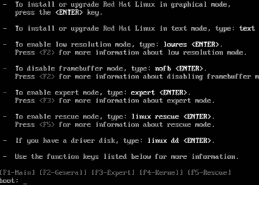

##### 图 1.2 键盘配置。


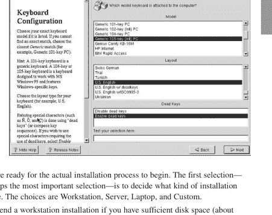

## 3. 现在准备开始实际的安装过程
第一个选择——也许是最重要的选择——是决定你想要哪种安装类型。选项包括 Workstation、Server、Laptop 和 Custom。

如果你有足够的磁盘空间（约 2GB），我建议选择 Workstation 安装，因为先安装软件但不用，总比想用的时候发现没有安装要好。Server 安装会跳过所有 X Window System 软件包，不过你可以通过进入软件包分组区域将其添加回来。

## 4. 磁盘分区
安装过程中的第一个主要任务是决定如何划分可用磁盘空间，以便 Linux 能够正确利用它。在几乎所有情况下，最好的做法是让系统自行检测你的空间，然后自动分区。你可以通过“让安装程序自动为你分区”`Have The Installer Automatically Partition For You`选项来实现这一点。

你可能会看到类似图 1.3 的对话框。不要惊慌。记住，你已经完成了完整备份，而且我们正打算用 Linux 替换计算机上现有的操作系统。

接下来，选择“删除此系统上的所有分区”`Remove All Partitions On This System`，除非你之前已经安装过 Linux，并且想使用现有的分区空间。如果你有多个驱动器，请务必确保它已经为即将开始的安装选择了正确的驱动器！

### 图 1.3 你需要确认是否要创建新分区。
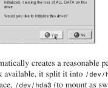

系统会自动创建一套合理的分区方案。以我的系统为例，可用磁盘为 15GB，它将其分为 `/dev/hda1`（挂载为 `/boot`），空间为 47MB；`/dev/hda3`（挂载为交换空间），空间为 188MB；剩余 15.1GB 作为 `/dev/hda2`（挂载为 `/`）。我没有直接接受这个方案，而是要把 `/dev/hda2` 分成两个分区，一个 4.1GB，一个 11GB。后者在本书后面探讨磁盘格式化和挂载命令时会很有用。要完成这个任务，我选中该分区并点击 `Edit`。这会弹出图 1.4 所示的对话框。请注意，这里我已经指定了 4100MB 的固定大小。

### 图 1.4 重新分区以腾出一些空间。
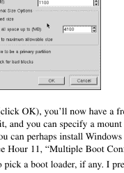

接受更改（点击 `OK`）后，你会看到一个大小为 11029MB 的可用空间。点击该空间，再点击 `Edit`，就可以根据需要指定挂载点。或者，将其保留为可用空间，以后或许可以在其中安装 Windows，并创建双引导配置（参见第 11 小时“多重引导配置”）。

## 5. 引导加载程序与网络配置
现在你需要选择引导加载程序（如果有的话）。我更喜欢 `grub`，但你可能会喜欢 `lilo`。我想说的是，真的没有理由不选择其中之一，这样你以后的配置会更有灵活性。否则，就让这些选项保持原样。

如果您愿意，可以指定一个 `GRUB` 密码，这意味着每次系统重新启动时，都需要密码才能继续启动过程。请慎重考虑此选项：如果您指定了此密码，然后将系统放在托管机架中，如果它重新启动，谁来输入密码？

下一步是配置您的网络接口，如图 1.5 所示。如果您使用 `DHCP`，就幸运了。点击那个框就完成了！否则，您需要尽可能填写所指定的信息。

### 图 1.5 配置您的网络连接。
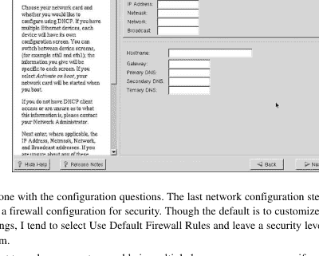

几乎完成了配置问题。最后一个网络配置步骤是为安全选择防火墙配置。虽然默认是自定义设置，但我倾向于选择使用默认防火墙规则并将安全级别保持在中等。

## 6. 语言、时区与账户
如果您希望系统可在多种语言中使用，可以在接下来出现的“附加语言支持”屏幕中指定它们。即使您只想要英语（美国），也花点时间滚动浏览此列表，看看有多少不同的选择。相当令人印象深刻！

> 列出了很多语言，但值得强调的是，具体由各个应用程序来支持语言，因此如果您安装了意大利语，却发现一些 richiami del sistema in inglese，也不要感到惊讶。

接下来应指定您的时区，您可以点击世界地图上的城市，从下拉菜单中选择区域地图，或滚动直到找到您所在时区的城市以从列表中选择。生活在山区时区，我从列表中选择科罗拉多州的丹佛。

下一个屏幕是账户配置屏幕。此时您不需要创建多个账户，但如果您知道有多人会使用系统，这里是添加他们的非常方便的地方。在图 1.6 中，您可以看到我创建了四个用户账户，并设置了 `root` 密码。

作为提醒，您必须在此处设置 `root` 密码，并且它必须足够复杂以至于黑客难以猜测，同时又足够简单以便您能记住。不要忘记您在此处指定的内容；它对您 Unix 系统的长期健康至关重要。

### 图 1.6 账户配置屏幕。
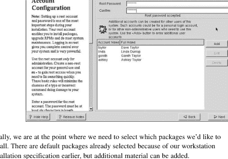

## 7. 软件包选择
最后，我们到了需要选择要安装哪些软件包的阶段。由于我们之前的工作站安装规范，已经预选了一些默认软件包，但可以添加额外的材料。

如图 1.7 所示，我建议除了 `Gnome` 和软件开发工具外，还安装 `KDE`。是否要包含游戏由您决定。

特别注意右下角的指示器，它显示所有组合软件包的大小（这里是 1559MB，约 1.6GB）。

### 图 1.7 选择要安装的附加软件包。
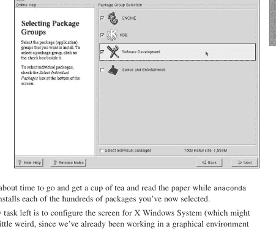

现在差不多是时候去泡杯茶，读报纸，同时让 `anaconda` 缓慢安装您现在选择的数百个软件包了。

## 8. X Windows System 配置与安装进度
剩下的唯一任务是为 `X Windows System` 配置屏幕（这可能看起来有点奇怪，因为我们已经在图形环境中使用鼠标工作了，但那是另一个故事）。幸运的是，我发现 `anaconda` 在分析硬件配置方面做得非常好，并且几乎总是选择最适合您物理系统的设置。

> 在安装过程的这一点，您仍然可以退出，关闭计算机，弹出 CD-ROM，并使系统恢复到进入 Red Hat 世界之前的状态。然而，一旦我们继续进行下去，磁盘上的所有先前内容将被销毁。请、请确保在继续之前有良好的备份！

够了疑神疑鬼，让我们安装这个家伙吧！

下一个屏幕显示安装过程的进度，`anaconda` 格式化文件系统，将安装映像（我们在本小时前面讨论过的 `ISO` 映像）传输到磁盘，然后开始实际传输。请特别注意总计和剩余软件包计数——它们会让您很好地了解安装还剩多少时间。

预计此步骤至少需要一个小时，具体取决于您的系统、CD-ROM 和磁盘的速度有多快，可能需要更长的时间。图 1.8 显示了安装过程进行到一点点时的样子（大约 10 分钟）。

### 图 1.8 正在缓慢但稳步地安装软件包！
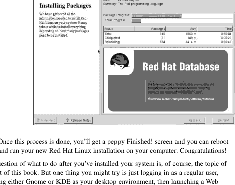

一旦此过程完成，您将看到一个充满活力的“完成！”屏幕，您可以重新启动并在计算机上运行新的 `Red Hat Linux` 安装。恭喜！

安装系统后该做什么的问题，当然是本书其余部分的主题。但您可以尝试的一件事是仅以普通用户身份登录，选择 `Gnome` 或 `KDE` 作为桌面环境，然后启动 Web 浏览器并浏览网页。看看它在某些方面与 Windows 或 Macintosh 系统相似，在其他方面又大不相同。

## 在线安装帮助
随 `Red Hat Linux` 发行版附带的文档实际上相当不错，特别是安装指南，但您可能会发现在线有有用的信息。

开始探索的好地方是 `Red Hat` 网站本身（`www.redhat.com`），他们在那里提供完整的文档集可供在线搜索和阅读（当然也可以打印，即使您当时正在运行 Windows 或 Mac OS）。

另一个有价值的 Linux 安装和配置信息来源是 `Linux Planet`（`www.linuxplanet.com`），他们还对可用的不同 Linux 发行版进行了很好的比较。访问该网站时，请先点击教程。

一个关于所有 Unix 文档的绝佳来源，尽管它表面上专注于 Linux，是 Linux 文档项目（`www.linuxdoc.org`）。它已经过时，但 `LDP` 网站指南部分中的《安装和入门指南》仍有有用的信息。`HOWTO` 部分也提供了一些非常具体的可能对您有用的信息，包括在 Acer 笔记本上安装 Linux 的指南、将 Compaq T1500 启动到 Linux，以及有用的 `Config-HOWTO`。

`DMoz` 开放目录项目也有一个非常不错的参考集合，值得在您的 Web 浏览器中加入书签，尽管起始 URL 相当长：

```
http://dmoz.org/Computers/Software/Operating_Systems/Linux/Support/Tutorials/
```

特别是，查看“`Dancing with the Penguin`”，这是一个标题很棒的好教程！

如果您选择了 `Red Hat Linux` 以外的 Unix，您会发现这些网站中的许多都非常有用。另请查看供应商网站，您还可以查看 `SlashDot`（`www.slashdot.com`）以获取关于 Unix 系统和发行版的最新八卦和讨论。

## 摘要


本小时探讨了如何在典型的个人计算机上安装和配置 Red Hat Linux。幸运的是，该过程相当直接，如果您在安装前有直接连接到互联网所需的网络信息，现在也应该在线了。如果您使用的是另一种 Unix 发行版，您会发现安装差异很大：Mandrake Linux 轻而易举，Mac OS X Unix 甚至更简单，但 Solaris 可能有点棘手。我们还讨论了一些可以帮助安装和配置的顶级网站。

#### 问答

本节包含本小时主题的常见问题和答案。如果您有未涵盖的额外问题，请发送电子邮件给我，也许它会出现在下一版中！

Q 为什么有这么多不同的 Unix 和 Linux？

A 这是个非常好的问题。Unix 的主要优点和缺点之一是它已广泛以源代码和二进制形式分发，并且


它从诞生之初就是由开发者打造、为开发者服务的。这两者的结合，再加上多年来围绕 Unix 代码所有权、商标、知识产权等问题进行的法律拉锯战，为精通 Unix 的计算机用户带来了名副其实的选择大爆发。就连苹果公司也未能免俗，将 Unix 作为 Mac OS X 的底层基础。

与其把这视为一个令人困惑的问题——虽然确实有点令人困惑——不如把它看作一个绝佳的优势。你肯定弄不到 20 种不同的免费 Windows 发行版，而且即使追溯到 1984 年 Mac OS 发布之时，它的版本总数也不到 20 个。

问：你在自己的系统上运行哪些 Unix 发行版？

答：我的主电脑是一台 Mac OS X 系统，底层当然是 Darwin。此外，我还有一台双启动 Windows 2000 和 Mandrake 8.1 的 PC，以及一台托管 Web 服务器，运行的是 Red Hat Linux 7.2。

#### 练习

##### 测验

- 1. 在安装过程中，最重要的第一步是什么？
- 2. 什么是 ISO？为什么它很重要？
- 3. 如果可以从网上下载整个操作系统安装数据集，为什么还要购买？
- 4. 如果确实想要预制的安装 CD-ROM，哪里是买到便宜货的好地方？
- 5. 根据作家道格拉斯·亚当斯的说法，生命的意义是什么？

##### 答案

- 1. 备份磁盘上已有的任何数据，并确保备份成功！
- 2. `ISO` 是一种安装系统镜像，一个可以复制到 CD-ROM 的单一文件，使该 CD-ROM 立即成为安装盘。
- 3. 购买可以节省大量时间，而且成本非常低，所以我认为只有非常有耐心的人才会真的去下载安装镜像。
- 4. eBay 在线拍卖网站上总有一些预制好的 Linux 安装 CD-ROM，只需几美元就能买到。
- 5. 42。（请参阅杰作《银河系漫游指南》，弄清楚它到底是什么意思！）

现在，既然我们已经在你的系统上安装好了 Unix 发行版，是时候深入其中，开始了解 Unix 系统管理员的工作和职责了。因为不可能一下子就成为大师，我们将在下一小时从探索常被忽视的在线文档和 `man` 手册页资源开始。


## 第二部分

## 文件系统简介

## 小时

- 2 常被忽视的资源：Unix 文档 23
- 3 磁盘使用 41
- 4 文件所有权 67


### 第 2 小时

### 常被忽视的资源：Unix 文档

上一小时讨论了在小型计算机上安装 Unix 的各种细节。本小时将带你迈向成为 Unix 系统管理专家的道路。我们这一小时的目标是探索 Unix 系统自带的宝贵在线文档。在此过程中，我们还将通读一些 shell 脚本和 Perl 脚本，并修复一个系统 bug。

在本小时中，你将学习挖掘哲学，包括：

- 如何使用 `apropos` 在文档中搜索
- 如何找到你恰好需要的命令
- 如何使用 `strings` 命令在二进制文件中挖掘信息

#### 挖掘哲学

正如绪论中所承诺的，我想在本书中教给你的系统管理基本方法，就是我所说的“挖掘哲学”。它指的是学会在 Unix 世界中查找东西的价值，以及它最终比记住命令本身更有帮助。


> 有一句关于两类系统管理员的谚语：巫师是知道如何做所有事情的人，而大师是知道如何找到所有问题答案的人。你认为哪一种模式更适合你？

怎么会这样呢？嗯，想象一下这个常见场景：你一直在家里电脑上使用 Mandrake Linux 学习 Unix 操作系统，老板让你开始维护一台 Red Hat Linux 机器。到目前为止，一切顺利。三周后，公司聘请了一位新的首席技术官，她宣布：“所有服务器将立即更换为 Sun Solaris 系统！”现在你将进入一个全新的 Unix 环境。更糟的是，你儿子入侵了你家里的电脑，把你值得信赖的 Mandrake Linux 换成了 FreeBSD，并且深信它更优越。

在这种情况下，即使你把所有 Linux 命令和标志都背下来，充其量也只会证明其价值有限。但如果你学会了挖掘哲学，一种从 `man` 手册页本身入手探索系统的策略，你就能在极短的时间内快速上手新的 Unix 变体。

那么，让我们在本章中看看这是如何运作的，并开始探索 Unix 在线文档套件。

#### apropos：管理员的秘密武器

在 Unix 世界中，系统管理员（无论是经验丰富还是新手）面临的经典困境之一，就是要记住那个恰好能做你想做的事情的命令名称。然后，一旦你想起了这个命令，你还必须记住确切的标志和参数顺序，才能让系统听命于你、完成你的任务。

聪明的系统管理员使用的秘密武器是 `apropos` 命令（也称为 `man -k`，因为它们是同一个东西）。`apropos` 借助一个包含整个 Unix 系统单行命令摘要的数据库来工作。

##### 任务 2.1：apropos 与 whatis 数据库

要搜索与特定主题相关的命令，请输入 `apropos`，后面跟上你想查找的词。它会快速搜索一个预先构建的命令摘要数据库（超过 15,000 条）并显示所有匹配结果。


> `apropos` 命令在大多数 Unix 系统上都可用，而且通常只是 `man -k` 的别名。如果你的系统上没有，你可以通过在 `.bashrc` 文件中添加一行 `alias apropos='man -k'` 来创建它。

- 1. 让我们先查找与在线文档相关的命令：

```
$ apropos help
help: nothing appropriate
```

嗯……这有点令人费解，因为有很多 Unix 命令的描述中包含着“help”这个词，所以应该有不少匹配结果。如果你确实得到了一列可能的匹配结果，那么恭喜你，你的供应商配置得当，你可以跳过下面几段——但别跳。还是读一读吧；这是一次深入 Unix 深处的信息之旅。

也许是这个系统的配置出了什么问题。让我们来挖掘一番，好吗？

- 2. 快速查看一下 `apropos` 的 `man` 手册页，会给我们一个提示：

```
$ man apropos
apropos(1)                         apropos(1)
NAME
    apropos · search the whatis database for strings
SYNOPSIS
    apropos keyword ...
DESCRIPTION
    apropos searches a set of database files containing short
    descriptions of system commands
    for keywords and displays the result on the standard output.
SEE ALSO
    whatis(1), man(1).
(END)
```

这个 `man` 手册页条目的关键部分是 SEE ALSO 部分。这里它指引我们去查看另外两个命令以获取更多信息：`whatis` 和 `man`。因为我们已经了解了 `man` 命令的基础知识，让我们看一下 `whatis` 条目，看看它包含什么。

```
$ man whatis
whatis(1)                         whatis(1)
NAME
    whatis · search the whatis database for complete words.
```


```
SYNOPSIS
    whatis keyword ...

DESCRIPTION
    whatis searches a set of database files containing short
    descriptions of system commands
    for keywords and displays the result on the standard output.
    Only complete word matches are displayed.

    The whatis database is created using the command /usr/sbin/
    makewhatis.

SEE ALSO
    apropos(1), man(1).

(END)
```

这就是我们要找的线索：“`whatis` 数据库是使用 `/usr/sbin/makewhatis` 命令创建的。”

然而，与其直接运行那个命令，不如让我们深入研究一下，看看能否弄清数据库文件本身的名称。

### 3. 要查看系统程序内部的内容（指令），第一步是使用 `file` 命令，这样我们就知道会遇到什么：

```
$ file /usr/sbin/makewhatis
/usr/sbin/makewhatis: Bourne shell script text executable
```

太好了！它是一个 shell 脚本，所以我们可以直接逐步查看里面的内容。这比处理编译好的二进制文件容易得多（不过我们稍后也会看看如何挖掘那些二进制文件）。

```
$ head /usr/sbin/makewhatis
#!/bin/sh
# makewhatis aeb 010319 (from man-1.5i1)

program=`basename $0`

DEFMNPATH=/usr/share/man:/usr/man
DEFCATPATH=/var/cache/man:/usr/share/man/preformat:/usr/man/preformat:
/usr/share/man:/usr/man

# AWK=/usr/bin/gawk
AWK=/bin/gawk
```

在这些少数定义之后（根据你的 Unix 变体，前面可能有很多很多注释，也可能几乎没有），是许多行 shell 脚本代码，在脚本大约第 75 行处，有如下代码片段：

```
-u) if [ -e /var/cache/man/whatis ]; then
  findarg = "-newer /var/cache/man/whatis"
  update=1
fi
continue;
```

这里可以看到，这是一段解析启动参数的代码部分。`-u` 标志表示 `makewhatis` 应该用新命令更新数据库（脚本中有详细说明），因此脚本会检查 `whatis` 数据库是否存在也就不足为奇了。

这正是我们一直在寻找的：`makewhatis` 使用的数据库名称——因此 `whatis` 和 `apropos` 也使用它——是 `/var/cache/man/whatis`。

### 4. 相比之下，Darwin（你还记得，它是 Mac OS X 下面的 Unix）来自 BSD Unix 家族，所以有些不同。首先，`apropos` 的手册页信息更丰富，其中包含以下内容：

```
FILES
whatis.db name of the apropos database
```

```
SEE ALSO
man(1), whatis(1), whereis(1), makewhatis(8)
```

这不仅确立了 `apropos` 与 `whatis` 命令之间的直接联系，而且还指出了创建数据库所需的工具，甚至告诉我们 `apropos` 使用的是 `whatis.db` 文件！

快速查看 `man makewhatis` 会发现

```
SYNOPSIS
/usr/libexec/makewhatis [manpath]
```

现在我们知道了 Darwin 中命令的位置（注意文件结构有多不同！）。

有趣的是，`file` 命令揭示了一个惊人的变化：

```
$ file /usr/libexec/makewhatis
/usr/libexec/makewhatis: perl commands text
```

它是一个 Perl 脚本，而不是 Bourne shell 脚本。最后一步，让我们查看 Perl 脚本以找到数据库文件的名称和位置。

这证明有点棘手。在脚本中直接能找到的最接近的内容如下（代码中相当靠后的位置！）：

```
sub variables {
$verbose = 0;          # Verbose
$indent = 24;          # indent for description
$outfile = 0;          # Don't write to ./whatis
$whatis_name = "whatis.db"; # Default name for DB
$append = 0;           # Don't delete old entries
```

```
# if no argument for directories given
@defaultmanpath = ( '/usr/share/man' );
```

从中可以推断，数据库最终将被保存为 `/usr/share/man/whatis.db`。

### 5. 更聪明的方法来确定输出文件名是直接以 root 登录（或使用 `su` 切换到 root），然后指定 `-v` 标志重建数据库。

```
$ makewhatis -v
Open /usr/share/man/whatis.db.tmp
open manpath directory '/usr/share/man'
lots and lots of output as it lists each man page it finds and parses
sort -u > /usr/share/man/whatis.db.tmp
Rename /usr/share/man/whatis.db.tmp to /usr/share/man/whatis.db
2068 entries in /usr/share/man/whatis.db
```

这不仅回答了“`apropos` 的数据库在哪里？”这个问题，而且还构建了它！

将 Darwin 的前述输出与 Red Hat Linux 的以下输出进行对比：

```
# /usr/sbin/makewhatis -v
about to enter /usr/share/man
adding ./uuidegen.1.gz
lots and lots and lots of output omitted
adding ./vacuum.1.gz
about to enter /usr/man
/usr/sbin/makewhatis: cd: /usr/man: No such file or directory
```

啊哈……很有趣。命令在标准的 RHL7.2 系统上失败了。在 Unix 系统管理员的世界里，为了让事情首先正常工作而不得不修复错误和调整系统，这并不罕见。

那么让我们修复这个错误吧？

### 6. 首先，很惊讶没有 `/usr/man` 目录，因为那是标准（System V）Unix 的一部分。让我们看一下以确保我们读得正确：

```
$ ls -l /usr
total 152
drwxr-xr-x 2 root root 36664 Nov 21 14:51 bin
drwxr-xr-x 2 root root 4096 Feb 6 1996 dict
drwxr-xr-x 2 root root 4096 Feb 6 1996 etc
drwxr-xr-x 2 root root 4096 Nov 21 14:36 games
drwxr-xr-x 82 root root 8192 Nov 21 14:51 include
drwxr-xr-x 8 root root 4096 Nov 21 14:49 kerberos
drwxr-xr-x 71 root root 45056 Nov 21 14:51 lib
drwxr-xr-x 7 root root 4096 Nov 21 14:42 libexec
drwxr-xr-x 12 root root 4096 Nov 21 14:33 local
drwxr-xr-x 2 root root 16384 Nov 21 14:31 lost+found
drwxr-xr-x 135 root root 4096 Nov 21 14:51 share
drwxr-xr-x 3 root root 4096 Nov 21 14:50 src
lrwxrwxrwx 1 root root 10 Nov 21 14:33 tmp -> ../var/tmp
drwxr-xr-x 2 root root 4096 Nov 22 09:14 web
drwxr-xr-x 8 root root 4096 Nov 21 14:36 X11R6
```


东西很多，但没有 `man` 目录。

我们有两种方法来解决这个问题。简单的方法是创建 `/usr/man` 作为目录并保持为空。更复杂的方法是深入 `makewhatis` shell 脚本，看看它为什么要查找 `/usr/man`，然后教它忽略该目录。

好消息是，更复杂的方法实际上相当容易。如果翻回几页，你会看到脚本最顶部有一个变量 `DEFMANPATH` 定义为

```
DEFMANPATH=/usr/share/man:/usr/man
```

我猜如果我们简单地将其重写为 `/usr/share/man` 而没有其他内容，我们就万事大吉了，它会正常工作。

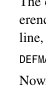

> 在这一点上，你一定在想“哈？我们只是想弄清楚我的 Unix 系统上有哪些命令！为什么我们必须重新编程系统 shell 脚本？” 这个困境的答案是，当然，Unix 系统管理员的生活分为在任务上的活动和随后的离题分心。对大多数系统管理员来说，这两者可能大约是 50/50 的比例，但有些日子无疑会更像是 25/75，或者最糟糕的是 0/100。
> 
> 
> 在某种程度上我也在把你带进死胡同：完全有可能你的 Unix 系统已经构建了 `whatis` 数据库并准备好使用。但如果这没有问题，可以肯定的是其他东西会出问题！

更改很简单，而且因为我喜欢为以后参考留下注释的痕迹，我不会简单地删除 `DEFMANPATH` 行上的 `:/usr/man` 后缀，而是改为如下：

```
DEFMANPATH=/usr/share/man   # also used to include ':/usr/man'
```

现在，经过此修改，我再次在 Red Hat Linux 系统上运行 `makewhatis` 命令，它运行完美！万岁！

### 7. 与这两种解决方案相比，Solaris 系统的 `apropos` 手册页非常不同，但好消息是手册页中说明“`apropos` 实用程序显示每个手册页的名称、节号和简短描述，其中 NAME 行包含关键字。此信息包含在由 `catman(1M)` 创建的 `/usr/share/man/windex` 数据库中。如果未运行 `catman(1M)`，或使用 `-n` 选项运行，`apropos` 将失败。” 指向修复所需命令的指针总是受欢迎的，而且它甚至详细说明了确切的文件名！让我们去看看 `catman` 的手册页说了什么：

```
$ man catman
NAME
    catman - create the formatted files for the reference manual
SYNOPSIS
    /usr/bin/catman [ -c ] [ -n ] [ -p ] [ -t ] [ -w ] [
-M directory ] [ -T macro-package ] [ sections ]
DESCRIPTION
    The catman utility creates the preformatted versions of the
    online manual from the nroff(1) or sgml(5) input files.
    This feature allows easy distribution of the preformatted
    manual pages among a group of associated machines (for exam-
    ple, with rdist(1)), since it makes the directories of pre-
    formatted manual pages self-contained and independent of the
    unformatted entries.
    catman also creates the windex database file in the direc-
    tories specified by the MANPATH or the -M option. The win-
    dex database file is a three column list consisting of a
    keyword, the reference page that the keyword points to, and
    a line of text that describes the purpose of the utility or
    interface documented on the reference page. Each keyword is
    taken from the comma separated list of words on the NAME
    line before the '.' (dash). The reference page that the key-
    word points to is the first word on the NAME line. The text
    after the '.' on the NAME line is the descriptive text in the
    third column. The NAME line must be immediately preceded by
    the page heading line created by the .TH macro (see NOTES
    for required format).
    Each manual page is examined and those whose preformatted
    versions are missing or out of date are recreated. If any
    changes are made, catman recreates the windex database.
```

似乎合理。要构建数据库，请使用 `-w` 标志运行 `catman` 命令。如果没有问题，就没有输出，一切应该都已安装并准备好运行。让我们做一个快速测试：

```
# apropos solaris | wc -l
54
```

太好了！

### 8. 现在在我们的任何系统上，我们都可以运行 `apropos` 命令并查找与主题 help 相关的命令：

```
$ apropos help
B::StackObj          (3pm)  - Helper module for CC backend
consolehelper        (8)   - A wrapper that helps console users run
system programs
forum                (1)   - Interactive Help for MRTG users
help [builtins]      (1)   - bash built-in commands, see bash(1)
help [faq]           (1)   - How to get help if you have problems with MRTG
LDP                  (7)   - Intro to the Linux Documentation Project, with
help, guides and documents
mibhelp              (1)   - A Table of some interesting OIDs
Pod::ParseUtils      (3pm) - helpers for POD parsing and conversion
QCharRef [qcharref]  (3qt) - Helper class for
QToolTip [qtooltip]  (3qt) - Tool tips (sometimes called balloon help)
for any widget or rectangular part of a widget
QXmlNamespaceSupport [qxmlnamespacesupport] (3qt)  - Helper class for XML
readers which want to include namespace support
smbmnt               (8)   - helper utility for mounting SMB filesystems
userhelper           (8)   - A helper interface to pam
```

这来自 Linux，你可以看到这里有许多命令。请注意，它们都在命令或描述文本中包含字母 h-e-l-p，但它们并不都必然与用户级帮助命令相关。

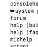


> 作为提醒，Unix 手册页分为八大类：`1=user commands`，`2=system maintenance commands`，`3=system calls (for programmers)`，`4=administration files`，`5=miscellaneous`，`6=games`，`7=special file formats`，`8=administrative commands`。

经常你只想查看交互式命令而不是系统维护命令，等等。一种简单的方法是使用 `egrep`：

```
$ apropos help | egrep '(1)'
consolehelper        (8)   - A wrapper that helps console users run
system programs
forum                (1)   - Interactive Help for MRTG users
help [builtins]      (1)   - bash built-in commands, see bash(1)
help [faq]           (1)   - How to get help if you have problems with MRTG
mibhelp              (1)   - A Table of some interesting OIDs
smbmnt               (8)   - helper utility for mounting SMB filesystems
userhelper           (8)   - A helper interface to pam
```


进一步的细微差别可能是将此输入到 `sort` 中，以便按顺序显示所有第 1 部分命令，然后是第 8 部分命令，但我把这个作为练习留给你！

原本只是学习如何使用 `apropos` 命令的简单任务迅速失控，并在我们发现并修复一些系统配置问题时漫无目的地四处游荡。这作为系统管理员的日常体验非常典型，随着你花更多时间从管理员角度学习 Unix，你会发现这一点。

### 探索 whatis 数据库

现在我们知道了如何构建 `whatis` 数据库，让我们花几分钟时间深入其中，看看能学到什么。只是短暂的额外岔路，我保证！

#### 任务 2.2：whatis 数据库内部有什么

作为好奇的人，我们不能不做一点探索就放下数据库，所以让我们瞄一眼。

1. 数据库本身是一个普通文本文件，因此我们可以使用 `head` 来查看其内部内容：

```
# cd /var/cache/man
# file whatis
whatis: ASCII English text
# head whatis
m4topp (1) . convert Sony Mavica .411 image to PPM
a2p (1) . Awk to Perl translator
a2ps (1) . format files for printing on a PostScript
printer
ab (8) . Apache HTTP server benchmarking tool
abbrev [Text::Abbrev] (3pm) . create an abbreviation table from a list
abort (3) . cause abnormal program termination
ABORT [abort] (1) . Aborts the current transaction
abs (3) . compute the absolute value of an integer
accept (2) . accept a connection on a socket
access (2) . check user's permissions for a file
```

有趣吧？这让我得出结论，`apropos` 是 `grep -i` 的同义词，果然，`grep -i help whatis` 产生的结果与我们之前看到的完全相同。试试看！

2. 更有趣的是，我们现在可以提取数据库的不同部分，并查看每个部分有多少命令。

为此，我想在开始的括号处分割行，然后再次在结束的括号处分割，只保留其中的值。这可以通过两次调用 `cut` 来完成，第一次指定打开括号作为分隔符，第二次指定关闭括号。第一次调用的效果如下：

```
# cut -d\( -f2 < whatis | head -5
1) - convert Sony Mavica .411 image to PPM
1) - Awk to Perl translator
1) - format files for printing on a PostScript printer
8) - Apache HTTP server benchmarking tool
3pm) - create an abbreviation table from a list
```

而第二个，添加到管道中间：

```
# cut -d\( -f2 < whatis | cut -d\) -f1 | head -5
1
1
1
8
3pm
```

现在，最后，只需调用 `sort` 对它们全部排序，并使用 `-c` 标志调用 `uniq` 以获得最终的输出计数：

```
# cut -d\( -f2 < whatis | cut -d\) -f1 | sort | uniq -c
14
1405 1
6 1m
39 1ss1
254 2
8272 3
400 3pm
335 3qt
657 3ss1
77 3t
61 3thr
3603 3x
36 4
146 5
1 5s1
3 6
67 7
1 7ss1
380 8
67 1
446 n
1 Paranoia release III
1 xnmap
```

这就是答案。忽略那些奇特的条目（例如 `Paranoia release III`），你可以看到在 Linux 系统上，第 1 部分有 1,405 个命令，第 8 部分有 380 个命令，系统程序员使用的不同命令和函数超过 13,000 个。难怪编程 Unix 系统并不容易！


> 有趣的是，在 Solaris 中只有 1,324 个第 1 部分命令，总共 6,689 个命令，而在 Darwin 上的 `whatis.db` 文件中记录的第 1 部分命令仅有 478 个，总共 2,068 个命令，数量更少。

本节不仅很好地展示了如何组合 Unix 命令以产生有用的结果，也展示了你如何很容易分心。即使作者有时也很难避免到处探查并了解更多关于系统的信息！

### 查找命令

`apropos` 命令提供了一种非常有用的方法，可以根据单行命令摘要浏览 `man` 命令，但探索 Unix 系统上可用命令还有其他方法。最值得注意的是 `which`，它会搜索你的路径并告诉你给定命令名称要执行的文件是什么，而 `locate` 则是快速尝试将模式与系统上所有文件名列表进行匹配的一种方法。

然而，后者实际上是功能强大的通用 `find` 命令的特殊用途变体，我们将在本书后面更详细地介绍它。

#### 任务 2.3：你正在运行哪个命令？

在 Unix 中调试任何问题的第一步是确保你的 `PATH` 正确，然后确保你认为正在运行的命令版本就是被调用的版本。

所有命令 shell 都会构建所谓的命令哈希表，这是一个快速搜索的列表，其中包含位于 `PATH` 环境变量指定的每个目录中的文件名。如果出现冲突（例如，两个目录具有相同的文件名），则 `PATH` 中更早引用的目录获胜。


> 早期 `PATH` 匹配覆盖后期 `PATH` 条目的特性正是 `PATH` 设置为 `PATH=.:other stuff` 之类的方式如此危险的原因：如果你在某个目录中存在 `ls` 的伪造版本，你可能会在不知情的情况下执行它。为什么这很危险？因为伪造的 `ls` 可能做一些狡猾的事情，比如制作 shell 的秘密副本，然后 `chmod` 它使其对你的账户具有 `setuid` 权限。黑客在稍后某个时间出现，每当她想冒充你时，她只需运行该 shell 即可。这就是所谓的特洛伊木马攻击。

1. 我们先来看看我们的 `PATH` 是什么，然后查看使用 `man` 命令时实际运行的是哪个版本的 `man`：

```bash
# echo $PATH
/usr/local/bin:/bin:/usr/bin:/usr/X11R6/bin:/home/taylor/bin
# which man
/usr/bin/man
```


可以看到，我们的 Linux `PATH` 由 `/usr/local/bin`、`/bin`、`/usr/bin`、`/usr/X11R6/bin`（X Window 系统文件）和 `/home/taylor/bin`（我向 Unix 命令世界添加的个人内容）组成。注意其中没有 `.` 这个条目，而且我的个人版本命令不会取代标准版本，因为我的目录在 `PATH` 中排在最后。要让它取代内置命令，我就需要把它放到 `PATH` 的最前面。

## 2. `which` 命令与别名

有些版本的 `which` 命令能识别别名，有些则不能。Linux 和 Darwin 都有一个别名 `ll='ls -l'`，但 `which` 命令输出的差异很有意思：

Linux:

```bash
# alias ll
alias ll='/bin/ls -l'
# which ll
which: no ll in (/usr/local/bin:/bin:/usr/bin:/usr/X11R6/bin:
/home/taylor/bin)
```

Darwin:

```bash
# alias ll
ls -lag !* | more
# which ll
ll: aliased to ls -lag !* | more
```

这些输出的一部分直接取决于用户运行的是哪种 shell——C Shell（`csh`）通常会解析别名，而 Bourne-Again Shell（`bash`）则不会。

在这个例子中，Solaris 的行为与 Linux 完全相同：它会很高兴地显示 `ll` 的别名，但其 `which` 命令却对 shell 别名一无所知。

这里的困惑在于：如果使用 Linux，我们就会遇到一个能正常工作、但不在 `PATH` 中的命令——`ll`。如果你不记得 `alias` 命令，那确实非常神秘。

## 3. 使用 `locate` 搜索文件

但话说回来，也许确实存在一个 `ll` 命令，只是 `which` 命令没有让我们看到它。要想快速搜索系统上的所有文件名，`locate` 命令是不错的选择；不过和 Unix 中的许多工具一样，需要稍加思考才能弄清如何最恰当地使用它：

```bash
# locate ll | wc -l
4021
```

好吧，有 4,000 多个文件名匹配这个双 `l` 序列。当然，由于你选择在系统中安装的软件包不同，结果很可能是另一个数字。别担心！我们试着在它前面加一个斜杠：

```bash
# locate /ll | wc -l
11
```

11 这个数字就易于管理多了，让我们看看这些文件是什么：

```bash
# locate /ll
/usr/share/doc/HTML/en/kdevelop/reference/C/CONTRIB/SNIP/ll_msort.c
/usr/share/doc/HTML/en/kdevelop/reference/C/CONTRIB/SNIP/ll_qsort.c
/usr/share/man/man3/llseek.2.gz
/usr/share/man/man3/llabs.3.gz
/usr/share/man/man3/llrint.3.gz
/usr/share/man/man3/llrintf.3.gz
/usr/share/man/man3/llrintl.3.gz
/usr/share/man/man3/llround.3.gz
/usr/share/man/man3/llroundf.3.gz
/usr/share/man/man3/llroundl.3.gz
/usr/share/man/man1/llength.1.gz
```

有意思，但整个系统中都没有 `ll` 命令的踪迹。

`locate` 命令还可以向你显示你怀疑属于 Unix 的命令位于何处。例如：

```bash
# locate chess
/usr/share/ghostscript/6.51/examples/chess.ps
/usr/share/licq/qt/gui/icons.computer/chess.xpm
```

```bash
# locate cribbage
/home/taylor/bin/cribbage
/home/taylor/DEMO/Src/cribbage.c
```

太棒了！如你所见，`locate` 会在整个文件系统中撒网，包括各个用户的文件。非常有用。


> 当然，这里有一个安全漏洞：我执行这次 `locate` 搜索时并不是 `taylor` 用户，但它却告诉我 `taylor` 账户内文件和目录的名称，即使这些内容在平时对我是不开放的。这就是为什么 Solaris 没有附带 `locate`。如果你要让 `locate` 在你的系统中可用，这一点值得考虑。

任何系统管理员的首要任务之一，就是在用户抱怨某个问题（或者自己遇到问题）时，能够弄清楚到底发生了什么。要做到这一点，关键是要确认用户调用的是哪个命令，以及该命令对于这个系统来说是否是正确的版本。这正是实用的 `which` 命令的职责所在。

当 `which` 无法完成时，可以使用 `locate` 来查看是否存在匹配项；如果你真的需要动用更强大的工具，`find` 命令就是救星，你会在本书中反复看到这一点。

### 探查可执行二进制文件

将 `which` 用于识别命令、`file` 用于确认命令的类型、查看 man 手册页，甚至直接查看文件本身（如果它是脚本），这些方法结合起来可以揭示关于系统的大量信息。不过，有时涉及的文件可能是编译后的二进制文件，而源码未必在手边。这时，`strings` 命令就非常有用了。

#### 任务 2.4：`strings` 命令

`strings` 命令是系统管理员中的无名英雄，就像 `file` 命令一样出色，尽管系统管理类书籍很少提到它。`strings` 的作用是通读任意文件的内容，查找可打印的 ASCII 序列，一旦找到，就在屏幕上显示出来。

有了这个特性，我们可以很轻松地将它的输出交给 `grep`，从可执行二进制文件本身提取有用信息，包括它使用哪些配置文件等等。

1. 我们来看看 `man` 命令本身。首先，我会用 `which` 查看该命令所在的位置，然后用 `file` 查看它是脚本还是可执行文件：

```bash
# which -a man
/usr/bin/man
# file /usr/bin/man
/usr/bin/man: ELF 32-bit LSB executable, Intel 80386, version 1,
dynamically linked (uses shared libs), stripped
```

> 在 Darwin 世界中，这个程序会被报告为 Mach-O executable ppc，而 Solaris 同样使用 ELF（Executable and Linking Format，可执行与链接格式）二进制格式来存放可执行文件。

既然知道它是二进制文件，我们就用 `strings` 命令窥探一下内部：

```bash
# strings /usr/bin/man | head
/lib/ld-linux.so.2
__gmon_start__
libc.so.6
strcpy
ioctl
getgid
```

```bash
printf
stdout
vsprintf
geteuid
```

没什么特别令人兴奋的，但如果我们用 `grep` 在其中搜索 `conf` 序列……

```bash
# strings /usr/bin/man | grep conf
[no configuration file]
/usr/share/misc/man.config
/usr/share/misc/man.conf
/usr/lib/man.config
/usr/lib/man.conf
/etc/man.conf
/etc/man.config
Reading config file %s
  C file : use 'file' as configuration file
man.config.c: internal error: string %s not found
Unrecognized line in config file (ignored)
but the configuration file does not define COMPRESS.
Warning: cannot open configuration file %s
is not in the config file
is in the config file
Line too long in config file
Error parsing config file
```

这类输出可能非常有用。从这里可以看到 `man` 命令会使用一个配置文件，而且该文件可能出现在多个不同位置中的任意一个：

- `/usr/share/misc/man.config`

- `/usr/share/misc/man.conf`

- `/usr/lib/man.config`

- `/usr/lib/man.conf`

- `/etc/man.conf`

- `/etc/man.config`


只需要快速执行一两次 `ls`，就能弄清这个系统上真正的配置文件是哪一个；然后我们就能学习如何配置 `man`，即使 man 手册页只是顺带提到了配置文件。

虽然 Unix 文档能透露出很多关于如何使用不同命令的信息，但有时还是有必要打开那众所周知的“引擎盖”，检修一下“发动机”。对于 shell 和 Perl 脚本来说这很容易，但如果遇到编译后的二进制文件，`strings` 命令会是你工具箱中极有价值的一员！

### 总结

本课时重点演示了如何使用 `grep`、`cut`、`head` 等常见 Unix 工具，对在线文档工具进行精细调整。你还看到了 man 手册页中的 SEE ALSO（另请参阅）和 FILES（文件）部分如何提供极大的帮助，让你弄清楚命令的工作方式以及如何配置它们。

作为题外话，你看到了 Unix 中命令之间如何相互依赖，尤其是 `apropos` 命令如何依赖 `whatis` 命令使用的数据库，而该数据库由 `makewhatis` 创建。在构建该数据库时，我们遇到了一个错误状态，诊断了问题，提出了几个可能的解决方案，并实施了其中最佳的一个，从而永久修复了该命令。

最后，本章另一个重要方面是表明本书的宗旨是教你如何自己探索 Unix 并找到解决方案，而不是列出每条命令的所有选项，更不是确保穷举每条命令的每一种可能用法。

这种以解决问题为导向的思路，会在你学习这 24 小时课程内容的过程中带来巨大好处。与死记硬背大量特定 Unix 变体的命令相比，你在面对陌生乃至迥异的 Unix 系统时会从容得多。

### 问答

问：知道如何找到一切问题答案的人，究竟是巫师还是大师？

答：是大师。巫师能像变魔法一样把事情做成，但永远无法把自己在做的事情教给任何人。

问：为什么有些 Unix 系统会有一个 `apropos` 命令，而它实际上只是 `grep` 命令的别名？

答：这在 Unix 中很常见。有些开发团队倾向于提供最大化的易用性，让用户直接开始输入命令就能用；另一些团队则偏爱核心命令的简洁优雅，除此之外别无他物。

### 实战演练

#### 测验

1. 不许作弊哦：你认为 `whatis` 命令是做什么的？

2. 用 `grep` 写出一个 `whatis` 的等价命令。在搜索 `whatis` 数据库之前，仔细想想你希望对给定模式进行怎样的变换。

3. 系统管理员在使用像 Windows 这样的操作系统时是否更容易分心？为什么，或者为什么不？

4. 手册页中“Paranoia”部分是什么命令？

5. 你的系统上有多少个第 1 节命令？你能想到另一种计算该数字的方法吗？

#### 答案

1. `whatis` 会用一行输出总结命令行上指定的任何 Unix 命令的用途。

2. `whatis floppy` 的等价写法是 `grep -iE '^floppy\(' /usr/man/whatis.db`（确切的语法可能会根据系统存储 `whatis` 数据库的位置而改变）。请注意，你需要构造一个正则表达式，确保 `whatis cp` 不会匹配 `uucp` 或其他包含字母 `cp` 的命令。`-i` 标志忽略大小写，而 `-E` 表示后面会跟一个正则表达式。

3. 好吧，如果你喜欢到处乱逛探索，那么在任何操作系统上都可能分心，但通常典型的 Unix 系统底层的强大功能远多于 Windows 这种受限且封闭的世界，我认为你更容易分心。

4. 在 Red Hat Linux 7.2 上，在 `whatis.db` 数据库中搜索 Paranoia 发现它是 `cdparanoia` 命令，其描述为“an audio CD-reading utility which includes extra data verification features.”

5. 对于这个问题一个明显的策略是 `grep '(1)' /usr/man/whatis.db | wc -l`，但有一些命令虽然官方属于第 1 节，却最终被列为 1L 或 1B 或其他类似的神秘子部分。因此，如果你想利用 `whatis` 数据库，最好的策略是使用 `grep '(1)' /usr/man/whatis.db | wc -l`。另一种更直接的方法是 `ls /usr/man/man1 | wc -l`（不过你最终得到的结果会比预期多，因为出于历史原因，一些手册页被符号链接到多个命令名）。

在下一小时，你将学习如何通过使用 `du` 和 `df` 命令来探索 Unix 中的文件分配信息。我们还将研究如何创建一个简单的 shell 脚本，以按从大到小排序报告每个用户主目录的大小。


## 第三小时

### 磁盘使用情况

Unix 世界中系统管理员面临的最常见问题之一是磁盘空间。无论是磁盘空间不足，还是只是确保没有用户占用所有资源，探索系统上硬盘的分配和使用情况都是一项关键技能。

在本小时，你将学习：

- 如何使用 `df` 和 `du` 查看磁盘使用情况
- 如何使用 `sort` 简化分析
- 如何识别最大的文件并使用 `diskhog`

#### 物理磁盘和分区

在过去几年里，硬盘变得比大多数操作系统能够舒适管理的要大得多。的确，大多数文件系统对文件有最小大小限制，以及可以在单个物理设备上存在的文件和/或目录的最大数量，而这些限制正是与更大的设备相冲突的。

因此，大多数现代操作系统都支持将单个物理磁盘拆分为多个虚拟磁盘或分区。Windows 和 Macintosh 系统已经支持了几年，但通常在个人桌面系统上你不必担心磁盘太大，更糟的是磁盘空间耗尽导致系统崩溃。

Unix 完全是另一回事。在 Unix 世界中，你可能拥有数百个不同的虚拟磁盘而浑然不觉——甚至你的主目录可能分布在两个或三个分区上。

Unix 采用这种策略的一个原因是运行的程序往往会留下日志文件、临时文件和其他垃圾，它们会累积并耗尽磁盘。

例如，在我的主要 Web 服务器上，我有一个日志文件目前每天增长约 140K，大小为 19MB。当你想到本地电子商店 100 美元就能买到 50GB 的磁盘时，这听起来并不太大，但商店里有大磁盘并不意味着它们安装在你的服务器上！

事实上，当 Unix 磁盘空间耗尽时表现非常糟糕，可能会损坏到足以停止运行，需要专家系统管理员来恢复。为了避免这种可怕的命运，密切关注分区增长的大小，并知道如何在它们成为严重问题之前修剪大文件至关重要。

##### 任务 3.1：探索分区

够了闲聊，让我们开始干活吧？

1. 我们在本节中要探索的命令是 `df`，一个报告磁盘空间使用情况的命令。没有任何参数的情况下，它提供了大量有用的信息：

初看之下，似乎我有五个不同的磁盘连接到此系统。事实上，我有两个。

2. 我相信你已经知道这一点，但值得指出的是，连接到计算机的所有设备，无论是输入还是输出，都需要一段称为设备驱动程序的专用代码才能正常工作。在 Windows 世界中，它们通常被隐藏起来，你甚至不知道它们叫什么。

```
# df
Filesystem     1k-blocks    Used Available Use% Mounted on
/dev/sda5       380791   108116    253015  30% /
/dev/sda1       49558     7797     39202  17% /boot
/dev/sda3     16033712    62616  15156606   1% /home
none           256436        0    256436   0% /dev/shm
/dev/sdb1     17245524  1290460  15079036   8% /usr
/dev/sdb2      253871    88384    152380  37% /var
```

然而，在 Unix 中，设备驱动程序是文件。它们是特殊文件，但它们作为文件系统的一部分出现，与你的电子邮件归档和登录脚本一起。

例如，第一行上的 `/dev/sda5` 就是这样。我们可以用 `ls` 查看此文件，看看它是什么：

```
# ls -l /dev/sda5
brw-rw---- 1 root disk 8, 5 Aug 30 13:30 /dev/sda5
```

开头的 `b` 是你可能以前没见过的。它表示该设备是一个块特殊设备。

> 如果你对设备有任何问题，请使用 `ls -l` 确保其配置正确。如果列表不以 `c`（表示字符特殊设备）或 `b`（表示块特殊设备）开头，就出了问题，你需要删除它并用 `mknod` 重新构建。

这里有一个好消息：在 Unix 中，设备名称是有意义的。事实上，`sd` 通常表示 SCSI 设备，下一个字母是主设备号（本例中为 `a`），最后一个字母是次设备号（5）。

从这些信息中，我们可以推断出有三个设备具有相同的主设备号但不同的次设备号（`sda1`、`sda3` 和 `sda5`），以及两个具有不同主设备号和不同次设备号的设备（`sdb1` 和 `sdb2`）。

事实上，前三个是同一硬盘上的分区，后两个是另一块磁盘上的分区。

### 3. 磁盘有多大？


好吧，从某种意义上说，在 Unix 世界中这并不重要，因为 Unix 只关心分配给它的分区。如果第二块磁盘是 75GB，但我们只有 50MB 的分区可供 Unix 使用，那么磁盘的大部分是无法触及的，因此无关紧要。

如果你真的想弄清楚，你可以把每个分区的大小（`Available` 列）加起来，但让我们先剖析一行输出，这样你就能明白是怎么回事：

```
/dev/sda5 380791 108116 253015 30% /
```


> 你们中那些纯粹主义者会意识到这个计算的错误：`380,791/1024` 不是简单的除以 1,000。所以大家都很开心，这表明该分区正好是 371.8MB。

最后一个值也许是最重要的，因为它表示分区已连接到 Unix 文件系统的哪个位置。分区 `sda5` 是根分区，正如 `/` 所显示的那样。

## 4. 让我们再看一下 `df` 输出中的另一行：

```
/dev/sda3 16033712 62616 15156608 1% /home
```

注意这里分区大得多！事实上，它是 16,033,712KB，大约 16GB（纯粹主义者为 15.3GB）。不出所料，很少被使用——不到 1%——并且它被挂载到系统作为 `/home` 目录。

事实上，花点时间看看所有分区的挂载点：

```
# df
Filesystem 1k-blocks Used Available Use% Mounted on
/dev/sda5 380791 108116 253015 30% /
/dev/sda1 49558 7797 39202 17% /boot
/dev/sda3 16033712 62616 15156608 1% /home
none 256436 0 256436 0% /dev/shm
/dev/sdb1 17245524 1298460 15070936 8% /usr
/dev/sdb2 253871 8839 152375 37% /var
```

我们有最顶层的根分区（`sda5`）；然后我们有用于 `/boot`、`/usr` 和 `/var` 的额外小分区。两个真正大的空间是 `/home`，所有单个用户文件将存放在那里，以及 `/usr`，我把此服务器上的所有网站都存储在那里。

这是一个非常常见的配置，其中 Unix 的每个区域都有自己的沙箱可供使用。这让你，系统管理员，能够非常轻松地管理文件使用，确保一个目录（比如 `/home`）空间用完不会影响整个系统。

## 5. Solaris 8 有一个 `df` 命令，提供的信息非常不同，更侧重于文件和文件系统，而非磁盘和磁盘空间使用情况：

```
# df
/ (/dev/dsk/c0d0s0 :) 827600 blocks 276355 files
/boot (/dev/dsk/c0d0p0:boot:) 17584 blocks -1 files
/proc (/proc :) 0 blocks 1888 files
/dev/fd (fd :) 0 blocks 0 files
/etc/mnttab (mnttab :) 0 blocks 0 files
/var/run (swap :) 1177992 blocks 21263 files
/tmp (swap :) 1177992 blocks 21263 files
/export/home (/dev/dsk/c0d0s7 :) 4590890 blocks 387772 files
```

看起来更难弄清发生了什么，但请注意每行呈现的信息顺序是挂载点、设备标识符、设备以 1K 块为单位的大小，以及该设备上的文件数。

无法看出磁盘使用了多少以及剩余多少可用空间，因此默认的 `df` 输出对系统管理员来说帮助不大。

幸运的是，有 `-t totals` 选项，它提供了更有帮助的信息：

```
# df -t
/ (/dev/dsk/c0d0s0 ): 827600 blocks 276356 files
total: 2599116 blocks 320128 files
/boot (/dev/dsk/c0d0s0b0 ): 17584 blocks -1 files
total: 20609 blocks -1 files
/proc (/proc ): 0 blocks 1888 files
total: 0 blocks 1932 files
/dev/fd (fd ): 0 blocks 0 files
total: 0 blocks 258 files
/etc/mnttab (mnttab ): 0 blocks 0 files
total: 0 blocks 1 files
/var/run (swap ): 1180000 blocks 21263 files
total: 1180000 blocks 21279 files
/tmp (swap ): 1180000 blocks 21263 files
total: 1180000 blocks 21279 files
/export/home (/dev/dsk/c0d0s7 ): 4590890 blocks 398772 files
total: 4590908 blocks 398776 files
```

确实，当我管理 Solaris 系统时，我通常会设置别名 `df='df -t'`，以便始终获得这种更有信息量的输出。

> 如果你尝试以编程方式分析 `df` 输出，以便在磁盘开始紧张时发出警报，你会立即注意到 Solaris 中的 `df` 输出里没有使用百分比的汇总。提取相关信息字段也很棘手，因为你需要从一行中获取已使用的块数，然后在下一行获取总块数。这需要 `Perl` 或 `awk`（甚至一个小型 `C` 程序）来完成。

## 6. 相比之下，Darwin 的 `df` 命令输出非常不同：

```
# df
Filesystem 512-blocks Used Avail Capacity Mounted on
/dev/disk1s9 78157200 29955056 48202144 38% /
devfs 73 73 0 100% /dev
fdesc 2 2 0 100% /dev
<volfs> 1024 1024 0 100% /.vol
/dev/disk0s8          53458608 25971048 27487560  48%  /Volumes/
  Macintosh HD
automount -fstab [244] 0       0       0       100% /Network/
  Servers
automount -static [244] 0       0       0       100% /automount
```

几乎不同到不能再不同了，而且请注意它表明几乎所有东西都处于 100% 容量。糟糕！

然而仔细一看，处于 100% 容量的设备是 `devfs`、`fdesc`、`<volfs>` 以及两个自动挂载服务。事实上，它们与 Darwin 中运行的 Mac OS 相关，而在这份输出中真正值得关注的只有两个正确的 `/dev/` 设备：

```
/dev/disk1s9  78157200 29955056 48202144  38%  /
/dev/disk0s8  53458608 25971048 27487560  48%  /Volumes/  Macintosh HD
```

其中第一个，标识为 `/dev/disk1s9`，是安装 Mac OS X 的硬盘，它有 78,157,200 个块。然而，它们不是像 Linux 中那样的 1K 块，而是 512 字节块，所以在计算 GB 大小时需要考虑这一点：

`78,157,200 ÷ 2 = 39,078,600 1K blocks`

`39,078,600 ÷ 1024 = 38,162.69MB`

`38,162.69MB ÷ 1024 = 37.26GB`

事实上，这是一块 40GB 磁盘，所以我们的计算是正确的，我们可以看到磁盘有 38% 被使用，剩余空间为 `48202144 ÷ (2 × 1024 × 1024) = 22.9GB`。


> 想知道制造商宣称的 40GB 磁盘与我实际拥有的 37.26GB 之间的 2.78GB 空间去哪了？答案是格式化和磁盘开销总是会消耗磁盘空间的一小部分。这就是为什么制造商谈论“未格式化容量”的原因。

使用同样的计算方法，你可以算出第二块磁盘为 25GB，其中约一半（48%）被使用。

## 7. Linux 的 `df` 命令有一个非常不错的标志值得一提：使用 `-h` 你会得到：


```
# df -h
Filesystem     Size  Used Avail Use% Mounted on
/dev/sda5      372M  106M  247M  30% /
/dev/sda1       48M  7.7M   38M  17% /boot
/dev/sda3      15G   62M   14G  1% /home
none           250M    0  250M  0% /dev/shm
/dev/sdb1      16G  1.3G   14G  8% /usr
/dev/sdb2      248M   87M  148M 37% /var
```

格式更易于人类阅读。在这里你可以看到 `/home` 和 `/usr` 都有 14GB 未使用。空间充足！

本节让你对 `df` 命令有了初步了解，但我们还没有花太多时间分析输出并挖掘以确定最大的文件在哪里。这就是我们接下来要考虑的内容。

## 使用 du 更深入地查看

`df` 命令是你进入系统管理工作节奏后会经常使用的命令。事实上，一些系统管理员会让 `df` 每天早上通过 `cron` 给他们发送邮件，以便密切关注情况。其他人则将其作为 `.login` 或 `.profile` 配置文件中的命令，这样每次连接时都能看到输出。

然而，一旦你熟悉 Unix 系统中磁盘的使用情况，就该更深入地挖掘系统，弄清空间用在了哪里。

### 任务 3.2：使用 du 确定目录大小

`du` 命令足以显示磁盘使用情况，而且它有一系列标志，对有效使用此工具至关重要。

1. 这里不会有测验，但请试着弄清楚当我在主目录中使用该命令时，`du` 的默认输出是什么：

```
# du
12  ./kde/Autostart
16  ./kde
412 ./bin
36  ./CraigsList
32  ./DEMO/Src
196 ./DEMO
48  ./elance
16  ./Exchange
1232 ./Gator/Lists
4   ./Gator/Old-Stuff/Adverts
8   ./Gator/Old-Stuff
1848 ./Gator/Snapshots
3092 ./Gator
160 ./IBM/i
136 ./IBM/images
10464 ./IBM
76  ./CBO_MAIL
52 ./Lynx/WWW/Library/vms
2792 ./Lynx/WWW/Library/Implementation
24 ./Lynx/WWW/Library/djgpp
2872 ./Lynx/WWW/Library
2880 ./Lynx/WWW
556 ./Lynx/docs
184 ./Lynx/intl
16 ./Lynx/lib
140 ./Lynx/lynx_help/keystrokes
360 ./Lynx/lynx_help
196 ./Lynx/po
88 ./Lynx/samples
20 ./Lynx/scripts
1112 ./Lynx/src/chrtrans
6848 ./Lynx/src
192 ./Lynx/test
13884 ./Lynx
28484 .
```

如果你猜它是每个目录的大小，你是对的！请注意大小是累积的，因为它们汇总了给定目录内所有文件和目录的大小。因此 `Lynx` 目录是 13,884 个单位，其中包括子目录 `Lynx/src`（6,848），而它本身包含 `Lynx/src/chrtrans`（1112）。最后一行是整个当前目录（`.`）的汇总，其组合大小为 28484。

那个讨厌的度量单位是什么？不幸的是，它在不同的 Unix 实现中不同，所以我在回答这个问题之前总是查看手册页。在 RHEL7.2 中，`du` 的手册页令人沮丧地显示度量单位没有明确说明。然而，它显示有一个 `-k` 标志可以强制输出为 1KB 块，所以快速检查一下

```
# du -k | tail -1
28484 .
```

产生的数字与前面相同，因此我们可以安全地得出结论，问题中的单位是 1KB 块。因此，你可以看到 `Lynx` 占用了 13.6MB 空间，而我主目录的全部内容占用了 27.8MB。仅占 15GB `/home` 分区的很小一部分！


> 当然，我记得我曾经 splurge 买了一块 20MB 的外置硬盘给早期的电脑。我简直不敢想象它能被填满，而且价格还超过了 200 美元！但我会尽量不让你被老人的回忆烦到，好吗？

2. 子目录的递归列表是有用的信息，但你在文件系统中越往上走，这些信息就越没帮助。想象一下如果你输入 `du /` 并浏览输出：

```
# du / | wc -l
6077
```

输出太多了！

幸运的是，`du` 最有用的标志之一是 `-s`，它通过只报告指定的文件和目录，或未指定时报告 `.` 来汇总磁盘使用情况：

```
# du -s
28484 .
# du -s *
4 badjoke
4 badjoke.rot13
412 bin
4 browse.sh
4 buckaroo
76 CBO_MAIL
36 Craigslist
196 DEMO
48 elance
84 etcpasswd
16 Exchange
3092 Gator
4 getmodemdriver.sh
4 getstocks.sh
4 gettersmsheet.sh
0 gif.gif
10464 IBM
13984 Lynx
```

请注意后一种情况，因为我使用了 `*` 通配符，它匹配了我主目录中的目录和文件。当给出文件名时，`du` 会忠实地报告该文件以 1KB 块为单位的大小。如果你愿意，可以使用 `-a` 标志强制这种行为。

> 当我指定目录作为参数时，汇总会从 `du` 输出底部消失，这很糟糕，因为它非常有帮助。要在末尾请求汇总，只需指定 `-c` 标志即可。


3. 在查看磁盘空间分配时，也不要忘记检查根级别。结果很有趣：

```
# du -s /
1471202 /
```

哎呀！我们不想要仅一行摘要，而是文件系统最顶层包含的所有目录。哦，并且请确保你以 root 身份运行这些命令，否则你会看到各种奇怪的错误。事实上，即使以 root 身份运行，`/proc` 文件系统在 `du` 尝试计算短暂的进程表条目或类似内容的尺寸时也会时不时地产生错误。无论如何，你可以忽略 `/proc` 中的错误。

再试一次：

```
# du -s /*
5529 /bin
3683 /boot
244 /dev
4384 /etc
29808 /home
1 /initrd
67107 /lib
12 /lost+found
1 /misc
2 /mnt
1 /opt
1 /proc
1468 /root
8514 /sbin
12619 /tmp
1257652 /usr
80175 /var
0 /web
```

这就是我要找的。在这里你可以看到，差距明显最大的目录是 `/usr`，大小为 1,257,652KB。

与其计算大小，我将使用另一个 `du` 标志 (`-h`) 来请求人类可读的输出：

```
# du -sh /*
5.4M /bin
3.6M /boot
244k /dev
4.3M /etc
30M /home
1.0k /initrd
66M /lib
12k /lost+found
1.0k /misc
2.0k  /mnt
1.0k  /opt
1.0k  /proc
1.5M  /root
8.4M  /sbin
13M   /tmp
1.2G  /usr
79M   /var
0     /web
```

容易多了。现在你可以看到 `/usr` 的大小为 1.2GB，这相当大！

4. 让我们使用 `du` 深入 `/usr` 目录，看看是什么如此惊人地大，好吗？

```
# du -sh /usr/*
121M  /usr/bin
4.0k  /usr/dict
4.0k  /usr/etc
40k   /usr/games
30M   /usr/include
3.6M  /usr/kerberos
427M  /usr/lib
2.7M  /usr/libexec
224K  /usr/local
16k   /usr/lost+found
13M   /usr/sbin
531M  /usr/share
52k   /usr/src
0     /usr/tmp
4.0k  /usr/web
103M  /usr/X11R6
```

在我看来，`/usr/share` 占用了 `/usr` 中超过一半的磁盘空间，其次是 `/usr/bin` 和 `/usr/X11R6` 这两个最大的目录。

你可以轻松进入 `/usr/share` 并再次运行 `du` 来查看其内部内容，但在这样做之前，稍作停顿并谈谈 `sort` 以及它如何使 `du` 输出的分析变得容易得多，将会非常有用。

5. 在离开本节谈论 `sort` 之前，让我们先快速看看 Darwin 环境中的 `du`：


```
# du -sk *
5888  Desktop
396760  Documents
84688  Library
0  Movies
0  Music
31648  Pictures
0  Public
32  Sites
```

注意我在这里指定了 `-k` 标志来强制使用 1KB 块（类似于 `df`，`du` 的默认值为 512 字节块）。除此之外，它与 Linux 相同。

Solaris 上的 `du` 输出以 512 字节块报告，除非像 Darwin 一样，你使用 `-k` 标志强制使用 1KB 块：

```
# du -sk *
1 bin
1689 boot
4 cdrom
372 dev
13 devices
2363 etc
10 export
0 home
8242 kernel
1 lib
8 lost+found
1 mnt
0 net
155306 opt
1771 platform
245587 proc
5777 sbin
32 tmp
25 TT_DB
3206 users
667265 usr
9268 var
0 vol
9 xfn
```

本节展示了有用的 `du` 命令，说明了如何组合 `-a`、`-s` 和 `-h` 来产生各种不同的输出。你也看到了如何通过连续的 `du` 命令来精确定位磁盘空间占用者，这预示着我们将在本小时稍后开发的 `diskhogs` shell 脚本。

### 使用 sort 简化分析

`du` 的输出非常有信息量，但扫描列表以确定四五个最大的目录是困难的，特别是当输出中包含的目录和文件越来越多时。好消息是 Unix `sort` 实用程序正是我们需要用来绕过此问题的工具。

#### Task 3.3: 将输出管道传输到 sort

为什么我们必须费力地逐页查看列表，而 Unix 工具可以轻松让我们确定最大和最小值？`sort` 是 Unix 中的一个优秀分析工具，尽管在其他 Unix 系统管理书籍中很少提到它。

+   1. 最明显的是，`sort` 对输出进行字母排序：

```
# cat names
Linda
Ashley
Gareth
Jasmine
Karma
# sort names
Ashley
Gareth
Jasmine
Karma
Linda
```

这没什么火箭科学！然而，如果 `du` 的输出被送入 `sort` 会怎样？

```
# du -s * | sort
0 gif.gif
10464 IBM
13984 Lynx
16 Exchange
196 DEMO
3092 Gator
36 Craigslist
412 bin
48 elance
4 badjoke
4 badjoke.rot13
4 browse.sh
4 buckaroo
4 getmodemdriver.sh
4 getstocks.sh
4 gettermsheet.sh
76 CBO_MAIL
84 etcpasswd
```

确实，它被排序了。但可能不是你期望的那样——它是按 ASCII 数字字符排序的！不好。

2. 这就是 `-n` 标志至关重要的地方：指定 `-n` 后，`sort` 将假定行包含数字信息并按数值排序：

```
# du -s * | sort -n
0 gif.gif
4 badjoke
4 badjoke.rot13
4 browse.sh
4 buckaroo
4 getmodemdriver.sh
4 getstocks.sh
4 gettermsheet.sh
16 Exchange
36 Craigslist
48 elance
76 CBO_MAIL
84 etcpasswd
196 DEMO
412 bin
3092 Gator
10464 IBM
13984 Lynx
```

如果我说的话，这是一个更有用的结果！

3. 我在这里想改变的唯一一点是，我希望最大的目录排在最前面，最小的排在最后。

`sort` 的顺序可以用 `-r` 标志反转，这就是需要的魔力：

```
# du -s * | sort -nr
13984 Lynx
10464 IBM
3092 Gator
412 bin
196 DEMO
84 etcpasswd
76 CBO_MAIL
48 elance
36 Craigslist
16 Exchange
4 gettermsheet.sh
4 getstocks.sh
4 getmodemdriver.sh
4 buckaroo
4 browse.sh
4 badjoke.rot13
4 badjoke
0 gif.gif
```

最后一个概念，我们就可以继续了。如果你只想查看特定目录中最大的五个文件或目录，你所需要做的就是将命令序列管道传输到 `head`：

```
# du -s * | sort -nr | head -5
13984 Lynx
10464 IBM
3092 Gator
412 bin
196 DEMO
```

这个 `sort | head` 序列在本小时稍后将证明非常有用。

Unix 的一个关键概念是理解所有命令本质上都是乐高积木，你可以以任何方式组合它们以获得你想要的确切结果。在这方面，`sort -rn` 是一个很棒的组件，随着你对系统管理了解的深入，你会一次又一次地使用它。

### 识别最大的文件

我们已经探索了 `du` 命令，撒了一些 `sort` 来增加趣味，现在是时候完成一个典型的系统管理员任务：查找系统中给定区域中最大的文件和目录。

#### Task 3.4: 查找大文件

`du` 命令提供了查找最大目录或最大文件和目录组合的能力，但它没有提供仅检查文件的方法。让我们看看如何解决这个问题。

+   1. 首先，很明显以下命令会生成我主目录中最大的五个目录的列表：

```
# du | sort -rn | head -5
28484 .
13984 ./Lynx
10464 ./IBM
6848 ./Lynx/src
3092 ./Gator
```

类似地，`/usr/share` 中以及整个文件系统（忽略可能的 `/proc` 错误）中最大的五个目录：

```
# du /usr/share | sort -rn | head -5
543584 /usr/share
200812 /usr/share/doc
53024 /usr/share/gnome
48028 /usr/share/gnome/help
31024 /usr/share/apps
# du / | sort -rn | head -5
1471213 /
1257652 /usr
543584 /usr/share
436648  /usr/lib
200812  /usr/share/doc
```

一切都很好，但如何查找和测试仅文件呢？

2. 最简单的解决方案是使用 `find` 命令。`find` 将在本书后面更详细地介绍，但现在，只需记住 `find` 让你可以快速搜索整个文件系统，并对所有匹配选择条件的文件执行你指定的操作。

对于此任务，我们希望将选择限制为所有常规文件，这将省略目录、设备驱动程序和其他不寻常的文件系统条目。这是通过 `-type f` 完成的。

此外，我们将使用 `find` 的 `-printf` 选项来产生我们想要的确切输出。对于匹配的文件。在这种情况下，我们希望文件大小以千字节为单位，以及完全限定的文件名。这使用 `printf` 格式字符串 `%k %p` 就可以惊人地轻松完成。

> 如果这一切现在看起来像希腊语一样，不要太担心。第 12 小时“管理磁盘配额”将讨论 `find` 的许多精彩功能。现在，只需在书中输入你看到的内容即可。

把这些全部放在一起，你得到的命令是

```
find . -type f -printf "%k %p\n"
```

这里的两个新增内容是 `.`，它告诉 `find` 在当前目录开始搜索，以及格式字符串中的 `\n` 序列，它在每个条目后被翻译为回车。

3. 让我们看看它在实际中的效果：

```
# find . -type f -printf "%k %p\n" | head
4 ./kde/Autostart/Autorun.desktop
4 ../kde/Autostart/.directory
4 ../emacs
4 ../.bash_logout
4 ../.bash_profile
4 ../.bashrc
4 ../.gtkrc
4 ../.screenrc
4 ../.bash_history
4 ../.badjoke
```

你可以看到 `sort` 命令将在何处发挥作用！事实上，让我们在 `head` 前加上 `sort -rn` 来识别当前目录中最大的十个文件，或如下所示：


```
# find . -type f -printf "%k %p\n" | sort -rn | head
8488 ./IBM/j2sdk_1.3_0_02-solx86.tar
1812 ./Gator/Windows/MAILOUT.tar.Z
1208 ./IBM/fop/jar
1076 ./Lynx/src/Lynx
1076 ./Lynx/lynx
628 ./Gator/Lists/Inactive-NonAOL-list.txt
496 ./Lynx/WWW/Library/Implementation/libwww.a
480 ./Gator/Lists/Active-NonAOL-list.txt
380 ./Lynx/src/GridText.c
372 ./Lynx/configure
```

非常有趣的信息可以确定，而且它甚至可以在整个文件系统上运行（尽管可能需要几分钟时间，而且，像往常一样，你可能会看到一些 `/proc` 异常）：

```
# find / -type f -printf "%k %p\n" | sort -rn | head
26700 /usr/lib/libc.a
19240 /var/log/cron
14233 /var/lib/RPM/Packages
13496 /usr/lib/netscape/netscape-communicator
12611 /tmp/partypages.tar
9124 /usr/lib/libpmbd.a
8488 /home/taylor/IBM/j2sdk_1.3_0_02-solx86.tar
5660 /lib/i686/libc-2.2.4.so
5608 /usr/lib/qt-2.3.1/lib/libqt-mt.so.2.3.1
5588 /usr/lib/qt-2.3.1/lib/libqt.so.2.3.1
```

请记住，输出以 1KB 块为单位，因此 `libc.a` 非常庞大，超过 26MB！

### 4. 你可能会发现你的 `find` 版本不包含时髦的新 GNU `find -printf` 标志（例如 Solaris 和 Darwin 就没有）。如果是这种情况，你至少可以在 Darwin 中模拟它，使用稍微复杂一些的方法

```
# find . -type f -print0 | xargs -0 ls -s | sort -rn | head
781112 /Documents/Microsoft User Data/Office X Identities/Main Identity/►Database
27712 /Library/Preferences/Explorer/Download Cache
20824 /Trash/palmdesktop40@maceng.sit
20568 /Library/Preferences/America Online/Browser Cache/IE Cache.waf
20504 /Library/Caches/MS Internet Cache/IE Cache.waf
20496 /Library/Preferences/America Online/Browser Cache/IE Control►Cache.waf
20496 /Library/Caches/MS Internet Cache/IE Control Cache.waf
20488 /Library/Preferences/America Online/Browser Cache/cache.waf
20488 /Library/Caches/MS Internet Cache/cache.waf
18952 /Trash/Palm Desktop Installer/Contents/MacOSClassic/Installer
```

这里我们不仅要打印文件名并将其馈送给 `xargs` 命令，还必须补偿大多数文件名中包含空格的事实，这会破坏正常的管道。相反，`find` 有一个 `-print0` 选项，它用空字符终止每个文件名。然后 `-0` 标志指示 `xargs` 它接收的是以空字符结尾的文件名。


> 实际上，Darwin 根本不喜欢这种命令。如果想确定最大的文件，最好探索 `find` 的 `-ls` 选项，然后用 `awk` 提取文件大小：
>
> `find /home -type f -ls | awk '{ print $7" "$11 }'`
>
> 当然，这是一种较慢的替代方案，如果你真的想要，它可以在任何 Unix 系统上工作。

### 5. 要仅计算 Solaris 系统中所有文件的大小，你不能使用 `printf` 或 `-print0`，但如果你忽略文件名中包含空格的顾虑（在更传统的 Unix 环境如 Solaris 中这种情况也少得多），你会发现以下方法运行良好：

```
# find / -type f -print | xargs ls -s | sort -rn | head
```

```
55528 /proc/929/as
28896 /proc/809/as
26832 /usr/j2se/jre/lib/rt.jar
21888 /usr/dt/appconfig/netscape/.netscape.bin
21488 /usr/java/2/jre/lib/rt.jar
20736 /usr/openwin/lib/locale/zh_TW.BIG5/X11/fonts/TT/ming.ttf
18064 /usr/java/1.1/classes.zip
16880 /usr/sadm/lib/wbem/store
16112 /opt/answerbooks/english/solaris_8/SUNWman/books/REFMAN3B/index/.index.dat
15832 /proc/256/as
```

实际上，你可以看到几个正在运行进程的内存分配空间已悄悄进入列表（`/proc` 目录）。我们需要用简单的 `grep -v` 将其筛除：

```
# find / -type f -print | xargs ls -s | sort -rn | grep -v '/proc' | head
```

```
26832 /usr/j2se/jre/lib/rt.jar
21888 /usr/dt/appconfig/netscape/.netscape.bin
21488 /usr/java/2/jre/lib/rt.jar
20736 /usr/openwin/lib/locale/zh_TW.BIG5/X11/fonts/TT/ming.ttf
18064 /usr/java/1.1/classes.zip
16880 /usr/sadm/lib/wbem/store
16112 /opt/answerbooks/english/solaris_8/SUNWman/books/REFMAN3B/index/.index.dat
12496 /usr/openwin/lib/llib-1X11.in
```

```
12160 /opt/answerbooks/english/solaris_8/SUNWman/books/REFMAN3B/ebt/REFMAN3B.edr
9888 /usr/j2se/src.jar
```

`find` 命令有点像瑞士军刀。它可以在 Unix 世界中执行数百种不同的任务。然而对于我们这里的使用，它非常适合按文件分析磁盘使用情况。

#### 跟踪用户：diskhogs

让我们把本小时的所有信息汇总起来，创建一个名为 `diskhogs` 的管理脚本。运行此脚本时，它将报告 `/home` 目录最大的用户，然后报告他们各自主目录中最大的五个文件。

##### 任务 3.5：这只小猪待在家里？

这是书中介绍的第一个 shell 脚本，因此一个快速经验法则：用 `sh` 而不是 `csh` 编写你的 shell 脚本。它更简单、更通用，而且你遇到的大多数 shell 脚本也是用 `sh` 编写的。此外，请记住，本书中讨论的几乎所有 shell 脚本都期望你以 root 身份运行，因为它们需要访问整个文件系统才能执行任何有意义或有用的系统管理功能。

在本書中，所有 shell 脚本都将用 `sh` 编写，这很容易通过以下事实得到验证：它们都具有

```
#!/bin/sh
```

作为第一行。

1. 让我们把这一切整合起来。要找到最大的五个主目录，你可以使用

   ```
   du -s /home/* | sort -rn | cut -f2 | head -5
   ```

   对于每个目录，你可以使用以下方法找到其中的最大文件

   ```
   find /home/loginID -type f -printf "%k %p\n" | sort -rn | head
   ```

   因此，我们应该能够识别出顶级主目录，然后逐一进入这些目录以识别每个目录中的最大文件。代码应如下所示：


```
for dirname in `du -s /home/* | sort -rn | cut -f2 | head -5`
do
echo ""
echo Big directory: $dirname
echo Four largest files in that directory are:
find $dirname -type f -printf "%k %p\n" | sort -rn | head -4
done
exit 0
```

## 2. 这是对该 shell 脚本的一个不错的初步尝试。让我们将其保存为 `diskhogs.sh`，运行它并看看我们能找到什么：

```
# sh diskhogs.sh
Big directory: /home/staging
Four largest files in that directory are:
423 /home/staging/waldorf/big/DSCF0165.jpg
410 /home/staging/waldorf/big/DSCF0176.jpg
402 /home/staging/waldorf/big/DSCF0166.jpg
395 /home/staging/waldorf/big/DSCF0161.jpg

Big directory: /home/chatter
Four largest files in that directory are:
1076 /home/chatter/comics/lynx
388 /home/chatter/logs/access_log
90 /home/chatter/logs/error_log
64 /home/chatter/responding.cgi

Big directory: /home/cbo
Four largest files in that directory are:
568 /home/cbo/financing.pdf
464 /home/cbo/investors/CBO-plan.pdf
179 /home/cbo/Archive/cbofinancial-modified-files/CBO Website.zip
77 /home/cbo/Archive/cbofinancial-modified-files/CBO Financial Incorporated.doc

Big directory: /home/sherlockworld
Four largest files in that directory are:
565 /home/sherlockworld/originals-from gutenberg.txt
56 /home/sherlockworld/speckled-band.html
56 /home/sherlockworld/copper-beeches.html
54 /home/sherlockworld/boscombe-valley.html

Big directory: /home/launchline
Four largest files in that directory are:
151 /home/launchline/logs/access_log
71 /home/launchline/x/submit.cgi
71 /home/launchline/x/admin/managesubs.cgi
64 /home/launchline/x/status.cgi
```

如你所见，结果不错，但输出字段的顺序可能不如我们希望的那样理想。理想情况下，我希望先列出所有磁盘占用者，然后再列出它们的最大文件。为此，我们必须将所有目录名存储在一个变量中，然后再解析它，或者我们必须将信息写入临时文件。

由于信息不会太多（五个目录名），我们将目录名保存为变量。为此，我们将使用巧妙的反引号表示法。


> Unix 老手们经常把反引号称为 backticks，因此一位老练的 Unix 管理员在此可能会说“把 `dee-ew e` 放在 backticks 里”。

以下是变化情况。首先，让我们将目录名加载到新变量中：

```
bigdirs="du -s /home/* | sort -rn | cut -f2- | head -5"
```

然后我们需要更改 `for` 循环以反映这一变化，这很简单：

```
for dirname in $bigdirs ; do
```

请注意，我还把 `do` 行上移以缩短脚本。回想一下，分号表示 shell 脚本中命令的结束，因此我们可以毫不犹豫地把下一行也上移。

## 3. 现在不要忘记在列出每个目录的大文件之前先输出大目录列表。总的来说，我们的脚本现在如下所示：

```
echo "Disk Hogs Report for System `hostname`"
bigdirs="du -s /home/* | sort -rn | cut -f2- | head -5"
echo "The Five biggest home directories are:"
echo $bigdirs
for dirname in $bigdirs ; do
  echo ""
  echo Big directory: $dirname
  echo Four largest files in that directory are:
  find $dirname -type f -printf "%k %p\n" | sort -rn | head -4
done
exit 0
```

这已经相当接近最终产品了，如其输出所示：

系统 `staging.intuitive.com` 的磁盘占用报告

五个最大的主目录是：

/home/staging  /home/chatter  /home/cbo  /home/sherlockworld  /home/launchline

大目录：/home/staging

该目录中最大的四个文件是：

423  /home/staging/waldorf/big/DSCF0165.jpg

410  /home/staging/waldorf/big/DSCF0176.jpg

402  /home/staging/waldorf/big/DSCF0166.jpg

395  /home/staging/waldorf/big/DSCF0161.jpg

大目录：/home/chatter

该目录中最大的四个文件是：

```
1076 /home/chatter/comics/lynx
388 /home/chatter/logs/access_log
90 /home/chatter/logs/error_log
64 /home/chatter/responding.cgi
```

大目录：/home/cbo

该目录中最大的四个文件是：

568 /home/cbo/financing.pdf

464 /home/cbo/investors/CBO-plan.pdf

179 /home/cbo/Archive/cbofinancial-modified-files/CBO Website.zip

77 /home/cbo/Archive/cbofinancial-modified-files/CBO Financial Incorporated .doc

大目录：/home/sherlockworld

该目录中最大的四个文件是：

565 /home/sherlockworld/originals-from gutenberg.txt

56 /home/sherlockworld/speckled-band.html

56 /home/sherlockworld/copper-beeches.html

54 /home/sherlockworld/boscombe-valley.html

大目录：/home/launchline

该目录中最大的四个文件是：

151 /home/launchline/logs/access_log

71 /home/launchline/x/submit.cgi

71 /home/launchline/x/admin/managesubs.cgi

64 /home/launchline/x/status.cgi

这是一个脚本，你可以很容易地在凌晨通过 `cron` 中的一行命令运行（我们将在第 15 小时“在未来运行作业”中详细探讨），或者你甚至可以把它放在你的 `.profile` 中，以便每次登录时自动运行。

## 4. 最后一点细微差别：要将输出通过电子邮件发送给你，只需追加以下内容：

```
| mail -s 'Disk Hogs Report' your-mailaddr
```

如果你像我一样将此脚本命名为 `diskhogs.sh`，你可以用以下命令将输出通过电子邮件发送给你（作为 root）：

```
sh diskhogs.sh | mail -s 'Disk Hogs Report' root
```


试试看，然后检查 `root` 的邮箱，看看报告是否已送达。

### 5. 对于使用 Solaris、Darwin 或其他 Unix 的用户

`nifty` 的 `-printf` 选项可能在你的 `find` 版本中不可用。因此，更通用的脚本版本会更复杂，因为我们不仅需要规避 `-printf` 的缺失，还需要解决 Darwin 上大多数目录名中包含嵌入空格的挑战。为此，我们使用 `sed` 和 `awk` 将所有空格更改为双下划线，然后在将参数传递给 `find` 命令时再改回来：

```sh
#!/bin/sh
echo "Disk Hogs Report for System `hostname`"

bigdir2=`du -s /Library/* | sed 's!/ /g' | sort -rn | cut -f2- | head -5`

echo "The Five biggest library directories are:"
echo $bigdir2

for dirname in $bigdir2 ; do
  echo ""
  echo Big directory: $dirname
  echo Four largest files in that directory are:
  find "$dirname" | sed 's!/ /g' -type f -ls | \
  awk '{ print $7, $11 }' | sort -rn | head -4
done

exit 0
```

好消息是输出最终几乎完全相同，如果你有 OS X 或其他 BSD 系统可用，可以验证这一点。

当然，用更复杂的 GNU 版本替换 `find` 的原生版本是明智的，但更改关键系统工具是大多数 Unix 用户不愿做的！

> 如果你想探索升级 Darwin 中的一些 Unix 工具以利用复杂的 GNU 增强功能，那么最好先查看 `http://www.osxgnu.org/` 上的移植代码。该网站还包含下载说明。

> 如果你使用的是 Solaris 或其他不是 Mac OS X 的 Unix 变种，请查看工具升级的 GNU 主站点 `http://www.gnu.org/`。

这个 shell 脚本的演变方式在 Unix 工具中相当常见——它最初作为一个简单的命令行出现；然后随着工具的复杂性增加，命令序列的复杂性也增加到直接输入过于繁琐的地步，因此被放入 shell 脚本中。Shell 变量随后提供了保存中间输出、微调演示等功能，因此我们通过构建更强大的工具来利用它。最后，通过将其添加到 `root` `cron` 作业中，该工具本身被添加为系统中的自动化监控任务。

#### 摘要

本小时不仅向你展示了用于分析磁盘使用和利用率的两个基本 Unix 命令，还演示了有用的管理 shell 脚本 `diskhogs` 的演变和发展。

这种从命令到多阶段命令再到 shell 脚本的序列将在你学习如何成为强大的系统管理员的过程中一再重复。

#### 问答

Q 为什么有些 Unix 系统基于 512 字节块构建，而另一些则基于 1024 字节块构建？

A 这完全是因为 Unix 系统的历史和演变。当 Unix 最初部署时，磁盘很小，重要的是尽可能从磁盘中挤出尽可能多的字节。因此，文件系统是用 512 字节的基本块大小开发的（即为文件分配的空间始终以 512 字节块为单位）。随着磁盘变大，数百万个 512 字节块的管理开始证明比允许更有效地利用磁盘的好处更困难。因此，块大小加倍到 1KB 并一直保持至今。一些 Unix 系统仍保留 512 字节的历史块大小，而另一些则使用更现代的 1KB 块大小。

Q 所有设备名称都有意义吗？

A 尽可能地，是的。有时你无法避免出现 `/dev/fd13x4s3`，但即使如此，其命名约定背后可能也有合乎逻辑的解释。

Q 如果 `du` 有一个标志可以使其在默认使用 512 字节块的系统上以 1KB 块报告结果，为什么 1KB 系统上没有标志可以以 512 字节块报告？

A 啊，你期望一切都有意义？也许你最终在错误的领域了....

#### 工作坊

##### 测验

- 1. 为什么大多数 Unix 安装要将磁盘组织成大量分区，而不是少量巨大的物理设备？
- 2. 当你把大型硬盘上所有分区的大小加起来时，总会有一些缺失的空间。为什么？
- 3. 如果你看到设备 `/dev/sdb3`、`/dev/sdb4` 和 `/dev/sdc1`，关于引用的物理硬盘数量，你可能会怎样猜测？
- 4. Solaris 和 Darwin 都提供了非常有用的 `df` 命令的 `-k` 标志。它做什么，为什么会很有用？
- 5. 使用 `ls` 的 `-s` 标志、`sort` 的 `-rn` 标志和 `head` 的 `-5` 标志，构造一个命令行，显示你主目录中最大的五个文件。
- 6. 你认为如果一个非常大的文件意外地在 `/home` 目录中过夜，我们的脚本会发生什么？

##### 答案

- 1. 通过将磁盘分成多个分区，你创建了一个更健壮的系统，因为一个分区填满不会影响其他分区。
- 2. 缺失的空间通常分配用于低级磁盘格式信息。在典型的 10GB 磁盘上，格式化后可能多达两到四个百分比的磁盘空间将不可用。
- 3. 这可能代表两个驱动器：`/dev/sdb` 和 `/dev/sdc`。
- 4. `-k` 标志使默认使用 512 字节块的系统以 1KB 块大小报告文件大小。
- 5. `ls -s $HOME | sort -rn | head -5`
- 6. 按编写的脚本会将非常大的文件标记为最大的主目录之一，然后在尝试分析其中的文件时失败。这是一个很好的例子，说明编程时需要大量错误条件代码和一些创造性思考。

下一小时将继续构建系统管理员知识的基础，即经常令人困惑的文件所有权模型。这将包括深入研究 `passwd` 和 `groups` 文件，并学习如何安全地更改它们以创建各种不同的权限场景。


## 第 4 小时


### 文件所有权

在弄清楚你有多少磁盘空间以及如何管理它（第 3 小时，“磁盘使用”）之后，下一个合乎逻辑的话题是如何更改文件和目录的所有权。虽然这看起来像是简单的话题，但本小时演示了 Unix 文件和系统管理员所需的某些文件管理细微差别。

在本小时，你将学习

- 如何使用 `ls` 和 `chmod` 等命令来处理文件和目录所有权
- `/etc/passwd` 文件的复杂性
- Unix 组和 `/etc/group` 的概念

#### 从头开始：权限字符串

任何关于文件和目录所有权的讨论都必须从一个入门开始，介绍如何使用 `ls` 命令确定特定文件关联的所有者、组和权限。然而，对权限字符串的讨论自然会扩展到涵盖 `umask`、`chmod` 等多种额外主题。

##### 任务 4.1：文件权限基础

从头开始，Unix 中的所有目录都被视为文件。类似于文件，目录也有用户所有者和组所有者，类似于文件，组也有有限数量的可能权限。文件和目录的权限都分为三个类别：用户、组和其他。

1. 首先，这里是一些文件和目录的长格式列表：

```
$ ls -lAF
total 172
drwxr-x... 3 taylor coders 4096 Jan 7 21:35 ./
drwxr-x... 13 taylor coders 4096 Jan 7 21:35 ../
-rw-rw-... 1 taylor coders 263 Dec 5 05:12 snapshot.sh
-rw-rw-... 1 taylor coders 153600 Dec 5 05:12 sourcefiles.cpio
drwxrwxr... 2 taylor coders 4096 Dec 5 05:12 Src/
```

权限字符串当然是每个列出文件开头的一系列破折号、r、w 和 x。每个文件（或目录）的所有者列在后面，然后是组。在这种情况下，注意所有文件都与账户 `taylor` 和组 `coders` 相关联。

..（父）目录是权限字符串的一个有趣示例，因为它为目录所有者（`taylor`）提供读、写和执行权限（`rwx`），为组 `coders` 的其他成员提供读和执行权限，并且不对系统上的任何其他人提供访问权限。

2. 要更改文件权限，请使用 `chmod` 命令。虽然你可以指定目标八进制权限（例如，`0750`），但使用助记符更改表示法可能更容易。例如，要修复当前目录的奇怪权限：

```
chmod u+x .
```

表示“用户加执行”（user = 文件所有者，但 o 表示法用于其他人，令人困惑）。

3. 为了能够进行实验，应该突出两个有用的 Unix 命令：`touch` 和 `mkdir`。

`touch` 更新特定文件或目录的上次修改时间，但如果文件不存在，`touch` 会创建一个空文件。`mkdir` 当然用于创建目录。

一个快速示例。注意为新文件和目录设置默认权限：


```
$ ls
snapshot.sh sourcefiles.cpio Src/
$ touch testfile
$ mkdir testdir
$ ls -al
total 176
drwxr-x--- 4 taylor coders 4096 Jan 7 21:47 ./
drwxr-xr-x 13 taylor coders 4096 Jan 7 21:35 ../
-rw-r----- 1 taylor coders 263 Dec 5 05:12 snapshot.sh
-rw-r----- 1 taylor coders 153600 Dec 5 05:12 sourcefiles.cpio
drwxr-x--- 2 taylor coders 4096 Dec 5 05:12 Src/
drwxrwxr-x 2 taylor coders 4096 Jan 7 21:47 testdir/
-rw-r--r-- 1 taylor coders 0 Jan 7 21:47 testfile
```

### 4. 文件和目录的默认权限由 `umask` 设置的值指定

作为用户，你可能不必太担心你的 `umask` 设置，但作为系统管理员，你可能希望确定一个首选值，然后将其设置在共享配置文件（如 `/etc/profile`）中。

在 `/etc/profile` 中快速查看显示没有为 `umask` 显式设置，因此我们使用默认值，正如登录到系统的每个其他用户一样。要确定你自己的默认值，只需在 shell 提示符下输入 `umask`：

```
$ umask
002
```

如果通过对用户群的分析，默认权限为所有者读 + 写 + 执行、组读 + 执行、其他人无访问权限是有意义的，那么就该修改 `umask` 设置了。

### 5. 你需要跟我解释一下，因为 `umask` 值是你所寻求权限的精确八进制相反值

八进制值范围为 0–7，每个值代表一个唯一的权限，如表 4.1 所示。

#### 表 4.1 八进制权限值

| 八进制值 | 权限 | `umask` 相反值 |
|---|---|---|
| 0 | 无访问权限 | 7 |
| 1 | 仅执行 | 6 |
| 2 | 仅写入 | 5 |
| 3 | 写入 + 执行 | 4 |
| 4 | 仅读取 | 3 |
| 5 | 读取 + 执行 | 2 |
| 6 | 读取 + 写入 | 1 |
| 7 | 读取 + 写入 + 执行 | 0 |

使用此方法，权限字符串 `-rwx r-x ...` 所表示的权限也可以表示为 `750`。产生此默认权限的 `umask` 是其逆值：`027`。

> 最常见的 `umask` 值是 `002`、`022` 和 `027`，它们分别（得益于表 4.1）表示“所有者和组为 rwx，其他人为 r-x”，“所有者为 rwx，组和其他人为 r-x”，以及“所有者为 rwx，组为 r-x，其他人无访问权限”。

还值得注意的是，虽然大多数文件不需要执行权限，但你的最佳选择是指定允许执行权限的 `umask`，并让各个文件创建程序（例如 `vi`）自行确定所需的设置。这些 `umask` 的更改很简单，使用 `umask newvalue`，如 `umask 022`。

Unix 中的文件所有权更类似于多面钻石。一个方面是文件权限，其 unix 设置和 `chmod` 值。其他方面是所有者和组设置，我们接下来将探索这些。

#### 所有权与 `/etc/passwd`

我们需要探索的下一个概念是 Unix 中文件所有权的工作方式。幸运的是，这很直接，它都围绕着 `/etc/passwd` 文件中的条目。

##### 任务 4.2：理解 `/etc/passwd`

所有文件和目录都有与其关联的一对整数值，表示所有者 ID 和组 ID。事实上，你的账户本身也有两个类似的数字 ID 与其关联（所谓的 user ID，即 `UID`，以及 group ID，即 `GID`）。这些就是用于标记你拥有的所有文件以便系统知道情况的数字。

1. 首先，找出你的用户 ID 和组 ID 不仅是什么，而且你还属于哪些组。你可以使用 `id` 来做到这一点：

```
$ id
uid=502(taylor) gid=502(coders) groups=502(coders),4(adm)
```

2. 用户账户在 `/etc/passwd` 文件中定义，以下是它们的外观：

```
$ tail /etc/passwd
radvd:x:75:75:radvd user::/bin/false
postgres:x:26:26:PostgreSQL Server:/var/lib/pgsql:/bin/bash
apache:x:48:48:Apache:/var/www:/bin/false
squid:x:23:23:/var/spool/squid:/dev/null
named:x:25:25:Named:/var/named:/bin/false
pcap:x:77:77:/var/arpwatch:/nologin
mthorne:x:500:500:Matt Thorne:/home/mthorne:/bin/bash
mdella:x:501:501:Marcos R. Della:/home/mdella:/bin/csh
taylor:x:502:502:Dave Taylor:/home/taylor:/bin/bash
```

我们将在下一小时检查这些字段的每一个，但就文件权限而言，重要的是你认识到字段由冒号分隔，并且第一个字段是账户名，第三个是 `UID`，第四个是 `GID`。

将其拆分出来是 `awk` 的一个快速任务：

```
$ awk -F ':' '{print $1, has UID=$3 and GID=$4}' </etc/passwd
root has UID=0 and GID=0
bin has UID=1 and GID=1
daemon has UID=2 and GID=2
adm has UID=3 and GID=4
lp has UID=4 and GID=7
sync has UID=5 and GID=0
shutdown has UID=6 and GID=0
halt has UID=7 and GID=0
mail has UID=8 and GID=12
news has UID=9 and GID=13
uucp has UID=10 and GID=14
operator has UID=11 and GID=0
games has UID=12 and GID=100
gopher has UID=13 and GID=30
ftp has UID=14 and GID=50
nobody has UID=99 and GID=99
mailnull has UID=47 and GID=47
rpm has UID=37 and GID=37
xfs has UID=43 and GID=43
ntp has UID=38 and GID=38
rpc has UID=32 and GID=32
gdm has UID=42 and GID=42
rpcuser has UID=29 and GID=29
nfsnobody has UID=65534 and GID=65534
nscd has UID=28 and GID=28
ident has UID=98 and GID=98
radvd has UID=75 and GID=75
postgres has UID=26 and GID=26
apache has UID=48 and GID=48
squid has UID=23 and GID=23
named has UID=25 and GID=25
pcap has UID=77 and GID=77
```

```
mthorne has UID=500 and GID=500
mdella has UID=501 and GID=501
taylor has UID=502 and GID=502
```

按惯例，`UID` 小于 100 的为系统账户或系统 ID，应予以忽略。唯一的例外是 `UID=0`，即 `root` 或超级用户账户。你需要跟踪它，因为拥有该 ID 的任何人都可以忽略所有文件权限并编辑、更改甚至删除任何他们想要的文件。

3. 一个简单的 `awk` 命令，可不时用来跟踪这些 `UID=0` 账户——因为系统管理员始终可以为给定的 `UID` 设置任意数量的不同账户，而 `UID=0` 显然是最重要需要监视的——是

```
awk -F: '{ if ($3 == '0') print $0 }' /etc/passwd
```

输出应为单行：`root` 账户。如果有其他匹配项，你需要立即调查并弄清为何存在另一个超级用户账户。（我们将在第 5 小时“使用用户账户”中进一步探讨此问题。）

4. 要更改文件或目录的所有者 `UID`，请使用 `chown` 命令。为了演示，让我们尝试将之前创建的 `testfile` 文件的所有权更改为 `games`（你可以在之前的列表中看到它是 `UID=12`）：


```
$ chown games testfile
chown: changing ownership of 'testfile': Operation not permitted
```

这个错误实际上是个好消息。这意味着 Red Hat Linux 7.2 是可用的 Unix 系统之一，它阻止用户更改自己的文件所有权。为什么？因为否则用户就有一种非常狡猾的方式可以规避配额。他们可以将一个非常大的文件（例如 MP3 归档）的所有权更改为 `a+rwx`（给予所有人读、写和执行权限），然后再将所有权更改为另一个用户 ID。当配额系统按 UID 分析磁盘使用情况时，这个巨大的文件会显示为由其他人拥有。当用户想要恢复自己的所有权时，他们将其复制到一个新文件名（默认情况下他们拥有该文件），并删除被记录为由其他用户拥有的版本。够狡猾吧？


> Solaris 和 Darwin 对普通用户使用 `chown` 也有类似的限制，所以这种偷偷的技巧一定比我想象的更流行！

好消息与否，这意味着是时候成为 root 以便更改所有权了。这可以通过多种不同的方式完成，但我通常使用 `su`，在没有任何参数的情况下，它会在提示输入 root 账户密码后以 `UID=0` 启动一个子 shell。

```
$ su
Password:
bash-2.05# chown games testfile
bash-2.05# ls -lAF
total 176
drwxr-x--- 4 taylor coders 4096 Jan 7 21:47 ./
drwxr-x--- 13 taylor coders 4096 Jan 7 22:27 ../
-rw-rw---- 1 taylor coders 263 Dec 5 05:12 snapshot.sh
-rw-rw---- 1 taylor coders 153600 Dec 5 05:12 sourcefiles.cpio
drwxr-xr-x 2 taylor coders 4096 Dec 5 05:12 Src/
drwxrwxr-x 2 taylor coders 4096 Jan 7 21:47 testdir/
-rw-rw-r-- 1 games coders 0 Jan 7 21:47 testfile
```

如你所见，作为 root 我可以毫无抱怨或警告地更改文件的所有权。

### 一个有趣的观察

虽然 Unix 系统通过账户名显示 UID，但它实际上只按账户 ID 存储。这意味着，如果用户 `medella` 向我这个系统管理员请求将他的登录账户名更改为 `marcos`，我所要做的就是更改 `/etc/passwd` 中账户信息行的第一个单词，所有文件列表也会神奇地随之更改。

例如，如果我在密码文件中将 `taylor` 改为 `davet`：

```
davet:x:502:502:Dave Taylor:/home/taylor:/bin/bash
```

那么完全相同的 `ls` 命令会有不同的结果：

```
# ls -lAF
total 176
drwxr-x--- 4 davet coders 4096 Jan 7 21:47 ./
drwxr-x--- 13 davet coders 4096 Jan 7 22:27 ../
-rw-rw---- 1 davet coders 263 Dec 5 05:12 snapshot.sh
-rw-rw---- 1 davet coders 153600 Dec 5 05:12 sourcefiles.cpio
drwxr-xr-x 2 davet coders 4096 Dec 5 05:12 Src/
drwxrwxr-x 2 davet coders 4096 Jan 7 21:47 testdir/
-rw-rw-r-- 1 games coders 0 Jan 7 21:47 testfile
```

在 Unix 中使用账户 ID 相当直接，如果你已经在 Unix 系统上工作，这无疑是一个简单的复习。Unix 处理组的方式非常有帮助，但理解得较少。这就是我们接下来要探索的内容。

## 理解 Unix 组和 /etc/group

要完全理解 Unix 组，花些时间谈谈 Unix 操作系统的历史根源是有帮助的。Unix 在 AT&T Bell Telephone Labs（也称为 Bell Labs，现为 Lucent Corporation 的核心部分）开发，当时所有计算机都由多个用户共享。用当时的行话来说，Unix 是一个多用户、多任务操作系统。

多用户系统的挑战之一是文件权限，当时在 Bell Telephone Labs（BTL）获得相当多关注的一个流行研究操作系统是 Multics。最初由 BTL、麻省理工学院和通用电气（BTL 后来退出该项目）开发，Multics 是一个惊人复杂的 multiuser 系统，具有高度复杂的基于文件、外设和应用程序访问同心圆的安全模型。

Brian Kernighan 和 Ken Thompson，Unix 系统的发明者，在 BTL 退出之前曾参与 Multics，虽然他们喜欢其许多功能，但不喜欢其复杂性。因此，Unix 安全模型因此具有大致相似的访问圆圈概念，但方式要简单得多。

> 值得一提的是，Unix 这个名字有点嘲讽 Multics。UN-IX，MULTI-ICS。贝尔实验室的说法曾经是“Unix 是 Multics 所拥有的众多东西中的一个”。如果你好奇，可以在 http://www.multicians.org/ 了解更多。

乍一看，Unix 安全模型似乎有三个访问级别：所有者、组和其他人。当我使用 `id` 命令并了解到我属于两个组而不是一个时，就暗示了它可以更复杂。因此，虽然文件、程序或目录只能有一个所有者和一个组，但用户可以是多个组的成员，从而获得代表所有单个权限并集的访问权限。

> 并非完全正确地说文件只能有一个所有者和一个组。对文件创建硬链接可以使新名称被分配不同的所有者和/或组。然而系统中仍然只有一个文件，因此没有消耗额外的磁盘空间。这对于想要在系统上开发更复杂的访问控制方法的系统管理员来说是一个非常重要的概念。

就我们的目的而言，让我们先从探索标准 Unix 组开始，然后再继续。

### 任务 4.3：组和 /etc/group 文件

每个用户账户都被分配一个所谓的默认组。在许多现代 Unix 系统上，组的使用变得如此不常见，以至于默认情况下每个用户都有自己的组，从而有效地否定了 Unix 操作系统本身的一个强大特性。

1. 稍作停留，查看 `/etc/passwd` 文件的最后十行，通过本小时前面展示的 `awk` 过滤器运行它：

```
$ awk -F ':' '{print $1" has UID="$3" and GID="$4}' < /etc/passwd | tail
```

`radvd` 的 `UID=75` 且 `GID=75`

`postgres` 的 `UID=26` 且 `GID=26`

`apache` 的 `UID=48` 且 `GID=48`

`squid` 的 `UID=23` 且 `GID=23`

`named` 的 `UID=25` 且 `GID=25`

`pcap` 的 `UID=77` 且 `GID=77`

`mthorne` 的 `UID=500` 且 `GID=500`

`mdella` 的 `UID=501` 且 `GID=501`

`taylor` 的 `UID=502` 且 `GID=502`

请注意每个 UID 都有一个对应的 GID，并且没有两个账户共享默认组。

我认为这有点傻。这就像买了一辆法拉利却从不挂高档，或买了一台多功能音响却只听 AM 广播。（好吧，也许这有点夸张！）

由于 `mthorne` 和 `taylor` 都是管理员，在此系统上让他们属于同一个管理组会更合理。相比之下，`mdella` 是普通用户，不应包含在 `sysadmin` 组中。

2. 要更改谁在哪个组中，是时候深入 `/etc/group` 文件了。让我们先检查该文件（该文件的格式因发行版而异，如果你的与此不完全相同）：

```
$ head /etc/group
```

`root:x:0:`

`bin:x:1:root,bin,daemon`

`daemon:x:2:root,bin,daemon`

`sys:x:3:root,bin,adm`

`adm:x:4:root,adm,daemon,taylor`

`tty:x:5`

`disk:x:6:root`

`lp:x:7:daemon,lp`

`mem:x:8:`

`kmem:x:9:`

正如你所见，文件格式与前面检查的 `/etc/passwd` 文件非常相似。在这种情况下，每行的格式为

`账户名 : 加密密码 : 组 ID : 成员列表`

首先要注意的是，加密密码值为 `x` 表示实际的加密密码字符串存储在系统其他地方的 shadow 密码文件中——出于安全原因——下一小时将探讨密码的 `/etc/shadow` 文件，但对于组而言，相关的组文件是


/etc/gshadow。在查看它之前，先注意，第一组——root——组 ID=0，且只有一个成员：账户 root。第二组 bin 有三个成员，adm 有四个，以此类推。

3. 正如你所预期的那样，可以通过更改`/etc/passwd`文件中与他的默认组关联的数字，将用户从一个默认组移动到另一个默认组。

将用户添加到其他组最有效的方法是直接编辑组文件本身。在 Linux 上，有一个简单的工具`vigr`（vi group），它可以让你安全地编辑`/etc/group`文件，而不必担心其他系统管理员在你脚下进行更改。否则，你可以用自己选择的编辑器直接编辑该文件，如果你是唯一的管理员，应该就安全了。

为了演示，我将通过简单地将登录 ID`taylor`追加到该行，将用户`taylor`添加到管理组`wheel`。

更改之前，`wheel`看起来是这样的：

```
# grep wheel /etc/group
wheel:x:10:root
```

更改之后：

```
# grep wheel /etc/group
wheel:x:10:root,taylor
```

现在，当用户`taylor`登录时，`id`命令报告的内容略有不同：

```
$ id
uid=502(taylor) gid=502(coders) groups=502(coders),4(adm),10(wheel)
```

瞧！现在`taylor`是三个组的成员。


> `wheel`组很有意思：在大多数 Unices 上，只有属于`wheel`组的用户才能使用`su`命令在不注销的情况下切换用户账户。

用户可以使用`newgrp`命令临时加入一个组，不过如果设置了组密码，他们需要知道该密码。（顺便说一下，组默认具有随机、无法猜测的密码。）

一个值得遵循的好做法是为组织中的团队创建易记的组，并添加和删除组成员以反映当前成员资格。然后，组成员可以自由创建目录并允许对程序和文件进行有限访问，而不必担心未经授权的访问。

### 使用组控制访问

作为在 Unix 中使用组的工作演示，让我们控制此系统上打印机设备的访问。我们将更改打印应用程序的权限，只允许`lp`组成员访问。为此，我们将为`lp`组添加密码，然后更改`lp`二进制文件的权限以匹配。

#### Task 4.4: 使用组进行访问控制

使用组控制对`lp`命令的访问是一个信息丰富且具有说明性的示例。我应该提前告诉你，解决此问题的更常见方案是将`lp`命令重命名为类似`lp.authorized`，然后创建一个名为`lp1`的 shell 脚本，该脚本会将用户 ID 与有效授权用户列表进行检查。

当然，授权列表的缺点是它必须维护。创建`lp`组在许多方面更优雅，因为管理员只需分发密码，用户即被授权。然而，如果你想禁用单个用户，这就有点麻烦了。

- 1. 第一步是确保`/etc/group`文件中存在`lp`组。幸运的是，用`grep`很容易完成：

```
# grep lp /etc/group
lp:x:7:daemon,lp
```

看起来不错。现在让我们将用户`mdella`添加到列表中，以确保他可以随时无忧地打印。这可以通过多种方式完成，但组编辑实用程序`vigr`才是最佳解决方案。因此，这将让我更改上面的行（在非影子组文件中）为

```
# grep lp /etc/group
lp:x:7:daemon,lp,mdella
```

- 2. 在大多数 Unix 系统上为组设置密码是一项非常困难的任务。Linux 有有用的`gpasswd`程序，可以让你为组指定密码，但大多数 Unices 没有等价物。因此，你只能更改普通用户账户的密码，然后将加密的密码字符串复制粘贴到组文件中。唉。

使问题更加复杂的是，现代 Unices 使用影子密码文件，这意味着密码本身（加密后）保存在与账户信息不同的文件中。对于组文件，密码存储在`/etc/gshadow`中。默认情况下，`lp`组密码留空（无法匹配）：

```
# grep lp /etc/gshadow
lp::daemon,lp
```

我们希望手动编辑此文件以添加新的组成员。然后，与其尝试手动添加新的加密密码——这是一个棘手的问题——并且由于我们有`gpasswd`命令，让我们用它来为`lp`组设置密码：

```
# gpasswd lp
Changing the password for group lp
New Password:
Re-enter new password:
# grep lp /etc/group
lp:x:7:daemon,lp,mdella
```

请注意，`/etc/group`文件中没有任何更改。然而，影子密码文件看起来有点不同：

```
# grep -C lp /etc/gshadow
tty::
disk::root
lp:0Uexlr.h1T7DY::daemon,lp,mdella
mem::
kmem::
```

> `grep`的一个非常方便的标志是`-C`（在大多数现代 Unix 上），它会导致命令显示匹配项的上下文。默认情况下，匹配行的前后各两行都包含在输出中。

- 3. 是时候修改`lp`命令本身了。我将使用`which`命令确保找到的是官方副本：

```
# which lp
/usr/bin/lp
# ls -l /usr/bin/lp
lrwxrwxrwx 1 root root 3 Nov 21 14:36 /usr/bin/lp -> lpr
```

啊！原来`lp`命令是符号链接到`lpr`。所以真正必须更改的是`lpr`命令。

```
# which lpr
/usr/bin/lpr
# ls -l /usr/bin/lpr
-rwxr-xr-x 1 lp 408536 Aug 10 18:32 /usr/bin/lpr
```

方便的是，该命令已经由组`lp`拥有，因此所需更改只是权限问题。

稍加思考就会发现，期望的权限是`lp`组成员可读+执行，其他任何人都没有访问权限。`chmod`命令可以在一步轻松完成此更改：

```
# chmod o-rx /usr/bin/lpr
# ls -l /usr/bin/lpr
-rwxr-x--- 1 lp lp 408536 Aug 10 18:32 /usr/bin/lpr
Done!
```

- 4. 为了测试此新配置，让我们看看用户`mdella`是否可以执行`lp`命令：

```
$ ls | lp
$
```

看起来它毫无阻碍地工作了。

那用户`taylor`呢，他不是`lp`组的成员？

```
$ id
uid=502(taylor) gid=502(coders) groups=502(coders),4(adm),10(wheel)
$ ls | lp
bash: /usr/bin/lp: Permission denied
```

这正是我们希望发生的情况——系统拒绝了打印请求，因为用户`taylor`不是`lp`组的成员，因此没有权限运行`lpr`程序。

- 5. 要获得权限，用户必须知道密码并使用`newgrp`命令切换到`lp`组：

```
$ newgrp lp
Password:
$ id
uid=502(taylor) gid=7(lp) groups=502(coders),4(adm),10(wheel)
```

正如你所见，`newgrp`为用户启动了一个新的子 shell，该子 shell 将请求的组作为主要 GID。这并不意味着`taylor`永久成为`lp`组的成员。只是暂时的。危险的是，在此子 shell 中创建的任何文件或目录都将以`lp`作为组所有者。注意不要因此而绊倒。

```
$ ls | lp
$
```

这正是我们希望创建的解决方案。

使用组控制对应用程序的访问是 Unix 组权限未被充分宣传的强大功能的绝佳演示。然而，Unix 系统中各个程序内组的实际实现各不相同。如果你发现探索偶尔会遇到死胡同，我鼓励你专注于使用组进行文件和目录访问。这是一种更常见的方法。

### 总结

本小时重点介绍了文件和目录权限与`/etc/passwd`和尤其是`/etc/group`文件内容之间的关系。你已经看到如何通过对用户进行深思熟虑的组成员使用，在你管理的 Unix 系统上使用组来 compartmentalize 信息。最后，通过对组和应用程序权限修改，使用`lp`组控制对打印机访问的详尽示例。

组是 Unix 中令人惊讶地未被充分利用的功能。当我管理 Unix 机器时，我总是尝试用计算机本身上的组来模拟同事的组和团队成员关系。

### Q&A

Q Unix 基本上在其权限模型中具有三个同心访问圈（所有者、组和其他）。Multics 真的更多吗？

A 确实如此。事实上，Multics 是第一个获得美国政府 B2 安全级别认证的计算机操作系统。

Q 为什么使用`vigr`编辑`/etc/group`文件，而不是只用普通的旧`vi`？


因为在编辑底层系统文件时，如果其他人正在编辑它或同时尝试更改它，总是很危险。想象一下，如果你在编辑文件时，另一位系统管理员不知情地运行 `gpasswd` 来更改组密码。你随后保存编辑会话，他们的密码更改就会丢失。`vigr` 程序会创建一个锁文件，在你编辑期间防止 `gpasswd` 写入文件。

## Workshop

### Questions

- 1. 为什么大多数现代 Unix 会自动将每个新用户放入他自己的私有组？
- 2. 什么 `umask` 值会创建所有者具有读权限、组具有读+写权限、其他人具有读+写+执行权限的文件？这作为 `umask` 有意义吗？
- 3. 我希望最终得到八进制目录权限 `754`。我应该指定什么 `umask`？
- 4. 你的 Unix 系统上有哪些账户的用户 ID 大于 100？小于 100？
- 5. 在 `/etc/passwd` 中更改账户名称的拼写会有什么深远影响？

### Answers

1. 据我所能推断，现代 Unix 系统认为系统管理员会忘记管理组。最简单地规避这种可能的安全问题的方法是让每个用户都进入自己的组，从而实际上消除了 Unix 中组功能的所有能力。

2. 所有者可读、组可读+写、其他人可读+写+执行 为 `r--rw-rwx`，可表示为 `467`。`umask` 是相反的：`310`。这当然是一个非常奇怪的 `umask` 值，因为权限最少的是所有者！

3. 如果你想得到 `754`，就需要 `umask` 的相反值：`023`。

4. 在我的系统上，UID=100 以下有 20-30 个账户，实际用户账户不超过五到十个。

5. 更改账户名称的拼写不仅会改变文件列表中显示的所有者信息，还会强制用户在登录时使用新名称，并且还可能影响他在系统上的电子邮件地址。

下一小时将重点介绍用户账户的创建和管理。我们在本小时触及了 `/etc/passwd` 文件，但在下一小时我们将深入研究该文件并学习如何管理和修改其内容以实施安全和使用策略。


## PART III

## 用户与软件包管理

Hour

- 5 使用用户账户 85
- 6 账户管理 107
- 7 大文件管理与备份 133
- 8 Unix 软件包管理 161


### 第 5 小时

### 使用用户账户

Unix 系统管理员面临的最常见任务之一是用户账户的管理。无论是帮助某人更改登录 shell、添加新用户，还是在某人被给予“走人通知”时及时关闭账户，你会不断地调整和微调这些设置。这就是本小时和下一小时的全部内容：使用用户账户。本小时专门重点介绍添加新用户，这比你想象的要复杂得多....

在本小时，你将学习关于

- 探索 `/etc/passwd` 文件
- 使用 NetInfo 在 Mac OS X 中管理用户账户
- 添加用户和 `adduser` 脚本
- 在 NIS 环境中添加用户

#### 了解 `/etc/passwd` 文件

本小时的最佳起点是 `/etc/passwd` 文件，因为它是所有用户账户和信息的中枢。看起来不太像数据库，但事实如此：`/etc/passwd` 文件是每个 Unix 系统的核心账户数据库。

##### 任务 5.1：探索 `/etc/passwd`

当 Unix 最初开发时，数据库被认为是定制硬件上的大型应用程序，适用于人口普查或税务数据等重型信息分析，而不是跟踪特定用户账户关联的家目录这样琐碎的事情。

然而，需要某种数据库来跟踪

- 账户名称
- 用户 ID
- 默认组 ID
- 登录 shell
- 家目录

仍然存在，并通过创建 `/etc/passwd` 文件得以解决。

幸运的是，很容易理解这个看似晦涩的文件。让我们来看看！

1. 首先，让我们获取 `/etc/passwd` 文件中与你自己的账户关联的行。为此，只需 `grep $USER` 的值：

```
# grep $USER /etc/passwd
taylor:x:502:502:Dave Taylor:/home/taylor:/bin/bash
```

该条目由冒号分隔，正如我们在上一小时学到的，其中的信息是

```
account name : password placeholder : user ID : default group ID :
comment : home directory : login shell
```

Unix 中密码仅以加密形式存储，现代 Unix 都使用 shadow 密码文件来避免甚至向用户显示它。为什么？因为如果黑客拥有加密的密码字符串，她可以加密字典中的单词并比较两个加密字符串。只要有足够的时间，令人惊讶的是有多少密码可以被破解。隐藏加密字符串，系统就越安全。

确实，注意 `/etc/passwd` 文件的权限与包含加密密码的 `/etc/shadow` 文件相比：

```
# ls -l /etc/passwd
-rw-r--r-- 1 root root 1583 Jan 8 17:32 /etc/passwd
# ls -l /etc/shadow
-rw-r----- 1 root root 1155 Jan 8 17:32 /etc/shadow
```

2. 了解此文件的组织方式后，查看哪些登录 shell 正在使用就很简单了。例如：

```
# cut -d: -f7 /etc/passwd | sort | uniq -c | sort -rn
16 /sbin/nologin
6 /bin/false
6 /bin/bash
2 /dev/null
1 /sbin/shutdown
1 /sbin/halt
1 /bin/sync
1 /bin/nologin
1 /bin/csh
1
```

空匹配默认为标准 shell `/bin/sh`，在 Linux 中被更强大的 `/bin/bash` 替换。列出的其他 shell 都是为了防止用户使用这些账户登录而设计的。让我们看看哪些账户的登录 shell 为 `/bin/false`：

```
# grep '/bin/false' /etc/passwd
xfs:x:43:43:X Font Server:/etc/X11/fs:/bin/false
rpc:x:32:32:Portmapper RPC user::/bin/false
nscd:x:28:28:NSCD Daemon::/bin/false
radvd:x:75:75:radvd user::/bin/false
apache:x:48:48:Apache:/var/www:/bin/false
named:x:25:25:Named:/var/named:/bin/false
```

非常合理。没有任何这些账户应该具有登录权限。

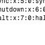

> 为什么要有无法登录的账户？为了正确组织文件和目录并设置访问权限。请考虑第 4 小时末尾的示例：`lp` 账户不是登录账户（在 RHEL 7.2 中其默认 shell 为 `/sbin/nologin`），但它对于拥有所有打印机相关文件和应用程序的单一所有者非常有帮助。UID 低于 100 的账户通常就是这种性质的管理员账户。

注意还有一些可从直接登录访问的命令快捷方式：

```
# egrep '(shutdown|halt|sync)' /etc/passwd
sync:x:50:6:sync:/bin:/bin/sync
shutdown:x:6:0:shutdown:/sbin:/sbin/shutdown
halt:x:7:0:halt:/sbin:/sbin/halt
```

如果你知道 `sync`、`shutdown` 或 `halt` 的密码，你可以在登录提示符下直接执行相关命令，而无需甚至以 root 登录。在紧急情况下很有帮助，但在其他人可以远程访问这些管理功能时可能很危险。

3. 一个非常有用的脚本可以帮助说明如何使用 `/etc/passwd` 文件，即 `checkhomes.sh`——它提取密码文件中的所有家目录，然后验证每个目录是否存在，标记任何错误。写起来困难吗？很容易！

```
$ cat checkhomes.sh
#!/bin/sh

# Checkhomes.sh - Scan /etc/passwd for all home directories, then make
# sure that each exists.

pw=/etc/passwd

for homedir in `cut -d: -f6 /etc/passwd`
do
# echo checking home directory $homedir
if [ ! -d $homedir ] ; then
echo Warning: home directory $homedir does NOT exist
fi
done

exit 0
```


`for` 循环中的 `cut` 提取所有家目录；然后一个一个地将它们分配给 `$homedir` 并检查它们是否为目录。如果它们不是（`! -d` 返回 true），则输出错误消息。令人惊讶的是，标准 RHEL 7.2 配置存在一些问题：

```
$ sh checkhomes.sh
Warning: home directory /var/adm does NOT exist
Warning: home directory /var/spool/news does NOT exist
Warning: home directory /var/spool/uucp does NOT exist
Warning: home directory /var/gopher does NOT exist
Warning: home directory /home/root does NOT exist
```

4. 为了更精致，最好让每个错误也列出账户名称本身，但这要复杂得多：你希望使用 `read` 一次从 `cut` 命令加载两个变量。提取两者很容易：`cut -d: -f1,6` 就能做到。

这是改进得多的脚本：

```
$ cat checkhomes.sh
#!/bin/sh
# Checkhomes.sh - Scan /etc/passwd for all home directories, then make
```

```
# Make sure that each exists.
cut -d: -f1,6 /etc/passwd | sed 's/:/ /g' | \
(while read acct homedir
do
  # echo checking home directory $homedir
  if [ ! -d $homedir ] ; then
    echo Warning: home directory $homedir for account $acct is missing
  fi
done )
exit 0
```

虽然这看起来与之前的版本大不相同，但仔细一看就会确认，对此脚本版本的唯一重要改进是我们在测试和输出周围使用了括号。括号会生成一个子 shell，然后该子 shell 将 `cut | sed` 命令的输出作为其标准输入，因此我们可以使用内置的 `read` shell 命令。

```
$ sh checkhomes.sh
Warning: home directory /var/adm for account adm is missing
Warning: home directory /var/spool/news for account news is missing
Warning: home directory /var/spool/uucp for account uucp is missing
Warning: home directory /var/gopher for account gopher is missing
Warning: home directory /home/root for account taylor su is missing
```

输出绝对更用户友好！

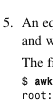

> > Solaris 有一个非常巧妙的实用程序 `pwck`，可以执行这些 `/etc/passwd` 一致性检查中的许多项。非常值得了解。

5. 同样重要的测试是是否存在多个 UID 0（root）账户，以及是否存在任何没有密码的账户。第一个测试可以用一个非常简单的 `awk` 调用完成：

```
$ awk -F: '$3 == 0 { print $0 }' /etc/passwd
root:x:0:0:root:/root:/bin/bash
```

`$3 == 0` 是一个条件测试：如果为真，则整行将被打印。


> > 如果 UID 为 0 的账户数量发生变化，就应立即调查。记住，任何拥有 UID 0 访问权限的人都可以为所欲为，包括用自己的版本替换 `login`，该版本会

> 将账户/密码对秘密发送到电子邮件地址，或更糟！

检查是否存在没有密码的账户的测试稍微复杂一些，因为我们需要检查的不仅是 `/etc/passwd` 文件，还需要检查 `/etc/shadow` 文件。诀窍在于只有 root 才能访问 `/etc/shadow` 文件，因此此命令必须由 root 运行：

```
# cat /etc/passwd /etc/shadow | awk -F: 'length($2) < 1 { print $0 }'
#
```

没有输出。呼！真是松了一口气！

不过，为了让它更有趣，我将创建一个新账户并省略密码：

```
# cp /etc/passwd /etc/passwd.save
# echo "taylorsu::0:502:Dave as Superuser:/home/root:/bin/bash" >> ~/etc/passwd
```

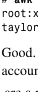

> >> 是一个非常危险的命令，所以要么完全不要使用它，要么要非常、非常小心。例如，如果你不小心使用了 > 而不是 >>，你就会刚刚删除了整个 `/etc/passwd` 文件，这可能导致灾难性后果！这就是为什么你可以看到我还将 `/etc/passwd` 文件的副本保存为 `/etc/passwd.save`，以防万一……

现在运行零密码测试更有趣了：

```
# cat /etc/passwd /etc/shadow | awk -F: 'length($2) < 1 { print $0 }'
taylorsu::0:502:Dave as Superuser:/home/root:/bin/bash
```

找到了！那检查是否存在多个 UID 0 账户呢？

```
# awk -F: '$3 == 0 { print $0 }' /etc/passwd
root:x:0:0:root:/bin/bash
taylorsu::0:502:Dave as Superuser:/home/root:/bin/bash
```

好。它也标记出来了。为了修复它，我将使用 `passwd` 为此账户设置密码，然后此任务就完成了。

正如我们在第一个任务中所见，`/etc/passwd` 文件可以通过多种方式以自动方式进行分析和测试。最重要的是不是想出超级花哨的分析工具，而是经常进行某种分析。如果有人入侵你的系统，他们不会挥旗或给你发送电子邮件，因此你对 `/etc/passwd` 文件中的账户保持警惕至关重要！

#### BSD/Mac OS X 中的密码文件

Darwin 对管理用户账户有完全不同的方法。对于单用户模式，可用的备用 `/etc/passwd`，但在正常多用户模式下，系统使用一个相当更复杂的（而且非常复杂）的系统，称为 NetInfo。

##### 任务 5.2：Darwin 中的账户和密码文件

除了标准的 Unix `/etc/passwd` 文件外，BSD 还使用一个名为 NetInfo 的系统，它既有吸引人的图形界面，也有简陋但功能强大的命令行界面。

- 1. 简单查看 `/etc/passwd` 就能看出有多大的不同。请注意，我以 taylor 登录，但我的账户信息甚至在这里都看不到！

```
$ who am i
 taylor tty1 Jan 9 12:29
$ cat /etc/passwd
##
# User Database
#
# Note that this file is consulted when the system is running in single-
# mode. At other times this information is handled by lookupd. By
# default,
# lookupd gets information from NetInfo, so this file will not be consulted
# unless you have changed lookupd's configuration.
##
nobody:*:-2:-2:Unprivileged User:/nonexistent:/noshell
root:*:0:0:System Administrator:/var/root:/bin/csh
daemon:*:1:1:System Services:/var/root:/noshell
www:*:70:70:World Wide Web Server:/Library/WebServer:/noshell
unknown:*:99:99:Unknown User:/nonexistent:/noshell
```

正如注释所示，大多数用户账户信息存储在神秘的 NetInfo 数据库中，并且可以最轻松地从 Mac OS X 世界中的图形 NetInfo 应用程序访问。


## 2. 幸运的是，NetInfo 也有许多不同的命令行实用程序：

```
$ man -k netinfo
netinfo(3) - library routines for NetInfo calls
netinfo(5) - network administrative information
netinfod(8) - NetInfo daemon
nibindd(8) - NetInfo binder
nicl(1) - NetInfo command line utility
nidomain(8) - NetInfo domain utility
nidump(8) - extract text or flat-file-format data from NetInfo
nifind(1) - find a directory in the NetInfo hierarchy
```

- `nigrep(1)` - 在 NetInfo 层次结构中搜索正则表达式

- `niload(8)` - 将文本或平面文件格式数据加载到 NetInfo

- `nireport(1)` - 从 NetInfo 层次结构打印表

- `niutil(1)` - NetInfo 实用程序

要查看完整的 NetInfo 数据库，正确的命令是 `nidump`：

```
$ nidump passwd .
 nobody:*:2::0:0:Unprivileged User:/dev/null:/dev/null
 root:cBbkMtkWlh2:0:0:0:System Administrator:/var/root:/bin/tcsh
 daemon:*:1::0:0:System Services:/var/root:/dev/null
 unknown:*:99:99:0:Unknown User:/dev/null:/dev/null
 www:*:70:70:0:World Wide Web Server:/Library/WebServer:/dev/null
 taylor:fse2juv3k6jIE:501:20::Dave Taylor:/Users/taylor:/bin/tcsh
```

你可以看到它与 `/etc/passwd` 文件类似，除了 `taylor` 账户。仔细一看会发现列出的信息字段比 `/etc/passwd` 中的更多。


> 请注意 `nidump` 是一个用户级命令，它显示的是加密的密码字符串而不是仅占位符，同时将实际的加密密码隐藏在 shadow 文件中。如果您对访客用户感到偏执，这是一个潜在的安全考虑！

### 3. `nidump` 命令列出了 `/etc/passwd` 文件中的所有条目以及在 NetInfo 数据库中设置的所有额外账户，因此修改之前的测试和脚本并不太困难。每次我们简单引用了 "/etc/passwd" 时，我们将改为流式传输 `nidump` 的输出，并且我们必须修改字段计数以补偿额外的信息输出：

```
# nidump passwd . | cut -d: -f10 | sort | uniq -c | sort -rn
 4 /dev/null
 3 /bin/tcsh
```

然而，有一种更复杂的方式来使用 NetInfo：`nireport` 命令。这种访问 NetInfo 信息的方式要求你知道 NetInfo 数据库 `users` 区域中字段的名称。它们在表 5.1 中进行了总结。

##### 表 5.1 NetInfo /users 属性名称

| 属性名称 | 说明 |
|---|---|
| name | 用户的登录名 |
| passwd | 用户的加密密码 |

##### 表 5.1 继续

| 属性名称 | 说明 |
|---|---|
| uid | 用户的用户 ID |
| gid | 用户的默认组 ID |
| realname | 用户的真实姓名 |
| home | 用户的主目录 |
| shell | 用户的登录 shell |

要在实际中看到这一点，以下是我如何提取一份列出账户名称和密码字符串的报告：

```
$ nireport . /users name passwd
nobody *
root c8bklkt6E1th9
daemon *
unknown *
www *
taylor fse2jv5k6jIA
```

你可以看到，其中四个账户（正如前面所报告的那样，使用 `/dev/null` 登录 shell 的账户）已禁用登录功能，而另外两个账户具有显式的加密密码。

### 4. 为了让事情更有趣，我创建了一个 UID 为 0 且没有密码的账户，名为 `badguy`，恰如其名。不过这次我不能直接将信息追加到 `/etc/passwd` 文件中；我需要使用一个名为 `niadduser` 的脚本将信息添加到 NetInfo 数据库中。（我们稍后在本小时内会开发这个脚本。）

在有了这个新账户之后，让我们看看如何将 `nireport` 与一些常规 Unix 工具结合起来创建一些有用的分析过滤器：

```
$ nireport . /users name uid | awk '$2 == 0 { print $0 }'
root 0
badguy 0
```

这表明有两个账户的 UID=0。

缺失密码的测试稍微复杂一些：

```
$ nireport . /users name passwd | awk 'NF==1 { print $0 }'
badguy
```

在这种情况下，变量 `NF` 是字段数，因此 `awk` 测试本质上是“如果输出行中只有一个字段。”

### 5. 最后，在离开之前，让我们更改 `badguy` 账户的密码，以确保不会留下这个巨大的安全漏洞！

```
$ passwd badguy
Changing password for badguy.
New password:
Retype new password:
$ ni report . /users name passwd | grep badguy
badguy Hk4IS.3eeh69.
```

看起来一切再次安全了！

从某种意义上说，NetInfo 是一个很棒的应用程序，管理着构成 Unix 系统世界的各种数据库，包括打印机、Internet 服务、用户账户和网络连接。它也有着悠久的血统，源自 Sun Microsystems 最初开发的网络信息服务（NIS）和 Yellow Pages（YP）服务。（一分钟后我们会谈谈这些服务。）

然而，NetInfo 在 Unix 世界中也有些另类。不仅它不是流行 Linux 发行版的一部分，它也没有包含在任何主要商业 Unix 发行版中（除了 Mac OS X）。因此 NetInfo 非常不兼容，且特定于平台和版本。

通常，我会建议你仅出于这个原因而避免使用该实用程序，但如果你运行的是 Darwin 或其他启用了 NIS/YP（NetInfo）的 Unix 系统，你必须通过 NetInfo 设施进行操作，否则你的更改将被忽略。例如，测试 Darwin 平台上的 `/etc/passwd` 文件在末尾包含以下几行：

```
$ tail -3 /etc/passwd
www::70:70:World Wide Web Server:/Library/WebServer:/noshell
unknown::*99:99:Unknown User:/nohome:/noshell
testme::0:0:Unknown Root User:/var/root:/bin/tcsh
```

然而你会注意到，如果你翻回去查看，`testme` 账户从未出现在 NetInfo 列表中。这是因为它被添加到密码文件中，但未添加到 NetInfo 数据库中。

#### 添加用户和 adduser 脚本

先把 Darwin、BSD 和 NetInfo 的怪异之处放在一边，让我们呼吸一下新鲜空气，回到“常规 Unix”（无论那意味着什么）吧，好吗？

创建新用户账户需要几个步骤，而不仅仅是创建 `/etc/passwd` 文件中的新条目。这些步骤如下：

- 1. 将用户添加到 `/etc/passwd` 文件。
- 2. 将用户添加到 `/etc/group` 文件。
- 3. 创建其主目录。
- 4. 可选地复制默认 `.profile/.login` 文件。
- 5. 确保该目录及其内容都归新用户所有。
- 6. 将其初始密码设置为已知值。

这些步骤不少，都可以手工完成，但为什么要那样做呢？相反，让我们构建一个脚本来自动化所有操作，并一步将用户添加到系统中。


> Solaris 和 Red Hat Linux 7.2 中都已内置了 `adduser` 命令，但当你使用多种 Unix 变体时，你会发现 `adduser` 并不是广泛可用，而且语法因系统而异。更明智的解决方案是了解该命令的作用，然后为自己的需求复制它。有了自己的脚本，你可以为首选配置进行微调，然后随着管理职责的扩展将其从系统移动到系统。许多顶级系统管理员都有自己随身携带的完整工具包。


##### 任务 5.3：在常规 Unix 世界中添加用户

如果你使用的是标准 Unix 系统，添加用户就是将他们添加到密码文件和组文件，然后创建主目录并设置初始密码的直接序列。

1. 开始时，我们需要在开始构建账户之前从系统管理员收集信息。这最容易使用 shell 内置的 `read` 函数完成。以下是它如何工作的演示：

```
echo "Add new user account to ${hostname}"
echo -n "login: " ; read login
echo -n "uid: " ; read uid
echo -n "gid: " ; read gid
echo -n "full name: " ; read fullname
echo -n "home dir: " ; read homedir
echo -n "shell: " ; read shell

echo "Setting up account:"
echo "${login}:x:${uid}:${gid}:${fullname}:${homedir}:${shell}"
```

作为练习，如果你运行此脚本，你可以看到它如何简化收集必要数据并输出 `/etc/passwd` 格式行的过程：

Add new user account to staging.intuitive.com

login: astaire

uid: 211

gid: 211

full name: Fred Astaire

home dir: `/home/astaire`

shell: `/bin/bash`

Setting up account:

astaire:x:211:211:Fred Astaire:/home/astaire:/bin/bash

这是脚本的核心功能。现在是时候改进了……

2. 开始时，让我们认识到主目录总是在系统上的同一文件夹中，并且其名称始终与账户名称相同：

```
$homedir=$defaulthome/$account
```

此外，没有进一步信息很难提示管理员输入 UID。同时，按惯例，UID 在 `/etc/passwd` 文件中按升序排列，因此如果你自动提取最后一个 UID 并递增它，你就可以将其用作默认的新 UID：

```
currentUID=`tail -1 /etc/passwd | cut -d: -f3`
newUID=`expr $currentUID + 1`
```

这种方法的问题在于，如果由于某种原因密码文件没有将最高 UID 作为最后一行，你可能会遇到严重问题。相反，更明智的方法是使用 `awk` 提取最高 UID（加一）：

```
uid=`awk -F: '{ if (big < $3) big=$3 } END { print big + 1 }' /etc/passwd`
```

这是一个非常优雅且相当典型的 Unix 解决方案。

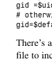

> 许多 Unix 系统管理员更喜欢使用 Perl 而不是 `awk`，但我仍然倾向于使用 `awk`，因为我可以 100% 确定它会包含在所有 Unix 的标准发行版中，而有些系统会排除 Perl，让用户事后自行安装。

3. 分配默认组有两种方法，正如我们已经看到的。有些站点默认给每个用户自己的个人组，这始终与 UID 相同。其他站点则有所有用户默认加入的标准组。这些可以在代码中很容易地建模：

```
# if your site policy is for all users to get their own group
gid=$uid
# otherwise, add them to the default group
gid=$defaultgid
```

当我们自动修改 `/etc/group` 文件以包含新账户时，还需要进行额外的调整，但我们已经超前了！

4. 以下是脚本的第一个完整版本，其中包含一个额外的测试以确保只有用户 `root` 可以运行它：

```bash
$ cat adduser.sh
#!/bin/sh

# ADDUSER - add a new user to the system, including building their
# home directory, copying in default config data, etc.

progname=`basename $0`
pwfile="/etc/passwd"
gfile="/etc/group"
hdir="/home"

if [ "`whoami`" != "root" ] ; then
  echo "$progname: Error: You must be root to run this command."
  exit 0
fi

echo "Add new user account to `hostname`"
echo -n "login: "  ; read login

uid=`awk -F: '{ if (big < $3) big=$3 } END { print big + 1 }' /etc/passwd`
homedir=$hdir/$login

# we are giving each user their own group, so gid=uid
gid=$uid

echo -n "full name: "  ; read fullname
echo -n "shell: "      ; read shell

echo "Ready to set up account:"
echo "$login:x:$uid:$gid:$fullname:$homedir:$shell"
exit 0
```

运行它时，只需要三个字段：

```
$ sh adduser.sh
Add new user account to staging.intuitive.com
login: testdude
full name: The Test Dude
shell: /bin/csh
Ready to set up account:
testdude:x:503:503:The Test Dude:/home/testdude:/bin/csh
```

下一步显然是让脚本开始执行操作，而不是仅仅演示如何提示输入！这可以通过添加以下行来完成：

```bash
echo ${login}:x:${uid}:${gid}:${fullname}:${homedir}:${shell} >> /etc/passwd
mkdir $homedir
```

```
chmod 755 $homedir
chown $login $homedir
echo "Please enter a default initial password for $login now:"
passwd $login
```

简而言之，这六行代码几乎完成了 `adduser` 命令所需的所有功能。稍后你会看到我们如何处理 `shadow` 文件的问题。唯一缺少的两步是适当操作 `/etc/group` 文件（许多 `adduser` 脚本会跳过此步），以及复制默认的 `cshrc`、`login` 或 `profile` 文件。

5. 如果每个用户拥有自己的组，在 `/etc/group` 文件中添加新用户就很简单。只需一行即可完成：

```
echo "$login:x:${gid}:${login}" >> /etc/group
```

在添加新用户到现有组时情况会变得更复杂。然后我们需要从 `/etc/group` 文件中提取组行，附加用户名，然后再写回文件：

```
grep -v "$groupname": /etc/group > /tmp/group.tmp.$$
grep "$groupname": /etc/group > /tmp/group
echo "$groupline,$login" >> /tmp/group.tmp.$$
mv /tmp/group.tmp.$$ /etc/group
chmod 644 /etc/group
```

这看起来或许很奇怪，但我们会将除匹配的组行外的每一行复制到临时文件；然后将提取到的匹配行设为 `groupline`，附加新的登录名，然后将临时组文件移动到主组文件并将其模式更改为我们所需默认值（644）。

6. 最后，为了复制默认配置文件，Linux 包含标准的 `/etc/skel` 目录，其中包含新主目录的原型默认文件：


```
$ ls -la /etc/skel
total 15
drwxr-xr-x 3 root root 1024 Nov 21 14:48 ./
drwxr-xr-x 50 root root 4096 Jan 10 06:12 ../
-rw-r--r-- 1 root root 24 Jul 9 2001 .bash_logout
-rw-r--r-- 1 root root 191 Jul 9 2001 .bash_profile
-rw-r--r-- 1 root root 124 Jul 9 2001 .bashrc
-rw-r--r-- 1 root root 820 Jul 30 03:03 .emacs
-rw-r--r-- 1 root root 118 Aug 9 17:15 .gtkrc
drwxr-xr-x 3 root root 1024 Nov 21 14:40 .kde/
-rw-r--r-- 1 root root 3511 Aug 3 09:53 .screenrc
```

由于存在子目录（用于 KDE，即 K 桌面环境），我们在复制这些文件时需要使用 `cp` 的 `-R` 标志。

现在，有了以上所有内容，这里是脚本的完整后半部分，假设每个用户都有自己的组。

```
echo "Setting up account $login for $fullname..."
echo "$login:x:$uid:$gid:$fullname:$homedir:$shell" >> /etc/passwd
echo "$login:*::11647:0:99999:7:::" >> /etc/shadow
echo "$login:x:$gid:$login" >> /etc/group
#uncomment below if your system is using group shadow files too
#echo "$login::::" >> /etc/gshadow
mkdir $homedir
cp -R /etc/skel/[a-zA-Z]* $homedir
chmod 755 $homedir
find $homedir -print | xargs chown $login
echo "Please enter a default initial password for $login now:"
passwd $login
exit 0
```

请注意，由于此版本的 Unix 使用 shadow 密码文件，我们需要在 `/etc/shadow` 中为账户添加新条目，并在 `/etc/gshadow` 中为组添加条目。

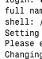

> Solaris 不使用 `gshadow` 文件。相反，组的加密密码无论系统整体是否启用 shadow 密码，都会保存在 `/etc/group` 文件中。


```
# sh adduser.sh
Add new user account to staging.intuitive.com
login: testdude
full name: The Test Dude
shell: /bin/bash
Setting up account testdude for The Test Dude...
Please enter a default initial password for testdude now:
Changing password for user testdude
New password:
Retype new password:
passwd: all authentication tokens updated successfully
```

这就是所有需要做的。简单、简洁，结果账户已准备就绪，并带有来自 `/etc/skel` 的默认文件。

这是一个冗长且复杂的脚本，展示了多种复杂的 shell 脚本技术。它也是完全可移植的，可以轻松运行在任何支持 shadow 密码的系统上，并且只需少量调整，甚至可以在未启用 `/etc/shadow` 的系统上运行。

为了让 `adduser` 脚本在像 Solaris 这样的 NIS 兼容系统上工作，我建议将 `adduser` 脚本作为内置 `useradd` 工具的前端。Darwin 配合 NetInfo 就像俗语所说的“完全不同的马”，下一节将简要说明。

### 在 NetInfo 世界中添加用户

之前的 shell 脚本通过直接操作 `/etc/passwd` 文件来添加用户，但如前所述，运行 NetInfo 或其他 NIS 后继系统的系统需要将新用户添加到 NIS 数据库。这听起来比实际更困难，因为 `niutil` 命令正是用来做这件事的。

#### 任务 5.4：adduser 的 Darwin 版本

NetInfo 的世界不仅改变了我们检查用户账户数据的方式，还迫使新账户的创建方式发生重大变化。这是不好的消息。好消息是 Darwin 包含多种不同的命令行 NetInfo 实用程序，其中最著名的是通用的 `niutil`。

对于本任务，我们感兴趣的 `niutil` 有两种模式：`-create` 指定应在数据库中创建新条目，然后 `-createprop` 添加特定属性并在指定记录中分配指定的值。

- 1. 首先，我们必须重写计算使用中最高 UID 的部分。
- 为此，我们将使用 `nireport` 和 `sort -n`：

```
uid1=`nireport . /users uid | sort -n | tail -1`
uid=`expr $uid1 + 1`
```

- 下一步是实际创建新的用户账户记录。这可以使用 `niutil` 通过 `-create` 选项完成：

```
niutil -create . /users/$login
```

- 2. 必须定义用户记录的每个单独属性并为其分配值。这比向 `/etc/passwd` 输出一行要多一些工作：

```
niutil -createprop . /users/$login passwd
niutil -createprop . /users/$login uid $uid
niutil -createprop . /users/$login gid $gid
niutil -createprop . /users/$login realname "$fullname"
niutil -createprop . /users/$login shell $shell
niutil -createprop . /users/$login home $homedir
```

名称/值对中不应该有任何意外，但值得强调的是 `fullname` 是唯一可能包含空格的变量，因此脚本中使用了引号。

- 3. 对于 Darwin 版本的脚本，我们还将把所有用户添加到 `home-team` 组，而不是为他们各自创建唯一组。这是通过使用 `niutil` 命令修改指定组的 `users` 字段来完成的：

```
niutil -appendprop . /groups/hometeam users $login
```

除此之外，其他部分与 Linux 版本的脚本完全相同。

以下是完整的 Darwin `adduser` 脚本：


```bash
#!/bin/sh

# ADDUSER - add a new user to the system, including building their
#           home directory, copying in default config data, etc.

progname=`basename $0`
dgroup="hometeam"
dgid=101
hdir="/Users"

if [ "`whoami`" != "root" ] ; then
  echo "$progname: Error: You must be root to run this command."
  # exit 0
fi

echo "Add new user account to `hostname`"
echo -n "login: "  ; read login

uid1=`nireport . /users uid | sort -n | tail -1`
uid=`expr $uid1 + 1`
homedir=$hdir/$login

# we are putting all users into the $dgroup group, which has a fixed GID
gid=$dgid

echo -n "full name: " ; read fullname
echo -n "shell: "   ; read shell

echo "Setting up account $login for $fullname..."

niutil -create      . /users/$login
niutil -createprop . /users/$login passwd
niutil -createprop . /users/$login uid $uid
niutil -createprop . /users/$login gid $gid
niutil -createprop . /users/$login realname "$fullname"
niutil -createprop . /users/$login shell $shell
niutil -createprop . /users/$login home $homedir
```

```bash
niutil -createprop . /users/$login _shadow_passwd ""
# adding them to the $dgroup group...
niutil -appendprop . /groups/$dgroup users $login

mkdir $homedir

if [ -d /etc/skel ] ; then
  cp -R /etc/skel/.[a-zA-Z]* $homedir
fi

chmod 755 $homedir
find $homedir -print | xargs chown $login

echo "Please enter a default initial password for $login now:"
passwd $login

exit 0
```

### 测试

让我们通过创建账户来测试它！

```
$ adduser
adduser: Error: You must be root to run this command.
```

糟糕！使用 `su` 命令切换到 `root`（你需要输入管理员密码）再试一次：

```
# adduser
Add new user account to ds1-132.ds1designs.com
login: tintin
full name: Tintin, Boy Reporter
shell: /bin/tcsh
Setting up account tintin for Tintin, Boy Reporter...
Please enter a default initial password for tintin now:
Changing password for tintin.
New password:
Retype new password:
```

并验证其存在及正确创建：

```
# ni report . /users name realname
nobody Unprivileged User
root System Administrator
daemon System Services
unknown Unknown User
www World Wide Web Server
taylor Dave Taylor
badguy Test Account
tintin Tintin, Boy Reporter
```

欢迎来到 Darwin 世界，Tintin 先生！一切看起来都很好。

许多系统都包含某种用于添加新用户的实用程序，但作为系统管理员，你永远无法确切知道它们在做什么，以及应用程序到底完成了什么或没有完成什么。此外，一些 Unix 只完成了工作的一半：我能找到的 Darwin 上最好的 `adduser` 实用程序却没有将用户添加到任何组中。

#### 摘要

这是第一个更侧重于常见日常系统管理任务的小时。无论你是在学习更多关于如何使用自己的个人 Unix 主机，还是负责整个计算设施，管理用户账户都是你无法避免的事情。

幸运的是，构建自己的自定义实用程序可以让你随后隐藏每个 Unix 系统的怪异之处、特殊之处和怪癖；然后你就永远不用再管了。这是我认为构建自己的工具的最大原因之一：例如，如果你学习了所有 Red Hat Linux 账户管理工具，那么当你突然发现自己需要管理 HP-UX 或 AIX 系统时，这对你一点帮助都没有。

我们将在本书的课程中逐步深入探讨这一主题。

#### 问答

Q 你可以添加新用户，使得他们第一次登录时被强制选择密码，而不是由你为他们选择密码并不得不为他们写下来吗？

A 可以。大多数 Unix 系统都支持密码老化或类似机制。这是将在下一小时更详细讨论的重要概念。

Q 让 `/etc/passwd` 文件对任何已登录用户可读难道不是有点安全风险吗？

A 好吧，是也不是。它有风险，因为有人可以通过阅读它获得大量关于用户账户的信息（主目录、有效登录名等等），但在仍然运行 Unix 的情况下几乎不可能隐藏这些信息。无论是 `ls /home` 的输出还是输入 `who` 的结果，都很难完全将密码和账户信息隐藏在好奇的目光之外。

Q 我为什么要在我的系统上拥有多个 UID 0 账户？

A 虽然乍一看可能有点怪异，但我一直主张每个管理员都拥有不同的 UID 0 登录账户。例如，我会设置为 `taylorsu`（`su` 代表超级用户）。这种方法的优点是你可以更轻松地管理这些管理员的访问权限。例如，如果你有三个 UID 0 管理员，其中一个不再需要访问权限，那么删除该账户要比不断更改系统 `root` 密码容易得多（也更安全）。

#### 练习

##### 测验

- 1. `adduser` 命令有多种改进方法，其中最少的一项是检查指定的账户名是否已存在于数据库中。你会如何做到这一点？

- 2. 上网回答这个问题：去 Google（`www.google.com`）看看是否能找到一个程序，它宣称能够破解加密的密码字符串，甚至是整个 `/etc/passwd` 文件。

- 3. 在过去一两个小时里我们使用了 `basename`。请使用 `man` 系统查明它实际做什么。

##### 答案

- 1. 为了确保你不会创建两个同名账户，在提示输入账户名后立即在密码文件中 `grep` 该账户名。这可以通过以下方式完成

```bash
egrep "^${account}:\ " /etc/passwd
```

然而，你希望捕获输出并在某种条件测试中分析结果。

- 2. 我登录到 Google 并使用了以下搜索字符串：

```bash
+UNIX +password +cracker +download
```

（`+` 强制 Google 确保所有单词都出现在它呈现的每个匹配项中。）它返回了超过 9,000 个匹配项。更重要的是，Google 还对庞大数据库的子集进行了分类，结果页面上也出现了指向 Computers -> Security -> Unix-> Exploit Software 的链接。这证明了最好的探索区域，而且令人不安地容易找到大约半打可供下载的程序，它们承诺破解 Unix 加密密码。

> 值得注意的是，这些程序实际上并没有破解任何密码。Unix 密码使用的加密是单向的：你可以对其进行编码，但无法解码。这些程序通过猜测密码，对其进行加密，然后将该加密密钥与加密密码本身进行比较。如果匹配，就认为“破解”了密码。如果问我的话，这是一个选择奇怪且不可能猜到的密码的好理由！

3. 有用的 `basename` 命令会从完全限定的文件名中删除所有目录信息。如果你指定 `basename /usr/sbin/bash`，它会返回 `bash`。下一小时将通过创建挂起和删除用户账户命令来丰富你的系统管理员工具箱。它还将更详细地检查 `passwd` 命令和 `/etc/shadow` 文件，并探讨组织的密码老化和可接受使用政策。


# 第 6 小时

## 账户管理

上一小时探讨了将新用户添加到 Unix 系统所涉及的步骤，无论是通过 NetInfo 还是通过对 `/etc/passwd` 和 `/etc/shadow` 的添加。本小时将介绍完成账户管理所需的额外工具，这些工具可让你挂起用户账户并删除它们。

此外，如果你使用的是 shadow 密码，则有一些有趣的技术可用于在 Unix 系统上启用密码老化。

在本小时你将学习关于

- 挂起用户账户
- 删除用户账户
- Linux 账户管理工具
- Solaris 账户管理工具
- 密码老化

### 挂起用户账户的方式

有三个基本账户管理任务你会经常执行：账户创建、账户挂起和账户删除。

创建新账户可以使用我们在上一小时已经构建的手动但相当长的 `adduser` 脚本。幸运的是，挂起和删除账户要容易得多。

#### 任务 6.1：挂起用户

也许你的公司与承包商合作，他们会随着项目的需求而进进出出。或者也许你的学校喜欢在假期期间挂起学生账户，以确保他们真的休息而不是沉迷于现代技术。然后警察可能刚刚送达传票，你需要锁定一个账户以避免任何更改。无论原因如何，了解挂起用户账户的超简单技巧是有帮助的——更改密码。

> 为了在紧急情况下挂起用户账户，只需更改密码！

一个智能的挂起或删除账户的方法首先要确保用户实际上没有登录。如果他已登录，你可能需要立即将其踢出。但首先更改用户的密码，否则他会再次登录。

1. 任何挂起或删除的第一步都是更改账户密码。这很容易用 `passwd` 完成。为了方便使用，我总是只输入我自己的账户密码：没有人知道它，我非常习惯输入它，而且几乎不可能猜到或破解。

然后是时候检查用户是否已登录，并在必要时将其注销。如果他已登录，必须获取其登录 shell 的进程 ID，这可以通过 `ps` 处理器状态命令获得：

```
# ps -fu testdud
PID PPID SID TTY TIME CMD
11259 11259 11259 pts/1 00:00:00 bash
11380 11380 11259 pts/1 00:00:00 vi
```

你可以看到 `testdud` 正在运行一个 `vi` 会话。可能不太好。

2. 要将其注销，你需要提取会话 ID（或在 BSD 术语中，父进程 ID，即 PPID）并将其用作 `kill` 命令的参数。如果脚本是用账户名作为其参数 `$1` 调用的，则

```
if [ "`who | grep $1`" != "" ] ; then
sid=`ps -U $1 | awk '{print $3}' | tail -1`
kill -HUP $sid
echo "$1 was logged in. Just logged $1 out."
fi
```

如果你在用户登录时强制其注销，请准备好应对情绪反应！更好的编码方式是让脚本警告他，然后给他几秒钟时间在被踢出之前及时退出其应用程序。

要向系统上的用户发送消息，比发送可能被忽略的电子邮件更快的解决方案是：直接将信息写入用户的终端设备。考虑 `who` 命令输出的第二个字段：

```
$ who
taylor pts/0 Jan 14 05:09 (dsl-132.dsidesigns.com)
testdude pts/1 Jan 14 05:11 (dsl-132.dsidesigns.com)
```

如果在前面加上 `/dev/`，那就是终端设备地址（因此 `testdude` 登录到 `/dev/pts/1`）。获取该信息后，你可以直接向用户的屏幕写入消息（然后 `sleep $secs` 秒）：

```
tty=`who | grep $1 | tail -1 | awk '{print $2}'`
cat << "EOF" > /dev/$tty
**************************************************
URGENT NOTICE FROM THE ADMINISTRATOR:
This account is being suspended by the request of management.
You are going to be logged out in $secs seconds. Please
shut down any processes you have running immediately.
If you have any questions, please contact your supervisor or
Jane Mansmith, director of corporate computing.
**************************************************
EOF
echo "(Warned $1, now sleeping $secs seconds)"
sleep $secs
```

当挂起账户时，我喜欢采取的另一个步骤是关闭用户的 home 目录。这也很简单：

```
chmod 000 $homedir/$1
```

3. 总体而言，并加上一些有用的注释，`suspend` 脚本看起来像这样：

```
#!/bin/sh

## Suspend - suspend a user account for the indefinite future

secs=10 # seconds before user is logged out (if logged in)
homedir="/home" # home directory for all users
```

```
if [ "$1" = "" ] ; then
echo Usage: 'basename $0' account
exit 0
fi
if [ "`whoami`" != "root" ] ; then
echo `basename $0`: Error. You must be 'root' to run this command.
exit 0
fi

passwd $1

# Now, let's see if they're logged in, and if so, boot 'em

if [ "`who` | grep $1`" != "" ] ; then
tty=`who | grep $1 | tail -1 | awk '{print $2}'`
cat << "EOF" > /dev/$tty
**************************************************
URGENT NOTICE FROM THE ADMINISTRATOR:
This account is being suspended by the request of management.
You are going to be logged out in $secs seconds. Please shut down
any processes you have running immediately.

If you have any questions, please contact your supervisor or
Jane Mansmith, director of information technology.
**************************************************
EOF

echo "(Warned $1, now sleeping $secs seconds)"
sleep $secs

sid=`ps -u $1 | awk '{print $3}' | tail -1`
kill -HUP $sid
echo "$1 was logged in. Just logged $1 out."
fi

# Finally, let's close off their home directory from prying eyes:
chmod 000 $homedir/$1

echo "Account $1 has been suspended."
exit 0
```

4. 当我们准备将 `testdude` 从其账户中踢出时，现在很容易了：

- `$ suspend testdude`
- 正在更改用户 `testdude` 的密码
- New password:
- Retype new password:
- `passwd: all authentication tokens updated successfully`
- `(Warned testdude, now sleeping 10 seconds)`
- `testdude was logged in. Just logged testdude out.`
- `Account testdude has been suspended.`

The user `testdude` would have seen the following pop up on his screen:


**************************************************

URGENT NOTICE FROM THE ADMINISTRATOR:

This account is being suspended by the request of management.

You are going to be logged out in 10 seconds. Please shut down any processes you have running immediately.

If you have any questions, please contact your supervisor or Jane Mansmith, director of information technology.

**************************************************

And, sure enough, ten seconds later testdude would be logged out and unable to log back in.

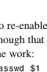

Compatibility-wise, the third field of the `ps` output on BSD systems is the parent process ID (`PPID`) rather than the session ID. The good news is that it'll work just as well for this task, so the script works across platforms, with but one small change necessary: `homedir` must be defined as appropriate for each server.

### 4. 在挂起后重新启用账户足够简单，我将只展示执行此操作的 shell 脚本（`unsuspend`）片段：

```
passwd $1   # change their password back to a known value
chmod 750 $homedir/$1  # and open their home directory back up
```

There are other ways to suspend accounts on some Unix systems that are worth mentioning. If you're running Linux, for example, there's `usermod`, which lets root change the status of a user account. With the `-L` flag, it locks the account, disabling the password by prefixing the encrypted password string with a `!`, and with `-U` it removes that `!` and enables the account again.

Solaris uses the `passwd` command to enable suspension: `passwd -l acct` will lock the specified account (specifying a new password with the standard `passwd acct` will unlock the account again).

On BSD systems, it's a bit more tricky, because there isn't a command as accessible as `usermod` by default. That's why it's easier just to change the user's password to something else, as shown in the script.

#### Deleting User Accounts

Suspending accounts is helpful, but often you'll need to completely remove the account from the system, including deleting all the files. Another relatively simple task, but if you want to do everything properly, you might find that there are more nuances than initially expected.

##### Task 6.2: Deleting User Accounts

The most important step in deleting a user account is to remove the entry from the `/etc/passwd` file. With that done, the user ceases to exist as far as the Unix system is concerned. However, the user still has files in the system, a home directory, and perhaps also e-mail coming into the system and more. But let's take one step at a time.

- 1. 一旦确定某人不再需要，并且永远不再需要访问系统，就该删除账户了。这最简单的方法是从 `/etc/passwd` 文件（或 NetInfo 数据库）中删除用户的条目，然后使用 `rm` 命令的危险 `'-rf'` 标志强制递归删除用户主目录内的所有文件和文件夹。

Deleting a line from the password file is superficially easy within a script:

```
grep -vE "$1": /etc/passwd > /tmp/newpasswd
mv /tmp/newpasswd /etc/passwd
chmod 655 /etc/passwd
```


> The problem with this solution is that you need to prevent any other system administrator from touching or changing the `/etc/passwd` file while you're doing this. In Unix terms, it's called locking the file, and there's no easy solution to this dilemma overall.

> On some Unix systems—including RHL7.2—there's a user-level command `lockfile`, but although it will help ensure that two accounts aren't deleted at the same time, it only works for scripts that you've written. The danger, however, is with all the other commands that might alter the file (including the `passwd` command on a non-shadow password system).

> A better solution is to use `vipw`, a special file-locking version front end to `vi` that locks the password file, lets you edit it, then unlocks it when done. Fortunately, `vipw` is available on Red Hat Linux, Solaris, and Darwin.

- 2. 所需的第二步是在脚本中删除用户的主目录及其所有内容，假设 `$1` 是用户的账户名：

```
rm -rf $homedir/$1
```

There's a nuance to this, however, because the user might very well have files elsewhere on the system.


### 3. 查找这些散落的文件是 `find` 命令的工作，它将在整个文件系统中搜索用户拥有的任何剩余文件或目录。

For example:

```
$ find / -uid 501 -print
```

`/var/spool/mail/mdella`

In this case, you can see that though you've stripped all the files in the `/home` directory, there was still an e-mail mailbox lingering in the spool directory.

One ramification of adding this check for files outside the user's home directory is that you need to grab the UID of the account before deleting it. This is done with the line

```
uid="`egrep "^$1:" /etc/passwd | cut -d: -f3`"
```

### 4. 以下是完整的脚本，除了从 shadow 文件中删除账户信息之外。请注意，第一步是调用 `suspend` 脚本以确保用户无法登录，并在需要时注销。没有理由在这里重复该代码！

```
#!/bin/sh

## Delete - delete a user account without a trace...

homedir="/home"

if [ "$1" = "" ] ; then
 echo Usage: `basename $0` account; exit 0
fi
if [ "`whoami`" != "root" ] ; then
 echo `basename $0`: Error. You must be 'root' to run this command.
 exit 0
fi

suspend $1  # suspend their account while we do the dirty work

uid=`egrep "^$1:" /etc/passwd | cut -d: -f3`

egrep -v "^$1:" /etc/passwd > /tmp/newpasswd
mv /tmp/newpasswd /etc/passwd
chmod 655 /etc/passwd

rm -rf $homedir/$1
```

```
echo "Files still left to remove (if any):"
find / -uid $uid -print

echo "Account $1 (uid $uid) has been deleted, and their /home *"
echo "directory has been removed."
exit 0
```

### 5. 反思一下，更明智的做法是将用户的主目录移动到不同的临时暂存区，以防第二天有人请求某些文件。为此，请将 `rm -rf` 调用替换为

```
mv $homedir/$1 $holdingarea
```

The variable `$holdingarea` should be somewhere secure, with minimal access. A good location would be `/home/root/pending_deletion` or someplace similar.

### 6. `deleteuser` 的 Darwin 版本有点不同，因为您无需从 `/etc/passwd` 文件中提取行，而是可以使用更安全的 `niutil` 命令：

```
niutil -destroy ./users/$1
```

One significant advantage to the Darwin version is that there's no worry about the potential danger from not using a file locking protocol—NetInfo itself automatically ensures that commands don't step on each other.


> It would be wise to include a test in the deleteuser script to flag and refuse to delete the root account. If you accidentally deleted that account, the results would be very bad. It's recoverable (boot in single-user mode and fix the password file or NetInfo database), but very, very bad.

Deleting accounts proves to be more than just deleting a line from the `/etc/passwd` file. Indeed, there's an additional step necessary for a deleted account that we won't address until Hour 18, "Running Your Own Name Server"—setting up an automatic e-mail response informing people that the user is no longer accessible through this system.

Rather than fall too far into the trap of the "not invented here syndrome," however, let's spend the rest of this hour looking at some of the platform-specific account management tools available in Linux, Solaris, and Darwin.

#### Linux Account Management Tools

Lurking under the hood of the simple `passwd` command in Linux (and Solaris, for that matter) is a powerful set of options that can significantly simplify your administrative tasks. They're different on each platform, alas, but if you're in a relatively homogeneous

环境（或只是管理单台 Unix 系统），对这些选项的透彻了解将大有裨益。

还有其他管理命令，让我们在这里一起检查一下。

##### 任务 6.3：Linux 管理工具

基于上一小时以及本小时前面讨论的材料，你可能会认为在可用的各种 Unix 版本中没有可用于帮助管理用户账户的工具。那是错误的。如前所述，问题不在于没有工具，问题在于工具种类太多，而且没有任何工具能在所有主要平台上以相同形式存在。

作为例证，如果你在 Linux 系统上运行，可以使用 `useradd` 命令添加用户，该程序似乎提供了前面 shell 脚本开发者的大部分功能。的确，这里是从 Linux 手册页中摘录的该命令的概要：

```
SYNOPSIS
useradd [-c comment] [-d home_dir]
[-e expire_date] [-f inactive_time]
[-g initial_group] [-G group,...]
[-m [-k skeleton_dir]] [-M] [-p passwd]
[-s shell] [-u uid [ -o ]] [-n] [-r] login
```

这都很好，但如果看不到内部发生了什么，就无法知道真正发生了什么。该程序如何选择 UID，如果密码文件中的条目不是按升序排列，它还能工作吗？

尽管如此，如果你只需要担心 Linux 机器，或者有奢侈的时间去学习你所管理每种 Unix 版本的细微差别，那么仍有一些内置命令值得探索。

最有用的内置账户管理命令是 `passwd`。让我们看一下。

- 1. 第一步总是手册页，在那里你一定会惊讶地发现有多少选项。命令概要是

```
passwd [-k] [-l] [-u [-f]] [-d] [-S] [username]
```

这些标志的含义在表 6.1 中进行了总结。

##### 表 6.1 Linux passwd 命令标志

| 标志 | 含义 |
|------|---------|


| `-k` | 更新应仅适用于已过期的身份验证令牌（仅在运行 Kerberos 或其他令牌生成授权系统时相关。对于普通的 Linux，这不会有任何效果）。 |

### 表 6.1 继续

| 标志 | 含义 |
|------|---------|
| `-l` | 通过在加密密码字符串前加上 `!` 字符来锁定指定账户，从而使用户无法匹配。请注意，这种暂停账户的方法仍会允许用户之前将她的家目录权限设置为世界可读，因此可从另一个账户访问。对应的选项是 `-u`。 |
| `-u` | 这通过从加密密码字符串中去掉 `!` 前缀来解锁指定账户。是 `-l` 的对应项。 |
| `-f` | 默认情况下，如果加密密码字符串中唯一的字符是 `!`，`passwd` 不会让你解锁账户，因为解锁后账户将没有密码。如果你知道自己在做什么并且仍然想这样做，请添加 `-f` 标志以强制解锁账户。 |
| `-d` | 禁用账户的密码保护。我不确定你为什么会想这样做，但 `passwd -d testdud` 会立即从 `testdud` 账户中删除密码，让任何人登录。 |
| `-s` | 显示账户的状态。列出特定账户的密码状态。 |

其中许多选项是非常有用的快捷方式，特别是如果你还没有输入本小时前面讨论的暂停脚本。

`-S` 摘要很有趣：

```
# passwd -S taylor
Changing password for user taylor
Password set, MD5 encryption
```

然而输出有点别扭，因为 Changing password 行不应该输出。没关系；我们是在 Unix 上，所以你可以修改输出！

让我们将此命令包装在一个循环中，查看系统上某些账户的状态。

```
# for name in `cut -d: -f1 /etc/passwd`
> do
> echo Status of account $name is `passwd -S $name|tail -1`
> done
Status of account root is Password set, MD5 encryption
Status of account bin is No Password set.
Status of account daemon is No Password set.
Status of account adm is No Password set.
Status of account lp is No Password set.
Status of account sync is No Password set.
... lots of output removed ...
```

```
Status of account apache is Locked password.
Status of account squid is Locked password.
Status of account named is Locked password.
Status of account pcaps is Locked password.
Status of account mthorne is Locked password.
Status of account mdella is Password set, MD5 encryption
Status of account taylor is Password set, MD5 encryption
Status of account taylorsu is Password set, MD5 encryption
Status of account testdude is Empty password.
```

输出很多，但重要的是要注意任何类似 `operator` 或 `ftp` 的账户，其状态为 No Password set。事实上，筛选掉所有 Locked password 行（这应该是所有管理守护进程的状态）会使输出清晰得多：

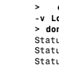

> 请注意，当你输入多行命令时，shell 会自动识别续行并用 `>` 提示符提示后续行。非常有帮助！

```
# for name in `cut -d: -f1 /etc/passwd`
> do
> echo Status of account $name is `passwd -S $name|tail -1` | grep -v Locked
> done
```

```
Status of account root is Password set, MD5 encryption
Status of account bin is No Password set.
Status of account daemon is No Password set.
Status of account adm is No Password set.
Status of account lp is No Password set.
Status of account sync is No Password set.
Status of account shutdown is No Password set.
Status of account halt is No Password set.
Status of account mail is No Password set.
Status of account news is No Password set.
Status of account uucp is No Password set.
Status of account operator is No Password set.
Status of account games is No Password set.
Status of account gopher is No Password set.
Status of account ftp is No Password set.
Status of account nobody is No Password set.
Status of account mdella is Password set, MD5 encryption
Status of account taylor is Password set, MD5 encryption
Status of account taylorsu is Password set, MD5 encryption
Status of account testdude is Empty password.
```

这是另一个非常有用的监控输出！特别是，注意有些账户没有设置密码，而 `testdude` 账户有一个空密码字符串（功能上与没有设置密码相同）。


> 任何没有设置密码的账户都是一个安全漏洞。例如，如果有人可以通过 `telnet` 访问你，她可以使用任何没有密码的账户登录。幸运的是，其中大多数的 shell 是 `/bin/nologin`，但值得仔细检查这一点。而且，不用说，`testdude` 需要设置密码！

- 2. `testdude` 账户是这里最明显的安全问题，所以让我们锁定该账户：

```
# passwd -l testdude
Changing password for user testdude
Locking password for user testdude
passwd: Success
```

```
# passwd -S testdude
Changing password for user testdude
Locked password.
```

好多了。当你尝试解锁它时，注意发生了什么：

```
# passwd -u testdude
Changing password for user testdude
Unlocking password for user testdude
Warning: unlocked password for testdude is the empty string.
Use the -f flag to force the creation of a passwordless account.
passwd: Unsafe operation
```

这是一个非常有用的警告，也足以让精明的系统管理员坐直身子注意！

- 3. 在离开之前，让我们创建一个快速脚本来检查任何标记为 No Password set 的账户是否具有防止交互使用的 shell：


```
#!/bin/sh

# CHECKPW - Check the status of all accounts on the system, checking
#           to ensure that any account without a password has a shell that
#           prevents interactive use. Any others will be flagged in output.
```

```
# This only runs on Linux systems with the '-S' flag to 'passwd'
temp="/tmp/tocheck.$$"

trap "/bin/rm -f $temp" 0  # remove the file upon exit

for name in `cut -d: -f1 /etc/passwd`
do
  echo "$name" | passwd -S $name | tail -1 | \
  egrep -v "(Locked|encryption)" | awk '{print $1}' >> $temp
done

for account in `cat $temp`
do
  shell=`egrep "^${account}:" /etc/passwd | cut -d: -f7`
  if [ "$shell" != "/sbin/nologin" ] ; then
    echo "*** WARNING: Account $account has no password and login shell $shell"
  fi
done
exit 0
```

这个脚本没什么花哨的，但请注意我们不得不使用临时文件来保存中间输出。结果相当有帮助，很容易成为日常系统状态报告的一部分：

```
# checkpw.sh
*** WARNING: Account sync has no password and login shell /bin/sync
*** WARNING: Account shutdown has no password and login shell /sbin/shutdown
*** WARNING: Account halt has no password and login shell /sbin/halt
*** WARNING: Account news has no password and login shell /bin/sync
*** WARNING: Account testdud has no password and login shell /bin/bash
```

`shell` `sync`、`shutdown` 和 `halt` 表明在登录提示符下可用的快捷方式。输入 `shutdown` 作为账户名——记住没有密码——系统很可能会被关机。如果你认为永远不需要它们，最好禁用这些账户。

> 在从事 Unix 系统工作的 20 多年里，其中大多数都有这三个管理登录，我从未以这种方式使用过它们。我在安装新系统时总是关闭这些账户。

当没有列出 `shell` 时，这意味着系统将默认（通常）使用 `/bin/sh` 作为 `shell`，因此 `news` 与 `testdude` 一样具有安全风险。两者都需要关闭，并且

```
passwd -l testdude
```

对 `testdude` 而言就足够了，但锁定其他账户需要先设置初始密码。这可以通过 `passwd news` 来完成。然后使用 `passwd -l news` 将其锁定。

3. 值得查看的最后一个命令是 `userdel` 命令，这是内置的 Linux 命令，用于删除用户。查看手册页你会发现它很直接且可用，不过如果用户已登录，它不会注销用户（相反，命令会失败），并且它会让你——系统管理员——自己去弄清楚如何识别用户可能拥有的其他文件。

```
# man userdel
USERDEL(8)                              USERDEL(8)

NAME
    userdel - Delete a user account and related files

SYNOPSIS
    userdel [-r] login

DESCRIPTION
    The userdel command modifies the system account files,
    deleting all entries that refer to login. The named user
    must exist.

    -r      Files in the user's home directory will be removed
            along with the home directory itself and the user's
            mail spool. Files located in other file systems
            will have to be searched for and deleted manually.

FILES
    /etc/passwd  - user account information
    /etc/shadow  - secure user account information
    /etc/group   - group information
```

这是一个合理的解决方案，但如果你在 Darwin/BSD 世界中寻找等效命令，你会感到困惑——Darwin 中没有等效命令。因此我们在此小时之前创建的脚本。

在 Unix 25 多年的发展和成长过程中，有很多聪明的人做出了贡献。其中许多人是系统管理员，他们通过开发复杂的工具来简化自己的生活。不幸的是，由于众多不同 Unix 版本的反复无常和混乱发展，没有任何账户管理工具最终成为所有系统上的标准和通用工具。

事实上，作为 Unix 系统管理员最大的挑战不是如何在特定系统上完成系统管理任务，而是如何在你负责维护的任何系统上完成这些任务。这是对所有管理员的困扰，但也是一个不愉快的事实：安装更可能是异构的而不是同构的。也就是说，你更可能发现你的数据中心有一台老旧的 IBM AIX 系统、三台 Solaris 服务器、十几台 Linux 服务器，其中除一台外都运行着 Red Hat Linux，还有一台基于 Darwin 的文件和打印服务器，同时也是部门秘书的工作站。在这种环境下，知道 `userdel` 在 Red Hat Linux 7.2 上可用并不会让你的生活轻松多少，唉。

事实上，本小时中没有名为“Darwin 账户管理工具”的章节，因为坦白说，除了相当原始的 `niutils` 或图形化 NetInfo 应用程序之外，根本没有。

#### Solaris 账户管理工具

Solaris 与 Linux 相当相似，幸运的是。让我重新表述以更好地反映 Unix 的演变：Linux 受到了许多 Solaris 实用程序的启发。这意味着 Solaris 中的 `passwd` 命令包含摘要选项和锁定账户的能力，并且 Linux 部分介绍的大多数脚本都适用于 Solaris。

然而，它并不完全相同，这有点麻烦。例如，在 Linux 中 `passwd -S taylor` 会显示账户 `taylor` 的密码状态摘要，但 Solaris 不认识 `-S` 标志，而是使用 `-s` 来实现此功能。而且我是否提到过输出是不同的？

##### 任务 6.4：Solaris 账户管理工具

Solaris 和 Linux 之间的差异更多是命令行账户管理工具的细微差别，而非戏剧性的变化。因此不足为奇的是，已讨论的脚本只需做少量调整即可在 Solaris 环境中工作。

- 1. 添加用户可以使用 `useradd` 命令，不过语法与同名的 Linux 命令略有不同：

```
# man useradd | head -18
Maintenance Commands                                      useradd(1M)

NAME
    useradd - administer a new user login on the system

SYNOPSIS
    useradd [ -c comment ] [ -d dir ] [ -e expire ] [
```

```
-f inactive ] [ -g group ] [ -G group [ , group ... ] ] [ -m [ -k skel_dir ] ] [ -u uid [ ,o ] ] [ -s shell ] [ -A authorization[ ,authorization... ] ] [ -P profile [ ,profile... ] ] [ -R role [ ,role... ] ] login
useradd -D [ -b base_dir ] [ -e expire ] [ -f inactive ] [ -g group ]
```


敏锐的眼睛会注意到分别用于授权、配置文件和角色的 `-A`、`-P` 和 `-R` 标志的添加。我们没有空间深入 Solaris 安全模型，但如果你运行的是 Solaris 系统，花时间阅读 `auth_attr(4)`、`exec_attr(4)` 和 `user_attr(4)` 手册页会非常值得。


> 标准 Unix 手册页条目的命名法是指定命令，后跟可在手册页数据库中找到该命令的部分。因此 `auth_attr(4)` 表示它是第四部分（文件格式）中的 `auth_attr` 手册页。你可以在命令行使用 `man 4 auth_attr` 读取此页。

## 2. Solaris 中的真正差异在查看 passwd 手册页时显现：

```
# man passwd
User Commands                                   passwd(1)

NAME
    passwd - change login password and password attributes

SYNOPSIS
    passwd [ -r files | -r ldap | -r nis | -r nisplus ] [ name ]

    passwd [ -r files ] [ -egh ] [ name ]

    passwd [ -r files ] -s [ -a ]

    passwd [ -r files ] -s [ name ]

    passwd [ -r files ] [ -d | -l ] [ -f ] [ -n min ] [ -w warn ] [ -x max ] name

    passwd -r ldap [ -egh ] [ name ]

    passwd -r nis [ -egh ] [ name ]

    passwd -r nisplus [ -egh ] [ -D domainname ] [ name ]
```

```
passwd -r nisplus -s [ -a ]
passwd -r nisplus [ -D domainname ] -s [ name ]
passwd -r nisplus [ -l ] [ -f ] [ -n min ] [ -w warn ] [ -x max ] [ -D domainname ] name
```

在 Solaris 中使用 `passwd` 命令的方式有令人眼花缭乱的多种可能，但如果你没有运行 LDAP（轻量级目录访问协议）、NIS（网络信息服务）或 NIS+（改进的 NIS 架构），可以庆幸地忽略它们。

为了澄清差异，以下是我对 Solaris `passwd` 命令的总结，去掉了所有令人困惑的 NIS 内容：

```
passwd [ -s ] [ -d ] [ -l ] [ -f ] [ -n min ]
[ -w warn ] [ -x max ] name
```

与 Linux 相当相似，但有两个显著差异：`-s` 摘要标志现在是 `-s`，而且虽然有 `-l` 用于锁定账户，但请注意没有 `-u` 用于解锁它们。

确实，要在 Solaris 中锁定账户，可以使用熟悉的 `passwd -l account`，但要解锁账户，没有 `-u` 标志可以将密码重置为原始状态（如 Linux 中那样）。相反，要解锁账户，只需使用 `passwd account` 将密码设置为已知值即可。

## 3. `-s` 汇总命令的输出稍微简洁一些：

```
# passwd -s taylor
 taylor PS
```

查看 `passwd` 的手册页会发现该标志有三种可能的值，如表 6.2 所总结。

### 表 6.2 Solaris 中 passwd 账户摘要的输出状态

| 值 | 含义 |
|---|---|
| PS | Password set |
| NP | No password associated with this account |
| LK | Account is locked |

有了这些信息，让我们将 `-a`（显示所有条目）标志与 `-s` 标志结合使用，以分析 Solaris 系统上的不同账户。首先，这里是 `passwd -sa` 命令的实际使用：

```
# passwd -sa
root PS
```

```
daemon LK
bin LK
sys LK
adm LK
lp LK
uucp LK
nuucp LK
listen LK
nobody LK
noaccess LK
nobody4 LK
taylor PS
testtdude LK
testdude NP
```

请注意，这些内容是按它们在 `/etc/passwd` 文件中列出的顺序显示的。

筛选出锁定的账户很简单：

```
# passwd -sa | grep -v LK
root PS
taylor PS
testdude NP
```

与 Linux 的输出相比，这种格式读起来并不是特别容易，但如果你愿意，当然也可以自行调整。

## 4. Solaris 中另一个实用的工具是强大的 `pwck` 命令，它对 `/etc/passwd` 文件中的信息执行各种一致性检查。它能发现不存在的主目录，但不会检查没有密码的账户是否拥有登录 shell，因此你仍然需要手动检查这一点。

```
# pwck

testtdude:x:101:::/home/testtdude:/bin/sh
  Logname too long/short
  Login directory not found

testtdude:x:102:::/home/testtdude:/bin/sh
  Login directory not found
```

要完成这项任务，你可以大幅简化之前在 Linux 中用于执行检查的 shell 脚本 `checkpw`。

```
# cat checkpw.sh
#!/bin/sh

# CHECKPW - Check the status of all accounts on the system, checking
#   to ensure that any account without a password has a shell that
#   prevents interactive use. Any others will be flagged in output.

# This only runs on Solaris systems with the '-sa' flags to 'passwd'
```

```
for account in `passwd -sa | grep NP | awk '{print $1}'`
do
  shell=`egrep "^${account}:!:" /etc/passwd | cut -d: -f7`
  if [ "$shell" != "/sbin/nologin" ] ; then
    echo "*** WARNING: Account $account has no password and login shell $shell"
  fi
done

exit 0
```

运行时，结果正如你所期望的那样：

```
# checkpw.sh
*** WARNING: Account testdude has no password and login shell
/bin/sh
```

## 5. 用 `passwd -l` 选项锁定 testdude：

```
# passwd -l testdude
# passwd -s testdude
testdude LK
```

第一条命令没有给出任何反馈，但 `-s` 将其新状态汇总为 `LK`（已锁定），这是正确的。要再次解锁该账户，请使用 `passwd testdude`，然后输入一个合适的新密码值。

## 6. 为了比较，再快速查看一下 `userdel` 命令，可以证明它与前面展示的 Linux 版本 100% 相同。太好了！

```
# man userdel
Maintenance Commands
userdel(1M)
```

NAME

`userdel` - delete a user's login from the system

SYNOPSIS

`userdel [ -r ] login`

DESCRIPTION

The `userdel` utility deletes a user account from the system and makes the appropriate account-related changes to the system file and file system.

OPTIONS

The following options are supported:

再次注意，尽管它可以删除用户的主目录，但它不会遍历文件系统的其余部分，以识别用户还可能拥有哪些其他文件。


Solaris 走了一条非常不同的发展道路。它最初源于斯坦福大学网络（“Sun”这个名字就来自这里），当时斯科特·麦克尼利凭借敏锐的商业头脑，抓住了网络工作站的想法并围绕其建立了一家公司。Solaris（最初是 SunOS）起步时更像 BSD Unix——毕竟他们的首席科学家是加州大学伯克利分校的比尔·乔伊——但讽刺的是，现在它反而更像 Linux 了。

然而，作为另一种 Unix 变体，Solaris 也有自己的差异，这意味着它又是一个不同的版本；尽管某个命令在 Linux 上可能运行得很好，但实际上它在 Solaris 上并不一定也能运行。这是现代 Unix 系统永恒不变的挑战，或许也应该是本书的一句口号。

### 密码老化

在本小时结束之前，我们还有一个话题要讨论，好吗？上一小时，我们查看了 `/etc/shadow` 文件，发现与用户账户相关的一堆新的、有趣的字段值。也就是说（来自 `shadow(5)` 手册页）：

```
DESCRIPTION
shadow contains the encrypted password information for
user's accounts and optionally the password aging informa-
tion. Included is

Login name
Encrypted password
Days since Jan 1, 1970 that password was last changed
Days before password may be changed
Days after which password must be changed
Days before password is to expire that the user is warned
Days after password expires that account is disabled
Days since Jan 1, 1970 that account is disabled
A reserved field
```

我们感兴趣的、影子密码系统所支持的功能叫做密码老化。它能够强制用户按照既定计划更改密码，并自动执行这样的策略：如果用户在一定时间后仍未登录，则禁用其账户。

#### 任务 6.5：管理密码老化的工具

用于指定密码老化策略的机制因操作系统而异，但这可能并不令人意外！Solaris 将这些选项巧妙地整合进了 `passwd` 命令中，而 Linux 使用 `chage` 命令。Mac OS X/Darwin 没有相应的机制，也不支持影子密码文件机制。

### 1. 我们先从 `chage` 开始，因为它让各种可能的设置变得一目了然：

```
# man chage | head -12
CHAGE(1)                                                                 CHAGE(1)

NAME
    chage - change user password expiry information

SYNOPSIS
    chage [-m mindays] [-M maxdays] [-d lastday] [-I inactive]
    chage [-E expiredate] [-W warndays] user
```

`-l` 标志是一个很好的起点，因为它会为指定账户生成一份密码老化信息报告，并且任何人都可以使用：

```
$ chage -l taylor
Minimum:           0
Maximum:           99999
Warning:            7
Inactive:          -1
Last Change:       Jan 14, 2002
Password Expires:  Never
Password Inactive: Never
Account Expires:   Never
```

如你所见，`taylor` 很幸运；密码永不过期，账户也永不过期。不过，前四个字段需要解释一下。

`Minimum` 和 `Maximum` 字段分别是两次密码更改之间最小和最大间隔天数——字面意思。如果最小值为两天，用户 `taylor` 某天清晨更改了密码，那么他必须等到最小天数过去后才能再次更改。

`Warning` 字段表示密码过期前几天，用户将在登录过程中收到警告；最后，`Inactive` 字段表示密码过期多少天后，账户将被自动锁定（类似于 `passwd -l`）。

### 2. 还记得我们的朋友 `testdude` 吗？现在是时候对他的账户做一些更改，使其符合我们站点实施的账户密码策略了。

第一项更新是：密码必须每 30 天更改一次；如果用户在密码到期后 14 天内没有登录，账户应被自动锁定。`testdude` 账户应在登录时被强制更改密码前提前两天收到警告；此外，该账户还将在 2003 年 8 月 3 日到期，因此也需要指定这一项。


以下是所需命令：

```
# chage -M 30 -W 2 -I 14 -E 2003-08-03 testdude
```

如果一切正常，按照典型的 Unix 风格，不会有任何输出。要验证它是否生效：

```
# chage -l testdude
Minimum: 0
Maximum: 30
Warning: 2
Inactive: 14
Last Change: Jan 12, 2002
Password Expires: Feb 11, 2002
Password Inactive: Feb 25, 2002
Account Expires: Aug 03, 2003
```

完美，而且一旦你掌握了这条神奇的命令——或者查看表 6.3 来了解 `chage` 所有标志的详细信息——就非常简单了。

#### 表 6.3 Linux `chage` 命令的命令行标志

| 标志 | 含义 |
|------|---------|
| `-m` | 两次密码更改之间的最小天数（0 = 没有最小值） |
| `-M` | 两次密码更改之间的最大天数 |
| `-E` | 到期日期，以自 1970 年 1 月 1 日起的天数或 YYYY-MM-DD 格式指定 |
| `-I` | 密码过期后、账户被自动锁定之前的非活动天数 |
| `-W` | 密码过期之前提前多少天向用户显示警告消息 |

### 3. 相比之下，Solaris 将这些标志整合进了 `passwd` 命令中，如表 6.4 所示。

#### 表 6.4 Solaris `passwd` 命令中的密码老化标志

| 标志 | 含义 |
|------|---------|
| `-f` | 强制密码立即过期；用户下次登录时会被提示输入新密码 |
| `-n` | 两次密码更改之间的最小天数 |
| `-x` | 两次密码更改之间的最大天数 |
| `-w` | 密码到期之前提前多少天系统应向用户生成警告消息 |

如你所见，要设置特定的账户过期日期，你需要使用 Solaris 的 `usermod` 命令，并带上 `-e` 标志。因此，要完成与 Linux 中 `chage` 命令所示相同的任务，需要两个步骤：

```
# passwd -x 30 -w 2 testdude
# usermod -e 08/03/2003 testdude
```

请注意，没有办法在一定天数不活动后自动锁定账户（Linux `chage` 命令中的 `-I` 标志）。

检查设置是另一个 Solaris 命令：`logins`。这个实用工具有很多标志（详情请参阅手册页），但要查看特定账户的设置，请使用 `-x` 扩展输出标志：

```
# logins -x testdude
testdude 102 other 1
/home/testdude
/bin/sh
NP 011802 0 30 2
```

输出有点晦涩难懂，但请记住 `NP` 表示“无密码”，其余大部分信息可以通过查看 `/etc/passwd` 条目来推断：

```
# grep testdude /etc/passwd
testdude:x:102:::/home/testdude:/bin/sh
```

`logins` 的输出显示我们账户 `testdude` 的 UID 为 102，默认组为 `other`，其 GID 为 1。主目录是 `/home/testdude`，登录 shell 是 `/bin/sh`，密码过期信息按顺序为：密码上次更改的日期、更改之间所需的天数、更改前允许的天数以及过期前警告值。

你看出缺少什么了吗？没有任何线索表明该账户本身计划在 2003 年 8 月自动关闭。

Linux 通过其 `chage` 命令提供简洁而复杂的密码老化功能。Solaris 也提供类似的功能，但界面要笨拙得多，分散在三个不同的命令中。而 Darwin——嗯，迄今为止，Darwin 不支持密码老化。

无论是容易还是困难，密码老化功能如果在你管理的系统上可用，是你 Unix 系统管理员工具箱中非常好的补充。

### Summary


本小时探讨了账户管理的许多方面，重点是如何处理顽固用户并在需要时将其关闭。它还强调了不同 Unix 版本之间可能存在多大的差异。仅仅因为它们都有相同的操作系统名称并不意味着它们是相同的！

### Q&A

Q 如果你要禁用某人的账户，为什么确保他们没有登录如此重要？

A 通常你会发现需要暂停账户是因为用户有不当行为，或者用户暂时被休假。在这些情况下，最好的做法是通过简单地将用户踢出系统来避免任何潜在的机密文件复制、破坏系统的企图或其他行为。

Q 文件锁定的整个概念似乎对多用户操作系统的设计至关重要。是这样吗？

A 绝对是的，即使有文件锁定，多个管理员覆盖彼此的更改（我称之为“互相踩踏”）的情况也不少见。最好的策略是让一个人有权更改关键文件，然后让其他人向他们提交更改请求。

### Workshop

#### Quiz

- 1. 暂停用户账户的超快不到一分钟的技术是什么？
- 2. 大多数 Unix 系统上的 `passwd` 命令有启发式（规则的 fancy 词）定义什么是可接受的密码。找出你主系统上的规则是什么。
- 3. 用于锁定账户的内置 `usermod -L` 机制仅需在加密的密码字符串前加上一个 `!`。这对任何系统都有效吗？试试看。
- 4. 你可能在 Linux 或 Solaris 系统上使用 `passwd -d` 的原因是什么？

#### Answers

- 1. 暂停用户账户可以通过 `root` 更改密码来非常快速地完成。
- 2. 了解 `passwd` 命令使用什么规则的最简单方法是查看 `passwd` 手册页。以下是 Solaris 手册页中的相关摘录：

密码必须满足以下要求：

- 每个密码必须有 `PASSLENGTH` 个字符，其中 `PASSLENGTH` 在 `/etc/default/passwd` 中定义并设置为 6。只有前八个字符有意义。
- 每个密码必须包含至少两个字母字符和至少一个数字或特殊字符。在此情况下，“字母”指的是所有大写或小写字母。
- 每个密码必须与用户的登录名以及该登录名的任何反向或循环移位不同。为比较目的，大写字母与其对应的小写字母等价。
- 新密码必须与旧密码至少有三个字符不同。为比较目的，大写字母与其对应的小写字母等价。

- 3. 在加密的密码字符串前加上一个新字符肯定会使密码无法匹配，从而有效地关闭账户。如果没有锁定机制可用，这是你可以使用的另一个技巧。
- 4. 如果你设置了一个 shell 为 `lpq` 或类似的账户，你可以通过告知用户他们可以从任何登录提示符登录到 `lpq` 账户来查看打印机队列的状态，从而使其成为通用访问。

在下一小时，我们将仔细研究 Unix 的备份和归档工具，特别关注 `gzip` 和 `tar`，这两个工具每个 Unix 系统管理员都应该像俗话说的那样倒背如流。我们还将比较压缩包，看看哪一个在节省磁盘空间和使传输更快速方面做得最好。


## Hour 7

## Large File Management and Backups

过去几个小时集中在管理 Unix 系统用户账户的工具和技术上。然而，用户对你作为系统管理员的期望与你对他们的期望一样。首要的期望是文件系统具有高度的完整性。换句话说，你最好进行备份！

本小时将集中讨论管理大文件和归档，然后讨论将数据备份到归档设备上的常见方法。

在本小时你将学习关于

- 使用 `compress` 管理大文件
- `gzip` 替代方案
- `zip` 的快速导览
- 使用 `tar` 复制目录树
- `Dump` 和系统备份

### Shrinking Big Files with compress

如果你在过去几年里拿起过报纸或走进过电脑商店，你就知道硬盘的价格以相当惊人的速度下降。今天我可以走进当地的电子商店，花不到 100 美元买一个 40 GB 的硬盘。当我想起我第一块 20 MB 硬盘多年前花了多少钱……好吧，我答应过不会用回忆来让你厌烦，所以我到此为止。

重点是，很难想象磁盘会被填满，或 Unix 系统上的文件会大到需要担心想出一种技术来缩小它们。

直到你的用户开始探索多媒体文件时。四个多分钟的 MP3 编码音乐文件很容易超过 50MB 或更多，数码相机的 JPEG 图像可能占用 1MB 或更多，甚至 Word 文档在编辑和审阅开始后也以惊人的速度增长。

这就是为什么系统管理的基础主题之一是管理大文件。无论你喜欢与否，你的计算机上有些大文件，随着更多用户被添加（或你自己使用得更多），你注定会有更多。

#### Task 7.1: Working with compress

管理大文件的首要跨平台工具是一个名为 `compress` 的程序，它使用自适应 Lempel-Ziv 编码，平均可将文件缩小 20% 到 30%。

1. 开始时，我一直在探索我的用户如何使用他们的磁盘空间，发现那个讨厌的 `taylor` 小伙子在他的目录中有各种大文件。以下是代表性样本：

```
$ ls -l
total 5036
-rw-r--r-- 1 taylor coders 1113 Jan 10 08:12 adduser.sh
-rw-r--r-- 1 taylor coders 56 Dec 5 05:10 badjoke
-rw-r--r-- 1 taylor coders 56 Dec 5 05:10 badjoke.rot13
drwxrwxr-- 2 taylor coders 4096 Dec 5 05:48 bin/
-rw-r--r-- 1 taylor coders 739 Dec 5 05:11 browse.sh
-rw-r--r-- 1 taylor coders 276 Dec 5 05:11 buckaroo
drwxrwxr-x 2 taylor coders 4096 Dec 18 21:26 CBO_MAIL/
-rw-r--r-- 1 root coders 537 Jan 9 22:39 checkhomes.sh
-rw-r--r-- 1 root coders 756 Jan 14 21:31 checkpw.sh
drwxrwxr-- 2 taylor coders 4096 Dec 5 05:12 CraigsList/
-rw-r--r-- 1 root coders 693 Jan 14 06:40 delete.sh
drwxrwxr-- 4 taylor coders 4096 Jan 7 21:47 DEMO/
-rw-r--r-- 1 taylor coders 373 Jan 7 20:22 diskhogs.sh
drwxrwxr-- 2 taylor coders 4096 Dec 5 05:12 elance/
```


```
-rw-rw---- 1 taylor coders 81491 Dec 5 05:12 /etc/passwd
drwxr-x--- 2 taylor coders 4096 Dec 5 05:12 Exchange/
drwxrwxr-- 5 taylor coders 4096 Dec 5 05:16 Gator/
-rw-rw---- 1 taylor coders 605 Dec 5 05:21 getmodemdriver.sh
-rw-rw---- 1 taylor coders 569 Dec 5 05:21 getsocks.sh
-rw-rw---- 1 taylor coders 593 Dec 5 05:21 getterssheet.sh
-rw-rw---- 1 taylor coders 0 Dec 5 05:21 gif.gif
drwxrwxr-- 4 taylor coders 4096 Dec 5 05:28 IBM/
drwxrwxr-x 12 10185 root 4096 Dec 18 07:07 Lynx/
-rw-r--r-- 1 taylor coders 4303501 Jan 21 12:41 Nice Work.mp3
-rw-r--r-- 1 taylor coders 130048 Jan 21 12:42 proposal.doc
-rw-r--r-- 1 taylor coders 522970 Jan 21 12:43 rowing-w-jasmine2.jpg
-rw-r--r-- 1 root coders 12290 Jan 14 04:15 suspend.sh
```

存在一些大文件，包括超过四兆字节的 MP3 音频文件 `Nice Work.mp3` 和 522KB 的 JPEG 图像 `rowing-w-jasmine2.jpg`。这些似乎还不算失控，但如果用户不是只有这一个文件，而是整个 Ella Fitzgerald 的唱片目录都在线上呢？如果每首歌大约为 4MB，那将是许多、许多千兆字节的空间，而这些空间其他用户就无法使用了。

解决方案是对文件进行压缩，以最小化使用的磁盘空间并最大化驱动器本身的利用率。

2. 用于压缩文件的标准 Unix 命令是 `compress`，它有多种不同的起始参数：


```
$ compress --help
Unknown flag: '--'; Usage: compress [-dfvcVr] [-b maxbits] [file ...]
 -d If given, decompression is done instead.
 -c Write output on stdout, don't remove original.
 -b Parameter limits the max number of bits/code.
 -f Forces output file to be generated, even if one already exists, and even if no space is saved by compressing.
 If -f is not used, the user will be prompted if stdin is a tty, otherwise, the output file will not be overwritten.
 -v Write compression statistics.
 -V Output version and compile options.
 -r Recursive. If a filename is a directory, descend into it and compress everything in it.
```

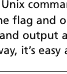

> 你可以看到懒惰的系统管理员记住如何使用特定 Unix 命令的捷径：使用 `--help` 标志。命令要么理解该标志并输出一些帮助信息，要么解析该标志发现它不被识别并输出包含帮助信息的 `Usage` 错误。无论哪种方式，都很简单，并且 99% 的时间都有效。

最有趣的标志是 `-v`，它显示压缩活动的結果。让我们试试！

```
$ compress -v *mp3
Nice Work.mp3: No compression -- Nice Work.mp3 unchanged
```

一个有趣的首次测试：由于此文件中信息排列的方式，`compress` 尝试压缩它，但发现压缩后的文件与原始文件相比并没有显著变小，因此拒绝完成压缩任务。

让我们改试其他一些文件：

```
$ compress -v *jpg *doc
rowing-w-jasmine2.jpg: No compression -- rowing-w-jasmine2.jpg unchanged
proposal.doc: -- replaced with proposal.doc.Z Compression: 62.31%
```

这里可以看到结果：`proposal.doc` 文件压缩了超过 60%——它原本为 130K，但现在只有 49K，如下所示：

```
$ ls -l p*
-rw-r--r-- 1 taylor coders 49010 Jan 21 12:42 proposal.doc.Z
```

然而，文件本身在未先解压缩之前就无法使用，这正是 `uncompress` 命令的目的。

### 3. 使用 `zcat` 查看压缩文件

一个非常实用的工具是 `zcat`，它可以让你无需麻烦地处理压缩文件，它的作用与 `cat` 命令完全相同，但可以在运行时解压缩压缩文件。举例来说，许多 Unix 上的 `man` 系统就是这样工作的：所有 `man` 页面都以压缩形式存储，其内容在运行时解压缩，`zcat` 将其输出馈送到 `nroff` 格式化程序。

就我们的目的而言，让我们使用 `zcat` 在不解压缩的情况下偷看压缩的邮件日志文件的开头几行：

```
$ zcat maillog.txt.Z | head -2
Dec 24 04:02:09 staging sendmail[16202]: fB0C29k16202: from=root, size=186,
class=0, nrcpts=1, msgid=<200112241202.fB0C29k16202@staging.intuitive.com>,
relay=root@localhost
Dec 26 04:02:09 staging sendmail[19880]: fB0C29D19880: from=root,
size=1315, class=0, nrcpts=1,
msgid=<200112261202.fB0C29D19880@staging.intuitive.com>,
relay=root@localhost
```


> Linux 上的 `zcat` 命令实际上是 `gzip` 实用程序的一部分，我们将在本小时稍后探索它。

### 5. Red Hat Linux 上的压缩相关实用程序

事实证明，在 Red Hat Linux 的世界里，有许多实用程序可以直接处理压缩文件，如以下列表所述：

```
zcat [compress]      (1)  - compress and expand data (version 4.1)
zcat [gzip]          (1)  - compress or expand files
zcat [uncompress]    (1)  - compress and expand data (version 4.1)
zcmp [zdiff]         (1)  - compare compressed files
zdiff                (1)  - compare compressed files
zgrep                (1)  - search possibly compressed files for expression
zless                (1)  - file perusal filter for viewing compressed text
zlib                 (3)  - compression/decompression library
zmore                (1)  - file perusal filter for viewing compressed text
znew                 (1)  - recompress .Z files to .gz files
```

### 6. 跨平台压缩结果差异

观察同一命令压缩同一原始文件在不同的 Unix 平台上产生不同的结果，既有趣又能说明 Unix 各发行版之间细微的差异。

```
Red Hat Linux 7.2:
$ compress -v Nice* maillog* prop* rowing*
Nice Work.mp3: No compression ... Nice Work.mp3 unchanged
maillog.txt: ... replaced with maillog.txt.Z Compression: 90.66%
proposal.doc: ... replaced with proposal.doc.Z Compression: 62.31%
rowing-w-jasmine2.jpg: No compression ... rowing-w-jasmine2.jpg unchanged
```

```
Solaris 8:
$ compress -v Nice* maillog* prop* rowing*
Nice Work.mp3: Compression: -29.87% ... file unchanged
maillog.txt: Compression: 90.80% ... replaced with maillog.txt.Z
proposal.doc: Compression: 62.31% ... replaced with proposal.doc.Z
rowing-w-jasmine2.jpg: Compression: -30.28% ... file unchanged
```

```
Darwin/Mac OS X:
$ compress -v Nice* maillog* prop* rowing*
Nice Work.mp3: file would grow; left unmodified
maillog.txt.Z: 9% compression
proposal.doc.Z: 58% compression
rowing-w-jasmine2.jpg: file would grow; left unmodified
```

令人惊讶的是，`maillog.txt` 文件的最终大小在每个平台上都不同，如表 7.1 所述。

表 7.1 压缩文件大小的变化

| 文件名 | 原始大小 | Linux | Solaris | Darwin |
|---|---|---|---|---|
| maillog.txt | 39,350,440 | 3,677,629 | 3,696,761 | 3,696,039 |


随着你在 Unix 系统上花费更多时间探索，你不可避免地会发现很少访问的大文件。也许是一个以归档格式保存的老开发项目？为车库乐队存储在服务器上的 MP3 集合？不再属于网站的一部分的流媒体视频？为长期系统使用分析而保留的归档日志文件？

无论很少使用文件的原因是什么，`compress`都是一个很棒的工具，可以帮助最大化你的磁盘空间可用性。不仅如此，它也是一个很好的命令，可以教给你的用户，以便他们也能更明智地管理自己的磁盘空间。

## gzip 替代方案

虽然`compress`有着悠久而值得尊敬的历史，但它并不是 Unix 系统上唯一懂得压缩文件的实用程序。还有两个值得注意的工具，`zip`和`gzip`。它们听起来像是同一个程序，但绝对不是。

`zip`实用程序让你可以构建文件和目录的包，然后自动压缩它们。这个实用程序最有帮助的地方在于它与 Windows 上非常流行的 PKZIP 和 WinZip 实用程序完全兼容。更棒的是，Aladdin System 非常成功的 Mac OS StuffIt 系统也知道如何处理 ZIP 归档，因此它是一个完全跨平台的解决方案。


> 事实上，ZIP 归档在 Unix、VMS、MSDOS、OS/2、Windows、Macintosh、Amiga、Atari，甚至 Acorn 系统之间都是兼容的。

`gzip`实用程序旨在成为`compress`的替代品，正如程序作者在文档中明确指出的：“我们开发这个程序是为了替代`compress`，因为 UNISYS 和 IBM 对`compress`使用的 LZW 算法拥有专利。这些专利使我们无法使用`compress`，我们需要一个替代品。`gzip`更优的压缩比只是锦上添花。”


> 一点历史：'GNU' 项目（其缩写是，而且我没开玩笑，GNU's Not Unix）诞生于开发者社区对 AT&T 的不满，AT&T 是原始 Unix 系统的专利持有者和所有者，采用了强硬手段。GNU 的存在目的是提供一个摆脱所有专利和其他公司知识产权的 Unix 免费版本，并且它出人意料地取得了成功。这是一段引人入胜的阅读，可以在 http://www.gnu.org/ 在线找到。

还有一种在某些 Unix 版本中常见的压缩程序：`pack`。`pack`命令使用 Huffman 编码压缩算法，可在 Solaris 8 上使用，但在 Linux 或 Darwin 上不可用。然而，由于`compress`和`gzip`的广泛可用性，我认为没人会使用它。

### 任务 7.2：使用 gzip

有替代的压缩工具，但`gzip`值得特别关注，因为它已成为 Unix 社区事实上的首选压缩工具。

- 1. 首先，让我们看看使用`--help`标志是否会产生一些有用的信息：

```
$ gzip --help
gzip 1.3
(1999-12-21)
usage: gzip [-cdfhlnNrtVv19] [-S suffix] [file ...]
 -c -stdout write to standard output, keep original files unchanged
 -d -decompress decompress
 -f -force force overwrite of output file and compress links
 -h -help give this help
 -l -list list compressed file contents
 -L -license display software license
 -n -no-name do not save or restore the original name and time stamp
 -N -name save or restore the original name and time stamp
 -q -quiet suppress all warnings
 -r -recursive operate recursively on directories
 -S .suf -suffix .suf use suffix .suf on compressed files
 -t -test test compressed file integrity
 -v -verbose verbose mode
 -V -version display version number
 -1 -fast compress faster
 -9 -best compress better
 file... files to (de)compress. If none given, use standard input.
Report bugs to <bug-gzip@gnu.org>.
```

注意每个命令标志都有两种形式：单字母的传统 Unix 标志（例如，`-f`、`-v`）和双破折号的全词标志（例如，`--force`、`--verbose`）。只有 GNU 版本的 Unix 命令才提供全词标志选项，因此虽然使用它们可能很诱人，但我建议你学习单字母标志。输入更少，而且当你使用非 GNU 命令时不会感到沮丧，该命令会把`--help`当作对五个标志 `-`、`-h`、`-e`、`-l` 和 `-p` 的请求。

- 2. 有了这个摘要，下面是`gzip`使用的第一个演示：

```
$ gzip -v Nice* maillog* prop* rowing*
Nice Work.mp3: 2.4% -- replaced with Nice Work.mp3.gz
```

```
maillog.txt: 92.3% -- replaced with maillog.txt.gz
proposal.doc: 79.9% -- replaced with proposal.doc.gz
rowing-w-jasmine2.jpg: 0.2% -- replaced with rowing-w-jasmine2.jpg.gz
```

它对`maillog.txt`文件的压缩效果非常出色：与`compress`平均 3.6MB 相比，`gzip`已将其缩小到 2.9MB。然而，`gzip`的一个令人讨厌的特性是它几乎压缩所有东西，即使节省空间毫无意义（JPEG 图像被压缩了 0.2%，原始文件为 522Kb，被替换为 521Kb 的`gzip`版本。）

以下是使用常规`gzip`调用压缩的四个文件的情况：

```
-rw-r--r-- 1 taylor coders 2992332 Jan 21 16:08 maillog.txt.gz
-rw-r--r-- 1 taylor coders 4197440 Jan 21 12:41 Nice Work.mp3.gz
-rw-r--r-- 1 taylor coders 26159 Jan 21 12:42 proposal.doc.gz
-rw-r--r-- 1 taylor coders 521565 Jan 21 12:43 rowing-w-jasmine2.jpg.gz
```

要解压缩它们，只需调用`gunzip`即可

```
$ gunzip *.gz
```

并使用更高的请求压缩比（`-9`标志）进行压缩：

```
$ gzip -v9 Nice* maillog* prop* rowing*
```

```
Nice Work.mp3: 2.4% -- replaced with Nice Work.mp3.gz
maillog.txt: 93.3% -- replaced with maillog.txt.gz
proposal.doc: 80.1% -- replaced with proposal.doc.gz
rowing-w-jasmine2.jpg: 0.2% -- replaced with rowing-w-jasmine2.jpg.gz
```

结果文件只是小了一点点：

```
-rw-r--r-- 1 taylor coders 2604313 Jan 21 16:08 maillog.txt.gz
-rw-r--r-- 1 taylor coders 4197118 Jan 21 12:41 Nice Work.mp3.gz
-rw-r--r-- 1 taylor coders 25850 Jan 21 12:42 proposal.doc.gz
-rw-r--r-- 1 taylor coders 521565 Jan 21 12:43 rowing-w-jasmine2.jpg.gz
```

更好，但可能不足以让你担心是否记得使用`-9`标志！

- 3. `gzip`的一个强大功能是它能够从给定点开始递归压缩当前目录以及任何子目录中的每个文件：

```
$ cd -testdud e

$ gzip -rv9 *
```

```
adduser.sh: 46.3% -- replaced with adduser.sh.gz

browse.sh: 57.1% -- replaced with browse.sh.gz
```


`checkhomes.sh`: 50.4% -- replaced with `checkhomes.sh.gz`

`checkpwp.sh`: 38.8% -- replaced with `checkpwp.sh.gz`

`delete.sh`: 43.7% -- replaced with `delete.sh.gz`

```
DEMO/testfile:               0.0% .. replaced with DEMO/testfile.gz
DEMO/Src/cribbage.c:         69.0% .. replaced with DEMO/Src/cribbage.c.gz
DEMO/snapshot.sh:            28.8% -- replaced with DEMO/snapshot.sh.gz
DEMO/sourcefiles.cpio:       72.8% -- replaced with DEMO/sourcefiles.cpio.gz
diskhogs.sh:                 37.2% -- replaced with diskhogs.sh.gz
getmodemdriver.sh:           37.0% -- replaced with getmodemdriver.sh.gz
getstocks.sh:                39.1% -- replaced with getstocks.sh.gz
gettersheet.sh:              37.0% -- replaced with gettersheet.sh.gz
rowing-w-jasmine2.jpg:        0.2% .. replaced with rowing-w-jasmine2.jpg.gz
suspend.sh:                  47.3% -- replaced with suspend.sh.gz
```

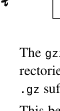

> 如果你之前没见过，`~acct`记法是用户`acct`主目录的便捷快捷方式。如果未指定任何账户，`~`本身在几乎所有有价值的`shell`中都会扩展为你的主目录。

`gzip`程序已自动将目录（及其下方的子目录）中的每个文件替换为压缩版本，并且如常，每个文件都加上了`.gz`后缀。

这种行为对系统管理员来说非常棒。特别是，当账户被挂起时，这可以是一个很好的额外步骤——自动压缩用户主目录中的所有文件，以最大化活跃用户的可用磁盘空间。

- 4. `gunzip`命令是通过硬链接的`gzip`程序的另一个名称。符号链接与硬链接的细微差别有点超出本书范围（请查看 Sams Teach Yourself Unix in 24 Hours 以获得良好解释），但当你看到类似`gzip`（带命令列表）的`man`手册页开头时，这意味着文件系统以某种方式设置。

因为确保命令正确安装是重要的系统管理员任务，让我们快速插一段来学习这是如何完成的！而且，我喜欢这些插曲，你呢？

```
$ man gzip | head
GZIP(1)                                                                 GZIP(1)

NAME
gzip, gunzip, zcat - compress or expand files

SYNOPSIS
gzip [ -acfhlLnNrtvV19 ] [ -S suffix ] [ name ... ]
gunzip [ -acfhlNrtvV ] [ -S suffix ] [ name ... ]
zcat [ -f hLV ] [ name ... ]
```


任何时候你在`man`手册页的`SYNOPSIS`中看到一组不同的命令名称，这意味着同一个可执行二进制文件在文件系统中有多个名称。

这应该可以用`ls`来揭示：

```
$ which gzip
/bin/gzip
$ cd /bin
$ ls -l gzip gunzip zcat
-rwxr-xr-x 3 root root 51228 Aug 23 20:02 gunzip*
-rwxr-xr-x 3 root root 51228 Aug 23 20:02 gzip*
-rwxr-xr-x 3 root root 51228 Aug 23 20:02 zcat*
```

完美。它们大小都相同，并且三个的链接计数也相同（`-l`长输出格式的第二列）。

在上一个输出中注意到什么令人惊讶的地方吗？翻回几页找找线索....

`zcat`命令本应与`compress`实用程序相关联，但你可以看到它显然是`gzip`压缩命令家族的一部分。

这里发生了什么？

这个谜题的解决方案是`gzip`的一个鲜为人知的特性是，它不仅可以解压缩自己的压缩文件格式，还可以解压缩来自`compress`、`zip`和`pack`的文件！

- 6. 如果你不断遇到磁盘空间问题而买不起更大的磁盘，你可以将`gzip`与`find`结合使用，自动遍历用户文件并自动压缩任何异常大的文件：

```
$ find /home -type f -size +1000k -print
/home/taylor/Gator/Snapshots/MAILOUT.tar.Z
/home/taylor/IBM/fop.jar
/home/taylor/IBM/j2sdk_1_3_0_02-solx86.tar
/home/taylor/Lynx/src/lynx
/home/taylor/Lynx/lynx
/home/taylor/maillog.txt.gz
/home/taylor/Nice Work.mp3.gz
```

这个特定命令列出所有大于`1000Kb`的文件（`-type f`）。

将此转换为完全可用的`shell`脚本需要若干步骤，但这次我们直接跳到最终产品：

```
# cat autocompress.sh
#!/bin/sh

# AUTOCOMPRESS : automatically find and compress excessively large files
# in the /home directory tree, sending email to the user so they know
# what’s happened.

homedir="/home"
threshold="+1000k"  # files must be bigger than this to compress
```


```bash
compressed=0

# clean up our temp files before we start
/bin/rm -f /tmp/autocompress.*

for fname in `find $homedir -type f -size $threshold -print | \
egrep -v '(\.Z$|\.gz$|\.tgz$)'`
do
owner=`ls -l $fname | awk '{print $3}'`
if [ $owner = 'root' ]; then
echo "... skipping file $fname (owned by root)"
else
echo 'autocompressing file $fname (owned by $owner)'
gzip $fname
echo "$fname" >> /tmp/autocompress.$owner
compressed=`expr $compressed + 1`
fi
done

# now send out email reports to any users who has had files compressed

if [ $compressed -gt 0 ]; then
for report in `ls /tmp/autocompress.*`
do
recipient=`echo $report | sed 's|/tmp/autocompress.||'`
echo ""
echo "Sending autocompress report to ${recipient}:"
cat $report
(
echo 'In an effort to save disk space, files larger than $threshold'
echo 'are automatically compressed on this system. On a regular sweep'
echo 'through the disk, the following file or files of yours have been'
echo 'identified and auto-compressed:'
cat $report
echo 'To learn how to work with compressed files, please see the '
echo 'gzip man page. You can do this with the command '
echo 'man gzip'
) | mail -s 'Notice: Compressed your big files' $recipient

/bin/rm -f $report
done
echo ""
echo "$compressed file(s) compressed."
else
echo ""
echo "autocompress: no files compressed, no report generated"
fi

exit 0
```

这是一个比之前章节中介绍的脚本更为复杂的 shell 脚本，因此我建议你花一些时间逐行阅读它。特别注意 `$compressed` 变量是如何统计匹配项数量的，以及括号如何生成一个独立的子 shell，并让你能够使用各种 Unix 命令为用户组合出一封非常友好的电子邮件。使用临时文件存储中间信息的做法也值得研究。

## 7. 运行脚本看看会发生什么：

```
# autocompress.sh
autocompressing file /home/taylor/IBM/fop.jar (owned by taylor)
autocompressing file /home/taylor/IBM/j2sdk-1_3_0_02-solx86.tar (owned by taylor)
... skipping file /home/taylor/Lynx/src/lynx (owned by root)
... skipping file /home/taylor/Lynx/lynx (owned by root)

Sending autocompress report to taylor:
/home/taylor/IBM/fop.jar
/home/taylor/IBM/j2sdk-1_3_0_02-solx86.tar

2 file(s) compressed.
```

两个文件已被压缩，另外两个潜在的大文件因归 `root` 所有而被跳过（这表明它们可能更为重要）。脚本的后半部分确保这些更改不会静默发生。相反，用户将收到一封电子邮件通知，告知其自动压缩情况：

```
From: root
Subject: Notice: Compressed your big files

In an effort to save disk space, files larger than >1000k
are automatically compressed on this system. On a regular sweep
through the disk, the following file or files of yours have been
identified and auto-compressed:
/home/taylor/IBM/fop.jar
/home/taylor/IBM/j2sdk-1_3_0_02-solx86.tar
To learn how to work with compressed files, please see the
gzip man page. You can do this with the command
man gzip
```

在 Unix 系统上，`compress` 和 `gzip` 两个命令执行相同的功能——它们用一个包含相同信息但使用性稍差的较小文件替换大文件。压缩质量的差异很重要，但并非关键，因此如果你早已将 `compress` 牢记为缩小文件的方式，那么你可能无需学习任何新技巧。

然而，如果你第一次接触这个主题，`gzip` 才是首选。如果你想要一个强有力的动机，可以查看 `/usr/share/man` 目录，注意所有的 `man` 手册页都以 `.gz` 后缀存储——它们默认都以 `gzip` 压缩格式存储。在下一小时我们将探索各种 Unix 包机制，你会再次看到 `gzip` 是软件开发社区的首选压缩系统。

### zip 的简要介绍

虽然 `zip` 听起来像是 `gzip` 的直系亲属，但实际上它是一个完全不同的程序。是的，它确实进行文件压缩（不过 `zip` 称之为放气和充气，而不是压缩和解压缩），但 `zip` 工具的主要目的是创建包含多个文件和文件夹的归档文件。

历史上，`zip` 由 PKWare（`PKZIP` 的制造商）的 Phil Katz 于 1989 年开发，此后已被各种厂商和大多数主要计算平台采用为归档格式。Linux 上的 `zip` 命令经过多年开发，并非 GNU 项目的一部分，因此它不支持那些奇特的 `--word` 命令参数。

#### 任务 7.3：使用 zip

别再多说了，让我们看看 `zip` 都能做什么！

- 1. 就在他离开前，我们的朋友 `testdude` 询问我们是否可以为他构建一个 Windows 友好的归档文件，包含他主目录中的文件和文件夹并通过电子邮件发送给他。这正是 `zip` 的完美工作！

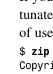

> 值得指出的是，你在未经确认是否合适的情况下可能不想发送用户主目录中的所有文件。我建议你在让用户获取其电子邮件归档、项目目录或任何有疑问的文件之前，先以书面形式获得人力资源或法律部门的批准。

如果你查看 `zip` 手册页，你无疑会感到有点不知所措，但幸运的是，不带任何参数输入 `zip` 会给出一个（非常）简洁的使用摘要：


# 使用 `zip` 构建 PKZIP 兼容归档

```
$ zip
Copyright (C) 1990-1999 Info-ZIP
Type 'zip -L' for software license.
Zip 2.3 (November 29th 1999). Usage:
zip [-options] [-b path] [-t mmddyyyy] [-n suffixes] [zipfile list] [-xi list]
The default action is to add or replace zipfile entries from list, which
can include the special name - to compress standard input.
If zipfile and list are omitted, zip compresses stdin to stdout.

-f freshen: only changed files    -u update: only changed or new files
-d delete entries in zipfile      -m move into zipfile (delete files)
-r recurse into directories       -j junk (don't record) directory names
-0 store only                     -1 convert LF to CR LF (-11 CR LF to LF)
-1 compress faster                -9 compress better
-q quiet operation                -v verbose operation/print version info
-c add one-line comments          -z add zipfile comment
-o read names from stdin          -o make zipfile as old as latest entry
-x exclude the following names    -i include only the following names
-F fix zipfile (-FF try harder)   -D do not add directory entries
-A adjust self-extracting exe     -J junk zipfile prefix (unzipspx)
-T test zipfile integrity         -X eXclude extra file attributes
-y store symbolic links as the link instead of the referenced file
-R PKZIP recursion (see manual)   -n don't compress these suffixes
-e encrypt
```

要构建一个 PKZIP 兼容的归档文件，你需要确保使用以下标志：`-r` 会导致程序递归进入子目录并包含其中的内容，`-9` 请求最佳可能的压缩，`-v` 提供详细输出：

```
$ zip -r -9 -v testdude.zip *
  adding: adduser.sh (in=1113) (out=597) (deflated 46%)
  adding: browse.sh (in=739) (out=317) (deflated 57%)
  adding: checkhomes.sh (in=537) (out=266) (deflated 50%)
  adding: checkpw.sh (in=756) (out=462) (deflated 39%)
  adding: delete.sh (in=693) (out=390) (deflated 44%)
  adding: DEMO/ (in=0) (out=0) (stored 0%)
  adding: DEMO/testfile (in=0) (out=0) (stored 0%)
  adding: DEMO/Src/ (in=0) (out=0) (stored 0%)
  adding: DEMO/Src/cribbage.c (in=26150) (out=8081) (deflated 69%)
  adding: DEMO/snapshot.sh (in=263) (out=187) (deflated 29%)
  adding: DEMO/sourcefiles.cpio... (in=153600) (out=41688) (deflated 73%)
  adding: DEMO/testdir/ (in=0) (out=0) (stored 0%)
  adding: diskhogs.sh (in=373) (out=234) (deflated 37%)
  adding: getmodemdriver.sh (in=605) (out=381) (deflated 37%)
  adding: getstocks.sh (in=569) (out=346) (deflated 39%)
  adding: gettermssheet.sh (in=593) (out=373) (deflated 37%)
  adding: rowing-w-jasmine2.jpg...... (in=522970) (out=521525) (deflated 0%)
  adding: suspend.sh (in=1290) (out=679) (deflated 47%)
  total bytes:710251, compressed=575526 -> 19% savings
```

做得漂亮，文件 `testdude.zip` 现在已准备好通过电子邮件发送给用户。请注意，最后几行显示的 `compressed` 值实际上是生成的归档文件的大小：575,526 字节。

## 使用 `unzip` 检查包内容

如果你想检查包的内容是否正确，可以使用配套的 `unzip`，它在省略参数时也会告诉你其工作原理：

```
$ unzip
```

UnZip 5.42，2001年1月14日，由 Info-ZIP 发布。由 C. Spieler 维护。将错误报告发送至作者 Zip-Bugs@lists.wku.edu；详情请参阅 README。

用法：`unzip [-Z] [-opts[modifiers]] file[.zip] [list] [-x xlist] [-d exdir]`

默认操作是将列表中的文件提取到 `exdir` 中，除 `xlist` 中的文件外；`file.zip` 可以是通配符。`-Z` => ZipInfo 模式（'unzip -Z' 查看用法）。

`-p` 将文件提取到管道中，无消息   `-l` 列出文件（简短格式）

`-f` 刷新现有文件，不创建新文件   `-t` 测试压缩归档数据

`-u` 更新文件，必要时创建   `-z` 显示归档注释

`-x` 排除其后跟随的文件（在 `xlist` 中）   `-d` 将文件提取到 `exdir`

修饰符：

`-n` 从不覆盖现有文件   `-q` 安静模式（-qq => 更安静）

`-o` 覆盖文件且不提示   `-a` 自动转换任何文本文件

`-j` 丢弃路径（不创建目录）   `-aa` 将所有文件视为文本

`-C` 不区分大小写匹配文件名   `-v` 显示详细信息/版本信息

`-X` 恢复 UID/GID 信息   `-L` 使（某些）名称小写

`-V` 保留 VMS 版本号

`-M` 通过 "more" 分页器管道传输

示例（有关更多信息请参阅 `unzip.txt`）：

`unzip data1 -x joe` => 从 zip 文件 `data1.zip` 中提取除 `joe` 外的所有文件

`unzip -p foo | more` => 将 `foo.zip` 的内容通过管道发送到程序 `more`

`unzip -fo ReadMe` => 如果归档文件更新，则 quietly 替换现有 `ReadMe`

要检查 ZIP 归档是否正确，只需使用 `-l` 标志即可：

```
$ unzip -l testdude.zip
```


```
Archive: testdude.zip
Length   Date   Time   Name
------   ----   ----   ----
1113 01-21-02 23:19 adduser.sh
739 01-21-02 23:19 browse.sh
537 01-21-02 23:19 checkhomes.sh
756 01-21-02 23:19 checkpw.sh
693 01-21-02 23:19 delete.sh
0 01-21-02 23:17 DEMO/
0 01-21-02 23:17 DEMO/testfile
0 01-21-02 23:17 DEMO/Src/
26150 01-21-02 23:17 DEMO/Src/cribbage.c
263 01-21-02 23:17 DEMO/snapshot.sh
153600 01-21-02 23:17 DEMO/sourcefiles.cpio
0 01-21-02 23:17 DEMO/testdir/
373 01-21-02 23:19 diskhogs.sh
605 01-21-02 23:19 getmodemdriver.sh
      569 01-21-02 23:19 getstocks.sh
      593 01-21-02 23:19 gettermsheet.sh
      522970 01-21-02 23:19 rowing-w-jasmine2.jpg
      1290 01-21-02 23:19 suspend.sh
      ........ ........
      710251      18 files
```

尽管没有理性的 Unix 系统管理员会使用 zip 作为在不同媒体之间移动归档或备份的机制（这就是 `tar` 或 `tar + gzip` 的用途，正如你很快就会学到的），但仍有大量用户需要为非 Unix 系统提供便携式归档，而这正是 zip 大放异彩的地方。

在多年的系统管理工作中，我自己只创建过一两个 ZIP 归档，但知道 Unix 系统上具备这种能力真的很棒。

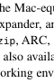

> Darwin 中没有命令行 zip 实用程序，因此如果你必须为用户创建 ZIP 格式归档，你需要使用 StuffIt Deluxe 或其他图形化 ZIP 实用程序。你也可以通过 fink 或类似方式安装 zip 端口，如下一小时所述。

在 Windows 端，有很多不同的 ZIP 友好实用程序可用。两个最受欢迎的是 WinZip 和 PKZIP。WinZip 内置支持 CAB 文件和流行的 Internet 文件格式，如 `tar`、`gzip`、`uuencode`、`BinHex` 和 MIME。PKZIP 也支持 `uuencode`、`BinHex`、`MIME`、`tar`、`gzip`、`CAB` 和 JAR 格式。Mac 等效的超级实用程序是精彩的——而且完全免费的——StuffIt Expander，它不仅支持 ZIP 格式，还支持 BinHex、`tar`、`MIME`、`gzip`、`ARC`、`uuencode`，甚至来自 Unix `compress` 的 `.Z` 文件。（StuffIt Expander 也可用于 Windows、Linux 和 Solaris，如果你想改善自己的工作环境。）

所有这些应用程序都可在网上获取，供任何请求您协助处理此过程的用户使用。请将他们发送至 http://www.winzip.com/ 获取 WinZip。 http://www.pkware.com/ 获取 PKZIP，或 http://www.aladdinsys.com/ 获取 StuffIt 应用程序套件。

## 使用 tar 复制目录树

当谈到构建 Unix 友好的文件和目录归档时，首选命令是 `tar`。令人惊讶的是，`tar` 最初是作为一种将文件写入备份磁带设备的方式而诞生的，以便以后可以恢复它们，同时保留任何子目录信息。

快进几年，`tar` 已成为创建文件集和目录结构快照的最常用实用程序。当然，你可以使用类似 `cp -R` 的命令在系统中的其他位置递归复制目录树，但如果需要通过 `ftp` 将其传输到另一台机器怎么办？这正是 `tar` 的绝佳用途，我们也将从这里开始探索这个强大的实用程序。

### 任务 7.4：使用 tar

乍一看，你可能会想，“作为系统管理员，为什么创建归档文件的能力如此有用？”事实上，我发现自己经常使用 `tar` 命令，无论是将其用于从一个系统传输目录树到另一个系统、从磁盘上的一个位置复制文件到另一个位置，还是甚至对开发目录进行快速“快照”以便拥有备份副本。

`tar` 最流行的用途是从一个系统批量传输文件和目录到另一个系统。

1. `tar` 命令有大量的选项，但有三个核心用途是良好的起点：创建归档、从归档中提取文件以及检查归档的内容。它们分别是 `-c`、`-x` 和 `-t`。其他有用的标志总结在表 7.2 中。

#### 表 7.2 tar 的有用标志

| 标志 | 含义 |
|---|---|
| `-c` | 创建新的归档。 |
| `-f file or device` | 将输出保存为指定的文件名，或写入指定的设备。默认输出设备因系统而异，但在 Linux 上它是 `/dev/rmt0`，通常是磁带驱动器或类似的流式备份介质。 |
| `-N date` | 仅归档比指定日期更新的文件。日期格式可以包括 2003-08-03（年-月-日），和 3 Aug 2003（日 月名 年）。此标志仅在 GNU `tar` 中可用。 |
| `-p` | 保留文件信息。确保在可能的情况下，UID、GID、文件权限以及访问和修改时间与文件本身一起恢复。 |
| `-t` | 显示 `tar` 归档的内容。 |
| `-v` | 详细输出。适用于 `tar` 使用的三种模式。 |
| `-x` | 从 `tar` 归档中提取文件或文件。 |
| `-Z` | 通过 `compress` 过滤归档。 |
| `-z` | 通过 `gzip` 过滤归档。 |

`tar` 命令至少有 20 个不同的标志，GNU 版本更是超过两倍之多，所以如果真的想让自己头脑发晕，请查看 `man` 手册！相反，让我们直接开始使用 `tar` 命令。

2. 刚刚设置了一个新的 OS X 系统，为什么不创建一个包含我 Linux 账户中所有文件的压缩 `tar` 归档，将其 `ftp` 到 Mac，然后用 `tar` 解包呢？这是一个非常常见的任务！

第一步是在 Linux 系统上创建归档。因为我想同时获取点文件（以 `.` 开头的文件），我将使用一个复杂的匹配模式：

```
$ cd ~taylor
$ tar -cvzf /tmp/taylor-dir.tar.gz .[a-zA-Z]* *
.bash_history
.bash_logout
.bash_profile
.bashrc
.emacs
.gtkrc
.kde/
.kde/Autostart/
.kde/Autostart/Autorun.desktop
.kde/Autostart/.directory
.mc/
.mc/tmp/
.mc/ini
.mc/history
.mc/tree
.screenrc
CBO_MAIL/
... lots of output removed ...
balance/getquotes-txt.sh
/etc/passwd
getmodemdriver.sh
getstocks.sh
gettermsheet.sh
gif.gif
mail.log
proposal.doc.gz
rowing-w-jasmine2.jpg.gz
suspend.sh
```

注意归档的文件报告：

```
$ file *gz
taylor-dir.tar.gz: gzip compressed data, deflated, last modified: Tue Jan 22 12:06:33 2002, os: Unix
```

3. 要将文件传输到 Mac 系统，我将使用 `ftp`，这是一个不优雅但效果很好的程序：


```
$ ftp g4.intuitive.com
Connected to g4.intuitive.com (198.76.82.132).
220 g4.intuitive.com FTP server (Version 6.00LS) ready.
Name (g4.intuitive.com:taylor): taylor
331 Password required for taylor.
Password:
230 User taylor logged in.
Remote system type is Unix.
Using binary mode to transfer files.
ftp> binary
200 Type set to I.
ftp> lcd /tmp
Local directory now /tmp
ftp> cd /tmp
250 CWD command successful.
ftp> put taylor-dir.tar.gz
local: taylor-dir.tar.gz remote: taylor-dir.tar.gz
227 Entering Passive Mode (198,76,82,132,195,54)
150 Opening BINARY mode data connection for 'taylor-dir.tar.gz'.
226 Transfer complete.
3064316 bytes sent in 125 secs (24 Kbytes/sec)
ftp> quit
221 Goodbye.
```

通过慢速 DSL 线路，从远程位置的 Linux 服务器传输 3MB 数据到我办公室的 Mac 服务器，只花了两分多一点的时间。不错。

### 在 Darwin 盒子上解包归档

要在 Darwin 盒子上解包归档，让我们先使用 `-t` 标志检查其内容，并指定文件名将要匹配的模式：

```
$ tar -tzf *gz DEMO
DEMO
DEMO/testfile
DEMO/Src
DEMO/Src/cribbage.c
DEMO/snapshot.sh
DEMO/sourcefiles.cpio
DEMO/testdir
```

这显示了与指定模式 `DEMO` 匹配的所有文件和目录。另一个快速示例列出了所有 C 程序源文件：

```
$ tar -tzf *gz *.c
DEMO/Src/cribbage.c
bin/fixit.c
balance/filter.c
```

要提取特定文件，只需将 `-t` 标志改为 `-x` 标志。以下是如何在 Darwin 中解包 `DEMO` 目录的方法：

```bash
$ tar -xzvpf /tmp/gz DEMO
```

```
DEMO
DEMO/testfile
DEMO/src
DEMO/src/cribbage.c
DEMO/snapshot.sh
DEMO/sourcefiles.cpio
DEMO/testdir
```

与大多数 `tar` 归档文件一样，它假定你已在要安装到的目录中，因此 `DEMO` 目录已添加到当前工作目录。

`tar` 的一个非常常见的用途是在保留原始文件所有权和权限的同时，将目录树从一个位置复制到另一个位置。

对于这种情况的标准解决方案是指定 `-` 作为输出设备，因为所有信息都将流向标准输出。只需在接收端再使用一个 `tar`，让它期望从标准输入接收信息：

```bash
cd olddir; tar -cf - . | (cd newdir; tar -xpf - )
```

括号会启动一个子 shell，它继承父 shell 的 stdin、stdout 和 stderr。在这种情况下，子 shell 切换到新目录，然后 `tar` 开始解包从第一个 `tar` 命令传递给它的内容。

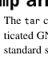

> 使用 `tar` 在没有中间文件的情况下移动目录树时，有一个需要注意的警告。由于 `tar` 在解包归档文件时会尝试智能地重建符号链接，因此养成始终将 `newdir` 指定为绝对目录名（例如以 `/` 开头的名称）是一个好习惯。

将目录归档、将归档文件移至其他位置，并在另一位置选择性地解包，可能是 Unix 世界中 `tar` 的典型用途。这是一项复杂任务，却能用标准的 Unix 工具轻松完成。

#### dump 与系统备份

`tar` 命令也可以用于系统备份，但除非你拥有功能强大的 GNU `tar` 及其有用的 `-N` 日期标志，否则你可能会发现 `tar` 对于标准的系统备份来说过于原始。你可以备份系统的部分内容，但这足够吗？

事实上，Unix 系统备份的标准方法是 `dump` 命令及其搭档 `restore`。

##### 任务 7.5：增量备份

在系统管理领域，有两种必要的备份类型——完全备份，其中文件系统中的每个文件都会被复制或归档；增量备份，其中仅保存自上次备份以来发生变化的文件。

完全备份很容易，甚至可以用 `tar -cf /dev/st0 /` 来完成，其中 `/dev/st0` 是 SCSI 备份设备的名称，也许是 DAT 磁带或类似设备。


> 一种常见的备份设备是添加到 SCSI 链中的磁带驱动器。如果你的配置是这样，那么你的磁带驱动器最好引用为 Linux 上的 `/dev/st0`、Darwin 上的 `/dev/rs0`（不过在使用前你必须 `mknod` 它），以及 Solaris 上的 `/dev/rmt/0`。关于设备是否会倒带也有一些细微差别，因此请务必查阅系统文档以核实确切的设备名称。例如，虽然 `/dev/st0` 可用于 Linux，但同一台 SCSI 磁带驱动器的不倒带设备名称将是 `/dev/nst0`。

更有趣的情况是当你想要进行增量备份时。如何找到自上次备份（根据前一晚的情况，可能是完全备份或增量备份）以来发生变化的文件，并只将这些文件复制到归档设备？

你可以用 `find` 配合其超级有用的 `-newer` 标志来识别已更改的文件，但让我们转而关注标准的 Unix `dump` 命令，因为它内置了此功能，还有更多其他功能。

`dump` 命令基于多级备份的概念：级别 0 的 dump 是完全备份，而级别 1-9 的备份只会保存自上次类似或更高级别备份以来发生变化的文件。这很令人困惑，我承认，所以最好像大多数人一样只使用两个级别：0 用于完全备份，1 用于增量备份。


> Solaris 上的 `dump` 命令是供想要分析二进制可执行文件内容的程序员使用的。等效的备份命令称为 `ufsdump`（和 `ufsrestore`），它们的工作方式与此处演示的完全相同。

最后一次备份的时间戳存储在文件 `/etc/dumpdates` 中，并且 `dump` 的一个有些令人讨厌的特性必须考虑：它一次只能备份一个分区或磁盘。快速查看 `df` 的输出显示

```
# df
Filesystem     1k-blocks    Used Available Use% Mounted on
/dev/sda5      380791     102093   259038  29% /
/dev/sda1      49558      7797    39202  17% /boot
/dev/sda3      16033712   40416   1578808  1% /home
none           256436     0      256436  0% /dev/shm
/dev/sdb1      17224524   1310620  1558876  9% /usr
/dev/sdb2      253871     86739   154025  37% /var
```

忽略 `/dev/shm`，因为它是虚拟内存系统的一部分，你可以看到该系统上有五个不同的分区。这意味着你需要调用 `dump` 五次才能成功备份整个系统。

因此，在 Linux 环境中对不倒带的 SCSI 磁带驱动器进行完全备份将如下所示：

```
dump -0uf /dev/nst0 /
dump -0uf /dev/nst0 /boot
dump -0uf /dev/nst0 /home
dump -0uf /dev/nst0 /usr
dump -0uf /dev/nst0 /var
```

承认有点繁琐，但在 Unix 世界中，即使经过 30 年的发展，备份实用程序仍然相当粗糙。

`dump` 命令有许多启动标志，其中最关键的在表 7.3 中突出显示。

## 表 7.3 dump 的关键标志

| Flag | Meaning |

|------|---------|

| 0-9 | 备份级别。级别 0 始终是完全转储。 |

| -b size | 输出设备的块大小。 |

| -f file | 将输出发送到指定的文件或设备。 |

| -S | 估算所需磁带量，而不实际执行备份。 |


`-T date` 根据文件是否比指定日期更新来计算要转储的文件。有关正确日期格式，请参阅 `ctime(3)`。

`-u` 在成功转储后更新 `/etc/dumpdate` 文件。

`-W` 显示需要备份的文件系统，以及每个系统的上次备份时间（如果有）。

为了试验 `dump`，我们可以将输出写入 `/dev/null`，这是一个 Unix 的“位桶”设备——你可以向它写入任意多的数据，它永远不会填满。所有内容都会消失：

```
# /sbin/dump -0uf /dev/null /boot
DUMP: Date of this level 0 dump: Wed Jan 23 12:58:11 2002
DUMP: Dumping /dev/sda1 (/boot) to /dev/null
DUMP: Exclude ext3 journal inode 8
DUMP: Label: /boot
DUMP: mapping (Pass I) [regular files]
DUMP: mapping (Pass II) [directories]
DUMP: estimated 3726 tape blocks.
DUMP: Volume 1 started with block 1 at: Wed Jan 23 12:58:23 2002
DUMP: dumping (Pass III) [directories]
DUMP: dumping (Pass IV) [regular files]
DUMP: Closing /dev/null
DUMP: Volume 1 completed at: Wed Jan 23 12:58:24 2002
DUMP: Volume 1 3720 tape blocks (3.63MB)
DUMP: Volume 1 took 0:00:01
DUMP: Volume 1 transfer rate: 3720 kB/s
DUMP: 3720 tape blocks (3.63MB) on 1 volume(s)
DUMP: finished in 1 seconds, throughput 3720 kBytes/sec
DUMP: Date of this level 0 dump: Wed Jan 23 12:58:11 2002
DUMP: Date this dump completed: Wed Jan 23 12:58:24 2002
DUMP: Average transfer rate: 3720 kB/s
DUMP: DUMP IS DONE
```

作为第二次实验，让我们转储 `/home` 中自 2002 年 1 月 21 日（该示例创建前两天）以来发生变化的所有文件：

```
# /sbin/dump -0f /tmp/homedump -T "Mon Jan 21 00:00:00 2002" /home
DUMP: Date of this level 0 dump: Wed Jan 23 13:10:09 2002
DUMP: Date of last level 7 dump: Mon Jan 21 00:00:00 2002
DUMP: Dumping /dev/sda3 (/home) to /tmp/homedump
DUMP: Exclude ext3 journal inode 8
DUMP: Label: /home
DUMP: mapping (Pass I) [regular files]
DUMP: mapping (Pass II) [directories]
DUMP: estimated 2649 tape blocks.
DUMP: Volume 1 started with block 1 at: Wed Jan 23 13:10:26 2002
DUMP: dumping (Pass III) [directories]
DUMP: dumping (Pass IV) [regular files]
DUMP: Closing /tmp/homedump
DUMP: Volume 1 completed at: Wed Jan 23 13:10:26 2002
DUMP: Volume 1 2680 tape blocks (2.62MB)
DUMP: 2680 tape blocks (2.62MB) on 1 volume(s)
DUMP: finished in less than a second
DUMP: Date of this level 0 dump: Wed Jan 23 13:10:09 2002
DUMP: Date this dump completed: Wed Jan 23 13:10:26 2002
DUMP: Average transfer rate: 0 kB/s
DUMP: DUMP IS DONE
```

此备份映像占用了 2.6MB，或 2,744,320MB 的磁盘空间。

## 4. 让我们看看哪些文件系统需要备份，哪些不需要备份：

```
# /sbin/dump -W
Last dump(s) done (Dump '>' file systems):
```

| 设备 | 文件系统 | 最后一次备份 |
|---|---|---|
| `/dev/sda5` | `/` | 从未 |
| `/dev/sda1` | `/boot` | 级别 0，日期 Wed Jan 23 12:58:11 2002 |
| `/dev/sda3` | `/home` | 从未 |
| `/dev/sdb1` | `/usr` | 从未 |
| `/dev/sdb2` | `/var` | 从未 |

令人惊讶的是，`/home` 分区仍然显示为从未备份。这是因为 `-T` 标志与更新增量备份数据文件 `/etc/dumpdates` 所必需的 `-u` 标志互斥。

## 5. `dump` 的配套命令是 `restore`，它可以从 `dump` 归档中提取一个或多个文件。要列出 `dump` 归档中的内容，`-t` 标志应该很熟悉：

```
# /sbin/restore -tf /tmp/homedump
Dump date: Wed Jan 23 13:10:09 2002
Dumped from: Mon Jan 21 00:00:00 2002
Level 0 dump of /home on staging.intuitive.com:/dev/sda3
Label: /home
2
.
326401      ./taylor
328408      ./taylor/.bash_history
1256641     ./taylor/bin
1256671     ./taylor/bin/autocompress.sh
326425      ./taylor/mail.log
326427      ./taylor/sentinel.file
326428      ./taylor/proposal.doc.gz
326423      ./taylor/rowing-w-jasmine2.jpg.gz
1644161     ./testdud e
1893121     ./testdud e/DEMO
1909441     ./testdud e/DEMO/Src
1909473     ./testdud e/DEMO/Src/cribbage.c.gz
1903763     ./testdud e/DEMO/testdir
1893123     ./testdud e/DEMO/testfile.gz
1893124     ./testdud e/DEMO/snapshot.sh.gz
1893125     ./testdud e/DEMO/sourcefiles.cpio.gz
1844169     ./testdud e/adduser.sh.gz
1844179     ./testdud e/browse.sh.gz
1844171     ./testdud e/delete.sh.gz
1844173     ./testdud e/getmodemdriver.sh.gz
1844174     ./testdud e/getstocks.sh.gz
1844175     ./testdud e/gettermsheet.sh.gz
1844176     ./testdud e/rowing-w-jasmine2.jpg.gz
1844177     ./testdud e/suspend.sh.gz
1844180     ./testdud e/checkhomes.sh.gz
1844170     ./testdud e/checkpw.sh.gz
1844172     ./testdud e/diskhogs.sh.gz
```

虽然你可以直接从命令行指定要恢复的文件，但 `restore` 具有一个很方便的交互模式，使用起来要容易得多。你可以通过 `-i` 标志进入该模式：

这与 `tar` 的处理方式有点不同，因为 `restore` 实际上是它自己的交互式程序，如本示例所示：


```
# /sbin/restore -if /tmp/homedump
/sbin/restore > what
Dump date: Wed Jan 23 13:10:09 2002
Dumped from: Mon Jan 21 00:00:00 2002
Level 0 dump of /home on staging.intuitive.com:/dev/sda3
Label: /home
/sbin/restore > ls
./
taylor/
testdud e/

/sbin/restore > cd testdud e
/sbin/restore > ls
./testdud e:
DEMO/
adduser.sh.gz          checkpw.sh.gz          getstocks.sh.gz
browse.sh.gz           delete.sh.gz           gettermsheet.sh.gz
jasmine2.jpg.gz        diskhogs.sh.gz         rowing-w-jasmine2.jpg.gz
checkhomes.sh.gz       getmodemdriver.sh.gz   suspend.sh.gz

/sbin/restore > cd DEMO
/sbin/restore > ls
./testdud e/DEMO:
Src/                   sourcefiles.cpio.gz    testfile.gz
snapshot.sh.gz         testdir/

/sbin/restore > add testfile.gz
/sbin/restore > add snapshot.sh.gz
/sbin/restore > ls
./testdud e/DEMO:
Src/                   sourcefiles.cpio.gz    *testfile.gz
*snapshot.sh.gz        testdir/

/sbin/restore > extract
You have not read any tapes yet.
Unless you know which volume your file(s) are on you should start
with the last volume and work towards the first.
Specify next volume #: 1
set owner/mode for '.'? [yn] y
/sbin/restore > quit
```

这里的概念是，你正在交互式地浏览归档，并标记每个希望添加到恢复列表（提取）中的文件。完成后，`extract` 开始实际工作。如果你的备份在多个卷中，你需要指定卷号，或者对于单卷 `dump` 指定 `1`。

在 Unix 系统上安全可靠地实现备份是困难的，因为命令和实用程序相对原始。尽管如此，忽视备份是一种危险的做法，系统随时可能崩溃并可能烧毁。那时你的用户会怎么说你呢？

在线探索有关不同备份设备及其权衡的信息——一个不错的起点是 `http://www.backupcentral.com/`——然后在购买和安装之前，确保该设备得到你所使用的 Unix 版本的支持。一旦一切运行顺畅，立即建立磁带轮换制度并将 `dump` 命令添加到你的 `crontab` 文件中。（我们将在第 15 小时“在未来运行作业”中详细介绍 `cron`。）

## Summary
## 摘要

本小时探讨了压缩和文件系统备份的细微差别。我们看到了不同的压缩工具在 Unix 系统上会产生惊人不同的结果，而且这些实用程序还有多种非磁带备份用途。最后一点评论：如果你要创建备份方案，请记住轮换你的磁带，这样除了用于最新备份的磁带外，你始终还会有几天前的安全备份。

## Q&A
## 问答

**Q Why are the backup solutions so poor on Unix?**
**Q Unix 上的备份解决方案为什么这么差？**

**A** That’s a good question with no good answer. With thousands of Unix servers powering the Internet, you’d think that there are better backup solutions than `dump` and expensive commercial solutions. The only other interesting backup applications I know of are `Kbackup` (X Window System-based), `BURT` (based on Tcl/Tk), and `Amanda` (Advanced Maryland Automatic Network Disk Archiver).

**A** 这是个好问题，但没有好答案。成千上万台驱动互联网的 Unix 服务器，你会认为除了 `dump` 和昂贵的商业解决方案之外应该有更好的备份解决方案。我所知道的唯一其他有趣的备份应用程序是 `Kbackup`（基于 X Window System）、`BURT`（基于 Tcl/Tk）和 `Amanda`（Advanced Maryland Automatic Network Disk Archiver）。

**Q How do you do backups on your own server?**
**Q 你自己的服务器上如何做备份？**

**A** Um, err, next question?

**A** 呃，嗯，下一个问题？

**Q What’s your favorite compression program?**
**Q 你最喜欢的压缩程序是什么？**

**A** I always use `gzip -9` if it’s available, to get the maximum compression possible. On the other hand, the command `compress` is certainly more mnemonic, so perhaps an alias…?

**A** 如果有的话，我总是使用 `gzip -9` 以获得最大可能的压缩率。另一方面，命令 `compress` 确实更易记，所以也许可以设置一个别名…？

## Workshop
## 练习

### Quiz
### 测验

- 1. Why do you think that `compress` had different results on different platforms?
- 1. 你认为为什么 `compress` 在不同平台上会有不同的结果？

- 2. When compressing lots of different types of files, what's the main difference—other than compression efficiency—between `compress` and `gzip`?
- 2. 在压缩大量不同类型的文件时，除了压缩效率之外，`compress` 和 `gzip` 的主要区别是什么？

- 3. How do you view the contents of compressed files without uncompressing them?
- 3. 如何在不解压缩的情况下查看压缩文件的内容？

- 4. Where will `cd ~` take you?
- 4. `cd ~` 会带你到哪里？

- 5. What does `tar -xzvPf /dev/st0` do?
- 5. `tar -xzvPf /dev/st0` 是做什么的？

### Answers
### 答案

- 1. Actually, that's a really good question. Logically, if they're using the same algorithm, they should all have the same results. I'd be interested in hearing your own theory on this puzzling variation.
- 1. 实际上，这真是个好问题。逻辑上，如果它们使用相同的算法，结果都应该相同。我很感兴趣听听你对这种令人困惑的差异的自己的理论。

- 2. The main difference is that `gzip` likes to compress everything, even if the resultant file is a tiny bit bigger than the original. This rarely occurs, because `gzip` does a great job of compression, but it's still peculiar.
- 2. 主要区别在于 `gzip` 喜欢压缩所有内容，即使 resulting 文件比原始文件稍大一些。这种情况很少发生，因为 `gzip` 的压缩效果非常好，但仍然很奇怪。


进入`/path/to/xxx`目录，找到`xxx.json`。

在表达式`cvar = avar + bvar`中，加法运算符（`+`）将`avar`与`bvar`相加，得到它们的和`cvar`

在`List.of(arg0, arg1, arg2)`中，`List`接口的工厂方法`of()`接受一系列的元素，返回包含它们的只读列表。

之后我们这样调用`cmd`命令：`cmd arg0 arg1 arg2`。

```
if (condVar > someVal) {console.log("xxx")}
```
[/content]

Wait that's example. Need actual.

Let's produce final.

[content]
- 3. 使用 `zcat`，或者如果有的话，使用 `zmore`、`zgrep` 或类似工具。

- 3. 使用 `zcat`，或者如果有的话，使用 `zmore`、`zgrep` 或类似工具。

- 4. 到你的主目录，就像 `cd $HOME` 和 `cd` 所做的那样。

- 4. 到你的主目录，就像 `cd $HOME` 和 `cd` 所做的那样。

- 5. 从 `/dev/st0` 设备提取命令，使用详细输出解压缩它们，并尝试保留归档中的所有权和权限信息。

- 5. 从 `/dev/st0` 设备提取命令，使用详细输出解压缩它们，并尝试保留归档中的所有权和权限信息。

下一小时将探讨精妙的软件包管理世界——管理员通过该机制可以在计算机上获取、安装和卸载新软件。本小时将提供软件包管理功能的基本概述，并使用 RPM 和 fink（Mac OS X 软件包管理系统）探索基本软件包功能。


# Hour 8

## 第 8 小时

### Unix Package Management

### Unix 软件包管理

在个人电脑的世界里，如果你想向系统添加软件包，你可以购买它（或下载它，也许）并运行一个安装程序，该程序在幕后进行大量操作，最终弹出“已安装！”消息。它做了什么，以及你系统上实际安装了什么，可能是一个谜。

源自更平等的根源，Unix 系统多年来一直被困于以源代码分发的软件包，以及关于如何在（好吧，如果？）它编译时构建和安装程序的非常复杂的说明。

然而，在过去的六年里，Unix 已经赶上并在许多方面超越了个人电脑世界的安装策略。然而，没有标准。例如，Red Hat Linux 使用 RPM，即 Red Hat Package Manager 系统。Darwin 使用仍在发展的 fink 系统，而 Solaris 有自己的解决方案——`pkg`。

在本小时你将学习

- 使用 Linux 上的 RPM

- 从互联网添加 RPM 包

- 在 Darwin 上使用 fink

- 在 Solaris 上使用 `pkg`

#### Red Hat 软件包管理器和 Linux

Red Hat 软件包管理器（RPM）系统是 Unix 市场上最复杂的系统之一，是 Red Hat Linux 公司合同程序员（后来是员工）多年开发的成果。事实上，一些系统管理员坚持使用 Red Hat，正是因为 RPM 非常易于使用。

RPM 背后的概念与所有软件包管理器相同：它们封装了安装和启用指定软件包所需的所有文件和配置细节，包括跟踪库的版本号、安装相关文档，甚至自动检查以确保安装不会覆盖另一个软件包所需的文件。

然而，RPM 的界面有点令人困惑，所以让我们直接上手看看它是如何工作的。

> 如果你使用的是图形界面，好消息是 Linux 中两种流行的窗口管理器都有 RPM 前端——GNOME 的 GnoRPM，以及 KDE 的 Kpackage。

##### 任务 8.1：使用 RPM

在你的软件包管理器中，你需要知道如何执行一些基本任务：查询已安装的软件包、安装（或更新）特定软件包、列出给定软件包包含的文件，以及从系统中删除软件包。

1. 最基本的 RPM 命令是查询所有软件包。这使用 `-qa` 完成，你的系统上可能安装了 400-600 个软件包。当我们第一次安装 Red Hat Linux（参见第 1 小时，“安装 Unix”）时，请回忆我们选择了“工作站”配置，并且花费了很长时间，因为它在逐个安装软件包。RPM 就是你可以回头查询它到底做了什么的方式。

```
$ rpm -qa | head
redhat-logos-1.1.3-1
glibc-2.2.4-13
cracklib-2.7-12
dosfstools-2.7-1
gdbm-1.8.0-10
ksymoops-2.4.1-1
mktemp-1.5-11
perl-5.6.0-17
setserial-2.17-4
netconfig-0.8.11-7
$ rpm -aq | wc -l
638
```

系统上安装了超过 600 个软件包，因此如果不将 `rpm -qa` 的输出发送到分页器之类的工具，就会产生海量信息！

每个软件包都由其名称、版本号和软件包版本号标识。例如，Perl 软件包被标识为 `perl-5.6.0-17`，这意味着它是 Perl 5.6.0 版本的 perl 软件包，并且这是该特定 Perl 发行版的 RPM 软件包的第 17 个版本。

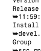

> 为什么这是该软件包的第十七个版本？因为当软件包很大、包含大量文件并且有大量依赖关系时，软件包开发人员通常需要多次尝试才能为所有平台和可能的配置做好准备。无需担心！

2. 要了解有关特定软件包的更多信息，请使用 `rpm -qi`，可以指定完整的软件包名称，也可以只指定基本名称：

```
$ rpm -qi setserial
Name : setserial              Relocations: /usr
Version : 2.17                Vendor: Red Hat, Inc.
Release : 4                   Build Date: Sun 24 Jun 2001
Install date: Wed 21 Nov 2001 02:34:04 PM PST   Build Host: elliot.
Group : Applications/System   Source RPM: setserial-2.17-4.
Size : 31113                  License: GPL
Packager : Red Hat, Inc. <http://bugzilla.redhat.com/bugzilla>
Summary : A utility for configuring serial ports.
Description :
Setserial is a basic system utility for displaying or setting serial
port information. Setserial can reveal and allow you to alter the I/O
port and IRQ that a particular serial device is using, and more.
```

3. 我非常喜欢其他软件包系统的一个特性，而 RPM 却没有，那就是提供软件包及其描述的摘要列表的能力。

然而，如果你查看输出，会有一个 Summary 行。因此，通过一点谨慎的 shell 脚本编码，可以生成 `showrpms`：

```sh
$ cat showrpms.sh
#!/bin/sh

# SHOWRPMS - List all the RPM packages on the system in a friendly manner
count=0

for package in `rpm -qa`
do
  summary=`rpm -qi $package | grep '^Summary' | cut -d: -f2-`
  echo "$package: $summary"
  count=`expr $count + 1`
done

echo ""
echo "Listed $count RPM packages"
exit 0
```

简而言之，这会遍历 `rpm -qa` 报告的所有软件包，查询每个软件包的信息，然后提取摘要行并在同一行输出软件包名称和摘要：


```sh
$ showrpms.sh | head
redhat-logos-1.1.3-1: Red Hat-related icons and pictures.
glibc-2.2.4-13: The GNU libc libraries.
cracklib-2.7-12: A password-checking library.
dosfstools-2.7-1: Utilities for making and checking MS-DOS FAT filesystems on Linux.
gdbm-1.8.0-10: A GNU set of database routines which use extensible hashing.
ksymoops-2.4.1-1: Kernel oops and error message decoder
mktemp-1.5-11: A small utility for safely making /tmp files.
perl-5.6.0-17: The Perl programming language.
setserial-2.17-4: A utility for configuring serial ports.
netconfig-0.8.11-7: A text-based tool for simple configuration of ethernet devices.
```

一个更具吸引力且对系统管理员更友好的输出！


> 实际上，如果你深入研究，可以让 RPM 以这种格式输出信息。有一个命令选项 `--queryformat`，允许你指定要呈现的确切信息以及其形式。如果你使用

```bash
rpm -qa --queryformat '%{NAME}: %{SUMMARY}\n'
```

你的输出将与 `showrpms` 脚本相同。

### 4. 现在我们可以更有效地搜索，例如查看安装了哪些命令行 shell：

```
$ showrpms.sh | grep -i shell
sharutils-4.2.1-8: The GNU shar utilities for packaging and unpackaging shell archives.
mc-4.5.51-80: A user-friendly file manager and visual shell.
docbook-utils-0.6.9-2: Shell scripts for managing DocBook documents.
bash-2.05-8: The GNU Bourne Again shell (bash) version 2.05.
ash-0.3.7-2: A smaller version of the Bourne shell (sh).
tcsh-6.10-6: An enhanced version of csh, the C shell.
sh-utils-2.0.11-5: A set of GNU utilities commonly used in shell scripts.
```

RPM 软件包是在系统上管理软件包的强大方式，但当你可以从互联网获取不同的软件包并轻松扩展系统的功能时，它才真正令人兴奋！

#### 从互联网添加新的 RPM 软件包

`rpm` 命令本身没有能力访问网络存档并搜索可用软件包，因此你需要打开图形 Web 浏览器（也许是流行的 Linux 浏览器 Konqueror）并四处查看一下。

##### 任务 8.2：安装新的基于 Web 的 RPM 软件包

要在系统上安装新软件包，你需要探索网络并确定所需的特定软件包。

> 开始搜索 RPM 软件包的一个好地方是 Pbone 网站 http://rpm.pbone.net/。你也可以通过访问 http://www.rpm.org/ 来确保你拥有最新版本的 RPM。

1. 因为网络并不总是可用，我喜欢在自己的系统上保留相关文档的副本以备备份。我访问了 Pbone 并了解到优秀的 Linux FAQ 集合可作为名为 `faq-7.2.1.noarch.rpm` 的 RPM 软件包提供。网站上还列出了世界各地各种服务器上的特定软件包的完整 URL。

我将从俄克拉荷马大学选择一个链接，并使用 `-i` 安装、`-v` 获取更详细的输出以及 `-h` 在文件下载时显示一系列哈希标记将其提供给 RPM 软件包：

```bash
# rpm -ivh ftp://ftp.ou.edu/mirrors/linux/redhat/redhat-7.2-en/doc/RedHat/RPMS/faq-7.2.1.noarch.rpm
Retrieving ftp://ftp.ou.edu/mirrors/linux/redhat/redhat-7.2-en/doc/RedHat/RPMS/faq-7.2.1.noarch.rpm
Preparing...
######################################## [100%]
1:faq ######################################## [100%]
```

2. 看起来安装得很顺利。让我们使用 `-qi` 标志再次确认：

```bash
# rpm -qi faq
Name        : faq                     Relocations: (not relocatable)
Version     : 7.2                     Vendor: Red Hat, Inc.
Release     : 1                       Build Date: Thu 30 Aug 2001
Install Date: Sat 26 Jan 2002 11:31:11 AM PST   Build Host: strippies.devel.redhat.com
Group       : Documentation           Source RPM: faq-7.2.1.src.rpm
Size        : 1596478                 License: distributable
Packager    : Red Hat, Inc. <http://bugzilla.redhat.com/bugzilla>
Summary     : Frequently Asked Questions (FAQ) about Linux.
Description :
The faq package includes the text of the Frequently Asked
Questions (FAQ) about Linux from
http://metalab.unc.edu/pub/Linux/docs/faqs/. These FAQs are a great source
of information (sometimes historical) about Linux.
```

如果你想在自己的机器上阅读 Linux FAQ，请安装 `faq` 软件包。

RPM 还有一个有用的标志，可以显示软件包安装的所有文件的确切名称——`-l` 标志：

```bash
# rpm -ql faq | wc -l
121
```

你可以看到，通过这个简单的 `rpm` 安装安装了超过 120 个文件。要预览一下，让我们使用 `head`：

```bash
# rpm -ql faq | head -20
/etc/X11/applnk/Documentation
/etc/X11/applnk/Documentation/Linux Community
/etc/X11/applnk/Documentation/Linux Community/faq.desktop
/usr/share/doc/FAQ
/usr/share/doc/FAQ/html
/usr/share/doc/FAQ/html/AfterStep-FAQ
/usr/share/doc/FAQ/html/AfterStep-FAQ/AfterStep-FAQ-1.html
```


```
▼
/usr/share/doc/FAQ/html/AfterStep-FAQ/AfterStep-FAQ-10.html
/usr/share/doc/FAQ/html/AfterStep-FAQ/AfterStep-FAQ-2.html
/usr/share/doc/FAQ/html/AfterStep-FAQ/AfterStep-FAQ-3.html
/usr/share/doc/FAQ/html/AfterStep-FAQ/AfterStep-FAQ-4.html
/usr/share/doc/FAQ/html/AfterStep-FAQ/AfterStep-FAQ-5.html
/usr/share/doc/FAQ/html/AfterStep-FAQ/AfterStep-FAQ-6.html
/usr/share/doc/FAQ/html/AfterStep-FAQ/AfterStep-FAQ-7.html
/usr/share/doc/FAQ/html/AfterStep-FAQ/AfterStep-FAQ-8.html
/usr/share/doc/FAQ/html/AfterStep-FAQ/AfterStep-FAQ-9.html
/usr/share/doc/FAQ/html/AfterStep-FAQ/AfterStep-FAQ.html
/usr/share/doc/FAQ/html/AfterStep-FAQ/new.gif
/usr/share/doc/FAQ/html/AfterStep-FAQ/next.gif
/usr/share/doc/FAQ/html/AfterStep-FAQ/prev.gif
▲
```


> > FAQ 包的前述示例是一个很好的起点，因为它没有依赖项。使用 RPM 工作时令人沮丧的一大原因是列出的依赖项存在不一致，因此尝试安装一个包时往往首先需要安装半打更新的库和支持包。这可能最令人沮丧！

能够快速轻松地从 Web 安装 RPM 包是使用 Linux 的真正奢侈之一。更新已安装的软件以匹配新下载的 RPM 也同样容易（例如使用 `rpm -Uvh package` 而不是 `-ivh`）。要删除包，请使用 `rpm -e packagename`。最有帮助的 `rpm` 标志总结在表 8.1 中。

##### 表 8.1 rpm 的有用的标志

| Flag | Meaning |
|------|---------|
| -e | 从系统中删除指定的 RPM 包。 |
| -h | 以井号 (#) 在屏幕上显示任何下载的进度。 |
| -i | 安装。（与 -v 一起使用以查看正在进行的操作。） |
| -p | 查询未安装的包。非常有帮助！ |
| -q | 查询 RPM 数据库：-qa 查询所有包，或可以按名称指定包。 |
| -U | 升级自上次安装以来指定的包中发生变化的部分。 |
| -v | 详细——RPM 通常只列出错误，这可能会令人困惑。使用 -v 查看它正在做什么。 |

#### Darwin 中的包管理

Darwin 中没有内置的默认包管理器，虽然 Mac OS X 拥有非常复杂的 Mac 应用安装系统，但它无法从命令行访问，也无助于特别扩展 Unix 部分。

好消息是开源社区已联合起来构建了一个非常复杂的替代包管理系统，名为 `fink`。


> > 想知道 fink 是什么意思吗？来自原始开发者：“Fink 是 Finch 的德语名称，一种鸟类。我在为项目寻找名称时，操作系统的名称 Darwin 让我想到查尔斯·达尔文、加拉帕戈斯群岛和进化。我记得在学校学过一篇关于所谓的达尔文雀及其喙的文章，就这样了....”你可以在 http://fink.sourceforge.net/faq/ 的优秀 fink FAQ 中阅读更多内容。

开始使用 fink，你需要下载初始的 fink 分发包，它被打包为标准的 Mac OS X 应用二进制文件。

##### 任务 8.3：安装和使用 fink

使用 fink 在你的 OS X Macintosh 上的第一步是确保已安装 Developer Tools，它包含在你的 Mac OS X 发行版中。如果没有，你可以随时从 Apple 的 http://developer.apple.com/tools/macosxtools.html 下载。

准备就绪后，访问 http://fink.sourceforge.net/ 并点击 Downloads 链接。然后你需要选择 Binary Installer，它的大小略小于 8MB。

下载完成后，点击 .pkg 打开的盒子图标来安装 fink 系统。请记住，如图 8.1 所示，你需要管理员密码才能成功安装。

完成之后，它会快速通过各种屏幕并无错误地完成。还有一个必要的步骤：当你在 OS X 中启动 Terminal 时，确保将 `/sw/bin` 和 `/sw/sbin` 添加到你的 `PATH` 中，以便可以找到命令。事实上，在编辑你的 `.cshrc`（或等效文件）时，你可能还想添加第二个环境变量：`MANPATH="/sw/share/man"`，以确保可以找到 fink 安装的应用的手册页。现在你可以开始了！

##### 图 8.1

管理员密码提示。

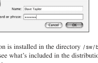

- 1. fink 应用安装在目录 `/sw/bin` 中，所以让我们从 list 命令开始，看看发行版中包含什么：

```
# fink list | head
```

```
Reading package info...
Information about 251 packages read.
a2ps 4.12-4 Any to PostScript filter.
anacron 2.3-3 A periodic command scheduler
ant 1.4.1-2 Java based build tool.
apache 1.3.20-2 Flexible and extensible web server
app-defaults 20010814-1 Creates an app-defaults directory for fink
i apt 0.5.4-1 Advanced front-end for dpkg
audiofile 0.2.1-2 Audio File Library
autoconf 2.13-3 System for generating configure scripts
```

`fink` 与 RPM 之间一个显著的区别是，`fink` 具有底层网络连接功能，可列出你可能安装的所有包，其中已安装的包在列表左侧用 i 标记（例如 `apt` 包）。

这意味着如果想查看已安装的包，只需将 `fink` 的输出传递给 `grep`：

```
# fink list | grep '^i '
```

```
i apt 0.5.4-1 Advanced front-end for dpkg
i base-files 1.3-1 Directory infrastructure
i bzip2 1.0.4-4 Block-sorting file compressor
i debianutils 1.15-4 Misc. utilities specific to Debian (and Fink)
i dpkg 1.9.17-2 The Debian package manager
i fink 0.9.4-1 The Fink package manager
i gettext 0.10.40-1 Message Localization support
i gzip 1.2.4a-5 The gzip file compressor
i libiconv 1.7-3 Character set conversion library
i ncurses 5.2-5 Full-screen ascii drawing library
i tar 1.13.19-1 GNU tar - tape archiver
```

状态可能为 (i) 的包已安装，但有更新版本可用。

- 2. 现在我们已安装 fink，可以解决 Darwin 发行版中的几个问题。是时候安装 `bash` 了，这是一种许多 Unix 系统管理员的首选命令 shell。


```
# fink install bash
Reading package info...
Information about 288 packages read in 1 seconds.
pkg bash version ###
pkg bash version 2.05-3
The following package will be installed or updated:
bash
The following 2 additional packages will be installed:
dlcompat readline
Do you want to continue? [Y/n] y
curl -L -O http://ftp.gnu.org/gnu/bash/bash-2.05.tar.gz
curl -L -O http://prdownloads.sourceforge.net/fink/dlcompat-20010831.tar.gz
curl -L -O http://ftp.gnu.org/gnu/readline/readline-4.2.tar.gz
mkdir -p /sw/src/dlcompat-20010831
tar xvfz /sw/src/dlcompat-20010831.tar.gz
dlcompat-20010831/
dlcompat-20010831/APPLE_LICENSE
dlcompat-20010831/ChangeLog
dlcompat-20010831/dlfcn.h
dlcompat-20010831/dlopen.c
dlcompat-20010831/Makefile
dlcompat-20010831/README
make prefix=/sw
cc -Wall -O2 -DDEBUG=0 -fno-common -o dlopen.o -c dlopen.c
... lots and lots of output removed ...
mkdir -p /sw/fink/dists/stable/main/binary-darwin-powerpc/shells
dpkg -b root-bash-2.05-3
/sw/fink/dists/stable/main/binary-darwin-powerpc/shells
dpkg-deb: building package 'bash' in
'/sw/fink/dists/stable/main/binary-darwin-powerpc/shells/bash_2.05-3_darwin-powerpc.deb'.
ln -sf
/sw/fink/dists/stable/main/binary-darwin-powerpc/shells/bash_2.05-3_darwin-powerpc.deb
/sw/fink/debs/
rm -rf /sw/src/root-bash-2.05-3
dpkg -i
/sw/fink/dists/stable/main/binary-darwin-powerpc/shells/bash_2.05-3_darwin-powerpc.deb
Selecting previously deselected package bash.
(Reading database ... 3476 files and directories currently installed.)
Unpacking bash (from .../bash_2.05-3_darwin-powerpc.deb) ...
Setting up bash (2.05-3) ...
* Bash: (bash) The GNU Bourne-Again SHell.
install-info: no section specified for new entry, placing at end
```

该命令的输出是数百行编译和配置信息，因为在撰写本文时，大多数软件包的二进制发行版不可用。因此，`fink` 自动切换到源代码发行版，安装不再只需要一两分钟，而是几乎花了十分钟完成——下载文件用了两分钟，编译和安装用了七分钟。

安装有用的纯文本网页浏览器 `lynx` 使用 `fink install lynx` 也同样简单。

### 3. 要查看软件包内部内容，请使用 `fink describe pkg`。以下是关于 `bash` 的更多信息，例如：

```
# fink describe bash
Reading package info...
Information about 251 packages read.

bash-2.05-3: The GNU Bourne Again SHell
Bash is an sh-compatible command language interpreter that executes
commands read from the standard input or from a file. Bash also
incorporates useful features from the Korn and C shells (ksh and csh).
.
Bash is ultimately intended to be a conformant implementation of the IEEE
Posix Shell and Tools specification (IEEE Working Group 1003.2).
.
Web site: http://www.gnu.org/software/bash/bash.html
.
Porting Notes:
GNU Bash version 2.05 compiles (and installs correctly after
commenting out the install-info line in doc/Makefile.in)
.
Maintainer: Paul Swenson <pds@mac.com>

Done.
```

### 4. 使用 `fink` 移除软件包非常直接：

```
# fink remove lynx
Reading package info...
Information about 251 packages read.
dpkg -r lynx
(Reading database ... 3548 files and directories currently installed.)
Removing lynx ...
Done.
```

卸载软件包后，`fink` 也足够智能，能够知道核心归档仍然可用，因此重新安装相当迅速：

```
# fink install lynx
Reading package info...
```

```
Information about 251 packages read.
dpkg -i /sw/fink/dists/stable/main/binary-darwin-powerpc/web/lynx_2.8.4-1_darwin-powerpc.deb
Selecting previously deselected package lynx.
(Reading database ... 3475 files and directories currently installed.)
Unpacking lynx (from ../lynx_2.8.4-1_darwin-powerpc.deb) ...
Setting up lynx (2.8.4-1) ...
Done.
```

### 5. `fink` 手册页当然对命令选项有详尽的讨论，但表 8.2 总结了日常使用的关键选项。

表 8.2 `fink` 的关键选项

| 选项 | 含义 |
|---|---|
| `install pkg` | 安装指定的软件包，以及可能需要的任何额外软件包。 |
| `remove pkg` | 从系统中移除指定的软件包。 |
| `list` | 列出所有软件包——用 `i` 标记已安装的，用 `(i)` 标记已安装但过期的。 |
| `describe pkg` | 详细描述指定的软件包。 |
| `selfupdate` | 将 `fink` 本身更新到最新版本。 |

`fink` 软件包出人意料地复杂且易于使用，对那些可能对 Unix 的强大功能——以及怪异之处——相对陌生的 Darwin 用户来说是一大福音。我最喜欢它的一点是，你无需在网上到处寻找软件包，因为它们已经注册在中央 `fink` 数据库中。这是一个 RPM 团队应该效仿的模式。

然而请注意，`fink` 无疑仍在开发中，且没有广泛使用多年的优势，因此如果您安装的 `fink` 版本与此处演示的有很大不同，请不要感到惊讶。

#### Solaris 中的软件包管理

Solaris 也使用自己的软件包管理系统，在某些方面比 RPM 更原始，在其他方面则更易于使用。从命令行操作肯定更容易，这也是我对 RPM 系统最大的批评之一。

##### 任务 8.4：在 Solaris 中管理软件包

与其它软件包管理系统类似，Solaris `pkg` 软件包管理系统允许您查询软件包、查看软件包内部内容并安装新软件包。


# 1. 要查看已安装的软件包

要查看已安装的软件包，请使用 `pkginfo` 命令。不带任何参数时它会列出所有已安装的内容：

```
# pkginfo | head -15
system    AW1mega    MEGA Family SCSI Host Bus Adapter
system    CADP100    Adaptec Ultra160 SCSI Host Adapter Driver
system    CPQnft    Compaq NetFlex Family NIC
system    CPQncr    Compaq Family SCSI HBA
system    CPSmii    Compaq SMART 2/E Family of Array Controller
system    HBAFC    Agilent Fibre Channel HBA Driver
system    MADGfmp    Madge Token Ring Family of NIC
system    WLYXfLp    Buslogic FlashPoint Ultra PCI SCSI
system    NCROS86r    NCR Platform Support, OS Functionality (Root)
application NSCPcom    Netscape Communicator
system    SK98sol    SysKonnect SK-NET Gigabit Ethernet Adapter SK-98xx
system    SKFp    SysKonnect PCI-FDDI Host Adapter
system    SUNW125f    Russian 1251 fonts
ALE    SUNWCSft    Traditional Chinese BIG5 True Type Fonts Package
ALE    SUNW5xmft    Chinese/Taiwan BIG5 X Windows Platform minimum required Fonts Package
```

您也可以将其传递给 `grep` 以搜索特定软件包：

```
$ pkginfo | grep shell
system    SUNWbash    GNU Bourne-Again shell (bash)
system    SUNWtcsh    Tenex C-shell (tcsh)
system    SUNWzsh    Z shell (zsh)
```

# 2. 软件包命名与下载

在 `pkg` 中，软件包的全名相当令人望而生畏。一个典型的名称是 `gcc-2.8.1-sol26-sparc-local.gz`，应解释为 `program-version-os-processor-installation directory.gz`。


> 了解可供下载的 Solaris 软件包的一个不错起点是 Steven Christensen 的 http://www.sunfreeware.com/。

要安装网络应用程序，您需要通过您喜欢的任何方式将文件复制到 Solaris 系统。通常这将是通过 `ftp` 或通过网页浏览器。我们将使用 `ftp` 作为此示例：

```
$ ftp ftp.sunfreeware.com
Connected to ftp.sunfreeware.com.
220 ftp.sunfreeware.com FTP server ready.
Name (ftp.sunfreeware.com:taylor): ftp
331 Guest login ok, send your complete e-mail address as password.
Password:
230 Guest login ok, access restrictions apply.
Remote system type is UNIX.
```

```
Using binary mode to transfer files.
ftp> cd /pub/freeware/intel/8/
250 CWD command successful.
ftp> dir sud*
200 PORT command successful.
150 Opening ASCII mode data connection for /bin/ls.
-rw-r--r-- 1 steve staff 93934 Nov 23 1999 sudo-1.5.9p4-sol8-intel-local.gz
226 Transfer complete.
ftp> lcd /tmp
Local directory now /tmp
ftp> get sudo-1.5.9p4-sol8-intel-local.gz
200 PORT command successful.
150 Opening BINARY mode data connection for 'sudo-1.5.9p4-sol8-intel-local.gz' (93934 bytes).
226 Transfer complete.
local: sudo-1.5.9p4-sol8-intel-local.gz remote: sudo-1.5.9p4-sol8-intel-local.gz
93934 bytes received in 1.2 seconds (76.79 Kbytes/s)
ftp> quit
221 Goodbye.
```

现在软件包已从网络复制到 `/tmp`，是时候在 Solaris 系统上安装它了。

# 3. 软件包安装

软件包的安装使用 `pkgadd` 完成，但首先需要一个简单的中间步骤：解压文件。幸运的是，这很容易，正如您上小时所学，使用命令 `gunzip sudo*gz`。

```
# gunzip sudo*gz
# pkgadd -d sudo-1.5.9p4-sol8-intel-local
```

```
The following packages are available:
1 SMCsudo        sudo
                   (i86pc) 1.5.9p4

Select package(s) you wish to process (or 'all' to process
all packages). (default: all) [?,??,q]: all

Processing package instance <SMCSudo> from </tmp/sudo-1.5.9p4-sol8-intel-local>

sudo .. (i86pc) 1.5.9p4 -- Todd Miller

The selected base directory </usr/local> must exist before
installation is attempted.

Do you want this directory created now [y,n,?,q] y
Using </usr/local> as the package base directory.
## Processing package information.
## Processing system information.
```


## Verifying disk space requirements.
## Checking for conflicts with packages already installed.
## Checking for setuid/setgid programs.

The following files are being installed with setuid and/or setgid permissions:
`/usr/local/bin/sudo` `<setuid root>`

Do you want to install these as setuid/setgid files [y,n,?,q] y
Installing sudo as `<SMCsudo>`

## Installing part 1 of 1.
`/usr/local/bin/sudo`
`/usr/local/doc/sudo/BUGS`
`/usr/local/doc/sudo/CHANGES`
`/usr/local/doc/sudo/COPYING`
`/usr/local/doc/sudo/FAQ`
`/usr/local/doc/sudo/HISTORY`
`/usr/local/doc/sudo/INSTALL`
`/usr/local/doc/sudo/INSTALL.configure`
`/usr/local/doc/sudo/PORTING`
`/usr/local/doc/sudo/README`
`/usr/local/doc/sudo/RUNSON`
`/usr/local/doc/sudo/TODO`
`/usr/local/doc/sudo/TROUBLESHOOTING`
`/usr/local/man/man5/sudoers.5`
`/usr/local/man/man8/sudo.8`
`/usr/local/man/man8/visudo.8`
`/usr/local/sbin/visudo`
[ verifying class `<none>` ]

Installation of `<SMCsudo>` was successful.

软件包已安装，您可以看到即使像 `sudo` 命令这样简单的东西最终也包含 16 个不同的文件，大多存储在新目录 `/usr/local/bin/sudo` 中。
- 4. 要了解有关软件包的更多信息，请使用 `pkginfo` 命令，并在命令行上指定软件包名称。使用 `-d` 标志，`pkginfo` 还会在软件包安装前显示其信息，这是一个关键功能！

首先是已安装的 `bash` 软件包：

```
# pkginfo SUNWbash
system SUNWbash GNU Bourne-Again shell (bash)
```

请注意，这里不带任何参数的命令输出信息极少。其真正价值在于可以快速确定给定软件包是否实际安装在系统上。

`-l` 标志是了解软件包内容的最佳方式：

```
# pkginfo -l SUNWbash
PKGINST: SUNWbash
NAME: GNU Bourne-Again shell (bash)
CATEGORY: system
ARCH: i386
VERSION: 11.8.0,REV=2000.01.08.18.17
BASEDIR: /
VENDOR: Sun Microsystems, Inc.
DESC: GNU Bourne-Again shell (bash)
PSTAMP: catsup20000108183519
INSTDATE: Jan 14 2002 21:39
HOTLINE: Please contact your local service provider
STATUS: completely installed
FILES: 7 installed pathnames
 5 shared pathnames
 5 directories
 1 executables
 1222 blocks used (approx)
```

为了完整性，下面是针对 `sudo` 软件包归档文件的相同命令：

```
# pkginfo -l -d sudo*
PKGINST: SMCsudo
NAME: sudo
CATEGORY: application
ARCH: i86pc
VERSION: 1.5.9p4
BASEDIR: /usr/local
VENDOR: Todd Miller
PSTAMP: Steve Christensen
EMAIL: steve@smc.vnet.net
STATUS: spoofed
FILES: 26 spoofed pathnames
 7 directories
 2 executables
 1 setuid/setgid executables
 2 package information files
 496 blocks used (approx)
```

要删除软件包，请使用 `pkgrm`。

Solaris 软件包管理系统不如 Linux 的 `RPM` 或 Darwin 的 `fink` 系统先进，但这三者都为系统管理员提供了控制系统上内容的能力——按需添加、修改、更新和删除。

在软件包管理系统出现之前，在 Unix 系统上安装软件是一项令人不快的苦差事，但现在已经简单到一些管理员会想让普通非系统管理员用户运行这些命令！

#### 摘要

总体而言，本章提供了软件包管理系统的快速巡览，并着重于它们在日常使用中的实际应用。虽然不同 Unix 版本的软件包管理器之间存在明显甚至令人惊讶的差异，但也存在许多相似之处。

然而，在你发疯似地在系统上安装每个软件包及其兄弟之前，请确保你正在为系统添加重要且相关的功能和能力。请记住，对系统的每次更改都会增加潜在的不稳定性，更糟糕的是，可能存在安全漏洞。

#### 问答

**Q** 如果你只能安装一个软件包，会是什么？

**A** 我认为 `bash` 很可能是我必装软件包之一，但话说回来，我花了很多时间用 `Lynx` 编写脚本和解析网页，所以那也是我最喜欢的。但如果你真的想浪费时间，经典的 `nethack` 很难被超越！

**Q** 为什么 `RPM` 或 `pkg` 不包含对可安装软件包的基于 Web 的数据库的透明访问？

**A** 这实际上是个好问题。在 Solaris 的情况下，`pkg` 系统最初是为基于磁带和 CD-ROM 的软件分发而开发的。对于 `RPM`，如果你想要更简单的界面，也许是时候转向本章开头提到的基于 X Window 系统的图形化 `RPM` 浏览器之一了。

#### 练习

##### 小测验

+   1. 如何查出系统上安装了多少个软件包？
+   （当然，每个平台需要不同的方法。）
+   2. 如何查出已安装了哪些游戏（如果有的话）？
+   3. 如何确定已安装的 Perl 版本是什么？
+   4. 如何查出有哪些音频相关软件包（如果有的话）？

##### 答案

1. 在 Solaris 上，使用 `pkginfo | wc -l`；在 Darwin 上，使用 `fink list | wc -l`；在 Linux 上，使用 `rpm -qa | wc -l`。

2. 使用适当的软件包查询命令并通过 `grep -i game` 过滤输出。记住，如果你想统计 `RPM` 软件包，请使用 `showrpm` 或类似工具！

3. 你至少应该有 Perl 5。例如在 Solaris 上：

```
# pkginfo | grep -i perl
system SUNW15m Perl5 On-Line Manual Pages
system SUNW15p Perl 5.005_03 (POD Documentation)
system SUNW15u Perl 5.005_03
```

4. Linux 很可能安装了最多的音频软件包：


```
# showrpm.sh | grep -i audio | sort
audiofile-0.2.1-2: A library for accessing various audio file formats.
audiofile-devel-0.2.1-2: Libraries, includes and other files to develop audiofile applications
amix-2.7.5: An X11-based audio mixer.
cdda2wav-1.10-4: A utility for sampling/copying .wav files from digital audio CDs.
cdp-0.33-21: An interactive text-mode program for playing audio CD-ROMs.
cdparanoia-alpha9.0.2: A Compact Disc Digital Audio (CDDA) extraction tool (or ripper).
esound-0.2.22-5: Allows several audio streams to play on a single audio device.
gnome-audio-1.0.0-12: Sounds for GNOME events.
gnome-audio-extra-1.0.0-12: Files needed for customizing GNOME event sounds.
libao-0.8.0-1: Cross Platform Audio Output Library.
libao-devel-0.8.0-1: Cross Platform Audio Output Library Development.
libvorbis-1.0rc2-1: The Vorbis General Audio Compression Codec.
mpg321-0.1.5-1: An MPEG audio player.
vorbis-1.0rc2-1: The Vorbis General Audio Compression Codec libraries and tools.
```

下一章会很短，但对任何 Unix 系统管理员来说都至关重要。它将重点介绍运行 `fsck` 命令，该命令是分析并修复任何磁盘错误的事实上的程序。额外赠送的是，下一章还将演示如何将每个系统重新启动到单用户模式，以便安全地使用 `fsck` 命令（因为你绝对不想在活动驱动器上使用它！）


# 第四部分

## 高级文件系统主题

小时

- 9 修复损坏的磁盘 181
- 10 向系统添加磁盘 197
- 11 多重启动配置 217
- 12 管理磁盘配额 231


### 第 9 小时

#### 修复损坏的磁盘

Unix 系统管理员的许多任务都是预防性的，从管理用户账户到在服务器上平衡负载，再到配置和监控 Apache Web 服务器。如果一切顺利，并且行星不在逆行，你应该能够在相当长的时间内管理一两个 Unix 系统而不会出现任何问题。

即使是像 Unix 这样稳定和成熟的操作系统，也无法完全消除运行计算机系统固有的危险。很多事情都可能出错，但你最可能看到的主要故障是磁盘故障。

这就是本简短章节将重点关注的内容——当系统出现磁盘错误时如何处理。

在本章中，你将学习

- 如何使用 `fsck` 检查磁盘
- 如何使用 `fsck` 修复问题

##### fsck 简介

在 Unix 系统上驯服脾气古怪的磁盘的核心工具是 `fsck`。如果你习惯于 Windows 或 Mac 世界，你熟悉 Norton Utilities、Disk Doctor 等工具，但在 Unix 上，你只能靠自己。

更糟糕的是，可用的工具相当原始。经过一点实验，你会发现 `fsck` 实用程序并不太难使用。更重要的是，不要惊慌，因为你实际上根本不需要每月一次地使用 `fsck` 命令。

要理解 `fsck`（文件系统检查）命令的工作原理，我们首先需要对文件在典型的 Unix 文件系统上的布局做一个非常简短的解释。

所有硬盘都被分解为块，大小为 512 字节或 1024 字节。你无法在磁盘上获得更小的东西，因此即使是 15 字节的文件实际上也占用一个块，大小为 512 字节或 1024 字节。


> > 这就是为什么在文件系统上拥有成千上万个小文件如此困难——它们最终会以极其低效的方式使用磁盘空间。

每个块都有一个唯一的编号，称为 `inode`。`inode` 包含文件的所有者（`UID`）、组所有者（`GID`）、权限、大小、上次访问时间等信息。`inode` 可以直接指向文件块或间接块，而间接块本身充当数据块列表或指向其他间接块的指针列表。通过这种方式，文件系统可以高效地在磁盘上存储文件，无论它们非常小还是巨大。

如果你把这想象成一座纸牌屋，你可能已经掌握了这种在硬盘上布局文件的方法的基本优势和局限性。例如，如果你“丢失”了初始 `inode` 的地址，你就会大问题；几乎不可能遍历磁盘块并回溯到原始 `inode`。

因此，Unix 硬盘上还有另一种结构，称为超级块，它包含有关磁盘几何结构（例如大小、扇区、磁道、柱面、块大小）以及列表中第一个 `inode` 地址的各种信息。

超级块对正确解释磁盘上的数据至关重要，因此它在磁盘上被反复复制，磁盘子系统会保持所有重复的超级块为最新状态，以防万一。事实上，超级块每 8,192

磁盘上的块，因此对于一个小型的 250MB 磁盘，系统维护着 31 个不同的超级块。

本解释已涵盖 `ext2` 文件系统，它是大多数 Linux 安装的事实标准。还存在其他文件系统可能性，尤其是 `FFS`（伯克利快速文件系统，是大型 Unix 系统上的事实标准）、`ext3`、`FAT32`、`HFS`、`HFS+`、`UFS` 和 `VFAT`。

无论文件系统如何，当出现问题时，系统管理员使用的唯一工具就是：`fsck`。

###### 任务 9.1：开始使用 fsck

如果需要检查主磁盘或任何包含关键系统数据的磁盘，您需要关闭系统并以单用户模式重新启动，如第 13 小时“Changing System State.”中所述。

在本小时中，我们将探索为此目的添加到系统中的新磁盘，即一个 250MB 的外部 `ext2` 硬盘。

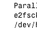

> 在下一小时我们将把磁盘连接到系统，格式化它，在其上创建空的 Unix 文件系统并挂载它。如果您真的想，可以跳到那里然后回来。

为本小时的目的，磁盘已正确格式化并挂载为 `/disk2`。其上复制了一些文件，但仍然相当空。

1. 不再赘述，让我们运行 `fsck`：

```
# cd /disk2
# fsck -c /disk2
Parallelizing fsck version 1.23 (15-Aug-2001)
e2fsck 1.23, 15-Aug-2001 for EXT2 FS 0.5b, 95/08/09
/dev/hdb is mounted.

WARNING!!! Running e2fsck on a mounted filesystem may cause
SEVERE filesystem damage.

Do you really want to continue (y/n)?
```

这看起来相当不祥。情况真的那么糟糕吗？答案是肯定的。`fsck` 程序会尝试修复它遇到的任何问题，因此如果文件系统处于活动状态并同时被更改，被损坏的可能性非常高。除非遇到危机，否则不要这样做。


> 绝对不要在已挂载的文件系统上运行 `fsck`！！

要卸载文件系统，请使用 `umount` 命令。如果文件系统列在 `/etc/fstab` 中，即文件系统及其挂载点的主表，您可以指定挂载点或设备名称。否则，只需使用设备名称：

```
# umount /dev/hdb
umount: /disk2: device is busy
```

糟糕！在卸载磁盘之前，我们需要移出 `/disk2` 子系统：

```
# umount /dev/hdb
#
```

2. 让我们再次尝试该 `fsck` 命令！

```
# fsck /dev/hdb
Parallelizing fsck version 1.23 (15-Aug-2001)
e2fsck 1.23, 15-Aug-2001 for EXT2 FS 0.5b, 95/08/09
/dev/hdb: clean, 11/64000 files, 8004/255528 blocks
```


当 `fsck` 报告结果为“clean”时，表示它不需要运行文件系统完整性检查，因为最近已足够频繁地运行过一次检查（默认情况下，磁盘只有在有原因时或每隔几个月才会强制运行 `fsck`）。下一次计划运行 `fsck` 的时间信息是超级块的一部分。

您是否注意到这是一个“parallelizing”版本的 `fsck`？这是好事。这意味着该程序可以通过运行并行检查进程同时检查多个文件系统。这意味着即使在糟糕的关机序列之后，您也可以更快地启动系统。

此外，由于许多 Unix 系统支持不同的文件系统，`fsck` 是针对特定文件系统格式设计的 `fsck` 版本的前端。在本例中，由于系统检测到 `/dev/hdb` 是一个 `ext2` 文件系统，它将检查磁盘的请求交给了 `e2fsck` 处理。

最后，请注意最后一行报告了文件和块的使用情况和可用情况。这里有 11 个文件，共 64,000 个可能的文件，以及 8,094 个块，共 255,528 个可能使用的块。

### 3. -f 标志强制 fsck 无论下一次检查计划何时都进行适当的磁盘检查，而 -c 标志会导致程序测试并检查坏块。如果您想更清楚地了解程序正在做什么，请使用 -v 获取详细输出（请参阅表 9.1 获取有用的 fsck 标志列表）。


> 坏块是磁盘上会更改数据的块。通常这是磁盘介质问题，并且是一种潜伏的隐藏危险，可能导致文件损坏。出于这个原因，定期使用 `fsck` 检查坏块是个好主意。

```
# fsck -CfV /dev/hdb
Parallelizing fsck version 1.23 (15-Aug-2001)
[/sbin/fsck.ext2 -- /dev/hdb] fsck.ext2 -c /dev/hdb
e2fsck 1.23, 15-Aug-2001 for EXT2 FS 0.5b, 95/08/09
Checking for bad blocks (read-only test): done
Pass 1: Checking inodes, blocks, and sizes
Pass 2: Checking directory structure
Pass 3: Checking directory connectivity
Pass 4: Checking reference counts
Pass 5: Checking group summary information

/dev/hdb: ***** FILE SYSTEM WAS MODIFIED *****
/dev/hdb: 11/64000 files (0.0% non-contiguous), 8094/255528 blocks
```

书中“检查坏块”这一行在一两秒内就闪过，但当您在硬盘上运行此命令时，即使是相对较小的硬盘，也可能需要很长时间。不要惊讶，如果您可以在午餐外出并在它完成这一步之前返回。

### 表 9.1 有用的 fsck 标志

| 标志 | 含义 |
|------|---------|
| `-s` | 序列化：不要并行运行多个检查，而是依次运行。（如果您正在积极调试损坏的磁盘，请使用此选项。） |
| `-b superblock` | 告诉 `fsck` 尝试使用备用超级块。请记住，它们每 8,192 个块存储在磁盘上一次，因此第二个超级块是 8192×1，第三个是 2×8192+1，以此类推。 |
| `-c` | 检查文件系统上的坏块（实际上，这在 Linux 上调用了 `badblocks(8)`，有趣的是）。 |
| `-f` | 强制 `fsck` 检查磁盘，即使它认为磁盘是干净的。 |
| `-y` | 自动对错误提示回答 yes。 |
| `-t type` | 指定要检查的文件系统类型。通常，`fsck` 可以自动检测文件系统，但如果必须指定类型，最可能的选择是 `ext2`，或者可能是 `ext3`。 |
| `-A` | 检查所有已知磁盘。引用 `/etc/fstab` 中的列表（如下一小时所述）。 |

现在您可以看到，在此调用中 `fsck` 实际上对磁盘进行了六次遍历：一次检查坏块；再次检查 inode、块和大小的一致性；然后检查目录结构、目录连通性、inode 引用计数，最后是组摘要信息。即使没有任何信息表明遇到问题或进行了更改，程序最后仍会说“文件系统已修改”。有时这似乎是一个通用消息，但最安全的做法始终是假定它是真的，这就是为什么您不想在磁盘挂载时运行 `fsck`！

在 Unix 世界中似乎有两类管理工具——那些直接的，以及那些棘手且输出经常令人困惑的。毫无疑问，对于大多数系统管理员来说，`fsck` 属于后者。好消息是您不需要经常使用它，并且当您运行该程序时，在了解更多关于文件系统本身的结构后，大多数输出都是合理的。

#### 使用 fsck 修复问题

在上一节中，事情相当容易，因为磁盘上没有任何问题。当问题出现时，可能会让人害怕，但现在还不是按下恐慌按钮的时候！

##### 任务 9.2：使用 fsck 修复磁盘问题

为了说明 `fsck` 如何修复损坏的磁盘，我做了一件危险的事：在一个窗口中更改 `/dev/hdb` 的内容，同时在另一个窗口中运行 `fsck`。保证会引起麻烦，而且不出所料，确实如此。

1. 首先，`fsck` 程序被调用，要求检查坏块并强制进行完整的结构检查：

```
# fsck -cFv /dev/hdb
Parallelizing fsck version 1.20 (15-Aug-2001)
[/sbin/fsck.ext2 - ... /dev/hdb] fsck.ext2 -c /dev/hdb
e2fsck 1.23, 15-Aug-2001 for EXT2 FS 0.5b, 95/08/09
/dev/hdb is mounted.

WARNING!!! Running e2fsck on a mounted filesystem may cause
SEVERE filesystem damage.

Do you really want to continue (y/n)? yes

Checking for bad blocks (read-only test): done
Pass 1: Checking inodes, blocks, and sizes
Pass 2: Checking directory structure
Pass 3: Checking directory connectivity
```

到目前为止，一切顺利。与此同时，在另一个窗口中，我快速地复制了大量文件到磁盘上，重命名它们，最终又删除了它们。

脚下的这些变化导致 `fsck` 在第 4 遍检查时有点不高兴：

```
Pass 4: Checking reference counts
WARNING: PROGRAMMING BUG IN E2FSCK!
OR SOME BONEHEAD (YOU) IS CHECKING A MOUNTED (LIVE) FILESYSTEM.
inode_link_info[2] is 9, inode_i_links_count is 11. They should be the same!
Inode 2 ref count is 11, should be 11. Fix<y>?
```

2. 虽然说我们是蠢人这种指责可能有点苛刻，但 inode 引用计数错误是典型的 `fsck` 错误信息。它准确地指出了问题所在（`inode_link_info[2]` 为 9，而 `inode_i_links_count` 为 11），然后询问你是否要修复它。

输入 `y` 它会立即扩展为 `yes` 并继续。我的这个危险的文件系统恶作剧引入了很多问题：


```
Pass 5: Checking group summary information
Block bitmap differences: +238277 +238278 +238279
Fix<y>? yes

Free blocks count wrong for group #29 (7486, counted=7483).
Fix<y>? yes

Free blocks count wrong (219063, counted=219060).
Fix<y>? yes

Inode bitmap differences: +68 +69 +58085 +58086 +58087 +58088 +58089 +58090
Fix<y>? yes

Free inodes count wrong for group #0 (1933, counted=1931).
Fix<y>? yes

Free inodes count wrong for group #29 (1916, counted=1910).
Fix<y>? yes

Directories count wrong for group #29 (11, counted=14).
Fix<y>? yes

Free inodes count wrong (60589, counted=60581).
Fix<y>? yes

/dev/hdb: ***** FILE SYSTEM WAS MODIFIED *****
/dev/hdb: 3419/64000 files (0.5% non-contiguous), 36468/255528 blocks
```

最后，看起来一切都好。请注意系统已从拥有 11 个文件变为拥有 3,419 个文件。


### 3. 大多数系统管理员会告诉你，如果遇到 `fsck` 错误，你应该一遍又一遍地运行该命令，直到它最终报告没有错误。这几乎是一种迷信，但也很惊人的是，第二遍检查经常会发现由上一次修复引入的新错误。这种情况也不例外（我在运行这些后续检查之前终于卸载了磁盘）：

```
# fsck -V /disk2
Parallelizing fsck version 1.23 (15-Aug-2001)
[/sbin/fsck.ext2 ... /disk2] fsck.ext2 /dev/hdb
e2fsck 1.23, 15-Aug-2001 for EXT2 FS 0.5b, 95/08/09
/dev/hdb: clean, 3419/64000 files, 36468/255528 blocks
```

使用 `fsck` 的一个经典挫败感：它假设因为我们最近才运行过该命令，所以没有理由再次运行，于是它简单地报告“clean”。但事实并非如此！

`-f` 标志强制运行磁盘完整性检查，这次我还要加上 `-y` 标志，它告诉 `fsck` 假设我对所有非绝对关键的问题都回答 yes：

```
# fsck -fy /disk2
Parallelizing fsck version 1.23 (15-Aug-2001)
[/sbin/fsck.ext2 ... /disk2] fsck.ext2 /dev/hdb
e2fsck 1.23, 15-Aug-2001 for EXT2 FS 0.5b, 95/08/09
Pass 1: Checking inodes, blocks, and sizes
Pass 2: Checking directory structure
Pass 3: Checking directory connectivity
Pass 4: Checking reference counts
Inode 2 ref count is 11, should be 10. Fix<y>? yes

Pass 5: Checking group summary information
Block bitmap differences: -238277 -238278
Fix<y>? yes

Free blocks count wrong for group #29 (7483, counted=7485).
Fix<y>? yes

Free blocks count wrong (219060, counted=219062).
Fix<y>? yes

Inode bitmap differences: -58085 -58086 -58088 -58090
Fix<y>? yes

Free inodes count wrong for group #29 (1910, counted=1914).
Fix<y>? yes

Directories count wrong for group #29 (14, counted=12).
Fix<y>? yes

Free inodes count wrong (60581, counted=60585).
Fix<y>? yes
```

`/dev/hdb`: **** FILE SYSTEM WAS MODIFIED ****

`/dev/hdb`: 3415/64000 files (0.5% non-contiguous), 36466/255528 blocks

熟悉的错误？请注意它们并不完全与上一次运行相同（第一次运行报告 inode 计数 11 错误地为九，而这里报告的是 inode 引用计数为 11 应该为 10）。

再做一次检查以求好运：

```
# fsck -fvy /disk2
Parallelizing fsck version 1.23 (15-Aug-2001)
[/sbin/fsck.ext2 -v /disk2] fsck.ext2 -fy /dev/hdb
e2fsck 1.23, 15-Aug-2001 for EXT2 FS 0.5b, 95/08/09
Pass 1: Checking inodes, blocks, and sizes
Pass 2: Checking directory structure
Pass 3: Checking directory connectivity
Pass 4: Checking reference counts
Pass 5: Checking group summary information
/dev/hdb: 3415/64000 files (0.5% non-contiguous), 36466/255528 blocks
```

好。磁盘世界里又一切安好。

### 4. 我们可以用 `mount` 重新挂载磁盘：

```
# ls /disk2
#
# mount -t ext2 /dev/hdb /disk2
# ls /disk2
games/ include/ kerberos/ lost+found/
```

虽然 `mount` 命令本身将在下一小时讨论，但值得指出的是，`fsck` 程序创建了 `lost+found` 目录。从可选的 Linux 命令 `mklost+found` 的手册页中，这里是关于最终会出现在那里的内容的确切描述：

> `mklost+found` 预先为 `lost+found` 目录分配磁盘块，
>
> 因此在运行 `e2fsck(8)` 恢复文件系统时，它不需要在文件系统中分配块来存储大量未链接的文件。这确保了 `e2fsck` 在恢复期间无需在文件系统中分配数据块。

### 5. 每个 `ext2` 文件系统都有一个名为 `lost+found` 的目录，孤立的或其它异常的目录块、文件块和文件材料有时会最终出现在那里。

在我经验中，在 `lost+found` 目录中找到任何半可理解的东西是很少见的。事实上，几乎总是完全空的。以下是一个每秒每分每秒都被访问的实时 Web 服务器系统的例子：

```
$ mount
/dev/sda5 on / type ext3 (rw)
none on /proc type proc (rw)
usbdevfs on /proc/bus/usb type usbdevfs (rw)
/dev/sda1 on /boot type ext3 (rw)
none on /dev/pts type devpts (rw,gid=5,mode=620)
/dev/sda3 on /home type ext3 (rw)
none on /dev/shm type tmpfs (rw)
/dev/sdb1 on /usr type ext3 (rw)
/dev/sdb2 on /var type ext3 (rw)
```

不带任何选项，`mount` 列出附加到文件系统的磁盘和设备。每个挂载点（别担心，你将在下一小时学习这些）都有自己的 `lost+found` 目录，正如我们所期望的：

```
$ ls -a /lost+found
./  ../
$ ls -a /boot/lost+found
./  ../
$ ls -a /home/lost+found
./  ../
$ ls -a /usr/lost+found
./  ../
$ ls -a /var/lost+found
./  ../
```


什么都没有。这是个好事。如果你看到 `lost+found` 中有任何东西，这意味着至少有一个文件在 `fsck` 尝试修复磁盘时被损坏并拆解了。

`fsck` 程序很丑陋且难以理解，但在 Unix 系统管理世界中它是救命稻草。花点时间阅读手册页并学习你特定 Unix 版本支持的不同文件系统。

当你没有因为系统无法启动或某个目录凭空消失而惊慌时，学习这些要容易得多！

## 单用户模式

所有 Unix 系统都具有重新启动到所谓的单用户模式的能力，在该模式下，窗口系统不会启动，网络连接尚未建立，系统通常处于相当原始的状态。此模式的目的是为操作和检查原本繁忙的文件系统创建一个安全环境。

为了换点花样，我将向你展示如何将运行 Mac OS X 的 Macintosh 重启到单用户模式，然后从命令行运行 `fsck`。

### Task 9.3: Darwin 中的单用户模式

虽然大多数 Macintosh OS X 操作系统的用户并没有真正思考引擎盖下的强大功能，但我们知道得更好。在色彩鲜艳且吸引人的图形 Aqua 界面之下是一个完整 Unix 环境，这意味着有一种方法可以重新启动系统并进入单用户模式。要实现这一点，重新启动 Mac 并按住 `Cmd-S`，直到它开始显示启动消息（参见步骤 1）。

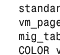

> 要将运行 Mac OS X 的 Macintosh 启动到单用户模式，请重新启动并立即按住 `Cmd-S`，直到你开始看到实际启动过程的状态消息。

1. 在大量非常 Unix 风格的输出之后，你将到达一个 root 提示符：

```
standard timeslicing quantum is 10000 us
vm_page_bootstrap: 123986 free pages
mig_table_max_displ: 64
COLOR video console at 0xbc000000 (1152x768x32)
IOKit Component Version 1.1:
Sun Sep 9 15:30:21 PDT 2001; root(rcbuilder):RELEASE_PPC/iokit/RELEASE
_cppInit done
IODeviceTreeSupport done
Recording startup extensions.
Copyright (c) 1982, 1986, 1989, 1991, 1993
The Regents of the University of California. All rights reserved.

using 1910 buffer headers and 655 cluster IO buffer headers
USB: 25.540: (0x205E6000) USB Generic Hub @ 1 (0x19)
enableClockSpreading returned with 0
Register ApplePMU to acknowledge power changes
Local FireWire GUID = 0x393f7:0xfe5285c
AppleFWOHCI: 20af000 0 AppleFWOHCI::free
devfs enabled
dll_init
IOKitSDInit
BSD root: disk0s5, major 14, minor 5
ADB present:0c
devfs on /dev
Tue Jan 29 00:11:40 PST 2002
Singleuser boot - fsck not done
Root device is mounted read-only
If you want to make modifications to files,
run '/sbin/fsck -y' first and then '/sbin/mount -uw /'
localhost#
```

One nice touch here is that the single-user mode boot-up reminds you that the root filesystem is mounted read-only (which means that it's safe to run `fsck` without risk of corruption), where the `fsck` and `mount` commands are, and how to proceed.

2. Running `fsck` demonstrates the universality of this utility even across completely different Unix platforms and different filesystem layouts (this is an HFS+ system rather than an ext2 system):

```
localhost# /sbin/fsck
** /dev/rdisk0s5
** Checking HFS Plus volume
** Checking Extents Overflow file.
** Checking Catalog file.
** Checking multi-linked files
Orphaned indirect node temp105533
** Checking Catalog hierarchy.
** Checking volume bitmap.
** Checking volume information.
** Repairing volume.

**** FILE SYSTEM WAS MODIFIED ****

**** REBOOT NOW ****
```

The next step is to remount the filesystem read-write, and continue booting by exiting this interactive shell:

```
localhost# /sbin/mount -uw /
localhost# exit
```

Although the specifics of the output from single-user mode boot vary from platform to platform, the general concept is identical: to drop you, the system administrator, into a minimal command shell so you can run any necessary diagnostics. Exiting the shell continues the boot process and should leave the system running as normal.

One of the most common places you'll encounter the `fsck` program is when the system has a corruption problem and drops into single-user mode upon rebooting. Although you can explicitly switch into this mode, many Unix systems, upon encountering errors with the automatic `fsck` run at boot-time, will automatically switch to this mode and leave you on your own.

As you have seen, `fsck` is rather straightforward, so its occasional cryptic output isn't too intimidating, and you can easily work and fix any disk problems encountered. Right?

## Don't Panic!

Finally, if you do encounter any disk corruption, don't immediately panic and start breathing oddly. Instead, there are a couple of steps you can take to minimize the danger:


1. Kick off all the users and drop down into single-user mode. On most systems all this will happen automatically if you type `init 1` while logged in as root (see Hour 13). Beware: Users don't get any warning; they just get the boot, and quick!

2. Now that you've minimized the danger of further corruption, take a deep breath and pat yourself on the back because *you've been keeping really good backups, haven't you?*

If you have a good backup regimen, the worst you should lose are the changes introduced that day, which isn't too bad. If you aren't backing up your system, now's a good time to start panicking.

3. Take a deep breath.

4. Make sure that the disk you need to check isn't mounted by using `mount` (see Hour 10, "Adding Disks to Your System").

5. Run `fsck -v` on the corrupt disk and see what the damage is.

6. Run `fsck` a second, and even a third time, until it reports no problems or corruption.

7. Reboot the machine with `shutdown -r now` and keep your fingers crossed.

If you have the unusual situation of the corruption not fixing itself, it might be time to try copying as much of the material as possible to a different device (you'll have varying levels of success, alas). The next step is to use `fsck -c` to have it check for—and identify—bad blocks. Then, run `fsck` again to see if that solves the problem.

In extreme cases you might need to completely reformat the disk with `fdisk`, but in more than 20 years of using Unix I've never encountered this particular situation. It's *very* rare to have this level of problem with a filesystem.

```
init 1
```

```
shutdown -r now
```


### Summary

Compared to other operating systems, Unix is remarkably stable and reliable. It's not at all uncommon to hear of systems that have been running for months, if not years, without a single reboot.


> The main server for The Internet Mall, running Red Hat Linux, never crashed in almost three years of busy 24/7 operation. The only times it was rebooted was because we were working on it or needed to relocate it from one facility to another. Unix is very reliable!

When things do go south, however, your best friend will prove to be `fsck`. The `fsck` command really has a remarkable capability to fix almost anything that can go wrong with a Unix filesystem, and many sysadmins have spent their entire careers using the `-y` flag and not even paying attention to the specific error messages.

### Q&A

**Q** Where did the `ext3` filesystem come from?

**A** The layout of information on hard disks has a long and quite interesting history. I'll restrain myself, however, and simply note that the immediate parent of the `ext3` filesystem is the `ext2` filesystem, which itself came from some groundbreaking research at UC Berkeley by Kirk McKusick, Bill Joy, and Sam Leffler on something they eventually called the Berkeley Fast File System. UC Berkeley plays a very important role in the history of Unix, with `BSD` and many of the most popular commands in Unix spawned from the Computer Science Research Group.

**Q** Why don't popular PC disk maintenance utilities require you to unmount the disk?

**A** Actually, if you get into real trouble with your disks, you'll find that most of these utility programs require you to reboot off the included CD-ROM. The purpose of this is so that the disk-fix utility can unmount the disk before it begins to try and fix it, just like our friend `fsck`.

**Q** If you have `fsck` parallelizing (that is, checking multiple disks at the same time) and one of the disks turns out to have an error, how do you know what's going on?


# A
That's actually one of the few limitations of the parallel approach to checking disks. Fortunately, the authors of `fsck` thought this through and almost all parallel versions offer a "serialize" flag that forces the program to check disks one at a time rather than all at once. On Linux, for example, the `-s` flag does just that.

## Workshop

### Quiz

- 1. What’s the most common Linux filesystem? Mac OS filesystem? Commercial Unix filesystem?
- 2. Superstition or not, most Unix sysadmins do what after they run `fsck` and find errors?
- 3. On a filesystem with 512-byte blocks, what’s the minimum actual disk space used by a file that’s 1025 bytes in size?
- 4. The Unix equivalent of the PC “File Allocation Table” (that’s what “FAT” stands for on those FAT* filesystems) is called?
- 5. When the `fsck` program doesn’t think that a check is required of the filesystem, it refers to that disk as being in what state?
- 6. Though it’s called single-user mode, can you really use a computer in that state?

### Answers

- 1. The most common Linux filesystem is `ext2` with `ext3` continuing to grow in popularity; on the Mac it’s `HFS+` (Hierarchical File System Plus), and on commercial Unix systems it’s the `FFS` (Berkeley Fast File System).
- 2. Run `fsck` again.
- 3. If the file is 1025 bytes in size and it gets stored in 512-byte blocks, the minimum size possible is three 512-byte blocks, or 1536 bytes.
- 4. The superblock.
- 5. Disks that don’t need checking are “clean.”
- 6. No. On almost all Unix systems, networking, a windowing environment, and other necessities of modern Unix interaction, aren’t started yet. It’s an unfortunate name because it’s really administrative mode.

In the next hour, we’ll format and mount a new disk on the system, exploring partition tables, `fdisk`, `newfs` and other helpful tools.

## Hour 10


### Adding Disks to Your System

The last hour explored the `fsck` command and how it can be used to diagnose and fix problems with hard disks. This hour will address the other half of the disk issue—how to add new disks, format them, and hook them up to your Unix system. It's a set of commands you won't need too often, I expect, but when you are ready, this shows the sequence needed.

With personal computer systems, the steps involved in adding and accessing a new disk tend to be hidden, but with Unix, a new disk needs to be formatted, partitioned, checked, then mounted somewhere in the filesystem.

Indeed, PC and Macintosh systems have a very primitive multiple disk configuration capability: On the PC, for example, a primary disk is `C:`, a CD-ROM drive is `E:`, and a floppy drive is `A:`. Add a new disk, and it's probably configured as `D:` or `F:`. On the Macintosh, all new disks appear on the desktop with mnemonic names—a small improvement, but they're still all at the topmost level of the filesystem.

Unix 的方法要精妙得多，因为你可以将新磁盘挂载在任何你想要的位置。如果你想另类，甚至可以将软盘驱动器挂载为 `/tmp`，或将 CD-ROM 驱动器挂载为 `/home`。

磁盘通过 `mount` 挂载到系统中，而 `mount` 命令会检查 `/etc/fstab` 文件（或其等价物），以查看启动时应自动包含的内容。

但我们有点超前了，所以让我们从低级磁盘格式化开始。

在本小时你将学习关于

- 使用 `fdisk` 格式化磁盘
- 使用 `mke2fs` 添加文件系统
- 挂载新磁盘
- 微调你的 `/etc/fstab` 配置文件

#### 使用 fdisk 格式化磁盘

这可能会让你惊讶，但用于格式化硬盘的旧 MS-DOS 命令事实上在现代 Unix 系统中也使用相同名称：`fdisk`。当然，其幕后实现有点不同！

> 实际上，虽然它们看起来相同，但 Unix 版本的 `fdisk` 有一些细微差异，因此如果你想为 Unix 或 Linux 系统创建磁盘，请使用该操作系统自带的 `fdisk`。

到 Unix 之旅的这个阶段，Unix 用户界面的不一致性应该不会让你惊讶。虽然大多数命令都有单字符命令标志，但有些使用全词命令标志。`fdisk` 命令属于第三类接口：在许多系统上，输入 `fdisk` 后你会进入一个简单的 `fdisk` shell，在其中可以输入各种命令来配置你的磁盘；然后在退出时更改才会实际生效。在其他版本的 `fdisk` 中，你需要在命令行上指定设备名称。

> 如果你忘记写入更改，在 `fdisk` 程序中做的任何配置都将丢失。

##### 任务 10.1：使用 fdisk 格式化磁盘

为了专注于 Unix 系统管理，我们在这里假设与将磁盘连接到计算机相关的硬件问题已经解决，并且你现在有一个新的、原始的磁盘位于总线上，准备好供你格式化并链接到你的 Unix 系统。实际上，你需要与供应商或 IT 部门核实你需要什么类型的硬件和电缆，以及如何将所有东西整齐地安装到物理机箱中。

- 1. 将新磁盘添加到系统中的第一步是确定其新的设备地址。回想一下，Unix 中的设备命名约定是逻辑性的，例如在 Red Hat Linux 7.2 上，IDE 设备命名为 `/dev/hdXN`，其中 X 是主设备号（通常是总线上的磁盘地址），N 是分区号。

你可以在 `mount` 命令的输出中看到这一点：


# mount

```
/dev/hda2 on / type ext3 (rw)
none on /proc type proc (rw)
usbdevfs on /proc/bus/usb type usbdevfs (rw)
/dev/hda1 on /boot type ext3 (rw)
none on /dev/pts type devpts (rw,gid=5,mode=620)
none on /dev/shm type tmpfs (rw)
none on /proc/sys/fs/binfmt_misc type binfmt_misc (rw)
```

请注意，根设备是 `/dev/hda2`，这意味着它是主设备（因为 `a` 是字母表的第一个字母），并且是分区 `#2`。对于 Unix 配置来说毫不奇怪，`/boot` 分区是同一驱动器上的分区 `#1`。

## 2. 添加第二个 IDE 驱动器

在向此系统添加第二个 IDE 驱动器后，设备地址的合理猜测是 `/dev/hdb`，并且使用 `fdisk` 的快速检查证实了这一点：

```
# fdisk /dev/hdb
bash: fdisk: command not found
```

糟糕！`fdisk` 命令不在我们的 `PATH` 中。很容易修复：

```
# echo $PATH
/bin:/usr/bin:/usr/X11R6/bin:/usr/local/bin:/home/taylor/bin
# PATH=${PATH}:/sbin
```

现在：

```
# fdisk /dev/hdb
Command (m for help): p
Disk /dev/hdb: 16 heads, 63 sectors, 507 cylinders
Units = cylinders of 1008 * 512 bytes

Device Boot Start End Blocks Id System
/dev/hdb1 1 507 255496+ b FAT32

Command (m for help): q
```

你可以看到 `fdisk` 已经识别出磁盘的几何结构：它是 507 个柱面、63 个扇区和 16 个磁头（而且不，我也不知道这到底是什么意思！）最重要的是，它将磁盘识别为 FAT32 系统，共 255,496 个块（大约 250MB）。

如果你在识别磁盘的总线地址（主号和次号）时遇到问题，你可能需要打开服务器并检查驱动器上的设置（磁盘制造商通常称之为跳线，在 SCSI 世界中这被称为 SCSI 地址）。

> 每个硬件平台都有完全不同的磁盘连接方案和特定设备驱动器的寻址方案。如果你管理的是商业服务器，最好的办法是查看随硬件提供的文档。

在磁盘格式化的这个阶段，你需要决定是否要将大磁盘分区为较小的虚拟磁盘，还是作为单个大磁盘映像供系统使用。对于较小的磁盘，分区几乎没有价值，但如果你添加的是 30GB（或更大）的磁盘，将其拆分为两个或多个较小的虚拟磁盘可能会非常有帮助。

`fdisk` 程序也在 Unix 中构建分区，你需要确定每个分区应该有多大，并确保它们加起来等于磁盘的整个大小。重要的是，一旦你在磁盘上安装文件系统，就无法在不破坏其上所有数据的情况下重新分区它。正如你可能预料的那样，这是一个常见的挫败点，因为系统管理员因此必须 proactively 预测磁盘需要如何布局以及如何最好地利用可用资源。

一个很好的例子是交换空间，即磁盘上分配的特殊区域，用于将内存映像（内存页）交换到磁盘，以便其他应用程序可以利用物理 RAM。你可能在当前配置下系统足够，但如果你升级 RAM，是否会有足够的交换空间来满足交换空间通常为 RAM 的 2x–3x 的经验法则？如果没有，在将新磁盘上线之前在新磁盘上创建一个第二个交换分区可以是一个非常简单的步骤。即使你今天认为不需要它，明天你可能就需要！事实上，将交换任务分散到多个设备上可以提高性能，尤其是在繁忙的系统上。

我们的新磁盘太小，无法有意义地分区——无论是为了预见额外的交换空间需求，还是仅仅为了允许多个虚拟磁盘。但让我们开始吧：

```
# fdisk /dev/hdb

Command (m for help): m
Command action
a  toggle a bootable flag
b  edit bsd disklabel
c  toggle the dos compatibility flag
d  delete a partition
l  list known partition types
m  print this menu
n  add a new partition
o  create a new empty DOS partition table
p  print the partition table
q  quit without saving changes
s  create a new empty Sun disklabel
t  change a partition's system id
u  change display/entry units
v  verify the partition table
w  write table to disk and exit
x  extra functionality (experts only)
```

如你所见，`fdisk` 中有许多选项。最重要的命令是 `d`（删除分区）、`p`（打印分区表）、`n`（添加新分区）和 `w`（写入分区信息并退出）。

## 3. 格式化无分区磁盘

在没有任何分区的磁盘上格式化磁盘的过程相当简单，但让我们先看看设备本身：

```
Command (m for help): p

Disk /dev/hdb: 16 heads, 63 sectors, 507 cylinders
Units = cylinders of 1008 * 512 bytes
```

| 设备 | 启动 | 起始 | 结束 | 块数 | Id | 系统 |
|---|---|---|---|---|---|---|
| `/dev/hdb1` |  | 1 | 507 | 255496+ | b | FAT32 |

这里潜伏着一个问题：我们不希望磁盘是 FAT32 磁盘（Windows 格式），而是 Unix 磁盘。我们需要删除现有的分区并写入一个适当格式的新分区：

```
Command (m for help): d
Partition number (1-4): 1

Command (m for help): p

Disk /dev/hdb: 16 heads, 63 sectors, 507 cylinders
Units = cylinders of 1008 * 512 bytes
```

删除 `#1` 分区后，从 Unix 角度来看，当前磁盘现在完全无法使用。修复它是通过 `n`（新建分区）命令完成的：

```
Command (m for help): n
Command action
  e   extended
  p   primary partition (1-4)

p
Partition number (1-4): 1
First cylinder (1-507, default 1): 1
Last cylinder or +sizeM or +sizeK (1-507, default 507): 507
```

因为分区旨在跨越整个物理磁盘，我们可以使用默认的柱面规格。还要注意，如果你不以柱面为单位思考，可以指定大小为字节、千字节或兆字节。

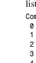

> 想知道是使用主分区还是扩展分区吗？如果您创建分区 `#1`、`#2`、`#3` 或 `#4`，应该使用主分区，但如果您需要在磁盘上拥有超过四个分区，则需要将编号更高的分区基本上作为扩展分区内的子分区。这都源于 DOS 硬盘格式原始设计中的一些糟糕的实现决策，但那是另一个故事...

如果需要指定不同类型的分区，请先使用 `l` 命令列出已知分区。这是一个相当惊人的列表：


```
Command (m for help): l
 0  Empty          1b  Hidden Win95 FAT 64   Novell Netware   bb  Boot Wizard hid
 1  FAT12          1c  Hidden Win95 FAT 65   Novell Netware   c1  DRDOS/sec (FAT-
 2  XENIX root     1e  Hidden Win95 FAT 70   DiskSecure Multi  c4  DRDOS/sec (FAT-
 3  XENIX usr      24  NEC DOS            75  PC/IX            c6  DRDOS/sec (FAT-
 4  FAT16 <32M     39  Plan 9             80  Old Minix        c7  Syrinx
 5  Extended       3c  PartitionMagic     81  Minix / old Linux  da  Non-FS data
 6  FAT16          40  Venix 80286        82  Linux swap       db  CP/M / CTOS / ...
 7  HPFS/NTFS      41  PPC PReP Boot      83  Linux            de  Dell Utility
 8  AIX             42  SFS                84  OS/2 hidden C:   df  BootIt
 9  AIX bootable    4d  QNX.4.x            85  Linux extended   e1  DOS access
 a  OS/2 Boot Manager 4e  QNX.4.x 2nd part   86  NTFS volume set  e8  DOS R/O
 b  Win95 FAT32     4f  QNX.4.x 3rd part   87  NTFS volume set  e4  SpeedStor
 c  Win95 FAT32 (LBA 50) OnTrack DM   8e  Linux LVM        eb  BeOS fs
 e  Win95 FAT16 (LBA 51) OnTrack DM6 Aux 93 Amoeba          ee  EFI GPT
 f  Win95 Ext'd (LBA 52) CP/M         94  Amoeba BBT       ef  EFI (FAT-12/16/32
10  OPUS            53  OnTrack DM6 Aux 9f BSD/OS            f1  SpeedStor
11  Hidden FAT12    54  OnTrackDM6        a0  IBM Thinkpad hid  f4  SpeedStor
12  Compaq diagnostics 55  EZ-Drive          a5  BSD/386          f2  DOS secondary
14  Hidden FAT16 <32M 36 56  Golden Bow       a6  OpenBSD          fd  Linux raid auto
16  Hidden FAT16    5c  Priam Edisk       a7  NetXTSTEP        fe  LANstep
17  Hidden HPFS/NTFS 61 SpeedStor       b7  BSDI fs          ff  BBT
18  AST SmartSleep  63  GNU HURD or SysV b8 BSDI swap
```

4. 快速检查一切是否按预期指定：

```
Command (m for help): p
Disk /dev/hdb: 16 heads, 63 sectors, 507 cylinders
Units = cylinders of 1008 * 512 bytes
```

| 设备 | 启动 | 开始 | 结束 | 块 | Id | 系统 |
|---|---|---|---|---|---|---|
| `/dev/hdb1` |  | 1 | 507 | 255496+ | 83 | Linux |

现在是时候使用 `w` 命令为我们的 Linux 系统写入新的分区信息了：

```
Command (m for help): w
The partition table has been altered!
Calling ioctl() to re-read partition table.
WARNING: If you have created or modified any DOS 6.x partitions, please see the fdisk manual page for additional information.
Syncing disks.
```

理论上，我们完成了，现在我们有一个符合适当 Linux 格式的磁盘。这意味着我们应该能够对其进行 `fsck`，对吗？

```
# fsck /dev/hdb
Parallelizing fsck version 1.23 (15-Aug-2001)
e2fsck 1.23, 15-Aug-2001 for EXT2 FS 0.5b, 95/08/09
Couldn't find ext2 superblock, trying backup blocks...
fsck.ext2: Bad magic number in super-block while trying to open /dev/hdb
The superblock could not be read or does not describe a correct ext2 filesystem. If the device is valid and it really contains an ext2 filesystem (and not swap or ufs or something else), then the superblock is corrupt, and you might try running e2fsck with an alternate superblock:
e2fsck -b 8193 <device>
```

啊啊……磁盘上还没有实际写入任何 Unix 文件系统信息。那是下一节的主题。

尽管 `fdisk` 的界面相对原始，但使用起来并不太困难，并且使将新硬盘切片成特定分区变得简单直接。这只是让第二个驱动器作为 Linux 系统的一部分出现的旅程中的第一步。

### 使用 mke2fs 添加文件系统

如果我们能把计算机磁盘当作绘画来谈论，那么运行 `fdisk` 就相当于买一块空白画布并把它放在壁橱里。除非你能把它放在画架上并取出颜料和画笔，否则你几乎无法做任何事情。

#### 任务 10.2：使用 mke2fs 创建文件系统

文件系统使用 `mkfs` 在硬盘上创建，并且由于不同文件系统在底层特性上差异很大，大多数现代 Unix 系统为每个受支持的文件系统都有特定的 `mkfs` 版本。

1. Linux 包含许多用于在磁盘上构建新文件系统的应用程序：

```
# man -k mkfs
mkdosfs [mkfs] (8) - create an MS-DOS file system under Linux
mkfs (8) - build a Linux file system
mkfs.bfs [mkfs] (8) - make an SCO bfs filesystem
mkfs.minix [mkfs] (8) - make a Linux MINIX filesystem
# man -k mke2fs
mke2fs (8) - create a Linux second extended file system
```

> 请注意，`mke2fs` 并没有匹配 `man -k mkfs`。这是一个经典例子，说明在 Unix 中搜索特定命令时你必须多挖一点。有一天这会被修复，但现在...

相比之下，Mac OS X Darwin 甚至没有匹配 `mkfs` 的东西，但如果你尝试变体 `newfs` 你会发现：

```
$ man -k newfs
newfs(8), mount_mfs(8) - construct a new file system
newfs_msdos(8) - construct a new MS-DOS (FAT) file system
```

请注意，你可以在 Macintosh 环境中，甚至在命令行中创建 Windows 格式的硬盘映像。


> Solaris 弥合了这一差距，同时提供 `newfs` 和 `mkfs`，并且它们是完全不同的命令。您需要查看手册页和 AnswerBook 材料（Sun 的优秀在线文档套件，网址为 http://docs.sun.com）以了解您自己的 Solaris 版本的具体信息。

## 2. 构建“第二扩展”文件系统需要 `mke2fs` 命令：

```
# mke2fs /dev/hdb
mke2fs 1.23, 15-Aug-2001 for EXT2 FS 0.5b, 95/08/09
/dev/hdb is entire device, not just one partition!
Proceed anyway? (y,n) y
Filesystem label=
OS type: Linux
Block size=1024 (log=0)
```

```
Fragment size=1024 (log=0)
64000 inodes, 255528 blocks
12776 blocks (5.00%) reserved for the super user
First data block=1
32 block groups
8192 blocks per group, 8192 fragments per group
2000 inodes per group
Superblock backups stored on blocks:
8193, 24577, 40961, 57345, 73729, 204801, 221185

Writing inode tables: done
Writing superblocks and filesystem accounting information: done

This filesystem will be automatically checked every 25 mounts or
100 days, whichever comes first. Use tune2fs -c or -i to override.
```

请注意，程序正确提醒我们我们即将对整个驱动器安装文件系统，如果有分区，它们将被覆盖。如果我们创建了分区，`mke2fs` 命令就需要为每个分区运行，例如作为 `mke2fs /dev/hdb1`、`mke2fs /dev/hdb2`，等等。

## 3. `mke2fs` 的输出非常值得仔细查看

例如，注意到它指定块为 1024 字节，这对于一个小的 250MB 磁盘来说可能有点太大了。分配了 64,000 个 inode，这意味着这是可以在此设备上存储的不同文件的上限，并且有 255,528 个 1024 字节块，这正确地换算为 249.5MB。

同样重要的是，超级块已按预期写入块 1，并且副本写入了块 8193、24577、40961、57345、73729、204801 和 221185。回顾 `fsck`，如果默认超级块损坏，你可能会发现自己需要指定一个重复的超级块。这些是这些超级块的地址。你可以把它们写下来，但由于磁盘上是标准间隔，只需记下它们是 8,193 个块。

最后，请注意 `mke2fs` 命令还设置了核心设备信息中的一个标志，指定 `fsck` 在系统启动时每 25 次挂载（通常是启动）或 180 天自动检查磁盘。你可以用 `tune2fs` 更改此设置，但说实话，默认值相当可接受，而且每隔几周运行一次 `fsck` 也是一个非常好的主意。

文件格式化完成了吗？说实话，这取决于你运行什么命令：

```
# fdisk -l
Disk /dev/hda: 255 heads, 63 sectors, 1958 cylinders
Units = cylinders of 16065 * 512 bytes
```

Device Boot  Start     End      Blocks   Id System

/dev/hda1   *      1       6       48163+  83 Linux

/dev/hda2          7      1934    15486660  83 Linux

/dev/hda3         1935     1958     192780  82 Linux swap

Disk /dev/hdb: 16 heads, 63 sectors, 507 cylinders

Units = cylinders of 1008 * 512 bytes

磁盘 `/dev/hdb` 不包含有效的分区表

不过，思考这个错误，其实没什么问题。我们实际上并没有在 `/dev/hdb` 上建立分区表，因为它是一块小磁盘。我们谈到了它，但由于它只有 250MB，分区会将其切分成太小而无法使用的块。所以完全没有问题。

## 4. 相反，让我们运行一个 `fsck` 看看会发生什么

回想一下，之前的 `fsck` 抱怨没有超级块，这正是提醒我们首先运行 `mke2fs` 的原因：

```
# fsck /dev/hdb
Parallelizing fsck version 1.23 (15-Aug-2001)
e2fsck 1.23, 15-Aug-2001 for EXT2 FS 0.5b, 95/08/09
/dev/hdb: clean, 11/64000 files, 8094/255528 blocks
```

有趣的是，刚创建的文件系统默认被标记为干净，因此没有进行检查。让我们指定 `-cV` 来检查坏块并强制检查：

```
# fsck -cV /dev/hdb
Parallelizing fsck version 1.23 (15-Aug-2001)
/sbin/fsck.ext2 -f -v /dev/hdb fsck.ext2 -c /dev/hdb
e2fsck 1.23, 15-Aug-2001 for EXT2 FS 0.5b, 95/08/09
Checking for bad blocks (read-only test): done
Pass 1: Checking inodes, blocks, and sizes
Pass 2: Checking directory structure
Pass 3: Checking directory connectivity
Pass 4: Checking reference counts
Pass 5: Checking group summary information
/dev/hdb: **** FILE SYSTEM WAS MODIFIED ****
/dev/hdb: 11/64000 files (0.0% non-contiguous), 8094/255528 blocks
```

没有坏块，文件系统也没有问题，并且请注意从最后一行摘要中，只有 11 个文件（总共 64,000 个可能的文件——与驱动器分配的索引节点数相同）以及使用了 8,094 个块（总共 255,528 个；再次与 `mke2fs` 显示的计数完全相同）。

## 5. `mke2fs` 命令有多种不同的选项值得在表 10.1 中探索。

### 表 10.1 `mke2fs` 的有用标志

| 标志 | 含义 |
|---|---|
| `-b blocks` | 指定与默认值不同的块大小。有效大小为 1024、2048 和 4096 字节。 |
| `-c` | 在格式化文件系统之前检查磁盘是否存在坏块。 |
| `-j` | 在 ext3 磁盘上启用日志选项。 |
| `-L label` | 为磁盘设置卷标。 |
| `-N i` | 指定磁盘应具有 i 个索引节点而不是默认值。 |
| `-v` | 详细输出，显示更多正在进行的操作。 |

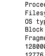

> 了解有关很酷的新 ext3 文件系统及其磁盘日志功能的更多信息，请访问 http://www.redhat.com/support/wpapers/redhat/ext3/。

在离开本节之前，让我们使用命令标志重建新驱动器上的文件系统，以通过增加可用索引节点来支持更多的小文件。同时，我们也指定一个卷标。


```
# mke2fs -l 'Little Guy' -v -N 128000 /dev/hdb
mke2fs 1.23, 15-Aug-2001 for EXT2 FS 0.5b, 95/08/09
/dev/hdb is entire device, not just one partition!
Proceed anyway? (y,n) y
Filesystem label=Little Guy
OS type: Linux
Block size=1024 (log=0)
Fragment size=1024 (log=0)
128000 inodes, 255528 blocks
12776 blocks (5.00%) reserved for the super user
First data block=1
32 block groups
8192 blocks per group, 8192 fragments per group
4000 inodes per group
Superblock backups stored on blocks:
8193, 24577, 40961, 57345, 73729, 204801, 221185

Writing inode tables: done
Writing superblocks and filesystem accounting information: done

This filesystem will be automatically checked every 37 mounts or 100 days, whichever comes first. Use tune2fs -c or -i to override.
```

请注意，卷现在有了标签，并且索引节点的数量已大幅增加，正如期望的那样。

一次快速的 `fsck` 证明一切如预期：

```
# fsck /dev/hdb
Parallelizing fsck version 1.23 (15-Aug-2001)
e2fsck 1.23, 15-Aug-2001 for EXT2 FS 0.5b, 95/08/09
Little Guy: clean, 11/128000 files, 16094/255528 blocks
```

向文件系统添加新磁盘的大部分工作都是由 `mke2fs`（或其兄弟命令之一）完成的，并且该命令有许多不同的选项。

### 挂载新磁盘

在磁盘格式化并由 `newfs`（或 `mkfs`）添加文件系统骨架后，它可以挂接到文件系统。这是 Unix 与其他计算机系统略有不同的地方，因为与其添加新的驱动器映像，Unix 要求你将新磁盘挂接到现有文件系统。这就是为什么 `mount` 输出显示特定目录的原因。请考虑 `mount` 输出中的以下行：

```
/dev/hda1 on /boot type ext3 (rw)
```

这意味着根（`/`）文件系统上有一个 `/boot` 目录，其内容被新挂载的 `/dev/hda1` 驱动器隐藏。

新挂载的磁盘隐藏现有文件内容这一想法对于理解如何最好地将新磁盘空间添加到系统至关重要。

#### 任务 10.3：向系统添加新驱动器

想象一下，我们可以在启动序列中途停止系统，在事物开始运行后，但在任何非启动磁盘挂载之前。此时，会有一个 `/boot` 目录，但其中没有任何内容。`mount` 命令的工作是将文件系统附加到特定目录。

1. 在新驱动器 `hdb` 添加到系统之前，让我们先看看目录 `/home/taylor`：

```
/home/taylor:
# cd /home/
# ls -a taylor
.               .first_start_kde   .MOOP-random-seed
..              .gconf            .mcoprc
.autorun.lck    .gconfd           .nautilus
.bash_history   .gnome            .sawfish
```

```
.bash_logout      .gnome-desktop   .screenrc
.bash_profile     .gnome_private    .wmrc
.bashrc           .gtkrc            .xauth
.DCOPserver_localhost.localdomain  .ICEauthority  .Xauthority
.DCOPserver_localhost.localdomain_:0  .kde  .xsession-errors
Desktop            .kderc
.emacs             .mcop
```

现在，让我们使用 `mount` 命令将新驱动器挂接到现有系统，以 `/home/taylor` 作为其初始挂载点：

```
# mount /dev/hdb /home/taylor
```

```
# ls -al taylor
```

```
total 17
drwxr-xr-x 3 root root 1024 Feb  1 14:40 .
drwxr-xr-x 3 root root 4096 Jan 24 12:20 ..
drwxr-xr-x 2 root root 12288 Feb  1 14:40 lost+found
```

看到所有文件都消失了令人相当害怕，但它们并没有真正消失，它们在下面，被已挂载的新磁盘的内容覆盖。

2. 为了证明这一点，`umount` 会卸载磁盘，从而允许访问之前的内容：

```
# umount /dev/hdb
```

```
# ls -a taylor
```

```
.first_start_kde  .MCOP-random-seed
..                 .mcoprc
.autorun.lck       .gconfd           .nautilus
.bash_history      .gnome            .sawfish
.bash_logout       .gnome-desktop    .screenrc
.bash_profile      .gnome_private    .wmrc
.bashrc            .gtkrc            .xauth
.DCOPserver_localhost.localdomain  .ICEauthority  .Xauthority
.DCOPserver_localhost.localdomain_:0  .kde  .xsession-errors
Desktop            .kderc
.emacs             .mcop
```

这是一个非常重要的概念，许多 Unix 系统管理员并不清楚：磁盘只能挂载到现有目录上，并且在挂载之前该目录中的任何内容在磁盘再次卸载之前都将无法访问。

3. `mount` 命令支持多种不同的挂载磁盘方法。最重要的标志总结在表 10.2 中。

#### 表 10.2 有用的 mount 标志

| 标志 | 含义 |
|------|---------|
| `-a` | 确保 `/etc/fstab` 中列出的所有设备都已挂载，并在其分离时挂载它们。这可以与 `-t` 结合使用，例如 `mount -a -t ufs`，这将强制挂载 `/etc/fstab` 文件中列出的所有 UFS 文件系统（如果可能）。 |
| `-o opts` | 指定挂载的 `opts` 选项。常见值有 `ro`（只读）、`rw`（读写）、`noatime`（禁用文件访问时间的更新，加快磁盘交互）、`noauto`（磁盘只能显式挂载，而不是通过 `mount -a`）、以及 `noexec`（在磁盘上禁用二进制文件的执行）。 |
| `-r` | 只读挂载（相当于 `-o ro`）。 |
| `-t type` | 将磁盘挂载为 `type` 类型。常见值有 `ext2`、`ext3`、`hfs`、`hfs+`、`nfs`、`ufs`、`iso9660` 和 `xfs`，具体取决于所在的平台。 |
| `-v` | 详细输出。显示更多正在发生的情况。 |
| `-w` | 读写挂载（相当于 `-o rw`）。 |

作为进一步的实验，让我们将一个可执行二进制文件复制到磁盘上，然后以只读方式挂载磁盘以演示一些有趣的行为：


```
# mkdir /disk2
# cp /bin/ls /home/taylor
# umount /dev/hdb

# mount -o ro,noexec -v -t ext2 /dev/hdb /disk2
/dev/hdb on /disk2 type ext2 (ro,noexec)
# ls -alf /disk2
# ls -al /disk2
total 63
drwxr-xr-x 3 root root 1024 Jan 28 18:14 ./
drwxr-xr-x 20 root root 4096 Jan 28 15:38 ../
drwxr-xr-x 2 root root 12288 Jan 28 15:34 lost+found/
-rwxr-xr-x 1 root root 45948 Jan 28 18:10 ls*
```

正如你所见，磁盘上有一个 `/bin/ls` 的可执行二进制文件的副本。但由于磁盘以 `noexec` 方式挂载，看看当可执行文件被调用时会发生什么：

```
# /disk2/ls
tcsh: /disk2/ls: Permission denied
```

如果忘了磁盘上无法执行程序，这可能会相当令人困惑，因为正如 `ls -l` 所显示的那样，该文件确实是可执行的。试试复制到一个只读文件系统呢？

```
# cp /bin/cp /disk2
cp: cannot create regular file '/disk2/cp': Read-only file system
```

至少这是一个相当有帮助的错误信息！

这次 `mount` 在提醒我们可能导致该磁盘出现奇怪行为的原因方面显得更有帮助一些：

```
# mount
/dev/hda2 on / type ext3 (rw)
none on /proc type proc (rw)
usbdevfs on /proc/bus/usb type usbdevfs (rw)
/dev/hda1 on /boot type ext3 (rw)
none on /dev/pts type devpts (rw,gid=5,mode=620)
none on /dev/shm type tmpfs (rw)
/dev/hdb on /disk2 type ext2 (ro,noexec)
```

4. 在离开本节之前，让我们修复磁盘，使其成为标准的挂载格式：

```
# umount /dev/hdb
# mount -v -t ext2 /dev/hdb /disk2
/dev/hdb on /disk2 type ext2 (rw)
```

在下一节中，我们将探讨如何向 `/etc/fstab` 添加一个条目，以便磁盘参数能够自动指定。

5. 关于 Mac OS X 环境的一个额外观察是，如果你双启动 Mac OS 9 和 OS X，你会发现旧的 OS 9 磁盘会自动挂载到 `/Volumes` 目录上：

```
# /sbin/mount
/dev/disk1s9 on / (local)
devfs on /dev (local)
fdesc on /dev (union)
<volfs> on /.vol (read-only)
/dev/disk0s8 on /Volumes/Macintosh HD (local)
automount -fstab [252] on /Network/Servers (automounted)
automount -static [252] on /automount (automounted)
```

然而，你可能决定只想对 OS 9 磁盘进行只读访问，以确保不会发生损坏。为此，只需卸载现有磁盘然后重新以只读方式挂载即可：

```
# umount /dev/disk0s8
# mount -r /dev/disk0s8 /Volumes/Macintosh\ HD
# /sbin/mount
/dev/disk1s9 on / (local)
devfs on /dev (local)
fdesc on /dev (union)
<volfs> on /vol (read-only)
/dev/disk0s8 on /Volumes/Macintosh HD (read-only)
automount -fstab [252] on /Network/Servers (automounted)
automount -static [252] on /automount (automounted)
```

当你拥有一个已完全配置文件系统并且在文件系统上有一个可以添加磁盘并利用空间的位置时，使用 `mount` 将其连接起来是很快的工作

当你开始使用外部媒体，包括“借来的硬盘”和只读设备时，能够使用特定的安全设置（例如 `noexec`）挂载磁盘可以节省很多麻烦。事实上，一个好的经验法则是你应该始终将设备的逻辑设置与挂载指令相匹配：如果挂载 DVD-ROM 驱动器，使用 `ro`；如果挂载可能感染病毒的共享软件 CD-ROM，使用 `noexec`；等等。稍加谨慎就能节省大量


麻烦。

如果你运行 Mac OS X 并希望在 Darwin 中挂载磁盘，了解这些安全预防措施会更有益。Unix 的病毒并不多，但确实存在可以感染系统的 Mac 病毒，而从 Darwin 级别挂载磁盘很可能会绕过你安装的任何病毒防护系统。

#### 精细调整你的 /etc/fstab 配置文件

虽然使用 `mount` 命令向系统添加新磁盘很简单，但每次系统重启时都要记住确切的选项并输入所有内容则相当麻烦。

幸运的是，有一个更聪明的解决方案，一个 `mount` 用来确定在何处、何时以及使用何种权限挂载磁盘的配置文件。该文件是 `/etc/fstab`，在离开本小时之前，让我们快速看一下里面的内容。

##### 任务 10.4：创建完美的 /etc/fstab 文件

有点令人惊讶，但 `mount` 对于一个 Unix 命令来说相当智能。例如，一旦 `/etc/fstab` 中的条目将驱动器名称映射到挂载点，你就可以通过指定挂载点（`/disk2`）或单独的驱动器名称（`/dev/hdb`）来手动挂载磁盘。更好的是，默认挂载权限也会从文件中读取，确保 DVD-ROM 总是只读挂载，除非明确覆盖。

但 `/etc/fstab` 最重要的用途是控制哪些磁盘在启动时自动挂载。如果你想将 `/dev/hdb` 作为文件系统的重要组成部分包含在内，每次系统重启时手动使用 `mount` 命令是不可接受的！

- 1. 首先，让我们看一下标准的 RHL7.2 文件系统列表：

```
# more /etc/fstab
LABEL=/             /               ext3    defaults        1 1
LABEL=/boot         /boot           ext3    defaults        1 2
none                /dev/pts        devpts  gid=5,mode=620  0 0
none                /proc           proc    defaults        0 0
none                /dev/shm        tmpfs   defaults        0 0
/dev/hda3           swap            swap    defaults        0 0
/dev/cdrom          /mnt/cdrom      iso9660 noauto,owner,kudzu,ro 0 0
/dev/fd0            /mnt/floppy     auto    noauto,owner,kudzu 0 0
```

该文件中有六列信息，如表 10.4 所述。

##### 表 10.4 /etc/fstab 中包含的信息

| 列 | 包含内容 |
|---|---|
| 1 | 设备名称或标签。 |
| 2 | 挂载点。 |
| 3 | 文件系统类型。常见值有 `ext2`、`ext3`、`hfs`、`hfs+`、`ufs`、`fat32`、`fat`、`proc`、`tmpfs`、`swap` 和 `iso9660`。 |
| 4 | 选项：`ro`（只读）、`rw`（读+写）、`exec`（允许在磁盘上执行程序）、`noatime`（禁止更新访问时间；这可以提高 atime 值无关紧要的磁盘上的性能）、`noauto`（使用启动时的 `mount -a` 命令禁用设备的自动挂载）以及 `nosuid`（禁止从该磁盘运行任何 SUID 程序）。你的 Unix 版本可能还有其他选项：请查阅手册页 `fstab(5)` 了解详情。 |
| 5 | 表示该驱动器应包含在哪个 `dump` 轮次中（参见手册页 `dump(8)` 和第 8 小时“Unix 包管理”）。 |
| 6 | 表示在启动时 `fsck` 应检查该磁盘的轮次。（轮次 0 = 不要自动检查）。 |

因此，要为新磁盘 `/dev/hdb` 添加条目，我们将添加以下行：


```
/dev/hdb            /disk2            ext2    noauto,ro       2 0
```

这将把`/dev/hdb`驱动器的挂载点定义为`/disk2`，表明它是一个标准的`ext2`文件系统，不应在启动时自动挂载（这意味着它必须手动添加），应以只读方式挂载，并且是`dump`组`2`的一部分。

2. 为了检查磁盘不会在启动时自动挂载，我们可以使用以下序列：

```
# umount /disk2
# mount -a
# mount
/dev/hda2 on / type ext3 (rw)
none on /proc type proc (rw)
usbdevfs on /proc/bus/usb type usbdevfs (rw)
/dev/hda1 on /boot type ext3 (rw)
none on /dev/pts type devpts (rw,gid=5,mode=620)
none on /dev/shm type tmpfs (rw)
```

正如预期的那样，`/disk2`挂载点未被列出。

手动包含磁盘现在变得轻而易举：

```
# mount /disk2
# mount
/dev/hda2 on / type ext3 (rw)
none on /proc type proc (rw)
usbdevfs on /proc/bus/usb type usbdevfs (rw)
/dev/hda1 on /boot type ext3 (rw)
none on /dev/pts type devpts (rw,gid=5,mode=620)
none on /dev/shm type tmpfs (rw)
/dev/hdb on /disk2 type ext2 (ro)
```

特别注意磁盘已在正确的挂载点添加，并且它是只读的。

3. 修改`/etc/fstab`中的选项会显著改变行为。将挂载配置文件中的`noauto,ro`切换为`defaults`会导致以下结果：

```
# umount /disk2
# mount -a
# mount
/dev/hda2 on / type ext3 (rw)
none on /proc type proc (rw)
usbdevfs on /proc/bus/usb type usbdevfs (rw)
/dev/hda1 on /boot type ext3 (rw)
none on /dev/pts type devpts (rw,gid=5,mode=620)
none on /dev/shm type tmpfs (rw)
/dev/hdb on /disk2 type ext2 (rw)
```

任何使用`mount`的`-a`标志挂载的磁盘也将在启动时挂载，这正是我们想要的。

磁盘自动挂载可以为你的安装进行多种自定义配置，你也可以看到现代 Unix 系统支持各种不同的文件类型，从而在不同操作系统之间实现轻松的磁盘共享，无论是 Macintosh、Windows、DOS 还是其他版本的 Unix。

要进一步微调你的配置，建议阅读手册页`fstab(5)`，如果有的话再阅读手册页`fs(5)`，以了解此配置文件中可能的值。当然，`mount`手册页也提供了大量有用的信息！

#### Summary

作为系统管理员，你的工作是确保磁盘布局和配置符合用户需求。你也无疑会被期望识别磁盘空间不足的情况并解决问题——通常是通过添加新硬盘来增加空间。

30GB 的磁盘价格低于 250 美元，空间用完似乎难以想象，但你的用户无疑会挑战这一假设！

#### Q&A

**Q** 当我查看我的`/etc/fstab`内容时，它与你在表 10.2 中列出的不一样。怎么回事？

**A** 有些 Unix 版本的`/etc/fstab`文件格式不同，令人困惑。例如，某些版本的 Solaris 在配置文件中将设备到挂载点、设备到 fsck、挂载点、文件系统类型、启动时挂载和挂载选项作为七列列出。完全没有转储信息。

正如始终一样，你最好的解决方案是查阅`fstab(5)`手册页，以确保你对这个重要文件的理解与指定的布局相符。

**Q** `/etc/floppy`和`/etc/cdrom`的存在表明在 Unix 中使用这些外围设备非常容易。真的这么容易吗？

**A** 许多 Unix 版本确实让它变得非常容易，通过挂载实际设备，使得对`/dev/floppy`的访问取决于驱动器中是否有软盘而成功或失败，CD-ROM 也是类似的情况。

哦对了！请记住，当你运行磁盘格式化实用程序时，你会擦除该磁盘上的所有数据，例如覆盖现有驱动器上的超级块，就会立即取消挂载该驱动器上之前的所有文件和目录。请谨慎使用这些命令，以确保你不会遇到麻烦！

#### Workshop

##### Quiz

- 1. 为什么你会想将磁盘以只读方式挂载？
- 2. 为什么要在挂载时指定`noatime`，它是什么意思？
- 3. 如果磁盘使用`mount -a`自动挂载，这对启动时间意味着什么？
- 4. 以下哪种文件类型不受 Linux 支持：FAT12、OS/2、Plan 9、CP/M、Golden Bow、DRDOS、DOS 或 BeOS。
- 5. 如果你想在磁盘上拥有超过四个分区，是否需要使用主分区或扩展分区？

##### Answers

- 1. 通常，你应该始终匹配外围设备本身的访问权限。例如，如果你挂载 CD-ROM，你会使用只读，因为你的系统无法写入 CD-ROM。（如果你有一个读写 CD-ROM 刻录机，情况就不同了，当然，即使如此，如果你要写入 CD-ROM，你仍希望卸载并重新挂载设备以启用写入。）
- 2. 在存储大量小文件且访问频繁的驱动器上（例如 Usenet 归档服务器），禁用文件系统访问时间的更新可以略微提高性能。
- 3. 这意味着磁盘也将在启动时自动挂载。
- 4. 这是一个 trick 问题！所有这些都受 Red Hat Linux 7.2 支持。
- 5. 实际上两者都需要。你希望将分区 1–4 作为主分区，所有后续分区作为扩展分区。

在下一小时，我们将探讨启动时操作系统选择的各种选项，重点专门针对 LILO 和 GRUB。使用这些工具可以让你按需启动到不同的操作系统，这是一个非常方便的功能。

### Hour 11

### Multiple Boot Configurations

虽然可以说在你深入 Unix 之后你可能不想再回去，但在某些情况下，启动到 Microsoft Windows 的变体或其他操作系统是很有帮助的。如果你使用的是 Solaris，你就倒霉了——Solaris 不太喜欢磁盘上的其他操作系统。如果你运行的是 Mac OS X，你最好的解决方案是探索 Connectix 的 Virtual PC。

> 如果你使用的是 Mac OS X，下次重新启动时尝试按住 Option 键。你会发现如果你在一个磁盘上有 Mac OS 9，另一个磁盘上有 Mac OS X，你可以轻松选择直接启动哪个，而不必费心使用启动磁盘控制面板。


如果你使用的是 PC，并且拥有某种 Linux 或 PC Unix 版本，本小时适合你。你可以轻松设置系统在启动时显示一个简单的切换屏幕来启动各种不同的操作系统。我的 PC 系统通常可以启动到 Red Hat Linux 或 Windows 的某个版本（通常是 Windows 2000）。

在本小时你将学习

- 如何为双启动分区磁盘
- 使用 LILO 的双启动配置
- 使用 GRUB 的双启动配置
- 虚拟机的理论

#### The Theory of Dual-Booting

乍一看，你的 PC 可以同时安装多个操作系统，而不会互相踩踏或覆盖，这可能会让你感到惊讶。当然，如果你来自 Windows 世界，你习惯于在安装过程中被询问重新格式化磁盘？（所有数据都将丢失）。

了解双启动的工作原理需要简要回顾 PC 启动时发生的事件序列。

当你打开计算机电源时，它并不会立即开始读取硬盘，即使看起来是这样。相反，CPU 首先读取 BIOS，即基本输入/输出系统，其中有一组设置在你的 PRAM，即可编程随机存取存储器中的配置选项。PRAM 设置指示你的多个磁盘中哪个是启动磁盘，即具有所需操作系统映像的磁盘。

双启动的秘密在于，虽然 PC BIOS 总是想从主引导记录启动，即指定磁盘的“扇区零”，但它启动的程序可以是一个加载器，一个程序，它只是识别磁盘上其他可能的操作系统并让你在它们之间进行选择。

LILO 和 GRUB 都是引导加载程序；它们是简单的小程序，直接在开机时被调用，它们要么自动将 CPU 交给适当的操作系统映像，要么显示可能的操作系统列表供用户选择。

听起来简单吗？是的。这是个好消息。配置系统以实现双启动的挑战在于，你必须在安装任何操作系统之前对磁盘进行分区，为所有操作系统腾出空间。这就是整个双启动过程最大的麻烦：通常你不会在已经安装了操作系统并决定想尝试另一个之后才决定想要双启动。


这可以双向进行。当然，也许你是一个 PC 用户，一直愉快地生活在 Windows ME 中，但决定想探索 Linux 的世界。或者，你放弃了微软，拥有一个纯 Linux 系统，但你突然意识到有一些关键应用程序（或游戏）你无法在没有原生 Windows 操作系统的情况下运行。

无论哪种情况，你可能被迫备份系统，重新分区硬盘，然后重新安装基本操作系统。然后，最后，你可以安装额外的操作系统，每个都在自己的分区中。一个警告是微软并不真正喜欢这种“其他操作系统”的东西，所以如果你想要 Windows 版本，请先安装它。否则，它会覆盖你放在磁盘主引导记录中的任何多启动信息。

> 有一个非常酷的替代方案叫做 VMware。在本小时稍后我们将讨论操作系统内的虚拟机如何让你绕过很多麻烦。

### Task 11.1: Partitioning Disks for Dual Boot

每种操作系统组合都需要不同的磁盘分区结构，其中 Linux 的最复杂。理想的 Linux 配置使用三个不同的分区，而大多数其他操作系统（即 Windows）只需一个大分区即可正常工作。

1. 了解你的分区策略的第一步是找出你的启动磁盘设备的名称。这最容易通过 `mount` 完成：

```
# mount | grep boot
/dev/sda1 on /boot type ext3 (rw)
#
```

要检查你当前的分区策略，请使用 `fdisk`，并给出顶级设备名称：

```
# fdisk /dev/sda

Command (m for help): p
```

磁盘 `/dev/sda`：255 个磁头，63 个扇区，522 个柱面

单位 = 16065 * 512 字节的柱面

| 设备 | 启动 | 开始 | 结束 | 块 | Id | 系统 |
|---|---|---|---|---|---|---|
| `/dev/sda1` | * | 1 | 6 | 48163+ | 83 | Linux |
| `/dev/sda2` |  | 7 | 490 | 3887730 | 83 | Linux |
| `/dev/sda3` |  | 491 | 522 | 257040 | 82 | Linux swap |

要添加额外的操作系统，我们需要一个包含额外分区的配置——在上面的输出中它们已经被全部使用，正如你通过比较磁盘统计信息与特定设备的起始和结束值所看到的那样。

鉴于我们已用这组分区耗尽了整个磁盘，坏消息是，我们需要重新分区磁盘，销毁 `/dev/sda2` 分区，然后重新安装 Linux。或者我们需要购买、格式化并安装一个新磁盘。

2. 重新组织的磁盘的分区表可能如下所示：

磁盘 `/dev/sda`：255 个磁头，63 个扇区，522 个柱面

单位 = 16065 * 512 字节的柱面

| 设备 | 启动 | 开始 | 结束 | 块 | Id | 系统 |
|---|---|---|---|---|---|---|
| `/dev/sda1` | * | 1 | 6 | 48163+ | 83 | Linux |
| `/dev/sda2` |  | 7 | 245 | 1943865 | 83 | Linux |
| `/dev/sda3` |  | 246 | 490 | 1943865 | b | Win95 FAT32 |
| `/dev/sda4` |  | 491 | 522 | 257040 | 82 | Linux swap |

还有其他分区磁盘的方法，而且许多 Linux 专家建议你先安装 Windows，使用 Windows 安装程序将磁盘分区为所需的四个分区。

如果你要双启动，在磁盘上开始任何安装之前，阅读本节是明智的。你也可以选择一种破坏性较小的解决方案，例如稍后在本小时介绍的 VMware。

#### 使用 LILO 的双启动配置

当你的系统上安装了多个操作系统时，你可以在启动时使用 LILO 或 GRUB 选择你喜欢的操作系统。LILO 是 Linux Loader，配置起来出奇地简单。

##### 任务 11.2：配置 LILO

虽然它在启动序列中承担重要任务，但 LILO 本身是一个非常简单的程序。配置文件并不复杂，但有一些细微差别是必须理解的。

1. 首先，这里有一个可以双启动 Red Hat Linux 或 Windows 2000 的系统的 `lilo.conf` 文件。这里有三个可能的启动选项：常规的 RHL 启动、RHL 进入单用户模式的启动（参见第 13 小时，“更改系统状态”），以及进入 Windows 2000 Professional 的启动，如果用户觉得有必要看看另一半的生活！

```
# cat /etc/lilo.conf
boot=/dev/sda
default=RHL
prompt
timeout=300
image=/boot/vmlinuz-2.4.7-10
  label=RHL
  root=/dev/sda2
  read-only
image=/boot/vmlinuz-2.4.7-10
  label="RHL -s"
  root=/dev/sda2
  append=-s
  read-only
other=/dev/sda3
  label=Windows2000
  table=/dev/sda
```

`boot=` 行指定主引导记录应写入的位置，`default` 指定默认要启动的映像（操作系统），而 `prompt` 强制 LILO 在启动时给你一个输入首选操作系统的机会。

`timeout` 设置指定系统在自动选择指定的启动选项之前等待的时间，但单位是十分之一秒，因此 `timeout=300` 是 30 秒，而不是 5 分钟。在实验期间保持此值较大非常重要！


> 有一次，我和一个朋友在实验 `lilo.conf` 文件中的设置时，不小心将 `timeout=10` 设置成了 `timeout=100` 以外的数值。如果默认要启动的操作系统不是 Windows 就不会太糟糕，这样我们就无法进入 Linux 操作系统来修复配置文件。看着我们试图在恰当的时刻输入 LILO 提示符的正确条目，真是相当滑稽！

对于 LILO 友好的操作系统（大多数 Linux 和 PC-Unix 系统），然后你可以指定内核文件映像名称、LILO 在提示符下显示的标签，以及 `root=` 行，指示包含内核映像的分区所在的位置。

你可以看到我们指定系统应以只读方式挂载，这可能看起来有点奇怪，但我们希望磁盘保持只读，以便 `fsck` 可以检查它而不会造成太多麻烦（请记住，在已挂载的磁盘上运行 `fsck` 是非常糟糕的做法！）。随着启动序列的进行，磁盘会自动卸载并重新挂载为读写。

第二个启动选项利用 `append=` 选项强制内核使用 `-s` 标志启动，这会强制进入单用户模式。在日常操作中你很少需要这样做。

最后，`/dev/sda` 的第 3 个分区包含一个单独的 Windows 启动环境，因此它通过指定安装操作系统的磁盘分区来表示，这里是 `other=/dev/sda3`，然后是操作系统本身所在的磁盘 `table=/dev/sda`。

`lilo.conf` 文件还有一些其他选项，由于它们在版本之间会发生变化（尽管变化很细微），你最好的选择是查看 LILO 手册页，了解你的版本支持的确切细节。

2. 在你编写完配置文件后，需要在主引导记录（MBR）中安装或更新 LILO。但是，在此之前，务必先通过指定 `-t` 测试配置文件：

```
# /sbin/lilo -t
Adding RHL *
Added RHL-s
Added Windows2000
```

配置文件能够在没有任何错误的情况下读取后，通过省略 `-t` 真正安装它：

```
# /sbin/lilo
Added RHL *
Added RHL-s
Added Windows2000
```

输出并不令人兴奋，但由于它没有产生任何错误，一切都很好。


> 请注意，如果你忘记测试配置并且实际安装在出现错误时中途失败，你必须在重启之前修复它并重新安装！如果不这样做，你的 MBR 将损坏，你将无法正常启动。

3. 现在重新启动系统会产生标准的 PC 启动输出信息，然后清除屏幕并提示：

```
LILO boot:
```

在这一点上，你可以等待——30 秒后，`lilo.conf` 文件中的默认条目将被启动（在本例中，是带有 RHL 标签的那个）。如果你想查看选项，输入 `?` 或 `TAB` 即可看到所有选择：

```
LILO boot: ?
RHL      RHL-s    Windows2000
boot:
```

你可以输入你想要的操作系统，或者，再次让系统超时。

```
boot: RHL
the long, involved Unix boot sequence begins.
```


在 Unix 世界中，LILO 有很多粉丝，有充分的理由。LILO 多年来一直可靠地启动 Unix 和 Linux 系统，很少出现问题或故障。然而，在过去几年中，由于其灵活性和更具吸引力的外观，GRUB 的受欢迎程度不断增长。这就是为什么 Red Hat Linux 安装时默认使用 GRUB 作为引导加载程序，而不是 LILO。

> 无论如何，在尝试本小时讨论的任何内容之前，一个好的经验法则是确保你为操作系统准备了启动磁盘，以防万一。通常这可以是安装 CD-ROM，但大多数 Unix 系统也允许你创建显式启动磁盘。如果需要帮助，请查看 Unix 安装文档。

## 使用 GRUB 的双启动配置

GRUB 是 GRand Unified Boot loader，最初由 Erich Boleyn 编写，部分目的是为了避开经常令人困惑的 LILO 配置文件。GRUB 最受欢迎的特点是它是一个图形化、基于菜单的加载器（尽管它也有一个类似 LILO 的简单行式命令行模式）。

### 任务 11.3：配置 GRUB

使用 GRUB 比 LILO 稍微容易一些，但你仍然需要小心并牢记引导加载程序的核心功能。你不应该经常更改此配置文件，但如果你进行实验，请注意你可能会造成很多麻烦，因此请始终确保你有系统原始 GRUB 配置的副本作为启动时选项之一。

所有 GRUB 文件，包括用作背景图像的图形，都位于 `/boot/grub` 中。

- 1. `/boot/grub` 中包含以下内容：

```
# ls -l /boot/grub
total 239
-rw-r--r-- 1 root root 82 Jan 11 15:45 device.map
-rw-r--r-- 1 root root 10848 Jan 11 15:45 e2fs_stage1_5
-rw-r--r-- 1 root root 9744 Jan 11 15:45 fat_stage1_5
-rw-r--r-- 1 root root 8864 Jan 11 15:45 ffs_stage1_5
-rw-r----- 1 root root 543 Jan 11 15:45 grub.conf
lrwxrwxrwx 1 root root 11 Jan 11 15:45 menu.lst -> ../grub.conf
-rw-r--r-- 1 root root 9248 Jan 11 15:45 minix_stage1_5
-rw-r--r-- 1 root root 12512 Jan 11 15:45 reiserfs_stage1_5
-rw-r--r-- 1 root root 54044 Sep 5 13:10 splash.xpm.gz
-rw-r--r-- 1 root root 512 Jan 11 15:45 stage1
-rw-r--r-- 1 root root 120000 Jan 11 15:45 stage2
-rw-r--r-- 1 root root 8512 Jan 11 15:45 vstafs_stage1_5
```

虽然你永远不应该在没有防护服的情况下触碰这些材料的大部分（开玩笑的，但你确实希望在摆弄之前成为专家！），但值得强调的是 GRUB 配置文件 `grub.conf` 以及在菜单模式下用作背景图像的图形 `splash.xpm.gz`。

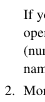

> GRUB 的某些版本会在 `menu.lst` 而不是 `grub.conf` 中查找配置。根据需要检查你自己的 Unix 版本的手册页中的首选项。注意示例中 `menu.lst` 是指向 `grub.conf` 的符号链接。

如果你想要自己的自定义启动画面，使用 `xfig` 等程序打开 `splash.xpm.gz`（如果当然先解压），然后复制其大小、深度（使用的颜色数）和图像格式。然后 `gzip` 该文件并赋予相同的名称，或更新 `grub.conf` 文件中的 `splashimage` 值（见下文）。

- 2. 不过，更可能的是，你想要修改配置文件，下面是其内部的显示方式：

```
# cat grub.conf
# grub.conf generated by anaconda
#
# Note that you do not have to rerun grub after making changes to this file
# NOTICE: You have a /boot partition. This means that
# all kernel and initrd paths are relative to /boot/, eg.
# root (hd0,0)
#
```

```
# kernel /vmlinuz-version ro root=/dev/sda2
# initrd /initrd-version.img
#
# default=0
# timeout=10
default=0
timeout=10
splashimage (hd0,0)/grub/splash.xpm.gz
title Red Hat Linux (2.4.7-10)
  root (hd0,0)
  kernel /vmlinuz-2.4.7-10 ro root=/dev/sda2
  initrd /initrd-2.4.7-10.img
title Windows 2000
  root (hd0,3)
  makeactive
  chainloader +1
```

关于 GRUB 的一个重要点是其磁盘引用记法。根引用 `(hd0,0)` 表示它位于 0 号硬盘的 0 号分区。如果我们想从 1 号硬盘的 3 号分区启动，那就是 `(hd1,3)`。

`default` 参数指定默认应启动哪个操作系统；零表示列出的第一个操作系统（Red Hat Linux）。`timeout` 变量指定 GRUB 在启动前显示其菜单的时间长度（以秒为单位，而不是 LILO 中令人困惑的十分之一秒），而 `splashimage` 表示要使用的背景图形的名称。

每个可启动的操作系统随后都用标题和根分区指示符指定（同样是磁盘、分区）。对于 Unix 系统，你在 `kernel` 行上指定内核信息（注意 `ro` 表示磁盘应以只读方式挂载，就像在 LILO 中所做的那样）。

非 Unix 操作系统（例如 Windows 2000）的配置则大不相同，因为本质上没有内核。相反，GRUB 使用所谓的 `chainloader`，它告诉 GRUB 让开，让指定磁盘和分区上的引导加载程序接管。

- 2. 你不需要做任何事情来安装新配置，但因为你不想在启动时遇到配置文件的格式错误，明智的做法是显式安装新的 GRUB 配置，通过运行 `grub-install`：

```
/sbin/grub-install /dev/sda
Installation finished. No error reported.
This is the contents of the device map /boot/grub/device.map.
Check if this is correct or not. If any of the lines is incorrect,
fix it and re-run the script 'grub-install'.

(fd0)   /dev/fd0
(hd0)   /dev/sda
```

与 LILO 不同，如果安装程序发现配置有问题，它不会使系统处于无法使用状态，因此你不必对在测试模式下运行感到偏执。

- 3. 现在启动时你将可以选择两个操作系统，并且你还将拥有一个吸引人的启动屏幕，如图 11.1 所示。

图 11.1

GRUB 启动屏幕，包含两个操作系统。

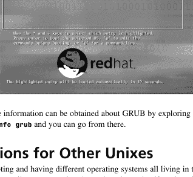

通过查阅 GRUB info 页面可以获得更多关于 GRUB 的信息。输入 `info grub` 即可继续。

## 其他 Unix 系统的其他解决方案

虽然双启动以及让不同的操作系统各自生活在自己的分区世界中对许多人很有吸引力，但如果你愿意牺牲次要操作系统的 10–30% 性能，还有另一种替代方案。

Windows 和 Mac OS 都支持虚拟机，前者通过在受保护空间中对引导加载程序进行一些巧妙的模拟，后者通过在 Apple 平台上对 Intel 硬件架构进行仿真。

本书的范围超出了对这些进行太多讨论，但值得用几张快速截图向你展示如何创建一个虚拟 Unix 操作系统用于实验和练习，而不必担心会损害正在运行的生产系统。

### 任务 11.4：了解虚拟机

在 Intel 平台上运行虚拟机的最流行解决方案是 VMware，来自 VMware Corporation（www.vmware.com）。安装此程序后，你可以创建虚拟 Unix 操作环境，甚至可以为测试安装多个 Windows 操作系统。性能大约是原生加载的 80–90%，因此并不完全一样快。值得注意的是，你也可以在 Linux 系统上安装 VMware，从而在 Linux 中运行 Windows。


在 Macintosh 上，Connectix Corporation（www.connectix.com）的 Virtual PC 提供了类似的功能，尽管由于需要仿真 Intel 硬件架构（包括 CPU）而性能损失更高。在非常快的 Mac OS X 系统上，Virtual PC 运行起来像一台稍显迟缓的 PC。

1. 当你在 PC 上安装了 `VMware` 后，你可以安装几个不同的操作系统，并通过简单地点击相应的图标来启动你选择的那个。图 11.2 显示了在 `VMware` 中运行 Red Hat Linux 7.2 的 Windows 2000 系统。

图 11.2

`VMware` 让你在操作系统内部运行另一个操作系统。

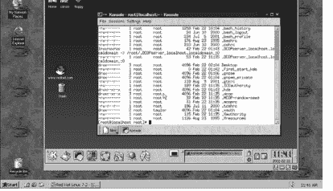

你也可以以全屏模式运行虚拟机，消除所有 Windows 杂乱（或者，如果你在 Linux 中运行 `VMware`，你可以隐藏所有 Linux 内容，看起来就像直接运行 Windows 一样）。

2. Macintosh 上的 Virtual PC 在功能上非常相似。图 11.3 显示了 Macintosh 屏幕，其中 Virtual PC 再次运行 Red Hat Linux 7.2。尽管太小而无法看到，Windows 98 SE 和 Windows 2000 是此 Macintosh 设置上可用的其他操作系统。

图 11.3

Virtual PC 让你在 Mac OS X 上运行多个操作系统。

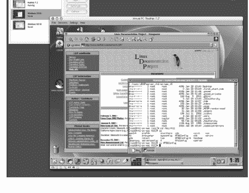

与 `VMware` 一样，Virtual PC 也允许你运行全屏模式，这略微提高了性能并消除了任何分散注意力的 Macintosh 视觉杂乱。

软件测试人员多年来一直使用 `VMware` 等产品来访问 Windows 和 Unix 的许多不同版本，这也是学习 Unix 系统管理的一种非常好的方式，其安全性远高于直接在物理机器上操作。最坏的情况下，如果你完全搞乱以至于无法启动，只需删除虚拟机映像并构建一个新的即可。更好的是，它允许在原生操作系统与虚拟或仿真操作系统之间轻松复制粘贴。

### 摘要

本小时重点介绍了多操作系统启动配置，从使用 Unix 工具对硬盘进行分区开始，然后深入研究了最流行的引导加载程序 `LILO` 和 `GRUB`。最后，我们讨论了在另一个操作系统的环境中运行一个操作系统的不同可用选项。

### 问答

Q 修改引导加载程序配置不是很危险吗？

A 当然是。事实上，在本章制作期间，`test lilo.conf` 文件中的一个多余字符给我带来了无尽的痛苦，至少浪费了八个小时。再次提醒，要小心谨慎地处理这些配置文件，并确保将原始启动参数集的备份作为其中一个选项。并且始终确保你有启动磁盘，以防万一....

Q 如果 `VMware` 这么酷，为什么还要双启动？

A `VMware` 和其他虚拟机系统提供了一种非常巧妙的方法在安全环境中运行操作系统，但它不是原生安装，而且你肯定不希望在虚拟机中运行 Web 服务器。网络和外设交互方面也有一些细微差别，在宏观上可能无关紧要，但在你管理用于开发设备驱动程序或其他低级解决方案的机器时可能会变得重要。

Q 那么，你的系统上安装了多少个操作系统？

A 我只说，在我的 Titanium Powerbook 上，它原生启动到 Mac OS X，然后使用 Virtual PC 我可以切换到全屏模式运行 Linux、Solaris、Windows 2000 和 Windows 98。当有人从我身后看过来时，这肯定会让人困惑！


### 练习

#### 测验

1. `LILO` 代表什么？`GRUB` 代表什么？
2. 启动顺序是 BIOS、PRAM，然后是什么？
3. 想要设置双启动系统的系统管理员面临的最大挑战是什么？
4. 在 `lilo.conf` 文件中，使用 `timeout` 参数时需要注意什么？
5. `GRUB` 开发者修复了 `LILO` 中的什么关键设计错误，帮助成千上万的系统管理员避免了噩梦？

#### 答案

1. `LILO` 是 Linux Loader，`GRUB` 是 GRand Unified Boot loader。
2. BIOS 启动系统，然后会检查 PRAM 以获取特定的配置细节。其中最重要的信息片段之一是启动磁盘，因此下一步是将系统控制权切换到主引导记录中的代码。
3. 为多个操作系统正确分区磁盘 *在安装任何它们之前*。
4. 你已将其设置为足够大的值：超时是以十分之一秒计算，而不是秒。
5. `GRUB` 开发者修复了程序，使其不会安装错误的配置，因此测试配置的重要性降低了。不过你仍应谨慎行事。

在下一小时，你将学习关于磁盘配额的知识，既有各种 Unix 变体内置的配额，也有你可以用一些巧妙的 shell 脚本自行构建的配额。更重要的是，我们还将详细了解 `find` 命令，并探讨它如何帮助完成许多系统管理任务。


# 第12小时

## 管理磁盘配额

系统管理界有一个老笑话，说系统管理员有两种类型：一种是在用户满意时感到高兴，另一种是在没有用户时感到高兴。话虽如此，值得指出的是，满意的用户会直接带来一个让你成功并能够计划和组织，而不是每天被动地救火的环境。

从这个意义上说，本小时我们将研究磁盘配额以及按用户管理磁盘使用情况。我们在第 3 小时“磁盘使用”中已经研究过磁盘使用情况，但那主要集中在 `df` 和 `du` 上，这两者是有用的工具，但与本小时我们将探索的 `find` 强大工具相比相对原始。

本小时你将学习

- 如何实施磁盘配额
- 其他 Unix 系统上的配额细微差别
- 如何使用 `find` 创建自己的配额系统

### 实施磁盘配额策略

早些时候我们谈到磁盘空间如此便宜，以至于获取一块额外的磁盘并将其连接到系统可能比抱怨用户消耗太多磁盘空间更容易。你甚至可以向他们收取磁盘超用税，让他们自己购买磁盘。

然而，这并不现实，了解 Unix 系统内置用于管理和限制磁盘使用的工具非常有帮助。更好的是，通过将其集成到用户环境中，你就无需发送恶意的电子邮件给用户，告诉他们出了问题。（很少有人会带着积极的心态收到它们！）

磁盘也会填满，即使是很大的磁盘。你不信？去看看 `www.sonypictures.com` 等网站上的电影预告片文件有多大。如果有用户急切地将它们存储在磁盘上，你就麻烦了，而且这个问题可能在你甚至没有意识到任何问题的情况下一夜之间出现！不好。

为了解决这些问题，几乎每种 Unix 变体都内置了磁盘配额系统。基本上，完全相同的磁盘配额工具在 Red Hat Linux、Mac OS X 和 Solaris 8 上都可用。这意味着我们可以深入探索其中一个，并使其适用于这三种操作系统。

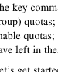

> 事实证明，在 Mac OS X 上启用磁盘配额要困难得多。我们稍后会谈到这个问题。

#### 任务 12.1：实施配额

管理磁盘配额策略的关键命令是 `edquota` 用于定义用户（或组）配额；`quotacheck` 用于确保一切配置正确；`quotaon` 用于启用配额；最后是用户级的 `quota` 命令，用于查看用户在配额分配中剩余多少空间。

让我们开始研究 Red Hat Linux 7.2。我们首先要查看的是 `mount` 使用的 `/etc/fstab` 文件。

1. 需要在你想要管理的每个物理磁盘或分区上启用磁盘配额。为此，你需要在 `/etc/fstab` 文件中进行更改，并在磁盘的最顶层创建两个空的管理文件，以便系统跟踪配额使用情况。

首先，要按用户启用配额，你需要在 `/etc/fstab` 文件的挂载选项列表中添加 `usrquota`。对于基于组的配额（即组中所有成员合计不能超过特定磁盘分配的配置）使用 `grpquota`，是的，如果你愿意，可以同时指定两者。

我修改了 `/disk2` 的挂载条目，因为我的意图是让该磁盘用于存储大型媒体文件，如电影、MP3 音乐收藏、`tarballs` 等。每个人都会获得一个较大的配额，但我想确保每个用户都能公平地使用磁盘空间。

> 作为提醒，`tarball` 是文件归档的一个可爱名称，通常是一个程序及其补充文档，以压缩的 `tar` 格式存储。有关更多信息，请参阅第 7 小时“大型文件管理和备份”。


```
# cat /etc/fstab
LABEL=/          /          ext3   defaults       1 1
LABEL=/boot      /boot      ext3   defaults       1 2
none             /dev/pts   devpts gid=5,mode=620 0 0
none             /proc      proc   defaults       0 0
none             /dev/shm   tmpfs  defaults       0 0
/dev/hda3        swap       swap   defaults       0 0
/dev/hdcrom      /mnt/cdrom iso9660 noauto,owner,kudzu,ro 0 0
/dev/fd0         /mnt/floppy auto   noauto,owner,kudzu,ro 0 0
/dev/hdb         /disk2     ext2   defaults,usrquota 2 0
```

请注意在最后一项中添加了 `usrquota`。

## 2. 创建配额文件

下一步是创建两个文件：`aquota.user` 和 `aquota.group`。

> 不同版本的 Unix 在这两个文件的名称上有所不同。新版 Unix 使用 `aquota.*`，而其他变体使用 `quota.*`。请查看手册页以获得你安装的最终结论。

这两个文件必须放在相关磁盘的根目录下，因此我们需要在卸载和重新挂载磁盘之前创建它们。

```
# cd /disk2
# touch aquota.user aquota.group
# chmod 600 aquota.user aquota.group
# ls -l aquota.*
-rw------- 1 root root 0 Feb 22 10:10 aquota.group
-rw------- 1 root root 0 Feb 22 10:10 aquota.user
```

## 3. 卸载并重新挂载磁盘

因为 `/disk2` 已经挂载到系统上，所以我需要将其卸载然后重新挂载，或者重启。我先尝试前者，因为显然它破坏性要小得多！

```
% umount /disk2
umount: /disk2: device is busy
```

ugh！这就是系统管理员不太喜欢的错误之一。这意味着有一个进程正在运行并打开了该磁盘上的文件或目录。

如果你遇到这种情况，可以立即选择重启，但我们还可以先尝试一个技巧：`wall`。`wall` 命令（想想 `write-all`）使你能够向所有已登录的用户发送快速消息。我将使用它来请大家在几分钟内离开 `/disk2`。

```
# wall
```

```
I'm trying to reconfigure /disk2 so if you are using this disk,
please back away and go back to your home directory for five.
Thanks. If this doesn't work, I'll need to reboot! :-)
```

要结束我的输入，我使用了 `Ctrl+D`。以下是用户在屏幕上看到的内容：

```
Broadcast message from root (pts/2) Fri Feb 22 10:14:18 2002...

I'm trying to reconfigure /disk2 so if you are using this disk,
please back away and go back to your home directory for five.
Thanks. If this doesn't work, I'll need to reboot! :-)
```

六十秒后我们再次尝试 `umount` 命令并成功了！（如果没有成功，`fuser` 可以成为真正的福音——它显示在给定文件系统上哪些文件被哪些进程打开。请查看手册页了解详情。）

啊，有时用户可以是很友好的人！

```
# umount /disk2
# mount /disk2
```

## 4. 运行 quotacheck 并设置配额

下一步是运行 `quotacheck` 以确保一切配置正确。你可以指定一个磁盘，但使用 `-a` 标志让 `quotacheck` 一次检查所有磁盘配额会更容易：

```
# quotacheck -a
quotacheck: WARNING - Quotafile /disk2/aquota.user was probably truncated.
Can't save quota settings...
```

这看起来并不那么严重；它只是说我们需要添加至少一个用户配额。这是通过 `edquota` 完成的，首先，让我们为用户 `taylor` 设置一个配额。

```
# edquota -u taylor
```

如果你立即收到“没有带配额的磁盘系统”的错误信息，最好的办法是仔细检查你是否已适当修改了 `/etc/fstab`，然后重新启动。一旦一切就绪，系统会弹出 `vi` 编辑器，其中包含以下信息：

```
Disk quotas for user taylor (uid 500):
Filesystem   blocks   soft   hard   inodes   soft   hard
/dev/hdb      1578     0      0      2        0      0
```

你可以看到该用户没有磁盘配额，尽管他使用了 1578 个磁盘块的空间并消耗了两个索引节点。你也可以看到，你可以按磁盘块（每个 1K）或按用户可以创建的索引节点数（本质上是文件数）来指定配额。通常，你会同时指定两者。

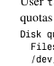

> 可用的配额有两种类型。超出软限制的用户在操作过程中会由文件系统生成警告，但他们仍可以继续工作。然而，硬限制通常会立刻阻止他们，拒绝任何写入磁盘的尝试。务必将软限制设置得明显低于硬限制，以避免用户感到沮丧。


用户 `taylor` 并不是太占用磁盘，所以我们将通过编辑所示的值为他设置相对宽松的磁盘配额：

```
Disk quotas for user taylor (uid 500):
Filesystem   blocks   soft   hard   inodes   soft   hard
/dev/hdb      1578     7500   9000   2        3000   4000
```

退出编辑器后，配额值将被保存。

如果你想将一个用户的配额限制复制到另一个用户，可以为 `edquota` 命令指定 `-p prototype-user` 标志。例如，要将 `taylor` 的配额复制给用户 `sangeeth`，就使用 `edquota -p taylor sangeeth`。当然，你也可以用一个简单的 shell 脚本来自动化整个过程。

## 5. 启用配额系统

再一步：我们需要使用 `quotaon` 启用配额系统。对于此操作，我更喜欢使用 `-a`、`-g`、`-u` 和 `-v`，分别表示打开所有配额、详细输出、检查组配额和用户配额。要一次性完成，我们只需输入：

```
# quotaon -aguv
/dev/hdb [/disk2]: user quotas turned on
```

## 6. 用户查看配额

现在当用户 `taylor` 输入 `quota` 时，他会看到

```
% quota
Disk quotas for user taylor (uid 500):
Filesystem blocks quota limit grace files quota limit grace
/dev/hdb 1578 7500 9000 2 3000 4000
```

在已启用配额的系统上，通常建议将 `quota` 命令添加到用户的 `.login` 或 `.bash_profile` 文件中。

## 7. 管理员报告

从管理角度来看，你可以使用 `repquota` 生成一份美观的输出报告：

```
# repquota -a
*** Report for user quotas on device /dev/hdb
Block grace time: 7days; Inode grace time: 7days
Block limits File limits
User used soft hard grace used soft hard grace
root ... 66 0 0 5 0 0
taylor .. 1578 7500 9000 2 3000 4000
```

## 8. 启动时自动启用配额

我们尚未涉及的唯一问题是如何在启动时自动打开配额，这样你就不用每次重启系统时都记得运行 `quotaon` 了。

我们稍微超前了一点（启动过程中读取的文件序列将在接下来的几个小时讲解），但简而言之，如果其中尚未包含启用配额的代码，你需要将以下行追加到你的 `/etc/rc.local` 文件中：


```
echo "Checking quotas. This may take a moment or two..."
/sbin/quotacheck -aguv

if [ $? -eq 0 ] ; then
 echo "Turning on disk quotas."
 /sbin/quotaon -aguv
else
 echo "*** Did not turn on disk quotas due to quotacheck errors."
fi
```

这会检查配额文件的格式是否有效，然后，如果一切正常（返回码，经测试为 `$?` 等于零），则打开配额管理系统。否则，会输出错误信息。

许多 Unix 系统管理员回避磁盘配额，更喜欢忽略这个问题或假设用户会妥善管理自己的磁盘空间。这在某些环境中可能是正确的，但一次性设置较大的磁盘配额然后不再理会，可能是更优雅的解决方案。如果没有人成为磁盘占用大户，你甚至会忘记配额的存在。但如果有人开始扩大文件系统使用量，系统会自动标记它并帮助避免更大的问题。

## 其他 Unix 系统上的配额细微差别

尽管在几乎所有现代 Unix 操作系统中启用磁盘配额的基本方法相同，但 Solaris 8 存在一些值得简要探讨的细微差别。

> 从 Mac OS X 的 Unix 级别设置磁盘配额相当棘手——棘手到本书无法深入探讨。基本挑战在于除根盘之外的磁盘都是由 `autodiskmounter` 挂载的，因此启用配额非常困难。完成之后，标准配额命令可用，正如 `man -k` 所证实的那样。希望随着 OS X 的成熟，启用配额也会变得更容易。如果你真的想深入研究，请从阅读 `quotaon` 手册页开始。

### 任务 12.2：其他系统上的配额

了解在特定版本的 Unix 上实现配额的细微差别的最佳方式，当然是阅读配额命令的手册页。

- 1. 让我们从那里开始，在 Solaris 系统上：

```
# man -k quota
edquota      edquota (1m)      - edit user quotas for ufs file system
quota        quota (1m)        - display a user's ufs file system disk quota
quotacheck   quotacheck (1m)   - ufs file system quota consistency checker
quotactl     quotactl (7i)     - manipulate disk quotas
quotaoff     quotaon (1m)      - turn ufs file system quotas on and off
quotaon      quotaon (1m)      - turn ufs file system quotas on and off
repquota     repquota (1m)     - summarize quotas for a ufs file system
rqquotad     rqquotad (1m)     - remote quota server
```

这些命令看起来肯定很熟悉，对吧？

> 实际上，这里列出并值得了解的一个命令是 `rqquotad`，它使你能够在共享的 NFS（网络文件系统）磁盘上使用配额。

Solaris 版本的 `quota` 仅报告用户超出软限制的磁盘，因此他们最好养成使用 `-v` 标志的习惯，该标志会报告所有启用配额的磁盘上的状态，无论是否超限。或者，你也可以将其设为系统范围的 shell 别名。

- 2. 我们需要做的第一个更改是编辑 `/etc/vfstab`（注意不是 `fstab`，而是 `vfstab`），在挂载时选项列表中添加 `rq`。然后，不是创建 `quota.user` 和 `quota.group`，而是简单地创建一个名为 `quotas` 的单个文件：

```
# cd /export/home
# touch quotas ; chmod 600 quotas
```

现在，卸载磁盘并重新挂载它；然后使用 `edquota` 为用户设置配额。`edquota` 命令本质上是相同的，尽管编辑器中显示的信息实际布局略有不同。

- 3. 接下来，使用 `quotacheck` 确保一切设置正确。Solaris 版本的 `quotacheck` 在理解的标志上有所不同。要获得与 Linux 中 `-aguv` 相同的效果，使用 `-pva`，它还有额外好处，即可以并行检查配额，这可能会快得多！

```
# quotacheck -pva
*** Checking quotas for /dev/rdsk/c0d0s7 (/export/home)
#
```

`repquota` 报告启用配额的设备上用户的情况：

```
# repquota -a
/dev/dsk/c0d0s7 (/export/home):

               Block limits          File limits
User   used  soft   hard  timeleft   used  soft  hard  timeleft
taylor  0   5000   7500            0     0     0
```

- 4. 用户 `taylor` 在 Solaris 机器上使用 `quota` 会看到以下内容：

```
$ /usr/sbin/quota
$
```

记住，没有 `-v` 标志时它只报告用户超额的系统。再试一次：

```
$ /usr/sbin/quota -v
Disk quotas for taylor (uid 100):
Filesystem  usage  quota  limit  timeleft  files  quota  limit  timeleft
/export/home  0   5000   7500          0     0     0
```

许多系统管理书籍建议你不要费心使用磁盘配额，因为它们已过时或没人真正使用。我不同意。如果你的系统是多用户系统，为确保资源公平共享，设置高但有意义的磁盘配额符合每个人的利益。如果你先于分配账户设置好这一点，以后就不用再与不满的用户争吵了！

## 使用 find 创建自己的配额系统

在我们离开磁盘配额主题之前，让我们看看如何使用功能强大的 `find` 命令构建自己的简单磁盘配额系统。

基本思路是，你希望自动扫描系统上所有磁盘中指定用户拥有的文件，汇总其大小，然后将所有文件的总大小与你定义的一定限制进行比较。

然而，与将其作为一组守护进程不同，我们只需创建一个 shell 脚本 `fquota` 来为我们完成工作。

### 任务 12.3：使用 find 进行磁盘配额

作为系统管理员，我反复使用的一小部分命令中，`find` 绝对名列前茅。无论你是想确保没有 `setuid root` 程序，试图找到 RPM 存储其软件包数据文件的位置，还是只是帮助用户找到那封失落已久写给 Hernia 阿姨的信，`find` 都提供了强大的功能和能力。的确，花 30 分钟阅读手册页并尝试不同的 `find` 选项是非常值得的！


> `setuid root` 程序是作为 root 运行的程序。这些是非常危险的安全漏洞，因此，你应该始终注意系统上哪些程序是 `setuid root`。你可以通过查看 `ls -l` 输出中的文件权限 `s`，并结合 root 的所有权来检查。我们将在第 21 小时“Shell 脚本：管理员的瑞士军刀”中再次讨论这个问题。


- 1. 这是 `find` 的一个典型用法，用于输出文件树指定点下由用户 `taylor` 拥有的每个普通文件的等效 `ls` 字符串：

```
# find /disk2 -user taylor -type f -ls
12 789 -rw-r--r-- 1 taylor root 802068 Feb 22 10:53 /disk2/
  vmlinuz
15 789 -rw-r--r-- 1 taylor root 802068 Feb 22 10:53 /disk2/
  vmlinuz-2.4.7.10
#
```

只有两个文件符合 `/disk2` 上的这些条件。

> 如果你想将搜索限制在单个文件系统，请将 `-xdev` 添加到参数列表中。

- 2. 我将扩大搜索范围，查看整个文件系统，但由于我知道会有很多文件，我第一次只计数行数：

```
# find / -user taylor -type f -ls | wc -l
686
```

汇总所有文件的大小是 `awk` 或 `perl` 的好工作：我选择 `awk`，因为它在旧的 Unix 系统上也可用。我们想要的任务是让脚本提取每一行的第七个字段，然后将它们全部求和并输出结果。这可以用 `awk` 中的简洁程序完成


```
{ sum += $7 } END { print sum }
```

（`END` 标签表示一段指令块，仅在所有行读取完毕后才运行）。

```
# find / -user taylor -type f -ls | \
awk '{ sum += $7 } END { print sum }'
27869349
```

看看；这是以字节为单位的，所以除以 `1024×1024` 会显示这是 26 兆字节。磁盘空间并不多，即使这个数字看起来确实很大！

当然，`awk` 也能做这个数学运算，

```
# find / -user taylor -type f -ls | \
awk '{ sum += $7 } END { print sum / (1024*1024) }'
26.5783
```

```
find / /usr /var /home -user $name -xdev -type f -ls | \
awk '{ sum += $7 } END { print sum / (1024*1024) " Mbytes " }'

done

exit 0
```

这里关于脚本有几件事值得提及。首先，`for` 循环被提供了一个 UID 大于等于 100 的用户名列表，以筛选出系统账户。这是通过更复杂的 `awk` 表达式完成的，如你所见。然后，我们将 `find` 限制在我们感兴趣检查的文件系统上，并使用 `-xdev` 确保它不会检查不感兴趣的系统。

这个版本的 `fquota` 的输出是

```
# fquota
User mthorne exceeds disk quota. Disk usage is: 0.0558786 Mbytes
User mdella exceeds disk quota. Disk usage is: 0.700355 Mbytes
User taylor exceeds disk quota. Disk usage is: 26.5783 Mbytes
User testdud exceeds disk quota. Disk usage is: 0.554475 Mbytes
```

- 4. 添加仅列出磁盘使用量超过 `MAXDISKUSAGE` 配额的用户的最后一步，是通过将整个 `for` 循环用子 shell 括号括起来，然后再次将输出传递给 `awk` 进行过滤来实现的：

```
#!/bin/sh

# FQUOTA - Disk quota analysis tool for Unix.
#          Assumes that all user accounts are >= UID 100.

MAXDISKUSAGE=20

( for name in `cut -d: -f1,3 /etc/passwd | awk -F: '$2 >= 99 { print $1 }'`
do
  echo -n "User $name exceeds disk quota. Disk usage is: "
  find / /usr /var /home -user $name -xdev -type f -ls | \
  awk '{ sum += $7 } END { print sum / (1024*1024) " Mbytes " }'
done ) | awk '{$9 > $MAXDISKUSAGE { print $0 } }'
exit 0
```

当运行这个版本的程序时，它会正确报告整个文件系统中哪些用户的磁盘配额超额：

```
# fquota
User taylor exceeds disk quota. Disk usage is: 26.5783 Mbytes
```

再多做一点工作，这就可以自动向用户发送电子邮件，温和地提醒他们压缩或删除一些文件，并为其他人腾出磁盘空间。

- 5. 那么如何让这个 Linux 脚本在 Mac OS X 上工作呢？令人惊讶的是几乎不需要更改。我们只需要省略 `-xdev`，因为 Apple 版本的 `find` 不理解它。当然，还有一些其他文件需要考虑：

```
# find / -user taylor -ls | wc -l
87308
```

主要问题是用户需要从 NetInfo 数据库中提取，而不是 `/etc/passwd`，因此我们需要使用 `ni report`，正如在第 5 小时“使用用户账户”中广泛讨论的那样。

把这一切结合起来，修改后的脚本看起来像这样：

```
#!/bin/sh

# FQUOTA - Disk quota analysis tool for Unix.
# Assumes that all user accounts are >= UID 100.

MAXDISKUSAGE=20

( for name in `ni report . /users name uid | awk '$2 > 99 { print $1 }'`
do
    echo -n "User $name exceeds disk quota. Disk usage is: "
    find / -user $name -xdev -type f -ls | \
    awk '{ sum += $7 } END { print sum / (1024*1024) " Mbytes" }'
done ) | awk '\$9 > $MAXDISKUSAGE { print \$0 }'

exit 0
```

输出很有趣：

```
# fquota
User taylor exceeds disk quota. Disk usage is: 17162.5 Mbytes
```

那个 `taylor` 小子用了大量的磁盘空间！！我得跟他谈谈！

在 Unix 中编写一个简单的配额管理系统并不特别困难。毕竟，有数百种不同的实用程序随时待命，坦白说，几乎没有什么你拼凑不出来的！

然而，如果你的系统有内置的配额系统，让文件系统本身强制执行配额限制是有优势的，特别是如果你担心失控的用户可能会在周末下载 MP3 并完全填满磁盘。

#### 摘要

本小时探讨了磁盘配额的概念，以及使用内置工具与使用文件系统一部分的系统工具之间的区别。每种解决方案都有利有弊，当然，如果你忽略磁盘配额并用完磁盘空间，也会潜伏潜在问题。如同许多管理问题一样，没有简单的答案。

#### 问答

**Q 配额不是坏事吗？我的意思是，美国最高法院不是投票说配额违反了美国宪法吗？**

**A** 嗯，即使在这个加速的 24 小时格式下，你可能也有太多空闲时间了。美国最高法院确实推翻了配额，最著名的是 1978 年的加州大学董事会诉 Bakke 案，但，真的，这相关吗？

**Q 为什么这么多系统管理员反对配额？**

**A** 这在某种程度上与前一个问题有关，并且肯定与黑客社区的无政府主义倾向有关，许多系统管理员确实强烈反对配额或任何其他人为施加的使用限制。然而，即使磁盘空间一美分一兆字节，也不可能让每个人都使用他们想要的任意空间。必须有一些限制，如果是这样，配额是一个相当优雅的，而且肯定是平等主义的解决方案。

**Q Windows 上使用磁盘配额系统吗？**

**A** 是的。你可以为几乎任何版本的 Windows 获取磁盘配额管理系统。Shareware 仓库 Download.com 有九个，包括 Northern.Net 的 slick Quota Server（但请注意，它要价 900 美元）。

#### 工作坊

##### 测验

- 1. 硬配额限制和软配额限制有什么区别？
- 2. 启用磁盘配额之前的第一步是什么？
- 3. 系统内置配额的一个主要限制是....
- 4. `wall` 命令的目的是什么？
- 5. 添加 `quota` 命令调用的推荐位置在哪里？


##### 答案

- 1. 软限制是用户在没有任何警告的情况下可以消耗的最大磁盘空间量。当他们超出软限制时，系统会抱怨但仍允许他们继续。硬限制是不可违抗的约束，系统将拒绝用户添加新文件甚至扩大文件的尝试。
- 2. 第一步是编辑 `/etc/fstab`（或 Solaris 上的 `vfstab`）以在挂载时启用配额。
- 3. 一个主要限制是配额系统不跨多个文件系统，因此虽然可以限制用户每个设备的特定空间量，但没有内置机制来限制整体磁盘使用。
- 4. `wall` 命令允许你向当时登录的每个用户发送即时消息。
- 5. 如果你启用配额，在每个用户的 `.login` 或 `.bash_profile` 中添加对 `quota`（或根据需要 `quota -v`）的调用是非常明智的做法。

在下一小时，我们将转换思路并开始查看进程和系统控制。我们将重点关注 Unix 系统的启动和关闭，包括对运行级别和 `init` 状态的广泛讨论。这是任何系统管理员必读的内容！


## 第五部分

## 进程与系统控制

## 小时

- 13 更改系统状态 247
- 14 探索进程 265
- 15 将作业运行在未来 285
- 16 管理你的日志文件 301


### 第 13 小时

### 更改系统状态

与个人电脑操作系统相比，Unix 的多用户、多处理能力在某些方面似乎有点陌生。最值得注意的是，你是否曾停下来考虑过在启动或关闭 Unix 系统时会发生什么？

在本小时，我们将深入系统配置，了解在切换状态时——无论是启动、停止、重启，还是在单用户和多用户模式之间切换——究竟启动和停止了哪些进程（以及如何启动和停止）。

在本小时你将学习关于

- `init` 进程及其配置文件
- 在不同运行级别启用特定服务
- 以正确的方式关闭系统

#### 配置和操作 init 进程

Unix 操作系统有多个运行级别，每个级别定义了操作系统的不同状态，以及可用的、正在运行的不同应用程序和守护进程。例如，按惯例，运行级别 0 是关机状态——处于运行级别 0 的系统已停止。

运行级别也称为 init 状态，以定义计算机这些不同运行级别的至关重要程序命名：`init`。

##### 任务 13.1：init 进程和配置

为了开始本小时，让我们深入 `init` 程序及其配置文件 `/etc/inittab` 的内部。

1. 首先，快速调用 `ps` 将确认 `init` 守护进程正在运行。这很容易，因为在每个 Unix 系统上，`init` 程序都是操作系统运行的第一个程序。因此，它始终是进程 ID 1。

在 Linux 机器上：

```
# ps -up 1
USER PID %CPU %MEM VSZ RSS TTY STAT START TIME COMMAND
root 1 0.0 0.0 1412 52 ? S 00:58 0:06 init
```

在 Solaris 机器上：

```
# ps -fp 1
UID PID PPID C STIME TTY TIME CMD
root 1 0 0 Jan 26 ? 0:00 /etc/init -
```

而在 Mac OS X Darwin 机器上：

```
# ps -up 1
USER PID %CPU %MEM VSZ RSS TT STAT TIME COMMAND
root 1 0.0 0.1 1292 268 ?? SLs 0:00.00 /sbin/init
```

如果由于任何原因 `init` 程序未运行，你的系统将完全停止。

请注意，`init` 没有任何启动选项。相反，程序通过读取 `/etc/inittab` 文件来确定其配置。

2. 现在让我们暂时关注 Linux。在 Red Hat Linux 上，标准的 `/etc/inittab` 文件如下所示：

```
# cat /etc/inittab
#
#
```

```
# inittab    This file describes how the INIT process should set up
#            the system in a certain run-level.
#
# Author:    Miquel van Smoorenburg, <miquels@drinkel.nl.mugnet.org>
#            Modified for RHS Linux by Marc Ewing and Donnie Barnes
#
id:5:initdefault:

# System initialization.
si::sysinit:/etc/rc.d/rc.sysinit

l0:0:wait:/etc/rc.d/rc 0
l1:1:wait:/etc/rc.d/rc 1
l2:2:wait:/etc/rc.d/rc 2
l3:3:wait:/etc/rc.d/rc 3
l4:4:wait:/etc/rc.d/rc 4
l5:5:wait:/etc/rc.d/rc 5
l6:6:wait:/etc/rc.d/rc 6

# Things to run in every runlevel.
ud::once:/sbin/update
# Trap CTRL-ALT-DELETE
ca::ctrlaltdel:/sbin/shutdown -t3 -r now

# When our UPS tells us power has failed, assume we have a few minutes
# of power left. Schedule a shutdown for 2 minutes from now.
# This does, of course, assume you have powerd installed and your
# UPS connected and working correctly.
pf::powerfail:/sbin/shutdown -f -h +2 "Power Failure; System Shutting Down"

# If power was restored before the shutdown kicked in, cancel it.
pr:12345:powerwait:/sbin/shutdown -c "Power Restored; Shutdown Cancelled"

# Run gettys in standard runlevels
1:2345:respawn:/sbin/mingetty tty1
2:2345:respawn:/sbin/mingetty tty2
3:2345:respawn:/sbin/mingetty tty3
4:2345:respawn:/sbin/mingetty tty4
5:2345:respawn:/sbin/mingetty tty5
6:2345:respawn:/sbin/mingetty tty6

# Run xdm in runlevel 5
# xdm is now a separate service
x:5:respawn:/etc/X11/prefdm -nodaemon
```

这可能看起来令人不知所措，但 `/etc/inittab` 文件中的所有行都有相同的通用格式：

`unique ID` : `run levels` : `action` : `process`

唯一 ID : 运行级别 : 动作 : 进程

例如，唯一标识为 `inittab` 行 `x` 的最后一行仅适用于运行状态（init 级别）5，并强制以指定的 `-nodaemon` 标志重新生成 `/etc/X11/prefdm` 程序。


> `prefdm` 脚本在 X Window System 环境中管理登录屏幕。

3. 让我们在表 13.1 中定义最常见的 init 级别，并在表 13.2 中定义已知的 init 动作。

##### 表 13.1 常见的 init 级别

| 级别 | 含义 |
|---|---|
| 0 | Halt |
| 1 | Single-user mode (also called s mode on some systems) |
| 2 | Multiuser, but no remote file systems mounted; often also no networking daemons running |
| 3 | Full multiuser mode |
| 5 | Full multiuser + X11 graphics |
| 6 | Reboot |

##### 表 13.2 已定义的 init 动作

| 动作 | 含义 |
|---|---|
| boot | Process will be executed during system bootup |
| bootwait | Like boot, but init waits for completion |
| ctrlaltdel | Process will be executed when the console keyboard device driver receives a Control-Alt-Del key sequence |
| initdefault | Specifies the default run level to boot into on system boot |
| once | Like wait, but init doesn't wait for completion |
| respawn | Process is guaranteed to be running—the system will restart it if it dies |
| sysinit | Process will be executed during boot, but before any boot or bootwait entries |


| `wait` | The process will be started once (as opposed to respawn), and init will wait for it to complete |


> Unix 的许多版本支持一些动作，让你能优雅地与不间断电源（UPS）交互，包括 `powerwait`、`powerfail`、`powerokwait` 和 `powerfailnow`。阅读 Linux 上的 `apmd` 手册页或 Solaris 上的 `powerd` 手册页以获取更多详细信息。

你的系统不在 init 级别 3（如果你有非图形 Unix 环境）或 init 级别 5（如果你有图形环境；例如启用 Aqua 以获得精美图形用户界面的 Mac OS X）的情况非常罕见。

### 4.
例如，在我的 Web 服务器上，我将默认 init 级别设置为 3——我不需要运行 X Window System 环境，所以我将周期节省给 Web 服务器、SSH 守护进程等。要查看 init 在此运行级别运行哪些进程，我只需逐步检查 `inittab`，查找运行级别字段中包含 3 的所有行。

这会列出以下内容：

```
l3:3:wait:/etc/rc.d/rc 3
pr:12345:powerwait:/sbin/shutdown -c 'Power Restored; Shutdown Cancelled'
1:2345:respawn:/sbin/mingetty tty1
2:2345:respawn:/sbin/mingetty tty2
3:2345:respawn:/sbin/mingetty tty3
4:2345:respawn:/sbin/mingetty tty4
5:2345:respawn:/sbin/mingetty tty5
6:2345:respawn:/sbin/mingetty tty6
```

其中，最后六个只是确保虚拟控制台有监听程序可用的进程。`pr` 行匹配电源恢复事件。（通过不在 `powerfail` 动作中指定 init 级别，你可以暗示它适用于所有状态——回头查看我们刚刚列出的 `/etc/inittab` 就明白我的意思了。）

最后，输出的第一行可能最重要：在进入 init 状态 3 时，运行 `/etc/rc.d/rc.3` 并等待其完成。`rc` 目录包含为每个特定 init 级别执行的所有脚本列表（这等同于“自动启动的所有守护进程和程序的列表”）。目录 `/etc/rc.d/rc.3` 包含控制在运行级别 3 运行（或不运行）内容的脚本。同样，init 状态 5 是多用户 + 图形用户界面，通常是 X Window System。`/etc/inittab` 中运行级别 5 的条目与运行级别 3 相同，唯一例外是运行级别 5 引用 `/etc/rc.d/rc.5` 而不是。


### 5.
在下一节中，我们将更详细地探索这些 rc 文件，但现在，让我们通过学习以下内容结束本节：你可以通过简单地输入 `init n` 在任意运行级别之间切换，其中 `n` 是期望的运行级别。

This means that to shut down the computer, you can type

意思是，要关闭计算机，你可以输入

```
init 0
```

and to reboot the computer you can type

而要重新启动计算机，你可以输入

```
init 6
```

Similarly, one way to drop into single-user mode (where no other users can log in and there's no graphical interface), you can type

同样，进入单用户模式（此时没有其他用户可以登录且没有图形界面）的一种方法是输入

```
init 1
```

Let's do that and have a quick peek at what processes are still running in the Red Hat Linux environment.

让我们这样做，并快速查看 Red Hat Linux 环境中仍在运行的进程。

### 6.
When you type `init 1`, nothing seems to happen: The shell prompts for another command as if you'd typed `echo` or `ls`, but behind the scenes things are starting to close down, and within a minute or so the system should log out remote terminals, close xterms, log out of X Windows System, and end up with just a command shell prompt on the console. Typing `ps` will reveal that there are very few processes running at this point:

6. 当你输入 `init 1` 时，似乎什么也没发生：shell 会提示输入另一条命令，就像你输入了 `echo` 或 `ls` 一样，但在幕后事物开始关闭，一分钟左右系统应注销远程终端，关闭 `xterms`，注销 X Windows System，最终只在控制台上留下命令 shell 提示符。输入 `ps` 将显示此时运行的进程非常少：

```
sh-2.05# ps aux
USER       PID %CPU %MEM    VSZ   RSS TTY      STAT START   TIME COMMAND
root         1  0.0  0.6  1424   376 ?        S    08:58   0:07 init
root         2  0.0  0.0     0     0 ?        SW   08:58   0:01 [keventd]
root         3  0.0  0.0     0     0 ?        SW   08:58   0:01 [kapm-idled]
root         4  0.0  0.0     0     0 ?        SWN  08:58   0:00 [ksoftirqd_CPU0]
root         5  0.0  0.0     0     0 ?        SW   08:58   0:10 [kswapd]
root         6  0.0  0.0     0     0 ?        SW   08:58   0:00 [kreclaimd]
root         7  0.0  0.0     0     0 ?        SW   08:58   0:00 [bdflush]
root         8  0.0  0.0     0     0 ?        SW   08:58   0:01 [kupdated]
root         9  0.0  0.0     0     0 ?        SW<  08:58   0:18 [mdrecoveryd]
root        13  0.0  0.0     0     0 ?        SW   08:58   0:18 [kjournald]
root        88  0.0  0.0     0     0 ?        SW   08:58   0:01 [khubd]
root       183  0.0  0.0     0     0 ?        SW   08:59   0:00 [kjournald]
root     10412  0.1  0.7   1492   444 ?        S    14:07   0:00 minilogd
root     10636  0.6  0.6   1424   408 tty1     S    14:07   0:00 init
root     10637  0.4  1.8   2212  1136 tty1     S    14:07   0:00 /bin/sh
root     10641  0.1  1.1   2628   716 tty1     R    14:08   0:00 ps aux
sh-2.05#
```


Notice the process IDs: All the processes with PIDs less than 200 are part of the kernel itself and stick with you regardless of run level. The higher-level processes are `minilogd`, `init`, `/bin/sh`, and of course, the `ps` command itself.

注意进程 ID：所有 PID 小于 200 的进程都是内核本身的一部分，无论运行级别如何都会保留。更高级别的进程是 `minilogd`、`init`、`/bin/sh`，当然还有 `ps` 命令本身。

The `/bin/sh` is the command shell, and the `init` hangs around until you're done with single-user mode. When you quit the shell (or kill the new init process), the system boots back into the default run level (typically 5) automatically:

`/bin/sh` 是命令 shell，而 `init` 会一直保留直到你完成单用户模式。当你退出 shell（或杀掉新的 init 进程）时，系统会自动重新启动到默认运行级别（通常为 5）：

```
sh-2.05# exit
INIT: Entering runlevel: 5
Updating /etc/fstab:                     [  OK  ]
Checking for new hardware:              [  OK  ]
Flushing all current rules and user defined chains: [  OK  ]
Clearing all current rules and user defined chains: [  OK  ]
Applying ipchains firewall rules:       [  OK  ]
Setting network parameters:             [  OK  ]
Bringing up interface lo:               [  OK  ]
Bringing up interface eth0:             [  OK  ]
Starting system logger:                 [  OK  ]
Starting kernel logger:                 [  OK  ]
Starting portmapper:                    [  OK  ]
Starting NFS file locking services:
Starting NFS statd:
Initializing random number generator:   [  OK  ]
Mounting other filesystems:             [  OK  ]
Starting APM daemon:                    [  OK  ]
Starting automount: No Mountpoints Defined
Starting sshd:                          [  OK  ]
Starting xinetd:                        [  OK  ]
Starting lpd: No Printers Defined      [  OK  ]
Starting sendmail:                      [  OK  ]
Starting console mouse services:        [  OK  ]
Starting crond:                         [  OK  ]
Starting xfs:                           [  OK  ]
```

As you can see from this listing, all these services were shut down in run level 1, so the system was impregnable from outside interference, remote users, and so on. Once you go back into the standard multiuser graphical run environment, all the services listed are relaunched, just as if you were booting from scratch (and indeed, the boot from scratch steps through these init scripts in exactly the same way).

从这个列表可以看出，所有这些服务在运行级别 1 中都被关闭了，因此系统对外部干扰、远程用户等具有不可渗透性。一旦你回到标准的 multiuser 图形运行环境，列出的所有服务都会重新启动，就像从头开始启动一样（事实上，从头开始启动时，这些 init 脚本的步骤完全相同）。

Let's end this section by rebooting the computer completely. To do this, simply type `init 6` and then go get a cup of tea....

让我们通过完全重新启动计算机来结束本节。为此，只需输入 `init 6` 然后去泡杯茶……

The `init` process is the traffic cop that controls all processes running on the operating system in a Unix box, and it's configured through the `inittab` file. The good news is that you don't ever have to actually edit the file (unless you want to change the default run level or enable power management tools, for example) because all the interesting issues of what apps are started for a given run level are pushed into the `/etc/rc.d` directory, and that's what we'll explore next.

`init` 进程是 Unix 系统中控制操作系统上所有运行进程的“交通警察”，它通过 `inittab` 文件进行配置。好消息是，你永远不必实际编辑该文件（除非你想更改默认运行级别或启用电源管理工具等），因为对于给定运行级别启动哪些应用程序的所有有趣问题都被推入了 `/etc/rc.d` 目录，而这正是我们接下来要探索的内容。

## Enabling Specific Services at Different Run Levels

## 在不同运行级别启用特定服务

While different flavors of Unix have slightly different setups for the rc files, they all have the scripts associated with a particular run level, specified either in a single file, or even better, in a specific subdirectory.

虽然不同版本的 Unix 对 rc 文件的设置略有不同，但它们都有与特定运行级别关联的脚本，这些脚本要么指定在一个文件中，要么更好的是在特定的子目录中。


Mac OS X, for example, has three shell scripts in `/etc` that control this functionality: `/etc/rc` is the multiuser startup script (the equivalent of `init 5`), `/etc/rc.boot` is the single-user startup script (the equivalent of `init 1`), and `/etc/rc.common` holds commands and steps that are shared by both run levels. Obviously, Mac OS X Unix doesn't have the concept of six different run levels, but rather four (recall that run level 0 is shutdown and run level 6 is reboot, so they don't need any specific scripts associated with them).

例如，Mac OS X 在 `/etc` 中有三个 shell 脚本控制此功能：`/etc/rc` 是多用户启动脚本（相当于 `init 5`），`/etc/rc.boot` 是单用户启动脚本（相当于 `init 1`），而 `/etc/rc.common` 包含两个运行级别共享的命令和步骤。显然，Mac OS X Unix 没有六个不同运行级别的概念，而是四个（请记住运行级别 0 是关机，运行级别 6 是重启，因此它们不需要任何特定的关联脚本）。

Solaris 8 has a different `/etc/rcn` script for each run level (for example, `rc0` and `rc3`), and also has a corresponding `rcn.d` directory that contains specific service startup scripts, as appropriate. For example, run level 3 is defined by the script `/etc/rc3` and the contents of directory `/etc/rc3.d`.

Solaris 8 为每个运行级别都有不同的 `/etc/rcn` 脚本（例如 `rc0` 和 `rc3`），并且还有相应的 `rcn.d` 目录，其中包含特定的服务启动脚本，具体视情况而定。例如，运行级别 3 由脚本 `/etc/rc3` 和目录 `/etc/rc3.d` 的内容定义。

Linux has a layout that's slightly easier to understand, where there's a single shared `/etc/rc` script and a specific directory for each of the defined run levels 0-6. Within those directories are symbolic links to scripts that define whether a particular service, daemon, or application should be started or stopped as the system transitions into the specified run level.

Linux 的布局稍易理解，其中有一个共享的 `/etc/rc` 脚本，以及为每个定义的运行级别 0-6 各自设立一个特定目录。在这些目录内是符号链接到脚本，这些脚本定义了在系统转换到指定运行级别时，特定服务、守护进程或应用程序应启动还是停止。


> Wait a second. Stopped as you enter a run level? Why would you do that?
>
> The answer to this puzzle is revealed by thinking about what you'd want to have happen if you, for example, switched from run level 5 to run level 3.
>
> You wouldn't want to reboot the system, and you wouldn't want to disconnect and reconnect the remote disks hooked up via NFS, but you would want to kill the X11 applications and graphical daemons. Hence the run level 3 directory might not only specify which applications to have running, but which applications should be stopped if they are currently running.
>
> 等一下。进入运行级别时停止？为什么要这样做？
>
> 这个谜题的答案可以通过思考如果你例如从运行级别 5 切换到运行级别 3 时希望发生什么来揭示。
>
> 你不会想重新启动系统，也不会想断开并重新连接通过 NFS 挂载的远程磁盘，但你会想杀掉 X11 应用程序和图形守护进程。因此，运行级别 3 目录可能不仅指定应运行哪些应用程序，还指定如果当前正在运行应停止哪些应用程序。

Without further ado, then, let's look into the run level 3 and run level 5 directories.

那么，不再赘述，让我们来查看运行级别 3 和运行级别 5 目录。

### Task 13.2: Configuring Your System for Run Levels

### 任务 13.2：为运行级别配置系统

When you first log in to the system and identify the process ID of your login shell, you might be surprised to find that it will often be greater than 4,000. This means that four thousand different applications have been started (and most, finished) since bootup and prior to your login shell starting. This is really amazing if you think about it, because this all might happen in no more than two or three minutes.

当你首次登录系统并识别登录 shell 的进程 ID 时，你可能会惊讶地发现它通常大于 4,000。这意味着自启动以来，在你的登录 shell 启动之前，已启动了四千个不同的应用程序（其中大多数已完成）。如果你想想，这真的很惊人，因为所有这些可能在两三分钟内就发生。

One of the main areas where the system defines which applications are automatically launched at boot-time is within the `/etc/rc` directory structure.

系统定义哪些应用程序在启动时自动启动的主要区域之一是在 `/etc/rc` 目录结构中。

1. To start out, let's move directly to `/etc/rc.d` on the Linux system to see what's inside:

1. 首先，让我们直接移动到 Linux 系统上的 `/etc/rc.d`，看看里面有什么：


```
# cd /etc/rc.d
# ls -l
total 64
drwxr-xr-x 2 root root 4096 Jan 11 15:16 init.d
-rwxr-xr-x 1 root root 3219 Jul 10 2001 rc
drwxr-xr-x 2 root root 4096 Jan 11 15:45 rc0.d
drwxr-xr-x 2 root root 4096 Jan 11 15:45 rc1.d
drwxr-xr-x 2 root root 4096 Jan 11 15:45 rc2.d
drwxr-xr-x 2 root root 4096 Jan 11 15:45 rc3.d
drwxr-xr-x 2 root root 4096 Jan 11 15:45 rc4.d
drwxr-xr-x 2 root root 4096 Jan 11 15:45 rc5.d
drwxr-xr-x 2 root root 4096 Jan 11 15:45 rc6.d
-rwxr-xr-x 1 root root 453 Feb 22 11:07 rc.local
-rwxr-xr-x 1 root root 20983 Sep 9 00:00 rc.sysinit
```

As expected, each run level has its own directory, and there's a single `rc` script that controls the transition between states. The system keeps track of the current and previous run levels internally, and you can see for yourself, with the `runlevel` command:

如预期，每个运行级别都有自己的目录，并且有一个 `rc` 脚本控制状态之间的转换。系统在内部跟踪当前和之前的运行级别，你可以使用 `runlevel` 命令自行查看：

```
# /sbin/runlevel
S 5
```

Here it's telling us that the last run level was `S` (a synonym for run level 1, or single-user mode), and that the current run level is, as expected, run level 5.

这里它告诉我们上一个运行级别是 `S`（运行级别 1 或单用户模式的同义词），而当前运行级别如预期为运行级别 5。

### 2. Let's look into the rc5.d directory to see what services are started and stopped for this level on this particular system:

### 2. 让我们查看 `rc5.d` 目录，看看在此特定系统上为该级别启动和停止了哪些服务：

```
# cd rc5.d
# ls
K03rhnsd K35vncsserver S05kudzu S17keytable S56xinetd S95atd
K20nfs K46radvd S08ipchains S20random S60lpd S90local
K20rstad K50smpd S08iptables S25nets S80sendmail
K20usersrd K65identd S10network S26apmd S85gpm
K20rwald K74ntpd S12syslog S28autofs S90crond
K20rwho K74ypserv S13portmap S55sshd S90xfs
K34yppasswdd K74ypxfrd S14nfslock S56rawdevices S95anacron
```

很多东西！任何以 `K` 开头的都被杀掉。通常这些是不需要的服务，而且可能根本就没有运行。这只是一种虚拟的保险策略。任何以 `S` 开头的如果尚未运行就会被启动。

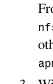

> 更重要的是，这也使得重新启用服务变得很容易：只需将脚本的首字母重命名为 `S` 而不是 `K`，然后退出并重新进入运行级别，该服务就应该被启动并运行！

从这个列表中，你可以看到在该系统上我们选择不运行 `rhnsd`、`nfs`、`rstatd`、`rusersd`、`rwalld`、`rwhod`、`yppasswdd`、`vncserver`、`radvd` 以及大约另外六个服务。然而，我们确实希望运行 23 个服务，包括 `syslog`、`netfs`、`apmd`、`sshd`、`sendmail`、`crond` 和 `atd`。

### 3. 在这些脚本中的每一个里——请记住它们都是指向中央脚本的符号链接——内容都相当相似，如下例所示，它初始化随机状态，以便系统拥有更多随机选择的随机数（这在加密领域


### 3. 在这些脚本中的每一个里——请记住它们都是指向中央脚本的符号链接——内容都相当相似，如下例所示，它初始化随机状态，以便系统拥有更多随机选择的随机数（这在加密领域

很多东西！任何以 `K` 开头的都被杀掉。通常这些是不需要的服务，而且可能根本就没有运行。这只是一种虚拟的保险策略。任何以 `S` 开头的如果尚未运行就会被启动。


> 更重要的是，这也使得重新启用服务变得很容易：只需将脚本的首字母重命名为 `S` 而不是 `K`，然后退出并重新进入运行级别，该服务就应该被启动并运行！

从这个列表中，你可以看到在该系统上我们选择不运行 `rhnsd`、`nfs`、`rstatd`、`rusersd`、`rwalld`、`rwhod`、`yppasswdd`、`vncserver`、`radvd` 以及大约另外六个服务。然而，我们确实希望运行 23 个服务，包括 `syslog`、`netfs`、`apmd`、`sshd`、`sendmail`、`crond` 和 `atd`。


> 更重要的是，这也使得重新启用服务变得很容易：只需将脚本的首字母重命名为 `S` 而不是 `K`，然后退出并重新进入运行级别，该服务就应该被启动并运行！

从这个列表中，你可以看到在该系统上我们选择不运行 `rhnsd`、`nfs`、`rstatd`、`rusersd`、`rwalld`、`rwhod`、`yppasswdd`、`vncserver`、`radvd` 以及大约另外六个服务。然而，我们确实希望运行 23 个服务，包括 `syslog`、`netfs`、`apmd`、`sshd`、`sendmail`、`crond` 和 `atd`。

### 3. 脚本结构
在这些脚本中的每一个里——请记住它们都是指向中央脚本的符号链接——内容都相当相似，如下例所示，它初始化随机状态，以便系统拥有更多随机选择的随机数，这在加密领域

很多东西！任何以 `K` 开头的都被杀掉。通常这些是不需要的服务，而且可能根本就没有运行。这只是一种虚拟的保险策略。任何以 `S` 开头的如果尚未运行就会被启动。


不要太担心如果其中一些看起来像是完全随机的输入！这里最重要的是要看到 `rc.d` 目录中的每个脚本都必须接受 `start`、`stop`、`status` 和 `restart` 作为命令行命令。这正确地意味着 `/etc/rc` 脚本的主要工作是为名称以 `S` 开头的脚本调用 `script start`，为名称以 `K` 开头的脚本调用 `script stop`。

这也意味着你可以通过指定 `status` 选项来测试这些服务的任何状态，以确保一切正常运行：

```bash
# ./S20random status
The random data source exists
```

在这种情况下并不太令人兴奋，但让我们看看 `sendmail` 是否运行正常：

```bash
# ./S80sendmail status
sendmail (pid 11315) is running...
```

你也可以利用这一知识来验证不应该运行的服务确实已停止：

```bash
# ./K20nfs status
rpc.mountd is stopped
nfsd is stopped
rpc.rquotad is stopped
```


> 在我的 Web 服务器上，当我更改 Apache 配置文件时，我使用 `/etc/rc.d/init.d` 中的主 `httpd` 脚本的 `restart` 命令轻松重启服务器。我甚至把它做成了一个别名以便更方便：
>
> alias `httpd`='`/etc/rc.d/init.d/httpd`'
>
> 定义了这个别名后，很容易输入 `httpd status` 来确保服务器正在运行，以及 `httpd restart` 用新配置文件重启它。

### 5. 禁用不需要的服务
在本小时 earlier，当我们从运行级别 1 切换到运行级别 5 时，我们有一系列服务列出了它们的启动消息。其中一个很突出：

```
Starting lpd: No Printers Defined      [  OK  ]
```

这条消息来自 `S61lpd` 脚本内部，很好地猜测由于这个原因守护进程从未启动。现在你知道如何检查了：

```
# ./S61lpd status
lpd is stopped
```

果然，它没有运行。因为我没有连接任何打印机，我将禁用运行级别 5 下的此服务，以便它在启动时不会浪费时间（更准确地说，在进入运行级别 5 时）尝试启动它。事实上，作为一个经验法则，你应该确保只有你明确希望运行的服务在默认运行级别下启用。

由于 `/etc/rc.d` 目录的智能布局，做这件事非常简单：

```
# mv S61lpd K61lpd
```

就这样。容易吧？下次系统进入运行级别 5 时，它不会再费心启动行式打印机守护进程 `lpd`。

### 6. 自定义启动脚本
还记得上小时我们谈到在启动时自动启用 `quota` 系统吗？现在你可以看到等效的非 Linux `rc.local` 文件内容背后的逻辑（以及我们为什么把启动 `quota` 系统的行放在那里）：

```
# cat rc.local
#!/bin/sh
#
# This script will be executed *after* all the other init scripts.
# You can put your own initialization stuff in here if you don't
# want to do the full Sys V style init stuff.

touch /var/lock/subsys/local

echo "Checking quotas. This may take a moment or two..."
/sbin/quotacheck -aguv

if [ $? -eq 0 ] ; then
  echo "Turning on disk quotas."
  /sbin/quotaon -aguv
else
  echo "Did *not* turn on disk quotas due to quotacheck errors."
fi
```

如果你选择走这条路并启用自己的服务，编写 `rc` 脚本的精确细节有很多东西需要学习，但决定打开和关闭什么的更简单任务可以很容易完成。此外，你现在也可以看到测试给定服务的状态也很简单。

#### 正确关闭系统

在本小时 earlier，我们看到使用 `init` 命令直接将系统切换到不同运行级别的一种棘手方法。此外，我们看到运行级别 0 是完全停止，运行级别 6 是重启状态。

这是否意味着 `init 0` 是关闭系统的好方法，`init 6` 是重启系统的好方法？不。除非你处于紧急情况且别无选择，否则你的最好选择始终是使用 `halt`、`shutdown` 或 `reboot`。

##### 任务 13.3：安全关机和重启

仅使用像 `init 0` 这样的暴力方法关闭系统的根本问题是它不能确保事情优雅地关闭。可能有特定的服务或守护进程需要在死亡时删除临时文件，而且用户当然希望至少有 60 秒的宽限期来保存工作文件并清理自己的工作。


### 1. 在系统关机或重启前警告用户的问题是一个关键问题，所以让我们从一个普通的关机开始，看看输出了什么消息。

标准 Unix 关机方式是

```
# /sbin/shutdown -h now
```

这表示系统应被停止（`-h`）而不是重启，并且此操作应立即发生（`now`）。

用户随后看到

```
Broadcast message from root (pts/2) Fri Feb 22 14:56:25 2002...
```

```
The system is going down to maintenance mode NOW !!
```

并且在系统开始杀死进程并停止之前他们没有任何宽限期。

### 2. 更好的关机系统方式是

```
# /sbin/shutdown -h +5m &
```

这将在五分钟后排队关机事件。请注意，任何时候你都有一个未来的关机事件，你都希望用尾随的 `&` 将程序放到后台，否则它会占用你的终端直到指定时间到来。

在这种情况下，用户看到的消息是

```
Broadcast message from root (pts/2) Fri Feb 22 14:58:24 2002...
```

```
The system is going DOWN for system halt in 5 minutes !!
```

这就没那么可怕了！

### 3. 要重启系统而不是停止它，只需使用 `-r` 标志。你也可以以小时：分钟格式指定关机时间，因此以下命令将使系统在凌晨 5 点自动重启：

```
# /sbin/shutdown -r 05:00 &
```

请注意，如果你排队了一个关机事件，你始终可以用 `-c` 改变主意并取消它：


> `shutdown` 的一个不错功能是，在关机排队时，它会创建 `/etc/nologin`，这会阻止任何新用户登录。

```
# shutdown -c
Shutdown cancelled.
[1]+ Done          shutdown -r 05:00
```

### 4. 这就引发了一个问题：你是否应该使用 `halt` 或 `reboot`。在现代 Linux 系统上，它们实际上是指向 `shutdown` 的链接，所以这不成问题，但其他 Unix 系统允许系统管理员直接 `halt` 或 `reboot` 系统，而不会发出警告，也不会像 `shutdown` 那样优雅地终止服务。

例如，Mac OS X 提供了 `shutdown`，它与 Linux 的 `shutdown` 在标志位上完全兼容，但同时也可以使用 `halt` 和 `reboot` 命令。

然而，`halt` 的手册页温和地提醒管理员：

> 通常，当系统需要关机或重启时，应使用 `shutdown(8)` 工具，以便提前警告用户即将发生的停机。

Solaris 的 `shutdown` 版本则相当不同，只允许三个标志：`-y`、`-g graceperiod` 和 `-i initstate`。此外，你需要使用 `-g` 标志来指定宽限期时间，而不是作为常规参数。因此，对于 Solaris，提供五分钟宽限期的标准重启命令是：

```
# /usr/bin/shutdown -y -g 300 -i6
```

默认情况下，Solaris 的 `shutdown` 会让你进入单用户（init 级别 1）模式。因此，要关闭机器，你需要使用 `-i0`；要重启，则使用 `-i6`。

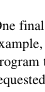

> 作为一个通用经验法则，无论使用什么操作系统，都应使用 `shutdown`，并且如果可能的话，尽量给用户至少 60 秒的宽限期。

### 5. 最后一点：`-k` 标志提供了一些有趣的功能。例如，在 Linux 上，你可以用它来练习使用 `shutdown`，因为它会让程序发送 `shutdown` 警告，但并不会实际执行所请求的关机。

Mac OS X 则更酷：`-k` 标志会将所有人踢出系统，并阻止除控制台以外的后续登录。它使系统保持多用户模式，所有服务继续运行，而不会关机或重启。

很多时候你可能需要重启系统，偶尔也会希望彻底关机（可能是为了升级硬件，或者将服务器迁移到新的物理位置）。无论如何，执行这些任务时始终使用 `shutdown`。

#### 小结

本课时重点介绍了 Unix 操作系统如何跟踪在任意给定运行级别下需要启动和停止哪些服务，以及如何为特定系统确定默认运行级别。由于良好的系统管理原则之一是只启用你确实需要的服务，我们还讨论了如何禁用特定服务，并在必要时更改默认运行级别。

#### 问答

问：既然只有四个运行级别被使用，为什么还有六个？

答：这实际上是一个有趣的历史问题。我听到的说法是，早期的电话交换机有七种状态，因此贝尔电话实验室的工程师在创建 Unix 第一个版本时，自然也为运行状态选择了七个：0–6。

问：你如何弄清楚为给定运行级别指定的所有这些服务实际上做什么？

答：弄清楚像 `anaconda` 这样的服务到底做什么肯定是一项挑战。搜索手册页，甚至使用 `man -k` 查询，都找不到任何结果。一种解决方案是在万维网上搜索。例如，尝试搜索 Red Hat Linux 知识库（`www.redhat.com`），甚至在 Google（`www.google.com`）上搜索该程序名称。

#### 实践

##### 测验

- 1. 哪个运行状态会重启：`init` 级别 0 还是 `init` 级别 6？
- 2. `init` 的启动选项有哪些？
- 3. 以下哪项不是可能出现在 `/etc/inittab` 行中的有效操作：`bootwait`、`respawn`、`sysboot` 还是 `wait`？
- 4. 如果你的系统在常规多用户模式下运行并带有图形环境，它的运行级别是什么？
- 5. 如果你处于单用户模式，如何回到多用户模式？

##### 答案

- 1. `init` 级别 0 会关机，`init` 级别 6 会重启。当然，应该改用 `shutdown`。
- 2. `init` 没有启动选项。所有 `init` 配置都存储在 `/etc/inittab` 中。
- 3. `sysboot` 操作未定义。
- 4. 多用户 + 图形环境是运行级别 5。
- 5. 要从单用户模式返回多用户模式，只需退出单用户命令 shell。

在下一课时，我们将探讨 Unix 如何管理进程，包括守护进程、系统进程和用户进程的说明。通过讲解 `ps` 命令，我们将展示如何确定哪些进程正在运行以及它们在做什么，而 `kill` 将提供工具来终止不合适的进程。

### 第14课时

### 探索进程


我们已经花了大量时间讨论如何处理文件——Unix 系统的基本数据元素。然而，Unix 的另一个同样重要的方面是进程。无论是监听你的按键并将字符传递给正在运行程序的设备驱动程序，还是响应鼠标点击的 X Window System 窗口管理器（鼠标点击由鼠标设备驱动程序捕获并转发），甚至是由 `ls` 命令产生的文件列表，Unix 的生命力都体现在进程之中。

事实上，Unix 的有趣之处在于，它不像其他操作系统那样向你隐藏系统进程。这意味着你可以通过四处探查，了解哪些程序具有哪些性能特征，从而学到很多东西。这正是本课时的主题——探索进程。

在本课时中，你将学习：

- 进程 ID
- 使用 `ps` 命令
- `pstree` 命令
- 进程优先级
- 清除游离进程

#### 进程 ID 的秘密生活

让我们从头开始。Unix 中的每个进程都有一个唯一的数字标识符，称为进程 ID。通常，这些 ID 是 3 到 4 位数字，并且从 Unix 系统启动时启动的第一个进程开始逐个递增。

尽管进程 ID（或者我们 Unix 老手所称的 PID）从 PID 1（即 `init` 进程，上一课时已探讨）开始递增，但在某个时刻，进程 ID 数值可能会超过最大可能的整数值（通常为 65536），然后回绕。

在这种情况下，你可能会发现自己运行的应用的 PID 是 37 或 119。不过一般来说，你会发现任何一位数或两位数的 PID 进程都属于操作系统核心内核的一部分。

##### 任务 14.1：进程 ID 信息

PID 的递增特性意味着，你可以检查自己的进程 ID，并了解从启动时间到登录 shell 启动之间启动了多少个进程。

- 1. 识别登录 shell 的 PID 最简单的方法是使用 shell 变量 `$$`，它会自动展开为 shell 的 PID：

```
$ echo $$
1560
```

这表明，当我在窗口管理器中启动 shell 时（启动后立即执行），Unix 操作系统已经运行了 1,559 个其他进程。这相当惊人，应该会让你不禁要问：“我的 shell 之前那些进程都是什么？”

这个问题的主要答案可以在系统从 `init` 状态逐步切换到另一个 `init` 状态时执行的所有脚本中找到，这些脚本会启动和停止服务。还有很多隐藏进程也在运行。例如，shell 脚本会不断地为反引号内的信息（如 `this `）、括号内的信息以及任何放入后台的信息生成子 shell。


正如索引节点（`inode`）是 Unix 文件系统上任何文件或目录的基本引用值一样，`PID` 是系统上任何运行中进程的基本引用值。

进程 ID 的概念很简单，但很重要的一点是，你要理解它们如何让你无歧义地引用计算机上运行的任何进程。相比之下，正在运行的程序名称当然是有歧义的，因为可能有多个副本在运行（或者它可能生成自己的多个副本来运行后台任务）。

## 使用 ps 命令检查进程

有多种不同的命令可用于检查正在运行的进程，但其中最重要的是 `ps`，即进程状态，它首次出现在第 6 小时“账户管理”中。虽然它包含大量标志，但有一个标准的两到三个标志的集合，你在 99% 的时间里都会使用它来查找系统上运行的所有进程。

给 `ps` 一个特定的进程 ID，它会告诉你有关该进程的信息，识别终端（或虚拟终端），并会告诉你与该终端关联的所有进程。指定一个用户，它会显示该用户运行的所有内容，还有更多。

### 任务 14.2：探索 ps

`ps` 命令有点类似于 `ls` 命令，因为它有数十个不同的选项，但大多数选项在不寻常的情况下都可以安全忽略。

1. 够了，开始行动吧！首先，让我们让 `ps` 告诉我们有关登录 shell 的信息：

```
# ps $$
PID TTY STAT TIME COMMAND
1636 pts/2 S 0:01 bash
```

不带任何修饰符时，`ps` 命令报告 `PID`、与进程关联的终端、其状态、进程迄今消耗的 CPU 时间以及实际命令本身。正如你所见，我正在运行 `bash` shell。

这里最有趣的列是 `STAT`，它实际上是进程的当前状态。值 `S` 表示它正在睡眠，奇怪的是，即使它是我的当前 shell。 （不用担心；shell 本身在它生成的 `ps` 命令运行时会休眠。）

不同进程状态的完整列表显示在表 14.1 中。

表 14.1 `ps` 进程状态

| State | Meaning |
|---|---|
| D | 睡眠（不可中断，因输入或输出而阻塞） |
| R | 可运行（在“运行队列”中） |
| S | 睡眠 |
| T | 被跟踪或停止（通常由用户使用 ^Z） |
| Z | “僵尸”进程（已失效或结束，但仍卡在进程队列中） |

2. 你可以尝试省略 shell PID 的 `$$` 指定。现在 `ps` 显示与你的终端（真实或虚拟）关联的所有进程：

```
# ps
PID TTY TIME CMD
1636 pts/2 00:00:01 bash
8437 pts/2 00:00:00 ps
```

你可以看到它显示了我们的登录 shell `bash` 和 `ps` 命令本身。同时请注意，它没有显示每个进程的状态。

要获取状态，我们可以添加 `-l` 或 `-f` 标志，分别用于长格式或完整列表：

```
# ps -l
F S UID PID PPID C PRI NI ADDR SZ WCHAN TTY TIME CMD
100 S 0 9020 9018 2 69 0 - 636 wait4 pts/3 00:00:01 bash
000 R 0 9064 9020 0 77 - 778 - pts/3 00:00:00 ps
```

```
# ps -f
UID PID PPID C STIME TTY TIME CMD
root 9020 9018 2 15:32 pts/3 00:00:01 bash
root 9065 9020 0 15:33 pts/3 00:00:00 ps -f
```

`-f` 标志的输出更常用，虽然它仍然没有显示命令的状态，但现在显示了有用的 `PPID`（父进程 ID），清楚地显示 `ps` 是由 `bash` 运行的。

在长输出格式（`-l`）中，`F` 列列出进程标志，`S` 是运行时状态（与之前的 `STAT` 相同），`PID` 和 `PPID` 是当前和父进程 ID。`C` 列表示 CPU 使用百分比，`PRI` 列显示内部优先级状态，可能应该忽略，`NI` 列是进程的 nice 级别（相对运行时优先级），`ADDR` 实际上是为了与早期版本的 `ps` 保持兼容而设置的无意义占位符。`SZ` 是总体内存大小（以 1K 块为单位），`WCHAN` 表示进程在内核空间中的位置，`TTY` 显示拥有该进程的终端或虚拟终端，`TIME` 表示累计 CPU 时间，最后 `CMD` 是实际命令。


> Michael Johnson，Linux `ps` 命令的作者，对 `PRI` 标志这样说：“它是从内核来的动态内部字段，其语义取决于所使用的调度程序。”

`-f` 输出更简洁一些，显示 `UID`、`PID`、`PPID`、`C`、开始时间（列为 `STIME`）、`TTY`、累计 CPU 时间和命令本身。

3. 你的头是不是晕了？我也是，只是试图弄清楚这一切！好消息是，使用 `-u`（所谓的“用户友好”）标志可以生成一个相当友好的输出格式：

```
# ps -u
USER PID %CPU %MEM VSZ RSS TTY STAT START TIME COMMAND
root 9115 0.4 2.1 2544 1368 pts/2 S 16:33 0:01 bash
root 9144 0.0 1.2 2676 768 pts/2 R 16:37 0:00 ps -u
```

这有助于将信息以更易读易懂的方式呈现。请注意，虽然 `bash` 正在睡眠（`STATE=S`），但它仍在使用 0.4% 的 CPU 和 2.1% 的可用内存。`VSZ` 是虚拟内存大小（以 1K 块为单位），`RSS` 是运行时栈，即实际位于计算机物理 RAM 中的所需内存子集（同样以 1K 块为单位）。

你可以根据此进行简单的计算来查看可用内存。如果 2,544 页（`VSZ`）占可用内存的 2.1%，这意味着 100% 内存将是 121,142 页，这也是正确的：该系统有 128MB RAM，所以我们看到 121MB 可用，大约 7MB 为内核本身保留。


> 实际上，内核占用的内存会超过 7MB。这种计算可用内存的方法只能被视为一种粗略估算。

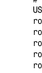

> Linux 版本的 `ps` 有点特别，因为它同时理解 BSD 风格和 SYSV 风格的命令标志。试试这个：比较 `ps -e`（System V/Posix 风格）和 `ps e`（BSD 风格）输出之间的差异。其他类 Unix 系统没有 `ps` 命令这种奇怪的双重个性，值得庆幸。

4. 我最常用的 `ps` 标志是 `-aux`。这会给你所有正在运行的进程，并提供足够的信息来了解它们都在做什么。


```
# ps -aux
USER PID %CPU %MEM VSZ RSS TTY STAT START TIME COMMAND
root 1 0.0 0.1 1412 72 ? S 13:20 0:04 init
root 2 0.0 0.0 0 0 ? SW 13:20 0:00 [kventd]
root 3 0.0 0.0 0 0 ? SW 13:20 0:00 [kapm-idled]
root 4 0.0 0.0 0 0 ? SWN 13:20 0:00 [kssoftirqd_CPU0]
root 5 0.0 0.0 0 0 ? SW 13:20 0:01 [kswapd]
root 6 0.0 0.0 0 0 ? SW 13:20 0:00 [kreclaimd]
root 7 0.0 0.0 0 0 ? SW 13:20 0:00 [bdflush]
root 8 0.0 0.0 0 0 ? SW 13:20 0:01 [kupdated]
root 9 0.0 0.0 0 0 ? SW 13:20 0:00 [mkrecoveryd]
root 13 0.0 0.0 0 0 ? SW 13:20 0:04 [kjournald]
root 88 0.0 0.0 0 0 ? SW 13:20 0:00 [khubd]
root 183 0.0 0.0 0 0 ? SW 13:21 0:00 [kjournald]
root 681 0.0 0.2 1472 160 ? SW 13:21 0:04 syslogd -m 0
root 686 0.0 0.0 1984 4 ? S 13:21 0:02 klogd -2
rpc 706 0.0 0.1 1556 124 ? S 13:21 0:00 portmap
rpcuser 734 0.0 0.0 1596 4 ? S 13:21 0:00 rpc.statd
root 846 0.0 0.0 1396 4 ? S 13:22 0:00 /usr/sbin/apmd -p
root 902 0.0 0.0 2676 4 ? S 13:22 0:03 /usr/sbin/sshd
root 935 0.0 0.0 2264 4 ? S 13:22 0:00 xinetd -stayalive
root 962 0.0 0.5 5296 368 ? S 13:22 0:04 sendmail: accept
root 981 0.0 0.0 1440 56 ? S 13:22 0:02 gpm -t ps/2 -m /d
root 999 0.0 0.1 1584 106 ? S 13:22 0:00 cron
xfs 1051 0.0 2.3 5112 1492 ? S 13:22 0:09 xfs -dropriv -da
daemon 1087 0.0 0.0 1444 4 ? S 13:22 0:00 /usr/sbin/atd
root 1095 0.0 0.0 1384 4 tty1 S 13:22 0:00 /sbin/mingetty tty1
root 1096 0.0 0.0 1384 4 tty2 S 13:22 0:00 /sbin/mingetty tty2
root 1097 0.0 0.0 1384 4 tty3 S 13:22 0:00 /sbin/mingetty tty3
root 1100 0.0 0.0 1384 4 tty4 S 13:22 0:00 /sbin/mingetty tty4
root 1101 0.0 0.0 1384 4 tty5 S 13:22 0:00 /sbin/mingetty tty5
root 1102 0.0 0.0 1384 4 tty6 S 13:22 0:00 /sbin/mingetty tty6
root 1103 0.0 0.0 2590 4 ? S 13:22 0:00 /usr/bin/kdm -nod
root 1110 3.6 0.3 14252 3776 ? S 13:22 0:41 /etc/X11/X_auth
root 1114 0.0 0.0 3340 4 ? S 13:22 0:00 :0
root 1124 0.0 0.0 2236 4 ? S 13:24 0:01 /bin/bash /usr/bi
root 1240 0.0 1.0 16052 672 ? S 13:24 0:02 kdeinit: dcopserv
root 1243 0.0 3.0 17336 1916 ? S 13:24 0:02 kdeinit: klauncher
root 1246 0.0 7.0 17764 4412 ? S 13:24 0:05 kdeinit: kded
root 1247 0.0 1.3 2388 816 ? S 13:24 0:01 fam
root 1254 0.0 1.3 5524 852 ? S 13:25 0:25 /usr/bin/artsd -F
root 1268 0.0 2.2 19540 1420 ? S 13:25 0:02 kdeinit: knotify
root 1269 0.0 1.2 16590 772 ? S 13:25 0:00 kdeinit: Running.
root 1270 0.0 3.0 11632 1888 ? S 13:25 0:10 ksmsserver -resto
root 1271 0.0 4.7 17749 2944 ? S 13:25 0:10 kdeinit: kwin
root 1273 0.1 7.1 18584 4632 ? S 13:25 0:18 kdeinit: kde desktop
root 1275 0.3 7.0 19269 4908 ? S 13:25 0:42 kdeinit: kicker
root 1281 2.6 5.0 17788 2148 ? S 13:25 5:36 kdeinit: klipper
root 1283 0.0 4.3 17360 2688 ? S 13:26 0:01 kdeinit: kwrited
root 1284 0.0 4.9 17024 3096 ? S 13:26 0:06 alarmd
root 1285 0.0 0.0 1640 4 pts/0 S 13:26 0:00 /bin/cat
root 1559 0.0 9.3 18160 5828 ? S 13:28 0:09 kdeinit: konsole
root 1560 0.0 2.0 2540 1300 pts/1 S 13:29 0:01 /bin/bash
root 9113 0.0 4.8 8148 2756 pts/1 S 16:33 0:12 xterm -fg white -
root 9115 0.2 2.2 2544 1372 pts/2 S 16:33 0:03 bash
root 9194 3.5 5.0 8520 3128 pts/2 S 16:52 0:11 xterm -fg white -
root 9196 0.8 2.2 2544 1372 pts/3 S 16:52 0:02 bash
root 9269 0.1 1.2 2680 768 pts/2 R 16:57 0:05 ps aux
```

正如你所见，该系统上运行着大量进程！

## 5. 不出所料，最常见的做法是将此输出传递给 `grep`，以便筛选出你所寻求的特定信息。好奇有哪些进程不是以 `root` 运行？试试这个：

```bash
# ps -aux | grep -vE 'root'
USER PID %CPU %MEM VSZ RSS TTY STAT START TIME COMMAND
rpc 706 0.0 0.1 1556 124 ? S 13:21 0:00 portmap
rpcuser 734 0.0 0.0 1596 4 ? S 13:21 0:00 rpc.statd
xfs 1051 0.0 0.3 5112 1492 ? S 13:22 0:09 xfs -droppriV -da
daemon 1087 0.0 0.0 1444 44 ? S 13:22 0:00 /usr/sbin/atd
```

请注意，所有这些进程都处于睡眠状态（`STAT=S`）。事实上，快速浏览之前的输出会发现，在 `ps` 拍摄进程快照时，`ps` 命令是唯一处于运行状态的进程。

## 6. 如果你好奇哪些程序消耗了最多的内存，而不是在 `ps` 中翻找，大多数版本的 Unix 都包含一个非常有用的工具，称为 `top`（在某些系统上为 `monitor`），它会显示所有正在运行的应用程序，但每隔几秒刷新一次列表。你也可以让 `top` 将其输出转储到屏幕上然后退出，而不是反复刷新。然后你可以使用 `head` 来识别占用最多 CPU 时间的半打进程：


```bash
# top -b -n0 | head -20
5:11pm up 3:50, 4 users, load average: 0.22, 0.09, 0.08
57 processes: 56 sleeping, 1 running, 0 zombie, 0 stopped
CPU states: 9.8% user, 5.4% system, 0.0% nice, 84.6% idle
Mem: 62264K av, 56172K used, 6092K free, 0K shrd, 1640K buff
Swap: 192772K av, 15208K used, 177564K free 18420K cached

PID USER PRI NI SIZE RSS SHARE STAT %CPU %MEM TIME COMMAND
9299 root 15 0 1032 1028 828 R 14.4% 1.6% 0:00 top
1281 root 9 0 3544 3148 2372 S 1.6% 5.0% 5:56 kdeinit
1254 root 9 0 1184 852 580 S 0.8% 1.3% 0:26 artsd
1 root 9 0 120 72 72 S 0.0% 0.1% 0:04 init
2 root 9 0 0 0 0 SW 0.0% 0.0% 0:00 keventd
3 root 9 0 0 0 0 SW 0.0% 0.0% 0:00 kapm-idled
4 root 19 19 0 0 0 SWN 0.0% 0.0% 0:00 ksoftirqd_CPU0
5 root 9 0 0 0 0 SW 0.0% 0.0% 0:01 kswapd
6 root 9 0 0 0 0 SW 0.0% 0.0% 0:00 kreclaimd
7 root 9 0 0 0 0 SW 0.0% 0.0% 0:00 bdflush
8 root 9 0 0 0 0 SW 0.0% 0.0% 0:01 kudpsd
```

`top` 的前几行最有趣，因为它提供了系统当前状态的非常有用的快照。对于这个特定的 Linux 服务器，你可以看到它处于 84.6% 空闲状态（CPU 余量充足），已使用 561MB 内存，剩余 6MB（不出所料，内核正最大化其尝试使用的物理内存量），同时使用了 152MB 交换空间，剩余 177MB。


> 发生了什么事？我的系统总共只有 128MB RAM，怎么会使用 561MB？答案是 `top` 显示的是使用量随时间平均值的累积总量，因此系统并没有神奇地多出 433MB。这种平均也是 CPU 使用率的计算方式，这就是为什么我们之前看到 `bash` 使用了 0.9% 的 CPU，即使它处于睡眠状态。

进入列表本身，注意 `top` 本身消耗了 14.4% 的 CPU，`kdeinit`（KDE 窗口管理器的初始化和运行时管理进程）使用 1.6%，`artsd` 使用 0.8%，而其他进程都没有对 CPU 产生任何需求。

## 7. 相比之下，`top` 在 Mac OS X 上需要稍有不同的标志才能产生相同的输出，但显示的信息或许更有趣一些：

```bash
# top -u1 | head -20
```

```
Processes: 49 total, 2 running, 47 sleeping... 166 threads 11:12:50
Load Avg: 0.78, 0.78, 0.83 CPU usage: 27.9% user, 9.3% sys, 62.8% idle
SharedLibs: num = 94, resident = 23.3M code, 1.37M data, 6.04M LinkEdit
MemRegions: num = 3774, resident = 209M + 10.5M private, 125M shared
PhysMem: 45.8M wired, 165M active, 294M inactive, 505M used, 7.49M free
VM: 2.84G + 46.8M 6650(0) pageins, 591(0) pageouts
```

| PID | COMMAND | %CPU | TIME | #TH | #PRTS | #REGS | PRVPT | RSHRD | RSIZE | VSIZE |
| 312 | iTunes | 13.0% | 24:54.68 | 9 | 141 | 236 | 8.04M | 10.5M | 12.5M | 74.0M |
| 337 | Virtual PC | 9.2% | 7:36.81 | 10 | 139 | 219 | 7.89M | 13.9M | 87.5M | 153M |
| 65 | Window Man | 3.0% | 23:20.98 | 3 | 191 | 181 | 1.75M | 54.0M | 54.9M | 96.2M |
| 359 | Terminal | 2.7% | 0:05.54 | 5 | 116 | 129 | 2.25M+ | 7.44M | 5.46M+ | 67.1M |
| 391 | top | 2.7% | 0:00.37 | 1 | 14 | 15 | 188K+ | 328K | 428K+ | 1.49M |
| 336 | Internet E | 1.6% | 1:26.15 | 8 | 99 | 146 | 8.94K | 11.5M | 14.8M | 75.6M |
| 335 | Microsoft | 1.2% | 6:02.54 | 5 | 124 | 335 | 24.6M | 41.3M | 37.9M | 124M |
| 288 | Microsoft | 1.0% | 34:40.22 | 13 | 156 | 338 | 21.1M | 24.2M | 35.4M | 108M |
| 0 | kernel_tas | 0.9% | 2:54.33 | 30 | 0 | 0 | - | - | 3.57M | 336M |
| 294 | MMBackGrou | 0.3% | 0:46.74 | 1 | 50 | 47 | 552K | 2.15M | 1.26M | 20.9M |
| 291 | Snapz Pro | 0.1% | 0:20.12 | 1 | 54 | 73 | 1.73M | 7.39M | 4.52M | 61.8M |
| 67 | update | 0.1% | 0:01.85 | 1 | 8 | 13 | 56K | 292K | 152K | 1.25M |

你可以看到我正在运行 `iTunes`（一个 MP3 音乐播放器）。`Virtual PC`、`Internet Explorer` 以及各种其他应用程序，即使我正在 `Terminal`（PID 359）中主动运行 `top`（PID 391），仍有许多其他应用程序同时使用 CPU。

## 8. 我想向你展示 Solaris 8 中等效的程序输出，但令人沮丧的是，Solaris 不包含 `top` 或 `monitor` 程序。你只能自己尝试组合 `uptime` 和 `ps`，或者从 `who -l` 开始，看看它会产生什么：

```bash
# who -l
12:21am up 31 day(s), 1 hr(s), 54 min(s) 4 user(s)
```

User  tty      login@  idle    JCPU    PCPU    what

root  console  26Jan02 3days   1:25            xterm

root  pts/2    26Jan02 6:40                .

root  pts/4    4:56pm  1:25            who -l

root  pts/3    10:56pm                     .

`ps` 输出中有很多内容值得研究，作为系统管理员，你对某些作业最重要的问题将是“这是什么？”。特别是要注意不是以 `root` 运行的作业，因为它们会显示你的用户如何消耗 CPU 和内存资源。

### 一个典型的系统管理员任务：`artsd` 是什么？

为了让你了解所有 Unix 工具如何协同工作，让我们花几分钟时间尝试弄清楚 `artsd` 是什么。我不确定在我的 Linux 机器上运行并占用 CPU 时间的 `artsd` 程序是做什么的。这是一个非常常见的情况，你需要使用标准的 Unix 工具来弄清楚特定任务是什么以及你是否真的需要它。

#### 任务 14.3：一点 Unix 侦探工作

首先，让我们看看是否能确定它是如何启动的。

- 1. 为此，将 `w` 标志添加到 `ps` 命令中，但做几次。与几乎任何其他 Unix 命令不同，`w` 标志的多次出现会给你更多输出：


```bash
# ps -auxwww | grep artsd
root 1254 0.1 1.3 5524 852 ? S 13:25 0:28
/usr/bin/artsd -F 10 -S 4096 -s 60 -m artsmessage -1 3 -f
root 9322 0.0 0.9 1792 592 pts/2 S 17:35 0:00 grep artsd
```

第一步是尝试 `man` 手册页：

```bash
# man -k artsd
artsd: nothing appropriate
```

嗯……看起来弄清楚这个问题会更困难一些。

### 2. 使用 `locate` 查看文件

作为下一步，让我们使用 `locate` 查看哪些文件包含 `artsd`：

```bash
# locate artsd
/usr/bin/artsd
/usr/bin/artsspd
/usr/lib/libartsdsp.la
/usr/lib/libartsdsp.so
/usr/lib/libartsdsp.so.0
/usr/lib/libartsdsp.so.0.0.0
/usr/lib/libartsdsp_st.la
/usr/lib/libartsdsp_st.so
/usr/lib/libartsdsp_st.so.0
/usr/lib/libartsdsp_st.so.0.0.0
/usr/include/kde/arts/kartsdispatcher.h
```

仍然没有什么有用的信息。

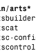

> 如果你的 `locate` 命令没有输出，可能是因为你还没有创建初始的 `locate` 数据库。查看 `man` 手册页，了解如何完成这个简单的任务的详细信息。

让我们查看 `/usr/bin`，看看 `arts` 系列应用程序包含哪些内容：

```bash
# ls /usr/bin/arts*
/usr/bin/artsbuilder   /usr/bin/artsd   /usr/bin/artshell
/usr/bin/artscat      /usr/bin/artsdsp /usr/bin/artswrapper
/usr/bin/arts-config  /usr/bin/artsmessage
/usr/bin/artscontrol  /usr/bin/artsplay
```

实际上有不少应用程序。令人惊讶的是，其中任何一个都没有 `man` 手册页。

### 3. 再次使用 `locate`

在放弃并转向 Google 或 Web 上的某个 Linux 网站搜索之前，让我们再试一次 `locate`：

```bash
# locate artscontrol
/usr/bin/artscontrol
/usr/share/apps/artscontrol
/usr/share/apps/artscontrol/artsmidimanagerview.rc
/usr/share/apps/artscontrol/artscontrol.rc
/usr/share/icons/hicolor/16x16/apps/artscontrol.png
/usr/share/applnk/Multimedia/artscontrol.desktop
```

啊哈！`/usr/share/apps` 目录中有一个名为 `artscontrol` 的目录。让我们看看该目录中还有什么可能与我们的搜索相关的东西：

```bash
# cd /usr/share/apps
# ls -ld arts*
drwxr-xr-x 4 root root 4096 Jan 11 15:03 artsbuilder
drwxr-xr-x 2 root root 4096 Jan 11 15:03 artscontrol
```

`artscontrol` 目录看起来很有希望：

```bash
# ls /usr/share/apps/artscontrol
artscontrol.rc artsmidimanagerview.rc
# more /usr/share/apps/artscontrol/artscontrol.rc
```

```
<!DOCTYPE kpartgui>
<kpartgui name="artscontrol" version="3">
<MenuBar>
<Menu name="view"&amp;View/text>
<Action name="view_fft_scope"/>
<Action name="view_audio_manager"/>
<Action name="view_arts_statusview"/>
<Action name="view_midi_manager"/>
<Action name="view_media_types"/>
<Action name="view_freverb"/>
<Action name="old_volume_display"/>
</Menu>
</MenuBar>
</kpartgui>
```

注意非常有用的 shell 快捷方式 `!$`，它匹配上一条命令的最后一个词。

好吧，我们还没有找到任何文档，但可以从中推断出一些信息片段。首先，`arts` 应用程序似乎是一种合成器播放器或接口系统（请注意 `arts` MIDI manager view.rc：MIDI 是音乐接口数字乐器，它是合成器之间通信的方式）。其次，请注意 `rc` 文件内容表明它是一个 `kpartgui`，这表明它是 KDE GUI 的一部分。因此，最有可能的是，`artsd` 是一个后台守护进程，有助于 `arts` 合成器正常工作。

### 4. 使用 `strings` 搜索 URL

由于 `/usr/bin` 中所有 `arts*` 应用程序似乎都是该程序的一部分，另一个巧妙的技巧是使用有用的 `strings` 命令搜索程序中可能列出的任何 URL：

```
# cd /usr/bin
# strings arts* | grep -i http:
http://www.arts-project.org/
```

抓到了！快速访问该网站后可以确认，`arts` 确实是一个模拟实时合成器。现在我们知道了。

有多种不同的方法可以尝试隔离和识别 `ps` 输出中运行的不同程序。学习各种系统管理员工具是很好的实践，因此请尝试做一些自己的侦探工作，看看是否能识别出您自己的 Unix 系统上运行的一些更神秘的守护进程。

## 进程优先级

作为系统管理员，您拥有的一个重要功能是普通用户无法使用，您可以根据进程工作负载的 CPU 需求更改特定任务的优先级。例如，如果某个程序似乎耗尽了您的处理器，您可以在启动时降低其优先级，甚至在运行时降低其优先级，让其他应用程序有更好的机会获得 CPU 时间片。用户可以更改自己的任务的优先级，但 `root` 可以更改任何任务。

相反，也许您正在运行图像处理程序或实时分析工具，并且希望确保它比其他用户可能启动的任何程序都更重要。为此，您可以提高进程的优先级，无论是在启动时还是在它已经运行时。

### 任务 14.4：管理进程优先级

有两个命令可用于处理进程优先级：`nice` 和 `renice`。`nice` 命令允许您在进程启动前设置其优先级，而您猜对了，`renice` 允许您更改正在运行的作业的进程。

不幸的是，虽然您可能会认为低优先级作业比高优先级作业不那么重要，但 `nice` 和 `renice` 命令（以及 Unix 本身）恰好相反地思考这个问题：`nice` 值较高的进程的优先级低于 `nice` 值较低的进程。

`nice` 值范围从 `-20` 到 `19`。零是所有登录 `shell` 及其启动的应用程序的标准优先级。您的登录 `shell` 和 `vi` 会话的优先级（`nice` 级别）均为零。

#### 1. 查看当前的 nice 级别

要查看当前的 `nice` 级别，请使用 `ps -l`：

```
# ps -l
  F   UID   PID  PPID  C PRI NI ADDR SZ WCHAN  TTY          TIME CMD
100 S     0  9386  9384  0  69  0    -  654 wait4  pts/2    00:00:03 bash
000 R     0  9485  9386  0  76  0    -  775  -      pts/2    00:00:00 ps
```

`NI` 列是我们感兴趣的内容：请注意，正如预期的那样，这两个作业都以 `nice` 级别零运行。

想知道是否有任何作业不在 `nice` 级别零？这是一个合理的问题，可以用 `awk` 轻松回答：

```
# ps -lx | awk '{ if ($6 != 0) print $0 }'
  F   UID  PID PPID PRI NI VSZ RSS STAT TTY      TIME COMMAND
040   0    4    1  19 19    0   0 ksoftirqd SWN  ?        0:00
040       9    1  -1 -20    0   0 md_thr SW<  ?        0:00
```


有两个任务的 `nice` 级别不为零：`mdrecovery` 是系统上最重要的作业，`nice` 级别为 `-20`，而 `ksoftirqd` 是最不重要的，优先级为 `19`。

## 2. 使用 `nice` 命令以不同优先级启动应用程序

要以不同优先级启动应用程序，应使用 `nice` 命令。典型的用法可能是让一个窗口监视 `syslogd` 输出文件（`/var/log/messages`），这项工作很重要，但肯定比交互式工作不那么重要：

```
# nice tail -f /var/log/messages &
# ps -l
F S UID PID PPID C PRI NI ADDR SZ WCHAN TTY TIME CMD
100 S 0 9386 9384 0 69 0 . 654 wait4 pts/2 00:00:04 bash
000 T 0 9523 9386 16 75 10 . 506 do_sig pts/2 00:00:00 tail
000 R 0 9524 9386 54 75 0 . 776 . - pts/2 00:00:00 ps
```

默认情况下，您可以看到 `nice` 会将优先级增加 `10`，这意味着应用程序以较低的优先级运行（它不如系统上的其他进程重要）。

要使其更重要，请指定所需的 `nice` 值：

```
# nice -5 vi importantfile &
# ps -l
F S UID PID PPID C PRI NI ADDR SZ WCHAN TTY TIME CMD
100 S 0 14559 14539 0 74 0 . 642 wait4 pts/0 00:00:00 bash
000 S 0 14566 14540 0 74 10 . 414 nanosl pts/0 00:00:00 tail
100 T 0 14575 14540 0 69 -5 . 505 do_sig pts/0 00:00:00 vi
100 R 0 14577 14540 0 76 0 . 773 . - pts/0 00:00:00 ps
```

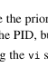

> 注意到您需要使用双破折号来获得负优先级吗？命令 `nice -5` 将其设置为优先级 `5`，这实际上比默认优先级零更不重要。最令人困惑了！

## 3. 使用 `renice` 更改正在运行任务的优先级

要更改正在运行任务的优先级，请使用 `renice`。`renice` 命令需要 `PID`，但这很容易获得，正如您现在所知。

让我们先将 `vi` 会话恢复到正常的零优先级：

```
# renice 0 14575
14575: old priority -5, new priority 0
```

看起来不错。怎么样反过来？让我们通过将其 `nice` 级别设为 `-1` 来使该 `tail` 进程比常规进程更重要：

```
# renice -1 14566
14566: old priority 10, new priority -1
```


> 作为普通用户，您可以 `renice` 您自己的进程，但仅限于 `0-19` 的范围。您无法使自己的作业比标准 `nice` 级别零更重要。

## 4. `renice` 的额外选项

`renice` 命令有一些额外的选项，其中最不重要的一个是您可以一次性更改特定用户拥有的所有进程的优先级。例如，如果用户 `taylor` 抱怨电脑太慢以及 `Quake` 运行速度不如家里的机器，您可能希望通过在短时间内降低他的优先级来进一步减慢速度：

```
# renice +1 -u taylor
582: old priority 0, new priority 1
537: old priority 0, new priority 1
```

更有可能的是，您希望通过将所有 `Apache` 进程设置为略高的优先级来提高 Web 服务器的吞吐量。首先，让我们使用 `-U` 标志限制 `ps` 的输出仅显示指定的 `UID`，然后 `renice` 所有相关作业：

```
# ps -IU apache
F S UID PID PPID C PRI NI ADDR SZ WCHAN TTY TIME CMD
140 S 48 13366 629 0 69 0 - 11689 semop ? 00:00:00 httpd
140 S 48 13367 629 0 69 0 - 11696 semop ? 00:00:00 httpd
140 S 48 13368 629 0 69 0 - 11686 semop ? 00:00:00 httpd
140 S 48 13369 629 0 69 0 - 11695 semop ? 00:00:00 httpd
140 S 48 13370 629 0 69 0 - 11689 semop ? 00:00:00 httpd
140 S 48 14993 629 0 69 0 - 11689 do_sel ? 00:00:00 httpd
140 S 48 14118 629 0 69 0 - 11693 semop ? 00:00:00 httpd
140 S 48 14322 629 0 69 0 - 11686 semop ? 00:00:00 httpd
# renice -1 -u apache
48: old priority 0, new priority -1
```

在这种情况下，它报告了所有匹配的正在运行进程的真实组 ID。要确认这一点，请使用给出的数字（`48`）对 `ps` 使用 `-G` 标志（显示组 ID）：

```
# ps -IG 48
F S UID PID PPID C PRI NI ADDR SZ WCHAN TTY TIME CMD
140 S 48 13366 629 0 69 -1 - 11689 semop ? 00:00:00 httpd
140 S 48 13367 629 0 69 -1 - 11696 semop ? 00:00:00 httpd
140 S 48 13368 629 0 69 -1 - 11686 semop ? 00:00:00 httpd
140 S 48 13369 629 0 69 -1 - 11695 semop ? 00:00:00 httpd
140 S 48 13370 629 0 69 -1 - 11689 semop ? 00:00:00 httpd
140 S 48 14993 629 0 69 -1 - 11689 do_sel ? 00:00:00 httpd
140 S 48 14118 629 0 69 -1 - 11693 semop ? 00:00:00 httpd
140 S 48 14322 629 0 69 -1 - 11686 semop ? 00:00:00 httpd
```

这正是我们想要的。因为这台服务器主要是 Web 服务器，我们现在已将所有 Web 请求（`Apache` 是 Web 服务器，其守护进程是 `httpd`）的优先级提高（`nice` 值更低），使其高于常规登录 `shell` 和其他进程。

在 `Unix` 系统上能够调整和微调任务的优先级是一种强大——而且危险——的能力。就像任何超能力一样，你必须明智且谨慎地使用它。例如，永远不要更改任何内核任务的优先级，并且要谨慎降低任何普通用户任务的优先级。

另一方面，能够进行微调也可能带来显著的好处。例如，在我的 `Mac OS X` 系统上，我发现使用 `renice` 将 `iTunes` 的优先级设置为 `1`，将 `Virtual PC` 设置为 `-1`，可以显著提高整体性能，而不会对音乐播放产生任何不利影响。

### 清除游离进程

本小时还要讨论的另一个主题是 `kill`。`renice` 命令可以降低你希望其消耗更少 CPU 和系统资源的任务的优先级，但如果想彻底杀掉进程怎么办？

这正是同名 `kill` 命令的作用。指定一个 `PID`，你就可以让它在一阵油腻的黑烟中消失。

#### 任务 14.5：`kill` 命令

无论进程是否卡住、失控、无法响应常规交互，还是来自无权运行它的其他用户，都有时候能够消除一个进程非常有价值。

##### 1. 移除仍在运行的作业

从上一节来看，仍有一些正在运行的作业应该被移除，正如 `ps` 所提醒的那样：

```
# ps -al
F S UID PID PPID C PRI NI ADDR SZ WCHAN TTY TIME CMD
000 S 0 14539 14369 0 70 1 . 589 wait4 pts/0 00:00:00 su
100 S 0 14540 14539 0 72 0 . 642 wait4 pts/0 00:00:00 bash
000 S 0 14566 14540 0 69 -1 . 414 nanosl pts/0 00:00:00 tail
100 T 0 14575 14540 0 68 0 . 505 do_sig pts/0 00:00:00 vi
100 R 0 14701 14540 0 75 0 . 773 . pts/0 00:00:00 ps
```

首先我们先杀掉 `tail`，因为我们不再需要它了——我们决定改为每天早上查看一次 `syslog` 文件本身的内容：

```
# kill 14566
#
```


`kill` 命令永远没有任何输出，因此传统上系统管理员会再次运行该命令：如果它再次没有任何报告，意味着应用程序正在阻塞或忽略信号，但如果它报告 `No such pid`，则说明第一次 `kill` 已完成任务：

```
# kill 14566
bash: kill: (14566) - No such pid
[1]- Terminated nice tail -f /var/log/messages
```

在这种情况下，第一次 `kill` 终止了 `tail`，而 `shell` 只是礼貌地等到另一个作业结束才报告作业已终止。

## 2. 作业状态与信号

你之前是否注意到 `vi` 作业的状态是 `T`，而不是 `S` 或 `R`？这意味着它已停止——要么因 I/O 被阻塞，要么由用户使用 `^Z` 控制序列停止。无论它处于停止、睡眠还是运行状态，向进程发送信号都会使其唤醒足够长的时间来处理信号，要么忽略它，要么接受它并执行特定操作。

也可以向作业发送大量信号：`kill -l` 列出了所有可能性：

```
# kill -l
1) SIGHUP 2) SIGINT 3) SIGQUIT 4) SIGILL
5) SIGTRAP 6) SIGABRT 7) SIGBUS 8) SIGFPE
9) SIGKILL 10) SIGUSR1 11) SIGSEGV 12) SIGUSR2
13) SIGPIPE 14) SIGALRM 15) SIGTERM 17) SIGCHLD
18) SIGCONT 19) SIGSTOP 20) SIGTSTP 21) SIGTTIN
22) SIGTTOU 23) SIGURG 24) SIGXCPU 25) SIGXFSZ
26) SIGVTALRM 27) SIGPROF 28) SIGWINCH 29) SIGIO
30) SIGPWR 31) SIGSYS 32) SIGRTMIN 33) SIGRTMIN+1
34) SIGRTMIN+2 35) SIGRTMIN+3 36) SIGRTMIN+4 37) SIGRTMIN+5
38) SIGRTMIN+6 39) SIGRTMIN+7 40) SIGRTMIN+8 41) SIGRTMIN+9
42) SIGRTMIN+10 43) SIGRTMIN+11 44) SIGRTMIN+12 45) SIGRTMIN+13
46) SIGRTMIN+14 47) SIGRTMIN+15 48) SIGRTMAX-15 49) SIGRTMAX-14
50) SIGRTMAX-13 51) SIGRTMAX-12 52) SIGRTMAX-11 53) SIGRTMAX-10
54) SIGRTMAX-9 55) SIGRTMAX-8 56) SIGRTMAX-7 57) SIGRTMAX-6
58) SIGRTMAX-5 59) SIGRTMAX-4 60) SIGRTMAX-3 61) SIGRTMAX-2
62) SIGRTMAX-1 63) SIGRTMAX
```

其中几乎所有信号都可以安全地忽略，但有三个值得强调，因为它们最常被使用：如果未指定信号，则发送 `SIGTERM`（如之前对 `tail` 进程的 `kill`），`SIGHUP` 是“挂断”信号，通常是终止忽略 `SIGTERM` 的进程非常优雅的方式，而 `SIGKILL` 是信号世界中的“大杀器”——它是一种进程无法捕获或忽略的 `kill` 信号。如果你懒惰，也可以直接使用信号编号，如 `kill -9 pid`。

就像冷战可怕的日子一样，信号存在一种升级的感觉，基于进程对前一个信号的响应。可以这样想：如果手枪不起作用，就试试步枪。如果那也不起作用，就是战术核弹的时候了。好吧，也许这有点夸张，但你明白我的意思。

## 3. 杀掉 vi 会话

要杀掉 `vi` 会话，我将指定 `SIGTERM` 并看看会发生什么：

```
# kill -TERM 14575
# kill -TERM 14575
#
```

啊……`vi` 忽略 `SIGTERM` 信号，所以我们必须尝试更强一点的东西：`SIGHUP`。

```
# kill -HUP 14575
# kill -HUP 14575
#
```

正如你所见，一些应用程序相当顽强，能够接受并忽略许多常见信号。`tail` 命令在收到第一个 `SIGTERM` 时优雅地退出了，但 `vi` 仍在运行。这意味着是时候使用 `SIGKILL`（又名 `-9`）了：

```
# kill -9 14575
# kill -9 14575
bash: kill: (14575) - No such pid
[2]+ Killed nice -5 vi testme
```

这招奏效了。请注意，你可以通过名称（例如 `-KILL`）或其编号指定信号。许多系统管理员使用一段时间后，`kill -9` 已经刻在手指上了，甚至不去想信号名称。

## 4. 停止与恢复作业

如果你发现自己处于需要暂时停止作业然后稍后恢复的情况，值得知道你可以向进程发送相当于 `^Z` 的信号，然后发送恢复信号使其重新启动并开始运行：

```
# ps -lU taylor
F S UID PID PPID C PRI NI ADDR SZ WCHAN TTY TIME CMD
100 S 502 14369 14368 0 70 1 . 618 wait4 pts/0 00:00:00 bash
000 S 0 14539 14369 0 70 1 . 589 wait4 pts/0 00:00:00 su
100 S 502 14717 14716 0 71 0 . 618 read_c pts/1 00:00:00 bash
000 R 502 14757 14717 27 78 0 . 445 do_sig pts/1 00:00:00 find
```

你可以看到用户 `taylor` 有一个 `find` 正在运行，目前占用了 27% 的 CPU。暂时停止这个 `find`，运行几个系统管理员命令，然后再启动它会很有帮助：

```
# kill -STOP 14757
# ps -lU taylor
F S UID PID PPID C PRI NI ADDR SZ WCHAN TTY TIME CMD
100 S 502 14369 14368 0 70 1 . 618 wait4 pts/0 00:00:00 bash
000 S 0 14539 14369 0 70 1 . 589 wait4 pts/0 00:00:00 su
100 S 502 14717 14716 0 71 0 . 618 read_c pts/1 00:00:00 bash
000 T 502 14757 14717 0 78 0 . 445 do_sig pts/1 00:00:00 find
```

现在作业已停止，我们可以做其他事情一段时间

```
# kill -CONT 14757
# ps -lU taylor
```

```
F S UID PID PPID C PRI NI ADDR SZ WCHAN TTY TIME CMD
100 S 502 14369 14368 0 70 1 - 618 wait4 pts/0 00:00:00 bash
000 S 0 14539 14369 0 70 1 - 589 wait4 pts/0 00:00:00 su
100 S 502 14717 14716 0 71 0 - 618 read_c pts/1 00:00:00 bash
000 R 502 14757 14717 0 78 0 - 445 do_sig pts/1 00:00:00 find
```

一些系统守护进程在接收到特定信号时也会重新读取其配置文件并重新启动自己。如果是这种情况，通常像 `kill -1 pid` 这样的方法就能轻松解决问题，但在对系统造成太多破坏之前，请务必对照文档仔细检查。

作为系统管理员，在一个典型的工作周中，你可能不需要杀掉超过一两个进程，但非常重要的一点是，作为系统管理员，你拥有影响系统上运行作业的工具和能力。无论是通过 `renice` 更改其优先级，还是通过 `kill` 发送 `-STOP` 或 `-HUP` 等特定信号，你都在掌控之中。

权力越大，责任越大。如果你随意更改优先级或杀掉进程，你的用户社区会像夏日野餐时的黄蜂一样愤怒！

### 摘要

本小时揭开了引擎盖，深入探讨了 Unix 进程管理的神秘世界，首先学习如何使用 `ps` 命令了解正在运行的进程，然后讨论任务优先级，最后考虑终止不应该运行的进程的不同方法。在此过程中，我们还探讨了如何解决一个常见的系统管理难题：识别正在运行的每个任务以确定它们是否需要。

### 问答

Q `init` 程序是否总是 `PID 1`？

A 我见过的每个 Unix 系统上都是如此。`init` 进程管理计算机启动的顺序，因此它是启动时启动的第一个应用程序。

Q 为什么 `nice` 值与你预期的相反，即较小的数字比较大的数字更重要？

A 这是个非常好的问题！

Q 如果有 `nice` 命令，是否也有 `naughty` 命令呢？

A 我想我们必须查阅 `SCUR1`（当然是圣诞老人 Unix，版本 1！）Linux 手册页来确认这一点。或者，答案可能取决于你对命令 `shell` 的使用方式。

### 工作坊

#### 小测验

- 1. 我在会话中稍后运行的作业，其 `PID` 是否可能低于我的登录 `shell` 的 `PID`？


- 2. 识别登录 shell 的 PID 的快捷方式是什么？又如何利用它来识别正在运行的 shell？
- 3. 说处于 T 状态的进程已终止，等待从进程队列中移除，这个说法准确吗？
- 4. 在什么情况下，你的登录 shell 可能会被列为状态 S，正在休眠？
- 5. 你认为如果输入 `kill -9 $$` 会发生什么？
- 6. Red Hat Linux 在 `ps` 输出中列出的进程之一是 `mdrecoveryd`。请做一些侦探工作，看看能否弄清楚它的作用。（如果没有 Linux，请选择另一个神秘的守护进程并弄清楚它做什么。）

##### 答案
- 1. 后续 PID 较低是可能的，但你需要 PID 回到零，这意味着自启动以来系统需要运行超过 `MAXINT`（最大可能整数值）的进程。因为 `MAXINT` 是 `2^`，那就是很多进程。
- 2. 快捷方式是 `$$`，你可以用 `ps $$` 明确识别你的 shell。
- 3. 这个说法不准确。处于 T 状态的进程要么正在被跟踪，更可能的是被 `SIGSTOP` 停止，很可能是来自 `^Z`。
- 4. 只要像 `ps` 这样的子进程在运行，父 shell 就会休眠直到它完成。
- 5. 你会立刻注销！
- 6. 我能推断的最好结果是 `mdrecoveryd` 与 RAID 磁盘子系统有关：如果没有 RAID，你可能不需要它运行。但请查阅你的操作系统文档以确认！

在下一个小时里，我们将探讨 `cron` 的方方面面，这是一个非常有用的工具，可以让你在未来的任何时间安排作业。


### 第 15 小时

### 在未来运行作业

到目前为止本书中我们一起学习的核心内容是学习如何完成任务，然后使用别名和 shell 脚本对其进行自动化（尽管后者将在本书后面更详细地介绍）。缺少的是某种调度器，一种可以指示 Unix 系统在未来运行指定命令或命令集的方式。

这正是本小时的重点，也是我最喜欢的 Unix 部分之一：`crontab`。通过通常称为 `crontab` 的 `cron` 机制，你可以指定在特定分钟、小时、天或日期运行的 Unix 命令或 shell 脚本。同样重要的是，你还可以指定运行频率，因此如果你想通过安排每年给配偶发送一次电子邮件问候来永久避免忘记周年纪念日的麻烦，使用 `cron` 就非常轻松。

如果你想每 15 分钟、午夜或每周星期日运行管理任务，也能通过 `cron` 快速轻松地完成。

本小时你将学到：

- 为用户启用 `crontab`
- 构建 `crontab` 文件
- `/etc` 中的系统 `cron` 作业
- 使用 `at` 安排未来作业

#### 允许用户访问 crontab

在开始使用 `cron` 之前，你需要确保系统已启用，并且你已创建一份用户列表，作为系统管理员，你明确允许或禁止他们使用 `crontab`。

这引出了一个重要观点：`crontab` 功能不仅对系统管理有帮助，即使在没有管理权限的系统上，它也是一个普遍有用的 Unix 工具。我拥有账户的大多数系统上，最终都会有一些脚本从 `cron` 中运行。

##### 任务 15.1：启用 crontab

使用 `cron` 所需的第一个步骤是确保在系统启动时启动并运行 `crond` 守护进程。

1. 要确定它是否正在运行，请使用 `ps`：

```
# ps -aux | grep crond
root      820  0.0  0.1  1584  680 ?        S    Mar09  0:00 crond
taylor  21117  0.0  0.1  1728  584 pts/0    S    13:59   0:00 grep crond
```

看起来不错。如果 `crond` 未运行，你需要查看 `/etc/rc.d/rc3.d`（如果你处于运行级别 3）或 `/etc/rc.d/rc5.d`（如果你处于运行级别 5），以确保 `cron` 功能已启用：

```
# /sbin/runlevel
N 3
# ls /etc/rc.d/rc3.d/*cron*
/etc/rc.d/rc3.d/S90crond  /etc/rc.d/rc3.d/S95anacron
```

你可以看到，在这台 Linux 机器上，我们可以使用 `runlevel` 确认我们处于运行级别 3（第一个参数是之前的运行级别，N 表示正在启动）。快速查看相应的 `rc.d` 目录可发现 `crond` 和 `anacron` 都已启动（它们的文件名以 S 开头）。

如果出于任何原因发现 `cron` 应该运行但未运行，你可以通过输入以下命令启动它

```
/etc/rc.d/init.d/crond start
```

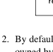

> `anacron` 系统是 `cron` 的新替代品，其主要区别在于 `anacron` 不假设你的服务器 24/7 运行。请参阅手册页了解有关此 `cron` 替代方案的更多信息，不过我的建议是你在系统上坚持使用 `cron`。

2. 默认情况下，`cron` 允许所有用户创建自己的 `crontab` 文件（由每个用户拥有的文本文件，详细说明要运行哪些作业以及运行频率），但如果你想将其限制为特定用户并阻止其他用户，可以选择包含或排除的方式进行。

也就是说，如果你创建名为 `/etc/cron.allow` 的文件，则只有该文件中列出的用户才能使用 `cron` 功能。或者，如果你创建名为 `/etc/cron.deny` 的文件，则未列出在文件中的用户可以使用 `cron`。这些文件的格式是简单的账户名称列表，每行一个。

3. 在我们查看 `cron` 的内部结构时，让我们看看程序用于存储用户 `crontab` 文件的 spool 目录：

```
# ls -l /var/spool/cron
total 2
-rw------ 1 root coders 357 Dec 17 23:01 root
-rw------ 1 root root 273 Mar 14 14:13 taylor
```

你可以看到 `root` 和 `taylor` 都有 `crontab`。请注意，所有 `crontab` 文件都归 `root` 所有。正如你稍后会看到的，这不是一个安全问题。

因为 `cron` 功能是标准 Unix 的重要组成部分，几乎所有 Unix 变体默认都已启用并准备运行。每个用户都有一个名为 `crontab` 的特定指令文件，它们都存储在 `/var/spool/cron` 目录中。

#### 构建 crontab 文件

现在你已确认 `cron` 功能已启动并运行，让我们开始构建一个新的 `crontab` 文件。`crontab` 文件是一系列行的集合，形式为“何时 什么”。每行前五个字段指定作业何时运行，其余字段是交给 shell 执行的命令。

时间指定有点棘手。前五个字段中的每个字段都可以接受星号、数值、列表、值范围或助记名称。字段如表 15.1 所示。

表 15.1 crontab 字段值

| 字段 | 可接受值 |
|---|---|
| 分钟 | 0-59 |
| 小时 | 0-23 |
| 月中的日期 | 1-31 |
| 月份 | 1-12 (or mnemonic names Jan, Feb) |
| 星期几 | 0-7 (or mnemonic names Sun, Mon) |

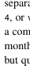

> 如果你算一下，你会意识到一个可以从 0-7 范围的星期几指定符有八天。我们这里不是在引用披头士的歌曲，`cron` 机制允许你根据自己的计数偏好使用 0 或 7 作为星期日。

可以通过在开始、结束之间加上破折号来指定范围，列表则用逗号分隔，因此 `2-5` 和 `2,3,4,5` 都匹配值 = 2、值 = 3、值 = 4 或值 = 5。你也可以在列表上指定跳过因子，例如，如果你只想在奇数日运行命令，可以使用 `1-31/2` 作为月中的日期指定符（这与 `1,3,5,7,9,11,13,15,17,19,21,23,25,27,29,31` 相同，但输入起来容易得多。

##### 任务 15.2：构建 crontab 文件


理解时间指定格式是构建和阅读 `crontab` 文件工作的 90%，因此最好的做法是举一些例子。让我们先探索 `crontab` 文件的基本语言，然后再谈谈如何构建文件并将其提交给 `cron` 调度器。

- 1. 要使进程在每天每小时的每一分钟都运行，你只需在每个字段都使用星号。在这种不寻常的情况下，你的 `crontab` 条目看起来像

```
* * * * * /home/taylor/scripts/everyminute
```

这不太可能，所以让我们改为让脚本每小时在整点后 15 分钟运行。要指定这一点，只需指定分钟字段即可：

```
15 * * * * /home/taylor/scripts/hourly
```

2. `cron` 更常见的用法是让脚本每天在指定时间运行，或每周在指定日期运行。前者应是上一个示例的直接延伸：


```
15 3 * * * /home/taylor/scripts/daily
```

在这种情况下，它将在每天凌晨 3:15 运行 `/home/taylor/scripts/daily`（记住，是分钟-小时，而不是小时-分钟）。

```
15 3 * Mon /home/taylor/scripts/weekly
```

这将在每周一凌晨 3:15 运行每周脚本。

### 3. crontab 程序

现在让我们把注意力转向 `crontab` 程序，它是创建、删除、编辑甚至列出 `crontab` 文件的方式。

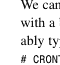

> 是的，让命令 `crontab` 与数据文件 `crontab` 具有相同的名称确实令人相当困惑。甚至还有两个不同的手册页用于该命令：`man 1 crontab` 用于命令，而 `man 5 crontab` 包含有关数据文件的信息。

`crontab` 程序很简单，并且有四个有意义的标志：`-e` 让你编辑（如果尚未拥有则创建）你的 `crontab` 文件，`-l` 列出 `crontab` 文件，`-r` 删除它，而 `-u user` 允许你作为 `root` 操作指定用户的 `crontab` 文件。

我们可以通过使用 `crontab -e` 开始使用 `crontab`，这会让我们进入 `vi` 并打开一个空白的 `crontab` 数据文件。我个人认为这不太友好，所以我在处理的任何 `crontab` 文件中都会始终输入以下几行作为开头：

```
# CRONTAB for root
#
# min hour day-of-month month day-of-week command
```

将其放在文件顶部，你就有一个易于记忆的提示，说明如何创建单个 `crontab` 条目。

### 4. 捕获 top 命令

我想捕获 `top` 命令的前几行，它提供了系统在任何给定时刻运行状况的良好快照，并每天下午 5 点将其通过电子邮件发送给自己。

第一步是确定所需的确切命令。当然，这可以在命令行上完成：

```
# top -b -n1 | head -9
```

```
9:53am up 6 days, 9:30, 1 user, load average: 0.00, 0.00, 0.00
44 processes: 43 sleeping, 1 running, 0 zombie, 0 stopped
CPU0 states: 0.0% user, 0.0% system, 0.0% nice, 100.0% idle
CPU1 states: 0.0% user, 0.1% system, 0.0% nice, 99.0% idle
Mem: 512872K av, 232612K used, 280260K free, 72K shrd, 659008K buff
Swap: 1048560K av, 0K used, 1048560K free
cached
80000K
```

这就是我们想要的。现在只需将其直接馈送到邮件程序中，我们就有一个可以放入 `crontab` 文件的命令：

```
top -b -n1 | head -9 | mail -s "top status" taylor
```

剩下的就是指定与“每天下午 5 点”相匹配的确切时间限制。以下是其外观：

```
0 17 * * * top -b -n1 | head -9 | mail -s "top status" taylor
```

我们需要使用 `17` 而不是 `5`，因为否则 `cron` 无法区分上午和下午的时间。

将此行添加到 `crontab` 文件后，作业可以通过写入临时文件并退出编辑器（如果使用 `vi`，则使用 `:wq`）来加载并安装到调度程序中。`crontab` 程序会确认 `crontab: installing new crontab`，我们就完成了。

### 5. 列出 crontab

要列出当前用户的 `crontab` 文件，请使用 `-l` 标志：

```
# crontab -l
# DO NOT EDIT THIS FILE - edit the master and reinstall.
# (/tmp/crontab.23887 installed on Fri Mar 15 09:59:01 2002)
# (Cron version -- $Id: crontab.c,v 2.13 1994/01/17 03:20:37 vixie Exp $)
# CRONTAB for root

# Format is:
#  min hour day-of-month month day-of-week command

0 17 * * * top -b -n1 | head -9 | mail -s "top status" taylor
```

请注意，`crontab` 程序在我们的材料前加上了警告，不要编辑原始文件（顺便说一下，它位于 `/var/spool/cron` 中）。这是很好的建议：如果要更改 `crontab` 文件的内容，请使用 `crontab` 命令，而不是直接进入 `/var/spool/cron` 目录！

### 6. 指定完整路径

`cron` 的一个较棘手的特性是它使用非常有限的 `PATH` 运行命令和脚本，因此它经常无法找到不在 `/bin` 中的命令。因此，我们最好对现有的 `cron` 作业做一个小的更改，并指定 `top` 命令的完整路径。这可以通过使用 `-e` 标志请求编辑 `crontab` 文件的机会来完成，但在这样做之前，让我们先再次确认 `top` 的位置：

```
# which top
/usr/bin/top
```

掌握这些信息后，`crontab -e` 会让我们进入 `vi` 并显示 `crontab` 文件，尽管没有在 `-l` 输出中出现的警告行。添加 `top` 命令的适当路径后，情况将如下所示：

```
# CRONTAB for root

# Format is:
# min hour day-of-month month day-of-week command
0 17 * * * /usr/bin/top -b -n1 | /bin/head -9 | /bin/mail -s "top" taylor
```

再次退出编辑器会将 `crontab` 文件安装到正确的位置，我们就可以开始了！

### 7. 参考条目

作为参考，这里有一些额外的 `crontab` 条目。看看你能否弄清楚它们的作用（答案将在本小时后面给出）。

```
# crontab -l
# DO NOT EDIT THIS FILE - edit the master and reinstall.
# (/tmp/crontab.23687 installed on Fri Mar 15 09:59:01 2002)
# (Cron version -- $Id: crontab.c,v 2.13 1994/01/17 03:20:37 vixie Exp $)
# CRONTAB for root

# Format is:
# min hour day-of-month month day-of-week command
0 17 * * * top -b -n1 | head -9 | mail -s "top status" taylor
0 5 * * * cd /web/chatter/comics; ./build-comics-page.sh > ./index.html

0 12 1 * * /home/taylor/scripts/doitall
0 0 3 8 * mail -s "happy birthday Dave" taylor@intuitive.com < birthday.note
5 5 * * Mon-Fri uptime | mail -s uptime root
23 0-23/2 * * * echo "when does this run?" | mail root
30 4 1,15 * 5 /home/taylor/scripts/when_is_it
0 9,16 * * * /home/taylor/scripts/rotatefiles
```

`crontab` 系统无论是作为系统管理员还是普通用户工作都非常有帮助，但在创建和指定时间时有一些细微差别。一个经典的例子是，如果你想让作业在每年 8 月 3 日运行，你可能会想将其指定为 `* * 3 Aug * daves.birthday.script`，但那是错误的。你能看出哪里错了吗？

问题是我们没有将其限制为特定的小时和分钟。这将在匹配的日期的每一分钟运行脚本，共 1,440 次。相反，只需选择一个时间并同时指定分钟和小时即可。

#### /etc 中的系统 cron 作业

在本小时前面，你看到了 `root crontab` 文件，可能对其中实际列出的内容很少感到惊讶。在旧的 Unix 系统中，`root crontab` 通常有 20–30 行长，列出了所有夜间、每周和每月的管理作业。显然它们不再在那里了。那么它们去哪里了呢？

答案是 Linux 的 `cron` 系统重写通过添加对特殊目录的支持来扩展服务，这些目录包含应按每小时、每天、每周或每月运行的 `root` 管理 `cron` 作业。

##### 任务 15.3：探索管理 cron 作业


相关目录都在`/etc`中，逻辑上命名为`cron.hourly`、`cron.daily`、`cron.weekly`和`cron.monthly`。这种方法有趣之处在于你不再需要担心时间说明符——如果它在`cron.daily`目录中，它将由`crond`每天运行一次。

### 1. 让我们看看这些目录中有什么：

```
# ls -R /etc/cron.*
/etc/cron.d:
  sysstat

/etc/cron.daily:
  00-logwatch  0anacron  makewhatis.cron  slocate.cron  tmpwatch
  00webalizer  logrotate  rpm  sysstat

/etc/cron.hourly:

/etc/cron.monthly:
  0anacron

/etc/cron.weekly:
  0anacron  makewhatis.cron
```

`/etc/cron.d`中的条目采用常规`crontab`行格式；它们只是让你避免拥有一个非常大的`crontab`文件。否则，所有其他文件都是简单的`shell`脚本。

### 2. 你现在应该很容易理解`/etc/cron.d/sysstat`文件指定了什么，以及`cron`系统应在何时运行它：

```
# more /etc/cron.d/sysstat
# run system activity accounting tool every 10 minutes
*/10 * * * * root /usr/lib/sa/sa1 1 1
```

这指定每10分钟运行一次`sa1`。

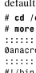

> 请注意注释的使用如何帮助你理解正在发生的事情。作为一般规则，你应该始终尝试在`crontab`文件中的每一行之前加上注释，解释你期望的频率。

### 3. 每周`cron`作业是我们开始的好地方，所以让我们看看`Red Hat Linux`中包含的默认文件：

```
# cd /etc/cron.weekly
# more *
::::::::::::::
0anacron
::::::::::::::
#!/bin/sh
#
# anacron's cron script
#
# This script updates anacron time stamps. It is called through run-parts
# either by anacron itself or by cron.
#
# The script is called '0anacron' to assure that it will be executed
# _before_ all other scripts.

anacron -u cron.weekly
::::::::::::::
makewhatis.cron
::::::::::::::
#!/bin/bash

LOCKFILE=/var/lock/makewhatis.lock

# the lockfile is not meant to be perfect, it's just in case the
# two makewhatis cron scripts get run close to each other to keep
# them from stepping on each other's toes. The worst that will

```

# happen is that they will temporarily corrupt the database...

[ -f $LOCKFILE ] && exit 0

trap "rm -f $LOCKFILE" EXIT

touch $LOCKFILE

makewhatis -w

exit 0

```

与这些管理脚本典型的情况一样，这两个示例本质上都只有一行长。第一个`0anacron`调用`anacron -u cron.weekly`，而第二个`makewhatis.cron`每周使用`makewhatis -w`重建`whatis`数据库（由`man -k`使用）。

### 4. 每天的脚本更有趣，而且数量更多，所以让我们看看是否有任何不寻常或特别值得称道的：

```
# wc -l *
```

| 行 | 文件 |
|-------|------|
| 691 | 00.logwatch |
| 8 | 00webalizer |
| 12 | 0anacron |
| 3 | logrotate |
| 13 | makewhatis.cron |
| 4 | rpm |
| 3 | slocate.cron |
| 5 | sysstat |
| 7 | tmpwatch |
| 746 | total |

`logwatch`脚本长达691行，相当惊人。否则，你可以看到这些脚本都相当简短。其中一些提供了有趣的技术：

```
# cat 00webalizer

#!/bin/bash

# update access statistics for the web site

if [ -s /var/log/httpd/access_log ] ; then

/usr/bin/webalizer

fi
```

这是管理员脚本中常见的构造——如果特定数据文件存在，则运行分析它的程序。在这种情况下，它会检查`Web`服务器（`httpd`）是否收到任何访问。如果有，`webalizer`将生成一些基础的日志文件分析。

```
# cat slocate.cron

#!/bin/sh

renice +19 -p $$ >/dev/null 2>&1

/usr/bin/updatedb -f "nfs,smbfs,ncpfs,proc,devpts" -e "/tmp,/var/tmp,/usr/tmp,/afs,/net"
```

这是简洁脚本的绝佳示例，由真正理解`shell`脚本细微差别的人编写。`renice`命令通过将其设置为`+19`，尽可能降低其自身`shell`（请记住`$$`是`shell`的`PID`）的优先级。现在系统上的每个其他任务都比这个`shell`脚本更重要。下一行通过启动`updatedb`执行实际工作，后者重建`locate`文件名数据库。

### 5. 再举一个例子，一个相当巧妙地使用`shell`脚本和通过模式进行文件名扩展的用法。

```
# cat tmpwatch

/usr/sbin/tmpwatch 240 /tmp

/usr/sbin/tmpwatch 720 /var/tmp

for d in /var/{cache/man,catman}/{cat?,X11R6/cat?,local/cat?}; do

  if [ -d "$d" ]; then

    /usr/sbin/tmpwatch -f 720 $d

  fi

done
```


`tmpwatch` 程序会删除超过指定小时数未被访问的文件，在这里你可以看到它有助于保持未压缩的手册页目录（`/cat` 目录）中没有旧的手册页。这里，它使超过 720 小时（30 天）的文件过期。

你可以通过多种不同的方式让 cron 系统运行管理任务。你可以为 root 创建一个明确的 `crontab` 文件，在 `/etc/cron.d` 中放置一个带有时间说明符的新脚本，或编写一个脚本并将其放在 `cron.hourly`、`cron.daily`、`cron.weekly` 或 `cron.monthly` 中，让 cron 系统自动安排它。

对于普通用户，唯一可用的选项是 `crontab` 文件，但正如所演示的那样，它们创建起来相当简单，所以并不太麻烦。

## 先前介绍的 crontab 条目的说明

每天下午5点：
```
0 17 * * * top -b -n1 | head -9 | mail -s 'top status' taylor
```

每天凌晨5点：
```
0 5 * * * cd /web/chatter/comics; ./build-comics-page.sh > ../index.html
```

每月第一天中午：
```
0 12 1 * * /home/taylor/scripts/doitall
```

每年8月3日午夜：
```
0 0 3 8 * mail -s 'happy birthday Dave' taylor@intuitive.com < birthday.note
```

周一至周五凌晨5:05：
```
5 5 * * Mon-Fri uptime | mail -s uptime root
```

每小时的45分钟，每隔一小时：
```
45 0-23/2 * * * echo "when does this run?" | mail root
```

这个有点 tricky：`cron` 如果同时指定了星期几和月份中的日期，则匹配其中之一，所以这表示在每月第一天、每月15日以及每周五（day = 5）的凌晨4:30：
```
30 4 1,15 * 5 /home/taylor/scripts/when_is_it
```

每天两次，上午9点和下午4点：
```
0 9,16 * * * /home/taylor/scripts/rotatefiles
```

### 在未来某次使用 at

如果你只想一次性在未来安排任务而不是重复执行，还有另一个值得提及的实用工具——`at` 命令。然而，如果它在你的系统上实际上并未运行，不要感到惊讶，尤其是如果你使用的是笔记本电脑安装。`Mac OS X` 默认发行版在 `/etc/crontab` 中说明：

```
# Disabled by default, since it causes disk access every 10 minutes,
# which is useless unless you use at(1). Enable as needed.

##*/10 * * * * root /usr/libexec/atrun
```

注意这里它也只每 10 分钟运行一次（`*/10`），所以如果你想让一个任务在未来三分钟内运行，它不会那么精确。

#### 任务 15.4：使用 at

原版 Red Hat Linux 发行版已启用 `at`，因此在结束本小时之前我们可以简要地尝试一下。

1. 你可以像往常一样使用 `ps` 确认 `at` 是否正在运行：
```
# ps -aux | grep atd
rpcuser 605 0.0 0.1 1688 836 ? S Mar09 0:00 rpc.statd
daemon 861 0.0 0.1 1444 568 ? S Mar09 0:00 /usr/sbin/atd
root 23814 0.0 0.1 1728 584 pts/0 S 11:11 0:00 grep atd
```

2. 要在未来安排一个作业，你可以用几种方式指定时间。一般来说，你要么在 `at` 说明之后立即输入命令，要么将 shell 脚本通过管道输入到 `at` 命令。

在所有这些情况下，让我们启动 `fquota`，正如本书第 12 小时“管理磁盘配额”中讨论的那样：

```
# at midnight < /bin/fquota
Job a01027320.000 will be executed using /bin/sh

# at teatime < /bin/fquota
Job a01027140.000 will be executed using /bin/sh

# at 5:18pm < /bin/fquota
Job a01027186.000 will be executed using /bin/sh

# at noon Aug 3 < /bin/fquota
Job a01058934.000 will be executed using /bin/sh

# at noon tomorrow < /bin/fquota
Job a010275f0.000 will be executed using /bin/sh
```

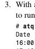

> 是的，`teatime` 是一个有效的时间！对于那些还不知道的人来说，它是下午 4 点。Unix 不是很有趣吗？

3. 将所有这些注入系统后，`atq` 命令显示排队运行的内容：
```
# atq
```
| 时间 | 日期 | 所有者 | 队列 | 作业号 |
|------|------|-------|-------|------|
| 16:00:00 | 03/15/02 | root | a | a01027140.000 |
| 17:18:00 | 03/15/02 | root | a | a01027186.000 |
| 00:00:00 | 03/16/02 | root | a | a01027320.000 |
| 12:00:00 | 03/16/02 | root | a | a010275f0.000 |
| 12:00:00 | 08/03/02 | root | a | a01058934.000 |

注意最后一个作业安排的时间还很久。事实上，它还有五个月的时间。

4. 如果你决定放弃该作业，可以使用 `atrm` 删除一个 `at` 作业：
```
# atrm a01058934.000
#
```


与 `kill` 以及许多其他 Unix 命令一样，`atrm` 不会确认成功，它只会标记失败。

## atq

| 时间 | 日期 | 所有者 | 队列 | 作业号 |
|------|------|-------|-------|------|
| 16:00:00 | 03/15/02 | root | a | a01027140.000 |
| 17:18:00 | 03/15/02 | root | a | a01027186.000 |
| 00:00:00 | 03/16/02 | root | a | a01027320.000 |
| 12:00:00 | 03/16/02 | root | a | a010275f0.000 |

出于公平披露的考虑，我从 1980 年第一次登录以来一直在使用 Unix 系统。在这些年里，当我管理各种大小的系统时，我从未使用过一次 `at` 命令。它简单而优雅，但我一直发现我要么想一次性立即执行作业，要么通过 `cron` 在未来以某种频率执行。你的体验无疑会有所不同，但你可能永远不会在你的 Unix 工作中使用 `at`。

### 总结

虽然没有 H.G. Wells 的《时间机器》那么令人兴奋，但本小时重点介绍了 Unix 工具，允许你执行命令，要么在未来一次性执行（使用 `at`），要么重复执行（使用 `cron`）。`cron` 有隐藏的深度，因此本小时还探讨了配置以及每小时、每天、每周和每月安排的系统作业。

### Q&A

Q 为什么 `crontab` 不能接受像 `5:00pm Sundays` 这样的时间格式？

A 日期解析在计算机系统上实际上是一个很大的挑战。一些应用程序有大量代码试图提供高度灵活的日期输入格式。`cron` 系统不是其中之一，可惜了。最好是有一个更智能的 `cron`，或者一个前端，让你用英语指定内容并将其翻译成五字段的 `crontab` 格式，但就我所遇到过的，它们不存在。

Q 你之前评论说所有 `crontab` 文件都由 `root` 拥有不是安全风险。你能扩展一下这个评论吗？

A 关于 `cron` 的一个重要认识是，它使用 `crontab` 所有者的有效 UID 运行所有作业，而不是 `crontab` 文件所有者（即 `root`）。一些 Unix 用户并不真正理解这一点，并认为因为 `crond` 程序以 `root` 运行，所以所有 `cron` 作业也会以 `root` 运行。这是不正确的。

### Workshop

#### Quiz

- 1. `crontab` 期望的是小时分钟还是分钟小时格式？
- 2. 如果你不再需要，如何删除一个 `crontab` 文件？
- 3. 这能作为小时说明符工作吗：`0,3,6,9,11-19/2`？如果是，它是什么意思？
- 4. 许多第一次 `crontab` 条目中存在一个常见问题。是什么，以及如何修复它？
- 5. 根据 `at`，`teatime` 是什么时候？

#### 答案

- 1. `crontab` 文件将 `minute hour` 指定为时间说明符的前两个字段。
- 2. 命令 `crontab -r` 会永久删除 `crontab` 文件。
- 3. 当然会，尽管很复杂。它匹配以下枚举列表：`0,3,6,7,8,9,11,13,15,17,19`。
- 4. 问题在于 `cron` 程序使用的 `PATH` 很可能与你的登录 `shell` 不同。为规避此问题，请始终为 `crontab` 行中引用的命令以及 `cron` 代表你调用的任何 `shell` 脚本中指定的命令指定完整路径名。
- 5. 正如我父母肯定会确认的那样，所有文明国家的茶点时间都是下午 4 点。精确地说。

在接下来的一个小时里，我们将通过分析和管理 Unix 中众多日志文件的增长来了解 `cron` 的一些实际用途。我们还将学习 Linux 中一个名为 `logrotate` 的巧妙新实用程序，以及如何在其他 Unix 系统中模拟它。


## 第 16 小时

### 管理你的日志文件

系统管理员最重要的任务之一是关注系统和磁盘空间。之前我们花了一些时间探索 `df`、`du` 和 `find`，并学习了它们如何用于更好地了解系统上磁盘空间的分配。

在本小时中，我们将深入研究不同 Unix 服务使用的特定日志文件，学习如何分析它们以标记任何潜在问题，以及如何防止它们耗尽磁盘空间。

本小时你将学习

- 探索日志文件的内容
- 通过日志事件追踪黑客
- 打开 `httpd` 日志文件
- 使用 `logrotate` 修剪日志文件
- 构建自己的日志轮转工具

#### 理解日志文件

无论是启动过程本身、`FTP` 服务器、邮件服务器，还是计算机上运行的任何其他服务，如果它执行了某些操作或有人与其交互，该事件就会被记录。一些服务有自己的日志文件，但许多服务使用名为 `syslog` 的共享集中式日志机制。`syslog` 将所有消息写入通常称为 `messages` 或 `syslog` 的日志文件。

Unix 变体在日志文件放置位置上有所不同，但通常你会在 `/var/log` 中找到它们，默认情况下。

##### 任务 16.1：在日志文件中翻找

不同系统具有不同数量的日志文件，这取决于运行的服务数量以及每个服务的日志配置方式。

- 1. 首先，查看 `/var/log` 目录：

```
# ls -s

total 1836

0 boot.log      63 ksyms.2      0 pgsql      0 spooler.3

0 boot.log.1    63 ksyms.3      18 rpmpkgs   0 spooler.4

5 boot.log.2    63 ksyms.4      18 rpmpkgs.1  1 squid

0 boot.log.3    63 ksyms.5      18 rpmpkgs.2  1 vbox

0 boot.log.4    63 ksyms.6      18 rpmpkgs.3  42 wtmp

51 cron         20 lastlog      18 rpmpkgs.4  40 wtmp.1

257 cron.1      2 mailog        1 sa          0 xferlog

253 cron.2      5 mailog.1      1 samba       0 xferlog.1

254 cron.3      4 mailog.2      1 secure      0 xferlog.2

252 cron.4      3 mailog.3      5 secure.1    0 xferlog.3

11 dmesg        3 mailog.4      4 secure.2    0 xferlog.4

1 fax           1 messages     2 secure.3    23 XFree86.0.log

1 gdm           6 messages.1   1 secure.4    24 XFree86.9.log

63 ksyms.0      2 messages.3   0 spooler

63 ksyms.1      1 messages.4   0 spooler.1

```
请注意，文件具有版本号后缀。正如你将在本小时后面学到的那样，这表明它们正在被轮转——数字越高，文件越旧。没有版本号标识的版本是当前日志文件。

- 2. 最基本的日志文件是 `syslog` 的文件，在 Linux 机器上，它被称为 `/var/log/messages`。

```
# grep "Mar 11" messages

Mar 11 00:13:23 staging su(pam_unix)[12835]: session closed for user root

Mar 11 00:14:14 staging sshd(pam_unix)[12796]: session closed for user taylor

Mar 11 00:02:18 staging syslogd 1.4.1: restart.

Mar 11 11:19:32 staging sshd(pam_unix)[14687]: session opened for user taylor

  by (uid=0)

Mar 11 14:09:06 staging su(pam_unix)[14539]: session opened for user root by

  taylor(uid=502)
```

```
Mar 11 16:02:05 staging sshd(pam_unix)[14716]: session opened for user taylor by (uid=0)

Mar 11 16:28:10 staging sshd(pam_unix)[14716]: session closed for user taylor
```


Mar 11 16:28:19 staging su(pam_unix)[14593]: session closed for user root

Mar 11 16:28:21 staging sshd(pam_unix)[14368]: session closed for user taylor

```
这是 2002 年 3 月 11 日所有已记录消息的列表。没什么令人兴奋的，但你可以看出 su 记录事件，而 sshd（ssh 守护进程）记录用户连接和断开的情况。
```

查看此文件的内容，我们可以确定用户 taylor 在 00:14 sshd 会话结束时仍处于登录状态，并且在时钟转到 3 月 11 日时，还有一个 su 会话（作为 root）处于活动状态。凌晨 4:02，`syslogd` 重启，用户 taylor 当天登录了两次，一次在上午 11:19，第二次在下午 4:02（16:02）。在此期间，taylor 切换到 root 并让 root shell 从上午 11:19 运行到下午 4:28（16:28）。

通过在旧日志文件中搜索 Mar 10 快速查看，可以识别初始 su，以查看是否也是 taylor 发起的：

```
# grep "Mar 10" messages.1 | grep 'su'
Mar 10 23:39:49 staging su(pam_unix)[12835]: session opened for user root by taylor(uid=502)
```

果然如此，在晚上 11:39，taylor 使用 `su` 命令成为 root。

### 3. 也许比梳理某一天的登录更重要的是扫描任何潜在的安全问题。一个明显的问题是：是否有人尝试使用 su 功能但登录失败？

```
# grep "su" messages* | grep -vE '(session opened|session closed)'
messages:Mar 18 12:52:14 staging su(pam_unix)[5330]: authentication failure; logname=taylor uid=502 euid=0 tty= ruser= rhost= user=root
messages.1:Mar 12 20:56:09 staging su(pam_unix)[17297]: authentication failure; logname=taylor uid=502 euid=0 tty= ruser= rhost= user=root
messages.3:Feb 23 21:09:16 staging su(pam_unix)[15552]: authentication failure; logname=taylor uid=502 euid=0 tty= ruser= rhost= user=taylorsu
```

你可以看到，在包含所有记录事件的时间窗口内，有三次 su 失败尝试，分别发生在 2 月 23 日、3 月 12 日和 3 月 18 日，全部由用户 taylor 发起。其中两次是尝试成为 root，一次是尝试成为 taylorsu。

你也可以通过构建一个快速摘要并使用有用的 `uniq` 实用程序来查看差异，从而验证所有成功的 su 是否都来自已知用户：

```
# grep 'session opened' messages* | awk '{print $12 " became " $10 }' | \
sort | uniq -c
2 taylor(uid=0) became taylor
15 taylor(uid=502) became root
2 taylor(uid=502) became taylorsu
4 (uid=0) became judi
35 (uid=0) became taylor
```

有点复杂，但我们提取所有“session opened”消息，剥离 From 和 To 账户信息，并输出一个简单的三词值。然后 `sort` 确保它们有序，`uniq -c` 统计每个字符串的唯一出现次数并为每个唯一字符串输出一行，以重复计数为前缀。例如，第二行显示 taylor 使用 `su` 实用程序成为 root 15 次。

### 4. 相比之下，在 Mac OS X 系统上，syslog 文件被称为 `system.log`，其中包含各种有趣的信息。例如，想知道系统进入睡眠并再次唤醒时会发生什么？

```
Mar 18 11:35:02 dsl-132 mach_kernel: UniNenet::
putToSleep: turning off cell clock!!!
Mar 18 11:35:02 dsl-132 mach_kernel: System Sleep
Mar 18 11:35:02 dsl-132 mach_kernel: System Wake
Mar 18 11:35:02 dsl-132 mach_kernel: Wake event 0020
```

更有用的是，`su` 和 `sudo` 都在这里记录：

```
# grep "su:" system.log
Mar 15 09:42:38 dsl-132 su: taylor to root on /dev/ttyp1
# grep "sudo:" system.log
Mar 11 22:02:45 dsl-132 sudo: taylor : TTY=ttyp1 ; PWD=/Users/taylor/bin ; USER=root ; COMMAND=/docron weekly
Mar 11 22:05:14 dsl-132 sudo: taylor : TTY=ttyp2 ; PWD=/Users/taylor ; USER=root ; COMMAND=/bin/ls /
```

在此日志文件中，没有证据表明除 taylor 之外的任何用户运行 `su` 或 `sudo`。


> 你可以通过查看日志文件的第一行和最后一行轻松确定记录的时间段：
>
> ```
> # head -1 system.log ; tail -1 system.log
> Mar 11 22:02:28 dsl-132 syslogd: restart
> Mar 18 12:20:58 dsl-132 WindowServer[65]: CGGetWindowLevel:
> Invalid window 623
> ```
> 在这里你可以看到这大约代表一周：从 3 月 11 日晚上 10:02 到 3 月 18 日下午 12:20。

### 5. 下一个要检查的日志文件是 `boot.log`，它显示了启动时屏幕输出的所有消息。由于大多数 Unix 系统不会每天启动（希望如此！），因此这通常会为空，正如你在步骤 1 的 ls 列表中看到的那样。

```
# head -20 boot.log.2
Feb 25 22:44:42 staging atd: atd shutdown succeeded
Feb 25 22:44:44 staging httpd: httpd shutdown succeeded
Feb 25 22:44:44 staging sshd: sshd -TERM succeeded
```


```
Feb 25 22:44:44 staging sendmail: sendmail 关闭成功
Feb 25 22:44:44 staging xinetd: xinetd 关闭成功
Feb 25 22:44:44 staging crond: crond 关闭成功
Feb 25 22:44:45 staging dd: 1+0 条记录输入
Feb 25 22:44:45 staging dd: 1+0 条记录输出
Feb 25 22:44:45 staging random: 保存随机种子：成功
Feb 25 22:44:45 staging nfslook: rpc.statd 关闭成功
Feb 25 22:44:45 staging portmap: portmap 关闭成功
Feb 25 22:44:46 staging syslog: klogd 关闭成功
Feb 25 22:47:37 staging syslog: syslogd 启动成功
Feb 25 22:47:37 staging syslog: klogd 启动成功
Feb 25 22:47:37 staging portmap: portmap 启动成功
Feb 25 22:47:37 staging nfslook: rpc.statd 启动成功
Feb 25 22:47:11 staging rc.sysinit: 挂载 proc 文件系统：成功
Feb 25 22:47:11 staging rc.sysinit: 卸载 initrd：成功
Feb 25 22:47:11 staging sysctl: net.ipv4.ip_forward = 0
Feb 25 22:47:11 staging sysctl: net.ipv4.conf.default.rp_filter = 1
```

这些消息记录了 2 月 25 日的系统关机（或更改了 init 状态，需要在启动新服务前执行一系列关机事件）。最需要注意的事情可能是错误、警告等：

```
# grep -E '(warning|error|crit|fail)' boot.log*
```

一切正常。太棒了！

## 6. Solaris syslog 检查

相比之下，使用相同的正则表达式检查 Solaris 8 上的 syslog 文件（Solaris 没有单独的启动日志文件；所有启动信息都进入 syslog）会发现：

```
# egrep '(warning|error|crit|fail)' syslog
Jan 22 22:36:35 solaris sendmail[347]: [ID 702911 mail.crit] My unqualified host name (solaris) unknown; sleeping for retry
Jan 15 00:06:08 solaris sendmail[223]: [ID 702911 mail.crit] My unqualified host name (solaris) unknown; sleeping for retry
Jan 15 00:34:43 solaris sendmail[224]: [ID 702911 mail.crit] My unqualified host name (solaris) unknown; sleeping for retry
```

很明显，`sendmail` 在启动时解析自身名称存在问题。这值得进一步探索，最终修复。

> 根据 Solaris 日志文件中显示的 `sendmail` 错误，有什么可能出错的理论吗？我猜想我们需要在某处正确设置主机名，但没有做到。显然 `solaris` 不是一个好的非限定主机名，也不会正确进行反向 DNS 查找。

## 7. 其他日志文件查看

让我们快速查看一些其他日志文件，以了解发生了什么：

```
# head -5 cron
Mar 17 04:05:00 staging CROND[27157]: (root) CMD (/usr/bin/mrtg /etc/mrtg/mrtg.cfg)
Mar 17 04:10:00 staging CROND[27160]: (root) CMD (/usr/bin/mrtg /etc/mrtg/mrtg.cfg)
Mar 17 04:10:00 staging CROND[27161]: (root) CMD (/usr/lib/sa/sa 1)
Mar 17 04:15:00 staging CROND[27164]: (root) CMD (/usr/bin/mrtg /etc/mrtg/mrtg.cfg)
Mar 17 04:20:00 staging CROND[27167]: (root) CMD (/usr/bin/mrtg /etc/mrtg/mrtg.cfg)
```

正如预期的那样，`cron` 日志文件显示了 `cron` 守护进程执行的命令和操作。括号中显示了用户账户，也显示了命令。如果你认为有人使用基于 `cron` 的程序试图破坏安全，这里会记录下来。

## 8. FTP 访问日志

如果你准备对有人试图访问你的计算机感到偏执，请查看 `xferlog` 或 `ftp.log`，具体取决于你的操作系统。例如，在我的 Mac OS X 服务器上，日志文件显示

```
# cat ftp.log | grep -v taylor
Jan 21 12:24:36 dsl-132 ftp[369]: connection from dsl-155.dsldesigns.com
Jan 21 12:24:40 dsl-132 ftp[369]: FTP LOGIN REFUSED FROM dsl-155.dsldesigns.com, root
Jan 21 12:28:06 dsl-132 ftp[390]: connection from 63.101.93.250
Jan 21 12:35:40 dsl-132 ftp[412]: connection from dsl-155.dsldesigns.com
Jan 21 19:44:24 dsl-132 ftp[491]: connection from 63.101.93.250
Jan 21 19:45:28 dsl-132 ftp[492]: connection from dsl-155.dsldesigns.com
Jan 21 20:00:39 dsl-132 ftp[516]: connection from 63.101.93.250
Jan 22 09:45:04 dsl-132 ftp[332]: connection from webpac.clemson.edu
Jan 22 12:27:23 dsl-132 ftp[460]: connection from 63.101.93.250
Jan 22 13:34:18 dsl-132 ftp[461]: connection from 63.101.93.250
Jan 24 18:00:40 dsl-132 ftp[369]: connection from dsl-155.dsldesigns.com
Jan 26 22:44:59 dsl-132 ftp[927]: connection from dsl-155.dsldesigns.com
Jan 29 18:27:33 dsl-132 ftp[359]: connection from 157.161.112.208
Jan 29 21:48:12 dsl-132 ftp[378]: connection from port-212.202-160-251.reverse.qds1.home.de
Jan 29 21:48:13 dsl-132 ftp[378]: ANONYMOUS FTP LOGIN REFUSED FROM port-212.202-160-251.reverse.qds1.home.de
Feb 6 12:10:23 dsl-132 ftp[525]: connection from 199.98.128.27
Feb 6 15:54:41 dsl-132 ftp[554]: connection from pd955f64e.dip.t-dialin.net
Feb 6 21:52:56 dsl-132 ftp[685]: connection from pd955f64e.dip.t-dialin.net
Feb 6 21:52:58 dsl-132 ftp[685]: ANONYMOUS FTP LOGIN REFUSED FROM pd955f64e.dip.t-dialin.net
Feb 7 00:01:09 dsl-132 ftp[612]: connection from maptech-inc.com
Feb 7 00:01:12 dsl-132 ftp[613]: connection from maptech-inc.com
Feb 7 00:01:21 dsl-132 ftp[614]: connection from maptech-inc.com
```


公众无法访问任何文件，我们系统的 IP 地址也没有在任何地方公布。这些站点是如何找到我们系统的是个谜，但它们正在尝试连接并登录，这不是谜。

这显然是试图破坏我们系统安全的企图，所以现在是关闭 `ftpd` 程序的好时机，直到我准备好重新启用它。在 Mac OS X 中，最快的方法是进入系统偏好设置、共享控制面板并取消选中启用 FTP 访问。这不仅在未来活动之前将其关闭，而且还会终止当前正在运行的 `ftpd`。

9. 另一个值得关注的日志文件是 `maillog`，它记录所有发生的电子邮件交易。例如，如果我给自己发送一封快速的电子邮件，以下两行将被写入文件：

```
# tail -2 maillog
```

```
Mar 18 14:24:35 staging sendmail[5459]: g2IM0Zb05459: from=root, size=58, class=0, nrcpts=1, msgid=<200203182224.g2IM0Zb05459@staging.intuitive.com>, relay=root@localhost
```

```
Mar 18 14:24:52 staging sendmail[5462]: g2IM0Zb05459: to=taylor@intuitive.com, ctladdr=root (0/0), delay=00:00:17, xdelay=00:00:17, mailer=esmtp, pri=30058, relay=mail-fwd.verio-web.com. [161.58.148.40], dsn=2.0.0, stat=Sent (036711929 Message accepted for delivery)
```

有很多内容，但最重要的是注意这两行可以通过 `jobID`（`g2IM0Zb05459`）匹配，并且第一条条目表示 `from=`，第二条表示 `to=`。无需复杂操作，我们可以按字段值排序，然后提取 `from=` 和 `to=` 值来查看发生了什么：

```
# sort -k6 maillog* | awk '{print $7 }' | grep -v root | grep 'to='
to=taylor@intuitive.com,
```

有点复杂，但这个管道会提取日志文件中所有的 `from=` 和 `to=` 值，剔除发往或来自 `root` 的邮件，然后报告所有系统外的地址。正如该服务器所预期，只有一条消息被发送。

毫无疑问，有很多日志文件需要跟踪，每个文件中都有重要的信息片段。花时间探索每个文件并在系统运行时不断返回查看，开始了解其中包含的内容是非常值得的。

## 追踪黑客

在日志文件中你会发现的一个常见现象是存在奇怪且令人惊讶的条目。让我们尝试向后追踪一个，看看是否能弄清发生了什么。

### 任务 16.2：向后追踪

虽然某些 Unix 系统会将所有日志条目都放入 `syslog` 文件，但 Linux 提供了一个不同且有用的日志文件，称为 `secure`，其中包含所有安全相关的日志事件。

- 1. 在 Linux 上，有一个非常重要的日志文件称为 `secure`，值得查看其内容：

```
# head secure
Mar 10 10:22:14 staging sshd[12114]: Did not receive identification string from 208.37.77.153.
Mar 10 22:27:39 staging sshd[12659]: Could not reverse map address 198.76.82.132.
Mar 10 22:27:42 staging sshd[12659]: Accepted password for taylor from 198.76.82.132 port 49154 ssh2
Mar 10 23:39:43 staging sshd[12796]: Accepted password for taylor from 198.76.82.132 port 49156 ssh2
Mar 11 11:19:29 staging sshd[14368]: Could not reverse map address 198.76.82.132.
Mar 11 11:19:32 staging sshd[14368]: Accepted password for taylor from 198.76.82.132 port 49152 ssh2
Mar 11 16:02:00 staging sshd[14716]: Could not reverse map address 198.76.82.132.
Mar 11 16:02:05 staging sshd[14716]: Accepted password for taylor from 198.76.82.132 port 49153 ssh2
Mar 11 17:15:38 staging sshd[14891]: Did not receive identification string from 129.132.250.236.
Mar 12 15:01:13 staging sshd[16846]: Could not reverse map address 198.76.82.132.
```

这记录了所有安全相关事件，包括 `sshd` 连接。如你所见，`taylor` 从 `198.76.82.132`（一个已知的 IP 地址）登录，但也有来自 `208.37.77.153` 的连接。

`host` 命令可以进行反向 IP 映射，因此给定一个 IP 地址，我们可以确定其域名：

```
# host -v 208.37.77.153
;; res_nmkquery(QUERY, 153.77.37.208.IN-ADDR.ARPA., IN, PTR)
;; res_send()
;; >>HEADER<< opcode: QUERY, status: NOERROR, id: 65086
;; flags: rd; QUERY: 1, ANSWER: 0, AUTHORITY: 0, ADDITIONAL: 0
;; 153.77.37.208.IN-ADDR.ARPA., type = PTR, class = IN
;; Querying server (# 1) address = 192.216.138.10
;; new DG socket
;; got answer:
;; >>HEADER<< opcode: QUERY, status: NOERROR, id: 65086
;; flags: qr rd ra; QUERY: 1, ANSWER: 1, AUTHORITY: 4, ADDITIONAL: 0
```

```
;; 153.77.37.208.IN-ADDR.ARPA, type = PTR, class = IN
153.77.37.208.IN-ADDR.ARPA. 2H IN PTR w153.z200837077.nyc-ny.dsl.cnc.net.
77.37.208.IN-ADDR.ARPA. 2H IN NS nameserver3.concentric.net.
77.37.208.IN-ADDR.ARPA. 2H IN NS nameserver1.concentric.net.
77.37.208.IN-ADDR.ARPA. 2H IN NS nameserver2.concentric.net.
rcode = 0 (Success), ancount=1
```

以下答案并非权威：
以下答案未通过服务器的真实性验证：
`153.77.37.208.IN-ADDR.ARPA 7200 IN PTR w153.z200837077.nyc-ny.dsl.cnc.net`
如需权威答案，请参见：
`77.37.208.IN-ADDR.ARPA 7200 IN NS nameserver3.concentric.net`
`77.37.208.IN-ADDR.ARPA 7200 IN NS nameserver1.concentric.net`
`77.37.208.IN-ADDR.ARPA 7200 IN NS nameserver2.concentric.net`

解析出的名称就埋藏在这些信息的中间：
`w153.z200837077.nyc-ny.dsl.cnc.net.`

- 2. 下一步是查找完整的域名注册记录：

```
# whois -r cnc.net
[whois.crsnic.net]
Whois Server Version 1.3
Domain names in the .com, .net, and .org domains can now be registered
with many different competing registrars. Go to http://www.internic.net
for detailed information.
Domain Name: CNC.NET
Registrar: NETWORK SOLUTIONS, INC.
```


Whois Server: `whois.networksolutions.com`

Referral URL: `http://www.networksolutions.com`

Name Server: `NAMESERVER3.CONCENTRIC.NET`

Name Server: `NAMESERVER1.CONCENTRIC.NET`

Name Server: `NAMESERVER2.CONCENTRIC.NET`

Updated Date: 05-nov-2001

>>> Last update of whois database: Tue, 19 Mar 2002 05:21:50 EST <<<

[whois.networksolutions.com]

Registrant:

Concentric Network Corporation (CNC6-DOM)

1400 Parkmoor Avenue

San Jose, CA 95126-3429

Domain Name: CNC.NET

```
Administrative Contact:
Schairer, David R (DRS9) nja1@CONCENTRIC.NET
Concentric Network Corp.
1400 Parkmoor Ave
Cupertino, CA 95014
(408) 817-2800 (800) 745-2747 ext. 2800 (FAX) (408) 817-2630
Technical Contact:
DNS & IP ADMIN (DIA-ORG) hostmaster@CONCENTRIC.NET
Concentric Network Corporation
1400 Parkmoor Avenue
San Jose, CA 95126-3429
(408) 817-2800
Fax: (408) 817-2630
Billing Contact:
XO Communications, Hostmaster (CNCXCH-ORG) hostmaster@XOHOST.COM
XO Communications
1400 Parkmoor Ave
San Jose, CA 95126
408-817-2800
Fax: 408-817-2810

Record last updated on 02-Mar-2001.
Record expires on 06-Mar-2004.
Record created on 05-Mar-1997.
Database last updated on 18-Mar-2002 22:31:00 EST.

Domain servers in listed order:
NAMESERVER3.CONCENTRIC.NET 206.173.119.72
NAMESERVER2.CONCENTRIC.NET 207.155.184.72
```

Concentric Networks 是一家总部位于北加利福尼亚的大型 ISP。

- 3. 我们给他们发一封电子邮件，但唉，我并不期望得到任何有意义的回复：

```
# mail -s "One of your customers was trying to hack into my system"
abuse@cnc.net

Hello. I have tracked backward and found that one of the computers in your domain (w153.z208037077.nyc-ny.dsl.cnc.net) was trying to hack into my Linux server. In the "/var/log/secure" log file, I find the following message from 'sshd':

Mar 10 10:22:14 staging sshd[12114]: Did not receive identification string

from 208.37.77.153.
```

对那个 IP 地址进行反向查找会得到：
`153.77.37.208.in-addr.arpa.` domain name pointer `w153.z208037077.nyc-ny.dsl.cnc.net`.

> 能否请您在您的使用日志中反向追查，确定指定 IP 地址 `208.37.77.153` 对应的是哪台计算机，并找出元凶？
> 不用说，我不希望有人对我的服务器进行端口扫描！
> 
> 感谢您在这件事上提供的帮助。
> 
> Dave Taylor
> taylor@intuitive.com

- 4. 大约 15 分钟后，我们收到以下内容：

原始邮件收到时间为 2002 年 3 月 19 日（星期二）13:46:52 -0500（EST）

```
.... The following addresses had permanent fatal errors ....

(expanded from: <abuse@cncx.net>)

.... Transcript of session follows ....

550 abuse@cncx.net... Host unknown (Name server: cncx.net: host not found)
```

哦，算了，至少我们知道了如何在日志文件中反向追查，而且至少我们尝试过了……

有人试图探测你的端口并不罕见：实际上，用 shell 编程写一个“端口扫描器”只需五分钟，它会选定一个 IP 地址，然后查看哪些互联网服务（如果有）正在监听。一旦确定之后，就有现成的工具可以利用特定服务的“漏洞”尝试闯入。

如果这听起来有些令人沮丧，那也合情合理。为了安全，你能做的最好的事情就是确保系统配置正确，密切关注日志文件，配置一个恰当的防火墙，并且保留可靠的备份以防万一。

还有一些关于 Unix 安全的优秀书籍，这里我重点推荐三本：

- `《Linux 黑客大曝光》`（Brian Hatch 等著，McGraw-Hill 出版）很好地解释了黑客为闯入你的系统会尝试做哪些事，不过对如何从一开始就避免问题的介绍则有所欠缺。
- `《实用 Unix 与 Internet 安全》`（Simson Garfinkel 与 Gene Spafford 著，O'Reilly 出版）更具学术性，但却是这一主题的权威参考。
- `《Linux 安全极限》`（Anonymous 著，Sams 出版）是另一个选择。如果这些都不合你意，在 Amazon 或 Barnes & Noble 上快速搜索一下，就能发现不少其他选择。

我们将在最后一小时再次回到安全这个话题。

### httpd 日志文件

还有一个非常值得详细探究的日志文件，它往往是 Unix 服务器的首要用途所在：Web 服务器日志。

市面上有各种不同的 Web 服务器，但最流行的当属 Apache，它是一个免费分发的 HTTP 守护进程，提供了非凡的灵活性、强大的功能和可配置性。几乎每个现代 Unix 发行版都包含它，你也可以在 `www.apache.org` 下载 Apache 发行版。

#### 任务 16.3：探索 httpd 日志文件

本小时我们要考察的最后一个日志文件是 Apache Web 服务器日志文件，实际上是存储在 `/var/log/httpd` 下的一组文件。

- 1. 下面就是该目录下的典型内容：

```
# cd /var/log/httpd
# ls -s
total 984
35 access_log   3 error_log   1 ssl_engine_log   0 ssl_request_log
252 access_log.1   3 error_log.1   0 ssl_mutex.19348   0 ssl_scache.sem
217 access_log.2   44 error_log.2   0 ssl_mutex.4766
141 access_log.3   27 error_log.3   0 ssl_mutex.827
188 access_log.4   44 error_log.4   0 ssl_mutex.641
```

不过，为了让事情更有趣，我们将分析一个更繁忙的 Web 服务器的日志文件，这些日志文件也更大：

```
# ls -s
total 4200
2594 access_log   654 agent_log   33 error_log   919 referer_log
```

- 2. 你想从日志文件中提取的第一条信息是点击次数，事实证明这非常容易：

```
# wc -l access_log
12384 access_log
```


12,384 次点击，但这是在哪段时间内发生的？同样，只需查看日志文件的第一行和最后一行即可得知：

这表示从午夜到下午 6:05 的全部使用情况，共计 18 小时。也就是说，这台服务器每小时有 688（12384÷18）次点击，还算可观但不算惊人，即每分钟 11.4（688÷60）次点击。

### 3. 要从这个日志文件中提取更多信息，需要先快速了解日志文件的格式。本小时我不会解释所有内容（本书后面会更详细地介绍 Apache），但下面是基本的字段布局：

```
visitor-domain . date&time timezone operation URL - return-code
►bytes-sent ...
```

有了这些信息，我们就能快速提取出有趣的信息，比如哪些域名的点击次数最多：

```
# awk '{print $1}' access_log | sort | uniq -c | sort -rn | head -10
305 193.190.216.249
208 pc03.wimpb.zgora.pl
175 164.156.231.55
145 204.185.56.252
117 216.35.169.126
110 slb-proxy-03.boeing.com
84 194.131.98.235
78 216-203.142-177.customer.algx.net
75 61.11.78.180
70 209.248.92.29
```

同样，`host` 命令可以对排名第一的域名进行反向查找：

```
# host -dv 193.190.216.249 | grep "IN SOA"
216.190.193.IN-ADDR.ARPA. 2h59m40s IN SOA www.senate.be. sysadmin.senate.be.
```

在这 18 小时的时间窗口内，比利时参议院的一台计算机贡献的流量比访问该网站的任何其他系统都多。惊讶吗？

```
# host -dv 164.156.231.55 | grep "IN SOA"
156.164.156.IN-ADDR.ARPA. 3H IN SOA jasper.cmic.state.pa.us. security.state.pa.us
```

排名第三的 IP 地址是宾夕法尼亚州的社会保障办公室！

### 4. 对 Apache 日志文件的另一个常见查询是：哪些 URL 被请求得最频繁。当你注意到第七个字段就是被请求的 URL 时，这就很容易计算了：

```
# awk '{print $7}' access_log | sort | uniq -c | sort -rn | head
1334 /cgi-local/etymologic.cgi
699 /cgi-local/trivial.cgi
508 /
437 /Taylor/Graphics/biohazard.gif
219 /sites/trivial/Graphics/kudos.gif
217 /sites/trivial/Graphics/intsys.gif
213 /sites/etymologic/Graphics/bottom-bar.gif
212 /sites/etymologic/Graphics/top-bar.gif
204 /sites/etymologic/Graphics/bonus-com.gif
203 /sites/etymologic/Graphics/linkbw2.gif
```

### 5. 许多用户喜欢记录服务器发送的总字节数，以估算每天所占用的带宽百分比。这就是第十个字段，这个分析比前面的例子更容易：

```
# awk '{ sum += $10} END { print "total = " sum/1024 " Kb" }' access_log
```

`total = 41583.9 Kb`

这相当于一个合理的传输速率：2.25MB/小时（(41583÷18)÷1024）。

### 6. 其他日志文件也值得快速查看一下。`agent_log` 中只是每个访问者的 Web 浏览器标识字符串：

```
# head agent_log
```

```
Woko robot 3.0
Mozilla/4.0 (compatible; MSIE 5.5; Windows 98)
Mozilla/4.0 (compatible; MSIE 5.5; Windows 98)
Mozilla/4.0 (compatible; MSIE 5.5; Windows 98)
Mozilla/4.0 (compatible; MSIE 5.5; Windows 98)
Mozilla/4.0 (compatible; MSIE 5.5; Windows 98)
Mozilla/4.0 (compatible; MSIE 5.5; Windows 98)
Woko robot 3.0
Mozilla/4.0 (compatible; MSIE 5.0; AOL 7.0; Windows 98; DigExt)
Mozilla/4.0 (compatible; MSIE 5.0; AOL 7.0; Windows 98; DigExt)
```


> 提醒：某些 Apache Web 服务器配置不会记录这一信息，另一些配置则只会把它包含在 `access_log` 中。

同样，`sort|uniq -c|sort -rn|head` 这个强大的组合会揭示最常用的浏览器：

```
# sort agent_log | uniq -c | sort -rn | head
```

```
1049 Mozilla/4.0 (compatible; MSIE 5.0; Windows 98; DigExt)
816 Mozilla/4.0 (compatible; MSIE 6.0; Windows 98)
732 Mozilla/4.0 (compatible; MSIE 5.01; Windows NT 5.0)
619 Mozilla/4.0 (compatible; MSIE 5.5; Windows 98; Win 9x 4.90)
604 Mozilla/4.0 (compatible; MSIE 5.5; Windows 98)
458 Mozilla/4.0 (compatible; MSIE 5.5; Windows NT 5.0)
434 Mozilla/4.0 (compatible; MSIE 5.01; Windows 98)
353 Mozilla/4.0 (compatible; MSIE 5.5; Windows NT 4.0)
326 Mozilla/5.0 (Windows; U; WinNT4.0; en-US; rv:0.9.4) Gecko/3 Netscape/6.2
287 Mozilla/4.0 (compatible; MSIE 6.0; Windows NT 5.0)
```

鉴于字符串中包含 MSIE 的任何代理都是 Microsoft Internet Explorer，这非常直观地表明，Internet Explorer 确实以相当大的优势在浏览器群体中遥遥领先（在这个前十名列表列出的 5,678 个浏览器代理中，除 326 个（5.7%）之外，其余都是 MSIE）。

### 7. `referer_log` 有点意思，但要看清里面的真实内容，还需要对数据进行一些处理。该文件列出的是访客在访问本服务器上的某个网站之前所在的最后一个 URL：

```
# head -5 referer_log
http://search.yahoo.com/search/msie?o=1&i=ia&fd&p=trivia+games&b=121&h=s -> /
http://www.intuitive.com/sites/trivial/index.html -> /sites/trivial/Graphics/intsys.gif
http://www.intuitive.com/sites/trivial/index.html -> /sites/trivial/Graphics/play-the-game.gif
http://www.intuitive.com/sites/trivial/index.html -> /sites/trivial/Graphics/kudos.gif
http://www.intuitive.com/sites/trivial/index.html -> /sites/trivial/Graphics/animated-banner.gif
```

问题在于其中许多 URL 相当长，因此我们无法进行任何有意义的分析，因为 URL 中包含了时间戳、会话 ID 等。

不过，我们可以用 `cut` 只截取出基本域名，看看会有什么发现：


``` 
# cut -d / -f3 referer_log | sort | uniq -c | sort -rn | head
```

9589 www.intuitive.com

164 www.google.com

116 pub43.ezboard.com

115 pub44.ezboard.com

107 forum.fok.nl

48 search.msn.com

47 search.yahoo.com

39 www.dancing.baby.net

34 www.yellow.baby.net

34 images.google.com

一些非常有趣的结果！

8. 最后一个日志文件是 `error_log`，这里我们又会看到安全问题，比如有人试图闯入我们的服务器：

```
# head -4 error_log
[Mon Mar 18 00:14:54 2002] [error] [client 66.77.73.219] File does not exist: /u/web/intui2/robots.txt
[Mon Mar 18 00:30:47 2002] [error] [client 198.187.235.65] File does not exist: /u/web/intui2/custer
[Mon Mar 18 00:34:45 2002] [error] [client 12.233.27.11] File does not exist: /u/web/intui2/robots.txt
[Mon Mar 18 01:11:07 2002] [error] [client 64.128.250.173] File does not exist: /u/web/intui2/OLD/Images/social-guide-title.gif
```

同样，你会看到这种格式非常统一，因此可以轻松地搜索 `does not exist`，提取实际请求的文件，对其进行 `sort|uniq` 处理，然后得到最常见的错误引用列表：

```
# grep "does not exist" error_log | awk '{print $13}' | sort | \
uniq -c | sort -rn | head
```

```
     34 /u/web/intui2/custer
     26 /u/web/intui2/robots.txt
     17 /u/web/intui2/origins/
     15 /u/web/intui2/favicon.ico
     13 /u/web/intui2/origins/Graphics/nav/newswire-off.gif
     13 /u/web/intui2/apps/Graphics/nav/newswire-off.gif
     11 /u/web/intui2/OLD/Images/social-guide-title.gif
     11 /u/web/intui2/OLD/Images/coolweb-ad.gif
      8 /u/web/intui2/coolweb/apps/relayto.cgi
      8 /u/web/intui2/apps/search-everything.cgi
```

更重要的是，你可以排除这些错误，看看还可能出现哪些其他问题：

```
# grep -v "does not exist" error_log | head
[Mon Mar 18 04:48:51 2002] [error] [client 210.106.38.231] Premature end of script headers: /u/web/intui2/cgi-local/etymologic.cgi
[Mon Mar 18 05:24:40 2002] [error] [client 210.183.67.209] Client sent malformed Host header
[Mon Mar 18 07:51:48 2002] [error] [client 206.114.36.6] script not found or unable to stat: /httpd/cgi-bin/PDQ_Cart
[Mon Mar 18 08:16:16 2002] [error] [client 213.77.101.163] script not found or unable to stat: /u/web/intui2/cgi-local/apps/querty.cgi
[Mon Mar 18 08:16:44 2002] [error] [client 213.77.101.163] script not found or unable to stat: /u/web/intui2/cgi-local/apps/querty.cgi
[Mon Mar 18 11:45:20 2002] [error] [client 199.63.5.67] attempt to invoke directory as script: /u/web/intui2/cgi-local/apps
[Mon Mar 18 11:46:31 2002] [error] [client 199.63.5.67] attempt to invoke directory as script: /u/web/intui2/cgi-local/apps
[Mon Mar 18 12:38:40 2002] [error] [client 164.156.231.55] attempt to invoke directory as script: /u/web/intui2/cgi-local/apps
[Mon Mar 18 13:53:23 2002] [error] [client 213.97.216.50] (11)Resource temporarily unavailable: couldn't spawn child process: /u/web/intui2/cgi-local/switcher.pl
[Mon Mar 18 13:53:24 2002] [error] [client 213.98.97.138] (11)Resource temporarily unavailable: couldn't spawn child process: /u/web/intui2/cgi-local/switcher.pl
```

确实有些东西值得探索。例如，为什么会有一个对 `apps/querty.cgi` 的调用？“resource temporarily unavailable”是什么意思？

我们将在本书最后两个小时的内容中重新讨论 Apache 的问题。

在所有能够分析和探索的日志文件中，几乎没有比 Web 服务器本身更有趣的了。借助基本的 Unix 工具，只需片刻就能轻松提取有意义的信息并生成基本的统计结果。

分析 `access_log` 文件显然适合由 `cron` 启动的脚本来完成：它可以生成报告，并将报告通过电子邮件发送给 Web 管理员。这留给读者作为练习。

### 使用 logrotate 修剪日志文件

在这一小时接下来的时间里，让我们先把检测安全问题的议题放到一边，来看看日志文件本身的管理问题。

在繁忙的服务器上，日志文件巨大且每隔几秒就会增加新行，这并不罕见。例如，在繁忙的 Web 服务器上，随着站点被访问，`tail -f /var/log/httpd/access_log` 很可能会每分钟输出 50–100 行。

挑战在于，既要尽可能减小日志文件的体积，又要确保它们在需要时可访问、可用。

#### 任务 16.4：logrotate 程序

过去，系统管理员通常会自己编写脚本来管理和裁剪日志文件；而在最新一代 Linux 中，附带了一个非常有用的工具 `logrotate`，它能非常巧妙地自动轮换 `/var/log` 中的所有日志文件。

1. 按照惯例，`logrotate` 命令每天由 `cron` 调用。根据上一小时的讨论，它位于 `/etc/cron.daily` 中一点也不奇怪：

```
# cd /etc/cron.daily
# ls
00-logwatch 0anacron makewhatis.cron slocate.cron tmpwatch
00webalizer logrotate rpm sysstat
# more logrotate
#!/bin/sh
/usr/sbin/logrotate /etc/logrotate.conf
```

那么，在查看该命令前，我们先来看一下配置文件。

2. 如果你思考一下正在完成的任务，就会开始看到 `logrotate` 解决方案的巧妙之处。我们希望一个日志文件被自动重命名为 `file.1`，`file.1` 被重命名为 `file.2`，依此类推。达到一定数量后，我们希望删除最旧的文件，这样就拥有了一个以“轮换频率”天为跨度、覆盖过去事件的滚动窗口。

配置文件的前几行就指定了这两个关键设置：


# `cat /etc/logrotate.conf`

```
# see "man logrotate" for details

# rotate log files weekly

weekly

# keep 4 weeks worth of backlogs

rotate 4
```

在这种情况下，轮转频率是每周一次，轮转数为 4，因此我们有一个覆盖服务器上最近一个月活动的滚动窗口。

```
# 在轮转旧日志文件后创建新的（空）日志文件

create

# 如果你希望日志文件被压缩，请取消以下注释

# compress
```

某些守护进程对日志文件非常挑剔，如果日志文件不存在，它们会拒绝创建。如果是这种情况，`create` 命令就非常有用，而且它也是 `logrotate` 的默认设置。另外，请注意，默认情况下，决定将历史日志文件归档以压缩（`gzip`）格式存储是多么容易！

```
# 为“secure”日志保留更长时间的归档，并对其进行压缩

/var/log/secure {

    rotate 8

    compress

}
```

在这个例子中，`secure` 日志文件保留八周而不是默认的四周，并且它们会被压缩以节省空间。

```
# 当日志文件大小超过 25K 时轮转 Apache 日志文件

# 保留六周的归档，压缩，并将新的轮转日志

# 也发送到一个特殊的电子邮件地址：

/var/log/httpd/access_log {

    rotate 6

    size 25k

    mail web-log-archive@intuitive.com

    compress

    postrotate

        /etc/rc.d/rc3.d/S15httpd restart

    endscript

}
```

这是 `logrotate` 的一个高级用法，真正展示了它的强大能力。程序不是将轮转绑定到特定的日历日期，而是每当日志文件增长到超过 25K 时就会轮转它。程序会保留六周的压缩归档，并且最旧的日志文件（轮转完成后将被删除）会在处理过程中通过电子邮件发送到特殊地址 `web-log-archive@intuitive.com`。轮转序列完成后，`logrotate` 会调用指定的 shell 脚本（init 使用的 `httpd` 控制脚本）来强制重启，因此每个日志文件都以 Web 服务器启动事件开始。

这种复杂程度远远超过我们本小时稍后在自己的脚本中所创建的内容，它也强有力地证明了为什么 `logrotate` 命令对聪明的系统管理员来说是一个如此强大的实用工具。

最后一个例子：

```
# 没有软件包拥有 lastlog 或 wtmp —— 我们在这里对它们进行轮转

/var/log/wtmp {

    monthly

    create 0664 root utmp

    rotate 1

}
```

`wtmp` 文件记录谁登录了（用户仍在登录时登录记录在 `utmp` 中，注销后移动到 `wtmp`），它很有价值，但通常增长得不是很快。在这种情况下，我们每月轮转一次，并且只保留两个月的窗口。请注意，新的空 `utmp` 文件具有必须指定的非常具体的创建参数——权限是 0644，文件所有者为 `root`。

使用 `logrotate` 命令非常简单：注销并让 `cron` 来做这些工作。每天晚上，`cron` 都会调用 `logrotate`，`logrotate` 读取配置文件并执行指定的操作。

要测试你的配置，请使用 `-d`（调试）标志：

```
# logrotate -d /etc/logrotate.conf

reading config file /etc/logrotate.conf

reading config info for /var/log/secure

reading config info for /var/log/httpd/access_log

reading config info for /var/log/wtmp

Handling 3 logs

rotating pattern: /var/log/secure weekly (8 rotations)

empty log files are rotated old logs are removed

rotating file /var/log/secure

log does not need rotating

rotating pattern: /var/log/httpd/access_log 25600 bytes (6 rotations)

empty log files are rotated old logs are mailed to web-log-archive@intuitive.com

rotating file /var/log/httpd/access_log

log needs rotating

renaming /var/log/httpd/access_log.6.gz to /var/log/httpd/access_log.7.gz

renaming /var/log/httpd/access_log.5.gz to /var/log/httpd/access_log.6.gz

renaming /var/log/httpd/access_log.4.gz to /var/log/httpd/access_log.5.gz

renaming /var/log/httpd/access_log.3.gz to /var/log/httpd/access_log.4.gz

renaming /var/log/httpd/access_log.2.gz to /var/log/httpd/access_log.3.gz

renaming /var/log/httpd/access_log.1.gz to /var/log/httpd/access_log.2.gz

renaming /var/log/httpd/access_log to /var/log/httpd/access_log.1.gz

creating new log mode = 0644 uid = 0 gid = 0

running postrotate script

running script with arg /var/log/httpd/access_log: .

/etc/rc.d/rc3.d/S15httpd restart

...

compressing new log with: '/bin/gzip -9 '/var/log/httpd/access_log.1''

executing: "'/bin/mail -s '/var/log/httpd/access_log.7.gz' web-log-archive@intuitive.com < /var/log/httpd/access_log.7.gz"

removing old log /var/log/httpd/access_log.7.gz

rotating pattern: /var/log/wtmp monthly (1 rotations)

empty log files are rotated old logs are removed

rotating file /var/log/wtmp

log does not need rotating
```

输出相当多，但如果你逐步查看，你会看到 `logrotate` 精确地指示了它将做什么。注意，它调用了重启 `httpd` 服务所需的命令，并通过电子邮件将最旧的压缩归档文件发送到长期存档。

不幸的是，在撰写本文时，`logrotate` 仅适用于某些 Linux 和 Unix 发行版（Caldera、Red Hat、Solaris），尽管毫无疑问它最终会广泛普及到一般 Unix 社区。

不过不要担心，因为本小时的最后一节将探讨一个 shell 脚本，它能够进行简单的日志轮转，尽管方式没有那么复杂。

#### 构建你自己的日志轮转工具

现在你已经了解了 `logrotate` 的工作原理，你应该受到启发，编写一个灵活、通用的日志轮转器，以便轻松分发到你维护的所有不同 Unix 系统。幸运的是，这并不太难实现。

##### 任务 16.5：轮转你自己的日志

轮转日志文件的基本算法是递归选择 `/var/log` 目录中所有“普通文件”（例如，不是目录、不是管道、不是套接字、不是设备驱动程序）且名称最后一个字母不是数字的文件。有了这个列表，创建一组带有适当顺序后缀的新文件名，并轮转所有文件。

1. 仅选择所需的文件可能是此脚本中最困难的部分，可以使用 `find` 完成。需要添加的是 `-not` 逻辑标志，它反转给定测试的逻辑：

```
# find /var/log -type f -not -name '*[0-9]' -print

  ./messages

  ./lastlog

  ./secure

  ./maillog

  ./spooler

  ./wtmp

  ./gdm/:0.log

  ./xferlog

  ./pgsql
```


  `./httpd/error_log`

  `./httpd/access_log`

  `./httpd/ssl_engine_log`

  `./httpd/ssl_request_log`

  `./httpd/ssl_scache.sem`

  `./dmesg`

  `./cron`

  `./boot.log`

  `./XFree86.0.log`

  `./XFree86.9.log`

  `./rpmpkgs`

```
正如你所看到的，这正确列出了我们想要轮转的所有日志文件（还有一些额外的：`ssl_scache.sem` 文件和 `XFree86` 日志）。

## 2. 为了进一步细化搜索，我们将在 find 循环中添加更多调整，包括一个只匹配大于 1KB 文件的测试，并完全跳过 XFree86 日志：

```
# cat rotatelogs.sh

#!/bin/sh

for name in `find /var/log -type f -size +1k -not -name '*[0-9]' -not -name 'XFree*' -not -name ':0*' -print`
do

    echo Log file $name is ready to rotate

done
```

这个中间循环提供了我们想要的结果：

```
# rotatelogs.sh

Log file /var/log/lastlog is ready to rotate

Log file /var/log/maillog is ready to rotate

Log file /var/log/wtmp is ready to rotate

Log file /var/log/gdm/:0.log is ready to rotate

Log file /var/log/httpd/error_log is ready to rotate

Log file /var/log/httpd/access_log is ready to rotate

Log file /var/log/dmesg is ready to rotate

Log file /var/log/cron is ready to rotate

Log file /var/log/rpmpkgs is ready to rotate
```

## 3. 现在让我们直接跳到完整的脚本，以便你能看到如何实现递增：

```
#!/bin/sh

cd /var/log

for name in `find . -type f -size +1k -not -name '*[0-9]' -not -name 'XFree*' -not -name ':0*' -print`
do

    back1="${name:1:2}"; back2="${name:2}";

    back3="${name:3}"; back4="${name:4}";
```

# rotate, starting with the oldest log
if [ -f $back3 ] ; then
mv -fv $back3 $back4
fi
if [ -f $back2 ] ; then
mv -fv $back2 $back3
fi
if [ -f $back1 ] ; then
mv -fv $back1 $back2
fi
if [ -f $name ] ; then
mv -fv $name $back1
fi
touch $name; echo chmod 0600 $name
done

exit 0
```

## 4. 这样就能达到我们的目的。让我们看看运行它会怎样：

```
# rotatelogs.sh

'lastlog' -> 'lastlog.1'

chmod 0600 lastlog

'maillog.3' -> 'maillog.4'

'maillog.2' -> 'maillog.3'

'maillog.1' -> 'maillog.2'

'maillog' -> 'maillog.1'

chmod 0600 maillog

'wtmp.1' -> 'wtmp.2'

'wtmp' -> 'wtmp.1'

chmod 0600 wtmp

'error_log' -> 'error_log.1'

chmod 0600 error_log

'dmesg' -> 'dmesg.1'

chmod 0600 dmesg

'cron.3' -> 'cron.4'

'cron.2' -> 'cron.3'

'cron.1' -> 'cron.2'

'cron' -> 'cron.1'

chmod 0600 cron

'rpmpkgs.3' -> 'rpmpkgs.4'

'rpmpkgs.2' -> 'rpmpkgs.3'

'rpmpkgs.1' -> 'rpmpkgs.2'

'rpmpkgs' -> 'rpmpkgs.1'

chmod 0600 rpmpkgs

'./httpd/error_log.3' -> './httpd/error_log.4'

'./httpd/error_log.2' -> './httpd/error_log.3'

'./httpd/error_log.1' -> './httpd/error_log.2'

'./httpd/error_log' -> './httpd/error_log.1'

chmod 0600 ./httpd/error_log

'./httpd/access_log.3' -> './httpd/access_log.4'

'./httpd/access_log.2' -> './httpd/access_log.3'

'./httpd/access_log.1' -> './httpd/access_log.2'

'./httpd/access_log' -> './httpd/access_log.1'

chmod 0600 ./httpd/access_log
```

瞧！最后一步是将此脚本放入相应的 `cron` 文件或目录，设置每周运行一次，然后就大功告成了。

你可以对这个脚本进行一些改进，最值得注意的是让日志文件通过 `gzip` 压缩，但一般来说，这个脚本可以很好地轮转给定 Unix 系统上的所有日志文件。不过要注意，并非所有 Unix 版本都支持 `mv` 的 `-v` 选项，因此你可能需要在脚本正确运行之前将其去掉。

### 问答

**问：** 由于本书不可能记录所有可能的 Unix 日志文件，我如何弄清楚我的 Unix 系统上某个日志文件是由哪个程序创建的？

**答：** 通常，日志文件对应程序的名称，这很容易（例如，`syslogd.log` 对应 `syslog`，`ftpd.log` 对应 `ftp`）。如果不是这样，`man -k` 是一种聪明的查找方式。如果有尾部 `d`，你也可以将其去掉。

**问：** 追踪黑客似乎很有趣。它多久能产生一次积极的结果？

**答：** 嗯……现实是，你很不可能完成任何有意义的事情。另一方面，如果我们不尝试向管理员报告恶意用户，情况当然不会改善。

### 工作坊

#### 测验

1. 关注日志文件的两个主要原因是什么？
2. `messages` 日志文件里有什么？在其他 Unix 系统上通常叫什么？
3. 运用本小时建议的技巧，Linux 系统上的 `ksyms` 里有什么？
4. 反向查找 IP 地址以确定其域名的基本技术是什么？
5. 本小时早些时候，我们分析了 `access_log` 文件以找出哪些域名在访问我们的 Web 服务器。你会如何修改那条命令，仅识别最流行的顶级域名？

#### 答案

1. 始终关注你的日志文件，这样你就能察觉未经授权的入侵尝试，并且能够跟踪服务器上的磁盘空间。
2. `messages` 日志文件由 `syslogd` 使用，在某些系统上它被称为 `/var/log/syslog`。
3. 在 Linux 系统上：

```
# man -k ksyms

gensyms                (8)  - generate symbol version information

ksyms                  (8)  - display exported kernel symbols
```

4. 使用 `host` 命令，并确保指定 `-dv` 选项以获得最详细的输出（参见 `man` 手册页）。
5. 有几种方法可以实现这一点，但我非常喜欢使用 `rev` 命令反转域名，剪切出第一个字段，再反转一次，然后跟随后面的“常规”操作序列：

```
# awk '{print $1}' access_log | rev | cut -d . -f1 | rev | sort | \
uniq -c | sort -rn | head -10

2256 net

2198 com

579 es

348 us

339 pl

317 edu

311 249

228 ca

205 uk

198 55
```


在下一个小时，我们将转向一个新主题——网络配置。我们将从探讨 IP 地址和网络掩码开始，然后了解配置 Unix 系统以在以太网或 PPP 网络上工作所需的步骤。


## 第六部分

## 网络主题

| 小时 | 主题 | 页码 |
|------|------|------|
| 17 | 基本网络配置 | 327 |
| 18 | 运行你自己的名称服务器 | 353 |
| 19 | 运行互联网服务 | 373 |
| 20 | 使用电子邮件 | 391 |

### 第 17 小时

### 基本网络配置


很难想象一台没有直接连接到互联网的计算机，无论是 Unix 还是其他系统。无论是通过办公室中的直接局域网连接，通过数字用户线路（DSL）或电缆调制解调器的高速家庭连接，还是通过调制解调器/路由器组合来为你的网络供电，如果你正在管理一个 Unix 系统，你都需要知道如何让它接入互联网并保持在线，即使你仍然在使用调制解调器。

这正是接下来几个小时要讲的内容。从第一个小时开始，我们将探讨如何将 Unix 系统接入现有的固定 IP 或 DHCP 网络，在接下来的几个小时内，我们将把内容扩展到网络服务、域名服务器，以及复杂但至关重要的 `sendmail` 程序。

在这个小时中，我们将涵盖：

- 使用 Linux 连接到互联网
- 使用其他 Unix 系统配置你的网络
- 测试和评估连接性

#### 将 Linux 系统连接到互联网

无论你是将 Unix 系统添加到现有网络中，还是添加 Windows 或 Macintosh，都有两种基本的连接类型：固定 IP 地址和 DHCP。较老的设施以及那些多年来拥有复杂网络的站点，通常仍然为每个系统使用固定 IP 地址。在这种情况下，你需要为局域网上的每个工作站或网络设备在可用地址范围内分配一个唯一的、未使用的地址。

这意味着你的设施要么安装了代理服务器，使你能够使用独立于互联网其他部分的 IP 地址¹，要么你的设施拥有一个 B 类 IP 段或一个或多个 C 类 IP 段。每个 C 类段有 254 个地址，每个 B 类段有超过 65,000 个地址。

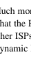

> 值得注意的是，IP 地址块的范围是从 `.0` 到 `.255`，但按照惯例，`.0` 和 `.255` 保留用于环回（你自身系统的简写）和广播（本地网络上所有系统的简写），不会分配给单个工作站或设备。

比固定 IP 地址更常见的是动态 IP 分配协议。点对点协议（PPP）就是其中之一，美国在线、Earthlink 和其他 ISP 都在使用。然而，在局域网内，PPP 的效率不如另一种选择——动态主机配置协议（DHCP）。

##### 任务 17.1：连接 Linux 系统

如果你正在使用 DHCP，将新系统连接到网络的工作轻而易举：唯一需要做的就是在操作系统初始安装期间将 DHCP 指定为连接选项。

固定 IP 系统的配置要棘手一些。你需要六个基本数字：新系统的 IP 地址、子网掩码、新系统的网关（或路由器）地址（这会根据系统连接到的子网而有所不同）、一个网络地址和广播地址，以及至少一个域名系统（DNS）服务器地址。

1. 如果你不确定你的 Linux 系统是通过 DHCP 还是固定 IP 连接互联网，在 Red Hat 系统中需要查看的位置是 `/etc/sysconfig`。首先，确保你已通过查看 `network` 文件启用了网络：

```
# cat /etc/sysconfig/network

NETWORKING=yes

HOSTNAME=sombrero.dsldesigns.net
```

这里也是设置主机名的地方。确保你在这里指定完整的域路径，而不仅仅是基本的主机名。或者不……（参见警告）。


> `network` 文件的内容是 Linux 世界内部标准化分歧的一个典型例子：Red Hat 鼓励系统管理员使用主机名而不是域名；SuSE Linux 使用主机名，并且有一个独立的变量（在 `/etc/rc.local` 中，就像 Mac OS X 一样）用于同时表示主机名和域名，称为 `FQHOSTNAME`；而 Mandrake 在其配置文件中有两个变量，`HOSTNAME` 和 `DOMAINNAME`。请注意你的 Linux 系统附带的配置资料，以确保如果你在安装后更改配置，能够正确设置！

系统如何与网络其余部分通信的细节包含在特定接口的接口配置文件中。最有可能的是，系统使用 `eth0` 作为默认的以太网配置，所以相关的配置文件是 `/etc/sysconfig/network-scripts/ifcfg-eth0`：

```
# cat ifcfg-eth0

DEVICE=eth0

BOOTPROTO=dhcp

ONBOOT=yes

TYPE=Ethernet

USERCTL=no

PEERDNS=no

NETWORK=0.0.0.0

BROADCAST=255.255.255.255
```


> 记住这里的文件名助记符：`if` = interface（接口），`cfg` = config（配置），所以 `ifcfg-eth0` 是 `eth0` 以太网连接的接口配置文件。

对于使用 DHCP 的系统，此文件中的大多数字段都是不必要的，但需要留意的关键字段是 `BOOTPROTO`。如果它是 `dhcp`，正如我们在这里看到的，系统会启动一个名为 DHCP 客户端守护进程（`dhcpcd`）的程序，该程序负责管理客户端一侧的 DHCP 交互。

2. `dhclient` 的默认设置对于 Unix 系统管理员可能遇到的 99% 的情况来说都是合适的。该程序有一系列可以在 `ifcfg` 文件中指定的选项。下面这段重要的 `/sbin/ifup` 脚本片段暗示了这些选项，该脚本用于启动指定的接口：

```
if [ -n "${DYNCONFIG}" ]; then

PUMPARGS=$PUMPARGS

DHCPDARGS="${DHCPDARGS} -n"

if [ -n "${DHCP_HOSTNAME}" ]; then

PUMPARGS="${PUMPARGS} -h ${DHCP_HOSTNAME}"

DHCPDARGS="${DHCPDARGS} -h ${DHCP_HOSTNAME}"

fi

if [ -n "${NEEDHOSTNAME}" ]; then

PUMPARGS="${PUMPARGS} -lookup-hostname"

DHCPDARGS="${DHCPDARGS} -H"

fi

if [ "${PEERDNS}" = "no" ]; then

PUMPARGS="${PUMPARGS} -d"

DHCPDARGS="${DHCPDARGS} -R"

fi
```


如果忽略 `pump` 选项（`pump` 是 Linux 中一个较老的 `dhclient` 替代品，大多数站点出于历史原因而忽略它），你可以看到传给 `dhclient` 的参数是 `DHCPDARGS` 的初始值加上 `-n`；如果通过 `DHCP_HOSTNAME` 指定了主机名，则加上 `-h` 和该主机名；如果系统主机名应由 DHCP 服务器设置（由配置文件中的 `NEEDHOSTNAME` 是否存在控制），则加上 `-H`；如果现有的 `/etc/resolv.conf` DNS 服务器列表文件不应被 DHCP 服务器提供的信息替换，则加上 `-R`。

这有点令人困惑，所以让我们再看一下默认的 DHCP 配置。可能影响 `dhclient` 调用方式的变量是 `DHCP_HOSTNAME`、`NEEDHOSTNAME` 和 `PEERDNS`。你会注意到，在 `/etc/sysconfig/network-scripts/ifcfg-eth0` 中，变量 `PEERDNS` 被设置为“no”，但其他变量没有被引用。这意味着 `dhclient` 被调用为

```
dhclient -n -R
```

正如预期的那样，这可以防止 `dhclient` 覆盖 `/etc/resolv.conf` 文件，但除此之外，它假定系统已正确设置了主机名。

这就是 `-R` 标志的解释。那么无论配置如何都会使用的 `-n` 呢？嗯，回想一下，DHCP 是动态主机配置协议（Dynamic Host Configuration Protocol）。这个“动态”部分的一个微妙影响是，虽然 DHCP 服务器会根据请求将 IP 地址分配给特定的工作站，但它并不保证该 IP 地址会永远保留给该工作站。相反，系统会获得 DHCP 信息的租约，并且必须定期与 DHCP 服务器续租（例如，确认它们仍然在线）。续租由 `dhcpc` 的 `-n` 标志触发；不过，如果系统是完全从头启动的，续租的效果将等同于请求一个新的 IP 地址。

DHCP 协议的内部机制相当有趣，但有点超出本书的讨论范围。如果你想了解更多，互联网软件联盟（Internet Software Consortium）是一个很好的起点，他们那里还有一个免费提供的、优秀的替代 DHCP 客户端协议实现：http://www.isc.org/products/DHCP/。

### 3. 要查看 DHCP 服务器向客户端程序提供了哪些信息，请查看 `/etc/dhcpc` 中的信息文件：

```
# cd /etc/dhcpc

# ls

dhcpc-eth0.cache  dhcpc-eth0.info

# cat *info
```
```
IPADDR=192.168.131.67

NETMASK=255.255.255.0

NETWORK=192.168.131.0

BROADCAST=192.168.131.255

GATEWAY=192.168.131.254

DNS=192.216.138.10

DHCP_SID=192.168.131.254

DHCP_GIADDR=0.0.0.0

DHCP_SIADDR=0.0.0.0

DHCP_CHADDR=00:03:FF:FF:FF:FC

DHCP_SHADDR=00:03:FF:FF:FF:FF

DHCP_SNAME=

LEASETIME=4294987295

RENEWALTIME=536870911

REBINDTIME=536878911
```

时间值是从 1970 年 1 月 1 日起的秒数，你可以从 `LEASETIME` 和 `RENEWALTIME` 之间的显著差异看出，这个特定的 DHCP 服务器将（虚拟）IP 地址分配到了遥远的未来，而无需续租。许多 DHCP 配置在这方面会有所不同，这是 DHCP 服务器本身内部可配置的策略设置。


> 从 1970 年 1 月 1 日起的秒数时间值是典型的 Unix 特色，但并非你完全可以依赖的值。每种 Unix 风格都可以为这种自某个日期起的秒数格式定义自己的“纪元”。请查看你的 `ctime(3)` 手册页，那里很可能为你的操作系统定义了该值。

### 4. 与 DHCP 客户端相比，考虑在具有固定 IP 地址、位于完全不同网络上的 Linux 系统中的相同两个配置文件：

```
# cd /etc/sysconfig

# cat network
```
```
NETWORKING=yes

HOSTNAME=staging.intuitive.com
```
```
# cat network-scripts/ifcfg-eth0
```
```
DEVICE=eth0

BOOTPROTO=static

ONBOOT=yes

IPADDR=10.10.2.200

GATEWAY=10.10.2.1

TYPE=Ethernet

USERCTL=no

NETMASK=255.255.255.0

NETWORK=10.10.2.0

BROADCAST=10.10.2.255

PEERDNS=no
```

显然，拥有固定 IP 地址需要包含其他信息，所以让我们花几分钟讨论所需的不同值以及如何计算它们。

第一个值当然就是 IP 地址本身，这应该很容易根据你的网络来确定。如果你使用固定 IP，你会有一个地址块，并且应该有一份主分配表（也许只是你办公桌抽屉里的一张纸——这是一种常见的解决方案），表中包含地址块中每个 IP 地址的 IP 地址与主机对应关系。那些尚未分配的地址是空白的，可供使用。

在我们的办公室里，我们有一个不连续的五个 IP 地址块，其中一个由网关本身使用，所以我们的 IP 分配表如表 17.1 所示。

##### 表 17.1 典型的固定 IP 分配表

| IP 地址 | 分配对象 |
|---|---|
| 198.76.82.129 | 网关 |
| 198.76.82.131 | 笔记本电脑 |
| 198.76.82.132 | G4 Mac |
| 198.76.82.150 | Win2K 和 iMac（共享，唉！） |
| 198.76.82.151 | HP 局域网打印机 |

正如你所看到的，我们的 IP 地址数量少于实际需求，这就是 PC 和 iMac 系统共享一个 IP 的原因。这不是一个好的配置¹。解决办法是我们将其中一个系统设置为 DHCP 服务器，但我们要到本课时稍后再讨论这个问题。

总的来说，当我们首次获得网络连接时，ISP 给了我们以下信息，如表 17.2 所示。

##### 表 17.2 来自我们 ISP 的信息

| 字段名 | 值 |
|---|---|
| IP 范围 | 198.76.82.131, 132, 150, 151 |
| 网关 | 198.76.82.129 |
| 子网掩码 | 255.255.255.128 |
| DNS 服务器 | 192.216.138.10 和 .11 |

> 按照惯例，如果你看到两个 IP 地址，而后一个只有一个以点号开头的值，这意味着前三个“八位组”是相同的，所以这两个 DNS 服务器是 192.216.138.10 和 192.216.138.11。

这些值可以直接填入 `/etc/sysconfig/network-scripts/ifcfg-eth0` 文件中，分别作为 `IPADDR`、`GATEWAY` 和 `NETMASK`。在前面的示例中，这些值不同是因为那个特定的 Linux 服务器位于不同的网络上（以防你想弄清楚为什么它们是不同的值）。

那么 `NETWORK` 和 `BROADCAST` 从哪里来呢？除非连接服务商给了你特定的值，否则这些值通常就是 IP 地址的前三个八位组，后面加上 0 或 255。就我们的 ISP 提供的配置细节而言，我们会指定 `NETWORK=198.76.82.0` 和 `BROADCAST=198.76.82.255`。

需要创建的另一个文件是 `/etc/resolv.conf`，即系统可用的 DNS 服务器列表。格式非常简单：

```
# cat /etc/resolv.conf
```
```
dns1.dsldesigns.net 192.216.138.10

dns2.dsldesigns.net 192.216.138.11
```

你可以在这个文件中添加任意数量的名称服务器，如果你选择使用 DNS 缓存服务器（我们将在第 18 课“运行你自己的名称服务器”中深入讨论的主题），你也应该在此处添加缓存服务器的 IP 地址。

² 除了其他问题外，这意味着它们不能同时上网，这种情况在我们的办公室里经常让人感到沮丧！

### 5. 无论你的网络使用 DHCP 还是固定 IP，这些信息都应该足以让你正确配置并接入网络。要真正让系统上线，你可以重新启动（通常是首选策略），也可以使用 `ifup` 或 `init.d/network` 脚本。

我更喜欢使用 `init.d/network` 脚本，因为它还支持状态查询：

```
# ./network status
```
```
Configured devices:

lo eth0

Currently active devices:

eth0 lo
```

更重要的是，你可以用一条命令轻松重启 Red Hat Linux 系统上的所有网络服务：

```
# ./network restart
```


Shutting down interface eth0:      [ OK ]

Setting network parameters:      [ OK ]

Bringing up interface lo:         [ OK ]

Bringing up interface eth0:       [ OK ]

如果你更愿意只操作以太网接口而不触及环回机制（`lo`），你可以使用 `/sbin` 中的 `ifup` 和 `ifdown` 命令：

```
# /sbin/ifdown eth0

# /sbin/ifup eth0
```

Determining IP information for `eth0`... done.

通常，关闭接口不会产生任何输出，而启动接口时成功时只提供最少的反馈。

### DHCP 服务器配置

DHCP 世界中的另一个常见任务是设置 DHCP 服务器。虽然这个任务有很多细微之处，但基础知识很容易解释。DHCP 服务器守护进程称为 `dhcpd`，这可能是配置该服务最令人困惑的部分。

`dhcpd` 的配置存储在 `/etc/dhcpd.conf` 中：

```
# cat /etc/dhcpd.conf
subnet 199.76.82.0 netmask 255.255.255.128 {
option routers 198.76.82.129;
option subnet-mask 255.255.255.128;
option domain-name "intuitive.com";
option domain-name-servers dns1.dsldesigns.net, dns2.dsldesigns.net;
option time-offset -8;   # Pacific Standard Time
host imac {
option host-name "imac.intuitive.com";
```

```
hardware Ethernet 00:A0:DD:8E:C3:F9;
fixed-address 198.76.82.151
}
range 198.76.82.131 198.76.82.132
}
```

正如你所看到的，这里的大部分信息都与为网络上的单个客户端进行配置时相同。主机 `iMac` 就是那台 iMac 系统，它始终被分配同一个固定 IP 地址。最后，这里可用的 IP 地址范围很小：131 到 132。通常，我们的 DHCP 地址池中的 IP 地址会比这多得多。

你需要创建一个空的 `dhcpd.leases` 文件，以便服务器能够创建时间戳和租约信息。这很容易做到：

```
# touch /var/lib/dhcpd.leases
```

> `dhcpd` 服务器会按需自动轮转 `dhcpd.leases` 文件，将旧租约文件重命名为 `dhcpd.leases~`。极少数情况下，系统可能在租约轮转过程中崩溃，此时你需要将 `dhcpd.leases~` 文件重命名回原名（例如，`mv dhcpd.leases~ dhcpd.leases`），以确保当前已分配的所有 DHCP 租约仍然有效且已知。

要启动或停止服务器，你需要从 `/etc/rc.d/rcn.d` 目录中为 `/etc/rc.d/init.d/dhcp` 创建合适的链接（至少在 Red Hat Linux 中如此），以用于运行级别 `n`。

虽然将 Linux 系统配置成一个良好的网络成员并不像 Mac 或 Windows 机器那样简单直接，但也相差不远。如果你选择使用 Linux 的一些图形界面（尤其是 `linuxconf`），只需几分钟就能设置好这里展示的几乎所有内容。

另外，如果你发现 Red Hat Linux 发行版中没有 `dhcpd`，可能是因为你没有安装附加 CD-ROM 上的可选软件包，或者是因为你在安装时没有指定服务器配置。用 RPM 验证一下（`rpm -qa | grep -i dhcp` 就能搞定）。要弥补这一遗漏，最简单的方法是翻回第 8 小时“Unix 软件包管理”，在 Pbone 或类似的归档站点搜索 `dhcp` 包，然后用 `rpm` 安装它。

#### 其他 Unix 系统上的网络配置

在深入讨论其他 Unix 之前，请确保你没有因为自己运行的不是 Linux 而跳过上一节。本节不会重复很多你可能需要知道的信息。

好消息是，无论你要配置的系统运行的是哪种 Unix 变体，DHCP 客户端配置和固定 IP 配置的基本概念都是相同的。特定配置文件的位置——嗯，正如你可能预料的那样，会有所不同，但如果你能确定要写入配置的所有关键值，也不算太糟。

##### 任务 17.2：配置 Solaris 和 Mac OS X

考虑到 Sun Microsystems 广泛宣扬“网络就是计算机”的世界观，你完全有理由认为把 Solaris 系统配置为 Internet 的完整成员会是轻而易举的事。同样，Apple 在 Mac OS 让你轻松地将系统添加到网络方面一直拥有显著优势，你会预期这种优势会转化为 Mac OS X 世界中直截了当的配置。

但在这两种情况下，你都错了。

1. 首先，Solaris 8 系统的网络配置分布在大量不同的文件中，包括 `/etc/resolv.conf`、` /etc/hostname.ifname`、` /etc/dhcp.ifname`、` /etc/nodename`、` /etc/inet/hosts` 等。让我们逐一过一遍，看看它们到底是什么：

```
# cat /etc/resolv.conf
search dsldesigns.net
nameserver 192.216.138.10
nameserver 192.216.138.11
```

这个文件没有什么令人意外的地方——它是相当典型的 DNS 名称服务器列表。第一行值得一提，因为它是 Solaris 被告知当前系统域名（用于 DNS 查找）的主要位置。

要弄清楚应该在哪里放置这个系统的正确主机名则更令人困惑，因为它位于两个配置文件中：

```
# ls /etc/hostname.*
/etc/hostname.pcn0
# cat /etc/hostname.pcn0
solaris.dsldesigns.net
# cat /etc/nodename
solaris.dsldesigns.net
```

你需要同时修改这两个文件来更新主机名；如果你已经猜到 `pcn0` 是 Solaris 8 系统上的以太网接口，那你就猜对了。

2. 比这种基本配置再深入一点，我们就会碰到一个小障碍：Solaris 正处于从纯 IPv4 环境向 IPv4/IPv6 混合环境过渡的阶段，Solaris 8（及更早版本）中的一些配置文件将在 Solaris 9 中被弃用。其中最主要的是 `/etc/hosts`，它也列出了当前主机名等信息。从 Solaris 7 到 Solaris 8，他们将 `/etc/hosts` 复制为 `/etc/inet/hosts`（我们马上就会看到），但到了 Solaris 9，所有这些都应由 `/etc/inet/ipnodes` 文件取代，以确保最大程度的混乱（好吧，Sun 这样做并不是为了这个，但这很可能就是实际效果）。无论如何，由于示例系统仍运行 Solaris 8，磁盘上几乎仍然保留了所有可能的配置文件，即使其中一些可能已被悄悄标记为过时……

路由（网关）IP 地址位于名为 `defaultrouter` 的文件中：

```
# cat /etc/defaultrouter
198.76.82.129
```

子网掩码存储在 `/etc/netmasks` 中，它实际上是指向 `inet` 目录中某个文件 `/etc/inet/netmasks` 的符号链接：

```
# cat /etc/inet/netmasks
#
# The netmasks file associates Internet Protocol (IP) address
# masks with IP network numbers.
#
#
# network-number netmask
#
# The term network-number refers to a number obtained from the Internet
# Network Information Center. Currently this number is restricted to being a class
# A, B, or C network number. In the future we should be able to support
# arbitrary network numbers per the Classless Internet Domain Routing
# guidelines.
#
# Both the network-number and the netmasks are specified in
# 'decimal dot' notation, e.g:
#
#
```


# 128.32.0.0 255.255.255.0

198.76.82.128 255.255.255.128

正如你所见，这个目录中有大量有用的解释性信息。


> 值得指出的是，正如注释中所说，至少到版本 8 为止，Solaris 不支持无类域间路由。这意味着，如果你拥有一个 C 类 IP 范围的非连续子集，Solaris 在联网时只能将其视为一个完整的 C 类地址。根据你的网络拓扑，这可能会成为一个显著的限制。

与 `/etc/hosts` 对应的是 `/etc/inet/hosts`：

```
# cat /etc/hosts

#

# Internet host table

#

127.0.0.1       localhost

198.76.82.131   laptop

198.76.82.132   mac

198.76.82.150   win2k

198.76.82.155   solaris loghost solaris.dsldesigns.net
# cat /etc/hosts

#

# Internet host table

#

127.0.0.1       localhost

198.76.82.131   laptop

198.76.82.132   mac

198.76.82.150   win2k

198.76.82.155   solaris loghost solaris.dsldesigns.net
```

事实证明，`/etc/hosts` 是 `/etc/inet/hosts` 的符号链接，所以它们总是保持同步是有很合理的原因的！不过还有第三个需要检查的 hosts 文件——新的 ipnodes：

```
# cat ipnodes

#

# Internet host table

#

::1             localhost

127.0.0.1       localhost

198.76.82.131   laptop

198.76.82.132   mac

198.76.82.150   win2k

198.76.82.155   solaris loghost solaris.dsldesigns.net
```

同样，系统也会尽量让它们保持同步（不过请注意，`ipnodes` 中第一个未注释掉的行是新的：`::1`）。

### 3. IP 地址存储位置

如果你一直在跟踪进度，我们已经弄清楚了几乎所有信息片段该放在哪里，只剩下我们的 IP 地址。它存储在哪里？事实证明，它被放进了 `/etc/hosts` 文件。所以让我们回过头来更好地理解这些文件之间的关系：完全限定主机名在哪个文件中指定（正式名称是 nodename 文件），以及 `hosts` 文件中出现的匹配值：

```
# cat /etc/nodename

solaris.dsldesigns.net

# grep solaris /etc/nodename /etc/inet/hosts

198.76.82.155 solaris loghost solaris.dsldesigns.net
```

因此，要更改这个特定系统的 IP 地址，我们只需更改 `hosts` 文件中的地址，并确保其中任何主机名的改动也与 `nodename` 文件中指定的名称完全一致。

我们可以通过调用 `ifconfig` 程序来检查 IP 地址（稍后在本小时中我们将谈到它）：

```
# /sbin/ifconfig pcn0

pcn0: flags=1000843<UP,BROADCAST,RUNNING,MULTICAST,IPv4> mtu 1500 index 2

inet 198.76.82.155 netmask ffffff80 broadcast 198.76.82.255

ether 0:50:56:54:45:9d
```

要特别注意第二行中的 `inet` 值，以确认该主机的 IP 地址。

### 4. 切换到 DHCP

要从固定 IP 方案切换到 DHCP 连接方案，我们需要深入探究 `dhcagent` 的世界，它是 Solaris 默认的 DHCP 客户端软件。令人高兴的是，Solaris 附带了一堆与 DHCP 相关的命令：

```
# man -k dhcp | grep 1

dhcpagent dhcpagent (1m) · Dynamic Host Configuration Protocol (DHCP) client daemon

dhcpconfig dhcpconfig (1m) · DHCP service configuration utility

dhcpinfo dhcpinfo (1) · display values of parameters received

→through DHCP

dhcpmgr dhcpmgr (1m) · graphical interface for managing DHCP service

dhtadm dhtadm (1m) · DHCP configuration table management utility

in.dhcpd in.dhcpd (1m) · Dynamic Host Configuration Protocol server

pntadm pntadm (1m) · DHCP network table management utility
```

具体的配置文件以需要 DHCP 连接的接口命名——在本例中为 `/etc/dhcp/pcn0`。但等等，有个好消息！删除几个固定 IP 文件的内容，再创建一堆空的与 DHCP 相关的文件，系统就会在下次开机时自动创建配置文件以及所需的任何其他 DHCP 文件。非常有帮助。下面就是在下次启动时从固定 IP 切换到 DHCP 配置所需的确切操作：

```
# alias zero='cat /dev/null > *'

# zero /etc/hostname.pcn0

# zero /etc/dhcp/pcn0

# zero /etc/notrouter
```

```
# zero /etc/defaultrouter

# zero /etc/default/dhcp

# zero /etc/resolv.conf
```

就是这样了。已存在并被清零的文件，其内容已被擦除；原本不存在的文件现在也存在了（特别是 `/etc/dhcp.pc0`）。

唯一剩下的步骤是把 `/etc/inet/hosts` 文件中的几乎全部内容删除，只保留一行 `localhost`，别无其他。它应该像这样：

```
# cat /etc/inet/hosts

127.0.0.1 localhost
```

与该主机相关的其他行会在启动时由 DHCP 客户端分配 IP 时自动填入。

> 如果你想了解如何将 Solaris 系统设置为 DHCP 服务器，最好的做法是从 Internet Software Consortium 网站（www.isc.org）下载与 Solaris 兼容的 `dhcpd`，并按照他们清晰、连贯的说明进行操作。

### 5. Mac OS X 网络配置

在结束 Unix 系统网络连接配置这个话题之前，让我们把注意力转向 Mac OS X。在基于命令行的网络配置方面，Mac 算是相当另类的一种生物。

坦白说，如果你够理性，最好的方式就是直接使用 Mac OS X 的“系统偏好设置”网络面板，如图 17.1 所示。

**图 17.1** “系统偏好设置”中的网络面板。

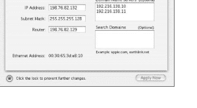

但如果我们总是循规蹈矩，用这种简单又聪明的办法解决问题，生活该多无趣啊。

相反，让我们深入探索一下 Mac OS X，看看这个控制面板中的信息到底保存在哪里：如果能够找到那个具体的存档文件，我们就可以手工修改它，对吧？可以说是，也可以说不是。

### 6. 配置文件位置

存储这些配置值的文件属于 Mac OS X 的系统配置区域，位于 `/var/db` 下：

```
# head -20 /var/db/SystemConfiguration/preferences.xml

<?xml version="1.0" encoding="UTF-8"?>

<!DOCTYPE plist SYSTEM

"file://localhost/System/Library/DTDs/PropertyList.dtd">

<plist version="1.0">

<dict>

<key>CurrentSet</key>

<string>Sets/0</string>

<key>NetworkServices</key>

<dict>

<dict>

<key>0</key>

<dict>

<key>AppleTalk</key>

<dict>

<key>ConfigMethod</key>


```xml
<string>Node</string>

</dict>

<key>DNS</key>

<dict>

<key>ServerAddresses</key>

<array>

<string>192.216.138.10</string>

<string>192.216.138.11</string>

</array>

</dict>
```

这只是一个最终长达 461 行的 XML¹ 文件的开头部分。里面并不是简洁明了的“变量：值”序列，而是一个复杂且令人困惑的 XML 格式文件。不过，一旦你意识到“变量：值”序列更可能看起来像这样：

```
<key>variable</key>

<string>value</string>
```

然后你就能开始看出前面代码中 `preferences.xml` 文件里的一点门道。例如，AppleTalk 的 `ConfigMethod` 是 `Node`，DNS 服务使用的 `ServerAddresses` 是 `192.216.138.10` 和 `192.216.138.11`。

¹XML 是可扩展标记语言（eXtensible Markup Language），是 HTML 的一种变体，专门设计用于以通用格式轻松解析数据。苹果将其用于偏好设置文件，这既堪称高明，同时又令人相当沮丧，因为在命令行中很难处理它。

有了这些认识，让我们反过来看看能否在这个文件中找出网络配置值，先从 IP 地址开始：

```
# grep -5 198.76.82 preferences.xml

<dict>

<key>IPv4</key>

<dict>

<key>Addresses</key>

<array>

<string>198.76.82.132</string>

</array>

<key>ConfigMethod</key>

<string>Manual</string>

<key>Router</key>

<string>198.76.82.129</string>

<key>SubnetMasks</key>

<array>

<string>255.255.255.128</string>

</array>

</dict>
```

在这里查找匹配项时，使用 `-5` 标志来查看 C 类地址（IP 地址中的前三组数字）附近五行的上下文，是个不错的做法。你可以看到网络面板中的所有相关变量：`Addresses`、`Router`、`SubnetMasks`，以及本节前面提到的 DNS `ServerAddresses`。

因此，如果你确实愿意、并且不排斥编辑 XML 文件，同时准备好生活在危险的边缘，那么你可以直接编辑这个文件。不过，还是先做个备份，以防万一。

### 7. 此时正适合尝试使用 `sed`（流编辑器），它非常适合这类就地编辑任务。

若要将此配置复制到另一台计算机，你可以通过 `scp`（安全 `cp`，能以安全、加密的方式在网络间轻松复制文件）将 `preferences.xml` 文件传输过去，然后只需改动 IP 地址：

```
scp referencehost:/var/db/SystemConfiguration/preferences.xml . | \
sed 's/198.76.82.132/198.76.82.133/' > \
/var/db/SystemConfiguration/preferences.xml
```

这样会从主 `referencehost` 复制文件，将旧的 `.132` IP 地址改为新的 `.133` IP 地址，然后把修改后的文件保存到正确的位置。我们仍然需要确保文件的所有权和权限正确：

```
# cd /var/db/SystemConfiguration

# ls -l preferences.xml

-rw-r--r-- 1 root wheel 11151 Apr 6 22:46 preferences.xml
```

但除此之外，这个方法是可行的，而且还能让我们从单个 DHCP 客户端参考系统快速复制 DHCP 配置。

还有其他一些关于 Mac OS X 网络配置的问题，我们在这里就不赘述了，因为正如你所见，在 Mac OS X 中基于命令行的网络配置并非易事。事实上，这确实是第一个能让你看出 Mac OS X 中 Mac 部分已经比其底层的 Unix（Darwin）更重要的领域。


> 不要误以为 Mac OS X 底层有 Darwin，就认为它与 Darwin 或其前身 FreeBSD 完全兼容。并非如此。后者使用 `/etc/iftab` 和 `/etc/hostconfig` 来指定网络参数，但如果存在 `SystemConfiguration/preferences.xml` 文件，Mac OS X 在网络配置问题上会忽略这些文件。如果你想真正地“折腾”一番，可以删除该文件看看会发生什么，但那时你就完全没有保修了，而且几乎没有人能帮你把客户端救回来。哦，用户可能也不会感激你！

不同 Unix 变体在网络代码方面的差异令人惊叹。这有点奇怪，因为网络连接是 Unix 的“杀手级能力”，也是它在首次交付给客户 25 多年后仍被广泛使用的原因。你能想象在 2020 年还运行 Windows 95 吗？或者 2024 年还在用 Mac OS 9？

然而，无论关键与否，这都是你需要研究特定 Unix 变体所附带的手册和文档的领域，以确保你对启动过程和网络配置顺序的理解与你所管理的操作系统保持一致。

#### 测试与评估连通性

在本小时结束之前，值得讨论的最后一个主题是 Unix 自带的一组网络诊断工具。不同的 Unix 变体大多有不同的程序，但有一些核心应用程序和系统实用程序信息量很大，尤其是 `ifconfig`、`netstat` 和 `ping`。

这些命令每一个都值得比本书所能提供的更多篇幅来介绍，因此我们鼓励你阅读每个命令的手册页，并通过实验来更深入地了解其功能。

##### 任务 17.3：评估连通性

评估连通性的第一步是查看当前系统的配置，然后连上互联网，使用 `ping` 和 `traceroute` 来查看网络传输状况……

1. 要评估你的网络配置，第一个也是唯一重要的落脚点就是 `ifconfig`。使用 `-a` 标志查询本机的所有接口，或者直接指定以太网接口的名称：

```
/sbin/ifconfig -a
eth0      Link encap:Ethernet  HWaddr 00:A0:C9:AD:20:E2

          inet addr:10.10.2.200  Bcast:10.10.2.255  Mask:255.255.255.0

          UP BROADCAST RUNNING MULTICAST  MTU:1500  Metric:1

          RX packets:37310  errors:0 dropped:0 overruns:0 frame:0

          TX packets:36045  errors:0 dropped:0 overruns:0 carrier:0

          collisions:0 txqueuelen:100

          RX bytes:4134689 (3.9 Mb)  TX bytes:15175268 (14.4 Mb)

          Interrupt:5 Base address:0xa000

lo        Link encap:Local Loopback

          inet addr:127.0.0.1  Mask:255.0.0.0

          UP LOOPBACK RUNNING  MTU:16436  Metric:1

          RX packets:98 errors:0 dropped:0 overruns:0 frame:0

          TX packets:98 errors:0 dropped:0 overruns:0 carrier:0

          collisions:0 txqueuelen:0

          RX bytes:7176 (7.0 Kb)  TX bytes:7176 (7.0 Kb)
```


Red Hat 很值得一提，因为它的 `ifconfig` 提供的信息相当多（大多数发行版都比这简洁）。`eth0` 就是以太网接口，你可以看到这台特定服务器的互联网地址是 `10.10.2.200`，广播地址是 `10.10.2.255`，网络掩码是 `255.255.255.0`。

一个重要的调优值是最大传输单元（MTU），这里为 `1500`。对于以太网来说，根据协议，最大 MTU 是 `1500` 字节；但如果你使用 FDDI 令牌环，可以将其提高到 `4500` 以获得更好的网络吞吐量。如果你使用的是以太网，而 MTU 小于 `1500`，请使用 `ifconfig` 将其恢复为正确的值（例如，`ifconfig eth0 mtu 1500`）。

输出第三行开头的 `UP` 也很重要——它表明系统认为以太网连接已启动并且活跃。这总是好事。还要注意，`eth0` 接口已接收（RX）`37,310` 个信息包，没有错误、没有丢包、也没有溢出。这同样令人欣慰，并且它还发送（TX）了 `36,045` 个包，毫无差错。


> 如果你的客户端系统出现 RX 和 TX 错误，或者丢包/溢出约占数据包总量的 10% 以上，那么你的子网可能过于繁忙。解决办法是进一步划分子网。如果错误为零（如此处所示），那么合乎逻辑的结论是，网络上还有充足的空间容纳更多服务器。

显示 RX 字节数的摘要行是一个很好的补充，省去了一些手工计算：该服务器已接收总计 `3.9MB` 的数据包，并已发送 `14.4MB` 的数据包。

### 2. 与 Red Hat Linux 的冗长输出相比，来看看 Mac OS X 中同样的 `ifconfig` 输出：

```
# ifconfig -a

lo0: flags=8049<UP,LOOPBACK,RUNNING,MULTICAST> mtu 16384

inet 127.0.0.1 netmask 0xff000000

en0: flags=8863<UP,BROADCAST,RUNNING,SIMPLEX,MULTICAST> mtu 1500

inet 198.76.82.132 netmask 0xffffff00 broadcast 198.76.82.255

ether 00:30:65:3d:e8:10

media: autoselect (10baseT/UTP <half-duplex>) status: active

supported media: none autoselect 10baseT/UTP <half-duplex> 10baseT/UTP <full-duplex> 100baseTX <half-duplex> 100baseTX <full-duplex>
```

差异很大，而且这里完全没有 RX/TX 统计。不过 MTU 同样是正确的 `1500` 字节。

Solaris 提供了更简洁的结果：

```
# /sbin/ifconfig -a

lo0: flags=1000849<UP,LOOPBACK,RUNNING,MULTICAST,IPv4> mtu 8232 index 1

inet 127.0.0.1 netmask ff000000

pcn0: flags=1000843<UP,BROADCAST,RUNNING,MULTICAST,IPv4> mtu 1500 index 2

inet 198.76.82.155 netmask ffffff00 broadcast 198.76.82.255

ether 0:50:56:54:45:9d
```

输出更加精简，但仍提供了验证以太网接口配置所需的核心信息，包括 IP 地址、子网掩码（尽管格式较难解读）、广播地址和 MTU。

### 3. 全面了解某个系统上的网络流量非常有用，这正是多用途的 `netstat` 网络状态命令所提供的。

```
# netstat

Active Internet connections (w/o servers)

Proto Recv-Q Send-Q Local Address Foreign Address State

tcp 0 208 10.10.2.200:ssh ds1-132.dsldesign:49172 ESTABLISHED

Active UNIX domain sockets (w/o servers)

Proto RefCnt Flags Type State I-Node Path

unix 7 [ ] DGRAM 905 /dev/log

unix 2 [ ] DGRAM 1226

unix 2 [ ] DGRAM 1207

unix 2 [ ] DGRAM 1162

unix 2 [ ] DGRAM 961

unix 2 [ ] DGRAM 914

unix 2 [ ] STREAM CONNECTED 628
```


默认情况下，第一部分显示处于活动状态的已建立网络连接（此处显示的是从 `ds1-132.dsldesign` 到 `10.10.2.200` 的 `ssh` 连接，连接 ID 为 `49172`）。第二部分是所有打开套接字的列表，其中一些与守护进程相关联，一些与特定文件（如 `/dev/log`）绑定，而且大多数相当难以理解。

其他 Unix 系统上的 `netstat` 也会产生类似输出，但具体格式常有差异。Solaris 的输出格式尤其有帮助：

```
# netstat

TCP: IPv4

Local Address Remote Address Swind Send-Q Rwind Recv-Q State

solaris.32804 mac.6000 33304 0 66608 0 ESTABLISHED

Active UNIX domain sockets

Address Type Vnode Conn Local Addr Remote Addr

e10c0d08 stream-ord 00000000 00000000

e10cdea8 stream-ord 0be79920 00000000 /tmp/.X11-unix/X0
```

清楚地表明正在发生远程 X11 事件。

`netstat` 的各种标志会产生不同的输出。最有用的是 `-a`，它提供了另一种格式，既包含哪些协议在监听，也包含已建立的连接：

```
# netstat -a

Active Internet connections (servers and established)

Proto Recv-Q Send-Q Local Address Foreign Address State

tcp 0 0 *:32768 *:* LISTEN

tcp 0 0 localhost.localdomain:32769 *:* LISTEN

tcp 0 0 *:sunrpc *:* LISTEN

tcp 0 0 *:http *:* LISTEN

tcp 0 0 *:ssh *:* LISTEN

tcp 0 0 localhost.localdomain:smtp *:* LISTEN

tcp 0 0 *:https *:* LISTEN

tcp 0 224 10.10.2.200:ssh ds1-132.dsldesign:49172

->ESTABLISHED

udp 0 0 *:32768 *:*

udp 0 0 *:793 *:*

udp 0 0 *:sunrpc *:*

Active UNIX domain sockets (servers and established)

Proto RefCnt Flags Type State I-Node Path

unix 7 [ ] DGRAM 985 /dev/log

unix 2 [ ] DGRAM 1226

unix 2 [ ] DGRAM 1287

unix 2 [ ] DGRAM 1162

unix 2 [ ] DGRAM 961

unix 2 [ ] DGRAM 914

unix 2 [ ] STREAM CONNECTED 628
```


我们可以看到，该系统支持 `SunRPC`（远程过程调用）、`http`（用于 Apache Web 服务器）、`ssh`（安全 Shell）、`smtp`（用于电子邮件）、`https`（安全的 Apache 连接），并且存在一个已建立的 `ssh` 连接。此外还有一些 UDP 监听器。

`netstat -a` 的输出是一种验证方式，可以确认你认为已经禁用的服务实际上并没有在运行。（参见第 19 课时“运行 Internet 服务”，了解有关禁用服务的更多信息。）

### 4. 如果使用 `-i` 标志，`netstat` 命令还以非常简洁的方式提供发送/接收统计信息：

```
# netstat -i

Kernel Interface table

Ifac e MTU Met RX-OK RX-ERR RX-DRP RX-OVR TX-OK TX-ERR TX-DRP TX-OVR Flg

eth0 1500 0 37597 0 0 0 36220 0 0 0 BMRU

lo 16436 0 98 0 0 0 98 0 0 0 LRU
```

这与 `ifconfig` 报告的内容一致：大量进出的数据包，且没有任何小故障或异常。

Solaris 报告 `Ipkts` 和 `Opkts`（输入和输出）数据包，而不是 RX 和 TX 数据包，但除此之外，数据的呈现方式非常相似：

```
# netstat -i

Name Mtu Net/Dest Address Ipkts Ierrs Opkts Oerrs Collis Queue

lo0 8232 loopback localhost 125 0 125 0 0 0

pcn0 1500 198.76.82.128 solaris 6780 0 4728 0 0 0
```

最后，Mac OS X 的有点不同寻常，但这段较长的输出中也包含了相同的基本信息：

```
# netstat -i

Name Mtu Network Address Ipkts Ierrs Opkts Oerrs Coll

lo0 16384 <Link> 1662 0 1662 0 0

lo0 16384 127 localhost 1662 0 1662 0 0

en0 1500 <Link> 00:30:65:3d:e8:10 6565 0 11226 0 0

en0 1500 198.76.82.128 ds1-132.dsldesi 6565 0 11226 0 0
```

`Ipkts` 是输入数据包（RX），`Opkts` 是输出数据包（TX）。

### 5. 让我们从分析系统转向探索网络连接本身。完成这一任务有两个基本工具：`ping` 和 `traceroute`。

`ping` 命令的名字源自潜艇声纳在尝试识别远处物体时发出的声音，它会向指定的远程系统发送一个 `ECHO_REQUEST` 数据包，计算发送加上回波返回的时长，并将结果报告给你。

按照惯例，使用 `ping` 的第一步始终是尝试检查与路由器的连接。如果路由器已启动并正常工作，我们就确认了网卡工作正常、以太网线没问题，并且这台计算机能够与其以太网卡通信。

```
# ping -c 10 198.76.82.129

PING 198.76.82.129 (198.76.82.129): 56 data bytes

64 bytes from 198.76.82.129: icmp_seq=0 ttl=255 time=59.642 ms

64 bytes from 198.76.82.129: icmp_seq=1 ttl=255 time=33.371 ms

64 bytes from 198.76.82.129: icmp_seq=2 ttl=255 time=33.787 ms

64 bytes from 198.76.82.129: icmp_seq=3 ttl=255 time=33.842 ms

64 bytes from 198.76.82.129: icmp_seq=4 ttl=255 time=55.218 ms

64 bytes from 198.76.82.129: icmp_seq=5 ttl=255 time=33.934 ms

64 bytes from 198.76.82.129: icmp_seq=6 ttl=255 time=60.519 ms

64 bytes from 198.76.82.129: icmp_seq=7 ttl=255 time=69.425 ms

64 bytes from 198.76.82.129: icmp_seq=8 ttl=255 time=34.3 ms

64 bytes from 198.76.82.129: icmp_seq=9 ttl=255 time=34.241 ms

--- 198.76.82.129 ping statistics ---

10 packets transmitted, 10 packets received, 0% packet loss

round-trip min/avg/max = 33.371/44.827/69.425 ms
```

`-c 10` 指定 `ping` 发送 10 个 `ECHO_REQUEST` 数据包，默认间隔一秒。每次 `ping` 都会显示各自的统计信息，从中可以看到系统的不确定性导致回波时间在 33.3 毫秒到 69.4 毫秒之间变化。最后两行最重要：丢失百分比（0%）和平均速度（44.8ms）。

如果你不想看到逐行输出，`-q` 标志会将其隐藏，只显示第一行和最后一行输出，如下一个例子所示，其中 `ping` 显示了到“线路另一端”的连接速度，即我们 ISP 的一台 DNS 服务器：

```
# ping -q -c10 dns1.dsldesigns.com

PING dns1.dsldesigns.com (192.216.138.10): 56 data bytes

--- dns1.dsldesigns.com ping statistics ---

10 packets transmitted, 10 packets received, 0% packet loss

round-trip min/avg/max = 33.851/58.407/113.713 ms
```

性能与本地路由器非常相似，因此它们之间的连接显然不会造成明显的减速。

### 6. 最后，对全球几个热门系统执行几次 `ping` 操作，可以展示整体连接速度：

```
# ping -q -c5 www.yahoo.com

PING www.yahoo.akdns.net (66.218.71.89): 56 data bytes

...

www.yahoo.akdns.net ping statistics ...

5 packets transmitted, 5 packets received, 0% packet loss

round-trip min/avg/max = 37.965/61.358/88.798 ms
```

到 Yahoo! 再返回的平均时间为 61 毫秒——非常快。

```
# ping -q -c5 www.bbc.co.uk

PING newswww.bbc.net.uk (212.58.240.34): 56 data bytes

...

newswww.bbc.net.uk ping statistics ...

5 packets transmitted, 5 packets received, 0% packet loss

round-trip min/avg/max = 111.539/121.965/149.242 ms
```

从加利福尼亚到伦敦（BBC 世界服务托管其 Web 服务器的地方）的往返时间为 121 毫秒。

```
# ping -q -c5 www.koreaherald.co.kr

PING www.koreaherald.co.kr (211.200.28.40): 56 data bytes

...

www.koreaherald.co.kr ping statistics ...

5 packets transmitted, 0 packets received, 100% packet loss
```


这是一个有趣的情况，因为 Web 浏览器会证明这个 URL 确实有一个站点存在，所以至少有一台机器在回答来自 Web 的查询。但它却不回答 `ping`。这是怎么回事？

事实证明，某些所谓的拒绝服务攻击本质上就像一大股 `ping` 回显请求（`ECHO_REQUEST`）数据包洪流。因此，许多可能遭遇反对者/黑客的站点会屏蔽所有 `ECHO_REQUEST` 数据包，从而产生奇怪的结果，比如 `ping` 时 100% 的数据包丢失。

```
# ping -qc5 www.news.co.kr

PING www.news.co.kr (203.248.249.170): 56 data bytes

...

www.news.co.kr ping statistics ...

5 packets transmitted, 5 packets received, 0% packet loss

round-trip min/avg/max = 160.874/172.319/201.883 ms
```

这是另一个韩国站点，但这个站点会回应 `ECHO_REQUEST` 数据包，平均 `ping` 时间为 172 毫秒。虽然不算快如闪电，但如果你想想小小的以太网数据包在每个方向至少传输了 5,600 英里，那这个速度就不算差*。

关于网络连接和分析还有很多内容可以讨论，本书其余部分将重点讨论这个关键且相当有趣的主题。

> *如果我们假设单程为 5,600 英里，那么在 0.172 秒内就是 11,200 英里，相当于每小时 2.344 亿英里！


#### 总结

本课时涵盖了 Unix 网络配置的要点，以 Red Hat Linux 作为典型的发行版，然后探讨了 Solaris 和 Mac OS X 上的变化。它们确实变化很大！最后，我们介绍了一些测试和验证工具，并简要讨论了如何将网络配置复制到多台系统。

#### 问答

**问** 我快应付不过来了！除了 Mac OS X，配置 Unix 系统肯定还有其他非命令行的方法吧？如果有，为什么你在这里不讨论它们呢？

**答** 好消息是，有的，在你见过的几乎每一种 Unix 中，都有用于配置网络的 GUI 工具——前提是你能够运行 GUI 界面。这正是问题的一部分；如果你的 Unix 系统是大型托管设施中的服务器，或者你的 MIS 部门有架式系统，或者你要维护 150 台工作站，你可能无法启动 X 应用程序，更不用说完整的 X Window System 环境了。尽管如此，理性的系统管理员会寻求最快最简单的解决方案，像 `linuxconf` 这样的工具可以救命。只是要当心异构环境，你可能负责很多不同的操作系统；为了把新客户端接入网络，你想学习多少种不同的工具？这是一个难题。

**问** 你推荐 DHCP 还是固定 IP？

**答** 终于，本书问答部分出现了一个简单问题！如果可以的话，请使用 DHCP，即使是小型家庭网络也是如此。它简化了一切。

#### 练习

##### 测验

1. 哪一类地址块拥有更多 IP 地址，`Class B` 还是 `Class C`？
2. 如果你知道 IP 地址，有什么简便技巧可以算出广播地址和网络地址？
3. DHCP 租约的重要性是什么？
4. `/etc/resolv.conf` 中存储了什么？
5. 在 Solaris 9 中，`/etc/hosts`（实际上就是 `/etc/inet/hosts`）将被哪个配置文件取代？
6. 完成句子：如果你是一位精通 Unix 的聪明的 Mac OS X 系统管理员，那么你配置新客户端使其接入网络的最佳选择是 ________。

##### 答案

1. 一个 `Class B` 地址块包含 256 个 `Class C` 地址块，而一个 `Class C` 地址块有 254 个可用 IP 地址。
2. 将 IP 地址中的最后一个八位组去掉，将其替换为 255 作为广播地址，替换为 0 作为网络地址。因此，192.37.18.33 对应的广播地址是 192.37.18.255，网络地址是 192.37.18.0。
3. DHCP 服务器会在指定时间内向 DHCP 客户端分配 IP 地址，这个时长就是租约。在租约结束时，客户端必须续租其信息或请求新的 IP 地址。
4. 系统的 DNS 服务器的名称和 IP 地址存储在 `/etc/resolv.conf` 中。
5. `/etc/hosts` 将变为 `/etc/inet/ypnodes`。
6. 如果你是一位精通 Unix 的聪明的 Mac OS X 系统管理员，那么配置新客户端使其接入网络的最佳选择是使用图形化的“网络”控制面板。

Unix 管理员的一项常见任务是设置 DNS 或名称服务器。这涉及使用 BIND、`named`，正确设置 `/etc/resolv.conf` 文件，以及配置和测试 DNS 服务器，所有这些我们将在下一课时中介绍。我们还将讨论 `traceroute`、`dig` 和 `host`，这些都是重要的 Unix 系统管理员命令。


### 第 18 课时

### 运行你自己的名称服务器

Unix 系统管理员的一项常见任务是设置和运行域名系统（DNS）服务器。尽管我们习惯于将网站、电子邮件接收系统和其他网络信息看作是具体的名称，但互联网实际上使用唯一的数字。DNS 服务器系统将名称映射为数字。

例如，当你在 Web 浏览器中输入 URL 时，它首先会联系你的本地 DNS 服务器，请求你所请求的 Web 主机的 IP 地址。如果本地 DNS 服务器不知道 IP 地址，它会将请求转发给另一个 DNS 服务器，通常是某个根 DNS 服务器¹。根服务器通常不会直接回答查询，而是会指引你继续前进，报告你所请求域名的权威 DNS 服务器的 IP 地址。然后，你的本地 DNS 服务器联系这个 DNS 服务器，最终获得正确的 IP 地址。

¹全球共有 13 个根服务器，分布在世界各地。它们都包含注册了特定域名的名称服务器的 IP 地址。

在本课时中，我们将对 DNS 系统进行一次概览，特别强调如何在你的 Unix 系统上维护 DNS 服务器。

在本课时中，你将学习以下内容：

- 使用 BIND 和区域文件
- 配置 `named`（名称服务器守护进程）
- 使用 `rndc`（最好的 DNS 管理工具）
- 测试 DNS 安装

#### Berkeley Internet Name Domain 软件包

要管理 DNS 数据库，作为 DNS 服务器运行的系统通常会运行 Berkeley Internet Name Domain（BIND）系统，这是一个强大而灵活的 DNS 服务器。Red Hat Linux 7.2 随附 BIND 9 版本。事实上，早期版本的 BIND 因安全问题而臭名昭著，所以如果你要开始运行 DNS 服务器，升级到最新版本是一个明智的想法。当然，与任何与外部网络交互的软件一样，始终让 BIND 保持最新的安全补丁和错误修复是一个好主意。

> BIND 的官方发行版来自 Internet Software Consortium（www.isc.org），包括 DNS 服务器 `named`、解析器库，以及一些非常有用的分析工具。

##### 任务 18.1：探索 BIND 和区域文件

需要注意的是，只有当你要为一个或多个域提供权威名称服务时，才需要运行 `named`。什么是权威名称？它是在互联网上由域名记录授权回答 DNS 查询的官方主机。

1. 若要查看哪些 DNS 服务器是给定域的权威名称服务器，请使用 `whois` 命令：

```
$ whois intuitive.com

Whois Server Version 1.3

Domain names in the .com, .net, and .org domains can now be registered with many different competing registrars. Go to http://www.internic.net for detailed information.
```

```
Domain Name: INTUITIVE.COM

Registrar: NETWORK SOLUTIONS, INC.

Whois Server: whois.networksolutions.com

Referral URL: http://www.networksolutions.com

Name Server: NS11A.VERIO-WEB.COM

Name Server: NS11B.VERIO-WEB.COM

Updated Date: 05-nov-2001

>>> Last update of whois database: Fri, 19 Apr 2002 05:03:06 EDT <<<
```


The Registry database contains ONLY .COM, .NET, .ORG, .EDU domains and Registrars.

你可以在这个记录中看到，权威名称服务器是 `NS11A.VERIO-WEB.COM` 和 `NS11B.VERIO-WEB.COM`。但是，这些服务器是该特定域的权威名称服务器，这一信息又来自哪里呢？一台 DNS 服务器……

## 2. 要成为权威名称服务器，配置中最重要的一部分就是为每个域准备一个区域文件。

区域文件描述了你为其提供名称服务的域，以及已被赋予名称的各个主机。每个域通常包含两个区域文件：一个用于正向查找，一个用于反向查找（将 IP 地址转换为其完全限定域名）。

区域文件通常包含一行或多行指令，随后是多行列出各个资源类型及其主机名与 IP 地址对的内容。这里有一个典型条目，它就是为 `intuitive.com` 充当起始授权机构（SOA）的那条记录：

> 按照惯例，这些区域文件存放在 `/var/named/` 目录下，文件名与域名一致，因此在我们的服务器上，这个文件被称为 `/var/named/intuitive.com.zone`。

```
# cat /var/named/intuitive.com.zone
$ORIGIN intuitive.com.

$TTL 86400

@ IN SOA feed11.verio-web.com. hostmaster.verio-web.com. (
    2002041100 ; serial
    7200       ; refresh
    3600       ; retry
    604800     ; expiry
    86400 )    ; minimum
86400 IN NS ns11a.verio-web.com.
86400 IN NS ns11b.verio-web.com.
86400 IN MX 50 mail-fwd.verio-web.com.
www.intuitive.com. 86400 IN MX 50 mail-fwd.verio-web.com.
intuitive.com. 86400 IN A 161.58.20.91
ftp 86400 IN A 161.58.20.91
smtp 86400 IN A 161.58.20.91
www 86400 IN A 161.58.20.91
urlwire 86400 IN A 63.101.93.250
staging 86400 IN CNAME urlwire
```

这个区域文件包含很多内容，让我们一步一步来看。首先，注意第一行在域名后面有一个尾随点（例如 `intuitive.com.`）。事实证明，这个尾随点非常重要，而省略它是 DNS 管理员常犯的错误：如果你忘了它，系统会自动将主机名前置，这通常会导致错误。

第二行是生存时间（TTL）指令，单位是秒：86,400 = 24 小时。你可以把它理解为有效期：一旦 TTL 过期，任何 DNS 缓存都必须重新请求一份新的数据。

## 3. 区域文件的其余部分由资源记录组成。

第一条资源记录是起始授权机构（SOA），它有自己的 TTL、与域记录关联的管理地址（只不过通常的 `@` 被替换为点号），以及一系列配置参数，详见表 18.1。

### 表 18.1 区域文件中的起始授权机构字段

| 名称 | 示例值 | 说明 |
|---|---|---|
| Serial（序列号） | 2002041100 | 该域此版本记录的唯一序列号。每次编辑区域文件时，此值都应更改。按照惯例，大多数系统管理员使用 YYYYMMDD 格式并附加两位修订号，因此此序列号表示区域文件最后修改于 2002 年 4 月 11 日。 |
| Refresh（刷新） | 7200 | 辅助服务器可以使用此记录而不会使其过期、也无需刷新的秒数。 |
| Retry（重试） | 3600 | 辅助服务器尝试联系主服务器以刷新缓存中 DNS 数据的频率。 |
| Expiry（过期） | 604800 | 当主服务器未作出任何响应时，辅助服务器在停止作为该域权威服务器应答之前应等待的时间长度。 |
| Minimum（最小值） | 86400 | 其他名称服务器应缓存此信息的时长，单位为秒。 |

请注意，区域文件本身就包含了既要有主域服务器、也要有辅助域服务器的概念。这是一种明智的故障安全架构：通过让多台服务器都具有权威性，即使主服务器离线，用户的 DNS 查询也不太可能失败。然而，拥有多台主服务器会引出一个问题——而这个问题也由此得到解决——在多台服务器中，究竟哪一台“拥有”该域名记录？这正是 `refresh`、`expiry` 和其他值所指定的——它们告知那些具有权威性但并非主服务器的名称服务器，如何针对该特定域名与主服务器进行交互。

## 4. 区域文件中的所有后续行都指定了明确的域信息类型。

请注意包含 `NS`、`MX`、`A` 和 `CNAME` 值的那一列——它们分别表示指定的记录是名称服务器、邮件交换、地址记录还是替代（规范）名称。

例如，我们可以清楚地看到，`ns11a.verio-web.com` 和 `ns11b.verio-web.com` 是该域的名称服务器（NS），而电子邮件接收查询解析到 `mail-fwd.verio-web.com`。第二条 MX 记录明确列出了 `www.intuitive.com`，它允许发送到 `user@www.intuitive.com` 的邮件正确解析并落入正确的邮箱。

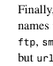

> 这是一个重要的细微差别：同一个域名可以根据所指定的查询类型返回不同的 IP 地址。该区域文件指定，对 `intuitive.com` 的所有常规查询都解析到 `161.58.20.91`，但邮件交换查询除外，这些查询由 `mail-fwd.verio-web.com` 应答。

最后，还有一组资源记录，它们将域名和子域名实际映射到明确的 IP 地址。在此我们可以看到，`intuitive.com` 以及主机 `ftp`、`smtp` 和 `www` 被分配了与主域记录相同的 IP 地址，而 `urlwire` 则是一个完全不同的 IP 地址。这正确地表明，对 `urlwire.intuitive.com` 的 Web 和邮件查询由另一台服务器处理。

最后一条记录展示了区域文件中一种有用的简写形式：`CNAME` 记录本质上是一个别名，因此以下这一行

```
staging 86400 IN CNAME urlwire
```

表示对 `staging.intuitive.com` 的查询应当与对 `urlwire.intuitive.com` 的查询完全相同地应答。

通常，`www` 子域名正是通过这样的 `CNAME` 成为主 Web 服务器的别名。事实上，如果最后几行写成如下形式，该区域文件也同样有效：

```
intuitive.com. 86400 IN A 161.58.20.91
www 86400 IN A 161.58.20.91
smtp 86400 IN CNAME www
ftp 86400 IN CNAME www
urlwire 86400 IN A 63.101.93.250
staging 86400 IN CNAME urlwire
```

眼尖的读者可能已经注意到，完全限定域名（DNS 术语中的 FQDN：包含所有元素的域名——如 `intuitive.com`——相对于未限定的域名 `www`）总是带有那个尾随点，而子域名则没有。正确区分这一点非常重要，以免破坏你的 DNS 系统。

## 5. 在结束关于区域文件的讨论之前，让我们来看另一种类型：反向查找区域文件。

```
# cat /var/named/20.58.161.in-addr.arpa
$TTL 86400

@       IN      SOA     feed11.verio-web.com. hostmaster.verio-web.com. (
                        2002041200  ; serial
                        7200       ; refresh
                        3600       ; retry
                        604800     ; expiry
                        86400 )    ; minimum
86400   IN      NS      ns11a.verio-web.com.
86400   IN      NS      ns11b.verio-web.com.
91      IN      PTR     www.intuitive.com.
```


这个文件的大部分内容与之前的区域文件相同，包括 `TTL`、`NS` 和 `SOA` 记录。不同之处在于最后一行，它列出了域 IP 地址的第四个八位组（例如 `91`）。


> 这里我们只需要第四个八位组，而不是整个 IP 地址，因为我们处理的是一个 C 类子网。如果你的网络是 B 类或 A 类子网，则需要在反向查找区域文件中指定更多的 IP 地址部分。文件名称也应相应更改，以反映该区域的子网。出于管理目的，最好将 A 类或 B 类子网拆分为多个 C 类区域。

请注意，区域文件有一个固有的局限：每个文件只能列出一个子网，因此要允许对 `staging.intuitive.com` 域名（例如 `63.101.93.x` 子网）进行反向查找，就需要一个单独的反向查找区域文件。

从零开始编写区域文件相当令人困惑，而且能提供帮助的工具也很少。在 `www.dnstools.com` 上有一个工具，或许能缓解这种可能让人头疼的问题，非常值得探索。遗憾的是，截至撰写本文时，它仅适用于 Linux。Mac OS X 用户可能会发现 `DNSsetup` 是一个有用但功能较弱的替代工具（`homepage.mac.com/dnssetup/`）。

## 配置 named

到目前为止，我们探索过的区域文件都是提供给实际 DNS 名称服务器 `named` 的数据文件。`named` 程序通过读取通常位于 `/etc/` 下的 `named.conf` 文件来运行。我们旅程的下一步是深入探讨这个配置文件，看看它如何与各个区域文件关联。

### 任务 18.2：配置名称服务器 named

`named` 守护进程读取 `/etc/named.conf` 文件，以确定需要加载哪些区域文件。配置文件中的所有选项和语句都以分号结尾。

1. 首先，让我们查看一下 `named.conf` 文件：

```
# cat /etc/named.conf

options {

    directory "/var/named";

    /*

     * If there is a firewall between you and nameservers you want
     * to talk to, you might need to uncomment the query-source
     * directive below.  Previous versions of BIND always asked
     * questions using port 53, but BIND 8.1 uses an unprivileged
     * port by default.
     */

    // query-source address * port 53;

};

controls {

    inet 127.0.0.1 allow { localhost; } keys { rndckey; };

};

zone "." IN {

    type hint;

    file "named.ca";

};

zone "localhost" IN {

    type master;

    file "localhost.zone";

    allow-update { none; };

};

zone "0.0.127.in-addr.arpa" IN {

    type master;

    file "named.local";

    allow-update { none; };

};

zone "intuitive.com" IN {

    type master;

    file "intuitive.com.zone";

    allow-update { none; };

};

zone "20.58.161.in-addr.arpa" IN {

    type master;

    file "20.58.161.in-addr.arpa.zone";

    allow-update { none; };

};

include "/etc/rndc.key";
```

这个文件内容不少，但快速浏览一下就会发现，顶部有几个控制语句，然后是重复出现的 `zone` 块，最后在底部有一个 `include`。别被吓到！


> 请注意，这里有两种不同的注释风格：C 风格以 `/*` 开头、以 `*/` 结尾，可跨越多行；Java 风格 `//`，表示该行其余部分为注释。

我们看到的第一个语句是 `options`，它用于控制 `named` 可用的各种选项。在此配置中，唯一设置的选项是 `directory`，它告诉 `named` 在哪里查找区域文件。

有一个非常有用的管理工具叫 `rndc`，配置文件中的下一个语句指定了谁可以在 `named` 运行时对其进行更改。`controls` 语句表明 `named` 仅监听 `localhost` 的本地回环地址，并且必须使用末尾包含文件中定义的密钥 `rndckey` 来验证连接。

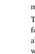

> 出于莫名原因，某些版本的 Red Hat Linux 附带的默认 `/etc/named.conf` 文件中 `keys` 的值为 `key`，这是无效的。为了能够使用 `rndc`，您必须编辑 `named.conf`，使其读作 `rndckey`。

2. 配置文件的其余部分包含区域文件包含语句的块（除了最后一行，我们稍后会讨论）。

第一个区域用 `.` 指定 DNS 树的根。这些是整个互联网的根服务器。当 `named` 收到它不认识的主机请求时，它会联系其中一个根服务器，询问该域名注册的 DNS 服务器。

在区域名称之后，需要指定类别。对于 Internet，类别始终是 `IN`。

每个区域的不同选项在其块内指定，由开闭花括号分隔。我们的第一个选项是指定区域的类型。几乎所有这些都将是 `master`，但根域显示为 `hint`。如果配置正确，其他区域块不应指定 `hint`。

下一个选项是区域文件的名称，此时您可以看出为什么标准命名方案非常有帮助。奇怪的是，根域的区域文件默认名为 `named.ca`。正如预期的那样，它位于 `/var/named` 中，因此如果您愿意，可以轻松查看这个 83 行的默认区域文件。

接下来的四个区域成对工作，每个域都有一个正向（名称到 IP 地址）和反向（IP 地址到名称）区域。

3. 接下来我们一起来看这两个区域，因为它们描述了回环接口：

```
zone "localhost" IN {

    type master;

    file "localhost.zone";

    allow-update { none; };

};
```

```
zone "0.0.127.in-addr.arpa" IN {

    type master;

    file "named.local";

    allow-update { none; };

};
```

按照惯例，`named` 区域放在前面，并且指定名称必须与区域文件中的 `$ORIGIN` 值匹配，这一点很重要：

```
# grep ORIGIN /var/named/localhost.zone

$ORIGIN localhost.
```


再次注意哪里有尾点，哪里没有。在 `named.conf` 文件中省略尾点与在各个区域文件中正确指定尾点同样重要。配置文件中可以指定多种类型的区域，但由于我们希望成为指定域的权威名称服务器，因此我们希望成为 `master`。另一种可能是 `slave`，这种情况下我们充当备份权威名称服务器，但从另一个更权威的服务器获取主数据。最后，该块指定区域文件的名称，后面是可选的、有权更新此区域的主机列表（如果有的话）。

> 允许其他主机更新您的区域配置文件是危险的。最佳实践要求由一个人负责维护配置文件，并在更改时重启 `named`。

`named.conf` 文件中的最后一个条目是 `include` 语句，它使 `named` 将指定文件的内容包含进来，就像它是 `named.conf` 文件本身的一部分一样。为什么要这样做？为了让系统管理员能够将敏感数据隐藏在一个权限阻止未授权访问的单独文件中。在我们的示例中，`named` 加载了一个包含 `named` 管理工具 `rndc`（本学时稍后介绍）的密钥的文件。

### 4. 由于任何给定的域名都需要至少两个在线名称服务器，因此能够拥有 `slave` 区域定义块是一个福音。如果没有它，您将不得不手动将所有区域文件分发到多个系统，并且/或者每次所需更改都要编辑两个或多个文件。

在辅助或备份 DNS 服务器上，`named.conf` 文件中的示例 `slave` 条目如下所示：

```
zone "intuitive.com" IN {

  type slave;

  file "intuitive.com.zone";

  masters { 161.58.20.91; };

};
```

此区域块告诉 `named` 联系主机 `161.58.20.91` 获取区域配置信息，并将其存储在名为 `intuitive.com.zone` 的文件中。

`named.conf` 文件和存储在 `/var/named` 中的各个区域文件相结合，使系统管理员能够为少则两三个、多则数千个域名创建功能完备的域名服务器。

#### 使用 rndc

`named` 守护进程只在启动时读取其配置文件，这意味着每次修改区域文件或 `named.conf` 文件时，您都应该重启服务器。然而，与其每次更改后都启动和停止，不如使用远程名称守护进程控制（`rndc`）程序。

##### 任务 18.3：了解 rndc

`rndc` 可以完成多种有用的管理任务，但让我们先考虑几个最基本的——如果您好奇或需要更多功能，可以阅读 `rndc` 手册页获取更多信息。

1. 最常见的操作是强制重新加载配置文件。这可以通过 `reload` 命令完成：

```
# rndc reload

#
```

如果您有很多区域文件并希望在重新加载时节省时间，请明确指定 `reconfig`，`named` 将只扫描 `named.conf` 文件以及它找到的任何新区域文件。同样，除非遇到错误，否则没有输出：

```
# rndc reconfig

#
```

2. 您可能会发现其他常用的 `rndc` 选项列在表 18.2 中。

**表 18.2：有用的 rndc 命令**

| 命令 | 含义 |
|---|---|
| `reconfig` | 重新加载 `named.conf` 文件以及找到的任何新区域文件。 |
| `reload` | 重新加载所有区域文件。 |
| `reload zone` | 仅重新加载给定的区域。 |
| `stop` | 停止服务器，保存对更新区域主文件的任何更改。 |
| `halt` | 立即停止服务器。不保存任何更改，但在服务器重启时将从日志文件回放，因此不会丢失。 |

`rndc` 仅用于 BIND 9 版本，并且包含了旧版 BIND 中 `named` 守护进程控制程序 `ndc` 所提供的大部分命令。

3. `rndc` 命令有自己的配置文件 `/etc/rndc.conf`。默认配置可能就足够了，尤其是因为 `named.conf` 中的 `controls` 语句使您能够声明允许谁使用 `rndc` 向 `named` 发送命令。

```
# cat /etc/rndc.conf

options {

    default-server localhost;

    default-key "key";

};

server localhost {

    key "rndc key";

};

key "rndc key" {

    algorithm hmac-md5;

    secret "kOsYAWlyZNCpVLYoJkdnKVkqgYJsbNctR0GyYXklQehDcurizoHtQbFhQnp";

};
```

4. 在完成 `rndc` 操作之前，运行 `named-checkzone` 工具来验证每个区域文件的语法会很有帮助。要使用此工具，请指定区域名称和区域文件：

```
# /usr/sbin/named-checkzone intuitive.com /var/named/intuitive.com.zone
```

你还可以将其放入循环中，如下所示：

```
cd /var/named

for name in *

do

  domain=`echo $name | sed 's/\.zone//'`

  echo "Domain $domain:"

  /etc/named-checkzone $domain /var/named/$name

done
```

虽然只是一个简单的工具，但 `rndc` 命令对于有效管理 `named` 和本地名称服务器至关重要。

#### 测试 DNS 配置

现在你的配置和区域文件都已就绪，是时候进行测试并确保一切正常了。

在过去，有一个名为 `nslookup` 的出色工具，为与名称服务器交互提供了一种简单的方式。最近几年，`nslookup` 已被淘汰，取而代之的是两个新工具：`dig` 和 `host`。

##### 任务 18.4：使用 dig 和 host 进行测试

在这两个工具中，你无疑会发现 `dig`（域名信息检索器）最为有用，但让我们同时看看这两者，了解它们能提供哪些功能。

- 1. 在基本形式下，`dig` 只需要一个域名即可获取信息：

```
# dig intuitive.com

; <<>> DiG 9.1.3 <<>> intuitive.com

;; global options: printcmd

;; Got answer:

;; ->>HEADER<<- opcode: QUERY, status: NOERROR, id: 51083

;; flags: qr rd ra; QUERY: 1, ANSWER: 1, AUTHORITY: 2, ADDITIONAL: 1

;; QUESTION SECTION:

;intuitive.com.             IN      A

;; ANSWER SECTION:

intuitive.com.      28067   IN      A       161.58.20.91

;; AUTHORITY SECTION:

intuitive.com.      79973   IN      NS      ns11a.verio-web.com.

intuitive.com.      79973   IN      NS      ns11b.verio-web.com.

;; ADDITIONAL SECTION:

ns11b.verio-web.com. 149498 IN      A       161.58.148.98

;; Query time: 5 msec

;; SERVER: 192.168.1.250#53(192.168.1.250)

;; WHEN: Fri Apr 12 01:23:58 2002

;; MSG SIZE  rcvd: 113
```


如果你得到的输出与此类似，说明你的配置一切正常。如果不是，请返回并仔细检查你的设置。

> 如果你发现 `dig` 无法报告已设置主记录（master records）的域的信息，请查看 `syslog` 日志文件，了解 `named` 在启动时遇到的详细问题。多数情况下，`syslog` 输出会保存到 `/var/log/messages`。

### 2.
输出的第四行给出了状态码 `status: NOERROR`，告诉我们查询已成功完成。第五行给出了一些统计信息：针对指定域找到的查询数、回答数、授权数以及附加信息数。

接下来的几行被分成几个部分，详细列出了所问的问题、找到的答案、提供答案的授权服务器以及任何附加信息。

我们问了一个简单的问题：“谁是 intuitive.com？”答案是 IP 地址 161.58.20.91。回答该问题的授权服务器是两台名称服务器 `ns11a.verio-web.com` 和 `ns11b.verio-web.com`。最后，附加部分给出了 `ns11b.verio-web.com` 的 IP 地址。

### 3.
这是一个简单的示例，用于确保 `named` 能响应请求，但显然它并没有返回区域文件中的所有信息。

我们如何才能看到全部信息？通过请求区域传输（zone transfer）。需要注意的是，你只能从权威服务器请求区域传输，无论它是 NS 还是 SOA。解决办法是显式地向 `dig` 发出请求：

```
# dig intuitive.com soa

; <<>> DiG 9.1.3 <<>> intuitive.com soa

;; global options:  printcmd

;; Got answer:

;; ->>HEADER<<- opcode: QUERY, status: NOERROR, id: 19035

;; flags: qr rd ra; QUERY: 1, ANSWER: 1, AUTHORITY: 2, ADDITIONAL: 1

;; QUESTION SECTION:

;intuitive.com.          IN      SOA

;; ANSWER SECTION:

intuitive.com.      27849  IN  SOA  feed11.verio-web.com. hostmaster.verio-web.com. 2001121419 7200 3600 604800 86400

;; AUTHORITY SECTION:

intuitive.com.      79548  IN  NS  ns11b.verio-web.com.

intuitive.com.      79548  IN  NS  ns11a.verio-web.com.

;; ADDITIONAL SECTION:

ns11b.verio-web.com. 149073 IN  A   161.58.148.98

;; Query time: 5 msec

;; SERVER: 192.168.1.250#53(192.168.1.250)

;; WHEN: Fri Apr 12 01:31:03 2002

;; MSG SIZE  rcvd: 151
```

现在我们可以让 `ns11b.verio-web.com` 提供 `intuitive.com` 的所有记录。你可以执行多种不同的查询，但区域传输需要用 `axfr` 指定：

```
# dig @ns11a.verio-web.com intuitive.com axfr

; <<>> DiG 9.1.3 <<>> @ns11a.verio-web.com intuitive.com axfr

;; global options: printcmd

intuitive.com.      86400  IN  SOA  feed11.verio-web.com. hostmaster.verio-web.com. 2001121419 7200 3600 604800 86400

intuitive.com.      86400  IN  NS  ns11a.verio-web.com.

intuitive.com.      86400  IN  NS  ns11b.verio-web.com.

intuitive.com.      86400  IN  MX  50 mail.fwd.verio-web.com.

intuitive.com.      86400  IN  A   161.58.20.91

ftp.intuitive.com.  86400  IN  A   161.58.20.91

smtp.intuitive.com. 86400  IN  A   161.58.20.91

www.intuitive.com.  86400  IN  MX  50 mail.fwd.verio-web.com.

www.intuitive.com.  86400  IN  A   161.58.20.91

urlwire.intuitive.com. 86400 IN  A   63.101.93.250

staging.intuitive.com. 86400 IN  A   63.101.93.250

intuitive.com.      86400  IN  SOA  feed11.verio-web.com. hostmaster.verio-web.com. 2001121419 7200 3600 604800 86400

;; Query time: 169 msec

;; SERVER: 161.58.148.62#53(feed11.verio-web.com)

;; WHEN: Fri Apr 12 01:38:34 2002

;; XFR size: 13 records
```

### 4.
要请求特定类型的查询，可指定以下任一类型：`a`（网络地址）、`any`（域的所有信息）、`mx`（邮件交换）、`ns`（名称服务器）、`soa`（起始授权机构记录）、`hinfo`（主机信息）、`axfr`（区域传输）或 `txt`（任意文本字符串）。

了解这一点后，查询一个繁忙且知名的服务器，看看它是如何设置的，会很有趣。例如，AOL 的邮件交换记录应该很有意思：

```
$ dig aol.com mx

; <<>> DiG 9.1.3 <<>> aol.com mx

;; global options: printcmd

;; Got answer:

;; ->>HEADER<<- opcode: QUERY, status: NOERROR, id: 19186

;; flags: qr rd ra; QUERY: 1, ANSWER: 4, AUTHORITY: 4, ADDITIONAL: 18

;; QUESTION SECTION:

;aol.com.                 IN      MX

;; ANSWER SECTION:

aol.com.                530     IN      MX      15 mailin-04.mx.aol.com.

aol.com.                530     IN      MX      15 mailin-01.mx.aol.com.

aol.com.                530     IN      MX      15 mailin-02.mx.aol.com.

aol.com.                530     IN      MX      15 mailin-03.mx.aol.com.

;; AUTHORITY SECTION:

aol.com.                136764  IN      NS      DNS-01.NS.aol.com.

aol.com.                136764  IN      NS      DNS-02.NS.aol.com.

aol.com.                136764  IN      NS      DNS-06.NS.aol.com.

aol.com.                136764  IN      NS      DNS-07.NS.aol.com.

;; ADDITIONAL SECTION:

mailin-04.mx.aol.com.   13      IN      A       64.12.137.121

mailin-04.mx.aol.com.   13      IN      A       64.12.137.152

mailin-04.mx.aol.com.   13      IN      A       152.163.224.122

mailin-04.mx.aol.com.   13      IN      A       64.12.136.153
```


```
mailin-01.mx.aol.com.   9       IN      A       64.12.137.184
mailin-01.mx.aol.com.   9       IN      A       152.163.224.26
mailin-01.mx.aol.com.   9       IN      A       64.12.136.57
mailin-01.mx.aol.com.   9       IN      A       205.188.156.122
mailin-01.mx.aol.com.   9       IN      A       64.12.137.89
mailin-02.mx.aol.com.   183     IN      A       64.12.136.121
mailin-02.mx.aol.com.   183     IN      A       64.12.137.89
mailin-02.mx.aol.com.   183     IN      A       64.12.137.184
mailin-02.mx.aol.com.   183     IN      A       205.188.156.154
DNS-01.NS.aol.com.      136764  IN      A       152.163.159.232
DNS-02.NS.aol.com.      136764  IN      A       205.188.157.232
DNS-06.NS.aol.com.      136764  IN      A       149.174.211.8
DNS-07.NS.aol.com.      136764  IN      A       64.12.51.132
;; Query time: 34 msec
;; SERVER: 207.182.224.5#53(207.182.224.5)
;; WHEN: Fri Apr 19 13:59:26 2002
;; MSG SIZE rcvd: 507
```

### 5. 另一个用于检查 DNS 记录的工具是 `host`

最简单的形式下，`host` 可以在域名和 IP 地址之间进行相互转换：

```
# host intuitive.com
intuitive.com. has address 161.58.20.91
# host 161.58.20.91
91.20.58.161.in-addr.arpa. domain name pointer www.intuitive.com.
```

如果再给命令加上 `-v`（详细）标志，输出与 `dig` 非常相似：

```
$ host -v intuitive.com
Trying "intuitive.com".
;; ->>HEADER<<- opcode: QUERY, status: NOERROR, id: 22099
;; flags: qr rd ra; QUERY: 1, ANSWER: 1, AUTHORITY: 2, ADDITIONAL: 1
;; QUESTION SECTION:
;intuitive.com. IN A
;; ANSWER SECTION:
intuitive.com. 26740 IN A 161.58.20.91
;; AUTHORITY SECTION:
intuitive.com. 78646 IN NS ns11a.verio-web.com.
intuitive.com. 78646 IN NS ns11b.verio-web.com.
;; ADDITIONAL SECTION:
ns11b.verio-web.com. 148171 IN A 161.58.148.98
Received 113 bytes from 192.168.1.250#53 in 5 ms
```

使用 `-l`（列表）命令等同于使用 `dig` 请求区域（axfr）信息，但 `host` 以更友好的格式呈现信息。你仍然需要指定一个权威服务器才能使其工作：

```
# host -l intuitive.com ns11a.verio-web.com
Using domain server:
Name: feed11.verio-web.com
Address: 161.58.148.62#53
Aliases:
intuitive.com. SOA feed11.verio-web.com. hostmaster.verio-web.com. 2001121419 7200 3600 604800 86400
Using domain server:
Name: feed11.verio-web.com
Address: 161.58.148.62#53
Aliases:
intuitive.com. name server ns11a.verio-web.com.
Using domain server:
Name: feed11.verio-web.com
Address: 161.58.148.62#53
Aliases:
```

```
intuitive.com. name server ns11b.verio-web.com.
Using domain server:
Name: feed1.verio-web.com
Address: 161.58.148.62#53
Aliases:
intuitive.com. mail is handled by 50 mail-fwd.verio-web.com.
Using domain server:
Name: feed1.verio-web.com
Address: 161.58.148.62#53
Aliases:
intuitive.com. has address 161.58.20.91
Using domain server:
Name: feed1.verio-web.com
Address: 161.58.148.62#53
Aliases:
ftp.intuitive.com. has address 161.58.20.91
Using domain server:
Name: feed1.verio-web.com
Address: 161.58.148.62#53
Aliases:
smtp.intuitive.com. has address 161.58.20.91
Using domain server:
Name: feed1.verio-web.com
Address: 161.58.148.62#53
Aliases:
www.intuitive.com. mail is handled by 50 mail-fwd.verio-web.com.
Using domain server:
Name: feed1.verio-web.com
Address: 161.58.148.62#53
Aliases:
www.intuitive.com. has address 161.58.20.91
Using domain server:
Name: feed1.verio-web.com
Address: 161.58.148.62#53
Aliases:
urlwire.intuitive.com. has address 63.101.93.250
Using domain server:
Name: feed1.verio-web.com
Address: 161.58.148.62#53
Aliases:
staging.intuitive.com. has address 63.101.93.250
Using domain server:
Name: feed11.verio-web.com
Address: 161.58.148.62#53
Aliases:
intuitive.com. SOA feed11.verio-web.com. hostmaster.verio-web.com.
=2001121419 7200 3600 604800 86400
```


`dig` 和 `host` 这两个工具非常相似，它们提供的信息完全相同。由于 `dig` 提供了丰富的选项，它可能比 `host` 更强大，但 `host` 因为简单易用，也是一个不错的工具。

### 总结

本小时重点介绍了使用流行的 Berkeley BIND 包配置域名服务器的基本概念和配置。我们探讨了区域文件、`named.conf` 文件，并讨论了主服务器和从服务器。此外，我们还研究了一些非常有用的工具，无论你是否运行名称服务器，它们都相当实用。特别是 `host` 提供了一个很有用的反向 IP 查询工具，可以使阅读日志文件时获得更多有用的信息。

### 问答

问：我想控制我的域名记录，但不想运行 BIND 服务器。我是不是没希望了？

答：一两年前，答案可能是“是的，你没戏了”，但现在有许多基于 Web 的域名服务器，可以让你轻松管理自己的 DNS 记录，而无需处理 BIND、区域文件等麻烦事。我自己就在用一个：`http://www.mydomain.com/`。

问：MX 记录中域名前面的数字是什么？例如，搜索 AOL 的 MX 记录时，每个 MX 服务器前面都有 15。这是什么意思？

答：这个数字是与该域名的每个 MX 服务器关联的优先级值。数字越小，优先级越高。如果有多台服务器具有相同的优先级，系统会通过随机选择一台作为接收服务器来实现负载均衡。

### 实践

#### 测验

- 1. 升级 BIND 版本的主要原因是什么？
- 2. 如果在区域文件的 ORIGIN 部分中省略域名末尾的点，会发生什么？
- 3. 如果主记录的 TTL 设置为 60，会发生什么？这是好事还是坏事？
- 4. 编辑区域文件时，你应该始终记得做什么？
- 5. 为什么让其他主机通过 `rndc` 更新你的区域配置文件是危险的？
- 6. 使用 `rndc stop` 命令会发生什么非常重要的事情，而 `rndc halt` 不会？

#### 答案

- 1. 一句话：安全。
- 2. 缺少末尾点的 ORIGIN 名称会自动加上主机名，这通常会改变区域文件中语句的意图。
- 3. 将 TTL 设置得太低会导致网络饱和，因为 DNS 缓存会不断重复请求新的权威记录。这绝对是不好的。
- 4. 更新或递增区域文件中的序列号。
- 5. 见答案 #1。
- 6. `stop` 命令通过重写主文件来保存对区域信息的任何更改。而 `halt` 命令不会更改主文件。

名称服务器和 Web 服务器（本书最后两小时介绍）一样，是一种独立的 Internet 服务。下一小时将重点介绍各种不同的 Internet 服务，包括如何启用或禁用 FTP 访问，以及探索有用的 `telnet` 工具。


## 第 19 小时：运行 Internet 服务

虽然你的 Unix 系统有一些作为独立程序运行的特定网络服务，特别是 Apache Web 服务器，但还有一整类守护进程是由一个监控传入网络连接并将特定查询交给相应软件的程序启动的。

这个程序叫做 `inetd`，它既是作为基于网络的计算机系统管理员的你最好的朋友，也是你最可怕的敌人——它对黑客来说是一扇众所周知的敞开之门。

本小时将重点介绍这个重要的服务，以及它更复杂的 Linux 同类产品 `xinetd`。同时，我们还将讨论 TCP Wrapper，这是一种专为从 `inetd` 启动的服务提供帮助的准防火墙。

在本小时中，你将学习

- 配置和管理 `inetd`
- 如何配置 TCP Wrapper 以增强安全性
- 使用 `xinetd` 及其利弊
- 配置匿名 FTP

### inetd 超级守护进程

如果守护进程在正常衣服下穿着 T 恤，Apache 的 T 恤上可能会有一个大大的竖起大拇指，但毫无疑问，`inetd` 会是那个带有大大的蓝色“S”标志的服务，代表超级守护进程！


> 有些人错误地认为使用 daemon 来描述网络和后台服务具有某种邪恶的含义，以为它是 demon 的拼写错误。事实并非如此。这个词最早由苏格拉底使用，意思是“内在的精神”。它没有任何好坏的含义，只是指你的 Unix 系统中隐藏的能力。

创建 `inetd` 的动机是，随着越来越多的网络服务在 Unix 系统上涌现，它们开始消耗远超其用途的系统资源。例如，偶尔有用户通过 FTP 连接下载文件当然是有用的，但这是否意味着需要有一个守护进程一直运行呢？

于是 `inetd` 诞生了，它是一个监听多个传入端口，并能在需要时启动相应守护进程并转发传入请求的程序。

#### 任务 19.1：理解并使用 inetd

在我们继续之前，先简要介绍一下端口，也就是所谓的套接字。虽然你的服务器可能只有一根以太网线或网络连接，但它可以通过这根线提供各种不同的服务。这些服务通过具有唯一的端口地址来区分，就像电视调谐器上的不同频率一样。（事实上，你的有线电视连接只有一根线，却能传输几十个频道，而电视调谐器的工作就是忽略除你想要观看的特定频道之外的所有内容。）

1. 所有这些端口都定义在一个名为 `/etc/services` 的文件中，这个文件相当长，因为它定义了数百种不同服务的端口，有些服务是跨平台的，有些则只在特定的操作系统或 Unix 变种上可用。例如，在 Red Hat Linux 上，它定义了将近 500 种不同的服务！

下面是一些有代表性的几行：

```
ftp            21/tcp

ftp            21/udp

ssh            22/tcp          # SSH Remote Login Protocol

ssh            22/udp          # SSH Remote Login Protocol

telnet         23/tcp

telnet         23/udp

smtp           25/tcp          mail

smtp           25/udp          mail

time           37/tcp          timeserver

time           37/udp          timeserver
```

通用格式是列出服务名称，后面跟上端口和协议、任何别名，然后（有时）是以通常的 `#` 字符开头注释。你会注意到，这里显示的所有服务都定义了 TCP 和 UDP 端口：TCP（传输控制协议）在其通信中保持状态，因此非常适合于服务器和客户端应用程序之间的来回对话。UDP（用户数据报协议）是无状态的，用于广播服务和其他不关心数据包是否被接收的服务。例如，一个服务可能每 120 秒广播一次当前时间——如果没有人监听，这并不算错误。

> 你可能永远不需要更改 `/etc/services` 文件中的任何内容，除非你在编写自己的系统守护进程。在我使用 Unix 系统 20 多年的经历中，我从未编辑过 `/etc/services`。

2. 我们当然最想了解的主程序是 `inetd`，而 `inetd` 程序通常作为标准运行级别 3 服务集的一部分启动：

```
# ls */inetd*

init.d/K37inetd@ rc1.d/K37inetd@ rc3.d/S37inetd@ rc5.d/S56inetd@

rc0.d/K37inetd@ rc2.d/K37inetd@ rc4.d/S37inetd@ rc6.d/K37inetd@
```

稍微深入一下（记住 K 前缀表示“kill”（终止），S 前缀表示“start”（启动）），我们可以看到在这个系统上，`inetd` 只应该在运行级别 3、4 和 5 下运行。

在 Mac OS X 系统上，情况有所不同。例如，除了一个 2066 行的 `/etc/services` 文件外，NetInfo 数据库中还定义了一组服务：

```
# nidump services . | wc -l

1013
```

在 Mac 上，`inetd` 是从一个很难找到的 IPservices 文件启动的，如下所示：

```
# head -12 /System/Library/StartupItems/IPServices/IPServices

#!/bin/sh

##

## Run the Internet super-server.

##

. /etc/rc.common

ConsoleMessage "Starting TCP/IP services"

inetd
```

无论位于何处，一旦 `inetd` 在 Unix 系统上启动，它就能控制相当多的网络服务，这些服务在 `/etc/inetd.conf` 文件中定义。

当然，要检查 `inetd` 是否正在运行，我们可以轻松使用 `ps` 命令：

```
# ps aux | grep inet

root 231 0.0 0.0 1288 184 ?? Ss 0:00.01 inetd
```


root 778 0.0 0.0 1112 220 std R+ 0:00.00 grep inet

更精细的方式是查找 `/var/run/inetd.pid` 文件，并利用其内容来确认程序是否仍在运行：

```
# ps `cat /var/run/inetd.pid`
```
PID TT STAT TIME COMMAND

231 ?? Ss 0:00.01 inetd

如果它没有运行（例如在 Red Hat Linux 中，它已被 `xinetd` 取代），则上述命令会生成错误信息。

## 3. 现在，既然我们能够判断 `inetd` 是否在运行，接下来看一下这个至关重要的配置文件，了解其中的内容。

最重要的检查是查看哪些行没有被注释掉：凡是被注释掉的服务都会被禁用：

```
# grep -v '#' /etc/inetd.conf
telnet stream tcp nowait root /usr/libexec/tcpd telnetd
```

这表明此系统上通过 `inetd` 启用的唯一服务是 `telnet`。稍后我们会启用 `ftp`，但现在，这足以供我们探索。

`inetd.conf` 文件中各行的格式为：
`service socket proto flags user path args`
其中 `service` 是具体服务的名称（它必须与 `/etc/services` 中的对应条目相匹配，这就是该文件重要的原因）；`socket` 定义了服务器与客户端之间的通信方式，最常见的值是 `stream`（用于 TCP）和 `dgram`（用于 UDP）；`proto` 指定通信协议，最常见的值是 `TCP`、`UDP` 或 `RPC`，其中 `RPC` 用于远程过程调用。

`flags` 设置有点棘手：它让系统管理员指定守护进程的单个实例是否能处理多个连接请求。大多数守护进程不能。若要指定守护进程每个连接需要一个应用程序——这是最常见的情况——使用 `nowait`；而 `wait` 则表示该服务可以处理大量连接。

一个非常重要的参数是 `user`，因为它告知 `inetd` 在启动进程时应由哪个用户拥有该进程。大多数标准系统守护进程以 `root` 身份运行，但如果你添加了未经供应商审查的程序，明智的做法是使用不同的用户以降低安全风险。

最后，指定可执行文件的路径，并指定命令参数，且始终以程序自身的名称开头。在此示例中，你可以看到 `telnet` 使用 `/usr/libexec/tcpd` TCP Wrapper 程序，而程序本身的名称是 `telnetd`。

大多数情况下，去掉 `inetd.conf` 文件中行首的 `#` 就会自动在系统上启用该服务。唯一额外的步骤是向 `inetd` 守护进程发送 `SIGHUP` 信号，以强制其重新读取配置文件。

> 不过，某些守护进程所需的软件可能并未预装。如果未安装，请查看 RPM 或其他软件包仓库（关于 Unix 软件包管理器的更多信息，请参见第 8 小时“Unix 软件包管理”）。

这一点很容易演示：`telnet` 命令可以方便地访问本地系统上的任何服务，我们甚至可以按名称指定服务（`telnet` 通过引用 `/etc/services` 将名称映射到服务端口）。例如：

```
# telnet localhost ftp
Trying 127.0.0.1...
telnet: Unable to connect to remote host: Connection refused
```

我们试图访问 `ftp`，但显而易见，该服务尚未启用。

要启用它，只需去掉 `/etc/inetd.conf` 中 `ftp` 前面的 `#`，然后让 `inetd` 重新读取配置文件：

```
# grep -v "^#" /etc/inetd.conf
ftp stream tcp nowait root /usr/libexec/tcpd
ftpd -l
telnet stream tcp nowait root /usr/libexec/tcpd
telnetd
# kill -HUP `cat /var/run/inetd.pid`
```

```
# telnet localhost ftp
Trying 127.0.0.1...
Connected to localhost.
Escape character is '^]'.
220 ds1.132.dsldesigns.net FTP server (Version 6.00LS) ready.
```

一切就绪。输入 `QUIT` 即可断开 `ftp` 连接。

## 5. 在结束本讨论之前，让我们看一下不同的日志文件，以及刚才所做操作的相关信息记录在哪里。首先，`ftp` 程序本身有日志文件（在 Mac OS X 中称为 `/var/log/ftp.log`，但在其他 Unix 系统上更可能称为 `/var/log/xferlog` 或类似名称）：

```
# tail -f ftp.log
Apr 22 20:32:08 ds1.132 ftp[807]: connection from localhost
```

许多系统也会记录 `inetd` 事件本身（尤其是重启事件），这些记录会出现在 `syslog` 文件中。不过，大多数现代 Unix 系统仅在此处记录错误（实际上取决于你如何配置 `syslogd`。详情请参阅手册页！）。

另一个值得关注的日志文件是 TCP Wrapper 的日志（请记住，`inetd` 启动的是 `/usr/libexec/tcpd`，而非直接启动 `ftpd`）。不过，我们将在下一节中更详细地讨论这一点。

## 6. 关于 `inetd`，最重要的考量或许是：启用你并不真正需要的服务非常容易，而每启用一项服务，都会为攻击者提供更多可乘之机。因此，精明系统管理员的标准经验法则就是禁用一切。听起来很严苛，但这是个好策略——只启用那些“必须拥有”的服务，并且这些服务没有更智能、更安全的替代方案。

例如，与其使用 `telnet` 和 `ftp`，不如运行 `sshd`（SSH 即安全外壳），它既支持直接登录，也支持来回传输文件，而且采用加密通信，安全性高得多。

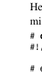

> 有趣的是，`sshd` 并非通过 `inetd` 或 `xinetd` 运行。相反，它几乎总是一个常驻守护进程，由 `/etc/rc.local` 或某个 `/etc/rc.d/in.d` 目录启动。

下面是一个方便的 shell 脚本，用于检查 `inetd` 的当前状态：你甚至可以在 `.login` 脚本中自动调用它：

```
# cat enabled
#!/bin/sh
# enabled - show what services are enabled with inetd
iconf="/etc/inetd.conf"
if [ -r $iconf ] ; then
echo "Services enabled in $iconf are:"
grep -v '^#' $iconf | awk '{print " " $1}'
echo ""
if [ "`ps -aux | grep inetd | egrep -vE '(xinet|grep)'`" == "" ] ; then
echo "*** warning: inetd does not appear to be running"
fi
exit 0
```

在结束本节之前，让我们禁用 `inetd.conf` 中的所有服务（使用 `vi` 在每个已启用服务前添加 `#`）。我们可以用 `enabled` 脚本复查结果：

```
# enabled
Services enabled in /etc/inetd.conf are:
#
```


inetd 超级守护进程对于疲于应付的系统管理员来说是个极大的帮助，它能让你了解哪些服务已启用，以及守护进程为每项服务实际使用了哪些二进制程序。人们很容易疏忽大意，导致不必要的服务处于启用状态，这绝对是个问题，因此你应始终反复检查服务器上 `inetd.conf` 文件的状况。尤其要确保供应商的默认配置不会启用一大堆不必要的服务。此外，每次升级操作系统时都要再次检查，以防情况有变。

### 使用 TCP Wrapper 管理 inetd 安全性

尽管有些系统运行着标准 inetd 服务，并由该程序直接启动守护进程，但这并非世界上最安全的安全策略。除此之外，这种方法无法对哪些远程系统可以或不可以访问某给定服务进行任何控制。例如，你的服务器或许应允许公司内任何地方的 FTP 访问，但拒绝来自互联网其他地方的连接；又或者有竞争对手想通过 telnet 闯入，而你希望禁用他们的访问权限。

TCP Wrapper 恰恰提供了对单个服务访问的这种控制级别，并允许你通过允许列表或拒绝列表来指定访问权限。

#### 任务 19.2：使用 TCP Wrapper

TCP Wrapper 最初由荷兰埃因霍温理工大学的维茨·费纳马编写，实际上是一项相当简单的服务，但仍然非常有用。它也默认安装在许多 Unix 衍生系统上。

1. 受 TCP Wrapper 监控的服务会记录在 syslog 日志文件中，通常是 `/var/log/messages` 或 `/var/log/system.log`，具体取决于操作系统。例如，在 Mac OS X 上，之前的一次 telnet 连接以及来自远程系统的 ftp 测试会被记录为

```
# tail -4 /var/log/system.log

Apr 22 21:39:38 ds1-132 telnetd[922]: connect from 63.101.93.250

Apr 22 21:41:17 ds1-132 ftp[d943]: connect from 63.101.93.250

Apr 22 21:41:18 ds1-132 ftp[d943]: connection from 63.101.93.250

Apr 22 21:41:21 ds1-132 ftp[d943]: ANONYMOUS FTP LOGIN REFUSED FROM
->63.101.93.250
```

“connect from”消息来自TCP Wrapper（尽管它标识的是被请求的服务而非自身），而“connection”和“LOGIN REFUSED”消息则来自ftpd本身。

2. 配置TCP Wrapper相当容易，尤其是与inetd服务结合使用时：只需创建`/etc/hosts.allow`或`/etc/hosts.deny`文件，然后列出特定服务、主机，以及可选的、在查询该服务时应运行的命令。

例如：

```
# cat /etc/hosts.allow

# /etc/hosts.allow

#

# Allow telnet from anywhere
telnetd: ALL

# ftp can only be from within my own subnet:
ftp: LOCAL, dsidesigns.com, 137.44.
```

这指定了所有主机都可以使用telnetd服务，而只有本地主机（不含点的主机名）、`.dsidesigns.com`域内的主机（注意该域名开头的点；如果没有这个点，就只会进行精确匹配），以及IP地址前两个八位组为`137.44.`的主机，才可以使用ftpd服务。

与之相比，再来看一个拒绝文件：

```
# cat /etc/hosts.deny

# /etc/hosts.deny

#

# Reject all hosts with suspect hostnames
ALL: PARANOID
```

这个巧妙的TCP Wrapper技巧让我们能够自动拒绝来自以下系统的所有连接：这些系统的主机名与IP地址不匹配（通过反向IP查询；更多细节请参阅上一小时的讨论），或者其IP地址没有关联的主机名。

实际上，推荐的配置是在hosts.deny文件中设置`ALL:ALL`，然后在hosts.allow文件中显式允许某些主机使用特定服务。

3. 关于TCP Wrapper，没有太多可说的了，只是如果你发现相应的日志文件中没有任何条目，那很可能是你把syslog的日志记录范围配置得过于精简。为了试验，在`/etc/syslog.conf`文件中添加以下内容：

```
*.* /dev/console
```

一旦你向syslogd程序发送SIGHUP（挂断信号），这会让所有交给syslog的消息也显示在系统控制台上。这样产生的输出非常有意思。


> 非常值得研究一下syslog的工作原理。先从阅读syslog手册页开始；然后再阅读syslog.conf(5)手册页，并查看你自己的`/etc/syslog.conf`文件。

尽管概念简单，但TCP Wrapper程序对系统管理员来说是一大福音，因为它能让你为任何网络服务添加访问控制。没有它，你就得要么开发一套防火墙方案，要么重写服务本身来实现访问控制。

稍后你会看到，xinetd的一个优势是它内置了类似TCP Wrapper的功能。

### 超级inetd：xinetd

xinetd最初发布于Red Hat Linux，它是inetd更复杂的“老大哥”，虽然二者共享相同的概念基础，但它们的差异几乎达到了两个程序所能达到的最大程度。尽管xinetd尚未被广泛使用，它也已包含在Mandrake Linux中。可以预期它会随着时间迁移到其他平台，因为它是inetd的一个明智替代品。

正如你所看到的，在inetd中，有一个单独的配置文件控制着哪些服务被启用，以及定义它们在系统上运行方式的参数。

相比之下，xinetd有一个存放各个独立配置文件的目录，每个服务一个文件，以及一个集中的主配置文件，用来定义所有服务的默认设置。在大多数情况下，你的系统会使用其中一种——无论哪种，我都建议坚持默认配置。

#### 任务19.3：使用xinetd

实际上，如果你想象把`inetd.conf`文件中的每一行分别放到各自独立的文件中，并把每一行的每个字段写成“字段名 = 值”的格式，那么你就能非常接近xinetd的格式了。

1. 主配置文件是`/etc/xinetd.conf`：

```
# cat /etc/xinetd.conf

#
# Simple configuration file for xinetd
#
# Some defaults, and include /etc/xinetd.d/
defaults
{
    instances    = 60
    log_type     = SYSLOG authpriv
    log_on_success = HOST PID
    log_on_failure = HOST
    cps = 25 30
}

includedir /etc/xinetd.d
```

这演示了xinetd配置的基本结构。先列出服务，然后在花括号内以“名称 = 值”对的形式设置一组参数。在此例中，特殊的defaults服务使得某些参数能够对所有启用的服务进行设置。

这里的具体设置包括：`instances`（服务允许的最大并发连接数）、`log_type`（使用syslog，采用authpriv设施——见本小时稍早关于syslog的讨论）；在连接成功时，它会记录HOST和PID，而在失败时只记录HOST。最后，还有一个故障安全连接速率参数，它规定服务每秒最多接受25个连接，如果速率超过这个值，该服务将被完全关闭30秒。

最后一行最重要：它表明其余配置信息位于`/etc/xinetd.d`目录下的各个独立文件中。

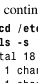

> 在`xinetd.conf`文件中可以指定相当多的参数。我们不会在这里全部列出，而是重点介绍最重要的部分。完整列表请参阅`xinetd.conf(5)`手册页。

2. 为了继续探索，我们将注意力转向includedir目录：

```
# cd /etc/xinetd.d
# ls -s
total 18
1 chargen      1 echo        1 rexec       1 sgi_fam      1 time-udp
1 chargen-udp  1 echo-udp    1 rlogin      1 talk         1 wu-ftpd
1 daytime      1 finger      1 rsh         1 telnet
1 daytime-udp  1 ntalk       1 rsync       1 time
```

乍看之下，通过xinetd启用的服务相当多，但进一步查看一个特定的配置文件——本例中是telnet——就会发现情况并不像看上去那么糟：

```
# cat telnet
```


# default: on

# description: The telnet server serves telnet sessions; it uses

# unencrypted username/password pairs for authentication.

## CHANGED TO DISABLE TELNET 12/2001

`service telnet`

```
{
    flags         = REUSE
    socket_type   = stream
    wait          = no
    user          = root
    server        = /usr/sbin/in.telnetd
    log_on_failure += USERID
    disable       = yes
}
```

这些具体标志大多应该能让你联想到`inetd.conf`文件的格式，包括`socket_type`、`wait`、`user`和`server`。`flags`让你可以指定众多不同底层网络选项中的一种。在此例中，`REUSE`意味着该服务设置了一个特定的地址复用标志（更多细节请参阅`xinetd.conf(5)`手册页。注意，这属于非常底层的选项！）。

这个服务定义中的`log_on_failure`参数展示了一个很棒的特性。注意它使用了`+=`，这意味着除了在失败时要记录的默认值之外，`telnet`服务还会额外记录`USERID`。表19.1列出了在给定连接成功或失败时可供记录的参数。

**表19.1：xinetd记录的信息**

| 值 | 使用时机 | 说明 |
|---|---|---|
| ATTEMPT | 失败时 | 记录曾尝试但失败的事实 |
| DURATION | 成功时 | 记录服务会话的持续时间 |
| EXIT | 成功时 | 记录服务器退出时间 |
| HOST | 成功或失败时 | 远程主机地址 |
| PID | 成功时 | 服务器应用程序的进程ID |
| RECORD | 失败时 | 尽可能多地记录来自远端的信息 |
| USERID | 成功或失败时 | 远程主机的用户ID（如果可用） |

最后，`telnet`配置清单中的最后一行也许是最重要的。`disable`参数可以是`yes`或`no`。如果是`yes`，`xinetd`无法启动该服务，连接尝试将会失败。如果设为`no`，则该服务被启用。

- `disable`参数的使用导致了`xinetd`最大的问题——很难搞清楚哪些服务被启用、哪些被禁用。

幸运的是，这正是 shell 脚本大显身手的好地方。为了实现这一目标，我们只需扩展之前编写的 `enabled` 脚本，根据系统配置来检查 `inetd` 或 `xinetd`：

```sh
# cat enabled

#!/bin/sh

# enabled - show what services are enabled with inetd and xinetd,
# if they're available on the system.

iconf="/etc/inetd.conf"
xconf="/etc/xinetd.conf"
xdir="/etc/xinetd.d"

if [ -r $iconf ] ; then
 echo "Services enabled in $iconf are:"
 grep -v "#" $iconf | awk '{print $1}'
 echo

 if [ "`ps -aux | grep inetd | egrep -vE '(xinet|grep)'`" == "" ] ; then
 echo "*** warning: inetd does not appear to be running"
 fi
fi

if [ -r $xconf ] ; then
 # don't need to look in xinetd.conf, just know it exists
 echo "Services enabled in $xdir are:"
 for service in $xdir/*
 do
 if [ "`grep disable $service | grep 'yes'" == "" ] ; then
 echo -n " "
 basename $service
 fi
 done

 if [ "`ps -aux | grep xinetd | grep -v 'grep'" == "" ] ; then
 echo "*** warning: xinetd does not appear to be running"
 fi
fi

exit 0
```

这个脚本现在可以清楚地显示 `xinetd` 下启用了哪些服务，以及禁用了哪些服务：

```
# enabled
Services enabled in /etc/xinetd.d are:
sgi_fam
```

稍加探查，即可确认 `sgi_fam` 的真实身份：

```
# grep server /etc/xinetd.d/sgi_fam
server	= /usr/bin/fam
# man -k fam
fam (1m) - file alteration monitor
fam (3x) - File Alteration Monitor (FAM) library routines
grolj4 (1) - groff driver for HP Laserjet 4 family
```

显然，这是一个文件修改监视器。我们可能希望启用它，也可能不希望，但除此之外，可以确认该服务器上没有运行其他多余的服务，这令人放心。

`xinetd` 及其配置文件还有更多内容，尤其是在可以指定的众多参数方面。如果你的系统运行着 `xinetd`，强烈建议你留出 30 分钟时间，通读 `xinetd` 和 `xinetd.conf` 文件，了解如何精确控制系统中的这一重要功能。

### 示例：启用 ftp

在 Unix 的世界里，`ftp` 一直是最有用的命令之一。尽管它绝算不上美观——坊间的玩笑话是它总是处于调试模式——但它是计算机系统之间传输文件的一种直接了当的方式。

随着 X Window 系统以及 Mac 和 Windows 计算机上出现了美观的 FTP 客户端界面，使用这种机制已经大大简化了。

那么，如何在服务器上启用 `ftp` 呢？

#### 任务 19.4：启用 ftp（以及你可能不想启用它的原因）

承认吧，这个奇怪的章节标题勾起了你的兴趣。在我解释为什么你可能不想启用 `ftp` 之前，先来看看启用基本访问所需的步骤。

1. 要仅启用有效账户访问（例如，允许那些在系统上有账户并知道相应账户密码的用户访问），只需在 `/etc/inetd.conf` 文件中启用 `ftpd`，或者在 `/etc/xinetd.d` 目录下的 `ftp`（或许还有 `wu-ftpd`）文件中启用即可。

   在启用 `ftp` 之前快速测试一下，显示它处于关闭状态：

   ```
   # ftp localhost
   ftp: connect: Connection refused
   ftp> quit
   ```

   一旦在 `inetd.conf` 文件中取消对该行的注释（或者在 `xinetd` 下将 `enable` 选项设置为 `yes`，这当然也会将下面的第一行改为重启 `xinetd` 所需的语句），然后快速重新读取配置文件。

   ```
   # kill -HUP `cat /var/run/inetd.pid`
   # ftp localhost
   Connected to localhost.
   220 dsl-132.dsidesigns.net FTP server (Version 6.00LS) ready.
   Name (localhost:taylor): ftp
   530 User ftp unknown.
   ftp: Login failed.
   ftp> quit
   221 Goodbye.
   #
   ```


如果你运行的是 Mac OS X 系统，请注意，启用 FTP 最简单的方法是在共享控制面板（可从“Apple”>“系统偏好设置”访问）中勾选“启用 FTP 访问”复选框。不过，你仍然需要手动配置匿名 FTP。

## 2. 注意
尽管 `ftp` 程序现在会监听连接并显示常规的 `ftpd` 对话框，但匿名 FTP 访问仍然被禁用。（连接到匿名 FTP 服务器的标准方式是以 `ftp` 身份登录，并使用你的电子邮件地址作为密码。）


> 匿名 FTP 服务允许互联网上的用户连接到你的服务器，四处翻找、下载文件，如果权限设置实在不当，还能上传他们自己的文件。从安全角度来看，这是一个典型的混合体。一方面，向系统提供匿名访问是友好且便捷的；但另一方面，这也非常危险，因为许多破解者会四处寻找可利用的 FTP 服务器。

要启用匿名 FTP 服务，你需要创建一些特殊目录，并在其中放置特定文件和 Unix 可执行二进制文件的副本。其思路是创建一个文件系统的封闭子集，其中包含关键文件（`ls` 和一个精简后的 `/etc/passwd`），然后将匿名 FTP 用户困在该区域内。


> 如果你运行的是 Red Hat Linux 或其他与 RPM 兼容的 Unix 系统（更多细节请参阅第 8 小时），最好的办法是直接安装 `anonftp` 包，而不是一步步手动操作。

第一步必要操作是创建 `ftp` 用户账户。将该账户的主目录设置为 `/bin/false` 或另一个能阻止任何人将其用于 `telnet` 或其他会话的程序。你可以将密码设置为几乎任何值，因为 `ftp` 程序本身永远不会检查它（记住，按照惯例，匿名 ftp 用户会使用他们的电子邮件地址作为密码）。

创建该账户后，进入其主目录并键入以下命令：

```
# cd ~ftp
# mkdir bin etc lib pub
# chown root.root bin etc lib
# chown root.ftp pub
# chmod 111 bin etc
# chmod 755 lib
# chmod 2755 pub
```

这会在 `ftp` 主目录中创建一个目录结构，镜像标准 Unix 文件系统的某些核心部分。

下一步是将特定文件复制到 `lib` 和 `bin` 目录中。不过，这会因 Unix 的不同版本而异：Red Hat Linux 由于其动态加载器架构，需要将库放在 `lib` 中，而其他 Unix 版本可能不需要 `lib` 中有任何内容。由于这是一个非常关键的配置问题，请咨询你的供应商，获取针对你的操作系统版本的具体指南。

让我们继续 Red Hat Linux 的配置：

```
# cp /lib/{ld-2.1.1,libc-2.1.1,libnsl-2.1.1,libnss_files-2.1.1}.so ~ftp/lib
# chmod 755 ~ftp/lib/*
# cp /usr/bin/compress ~ftp/bin
# cp /bin/{cpio,gzip,ls,sh,tar} ~ftp/bin
# chmod 111 ~ftp/bin/*
```

还需要一些符号链接：

```
# cd ~ftp/lib
# ln -s ld-2* ld-linux.so.2
# ln -s libc* libc.so.6
# ln -s libnsl* libnsl.so.1
# ln -s libnss* libnss_files.so.2
# cd ../bin
# ln -s gzip zcat
```

现在，Red Hat Linux 配置的一切都应该就绪了。


> 注意 `{a,b,c}` 这种巧妙的 shell 模式匹配符号，它会生成三个文件名：a、b 和 c。这是一个很棒的快捷方式。

如果你使用不同的 Unix，安装过程可能会更像这样：

```
# cp /bin/ls ~ftp/bin
# chmod 111 ~ftp/bin/ls
```

是不是简单多了？

## 3. 最后一步
最后一步需要在 `~ftp/etc` 中创建一个虚拟的 `passwd` 和 `group` 文件。我们可以复制现有文件，但更好的做法是创建一个非常精简的新文件，如下所示：

```
# cat ~ftp/etc/passwd
root:*::0:0::
bin:*::1:1::
operator:*::11:0::
ftp:*::14:50::
nobody:*::99:99::
# cat ~ftp/etc/group
root::0:
bin::1:
daemon::2:
sys::3:
adm::4:
ftp::50:
```

完成所有这些更改后，用户现在就可以匿名登录到 `ftp` 服务器了：

```
# ftp localhost
Connected to localhost (127.0.0.1).
220 staging.intuitive.com FTP server (Version wu-2.6.1-18) ready.
Name (localhost:taylor): ftp
331 Guest login ok, send your complete e-mail address as password.
Password:
230 Guest login ok, access restrictions apply.
Remote system type is UNIX.
Using binary mode to transfer files.
ftp>
```


### 安全性与 FTP 的风险

4. 现在该谈谈安全性了，以及为什么你可能根本不想运行 FTP，更不用说匿名 FTP 了。

首先，想象一下如果你不小心让 `pub` 目录对所有人可写会怎样。用不了多久，某个破解者就会偶然发现它并创建一个子目录，然后你就会发现你的系统被用作非法软件（行话称为“warez”）甚至色情内容的存储仓库。

更糟糕的是，`ftpd` 守护进程是试图利用来闯入系统的热门应用程序（例如，多年前臭名昭著的互联网蠕虫就是通过 `ftpd` 撬开远程系统大门的），因此即使只是运行它，也会让你面临危险活动。

也许 `ftp` 最致命的方面——这也是 `telnet` 同样具有的特点——是它不会对与客户端计算机共享的任何信息进行加密。账户名、密码、数据——全都是明文。这意味着坏人可以相当容易地用数据包分析器或类似工具从网络数据流中截获账户和密码对。

幸运的是，当今几乎所有流行的 Unix 系统上都有一个非常好的替代方案：`ssh`。安全外壳（SSH）不仅能在客户端与服务器之间加密数据，还提供了一种简单有效的类 FTP 功能，可通过 Unix 命令行中的 `sftp` 来使用。交互方式几乎相同（但不支持匿名 `sftp`）。

如果你想向用户群体提供文件传输功能，在我看来毫无疑问——使用 `ssh`，并教会他们如何使用它。然后永久禁用 `telnetd` 和 `ftpd`。哦，你还必须接受一个事实：不存在匿名 `ssh` 选项。


> 如果你决定运行匿名 `ftp`，至少请研究一下 `ftpaccess`（参见 `man` 手册页），并将其配置好，以帮助提供最大可能的安全性。

运行 Unix 服务器最令人愉悦的方面之一，是能够向用户提供的服务范围之广。虽然有些服务是 Unix 强大功能与灵活性的典范（例如 `Apache`，本书最后两小时将详细讨论），有些则相当精巧（`ntp` 网络时间协议会自动确保你的系统时钟始终准确，这很酷），但也有几个相当危险的服务，应尽可能避免使用。排在榜首的是 `ftpd`，`telnetd` 紧随其后。

#### 本章小结

本小时探讨了重要的 `inetd` 和 `xinetd` 配置文件，并顺带介绍了 TCP Wrapper 和 `syslogd`。此外，你还学习了如何为各种不同的 Unix 平台配置匿名 FTP 服务器，并且同样重要的是，你了解到了一些令人信服的理由，说明为什么这样做并非良策。

#### 问答

问：哇，你对 FTP 的措辞可真激烈！你确定吗？

答：如今在系统上已经很少能看到匿名 FTP 了，尤其是随着 Web 的出现，以及用户可以通过 Web 服务器直接轻松下载文件（当然，Web 服务器本身也有安全问题，但那是另一回事）。

问：你更喜欢 `inetd` 还是 `xinetd`？为什么？

答：也许是"老狗学不会新把戏"综合征吧，但我仍然更喜欢 `inetd` 的简洁。能够一眼扫过单个文件、立刻知道哪些服务已启用、哪些没有启用，这有着巨大的价值。

#### 实践

##### 测验

1. 创建 `inetd` 的主要动机是什么？
2. 应该使用什么简单模式来确定 `/etc/inetd.conf` 中列出的哪些服务实际上是启用的？
3. 就 `inetd.conf` 文件中的套接字值而言，`stream` 意味着 ____，而 `dgram` 意味着 ____？
4. 哪种常见的 Unix 程序可以轻松测试任何网络服务？
5. 有点偏执地说，使用 `inetd` 或 `xinetd` 的最佳经验法则是什么？
6. 使用 TCP Wrapper，你可以在何处指定相应信息来允许或拒绝连接？
7. 匿名 FTP 的可用性并非必需，因为你可以通过什么流行机制轻松地让匿名用户访问文件？

##### 答案

1. 为了应对越来越多的守护进程在等待连接时消耗系统资源的问题。
2. 搜索 `#` 是否为第一个字符。要找到所有已启用的服务，请使用 `grep -v '^#'`。
3. `stream` 套接字意味着 TCP，而 `dgram` 意味着 UDP。
4. `telnet`，对任何系统管理员来说都是一个极好的实用工具。
5. 最佳经验法则是禁用一切。
6. 要允许连接，请在 `/etc/hosts.allow` 中指定规则，而拒绝规则应放在 `/etc/hosts.deny` 中。
7. 使用 Web 服务器：`Apache` 可以传送任何类型的文件或信息，不仅仅是 HTML 和 JPEG 图形。

下一小时将详细探讨另一个网络服务。如果你一直在试图理解底层电子邮件，你会发现第 20 小时对 `sendmail` 的探讨大有裨益。


### 第 20 小时：使用电子邮件

系统管理涉及在一个或多个 Unix 系统上管理各种各样的服务，但有一项服务如果出问题，保证会让你陷入麻烦，那就是电子邮件。无论你的用户群体的技术水平如何，如果他们无法发送和接收电子邮件，你一定会听到抱怨。

本小时重点介绍如何使用 `sendmail`——Unix 系统上的标准邮件传输代理（MTA）。还有其他可用的 MTA，包括流行的 `postfix`、`exim`、`qmail` 和 `smail` 程序，但我见过的几乎每个 Unix 系统都默认附带 `sendmail`。

区分邮件传输代理和其他电子邮件相关软件也很重要。让你阅读、组织和撰写消息的程序称为邮件用户代理，其例子从 `Elm`、`Pine` 到 `Entourage` 和 `Outlook` 不等。有基于 X Window 系统的应用程序、像 Apple Mail 这样的图形应用程序，以及各种各样的命令行或基于 shell 的邮件程序，但在 Unix 中，它们都是通过将外发消息交给 MTA 来运作的。MTA——`sendmail`——是负责在本地投递邮件，或连接到远程系统并将消息通过线路传送到目标系统（目标系统很可能也运行着 `sendmail`）的程序。

话虽如此，有必要说明的是，我们不打算深入探讨以复杂著称的 `sendmail.cf` 配置文件。它本身就是一种晦涩的语言，典型的 `sendmail.cf` 文件可能非常庞大。在 Red Hat Linux 中该文件的默认大小为 1,490 行，在 Mac OS X 中为 1,214 行，在 Solaris 8 中为 1,191 行。如果你一定要了解更多，我建议你看看 Brian Costales 和 `sendmail` 原创程序员 Eric Allman 合著的《sendmail》（O'Reilly 出版）一书。

好了，那我们要讲什么呢？如何操作和使用 `sendmail` 及其强大的别名功能，以确保你的用户日复一日都能拥有愉快而无痛的电子邮件体验。

本小时你将学到以下内容：

- 使用 `sendmail` 测试邮件连通性
- 邮件日志和邮件队列
- 创建 `sendmail` 别名
- Mac OS X 中的 `sendmail` 别名

#### 使用 sendmail 测试邮件连通性

探索 `sendmail` 复杂性的一个合乎逻辑的起点——你基本上是置身于一个曲折通道的迷宫之中——是学习如何使用 `sendmail` 标志来测试服务器的邮件连通性。


> 曲折通道这个说法参考了 70 年代伟大的 Adventure 程序，该程序是用 Fortran 为 Unix 编写的。这是我玩过的第一款交互式小说游戏，自那以后它一直是几代酷炫的 D&D 风格游戏的灵感来源。

##### 任务 20.1：使用 sendmail 验证连通性

`sendmail` 程序有各种各样的标志，如果程序作为守护进程运行，大多数标志以 `b` 或 `o` 开头。通常你会看到诸如 `-bd`（以守护进程模式运行）、`-bp`（打印邮件队列）和 `-bi`（初始化别名数据库）之类的选项。

```
# sendmail -bg -d0.1 < /dev/null

Version 8.11.6

Compiled with: LDAPMAP MAP_REGEX LOG MATCHGECOS MIME7TO8 MIME8TO7

NAMED_BIND NETINET NETINET6 NETUNIX NEWDB NIS QUEUE SASL SCANF

SMTP TCPWRAPPERS USERDB

Invalid operation mode g

========== SYSTEM IDENTITY (after readcf) ==========

(short domain name) $w = staging

(canonical domain name) $j = staging.intuitive.com

(subdomain name) $m = intuitive.com

(node name) $k = staging.intuitive.com

============================================
```

令人欣喜的是，这个 Red Hat 安装运行的是较新版本的 `sendmail`（第一行标明：8.11.6）。

在 Mac OS X 上运行完全相同的命令会显示以下内容：

```
# sendmail -bt -d0.1 < /dev/null
```


Version 8.10.2

Compiled with: `MAP_REGEX` `LOG` `MATCHGECOS` `MIME7TO8` `MIME8TO7` `NAMED_BIND`

`NETINET` `NETINFO` `NETISO` `NETUNIX` `NEWDB` `NIS` `QUEUE` `SCANF` `SMTP`

`USERDB` `XDEBUG`

`/etc/mail/sendmail.cf`: line 81: fileclass: cannot open

->`/etc/mail/local-host-names`: Group writable directory

========== SYSTEM IDENTITY (after readcf) ==========

(short domain name) `$w` = dsl-132

(canonical domain name) `$j` = dsl-132.dsldesigns.net

(subdomain name) `$m` = dsldesigns.net

(node name) `$k` = dsl-132.dsldesigns.net

============================================

ADDRESS TEST MODE (ruleset 3 NOT automatically invoked)

Enter `<ruleset>` `<address>`

```
在 Solaris 8 上：
```

```
# /usr/lib/sendmail -bt -d0.1 < /dev/null

Version 8.10.2Sun

Compiled with: `LDAPMAP` `MAP_REGEX` `LOG` `MATCHGECOS` `MIME7TO8` `MIME8TO7`

`NAMED_BIND` `NDBM` `NETINET` `NETINET6` `NETUNIX` `NEWDB` `NIS` `NISPLUS`

`QUEUE` `SCANF` `SMTP` `USERDB` `XDEBUG`

========== SYSTEM IDENTITY (after readcf) ==========

(short domain name) `$w` = solaris

(canonical domain name) `$j` = solaris.dsldesigns.net

(subdomain name) `$m` = dsldesigns.net

(node name) `$k` = solaris.dsldesigns.net

============================================

ADDRESS TEST MODE (ruleset 3 NOT automatically invoked)

Enter `<ruleset>` `<address>`
```

请注意，Mac OS X 和 Solaris 版本的 `sendmail` 都比 Red Hat Linux 落后一个版本。`sendmail` 的官方仓库是开源 Sendmail Consortium，网址为 http://www.sendmail.org/。

### 2.

从相关信息的标志和输出格式可以看出，`sendmail` 是一个只有它的母亲才会喜欢的程序。输出往往晦涩难懂，但系统的功能却非常出色。

默认情况下，`sendmail` 要作为守护进程运行，只需以 `sendmail -bd` 启动即可轻松实现。通常，你还需要使用 `-q n` 指定它处理队列的频率，其中 `n` 是一个频率指示符，例如 `10m` 表示 10 分钟间隔，`2h` 表示两小时间隔。

不过，我们将在下一节更详细地讨论邮件队列。但你可能想知道，默认启动顺序中这些配置信息是从哪里来的。

在 Red Hat 系统上，不出所料，它位于 `/etc/sysconfig`：

```
# cat /etc/sysconfig/sendmail

DAEMON=yes

QUEUE=1h
```

例如，如果你想阻止 `sendmail` 自动启动并监听传入邮件，可以把第一行改为 `DAEMON=no`；如果你希望它更频繁地处理外发邮件队列，可以指定 `QUEUE=15m` 或类似的值。

Solaris 8 也有类似的机制（如果进行了配置）。在 `/etc/default` 中查找名为 `sendmail` 的文件，其中可能包含 `QUEUEINTERVAL=value` 和更通用的 `OPTIONS=value`，这两者都会直接传给 `sendmail`，就像命令行选项一样。

Mac OS X 则大不相同，部分原因是默认情况下 `sendmail` 不会在启动时启动，另一部分原因是默认的 `sendmail.cf` 文件（至少在 10.1.5 之前）缺少一个能让它更好地理解 Mac OS X 环境的设置。

要让它正常工作，首先编辑 `/etc/mail/sendmail.cf`，将内容为

```
# O DontBlameSendmail=safe
```

的行替换为

```
O DontBlameSendmail=GroupWritableDirPathSafe
```

现在，你可以用 `sendmail -bd -q10m` 手动启动守护进程。要让系统以你选择的选项自动启动，有两种可行的解决方案。

第一种更符合 OS X 风格的解决方案是，将 `/etc/hostconfig` 文件中的 `MAILSERVER=-NO-` 行改为 `MAILSERVER=-YES-`。另一种更典型的 Unix 解决方案是向 `/etc/rc` 文件中添加一两行。例如：

```
# start up the sendmail program as needed:
if [ -f /usr/sbin/sendmail -a -f /etc/mail/sendmail.cf ] ; then
/usr/sbin/sendmail -bd -q30m &
echo "sendmail started."
fi
```

下次启动 Macintosh 系统时，它除了是邮件客户端之外，还将是一台邮件服务器。


> `DontBlameSendmail` 这个名字应该能给你一些提示：我们正在绕过标准 Mac OS X 配置中的一个安全问题。`sendmail` 程序对文件和目录权限非常挑剔，而我们正在覆盖它的抱怨——默认情况下 `/` 目录不应该具有组写权限。你可以修改这一点来解决问题，但轶事证据表明，其他 Mac OS X 应用程序稍后可能会出现故障。
>
> 请查看 http://www.sendmail.org/tips/DontBlameSendmail.html 上的在线信息，以了解相关情况。

### 3.

要检查 `sendmail` 程序的状态（而不是识别其版本号），最简单的方法是使用系统在启动时使用的启动脚本。为了更方便，让我们创建一个别名：

```
alias sm=/etc/rc.d/init.d/sendmail
```

现在，检查状态：

```
$ sm status
sendmail (pid 801) is running...
```

Solaris 不支持 `status` 参数，所以我们需要快速调整一下，以确定它是否在运行。一种方法是对 `ps` 的输出进行 `grep`，看是否存在 `sendmail` 进程，但让我们采用更优雅的解决方案：先检查是否存在 `sendmail.pid` 文件，再检查指定进程是否在运行。下面是一个简单的 shell 脚本，可为系统添加实用的新 `sm` 命令：

```
# cat /users/root/bin/sm
#!/bin/sh
# smstat - check sendmail status by checking for pid file, then
# checking to see if it's running.
pidf=/var/run/sendmail.pid
if [ -f $pidf ] ; then
  pid=`head -1 $pidf`
  if [ "`ps -p $pid | wc -l`" -lt 2 ] ; then
    echo "Sendmail appears to NOT be running (pid = $pid)"
  else
    echo "Sendmail appears to be running (pid = $pid)"
    echo "Command was: `tail -1 $pidf`"  # note the digit '1'
  fi
else
  echo "Sendmail is not running (no pid file)"
fi
exit 0
```

如果在 `sendmail` 未运行时执行 `sm`，`sm` 会报告相应的状态。但如果它在运行，`sm` 足够聪明，会显示 `.pid` 文件的第二行，也就是重复调用序列的那一行：

```
# sm
Sendmail appears to be running (pid = 334)
Command was: /usr/lib/sendmail -bd -q30m
```


- 4. 既然我们已经掌握了 `sendmail` 程序的基础知识，接下来看看该程序最有用的功能：`-v` 标志。借助这个详细输出标志，你可以观察系统如何向任何电子邮件地址传递消息，包括别名扩展、远程连接等。请注意，它不会启动 `sendmail` 守护进程；它只是运行程序来投递这条特定消息，然后退出：

```
# sendmail -v taylor@intuitive.com

Subject: test message from Mac OS X

just testing. Please ignore.

taylor@intuitive.com... Connecting to mail.fwd.verio-web.com. via esmtp...

220 mail1tb.verio-web.com SMTP RS ver 1.0.60s

500 Command unrecognized

>> EHLO dsl-132.dsldesigns.net

500 Command unrecognized

>> HELO dsl-132.dsldesigns.net

250 mail1tb.verio-web.com Hello dsl-132.dsldesigns.net [198.76.82.132],

I'm listening

>> MAIL From:<taylor@dsl-132.dsldesigns.net>

250 taylor@dsl-132.dsldesigns.net... Sender ok

>> RCPT To:<taylor@intuitive.com>

250 taylor@intuitive.com... Recipient ok

>> DATA

354 enter mail, end with '.' on a line by itself

>>> .

250 041745238 Message accepted for delivery

taylor@intuitive.com... Sent (041745238 Message accepted for delivery)

Closing connection to mail.fwd.verio-web.com.

>> QUIT

221 mail1tb.verio-web.com closing connection
```

请注意，虽然我们指定了 `intuitive.com` 作为域名，但系统知道要与 `mail.fwd.verio-web.com` 建立连接，该系统是 `intuitive.com` 域的 MX（邮件交换）记录持有者。这是该域 DNS 记录的一部分，正如前一节详述的那样。

这条消息顺利通过，并毫无问题地送达了。输出的第四行出现 `Command unrecognized`，是因为 `sendmail` 尝试使用扩展 SMTP 协议（称为 ESMTP，其特点是使用 `EHLO`，而不是常规 SMTP 的 `HELO` 命令），而远程服务器不认识 ESMTP，拒绝了它。然后，客户端只是发送了一个更常规的 SMTP `HELO`，并继续执行。

尝试向一个伪造地址发送消息也很有启发性：

```
# sendmail -v junk@this-is-not-likely-to-work.org < /dev/null

 taylor... Connecting to local...

 taylor... Sent
```

“有启发性？”你可能会问——它的启发性在于它没有连接远程站点。这意味着 `sendmail` 无法解析指定的域名，并在本地将其退回。要理解发生了什么，我们需要查看邮件日志，这将在下一节进行。

关于 `sendmail` 的基本用法，我们还可以探索更多，但如果你想深入了解，最好的办法是查阅 `www.sendmail.org` 上的一些优秀在线参考资料，或者找一本关于 Unix 电子邮件管理的书。

现在，让我们花更多时间看看邮件日志和邮件队列，然后探索 `sendmail` 的一些功能，这些功能可以让你作为系统管理员受益匪浅。

### 邮件日志与邮件队列

默认情况下，`sendmail` 会在邮件到达时立即尝试投递所有邮件。这意味着绝大多数邮件在收到后的几秒钟内就会被投递，也意味着外发邮件队列应该相当小。然而，当有消息要发送到远程 SMTP 服务器未运行或拒绝连接的系统时，会发生什么？

在这些情况下，邮件会被排入队列以便稍后投递。根据你的配置设置，队列中的邮件可以每十分钟、每两小时，甚至每天尝试投递一次，投递尝试的持续天数由你在 `sendmail.cf` 文件中指定的投递尝试周期决定。一旦该时间到期，如果消息仍未投递成功，它就会被退回给发件人，并伴随类似 `Bounced: network is unreachable`（退回：网络不可达）的错误信息。

在大多数情况下，`sendmail` 会自行处理一切，你不需要过多干预。但有时，能够知道队列中有什么（如果有的话）以及为什么，会非常有帮助。

#### 任务 20.2：邮件日志与邮件队列

要查看邮件队列中有哪些内容，许多系统都提供一个名为 `mailq` 的命令，它实际上是 `sendmail` 程序本身的一个链接。像下面这样的别名：

```
alias mailq='/usr/sbin/sendmail -bp'
```

也能让你完成完全相同的事情。

不过，在查看邮件队列之前，我们先来看一下 `maillog` 文件（所有与电子邮件相关的事件都会记录在其中），了解一下本课时前面部分发送的那两封邮件的最终命运。

1. 要了解电子邮件的命运，请查看 `/var/log/maillog`（Linux）、`/private/var/log/mail.log`（Mac OS X）或 `/var/log/messages`（Solaris 8）。无论哪种方式，它们的格式本质上都相同，如下面这条来自 Mac OS X 服务器的记录所示：

```
# tail -f /private/var/log/mail.log

Mar 22 18:11:39 dsl-132 sendmail[466]: g2N2B000046: from=taylor, size=66, class=0, nrcpts=1, msgid=<200203230211.g2N2B000046@dsl-132.dsidesigns.net>, relay=root@localhost

Mar 22 18:11:45 dsl-132 sendmail[466]: g2N2B000046: to=taylor@intuitive.com, ctladdr=taylor (501/20), xdelay=00:00:06, mailer=esmtp, pri=30066, relay=mail.fwd.verio-web.com. [161.58.148.30], dsn=2.0.0, stat=Sent (0417452538 Message accepted for delivery)

Mar 22 18:16:25 dsl-132 sendmail[488]: g2N2GPJ0048: from=taylor, size=0, class=0, nrcpts=1, msgid=<200203230216.g2N2GPJ0048@dsl-132.dsidesigns.net>, relay=root@localhost

Mar 22 18:16:26 dsl-132 sendmail[488]: g2N2GPJ0048: to=junk@this-is-not-likely-to-work.org, ctladdr=taylor (501/20), delay=00:00:01, xdelay=00:00:01, mailer=esmtp, pri=30000, relay=this-is-not-likely-to-work.org, dsn=5.1.2, stat=Host unknown (Name server: this-is-not-likely-to-work.org: host not found)

Mar 22 18:16:26 dsl-132 sendmail[488]: g2N2GPJ0048: DSN: Host unknown

(Name server: this-is-not-likely-to-work.org: host not found)

Mar 22 18:16:26 dsl-132 sendmail[488]: q2N2B0K00488: to:taylor,

delay=00:00:00, xdelay=00:00:00, mailer=local, pri=30100, dsn=2.0.0,

stat=Sent
```


要理解这里发生了什么，请注意第六个字段是唯一消息 ID：日志文件中所有具有相同 ID 的行都与同一个 `sendmail` 事件相关联。因此，第一条消息的 ID 是 `g2N2B000046`，第二条消息的 ID 是 `g2N2GPJ0048`。

该日志文件的第二条记录显示，一条 66 字节的消息由用户 `taylor` 发出。第五行显示了一次将消息发送到指定地址 `taylor@intuitive.com` 的尝试结果：使用 `ESMTP`（第六行中的 `mailer=esmtp`），经 `mail.fwd.verio-web.com`（`intuitive.com` 的 MX 记录服务器）中继，最终以 `stat=Sent`（消息已被接受投递）结束。

相比之下，最后几行显示了一次失败：来自 `taylor`、发送到 `junk@this-is-not-likely-to-work.org` 的新消息以 `stat=Host unknown` 失败。紧接着的一行给出了更明确的错误条件：`Host unknown (Name server: this-is-not-likely-to-work.org: host not found)`（主机未知（名称服务器：`this-is-not-likely-to-work.org`：找不到主机））。最后两行显示，退回的消息随后被发送给了用户 `taylor`（即退回给发件人），并且状态为 `stat=Sent`——已顺利投递，没有出现任何问题。

在繁忙的系统上，你可以使用 `awk` 或 `Perl` 提取 `stat=` 字段，然后扫描其中不等于 `Sent` 的记录，从而快速了解服务器上可能存在哪些问题。

## 2. 登录到一个繁忙的 FreeBSD 系统，快速调用 sendmail 的队列显示功能，可以看到以下内容：

```
# sendmail -bp | head -15

Mail Queue (147 requests)

-.Q-ID.......Size.....Q-Time.......Sender/Recipient...........

SAA14346    290 Tue Mar 26 18:45 xaith

                         (office@landistudio.com...reply: read error from

mail.iandis)

SAA16063*   2283 Tue Mar 26 18:54

<office@landistudio.com>

<lincoln@dglair.net>

<RSwarts@SAS.Samsung.com>

<rswarts@austin.rr.com>

<gotoway@texas.net>

<ATANZIOSPRD1.MDACC.TMC.EDU>

<PRINCESSANDFROG@HOTMAIL.COM>

SAA10097    7031 Tue Mar 26 18:25 MAILER-DAEMON

                         (Deferred: Connection refused by fmail8.real-net.net.)

<send@mail5.real-net.net>

QAA21483*   4651 Tue Mar 26 16:46 <lori@salesinminutes.net>

                         (Deferred: Connection timed out with delphi.mail.eds.com.)

<miirish@delphi.com>

0AA18380 4651 Tue Mar 26 16:39 <lori@salesinminutes.net>

    (Deferred: Connection timed out with delphi.mail.eds.com.)

<mirish@delphi.com>
```

第一行显示了出站邮件队列中的请求总数——`147`——然后每个请求都会列出其队列 ID、大小（以字节为单位）、进入队列的时间、发件人/收件人列表，以及状态（如果已知）。

例如，队列中的第一条消息已经排队大约三个小时（可以使用 `date` 命令获取当前日期和时间，然后与显示的时间戳进行比较）。鉴于系统每 10 分钟尝试发送一次邮件，这意味着它已经尝试投递这条消息约 18 次，但都失败了。

这条消息由 `xaith` 发送到 `office@landistudio.com`，具体错误是 `reply: read error from mail.iandis`（回复：从 `mail.iandis` 读取错误）。这种特定错误通常表示远程系统磁盘空间不足，或因其他原因无法接收邮件，尽管其 SMTP 守护进程仍在监听并应答传入的查询。

请注意，第二条记录中的队列 ID 值带有一个尾随星号。这意味着当前有一个活动的 `sendmail` 正在尝试投递它。如果投递成功，这条记录将从队列中消失。请注意，这里没有队列错误消息，这表明系统是第一次尝试投递这封电子邮件。

将其与第四条记录进行比较，第四条记录也有一个星号，表示 `sendmail` 正在积极尝试投递，但由于存在错误消息 `Deferred: Connection refused by fmail8.real-net.net`，你可以看出它至少在队列中待了一个投递周期。

实际上，第四条记录最有趣，因为它来自 `MAILER-DAEMON`。这告诉我们，有一条来自 `send@mail5.real-net.net`、发送给某个特定用户的消息进入了我们的系统，然后在本地被退回。退回的消息（其发件人自动为 `MAILER-DAEMON`）被排队等待发回原发件人，但 `real-net.net` 的 MX 记录是 `fmail8`，而它不接受连接。

> 像第四条记录那样古怪的设置，在我看来强烈暗示这是一封垃圾邮件：它来自某一台邮件服务器，发件人是一个通用地址（用户 `send`？），而发送方域名的响应 MX 记录却在拒绝连接。嗯……。

## 3. 消息最终进入队列的原因主要有三个：本地系统故障、查找和名称解析问题，以及远程连接失败。

`Connection refused`（连接被拒绝）消息属于远程连接失败。虽然有时这是由系统因备份、迁移而停机或已经崩溃造成的，但很多时候它表明这些系统没有运行 SMTP 守护进程，并且不希望接收电子邮件。在队列中搜索此类错误，会显示以下内容：

```
# mailq | grep refused | sort | uniq -c | sort -rn

16 (Deferred: Connection refused by mail.zwallet.com.)

4 (Deferred: Connection refused by 66.106.197.165.)

3 8BITTIME (Deferred: Connection refused by fgt1.mailist.net.tw.)

3 (Deferred: Connection refused by postoffice.randbhad.com.)

2 (Deferred: Connection refused by cors.estsale.ac.ma.)

1 8BITTIME (Deferred: Connection refused by www.mundomail.net.)

1 (Deferred: Connection refused by william.monsterjoke.com.)

1 (Deferred: Connection refused by webchi.com.)

1 (Deferred: Connection refused by smtp.apsoffers.com.)

1 (Deferred: Connection refused by mtal1.mail.hotbot.com.)

1 (Deferred: Connection refused by lamx01.mgw.rr.com.)

1 (Deferred: Connection refused by billingproblemmail.doteasy.com)
```

我对它们进行了排序并用 `uniq` 去重，以稍微缩减输出。有 16 条消息排队等待发往 `mail.zwallet.com`，这表明要么它是一个非常受欢迎的站点，要么是有人在向它大量倾倒消息。

## 4. 你可能会看到的另一种消息是名称查找错误：

```
# mailq | grep lookup | sort | uniq -c | sort -rn

7 (host map: lookup (Liberty4Success.com): deferred)

5 (host map: lookup (poorrichardsonenterprises.com): deferred)

3 (host map: lookup (NewSouthConstruction.net): deferred)

2 (host map: lookup (sdd.com): deferred)

2 (host map: lookup (gaysstufftodo.net): deferred)
```


2 (Deferred: Name server: zero.nochill.com: host name lookup failed)

1 8BITTIME (host map: lookup (virtueltv.com): deferred)

1 (host map: lookup (webmastermindsonline.com): deferred)

1 (host map: lookup (spinstudios.com): deferred)

1 (host map: lookup (pretaluz.com): deferred)

1 (host map: lookup (palesedesign.com): deferred)

1 (host map: lookup (maos.org): deferred)

1 (host map: lookup (libertywebdevelopment.com): deferred)

1 (host map: lookup (grundvig.com): deferred)

1 (host map: lookup (chequemail.com): deferred)

以我这位老手的眼光来看，其中很多都可疑地像是垃圾邮件，尤其是 `liberty4success.com`、`poorrichardsenterprises.com` 和 `chequemail.com`。由于你作为系统管理员，需要对你的用户社区负责，并确保人们遵守可接受使用政策（AUP），你最好还是调查一下这些邮件。

一种调查方式就是直接查找与这些邮件关联的收件人和发件人。这可以通过 `grep` 完成，特别是使用 `-B n` 标志，它表示你希望在每次匹配之前显示 n 行上下文。由于延迟查询总是针对收件人的，因此这很可能揭示我们需要的信息：

```
# mailq | grep -B1 -A1 liberty4

QAA17284      4657 Tue Mar 26 16:36 <lori@salesinminutes.net>

    (host map: lookup (Liberty4Success.com): deferred)

<Karen@Liberty4Success.com>

..

QAA15045      4657 Tue Mar 26 16:30 <lori@salesinminutes.net>

    (host map: lookup (Liberty4Success.com): deferred)

<Karen@Liberty4Success.com>

..

AAA18116      269 Tue Mar 26 00:06 ximinute

    (host map: lookup (Liberty4Success.com): deferred)

Karen@Liberty4Success.com

..

AAA27255      269 Mon Mar 25 00:04 ximinute

    (host map: lookup (Liberty4Success.com): deferred)

Karen@Liberty4Success.com

..

AAA27203      269 Sun Mar 24 00:04 ximinute

    (host map: lookup (Liberty4Success.com): deferred)

Karen@Liberty4Success.com

..

AAA00798      269 Sat Mar 23 00:05 ximinute

    (host map: lookup (Liberty4Success.com): deferred)

Karen@Liberty4Success.com

..

AAA20693      269 Fri Mar 22 00:04 ximinute

    (host map: lookup (Liberty4Success.com): deferred)

Karen@Liberty4Success.com
```

正如所料，这些消息中几乎每一封都是从 `ximinute` 发往 `Karen@Liberty4Success.com`。注意这些消息的时间：几乎都在午夜，分别是 3 月 22 日、3 月 23 日、3 月 24 日、3 月 25 日和 3 月 26 日。我怀疑是某个 `cron` 作业或类似的自动化邮件系统，并怀疑是某种垃圾邮件。如果我是这台机器的主要系统管理员，我会和这个用户谈谈，问问到底是怎么回事。

5. 另一种你可以采用的策略是进入实际的邮件排队区域，通常是 `/var/spool/mqueue`。那里会有大量文件，包括每个排队消息所对应的一堆配置和数据文件，如表 20.1 所述。

**表 20.1：mqueue 目录中常见的文件**

| 前缀 | 内容 |
| --- | --- |
| df | 消息正文 |
| Qf | 在消息被退回且无法返回时创建 |
| qf | 消息的头（控制文件） |
| tf | 尝试投递期间 qf 文件的临时版本 |
| Tf | 如果 52 次或更多次锁定尝试失败，则创建 |
| xf | 来自远程服务器的特定错误消息的文本记录 |

让我们创建一条简单消息，并仔细查看这些可能的文件：

```
# sendmail -O DeliveryMode=d -t

From: ximinute

To: Karen@Liberty4Success.com

Subject: fabulous offer

You are authorized to receive a fabulous offer...

#
```

这会立即将消息排队（这正是 `DeliveryMode=d` 的作用），然后我们就可以用 `mailq` 查看它在队列中的样子；在它的大量输出中，会显示：

```
g2R8OWC14928   50 Wed Mar 27 00:24 ximinute

Karen@Liberty4Success.com
```

默认情况下创建的两个文件是 `df*` 和 `qf*` 文件：

```
# cat df*

You are authorized to receive a fabulous offer...

# cat qf*

V4

T1017217472

K0

N0

P120

I8/18/26706

Fb

$_ximinute@localhost

Sximinute

Aximinute@staging.intuitive.com

RPD:Karen@Liberty4Success.com

H?P?Return-Path: <7g>

H?D?Date: Wed, 27 Mar 2002 00:24:32 -0800

H?M?Message-Id: <20020327...>

H??From: ximinute

H??To: Karen@Liberty4Success.com

H??Subject: fabulous offer

.
```


无需逐行详细说明 `qf*` 文件中的每一行，只说它包含了所有消息头以及相当多的排队信息就够了。当投递尝试正在进行时，会创建一个空的 `xfg2R8OWC14928` 文件。

邮件队列目录 `/var/spool/mqueue` 中的实际文件可以揭示一些有趣的信息，并帮助你识别哪些用户可能在发送垃圾邮件，以及你是否存在开放中继或其他潜在问题。密切关注其内容是值得的。


> 不过，再次提醒你注意隐私问题：读取离开系统的每封电子邮件的内容是很容易的。然而，如果用户发现了，他们可能不会太高兴。

### 创建 sendmail 别名

我想，在深入探讨了 sendmail 程序的一些内部机制之后，你的脑袋可能已经有点晕了，所以我们来换一个更轻松的话题歇一歇：邮件别名。

这个概念相当直接——邮件别名不只是接受发往你系统上特定登录名的邮件，而是让你接受电子邮件并将其转发给另一台系统上的某个人、一组人、一个列有若干邮件地址的文件，甚至某个特定程序或文件。


> Mac OS X 有一种完全不同的邮件别名管理方式，通过 NetInfo 机制实现。这将在本课时的最后一节中介绍。

#### 任务 20.3：邮件别名

最初的 sendmail 程序允许你设置指向多种不同目标的别名，包括文件、程序、远程地址，甚至电子邮件地址列表。最近几年，电子邮件领域在安全方面投入了更多精力，这最直接地影响了 sendmail——标准系统配置上可用的别名受到了更多限制。

在最后一节中，我们会快速了解一些更高级的别名；但如果你发现你的 Unix 操作系统默认阻止它们，并常常附带一条晦涩难懂的错误消息，也不要感到惊讶。

1. 最基本的别名是让一个不同的名称指向现有邮箱。这看起来似乎有点傻，但对于确保用户能收到发给他们的邮件却非常有用，无论发件人是否知道他们的具体登录名。

   例如，在我的服务器上，我的账户是 taylor，但如果你把邮件发给 dave 会怎样？默认情况下它会被退回。不过，这很容易修复，只需在 `/etc/aliases` 中添加以下内容：

   ```
   dave:  taylor
   ```

   我们要做的就这些；一旦用 `newaliases` 命令重建了别名文件，发往 dave 的邮件就会被正确投递到 taylor 的邮箱中。

   因此，许多站点会自动为给定名称添加常见的替代拼写作为别名，以确保退信尽可能少。如果新用户 Susan McGill 加入公司，可能会创建下面这一组别名：

   ```
   mcgill:    susan
   macgill:   susan
   smcgill:   susan
   susanm:    susan
   susan.mcgill: susan
   susan_mcgill: susan
   ```

   尤其注意第二个别名：因为我们预料到有些人会把 Susan 的姓氏拼错，所以很容易添加一个别名来确保发往 `macgill@ourserver` 的邮件能够正常工作。

2. 第二种别名是系统外的重定向：

   ```
   john:    john@aol.com
   ```

   在这种情况下，任何在本地系统上发送给 john 的邮件，无论他是否设置了账户，都会自动重定向到他的 AOL 邮箱。

3. 不过，有一种更好的方式来管理地址列表，那就是使用文件包含别名。这些别名看起来有点古怪，但事实证明它们极其有用：

   ```
   writers: :include:/home/taylor/writers.list
   ```

   在这种情况下，任何发送给 writers 的邮件都会被发送到指定文件中的每个电子邮件地址。每次发送消息时，文件内容都会被按需读取，因此如果在两次 `newaliases` 运行之间文件发生了变化，这些变化会立即生效。

   `:include:` 记法的真正优势在于，你的用户可以管理他们自己的邮件列表，而你不必去修改（也不用让他们修改！）实际的 `/etc/aliases` 文件。这可以大大简化你日常的系统管理任务！

4. 要重定向到文件，别名可以写成：

   ```
   archive: /private/mail/archive
   ```

   然而，由于安全问题，现在大多数 sendmail 配置都会禁用直接保存到文件的功能（尽管我实在想不出直接写入文件会有什么安全问题，除非你把类似 `/etc/passwd` 的文件当作归档文件——那样的话，你可以通过电子邮件发送一行类似 `root::0:0:::` 的内容，立刻获得超级用户登录权限）。

5. 另一种在 sendmail 安装中曾经广泛使用、但现在受到很大限制的机制，是让别名直接指向服务器上的某个程序。为了解决安全问题，现代 sendmail 安装现在包含一个特殊程序 `smrsh`，即 sendmail 受限 shell，它被明确用作一个安全的“沙盒”，用于运行作为别名一部分的程序。这个别名看起来像这样：

   ```
   ps: "|/bin/ps"
   ```

   如果你的安装带有良好的错误消息，那么向 ps 别名发送邮件的尝试会作为退回测试消息的一部分，产生以下信息：

   ```
   .... The following addresses had permanent fatal errors ....
   "|/bin/ps"
   (reason: service unavailable)
   (expanded from: toprog)
   .... Transcript of session follows ....
   smrsh: ps not available for sendmail programs
   554 5.0.0 "|/bin/ps"... Service unavailable
   ```

   注意倒数第二行中对 `smrsh` 的引用：我们原以为指定的是 `/bin/ps`，但 `smrsh` 自动去掉了路径部分，并在它自己的已知程序列表中查找 ps。

要了解如何配置 `smrsh`，以允许访问流行的 `vacation` 程序、`filter`、`procmail` 以及其他复杂的电子邮件过滤程序，请阅读 `smrsh` 手册页。

为你的用户社区创建一套灵活且实用的邮件别名，其具体细节会因环境而异，但能够拥有一个集中式的别名系统、修正常见的拼写错误、在组织内规范化电子邮件地址，同时让用户自行选择登录名，以及 `:include:` 机制，这些都展现了 sendmail 巨大威力和灵活性的多个侧面。

值得一提的是，许多 Unix 配置允许用户在自己的主目录中拥有各自的 `.forward` 文件，如果权限设置得当，用户就可以实现简单的重定向、逗号分隔的列表以及其他机制，而无需对别名文件本身做任何修改。

此外，有一些非常强大的邮件列表管理器可以作为 `|prog` 机制接入，同时提供完整的列表管理服务。你可能见过其中一些，它们被称为 `majordomo`、`listserv` 等等。如果你的用户社区需要灵活的邮件列表，表 20.2 提供了一些很好的入门学习资源。

**表 20.2 常见的基于 Unix 的邮件列表管理器**

| 名称 | 主页 URL |
|---|---|
| ListProc | www.cren.net |
| Mailman | www.list.org |
| Majordomo | www.greatcircle.com |
| SmartList | www.procmail.org |

顺便说一句，在这些选择中，我建议你先看看 Mailman——它是一个不错的软件包，包含一个直观的基于 Web 的界面，深受用户和邮件列表管理员的欢迎。

### Mac OS X 中的 sendmail 别名

正如你在前面探索如何向 Darwin/Mac OS X 系统添加新用户时所了解到的，尽管苹果公司以 Unix 作为其新操作系统的基础，但它仍然有一些独特的曲折和怪癖，使得操作起来并不像其他 Unix 版本那样直接。

具体来说，苹果公司把所有分散在 `/etc/passwd`、`/etc/groups`、`/etc/aliases` 等文件中的数据库集中起来，全部放入了一个名为 NetInfo 的集中式数据库。这一点在本书前面已经出现过，而这一次我们需要使用 NetInfo 系统来创建和测试电子邮件别名，而不是编辑更常见的文件 `/etc/aliases`（或者在有些系统上，是 `/etc/mail/aliases`）。

#### 任务 20.4：Mac OS X 和 sendmail 别名

幸运的是，我们之前用来处理 `/etc/passwd` 文件的那两个工具，同样也能让我们轻松地操作 NetInfo 数据库中的电子邮件别名部分：`nidump` 和 `niutil`。

1. 一个简单的单行脚本就可以让我们开始：

   ```
   # cat showaliases
   #!/bin/sh
   ```


# showaliases - list all current email aliases from NetInfo

`nidump aliases .`

运行这个脚本需要先将其改为可执行模式，然后确保它位于你当前的 `PATH` 中。完成之后，下面是典型的输出：

```
# showaliases

administrator: root

postmaster: root

MAILER-DAEMON: postmaster

MAILER-AGENT: postmaster

nobody: root

dumper: root

manager: root

operator: root
```

如你所见，没有什么太令人兴奋的！

## 2. 添加别名

添加别名需要脚本中更复杂一点的操作，因为我们必须确保新别名不会与现有别名冲突（也就是说，它不能使用已经存在的名称）。下面是 `addalias` 脚本：

```
# cat addalias
#!/bin/sh

# addalias - add a new alias to the email alias database...

showaliases=/Users/taylor/bin/showaliases

echo -n "Alias to create: "

read alias

# now let's check to see if that alias already exists...

existing=`$showaliases | grep "${alias}:"`

if [ "$existing" != "" ] ; then

echo "mail alias $alias already exists:"

echo " $existing"

exit 0

fi

# looks good. let's get the RHS and inject it into NetInfo

echo -n "pointing to: "

read rhs

niutil -create . /aliases/$alias

niutil -createprop . /aliases/$alias name $alias

niutil -createprop . /aliases/$alias members $rhs

echo "Alias $alias created without incident."

exit 0
```

从大多数编写大量 shell 脚本的系统管理员常见的方式可以看出，我的第二个脚本在这里调用了第一个脚本。还要注意 `echo` 使用了 `-n` 标志，这会防止末尾的回车换行。片刻之后就会明白，这意味着你可以获得漂亮的输入提示。

下面是 `addalias` 的实际运行情况：

```
# addalias
Alias to create: operator
mail alias operator already exists:
    operator: root
```

哎呀！这个名称已经被使用了。`addalias` 立了一功。

```
# addalias
Alias to create: author
pointing to: taylor
Alias author created without incident.
# showaliases | tail -1
author: taylor
```

这运行得很好，正如 `showaliases` 输出中新增别名所展示的那样。

## 3. 在 Mac OS X 系统中添加别名

上一节中解释的别名也可以使用 `addalias` 脚本快速添加到 Mac OS X 系统中：

```
# addalias
Alias to create: writers
pointing to: dave,dee-ann,gideon,rima,smithers@some.host.com
Alias writers created without incident.
# addalias
Alias to create: writer-list
pointing to: :include:/Users/taylor/writers.list
Alias writer-list created without incident.
# addalias
Alias to create: ps
pointing to: "ps"
Alias ps created without incident.
```

并用 `showaliases` 验证：

```
# showaliases
administrator: root
postmaster: root
MAILER-DAEMON: postmaster
MAILER-AGENT: postmaster
nobody: root
dumper: root
manager: root
operator: root
author: taylor
writers: dave,dee-ann,gideon,rima,smithers@some.host.com
writer-list: :include:/Users/taylor/writers.list
ps: "ps"
```

## 4. 验证别名是否工作

值得再次指出的是，设置好这些别名并不意味着它们就能正常工作！下面是在 Mac OS X 上使用 `sendmail -v` 的几个快速示例：

```
# sendmail -v writer-list < /dev/null
writer-list... aliased to :include:/Users/taylor/writers.list
:include:/Users/taylor/writers.list... including file /Users/taylor/writers.list
:include:/Users/taylor/writers.list... Cannot open /Users/taylor/writers.list: No such file or directory
taylor... Connecting to local...
taylor... Sent
```

我们已经设置了别名，但包含的文件 `writers.list` 不存在，于是邮件被退回。

```
# sendmail -v ps < /dev/null
ps... aliased to "ps"
"ps"... Connecting to prog...
taylor... Connecting to local...
taylor... Sent
```

这似乎已经奏效了。让我们再检查一下 `/private/var/log/mail.log` 文件来确认：

```
# tail -6 mail.log
Mar 28 00:13:12 dsl-132 sendmail[433]: gethostbyaddr(198.76.82.132) failed: 1
Mar 28 00:13:12 dsl-132 sendmail[433]: g2S8DCL0A433: from=taylor, size=0, class=0, nrcpts=1, msgid=<2002022808013.g2S8DCL0A433@dsl-132.ds1designs.net>, relay=localhost
Mar 28 00:13:12 dsl-132 smrsh: uid 1: attempt to use ps
Mar 28 00:13:12 dsl-132 sendmail[433]: g2S8DCL0A433: to="ps", ctladdr=ps (1/0), delay=00:00:00, xdelay=00:00:00, mailer=prog, pri=30000, dsn=5.0.0, stat=Service unavailable
```


Mar 28 00:13:12 dsl-132 sendmail[433]: g2S8DCL0A433: g2S8DCL0A433: DSN: Service unavailable

Mar 28 00:13:12 dsl-132 sendmail[433]: g2S8DCL0A433: to=taylor, delay=00:00:00, xdelay=00:00:00, mailer=local, pri=30100, dsn=2.0.0, stat=Sent

如你所见，该消息实际上失败了：`smrsh: uid 1: attempt to use ps`，随后是 `stat=Service unavailable` 和退信。


> 要启用 `ps`，或者其他你希望在电子邮件管道末尾使用的命令，请阅读 `smrsh` 手册页中的讨论和详细信息。

### 小结

令人高兴的是，一旦你创建了一些工具来直接从命令行与 NetInfo 系统交互，就很容易创建符合标准 sendmail 别名的 Mac OS X 电子邮件别名，这些别名与大多数其他 Unix 系统中 `/etc/aliases` 里的格式一致。

### 问答

**问：** 如果我不想运行 sendmail，你会推荐什么替代 MTA？

**答：** 在 Unix 行业中有两个口碑良好的 MTA 替代品：`exim` 和 `postfix`。在最近六个月左右，很多人都在谈论 `postfix` 如何轻松地安装到他们的 OS X 系统上，并简化了电子邮件服务器的配置和管理。你可以分别在 www.exim.org 和 www.postfix.org 了解这两个替代方案。

**问：** 我对一条消息运行了 `sendmail -v`，但它失败了。现在该怎么办？

**答：** 调试 sendmail 问题的第一步——就像任何 Unix 系统问题一样——是检查日志文件中的信息。在这种情况下，你需要检查 `maillog`（或 `mail.log`，具体取决于你的 Unix 版本）。如果这不能揭示问题，请检查权限并快速浏览一下 `sendmail.cf` 文件，看看是否有任何明显错误的地方。如果这些都不能解决问题，请回到本书前面几章，阅读一些关于使用 `ping` 和 `dig` 的内容。

**问：** 我听说过很多关于“开放中继”的危险。它们是什么？我如何知道自己是否有开放中继？

**答：** 开放中继是一种系统，它会把来自站外某人的电子邮件转发给同样在站外的另一个人，实际上起到了中继邮件的作用。垃圾邮件发送者非常喜欢这一点，因此，开放中继系统最终可能会被许多反垃圾邮件站点屏蔽。你可以在网上检查自己是否是开放中继，并了解如何修复它，网址是 http://www.mail-abuse.org/tsi/。

### 实战练习

#### 小测验

1. 您如何确定最新版本的 sendmail？
2. 将 `/etc/sysconfig/sendmail` 文件中的 `QUEUE` 值设置为 `1m` 会有什么问题？
3. 尝试使用 `sendmail -v` 从命令行向 AOL 账户发送一条消息。您是否收到了错误消息 `550 REQUESTED ACTION NOT TAKEN: DNS FAILURE`？您认为它是什么意思？
4. 分析邮件队列内容时，棘手之处在哪里？
5. 以下各个邮件别名分别完成了什么功能？
```
curly: moe,larry

moe: :include:/home/lists/stooges

larry: "|vacation"
```

#### 答案

1. 您可以使用一个看起来有些奇怪的命令 `sendmail -bg -d0.1 < /dev/null` 来了解自己所用 sendmail 的版本，也可以通过 www.sendmail.org 了解该程序本身的最新版本。
2. 如果队列值太小，您的系统就会不停地旋转，试图投递队列中的消息。这并不会让消息投递得更快，但可能会显著影响系统的整体性能。
3. DNS FAILURE 表示 AOL 尝试对您的 IP 地址进行反向查找，但未能获得一个与您连接时所声明的主机名相匹配的主机名。这是他们邮件守护进程中的一种垃圾邮件过滤技巧。
4. 难点在于邮件队列始终处于变动之中：任何信息快照（例如 `mailq` 命令的输出）在您阅读时都正在变得过时，……
5. `curly` 别名指向两个地址：`moe` 和 `larry`。而 `moe` 又指向一个名为 `/home/lists/stooges` 的电子邮件地址列表；`larry` 则通过管道符号（`"|vacation"`）将他所有的电子邮件转交给 `vacation` 程序。

在下一小时中，我们将处理一个贯穿全书的话题，但这次我们将专门关注它：shell 脚本编写。正如已经反复证明的那样，能够编写简单而有效的 shell 脚本，也许是为精明的 Unix 系统管理员节省时间的最重要手段，因此您需要充分调动脑细胞，以便从第 21 小时的学习中获得最大收获。


## 第七部分：Web 服务器管理与 Shell 编程

### 小时

- 21 Shell 脚本：系统管理员的瑞士军刀 415
- 22 使用 awk 和 Perl 编写高级脚本 443
- 23 Apache Web 服务器简介 457
- 24 使用 Apache 配置虚拟主机 473


## 第 21 小时：Shell 脚本：系统管理员的瑞士军刀

如果非要我挑选一项区分优秀系统管理员与平庸系统管理员的核心技能，那会是 shell 脚本编写。当然，了解您所用操作系统中的各种工具是很有用的，但能够将这些工具组合起来，构建出满足用户群体特定需求和要求的东西，才是一项关键能力。

在整本书中，您已经有机会看到许多 shell 脚本，从简单的一行脚本，到带有循环、条件执行、返回码分析等内容的颇为复杂的脚本，不一而足。

在本小时中，我们将专门聚焦 shell 脚本的语言和能力，重新审视前面的一些脚本，看看它们到底实现了什么，并引入一些新脚本来拓展您的编程视野。

当然，有些任务无法在 shell 中完成；对于这些任务，您需要使用 awk、Perl 或 C，具体取决于任务以及您对开发环境的熟悉程度。

在本小时中，您将学习：

- Shell 脚本编写的基础知识
- 如何控制脚本的执行流程

### Shell 脚本基础

对于任何开发 shell 脚本的人来说，第一个也是最重要的问题是：使用哪种 shell？

在 Unix 系统管理员社区中，这个问题的答案多少有些差异，但大多数系统管理员（包括我自己）都认为最佳的脚本编写环境是 Bourne Shell（`sh`）。无论您使用 `csh`、`tcsh`、`zsh` 还是其他 shell，几乎所有您能找到的 shell 脚本都会使用 Bourne Shell 作为其解释器。


> 当然，在许多系统上，`/bin/sh` 实际上是指向 `/bin/bash` 的硬链接，也就是说 `sh` 其实是 `bash` 的一个实例。这没问题：`bash` 与较老的 Bourne Shell 具有完全相同的语法和语义，此外还提供了一些强大的功能，以及一个坚实且不断改进的代码基础。

#### 任务 21.1：基本 Shell 脚本

与任何过程式编程语言一样，shell 脚本是从第一行到最后一行依次执行的，脚本中的错误只有在解释器（shell）读取即将执行的前一行时才会被发现。

而 Python 程序也很可能将其作为第一行。
```
#!/usr/local/bin/python
```
Bourne Shell 有许多启动标志，可以指定在脚本的第一行上，能产生有趣且往往很有价值的效果。其中最重要的是 `-x` 标志，它可以开启调试模式。我们稍后会在本小时中看到一个这样的示例。

脚本编写者常用的另一个有用标志是 `-f`，它可以禁止读取任何 rc 或其他配置文件。您将无法使用任何别名，但脚本会启动并运行得相当快。

要添加启动标志，只需将其附加到第一行即可：
```
#!/bin/sh -f
```
第三个启动标志是 `-n`，它可能并非在所有 Bourne Shell 版本中都可用；它会扫描整个脚本，确保语法可以接受，但不会真正执行脚本或其中的任何命令。这可能不会出现在脚本内部，而是您在命令行上调用的特殊测试：
```
$ sh -n mytestscript
```
正如您也可以通过调用 shell 脚本的方式来按需开启调试：
```
$ sh -x mytestscript
```
讨论得够多了——让我们来看一个非常简单的完整 shell 脚本，看看它们是如何组织的。
```
$ cat showaliases
#!/bin/sh
```


# showaliases - list all current email aliases from NetInfo

`nidump aliases .`

稍微长一点的示例可能更有意思：

```
$ cat diskhogs

#!/bin/sh

# diskhogs - report which users are taking up the most disk space
```

或者任何您使用的、能够模拟 Bourne Shell 的 shell（例如 `bash`）。

```
echo "Disk Hogs Report for System `hostname`"

bigdir2=`du -s /Library/* | sed 's/ /_/g' | sort -rn | cut -f2 | head -5`

echo "The Five biggest library directories are:"

echo $bigdir2

for dirname in $bigdir2 ; do

    echo ""

    echo Big directory: $dirname

    echo Four largest files in that directory are:

    find "echo $dirname | sed 's/_/ /g'" -type f -ls | \
    awk '{ print $7, "$11" }' | sort -rn | head -4

done

exit 0
```

希望您开始看到一种模式的出现。第一行是相同的，第二行是一段简短的注释，脚本的其余部分则是实际可执行的部分。

与其他编程环境一样，shell 脚本允许您定义脚本常量——代表常见目录、程序、命令或值的助记名称。在这个脚本中，它就是靠近顶部的 `bigdir2` 那一行。使用 shell 脚本时，您可以实践的最佳编程技巧之一就是将常量值定义在脚本顶部。这不仅让迁移到新的 Unix 环境变得更加容易，而且也让脚本更加易读！

这个 shell 脚本中的大部分工作都在 `for` 循环中完成，我们稍后将讨论。这里唯一需要重点注意的一点是，在结构上，您可以看到可以通过分号分隔同一行上的多个命令（注意 `for` 行末尾的 `; do`），并且如果遇到长而复杂的管道或命令行，您只需在一行末尾加上反斜杠（`\`）即可将其拆分为多行。


> 如果您使用反斜杠拆分长行，请确保反斜杠后面没有任何字符。即使是一个尾随空格或制表符，也会在脚本运行时产生奇怪且令人困惑的错误信息。

### 4. 如前一个 shell 脚本所示，shell 脚本中的变量既可以初始化为在整个执行过程中保持不变的常量值，也可以在脚本运行过程中改变其值。

后者的一个示例如下：

```
$ cat countfiles

#!/bin/sh

# countfiles - return a count of the files matching the specified pattern

pattern="${1:-dave}"

locate=/usr/bin/locate

for name in `locate $pattern`
do
  count=`expr ${count:-0} + 1`
done

echo "I counted $count files that matched pattern $pattern"

exit 0
```

这是一个有趣的脚本，因为它包含的变量发挥了三种不同的作用：`locate` 是一个常量，使得脚本可以很方便地重新配置，以适应不同版本的 Unix 系统（这些系统中 `locate` 命令可能位于一些非常规的位置，或者根本没有，也许需要用 `find` 命令替代）。`count` 变量是一个数值计数器，每次在以下行中被引用时都会加一：

`count=`expr ${count:-0} + 1``

`pattern` 变量保存的是正在被计数的文件名模式；如果在命令行上没有初始指定任何值，则默认模式为 `dave`。

`${variable:-default}` 这种不寻常的记号，可以理解为一个非常方便的简写，对应如下逻辑：如果 `$variable` 已定义，则使用 `$variable`；否则使用默认值 `$default`。现在再看对 `pattern` 的初始赋值：

`pattern="${1:-dave}"`

其真正含义是：“如果用户在命令行上指定了模式，就让 `pattern` 等于 `$1`；否则使用默认模式 `dave`。”

### 5. 这个 shell 脚本还演示了你可以使用实用的 `expr` 命令进行简单的数学运算，尤其是在 shell 脚本中。

例如，下面是前面 shell 脚本的一个变体，它还会计算总行数以及每个文件的平均行数：

```
$ cat countfiles

#!/bin/sh

# countfiles - return a count of the files matching the specified pattern,
# and average line counts too.

pattern="${1:-dave}"

locate='/usr/bin/locate'

for name in `locate $pattern`
do
  count=`expr ${count:-0} + 1`
  lines=`wc -l < $name`
  totallines=`expr ${totallines:-0} + ${lines:-0}`
done

echo "$count files, with $totallines lines, match pattern $pattern"

echo "for an average of `expr $totallines / $count` lines per file."

exit 0
```

运行该脚本时，会输出以下内容：

```
$ ./countfiles

5 files, with 88 lines, match pattern dave

for an average of 13 lines per file.
```

简洁而优雅。

### 6. 让我们更仔细地看看可以用于变量的各种特殊记号，这对 shell 编程非常有帮助。首先，让我们看看表 21.1 中的位置参数。

#### 表 21.1 Shell 位置参数

| Notation | Explanation |
|---|---|
| `$1..$9` | 命令行上的第一个到第九个参数。 |
| `${10}...` | 命令行上的第十个到第 n 个参数（不过就算是 10 个参数也已经很多了，所以你很可能永远不需要使用这个记号）。 |
| `$#` | 给命令的参数个数。 |
| `$*` | 所有参数的列表（通常用于包装脚本，记录命令的使用情况，然后将其所有起始参数和标志传给真正的二进制程序）。 |
| `$@` | 与 `$*` 相同，但所有参数都被引用。在几乎所有情况下使用它可能更安全。 |

shell 脚本中一个非常常见的测试是确保位置参数按照预期指定。如果 `countfiles` 坚持要求指定模式，那么在脚本开头可以做一个简单的测试：

```
if [ $# -ne 2 ]
then
  echo "Usage: countfiles PATTERN"
  exit 0
fi
```


不错的是，这个条件语句（*if 条件*）在用户指定了太多位置参数时也能将其捕获。


> 如果你要逐个处理位置参数，有一个非常有用的 shell 函数叫作 `shift`，值得了解。调用它时，所有位置参数都会向下移动一位，因此 `$2` 变成 `$1`，`$3` 变成 `$2`，依此类推。

通常，所有变量都应该用 `${name}` 这种记号来引用，但实际上，只有当确切变量名可能产生混淆时才有必要。例如：`$11` 到底是 `$1` 后面跟一个 1，还是引用第十一个变量？`echo "$joe:"` 引用的是 `$joe` 吗？如果是，shell 如何将 `:` 解释为特殊记号？`$1ish` 是引用 `$1` 并追加 `ish`，还是一个名为 `1ish` 的变量？在以上所有情况下，花括号都能消除歧义：`${1}`、`echo "${joe}:"` 和 `${1}ish`。

### 7. 还有一些重要的替换记号对 shell 脚本编写非常值得了解，如表 21.2 所总结。

##### 表 21.2 Shell 变量引用记号

| Notation | Explanation |
|---|---|
| `${variable:-default}` | 如果定义了 `$variable`，则使用它，否则使用默认值。 |
| `${variable:=default}` | 如果定义了 `$variable`，则使用它；否则将变量设置为指定的默认值，并返回该值。其作用类似于“如果未定义，则 `$variable = default`。” |
| `${variable:?message}` | 如果定义了 `$variable`，则使用它；否则打印一条错误消息，其中包含变量名后跟具体消息。例如：`${SHELL:?You must have a shell defined for this script}`。 |
| `${variable:+value}` | 如果定义了 `$variable`，则返回 `value`，否则返回 null。例如：如果变量 `name` 被赋了值，`${name:+1}` 将返回 1。 |
| `${variable:offset}` | 从字符偏移量处开始返回 `$variable` 的值。例如：`${name:3}` 将返回 `$name` 的第三个到最后一个字符。 |
| `${variable:offset:length}` | 是 `${variable:offset}` 的一个变体，返回从指定变量 `offset` 开始的指定长度的子字符串。例如：`${name:3:1}` 将返回赋给 `$name` 的值的第三个字符。 |

在使用数学记号时，特别重要的是使用替换记号，以确保不会产生越界或未定义的结果错误。例如，避免除以未定义值的一种常用技术可能是：

```
result=`expr $num / ${denom:?Can't be undefined}`
```

要避免除以零，则需要更复杂的条件语句：

```
if [ ${denom:-0} -eq 0 ] ; then
 echo "Can't divide by zero. Error."
 exit 0
fi
```

这也展示了 `:-` 记号的价值：在这种情况下，即使变量 `$denom` 未定义，这个条件语句也能捕获它并避免潜在问题。

### 8. 在我们继续讨论条件语句和循环之前，值得花几分钟看看 `expr` 语句本身。

`expr` 命令是 Unix 中隐藏的瑰宝之一。虽然它可能不是一个特别友好的交互式命令，但它确实可以让你计算各种各样的数学结果和其他结果，如表 21.3 所示。

##### 表 21.3 常用 expr 函数

| Function | Meaning |
|---|---|
| + | 加法。 |
| - | 减法。 |
| / | 除法。 |
| * | 乘法（小心不要在使用的过程中被扩展为 shell 通配符！如果不在引号字符串内，请使用 `\*`）。 |
| % | 除法，返回余数。 |
| length string | 字符串的长度。 |
| substr string pos length | 返回 `string` 中从 `pos` 开始、长度为 `length` 字符的子串。当然，这与 `${string:pos:length}` 完全相同。 |

除了有用的数学函数之外，`length` 还解决了一个本来很棘手的问题：如何在 shell 脚本中算出字符串有多长？

知道了这个函数，就可以很直接地找出哪些登录账户的登录名超过了 Unix 标准的 8 字符限制：

```
$ cat longname
#!/bin/sh
# longname - scan all login names in /etc/passwd, output any that
# are longer than 8 chars
maxlength=8
for login in `cut -d: -f1 /etc/passwd`
do
    if [ `expr length $login` -gt $maxlength ]
    then
        echo Warning: login $login exceeds $maxlength character max.
    fi
done
exit 0
```

在一个组织良好的系统上，根本不应该报告任何问题。然而，我使用的一个 FreeBSD 系统却报告了以下内容：

```
$ ./longname
Warning: login postmaster exceeds 8 character max.
```

这是值得修复的问题。² 另外请注意，使用 `maxlength` 在一处定义值 8 确实使脚本的逻辑更清晰，而且如果实际只识别 7 个字符，也更容易修改。

> 在 shell 中确定字符串变量字符数的另一种方法是引用 `${#variable}`；例如，前面的测试可以用 `if [ ${#login} -gt $maxlength ]` 代替。

你可能已经开始怀疑，我们可以在 shell 脚本编程上花很多时间。它不仅有用，而且非常有趣；写这本书时我最喜欢的部分之一就是创建这些精巧的小示例 shell 脚本。例如，你可以查阅 Sriranga Veeraraghavan 的 *Sams 24小时自学Shell编程*，不过我们在这里会更快地推进，看看效果如何！

## 流程控制

在演示 shell 脚本编程的某一特性时，几乎不可能不顺便深入涉及其他特性，因此你已经看到了不少条件语句（if-then）和循环机制的示例。

由于构建复杂条件语句的方式有很多种，而且循环对于巧妙的 shell 脚本编程至关重要，因此仔细研究它们会很有帮助。最后，本节还将简要介绍 shell 函数。

### 任务 21.2：条件、循环与函数

确实可以编写有用的 shell 脚本，让它按一组步骤线性执行，而不需要任何条件测试或循环，但这种情况不太常见。几乎每个实用的脚本至少都会检查起始参数是否有效。下面来看看具体怎么做。

**1.** 首先，让我们稍作回顾，并意识到前面展示的 `countfiles` 版本存在一个问题。也就是说：如果我们指定的模式没有任何匹配项，会发生什么？

```sh
$ ./countfiles linda
files, with lines, match pattern linda
for an average of / lines per file.
```

呃，这可不太好。这里发生的情况是，由于没有任何匹配，所有条件变量都是空白（未定义）的，于是最终的 `expr` 看到了这样的命令：

```sh
expr /
```

所以它（逻辑上）把 `/` 作为结果返回了。

要解决这个问题，我们需要在输出摘要信息之前添加一个条件测试。可以通过修改输出行，把它们包在一个测试中实现：

```sh
if [ $count -eq 0 ] ; then
  echo "No files found that match pattern $pattern"
else
  echo "$count files, with $totalines lines, match pattern $pattern"
  echo "for an average of `expr $totalines / $count` lines per file."
fi
```

看起来正确吗？让我们测试一下：

```sh
$ ./countfiles linda
./countfiles: [: -eq: unary operator expected
files, with lines, match pattern linda
for an average of / lines per file.
$
```


一个经典的 shell 脚本错误！`count` 变量没有定义，因此测试 `$count -eq 0` 最终变成了 `-eq 0`，条件测试函数便认为这是一个错误。

要正确修复此问题，需要使用替换运算符（`if [ ${count:-0} -eq 0 ]`），或者对变量加引号，并将测试逻辑改为字符串测试：

```sh
if [ "$count" = "" ] ; then
  echo "No files found that match pattern $pattern"
else
  echo "$count files, with $totalines lines, match pattern $pattern"
  echo "for an average of `expr $totalines / $count` lines per file."
fi
```

再检查一次，看看有多少文件包含模式 linda：

```sh
$ ./countfiles linda
No files found that match pattern linda
```

好多了！


> 许多 shell 程序员会采用一种略有不同的方式，写成 `if [ "x$count" = x ] ; then` 来避开奇怪的引号写法。如果 `$count` 有任何值，该值就不会是 `x`；但若它未定义，`x$count` 就会恰好等于 `x`。

## 2. Bourne Shell 测试

Bourne Shell 实际上会调用一个名为 `test` 的命令（或者为提升性能，将 `test` 的代码副本直接编译进 shell），它支持极为丰富的测试，既包括文件测试，也包括变量测试。表 21.4 总结了其中一些最有用的测试。

### 表 21.4 条件测试

| 条件 | 说明 |
|---|---|
| *文件比较* | |
| `-d file` | 若 *文件* 存在且为目录，则为真 |
| `-e file` | 若 *文件* 存在，则为真 |
| `-f file` | 若 *文件* 存在且为普通文件（例如，不是目录），则为真 |
| `-r file` | 若 *文件* 存在且允许读取，则为真 |
| `-s file` | 若 *文件* 存在且不为空，则为真 |
| `-w file` | 若 *文件* 存在且允许写入，则为真 |
| `-x file` | 若 *文件* 存在且允许执行，则为真 |
| `-O file` | 若 *文件* 存在且被当前用户拥有，则为真 |
| `-G file` | 若 *文件* 存在且与当前用户处于同一组，则为真 |
| `file1 -nt file2` | 若 *文件1* 比 *文件2* 新，则为真 |
| `file1 -ot file2` | 若 *文件1* 比 *文件2* 旧，则为真 |
| **字符串比较** | |
| `str1 = str2` | 若 str1 等于 str2，则为真（注意不是 ==） |
| `str1 != str2` | 若 str1 不等于 str2，则为真 |
| `str1 < str2` | 若 str1 小于 str2，则为真 |
| `str1 > str2` | 若 str1 大于 str2，则为真 |
| `-n str` | 若 str 为非零长度，则为真 |
| `-z str` | 若 str 为零长度，则为真 |
| **数值比较** | |
| `x -eq y` | 若 x 在数值上等于 y，则为真 |
| `x -ge y` | 若 x 在数值上大于或等于 y，则为真 |
| `x -gt y` | 若 x 在数值上大于 y，则为真 |
| `x -le y` | 若 x 在数值上小于或等于 y，则为真 |
| `x -lt y` | 若 x 在数值上小于 y，则为真 |
| `x -ne y` | 若 x 在数值上不等于 y，则为真 |

表 21.4 列出了大量可用的测试，因此如果你觉得有点应接不暇，也不要太意外。让我们编写一个脚本，实际使用其中许多测试来识别指定文件或目录的特征：

```sh
$ cat finfo
#!/bin/sh
# finfo - list some information about a specified file or directory
if [ $# -ne 1 ] ; then
    echo "Usage: finfo file-or-directory-name"
    exit 0
fi
file=$1
if test -e $file
then
    echo -n "$file exists," 
else
    echo "$file does not exist."
    exit 0
fi
if test -s $file; then
    echo -n " is not empty, "
fi
if test -r $file ; then
    perm="and is read"
else
    perm="and is "
fi
if test -w $file ; then
    perm="$perm+write"
fi
if test -x $file ; then
    perm="$perm+execute"
fi
if test -O $file ; then
    info="$file is owned by $LOGNAME"
else
    info="$file is not owned by $LOGNAME"
fi
if test -G $file ; then
    info="$info, same group as $LOGNAME"
else
    info="$info, and is not in any group that $LOGNAME is in"
fi
echo $perm
echo $info
exit 0
```

完成 `finfo` 在这里所做的事情还有其他方式，但这是一个绝佳的例子，展示了所有这些测试是如何工作的。还要注意，除了使用 `[` 快捷方式，我们也可以直接调用 `test`。在后一种情况下，我们不需要末尾的 `]`。

```sh
$ finfo $HOME
/home/taylor exists, is not empty, and is read+write+execute
/home/taylor is owned by taylor, same group as taylor
$ finfo baddir
baddir does not exist.
$ finfo countfiles
countfiles exists, is not empty, and is read+write+execute
countfiles is owned by taylor, same group as taylor
$ finfo /etc/passwd
/etc/passwd exists, is not empty, and is read
/etc/passwd is not owned by taylor, and is not in any group that taylor is in
```

## 3. 条件语句类型

条件语句有三种基本类型：`if-then-fi`、`if-then-else-fi` 和 `if-then-elif-then-fi`（在 bash shell 中很常见，将语句倒过来即为语句结束符，因此 `fi` 结束一个 `if` 语句），如下所示：

```sh
if test -x $file ; then # executable
    perm="$perm+execute"
fi
if test -O $file ; then # owned by user
    info="$file is owned by $LOGNAME"
else
    info="$file is not owned by $LOGNAME"
fi
if test -d $file ; then # is a directory
    echo "$file is a directory"
elif test -f $file ; then # is a file
    echo "$file is a file"
else
    echo "$file doesn't exist"
fi
```


第一个是简单的条件判断；如果条件（`test -x $file`）为真，则执行后面的语句，即将 `$perm+execute` 赋值给变量 `perm`。如果条件不为真，shell 会跳到下一条指令继续执行。

第二个稍微复杂一些，但仍然容易理解：如果 `test -O $file` 为真，则执行第二行。否则，`else` 语句会使第四行（即“不属于 `$LOGNAME` 所有”）得到执行。

最后，第三个示例（`elif`）是以下嵌套结构的简写形式：

```sh
if test -d $file ; then
    echo "$file is a directory"
else
    if test -f $file ; then
        echo "$file is a file"
    else
        echo "$file doesn't exist"
    fi
fi
```

`elif` 的好处在于，它有助于避免复杂语句中过深的嵌套。可以想象，如果我们的脚本里有四五个 `else-if` 条件判断，最后十几行都是 `fi-fi-fi-fi`，看起来会很奇怪，而且可能让人困惑。

- **4.** 当然，处理一系列 `elif` 语句的一种方法是把这一系列语句转换成一个 `case` 语句，从而能以更优雅的方式针对多个不同的值进行测试。这在某些情况下有效，但在其他情况下则不然。

实际上，如果每个条件都针对不同的测试选项，那么它就行不通；但在许多情况下，当你针对多个可能值测试同一个变量或值时，`case` 语句是理想的选择。

下面是一个相当长且更复杂的 shell 脚本，用于演示 `case` 语句和条件语句的用法。请注意缩进如何帮助理清控制流：

```sh
#!/bin/sh

# DOCRON - simple script to run the daily, weekly and monthly
#          system cron jobs on a system where it's likely that
#          it'll be shut down at the usual time of day when
#          this would occur        For Mac OS X Unix only.
#
# By Dave Taylor <taylor@intuitive.com>
# Note: most of this is copied from /etc/crontab

SHELL=/bin/sh
PATH=/bin:/sbin:/usr/bin:/usr/sbin
HOME=/var/log

if [ "$#" -ne 1 ] ; then
  echo "Usage: `basename $0` [daily|weekly|monthly]"
  exit 0
fi

if [ "`id -u`" -ne 0 ] ; then
  echo "Please enter your 'sudo' password for authorization"
  sudo $0 $1
  if [ $? -ne 0 ] ; then
    echo "(didn't run `basename $0` because sudo auth failed)"
  fi
  exit 0
fi

case $1 in
  daily )
    sh /etc/daily  2>&1 | tee /var/log/daily.out | \
      mail -s "`hostname` daily output" root
    ;;
  weekly )
    sh /etc/weekly  2>&1 | tee /var/log/weekly.out | \
      mail -s "`hostname` weekly output" root
    ;;
  monthly )
    sh /etc/monthly 2>&1 | tee /var/log/monthly.out | \
      mail -s "`hostname` monthly output" root
    ;;
  * ) echo "Usage: `basename $0` [daily|weekly|monthly]"
esac

exit 0
```

这是一个较长的 shell 脚本，但如果分段来看，它并不比前面的示例更复杂。特别要注意的是，`case` 语句的结构是

```
case $1 in
  daily ) statements
  ;;
  weekly ) statements
  ;;
  monthly ) statements
  ;;
  * ) statements
esac
```

这或多或少等同于

```
if [ $1 = daily ] ; then
  statements
elif [ $1 = weekly ] ; then
  statements
elif [ $1 = monthly ] ; then
  statements
else
  statements
fi
```

唯一的区别是 `case` 语句的子句可以进行通配符模式匹配，因此，如果要使用 `if` 语句编写匹配 `dail*` 的条件测试会很难，但在 `case` 语句中却很轻松：`dail* )`

实际上，你经常会看到复杂的正则表达式作为 `case` 语句的一部分，而且允许同时使用单字符和较长标志的一组选项也很常见，可能如下所示：

```
-a | --append ) statements
```

还要注意，在 `case` 语句中，每个块都以非常重要的双分号（`;;`）结束，否则脚本会继续执行与下一个条件关联的语句。当然，在最后一个 `case` 中，没有“下一个”条件，因此可以省略。

### 5. shell 脚本中的其他循环机制是 `for`、`while` 和 `until` 循环。

我们已经见过很多 `for` 循环的实际示例，但它在脚本编写中确实是个得力助手，所以我们再看一看。

下面的简单脚本使用一个简单的 `for` 结构，在 `$PATH` 中的所有目录里搜索给定的文件名。这里有一个巧妙的小技巧：`IFS` 变量是 shell 的输入字段分隔符，通过将其改为冒号，我们就能非常轻松地将 `$PATH` 分割成其组成部分的目录。这还能巧妙地让我们匹配名称中包含空格的目录，而不会出现任何问题：

```sh
$ cat search.sh
#!/bin/sh

# search - look for the specified file name in the PATH directories
IFS=:
for directory in $PATH
do
    if [ -e $directory/$1 ] ; then
        echo Found $1 in directory $directory
    fi
done
exit 0
```

运行后，输出非常简洁：

```
$ search xterm
Found xterm in directory /usr/X11R6/bin
$ search vi
Found vi in directory /bin
$ search search
Found search in directory /home/taylor/bin
$ search not-found
$
```

如果有一个错误条件会很有用，这样在失败时就不会什么都不返回（正如你在前面代码片段的最后一个示例中看到的），而是会显示“未找到”。这个任务将在本课（相当长！）后面的练习中再次出现。关于 `for` 循环的一个有趣技巧是，如果你不指定 `in` 子句，它会自动遍历起始参数，如下所示：

```sh
$ cat args
#!/bin/sh

# args - step through starting args
for arg
do
    echo got argument $arg
done
$ args this is a test
got argument this
got argument is
got argument a
got argument test
$
```


> 这个 `for` 循环技巧可以在更复杂的 shell 脚本中简化对起始参数的解析，不过如果你想要多个启动选项，使用 `getopts` 是更明智的方式。详情请参阅 `man 1 getopts`。

### 6. 其余的循环结构在根本上是一样的，唯一区别在于它们测试的条件最终会变为假还是真。

考虑这个示例：

```sh
$ cat args2
#!/bin/sh

# args2 - step through starting args, stop at '--' if seen
```


```bash
while [ "$1" != '--' -a "$1" != "" ]
do
    echo ... processing flag $1
    shift
done

if [ "$1" = '--' ]; then
    shift      # to get past the '--'
fi

echo Ended loop with post-flag arguments $*
exit 0
```

这个脚本演示了条件表达式实际上可以相当复杂：`while`循环中的测试实际上是在检查`$1`是否为`--`（按照Unix惯例，这表示起始参数结束），或者只是检查起始参数是否已用完。`-a`是AND符号，所以你可以将其读作：当`$1`不是`--`且`$1`不为空时。

还要注意使用`shift`指令将所有数字参数依次下移一个值。也就是说，`$2`变成`$1`，`$3`变成`$2`，依此类推。

```
$ ./args2 a b -- c d
... processing flag a
... processing flag b
Ended loop with post-flag arguments c d
$ ./args2 a b c d
... processing flag a
... processing flag b
... processing flag c
... processing flag d
Ended loop with post-flag arguments
```

### 7. 最后一种流程控制实际上并不是循环，而是一种将代码块变成一个完全不同的实体——shell函数——的方法。

通常，shell函数可以写成以下两种形式之一：

```bash
function functionname
{
    shell commands
}
```

```bash
functionname()
{
    shell commands
}
```

有意思的是，你可以向函数传递参数，但它们只能向调用脚本返回数字返回码值。例如：

```sh
function listit()
{
    if [ -f $1 -a -r $1 ]; then
        cat $1
    else
        echo 'Error: $1 is not a file, or is not readable'
    fi;
}
```

使用函数时一个容易混淆的地方是，你需要确保函数在脚本中首次使用之前已定义，因此，使用函数的典型shell脚本会先把所有函数定义放在文件开头，然后在文件末尾放置实际脚本本身。

常见的shell函数可以在`/etc/rc.d/init.d`文件中，或者在`/etc/rc.d/init.d/functions`共享库中看到。Red Hat Linux中有两个值得展示的有趣示例：

```sh
# Check if $pid (could be plural) are running
checkpid() {
    while [ "$1" ]; do
        [ -d /proc/$1 ] && return 0 # '&&' is AND
        shift
    done
    return 1
}

confirm() {
  local YES=$"yY"
  local NO=$"nN"
  local CONT=$"cC"
  while : ; do
    echo -n $"Start service $1 (Y)es/(N)o/(C)ontinue? [Y] "
    read answer
    if strstr "$YES" "$answer" || [ "$answer" = "" ] ; then
      return 0 # || is an OR condition above
    elif strstr "$CONT" "$answer" ; then
      return 2
    elif strstr "$NO" "$answer" ; then
      return 1
    fi
  done
}
```

Mac OS X在`/etc/rc.local`文件中有启动脚本（这是BSD系统中它们通常的位置），在该文件中还有一些有趣的附加shell函数：

```
##
# Print a message to the console and display it in the startup screen
##
ConsoleMessage()
{
  local Message="$*"
  echo "$Message"
}

##
## Determine if the network is up by looking for any non-loopback
# internet network interfaces. - uses 'sed', the stream-editor, to
# make simple modifications to information in a pipe. See sed(1)
##
CheckForNetwork()
{
  local test
  if [ -z "${NETWORKUP:-}" ]; then
    test=$(ifconfig -a | sed -e '/127.0.0.1/d' | sed -e '/0.0.0.0/d' | sed -n '/inet/p' | wc -l)
    if [ "$test" -gt 0 ]; then
      NETWORKUP="YES"
    else
      NETWORKUP="NO"
    fi
  fi
}
```

再来看两个shell函数的例子，然后我们将进入一些有趣脚本的探索，好吗？下面实现了Red Hat Linux中`anacron`守护进程的启动和停止功能：

```bash
start() {
    echo -n $"Starting $prog: "
    daemon anacron
    RETVAL=$?
    [ $RETVAL -eq 0 ] && touch /var/lock/subsys/anacron
    echo
    return $RETVAL
}

stop() {
    if test x\`pidof anacron\` != x; then
        echo -n $"Stopping $prog: "
        killproc anacron
        echo
    fi
    RETVAL=$?
    [ $RETVAL -eq 0 ] && rm -f /var/lock/subsys/anacron
    return $RETVAL
}
```

请注意它们如何符合标准函数语法，并且与大多数展示的其他示例一样，成功时返回零，失败时返回非零返回码。

我们没有足够空间深入探讨这些不同shell函数的具体功能，但我希望基于这里提供的信息，你能理解它们。

> 如果你有动力，深入学习shell脚本编程是非常值得的，而最好的起点就是你自己的Unix系统上遍布的shell脚本。

如果你开始怀疑shell脚本编程有很多内容，那么你是对的。好消息是，一旦你掌握了`test`命令的特殊语法以及`if`、`case`和`while/until`循环的一般结构，你就能阅读和理解Unix操作系统附带的至少75%的系统shell脚本。

将函数加入这个列表，你就能阅读和理解系统上几乎所有的shell脚本，更重要的是，创建你自己的脚本。记住，就像不朽问题“如何到达卡内基音乐厅？”的答案一样，你需要练习编写自己的shell脚本，才能真正开始掌握这项关键的系统管理员技能！

#### 一些很酷的示例

在我们结束这一小时之前，看一些提供有用系统管理员功能的完整shell脚本是很有价值的。

##### 任务21.3：一些示例脚本

这些脚本都是通用的，几乎可以在任何Unix上运行，尽管它们各自是为描述中指定的操作系统编写的。

- 1. 当我在Solaris环境中工作时，我最怀念的程序之一是`locate`。`locate`命令本身很容易创建：它就是`grep`，但它搜索的文件创建起来稍微有点棘手。这正是`mklocatedb`所做的：

```bash
#!/bin/sh
# mklocate - build the locate database. This is a simple job for the 'find'
# command. Note that we want to ignore everything in the /proc directory on
```


# this build, so there's a little bit of trickery needed to ensure we get all
# the top level directories EXCEPT `/proc` and `/xfn`
# This should be run by cron every night, or thereabouts

`locatedb`=`/tmp/locatedb`

`checkall`=`ls -a / | egrep -v '(^\.$|^\.\.$|proc$|^xfn$)' | sed 's/^/\//'` 

`nice find $checkall -print > $locatedb`

`echo "Done. Listed `wc -l < $locatedb` entries in the db."`

`exit 0`

如果每晚运行这个脚本（可能通过`cron`），一个简单的别名就能给你完整的功能：

```bash
alias locate='cat /tmp/locatedb | grep -i'
```

如果你给别名指定一个参数，它会自动追加到末尾；所以，例如搜索`locate config`与输入`cat /tmp/locatedb | grep -i config`完全相同。

```text
$ mklocatedb
Done. Listed 45426 entries in the db.
$ locate Terminal
/kernel/misc/terminal-emulator
/usr/openwin/share/include/X11/bitmaps/terminal
/usr/openwin/share/include/images/terminal.icon
/usr/openwin/share/include/images/terminal_mask.icon
/usr/dt/appconfig/help/C/Terminal.sdl
/usr/dt/config/EN_US.UTF-8/wsmenu/Tools/Terminal
/usr/dt/config/C/wsmenu/Tools/Terminal
```

你可能希望以`root`身份运行`mklocatedb`，这样你可以访问系统上的所有目录，但一旦构建完成，所有用户都可以轻松获得`locate`别名，并被告知这一新功能。

## 2. 一个更长的示例 `domaincheck` 展示了本小时讨论的许多控制结构：

```bash
#!/bin/sh
# Usage: domaincheck [flags] domain list
# -a      show all information
# -d      show DNS records
# -e      expiration date of domain record
# -r      show registrar
case $1 in
-a ) shift
    for name
    do
        whois $name
    done
    ;;
-d ) shift
    for name
    do
        echo ${name}:
        whois -n $name | grep -E '^    Name Server:'
    done
    ;;
-e ) shift
    for name
    do
        echo -n "${name}: "
        whois $name | grep -i 'Record expires on' | \
        sed 's/Record expires on//'
    done
    ;;
-r ) shift
    for name
    do
        echo -n "${name}: "
        whois -n $name | grep 'Registrar:'
    done
    ;;
* )
    echo "Usage: domaincheck [flags] domain list"
    echo "  -a      all information"
    echo "  -d      DNS name servers"
    echo "  -e      expiration date"
    echo "  -r      registrar"
    ;;
esac
exit 0
```

这个脚本让你可以通过Linux的`whois`命令轻松地与域名注册数据库交互，按需提取有趣且相关的信息：

```text
$ domaincheck
Usage: domaincheck [flags] domain list
  -a      all information
  -d      DNS name servers
  -e      expiration date
  -r      registrar
$ domaincheck -r abctv.com
abctv.com: Registrar: NETWORK SOLUTIONS, INC.
$ domaincheck -e nbc.com
nbc.com: 16-Jun-2011.
$ domaincheck -d espn.com amctv.com
espn.com:
  Name Server: AUTH50.NS.UU.NET
  Name Server: AUTH03.NS.UU.NET
amctv.com:
  Name Server: STANTZ.CABLEVISION.COM
  Name Server: TULLY.CABLEVISION.COM
```

注意这三个示例中的最后一个，通过使用不带任何`in`子句的`for`循环，它可以自动遍历命令行中指定的任意数量的域名。

当然，最大的成果是`-a`标志。这里不显示所有输出，而是简明扼要地总结你可以从互联网上任何域名获取的一些信息：

```text
$ domaincheck -a disney.com
(roughly 50 uninteresting lines removed)
Disney Enterprises, Inc. (DISNEY-DOM)
500 S. Buena Vista Street
Burbank, CA 91521
US
Domain Name: DISNEY.COM
Administrative Contact, Technical Contact, Billing Contact:
idNames, Accounting (IA90-ORG) accounting@IDNAMES.COM
idNames from Network Solutions, Inc
4400 Benmar
Suite #3325
Houston, TX 77060
US
703-742-4777
Fax: 281-447-1160
Record last updated on 28-Mar-2002.
Record expires on 22-Mar-2008.
Record created on 21-Mar-1990.
Database last updated on 2-Apr-2002 15:46:00 EST.
Domain servers in listed order:
HUEY.DISNEY.COM 204.128.192.10
NS2.AUTH.SPRINTLINK.NET 144.228.254.10
NS3.AUTH.SPRINTLINK.NET 144.228.255.10
NOC.UNT.EDU 129.120.110.1
```

## 3. 再来一个快速示例：`findsuid`查找所有`setuid`文件，然后检查这些文件是否同时归`root`所有并标记为可执行。如果所有条件都满足，它会以有意义且有用的方式列出可疑文件：

```bash
# cat findsuid
#!/bin/sh
# findsuid - find all SUID files or programs on the system other
# than those that live in /bin and /usr/bin, and
```


# output the matches in a friendly and useful format.

```bash
screen="egrep -vE '(/usr/bin|/bin)'"

echo "Executable SUID programs found on the system:"

for match in `find / -type f -perm +4000 -print | $screen`
do

  if [ -x $match ] ; then

    owner=`ls -l $match | awk '{print $3}'`

    lastmod=`ls -ld $match | awk '{print $6" "$7" "$8}'`

    echo " $match (owner is '$owner' and lastmod is $lastmod)"

  fi

done

exit 0
```

当以root身份运行（当然，这样你才能看到系统上的每个文件）时，输出如下所示：

```text
# findsuid

Executable SUID programs found on the system:

/usr/bin/suidperl (owner is "root" and lastmod is Aug 9 2001)

/usr/bin/sperl5.8.0 (owner is "root" and lastmod is Aug 9 2001)

/usr/bin/chage (owner is "root" and lastmod is Aug 27 2001)

/usr/bin/passwd (owner is "root" and lastmod is Aug 27 2001)

/usr/bin/at (owner is "root" and lastmod is Aug 2 2001)

/usr/bin/chfn (owner is "root" and lastmod is Aug 6 2001)

/usr/bin/chsh (owner is "root" and lastmod is Aug 26 2001)

/usr/bin/newgrp (owner is "root" and lastmod is Aug 26 2001)

/usr/bin/crontab (owner is "root" and lastmod is Jun 24 2001)

/usr/bin/kcheckpass (owner is "root" and lastmod is Sep 8 2001)

/usr/bin/ssh (owner is "root" and lastmod is Sep 6 2001)

/usr/bin/rcp (owner is "root" and lastmod is Jul 24 2001)

/usr/bin/login (owner is "root" and lastmod is Jul 24 2001)

/usr/bin/rsh (owner is "root" and lastmod is Jul 24 2001)

/usr/bin/sudo (owner is "root" and lastmod is Jul 23 2001)

/usr/sbin/ping6 (owner is "root" and lastmod is Aug 27 2001)

/usr/sbin/traceroute6 (owner is "root" and lastmod is Aug 27 2001)

/usr/sbin/sendmail (owner is "root" and lastmod is Aug 31 2001)

/usr/sbin/usernetctl (owner is "root" and lastmod is Sep 9 2001)

/usr/sbin/userhelper (owner is "root" and lastmod is Aug 27 2001)

/usr/sbin/traceroute (owner is "root" and lastmod is Jun 25 2001)

/usr/sbin/suexec.old (owner is "root" and lastmod is Sep 5 2001)

/usr/X11R6/bin/Xwrapper (owner is "root" and lastmod is Sep 5 2001)

/bin/ping (owner is "root" and lastmod is Aug 27 2001)

/bin/mount (owner is "root" and lastmod is Jul 24 2001)

/bin/umount (owner is "root" and lastmod is Jul 24 2001)

/bin/su (owner is "root" and lastmod is Jul 23 2001)

/sbin/pwdck_chkpwd (owner is "root" and lastmod is Sep 24 2001)

/sbin/unix_chkpwd (owner is "root" and lastmod is Sep 24 2001)
```

输出非常有趣，如果你使用有用的`diff`命令并归档早期输出以便自动比较，你将拥有一个非常有用的工具，可以帮助快速识别可能存在的特洛伊木马。

## 4. 你的系统上有数百个不同的shell脚本，你可以用一个脚本来找到它们：

```bash
# cat findscripts
#!/bin/sh

for match in `find / -type f -perm +0111 -print`
do

  if [ "`file $match | grep -i 'shell script:'`" != "" ]; then

    echo $match is a shell script

  fi

done
```


Red Hat Linux 报告存在 651 个脚本（`findscripts | wc -l`），有大量材料可供你学习！

#### 摘要

编写 shell 脚本很容易——你可以从任何在命令行中键入的命令开始，把它放入一个文件。然而，编写真正酷炫的 shell 脚本更像一门艺术，最优秀的系统管理员可以编写出一些令人惊叹的脚本。请留意这些脚本，并花时间阅读自己系统上的许多 shell 脚本。总有值得学习的东西！

#### 问答

**问：** shell 脚本会变得如此复杂，以至于改用像 Perl 这样更强大的编程语言更有意义？

**答：** 这个问题的答案会因被问到的系统管理员对编写 shell 脚本的熟练程度不同而有所不同。可以肯定的是，这没有标准的经验法则。如果我做更多的数据处理而相对较少的系统交互，我会改用另一种编程语言。当然，具体情况因人而异！

**问：** shell 脚本编程中最常见的错误是什么？

**答：** 我最常犯的错误是忘记字符串的条件测试应为 `a = b` 而不是 `a == b`，或者应为 `a -eq b` 而不是 `a = b`。在行末的反斜杠续行符后出现不必要的空格是另一个常见的小问题。

#### 实战演练

##### 小测验

1. 编写 shell 脚本时，你拥有哪种登录 shell 有关系吗？
2. 调试 shell 脚本有什么简便技巧？
3. `test` 命令也可以用哪个常见标点字符来引用？如果使用这个快捷方式，还需要包含什么？
4. 列出两种可以确定字符串变量中存储的字符数的方法。
5. 如何将数值变量增加 3？
6. 符号 `$#` 表示什么？

##### 答案

1. 你的登录 shell 无关紧要，只要记住始终在脚本第一行指定 `#!/bin/sh` 即可。
2. 以 `sh -x script` 方式运行 shell 脚本，会为调试任何问题提供大量有用的输出。
3. `test` 命令也被称为 `[`，但如果你使用方括号，还需要包含一个结尾的 `]`，否则会导致错误。
4. 你可以调用 `expr length $variable`，也可以使用 `${#variable}` 表示法来确定 `$variable` 中的字符数。
5. 通常，你会使用 ``var=`expr $var + 3` ``。
6. 符号 `$#` 表示脚本被调用时提供给脚本的参数个数。

在接下来的一小时中，我们将结合使用 `awk` 和 Perl，进一步探索定制管理环境和简化重复性任务的方法。


### 第 22 小时

### 使用 awk 与 Perl 的强力脚本编程

一名优秀系统管理员的发展路径通常是从命令到管道、别名、shell 脚本，再到更大型的工具。更进一步的这一步通常是 C、C++ 或 Perl，但许多系统管理员选择在途中迈出中间一步：学习如何使用功能强大的 `awk` 语言。

在整本书中，我们探索了复杂的 Unix 交互，而上一小时（或许是一小时半！）的重点是学习如何充分利用 shell 脚本，包括许多类编程的结构和示例。

在你作为系统管理员的漫长旅程中，总有一天你会达到 shell 脚本过于局限的地步。也许你正在进行复杂的数学运算，而对 `expr` 的反复调用让你头晕目眩。也许你正在处理一个具有许多列的数据文件，而反复调用 `cut` 已经不再奏效了。这时，你已经不再满足于 shell 脚本，准备好转向 `awk` 或 Perl。

在本小时中，我们将简要介绍 `awk`——Unix 环境中最早的模式匹配编程语言，然后花一些时间了解流行的 Perl 语言如何帮助处理许多常见的系统管理任务。毋庸置疑，要在这么短的篇幅内传达这两种语言的深度和复杂性是不可能的，因此我们还会提供一些其他资料（线上与线下）的指引，以便继续这段旅程。

在本小时中，你将了解：

- 常被遗忘的 `awk` 语言
- 如何编写基本的 Perl 程序
- 高级 Perl 编程技巧和窍门

#### 优雅的 awk 语言

`awk` 以其发明者 Aho、Weinberg 和 Kernighan 的名字命名，从一开始就是 Unix 环境的一部分，也是当今每个现行发行版的一部分。


> `awk` 也可通过 GNU 项目对该语言的重实现，用于 pre-OS X Mac 和 Windows 系统。参见 www.gnu.org/software/gawk/gawk.html。

`awk` 非常适合分析文本和日志文件，它采用“匹配并操作”的处理方法。`awk` 程序基本上是一系列条件，以及在这些条件得到满足或找到某个字符串时要执行的一组操作。可以把它想象成 `find` 命令中的 `-exec` 子句与 `grep` 的搜索能力相结合。这就是 `awk` 的强大之处。

##### 任务 22.1：awk 概述

`awk` 中的条件使用正则表达式定义，类似于 `grep` 命令中可用的那些。匹配条件后要执行的语句用左右花括号括起来。

1. 假设我们要扫描 `/etc/passwd`，以找出没有定义登录 shell 的用户帐户。为此，我们查找以冒号结尾的行。在 `awk` 中，对所有以冒号结尾的行，打印该行：

```
$ awk '/:$/{print $0}' /etc/passwd

bin:x:1:1:bin:/bin:

daemon:x:2:2:daemon:/sbin:

adm:x:3:4:adm:/var/adm:

lp:x:4:7:lp:/var/spool/lpd:

mail:x:8:12:mail:/var/spool/mail:
```

要匹配的模式是一个正则表达式，用斜杠括起来。在此例中，模式 `/:$/` 应读作“匹配一个冒号，后跟行结束符”。针对该模式的操作紧随其后，放在花括号中：`{print $0}`。本书前面的示例已经表明，你可以通过指定字段编号来打印特定字段（例如 `$3` 打印每行的第三个字段），但这里你可以看到 `$0` 是整个输入行的简写。

2. 打印匹配行非常常见，因此它是默认操作。如果你的模式后面没有操作，`awk` 会假定你想要 `{print $0}`。我们可以像这样缩短我们的程序：

```
$ awk '/:$/' /etc/passwd

bin:x:1:1:bin:/bin:

daemon:x:2:2:daemon:/sbin:

adm:x:3:4:adm:/var/adm:

lp:x:4:7:lp:/var/spool/lpd:

mail:x:8:12:mail:/var/spool/mail:
```

此时，我们的 `awk` 程序的行为与一次简单的 `grep` 调用（`grep -E ':$' /etc/passwd`）完全相同。

3. 你在 Unix 中将要面对的大部分文本处理都是基于字段或列的。`awk` 会尽最大努力让处理此类输入尽可能简单，它会自动为一行的字段创建特殊变量。例如，以 `ls -l` 的输出为例：

```
$ ls -l

total 24

-rw-rwxr-x 1 taylor taylor 108 Apr 7 20:11 bytes-used

-rw-r--r-- 1 taylor taylor 4707 ch22.txt

drwxrwxr-x 2 taylor taylor 4096 Apr 7 12:48 CVS

-rw-r--r-- 1 taylor taylor 19024 Apr 7 20:17 intro.txt
```

作为输入提供时，`awk` 会把每一行视为一系列字段，每个字段由一系列空白字符分隔。第一行 `total 24` 有两个字段，另外四行各有九个字段。

当 `awk` 读取输入行时，它会把输入行拆分为特殊变量 `$1`、`$2`、`$3` 等，输入中的每个字段对应一个变量。`$0` 是保存当前行的特殊变量，`NF`（注意这里没有美元符号作为变量名分隔符）保存当前行的字段数量。

那么，计算目录中文件占用的字节总数就很简单了。将第五列的值相加：

```
$ ls -l | awk '(NF >= 9 && $1 !~ /^d/) { total += $5 } END { print total }'

33310
```

4. 对此，一个很有价值的改进是：将 `awk` 命令放入一个单独的 `.awk` 文件：

```
$ cat bytes.awk

( NF >= 9 && $1 !~ /^d/ ) { total += $5 }

END { print total " bytes in this directory." }
```

然后就可以轻松地这样使用：

```
$ ls -l | awk -f bytes.awk

33310 bytes in this directory.
```

进一步的改进是利用 Unix 中可执行脚本可以在文件第一行指定其首选命令解释器这一特性。使用 `locate` 确认你的 `awk` 解释器路径正确：

```
$ cat bytes-used
```


`#!/usr/bin/awk -f`

`( NF >= 9 && $1 !~ /^d/ ) { total += $5 }`

`END { print total " bytes used by files" }`

`$ chmod +x bytes-used`

`$ ls -l | ./bytes-used`

`33310 bytes used by files`

在这个更复杂的 `awk` 程序中，模式不只是正则表达式，而是逻辑表达式。为了匹配，`awk` 会检查行上是否至少存在九个字段（`NF >= 9`），从而跳过 `ls` 输出中的第一个 `total` 行。模式的第二部分检查第一个字段是否不以 `d` 开头，以跳过 `ls` 输出中的目录行。

如果条件成立，则第五个字段的值（已使用的字节数）会被加到我们的 `total` 变量中。

最后，在程序末尾，`awk` 会运行一个由 `END` 标签标记的特殊代码块，并打印 `total` 的值。自然，`awk` 也允许对应的 `BEGIN` 代码块，它在程序开头运行，你会在下一个例子中看到。

5. 你只能让字段由空白字符分隔。`awk` 的特殊 `FS`（字段分隔符）变量允许你将任何字符定义为字段分隔符。让我们改进之前的示例：在 `/etc/passwd` 中查找未指定登录 shell 的条目。现在这个脚本叫 `noshell`：

```
$ cat noshell
#!/usr/bin/awk -f
BEGIN { FS = ":" }
$7 == "" { print $1 }
```

`BEGIN` 块中的代码在任何输入处理之前执行，将 `FS` 设置为冒号。当逐行读取，且发现第七个字段为空或不存在时，`awk` 会打印第一个字段（账户名）：

```
$ ./noshell /etc/passwd
bin
daemon
adm
lp
mail
```

你还能用 `awk` 做很多事情，甚至有几本书专门介绍如何充分利用这门强大的脚本和模式处理语言。要想获得更多 `awk` 技巧，IBM 的 developerWorks 网站（www.ibm.com/developerworks/）值得探索，那里有一个非常好的高级 `awk` 编程教程，地址是 www.ibm.com/developerworks/linux/library/l-awk1.html。

### Perl 编程基础

`Perl` 被设计为一种混合编程环境，集 `shell` 脚本、`awk` 的精华，以及从其他开发环境中借鉴的许多零碎特性于一身。它很快成为系统管理社区的首选语言。

原因有好几个，但使用 `Perl` 的最大原因是它极其强大，同时又相当容易学习。

#### 任务 22.2：Perl 基础

`Perl` 继承了 `awk` 的强大功能，并将其进一步扩展。`Perl` 的能力包括：可用的最强大的正则表达式、精细的字符串处理、便捷的数组操作、基于哈希的查找表、与 SQL 数据库的紧密集成——而这些还只是基础！

1. `Perl` 不会像 `awk` 那样自动遍历文件，但难度也相差无几。下面是我们用 `Perl` 编写的 `noshell` 程序：

```
$ cat noshell.pl
#!/usr/bin/perl -w
use strict;
while (<>) {
chomp;
my @fields = split /:/;
print $fields[0], "\n" unless $fields[6];
}
$ ./noshell.pl /etc/passwd
bin
daemon
adm
lp
mail
```

该程序会遍历标准输入或命令行中指定的文件。每行通过 `chomp` 移除末尾换行符，然后以冒号作为字段分隔符（`split` 后面的 `/:/` 参数）将行拆分为各个字段。`@fields` 行前面的 `my` 确保该变量只在自己的循环（`while` 循环）内有效，而该行中的 `split` 在冒号处断开行。这条语句将行拆分为多个独立字段，然后把这些字段装入 `@fields` 数组。

最后，如果第七个字段不存在或为空，我们就打印第一个字段（与许多编程语言一样，`Perl` 的索引从 0 而不是 1 开始，因此 `$fields[0]` 相当于 `awk` 的 `$1` 变量）。

注意，变量 `@fields` 以 `@` 开头，但我们用美元符号前缀来引用 `fields` 的第 0 个元素：`$fields[0]`。这是 `Perl` 中经常让初学者栽跟头的怪癖之一。只要记住：引用整个数组时用 `@`，引用单个元素时用 `$`。

> 你所见到的大多数 `Perl` 脚本都有 `-w` 选项和 `use strict;` 这一行，这是有充分理由的。它们能捕获大约 95% 你在 `Perl` 程序中可能犯的愚蠢输入错误。让 `-w` 和 `use strict` 成为你编写 `Perl` 程序时的习惯性起手式，以后调试时会省下大量时间。

2. `Perl` 使用一个名为 `$_` 的特殊变量作为许多不同代码块的默认变量。可以把 `$_` 理解为“它”，即当前 `Perl` 代码块正在处理的内容。

为了更明确，上面的程序可以写成

```
#!/usr/bin/perl -w
use strict;
while ( $_ = <> ) {
chomp $_;
my @fields = split /:/, $_;
print $fields[0], "\n" unless $fields[6];
}
```

如果你觉得这样做更易读，也可以使用自己的变量，而不是 `$_`。

```
#!/usr/bin/perl -w
use strict;
while ( my $line = <> ) {
chomp $line;
my @fields = split /:/, $line;
print $fields[0], "\n" unless $fields[6];
}
```

使用哪种风格取决于你的需求以及你如何理解 `Perl` 编程。通常，程序或代码块越大，你越可能使用自己的变量而不是隐式的 `$_`。


> `Perl` 社区的口号之一是“做成一件事的方法不止一种”。根据你解决问题的风格，你可能会觉得这很可爱，也可能觉得相当烦人。

3. `Perl` 是在 `Unix` 系统上构建的，特别面向你将会遇到的许多常见系统管理任务。一个典型问题可能是检查并确保没有用户的主目录中存在权限不当的 `.rhosts` 文件（这是多用户系统上常见的安全漏洞）。

下面是我们如何在 `Perl` 中解决这个问题：

```
$ cat rhosts-check
#!/usr/bin/perl -w
use strict;
while ( my ($uid,$dir) = (getpwent())[2,7] ) {
next unless $uid >= 100;
my $filename = "$dir/.rhosts";
if ( -e $filename ) {
my $perms = (stat($filename))[2] & 0777;
if ( $perms != 0700 ) {
printf("%o %s\n", $perms, $filename );
chmod( 0700, $filename );
} # if
} # if file exists
} # while walking thru /etc/passwd
```

这个脚本引入了不少我们尚未见过的 `Perl` 机制。主 `while` 循环反复调用 `Perl` 函数 `getpwent()`，该函数从 `/etc/passwd` 文件中返回条目。这比自己解析 `/etc/passwd` 更安全、更容易，并且使代码更优雅。

`getpwent()` 函数返回用户的相关信息列表，但我们只关心第 3 和第 8 个元素，因此我们指定第 2 和第 7 个元素（记住索引从 0 而不是 1 开始），分别赋值给 `$uid` 和 `$dir`。`Perl` 在一次简单操作中完成赋值。

如果 `$uid` 小于 100，下一行代码就会跳到循环的下一次迭代。这种“除非那样，否则这样做”的逻辑表达方式是 `Perl` 实现灵活代码的一种方式。这一特定行让我们自动跳过对系统和守护进程账户的检查——用户账户的 UID 应该始终大于 100。

之后，我们用用户的主目录和 `.rhosts` 文件名构造一个文件名，并使用 `-e` 运算符检查它是否存在。如果存在，我们使用 `stat()` 函数提取文件权限，并确保权限如我们所愿设置为 `0700`。最后，如果权限不符合要求，我们打印一条消息，以便看到修改了哪些用户的文件，并调用 `Perl` 的 `chmod()` 函数来设置权限。

运行此脚本将产生

```
$ rhosts-check
711 /home/shelley/.rhosts
777 /home/diggle/.rhosts
```


这只是 Perl 在 Unix 环境中系统管理能力的冰山一角。取决于你如何看待它，Perl 的深度和复杂性要么是巨大的福音，要么是赫然逼近的令人生畏的冰山。

不过，和任何其他开发环境一样，Perl 具有可塑性——但如果你选择编写晦涩、难懂且极度紧凑的代码，无疑会让其他人摸不着头脑。

慢慢来，通过网上大量的优秀示例学习编程，你很快就会开始欣赏这门语言的优雅。

## Perl 高级示例

Perl 的正则表达式让在文本中搜索模式变得简单，哈希使我们能够轻松创建查找表、命名数值累加器等。

### 任务 22.3：Perl 高级功能

掌握基础知识后，你可以在很多方向上拓展 Perl 知识。让我们看几个例子。

1. 在下面的示例中，我们将把搜索和基于哈希的查找表结合起来，分析 Apache Web 服务器的 `access_log` 文件。

```
#!/usr/bin/perl -w

use strict;

use Socket;

use constant NDOMAINS => 20;

my %domains;

while (<>) {

```

> 这与我们在 shell 脚本中使用 `test` 的方式完全相同。这并非巧合——Perl 包含了许多此类最佳实践。

```perl
/^(\d{1,3}\.\d{1,3}\.\d{1,3}\.\d{1,3})/ or warn "No IP found", next;

++$domains{ domain($1) };

}

my @domains = reverse sort { $domains{$a} <=> $domains{$b} } keys %domains;

@domains = @domains[0..NDOMAINS] if @domains > NDOMAINS;

for my $key ( @domains ) {

    printf( "%6d %s\n", $domains{$key}, $key );

}

our %domain_cache;

sub domain {

    my $ip = shift;

    if ( !defined $domain_cache{$ip} ) {

        my @quads = split( /\./, $ip );

        my $domain = gethostbyaddr( pack('C4', @quads), AF_INET );

        if ( $domain ) {

            my @segments = split( /\./, $domain );

            $domain_cache{$ip} = join( '.', @segments[2..-1] );

        } else {

            $domain_cache{$ip} = $ip;

        }

    }

    return $domain_cache{$ip};

}
```

运行后，输出相当有趣：

```
$ topdomains access_log
781 aol.com
585 cox.net
465 attbi.com
456 pacbell.net
434 net.sg
400 rr.com
267 Level3.net
266 209.232.0.86
265 funknet.at
260 194.170.1.132
243 takas.lt
200 com.np
196 mindspring.com
186 209.158.97.3
160 uu.net
160 ca.us
155 202.54.26.98
148 att.net
146 ops.org
145 ena.net
```

这里我们关心的是域名，而不是实际的主机名。许多像 `aol.com` 这样的 ISP 都有几十台不同的主机（例如 `proxy-02.ca.aol.com`）产生点击量，所以 500 次点击可能分散在 50 台不同的主机上。按域名统计可以更准确地反映情况。

2. Apache 的 `access_log` 文件为服务器上的每个请求记录一行，IP 地址是每行的第一个字段：

```
$ head -1 /var/log/httpd/access_log
24.154.127.122 - - [19/Apr/2002:04:30:31 -0700] "GET /house/ HTTP/1.1" 200 769 "-" "Mozilla/4.0 (compatible; MSIE 6.0; Windows NT 5.1; .NET CLR 1.0.3705)"
```

前面 Perl 代码中的 `while` 循环会遍历命令行中指定的一个或多个文件。在命令行中指定文件，而不是通过标准输入以管道方式传入，是个好主意，因为这样可以一次发送多个文件。

正则表达式那行检查刚读入的行行首是否有一个 IP 地址，方法是检查该行的前四个字符是否为三个数字加一个句点。如果匹配失败，程序会向标准错误输出一条警告，并跳到下一行输入。

一旦我们获得了 IP 地址（存储在第一字段中），就调用后面会介绍的 `domain()` 子例程，执行从 IP 地址到域名的反向查找。得到的域名用作域名哈希表的键，其对应值要么递增 1，要么被设置为初始值 1。


> 顺便说一句，哈希类似于数组，但哈希的元素不是按顺序编号，而是通过字符串值来索引。

当 `while` 循环处理完所有输入后，就该找出前 20 个域名了。`keys` 函数将哈希中的键值提取到数组中。然后我们可以对该列表排序，但不是按域名排序；我们关心的是按哈希中与域名对应的值来排序，`sort` 后面的特殊代码块指定了这一点。接着，整个域名列表被反转，使点击量最多的域名排在列表最前面。

现在我们有了域名列表，就可以提取并遍历前 20 个域名。（当然，也可以通过修改程序顶部的 `NDOMAINS` 常量，把数量改成 10、100 或 47 个。）与 shell 脚本类似，Perl 允许我们遍历数组中的值。在循环内部，我们使用 `printf()` 函数将点击次数和域名格式化为整齐的一行。

3. 那么从 IP 地址到域名的转换呢？它足够复杂，因此有必要封装成一个子例程；调用程序无需知道我们为了加速而耍的小花招，稍后你就会明白。

我们首先在 `%domain_cache` 哈希中查找该 IP 地址，看是否已经找到过对应值。如果值已存在，就不必再查一次，所以直接返回匹配到的值。如果没有匹配，我们就把 IP 地址拆开、打包成特殊格式，再用 Perl 的 `gethostbyaddr()` 函数进行反向 DNS 查询。如果 `gethostbyaddr` 失败，我们就退回到使用 IP 地址；否则就使用主机名的最后两段。最后，计算出的域名被存入 `%domain_cache` 哈希，供下次调用此函数时使用。

4. 即便有这样一个复杂的示例，Perl 最大的优势或许并不在于语言本身，而在于其庞大的社区和大量贡献的代码。Comprehensive Perl Archive Network（简称 CPAN，www.cpan.org）汇集了多年来由社区贡献、改进并不断完善的大量模块。许多最常见的模块都随 Perl 一同发布，很可能已经安装在你的系统中。

下面这个脚本使用 `Net::FTP` 模块自动从 CPAN 获取最近上传的文件：

```perl
#!/usr/local/bin/perl -w

use strict;

use Net::FTP;

my $ftp = Net::FTP->new('ftp.cpan.org');

$ftp->login('anonymous', 'myemail@mysite.com');

$ftp->cwd('/pub/CPAN/');

$ftp->get('RECENT');
```


变量 `$ftp` 实际上是一个对象，封装了 FTP 连接的所有繁琐工作，让你只需关注手头任务的具体细节。


> 在 www.cpan.org（CPAN 开发组的官方网站）可以找到大量关于 Perl 模块的有趣信息。另外，当你在网上寻找更多 Perl 信息时，也不要错过 www.theperljournal.com 和 www.perl.org！！

和本书中的许多章节一样，这一章只是冰山一角；关于强大的 Perl 编程语言，还有更多内容等待你学习。当然，在恰当的时候使用恰当的工具，可以把一个令人头疼的大麻烦变成令人愉快的胜利。说到底，谁是老板？是你，还是你的 Unix 系统？

#### 小结

这一章简要讨论了 awk 和 Perl 编程环境中一些最强大的功能。这就引出一个问题：你应该在什么时候用哪一个？我的回答是：

- 对于非常简单的操作，或需要运行许多不同程序时，使用 shell。
- 需要自动遍历输入文本各行时，使用 awk。
- 需要大量使用数组和哈希，或需要 CPAN 强大能力时，使用 Perl。

#### 问与答

问：那么 Perl 和 awk 哪个更酷？
答：毫无疑问是 Perl。你只要去 BN.com 之类的网站搜索 Perl，再搜索 awk，就会明白我的意思。

问：对于 Unix 系统管理员来说，除了 Perl、awk 和 shell 脚本之外，还有哪些选择？
答：还有其他一些选择，包括 Tcl 和 Python；你随时也可以使用 C、C++ 或其他正式编译型语言。不过请记住，合适的工具能让一切进行得更顺利。

#### 实战练习

##### 小测验

1. 你在 awk 中能做的一切，在 Perl 中也能做到，这是真的吗？
2. Perl 和 awk 之间最令人沮丧的差异之一是什么（想想数组）？
3. 在 awk 中，位置变量以某个特殊字符开头来引用，但非位置变量（如一行中的字段数）没有这个特殊字符前缀。这个字符是什么？
4. 在脚本中可以用哪两个字符作为前缀，来指定由哪个程序解释脚本内容？
5. 在 Perl 中使用 `-w` 和 `use strict` 的最大好处是什么？
6. 以 `$list` 和 `@list` 形式引用的变量有什么区别？

##### 答案

1. 确实如此。这是你选择学习哪种语言时值得考虑的一点。
2. Perl 的索引从 0 开始，而 awk 以 1 作为索引基准，因此 `$1` 在 awk 中是第一个值，而 `$list[1]` 在 Perl 中是第二个值。
3. 这个特殊字符是 `$`。
4. 这个神奇的两字符前缀是 `#!`，而且只有在文件被设置为可执行时才会生效。
5. 你大部分输入错误会在程序开始运行前就被 Perl 解释器捕获。
6. 以 `@` 引用的 Perl 变量是值的数组，而以 `$` 开头的变量则被视为数组中的一个特定值。请注意，同一个变量可以根据你要实现的目标以这两种方式引用！

本书的最后两章将探讨几乎每个 Unix 版本都会附带的 Apache Web 服务器。下一章介绍基本配置和设置，最后一章则深入讨论虚拟主机。


### 第23小时

### Apache Web服务器简介

我想对于相当大比例的读者来说，这是本书的关键章节。我可能喜欢编写关于shell脚本和配额的内容，但如果你是一个21世纪的Unix系统管理员，那么你很有可能至少负责一个作为Web服务器运行的系统。

好消息是，这本书的最后两小时专门讨论Web服务器主题（更不用说之前探讨Web日志文件的访问了）。注意，不是随便什么Web服务器，而是由Apache Group出品的、为互联网上比任何其他Web服务器都更多网站提供动力的Apache。

在这第一个小时的讲解中，我们将重点确保你的系统上有Apache，将其设置为基本的单系统使用，并学习如何让它平稳运行。

我们不会涉及超文本标记语言（HTML），或任何其他与创建网站相关的技术。如果你对这些主题感兴趣，我推荐你阅读我的著作《Creating Cool HTML 4 Web Pages》(Hungry Minds) 及其续篇《Dynamic HTML Weekend Crash Course》(Hungry Minds)。

在本小时中，你将学习如何：

- 设置你的Web服务器
- 使用 `httpd.conf` 文件配置Apache
- 测试连接性和功能

#### 设置你的Web服务器

这段旅程的第一步是看看你的Unix操作系统可能附带哪个版本的Apache。在撰写本文时，Red Hat Linux自带Apache 1.3.20，Mac OS X包含Apache 1.3.23，而Solaris包含Apache 1.3.12（位于有点奇怪的位置`/usr/apache/`）。


> 要确定你的版本，请找到`httpd`二进制文件（使用`locate`）并使用`-v`标志。例如：`/usr/sbin/httpd -v`。

Apache 2.0版本可通过Apache网站（www.apache.org）获得，而且相当稳定，但如果你只是提供基于HTML和CGI的页面，你可能希望继续使用当前发行的Apache版本。重要的是你至少有1.3版本。如果你使用的是1.2或更早版本，那么是时候升级了：1.3版本引入了重大的架构和性能变化，最明显的是配置文件布局方式的改变。

##### 任务23.1：激活Apache

在我们开始之前，快速说明一点：如果你想知道为什么我们专注于Apache而不是其他可能的服务器（特别是Netscape），答案包含在Apache网站上的这段简短引文中：

> 自1996年4月以来，Apache一直是互联网上最流行的Web服务器。2002年3月的Netcraft Web服务器调查（http://netcraft.com/survey/）发现，互联网上54%的网站使用Apache，因此它的使用范围比所有其他Web服务器加起来还要广泛。

1. 第一个也是最合理的测试是：Web服务器是否在你的系统上运行？有几种方法可以测试这一点，包括明显的 `ps -aux|grep httpd`，但我更喜欢尝试直接连接到服务器，看看会发生什么：

```
# telnet localhost http < /dev/null

Trying 127.0.0.1...

telnet: connect to address 127.0.0.1: Connection refused
```

它没有运行。可能有三个原因：Apache未安装，Apache已安装但未启用，或者Apache曾运行但崩溃了。希望不是最后一个原因，但你可以通过检查syslog文件（可能是`/var/log/messages`）来确定。如果你没有安装Apache，请翻回第8小时“Unix软件包管理”，搜索并安装`apache-1.3*`软件包或其等效版本（在网络连接良好的情况下，总共大约需要15分钟）。但如果是服务器根本没有运行呢？让我们详细看看这种情况。

2. 与任何服务一样，你可以手动启动Apache，也可以进行设置，使系统在进入所需运行状态时自动启动它（可能是运行状态3和运行状态5——在Red Hat Linux上分别对应多用户/无GUI和多用户+GUI）。但请记住，不同的Unix系统对运行级别的定义不同——参见第13小时“更改系统状态”。

要手动启动，可以使用Apache发行版附带的`apachectl`脚本，但我更喜欢使用Linux系统上位于`/etc/rc.d/init.d/`中的系统控制脚本（如果已安装）。

```
/etc/rc.d/init.d/httpd status
httpd is stopped
```

这很合理。

现在，自从Apache RPM包安装到系统上以来，我们还没有碰过配置，因此启动它可能会产生意想不到的后果。那么让我们试试吧！

```
/etc/rc.d/init.d/httpd start
Starting httpd:               [  OK  ]
```

嘿！成功了！

```
# telnet localhost http < /dev/null

Trying 127.0.0.1...

Connected to local host.

Escape character is '^]'.

Connection closed by foreign host.
```

3. 要让Apache在每次系统启动时自动启动，我们需要确保从相应的`rc?.d`目录到`init.d`中的脚本有一个链接。快速检查发现，Apache RPM确实安装了这些链接，但默认情况下是让服务器停止而不是启动：

```
# ls /etc/rc.d/rc?.d/*httpd
/etc/rc.d/rc0.d/K15httpd
/etc/rc.d/rc1.d/K15httpd
/etc/rc.d/rc2.d/K15httpd
/etc/rc.d/rc3.d/K15httpd
/etc/rc.d/rc4.d/K15httpd
```


`/etc/rc.d/rc5.d/K15httpd`

`/etc/rc.d/rc6.d/K15httpd`

改变起来很容易。进入与目标运行级别对应的适当目录，并将名称中的`K`改为`S`（有关如何使用运行级别和初始化脚本的更多详细信息，请参见第13小时）。

```
# cd /etc/rc.d/rc3.d/
# mv K15httpd S15httpd
# cd ..
# mv K15httpd S15httpd
```

就这样。对于这个Red Hat Linux系统，下次启动或切换到运行级别3或5时，它将自动启动Apache Web服务器。

4. 让Apache在Mac OS X中开始工作是一件轻而易举的事：转到“系统偏好设置”中的“共享”控制面板，然后点击“Web共享已关闭”下方的“启动”按钮，如图23.1所示。

**图23.1**  
启用Mac OS X Web服务器。


仅此而已！

5. Solaris上启用Web服务器的方法有点复杂，但也不算太复杂。Apache控制程序`apachectl`（apache控制）位于`/usr/apache/bin`中：

```
/usr/apache/bin/apachectl
usage: /usr/apache/bin/apachectl {start|stop|restart|fullstatus|status|graceful|configtest|help}
```

- `start` — 启动`httpd`
- `stop` — 停止`httpd`
- `restart` — 如果正在运行，则通过发送`SIGHUP`重启`httpd`；如果未运行，则启动它
- `fullstatus` — 转储完整的状态屏幕；需要`lynx`并启用`mod_status`
- `status` — 转储简短的状态屏幕；需要`lynx`并启用`mod_status`
- `graceful` — 通过发送`SIGUSR1`进行优雅重启；如果未运行则启动它
- `configtest` — 进行配置语法测试
- `help` — 显示此屏幕

```
/usr/apache/bin/apachectl start
fopen: No such file or directory
httpd: could not open document config file /etc/apache/httpd.conf
/usr/apache/bin/apachectl start: httpd could not be started
```

令人惊讶的是，Solaris版的Apache需要我们先指定适当的配置，然后才能启动进行测试。这就是关于无法打开配置文件错误信息的含义。

好了，我们复制一个示例配置文件，然后重试：

```
# cd /etc/apache
# ls
access.conf   jserv.conf    magic         srm.conf
httpd.conf.example  jserv.properties  mime.types    zone.properties
# cp httpd.conf.example httpd.conf
# /usr/apache/bin/apachectl configtest
Syntax OK
# /usr/apache/bin/apachectl start
/usr/apache/bin/apachectl start: httpd started
```

这次请注意，我们运行了有用的`apachectl`配置测试模式，没有收到任何错误。然后我们启动了服务器，一切正常。

有趣的是，Solaris自带的Apache服务器配置为在多用户运行级别启动，但在执行上述手动步骤（复制`httpd.conf.example`文件）之前，服务器本身无法启动。

```
# ls /etc/rc?.d/*apache
/etc/rc0.d/K16apache
/etc/rc1.d/K16apache
/etc/rc2.d/K16apache
/etc/rc3.d/S50apache
/etc/rc5.d/K16apache
```

这意味着，在你手动启动Apache之后，就可以使用了。

无论Unix的哪种变体，在你的系统上启用Web服务器都是相当容易的——当然比创建一个高质量的网站要容易得多。

#### 探索 httpd.conf 文件

当你在计算机上运行 Apache 后，下一步是确保它配置正确，并反映出你自己的系统配置和设置。有一些简单的改动值得去做，以提高服务器的安全性和能力，我们会在后续内容中重点介绍这些改动。

##### 任务 23.2：httpd.conf 文件的内部结构

Apache 的早期版本（直到 1.2 版）将配置分成三个单独的文件：`srm.conf`、`access.conf` 和 `httpd.conf`。这很有用，但也令人困惑，因为从来没有明确的规则规定哪种配置语句应该放在哪个文件中。因此，从 Apache 1.3 版本开始，所有配置都存储在一个文件中：`httpd.conf`。

这个文件的位置因不同的 Unix 变体而异（你可以使用 `locate`，或查看 `apache` 或 `httpd` 的手册页）。常见位置有 `/etc/apache`（Solaris）、`/private/etc/httpd`（Mac OS X），以及 `/etc/httpd/conf` 或 `/usr/local/apache/conf`（Linux）。

- **1.** 在通常相当长的 `httpd.conf` 文件（预计你的文件至少有 1000 行）中，也许唯一最重要的变量是 `DocumentRoot`。它告诉你服务器在文件系统中的哪个位置查找要提供的网页。

```
# grep DocumentRoot httpd.conf
# DocumentRoot: The directory out of which you will serve your
DocumentRoot "/var/apache/htdocs"
# This should be changed to whatever you set DocumentRoot to.
# DocumentRoot /www/docs.host.some_domain.com
```

在 Solaris 上，网页从 `/var/apache/htdocs` 提供。Red Hat Linux 的默认目录是 `/var/www/html` 或 `/usr/local/apache/htdocs`，而 Mac OS X 的默认目录是 `/Library/WebServer/Documents`。

- **2.** 当 Web 浏览器连接到我们的 Web 服务器并请求“主页”或“根”文档时，将返回 `DocumentRoot` 目录中的默认文件（可能是 `index.html`）。（通常这可以通过不指定任何文档来实现，例如当你连接到 `http://www.smoothjazz.com/` 时。）

```
# pushd /var/www/html
/var/www/html /etc/httpd/conf
# ls -l
total 8
-rw-r--r-- 1 root root 2890 Sep 5 2001 index.html
-rw-r--r-- 1 root root 1154 Sep 5 2001 poweredby.png
# popd
/etc/httpd/conf
```

默认情况下，Apache 服务器有一个页面，显示它正在运行、它是 Apache，并且是时候放入个人页面了。`poweredby.png` 是默认 `index.html` 页面中引用的图形文件。

> 如果你想临时跳到另一个目录，然后再快速回到原来的位置，`pushd` 和 `popd` 工具是一个很大的福音。`pushd` 类似于 `cd`，但 `popd` 知道你在当前目录之前的位置。非常有用！

- **3.** 给定目录的可能默认文件名的完整列表可以通过在配置文件中搜索 `index.html` 来找到。同样，我们将使用 `-2` 来获取匹配项周围的几行上下文：

```
# grep -2 index.html httpd.conf
#
<IfModule mod_dir.c>
DirectoryIndex index.html index.htm index.shtml index.php index.php4 index.php3 index.phtml index.cgi
</IfModule>
```


这个看起来相当令人困惑的语句表示，如果 `mod_dir` 模块被加载（默认情况下确实如此），Apache 应该尝试按顺序提供以下文件之一：`index.html`、`index.htm`、`index.shtml`、`index.php`、`index.php4`、`index.php3`、`index.phtml` 或 `index.cgi`。

最后一个文件值得进一步探索：带有 `.cgi` 文件名后缀的文件是可执行程序，编写它们是为了与 Apache 通用网关接口（Common Gateway Interface）兼容。它们可以非常简单，甚至可以是 shell 脚本：

``` 
#!/bin/sh

echo "Content-type: text/html"

echo ""

echo "Hello world!"
```

但它们也可以相当复杂，连接数据库和其他复杂的程序。

## 4. Apache 关键配置

表 23.1 列出了 Web 服务器的一些关键设置，所有这些都可以在 `httpd.conf` 文件中找到。同时还显示了 Apache 1.3.23 的 Red Hat Linux 7.2 发行版的默认值。如果你偏离标准设置，请务必谨慎：在使用这些较不常见的设置之前，请确保你了解其中一些设置的安全影响！

### 表 23.1 关键 Apache 配置字段

| 名称 | 示例值 | 含义 |
|---|---|---|
| Port | 80 | Web 服务器监听的端口。默认情况下，始终是端口 80，但实际上你可以让 Web 服务器运行在你喜欢的任何端口上。例如，SSL 连接使用端口 443。 |
| User | apache | Web 服务器运行所用的账户名。不要为此使用 root！ |
| ServerAdmin | root@localhost | 对外公告为服务器管理员的电子邮件地址。 |
| UserDir | public_html | 由 `<IfModule mod_userdir.c>` 和 `</IfModule>` 两行包裹，此行定义用户主目录中特殊目录的名称，使服务器能够提供 ~account URLs。 |
| ErrorLog | logs/error_log | Apache 错误日志的位置，以 ServerRoot 为根。这是需要确定的关键信息片段，因为关注错误文件将帮助你防患于未然。 |
| LogLevel | warn | 应该记录哪些级别的事务。如果你的服务器繁忙，请保留此设置；但如果你想了解运行情况，或者如果您的 Web 服务器遇到错误，请将其提升到 info 或 debug。如果你想减少记录，请尝试 error 或 alert。 |

`httpd.conf` 文件中还有很多很多设置，但仅这些就足够让你忙上至少第一个星期。

## 5. CGI 设置

需要注意的一点是 CGI 设置。默认情况下，Apache 只允许 CGI 脚本存在于特殊的 `cgi-bin` 目录中。当然，它的位置在配置文件中定义。查找变量 `ScriptAlias`。以下是该片段在我们的配置文件中的样子：

```
# ScriptAlias: This controls which directories contain server scripts.

# ScriptAliases are essentially the same as Aliases, except that

# documents in the realname directory are treated as applications and

# run by the server when requested rather than as documents sent to the

# client.

# The same rules about trailing "/" apply to ScriptAlias directives as to

# Alias.

ScriptAlias /cgi-bin/ "/var/www/cgi-bin/"

#

# "/var/www/cgi-bin" should be changed to whatever your ScriptAliased

# CGI directory is, if you have that configured.
```

如果你想给用户更多的自由，让他们可以通过简单地确保脚本命名为 `.cgi` 而在系统上的任何地方拥有 CGI 脚本，请查找并取消注释以下序列的最后一行：

```
# AddHandler allows you to map certain file extensions to "handlers",

# actions unrelated to filetype. These can be either built into the server

# or added with the Action command (see below)

#

# If you want to use server side includes, or CGI outside

# ScriptAliased directories, uncomment the following lines.

#

# To use CGI scripts:

#

#AddHandler cgi-script .cgi
```

你能用什么语言编写 CGI 脚本？几乎任何能够在被调用时执行，并在其余内容返回之前输出正确 CGI 返回序列作为标头的语言都可以。

实际上，启用 CGI 稍微扩展了协议。除了“我想要/这是”之外，我们现在还有“请运行/这是输出”。如果你要编写自己的 CGI 脚本，这是一个基本的概念补充——确保它们输出 HTML！

## 6. 目录权限

每个提供 Web 页面的目录，无论是 `DocumentRoot` 还是子目录，都可以设置特定的权限或能力。默认情况下，目录继承其父目录的权限，因此设置 `DocumentRoot` 的权限也会为所有其他未明确指定的内容设置能力。

此能力设置在 `Directory` 块内进行，通常分为两部分。第一部分指定 `/` 的权限，以涵盖整个文件系统中的所有目录，甚至包括 `DocumentRoot` 区域之外的目录：

```
<Directory />

    Options FollowSymLinks

    AllowOverride None

</Directory>
```

整个文件系统的这个默认配置设置了两项权限：`FollowSymLinks` 意味着 Apache 系统会跟随符号链接（即使这些链接可能将系统带出 `DocumentRoot` 指定的安全目录子树）；`AllowOverride None` 意味着各个目录不能包含会覆盖全局访问权限的配置文件（通常为 `.htaccess`）。

`DocumentRoot` 块通常还有一些设置和选项：

```
<Directory "/var/www/html">
#
# This may also be "None", "All", or any combination of "Indexes",
# "Includes", "FollowSymLinks", "ExecCGI", or "MultiViews".
#
# Note that "MultiViews" must be named *explicitly* ... "Options All"
# doesn't give it to you.
#
    Options Indexes FollowSymLinks
#
# This controls which options the .htaccess files in directories can
# override. Can also be "All", or any combination of "Options", "FileInfo",
# "AuthConfig", and "Limit"
#
    AllowOverride None
#
# Controls who can get stuff from this server.
#
    Order allow,deny
    Allow from all
</Directory>
```

跳过注释，可以看到这里设置了 `Indexes`，重复了 `FollowSymLinks` 和 `AllowOverride None`（这意味着它们其实不必显式声明，因为会从 `/` 声明中继承这些权限），并提供了一个示例，演示如何创建只允许（或拒绝）特定用户类别访问的目录。后一个特性的用途之一是，如果你希望网站的某个区域阻止外部访问者访问。你可以指定 `Allow from 198.75.44.*` 和 `Deny from all`，如果连接系统的 IP 地址不匹配，它们就会收到一条“权限被拒绝”的消息。


`Options`可以接受许多不同的值，最值得注意的是`ExecCGI`（指定 CGI 脚本可以从该目录运行）、`Includes`（启用服务器端包含（SSI）页面）、`IncludesNOEXEC`（与`Includes`相同，但禁止危险的`#exec`语句）、`Indexes`（如果没有可用默认页面，则显示目录列表）以及`None`（不启用任何功能）。还有另外几个选项，但这些是最常用的。

> 关于 Apache 的所有文档都可以在 Apache 小组网站上找到；如果你正在设置复杂的 Web 服务器配置，非常值得阅读其中一些教程和参考资料。请从`http://httpd.apache.org/docs-project/`开始，并选择与你 Apache 服务器对应的版本号。

在下一小时中，我们将在学习如何扩展 Apache 以支持虚拟主机时，进一步探索`Directory`块。

以上就是你可能希望针对典型 Web 服务器进行的特定配置更改。

## 测试与调整配置

在结束本小时之前，让我们花几分钟测试默认 Apache Web 服务器的一些功能，并讨论一些安全注意事项，以确保既然你正在管理一台功能完整的 Web 服务器，就不会在无意中留下任何大的漏洞。我们将在下一小时更全面地讨论安全问题。

### 任务 23.3：Apache 能做什么？

与任何 Internet 服务一样，作为系统管理员，你的职责既是让服务正常运行，又要确保它们安全运行，不会波及并导致系统损坏。对于 NTP（网络时间协议）这样的服务，危险性不大，但 Apache 有一个特别危险的特点：它允许用户编写由未知第三方运行的程序——这可能是一个危险的情况！

不过，在我们变得过度多疑之前，让我们花几分钟时间检查正在运行的新 Apache 服务器的功能。

> 关于运行 Web 服务器，我要分享的最大技巧是：创建一个指向`/web`的链接来访问`DocumentRoot`可以节省大量时间。具体做法是创建符号链接：`ln -s /var/www/html /web`。

1. 最显而易见的能力是`httpd`可以提供 Web 页面。进入`DocumentRoot`目录，将无聊的默认`index.html`替换为以下内容：

```
# cat index.html
<HTML>
<TITLE>Welcome to Apache!</TITLE>
<BODY>
<CENTER></CENTER>
If you need more information on Apache, please go to:
<A HREF="http://www.apache.org/">Apache.org</A> or
<A HREF="http://www.yavapai-apache-nation.com/">The Yavapai-Apache Nation</A>.
</BODY>
</HTML>
```

请求该页面的最简单方法是在 Unix 系统上打开 Web 浏览器并访问`http://localhost/`，它应该会显示如图 23.2 所示的页面。

图 23.2 KDE Web 浏览器 Konqueror 中的测试页面。


2. 现在我们已经有一些访问流量了，让我们检查 Web 日志文件，看看发生了什么：

```
# tail access_log
127.0.0.1 - - [10/Apr/2002:11:00:20 -0700] "GET / HTTP/1.1" 200 293 "-" "Mozilla/5.0 (compatible; Konqueror/2.2.11; Linux)"
127.0.0.1 - - [10/Apr/2002:11:00:21 -0700] "GET /poweredby.png HTTP/1.1" 200 1154 "http://localhost/" "Mozilla/5.0 (compatible; Konqueror/2.2.11; Linux)"
127.0.0.1 - - [10/Apr/2002:11:00:22 -0700] "GET /favicon.ico HTTP/1.1" 404 295 "-" "Mozilla/5.0 (compatible; Konqueror/2.2.11; Linux)"
127.0.0.1 - - [10/Apr/2002:11:01:15 -0700] "GET / HTTP/1.1" 200 314 "-" "Mozilla/5.0 (compatible; Konqueror/2.2.11; Linux)"
127.0.0.1 - - [10/Apr/2002:11:01:15 -0700] "GET /poweredby.png HTTP/1.1" 200 1154 "http://localhost/" "Mozilla/5.0 (compatible; Konqueror/2.2.11; Linux)"
127.0.0.1 - - [10/Apr/2002:11:01:29 -0700] "GET / HTTP/1.1" 200 314 "-" "Mozilla/5.0 (compatible; Konqueror/2.2.11; Linux)"
127.0.0.1 - - [10/Apr/2002:11:01:29 -0700] "GET /poweredby.png HTTP/1.1" 200 1154 "http://localhost/" "Mozilla/5.0 (compatible; Konqueror/2.2.11; Linux)"
```

可以看到，当我在 Web 浏览器中操作时发生过几次重新加载。还要注意，浏览器第一次访问该页面时，它还请求了`/favicon.ico`——这是一个可选图标，可用于浏览器的收藏夹列表，在链接旁边显示一个小标志。

Apache 日志文件的格式实际上是在`httpd.conf`文件中指定的：

```
# grep combined /etc/httpd/conf/httpd.conf | grep -vE '^#'
LogFormat "%h %l %u %t \"%r\" %>s %b \"%{Referer}i\" \"%{User-Agent}i\"" combined
CustomLog logs/access_log combined
```

第二条匹配行显示`logs/access_log`是一个“combined”格式的日志文件，而第一条匹配行使用`LogFormat`指令精确定义在“combined”日志文件中应输出哪些字段以及它们的顺序。这个文件的格式和字段可以更改，但更改时要格外小心，因为你会破坏所有第三方日志文件分析软件。

3. 下一个测试是看看我们能否在主目录中执行 CGI 程序。为此，我们需要快速编写一个简洁的 shell 脚本：

```
# cat test.cgi
#!/bin/sh

echo "Content-type: text/html"
echo ""
echo "The current date and time is: `/bin/date`"
exit 0
```

在 shell 中快速测试一下：

```
# sh test.cgi
Content-type: text/html

The current date and time is: Wed Apr 10 11:37:06 PDT 2002
```

看起来不错，但当我们请求运行这个 CGI 脚本并在 Web 浏览器中查看其输出时，你会在图 23.3 中看到不太理想的结果。

图 23.3 它没有运行 CGI，反而向我们显示了源代码！


4. 基本问题是：你相信你的用户能编写良好、简洁、安全的代码吗？如果你相信，有人利用 CGI 脚本漏洞的可能性仍然存在，但并不大，而且你应该在`httpd.conf`文件中相应`Directory`块中添加`ExecCGI`。

如果你不确定，常用的一种策略是将所有 CGI 脚本和程序集中到一个`cgi-bin`目录中，这是默认配置。那个目录在哪里？检查`httpd.conf`文件：

```
# grep cgi-bin /etc/httpd/conf/httpd.conf | grep -vE '^#'
ScriptAlias /cgi-bin/ "/var/www/cgi-bin/"
<Directory "/var/www/cgi-bin">
```


最后几行是匹配内容：`/var/www/cgi-bin`。将同一个 shell 脚本放入该目录，并以 `http://localhost/cgi-bin/test.cgi` 进行引用，它就能正常工作。然后你可以通知用户，所有 CGI 脚本都必须通过邮件发送给作为网站管理员的你，你会逐一检查，如果干净，就将它们安装到 `cgi-bin` 目录中。这些脚本可以用你的 Unix 系统支持的任何语言编写，包括 Perl、Python、C，甚至 shell 脚本。

- 5. 我们确信这台服务器上的所有用户都是真正的安全专家，不会写出一行不完全安全的 CGI 代码（这首先意味着他们可能不会编写 shell 脚本，但这是我们下一小时要讨论的更大的话题）。因此，我们将在 `DocumentRoot` 中启用 CGI 执行。

要做到这一点，我们需要编辑 `httpd.conf`。找到 `<Directory "/var/www/html">` 这一行（或根据配置找到等效行），然后往下跳几行，找到 `Options` 语句所在的位置。我们只需将 `ExecCGI` 添加到该列表中，使其看起来像这样：

```
Options Indexes FollowSymLinks ExecCGI
```

我们还需要告诉 Web 服务器，后缀为 `.cgi` 的文件是特殊的（它们是可执行程序，其输出应返回给 Web 浏览器），并且应由 `cgi-script` 模块处理。这可以通过删除该行开头的 `#` 来完成：

```
#AddHandler cgi-script .cgi
```

是时候重启 Apache 了，以便服务器重新读取其配置文件。使用 init 脚本是最简单的做法：

```
# /etc/rc.d/init.d/httpd restart
Stopping httpd: [ OK ]
Starting httpd: [ OK ]
```

现在，当输入URL `http://localhost/test.cgi` 时，服务器会如预期地返回当前日期和时间：

```
# telnet localhost http
Trying 127.0.0.1...
Connected to localhost.
Escape character is '^]'.
GET /test.cgi
The current date and time is: Wed Apr 10 12:26:36 PDT 2002
Connection closed by foreign host.
```

对于包含超过1,000行信息的配置文件，你可以通过多种方式修改Apache，这不足为奇。你的站点和用户群体的确切需求需要你自己来确定，阅读Apache.org网站上可用的文档将有助于弄清楚可以实现什么以及如何实现。

### 小结

在本书的这一小时里，我们弄清楚了如何找到并安装（如果需要）一份流行且强大的Apache Web服务器，使其上线，并重新配置操作系统，以便它作为多用户服务之一自动启动。最后，我们查看了一些简单的功能，浏览了access_log，并学习了如何从任何目录启用CGI脚本执行。我们只是浅尝辄止地了解了Apache。如果你想了解更多，有一本值得一读的书是Daniel Lopez所著的《Sams 24小时自学Apache》（Sams Teach Yourself Apache in 24 Hours）。当然，你也可以查阅大量的在线Apache文档。

### 问与答

**问**：为什么大多数Unix变体将Apache服务器称为`httpd`，而其他变体——特别是Solaris——称其为`apache`？

**答**：这是一个好问题，但没有确定的答案。按照惯例，大多数守护进程以它们提供的服务命名，因此`telnetd`提供`telnet`服务，`ftpd`提供`ftp`服务，依此类推。然而，在Solaris平台上，服务守护进程通常以提供服务的应用程序来命名。让人困惑？是的，确实如此。

**问**：你的建议是什么：只允许`cgi-bin`，还是让用户在任何地方放置CGI脚本？

**答**：我认为，如果你经营一家Web托管公司，并且客户正在访问系统，我的建议是要么只允许一个共享的`cgi-bin`，只有管理员可以直接访问，要么为每个用户创建一个单独的`cgi-bin`。这样你就可以集中管理这些脚本，并在必要时逐一检查，以确保它们不会带来任何明显的安全漏洞。

### 实训

#### 测验

- 1. 如果你想为用户创建一个单独的`cgi-bin`，`conf`文件中的哪两个语句可以涵盖所需的更改？
- 2. 标准的Apache控制脚本叫什么？
- 3. 每个人都知道HTML文件是什么。配置文件中提到的`.shtml`文件是什么？
- 4. 总结文件传输和CGI执行的HTTP协议。
- 5. Apache从何处获取其错误消息中的服务器电子邮件地址？
- 6. 在搜索Apache配置文件时，什么简单的`grep`技巧可以让你避免看到注释掉的行？

#### 答案

- 1. `Directory`语句将明确允许在用户的`/cgi-bin`目录中设置权限，而`Options`可以允许CGI脚本可执行。
- 2. `apachectl`
- 3. `.shtml`是一种包含服务器端包含指令的HTML文件。它们看起来像这样：`<!--#include file="header.html" -->`，可以极大地简化网站构建。SSI的一个简洁、较新的替代方案是PHP超文本预处理器（PHP Hypertext Preprocessor），非常值得学习。从`www.php.net`开始了解原因。
- 4. “我要/给你”或“我要/未找到”是基本的文件事务对话，而“请运行/这是输出”或“请运行/失败：错误”是基本的CGI对话。
- 5. Apache错误消息中的电子邮件地址直接来自`httpd.conf`文件。查找`ServerAdmin`。
- 6. 任何时候想剔除注释行，都可以使用`grep -vE '^#'`。

在下一个也是最后一个小时里，我们将通过对机器进行所需更改以提供虚拟主机服务，来扩展我们对Apache Web服务器的讨论和探索。这将使它针对不同的域名提供不同的网站，即使它们都指向同一个IP地址。然后，我们将以Web和系统安全的简要讨论作为收尾。


## 第24小时：Apache虚拟主机

在这最后的一小时里，我们将探讨Apache的一项特定功能——虚拟主机——然后以Unix系统安全的一些讨论作结。

如果你有一个网站——而且很可能你有——你会知道托管网站有两种基本方法：每个站点有自己的计算机，或者，以某种方式，多个网站（例如多个域名）解析到一台共享服务器。由于Unix是最早的共享多用户资源，共享Web服务器很容易，甚至功能最弱的Unix机器也能轻松胜任，这不足为奇。

在这最后的一小时里，我们将探讨如何：

- 在Apache中启用虚拟主机
- 保护你的系统

### 在Apache中启用虚拟主机

Apache最有趣的功能是它可以为不同的域名提供不同的网页，即使它们都解析到同一个IP地址。当然，你可以将域名配置为多个IP地址，所有这些地址都在一个系统上提供服务（你可以通过额外的`ifconfig`语句来实现；详情请参见`man`手册），但这效率非常低，因为没有理由不让这些域名共享一个IP。

当`httpd`最初作为瑞士欧洲高能物理研究中心（CERN）和伊利诺伊大学厄巴纳-尚佩恩分校国家超级计算应用中心的原始Web服务器出现时，Web服务器就像其他互联网繁荣之前的服务器一样——它们盲目地为他们所运行的机器提供服务请求。

随着互联网变得越来越流行，想要拥有自己域名的人数超过了在线独立服务器的数量，因此很明显，Unix需要添加某种共享或虚拟主机功能。

这正是Apache团队在其Web服务器中实现`VirtualHost`的灵感来源：这是一种简单的机制，让系统管理员可以在同一系统上设置数十个甚至数百个不同域名的不同网站。


> 甚至`sendmail`也加入了这一行列。请访问`www.sendmail.org`，阅读关于虚拟用户表（`virtusertable`）功能的资料。你可以让一个邮件服务器看起来像数十个不同的域名，因此`joeb@hisbakerystore`和`jane@herclotheshop`使用同一个系统，在服务器上有相邻的邮箱，但能够以不同的回复地址、时间戳、消息ID等发送邮件。

#### 任务24.1：配置虚拟主机

配置虚拟主机解决方案所需的第一步是确保相关域名的DNS名称服务器都被告知，为任何应由中心系统提供服务的域名返回服务器的IP地址。

- 1. 要检查并验证此配置是否已生效，请使用`dig`确认起始授权记录（SOA记录）中的IP地址（关于域名记录内部的更多细节，请参见第18小时“运行您自己的名称服务器”）。

在本小时的示例中，我们将考虑三个域名。`staging.intuitive.com`是一个子域，指向用于实验和开发的暂存服务器，而`sherlockworld.com`和`niftylister.com`都是向公众开放的网站：


```
# host sherlockworld.com
sherlockworld.com. has address 10.10.2.200
# host niftylister.com
niftylister.com. has address 10.10.2.200
# host staging.intuitive.com
staging.intuitive.com. has address 10.10.2.200
```

许多系统管理员需要对名称到数字的概念进行一些重新思考，才能理解多个域名如何在不冲突的情况下解析到同一个IP地址。简而言之，DNS系统确保名称解析为数字，但你可以让数百个，甚至数千个域名都指向一台机器，而不会违反任何DNS标准和使用规则。

> 如果你阅读了关于虚拟主机的Apache文档（位于`http://www.apache.org/docs/vhosts/`），就会意识到多个域名共享一个IP地址称为“基于名称的虚拟共享”。如果每个域名有不同的IP地址，那就是“基于IP的虚拟共享”。这有点令人困惑。

### 2. 在标准的Apache配置文件中，虚拟主机指令出现在第三部分，即注释中分隔的“第3部分：虚拟主机”中。

我们为这个服务器——`staging.intuitive.com`——使用的配置是所有域名共享一个IP地址，因此配置由两个基本元素组成：`VirtualHost`指令和`Directory`块，后者指定该特定目录及其所有子目录的权限和配置指令是启用还是禁用。

第一步是在`httpd.conf`配置文件中启用基于名称的虚拟主机。这通过确保以下行

```
NameVirtualHost *
```

没有被注释掉来完成。

接下来，在文件中，以下是相关的`VirtualHost`块：

```
<VirtualHost *>
ServerName www.niftylister.com
DocumentRoot /web/niftylister
ErrorLog /web/niftylister/error_log
CustomLog /web/niftylister/access_log
ServerAdmin webmaster@niftylister.com
```

```apache
</VirtualHost>

<VirtualHost *>
ServerName www.sherlockworld.com
DocumentRoot /web/sherlockworld
ServerAlias sherlockworld.com holmes.sherlockworld.com
</VirtualHost>
```

请注意，尽管第一个虚拟主机定义指定了新的 `ErrorLog`、`CustomLog` 和 `ServerAdmin`，但第二个域名可以继承整个服务器的值（例如，配置文件中先前定义的值）。然而，`sherlockworld.com` 也将子域名 `holmes.sherlockworld.com` 作为别名；它将在与主站点 `sherlockworld.com` 相同的 `DocumentRoot` 下提供相同的网页。（当然，你仍然需要为 `holmes.sherlockworld.com` 提供 DNS 记录，但如果需要，可以将其添加到主 `sherlockworld.com` 的 DNS 记录中。）

Apache 虚拟主机的一个伟大特性是，每个虚拟主机都可以自动拥有自己的访问日志和错误日志文件副本。这意味着作为系统管理员，你无需从中央日志文件中拆分出特定域名的流量，这是一大福音。此外，它还确保其他域名的日志流量可以保持私密，因为网站所有者并不总希望别人看到他们的实际流量。

请注意，每个 `VirtualHost` 都有一个新 `DocumentRoot`。这是至关重要的，而且每个 `DocumentRoot` 必须唯一，虚拟主机才能正常工作。如果忽略了这一重要步骤，你会发现多个域名最终指向同一个主页，从而破坏了虚拟主机的目的。

### 3. 虚拟主机主配置的另一半是为每个新的 DocumentRoot 指定一个 Directory 块（虽然从技术上讲，你可以让它默认为配置文件顶部为 `/` 设置的权限，但最好明确指示特定域名的所有者可以做什么或不能做什么，以便你随时快速复查任何给定用户的安全性）：

```apache
<Directory "/web/niftylister">
Options Indexes FollowSymLinks ExecCGI
AllowOverride None
Order allow,deny
Allow from all
</Directory>
<Directory "/web/sherlockworld">
Options Indexes FollowSymLinks ExecCGI Includes
AllowOverride None
Order allow,deny
Allow from all
</Directory>
```

在这种特定配置中，两者几乎具有相同的权限和选项设置，但请注意，通过从 `Options` 行中省略 `Includes`，`niftylister.com` 的服务器端包含（server-side includes）已被禁用。

### 4. 这就是全部所需！仅剩的步骤是确保新的 DocumentRoot 目录存在，并至少有一些基本的欢迎页面，以避免出现“页面未找到”的错误信息。

请亲自访问这三个域名，看看这些网站有多么不同，尽管它们都来自同一台 Web 服务器：`staging.intuitive.com`、`www.sherlockworld.com` 和 `www.niftylister.com`。

有必要简要展示一下 `/web` 目录的组织结构：

```console
# ls -l /web
total 12
drwxr-xr-x 2 root root 1024 Nov 22 09:25 campusdev
drwxr-xr-x 10 root root 1024 Dec 18 21:23 cbs
drwxr-xr-x 2 root root 1024 Nov 22 09:35 cbfacilities
drwxr-xr-x 10 root root 1024 Dec 18 05:20 chatter
drwxr-xr-x 8 root root 1024 Nov 22 09:45 launchline
drwxr-xr-x 5 root root 1024 Nov 22 22:40 niftylister
drwxr-xr-x 5 root root 1024 Nov 22 09:58 niftyseller
drwxr-xr-x 2 root root 1024 Nov 22 10:06 sherlockworld
drwxr-xr-x 2 root root 1024 Dec 18 05:20 smartpage
drwxr-xr-x 6 root root 1024 Mar 21 16:20 staging
drwxr-xr-x 5 root root 1024 Nov 22 10:18 windward
```

你可以看到，实际上有不少域名由这个系统提供服务。进入任何一个目录，你会看到该网站的各个 HTML 文件、图片等，正如预期的那样，它们与服务器上的所有其他网站整齐地分离开来：

```console
# ls sherlockworld
about.html            gutnavbar.js          scandal-bohemia.html
beryl-coronet.html    gutsmallprint.js      smallprint.js
blue-carbuncle.html   hmenu.js              speckled-band.html
boscombe-valley.html  holmes.css            the-small-print.html
case-of-identity.html how-to-access.html    topnavbar.js
copper-beeches.html   index.html            topnav.js
crashcourse.js        noble-bachelor.html   twisted-lip.html
engineers-thumb.html  originals-from-gutenberg.txt
five-orange-pips.html red-headed-league.html
```

而且，正如我们从 `httpd.conf` 文件中所知，为 `sherlockworld.com` 提供服务的默认页面是 `index.html`：


```
# head sherlockworld/index.html
<!DOCTYPE HTML PUBLIC "-//W3C//DTD HTML 4.01 Transitional//EN">
<HTML>
<META HTTP-EQUIV="content-type" CONTENT="text/html; charset=iso-8859-1">
<META NAME="keywords" CONTENT="Sherlock Holmes,Arthur Conan Doyle,Dr. Watson,John Watson,Sherlockian,Baker Street,221b,Moriarty,detective,mystery,London,England,Jeremy Brett,Christopher Plummer,Scotland Yard">
<META NAME="description" CONTENT="A reader-friendly library of some of the best Sherlock Holmes stories, as written by Arthur Conan Doyle and narrated by Dr. Watson. Inspired by the work of Project Gutenberg. Note: Site won't work with Netscape 4.x">
<META NAME="ROBOTS" CONTENT="ALL">
<TITLE>The Adventures of Sherlock Holmes, by Arthur Conan Doyle</TITLE>
```

虚拟主机概念简单，执行也简单，是 Unix 作为互联网服务器的一款“杀手级应用”。作为系统管理员，如果你在 ISP 或任何其他提供网站服务的公司工作，配置和维护这类设置是你的职责，因此，它如此简单直接应该让你感到宽慰。

到目前为止，我运行不同的 Web 托管服务器已将近 10 年（说实话，真有点不可思议！），我的经验让我得出两条强烈建议：

1. 将所有网站放在不同的分区或不同的物理磁盘上。这有助于管理磁盘空间并为客户维护配额（有关如何设置简单的 Web 托管磁盘使用配额的更多详细信息，请参阅第 12 小时“管理磁盘配额”）。
2. 设置别名，这样当用户连接到服务器时，要么直接进入他们的 Web 托管账户（总体而言这不是一个糟糕的策略——例如，只需将主目录设置为 `/web/sherlockworld`），要么在主目录中有一个链接，将他们带到文件系统上适当的位置（也许是 `public_html`，以便与其他托管公司保持一致）。

如果能够避免，就不要让人们通过 `telnet` 或 `ssh` 访问系统。可以为他们设置 `ftp`（参见第 19 小时“运行互联网服务”），并且同样将他们的主目录也设为他们的 Web 目录。

只需几分钟的组织和正确设置，你就能轻松管理一台托管数百个网站的服务器。

## 保持系统安全

前面关于设法避免授予用户 `telnet` 或 `ssh` 访问系统权限的评论，只是冰山一角：Unix 系统安全。

尽管我们显然没有足够的篇幅（或时间）来深入讨论这个主题，但在《24小时学会Unix系统管理》的结尾，简要涉足系统和服务器安全领域是值得的。

安全有两个基本类别——把人们挡在外面和把人们限制住。我思考安全问题时，总记得它是一门权衡之学：你的系统越安全，它的可访问性就越低。如果过于安全，没有人能使用它；如果过于不安全，任何人——包括坏人——都可以为所欲为。

显然，找到适当的平衡点、折中之道，才是计算机安全的目标。对于给定系统，安全与能力之间的精确平衡取决于该系统的用途，以及其用户群体的成熟度、能力、可信度和类型。

如果你是在为一所本地大学的计算机科学专业本科生管理一个共享 Unix 系统，我想说，你正处于麻烦的爆发点：那些聪明、好奇的计算机类型的人，肯定会到处查看并尝试实验。在这种情况下，最大的危险很可能来自用户群体内部，而不是外部人员。

另一方面，如果你管理的是一组托管服务器，只有六名经过审查和担保的公司管理员才能访问，那么你可以大幅调高安全级别，并知道你的最大危险将来自未经授权的外部人员。

那么，Unix 如何让你管理这些安全问题呢？通过特定安全工具、第三方软件以及有关安全和使用的具体站点策略的结合来实现。

### 密码

第一层也是最简单的安全层是密码。是的，这听起来显而易见甚至有点愚蠢，但破解系统最常见的方法是通过选择不当的密码。过去，名字或字典单词之类的密码很容易成为攻击目标（例如，如果 Joe 的密码是 eoj 或 joseph）。如今，计算机速度如此之快，如果破解者拿到加密密码字符串的副本，他一两个小时就能加密字典中的所有单词以及大量常见变体（例如 `jump!` 或 `?jump`）。因此，确保系统安全的最简单步骤，就是确保你的用户定期更改密码，并且生成的密码要复杂且变化足够多，使得破解者需要几天而不是几秒钟才能猜中密码。

哦，还有，不要把你的密码写下来。你永远不知道……

### rlogin

还有一种 Unix 工具叫做 `rlogin`，它把一种用于访问受信任远程系统的简单“无需登录”机制与访问该功能所需的软件结合起来。这不是一个好主意，聪明的破解者会立即在系统上搜索 `.rhosts` 或 `/etc/hosts.equiv` 文件（其中包含受信任的主机列表；

如果入侵者已攻破一个系统，那么他也就攻破了整个受信任集合）。通过删除 `rlogin` 和 `rshd` 二进制文件来禁用 `rlogin`。

### 不必要的网络服务

这引出一个普遍的结论：关闭所有对你的系统日常使用来说不必要的服务。例如，你很可能不需要运行 `rwho` 守护进程，也不需要 `talkd` 或 `fingerd`。请在 `xinetd` 或等效工具中关闭它们——（详见第19小时）。

说到不必要的网络服务，现在请关闭 `telnet` 和 `ftpd`。如果你的用户需要登录系统，请让他们使用 `ssh`，并向他们推荐一些兼容 `ssh` 的客户端程序（可在 `www.download.com` 查找）。`ssh` 系统还支持安全文件传输，而且网上也有兼容 `ssh` 的 FTP 客户端可用。

关闭这些服务后，运行实用的 `nmap` 工具扫描端口，并了解还有哪些服务在运行：

```
# nmap -sT localhost
Starting nmap V. 2.54BETA22 (www.insecure.org/nmap/)
Interesting ports on localhost.localdomain (127.0.0.1):
(The 1536 ports scanned but not shown below are in state: closed)
Port     State    Service
22/tcp   open     ssh
25/tcp   open     smtp
111/tcp  open     sunrpc
1024/tcp open     kdm
1025/tcp open     listen
6000/tcp open     X11

Nmap run completed -- 1 IP address (1 host up) scanned in 3 seconds
```

从中可以看出，禁用 `kdm`（KDE 桌面管理器）、`sunRPC`（SunOS 远程过程调用机制）和 `X11`（X Window 系统服务器）可能是个明智的做法。

### 让操作系统保持最新

作为系统管理员，你可以采取的最重要安全措施之一，就是确保你的 Unix 操作系统始终保持最新。系统管理员运行旧操作系统的情况很常见，这些系统存在各种已知且已修复的安全问题，这显然是个坏主意。

无论你使用的是哪种 Unix，供应商的网站上通常都会提供补丁和更新；多数供应商还提供可加入的邮件列表，主动通知你任何安全漏洞及修复方法。请对此多加关注！

### 加入计算机应急响应小组

有一个由美国政府资助的团队在监视安全问题并及时在各种操作系统上发布警告和通知方面做得非常出色，那就是卡内基-梅隆大学的计算机应急响应小组（CERT）。你可以访问 `www.cert.org` 在线找到它，然后注册他们的邮件列表。

### 其他有用的网站

如果你想进一步了解如何保护 Unix 系统安全，还有几个网站值得探索：计算机事件咨询能力（`www.ciac.org`）、Rootshell（`www.rootshell.org`）、Security Focus（`www.securityfocus.com`）以及系统管理、网络与安全小组（`www.sans.org`），这些都非常值得花时间探索。

### 实用工具

有许多第三方安全工具可帮助你未雨绸缪，并对正在发生的事情保持电子监控。其中最主要的有：`swatch`，一个优雅而简单的系统日志文件监视器；`tripwire`，一个对所有系统二进制文件进行快照并在发生任何变化时通知你的工具（例如，入侵者试图将特洛伊木马偷偷放入系统）；`crack`，一种有效的密码猜测工具，可让你强制实施“不可猜测”的密码策略；还有 `ipchains`，一种随许多现代 Unix 版本提供的防火墙。如果你想真正加强防护，其他值得探索的工具还包括 `COPS`、`SATAN`、`SAINT`、`tcpd` 和 `TCT`。


你可以在合适的软件包管理归档网站上开始寻找这些高级安全工具（参见第8小时，“Unix 软件包管理”），或在 USENIX 系统管理协会（SAGE）网站（`www.usenix.org/sage/`）上搜索详细信息。

### 小结

最重要的安全策略是既要多疑、谨慎、戒备、守口如瓶，又要开放友好。说真的，要时刻留意安全和安全问题，教你的用户群体一些简单步骤——例如选择强密码——并尽力营造开放、高效的工作环境，与此同时，仍要进行定期备份，轮换备份介质，确保你始终至少有一份“备用”备份映像。

### 至此，我们的24小时即将结束……

这标志着《24小时学会Unix系统管理》第24小时内容的结束。这是一段相当漫长的旅程，涵盖了数量惊人的内容，其中许多内容需要时间来消化和真正理解。因此，无论你是24小时内一口气读完，还是花了几周时间慢慢研读并理解每个主题，现在都是运用你在本书所学知识的时候了。只有通过实际运用，你才能真正学会像顶尖 Unix 系统管理员一样思考和工作，在命令行前从容自如，并能引导你的系统完成你设定的各种任务。

祝你好运！

请记住，如果你在本书中发现任何勘误、无法复现的示例、排印错误或其他问题，请告诉我们！访问 `www.intuitive.com/tyusa/`，那里有勘误报告表。

请保持联系。

Dave Taylor

`taylor@intuitive.com`


## 索引

### A

- 可接受使用政策（AUP），402
- 访问
  - 账户，108
  - CERT，481
  - `crontab`，286-291
  - `/etc/passwd` 文件，86-90
  - 组
    - `/etc/group`，73-76
    - 安全，77-79
  - 黑客，307-311
  - `inetd`，379-381
  - 密码，91-94，479
  - Red Hat Linux，14
  - `rlogin`，479
  - 字符串，67
    - `/etc/passwd`，70-73
    - 文件，68-70
  - 不必要的网络服务，480
  - 更新，480
  - 网站，481
- `access.log` 文件，316
- 账户
  - Darwin 密码文件，91-94
  - 删除，112-114
  - Linux 管理工具，114-121
  - 密码，126-129
  - 重新启用，111
  - Red Hat Linux，14
  - Solaris 管理工具，121-126
  - 暂停，108-111
  - 用户，89
- 操作（`init`），250
- 添加
  - 驱动器，208-212
  - 用户，94-103
- 地址
  - IP，333
  - 范围，328
- `adduser` 命令，98，100-103
- `adduser` 脚本，94-95
- 管理
  - 账户
    - 删除，112-114
    - 暂停，108-111
  - 数据库，354-358
  - `inetd`，379-381
  - 文件
    - 大小调整，134-138
    - 压缩，138-142，144-148
  - 软件包
    - Darwin，168-172
    - Solaris，172-176
  - 日志文件，301-302
    - 构建轮转工具，320-323
    - `httpd`，312-316
    - 浏览，302-307
    - 跟踪黑客，307-311
    - 使用 `logrotate` 修剪，317-320
  - 密码，126-129
  - 进程，276-279
  - RPM，162-165
  - 脚本，59-63
  - 工具
    - `artsd`，273-275
    - `at` 命令，296-298
    - `compress`，134-138
    - `crontab`，286-291
    - `dig`，364-370
    - `du` 命令，47-52
    - `fsck`，182-193
    - `gzip`，138-142，144
    - `host`，364-370
    - `ifconfig`，343-349
    - 管理，114-121，121-126
    - `netstat`，343-349
    - 密码，126-129
    - `ping`，343-349
    - `popd`，463
    - `pushd`，463
    - 轮转，320-323
    - 虚拟主机，474-478
    - `xinetd`，381-385
- 密码老化，126-129
- 别名（创建），404-411
- 按字母排序（`sort` 工具），53-55
- `anacron` 守护进程，287，435
- 匿名 FTP 服务，386。另请参见 FTP
- Apache Web 服务器
  - HTTP 日志文件，312-316
  - `httpd.conf` 文件，462-467
  - 优化，467-471
  - 启动，458-461
  - 虚拟主机托管，474-478
- 应用程序
  - `artsd`，273-275
  - `at` 命令，296-298
  - `compress`，134-138
  - `crontab`，286-291
  - `dig`，364-370
  - `du` 命令，47-52
  - `fsck`，182
    - 应用，186-189
    - 单用户模式，190-193
    - 启动，183-186
  - `gzip`，138-142，144
  - `host`，364-370
  - `ifconfig`，343-349
  - 管理
    - Linux，114-121
    - Solaris，121-126
  - `named`，359-362
  - `netstat`，343-349
  - 密码，126-129
  - `ping`，343-349
  - `popd`，463
  - `pushd`，463
  - `rndc`，362-364
  - 轮转，320-323
  - `sort`，52-55
  - `tar`，148-158
  - 工具
    - `artsd`，273-275
    - `at` 命令，296-298
    - `compress`，134-138
    - `crontab`，286-291
    - `dig`，364-370
    - `du` 命令，47-52
    - `fsck`，182-193
    - `gzip`，138-142，144
    - `host`，364-370
    - `ifconfig`，343-349
    - 管理，114-121，121-126
    - `netstat`，343-349
    - 密码，126-129
    - `ping`，343-349
    - `popd`，463
    - `pushd`，463
    - 轮转，320-323
    - 虚拟主机，474-478
- 应用
  - Apache Web 服务器，464
  - DNS，364-370
  - 双启动，218-219
  - GRUB，223-226
  - LILO，220-223
  - 磁盘分区，219-220
  - 虚拟机，226-228
  - `fink`，172
  - `fsck` 工具，186-189
  - `init` 进程，248，250-253
  - 安装，8-10
  - `logrotate`，317-320
  - Mac OS X，336-343
  - `named` 应用程序，359-362
  - 网络，327
    - 将 Linux 连接到互联网，328-335
    - Mac OS X/Solaris，336-343
    - 测试，343-349
  - 密码，95-99
  - Red Hat Linux
    - 键盘，10
    - 网络连接，13
  - `rndc` 应用程序，362-364
  - RPM，162-167
  - 重新加载，362
  - 运行级别，254-259
  - Shell 脚本编写，436，438-440
  - Solaris，336-343
  - 工具
    - `artsd`，273-275
    - `at` 命令，296-298
    - `compress`，134-138
    - `crontab`，286-291
    - `dig`，364-370
    - `du` 命令，47-52
    - `fsck`，182-193
    - `gzip`，138-142，144
    - `host`，364-370
    - `ifconfig`，343-349
    - 管理，114-121，121-126


- `netstat`，343-349
- 密码，126-129
- `ping`，343-349
- `popd`，463
- `pushd`，463
- 轮转，320-323
- 虚拟主机，474-478

### B

### C

- `apropos` 命令，24，24-31
- `artsd` 程序，273-275
- `at` 命令，296-298
- AUP（可接受使用政策），402
- 权威名称，354
- 权威字段，356
- `awk` 语言，444-446
- 备份，增量，152-158
- 坏块，185
- `bash`（Bourne-Again Shell），35，417
- BIND（伯克利互联网名称域），354-358
- `DocumentRoot` 块，466
- `boot.log` 文件，304
- 启动，218-219
    - GRUB，223-226
    - LILO，220-223
    - 磁盘分区，219-220
    - 虚拟机，226-228
- Bourne-Again Shell（`bash`），35，417
- 构建
    - `sendmail` 的别名，404-411
    - Apache Web 服务器，464
    - `crontab` 文件，287-291
    - DNS，364-370
    - 双启动，218-219
    - GRUB，223-226
    - LILO，220-223
    - 磁盘分区，219-220
    - 虚拟机，226-228
- `/etc/fstab` 文件，212-215
- 文件系统，204-208
- 主目录，95-99
- `init` 进程，248，250-253
- Mac OS X，336-343
- `named` 应用程序，359-362
- 网络，327
    - 将 Linux 连接到互联网，328-335
    - Mac OS X/Solaris，336-343
    - 测试，343-349
- 密码，95-99
- 配额，239-242
- Red Hat Linux
    - 键盘，10
    - 网络连接，13
- `rndc` 应用程序，362-364
- RPM，162-167
- 重新加载，362
- 轮转工具，320-321，323
- 运行级别，254-259
- Solaris，336-343
- 虚拟主机，474-478
- C Shell (`csh`)，35
- 线缆调制解调器，327
- 计算磁盘空间，46
- Perl 的功能，450-453
- `cat` 命令，136
- CERT（计算机应急响应小组），481
- `chage` 命令，128-129
- 客户端，启用 FTP，385-389
- 命令
    - `adduser`，98-103
    - `apropos`，24
    - `at`，296-298
    - `cat`，136
    - `chage`，128-129
    - `df`，44-45
    - `du`，47
        - 搜索最大的文件，55-59
        - 查看目录大小，47-52
    - `dump`，152-158
    - `expr`，422
    - `fdisk`，198-203
    - `find`，239-242
    - `fsck`，182
        - 应用，186-189
        - 单用户模式，190-193
        - 启动，183-186
    - `ftp`，385-389
    - `gpasswd`，78
    - `grep`，444
    - `gunzip`，141
    - `hash`，34
    - `hosts`，313
    - 识别，37-38
    - `kill`，108，279-282
    - `locate`，36，274
    - `logrotate`，319
    - `lp`，77-79
    - `man`，35
    - `mount`，189，208-212
    - `nice`，276-279
    - `nidump`，92
    - `nireport`，92
    - `nituil`，100-103
    - `passwd`，126-129
    - `ps`，267-273
    - `reload`，362
    - `renice`，276-279
    - `rndc`，363
    - `rpm`，162
    - 搜索，34-36
    - `sort`，53-55
    - `strings`，37-38
    - `su`，102
    - `tar`
        - 备份，152-158
        - 复制目录树，148-152
    - `umount`，209
    - `unmount`，184
    - `unzip`，147
    - `useradd`，115
    - `userdel`，120
    - `usermod`，129
    - `wall`，234
    - `whatis` 数据库，24-31
    - `who`，109
    - `zcat`，136
- 压缩工具，134-138
- 计算机应急响应小组（CERT），481
- 条件语句
    - Shell 脚本编写，424-435
    - 测试，425
- 配置
    - Apache Web 服务器，464
    - DNS，364-370
    - 双启动，218-219
    - GRUB，223-226
    - LILO，220-223
    - 磁盘分区，219-220
    - 虚拟机，226-228
    - `init` 进程，248，250-253
    - Mac OS X，336-343
    - `named` 应用程序，359-362
    - 网络，327
        - 将 Linux 连接到互联网，328-335
        - Mac OS X/Solaris，336-343
        - 测试，343-349
    - 密码，95-99
    - Red Hat Linux
        - 键盘，10
        - 网络连接，13
    - `rndc` 应用程序，362-364
    - RPM，162-167
    - 重新加载，362
    - 运行级别，254-259
    - Solaris，336-343
    - 虚拟主机，474-478
- 连接
    - 互联网
        - Linux，328-335
        - Mac OS X/Solaris，336-343
        - 测试，343-349
    - Red Hat Linux，13
        - 测试，392，394-397
- 常量，418
- 复制
    - 配置，342
    - 目录树，148-152
    - 配额，235
- 损坏，应用 `fsck` 工具，193
- CPAN 开发组，453
- 创建，另请参阅 配置
    - `sendmail` 的别名，404-411
    - `/etc/fstab` 文件，212-215
    - 文件系统，204-208
    - 主目录，95-99
    - 配额，239-242
- `cron`
    - 日志文件，306
    - 作业，292-296
- `crond` 守护进程，286
- `crontab`，286-291
- `csh`（C Shell），35
- 自定义
    - Apache Web 服务器，464
    - DNS，364-370
    - 双启动，218-219
    - GRUB，223-226
    - LILO，220-223
    - 磁盘分区，219-220
    - 虚拟机，226-228
    - `fink`，172
    - `init` 进程，248，250-253
    - 安装，8-10
    - Mac OS X，336-343
    - `named` 应用程序，359-362
    - 网络，327
        - 将 Linux 连接到互联网，328-335
        - Mac OS X/Solaris，336-343
        - 测试，343-349
    - 密码，95-99
    - Red Hat Linux
        - 键盘，10
        - 网络连接，13
    - `rndc` 应用程序，362-364
    - RPM，162-167
    - 重新加载，362
    - 运行级别，254-259
    - Solaris，336-343


- 虚拟主机，474-478

### D

- 守护进程
  - `anacron`，435
  - `crond`，286
  - `inetd`，379-381
  - `inetd`，374-379
  - `init`，248
  - `xinetd`，381-385
- Darwin
  - 账户，91-94
  - `adduser` 命令，100-103
  - 软件包，168-172
  - 单用户模式，190，192-193
- **数据库**
  - `apropos` 命令，24-31
  - DNS，354-358
  - `/etc/passwd` 文件，86-90
  - NetInfo。参见 NetInfo
  - `whatis`，32，34
- **调试 PATH，34-36**
- **删除**
  - 软件包，176
  - 进程（`kill` 命令），279-282
  - 用户账户，112-114
- **df 命令，44-45**
- **DHCP（动态主机配置协议）**
  - Linux，328-335
  - Solaris，340
- **dig（域名信息查询工具），364-370**
- **挖掘**
  - 可执行二进制文件，37-38
  - 哲学理念，23-24
  - `whatis` 数据库，32，34
- **数字用户线路（DSL），327**
- **目录**
  - 创建，95-99
  - `mqueue`，402
  - 权限，67
  - `/etc/group`，73-76
  - `/etc/passwd`，70-73
  - 文件，68-70
  - 安全，77-79
  - 排序工具，52-55
  - 树，148-152
  - `/var/log`，302
  - 查看，47-52
- **磁盘空间，管理，134。另请参阅 调整大小**
- **文件**
- **diskhogs 脚本，59-63**
- **磁盘**
  - `fdisk`，198-203
  - `fsck` 工具，182
    - 应用，186-189
    - 单用户模式，190-193
    - 启动，183-186
  - 挂载，208-212
  - 分区，219-220
  - 物理磁盘，41。另请参阅 物理磁盘
- **配额**
  - 创建，239-242
  - 实施策略，232-236
  - Solaris 8，237-238
  - 使用，47-52
- **DNS（域名系统），328**
- **服务器**
  - 应用 `rndc`，362-364
  - BIND，354-358
  - 配置 `named`，359-362
  - 测试，364-370
- **DocumentRoot 块，466**
- **域名信息查询工具（dig），364-370**
- **域名系统。参见 DNS**
- **域，BIND，354-358**
- **下载 awk，444**
- **驱动器，添加，208-212**
- **DSL（数字用户线路），327**
- **du 命令，47**
  - 目录，47-52
  - 文件，55-59
  - 排序工具，53-55
- **双启动，218-219。另请参阅 启动**
  - GRUB，223-226
  - LILO，220-223
  - 磁盘分区，219-220
  - 虚拟机，226-228
- **dump 命令，152-158**
- **动态主机配置协议。参见 DHCP**

### E

- 电子邮件
  - 连接性，392-397
  - 日志，397-404
  - 队列，397-404
  - `sendmail`，404-411
- 启用，另请参阅 安装
  - FTP，385-389
  - Mac OS X Web 服务器，460
  - 服务运行级别，254-259
  - 虚拟主机托管，474-478
- `error.log` 文件，315
- 错误，344
  - Apache Web 服务器，464
  - 磁盘，182-193
  - DNS，364-370
  - 双启动，218-219
  - GRUB，223-226
  - LILO，220-223
  - 磁盘分区，219-220
  - 虚拟机，226-228
- `fink`，172
- `init` 进程，248，250-253
- 安装，8-10
- Mac OS X，336-343
- `named` 应用程序，359-362
- 网络，327
  - 将 Linux 连接到互联网，328-335
  - Mac OS X/Solaris，336-343
  - 测试，343-349
- 密码，95-99
- Red Hat Linux，16-17
  - 键盘，10
  - 网络连接，13
- `rndc` 应用程序，362-364
- RPM，162-167
- 重新加载，362
- 运行级别，254-259
- Solaris，336-343
- 工具
  - `artsd`，273-275
  - `at` 命令，296-298
  - 压缩，134-138
  - `crontab`，286-291
  - `dig`，364-370
  - `du` 命令，47-52
  - `fsck`，182-193
  - `gzip`，138-142，144
  - `host`，364-370
  - `ifconfig`，343-349
  - 管理，114-121，121-126
  - `netstat`，343-349
  - 密码，126-129
  - `ping`，343-349
  - `popd`，463
  - `pssh d`，463
  - 轮转，320-323
  - 虚拟主机，474-478
  - 虚拟主机，474-478
- `/etc/fstab` 文件，212-215
- `/etc/group` 文件，73-76
- `/etc/inittab` 文件，248
- `/etc/passwd` 文件，70-73，86-90
- 可执行二进制文件，搜索，37-38
- `expr` 命令，422

### F

- `fdisk`，格式化，198-203
- 字段
  - Apache Web 服务器配置，464
  - 权威，356
  - `crontab`，288

### F

- 文件
  - `access.log`, 316
  - `boot.log`, 304
  - 配置, 362
  - `cron`, 292-296
  - `cron` 日志, 306
  - `crontab`, 287-291
  - `error.log`, 315
  - `/etc/fstab`, 212-215
  - `/etc/inittab`, 248
  - `/etc/passwd`, 86-90
  - `fsck` 工具, 182
    - 应用, 186-189
    - 单用户模式, 190-193
    - 启动, 183-186
  - `ftp`, 385-389
  - `ftp.log`, 306
  - `httpd.conf`, 462-467
  - 大文件
    - `diskhogs` 脚本, 59-63
    - 搜索, 55-59
  - `lilo.conf`, 221
  - 日志
    - 构建轮转工具, 320-323
    - `httpd`, 312-316
    - 管理, 301-302
    - 导航, 302-307
    - 跟踪黑客, 307-311
    - 使用 `logrotate` 修剪, 317-320
  - `maillog`, 307
  - 密码, 91-99
  - 权限, 67-70
    - `/etc/group`, 73-76
    - `/etc/passwd`, 70-73
    - 安全, 77-79
  - RPM, 162-167
  - 影子密码, 77
  - 大小调整, 134-142, 144-148
  - `sort` 工具, 52-55
  - `xferlog`, 306
  - 区域, 354-358
- 文件系统, 格式化, 204-208
- `find` 命令, 239-242
- `findsuid` 脚本, 439
- `fink`, 168-172
- 固定 IP 分配表, 332
- 标志
  - `du` 命令, 47-52
  - `dump` 命令, 154


- `fsck` 工具, 185

- Linux, 115, 128-129

- `mke2fs`, 207

- `mount` 命令, 209

- `RPM`, 167

- `sendmail`, 392, 394-397

- `tar` 命令, 149

- 流程控制, 423-435

- 格式化。另请参阅“配置”

  - `sendmail` 的别名, 404-411

  - `crontab` 文件, 287-291

  - 磁盘, 198-203

  - `/etc/fstab` 文件, 212-215

  - 文件系统, 204-208

  - 主目录, 95-99

  - 配额, 239-242

  - 轮转工具, 320-321, 323

- 工具

  - `artsd`, 273-275

  - `at` 命令, 296-298

  - `compress`, 134-138

  - `crontab`, 286-291

  - `dig`, 364-370

  - `du` 命令, 47-52

  - `fsck`, 182-193

  - `gzip`, 138-142, 144

  - `host`, 364-370

  - `ifconfig`, 343-349

  - 管理, 114-121, 121-126

  - `netstat`, 343-349

  - 密码, 126-129

  - `ping`, 343-349

  - `popd`, 463

  - `pushd`, 463

  - 轮转, 320-323

  - 虚拟主机, 474-478

- FQDN（全限定域名）, 358

- `fsck`（文件系统检查）工具, 182

  - 应用, 186-189

  - 单用户模式, 190-193

  - 启动, 183-186

- `ftp`, 启用, 385-389

- `ftp.log` 文件, 306

- 全限定域名（FQDN）, 358

- 命令

  - `adduser`, 98-103

  - `apropos`, 24

  - `at`, 296-298

  - `cat`, 136

  - `chage`, 128-129

  - `df`, 44-45

  - `du`, 47

    - 搜索最大文件, 55-59

    - 查看目录大小, 47-52

  - `dump`, 152-158

  - `expr`, 422

  - `fdisk`, 198-203

  - `find`, 239-242

  - `fsck`, 182

    - 应用, 186-189

    - 单用户模式, 190-193

    - 启动, 183-186

  - `ftp`, 385-389

  - `gpasswd`, 78

  - `grep`, 444

  - `gunzip`, 141

  - `hash`, 34

  - `hosts`, 313

  - 识别命令, 37-38

  - `kill`, 108, 279-282

  - `locate`, 36, 274

  - `logrotate`, 319

  - `lp`, 77-79

  - `man`, 35

  - `mount`, 189, 208-212

  - `nice`, 276-279

  - `nidump`, 92

  - `nireport`, 92

  - `niutil`, 100-103

  - `password`, 126-129

  - `ps`, 267-273

  - `reload`, 362

  - `renice`, 276-279

  - `rndc`, 363

  - `rpm`, 162

  - 搜索, 34-36

  - `shell` 脚本编写, 424-435

  - `sort`, 53-55

  - `strings`, 37-38

  - `su`, 102

  - `tar`

    - 备份, 152-158

    - 复制目录树, 148-152

  - `umount`, 209

  - `unmount`, 184

  - `unzip`, 147

  - `useradd`, 115

  - `userdel`, 120

  - `usermod`, 129

  - `wall`, 234

  - `whatis` 数据库, 24-31

  - `who`, 109

  - `zcat`, 136

### G

- GID（组 ID）, 70。另请参阅“权限”

- `gpasswd` 命令, 78

- `grep` 命令, 444

- 组

  - 权限, 68-70

  - `/etc/group`, 73-76

  - 安全, 77-79

  - 用户, 95-99

- GRUB（GRand 统一引导加载程序）, 223-226

- `gunzip` 命令, 141

- `gzip` 工具, 138-144

### H

- 黑客, 跟踪日志文件, 307-311。另请参阅“安全”

- 硬限制, 235

- 哈希表, 34

- 帮助, 16-17

  - Apache Web 服务器, 464

  - 磁盘, 182-193

  - DNS, 364-370

  - 双启动, 218-219

  - GRUB, 223-226

  - LILO, 220-223

  - 磁盘分区, 219-220

  - 虚拟机, 226-228

- `fink`, 172

- `init` 进程, 248, 250-253

- 安装, 8-10

- Mac OS X, 336-343

- `named` 应用程序, 359-362

- 网络, 327

  - 将 Linux 连接到互联网, 328-335

  - Mac OS X/Solaris 测试, 343-349

- 密码, 95-99

- Red Hat Linux, 16-17

  - 键盘, 10

  - 网络连接, 13

- `rndc` 应用程序, 362-364

- `RPM`, 162-167

- 重新加载, 362

- 运行级别, 254-259

- Solaris, 336-343

- 工具

  - `artsd`, 273-275

  - `at` 命令, 296-298

  - `compress`, 134-138

  - `crontab`, 286-291

  - `dig`, 364-370

  - `du` 命令, 47-52

  - `fsck`, 182-193

  - `gzip`, 138-142, 144

  - `host`, 364-370

  - `ifconfig`, 343-349

  - 管理, 114-121, 121-126

  - `netstat`, 343-349

  - 密码, 126-129

  - `ping`, 343-349

  - `popd`, 463

  - `pushd`, 463

  - 轮转, 320-323

  - 虚拟主机, 474-478

  - 虚拟主机, 474-478

- 主目录, 创建, 95-99

- `host` 工具, 364-370

- 托管 Apache Web 服务器, 474-478

- `hosts` 命令, 313

- `httpd` 日志文件, 导航, 312-316

- `httpd.conf` 文件, 导航, 462-467

### I

- 识别命令, 37-38

- `ifconfig` 工具, 343-349

- 实现, 232-236

  - Apache Web 服务器, 464

  - 创建, 239-242

  - DNS, 364-370

  - 双启动, 218-219

  - GRUB, 223-226

  - LILO, 220-223

  - 磁盘分区, 219-220

  - 虚拟机, 226-228

- `init` 进程, 248, 250-253

- Mac OS X, 336-343

- `named` 应用程序, 359-362

- 网络, 327

  - 将 Linux 连接到互联网, 328-335

  - Mac OS X/Solaris, 336-343

  - 测试, 343-349

- 密码, 95-99

- Red Hat Linux

  - 键盘, 10

  - 网络连接, 13

- `rndc` 应用程序, 362-364

- `RPM`, 162-167

- 重新加载, 362

- 运行级别, 254-259

- Solaris, 237-238, 336-343

- 工具

  - `artsd`, 273-275

  - `at` 命令, 296-298

  - `compress`, 134-138

  - `crontab`, 286-291

  - `dig`, 364-370

  - `du` 命令, 47-52

  - `fsck`, 182-193

  - `gzip`, 138-142, 144

  - `host`, 364-370

  - `ifconfig`, 343-349

  - 管理, 114-121, 121-126

  - `netstat`, 343-349

  - 密码, 126-129

  - `ping`, 343-349


- `popd`, 463

- `pushd`, 463

- 轮转, 320-323

- 虚拟主机, 474-478

- 虚拟主机, 474-478

- 增量备份, 152-158

- `inetd` 守护进程, 374-381

- 信息, `PID`, 266-273

- `init` 进程, 配置, 248-253, 259-261

- 安装, 218-219

  - 启动

    - Apache Web 服务器, 458-461

    - `crontab`, 286-287

    - `fsck` 工具, 183-186

    - `GRUB`, 223-226

    - `LILO`, 220-223

    - 磁盘分区, 219-220

    - 虚拟机, 226-228

  - `fink`, 168-169, 171-172

  - `GRUB`, 223-226

  - 帮助, 16-17

  - `LILO`, 220-223

  - 选项, 8-9

  - 磁盘分区, 219-220

  - Red Hat Linux, 10-17

  - `RPM`, 165-167

  - 虚拟机, 226-228

- 接口, 启用 `ftp`, 385-389

- 互联网

  - 连接, 343-349

  - Linux, 328-335

  - Mac OS X/Solaris, 336-343

  - `RPM`, 165-167

### J-K

### L

- 服务

  - 启用 `ftp`, 385-389

  - `inetd`, 374-379

  - 管理 `inetd`, 379-381

  - `xinetd`, 381-385

- 互联网服务提供商（ISP）, 333

- 互联网软件联盟, 354

- 解释器, 416。另请参阅“shell”

- 调用命令, 34-36

- IP（互联网协议）

  - 地址, 333

  - 固定分配表, 332

- ISP（互联网服务提供商）, 333

- 作业

  - `at` 命令, 296-298

  - `cron`, 292-296

- 键盘, Red Hat Linux, 10

- `kill` 命令, 108, 279-282

- LAN（本地访问网络）, 327

- 语言

  - `awk`, 444-446

  - Perl, 447-453

- 大文件

  - `diskhogs` 脚本, 59-63

  - 搜索, 55-59

  - 大小调整, 134-142, 144-148

- 启动 `PID`, 266-273

- 级别

  - `init`, 250

  - 运行, 254

- `LILO`（后进后出）, 220-223

- Linux

  - 账户管理工具, 114-121

  - `at` 命令, 296-298

  - `cron` 作业, 292-296

  - 标志, 115, 128-129

  - 帮助, 16-17

  - 安装, 10-15

  - 互联网, 328-335

  - `RPM`, 162-167

  - `xinetd` 守护进程, 381-385

- 本地访问网络。参见 LAN

- `locate` 命令, 36, 274

- 日志文件, 301-302

  - 构建轮转工具, 320-323

  - `httpd`, 312-316

  - 导航, 302-307

  - 跟踪黑客, 307-311

  - 使用 `logrotate` 修剪, 317-320

- `logrotate`, 应用, 317-320

- 日志

  - 电子邮件, 397-404

  - `xinetd` 守护进程, 383

- 循环, shell 脚本编写, 424-435

- `lp` 命令, 77-79

### M

- Mac OS X

  - 配置, 336-343

  - `fink`, 168-172

  - `sendmail` 别名, 407-411

  - Web 服务器, 460

- `邮件传输代理（MTA）`, 391

- 邮件。另请参阅 e-mail

- `maillog` 文件, 307

- `man` 命令, 35

- `管理`

  - 账户

    - 删除, 112-114

    - 暂停, 108-111

  - 数据库, 354-358

  - `inetd`, 379-381

  - 文件

    - 调整大小, 134-138

    - 压缩, 138-142, 144-148

  - 软件包

    - Darwin, 168-172

    - Solaris, 172-176

  - 日志文件, 301-302

    - 构建轮换工具, 320-323

  - `httpd`, 312-316

  - 导航, 302-307

  - 追踪黑客, 307-311

  - 使用 `logrotate` 修剪, 317-320

  - 密码, 126-129

  - 进程, 276-279

  - `RPM`, 162-165

  - 工具

    - `artsd`, 273-275

    - `at` 命令, 296-298

    - `compress`, 134-138

    - `crontab`, 286-291

    - `dig`, 364-370

    - `du` 命令, 47-52

    - `fsck`, 182-193

    - `gzip`, 138-142, 144

    - `host`, 364-370

    - `ifconfig`, 343-349

    - 管理, 114-121, 121-126

    - `netstat`, 343-349

    - 密码, 126-129

    - `ping`, 343-349

    - `popd`, 463

    - `pushd`, 463

    - 轮换, 320-323

    - 虚拟主机, 474-478

    - `xinetd`, 381-385

- `最大传输单元（MTU）`, 344

- `MBR（主引导记录）`, 222

- `日志消息`, 303. 另请参阅 e-mail

- `方法`

  - `adduser`, 98-103

  - `apropos`, 24

  - `at`, 296-298

  - `cat`, 136

  - `chage`, 128-129

  - `df`, 44-45

  - `du`, 47

    - 搜索最大文件, 55-59

    - 查看目录大小, 47-52

  - `dump`, 152-158

  - `expr`, 422

  - `fdisk`, 198-203

  - `find`, 239-242

  - `fsck`, 182

    - 应用, 186-189

    - 单用户模式, 190-193

    - 启动, 183-186

  - `ftp`, 385-389

  - `gpasswd`, 78

  - `grep`, 444

  - `gunzip`, 141

  - `hash`, 34

  - `hosts`, 313

  - 识别, 37-38

  - `kill`, 108, 279-282

  - `locate`, 36, 274

  - `logrotate`, 319

  - `lp`, 77-79

  - `man`, 35

  - `mount`, 189, 208-212

  - `nice`, 276-279

  - `nidump`, 92

  - `nireport`, 92

  - `niutil`, 100-103

  - `passwd`, 126-129

  - `ps`, 267-273

  - `reload`, 362

  - `renice`, 276-279

  - `rndc`, 363

  - `rpm`, 162

  - 搜索, 34-36

  - shell 脚本编写, 424-435

  - `sort`, 53-55

  - `strings`, 37-38

  - `su`, 102

  - `tar`

    - 备份, 152-158

    - 复制目录树, 148-152

  - `umount`, 209

  - `unmount`, 184

  - `unzip`, 147

  - `useradd`, 115

  - `userdel`, 120

  - `usermod`, 129

  - `wall`, 234

  - `whatis` 数据库, 24-31

  - `who`, 109

  - `zcat`, 136

- `mke2fs`，格式化文件系统, 204-208

- `线缆调制解调器`, 327

- `修改`

  - Apache Web 服务器, 464

  - DNS, 364-370

  - 双启动, 218-219

    - `GRUB`, 223-226

    - `LILO`, 220-223

    - 磁盘分区, 219-220

    - 虚拟机, 226-228

  - 文件


- 调整大小, 134-138

- 压缩, 138-148

- `init` 进程, 248, 250-253

- `lp` 命令, 78

- Mac OS X, 336-343

- `named` 应用程序, 359-362

- 网络, 327

  - 将 Linux 连接到 Internet, 328-335

  - Mac OS X/Solaris, 336-343

  - 测试, 343-349

- 密码, 95-99

- Red Hat Linux

  - 键盘, 10

  - 网络连接, 13

- `rndc` 应用程序, 362-364

- RPM, 162-167

- 重新加载, 362

- 运行级别, 254-259

- 状态, 248-253

- Solaris, 336-343

- 工具

  - `artsd`, 273-275

  - `at` 命令, 296-298

  - `compress`, 134-138

  - `crontab`, 286-291

  - `dig`, 364-370

  - `du` 命令, 47-52

  - `fsck`, 182-193

  - `gzip`, 138-142, 144

  - `host`, 364-370

  - `ifconfig`, 343-349

  - 管理, 114-121, 121-126

  - `netstat`, 343-349

  - 密码, 126-129

  - `ping`, 343-349

  - `popd`, 463

  - `pushd`, 463

  - 轮换, 320-323

  - 虚拟主机, 474-478

- 用户账户, 89

- 虚拟主机, 474-478

- `mount` 命令, 189

- 挂载磁盘, 208-212

- 移动目录树, 148-152

- `mqueue` 目录, 402

- MTA（邮件传输代理）, 391

- MTU（最大传输单元）, 344

- 多重启动配置, 218-219

  - GRUB, 223-226

  - LILO, 220-223

  - 磁盘分区, 219-220

  - 虚拟机, 226-228

### N

- 名称

  - 权威, 354

  - FQDN, 358

  - NetInfo, 92

  - `rndc` 应用程序, 362-364

  - 服务器, 359-362

- 导航

  - Apache Web 服务器, 462-467

  - BIND, 354-358

  - cron 作业, 292-296

  - `/etc/passwd` 文件, 86-90

  - 日志文件, 302-307

    - 构建轮换工具, 320-323

    - httpd, 312-316

    - 使用 logrotate 修剪, 317-320

  - 分区, 42-47

  - whatis 数据库, 32, 34

- NetInfo

  - Darwin 密码文件, 91-94

  - 用户, 100-103

- `netstat` 工具, 343-349

- 网络, 13, 480

  - Apache Web 服务器, 464

  - DNS, 364-370

  - 配置, 327

  - 将 Linux 连接到 Internet, 328-335

  - Mac OS X/Solaris, 336-343

  - 测试, 343-349

  - 双启动, 218-219

    - GRUB, 223-226

    - LILO, 220-223

    - 磁盘分区, 219-220

    - 虚拟机, 226-228

  - 文件

    - 调整大小, 134-138

    - 压缩, 138-148

  - `init` 进程, 248, 250-253

  - `lp` 命令, 78

  - Mac OS X, 336-343

  - `named` 应用程序, 359-362

  - 密码, 95-99

  - Red Hat Linux

    - 键盘, 10

    - 网络连接, 13

  - `rndc` 应用程序, 362-364

  - RPM, 162-167

  - 重新加载, 362

  - 运行级别, 254-259

  - 状态, 248-253

  - Solaris, 336-343

  - 工具

    - `artsd`, 273-275

    - `at` 命令, 296-298

    - `compress`, 134-138

    - `crontab`, 286-291

    - `dig`, 364-370

    - `du` 命令, 47-52

    - `fsck`, 182-193

    - `gzip`, 138-142, 144

    - `host`, 364-370

    - `ifconfig`, 343-349

    - 管理, 114-121, 121-126

    - `netstat`, 343-349

    - 密码, 126-129

    - `ping`, 343-349

    - `popd`, 463

    - `pushd`, 463

    - 轮换, 320-323

    - 虚拟主机, 474-478

  - 用户账户, 89

  - 虚拟主机, 474-478

- `nice` 命令, 276-279

- `nidump` 命令, 92

- `nireport` 命令, 92

- `niutil` 命令, 100-103

- `niutil` 命令, 100

- 符号表示，shell 变量引用, 421

### O

- 八进制权限值, 69

- 单行命令摘要, 24-31

- 在线帮助，安装, 16-17

- 优化 Apache Web 服务器, 467-471

- 选项，另请参阅定制

  - fink, 172

  - 安装, 8-9, 10

- OS（操作系统）, 218-219

  - GRUB, 223-226

  - LILO, 220-223

  - 磁盘分区, 219-220

  - 虚拟机, 226-228

- 其他，权限, 68-70

- 输出

  - `adduser`, 98-103

  - `apropos`, 24

  - `at`, 296-298

  - `cat`, 136

  - `chage`, 128-129

  - `df`, 44-45

  - `du`, 47

    - 搜索最大文件, 55-59

    - 查看目录大小, 47-52

  - `dump`, 152-158

  - `expr`, 422

  - `fdisk`, 198-203

  - `find`, 239-242

  - `fsck`, 182

    - 应用, 186-189

    - 单用户模式, 190-193

    - 启动, 183-186

  - `ftp`, 385-389

  - `gpasswd`, 78

  - `grep`, 444

  - `gunzip`, 141

  - `hash`, 34

  - `hosts`, 313

  - 识别, 37-38

  - `kill`, 108, 279-282

  - `locate`, 36, 274

  - `logrotate`, 319

  - `lp`, 77-79

  - `man`, 35

  - `mount`, 189, 208-212

  - `nice`, 276-279

  - `nidump`, 92

  - `nireport`, 92

  - `niutil`, 100-103

  - `passwd`, 126-129

  - `ps`, 267-273

  - `reload`, 362

  - `renice`, 276-279

  - `rndc`, 363

  - `rpm`, 162

  - 搜索, 34-36

  - shell 脚本编写, 424-435

  - `sort`, 53-55

  - `strings`, 37-38

  - `su`, 102

  - `tar`

    - 备份, 152-158

    - 复制目录树, 148-152

  - `umount`, 209

  - `unmount`, 184

  - `unzip`, 147

  - `useradd`, 115

  - `userdel`, 120

  - `usermod`, 129

  - `wall`, 234

  - whatis 数据库, 24-31

  - `who`, 109

  - `zcat`, 136

- 所有权, 67

  - `/etc/group`, 73-76

  - `/etc/passwd`, 70-73

  - 文件, 68-70

  - 安全, 77-79

### P


- 软件包

  - Darwin, 168-172

  - 删除, 176

  - fink, 168-172

  - Red Hat Linux, 15

  - `RPM`, 162-167

  - Solaris, 172-176

  - 摘要, 163

- 参数，shell, 420

- 分区, 41

  - 磁盘, 219-220

  - 导航, 42-47

  - Red Hat Linux, 11

- `passwd` 命令，密码老化, 126-129

- 密码, 479. 另请参阅权限；安全

  - 老化, 126-129

  - 配置, 95-99

  - Darwin, 91-94

  - `/etc/passwd` 文件, 70-73, 86-90

  - 文件, 95-99

  - `gpasswd` 命令, 78

  - Red Hat Linux, 14

  - 安全, 70

  - 影子文件, 77

- `PATH`，调试, 34-36

- `Perl`, 447-453

- 权限

  - 账户, 108

  - CERT, 481

  - `crontab`, 286-291

  - `/etc/passwd` 文件, 86-90

  - 组

    - `/etc/group`, 73-76

    - 安全, 77-79

  - 黑客, 307-311

  - `inetd`, 379-381

  - 密码, 91-94, 479

  - Red Hat Linux, 14

  - `rlogin`, 479

  - 字符串, 67

    - `/etc/passwd`, 70-73

    - 文件, 68-70

  - 不必要的网络服务, 480

  - 更新, 480

  - 网站, 481

### P

- 挖掘哲学，23-24

- 物理磁盘，41-47

- `PID`（进程标识符），266-273

- `ping` 工具，343-349

- 管道输出（`sort` 工具），53-55

- 策略

  - 创建，239-242

  - 实施，232-236

  - Solaris 8，237-238

- `popd` 工具，463

- 端口，374

- 位置参数，420

- 优先级，276-279

- 进程标识符。参见 `PID`

- 编程

  - `kill` 命令，279-282

  - 优先级，276-279

  - Apache Web 服务器，464

  - DNS，364-370

  - 双引导，218-219

  - GRUB，223-226

  - LILO，220-223

  - 磁盘分区，219-220

  - 虚拟机，226-228

  - `init` 进程，248，250-253

  - Mac OS X，336-343

  - `named` 应用程序，359-362

  - 网络，327

    - 将 Linux 连接到互联网，328-335

    - Mac OS X/Solaris，336-343

    - 测试，343-349

  - 密码，95-99

  - `Perl`，447-453

  - Red Hat Linux

    - 键盘，10

    - 网络连接，13

- `rndc` 应用程序，362-364

- `RPM`，162-167

- 重新加载，362

- 运行级别，254-259

- Solaris，336-343

- 工具

  - `artsd`，273-275

  - `at` 命令，296-298

  - `compress`，134-138

  - `crontab`，286-291

  - `dig`，364-370

  - `du` 命令，47-52

  - `fsck`，182-193

  - `gzip`，138-142，144

  - `host`，364-370

  - `ifconfig`，343-349

  - 管理，114-121，121-126

  - `netstat`，343-349

  - 密码，126-129

  - `ping`，343-349

  - `popd`，463

  - `pushd`，463

  - 轮转，320-323

  - 虚拟主机，474-478

  - 虚拟主机，474-478

- 协议

  - DHCP

    - 连接 Linux，328-335

    - Solaris，340

  - IP

    - 地址，333

    - 固定分配表，332

- `ps` 命令，267-273

- `pushd` 工具，463

### Q

- 查询，日志文件，313

- 队列，电子邮件，397-404

- 配额

  - 创建，239-242

  - 实施，232-236

  - Solaris 8，237-238

### R

- 范围

  - 地址，328

  - `crontab`，288

- 重启，259-261。另参见引导；安装

- Red Hat Linux。另参见 Linux

  - `at` 命令，296-298

  - 帮助，16-17

  - 安装，10-15

- Red Hat 包管理器。参见 `RPM`

- 重新启用账户，111

- 引用，shell 变量，421

- `reload` 命令，362

- `renice` 命令，276-279

- 重新分区 Red Hat Linux，12。另参见分区

- 要求，8

- 资源，安全，481

- 反向查找，313

- `rlogin`，479

- `rndc` 应用程序，应用，362-364

- 轮转工具，构建，320-321，323

- `RPM`（Red Hat 包管理器），162-167

### S

- 安全关机，259-261

- 脚本

  - `adduser`，94-95

  - `disklogs`，59-63

  - `findsu id`，439

  - `Perl`，447-453

  - `setuid`，439

  - shell，415-423

    - 应用，436，438-440

    - 流程控制，423-435

- 搜索

  - `apropos` 命令，24-31

  - 命令，34-36

  - 可执行二进制文件，37-38

  - 大文件（`du` 命令），55-59

  - 挖掘哲学，23-24

- 安全，478-479

  - 账户，108

  - CERT，481

  - `crontab`，286-291

  - `/etc/passwd` 文件，86-90

  - 组，77-79

  - 黑客，307-311

  - `inetd`，379-381

- 运行级别

  - 修改，248，250-253

  - 服务，254-259

- 运行互联网服务

  - 启用 ftp，385-389

  - `inetd`，374-379

  - 管理 `inetd`，379-381

  - `xinetd`，381-385

- RX 错误，344

- 密码，91-94，479

- Red Hat Linux，14

- `rlogin`，479

- 工具

  - `artsd`，273-275

  - `at` 命令，296-298

  - `compress`，134-138

  - `crontab`，286-291

  - `dig`，364-370

  - `du` 命令，47-52

  - `fsck`，182-193

  - `gzip`，138-142，144

  - `host`，364-370

  - `ifconfig`，343-349

  - 管理，114-121，121-126

  - `netstat`，343-349

  - 密码，126-129

  - `ping`，343-349

  - `popd`，463

  - `pushd`，463

  - 轮转，320-323

  - 虚拟主机，474-478

- 不必要的网络服务，480

- 更新，480

- 网站，481

- `sendmail`

  - 别名，404-411

  - 测试，392，394-397

- 序列

  - GRUB 双引导配置，223-226

  - LILO 双引导配置，220-223

- 服务器

  - Apache Web

    - 启用虚拟主机，474-478

    - 浏览 `httpd.conf` 文件，462-467

    - 优化，467-471

    - 启动，458-461

  - `dhcpd`，335

  - DNS

    - 应用 `rndc`，362-364

    - BIND，354-358

    - 配置 `named`，359-362

  - Mac OS X，460

  - Web，312-316

- 服务

  - FTP，386

  - 互联网

    - 启用，385-389

    - `inetd`，374-379

    - 管理 `inetd`，379-381

    - `xinetd`，381-385

- 运行级别，254-259

- 不必要的网络服务，480


- `setuid` 脚本，439

- 影子密码文件，77

- shell

  - `fdisk`，198-203

  - 参数，420

  - 脚本编写，415-423

    - 应用，436-440

    - 流程控制，423-435

- 关机，259-261

- 单用户模式，190-193

- 大小

  - 目录，47-52

  - 文件，134-142，144-148

  - 日志文件，317-320

- SOA（授权声明），355

- 套接字，374

- 软限制，235

- Solaris

  - 账户管理工具，121-126

  - Apache Web 服务器，461

  - 配置，336-343

  - 软件包，172-176

- Solaris 8 配额，237-238

- `sort` 工具，52-55

- 空间

  - 创建配额，239-242

  - 实施磁盘配额策略，232-236

  - Solaris 8，237-238

- 启动，218-219

  - Apache Web 服务器，458-461

  - `crontab`，286-287

  - `fsck` 工具，183-186

  - GRUB，223-226

  - LILO，220-223

  - 磁盘分区，219-220

  - 虚拟机，226-228

- 状态，配置 init 进程，248，250-253

- 授权声明（SOA），355

- 语句

  - `adduser`，98-103

  - `apropos`，24

  - `at`，296-298

  - `cat`，136

  - `chage`，128-129

  - `df`，44-45

  - `du`，47

    - 搜索最大文件，55-59

    - 查看目录大小，47-52

  - `dump`，152-158

  - `expr`，422

  - `fdisk`，198-203

  - `find`，239-242

  - `fsck`，182

    - 应用，186-189

    - 单用户模式，190-193

    - 启动，183-186

  - `ftp`，385-389

  - `gpasswd`，78

  - `grep`，444

- `gunzip`，141

- `hash`，34

- `hosts`，313

- 识别，37-38

- `kill`，108，279-282

- `locate`，36，274

- `logrotate`，319

- `lp`，77-79

- `man`，35

- `mount`，189，208-212

- `nice`，276-279

- `nidump`，92

- `nireport`，92

- `niutil`，100-103

- `passwd`，126-129

- `ps`，267-273

- `reload`，362

- `renice`，276-279

- `rndc`，363

- `rpm`，162

- 搜索，34-36

- shell 脚本编写，424-435

- `sort`，53-55

- `strings`，37-38

- `su`，102

- `tar`

  - 备份，152-158

  - 复制目录树，148-152

- `umount`，209

- `unmount`，184

- `unzip`，147

- `useradd`，115

- `userdel`，120

- `usermod`，129

- `wall`，234

- whatis 数据库，24-31

- `who`，109

- `zcat`，136

- `su`，102

- 策略，478-479

  - CERT，481

  - 密码，479

  - `rlogin`，479

  - 不必要的网络服务，480

  - 更新，480

  - 网站，481

- `strings`，67

  - `/etc/passwd`，70-73

  - 文件，68-70

- `strings` 命令，37-38

- `su` 命令，102

- 摘要，软件包，163

- 超级块，182

- 暂停用户账户，108-111

- 系统，248-253

  - 添加驱动器，208-212

  - 管理。参见管理

  - Apache Web 服务器，464

  - DNS，364-370

  - 双引导，218-219

  - GRUB，223-226

  - LILO，220-223

  - 磁盘分区，219-220

  - 虚拟机，226-228

  - fink，172

  - init 进程，248，250-253

  - 安装，8-10

  - Mac OS X，336-343

  - named 应用程序，359-362

  - 网络，327

    - 将 Linux 连接到互联网，328-335

    - Mac OS X/Solaris，336-343

    - 测试，343-349

  - 密码，95-99

  - Red Hat Linux

    - 键盘，10

    - 网络连接，13

  - `rndc` 应用程序，362-364

  - RPM，162-167

  - 重新加载，362

  - 运行级别，254-259

  - Solaris，336-343

  - 工具

    - artsd，273-275

    - `at` 命令，296-298

    - `compress`，134-138

    - `crontab`，286-291

    - `dig`，364-370

    - `du` 命令，47-52

    - `fsck`，182-193

    - `gzip`，138-142，144

    - `host`，364-370

    - `ifconfig`，343-349

    - 管理，114-121，121-126

    - `netstat`，343-349

    - 密码，126-129

    - `ping`，343-349

    - `popd`，463

    - `pushd`，463

    - 轮转，320-323

    - 虚拟主机，474-478

    - 虚拟主机，474-478

### T

- 表，固定 IP 分配，332

- `tar` 命令

  - 备份，152-158

  - 目录，148-152

- `tarball`，233

- TCP（传输控制协议）包装器，379-381

- 测试

  - Apache Web 服务器，467-471

  - 条件，425

  - 连通性，343-349

  - DNS，364-370

  - 电子邮件，392-397

- 工具

  - artsd，273-275

  - `at` 命令，296-298

  - `compress`，134-138

  - `crontab`，286-291

  - `dig`，364-370

  - `du` 命令，47-52

  - `fsck`，182

    - 应用，186-189

    - 单用户模式，190-193

    - 启动，183-186

  - `gzip`，138-142，144

  - `host`，364-370

  - `ifconfig`，343-349

  - 管理

    - Linux，114-121

    - Solaris，121-126

  - `netstat`，343-349

  - 密码，126-129

  - `ping`，343-349

  - `popd`，463

  - `pushd`，463

  - 轮转，320-323

  - `sort`，52-55

  - `tar`，148-158

  - `zip`，145-148

- 跟踪

  - 黑客，307-311

  - 用户，59-63

- 树，复制目录，148-152

- 修剪日志文件，317-320

- 故障排除

  - Apache Web 服务器，464

  - 磁盘，182-193

  - DNS，364-370

  - 双引导，218-219

  - GRUB，223-226

  - LILO，220-223

  - 磁盘分区，219-220

  - 虚拟机，226-228

  - fink，72

  - init 进程，248，250-253

  - 安装，8-10

  - Mac OS X，336-343

  - named 应用程序，359-362

  - 网络，327

    - 将 Linux 连接到互联网，328-335

    - Mac OS X/Solaris，336-343

    - 测试，343-349

  - 密码，95-99

  - Red Hat Linux，16-17

    - 键盘，10

    - 网络连接，13

  - `rndc` 应用程序，362-364

  - RPM，162-167

  - 重新加载，362

  - 运行级别，254-259

  - Solaris，336-343


### 工具
- `artsd`，273-275
- `at` 命令，296-298
- `compress`，134-138
- `crontab`，286-291
- `dig`，364-370
- `du` 命令，47-52
- `fsck`，182-193
- `gzip`，138-142，144
- `host`，364-370
- `ifconfig`，343-349
- 管理，114-121，121-126
- `netstat`，343-349
- 密码，126-129
- `ping`，343-349
- `popd`，463
- `pushd`，463
- 轮转，320-323
- 虚拟主机，474-478
- TX 错误，344

### U
- UID（用户 ID），70。另见 权限
- `umount` 命令，209
- `unmount` 命令，184
- 不必要的网络服务，480
- `unzip` 命令，147
- 更新安全性，480
- 用法（`du` 命令），47-52
- 用户账户
  - Darwin 密码文件，91-94
  - 删除，112-114
  - `/etc/passwd` 文件，86-90
  - Linux 管理工具，114-121
  - 密码，126-129
  - 重新启用，111
  - Red Hat Linux，14
  - Solaris 管理工具，121-126
  - 挂起，108-111
  - `useradd` 命令，115
  - `userdel` 命令，120
  - `usermod` 命令，129
- 用户
  - 访问
    - 构建 `crontab` 文件，287-291
    - `crontab`，286-287
  - 添加，94-99
  - 组
    - `/etc/group` 文件，73-76
    - 安全性，77-79
  - NetInfo，92，100-103
  - 权限，68-70
  - Red Hat Linux，14
  - 单用户模式，190-193
  - 跟踪，59-63
  - 工具
    - `artsd`，273-275
    - `at` 命令，296-298
    - `compress`，134-138
    - `crontab`，286-291
    - `dig`，364-370
    - `du` 命令，47-52
    - `fsck`，182
      - 应用，186-189
      - 单用户模式，190-193
      - 启动，183-186
    - `gzip`，138-142，144
    - `host`，364-370
    - `ifconfig`，343-349
    - 管理
      - Linux，114-121
      - Solaris，121-126
    - `netstat`，343-349
    - 密码，126-129
    - `ping`，343-349
    - `popd`，463
    - `pushd`，463
    - 轮转，320-323
    - `sort`，52-55
    - `tar`，148-158
    - `zip`，145-148

### V
- 值
  - `crontab`，288
  - 八进制权限，69
- 变量（shell），421
- `/var/log` 目录，302
- `/var/log/httpd` 文件，312-316
- 电子邮件连通性验证，392-397
- 命令版本，34-36
- 查看目录，47-52
- 虚拟主机（Apache Web 服务器），474-478
- 虚拟机（双启动），226-228
- Connectix 公司的 Virtual PC，227
- VMware，227

### W
- `wall` 命令，234
- Web
  - Apache Web 服务器
    - 启用虚拟主机，474-478
    - 浏览 `httpd.conf` 文件，462-467
    - 优化，467-471
    - 启动，458-461
    - 连接，343-349
  - Linux，328-335
  - Mac OS X/Solaris，336-343
  - RPM，165-167
  - 服务
    - 启用 ftp，385-389
    - `inetd`，374-379
    - 管理 `inetd`，379-381
    - `xinetd`，381-385
  - 服务器，312-316
- Web 站点
  - Apache，458
  - 安全性，481
- `whatis` 数据库
  - `apropos` 命令，24-31
  - 浏览，32，34
- `who` 命令，109

### X
- `xferlog`，306
- `xinetd` 守护进程，381-385

### Z
- `zcat` 命令，136
- `zip` 工具，145-148
- 压缩文件，138-148
- 区域文件，354-358
