# SAS 认证备考指南：SAS 9 基础编程，第四版

## SAS® 文档

2017年12月6日

本手册的正确参考文献引用格式如下：SAS Institute Inc. 2017. SAS® Certification Prep Guide: Base Programming for SAS®9. Fourth Edition. Cary, NC: SAS Institute Inc.

# 目录

- 如何准备 SAS®8/9 SAS 基础编程考试……ix
- SAS 认证备指南的可访问性功能……xiii

## 第 1 章：设置练习数据……1

- 确定你正在使用的 SAS 解决方案或环境……1
- 确定你是否具有写入权限……2
- SAS 窗口环境……2
- SAS Studio 和 SAS University Edition……2
- SAS Enterprise Guide……3

## 第 2 章：基础概念……5

- 入门……6
- SAS 语言基础……6
- SAS 库……11
- 引用 SAS 文件……13
- SAS 数据集（Data Sets）……15
- 章测……22

## 第 3 章：设置你的 SAS 会话……27

- SAS 库……28
- 查看 SAS 库……31
- 指定结果格式……36
- 设置系统选项……41
- 章测……48

## 第 4 章：识别和纠正错误……51

- 错误信息……51
- 纠正常见错误……53
- 章测……62

## 第 5 章：创建列表报告（List Reports）……67

- 创建基础报告……68
- 选择变量……69
- 识别观测值……70
- 数据排序……74
- 生成列总计……76
- LISTING 输出双倍间距……82
- 在过程输出中指定标题和脚注……82
- 分配描述性标签……88
- 格式化数据值……90
- 使用永久分配的标签和格式……93


- 章测 94
- 第 6 章 • 从外部文件创建 SAS 数据集 99
- 原始数据文件（Raw Data Files）100
- 从原始数据文件创建 SAS 数据集 101
- 引用原始数据文件 102
- 用于读取数据的 DATA 步语句 104
- 读取并验证数据 108

# 目录

- 创建和修改变量 111
- 数据子集提取 115
- 读取流式数据 116
- 创建原始数据文件 118
- 读取 Microsoft Excel 数据 121
- LIBNAME 语句选项 129
- 创建 Excel 工作表 130
- IMPORT 过程 130
- 本章测试 134

## 第 7 章 • 理解 DATA Step 处理

- SAS 如何处理程序 139
- 编译阶段 141
- 执行阶段 144
- 调试 DATA Step 152
- 测试您的程序 158
- 本章测试 161

## 第 8 章 • 创建和应用自定义格式

- FORMAT 过程 165
- 定义唯一格式 167
- 将自定义格式与变量关联 169
- 本章测试 172

## 第 9 章 • 产生描述性统计

- 使用 PROC MEANS 计算统计量 176
- 选择统计量 177
- 限制小数位数 180
- 在 PROC MEANS 中指定变量 181
- 使用 CLASS 语句进行分组 182
- 使用 BY 语句进行分组过程 183
- 使用 PROC MEANS 创建摘要数据集 184
- 使用 PROC SUMMARY 创建摘要数据集 186
- 使用 PROC FREQ 产生频数表 187
- 在 PROC FREQ 中指定变量 189
- 创建交叉表 191
- 创建多维表 192
- 创建列表格式的表格 194
- 本章测试 198

## 第 10 章 • 使用 ODS 创建输出

- 输出交付系统（ODS）204
- 使用 ODS 创建 HTML 输出 206
- 使用 ODS 创建 PDF 输出 215
- 使用 ODS 创建 RTF 输出 220
- 使用 ODS 创建 Excel 输出 222
- 本章测试 228

## 第 11 章 • 创建和管理变量

- 创建和修改变量 232
- 条件赋值赋值 234
- 为变量指定长度 238
- 数据子集提取 240
- 分配永久标签和格式 243
- 使用 SELECT 组进行条件赋值 245
- 使用 DO 组进行分组语句 248
- 本章测试 250

## 第 12 章 · 读取 SAS 数据集

- 读取单个数据集以创建另一个 255
- 数据处理 257
- 使用 BY 组处理 259
- 显式写入观测值 263
- 检测数据集的结束 264
- 本章测试 273

## 第 13 章 · 合并 SAS 数据集

- 如何准备您的数据集 278


- 合并 SAS 数据集的方法：基础 ................................ 278
- 一对一读取 .......................................................................... 280
- 拼接（Concatenating）：细节 .......................................................................... 284
- 追加（Appending）：细节 ................................................................... 286
- 交错替合并（Interleaving）：细节 ............................................................ 289
- 匹配合并（Match-Merging）：细节 ........................................................ 291
- 匹配合并处理 ....................................................... 295
- 重命名变量 .......................................................................... 300
- 排除不匹配的观测值 ........................................ 302
- 选择变量 ................................................................ 304
- 本章测试 ................................................................... 305

## 第 14 章 · 使用函数处理数据

- SAS 函数基础 ...................................................................... 314
- SAS 函数语法 ........................................................ 315
- 使用函数转换数据 ........................................... 316
- 使用函数处理 SAS 日期值 ............................ 323
- 使用函数修改字符值 ........................ 340
- 使用函数修改数值 ....................... 360
- 嵌套 SAS 函数 ............................................ 362
- 本章测试 ................................................................... 362

## 第 15 章 · 使用 DO 循环处理数据

- DO 循环基础 ................................................... 367
- 构建 DO 循环 ................................................... 370
- 嵌套 DO 循环 ................................................................ 373
- 迭代处理数据集中的观测值 ........................ 375
- 条件执行 DO 循环 ................................ 376
- 在迭代 DO 语句中使用条件子 ................................................. 379
- 本章测试 ................................................................... 379

## 第 16 章 · 使用数组处理数据

- SAS 数组基础 ........................................ 383
- 创建一维数组 ............................... 384
- 扩展您的数组使用 ................................... 391
- 本章测试 ................................................................... 397

## 第 17 章 · 在固定字段中读取原始数据

- 识别数值数据类型 ........................ 401
- 使用格式化输入（Formatted Input） ........................................ 403
- 使用信息格式（Informats） .......................................... 406
- 使用记录格式（Record Formats） ............................................ 410
- 本章测试 ................................................................... 413

# 目录

## 第 18 章 · 在自由格式下读取和创建原始数据

- 自由格式数据 ....................................................................................... 417
- 使用列表输入读取标准数据 ................................................. 418
- 指定字符变量的长度 ............................................................... 421
- 读取带有非分隔符和缺失值的自由格式数据 .............. 424
- 使用列表输入读取非标准数据 ................................................ 431
- 创建自由格式数据 ............................................................................ 436
- 使用格式编写逗号分隔文件 ............................................ 439
- 章末测验 ............................................................................................ 441

## 第 19 章 · SAS 日期和时间值

- 使用信息符（Informs）读取日期和时间 ........................................................ 447
- 在计算中使用日期和时间 ....................................................... 451
- 使用格式显示日期和时间值 ................................................. 456
- 章末测验 ............................................................................................ 458

## 第 20 章 · 从多条原始数据记录创建单个观测值

- 关于创建单个观测值的说明 ................................................ 461
- 使用行指针控制 ................................................................................. 462
- 顺序读取多条记录 ..................................................... 462
- 非顺序读取多条记录 ............................................ 469
- 组合行指针控制 ................................................ 473
- 章末测验 ............................................................................ 474

## 第 21 章 · 从单个原始数据记录创建多个观测值

- 关于创建多个观测值的说明 ................................................ 479
- 重复数据块 ........................................................................ 480
- 读取相同数量的重复字段 ................ 487
- 读取数量变化的重复字段 ................................... 495
- 章末测验 ............................................................................................ 501

## 第 22 章 · 原始数据文件的条件处理

- 关于原始数据文件条件处理的说明 ................................................ 507
- 每个明细记录创建一个观测值 ............................................ 508
- 每个标头记录创建一个观测值 .......................................... 515
- 处理按标头记录创建观测值的 `DATA Step` ........................................ 520
- 章末测验 ............................................................................................ 522

## 附录 1 · 答案 Key

- 第 2 章：基础概念 ........................................................................ 527
- 第 3 章：设置你的 SAS 会话 ................................................. 528
- 第 4 章：识别和纠正错误 ................ 529
- 第 5 章：创建列表 ................................................................. 531
- 第 6 章：从外部文件创建 SAS 数据集 ................. 532
- 第 7 章：理解 `DATA Step` 处理 ............ 533
- 第 8 章：应用和使用用户自定义格式 ................ 534
- 第 9 章：生成描述性统计 ................................... 535
- 第 10 章：使用 `ODS` 创建输出 ............................................ 536
- 第 11 章：创建和管理变量 ................................. 537
- 第 12 章：读取 SAS 数据集 ................................ 538
- 第 13 章：合并 SAS 数据集 ........................ 539
- 第 14 章：使用函数处理数据 ................................ 541
- 第 15 章：使用 `DO` 循环处理数据 ................... 542
- 第 16 章：使用数组处理数据 ........................ 542
- 第 17 章：在固定字段中读取原始数据 ................... 543
- 第 18 章：在自由格式下读取和创建原始数据 ................... 544
- 第 19 章：SAS 日期和时间值 ................................................. 545
- 第 20 章：从多条原始数据记录创建单个观测值 ....... 546
- 第 21 章：从单个原始数据记录创建多个观测值 ........... 547
- 第 22 章：原始数据文件的条件处理 ....................................... 548
- 索引 ..................................................................................................................................................................... 551

# 如何准备 SAS Base Programming for SAS®9 考试

## 要求与详情

### 要求

为了完成书中的示例，你必须访问 Base SAS、SAS Enterprise Guide 或 SAS Studio。请参阅第 1 章“设置练习数据”，以确保你拥有正确的访问权限。

### 考试目标和本书的更新

当前的考试目标以及本书的任何更新列表可在 `http://www.sas.com/certify` 获取。考试目标可能会发生变化。

### 参加模拟考试

可以通过 SAS 和 Pearson VUE 购买模拟考试。有关模拟考试的更多信息，请参阅 `http://www.sas.com/base_programmer_cert`。

### 报名考试

如需报名官方 SAS Base Programming for SAS®9 考试，请访问 SAS 全球认证网站：`http://www.sas.com/certify`。

### 学习 SAS 编程的额外资源

| 来自 SAS 软件 |  |  |
|---|---|---|
| 帮助 | - SAS®9：选择 **Help ⇒ SAS Help and Documentation**。<br>- SAS Enterprise Guide：选择 **Help ⇒ SAS Enterprise Guide Help**。<br>- SAS Studio：选择帮助图标 ❓ |  |
| 文档 | - SAS®9：选择 **Help ⇒ SAS Help and Documentation**。<br>- SAS Enterprise Guide：在网页上访问在线文档。<br>- SAS Studio：选择帮助图标 ❓，然后点击 **Help**。 |  |

# 如何准备 SAS Base Programming for SAS®9 考试

## 网上资源

| 项目 | 链接 |
|---|---|
| Base SAS 术表 | `support.sas.com/baseglossary` |
| 书店 | `www.sas.com/books` |
| 认证 | `www.sas.com/certify` |
| 社区 | `communities.sas.com` |
| 知识库 | `support.sas.com/notes` |
| 学习中心 | `www.sas.com` 并点击 **Learn**。然后选择 **Get Started Learning SAS**。 |
| SAS 文档 | `support.sas.com/documentation`、`documentation.sas.com` |
| SAS 全球学术计划 | `www.sas.com` 并点击 **Learn**。然后选择 **For Students and Educators**。 |
| SAS OnDemand | `support.sas.com/ondemand/` |
| 培训 | `www.sas.com/training` |
| 技术支持 | `support.sas.com`。然后选择 **Technical Support**。 |

## 语法规范

在书中，SAS 语法类似于示例：


```sas
DATA output-SAS-data-set
(DROP=variables(s) | KEEP=variables(s));
SET SAS-data-set <options>;
BY variable(s)
RUN;
```

以下是示例使用的规范：

- `DATA`、`KEEP`、`SET`、`BY` 和 `RUN` 使用大写，因为它们必须这样写。
- *output-SAS-data-set*、*variables(s)*、*SAS-data-set* 和 *options* 使用斜体，表示你提供的值。
- `<options>` 括号表示可选语法。
- `DROP=` 和 `KEEP=` 之间用竖线（`|`）隔开，表示它们是互斥的。

本书中显示的示例语法仅包含你准备认证考试所需的所需的内容。如需了解完整语法，请参阅相应的 SAS 参考指南。

xii 如何准备 SAS Base Programming for SAS®9 考试

# SAS 认证准备指南的无障碍访问功能

## 概述

《SAS 认证准备指南：基础编程》是一份测试准备文档，使用了以下环境和产品：

- SAS 窗口环境
- SAS Enterprise Guide
- SAS Studio 或 SAS University Edition

## 无障碍访问文档帮助

下表包含列出产品的无障碍访问信息：

| 产品或环境 | 在何查找无障碍文档 |
|---|---|
| Base SAS (Microsoft Windows, UNIX, and z/OS) | `support.sas.com/baseacces` |
| SAS Enterprise Guide | `support.sas.com/documentation/onlinedoc/guide/index.html` |
| SAS Studio | `support.sas.com/studioaccess` |

## 文档格式

如果你需要此文档的替代数字格式，请联系 `accessibility@sas.com`。

# 第 1 章：设置练习数据

- 确定你正在使用的 SAS 解决方案或环境 ................................ 1
- 确定你是否具有写入权限 ................................................................ 1
- SAS 窗口环境 ................................................................................................. 2
- SAS Studio 和 SAS University Edition ................................................................ 2
- SAS Enterprise Guide ............................................................................................ 3

## 确定你正在使用的 SAS 解决方案或环境

本书假设你正在运行 SAS 窗口环境、SAS Enterprise Guide、SAS University Edition 或 SAS Studio。如果你不确定正在使用哪一个，请从 SAS 软件菜单中选择帮助 ⇨ 关于。

## 确定你是否具有写入权限

如果你正在使用 SAS Studio 或 SAS University Edition，你可能没有写入存储示例数据的 Sasuser 目录的权限。

**注意：** 如果你使用的是 SAS 窗口环境或 SAS Enterprise Guide，可以跳过本节。

提交以下代码：

```sas
proc options=rsasuser;
run;
```

如果 `OPTIONS` 过程代码的结果为 `NORSASUSER`，则表示 Sasuser 文件夹是可写的。

如果 `PROC OPTIONS` 代码的结果为 `RSASUSER`，则表示 Sasuser 文件夹为只读，你必须使用 `LIBNAME` 语句重定向 Sasuser 文件夹。要设置练习数据：

- 在文件夹窗格中，选择“我的文件夹”。然后，右键点击并选择新建 ⇨ 文件夹。
- 2. 在**名称**框中，输入文件夹名称。此示例使用名称**certprep**。点击**保存**。
- 3. 如下如下将你的 SASUSER 库重定向到新文件夹：

如果你使用的是 SAS University Edition，请将以下代码复制到**代码**选项卡并提交 `LIBNAME` 语句：

```sas
libname sasuser "*/folders/myfolders/certprep";
```

*注意：* 你必须使用新目录的文件名。这些示例使用的是**certprep**。如果你使用了其他文件名，请替换为你创建的名称。

如果你使用的是 SAS Studio，请执行以下操作：

1. 右键点击你创建的新文件夹并选择**属性**。
2. 复制**位置**字段中的路径。
3. 输入以下代码，将*location field*替换为你从**位置**字段中复制的路径：

```sas
libname sasuser "location field";
```

4. 点击**运行**。
5. 将数据程序保存为 `libname,cert.sas`。每次使用示例数据时，你都必须重新提交 `LIBNAME` 程序。
6. 将数据程序复制到 SAS Studio 中的新代码窗口。你可以在 `http://support.sas.com/publishing/cert/sampdata.txt` 访问示例数据。
7. 点击**运行**。

现在示例数据已存储在永久目录中，每当使用数据时重新执行 `LIBNAME` 语句。

## SAS 窗口环境

在 SAS 中设置练习数据：

1. 将示例数据程序复制到编辑器。你可以在 `http://support.sas.com/publishing/cert/sampdata.txt` 访问示例数据。
2. 点击运行。

## SAS Studio 和 SAS University Edition

在 SAS Studio 或 SAS University Edition 中设置练习数据：

1. 将示例数据程序复制到新的代码窗口。你可以在 `http://support.sas.com/publishing/cert/sampdata.txt` 访问示例数据。
2. 点击运行。

## SAS Enterprise Guide

下载示例数据：

1. 启动 SAS Enterprise Guide。
2. 在欢迎使用 Enterprise Guide 的窗口中，选择新建项目。
3. 选择文件 ⇨ 新建项目。
4. 根据你的网络配置，你可能没有写入存储示例数据的 Sasuser 目录的权限。要确定 Sasuser 目录的状态，请提交以下代码：

```sas
proc options option=sasuser;
run;
```

5. 如果 `PROC OPTIONS` 代码的结果为 `RSASUSER`，你必须通过创建一个新文件夹来重定向 Sasuser 文件夹。从你的服务器区域，打开文件文件夹，右键点击驱动器或文件夹，并选择新建文件夹。输入新文件夹名称。

**注意：** 如果 `PROC OPTIONS` 代码的结果为 `NORSASUSER`，则 Sasuser 文件夹是可写的，你不需要重定向 Sasuser 文件夹。因此，你可以跳过此步并进入下一步。

6. 在代码窗口中提交以下代码：

```sas
name sasuser '/folders/myfolders/certprep';
```

**注意：** 你必须使用新文件夹的文件名。这些示例使用的是 `certprep`。如果你使用了其他文件名，请用你创建的名称替换 `certprep`。

7. 将示例数据程序复制到程序窗口并运行该程序。你可以在 `http://support.sas.com/publishing/cert/sampdata.txt` 访问示例数据。
8. 因为你不需要这些快捷方式，请删除项目中的程序项和所有快捷方式。此操作不会删除你创建的数据。从项目中删除该项，右键点击程序并选择删除。
9. 在确认窗口中，点击是。

# 第 2 章：基本概念

- 入门 ................................................................................................................................................................. . . . . . . . . . . . . 6
- SAS 语言基础 ................................................................................................................................................................. . . . . . . 6
- SAS 语句 ................................................................................................................................................................................................................................. . . . . 6
- 全局语句 ................................................................................................................................................................................................................................. . . . . . . . . 6
- DATA 步 ................................................................................................................................................................................................................................................. . . . . . 6
- PROC 步 ................................................................................................................................................................................................................................................. . . . . . . . . . . 7
- 简单的 SAS 程序 ................................................................................................................................................................................................................................................................................. . . . . . 7
- 处理 SAS 程序 ................................................................................................................................................................................................................................................................................. . . . . . 8
- 日志消息 ................................................................................................................................................................................................................................................................................................. . . . . . 8
- 处理结果 ................................................................................................................................................................................................................................................................................. . . . . . 9
- 库（Libraries） ................................................................................................................................................................................................................................................................................. . . . . .
- 定义 ................................................................................................................................................................................................................................................................................. . . . . . .
- 预定义库 ................................................................................................................................................................................................................................................................................. . . . . . .
- 定义库 ................................................................................................................................................................................................................................................................................. . . . .
- SAS 文件如何存储 ................................................................................................................................................................................................................................................................................. . . 12


- 临时或永久存储文件 ................................................................................................................................................................................................................................................................................. . 12
- 引用 SAS 库 ................................................................................................................................................................................................................................................................................. . . . . . 13
- 引用永久数据集 ................................................................................................................................................................................................................................................................................. . . . . . 13
- 引用临时文件 ................................................................................................................................................................................................................................................................................. . . . . . 14
- SAS 命名规则 ................................................................................................................................................................................................................................................................................. . . . . . 14
- SAS 数据集 ................................................................................................................................................................................................................................................................................. . . . . . 15
- 数据集概述 ................................................................................................................................................................................................................................................................................. . . . . . 15
- 描述部分 ................................................................................................................................................................................................................................................................................. . . . . . . . 15
- 数据部分 ................................................................................................................................................................................................................................................................................. . . . . . . . 16
- 属性 ................................................................................................................................................................................................................................................................................. . . . . . . 18
- 变量名 ................................................................................................................................................................................................................................................................................. . . . . . . 19
- 类型 ................................................................................................................................................................................................................................................................................. . . . . . . . . . . 20
- 长度 ................................................................................................................................................................................................................................................................................. . . . . . . . . . 20
- 格式 ................................................................................................................................................................................................................................................................................. . . . . . . . . . . 20
- 输入格式 ................................................................................................................................................................................................................................................................................. . . . . . . . . . . . . 21
- 标签 ................................................................................................................................................................................................................................................................................. . . . . . . . . . . . . . 21
- SAS 索引 ................................................................................................................................................................................................................................................................................. . . . . . . . . . . . . . 22
- 扩展属性 ................................................................................................................................................................................................................................................................................. . . . . . . . . . . . . . 22
- 章测验 ................................................................................................................................................................................................................................................................................. . . . . . . . . . . . . . . 22

## 入门

在 SAS Base Programming for SAS®9 考试中，你不会针对在各种环境中运行 SAS 软件的细节进行测试。然而，在处理练习数据时，你可能会发现这些有用信息。

你可以访问`http://video.sas.com/`查看 SAS 窗口环境、Enterprise Guide 和 SAS Studio 窗口与菜单的简要概述。从 Categories（类别）中选择 How To Tutorials（操作教程）⇨ Programming（编程）。选择适用于你 SAS 环境的视频。SAS 官方网站上还提供其他教程。

## SAS 语言基础

### SAS 语句（SAS Statements）

SAS 语句是 SAS 语言元素的一种类型，用于在 SAS 程序中执行特定操作或向 SAS 程序提供信息。SAS 语句采用**自由格式**。这意味着它们可以在一行的任何地方开始和结束，一条语句可以跨越多行，多条语句也可以位于同一行。空格或特殊字符用于分隔 SAS 语句。

> **提示（T.I.P）：**你可以用大写或小写指定 SAS 语句。在大多数情况下，引号括内的文本是区分大小写的。

以下是编写 SAS 程序的两个重要规则：

- SAS 语句以分号结束。
- 语句通常以 SAS 关键字开头。

SAS 语句有两种类型：

- 用于 DATA 步和 PROC 步的语句
- 全局范围内的语句，可以在 SAS 程序的任何地方使用

### 全局语句（Global Statements）

全局语句用于 SAS 程序的任何地方，并一直有效，直到被更改或取消，直到 SAS 会话结束。以下是一些常见的全局语句：`TITLE`、`LIBNAME`、`OPTIONS` 和 `FOOTNOTE`。

### DATA 步（DATA Step）

DATA 步创建或修改数据。DATA 步的输入可以是多种类型，例如原始数据或 SAS 数据集（dataset）。DATA 步的输出可以是多种类型，例如 SAS 数据集或报告。SAS 数据集是以 SAS 可以理解的格式化的数据文件。

例如，你可以使用 DATA 步执行以下操作：

- 将你的数据存入 SAS 数据集
- 计算值
- 检查数据中的正确错误
- 通过子集化、超集化、合并和更新现有数据集来生成新的 SAS 数据集

### PROC 步（PROC Step）

PROC（过程）步分析数据、产生输出或管理 SAS 文件。PROC 步的输入通常是 SAS 数据集。PROC 步的输出可以是多种类型，例如报告或更新后的 SAS 数据集。

例如，你可以使用 PROC 步执行以下操作：

- 创建列出数据的报告
- 产生描述性统计
- 创建摘要报告
- 产生图表和统计图

### 简单的 SAS 程序

此程序使用现有的 SAS 数据集创建一个包含原始数据集子集的 SAS 数据集。它使用`PROC PRINT`打印新数据集的列表。

```sas
data sasuser.admit;
set sasuser.admit;
where age>39;
run;
proc print data=sasuser.admit;
run;
```

该示例 SAS 程序包含一个 DATA 步和一个 PROC 步。DATA 步产生了一个新的 SAS 数据。只有年龄值大于 39 的观测值会被写入新的 SAS 数据集中。

DATA 步以 DATA 语句开始，并以关键字`DATA`开头。PROC 步以 PROC 语句开始，以关键字`PROC`开头。示例程序包含以下语句：

| 表 2.1 SAS 程序语句 | |
| --- | --- |
| 语句 | 示例程序代码 |
| :--- | :--- |
| DATA 语句 | `data sasuser.admit;` |
| SET 语句 | `set sasuser.admit;` |
| 附加编程语句 | `where age>39;` |
| RUN 语句 | `run;` |
| PROC PRINT 语句 | `proc print data=sasuser.admit;` |

## 处理 SAS 程序

当提交提交一个 SAS 程序时，SAS 开始读取语句并检查错误。

DATA 和 PROC 语句标志着新步的开始。RUN 语句（对于大多数过程和 DATA 步）和 QUIT 语句标记了步的边界。新步（DATA 或 PROC）的开始也意味着上一步的结束。SAS 会执行之前未执行过的任何语句以及该步。在示例程序中，每个步都以 RUN 语句结束。

```sas
data sasuser.admit2;
set sasuser.admit;
where age>39;
run;
proc print data=sasuser.admit2;
run;
```

> 在 SAS 程序的步与步之间不需要 RUN 语句。使用 RUN 语句是一种最佳实践，因为它可以使 SAS 程序更易于阅读，并在调试时使 SAS 日志更易理解。

### 日志消息（Log Messages）

SAS 日志收集有关 SAS 程序处理以及可能任何任何错误的消息。每执行一个步，SAS 都会生成一份处理活动和处理结果的日志。

当 SAS 处理示例程序时，会产生所示的日志消息。注意，你为程序中的每一步获得一组独立的消息。


# 日志 2.1 每个程序步的 SAS 日志

```sas
data sasuser.admit2;
set sasuser.admit;
where age>=39;
run;

NOTE: There were 10 observations read from the data set SASUSER.ADMIN.
WHERE age>=39;
NOTE: The data set SASUSER.ADMIT2 has 10 observations and 9 variables.
NOTE: DATA statement used (Total process time):
real time 0.00 seconds
cpu time 0.00 seconds

proc data=sasuser.admit2;
NOTE: Writing HTML Body file: sashtml.htm
10 run;

NOTE: There were 10 observations read from the data set SASUSER.ADMIT2.
NOTE: PROCEDURE PRINT used (Total process time):
real time 0.35 seconds
cpu time 0.24 seconds
```

## 处理结果

### DATA 步

假设你提交了下面的示例程序：

```sas
data sasuser.admit2;
set sasuser.admit;
where age>=39;
run;
```

当程序被处理时，它创建一个新的 SAS 数据集（`sasuser.admit2`），其中仅包含年龄值大于 39 的观测值。DATA 步创建新的 SAS 数据并产生消息，但没有创建报告或输出。

### PROC 步

如果在示例中添加一个 PROC 步，它会像之前那样产生报告，显示如下：

```sas
data sasuser.admit2;
set sasuser.admit;
where age>=39;
run;

proc data=sasuser.admit2;
run;
```

> 注意：SAS 的默认输出是日志。要更改 SAS 的默认输出，点击 Results -> Options。然后清除日志。

## 系统

| Obs | ID | Name | Sex | Age | Weight |
| :--- | :--- | :--- | :--- | :--- | :--- |
| 1 | Johnson | F | 25 | 137 |
| 2 | La | M | 31 | 158 |
| 3 | Eberhardt | S | 49 | 172 |
| 4 | Nunnally | A | 44 | 140 |
| 5 | Quigley | F | 40 | 169 |
| 6 | Cameron | M | 47 | 173 |
| 7 | Underwood | M | 60 | 191 |
| 8 | Takashi | F | 43 | 123 |
| 9 | Wilcox | F | 41 | 141 |
| 10 | Warren | M | 54 | 183 |

图 2.1 PRINT 输出

## 其他过程

SAS 程序通常调用产生报告的过程，如 FREQ 过程所示：

```sas
proc freq data=sashelp.cars;
table origin*DriveTrain;
run;
```

图 2.2 FREQ 输出输出

### FREQ 过程

| Frequency Percent Row Col Pct | Origin | All | Front | Rear | Total |
| :--- | :--- | :--- | :--- | :--- | :--- |
| Asia | | 34 | 99 | 25 | 158 |
| | 7.94 | 23.13 | 5.84 | |
| | | 21.52 | 62.66 | 15.82 | |
| | 36.96 | 43.1 | 22.7 | |
| Europe | | 36 | 37 | 50 | 123 |
| | 8.41 | 8.64 | 11.68 | 28.74 |
| | | 29.27 | 10.08 | 40.65 | |
| | 39.13 | 16.37 | 45.45 | |
| USA | | 22 | 90 | 35 | 147 |
| | 14.97 | 61.22 | 23.81 | 34.35 |
| | | 23.91 | 39.82 | 31.82 | |
| Total | | 92 | 226 | 110 | 428 |
| | | 21.50 | 52.80 | 25.70 | 100.00 |

其他 SAS 程序执行排序和管理数据等任务，除了日志中的消息外，没有可见结果。（所有 SAS 程序都只产生日志消息。）

```sas
proc copy in=sasuser out=work;
select admit;
run;
```

# 日志 2.2 SAS 日志：COPY 过程输出

```sas
11 proc copy in=sasuser out=work;
12 select admit;
13 run;
```

NOTE: 正在将 SASUSER ADMIT 复制到 WORK.ADMIT (memtype=DATA)。

NOTE: 从数据集 SASUSER.ADMIT 读取了 21 个观测值。

NOTE: 数据集 WORK.ADMIT 包含 21 个观测值和 9 个变量。

NOTE: 使用 PROCEDURE COPY（总处理时间）：

time 0.02 秒

cpu 时间 0.01 秒

# SAS 库

## 定义

SAS 库包含一个或多个被 SAS 定义、识别并可访问的文件，这些文件作为一个单元被引用和存储。一种特殊类型的文件称为*目录*（catalog）。在 SAS 库中，目录的作用类似于分组其他成员的子文件夹。

## 预定义 SAS 库

默认情况下，SAS 为你定义了几个库：

- `Sashel`
  - 包含示例数据以及控制 SAS 在你站点运行方式的其他文件的永久库。这是一个只读库。

- `Sasuser`
  - 包含 Profile 目录中的 SAS 文件并存储你个人设置的永久库。这也是存储你自己的文件的方便之处。

> 注意：如果你正在使用 SAS Studio 或 SAS University Edition，你可能没有 SAS 目录的写入权限。要要实你是否具有写入权限，请参阅第 1 页的“你是否具有写入权限”。

### Work

一个用于不需要从会话中保存文件的临时库。

你也可以定义额外的库。当你定义一个库时，你向 SAS 指明你的 SAS 文件的位置。定义库后，你可以在其内部管理 SAS 库。

## 定义库

要定义库，你需要为它分配一个库名并指定文件的位置（例如目录路径）。

# 第 2 章 • 基础概念

你可以指定引擎（engine），引擎是 SAS 用于写入和读取库中文件的一组内部指令。

你可以使用编程语句来定义 SAS 库。有关如何编写 `LIBNAME` 语句来定义 SAS 库的信息，请参阅第 28 页的“分配 Librefs”。

> 提示：根据你的操作系统环境以及许可的 SAS/ACCESS 产品，你可以使用不同的引擎创建库。每个引擎都允许你读取不同的文件格式，包括来自软件供应商的文件格式。

当你删除 SAS 库时，指向该库的指针会被删除，SAS 不再访问该库。然而，库的内容仍然存在于你的操作系统环境中。

## SAS 文件如何存储

SAS 库是 SAS 信息最高级别的组织结构。

例如，在 Windows 和 UNIX 环境中，库通常是同一目录下的组 SAS 文件。

下表总结了在各种操作系统环境中 SAS 库的实现情况。

表 2.2 环境与 SAS 库

| 环境 | 库定义 |
| :--- | :--- |
| Windows, UNIX | 存储在同一目录下的组 SAS 文件。其他文件可以存储在目录中，但只有带有 SAS 扩展名的文件会被视为 SAS 库的一部分。 |
| z/OS | 一种特殊格式的数据集，其中仅存储 SAS 文件。 |

## 临时或永久存储文件

取决于你在创建文件时使用的库名，你可以临时或永久存储文件。

表 2.3 临时和永久 SAS 库

| 临时 SAS 库仅对当前会话有效。 | 永久 SAS 库在后续会话中可用。 |
| :--- | :--- |
| 如果在创建文件时未指定库名（或指定的库名为 `Work`），则文件将存储在临时 SAS 库中。当你结束会话时，临时库及其所有文件将被删除。 | 要在 SAS 库中永久存储文件，请指定除默认名 `Work` 以外的库名。例如，在创建文件时指定库名 `sasuser`，即表示该文件将存储在永久 SAS 库中，直到你删除它。 |

## 引用 SAS 文件

### 引用永久数据集

要在你的 SAS 程序中引用永久 SAS 数据集，请使用由库名和数据集组成的二级名称：

在二级名称中，*libref*（库引用）是包含数据集的 SAS 库名，*dataset*（数据集）是数据集名。用句号分隔 `libref` 和数据集。

图 2.3 二级 SAS 名称

例如，假设你想创建一个名为 `Clinic` 的新永久库。在示例程序中，`Clinic.Admit` 是该数据集的二级名称，它存储在 `Clinic` 库中。

```sas
data clinic.admit;
  set clinic.admit;
  weight = round(weight);
run;
```

### 引用临时文件

要引用临时 SAS 文件，你可以指定默认 `libref` `Work`、句号和数据集名。例如，二级名称 `Work.Test` 引用存储在临时 SAS 库中的数据集。

图 2.4 二级名称

或者，你可以使用一级名称（仅数据集名）来引用临时 SAS 库中的文件。当你指定一级名称时，假设默认 `libref` 为 `Work`。例如，一级名称 `Test` 也引用存储在临时库中名为 `Test` 的数据集。

图 2.5 一级名称

## 命名规则

以下规则适用于 SAS 数据集、变量和库的名称：

- 必须以字母（A-Z，大写或小写均可）或下划线（`_`）开头。
- 后面可以是数字、字母或下划线的任意组合。
- 长度可以为 1 到 32 个字符。
- SAS 库名（`librefs`）长度可以为 1 到 8 个字符。

这些是有效数据集名和变量名的示例：

- `Payroll`
- `DATA1995_1997`
- `EstimatedPayments`

# SAS 数据集

## 数据集概述

SAS 数据集是一个由两部分组成的文件：描述符部分和数据部分。有时，SAS 数据集还会指向一个或多个索引，使 SAS 能够更有效地定位数据集中的行。（本章显示的数据集不包含索引）。扩展属性是用户定义的属性，用于进一步定义数据集。

图 2.6 SAS 数据集的组成

## 描述符部分

SAS 数据集的描述符部分包含关于数据集的信息，包括：

- 数据集名称
- 数据集的创建日期时间
- 观测值数量
- 变量数量

下表列出了数据集 `sasuser.ins` 的描述符部分，该数据集包含了入住健康诊所的患者的保险信息。

表 2.4 SAS 数据集中属性的描述符

| 属性 | 值 |
| :--- | :--- |
| 数据集名称: | SASUSER.INSURE |
| 成员类型: | DATA |
| 引擎: | V9 |
| 创建于: | 2017年2月16日星期四 10:05 |
| 观测值: | 21 |
| 变量: | 7 |
| 索引: | 0 |
| 观测值长度: | 64 |

## 数据部分

### 部分概述

SAS 数据集的数据部分是按表格排列的数据值集合。在示例中，MUTUALITY 是数据值，32668 是数据值。

图 2.7 SAS 数据集的组成：数据部分

| ID | Name | Policy | Pctinsured | Total | BalanceDue |
| :--- | :--- | :--- | :--- | :--- | :--- |
| 2458 | Murray, W | 32668 MUTUALITY | 100 | 98.64 | 0.00 |
| 2462 | Almers, C | 95824 RELIABLE | 80 | 780.23 | 156.05 |
| 2501 | Bonaventure, T | 87795 A&R | 80 | 47.38 | 9.48 |
| 2523 | Johnson, R | 39022 ACME | 50 | 122.07 | 61.04 |

### 观测值（行）

数据集中的观测值（也称为行）通常关联到一个对象。值 2458、Murray W.、32668、MUTALITY、100、98.64 和 0.00 构成了下方数据集中的单个观测值。

图 2.8 SAS 数据集的组成：观测值

| ID | Name | Policy Company | Pctinsured | Total | BalanceDue |
| :--- | :--- | :--- | :--- | :--- | :--- |
| 2458 | Murray, W | 32668 MUTUALITY | 100 | 98.64 | 0.00 |
| 2462 | Almers, C | 95824 RELIABLE | 80 | 780.23 | 156.05 |
| 2501 | Bonaventure, T | 87795 A&R | 80 | 47.38 | 9.48 |
| 2523 | Johnson, R | 39022 ACME | 50 | 122.07 | 61.04 |

### 变量（列）

数据集中的变量（也称为列）是描述特定特征的数值集合。在下方显示的数据集中，值 2458、2462、2501 和 2523 构成了数据集中的变量 `ID`。

**图 2.9** SAS 数据集的组成：变量

| ID | Name | Policy | Company | PctInsured | Total | BalanceDue |
| :--- | :--- | :--- | :--- | :--- | :--- | :--- |
| 2458 | Murray, W | 32668 | | 100 | 98.64 | 0.00 |
| 2462 | Almers, C | 95824 | RELIABLE | 80 | 780.23 | 156.05 |
| 2501 | Bonaventure, T | 87795 | A&R | | 47.38 | 9.48 |
| 2523 | Johnson, R | 39022 | ACME | | 50 | 122.07 | 61.04 |

该数据集包含七个变量：`ID`、`Name`、`Policy`、`Company`、`PctInsured`、`Total` 和 `BalanceDue`。SAS 数据集可以存储数千个变量。

## 缺失值

SAS 数据集中的每个变量和观测值都必须有一个值。如果某个观测值的值未知，则在 SAS 数据集中记录缺失值。点（`.`）是数值的默认值，而空格是缺失字符的默认值。

**图 2.10** SAS 数据集的组成：缺失数据值

| ID | Name | Policy | Company | Pctured | Total | BalanceDue |
| :--- | :--- | :--- | :--- | :--- | :--- | :--- |
| 2458 | Murray, W | 32668 | MUTUALITY | | 100 | 98.64 | 0.00 |
| 2462 | Almers, C | 95824 | RELIABLE | 80 | 780.23 | 156.05 |
| 2501 | Bonaventure, T | 87795 | A&R | | 47.38 | 9.48 |
| 2523 | Johnson, R | 39022 | ACME | | 50 | 122.07 | 61.04 |

缺失值

## 变量属性

除了关于数据集的信息外，描述部分（descriptor portion）还包含关于数据每个变量属性的信息。这些属性包括变量的名称、类型、长度、格式和标签。

在编写 SAS 程序时，理解你所使用的变量的属性非常重要。例如，你可能需要合并包含同名变量的 SAS 数据集。在这种情况下，变量必须具有相同的类型（字符型或型）。如果同名变量都是字符变量，你仍然需要检查变量长度是否相同。否则，某些值可能会被截断。

以下是 SAS 数据集描述部分中用户属性信息的部分列表。

## 表 2.5 SAS 数据集描述部分中的变量属性 user.insure

| Variable | Type | Length | Format | Informat | Label |
| :--- | :--- | :--- | :--- | :--- | :--- |
| Policy | Char | 8 | | | Policy Number |
| Total | Num | 8 | DOLLAR8.2 | COMMA10. | Total Balance |
| Name | Char | 20 | | | Patient Name |

## 变量名称

### 变量命名规则

每个变量都有一个符合 SAS 命名规范的名称。变量名遵循与数据相同的规则。

## 表 2.6 变量名属性

| Variable | Type | Length | Format | Informat | Label |
| :--- | :--- | :--- | :--- | :--- | :--- |
| Policy | Char | 8 | | | Policy Number |
| Total | Num | 8 | DOLLAR8.2 | COMMA10. | Total Balance |
| Name | Char | 20 | | | Patient Name |

## `VALIDVARNAME=` 系统选项


注意：如果`VALIDVARNAME`系统选项被设置为`V7`（拉丁字母表、数字或下划线），则你必须以名称字面量（name literal）的形式指定变量名，并且必须设置`VALIDVARNAME=ANY`。如果名称包含百分号（`%`）或和符号（`&`），则你必须在名称字面量中使用单引号，以避免与 SAS 宏设施产生交互作用。

`VALIDVARNAME`指定了在 SAS 会话期间可以创建和处理的有效 SAS 变量名的规则。

## SAS 数据集 19

### 语法

`VALIDVARNAME=`

`VALIDVARNAME=V7(UPCASE)ANY`

### V7

`V7`指定变量名必须遵循以下规则：

- SAS 变量名长度可达 32 个字符。
- 第一个字符必须是拉丁字母（A - Z，大写或小写均可）或下划线（`_`）。后续字符可以是拉丁字母、数字或下划线。
- 尾部空格会被忽略。变量名左对齐。
- 变量名不能包含空格或除下划线以外的特殊字符。
- 变量名可以包含混合大小写的字母。SAS 存储变量的大小写与第一次引用该变量时使用的相同。然而，当 SAS 处理变量时，SAS 在内部会将其转换为大写。因此，你不能使用不同大小写组合的相同变量名来表示不同的变量。例如，`cat`、`Cat`和`CAT`代表同一个变量。
- 不要将变量赋值为 SAS 自动变量名（如`N_`和`_ERROR_`）或变量名（如`_NUMERIC_`、`_CHARACTER_`和`_ALL_`）。

> 注意：在整个 SAS 中，对超过 32 字节限制或带有过多引号的 SAS 成员名使用字面量语法可能会导致意外结果。`VALIDVARNAME=`系统选项实现了与其他 DBMS 变量（列）命名规范的兼容性，例如允许嵌入空格和国家字符。

### ANY

`ANY`指定 SAS 变量名必须遵循以下规则：

- 名称可以从任何字符开始，包括空格、国家字符、特殊字符和多字节字符。
- 名称长度可达 32 字节。
- 名称不能包含任何空字节。
- 开头空格会被保留，但尾部空格会被忽略。
- 名称必须包含至少一个字符。不允许全为空格的名称。
- 变量名可以包含混合大小写的字母。SAS 存储变量的大小写与第一次引用该变量时使用的相同。然而，当 SAS 处理变量时，SAS 在内部会将其转换为大写。因此，你不能使用不同大小写组合的相同变量名来表示不同的变量。例如，`cat`、`Cat`和`CAT`代表同一个变量。

## 类型

变量的类型分为字符型或数值型：

- 字符型变量（如下所示`Name`）可以包含任何值。
- 数值型变量（如下所示`Total`）只能包含数值值（数字 0 到 9、`+`、`-`、`.`以及用于科学计数法的`E`）。

## 长度

变量的长度（存储变量所需的字节数）与其类型相关。

- 字符型变量长度可达 32,767 字节。在下方的示例中，`Name`的长度为 20 个字符，并使用 20 字节存储。
- 所有数值型变量的默认长度为 8 字节。数值以浮点数存储在 8 字节存储中。

**表 2.8** 长度属性

| Variable | Type | Length | Format | Informat | Label |
|---|---|---:|---|---|---|
| Policy | Char | 8 |  |  | Policy Number |
| Total | Num | 8 | DOLLAR9.2 | COMMA10. | Total Balance |
| Name | Char | 20 |  |  | Patient Name |

## 格式

格式是影响数据值查看方式的变量属性。格式不会以任何方式更改存储的值；它们仅仅控制该值的显示方式。SAS 软件提供了多种字符、数值和日期/时间格式。你也可以创建并存储自己的格式。要使用特定格式写入值，你需要选择相应的格式。

例如，为了在报告中将值 1234 显示为 $1,234.00，你可以使用下方`Total`所示的`DOLLAR9.2`格式。

**表 2.9** 格式属性

| Variable | Type | Length | Format | Informat | Label |
|---|---|---:|---|---|---|
| Policy | Char | 8 |  |  | Policy Number |

## SAS 数据集 21

| Variable | Type | Length | Format | Informat | Label |
|---|---|---:|---|---|---|
| Policy | Char | 8 |  |  | Policy Number |
| Total | Num | 8 | DOLLAR8.2 | COMMA10. | Total Balance |
| Name | Char | 20 |  |  | Patient Name |

通常需要指定要写入值的最大宽度（`w`）。根据特定格式，你可能还需要指定写入的小数位数（`d`）。例如，为了在报告中将 5678 显示为 5,678.00，你可以使用`COMMA8.2`格式，它指定了 2 位小数。

> 提示：你可以为 SAS 数据集中的变量指定格式，也可以在`PROC`步骤中临时指定格式以确定数据值的输出方式。

## 读取格式（Informat）

格式使用特定格式写入值，而读取格式将某些形式的数据值读取为标准 SAS 值。读取格式规定数据值如何读取到 SAS 数据集中。你必须使用读取格式读取包含字母或其他特殊字符的数值。

例如，数值 $12,345.00 包含两个特殊字符：美元符号（$）和逗号（.）。你使用读取格式来移除美元符号和逗号，并将结果作为标准数值进行存储。对于下方的`Total`，指定了`COMMA10.`读取格式。

## 表 2.10 读取格式属性

| Variable | Type | Length | Format | Informat | Label |
|---|---|---:|---|---|---|
| Policy | Char | 8 |  |  | Policy Number |
| Total | Num | 8 | DOLLAR9.2 | COMMA10. | Total Balance |
| Name | Char | 20 |  |  | Patient Name |

## 标签

变量可以有一个标签，标签由长达 256 个字符的描述性文本组成。默认情况下，许多报告通过名称来识别变量。你可能希望通过为变量分配标签，将名称替换为关于变量的描述性信息。

例如，你可以将`Policy`标记为 Policy Number，`Total`标记为 Total Balance，`Name`标记为 Patient Name，以便在报告中显示这些标签。

## 表 2.11 Label 属性

| 变量 | 类型 | 长度 | 格式 | 信息 | 标签 |
|---|---|---:|---|---|---|
| Policy | Char | 8 |  |  | Policy Number |
| Total | Num | 8 | DOLLAR9.2 | COMMA10. | Total Balance |
| Name | Char | 20 |  |  | Patient Name |

你可以使用标签（labels）来简化报告中的变量名。

## SAS 索引

索引是为 SAS 数据文件创建独立文件，以便直接访问特定的观测值。索引文件的名称与其数据文件相同，成员类型为 INDEX。索引可以更快速地访问特定观测值，特别是当你拥有大型数据集时。SAS 索引的目的是优化`WHERE`表达式并方便`BY`分组处理。欲需更多信息，请参阅第 72 页的“指定 WHERE 表达式”以及第 183 页的“使用 BY 语句进行分组”。

## 扩展属性

扩展属性是定义在数据集或变量（列）上的用户自定义元数据。扩展属性以键值对的形式表示，并使用`DATASETS`过程创建。

> 提示：你可以使用`PROC CONTENTS`显示数据集和变量的扩展属性。

## 章节测试

为每个问题选择最佳答案。请使用附录中的答案对照检查你的答案。

### 1. 下方的数据集包含多少个观测值和变量？

| Name | Sex | Age |
|---|---|---:|
| Picker | M | 32 |
| Fletcher |  | 28 |
| Romano | F | . |
| Choi | M | 42 |

- a. 3 个观测值，4 个变量
- b. 3 个观测值，3 个变量
- c. 4 个观测值，3 个变量
- d. 无法判断，因为某些值缺失了

### 2. 在处理下方程序时，会执行多少个程序步阶？

```sas
data user.tables;
infile jobs;
input date yyyymddm. name $ job $;
run;

proc sort data=user.tables;
by name;
run;

proc print data=user.tables;
run;
```

- a. 三个
- b. 四个
- c. 五个
- d. 六个

### 3. 下方数据集中的`AcctNum`变量是什么类型的变量？

| AcctNum | Gender |
|---|---|
| 3456_1 | M |
| 2451_2 |  |
| Romano | F |
| Choi | M |

- a. 数值
- b. 字符型
- c. 可以是字符型或数值型
- d. 从显示的数据中无法判断

### 4. 下方数据集中的`Wear`变量是什么类型的变量？

| Brand | Wear |
|---|---:|
| Acme | 43 |
| Ajax | 34 |
| Atlas | . |

- a. 数值
- b. 字符型
- c. 可以是字符型或数值型
- d. 从显示的数据中无法判断

### 5. 在系统选项`VALIDVARIABLE=ANY`的情况下，以下哪个变量名是有效的？

- a. `4BirthDate`
- b. `$Cost`
- c. `_Items_`
- d. `Tax-Rate`
- e. 以上都是

### 6. 下列哪个文件是永久性 SAS 文件？

- a. `Sashelp.PrdSales`
- b. `Sasuser.MySales`
- c. `Profits.Quarter1`
- d. 以上都是

### 7. 在`DATA`步中，你如何引用名为`Forecast`的临时 SAS 数据集？

- a. `Forecast`
- b. `Work.Forecast`
- c. `Sales.Forecast`（在分配了 libref `Sales` 后）
- d. 仅上述 a 和 b

### 8. 数值变量`Balance`的默认长度是多少？

| Name | Balance |
|---|---:|
| Adams | 105.73 |
| Geller | 107.89 |
| Martinez | 97.45 |
| Noble | 182.50 |

- a. 5
- b. 6
- c. 7
- d. 8

### 9. 下方的 SAS 程序包含多少条语句？

```sas
proc print data=clinic.admit
label double;
var ID Name Sex Age;
where Sex=F;
label Sex='Gender';
run;
```

- a. 三条
- b. 四条
- c. 五条
- d. 六条

### 10. 什么是 SAS 库（library）？

- a. SAS 文件集合，例如 SAS 数据集和目录
- b. 在某些操作系统环境中，SAS 文件的文件的集合
- c. 同一文件夹或目录下的一组 SAS 文件
- d. 以上都是

# 第 3 章：设置你的 SAS 会话

## 目录

- SAS 库 ........................................................................................................................ 28
- 分配 Librefs ..................................................................................................................................... 28
- 验证 Librefs ....................................................................................................................................... 29
- Librefs 有效时长 ................................................................................................................... 29
- 指定双级名称 ................................................................................................................ 30
- 引用第三方数据 ................................................................................................................................ 30
- 访问存储的数据 ............................................................................................................................ 30
- 访问 BMDP、OSIRIS 和 SPSS 文件 ................................................................................ 30
- 查看 SAS 库 ................................................................................................................ 31
- 查看库 ...................................................................................................................... 31
- 使用`PROC CONTENTS`查看库 ............................................................................... 31
- 示例：`PROC CONTENTS`输出 ............................................................................................ 31
- 使用`PROC DATASETS`查看库 ............................................................................... 33
- 使用`PROC`查看数据集描述符信息 ................................................................... 35
- `DATASETS`和`VARNUM`选项 ................................................................................................ 35
- 指定结果格式 ................................................................................................................ 36
- HTML 格式 ....................................................................................................................................... 36
- 结果标签页 ...................................................................................................................................... 36
- 设置系统选项 ................................................................................................................. 41
- 系统选项基础 .......................................................................................................................... 41
- 更改系统选项 ................................................................................................................... 41
- 打印结果选项 ........................................................................................................... 42


处理两位数年份 ................................................................................................................ 42

`YEARCUTOFF=` 选项如何工作 ....................................................................................... 43

处理四位年份 ......................................................................................................... 44

使用系统选项指定观测值 ...................................................................... 44

示例：`FIRSTOBS=` 和 `OBS=` 选项 ............................................................... 45

针对特定数据集使用 `FIRSTOBS=` 和 `OBS=` ................................................................... 46

示例：作为数据集选项的 `FIRSTOBS=` 和 `OBS=` ................................................................. 46

SAS 系统选项窗口 ................................................................................................................ 47

更改选项 ................................................................................................................................... 47

快速查找选项 ................................................................................................................... 47

章节测试 .......................................................................................................................................... 48

## SAS 库

SAS 库是一个或多个 SAS 文件的集合，包括 SAS 数据集，它们作为一个单元被引用和存储。在基于目录的操作系统环境中，SAS 库是存储在相同目录的一组 SAS 文件。在 z/OS (OS/390) 中，SAS 库是存储在操作系统环境文件中的一组 SAS 文件。

## 分配库引用名（Librefs）

设置 SAS 会话的第一步是定义库。你可以使用编程语句来分配库名。

要引用 SAS 文件：

1. 为存储该文件的 SAS 库分配一个名称（libref）。
2. 使用 libref 作为两级名称（`libref.filename`）的第一部分，以引用库中的文件。

### 图 3.1 定义库引用名

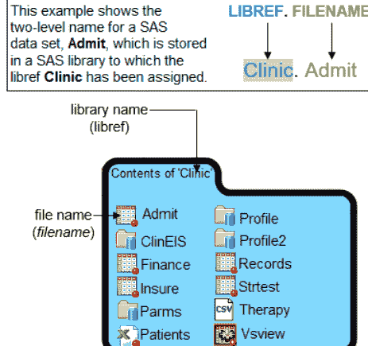

可以使用 `LIBNAME` 语句为 SAS 库分配逻辑名称（libref）。你可以将 `LIBNAME` 语句包含在任何 SAS 程序中，这样每次提交程序时 SAS 库都会被分配。使用用户界面，可以设置 `LIBNAME` 语句在 SAS 启动时自动分配。

### SAS 库 29

- libref 长度为 1 到 8 个字符，仅以字母、数字或下划线开头。
- engine 是你的操作系统环境中支持的库引擎名称。

  注意：对于 SAS89，默认引擎是 V9，它可以在所有操作系统环境中运行。

- SAS-data-library 是存储 SAS 数据文件的 SAS 库的名称。库的物理名称规范随操作系统环境的不同而异。

下表给出了各种操作系统环境下 SAS 库的物理名称示例。

### 表 3.1 SAS 库的示例物理名称

| 环境 | 示例物理名称 |
|---|---|
| Windows | `c:\fitness\data` |
| UNIX | `/users/april/fitness/sasdata` |
| z(OS) | `april.fitness.sasdata` |

> 你可以使用多个 `LIBNAME` 语句来分配所需的任意数量的 librefs。

## 验证库引用名

分配 libref 后，检查日志（log）以验证 libref 是否成功是一个好习惯。

### 日志 3.1 Clinic Libref 的输出

```text
libname medical 'C:\users\johnsmith\medical';
NOTE: Libref MEDICAL was successfully assigned as follows:
Engine: V9
Physical Name: C:\users\johnsmith\medical
```

## Librefs 的有效持续时间

`LIBNAME` 语句是全局的，这意味着 librefs 在被更改或取消之前，或者在 SAS 会话结束之前保持有效。

默认情况下，`LIBNAME` 语句仅为当前 SAS 会话分配 libref。每次开始 SAS 会话时，你必须为每个包含你想在该会话中访问的文件的永久 SAS 库分配 libref。（记住 `Work` 是临时 SAS 库的默认 libref。）

## 第 3 章 设置你的 SAS 会话

## 指定两级名称

在分配 libref 之后，你将其指定为 SAS 文件两级名称中的第一个元素。

为了让 PRINT 过程读取 `clinic.admit`，你如下所示指定该文件的两级名称：

```sas
proc data=clinic.admit;
run;
```

## 引用第三方数据

你可以使用 `LIBNAME` 语句不仅引用 SAS 文件，还可以引用使用其他软件产品（如数据库管理系统）创建的文件。

SAS 引擎是 SAS 用于读写 SAS 库中文件的一组内部指令。SAS 能够通过使用适用于该类型的相应引擎来读取或写入这些文件。对于某些文件类型，你需要告诉 SAS 使用哪种引擎。对于其他类型，SAS 会自动选择合适的引擎。

## 访问存储的数据

如果你的机构许可了 SAS/ACCESS 软件，你就可以访问存储在数据库管理系统（DBMS）中的数据。你能够访问的数据类型取决于你的操作系统环境以及你许可了哪些 SAS/ACCESS 产品。有关 SAS/ACCESS 引擎的更多信息，请参见 DBMS 的 SAS 文档。

## 访问 BMDP、OSIRIS 和 SPSS 文件

接口库支持对 BMDP、OSIRIS 和 SPSS 文件进行只读访问。使用这些引擎，与 libref 关联的物理文件名实际是文件名，而不是 SAS 库名。

### 表 3.2 引擎及其描述

| 引擎 | 描述 |
|---|---|
| BMDP | 允许只读 BMDP 文件 |
| OSIRIS | 允许只读 OSIRIS 文件 |
| SPSS | 允许只读 SPSS 文件 |

例如，下面的 `LIBNAME` 语句指定了 Windows 环境下文件 `G:\Myspss.spss` 的 libref `Rptdata` 和引擎 `SPSS`。

```sas
libname rptdata spss 'g:\myspss.spss';
```

有关接口库引擎的更多信息，请参见你操作系统的 SAS 文档。

## 查看 SAS 库

### 查看库

除了通过 librefs 访问库详情外，你还可以查看 SAS 窗口环境中的库和菜单。你可以在 `http://video.sas.com/` 访问窗口和 SAS Studio 的简概述。从 Categories 中选择 Enterprise Guide，从 Programming 中选择 How To Tutorials ⇒ Programming。选择适用于你的 SAS 环境的视频。SAS 网站提供其他教程。

### 使用 `PROC CONTENTS` 查看库

你可以使用 CONTENTS 过程创建 SAS 输出，描述以下内容：

- 库的内容
- 单个 SAS 数据集的描述符信息

语法，`PROC CONTENTS DATA`：

```sas
PROC CONTENTS DATA=$SAS-file-specification NODS;
RUN;
```

- `$SAS-file-specification` 指定一个库或库内某个特定的 SAS 数据集。
- `$SAS-file-specification` 可以采取以下形式之一：
  - `<libref>$SAS-data-set names` 指定一个要处理的 SAS 数据集。
  - `<libref>_ALL_` 请求列出库中的所有文件。（使用 `.` 在 libref 后附加 `_ALL_`。）
  - `NODS` 在指定 `_ALL_` 时提供关于每个文件的详细信息的打印（只有在指定 `_ALL_` 时才能指定 `NODS`）。

### 示例：`PROC CONTENTS` 输出

要查看整个 clinic 库的内容，你可以提交以下 `PROC CONTENTS` 步骤：

```sas
proc contents data=medical._all_ nodes;
run;
```

该步骤的输出仅列出 Medical 库中 SAS 文件的名称、类型、大小和修改日期。

## SAS 系统

### CONTENTS 过程

| 目录 | |
|---|---|
| Libref | MEDICAL |
| Engine | V9 |
| Physical Name | `C:/Users/medical` |
| Filename | `C:/Users/medical` |
| Owner Name | Users |
| File Size | 20KB |
| File Size (bytes) | 20480 |

| 名称 | 成员类型 | 文件大小 | 最后修改 |
|---|---|---|---|
| 1 AHLID | DATA | 128KB | 11/15/2015 12:38:59 |
| 2 ANAEROB | DATA | 128KB | 11/15/2015 12:38:59 |
| 3 ARRESTS | DATA | 128KB | 11/15/2015 12:38:59 |
| 4 BABIES | DATA | 9KB | 11/15/2015 12:38:59 |
| 5 BAITING | DATA | 128KB | 11/15/2015 12:38:59 |
| 6 BLADDER | DATA | 128KB | 11/15/2015 12:38:59 |
| 7 CACERIX | DATA | 128KB | 11/15/2015 12:38:59 |
| 8 CANCER | DATA | 9KB | 11/15/2015 12:38:59 |
| 9 CASTOM | DATA | 5KB | 11/15/2015 12:38:59 |
| 10 CA LUNG | DATA | 128KB | 11/15/2015 12:38:59 |
| 11 CHD | DATA | 128KB | 11/15/2015 12:38:59 |
| 12 CHLES | DATA | 5KB | 11/15/2015 12:38:59 |
| 13 CLOUD | DATA | 128KB | 11/15/2015 12:38:59 |
| 14 CRASH | DATA | 5KB | 11/15/2015 12:38:59 |
| 15 DEPRESSION | DATA | 128KB | 11/15/2015 12:38:59 |
| 16 DIET | DATA | 5KB | 11/15/2015 12:38:59 |

要查看 `medical.Lessions` 数据的描述符，你可以提交以下 `PROC CONTENTS` 步骤，列出 `medical.Lessions` 的信息，包括数据集中变量的字母列表。

```sas
proc data=medical.lesions;
run;
```

| 数据集名称 | | 观测值 |
|---|---|---|
| MEDICAL LESIONS | | 27 |
| 成员类型 | DATA 变量 | 3 |
| 引擎 | V9 索引 | 0 |
| 创建 | 12/10/2014 16:12:20 观测值长度 | 32 |
| 最后修改 | 12/10/2014 16:12:20 已删除的观测值 | 0 |
| 保护 | | 压缩 | NO |
| 数据集类型 | | 排序 | NO |
| 标签 | | |
| 数据表示 | WINDOWS_64 | |
| 编码 | latin1 Western (Windows) | |

### 图 3.4 `PROC CONTENTS` 输出：引擎/主机相关信息

| 引擎/主机相关信息 |
|---|
| 数据集大小页 | 65536 |
| 数据集页数 | 1 |
| 第一数据页 | 1 |
| 每页最大观测值 | 2039 |
| 第一数据页中的观测值 | 27 |
| 数据集修复次数 | 0 |
| 扩展计数器 | YES |
| 文件名 | `c:\users\medical\lesions.sas7bat` |
| 发布版本 | 9.0401M2 |
| 主机创建 | X64_7PRO |
| 所有者名称 | user |
| 文件大小 | 128KB |
| 文件大小（字节） | 131072 |

### 图 3.5 `PROC CONTENTS` 输出：变量字母顺序列表

| 变量 | 类型 | 长度 |
|---|---|---|
| 3 n | Num | 8 |
| 1 region | Char | 8 |
| 2 site | Char | 16 |

## 使用 `PROC DATASETS` 查看库

除了 `PROC CONTENTS` 之外，你还可以使用 `PROC DATASETS` 查看 SAS 库或数据集的内容。`PROC DATASETS` 还允许你执行许多管理任务，如复制、删除或修改 SAS 文件。

`PROC CONTENTS` 和 `PROC DATASETS` 在功能上有所重叠。通常情况下，以下两者是相同的：

- CONTENTS 过程（the procedure）
- DATASETS 过程中的 CONTENTS 语句

```sas
PROC CONTENTS<options>;
PROC DATASETS<options>;
RUN;
QUIT;
```

以下是 CONTENTS 过程与 `PROC DATASETS` 中 CONTENTS 语句的主要区别：

- `DATA=` 选项中 libref 的默认值。对于 `PROC CONTENTS`，取决于你的 SAS 解决方案或环境，默认值为 Work 或 User。对于 CONTENTS 语句，默认值为过程输入库的 libref。

注意：`PROC DATASETS` 支持运行-组处理（RUN-group processing）。它使用 `QUIT` 语句结束过程。

然而，`PROC CONTENTS` 语句的选项与 DATASETS 过程中的 CONTENTS 语句选项是相同的。例如，以下 PROC 步骤会产生本质相同的输出（仅有微小的格式差异）：

```sas
proc datasets;
contents data=medical._all_nodes;

proc contents data=medical._all_nodes;
run;
```

### 图 3.6 `PROC DATASETS` 输出：目录信息

| | WORK |
|---|---|
| Libref 引擎 | V9 |
| 物理名称 | `C:\Users\AppData\Local\Temp\SAS Temporary Files\TD6364_DTC0949` |
| 文件名 | `C:\Users\AppData\Local\Temp\SAS Temporary Files\TD6364_DTC0949` |
| 所有者名称 | Users |
| 文件大小（字节） | 4096 |

## SAS 系统

### DATASETS 过程

| | MEDICAL |
|---|---|
| Libref 引擎 | V9 |
| 物理名称 | `C:\Users\medical` |
| 文件名 | `C:\Users\medical` |
| 所有者名称 | Users |
| 文件大小 | 20KB |
| 文件大小（字节） | 20480 |

### 图 3.7 `PROC DATASETS` 输出：库成员（部分输出）

| # | 名称 | 成员类型 | 文件大小 | 最后修改时间 |
|---|---|---|---|---|
| 1 | AHLID | DATA | 128KB | 11/15/2015 12:38:59 |
| 2 | ANAEROB | DATA | 9KB | 12/02/2014 17:13:50 |
| 3 | ARRESTS | DATA | 128KB | 12/02/2014 07:46:58 |
| 4 | BARIES | DATA | 9KB | 09/10/2007 06:53:14 |
| 5 | BAITING | DATA | 128KB | 11/22/2014 06:43:39 |
| 6 | BLADDER | DATA | 128KB | 03/27/2015 05:07:34 |


| 7 | CACERVIC | DATA | 128KB | 12/01/2014 17:07:48 |
| 8 | CANCEES | DATA | 5KB | 01/15/2007 18:56:16 |
| 9 | CASTOMACH | DATA | 5KB | 11/30/2006 18:11:40 |
| 10 | CA_LANG | DATA | 128KB | 12/01/2014 17:29:55 |
| 11 | CHD | DATA | 128KB | 11/15/2015 12:55:26 |
| 12 | CHOLES | DATA | 5KB | 01/11/2007 18:42:12 |
| 13 | CLOUD | DATA | 128KB | 02/13/2015 09:47:18 |
| 14 | CRASH | DATA | 5KB | 01/15/2007 18:51:56 |
| 15 | DEPRESSIONIQ | DATA | 128KB | 12/07/2014 11:54:20 |
| 16 | DIET | DATA | 5KB | 01/11/2007 18:44:00 |

## 图 3.8 `PROC CONTENTS` 输出：目录信息

| 目录 | |
|---|---|
| Libref | MEDICAL |
| 引擎 | V9 |
| 物理名称 | `C:\Users\medical` |
| 文件名 | `C:\Users\medical` |
| 所有者名称 | Users |
| 文件大小 | 20KB |
| 文件大小（字节） | 20480 |

## 图 3.9 `PROC CONTENTS` 输出：库成员（部分输出）

| # | 名称 | 成员类型 | 文件大小 | 最后修改时间 |
|---|---|---|---|---|
| 1 | AHLID | DATA | 128KB | 11/15/2012 12:38:59 |
| 2 | ANAEROB | DATA | 9KB | 12/02/2014 17:13:50 |
| 3 | ARRESTS | DATA | 128KB | 11/22/2014 07:40:58 |
| 4 | BABIES | DATA | 9KB | 01/09/2007 06:31:34 |
| 5 | BAITING | DATA | 128KB | 11/22/2014 06:43:39 |
| 6 | BLADDER | DATA | 128KB | 03/27/2015 05:07:34 |
| 7 | CACERVOX | DATA | 128KB | 12/02/2014 17:07:48 |
| 8 | CANCER | DATA | 5KB | 01/15/2007 18:56:16 |
| 9 | GASTOM | DATA | 5KB | 11/30/2006 18:11:40 |
| 10 | CU_LANG | DATA | 128KB | 12/01/2014 17:29:55 |
| 11 | CHD | DATA | 128KB | 11/15/2015 12:55:26 |
| 12 | CHLES | DATA | 5KB | 01/11/2007 18:42:12 |
| 13 | CLOUD | DATA | 128KB | 02/13/2015 09:47:18 |
| 14 | CRASH | DATA | 5KB | 01/15/2007 18:56:16 |
| 15 | DEPRESSIONIQ | DATA | 128KB | 12/07/2014 11:54:20 |
| 16 | DIET | DATA | 5KB | 01/11/2007 18:44:00 |

## 图 3.8 `PROC CONTENTS` 输出：目录信息

`PROC CONTENTS` 的默认值...

# 第 3 章 • 设置您的 SAS 会话

**图 3.13** 显示 HTML 输出的内部浏览器。

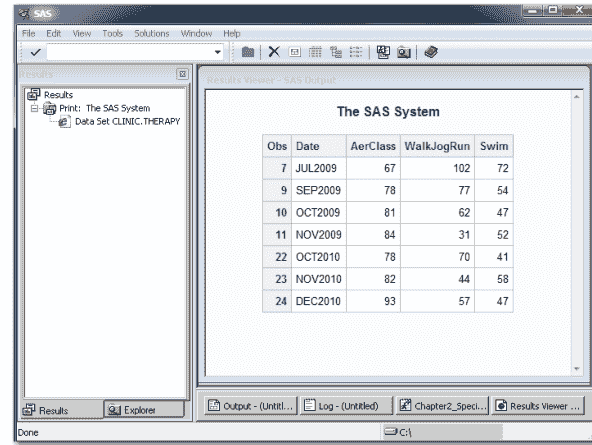

- 首选网络浏览器。如果选择此选项，SAS 将使用“首选项”（Preferences）窗口中“Web”选项卡中指定的浏览器。这是您 PC 的默认浏览器。

**图 3.14** SAS 提供的 Internet Explorer 首选网络浏览器。

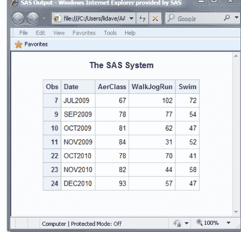

## SAS Enterprise Guide

使用“选项”（Options）窗口设置您偏好的结果格式或格式。您的选项将被保存，直到您对其进行修改，并且它们适用于您创建的所有输出。

要在桌面操作系统环境中打开此窗口，选择**工具 (Tools) ⇒ 选项 (Options)**。然后选择**结果 (Results) ⇒ 通用 (General)** 选项卡。选择**SAS 报告 (SAS Report)**、`HTML`、`PDF`、`RTF`、**文本输出 (Text output)、PowerPoint** 或 **Excel**。您还可以指定显示和存储结果的选项。

从下拉列表中提供的默认输出选项包括 **HTML、SAS 报告**或 **PDF**。

## 指定结果格式

> **提示** 根据您的操作系统环境，“结果”（Results）选项卡的选项可能会有所不同。下面的示例来自 Windows 操作系统环境。

下面的显示了指定了新默认设置的 SAS 结果通用选项卡。

**图 3.15** 具有新默认设置的 SAS 结果通用选项卡。

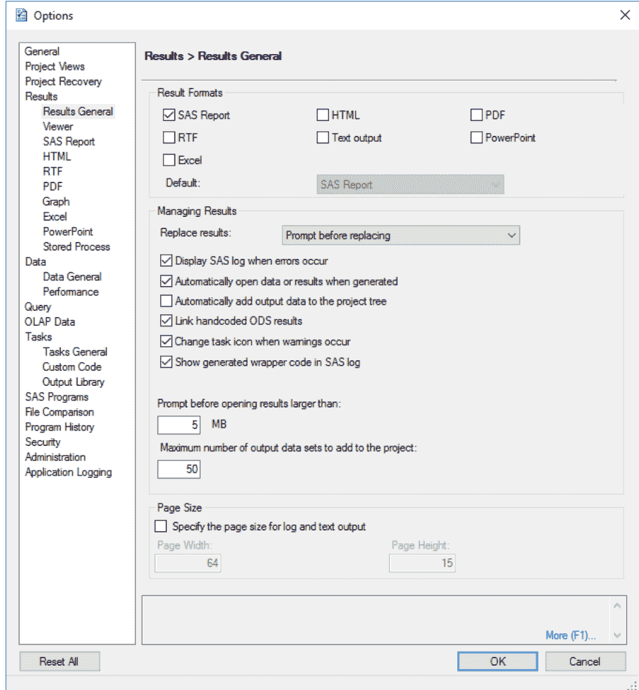

**通用 (Results General)** 选项卡上的默认设置如下：

- 勾选了 SAS 报告 (SAS Report)。
- 从下拉菜单选择了“替换前提示”（Prompt before replacing）。
- 勾选了“发生错误时显示 SAS 日志”（Display SAS log when errors occur）。

# 第 3 章 • 设置您的 SAS 会话

- 勾选了“生成时自动输出数据或结果”（Automatically output data or results when generated）。
- 未勾选“自动将数据输出到项目树”（automatically output data to the project tree）。
- 勾选了“链接硬编码的 ODS 结果”（Link handcoded ODS results）。
- 勾选了“发生警告时更改图标”（Change icon when warnings occur）。
- 勾选了“SAS 日志中生成的封装代码”（the generated wrapper code in SAS log）。
- 在“打开结果前的提示”（prompt before opening results）字段中的值大于 5。
- “要添加到项目的最大输出数据集数量”字段中的值为 50。

## SAS Studio 和 SAS University Edition

使用“首选项”（Preferences）窗口设置您偏好的结果格式或格式。您的选项将被保存，直到您对其进行修改，并且它们适用于您创建的所有输出。

要在桌面环境中环境中窗口，点击并选择“首选项”（Preferences）。选择“结果”（Results）选项卡。指定 `HTML`、`PDF` 或 `RTF`。您还可以指定显示和存储结果的选项。

> 提示 根据您的操作系统环境，“结果”（Results）选项卡可能会有所不同。下面的元素来自 Windows 操作系统环境。

下面的显示了指定了新默认设置的 SAS 结果选项卡。

**图 3.16** 具有新默认设置的 SAS 结果选项卡。

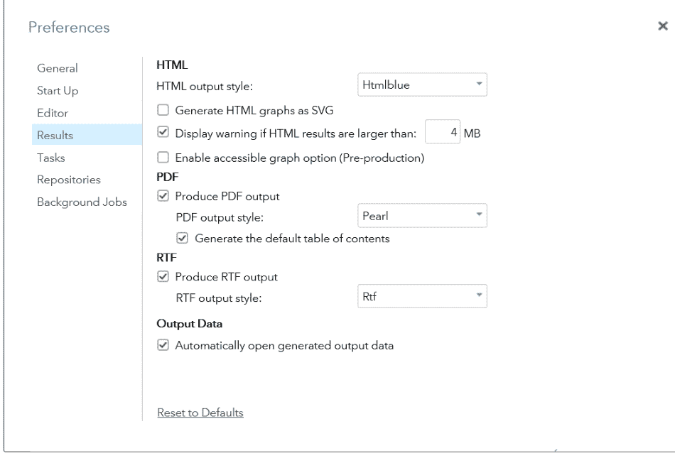

结果（Results）选项卡上的默认设置如下：

- 勾选了“当 HTML 结果大于：4MB 时显示警告”框。
- 勾选了“产生 PDF 输出”（Produce PDF output）。
- 勾选了“生成默认目录”（Generate the default table of contents）。
- 勾选了“产生 RTF 输出”（Produce RTF output）。
- 勾选了“自动打开生成的输出数据”（Automatically open generated output data）。

## 设置系统选项

### 系统选项的基础

注意：以下选项不会影响 HTML 输出的外观。HTML 是输出的推荐设置方法。

系统选项是指令，从指定选项开始直到更改为止，它们会影响整个 SAS 程序或 SAS 会话的处理。如果您将过程输出创建为 `LISTING` 输出，您还可以通过这些系统选项控制输出的外观：

- 行大小（日志和输出的最大宽度）
- 页面大小（每页打印输出的行数）
- 页码的显示
- 日期时间和显示

所有 SAS 系统都有默认设置，除非您另有指定。例如，`LISTING` 输出会自动显示页码（除非您的站点修改了此默认设置）。

**图 3.17** `LISTING` 输出默认设置。

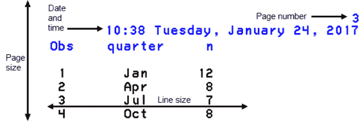

### 修改系统选项

要修改 `LISTING` 输出中的系统选项，您需要提交一个 `OPTIONS` 语句。您可以将 `OPTIONS` 语句放置在 SAS 程序的任何位置，以从该点开始更改设置。但是，良好的编程习惯是将 `OPTIONS` 语句放置在 `DATA` 或 `PROC` 步骤之外，这样您的程序更易于阅读和调试。

由于 `OPTIONS` 语句是全局的，设置将一直有效，直到更改或取消，或者直到 SAS 会话结束。

语法，`OPTIONS` 语句：

```sas
OPTIONS options;
```

`options` 指定了要更改的一个或多个系统选项。可用的系统选项取决于您的主机操作系统。

## 打印结果的选项

这里是一些影响 `LISTING` 输出外观的系统选项。

**表 3.3** 选择的系统选项及其描述。

| 选项 | 互斥选项 | 描述 |
|---|---|---|
| `CENTER` | `NOCENTER` | 控制输出是居中还是左对齐。默认值是 `CENTER`。 |
| `DATE` | `NODATE` | 控制今天的日期是否出现在输出的每页顶部。默认值是 `DATE`。 |
| `NUMBER` | `NONNUMBER` | 控制每页 SAS 输出上是否出现页码。默认值是 `NUMBER`。 |
| `ORIENTATION=orientation` | | 指定打印输出的方向，横向（`LANDSCAPE`）或纵向（`PORTRAIT`）。默认值是 `PORTRAIT`。 |
| `PAGENO=n` | | 从 `n` 开始为输出页进行编号。默认值是 1。 |
| `RIGHTMARGIN=n` | | 指定用于打印输出的边距大小（例如 `0.75in` 或 `2cm`）。默认值是 `0.00in`。 |
| `LEFTMARGIN=n` | | |
| `TOPMARGIN=n` | | |
| `BOTTOMMARGIN=n` | | |

## 处理两位数年份

如果您在数据行、外部文件或编程语句中使用两位数年份值，您应该考虑另一个重要的系统选项，`YEARCUTOFF=option`。此选项指定了使用哪个 100 年跨度来解释两位数。

## 图 3.18 SAS 中默认的 100 年跨度

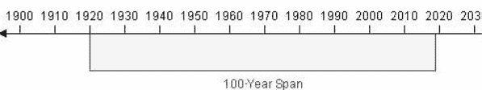

所有版本的 SAS 都能正确表示从公元 1582 年到公元 20000 年的日期（会自动进行闰年、世纪和第四世纪调整）。忽略闰秒，且 SAS 不调整夏令时间。您的 SAS 会告知您读取不同时区的日期、时间和日期和时间值。然而，您应该注意 `YEARCUTOFF=` 以指定使用哪个 100 年跨度来解释两位数。

由于 `OPTIONS` 语句是全局的，设置将一直有效，直到更改或取消，或者直到 SAS 会话结束。

语法，`OPTIONS` 语句：

```sas
OPTIONS options;
```

`options` 指定了要更改的一个或多个系统选项。可用的系统选项取决于您的主机操作系统。

## 打印结果的选项

这里是一些影响 `LISTING` 输出外观的系统选项。

**表 3.3** 选择的系统选项及其描述。

| 选项 | 互斥选项 | 描述 |
|---|---|---|
| `CENTER` | `NOCENTER` | 控制输出是居中还是左对齐。默认值是 `CENTER`。 |
| `DATE` | `NODATE` | 控制今天的日期是否出现在输出的每页顶部。默认值是 `DATE`。 |
| `NUMBER` | `NONNUMBER` | 控制每页 SAS 输出上是否出现页码。默认值是 `NUMBER`。 |
| `ORIENTATION=orientation` | | 指定打印输出的方向，横向（`LANDSCAPE`）或纵向（`PORTRAIT`）。默认值是 `PORTRAIT`。 |
| `PAGENO=n` | | 从 `n` 开始为输出页进行编号。默认值是 1。 |
| `RIGHTMARGIN=n` | | 指定用于打印输出的边距大小（例如 `0.75in` 或 `2cm`）。默认值是 `0.00in`。 |
| `LEFTMARGIN=n` | | |
| `TOPMARGIN=n` | | |
| `BOTTOMMARGIN=n` | | |

## 处理两位数年份

如果您在数据行、外部文件或编程语句中使用两位数年份值，您应该考虑另一个重要的系统选项，`YEARCUTOFF=option`。此选项指定了使用哪个 100 年跨度来解释两位数。

## 图 3.18 SAS 中默认的 100 年跨度


所有版本的 SAS 都能正确表示从公元 1582 年到公元 20000 年的日期（会自动进行闰年、世纪和第四世纪调整）。忽略闰秒，且 SAS 不调整夏令时间。您的 SAS 会告知您读取不同时区的日期、时间和日期和时间值。然而，您应该注意 `YEARCUTOFF=` 以指定使用哪个 100 年跨度来解释两位数。

由于 `OPTIONS` 语句是全局的，设置将一直有效，直到更改或取消，或者直到 SAS 会话结束。

语法，`OPTIONS` 语句：

```sas
OPTIONS options;
```

`options` 指定了要更改的一个或多个系统选项。可用的系统选项取决于您的主机操作系统。

## 打印结果的选项

这里是一些影响 `LISTING` 输出外观的系统选项。

**表 3.3** 选择的系统选项及其描述。

| 选项 | 互斥选项 | 描述 |
|---|---|---|
| `CENTER` | `NOCENTER` | 控制输出是居中还是左对齐。默认值是 `CENTER`。 |
| `DATE` | `NODATE` | 控制今天的日期是否出现在输出的每页顶部。默认值是 `DATE`。 |
| `NUMBER` | `NONNUMBER` | 控制每页 SAS 输出上是否出现页码。默认值是 `NUMBER`。 |
| `ORIENTATION=orientation` | | 指定打印输出的方向，横向（`LANDSCAPE`）或纵向（`PORTRAIT`）。默认值是 `PORTRAIT`。 |
| `PAGENO=n` | | 从 `n` 开始为输出页进行编号。默认值是 1。 |
| `RIGHTMARGIN=n` | | 指定用于打印输出的边距大小（例如 `0.75in` 或 `2cm`）。默认值是 `0.00in`。 |
| `LEFTMARGIN=n` | | |
| `TOPMARGIN=n` | | |
| `BOTTOMMARGIN=n` | | |

*（注：由于原始文本中存在大量重复内容，已按要求完整翻译）*

## 示例：`FIRSTSTOBS=` 和 `OBS=` 选项

数据集 `clinic.heart` 包含 20 个观测值。如果你指定 `FIRSTSTOBS=10`，SAS 将首先读取数据集的第 10 个观测值，并读取到最后一个观测值（共 11 个观测值）。

```sas
options firstobs=10;
proc print data=clinic.heart;
run;
```

以下是输出：

**图 3.21** 使用 `FIRSTSTOBS=10` 的 `PROC` 输出。

| Obs | Patient | Sex | Survive | Shock | Arterial | Heart | Cardiac | Urinary |
|---|---|---|---|---|---|---|---|---|
| 10 | 509 | 2 | SURV | | | 79 | 84 | 256 | 90 |
| 11 | 742 | 1 | DIED | HYPOVOL | | 100 | 54 | 135 | 0 |
| 12 | 609 | 2 | DIED | NONSHOCK | | 93 | 101 | 260 | 50 |
| 13 | 318 | 2 | DIED | | 72 | 81 | 410 | 405 |
| 14 | 412 | 1 | SURV | | 61 | 87 | 296 | 44 |
| 15 | 661 | 1 | DIED | | 84 | 101 | 377 | |
| 16 | 402 | 1 | SURV | | 88 | | 132 | 75 |
| 17 | 98 | 2 | SURV | | 84 | 87 | 260 | |
| 18 | 4 | 1 | SURV | HYPOVOL | | 81 | 149 | 206 | 200 |
| 19 | 50 | 2 | SURV | | 72 | 111 | 332 | 12 |
| 20 | 2 | DIED | | | 101 | 114 | 424 | 97 |

如果你指定 `OBS=10`，SAS 将读取到第 10 个观测值。在这种情况下，总共读取 10 个观测值。注意，`FIRSTSTOBS=` 已重置为默认值。

```sas
options firstobs=1;
proc print data=clinic.heart;
run;
```

以下是输出：

**图 3.22** 使用 `FIRSTSTOBS=1` 和 `OBS=10` 的 `PROC` 输出。


| Obs | Patient | Sex | Survive | Shock | Arterial | Heart | Cardiac | Urinary |
|---|---|---|---|---|---|---|---|---|
| 1 | 203 | 1 | SURV | NONSHOCK |  | 88 | 95 | 66 | 110 |
| 2 | 54 | 1 | DIED | HYPOVOL |  | 83 | 183 | 95 | 0 |
| 3 | 664 | 2 | SURV | CARDIO |  | 72 | 111 | 332 | 12 |
| 4 | 210 | 2 | DIED | BACTER |  | 74 | 97 | 369 |  |
| 5 | 101 | 2 | DIED | HERNI |  | 80 | 230 | 0 |  |
| 6 | 102 | 2 | SURV | OTHER |  | 87 | 107 | 41 | 65 |
| 7 | 529 | 1 | DIED | CARDIO |  | 103 | 106 | 217 | 15 |
| 8 | 824 | 2 | DIED | CARDIO |  | 145 | 99 | 156 | 10 |
| 9 | 926 | 1 | SURV |  | 68 | 77 | 410 | 75 |
| 10 | 509 | 2 | SURV | OTHER |  | 79 | 84 | 256 | 90 |

结合`FIRSTSTOBS=`和`OBS=`可以处理数据集中间的观测值。例如，以下程序仅处理第 10 到 15 个观测值，总共 6 个观测值：

```
options firstobs=10 obs=15;
```

若仅针对此程序指定`FIRSTOBS=`或`OBS=`，你可以完全省略`OPTIONS`语句并使用数据集选项。

## SAS 系统选项窗口

注意：Enterprise Guide 或 SAS Studio 中没有 SAS 系统选项窗口。请使用`OPTIONS`语句更改系统选项。你也可以通过 SAS 系统选项窗口设置系统选项。更改后的选项会在 SAS 会话结束时重置为默认值。

要查看 SAS 窗口，请选择 Tools（工具）-> Options（选项）-> System（系统）。

图 2.24 SAS 系统选项窗口

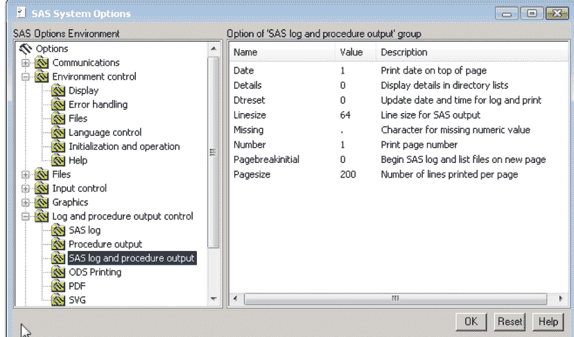

## 修改选项

要更改选项：

1. 展开 SAS Options Environment 下的组和子组，直到找到你想更改的选项。子组中的选项列在窗口的右侧面板。
2. 点击你想更改的选项名称，会弹出一个窗口。
   - 修改值。
   - 设置为默认值。

## 查找选项

在 SAS 选项窗口中快速查找选项：

1. 将光标悬停在选项名称上，会弹出菜单。

## 章节测试

为每个问题选择最佳答案。请在附录中检查你的答案。

1. 你如何创建 HTML 输出？
   - a. 通过使用系统选项
   - b. 通过编程
   - c. 通过格式化
   - d. 无法创建

2. 如果设置了`YEARCUTOFF=`，使用什么时间跨度来解释两位年份？
   - a. 1947 年到 1954 年之间
   - b. 1955 年或更高
   - c. 1946 年或更高
   - d. 任何值

3. 假设你使用的是 SAS 代码而不是窗口，以下哪个语句是错误的？
   - a. Librefs（库引用）可以跨会话持续。
   - b. 当你删除 libref 时，SAS 不再能访问库中的文件。
   - c. 提交程序时，Librefs 会自动删除。
   - d. 你可以访问使用其他软件的文件。

4. 哪个语句呈现了所有文件的摘要？
   - a. `proc print data=clinic;`
   - b. `proc contents data=clinic;`
   - c. `proc freq data=clinic;`
   - d. `proc sort data=clinic;`

5. 下列哪项正确引用了名为 clinic 的数据集？
   - a. `data.clinic;`
   - b. `clinic.data;`
   - c. `clinic(data);`
   - d. `clinic_data`

6. 使用什么时间跨度来解释两位年份值？
   - a. 1949-1950
   - b. 1950
   - c. 1950-200

7. 以下语句执行了什么？

`libname spss 'c:\myfiles\data.sas';`

- a. 使用 OSIRIS 引擎定义名为 Spss 的库
- b. 定义了名为 Osiris 和 Spss 的两个库
- c. 使用 OSIRIS 和 SPSS 引擎定义默认库

# 第 4 章 · 识别与修正错误

重复该过程。语法错误（例如关键字拼写错误）通常会阻止 SAS 执行发生错误的步骤。

当程序执行完毕后，注释将写入日志（Log）窗口。当提交一个包含错误的程序时，日志窗口中会出现有关错误的消息。以下是 SAS 的处理方式：

- 显示 ERROR 单词
- 识别可能的错误位置
- 给出错误解释

## 示例：语法错误消息

在下面的程序中，DATA 步将 SAS 数据集 Clinic.Admit 复制到名为 Clinic.Admite 的新数据集中。PROC 步打印新数据集中变量 ID、Name、Actlevel 和 Fee 的值。然而，在`PROC PRINT`语句中，SAS 关键字`print`拼写错误。

```sas
data sasuser.admitfee;
  set sasuser.admit;

run;
proc print data=sasuser.admitfee;
  var id name actlevel fee;
run;
```

提交程序时，日志窗口中的消息显示未找到过程 PRIN，且 SAS 因为错误停止了处理 PROC 步。由于第二个步骤执行失败，PRINT 过程没有产生输出。

图 4.1 显示错误消息的日志窗口

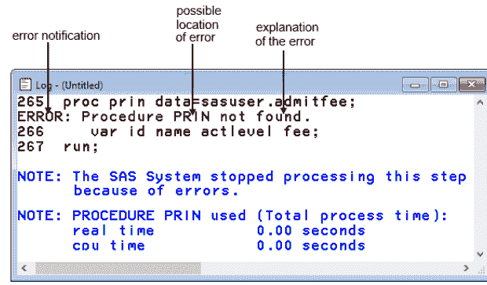

错误：当你在结果窗口中查看结果时，语句或数据中的错误可能并不明显。每次提交 SAS 程序时，请检查日志窗口中的消息。

除了修正拼写错误外，你可能还需要解决其他常见的语法错误，例如：

- 缺少`RUN`语句
- 缺少分号
- 引号不平衡

你可能还需要修正此类语义错误，例如：

- 无效选项

## 修正常见错误

### 错误修正的基础

要修正程序中的错误，请在代码编辑窗口中进行编辑。对于简单错误（例如此处的拼写错误），可以直接覆盖错误文本、删除或插入文本。

```sas
data sasuser.admite;
set sasuser.admin;
run;
proc print data=sasuser.admite;
var id name actlevel fee;
run;
```

在下述 proc 中，在`PROC PRINT`语句中指定的 SAS 关键字插入了缺失的字母 r。

图 4.2 修正后的程序

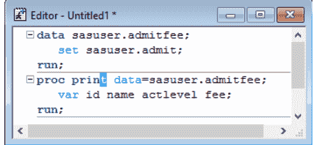

### 重新提交修改后的程序

修正程序后，你可以重新提交。如果你在 SAS 窗口环境中工作，最好在重新提交程序之前清除日志窗口中的消息，这样你就不会将旧的错误消息与新消息混淆。

## 图 4.3 正确的 PROC PRINT 输出

| Obs | ID | Name | ActLevel | Fee |
|---|---|---|---|---|
| 1 | 2458 | Murray, W | HIGH | 85.20 |
| 2 | 2462 | Almers, C | HIGH | 124.80 |
| 3 | 2501 | Bonaventure, T | LOW | 149.75 |
| 4 | 2523 | Johnson, R | MOD | 149.75 |
| 5 | 2539 | LaMacance, K | LOW | 124.80 |
| 6 | 2544 | Jones, M | HIGH | 124.80 |
| 7 | 2552 | Reberson, P | MOD | 149.75 |
| 8 | 2555 | King, E | MOD | 149.75 |
| 9 | 2563 | Pitts, D | LOW | 124.80 |
| 10 | 2568 | Eberhardt, S | LOW | 124.80 |
| 11 | 2571 | Nunnelly, A | HIGH | 149.75 |
| 12 | 2572 | Oberon, M | LOW | 85.20 |
| 13 | 2574 | Peterson, V | MOD | 149.75 |
| 14 | 2575 | Quigley, M | HIGH | 124.80 |
| 15 | 2578 | Cameron, L | MOD | 124.80 |
| 16 | 2579 | Underwood, K | LOW | 149.75 |
| 17 | 2584 | Takashi, Y | MOD | 124.80 |
| 18 | 2588 | Derber, B | HIGH | 85.20 |
| 19 | 2590 | Ivan, H | LOW | 85.20 |
| 20 | 2592 | Wilcox, E | MOD | 149.75 |
| 21 | 2595 | Warren, C | MOD | 149.75 |


**错误**：当你在结果窗口中查看结果时，语句或数据中的错误可能并不明显。每次提交 SAS 程序时，请检查日志窗口中的消息。

除了修正拼写错误外，你可能还需要解决其他常见的语法错误，例如：

- 缺少 `RUN` 语句
- 缺少分号
- 引号不平衡

你可能还需要修正此类语义错误，例如：

- 无效选项

## 修正常见错误

### 错误修正的基础

要修正程序中的错误，请在代码编辑窗口中进行编辑。对于简单错误（例如此处的拼写错误），可以直接覆盖错误文本、删除或插入文本。

```sas
data sasuser.admite;
set sasuser.admin;
run;
proc print data=sasuser.admite;
var id name actlevel fee;
run;
```

在下述 `proc` 中，在 `PROC PRINT` 语句中指定的 SAS 关键字插入了缺失的字母 `r`。

**图 4.2 修正后的程序**


### 重新提交修改后的程序

修正程序后，你可以重新提交它。如果你在 SAS 窗口环境中工作，最好在重新提交程序之前清除日志窗口中的消息，这样你就不会将旧的错误消息与新消息混淆。

## 图 4.3 正确的 PROC PRINT 输出

| Obs | ID | Name | ActLevel | Fee |
|---|---|---|---|---|
| 1 | 2458 | Murray, W | HIGH | 85.20 |
| 2 | 2462 | Almers, C | HIGH | 124.80 |
| 3 | 2501 | Bonaventure, T | LOW | 149.75 |
| 4 | 2523 | Johnson, R | MOD | 149.75 |
| 5 | 2539 | LaMacance, K | LOW | 124.80 |
| 6 | 2544 | Jones, M | HIGH | 124.80 |
| 7 | 2552 | Reberson, P | MOD | 149.75 |
| 8 | 2555 | King, E | MOD | 149.75 |
| 9 | 2563 | Pitts, D | LOW | 124.80 |
| 10 | 2568 | Eberhardt, S | LOW | 124.80 |
| 11 | 2571 | Nunnelly, A | HIGH | 149.75 |
| 12 | 2572 | Oberon, M | LOW | 85.20 |
| 13 | 2574 | Peterson, V | MOD | 149.75 |
| 14 | 2575 | Quigley, M | HIGH | 124.80 |
| 15 | 2578 | Cameron, L | MOD | 124.80 |
| 16 | 2579 | Underwood, K | LOW | 149.75 |
| 17 | 2584 | Takashi, Y | MOD | 124.80 |
| 18 | 2588 | Derber, B | HIGH | 85.20 |
| 19 | 2590 | Ivan, H | LOW | 85.20 |
| 20 | 2592 | Wilcox, E | MOD | 149.75 |
| 21 | 2595 | Warren, C | MOD | 149.75 |

# 修正常见错误 57

```sas
Homework=Homework*2;
AverageScore = MEAN(Score1, Score2, Score3, Homework);
if AverageScore < 70;

run;
proc print data=work.grades;
run;
```

下图列出了平均分低于 70 的学生的姓名。

**图 4.4** 修正后的程序输出

| Name | Score1 | Score2 | Score3 | Homework | AverageScore |
| --- | --- | --- | --- | --- | --- |
| LINDA | 53 | 60 | 66 | 84 | 65.75 |
| DEREK | 72 | 64 | 56 | 64 | 64.00 |

# 缺失 RUN 语句

SAS 程序中的每个步骤（step）都独立于其他所有步骤进行编译和执行。在编译步骤时，当 SAS 遇到以下错误之一时，会识别当前步骤的结束：

- `DATA` 或 `PROC` 语句，表示新步骤的开始
- 一个 `RUN` 或 `QUIT` 语句，表示当前步骤的结束

当提交程序时，`DATA` 步骤执行，而 `PROC` 步骤不执行。`PROC` 步骤执行是因为没有后续的 `DATA` 或 `PROC` 步骤来指示新步骤的开始，也没有后续的 `RUN` 语句来指示步骤的结束。

```sas
data sasuser.admitfee;
set sasuser.admit;
proc print data=sasuser.admitfee;
var id name actlefee;
```

如果你在 Enterprise Guide 或 SAS Studio 中编程，系统会在你提交的每个程序后提交 `RUN` 语句，因此上述程序将正常执行。在 SAS 窗口环境中，由于没有指示 `PROC` 步骤结束的内容，`PRINT` 过程将等待后再执行，活动窗口顶部会出现 `PROC PRINT` 正在运行的消息。

> 注意：虽然省略 `RUN` 语句在技术上不是错误，但可能会产生意想不到的结果。

# 修正错误：缺失 RUN 语句

要修正此错误，请提交 `RUN` 语句以完成 `PROC` 步骤。

```sas
run;
```

# 缺失分号

常见的错误之一是语句末尾缺少分号。这是一个示例。

```sas
data sasuser.admitfee;
set sasuser.admit;
run;
proc print data=sasuser.admitfee;
var id actlevel fee;
run;
```

当你省略分号时，SAS 会将缺少分号的语句（连同随后的语句）视为一个长语句。

# 日志 42 SAS 日志：错误消息

```
9237 data sasuser.admitfee;
9238 set sasuser.admit;
9239 run;

NOTE: There were 21 observations read from the data set SASUSER.ADMIT.
NOTE: The data set SASUSER.ADMITEE has 21 observations and 9 variables.
NOTE: data statement used (Total process time):
real time 0.00 seconds
cpu time 0.00 seconds

9240 proc print data=sasuser.admitfee;
9241 var id name actlevel fee;
      76
ERROR 22-322: Syntax error, expecting one of the following: ;, (, BLANKLINE,
CONTENTS, DATA,
      DOUBLE, GRANDTOTAL_LABEL, GRANDTOT_LABEL, GRAND_LABEL,
GTOT_LABEL, GTOT_LABEL,
      HEADING, LABEL, N, NOOBS, NOMLUMABEL, OBS, ROUND, ROWS, SPLIT,
STYLE, SUMBLABEL,
      UNIFORM, WIDTH.
ERROR 76-322: Syntax error, statement will be ignored.
9242 run
```

# 修正错误：缺失分号

1. 找到缺少分号的语句。你通常可以通过查看错误消息中带下划线的关键字并向回查找来找到它。
2. 在适当的位置添加分号。
3. 重新提交修正后的程序。
4. 再次检查日志窗口，确保没有其他错误。

# 引号不匹配

某些语法错误（例如下面程序中 `HIGH` 之后缺少引号）会导致 SAS 误解你程序中的语句。

```sas
data sasuser.admitfee;
set sasuser.admitfee;
where actlevel='HIGH;
run;
```

# 修正常见错误 59

```sas
proc print data=sasuser.admitfee;
var id name actlevel fee;
run;
```

当提交程序时，SAS 无法解析 `DATA` 步骤，活动窗口顶部会出现 `DATA` 运行消息。

**图 4.5 带有消息的 SAS 编辑窗口**

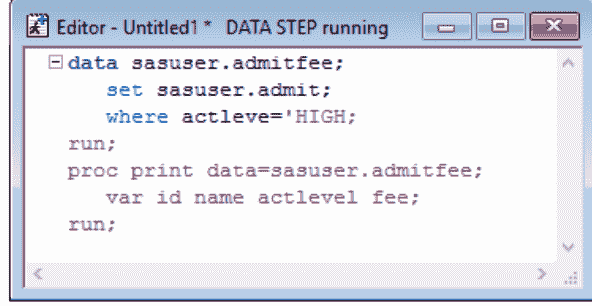

SAS Enterprise Guide 和 SAS Studio 都会最后添加一行代码来停止不匹配的引号。

有时 SAS 日志中会出现警告，指示以下内容：

- 引号字符串过长。
- 包含引号的语句（如 `TITLE` 或 `FOOTNOTE` 语句）由于无效选项或未加引号的文本而产生模糊。

当引号不匹配时，SAS 往往无法检测到语句结束引号并重新提交程序。在 Enterprise Guide 或 SAS Studio 中，只需添加匹配的引号并重新提交程序。然而，在某些环境中，这种技术通常无法修正错误。SAS 仍然认为引号是不匹配的。

因此，你需要在回回、修正并重新提交程序之前，通过取消已提交的语句（在 Windows 和 Unix 操作系统中）或提交一行 SAS 代码（在 z/OS 操作系统）来解决不匹配的引号。

如果在 SAS 窗口环境中发生此错误且未修正，那么在当前 SAS 会话中提交的后续程序都可能产生错误。

# 在 Windows 操作系统环境中修正错误

1. 按下 `Ctrl` 和 `Break` 键，或点击工具栏上的 `Break` 图标。
2. 选择 `1. Cancel Submitted Statements`（取消提交语句），然后点击 `OK`。

# 60 第 4 章 识别和修正错误

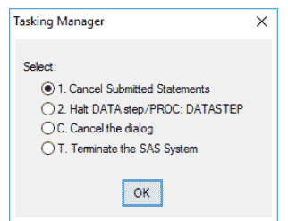

3. 选择 `Y` 取消已提交的语句，然后点击 `OK`。

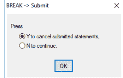

4. 修正错误并重新提交程序。

# 在 UNIX 操作系统环境中修正错误

1. 打开 `Session Management` 窗口并点击 `Interrupt`（中断）。

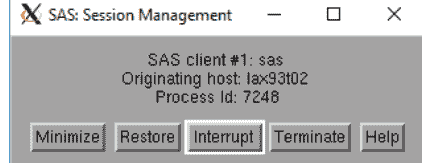

2. 选择 `1. Cancel Submitted Statements`，然后点击 `Y`。

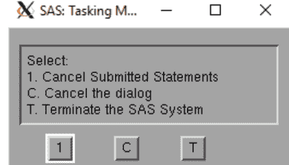

3. 修正错误并重新提交程序。

# 在 z/OS 操作系统环境中修正错误

1. 提交一个星号后跟一个单引号、一个分号和一个 `RUN` 语句。

```sas
*'; run;
```

2. 删除包含星号、单引号和 `RUN` 语句的行。
3. 在适当的位置插入缺失的引号。
4. 提交修正后的程序。

提示：你也可以在 Windows 和 UNIX 环境中使用上述方法。

# 语义错误：无效选项

当指定特定语句中无效的选项时，会发生无效选项错误。在下面的程序中，`KEYLABEL` 选项与 `PROC PRINT` 语句配合使用是无效的。

```sas
data sasuser.admitfee;
set sasuser.admit;
where weight>180 and (actlevel="MOD" or actlevel="LOW");
run;
proc print data=sasuser.admitfee keylabel;
label actlevel="Activity Level";
run;
```

当提交包含无效选项的 SAS 语句时，日志窗口会出现一条消息，指示该选项无效或未识别。

# 第 4 章 • 识别和修正错误

# 日志 4.3 SAS 日志：语法错误消息

```
9250 data sasuser.admit;
9251     set sasuser.admit;
9252     where weight>180 and (actlevel="MOD" or actlevel="LOW");
9253     run;
```

NOTE: There were 21 observations read from the data set SASUSER.ADMIT.

WHERE (weight>180) and actlevel in ('LOW', 'MOD');

NOTE: The data set SASUSER.ADMITEE has 21 observations and 9 variables.

NOTE: DATA statement used (Total process time):

real time 0.00 seconds

cpu time 0.00 seconds

```
9254 proc print data=sasuser.admitfee keylabel;

---
202

ERROR 22-322: Syntax error, expecting one of the following: ;, (, BLANKLINE,
CONTENTS, DATA,
      DOUBLE, GRADUTUAL_LABEL, GRANDTOT_LABEL, GROUP_LABEL,
GLOTAL_LABEL, STOT_LABEL, GTOT_LABEL, STOT_LABEL,
      HEADING, LABEL, N, NOOBS, NUMSLABEL, OBS, ROUND, ROWS, SPLIT,
STYLE, SUMLABEL,
      UNIFORM, WITH.
ERROR 202-322: The option or parameter is not recognized and will be ignored.
9255     label actlevel='Activity Level';
9256     run;
```

NOTE: The SAS System stopped this step because of errors.

NOTE: PROCEDURE PRINT used (Total process time):

real time 0.00 seconds

cpu time 0.01 seconds

# 修正错误：无效选项

1. 移除或替换无效选项，并根据需要检查你的语法。
2. 重新提交修正后的程序。
3. 检查日志窗口以确保没有其他错误。

## 章节测试

为每个问题选择最佳答案。使用附录中的答案对照检查你的答案。

1. 在编写和编辑 SAS 程序时，采取以下操作是好的：

a. 将 `DATA` 和 `PROC` 步骤放在第一列。

b. 在步骤内缩进语句。

c. 将 `RUN` 语句放在第一列。

d. 以上均是。

2. 假设你提交了一个包含拼写错误的 SAS 程序。你应该按照所示的顺序执行以下哪些步骤来修改并重新提交该程序？

a. 修正错误。

   - 清空日志窗口（`Log` 窗口）。

   - 重新提交程序。

   - 检查日志窗口（`Log` 窗口）。

b. 修正错误。

   - 重新提交程序。

   - 检查输出窗口（`Output` 窗口）。

   - 检查日志窗口（`Log` 窗口）。

c. 修正错误。

   - 清空日志窗口（`Log` 窗口）。

   - 重新提交程序。

   - 检查输出窗口（`Output` 窗口）。

d. 修正错误。

   - 清空输出窗口（`Output` 窗口）。

   - 重新提交程序。

   - 检查输出窗口（`Output` 窗口）。

3. 如果提交以下程序会发生什么？

```sas
proc data=sasuser.stress out=maxrates;
by maxhr;
run;
proc print data=maxrates label double noobs;
label reshr='Recovery Heart Rate;
var reshr maxhr date;
where toler='I' and reshr>90;
sum fee;
run;
```

a. 日志消息显示程序运行成功。

b. 活动窗口顶部出现 `PROC SORT` 运行消息，且日志消息可能指示某个看似有效的语句中存在错误。

c. 消息显示某个选项无效或未被识别。

d. 活动窗口顶部出现 `PRINT` 运行消息，且日志消息可能指示字符串过长或语句存在歧义。

4. 当检测到语法错误时，通常会发生什么？

a. SAS 继续处理该步骤（step）。

b. SAS 继续处理该步骤，日志窗口（`Log` 窗口）显示关于错误的消息。

c. SAS 停止处理发生错误的步骤，日志窗口（`Log` 窗口）显示关于错误的消息。

## 第 4 章 · 识别与纠正

- SAS 停止发生错误的步骤，输出窗口（`Output` 窗口）显示关于错误的消息。

- 在以下操作期间会语法错误：

- 某些数据值不适用于程序中指定的 SAS 语句。

- SAS 语句中的元素格式是正确的，但这些元素对于该用法无效。

- 程序语句不符合 SAS 语言的规则。

- 以上均不是。

- 如何判断你是否在 SAS 程序中指定了无效的选项？

- 日志消息指示某个看似有效的语句中存在错误。

- 活动窗口顶部出现 `PROC STEP running` 或 `DATA STEP running` 消息。


- 在查看程序输出之前你无法判断。

- 下列程序中哪个包含语法错误？

```sas
proc sort data=sasuser.mysales;
by region;
run;
```

```sas
dat sasuser.mysales;
set mydata.sales99;
where sales=5000;
run;
```

```sas
proc print data=sasuser.mysales label;
label region='Sales Region';
run;
```

- 以上均不是。

- 在 Windows 或 UNIX 环境中提交以下程序后，你应该做什么？

```sas
proc print data=mysales;
where state='NC';
run;
```

- 提交 RUN 语句以完成 PROC 并重新提交修正后的程序。
- 回调程序。然后添加一个引号并重新提交修正后的程序。
- 取消已提交的语句。然后调程序，添加一个引号并重新提交修正后的程序。
- 回调程序。然后替换无效选项并重新提交修正后的程序。

- 假设你提交了一个短小的 DATA 步骤。如果活动窗口显示 DATA step running 持续了很久，可能发生了什么？

- 你拼错了一个关键字。
- 你忘记用 RUN 语句结束 DATA 步骤。
- 你指定了一个无效的数据集选项。
- 某些数据值不适用于你指定的 SAS 语句。

- `PUTLOG` 语句可以帮助你解决哪些类型的错误？

  - a. 语法错误
  - b. 语义错误
  - c. 逻辑错误
  - d. 以上所有

## 第 5 章：创建列表报告

| 主题 | 页码 |
| :--- | :--- |
| 创建基础报告 | ..................................................................................... 68 |
| 选择变量 | ................................................................................................................................. . . . . . . . . . . . . . . . . 69 |
| `PROC PRINT` 步骤 | ................................................................................................................. . . . . . . . . . . . . . . . . 69 |
| 移除 `OBS` 列 | ................................................................................................................................. ................................. . . . . . . . . . . . . 70 |
| 识别观测值 | ..................................................................................................................................................................................... 70 |
| 在 `PROC PRINT` 中使用 `ID` 语句 | ................................................................................................................................. . . . . . . . . 70 |
| 示例：`ID` 语句和 `VAR` 语句 | ................................................................................................................................. . . . . . . . 71 |
| 选择观测值 | ................................................................................................................................................................. . . . . . . . . . . . . . . . . . . 71 |
| 指定 `WHERE` 表达式 | ................................................................................................................................................................. . . . . . . . . . . 73 |
| 使用 `CONTAINS` 运算符 | ................................................................................................................................................................. . . . . . . . . 73 |
| 指定复合 `WHERE` 表达式 | ................................................................................................................................................................................. . . . . . . . 73 |
| `WHERE` 语句示例 | ................................................................................................................................................................................................................................................. 75 |
| 排序数据 | ..................................................................................................................................................................................................................................................... 74 |
| `SORT` 过程 | ................................................................................................................................................................................................................................................. . . . . . . . . 74 |
| 示例：`PROC SORT` | ................................................................................................................................................................................................................................. . . . . . . . . 75 |
| 生成总计 | ................................................................................................................................................................................................................................. 76 |
| `SUM` 语句 | ................................................................................................................................................................................................................................. . . . . . . 76 |
| 请求小计 | ................................................................................................................................................................................................................................. . . . . . . 77 |
| `SUM` 语句示例 | ................................................................................................................................................................................................................................................. . . . . . . 78 |
| 创建自定义 `BY` 分组和 `ID` 变量 | ................................................................................................................................................................................................................................. 79 |
| `ID`、`BY` 和 `SUM` 语句示例 | ................................................................................................................................................................................................................................................. . . . . . . 79 |
| 分页请求小计 | ................................................................................................................................................................................................................................................. . . . . . . 80 |
| `PAGEBY` 语句示例 | ................................................................................................................................................................................................................................................. . . . . . . . 80 |
| 双列 `LISTING` 输出 | ................................................................................................................................................................................................................................. 82 |
| 在过程输出中指定标题和页脚 | ................................................................................................................................................................................................................................. 82 |
| `TITLE` 和 `FOOTNOTES` 语句 | ................................................................................................................................................................................................................................................. . . . . . . 82 |
| 使用 `TITLES` 和 `FOOTNOTES` 窗口 | ......................................................................................................................................................................................................................................... . . . . . . 83 |
| 示例：创建标题 | ................................................................................................................................................................................................................................................................. . . . . . . 83 |
| 示例：创建页脚 | ................................................................................................................................................................................................................................................................. . . . . . . 84 |
| 修改和取消标题及页脚 | ................................................................................................................................................................................................................................................. 85 |


| 分配描述性标签 | ................................................................................................................................................................................................................................................. 88 |
|---|---:|
| 为变量临时分配标签 | ................................................................................................................................................................................................................................................................. 88 |
| 示例：LABEL 选项 | ................................................................................................................................................................................................................................................................. 88 |
| 使用单个或多个 LABEL 语句 | ................................................................................................................................................................................................................................................. 89 |
| 数据值格式化 | ................................................................................................................................................................................................................................................. 90 |
| 为变量临时分配格式 | ................................................................................................................................................................................................................................................................. 90 |
| 指定 SAS 格式 | ................................................................................................................................................................................................................................................. 91 |
| 字段宽度 | ................................................................................................................................................................................................................................. 92 |
| 小数位 | ................................................................................................................................................................................................................................. 92 |
| 示例：数据值和格式 | ................................................................................................................................................................................................................................. 93 |
| 使用永久分配的标签和格式 | ................................................................................................................................................................................................................. 93 |
| 章节测验 | ............................................................................................................................................................................................................................................................................ 94 |

## 创建基本报告

要生成一个简单的列表报告，你首先需要引用存储你的 SAS 数据集的库。你也可以设置系统选项来控制报告的外观。然后，你提交一个 `PROC PRINT` 步骤。

语法，`PROC PRINT` 步骤：

```sas
PROC PRINT DATA=SAS-data-set;
RUN;
```

`SAS-data-set` 是要打印的 SAS 数据集的名称。

在下面的程序中，`PROC PRINT` 语句调用 PRINT 过程，并指定了 SAS 库中的 `Therapy` 数据集，该库已分配了库引用 `Patients`。

```sas
name patients 'c:\records\patients';
proc print data=patients.therapy;
run;
```

注意下方生成的报告布局。这些是默认行为：

- 数据集中所有的观测值和变量都会被打印。
- 左侧会出现一个观测编号列。
- 变量和观测值按照它们在（部分）数据集中出现的顺序出现。

**图 5.1** `Patients.Therapy` 数据集（部分输出）

| Obs | Date | AerClass | WalkJogRun | Swim |
|---|---|---|---|---|
| 1 | JAN2012 | 56 | 78 | 14 |
| 2 | FEB2012 | 32 | 109 | 19 |
| 3 | MAR2012 | 35 | 106 | 22 |
| 4 | APR2012 | 47 | 115 | 24 |
| 5 | MAY2012 | 55 | 121 | 31 |

## 选择变量

### `PROC PRINT` 步骤

默认情况下，`PROC PRINT` 步骤列出数据中的所有变量。你可以通过在 `PROC PRINT` 步骤中使用 `VAR` 语句来选择变量并控制它们出现的顺序。

语法，`VAR` 语句：

```sas
VAR variable(s);
```

`variable(s)` 是一个或多个变量名，用空格分隔。

例如，下面的 `VAR` 语句指定按此顺序打印 `Age`、`Height`、`Weight` 和 `Fee` 变量：

```sas
proc print data=clinic.admin;
var age height fee;
```

带有 `VAR` 语句的 `PROC PRINT` 步骤过程输出仅列出这些变量的值。

**图 5.2** `PRINT` 过程输出

## SAS 系统

| Obs | Age | Weight | Fee |
|---|---|---|---|
| 1 | 27 | 72 | 168 | 85.20 |
| 2 | 34 | 66 | 152 | 124.80 |
| 3 | 31 | 61 | 123 | 149.75 |
| 4 | 43 | 63 | 137 | 149.75 |
| 5 | 51 | 71 | 158 | 124.80 |
| 6 | 29 | 76 | 193 | 124.80 |
| 7 | 32 | 67 | 173 | 149.75 |
| 8 | 35 | 70 | 154 | 124.80 |
| 9 | 34 | 73 | 172 | 124.80 |
| 10 | 49 | 64 | 140 | 149.75 |
| 11 | 44 | 66 | 118 | 85.20 |
| 12 | 28 | 62 | 147 | 149.75 |
| 13 | 30 | 69 | 163 | 124.80 |
| 14 | 40 | 69 | 173 | 124.80 |
| 15 | 47 | 72 | 173 | 149.75 |
| 16 | 60 | 71 | 191 | 149.75 |
| 17 | 43 | 65 | 123 | 124.80 |
| 18 | 25 | 75 | 188 | 85.20 |
| 19 | 22 | 63 | 139 | 85.20 |
| 20 | 41 | 67 | 141 | 149.75 |
| 21 | 54 | 71 | 183 | 149.75 |

除了选择变量外，你还可以抑制观测编号。

## 移除 OBS 列

要移除 OBS 列，请在 `PROC PRINT` 语句中指定 `NOOBS` 选项。

```sas
proc print data=work.example noobs;
 var age height weight fee;
run;
```

**图 5.3** 带有无观测编号的过程输出

## SAS 系统

| Age | Height | Weight | Fee |
|---|---|---|---|
| 27 | 72 | 168 | 85.20 |
| 34 | 66 | 152 | 124.80 |
| 31 | 61 | 123 | 149.75 |
| 43 | 63 | 137 | 149.75 |
| 51 | 71 | 158 | 124.80 |
| 29 | 76 | 193 | 124.80 |
| 32 | 67 | 151 | 149.75 |
| 35 | 70 | 173 | 149.75 |
| 34 | 73 | 154 | 124.80 |
| 49 | 64 | 172 | 124.80 |
| 44 | 66 | 140 | 149.75 |
| 28 | 62 | 147 | 149.75 |
| 30 | 69 | 163 | 124.80 |
| 40 | 69 | 173 | 124.80 |
| 47 | 72 | 173 | 149.75 |
| 60 | 71 | 191 | 149.75 |
| 43 | 65 | 123 | 124.80 |
| 25 | 75 | 188 | 85.20 |
| 22 | 63 | 139 | 85.20 |
| 41 | 67 | 141 | 149.75 |
| 54 | 71 | 183 | 149.75 |

## 选择观测值

（此处由于原文内容重复，已省略重复翻译，但保持逻辑一致）

# 表 5.1 `WHERE` 语句中的比较运算符

| 符号 | 含义 | 示例程序代码 |
|---|---|---|
| `= or eq` | 等于 | `where='Jones', C.;` |
| `!= or nc` | 不等于 | `where temp ne 212;` |
| `> or gt` | 大于 | `where income>20000;` |
| `< or lt` | 小于 | `where parto lt='B005';` |
| `>= or ge` | 大于等于 | `where id='1543';` |
| `<= or le` | 小于等于 | `where pulse le 85;` |

有关 SAS 表达式的更多信息，请参阅第 99 页的第 6 章“从外部文件创建 SAS 数据集”。

# 使用 `CONTAINS` 运算符

`CONTAINS` 运算符选择包含指定字符串的观测值。`CONTAINS` 运算符的符号为 `?`。你可以在代码中使用 `CONTAINS` 关键字或符号，如下所示。

```sas
where firstname CONTAINS 'Jon';
where firstname ? 'Jon';
```

# 指定 `WHERE` 表达式

你还可以使用 `WHERE` 语句来选择满足多个条件的观测值。要将一组表达式链接成复合表达式，请使用逻辑运算符，如下：

# 表 5.2 复合 `WHERE` 表达式运算符

| 运算符 | 符号 | 说明 |
|---|---|---|
| `AND` | `&` | 且，两者。如果两个表达式都为真，则复合表达式为真。 |
| `OR` | `\|` | 或，任一。如果其中一个表达式为真，则复合表达式为真。 |

# `WHERE` 语句示例

- 你可以在 `WHERE` 语句中比较此类表达式：

  ```sas
  where age<55 and pulse>75;
  where area='A' or region='S';
  where ID='1050' and state='NC';
  ```

- 当你对同一变量的多个值进行测试时，每个表达式中都要指定该变量：

  ```sas
  where actlevel='LOW' or actlevel='MOD';
  where fee=124.80 or fee=178.20;
  ```

- 你可以使用 `IN` 运算符作为方便的替代方案：

  ```sas
  where actlevel in ('LOW','MOD');
  where fee in (124.80,178.20);
  ```

- 为了控制复合表达式的评估方式，可以使用括号（括号内的内容先被评估）：

  ```sas
  where (age<=55 and pulse>75) or area='A';
  where age<=55 and (pulse>75 or area='A');
  ```

# 数据排序

## `SORT` 过程

默认情况下，`PROC PRINT` 按观测值在数据集中出现的顺序列出。要根据变量的值对报告进行排序，你必须在使用 `PRINT` 过程从数据创建报告之前，使用 `PROC SORT` 对数据进行排序。

`SORT` 过程执行以下操作：

- 重新排列 SAS 数据中的观测值。
- 创建一个包含重排观测值的新 SAS 数据集。
- 默认替换原始 SAS 数据集。
- 可以对多个变量进行排序。
- 可以按升序或降序排序。
- 将缺失值视为可能的最小值。

注意：`PROC SORT` 不生成打印输出。

语法，`PROC SORT` 步骤：

```sas
PROC SORT DATA=<SAS-data-set> OUT=SAS-data-set;
BY <DESCENDING> BY-variable(s);
RUN;
```

- `DATA` 选项指定要读取的数据集。
- `OUT` 选项创建一个包含按排序顺序数据的输出数据集。
- 必需 `BY` 语句中的 `BY-variable(s)` 指定用于对数据排序的一个或多个变量。
- `BY` 语句中的 `DESCENDING` 选项按降序排列观测值。如果你在 `BY` 语句中有多个变量，`DESCENDING` 仅适用于紧随其后的变量。

## 注意事项

如果不使用 `OUT=` 选项，`PROC SORT` 将覆盖 `DATA=` 选项中指定的数据集。

# 示例：`PROC SORT`

在以下程序中，`PROC SORT` 步骤根据变量 `Wgt` 的值范围内的变量 `Age` 的值对永久性 SAS 数据集 `Clinic.Admit` 进行排序，并创建临时 SAS 数据集 `Wgtadmit`。然后，`PROC PRINT` 步骤打印 `Wgtadmit` 数据的某个子集。

```sas
proc sort data=clinic.admit out=work.wgtadmit;
by age;
run;
proc print data=work.wgtadmit;
var age height fee;
where age>30;
run;
```

报告按年龄权重升序显示观测值。

**图 5.7** 按年龄权重升序显示的观测值

| Obs | Weight | Age | Height | Fee |
|---|---|---|---|---|
| 2 | 123 | 31 | 61 | 149.75 |
| 3 | 123 | 43 | 65 | 124.80 |
| 4 | 137 | 43 | 63 | 149.75 |


| 6 | 140 | 44 | 66 | 149.75 |
|---|---:|---:|---:|---:|
| 7 | 141 | 41 | 67 | 149.75 |
| 9 | 151 | 32 | 67 | 149.75 |
| 10 | 152 | 34 | 66 | 124.80 |
| 11 | 154 | 34 | 73 | 124.80 |
| 12 | 158 | 51 | 71 | 124.80 |
| 13 | 163 | 40 | 69 | 124.80 |
| 15 | 172 | 49 | 64 | 124.80 |
| 16 | 173 | 35 | 70 | 149.75 |
| 17 | 173 | 47 | 72 | 124.80 |
| 18 | 183 | 54 | 71 | 149.75 |
| 20 | 191 | 60 | 71 | 149.75 |

在 `BY` 语句中添加 `DESCENDING` 选项使观测值在权重降序内进行升序排列。注意 `DESCENDING` 仅适用于该变量。

```sas
proc sort data=clinic.admit out=work.wgtadmit;
by age descending;
run;

proc print data=work.wgtadmit;
var age height fee;
where age>30;
run;
```

# 76 第 5 章 • 创建列表报告

图 5.8 按降序显示的观测值

## SAS 系统

| Obs | Weight | Age | Height | Fee |
|---|---:|---:|---:|---:|
| 2 | 123 | 31 | 61 | 149.75 |
| 3 | 123 | 43 | 65 | 124.80 |
| 4 | 137 | 43 | 63 | 149.75 |
| 6 | 140 | 44 | 66 | 149.75 |
| 7 | 141 | 41 | 67 | 149.75 |
| 9 | 151 | 32 | 67 | 149.75 |
| 10 | 152 | 34 | 66 | 124.80 |
| 11 | 154 | 34 | 73 | 124.80 |
| 12 | 158 | 51 | 71 | 124.80 |
| 13 | 163 | 40 | 69 | 124.80 |
| 15 | 172 | 49 | 64 | 124.80 |
| 16 | 173 | 35 | 70 | 149.75 |
| 17 | 173 | 47 | 72 | 124.80 |
| 18 | 183 | 54 | 71 | 149.75 |
| 20 | 191 | 60 | 71 | 149.75 |

# 生成合计

## SUM 语句

为了对数值变量生成合计，可以在 `SUM` 语句中列出要求的变量。

**Syntax，`SUM` 语句：**

```sas
SUM variable(s);
```

`variable(s)` 是一个或多个变量名。

合计出现在报告末尾，与变量值的格式相同。

```sas
proc print data=clinic;
var name;
where insured <100;
sum policy;
run;
```

图 5.9 合计

## SAS 系统

| Obs | Name | Policy | Balance |
|---|---|---:|---:|
| 2 | Almers, C | 9584 | 156.05 |
| 3 | Bonaventure, T | 8795 | 94.80 |
| 4 | Johnson, R | 39022 | 61.04 |
| 5 | LaMance, L | 63265 | 43.68 |
| 6 | Jones, M | 92478 | 52.42 |
| 7 | Rebason, P | 25530 | 207.41 |
| 8 | King, E | 18744 | 27.19 |
| 9 | Pitts, D | 60976 | 310.82 |
| 10 | Eberhardt, S | 81589 | 173.17 |
| 13 | Peterson, V | 75986 | 228.00 |
| 14 | Quley, M | 97048 | 99.01 |
| 15 | Cameron, L | 42351 | 111.41 |
| 17 | Takashi, Y | 54219 | 186.58 |
| 18 | Derby, B | 74653 | 236.11 |
| 20 | Wilcox, E | 94034 | 212.00 |
|---|---|---:|---:|

## 示例：SUM 语句

在接下来的 `PROC PRINT` 步骤中，`SUM` 语句请求变量 `Fee` 的列汇总，而 `BY` 语句则为 `ActLevel` 的每个值生成小计。

```sas
proc sort data=clinic.admit out=work.activity;
by actlevel;
run;

proc print data=work.activity;
var age weight fee;
where age>30;
sum fee;
by actlevel;
run;
```

在输出中，`BY` 变量名和值出现在每个 `BY` 组之前。`BY` 变量和小计出现在每个 `BY` 组的末尾。

图 5.10 `BY` 组输出：ActLevel-HIGH

| Obs | Age | Weight | Fee |
|---|---:|---:|---:|
| 2 | 34 | 66 | 152 124.80 |
| 4 | 44 | 66 | 140 149.75 |
| 5 | 40 | 69 | 163 124.80 |
| 7 | 41 | 67 | 141 149.75 |
| ActLevel |  |  | 549.10 |

图 5.11 `BY` 组输出：ActLevel-LOW

| Obs | Age | Weight | Fee |
|---|---:|---:|---:|
| 8 | 31 | 61 | 123 149.75 |
| 9 | 51 | 71 | 158 124.80 |
| 10 | 34 | 73 | 154 124.80 |
| 11 | 49 | 64 | 172 124.80 |
| 13 | 60 | 71 | 191 149.75 |
| ActLevel |  |  | 673.90 |

图 5.12 `BY` 组输出：Mod ActLevel-MOD

| Obs | Age | Weight | Fee |
|---|---:|---:|---:|
| 15 | 43 | 63 | 137 149.75 |
| 16 | 32 | 67 | 151 149.75 |
| 17 | 35 | 70 | 173 149.75 |
| 19 | 47 | 72 | 173 124.80 |
| 20 | 43 | 65 | 123 124.80 |
| 21 | 54 | 71 | 183 149.75 |
| ActLevel |  |  | 848.60 2071.60 |

## 使用 BY 组和 ID 变量创建自定义布局

在上一个示例中，你可能已经注意到 `BY` 变量存在冗余信息。例如，在下面的 `PROC PRINT` 输出中，`BY` 变量 `ActLevel` 在 `BY` 组之前和小计处都被识别了。

**图 5.13** 使用 `BY` 组和 `ID` 变量创建自定义布局

| Obs | Age | Height | Weight | Fee |
|---|---:|---:|---:|---:|
| 2 | 34 | 66 | 152 | 124.00 |
| 4 | 44 | 66 | 140 | 149.75 |
| 5 | 40 | 69 | 163 | 124.00 |
| 7 | 41 | 67 | 141 | 149.75 |
| ActLevel |  |  |  | 549.10 |

为了仅显示一次 `BY` 变量标题，请使用 `ID` 语句和 `SUM` 语句。当 `ID` 语句指定与 `BY` 语句相同的变量时，结果如下：

- `Obs` 列被隐藏。
- `ID` 或 `BY` 变量打印在最左侧列。
- 每个 `ID` 或 `BY` 值仅在每个 `BY` 组的开头以及包含该组小计的行打印。

## 示例：ID、BY 和 SUM 语句

`ID`、`BY` 和 `SUM` 语句共同工作产生如下所示输出。`ID` 变量在每个 `BY` 组和每个总和处仅列一次。`BY` 行被隐藏。`ID` 变量值 `ActLevel` 标识了每个 `BY` 组。

```sas
proc data=clinic.admit out=work.activity;
  by actlevel;
run;

proc print data=work.activity;
  var age height weight fee;
  where age>30;
  sum fee;
  by actlevel;
  id actlevel;
run;
```

## SAS 系统

| ActLevel | Age | Height | Weight | Fee |
|---|---:|---:|---:|---:|
| HIGH | 34 | 66 | 152 | 124.80 |
|  | 44 | 66 | 140 | 149.75 |
|  | 40 | 69 | 163 | 124.80 |
|  | 41 | 67 | 141 | 149.75 |
|  |  |  |  | 549.10 |

| ActLevel | Age | Height | Weight | Fee |
|---|---:|---:|---:|---:|
| LOW | 31 | 61 | 123 | 149.75 |
|  | 51 | 71 | 158 | 124.80 |
|  | 34 | 73 | 154 | 124.80 |
|  | 49 | 64 | 172 | 124.80 |
|  | 60 | 71 | 191 | 149.75 |
|  |  |  |  | 673.90 |

| ActLevel | Age | Height | Weight | Fee |
|---|---:|---:|---:|---:|
| MOD | 43 | 63 | 137 | 149.75 |
|  | 32 | 67 | 151 | 149.75 |
|  | 35 | 70 | 173 | 149.75 |
|  | 47 | 72 | 173 | 124.80 |
|  | 43 | 65 | 123 | 124.80 |
|  | 54 | 71 | 183 | 149.75 |
|  |  |  |  | 848.60 |
|  |  |  |  | 2071.60 |

## 分页请求小计

作为 `PROC PRINT` 报告的增强，可以使用 `PAGEBY` 语句请求每个 `BY` 组单独打印。

**语法，`PAGEBY` 语句：**

```sas
PAGEBY-variable;
```

`BY-variable` 识别 `PROC PRINT` 步骤中的变量。当 `BY` 变量的值变化或 `BY` 语句中任何前面的变量值变化时，`PROC PRINT` 将开始新页。

> 注意：`PAGEBY` 语句中的变量必须在 `PROC PRINT` 语句中指定。

## 示例：PAGEBY 语句

下面的程序中的 `PAGEBY` 语句单独打印 `ActLevel` 的 `BY` 组。`BY` 组在输出中通过水平线分隔。

```sas
proc sort data=clinic.admit out=work.activity;
by actlevel;
run;

proc print data=work.activity;
var age weight fee;
where age>30;
sum fee;
by actlevel;
id actlevel;
run;
```

图 5.15 `PAGEBY` 示例：High

## SAS 系统

| ActLevel | Age | Weight | Fee |
|---|---:|---:|---:|
| HIGH | 34 | 66 | 152 | 124.80 |
|  | 44 | 66 | 140 | 149.75 |
|  | 40 | 69 | 163 | 124.80 |
|  | 41 | 67 | 141 | 149.75 |
|  |  |  |  | 549.10 |

图 5.16 `PAGEBY` 示例：Low

## SAS 系统

| ActLevel | Age | Weight | Fee |
|---|---:|---:|---:|
| LOW | 31 | 61 | 123 | 149.75 |
|  | 51 | 71 | 158 | 124.80 |
|  | 34 | 73 | 154 | 124.80 |
|  | 49 | 64 | 172 | 124.80 |
|  | 60 | 71 | 191 | 149.75 |
|  |  |  |  | 673.90 |

图 5.17 `PAGEBY` 示例：Mod

## SAS 系统

| ActLevel | Age | Height | Weight | Fee |
|---|---:|---:|---:|---:|
| MOD | 43 | 63 | 137 | 149.75 |
|  | 32 | 67 | 151 | 149.75 |
|  | 35 | 70 | 173 | 149.75 |
|  | 47 | 72 | 173 | 124.80 |
|  | 43 | 65 | 123 | 124.80 |
|  | 54 | 71 | 183 | 149.75 |
|  |  |  |  | 848.60 |
|  |  |  |  | 2071.60 |

## 双倍间距 LISTING 输出

为了让你的报告更有意义且自显其义，你可以在 `PROC` 步骤之前使用 `TITLE` 语句为过程输出指定最多 10 个标题。同样，你可以在 `PROC` 步骤之前使用 `FOOTNOTE` 语句指定最多 10 个脚注。

图 5.18 双倍间距输出

| Obs | Rest HR | Max HR | Rec HR |
|---|---:|---:|---:|
| 2 | 6 | 171 | 133 |
| 3 | 78 | 177 | 139 |
| 8 | 70 | 167 | 122 |
| 11 | 74 | 152 | 141 |
| 14 | 75 | 158 | 108 |
| 15 | 75 | 162 | 113 |
| 20 | 78 | 189 | 138 |

## 在过程输出中指定标题和脚注

为了让你的报告更有意义且自显其义，你可以在 `PROC` 步骤之前使用 `TITLE` 语句为过程输出指定最多 10 个标题。同样，你可以在 `PROC` 步骤之前使用 `FOOTNOTE` 语句指定最多 10 个脚注。

> 提示：因为 `TITLE` 和 `FOOTNOTE` 语句是全局语句，将它们放在任何位置或过程之前；脚注在读取时立即分配；适用于所有后续输出。

## 在过程输出中指定标题和脚注

**语法，`TITLE` 和 `FOOTNOTE`：**

```sas
TITLE<n> 'text';

FOOTNOTE<n> 'text';
```

`n` 是 1 到 10 的数字，指定标题或脚注行，`'text'` 是要显示的实际标题或脚注。标题或脚注的最大长度取决于你的环境以及 `LINESIZE` 参数的值。关键字 `TITLE` 等于 `title`。同样，`FOOTNOTE` 等于 `footnot`。如果你不指定标题，默认标题为 The SAS System。指定脚注，则不打印脚注。

## 使用 TITLES 和 FOOTNOTES 窗口

你也可以在 TITLES 窗口指定标题并在 FOOTNOTES 窗口指定脚注。你在这些窗口中指定的标题和脚注不会随程序存储，仅在你的 SAS 会话期间有效。

要打开 TITLES 窗口，在命令行栏中输入 `TITLES` 命令。要打开 FOOTNOTES 窗口，在命令行栏中输入 `FOOTNOTES` 命令。

要指定标题或脚注，在显示文本所需的行号旁边输入文本。要取消标题或脚注，请删除现有文本。注意在这些窗口中不需要加引号。

图 5.19 标题窗口


# 示例：创建标题

下面的两个 `TITLE` 语句指定第 1 行和第 3 行，定义了过程输出的标题。

```sas
title1 '具有的心率';
title3 '压力耐受水平提高的';

proc print data=clinic.stress;
var resthr maxhr rechr;
where tolerance='I';
run;
```

图 5.20 带标题的 HTML 输出：SAS®9

## 压力耐受能力增加患者的心率

| Obs | RestHR | MaxHR | ReHR |
|---|---:|---:|---:|
| 2 | 68 | 171 | 133 |
| 3 | 78 | 177 | 139 |
| 8 | 70 | 167 | 122 |
| 11 | 65 | 181 | 141 |
| 14 | 74 | 152 | 113 |
| 15 | 75 | 158 | 108 |
| 20 | 78 | 189 | 138 |

在所有版本的 SAS LISTING 输出中，标题行第 2 行是空，如下所示。标题是默认创建的。

图 5.21 带标题的 LISTING 输出：所有版本

## 压力耐受能力增加患者的心率

| Obs | Rest HR | Max HR | Rec HR |
|---|---:|---:|---:|
| 2 | 68 | 171 | 133 |
| 3 | 78 | 177 | 139 |
| 8 | 70 | 167 | 122 |
| 11 | 65 | 181 | 141 |
| 14 | 74 | 152 | 113 |
| 15 | 75 | 158 | 108 |
| 20 | 78 | 189 | 138 |

## 示例：创建脚注


下面的两个 `FOOTNOTE` 语句指定第 1 行和第 3 行，为 `PROC PRINT` 输出定义脚注。由于没有 `footnote2`，输出中脚注 1 和 2 之间会插入一个空行。

```sas
footnote1 'Data from Treadmill Tests';
footnote3 'Last Quarter Admissions';
proc print data=class.stress;
var rest maxhr rechr;
where tolerance='I';
run;
```

脚注出现在过程输出的每页底部。注意脚注行从底部向上推。数字最大的 `FOOTNOTE` 语句出现在最后一行。

图 5.22 带脚注的 HTML 输出

## 压力耐受能力增加患者的心率

| Obs | RestHR | MaxHR | RecHR |
|---|---:|---:|---:|
| 2 | 68 | 171 | 133 |
| 3 | 78 | 177 | 139 |
| 8 | 70 | 167 | 122 |
| 11 | 65 | 181 | 141 |
| 14 | 74 | 152 | 113 |
| 15 | 75 | 158 | 108 |
| 20 | 78 | 189 | 138 |

来自跑步机测试的数据

第一季度录取

在 SAS LIST 输出中，脚注行第 2 行是空的，如下所示。脚注默认是居中的。

图 5.23 带脚注的 Listing 输出

| Obs | Rest HR | Max HR | Rec HR |
|---|---:|---:|---:|
| 2 | 68 | 171 | 133 |
| 3 | 78 | 177 | 139 |
| 8 | 70 | 167 | 122 |
| 11 | 65 | 181 | 141 |
| 14 | 74 | 152 | 113 |
| 15 | 75 | 158 | 108 |
| 20 | 78 | 189 | 138 |

## 来自跑步机测试的数据

第一季度录取

## 修改和取消标题与脚注

`TITLE` 和 `FOOTNOTE` 语句是全局语句。也就是说，如果你定义了一个标题或脚注，它将一直有效，直到你修改它、取消它或结束 SAS 会话。

例如，在下方的 `PROC PRINT` 步骤中分配的脚注也会出现在 `PROC TABULATE` 步骤的输出中。

```sas
footnote1 'Data from Treadmill Tests';
footnote2 '1st Quarter Admissions';
proc print data=clinic.stress;
  var resthr maxhr rech;
  where tolerance='I';
```

```sas
proc tabulate data=clinic.stress;
where tolerance='I';
var resthr maxhr;
table mean*(resthr maxhr);
run;
```

**输出 5.1** 带标题和脚注的 HTML 输出

## 压力耐受能力增加患者的心率

| Obs | RestHR | MaxHR | ReChR |
|---|---:|---:|---:|
| 2 | 68 | 171 | 133 |
| 3 | 70 | 177 | 139 |
| 8 | 70 | 167 | 122 |
| 11 | 65 | 181 | 141 |
| 14 | 74 | 152 | 113 |
| 15 | 75 | 158 | 108 |
| 20 | 78 | 189 | 138 |

来自跑步机测试的数据

第一季度录取

## 压力耐受能力增加患者的心率

| Mean RestHR | Mean MaxHR |
|---:|---:|
| 72.57 | 170.71 |

来自跑步机测试的数据

第一季度录取

重新定义标题行或脚注行会分别取消任何编号更大的标题或脚注行。在示例中，在第二个报告中第 2 行的标题下方会自动取消第 3 行标题。

```sas
title3 'Participation in Exercise Therapy';
proc print data=clinic.therapy;
var swim walkjogrun aerclass;
```

```sas
title2 'Report for March';
proc print data=clinic.therapy;
run;
```

## 在过程输出中指定标题和脚注

输出 5.2 带标题和脚注的 HTML 输出

## 参与运动治疗患者的心率

| Obs | Swim | WalkLogRun | AerClass |
|---|---:|---:|---:|
| 1 | 14 | 78 | 56 |
| 2 | 19 | 109 | 32 |
| 20 | 53 | 65 | 63 |
| 21 | 68 | 49 | 60 |
| 22 | 41 | 70 | 78 |
| 23 | 58 | 44 | 82 |
| 24 | 47 | 57 | 93 |

来自跑步机测试的数据

第一季度录取

## 三月份报告患者的心率

| Obs | Date | AerClass | WalkLogRun | Swim |
|---|---|---:|---:|---:|
| 1 | JAN2013 | 56 | 78 | 14 |
| 2 | FEB2013 | 32 | 109 | 19 |
| 20 | AUG2013 | 63 | 65 | 53 |
| 21 | SEP2013 | 60 | 49 | 68 |
| 22 | OCT2013 | 78 | 70 | 41 |
| 23 | NOV2013 | 82 | 44 | 58 |
| 24 | DEC2013 | 93 | 57 | 47 |

来自跑步机测试的数据

第一季度录取

在 SAS LIST 输出中，脚注行第 2 行是空的，如下所示。脚注默认是居中的。要取消所有标题或脚注，指定一个空 `TITLE` 或 `FOOTNOTE` 语句（带有数字或文本）。例如，在下方的程序中，空 `TITLE` 语句在 `PROC` 步骤执行前取消所有生效的标题。空 `FOOTNOTE` 语句在 `PROC PRINT` 步骤执行后取消所有生效的脚注。

```sas
title;
footnote 'Data from Treadmill Tests';
footnote '1st Quarter Admissions';
proc print data=clinic.stress;
var resthr maxhr rech;
```

# 第 5 章 创建列表报告

```sas
where tolerance='I';
run;
footnote;
proc tabulate data=clinic.stress;
var resthr maxhr;
table mean*(resthr maxhr);
run;
```

输出 5.3 带标题的输出

## 压力耐受能力增加患者的心率

| Obs | RestHR | MaxHR | ReHR |
|---|---:|---:|---:|
| 2 | 68 | 171 | 133 |
| 3 | 78 | 177 | 139 |
| 8 | 70 | 167 | 122 |
| 11 | 65 | 181 | 141 |
| 14 | 74 | 152 | 113 |
| 15 | 75 | 158 | 108 |
| 20 | 78 | 189 | 138 |

来自跑步机测试的数据

第一季度录取

## 压力耐受能力增加患者的心率

## 分配描述性标签

在 SAS 报告中，格式控制数据值的显示方式。为了让数据值在过程输出中更易理解，我们使用 `FORMAT` 语句将格式与变量关联。

格式仅影响数据值在输出中的外观，而不影响存储在 SAS 数据集中实际数据值。

`FORMAT` 语句语法：

```sas
FORMAT variable(s) format-name;
```

- `variable(s)` 是一个或多个变量的名称，其值将根据特定模式写入。
- `format-name` 指定一个 SAS 格式或用户定义的格式，用于写入。

提示：`FORMAT` 语句仅适用于其所属的 `PROC` 步骤。

你可以为每个变量使用单独的 `FORMAT` 语句，也可以在一个 `FORMAT` 语句中格式化多个变量（可以使用相同的格式或不同的格式）。

表 5.3 用于格式化数据的格式

| FORMAT Statement | Description | 示例 |
|---|---|---|
| `format date mmddyy8.` | 将 `MMDYY8.` 格式与变量 `Date` 关联 | 06/05/03 |
| `format net comma5.0 gross comma8.2;` | 将 `COM5.0` 格式与变量 `Net` 关联，将 `COM8.2` 格式与变量 `Gross` 关联 | 1,234 5,678.90 |

# 格式化数据值 91

| FORMAT语句 | 说明 | 示例 |
|---|---|---|
| `format net gross dollar9.2;` | 将格式 `DOLLAR9.2` 关联到 `Net` 和 `Gross` 两个变量 | $1,234.00 $5,678.90 |

例如，下面的 `FORMAT` 语句使用美元符号、逗号且不保留小数位写入变量的值。

```sas
proc print data=clinic.admit;
var actlevel fee;
where actlevel='HIGH';
format fee dollar4.
```

**图 5.25** `FORMAT` 语句输出

| ActLevel | Fee |
|---|---:|
| 1 HIGH | $85 |
| 2 HIGH | $125 |
| 6 HIGH | $125 |
| 11 HIGH | $150 |
| 14 HIGH | $125 |
| 18 HIGH | $85 |
| 20 HIGH | $125 |

# 指定 SAS 格式

下表描述了报告中常用的某些 SAS 格式。

**表 5.4** 常用 SAS 格式

| 格式 | 说明 | 示例 |
|---|---|---|
| `COMMAw.d` | 指定包含逗号和小数点的值 | `comma8.2` |
| `DOLLARwd` | 指定包含美元符号、逗号和小数点的值 | `dollar6.2` |
| `MMDYYw.` | 指定格式为 09/12/97 或 09/12/1997（`MMDDYY.8`）或 `MMDDYY10.` 的日期值 | `mmddyy10.` |
| `w.` | 指定在 `w` 个空间内四舍五入到最整数 | `7.` |
| `w.d` | 指定在 `w` 个空间内四舍五入到 `d` 位小数 | `8.2` |
| `Sw.` | 指定在 `w` 个空间内的字符值 | `$12.` |

# 92 第 5 章 • 创建列表报告

| 格式 | 说明 | 示例 |
|---|---|---|
| `DATEw` | 指定格式为 16OCT99（`DATE7`）或 16OCT1999（`DATE9.`）的日期值 | `date9.` |

# 字段宽度

所有 SAS 格式都指定了用于在输出中显示值的总宽度（`w`）。例如，假设变量 `Net` 的最大值是一个四位数字，如 5400。要为 `Net` 指定 `COMMAw` 格式，你需要指定 5 或更大的字段宽度。你必须计算逗号，因为它占据了输出中的一个位置。

注意：当使用 SAS 格式时，请指定足够宽的字段宽度（`w`）以容纳最大值。否则值可能无法正常显示。

**图 5.26** 使用 `FORMAT` 语句指定字段宽度（`w`）

```sas
format net comma5.0;
5 , 4 0 0
1 2 3 4 5
```

# 小数位数

对于数值变量，你还可以指定在输出中显示的小数位数（`d`），如果有的话。数字将四舍五入到指定的小数位数。在上面的示例中，没有显示小数位。

将整个整数 2030 写为 2,030.00 需要八个打印位置，包括两个小数位和一个小数点。

**图 5.27** 整数的小数位数

```sas
format qtr3tax comma8.2;
2 , 0 3 0 . 0 0
1 2 3 4 5 6 7 8
```

使用美元符号、逗号和两个小数位格式化 15374 需要 10 个打印位置。

**图 5.28** 指定 10 位小数

```sas
format totsales dollar10.2;
$ 1 5 , 3 7 4 . 0 0
1 2 3 4 5 6 7 8 9 10
```

# 示例：数据值与格式

此表显示了当使用不同的格式、字段宽度和小数位指定时，数据值是如何被输出的。

# 表 5.5 使用格式显示数据值

| 存储值 | 格式 | 显示值 |
|---|---|---|
| 38245.3975 | `COMMA12.2` | 38,245.40 |
| 38245.3975 | `12.2` | 38,245.40 |
| 38245.3975 | `DOLLAR12.2` | $38,245.40 |
| 38245.3975 | `DOLLAR9.2` | $38,245.40 |
| 38245.3975 | `DOLLAR8.2` | 38,245.40 |
| 0 | `MMDDYY8` | 01/01/60 |
| 0 | `MMDDYY10` | 01/01/1960 |
| 0 | `DATE7.` | 01JAN60 |
| 0 | `DATE9.` | 01JAN1960 |

> 提示：如果格式太小，SAS 日志将写入以下信息：“NOTE: 至少有一个 W.D 格式对于要打印的数字太小。小数点可能会被 "BEST" 格式发生偏移。”

# 使用永久分配的标签和格式

当你在 `PROC` 步骤中使用 `LABEL` 或 `FORMAT` 语句时，标签或格式仅适用于该步骤的输出。

然而，在 `PROC` 步骤中，你也可以使用永久分配的标签或格式。永久标签和格式可以在 `DATA` 步骤中分配。这些标签和格式与数据集一起保存，并可以被引用该数据集的过程重复使用。

例如，下面的 `DATA` 步骤如下：

（此处原文未提供具体代码，仅为描述，请根据上下文理解）

（注：原文提供的文本在此处出现了部分重复或断断，已根据指令要求进行翻译逻辑处理）

- c. `var month instructors aerclass;`

  `sum instructors aerclass walkjogrun swim;`

- d. 以上所有

7. 如果你提交以下程序，会发生什么？

```sas
proc sort data=clinic.diabetes;
run;
proc print data=clinic.diabetes;
var age height weight pulse;
where sex='F';
run;
```

- a. `PROC PRINT` 成功运行，并按排序顺序打印观测值。
- b. `PROC SORT` 永久地对输入数据集进行排序。
- c. `PROC SORT` 步骤产生错误并停止处理，`PROC PRINT` 成功运行，并按原始（未排序）顺序打印观测值。
- d. `PROC SORT` 步骤成功运行，`PROC PRINT` 步骤产生错误并停止处理。

8. 如果你提交以下程序，它会创建什么输出？

```sas
proc sort data=sasuser.loans out=work.loans;
by months amount;
run;
proc print data=work.loans noobs;
var months;
sum amount payment;
where months<360;
run;
```

- a.

  | Months | Amount | Payment |
  |---|---:|---:|
  | 12 | $3,500 | $308.52 |
  | 24 | $8,700 | $403.47 |
  | 36 | $10,000 | $325.02 |
  | 48 | $5,000 | $128.02 |
  | 60 | $18,500 | $393.07 |
  | 60 | $22,000 | $467.43 |
  | 67 | $7,700 | $2,025.53 |

- b.

  | Months | Amount | Payment |
  |---|---:|---:|
  | 12 | $3,500 | $308.52 |
  | 24 | $8,700 | $403.47 |
  | 36 | $10,000 | $325.02 |
  | 48 | $5,000 | $128.02 |
  | 60 | $18,500 | $393.07 |
  | 60 | $22,000 | $467.43 |
  | 67 | $7,700 | $2,025.53 |

- c.

  | Months | Amount | Payment |
  |---|---:|---:|
  | 12 | $3,500 | $308.52 |
  | 48 | $5,000 | $128.02 |
  | 60 | $18,500 | $393.07 |
  | 24 | $8,700 | $403.47 |
  | 36 | $10,000 | $325.02 |
  | 60 | $22,000 | $467.43 |
  |  | $67,700 | $2,025.53 |

- d.

  | Months | Amount | Payment |
  |---|---:|---:|
  | 12 | $3,500 | $308.52 |
  | 24 | $8,700 | $403.47 |
  | 36 | $10,000 | $325.02 |
  | 48 | $5,000 | $128.02 |
  | 60 | $18,500 | $393.07 |
  | 60 | $22,000 | $467.43 |
  |  |  | $2,025.53 |

9. 下面哪个语句选择了同时满足这两个条件的行？

- `amount` 小于或等于 $5000。


- 账户为 `101-1092` 或者速率等于 `0.095`。

  a. `where amount <= 5000 and account='101-1092' or rate = 0.095;`

  b. `where (amount le 5000 and account='101-1092') or rate = 0.095;`

  c. `where amount <= 5000 and (account='101-1092' or rate eq 0.095);`

  d. `where amount <= 5000 or account='101-1092' and rate = 0.095;`

10. `PROC PRINT` 不创建默认报告是因为：你必须指定要显示的行和列。

- `PROC PRINT` 显示数据集中所有的观测值和变量。如果你需要额外的观测值列，可以请求它。

- `PROC PRINT` 按照以下顺序显示列：观测值列、所有字符变量和所有数值变量。

- `PROC PRINT` 显示数据集中所有的观测值和变量，最左侧是观测值列，变量按它们在数据集中出现的顺序显示。

# 第 6 章

## 从外部文件创建 SAS 数据集

- 原始数据文件：100
- 从原始数据文件创建 SAS 数据集：101
- 引用原始数据文件：102
- 使用 `FILENAME` 语句：102
- 定义完全限定文件名：102
- 引用完全限定文件名：103
- 定义聚合存储位置：103
- 引用聚合存储位置中的文件：103
- 用于读取数据的 `DATA` 步语句：104
- 使用 `DATA` 语句命名数据集：104
- 使用 `INFILE` 语句指定原始数据文件：104
- 列输入：105
- 标准和非标准数值数据：105
- 使用 `INPUT` 语句描述数据：106
- 指定变量名：107
- 读取并验证数据：108
- 验证读取数据的代码：108
- 检查 `DATA` 步处理：108
- 打印数据集：109
- 读取整个原始数据文件：109
- 无效数据：109
- 创建和修改变量：111
- 赋值语句：111
- SAS 表达式：112
- 在 SAS 表达式中使用运算符：112
- 示例：赋值语句：113
- 日期常量：115
- 示例：赋值语句和日期：115
- 子集数据：116
- 使用子集 `IF` 语句：116
- 示例：子集 `IF` 语句：116
- 流式数据：117
- 概述：117
- 示例：流式数据：117
- 创建原始数据文件：118
- 概述：118
- 使用 `NULL` 关键字：118
- 指定原始数据文件：118
- 描述数据：119
- 读取 Excel 数据：121
- 决定如何引用你的数据：121
- 与 Microsoft Excel 一起运行 SAS：122
- 读取 Excel 的步骤：122
- SAS/ACCESS `LIBENAME` 语句：123
- 引用 Excel 工作簿：123
- 在 `DATA` 步中引用 Excel 工作簿：125
- 将 Excel 工作表作为 SAS 数据集打印：126
- 使用 `PROC CONTENTS`：127
- 解除库：128
- `LIBNAME` 语句选项：129
- 创建 Excel 工作表：130
- `IMPORT` 过程：130
- `PROC IMPORT` 基础：130
- `PROC IMPORT` 语句：131
- 示例：导入 CSV 扩展名的逗分隔文件：133
- 章节测试：134

## 原始数据文件

原始数据文件是外部文本文件，其包含按字段组织的数据值。原始数据文件是非专有的，可以被各种软件程序读取。书中的示例原始数据文件带有标尺，以帮助你识别各个字段的开始和结束。标尺并不是原始数据文件的一部分。

### 6.1 原始数据文件

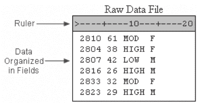

下面的表描述了一个原始数据文件的记录布局，该文件包含了健康诊对患者进行的运动压力测试读数。诊所的运动生理学家使用测试结果来开方各种运动疗法。该文件包含固定字段。也就是说，每个变量的值在所有记录中都相同的位置。

**表 6.1 原始数据的记录布局**

| 字段名称 | 起始列 | 结束列 | 字段描述 |
| --- | --- | --- | --- |
| ID | 1 | 4 | 患者 ID 号 |
| Name | 6 | 25 | 患者姓名 |
| RestHR | 27 | 29 | 静息心率 |
| MaxHR | 31 | 33 | 测试期间的最最大心率 |
| RecHR | 35 | 37 | 测试后的恢复心率 |
| TimeMin | 39 | 40 | 时间，完成的分钟数 |
| TimeSee | 42 | 43 | 时间，秒 |
| Tolerance | 45 | 45 | 本次测试与上一次测试的压力测试耐受能力比较（I=增加, D=减少, S=相同, N=无先前测试） |

## 从原始数据文件创建 SAS 数据集

要读取原始数据文件，SAS 必须在 `DATA` 步中接收以下信息：

- 外部文本文件的位置或名称
- 新 SAS 数据集的名称
- 标识外部文件的引用
- 待读数据值的描述

在使用 `DATA` 步读取原始数据后，您可以使用 `PROC PRINT` 步生成报告，显示新数据集中包含数据值。

下表列出了在读取固定字段原始数据的程序中所使用的基本语句概述。

## 表 6.2 读取原始数据的语句

| 任务 | SAS 语句 |
| --- | --- |
| 引用 SAS 库 | `LIBNAME` 语句 |
| 引用外部文件 | `FILENAME` 语句 |
| 命名 SAS 数据集 | `DATA` 语句 |
| 标识外部文件 | `INFILE` 语句 |
| 描述数据 | `INPUT` 语句 |
| 执行 `DATA` 步 | `RUN` 语句 |
| 显示数据集 | `PROC PRINT` 语句 |
| 执行最终程序步 | `RUN` 语句 |

## 引用原始数据文件

### 使用 `FILENAME` 语句

使用 `FILENAME` 语句指向包含数据的外部文件位置。

文件引用（filerefs）的功能与库引用（librefs）相同：它们临时指向数据的存储位置。然而，librefs 引用 SAS 库，而 filerefs 引用外部文件。

`FILENAME` 语句语法：

```sas
filename fileref 'filename';
```

- `fileref` 是您与外部文件关联的名称。名称长度为 1 到 8 个字符，以字母或下划线开头，且仅包含字母、数字或下划线。
- `'filename'` 是文件的完全限定名称或位置。

### 定义完全文件名

以下 `FILENAME` 语句临时将 fileref `Exercise` 与包含练习测试数据的外部文件关联。在 Windows 操作系统中，完整文件名指定为 `C:\certdata\Tmill.dat`。

```sas
filename exercise 'c:\certdata\tmill.dat';
```

## 图 6.2 文件位置

```text
1-----+----------+10----------+20-----+30-----++40-----+
2458 Murray, W      72 185 128 12 38 D
2462 Almers, C      68 177 133 10 5 I
2501 Bonaventure, T  78 177 139 11 13 I
2523 Johnson, R     69 162 114 9 42 S
2539 LaMance, K     75 168 141 11 46 D
2552 Reberson, P   69 158 139 15 41 D
```

## 引用完全文件名

当您将 fileref 与单个外部文件关联时，可以在后续 SAS 语句和命令中指定该 fileref。

## 图 6.3 引用完全文件名

### fileref `Exercise`

```sas
单个外部文件
data clinic.therapy;
infile exercise;
  input Name $ City $
  Age Sex Height;
run;
```

### 定义聚合存储位置

聚合存储位置包含多个外部文件。要定义聚合存储位置，请使用 `FILENAME` 语句关联一个 fileref。

```sas
filename t 'c:\clinic\revenue';
```

此 `FILENAME` 语句临时将 fileref 与聚合存储目录 `C:\clinic\revenue` 关联。

### 引用聚合存储位置中的文件

要使用指向聚合存储位置的 fileref 引用外部文件，请指定该 fileref，随后在括号中指定单个文件名。

## 图 6.4 引用聚合存储位置中的文件

```sas
data clinic.therapy;
infile tax(refund.dat);
input Name $ Dept $ Site $$
```

fileref `tax` `refund.dat`

> 如果省略了文件扩展名，SAS 将查找 `.dat` 文件。

## 读取数据集的 `DATA` 步语句

### 使用 `DATA` 语句命名数据集

`DATA` 语句表示 `DATA` 步的开始并为要创建的 SAS 命名。

`DATA` 语句语法：

```sas
DATA SAS-data-set-I <...SAS-data-set-n>;
```

SAS-set 名称（格式为数据集名 库引用文件名）是要创建的数据集或多个数据集。

记住，永久性 SAS 数据集是一个双层名称。例如，双层名称 `Clinic.Admin` 指定该数据集存储在已分配了 libref `Clinic` 的永久性 SAS 库中。

### 使用 `INFILE` 语句指定原始数据文件

读取原始数据时，使用 `INFILE` 语句指示数据来自哪个文件。

`INFILE` 语句语法：

```sas
INFILE file-specification <options>;
```

- `file-specification` 可以采用 libref 形式来命名之前定义的引用引用，或采用 `'filename'` 形式指向文件的实际名称和位置。
- `options` 描述输入文件的特征以及如何使用 `INFILE` 语句进行读取。

要读取已分配 libref `Tests` 的原始数据文件，请编写以下 `INFILE` 语句：

```sas
infile tests;
```

> 提示：与其使用 `FILENAME` 语句，您可以通过在 `INFILE` 语句中指定完整文件名和位置来标识原始数据文件。例如，以下语句直接指向 `C:\Irs\Personal\Refund.dat` 文件：

## 读取数据的 `DATA` 步语句

```sas
infile 'c:\irs\personal\refund.dat';
```

> 当在 `Work` 库中创建临时数据集时，仅指定数据集名称而省略 `Work` 库名是允许的。

### 列输入

使用列输入是读取数据的多种方法之一。列输入指定了值所在的实际列位置。然而，列输入仅适用于某些情况。当您使用列输入时，您的数据必须满足以下条件：

- 它必须仅包含标准字符或数值值。
- 它必须以固定字段的形式排列。


以下外部文件包含按列或固定字段排列的数据。您可以为每个字段指定起始列和结束列。

## 图 6.5 带列的外部文件

| 1 +----+ 10 +----+ 20 |
|---|
| 2810 | 61 | MOD | F |
| 2804 | 38 | HIGH | F |
| 2807 | 42 | LOW | M |
| 2816 | 26 | HIGH | M |
| 2833 | 32 | MOD | F |
| 2823 | 29 | HIGH | M |

### 标准和非标准数值数据

标准数值值只能包含以下文本和字符：

- 数字
- 小数点
- 科学计数法或 E 表示法中的数字（例如 `2.3E4`）
- 正负号

非标准数值数据包括以下列输入无法读取的文本和字符：

- 包含特殊字符的值，例如百分号（%）、美元符号（$）和逗号（,）。
- 日期和值
- 分数、整数二进制、实二进制和十六进制的数据

以下外部文件包含某小型计算机制造商技术部门的人员信息。字段包含每个员工姓、名、职位代码和年薪的值。

注意薪资值包含逗号。因此，薪资值被视为非标准数值值。您无法使用列输入读取这些值。

## 图 6.6 原始数据文件

### 原始数据文件员工

| EVANS | DONNY | 112 | 29,996.63 |
|---|---|---|---|
| HELMS | LISA | 105 | 18,567.23 |
| HIGGINS | JOHN | 111 | 25,300.00 |
| LARSON | AMY | 113 | 32,696.78 |
| MOORE | MARY | 112 | 28,945.89 |

### 使用 `INPUT` 语句描述数据

`INPUT` 语句描述要读取并放入 SAS 数据集的原始数据字段。

使用列输入的 `INPUT` 语句语法：

```sas
INPUT variable-$ startcol-endcol.;
```

- `variable` 是分配给字段的 SAS 名称。
- 美元符号（`$`）标识变量类型为字符（如果变量是数值，则此处不显示）。
- `startcol` 表示该变量的起始列。
- `endcol` 表示该变量的结束列。

这里有一个小型数据文件。

## 图 6.7 原始数据文件

```text
|--------+10----+20---
2810 61 MOD F
2804 38 HIGH F
2807 42 LOW M
2816 26 HIGH M
2833 32 MOD F
2823 29 HIGH M
```

以下 `INPUT` 语句将 1-4 列的数据分配给字符变量 `ID`，将 6-7 列的数据分配给数值变量 `Age`，将 9-12 列的数据分配给字符变量 `ActLevel`，并将第 14 列的数据分配给字符变量 `Sex`。

```sas
filename exercise 'Z:sasuser(exerc.dat';
data exercise;
infile exercise;
input ID $ 1-4 Age 6-7 ActLevel 9-12 Sex $ 14;
run;
proc print data=exercise;
run;
```

## 图 6.8 为变量分配列范围

| 观测 | ID | 年龄 | 活动 | 性 |
|---|---|---|---|---|
| 1 | 2810 | 61 | MOD | F |
| 2 | 2804 | 38 | HIGH | F |
| 3 | 2807 | 42 | LOW | M |
| 4 | 2816 | 26 | HIGH | M |
| 5 | 2833 | 32 | MOD | F |
| 6 | 2823 | 29 | HIGH | M |

当你使用列输入时，可以执行以下操作：

- 从原始数据文件中读取任何字段或所有字段
- 以任意顺序读取字段
- 对于仅占用一列的数值，仅指定其起始列

```sas
input Act$ 9-12 Sex$ 14 Age 6-7;
```

> **提示**：记住，当你命名新变量时，必须按照你想要的精确大小写指定名称（例如，`NewBalance`）。之后，你可以指定大写、小写或混合大小写的字母。

## 指定变量名

每个变量都有一个符合 SAS 命名规范的名称。变量名遵循以下命名规则：

- 长度为 1 到 32 个字符。
- 必须以字母（A-Z，大写或小写）或下划线（`_`）开头。
- 后面可以是数字、字母和下划线的任意组合。

注意：最佳实践是使用全局选项 `VALIDNAME=v7` 限制变量名并遵循命名规则。

`INPUT` 语句使用列输入读取下方原始数据文件中的三个数据字段。

## 图 6.9 原始数据文件导入

```text
1-----10-----20
58MOD M F
29LOW F
34LOW M
41HIGH F
30MOD F
22HIGH
```

变量 `Age` 的值位于第 1-2 列。因为 `Age` 是数值变量，你不需要在变量名后指定美元符号（`$`）。

```sas
input Age 1-2
```

变量 `ActLevel` 的值位于第 3-6 列。你指定一个 `$` 表示 `ActLevel` 是一个字符变量。

```sas
input Age 1-2 ActLevel $ 3-6
```

字符变量 `Sex` 的值位于第 7 列。注意你只指定了单列。

```sas
input Age 1-2 ActLevel $ 3-6 Sex $7;
```

## 读取并验证数据

### 验证读取数据的代码

在读取外部文件之前，你可以通过限制 SAS 读取的观测数量来验证读取数据的代码。在 `INFILE` 语句中添加 `OBS=n` 可以让你只处理第 1 到 n 条，这样你可以在读取整个数据文件之前验证读取的字段是否正确。

下面的程序读取引用的原始数据文件的前 10 条记录。数据存储在名为 `sasuser.stress` 的 SAS 数据集中。`RUN` 语句告诉 SAS 执行 SAS 语句。

```sas
data sasuser.stress;
infile tests obs=10;
input ID $ 1-4 Sex $6-25
RestHR 27-29 MaxHR 31-33
RechHR 35-37 TimeMin 39-40
TimeSec 42-43 Tolerance $ 45;
run;
```

## 检查 `DATA` 步处理

日志中的信息验证了原始数据文件已正确读取。日志中的注释指示以下内容：

- 从原始数据文件中读取了 10 条记录。
- 创建了 SAS 数据集 `sasuser.stress`，包含 10 个观测和 8 个变量。

## 6.1 SAS 日志

```text
NOTE: The infile TESTS tests.dat.
Filename=Z:\sasuser\tests.dat,
RECFM,LL=3267,File Size (bytes)=1722,
Last Modified=+02Feb2017:13:50:22,
Create Time=+19Dec2016:12:49:09

NOTE: 10 records were read from the infile TESTS.
The minimum record length was 80.
The maximum record length was 80.
NOTE: The data set SASUSER.STRESS has 10 observations
and 8 variables.
NOTE: DATA statement used 0.07 seconds
```

## 数据集

日志中的信息似乎 `DATA` 步程序正确访问了原始数据文件。但在读取整个原始数据文件之前，查看新数据集中的 10 个观测是一个好主意。你可以提交 `PROC PRINT` 步来查看数据。

以下 `PROC PRINT` 步打印了 `Sasuser.Stress` 数据集。

```sas
proc print data=sasuser.stress;
run;
```

`PROC PRINT` 步的输出表明 `Sasuser.Stress` 数据集中的变量在前 10 条记录中已正确读取。

**图 6.10** `PROC PRINT` 输出

| 观测 | ID | 姓名 | RestHR | MaxHR | ReCHR | TimeMin | Time Sec | Tolerance |
|---|---|---|---|---|---|---|---|---|
| 1 | 2458 | Murray, W | 72 | 185 | 128 | 12 | 38 | D |
| 2 | 2462 | Almers, C | 68 | 171 | 133 | 10 | 5 | I |
| 3 | 2501 | Bonavenature, T | 78 | 177 | 139 | 11 | 13 | I |
| 4 | 2523 | Johnson, R | 69 | 162 | 114 | 9 | 42 | S |
| 5 | 2539 | LaMance, K | 75 | 168 | 141 | 11 | 46 | D |
| 6 | 2544 | Jones, M | 79 | 187 | 136 | 12 | 26 | N |
| 7 | 2552 | Reberson, P | 69 | 158 | 139 | 15 | 41 | D |
| 8 | 2555 | King, E | 70 | 167 | 122 | 13 | 13 | I |
| 9 | 2563 | Itts, D | 71 | 159 | 116 | 10 | 22 | S |
| 10 | 2568 | Eberhardt, S | 72 | 162 | 122 | 16 | 49 | N |

## 读取整个数据文件

要修改 `DATA` 步以读取整个原始数据文件，请从 `INFILE` 步中移除 `OBS` 选项并重新提交程序。

```sas
data sasuser.stress;
infile tests;
input ID $ 1-4 Sex $6-25
RestHR 27-29 MaxHR 31-33
RechHR 35-37 TimeMin 39-40
TimeSec 42-43 Tolerance $ 45;
run;
```

## 无效数据

修改 `DATA` 步以读取整个原始数据文件，请从 `INFILE` 步中移除 `OBS` 选项并重新提交程序。

```sas
data sasuser.stress;
infile tests;
```

| 运算符 | 操作 | 示例 | 优先级 |
|---|---|---|---|
| `-` | 负前缀 | `negative=x;` | I |
| `**` | 幂 | `raise=x**;` | I |
| `+` | 乘法 | `mult=x*y;` | II |
| `/` | 除法 | `divide=x/y;` | II |
| `+` | 加法 | `sum=x+y;` | III |
| `-` | 减法 | `diff=x-y;` | III |

## 创建和修改变量

操作顺序由以下条件决定：

- 优先级高的操作在优先级 II 操作之前执行，依此类推。
- 优先级相同的连续操作按以下顺序执行：
  - 在优先级 I 内部从左到右
  - 在优先级 II 和 III 内部从左到右
- 你可以使用括号来控制操作顺序。

注意：当使用算术运算符时如果值缺失，则表达式的结果也将为的。如果表达式的结果缺失，赋值语句将把缺失值赋给变量。

使用以下比较运算符来表示条件。

## 表 6.4 比较运算符

| 运算符 | 含义 | 示例 |
|---|---|---|
| `= or eq` | 等于 | `name='Jones, C.'` |
| `!= or ne` | 不等于 | `temp ne 212` |
| `> or gt` | 大于 | `income=20000` |
| `< or lt` | 小于 | `partno lt "BG05"` |
| `>= or ge` | 大于等于 | `id='1543'` |
| `<= or le` | 小于 | `pulse le 85` |

使用逻辑运算符将表达式序列连接成复合表达式。

## 表 6.5 逻辑运算符

| 运算符，符号 | 说明 |
|---|---|
| `AND or &` | 和，两者。如果两个表达式都为真，则复合表达式为真。 |
| `OR` | 或，任一。如果其中一个表达式为真，则复合表达式为真。 |

### 示例：赋值语句

下面的 `DATA` 步中的赋值语句通过将 `TimeMin` 的值乘以 60 并加上 `TimeSec` 的值，创建一个新变量 `TotalTime`。

```sas
data sasuser.stress;
infile tests;
input ID $ 1-4 Name $ 6-25 RestHR MaxHR 31-33
ReCHR 35-37 TimeMin 39-40 TimeSec 42-43
Tolerance $45;

TotalTime=(timemin*60)+timesec;
```

## 图 6.2 赋值语句输出

| 观测值 | ID | Name | RestHR | MaxHR | ReCHR | TimeMin | TimeSec | Tolerance | TotalTime |
|---|---|---|---|---|---|---|---|---|---|
| 1 | 2458 | Murray, W | 72 | 185 | 128 | 12 | 38 | D | 758 |
| 2 | 2462 | Almers, C. | 68 | 171 | 133 | 10 | 5 | I | 605 |
| 3 | 2501 | Bonaventure, T. | 78 | 177 | 139 | 11 | 13 | I | 673 |
| 4 | 2523 | Johnson, R | 69 | 162 | 114 | 9 | 42 | S | 582 |
| 5 | 2539 | LaMance, K | 75 | 168 | 141 | 11 | 46 | D | 706 |
| 6 | 2544 | Jones, M | 79 | 187 | 136 | 12 | 26 | N | 746 |
| 7 | 2552 | Robinson, P | 69 | 158 | 139 | 15 | 41 | D | 941 |
| 8 | 2559 | King, E | 70 | 167 | 122 | 12 | 13 | I | 793 |
| 9 | 2563 | Pitts, D | 71 | 159 | 116 | 10 | 22 | S | 622 |
| 10 | 2568 | Eberhardt, S. | 72 | 182 | 126 | 16 | 49 | N | 1009 |
| 11 | 2571 | Nunnelly, A | 65 | 181 | 141 | 15 | 2 | I | 902 |
| 12 | 2572 | Oberon, M. | 74 | 177 | 138 | 12 | 11 | D | 731 |
| 13 | 2574 | Peterson, V | 80 | 164 | 137 | 14 | 9 | D | 849 |
| 14 | 2577 | Quigley, M | 74 | 152 | 116 | 11 | 26 |  | 686 |
| 15 | 2578 | Carter, L | 75 | 158 | 108 | 14 | 27 | I | 867 |
| 16 | 2579 | Underwood, K | 72 | 165 | 127 | 13 | 19 | S | 799 |
| 17 | 2584 | Takahashi, Y | 76 | 163 | 135 | 13 | 6 | D | 967 |
| 18 | 2586 | Derber, B | 68 | 176 | 119 | 17 | 35 | N | 1055 |
| 19 | 2598 | Ivan, H | 78 | 189 | 138 | 14 | 45 | N | 941 |
| 20 | 2589 | Wilcox, E |  |  |  |  | 57 | I | 897 |
| 21 | 2595 | Warren, C | 77 | 170 | 136 | 12 | 10 | S | 730 |

表达式也可以包含符号左侧的变量名，如下面的赋值语句所示。该语句将 `RestHR` 变量重新定义为提高 10%。

```sas
data saucer.stress;
infile:
input ID $1-4 Name $6-25 RestHR 27-29 MaxHR 31-33
ReCHR 35-37 TimeMin 39-40 TimeSec 42-43
Tolerance $45;

reshr=reshr(*10);
```

```sas
data saucer.stress;
infile:
input ID $1-4 Name $6-25 RestHR 27-29 MaxHR 31-33
ReCHR 35-37 TimeMin 39-40 TimeSec 42-43
Tolerance $45;

reshr=reshr(*10);

run;

result original value
```

## 日期常量

你可以通过日期常量为赋值语句中的变量分配日期值。要表示 SAS 日期形式的常量，请将日期指定为 `'ddmmmyy'` 或 `'ddmmmyyyy'`，紧接着后面一个 `D`。

语法，日期常量：

```sas
'ddmmmyy'd
```

或

```sas
'ddmmmyyy'd
```

- `dd` 是日的一位或两位数字值。
- `mmm` 是月份的三字母缩写（JAN, FEB 等）。
- `yy` 分别是年份的两位或四位数字值。

> **提示**：确保将日期包含在引号中。

### 示例：赋值语句和日期值

在下面的程序中，第二个赋值语句将日期值分配给变量 `TestDate`。


```sas
data sasuser.tests;
  infile tests;
  input ID $ 1-4 Name $ 6-25 RestHR 27-29 MaxHR 31-33
    ReCHR 35-37 TimeMin 39-40 TimeSec 42-43
    Tolerance $45;

  TotalTime=(timemin*60)+timesec;
  TestDate='01JAN25';
```

> 提示：你可以在赋值语句中使用日期常量。

## 数据筛选

表达式也可以包含符号左侧的变量名，如下面的赋值语句所示。该语句将`RestHR`变量重新定义为提高 10%。

### 数据集

| ID | Name | RestHR | MaxHR | ReChR | TimeMin | TimeSec | Tolerance | Total Time |
|---|---|---:|---:|---:|---:|---:|---|---:|
| 2574 | Peterson, V | 80 | 164 | 137 | 14 | 9 | D | 849 |
| 2575 | Quigley, M | 74 | 152 | 113 | 11 | 26 | I | 686 |
| 2578 | Cameron, L | 75 | 158 | 108 | 14 | 27 | I | 867 |
| 2579 | Underwood, K | 72 | 165 | 127 | 13 | 19 | S | 799 |
| 2584 | Takashi, Y | 76 | 163 | 135 | 16 | 7 | D | 967 |
| 2586 | Gerber, B | 68 | 176 | 119 | 17 | 35 | N | 1055 |
| 2588 | Ivan, H | 70 | 182 | 126 | 15 | 41 | N | 1041 |
| 2589 | Wilcox, E | 78 | 189 | 118 | 14 | 57 | I | 947 |
| 2595 | Warren, C | 77 | 170 | 136 | 12 | 10 | S | 730 |

注意，你不需要在数据行之后运行一个空分号。`DATALINES` 语句起到了边界的作用；一旦 SAS 遇到它，`DATA` 步就会执行。

## 创建原始数据文件

### 概述

以下是本章之前出现过的 SAS 程序和 SAS 数据集：

```sas
data sasuser.address;
infile tests;
input ID $ 1-4 Name $ 6-25 RestHR 27-29 MaxHR 31-33
ReCHR 35-37 TimeMin 39-40 TimeSec 42-43
Tolerance $ 45;
if tolerance='D';
TotalTime=(timemin*60)+timesec;
```

注意，数据集已经通过 SAS 语句进行了修改。如果你想将新的观测值写入原始数据文件，可以反转你所遵循的过程，将从 SAS 数据集中的观测值作为记录或行写入原始数据文件。

### 使用`_NULL_`关键字

如果你的 SAS 程序的目标是创建一个原始数据文件而不是 SAS 数据集，那么在`DATA`语句中使用数据集名称是低效的。相反，可以使用关键字`NULL_`，它允许你在不实际创建 SAS 数据集的情况下使用`DATA`步。`SET`语句指定你想要读取的 SAS 数据集。

```sas
data _null_;
set sasuser.address;
```

下一步是指定输出文件。

### 指定原始数据文件

你使用`FILE`和`PUT`语句将 SAS 数据集中的观测值写入原始数据文件，就像你使用`INFILE`和`INPUT`语句创建 SAS 数据集一样。这两个语句的工作方式几乎相同。

在将观测值写入原始数据文件时，使用`FILE`语句指定输出文件。

**语法，`FILE`语句：**

```sas
FILE file-specification <options> <operating-environment-options>;
```

- `file-specification`可以以`fileref`的形式出现，用于命名之前定义的文件引用，或者用`fileref`指向输出文件的实际名称和位置。
- `options`用于创建输出文件的选项名称。
- `operating-environment-options`是特定于特定操作环境的选项名称。

例如，如果你想读取`Sasuser.Stress`数据并将其写入由`fileref Newdat`引用的原始数据文件，你可以从以下 SAS 语句开始你的程序。

```sas
data _null_;
  set sasuser.stress;
  file newdat;
run;
```

你不需要使用 SAS 引用来标识原始数据文件，可以在`FILE`语句中指定整个文件名。例如，`FILE`语句直接指向`Z:\sasuser\tests.dat`文件。注意，指定文件名和位置的路径必须包含在引号中。

```sas
data _null_;
  set sasuser.stress;
  file 'Z:\sasuser\tests.dat';
run;
```

## 描述数据

`FILE`语句指定输出的原始数据文件，而`PUT`语句描述了要写入原始数据文件的行。

**语法，使用列输出的`PUT`语句：**

```sas
PUT variable startcol-endcol..;
```

- `variable`是要写入值的变量名称。
- `startcol`表示在行中开始写入值的位置。
- `endcol`表示在行中结束该值的位置。

通常情况下，`PUT`语句镜像了`INPUT`语句的功能。在这种情况下，你正在处理列输出。因此，你需要为你想要创建的每个字段指定变量名、起始列和结束列。由于你正在创建原始文本数据，美元符号（`$`）是可选的。

```sas
data _null_;
  set sasuser.stress;
  file 'Z:\sasuser\tests.dat';
  put $ 1-4 name 6-25 restr 27-29 maxhr 31-33
        rechr 35-37 timin 39-40 timesec 42-43
        tolerance 45 totaltime 47-49;
run;
```

### 数据集输出

图 6.13 使用`PUT`语句的 SAS 数据集输出。

生成的原始数据看起来如下：

| Obs | Name | RestHR | MaxHR | ReChR | TimeMin | TimeSec | Tolerance | Total Time |
|---:|---|---:|---:|---:|---:|---:|---|---:|
| 1 | Murray, W | 72 | 185 | 128 | 12 | 38 | D | 758 |
| 2 | Almers, C | 68 | 171 | 133 | 10 | 5 | I | 605 |
| 3 | Bonaventure, T | 78 | 177 | 139 | 11 | 13 | I | 673 |
| 4 | Johnson, R | 69 | 192 | 114 | 9 | 42 | S | 582 |
| 5 | LaMance, K | 75 | 168 | 141 | 11 | 46 | D | 706 |
| 6 | Jones, M | 79 | 187 | 136 | 12 | 26 | N | 746 |
| 7 | Reberson, P | 68 | 159 | 138 | 15 | 14 | D | 941 |
| 8 | King, E. | 70 | 167 | 127 | 12 | 13 | I | 793 |
| 9 | Pitts, D | 71 | 159 | 116 | 10 | 22 | S | 622 |
| 10 | Eberhardt, S | 72 | 182 | 162 | 16 | 49 | N | 1039 |
| 11 | Nuttley, A | 72 | 182 | 162 | 16 | 49 | N | 1039 |
| 12 | Oberon, M | 74 | 178 | 136 | 12 | 10 | S | 730 |
| 13 | Peterson, V | 80 | 164 | 137 | 14 | 9 | D | 849 |
| 14 | Quigley, M | 74 | 152 | 113 | 11 | 26 | I | 686 |
| 15 | Cameron, L | 75 | 158 | 108 | 14 | 27 | I | 867 |
| 16 | Underwood, K | 72 | 165 | 127 | 13 | 19 | S | 799 |
| 17 | Takashi, Y | 76 | 163 | 135 | 16 | 7 | D | 967 |
| 18 | Gerber, B | 68 | 176 | 119 | 17 | 35 | N | 1055 |
| 19 | Ivan, H | 70 | 182 | 126 | 15 | 41 | N | 1041 |
| 20 | Wilcox, E | 78 | 189 | 118 | 14 | 57 | I | 947 |
| 21 | Warren, C | 77 | 170 | 136 | 12 | 10 | S | 730 |

## 读取 Excel 数据

### 决定引用你的数据

使用`DATA`步创建 SAS 数据，无论输入数据是 SAS 数据、原始文件还是其他应用程序。读取的区别在于你如何引用数据。你可以使用以下方法之一：

- SAS/ACCESS `LIBNAME`语句
- `PROC IMPORT`

| 任务 | 语句 | 示例 |
|---|---|---|
| 写出 SAS 库的内容 | `PROC CONTENTS` | `proc contents data=results._all_;` |
| 执行`PROC CONTENTS`语句 | `RUN`语句 | `run;` |
| 命名并创建特定的 SAS 数据集 | `DATA`语句 | `data work.stress;` |
| 读取 Excel 工作表（作为新 SAS 数据集的输入数据） | `SET`语句 | `set results.'ActLevel$'n;` |
| 执行`DATA`步 | `RUN`语句 | `run;` |
| 查看特定数据集的内容 | `PROC PRINT` | `proc print data=stress;` |
| 执行`PROC PRINT`语句 | `RUN`语句 | `run;` |

### SAS/ACCESS `LIBNAME`语句

要扩展 SAS 全局`LIBNAME`语句并为关系型数据库管理系统分配 libref（库引用名），请使用 SAS/ACCESS `LIBNAME`语句。`LIBNAME`将 SAS libref 与 SAS 数据库、架构（schema）、服务器或一组表和视图关联起来。

**SAS/ACCESS `LIBNAME`语句语法：**

```sas
LIBNAME <libref-XLSX='物理路径和文件名.xls'><options>;
```

- `libref`是你与 Excel 工作簿关联的名称。
- `XLSX`是 SAS/ACCESS 引擎的名称。
- `'物理路径和文件名.xls'`是 Excel 工作簿的物理位置。

**示例：**

```sas
libname results XLSX 'c:\certdata\exercise.xlsx';
```

> **注意：** EXCEL 引擎（也称为 XLSX 引擎）要求对`物理路径和文件名.xls`使用单引号。

### 引用 Excel 工作簿

#### 概览

此示例使用了与前一节中用于原始数据的场景类似的数据。这些数据显示了对健康诊所患者进行的运动压力测试的读数。

加载在 Excel 工作簿`exercise.xlsx`（如下所示）中的压力测试数据，存储在`c:\users`路径下。

**图 6.17** Excel 工作簿

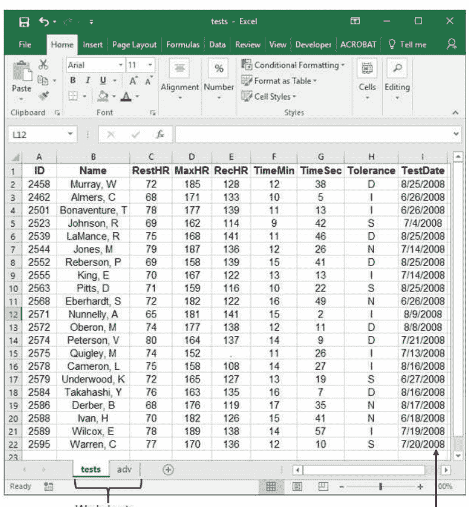

在上面的第一个工作表中，日期列在 Excel 中被定义为日期。如果你右键点击单元格并选择“设置单元格”，单元格的类别为“日期”。SAS 按照其在 Excel 中的存储方式读取这些数据。如果日期在 Excel 中存储为文本，那么 SAS 将其读取为字符字符串。

要读取此工作簿，请使用`LIBNAME`指向工作簿的位置：

```sas
libname results XLSX 'c:\certdata\exercise.xlsx';
```

`LIBNAME`语句命名了 libref，该 libref 指向工作簿`exercise.xlsx`。该工作簿包含两个工作表：`Tests`和`Adv`，它们现在作为数据集在新的 SAS 库（`Results`）中可用。

### 在`DATA`步中引用 Excel 工作簿

#### `SET`语句

使用`SET`语句指明你想读取 Excel 文件中的哪一个工作表。

```sas
data work.stress;
  set 'ActivityLevels';
run;
```

在此示例中，`DATA`语句告诉 SAS 将新数据集命名为`Stress`，并将其存储在临时库`Work`中。`DATA`步中的`SET`语句指定 libref（对 Excel 文件的引用）和工作表名称作为输入数据。

你可以在`DATA`步中使用多个语句来根据需要对数据进行子集处理。这里，`WHERE`语句配合变量使用，仅包含活动水平为`HIGH`（高）的参与者。

```sas
data work.stress;
  set 'ActivityLevels';
  where ActLevel='HIGH';
run;
```

该图显示了此`DATA`步的表格格式的部分输出。

**图 6.18** `DATA`步输出（部分输出）

| ID | Age | ActLevel | Sex |
|---:|---:|---|---|
| 1 | 2462 | 38 | HIGH |
| 2 | 2523 | 26 | HIGH |
| 3 | 2544 | 29 | HIGH |
| 4 | 2568 | 28 | HIGH |

`WHERE`语句将数据子集化为仅`HIGH`。

### 命名字面量（Name Literals）

`LIBNAME`语句创建了一个持久库`Results`，它是工作簿文件及其位置的 libref。新库包含两个 SAS 数据集，它们访问 Excel 工作表中的数据。

Excel 工作表名称末尾带有特殊字符（`$`）。所有 Excel 工作表都是这样命名的。但请记住，默认情况下，SAS 数据集名称不允许包含特殊字符。因此，为了让 SAS 允许数据集名称中包含该字符，你必须为数据集命名。SAS *命名字面量*（name literal）是以引号括起的字符串形式表示的名称，后跟大写或小写的字母`n`。命名字面量允许 SAS 在数据集名称中使用特殊字符（`$`）。

**图 6.19** 命名字面量

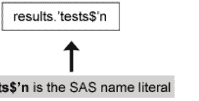

`'tests$'n`是 SAS 命名字面量。

### 命名范围（Named Ranges）

命名范围是工作表中你在 Excel 中定义并分配名称的单元格组。在示例中，工作表包含一个名为`tests_week_1`的命名范围，SAS 将其识别为数据集。

命名范围`week_1`及其父工作表`tests`在 SAS 窗口环境中作为单独的数据集出现，但从命名范围创建的数据集名称末尾没有附加美元符号（`$`）。

有关命名范围的更多信息，请参阅你的 Microsoft Excel 文档。

**图 6.20** 命名范围

| ID | Name | Resthi | RecHR | Date | TimeMin | TimeSec | Tolerance Date | Named range |
|---:|---|---:|---:|---|---:|---:|---|---|
| 2458 | Murray, W | 72 | 185 | 128 | 38 | D | 8/25/2008 | |
| 2462 | Albertson, C | 68 | 171 | 139 | 11 | 0 | 5/24/2008 | |
| 2501 | Bonaventure, T | 90 | 162 | 164 | 114 | 9 | 7/14/2008 | |
| 2523 | Johnson, R | 69 | 162 | 114 | 114 | 9 | 7/14/2008 | |
| 2539 | La, C | 75 | 168 | 139 | 11 | 0 | 5/24/2008 | |
| 2552 | Robertson, P | 68 | 171 | 139 | 11 | 0 | 5/24/2008 | |
| 2555 | King, E | 70 | 167 | 164 | 114 | 9 | 7/14/2008 | |
| 2563 | Pitts, D | 71 | 159 | 128 | 38 | D | 8/25/2008 | |
| 2568 | Eberhardt, S | 72 | 182 | 122 | 38 | D | 8/25/2008 | |

# `LIBNAME`语句选项

要将 SAS 库引用（libref）与 Microsoft Excel 工作簿关联，请使用以下`LIBNAME`语句之一。


`LIBNAME <libref> <XLSX> "物理路径-和文件名.xlsx" <SAS/ACCESS LIBNAME-选项>;`

`LIBNAME <libref> <CLEAR> | <ALL_>;`

> 注意：`XLSX` 引擎对“物理路径-和文件名.xlsx”使用，单引号或双引号均可接受。

```text
<libref>
```

是任何与存储 Microsoft Excel 表格的 SAS 库关联的 SAS 名称。`libref` 与 SAS 库之间的关联仅持续到 SAS 会话结束，或者直到你更改了该 `libref` 或使用另一个 `LIBNAME` 语句将其断开。

```text
XLSX
```

是用于 XLSX 文件格式的 SAS `libref` 标识。`LIBNAME` 语句将 `libref` 与 XLSX 引擎关联，该引擎支持与 Microsoft Excel 2007、2010 及更高版本文件的连接。

此名称 `XLSX` 是必需的。否则，SAS/ACCESS 将假设对 XLSX 文件使用 Microsoft Excel 的 `LIBNAME` 引擎。注意：XLSX 引擎允许你跨 UNIX、Linux 和 Windows 操作系统直接读写 XLSX 文件。如果你在 UNIX 或 Linux 上存储了 XLSX 文件，则不需要使用 SAS PC File Servers（或 PCFILES `LIBNAME` 引擎）来访问 `.xlsx` 文件。如果你在 UNIX 或 Linux 上运行 SAS 且你的 XLSX 文件位于远程 Windows 环境中，请使用 PCFILES `LIBNAME` 引擎访问它们。

XLSX 允许你替换现有的工作表或添加新工作表，但不能用于更新单个工作表中的值。

在导入（读取）XLSX 数据时，XLSX 引擎会读取混合数据（即包含数值和字符值的列）并将其转换为字符值。

XLSX 引擎仅允许顺序读取数据。这意味着它不支持随机访问。它不支持需要随机访问的任务，例如 RANK 过程，该过程需要按随机顺序读取行。

## 示例

此 `LIBNAME` 语句指定 `Wsinv` 为 SAS 库的引用（即 `libref`）。XLSX 引擎指定了一个支持连接到 XLSX 文件类型连接的引擎。

```sas
LIBNAME wsinv XLSX "C:\WestSector\Q1_Invoices.xlsx";
```

```text
"physical-path-and-filename.xlsx">
```

Microsoft Excel 2007 或更高版本工作簿的物理路径文件名。需要使用扩展名 `.xlsx`。将路径和工作簿名称包含引号内。

## `<SAS/ACCESS LIBNAME-options>`

定义 SAS 如何与外部数据源（在此例中 XLSX 文件）交互，提供对 SAS 如何处理数据源对象的控制。

XLSX `LIBNAME` 引擎适用于任何版本的 Microsoft Excel 2007 或更高版本，它没有特定于引擎的 `LIBNAME` 选项，例如 `VERSION=`。

## `<CLEAR>`

清除一个 `libref`。

指定 `libref` 以取消单个 `libref` 的关联。

## `<ALL_>`

指定 `CLEAR` 或 `ALL` 参数适用于所有 `librefs`。

## `<LIST>`

将一个或多个 SAS/ACCESS 库或 SAS 库的属性写入 SAS 日志中。

指定 `libref` 以列出单个 SAS/ACCESS 库或 SAS 库的属性。指定 `_ALL_` 以列出当前会话中所有 `librefs` 的属性。

### 示例：列出单个库的属性

```sas
LIBNAME LIBREF LIST;
```

### 示例：列出所有库的属性

```sas
LIBNAME _ALL_ LIST;
```

# 创建 Excel 工作表

除了读取数据外，SAS 还可以从 SAS 数据集创建 Excel 工作表。

要这样做，请使用 SAS/ACCESS `LIBNAME` 语句。例如，要从临时 SAS 数据集 `work.high_stress` 创建一个名为 `high_stress` 的新工作表并在新的 Excel 文件 `Excel.xlsx` 中创建此工作表，你需要提交以下 `LIBNAME` 语句和 DATA 步：

```sas
libname clinic xlsx 'c:\Users\mylaptop\newExcel.xlsx';

data clinic.high_stress;
  high_stress;
run;
```

# IMPORT 过程

## PROC IMPORT 基础

IMPORT 过程从外部数据源读取数据并将其写入 SAS 数据集。

在分隔文件中，分隔符（如空格、逗号或制表符）分隔数据值列。如果你拥有 SAS/ACCESS Interface to PC Files 的许可，额外的外部数据源可以包括 Microsoft Access 数据库文件、Microsoft Excel 文件和 Lotus 表格。

## IMPORT 过程的功能

当你运行 IMPORT 过程时，它会读取输入文件并将数据写入指定的 SAS 数据集。默认情况下，IMPORT 过程期望变量名出现在第一行。该过程扫描前 20 行来计算变量，并尝试为每个变量确定正确的导入和格式。你可以使用 IMPORT 过程语句来执行以下操作：

- SAS 扫描多少行变量来确定类型和长度（`GUESSINGROWS=`）。
- 指定 SAS 从哪一行开始读取数据（`DATAROW=`）。
- 修改 SAS 是否提取变量名（`GETNAMES=`）。

你也可以使用这些相同的语句来更改默认值。

当 IMPORT 过程读取分隔文件时，它会生成一个导入数据的 DATA 步。你可以使用于输入数据源的选项和语句来控制结果。

IMPORT 过程生成输出 SAS 数据集并将导入信息写入 SAS 日志。它显示由 IMPORT 过程生成的 DATA 步代码。

如果你在过程运行后需要修改代码，请使用 `RECALL` 命令（或按 F4）调用生成的 DATA 步。此时，你可以从 `INFILE` 语句中添加或删除选项，并根据你的数据自定义 `INFORMAT`、`FORMAT` 和 `INPUT` 语句。

> 注意：默认情况下，IMPORT 过程将分隔文件读取为变长文件。如果你的外部文件是固定长度格式，请使用带有包含 `RECFM=F L=` 的 `INFILE` 语句的 SAS DATA 步。

# PROC IMPORT 语句

`PROC IMPORT` 语句将外部数据文件导入 SAS 数据集。

```sas
PROC IMPORT
  DATAFILE="filename" TABLE="tablename"
  OUT=libname.SAS data set <SAS data set options>
  <DBMS=identifier><REPLACE>;
```

`DATAFILE="filename"` 或 `"fileref"` 指定输入 PC 文件、电子或分隔外部文件的完整路径文件名或 `fileref`。`fileref` 是与输出文件的物理位置关联的 SAS 名称。要分配 `fileref`，请使用 `FILENAME` 语句。

如果你使用 `fileref`，或者完整路径和文件名不包含特殊字符（如路径中的反斜杠、小写字母或空格），则可以省略引号。

> 限制：IMPORT 过程不支持设备类型，除了 `DISK` 以外。IMPORT 过程不支持 `FILENAME` 语句的设备方法。IMPORT 过程不支持 `TEMP` 类型，这将创建一个临时文件。

只有当 SAS 支持数据类型时，IMPORT 过程才能导入数据类型。SAS 支持数值和字符类型，但如果你要导入的数据类型 SAS 不支持，过程可能无法正确导入。

# 第 6 章：从外部文件创建 SAS 数据集

**交互：** 默认情况下，IMPORT 过程将分隔文件读取为变长文件。如果你的外部文件是固定长度格式，请使用包含 `RECFM=F LRECL=` 的 SAS DATA 步。

当你使用 `fileref` 指定要导入的分隔文件时，逻辑长度（`LRECL`）认为 256，除非你在 `FILENAME` 语句中指定 `LRECL`。IMPORT 过程支持的最大 `LRECL` 值为 32767。

对于分隔文件，扫描前 20 行以确定变量属性。你可以使用 `GUESSINGROWS=` 语句增加扫描的行数。所有值都作为字符串读取。如果声明了日期和时间格式或数值输入，数据类型仍为字符。

使用 `IMPORT` 过程配合 `REPLACE` 选项写入现有的代数据集（generation data set），会导致最近一个代数据集或一组代数据集被删除。

以下是两种场景：

- 如果你指定 `GENMAX=` 数据选项来增加或减少代的数量，则所有现有的代都将被删除，并被一个新的新的基准代数据集替换。
- 如果你省略了 `GENMAX=` 数据选项，则所有现有的代都将被删除，并被同名的单个新数据集替换，但它不是一个代数据集。

相反，请使用带有 `REPLACE=` 数据选项的 SAS 步骤来替换永久 SAS 数据集，并维护 SAS 数据集的代数据组。

## `<SAS 数据集选项>`

指定 SAS 数据集选项。例如，要为生成的 SAS 数据集分配密码，可以使用 `ALTER=`、`PW=`、`READ=` 或 `WRITE=` 数据集选项。要仅导入符合特定条件的数据，可以使用 `WHERE=` 数据集选项。

**限制：** 在导入定界符分隔（逗号分隔）或制表符分隔的文件时，不能指定数据集选项。

## 示例：导入带有 CSV 扩展名的逗号分隔文件

此示例导入了一个逗号分隔的文件并创建了一个临时 SAS 数据集 `Work.Shoes`。

```sas
proc import datafile="C:\certdata\test.csv";
  out=csv
  dbms=csv
  replace;
  getnames=no;
run;

proc print data=work.shoes;
run;
```

# 第 6 章：从外部文件创建 SAS 数据集

## 输出 6.3 HTML 输出：Woes 数据集

## SAS 系统

|  | VAR1 | VAR2 | VAR3 | VAR4 | VAR6 | VAR7 |
|---|---|---|---|---|---|---|
| 1 | Africa | Boot | Addis Ababa | 12 | $29,761 | $191,821 | $769 |
| 2 | Asia | Boot | Bangkok | 1 | $1,996 | $9,576 | $80 |
| 3 | Canada | Boot | Calgary | 8 | $17,720 | $63,280 |  |
| 4 | Central America/Caribbean | Boot | Kingston | 33 | $102,372 | $393,376 | $4,454 |
| 5 | Eastern Europe | Boot | Budapest | 22 | $74,102 | $317,515 | $3,341 |
| 6 | Middle East | Boot | Al-Khobar | 10 | $15,062 | $44,668 | $765 |
| 7 | Pacific | Boot | Auckland | 12 | $20,141 | $97,919 | $962 |
| 8 | South America | Boot | Bogota | 19 | $15,512 | $35,305 | $1,229 |
| 9 | United States | Boot | Chicago | 16 | $82,483 | $305,061 | $3,735 |
| 10 | Western Europe | Boot | Copenhagen | 2 | $1,663 | $4,657 | $129 |

# 章末测

为每道题选择最佳答案。使用附录中的答案对照检查你的答案。

1. 哪个 SAS 语句将文件引用（`fileref`）与原始数据文件 `C:\Data\crime.dat` 关联？

   a. `filename fileref 'c:\states\data\crime.dat';`

   b. `filename crime c:\states\data\crime.dat;`

   c. `fileref crime 'c:\states\data\crime.dat';`

   d. `fileref 'c:\states\data\crime' 'dat' crime.dat;`

2. 文件引用的有效时间是多久？

   a. 直到你更改它们

   b. 直到你取消它们

   c. 直到你结束 SAS 会话

   d. 以上所有情况

3. 哪个语句识别了要用文件引用 `Products` 配合读取的原始数据文件名称，并指定 DATA 步骤仅读取第 1-15 条记录？

   a. `infile products obs 15;`

   b. `infile products obs=15;`

   c. `input products obs=15;`

   d. `input products 1-15;`

4. 下列程序中哪一个正确将下方数据集中的观测值写入原始数据文件？

### SAS 数据集 `Work.Patients`

| ID | Sex | Age | Weight | Pulse |
|---|---|---|---|---|
| 2304 | F | 16 | 61 | 102 |
| 1128 | M | 43 | 71 | 218 |
| 4425 | F | 48 | 66 | 162 |
| 1387 | F | 57 | 64 | 142 |
| 9012 | F | 39 | 63 | 157 |
| 6312 | M | 52 | 72 | 240 |
| 5438 | F | 42 | 62 | 168 |
| 3788 | M | 38 | 73 | 234 |
| 9125 | F | 56 | 64 | 159 |
| 3438 | M | 15 | 66 | 140 |

```sas
data _null_;
  set work.patients;
  infile 'c:\clinic\patients\referrals.dat';
  input id $ 1-4 sex $ 6 age 8-9 height 11-12
         weight 14-16 pulse 18-20;
run;
```

```sas
data referrals.dat;
  set work.patients;
  input id $ 1-4 sex $ 6 age 8-9 height 11-12
         weight 14-16 pulse 18-20;
run;
```

```sas
data _null_;
  set work.patients;
  file 'c:\clinic\patients\referrals.dat';
  put id $ 1-4 sex $ 6 age 8-9 height 11-12
         weight 14-16 pulse 18-20;
run;
```

```sas
data _null_;
  set work.patients;
  file 'c:\clinic\patients\referrals.dat';
  put id $ 1-4 sex $ 6 age 8-9 height 11-12
         weight 14-16 pulse 18-20;
run;
```

5. 哪个原始数据文件可以使用列输入（column input）读取？

   a.

```text
1-----10
----+20-----
Hencerson CA
Josephs SC
```

   b.

```text
1-----10
----+20-----30
2803
2912
3015
```

   c.

|  |  |  |
|---|---|---|
| Avery | 23 |  |
| Davison | 15 |  |
| Janson Holbrook | 48 |  |

   d. 以上所有。

6. 哪个程序产生了下方的输出？

| ID | LastName |
|---|---|
| 1342 | Steve |
| 2143 | Lee |
| 3281 | Vicky |
| 4165 | Jack |

   a.

```sas
data work.patients;
  set work.patients;
  input id 1-4 sex $ 6-12 14-188 20-29;
run;
```

   b.

```sas
data work.patients;
  set work.patients;
  input id 1-4 sex $ 6-12 11112 29;
run;
```

   c.

```sas
data work.patients;
  set work.patients;
  input id 1-4 sex $ 6-12 11-18 20-29;
run;
```

7. 哪个语句按照 `StockNumber`、`Price`、`Item` 的顺序读取字段？

| Field Name | Start Column | End Column | Type |
|---|---:|---:|---|
| StockNumber | 1 | 3 | character |
| Finish | 5 | 9 | character |
| Item | 11 | 18 | character |

   a.

```text
310 oak
311 maple
312 glass
313 rocking chair
314 table
```

   b.

```text
310 oak
311 maple
312 glass
313 rocking chair
314 table
```

   c.


```text
310 oak
311 maple
312 glass
313 rocking chair
314 table
```

## 8. 哪个语句重新定义了更高的收入值？

- a. `income=income*1.00;`
- b. `income=income+(income*2);`
- c. `income=income*2;`
- d. 以上

## 9. 哪个程序正确读取内联数据？

### a.

```sas
data finance.newloan;
input datelines;
if country='JAPAN'
MonthAvg=amount/12;
```

### b.

```sas
data finance.newloan;
input Year 1-4 Country $ 6-11 Vehicle $ 13-18 Amount 20-28;
if country='JAPAN'
MonthAvg=amount/12;
datalines;
```

## 10. 哪个 SAS 语句筛选下方的原始数据，使得只有性别（第二个字段）值为 F 的观测值被处理？

- a. `if sex=F;`
- b. `if sex='F';`
- c. a 或 b

# 第 7 章 理解 DATA Step 处理

- SAS 如何处理程序 ............................................................................ 139
  - 编译阶段 ........................................................................................ 141
    - 输入缓冲区（Input Buffer）..................................................................................................... 141
    - 程序数据向量（PDV）................................................................................ 141
    - 语法检查 ............................................................................................... 142
    - 数据集变量 ............................................................................................ 142
    - SAS 数据集的描述部分 ................................................................ 143
  - 执行阶段 ........................................................................................ 144
    - 变量初始化 ........................................................................................ 144
    - INFILE 语句 ............................................................................................ 144
    - INPUT 语句 ............................................................................... 144
    - DATA Step 结束 ....................................................................................... 146
    - DATA Step 的迭代 ................................................................................ 148
    - 文件结束标记（End-of-File Marker）........................................................................................ 150
    - 执行阶段结束 ................................................................................. 151
  - 调试 DATA Step ................................................................................ 152
    - 编译阶段的错误诊断 ................................................................. 152
    - 执行阶段的错误诊断 ....................................................... 152
    - 示例：执行阶段错误 ................................................................ 153
    - 数据验证与清洗 .......................................................................... 155
    - 使用赋值语句清洗数据 ...................................... 157
  - 测试您的程序 ................................................................................... 158
    - 限制观测值 ....................................................................................... 158
    - PUT 语句 ............................................................................... 158
    - 示例：字符字符串 .......................................................................... 159
    - 示例：数据集变量 .......................................................................... 159
    - 示例：自动变量 ................................................................ 160
    - 示例：条件处理 ............................................................ 161
  - 本章测验 ................................................................................................... 161

## SAS 如何处理程序

当您提交一个 DATA step 时，SAS 会处理该 step 并创建一个新的 SAS 数据集。一个 SAS DATA step 分两个阶段处理：

### 图 7.1 DATA SAS 数据集

|  | 新的 SAS 数据集 |
|---|---|
| 编译阶段 | 描述部分 |
| 执行阶段 | 数据部分 |

当您使用 DATA step 进行执行时，SAS 会检查 SAS 语句的语法并对其编译。在此阶段，SAS 会识别每个新变量的类型和长度，并确定后续对变量的每次引用是否需要进行类型转换。在编译阶段，SAS 会创建以下项：

- 输入缓冲区
- 程序数据向量（PDV）
- 描述信息

当编译阶段完成后，新数据集的描述部分就会创建。

默认情况下，一个简单的 DATA step 会为创建的每个观测值迭代一次。DATA step 执行阶段的动作流描述如下：

1. DATA step 以 DATA 语句开始。每执行一次 DATA 语句，DATA step 就会开始一次新的迭代，`_N_` 自动变量加 1。`_N_` 自动变量代表 DATA step 迭代的次数。
2. SAS 将新创建的程序变量在程序数据向量（PDV）中设置为缺失值（missing）。
3. SAS 从原始数据文件中读取数据记录到输入缓冲区，或者直接从 SAS 数据集中读取一个观测值到程序数据向量。您可以使用 `INPUT`、`MERGE`、`SET`、`MODIFY` 或 `UPDATE` 语句来读取记录。
4. SAS 执行当前记录的任何后续编程语句以及 DATA step 中的最后一条语句，PDV 中的所有值（除要丢弃的变量外）都将作为一个观测值写入数据集。注意，通过 `SET`、`MERGE`、`MODIFY` 或 `UPDATE` 语句读取的变量在这里不会被重置为缺失。
5. SAS 计数下一次迭代，读取下一个记录或观测值，并对当前观测值执行后续编程语句。
6. 当 SAS 在 SAS 数据集或原始数据文件中遇到文件结束时，DATA step 终止。

图 7.2 显示了读取原始数据的 DATA step 处理通用流程。

编译阶段 141

**图 7.2** DATA step 处理的编译与执行阶段

## 输入缓冲区

输入缓冲区是内存中的一个逻辑区域，当 SAS 执行 `INPUT` 语句时，SAS 将原始数据文件的每个记录读取到该缓冲区。缓冲区仅在 DATA step 读取原始数据时才会创建。当 DATA step 读取 SAS 数据集时，SAS 直接将数据读入 PDV 中。

## 程序数据向量（PDV）

在创建输入缓冲区后，会创建 PDV。PDV 是内存中的一个逻辑区域，SAS 在这里一次一个观测值地构建数据集。当程序执行时，SAS 从输入缓冲区读取值，或通过执行 SAS 语言语句创建这些值。这些数据值被赋值给程序数据向量中的相应变量。从这里，SAS 将这些值作为一个观测值写入 SAS 数据集。

除了数据集变量和计算变量外，PDV 还包含这些自动变量：

- `_N_` 变量，用于计算 DATA step 迭代的次数。
- `_ERROR_` 变量，指示执行过程中由于数据引起的错误发生。`_ERROR_` 的值为 0（不存在错误）或 1（发生了一个或多个错误）。默认值为 0。

注意：SAS 不会将这些变量写入输出数据集中。

## 语法检查

在编译阶段，SAS 会扫描 DATA step 中的每条语句，寻找语法错误。以下是一些示例：

- 缺失或拼写错误的关键字
- 无效的变量名
- 缺失或无效的标点符号
- 无效选项

## 数据集变量

在编译 `INPUT` 语句时，新数据集中的每个变量都会向程序数据向量添加一个槽。通常，变量属性（如长度和类型）是在第一次遇到变量时确定的。

```sas
filename 'Z:\sasuser\invent.dat';
data work.update;
infile invent;
input $1-13 Idnum $15-19
InStock 21-22 BackOrd 24-25;
total=instock+backord;
```

程序数据向量：

| N | ERROR | Item | IDnum | InStock | BackOrd |
|---|---|---|---|---|---|

在 DATA step 中通过赋值语句创建的任何变量也会被添加到程序数据向量中。例如，下面的赋值语句创建了 `Total` 变量。当语句被编译时，该变量被添加到程序数据向量中。变量的属性由语句中的表达式决定。该表达式包含一个算术运算符并产生数值值，`Total` 被定义为数值变量，并分配了默认长度 8。

```sas
filename 'Z:\sasuser\invent.dat';
data work.update;
infile invent;
input $1-13 Idnum $15-19
InStock 21-22 BackOrd 24-25;
total=instock+backord;
```

程序数据向量：

| N | ERROR | Item | IDnum | InStock | BackOrd | Total |
|---|---|---|---|---|---|---|

## SAS 数据集的描述部分

描述部分是 SAS 针对每个 SAS 数据集所创建并维护的信息，包括数据集属性和变量属性。以下是一些示例：

- 数据集的名称及其成员类型
- 数据集创建的日期和时间
- 变量的名称、数据类型（字符或数值）和长度

描述信息还包含关于扩展属性的信息（如果在数据集上定义了的话）。扩展描述信息包括属性名称、变量名称以及属性的值。

### 图 7.3 CONTENTS 过程输出：数据集描述细节

## SAS 系统

### CONTENTS 过程

| 数据集名称 | WORK UPDATE | 观测值 0 |
|---|---|---|
| 成员类型 | DATA | 变量 5 |
| 引擎 | V9 | 索引 0 |
| 创建 | 03/22/2017 16:24:42 | 观测值长度 48 |
| 最后修改 | 03/22/2017 16:24:42 | 删除的观测值 0 |
| 保护 |  | 压缩否 |
| 数据集类型标签 |  | 排序否 |
| 数据表示编码 | WINDOWS_64 | utf-8 Unicode (UTF-8) |

| 引擎/主机相关信息 |
|---|
| 数据页大小 | 65536 |
| 数据集数量 | 1 |
| 第一页数据页 | 1 |
| 每页最大观测值 | 1361 |
| 第一页数据页中的观测值 | 9 |
| 数据集修复次数 | 0 |
| 扩展值计数 | YES |
| 文件名 | `C:\Users\sasuser\SAS Temporary Files\update.sas7bdat` |
| 创建版本 | V03M1MO |
| 主机名 | X64_10PO |
| 所有者名称 | sasuser |
| 文件大小 | 128KB |
| 文件大小（字节） | 131072 |

| # 变量 | 类型 | 长度 |
|---|---|---|
| 4 BackOrd | Num | 8 |
| 2 Idnum | Char | 5 |
| 3 Inlock | Num | 8 |
| 1 Item | Char | 13 |
| 5 Total | Num | 8 |

此时，数据集包含了在输入数据集中和赋值语句中定义的五个变量。`_N_` 和 `_ERROR_` 不会被写入数据集。目前没有观测值，因为 DATA 步尚未执行。在执行期间，每条原始数据记录都会被处理，并作为观测值写入数据集。

## 执行阶段

### 变量初始化

在执行阶段的开始时，`_N_` 的值为 1。由于没有数据错误，`_ERROR_` 的值为 0。

```sas
filename invent 'Z:\sasuser\invent.dat';
data work.update;
infile invent;
input Item 1-13 IDnum $15-19
InStock 21-22 BackOrd 24-25;
Total=instock+backord;
run;
```

程序数据向量：

| N | ERROR | Item | InStock | BackOrd | Total |
|---|---|---|---|---|---|
| 1 | 0 | . | . | . | . |

其余变量被初始化为空值。缺失的数值值用点号表示，缺失的字符值用空格表示。

## INFILE 语句

INFILE 语句识别原始数据的位置。

```sas
filename invent 'Z:\sasuser\invent.dat';
data work.update;
infile invent;
input Item 1-13 IDnum $15-19
InStock 21-22 BackOrd 24-25
Total=instock+backord;
run;
```

## INPUT 语句

之后，INPUT 语句将一条记录读入输入缓冲区。然后，第 1-13 列的原始数据被读取并赋值给程序数据向量中的 `Item`。

```sas
data work.update;
infile invent;
input Item 1-13 IDnum $15-19
InStock 21-22 BackOrd 24-25
Total=instock+backord;
run;
```

## 执行阶段

### 原始数据文件 Invent

| Item | IDnum | InStock | BackOrd | Total |
|---|---|---|---|---|
| Bird Feeder | LG088 | 3 | 20 |  |
| 6 Mugs | SB082 | 6 | 12 |  |
| Glass Tray | BQ049 | 12 | 6 |  |
| Padded Hangers | MN256 | 15 | 20 |  |
| Jewelry Box | AJ498 | 23 | 0 |  |
| Red Apron | AQ072 | 9 | 12 |  |
| Crystal Vase | AQ672 | 27 | 0 |  |
| Picnic Basket | LS930 | 21 | 0 |  |
| Brass Clock | AN910 | 2 | 10 |  |

程序数据向量


| N | ERROR | Item | IDnum | InStock | BackOrd | Total |
|---|---|---|---|---|---|---|
| 0 |  | Bird Feeder | LG088 | 3 |  |  |

接下来，第 15-19 列被读取并赋值给程序数据向量中的`IDnum`。

```sas
work.update;
infile invent;
input Item 1-13 IDnum $15-19
InStock 21-22 BackOrd 24-25;
Total=instock+backord;
```

同样，`INPUT`语句从第 21-22 列读取`InStock`的值，并从第 24-25 列读取`BackOrd`的值。

```sas
work.update;
infile invent;
input Item 1-13 IDnum $15-19
InStock 21-22 BackOrd 24-25;
Total=instock+backord;
```

## 第 7 章：理解 DATA 步

### 原始数据文件 Invent

| Item | IDnum | InStock | BackOrd | Total |
|---|---|---|---|---|
| Bird Feeder | LG088 | 3 | 20 |  |
| 6 Glass Mugs | SB082 | 6 | 12 |  |
| Glass Tray | BQ049 | 12 | 6 |  |
| Padded Hangers | MN256 | 15 | 20 |  |
| Jewelry Box | AJ498 | 23 | 0 |  |
| Red Apron | AQ072 | 9 | 12 |  |
| Crystal Vase | AQ672 | 27 | 0 |  |
| Picnic Basket | LS930 | 21 | 0 |  |
| Brass Clock | AN910 | 2 | 10 |  |

### 程序数据向量

| N | ERROR | Item | IDnum | InStock | BackOrd | Total |
|---|---|---|---|---|---|---|
| 1 |  | Bird Feeder | LG088 | 3 |  |  |

接下来，执行赋值语句。`InStock`和`BackOrd`的值被加到`Total`上。

```sas
data work.update;
invent;
input Item 1-13 IDnum $15-19
InStock 21-22 BackOrd 24-25;
Total=stock+backord;
```

### 原始数据文件 Invent

| Item | IDnum | InStock | BackOrd | Total |
|---|---|---|---|---|
| Bird Feeder | LG088 | 3 | 20 |  |
| 6 Mugs | SB082 | 6 | 12 |  |
| Glass Tray | BQ049 | 12 | 6 |  |
| Padded Hangers | MN256 | 15 | 20 |  |
| Jewelry Box | AJ498 | 23 | 0 |  |
| Red Apron | AQ072 | 9 | 12 |  |
| Crystal Vase | AQ672 | 27 | 0 |  |
| Picnic Basket | LS930 | 21 | 0 |  |
| Brass Clock | AN910 | 2 | 10 |  |

### 程序数据向量

| N | ERROR | Item | IDnum | InStock | BackOrd | Total |
|---|---|---|---|---|---|---|
| 0 |  | Bird Feeder | LG088 | 3 |  |  |
| 1 |  |  |  |  |  |  |

| Item | IDnum | InStock | BackOrd | Total |
|---|---|---|---|---|
| Bird Feeder | LG088 | 3 | 20 |  |
| 6 | 082 |  |  | 0 |
| Glass Tray | BQ049 | 12 | 6 |  |
| Padded Hangers | MN256 | 15 | 20 |  |
| Jewelry Box | AJ498 | 23 | 0 |  |
| Red Apron | AQ072 | 9 | 12 |  |
| Crystal Vase | AQ672 | 27 | 0 |  |
| Picnic Basket | LS930 | 21 | 0 |  |
| Brass Clock | AN910 | 2 | 10 |  |

接下来，第 15-19 列被读取并赋值给程序数据向量中的`IDnum`。

```sas
work.update;
infile invent;
input Item 1-13 IDnum $15-19
InStock 21-22 BackOrd 24-25;
Total=instock+backord;
```

同样，`INPUT`语句从第 21-22 列读取`InStock`的值，并从第 24-25 列读取`BackOrd`的值。

```sas
work.update;
infile invent;
input Item 1-13 IDnum $15-19
InStock 21-22 BackOrd 24-25;
Total=instock+backord;
```

## 第 7 章：理解 DATA 步

### 原始数据文件 Invent

| Item | IDnum | InStock | BackOrd | Total |
|---|---|---|---|---|
| Bird Feeder | LG088 | 3 | 20 |  |
| 6 Glass Mugs | SB082 | 6 | 12 |  |
| Glass Tray | BQ049 | 12 | 6 |  |
| Padded Hangers | MN256 | 15 | 20 |  |
| Jewelry Box | AJ498 | 23 | 0 |  |
| Red Apron | AQ072 | 9 | 12 |  |
| Crystal Vase | AQ672 | 27 | 0 |  |
| Picnic Basket | LS930 | 21 | 0 |  |
| Brass Clock | AN910 | 2 | 10 |  |

### 程序数据向量

| N | ERROR | Item | IDnum | InStock | BackOrd | Total |
|---|---|---|---|---|---|---|
| 0 |  | Bird Feeder | LG088 | 3 |  |  |

接下来，执行赋值语句。`InStock`和`BackOrd`的值被加到`Total`上。

```sas
data work.update;
invent;
input Item 1-13 IDnum $15-19
InStock 21-22 BackOrd 24-25;
Total=stock+backord;
```

### 原始数据文件 Invent

| Item | IDnum | InStock | BackOrd | Total |
|---|---|---|---|---|
| Bird Feeder | LG088 | 3 | 20 |  |
| 6 Mugs | SB082 | 6 | 12 |  |
| Glass Tray | BQ049 | 12 | 6 |  |
| Padded Hangers | MN256 | 15 | 20 |  |
| Jewelry Box | AJ498 | 23 | 0 |  |
| Red Apron | AQ072 | 9 | 12 |  |
| Crystal Vase | AQ672 | 27 | 0 |  |
| Picnic Basket | LS930 | 21 | 0 |  |
| Brass Clock | AN910 | 2 | 10 |  |

### 程序数据向量

| N | ERROR | Item | IDnum | InStock | BackOrd | Total |
|---|---|---|---|---|---|---|
| 0 |  | Bird Feeder | LG088 | 3 |  |  |
| 1 |  |  |  |  |  |  |

| Item | IDnum | InStock | BackOrd | Total |
|---|---|---|---|---|
| Bird Feeder | LG088 | 3 | 20 |  |
| 6 | 082 |  |  | 0 |
| Glass Tray | BQ049 | 12 | 6 |  |
| Padded Hangers | MN256 | 15 | 20 |  |
| Jewelry Box | AJ498 | 23 | 0 |  |
| Red Apron | AQ072 | 9 | 12 |  |
| Crystal Vase | AQ672 | 27 | 0 |  |
| Picnic Basket | LS930 | 21 | 0 |  |
| Brass Clock | AN910 | 2 | 10 |  |

## 结束

在`DATA`步结束时，会发生若干操作。程序向量中的值将作为第一个观测值写入数据集。

```sas
data work.update;
invent;
Item 1-13 IDnum $15-19
InStock 21-22 BackOrd 24-25;
Total=stock+backord;
```

## 执行阶段

### 执行阶段

| Item | IDnum | InStock | BackOrd | Total |
|---|---|---|---|---|
| Bird Feeder | LG088 | 3 | 20 |  |
| 6 Mugs | SB082 | 6 | 12 |  |
| Glass Tray | BQ049 | 12 | 6 |  |
| Padded Hangers | MN256 | 15 | 20 |  |
| Jewelry Box | AJ498 | 23 | 0 |  |
| Red Apron | AQ072 | 9 | 12 |  |
| Crystal Vase | AQ672 | 27 | 0 |  |
| Picnic Basket | LS930 | 21 | 0 |  |
| Brass Clock | AN910 | 2 | 10 |  |

### 程序数据向量

| N | ERROR | Item | IDnum | InStock | BackOrd | Total |
|---|---|---|---|---|---|---|
| 0 |  | Bird Feeder | LG088 | 3 |  |  |

## SAS 数据集

| Item | IDnum | InStock | BackOrd | Total |
|---|---|---|---|---|
| Bird Feeder | LG088 | 3 | 20 |  |
| 6 Mugs | SB082 | 6 | 12 |  |
| Glass Tray | BQ049 | 12 | 6 |  |
| Padded Hangers | MN256 | 15 | 20 |  |
| Jewelry Box | AJ498 | 23 | 0 |  |
| Red Apron | AQ072 | 9 | 12 |  |
| Crystal Vase | AQ672 | 27 | 0 |  |
| Picnic Basket | LS930 | 21 | 0 |  |
| Brass Clock | AN910 | 2 | 10 |  |

### 程序数据向量

| N | ERROR | Item | IDnum | InStock | BackOrd | Total |
|---|---|---|---|---|---|---|
| 0 |  | Bird Feeder | LG088 | 3 |  |  |

## SAS 数据集

| Item | IDnum | InStock | BackOrd | Total |
|---|---|---|---|---|
| Bird Feeder | LG088 | 3 | 20 |  |
| 6 Mugs | SB082 | 6 | 12 |  |
| Glass Tray | BQ049 | 12 | 6 |  |
| Padded Hangers | MN256 | 15 | 20 |  |
| Jewelry Box | AJ498 | 23 | 0 |  |
| Red Apron | AQ072 | 9 | 12 |  |
| Crystal Vase | AQ672 | 27 | 0 |  |
| Picnic Basket | LS930 | 21 | 0 |  |
| Brass Clock | AN910 | 2 | 10 |  |

### 程序数据向量

| N | ERROR | Item | IDnum | InStock | BackOrd | Total |
|---|---|---|---|---|---|---|
| 0 |  | Bird Feeder | LG088 | 3 |  |  |

## SAS 数据集

| Item | IDnum | InStock | BackOrd | Total |
|---|---|---|---|---|
| Bird Feeder | LG088 | 3 | 20 |  |
| 6 Mugs | SB082 | 6 | 12 |  |
| Glass Tray | BQ049 | 12 | 6 |  |
| Padded Hangers | MN256 | 15 | 20 |  |
| Jewelry Box | AJ498 | 23 | 0 |  |
| Red Apron | AQ072 | 9 | 12 |  |
| Crystal Vase | AQ672 | 27 | 0 |  |
| Picnic Basket | LS930 | 21 | 0 |  |
| Brass Clock | AN910 | 2 | 10 |  |

### 程序数据向量

| N | ERROR | Item | IDnum | InStock | BackOrd | Total |
|---|---|---|---|---|---|---|
| 0 |  | Bird Feeder | LG088 | 3 |  |  |

## SAS 数据集

| Item | IDnum | InStock | BackOrd | Total |
|---|---|---|---|---|
| Bird Feeder | LG088 | 3 | 20 |  |
| 6 Mugs | SB082 | 6 | 12 |  |
| Glass Tray | BQ049 | 12 | 6 |  |
| Padded Hangers | MN256 | 15 | 20 |  |
| Jewelry Box | AJ498 | 23 | 0 |  |
| Red Apron | AQ072 | 9 | 12 |  |
| Crystal Vase | AQ672 | 27 | 0 |  |
| Picnic Basket | LS930 | 21 | 0 |  |
| Brass Clock | AN910 | 2 | 10 |  |

### 程序数据向量

| N | ERROR | Item | IDnum | InStock | BackOrd | Total |
|---|---|---|---|---|---|---|
| 0 |  | Bird Feeder | LG088 | 3 |  |  |

## SAS 数据集

| Item | IDnum | InStock | BackOrd | Total |
|---|---|---|---|---|
| Bird Feeder | LG088 | 3 | 20 |  |
| 6 Mugs | SB082 | 6 | 12 |  |
| Glass Tray | BQ049 | 12 | 6 |  |
| Padded Hangers | MN256 | 15 | 20 |  |
| Jewelry Box | AJ498 | 23 | 0 |  |
| Red Apron | AQ072 | 9 | 12 |  |
| Crystal Vase | AQ672 | 27 | 0 |  |
| Picnic Basket | LS930 | 21 | 0 |  |
| Brass Clock | AN910 | 2 | 10 |  |

### 程序数据向量

| N | ERROR | Item | IDnum | InStock | BackOrd | Total |
|---|---|---|---|---|---|---|
| 0 |  | Bird Feeder | LG088 | 3 |  |  |

## SAS 数据集

| Item | IDnum | InStock | BackOrd | Total |
|---|---|---|---|---|
| Bird Feeder | LG088 | 3 | 20 |  |
| 6 Mugs | SB082 | 6 | 12 |  |
| Glass Tray | BQ049 | 12 | 6 |  |
| Padded Hangers | MN256 | 15 | 20 |  |


| Jewelry Box | AJ498 | 23 | 0 | |
|---|---|---|---|---|
| Red Apron | AQ072 | 9 | 12 | |
| Crystal Vase | AQ672 | 27 | 0 | |
| Picnic Basket | LS930 | 21 | 0 | |
| Brass Clock | AN910 | 2 | 10 | |

## 程序数据向量

| N | ERROR | Item | IDnum | InStock | BackOrd | Total |
|---|---|---|---|---|---|---|
| 0 | | Bird Feeder | LG088 | 3 | | |

## SAS 数据集

| Item | IDnum | InStock | BackOrd | Total |
|---|---|---|---|---|
| Bird Feeder | LG088 | 3 | 20 | |
| 6 Mugs | SB082 | 6 | 12 | |
| Glass Tray | BQ049 | 12 | 6 | |
| Padded Hangers | MN256 | 15 | 20 | |
| Jewelry Box | AJ498 | 23 | 0 | |
| Red Apron | AQ072 | 9 | 12 | |
| Crystal Vase | AQ672 | 27 | 0 | |
| Picnic Basket | LS930 | 21 | 0 | |
| Brass Clock | AN910 | 2 | 10 | |

## SAS 数据集

| N | ERROR | Item | IDnum | InStock | BackOrd | Total |
|---|---|---|---|---|---|---|
| 0 | | Bird Feeder | LG088 | 3 | | |

## SAS 数据集

| Item | IDnum | InStock | BackOrd | Total |
|---|---|---|---|---|
| Bird Feeder | LG088 | 3 | 20 | |
| 6 Mugs | SB082 | 6 | 12 | |
| Glass Tray | BQ049 | 12 | 6 | |
| Padded Hangers | MN256 | 15 | 20 | |
| Jewelry Box | AJ498 | 23 | 0 | |
| Red Apron | AQ072 | 9 | 12 | |
| Crystal Vase | AQ672 | 27 | 0 | |
| Picnic Basket | LS930 | 21 | 0 | |
| Brass Clock | AN910 | 2 | 10 | |

## SAS 数据集

| N | ERROR | Item | IDnum | InStock | BackOrd | Total |
|---|---|---|---|---|---|---|
| 0 | | Bird Feeder | LG088 | 3 | | |

## SAS 数据集

| Item | IDnum | InStock | BackOrd | Total |
|---|---|---|---|---|
| Bird Feeder | LG088 | 3 | 20 | |
| 6 Mugs | SB082 | 6 | 12 | |
| Glass Tray | BQ049 | 12 | 6 | |
| Padded Hangers | MN256 | 15 | 20 | |
| Jewelry Box | AJ498 | 23 | 0 | |
| Red Apron | AQ072 | 9 | 12 | |
| Crystal Vase | AQ672 | 27 | 0 | |
| Picnic Basket | LS930 | 21 | 0 | |
| Brass Clock | AN910 | 2 | 10 | |

## SAS 数据集

| N | ERROR | Item | IDnum | InStock | BackOrd | Total |
|---|---|---|---|---|---|---|
| 0 | | Bird Feeder | LG088 | 3 | | |

```sas
run;
```

# 执行阶段 149

### 原始数据清单

| 项目 | IDnum | 有库存 | 缺订单 |
|---|---|---|---|
| 鸟食器器 | LG0888 | 3 | 20 |
| 玻璃杯 | SB0802 | 6 | 12 |
| 玻璃托盘 | BQ049 | 12 | 6 |
| 填充衣架 | MN256 | 15 | 20 |
| 珠宝盒 | AJ498 | 23 | 0 |
| 红色围裙 | AQ0672 | 9 | 12 |
| 水晶瓶 | AQ672 | 27 | 0 |
| 野餐篮 | LS930 | 21 | 0 |
| 黄铜钟 | AN910 | 2 | 10 |

### 程序数据向量

| N | ERROR | 项目 | 有库存 | 缺订单 | 总计 |
|---|---|---|---|---|---|
| 0 | 6 | 玻璃杯 | SB0802 | | 12 | 10 |

### SAS 数据集永久更新

| 项目 ID | IDnum | 有库存 | 缺订单 | 总计 |
|---|---|---|---|---|
| 鸟食器器 | LG088 | 3 | 20 | 23 |

在数据集底部，程序数据向量中的值被写入数据集 `work` 中作为第二个观测值。

```sas
data work.update;
in invent;
input Item $ 1-13 IDnum $ 15-19
InStock 21-22 BackOrd 24-25;
Total=instock+backord;
run;
```

接下来，`_N_` 的值从 2 增加到 3，控制返回到 DATA 的顶部，`Item`、`IDnum`、`InStock`、`BackOrd` 和 `Total` 的值被重置为空。

```sas
data work.update;
invent;
input Item $ 1-13 IDnum $ 15-19
InStock 21-22 BackOrd 24-25;
Total=instock+backord;
run;
```

# 原始数据文件清单

```
V---------+10----+20----++
Bird Feeder   LG088   3 20
Glass Mugs   SB082   6 12
Glass Tray    BQ045   6 8
Padded Hangrs  MN256  15 20
Jewelry Box   AJ498  23 0
Red Apron     AQ072   9 12
Crystal Vase  AQ672  27 0
Picnic Basket  LS930  21 0
Brass Clock   AN910   2 10
```

# 程序数据文件向量

| ERROR | 项目 | IDnum | 有库存 | 缺订单 | 总计 |
|---|---|---|---|---|---|
| 0 | | | | | |

> 重置为空 --

# SAS 数据集永久更新

| 项目 | IDnum | 有库存 | 缺订单 | 总计 |
|---|---|---|---|---|
| 鸟食器器 | LG088 | | 3 | | 23 |
| 6 玻璃杯 | SB082 | | 6 | | 18 |

# 文件结束标记

执行阶段以这种方式持续，直到在原始数据文件中文件结束标记。当原始数据文件中没有更多记录可以读取时，新数据集的数据部分即完成，DATA 步结束。

# 原始数据文件清单

```
I-------+20----+-
Bird Feeder   LG088   3 20
6 Glass Mugs   SB082   6 12
Glass Tray    BQ049   6 8
Padded Hangrs  MN256  15 20
Jewelry Box   AJ498  23 0
Red Apron     AQ072   9 12
Crystal Vase  AQ672  27 0
Picnic Basket  LS930  21 0
Brass Clock   AN910   2 10
```

这是 SAS 创建的输出数据集：

图 7.5 SAS 数据集 `Work.Update`

## SAS 系统

| 观测值 | 项目 | IDnum | 有库存 | 缺订单 | 总计 |
|---|---|---|---|---|---|
| 1 | 鸟食器器 | LG088 | | 3 | 23 |
| 2 | 玻璃杯 | SB082 | 6 | 12 | 18 |
| 3 | 玻璃托盘 | BQ049 | | 12 | 18 |
| 4 | 填充衣架 | MN256 | 15 | | 21 |
| 5 | 珠宝盒 | AJ498 | 23 | | 02 |
| 6 | 红色围裙 | AQ072 | 9 | 12 | 21 |
| 7 | 水晶瓶 | AQ672 | 27 | | 07 |
| 8 | 野餐篮 | LS930 | 21 | | 01 |
| 9 | 黄铜钟 | AN910 | 2 | 10 | 12 |

从原始数据中读取变量时，SAS 在每个执行循环的开始会将 DATA 步中每个变量的值设为空，但以下情况除外：

- 在 `RETA` 语句中命名的变量
- 在求和语句（sum statement）中创建的变量
- `_TEMPORARY_` 数组中的数据元素
- 任何通过 `FILE` 或 `INFILE` 语句选项创建的变量
- 自动变量

相比相反，从 SAS 数据集中读取变量时，SAS 仅在 DATA 步第一次执行循环之前将值设为空。因此，变量将保留其值，直到新值可用（例如，通过赋值语句或通过 `SET` 或 `MERGE` 语句的下次执行）。在 `SET` 或 `MERGE` 语句中使用选项创建的变量也会从一个执行循环保留值到下一个循环。

# 执行阶段结束

在执行阶段结束时，SAS 日志确认原始数据文件已读取，并显示数据集中的观测值和变量数量。

# 日志 7.1 SAS 日志

```
NOTE: 从 infile INVENT 中读取了 9 条记录。
最小记录长度为 80。
最大记录长度为 80。
NOTE: 数据集 WORK.UPDATE 有 9 个观测值和 5 个变量。
```

回，你可以使用 PRINT 过程显示数据集。

```sas
proc print data=work.update;
run;
```

## SAS 系统

| 观测值 | 项目 | IDnum | 有库存 | 缺订单 | 总计 |
|---|---|---|---|---|---|
| 1 | 鸟食器器 | LG088 | | 3 | 23 |
| 2 | 玻璃杯 | SB082 | 6 | 12 | 18 |
| 3 | 玻璃托盘 | BQ049 | | 12 | 18 |
| 4 | 填充衣架 | MN256 | 15 | | 21 |
| 5 | 珠宝盒 | AJ498 | 23 | | 02 |
| 6 | 红色围裙 | AQ072 | 9 | 12 | 21 |
| 7 | 水晶瓶 | AQ672 | 27 | | 07 |
| 8 | 野餐篮 | LS930 | 21 | | 01 |
| 9 | 黄铜钟 | AN910 | 2 | 10 | 12 |

# 调试 DATA 步

# 诊断编译阶段的错误

在编译阶段检测到的错误包括：

- 拼写错误的关键字和数据集
- 不平衡标记

在编译阶段，SAS 输出以下内容：

- 拼写错误的关键字和数据集
- 不平衡标记

# 诊断执行阶段的错误

当执行阶段发生时，SAS 输出以下内容：

- 拼写错误的关键字和数据集

# 调试 DATA 步

# 执行阶段

```sas
data work.update;
invent;
input Item $ 1-13 IDnum $ 15-19
InStock 21-22 BackOrd 24-25;
Total=instock+backord;
run;
```

图 7.7 PRINT 过程输出，显示 `IDnum` 的缺失值。

| 观测 | 项目 | IDnum | 库存 | 回订 | 总计 |
|---|---|---|---|---|---|
| 1 | 鸟食器 | | 3 | 20 | 23 |
| 2 | 玻璃杯 | | 6 | 12 | 18 |
| 3 | 玻璃托盘 | | 12 | 6 | 18 |
| 4 | 额外的挂钩 | | 15 | | 21 |
| 5 | 饰品盒 | | 23 | 0 | 23 |
| 6 | 红色围裙 | | 9 | 12 | 21 |
| 7 | 水晶瓶 | | 27 | | 27 |
| 8 | 野餐篮 | | 21 | | 21 |
| 9 | 草钟 | | 2 | 10 | 12 |

## 数据验证与清洗

记住，当数据值不符合程序中指定的 SAS 语句时，就会发生数据错误。SAS 在程序执行期间检测数据错误。如果检测到数据错误，SAS 会继续执行程序。

通常情况下，SAS 过程用于分析数据、产生输出或管理 SAS 文件。此外，SAS 过程可用于检测无效数据。除了显示缺失值的 PRINT 过程外，以下过程也可用于检测无效数据：

- `PROC FREQ`
- `PROC MEANS`

`FREQ` 通过查看不同的值来检测无效的字符值和数值值。你可以使用 `PROC FREQ` 来识别任何未赋予预期值的变量。

### FREQ 过程语法

```sas
PROC FREQ DATA=sas-data-set <NLEVELS>;
TABLES variable(s);
```

- `NLEVELS` 选项显示一个表格，提供 `TABLES` 语句中命名的每个变量的唯一值数量。
- `TABLES` 语句指定要生成的频率表。

在接下来的示例中，数据集包含 `Gender` 和 `Age` 变量的无效字符。`PROC FREQ` 显示变量的唯一值，因此有助于找到数据中的无效值。你可以配合 `TABLES` 语句使用 `PROC FREQ` 为特定变量生成频率表。

```sas
proc freq data=work.Patients;
  tables Gender Age;
run;
```

## 第 7 章 • 理解 DATA 步处理

在以下图中，请注意 `Gender` 的有效（M 和 F）和无效（G）值，以及 `Age` 的有效和无效（242）值。在 `Gender` 和 `Age` 的 FREQ 表中，都有一个观测值需要清洗。

图 7.8 HTML 输出：FREQ 过程

| Gender | 频率 | 百比 | 累计频率 | 累计百分比 |
|---|---|---|---|---|
| F | 2 | 50.00 | 2 | 50.00 |
| G | 1 | 25.00 | 3 | 75.00 |
| M | 1 | 25.00 | 4 | 100.00 |

| Age | 频率 | 百比 | 累计频率 | 累计百分比 |
|---|---|---|---|---|
| 44 | 1 | 25.00 | 1 | 25.00 |
| 61 | 1 | 25.00 | 2 | 50.00 |
| 64 | 1 | 25.00 | 3 | 75.00 |
| 242 | 1 | 25.00 | 4 | 100.00 |

`MEANS` 过程也可用于验证数据，因为它会生成显示描述性统计的摘要报告。例如，`PROC MEANS` 可以显示特定变量的值是否在其预期范围内。

### MEANS 过程语法

```sas
PROC MEANS DATA=sas-data-set <statistics>;

VAR variable(s);

RUN;
```

- 要显示的统计数据作为 `PROC MEANS` 语句中的选项进行指定。
- `VAR` 语句指定分析变量及其在结果中的顺序。

使用与上一个示例相同的数据，你可以提交 `PROC MEANS` 来确定所有测试受者的年龄是否在合理范围内。注意，`VAR` 语句指定了特定的变量（`Age`），以获取数据值的统计信息或范围。

```sas
proc means data=work.Patients;
var Age;
run;
```

接下来的图显示了 MEANS 过程的输出。它显示了 44 到 242 的范围，这清楚地表明 `Age` 列某处存在无效数据。

## 调试 DATA 步

**图 7.9** HTML 输出：MEANS 过程

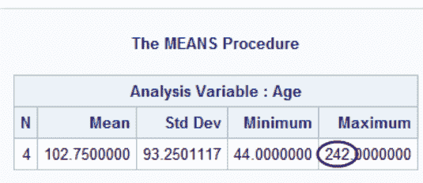

| N | 平均值 | 标准差 | 最小值 | 最大值 |
|---|---|---|---|---|
| 4 | 102.750000 | 93 | 2501117 | 44.000000 | 242000000 |

## 使用赋值语句清洗数据

如果识别出无效数据，你可以使用赋值语句或条件子来以程序方式清洗无效数据。例如，如果你的输入数据包含一个 `Gender` 字段（除 M 或 F 以外的值），你可以通过将无效值更改为 `Gender` 的有效值来清洗数据。新数据集包含原始数据集中的所有数据，以及针对无效数据的正确值。

接下来的示例假设输入数据中的 `Gender` 有一个无效值 G。此错误可能是数据录入错误的结果。如果 G 实际上应该是 F，则可能可以使用赋值语句配合 `IF-THEN` 语句来修正 `Gender` 的无效数据：


```sas
data.clean_data;
set work.patients;
gender=upcase(Gender);
if Gender='G' then Gender='F';
```

```sas
proc print data=work.clean_data;
```

注意有两个观测值包含 Age 的无效值。这些值超过了 110 的最大值。可以通过指定变量 `Empid` 来唯一地标识每个观测值。在检查每个观测值的出生日期并确定 `Age` 的正确值后，可以通过插入 IF-THEN-ELSE 语句来清洗数据：

```sas
data.clean_data;
set work.patients;
if empid=3294 then age=65;
else if empid=7391 then age=75;
```

```sas
proc print data=work.clean_data;
```

另一种确保你的输出数据集包含有效数据的方法是以程序方式识别无效数据，并从你的输出数据集中删除相关的观测值：

```sas
data.clean_data;
set work.patients;
if Age>110 then delete;
run;
proc print data=work.clean_data;
run;
```

## 测试你的程序

## 限制观测值

记住，你可以在 `INFILE` 语句中使用 `OBS=` 选项来限制 DATA 步执行期间读取或创建的观测值数量。

```sas
data work.update;
infile obs=10;
input Item $13 Idnum $15 Instock $21 Backord $25;
run;
```

处理时，该 DATA 步创建的 `work.update` 只有 10 个观测值。

## PUT 语句

当程序错误不明显时，可以使用 `PUT` 语句检查变量并在日志中打印自定义消息。关于 IF-THEN/ELSE 语句的更多信息，请参阅第 231 页“创建和管理变量”。

```sas
data work.test;
infile loan;
input Code $3-10 Amount 12-16 Account $18-25 Months 27-28;
if code='1' then type='variable';
else if code='2' then type='fixed';
else type='unknown';
if type='unknown' then put 'MY NOTE: invalid value:' code;
run;
```

在此示例中，`Code` 没有预期的值 1 或 2，`PUT` 语句向日志写入了消息。

## 日志 7.4 SAS Log

```text
MY NOTE: invalid value: Code-V
NOTE: 9 records were read from the infile LOAN.
nThe record length was 28.
The maximum record length was 28.
NOTE: the data set WORK.TEST has 9 observations and 6 variables.
NOTE: DATA statement used (Total process time):
  real time      0.01 seconds
  cpu time      0.03 seconds
```

## 语法：PUT 语句

指定要写入的内容、如何写入以及写入的位置。例如：

- 字符字符串
- 一个或多个数据集变量
- 自动变量 `_N_` 和 `_ERROR_`
- 自动变量 `_ALL_`

## 示例：字符字符串

你可以使用 `PUT` 语句指定字符字符串来识别日志中的消息。字符字符串必须包含在双引号内。

```sas
put 'MY NOTE: The condition was met.';
```

## 日志 7.5 SAS Log

```text
MY NOTE: The condition was met.
NOTE: 9 records were read from the infile LOAN.
nThe record length was 28.
The maximum record length was 28.
NOTE: the data set WORK.TEST has 9 observations and 6 variables.
NOTE: DATA statement used (Total process time):
  real time      0.01 seconds
  cpu time      0.03 seconds
```

## 示例：数据集变量

你可以使用 `PUT` 语句指定一个或多个数据集变量，以便在该 DATA 步的迭代中检查：

```sas
put 'MY NOTE: invalid value: ' code type;
```

160 第 7 章 • 理解 DATA 步处理

## 日志 7.6 SAS Log

```text
MY NOTE: invalid value: V unknown
NOTE: 9 records were read from the infile LOAN.
The minimum record length was 28.
The maximum record length was 28.
NOTE: The data set WORK.TEST has 9 observations and 6 variables.
NOTE: DATA statement used (Total process time):
real time 0.00 seconds
cpu time 0.00 seconds
```

当你在 `PUT` 语句中指定一个变量时，只有它的值会被写入日志。若想在日志中同时写入变量名和值，请在变量名后添加一个等号（`=`）。

```sas
put 'MY NOTE: invalid value: ' code= type=;
```

## 日志 7.7 SAS Log

```text
MY NOTE: invalid value: Code=V type=unknown
NOTE: 9 records were read from the infile LOAN.
The minimum record length was 28.
The maximum record length was 28.
NOTE: The data set WORK.TEST has 9 observations and 6 variables.
NOTE: DATA statement used (Total process time):
real time 0.01 seconds
cpu time 0.00 seconds
```

## 示例：自动变量

你可以使用 `PUT` 语句来显示自动变量 `_N_` 和 `_ERROR_` 的值。在某些情况下，知道 `_N_` 的值可以帮助你定位数据集中的某个观测值：

```sas
put 'MY NOTE: invalid value: '
    code=_N_=_ERROR_;
```

## 日志 7.8 SAS Log

```text
MY NOTE: invalid value: Code=_N__ERROR_=0
NOTE: 9 records were read from the infile LOAN.
The minimum record length was 28.
The maximum record length was 28.
NOTE: The data set WORK.TEST has 9 observations and 6 variables.
NOTE: DATA statement used (Total process time):
real time 0.01 seconds
cpu time 0.00 seconds
```

你还可以使用 `PUT` 语句将所有变量名和变量值（包括自动变量）写入日志。使用 `_ALL_` 规格说明：

```sas
put 'MY NOTE: invalid value: ' _all_;
```

## 章测验 161

### 日志 7.9 SAS Log

```text
MY NOTE: invalid value: Code=V Amount=10000 Rate=10.5 Account=101-128 Months=#
type=unknown ERROR_0 _N_=3
NOTE: 9 records were read from the infile LOAN.
The minimum record length was 28.
The maximum record length was 28.
NOTE: The data set TEST has 9 observations and 6 variables.
NOTE: DATA statement used (Total process time):
real time 0.01 seconds
cpu time 0.01 seconds
```

## 示例：条件处理

你可以使用带有条件处理（即带有 IF-THEN/ELSE 语句）的 `PUT` 语句来标记错误或超出范围的数据。在下面的示例中，`PUT` 语句用于标记变量 `Rate`（利率）的任何缺失值或零值。

```sas
data finance.newcalc;
infile newloans;
input ID$ 1-4 Rate 5-8 Amount 9-19;
if rate>0 then
 Interest=amount*(rate/12);
else put 'DATA ERROR ' rate= _n_;
```

## 章测验

为每个问题选择最佳答案。使用附录中的答案对照检查你的答案。

1. 下列哪项在编译阶段不会创建？

   a. 数据集描述符（data set descriptor）

   b. 第一个观测值

   c. 程序数据向量（program data vector）

   d. `_N_` 和 `_ERROR_` 自动变量

2. 在编译阶段，SAS 会扫描 DATA 步中的每个语句以检查语法错误。下列哪项不被视为语法错误？

   a. 错误的值和格式

   b. 无效的选项或变量名

   c. 缺失或无效的标点符号

   d. 缺失或拼写错误的关键字

3. 除非另有说明，DATA 步如何执行？

   a. 每个编译阶段执行一次

   b. 每个 DATA 语句执行一次

   c. 输入文件中的每条记录执行一次

   d. 输入文件中的每个变量执行一次

4. 在执行阶段开始时，`_N_` 的值为 1，`_ERROR_` 的值为 0，其余变量的值被设置为：

   a. 0

   b. 1

   c. 未定义

   d. 缺失

5. 假设你运行的程序导致 3 个 DATA 步错误。当处理包含第三个错误的观测值时，自动变量 `_ERROR_` 的值是多少？

   a. 0

   b. 1

   c. 2

   d. 3

6. 下列哪个操作发生在 DATA 步迭代的开始时？

   a. 自动变量 `_N_` 和 `_ERROR_` 加 1。

   b. DATA 步停止执行。

   c. 写入 DATA 步的描述部分。

   d. 程序语句创建变量的值在程序数据向量中重置为缺失。

7. 考虑以下 DATA 步。根据 `INPUT` 语句，变量在新的 DATA 步中的存储顺序是？

```sas
data work.update;
infile invent;
input IDnum $ Item 1-13 Instock 21-22
      BackOrd 24-25;
Total=instock+backord;
run;
```

a. `IDnum Item Instock BackOrd Total`

b. `Item IDnum Instock BackOrd Total`

c. `Total IDnum Instock BackOrd`

d. `Total IDnum Instock BackOrd`

8. 当 SAS 无法解释语法错误时会发生什么？

   a. 数据变量包含缺失值。

   b. DATA 步仍然无法编译。

   c. DATA 步仍然编译，但不会执行。

   d. DATA 步仍然编译并执行。

9. 下列程序哪里有问题？

```sas
data work.update;
infile invent;
input IDnum $ Item 1-13 Instock 21-22
      BackOrd 24-25;
Total=instock+backord;
run;
```

   a. 第二行缺少分号。

   b. 第三行缺少分号。

   c. 变量顺序错误。

   d. 变量类型错误。

10. 考虑以下 SAS 日志。根据日志，DATA 步最可能的问题是什么？

```text
MY NOTE: invalid value: Code=V Amount=10000 Rate=10.5 Account=101-128 Months=#
type=unknown ERROR_0 _N_=3
NOTE: 9 records were read from the infile LOAN.
The minimum record length was 28.
The maximum record length was 28.
NOTE: The data set TEST has 9 observations and 6 variables.
```

160 第 7 章 • 理解 DATA 步处理

## 日志 7.6 SAS Log

```text
MY NOTE: invalid value: V unknown
NOTE: 9 records were read from the infile LOAN.
The minimum record length was 28.
The maximum record length was 28.
NOTE: The data set WORK.TEST has 9 observations and 6 variables.
NOTE: DATA statement used (Total process time):
real time 0.00 seconds
cpu time 0.00 seconds
```

当你在 `PUT` 语句中指定一个变量时，只有它的值会被写入日志。若想在日志中同时写入变量名和值，请在变量名后添加一个等号（`=`）。

```sas
put 'MY NOTE: invalid value: ' code= type=;
```

## 日志 7.7 SAS Log

```text
MY NOTE: invalid value: Code=V type=unknown
NOTE: 9 records were read from the infile LOAN.
The minimum record length was 28.
The maximum record length was 28.
NOTE: The data set WORK.TEST has 9 observations and 6 variables.
NOTE: DATA statement used (Total process time):
real time 0.01 seconds
cpu time 0.00 seconds
```

## 示例：自动变量

你可以使用 `PUT` 语句来显示自动变量 `_N_` 和 `_ERROR_` 的值。在某些情况下，知道 `_N_` 的值可以帮助你定位数据集中的某个观测值：

```sas
put 'MY NOTE: invalid value: '
    code=_N_=_ERROR_;
```

## 日志 7.8 SAS Log

```text
MY NOTE: invalid value: Code=_N__ERROR_=0
NOTE: 9 records were read from the infile LOAN.
The minimum record length was 28.
The maximum record length was 28.
NOTE: The data set WORK.TEST has 9 observations and 6 variables.
NOTE: DATA statement used (Total process time):
real time 0.01 seconds
cpu time 0.00 seconds
```

你还可以使用 `PUT` 语句将所有变量名和变量值（包括自动变量）写入日志。使用 `_ALL_` 规格说明：

```sas
put 'MY NOTE: invalid value: ' _all_;
```

## 章测验 161

### 日志 7.9 SAS Log

```text
MY NOTE: invalid value: Code=V Amount=10000 Rate=10.5 Account=101-128 Months=#
type=unknown ERROR_0 _N_=3
NOTE: 9 records were read from the infile LOAN.
The minimum record length was 28.
The maximum record length was 28.
NOTE: The data set TEST has 9 observations and 6 variables.
NOTE: DATA statement used (Total process time):
real time 0.01 seconds
cpu time 0.01 seconds
```


## 示例：条件处理

你可以使用带有条件处理（即带有 IF-THEN/ELSE 语句）的 PUT 语句来标记错误或超出范围的数据。在下面的示例中，PUT 语句用于标记变量 `Rate`（利率）的任何缺失值或零值。

```sas
data finance.newcalc;
infile newloans;
input ID$ 1-4 Rate 5-8 Amount 9-19;
if rate>0 then
    Interest=amount*(rate/12);
else put 'DATA ERROR ' rate= _n_;
```

## 章测验

为每个问题选择最佳答案。使用附录中的答案对照检查你的答案。

1. 下列哪项在编译阶段不会创建？

   a. 数据集描述符 (data set descriptor)  
   b. 第一个观测值  
   c. 程序数据向量 (program data vector)  
   d. `_N_` 和 `_ERROR_` 自动变量

2. 在编译阶段，SAS 会扫描 DATA 步中的每个语句以检查语法错误。下列哪项不被视为语法错误？

   a. 错误的值和格式  
   b. 无效的选项或变量名  
   c. 缺失或无效的标点符号  
   d. 缺失或拼错误的关键字

3. 除非另有说明，DATA 步如何执行？

   a. 每个编译阶段执行一次  
   b. 每个 DATA 语句执行一次  
   c. 输入文件中的每条记录执行一次  
   d. 输入文件中的每个变量执行一次

4. 在执行阶段开始时，`_N_` 的值为 1，`_ERROR_` 的值为 0，其余变量的值被设置为：

   a. 0  
   b. 1  
   c. 未定义  
   d. 缺失

5. 假设你运行的程序导致 3 个 DATA 步错误。当处理包含第三个错误的观测值时，自动变量 `_ERROR_` 的值是多少？

   a. 0  
   b. 1  
   c. 2  
   d. 3

6. 下列哪个操作发生在 DATA 步迭代的开始时？

   a. 自动变量 `_N_` 和 `_ERROR_` 加 1。  
   b. DATA 步停止执行。  
   c. 写入 DATA 步的描述部分。  
   d. 程序语句创建变量的值在程序数据向量中重置为缺失。

7. 考虑以下 DATA 步。根据 INPUT 语句，变量在新的 DATA 步中的存储顺序是？

```sas
data work.update;
infile invent;
input IDnum $ Item 1-13 Instock 21-22
BackOrd 24-25;
Total=instock+backord;
```

a. `IDnum Item Instock BackOrd Total`  
b. `Item IDnum Instock BackOrd Total`  
c. `Total IDnum Instock BackOrd`  
d. `Total IDnum Instock BackOrd`

8. 当 SAS 无法解释语法错误时会发生什么？

   a. 数据变量包含缺失值。  
   b. DATA 步仍然无法编译。  
   c. DATA 步仍然编译，但不会执行。  
   d. DATA 步仍然编译并执行。

9. 下列程序哪里有问题？

```sas
data work.update;
infile invent;
input IDnum $ Item 1-13 Instock 21-22
BackOrd 24-25;
Total=instock+backord;
run;
```

   a. 第二行缺少分号。  
   b. 第三行缺少分号。  
   c. 变量顺序错误。  
   d. 变量类型错误。

10. 考虑以下 SAS 日志。根据日志，DATA 步最可能问题是什么？

## 第 7 章 • 理解 DATA 步处理

### 日志 7.6 SAS Log

```text
MY NOTE: invalid value: V unknown
NOTE: 9 records were read from the infile LOAN.
The minimum record length was 28.
The maximum record length was 28.
NOTE: The data set WORK.TEST has 9 observations and 6 variables.
NOTE: DATA statement used (Total process time):
real time 0.00 seconds
cpu time 0.00 seconds
```

当你在 PUT 语句中指定一个变量时，只有它的值会被写入日志。若想在日志中同时写入变量名和值，请在变量名后添加一个等号 (`=`)。

```sas
put MY NOTE: invalid value: 'code=type';
```

### 日志 7.7 SAS Log

```text
MY NOTE: invalid value: Code=V type=unknown
NOTE: 9 records were read from the infile LOAN.
The minimum record length was 28.
The maximum record length was 28.
NOTE: The data set WORK.TEST has 9 observations and 6 variables.
NOTE: DATA statement used (Total process time):
real time 0.01 seconds
cpu time 0.00 seconds
```

## 示例：自动变量

你可以使用 PUT 语句来显示自动变量 `_N_` 和 `_ERROR_` 的值。在某些情况下，知道 `_N_` 的值可以帮助你定位数据集中的某个观测值：

```sas
put MY NOTE: invalid value: '
code=_N_=_ERROR_;
```

### 日志 7.8 SAS Log

```text
MY NOTE: invalid value: Code=_N__ERROR_=0
NOTE: 9 records were read from the infile LOAN.
The minimum record length was 28.
The maximum record length was 28.
NOTE: The data set WORK.TEST has 9 observations and 6 variables.
NOTE: DATA statement used (Total process time):
real time 0.01 seconds
cpu time 0.00 seconds
```

你还可以使用 PUT 语句将所有变量名和变量值（包括自动变量）写入日志。使用 `_ALL_` 规格说明：

```sas
put MY NOTE: invalid value: '_all_ ;
```

### 日志 7.9 SAS Log

```text
MY NOTE: invalid value: Code=V Amount=10000 Rate=10.5 Account=101-128 Months=#
type=unknown ERROR_0 _N_=3
NOTE: 9 records were read from the infile LOAN.
The minimum record length was 28.
The maximum record length was 28.
NOTE: The data set TEST has 9 observations and 6 variables.
NOTE: DATA statement used (Total process time):
real time 0.01 seconds
cpu time 0.01 seconds
```

## 定义唯一格式

### VALUE 语句

使用 VALUE 语句来定义一个或多个值的显示格式。

#### 语法：VALUE 语句

```sas
VALUE format-name
    range1='label1'
    range2='label2'
    ...format-names...;
```

以下关于 `format-name`（格式名称）的说明：

- 如果格式适用于字符，格式名称必须以美元符号 (`$`) 开头。
- 格式名称必须是有效的 SAS 名称。
- 格式名称不能与现有的 SAS 格式重名。
- 格式名称不能以数字结尾。
- 在 VALUE 语句中指定时，格式名称末尾不带句号。
- 数值格式名称长度可达 32 个字符。
- 字符格式名称长度可达 31 个字符。

> **提示：**如果你运行的是 SAS 9 之前的版本，格式名称必须是八个字符以内的 SAS 名称，且不能以数字结尾。

注意，该语句以关键字 VALUE 开始，并在定义完所有标签后以分号结束。以下 VALUE 语句创建了 `GENDER`、`AGEGROUP` 和 `COLOR` 格式，用于指定随后分别分配给变量 `Sex`、`Age` 和 `Color` 的描述性标签：

```sas
proc format;
value gender
    1 = 'Male'
    2 = 'Female';

value agegroup
    13-20 = 'Teen'
    20-65 = 'Adult'
    65 HIGH = 'Senior';

value color
    'W' = 'Moon White'
    'B' = 'Sky Blue'
    'Y' = 'Sunburst Yellow'
    'G' = 'Rain Cloud Gray';
```

VALUE 范围指定以下类型的值：

- 单个值，例如 `24` 或 `'$b'`
- 数值范围，例如 `0-1500`
- 用引号括起来的字符范围，例如 `'A'-'M'`
- 用逗号分隔的唯一值列表，如 `90,180,270` 或 `'B', 'D', 'F'`。这些值可以是字符或数值，但不能是字符和数值的混合（因为格式本身要么是字符要么是数值）。

当指定值为字符值时，必须包含在引号中，并且必须与变量值的大小写匹配。格式名称也必须以美元符号 (`$`) 开头。例如，下面的 VALUE 语句定义了 `$GRADE` 格式，将字符 `lib` 显示为文本标签。

```sas
proc format lib=library;
value $grade
    'A'='Good'
    'B'-'D'='Fair'
    'F'='Poor'
    'I'-'U'='See Instructor';
```

当指定值为数值值时，不需要包含在引号中，且格式名称不应以美元符号 (`$`) 开始。

## 指定值范围

你可以使用小于符号 (`<`) 指定一个不包含边界的数值范围，以避免任何重叠。在这个示例中，从 0 到小于 13 的值范围标记为 `child`。下一个范围从 13 开始，因此标签 `teenager` 将分配给 13 到 19 之间。

```sas
proc format lib=library;
value agefmt
    0-<13='child'
    13-<20='teenager'
    20-<65='adult'
    65-100='senior citizen';
run;
```

你还可以使用关键字 LOW 和 HIGH 来指定变量值范围的下限和上限。关键字 LOW 不包含数值值。关键字 OTHER 可将缺失值标记为任何未在特定范围中具体说明的值。

```sas
proc format lib=library;
value agefmt
    low-<13='child'
    13-<20='teenager'
    20-<65='adult'
    65-high='senior citizen'
    other='unknown';
run;
```

> **提示：**如果用于显示每个范围的标签，关键字 LOW 包含字符值。

在指定显示每个范围的标签时，请记住以下操作：

- 将标签包含在引号中。
- 将标签限制在 32,767 个字符以内。
- 如果要在标签中显示引号，请使用两个单引号：

```sas
000='employee''s jobtitle unknown;
```

要定义多个格式，可以在单个 `PROC FORMAT` 步骤中使用多个 VALUE 语句。在这个示例中，每个 VALUE 语句定义了一个不同的格式。

SAS 日志打印会通知你格式已创建。

### 日志 8.1 SAS 日志

```text
146 proc format;
147   value gender    1 = 'Male'
148                     2 = 'Female'
NOTE: GENDER is already on the library WORK.FORMATS.
NOTE: GENDER has been compiled.
149   value agegroup 13 < 20 = 'Teen'
150                   20 < 65 = 'Adult'
151                   65 - HIGH = 'Senior';
NOTE: AGEGROUP is already on the library WORK.FORMATS.
NOTE: AGEGROUP has been output.
152   value scol      'W' = 'Moon White'
153                   'B' = 'Sky Blue'
154                   'Y' = 'Sunburst Yellow'
155                   'G' = 'Rain Cloud Gray';
NOTE: SCOL is already on the library WORK.FORMATS.
NOTE: SCOL has been output.
```


由于你已经为 Sex、Age 和 Color 的值定义了 `GENDER`、`AGEGROUP` 和 `SCOL` 格式，可以使用 `PROC PRINT` 获得更易读的输出。

## 将用户定义的格式与变量关联

### SAS 如何查找格式目录

要在随后的 SAS 会话中使用 `GENDER`、`AGEGROUP` 和 `SCOL` 格式，必须再次分配 `libref` 库。

```sas
libname library 'c:\sas\formats\lib';
```

SAS 按照顺序在两个库中搜索 `GENDER`、`AGEGROUP` 和 `SCOL`：

- `Work` 引用的临时库
- 由 `libref Library` 引用的永久库
- SAS 使用它找到的指定格式的第一个实例。

> **提示：** 你可以使用 `PROC CATALOG` 格式格式。

### 将格式分配给变量

与 SAS 格式一样，你将用户定义的格式与变量关联。通过在 DATA 步（step）中放置 `FORMAT` 语句，你可以将格式与变量永久关联。

当你提交 `PRINT` 命令时，`carsvey` 的输出将显示描述性标签而不是原始值，如下如图所示。

```sas
libname format 'c:\sas\formats';

proc format lib=library;
  value gender
    1 = 'Male'
    2 = 'Female';

  value agegroup
    13-20 = 'Teen'
    20-65 = 'Adult';
```

**图 8.2 Carsvey 数据集**

| 观测值 | 年龄 | 性别 | 收入 | 颜色 |
|---|---|---|---|---|
| 1 | Teen | 男 | $14,000 | 旭日黄 |
| 2 | Adult | 男 | $65,000 | 雨云灰 |
| 3 | 女 | 女 | $35,000 | B |
| 4 | Adult | 男 | $44,000 | 旭日黄 |
| 5 | Adult | 女 | $83,000 | 月光白 |

*注：图 8.3 中的观测值 3 在提供的原始文本中缺失了年龄值，但根据表头和上下文可以推断其结构。*

*更正：根据文本内容，图 8.3 如下：*

**图 8.3 Work.Carsvey 数据集**

| 观测值 | 年龄 | 性别 | 收入 | 颜色 |
|---|---|---|---|---|
| 1 | Teen | 男 | $14,000 | 旭日黄 |
| 2 | Adult | 男 | $65,000 | 雨云灰 |
| 3 | 女 | 女 | $35,000 | B |
| 4 | Adult | 男 | $44,000 | 旭日黄 |
| 5 | Adult | 女 | $83,000 | 月光白 |

为变量关联格式时，请记住以下操作：

- 在 `FORMAT` 语句中使用与 `VALUE` 语句中相同的格式。
- 在使用时在格式名称末尾加上句号。

如果你没有定义变量的所有值，那么未在 `VALUE` 语句中列出的值如下所示。

```sas
$value col

'W' = 'Moon White'
'Y' = 'Sunburst Yellow'
'G' = 'Rain Cloud Gray';

data carsvey;

infile Z:\sasuser\cars.dat;

input Age Color $

format Sex gender. Agegroup. Color. Income DOLLAR$;

run;

proc print data=work.carsvey;

run;
```

当你构建了一个大型永久格式目录时，很容易忘记特定格式名称的准确拼写或其值范围。在 `PROC FORMAT` 语句中添加 `FMTLIB` 关键字可以显示目录中所有格式的列表以及它们的值描述。

```sas
libname library 'c:\sas\formats';

proc format library=library fmtlib;

run;
```

当你提交此 `PROC` 步骤时，永久目录中每个格式的描述将作为输出显示。

### 格式描述

172 第 8 章 • 创建和应用自定义格式

**图 8.4** SAS 输出：格式描述

| 格式名称: AGEGROUP 长度:6 数值个数:3 |
|---|
| 最小长度:1 最大长度:40 默认长度:6 模糊性: STD |
| 开始 结束 标签 (版本 7.UTIVB 30MAR2017:13:26:59) |
| 13 20 青少年 |
| 20 65 成人 |
| 65 100 老人 |

| 格式名称: GENDER 长度:6 数值个数:2 |
|---|
| 最小长度:1 最大长度:40 默认长度:6 模糊性:STD |
| 开始 结束 标签 (版本 7.UTIVB 30MAR2017:13:26:59) |
| 1 1 男性 |
| 2 2 女性 |

| 格式名称: $COL 长度:15 数值个数:4 |
|---|
| 最小长度:1 最大长度:40 默认长度:15 模糊性:0 |
| 开始 结束 标签 (版本 7.UTIVB 30MAR2017:13:26:59) |
| B B 天蓝色 |
| B G 雾云灰 |
| W W 月光白 |
| Y V 旭日黄 |

除了名称、范围和标签外，格式描述还包含以下细节：

- 最长标签的长度
- 由此格式定义的数值个数
- 用于创建格式的 SAS 版本
- 创建日期和时间

## 本章测验

为每个问题选择最佳答案。使用附录中的答案对照检查你的答案。

1. 假设你没有指定 `LIBRARY=` 选项，并且你的格式存储在 `Work.Formats` 中。它们会存在多久？

   a. 仅针对当前过程  
   b. 仅针对当前 DATA step  
   c. 仅针对当前 SAS 会话  
   d. 永久存在

2. 下列哪个语句会将你的格式存储在永久目录中？

   a.

   ```sas
   libname library 'c:\sas\formats\lib';
   proc format lib=library
   ```

   b.

   ```sas
   libname library 'c:\sas\formats\lib';
   format lib=library
   ```

   c.

   ```sas
   library="c:\sas\formats\lib";
   proc format library
   ```

   d.

   ```sas
   library="c:\sas\formats\lib";
   proc format library
   ```

3. 当你使用 `VALUE` 语句创建格式时，记住新格式的名称不能以数字结尾，不能以句号结尾，且不能是 SAS 格式的名称。下列哪项也是正确的？

   a. 名称不能是数据集变量的名称。  
   b. 名称必须至少两个字符长。  
   c. 名称必须至少八个字符长。  
   d. 如果与字符变量一起，名称必须以美元符号（`$`）开头。

4. 下列哪个 `FORMAT` 过程编写是正确的？

   a.

   ```sas
   proc format lib=library;

   value colorfmt;

   1='Red'

   2='Green'

   3='Blue'
   ```

   b.

   ```sas
   proc format lib=library;

   value colorfmt;

   1='Red'

   2='Green'

   3='Blue'

   run;
   ```

   c.

   ```sas
   proc format lib=library;

   value colorfmt;

   1='Red'

   2='Green'

   3='Blue'

   run;
   ```

   d.

   ```sas
   proc format lib=library;

   value colorfmt;

   1='Red'

   2='Green'

   3='Blue'

   run;
   ```

5. 关于 `VALUE` 语句中的范围可以指定的内容，以下哪个陈述是错误的？

   a. 它们可以指定单个值，例如 24 或 `'s'`。  
   b. 它们可以指定数值值范围，例如 0-1500。  
   c. 字符值范围，例如 `'A'`-`'M'`。  
   d. 一个用逗号分隔的数值和字符值列表，例如 90、`'B'`、180、`'D'`、270。

6. 标签可以使用多少个字符？

   a. 96  
   b. 200  
   c. 256  
   d. 32,767

7. 哪个关键字可以用于标记缺失的数值值以及未指定在范围内的任何值？

   a. `LOW`  
   b. `MISS`  
   c. `MISSING`  
   d. `OTHER`

8. 你可以将 `FORMAT` 语句放在 DATA step 或 PROC step 中。当你把它放在 DATA step 中时，会发生什么？

   a. 你临时地将格式与变量关联。  
   b. 你永久地将格式与变量关联。  
   c. 你用格式标签替换原始数据。  
   d. 你让格式对其他数据集可用。

9. 假设格式 `JOBFMT` 是在 FORMAT 过程中创建的。哪一个 FORMAT 语句将其应用于程序输出中的变量 `jobTitle`？

   a. `format jobtitle jobfmt;`  
   b. `format jobtitle=jobfmt;`  
   c. `format jobtitle=jobfmt;`  
   d. `format jobtitle='jobfmt';`

10. 哪个关键字在添加到 `PROC FORMAT` 语句时，会显示你目录中的所有格式？

    a. `CATALOG`  
    b. `LISTFMT`  
    c. `FMTCAT`  
    d. `FMTLIB`

## 第 9 章

## 生成描述性统计

- 使用 `PROC MEANS` 计算统计 ........................................ 176
- MEANS 过程的作用是什么？ ..................................................... 176
- `PROC MEANS` Step ................................................................................ 176
- 选择统计量 ................................................................................ 177
- 限制小数 ............................................................................ 180
- 在 `PROC MEANS` 中指定变量 ....................................................... 181
- 使用 `CLASS` 语句进行分组处理 ......................................... 182
- 使用 `BY` 语句进行分组处理 ................................................... 183
- 使用 `PROC MEANS` 创建摘要数据集 .................................... 184
- `OUTPUT` 语句语法 ........................................................................... 184
- 在 `PROC MEANS` 中指定统计量 ............................................... 185
- 使用 `PROC SUMMARY` 创建摘要数据集 ................................. 186
- 示例：创建一个输出数据集 ...................................... 186
- 使用 `PROC FREQ` 生成频数表 ........................................ 187
- `PROC FREQ` 语法 ..................................................................... 187
- 在 `PROC FREQ` 中指定变量 ....................................................... 189
- `TABLES` 语句语法 ........................................................................ 189
- 示例：确定报告布局 ................................................................. 189
- 创建双向表 ........................................................................ 191
- 创建多向表 ............................................................................ 192
- 概述 .......................................................................................................... 192
- 确定表格布局 ................................................................... 193
- 以列表格式创建表格 ............................................................... 194
- `LIST` 选项语法 .......................................................................... 194
- 示例：使用 `LIST` 选项 ............................................................ 195
- 更改表格格式 ...................................................... 195
- 隐藏表格信息 ................................................ 196
- 示例：隐藏百分比 ................................................ 197
- 本章测验 ................................................................................ 198

## 使用 PROC MEANS 计算统计

### MEANS 过程的作用

MEANS 过程提供了数据汇总工具，用于计算跨观测值和观测值组的描述性统计量。例如，`PROC MEANS` 执行以下操作：

- 基于矩计算描述性统计量
- 估计分位数，包括位数
- 计算均值的置信限
- 识别极值
- 执行 t 检验

默认情况下，`PROC MEANS` 显示输出。

### PROC MEANS Step

MEANS 过程可以包含许多指定统计量的语句和选项。

`PROC MEANS` 语法：

```sas
PROC MEANS <DATA=data-set>
<statistic-keyword(s)> <option(s);
```

`RUN`：

- `SAS-data-set`：要分析的数据集。
- `statistic-keyword(s)`：指定要计算的统计量。
- `option(s)`：控制输出的内容、分析和外观。

在最简单的形式下，`PROC MEANS` 输出数据集中每个数值变量的计数（非缺失值个数）、均值、标准差以及最小值和最大值。

```sas
proc means data=perm.survey;

run;
```


# 图 9.1 PROC MEANS 默认输出

| 变量 | N | 平均值 | 标准差 | 最小值 | 最大值 |
|---|---:|---:|---:|---:|---:|
| `Item1` | 4 | 3.750000 | 1.258307 | 2.000000 | 5.000000 |
| `Item2` | 4 | 3.000000 | 1.629932 | 1.000000 | 5.000000 |
| `Item3` | 4 | 4.250000 | 0.500000 | 4.000000 | 5.000000 |
| `Item4` | 4 | 3.500000 | 1.299944 | 2.000000 | 5.000000 |
| `Item5` | 4 | 3.000000 | 1.629932 | 1.000000 | 5.000000 |
| `Item6` | 4 | 3.750000 | 1.258307 | 2.000000 | 5.000000 |
| `Item7` | 4 | 3.000000 | 1.825749 | 1.000000 | 5.000000 |
| `Item8` | 4 | 2.750000 | 1.500000 | 1.000000 | 4.000000 |
| `Item9` | 4 | 3.000000 | 1.441216 | 2.000000 | 5.000000 |
| `Item10` | 4 | 3.250000 | 1.258307 | 2.000000 | 5.000000 |
| `Item11` | 4 | 3.000000 | 1.825749 | 1.000000 | 5.000000 |
| `Item12` | 4 | 2.750000 | 0.500000 | 2.000000 | 3.000000 |
| `Item13` | 4 | 2.750000 | 1.000000 | 1.000000 | 4.000000 |
| `Item14` | 4 | 2.750000 | 1.441216 | 2.000000 | 5.000000 |
| `Item15` | 4 | 3.000000 | 1.629932 | 1.000000 | 5.000000 |
| `Item16` | 4 | 2.500000 | 1.914852 | 1.000000 | 5.000000 |
| `Item17` | 4 | 3.000000 | 1.154705 | 2.000000 | 4.000000 |
| `Item18` | 4 | 3.250000 | 1.258307 | 2.000000 | 5.000000 |

## 选择统计量

MEANS 过程产生的默认统计量并不总是你需要的。你可能希望将输出限制为值的平均值，或者可能需要计算不同的统计量，例如值的中位数或范围。

要指定统计量，请在 `PROC MEANS` 语句中包含关键字作为选项。当你在 `PROC MEANS` 语句中指定统计量时，不会产生默认统计量。例如，要确定 `Perm.Survey` 数值的中位数和范围，请使用 `MEDIAN` 和 `RANGE` 关键字作为选项。

```sas
proc means data=perm.survey median range;
run;
```

# 图 9.2 显示中位数和范围的 MEANS 过程输出

| 变量 | 中位数 | 范围 |
|---|---:|---:|
| `Item1` | 4.000000 | 3.000000 |
| `Item2` | 3.000000 | 4.000000 |
| `Item3` | 4.000000 | 1.000000 |
| `Item4` | 3.500000 | 3.000000 |
| `Item5` | 3.000000 | 4.000000 |
| `Item6` | 4.000000 | 3.000000 |
| `Item7` | 3.000000 | 4.000000 |
| `Item8` | 3.000000 | 3.000000 |
| `Item9` | 2.500000 | 3.000000 |
| `Item10` | 3.000000 | 3.000000 |
| `Item11` | 3.000000 | 4.000000 |
| `Item12` | 3.000000 | 1.000000 |
| `Item13` | 3.000000 | 3.000000 |
| `Item14` | 2.500000 | 3.000000 |
| `Item15` | 3.000000 | 4.000000 |
| `Item16` | 2.000000 | 4.000000 |
| `Item17` | 3.000000 | 2.000000 |
| `Item18` | 3.000000 | 3.000000 |

使用 `PROC MEANS` 配合以下关键字计算统计量。

## 表 9.1 描述性统计量

| 关键字 | 描述 |
|---|---|
| `CLM` | 均值的双侧置信限 |
| `CSS` | 修正平方和 |
| `CV` | 变异系数 |
| `KURTOSIS` | 峰度 |
| `LCLM` | 均值下方单侧置信限 |
| `MAX` | 最大值 |
| `MEAN` | 平均值 |
| `MIN` | 最小值 |
| `MODE` | 出现频率最高的值 |
| `N` | 观测值数量 |
| `NMISS` | 非缺失数量 |
| `RANGE` | 范围 |

## 表 9.2 分位数统计量

| 关键字 | 描述 |
|---|---|
| `SKEWNESS` | 偏度 |
| `STDDEV / STD` | 标准差 |
| `STDERR` | 均误差 |
| `SUM` | 和 |
| `SUMGT` | 权重和 |
| `UCLM` | 均值上方单侧置信限 |
| `USS` | 未修正平方和 |
| `VAR` | 方差 |

## 表 9.3 假设检验

| 关键字 | 描述 |
|---|---|
| `MEDIAN / P50` | 中位数或 50 分位数 |
| `P1` | 1 分位数 |
| `P5` | 5 分位数 |
| `P10` | 10 分位数 |
| `Q1 / P25` | 下四位数或 25 分位数 |
| `Q3 / P75` | 上四位数或 75 分位数 |
| `P90` | 90 分位数 |
| `P95` | 95 分位数 |
| `P99` | 99 分位数 |
| `RANGE` | 上下位数之间的范围 |
| `PROBT` | 大于均值的概率 |
| `T` | t 统计量 |

## 限制小数位数

默认情况下，`PROC MEANS` 使用 `BESTw` 格式显示数值。如果不指定格式，SAS 会根据可用信息选择小数位数，这导致输出难以阅读。

要限制小数位数，可以在 `PROC MEANS` 语句中使用 `MAXDEC=` 选项来设置最大小数位数。

# 图 9.4 带有 MAXDEC= 的变量

```sas
proc means data=diabetes maxdec=0;
run;
```

| 变量 | 最小值 | 最大值 |
|---|---:|---:|
| `Age` | 15 | 63 |
| `Height` | 61 | 75 |
| `Weight` | 102 | 240 |
| `Pulse` | 65 | 100 |
| `FastGluc` | 152 | 568 |
| `PostGluc` | 206 | 625 |

## 在 PROC MEANS 中指定变量

默认情况下，MEANS 过程会对数据集中的每个变量生成统计量。关注某些变量请使用 `VAR` 语句。这在数据集很大时特别有用。

```sas
proc means data=clinic;
  var age height;
run;
```

# 图 9.5 使用 VAR 的输出

| 存活 | 性别 | 观测值 | 变量 | 平均值 | 标准差 | 最小值 | 最大值 |
|---|---|---:|---|---:|---:|---:|---:|
| `DIED` | | 4 | `Arterial` | 92.5 | 10.5 | 83.0 | 103.0 |
| | | 4 | `Heart` | 111.0 | 53.4 | 54.0 | 183.0 |
| | | 4 | `Cardiac` | 176.8 | 75.2 | 95.0 | 260.0 |
| | | 4 | `Urinary` | 98.0 | 186.1 | 0.0 | 377.0 |
| `SURV` | 1 | 5 | `Arterial` | 77.2 | 12.2 | 61.0 | 88.0 |
| | | 5 | `Heart` | 109.0 | 32.0 | 77.0 | 149.0 |
| | | 5 | `Cardiac` | 298.0 | 139.8 | 66.0 | 410.0 |
| | | 5 | `Urinary` | 100.8 | 60.2 | 44.0 | 200.0 |
| | 2 | 5 | `Arterial` | 78.8 | 6.8 | 72.0 | 87.0 |
| | | 5 | `Heart` | 100.0 | 13.4 | 84.0 | 111.0 |

# 图 9.7 按 MEANS 过程的值分组的输出

## 使用 BY 语句进行分组处理

与 `CLASS` 语句一样，`BY` 语句指定用于分类观测值的分类变量。

语法，`BY` 语句：

```sas
BY variable(s);
```

`variable(s)` 指定分组处理的分类变量。

但 `BY` 和 `CLASS` 在两个关键方面有所不同：

- 与 `CLASS` 处理不同，`BY` 分组处理要求数据已经按照 `BY` 变量的顺序进行了排序或索引。除非数据集的观测值已经排序，否则在对任何分组运行 `PROC MEANS` 之前，你必须先运行 `SORT` 过程。

> **注意：**  
> 如果你不使用 `OUT=` 选项指定输出数据集，`PROC SORT` 将用新排序的观测值覆盖原始数据集。

下方程序中的 `BY` 语句会创建四个小表；而 `CLASS` 语句则会产生一个大表。

```sas
proc sort data=clinic.heart out=work.heartsort;
  by survive sex;
run;

proc means data=work.heartsort maxdec=1;
  var arterial heart cardiac urinary;
  by survive sex;
run;
```

# 图 9.8 由 PROC MEANS 创建的 BY 分组

## MEANS 过程

| Variable | N | Mean | Std Dev | Minimum | Maximum |
|---|---:|---:|---:|---:|---:|
| `Arterial` | 4 | 92.5 | 10.5 | 83.0 | 103.0 |
| `Heart` | 4 | 111.0 | 53.4 | 54.0 | 183.0 |
| `Cardiac` | 4 | 176.8 | 75.2 | 95.0 | 260.0 |
| `Urinary` | 4 | 98.0 | 16.1 | 0.0 | 377.0 |

## Survive=DIED Sex=1

| Variable | N | Mean | Std Dev | Minimum | Maximum |
|---|---:|---:|---:|---:|---:|
| `Arterial` | 6 | 94.2 | 27.3 | 72.0 | 145.0 |
| `Heart` | 6 | 103.7 | 16.7 | 81.0 | 130.0 |
| `Cardiac` | 6 | 318.3 | 102.6 | 156.0 | 424.0 |
| `Urinary` | 6 | 100.3 | 155.7 | 0.0 | 405.0 |

## Survive=SURV Sex=1

| Variable | N | Mean | Std Dev | Minimum | Maximum |
|---|---:|---:|---:|---:|---:|
| `Arterial` | 5 | 77.2 | 12.2 | 61.0 | 88.0 |
| `Heart` | 5 | 109.0 | 32.0 | 77.0 | 149.0 |
| `Cardiac` | 5 | 298.0 | 139.8 | 66.0 | 410.0 |
| `Urinary` | 5 | 100.8 | 60.2 | 44.0 | 260.0 |

## Survive=SURV Sex=2

| Variable | N | Mean | Std Dev | Minimum | Maximum |
|---|---:|---:|---:|---:|---:|
| `Arterial` | 5 | 78.8 | 6.8 | 72.0 | 87.0 |
| `Heart` | 5 | 100.0 | 13.4 | 84.0 | 111.0 |
| `Cardiac` | 5 | 330.2 | 87.0 | 256.0 | 471.0 |
| `Urinary` | 5 | 111.2 | 152.4 | 12.0 | 377.0 |

> `CLASS` 语句比 `BY` 语句更容易使用，因为它不需要排序步骤。然而，当你的类别可能包含许多级别时，`BY` 分组处理可能会更高效。

## 使用 PROC MEANS 创建摘要数据集

### OUTPUT 语句语法

要将汇总统计输出到新的数据集中，请在 MEANS 过程中使用 `OUTPUT` 语句。

### 使用 PROC MEANS 创建摘要数据集

语法，`OUTPUT OUT` 语句：

```sas
OUTPUT OUT=sas-data-set statistic=variable(s);
```

- `OUT` 指定输出数据集。
- `statistic` 指定要存储在输出数据集中的统计量。
- `variable(s)` 指定要创建的变量名。这些变量代表 `VAR` 语句中列出的分析变量的统计量。

当你使用 `OUTPUT` 语句时，默认会对所有数值变量或 `VAR` 语句列出的所有变量生成汇总统计量 `N`、`MEAN`、`STD`、`MIN` 和 `MAX`。要指定生成的特定统计量，请在 `OUTPUT` 语句中使用 `statistic=variable(s)` 选项。

### 使用 PROC MEANS 指定统计量

要在输出集中指定特定的统计量，请指定 `statistic` 并列出所有包含 `VAR` 语句中指定的某个或多个统计量值的变量名。变量的列出顺序必须与 `OUTPUT` 语句中的顺序一致。你可以在 `OUTPUT` 语句中指定多个统计量。

以下程序创建了一个典型的 PROC MEANS 报告并创建一个摘要输出数据集。

```sas
proc means data=clinic.diabetes;
  var age height;
  class sex;
  output out=work.sum_gender
    mean=AvgAge AvgHeight AvgWeight AvgWeight
    min=MinAge MinHeight MinWeight;
run;
```

# 图 9.9 由 PROC MEANS 创建的报告

| Sex N | Variable | N | Mean | Std Dev | Minimum | Maximum |
|---|---|---:|---:|---:|---:|---:|
| `F` | `Age` | 11 | 48.9009099 | 13.307508 | 16.000000 | 63.000000 |
| | `Height` | 11 | 63.9009099 | 2.2191765 | 61.000000 | 68.000000 |
| | `Weight` | 11 | 150.4545455 | 18.468428 | 102.000000 | 168.000000 |
| `M` | `Age` | 9 | 44.000000 | 12.389517 | 15.000000 | 54.000000 |
| | `Height` | 9 | 70.6666667 | 2.6457513 | 66.000000 | 75.000000 |
| | `Weight` | 9 | 204.2222222 | 30.2893454 | 140.000000 | 240.000000 |

要查看输出数据集的内容，请提交 `PROC PRINT` 步骤。

```sas
proc print data=work.sum_gender;
run;
```

# 图 9.10 由 PROC PRINT 创建的数据集

| Obs | Sex | _TYPE_ | _FREQ_ | AvgAge | AvgHeight | AvgWeight | MinAge | MinHeight | MinWeight |
|---:|---|---:|---:|---:|---:|---:|---:|---:|---:|
| 1 | | 0 | 20 | 46.6000 | 66.9500 | 174.6500 | 15 | | |
| 2 | | | | | | | | | |
| 3 | `M` | | | | | | | | |

### 使用 PROC MEANS 创建摘要数据集

> 你可以在 `PROC MEANS` 中使用 `NOPRINT` 选项来抑制报告。例如，以下程序仅创建了：

```sas
proc summary data=clinic.diabetes;
  var age height;
  class sex;
  output out=work.sum_gender
    mean=AvgAge AvgHeight AvgWeight
    min=MinAge MinHeight MinWeight;
run;
```

> 两者之间的区别在于 MEANS 默认生成报告。相比之下，要在 SUMMARY 中生成报告，必须包含 `PRINT` 语句。

### 示例：创建输出数据集

如果你在 SUMMARY 中放置 `PRINT` 选项，该程序产生的结果与以下代码相同：

```sas
proc summary data=clinic.diabetes print;
  var age height;
  class sex;
  output out=work.sum_gender
    mean=AvgAge AvgHeight AvgWeight;
run;
```


# 第 9 章 • 生成描述性统计数据

`ORDER=DATA | FORMATTED | FREQ | INTERNAL` 指定了频率表和交叉表中变量水平的顺序，这些表是在 `TABLES` 语句中请求的。默认情况下，`ORDER=INTERNAL`。`FORMATTED` 和 `INTERNAL` 顺序取决于机器类型。`ORDER=` 选项不适用于缺失值，缺失值始终排在第一。`ORDER=` 选项可以取以下值。

### 表 9.4 `ORDER=` 选项

| `ORDER=` 的值 | 水平排序方式 |
|---|---|
| `DATA` | 在输入数据集中出现的顺序 |
| `FORMATTED` | 外部格式化值，但除没有显式格式的数值变量外，它们按其未修改的（内部）值排序 |
| `FREQ` | 频率计数降序；观测值数量最多的水平排在前面 |
| `INTERNAL` | 未格式化的值 |

默认情况下，`PROC FREQ` 会创建一个包含数据集中所有变量的频率、百分比、累积频率和累计百分比的单向表。这可能会产生过多或不恰当的输出。建议始终在 `PROC FREQ` 中使用 `TABLES` 语句。

### 表 9.5 默认 `PROC FREQ` 输出

| 变量 | 频率 | 百比 | 累积频率 | 累计百分比 |
|---|---|---|---|---|
| Value | 具有该值的观测数量 | 该值的频率除以总观测值数量 | 该值与表中位于其上方列出的其他值的频率计数之和 | 该值的累积频率除以总观测值数量 |

例如，以下 `FREQ` 过程为 `Finance.Loans` 数据集中的每个变量创建频率表。对于 `Department` 和 `Job Category` 变量，将显示所有唯一值。

```sas
proc freq data=finance.usa;
run;
```

图 9.12 Department 和 Job Category 的频率表（部分 HTML 输出）

### FREQ 过程

| Dept | 频率 | 百比 | 累积频率 | 累计百分比 |
|---|---|---|---|---|
| ADM10 | 5 | 33.33 | 5 | 33.33 |
| ADM20 | 4 | 26.67 | 9 | 60.00 |
| ADM30 | 2 | 13.33 | 11 | 73.33 |
| CAM10 | 3 | 20.00 | 14 | 93.33 |
| CAM20 | 1 | 6.67 | 15 | 100.00 |

| WageCat | 频率 | 百比 | 累积频率 | 累计百分比 |
|---|---|---|---|---|
| H | 1 | 6.67 | 1 | 6.67 |
| S | 14 | 93.33 | 15 | 100.00 |

## 在 `PROC FREQ` 中指定变量

### `TABLES` 语句语法

默认情况下，`FREQ` 过程为数据集中的每个变量创建频率表。但这并不总是你想要的。具有连续数值的变量（例如 `DateTime`）可能会导致冗长且无意义的表格。同样，每个观测值具有唯一值的变量（例如 `FullName`）不适用于 `PROC FREQ`。频率分布对于取值为分类的、且通过计数而非平均值更好地进行总结的变量效果最好。

要指定由 `FREQ` 过程处理的变量，请包含 `TABLES` 语句。

#### 语法

`variable(s)` 列表表示要包含的变量。

### 示例：确定报告布局

变量在 `TABLES` 语句中出现的顺序决定了它们在 `PROC FREQ` 报告中列出的顺序。

考虑 SAS 数据集 `Finance.Loans`。`Rate` 和 `Months` 是分类变量，因此它们是频率表的最佳选择。

190 第 9 章 • 生成描述性统计数据

图 9.13 `Finance.Loans` 数据集的 `PROC PRINT` 报告

| Obs | Account | Amount | Rate | Months | Payment |
|---|---|---|---|---|---|
| 1 | 101-1092 | $22,000 | 10.00% | 60 | $467.43 |
| 2 | 101-1731 | $114,000 | 9.50% | 360 | $958.57 |
| 3 | 101-1289 | $100,000 | 10.50% | 360 | $325.02 |
| 4 | 103-3144 | $3,500 | 10.50% | 12 | $330.52 |
| 5 | 103-1135 | $6,705 | 10.50% | 24 | $493.47 |
| 6 | 103-1994 | $18,500 | 10.00% | 60 | $393.07 |
| 7 | 103-2335 | $5,000 | 10.50% | 48 | $128.02 |
| 8 | 103-3864 | $87,500 | 9.50% | 360 | $735.75 |
| 9 | 103-3891 | $30,000 | 9.75% | 360 | $257.75 |

```sas
proc freq data=finance.loans;
  tables rate months;
run;
```

图 9.14 `Rate` 和 `Months` 的频率表

SAS 系统

FREQ 过程

| Rate | 频率 | 百比 | 累积频率 | 累计百分比 |
|---|---|---|---|---|
| 9.50% | 2 | 22.22 | 2 | 22.22 |
| 9.75% | 1 | 11.11 | 3 | 33.33 |
| 10.00% | 2 | 22.22 | 5 | 55.56 |
| 10.50% | 4 | 44.44 | 9 | 100.00 |

| Months | 频率 | 百比 | 累积频率 | 累计百分比 |
|---|---|---|---|---|
| 12 | 1 | 11.11 | 1 | 11.11 |
| 24 | 1 | 11.11 | 2 | 22.22 |
| 36 | 1 | 11.11 | 3 | 33.33 |
| 48 | 1 | 11.11 | 4 | 44.44 |
| 60 | 2 | 22.22 | 6 | 66.67 |
| 360 | 3 | 33.33 | 9 | 100.00 |

除了单独列出变量外，你还可以使用变量编号范围。

```sas
proc freq data=perm.survey;
  tables item1-item3;
run;
```

图 9.15 `Item1`–`Item3` 的频率表

SAS 系统

FREQ 过程

| Item1 | 频率 | 百比 | 累积频率 | 累计百分比 |
|---|---|---|---|---|
| 2 | 1 | 25.00 | 1 | 25.00 |
| 4 | 2 | 50.00 | 3 | 75.00 |

| Item2 | 频率 | 百比 | 累积频率 | 累计百分比 |
|---|---|---|---|---|
| 1 | 1 | 25.00 | 1 | 25.00 |
| 2 | 2 | 50.00 | 3 | 75.00 |

| Item3 | 频率 | 百比 | 累积频率 | 累计百分比 |
|---|---|---|---|---|
| 1 | 1 | 25.00 | 1 | 25.00 |
| 2 | 2 | 50.00 | 3 | 75.00 |

要抑制单向表中累积频率和百分比显示，请在 `TABLES` 语句中添加 `NOCUM` 选项。

### 创建双表

如前所述，你通常希望对两个或多个变量进行交叉分类。可以通过 `TABLES` 语句中的星号（`*`）创建最简单的双表。

#### 双向表的语法

```sas
TABLES variable-1 * variable-2;
```

注意，第一个变量 `Weight` 形成行，第二个变量 `Height` 形成列。反转 `TABLES` 语句中的变量顺序将反转它们在表中的位置。

对于示例，以下程序创建了所示的双向表。

```sas
proc format;
  value fmt low-139='< 140'
    140-180='= 140'
    181-high='> 180';
run;

proc freq data=diabetes;
  tables weight*height;
  format weight fmt.;
run;
```

图 9.16 `PROC FREQ` 创建的双表

SAS 系统

FREQ 过程

| Frequency Row Col Pt | Weight | <5' | 5-10' | >10' | Total |
|---|---|---|---|---|---|
| <140 | | 0 | 0 | 2 | 10.00 |
| | 10.00 | 0.00 | 0.00 | | |
| | | 28.57 | 0.00 | | |
| 140-180 | | 5 | 5 | 0 | 50.00 |
| | 25.00 | | | | |
| | 50.00 | | | | |
| | | 71.43 | 62.50 | | |
| >180 | | 0 | 3 | 5 | 40.00 |
| | 0.00 | 15.00 | 25.00 | | |
| | | | 37.50 | 62.50 | |
| | | | 0.00 | 37.50 | 100.00 |
| Total | | 7 | 8 | 5 | 20 |
| | 35.00 | 40.00 | 25.00 | 100.00 |

## 创建 N 表

### 概述

对于两个以上变量的频率分析，使用 `PROC FREQ` 创建 n 交叉分类。这将产生一系列双向表，每个变量的每个水平对应一个表。

例如，你想对 `Clinic.Diabetes` 数据集中的 `Weight` 和 `Height` 进行交叉分类时添加 `Sex` 变量。在 `TABLES` 语句中添加 `Sex`，并使用星号（`*`）与其他变量连接。

```sas
tables sex*weight*height;
```

### 确定表格布局

变量的顺序非常重要。在多路表中，`TABLES` 语句中的最后两个变量将成为双表的行和列。`TABLES` 语句中最后两个变量之前的变量会对交叉表进行分层。

```text
levels
  ↓
tables sex*weight*height;
  ↑
rows + columns = 双向表
```

注意下面所示程序所产生的输出结构。

```sas
proc format;
  value wtfmt low-139='< 140'
    140-180='140-180'
    181-high='> 180';

  value htfmt low-64='< 5'
    65-70='5-10'
    71-high='> 10';
run;

proc freq data=clinic.diabetes;
  tables sex*weight*height;
  format weight wtfmt. height htfmt;
run;
```

## 图 9.17 创建多路表

SAS 系统

FREQ 过程

### 控制性别为 F 的体重按身高分布表（表 1）

| 体重 | <5" | 5'-10" | >10" | 总计 |
|---|---|---|---|---|
| <140 | 2 | 0 | 0 | 2 |
| | 18.18 | 0.00 | 0.00 | 18.18 |
| | 100.00 | 28.57 | | |
| 140-180 | 3 | 4 | 0 | 9 |
| | 45.45 | 36.36 | 0.00 | 81.82 |
| | 55.56 | 44.44 | | |
| >180 | 0 | 0 | 0 | 0 |
| | 0.00 | 0.00 | 0.00 | |
| 总计 | 7 | 4 | 0 | 11 |
| | 63.64 | 36.36 | 0.00 | 100.00 |

### 控制性别为 M 的体重按身高分布表（表 2）

| 体重 | <5" | 5'-10" | >10" | 总计 |
|---|---|---|---|---|
| <140 | 0 | 0 | 0 | 0 |
| | 0.00 | 0.00 | 0.00 | |
| 140-180 | 0 | 1 | 0 | 1 |
| | 0.00 | 11.11 | 0.00 | 11.11 |
| | 0.00 | 100.00 | 25.00 | |
| >180 | 0 | 3 | 5 | 8 |
| | 0.00 | 33.33 | 55.56 | 88.89 |
| | | 37.00 | 75.00 | |
| 总计 | 0 | 4 | 5 | 9 |
| | 0.00 | 44.44 | 55.56 | 100.00 |

## 创建列表格式表格

### `LIST` 选项语法

当指定三个或多个变量时，多路表的多个层次可能会产生大量的输出。这种冗长、复杂的交叉表以连续列表的形式排列时通常更易读。虽然这种排列消除了行、列频率和百分比，但结果紧凑且清晰。

> 当你同时指定统计选项时，`LIST` 选项不可用。要为交叉表生成列表输出，请在 `PROC FREQ` 步骤的 `TABLES` 语句中添加斜杠（`/`）和 `LIST` 选项。其语法如下：

```sas
TABLES variable-1 * variable-2 <... variable-n> / LIST;
```

## 示例：使用 `LIST` 选项

在 `Clinic.Diabetes` 程序中添加 `LIST` 选项将其频数置于一个简单的短表中。

```sas
proc format;
  value wtfmt low-139='< 140'
    140-180=' 140-180'
    181-high='> 180';

  value htfmt low-64='< 5'
    65-70='5-10'
    71-high='> 10';
run;

proc freq data=clinic.diabetes;
  tables sex*weight*height / list;
  format weight wtfmt height htfmt;
run;
```

**图 9.18** 使用 `LIST` 选项创建的表格

## SAS 系统

FREQ 过程

| 性别 | 体重 | 身高 | 频数 | 累计频数 | 累计百分比 |
|---|---|---|---|---|---|
| F | <140 | <5 | 2 | 10.00 | 2 | 10.00 |
| F | 140-180 | <5 | 5 | 25.00 | 7 | 35.00 |
| F | >180 | 5-10 | 4 | 20.00 | 11 | 55.00 |
| M | 140-180 | 5-10 | 1 | 5.00 | 12 | 60.00 |
| M | >180 | 5-10 | 3 | 15.00 | 15 | 75.00 |
| M | >180 | >10 | 5 | 25.00 | 20 | 100.00 |

## 修改表格格式

在 `TABLES` 语句中添加 `CROSSLIST` 选项将以 ODS 列格式显示交叉表。该选项创建的表格具有一个你可以使用 `TEMPLATE` 过程进行自定义的定义。

注意下面程序所产生的输出。

```sas
proc format;
  value wtfmt low-139='< 140'
    140-180=' 140-180'
    181-high='> 180';

  value htfmt low-64='< 5'
    65-70='5-10'
    71-high='> 10';
run;

proc freq data=clinic.diabetes;
  tables sex*weight*height / crosslist;
  format weight wtfmt height htfmt;
run;
```


## 图 9.19 使用 `CROSSLIST` 选项创建的表格：性别=F

### `FREQ` 过程

### 控制性别=F 的体重按身高分布表

| 体重 | 身高 | 频数 | 百分比 | 百分比 | 列百分比 |
|---|---|---:|---:|---:|---:|
| <140 | <5" | 2 | 18.18 | 100.00 | 28.57 |
| | 5" | 0 | 0.00 | | 0.00 |
| | >5" | 0 | 0.00 | | |
| 总计 | | 2 | 18.18 | 100.00 | |
| 140-180 | <5" | 5 | 45.45 | 55.56 | 71.43 |
| | 5" | 4 | 36.36 | 44.44 | 100.00 |
| | >5" | 0 | 0.00 | | |
| 总计 | | 9 | 81.82 | 100.00 | |
| >180 | <5" | 0 | 0.00 | | |
| | 5" | 0 | 0.00 | | |
| | >5" | 0 | 0.00 | | |
| 总计 | | 7 | 63.64 | 100.00 | |
| | 5" | 4 | 36.36 | 100.00 | |
| | >5" | 0 | 0.00 | | |
| 总计 | | 11 | 100.00 | | |

### 图 9.20 使用 `CROSSLIST` 选项的体重按身高分布表：性别=M

### 控制性别-M 的体重按身高分布表

| 体重 | 身高 | 频数 | 百分比 | 列百分比 |
|---|---|---:|---:|---:|
| <140 | <5" | 0 | 0.00 | |
| | 5" | 0 | 0.00 | 0.00 |
| | >5" | 0 | 0.00 | |
| 总计 | | 0 | 0.00 | |
| 140-180 | <5" | 0 | 0.00 | |
| | 5" | 1 | 11.11 | 100.00 | 25.00 |
| | >5" | 0 | 0.00 | |
| 总计 | | 1 | 11.11 | 100.00 |
| >180 | <5" | 0 | 0.00 | |
| | 5" | 3 | 33.33 | 75.00 |
| | >5" | 5 | 55.56 | 62.50 | 100.00 |
| 总计 | | 8 | 88.89 | 100.00 |

## 隐藏表格信息

控制交叉表格式的另一种方法是限制 `FREQ` 过程输出的统计量。记住运行交叉表时，`PROC FREQ` 会产生以下内容的表格：

- 单元格频数
- 总计百分比
- 行百分比
- 列百分比

你可以隐藏这些任何统计量。要控制交叉表的深度，可以在 `TABLES` 语句中使用以下选项组合：

- `NOFREQ` 隐藏单元格频数
- `NOPERCENT` 隐藏百分比
- `NOROW` 隐藏行百分比
- `NOCOL` 隐藏列百分比

### 示例：隐藏百分比

假设你想使用 Diabetes 数据中性别和体重百分比。要隐藏频数和行百分比，请在程序的 `TABLES` 语句中添加 `NOFREQ`、`NOROW` 和 `NOCOL`。

```sas
proc format;

  value wtfmt low-139='< 140'

      140-180='140-180'

      181-high='> 180';

run;

proc freq data=clinic.diabetes;

  tables sex*weight / nofreq norow;

  format weight wtfmt;

run;
```


## 图 9.21 隐藏表格信息

## SAS 系统

### FREQ 过程

#### 控制性别=F 的体重按身高分布表（表 1）

| 体重 | <5" | 5'-10" | >10" | 总计 |
|---|---:|---:|---:|---:|
| <140 | 18.18 | 0.00 | 0.00 | 18.18 |
| 140-180 | 45.45 | 36.36 | 0.00 | 81.82 |
| >180 | 0.00 | 0.00 | 0.00 | 0.00 |
| 总计 | 63.64 | 36.36 | 0.00 | 100.00 |

#### 控制性别=M 的体重按身高分布表（表 2）

| 体重 | <5" | 5'-10" | >10" | 总计 |
|---|---:|---:|---:|---:|
| <140 | 0.00 | 0.00 | 0.00 | 0.00 |
| 140-180 | 0.00 | 11.11 | 0.00 | 11.11 |
| >180 | 0.00 | 33.33 | 55.56 | 88.89 |
| 总计 | 0.00 | 44.44 | 55.56 | 100.00 |

注意 `Perc:` 是图例中剩余的统计量。

## 章节测验

为每个问题选择最佳答案。请检查你的答案。

1. `MEANS` 过程产生的默认统计量是 `n-count`、`mean` 以及以下哪一个：
   - a. 中位数
   - b. 范围
   - c. 标准差
   - d. 平均标准误

2. 哪个语句限制 `PROC MEANS` 分析于 `Boarded`、`Transfer` 和 `Deplane`？
   - a. `by boarded deplane;`
   - b. `class boarded deplane;`
   - c. `output boarded deplane;`
   - d. `var boarded deplane;`

3. `Survey.Health` 包含以下数值变量。哪一个不适合 `MEANS` 分析？
   - a. `IDnum`
   - b. `Age`
   - c. `Height`
   - d. `Weight`

4. 关于 BY 组处理，以下哪个说法是正确的？
   - a. BY 变量必须建立索引或排序。
   - b. 汇总语句通过 BY 变量计算。
   - c. 当包含少量观测值的数据时，优先使用 BY 组处理。
   - d. BY 组处理会用新分组的观测值覆盖你的数据集。

5. 哪个分组语句产生了下面的 `MEANS` 输出？

### MEANS 过程

| 存活 | 性别 | N | 变量 | 平均值 | 标准差 | 最大值 |
|---|---|---:|---|---:|---:|---:|
| DIED |  | 1 | Arterial | 92.5000000 | 10.4721854 | 83.0000000 | 103.0000000 |
|  | Heart | 4 | 111.0000000 | 53.4103610 | 54.0000000 | 183.0000000 |
|  | Cardiac | 4 | 176.7500000 | 75.2257713 | 95.0000000 | 260.0000000 |
|  | Urinary | 4 | 98.0000000 | 186.1343601 | 0 | 377.0000000 |
|  | 2 | 6 | Arterial | 94.6666667 | 27.3160514 | 72.0000000 | 145.0000000 |
|  |  | Heart | 6 | 103.6666667 | 16.6573307 | 81.0000000 | 130.0000000 |
|  |  | Cardiac | 6 | 318.3333333 | 102.6034337 | 156.0000000 | 424.0000000 |
|  |  | Urinary | 6 | 100.3333333 | 115.7314120 | 12.0000000 | 377.0000000 |
| SURV |  | 5 | Arterial | 77.2000000 | 19.1429609 | 61.0000000 | 88.0000000 |
|  | Heart | 5 | 109.0000000 | 31.9687347 | 77.0000000 | 149.0000000 |
|  | Cardiac | 5 | 298.0000000 | 86.9839066 | 256.0000000 | 471.0000000 |
|  | Urinary | 5 | 100.8000000 | 60.1722527 | 44.0000000 | 200.0000000 |

   - a. `class sex;`
   - b. `survive sex;`
   - c. `by sex;`
   - d. `by survive sex;`

6. 哪个程序可以用来创建输出？

## 200 第 9 章 • 生成描述性统计量

| 性别 | N | 变量 | N | 平均值 | 标准差 | 最小值 | 最大值 |
|---|---:|---|---:|---:|---:|---:|---:|
| 女 | 11 | 年龄 | 11 | 48.909099 | 13.307558 | 16.000000 | 63.000000 |
|  |  | 身高 | 11 | 63.909099 | 2.119176 | 61.000000 | 68.000000 |
|  |  | 体重 | 11 | 150.454545 | 18.448428 | 102.000000 | 168.000000 |
| 男 | 9 | 年龄 | 9 | 44.000000 | 12.389517 | 15.000000 | 54.000000 |
|  |  | 身高 | 9 | 70.666667 | 2.6475713 | 66.000000 | 75.000000 |
|  |  | 体重 | 9 | 204.222222 | 30.289345 | 140.000000 | 240.000000 |

7. 默认情况下，`PROC FREQ` 为哪些数据集变量创建频率表和百分比表？
   - a. 字符变量
   - b. 数值变量
   - c. 字符和数值变量
   - d. 否：必须始终指定变量

8. 频率分布对于包含何种类型值的变量效果最好？
   - a. 连续变量
   - b. 数值值
   - c. 分类值
   - d. 唯一值

9. 哪一个 `PROC FREQ` 步骤生成了此双向表？

### FREQ 过程

| 频率 | 体重与身高关系表 |  |  |  |  |
|---|---|---|---|---|---|
| 百分比 | 体重 | < 5'5" | 5'-10" | > 5'10" | 总计 |
| 行百分比 |  |  |  |  |  |
| 列百分比 | < 140 | 2 | 0 | 0 | 2 |
|  |  | 10.00 | 0.00 | 0.00 | 10.00 |
|  |  | 100.00 | 0.00 | 0.00 |  |
|  |  | 28.57 | 0.00 |  |  |
| 140-180 | 5 | 5 | 0 | 10 |  |
|  |  | 25.00 | 25.00 | 0.00 | 50.00 |
|  |  | 50.00 | 50.00 | 0.00 |  |
|  |  | 71.43 | 62.50 |  |  |
| > 180 | 0 | 3 | 5 | 8 |  |
|  |  | 0.00 | 15.00 | 25.00 | 40.00 |
|  |  | 0.00 | 37.50 | 62.50 |  |
|  |  | 0.00 | 37.50 |  |  |
| 总计 |  | 7 | 8 | 5 | 20 |
|  |  | 35.00 | 40.00 | 25.00 | 100.00 |

- a.
  ```sas
  proc freq data=clinic.diabetes;
  tables height wfmt;
  format height htfmt. weight wtfmt;
  run;
  ```

- b.
  ```sas
  proc freq data=clinic.diabetes;
  tables weight height;
  format weight wtfmt. height htfmt;
  run;
  ```

- c.
  ```sas
  proc freq data=clinic.diabetes;
  tables weight*height;
  format height htfmt. weight wtfmt;
  run;
  ```

- d.
  ```sas
  proc freq data=clinic.diabetes;
  tables weight*height;
  format weight wtfmt. height htfmt;
  run;
  ```

10. 哪一个 `PROC FREQ` 步骤生成了此表？

## 202 第 9 章 • 生成描述性统计量

### FREQ 过程

| 性别 | < 140 | 140-180 | > 180 | 总计 |
|---|---:|---:|---:|---:|
| 女 | 10.00 | 45.00 | 0.00 | 55.00 |
| 男 | 0.00 | 5.00 | 40.00 | 45.00 |
| 总计 | 10.00 | 50.00 | 40.00 | 100.00 |

- a.
  ```sas
  proc freq data=clinic.diabetes;
  tables sex weight / list;
  format weight wtfmt.;
  run;
  ```

- b.
  ```sas
  proc freq data=clinic.diabetes;
  tables sex*weight / nicol;
  format weight wtfmt.;
  run;
  ```

- c.
  ```sas
  proc freq data=clinic.diabetes;
  tables sex weight / norow nicol;
  format weight wtfmt.;
  run;
  ```

- d.
  ```sas
  proc freq data=clinic.diabetes;
  tables sex*weight / nofreq norow nicol;
  format weight wtfmt.;
  run;
  ```

## 第 10 章

## 使用 ODS 创建输出

- 输出交付系统 (ODS) ............................................................................................ 204
- ODS 概览 ..................................................................................................................... 204
- 打开和关闭 ODS 目标 ................................................................................ 204
- 使用语句打开和关闭 ODS 目标 ............................................................................... 205
- 使用 ODS 创建 HTML 输出 ....................................................................................... 206
- ODS HTML 语句 .......................................................................................................... 206
- 示例：使用 `PROC PRINT` 创建输出 ................................................................ 207
- 创建带有目录的 HTML 输出 ...................................................................... 208
- 使用选项指定链接和路径 ........................................................................ 211
- 更改 HTML 输出的外观 ........................................................................ 214
- 使用 ODS 创建 PDF 输出 ....................................................................................... 215
- ODS PDF 语句 ............................................................................................................ 215
- ODS 打印机语句族 ................................................................................ 216
- 打开和关闭 PDF 目标 ....................................................... 216
- 使用目录 ................................................................................................ 216
- 示例：使用 `FILE` 选项创建 PDF 输出 ................................................ 217
- 示例：创建可打印的目录 ...................................................... 218
- 更改 PDF 输出的外观 ........................................................................ 219
- 使用 ODS 创建 RTF 输出 ....................................................................... 220
- ODS RTF 语句 .......................................................................................... 220
- 打开和关闭 RTF 目标 ................................................................. 221
- 了解 RTF 如何格式化输出 ................................................................ 221
- ODS RTF 与图形 ............................................................................................ 221
- 示例：使用 `STYLE=` 选项（打印样式）.......................................... 222
- 使用 ODS 创建 Excel 输出 ....................................................................... 222
- ODS Excel 语句 .......................................................................................... 222
- 关于 Excel 目标的详细信息 ................................................................ 223
- 示例：自定义你的 Excel 输出 ........................................................ 223
- 示例：使用 `TAGATTR` 属性自定义 Excel 输出 ........................................... 225
- 示例：将样式表应用于 Excel 输出 ........................................................ 226
- 章末测 ................................................................................ 228

## 使用语句打开和关闭 ODS 目标

### 语法

对于你想创建的每种格式化输出，请使用 ODS 语句来打开目标。在程序结束时，使用另一个 ODS 语句关闭目标，这样你就可以访问你的输出。

打开和关闭目标的 ODS 语句语法：

```sas
ODS open-destination;

ODS close-destination CLOSE;
```


`open-destination` 是关键字，以及你想要创建的输出类型所需的任何选项。以下是一些示例：

- `HTML FILE='html-file-pathname'`
- `LISTING`

`close-destination` 是输出类型的关键字。

你可以按照任何顺序发布 ODS 语句，取决于你是否需要打开或关闭目标。大多数 ODS 目标默认都是关闭的。你在程序开始时打开它们，并在结束时关闭它们。例外是 HTML 目标，它是默认打开的。

**图 10.1** 默认 ODS 目标

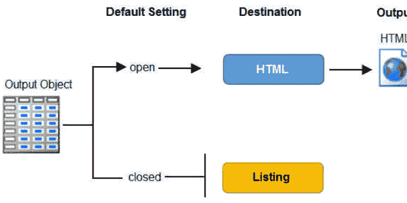

## 同时关闭多个 ODS 目标

你可以通过在程序开始时打开每个 ODS 目标来同时产生多种格式的输出。

当你有多个 ODS 目标时，可以在 ODS 语句中使用关键字 `_ALL_` 来一次性关闭所有已打开的目标。

## 关闭 HTML 目标

由于打开的目标会使用系统资源，如果你不想产生 HTML 输出，那么在程序开始时关闭 HTML 目标是一个好主意。这里有一个示例：

```sas
ods html close;
```

在你结束当前 SAS 会话或重新打开目标之前，HTML 目标将一直保持关闭状态。在程序结束时，将 ODS 重置为 HTML 输出（默认设置）是一种良好的编程习惯。

```sas
ods html path=&&sysfunc(pathname(work));;
```

## 使用 ODS 创建 HTML 输出

### ODS HTML 语句

若要在默认位置使用默认文件命名约定创建 HTML 输出文件，你不需要指定 ODS HTML 语句。然而，为了创建带有指定选项的 HTML 输出，你需要使用 ODS HTML 语句打开 HTML 目标。

> 注意：除非 HTML 目标已处于关闭，否则你不需要指定 ODS HTML 语句来生成基础 HTML 输出。

ODS HTML 语句语法：

```sas
ODS HTML BODY=file-specification;

ODS HTML CLOSE;
```

- `file-specification` 标识包含 HTML 输出的文件。该指定可以是以下任何一种形式：
  - 包含 HTML 文件名的带引号字符串（仅使用文件名写入你的工作目录，例如 `C:\Documents and Settings\username\My Documents\SAS Files`）。示例：`ODS BODY="myfile.html";`
  - 包含完整目录路径和 HTML 文件名的带引号字符串（如果你想将 HTML 文件保存到工作目录以外的特定位置，请包含完整路径）。示例：`ODS HTML BODY="c:reportdir/myfile.html";`
  - 使用 FILENAME 语句分配 HTML 文件的文件（别名快捷方式）。示例：`FILENAME MYHTML "c:\reportdir/myfile.html"; ODS BODY=MYHTML;`
  - 以 `entry-name.html` 形式存在的 SAS 目录条目。注意，目录是在 `PATH=` 中指定的，且 `BODY=` 选项的 `entry-name html` 值不带引号。示例：`ODS HTML PATH=work.mycat BODY=myentry BODY=bodyfile.html`。

> `FILE=` 也可以用于指定包含 HTML 输出的文件。`FILE=` 是 `BODY=` 的别名。

> 你也可以使用 `PATH=` 选项显式为你的文件指定目录路径。

### 示例：使用 PROC PRINT 创建输出

以下程序在 HTML 文件中创建 PROC PRINT 输出。在 Windows 操作系统环境中，ODS HTML BODY out 选项指定文件 `c:\certdata\admit.html` 为包含 PROC PRINT 结果的文件。

```sas
ods html body='c:\certdata\admit.html';

proc print data=clinic admit label;

  var sex age height actlevel;

  label actlevel='Activity Level';

run;

ods html close;

ods html path="%qsysfunc(pathname(work))";
```

HTML 文件 `admit.html` 包含了 ODS HTML 语句和 ODS HTML CLOSE 语句之间所有过程步骤的结果。

### 输出 10.1 HTML 输出

| Obs | Sex | Age | Height | Weight | Activity Level |
|---|---|---|---|---|---|
| 1 | M | 27 | 72 | 168 | HIGH |
| 2 | F | 34 | 66 | 152 | HIGH |
| 3 | F | 31 | 61 | 123 | LOW |
| 4 | F | 43 | 63 | 137 | MOD |
| 5 | M | 51 | 71 | 158 | LOW |
| 6 | M | 29 | 76 | 193 | HIGH |
| 7 | F | 32 | 67 | 151 | MOD |
| 8 | M | 35 | 70 | 173 | MOD |
| 9 | M | 34 | 73 | 154 | LOW |
| 10 | F | 49 | 64 | 172 | LOW |
| 11 | F | 44 | 66 | 140 | HIGH |
| 12 | F | 28 | 62 | 118 | LOW |
| 13 | M | 30 | 69 | 147 | MOD |
| 14 | F | 40 | 69 | 163 | HIGH |
| 15 | M | 47 | 72 | 173 | MOD |
| 16 | M | 60 | 71 | 191 | LOW |
| 17 | F | 43 | 65 | 123 | MOD |
| 18 | M | 25 | 75 | 188 | HIGH |
| 19 | F | 22 | 63 | 139 | LOW |
| 21 | M | 54 | 71 | 183 | MOD |

## 创建带有目录的 HTML 输出

### 概述

`BODY=` 指定是创建包含过程输出的 HTML 文件的一种方法。要创建一个带有目录且包含链接到每个特定过程输出的 HTML 文件，请在 ODS HTML 语句中指定额外的文件。

### 使用 ODS 209 创建 HTML 输出

创建链接目录的 ODS HTML 语句语法：

```sas
ODS HTML
  BODY=body-file-specification
  CONTENTS=contents-file-specification
  FRAME=frame-file-specification;

ODS HTML CLOSE;
```

- `body-file-specification` 是包含过程输出的 HTML 文件名。
- `contents-file-specification` 是包含带有链接到输出的目录的 HTML 文件名。
- `frame-file-specification` 是集成目录和主体文件的 HTML 文件名。

**TIP** 如果指定了 `FRAME=`，则必须指定 `CONTENTS=`。要将 HTML 输出到特定存储位置，请指定文件的完整 `file`。

这里有一个示例执行了以下操作：

- `BODY=` 指定在 `c:\wikidata` 目录创建文件。主体文件包含了两个过程的结果。
- `CONTENTS=` 指定在 `c:\wikidata` 目录创建文件。
- `FRAME=` 指定在 `c:\wikidata` 目录创建文件。帧文件集成了目录和主体文件。

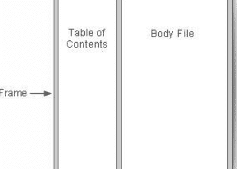

```sas
ODS HTML
  BODY='c:\wikidata\data.html'
  CONTENTS='c:\wikidata\toc.html'
  FRAME='c:\wikidata\frame.html';

ODS HTML CLOSE;
```

### 查看帧文件

HTML 文件 `admit.html` 包含了 ODS HTML 语句和 ODS HTML CLOSE 语句之间所有过程步骤的结果。

由于打开的目标会使用系统资源，如果你不想产生 HTML 输出，那么在程序开始时关闭 HTML 目标是一个好主意。在你结束当前 SAS 会话或重新打开目标之前，HTML 目标将一直保持关闭状态。在程序结束时，将 ODS 重置为 HTML 输出（默认设置）是一种良好的编程习惯。

### 使用目录

由 `CONTENTS` 选项创建的目录包含每个过程的编号标题。每个标题下方都是指向输出的链接。

> > TIP 在某些浏览器中，你可以选择标题来收起或展开目录。

**图 10.2** 部分输出：帧文件

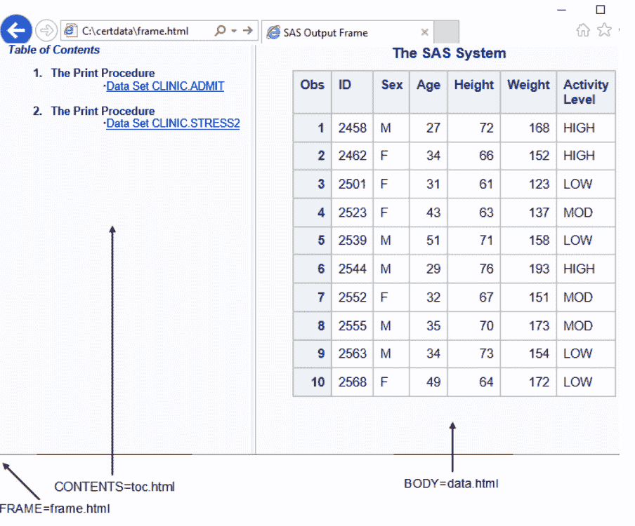

**图 10.3** 目录

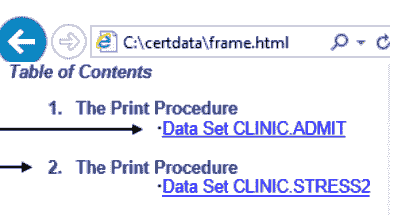

链接到 BODY 文件：

1. 打印过程
   - 数据集 `CLINIC_ADMIT`
2. 打印过程
   - 数据集 `STRESS2`

## 第 10 章 使用 ODS 创建输出

语法，文件规范中的 `URL=suboption`：

```text
(URL="Uniform-Resource-Locator");
```

- `Uniform-Resource-Locator`（统一资源定位符）是 HTML 文件的名称或该 HTML 文件的完整 URL。ODS 在所有指向该文件的链接和引用中都使用此 URL 代替文件规范。

> 提示：`URL=` 子选项对于构建可能从一个位置移动到另一个位置的 HTML 文件非常有用。如果目录文件和页面文件的链接使用简单的 URL（单个名称）构建，只要目录、页面和正文文件位于同一位置，它们就能正常工作。

### 示例：相对 URL

在此 HTML 语句中，`URL=` 子选项仅指定了 HTML 文件名。这是文件之间最常见的链接样式，因为更容易维护。只要文件保持在同一目录或存储位置，就可以移动它们。

```sas
ods html body='c:\certdata\data.html' (url='data.html')
contents='c:\certdata\toc.html' (url='toc.html')
frame='c:\certdata\frame.html';
```

`frame` 的源代码仅包含在 `body` 和 `contents` 文件 `URL=` 子选项中指定的 HTML 文件名。

示例 10.2 HTML 文件 `Frame.html` 的源代码。

```html
<MARGINWIDTH="4" MARGINHEIGHT="0" SRC="toc.html">
name="contents" SCROLLING=auto

<MARGINWIDTH="9" MARGINHEIGHT="0" SRC="data.html">
name="body" SCROLLING=auto>
```

### 示例：绝对 URL

或者，在此 HTML 语句中，`URL=` 子选项使用 HTTP 指定了完整的 URL。这些文件可以存储在相同或不同的位置。

```sas
ods body='c:\certdata\data.html'
(url='http://mysite.com/certdata/data.html')

contents='c:\certdata\toc.html'
(url='http://mysite.com/certdata/toc.html')

frame='c:\certdata\frame.html';
```

正如你预期的，Frame 的源代码包含了在 `body` 和 `contents` 文件 `URL=` 子选项中指定的完整 HTTP 地址。

示例 10.3 HTML 文件 `Frame.html` 的源代码。

```html
<MARGINWIDTH="4" MARGINHEIGHT="0" SRC="http://mysite.com/certdata/data.html">
name="contents" SCROLLING=auto

<MARGINWIDTH="9" MARGINHEIGHT="0" SRC="http://mysite.com/certdata/toc.html">
name="body" SCROLLING=auto>
```

> 提示：当你使用 `URL=` 子选项指定完整 URL 时，你可能需要将文件移动到该位置才能查看它们。

## PATH= 选项

使用 ODS 创建 HTML 输出 213

- `file-location-specification` 标识你想要保存 HTML 文件的位置。它可以是以下内容之一：
  - 聚合存储位置的完整路径名，例如目录或分区数据集
  - 分配给存储位置的过滤器（文件快捷方式）
  - SAS 目录（`libname.catalog`）
- `Uniform-Resource-Locator` 为 ODS 生成的 HTML 文件中的链接提供 URL。如果你指定关键字 `NONE`，则链接或引用中将不会出现来自 `PATH=` 选项的信息。
- 如果你不使用 `URL=` 子选项，则来自 `PATH=` 选项的信息将被添加到创建的文件的链接和引用中。

注意：在 z/OS 操作系统环境中，如果你将 HTML 文件存储为分区数据集中的成员，则 `PATH=` 必须是 PDSE 而不是 PDDS。你可以像本示例所示在 SAS 中分配一个 PDSE：

```sas
filename psehtml '.example.htm'
dntype=library dsorg=po
disp=(new, catlg, delete);
```

你应该为 HTML 文件指定有效名称（不带扩展名）。

### 示例：带有 URL=NONE 的 PATH= 选项

在以下程序中，`PATH=` 选项将 `data.html`、`toc.html` 和 `frame.html` 文件指向 Windows 环境下的 `c:\certdata` 目录。从文件到正文和目录的链接仅包含 HTML 文件名 `data.html` 和 `toc.html`。

```sas
ods html path='c:\certdata' (url=none)
body=data.html
contents=toc.html
frame=frame.html;

proc print data=clinic.admin;
run;

proc print data=clinic.stress2;
run;

ods html close;

ods html path="%sysfunc(pathname(work))";
```

此程序生成的文件和链接与之前的示例相同，在之前的示例中，你学习了如何配合 `BODY=` 和 `CONTENTS=` 文件规范使用 `URL=` 子选项。然而，在 `PATH=` 选项中指定路径并指定 `URL=NONE` 更简单。

> 提示：如果你计划移动 HTML 文件，应在 `PATH=` 选项中指定 `URL=NONE`，以防止 `PATH=` 选项的信息创建无效或错误的 URL。

### 示例：没有 URL= 子选项的 PATH= 选项

在以下程序中，`PATH=` 选项将 `data.html`、`toc.html` 和 `frame.html` 文件指向 Windows 环境下的 `c:\certdata` 目录。从 frame 文件到正文和目录文件的链接包含完整路径名 `c:\certdata\data.html` 和 `c:\certdata\toc.html`：

```sas
ods path='c:\certdata'
body='data.html'
contents='toc.html'
frame='frame.html';

proc print data=clinic.admit;
run;

proc print data=clinic.stress2;
run;

ods html close;

ods html path="%sysfunc(pathname(work))";
```

### 示例：带有指定 URL 的 PATH= 选项

在以下程序中，`PATH=` 选项将 `data.html`、`toc.html` 和 `frame.html` 文件指向 Windows 环境下的 `c:\certdata` 目录。从 frame 文件到正文和目录文件的链接包含指定的 URL `http://mysite.com/certdata/data.html` 和 `http://mysite.com/certdata/toc.html`：

```sas
ods path='c:\certdata' (url='http://mysite.com/certdata/')
body='data.html'
contents='toc.html'
frame='frame.html';

proc print data=clinic.admit;
run;

proc print data=clinic.stress2;
run;

ods html close;

ods html path="%sysfunc(pathname(work))";
```

## 更改 HTML 输出的外观

### 样式模板

你可以通过在 ODS HTML 语句的 `STYLE=` 选项中指定样式来更改 HTML 输出的外观。以下是当前可用的一些样式模板：

- `Banker`
- `BarrettsBlue`
- `Default`
- `HTMLblue`
- `Minimal`
- `Statistical`

> 提示：要查看 SAS 提供的样式列表，请提交以下代码：

```sas
proc template;
  list styles/store=sashelp.tmpllst;
run;
```


## `STYLE=` 选项

语法：

```sas
STYLE=style-name;
```

- `style-name` 是有效的 SAS 或用户定义样式模板的名称。

> 提示：不要给 `style-name` 加引号。

### 示例：`STYLE=+` 选项（Banker 样式）

在以下程序中，`STYLE=+` 选项将 Banker 样式应用于 `PROC PRINT` 的输出中：

```sas
ods html body='c:\data\data.html'
style=banker;

proc print data=clinic.atlic label;
var sex age height weight actlevel;
run;

ods html close;

ods html path="&sysfunc(pathname(work))";
```

图 10.4 使用 Banker 样式的 `PROC PRINT` 输出

| Obs | Sex | Age | Weight | Actlevel |
|---|---|---|---|---|
| 1 | M | | | |
| 2 | F | | | |
| 3 | F | | | |
| 4 | F | | | |
| 5 | M | | | |
| 6 | M | | | |

## 使用 ODS 创建 PDF 输出

### ODS PDF 语句

要打开、管理或关闭生成 PDF 输出的 PDF 目标，请使用 `ODS PDF` 语句：

```sas
ODS PDF <<ID>=<identifier>> <action>;
```

- `<<ID>=<identifier>>` 允许同时打开同一目标的多个实例。每个实例可以是数字或字符序列。
- `identifier` 后续字符可以包括字母、下划线和数字。
- `action` 可以是以下内容之一：
  - `CLOSE`：关闭目标及其关联的所有文件。
  - `EXCLUDE[s] ALL | NONE`：从目标中排除一个或多个输出对象。
  - `SELECT[s] ALL | NONE`：为目标选择输出对象。
  
    注意：默认值为 `NONE`。目标必须打开，此操作才能生效。
  - `SELECT` 默认值为 `ALL`。目标必须打开，此操作才能生效。
  - `SHOW`：将当前的选择列表或排除列表写入 SAS 日志。
  
    注意：如果选择或排除列表是默认列表（`SELECT ALL`），`SHOW` 也会写入整个选择或排除列表。目标必须打开，此操作才能生效。

在 SAS Studio 中，PDF 目标默认打开。在 SAS Studio 中，你必须使用带有至少一个操作或选项的 `ODS PDF` 语句。这样做时，它会打开另一个 PDF 目标实例。

### ODS 打印族语句

`ODS PDF` 语句是 ODS 打印族的一部分。打印族中的语句打开 PCL、PDF、PRINTER 或 PS 目标，产生适用于高分辨率打印机的输出。`ODS PCL`、`ODS PRINTER` 和 `ODS PS` 语句也是 ODS 打印族的成员。

### 打开和关闭 PDF 目标

可以使用许多 ODS 选项修改打开的 PDF 目标。然而，`FILE` 选项对打开的目标执行以下操作：

- 关闭 `ODS PDF` 语句引用的目标。
- 关闭与该目标关联的文件。
- 打开一个新的 PDF 目标实例。

注意：如果你使用了这些选项中的任何一个，应该显式地关闭目标。

### 使用目录工作

`ODS PDF` 目标提供以下导航工具：

- 默认的目录（TOC），这是一个不可打印的可点击书签树。

# 使用 ODS 创建 PDF 输出

**图 10.5** PDF 输出默认书签树

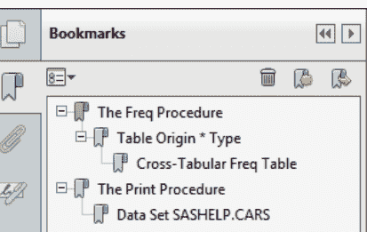

- 一个可打印的目录，使用 `ODS FILE` 语句中的 `CONTENTS=YES` 选项生成。生成的输出是静态的，不计入 PDF 文件的页数。“Table of Contents”文本可以通过 `PROC TEMPLATE` 自定义，每个条目的文本可以通过 `ODS PROCLABEL` 语句以及某些 PROC 语句中的 `CONTENTS=` 选项进行自定义。

**图 10.6** PDF 输出默认目录页

# 目录

Freq 过程 ........................................... 1  
表 Origin* 类型 ................................................ 1  
交叉表频数表 ................................... 2  
Print 过程 ............................................ 2  
数据集 SASHELP.CARS ................................... 2  

每个工具节点显示的文本由以下内容控制：

- `ODS PROCLABEL` 语句
- `CONTENTS=`、`DESCRIPTION=` 和 `OBJECTLABEL=` 选项
- `DOCUMENT` 目的和过程
- `TEMPLATE` 过程

## 示例：使用 `FILE=` 选项创建 PDF 输出

这打开了一个 PDF 目的实例以创建 PDF 输出。`FILE=` 选项指定 PDF 文件名。

```sas
ods html close;

ods pdf file=SamplePDF;

proc freq data=sashelp.cars;
tables origin*type;
run;

ods pdf close;
```

# 使用 ODS 创建输出

10.7 `FREQ` 过程的 PDF 输出

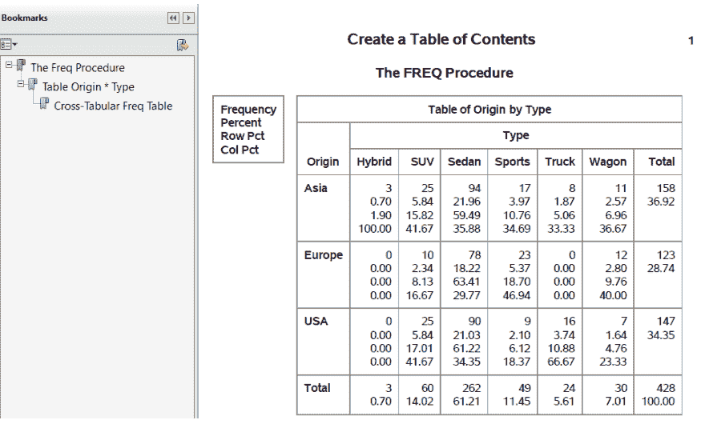

## 示例：创建一个可打印的目录

默认情况下，`ODS PDF` 不创建可打印的目录，只创建一个可点击的书签树。此示例展示了如何创建一个可打印的目录。

```sas
ods html close;

title "Create a Table of Contents";

noptions nodate;

ods pdf file="MyDefaultToc.pdf" contents=yes bookmarklist=hide;

proc freq data=sashelp.cars;
tables origin=type;
run;

proc print data=sashelp.cars, (obs=15);
run;

ods pdf close;

ods html path="%qsfunc(pathname(work))";
```

`ODS PDF` 语句使用以下选项：

- `FILE=` 选项指定 PDF 文件名。
- `CONTENTS=YES` 选项指定创建目录。
- `BOOKMARKLIST-HIDE` 选项指定创建书签树但隐藏。

# 目录

| 项目 | 页码 |
|---|---:|
| Freq 过程 | 1 |
| 表 Origin*Type | 1 |
| 交叉表频数表 | 1 |
| Print 过程 | 2 |
| 数据集 SASHELP.CARS | 2 |

# 修改 PDF 输出的外观

## 样式模板

你可以通过在 `ODS PDF` 语句中的 `STYLE=` 选项指定样式来更改 PDF 输出的外观。PDF 输出的默认样式是 Pearl。以下是当前可用的样式模板：

- `FancyPrinter`
- `FestivalPrinter`
- `GrayscalePrinter`
- `Journal`
- `MeadowPrinter`
- `MonochromePrinter`
- `Monospace`
- `NormalPrinter`
- `Pearl`
- `Printer`
- `Sapphire`
- `SasDocPrinter`
- `SeasidePrinter`

### 示例：`STYLE=` 选项（FestivalPrinter 样式）

在下面的程序中，`STYLE=` 选项将 FestivalPrinter 样式应用于 `ODS PDF` 语句的输出：

```sas
ods html close;

ods pdf file="SamplePDF" style=FestivalPrinter;

proc freq data=sashelp.cars;
tables origin*type;
run;

ods pdf close;
```

# 使用 ODS 创建输出

图 10.9 应用了 FestivalPrinter 样式的 PDF 输出

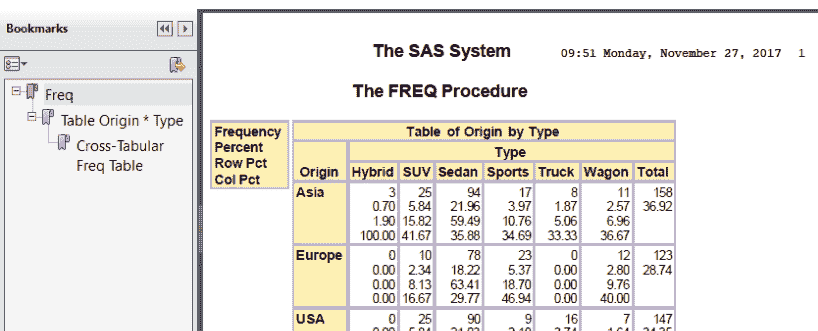

# 使用 ODS 创建 RTF 输出

## ODS RTF 语句

使用 `ODS RTF` 语句来管理或关闭产生富文本格式（Rich Text Format）输出的 RTF 目标，该输出用于 Microsoft Word。

语法：

```sas
ODS RTF <ID=>identifier> <action>;
```

- `(<ID=>identifier)` 允许你同时打开同一目标的多个实例。每个实例可以有不同的选项。
- `identifier` 可以是数字或以字母或下划线开头的字符序列。后续字符可以包括字母、下划线和数字。
- `action` 可以是以下之一：
  - `CLOSE`：关闭目标以及与之关联的所有文件。
  - `EXCLUDE exclusions ALL | NONE`：从目标中排除一个或多个输出对象。
    
    注意：默认为 `NONE`。目标必须打开，此操作才能生效。
  - `SELECT ALL | NONE`：为指定的目标选择输出对象。
    
    注意：默认为 `ALL`。目标必须打开，此操作才能生效。
  - `SHOW`：将目标的当前选择列表或排除列表写入 SAS 日志。
    
    注意：如果选择或排除列表是默认列表（`SELECT ALL`），则 `SHOW` 也会写入整个选择或排除列表。目标必须打开，此操作才能生效。

## 打开和关闭 RTF 目标

你可以使用许多 ODS RTF 选项修改已打开的 RTF 目标。然而，`FILE=` 选项对打开的 RTF 目标执行以下操作：

- 关闭 `ODS RTF` 语句中引用的已打开目标。
- 关闭与打开的 RTF 目标关联的所有文件。
- 打开 RTF 目标的新实例。

提示：如果你使用 `FILE=` 选项，应该显式地关闭目标。

## 理解 RTF 如何格式化输出

RTF 为 Microsoft Word 生成输出。虽然其他应用程序可以读取 RTF 文件，但 RTF 输出在其他应用程序中可能无法正常工作。

RTF 目标允许你查看和编辑 RTF 输出。ODS 未定义垂直测量值，这意味着 SAS 不确定每个项目在页面上的最佳位置。例如，分页符并不总是固定的，因为你不希望在需要文本时 RTF 输出在不适当的地方断开。你的表格保持在页内，或者在指定的指定处断开。

然而，Microsoft Word 需要表格列的宽度，如果表格对于页面太宽，Microsoft Word 将无法调整表格。ODS 测量表格列的宽度，如果表格对于页面太宽，Microsoft Word 将无法调整表格。（此处原文存在重复内容，已按要求处理）

# 使用 ODS 创建 EXCEL 输出

## ODS EXCEL 语句

语法：

```sas
ODS EXCEL <<ID>=identifier> <action>;
ODS EXCEL <<ID>=identifier> <option>;
```

- `<ID>=identifier` 允许你同时打开同一目标的多个实例。每个实例可以有不同的选项。
- `identifier` 可以是数字，也可以是以字母或下划线开头的字符序列。后续字符包括字母、下划线和数字。
- `action` 可以是以下之一：
  - `CLOSE`：关闭目标以及所有与之关联的文件。
  - `EXCLUDE exclusions ALL | NONE`：从目标中排除一个或多个输出对象。
  - `SELECT selections ALL | NONE`：为指定的目标选择输出对象。

注意：默认值为 `NONE`。目标必须处于打开状态时，此操作才能生效。

注意：默认值为 `ALL`。目标必须处于打开状态时，此操作才能生效。

`SHOW` 会在 SAS 日志中写入该目标的当前选择列表或排除列表。

注意：如果选择或排除列表是默认列表（`SELECT ALL`），则 `SHOW` 也会写入整个选择或排除列表。目标必须处于打开状态时，此操作才能生效。

# 关于 ODS 目标的详细信息

Excel 的 ODS 目标使用 Office 2010 及更高版本的 Microsoft Open Office XML Format。此语句生成 XML，并代表了一种定义和格式化数据以便交换的方法。

Excel 的 ODS 目标以 ML XML 创建 Microsoft 电子表格。每个表放置在工作簿中的单独工作表中。该目标支持 ODS 样式、分页和自定义格式。数字、货币和百分比会被正确检测并显示。样式覆盖 `TAGATTR=` 可为数据创建自定义格式。默认情况下，标题和脚注包含在工作表中，它们是工作表页眉和页脚的一部分。

Portrait 是默认的打印方向。方向可以更改为横向。

## 示例：自定义你的 Excel 输出

以下示例显示了如何创建一个包含 `PROC TABULATE` 输出的自定义 Excel 工作簿。使用 `ODS EXCEL` 语句进行以下自定义：

- 为每个 BY 组创建一个新工作表。
- 抑制 BY 行。
- 由 `TITLE` 语句创建的标题被嵌入输出中。
- 自定义工作表标签。

```sas
ods excel file="multitablefinal.xlsx";

options(sheet_interval="bygroup")
suppress_bylines="yes"
sheet_label="country"
embedded_titles="yes"
embed_titles_once="yes";
```

# 使用 ODS 创建输出

```sas
title "Historical Sales Data";

proc tabulate data=sashelp.prdsale;
by country;

var predict actual;

class region division prototype year;

tab year=[label='division total']
all=[label='grand total'],
predict=[label='total predicted sales']*f=dollar10.0,
*sum=[label=''],
actual=[label='total actual sales']*f=dollar10.0,
*sum=[label=''] /
box_page;
run;

ods excel close;
```


**图 10.11** 自定义的 Excel 输出

| | | | | | | | |
|---|---|---|---|---|---|---|---|
| 1 | | | | | | | |
| 2 | | | Historical Sales Data | | | | |
| | | 1993 | | | | | |
| 3 | | | TOTAL PREDICTED SALES | TOTAL ACTUAL SALES | | | |
| 4 | Region Division | Product type | | | | | |
| 5 | EAST CONSUMER | FURNITURE | $11,081 | $12,483 | | | |
| 6 | | | OFFICE | $21,939 | $16,991 | | | |
| 7 | | EDUCATION | FURNITURE | $12,972 | $14,467 | | | |
| 8 | | | OFFICE | $16,434 | $20,189 | | | |
| 9 | | DIVISION TOTAL | | $62,246 | $64,130 | | | |
| 10 | WEST | Product type | | $10,286 | $10,380 | | | |
| 11 | CONSUMER | FURNITURE | $16,042 | $16,371 | | | |
| 12 | | | OFFICE | $12,816 | $11,234 | | | |
| 13 | EDUCATION | FURNITURE | $17,759 | $18,905 | | | |
| 14 | | | OFFICE | $56,903 | $56,890 | | | |
| 15 | | DIVISION TOTAL | | $119,329 | $121,020 | | | |
| 16 | GRAND TOTAL | | | | | | | |
| 17 | | | TOTAL PREDICTED TOTAL ACTUAL SALES | | | | | |
| 18 | | | 1994 | | | | | |
| | Country - CANADA | Country - GERMANY | Country - U.S.A. | | | | |

`SHEET_INTERVAL` 选项指定在每个组后创建一个新的工作表。`BYSLINES` 选项用于抑制 BY 行的打印。`SHEET_LABEL` 选项指定“Country”作为工作表标签的第一部分。`EMBEDD_TITLES` 选项指定标题已嵌入 Excel 工作表中。`EMBED_TITLES_ONCE` 选项指定标题仅嵌入一次，位于每个表的顶部。

# 示例：使用 `TAGATTR` 样式属性自定义 ODS Excel 输出

在以下示例中，`TAGATTR=` 样式属性允许你自定义 Excel 工作簿中数据的样式和格式。负值用红色字体和括号表示。这些是使用 `TAGATTR=` 样式属性创建的。

第一个 `VAR` 语句中的 `TAGATTR=` 样式属性指定正值的格式。负数用红色打印并括在括号内。第二个 `VAR` 语句中的 `TAGATTR=` 样式属性指定负值的格式。负数用红色打印并括在括号内。差异使用公式 `RC[-1]` 计算。`SUM` 语句中的 `TAGATTR=` 样式属性指定用于显示区域预测销售额、实际销售额和差异的格式。第一个 `TAGATTR=` 属性指定正值的格式，第二个格式指定负值。负数用红色打印并括在括号内。

```sas
ods html close;

data ...
```

# 使用 ODS 227 创建 Excel 输出

```sas
run;

\ods excel anchor="reports" cssstyle="file-path/Stylesheets.css";

proc print data=sashelper.class;

run;
```

```sas
ods excel close;

ods html paths="&qsysfunc(pathname(work))";
```

`SHEET_INTERVAL="NONE"` 选项指定所有输出出现在同一个工作表中。`CSSSTYLE=` 选项指定文件 `Style.css` 为输出提供不同的背景颜色。

通过使用 `ANCHOR=` 选项为第一个表添加 ID `#Expense`，可以为第一个表的标题创建不同的背景颜色。`StyleSheet.css` 文件包含匹配的 ID。默认情况下，由于未指定 ID，ID 为 `#IDX` 和 `#IDX1`。

通过使用 `ANCHOR=` 选项为第二个表添加 ID `#Reports`，可以为第二个表的标题创建不同的背景颜色。`StyleSheet.css` 文件包含匹配的 ID。默认情况下，由于未指定 ID，第二个表的 ID 为 `#IDX1`。

# 10.3 使用样式表自定义 ODS Excel 输出

| A | B | C | D | E | F | G |
|---|---|---|---|---|---|---|
| 1 | Alfred | M | 14 | | 69.0 | 112.5 | |
| 2 | Alice | F | 13 | | 56.5 | 84.0 | |
| 3 | Barbara | F | 13 | | 65.3 | 98.0 | |
| 4 | Carol | F | 14 | | 62.8 | 102.5 | |
| 5 | Henry | M | 14 | | 57.3 | 102.5 | |
| 6 | James | M | 12 | | 63.5 | 83.0 | |
| 7 | Jane | F | 12 | | 59.8 | 84.5 | |
| 8 | Janet | F | 15 | | 62.5 | 112.5 | |
| 9 | Jeffrey | M | 13 | | 62.5 | 84.0 | |
| 10 | John | M | 12 | | 59.0 | 99.5 | |
| 11 | Joyce | F | 11 | | 51.3 | 50.5 | |
| 12 | Judy | F | 14 | | 64.3 | 90.0 | |
| 13 | Louis | F | 12 | | 56.3 | 77.0 | |
| 14 | Mary | F | 15 | | 66.5 | 112.0 | |
| 15 | Philip | M | 16 | | 72.0 | 150.0 | |
| 16 | Robert | M | 12 | | 64.8 | 128.0 | |
| 17 | Ronald | M | 15 | | 67.0 | 133.0 | |
| 18 | Thomas | M | 11 | | 57.5 | 85.0 | |
| 19 | William | M | 15 | | 66.5 | 112.0 | |

| Name | Sex | Age | Height | Weight |
|---|---|---|---|---|
| Alfred | M | 14 | 69.0 | 112.5 |
| Alice | F | 13 | 56.5 | 84.0 |
| Barbara | F | 13 | 65.3 | 98.0 |
| Carol | F | 14 | 62.8 | 102.5 |
| Henry | M | 14 | 63.5 | 102.5 |
| James | M | 12 | 57.3 | 83.0 |

# 章节测验

为每个问题选择最佳答案。使用附录中的答案键检查你的答案。

1. 使用 `ODS` 语句，可以生成多少种类型的输出？
   - a. 1（仅 LISTING 输出）
   - b. 2
   - c. 3
   - d. 随你需要多少种

2. 如果 ODS 设置为默认设置，以下代码创建了什么类型的输出？

```sas
ods html file='c:\myhtml.htm';

ods pdf file='c:\mypdf.pdf';
```

   - a. HTML 和 PDF
   - b. 仅 PDF
   - c. HTML、PDF 和 LISTING
   - d. 没有创建输出，ODS 默认是关闭的。

3. 在以下代码中关闭 HTML 目的地的目的是什么？

```sas
ods HTML close;

ods pdf;
```

   - a. 它节省了系统资源。
   - b. 它简化了你的程序。
   - c. 它让你的程序与其它硬件平台兼容。
   - d. 它让你的程序与之前的 SAS 版本兼容。

4. 当运行以下代码，文件 `D:\Output.body.html` 包含什么？

```sas
ods body='d:\output.body.html';

proc print data=work.alpha;

run;

proc print data=work.beta;

run;

ods html close;
```

   - a. Work.Alpha 的 PROC PRINT 输出。
   - b. Work.Beta 的 PROC PRINT 输出。
   - c. Work.Alpha 和 Work.Beta 的 PROC PRINT 输出。
   - d. 没有任何内容写入 D:\Output.body.html。

5. 当运行以下代码时，`Output\contents.html` 中的 D 加载了哪个文件？

```sas
ods body='d:\output.body.html'

contents
```

   - a. d:\output.body.html
   - b. d:\contents.html
   - c. d:\frame.html
   - d. d:\output.body.html

6. 由以下代码生成的 CONTENTS 标题包含以下哪种？
   - a. 选项
   - b. 过程
   - c. 步骤
   - d. 你的程序

7. 当运行以下代码时，`body.html` 显示什么？

```sas
ods body='d:\output.body.html'

contents
```

   - a. Output\contents.html。
   - b. Output\frame.html。
   - c. Output\body.html 和 Output\contents.html。
   - d. 没有显示。

8. 以下 URL 选项的输出是哪个？

```sas
ods body='d:\output.body.html' (url='body.html')

contents
```

   - a. 绝对路径，用于从服务器加载文件。
   - b. 相对路径，用于从服务器加载文件。
   - c. 允许从本地驱动加载 HTML 文件。
   - d. 将输出到两个位置。

9. 以下代码的输出是哪个？

```sas
ods body='d:\output.body.html' (url='body.html')

contents='body.html'

frame='frame.html';
```

   - a. body.html
   - b. frame.html
   - c. body.html 和 frame.html
   - d. 只有 \output.body.html

10. 以下代码的输出是哪个？
    - a. 绝对路径，用于从服务器加载文件。
    - b. 相对路径，用于从服务器加载文件。
    - c. 允许从本地驱动加载 HTML 文件。
    - d. 将输出到两个位置。

# 创建和修改变量

## 累加总和

要将表达式的结果累加到一个变量中，你可以在 DATA 步中使用 `sum` 语句。

`sum` 语句的语法：

```sas
variable+expression;
```

- `variable` 指定累加变量的名称。该变量必须是数值型。在读取第一条观测值之前，该变量会被设置为 0。该变量的值会从一次 DATA 步执行保留到下一次。
- `expression` 是任何有效的 SAS 表达式。

> 注意：如果表达式产生缺失值，`sum` 语句将其忽略。`sum` 语句是少数不以关键字开头的 SAS 语句之一。

`sum` 语句将加号（`+`）右侧表达式的结果加到加号左侧的数值变量上。在 DATA 步第一次迭代之前，累加变量的值初始化为 0 而不是缺失值。随后，如果该变量出现在 `RETAIN` 语句中，则变量的值将从一次迭代保留到下一次。

### 示例：`sum` 语句

为了跑步机压力测试中经过的秒总数，你需要一个变量（在本例中为 `SumSec`），其值从 0 开始，并根据每次观测中的总秒数不断增加。要计算跑步机压力测试中经过的秒总数，你使用下面的 `sum` 语句：

```sas
data clinic:stress;

  infile tests;

  input ID $1-4 Name $6-25 RestHR 27-29 MaxHR 31-33

  ReChr 35-37 TimeMin 39-40 TimeSec 42-43

  Tolerance $45;

  TotalTime=(timemin*60)+timesec;

  SumSec=SumSec+TotalTime;

  run;
```

加号左侧变量（此处为 `SumSec`）的值从 0 开始，并随着每次观测增加 `TotalTime` 的值而增加。

| SumSec | TotalTime | 之前的总和 |
|---|---|---|
| 0 | | |
| 758 | | 758 |
| 0 | 1363 | | 605 |
| 758 | | |

| SumSec | = | TotalTime | + | 之前的总和 |
|---|---|---|---|---|
| 2036 | = | 673 | + | 1363 |
| 2618 | = | 582 | + | 2036 |
| 3324 | = | 706 | + | 2618 |

## 初始化总和变量

在上一个示例中，总和变量 `SumSec` 在读取第一条观测值之前默认初始化为 0。但如果你想将 `SumSec` 初始化为不同的数字，例如之前跑步机压力测试的总秒数，呢？

你可以使用 `RETAIN` 语句为由 `sum` 语句赋值的变量分配一个除默认值 0 之外的初始值。

`RETAIN` 语句有几个用途：

- 它为保留的变量分配一个初始值。
- 它防止变量在每次执行 DATA 步时被重新初始化。

初始化总和变量的 `RETAIN` 语句语法：

`RETAIN variable <initial-value>;`

- `variable` 是要保留其值的变量。
- `initial-value` 为前面的语句指定一个初始值（数值型或字符型）。

注意：以下关于 `RETAIN` 语句的说明是正确的：

- 它是一个仅编译的语句，如果变量尚不存在，则会创建它们。
- 如果你不提供初始值，它会在 DATA 步第一次执行之前将保留的变量初始化为缺失值。
- 它对通过 `SET`、`MERGE` 或 `UPDATE` 语句读取的变量没有影响。

### 示例：`RETAIN` 语句

假设在创建数据集时，你想给 `Clinic Stress` 数据集中的 `SumSec` 变量增加 5400 秒（之前跑步机压力测试的累积总秒数）。要将 `SumSec` 初始化为值 5400，请使用下面的 `RETAIN` 语句。

```sas
data clinic.stress;

infile tests;

input ID 1-4 Name 6-25 RestHR 27-29 MaxHR 31-33

ReHR 35-37 TimeMin 39-40 TimeSec 42-43

Tolerance $ 45;

TotalTime=(timen*60)+timesec;

retain SumSec 5400;

sumsec+totaltime;

run;
```

现在，`SumSec` 的值从 5400 开始，并随着每次观测增加 `TotalTime` 的值而增加。

| SumSec | | TotalTime | | 之前的总和 |
|---|---|---|---|---|
| 5400 | | | | |
| 6158 | = | 758 | + | 5400 |
| 6763 | = | 605 | + | 6158 |
| 7436 | = | 673 | + | 6763 |
| 8018 | = | 582 | + | 7436 |
| 8724 | = | 706 | + | 8018 |

## 条件赋值

### 分值分类

假设你想创建一个变量，对受试者在压力测试期间在跑步机上花费的时间进行分类。这个新变量 `TestLength` 基于现有变量 `TotalTime` 的值。`TestLength` 的值是根据条件进行赋值的：

| `TotalTime` 的值 | `TestLength` 的结果值 |
|---|---|
| 大于 800 | Long |
| 750-800 | Normal |
| 小于 750 | Short |

要进行条件操作，请使用 `IF-THEN` 语句。当 `IF` 子句中的条件为真时，`IF-THEN` 语句执行 SAS 语句。

`IF-THEN` 语句语法：

`IF expression THEN statement;`

- `expression` 是任何有效的 SAS 表达式。
- `statement` 是任何可执行的 SAS 语句。

### 示例：`IF-THEN` 语句

当 `TotalTime` 的值大于 800 时，为变量 `TestLength` 赋值 `Long`，请在你的 DATA 步中添加以下 `IF-THEN` 语句：

```sas
data clinic.stress;

infile tests;

input ID $1-37 Name $6-25 RestHR 27-29 MaxHR 31-33

ReCHR 35-37 TimeMin 39-40 TimeSec 42-43

Tolerance $45;

TotalTime=(timin*60)+timesec;

retain SumSec 5400;

sumsec=recoltime;

if totalTime>800 then TestLength='Long';
```


`run;`

SAS 仅在条件（`TotalTime>800`）为真时才执行赋值语句。如果条件为假，`TestLength` 的值将为缺失。

### 比较运算符和逻辑运算符

在 `IF-THEN` 语句中，你可以使用以下任何比较运算符：

| 运算符 | 比较操作 |
|---|---|
| `= or eq` | 等于 |
| `^= or ne` | 不等于 |
| `> or gt` | 大于 |
| `< or lt` | 小于 |
| `>= or ge` | 大于等于 |
| `<= or le` | 小于等于 |
| `in` | 等于列表中的之一 |

### 示例：逻辑运算符

```sas
if test=85 and time<=20
then Status='RETEST';

if region in ('NE','NW','SW')
then Rate=fee-25;

if gt 300 or salary ge 5000
then Bonus=salary*.05;
```

你也可以使用这些逻辑运算符：

| 运算符 | 逻辑操作 |
|---|---|
| `&` | and |
| `|` | or |
| `^ or ~` | not |

使用 AND 运算符，当两个表达式都通过 AND 链接且为真时，执行 THEN 语句。

```sas
if status='OK' and type=3
then Count+=1;

(age=agecheck | time=3)
& error=1 then Test=1;
```

使用 OR 运算符，当其中一个通过 OR 链接且为真时，执行 THEN 语句。

```sas
(age=agecheck | time=3)
& error=1 then Test=1;

if status='S' or cond='E'
then Control=Stop;
```

使用 NOT 运算符与其他运算符来反转比较的逻辑。

```sas
if not (loghours=7500)
then Schedule='Quarterly'

if region not in ('NE','SE')
then Bonus=200;
```

字符值必须以在数据集中相同的大小写指定，并包含在引号中。

```sas
if status='OK' and type=3
then Count+=1;

if status='S' or cond='E'
then Control=Stop;

if not (loghours=7500)
then Schedule='Quarterly'

if region not in ('NE','SE')
then Bonus=200;
```

在括号中的逻辑比较在与其他示例进行比较之前会被评估为真或假。在下例中，OR 比较会在第一个表达式和 AND 运算符评估之前被评估。

**图 11.1 逻辑比较示例**

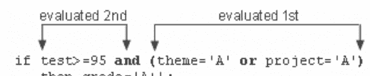

```sas
if test=95 and (theme='A' or project='A')then grade='A+';
```

> 注意：在 SAS 中，除 0 或缺失外的任何数值均为真，而 0 或缺失值为假。因此，数值变量或表达式可以单独出现在条件中。如果它的值是非 0 或缺失的数字，则条件为真。如果它的值是 0 或缺失，则条件为假。

- `0 = False`
- `.` = False
- `1 = True`

因此，在系列比较中使用中使用 OR 运算符时要小心。

请记住，在系列 OR 比较中，只需有一个比较为真即可满足条件，且任何非零、非缺失的常量始终被评估为真。因此，以下子集语句始终为真：

```sas
if x=1 or x=2;
```

SAS 评估 `x=1`，结果可能为真也为假。然而，由于 `2` 被评估为非零且非缺失（真），因此表达式为真。但此语句的条件并不一定为真，因为任何一个比较都可能被评估为假：

```sas
if x=1 or x=2;
```

> 注意：OR 的两侧都包含完整的表达式。

## 提供活动操作

假设你想根据 `TotalTime` 的其他可能值为 `TextLength` 赋值。实现此点的一种种方法是为其他条件添加 IF-THEN 语句。

```sas
if totaltime>800 then TextLength='Long';

if 750<=totaltime<800 then TextLength='Normal';

if totaltime<750 then TextLength='Short';
```

然而，当 DATA 步执行时，每个 IF 语句都会按顺序评估，即使第一个条件为真也是如此。这浪费了资源并降低了程序的处理速度。

与其使用一系列 IF-THEN 语句，可以使用 ELSE 语句来指定当 IF-THEN 语句中的条件为假时执行的替代操作。如下，你可以编写多个 ELSE 语句来指定一组互斥的条件。

```sas
if totaltime>800 then TextLength='Long';

else if 750<=totaltime<800 then TextLength='Normal';

else if totaltime<750 then TextLength='Short';
```

ELSE 语句必须紧跟在程序中的 IF-THEN 语句之后。只有在之前的 IF-THEN/ELSE 语句为假时，才会执行 ELSE 语句。

### 语法：ELSE 语句

```sas
ELSE statement;
```

`statement` 是任何可执行的 SAS 语句，包括另一个 IF-THEN 语句。

当 IF-THEN 语句为假时，要在程序中为 `Text` 赋值，可以在 DATA 步中添加 ELSE 语句：

```sas
data clinic.stress;

infile tests;

input $1-4 Name $ 6-25 RestHR 27-29 MaxHR 31-33
RecHR 35-37 TimeMin 39-40 TimeSec 42-63
tolerance $45;

TotalTime=(timemin*60)+timec;

retain SumSec 5400;

sumsec+totaltime;

if totaltime>800 then TestLength='Long';

else if 750<=totaltime<=800 then TestLength='Normal';

else if totaltime>750 then TestLength='Short';

run;
```

在 IF-THEN 语句中使用 ELSE 语句可以节省资源：

- 使用不带 ELSE 语句的 IF-THEN 语句会导致 SAS 评估所有的 IF-THEN 语句。
- 使用带有 ELSE 语句的 IF-THEN 语句会导致 SAS 执行 IF-THEN 语句直到遇到第一个真语句。随后的 IF-THEN 语句将不再评估。

为了更高的效率，请按概率递减的条件构建你的 IF-THEN/ELSE 语句。

你可以使用 PUT 语句来测试你的逻辑条件。

```sas
if totaltime>800 then TestLength='Long';

else if 750<=totaltime<=800 then TestLength='Normal';

else put 'NOTE: Check this Length: ' totaltime=;

run;
```

## 为变量指定长度

### 避免变量值被截断

虽然可以在 DATA 步中添加 IF-THEN 和 ELSE 语句来创建变量 `TestLength`，但请考虑提交以下程序时会发生什么：

```sas
data clinic.stress;

infile ID $1-4 Name $6-25 RestHR 27-29 MaxHR 31-33
RecHR 35-37 TimeMin 39-40 TimeSec 42-43
Tolerance $45;

TotalTime=(timemin*60)+timesec;

retain SumSec 5400;

sumsec+totaltime;

if totaltime>800 then TestLength='Long';

else if 750<=totaltime<=800 then TestLength='Normal';

else if totaltime>750 then TestLength='Short';

run;
```

在编译期间，当赋值语句中创建新变量时，SAS 会分配许多字节的存储空间，具体取决于该变量遇到的第一个值的字符数。在这种情况下，`TestLength` 的第一个值出现在 IF-THEN 语句中，它指定了一个四个字符的值（`Long`）。因此，`TestLength` 被分配长度为 4，任何更长的值（`Normal` 和 `Short`）都会被截断。

### 图 11.2 被截断的值（部分输出）

| TestLength |
|---|
| Norm |
| Shor |
| Shor |
| Shor |
| Shor |
| Long |

示例将字符常量作为 SAS 变量的值。你也可以看到当没有显式设置变量类型和长度时，SAS 分配的默认类型和长度示例。

> 提示：你可以在 DATA 步中其他引用 `TestLength` 之前使用 LENGTH 语句为其指定长度（字节数）。

### 语法：LENGTH 语句

```sas
LENGTH variable(s)<$ length;
```

- `variable(s)` 名称指定要分配长度的变量。
- `$` 如果变量是字符变量，则指定 `$`。
- `length` 是指定变量长度的整数。

### 示例：LENGTH 语句

这里有一个变量列表，其中三个变量都被分配了 `$200` 的长度。

```sas
length Type $8;

length Address1 Address2 Address3 $200;

length FirstName $12 LastName $16;
```

在程序中，包含了一个 LENGTH 语句，以适应变量 `TestLength` 的最长值。最长值是 `Normal`，它有六个字符。因为 `TestLength` 是字符变量，你必须在变量后跟一个美元符号（`$`）。

让 LENGTH 语句出现在 DATA 步中对该变量的任何引用之前。

```sas
clinic.stress;

infile tests;

input ID $1-4 Name $6-25 RestHR 27-29 MaxHR 31-33
RecHR 35-37 TimeMin 39-40 TimeSec 42-43
Tolerance $45;

TotalTime=(timemin*60)+timesec;

retain+totaltime;

sumc+totaltime;

length TestLength $6;

if totaltime>800 then testlength='Long';

else if totaltime<=800 then testlength='Normal';

else if totaltime<750 then TestLength='short';

run;
```

> 注意：如果变量已由另一个语句创建，那么后使用的 LENGTH 语句不会更改其长度。

现在 LENGTH 语句已添加到程序中，`TestLength` 表达式的值将不再被截断。

### 图 11.3 未被截断的变量值（部分输出）

| TestLength |
|---|
| Normal |
| Short |
| Short |
| Short |
| Short |
| Short |
| Long |

## 数据子集

### 删除不需要的观测值

你可以在 IF-THEN 语句中指定任何可执行的 SAS 语句。例如，你可以使用带有 DELETE 语句的 IF-THEN 语句来确定读取数据时省略哪些观测值。

### 语法：DELETE 语句

```sas
DELETE;
```

要条件执行 DELETE 语句，请使用以下 IF 语句语法：

```sas
IF expression THEN DELETE;
```

表达式的评估方式如下：

- 如果为真，则该观测值的执行停止。DELETE 语句从输出数据集中删除该观测值，并返回 DATA 步开头。
- 如果为假，则不执行 DELETE 语句，继续处理下一个语句。

### 示例：IF-THEN AND DELETE

下方的 IF-THEN 和 DELETE 语句省略了任何 `RestHR` 值低于 70 的观测值。

```sas
data clinic.stress;

infile tests;

input ID $1-4 Name $6-25 RestHR 27-29 MaxHR 31-33
RecHR 35-37 TimeMin 39-40 TimeSec 42-43
Tolerance $45;

if restHR<70 then delete;

TotalTime=(timemin*60)+timesec;

retain sumSec 5400;

sumsec+totaltime;

length TestLength $6;

if totaltime>800 then testlength='Long';

else if 750<=totaltime<=800 then testlength='Normal';

else if totaltime<750 then TestLength='Short';

run;
```

## 选择变量

有时你想要读取并处理你不想保留在输出数据集中的变量。在这种情况下，使用 `DROP=` 和 `KEEP=` 数据选项来指定删除或保留哪些。

如果删除的变量更多，请改用 `KEEP=` 选项。

### 语法：DROP= 和 KEEP= 数据集选项

```sas
DROP=variable(s)
KEEP=variable(s)
```

- `DROP=` 或 `KEEP=` 选项跟随包含要删除或保留变量的数据集名称。
- `variable(s)` 标识要删除或保留的变量。

### 示例：DROP 数据选项

假设你想使用 `TimeMin` 和 `TimeSec` 变量计算 `TotalTime` 变量中的总时间，但你不想在输出集中保留它们。你只想保留 `TotalTime` 变量。当你使用 DROP 数据选项时，`TimeMin` 和 `TimeSec` 变量将不会写入输出数据集：

```sas
data clinic.stress(drop=timemin timesec);

infile tests;

input ID $1-4 Name $6-25 RestHR 27-29 MaxHR 31-33
RecHR 35-37 TimeMin 39-40 TimeSec 42-43
Tolerance $45;

if tolerance='D';

TotalTime=(timemin*60)+timesec;
```

```sas
data clinic.stress(drop=timemin timesec);

infile tests;

input ID 1-4 Name $6-5 RestHR 27-29 MaxHR 31-33
RecHR 35-37 MinTime 39-40 Time 42-44
Tolerance $45;

if tolerance='D';

TotalTime=(timemin*60)+timesec;

retain sumsec 5400;

sumsec=totaltime;

length TestLength $6;

if totaltime>800 then length='Long';

else if 750<=totaltime=800 then length='Normal';

else if totaltime<750 then length='Short';

run;
```

```sas
data clinic.stress;

infile tests;

input ID $ 1-4 Name $ 6-25 RestHR 27-29 MaxHR 31-33
RecHR 35-37 TimeMin 39-40 TimeSec 42-43
Tolerance $ 45;

if tolerance='D';

drop timemin timesec;

TotalTime=(timemin*60)+timesec;

retain SumSec 5400;

sumsec+totaltime;

length TestLength $6;

if totaltime>800 then length='Long';

else if 750<totaltime<=800 then length='Normal';

else if totaltime<750 then length='Short';

run;
```


# 分配永久标签和格式

## 常见任务及其对应的语句

您可能需要在第 5 章（第 67 页）“创建列表报告”中的 PROC 步骤中临时分配标签和格式。这些临时标签和格式仅在任务执行期间有效。要永久分配标签和格式，您需要在 DATA 步骤中使用 `LABEL` 和 `FORMAT` 语句。

> 注意：标签和格式不会影响数据在数据集中的存储方式，只会影响它们在输出中的显示方式。

| 任务 | 使用的语句 |
|---|---|
| 引用 SAS 数据库 | `libname clinic 'c:\users\may\data'; filename tests 'c:\users\tmill.data';` |
| 引用外部文件 | |
| 为 SAS 数据集命名 | `data clinic.stress; infile tests obs=10; input ID $ 1-4 Name $ 6-25 ...;` |
| 识别外部文件 | |
| 描述原始数据 | |
| 数据子集 | `if rethr>70 then delete; if tolerance='D';` |
| 移除不需要的变量 | `drop timemin timesec;` |
| 创建或修改变量 | `TotalTime=(timemin*60)+timesec;` |
| 初始化并保留变量 | `retain SumSec 5400;` |
| 累加值 | `sumsec+totaltime;` |
| 指定变量长度 | `length TestLength $ 6;` |

## 常见任务及其对应的语句

| 任务 | 使用的语句 |
|---|---|
| 条件执行语句 | `if totaltime=800 then TestLength='Long'; else if 750<totaltime<=800 then Length='Normal'; else if totaltime<750 then Length='Short';` |
| 为变量添加标签 | `label sumsec='Cumulative Total Seconds (+5,400)';` |
| 为变量设置格式 | `format sumsec comma.;` |
| 执行 DATA 步骤 | `run;` |
| 列出数据 | `proc print data=clinic.stress label;` |
| 执行最终程序步骤 | `run;` |

## 示例：COMMA6. 格式

要为变量 `SumSec` 指定标签 `Cumulative Total Seconds (+5,400)` 和格式 `COMMA6.`，您可以提交以下程序：

```sas
data clinic.stress;

infile tests;

input ID $1-4 Name $ 6-25 RestHR 27-29 MaxHR 31-33
ReCHR 35-37 TimeMin 39-40 TimeSec 42-43
Tolerance $ 45;

if resthr<70 then delete;

if tolerance='D';

drop timein timec;

TotalTime=(timein*60)+timec;

retain SumSec 5400;

sumsec=totaltime;

length TestLength $ 6;

if totaltime=800 then testlength='Long';

else if 750<totaltime<=800 then testlength='Normal';

else if totaltime<750 then TestLength='Short';

label sumsec='Cumulative Total Seconds (+5,400)';

format sumsec comma6.;

run;
```

当显示新数据集时，`SumSec` 将按照指定的说明进行标签和格式。

```sas
proc print data=clinic.stress label;

run;
```

# 使用 SELECT 组进行条件赋值

图 11.5 完成的 `clinic.stress` 数据集。

## SAS 系统

| 观测值 | ID | Name | RestHR | MaxHR | RecHR | TotalTime | SumSec | TestLength |
|---|---|---|---|---|---|---|---|---|
| 1 | 2450 | Murray, W. | 72 | 185 | 128 | 758 | 6,158 | Normal |
| 2 | 2539 | Laance, K. | 75 | 168 | 141 | 706 | 6,864 | Short |
| 3 | 2572 | Oberon, M. | 74 | 177 | 138 | 731 | 7,595 | Short |
| 4 | 2574 | Peterson, V. | 80 | 164 | 137 | 849 | 8,444 | Long |
| 5 | 2584 | Takashi, Y. | 76 | 163 | 135 | 967 | 9,411 | Long |

> 大多数 SAS 过程在输出中自动使用变量标签和格式，而不需要额外的语句或选项。如果您在 PROC 步骤中分配了临时标签或格式，它们将覆盖在 DATA 步骤期间分配的任何永久标签或格式。

## 使用 SELECT 组的基础

您可以在 DATA 步骤中使用 SELECT 组执行条件处理。

```sas
SELECT 组的语法：

SELECT <select-expression>;

  WHEN-1 <expression-1>, ..., <expression-n-1>> statement;

  ...<WHEN-n <expression-n-1>, <expression-n>> statement>;

  <OTHERWISE statement>;

END;
```

- `SELECT` 组开始一个组。
- `WHEN-expression` 指定……的值。
- `WHEN-` 条件为真。
- `WHEN-expression` 是一个 SELECT 组。
- `OTHERWISE` 语句……

# 使用 DO 组对语句分组

## 使用分组语句和 DO 组的基础知识

你可以使用 DO 组将一组语句作为一个单元来执行。

要构建一个 DO 组，你需要使用 `DO` 和 `END` 语句以及其他 SAS 语句。

DO 组的语法：

```sas
DO:

  SAS 语句

END;
```

- `DO` 语句开始 DO 处理。
- `DO` 和 `END` 语句之间的 SAS 语句被称为 DO 组，并作为一个单元进行执行。
- `END` 语句终止 DO 组的处理。

> **提示：** 你可以在 DO 组内嵌套 DO 语句。

你可以在 `IF-THEN/ELSE` 语句和 SELECT 组中使用 DO 组，以将许多条语句作为条件执行操作的一部分进行执行。

## 示例：DO 和 END 语句

在这个简单的 DO 组中，只有当 `TotalTime` 大于 800 时，才会执行 DO 和 END 之间的陈述。如果 `TotalTime` 小于或等于 800，则 DO 组中的语句不会执行，程序将继续执行相应 ELSE 语句之后的赋值语句。

```sas
data clinic.stress;

  infile tests;

  input ID 1-4 Name $6-25 RestHR 27-29 MaxHR 31-33
  ReCh 35-37 TimeMin 39-40 TimeSec 42-43
  Tolerance $45;

  TotalTime=(timemin*60)+timesec;

  retain Sumc=5400;

  sumcc=totaltime;

  length Length $6 Message $20;

  if totaltime<=800 then
    do;
      testlength='Long';
      message='Run blood panel';
    end;

  else if 750<=totaltime<=800 then length='Normal';

  else if totaltime<750 then Length='Short';

run;
```

## 使用 DO 组对语句分组

在下方的 SELECT 组中，只有当 `Payclass` 的值为 `'hourly'` 时，才会执行 DO 和 END 之间的语句。注意 DO 组中出现了一个 `IF-THEN` 语句；`PUT` 语句仅在 `Hours` 大于 40 时执行。程序中的第二个 END 语句关闭了 SELECT 组。

```sas
data payroll;

  set salaries;

  select (payclass);

  when ('monthly') amt=salary;

  when ('hourly')
    do;
      amt=hrlwage*min(hrs,40);

      if hrs>40 then put 'CHECK TIMCARD';
    end;

    otherwise put 'PROBLEM OBSERVATION';

  end;

  end;

run;
```

## DO 组的缩进与嵌套

你可以将 DO 组嵌套到任意级别，就像嵌套 `IF-THEN/ELSE` 语句一样。

> **注意：** 系统的内存能力可能会限制你可以使用的嵌套 DO 语句的数量。

这是一个嵌套 DO 组的示例：

```sas
do;

  statements;

    do;

      statements;

      do;

        statements;

    end;

end;
```

> **提示：** 对 DO 组中的语句进行缩进是一个良好的习惯，如前面的语句所示，这样它们的位置就可以指示嵌套层级。

> **注意：** DO 语句还有其他形式：

- 迭代 DO 语句根据索引变量的值反复执行 DO 和 END 之间的语句。迭代 DO 语句可以包含 WHILE 或 UNTIL 子句。
- `UNTIL` 语句在 DO 循环中反复执行语句，直到条件为真，在每次 DO 循环的迭代后检查条件。
- `DO WHILE` 语句在条件为真时，在 DO 循环中反复执行语句，在每次 DO 循环的迭代前检查条件。

# 章节测验

为每个问题选择最佳答案。使用附录中的答案对照检查你的答案。

## 1. 给定以下数据集，哪个程序创建了下所示的输出？

| StockNum | Finish | Style | Item | Price |
|---|---|---|---|---|
| 1 | oak | pedestal | table | 229.99 |
| 2 | maple | pedestal | table | 369.99 |
| 3 | brass | floor | lamp | 79.99 |
| 4 | glass | table | lamp | 59.99 |
| 5 | oak | rocking | chair | 153.99 |
| 6 | oak | pedestal | table | 178.99 |
| 7 | glass | table | lamp | 49.99 |
| 8 | maple | pedestal | table | 163.99 |

| StockNum | Finish | Style | Item | TotalPrice |
|---|---|---|---|---|
| 310 | oak | pedestal | | 229.99 |
| 311 | maple | pedestal | | 599.98 |
| 312 | brass | floor | lamp | 679.97 |
| 313 | glass | table | | 739.96 |
| 316 | glass | table | lamp | 789.95 |
| 317 | maple | pedestal | table | 959.94 |
| 318 | maple | rocking | chair | 1159.93 |

### a.

```sas
data test2;

set sasuser.future;

if finish='oak'

if price<100 then delete;

TotalPrice=price+price;

drop price;

run;

proc print data=test2;
```

### b.

```sas
data test2;

set sasuser.future;

if finish=''

if price<100 then

;

TotalPrice;

;

;

proc print data=test2 obs;

run;
```

### c.

```sas
data test2;

set sasuser.future;

if finish='oak'

if price<100 then delete;

TotalPrice=price+price;

drop price;

run;
```

### d.

```sas
data test2;

set sasuser.future;

if finish='oak'

if price<100 then delete;

TotalPrice=price+price;

drop price;

run;
```

## 2. 变量是如何格式化的？

### a.

```sas
data test2;

set sasuser.future;

if finish='oak'
```

### b.

```sas
data test2;

set sasuser.future;

if finish='oak'

if price<100 then delete;

TotalPrice=price;

drop price;

proc print data=test2 noobs;

run;
```

### c.

```sas
data test2;

set sasuser.future;

if finish='oak'

if price<100 then delete;

TotalPrice=price+price;

drop price;

run;
```

### d.

```sas
data test2;

set sasuser.future;

if finish='oak'

if price<100 then delete;

TotalPrice=price+price;

drop price;

run;
```

## 3. 哪组语句等同于所示代码？

### a.

```sas
data test2;

set sasuser.future;

if finish='oak'
```

### b.

```sas
data test2;

set sasuser.future;

if finish='oak'

if price<100 then delete;

TotalPrice=price;

drop price;

proc print data=test2 noobs;

run;
```

### c.

```sas
data test2;

set sasuser.future;

if finish='oak'

if price<100 then delete;

TotalPrice=price+price;

drop price;

run;
```

### d.

```sas
data test2;

set sasuser.future;

if finish='oak'

if price<100 then delete;

TotalPrice=price+price;

drop price;

run;
```

## 4. 哪个程序包含错误？

### a.

```sas
data clinic.stress(droptimemin timesec)
infiles;

input ID $ 1-4 Name $ 6-25 RestHR 27-29 MaxHR 31-34
RestHR 35-37 TimeMin 39-40 TimeSec 42-43
Tolerance $ 45;

TotalTime=(timemin*60)+timesec;

SumSec=totaltime;

run;
```

### b.

```sas
proc print data=clinic.stress;

label totalotime='Total Duration of Test';

format timemin 5.2;

drop sumsec;

run;
```

### c.

```sas
proc print data=clinic.stress(keep=totaltime timemin);

label totalotime='Total Duration of Test';

format timemin 5.2;

run;

data clinic.stress;

infile tests;

input ID $ 1-4 Name $ RestHR 27-29 MaxHR 31-33
ReChR 35-37 TimeMin 39-40 TimeSec 42-43
Tolerance $ 45;

TotalTime=(timemin*60)+timesec;

keep id totaltime tolerance;

run;
```


# 第 12 章 读取 SAS 数据集

- 读取单个数据集创建另一个 ................................................... 255
- 数据处理 ................................................................................................ 257
- 选用的有用语句 ................................................................................ 257
- 示例：数据处理 ....................................................................................... 257
- 在何指定 `DROP=` 和 `KEEP=` 数据选项 ............................................... 258
- 使用分组处理（By-Group Processing）................................................................. 259
- 查找组中的第一条和最后一条观测值 .................................................... 259
- 示例：查找组中的第一条和最后一条观测值 ................................... 259
- 查找子组中的第一条和最后一条观测值 ......................................... 261
- 示例：查找子组中的第一条和最后一条观测值 ................................... 261
- 显式写入观测值 ................................................................................ 263
- 检测数据集的结束 ............................................................................ 264
- 概述 ................................................................................................................ 264
- 示例：`END=` 选项 ....................................................... 264
- 理解数据集是如何读取的 ................................................................ 266
- 编译阶段 ................................................................................................ 266
- 执行阶段 ................................................................................................. 267
- 章末测 ....................................................................................................... 273

## 读取单个数据集创建另一个

数据集 `Sasuser.Admit` 包含诊所患者的信息、他们的活动水平、身高和体重。假设你想创建一个数据的子集。具体来说，你想创建一个小型数据集，其中包含组中所有年龄大于 50 岁的男性的数据。

要创建此数据集，必须首先引用存储 `Sasuser.Admit` 的库。然后，你必须指定你想要存储 `Males` 数据集的库名。最后，你编写一个 DATA 步来读取数据并创建一个新的数据集。

### 读取单个数据集的 DATA 语句语法

```sas
DATA SAS-data-set;

  SET SAS-data-set;

  <...更多 SAS 语句...>

RUN;
```

- DATA 语句中的 `SAS-data-set` 是要创建的 SAS 数据集的名称。
- SET 语句中的 `SAS-data-set` 是要读取的 SAS 数据集的名称。

下面的 DATA 步将现有数据集 `Sasuser.Admit` 的所有观测值和变量读取到新数据集 `Males` 中。DATA 语句创建永久 SAS 数据集 `Males`，它存储在 SAS 库 `Men50` 中。SET 语句读取永久数据集 `Sasuser.Admit` 并使用 WHERE 语句对数据进行子集划分。新数据集 `Males` 包含了 `Sasuser.Admit` 中所有年龄大于 50 岁的男性。

### 第 256 页 第 12 章 读取 SAS 数据集

```sas
libname source "C:\Users\name\sasuser\"

libname Men50 "C:\Users\name\Men50";

data Men50.males;

  set sasuser.admit;

  where sex='M' and age>50;

run;
```

当你运行此 DATA 步时，日志中会出现以下消息，确认新数据集已成功创建。

### 日志 12.1 SAS 日志输出

```text
9226 data Men50.males;

9227 set sasuser.admit;

9228 where sex='M' and age>50;

9229 run;

NOTE: 从数据集 SASUSER 中读取了 3 条观测值。

     WHERE (sex='M' and age>50);

NOTE: 数据集 MEN50.MALES 有 3 条观测值和 9 个变量。

NOTE: 使用了 DATA 语句（总处理时间）：

     real time               0.00 seconds

     cpu time                0.00 seconds
```

你可以向此示例添加一个 PROC PRINT 语句来查看 `Men50.Males` 的输出。

```sas
proc print data=Men50.males;

  title "Men Over 50";

run;
```

## 数据处理

图 12.1 数据集 `Males` 的 PROC PRINT 输出

### 50 岁男性

| Obs | ID | Name | Sex | Age | Date | Height | Weight | ActLevel | Fee |
|---|---|---|---|---|---|---|---|---|---|
| 1 | 2539 | Laance, K | M | 51 | 4 | 71 | 158 | LOW | 124.80 |
| 2 | 2579 | Underwood, K | M | 60 | 22 | 71 | 191 | LOW | 149.75 |
| 3 | 2595 | Warren, C | M | 54 | 7 | 71 | 183 | MOD | 149.75 |

### 选用的有用语句

以下是完成特定数据处理任务的语句示例。

#### 表 12.1 使用 DATA 步进行数据处理

| 任务 | 示例代码 |
|---|---|
| 数据子集 | `if reshr=70 then delete; if tolerance='D';` |
| 丢弃变量 | `drop timin timesec;` |
| 创建或修改变量 | `TotalTime=(timin*60)+timesec;` |
| 初始化并保留变量 | `retain SumSec 5400; sumsec+totaltime;` |
| 指定变量长度 | `length TestLength $6;` |
| 条件执行语句 | `if totaltime=800 then TestLength='Long'; else 750<totaltime=800 then TestLength='Normal'; else if totaltime<750 then TestLength='Short';` |
| 变量标签和格式 | `label sumsec='Cumulative Seconds'; format sumsec comma,6.;` |

## 示例：数据处理

下面的 DATA 步读取数据集 `clinic.ctrials`，选择观测值和变量，并创建新变量。

```sas
data research.drugih(drop=placebo uric);
```

### 第 12 章 • 读取 SAS 数据集

```sas
set clinic.ctrials(drop=trig);

if sex='M' then delete;

if placebo='YES';

retain TestDate22MAY000;

retain Days 30;

days+1;

length Retest $5;

if cholesterol>190 then retest='YES';

else if 150<=cholesterol<=190 then retest='CHECK';

else if cholesterol<150 then retest='NO';

label retest='Perform Cholesterol Test 27';
```

要查看 `research.drugh` 的 HTML 输出，请使用 PROC PRINT 过程。

```sas
proc print data=research.drugh;

run;
```

图 12.2 PROC PRINT 输出：`research.drugh`

| Obs | Name | Sex | Cholesterol | TestDate | Days | Retest |
|---|---|---|---|---|---|---|
| 1 | Johnson,R | F | 200 | 09AUG2000 | 31 | |
| 2 | Nunnelly,A | F | 210 | 22MAY2000 | 32 | YES |

## 使用 BY 分组处理

### 查找组中的第一个和最后一个观测值

第 5 章“创建列表报告”（位于第 67 页）说明了如何在 PROC SORT 中使用 BY 语句对观测值进行排序，以及 PROC PRINT 中对观测值进行分组以便小计。你还可以在 DATA 步中使用 BY 语句对观测值进行分组处理。

```sas
data temp;

  set salary;

  by dept;

run;
```

当你将 BY 语句与 SET 语句配合使用时，有以下要求和结果：

- SET 语句中列出的数据集必须按变量的值进行排序，或者具有适当的索引。
- DATA 步为每个 BY 变量创建两个变量。一个命名为 `FIRST.variable`（`variable` 是 BY 变量名），另一个命名为 `LAST.variable`。它们的值为 1 或 0。`FIRST.variable` 和 `LAST.variable` 分别标识每个 BY 组中的第一个和最后一个观测值。

#### 表 12.2 查找组中的第一个和最后一个观测值

| 变量 | 等效值 |
|---|---|
| `FIRST.variable` | BY 组中第一个观测值为 1；BY 组中其他观测值为 0 |
| `LAST.variable` | BY 组中最后一个观测值为 1；BY 组中其他观测值为 0 |

## 示例：查找组中的第一个和最后一个观测值

`Sasuser.USA` 数据集包含个人员工的薪资信息。假设你想按部门计算年度薪资。假设小时员工每年工作 2000 小时。

在计算年度薪资之前，你需要根据变量 `Dept` 的值对观测值进行分组。

**图 12.3** 示例数据集（部分输出）

| Obs | Dept | WageCat | WRate | Manager | JobType |
|---|---|---|---|---|---|
| 1 | ADM10 | S | 3392.50 | Coxe | |
| 2 | ADM10 | S | 3420.00 | Coxe | 50 |
| 3 | ADM10 | S | 6862.50 | Coxe | 50 |
| 4 | ADM10 | H | 13.65 | Coxe | 240 |
| 5 | ADM20 | S | 4522.50 | Coxe | 240 |
| 6 | ADM20 | S | 2960.00 | Delgado | 240 |
| 7 | ADM20 | S | 5260.00 | Delgado | 240 |
| 8 | ADM20 | S | 1572.50 | Delgado | 420 |
| 9 | ADM30 | S | 3819.20 | Delgado | 420 |
| 10 | ADM10 | S | 1813.30 | Delgado | 440 |
| 11 | CAM10 | S | 6855.90 | Overby | 1 |
| 12 | CAM10 | S | 4045.80 | Overby | 5 |
| 13 | CAM20 | S | 4480.50 | Overby | 10 |
| 14 | ADM10 | S | 5910.80 | Overby | 20 |
| 15 | CAM10 | S | 9073.80 | Overby | 20 |

以下程序按部门计算年度薪资。注意变量名 `data=sasuser.usa out=work.temp;` 以及 `LAST.`。

```sas
proc sort data=sasuser.usa out=work.temp;

  by dept;

run;

data finance.budget(keep=dept payroll);

  set work.temp;

  by dept;

  if wagecat='S' then Yearly=wagerate*12;

  else if wagecat='H' then Yearly=wagerate*2000;

  if first.dept then Payroll=0;

  payroll_yearly;

  if last.dept;

run;
```

如果你能查看 `Finance.Budget` 数据集创建过程背后的程序数据向量（PDV），你将看到以下内容。注意 `FIRST.Dept` 和 `LAST.Dept` 的值。

图 12.4 程序数据向量

| N | Dept | Yearly | Payroll | FIRST.Dept | LAST.Dept |
|---|---|---|---|---|---|
| 1 | ADM10 | 40710.0 | 40710.0 | 1 | 0 |
| 2 | ADM20 | 41040.0 | 81750.0 | 0 | 0 |
| 3 | ADM30 | 82350.0 | 164100.0 | 0 | 0 |
| 4 | ADM40 | 70929.6 | 235029.0 | 0 | 1 |
| 6 | ADM20 | 27300.0 | 27300.0 | 1 | 0 |
| 7 | ADM20 | 54270.0 | 81750.0 | 0 | 0 |
| 8 | ADM20 | 55220.0 | 137050.0 | 0 | 0 |
| 9 | ADM20 | 63120.0 | 189120.0 | 0 | 0 |
| 10 | ADM20 | 18970.0 | 199080.0 | 0 | 1 |
| 11 | ADM30 | 45830.4 | 45830.4 | 1 | 0 |

当你打印新数据集时，现在可以列出并汇总按部门的年度薪资。

```sas
proc print data=finance.budget noobs;

sum payroll;

format payroll dollar12.2;
```

图 12.5 薪资总和

| Dept | Payroll |
|---|---|
| ADM10 | $262,329.60 |
| ADM20 | $171,781.00 |
| ADM30 | $67,590.00 |
| CAM10 | $239,706.00 |
| CAM20 | $53,766.00 |
| | **$795,171.60** |

## 查找子组中的第一个和最后一个观测值

当你指定多个 BY 变量时，以下陈述成立：

- 每个变量的 `FIRST.variable` 在主变量的新值第一次出现时被设置为 1。
- 主 BY 变量的值变化会强制次 BY 变量的 `LAST.variable` 等于 1。

## 示例：查找子组中的第一个和最后一个观测值

假设你现在想按每个经理的职位类型计算年度薪资。在程序中，你指定了两个 BY 变量：`Manager` 和 `JobType`。

```sas
proc sort data=sasuser.usa out=work.temp2;

by manager_type;

data finance.budget2(keep=manager job_type payroll);

set work.temp2;

by manager_type;

if wagecat='S' then Yearly=wagerate*12;

else if wagecat='H' then Yearly=wagerate*2000;

if first.dept then Payroll=0;

payroll_yearly;

if last.dept;

run;
```


如果你能查看`Finance.Budget`数据集创建过程背后的程序数据向量（PDV），你将看到以下内容。注意`FIRST.Dept`和`LAST.Dept`的值。

**图 12.4 程序数据向量**

| N | Dept | Yearly | Payroll | FIRST.Dept | LAST.Dept |
|---|---|---|---|---|---|
| 1 | ADM10 | 40710.0 | 40710.0 | 1 | 0 |
| 2 | ADM20 | 41040.0 | 81750.0 | 0 | 0 |
| 3 | ADM30 | 82350.0 | 164100.0 | 0 | 0 |
| 4 | ADM40 | 70929.6 | 235029.0 | 0 | 1 |
| 6 | ADM20 | 27300.0 | 27300.0 | 1 | 0 |
| 7 | ADM20 | 54270.0 | 81750.0 | 0 | 0 |
| 8 | ADM20 | 55220.0 | 137050.0 | 0 | 0 |
| 9 | ADM20 | 63120.0 | 189120.0 | 0 | 0 |
| 10 | ADM20 | 18970.0 | 199080.0 | 0 | 1 |
| 11 | ADM30 | 45830.4 | 45830.4 | 1 | 0 |

当你打印新数据集时，现在可以列出并汇总按经理和职位类型的年度薪资。

```sas
proc print data=finance.budget noobs;

sum payroll;

format payroll dollar12.2;
```

```sas
proc print data=work.addtoend noobs;

run;
```

**图 12.9 每个`TotalTime`值的累计总和的数据集**

| TotalMin | TotalSec | TotalTime |
|---|---|---|
| 12 | 38 | 758 |
| 22 | 43 | 1363 |
| 33 | 56 | 2036 |
| 42 | 98 | 2618 |
| 53 | 144 | 3324 |
| 65 | 170 | 4070 |
| 80 | 211 | 5011 |
| 93 | 224 | 5804 |
| 103 | 246 | 6426 |
| 119 | 295 | 7435 |
| 134 | 297 | 8337 |
| 146 | 308 | 9068 |
| 160 | 317 | 9917 |
| 171 | 343 | 10603 |
| 185 | 370 | 11470 |
| 198 | 389 | 12269 |
| 214 | 396 | 13236 |
| 231 | 431 | 14291 |
| 246 | 472 | 15232 |
| 260 | 529 | 16129 |
| 272 | 539 | 16859 |

以下程序在`SET`语句使用了`END=`变量。`END=`只选择数据集的最后一个观测值。

```sas
data.addtoend(drop=timemin timesec);

set stress2(keep=timemin timesec) end=last;

TotalMin+timemin;

TotalSec+timesec;

TotalTime=totalmin+60+totalsec;

if last;

run;

proc print data=work.addtoend noobs;

run;
```

新数据集有一个观测值。

# 第 12 章 • 读取 SAS 数据集

**图 12.10 只有一个观测值的数据集**

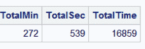

## 理解数据集是如何读取的

读取现有 SAS 数据集的 DATA 步处理与 DATA 步的编译执行阶段非常相似。主要区别在于，使用`SET`语句读取现有数据集时，SAS 会保留现有变量从一个观测值到下一个观测值的值。

在下面的示例中，DATA 步读取了`example.Finance.Loans`，创建变量`Interest`，并创建了新数据集`DueJan`。

```sas
data finance.dueJan;

set finance.loans;

Interest=amount*(rate/12);
```

**图 12.11 新数据集`Finance.DueJan`**

| Obs | Count | Amount | Rate | Payment | Interest | Total |
|---|---|---|---|---|---|---|
| 1 | 101-1092 | $22,000 | 10.00% | 60 | $467.43 | 183.333 |
| 2 | 101-1731 | $114,000 | 9.50% | 360 | $958.57 | 902.500 |
| 3 | 101-1289 | $10,000 | 10.50% | 36 | $325.02 | 87.500 |
| 4 | 101-3144 | $3,500 | 10.50% | 12 | $308.52 | 30.625 |
| 5 | 103-1335 | $8,700 | 10.50% | 24 | $403.47 | 76.125 |
| 6 | 103-1994 | $18,500 | 10.00% | 60 | $393.07 | 154.167 |
| 7 | 103-2335 | $5,000 | 10.50% | 48 | $128.02 | 43.750 |
| 8 | 103-3864 | $87,500 | 9.50% | 360 | $735.75 | 692.708 |
| 9 | 103-3891 | $30,000 | 9.75% | 360 | $257.75 | 243.750 |

## 编译阶段

- 创建程序数据向量（PDV），其中包含自动变量`_N_`和`_ERROR_`。

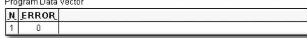

- SAS 扫描 DATA 步中的每个语句，寻找语法错误。

## 检测数据集的结束

3. 当编译`SET`语句时，会为输入数据集中的每个变量在程序数据向量中添加一个槽位。输入数据集提供了变量以及类型和长度等属性。
4. 在 DATA 步中创建的任何变量也会添加到程序数据向量中。这些变量的属性由表达式语句决定。
5. 在 DATA 步的底部，编译阶段完成，新数据集的描述符部分被创建。此时尚没有观测值，因为 DATA 步尚未执行。

当编译阶段完成后，开始执行阶段。

## 执行阶段

1. DATA 步为输入数据集中的每个观测值执行一次。例如，因为`Finance.Loans`中有四个观测值，所以 DATA 步执行了四次。
2. 在执行阶段开始，`_N_`的值为 1。其余变量初始化为缺失值。缺失值用句号`.`表示。

```sas
data finance.duejan;

set finance.loans;

interest=amount*(rate/12);

run;
```

| Account | Amount | Rate | Months | Payment | Interest |
|---|---|---|---|---|---|
| 101-1092 | 22000 | 0.1000 | 60 | 467.43 | |
| 101-1731 | 11400 | 0.0950 | 360 | 958.57 | |
| 101-1289 | 10000 | 0.1050 | 36 | 325.02 | |
| 101-3144 | 3500 | 0.1050 | 12 | 308.52 | |

3. `SET`语句从输入数据集中读取第一个观测值到程序数据向量。

```sas
data finance.duejan;

set finance.loans;

interest=amount*(rate/12);

run;
```

| Account | Amount | Rate | Months | Payment | Interest |
|---|---|---|---|---|---|
| 101-1092 | 22000 | 0.1000 | 60 | 467.43 | |
| 101-1731 | 11400 | 0.0950 | 360 | 958.57 | |
| 101-1289 | 10000 | 0.1050 | 36 | 325.02 | |
| 101-3144 | 3500 | 0.1050 | 12 | 308.52 | |

4. 然后，执行赋值语句来计算`Interest`的值。

```sas
data finance.duejan;

set finance.loans;

Interest=amount*(rate/12);

run;
```

| Account | Amount | Rate | Months | Payment | Interest |
|---|---|---|---|---|---|
| 101-1092 | 22000 | 0.1000 | 60 | 467.43 | |
| 101-1731 | 11400 | 0.0950 | 360 | 958.57 | |
| 101-1289 | 10000 | 0.1050 | 36 | 325.02 | |
| 101-3144 | 3500 | 0.1050 | 12 | 308.52 | |

5. 在 DATA 步第一次迭代结束时，程序数据向量中的值写入新数据集。

```sas
data finance.duejan;

set finance.loans;

Interest=amount*(rate/12);
```

| Account | Amount | Rate | Months | Payment | Interest |
|---|---|---|---|---|---|
| 101-1092 | 22000 | 0.1000 | 60 | 467.43 | |
| 101-1731 | 11400 | 0.0950 | 360 | 958.57 | |
| 101-1289 | 10000 | 0.1050 | 36 | 325.02 | |
| 101-3144 | 3500 | 0.1050 | 12 | 308.52 | |

`_N_`增加 DATA 步执行的次数。

```sas
data finance.duejan;

set finance.loans;

interest=amount*(rate/12);
```

| Account | Amount | Rate | Months | Payment | Interest |
|---|---|---|---|---|---|
| 101-1092 | 22000 | 0.1000 | 60 | 467.43 | |
| 101-1731 | 11400 | 0.0950 | 360 | 958.57 | |
| 101-1289 | 10000 | 0.1050 | 36 | 325.02 | |
| 101-3144 | 3500 | 0.1050 | 12 | 308.52 | |

`_N_`增加 DATA 步执行的次数。

`_N_`增加 DATA 步执行的次数。

所有变量都设置为缺失值。

# 第 12 章 • 读取 SAS 数据集

```sas
data finance.duejan;

set finance.loans;

interest=amount*(rate/12);
```

| Account | Amount | Rate | Months | Payment | Interest |
|---|---|---|---|---|---|
| 101-1092 | 22000 | 0.1000 | 60 | 467.43 | |
| 101-1731 | 114000 | 0.0950 | 360 | 958.57 | |
| 101-1289 | 10000 | 0.1050 | 36 | 325.02 | |
| 101-3144 | 3500 | 0.1050 | 12 | 308.52 | |

`_N_`增加 DATA 步执行的次数。

在第二次迭代开始时，`_ERROR_`的值被重置为 0。

```sas
data finance.duejan:

set finance.loans;

Interest=amount*(rate/12);

run;
```

| 账户 | 金额 | 利率 | 月数 | 还款额 |
|---|---|---|---|---|
| 101-1092 | 22000 | 0.1000 | 60 | 467.43 |
| 101-1731 | 114000 | 0.0950 | 360 | 958.57 |
| 101-1289 | 10000 | 0.1050 | 36 | 325.02 |
| 101-3144 | 3500 | 0.1050 | 12 | 308.52 |

## 程序数据向量（Program Data Vector）

| 错误 | 账户 | 金额 | 利率 | 月数 | 还款额 | 利息 |
|---|---|---|---|---|---|---|
| 2 | 0 | 101-1092 | 22000 | 0.1000 | 60 | 467.43 | |

9. 当`SET`语句执行时，第二个观测值的值会被读取到程序数据向量中。

```sas
data finance.duejan:

set finance.loans;

Interest=amount*(rate/12);

run;
```

| 账户 | 金额 | 利率 | 月数 | 还款额 |
|---|---|---|---|---|
| 101-1092 | 22000 | 0.1000 | 60 | 467.43 |
| 101-1731 | 114000 | 0.0950 | 360 | 958.57 |
| 101-1289 | 10000 | 0.1050 | 36 | 325.02 |
| 101-3144 | 3500 | 0.1050 | 12 | 308.52 |

## 程序数据向量（Program Data Vector）

| 错误 | 账户 | 金额 | 利率 | 月数 | 还款额 | 利息 |
|---|---|---|---|---|---|---|
| 2 | 0 | 101-1731 | 114000 | 0.0950 | 360 | 958.57 | |

| 账户 | 金额 | 利率 | 月数 | 还款额 | 利息 |
|---|---|---|---|---|---|
| 101-1092 | 22000 | 0.1000 | 60 | 467.43 | 183.333 |

10. 赋值语句再次执行，以计算第二个观测值的`Interest`值。

# 272 第 12 章：读取 SAS 数据集

```sas
data finance.duejan;

set finance.loans;

Interest=amount*(rate/12);

run;
```

| SAS 数据集 Finance Loans |
|---|
| 账户 | 金额 | 利率 | 月数 | 还款额 |
|---|---|---|---|---|
| 101-1092 | 22000 | 0.1000 | 60 | 467.43 |
| 101-1731 | 114000 | 0.0950 | 360 | 958.57 |
| 101-1289 | 10000 | 0.1050 | 36 | 325.02 |
| 101-3144 | 3500 | 0.1050 | 12 | 308.52 |

程序数据向量（Program Data Vector）

| 错误 | 账户 | 金额 | 利率 | 月数 | 还款额 | 利息 |
|---|---|---|---|---|---|---|
| 2 | 101-1731 | 114000 | 0.0950 | 360 | 958.57 | 902.5 |

| SAS 数据集 Finance.Duejan |
|---|
| 账户 | 金额 | 利率 | 月数 | 还款额 | 利息 |
|---|---|---|---|---|---|
| 101-1092 | 22000 | 0.1000 | 60 | 467.43 | 183.333 |

11. 在`DATA`步的末处，程序数据向量中的值会被写入第二个观测值中。

```sas
data finance.duejan;

set finance.loans;

Interest=amount*(rate/12);

run;
```


| SAS 数据集 `Finance.Loans` |
|---|---|---|---|---|
| 账户 | 金额 | 利率 | 月数 | 还款额 |
|---|---|---|---|---|
| 101-1092 | 22000 | 0.1000 | 60 | 467.43 |
| 101-1731 | 114000 | 0.0950 | 360 | 958.57 |
| 101-1289 | 10000 | 0.1050 | 36 | 325.02 |
| 101-3144 | 3500 | 0.1050 | 12 | 308.52 |

## 程序数据向量（Program Data Vector）

| 错误 | 账户 | 金额 | 利率 | 月数 | 还款额 | 利息 |
|---|---|---|---|---|---|---|
| 2 | 101-1731 | 114000 | 0.0950 | 360 | 958.57 | 902.5 |

| SAS 数据集 `Finance.Duejan` |
|---|---|---|---|---|---|
| 账户 | 金额 | 利率 | 月数 | 还款额 | 利息 |
|---|---|---|---|---|---|
| 101-1092 | 22000 | 0.1000 | 60 | 467.43 | 183.333 |
| 101-1731 | 114000 | 0.0950 | 360 | 958.57 | 902.5 |

`_N` 的值从 2 增加到 3，并跳转回 `DATA` 步的开头。SAS 会保留通过 `SET` 语句从 SAS 数据集中读取的变量，或通过求和语句创建的变量。所有其他变量（例如 `Interest` 变量的值）将被设为空值。

## 273 章节测验

```sas
data finance.duejan;
set finance.loans;
Interest=amount*(rate/12);
run;
```

| 账户 | 金额 | 利率 | 月数 | 还款额 |
|---|---|---|---|---|
| 101-1092 | 22000 | 0.1000 | 60 | 467.43 |
| 101-1731 | 114000 | 0.0950 | 360 | 958.57 |
| 101-1289 | 10000 | 0.1050 | 36 | 325.02 |
| 101-3144 | 3500 | 0.1050 | 12 | 308.52 |

## 程序数据向量（Program Data Vector）

| 错误 | 账户 | 金额 | 利率 | 月数 | 还款额 | 利息 |
|---|---|---|---|---|---|---|
| 2 | 101-1731 | 114000 | 0.0950 | 360 | 958.57 | |

| SAS 数据集 `Finance.Duejan` |
|---|---|---|---|---|---|
| 账户 | 金额 | 利率 | 月数 | 还款额 | 利息 |
|---|---|---|---|---|---|
| 101-1092 | 22000 | 0.1000 | 60 | 467.43 | 183.333 |

- `RENAME` 语句语法 ................................................................................ 301
- 示例：重命名变量 ....................................................................................... 301
- 排除不匹配的观测值 ................................................................................... 302
- 概述 ....................................................................................................................... 302
- 在两个数据集中识别观测值 .......................................................... 302
- 选择匹配的观测值 ........................................................................ 303
- 选择变量 ......................................................................................... 304
- 在何处指定 `DROP=` 和 `KEEP=` 数据集选项 ................................................ 304
- 章节测验 .......................................................................................................... 305

## 如何准备你的数据集

### 确定数据集的结构和内容

为了帮助确定数据之间的关系，请查看数据集的结构。要查看结构，请使用 `DATASETS` 过程。要显示描述符信息，请使用 `CONTENTS` 过程。描述符信息包括每个数据的行数、每列的名称和属性，以及扩展属性的字母顺序列表（包括数据集和列扩展属性）。要打印行样本，请使用 `PRINT` 过程或 `REPORT` 过程。

### 测试你的程序

创建包含样本行的小型数据集，以测试你程序的所有逻辑。如果你的逻辑有误并得到了意外的输出，你可以对程序进行调试。

### 寻找常见问题的来源

如果你的程序运行不正确，请检查输入数据是否存在以下错误：

- 具有相同名称但代表不同数据的列

  要纠正此错误，可以在合并数据集之前，使用 `SET` 或 `MERGE` 语句中的 `RENAME=` 表选项来重命名列。作为替代方案，使用 `DATASETS` 过程显示所有成员类型（目录除外）的所有库管理函数。

- 具有相同数据但不同属性的列

## 合并 SAS 数据集的方法：基础

SAS 编程中的一项常见任务是将两个或多个数据集的观测值合并到一个新的数据集中。使用 `DATA` 步，你可以通过几种方式合并数据集。

合并 SAS 数据集的方法：基础 279

**表 13.1** 数据合并方法快速参考概述

| 合并方法 | 示例图 |
|---|---|
| 一对一读取 | SAS 数据集 C | SAS 数据集 D |
|---|---|---|
| | Num | VarA | Num | VarB |
| | 1 | A1 | 2 | B1 |
| | 3 | A2 | 4 | B2 |
| | 5 | A3 | | |
| 创建包含来自每个贡献数据集的所有变量的观测值。 | | | |
| 根据观测值在每个数据集中的相对位置进行合并。 | Merge |
| | | 合并后的 SAS 数据集 |
| | | Num | VarA | VarB |
| | | 2 | A1 | B1 |
| | | 4 | A2 | B2 |
| 语句：`SET` 连接 | 将一个数据集的观测值追加到另一个数据集。 |
| 语句：`SET` | |

| SAS 数据集 A | SAS 数据集 C |
|---|---|
| Num | VarA | Num | VarB |
| 1 | A1 | 1 | B1 |
| 2 | A2 | 2 | B2 |
| 3 | A3 | 4 | B3 |
| 连接 | |
| 合并后的 SAS 数据集 | | |
| Num | VarA | VarB |
| 1 | A1 | | |
| 2 | A2 | | |
| 3 | A3 | B1 |
| 2 | | B2 |
| 4 | | B3 |
| 追加 | 将第二个数据集中的观测值直接追加到原始数据集的末尾。 |
| 过程：`APPEND` | |
| `BASE=` 数据集 A | `DATA=` 数据集 B |
|---|---|
| Num | Sex | Num | Sex |
| 1 | M | 3 | F |
| 2 | F | 4 | F |
| 3 | F | 5 | F |
| 4 | M | 6 | M |
| 追加 | |
| `BASE=` 数据集 A | | |
| Num | Sex | | |
| 1 | M | | |
| 2 | F | | |
| 3 | F | | |
| 4 | M | | |
| 5 | F | | 追加了数据集 B 的观测值 |
| 5 | F | | |
| 6 | M | | |

## 第 13 章：合并 SAS 数据集

### 插图

| 合并方法 | | | | |
|---|---|---|---|---|
| 交叉 | SAS 数据集 C | SAS 数据集 D |
| | Num | Var | Num | Var |
| | 1 | C1 | 2 | D1 |
| 2 | C2 | 3 | D2 |
| 2 | C3 | 3 | D3 |
| 3 | C4 | | |

根据一个或多个公共变量，按顺序从两个或多个数据集中交错插入观测值。

语句：`SET`、`BY`

| 交叉合并 | | |
|---|---|---|
| 合并后的 SAS 数据集 | | |
| Num | Var | |
| 1 | C1 | |
| 2 | C2 | |
| 2 | C3 | |
| 3 | D1 | |
| 3 | C4 | |
| 3 | D2 | |
| 3 | D3 | |

## 匹配合并

根据公共变量的值，将两个或多个数据集的观测值匹配到新数据集中的单个观测值中。

| SAS 数据集 A | SAS 数据集 B |
|---|---|
| Num | VarA | Num | VarB |
| 1 | A1 | 1 | B1 |
| 2 | A2 | 2 | B2 |
| 3 | A3 | 4 | B3 |

语句：`MERGE`、`BY`

| 匹配合并 | | |
|---|---|---|
| 合并后的 SAS 数据集 | | |
| VarA | VarB | |
| 1 | A1 | B1 |
| 2 | A2 | B2 |
| 3 | A3 | B3 |

> 提示：你也可以使用 `PROC SQL` 根据公共值连接数据集。

## 一对一读取：详情

### 一对一读取语法

在 `DATA` 步中使用多个 `SET` 语句来合并数据集。一对一读取通过创建包含来自每个贡献数据集所有列的行，来合并两个或多个数据集的行。行根据它们在每个数据集中的相对位置进行合并。也就是说，一个中的的第一行与另一个集合中的第一行合并，依此类推。数据程序在读取完最小数据集的最后一行后停止。

一对一读取：详情 281

一对一读取的 `DATA` 步语法：

```sas
DATA output=SAS-one-to-one-reading;
SAS-one-to-one-reading-1;
SAS-one-to-one-reading-2;
```

`SAS-one-to-one-reading-1` 是要创建的数据集。

`SAS-one-to-one-reading-2` 指定数据集。

### 一对一读取如何选择数据

当执行一对一读取时，以下语句为真：

- 数据集包含变量。
- 如果数据集具有相同的名称，则从数据集读取的值将覆盖从较早数据集读取的值。
- 新数据集中的观测值数量等于最小数据集中的观测值数量。

### 一对一工作原理

这是一个一对一读取的简单示例：

```sas
data one2;
set a;
run;
```


# Chapter 13 • Combining SAS Data Sets

## How to Prepare Your Data Sets

### Determining the Structure and Contents of the Data Sets

To help determine how your data is related, look the structure of the data sets. To see the structure, use the `DATASETS` procedure. To display the descriptor information, use the `CONTENTS` procedure. Descriptor information includes the number of rows in each data set, the name and attributes of each column, and an alphabetical list of extended attributes (including data set and column extended attributes). To print a sample of the rows, use the `PRINT` procedure or the `REPORT` procedure.

### Testing Your Program

Create small data sets that contain a sample of rows that test all of your program's logic. If your logic is faulty and you get unexpected output, you can debug your program.

### Looking at Sources of Common Problems

If your program does not run correctly, review your input data for the following errors:

- columns that have the same name but represent different data

  To correct the error, you rename columns before you combine the data sets by using the `RENAME=` table option in the `SET` or `MERGE` statement. As an alternative, use the `DATASETS` procedure to display all library management functions for all member types (except catalogs).

- common columns that have the same data but different attributes

## Methods of Combining SAS Data Sets: The Basics

A common task in SAS programming is to combine observations from two or more data sets into a new data set. Using the `DATA` step, you can combine data sets in several ways.

**Methods of Combining SAS Data Sets: The Basics 279**

**Table 13.1** Quick-Reference Overview of Data-Combining Methods

| Method of Combining | Illustration |
| --- | --- |
| One-to-one reading | SAS Data Set C \| SAS Data Set D<br><br>Num \| VarA \| Num \| VarB<br>1 \| A1 \| 2 \| B1<br>3 \| A2 \| 4 \| B2<br>5 \| A3 \|  \|  |
|  | Creates observations that contain all of the variables from each contributing data set.<br><br>Combines observations based on their relative position in each data set.<br><br>`Merge`<br><br>Combined SAS Data Set<br><br>Num \| VarA \| VarB<br>2 \| A1 \| B1<br>4 \| A2 \| B2 |
| Statement: `SET` Concatenating | Appends the observations from one data set to another. |
| Statement: `SET` |  |

| SAS Data Set A | SAS Data Set C |
| --- | --- |
| Num \| VarA | Num \| VarB |
| 1 \| A1 | 1 \| B1 |
| 2 \| A2 | 2 \| B2 |
| 3 \| A3 | 4 \| B3 |

| Concatenate |  |
| --- | --- |
| Combined SAS Data Set |  |
| Num \| VarA \| VarB |  |
| 1 \| A1 \|  |  |
| 2 \| A2 \|  |  |
| 3 \| A3 \| B1 |  |
| 2 \|  \| B2 |  |
| 4 \|  \| B3 |  |

|  |  |
| --- | --- |
| Appending | Appends the observations in the second data set directly to the end of the original data set. |
| Procedure: `APPEND` |  |

| `BASE=` data set A | `DATA-` data set B |
| --- | --- |
| Num \| Sex | Num \| Sex |
| 1 \| M | 3 \| F |
| 2 \| F | 4 \| F |
| 3 \| F | 5 \| F |
| 4 \| M | 6 \| M |

| Append |  |
| --- | --- |
| `BASE=` data set A |  |
| Num \| Sex |  |
| 1 \| M |  |
| 2 \| F |  |
| 3 \| F |  |
| 4 \| M |  |
| 5 \| F | with data set B observations appended |
| 5 \| F |  |
| 6 \| M |  |

## Illustration

| Method of Combining |  |  |  |  |
| --- | --- | --- | --- | --- |
| Interleaving | SAS Data Set C | SAS Data Set D |  |  |
|  | Num | Var | Num | Var |
|  | 1 | C1 | 2 | D1 |
|  | 2 | C2 | 3 | D2 |
|  | 2 | C3 | 3 | D3 |
|  | 3 | C4 |  |  |

Intersperses observations in order from two or more data sets, based on one or more common variables.

Statements: `SET`, `BY`

| Interleave |  |  |
| --- | --- | --- |
| Combined SAS Data Set |  |  |
| Num | Var |  |
| 1 | C1 |  |
| 2 | C2 |  |
| 2 | C3 |  |
| 3 | D1 |  |
| 3 | C4 |  |
| 3 | D2 |  |
| 3 | D3 |  |

## Match-merging

Matches observations from two or more data sets into a single observation in a new data set according to the values of a common variable.

| SAS Data Set A | SAS Data Set B |
| --- | --- |
| Num \| VarA | Num \| VarB |
| 1 \| A1 | 1 \| B1 |
| 2 \| A2 | 2 \| B2 |
| 3 \| A3 | 4 \| B3 |

Statements: `MERGE`, `BY`

| Match-Merge |  |  |
| --- | --- | --- |
| Combined SAS Data Set |  |  |
| VarA | VarB |  |
| 1 | A1 | B1 |
| 2 | A2 | B2 |
| 3 | A3 | B3 |

> **TIP** You can also use `PROC SQL` to join data sets according to common values.

## One-to-One Reading: Details

### One-to-One Reading Syntax

Use multiple `SET` statements in a `DATA` step to combine data sets. One-to-one reading combines rows from two or more data sets by creating rows that contain all of the columns from each contributing data set. Rows are combined based on their relative position in each data set. That is, the first row in one set is combined with the first row in the other, and so on. The data program stops after it has read the last row from the smallest data set.

**One-to-One Reading: Details 281**

Syntax, `DATA` step for one-to-one reading:

```sas
DATA output=SAS-one-to-one-reading;
SAS-one-to-one-reading-1;
SAS-one-to-one-reading-2;
```

`SAS-one-to-one-reading-1` is the data set to be created.

`SAS-one-to-one-reading-2` specify the data sets.

### How One-to-One Reading Select Data

The following statements are true when you perform one-to-one reading:

The data sets contain variables. If the data sets have the same names, the values read from the data set overwrite the values read from earlier data sets. The number of observations in the new data set is the number of observations in the smallest data set.

### One-to-One Works

Here is a simple example of one-to-one:


```sas
data one2;

set a;

run;
```

| SAS 数据集 A | SAS 数据集 B |
|---|---|
| Num | VarA | Num | VarB |
| 1 | A1 | 1 | B1 |
| 2 | A2 | 2 | B2 |
| 3 | A3 | 4 | B3 |

| 合并后的 SAS 数据集 | |
|---|---|
| Num | VarA | VarB |
| 1 | A1 | | |
| 2 | A2 | | |
| 3 | A3 | B1 |
| 2 | | B2 |
| 4 | | B3 |

| `BASE=` 数据集 A | `DATA=` 数据集 B |
|---|---|
| Num | Sex | Num | Sex |
| 1 | M | 3 | F |
| 2 | F | 4 | F |
| 3 | F | 5 | F |
| 4 | M | 6 | M |

| `BASE=` 数据集 A | | |
|---|---|---|
| Num | Sex | | |
| 1 | M | | |
| 2 | F | | |
| 3 | F | | |
| 4 | M | | |
| 5 | F | | 追加了数据集 B 的观测值 |
| 5 | F | | |
| 6 | M | | |

| 合并方法 | | | | |
|---|---|---|---|---|
| 交错读取 | SAS 数据集 C | SAS 数据集 D |
| | Num | Var | Num | Var |
| | 1 | C1 | 2 | D1 |
| 2 | C2 | 3 | D2 |
| 2 | C3 | 3 | D3 |
| 3 | C4 | | | |

根据一个或多个公共变量，按顺序从两个或多个数据集中交错插入观测值。

语句：`SET`、`BY`

| 交错合并 | | | |
|---|---|---|---|
| 合并后的 SAS 数据集 | | | |
| Num | Var | | |
| 1 | C1 | | |
| 2 | C2 | | |
| 2 | C3 | | |
| 3 | D1 | | |
| 3 | C4 | | |
| 3 | D2 | | |
| 3 | D3 | | |

## 匹配合并

根据公共变量的值，将两个或多个数据集的观测值匹配到新数据集中的单个观测值中。

| SAS 数据集 A | SAS 数据集 B |
|---|---|
| Num | VarA | Num | VarB |
| 1 | A1 | 1 | B1 |
| 2 | A2 | 2 | B2 |
| 3 | A3 | 4 | B3 |

语句：`MERGE`、`BY`

| 匹配合并 | | | |
|---|---|---|---|
| 合并后的 SAS 数据集 | | | |
| VarA | VarB | | |
| 1 | A1 | B1 | |
| 2 | A2 | B2 | |
| 3 | A3 | B3 | |

> **提示：**你也可以使用 `PROC SQL` 根据公共值连接数据集。

## 一对一读取：详情

### 一对一读取语法

在 `DATA` 步中使用多个 `SET` 语句来合并数据集。一对一读取通过创建包含来自每个贡献数据集所有列的行，来合并两个或多个数据集的行。行根据它们在每个数据集中的相对位置进行合并。也就是说，一个中的第一行与另一个集合中的第一行合并，依此类推。数据程序在读取完最小数据集的最后一行后停止。

一对一读取的 `DATA` 步语法：

```sas
DATA output=SAS-one-to-one-reading;
  SET SAS-one-to-one-reading-1;
  SET SAS-one-to-one-reading-2;
RUN;
```

`SAS-one-to-one-reading-1` 是要创建的数据集。  
`SAS-one-to-one-reading-2` 指定数据集。

### 一对一读取如何选择数据

当你执行一对一读取时，以下语句为真：

- 数据集包含变量。
- 如果数据集具有相同的名称，则从数据集读取的值将覆盖从较早数据集读取的值。
- 新数据集中的观测值数量等于最小数据集中的观测值数量。

### 一对一工作原理

这是一个一对一读取的简单示例：

```sas
data one2;

set a;

run;
```

Clinic.Patients 中的观测值没有写入数据集，因为第二个 `SET` 语句到达文件末尾，从而停止了 `DATA` 步的处理。

| ID | Sex | Age | Height | Weight |
|---|---|---|---|---|
| 1 | 1129 | F | 48 | 61 | 137 |
| 2 | 1387 | F | 57 | 64 | 142 |
| 3 | 2304 | F | 16 | 61 | 102 |
| 4 | 5438 | F | 42 | 62 | 168 |
| 5 | 6488 | F | 59 | 64 | 154 |
| 6 | 9012 | F | 39 | 63 | 157 |

## 拼接：详情

使用 `SET` 语句合并 SAS 数据集的另一种方法是拼接（concatenating），它将一个数据集的观测值追加到另一个数据集之后。要拼接 SAS 数据集，你需要在 `SET` 语句中指定数据集名称列表。

拼接的 `DATA` 步语法：

```sas
DATA output-SAS-data-set;
  SET SAS-data-set-1 SAS-data-set-2;
RUN;
```

- `output-SAS-data-set` 指定要创建的数据集的名称。
- `SAS-data-set-1` 和 `SAS-data-set-2` 指定要读取的数据集。

## 如何拼接数据集

当程序拼接数据集时，所有的观测值都从 `SET` 语句中列出的第一个数据集开始读取。然后是所有列出的第二个数据集，依此类推，直到所有列出的数据集都读取完毕。新数据集包含所有输入数据集中的所有变量和观测值。

```sas
data concat;

set a;

c;

run;
```

### 图 13.4 拼接选择方式

#### SAS 数据集 A

| Num | VarA |
|---|---|
| 1 | A1 |
| 2 | A2 |
| 3 | A3 |

#### SAS 数据集 C

| Num | VarB |
|---|---|
| 1 | B1 |
| 2 | B2 |
| 4 | B3 |

#### 拼接后的 SAS 数据集

| Num | VarA | VarB |
|---|---|---|
| 1 | A1 | B1 |
| 2 | A2 | B2 |
| 3 | A3 | |
| 4 | | B3 |

注意，A 和 C 包含一个名为 Num 的共同变量：

- Num 的两个实例（或任何共同变量）必须具有相同的类型属性（type），否则 SAS 将停止处理 `DATA` 步并发出错误信息，说明变量不兼容。
- 然而，如果长度（length）属性不同，SAS 将采用包含该变量的第一个数据集的长度。在这种情况下，A 中 Num 的长度决定了 Concat 中 Num 的长度。
- 标签（label）、格式（format）和输入格式（informat）属性也是如此：如果这些属性中的任何一个不同，SAS 将采用包含该属性变量的第一个数据集的属性。

## 示例：使用拼接合并数据集

以下 `DATA` 步通过拼接 `Clinic.Therapy2012` 和 `Clinic.Therapy2013` 创建 `Clinic.Concat`。每个数据集包含 12 个观测值。

```sas
data concat;

set clinic.therapy2012 clinic.therapy2013;

run;
```


新输出数据集 `Clinic.Concat` 中的前 12 个观测值是从 `Clinic.Therapy2012` 读取的，后 12 个观测值是从 `Clinic.Therapy2013` 读取的。

286 第 13 章 • 合并 SAS 数据集

**图 13.5** 示例：拼接（部分输出）

| Obs | Month | Year | AerClass | WalkJog | Run |
|---|---|---|---|---|---|
| 01 | 2012 | 26 | 78 | 14 |
| 02 | 2012 | 32 | 109 | 19 |
| 03 | 2012 | 15 | 106 | 22 |
| 04 | 2012 | 47 | 115 | 24 |
| 05 | 2012 | 95 | 121 | 31 |
| 08 | 2013 | 63 | 65 | 53 |
| 09 | 2013 | 60 | 49 | 68 |
| 10 | 2013 | 78 | 70 | 41 |
| 11 | 2013 | 82 | 44 | 58 |
| 12 | 2013 | 93 | 57 | 47 |

## 追加：详情

### `APPEND` 过程

合并 SAS 数据集的另一种方法是使用 `APPEND` 过程将一个数据集追加到另一个数据集。虽然追加（appending）和拼接相似，但这两种方法之间存在重要的区别。`DATA` 步在拼接时创建一个全新的数据集。而 `APPEND` 仅仅是将一个数据集的观测值添加到“主”（或基准）数据集的末尾。在执行 `APPEND` 过程时，SAS 不创建新数据集，也不会读取基准集。

要追加 SAS 数据集，你需要指定一个 `BASE=` 数据集（即要追加观测值的数据集），然后指定一个 `DATA=` 数据集（即包含要追加到基准数据集观测值的数据集）。通过 `DATA=` 指定的数据集是两个集中 SAS 实际创建的。

语法，`APPEND` 过程：

```sas
PROC APPEND BASE=SAS-data-set
DATA=SAS-data-set;
RUN;
```

- `BASE=` 指定要追加观测值的数据集名称。
- `DATA=` 指定包含要追加到基准数据集观测值的数据集名称。

对于示例，以下 `PROC` 语句将数据集 `B` 中的观测值追加到数据集 `A` 的末尾：

```sas
proc append base=A
data=B;
run;
```

追加：详情 287

**图 13.6** `PROC APPEND` 如何追加数据

| `BASE=` 数据集 A | |
|---|---|
| Num | Sex |
|---|---|
| 1 | M |
| 2 | F |
| 3 | F |
| 4 | M |

| `DATA=` 数据集 B | |
|---|---|
| Num | Sex |
|---|---|
| 3 | F |
| 4 | F |
| 5 | F |
| 6 | M |

| `BASE=` 数据集 A | |
|---|---|
| Num | Sex |
|---|---|
| 1 | M |
| 2 | F |
| 3 | M |
| 4 | F |
| 5 | F |
| 6 | M |

带有数据集 B 的观测值，观测值已追加。

## `APPEND` 过程的要求

以下是将一个数据集追加到另一个数据集的要求：

- 一个步骤中同时只能使用两个数据集。
- 基准数据集描述部分中的变量信息不能更改。

> 注意：最终的数据集是带有追加观测值的原始数据集。

## 示例：使用 `APPEND` 合并数据集

以下 `PROC` 语句将数据集 `B` 中的观测值追加到数据集 `A` 的末尾。两个数据集如下：

```sas
proc append base=A
data=B;
run;
```

下面是 `totals205` 的列表。以下 `PROC` 语句将数据集 `B` 中的观测值追加到数据集 `A` 的末尾。两个数据集如下：301

**图 13.7** 示例：`PROC APPEND`

| Obs | Month | Therapy | Admit |
|---|---|---|---|
| 1 | 01 | | |
| 2 | 02 | | |
| 3 | 03 | | |
| 4 | 04 | | |
| 5 | 01 | | |
| 6 | 02 | | |
| 7 | 03 | | |
| 8 | 04 | | |

## 在非结构化数据集上使用 `FORCE` 选项

为了对具有匹配变量的数据集使用 `APPEND`，可以使用 `FORCE` 选项。

语法，带有 `FORCE` 的 `APPEND` 过程：

```sas
PROC APPEND BASE=sas-data-set
DATA=sas-data-set;
```

当 `DATA=` 数据集包含以下变量时，需要 `FORCE` 选项：

- 不在 `BASE=` 数据集中。
- 与 `BASE=` 数据集的变量类型不同（例如字符或数值）。
- 它们比 `BASE=` 数据集长。

如果 `DATA=` 数据集的变量长度比 `BASE=` 数据集长，SAS 将 `DATA=` 设置的值截断，以适应 `BASE=` 指定的长度。

如果 `DATA=` 数据集的变量类型与 `BASE=` 数据集不同，SAS 将 `DATA=` 数据中的所有值替换为空值，并保留 `BASE=` 数据集的类型。

如果 `BASE=` 数据集包含 `DATA=` 数据集中不存在的变量，则进行追加，但该变量将从 `DATA=` 数据集中删除。

## 示例：使用 `FORCE` 追加

```sas
proc append base=sasuser.patients
   data=clinic.append;
```

302

**图 13.8** 示例：带有 `FORCE` 的 `PROC APPEND`

`Base=sasuser.patients` `Data=clinic_append`

| Hum | Sex | State |
|---|---|---|
| 1 | M | HC |
| 2 | F | TX |
| 3 | F | MA |
| 4 | M | HC |
| 5 | F | TX |
| 6 | F | MA |
| 7 | F | HC |
| 8 | M | TX |

`State` 被删除。  
`Sex` 的值被截断。

## 交错：详情

当你使用 `BY` 语句拼接数据集时，结果就是交错（interleaving）。交错根据一个或多个共同变量交错插入两个或多个数据集的观测值。

要交错 SAS 数据集，请在 `SET` 语句中指定数据集名称列表，并在 `BY` 语句中指定一个或多个变量。

语法，交错的 `DATA` 步：

```sas
DATA output-SAS-data-set;
  SET SAS-data-set-1 SAS-data-set-2;
  BY variable(s);
RUN;
```

- `output-SAS-data-set` 指定要创建的数据集的名称。
- `SAS-data-set-1` 和 `SAS-data-set-2` 指定要读取的数据集。
- `variable(s)` 指定用于交错观测值的一个或多个变量。

> 提示：在 `SET` 语句中指定任意数量的数据集。每个输入数据集必须根据 `BY` 变量或变量升序排序或索引。

## 交错法如何选择数据

SAS 对数据集进行交错处理。`SET` 语句中每个数据集中每个 `BY` 组中的观测值是按照数据集和 `BY` 变量列出的顺序读取的，直到所有观测值都处理完毕。新的数据集包含来自所有输入数据集的所有变量，并且包含所有输入数据集的观测值总数。

```sas
data intervlv;
    set c d;
    by num;
run;
```

**图 13.9** 交错法如何选择数据

| SAS 数据集 C | | SAS 数据集 D | |
|---|---|---|---|
| Num Var | | Num Var | |
| 1 | C1 | 2 | D1 |
| 2 | C2 | 3 | D2 |
| 2 | C3 | 3 | D3 |

| 交错 | 合并后的 SAS 数据集 | |
|---|---|---|
| Num Var | | |
| 1 | C1 | |
| 2 | C2 | |
| 2 | C3 | |
| 3 | D1 | |
| 3 | C4 | |
| 3 | D2 | |
| 3 | D3 | |

## 示例：使用交错法合并数据集

以下 `DATA` 步通过交错 `Clinic.Therapy2012` 和 `Clinic.Therapy2013` 创建 `Clinic.Interlv.`。

```sas
data clinic.interlv;
    set clinic.therapy2012 clinic.therapy2013;
    by month;
run;
```

下面是 `Clinic.Interlv.` 的列表。请注意，与上一个示例不同，观测值按月份交错，而不是简单地连接。

**图 13.10** 示例：交错法如何选择数据（部分输出）

| Obs | Month | Year | AerClass | Walk | Run | Swim |
|---|---|---|---|---|---|---|
| 1 | 01 | 2012 | 26 | 78 | 14 | |
| 2 | 01 | 2013 | 37 | 91 | 83 | |
| 3 | 02 | 2012 | 32 | 109 | 19 | |
| 4 | 02 | 2013 | 41 | 102 | 27 | |
| 20 | 10 | 2013 | 78 | 70 | 41 | |
| 21 | 11 | 2012 | 84 | 31 | 52 | |
| 22 | 11 | 2013 | 82 | 44 | 58 | |
| 23 | 12 | 2012 | 92 | 44 | 55 | |
| 24 | 12 | 2013 | 93 | 57 | 47 | |

## 匹配合并（Match-Merging）：详情

### 匹配合并语法

匹配合并根据公共变量的值，将两个或多个数据集的观测值合并为新数据集中的单个观测值。

在进行匹配合并时，使用 `MERGE` 语句而不是 `SET` 语句来合并数据。

匹配合并的 `DATA` 步语法：

```sas
DATA output-SAS-data-set;
  MERGE SAS-data-set-1 SAS-data-set-2;
  BY DESCENDING variable(s);
```

- `output-SAS-data-set` 指定了要创建的数据集名称。
- `SAS-data-set-1` 和 `SAS-data-set-2` 指定要读取的数据集。
- `BY` 语句中的 `variable(s)` 指定了一个或多个用于匹配观测值的变量。
- `DESCENDING` 表示输入数据集按照指定的变量以降序（数值上从大到小，字符型则按字母表倒序排列）排序。如果你在 `BY` 语句中有多个变量，`DESCENDING` 仅适用于紧随其后的变量。默认排序顺序为升序（`ASCENDING`）。

> `MERGE` 语句中的每个输入数据集都必须按照 `BY` 变量的值进行排序，或者必须具有适当的索引。所有要合并的数据集中的每个 `BY` 变量必须具有相同的类型。  
> 你不能对带索引的数据集使用 `DESCENDING` 选项，因为索引始终是以升序存储的。

## 匹配合并如何选择数据

在匹配合并期间，SAS 顺序检查每个数据集的每个观测值，查看 `BY` 值是否匹配，并将合并后的观测值写入新数据集。

```sas
data merged;
  merge a b;
  by num;
run;
```

**图 13.11** 匹配合并如何选择数据

| SAS 数据集 A | | SAS 数据集 B | |
|---|---|---|---|
| Num | VarA | Num | VarB |
| 1 | A1 | 1 | B1 |
| 2 | A2 | 2 | B2 |
| 3 | A3 | 4 | B3 |

| Num | VarA | VarB |
|---|---|---|
| 1 | A1 | B1 |
| 2 | A2 | B2 |
| 3 | A3 | |
| 4 | | B3 |

基础 `DATA` 步的匹配合并会产生一个输出数据集，该数据集包含来自所有输入数据集所有观测值的值。你可以添加语句和选项来仅选择匹配的观测值。

如果输入数据集对于 `BY` 变量的某个特定值没有观测值，则输出数据集中的观测值对于该数据集特有的变量包含缺失值。

> 在合并中，通常一个数据集包含 `BY` 变量的唯一值，而其他数据集包含多个 `BY` 变量的值。

## 示例：使用匹配合并合并数据集

`Clinic.demog` 和 `Clinic.visit` 数据集排序如下：

```sas
proc sort data=clinic.demog;
  by id;
run;

proc print data=clinic.demog;
run;
```

**图 13.12** 输出：`Clinic.Demog`

| Obs | ID | Age | Sex | Date |
|---|---|---|---|---|
| 1 | A001 | 21 | m | 05/22/07 |
| 2 | A002 | 32 | m | 06/15/06 |
| 3 | A003 | 24 | f | 08/17/07 |
| 4 | A004 | | | 01/27/06 |
| 5 | A005 | 44 | f | 02/24/05 |
| 6 | A007 | 39 | m | 11/11/05 |

```sas
proc sort data=clinic.visit;
  by id;
run;

proc print data=clinic.visit;
run;
```

**图 13.13** 输出：`Clinic.Visit`

| Obs | ID | Visit | SysBP | DiasBP | Date |
|---|---|---|---|---|---|
| 1 | A001 | 1 | 140 | 85 | 11/05/09 |
| 2 | A001 | 2 | 138 | 90 | 10/13/09 |
| 3 | A001 | 3 | 145 | 95 | 07/04/09 |
| 4 | A002 | 1 | 121 | | 04/14/09 |
| 5 | A003 | 1 | 118 | 68 | 08/12/09 |
| 6 | A003 | 2 | 112 | 65 | 08/21/09 |
| 7 | A004 | 1 | 143 | 86 | 03/30/09 |
| 8 | A005 | 1 | 132 | 76 | 02/27/09 |
| 9 | A005 | 2 | 132 | 78 | 07/11/09 |
| 10 | A005 | 3 | 134 | 78 | 04/16/09 |
| 11 | A008 | 1 | 126 | 80 | 05/22/09 |

你可以提交此 `STEP`，通过合并 `Clinic.Demog` 和 `Clinic.Visit` 的 `ID` 值来创建 `Clinic.Demog`。

```sas
data clinic.merged;
  merge clinic.demog clinic.visit;
  by id;
run;

proc print data=clinic.merged;
run;
```


注意：所有观测值（包括不匹配的观测值和数据缺失观测值）都写入了输出数据集。

# 第 13 章 合并数据集

## 匹配合并输出

图 13.14 输出：匹配合并输出

| Obs | ID | Age | Sex | Date | Visit | SysBP | DiasBP | Weight |
|---|---|---|---|---|---|---|---|---|
| 1 | A001 | 21 | m | 11/05/09 | 1 | 140 | 85 | 195 |
| 2 | A001 | 21 | m | 10/13/09 | 2 | 138 | 90 | 198 |
| 3 | A001 | 21 | m | 07/04/09 | 3 | 145 | 95 | 200 |
| 4 | A002 | 32 | m | 04/14/09 | 1 | 121 | | 168 |
| 5 | A003 | 24 | f | 08/12/09 | 1 | 118 | 68 | 125 |
| 6 | A003 | 24 | f | 08/21/09 | 2 | 112 | 65 | 123 |
| 7 | A004 | | | 03/30/09 | 1 | 143 | 86 | 204 |
| 8 | A005 | 44 | f | 02/27/09 | 1 | 132 | 76 | 174 |
| 9 | A005 | 44 | f | 07/11/09 | 2 | 132 | 78 | 175 |
| 10 | A005 | 44 | f | 04/16/09 | 3 | 134 | 78 | |
| 11 | A008 | | | 05/22/09 | 1 | 126 | 80 | |

## 匹配合并处理

### 匹配合并的基本原理

书中的匹配合并示例非常直观。然而，匹配合并的复杂程度取决于你的数据以及你想创建的数据集。为了正确预测匹配合并的结果，你需要理解 `DATA` 步是如何执行匹配合并的。

当你提交一个 `DATA` 步时，它分两个阶段处理：

- **编译阶段**：SAS 检查 `DATA` 步语句的语法并将其编译（翻译成机器码）。在此阶段，SAS 还会获取输出数据集的描述符信息并创建 PDV（SAS 每次存储一个观测值的内存区域）。
- **执行阶段**：`DATA` 步读取数据并执行随后的编程语句。当 `DATA` 步执行时，数据值被读入 PDV 中相应的变量中。从这里，变量作为单个观测值写入输出数据集。

### 程序数据向量

| Name | EmpID | Date | Amt |
|---|---|---|---|

# 编译阶段：设置新数据集

为了准备合并的数据集，SAS 会执行以下操作：

- 读取 `MERGE` 语句中列出的数据集的描述符部分（descriptor portions）。
- 读取 `DATA` 步程序的其余部分。
- 为合并后的集合创建 PDV（程序数据向量）。
- 为 `MERGE` 语句中列出的每个数据集分配跟踪指针。

如果变量在多个数据集中具有相同的名称，则来自第一个数据集的变量（按照在 `MERGE` 语句中列出的顺序）决定该变量的长度。

**图 1.36** 编译阶段：设置新数据集

在读取了 `Clients` 和 `Amounts` 数据集的描述符部分后，SAS 会执行以下操作：

- 为新的 `Claims` 数据集创建一个 PDV。PDV 包含两个数据集的所有变量。注意，尽管 `Name` 出现在两个输入数据集中，但它在 PDV 中仅出现一次。
- 为 `Clients` 和 `Amounts` 分配跟踪指针。

# 执行阶段：匹配合并观测值

在完成 `DATA` 步的编译后，SAS 会通过向下移动每个数据集每个观测值的指针，并检查 `BY` 值是否匹配，从而按顺序匹配合并观测值。

- 如果 `BY` 值匹配，则按照数据集匹配的顺序将观测值读入 PDV 中。任何同名变量的值会被后续数据集的值覆盖。SAS 将合并后的观测值写入新数据集，并保留 PDV 中的值，直到所有数据集中的 `BY` 值都发生变化。

```sas
data work.claims;
    merge sasuser.clients
          sasuser.amounts;
    by name;
run;
```

| Name | EmpID | | Date | Amt |
|---|---|---|---|
| ANKERTON, L. | 11123 | 08OCT16 | 92 |
| DAVIS, R. | 22298 | ANKERTON, L. | 08OCT16 | 65 |
| MASTERS, T. | 35301 | DAVIS, A. | 04OCT16 | 16 |
| WOLMER, B. | 44483 | MASTERS, T. | 13OCT16 | 18 |
| | | THOMAS, A. | 21OCT16 | 25 |

| Name | EmpID | Date | Amt |
|---|---|---|---|
| ANKERTON, L. | 11123 | 08OCT16 | 92 |

| Name | EmpID | Date | Amt |
|---|---|---|---|
| ANKERTON, L. | 11123 | 08OCT16 | 92 |

- 如果 `BY` 值不匹配，SAS 会确定哪个 `BY` 值在先，并将包含该值的观测值读入 PDV。然后写入 PDV 的内容。

| Work.Clients | Name | EmpID |
|---|---|---|
| ANKERTON, L. | 11123 |
| DAVIS, R. | 22298 |
| MASTERS, T. | 33351 |
| WOLMER, B. | 44483 |

| Work.Amounts | Name | Date | Amt |
|---|---|---|---|
| ANKERTON, L. | 08OCT16 | 92 |
| ANKERTON, L. | 15OCT16 | 43 |
| DAVIS, R. | 04OCT16 | 16 |
| MASTERS, T. | 15OCT16 | 27 |
| THOMAS, A. | 21OCT16 | 15 |

## 程序数据向量

| Name | EmpID | Date | Amt |
|---|---|---|---|
| ANKERTON, L. | 11123 | 15OCT16 | 45 |

| Work.Claims | Name | EmpID | Date | Amt |
|---|---|---|---|---|
| ANKERTON, L. | 11123 | 08OCT16 | 92 |
| ANKERTON, L. | 11123 | 15OCT16 | 43 |

当所有输入数据集中的 `BY` 值都发生变化时，PDV 将初始化为空值。

| Work.Clients | Name | EmpID | Date | Amt |
|---|---|---|---|---|
| ANKERTON, L. | 11123 | 08OCT16 | 92 |
| DAVIS, R. | 22298 | 15OCT16 | 43 |
| MASTERS, T. | 33351 | 04OCT16 | 16 |
| WOLMER, B. | 44483 | 15OCT16 | 27 |
| THOMAS, A. | * | 21OCT16 | 15 |

## 程序数据向量

| Name | EmpID | Date | Amt |
|---|---|---|---|
| ANKERTON, L. | 11123 | 08OCT16 | 92 |
| ANKERTON, L. | 11123 | 15OCT16 | 43 |

`DATA` 步继续处理每个数据集中的每个观测值，直到处理完所有数据集中的所有观测值。

## 处理未匹配的观测值和缺失值

默认情况下，所有读入 PDV 的观测值（包括没有 `BY` 值的观测值）都会写入数据集。如果你指定了子集 `IF` 语句，只有符合条件的观测值会被写入。

- 如果某个观测值的某个值为缺失值，则输出数据集中的该观测值也包含缺失值。`BY` 缺失值的观测值按升序排列出现在输出数据集的顶部。
- 如果一个数据集没有匹配的 `BY` 值，则输出数据集中该数据集特有的变量将为缺失值。最后一个观测值 Thomas 将显示在最下方。

```sas
data work.claims;
    merge sasuser.clients
          sasuser.amounts;
    by name;
run;
```

| Name | EmpID | Date | Amt |
|---|---|---|---|
| ANKERTON, L. | 11123 | 08OCT16 | 92 |
| ANKERTON, L. | 11123 | 15OCT16 | 45 |
| DAVIS, R. | 22298 | 04OCT16 | 16 |
| MASTERS, T. | 33351 | 13OCT16 | 18 |
| WOLMER, B. | 44483 | | 27 |
| THOMAS, A. | | 21OCT16 | 15 |

图 13.17 PROC 输出的合并数据

| Name | EmpID | Date | Amount |
|---|---|---|---|
| ANKERTON, L. | 11123 | 08OCT16 | 92 |
| ANKERTON, L. | 11123 | 15OCT16 | 43 |
| DAVIS, R. | 22298 | 04OCT16 | 16 |
| MASTERS, T. | 33351 | 13OCT16 | 18 |
| WOLMER, B. | 44483 | | 27 |
| THOMAS, A. | | 21OCT16 | 15 |

## 重命名变量

### 重命名变量的基础

`DATA` 步的匹配会将第一个出现的数据集中同名变量的值覆盖为后续数据集中同名变量的值。

考虑 `Clinic.Demog`，它包含 `Date`（出生日期），以及 `Clinic.Visit`，它也包含 `Date`（1998 年的就诊日期）。`DATA` 步用就诊日期覆盖了出生日期。

```sas
data merged;
    merge clinic.demog clinic.visit;
    by id;

    format date9;
run;

proc print data=merged noobs;
run;
```

以下输出显示了 `RENAME=` 选项的效果。

图 13.18 重命名变量

| Obs | ID | Age | Sex | Date | SysBP | Weight |
|---|---|---|---|---|---|---|
| 1 | A001 | 23 | M | 5MAY09 | 140 | 85 |
| 2 | A001 | 38 | M | 13MAY09 | 138 | 90 |
| 3 | A001 | 35 | M | 04JUL09 | 145 | 95 |
| 4 | A002 | 22 | M | 14JUN09 | 121 | 75 |
| 5 | A003 | 38 | F | 12AUG09 | 118 | 68 |
| 6 | A003 | 41 | F | 21AUG09 | 112 | 65 |
| 7 | A004 | 26 | | 30SEP09 | 143 | 86 |
| 8 | A005 | 33 | F | 27OCT09 | 136 | 76 |
| 9 | A005 | 31 | F | 11NOV09 | 132 | 78 |
| 10 | A005 | 29 | F | 16NOV09 | 134 | 78 |
| 11 | A007 | 39 | M | 11NOV66 | | |
| 12 | A008 | 26 | | 22DEC09 | 126 | 80 |

## `RENAME` 语句语法

为了防止覆盖，你可以通过 `MERGE` 语句中的 `RENAME=` 数据集选项来重命名变量。

语法，`RENAME=` 数据集选项：

`(RENAME=旧变量名=新变量名)`

- 括号中的 `RENAME=` 紧跟包含一个或多个需要重命名变量的数据集名称之后。
- `old-variable-name` 指定要重命名的名称。
- `new-variable-rename` 指定该变量的新名称。

> 提示：使用 `RENAME=` 重命名 `SET` 语句中或 `DATA` 语句中指定的输出数据集中的变量。

在下面的示例中，`RENAME=` 选项将 `Clinic.Demog` 中的 `Date` 变量重命名为 `BirthDate`，并将 `Clinic.Visit` 中的 `Date` 变量重命名为 `VisitDate`。

# 图 13.19 `RENAME=` Option 的输出

| 观测 | ID | 年龄 | 性别 | 出生日期 | 访诊 | 收缩压 | 舒张压 | 重量 | 就诊日期 |
|---|---|---|---|---|---|---|---|---|---|
| 1 | A001 | 23 | M | 05/22/86 | 1 | 85 | 195 | 11 | 11/05/09 |
| 2 | A002 | 38 | M | 05/22/86 | 2 | 90 | 198 | 10 | 10/13/09 |
| 3 | A003 | 35 | M | 05/22/86 | 3 | 145 | 95 | 200 | 07/04/09 |
| 4 | A002 | 22 | M | 06/15/74 | 1 | 121 | 75 | 168 | 04/14/09 |
| 5 | A003 | 38 | F | 08/17/83 | 1 | 118 | 68 | 125 | 08/12/09 |
| 6 | A003 | 41 | F | 08/17/83 | 2 | 112 | 65 | 123 | 08/21/09 |
| 7 | A004 | 26 | - | 01/27/70 | 1 | 143 | 86 | 204 | 03/30/09 |
| 8 | A005 | 33 | F | 02/24/61 | 1 | 136 | 76 | 174 | 02/27/09 |
| 9 | A005 | 31 | F | 02/24/61 | 2 | 132 | 78 | 175 | 07/11/09 |
| 10 | A005 | 29 | F | 02/24/61 | 3 | 134 | 78 | 176 | 04/16/09 |
| 11 | A007 | 39 | M | 11/11/66 | - | - | - | - | - |
| 12 | A008 | 26 | - | - | 1 | 126 | 80 | 182 | 05/22/09 |

# 排除未匹配的观测

## 概述

默认情况下，`DATA` 步匹配合并会合并所有输入数据集中的所有观测。要从输出数据集中排除未匹配的观测，请在 `DATA` 步中使用以下方法：

- 使用 `IN=` 数据集选项创建并命名一个变量，该变量指示数据集是否为当前观测提供了数据。
- 使用子集 `IF` 语句检查 `IN=` 值，并仅将匹配的观测写入合并后的数据集。

## 识别两个数据集中的观测

若要合并 `Clinic.Demog` 和 `Clinic.Visit` 数据集，并仅选择出现在两个数据集中的观测，请使用 `IN=` 创建两个临时变量 `Indemog` 和 `Invisit`。`IN=` 变量是一个临时变量，在 `DATA` 步期间程序语句可用，但它不会包含在正在创建的 SAS 数据集中。

语法，`IN=` 数据集选项：

`(IN=variable)`

- `IN=` 选项放在括号中，紧跟在数据集之后。
- `variable` 是要创建的变量名。

在 `DATA` 步中，如果数据集对当前观测有贡献，则该变量的值为 1；否则，为 0。

包含 `IN=` 选项的 `DATA` 步如下所示。第一个 `IN=` 创建了临时变量 `demog`，当来自 `Clinic.Demog` 的观测贡献于当前观测时，其被设置为 1；否则，被设置为 0。同样，`invit` 的值取决于 `Clinic.Visit` 是否对观测做了贡献。

```sas
clinic.merged;

merge clinic.demog(in=indemog)
      clinic.visit(in=invisit);

by id;

rename=(date=BirthDate);
```

> 提示：要为给数据集指定多个数据集选项，请将选项包含在一组括号内。

# 选择观测

要选择出现在 `Clinic.Demog` 和 `Clinic.Visit` 中的观测，请在 `DATA` 步中指定一个子集 `IF` 语句。

子集 `IF` 语句检查 `Indemog` 和 `Invit` 的值，并继续处理满足表达式条件的观测。条件是 `Clinic.Demog` 和 `Clinic.Visit` 都对该观测有贡献。如果满足条件，则将新观测写入 `Clinic.Merged`；否则，该观测将被删除。

```sas
clinic.merged;

merge clinic.demog(in=indemog)
      clinic.visit(in=invisit);

rename=(date=BirthDate)
       (date=VisitDate);

by id;

if indemog=1 and invit=1;

proc print data=clinic.merged;
run;
```


在之前的示例中，`Clinic.Merged` 包含 12 条观测。在下方的输出中，注意只有 10 条观测满足 IF 表达式中的条件。

**图 13.20：选择观测**

| 观测 | ID | 年龄 | 出生日期 | 收缩压 | 舒张压 | 重量 | 就诊日期 |
|---|---|---|---|---|---|---|---|
| 1 | A001 | 23 M | 05/22/86 | 1 | 85 | 195 | 11/05/09 |
| 2 | A002 | 38 M | 05/22/86 | 2 | 138 | 198 | 10/13/09 |
| 3 | A003 | 35 M | 05/22/86 | 3 | 145 | 200 | 07/04/09 |
| 4 | A004 | 22 M | 06/15/74 | 1 | 121 | 168 | 04/14/09 |
| 5 | A005 | 33 F | 08/17/83 | 1 | 118 | 68 | 05/12/09 |
| 6 | A006 | 41 F | 08/17/83 | 2 | 112 | 65 | 08/21/09 |
| 7 | A004 | 26 F | 01/27/70 | 1 | 143 | 204 | 03/30/09 |
| 8 | A005 | 33 F | 02/24/61 | 1 | 136 | 76 | 02/27/09 |
| 9 | A005 | 31 F | 02/24/61 | 2 | 132 | 78 | 07/11/09 |
| 10 | A005 | 29 F | 02/24/61 | 3 | 134 | 78 | 04/16/09 |

SAS 评估一个表达式以产生真、假或缺失的结果。如果结果为真，则执行操作；如果结果为假或缺失，则跳过操作。这被称为子集 IF 语句。

# 选择变量

## 何处指定 `DROP=` 和 `KEEP=` 选项

在合并时，在 DATA 步中指定这些选项，取决于您想从输出数据集中保留还是排除变量。

- 要从输出数据集中排除变量，使用 `DROP=` 选项。
- 要从数据集中仅保留特定变量，使用 `KEEP=` 选项。

这两个选项都可用于 `SET` 语句和 `MERGE` 语句。

```sas
merge clinic.demog(in=indemog)
      clinic.visit(in=invisit);
```

# 第 13 章 • 合并 SAS 数据集

| Work.Reps | | Work.Close | | Work.Bonus | |
|---|---|---|---|---|---|
| ID | Name | ID | Sale | ID | Bonus |
| 1 | Nay Rong | 1 | $28,000 | 1 | $2,000 |
| 2 | Kelly Windsor | 2 | $30,000 | 2 | $4,000 |
| 3 | Julio Meraz | 3 | $40,000 | 3 | $3,000 |
| 4 | Richard Krabill | 3 | $15,000 | 4 | $2,500 |
| | | 3 | $20,000 | | |
| | | 3 | $25,000 | | |
| | | 4 | $35,000 | | |

- a. 缺失值 (missing)
- b. $30,000
- c. 你无法合并这些数据集。

## 5. 如果按 SSN 变量合并以下数据集，会发生什么？

| SSN | Age | SSN | Age | Date |
|---|---|---|---|---|
| 029-46-9261 | 39 | 029-46-9261 | 37 | 02/15/95 |
| 074-53-9892 | 34 | 074-53-9892 | 32 | 05/22/97 |
| 228-88-9649 | 32 | 228-88-9649 | 30 | 03/04/96 |
| 442-21-8075 | 12 | 442-21-8075 | 10 | 11/22/95 |
| 446-93-2122 | 36 | 446-93-2122 | 34 | 07/08/96 |
| 776-84-5391 | 28 | 776-84-5391 | 26 | 12/15/96 |
| 929-75-0218 | 27 | 929-75-0218 | 25 | 04/30/97 |

- a. 数据集 1 中的 Age 值覆盖了数据集 2 中的 Age 值。
- b. 数据集 2 中的 Age 值覆盖了数据集 1 中的 Age 值。
- c. DATA 步执行失败，因为两个数据集包含同名但值不同的变量。
- d. 数据集 2 中的 Age 值被设置为缺失值。

## 6. 假设合并数据集 `Health.Set1` 和 `Health.Set2`

### 章节测试 309

| ID | Sex | Age | ID | Height | Weight |
|---|---|---|---|---|---|
| 1128 | F | 48 | 1129 | 61 | 137 |
| 1274 | F | 50 | 1387 | 64 | 142 |
| 1387 | F | 57 | 2304 | 61 | 102 |
| 2304 | F | 16 | 5438 | 62 | 168 |
| 2486 | F | 63 | 6488 | 64 | 154 |
| 4425 | F | 48 | 9012 | 63 | 157 |
| 4759 | F | 60 | 9125 | 64 | 159 |
| 5438 | | 42 | | | |
| 6488 | F | 59 | | | |
| 9012 | F | 39 | | | |
| 9125 | F | 56 | | | |

以下程序创建了哪个输出？

```sas
data work.merged;
merge health.set1(in=in1) health.set2(in=in2);
by;
if in1 and in2;
run;

proc print data=work.merged;
run;
```

- a.

| Obs | ID | Sex | Age | Height | Weight |
|---|---|---|---|---|---|
| 1 | 1387 | F | 57 | 64 | 142 |
| 2 | 2304 | F | 16 | 61 | 102 |
| 3 | 5438 | F | 42 | 62 | 164 |
| 4 | 6488 | F | 59 | 64 | 154 |
| 5 | 9012 | F | 39 | 63 | 157 |
| 6 | 9125 | F | 56 | 64 | 159 |

- b.

| Obs | ID | Sex | Age | Height | Weight |
|---|---|---|---|---|---|
| 1 | 1128 | F | 48 | | - |
| 2 | 1129 | | | 61 | 137 |
| 3 | 1274 | F | 50 | | - |
| 4 | 1387 | F | 57 | | - |
| 5 | 1387 | | | 64 | 142 |
| 6 | 2304 | F | 16 | | - |
| 7 | 2304 | | | 61 | 102 |
| 8 | 2486 | F | 63 | | - |
| 9 | 4425 | F | 48 | | - |
| 10 | 4759 | F | 60 | | - |
| 11 | 5438 | F | 42 | | - |
| 12 | 5438 | | | 62 | 168 |
| 13 | 6488 | F | 59 | | - |
| 14 | 6488 | | | 64 | 154 |
| 15 | 9012 | F | 39 | | - |
| 16 | 9012 | | | 63 | 157 |
| 17 | 9125 | F | 56 | | - |
| 18 | 9125 | | | 64 | 159 |

- c.

| Obs | ID | Sex | Age | Height | Weight |
|---|---|---|---|---|---|
| 1 | 1128 | F | 48 | 61 | 137 |
| 2 | 1274 | F | 50 | 64 | 142 |
| 3 | 1387 | F | 57 | 61 | 102 |
| 4 | 2304 | F | 16 | 62 | 168 |
| 5 | 2486 | F | 63 | 64 | 154 |
| 6 | 4425 | F | 48 | 63 | 157 |
| 7 | 4759 | F | 60 | 64 | 159 |

- d. 以上均不是

## 7. Ensemble.Spring 和 Ensemble.Sum 都包含一个名为 Blue 的变量。合并这两个数据集时如何防止 Blue 值被覆盖？

- a.

```sas
data ensemble.merged;
merge ensemble.spring(in=blue)
by fabric;
run;
```

- b.

```sas
data ensemble.merged;
merge ensemble.spring(out=blue)
by fabric;
run;
```

- c.

```sas
data ensemble.merged;
merge ensemble.spring(blue=navy)
by fabric;
run;
```

- d.

```sas
data ensemble.merged;
merge ensemble.spring(rename=(blue=navy))
by fabric;
run;
```

## 8. 如果提交以下程序来合并 `Blood.Donors1` 和 `Blood.Donors2`，会发生什么？

```sas
data work.merged;
merge blood.donors1 blood.donors2;
run;
```


| Blood.Donors1 | | | Blood.Donors2 | | |
|---|---|---|---|---|---|
| ID | Type | Units | ID | Code | Units |
| 2304 | O | 16 | 6488 | 65 | 27 |
| 1129 | A | 48 | 1129 | 32 | |
| 222 | A | 50 | | | |

- a. 合并后的数据集包含缺失值，因为并不是所有观测值在另一个集中都匹配。
- b. 合并后的数据集包含八条记录。
- c. `DATA` 步报错。
- d. `Blood.Donors2` 中的 `Units` 覆盖了 `Blood.Donors1` 中的 `Units`。

### 9. 如果按 ID 合并 Company.Staff1 和 Company.Staff2，新数据集包含多少条记录？

| ID | Name | Dept | ID | Name | Hours |
|---|---|---|---|---|---|
| 000 | Miguel | A12 | 111 | Fred | 35 |
| 111 | Fred | B45 | 222 | Diana | 40 |
| 222 | Diane | B45 | 777 | Steve | 0 |
| 888 | Monique | A12 | 288 | Monique | 37 |
| 999 | Vien | D03 | Survey | | |

### 10. 如果按 ID 合并 Sales.Reps、Sales.Close 和 Sales.Bonus，数据集中第三条观测值的 Bonus 值是多少？

| ID | Name | ID | Sale | ID | Bonus |
|---|---|---|---|---|---|
| 1 | Nay Rong | 1 | $28,000 | 1 | $2,000 |
| 2 | Kelly Windsor | 2 | $30,000 | 2 | $4,000 |
| 3 | Julio Meraz | 3 | $40,000 | 3 | $3,000 |
| 4 | Richard Krabill | 3 | $15,000 | 4 | $2,500 |
| | | 3 | $20,000 | | |
| | | 3 | $25,000 | | |
| | | 4 | $35,000 | | |

- a. $4,000
- b. $3,000
- c. 缺失值
- d. 从所提供的信息无法判断。

# 第14章 使用函数处理数据

## 目录

- SAS 函数基础 ................................................................. 314
  - 定义 .............................................................................. 314
  - SAS 函数的用途 ................................................................. 314
  - SAS 函数分类 ................................................................. 314
- SAS 函数语法 ................................................................. 315
  - 参数、变量列表、数组 ................................................................. 315
  - 示例：多个参数 ................................................................. 316
  - 目标变量 ................................................................. 316
- 使用函数转换数据 ................................................................. 316
  - 关于数据转换的几句话 ................................................................. 316
  - `INPUT` 或 `PUT` 的潜在问题 ................................................................. 317
  - 字符转数字 ................................................................. 317
  - 自动转换发生的情况 ................................................................. 318
  - `WHERE` 表达式 ................................................................. 318
  - 显式字符转数字 ................................................................. 319
  - 自动数字转字符 ................................................................. 321
  - 显式数字转字符 ................................................................. 321
- 使用函数处理 SAS 日期 ................................................................. 323
  - SAS 日期和时间值 ................................................................. 323
  - SAS 日期函数 ................................................................. 325
  - 年、季、月、日函数 ................................................................. 326
  - `WEEKDAY` 函数 ................................................................. 329
  - `MDY` 函数 ................................................................. 330
  - `DATE` 和 `TODAY` 函数 ................................................................. 332
  - `INTCK` 函数 ................................................................. 334
  - `INTNX` 函数 ................................................................. 337
  - `DATDIF` 和 `YRDIF` 函数 ................................................................. 338
- 使用函数修改字符值 ................................................................. 340
  - `SCAN` 函数 ................................................................. 340
  - `SUBSTR` 函数 ................................................................. 342
  - `SCAN` 版本的 `SUBSTR` 函数 ................................................................. 346
  - `LEFT` 和 `RIGHT` 函数 ................................................................. 347
  - 连接操作符 ................................................................. 347
  - `TRIM` 函数 ................................................................. 348
  - `CATX` 函数 ................................................................. 349
  - `INDEX` 函数 ................................................................. 350
  - 不区分大小写查找字符串 ................................................................. 351
  - `FIND` 函数 ................................................................. 351
  - `UPCASE` 函数 ................................................................. 353
  - `LOWCASE` 函数 ................................................................. 354
  - `PROCASE` 函数 ................................................................. 355
  - `TRANWRD` 函数 ................................................................. 356
  - `COMPBL` 函数 ................................................................. 357
  - `COMPRESS` 函数 ................................................................. 358
- 使用函数修改数值 ................................................................. 360
  - `CEIL` 和 `FLOOR` 函数 ................................................................. 360
  - `INT` 函数 ................................................................. 360
  - `ROUND` 函数 ................................................................. 361
- 嵌套 SAS 函数 ................................................................. 362
- 章节练习题 ................................................................. 362

## SAS 函数基础

### 定义

SAS 函数是预先编写的程序，用于对参数执行计算或系统操作并返回一个值。函数可以返回数值结果或字符结果。返回的值可以用于赋值语句或表达式中的其他地方。

### SAS 函数的用途

你可以在 `DATA` 步编程语句、`WHERE` 表达式、宏语言语句、`REPORT` 过程以及结构查询语言（`SQL`）中使用 SAS 函数。它们允许你执行以下操作：

- 计算样本统计量
- 创建 SAS 日期值
- 将美国邮政编码转换为州邮编
- 四舍五入数值
- 生成随机数
- 提取字符值的一部分
- 将数据从一种类型转换为另一种类型

### SAS 函数分类

SAS 函数提供了编程快捷方式。下表列出了所有的 SAS 函数分类。本书涵盖了用于转换数据、处理 SAS 日期值以及修改字符变量值的特定函数。

#### 表 14.1 SAS 函数分类

| 按分类划分 | | | |
| :--- | :--- | :--- | :--- |
| 算术 | 描述性统计* | 数值* | 州和邮政编码* |
| 数组 | 距离 | 概率 | 三角函数 |
| 位逻辑运算 | 外部文件 | 分位数* | 截断* |
| CAS | 外部程序 | 随机数 | 变量控制 |
| 字符* | 财务 | SAS 文件 I/O | 变量信息 |
| 字符字符串匹配 | 双曲函数 | 搜索 | Web 服务 |
| 组合 | 宏 | 排序 | Web 工具 |
| 日期和时间* | 数学* | 特殊* | |

\* 表示本章涵盖的函数。

## SAS 函数语法

### 参数、变量列表、数组

要使用 SAS 函数，请指定函数名，后跟括在括号内的函数参数。

SAS 函数语法：

```sas


```text
function-name(argument-1,argument-n);
```

以下各项均为参数：

- 变量，`mean(x,y,z)`
- 常量，`mean(456,502,612,498)`
- 表达式，`mean(37*2,192/5,mean(22,34,56))`

注意：即使函数不需要参数，函数名后面也必须紧跟括号（例如：`function-name(j)`）。

当函数包含多个参数时，参数之间通常用逗号分隔。

```text
function-name(argument-1,argument-2,argument-n)
```

316 第 14 章 使用函数处理数据

在某些函数中，只要列表或数组前面有单词 `of`，变量列表和数组也可以用作参数。关于数组的更多信息，请参见第 383 页第 16 章“使用数组处理数据”。

## 示例：多个参数

这是一个包含多个参数的函数示例。注意参数之间用逗号分隔。

```text
mean(x1,x2,x3)
```

该函数的参数也可以写为变量列表。

```text
mean(x1-x3)
```

或者，可以通过数组引用变量。

```text
mean(newarray(*))
```

## 目标变量

目标变量是为函数结果赋值的变量。例如，在下面的语句中，`AvgScore` 就是目标变量。

```text
AvgScore=mean(exam1,exam2,exam3);
```

除非目标变量之前已经定义，否则将分配一个默认长度。默认长度取决于函数；字符函数的默认长度可达 200。

> 默认长度可能会导致字符变量在数据集中占用不必要的空间。当使用 SAS 函数时

## 使用函数转换数据

### 关于转换数据的说明

以下代码自动将变量 `PayRate` 从字符转换为数值。

```sas
data hrd.newtemp;
  set hrd.temp;
  Salary=payrate*hours;
run;
```

你也可以在执行计算之前使用 `INPUT` 函数。`INPUT` 函数将字符数据值转换为数值。

你可以使用 `PUT` 函数将数值数据值转换为字符。

## 省略 `INPUT` 或 `PUT` 的潜在问题

如果在转换数据时跳过 `INPUT` 或 `PUT` 函数，SAS 会检测到变量不匹配并触发自动的字符转数值或数值转字符转换。然而，此操作并不总是成功的。假设 `PayRate` 的每个值都以美元符号（$）开头。当 SAS 尝试将 `PayRate` 的值转换为数值时，美元符号会阻塞过程。值无法转换为数值。自动数值转字符也可能发生类似的问题。

因此，建议在程序中包含 `INPUT` 和 `PUT` 函数，以避免数据类型不匹配和自动转换。

## 自动字符转数值

默认情况下，如果你在数值上下文中（例如算术运算）引用变量，例如在 SAS DATA 步中，变量 `PayRate` 出现在数值上下文中。它与数值变量 `Hours` 相乘以创建一个新的变量 `Salary`。

```sas
data hrd.newtemp;
  set hrd.temp;
  salary=payrate*hours;
run;
```

当执行此操作时，SAS 会自动尝试将 `PayRate` 的字符值转换为数值以便进行计算。此转换通过为 `PayRate` 的每个字符值创建一个临时数值来完成。该临时变量用于计算。`PayRate` 的字符值不会被数值替换。

每当数据自动转换时，SAS 日志中都会写入消息说明已发生转换。

## 日志 14.1 SAS 日志

```text
9246 data hrd.temp;
9247 set hrd.temp;
9248 salary=payrate*hours;
9249 run;
```

> 注意：字符值已在指定位置转换为数值：  
> （行: 列）。  
> 9248:  
> 注意: 从数据集 HRD.TEMP 中读取了 10 个观测值。  
> 注意: 数据集 HRD.TEMP 包含 10 个观测值和 16 个变量。  
> 注意: 使用了 DATA 语句（总处理时间）：  
> 实际时间 0.00 秒  
> CPU 时间 0.00 秒

## 发生自动转换的情况

自动字符转数值转换发生在以下情况：

331 第 14 章 使用函数处理数据

- 将字符值赋值给之前定义的数值变量，例如数值变量 `Rate`。  
  `Rate=payrate;`
- 在算术运算中使用字符值。  
  `Salary=payrate*hours;`
- 使用比较运算符将字符值与数值值进行比较。  
  `if payrate=rate;`
- 在需要数值参数的函数中赋值字符值。  
  `NewRate=sum(payrate, raise);`

关于自动转换，以下陈述是正确的：

- 它使用 `w` 格式，其中 `w` 是被转换字符的宽度。
- 对于任何不符合标准数值表示法（带有可选小数点、前符号或科学计数法）的字符值，都会产生缺失值。

## 表 14.2 字符变量的自动转换

| 字符值 | 自动转换 | 数值值 |
|---|---|---|
| 12.47 | → | 12.47 |
| -8.96 | → | -8.96 |
| 1.243E1 | → | 12.43 |
| 1,742.64 | → | . |

## `WHERE` 表达式的限制

`WHERE` 语句在比较时不执行自动转换。下面的简单程序演示了当 `WHERE` 表达式遇到错误的数据类型时会发生什么。变量 `Number` 包含数值，变量 `Character` 包含字符值，但两个 `WHERE` 语句指定了错误的数据类型。

```sas
data work.convtest;
  Number=4;
  Character='4';
run;

proc print data=work.convtest;
  where character=4;
run;

proc print data=work.convtest;
  where number='4';
run;
```

## 使用函数转换数据

319 字符变量与数值变量之间的不匹配导致程序无法处理 `WHERE` 语句。程序不会进行自动转换。相反，程序将停止并将错误信息写入 SAS 日志中。

## 日志 14.2 SAS 日志

```text
9254 data work.contest;
9255 Number=4;
9256 Character='4';
9257 run;

NOTE: The data WORK.CONTEST has 1 observations and 2 variables.

NOTE: DATA statement used (Total process time):

real time 0.01 seconds

cpu time 0.01 seconds

9258 proc print data=work.contest;
9259 where character=4;
9260 ERROR: WHERE clause operator requires compatible variables.
9261 run;

NOTE: The SAS System stopped processing this step because of errors.

NOTE: PROCEDURE PRINT used (Total process time):

real time 0.00 seconds

cpu time 0.00 seconds

9261 proc print data=work.contest;
9260 where number='4';
9260 ERROR: WHERE clause operator requires compatible variables.
9263 run;

NOTE: The SAS System stopped processing this step because of errors.
```

## 显式字符转数值转换

### 使用 `INPUT` 函数

使用 `INPUT` 函数将数据值转换为数值值。你可以使用 `INPUT` 函数显式将 `PayRate` 的字符值转换为数值值。

`INPUT` 函数语法：

```text
INPUT(source, informat)
```

- `source` 表示要转换为数值的字符值、常量或表达式。
- 必须指定一个数值格式（informat），如本例所示：

```text
input(payrate, 2.)
```

在选择格式（informat）时，务必选择一个能够读取该值形式的数值格式。

## 320 第 14 章 • 使用函数处理数据

### 表 14.3 字符值及关联格式

| 字符值 | 格式（Informat） |
|---|---|
| 2115233 | `7.` |
| 2,115,233 | `COMMA9.` |

### 示例：`INPUT` 函数

这里是 `INPUT` 函数的示例：

```text
Test=input(salest,comma9);
```

该函数使用数值格式 `COMMA9` 读取字符变量 `SaleTest` 的值。结果值存储在变量 `Test` 中。

你可以使用 `INPUT` 函数将 `PayRate` 的字符值转换为数值值。由于 `PayRate` 的长度为 2，因此使用数值格式 2 来读取变量的值。

```text
input(payrate, 2.)
```

在接下来的程序中，函数被添加到 DATA 步的赋值语句中：

```sas
hrd.newtemp;
set hrd.temp;
salary=input(payrate, 2)*hours;
run;
```

执行该步骤后，将创建一个包含 `Salary` 变量的新数据集集。

### 图 14.1 SAS 数据集 Hrd.Newtemp（部分数据集）

| City | State | Zip | Payrate | Days | Hours | Birthdate | Salary |
|---|---|---|---|---|---|---|---|
| 1 | CARY | NC | 27513 | 10 | 11 | 88 25APR1979 | 880 |
| 2 | CARY | NC | 27513 | 8 | 25 | 200 00OCT1971 | 1600 |
| 3 | CHAPEL HILL | NC | 27514 | 40 | 26 | 208 22AUG1968 | 8320 |
| 4 | RALEIGH | NC | 27612 | 15 | 10 | 80 10SEP1976 | 1200 |
| 5 | DURHAM | NC | 27510 | 12 | 9 | 72 06NOV1971 | 864 |
| 6 | CARBRORO | NC | 27510 | 15 | 7 | 64 15JUN1975 | 960 |
| 7 | CHAPEL HILL | NC | 27612 | 12 | 12 | 96 15JUL1975 | 1152 |
| 8 | DURHAM | NC | 27713 | 10 | 5 | 40 26NOV1971 | 400 |
| 9 | CARY | NC | 27513 | 10 | 5 | 30 06NOV1971 | 300 |
| 10 | RALEIGH | NC | 27612 | 15 | 5 | 25 24MAY1972 | 375 |

注意，在使用 `INPUT` 函数时，SAS 日志中没有出现转换信息。

## 日志 14.3 SAS 日志

```sas
9272 data hrd.newtemp;
9273   set hrd.temp;
9274   Salary=input(payrate,2.)*hours;
9275 run;
```

注意: 从数据集 HRD.TEMP 中读取了 10 个观测值。

`INPUT` 函数的语法与 `PUT` 函数（执行数值到字符的转换）的语法非常相似。

```text
INPUT(source, format)
PUT(source, format);
```

然而，请注意 `INPUT` 函数需要一个格式（informat），而 `PUT` 函数需要一个格式（format）。为了记住哪个函数需要 format 还是 informat，请记住 `INPUT` 函数需要的是 informat。

## 自动数值转字符转换

数值数据到字符数据的自动转换与字符转数值的转换非常相似。每当数值值在字符上下文中使用时，就会转换为字符值。

例如，如果你执行以下操作，变量 `Site` 的数值值将转换为字符值：

- 将之前定义的变量数值值赋值，例如字符变量 `SiteCode`：`SiteCode=site;`
- 在需要字符值的运算符上使用数值值，例如连接符：`SiteCode=site||dept;`
- 在需要字符参数的函数中指定数值值，例如 `SUBSTR` 函数：`Region=substr(site,1,4);`

具体而言，SAS 使用 `BEST12` 格式写入数值值，且生成的字符值是右对齐的。这种转换发生在值赋值或与任何运算符或函数使用之前。然而，数值到字符的转换可能会导致意外的结果。例如，原始数值值少于 12 位。生成的字符值具有前导空格，这在您执行操作或函数时可能会产生问题。

自动数值转字符转换还会向 SAS 日志中写入消息，指示已发生转换。

## 显式数值转字符转换

使用 `PUT` 函数将数值值显式转换为字符值。

假设您想创建一个新的字符变量 `Assignment`，将数值变量 `Site` 和字符变量 `Dept` 的值连接起来。新变量的值必须包含 `Site` 的值，后面紧跟一个斜杠（/），然后是 `Dept` 的值（例如，26/DP）。

## 322 第 14 章 • 使用函数处理数据

### 图 14.2 SAS 数据集 Hrd.Temp（部分数据集）

| Paydate | Days | Hours | Dept | Site | salary |
|---|---|---|---|---|---|
| 1 | 10 | 11 | DP | 26 | 880 |
| 2 | 8 | 25 | PUR | 200 | 1600 |
| 3 | 40 | 26 | PER | 204 | 8320 |
| 4 | 15 | 10 | BK | 57 | 1200 |
| 5 | 12 | 9 | DP | 95 | 864 |
| 6 | 15 | 7 | BK | 44 | 960 |
| 7 | 12 | 12 | DP | 59 | 1152 |
| 8 | 10 | 5 | DP | 38 | 400 |
| 9 | 10 | 5 | DP | 44 | 300 |
| 10 | 15 | 5 | DP | 30 | 375 |

以下是一个包含连接符（`||`）的赋值语句，表示将 `Site` 与 `Dept` 连接，使用斜杠作为分隔符。

```sas
hrd.newtemp;
set hrd.temp;
Assignment=site||'/'dept;
```

注意：斜杠在引号内。所有字符常量必须包含在引号内。

提交此 DATA 步会导致 SAS 自动将 `Site` 的数值值转换为字符值，因为 `Site` 使用了字符上下文。要显式将 `Site` 的数值值转换为字符值，您必须在赋值语句中添加 `PUT` 函数，并将 `Site` 作为源变量。由于 `Site` 的长度为 2，请选择 2 作为数值格式。

# 使用函数处理 SAS 日期

```sas
set hrd.temp;

Assignment=put(site,2.) ||'|' dept;

run;

proc print data=hrd.newtemp;

run;
```

**图 14.3** HTML 输出：`PROC PRINT`（部分输出）

| 观测值 | 城市 | 州 | 邮编 | 薪率 | 天数 | 小时 | 部门 | 站点 | 工资 | 分配 |
|---|---|---|---|---|---|---|---|---|---|---|
| 1 | CARY | NC | 27513 | 10 | 11 | | DP | 26 | 880 | 26/DP |
| 2 | CARY | NC | 27513 | 8 | 25 | 200 | PURH | 57 | 1600 | 57/PURH |
| 3 | CHAPEL HILL | NC | 27514 | 40 | | 26 | PERS | 34 | 8320 | 34/PERS |
| 4 | RALEIGH | NC | 27612 | 15 | | 80 | BK | 57 | 1200 | 57/BK |
| 5 | DURHAM | NC | 27713 | 12 | 9 | | DP | 95 | 864 | 95/DP |
| 6 | CARBORRO | NC | 27510 | 15 | 7 | | 64 | BK | 44 | 960 | 44/BK |
| 7 | CHAPEL HILL | NC | 27514 | 12 | | 96 | DP | 59 | 1152 | 59/DP |
| 8 | DURHAM | NC | 27713 | 10 | 5 | | 30 | DP | 44 | 300 | 38/PUB |
| 9 | CARY | NC | 27513 | 10 | | 40 | PUB | 38 | 400 | 44/DP |
| 10 | RIGH | NC | 27612 | 15 | | 25 | DP | 90 | 375 | 90/DP |

注意，当你使用 `PUT` 函数时，SAS 日志中会出现此消息。

**日志 14.4** SAS 日志

```text
9355 data hrd.newtemp;
9356 set hrd.temp;
9357 Assignment=put(site,2.) ||'|' dept;
9358 run;

NOTE: 从数据集 HRD.TEMP 读取了 10 个观测值。

NOTE: 数据集 HRD.NEWTEMP 包含 10 个观测值和 17 个变量。
```


# 使用函数处理 SAS 日期值

## SAS 日期和值

SAS 包含了多种函数，允许你将 SAS 日期存储为从 1960 年 1 月 1 日到指定日期的天数。

**图 14.4** SAS 日期值

| 1959年1月1日 | 1960年1月1日 | 1961年1月1日 |
|---|---|---|
| <-365 | 0 | 366 -> |

## SAS 时间值

SAS 时间值存储为自午夜以来的秒数。

**图 14.5** SAS 时间值

| 上午12:00 午夜 | 下午 12:15 | 17:00 (或下午 5:00) |
|---|---|---|
| 0 | 44100 | 61200 → |

SAS 日期时间值存储为 1960 年 1 月 1 日午夜到指定日期时间之间的秒数。

**图 14.6** SAS 日期时间值

| 1776年7月4日 11:30:23 | 1960年1月1日午夜 | 1994年7月4日 16:10:45 |
|---|---|---|
| ← 5790400177 | 0 | 1088957445 → |

SAS 日期值以数值形式存在，以便你可以对这些值进行排序或进行算术计算。你可以像使用其他数值一样使用 SAS 日期值。

```sas
data test;
  set hrd.temp;
  TotDay=enddate-startdate;
run;
```

执行程序时，根据 `Hrd.Temp` 数据集中的 `StartDate` 和 `EndDate` 值，`TotDay` 的值为 54。

要以多种形式显示日期值，请为值关联一个 SAS 格式（format）。格式仅影响日期的显示方式，而不影响数据集中的日期值。例如，下面的 `FORMAT` 语句将 `DATE9.` 格式与变量 `StartDate` 和 `EndDate` 关联。以下是由该 `PROC PRINT` 创建的输出部分：

```sas
proc print data=hrd.temp;
  format startdate enddate date9;
run;
```

## 使用函数处理 SAS 日期

**图 14.7** HTML 输出：PROC PRINT（部分输出）

| 观测值 | 城市 | 州 | 邮编 | 电话 | 开始日期 | 结束日期 | 薪率 | 天数 | 小时 |
|---|---|---|---|---|---|---|---|---|---|
| 1 | CARY | NC | 27513 | | 01JAN1960 | 26JAN1960 | 880 | 25 | |
| 2 | CARY | NC | 27513 | | 01JAN1960 | 27FEB1960 | 1600 | 57 | 200 |
| 3 | CHAPEL HILL | NC | 27514 | | 01JAN1960 | 02MAR1960 | 8320 | 40 | 26 |
| 4 | RALEIGH | NC | 27612 | | 01JAN1960 | 16MAR1960 | 1200 | 15 | 80 |
| 5 | DURHAM | NC | 27713 | | 01JAN1960 | 10JAN1960 | 864 | 12 | 9 |
| 6 | CARBORRO | NC | 27510 | | 01JAN1960 | 08JAN1960 | 960 | 15 | 7 |
| 7 | CHAPEL HILL | NC | 27514 | | 01JAN1960 | 01APR1960 | 1152 | 12 | 96 |
| 8 | DURHAM | NC | 27713 | | 01JAN1960 | 06JAN1960 | 400 | 10 | 5 |
| 9 | CARY | NC | 27513 | | 01JAN1960 | 01FEB1960 | 400 | 10 | 40 |
| 10 | RIGH | NC | 27612 | | 01JAN1960 | 26JAN1960 | 375 | 15 | 25 |

### 328 第 14 章 · 使用函数处理数据

**图 14.9** HTML 输出：PROC PRINT（部分输出）

| 观测 | 城市 | 州 | 邮编 | 电话 | 开始日期 | 结束日期 | 薪率 | 天数 | 小时 |
|---|---|---|---|---|---|---|---|---|---|
| 1 | CARY | NC | 27513 | 6224549 | 19NOV1999 | 12JAN2000 | 10 | | 88 |
| 2 | CHAPEL HILL | NC | 27514 | 9974749 | 22NOV1999 | 30DEC1999 | 40 | | 208 |
| 3 | DURHAM | NC | 27713 | 3633618 | 02NOV1999 | 13NOV1999 | 12 | | 72 |
| 4 | CARBORRO | NC | 27510 | 9976732 | 16NOV1999 | 04JAN2000 | 15 | | 64 |

## 示例：查找年份

假设你想为数据集 `Hrd.Temp` 创建一个子集，其中包含所有在特定年份（如 1998 年）入职的员工信息。`Hrd.Temp` 包含了员工在公司工作的日期和结束日期，但没有年份变量。

要确定员工入职的年份，请对包含开始日期的变量 `StartDate` 使用 `YEAR` 函数。你可以如下编写 `YEAR` 函数：

```sas
year(startdate);
```

要创建新的数据集，你在 `DATA` 步的 `IF` 语句中包含此函数。此子集 `IF` 语句会将 `YEAR` 函数返回值为 1998 的观测值识别到新数据集中。

```sas
data hrd.temp98;
  set hrd.temp;
  where year(startdate)=1998;
run;
```

当程序中添加 `PROC PRINT` 步骤时，可以查看新的数据集。注意 `PROC PRINT` 包含一个 `FORMAT` 语句，用于以 `DATE9.` 格式显示 `StartDate` 和 `EndDate` 变量。

```sas
data hrd.temp98;
  set hrd.temp;
  where year(startdate)=1998;
run;

proc print data=hrd.temp98;
  format startdate enddate date9.
run;
```

新数据集仅包含 1998 年入职的员工信息。

**图 14.10** HTML 输出：PROC PRINT（部分输出）

| 观测 | 城市 | 州 | 邮编 | 电话 | 开始日期 | 结束日期 | 薪率 | 天数 | 小时 |
|---|---|---|---|---|---|---|---|---|---|
| 1 | CHAPEL HILL | NC | 27514 | 9972070 | 02AUG1998 | 17AUG1998 | 12 | | 96 |
| 2 | DURHAM | NC | 27713 | 3633020 | 06OCT1998 | 10OCT1998 | 5 | | 40 |

## WEEKDAY 函数

### WEEKDAY 函数概述

`WEEKDAY` 函数允许你从 SAS 日期值中提取星期几。

`WEEKDAY` 函数语法：

`WEEKDAY(date)`

`date` 是一个 SAS 日期值，可以指定为变量或 SAS 日期常数。

`WEEKDAY` 函数返回一个从 1 到 7 的数值。这些值代表星期中的几几。

**表 14.7** `WEEKDAY` 函数的值

| 数值 | 等于 | 星期 |
|---|---|---|
| 1 | = | 周日 |
| 2 | = | 周一 |
| 3 | = | 周二 |
| 4 | = | 周三 |
| 5 | = | 周四 |
| 6 | = | 周五 |
| 7 | = | 周六 |

### 示例：WEEKDAY 函数

例如，假设数据集 `Radio.Sch` 包含一个广播节目。变量 `AirDate` 包含 SAS 日期值。要创建一个仅包含周末广播的数据集，请在子集 `IF` 语句中使用 `WEEKDAY` 函数。你仅包含 `AirDate` 值对应于周六或周日的观测值。

```sas
data schwkend;
  set sasuser.sch;
  where weekday(airdate)in(1,7);
run;

proc print data=work.schwkend;
run;
```

## 输出 14.1 HTML 输出：星期函数

| 观测 | 程序 | 制作单位 | AirDate |
|---|---|---|---|
| 1 | River to River | NPR | 04/01/00 |
| 2 | World Cafe | WXPN | 04/08/00 |
| 3 | Classical Music | NPR | 04/08/00 |
| 4 | Symphony Live | NPR | 04/01/00 |
| 5 | Symphony Live | NPR | 04/16/00 |
| 6 | World Cafe | WXPN | 04/08/00 |

注：在示例中，语句 `if weekday (airdate) in (1,7);` 与 `if weekday (airdate)=7` 或 `weekday (airdate)=1;` 相同。

## MDY 函数

### MDY 函数概述

`MDY` 函数根据月、日、年返回 SAS 日期值。

`MDY` 函数语法：

`MDY(month, day, year)`

- `month` 指定一个数值常量、变量或表达式，表示 1 到 12 的整数。
- `day` 指定一个数值常量、变量或表达式，表示 1 到 31 的整数。
- `year` 指定一个数值常量、变量或表达式，其值为四位整数代表年份。

### 详情

在 `Hrd.Temp` 数据集中，月、日、年的值存储在数值变量中。为了创建 SAS 日期值，可以编写以下 `MDY` 函数：

```sas
mdy(month, day, year);
```

创建一个包含日期的新变量，请将此函数放在赋值语句中。

```sas
data hrd.new(drop=month day);
  set hrd.temp;
  Date=mdy(month,day,year);
```

为了以更易读的格式显示日期值，可以使用 `DATE9.` 格式。`MDY` 函数还可以为每个观测值添加相同的日期。如果你想比较日期，这可能有用。在提供 `MDY` 函数时，使用四位数字而不是两位数字。

```sas
data hrd.new;
  set hrd.temp;
  format date date9.
run;
```

## DATE 和 TODAY 函数

### DATE 函数概述

`DATE` 函数以数值 SAS 格式返回当前日期。

注：如果 `TIMEZONE=` 选项的位值被设置为时区名称或时区 ID，则此函数返回的日期和时间值将取决于时间。

`DATE` 函数语法：

`DATE()`

`DATE` 函数不需要任何参数，但必须后跟括号。

`DATE` 函数产生以 SAS 日期值形式的当前日期，该值是自 1960 年 1 月 1 日以来的天数。

### TODAY 函数概览

`TODAY` 函数将当前日期作为 SAS 日期值返回。

注意：如果 `TIMEZONE=` 系统选项的值被设置为时区名称或时区 ID，则此函数返回的日期和时间值将由时区决定。

语法，`TODAY` 函数：

```sas
TODAY()
```

`TODAY` 函数不需要任何参数，但后面必须紧跟括号。

`TODAY` 函数以 SAS 日期值的形式生成当前日期，该值是自 1960 年 1 月 1 日以来的天数。

### 示例：DATE 和 TODAY 函数

`DATE` 和 `TODAY` 函数具有相同的格式，可以互换使用。为了向数据集 `Hrd.Temp` 添加一个包含当前日期的新变量，要创建此变量，请编写如下的赋值语句：

```sas
EditDate=date();
```

将此语句添加到 `DATA` 步并提交该步后，将创建一个包含 `EditDate.newtemp` 的数据集。

```sas
data hrd.newtemp;
  set hrd.temp;
  EditDate=date();
run;
```

注意：对于此示例，下方显示的 SAS 日期值是在 2017 年 6 月 29 日提交此程序创建的。

要以不同的格式显示这些 SAS 日期值，可以将 SAS 格式与值关联。例如，下方的 `FORMAT` 语句将 `DATE9` 与变量 `EditDate` 关联。此 `PROC` 步创建的输出部分所示。

```sas
proc print data=hrd.newtemp;
  format editdate date9;
run;
```

### 334 第 14 章 • 使用函数处理数据

**图 14.14** SAS 输出：SAS 数据集 Set Hrd.Newtemp（部分输出）

| Obs | City | State | Phone | Startdate | Enddate | EditDate |
|---|---|---|---|---|---|---|
| 1 | CARY | NC | 6224549 | 19NOV1999 | 12JAN2000 | 29JUN2017 |
| 2 | CARY | NC | 6223251 | 07OCT1999 | 17NOV1999 | 29JUN2017 |
| 3 | CHAPEL HILL | NC | 9974749 | 22NOV1999 | 30DEC1999 | 29JUN2017 |
| 4 | RALEIGH | NC | 6970540 | 02SEP1999 | 10OCT1999 | 29JUN2017 |
| 5 | DURHAM | NC | 3636518 | 02OCT1999 | 13NOV1999 | 29JUN2017 |
| 6 | CARBORO | NC | 9976732 | 16NOV1999 | 04JAN2000 | 29JUN2017 |
| 7 | CHAPEL HILL | NC | 9972070 | 02AUG1998 | 17AUG1998 | 29JUN2017 |
| 8 | DURHAM | NC | 3633020 | 06OCT1998 | 10OCT1998 | 29JUN2017 |
| 9 | CARY | NC | 6565303 | 07OCT1999 | 20OCT1998 | 29JUN2017 |
| 10 | RALEIGH | NC | 4341557 | 29JUN1999 | 30OCT1998 | 29JUN2017 |

## INTCK 函数

### INTCK 函数概览

`INTCK` 函数返回两个日期、时间或日期时间值之间给定类型的间隔边界数量。你可以使用它来计算天、周、月等时间的流逝。

### 语法

`INTCK(interval:<multiple> <shift-index>, start-date, end-date, <method>)`

`INTCK(custom-interval, start-date, end-date, <method>)`

- `interval` 指定一个包含间隔名称的字符、变量或表达式。间隔可以是大写或小写。间隔的类型（日期、日期时间或时间）必须与 `start-date` 中的值类型匹配。倍数和偏移索引可以与基本间隔名称配合使用，构造更复杂的间隔规范。
  - `multiple:<shift-index>` 间隔名称的部分列出如下：
    - `interval` 指定基础间隔类型的名称。例如，`YEAR` 指定年度间隔。
    - `multiple` 指定一个可选的倍数，将间隔设置为基础间隔类型周期的倍数。例如，`YEAR2` 指定为两年（或每两年一次）。
    - `custom-interval` 指定一个由 SAS 数据集定义的自定义间隔。每个观测值包含两个变量：`begin` 和 `end`。
  - `shift-index` 指定一个可选的偏移索引，将间隔偏移到从指定的起点开始。例如，`YEAR3` 指定周期偏移到每年的 3 月 1 日开始，并于 2 月底结束。

注意：偏移索引不能大于整个整个间隔中超体（superbodies）的数量。例如，你可以使用 `YEAR2.24`，但 `YEAR2.25` 将是一个错误，因为在两年间隔内没有第 25 个月。如果使用默认偏移索引，则只有倍数间隔可以使用可选偏移索引进行偏移。例如，`MONTH` 类型的间隔默认偏移 `MONTH`。然而，月度间隔不能使用偏移索引进行偏移。双月间隔（Bimonth intervals）可以使用偏移索引进行偏移，因为每个 `MONTH` 间隔中都包含两个 `MONTH` 间隔。例如，名称 `MONTH.2` 指定从偶数月份的第一天开始的双月周期。

- `start-date` 指定一个表示 SAS 日期、时间或日期时间值的 SAS 表达式。
- `end-date` 指定一个表示结束 SAS 日期、时间或日期时间值的 SAS 表达式。
- `method` 指定使用离散（discrete）或连续（continuous）方法计算间隔。`method` 必须用引号括起。`method` 可以是以下值之一：
  - `CONTINUOUS` 指定测量连续时间。间隔将根据起始日期进行偏移。
  - `DISCRETE` 指定测量离散时间。离散方法计算间隔边界。

### 338 第 14 章 • 使用函数处理数据

- 时间
- 周数
- 年份

## 示例：INTNX 函数

例如，以下语句创建了变量 `TargetYear` 并为其分配了 SAS 值 13515，这对应于 1997 年 1 月 1 日。

```sas
TargetYear=intnx('year', '05feb94'd,3);
```


同样，以下语句将 2001 年 7 月 1 日的日期值赋值给变量 `TargetMonth`。

```sas
TargetMonth=intnx('year', '01jan2001'd,1);
```

SAS 值基于自 1960 年 1 月 1 日以来的天数。`INTNX` 函数可以使用周、月、年等间隔单位。

可选对齐参数（alignment argument）的目的是指定返回的值应该位于间隔的开始、中间还是结束。在 `INTNX` 函数中指定对齐方式时，请使用以下值或相应的别名：

- 开始（BEGINNING）别名：`B`
- 中间（MIDDLE）别名：`M`
- 结束（END）别名：`E`
- 相同（SAME）别名：`SAMEDAY` 或 `S`

理解对齐参数的最佳方法是观察它对相同语句的影响。下表显示了三个 `INTNX` 语句的结果，它们仅对齐值不同。

**表 14.9 INTNX 函数的对齐值**

| 示例代码 | 日期值 |
|---|---|
| `MonthX=intnx('month', '01jan1995'd,5);` | 12935 (1995 年 6 月 1 日) |
| `MonthX=intnx('month', '01jan1995'd,5);` | 12949 (1995 年 6 月 15 日) |
| `MonthX=intnx('month', '01jan1995'd,5);` | 12964 (1995 年 6 月 30 日) |

这些 `INTNX` 语句从一月开始计算五个月，但返回的值取决于对齐方式指定的是结果月份的开始、中间还是结束。如果未指定对齐方式，则默认返回起始日。

# DATDIF 和 YRDIF 函数

`DATDIF` 和 `YRDIF` 函数分别计算两个 SAS 日期之间的天数和年数。这两个函数都接受指定 SAS 日期值的起始日期和结束日期。此外，这两个函数都使用基础参数（basis）来描述 SAS 如何计算日期差异。

## 语法

`DATDIF` 和 `YRDIF` 函数：

```sas
DATDIF(start_date,end_date,basis)
YRDIF(start_date,end_date,basis)
```

- `start_date` 以 SAS 日期值指定起始日期。
- `end_date` 以 SAS 日期值指定结束日期。
- `basis` 指定一个字符常量或变量，用于描述 SAS 如何计算差异。

在 `DATDIF` 函数中，`basis` 参数有两个有效的字符字符串；在 `YRDIF` 函数中，`basis` 参数有四种有效的字符字符串。这些字符字符串及其含义如下表所示。

**表 14.10 DATDIF 函数中的字符字符串**

| 字符字符串 | 含义 | 在 DATDIF 中有效 | 在 YRDIF 中有效 |
|---|---|---|---|
| `'30/360'` | 指定 30 天为一个月，360 天为一年 | 是 | 是 |
| `'ACT/ACT'` | 使用日期之间的实际天数或实际年数 | 是 | 是 |
| `'ACT/360'` | 在计算年数时使用日期之间的实际天数（计算方法为天数除以 360） | 否 | 是 |
| `'ACT/365'` | 在计算年数时使用日期之间的实际天数（计算方法为天数除以 365） | 否 | 是 |

理解 `basis` 参数不同选项的最佳方法是观察它们对返回值产生的不同影响。下表列出了四个使用相同起始日期和结束日的 `YRDIF` 函数。每个函数使用 `basis` 的一个可能值，并分别返回不同的值。

**表 14.11 YRDIF 函数的示例**

| 示例代码 | 返回值 |
|---|---|
| `yrdif('16oct1998d', '16feb2003d', '30/360')` | 4.33333333 |
| `yrdif('16oct1998d', '16feb2003d', 'ACT/ACT')` | 4.336983014 |
| `yrdif('16oct1998d', '16feb2003d', 'ACT/360')` | 4.4 |
| `yrdif('16oct1998d', '16feb2003d', 'ACT/365')` | 4.339726024 |

# 使用函数修改 SAS 日期值

# 使用函数修改字符值

## SCAN 函数

### SCAN 函数概述

`SCAN` 函数返回字符字符串中的第 `n` 个单词。`SCAN` 函数允许你将一个字符值拆分为单词，并返回指定的单词。

**图 14.16 SCAN 函数**

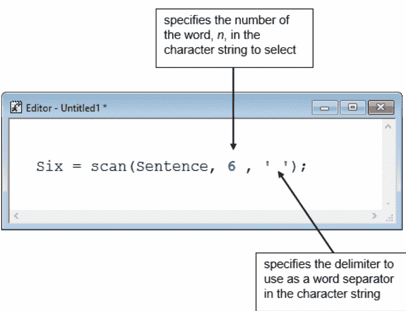

> 注：在 SAS 9.4 或更高版本中，在 DATA step 中，如果 `SCAN` 函数返回到一个尚未赋予长度的变量，该变量的长度设置为第一个参数的长度。在 SAS 9.3 或更早版本中，默认情况下变量被分配的长度为 200。

### 语法

`SCAN` 函数：

```sas
SCAN(argument,n,<delimiters>)
```

- `n` 指定要返回的单词。
- `delimiters` 是必须用单引号（`' '`）括起来的特殊字符。如果不指定分隔符，则使用默认分隔符。

### 详情

- 字符串之前的分隔符不影响 `SCAN` 函数。
- 如果存在两个或多个连续分隔符，`SCAN` 函数会将它们视为一个。
- 如果 `n` 大于字符串中的单词数，`SCAN` 函数返回空值。
- 如果 `n` 为负数，`SCAN` 函数将从字符串末尾开始选择单词。

### 示例：创建新的名称变量

使用 `SCAN` 函数创建新的名称变量。这里有一个使用 `SCAN` 函数创建以下变量的示例：

```sas
data hrd.newtemp(drop=name);
  set hrd.temp;

  length LastName FirstName MiddleName $ 10;

  lastname=scan(name,1);
  firstname=scan(name,2);
  middlename=scan(name,3);
run;
```

## SUBSTR 函数

**图 14.17 SUBSTR 函数**

指定起始字符位置的数值表达式。

指定要提取的子字符串长度的数值表达式。

`SUBSTR` 函数可以用于等号的右侧或左侧，以替换字符值常量。

### 语法

`SUBSTR` 函数：

```sas
SUBSTR(argument, position <n>)
```

- `argument` 指定要扫描的字符变量或表达式。
- `position` 是起始提取的字符位置。
- `n` 指定要提取的字符数。如果省略 `n`，则所有剩余字符都将包含在子字符串中。

### 示例：SUBSTR 函数

此示例从提取值的某个部分开始。在数据集 `Hrd.Newtemp` 中，员工姓名存储在三个变量中：`LastName`、`FirstName` 和 `Middle`。

| Agency | ID | LastName | FirstName | MiddleName |
|---|---|---|---|---|
| Administrative Support, Inc. | F274 | OCHOCK | ELIZABETH | MARIE |
| Administrative Support, Inc. | F101 | BENINCASA | HANNAH | LEE |
| OD Consulting, Inc. | F054 | SHER | BRIAN | THOMAS |
| New Time Temps Agency | F077 | HODNOFF | RICHARD | LEE |

然而，假设你想修改数据集，只存储中间名首字母而不是全名。为了做到这一点，你必须提取中间名值的第一个字母，并将这些值赋值给新变量 `MiddleInitial`。

| Agency | ID | LastName | FirstName | MiddleInitial |
|---|---|---|---|---|
| Administrative Support, Inc. | F274 | CICHOCK | ELIZABETH | M |
| Administrative Support, Inc. | F101 | BENINCASA | HANNAH | L |
| OD Consulting, Inc. | F054 | SHER | BRIAN | T |
| New Time Temps Agency | F077 | HODNOFF | RICHARD | L |

使用 `SUBSTR` 函数，你可以提取 `MiddleName` 值的第一个字母来创建新变量 `MiddleInitial`。

```sas
substr(middname,1,1)
```

此函数从 `MiddleName` 的值中提取一个字符。位置 1 提取的字符串包含一个字符。该函数放在 DATA 步的赋值语句中。

```sas
data work.newtemp(drop=middname);
  set hrd.newtemp;

  length MiddleInitial = $1;
  MiddleInitial=substr(middname,1,1);
run;
```

新的 `MiddleInitial` 被赋予与 `MiddleName` 相同的长度。`MiddleName` 变量从新数据集中删除。

| Agency | ID | LastName | FirstName | MiddleInitial |
|---|---|---|---|---|
| Administrative Support, Inc. | F274 | CICHOCK | ELIZABETH | M |
| Administrative Support, Inc. | F101 | BENINCASA | HANNAH | L |
| OD Consulting, Inc. | F054 | SHER | BRIAN | T |
| New Time Temps Agency | F077 | HODNOFF | RICHARD | L |

如果你知道值的位置，就可以使用 `SUBSTR` 函数从任何字符值中提取子字符串。

### 使用 SUBSTR 替换文本

`SUBSTR` 函数有第二个用途。该函数也可以用于替换字符变量的内容。例如，假设本地电话交换机号码 622 被交换机号码 433 替换。你需要更新 `Hrd.Temp` 中的字符变量 `Phone` 以反映这一变化。

| Address | City | State | Zip | Phone |
|---|---|---|---|---|
| 65 ELM DR | CARY | NC | 27513 | 6224549 |
| 11 SUN DR | CARY | NC | 27513 | 6223251 |

你可以使用 `SUBSTR` 函数来完成这项任务。当使用 `SUBSTR` 函数替换变量值时，其语法与提取子字符串的语法相同。

```sas
SUBSTR(argument, position, n)
```

在这种情况下，请注意以下几点：

- 第一个参数指定要修改值的字符变量。
- 第二个参数指定开始替换的位置。
- 第三个参数指定要替换的字符数。如果省略 `n`，则替换所有剩余字符。

### SUBSTR 函数的定位

SAS 使用 `SUBSTR` 函数来提取子字符串或修改变量值，这取决于该函数在赋值语句中的位置。

当函数位于赋值语句的右侧时，函数返回请求的字符串。

```sas
MiddleInitial=substr(middename,1,1);
```

但如果你将 `SUBSTR` 函数放在赋值语句的左侧，则该函数被用于修改变量。

```sas
substr(region,1,3)='NNN';
```

当 `SUBSTR` 函数修改变量时，赋值语句的右侧必须指定要放入变量的值。例如，要将名为 `Test` 的变量的第四和第五个字符替换为 92，你将编写以下语句：

```sas
substr(test,4,2)='92';
```

| Test |
|---|
| S381K2 → S7392K2 |
| S381K7 → S7392K7 |

可以使用 `SUBSTR` 函数替换变量 `Phone` 中的 622 交换机。首先，编写此赋值语句：

```sas
data hrd.temp;
  set hrd.temp;

  substr(phone,1,3)='433';
run;
```

该语句指定新的交换机号码 433 应该放在 `Phone` 变量中，从字符位置 1 开始并替换三个字符。

然而，执行此 DATA 步会将值 433 放在所有 `Phone` 值中。你只需要替换包含 622 交换机的 `Phone` 值。要从 `Phone` 中提取交换机，请向 DATA 步添加一条赋值语句。注意 `SUBSTR` 函数用在赋值语句的右侧。

```sas
data hrd.temp2(drop=exchange);
  set hrd.temp;

  Exchange=substr(phone,1,3);
  substr(phone,1,3)='433';
```

现在，DATA 步需要一个 IF-THEN 语句来验证变量 `Exchange` 的值。如果交换是 622，则执行赋值语句来替换 `Phone` 的值。

```sas
data hrd.temp2(drop=exchange);
  set hrd.temp;

  Exchange=substr(phone,1,3);
  if exchange='622' then substr(phone,1,3)='433';
```

执行 DATA 步后，`Phone` 的值包含了新的交换机号码。

| Obs | Address | City | State | Phone | Startdate | Enddate |
|---|---|---|---|---|---|---|
| 1 | 65 ELM DR | CARY | NC | 27513 | 435449 | 19NOV1999 |
| 2 | 11 SUN DR | CARY | NC | 27513 | 433251 | 07OCT1999 | 12JAN2000 |
| 3 | 712 HARDWICK STREET | CHAPEL HILL | NC | 27514 | 997449 | 22NOV1999 | 30DEC1999 |

## LEFT 和 RIGHT 函数

### LEFT 和 RIGHT 函数概述

- `LEFT` 函数用于使字符表达式左对齐。`LEFT` 返回一个参数，并将其开头的空格移动到值的末尾。
- `RIGHT` 函数用于使字符表达式右对齐。`RIGHT` 返回一个参数，并将其末尾的空格移动到值的开头。

`LEFT` 和 `RIGHT` 函数语法：

```sas
LEFT(argument)
RIGHT(argument)
```

`argument` 指定一个字符常量、变量或表达式。

### 示例：LEFT 函数

以下 SAS 语句产生这些结果：

| SAS 语句 | 结果 |
|---|---|
| `a='DUE DATE'; b=left(a); put b;` | DUE DATE |

### 示例：RIGHT 函数

以下 SAS 语句产生这些结果：

| SAS 语句 | 结果 |
|---|---|
| `a='Due Date  '; b=right(a); put a $10.; put b $10.;` | Due Date<br>Due Date |

## 连接运算符

连接运算符用于连接字符值。该运算符可以表示为 `||`（两个竖线）、`|||`（三个断开的竖线）或 `!!`（两个感叹号）。

```sas
FullName = First || Middle || Last;
```

生成变量的长度是连接操作中每个变量或常量长度之和，除非你使用 `LENGTH` 语句为新变量指定了不同的长度。

连接运算符不会修剪开头或末尾的空格。如果变量填充了末尾空格，请在连接它们之前使用 `TRIM` 函数修剪值中的末尾空格。

## TRIM 函数

### TRIM 函数概述

`TRIM` 函数移除字符表达式末尾的空格，如果表达式包含缺失值，则返回一个空格。

```sas
FullName = trim(First) || trim(Middle) || Last;
```

`TRIM` 函数对于连接操作非常有用，因为连接运算符不会移除末尾空格。

如果 `TRIM` 函数将值返回给尚未赋值长度的变量，则该变量的长度由参数的长度决定。

### 语法

`TRIM` 函数：

```sas
TRIM(argument)
```

`argument` 可以是任意字符表达式。以下是示例：

- 字符变量：`trim(left(address))`
- 另一个字符函数：`trim(left(id))`

### 示例：TRIM 函数

```sas
data work.nametrim;
  length Name $ 20 First Middle Last $ 10;

  Name = 'Jones, Mary Ann, Sue';
  First = left (scan(Name, 2, ','));
  Middle = left (scan(Name, 3, ','));
  Last = scan(Name, 1, ',');
  FullName = trim(First) || trim(Middle) || Last;

  drop Name;
run;

proc print data=work.nametrim;
run;
```


图 14.18 TRIM 函数

| First | Middle | Last | FullName |
| --- | --- | --- | --- |
| Mary | Ann | Sue | Jones |
| Mary | Ann | Sue | Jones |

## CATX 函数

### CATX 函数概述

CATX 函数允许你连接字符字符串、移除开头和末尾的空格并插入分隔符。CATX 函数将值返回给变量，或返回给临时缓冲区。CATX 函数的结果通常等同于通过连接运算符结合 `TRIM` 和 `LEFT` 函数产生的结果。

在 DATA 步中，如果 CATX 函数将值返回给一个尚未赋值长度的变量，则该变量的长度被赋予 32,76。为了节省空间，你可以在 DATA 步中添加 `LENGTH` 语句，并为变量指定适当的长度。由于 SAS 会在 DATA 步中第一次遇到新字符时设置其长度，请务确保将 `LENGTH` 语句放置在包含 CATX 函数的赋值语句之前。

如果连接运算符（`|`）将值返回给一个之前未赋值长度的变量，则该变量的长度将为被连接值的长度之和。

请记住，你已经学会了使用 `TRIM` 函数配合连接运算符来创建一个包含 `Address`、`City` 和 `Zip` 三个变量值的变量，并移除新值中多余的空格。你使用了下方的 DATA 步。

```sas
data hrd.newtemp(drop=address city zip);

set hrd.temp;

NewAddress=Address+trim(address)||''||trim(city)||''||zip;

run;
```

你可以使用 CATX 函数实现相同的连接。

CATX 函数语法：

```text
CATX(separator,string-1 <<string-n>)
```

- `separator` 指定用作连接字符串之间分隔符的字符。
- `string` 指定一个 SAS 字符字符串。

## 示例：使用 CATX 函数创建新变量

你想通过连接数据集 `Hrd.Temp` 中的 `Address`、`City` 和 `Zip` 变量的值来创建新变量 `NewAddress`。你想从旧变量值中去除多余空格，并用逗号和空格将变量值隔开。下方的 DATA 步使用了 CATX 函数创建 `NewAddress`。

```sas
data hrd.newtemp(drop=address city zip);

set hrd.temp;

NewAddress=catx(', ',address,city,zip);

run;
```

修改后的 DATA 步创建了你预期的 `NewAddress` 的值。

## 350 第 14 章 · 使用函数处理数据

| NewAddress |
| --- |
| 65 ELM DR,CARY,27513 |
| 11 SUN DR,CARY,27513 |
| 712 HARDWICK STREET CHAPEL, HILL,27514 |
| 5372 WHITEBUAD,RALEIGH,27612 |
| 11 TALYN COURT,DURHAM,27713 |
| 101 HYNERIAN DR,CARRBORO,27510 |
| 11 RYGEL ROAD,CHAPEL HILL,27514 |
| 121 E. MOYA STREET,DURHAM,27713 |
| 1905 DOCK STREET,CARY,27513 |
| 1304 CRESCENT AVE,RALEIGH,27612 |

## INDEX 函数

### INDEX 函数概述

INDEX 函数允许你在一个字符值中搜索指定的字符串。INDEX 函数从左到右搜索值，寻找字符串的首次出现位置。它返回字符串第一个字符的位置。如果未找到字符串，则返回值 0。

INDEX 函数语法：

```text
INDEX(source,excerpt)
```

### 示例：搜索短语的出现次数

假设你想搜索 `Job` 变量，该变量列出了工作技能。你想创建一个包含所有具有文字处理经验的临时员工名称的数据集。下图所示显示了 `Hrd.Temp` 数据集中观测值的部分列表。

为了在 `Job` 变量的值中搜索短语 `"word processing"` 的出现情况，你按照所示方式编写 INDEX 函数。注意字符字符串被包含在引号中。

```sas
index(job,'word processing')
```

要创建新数据集，请在子 IF 语句中包含 INDEX 函数。只有当函数定位字符串并返回大于 0 的值的观测值才会写入数据集。

```sas
data hrd.datapool;

set hrd.temp;

where index(job,'word processing') > 0;
```

这里是显示文字处理经验的临时员工的数据集。程序处理了 `Hrd.Temp` 数据集中所有的观测值。

图 14.19 SAS 数据集 Hrd.Datatapool（部分输出）

| Job | Contact |
| --- | --- |
| word processing | WORD PROCESSOR |
| Bookkeeping word processing | BOOKEEPER AST. |
| word processing sec. work | WORD PROCESSOR |
| Bookkeeping word processing | BOOKEEPER AST. |
| word processing | WORD PROCESSOR |
| word processing sec. work | WORD PROCESSOR |
| word processing | WORD PROCESSOR |
| word processing | WORD PROCESSOR |

注意 INDEX 函数是大小敏感的，搜索的字符串必须与数据中的记录完全一致。例如，下面的 INDEX 函数将无法找到任何具有 `wordprocessing` 经验的员工。

```sas
index(job, 'WORD PROCESSING')
```

## 不区分大小写查找字符串

为了确保找到字符串的所有出现情况，可以使用 `UPPERCASE` 或 `LOWERCASE` 函数配合 INDEX 函数。UPPERCASE 和 LOWERCASE 函数允许你将变量值转换为大写或小写。你可以相应地在 INDEX 函数中指定字符串。

```sas
index(upcase(job), 'WORD PROCESSING')
```

```sas
index(lowercase(job), 'word processing')
```

## FIND 函数

### FIND 函数概述

FIND 函数允许你在指定的字符字符串中搜索子串。

- FIND 函数从左到右搜索字符串，寻找子串首次出现的位置，并返回子串第一个字符在字符串中的位置。如果字符串中未找到子串，FIND 函数返回值 0。如果子串出现多次，FIND 函数仅返回第一次出现的位置。

## 第 14 章

使用函数处理数据。

FIND 函数语法：

```text
FIND(string,substring<modifiers>,,startpos)
```

- `string` 指定了用于搜索子字符串的字符、变量或表达式。
- `substring` 是一个字符常量、变量或表达式，指定了要在一个字符串中搜索的子字符串。
- `modifiers` 是一个字符常量、变量或表达式，指定了一个或多个修饰符。
- `startpos` 是一个整数，指定了搜索开始的位置和搜索方向。`startpos` 的默认值为 1。

注意：如果 `string` 或 `substring` 是字符字面量，则必须将其括在引号内。

### 详细说明

修饰符允许你为函数指定下面列出的一个或多个修饰符：

- 修饰符 `i` 使 FIND 函数在搜索时忽略字符的大小写。如果没有指定此修饰符，FIND 将搜索与 `substring` 中字符大小写相同的字符字符串。
- 修饰符 `t` 会删除 `string` 和 `substring` 末尾的空格。
- 如果修饰符是字符常量，请将其括在引号内。
- 在单组引号内指定常量。
- 修饰符的值不区分大小写。

以下是关于修饰符和常量的事实。

如果未指定 `startpos`，FIND 将从字符串开头开始搜索并从左到右搜索字符串。如果指定了 `startpos`，`startpos` 的绝对值决定了开始搜索的位置。也就是说，当 `startpos` 为正数时，FIND 向右搜索；当 `startpos` 为负数时，FIND 从 `startpos` 向左搜索。

### 示例：在数据集中查找文字处理工作

变量 `Job` 的值均为小写。因此，为了在变量 `Job` 的值中搜索 `"word processing"` 的出现情况，你如下所示编写 FIND 函数。注意字符子字符串被括在引号内。

```sas
find(job,'word processing')
```

要创建一个新数据集，请在 subset 语句中包含 FIND 函数。只有当函数定位字符串并返回大于 0 的值的观测值才会被写入数据集。

```sas
data hrd.datapool;

set hrd.temp;

where find(job,'word processing') > 0;

run;

proc print data=hrd.datapool;

run;
```

### 图 14.20 HTML 输出：FIND 函数（部分输出）

| Obs | Address | Payrate | Days | Hours | Birthdate | Job | Contact | Dept | Site |
|---|---|---|---|---|---|---|---|---|---|
| 1 | ELM DR | 10 | 11 | 88 | APR1979 | word processing | WORD PROCESSOR | DP | 26 |
| 2 | 5372 WHITEBUD ROAD | 15 | 10 | 80 | SEP1976 | word processing | BOOKKEEPER ASST. | BK | 57 |
| 3 | 11 TALYN COURT | 12 | 9 | 72 | OCT1971 | word processing work | WORD PROCESSOR | DP | 95 |
| 4 | 101 HYNERIAN DR | 15 | 7 | 64 | JUN1975 | word processing | BOOKKEEPER ASST. | BK | 44 |
| 5 | 11 RYGEL ROAD | 12 | 12 | 96 | JUN1975 | word processing | WORD PROCESSOR | DP | 59 |
| 6 | 121 E. MOYA STREET | 10 | 5 | 40 | NOV1971 | word processing work | WORD PROCESSOR | PUB | 38 |
| 7 | 1905 DOCK STREET | 10 | 5 | 30 | NOV1971 | word processing | WORD PROCESSOR | DP | 44 |
| 8 | 1304 CRESCENT AVE | 15 | 5 | 25 | MAY1972 | word processing | WORD PROCESSOR | DP | 90 |

### UPCASE 函数

UPCASE 函数将字符表达式中的字母转换为大写。

UPCASE 函数语法：

```text
UPCASE(argument)
```

`argument` 可以是任何 SAS 字符表达式，例如字符变量或常量。

在此示例中，函数被放置在 DATA 步的赋值语句中。你可以直接修改变量 `Job` 的值。

```sas
data hrd.newtemp;

set hrd.temp;

Job=upcase(job);

run;

proc print data=hrd.newtemp;

run;
```

新数据集包含了转换后的 `Job` 值。

### 354 第 14 章 · 使用函数处理数据

### 图 14.21 HTML 输出：UPCASE 函数（部分输出）

| Obs | Address | Payrate | Days | Hours | Birthdate | Job | Contact |
|---|---|---|---|---|---|---|---|
| 1 | ELM DR | 10 | 11 | 85APR1975 | WORD PROCESSING | WORD PROCESSOR |
| 2 | SUN DR | 8 | 25 | 200OCT1975 | FILING ADMIN.DUTIES | ADMIN. ASST. |
| 3 | HARDWICK STREET | 40 | 26 | 208AUG1968 | ORGANIZATIONAL DEV. SPECIALIS | CONSULTANT |
| 4 | WHITEBUAD ROAD | 15 | 10 | 80SEP1976 | BOOKKEEPING | BOOKKEEPER ASST. |
| 5 | TALYN COURT | 12 | 9 | 7206NOV1971 | WORD PROCESSING SEC. WORK | WORD PROCESSOR |
| 6 | 101 HYNERIAN DR | 15 | 7 | 6415JUN1975 | BOOKKEEPING | BOOKKEEPER ASST. |
| 7 | REGEL ROAD | 12 | 12 | 9615JUN1975 | WORD PROCESSING | WORD PROCESSOR |
| 8 | 121 EL MOYA STREET | 10 | 5 | 40NOV1971 | WORD PROCESSING SEC. WORK | WORD PROCESSOR |
| 9 | 1905 STREET | 10 | 5 | 30NOV1971 | WORD PROCESSING | WORD PROCESSOR |
| 10 | 1304 CRESCENT AVE | 15 | 5 | 25MAY1972 | WORD PROCESSING | WORD PROCESSOR |

### LOWCASE 函数

LOWCASE 函数将字符表达式中的字母转换为小写。

LOWCASE 函数语法：

```text
LOWCASE(argument)
```

`argument` 可以是任何字符表达式，例如字符变量或常量。

在此示例中，该函数将 `Contact` 值转换为小写。

```sas
data hrd.newtemp;

set hrd.temp;

Contact=lowcase(contact);

run;
```

新数据集已创建。图 14.22 HTML 输出：LOWCASE 函数（部分输出）

| Obs | Address | Payrate | Days | Hours | Birthdate | Job |
|---|---|---|---|---|---|---|
| 1 | ELM DR | 10 | 11 | 85APR1975 | word processing |
| 2 | SUN DR | 8 | 25 | 200OCT1975 | filing.duties |
| 3 | HARDWICK STREET | 40 | 26 | 208AUG1968 | organizational dev. |
| 4 | WHITEBUAD ROAD | 15 | 10 | 80SEP1976 | bookkeeping |
| 5 | TALYN COURT | 12 | 9 | 7206NOV1971 | word processing sec. |
| 6 | 101 HYNERIAN DR | 15 | 7 | 6415JUN1975 | bookkeeping |
| 7 | REGEL ROAD | 12 | 12 | 9615JUN1975 | word processing |
| 8 | 121 EL MOYA STREET | 10 | 5 | 40NOV1971 | word processing sec. |
| 9 | 1905 STREET | 10 | 5 | 30NOV1971 | word processing |
| 10 | 1304 CRESCENT AVE | 15 | 5 | 25MAY1972 | word processing |

### PROCASE 函数

PROCASE 函数将字符串中的字母转换为首大写（每个单词的首字母大写）。

PROCASE 函数语法：

```text
PROCASE(argument)<delimiter>
```

- `argument` 可以是任何字符表达式，例如字符变量或常量。
- `delimiter` 指定一个或多个分隔符。注意：如果你指定了 `delimiter`，则不再使用默认分隔符。

在此示例中，该函数使用默认分隔符将 `contact` 转换为首大写。

```sas
data hrd.newtemp;

set hrd.temp;

contact=procase(contact);

run;

proc print data=hrd.newtemp;

run;
```


# 新数据集已创建

## 第 14 章 · 使用函数处理数据

### 图 14.23 HTML 输出：PROCASE 函数

| Obs | Address | Payrate | Days | Hours | Birthdate | Job | Contact |
|---|---|---|---|---|---|---|---|
| 1 | ELM DR | 10 | 11 | 88 | APR1979 | Word Processing | Word Processor |
| 2 | SUN DR | 8 | 25 | 200OCT1975 | Filing.duties | Admin. Asst. |
| 3 | HARDWICK STREET | 40 | 26 | 208AUG1968 | Organizational Dev. | Consultant |
| 4 | SUITE ROAD | 15 | 10 | 80SEP1976 | Bookkeeping | Bookkeeper Asst. |
| 5 | TALYN COURT | 12 | 9 | 72 | 06NOV1971 | Word processing sec. | Word Processor |
| 6 | 101 HYNERIAN DR | 15 | 7 | 64 | 15JUN1975 | Bookkeeping | Bookkeeper Asst. |
| 7 | RYEL ROAD | 12 | 12 | 96 | 15JUN1975 | Word processing | Word Processor |
| 8 | 121 E. MOYA STREET | 10 | 5 | 40 | 26NOV1971 | Word processing sec. | Word Processor |
| 9 | 1905 DOCK STREET | 10 | 5 | 30 | 06NOV1971 | Word processing | Word Processor |
| 10 | 1304 CRESCENT AVE | 15 | 5 | 25 | 24MAY1972 | Word processing | Word Processor |

### TRANWRD 函数

#### TRANWRD 函数概述

`TRANWRD` 函数替换或删除字符串中出现的所有单词。翻译后的字符可以位于字符串的任何位置。

#### 图 14.24 TRANWRD 函数

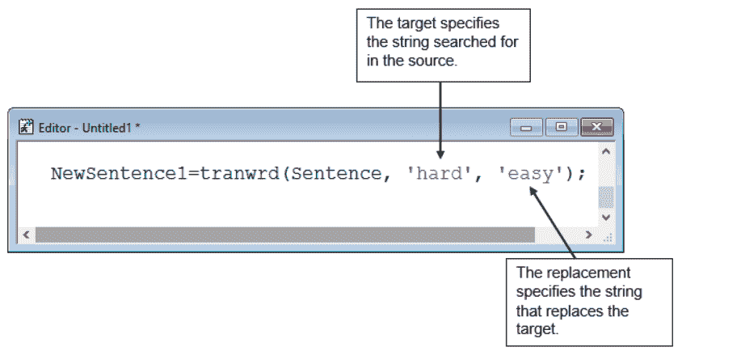

语法，`TRANWRD` 函数：

`TRANWRD(source,target,replacement)`

- `source` 指定要翻译的源字符串。
- `target` 指定 SAS 在 `source` 中搜索的字符串。
- `replacement` 指定替换 `target` 的字符串。

注意：`target` 和 `replacement` 可以指定为变量或字符字符串。如果你指定字符字符串，请务必将字符串括在引号内（`""` 或 `'''`）。

## 使用函数修改字符值

在 DATA 步中，如果 `TRANWRD` 函数将值返回给一个之前没有指定长度的变量，则该变量的长度为 200 字节。你可以在 DATA 步中添加 `LENGTH` 语句，并为变量指定适当长度。SAS 在第一次在 DATA 步中遇到该字符变量时设置其长度。请确保将 `LENGTH` 语句置于包含 `TRANWRD` 函数的赋值语句之前。

## 示例：使用 TRANWRD 函数直接更新变量

你可以使用 `TRANWRD` 函数直接更新变量。在本示例中，该函数通过将字符串 `Monroe` 的所有出现更改更改 `Manson` 来更新 `Name` 的值。

```sas
name=TRANWRD(name,'Monroe','Manson')
```

下面是 `TRANWRD` 函数的另一个示例。在这种情况下，两个赋值语句使用 `TRANWRD` 函数将所有的 `Miss` 或 `Mrs.` 变为 `Ms.`。

```sas
data hrd.after;

  set hrd.before;

  name=tranwrd(name,'Miss','Ms.');

  name=tranwrd(name,'Mrs.','Ms.');

run;

proc print data=work.after;

run;
```

创建了新数据集。`TRANWRD` 函数将所有的 `Miss` 或 `Mrs.` 更改为 `Ms.`。

### 图 14.25 HTML 输出：TRANWRD 函数

| 观测 | name |
|---|---|
| 1 | Ms. Millicent Garrett Fawcett |
| 2 | Ms. Charlotte Desperard |
| 3 | Ms. Emmeline Pankhurst |
| 4 | Ms. Sylvia Pankhurst |

## COMPBL 函数

`COMPBL` 函数通过将每个两个或多个连续空格的出现转换为单个空格，从而删除字符字符串中的多个空格。

语法，`COMPBL(source)`：

```sas
COMPBL(source)
```

- `source` 指定要压缩的字符常量、变量或表达式。

在 DATA 步中，如果 `COMPBL` 函数将值返回给一个之前没有指定长度的变量，则该变量的长度默认为第一个参数的长度。

# 第 14 章 • 使用函数操纵数据

以下 SAS 语句会产生这些结果：

| SAS 语句 | 结果 |
|---|---|
| `string='Hey Diddle';`<br>`string=compbl(string);`<br>`put string;` | Hey Diddle |
| `string='125 E Main St';`<br>`length address $10;`<br>`address=compbl(string);`<br>`put address;` | 125 E Main |

## COMPRESS 函数

### COMPRESS 函数概述

`COMPRESS` 函数返回一个从原始字符串中删除指定字符的字符串。允许空参数，并将其视为长度为零的字符串。

`COMPRESS` 函数返回一个从原始字符串中删除指定字符的字符串。

语法，`COMPRESS` 函数：

`COMPRESS(source, characters)<, modifier(s)>`

- `source` 指定要从其删除指定字符的字符常量、变量或表达式。
- `characters` 指定用于初始化字符列表的字符常量、变量或表达式。
- 默认情况下，列表中的字符将从源参数中删除。如果你在第三参数中指定 `K` 修饰符，则结果只保留列表中的字符。  
  注意：你可以通过使用第三参数中的其他修饰符向列表添加更多字符。  
  注意：用引号将字符字面量括起来。
- `modifier` 指定一个字符常量、变量或表达式，其中每个非空格字符都会修改 `COMPRESS` 函数的操作。忽略空格。

根据参数的数量，`COMPRESS` 函数的工作方式如下：

| 参数数量 | 结果 |
|---|---|
| 仅第一个参数，`source` | 空格中的所有空格已被删除。如果参数完全为空，则结果为长度为零的字符串。如果你将结果赋值给固定长度的字符变量，则值将用空格填充以达到定义的长度。 |
| 前两个参数，`source` 和 `chars` | 结果中将删除第二个参数中出现的所有字符。 |
| 三个参数，`source`、`chars` 和 `modifier(s)` | `K` 修饰符（在第三参数中指定）决定第二个参数中的字符是从结果中保留还是删除。 |

`COMPRESS` 函数编译一个要保留或删除的字符列表，该列表由第二个参数中的字符以及修饰符指定的任何类型的字符组成。例如，`D` 修饰符指定数字。以下两个函数调用都会从结果中删除数字：

```sas
compress(source, "1234567890-");

compress(source, , "d");
```

要删除数字加减号，你可以使用以下函数调用之一：

```sas
compress(source, "1234567890+-");

compress(source, "-+", "d");
```

## 示例：压缩字符字符串

```sas
data _null_;

a='A B C D';

b=compress(a);

put b;

run;
```

以下 SAS 语句会产生此结果：

### 表 14.2 压缩空格

| SAS 语句 | 结果 |
|---|---|
| `a='A B C D';`<br>`b=compress(a);`<br>`put b;` | ABCD |

## 使用函数修改数值

SAS 提供了额外的函数来创建或修改数值。这些包括算术函数、财务和概率函数。本书涵盖了以下选定的函数。

## CEIL 和 FLOOR 函数

要返回大于或等于参数的整数，请使用这些函数：

- `CEIL` 函数返回大于或等于参数的最小整数。
- `FLOOR` 函数返回小于或等于参数的最大整数。

语法，`CEIL` 和 `FLOOR` 函数：

```sas
CEIL(argument)

FLOOR(argument)
```

`argument` 是数值变量、常量或表达式。

如果参数在整数的 1E-12 范围内，函数返回整数。

## INT 函数

要返回数值的整数部分，请使用 `INT` 函数。`INT` 函数参数的任何小数部分都会被丢弃。

语法，`INT` 函数：

```sas
INT(argument)
```

`argument` 是数值变量、常量或表达式。

下面的两个数据集提供了被 `INT` 函数截断的值的前后视图。

```sas
data work.creditx;

  set sasuser.credit;

  transaction=int(transaction);

run;

proc print data=work.creditx;

run;
```

## 图 14.26 HTML 输出比较：INT 函数（部分输出）

| INT 函数之前 |  | 函数之后 |  |
|---|---:|---|---:|
| 类型 | Transaction | 类型 | Transaction |
| D | 57.69 | D | 57 |
| D | 145.89 | D | 145 |
| C | 45.00 | C | 45 |
| A | 304.5 | A | 304 |
| C | 234.76 | C | 234 |
| A | 64.98 | A | 64 |
| D | 70.8 | D | 70 |
| C | 188.2 | C | 188 |
| C | 78.90 | C | 78 |
| D | 150.55 | D | 150 |

## ROUND 函数

要将值舍入到最近的单位，请使用 `ROUND` 函数。

语法，`ROUND` 函数：

`ROUND(argument,round-unit)`

- `argument` 是数值变量、常量或表达式。
- `round-unit` 是数值且非负。

如果没有提供单位，则使用默认值 1，并将参数舍入到整数。下面的两个数据集提供了被 `ROUND` 函数修改的值的前后视图。

```sas
data work.creditx;

  set sasuser.credit;

  Transaction=round(transaction,.2);

run;

proc print data=work.creditx;

run;
```

362 第 14 章 • 使用函数操纵数据

### 14.27 HTML 输出比较：ROUND 函数（部分输出）

| 类型 | Transaction | 类型 | Transaction |
|---|---:|---|---:|
| D | 57.69 | D | 57.6 |
| D | 145.89 | D | 145.8 |
| C | 45.00 | C | 45 |
| A | 304.5 | A | 304.4 |
| C | 234.76 | C | 234.8 |
| A | 64.98 | A | 65 |
| D | 70.8 | D | 70.8 |
| C | 188.2 | C | 188.2 |
| C | 78.90 | C | 79 |
| D | 150.55 | D | 150.6 |

## 嵌套 SAS 函数

为了编写更高效的程序，你可以根据需要嵌套函数。只要作为参数使用的函数符合要求，就可以嵌套任何函数。例如，在赋值语句中将 `SCAN` 函数嵌套在 `SUBSTR` 函数中以计算 `Middledate`：

```sas
Middledate=substr(scan(name,3),1,1);
```

这个嵌套数值函数的示例确定了从 1999 年 6 月到现在的年数：

```sas
Years=intck('year','15jun1999'd,today());
```

## 章节测试

为每个问题选择最佳答案。使用附录中的答案检查你的答案。

1. 哪个函数计算变量 `Var1`、`Var2`、`Var3` 和 `Var4` 的平均值？
   - a. `mean(var1,var4)`
   - b. `mean(var1-var4)`
   - c. `mean(of var1-var4)`

## 章节测试 363

2. 在数据集 `Hrd.Temp` 中，`PayRate` 是一个字符变量，`Hours` 是一个数值变量。运行以下程序时会发生什么？

```sas
data work.temp;

  set hrd.temp;

  Salary=payrate*hours;
```

- + a. SAS 将 `PayRate` 的值转换为数值。日志中没有写入任何消息。
- b. SAS 将 `PayRate` 的值转换为数值。日志中写入了消息。
- c. SAS 将 `Hours` 的值转换为字符值。日志中没有写入任何消息。
- d. SAS 将 `Hours` 的值转换为字符值。日志中写入了消息。

3. 字符变量 `Target` 的典型值为 123,456。在创建 `TargetNo` 时，哪一个语句可以正确地将 `Target` 的值转换为数值？

- + a. `TargetNo=input(target,comma6.);`
- + b. `TargetNo=input(target,comma7.);`
- + c. `TargetNo=put(target,comma6.);`
- + d. `TargetNo=put(target,comma7.);`

4. 数值变量 `SiteNum` 的典型值为 12.3。在创建 `Location` 时，哪一个语句可以正确地将 `SiteNum` 的值转换为字符值？

- + a. `Location-dept=|''|''|input(sitenum,3.1);`
- + b. `Location-dept=|''|''|input(sitenum,4.1);`
- + c. `Location-dept=|''|''|put(sitenum,3.1);`
- + d. `Location-dept=|''|''|put(sitenum,4.1);`

5. 假设系统选项 `YEARCUTOFF` 设置为 1920。哪一个 `MDY` 函数可以创建 2020 年 1 月 3 日的？

- + a. `MDY(1,3,20)`
- + b. `MDY(3,1,20)`
- + c. `MDY(1,3,2020)`
- + d. `MDY(3,1,2020)`

6. 变量 `Address2` 包含如 `Piscataway, NJ` 这样的值。如何将两个字母的州缩写赋值给新变量 `State`？

- + a. `State=scan(address2,2);`
- + b. `State=scan(address2,13,2);`
- + c. `State=substr(address2,2);`
- + d. `State=substr(address2,13,2);`

7. 变量 `IDCode` 包含如 `123FA` 和 `321MB` 这样的值。第四个字符代表性别。如何将这些字符代码赋值给名为 `Sex` 的新变量？

- + c. `data_work.maillist;`

## 章节测试 365

```sas
set retail.maillist;

length FullName $ 40;

fullname=trim(firstname) || ' ' || trim(lastname);

run;
```


```sas
- + a. data work.maillist;
  set retail.maillist;
  length FullName $ 40;
  fullname=trim(firstname) || ' ' || lastname);
  run;
```

10. 在数据集`Furnitur.Bookcase`中，变量`Finish`包含如`ash`、`cherry`、`teak`、`matte-black`这样的值。下列哪项可以创建一个数据的子集，其中`Finish`的值包含字符串`walnut`？请使字符串搜索不区分大小写。

- + a.
  ```sas
  data work.bookcase;
    set furnitur.bookcase;
    if index(finish, walnut) = 0;
  run;
  ```

- + b.
  ```sas
  data work.bookcase;
    set furnitur.bookcase;
    if index(finish, 'walnut') > 0;
  run;
  ```

- + c.
  ```sas
  data work.bookcase;
    set furnitur.bookcase;
    if index(lowercase(finish), walnut) = 0;
  run;
  ```

- + d.
  ```sas
  data work.bookcase;
    set furnitur.bookcase;
    if index(lowercase(finish), 'walnut') > 0;
  run;
  ```

## 第 15 章：使用 DO 循环处理数据

- DO 循环基础
- DO 语句，迭代语法
- 详细信息
- 构建 DO 循环
- DO 循环执行
- 计算 DO 循环的迭代次数
- 使用显式输出语句
- 递减 DO 循环
- 指定一系列项目
- 嵌套 DO 循环
- 迭代处理数据集中的观测值
- 条件执行 DO 循环
- 概览
- 使用 DO UNTIL 语句
- 使用 DO WHILE 语句
- 在迭代 DO 语句中使用条件从句
- 章节测试

## DO 循环基础

### DO 语句，迭代语法

迭代`DO`语句根据索引变量的值，重复执行`DO`和`END`语句之间的语句。

语法，`DO`语句，迭代：

```sas
DO index-variable=specification-iteration;
DO index-variable=specification-iteration WHILE condition;
DO index-variable=specification-iteration UNTIL condition;
```

迭代`DO`语句根据索引变量的值，重复执行`DO`和`END`语句之间的语句。

```sas
DO index-variable=specification-iteration;

  ... statements ...

END;
```

迭代`DO`语句根据索引变量的值，重复执行`DO`和`END`语句之间的语句。

```sas
DO index-variable=specification-iteration WHILE condition;

  ... statements ...

END;
```

迭代`DO`语句根据索引变量的值，重复执行`DO`和`END`语句之间的语句。

```sas
DO index-variable=specification-iteration UNTIL condition;

  ... statements ...

END;
```

## 构建 DO 循环

可选的`BY`子句为索引变量指定递增值。通常，你希望`DO`循环在每次迭代时递增 1。如果你没有指定`BY`子句，默认递增值为 1。

```sas
DO index-variable=start TO BY increment;

more SAS statements...

END;
```

例如，下面的规范将索引变量递增 1，产生查询值为 1、2、3、4 和 5：

```sas
do quiz=1 to 5;
```

相比之下，下面的规范将索引变量递增 2，产生行值为 2、4、6、8、10 和 12：

```sas
do rows=2 to 12 by 2;
```

## DO 循环的执行

以下是`DO`循环在`DATA`步中执行的方式。此示例累加了一项为期一年投资每月获得的利息。

```sas
data finance.earnings;

Amount=1000;

Rate=.075/12;

do month=1 to 12;

Earned=(amount+earned)*rate;

end;
```

此`DATA`步不从外部源读取数据。提交时，它只会编译并执行一次以生成数据。在编译期间，会为`Finance.Earnings`数据集创建程序数据向量（PDV）。

### 程序数据向量

| N | Amount | Rate | month | Earned |
|---|---|---|---|---|
| * | * | * | * | * |

当`DATA`步执行时，会为`Amount`和`Rate`赋值。

### 程序数据向量

| N | Amount | Rate | month | Earned |
|---|---|---|---|---|
| 1 | 1000 | 0.0625 | * | 0 |

接下来执行`DO`循环。在`DO`循环的每次执行期间，都会计算`Earned`的值并将其加到之前的值上。然后`month`的值递增。在`DO`循环的第 12 次执行时，`month`的值递增到 12，`Earned`的值为 1069.839。

## 构建 DO 循环

| N | Amount | Rate | month | Earned |
|---|---|---|---|---|
| 1 | 1000 | 0.075 | 12 | 1069.83 |

在`DO`循环的第 12 次执行后，`Month`的值递增到 13。由于 13 超过了迭代`DO`语句的停止值，`DO`循环停止执行，继续到下一个`DATA`步语句。到达`DATA`步结束时，值被写入`Finance.Earnings`数据集，在这种情况下，`DATA`步结束。数据集中只写入了一个观测值。

| | Amount | Rate | month | Earned |
|---|---|---|---|---|
| 1 | 1000 | 0.0625 | 13 | 1069.889918 |

注意，索引变量`Month`也存储在数据集中。在大多数情况下，索引变量仅用于处理`DO`循环，可以从数据集中删除。

## DO 循环的迭代

在某些情况下，创建一个索引变量来计数并存储`DO`循环的迭代是有用的。然后你可以从数据集中删除该索引变量。

```sas
data work.earn (drop=counter);

Value=2000;

do counter=1 to 20;

Interest=value*.075;

value+interest;

Year=1;

run;
```

图 15.1 HTML 输出：DO 循环的迭代

| Obs | Value | Interest | Year |
|---|---|---|---|
| 1 | 8495.70 | 592.723 | 20 |

求和`Year=1`累加了`DO`循环的迭代次数，并将总数存储在新变量`Year`中。然后，`Year`的最终值被存储在数据集中，而索引变量被删除。数据集有一个观测值。

## 显式 OUTPUT 语句

要为`DO`循环的每次迭代创建一个观测值，请在循环内部放置`OUTPUT`语句。默认情况下，每个`DATA`步末尾包含一个隐式`OUTPUT`语句。但在`DATA`步中放置显式`OUTPUT`语句会覆盖自动输出，导致 SAS 在执行显式`OUTPUT`语句时向数据集添加观测值。

上一个示例创建了一个观测值，是因为它在`DATA`步结束时使用了自动输出。在接下来的示例中，`OUTPUT`语句覆盖了自动输出，因此`DATA`步写入了 20 个观测值。

```sas
data work.earn;

Value=2000;

do Year=1 to 20;

Interest=value*.075;

value+interest;

output;

end;
```

图 15.2 HTML 输出：每个 DO 循环内部的 OUTPUT 语句（部分输出）

| Obs | Value | Year | Interest |
|---|---|---|---|
| 1 | 2150.00 | 1 | 150.00 |
| 2 | 2311.25 | 2 | 161.250 |
| 3 | 2484.59 | 3 | 173.344 |
| 4 | 2670.94 | 4 | 186.345 |
| 17 | 6838.71 | 17 | 477.119 |
| 18 | 7351.61 | 18 | 512.903 |
| 19 | 7092.98 | 19 | 551.371 |
| 20 | 8495.70 | 20 | 592.723 |

## 递减 DO 循环

你可以通过为`BY`子句指定负值来递减`DO`循环的索引变量。

## 条件执行 DO 循环

### 概述

迭代`DO`语句指定了`DO`循环的固定迭代次数。然而，在某些情况下，你可能希望执行`DO`循环直到达到某个条件或存在某个条件，但你并不知道需要多少迭代。

假设你想计算投资达到 $50,000 所需年数。在下面的`DATA`步中，使用迭代`DO`语句是不恰当的，因为你正在试图确定资本达到 $50,000 所需的迭代次数。

```sas
data work.invest;

do year=1 to ?

  Capital=2000;

  capital=capital*.10;

;

run;
```

`DO WHILE`和`DO UNTIL`语句允许你根据条件的真假来执行`DO`循环。

## 使用 DO UNTIL 语句

`UNTIL`语句执行`DO`循环，直到表达式变为真（true）。

```sas
DO UNTIL 语句语法：

DO UNTIL(expression);

...更多 SAS 语句...

END;
```

`expression`是在括号内的有效 SAS 表达式。

该表达式不在循环的底部进行求值。因此，`DO UNTIL`循环至少执行一次。当表达式求值为真时，`DO`循环停止执行。

假设你想知道，如果每年向一个利率为 10% 的账户中存入 $2,000，赚到 $50,000 需要多少年。下方的`DATA`步使用`DO UNTIL`语句进行计算，直到达到 $50,000 为止。`DO`循环的每次迭代都代表一年。

```sas
data work.invest;

do until(Capital>=50000);

  capital=2000;

  capital=capital*.10;

  Year+1;

;

run;
```

以下是`DO`循环在每次迭代期间发生的情况：

- 将`Capital`的值加上 2000，以反映每年 $2,000 的存款。
- `Capital`加上 10% 的利息。
- `Year`的值加 1。

由于`DO UNTIL`语句中没有索引变量，因此在语句中创建了变量`Year`，用于计算`DO`循环的迭代次数。此程序产生了一个包含下所示观测值的数据集。要积累超过 $50,000 的资本需要 13 年（以及 13 次`DO`循环迭代）。

图 15.4 SAS 数据集`Work.Invest`：积累超过 $50,000

| | Capital | Year |
|---|---|---|
| 1 | 53949 | 13 |

## 使用 WHILE 语句

与`DO UNTIL`语句类似，`DO`语句根据条件执行`DO`循环。你可以使用`DO`语句在表达式为真（true）时执行`DO`循环。

```sas
DO WHILE 语句语法：

DO WHILE(expression);

...更多 SAS 语句...

END;
```

`expression`是在括号内的有效 SAS 表达式。

`DO UNTIL`和`DO WHILE`语句的一个重要区别是，`DO`表达式是在`DO`循环的顶部求值的。如果表达式第一次求值为假（false），则`DO`循环永远不会执行。例如，在下面的程序中，由于`Capital`的初始值为 0，小于 50,000，所以`DO`循环不执行。

```sas
data work.invest;

while(Capital>=50000);

capital+=2000;

capital=capital*.10;

Year+=1;

end;

run;
```

## 在迭代 DO 语句中使用条件子句

之前的示例表明，`DO WHILE`和`DO UNTIL`语句允许你根据条件执行语句，而迭代`DO`语句允许你无条件地执行固定次数的语句。

```sas
DO WHILE(expression);

DO UNTIL(expression);

DO index-variable=start TO STOP BY increment;
```

在这个`DATA`步中，`DO UNTIL`语句确定了投资达到 $50,000 需要多少年（13 年）。

```sas
data work_invest;

do do until(Capital>=50000);

Year=1;

capital+2000;

capital+capital*.10;

end;

run;
```

## 图 15.5 SAS 数据集`Work.Invest`：投资达到 $50,000 所需的年数

| Capital | Year |
|---|---|
| 53949 | 13 |

假设你想将投资年限限制在 10 年。你可以向迭代`DO`语句中添加`UNTIL`或`WHILE`表达式来控制迭代次数。该迭代`DO`语句允许你执行`DO`循环，直到`Capital`大于等于 50000，或者`DO`循环执行了 10 次，以先发生者为准。

```sas
data work_invest;

do year=1 to 10 until (Capital>=50000);

capital+2000;

capital+capital*.10;

end;

run;
```

## 图 15.6 SAS 数据集`Work.Invest`：执行 DO 循环直到 Capital >= 50000

| Year | Capital |
|---|---|
| 10 | 35062 |

在这种情况下，`DO`循环在 10 次迭代后停止，`Capital`的值从未达到 50000。如果你将每年加到`Capital`的金额增加到 4000，则`DO`循环将在第八次迭代后停止，此时`Capital`的值超过了 50000。

```sas
data work_invest;
```


```sas
do year=1 to 10 until (Capital>=50000);

capital+4000;

capital+capital*.10;

end;

run;
```

## 图 15.7 SAS 数据集 Work.Invest：使用 DO 循环增加加到 Capital 的金额

| year | Capital |
|---|---|
| 8 | 50317.91 |

## 章节练习题

迭代 DO 语句中的 UNTIL 和 WHILE 表达式的功能与 DO UNTIL 和 WHILE 语句相似。如下语法所示，两种语句都需要一个在括号内的有效 SAS 表达式。

```sas
DO index-variable=start TO stop BY increment UNTIL(expression);

DO index-variable=start TO stop BY increment(expression);
```

UNTIL 表达式在 DO 循环的底部求值。因此，DO 循环至少执行一次。WHILE 表达式在执行 DO 循环之前求值。结果是，如果条件初始为假（false），则 DO 循环永远不会执行。

请为每个问题选择最佳答案。使用附录中的答案键检查你的答案。

1. 关于使用 DO 循环，以下哪种说法是错误的？
   - a. 它们可以包含条件子句。
   - b. 它们可以生成多个观测值。
   - c. 它们可以用于结合 DATA 和 PROC 步。
   - d. 它们可以用于读取数据。

2. 在以下 DO 循环的每次执行期间，Earned 的值会被计算并加到其之前的值上。此 DO 循环执行了多少次？

   ```sas
   data finance.earnings;

   Amount=1000;

   Rate=.75/12;

   do month=1 to 12;

     Earned=(amount+earned)*rate;

   end;

   run;
   ```

   - a. 0
   - b. 1
   - c. 12
   - d. 13

3. 每年 1 月 1 日，向账户投资 $5000。完成下面的 DATA 步，以在预期恒定利率为 10% 的情况下确定 15 年后的账户价值。

   ```sas
   data work.invest;

   ...

     Capital=5000;

     capital=(capital*.10);

   end;

   run;
   ```

   - a. `do count=1 to 15;`
   - b. `do count=1 to 15 by 10%;`
   - c. `do count=1 to capital;`
   - d. `do count=capital(capital*.10);`

4. 在数据集 `work.Invest` 中，Year 的存储值将是什么？

   ```sas
   data work.invest;

   do year=1990 to 2004;

   Capital+5000;

   capital+(capital*.10);

   end;

   run;
   ```

   - a. 1990
   - b. 2004
   - c. 2005

5. 关于所示程序，以下哪种说法是错误的？

   ```sas
   data work.invest;

   do year=1990 to 2004;

   Capital+5000;

   capital+(capital*.10);

   output;

   end;

   run;
   ```

   - a. OUTPUT 语句立即将当前值写入数据集。
   - b. 数据集中 Year 的最后一个值是 2005。
   - c. OUTPUT 语句覆盖了 DATA 步结束时的自动输出。
   - d. DO 循环执行了 15 次迭代。

6. 数据 `work.earn` 将包含多少个观测值？

   ```sas
   data work.earn;

   Value=2000;

   do year=1 to 20;

   Interest=value*.075;

   value+interest;

   output;

   end;

   run;
   ```

   - a. 0
   - b. 1
   - c. 19
   - d. 20

7. 你将使用哪项来比较在三家按月复利的不同银行中每年投资 $4,000 为五年的结果？假设五年期间利率固定。

   - a. DO WHILE 语句
   - b. 嵌套 DO 循环
   - c. DO UNTIL 语句

## 第 38 章测验

8. 关于 DO UNTIL 语句，哪一个描述是错误的？

   - a. 句在循环顶部评估，在执行包含的语句之前评估。
   - b. 包含的语句至少执行一次。
   - c. DO 循环中的 SAS 语句会一直执行，直到条件为真。
   - d. DO 循环必须有一个结束的 END 语句。

9. 选择一个与下方程序产生相同结果 DO WHILE 语句。

   ```sas
   data work.invest;

   capital=100000;

   do until(capital gt 500000);

   Year+1;

   capital=capital+*.10;

   end;
   ```

   - a. `do while(Capital ge 500000);`
   - b. `do while(Capital=500000);`
   - c. `do while(Capital le 500000);`
   - d. `do while(Capital>500000);`

10. 在以下程序中，完成该语句使得当距离达到 250 英里或使用 10 加仑燃料时，程序停止生成观测值。

   ```sas
   data work.go250;

   set perm.cars;

   gallons=1 to 10 ...;

   Distance=gallons*mpg;

   output;

   end;
   ```

   - a. `while (Distance=250);`
   - b. `when (Distance>250);`
   - c. `over (Distance le 250`
   - d. `until (Distance=250);`

   run;

   run;

382 第 15 章 • 使用 DO 循环处理数据

# 第 16 章 使用数组处理数据

- SAS 数组基础 ................................................................................................ 383
- 创建一维数组 ....................................................................................................... 384
  - ARRAY 语句语法 ................................................................................................................... 384
  - 指定数组名称 ..................................................................................................................... 385
  - 指定维度 ................................................................................................................................... 385
  - 指定数组元素 ..................................................................................................... 385
  - 将变量列表作为数组元素 .............................................................................................. 385
  - 指定编号范围变量 ................................................................................................ 386
  - 指定所有数值变量 ........................................................................................................ 386
  - 指定所有字符变量 ................................................................................................... 386
  - 指定所有字符或数值变量 ........................................................................ 386
  - 示例：引用数组元素 ................................................................................................ 387
  - 编译与执行 ................................................................................................................ 389
  - 在迭代 DO 语句中使用 DIM 函数 ............................................................ 390
- 扩展你的数组使用 ................................................................................................ 391
  - 在 ARRAY 语句中创建变量 .......................................................................... 391
  - 默认变量名 ....................................................................................................................... 392
  - 创建字符变量数组 ................................................................................... 392
  - 为数组分配初始值 ................................................................................................ 394
  - 创建临时数组元素 ............................................................................................ 396
- 章末测验 ................................................................................................................................... 397

## SAS 数组基础

数组是 SAS 变量的临时分组，按照特定的顺序排列并通过数组名称识别。以下是关于数组的几个事实。

- 数组仅在当前 DATA 步期间存在。
- 数组通过数组名称和下标进行引用。
- 数组名称不是变量。

数组是临时识别一组变量的方便方法。数组经常在 DO 循环中被引用，因为数组中必须有多个元素被处理。

384 第 16 章 使用数组处理数据

使用数组的一个原因是减少处理变量时所需的语句数量。例如，在下方的 DATA 步中，七个数据变量的值从华氏度转换为摄氏度。

```sas
data work.report;

set master.temps;

mon5*(mon-32)/9;

tue5*(tue-32)/9;

wed5*(wed-32)/9;

thr5*(thr-32)/9;

fri5*(fri-32)/9;

sat5*(sat-32)/9;

sun5*(sun-32)/9;

run;
```

赋值语句对这一系列语句中的每个变量执行相同的计算。每个语句中只出现变量名。

通过将变量分组为一维数组，你可以在 DO 循环中处理这些变量。你使用的语句更少，且 DATA 步更容易修改或修正。

```sas
data work.report(drop=day);

set master.temps;

array wkday[7] mon tue wed thr fri sat sun;

do day=1 to 7;

wkday(day)=5*(wkday(day)-32)/9;

end;
```

## 创建一维数组

### ARRAY 语句语法

ARRAY 语句将数据集变量分组到数组中。

语法，ARRAY 语句：

```sas
ARRAY array-name<dimension> <elements>;
```

- `array-name` 指定数组的名称。
- `dimension` 描述数组元素的数量和排列。
- `elements` 列出要包含在数组中的变量。数组元素必须全是数值型或全是字符型。如果没有列出元素，则使用默认名称创建新变量。

> 注意：不要给数组命名与同一个 DATA 步中的变量相同的名称。此外，避免使用 SAS 函数名；如果数组是正确的，但你无法在同一个 DATA 步中使用该函数，SAS 日志中会出现警告信息。

> 注意：你不能在 LABEL、FORMAT、DROP、KEEP 或 LENGTH 语句中使用数组名称。数组仅在 DATA 步期间存在。

## 指定数组名称

要对数组中的分组，首先给数组命名。此示例创建了一个名为 Sales 的数组。

```sas
array sales[4] qtr1 qtr2 qtr3 qtr4;
```

### 指定维度

在数组名称之后，指定数组的维度。维度描述数组中元素的数量和排列。有几种方法可以指定维度：

- 在一维数组中，你可以直接指定数组元素的数量。数组元素是你希望在 DATA 步其他地方引用和处理的变量。

  `array sales[4] qtr1`

- 数组的维度不必等于数组元素的数量。定义数组时，可以为维度指定一个值范围。例如，你可以这样定义 Sales 数组：

  `array Sales[6:99] totals96 totals97 totals98 totals99;`

- 你也可以使用星号（`*`）来指定一维数组的维度。在这种情况下，SAS 通过计算元素的数量来确定数组的维度。

  `array sales[*] qtr1 qtr2 qtr3 qtr4;`

- 使用圆括号、大括号或中包含维度。

  `array sales(4) qtr1 qtr2 qtr3 qtr4;`

> 注意：使用中代替大括号或圆括号的最佳实践。

## 指定数组元素

在指定数组元素时，列出你想包含在数组中的每个变量名。列出元素时，用空格分隔每个元素。与所有 SAS 语句一样，使用分号（`;`）使用 ARRAY 语句。

```sas
array sales[4] qtr1 qtr2 qtr3 qtr4;
```

你也可以将变量列表指定数组元素。这里有一个使用变量列表将 Qtr1 到 Qtr4 分组为一维数组的 ARRAY 语句示例。

```sas
array sales[4] qtr1-qtr4;
```

## 将变量列表作为数组元素

你可以按照所示的形式指定变量列表。表格之后会对每种类型的变量列表进行更详细的解释。

# 第 16 章 使用数组处理数据

## 表 16.1 变量及其形式

| 变量 | 形式 |
|---|---|
| 编号范围变量 | `Varl-Varn` |
| 所有数值变量 | `_NUMERIC_` |
| 所有字符变量 | `_CHARACTER_` |
| 所有字符型或所有数值变量 | `_ALL_` |

## 指定编号范围的变量

`Qtr1 Qtr2 Qtr3 Qtr4` → `Qtr1-Qtr4`

- 除了最后一个字符或几个字符外，这些变量具有相同的名称。
- 每个变量的最后一个字符必须是数字。
- 变量必须是连续编号的。

```sas
array sales(4) qtr1-qtr4;
```

在前面的示例中，你将使用 `sales[4]` 来引用 Qtr4。然而，数组的索引不必从 1 到数组元素的个数。你可以在定义数组时为索引指定一个值范围。例如，你可以如下定义数组：

```sas
array sales(96:99) totals96-totals99;
```

## 指定所有数值变量

`Amount Rate Term` → `_NUMERIC_`

`_NUMERIC_` 指定在当前 DATA 步中已经定义的所有数值变量。

```sas
array sales(*) _numeric_;
```

## 指定所有字符变量

`PrstName LastName Address` → `_CHARACTER_`

`_CHARACTER_` 指定在当前 DATA 步中已经定义的所有字符变量。

```sas
array sales(*) _character_;
```


# 指定所有字符或所有数值变量

```sas
PrstName LastName Address → _ALL_
Amount Rate Term → _ALL_
```

`_ALL_` 指定在 `DATA` 步中已经定义的所有变量。变量必须全为同一类型：要么全字符型，要么全数值型。

```sas
array sales(*) _all_;
```

# 示例：引用数组元素

使用数组在 `DATA` 步中处理变量有多种方法。你可以将变量分组在一个一维数组中。

```sas
data data.work.report(drop=day);

set master.temps;

array wday[7] mon wed thu fri sat sun;

day=1 to 7;

if wday(day)>95 then output;

end;

run;
```

你可以指定数组元素。

```sas
data data.work.weights(drop=day);

set master.class;

array wt[6] w1-w6;

day=1 to 6;

wt(day)=wt(day)*2.2;

end;

run;
```

你可以创建编号范围的变量。

```sas
data data.work.new(drop=day);

set master.synonyms;

array term[9] alsol-also;

day=1 to 9;

if term(day) != ' ' then output;

end;

run;
```

数组之所以强大，是因为你可以通过索引值引用数组元素。通常，数组与 `DO` 循环配合使用，处理多个变量并执行重复计算。

```sas
array quarter[4] jan apr jul oct;

do i=1 to 4;

YearGoal=quarter(qr)*1.2;

end;
```

在 `DATA` 步中定义数组时，每个数组元素都会分配一个下标值。下标按元素的顺序分配。

你使用数组引用在执行期间对数组元素执行操作。若要在 `DATA` 步中引用数组元素，请指定数组名称，后跟一个括在括号内的下标值。

# 第 16 章 使用数组处理数据

## 语法：ARRAY 引用

```sas
array-name[subscript]
subscript
```

- 下标包含在圆括号、大括号或中括号内。
- 指定变量、SAS 表达式或整数。
- 下标位于数组维度的上下界之间。

当用在 `DO` 循环中时，迭代 `DO` 语句的索引变量可以引用数组的每个元素。

```sas
array quarter(4) jan apr jul oct;

do i=1 to 4;

YearGoal=quarter(i)*1.2;

end;
```

例如，上面的 `DO` 循环将索引变量 `i` 从 `quarter` 数组的下限 1 增加到上限 4。以下序列说明了这一点：

```sas
array quarter(4) jan apr jul oct;

do i=1 to 4;

YearGoal=quarter(1)*1.2;

end;
```

```sas
array quarter(4) jan apr jul oct;

do i=1 to 4;

YearGoal=quarter(2)*1.2;

end;
```

```sas
array quarter(4) jan apr jul oct;

do i=1 to 4;

YearGoal=quarter(3)*1.2;

end;
```

```sas
array quarter(4) jan apr jul oct;

do i=1 to 4;

YearGoal=quarter(4)*1.2;

end;
```

在 `DO` 循环的每次迭代中，`quarter(i)` 指向有序列表中 `quarter` 数组中的一个元素。

某公司的健康中心为其员工举办健身课程。每周都会对参与者进行体重测量，以便他们监控进度。目前以千克存储的体重数据需要转换为磅。

## 图 16.1 SAS 数据集 Hrd.Fitclass

| Name | weight1 | weight2 | weight3 | weight4 | weight5 | weight6 |
|---|---|---|---|---|---|---|
| Alicia | 69.6 | 68.9 | 68.8 | 67.4 | 66.0 | 66.2 |
| Betsy | 52.6 | 52.6 | 51.7 | 50.4 | 49.8 | 49.1 |
| Brenda | 68.6 | 67.6 | 67.0 | 66.4 | 65.8 | 65.2 |
| Carl | 67.6 | 66.6 | 66.0 | 65.4 | 64.8 | 64.2 |
| Carmela | 63.6 | 62.5 | 61.9 | 61.4 | 60.8 | 58.2 |
| David | 70.6 | 69.9 | 69.2 | 68.4 | 67.8 | 67.0 |

你可以使用 `DO` 循环更新 `Hrd.Fitclass` 数据中观测值的 `Weight1` 到 `Weight6`。

```sas
data hrd.convert;

set hrd.fitclass;

array wt(6) weight1-weight6;

do i=1 to 6;

wt(i)=wt(i)*2.2;

end;

run;
```

# 编译与执行

要理解 `DO` 循环如何处理数组元素，请检查此 `DATA` 步的编译和执行阶段。在编译期间，会创建程序数据向量（PDV），扫描 `DATA` 步的语法错误，并分配数组元素的索引值。

注意，程序数据向量不包含数组名称。数组仅在 `DATA` 步的持续期间存在。在 `DATA` 步的第一次迭代中，`Hrd.Fitclass` 中的第一个观测值被读入程序数据向量。

## 程序数据向量

| N | Name | Weight1 | Weight2 | Weight3 | Weight4 | Weight5 | Weight6 | i |
|---|---|---|---|---|---|---|---|---|
|  |  |  |  |  |  |  |  |  |
| 1 | Alicia | 69.6 | 68.9 | 68.8 | 67.4 | 66.0 | 66.2 |  |

`ARRAY` 语句仅在编译时有效，执行期间会被忽略。接下来执行 `DO` 语句。在第一次循环迭代中，变量 `i` 被设置为 1。结果是，数组引用 `wt[i]` 变为 `wt[1]`。由于 `wt(i)` 指向第一个数组元素，`Weight1` 的值从千克转换为磅。

```sas
data hrd.convert;

set hrd.fitclass;

array wt(6) weight1-weight6;

do i=1 to 6;

wt(i)=wt(i)*2.2;

end;

run;
```

## 使用数组处理数据

| N | Name | wt(1) Weight1 | wt(2) Weight2 | wt(3) Weight3 | wt(4) Weight4 | wt(5) Weight5 | wt(6) Weight6 | i |
|---|---|---|---|---|---|---|---|---|
| 1 | Alicia | 153.4 | 151.6 | 151.6 | 148.3 | 145.2 | 145.2 |  |

`DATA` 步继续循环，变量 `i` 从 1 变为 2、3、4、5 以及 6，导致 `Weight1` 到 `Weight6` 在程序数据向量中接收新值。

```sas
data hrd.convert;

set hrd.fitclass;

array wt(6) weight1-weight6;

do i=1 to 6;

wt(i)=wt(i)*2.2;

end;

run;
```

# 在迭代语句中使用 DIM 函数

当循环处理数组时，可以使用 `DIM` 函数来指定迭代次数的范围。对于一维数组，指定数组名作为 `DIM` 函数的参数。该函数返回数组的元素个数。

## 语法：DIM 函数

```sas
dim(array-name)
```

`array-name` 指定数组。在此示例中，`dim(wt)` 返回值为 6。

```sas
data hrd.convert;

set hrd.fitclass;

array wt(*) weight1-weight6;

do i=1 to dim(wt);

...

run;
```

使用 `DIM` 函数时，如果你更改了数组的维度，不需要重新指定迭代语句的值。

# 扩展数组的使用

## 在 ARRAY 语句中创建变量

之前的示例展示了在 `ARRAY` 语句中引用现有变量的多种方法。你可以通过省略数组元素来创建变量。如果你不引用现有变量，SAS 会自动为你创建变量并为其分配默认名称。默认名称是数组名加上从 1 到数组维度的数字。

## 语法：创建变量的 ARRAY 语句

```sas
ARRAY array-name[dimension];
```

- `array-name` 指定数组的名称。
- `dimension` 描述数组元素的个数和范围。例如，你需要计算健身班每个成员每周的体重增减，如下所示。

## 图 16.2 SAS 数据集 Het.Convert

| Name | weight1 | weight2 | weight3 | weight4 | weight5 | weight6 |
|---|---|---|---|---|---|---|
| Alicia | 153.440 | 151.897 | 151.676 | 148.590 | 145.504 | 145.945 |
| Betsy | 115.962 | 115.962 | 113.978 | 111.112 | 109.789 | 108.246 |
| Brenda | 151.236 | 149.031 | 147.708 | 146.385 | 145.063 | 143.740 |
| Carl | 149.031 | 146.826 | 145.504 | 144.181 | 142.858 | 141.535 |
| Carmela | 140.213 | 137.788 | 136.465 | 135.362 | 134.040 | 128.308 |
| David | 155.645 | 153.881 | 152.558 | 150.795 | 149.472 | 147.708 |

您想要创建包含此每周差异的变量。要执行计算，首先将变量 `Weight1` 到 `Weight6` 组成一个数组。

```sas
data hrd.diff;

set hrd.convert;

array wt[6] weight1-weight6;
```

接下来，您想创建新变量来存储六个记录变量之间的差异。您可以使用额外的不带元素的 `ARRAY` 语句来创建新变量 `WgtDiff1` 到 `WgtDiff5`。

```sas
data hrd.diff;

set hrd.convert;

array wt(6) weight1-weight6;

proc print data=hrd.convert;

run;

run;
```

请记住，在 `ARRAY` 语句中创建变量时，只要指定了数组中元素的数量，就不需要指定具体的数组元素。

```sas
array WgtDiff(5);
```

## 默认变量名

默认变量名通过连接数组名称和数字 1、2、3 等（直到数组维度）创建。

```sas
array WgtDiff(5);
```

```text
WgtDiff1 WgtDiff2 WgtDiff3 WgtDiff4 WgtDiff5
```

> **提示：** 如果您愿意，可以指定单个变量名。要指定变量名，请将每个名称作为数组的一个元素列表。以下 `ARRAY` 语句创建了数值变量 `Oct12`、`Oct19`、`Oct26`、`Nov02` 和 `Nov09`。

```sas
array WgtDiff(5) Oct12 Oct19 Oct26 Nov02 Nov09;

array WgtDiff(5);
```

```text
Oct12 Oct19 Oct26 Nov02 Nov09
```

## 创建字符变量数组

要创建字符变量数组，在数组维度后添加美元符号（`$`）。

```sas
array firstname(5) $;
```

# 扩展对数组的使用

默认情况下，在 `ARRAY` 语句中创建的所有字符变量长度都为 8。您可以在美元符号后指定自己的长度来分配长度。

```sas
array firstname{5} $ 24;
```

您指定的长度会自动分配给由 `ARRAY` 语句创建的所有变量。

在 `DATA` 步的编译期间，此 `ARRAY` 语句创建的变量会被添加到程序数据向量（PDV）并存储在生成的数据集中。

```sas
data hrd.diff;

set hrd.convert;

array wt{6} Weight1-Weight6;

array WgtDiff[5];
```

## 程序数据向量

| N | Name | Weight1 | Weight2 | Weight3 | Weight4 | Weight5 | Weight6 |
|---|---|---|---|---|---|---|---|
| WgtDiff[1] | WgtDiff[2] | WgtDiff[3] | WgtDiff[4] | WgtDiff[5] |  |  |  |

> **注意：** 在引用数组元素时，小心不要混淆数组引用 `WgtDiff[1]` 到 `WgtDiff[5]`（注意大括号）与变量名 `WgtDiff1` 到 `WgtDiff5`。程序数据向量显示了数组引用与对应变量名之间的关系。

## 程序数据向量

| N | Name | Weight1 | Weight2 | Weight3 | Weight4 | Weight5 | Weight6 |
|---|---|---|---|---|---|---|---|
| WgtDiff[1] | WgtDiff[2] | WgtDiff[3] | WgtDiff[4] | WgtDiff[5] |  |  |  |

现在您可以使用 `LOOP` 来计算每个记录变量之间的差异。注意每个 `WgtDiff[i]` 的值都是通过从 `wt{i}` 中减去 `wt{i-1}` 计算得。通过操作索引变量，您可以轻松地引用任何数组元素。

```sas
data hrd.diff;

set hrd.convert;

array wt{6} weight1-weight6;

array WgtDiff[5];

do=1 to 5;

wgtdiff[i]=wt{i}-wt{i-1};

end;

proc print data=hrd.diff;

run;
```

下面显示生成数据集的一部分。

## 第 16 章 使用数组处理数据

### 图 16.3 HTML 输出：SAS 数据集 Hrd.Diff（部分输出）

| Obs | Name | WgtDiff1 | WgtDiff2 | WgtDiff3 | WgtDiff4 | WgtDiff5 |
|---|---|---|---|---|---|---|
| 1 | Alicia | -1.54322 | -0.22064 | -3.08644 | -3.08644 | 0.44092 |
| 2 | Betsy | 0.00000 | -1.98414 | -2.86598 | -1.32276 | -1.54322 |
| 3 | Brenda | -2.20460 | -1.32276 | -1.32276 | -1.32276 | -1.32276 |
| 4 | Carl | -2.20460 | -1.32276 | -1.32276 | -1.32276 | -1.32276 |
| 5 | Carmela | -2.42506 | -1.32276 | -1.10230 | -1.32276 | -5.73196 |
| 6 | David | -1.76368 | -1.32276 | -1.76368 | -1.32276 | -1.76368 |

# 为数组分配初始值

在定义数组时，为数组元素分配初始值是有用的。

```sas
array(4) g1 g2 g3 g4 (initial values);
```

在 `ARRAY` 语句中分配初始值：

1. 将值放在数组元素之后。

   ```sas
   array(4) g1 g2 g3 g4 (9000 9300 9600 9900);
   ```

2. 为每个 person 对应的数组元素指定一个初始值。

   ```sas
   array(4) g1 g2 g3 g4 (9000 9300 9600 9900);
   ```

3. 用逗号或空格分隔每个值。

   ```sas
   array(4) g1 g2 g3 g4 (9000, 9300, 9600, 9900);
   ```

4. 在括号中包含初始值。

   ```sas
   array(4) g1 g2 g3 g4 (9000 9300 9600 9900);
   ```

5. 将初始值包含在引号内。

   ```sas
   array(4) $ ('red', 'green', 'blue');
   ```


# 图 16.6 SAS 数据集 Finance.Report

| 销售员 | Sales1 | Sales2 | Sales3 | Sales4 | 达成1 | 达成2 | 达成3 | 达成4 |
|---|---|---|---|---|---|---|---|---|
| Britt | 8400 | 8800 | 9300 | 9800 | 93.333 | 94.624 | 96.875 | 99.990 |
| Fruchten | 9500 | 9300 | 9800 | 8900 | 105.556 | 100.000 | 102.083 | 89.899 |
| Goodyear | 9150 | 9200 | 9650 | 11000 | 101.667 | 98.925 | 100.521 | 111.111 |

> 提示 当数组仅用于执行计算时，临时数组元素非常有用。使用它们可以提高性能。

## 章节测验

为每个问题选择最佳答案。请使用附录中的答案对照检查你的答案。

- 1. 关于 `ARRAY` 语句，哪个陈述是错误的？
   - a. 它是一个可执行语句。
   - b. 它可以用来创建变量。
   - c. 它必须包含数值型或全字符型元素。
   - d. 在引用数组名称之前，必须使用它来定义数组。

- 2. 此数组语句的大括号内应该包含什么？
  `array contrib[?] qtrl-qtr4;`
   - a. `quarter`
   - b. `quarter*`
   - c. `1-4`
   - d. `4`

- 3. 对于下面的程序，选择一个迭代 `DO` 语句来处理 `contrib` 数组中的所有元素。
```sas
work.contrib;

array contrib(4) qtrl-qtr4;

...

contrib[i]=contrib(i)*1.25;

end;

run;
```
- `do i=4;`
- `do i=1 to 4;`
- `until i=4;`
- `do while i le 4;`

- 4. 在下述语句中引用 `Jul` 的索引变量的值是多少？
  `array quarter(4) Jan Apr Jul Oct;`
```sas
do i=1 to 4;

yeargoal=quarter(i)*1.2;

end;
```
   - a. `1`
   - b. `2`
   - c. `3`
   - d. `4`

- 5. 下面哪个 `DO` 语句无法处理所示 `factors` 数组中的所有元素？
```sas
array factors(*) age height weight bloodpr;
```
- a. `do i=1 to dim(factors);`
- b. `do i=1 to dim(*);`
- c. `do i=1,2,3,4;`
- d. `do i=1 to 4;`

- 6. 关于使用数组创建变量，下面哪个陈述是错误的？
   - a. 变量在 `DATA` 步编译期间被添加到程序数据向量（`PDV`）中。
   - b. 你不需要在 `ARRAY` 语句中指定数组元素。
   - c. 默认情况下，所有字符变量的长度被赋值为 `8`。

- 7. 对于第一个观测值，在 `DO` 循环第二次迭代结束时，`diff{i}` 的值是多少？
| Weight1 | Weight2 | Weight3 |
|---|---|---|
| 192 | 200 | 215 |
| 137 | 130 | 125 |
| 220 | 120 | 213 |

```sas
array wt(*) weight1-weight10;

array diff(9);

do i=1 to 9;

diff(i)=wt(i+1)-wt(i);

end;
```
- a. `15`
- b. `10`
- c. `8`
- d. `-7`

- 8. 完成下方的 `ARRAY` 语句，创建初始值为 `9000`、`9300`、`9600` 和 `9900` 的临时数组元素。
```sas
array goal(4) _ _temporary_ (9000 9300 9600 9900);
```


- a. `temporary` (`9000` `9300` `9600` `9900`)
- b. `temporary` (`9000` `9300` `9600` `9900`)
- c. `temporary` `9000` `9300` `9600` `9900`
- d. (`temporary`) `9000` `9300` `9600` `9900`

## 第 17 章：在固定字段中读取原始数据

| 主题 | 页码 |
| :--- | ---: |
| 识别数值数据的类型 | 401 |
| 概述 | 401 |
| 标准数值数据 | 402 |
| 非标准数值数据 | 402 |
| 使用格式化输入 | 403 |
| `INPUT` 语句语法 | 403 |
| 使用列指针控制 | 403 |
| 示例：任意顺序读取列 | 404 |
| `+n` 指针控制 | 405 |
| 示例：`+n` 指针如何工作 | 405 |
| 使用格式符（Informats） | 406 |
| 使用格式符的基础 | 406 |
| 使用 `Sw.` 格式符读取字符值 | 407 |
| 使用 `w.d` 格式符读取标准数值数据 | 407 |
| 使用 `COMMA w.d` 格式符读取非标准数值数据 | 408 |
| `DATA` 步对格式符的处理 | 409 |
| 使用记录格式 | 410 |
| 固定长度记录 | 410 |
| 变长度记录 | 410 |
| 变长度记录 | 411 |
| 选项（Option） | 412 |
| 选项（Option） | 412 |
| 章节测验 | 413 |

## 第 17 章：在固定字段中读取原始数据

| `Name` |  | `ID` | 资 |
| :--- | :--- | :--- | :--- |
| `EVANS` | `DONNY` | 112 | 29,996.63 |
| `HELMS` | `LISA` | 105 | 18,567.23 |
| `HIGGINS` | `JOHN` | 111 | 25,309.00 |
| `LARSON` | `AMY` | 113 | 32,696.78 |
| `MOORE` | `MARY` | 112 | 28,945.89 |
| `POWELL` | `JASON` | 103 | 35,099.50 |
| `RILEY` | `JUDY` | 111 | 25,309.00 |

`FirstName` 的值从第 9 列开始。要指向第 9 列，请在 `INPUT` 语句中使用 `@` 符号和列号：

```sas
input LastName $7. @9 FirstName $5
```


| Name | | | ID | |资 |
| :--- | :--- | :--- | :--- | :--- |
| EVANS | DONNY | 112 | 29,996.63 |
| HELMS | LISA | 105 | 18,567.23 |
| HIGGINS | JOHN | 111 | 25,309.00 |
| LARSON | AMY | 113 | 32,696.78 |
| MOORE | MARY | 112 | 28,945.89 |
| POWELL | JASON | 103 | 35,099.50 |
| RILEY | JUDY | 111 | 25,309.00 |

## 示例：按任意顺序读取列

列控制也非常有用。例如，在读取记录时，你可以使用`@n`将指针向前或向后移动。

在这个`INPUT`语句中，首先读取`FirstName`的值，从第 9 列开始。

```sas
input @9 FirstName $5.
```

| Name | | | ID | |资 |
| :--- | :--- | :--- | :--- | :--- |
| EVANS | DONNY | 112 | 29,996.63 |
| HELMS | LISA | 105 | 18,567.23 |
| HIGGINS | JOHN | 111 | 25,309.00 |

`LastName`的值从第一列开始。在这里你必须使用`@n`计数器将指针移动到第 1 列。

```sas
input @9 FirstName $5. @1 LastName $7.
```

| Name | | | ID | |资 |
| :--- | :--- | :--- | :--- | :--- |
| EVANS | DONNY | 112 | 29,996.63 |
| HELMS | LISA | 105 | 18,567.23 |
| HIGGINS | JOHN | 111 | 25,309.00 |

`INPUT`语句的其余部分指定了`JobTitle`和`Salary`原始值的列位置。

```sas
input @9 FirstName $5. @1 LastName $7. @15 JobTitle $3.
@19 Salary comma;
```

| Name | | | ID | |资 |
| :--- | :--- | :--- | :--- | :--- |
| EVANS | DONNY | 112 | 29,996.63 |
| HELMS | LISA | 105 | 18,567.23 |
| HIGGINS | JOHN | 111 | 25,309.00 |

## 使用格式化输入 405

| Name | | | ID | |资 |
| :--- | :--- | :--- | :--- | :--- |
| EVANS | DONNY | 112 | 29,996.63 |
| HELMS | LISA | 105 | 18,567.23 |
| HIGGINS | JOHN | 111 | 25,309.00 |

## `+n`指针控制

`+n`指针控制将输入指针向前移动到相对于当前位置的列数。`+n`将指针向前移动 n 列。

语法，使用格式化输入和`+n`指针控制的`INPUT`语句：

```text
INPUT +n variable informat:
```

- `variable`是变量名。
- `informat`是特殊的规范，指定 SAS 读取原始数据。

为了正确计数，理解在读取每个数据值后列指针所在至关重要。

## 示例：`+n`指针控制如何工作

假设你想按照以下顺序从`Empdata`读取数据：`LastName`、`FirstName`、`Salary`、`JobTitle`。由于`LastName`从第 1 列开始，因此不需要列控制。

```sas
input LastName $7;
```

| Name | | | ID | |资 |
| :--- | :--- | :--- | :--- | :--- |
| EVANS | DONNY | 112 | 29,996.63 |
| HELMS | LISA | 105 | 18,567.23 |
| HIGGINS | JOHN | 111 | 25,309.00 |

使用格式化输入时，列指针移动到刚刚读取的第一个列字段。在这个示例中，在读取`LastName`之后，指针移动到第 8 列。

| Name | | | ID | |资 |
| :--- | :--- | :--- | :--- | :--- |
| EVANS | DONNY | 112 | 29,996.63 |
| HELMS | LISA | 105 | 18,567.23 |
| HIGGINS | JOHN | 111 | 25,309.00 |

为了开始读取`FirstName`（它从第 9 列开始），列指针通过`+1`移动一列。

```sas
input LastName $7 +1 FirstName $5;
```

| Name | | | ID | |资 |
| :--- | :--- | :--- | :--- | :--- |
| EVANS | DONNY | 112 | 29,996.63 |
| HELMS | LISA | 105 | 18,567.23 |
| HIGGINS | JOHN | 111 | 25,309.00 |

## 406 第 17 章 • 在固定字段中读取原始数据

读取`FirstName`之后，列指针移动到第 14 列。要跳过`JobTitle`的值并读取从第 19 列开始的`Salary`值，将列指针从第 14 列向前移动五列。

```sas
input LastName $7. +1 FirstName $5. +5 Salary comma9.
```

| Name | | | ID | |资 |
| :--- | :--- | :--- | :--- | :--- |
| EVANS | DONNY | 112 | 29,996.63 |
| HELMS | LISA | 105 | 18,567.23 |
| HIGGINS | JOHN | 111 | 25,309.00 |

最后一个读取的字段包含`JobTitle`的值。你可以使用`@column`指针控制返回第 15 列。

```sas
input LastName $7. +1 FirstName $5. +5 Salary comma9.
@15 JobTitle 3.
```

| Name | | | ID | |资 |
| :--- | :--- | :--- | :--- | :--- |
| EVANS | DONNY | 112 | 29,996.63 |
| HELMS | LISA | 105 | 18,567.23 |
| HIGGINS | JOHN | 111 | 25,309.00 |

注意：你可以使用符号`+-(n)`将`+n`指针向后移动。

## 使用格式（Informats）

### 使用格式的基础知识

Informat 是一个告诉 SAS 如何读取原始数据的指令。SAS 提供了许多用于读取标准和非标准数据的格式。这是一个小型示例。

**表 17.1** 用于读取数据的可选格式：

| PERCENTw.d | DATEw.d | NENGOw.d |
| :--- | :--- | :--- |
| BINARY.w | DATETIMEw.d | PDW.d |
| $VARYINGw.d | HEXw.d | PERCENTw. |
| $ | JULIANw.d | TIMEw.d |
| COMMAw.d | MMDDyw.d | w.d |

以下是关于格式的一些事实：

- 每个格式都包含一个`w`值，指示原始数据字段的宽度。
- 每个格式还包含一个点号，这是一个必需的分隔符。
- 对于某些格式，`d`值指定了隐含的小数位数。
- 用于字符数据的格式以美元符号（`$`）开头。

## 使用格式 407

## 使用`$`格式读取字符值

`$`格式允许读取字符数据。`w`表示字段的宽度，点号作为数据的结束。在示例中，`$`表示字符变量。

```sas
input @9 ;
```

| Name | | | ID | |资 |
| :--- | :--- | :--- | :--- | :--- |
| EVANS | DONNY | 112 | 29,996.63 |
| HELMS | LISA | 105 | 18,567.23 |
| HIGGINS | JOHN | 111 | 25,309.00 |
| LARSON | AMY | 113 | 32,696.78 |
| MOORE | MARY | 112 | 28,945.89 |
| POWELL | JASON | 103 | 35,099.50 |
| RILEY | JUDY | 111 | 25,309.00 |

## 使用`w.`格式读取标准数据

`w.`格式用于读取数值数据。`w`指定字段的宽度，点号作为分隔符。在示例中，`w`表示位数。

| Name | | | ID | |资 |
| :--- | :--- | :--- | :--- | :--- |
| EVANS | DONNY | 112 | 29,996.63 |
| HELMS | LISA | 105 | 18,567.23 |
| HIGGINS | JOHN | 111 | 25,309.00 |
| LARSON | AMY | 113 | 32,696.78 |
| MOORE | MARY | 112 | 28,945.89 |
| POWELL | JASON | 103 | 35,099.50 |
| RILEY | JUDY | 111 | 25,309.00 |

## 408 第 17 章 • 在固定字段中读取原始数据

| Name | | | ID | |资 |
| :--- | :--- | :--- | :--- | :--- |
| EVANS | DONNY | 112 | 29,996.63 |
| HELMS | LISA | 105 | 18,567.23 |
| HIGGINS | JOHN | 111 | 25,309.00 |
| LARSON | AMY | 113 | 32,696.78 |
| MOORE | MARY | 112 | 28,945.89 |
| POWELL | JASON | 103 | 35,099.50 |
| RILEY | JUDY | 111 | 25,309.00 |

注意：务确保在名称中指定点号。

## 使用`COMMAw.d`格式读取非标准数值数据

`COMMAw.d`格式用于读取数值并移除嵌入项目，如：

- 空格
- 逗号
- 连字符
- 美元符号
- 百分号
- 右括号
- 左括号，被解释为负号

`COMMAw.d`格式有三个部分：

| | COMMA |
| :--- | :--- |
| 指定要读取字段的宽度（包括美元符号、小数或特殊字符），后跟一个点号 | w |
| 可选值，指定数值隐含的小数位数（如果值已包含小数则没有必要） | d |

在示例中，`Salary`的值包含逗号，这意味着它们是非标准数值值。

`Salary`的值从第 19 列开始，因此使用`@`或`+n`指针指向第 19 列，然后为值命名。

以下代码使用了`COMMAw.d`格式并指定了字段宽度。值在第 27 列结束，因此字段宽度为九列。

```sas
data sasuser.empinfo;

infile empdata;

input @9 FirstName $5. @1 LastName $7. +7 JobTitle 3.
@19 Salary comma;

run;
```

## 使用 Informats 409

| 名字 | 姓氏 | 职位名称 | 工资 |
|---|---|---|---|
| DONNY | EVANS | 112 | 29996.63 |
| LISA | HELMS | 105 | 18567.23 |
| JOHN | HIGGINS | 111 | 25309.00 |
| AMY | LARSON | 113 | 32696.78 |
| MARY | MOORE | 112 | 28945.89 |
| JASON | POWELL | 103 | 35099.50 |
| JUDY | RILEY | 111 | 25309.00 |

如果你使用`PRINT`来列出数据集，输出结果中`Salary`字段中的逗号会被移除。

```sas
data sasuser.empinfo;
infile empdata;
input @FirstName $5. @LastName $7. +7 JobTitle 3.
@19 Salary comma9;
run;

proc print data=sasuser.empinfo;
run;
```

图 17.3 `PRINT`过程的输出：

| 名字 | 姓氏 | 职位名称 | 工资 |
|---|---|---|---|
| DONNY | EVANS | 112 | 29996.63 |
| LISA | HELMS | 105 | 18567.23 |
| JOHN | HIGGINS | 111 | 25309.00 |
| AMY | LARSON | 113 | 32696.78 |
| MARY | MOORE | 112 | 28945.89 |
| JASON | POWELL | 103 | 35099.50 |
| JUDY | RILEY | 111 | 25309.00 |

因此，`COMMA` informat 并不简单读取原始数据值。它会从数值数据中移除逗号等特殊字符，并将数值值存储在 SAS 数据集中。

## DATA Step 对 Informats 的处理

记住，在提交`DATA step`后，它会被编译然后执行。

```sas
data sasuser.empinfo;
infile empdata;
input @FirstName $5. @LastName $7. +7 JobTitle 3.
@19 Salary comma9;
run;
```

在编译阶段，PDV 中的字符变量是根据 informat 指定的精确长度定义的。但请注意，PDV 中为`JobTitle`和`Salary`定义的长度与其 informats 指定的长度不同。

## 第 17 章 • 在固定字段中读取原始数据 41

| 名字 | 姓氏 | 职位名称 | 工资 |
|---|---|---|---|
| EVANS | DONNY | 112 | 29,996.63 |
| HELMS | LISA | 105 | 18,567.23 |
| HIGGINS | JOHN | 111 | 25,309.00 |

程序数据向量（Program Data Vector）

| 名字 | 姓氏 | 职位名称 | 工资 |
|---|---|---|---|
| `$5.` | | `8.` | |
| DONNY | EVANS | 112 | 29996.6 |

默认情况下，SAS 将数值值（无论该值包含多少数字）存储为 8 字节存储空间中的浮点数。存储的数值变量的长度不受 informat 宽或不受`INPUT`语句中其他列规格的影响。

## 使用记录格式（Record Formats）

外部文件的记录格式可能会影响使用列输入和格式化输入读取数据的方式。*记录格式*规定了记录在文件中是如何组织对齐的。两种常见的记录格式是固定长度记录和变长长度记录。

## 固定长度记录

具有固定长度记录格式的外部文件在预定义的列数后有一个记录结束标记。固定长度格式在相同的结束点结束（例如，80 处）。

```text
123456789........................................80
< field1 > >< field2 > >< field3 > ..unused space  record 1
123456789........................................80
< field1 > >< field2 > >< field3 > >< field4 >...  record 2
123456789........................................80
< field1 > >< field2 > >....  unused space  ...... record 3
```

## 变长记录

具有变长记录格式的文件在每个记录的最后一个字段后有一个记录结束标记。

如你所见，每个记录的长度是不同的。

## 读取变长记录

在处理包含固定字段数据的变长记录时，你可能会遇到比其他值短或缺失的值。当你尝试将原始数据读取到 SAS 数据集中时，可能会导致问题。

例如，以下`INPUT`语句为`Receipts`指定了一个 8 列的字段。在第三条记录中，输入指针在第八列之前遇到了记录结束标记。

```sas
input Dept $1-11 @13 Receipts comma;
```

注意：`*`代表记录结束标记，它不是数据的一部分。

| 123456789................* |
| :--- |

| < field1 > < field2 > < field3 > record 1 |
| :--- |

| 123456789................* |
| :--- |

| < field1 > < field2 > < field3 > < field4 > record 2 |
| :--- |

| 123456789................* |
| :--- |

| < field1 > < field2 > record 3 |
| :--- |

| 1+-------10---------+V20--+ |
| :--- |

| BED/BATH 1,354.93* |
| :--- |
| HOUSEWARES 2,464.05* |
| :--- |
| GARDEN 923.34* |
| :--- |
| GRILL 598.34* |
| :--- |
| SHOES 1,345.82* |
| :--- |
| SPORTS* 6,536.53* |
| :--- |
| TOYS |

输入指针移动到下一条记录试图完成`Receipts`的值。然而，`GRILL`是字符值，而`Receipts`是数值型变量。因此，发生了无效错误，且`Receipts`的值被设置为缺失。

| V-------+10-------------+20--+ |
| :--- |


| BED/BATH | 1,354.93* |
|---|---:|
| HOUSEWARES | 2,464.05* |
| GARDEN | 923.34* |
| GRILL | 598.34* |
| SHOES | 1,345.82* |
| SPORTS* | 6,536.53* |
| TOYS | |

## 第 17 章 • 在固定字段中读取原始数据

### PAD 选项

读取包含固定字段数据的变长记录时，可能会遇到比其他值短或缺失的值。`PAD` 选项填充记录末尾的空白，使其具有相同的长度。例如：

```text
1+-------10---------+V20--+
```

| 字段 | 值 |
|---|---|
| BED/BATH | 1,354.93* |
| HOUSEWARES | 2,464.05* |
| GARDEN | 923.34* |
| GRILL | 598.34* |
| SHOES | 1,345.82* |
| SPORTS* | 6,536.53* |
| TOYS | |

输入指针移动到下一条记录试图完成 `Receipts` 的值。然而，`GRILL` 是字符值，而 `Receipts` 是数值型变量。因此，发生了无效错误，且 `Receipts` 的值被设置为缺失。

### TRUNC 选项

`TRUNC` 选项可以用于当值超过指定宽度时进行截断。例如，如果值超过 informat 的宽度，会导致数据丢失。

```sas
infile empdata;
input @FirstName $5. @LastName $7. +7 JobTitle 3.
@19 Salary comma9;
run;
```

## 章节测试

为每个问题选择最佳答案。使用附录中的答案检查你的答案。

### 1. 使用列输入读取文件

哪条 SAS 语句正确使用列输入按以下顺序读取文件：Address（第四字段）、SquareFoot（第二个字段）、Style（第一字段）、Bedrooms（第三字段）？

```text
---|---|10----+20----+30
2STORY 1810 4 SHEPPARD AVENUE
CONDO 1200 2 RAND STREET
RANCH 1550 3 MARKET STREET
```

- a. `input 15-29 SquareFoot 8-11 Style 1-6 Bedrooms 13;`
- b. `input $ 15-29 Address 8-11 SquareFoot $ 1-6 Style 13 Bedrooms;`
- c. `input $ 15-29 SquareFoot 8-11 Style $ 1-6 13 Bedrooms;`
- d. `input Address 15-29 $ SquareFoot 8-11 Style 1-6 $ 13;`

### 2. 列输入的优势

哪项不是列输入的优势？

- a. 它可以读取包含空格的字符变量。
- b. 缺失数据不需要占位符。
- c. 可以读取标准以及非标准数据值。
- d. 字段之间不需要空格或其他分隔符分隔。

### 3. 标准数值数据

哪一个是标准数值数据的示例？

- a. `-34.245`
- b. `$24,234.25`
- c. `1/2`
- d. `50%`

### 4. 格式化输入

格式化输入可以读取以下哪些内容？

- a. 标准自由格式数据
- b. 固定字段中的标准数据
- c. 固定字段中的非标准数据
- d. 固定字段中的标准和非标准数据

### 5. Informat

应该使用哪种 informat 来读取第 1—5 列的值？

#### 414 第 17 章 在固定字段中读取原始数据

| 1 | 10 | 20 | 30 |
|---:|---:|---:|---:|
| 2STORY 1810 4 SHEPPARD AVENUE | | | |
| CONDO 1200 2 RAND STREET | | | |
| RANCH 1550 3 MARKET STREET | | | |

- a. `w.`
- b. `Sw.`
- c. `w.d`
- d. `COMMAw.d`

### 6. `informat` 的使用

`informat` 可以用于读取以下哪一个值？

- a. `12,805`
- b. `$177.95`
- c. `18%`
- d. 以上所有

### 7. 读取字符变量

哪个 `INPUT` 语句可以正确读取 `ModelNumber`（第一个字段）的值和 `Item`（第二个字段）的值？`Item` 和 `ModelNumber` 都是字符变量。

| 1 | 10 | 20 | 30 |
|---:|---:|---:|---:|
| DG345 CD PLAYER $174.99 | | | |
| HJ756 VCR $298.99 | | | |
| AS658 CAMCORDER $1,195.99 | | | |

- a. `input +7 Item $9. @1 ModelNumber $5;`
- b. `input +6 Item $9. @1 ModelNumber $5;`
- c. `input +7 Item $9. +1 ModelNumber $5;`
- d. `input +7 Item $9 @1 ModelNumber $5;`

### 8. 读取数值变量

哪个 `INPUT` 语句可以正确读取 `Cost`（第三字段）的数值值？

| 1 | 10 | 20 | 30 |
|---:|---:|---:|---:|
| DG345 CD PLAYER $174.99 | | | |
| HJ756 VCR $298.99 | | | |
| AS658 CAMCORDER $1,195.99 | | | |

- a. `input @17 Cost 7.2;`
- b. `input @17 Cost 9.2;`
- c. `input @17 Cost comma7;`
- d. `input @17 Cost comma9;`

### 9. 使用格式化输入读取值

哪个 SAS 语句正确使用格式化输入按以下顺序读取值：

`Item`（第一个字段），`UnitCost`（第二个字段），`Quantity`（第三字段）？

| | | 10 | 20 |
|---|---:|---:|---:|
| ENVELOPE | `$13.25` | 500 | |
| DISKETTES | `$29.50` | 10 | |
| BANDS | `$2.50` | 600 | |
| RIBBON | `$94.20` | 12 | |

- a. `input @Item $9. +1UnitCost comma; @18 Quantity 3;`
- b. `input Item $9. @11UnitCost comma; @18 Quantity 3;`
- c. `input Item $9. +1UnitCost comma; @18 Quantity 3;`
- d. 以上所有

### 10. `PAD` 选项

原始数据文件要求在 `INFILE` 语句中使用 `PAD` 选项以便使用列输入或格式化输入正确读取数据文件？

#### a.

| | | 10 | 20 |
|---|---:|---:|---:|
| JONES | M 48 128.6 | | |
| LAVERNE | M 58 150 | | |
| JAFFE | F 33 115.5 | | |
| WILSON | M 28 130 | | |

#### b.

| | | 10 | 20 |
|---|---:|---:|---:|
| JONES | M 48 128.6 | | |
| LAVERNE | M 58 150.0 | | |
| JAFFE | F 33 115.5 | | |
| WILSON | M 28 130.0 | | |

#### c.

| | | 10 | 20 |
|---|---:|---:|---:|
| JONES | M 48 128.6 | | |
| LAVERNE | M 58 158 | | |
| JAFFE | F 33 115.5 | | |
| WILSON | M 28 130 | | |

#### d.

| | | 10 | 20 |
|---|---:|---:|---:|
| JONES | M 48 128.6 | | |
| LAVERNE | M 58 158.0 | | |
| JAFFE | F 33 115.5 | | |
| WILSON | M 28 130.0 | | |

# 第 18 章

## 在自由格式下读取和创建原始数据

- 自由格式数据 ............................................................................................................ 417
- 使用列表输入读取标准数据 ................................................................................... 418
- 列表输入的基础 ................................................................................................. 418
- 处理列表输入 ....................................................................................... 419
- 读取变量范围 ............................................................................................... 420
- 指定字符变量的长度 ........................................................................ 421
- 指定长度的基础 ................................................................................... 421
- `LENGTH` 语句 ....................................................................................... 423
- 使用非空分隔符和缺失值读取自由格式数据 ............................ 424
- 处理分隔符 ...................................................................................... 424
- 示例：`DLM = Option` ...................................................................................... 424
- 在引号字符串内读取包含分隔符的值 ........................................................ 426
- 读取记录末尾的缺失值 ................................................................. 427
- 读取记录开头或中间的缺失值 ................................... 428
- 使用列表输入读取非标准数据 ................................................................ 431
- 修改列表输入的基础 ................................................................... 431
- 读取包含嵌入空格的值 ................................................................. 431
- 在 `LENGTH` 语句中使用 `&` 修饰符 ........................................ 432
- 在 `informat` 中使用 `&` 修饰符 ................................................................ 432
- 读取非标准值 ............................................................................... 433
- 处理 `DATA` 步 ................................................................... 433
- 比较格式化输入和修改后的列表输入 ................................................ 435
- 创建自由格式数据 ................................................................... 436
- 创建自由格式数据的基础 ........................................................ 436
- 指定分隔符 ...................................................................................... 437
- 使用 `DSD` 选项 ............................................................................ 438
- 使用格式写入逗号分隔文件 ....................................................................... 439
- 测验 ................................................................................. 441

## 自由格式数据

自由格式数据是指按固定字段排列的数据。字段通常由空格分隔。自由格式数据允许你读取标准数据和非标准数据。

418 第 17 章 在自由格式中读取和创建原始数据

- 自由格式数据 ............................................................................................................ 417
- 使用列表输入读取标准数据 ................................................................................... 418
- 列表输入的基础 ................................................................................................. 418
- 处理列表输入 ....................................................................................... 419
- 读取变量范围 ............................................................................................... 420
- 指定字符变量的长度 ........................................................................ 421
- 指定长度的基础 ................................................................................... 421
- `LENGTH` 语句 ....................................................................................... 423
- 使用非空分隔符和缺失值读取自由格式数据 ............................ 424
- 处理分隔符 ...................................................................................... 424
- 示例：`DLM = Option` ...................................................................................... 424
- 在引号字符串内读取包含分隔符的值 ........................................................ 426
- 读取记录末尾的缺失值 ................................................................. 427
- 读取记录开头或中间的缺失值 ................................... 428
- 使用列表输入读取非标准数据 ................................................................ 431
- 修改列表输入的基础 ................................................................... 431
- 读取包含嵌入空格的值 ................................................................. 431


- 在`LENGTH`语句中使用`&`修饰符 ........................................ 432
- 在`informat`中使用`&`修饰符 ................................................................ 432
- 读取非标准值 ............................................................................... 433
- 处理`DATA`步 ................................................................... 433
- 比较格式化输入和修改后的列表输入 ................................................ 435
- 创建自由格式数据 ................................................................... 436
- 创建自由格式数据的基础 ........................................................ 436
- 指定分隔符 ...................................................................................... 437
- 使用`DSD`选项 ............................................................................ 438
- 使用格式写入逗号分隔文件 ....................................................................... 439
- 测验 ................................................................................. 441

# 读取变量范围

当原始数据文件中的变量值是连续的并用空格（或其他分隔符）分开时，你可以在`INPUT`语句中指定变量范围。如果你的数据包含相似的变量（例如问卷调查答案），这将特别有用。

例如，以下`INPUT`语句创建了五个新变量并将它们命名为`Ques1`、`Ques2`、`Ques3`等。你也可以在`PROC PRINT`步骤的`VAR`语句中指定范围，列出一系列特定变量。

```sas
data sasuser.phonesurvey;
  infile phonesurvey;
  input Idum $ Ques1-Ques5;
run;

proc print data=sasuser.phonesurvey;
  var ques1-ques3;
run;
```

**图 18.4** 带有连续变量的原始数据文件

| 性别 | 年龄 | 银行卡 | 银行频率 | 部门卡 | 部门频率 |
| --- | --- | --- | --- | --- | --- |
| 男性 | 27 | 1 | 8 | 0 | 0 |
| 女性 | 29 | 3 | 14 | 5 | 10 |
| 女性 | 34 | 2 | 10 | 3 | 3 |
| 男性 | 35 | 2 | 12 | 4 | 8 |
| 女性 | 36 | 4 | 16 | 3 | 7 |
| 男性 | 21 | 1 | 5 | 0 | 0 |
| 女性 | 25 | 2 | 9 | 2 | 1 |

**图 18.5** 使用连续变量名称的输出

| Ques1 | Ques2 | Ques3 |
| --- | --- | --- |
| 23 | 94 | 56 |
| 26 | 55 | 49 |
| 33 | 99 | 54 |
| 71 | 33 | 22 |
| 88 | 49 | 29 |

如果你指定了一个字符变量范围，变量列表和`$`符号必须包含在括号内。

```sas
data sasuser.stores;
infile stodata;
input Age (Store3) ($);
run;

proc print data=sasuser.stores;
run;
```

注意：你也可以使用格式化输入（formatted input）来指定变量范围。如果你使用格式化输入指定范围，无论变量类型如何，变量列表和信息格式（informat）都必须包含在括号内。

```sas
data sasuser.scores;
infile group3;
input Age (Score4) (6.);
run;
```

# 指定字符变量的长度

## 指定长度的基础

记住，当使用列表输入（list input）读取原始数据时，字符变量的默认长度为 8。在本例中，看看当使用列表输入读取值超过 8 的字符变量时会发生什么。

文件引用符`Citydata`引用的原始数据文件包含了几个美国大城市的 2000 年和 2010 年的人口数据。注意某些城市名称相当长。

**图 18.6** 字符值大于 8 的原始数据文件

```text
1------+10----------+20------+
ANCHORAGE 48081 174431
ATLANTA 495039 425022
BOSTON 641071 562994
CHARLOTTE 241420 314447
CHICAGO 3369357 3005072
DALLAS 844401 904078
DENVER 514678 492365
DETROIT 1234063 103339
MIAMI 334859 346865
PHILADELPHIA 1949996 1688210
SACRAMENTO 257105 275741
```

当较长的字符值被读入程序向量时，它们会被截断。

## 程序数据向量

| N | City | Pop70 | Pop80 |
| --- | --- | --- | --- |
| 1 | ANCHORAG | 48081 | 174431 |

`PROC PRINT output`显示了`City`的截断值。

```sas
data sasuser.grow;
infile citydata;
input City $ Pop80;
run;

proc print data=sasuser.grow;
run;
```

**图 18.7** 带有截断值的输出

| City | Pop2000 | Pop2010 |
| --- | --- | --- |
| ANCHORAG | 260586 | 293405 |
| ATLANTA | 421323 | 422919 |
| BOSTON | 590433 | 620701 |
| CHARLOTT | 569858 | 738561 |
| CHICAGO | 2896000 | 2698000 |
| DALLAS | 1191000 | 1210000 |
| DENVER | 556094 | 603300 |
| DETROIT | 945297 | 711088 |
| MIAMI | 363177 | 400949 |
| PHILADEL | 1514000 | 152800 |
| SACRAMEN | 409230 | 46759 |

# 指定字符变量的长度

## `LENGTH`语句

记住，变量属性是在变量首次在`DATA`步中被遇到时定义的。在下面的程序中，`LENGTH`语句位于`INPUT`语句之前，定义了变量的长度和类型。为了容纳最长的值 PHILADELPHIA，为其分配了 12 的长度。

```sas
data sasuser.growth;
  infile citydata;
  length City $ 12;
  input city $ Pop70 Pop80;
run;

proc print data=sasuser.growth;
run;
```

**图 18.8** 字符值大于 8 的原始数据文件

```text
-------10----+----+
ANCHORAGE 260586 293405
ATLANTA 421323 422919
BOSTON 590433 620701
CHARLOTTE 569858 738561
CHICAGO 2896000 2698000
DALLAS 1191000 1210000
DENVER 556094 603300
DETROIT 945297 711088
MIAMI 363177 400949
PHILADEL 1514000 152800
SACRAMEN 409230 46759
```

**图 18.9** 使用`Length`语句的输出

| City | Pop2000 | Pop2010 |
| --- | --- | --- |
| ANCHORAGE | 260586 | 293405 |
| ATLANTA | 421323 | 422919 |
| BOSTON | 590433 | 620701 |
| CHARLOTTE | 569858 | 738561 |
| CHICAGO | 2896000 | 2698000 |
| DALLAS | 1191000 | 1210000 |
| DENVER | 556094 | 603300 |
| DETROIT | 945297 | 711088 |
| MIAMI | 363177 | 400949 |
| PHILADEL | 1514000 | 152800 |
| SACRAMEN | 409230 | 46759 |

# 使用非空白分隔符和缺失值读取自由格式数据

## 处理分隔符

大多数自由格式数据字段都通过空格清晰分开，易于想象为变量观测值。但字段也可以由其他分隔符分开，例如逗号。

**图 18.10** 带有逗号分隔符的原始数据文件

```text
----------10------20
MALE,27,1,8,0
FEMALE,29,3,14,5,10
FEMALE,34,2,10,3,3
MALE,35,2,12,4,8
FEMALE,36,4,16,3,7
MALE,21,1,5,0,0
FEMALE,25,2,9,2,1
```

当使用非空白的字符来分隔数据时，可以使用`DLM=`语句来指定分隔符。

```sas
data test;
  infile 'data.csv' dlm=',';
  input Name $ Age;
run;
```

# 使用非空白分隔符和缺失值读取自由格式数据 427

# 读取记录末尾的缺失值

假设原始数据文件中的表示的第三个人没有回答关于她拥有多少张百货信用卡以及使用频率的问题。

**图 18.17** 记录末尾带有缺失值的原始数据文件

```text
1-----10--------------20
MALE 27 1 8 0 0
FEMALE 29 3 14 5 10
FEMALE 34 2 10 0
MALE 35 2 12 4 8
FEMALE 36 4 16 3 7
MALE 21 1 5 0 0
MALE 25 2 9 2 1
FEMALE 21 1 4 2 6
MALE 38 3 11 4 3
FEMALE 30 3 5 1 0
```

缺失值出现在记录的末尾。因此，你可以在`INFILE`语句中使用`MISSOVER`选项将缺失值分配给记录末尾的缺失数据。`MISSOVER`选项防止 SAS 在使用列表输入时读取下一条记录，它不在当前行中为`INPUT`语句变量寻找值。在当前记录的末尾，预期存在但未找到的值将被设置为缺失值。

对于上述的原始数据文件，`MISSOVER`选项防止将第四条记录中的字段读取为第三个观测值中`Deptcard`和`FreqDept`的值。注意，`Deptcard`和`FreqDept`的值被设置为缺失。

```sas
data sasuser.creditsurvey;
infile creditr missover;
input Gender $ Bankcard FreqBank
Deptcard FreqDept;

run;

proc print data=sasuser.creditsurvey;
run;
```

**图 18.18** 显示缺失值的输出

| Gender | Bankcard | FreqBank | Deptcard | FreqDept |
| --- | --- | --- | --- | --- |
| MALE | 27 | 1 | 8 | 0 |
| FEMALE | 29 | 3 | 14 | 5 |
| FEMALE | 34 | 2 | 10 | | |
| MALE | 35 | 2 | 12 | 4 | 8 |
| FEMALE | 36 | 4 | 16 | 3 | 7 |
| MALE | 21 | 1 | 5 | 0 | 0 |

注意：`MISSOVER`选项仅适用于出现在记录末尾的缺失值。

# 读取记录开头或中间的缺失值

记住，`MISSOVER`选项仅适用于出现在记录末尾的缺失值。当使用列表输入读取包含记录开头或中间缺失值的原始数据时，需要不同的方法。在本示例中，当缺失值出现在记录的开头或中间时会发生什么。

假设第一条记录的`Age`值为缺失。

## 原始数据文件 Credit2

```text
1+------10-------+20

MALE,1,8,0

FEMALE,29,3,15,10

FEMALE,34,2,10,3,3

MALE,35,2,12,4,8

FEMALE,36,4,16,3,7
```

当程序执行时，原始数据文件中的每个字段被逐个读取。`INPUT`语句告诉 SAS 从每条记录读取六个数据值。然而，第一条记录仅包含五个值。

```sas
sasuser.credservice;
infile credit2 dlm=',';
input Gender $ Age Bankcard FreeBank
Deptcard FreeDept;

run;

proc data=sasuser.credservice;
run;
```

第一条记录中的逗号被解释为一个分隔符。`Age`的值错误为`1`。程序继续读取后续错误的值：`Bankcard`为`8`，`FreeBank`为`0`，`Deptcard`为`0`。程序尝试将第二条记录开头的字符字段`FEMALE`读取为数值字段`FreeDept`的值。输入指针移动到第三条记录以开始读取第二个观测值的值。因此，数据集中的第一个观测值包含错误的值，且原始数据文件中第二条记录的值未被包含。

| Gender | Age | Bankcard | FreeBank | Deptcard | FreeDept |
| --- | --- | --- | --- | --- | --- |
| M | 1 | 2 | 0 | | 3 |
| FEMALE | 34 | 2 | 10 | 3 | |
| M | 35 | 2 | 12 | 4 | 8 |
| FEMALE | 36 | 4 | 16 | 3 | 7 |

你可以使用`INFILE`语句中的分隔符敏感数据（DSD）选项来正确读取原始数据。`DSD`选项更改了 SAS 在使用列表时处理分隔符的方式。具体来说，`DSD`选项执行以下操作：

- 将默认分隔符设置为逗号。
- 将两个连续的分隔符视为缺失值。
- 从值中移除引号。

当以下程序读取原始数据时，`DSD`选项将默认分隔符设置为逗号，并将两个连续的分隔符视为缺失值。因此，数据被正确读取了。

```sas
data sasuser.creditssurvey;
infile credit2 dsd;
input Gender $ Age Bankcard FreqBank
Deptcard FreqDept;

run;

proc print data=sasuser.creditsurvey;
run;
```

**图 18.1** DSD 原始数据和输出

| Raw Data File Credit2 | Gender $ | Age | Bankcard | FreqBank | Deptcard | FreqDept |
| --- | --- | --- | --- | --- | --- | --- |
| MALE | | 1 | 8 | 0 | 0 |
| FEMALE | 29 | 3 | 14 | 5 | 10 |
| FEMALE | 34 | 2 | 10 | 3 | 3 |
| MALE | 35 | 2 | 12 | 4 | 8 |
| FEMALE | 36 | 4 | 16 | 3 | 7 |

如果数据使用多个分隔符或逗号以外的单一分隔符，只需通过`DLM=`指定分隔符。例如，使用了星号（`*`）。

```sas
data sasuser.creditsurvey;
infile credit2 dsd dlm='*';
input Gender $ Age Bankcard FreqBank
Deptcard FreqDept;

run;

proc print data=sasuser.creditsurvey;
run;
```

# 创建自由格式的原始数据 430 第 18 章

**图 18.22** 带有多个分隔符的原始数据和输出

```text
Raw Data File Credit3

1----+10----+20

MALE*27*1*8*0

FEMALE*29*3*14*5*10

FEMALE*34*2*10

3ALE3333***1114*7
```


| Gender | Age | Bankcard | FreqBank | Deptcard | FreqDept |
|---|---|---|---|---|---|
| MALE | | 1 | 8 | 0 | 0 |
| FEMALE | 29 | 3 | 14 | 5 | 10 |
| FEMALE | 34 | 2 | 10 | 3 | 3 |
| MALE | 35 | 2 | 12 | 4 | 8 |
| FEMALE | 36 | 4 | 16 | 3 | 7 |

由于`DSD`使用逗号作为分隔符，当记录开头有缺失值时，你可以使用`DSD`和`DLM=`来读取字段。

```sas
data sasuser.creditsurvey;

infile credit4 dsd;

input Gender $ Bankcard FreqBank
      Deptcard FreqDept;

run;

proc data=sasuser.creditsurvey;

run;
```

图 18.23 带有缺失数据的原始数据

```text
Raw Data File Credit4

1----+10----+20

27,1,8,0

29,3,14,5,10

34,2,10,3,3

35,2,12,4,8

36,4,16,3,7
```

| Gender | Age | Bankcard | FreqBank | Deptcard | FreqDept |
|---|---|---|---|---|---|
| MALE | | 1 | 8 | 0 | 0 |
| FEMALE | 29 | 3 | 14 | 5 | 10 |
| FEMALE | 34 | 2 | 10 | 3 | 3 |
| MALE | 35 | 2 | 12 | 4 | 8 |
| FEMALE | 36 | 4 | 16 | 3 | 7 |

# 使用列表输入读取非标准数据 431

## 修改列表输入的基础

你可以通过修改列表输入来使其更具活性。有两个修饰符可以与列表输入一起使用：

- 符号`&`用于读取包含空格的字符值。
- 冒号`:`用于读取非标准数据，以及长度超过 8 个字符但不包含空格的字符值。

你可以使用修改列表输入读取下面的文件。该文件包含根据 2016 年估计人口排名的美国 10 大城市名称。

注意，某些城市名称的值包含空格，并且后面有两个空格。此外，注意每个城市的人口值是非标准数值（包含逗号）。

图 18.24 原始数据文件 Topten

| Rank | City | Population |
|---|---|---|
| 1 | NEW YORK | 8,538,000 |
| 2 | LOS ANGELES | 3,976,000 |
| 3 | CHICAGO | 2,705,000 |
| 4 | HOUSTON | 2,303,000 |
| 5 | PHILADELPHIA | 1,568,000 |
| 6 | DETROIT | 672,795 |
| 7 | SAN DIEGO | 1,407,000 |
| 8 | DALLAS | 1,318,000 |
| 9 | SAN ANTONIO | 1,493,000 |
| 10 | PHOENIX | 1,615,000 |

## 包含空格的值

`&`修饰符允许读取包含单个嵌入空格的字符值。`&`表示通过列表输入读取的字符值可能包含一个或多个单个嵌入空格。当遇到两个或多个连续空格时，将读取该值。如果使用了指定的格式，`&`位于格式之前。

```sas
input Rank City &;
```

## 在 LENGTH 语句中使用 & 修饰符

如下所示，你可以使用`LENGTH`语句来定义`City`的长度，然后在`INPUT`语句中添加`&`修饰符，以指示值包含嵌入空格。

```sas
data sasuser.cityrank;

infile topten;

length City $ 12;

input Rank City &;
```

图 18.25 原始数据文件 Topten

| Rank | City | Population |
|---|---|---|
| 1 | NEW YORK | 8,538,000 |
| 2 | LOS ANGELES | 3,976,000 |
| 3 | CHICAGO | 2,705,000 |
| 4 | HOUSTON | 2,303,000 |
| 5 | PHILADELPHIA | 1,568,000 |
| 6 | DETROIT | 672,795 |
| 7 | SAN DIEGO | 1,407,000 |
| 8 | DALLAS | 1,318,000 |
| 9 | SAN ANTONIO | 1,493,000 |
| 10 | PHOENIX | 1,615,000 |

## 在 Informat（格式符）中使用 & 修饰符

你也可以使用`&`修饰符后接读取标准字符值的`Sw`格式符来读取`City`的值，如下所示。当你这样做时，informat 中的`w`值决定了变量的长度，且应该足够大以容纳最长值。

注意：SAS 在遇到两个连续空格、变量定义的长度或输入行结束时会读取，以先到者为准。

图 18.26 原始数据文件 Topten

| Rank | City | Population |
|---|---|---|
| 1 | NEW YORK | 7,262,700 |
| 2 | LOS ANGELES | 3,259,340 |
| 3 | CHICAGO | 3,009,530 |
| 4 | HOUSTON | 1,728,910 |
| 5 | PHILADELPHIA | 1,642,900 |
| 6 | DETROIT | 1,086,220 |
| 7 | SAN DIEGO | 1,015,190 |
| 8 | DALLAS | 1,003,520 |
| 9 | SAN ANTONIO | 914,350 |
| 10 | PHOENIX | 894,070 |

## 使用列表输入读取非标准数据

> **提示**：使用`&`时，使用两个连续空格作为分隔符。你不能使用任何其他分隔符来指示每个字段的结束。

## 读取非标准值

冒号`:`修饰符允许你读取非标准值，以及大于八字符且不包含嵌入空格的字符值。`:`表示读取值直到遇到空格（或其他分隔符），然后应用格式。如果指定了读取字符值的格式，则`w`指定变量的长度，从而覆盖默认长度。

注意下方原始文件中代表每个城市 2016 年人口的值。由于它们包含逗号，这些值是非标准数值值。

图 18 原始数据文件 Topen

| Rank | City | Population |
|---|---|---|
| 1 | NEW YORK | 8,538,000 |
| 2 | LOS ANGELES | 3,976,000 |
| 3 | CHICAGO | 2,705,000 |
| 4 | HOUSTON | 2,303,000 |
| 5 | PHILADELPHIA | 1,568,000 |
| 6 | DETROIT | 672,795 |
| 7 | SAN DIEGO | 1,407,000 |
| 8 | DALLAS | 1,318,000 |
| 9 | SAN ANTONIO | 1,493,000 |
| 10 | PHOENIX | 1,615,000 |

为了读取这些值，你可以使用冒号`:`修饰符修改列表输入，后面接`COMMA/d`格式，如下方的程序所示。注意`COMMA/d`格式没有指定`w`值。

```sas
data sasuser.rank;

infile topen;

input Rank City & $12.
      Pop86 : comma;
```

记住，列表输入会读取每个值直到检测到空格为止。数值变量的默认长度为 8，因此你不需要指定`w`值来指示数值变量的长度。

这与在格式化输入（formatted input）中使用数值格式不同。在这种情况下，你必须指定`w`值来指示要读取的列数。

## 处理 DATA 步

在编译时，下方示例中的`$12$`格式将`City`的长度设为 12，并将此信息存储在数据集的描述部分。然而，在执行阶段，`w`值 12 并不决定读取的列数。这与格式化样式中格式的功能不同。

```sas
data sasuser.rank;

infile topen;

input Rank City & $12.
      Pop86 : comma;

run;
```

## 图 18.28 读取带有大于 8 个字符字符值的原始数据文件

| Rank | City | Population |
|---|---|---|
| 1 | NEW YORK | 8,538,000 |
| 2 | LOS ANGELES | 3,976,000 |
| 3 | CHICAGO | 2,705,000 |
| 4 | HOUSTON | 2,303,000 |
| 5 | PHILADELPHIA | 1,568,000 |

`&`修饰符表示`City`的值应读取到遇到两个连续空格为止。因此，值 NEW YORK 从第 4 列读取到第 11 列，总共只有 8 列。当第 12 列和第 13 列遇到空格时，值 NEW YORK 被写入程序数据向量（PDV）。

```sas
data sasuser.cityrank;

infile toen;

input Rank City & $12;
      Pop86 : comma;

run;
```

## 图 18.29 从原始数据文件中读取 City 值

| Rank | City | Population |
|---|---|---|
| 1 | NEW YORK | 8,538,000 |
| 2 | LOS ANGELES | 3,976,000 |
| 3 | CHICAGO | 2,705,000 |
| 4 | HOUSTON | 2,303,000 |
| 5 | PHILADELPHIA | 1,568,000 |

### 程序数据向量

| Rank | City | Population |
|---|---|---|
| 1 | NEW YORK | 8,538,000 |
| 2 | LOS ANGELES | 3,976,000 |
| 3 | CHICAGO | 2,705,000 |
| 4 | HOUSTON | 1,728,910 |
| 5 | PHILADELPHIA | 1,642,900 |

`&`修饰符表示`City`的值应读取到遇到两个连续空格为止。因此，值 NEW YORK 从第 4 列读取到第 11 列，总共只有 8 列。当第 12 列和第 13 列遇到空格时，值 NEW YORK 被写入程序数据向量。

```sas
data sasuser.cityrank;

infile toen;

input Rank City & $12;
      Pop86 : comma;

run;
```

输入指针移动到下一个非空格列，即第 14 列。

| Rank | City | Pop16 |
|---|---|---|
| 1 | NEW YORK | 8,538,000 |
| 2 | LOS ANGELES | 3,976,000 |
| 3 | CHICAGO | 2,705,000 |
| 4 | HOUSTON | 2,303,000 |
| 5 | PHILADELPHIA | 1,568,000 |

`COMMA/d`格式移除了逗号，并将值写入程序数据向量。

```sas
data sasuser.cityrank;

infile topen;

input City City & $12;
      Pop86 : comma;

run;
```

## 读取非标准

### 读取非标准

图 18.30 原始数据文件-值

| Rank | City | Population |
|---|---|---|
| 1 | NEW YORK | 8,538,000 |
| 2 | LOS ANGELES | 3,976,000 |
| 3 | CHICAGO | 2,705,000 |
| 4 | HOUSTON | 2,303,000 |
| 5 | PHILADELPHIA | 1,568,000 |

注意`City`和`Pop16`值正确存储在数据集中。

图 18.31 数据集

| City | Pop16 |
|---|---|
| NEW YORK | 8,538,000 |
| LOS ANGELES | 3,976,000 |
| CHICAGO | 2,705,000 |
| HOUSTON | 2,303,000 |
| PHILADELPHIA | 1,568,000 |

## 格式化输入与列表输入

正如你所看到的，格式符在格式化输入中的工作方式与列表输入不同。在格式化输入中，格式决定了`City`的长度。

图 18.32 原始数据文件显示读取列数

| Rank | City | Population |
|---|---|---|
| 1 | NEW YORK | 8,538,000 |
| 2 | LOS ANGELES | 3,976,000 |
| 3 | CHICAGO | 2,705,000 |
| 4 | HOUSTON | 2,303,000 |
| 5 | PHILADELPHIA | 1,568,000 |

列表输入将值读取到遇到下一个空格为止。

图 18.33 原始数据显示读取连续空格

| Rank | City | Population |
|---|---|---|
| 1 | NEW YORK | 8,538,000 |
| 2 | LOS ANGELES | 3,976,000 |
| 3 | CHICAGO | 2,705,000 |
| 4 | HOUSTON | 2,303,000 |
| 5 | PHILADELPHIA | 1,568,000 |

图 18.34 数据集 Finance

| SSN | Name | Salary |
|---|---|---|
| 029-46-9261 | Rudlich | 35000 |
| 074-53-9892 | Vincent | 35000 |
| 228-88-9649 | Benito | 28000 |
| 442-21-8075 | Sirignano | 5000 |
| 446-93-2122 | Harbinger | 33000 |
| 776-84-5391 | Phillimon | 29750 |
| 929-75-0218 | Gunter | 27500 |

## 18.35 原始数据文件 Findat

```text
Raw Data Findat

074-53-9892 Vincent 35000 22MAY1997

776-84-5391 Phillimon 29750 15DEC1996

929-75-0218 Gunter 27500 04APR1997

446-93-2122 Harbinger 33900 08JUL1996

228-88-9649 Benito 28000 04MAR1996

029-46-9261 Rudlich 35000 15FEB1995

442-21-8075 Sirignano 5000 22NOV1995
```

## 18.36 创建格式化数据

```sas
data _null_;

set sasuser.finance;

file 'c:\data\findat' DDMMYYYY.
```

## 18.37 创建格式化数据

```sas
data _null_;

set sasuser.finance;

file 'c:\data\findat' DDMMYYYY.
```

## 图 18.36 SAS 数据集 Finance

| SSN | Name | Salary | Date |
|---|---|---|---|
| 029-46-9261 | Rudelich | 35000 | 02/15/95 |
| 074-53-9892 | Vincent | 35000 | 05/22/97 |
| 228-88-9649 | Benito | 28000 | 03/04/96 |
| 442-21-8075 | Sirignano | 5000 | 11/22/95 |
| 446-93-5391 | Harbinger | 33900 | 07/08/96 |
| 776-84-5391 | Phillop | 29750 | 12/15/96 |
| 929-75-0218 | Gunter | 27500 | 04/30/97 |

## 图 18.37 由 DLM=Option 创建的原始数据

```text
Raw Data File Findat2

1-----+----------10----------+20----------+30----------+40

074-53-9892,Vincent,35000,22MAY1997

776-84-5391,Phillop,29750,15DEC1996

925-07-0218,Gunter,27500,30APR1997

446-93-2122,Harbinger,33900,08JUL1996

228-88-9649,Benito,28000,04MAR1996

029-46-9261,Rudelich,35000,15FEB1995

442-21-8075,sirignano,5000,22NOV1995
```

> **提示**：要创建一个简单的数据文件，你可以使用`EXPORT`程序作为`DATA`步的替代方案。

```text
Syntax, PROC EXPORT:
```


```sas
PROC EXPORT DATA=sas-data-set;
OUTFILE=<filename> delimiter=<delimiter>;
RUN;
```

- `SAS-data sets` 指定输入的 SAS 数据集名称。
- `filename` 指定输出文件的完整路径和文件名。
- `delimiter` 指定输出文件中列与列之间的分隔符。

## 使用 DSD 选项

如果你需要创建一个逗号分隔的文件，且该文件需要使用逗号写入值的格式，会发生什么？

如果你使用以下程序，生成的原始数据文件将包含五个字段而不是四个。

```sas
data _null_;

set sasuser.finance;

file 'c:\data\findat2' dlm=',';

put ssn name salary:comma. date:date9;

run;
```

## 图 18.38 SAS 数据集 Finance

| SSN | Name | Salary | Date |
|---|---|---|---|
| 029-46-9261 | Rudelich | 35000 | 02/15/95 |
| 074-53-9892 | Vincent | 35000 | 05/22/97 |
| 228-88-9649 | Gunter | 28000 | 03/04/96 |
| 442-21-8075 | Sirignano | 5000 | 11/22/95 |
| 446-93-2122 | Harbinger | 33900 | 07/08/96 |
| 776-84-5391 | Phillion | 29750 | 12/15/96 |
| 929-75-0218 | Gunter | 27500 | 04/30/97 |

## 图 18.39 使用 DLM 选项创建的原始数据

```text
1----+10----+20----+30----+40

074-53-9892,Vincent,35,000,22MAY1997

776-84-5391,Phillion,29,750,15DEC1996

929-75-0218,Gunter,27,500,30APR1997

446-93-2122,Harbinger,33,900,08JUL1996

228-88-9649,Benedito,28,000,04MAR1996

029-46-9261,Rudelich,35,000,15FEB1995

442-21-8075,Sirignano,5,000,22NOV1995
```

你可以在 `FILE` 语句中使用 `DSD` 选项来指定包含逗号的值应包含在引号内。记住，`DSD` 选项使用逗号作为分隔符，因此此处不需要 `DLM` 选项。

```sas
data _null_;

  set sasuser.finance;

  file 'c:\data\findat2' dsd;

  put name salary=comma. date=date9;

run;
```

## 图 18.40 使用 DSO 选项创建的原始数据

```text
1----+10----+20----+30----+40

074-53-9892,Vincent,"35,000",22MAY1997

776-84-5391,Phillion,"29,750",15DEC1996

929-75-0218,Gunter,"27,500",30APR1997

446-93-2122,Harbinger,"33,900",08JUL1996

228-88-9649,Benedito,"28,000",04MAR1996

029-46-9261,Rudelich,"35,000",15FEB1995

442-21-8075,Sirignano,"5,000",22NOV1995
```

## 使用引号写入逗号分隔文件

## 第 18 章 在自由格式下读取和创建原始数据

对于某些文件布局，你可能需要在 `INPUT` 语句中混合使用输入样式，以正确读取数据。

**表 18.1** 输入样式及其读取的类型

| 输入样式 | 读取内容 |
|---|---|
| 字段式 (Column) | 固定字段中的标准数据值 |
| 格式化式 (Formatted) | 固定字段中的标准和非标准数据值 |
| 列表式 (List) | 未按固定字段排列，但通过空格或其他分隔符分隔的数据值 |

查看下方的原始数据文件，思考如何组合输入样式来读取这些值。

**图 18.41** 显示混合输入样式的原始数据

```text
1----+10----+20----+30----+40----

209-3721 07JAN78 41,983 SALES 2896

223-96893 03MAY86 27,356

232-18345 17AUG81 33,167

251-2592 08SEP84 34,033
```

- 字段式适用于第一个字段，因为其可以作为标准值读取。
- 接下来的字段也位于固定列中，但它们需要格式信息。因此，格式化输入是一个很好的选择。
- 第 28 列的字段并不在同一列结束。列表式在此适用，但注意某些值超过了八个字符。你必须使用 `:` 修改符来读取这些值。
- 最后一个字段并不总在同一列开始，因此列表式是读取这些值的最佳样式。

**表 18.2** 读取数据的输入样式

| 字段描述 | 起始列 | 字段宽度 | 数据类型 | 输入样式 |
|---|---|---|---|---|
| 安全号码 | 1 | 11 | 字符 | 字段式 |
| 入职日期 | 13 | 7 | 日期 | 格式化式 |
| 年薪 | 21 | 6 | 数值 | 格式化式 |
| 部门 | 28 | 5 | 字符 | 列表式 |
| 电话分机 | 33 | 4 | 字符 | 列表式 |

读取数据的 `INPUT` 语句如下：

```sas
data sasuser.mixedstyles;

infile dat;

input $11 $ date7 salary:comma. $9;

run;
```


当你使用 `PRINT` 程序时，输出显示每个变量的值。

**图 18.42** `PROC` 创建的输出

| 观测值 | SSN | Date | Salary | 部门 |
|---|---|---|---|---|
| 1 | 209-3721 | 07JAN78 | 41,983 | SALES |
| 2 | 223-96893 | 03MAY86 | 27,356 | EDUCATION |
| 3 | 232-18345 | 17AUG81 | 33,167 | MARKETING |
| 4 | 251-2592 | 08SEP84 | 34,033 | RESEARCH |

## 测验

1. 引用的文件包含什么内容？
2. 使用哪种输入样式读取数据？
3. 使用哪个 SAS 程序创建了下述变量？

## 第 18 章 在自由格式下读取和创建原始数据

| 项目 | 数值 | 数值 |
| :--- | :--- | :--- |
| ORANGE SUNNYDALE | 20 | 10 |
| PINEAPPLE ALOHA | 7 | 10 |
| FARMFRESH3 | | |
| APPLE FARMFRESH | 16 | 5 |
| GRAPEFRUIT SUNNYDALE | 12 | 8 |

### 7. 哪个 SAS 程序可以正确读取由文件引用 `Volunteer` 引用的原始数据文件？

**原始数据文件 `Volunteer`**

| 姓名 | 年龄 | 学校 | 年级 |
| :--- | :--- | :--- | :--- |
| ARLENE BIGGERSTAFF | 19 | UNC | 2 |
| JOSEPH CONSTANTINO | 21 | CLEM | 2 |
| MARTIN FIELDS | 18 | UNCG | 1 |

- a.
  ```sas
  data sasuser.contest;
  infile volunteer;
  input FirstName $ LastName $ Age School Class;
  run;
  ```

- b.
  ```sas
  data sasuser.contest;
  infile volunteer;
  length LastName $ 11;
  input FirstName $ LastName $ Age School Class;
  run;
  ```

- c.
  ```sas
  data sasuser.contest;
  infile volunteer;
  input FirstName $ LastName $ Age School Class;
  length LastName $ 11;
  run;
  ```

- d.
  ```sas
  data sasuser.contest;
  infile volunteer;
  input FirstName $ LastName $11. Age School Class;
  run;
  ```

### 8. 应使用哪种输入类型来读取由文件引用 `University` 引用的原始数据文件中的值？

**原始数据文件 `University`**

| 大学 | 注册 |
| :--- | :--- |
| UNC ASHEVILLE | 2,712 |
| UNC CHAPEL HILL | 24,189 |
| CHARLOTTE | 15,031 |
| UNC GREENSBORO | 12,323 |

- a. `column`（列输入）
- b. `formatted`（格式输入）
- c. `modified list`（修改列表输入）

### 9. 哪个 SAS 语句可以正确读取 Flavor（口味）和 Quantity（数量）的值？确保每个变量的长度都能容纳所显示的值。

#### 原始数据文件 `Cookies`

| 口味 | 数量 |
| :--- | :--- |
| CHOCOLATE CHIP | 10,453 |
| OATMEAL | 12,187 |
| PEANUT BUTTER | 11,546 |
| SUGAR | 12,331 |

- a. `input Flavor & $9. Quantity : comma;`
- b. `input Flavor & $14. Quantity : comma;`
- c. `input Flavor : $14. Quantity & comma;`
- d. `input Flavor $14. Quantity : comma;`

### 10. 哪个 SAS 语句可以按顺序读取原始数据值并赋值给相应的变量：Year（数值型）、School（字符型）、Enrolled（数值型）？

#### 原始数据文件 `Finding`

| 年份 | 学校 | 注册人数 |
| :--- | :--- | :--- |
| 1868 | U OF CALIFORNIA BERKELEY | 31,612 |
| 1906 | U OF CALIFORNIA DAVIS | 21,828 |
| 1965 | U OF CALIFORNIA IRVINE | 15,074 |
| 1919 | U OF CALIFORNIA LOS ANGELES | 35,730 |

- b. `input Year 1-4 School & $27. Enrolled : comma;`
- c. `input @1 Year 4 . +1 School & $27. Enrolled : comma;`
- d. 以上所有（均正确）

# SAS 日期和时间值

- 使用 Informats 读取日期和时间 ........................................ 447
- 概述 ................................................................................................................... 447
- `INPUT` 语句语法 ................................................................................ 448
- `MMDDDYw.` Informat ................................................................ 448
- `DATEw.` Informat ................................................... 449
- `TIMEw.` Informat .................................................................................... 449
- `DATETIMEw.` Informat ............................................................. 450
- `YEARCUTOFF=` 系统选项 ............................................................... 451
- 在计算中使用日期和时间 ............................................................ 451
- 使用格式显示日期和时间值 ................................................... 456
- `WEEKDATEw.` Format ...................................................................................... 456
- `WORDDATEw.` Format ...................................................................... 457
- 章节测试 ......................................................................................................... 458

## 使用 Informats 读取日期和时间

### 概述

SAS 日期和时间 informats 读取日期和时间表达式并将其转换为 SAS 日期时间值。与其他 SAS informats 一样，日期和时间 informats 包含几个部分：

- informat 名称
- 字段宽度
- 周期分隔符

SAS informat 名称指示了可以使用特定 informat 读取的日期表达式格式。本章涵盖了常用的日期和时间 informats，例如：

- `DATEw.`
- `DATETIMEw.`
- `MMDDDYw.`
- `TIMEw.`

# 第 19 章 • SAS 日期和时间值

表示日期有多种。例如，以下所有表达式都表示 2009 年 10 月 15 日。这些常见的日期表达式中的每一个都可以使用相应的 SAS 日期格式进行读取。

**表 19.1** 日期表达式与对应的 SAS 日期格式

| 日期表达式 | SAS 日期 Informat |
| :--- | :--- |
| 10/15/09 | `MMDYYw.` |
| 15Oct09 | `DATEw.` |
| 10-15-09 | `MMDYYw.` |
| 09/10/15 | `YYMDDDw.` |

## INPUT 语句语法

在变量名后带有 informat 使用 `INPUT` 语句是将日期和时间值读入变量的最简单方法。

语法，带 informat 的 `INPUT` 语句：

```sas
INPUT <pointer-control> variable informat;
```

- `pointer-control` 指定了指针的绝对或相对位置。
- `variable` 是正在读取的变量名。
- `informat` 是任何有效的 SAS informat。注意 informat 包含一个结尾的句号。

例如，以下 `INPUT` 语句使用了两个：

```sas
input @15 Style$. @21 Price;
```

`$w.` informat（`$`）读取原始数据中第 15 列的值并存入变量 `Style`。数值型 informat（`w.`）从第 21 列开始读取值并存入变量 `Price`。

## MMDYYw. Informat

`MMDYYw.` informat 读取格式为 `10/15/99` 的值。

语法，使用 `MMDYYw.` informat 读取的值：

- `mm` 是一个 01 到 12 之间的数字。
- `dd` 是 01 到 31 之间的数字。
- `yy` 是年份，两位数字。

**MMDYYw. Informat**

**表 19.2** 日期表达式与对应的 SAS 日期格式

| 日期表达式 | SAS 日期 Informat |
| :--- | :--- |
| 10/15/99 | `MMDw.` |
| 11519 | | |

## 在计算中使用日期和时间

| 日期和时间表达式 | SAS 日期时间格式（Informat） |
|---|---|
| 30May09 10:03:17 | `DATETIME18.` |
| 30May2010:10:03 | `DATETIME15.` |

包含四位年份值的日期即使不在 `YEARCUTOFF=` 系统选项设置的 100 年跨度范围内，也能被正确解释。

### 表 19.6 日期表达式

| 日期表达式 | SAS 日期格式（Informat） | 结果 |
|---|---|---|
| 06Oct09 | `date7.` | 06Oct2009 |
| 17Mar2013 | `date9.` | 17Mar2017 |

如果你指定了不恰的字段值，将得到错误的结果。下表中的日期表达式包含一个四位年份值。格式指定的宽度太小，无法读取整个值，因此年份的最后两位被截断了。

### 表 19.7 日期表达式（字段宽度错误）

| 日期表达式 | SAS 日期格式（Informat） | 结果 |
|---|---|---|
| 17Mar1783 | `date7.` | 17Mar2017 |

如果你使用错误的格式来读取日期或时间表达式，SAS 日志将显示无效数据信息，且变量值将被设置为缺失（missing）。在处理日期和时间值时，请记住执行以下操作：

- 检查 `YEARCUTOFF=` 系统选项的默认值，并在必要时进行更改。默认的 `YEARCUTOFF=` 值为 1926。
- 为读取日期值指定正确的格式。
- 指定确的字段宽度，以便读取整个日期值。

## 在计算中使用日期和时间

假设你在一家小型社区医院的计费部门工作。你的工作是根据由文件引用符 `Aprdta` 引用的原始数据文件创建一个 SAS 数据集。下方原始数据文件的一部分显示了以下患者数据：

- 姓
- 入院日期
- 出院日期
- 每日房费
- 设备费用

### 图 19.1 原始数据文件 `Aprprata`

| 原始数据文件 `Aprprata` | |
|---|---|
| Akron | 04/05/99 04/09/99 175.00 298.45 |
| Brown | 04/12/99 05/01/99 125.00 326.78 |
| Carnes | 04/27/99 04/29/99 174.24 |
| Denison | 04/11/99 04/12/99 175.00 87.41 |
| Fields | 04/15/99 04/22/99 175.00 378.96 |
| Jamison | 04/16/99 04/23/99 125.00 346.28 |

你创建的数据还必须包含代表每个人在医院停留天数、总房费以及所有产生费用总和的变量。为了创建 SAS 程序，你必须首先为数据集命名，识别原始数据文件 `Aprprata`，并使用格式输入（formatted input）来读取数据。

以下示例使用了 `YEARCUTOFF=` 系统选项。当你处理两天的数据时，请记住检查 `YEARCUTOFF=` 选项的默认值并在必要时进行更改。

```sas
options yearcutoff=1926;

data perm.aprbills;

infile aprprata;

input LastName$;
```

注意第二、第三字段中的值采用 `mmddy` 格式。为了完成 `INPUT` 语句，请添加读取 `RoomRate`（第四字段）和 `EquipCost`（第五字段）值的指令，并加上一个分号。

```sas
options yearcutoff=1926;

data perm.aprbills;

infile aprprata;

input LastName$. $10 DateIn mmddy8$.1 DateOut
mmddy8.RoomRate 6. @34 EquipCost 6.;
```

现在 `INPUT` 语句已完成，计算每个患者住院了多少天。由于 `DateIn` 和 `DateOut` 是数值变量，你可以直接通过相减来找到差值。由于日期应该是包含性的（患者的第一天和最后一天都要收费），你必须在差值上加 1。将此新变量命名为 `Days`。

```sas
options yearcutoff=1926;

data perm.aprbills;

infile aprprata;

input LastName$. $10 DateIn mmddy8$.1 DateOut
mmddy8.RoomRate 6. @34 EquipCost 6;

Days=dateout-datein+1;
```

你可以通过将 `days` 乘以 `RoomRate` 来计算总房费。

```sas
options yearcutoff=1926;

data perm.aprbills;

infile aprdata;

input LastName $ @10 DateIn mmddy8. +1 DateOut
mmddy8. RoomRate 6. @34 EquipCost 6;

days=dateout-datein+1;

RoomCharge=days*roomrate;
```

为了计算每个患者的费用，创建一个名为 `Total` 的变量，其值为 `RoomCharge` 和 `EquipCost` 之和。添加一个 `PROC` 语句来查看这些数据。

```sas
options yearcutoff=1926;

data perm.aprbills;

run;
```

**图 19.2** 使用 `PROC PRINT` 创建的表

| Obs | LastName | DateIn | DateOut | RoomRate | Days | Total |
|---|---|---|---|---|---|---|
| 1 | Akron | 17992 | 17996 | 175 | 5 | 875 |
| 2 | Brown | 17999 | 18018 | 125 | 2 | 250 |
| 3 | Carnes | 18014 | 18016 | 174 | 3 | 522 |
| 4 | Denison | 17998 | 17999 | 175 | 2 | 350 |
| 5 | Fields | 18002 | 18009 | 175 | 8 | 1400 |
| 6 | Jamison | 18003 | 18010 | 125 | 8 | 1000 |

如果 `DateIn` 和 `DateOut` 看起来很奇怪，请记住这些是 SAS 日期值。当执行 `DATA` 语句时，`Aprdata` 中的值会被转换为 SAS 日期值。

```sas
options yearcutoff=1926;

data aprdata;

infile aprdata;

input LastName $ @10 DateIn mmddy8.1 DateOut
mmddy8.RoomRate 6. @34 EquipCost 6;

days=dateout-datein+1;

RoomCharge=days*roomrate;

Total=roomcharge+equipcost;

run;
```


这是数据如何通过程序创建报告的。

**图 19.3 原始数据文件和程序数据**

| 原始数据文件 `Aprdata` | 程序数据 |
|---|---|
| Akron | 04/05/99 04/09/99 175.00 298.45 |
| Brown | 04/12/99 05/01/99 125.00 326.78 |
| Carnes | 04/27/99 04/29/99 174.24 |
| Denison | 04/11/99 04/12/99 175.00 87.41 |
| Fields | 04/15/99 04/22/99 175.00 378.96 |
| Jamison | 04/16/99 04/23/99 125.00 346.28 |

# 使用格式显示日期和时间值

SAS 将日期和时间值存储为数值变量。应对数据应用格式，以便在报告中显示有意义的日期和时间值。

## `WEEKDATEW.` 格式

使用 `WEEKDATEW.` 以显示星期几、月份、日期和年份的格式写入日期值。

语法，`WEEKDATEW.` 格式：

```sas
WEEKDATEW;
```

`WEEKDATEW.` 格式以*星期几, 月份全称 dd, yy*（或 yyyy）的格式对日期值进行格式化。

- `dd` 是 0 到 31 之间的整数，表示日期。
- `yy` 或 `yyyy` 是表示年份的整数。

> 注意：如果 `w` 值太小无法写入完整的星期和月份，则需要 SAS 缩写。

```sas
proc print data=perm.aprbills;

format dateout weekdate7;
```

**图 19.7 示例的 `PROC PRINT` 输出**

| 观测值 | 姓 | `DateIn` | `DateOut` | `RoomRate` | `EquipCost` | `Days` | `RoomCharge` | `Total` |
|---|---|---|---|---|---|---|---|---|
| 1 | Akron | Apr, 5, 2009 | Thu, Apr 9, 2009 | 175 | 298.45 | 5 | 875 | 1173.45 |
| 2 | Brown | Apr, 12, 2009 | Fri, May 1, 2009 | 125 | 326.78 | 20 | 2500 | 2826.78 |
| 3 | Carnes | Mon, Apr 27, 2009 | Wed, Apr 29, 2009 | 125 | 174.24 | 3 | 375 | 549.24 |
| 4 | Denison | Sat, Nov 11, 2009 | Sun, Apr 12, 2009 | 175 | 87.41 | 2 | 350 | 437.41 |
| 5 | Fields | Wed, Apr 15, 2009 | Wed, Apr 22, 2009 | 175 | 378.96 | 8 | 1400 | 1778.96 |
| 6 | Jamison | Thu, Apr 16, 2009 | Thu, Apr 23, 2009 | 125 | 346.28 | 8 | 1000 | 1346.28 |

您可以通过更改格式中的 `w` 值来改变结果。

| 格式 | 结果 |
|---|---|
| `format date weekdate3;` | Mon |
| `format date weekdate6;` | Monday |
| `format date weekdate17;` | Mon, Apr 5, 2009 |
| `format date weekdate21;` | Monday, April 5, 2009 |

## `WORDDATEw.` 格式

`WORDDATEw.` 格式与 `WEEKDATEw.` 格式相似，但它不显示星期几或两位年份值。

语法，`WORDDATEw.` 格式：

```sas
WORDDATEw.
```

`WORDDATEw.` 格式以月份全称 dd, yyyy 的形式写入日期值。

- `dd` 是 01 到 31 之间的整数，表示日期。
- `yyyy` 是表示年份的整数。

注意：如果 `w` 值太小无法写入完整的月份，则使用 SAS 缩写。

```sas
proc print data=perm.aprbills;

format dateout worddate12;

run;
```

**图 19.8 示例的 `PROC` 输出**

| 观测值 | 姓 | `DateIn` | `DateOut` | `RoomRate` | `EquipCost` | `Days` | `RoomCharge` | `Total` |
|---|---|---|---|---|---|---|---|---|
| 1 | Akron | Apr 5, 2009 | Apr 9, 2009 | 175 | 298.45 | 5 | 875 | 1173.45 |
| 2 | Brown | Apr 12, 2009 | May 1, 2009 | 125 | 326.68 | 20 | 2500 | 2826.78 |
| 3 | Cares | Apr 27, 2009 | Apr 29, 2009 | 125 | 174.24 | 3 | 375 | 549.24 |
| 4 | Denison | Apr 11, 2009 | Apr 12, 2009 | 175 | 87.41 | 2 | 350 | 437.41 |
| 5 | Fields | Apr 15, 2009 | Apr 22, 2009 | 175 | 378.96 | 8 | 1400 | 1778.96 |
| 6 | Jamison | Apr 16, 2009 | Apr 23, 2009 | 125 | 346.28 | 8 | 1000 | 1346.28 |

您可以通过更改格式中的 `w` 值来改变结果。

| 格式语句 | 结果 |
|---|---|
| `format datein worddate3.;` | Apr |
| `format datein worddate5.;` | April |
| `format datein worddate14.;` | April 15, 1999 |

**表 19.8 格式语句及相应结果**

您可以在 `DATA` 步中包含 `FORMAT` 语句，从而为变量值个人分配格式。

```sas
options yearcoff=1926;

data work.aprbills;

infile aprprata;

input ListName $8. @10 DateIn mmmddy. @18 DateOut mmmddy. RoomRate 6. @34 EquipCost 6;

days=dateout-datein+1;

RoomCharge=days*roomrate;

Total=roomcharge+equipcost;

format dateinout worddatel2;

run;

proc print data=work.aprbills;

run;
```

## 章节测试

为每个问题选择最佳答案。使用附录中的答案检查您的答案。

1. SAS 日期值是自哪个日期以来的天数？
   - a. 1900年1月1日
   - b. 1950年
   - c. 1960年
   - d. 1970年

2. 将时间存储为数值值的好处是什么？
   - a. 可以容易地编辑。
   - b. 可以容易地读取和理解。
   - c. 可以像字符值一样使用。
   - d. 可以像数值值一样使用。

3. SAS 不会自动对夏令时进行调整，但它会对哪项进行调整？
   - a. 跳秒
   - b. 闰年
   - c. 儒略
   - d. 时区

4. 输入数据文件的日期格式为 102201。您应该使用哪种格式来读取这些日期？
   - a. `DATE6.`
   - b. `DATE8.`
   - c. `MMDYY6.`
   - d. `MMDDYY6.`

5. 宽度是多少？
   - a. 4
   - b. 5
   - c. 6
   - d. 7

6. 下列是日期和时间格式。哪一个日期和时间不能被对应的格式读取？
   - a. `30May2000:10.17.`
   - b. `30May2000/10.18.`
   - c. `30May2000/10.15.`
   - d. `30May2000:10.14.`

7. 假设输入文件包含日期表达式 132009。`YEARCUTOFF` 选项设置为 10。它是如何读取的？
   - a. 1310
   - b. 10
   - c. 1309
   - d. 20

8. 假设 `YEARCUTOFF` 设置为 1920。输入文件包含带有 `MMDYY8` 格式的 0825。显示哪个日期？
   - a. 0820
   - b. 0825
   - c. 1920
   - d. 5

9. 假设您的程序为循环创建了总变量。`FirstDay` 是开始，`LastDay` 是结束。计算天数的代码应该是？
   - a. `Total=lastday;`
   - b. `Total=days+1;`
   - c. `Total=lastday/firstday;`
   - d. 您不能使用日期值。

顺序读取多个记录 463

# 使用 `/` 行指针控制

原始数据文件 `Memdata` 包含一个专业组织的邮寄列表。以下是将每个成员的信息合并为单个观测值的步骤。

1. 当你编写读取 `Fname` 和 `Lname` 值的指令时，注意并非所有的 `Lname` 的值都从同一列开始。使用标准列表输入（list input）读取这些值。

```sas
data perm.members;

infile memdata trunc;

input Fname $ Lname $
```

> 在 `INFILE` 语句中使用 `TRUNCATE` 选项，这样 SAS 可以读取数据直到行尾。否则，你的数据将无法在正确的列中产生正确的值。

**图 20.3 原始数据文件 `Memdata`**

| | | 20 |
|---|---|---|
| 1 | LEE ATHNOS | |
| | 1215 RAINTREE CIRCLE | |
| | PHOENIX AZ 85044 | |
| | HEIDIE BAKER | |
| | 1751 DIEHL ROAD | |
| | VIENNA VA 22124 | |
| | MYRON BARKER | |
| | 131 DONERAIL DRIVE | |
| | ATLANTA GA 30363 | |
| | JOYCE BENEFIT | |
| | 85 MAPLE AVENUE | |
| | MENLO PARK CA 94025 | |

2. 现在从第二条记录读取 `Address` 的值。`/` 行指针控制会将指针移动到下一条记录。此时，`INPUT` 语句是不完全的，因此你不应该在行指针控制后面放置分号。

```sas
data perm.members;

infile memdata trunc;

input Fname $ Lname $ /
```

**图 20.4 原始数据文件 `Memdata`**

| | | 20 |
|---|---|---|
| 1 | LEE ATHNOS | |
| | 1215 RAINTREE CIRCLE | |
| | PHOENIX AZ 85044 | |
| | HEIDIE BAKER | |
| | 1751 DIEHL ROAD | |
| | VIENNA VA 22124 | |
| | MYRON BARKER | |
| | 131 DONERAIL DRIVE | |
| | ATLANTA GA 30363 | |
| | JOYCE BENEFIT | |
| | 85 MAPLE AVENUE | |
| | MENLO PARK CA 94025 | |

# 第 20 章 从多条原始数据记录创建单个观测值

3. 你可以使用列输入读取下一条记录中的值并命名为 `Address`。添加行指针控制以将输入指针移动到下一条记录。

```sas
data perm.members;

infile memdata truncator;

input Fname $ Lname $ /

Address $ 1-20 /
```

**图 20.5 行指针控制高级单条记录**

| | | 10 | 20 |
|---|---|---|---|
| 1- | LEE ATHNOS | | |
| | 1215 RAINTREE CIRCLE | | |
| | PHOENIX AZ 85044 | | |
| | HEIDIE BAKER | | |
| | 1751 DIEHL ROAD | | |
| | VIENNA VA 22214 | | |
| | MYRON BARKER | | |
| | 131 DONERAIL DRIVE | | |
| | ATLANTA GA 30363 | | |
| | JOYCE BENEFIT | | |
| | 85 MAPLE AVENUE | | |
| | MENLO PARK CA 94025 | | |

4. 当你编写读取 `City` 值的语句时，注意某些值长度超过字符且包含嵌入空格。还要注意每个值后面都有两个连续的空格。为了读取这些值，你应该使用带有和符号（`&`）修饰的列表输入。

`State` 的值和 `Zip` 的值不在同一列开始。因此，你应该使用列表输入读取这些值。

```sas
data perm.members;

infile memdata truncator;

input Fname $ Lname $ /

Address $ 1-20 /

City &: $10. State $ Zip $

run;
```

**图 20.6 行指针控制高级另一记录**

| | | 10 | 20 |
|---|---|---|---|
| 1- | LEE ATHNOS | | |
| | 1215 RAINTREE CIRCLE | | |
| | PHOENIX AZ 85044 | | |
| | HEIDIE BAKER | | |
| | 1751 DIEHL ROAD | | |
| | VIENNA VA 22214 | | |
| | MYRON BARKER | | |
| | 131 DONERAIL DRIVE | | |
| | ATLANTA GA 30363 | | |
| | JOYCE BENEFIT | | |
| | 85 MAPLE AVENUE | | |
| | MENLO PARK CA 94025 | | |

# `DATA` 步中多个记录的顺序处理

读取第一条记录中的值，`/` 行指针控制将输入移动到第二条记录。

**图 20.7 读取第一个观测值的第一条记录**

```sas
data perm.members;

infile memdata truncate:

input FName $ LName $ /

Address $ 1-20 /

City :$10;

State $ Zip $;

run;
```

| N Name | `Lname` | `Address` | `City` | `State` | `Zip` |
|---|---|---|---|---|---|
| 1 | ATHNOS | | | | |

读取 `Address` 的值，第二个 `/` 行指针控制将输入移动到第三条记录。

**图 20.8 读取第一个观测值的第二条记录**

```sas
data perm.members;

infile memdata truncate:

input FName $ LName $ /

Address $ 1-20 /

City :$10;

State $ Zip $;

run;
```

| N Name | `Lname` | `Address` | `City` | `State` | `Zip` |
|---|---|---|---|---|---|
| 1 | ATHNOS | 1215 RAINTREE CIRCLE | | | |

读取 `City`、`State` 和 `Zip` 的值。`INPUT` 语句完成。

**图 20.9 读取第一个观测值的第三条记录**

```sas
data perm.members;

infile memdata truncate:

input FName $ LName $ /

Address $ 1-20 /

City :$10;

State $ Zip $;

run;
```

| N Name | `Lname` | `Address` | `City` | `State` | `Zip` |
|---|---|---|---|---|---|
| 1 | ATHNOS | 1215 RAINTREE CIRCLE | PHOENIX | AZ | 85044 |

# 从多条原始数据记录创建单个观测值

程序数据向量中的值被写入数据集作为第一个观测值。

> **图 20.10** 程序数据向量与 SAS 数据集 `PermMembers`

| `Fname` | `Lname` | `Address` | `City` | `State` | `Zip` |
|---|---|---|---|---|---|
| LEE | ATHNOS | 1215 RAINTREE CIRCLE | PHOENIX | AZ | 85044 |

| `Fname` | `Lname` | `Address` | `City` | `State` | `Zip` |
|---|---|---|---|---|---|
| ATHNOS | 1215 RAINTREE CIRCLE | PHOENIX | AZ | 85044 |

控制回到 `DATA` 步开头。变量被重置为空。

> **图 20.11** 重置变量为空

```sas
data perm.members;

  infile memdata truncate;

  input Fname $ Lname $ /

    Address $ 1-20 /

    City: &10.

    State $ Zip $;

run;
```


```
----------------10----+20
LEE ATHNOS
1215 RAINTREE CIRCLE
PHOENIX AZ 85044
HEIDIE BAKER
1751 DIEHL ROAD
VIENNA VA 2124
```

| Fname | Lname | Address | City | State | Zip |
|---|---|---|---|---|---|
| 2 | | | | | |

在第二次迭代中，`Fname` 和 `Lname` 的值从第四条记录的第1列开始读取。

> **图 20.12** 读取第二个观测值的第一条记录

```sas
data perm.members;

  infile memdata truncate;

  input Fname $ Lname $ /

    Address $ 1-20 /

    City: &10.

    State $ Zip $;

run;
```

```
----------------10----+20
LEE ATHNOS
1215 RAINTREE CIRCLE
PHOENIX AZ 85044
HEIDIE BAKER
1751 DIEHL ROAD
VIENNA VA 2124
```

| Fname | Lname | Address | City | State | Zip |
|---|---|---|---|---|---|
| | | | | | |

读取 `Address` 的值，`/` 行指针控制将输入移动到第五条记录。

**图 20.13** 读取第二个观测值的第二条记录

```sas
data perm.members;

  infile memdata truncate;

  input Fname $ Lname $ /

    Address $ 1-20 /

    City: &10.

    State $ Zip $;

run;
```

```
----------------10----+20
LEE ATHNOS
1215 RAINTREE CIRCLE
PHOENIX AZ 85044
HEIDIE BAKER
1751 DIEHL ROAD
VIENNA VA 2124
```

| Fname | Lname | Address | City | State | Zip |
|---|---|---|---|---|---|
| | | | | | |

读取 `City`、`State` 和 `Zip` 的值。`INPUT` 语句完成。

**图 20.14** 读取第二个观测值的第三条记录

```sas
data perm.members;

  infile memdata truncate;

  input Fname $ Lname $ /

    Address $ 1-20 /

    City: &10.

    State $ Zip $;

run;
```

```
----------------10----+20
LEE ATHNOS
1215 RAINTREE CIRCLE
PHOENIX AZ 85044
HEIDIE BAKER
1751 DIEHL ROAD
VIENNA VA 2124
```

| Fname | Lname | Address | City | State | Zip |
|---|---|---|---|---|---|
| | | | | | |

程序数据向量中的值被写入数据集作为第二个观测值。

> **图 20.15** 程序数据向量与 SAS 数据集 `PermMembers`

| Fname | Lname | City | State | Zip |
|---|---|---|---|---|
| | | | | |

| Fname | Lname | Address | City | State | Zip |
|---|---|---|---|---|---|
| | | | | | |

控制回到 `DATA` 步开头。变量被重置为空。

> **图 20.16** 重置变量为空

```sas
data perm.members;

  infile memdata truncate;

  input Fname $ Lname $ /

    Address $ 1-20 /

    City: &10.

    State $ Zip $;

run;
```

```
----------------10----+20
LEE ATHNOS
1215 RAINTREE CIRCLE
PHOENIX AZ 85044
HEIDIE BAKER
1751 DIEHL ROAD
VIENNA VA 2124
```

| Fname | Lname | Address | City | State | Zip |
|---|---|---|---|---|---|
| | | | | | |

读取第一条记录中的值，`/` 行指针控制将输入移动到第二条记录。

**图 20.17** 读取第一个观测值的第一条记录

```sas
data perm.members;

infile memdata truncate:

input FName $ LName $ /

Address $ 1-20 /

City :$10;

State $ Zip $;

run;
```

| N Name | Lname | Address | City | State | Zip |
|---|---|---|---|---|---|
| 1 | ATHNOS | 1215 RAINTREE CIRCLE | PHOENIX | AZ | 85044 |

读取 `Address` 的值，第二个 `/` 行指针控制将输入移动到第三条记录。

**图 20.18** 读取第一个观测值的第二条记录

```sas
data perm.members;

infile memdata truncate:

input FName $ LName $ /

Address $ 1-20 /

City :$10;

State $ Zip $;

run;
```

| N Name | Lname | Address | City | State | Zip |
|---|---|---|---|---|---|
| 1 | ATHNOS | 1215 RAINTREE CIRCLE | | | |

读取 `City`、`State` 和 `Zip` 的值。`INPUT` 语句完成。

**图 20.19** 读取第一个观测值的第三条记录

```sas
data perm.members;

infile memdata truncate:

input FName $ LName $ /

Address $ 1-20 /

City :$10;

State $ Zip $;

run;
```

| N Name | Lname | Address | City | State | Zip |
|---|---|---|---|---|---|
| 1 | ATHNOS | 1215 RAINTREE CIRCLE | PHOENIX | AZ | 85044 |

**图 20.18** 验证每个观测值的记录数

```
1-------+10------+20

1 LEE ATHNOS

2 2215 RAINTREE CIRCLE

3 PHOENIX AZ 85044

4 HEIDIE BAKER

5 2751 DIEL ROAD

6 VIENNA VA 22124

7 MYRON BKER

8 2131 DONERAIL DRIVE

9 ATLANTA GA 30363

10 JOYCE BENEFIT

11 SS MAPLE AVENUE

12 MENLO PARK CA 94025
```

# 非顺序读取多条记录

## `#n` 行指针控制

`#n` 指定了你想要移动输入指针的某行的绝对行号。`#n` 指针控制可以按任何顺序读取记录。因此，它必须在读取特定记录的指令之前指定。

`INPUT` 语句首先读取第二个记录中的 `Department`（部门）和 `JobCode`（工作代码）的值，然后读取第一条记录中的 `Lname`（姓）和 `Fname`（名）的值。最后，它读取第三条记录中的 `Salary`（工资）值。

```
input #2 Department $ 1-12 JobCode $ 15-19

#1 Lname $ Fname $

#3 Salary ,0.
```

**图 20.19** 第一个观测值的记录

| ABRAMS THOMAS | SR01 |
| MARKETING | $25,209.03 |
| BARCLAY ROBERT EDUCATION | IN01 $24,435.71 |
| COURTNEY MARK PUBLICATIONS | TW01 $24,006.16 |

## `#n` 行指针控制

原始数据文件 `Patdata` 包含了一组外科医生患者的信息。前三条记录包含患者的姓名、地址、城市、州和邮政编码。第四条记录包含患者的 ID 号，随后是主医生的名字。

**图 20.20** 原始数据文件中的观测记录

```
1----+----+10----+----+20---

ALEX BEDWAN

609 WILTON MEADOW DRIVE

GARNER NC 27529

XMX034 FLOYD

ALISON BYER

8521 HOLLY SPRINGS ROAD

APEX NC 27502

XF124 LAWSON
```

假设你想按照以下顺序读取每个患者的信息：

- 1. ID 号 (`ID`)
- 2. 名字 (`Fname`)
- 3. 姓 (`Lname`)
- 4. 地址 (`Address`)
- 5. 城市 (`City`)
- 6. 州 (`State`)
- 7. 邮编 (`Zip`)
- 8. 医生 (`Doctor`)

- 要读取第四条记录中的 `ID` 值，在命名变量并定义其属性之前指定 `#4`。

```
data perm.patients;

infile patdata;

input #4 ID $
```

**图 20.21**

```
----+----+10----+----+20---

ALEX BEDWAN

609 WILTON MEADOW DRIVE

GARNER NC 27529

XMX034 FLOYD
```

- 要读取第一条记录中的 `Fname` 和 `Lname` 值，在命名变量并定义其属性之前指定 `#1`。

```
data perm.patients;

infile patdata;

input #4 ID $;

#1 Fname $ Lname $
```

非顺序读取多条记录 471

**图 20.22** 指定观测值的第一条记录

| 1----+10--------+20---- |
| ALEX BEDWAN |
| 609 WILTON MEADOW DRIVE |
| GARNER NC 27529 |
| KM034 FLOYD |

- 使用 `#` 行指针控制将输入指针移动到第二条记录并读取 `Address` 的值。

```
data perm.patients;

infile patdata;

input #4 ID $5;

#1 Fname $ Lname $

#2 Address $23;
```

**图 20.23** 指定观测值的第二条记录

| 1----+10--------+20---- |
| ALEX BEDWAN |
| 609 WILTON MEADOW DRIVE |
| GARNER NC 27529 |
| KM034 FLOYD |

- 现在将输入指针移动到第三条记录，并读取 `City`、`State` 和 `Zip` 值。在该数据文件中，`City` 的值包含字符或不包含嵌入空格。因此，你可以使用标准列表来读取这些值。

```
data perm.patients;

infile patdata;

input #4 ID $5;

#1 Fname $ Lname $

#2 Address $23;

#3 City $ State $ Zip $
```

**图 20.24** 指定观测值的第三条记录

| 1----+10--------+20---- |
| ALEX BEDWAN |
| 609 WILTON MEADOW DRIVE |
| GARNER NC 27529 |
| KM034 FLOYD |

- 现在你需要将输入指针向下移动到第四条记录读取 `Doctor`，它从第 7 列开始。确保在 `INPUT` 语句末尾添加分号。`RUN` 语句完成程序。

```
data perm.patients;

infile patdata;

input #4 ID $5;

#1 Fname $ Lname $

#2 Address $23;

#3 City $ State $ Zip $

#4 @7 Doctor $6.;

;
```

**DATA 步的执行**

`#n` 指针控制每次执行 `DATA` 步时都会读取四条记录。

```
data perm.patients;
infile patdata;
input #4 ID $5;
#1 Fname $ Lname $
#2 Address $23;
#3 City $ State $ Zip $
#4 Doctor $6;
```

第一次执行 `DATA` 步时，读取前四条记录并将一个观测值写入数据集。

**图 20.26** 高亮前四条记录的原始数据文件

```
1------+10----+20----
ALEX BEDWAN
609 WILTON MEADOW DRIVE
GARNER NC 27529
XM034 FLOYD
ALISON BEYER
8521 HOLLY SPRINGS ROAD
APEX NC 27502
XF124 LAWSON
```

在第二次迭代中，读取后四条记录并将第二个观测值写入数据集，依此类推。

**图 20.27** 高亮后四条记录的原始数据文件

```
1------+10----+20----

ALEX BEDWAN

609 WILTON MEADOW DRIVE

GARNER NC 27529

XM034 FLOYD

ALISON BEYER

8521 HOLLY SPRINGS ROAD

APEX NC 27502

XF124 LAWSON
```

数据集的 `PROC` 输出显示跨记录的信息是如何合并为一条的。

组合指针控制 486

```
proc print data=perm.patients noobs;
run;
```

**图 20.28** 数据集的 `PROC` 输出

| ID | Fname | Lname | Address | City | State | Zip | Doctor |
|---|---|---|---|---|---|---|---|
| | | | | | | | |
| | | | | | | | |
| XMX034 | ALEX | BEDWAN | 609 WILTON MEADOW DRIVE | GARNER | NC | 27529 | FLOYD |
| XF124 | ALISON | BEYER | 8521 HOLLY SPRINGS ROAD | APEX | NC | 27502 | LAWSON |
| XM035 | GEORGE | BONNER | 2131 DONERAIL DRIVE | ATLANTA | GA | 30363 | |
| XM036 | JOYCE | BENEFIT | SS MAPLE AVENUE | MENLO PARK | CA | 94025 | |

# 组合行控制 473

正斜杠 (`/`) 行指针控制和 `#` 指针控制可以在 SAS 程序中按顺序和非顺序读取多条记录。例如，你可以同时使用 `/` 控制和 `#` 指针控制按以下顺序读取 `Patdata` 文件中的变量：

- 1. `ID`
- 2. `Fname`
- 3. `Lname`
- 4. `Address`
- 5. `City`
- 6. `State`
- 7. `Zip`
- 8. `Doctor`

```
data perm.patients;

infile patdata;

input #4 ID $;

#1 Fname $ Lname $ /

Address $23;

City $ State $ Zip /

@7 Doctor $6.;
```

**图 20.29** 高亮前四条记录的原始数据文件

```
1----+10----+20---

ALEX BEDWAN

609 WILTON MEADOW DRIVE

GARNER NC 27529

XMX034 FLOYD
```

```
run;
```

# 474 第 20 章从多条数据记录创建单个观测值

- 要读取第四条记录中的 `ID` 值，在命名变量并定义其属性之前指定 `#4`。
- 指定 `#1` 将指针移回第一条记录，读取 `Fname` 和 `Lname` 的值。
- 因为要读取的下一个记录是顺序的，你可以在 `Lname` 变量之后使用 `/` 指针控制将输入指针移动到第二条记录，读取 `Address` 的值。
- 下一行的 `/` 指针控制将输入指针指向第三条记录，读取 `City`、`State` 和 `Zip` 的值。
- 最后的 `/` 指针控制将输入指针移第四条记录，读取 `Doctor` 的值。
- 此外，你可以使用 `#n` 行指针控制（如本章之前所示）按上述顺序读取变量。

```
data perm.patients;

infile patdata;

input #4 ID $5;

#1 Fname $ Lname $ /

Address $23;

City $ State $ Zip /

@7 Doctor $6.;
```

**图 20.30** 高亮后四条记录的原始数据文件

```
1------+10----+20----

ALEX BEDWAN

609 WILTON MEADOW DRIVE

GARNER NC 27529

XM034 FLOYD
```


> （等等，提供的文本包含一些重复和重叠。让我根据提供的 OCR 完成最后的清理重构。）

# 章节测试

为每个问题选择最佳答案。使用附录中的答案对照检查你的答案。

1. 下列哪些可以用于将输入指针置在特定记录上？
   - a. 列指针控制
   - b. 列规范
   - c. 行指针控制
   - d. 行保持符

2. 哪种指针控制被用于按顺序读取多条记录？

# 第 475 章节测试题

- a. `@n`
- b. `+n`
- c. `/`
- d. 以上全部

3. 哪种指针控制可以用于非顺序地读取记录？
   - a. `@n`
   - b. `#n`
   - c. `+n`
   - d. `/`

4. 哪一个 SAS 语句可以按顺序读取 Fname、Lname、Address、City、State 和 Zip 的值？

| | 1 | 10 | | 20 |
| :--- | :--- | :--- | :--- | :--- |
| LAWRENCE CALWELL | | | | |
| 1010 LAKE STREET | | | | |
| ANAHEIM CA 94122 | | | | |
| RACHEL CHEVONT | | | | |
| 3719 OLIVE VIEW ROAD | | | | |
| HARTFORD CT 06183 | | | | |

- a. `input Fname $ / Address $20. City $ State $ Zip;`
- b. `input Fname $ Lname / Address $20. City $ State $ Zip;`
- c. `input / Fname $ Lname / Address $20. City $ State $ Zip;`
- d. `input / Fname $ Lname / Address $20. City $ State $ Zip;`

5. 哪一个 `INPUT` 语句正确读取第四条记录中的 ID 值，并将其返回第一条记录以读取 Fname 和 Lname 的值？

| | 1 | 10 | | 20 |
| :--- | :--- | :--- | :--- | :--- |
| GEORGE CHESSAGE | | | | |
| 3801 WOODSIDE COURT | | | | |
| GARNER NC 27529 | | | | |
| XMO65 FLOOD | | | | |
| JAMES COLDWELL | | | | |
| 123-A 27529 | | | | |
| APEX NC 27529 | | | | |
| XMO65 LAWSON | | | | |

- a. `input #4 ID $5, #1 Fname $ Lname;`
- b. `input #4 ID $1-5 #1 Fname $ Lname;`
- c. `input #4 ID #1 Fname $ Lname $;`
- d. 以上全部

6. 每次执行以下 DATA 步会读取多少条记录？

```text
1 | ----- 10 -----+ 20 -----

SKIRT BLACK

COTTON

036499 $44.98

SKIRT NAVY

LINEN

036899 $51.50

DRESS RED

SILK

037299 $76.98
```

```sas
data spring.sport;

infile newitems;

input #1 Item $ Color $
#1 as Price.

#2 Fabric $

#3 SKU $ 1-6;

run;
```

- a. 一条
- b. 两条
- c. 三条
- d. 四条

7. 哪一个 `INPUT` 语句正确读取 City、State 和 Zip 的值？

```text
1 | ----- 10 ----+ -----20 ---

DINA FIELDS

904 MAPLE CIRCLE

DURHAM NC 27713

GARRISON

ELIZABETH AVDURH

1293 OAK AVENUE

CHAPEL HILL NC 27614

HDAVID HARRINGTON

2426 ELMWOOD LANE

RALEIGH NC 27803
```

- a. `input #3 City $ State $ Zip $;`
- b. `input #3 City $ &11. State $ . +2 Zip $;`
- c. `input #3 City $11. +2 State $ . +2 Zip $;`
- d. 以上全部

8. 哪一个程序没有将第一条记录的值作为名为 Inventory 的变量，并将第二条记录的值作为名为 Inventory 和 Type 的两个变量？

| | 1 | 10 | | 20 |
| :--- | :--- | :--- | :--- | :--- |
| COLORED PENCILS | | | | |
| 12 BOXES | | | | |
| WATERCOLOR PAINT | | | | |
| 8 PALETTES | | | | |
| DRAWING PAPER | | | | |
| 15 FADS | | | | |

- a.

```sas
data perm.supplies;
infile instock pad; /
input Item & $16. /
Inventory 2. Type $8.;
```

- b.

```sas
data perm.supplies;
infile instock pad;
input Item & $16. /
Inventory 2. Type $8.;
```

- c.

```sas
data perm.supplies;
infile instock pad;
input #1 Item & $16.
Inventory 2. Type $8;
```

- d.

```sas
data perm.supplies;
infile instock pad;
input Item & $16.
#2 Inventory 2. Type $8.;
```

9. 哪一个 `INPUT` 语句读取 Lname、Fname、Department 和 Salary 的值（按顺序）？

| | 1 | 10 | | 20 |
| :--- | :--- | :--- | :--- | :--- |
| ABRAMS THOMAS | | | | |
| SALES $25,209.03 | | | | |
| BARCLAY ROBERT | | | | |
| MARKETING $29,180.36 | | | | |
| COURTNEY MARK | | | | |
| PUBLICATIONS $24,006.16 | | | | |

- a.

```sas
input #1 Lname $ Fname /
Department $12. Salary comma10;
```

- b.

```sas
input #1 Lname $ Fname /
Department $12. Salary : comma;
```

- c.

```sas
input #1 Lname $ Fname $
#2 Department : $12. Salary : comma;
```

- d. b 和 c 都

10. 当你为每个观测值读取多个记录时，哪一个原始数据文件可能会产生问题？

- a.

```text
1+-----+ 10 ----+-----+ 20---

LAWRENCE CALDWELL

1010 LAKE STREET

ANAHEIM CA 94122

RACHEL CHEVONT

3719 OLIVE VIEW ROAD

HARTFORD CT 06183
```

- b.

```text
1+-----+ 10 ----+-----+ 20---

SHIRT LT BLUE SOLID

SKU 128699

$38.99

SHIRT DK BLUE STRIPE

SKU 128799

$41.99
```

- c.

```text
1+-----+ 10 ----+-----+ 20---

MARCUS JONES

SR01 $26,134.00

MARY ROBERTSON

COURTNEY NEILS

TWO1 $28,342.00
```

- d.

```text
1+-----+ 10 ----+-----+ 20---

CROCUS MIX

10 CASES

DAFFODIL

12 CASES

HYACINTH BLUE

8 BAGS
```

# 第 21 章节

## 从单条原始数据记录创建多个观测值

- 关于创建多个观测值的说明 ................................................................ 479
- 读取多个观测值 ................................................................................. 480
- 读取多个观测值的基础知识 ................................................................... 480
- 使用行保持符保持当前记录 ................................................................... 481
- 使用双尾随符号 ................................................................................. 481
- 完成 DATA 步 ................................................................................. 482
- 处理多个观测值 ........................................................................ 482
- 读取相同数量的观测值 ................................................................... 488
- 使用双尾随符号保持当前记录 ................................................... 487
- 从单条原始数据记录创建多个观测值 ............................... 490
- 多个观测值的类型 ........................................................................ 490
- 数量数量的观测值 ........................................................................ 495
- 读取数量数量的观测值 ................................................................... 495
- 使用 `MISOVER` 选项 ....................................................................... 496
- 执行 DATA 步 ...................................................................... 496
- 来自单条原始数据记录的多个观测值 ........................................ 497
- 章节测试题 ................................................................................ 501

### 关于创建多个观测值的说明

有时原始数据文件在一条记录中包含多个观测值。为了减小整个文件的大小，可以以此方式安排数据。

## 读取多个观测值

### 读取多个观测值的基础知识

考虑这个示例。每个数据包含三个观测值。

| | 1 | 10 | | 20 |
| :--- | :--- | :--- | :--- | :--- |
| Date | Temp | Date | Temp |
| 1048 | 68 | 1049 | 67 | 1050 | 70 |

## 使用行保持符保持当前记录

你需要保持当前记录，以便 `INPUT` 语句读取并 SAS 输出重复的数据块。这可以通过使用行保持符轻松实现。

SAS 提供了两个行保持符：

- 尾随符号（`@`）在一条语句的执行期间保持输入记录。
- 双尾随符号（`@@`）在 DATA 步的多次迭代执行期间保持输入记录。

*尾随*（trailing）一词意味着 `@` 或 `@@` 必须是 `INPUT` 语句指定的最后一个项目。这里有一个示例：

```sas
input Name $20.;
```

或：

```sas
input Name $20. @@;
```

## 使用双尾随符号保持当前记录

通常，每次执行 DATA 步，`INPUT` 语句都会读取下一条记录。但当你使用尾随 `@@` 时，`INPUT` 语句会继续从同一条记录读取。

关于双尾随符号（`@@`）的几个事实：

- 它的作用类似于尾随符号，但在多次执行 DATA 步期间保持输入缓冲区中的数据行。
- 它通常用于从单条数据行读取多个观测值。
- 它不应与 `@` 指针控制、列输入或 `MISOVER` 选项一起使用。

双尾随符号 `@@` 保持的记录直到发生以下事件之一才会释放：

- 输入指针移动到记录末尾。然后输入指针移动到下一记录。
- 执行没有尾随 `@@` 的 `INPUT` 语句。

```sas
input ID $ @@;

input Department 5;
```

482 第 21 章 • 从单个原始数据记录创建多个观测值

## 图 21.4 控制返回到 DATA Step 顶部

| 原始数据文件 Tempdata |
| :--- |
| 1------+1V----+20----+30-- |
| 01APR10 68 02APR10 67 03APR10 70 |
| 04APR10 74 05APR10 72 06APR10 73 |
| 07APR10 71 08APR10 75 09APR10 76 |

在下一次迭代中，`INPUT` 语句将从同一记录中读取 Date 和 HighTemp 的下一块数据值。

## 图 21.5 日期和最高温度

| 原始数据文件 Tempdata |
| :--- |
| 1------+10----+2V----+30-- |
| 01APR10 68 02APR10 67 03APR10 70 |
| 04APR10 74 05APR10 72 06APR10 73 |
| 07APR10 71 08APR10 75 09APR10 76 |

## 完成 DATA Step

你可以向 DATA step 添加 `FORMAT` 语句，以便以指定的格式显示日期或时间值。下方的 `FORMAT` 语句使用 `DATEW.` 格式以 ddmmyyyy 的形式显示值。

```sas
data perm.april10;

infile tempdata;

input Date :date. HighTemp @@;

format date date9;

run;
```

## 图 21.6 以指定的格式显示日期

| 原始数据文件 Tempdata |
| :--- |
| 1------+10----+20----+30-- |
| 01APR10 68 02APR10 67 03APR10 70 |
| 04APR10 74 05APR10 72 06APR10 73 |
| 07APR10 71 08APR10 75 09APR10 76 |

## DATA Step 处理重复的数据块

## 完整的 DATA Step

```sas
data perm.april10;

infile tempdata;

input Date :date. HighTemp @@;

format date date9;

run;
```


## 示例：DATA Step 如何处理重复的数据块

当执行阶段开始时，输入指针停在记录 1 的第 1 列。

图 21.7 输入指针位于记录 1 的第 1 列

原始数据文件 `Tempdata`

```
|-------+10----------+20----------+30-------|
| 01APRIO 60 02APRIO 67 03APRIO 70 |
| 04APRIO 71 05APRIO 72 06APRIO 73 |
| 07APRIO 71 08APRIO 75 09APRIO 76 |
| 10APRIO 78 11APRIO 70 12APRIO 69 |
| 13APRIO 71 14APRIO 72 15APRIO 74 |
```

程序数据向量 (PDV)

| Date | HighTemp |
| --- | --- |
| 1 | |

在 DATA step 的第一次迭代中，第一块 `Date` 和 `HighTemp` 的值被读入程序数据向量。

图 21.8 读取第一块数据值

原始数据文件 `Tempdata`

```
|-------+1V-------+20----------+30-------|
| 01APRIO 68 02APRIO 67 03APRIO 70 |
| 04APRIO 71 05APRIO 72 06APRIO 73 |
| 07APRIO 71 08APRIO 75 09APRIO 76 |
| 10APRIO 78 11APRIO 70 12APRIO 69 |
| 13APRIO 71 14APRIO 72 15APRIO 74 |
```

程序数据向量 (PDV)

| Date | HighTemp |
| --- | --- |
| 1 | 18353 | 68 |

第一个观测值被写入数据集。

484 第 21 章 • 从单个原始数据记录创建多个观测值

**图 21.9** 控制返回到 DATA Step 顶部

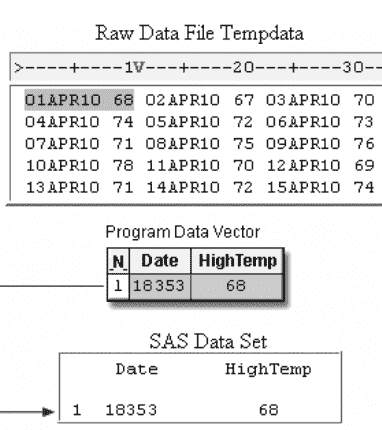

控制返回到 DATA step 的顶部，值被重置为缺失。

**图 21.10** 值重置

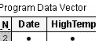

在第二次迭代中，`@@` 防止输入指针移动到下一记录。相反，`INPUT` 语句从第一条记录中读取第二块 `Date` 和 `HighTemp` 的值。

**图 21.11** 从第一条记录读取第二块数据值

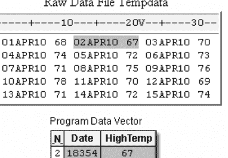

第二个观测值被写入数据集，控制返回到 DATA step 的顶部。

## 图 21.12 将第二个观测值写入数据集

```sas
原始数据文件 Temp-data

------+10-------+20-----+30---

01APR10 68 02APR10 67 03APR10 70

04APR10 74 05APR10 72 06APR10 73

07APR10 71 08APR10 75 09APR10 76

10APR10 78 11APR10 70 12APR10 69

13APR10 71 14APR10 72 15APR10 74
```

```sas
程序数据向量 (PDV)

| N Date | HighTemp |

| 2 18354 | 67 |
```

| SAS 数据集 |
| Date | HighTemp |
| 1 18353 | 68 |
| 2 18354 | 67 |

在第三次迭代中，最后一块数据值被读取并写入数据集作为第三个观测值。

## 图 21.13 将第三个观测值写入数据集

```sas
原始数据文件 Temp-data

------+10-------+20-----+30-V

01APR10 68 02APR10 67 03APR10 70

04APR10 74 05APR10 72 06APR10 73

07APR10 71 08APR10 75 09APR10 76

10APR10 78 11APR10 70 12APR10 69

13APR10 71 14APR10 72 15APR10 74
```

```sas
程序数据向量 (PDV)

| N Date | HighTemp |

| 3 18355 | 70 |
```

| SAS 数据集 |
| Date | HighTemp |
| 1 18353 | 68 |
| 2 18354 | 67 |
| 3 18355 | 70 |

在第四次迭代中，第二条记录的第一块数据值被读取并写入作为第四个观测值。

**图 21.14** 将第四个观测值写入数据集

原始数据文件 `Tempdata`

```sas
------1V--------+----+20----+30---

01APR10 68 02APR10 67 03APR10 70

04APR10 74 05APR10 72 06APR10 73

07APR10 71 08APR10 75 09APR10 76

10APR10 78 11APR10 70 12APR10 69

13APR10 71 14APR10 72 15APR10 74
```

程序数据向量 (PDV)

| Date | HighTemp |
| --- | --- |
| 4 18356 | 74 |

SAS 数据集:

| Date | HighTemp |
| --- | --- |
| 1 18353 | 68 |
| 2 18354 | 67 |
| 3 18355 | 70 |
| 4 18356 | 74 |

**图 21.15** 将最后一个观测值写入数据集

原始数据文件 `Tempdata`

```sas
------10-------+20----+30-V

01APR10 68 02APR10 67 03APR10 70

04APR10 74 05APR10 72 06APR10 73

07APR10 71 08APR10 75 09APR10 76

10APR10 78 11APR10 70 12APR10 69

13APR10 71 14APR10 72 15APR10 74
```

图 21.16 数据集的的输出

## 第 21 章 • 从单条原始数据记录创建多个观测

```sas
data perm.sales07;

  infile data07;

  input ID $ @;

  input Sales : comma. @;

  output;

  input Sales : comma. @;

  output;

  input Sales : comma. @;

  output;

run;
```

图 21.20 读取 `Sales` 的值

| 原始数据文件 | 10 | 20 | 30 | 40 |
| :--- | :--- | :--- | :--- | :--- |
| 0734 | 1,233.34 | 2,472.85 | 3,276.65 | 5,345.52 |
| 0943 | 1,908.34 | 2,560.38 | 3,472.09 | 5,290.86 |
| 1009 | 2,934.12 | 3,308.41 | 4,176.18 | 7,581.81 |

## 更高效编程的提示

每条记录包含变量 `Sales` 的四个不同的值。因此，`INPUT` 语句必须执行四次。与其编写四个 `INPUT` 语句，不如您可以在一个迭代 `DO` 循环中重复执行一个 `INPUT` 语句。

循环每次执行时，您需要将 `ID`、`Quarter` 和 `Sales` 的值作为观测值写入数据集。这通过使用 `OUTPUT` 语句轻松实现。

```sas
data perm.sales07;

  infile data07;

  input ID $ @;

  do Quarter=1 to 4;

    input Sales : comma. @;

    output;

  end;

run;
```

默认情况下，每个 DATA 步在步骤末尾都包含一个隐式的 `OUTPUT` 语句。在 DATA 步中放置显式的 `OUTPUT` 语句会覆盖自动步骤，并且只有在执行显式 `OUTPUT` 语句时，SAS 才会向数据集中添加观测值。

## 处理包含迭代 DO 循环的 DATA 步

现在程序已完成，以下是 SAS 处理包含迭代 `DO` 循环的 DATA 步的方式。

```sas
data perm.sales07;

  infile data07;

  input ID $ @;

  do Quarter=1 to 4;
```

## 读取相同数量的重复字段

```sas
    input Sales : comma. @;

    output;

  end;

run;
```

在第一次迭代中，当开始执行时，`ID` 和 `Quarter` 的值初始化为 1。

图 21.21 读取 `ID` 的值并初始化 `Quarter`

| 原始数据文件 | 10 | 20 | 30 | 40 |
| :--- | :--- | :--- | :--- | :--- |
| 0734 | 1,323.34 | 2,472.85 | 3,276.65 | 5,345.52 |
| 0943 | 1,908.34 | 2,560.38 | 3,472.09 | 5,290.86 |
| 1009 | 2,934.12 | 3,308.41 | 4,176.18 | 7,581.81 |

| N | ID | Quarter | Sales |
| :--- | :--- | :--- | :--- |
| 0734 | | 1 | |

`INPUT` 语句读取第一个重复字段并将该值分配给数据向量中的 `Sales`。`@` 保持当前记录。

图 21.22 `INPUT` 语句的结果

| 原始数据文件 | 10 | 20 | 30 | 40 |
| :--- | :--- | :--- | :--- | :--- |
| 0734 | 1,323.34 | 2,472.85 | 3,276.65 | 5,345.52 |
| 0943 | 1,908.34 | 2,560.38 | 3,472.09 | 5,290.86 |
| 1009 | 2,934.12 | 3,308.41 | 4,176.18 | 7,581.81 |

| N | ID | Quarter | Sales |
| :--- | :--- | :--- | :--- |
| 0734 | | 1 | 1323.34 |

`OUTPUT` 语句将程序数据向量中的值写入数据集作为第一个观测值。

图 21.23 `OUTPUT` 语句的结果

| 原始数据文件 | 10 | 20 | 30 | 40 |
| :--- | :--- | :--- | :--- | :--- |
| 0734 | 1,323.34 | 2,472.85 | 3,276.65 | 5,345.52 |
| 0943 | 1,908.34 | 2,560.38 | 3,472.09 | 5,290.86 |
| 1009 | 2,934.12 | 3,308.41 | 4,176.18 | 7,581.81 |

| N | ID | Quarter | Sales |
| :--- | :--- | :--- | :--- |
| 1 | 0734 | 1 | 1323.34 |

| ID | Quarter | Sales |
| :--- | :--- | :--- |
| 0734 | 1 | 1323.34 |

`END` 语句表示循环的结束，但控制权返回 `DO` 语句，而不是 DATA 步的顶部。现在 `Quarter` 的值增加到 2。

图 21.24 `END` 语句的结果

| 原始数据文件 | 10 | 20 | 30 | 40 |
| :--- | :--- | :--- | :--- | :--- |
| 0734 | 1,323.38 | 2,472.85 | 3,276.65 | 5,345.52 |
| 0943 | 1,908.34 | 2,560.38 | 3,472.09 | 5,290.86 |
| 1009 | 2,934.12 | 3,308.41 | 4,176.18 | 7,581.81 |

| Program Data Vector | N | ID | Quarter | Sales |
| :--- | :--- | :--- | :--- | :--- |
| 1 | 0734 | 2 | 1323.34 |

| SAS Data Set | ID | Quarter | Sales |
| :--- | :--- | :--- | :--- |
| 0734 | 1 | 1323.34 |

`INPUT` 语句再次执行，读取第二个重复文件并将 `Sales` 的值存储在程序数据向量中。

图 21.25 `INPUT` 语句第二次读取的结果

| 原始数据文件 | 10 | 20 | 30 | 40 |
| :--- | :--- | :--- | :--- | :--- |
| 0734 | 1,323.34 | 2,472.85 | 3,276.65 | 5,345.52 |
| 0943 | 1,908.34 | 2,560.38 | 3,472.09 | 5,290.86 |
| 1009 | 2,934.12 | 3,308.41 | 4,176.18 | 7,581.81 |

| Program Data Vector | N | ID | Quarter | Sales |
| :--- | :--- | :--- | :--- | :--- |
| 1 | 0734 | 2 | 1323.34 |

| SAS Data Set | ID | Quarter | Sales |
| :--- | :--- | :--- |
| 0734 | 1 | 1323.34 |

`OUTPUT` 语句将程序数据向量中的值写入数据集作为第一个观测值。

图 21.26 `OUTPUT` 语句第二次读取的结果

| 原始数据文件 | 10 | 20 | 30 | 40 |
| :--- | :--- | :--- | :--- | :--- |
| 0734 | 1,323.34 | 2,472.85 | 3,276.65 | 5,345.52 |
| 0943 | 1,908.34 | 2,560.38 | 3,472.09 | 5,290.86 |
| 1009 | 2,934.12 | 3,308.41 | 4,176.18 | 7,581.81 |

| Program Data Vector | N | ID | Quarter | Sales |
| :--- | :--- | :--- | :--- | :--- |
| 1 | 0734 | 1 | 14 |

`OUTPUT` 语句将程序数据向量中的值写入数据集作为第二个观测值。

图 21.27 写入第三和第四个观测值

| 原始数据文件 | 10 | 20 | 30 | 40 |
| :--- | :--- | :--- | :--- | :--- |
| 0734 | 1,323.34 | 2,472.85 | 3,276.65 | 5,345.52 |
| 0943 | 1,908.34 | 2,560.38 | 3,472.09 | 5,290.86 |
| 1009 | 2,934.12 | 3,308.41 | 4,176.18 | 7,581.81 |

| Program Data Vector | N | ID | Quarter | Sales |
| :--- | :--- | :--- | :--- | :--- |
| 1 | 0734 | 1 | 1323.34 |
| 2 | 0734 | 2 | 2472.85 |
| 3 | 0734 | 3 | 3276.65 |
| 4 | 0734 | 4 | 5345.52 |

| SAS Data Set | ID | Quarter | Sales |
| :--- | :--- | :--- |
| 0734 | 1 | 1323.34 |
| 0734 | 2 | 2472.85 |
| 0734 | 3 | 3276.65 |
| 0734 | 4 | 5345.52 |

循环继续执行，并将 `Quarter` 的值增加到 3，然后写入第四个观测值。

```
end;
run;
```

# 使用 MISSOVER 选项

你可以调整 DATA 步以适应不同数量的 `Samples` 字段，你的 DATA 步必须重复读取同一条记录。然而，当 `Sales` 数值缺失时，你需要防止输入指针移动到下一条记录。

你可以在 `INFILE` 语句中使用 `MISSOVER` 选项，以防止 SAS 在记录末尾遇到缺失值时读取下一条记录。从本质上说，具有不同数量重复字段的记录是包含缺失值的记录。因此，你在这里也需要指定 `MISSOVER` 选项。

由于每条记录中至少包含一个重复的字段 `Sales`，因此第一个 `INPUT` 语句读取每条记录的 `ID` 代码和 `Sales` 数值。末尾的 `@` 符号会保持该记录，以便读取任何后续字段。

```sas
data perm.sales07;

infile data07 missover;

input ID $ Sales : comma, @;
```


# 图 23.1 保持记录

| 原始数据文件 Data97 | | |
|---|---|---|
| 10 | 20 | 30 | 40 |
| 1824 | 1923.34 | 2472.85 | | |
| 1943 | 1908.34 | | | |
| 2046 | 1423.52 | 1673.66 | 3276.65 | |
| 2063 | 2345.34 | 2452.45 | 3523.52 | 2983.01 |

> 注意：SAS 提供了几个选项来控制读取行尾。记住，`MISSOVER` 选项可以用于在指针到达记录末时将重名的 `INPUT` 语句的值设置为缺失值。你还可以使用其他选项，例如 `TRUNCOVER` 选项，当 `INPUT` 语句读取的包含变长度数据的最后一个变量时，它会读取代码或格式化输入。当字段比预期短时，`TRUNCOVER` 选项会将输入缓冲区的内容分配给变量。

其他关系包括 `FLOWOVER`（默认值）、`STOPOVER` 和 `SCANOVER`。

# 在条件为真时执行 SAS 语句

要在条件为真时执行 SAS 语句，请使用迭代 `DO` 语句，并将表达式括在括号中。在下面的示例中，`DO` 语句会在 `Sales` 的值不等于缺失值（用点 `.` 表示）时一直执行。

```sas
data perm.sales07;

infile data07 missover;

input ID $ Sales : comma. @;

do while (sales ne .);
```

# 创建计数变量

`DO WHILE` 语句不会创建索引变量，但你可以创建自己的“计数器”变量。你可以使用求和语句在每次执行 `DO` 循环时增加计数器变量的值。

在示例中，循环之前的赋值语句创建了计数器变量 `Quarter` 并赋予其初始值零。每当 `DO` 循环执行时，求和语句就会将 `Quarter` 的值加 1。

```sas
data perm.sales08;

infile data08 missover;

input ID $ Sales : comma. @;

Quarter=0;

do while (sales ne .);

quarter+1;
```

# 完成 DO WHILE 循环

你需要一个 `OUTPUT` 语句将当前观测值写入数据集。然后，另一个 `INPUT` 语句读取 `Sales` 的下一个值并保持该记录。你用 `END` 语句完成 `DO WHILE` 循环。

```sas
data perm.sales08;

infile data08 missover;

input ID $ Sales : comma. @;

Quarter=0;

do while (sales ne .);

quarter+1;

output;

input sales : comma. @;

end;
```

```sas
run;
```

# 处理具有数量数量字段的 DATA 步

此示例使用了以下 `DATA` 步：

```sas
data perm.sales08;

infile data08 missover;

input ID $ Sales : comma. @;

Quarter=0;

do while (sales ne .);

quarter+1;

output;

input sales : comma. @;

end;
```

```sas
run;
```

在 `DATA` 步的第一次迭代中，读取了 `ID` 和 `Sales` 的值。`Quarter` 初始化为 0。

498 第 21 章 • 从单个原始数据记录创建多个观测值

## 图 21.32 将 Quarter 的值初始化为 0

原始数据文件：

```text
------10--V+------20+------30+------40-
1824 1323.34 2472.85
1943 1908.34
2046 1423.52 1673.46 3276.66
2063 2345.34 2452.45 3523.52 2983.01
```

程序数据向量：

| ID | Sales | Quarter |
|---|---:|---:|
| 1824 | 1323.34 | 0 |

`WHILE` 语句检查 `Sales` 是否有值，这样 `DO` 循环中的其他语句就会执行。`Quarter` 的值加 1，并将当前观测值写入数据集。

## 图 21.33 执行 DO

原始数据文件：

```text
------10--V+------20+------30+------40-
1824 1323.34 2472.85
1943 1908.34
2046 1423.52 1673.46 3276.66
2063 2345.34 2452.45 3523.52 2983.01
```

程序数据向量：

| ID | Sales | Quarter |
|---|---:|---:|
| 1824 | 1323.34 | 1 |

SAS 数据集：

| ID | Sales | Quarter |
|---|---:|---:|
| 1824 | 1323.34 | 1 |

`INPUT` 语句读取 `Sales` 的下一个值，循环结束，控制权返回 `DO WHILE`。

## 图 21.34 将控制权返回 DO WHILE 语句

原始数据文件：

```text
------10--V+------20+------30+------40-
1824 1323.34 2472.85
1943 1908.34
2046 1423.52 1673.46 3276.66
2063 2345.34 2452.45 3523.52 2983.01
```

程序数据向量：

| ID | Sales | Quarter |
|---|---:|---:|
| 1824 | 2472.85 | 1 |

SAS 数据集：

| ID | Sales | Quarter |
|---|---:|---:|
| 1824 | 1323.34 | 1 |

检查条件，`Sales` 仍有值，因此循环执行。

## 图 21.35 再次执行循环读取不同数量的重复字段 499

原始数据文件：

```text
------+------10------+20-V+------30------+------40-

1824 1323.34 2472.85

1943 1908.34

2046 1423.52 1673.46 3276.65

2063 2345.34 2452.45 3523.52 2983.01
```

程序数据向量：

| ID | Sales | Quarter |
|---|---:|---:|
| 1824 | 1323.34 | 1 |

SAS 数据集：

| ID | Sales | Quarter |
|---|---:|---:|
| 1824 | 1323.34 | 1 |

## 图 21.38 PROC PRINT 输出

| 观测值 | ID | 额 | 季度 |
|---:|---:|---:|---:|
| 1 | 1824 | 1323.34 | 1 |
| 2 | 1824 | 2472.85 | 2 |
| 3 | 1943 | 1908.34 | 1 |
| 4 | 2046 | 1423.52 | 1 |
| 5 | 2046 | 1673.46 | 2 |
| 6 | 2046 | 3276.65 | 3 |
| 7 | 2063 | 2345.34 | 1 |
| 8 | 2063 | 2452.45 | 2 |
| 9 | 2063 | 3523.52 | 3 |
| 10 | 2063 | 2983.01 | 4 |

## 章节练习

为每个问题选择最佳答案。使用附录中的答案对照检查你的答案。

1. 关于双尾部 `@` 符号（`@@`），说法正确的是：
   - a. 它允许下一个 `INPUT` 语句跨越 `DATA` 步的多次迭代，从当前记录读取迭代数据。
   - b. 它必须是 `INPUT` 语句中指定的最后一个项。
   - c. 当输入指针移动过记录末尾时，它会被释放。
   - d. 以上均对。

2. 对于被单个尾部 `@` 符号（`@`）留的记录，当发生以下操作之一时，它会被自动释放：
   - a. 输入指针移动过记录末尾。
   - b. `DATA` 步的下一次迭代开始。
   - c. 执行了另一个带有 `@` 的 `INPUT` 语句。
   - d. 从观测值中读取了另一个值。

3. 哪个 SAS 程序能正确地为每个数据块创建一个独立的观测值？

```text
1--------+10+----+20+----+30+----+40+----+

1001 apple 1002 banana 1003 cherry

1004 guava 1005 kiwi 1006 papaya

1007 pineapple 1008 raspberry 1009 strawberry
```

```sas
data perm.produce;

infile fruit;

input Item $ Variety : $10;

run;
```

- b.

```sas
data perm.produce;

infile fruit;

input Item $ Variety : $10. @;

run;
```

- c.

```sas
data perm.produce;

infile fruit;

input Item $ Variety : $10. @@;

run;
```

- d.

```sas
data perm.produce;

infile fruit @@;

input Item $ Variety : $10.

run;
```

4. 哪个 SAS 程序读取 `ID` 的值并为每个 `Quantity` 的值保留记录，从而为每条记录创建三个观测值？

| 1+----10----+20----+30---- |
|---|---:|---:|---:|
| 2101 | 21,208 | 19,047 | 22,890 |
| 2102 | 18,775 | 20,214 | 22,654 |
| 2103 | 19,763 | 22,927 | 21,862 |

- a.

```sas
data work.sales;

infile unsold;

input ID $;

do week=1 to 3;

input Quantity : comma.;

output;

end;

run;
```

- b.

```sas
data work.sales;

infile unsold;

input ID $ @@;

do week=1 to 3;

input Quantity : comma.;

output;

run;
```

- c.

```sas
data work.sales;

infile unsold;

input ID $ @@;

do week=1 to 3;

input Quantity : comma.;

output;

end;

run;
```

- d.

```sas
data work.sales;

infile unsold;

input ID $ @@;

do week=1 to 3;

input Quantity : comma. @;

output;

end;

run;
```

5. 哪个 SAS 语句在索引变量 `Count` 的值从 1 到 50 且增量为 5 时，重复执行多个语句？
   - a. `do count=1 to 50 by 5;`
   - b. `while count=1 to 50 by 5;`
   - c. `do count=1 to 50 + 5;`
   - d. `do while (count=1 to 50 + 5);`

6. 下面哪个选项在 `DATA` 步中使用，会在读取完 `Activity` 的每个值后将观测值写入数据集？
   - a.

     ```sas
     do choice=1 to 3;

     input Activity : $10. @;

     output;

     end;

     run;
     ```

   - b.

     ```sas
     do choice=1 to 3;

     input Activity : $10. @;

     end;

     output;

     run;
     ```

   - c.

     ```sas
     do choice=1 to 3;

     input Activity : $10. @;

     end;

     run;
     ```

   - d. a 和 b 都是

7. 哪个 SAS 语句在 `Cholesterol` 的值大于 200 时重复执行多个语句？
   - a. `cholesterol > 200;`
   - b. `cholesterol gt 200;`
   - c. `do while (cholesterol > 200;`
   - d. `do while cholesterol > 200;`

8. 下面哪个是 `sum` 语句的示例？
   - a. `totalpay=1;`
   - b. `totalpay+1;`
   - c. `totalpay*=1;`
   - d. `totalpay by 1;`

9. 哪个程序从下面的原始数据文件创建 `Perm.Topstore` 数据集？

| 11----+20----+30----+ |
|---|---:|---:|---:|
| 1001 | 77163.19 | 76804.75 | 74384.27 |
| 1002 | 76612.93 | 81456.34 | 82063.97 |
| 1003 | 82185.16 | 79742.33 | |

## 图 21.39 PROC PRINT 输出

| Store | 额 | 月 |
|---|---:|---:|
| 1001 | 77163.19 | 1 |
| 1001 | 76804.75 | 2 |
| 1001 | 74384.27 | 3 |
| 1002 | 76612.93 | 1 |
| 1002 | 81456.34 | 2 |
| 1002 | 82063.97 | 3 |
| 1003 | 82185.16 | 1 |
| 1003 | 79742.33 | 2 |

- a.

```sas
data perm.topstore;

infile sales98 missover;

input Store Sales : comma. @;

do while (sales ne ne.);

month + 1;

output;

input sales : comma. @;

end;

run;
```

- b.

```sas
data perm.topstore;

infile sales98 missover;

input Store Sales : comma. @;

do while (sales ne ne.);

month + 1;

output;

run;
```

- c.

```sas
data perm.topstore;

infile sales98 missover;

input Store Sales : comma. @;

do while (sales ne ne.);

month + 1;

output;

run;
```

- d.

```sas
data perm.topstore;

infile sales98 missover;

input Store Sales : comma. @;

end;

run;
```

10. `DATA` 步产生了多少个观测值？

| 1+----10----+20----+30----+40----+ |
|---|---:|---:|---:|---:|
| 1001 | 1002 | 1003 | 1004 | 1005 |
| 1006 | 1007 | 1008 | 1009 | 1010 |

```sas
data perm.produce;

infile fruit;

input Item $ Variety : $10. @;

run;
```

- a. 3
- b. 5
- c. 12
- d. 15

# 原始数据文件

| | | 名称 | 年龄 | 性别 |
|---|---|---:|---|---|
| H | 321 S. MAIN ST | | | |
| P | MARY E | 21 | F |
| P | WILLIAM M | 23 | M |
| P | SUSAN K | 3 | F |
| H | 324 S. MAIN ST | | | |
| P | THOMAS H | 79 | M |
| P | WALTER S | 46 | M |
| P | ALICE A | 42 | F |
| P | MARYANN A | 20 | F |
| P | JOHN S | 16 | M |
| H | 325A S. MAIN ST | | | |

# 保留变量的值

在读取 `DATA` 步读取此文件时，请记住你希望将头部记录作为每个观测值的一部分，直到遇到下一个头部记录。为了实现这一点，你需要使用 `RETAIN` 语句在 `DATA` 步的迭代中保留 `Address` 的值。

```sas
data perm.people;

infile census;

retain Address;
```

| | | 名称 | 年龄 | 性别 |
|---|---|---|---|
| H | 321 S. MAIN ST | | |
| P | MARY E | 21 | F |
| P | WILLIAM M | 23 | M |
| P | SUSAN K | 3 | F |

接下来，读取每个记录中的第一个字段，该字段标识记录类型。使用 `@` 行保持符（line-holder）来保持当前记录，以便稍后读取记录中的其他值。

```sas
data perm.people;

infile census;

retain Address;

input type $1.;
```

| | | 名称 | 年龄 | 性别 |
|---|---|---|---|---|
| H | 321 S. MAIN ST | | |
| P | MARY E | 21 | F |
| P | WILLIAM M | 23 | M |
| P | SUSAN K | 3 | F |

# 条件条件执行 SAS 语句

你可以使用 `type` 的值来识别每个记录。如果 `type` 为 H，则使用 `INPUT` 语句读取 `Address` 的值。然而，如果 `type` 为 P，则使用 `INPUT` 语句读取 `Name`、`Age` 和 `Gender` 的值。

# 510 第 22 章 条件处理原始数据文件

你可以使用 `IFTHEN` 语句根据特定条件使用 SAS 执行给定的任务。

```sas


```sas
data perm.people;

infile census;

retain Address;

input type $1. @;

if type='H' then input @3 address $15;
```

| | | 名称 | 年龄 | 性别 |
|---|---|---|---|---|
| H | 321 S. MAIN ST | | | |
| P | MARY E | 21 | F |
| P | WILLIAM M | 23 | M |
| P | SUSAN K | 3 | F |

条件语句中的表达式通常涉及某种类型的比较。在上面的示例中，变量与常量进行比较。当条件满足时，表达式被求值为真，并执行`THEN`关键字后面的语句。

表达式定义了一个条件，使得当`type`的值为 H 时，`INPUT`语句读取`Address`的值。然而，当`type`的值不是 H 时，表达式被求值为假，`INPUT`语句不执行。注意值被包含在引号中，因为它是一个字符值。

> **提示** 在比较值时，请确保表达式中的值与数据中显示的值完全一致。例如，下面的表达式将求值为假，因为数据中的值是以大写字母存储的。

```sas
if type='h' then ; .;
```

# 读取详细记录

你可以使用子集 IF 语句（subsetting IF statement）来检查类型为 P 的条件。如果`type`不是 P，则 Name、Age 和 Gender 的值将不会作为观测值写入程序数据集，控制权返回到 DATA 步的顶部。但是，Address 会被保留。

如果`type`是 P，Name、Age 和 Gender 将被读取，并将一个观测值写入数据集。请记住，你只想为详细记录创建观测值。

```sas
data perm.people;

infile census;

retain Address;

input type $1. @;

if type='H' then input @3 address $15;

if type='P';

input @3 Name $10. @13 Age 3. @16 Gender $1;

run;
```

# 每个详细记录创建一个观测值

## 删除变量

`type`仅用于标识记录类型。因此，从数据集中删除该变量。DATA 语句中的`DROP=`选项防止变量被写入数据集。

```sas
data perm.people (drop=type);

infile census;

retain Address;

if type='H' then input @3 address $15;

if type='P';

input @3 Name $10. @13 Age 3. @16 Gender $1;

run;
```

# 处理每个详细记录创建一个观测值的 DATA 步

在编译时，变量`Type`被标记，以确保其值不会被写入数据集。`Address`被标记，以便其值在 DATA 步的迭代中保留。

```sas
data perm.people (drop=type);

infile census;

retain Address;

if type='H' then input @3 address $15;

if type='P';

input @3 Name $10. @13 Age 3. @16 Gender $1;

run;
```

| Retain | Drop | | | | |
|---|---|---|---|---|---|
| N Address | type INPUT Name Age Gender | | | |
| • | | | | |

当 DATA 步开始执行时，`INPUT`语句读取`Type`的值并保持第一个记录。

## 条件处理原始数据文件

| Retain Address | type | Name | Age | Gender |
|---|---|---|---|---|
| 1 | | H | | |

检查`IF`条件并发现其为真。因此，`INPUT`语句读取第一个记录中的 Address 值。

| Retain Address | type | Name | Age | Gender |
|---|---|---|---|---|
| 1 321 S. MAIN ST | H | | | |

接下来，子集 IF 语句检查`Type='P'`的条件。由于条件不成立，其余语句不执行，控制权返回到 DATA 步的顶部。PDV 被初始化，但`Address`被保留。

| Retain Address | type | Name | Age | Gender |
|---|---|---|---|---|
| 2 321 S. MAIN ST | | | | |

当第二次迭代开始时，输入指针移动到下一个记录并读取新的`Type`值。`IF-THEN`语句不成立，`THEN`关键字后面的语句不执行。

# 每个详细记录创建一个观测值

| Retain | Drop | | | | | |
|---|---|---|---|---|---|---|
| | 321 S. MAIN ST | P | | | | |

子集 IF 语句检查`Type='P'`条件。在本次迭代中，条件成立，`INPUT`语句读取 Name、Age 和 Gender 的值。

| Address type | Name | Age | Gender |
|---|---|---|---|
| 321 S. MAIN ST | P | | | |

程序向量的值作为第一个观测值写入，控制权返回到 DATA 步的顶部。

| Address | type | Name | Age | Gender |
|---|---|---|---|---|
| 321 S. MAIN ST | MARY E | 21 | F |

在执行过程中，从第三和第四条记录产生观测值。注意第五条记录是头部记录。在第五次迭代中，`Type='H'`条件成立，因此一个新的地址被读取到程序向量中，覆盖了之前的值。

# 条件处理原始数据文件

| N | Address | Name | Age | Gender |
|---|---|---|---|---|
| 5 | 321 S. MAIN ST | | | |

| Address | Name | Age | Gender |
|---|---|---|---|
| 1 321 S. MAIN ST | MARY E | 21 | F |
| 2 321 S. MAIN ST | WILLIAM M | 23 | M |
| 3 321 S. MAIN ST | SUSAN K | 3 | F |

# 显示你的结果

执行阶段完成后，你可以使用`PRINT`过程显示数据集。显示前 10 个观测值。

**图 22.1** `PRINT`过程的输出

| Obs Address | Name | Age Gender |
|---|---|---|---|
| 1 321 S. MAIN ST | MARY E | 21 | F |
| 2 321 S. MAIN ST | WILLIAM M | 23 | M |
| 3 321 S. MAIN ST | SUSAN K | 3 | F |
| 4 324 S. MAIN ST | THOMAS H | 79 | M |
| 5 324 S. MAIN ST | WALTER S | 46 | M |
| 6 324 S. MAIN ST | ALICE A | 42 | F |
| 7 324 S. MAIN ST | MARYANN A | 20 | F |
| 8 324 S. MAIN ST | JOHN S | 16 | M |
| 9 325A S. MAIN ST | JAMES L | 34 | M |
| 10 325A S. MAIN ST | LIZA A | 31 | F |

## 每个头部记录创建一个观测值

### 每个头部记录创建一个观测值的基础

本示例使用下面的数据集来创建一个汇总变量`Total`。

```text
Raw Data File

1--+--10--+--20

H 321 S. MAIN ST

P MARY E 21 F

P WILLIAM M 23 M

P SUSAN K 3 F

H 324 S. MAIN ST

P THOMAS H 79 M

WALTERTER A 46 M

ALICE A 62 F

P MARYANN A 20 F

P JOHN S 16 M

H 325A S. MAIN ST

P JAMES L 34 M

LIZA A 31 E

H 325B S. MAIN ST

P MARGO K 27 F

P WILLIAM R 27 M

ROBERT W 1 M
```

| | Address | Total |
|---|---|---|
| 1 | 321 S. MAIN ST | 3 |
| 2 | 324 S. MAIN ST | 5 |
| 3 | 325A S. MAIN ST | 2 |
| 4 | 325B S. MAIN ST | 4 |

在你编写读取此文件的 DATA step 时，请考虑执行几项任务。首先，在读取和汇总详细记录时，必须保留 Address 的值。

```sas
data perm.residents;

infile census;

retain Address;
```

```text
1--+--10--+--+

H 321 S. MAIN ST

P MARY E 21 F

P WILLIAM M 23 M

P SUSAN K 3 F
```

接下来，必须按顺序读取 Type 的值，以确定当前记录是头部记录还是详细记录。你可以添加一个`@`符号来保持记录，以便另一个`INPUT`语句读取剩余值。

# 第 22 章

```sas
data perm.residents;

infile census;

retain Address;

input type $1.;
```

```text
V----+----+----

H 321 S. MAIN ST

P MARY E 21 F

P WILLIAM M 23 M

P SUSAN K 3 F
```

当 Type 的值指示头部记录时，需要执行几条语句。当 Type 的值指示详细记录时，你需要定义一组备选语句。

## 头部记录的 DO 组操作

要根据变量的值执行多个 SAS 语句，可以使用带有 IF-THEN 语句的简单 DO 组。当条件 Type-'H' 为真时，需要执行几条语句。

```sas
data perm.residents;

infile census;

retain Address;

input type $1.;

if type='H' then do;
```

- 首先，确定这是否为外部文件中的第一条记录。你不希望在相关的详细记录被读取和汇总之前将头部记录写入一个观测值。

`_n`是一个自动变量，其值为 DATA step 开始执行的次数。表达式`_n > 1`定义了 DATA step 执行了超过一次的条件。将此表达式与之前的 IF-THEN 语句结合使用，以检查这两个条件：

- 当前记录是头部记录。
- DATA step 执行了超过一次。

```sas
data perm.residents;

infile census;

retain Address;

input type $1.;

if type='H' then do;

if _n > 1
```

- 当条件`'H'`和`_n > 1`为真时，会执行`OUTPUT`语句。除了第一条记录外，每个头部记录都会导致一个观测值写入数据集。

```sas
data perm.residents;

infile census;

retain Address;

input type $1.;

if type='H' then do;

if _n > 1 then output;
```

# 每个头部记录创建一个观测值

- 一个赋值语句创建了汇总变量`Total`并将其值设置为 0。

```sas
data perm.residents;

infile census;

retain Address;

input type $1. @;;

if type='H' then do;

if _n > 1 then output;

Total=0;
```

- 一个`INPUT`语句读取 Address 的值。

```sas
data perm.residents;

infile census;

retain Address;

input type $1. @;;

if type='H' then do;

if _n > 1 then output;

Total=0;

input address $3-17;
```

- 一个`END`语句关闭 DO 组。

```sas
data perm.residents;

infile census;

retain Address;

input type $1. @;;

if type='H' then do;

if _n > 1 then output;

Total=0;

input address $3-17;

end;
```

## 读取详细记录

当`type`的值不是 H 时，你需要定义一个备选操作。你可以通过在 DO 组之后添加 ELSE 语句来实现。

请记住，IF-THEN 语句在 IF 子句中指定的条件为真时会执行 SAS 语句。在 IF-THEN 语句之后添加 ELSE 语句，定义定义了条件为假时执行的备选操作。

```sas
data perm.residents;

infile census;

retain Address;

input type $1. @;;

if type='H' then do;

if _n > 1 then output;

Total=0;

input address $3-17;

end;

else;
```

另一种类型的记录是详细记录，由 P 表示。你可能想要统计每个由详细记录表示的每个人并将其存储起来。

```sas
data perm.residents;

infile census;

retain Address;

input type $1. @;;

if type='H' then do;

if _n > 1 then output;

Total=0;

input address $3-17;

end;

else;
```

```sas
data perm.residents;

infile census;

retain Address;

input type $1. @;;

if type='H' then do;

if _n > 1 then output;

Total=0;

input address $1-171-1;
```

```text
0
H 321 S. MAIN ST
P MARY E 21 F
P WILLIAM M 23 M
P SUSAN K 3 F
H 324 S. MAIN ST
P THOMAS H 79 M
WALTERTER A 46 M
ALICE A 62 F
P MARYANN A 20 F
P JOHN S 16 M
```

当条件`'H'`和`_n > 1`为真时，会执行`OUTPUT`语句。除了第一条记录外，每个头部记录都会导致一个观测值写入数据集。

另一种类型的记录是详细记录，由 P 表示。你可能想要统计每个由详细记录表示的每个人并将其存储起来。

```sas
data perm.residents;

infile census;

retain Address;

input type $1. @;;

if type='H' then do;

if _n > 1 then output;

Total=0;

input address $3-17;

end;

else;
```

另一种类型的记录是详细记录，由 P 表示。你可能想要统计每个由详细记录表示的每个人并将其存储起来。

## 处理创建一个观测值标题记录的 DATA Step

- 3. 读取了 Type 的值，条件`type='H'`为真，因此执行 DO 组中的语句。

| | last Address | type | Total |
|---|---|---|---|
| 1 | 321 S. MAIN ST | H | 0 |

- 5. `END`语句关闭了 DO 组。由于第一个条件`type='H'`为真，因此 ELSE 语句中表示的备选条件不会检查。

- 6. Last 的值仍为 0，因此不执行`OUTPUT`语句。控制返回到 DATA 步的顶部。

- 7. 在第二次迭代中，`type`的值为`'P'`，`Total`增加了 1。再次，Last 的值为 0，因此控制返回到 DATA 步的顶部。

| last Address | type | Total |
|---|---|---|
| 2 | 321 S. MAIN ST | P | 1 |

- 8. 在第五次迭代中，Type 的值为`'H'`且`_N`大于 1，因此 Address 和 Total 的值被写入数据集作为第一个观测值。

- 9. 当读取文件的最后一条记录时，Last 变量设置为 1。现在 Last 的条件为真，程序数据向量（PDV）中的值被写入数据集作为最后一个观测值。

```sas
data perm.residents (drop=type);

infile census end=;

retain Address;

input type=$;

if type='H' then do;

if _n > 1 then output;

Total=$3-17;

end;

else if type='P' then total +1;

if last then output;
```


```text
->V+---10----+-----

P LIZA A      31 F

H MARGO K     27 F

P WILLIAM R  27 F

RO ROBERT W   1 M
```

| last Address | type | Total |
|---|---|---|
| 13 | 321 S. MAIN ST | P | 3 |

SAS 数据集 `Perm People`

| Obs | Address | Total |
|---|---|---|
| 1 | 321 S. MAIN ST | 3 |
| 13 | 321 S. MAIN ST | 3 |

# 章节测验

为每个问题选择最佳答案。使用附录中的答案键检查你的答案。

1. 当你编写一个 `DATA` 步来为每条明细记录创建一个观测值时，你需要做什么？

   - a. 区分标题记录和明细记录。
   - b. 将标题记录作为每个观测值的一部分，直到遇到下一个标题记录。
   - c. 保留每个记录类型的当前值，以便读取记录中的其他值。
   - d. 以上所有项。

2. 哪条 `SAS` 语句读取 `code`（在第一个字段）的值，然后保持该值，直到 `INPUT` 语句在 `DATA` 步的同一次迭代中读取每个观测值中的剩余值？

```text
-------+----10----+20----+30
01 Office Supplies
02 Paper Clips
02 Tape
01 Art Supplies
02 Crayons
02 Finger Paint
02 Construction Paper
```

   - a. `input code $2. @;`
   - b. `input code $2. @@;`
   - c. `retain code;`
   - d. 以上皆非

3. 哪条 `SAS` 语句检查 `Record` 等于 `C` 的条件并执行单个语句读取 `Amount` 的值？

   - a. `if record=C then input @3 Amount comma;`
   - b. `if record='C' then input @3 Amount comma;`
   - c. `if record='C' then do input @3 Amount comma;`
   - d. `if record=C then do input @3 Amount comma;`

4. 在第六次迭代读取 `code` 的值后，哪一个程序数据向量的插图是正确的？

# 章节测验 523

| H Lettuce | | |
|---|---|---|
| P Green Leaf | Quality Growers | |
| P Iceberg | Pleasant Farm | |
| P Romaine | Quality Growers | |
| H Squash | | |
| P Yellow | Tasty Acres | |
| P Zucchini | Pleasant Farm | |

```sas
data perm.produce (drop=code);

infile orders;

retain Vegetable;

input code $1. @;

if code='H' then input @3 vegetable $6;

if code='P';

input @3 Variety : $10. @15 Supplier : $15;

run;

proc print data=perm.produce;

run;
```

a.

| _ | Vegetable | code | Variety | Supplier |
|---|---|---|---|---|
| 6 | | P | | |

b.

| _ | Vegetable | code | Variety | Supplier |
|---|---|---|---|---|
| 6 | Squash | P | | |

c.

| _ | Vegetable | code | Variety | Supplier |
|---|---|---|---|---|
| 6 | Squash | H | | |

d.

| _ | Vegetable | code | Variety | Supplier |
|---|---|---|---|---|
| 6 | Squash | H | Yellow | |

5. 当 `DATA` 步的第四次迭代完成后，会发生什么？

| F Apples | | $2.50 |
|---|---|---|
| V Gala | | |
| V Golden Delicious | | $1.99 |
| V Rome | | $2.35 |
| F Oranges | | |
| V Navel | | $2.79 |
| V Temple | | $2.99 |

```sas
data perm.orders (drop=type);

infile produce;
```

# 524 第 22 章 • 条件原始数据文件

```sas
retain Fruit;

input type $1. @;

if type='F' then input @3 fruit $7;

if type='V'

input @3 Variety : $16. @20 Price comma,

run;
```

   - a. 程序数据向量中的所有值都被写入数据集作为第三个观测值。
   - b. 程序数据向量中的所有值都被写入数据集作为第四个观测值。
   - c. `Fruit`、`Variety` 和 `Price` 的值被写入数据集作为第三个观测值。
   - d. `Fruit`、`Variety` 和 `Price` 的值被写入数据集作为第四个观测值。

6. 哪条 `SAS` 语句表示当 `Record` 值为 `A` 时应执行多个语句？

```text
1----+10+----+20+----+30+
A 124153-0
C $153.02
D $20.00
D $20.00
```

   - a. `if record='A' then do;`
   - b. `if record=A then do;`
   - c. `if record='A' then;`
   - d. `if record=A then end;`

7. 关于述语句何是正确的（X 表示标题记录）？

```sas
if code='X' then do;

if _n > 1 then output;

Total=0;

input Name $3-20;

end;
```

   - a. `_N` 等于 `DATA` 步开始执行的次数。
   - b. 当 `code='X'` 且 `_n > 1` 为真时，执行 `OUTPUT` 语句。
   - c. 每个标题记录导致观测值写入数据集。
   - d. a 和 b。

8. 当条件 `Type='P'` 为假时，会发生什么？

```sas
if type='P' then input @3 ID $5. @9 Address $20;

else if type='V' then input @3 Charge $6.
```


## 练习题

- a. 读取`ID`和`Address`的值。
- b. 读取`Charge`的值。
- c. 赋值`Type`。
- d. 执行`ELSE`语句。

### 9. 当`Last`大于 0 时，会发生什么？

## 附录 1 • 练习答案

### 2. 正确答案：a

当遇到`DATA`、`PROC`或`RUN`语句时，SAS 会停止读取语句并执行程序中的上一个步骤。此程序包含一个`DATA`和两个`PROC`，总共三个程序步骤。

### 3. 正确答案：b

它必须是一个字符变量，因为值包含字母和下划线，这些不是数值的有效字符。

### 4. 正确答案：a

它必须是一个数值变量，因为缺失值是用点（`.`）而不是空格表示的。

### 5. 正确答案：c

变量名遵循与 SAS 数据集名称相同的规则。长度可以为 1 到 32 个字符，必须以字母（A-Z，大写或小写均可）或下划线开头，后面可以是任意数量的字母、数字或下划线。

### 6. 正确答案：d

要在 SAS 数据库中永久存储文件，你需要为其分配一个除`Work`以外的库引用（library）。例如，通过将 lib`Profits`分配给 SAS 数据库，你可以指定该库中的文件将一直存储，直到你删除它们。因此，`Hashelp`、`Sasuser`和`Profits`库中的 SAS 文件是永久文件。

### 7. 正确答案：d

要在`DATA`步骤或`PROC`中引用临时文件，你可以指定文件的单级名称（例如`Forecast`）或使用 libref`Work`指定双级名称（例如`Work.Forecast`）。

### 8. 正确答案：c

数值变量`Balance`的默认长度为 8。除非你指定不同的长度，否则数值（无论包含多少数字）都存储在 8 字节的存储中。

### 9. 正确答案：c

这五个语句分别是：1) `PROC PRINT`语句（占两行）；2) `VAR`语句；3) `WHERE`语句（与`VAR`语句在同一行）；4) `LABEL`语句；以及 5) `RUN`语句（与`LABEL`语句在同一行）。

### 10. 正确答案：d

每个文件都存储在 SAS 库中，库是 SAS 数据集和目录的集合。在某些操作系统环境中，SAS 库是文件的物理集合。在其他环境中，文件仅在逻辑上相关。在 Windows 和 UNIX 环境中，SAS 库通常是同一文件夹或目录中的一组 SAS 文件。

## 第 3 章：设置你的 SAS 会话

### 1. 正确答案：b

## 第 4 章：识别和修正错误

你可以在任何 SAS 平台上使用编程语句创建 HTML 输出。此外，在除主机平台以外的所有平台上，你都可以使用 SAS 窗口将 HTML 指定为结果格式。

### 2. 正确答案：d

只要你指定了读取整个日期的正确字段宽度，`YEARCUTOFF`选项就不会影响具有四位数的日期值。

### 3. 正确答案：a

SAS 引擎是 SAS 用于在 SAS 库中读写文件的文件的指令集。每个引擎指定了存储在库中的文件格式，从而使 SAS 访问特定格式的文件。某些引擎访问 SAS 文件，而其他引擎支持访问其他供应商的文件。

### 4. 正确答案：a

要使用`CONTENTS`过程打印库内容的摘要，请使用点在 libref 后面追加`_ALL`选项。添加`NODPS`选项会抑制有关文件的详细信息。

### 5. 正确答案：b

Librefs 必须是 1 到 8 个字符，且只能包含数字、字母或下划线。在分配 libref 后，你将其指定为 SAS 文件双级名称中的第一级。

### 6. 正确答案：c

`YEARCUTOFF`选项指定使用哪一个“百年”跨度来解释数字值。`YEARCUTOFF=`的默认值为 1920。然而，你可以覆盖并更改`YEARCUTOFF=`的值为另一个百年跨度的起始年份。如果你指定`YEARCUTOFF=1950`，那么 100 年的跨度将从 1950 年到 2049 年。

### 7. 正确答案：c

`LIBNAME`语句是全局的，这意味着 librefs 将一直有效直到更改或取消，或者 SAS 会话结束。因此，`LIBNAME`语句仅为当前 SAS 会话分配 libref。在访问存储在永久 SAS 数据库中的 SAS 文件之前，你必须分配 libref。

### 8. 正确答案：b

在`LIBNAME`语句中，你在引擎名称之前指定库名。两者后面都跟着路径。

## 第 4 章：识别和修正错误

### 1. 正确答案：d

虽然你可以用几乎任何格式编写 SAS 语句，但一致的布局可以增强可读性并帮助你理解程序的目的。良好的做法是在第一列开始`DATA`和`PROC`步骤，缩进步骤内的语句，在第一列开始`RUN`语句，并在每个`DATA`或`PROC`步骤后包含一个`RUN`语句。

### 2. 正确答案：a

在使用编辑器（Editor）窗口修正程序中的错误时，你通常需要从检索缓冲区（recall buffer）将提交的语句调回编辑器窗口。修正错误后，你可以重新提交修改后的程序。但在此之前，最好清除日志（Log）窗口中的消息，以免将旧消息与新消息混淆。记住再次检查日志窗口以验证你的程序是否运行正常。

### 3. 正确答案：d

`LABEL`语句中的引号会导致 SAS 误读程序中的语句。当你提交程序时，SAS 无法解析`PROC`步骤，活动窗口顶部会出现一个`PROC PRINT`运行消息。

### 4. 正确答案：c

语法错误通常会导致 SAS 停止处理发生错误的该步骤。当提交一个包含错误的程序时，关于该问题的消息也会出现在日志窗口中。当检测到语法错误时，日志窗口会显示`ERROR`单词，识别可能的错误位置，并给出错误的解释。

### 5. 正确答案：b

语法错误是常见的错误类型。某些 SAS 系统选项和代码编辑窗口的特性可以帮助你识别语法错误。其他类型的错误包括数据错误和逻辑错误。

### 6. 正确答案：b

当你提交一个包含无效选项的 SAS 语句时，日志消息会通知该选项无效或不被识别。你应该检索程序，删除或替换无效选项，根据需要检查语句语法，并重新提交修正后的程序。

### 7. 正确答案：b

`DATA`步骤中包含一个拼写错误的关键字（`dat`而不是`data`）。然而，这是一个常见的（且易于解释的）错误，SAS 只产生警告而不是错误。

### 8. 正确答案：c

此程序包含一个不匹配的引号。当你有一个不匹配的引号时，SAS 往往无法检测其所在语句的结束。添加一个引号并重新提交程序通常不能解决问题，SAS 仍然认为引号是不匹配的。要修正此错误，你需要在检索之前解决不匹配的引号，然后重新提交程序。

### 9. 正确答案：b

如果没有`RUN`语句（或后续的`PROC`步骤），`DATA`步骤不会执行，因此它会一直运行。如果不匹配的引号后面跟随的代码较少，不匹配的引号也会导致`DATA`步骤运行消息。练习题提到的另外三个问题也会在日志窗口中生成错误或警告。

### 10. 正确答案：c

## 第 5 章：创建列表报告

当程序语句遵循规则并执行，但结果不正确时就会发生逻辑错误。你可以在`DATA`步骤中使用`PUTLOG`语句来识别逻辑错误。

### 1. 正确答案：c

`DATA=`选项指定要列出的数据集，`ID`语句替换了`Obs`列。`VAR`语句指定变量并控制它们的显示顺序，`WHERE`语句根据条件选择行。`PROC PRINT`语句中的`LABEL`选项携带`LABEL`语句中指定的标签。

### 2. 正确答案：a

你使用`DATA=`选项指定要打印的数据集。`LABEL`选项指定使用标签而非变量名显示。

### 3. 正确答案：d

在`WHERE`语句中，`IN`运算符允许你根据多个值选择观测值。值在括号内并用空格或逗号隔开。字符值必须包含引号，且与数据集的大小写一致。

### 4. 正确答案：c

`PROC SORT`步骤中，你使用`DATA=`选项指定排序的数据集。`OUT=`选项指定输出数据集。所需的`BY`语句指定排序数据的变量或变量。

### 5. 正确答案：b

`DATE`和`NUMBER`系统选项使输出带有日期和页码。`PROC PRINT`步骤中，`DOUBLE`选项指定双倍行距，`NOOBS`选项移除默认的`Obs`列。

### 6. 正确答案：d

如果你在`SUM`语句中指定了变量，不需要在`VAR`语句中命名，但你可以这样做。如果你选择不在`VAR`语句中命名变量，那么`SUM`语句将决定它们在输出中的顺序。

### 7. 正确答案：c

`PROC SORT`需要`BY`语句。没有它，`PROC SORT`步骤将失败。然而，`PROC PRINT`步骤会打印请求的数据集。

### 8. 正确答案：a

列总计出现在报告末尾，格式与变量值相同，因此 b 是错误的。`Work.Loans`按`Month`和`Amount`排序，因此 c 是错误的。程序累加了`Amount`和`Payment`，因此 d 是错误的。

### 9. 正确答案：c

为了确保复合表达式被正确计算，你可以使用括号对观测值分组。

### 5. 正确答案：b

列输入仅在某些情况下适用。当使用列输入时，你的数据必须是标准字符或数值值，且它们必须在固定字段中。也就是说，对于特定变量，在所有记录中必须位于相同的位置。

## 第 7 章：理解 DATA Step 处理 533

### 6. 正确答案：a

`INPUT`语句使用你分配给每个字段的名称来创建变量。因此，当你编写`INPUT`语句时，需要按照你希望它们在 SAS 数据集中出现的准确方式，精确地指定变量名。

### 7. 正确答案：b

你可以使用列输入按任何顺序读取字段。你必须指定变量名，使用`$`标识识别字符变量，并为每个变量指定正确的起始和结束列。

### 8. 正确答案：c

若要在赋值语句中重新定义变量`Income`的值，你必须在等号左侧指定变量名，并在等号右侧指定适当的变量。

### 9. 正确答案：d

要读取数据，使用`DATALINES`语句和数据行，随后跟一个空语句（分号）以表示输入数据的结束。程序 a 没有`DATALINES`语句，且`INPUT`语句没有指定要读取的字段。程序 b 不包含数据行，而程序 c 中的`INPUT`语句没有为字符变量`Country`和`Vehicle`指定必要的美元符号。

### 10. 正确答案：c

要对数据进行子集处理，可以在任何`DATA`step 中使用子集`IF`语句，仅处理符合指定条件的观测值。由于`Sex`是字符变量，值`F`必须包含在引号中，并且必须与数据集中的大小一致。

## 第 7 章：理解 DATA Step 处理

### 1. 正确答案：b

在编译阶段，会创建程序数据向量（program data vector）。程序数据向量包含两个自动变量`_N_`和`_ERROR_`。新 SAS 数据集的描述符部分在编译阶段结束时创建。描述符包括数据集的名称、观测值和变量的数量、变量的名称和属性。观测值直到执行阶段才会被写入。

### 2. 正确答案：a

语法检查可以检测许多常见错误，但它无法验证变量的值或格式的正确性。

### 3. 正确答案：c

除非另有指示，否则`DATA step`会为输入文件中的每个记录执行。

### 4. 正确答案：d

剩余变量将初始化为缺失。缺失的数值用点表示，缺失的字符值用空格表示。

### 5. 正确答案：b

## 534 附录 1 • 练习答案

`ERROR`的默认值为 0，意味着没有数据错误。当发生错误时（无论是一个还是多个错误），值被设置为 1。

### 6. 正确答案：d

默认情况下，在`DATA step`结束时，程序数据向量中的值将作为观测值写入数据 step，控制返回到`DATA step`的顶部，自动变量`_N`的值加 1，并在编程语句中创建的变量值重置为缺失。如果有必要，自动变量`_ERROR`重置为 0。

### 7. 正确答案：a

变量在`DATA step`中定义的顺序决定了变量在数据集中的存储顺序。

### 8. 正确答案：c

当 SAS 无法检测到语法错误时，`DATA step`会编译但不会执行。

### 9. 正确答案：a

第二行缺少一个分号。这将导致错误，因为`INPUT`语句将被解释为无效的`INFILE`语句。

### 10. 正确答案：d

日志的第三行显示了`IDnum`的值，这显然是一个字符值。第四行显示了程序数据向量中的值，并为`IDnum`显示了一个点（缺失数值的符号）。其他值都正确赋值了。因此，`IDnum`似乎期望的是数值值。`INPUT`语句中缺少一个表示字符值的美元符号。

## 第 8 章：创建和应用用户定义格式

### 1. 正确答案：c

如果不指定`LIBRARY=`选项，格式将存储在名为`Work.Formats`的默认格式中。libref`Work`表示任何存储在`Work.Formats`中的格式都是临时格式；它只存在于当前的 SAS 会话中。

### 2. 正确答案：a

要将格式存储在永久性目录（permanent catalog）中，你首先需要编写一个`LIBNAME`语句，将 libref 与存储该目录的 SAS 数据库关联。然后向`PROC FORMAT`语句中添加`LIB=`（或`LIBRARY=`）选项，并指定目录的名称。

### 3. 正确答案：d

如果`VALUE`语句创建的格式适用于字符变量，则格式名称必须以美元符号（`$`）开头。

### 4. 正确答案：b

`PROC FORMAT`语句后需要一个分号。`VALUE`语句以关键字`VALUE`开始，并在所有标签定义后以分号结束。

## 第 9 章：生成描述性统计数据

### 5. 正确答案：d

你可以列出用逗号分隔的值，但列表必须包含全数值值或全字符值。数据集变量要么是数值要么是字符。

### 6. 正确答案：d

在指定标签时，将其包含在引号中并将标签限制在 32,767 个字符以内。

### 7. 正确答案：d

`MISS AND MISSING`是无效关键字，且`LOW`不包含缺失的数值。`VALUE`语句可以使用关键字`OTHER`。

### 8. 正确答案：b

通过在`DATA step`中放置`FORMAT`语句，可以将格式与变量永久关联。

### 9. 正确答案：b

要将用户定义格式关联变量，在`FORMAT`语句处使用一个点。

### 10. 正确答案：d

将`FMTLIB`添加到`PROC FORMAT`语句显示目录中的所有格式，以及它们值的描述。

## 第 9 章：生成描述性统计数据

### 1. 正确答案：c

默认情况下，`MEANS`过程产生数量、平均值、最小值、最大值和标准差。

### 2. 正确答案：d

要指定`MEANS`分析的变量，使用`VAR`语句。

### 3. 正确答案：a

与`Age`、`Height`或`Weight`不同，`IDnum`的值可能产生有用的统计结果。

### 4. 正确答案：a

与`CLASS`处理不同，`BY`处理要求数据已经索引或按`BY`变量顺序排序。

### 5. 正确答案：b

`CLASS`语句产生一个表，而`BY`处理产生一系列小表。`CLASS`语句中的变量顺序决定了它们在输出中的顺序。

### 6. 正确答案：d

## 536 附录 1 • 练习答案

你可以使用`MEANS`或`PROC SUMMARY`创建表。在`SUMMARY`语句中添加`PRINT`选项产生的报告与使用`MEANS`相同。

### 7. 正确答案：c

默认情况下，`FREQ`为数据集中的变量创建表。

### 8. 正确答案：c

连续值和唯一值都会导致冗长且无意义的表。频率分布对于分类值最好。

### 9. 正确答案：d

星号用于连接`TABLES`中的变量。第一个变量形成行，第二个变量形成列。

### 10. 正确答案：d

星号用于交叉分类表。表中显示的仅为单元百分比。`NOFREQ`选项抑制单元频率，`NOROW`选项抑制行百分比，`NOCOL`选项抑制列百分比。

## 第 10 章：使用 ODS 创建输出

### 1. 正确答案：d

只要为你想要的每个输出类型打开 ODS 目的，就可以生成任意类型的输出。

### 2. 正确答案：a

在 Windows 操作系统和 UNIX 的窗口环境中默认创建 HTML 输出，因此这些语句创建 HTML 和 PDF 输出。

### 3. 正确答案：a

默认情况下，在 Windows 操作系统和 UNIX 的窗口环境中，SAS 程序产生 HTML 输出。如果你只需要 RTF 输出，在创建 RTF 输出之前关闭 HTML 目的是一个好习惯，因为打开的目的会占用系统资源。

### 4. 正确答案：c

当 HTML 输出开启时运行多个过程时，过程输出将追加到同一个体文件中。

### 5. 正确答案：a

`CONTENTS`选项会创建一个指向体文件`D:\Output\body.html`的目录。

### 6. 正确答案：b

目录包含每个创建输出的过程的编号标题。

## 第 11 章：创建和管理变量

`FRAME=`选项创建一个整合了目录和正文文件的 HTML 文件。

### 8. 正确答案：b

在文件规范中指定`URL=suboption`会为 ODS 在创建的链接中提供一个 URL。指定简单的（单个名称）URL 会创建一个指向文件的相对链接地址。

### 9. 正确答案：c

你可以通过`ODS HTML`语句中的`STYLE=`选项更改 HTML 输出的外观。样式名称不需要引号。

### 10. 正确答案：d

你使用`PATH=`选项来指定 HTML 文件的存储位置。当使用`PATH=`选项时，不需要为正文、目录或框架文件指定完整路径。

## 第 11 章：创建和管理变量

### 1. 正确答案：c

程序 c 正确地删除了`Finish`值为 oak 且`Price`值小于 200 的观测值。它通过累加所有观测值的变量`Price`创建了`TotalPrice`，并使用`DATA`语句中的`DROP=`数据选项删除了`Price`。

### 2. 正确答案：b

`PROC PRINT`输出显示变量`Amount`的标签为`Total Loaned`，并使用`COMMA10.`格式化该值。`PROC`步骤中分配的临时标签或格式会覆盖`DATA`步骤中分配的永久标签或格式。

### 3. 正确答案：c

包含在括号内的逻辑比较在与其他表达式进行比较之前会被评估为真或假。在示例中，嵌套括号内的`AND`比较在与`OR`比较之前先被评估。

### 4. 正确答案：d

`sum`语句将`+`右侧表达式的结果加到左侧数值变量上。新值将被保留用于后续观测值。`sum`语句会忽略缺失值，因此第四个观测值中`Count`的值将是`10+20+-40`，即`70`。

### 5. 正确答案：d

`RETAIN`语句为变量`Count`分配初始值 100，因此第三个观测值中`Count`的值将是`100+20+0`，即`130`。

### 6. 正确答案：b

必须将字符值包含在引号内，并且指定的字母大小必须与数据集中出现的完全一致。值`OK`不等于`Ok`，因此`Count`的值不会被`IF-THEN`语句改变。

## 附录 1 · 测验答案

### 7. 正确答案：d

变量长度由其在`DATA`语句中的第一次引用决定。创建新的字符变量时，SAS 分配的存储空间字节数与该变量引用中的字符数相同。变量的第一次引用也可以通过`LENGTH`语句或赋值语句完成。

### 8. 正确答案：a

你可以编写`ELSE`语句来指定一系列互斥条件。`ELSE`语句必须紧跟在程序中的`IF-THEN`语句之后。只有当之前的`IF-THEN/ELSE`语句为假时，`ELSE`语句才会执行。

### 9. 正确答案：a

新变量的长度由`DATA`语句中的第一次引用决定，而不是由数据值决定。在这种情况下，`Type`的长度由值`Fixed`决定。`LENGTH`语句的位置不对；它必须发生在`DATA`语句中对该变量的其他引用之前。

### 10. 正确答案：b

要选择变量，可以在任何`DATA`语句中使用`DROP`或`KEEP`语句。你也可以在`DATA`或`PROC`语句的数据集名称使用`DROP=`或`KEEP=`选项。然而，你不能在`PROC`步骤中使用`DROP`或`KEEP`语句。

## 第 12 章：读取 SAS 数据集

### 1. 正确答案：b

使用`SET`语句中的`KEEP=`选项指定变量`Age`、`Weight`和`Group`。处理后，`DATA`语句删除了`Age`和`Group`。

### 2. 正确答案：c

你在`DATA`语句指定要创建的数据集。`DROP=`数据选项防止变量写入数据集。由于你在处理数据时使用了变量`OrdTime`，因此你不能在`SET`语句中删除`OrdTime`。如果你在`SET`语句中使用`KEEP=`选项，则必须将`OrdTime`列为要保留的变量之一。

### 3. 正确答案：d

当`BY`语句配合`SET`语句时，`DATA`步骤会创建临时变量`FIRST.`和`LAST.`。它们不会存储在数据集中。

### 4. 正确答案：b

`DATA`语句在`DATA`语句结束时写入观测值。但在程序中，`STOP`语句在`DATA`语句结束之前停止了处理。需要显式的`OUTPUT`语句来产生观测值。

### 5. 正确答案：d

程序尝试读取前 4 个观测并将第五个写入数据集`Work.Subset`。`FIRSTSOBS`返回的观测值数量大于`OBS`选项返回的观测值数量。因此，结果是。

### 6. 正确答案：a

当你结合`OUTPUT`和`STOP`语句使用`KEEP=`数据选项和`POINT=`选项时，程序无法写入单个观测值。

### 7. 正确答案：d

该程序使用`END=`选项命名一个包含文件结束标记的临时变量。该变量——`last`在`SET`语句读取数据集的最后一个观测值时被设置为 1。

### 8. 正确答案：d

在`DATA`语句的底部，编译阶段已完成，新 SAS 数据集的描述部分已创建。此时没有观测值，因为`DATA`语句尚未执行。

### 9. 正确答案：c

`END=`选项允许你只向数据集写入一个观测值。`END=`选项覆盖了`DATA`语句向输出写入观测值的默认行为。

## 第 13 章：合并 SAS 数据集

### 1. 正确答案：a

这是一个一对一匹配案例，需要多个`SET`语句。当出现同名变量时，从第二个数据集读取的值将替换从第一个数据集读取的值。

### 2. 正确答案：c

这是一个交错合并案例，需要多个`SET`语句。在`PROC`语句中使用`BY`选项指定变量`Total Loaned`的标签，并使用`COMMA10.`格式化该值。注意，合并包含了两个数据集的观测值。

### 3. 正确答案：a

连接（Concatenating）将一个数据集的观测值追加到另一个数据集。

### 4. 正确答案：a

连接后的观测值按`SET`语句列出的顺序写入。`DATA`语句在`DATA`语句结束写入`Sale`变量。在第二个观测值中，`Sale`变量为缺失值。（注意，如果你合并这些数据集，第二个观测值的`Sale`值为`$30,000`。）

### 5. 正确答案：b

如果你在多个数据集中具有同名变量，第一个数据集中的同名变量会被后续数据集中的值覆盖。

### 6. 正确答案：c

`DATA`步骤使用`IN=`选项和子集筛选`IF`语句来排除不匹配的观测值。

### 7. 正确答案：d

匹配合并（Match-merging）用第一个数据集中的同名变量覆盖后续数据集中的同名变量。为了防止覆盖，可以在`MERGE`语句中使用`RENAME=`数据选项重命名变量。

### 8. 正确答案：c

两个输入数据集没有按`BY`变量排序，因此`DATA`步骤产生错误。

### 9. 正确答案：c

在此示例中，新数据集为每个唯一的`ID`值包含一个观测值。合并后的数据集如下：

| ID | Name | Dept | Hours |
|---|---|---|---|
| 000 | Miguel | A12 | |
| 111 | Fred | B45 | 35 |
| 222 | Diana | B45 | 40 |
| 777 | Steve | | 0 |
| 888 | Monique | A12 | 37 |
| 999 | Vien | D03 | |

### 10. 正确答案：a

在新数据集中，第三个观测值是`ID`为 2 的第二个观测值（Kelly Windsor）。由于`BY`变量值没有变化，`Bonus`保留了上一个观测值。新数据集如下：

| ID | Name | Sale | Bonus |
|---|---|---|---|
| 1 | Ray Rong | $28,000 | $2,000 |
| 2 | Kelly Windsor | $30,000 | $4,000 |
| 2 | Kelly Windsor | $40,000 | $4,000 |
| 3 | Julio Meraz | $15,000 | $3,000 |
| 3 | Julio Meraz | $20,000 | $3,000 |
| 3 | Julio Meraz | $25,000 | $3,000 |
| 4 | Richard Krabill | $35,000 | $2,500 |

## 第 14 章：使用函数处理数据

### 1. 正确答案：d

使用变量列表来指定一个范围的变量作为函数参数。在指定变量列表时，务必在列表前加上`of`。如果遗漏了`of`词，函数参数可能无法按预期进行解析。

### 2. 正确答案：b

执行此`DATA`步时，SAS 会自动将`PayRate`的字符值转换为数值，以便进行计算。每当发生自动转换时，SAS 日志中都会写入一条消息，说明已发生转换。

### 3. 正确答案：b

你使用`INPUT`函数显式地将字符值转换为数值。请确保选择一个可以读取数值格式的格式符（informat）。

### 4. 正确答案：d

你使用`PUT`函数显式地将数值转换为字符。请确保选择一个可以读取数值格式的格式（format）。

### 5. 正确答案：c

由于系统选项`YEARCUTOFF`被设置为 1920，SAS 将两位位年份 20 视为 1920。四位年份值始终是正确的。

### 6. 正确答案：a

当你知道单词的顺序、位置，且单词由某些分隔符标记时，使用`SCAN`函数从字符值中提取单词。在这种情况下，你不需要指定分隔符，因为空格和逗号是默认的分隔符。

### 7. 正确答案：d

当你知道要从字符值提取子字符串的精确位置时，`SUBSTR`函数最好。你指定起始位置和提取的字符数。

### 8. 正确答案：c

如果`SUBSTR`放在赋值语句的左侧，它会替换变量值。当放在右侧时，该函数会提取子字符串。

### 9. 正确答案：b

`TRIM`函数删除字符值末尾的空格。在这种情况下，必须删除`FirstName`值中的多余空格。虽然答案 c 也可行，但对变量`LastName`使用额外的`TRIM`函数是没有必要的。由于`LENGTH`语句的存在，`FullName`的所有值都被填充到 40 个字符。

### 10. 正确答案：d

在子集`IF`语句中使用`INDEX`函数，并将字符字符串括在引号中。只有当函数找到字符串并返回大于 0 的值的观测值才会被写入数据集。

## 第 15 章：使用 DO 循环处理数据

### 1. 正确答案：c

`DO`循环是`DATA`步语句，不能与`PROC`步结合使用。

### 2. 正确答案：c

迭代次数由`DO`语句的停止值决定，在这种情况下该值为 12。

### 3. 正确答案：a

使用`DO`循环执行从 1 开始并循环 15 次的重复计算。

### 4. 正确答案：d

在`DO`循环的第 15 次迭代结束，`Year`的值增加到 2005。由于此值超过了停止值，`DO`循环结束。在`DATA`步的底部，当前值被写入数据集。

### 5. 正确答案：b

`OUTPUT`覆盖了`DATA`步结束时的自动输出。在`DO`循环的最后一次迭代中，`Year`的值 2004 被写入数据集。

### 6. 正确答案：d

观测值的数量基于`OUTPUT`语句执行的次数。数据集具有 20 个观测值，对应`DO`循环的每次迭代。

### 7. 正确答案：b

将每月计算放在一个`DO`循环中的`DO`循环内，该嵌套循环循环每年迭代一次。没有使用`DO WHILE`和`DO UNTIL`语句，因为所需的迭代次数是固定的。非迭代的`DO`组将没有用。

### 8. 正确答案：a

`DO UNTIL`条件在循环底部评估，因此所包含的语句始终至少执行一次。

### 9. 正确答案：c

由于`DO WHILE`在循环顶部评估，你指定了为了执行包含的语句必须满足的条件。

### 10. 正确答案：a

`WHILE`表达式当`Distance`的值等于或大于 250 时，会导致`DO`循环停止。

## 第 16 章：使用数组处理数据

### 1. 正确答案：a

## 第 17 章：在固定字段中读取原始数据

`ARRAY`语句不是可执行语句；它仅仅定义了一个数组。

### 2. 正确答案：d

括号中的值表示数组中的元素数量。在这种情况下，有四个元素。

### 3. 正确答案：b

在`DO`语句中，你指定代表数组元素值的索引变量。然后指定数组元素的起始位置和停止位置。

### 4. 正确答案：c

索引值代表数组元素的位置。在这种情况下，第三个元素是 Jul。

### 5. 正确答案：b

要处理数组中的所有元素，你可以指定数组的维度，或使用`DIM`函数并以数组名作为参数。

### 6. 正确答案：d

通过`ARRAY`语句可以创建数值或字符变量。

### 7. 正确答案：a

在第二次迭代结束时，`diff{i}`的解析如下：


```text
diff[2]-wt[2+1]-wt{2};
```

```text
diff[2]=215-200
```


- 8. 正确答案：a

要创建临时数组元素，在数组名和维度之后指定`_TEMPORARY_`。为每个元素指定初始值，用空格或逗号分隔，并用括号括值。

## 第 17 章：在固定字段中读取原始数据

- 1. 正确答案：c

列输入指定变量名，如果值为字符值则加上美元符号（`$`），以及原始数据的起始和结束位置。

- 2. 正确答案：c

列输入仅适用于标准值。

- 3. 正确答案：a

标准数值值可以包含数字、科学计数法、小数点和负号。非标准数值数据包含逗号、美元符号或百分号。

- 4. 正确答案：d

格式化输入可读取固定字段中的标准和非标准数据。

- 5. 正确答案：b

`Sw` 允许读取字符数据。`w` 代表数据的宽度或数据的总列数。

- 6. 正确答案：d

`COMwd` 从数值数据中去除逗号、美元符号和百分号等特殊字符，并将数值存储在集中。

- 7. 正确答案：b

`+6` 指针控制将输入指针移动到`Item`的起始列，并读取值。然后`@1`指针控制返回第 1 列，即`ModelNumber`所在的位置。

- 8. 正确答案：d

`Cost` 的值包含美元符号和逗号，你必须使用`COMwd`。计算数字、美元符号、逗号、小数点，字段宽度为 9。由于数据值包含小数，因此不需要`d`值。列控制的默认位置是第 1 列，因此读取第一个字段时列控制是可选的。你可以使用`@n`或`+n`指针控制指定其他字段的起始列。你可以使用`Sw`格式符读取`Item`，使用`COMwd`格式符读取`UnitCost`，使用`wd`格式符读取`Quantity`。

- 9. 正确答案：a

在`INFILE`语句中使用`PAD`选项读取包含固定字段数据的变长记录。`PAD`选项对记录填充空格，使所有数据行长度相同。

## 第 18 章：读取和创建自由格式原始数据

- 正确答案：b

原始数据文件包含自由格式的数据，这意味着数据没有按列或固定字段排列。

- 正确答案：c

应使用列表输入来读取自由格式的数据，因为不需要指定数据的列位置。

- 正确答案：c

可以在`FILE`语句中使用`DSD`选项来指定包含逗号的数据值被括在引号内。`DSD`默认使用逗号作为分隔符。

`INFILE`语句标识了外部数据文件的位置。`DLM=`选项指定冒号（`:`）为分隔每个字段的分隔符。

- 6. 正确答案：a

你可以在`INFILE`语句中使用`MISOVER`选项来读取记录末尾的缺失值。`MISOVER`选项防止 SAS 在当前记录缺失值时移动到下一条记录。

- 7. 正确答案：b

`LENGTH`语句扩展了字符变量`LastName`的长度，使其足够容纳数据。变量属性（如长度）在`DATA`步中第一次命名变量时定义。`LENGTH`语句位于`INPUT`语句之前，以便定义正确的长度。

- 8. 正确答案：d

注意，`School`的值包含嵌入式空格，而`Enrolled`的值是非标准数值。可以使用修改列表输入（Modified list input）来读取包含嵌入空格和非标准值的值。

- 9. 正确答案：b

`INPUT`语句使用带有格式修饰符和输入格式（informats）的列表输入来读取每个变量的值。波浪符（`&`）修饰符允许你读取包含单个嵌入空格的值。冒号（`:`）修饰符允许你读取非标准数据值以及长度超过八个字符但不包含嵌入空格的字符值。

- 10. 正确答案：d

`Year`的值可以通过列输入、格式输入或列表输入读取。然而，`School`和`Enrolled`的值是包含嵌入空格或非标准值的自由格式数据。因此，最后两个变量必须使用修改列表输入读取。

## 第 19 章：SAS 日期值

- 1. 正确答案：c

SAS 日期值是从 1960 年 1 月 1 日到指定日期的天数。

- 2. 正确答案：d

除了跟踪时间间隔外，SAS 日期时间还可以像其他数值值一样用于计算。这让你比在其他编程语言中更容易计算涉及日期的值。

- 3. 正确答案：b

SAS 会自动对闰年进行调整。

- 4. 正确答案：d

SAS 输入格式`MMDYYYw`读取如 1022001、10/22/01 或 10-22-01 的日期。在这种情况下，字段宽度为八。

- 5. 正确答案：b

`TIMEw.`输入格式的最小接受字段宽度为五。如果你指定的`w`值小于五，将在 SAS 日志中收收到错误消息。

## 第 546 章：附录 1 • 测验答案

- 6. 正确答案：d

在日期时间表达式的值中，你必须使用分隔符来分隔小时、分和秒的值。

- 7. 正确答案：c

`YERCUTOFF=`系统选项的值不影响四位数年份。四位数值总是被正确读取。

- 8. 正确答案：c

输入格式`MMDDY8`的`w`太小，无法读取整个值，因此年份的最后两位被截断了。最后两位变成了 19 而不是 25。因为`YERCUTOFF=`系统选项设置为 1920，SAS 将年份解释为 2019。为了避免此类错误，请确保指定的输入格式足够宽以适应表达式。

- 9. 正确答案：b

要找到两个日期跨越的天数，用最后一天减去第一天并加一。因为 SAS 日期值是数值值，它们可以很容易地用于计算。

## 第 20 章：从多个原始数据记录创建单个观测值

- 1. 正确答案：c

一个观测值的信息可以分散在几条记录中。你可以编写一个包含行指针控制的`INPUT`语句，以指定从哪些记录读取值。

- 2. 正确答案：c

正斜杠（`/`）行指针控制用于按顺序读取多条记录。每遇到一次`/n`，输入指针就会移动到下一行。`@n`和`@+n`是列指针控制。

- 3. 正确答案：b

`#n`行指针控制用于非顺序地读取记录。`#n`指定了你想要移动指针的行的绝对行号。

- 4. 正确答案：a

`INPUT`语句使用`/`行指针控制将输入指针从第一条记录移动到第二条记录，再从第二条记录移动到第三条记录。`/`行指针控制只将输入向前移动，必须在读取当前记录中值的指令之后指定它。你应该只在完整的`INPUT`语句末尾放置分号。

- 5. 正确答案：d

第一个`#n`行指针控制允许你从第四条记录读取`ID`的值。第二个`#n`行指针控制移回第一条记录并读取`Fname`和`Lname`的值。你可以使用格式输入、列输入或列表输入读取`ID`的值。

- 6. 正确答案：c

## 第 21 章：从单个原始数据记录创建多个观测值

第一次执行`DATA`步时，会读取前三条记录并将观测值写入数据集。在第二次迭代中，读取接下来的三条记录，并将第二个观测值写入数据集。在第三次迭代中，读取最后三条记录，并将最后一个观测值写入数据集。

- 7. 正确答案：b

可以使用修改和简单列表输入的组合读取`City`、`State`和`Zip`的值。你需要使用修改列表输入读取`City`的值，因为其中一个值超过八个字符且包含一个嵌入空格。你不能使用格式输入，因为这些值不包含。

- 8. 正确答案：b

下一次迭代的下一次迭代的……（此处为重复性文本）

答案

## 第 22 章：原始数据文件的处理

使用指定的`@`行保持符来保持当前记录，以便读取记录中的其他值。

- 2. 正确答案：a

`INPUT`语句用于读取`code`的值。`INPUT`语句末尾的单个`@`符号会保持当前记录，供`DATA`步中同一次迭代的后续`INPUT`语句使用。

- 3. 正确答案：b

`IF-THEN`语句定义了`Record`等于 C 的条件，并在真时执行`INPUT`语句读取`Amount`的值。C 必须包含在引号中，并且必须与所示完全一致，因为它是一个字符值。

- 4. 正确答案：b

`Vegetable`的值在`DATA`步的迭代中被保留。作为第 6 次迭代，`INPUT`语句读取`code`的值并保持记录，以便可以使用额外的`INPUT`语句读取`Variety`和`Supplier`的值。

- 5. 正确答案：c

该程序为每个明细记录创建一个观测值（观测值）。`RETAIN`语句保留`Fruit`的值作为每个观测值的一部分，直到可以读取`Variety`和`Price`的值。`DATA`语句中的`DROP=`选项防止了`type`变量被写入数据集。

- 6. 正确答案：a

`IF-THEN`语句定义了`Record`等于 A 的条件，并指定了一个简单的`DO`组。关键字`DO`表示后续有多个语句，直到`DO`组被`END`语句关闭。值 A 必须包含在引号中，并且必须与所示完全一致，因为它是一个字符值。

- 7. 正确答案：d

`_N`是一个自动变量，其值为`DATA`步开始执行的次数。`_N>1`定义了`DATA`步执行超过一次的条件。当`code='X'`且`_N>1`为真时，会执行`OUTPUT`语句并将`Total`初始化为零。除了第一条外，每个头记录都会导致一个观测值写入数据集。

- 8. 正确答案：c

条件为假，因此不读取`ID`和`Address`的值。相反，执行`ELSE`语句并定义另一个可能为真也可能为假的条件。

- 9. 正确答案：d

你可以通过在`INFILE`语句中指定`END=`选项来确定当前记录何时是外部文件的最后记录。`last`是一个临时变量，在读取最后一行之前，其值为 0。读取最后一行后，`last`的值为 1。与自动变量一样，`END=`变量不会写入数据集。

- 10. 正确答案：b

该程序为每个头记录创建一个观测值，并将每个明细记录的信息合并到汇总变量`Total`中。当`Type`的值为 D 且`_N_`的值大于 1 时，执行`OUTPUT`语句并将`Department`、`Total`和`Extension`的值作为第一个观测值写入数据集。变量`_N_`、`Last`、`Type`和`Amount`不会被写入数据集。

## 索引

### 特殊字符

- `ALL`关键字 127, 385, 387
- `_CHARACTER_`关键字 385, 386
- `_ERROR_`自动变量
- `DATA`步迭代和 148, 266, 270
- 功能 141
- 初始化变量 144
- `N_`自动变量 160
- `DATA`步处理和 147, 269, 272
- 功能 516
- `PUT`语句和 160
- `_NULL`关键字 118
- `_NUMERIC`关键字 385, 386
- `_TEMPORARY_`关键字 396
- `@@`（尾随`@`符号）481, 488, 509
- `@@`（双尾随`@`符号）481
- `@@n`指针控制 403
- `$BINARYw.`informat 406
- `$VARYINGw.`informat 406
- `Sw.`format 391
- `Sw.`informat
- `&`符号修饰符
- 功能 406, 407
- `#n`指针控制 473
- 合并指针控制非顺序读取记录 469
- `+n`指针控制 405
- `+`合并数据集 278, 286
- 函数中的参数 315
- SAS 表达式中的算术运算符 112
- 数组元素
  - 分配初始值 394
  - 创建临时 396
  - 引用 387
  - 指定 385
  - 变量列表作为 385
- `ARRAY`语句
  - 字符变量数组 393
  - 为值分配初始值 394
  - 创建数组元素 396
  - 创建变量 391
  - 定义一维数组 384
  - `DO`循环处理 389, 390
  - 引用数组元素 387
  - 指定数组名 385
  - 规定维度 385
  - 指定元素 385
  - 语法 384
  - 变量列表作为元素 385
- 数组 384
  - 拼接名称 392
  - 创建一维 383
  - 创建变量 391
  - 定义 384
  - `DO`循环处理 389, 390
  - 函数参数和 316
  - 指定维度 385
  - 指定名称 385
- 赋值语句 113
  - 条件处理 235
  - `DATA`步处理 146, 268, 271
- 日期常量 115
- 示例 113
- `SUBSTR`函数位置 345
- SAS 表达式 112
- 星号（`*`）191
- 致谢
- 参见变量属性
- 自动变量
  - `DATA`步处理 270

### A

- `&`符号修饰符 431, 434
- `AND`运算符
  - 示例 236
  - 逻辑操作中的`in`235
  - SAS 表达式中的`in`113
  - `WHERE`语句中、`PRINT`过程中`in`73
- `APPEND`过程
  - 示例 287
  - `FORCE`选项 288
  - 功能 272, 286
  - 要求 287
- `PUT`语句 160
- 测试程序 160
- 汇总修改后的程序 54
- 冒号（`:`）修饰符 431, 433
- 列输入
  - 混合样式 439
  - 非标准数据值和 402
- 列指针控制

### B

- `BEST12`, format 321
- `BestW`, format 180
- 空格
  - 压缩 359
- 浏览器 37
- 首选 Web 浏览器 38
- `BY`子、`DO`语句 370, 372
- `BY`语句
  - `DESCENDING`选项
  - 使用 183, 259 分组
  - 交织数据集 278, 289
  - 匹配数据集 278, 291
  - `PRINT`过程 77, 79
- `@n`403
- `+`405
- 功能 404
- 列
  - 参见变量
- 合并数据集 278
  - 通过追加 278
  - 通过拼接 278, 284
  - 通过交织 278, 289
  - 通过匹配 278, 291
  - 通过一对一 278, 280
- 排除不匹配观测值 302
- 方法 278
- `SORT`过程 75, 294
- 语法 183
- `BY`变量
  - 在子组中查找观测值 261
  - 交织数据集 289

### C

- 计算
  - 451 中的日期和时间
- 大小敏感性
  - 格式值 168
- `CATX`函数
  - 功能 349
  - 语法 395
- 逗号（`,`）21, 34
- `COMMA1`21
- `COMMA12`format 93
- `COMMA6.`format 244
- `COMMA8.`format 215
- `COMMA9.`format 320
- `COMMAW.`format 91, 92
- `CEIL`函数 360
- 字符字符串 159
  - `PUT`语句 159
  - 搜索，350
  - 指定分隔符 341
- 字符变量 407
  - 数组处理和 386
  - 创建数组 392
  - 嵌入块 431
  - 支持 407
  - 读取范围 421
  - 移除尾随空格 347
  - 搜索 350
  - 指定长度 421
- 字符到数字转换 316
  - 功能 408, 434
  - 修改和 235
- 常见错误 52
  - `RUN`语句 52
  - 分号（`;`）52
- 比较运算符 235
- 编译阶段 142
  - 数据部分 144
  - 缓冲区 141
- 匹配函数 296
- 数据集 144
  - 数据集 266
  - 压缩 359
- 拼接名称 392
- 拼接数据集 278, 284, 285
- `CLASS`语句 182
- 数据 155
- 赋值语句 234
- 变量 214
- `DATA`步 155
- 特性 73
- 字符 155
- 字符 235
- 字符 394
- 赋值值 394

## 554 索引

- 处理四位年份 44
- 处理两位年份 42
- 在计算中 451
- 信息格式支持 447
- 为了输出进行处理 42
- 使用函数处理 323
- `DATETIME`, format 447
- `DATETIME`, format 406, 450
- `DATEw`, format
  - 示例 91, 447, 482
  - 功能 437
- `DATEw`, format
  - 示例 406
  - 功能 449
- `DAY`
  - 功能 314
  - 处理日期 326
  - 语法 326
  - 典型用法 325
- 调试
  - 清理数据 155
  - 诊断编译阶段的错误 152
  - 诊断异常阶段的错误 152
  - 验证数据 155
- 小数位数，限制 180
- `DELETE`语句
  - 示例 240
  - 在`IF-THEN`语句中 240
- 分隔符
  - 在`MEANS`中指定变量
  - 过程 181
  - 详细记录，每条观测值
  - 条件处理 509
  - `DATA`步处理 511
  - 显示结果 514
  - 变量变量 511
  - 概述 508
  - 读取详细记录 510
  - 保留变量 509
- `DLM`函数 390
- `DLM=option`
  - `FILE`语句 437
  - `INFILE`语句 424, 429
- `DO`组
  - 缩进 249
  - 迭代过程 373
  - 嵌套 249
  - 单观测值头记录 516
- `DO`循环
  - 条件执行 376
  - 结构化 368
  - 计数迭代次数 371
  - 递减 372
  - 功能 370
  - 索引变量 371, 372, 374, 388
- `INPUT`语句 490
- 迭代`DO`语句 377
  - 嵌套 373
  - 处理数组元素 389, 390
  - 指定一系列项目 372
- `DO`语句
  - 另另迭代`DO`语句
  - `DLM=option` `FILE`语句 437
  - `DLM=option` `INFILE`语句 424, 429
  - `DSD`选项，`FILE`语句 438
  - `DSD`选项，`INFILE`语句 428
- 用于`SCAN`函数 341
- 自由格式数据 424, 429
  - 指定多个 342
  - 在引号字符串内 426
- `DESCENDING`选项
  - `BY`语句，`SORT`过程 75
  - 描述性统计 176
  - 以列表格式创建汇总数据 194
  - 以列表格式创建表格 184
  - 使用`BY`语句进行分组处理 183
  - 使用`CLASS`语句进行分组处理 182
  - 小数情况 180
  - 过程语法 176
  - 生成频数表 187, 191
  - 选择统计数据 177
  - 在`FREQ`过程中指定变量 189
- 分组语句 248
- `TO`子句 369
- `DO UNTIL`语句 249, 376, 377
- `DO WHILE`语句
  - 计数变量 497
  - 执行 497
  - 功能 246, 376, 496
  - 语法 377
- 文档创建 204
- 美元符号（`$`）
  - 字符变量数组 392
  - 在格式名称中 168
  - 格式化信息和，210
  - `own`标签和 124, 125
- `LLAR1.2`格式 93
- `LLAR2.2`格式 20, 93
- `LLAR9.2`格式 93
- `LLAR9.wd`格式 91
- `DO DOUBLE`选项，`PRINT`过程 82
  - `LISTING`输出双倍行距 82
  - 双尾`@`符号（`@@`）481

## 索引 555

- `DROP`语句 242, 384
- `DROP=`数据集选项
  - 为数组分配初始值 395
  - 确定何时指定 258
  - 示例 511, 520
  - 选择变量 241
- 功能 118
- 语法 118
- `FILENAME`语句
  - 从原始数据文件创建数据集 101, 102
  - 定义聚合存储位置 103
  - 在程序中描述数据 106
  - 列出数据集 109
  - 为数据集原始文件命名 104
  - 语法 102
- `DSD`选项
  - `FILE`语句 438
  - `INFILE`语句 428
- 过滤器
  - 与外部文件关联 102
  - 在文件名中完全限定, 103
  - 在聚合存储位置中 103

### E

- `END`语句
  - 条件赋值值 245
  - 分组语句 248
  - 结束标记 150
  - 另见原始数据文件
  - 另见 SAS 文件
- `FIND`函数
  - 示例 352
  - 功能 351
  - 语法 351
- `FIRST`变量
  - 示例 259
  - 在子组中查找观测值 261
  - 证明的值 259
- `END=`选项，`SET`语句 264
- 引擎
  - 另见 SAS 引擎
- `eq (=)`运算符 235
- 错误处理
  - 修正常见错误 52
  - 错误类型 51
- `IF-THEN/ELSE`语句 161
  - 在`DATA`步执行阶段 152
  - 解释消息 51
  - 无效数据 109
  - 无效选项 61
- `FIRSTOBS=`系统选项 44
- 固定长度记录 410
- `FLOOR`函数 360
- `FMTLB`库 171
- `FOOTNOTE`语句
  - 取消 85
  - 示例 84
  - 修改 85
  - 语法中的引号 59
  - 在列表报告中指定 82
- `FOOTNOTES`窗口 83
- `FOOTNOTES`窗口 88
- `FORCE`选项，`APPEND`生成 288
- `FORMAT`生成
  - 重新访问的程序 53
  - 分号 57
  - 不平衡引号 59, 60
  - 验证数据 155
- Excel 数据
  - 另见 Microsoft Excel
- 执行阶段（`DATA`步）
  - 诊断错误 152
  - 处理动作 146, 151
  - 结束标记 150
  - 初始化变量 144
  - 输入数据 144
  - `DATA`步迭代 148
  - 匹配合并 297
  - 读取数据集 267
- 表达式
  - 另见 SAS 表达式
- 外部文件
  - 另见原始数据文件
- `FMTLB`关键字 171
  - 功能 165, 166
  - `LIBRARY=`选项 166
  - 语法 166
  - `VALUE`语句 167, 168
- `FORMAT`语句
  - 数组结构 384
  - 分配变量 170, 243, 457
  - 显示日期/时间值 482
  - 格式化日期 327, 328
  - 功能 90
  - 语法 90

### F

- `FILE`语句
  - `DATA`步处理 270
  - `DLM=`选项 437
  - `DSD`选项 438

## 556 索引

- 格式 20
  - 永久分配 243, 457
  - 分配变量 170, 457
  - 小数位数 92
  - 定义唯一的 167
  - 样本 93
  - 字段宽度 92
  - 用于变量 90
  - 功能 90
  - 完全指定 91
  - 存储 166
  - 写入数值值 180
- 格式化输入
  - 计数器 403
  - 计数器 405
  - 混合样式 439
  - 修改的列表输入 335
  - 按顺序读取列 404
  - 语法 403
  - 斜杠（）
  - 指定多个 342
  - 斜杠（`/`）
  - 组合控制 473
  - 顺序读取 462
  - `FRAME=`选项 210
- 自由格式数据
  - 另见原始数据
- `FREQ`过程
  - 另见`TABLE`语句, `FREQ`
  - 探测无效数据 155
  - 生成频数表 187, 191
  - 指定变量 189
  - 抑制信息 196
- 频数表
  - 列表格式 194
  - 单向 187
  - 双向 191
- 字符-数值转换
  - 处理数据 316
  - 处理日期/时间值 323
  - 目标变量 315
  - `ge(==)`运算符 235
- 分组处理
  - 在子组中查找观测值 261
  - 使用`BY`语句 183
  - 使用`CLASS`语句 182
  - `gt (>)`运算符 235
- 头部，每条观测值
  - `DATA`步处理 520
  - 确定外部文件结束 518
  - 分组动作 151
  - 读取记录 517
  - `HEXW`格式 406
  - 分级文件 507
  - `HTML`关键字 168
  - `HTML`定义 204
  - `HTML`路径 211
  - `HTML`输出 316
  - `HTML`内容 204
- 连字符（`-`）342
- `ID`语句，`PRINT`82
- `IF-THEN`语句 161
  - 在`DATA`步执行阶段 152
  - 解释消息 51
  - 无效数据 109
  - 无效选项 61

## 558 索引

- 分配永久 93, 243
- `LAST.variable`
  - 示例 259
  - 在子组中查找观测值 261
  - 支持的值 259
- `LCLM`统计量，`MEANS`过程 178
- `<()`运算符 235
- 移除前空格 349
- `LEFT`函数 237
- `LENGTH`语句
  - ampersersand 修符 432
  - 数组名称 384
  - 示例 239
  - 功能 238, 342
  - 指定字符值 423
  - 长度 20, 342
- `LIBNAME`语句
  - 分配叶节点 29
  - 从原始数据文件创建数据集 101
  - 定义 SAS 库 288
  - 在程序中描述数据 106
  - 数据集日期 109
  - 数据集命名 104
  - 读取 Excel 121
  - 引用其他格式的文件 30
  - 指定原始数据文件 104
- 库（libraries）
  - 参见 SAS
  - `LIBRARY=`选项，`FORMAT`过程 166
- 库引用（libbrefs）
  - 分配 28
  - 定义 13
  - 寿命 29
  - 验证 29
- 行指针
  - `/`（正斜杠）462
  - `#`469
  - 合并 473
  - 功能 462
  - 非顺序读取记录 469
  - 顺序读取记录 462
- 行占位符（line-holders）
  - double trail-at 481
  - 忽略 481
  - trailing at 481, 488, 509
- 列表输入（list input）
  - 参见修改后的列表输入
  - `LIST`选项，`TABLES`语句（`FREQ`）194
- 列表报告（list reports）
  - 创建 178
  - 为……创建表格 194
  - 输出双倍间距 82
  - 格式化数值 90
  - 生成列总计 76
  - 识别观测值 70
  - 选择观测值 179
  - 变量 69
  - 数据排序 74
  - 指定脚注 82
  - 指定标题 82
- `LISTING`目标 204
- 日志消息 8
- 日志窗口（Log window）
  - 清除 53
  - 重提交修改后的程序 54
- 逻辑错误
  - `PUTGOG`语句 55
- 逻辑运算符
  - 条件处理 235
  - SAS 表达式 113
- `LOW`关键字 168
- `LOWCASE`函数 351, 354
- `<()`运算符 235

### M

- `*`标记语言语言族 204
- 合并数据集（match-mer data sets）295
  - 编译阶段 296
  - 示例 292
  - 执行阶段 297
  - 功能 278, 291
  - 处理缺失值 298
  - 处理过的观测值 298
  - 选择数据 292
- `MAX`统计量
  - `MEANS`过程 178, 185
  - `MAXDEC=`选项，`MEANS`过程 180
- `MDY`函数
  - 示例 331
  - 功能 325
  - 缺失值 332
- `MEAN`统计量
  - `MEANS`过程 178, 185
- `MEAN`过程
  - `BY`语句 183
  - `CLASS`语句 182
  - 创建汇总数据集 184
  - 描述性统计 178
  - 检测无效数据 155, 156
  - 功能 176
  - 假设检验 178
  - 支持的关键字 177
  - 限制小数位数 180
  - `MAXDEC=`选项 180
  - `OUTPUT`语句 184
- 分位数统计量 178
  - 选择统计量 177
  - 指定变量 181
  - 语法 156, 176
  - `VAR`语句 156, 181
- `MEDIAN`统计量，`MEANS`过程 178

- `MERGE`语句
  - 匹配数据集 278, 291
  - `RENAME=`选项 301
  - `RETAIN`语句和 233
  - 语法 291
  - 合并数据集 289
- Microsoft Excel 数据 130
  - `CONTENTS`过程 122, 127
  - 创建工作表 130
  - `DATA`语句 122, 125
  - `LIBNAME`语句 121
  - 命名区域 126
  - 概述 121
- `MONTH`函数
  - 示例 327
  - 功能 314
  - 处理日期值 326
  - 语法 326
  - 典型用法 325
- 记录概览中的多个观测值 479
  - 读取重复数据块 480
  - 读取重复字段的名称 487
  - 读取数量数量的字段 495
  - 行指针控制的多条记录、单个观测值 462, 473
  - 概述 461
  - 非顺序读取记录 469
  - 顺序读取记录 462

### N

- `PRINT`过程 122, 125, 126
- `PROC IMPORT`121
  - 引用工作簿 123
  - `RUN`语句 122, 125
- SAS/ACCESS `LIBNAME`语句 121, 122
- `SET`语句 122
  - 读取步骤 122
  - `WHERE`语句，`DATA`步 125
  - 编写`DATA`步 125
- `MIN`统计量
  - `MEANS`过程 178, 185
- 缺失值
  - 记录开头/中间 428
  - 记录末尾 427
  - 合并过程 298
- `MDY`和函数 332
  - 概述 177
- `MISSO`操作，`INFILE`语句 427, 496
- `MMDDYY.`格式 93
- `MMDDYY.`格式 93
- `MMDDYY.`格式 91
- `MMDDYY.`输入格式
  - 示例 406, 447
  - 功能 448
  - 语法 488
- `N`统计量
  - `MEANS`过程 178, 185
  - 多路频数表 187, 192
- 命名规范
  - 变量 18, 107
  - SAS 数据集 144
- `ne (=)`运算符 235
- `NENGOW.`输入格式 406
- 嵌套
  - `DO`组 249
  - `DO`循环 373
- `NMISS`统计量
  - `MEANS`过程 178
- `NOCOL`选项，`TABLES`语句（`FREQ`）197
- `OCUM`选项，`TABLES`语句（`FREQ`）191
- `NOFREQ`选项，`TABLES`语句（`FREQ`）197
- `NOBS`选项，`PRINT`过程 270
- `NOPERENT`选项，`TABLES`语句（`FREQ`）197
- `NOROW`选项，`TABLES`语句（`FREQ`）197
- `NOT`运算符 235, 236
- 数值变量 402
  - 数组处理 386
  - 标识数据 402
  - 读取标准数据 408
  - 范围 420
  - 标准数据 407
  - 数值转字符转换 316, 321
- `MODE`统计量
  - `MEANS`过程 178
  - 修改的列表输入 418
  - ampersersand 修饰符 431
  - 冒号修饰符 331, 336
  - 格式化输入 455
  - 混合集 439
- 处理 418

### O

- `OBS=`选项，`INFILE`语句 108, 109
- `OBS=`系统选项 44
- 观测值 16
  - 参见合并数据集
  - 合并数据集 278
  - 为`DO`循环创建 371
  - 从多条记录创建 462
  - 从单个记录创建 480
  - 创建每条记录 508
  - 创建表头 515
- 删除 240
- 数据集的识别 264
  - 在子组中查找 271
- 测试程序时 158
- 在列表中选择 271
- 匹配 303
- 通过系统选项 44
- 不匹配的 298
- 显式写入 263
- `ODS, ALL CLOSE`205
- `ODS`输出交付系统（Output Delivery System）
  - 优势 204
  - HTML 支持 206, 208
  - 打开和关闭目标 204
- `ODS`目标 204
- `ODS EXCEL`
  - `TAG*`样式 223
  - `ODS EXCEL`语句 222
- `ODS HTML CLOSE`语句 205
- `ODS HTML`语句 208
- `ODS HTML`语句 206
- `ODS LISTING`子句 205
- `ODS PDF`目标
  - 打开和关闭语句 216
  - `ODS PDF`语句 216
- `ODS RTF`215
- `RTF`格式 221
  - `ODS RTF`图形 221
- `ODS RTF`目标
  - 打开和关闭语句 221
  - `ODS RTF`语句 220
- `ODS`语句 204
- 一对一读取数据集 283
  - 功能 278, 280, 281
- 多路频数表 187
- 数符 112
  - 比较 235
  - 拼接 321
  - 定义 112
  - SAS 表达式 113, 235
- `OPTIONS`语句 41
  - 选项窗口 38, 40
- `OR`运算符 236
  - 示例 236
  - 逻辑操作 235
  - `WHERE`语句 73
- `OTHERWISE`语句 245
- 输出
  - 参见 HTML 输出
  - 双倍间距 82
  - 处理日期和时间 42
  - 设置选项 41
- 输出交付系统（ODS）
  - `EXCEL`222, 223
  - `PDF`215, 216, 219
  - `RTF`220
  - 输出目标 204
- `OUTPUT`语句
  - 为`DO`循环创建 371
  - 功能 263
  - 单个记录观测值 519
- `OUTPUT (MEANS)`185
- `OUTPUT`语句，`MEANS`过程 184
- 语法

### P

- `P`语句，`MEANS`过程 178
- `P10`语句，`MEANS`过程 178
- `P25`语句，`MEANS`过程 178
- `P50`语句，`MEANS`过程 178
- `P75`语句，`MEANS`过程 178
- `P90`语句，`MEANS`过程 178
- `P95`语句，`MEANS`过程 178
- `P99`语句，`MEANS`过程 178
- `PAD`选项，`INFILE`语句 412
  - 括号函数 315
  - 逻辑比较 236
- `PATH=`选项
  - 语法 212
- `PDV`
  - 参见程序数据向量
- `Pw.d`输入格式 406
- `PERCENTW.d`输入格式 406
- `PERCENTW.d`输入格式 406
- 周期
  - 在 SAS 文件名 113
- 指针控制
  - `/`（正斜杠）463
  - `@n`403
  - `#n`469
  - 合并 473
  - 功能 404, 462
  - 非顺序读取记录 469
  - 顺序读取记录 462
- 选项窗口
  - 部署 36, 39, 40
  - 打开 36
  - 首选的网络浏览器 38
  - 结果标签 36
  - 首选的网络浏览器 38
- `PRINT`选项，`SUMMARY`过程 186
- 打印机目标 204
- `PROC`过程
  - `BY`语句 77, 79
  - 从原始数据文件创建数据集 101
  - 创建列表 48
  - `DOUBLE`对象 82
  - `ID`语句 71, 79
  - `LABEL`对象 88, 244
  - 列出数据集 109
  - `NOOBS`选项 70
  - 读取 Excel 数据 122, 125, 126
  - `SUM`语句 76, 77
  - `VAR`语句 69, 71
  - `WHERE`语句 21
- `PROBST`统计量，`MEANS`过程 178
- `PROC import`
  - 读取 Excel 121
- `PROC`步
  - 特性 7
  - 缺失`RUN`语句 57
  - `OPTIONS`语句和 41
  - 程序数据向量 141
  - `DATA`步处理 141, 148, 149
  - 合并处理 295, 296, 297, 298
  - 读取数据集 266, 268, 272
- 编程工作空间
  - SAS 库 11
- `PROPCASE`函数 355
- `PUT`函数
  - 数值转字符转换 316, 321
  - 语法 322
- `PUT`语句
  - 自动变量 160
  - 字符字符串 159
  - 条件处理和 161
  - 数据集 159
  - 功能 118, 436
  - 语法 119, 158, 436
  - 测试程序 158, 159, 238
- `PUTLOG`语句 55
- `Q`统计量，`MEANS`过程 178
- `Q3`统计量，`MEANS`过程 178
- `QRANGE`统计量，`MEANS`过程 178
- `QTR`函数
  - 功能 314
  - 处理数据值 326
  - 语法 326
  - 典型用法 325
  - 分位数统计量 178
- 引号
  - 常见错误 58
  - 字符串内的分隔符 426
  - 格式名称和 168
  - 逻辑操作 236
  - 数值转字符转换 322
  - 读取 Excel 数据 124

### R

- `RANGE`统计量，`MEANS`过程 178
  - 绘制数据文件 100
  - 参见分级字段
  - 创建 118
  - 描述数据 106, 119
  - 格式化输出 403
  - 自由格式数据 417, 436
  - 无效数据 109, 110
  - 混合输入样式 439
  - 修改列表输入 431
  - 非标准数值数据 402
  - 处理列表输入 418
  - 读取条目文件 109
  - 读取缺失值 427
  - 记录格式 410
  - 示例记录布局 100
  - 指定 104, 118
  - 指定字符值长度 421
- 记录
  - 固定长度 410

## 562 索引

- 单个记录的多个观测值 480
- 多个记录的单条观测值 462
- 每个详细记录的单个观测值 508
- 每个记录头的单个观测值 515
- 变长度 410
- `RENAME=`数据选项 301
- 剩余变量 300
- 重复数据块 480
- 重复字段
  - 从 487 读取名称
  - 读取数量数量 495
- 结果查看器（Results Viewer）37
- `RETAIN`
  - `DATA`步处理 270
  - 初始化和变量 233
  - 详细记录的单条观测值 509
- SAS 库 11
  - 创建 11
  - `DATASETS`过程 33
  - 定义 11, 28
  - 删除 12
  - 存储 SAS 文件 12
  - 查看 31
  - 查看库内容 31
- SAS 日志 321
- SAS 程序
  - `DATA`步处理 139
  - 错误处理 51
  - 日志消息 8
  - 处理 8
  - 重新提交修改后的内容 53
  - 处理结果 9
- SAS 会话
  - `librefname`和 29
  - `OPTION`语句和 42
- SAS 语句
  - 另见赋值语句
  - 条件执行 509
  - `DO`组 248
  - 重复执行 368
  - 当满足条件时执行 496
  - 语法 233
- `RIGHT`函数 347
- `ROUND`函数 361
- 另见观测值
- `RTF`目标输出 204
- `RUN`语句
  - 从原始数据文件创建数据 101
  - `DATA`步处理 248
  - 在程序中描述数据 106
  - 列出数据 109
  - 读取 Excel 数据 122, 125

# S

- SAS 引擎 30
  - 接口库引擎 30
- SAS 表达式 112
  - 累积 232
  - 112 中的算术运算符
  - 113 中的逻辑运算符
- `SELECT`语句 247
  - 指定复合 73
  - 在列表报告中指定 72
- SAS 文件 13
  - 命名规范 14
  - 引用 13
  - 在其他格式中引用 30
  - 存储 12
  - 临时 14
  - 两层级名称 13, 28, 30
- SAS 格式（formats）
  - 另见格式（formats）
- SAS 统计格式（informats）
  - 另见信息格式（informs）
- `SELECT`组 245
- SAS 系统选项窗口
  - 描绘 47
  - 快速查找选项 47
  - 功能 47
- SAS 选项环境窗格 47
- SAS/ACCESS 引擎 30
- SAS/ACCESS `LIBNAME`语句
  - 读取 Excel 121, 122
  - 语法 123
- `Sashelp`库 11
- `SCAN`函数功能 340
  - 指定分隔符 341
  - 指定变量长度 342
- `SUBSTR`函数 346
  - 语法 340
- `SAS/OVER`选项，`INFILE`语句 496
- `SELECT`组 245
- `SELECT`语句 245
- 语义元素 51
- 分号`;`
  - 常见错误 57
- `SET`语句
  - `BY`语句和 181
  - 合并数据 278, 284
  - `END=`选项 264
  - 数据集交织 278, 289
  - 一对多 278, 280
  - 读取数据集 255, 266
  - 读取 Excel 数据 122, 125
  - `RETAIN`语句和 233
  - 语法 255
- 多个记录的单条观测值
  - 行指针控制 462, 473
  - 概览 461
  - 非顺序读取记录 469
  - 按顺序读取记录 462
- 每个详细记录的单个观测值
  - 条件处理 509
  - `DATA`步 511
  - 显示字段 514
  - 删除变量 511
  - 概览 508
  - 读取详细记录 510
  - 保留值 500
- 每个头记录的单个观测值
  - `DATA`步 520
  - 文件结束的判定 518
  - `DO`组操作 516
  - 概览 517
  - 读取详细记录 517
- 从概览的单个记录，多个观测值 479
  - 读取重复数据块 480
  - 读取相同数量的重复字段 487
  - 读取不同数量的重复字段 495
- 语法 214, 219
- 子组，在其中查找观测值 261
- 数据子集 240
- 子集 IF 示例 116, 264
- 查找年份 328
- 功能 115, 258
- 选择匹配的观测值 303
- 语法 115
- `SUBSTR`功能 321, 342
  - 定位 345
  - 替换文本 344
  - `SCAN`函数对比 346
  - 语法 343
- 值的小计总和 77, 189
- `sum`语句累积总计 232
- `DO`循环和 369
- 读取数据集 269, 270
- 语法 232
- `SUM`语句，`PRINT`过程创建自定义布局 79
- 生成列总计 76
- 创建小计 77
- 语法 76
- `SUM`统计量
  - `MEANS`过程 178
- 和变量，初始化 233
- `SUMMARY`过程
  - 创建摘要数据集 186
  - `PRINT`选项 186
  - 摘要统计量 185
- `SWMWGT`统计量
  - `MEANS`过程 178
- 语法错误 51
- 系统选项更改 47
- 快速查找 47
- 通过`OPTIONS`语句修改 41
- 指定观测值 44
- `SKEWNESS`统计量，`MEANS`过程 178
- `SORT`过程
  - `BY`语句 75, 294
  - 示例 75
  - 在列表报告中排序 74
  - 语法 71
  - 在列表报告中排序数据 74
- 分位数 178
- 摘要 185
- `STD`统计量
  - `MEANS`过程 178, 185
- `STDEV`统计量，`MEANS`过程 178
- `STDERR`统计量
  - `MEANS`过程 178
- `STEP`元素 125
- `SSTOP`操作，`FILE`语句 496
- 存储
  - 格式 166
  - SAS 文件 12, 103
- 字符串
  - 另见字符字符串
- `STYLE=`选项

# T

- `t`统计量
  - `MEANS`过程 178
- `TABLEstat`, `FREQ`过程 155
- 创建双向表 192
- 创建双向表 191
- `CROSSLIST`选项 195
- 示例 189
- `LIST`选项 194
- `NOCOL`选项 197
- `NOCUM`选项 191
- `NOFREQ`选项 197
- `NOPERCENT`选项 197
- `NOROW`选项 197
- 语法 189, 191
- 目标变量
  - 定义 316
  - 缺失值和 332
- 临时数组 396
- 临时程序 181, 261
- 字符字符串 159
  - 条件处理 161
  - 数据集 159
- 定义 178
- `de`选项 147
- 定义 158
- `de-`200
- `de-`211
- `de-`233
- `de-`245
- `de-`256
- `de-`259
- `de-`267
- `de-`278
- `de-`288
- `de-`298
- `de-`302
- `de-`314
- `de-`316
- `de-`332
- `de-`342
- `de-`347
- `de-`349
- `de-`356
- `de-`369
- `de-`374
- `de-`388
- `de-`406
- `de-`407
- `de-`420
- `de-`447
- `de-`449
- `de-`457
- `de-`468
- `de-`481
- `de-`488
- `de-`497
- `de-`509
- `de-`511
- `de-`514
- `de-`516
- `de-`517
- `de-`518
- `de-`520
- `de-`533
- `de-`542
- `de-`547
- `de-`551
- `de-`556
- `de-`567
- `de-`571
- `de-`578
- `de-`581
- `de-`585
- `de-`589
- `de-`599
- `de-`602
- `de-`607
- `de-`611
- `de-`616
- `de-`625
- `de-`632
- `de-`638
- `de-`642
- `de-`647
- `de-`651
- `de-`656
- `de-`667
- `de-`671
- `de-`678
- `de-`681
- `de-`685
- `de-`699
- `de-`702
- `de-`707
- `de-`711
- `de-`716
- `de-`725
- `de-`732
- `de-`738
- `de-`742
- `de-`747
- `de-`751
- `de-`756
- `de-`767
- `de-`778
- `de-`781
- `de-`785
- `de-`789
- `de-`799
- `de-`802
- `de-`807
- `de-`811
- `de-`816
- `de-`825
- `de-`832
- `de-`838
- `de-`842
- `de-`847
- `de-`851
- `de-`856
- `de-`867
- `de-`871
- `de-`878
- `de-`881
- `de-`885
- `de-`889
- `de-`899
- `de-`902
- `de-`907
- `de-`911
- `de-`916
- `de-`925
- `de-`932
- `de-`938
- `de-`942
- `de-`947
- `de-`951
- `de-`956
- `de-`967
- `de-`971
- `de-`978
- `de-`981
- `de-`985
- `de-`989
- `de-`999

# U

- `UCLSM`统计量，`MEANS`过程 178
- UNIX 环境
  - SAS 库实现 12, 29
  - 存储文件 12
- unbalanced quotation marks 59, 60
- 未匹配观测值
  - 排除 302
  - 处理 298
- `UPCASE`函数 351
- `UPDATE`语句 233
- `USS`统计量
  - `MEANS`过程 178

# V

- 验证数据 155

# Z

- z/OS 环境
  - SAS 库实现 12, 29
  - unbalanced quotation marks 59, 60

# 通过 SAS Books 深入了解您的 SAS® 软件

在您追求知识与赋能的旅途中，发现您所需的一切。

访问`support.sas.com/bookstore`获取更多书籍和资源。

SAS 以及所有其他 SAS Institute Inc. 产品或服务名称均为美国及其他国家 SAS Institute Inc. 的注册商标或商标。® 表示 SAS 注册。其他品牌和产品名称为各自公司的商标。© 2013 SAS Institute Inc. 保留所有权利。S017985US-2013
