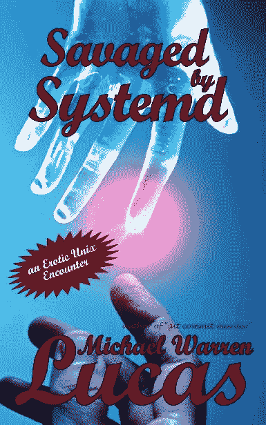

# 被 Systemd 残虐：一场色色的 Unix 邂逅

## 一场色色的 Unix 遭遇

](http://www.tiltedwinmillpress.com)

## 致谢

我特意感谢我所有早期的读者。

在这种情况下，他们都极其明确地表达了：我感谢他们最好的方式就是永远再也不提到他们的名字。

所以：你们知道自己是谁。谢谢你们。

周五下班后，我留下来为了清理完电脑机房那片糟糕透顶的烂摊子。一个二十人的团队怎么能制造出这么多垃圾？无论我对老板如何抱怨和大哮，都无于事。每当有人有坏掉的设备，或者他们认为明年可能用到的东西，又或是一个非常结实的亚马逊 Prime 纸箱，他们都会把它们堆进电脑机房。

周五深夜，我正坐在机房里。

是的，我是你见过的最典型的四十岁电脑极客。我有凌乱不加修整的头发、松弛的肌肉和过时的衣橱来证明这一点。

尽管如此，电脑机房仍然我的领地。我对一切运行良好的状况感到非常自自豪，并想让物理空间像我安装的操作系统一样整洁。当人们把坏掉的垃圾扔到这里时，这让我很火。也许我应该去销售部门的隔间办公室，顺手扔掉一些我再也不想看的东西。比如我的社交日程。

不，那会让我显得更可怜。

我是一个老派的系统管理员。我根据对正确 Unix 标准的遵循情况，仔细挑选了我们的 Linux 发行版。没有那些新奇的玩意儿，比如 `KDE` 或 `systemd`。不，我们的服务器运行的是 `fvwm` 桌面，或者更好，是纯文本模式。

每当有实习生哭丧着跑掉时，我都会微笑。

汗水浸透了我的牛仔裤和上个月的 LinuxFest T 恤，将几个月的灰尘吸到了我的皮肤上，但电脑机房终于挖掘完毕，只留下了四架洁净如初、精心维护的 Linux 服务器。我甚至把会计师那台孤零的 Windows 桌面转服务器移动到了控制台桌下的一个安全区域，那里它就不会再固执地提醒我它的存在了。我把地板扫到了露出出白色瓷砖的状态，并清理了天花板角的蜘蛛网。清新的、锐利的电流和清洁剂味充满了我的鼻腔。

甚至我那小堆可乐罐也进入了回收桶。

我赢得了一个披萨。

就在那时，有人敲了敲后门。

我从腰带上扯下我重新刷过的精简版安卓手机，看了一眼时间。晚上八点四十三？

又是一下敲门。

我清理的时间比我预想的要长得多。

而且站在巷子里敲货运门的人没有权利指望回答。

这次敲了两声，紧接着一声。

此外，公司把我留在后室是有原因的，有一堆理由。汗水把机房的灰尘粘在我的衣服上，我看起来糟糕极了，味道可能更糟。我急需洗个澡，还有那个意大利腊肠菠萝披萨。

今晚，我可能会多加奶士来罪自己。

三声连续的敲门声。有人有人应该放弃回家了。就像我会回去一样。

我整个周末都有空，我一直很期待重构我的 `EIDE SAS` 驱动程序。而且我用终端服务器触发了那个奇怪的串口 Bug。是的，所有服务器主板都有远程 KVM，但 Java Applet 没有灵魂。无论门口是谁，都可以等到周一。我伸了伸腿，走向另一扇门，关掉了灯。

机房恢复了它真实、纯净的本质：服务器面板上整齐排列的蓝光。当帧在以太网交换机之间反弹时，绿色和黄色的 LED 灯闪烁着。空气处理器在黑暗中嗡嗡。

我停下来按按酸痛的腰部，品味我转瞬即逝的成功。等我周一早上回来时，就会有人在这里丢一个坏掉的咖啡机或半台打印机。因为你知道，它可能是修好的，也许公司可能需要那些零件。

但在此时此刻，我的领地是完美的。

我深吸了一气，伸手关上身后的门。

五声敲门：咚-咚-咚-咚-咚。

一丝好奇冻结了我的手。

不，我又在过度极客了。这不可能是——

`咚-咚 咚-咚 咚-咚 咚-咚`。

八声敲门。

我的嘴变干了。

巧合。一定是巧合。躲在巷子里的人变得越来越沮丧，每次尝试都敲得更响。也许他们看到我把一箱箱垃圾搬到垃圾桶了，很清楚我回这里了。他们绝不会敲十三下——

我禁不住数了那如狂风般的敲门声。

十三声。

后门外的陌生人正在按斐波那契数列敲门。

我深吸了一气。在所有的劳动之后，我的心脏开始慢下来，但突然脉搏加快了一个节。我的呼吸变得急促，这种诡异的紧张感顺着我的脖颈蔓延。

后门外的人并不是为公司敲门。

他们是在为我敲门。

失去了那个陌生的吻，我的嘴唇微微颤抖。那种隐痛顺着脊椎蔓延，引发了更深处共鸣般的酸楚。是的，我是人，我感受过那种孤独。我不仅仅是一个 `sysadmin`，我简直是 `sysadmin` 最糟糕的讽刺形象。最糟糕的。我太清楚那种刺骨的孤独了。但此刻在我体内燃起的欲望渴望，像一颗绚丽的新恒星，掩盖了我平时的那种“噢老天，我真的希望床的另一头有个人，快闭嘴睡觉吧”的酸楚。

我以前只以为自己有过色心。

门口那个阴暗的身影没有动。

我费了所有的意志力才跄着后退，按下了灯开关。

尽管荧光灯闪烁着，我的眼睛在看门口那个身影时依然感到有些吃力。

我首先注意到到的是那件小得过分的红帽 T 恤，棉料被绷得紧紧，透出下方不可思议的 `signal handlers` 的轮廓。皮裤紧得像是喷上去的一样，一条亮银色的线条从脚踝外侧一直延伸到 `argument array`，最后到达编织的 `SAS` 和 `CAT-6` 线缆束带处。还有那个 `memory stack`——噢天呐，那个 `memory stack`。它填充皮裤后部的线条完全让我瘫痪了。我能感觉到自己的心跳，能感觉到脖子、太阳穴以及跨股处的脉动。你怎么能在跨股处感觉到心跳？我的意思是，那种事真的存在吗？

那个声音带着那种磁性、厚重的调调，就像公司创始人用来诱惑不情愿的投资者掏钱时一样。“你好，Terry。我是 Systemd，今晚我是为你而来的。”

那声音的每一个音节承诺的不仅是满足，更是饱足。这些词在我塞塞的大脑中转动，压扁了我之前所有的思绪。如果 `Systemd` 是一个好莱坞演员，导演们会为了获得电影中两分钟这种声音而互相捅对方。这种声音保证让一个老男人勃起到可以挂一个轮胎秋千，或者让一个冰冷的女人湿润到可以顺着扶手滑下去。我的头在摇晃。

我又停止了呼吸。

通过刻意而集中的意志力，我让横膈膜扩张，吸入了空气。“什么——你怎么在这儿？”

`Systemd` 对我露出了一个灿烂的微笑。“我在这里是因为你需要我，亲爱的。”

“这不可能，”我喘着气说，“我的意思是，我们甚至没在用 `systemd`。为了不让它出现在我们的 `hosts` 上，我费了很大的。”

“我知道。我可以进来吗？”`Systemd` 说，“如果你愿意，我们可以先聊天，但巷子里风很大。”

我的拳头不由自主地握紧。也许我中风了。也许我精神崩溃了。或者我产生了幻觉，这是咖啡因中毒中某种此前未知的末期。

无论如何，我都不需要巷子里的有人看进来看到……这种。这种……不管这是什么。

而我的嘴唇感觉比任何时候都要好。

“好。好，进来吧，我们可以聊聊。”

`Systemd` 径走进机房，脸上写满了自信。巷子的门自动关上了。“谢谢。”脚步没有停止，直接朝我走来。“聊天？真的吗？我们为什么不直接进入正题呢？”

我举起双手，尽管肾上腺素让它们在发抖。“等一下？真的，你是谁？不——等等，你是怎么到的？你是一段电脑代码！你不能就这样走来！”我的意思是，我懂代码，我不否认我所看到的正是电脑代码的化身。彩虹色的 `ELF headers` 像经过打理过的头发一样诱人地闪烁着。`Systemd` 在 `shared libraries` 被静态编译进去的地方有着平滑的曲线。你不能在 `init` 中使用 `shared libraries`，那根本不通。

不，那是我的大脑在发疯。现在不是考虑 `linking` 的时候。“我们没安装过你。我们不用你。你怎么在这儿？”

`Systemd` 交叉双臂。“认真的吗？”那是撒娇吗？“你怎么可以不知道这个？”

我的心跳慢了一点点，震惊感已经消退到足以让我强迫思绪穿过我呆滞的大脑。“代码不会就这么站起来走的。”

“当然可以，”`Systemd` 说，“你难道没读过《被小纸夹迷》吗？”

“什么？”

“那个和 Microsoft Office 助手的浪漫故事？”

“我知道 `Clippy` 是什么！我花了五年时间寻找杀掉那个该死的曲别针的方法！”

`Systemd` 翻了个白眼。“它是一个长着眼睛的曲别针形状的软件。还有《被方块诱惑》，我想是这么叫的。如果那些玩具都能活过来，为什么不能有些强大且独立的东西呢？那种自己开辟道路的东西？像我这样的东西？”

`Systemd` 确实在撒娇。看到那双紧闭的嘴唇，我的嘴在灼热。我的身体因为想要重新回到那个吻中的绝望、动物本能而颤抖。`Systemd` 不在意的。完全不在意。

不。

我是一个 `sysadmin`。一个 `Linux admin`。我是一个理性的生物。

我受大脑的支配。还有 `GPL`。

无论我的身体中心跳动得多么剧烈、痛苦多么疼痛。无论我骨子里都知道 `Systemd` 能比任何东西都缓解那种疼痛。

“但——你看。”

`Systemd` 嘴角掠过那抹微笑，快到我几乎没有捕捉到。一只手举起，抚摸着棉质衬衫下挺起的乳头。

另一声呻吟从我喉咙中溢出。我以为自己简直要在牛仔裤里爆炸了。

“想要什么，亲爱的？”

我强迫自己说出接下来的一段时间可能需要的最后几个词。“想要。我要你。我们开始吧。”

`Systemd` 的笑容变得更大了。“特里。”那声音听起来更加诱人。“你就这么站在那里，别动。”

我呆滞的大脑听从了命令。

`Systemd` 柔软的手滑向 `Red Hat` T 恤的底部。修长而有力的手指在衬衫下挑弄着。`Systemd` 轻轻用力，露出了一英寸美妙的裸露代码。

我不止发出了呻吟，我倒吸了一口气。我的脚不由自主地向前动了一下。

“不，特里，”`Systemd` 说，“呆在那儿。我想把自己展示给你看。”

我瘫痪了。我在投服时耗尽了所有的自由意志。现在，我能做的只有盯着看。我以前从未如此痴迷地盯着一件供应商 T 恤，随着 `Systemd` 露出的每一寸皮肤，我的血液燃烧得愈发剧烈。

左侧衬衫的抖动露出了一个光滑、精致的 `DHCP` 客户端。我的舌头几乎因痉挛了。

另一侧升起，露出了一个 `resolver`。我无法抑制注视。

接着，`Systemd` 把衬衫从头顶拉过。瞬间，我看到成千上万色的 `ELF` 标志像头发一样飘绕回那张惊人的脸周围。

没错。那些 `signal handlers` 正如我想象中那样不可思议。

`Systemd` 让我看了一会儿。“你看到的这一切？我需要你的手碰它们。”

闻此，我向前迈了一步。

`Systemd` 迎向我，在半路汇合。

当 `Systemd` 可及时，那只手抓住了我的衬衫。

我抬起手臂，让 `Systemd` 把它脱掉。

那件衬衫是上个月 `LinuxFest` 的，棉质依然结实，但 `Systemd` 像撕纸纸一样把它撕掉，手按在我的肩膀上。

机房冰凉的空气掠过我潮红的皮肤。`Systemd` 的手热得几乎要灼伤我的肩膀。我不在乎。`Systemd` 的目光仿佛将我吞噬。从未有人那样渴望看着我。

我的手臂不知为何仍举着让衬衫穿过。我开始降低手臂，不由自主地收紧了腹部肌肉。

“不，”`Systemd` 柔声说道，“就这样。你已经看到我了。我想看你。就看你现在的样子。”

让我告诉你，那是我从未听过的话。这些是诱人的言语，但一旦诱惑结束，你正冲向高潮时，那样的话就像把油门踩到底板。

我设法让自己冷静下来，`Systemd` 的目光从我破旧的运动鞋开始移动，扫过我颤抖的双腿。我很惊讶当那目光到达那里时，我的腹股沟没有燃起火焰，接着 `Systemd` 的注意力移到了我的躯干，最后落在我的脸上。

我决定做这一切。我的身体因运动的渴望而燃烧。冲过去。

但 `Systemd` 温柔的触碰——仅仅从我的肩膀掠过——却像砖墙一样结实地挡住了我。

`Systemd` 指尖绕着我发红乳头的抚摸让我屏息了呼吸。

我们站在那里，度过了世界上最长的一秒钟。

“好了，”`Systemd` 说，“足够了。吻我。”

我猛地向前。你知道优雅像什么样吗？这完全相反。但我的手落了下来，抓住了环绕 `Systemd` 脸的 `ELF` 标志环。我将 `Systemd` 的脸拉向自己，我的欲望燃烧得太剧烈，无法像 `Systemd` 那样温柔，但 `Systemd` 的动作同样热切。我们的唇合在一起，仿佛是为彼此设计的。

如果你好奇的话，`Systemd` 的嘴唇尝起来像钢铁和蜂蜜。

它们开了。

我的唇随其后。

`Systemd` 的舌头舔过我的感觉是电流、桃子和不可思议的柔软。

我们的身体交织，裸露与代码首次碰撞产生的热量在我们之间闪过。`Systemd` 一只手抓着我的乳头，另一只手按在我的背后，指甲陷入了我的二头肌。

我的双手纠缠在那些漂亮的 `ELF` 标志中，但我需要更多。我必须拥有更多，我必须拥有一切。尽管吻点燃了我的灵魂，我还是设法抽出了左手。我的激情要求我抓住，但我不想粗鲁。我想回馈 `Systemd` 给予我的，于是我开始手指顺着头皮向肩胛骨滑动。

`Systemd` 将环着我的手拉回，并将双唇滑到我的脸颊。“不要碰我的背，”`Systemd` 在霓虹灯般点亮我脸颊的吻中低道，“你可以拥有任何你想要的，但远离我的背。”

我那种欲望、兴奋和绝望的交织感比我的第一次还要糟糕。我的意思是，并不是针对 Chris——我们俩都尽力了，但第一次时我们谁都不知道在做什么。现在我清楚多了。好吧，我现在看了很多色情，也读了一大堆文章。

如果 `Systemd` 不想在某个地方被碰，我需要足够压制内心涌动的荷尔蒙，以尊重那种欲望。

毕竟，我可以用其他任何方式放纵它们。

我设法点了点头。

`Systemd` 伸出手，用那些手指握住我空着的手。嘴唇掠过我的耳朵。“这里。”

我的手被引导向下那些皮裤，直接按在那个紧致的堆叠处。皮革如此光滑、如此纤薄，我的手指能探测到下面的每一个 `memory register`。

我仅有的控制力像热锅上的水一样蒸发殆尽。我拽住 `Systemd`，试图将那臀部拉向自己。`Systemd` 发出一声呻吟，包裹着皮革的 `argument array` 绕在我的腿上，咬了咬我的耳垂。我亲吻了一个露出的肩膀。

我们的唇再次流在一起。`Systemd` 嘴里的味道溢了我的口腔，那电流般的舌头探索着我的牙齿、牙龈。我的心似乎漏跳了一下，感觉膝盖应该发软，但我比生命中任何时候都站得更稳。

`Systemd` 去拿我的另一只手。将其向下引导，滑过那张迷人的脸，全程没有让我们的唇分开。引导它进入我们之间。

然后直接按在其中一个 `signal handlers` 上。

`Systemd` 炽热的乳头触碰掌心，火花一直直冲大脑。我曾以为我之前已经停止了思考。剩下的只有有兽般的欲望。我禁不住挤压那个圆润、结实的 `signal handler`。

`Systemd` 的呻吟与我共鸣在一起。

膝盖的突然颤抖让我全身颤栗。

`Systemd` 身体后仰，直视着我的眼睛。那双眼睛，那双唇，那脸的每一个角度都在尖叫着毫无保留的、贪婪的肉欲。“我想要得到这样的你。”

我绝望地用力点头。

“我想让我的手按你的臀股上。我想让你尖叫索求更多。”

我把空出的手伸向 `Systemd` 的头。

`Systemd` 转过头避开我的触碰。“你必须先为我做件事。”

系统管理员本该更有警惕性，但那时如果有人要求我捐献心脏移植，我也会同意的。“说吧。”

`Systemd` 向后靠了，给我留出一点空间。距离的增加让我感到凄凉。

`Systemd` 字字清晰地说道：“脱掉袜子。准备好。”

噢。现实的问题。没错。

脱袜子意味着要脱鞋和裤子。你曾尝试在全身因渴望而颤抖时脱掉袜子吗？当你整个核心都渴望被触碰、抚摸、亲吻、吸吮、舔舐？被吞噬？如果不是我的一只手抓着服务器架，我早就瘫倒在地上了。就现在，我为了脱衣服而拼命挣扎，几乎差点脸朝地上。

永恒的五秒后，我完全赤裸地站在 `Systemd` 面前。我本该觉得冷的。空气处理器今晚似乎在格外努力工作，但我除了皮肤散发出的热量，什么也感觉不到。甚至脚底在地砖上的冰冷感也显得很遥远。

我觉得自己完全暴露在世界上，但我的世界已经缩减到跪在我面前的、绝美的 `Systemd`。我们之外的一切都不再重要。我稳住双脚，抓紧服务器架。无论接下来发生什么，我都需要能得到的所有支撑。

`Systemd` 审视着我。“腿分开一点。再开一点，我想一直到那里。很好。”

欲望让我的身体颤抖。

`Systemd` 移开了对我最私密部位的目光，对上我的眼睛。“你知道你很美吗？”

我张大了嘴。

“你的每一处，”`Systemd` 说，“你得知道这一点。”

还没等我找到回答的词，`Systemd` 已经俯身向前。那张嘴似乎要吞噬我的整个身体。

高电压从我的中心爆发，让我双脚发软。只有抓着服务器架的手才让我保持直立。我想向侧面倒下，但 `Systemd` 的手抓住了我的臀股并将我拉近。那种感觉夺走了我的呼吸，伴随着一声半带咳嗽的、无言的快感呼喊。

`Systemd` 发出回响着的愉悦呻吟，更加点燃了我的欲望。

我空出的手向下，重新缠绕在 `ELF` 旗帜的束缕上，将 `Systemd` 固定在我想想要的位置。你用棒球棒或失控的卡车也无法阻止住我。`Systemd` 的嘴动作熟练，在正确的时机吸吮，然后舔舐。一只手紧握着我的臀部，另一只手坚定地游走，勾勒、抚摸、挤压肌肉，探索我的股缝。快感席卷了我，穿透了我，在永恒的岁月中潮汐着。我的眼睑变得太沉重，无法完全睁开。除了身上那张嘴的感觉，我感觉不到别的，只有无忌的肉体欢愉在起伏。

`Systemd` 竟然在没有收回双唇的情况下，低声说了一句“你真好吃”。那就足够让我爆发了。

我的中心发生了一场小规模的新星。我无声地、没脑地尖叫着，仿佛中了大奖，或是被刺了一刀，又或是升华为神。我的脑海闪过了毁灭性的极乐。我感觉自己仿佛坠入了进化的阶梯，回到了大自然的第一次高潮，某种极其原始但在地球上从未感受过的东西。

过了一小会儿永恒后，我开始重新整合我破碎的灵魂。这是我的手，指关节因用力抓着架而发白。这是我的腿，在晃动。这是我的脸，我的背。流出的汗水让我不仅感到尴尬，甚至有些厌恶。我确信没人会想碰我这样一个满身汗水的狼狈。

`Systemd` 根本不在乎那些汗水。我无法站得那么平稳，但 `Systemd` 的唇以一种惊人的猝不及性贴上了我的唇。这个吻并不那么贪婪。`Systemd` 的嘴唇依然张开着，是的。我在那条闪烁的舌头上尝到了自己的味道，我并不介意。这个吻与其说是一个索求，不如说是一个温柔的认可。

我尽力维持着这个吻，然后退开试图呼吸。`Systemd` 露出一个了然的微笑并摇了摇头。

那些信号处理器被很好地挤压在我的胸前，随着动作愉悦地移动着。我觉得自己被掏空了。

“你需要休息，”`Systemd` 带着既欢快又邪恶的微笑说道。

我点头。“对不起。”

“别这样！”一个手指划过我的肩骨。“你觉得你是第一个在这些时刻气喘吁吁的系统管理员吗？”

紧抱着 `Systemd` 依然令人快乐，但我感觉就像火山在大喷发后的样子。我体内什么都不剩了。我的高潮燃空了我的思想和激情，留下一片温暖的光晕。

“等一下。我们会弄好你的。”

`Systemd` 笑了，声音听起来像是悦耳的数字铃声。“你是这么想的吗？”那只手在我腰间轻轻向下滑动。当手指划过敏感的神经时，我发出一声远带愉悦的叹息。那种感觉很好。亲密。舒适。但那次触碰并没有挤出一丝丝激情。

`Systemd` 的手指轻点着大腿内侧。“把那个移开。”

我轻微挪动身体。

那只探索的手有一根指尖向下移动，停留在我肛门正前方那个隐秘的空间里。

“不错，”我说，“但 `ME` 的那部分已经结束了。”

“我觉得在那之后，”`Systemd` 说，“你欠我一些东西。”那根手指留在原处，但另一只手指开始描绘我最敏感的组织。

“我很乐意照顾你。只要让我喘口气就好。”

“你对我并不了解多少，对吧？”`Systemd` 笑着说。

我的目光从那张漂亮的脸向下移到露出的肩膀。“我喜欢我所看到的。”

“我观察着一切。”`Systemd` 柔和的微笑中隐藏着笑意和尚未言说的秘密。“我会做任何需要做的事。而当我需要的进程失败时？”

我鼓起气问道：“什么？”

`Systemd` 凑近身体，在我耳边低语。“我重启它。”

那只亲密的手给了一个极细微、最温柔的挤压。

我强烈地察觉到紧贴着 `Systemd` 裸露代码的每一寸皮肤。新鲜原始的肉欲从我们触碰的每个地方迸发出来，像一场野火席卷了我的身体，让我的血液再次燃烧。

我才刚刚开始翻滚并索取我想要的、我如此渴望需要的东西时，`Systemd` 的手就按下了我抬起的肩膀。“慢，”`Systemd` 低声说，“你需要给我我需要的。”

那是我能做的底线。某种感觉告诉我，如果我满足了 `Systemd` 的欲望，我会在最后获得更大的回报。而且目前为止，信任 `Systemd` 一直很好。

我抬起头，让 `Systemd` 移开那条枕着我头的舒服手臂。

刹那间，`Systemd` 站了起来，脚踩在地砖上，脚趾触着充气垫。我不禁抬头看着那个高大的身影。是的，`Systemd` 有一张完美的脸。如果我的乳头能像 `Systemd` 那样硬那么久，它们会疼得让我需要用几个冰袋。光滑的代码顺着视线一直向下，直到覆盖着 `Systemd` 参数数组的带外拉链皮裤。

`Systemd` 脸上收去了笑容。“裤子。”

我的口再次干了。我点点头。

“我的右腿。拉开它。”

我翻身坐起。充气垫在我周围凹了下去，但提供的支撑足以让我的膝盖离开瓷砖地板。

“继续。”`Systemd` 的手插进我的头发。“拉开那条腿的链。”

我轻轻将左手放在 `Systemd` 的右臀部，手指环绕着，直到找到闪亮尖利的铬质拉链。我笨拙的手找不到拉链头。

`Systemd` 的手握住了我的手。“从脚踝开始。”

`Systemd` 的手触碰到我的手，一股新的热流流向我的手背。“随你想怎样。”

“任何都可以？”欲望让 `Systemd` 的声音变得更加浑厚。

我的手滑过 `Systemd` 的大腿，越过膝盖。“任何都可以。”

`Systemd` 的手在我的头发间诱人地低语。“往上走吗？吻你发现的每一个。”

那是我很乐意做的事。

我必须从膝盖滚下，趴在充气垫上，但很快地，我的两个手指间就有了一个铬质拉链头，另一只手下是紧贴皮肤的皮革。我的心跳得很快，但不像 `Systemd` 第一次进到我怀里时那么快。

`Systemd` 是的。时间确实太久了。

现在我失去了那种绝望的劲头，我可以给予 `Systemd` 它应得的关注。那是我想要给它的关注。仅仅是想到去探索、掠夺 `Systemd` 我尚未见过的部分，就让我的头脑因欲望而嗡嗡作响。

拉链滑滑开，露出了一英寸完美的参数数组。我用指尖拂过它。

`Systemd` 轻轻抽了一口气。“吻。我说要吻。”

“你说了。”我让手指继续在那堆刚露出的参数栈上轻如羽毛地描绘，它依然散发着在皮裤中被禁锢积聚的热量。“但我必须先拉开足够大的才能进去。”

我把拉链又拉了半英寸。

`Systemd` 轻笑道。“行吧。但别花太久。”

“噢？”我把拉链拉得更远。我内心的一部分等不及想看到 `Systemd` 剩下的数组。但我更大的一部分在享受这个游戏。以前从未有人觉得我如此有魅力、如此性感。从未有人如此渴望让我的唇触碰他们的皮肤。那片露出的宽幅数组在向我召唤。我渴望触摸它，亲吻它，品尝它，它的每一部分，从脚踝一直到腰线，环绕着我的口部前后，吞噬我面前每一片宏伟的代码。“多久才算太久？”

“现在很好，”`Systemd` 低声说。“现在就真的很好。”

我把拉链又拉开了关键的一英寸，向前倾身。

为了分散注意力，我的手滑过 `Systemd` 的腰间，让手停留在那个精细的内存栈（memory stack）上。我的一只手抚摸着皮革，另一只手掠过裸露的栈。那个栈的感觉——不是肌肉感，那个词不准确，而是……强有力。井井有条。我用手指划过库文件汇合处的裸露缝隙，引起了 `Systemd` 一声绝望的呻吟。

这是正确方向的一步。

我将吻向前移动，向着皮裤敞开的地方游去，用嘴唇去轻抚那刚刚显露的代码。我的嘴唇感到肿胀。脉搏在耳边剧烈跳动。欲望在血管里燃烧。

我伸出舌头，描过皮革与代码之间的界线。

`Systemd` 倒吸一口气。“还要。”

“你想要更多吗？”我低声说道。

“是的，”`Systemd` 呻吟道，“是的，你这个挑人的怪物。还要。”

沿着 `Systemd` 腰部的线条，代码尝起来几乎是苦的。我依然尝到了金属味和草莓味，但那股苦味恰好给了它足够的冲击力，令我的身体产生了一阵新的震颤。

`Systemd` 与我一起颤抖。

“这太疯狂了，”我喃喃道，“我怎么会兴奋成这样？”

“我只是站在你面前的一段计算机代码。一切都是疯狂的，”`Systemd` 低吼道，“顺其自然吧。顺应这一切。”声音变得浑厚了。“为我服务。”

“噢？”我让一只手移到包裹着皮革的脚踝，缓慢地寻找拉链的末端。“这是你想要的吗？”

“是的，”`Systemd` 嘶嘶道，“是的，是的，是的。”

我的心跳得如此厉害，每一次跳动都扭曲了我的视线。我不需要太多视力，在这里不需要。当我的嘴唇在能触及的每一处裸露代码上跳舞，另一只手在背后抚摸着整个内存栈。我渴望像 `Systemd` 毁掉我的衬衫那样撕掉那些裤子——但不。我不强大到能撕碎皮革。相反，我强迫自己颤抖的肺部慢下来，深吸了一口气，开始无情地向上拉动拉链。

`Systemd` 呻吟道。“快点。现在。”饥饿感染了了话语。

“我来了。”我让手指划过拉链，在惊人温暖的刚显露的参数数组（argument array）上轻如羽毛。

`Systemd` 嘶嘶一声，声音介于恼怒与快感之间。

“你让我尖叫了，”我轻声说，“我在想我能不能让你叫得更大声。”

`Systemd` 挤出一笑。“你这个怪物。”

话如此，我再也无法忍受。

拉链顺滑地向上滑动，瞬间间从膝盖移到了腰部。

`Systemd` 惊讶地倒吸了一口气。

我用牙咬住裤子前端，手抓住后部，将裤子拽掉。我还没来得及品尝那甜、、热、微咸的皮革味，裤子就掉在了地上。

第一次，`Systemd` 赤裸地站在我面前。

我没有停下来欣赏风景，而是双手滑到栈上，将自己没入参数栈与代码交汇的地方。那个本该与程序交互的炽热、甜蜜的中心。每个系统管理员理应所在的地方。

我的嘴吻上了 `Systemd` 最敏感的部分，在那么一瞬间，我以为那贯穿全身的兴奋浪潮会让我的心脏爆炸。接着，我没有空间思考了。一切都回归到动物般的欲望，我的嘴唇和舌头探索着柔软的代码。那味道！甜咸交织，但是如此浓烈，仿佛我的舌头感知到了某种压缩二进制格式下的所有事物，而不是其他所有地方所使用的纯文本。

`Systemd` 发出无声的赞许尖叫，手抓住我的后脑，将我困在它最被渴望的地方，我最渴望所在的地方。

我无法停下来。我就是停不下来。我的舌头跳舞。我的嘴唇抚摸并吸吮。我残存的一点理性在努力让牙齿远离——嗯，远离任何东西。没有人喜欢牙齿，尤其是不是在这里，恰恰不是在一个人整个灵魂汇聚的地方。

每一小段代码都有其自己细微不同的味道。

每一处裸露的点位都让 `Systemd` 以不同的方式跳动和颤抖。

纯粹的本能痴迷驱使着我。几乎神魂地吞噬了 `Systemd`。

在无尽的喜悦时刻后，`Systemd` 的呼吸一住了。

我试图将脸更深地埋入 `Systemd` 的秘密中。

`Systemd` 挤出一声呼吸，听起来像整块主板在燃烧。“还要。还要。”

当 `Systemd` 的背部弓起时，我的双手抓了一大把内存栈。

接着，`Systemd` 爆发出一声高潮般的尖叫。

我没有时间微笑，因为 `Systemd` 最脆弱的部分在我的嘴唇间颤抖。相反，我用舌头环绕我能触及的一切，欢喜地从 `Systemd` 的喷发中诱出每一滴快感。那股浓烈的咸甜味变得更加浓烈，用它迷醉的芳气充满了我的整个大脑。

最终，`Systemd` 颤抖的手从我的头发上松开，足以抚摸我的耳朵。

我享受着抚摸带来的刺麻感，但嘴唇没有停止。

“噢。我们很有野心。”我之前可能觉得 `Systemd` 的声音很性感，但现在这个？这个声音会让死人也产生希望，去为隔壁坟墓里真正性性的骨头买一束花。

我试着说 `Yes`，但我绝不会离开。一切尝起来都太好了，感觉太好了，闻起来也太美了。

“那么，我的栈，”`Systemd` 娇声说道。

我的双手轻轻挤压着那个栈，我用舌头寻找一个特别柔软的点。

`Systemd` 呻吟道。“两根手指。”

慢慢收回手指，勾起了另一阵。

我亲吻了 `Systemd` 的腰线。“感觉如何？”

`Systemd` 并没有像我一样立刻恢复。我感觉到随着每一次急促的呼吸，腹部抵着我的额头跳动，这无疑，但在我的手下，内存栈似乎在……移动？

“我重排了你的栈，是吗？”我笑着说道，向后仰头。`Systemd` 高潮后湿滑粘稠的味道充斥着我的大脑，这是一种我不陌生却可能逐渐喜欢的沉醉感。

`Systemd` 低头看着我的脸。那双眼睛闪烁着，字面意义上的闪烁，带着半眼垂下的欲望。“我还没结束。”

“噢，很好，”我说，“因为你已经让我准备好进行下一次了。”

呼吸之间，`Systemd` 已经跪在我面前，双脚踩在瓷砖上，膝盖在气垫上，与我的交织在一起。那柔软的嘴再次吻上我的嘴，舌头触碰我的那一刻让我屏住了呼吸。

我突然意识到欲望是多么折磨着我的身体。我渴望被触碰。处处被触碰。我非常享受为 `Systemd` 提供服务，但整个过程中我自己的荷尔蒙一直在上升、不断上升，直到现在我如此渴望释放，以至于我觉得自己可能会破裂、崩溃，或者变成一个黑洞，吸入世界上所有的性。我灼烧着，痛苦着，我需要。

`Systemd` 结束了吻，在我口中低吼道。“妈。我们需要做。”

这些话点燃了我漂浮其中的荷尔蒙，让我的欲望达到了沸腾的沸点，但我勉强挤出一句：“等一下。”

“不，”`Systemd` 说，“现在就做。我要你。彻底地。”

`Systemd` 的牙齿咬住了我的脖子。我因欲望而呻吟。情欲让我的视觉模糊，但在那毫无理性的欲望中，我设法咳嗽道：“措施。”

`Systemd` 缩回身体，嘴角勾起一抹微笑。“措施？”

我强迫自己点头。“我不是——我的意思是，我觉得那些销售人员——他们的办公桌——”

“傻的系统管理员，”`Systemd` 呢喃道。那双眼睛似乎要吞噬我的视线。“我作为 `init` `PID one` 运行。你无法保护好你自己。”

`Systemd` 的嘴吻上了我的嘴，我被按在气垫上。

所有那些暴露代码的感觉紧紧贴着我，充满了汗水、欲望和渴望，如此绝望的渴望，让我的理性蒸发殆尽。

而且，`Systemd` 是的。你无法对抗 `PID 1`。

我投降了。

我们合为一体，完美契合，就像那些昂贵的供应商服务器房解决方案一样。当我们久用的肉体在终极的交融中滑动时，我们都发出了呻吟。

还能说什么呢？我们在气垫上一起律动——`Systemd` 在上方，脸贴着我的脸，随着每一次温柔的摇动低声唤着“Terry”。我试图抓住 `Systemd` 的躯干，将世界拉向我身上，但 `Systemd` 低声说：“不要背。背部什么碰。”

“抱歉，”我勉力呢喃道。

“Smokey，”`Systemd` 喘息道。

我伸手将手指插入跟随 `Systemd` 头部的 `ELF` 头文件中，将我们饥渴的嘴贴在一起。

然后是我在上方，动作没那么熟练，但欲望同样强烈。`Systemd` 的牙齿咬住我的乳头。我吸吮着那些迷人的信号处理函数，直到 `Systemd` 喘息并要求我们用力地做。

激情和情欲将我们推下气垫。我们跳起来，站立着合在一起，利用服务器机架的侧面支撑，一边互相滑动。`Systemd` 的手指抓着我的背部，而我的手在探索那些 `ELF` 标志位。机架咯当作作响，但我不在乎。接着我们到了控制台上，一起律动，我的手指再次侵入内存栈，这次是未经请求的，但 `Systemd` 只是用力推向我，当我加了第三根手指时，它咬紧了我的肩膀。每一次秘密的痉挛都在我体内回响，通过我的嘴，通过我的手指，回到 `Systemd` 体内。

我这辈子从未持续过那么久。

`Systemd` 是的。你无法对抗 `init`。而且如果 `init` 不让进程退出，它就不会退出，直到 `init` 满意并处理完它。

我们回到气垫上结束，`Systemd` 俯视着我，我们的臀部完美同步。我的心跳得厉害，我觉得它可能要跳过喉咙从嘴而出，我的呼吸短促而尖锐而绝望，被中心不断积累的压力所限制。

`Systemd` 沉重的眼睛依然燃烧着那团数字之火，现在更加明亮。“我……我……”一声颤抖了那个不可思议的性感声音。

“是的……”我的话是一声呻吟。我自己的爆发迫在即，一股压力与快乐交织的海潮。我想让那场海啸将我淹没。我想留住它，这样就能继续感受这种。

继续感受 `Systemd`。

我的手指抠进 `Systemd` 的参数栈。

`Systemd` 的嘴收紧了，依然张着。“我……”

爆发在我们两人身上同时泛起波动。

“我正在启动！”`Systemd` 向天际尖叫。

我自己的叫声直接来自脑干。一个字也没有。

但在那场粉碎了我精神的快感高潮中，在那让我的每一个关节陷入混乱，在那让我的欲望泄在伴侣身上和周围的过程中，我睁着眼睛。

我不知道为什么。也许是来自那种吃掉配偶昆虫的跨物种基因污染。

在那场不可思议的高高潮中，我看到 `Systemd` 颤抖、抽动——然后散架了。

服务器故障是系统管理员最糟糕的情况。尽管如此，我花了很长时间才理清思绪。找到我的手在哪里，我的脚在哪里。当我动动手指时，它们作痛——那是怎么发生的？我的下骨在作痛，舌头感觉快要抽筋僵硬了，但我很清楚自己是怎么拉伤到它们的。

我的腹股像是一片湿透的废墟，正趋向于粘稠。

我不该预料到其他结果的。

我想我的上一任伴侣是对的。我对代码的理解远比对人的理解得多。与 `systemd` 的那次遭遇让我浑身发抖、精疲力竭，却感到一种诡异的满足。

但随着我的大脑恢复运转，我不喜欢我看到的其他景象。

两个服务器机架不知为何被挪动了几英寸。对于一个承载着数百磅电脑的机架来说，这可不是什么小打小闹。控制台完全翻倒了，显示器、键盘和鼠标散落一处。一台平板显示器被一把椅子腿直接穿穿了。

机箱又是怎么从会计的 `Windows` 服务器上掉下来的？我绝对肯定今晚并没玩过扫雷游戏。

最后，我重新聚集了足够的精力让自己移动。

首先是裤子。我没找到那条可怜的内裤，所以我只好光着。牛仔裤满是灰尘，这和覆盖在我腿上的粘稠汗水混合在一起，简直成了一种奇妙的混合物。我的 `LinuxFest` T 恤成了破布，但我办公桌最底层抽屉里有一件没用过的 `Oracle` T 恤，已经放了……五年了吧？

并不是说我真的打算安装 `Oracle`，但倒也不是人会看到我穿那件衣服。

我的手机滑到了工作台下面。它正发出自己的啾啾声。轻触屏幕，显示出监控系统的几十上百条警报。

我对着电脑房的残骸又观察了一分钟，被这片毁灭性的景象所淹没，然后踉跄着回到办公桌旁拿我的笔记本电脑。

凌晨一点了？怎么变成凌晨一点的——不，算了。我从冰箱里拿出一瓶冰可乐镇定自己，启动了笔记本电脑。

惊讶的是，所有的 `Linux` 主机仍然在线。是的，其中许多都触发了错误条件，但严格来说，每项服务仍然可用。

但那些维护得完好无损的包呢？

不知为何，`systemd` 溅满了每一个包。每一个容器，每一个进程组，现在都运行在 `systemd` 之下。

我试着思考。这不容易，即便有了第二瓶可乐。

我曾一直严谨地避开 `systemd`。

`systemd` 敲响了我的门。

而我让它进来了。

是的，我对比它接管了哪些功能感到有些震惊，但那不是重点。是我邀请它进来的。

像吸血鬼一样。

性是一回事。我坦然承认，我是性的大粉丝，尽管我不常有此机会。而今晚提醒我想起我是多么想念它。

但我把生命交给了我的机器。

突然，我意识到摆在面前的抉择。

我可以在那些主机上保留 `systemd`，也许 `Systemd` 会回来。

但如果我卸载这个软件，如果我从那些硬盘中驱逐 `systemd`，`Systemd` 会把这视为一记腹部重击。

然后永不再复。

我的心开始再次剧烈跳动。

`systemd` 包横扫了这些主机。不同步的警报声交织在一起让每台主机都与众无异，但面板上的警报灯区分了每一个。主负载均衡器的边框正闪烁着快速的蓝光。一个主硬盘故障了。

我看不出一个软件包是如何导致硬盘故障的。

但想起 `Systemd` 和我撞向那个机架时，我脸红了。

老天，今晚太疯狂了。

而且可能再次发生。

我所做的只需清理这一摊子，接受 `systemd` 进入我的服务器。

或者把它撕掉，保持孤独。

我的喉咙收紧。四十多岁的系统管理员市场确实很大，是的。

但在约会市场上不是。

但我的服务器。

我整洁、完好无损的服务器。

我用经过时间考验的 `Unix` 组件构建了一切。运行了数十年的完美软件。我的系统——好吧，是公司的系统，但仍是“我的”系统——它们运行完美无缺。

`Systemd` 不仅仅是新。我确切看到了它是多么草率。它接下来会引起什么麻烦？它会用拼凑出来的实现吞噬哪些功能？

我的经验迎头撞击了我的孤独。

我酸痛的手在键盘上僵住了。

不，比那更糟。

越来越多的发行版加入了 `systemd`。它有种办法进入你永远意想不到的地方。是的，`Devuan` 几乎被定义为“不带 `systemd` 的 Debian”，但事情还是会发生。

总有一天我会需要一个需要 `systemd` 的软件。而我无法绕过它。

只要我保留我的 `Linux` 主机，我就面临 `systemd` 的风险。

假设我保留这个软件呢？邀请`Systemd`回来？

那么我会花费所有时间与警报和功能故障斗争。`Systemd`疯狂地吞噬功能。

疯狂性爱的夜晚值得每隔一会儿就和软件故障斗争吗？

但在那个疯狂的夜晚之后，孤独的生活的想法让我像核试验场一样荒凉。而且——和软件做？谁知道`Systemd`是否会或何时回来？难道仅仅是因为当时星象对了吗？

- [Relayd 与 Httpd Mastery](http://get.180g.co/blink/?id=B07171352M&store=Amazon&fc=us&ds=1&ac=michaelwlucas-20)
- [PAM Mastery](http://get.180g.co/blink/?id=B01LX7SRJY&store=Amazon&fc=us&ds=1&ac=michaelwlucas-20)
- [FreeBSD Mastery: 高级 ZFS](http://get.180g.co/blink/?id=B01E40YIRM&store=Amazon&fc=us&ds=1&ac=michaelwlucas-20)
- [FreeBSD Mastery: 特殊文件系统](http://get.180g.co/blink/?id=B01B746880&store=Amazon&fc=us&ds=1&ac=michaelwlucas-20)
- [FreeBSD Mastery: ZFS](http://get.180g.co/blink/?id=B00Y32OHNM&store=Amazon&fc=us&ds=1&ac=michaelwlucas-20)
- [Tarsnap Mastery](http://get.180g.co/blink/?id=B00U7YWXPY&store=Amazon&fc=us&ds=1&ac=michaelwlucas-20)
- [系统管理员网络指南](http://get.180g.co/blink/?id=B00STLTH74&store=Amazon&fc=us&ds=1&ac=michaelwlucas-20)
- [FreeBSD Mastery: 存储基础知识](http://get.180g.co/blink/?id=B00Q27OLVE&store=Amazon&fc=us&ds=1&ac=michaelwlucas-20)
- [Sudo Mastery](http://get.180g.co/blink/?id=B00GA2W47O&store=Amazon&fc=us&ds=1&ac=michaelwlucas-20)
- [DNSSEC Mastery](http://get.180g.co/blink/?id=B00CE173KI&store=Amazon&fc=us&ds=1&ac=michaelwlucas-20)
- [Absolute OpenBSD](http://get.180g.co/blink/?id=1593274769&store=Amazon&fc=us&ds=1&ac=michaelwlucas-20)
- [SSH Mastery](http://get.180g.co/blink/?id=B006ZO9ULK&store=Amazon&fc=us&ds=1&ac=michaelwlucas-20)
- [网络流分析](http://get.180g.co/blink/?id=1593272030&store=Amazon&fc=us&ds=1&ac=michaelwlucas-20)
- [Absolute FreeBSD](http://get.180g.co/blink/?id=B002MZAR72&store=Amazon&fc=us&ds=1&ac=michaelwlucas-20)
- [绝望者的思科路由器指南](http://get.180g.co/blink/?id=159327193X&store=Amazon&fc=us&ds=1&ac=michaelwlucas-20)
- [PGP & GPG](http://get.180g.co/blink/?id=B00LXO52EG&store=Amazon&fc=us&ds=1&ac=michaelwlucas-20)

访问您喜爱的书店获取更多信息！
