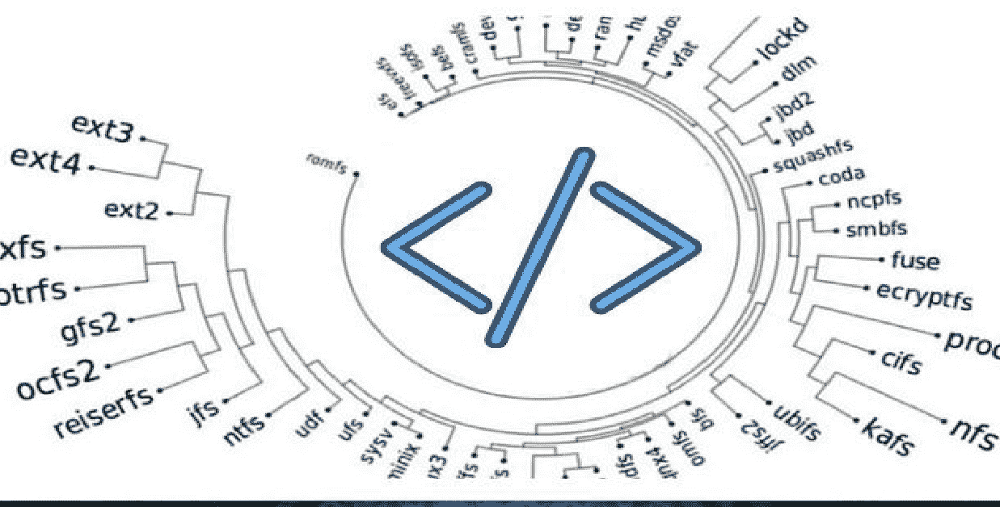
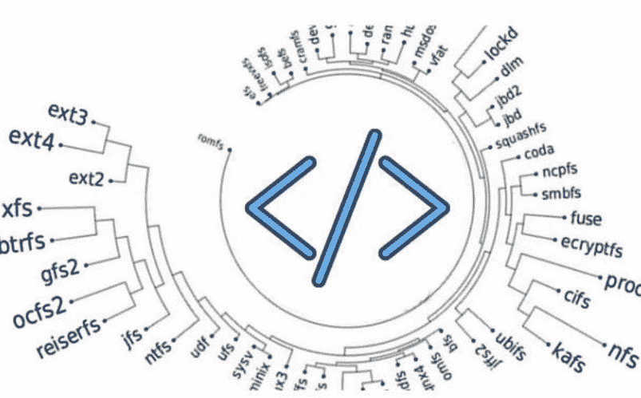

# 揭秘：500+ Linux 命令








# 引言

在本文档，你将通过 Linux 终端找到 500 多条命令。所有命令都详细解释了工作原理和作用。全文完全使用葡萄语编写，语言简单直观，所有用户（从初级到高级水平）都能理解。

这不仅是一个利用图形界面执行命令的机会，更是一个精通终端的机会，进一步增加你在 Linux 世界中的知识。毕竟，在某些时候，我们需要更多知识来执行特定的任务。

Linux 已经存在于大型公司，精通它意味着与公司其他员工相比具有额外的优势。

即使每天练习，你也不可能记住所有的终端命令，但此列表的目的是是将基础命令带入 Linux 终端，因为它的列表非常庞大。

本书免费分发，任何人都可以分享和下载，毕竟其主要目标是传播和分发，无任何盈利目的。

对于初学者、好奇者、想要深入研究的中级人员，以及已经是高级但想想起某些命令的人来说都很有用。

然而，在终端执行命令之前，请记住著名的 root 模式格言：“能力越大，责任越大”—— 斯坦·李（Stan Lee）


# 1. 参考指南 – Linux 命令列表

## 1.1. 了解系统层次结构


# 2. 全局快捷键

```
Ctrl+C
```
- 取消当前运行的命令。

```
Ctrl+Z
```
- 

```
Ctrl+D
```
- 暂停当前命令，在 Linux 中使用 "fg" 返回前台，或使用 "bg" 返回后台。
- 注销当前会话（类似于 "exit" 命令）。

```
Ctrl+W
```
- 

```
Ctrl+U
```
- 删除当前行上的一个单词。
- 擦除整行。

```
Ctrl+R
```
- 

```
!
```
- 按下执行上一次命令。

```
exit
```
- 退出当前会话。

# 2. 学习实用提示

- 然而，在终端中执行命令之前，请记住 斯坦·李（Stan Lee）的著名格言：“能力越大，责任越大”。
- 1. 想要获取命令的帮助，可以在命令后加上 `--help`（例如 `ls --help`）。
- 2. 另一种获取帮助的方法是使用 `man` 命令（例如 `man ls`），可以查看命令的详细说明。
- 3. 想要查看命令的文档，可以使用 `info` 命令。

# 3. 命令列表

- **ls**: 显示目录内容。
- **ls -al**: 列出所有文件（包括隐藏文件）。
- **cd**: 切换目录。
- **pwd**: 显示当前目录路径。
- **mkdir**: 创建目录。
- **rm**: 删除文件。
- **rm -r**: 递归删除目录及其内容。
- **rm -f**: 强制删除。
- **cp**: 复制文件或目录。
- **mv**: 移动或重命名文件或目录。
- **touch**: 创建空文件或更新访问时间。
- **cat**: 显示文件内容。
- **more**: 分页查看文件或输出。
- **head**: 显示文件前几行。
- **tail**: 显示文件后几行。
- **tail -f**: 实时查看文件更新（常用于日志）。
- **find**: 在目录搜索文件。
- **grep**: 在文件中搜索字符串。
- **chmod**: 修改文件权限。
- **chown**: 修改文件所有者。
- **tar**: 归档工具。
- **zip / unzip**: 压缩和解压文件。
- **wget / curl**: 下载文件。
- **ssh**: 远程登录。
- **scp**: 远程复制文件。
- **rsync**: 同步文件。
- **df**: 显示磁盘空间使用情况。
- **du**: 显示目录占用空间。
- **top**: 实时进程监控。
- **htop**: 交互式进程管理器。
- **ps**: 查看进程状态。
- **kill**: 终止进程。
- **alias**: 设置别名。
- **unalias**: 别名。
- **echo**: 输出文本。
- **read**: 读取标准输入。
- **sort**: 排序。
- **uniq**: 过滤重复行。
- **diff**: 比较文件。
- **which**: 查找命令。
- **clear**: 清除终端屏幕。
- **vim / nano**: 文本编辑器。
- **man**: 查看帮助手册。
- **sudo**: 以超级权限执行。
- **env**: 查看环境变量。


```
finger
```
显示用户信息。

```
uname -a
```
显示内核信息。

```
cat /proc/cpuinfo
```
显示 CPU 信息。

```
cat /proc/meminfo
```
显示内存信息。

## man command

打开指定命令的手手册（将变量 `command` 替换为想要查找的命令名称）。

## df

显示磁盘使用情况。

## du

显示目录的占用空间。

## free

显示内存和交换分区（swap）的使用情况。

## whereis application

显示应用程序可能的路径（将 `application` 替换为程序名）。

## which application

显示默认将运行的应用程序（将 `application` 替换为程序名）。

## tar cf package.tar files

创建一个包含指定文件的 TAR 包（命名为 `package.tar`，将变量 `arqs` 替换为归档名称）。

## tar xf package.tar

从 "package.tar" 中解压文件（将变量 `package.tar` 替换为文件名）。

## tar cz package.tar.gz files

创建一个使用 GZip 压缩格式的 TAR 包（命名为 `package.tar.gz`）。

## tar xzf package.tar.gz

解压一个使用 GZip 压缩格式的 TAR 包（命名为 `package.tar.gz`）。

## tar cjf package.tar.bz2

创建一个使用 BZip2 压缩格式的 TAR 包（命名为 `package.tar.bz2`）。

## tar xjf package.tar.bz2

解压一个使用 BZip2 压缩格式的 TAR 包（命名为 `package.tar.bz2`）。

## gzip file

压缩文件并将其重命名为 file.gz（将变量 `file` 替换为文件名）。

```
gzip -d file.gz
```
将 `file.gz` 解压为文件（将变量 `file.gz` 替换为文件名）。

## ping host

向主机发送 ICMP 数据包（ping）并显示结果（将变量 `host` 替换为网站域名或 IP 地址）。

## whois domain

返回有关域名的信息（将变量 `domain` 替换为网站地址或 IP 地址）。

## dig host

返回域名的 DNS 信息（将变量 `host` 替换为网站域名或 IP 地址）。

## ListAllCommands | grep searchstr

从源码安装；必须在终端中顺序输入命令，每次输入一个。

## dig -x host

显示主机的反向查询（将变量 `host` 替换为网站域名或 IP 地址）。

## wget file

下载文件“arq”（将变量 `arq` 替换为文件的在线地址）。

## wget -c file

继续下载已中断的“归档”文件（将变量 `arq` 替换为文件的在线地址）。

## installer commands

- * /configure
- make
- make install

## dpkg -i package.deb

安装 DEB 包（Debian 系发行版）（将变量 `package.deb` 替换为程序包名）。

## rpm -Uvh package.rpm

安装 RPM 包（使用 RPM 的发行版）（将变量 `package.rpm` 替换为程序包名）。

# 4. 完整参考指南 – 高级 Linux

## 终端命令

### I.1. Linux 系统信息

## arch

显示机器架构 (1)。

```
uname -m
```
显示机器架构 (2)。

```
uname -r
```
显示正在使用的内核版本。

```
dmidecode -q
```
显示系统硬件组件。

```
hdparm -i /dev/hda
```
显示硬盘的特性。

```
hdparm -tT /dev/das
```
对硬盘进行读取测试。

```
cat /proc/cpuinfo
```
显示 CPU 信息。

```
cat /proc/interrupts
```
显示中断。

```
cat /proc/meminfo
```
检查内存使用情况。

```
cat /proc/swaps;df -h
```
显示按大小排序的文件和目录大小。

```
ls -Sr |more
```
估算 'dir1' 目录占用的空间。

```
du -sh dir1
```
显示按大小排序的文件和目录大小。

```
du -sk * | sort -rn
```
按大小显示已安装 .rpm 包的占用空间（Fedora, Red Hat 等）。

```
rpm -q -aqf '%10{SIZE}t%{NAME}n' | sort -k1,1n
```
按大小显示已安装包的占用空间（Debian, Ubuntu 等）。

```
dpkg-query -W -f='Installed-Size;10}t${Package}n' | sort -k1,1n
```
显示交换分区文件。

```
cat /proc/version
```
显示内核版本。

```
cat /proc/net/dev
```
显示网络适配器和统计数据。

```
cat /proc/mounts
```
显示已挂载的文件系统。

```
lspci -tv
```
显示 PCI 设备。

```
lsusb -tv
```
显示 USB 设备。

```
date
```
显示系统日期。

## date 2016

查看 2016 年的日历。

## date 06 2016

显示 2016 年 6 月的日历。

## date 041217002016.00

设置（调整）日期和时间。

```
clock -w
```
将日期更改保存到 BIOS。

### 1.2. 关机（系统重启或注销）

- shutdown -h now 立即关闭系统 (1)。
- shutdown -h minutes 按选定的分钟数关闭系统（例如：shutdown -30，在 30 分钟后关机）。
- init 0 关闭系统 (2)。
- telinit 0 关闭系统 (3)。
- halt 关闭系统 (4)。
- shutdown -r message: 向受关机影响的用户发送消息，使用如下命令：sudo shutdown -r 30 "系统将在 30 分钟后重启"
- shutdown -c 取消已计划的系统关机。

### 1.3. 文件与目录

```
cd /home
```
进入 home 目录。

```
cd ..
```
返回上一级。

```
cd ../
```
返回两级目录。

```
cd
```
进入根目录。

```
cd ~user1
```
进入用户1的目录。

```
cd -
```
返回上一个目录。

```
pwd
```
显示当前工作路径。

```
ls
```
查询目录下的文件。

```
ls -F
```
显示文件类型标识。

```
ls -a
```
显示隐藏文件。

```
ls -l
```
显示文件详细信息。

```
tree
```
显示树形结构。

```
mkdir -p dir1
```
创建目录。

```
mkdir dir1 dir2
```
创建两个目录。

```
rm -rf dir1
```
删除 dir1。

```
rm -f file1
```
删除 file1。

```
mv file1 dir2
```
重命名或移动文件。

```
cp file1 file2
```
复制文件。

```
touch -t 0712250000 file1
```
修改文件的实际时间（创建时间）。

```
file1
```
 MIME 类型输出（到屏幕）。

```
iconv -l
```
列出已知类型。

```
iconv -f fromEncoding -t toEncoding inputFile
```
假设输入文件为 fromEncoding 转换新文件。

```
find . -maxdepth 1 -name *.jpg -print -exec convert "{}" -resize 80×60 "thumbs/{}" \;
```
对目录进行分组并发送到缩略图目录（需要 Imageagick）。

### I.4. 查找文件

```
find / -name file1
```
从根目录查找文件或目录。

## find / -user user1
```
查找属于 user1 的文件和目录。

## find /home/user1 -name *.bin
```
在 /home/user1 目录下查找扩展名为 .bin 的文件。

## find /usr/bin -type f -atime +100
```
查找 100 天内未使用的二进制文件。

## find /usr/bin -type f -mtime -10
```
查找 10 天内创建或更改的文件。

## find -name *.rpm -exec chmod 755 '{}' \;
```
查找扩展名为 .rpm 的文件并修改权限。

## find / -xdev -name *.rpm
```
查找 .rpm 文件，但忽略可移动介质（如光盘、USB 盘等）。

## locate *.ps
```
查找扩展名为 .ps 的文件，首先运行 `updatedb`。

# where is halt
```
显示二进制文件、帮助文档或源码的位置。在这种情况下他询问停止命令在哪里。

## which halt
```
显示二进制/可执行文件的完整路径。

### I.5. 文件系统操作

```
mount /dev/hda2 /mnt/hda2
```
挂载磁盘 hda2 到 /mnt/hda2。

```
umount /dev/hda2
```
卸载磁盘 hda2。


```bash
fuser -km /mnt/hda2
```
当设备正忙时强制卸载。

```bash
umount -n /mnt/hda2
```
在不读取 /etc/MTAB 文件的情况下执行卸载。适用于文件只读或磁盘已满的情况。

```bash
mount /dev/fd0 /mnt/floppy
```
挂载软磁盘（floppy）。

```bash
mount /dev/cdrom /mnt/cdrom
```
挂载 cdrom/dvdrom。

```bash
mount /dev/hdc/mnt/cdrom
```
挂载可刻录的 cd 或 dvdrom。

```bash
mount /dev/db/mnt/cdrom
```
挂载可写的 cd/dvdrom。

```bash
mount -o loop file.iso /mnt/cdrom
```
挂载 iso 镜像。

```bash
mount -t vfat /dev/hda5 /mnt/hda5
```
挂载 FAT32 文件系统。

```bash
mount /dev/sda1 /mnt/usbdisk
```
挂载指定文件系统类型的内存闪存盘。

## 4.6. 磁盘空间

```bash
df -h
```
按大小显示文件和目录的大小。

```bash
ls -l | more
```
估计目录占用的空间。

```bash
du -sh
```
按大小显示文件和目录的大小。

```bash
du * | sort -rn
```
显示已安装软件包占用的空间，按大小排序（Fedora、Red Hat 等系统）。

```bash
rpm -q -a '%{SIZE}' | sort -k1
```
按大小组织已安装软件包占用的空间（Debian、Ubuntu 及其衍生版）。

```bash
dpkg-query -W -f='${Package}\n' | sort -k1
```
显示空间最大的软件包（按降序排列）。

## 1.7. 用户与组

```bash
groupadd group_name
```
创建新组。

```bash
groupdel group_name
```
删除组。

```bash
groupmod -n new_group_name group_name
```
重命名组。

```bash
useradd -c "Name" -g admin -d /home/user1 user1
```
创建新用户。

```bash
userdel -r user1
```
删除用户。

```bash
usermod -c "User" -g system -d /etc/nologin user1
```
修改用户属性。

```bash
passwd user1
```
修改密码。

```bash
chage -E 2016-06-22 user1
```
为用户密码设置有效期限制。

## Linux 系统信息

```bash
pwck
```
检查 /etc/passwd 文件的格式正确性以及用户是否存在。

```bash
grpck
```
检查 /etc/group文件的格式正确性以及组是否存在。

```bash
newgroup group_name
```
注册新组，以更改新创建文件的默认组。

## 4.8. 文件权限 (+ = 添加权限和 - = 移除权限)

```bash
ls -lh
```
显示权限。

```bash
ls /tmp | pr -T -W$COLUMNS
```
将终端分为 5 列。

```bash
chmod ugo+rwx directory1
```
为目录 'file1' 的所有者 (u)、组 (g) 和其他 (o) 设置读 (r)、写 (w) 和执行 (x) 权限。

```bash
chmod go-rwx directory1
```
移除目录 'file1' 组 (g) 和其他 (o) 的读 (r)、写 (w) 和执行 (x) 权限。

```bash
chown user1 file1
```
更改文件所有者。

```bash
chown -R user1 directory1
```
更改目录及其包含的所有文件和目录的所有者。

```bash
chgrp group1 file1
```
更改组。

```bash
chown user1 file1
```
更改所有权。

```bash
find / -perm -u+s
```
查看所有配置了 SUID 系统的文件。

```bash
chmod u+s /bin/file1
```
在二进制文件中设置 SUID。运行此文件的用户将获得与所有者相同的权限。

```bash
chmod -u+s /bin/file1
```
禁用二进制文件中的 SUID。

```bash
chmod g+s /home/public
```
在目录上设置 SGID 位 - 类似于 SUID，但针对目录。

```bash
chmod -g-s /home/public
```
关闭目录上的 SGID 位。

```bash
chmod o+t /home/public
```
在目录上设置 STICKY（粘滞位）。仅允许合法所有者删除文件。

```bash
chmod -o-t /home/public
```
关闭目录上的 STICKY 位。

## 1.9. 特殊文件属性 (+ = 添加和 - = 移除权限)

```bash
chattr +a file1
```
允许通过追加模式打开文件进行记录。

```bash
chattr +c file1
```
允许文件自动压缩/解压缩。

```bash
chattr +d file1
```
确保程序在备份期间忽略删除文件的操作。

```bash
chattr +i file1
```
使文件不可更改，因此无法被删除、修改、重命名或链接。

```bash
chattr +s file1
```
允许安全地删除文件。

```bash
chattr +S file1
```
确保文件被修改时，更改将按照指定的同步模式写入。

```bash
chattr +u file1
```
允许文件被压缩。

```bash
lsattr file1
```
显示特殊属性。

## 10. 压缩文件

```bash
chattr -u file1
```
解压缩文件或允许其解压缩。

```bash
lsattr file1
```
显示特殊属性。

```bash
chattr +c file1
```
允许文件被压缩。

```bash
chattr -c file1
```
解压缩文件。

```bash
chattr +d file1
```
允许文件被压缩。

```bash
gzip -9z file1
```
压缩文件。

```bash
rpm -q -a
```
显示所有压缩包。

```bash
rpm -q - grep


 all of with the file.
文件的所有内容。

```bash
rpm -q -i
```
关于压缩包的信息。

```bash
rpm -q -l
```
显示压缩包提供的文件列表。

```bash
rpm -q -f
```
检查哪个压缩包属于给定的文件。

```bash
rpm -q -p file.rpm -l
```
显示尚未安装的 rpm 包所提供的文件列表。


```
rpm2cpio package.rpm | cpio -extract-make-directories *bin*
```

从 rpm 包中提取可执行文件。

```
rpm -ivh /usr/src/redhat/RPMS/arch/package.rpm
```

安装从 rpm 源码构建的包。

```
rpmbuild -rebuild package_name.src.rpm
```

从源码 rpm 重新构建 rpm 包。

## 4.12. YUM 更新更新包（Red Hat, Fedora 及其衍生版）

`yum install package_name`
下载并安装一个 rpm 包。

`yum localinstall package_name.rpm`
它将安装一个 RPM 包，并尝试使用您的存储库为您解析所有的依赖关系。

`yum update package_name.rpm`
更新系统上安装的所有 rpm 包。

`yum update package_name`
升级/更新 rpm 包。

`yum remove package_name`
移除一个 rpm 包。

`yum list`
列出系统上安装的所有包。

`yum search package_name`
在 rpm 仓库中查找软件包。

`yum clean packages`
清除 rpm 缓存，删除已下载的包。

`yum clean headers`
删除系统用于解析依赖关系的所有包头文件。

`yum clean all`
移除缓存文件和包头文件。

## I.13. DEB 包（Debian, Ubuntu 及其衍生版）

`dpkg -i package.deb`
安装/更新一个 deb 包。

`dpkg -r package_name`
移除系统包中的 deb 包。

```
dpkg -l
```

显示系统上安装的所有 deb 包。

```
dpkg -l | grep httpd
```

显示所有名称为“httpd”的 deb 包。

```
dpkg -s package_name
```

关于您系统上安装的特定软件包的信息。

```
dpkg -L package_name
```

显示系统上安装的软件包所提供的文件列表。

```
dpkg -contents package.deb
```

显示尚未安装的软件包所提供的文件列表。

```
dpkg -S /bin/ping
```

检查给定文件属于哪个软件包。

## 4.14. APT 包更新器（Debian, Ubuntu 及其衍生版）

```
apt-get install package_name
```

安装/更新一个 deb 包。

```
apt-cdrom install package_name
```

从 cd-rom 安装/更新一个 deb 包。

```
apt-get update
```

更新软件包列表。

```
apt-get upgrade
```

更新所有已安装的包。

```
apt-get remove package_name
```

从系统中卸载 deb 包。

```
apt-get purge program_name
```

卸载一个系统程序。

```
apt-get check
```

检查依赖解析是否正确。

```
apt-get clean
```

清除已下载包的缓存。

```
apt-cache search searched-package
```

返回与 'packages' 系列相对应的软件包列表。

## I.15. 查看文件内容

```
cat file1
```

从第一行开始显示文件内容。

```
tac file1
```

从最后一行开始显示文件内容。

```
more file1
```

跨页显示文件内容。

`less file1`

与 'more' 命令类似，但允许您保存文件并向后移动。

`head -2 file1`

显示文件的前两行。

`tail -2 file1`

显示文件的最后两行。

`tail -f /var/log/messages`

实时显示向文件中添加的内容。

## 4.16. 文本处理

`cat file1 .. | command <> file1_in.txt_or_file1_out.txt`

使用管道、标准输入（STDIN）和标准输出（STDOUT）进行文本操作的通用语法。

`cat file1 | command(sed, grep, awk, grep, etc...) > result.txt`

从文件处理文本并将结果写入新文件的通用语法。

`cat file1 | command(sed, grep, awk, grep, etc...) >> result.txt`

从文件处理文本并将结果添加到现有文件的通用语法。

`grep Nov /var/log/messages`

在 /var/log/messages 文件中查找 "Nov"。

`grep ^Nov /var/log/messages`

在 /var/log/messages 文件中搜索以 "November" 开头的单词。

`grep [0-9] /var/log/messages`

选择 /var/log/messages 文件中包含数字的所有行。

`grep Nov -R /var/log/*`

在 /var/log/ 目录及其目录下查找字符串 "Nov"。

`sed 's/string1/string2/g' example.txt`

将 Example.txt 中的 "string1" 替换为 "string2"。

```
sed '/^$/d' example.txt
```

删除 example.txt 中的所有空行。

```
sed '/ *#d; /^$/d' example.txt
```

删除 Example.txt 中的注释和空行。

```
sed -e '1d' result.txt
```

删除 result.txt 文件的第一行。

```
sed -n '/string1/p'
```

仅显示包含单词“string1”的行。

## I.17. 设置文件转换格式

`dos2unix fileos.txt fileunix.txt`
将文本文件格式从 MSDOS  UNIX。

`unix2dos fileunix.txt`
将文本文件格式从 UNIX 转换为 MSDOS。

## 4.18. 文件分析

`badblocks -v`
检查坏块。

`fsck -y`
检查并修复文件系统。

`du -sh`
显示目录的磁盘占用。

`df -h`
显示可用磁盘空间。

`ls -i`
显示文件 inode 号。

## I.19. 文件系统

`mkfs.ext4 /dev/sdb1`
创建一个 ext4 文件系统。

`mount /dev/sdb1 /mnt`
挂载文件系统。

`umount /mnt`
卸载文件系统。

## 4.20. 备份

`tar -czf backup.tar.gz /home`
创建一个压缩的 tar 归档。

`tar -xzf backup.tar.gz`
解压压缩的 tar 归档。

`tar -tvf backup.tar.gz`
列出归档的内容。

`tar -cvf backup.tar.home`
创建一个未压缩的 tar 归档。

`rsync -av /source/ /destination/`
高效同步目录。

`cp -r /source/ /destination/`
递归复制目录。

`rm -rf /path/to/delete`
强制递归删除文件和目录。


```
/cd.iso data_cd
```
为目录创建一个 .iso 镜像。

```
cdrecord -v dev=/dev/cdrom cd.iso
```
写入 iso 镜像。

```
gzip -dc dc cd_iso.gz | cdrecord dev=/dev/cdrom
```
写入压缩的 iso 镜像。

```
mount -o loop cd.iso /mnt/iso
```
挂载 iso 镜像。

```
cd-paranoia -B
```
将音乐从 cd 提取为 wav 文件。

```
cd-paranoia - "3"
```
将前 3 首歌歌曲从 cd 提取为 wav 文件。

```
cdrecord -scanbus
```
扫描缓冲区以识别 scsi 通道。

```
dd if=/dev/hdc | md5sum
```
在设备（如 CD）上运行 md5sum。

## 4.22. 网络（局域网 LAN 和 WiFi）

```
ifconfig eth0
```
显示以太网网卡的配置信息。

```
ifup eth0
```
激活 'eth0' 接口。

```
ifdown eth0
```
禁用 'eth0' 接口。

```
ifconfig eth0 192.168.0.1 netmask 255.255.255.0
```
配置 IP 地址。

```
ifconfig eth0 promisc
```
设置 'eth0' 为混杂模式以获取数据包（嗅探）。

```
dhclient eth0
```
在 dhcp 模式下激活 'eth0' 接口。

```
route -n
```
显示路由表。

```
route add -net 0/0 gw IP_Gateway
```
配置默认输入。

```
route add -net 192.168.0.0 netmask 255.255.255.0 gw 192.168.1.1
```
配置静态路由以查找网络 '192.168.0.0/16'。

```
route del 0/0 gw IP_gateway
```
删除静态路由。

```
echo "1" > /proc/sys/net/ipv4/ip_forward
```
启用 IP 路由转发。

## hostname
显示系统主机名。

## hostyww.example.com
查找用于解析 IP 名称的主机名 (1)。

## nslookupwww.example.com
查找用于解析 IP 名称的主机名，反之亦然 (2)。

## ip link
显示所有接口的状态。

## mii-tool eth0
显示 'eth0'链路状态。

## ethtool eth0
显示 'eth0' 网卡的统计数据。

```
netstat -tupl
```
显示所有活跃的网络连接及其 PID。

```
netstat -tupl
显示系统上所有的服务网络监听器及其 PID。

```
tcpdump tcp port 80
显示所有 HTTP 流量。

```
iwlist scan
显示无线网络。

```
iwconfig eth1
```
显示无线网卡的配置。

## whois.example.com
搜索 Whois 数据库。

## 4.23. 微软 Windows 网络 (SAMBA)

## nbtscan ip_addr
BIOS 网络名称解析。

## nmblookup -A ip_addr
BIOS 网络名称解析。

## smbclient -L ip_addr/hostname
查看来自 Windows 宿机的远程共享。

## 4.24. 防火墙 (iptables)

```
iptables -t filter -L
```
显示 filter 表中的所有流。

```
iptables -t nat -L
```
显示 nat 表中的所有当前。

```
iptables -t filter -F
```
清除 filter 表中的所有规则。

```
iptables -t nat -F
```
清除 nat 表中的所有规则。

```
iptables -t filter -X
```
删除任何用户创建的链（strings）。

```
iptables -t filter -A INPUT -p tcp -dport telnet -j ACCEPT
```
允许入站 telnet 连接。

```
iptables -t filter -A OUTPUT -p tcp -dport http -j DROP
```
阻塞出的 HTTP 连接。

```
iptables -t filter -A FORWARD -p tcp -dport pop3 -j ACCEPT
```
允许转发链的 POP 连接。

```
iptables -t nat -A INPUT -j LOG --log-prefix “DROP INPUT”
```
注册一个输入字符串。

```
iptables -t nat -A POSTROUTING -o eth0 -j MASQUERADE
```
在 eth0 上配置 PAT（端口地址转换），隐藏传出的数据包以防止强制。

## 4.25. 监控与调试

```
top
```
显示 CPU 占用最高的 Linux 任务。

```
ps -eafw
```
显示 Linux 任务。

```
ps -e -o pid,args --forest
```
以树形结构显示 Linux 任务。

```
pstree
```
显示进程树。

```
kill -9 Process_ID
```
强制结束进程。

```
kill -1 Process_ID
```
重新加载配置。

```
lsof -p Process_ID
```
显示进程打开的文件。

```
lsof /home/user
```
显示指定路径下的打开文件。

```
strace -c >/dev/null
```
显示系统调用的统计。

```
strace -f -e ls >dev/null
```
查看库的调用。

```
watch -n1 'cat /proc/interrupts'
```
实时显示中断。

```
last reboot
```
最后一次重启记录。

```

lsmod
```
显示加载的内核模块。

```
free -m
```
以 MB 为单位显示内存状态。

```
smartctl -A /dev/hda
```
通过 SMART 监控硬盘可靠性。

```
smartctl -i /dev/hda
```
检查硬盘是否启用了 SMART。

```
tail /var/log/dmesg
```
显示内核加载过程中的事件。

```
tail /var/log/messages
```
显示系统事件。

## 4.26. 提示命令

- **apropos ...keyword**
显示与关键词命令列表；当你知道程序的功能但不知道命令名称时非常有用。

- **man ping**
显示在线帮助页；例如 ping 命令，使用 '-k' 选项查找任何相关命令。

- **whatis ...keyword**
显示程序的功能描述。

```
mkbootdisk --device /fd0 `uname -r`
```
创建一个可启动软盘。

```
gpg -c file1
```
使用 GNU 安全守护者加密文件。

```
gpg file1.gpg
```
使用 GNU 安全守护者解密文件，系统信息。

```
wget -rww.example.com
```
下载整个站点。

```
wget -cww.example.com/file.iso
```
下载文件并支持停止后恢复。

```
echo 'wget -cww.example.com/files.iso' | at 09
```
在 09 点定时下载文件。

```
ldd /usr/bin/ssh
```
显示 ssh 命令所需的共享库。

```
alias hh='history'
```
为命令设置别名 – hh = history。

```
chsh
```
更改命令行 shell。

```
chsh --list-shells
```
这是一个用于检查是否在另一个终端中具有远程控制权的合适命令。

```
clear
```
清除终端屏幕。

```
acommand > outputfile.txt 2>&1
```
执行命令并将输出重定向到文件，合并标准输出和标准错误。

```
acommand | archivodesada.txt 2> archivodeerros.txt
```
运行命令，将输出（STDOUT）重定向到文件，将错误（STDERR）重定向到另一个文件。

```
acommand | tee file output.txt
```
执行命令，在屏幕上显示输出并同时写入文件。

