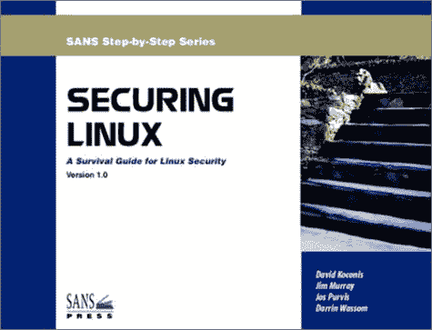

# Linux 安全：Linux 安全生存指南，2.0 版本




| |
|  |

封底

随着 Linux 操作系统的日益成熟和普及，安全风险也随之增加。SANS 学院很高兴宣布《Linux 加固》一的出版，这是由许多每天工作和保障 Linux 安全的专家共同完成的成果。这本《安全步步营》系列指南的新成员，不仅仅是对 SANS 之前的《Linux 步步营》的更新。该书是从零开始的完全重写，展示了加固 Linux 系统的最新最佳实践。请查阅它：这本 104 页的权威指南不仅适用于安全专家。在家里或工作场所尝试使用 Linux 的初学者也将从本指南中获益，本指南涵盖了工作站和许多服务器配置。通过使用示例脚本以及解释为何执行某任务的配套文本，您可以提高您的 Linux 系统的安全性。


## 警告与免责声明

我们尽力使本书尽可能完整和准确，但不暗示任何适用性保证。所提供的信息按“现状”提供。作者和出版者对于书中包含的信息引起的任何损失或损害，不对任何个人或实体承担任何责任。

**SANS 学院热烈感谢这些专业人士的工作以及他们分享经验经验和技术的意愿。**

## 作者

*   **David Koconis**, 斯茅斯学院
*   **Jim Murray**, NCCI Holdings, Inc.
*   **Jos Purvis**, Veritect
*   **Darrin Wassom**, Spectrum Health

## 贡献评审员

*   **Mark Austin**, Cendant Mortgage
*   **Benjamin Bergersen**, [`www.Bergensen.org`](http://www.Bergensen.org)
*   **David Bianco**, 杰斐逊国家加速器设施
*   **Matthew Brown**, Chick-fil-a
*   **Joel Burrow**, Valencia 社区学院 Collegis
*   **Richard Cassi**, 加州大学圣地亚哥分校
*   **Markus DeShon**, SecureWorks, Inc.
*   **Scotte Elliott**, 州立法信息

## 编辑

*   **Mitch Baker**, 罗斯-霍尔理工学院
*   **Guy Bruneau**, InfoPeople
*   **John Moore**, DigitalNet 政府解决方案
*   **Bill Stearns**, SANS 学院
*   **Scott Johnson**, 雷神公司
*   **Joseph Ledesma**, 加州萨克拉门县
*   **Rob McMillen**, 美国海军陆队
*   **Brian Melcher**, AXYS Consulting
*   **Russell Morrison**, Zee Medical
*   **Drew Nall**, SecureWorks, Inc.
*   **Stephen Northcutt**, SANS 学院
*   **Jason Orme**, 费米国家实验室
*   **Donald Pitts**, 雷神公司
*   **Dave Taylor**, 韦伯州大学
*   **Kevin Wilson**, 系统分析师

# 引言

随着 Linux 操作系统的日益成熟和普及，安全风险也随之增加。SANS 学院很高兴能成为每天工作和保障 Linux 安全的精英团队的一部分，为了及时编写本指南付出了巨大努力。为了涵盖全面的最佳实践，我们进行了多次技术评审，以确保这些理念在实践中有效。对于任何变体操作系统，完成同一任务都有多种方法。如果您有更高效的方法，请随时发送至 `linux-sbs@sans.org`，以便在后后的版本中包含。我们专注于 Red Hat 7.3，因为它是编写指南期间使用最广泛的版本，并在 Red Hat 8.0 完善之前将持续一段时间。请记住，这是一本指南，应当这样使用。并非所有内容适用于所有系统。操作系统、应用程序和使用的教育对于安全领域至关重要。我坚信，你应该了解某些操作如何影响系统，而不仅仅是复制粘贴修复。我们试图解释书中所有建议背后的“为什么”，并希望每位读者都能学到更多加固 Linux 系统的知识。

**Mitch Baker**
高级系统/安全管理员
罗斯-霍尔理工学院

# 1.0 第 1 章：通用安全原则

## 1.1 安全策略

安全策略是构建安全计划的蓝图。您的组织可能有一项政策，规定在连接网络之前必须加固系统。在本书中，我们将向您展示如何逐步加固 Linux 系统，以便您遵循该政策。从非常基础的角度来说，安全策略是我们保护环境的规则。有多种类型的安全策略，包括：

*   **公司安全策略** – 定义适用于整个公司的整体安全规则。
*   **远程访问策略** – 定义从远程主机连接到公司网络的规则。
*   **密码策略** – 定义创建、更改和维护强密码的规则。


*   **反病毒策略** – 定义了防病毒程序的实施和维护的规则。
*   **可接受使用策略** – 定义了对公司资源（如互联网、电子邮件、工作站、网络等）的可接受使用规则。

这些策略的示例可以在 [`www.sans.org/newlook/resources/policies/policies.htm`](http://www.sans.org/newlook/resources/policies/policies.htm) 找到。

贵公司可能已经实施了许多此类策略。如果你参与了安全策略的编写，有一些你应该记住的准则。

* **安全策略应该回答你目标的“谁、什么、何时、何地以及为什么”。** 
  安全策略中有助于实现这一点的某些元素包括目的、背景、范围、行动和责任。指南、标准和程序文件则回答了策略将如何`how` 实施的问题。

* **安全策略应当清晰明了。**
  如果安全策略无法被理解，或者页数像《战争与和平》一样多，那么它们就是毫无用处的。

* **安全策略应该是具有可执行性的。**
  如果你的高级管理层不遵守策略，你就不能指望其他员工能遵守。一个经典的例子是禁止在工作期间发送私人电子邮件的邮件策略。当你的首席执行官第一次给他的妻子发邮件时，你的策略就变得不可执行了。

## 1.2 深度防御

在当今世界中，很难找到单层保护的。房屋有门窗锁、插销锁、报警系统和院子周围的围栏。汽车有门锁、在大多数情况下会发出响声并切断点火的报警系统，以及某种形式的方向盘锁。在信息安全中，这种分层方法通常被称为深度防御（Defense-In-Depth）。

由于今天攻击类型多种化，深度防御对于妥善保护系统是必要的。深度防御的某些元素包括：

*   **BIOS 密码** – 这防止未经授权的人启动系统。
*   **物理安全** – 不应让未经授权的人获得系统的物理访问。如果他们能将系统从建筑中移走，就可以将硬盘放入他们控制的系统中。
*   **机箱锁** – 这防止未经授权的人接触系统内部组件。
*   **防火墙** – 通过仅允许访问我们在安全策略中定义的协议来保护系统。
*   **入侵检测** – 通过监控并对已知漏洞发出警报来保护系统。
*   **文件完整性软件 (Tripwire)** – 通过将关键文件的签名与已知良好的数据库进行对比来保护系统。
*   **日志记录** – 通过记录识别出的关键事件来保护系统。
*   **基准与审计** – 通过在系统接入网络之前拍摄快照，并将该快照与定期间隔拍摄的快照进行比较来保护系统。

## 1.3 密码保护

密码保护可能是最难执行的安全措施。似乎无论我们实施了多少密码限制，用户群体都能找到方法来削弱它们。用户会尝试各种方法，从把密码写下来到选择一个密码并在末尾添加一个数字，然后在每次要求更改密码时增加该数字。作为安全管理员，我们可以做一些事情来帮助用户理解密码保护的重要性。

*   **安全意识计划** – 开展安全意识计划将帮助用户理解为什么我们需要安全，以及安全管理不当带来的后果。
*   **平衡密码长度与有效期** – 一些公司要求用户每月更改密码并使用 14 位的密码，而另一些公司要求使用 5 位密码且从不要求用户更改。第一个选项对安全专业人员是可以接受的，而第二个选项通常是用户所喜欢的。如果你希望用户实践良好的密码管理原则，你需要在密码长度和有效期之间取得平衡。为了让用户记住更长的密码，可以延长有效期。另一方面，如果策略允许较短的密码，应该要求更频繁地更改密码。

## 1.4 数据治理

数据治理涉及数据的分类和所有权。数据分类过程通常始于风险分析，以确定哪些数据是最关键的。风险分析通常使用“威胁/漏洞/影响”（Threat/Vulnerability/Impact）三位一体法。威胁是针对系统采取的行动。漏洞是系统中允许威胁发生的弱点。影响是威胁实现后预期的损失。通过确定哪些系统对威胁最敏感且会对公司产生最大的影响，可以实施分类方案来识别最关键的系统和数据。所用分类方案的粒度取决于组织类型及其拥有的数据。政府和金融机构具有非常细的分类方案，可能包含多达五个七个分类类别。大多数组织不需要那种细粒度，通常只有二或三个类别，可能包括：

*   **公开 (Public)** – 如果此类数据的机密性、完整性或可用性遭到破坏，对公司的影响微乎其微或不存在。
*   **仅内部使用 (Internal-Use Only)** – 如果此类数据的机密性、完整性或可用性遭到破坏，对公司的影响将是巨大的。
*   **机密 (Confidential)** – 如果此类数据的机密性、完整性或可用性遭到破坏，对公司的影响将是毁灭性的。

除了妥善分类数据外，还应该明确识别安全角色和责任。以下角色应该是至少定义的角色；然而，根据组织可能存在其他角色：

*   **数据所有者 (Data Owner)** – 此个人通常是高级经理或执行官。此人对数据负最终责任，应该是对分类、访问控制和管理做出决策的人。
*   **数据守护者/管理员 (Data Guardian/Custodian)** – 此个人通常由数据所有者指定，负责数据的管理。这包括备份数据、恢复数据以及根据数据所有者实施的策略维护数据。
*   **数据用户 (Data User)** – 这是在日常工作和过程中使用数据的人。

## 1.5 补丁/分级

得益于 Code Red 和 Nimda 等漏洞利用，打补丁已变成一种执念。虽然打补丁是必要的，但可能会过度。应用补丁时应记住的一些准则：

*   **审查每个补丁的相关性** – 如果你的服务器上没有运行某个服务或应用程序，则无需为该服务或应用程序应用补丁。
*   **阅读发布说明 (Release Notes)** – 我们理解通常情况下说明是一种困扰。但在涉及发布说明时，你需要阅读它们以了解补丁将做什么以及它如何应用于你的环境。
*   **始终在测试环境中应用补丁** – 除非你需要练习写简历，否则在应用到生产环境之前进行测试是一个良好的习惯。你最不希望的是在关键 Web 服务器上应用补丁导致整个电子商务网站宕机。


- **重新审计系统以检查意外更改** – 在应用补丁时，它们有时会将系统或配置文件重置为默认设置。在对系统应用补丁后，应根据最后已知的良好配置进行重新审计，以检查是否存在意外更改。

## 1.6 备份/恢复计划

在 IT 世界中，系统备份就像刷牙一样；我们做这件事时甚至完全不需要经过思考。因为它是必须的，所以我们就做了。由于这项例行工作，我们往往不会考虑备份程序周围的安全影响。以下是一些需要记住的安全准则：

- **安全备份磁带** – 备份磁带通常是发生事故后恢复系统的唯一途径。
- **拥有记录清晰的备份计划** – 备份职责通常由运营中心或低级 IT 人员承担。由于这些人员会定期轮换，因此需要有一份记录清晰的备份计划，以确保备份程序以一致的方式被执行。
- **清晰地标记备份带** – 清晰地标记备份带可以防止使用非来自该系统的磁带恢复系统。
- **在异地存储磁带副本** – 备份磁带的异地存储可以防止因环境灾害导致的损坏。这也有助于防止备份磁带被盗。
- **验证备份磁带** – 定期对备份磁带进行验证，以确保备份软件运行正常，并且你想要备份的内容确实已经备份。
- **定期测试恢复程序** – 定期测试恢复程序将有助于消除意外。你不希望在关键恢复过程中发现自己遗漏了某些东西，而必须从头开始。

## 1.7 基准与控制审计

SANS 的格言之一是：“如果你不知道你的系统本应该什么样，你如何能妥善地保护你的系统呢？”这通过建立适当的基准、变更管理和控制审计程序来实现。以下是一些需要记住的准则：

- **在安装到网络之前获取系统基准** – 系统只要连接到网络，就会成为攻击目标。通过在系统接入网络之前对其进行基准测定，你可以确保你所执行的基准是干净的。
- **建立记录的、可重复的基准程序** – 如果每次不使用相同的程序，基准策略就无法生效。这意味着基准测试不能仅凭记忆来完成。清单是基准程序的极佳记录形式。
- **实施受控变更管理计划** – 通过实施受控的变更管理计划，你能够准确记录每个系统授权了哪些更改。有了这份历史记录，你将确切知道系统相对于基准应该发生以及不应该发生哪些更改。
- **执行控制审计以防止未经授权的更改** – 定期审计系统有两个功能。首先，它允许根据基准对当前系统状态进行评估。这确保你始终知道系统处于什么状态。审计还允许跟踪所有通过变更管理程序的更改，并捕获那些未通过该程序的更改。

## 1.8 账户管理

账户管理也是安全拼图中的关键部分。曾出现过许多案例，员工在离职很久后仍能访问系统。以下是一些需要记住的重要准则：

- **在员工离开公司后立即禁用用户账户。**
- **定期检查和监控用户列表及用户组是否有未经授权的更改** – 这项任务应该是第 1.7 节 中提到的基准测试和控制审计程序的一部分。
- **确保在用户更换部门或职责时调整其权限** – 如果你有一个用户从应用程序开发角色转变为支持角色，你不希望该用户继续拥有源代码代码库的访问权限。

## 1.9 物理安全

物理安全是深度防御方法论中的另一个步骤。物理安全侧重于保护系统免受物理和环境威胁。以下是一些需要记住的准则：

- **设置 BIOS 密码** – 这有助于确保只有管理员才能更改系统的硬件配置。
- **利用机柜锁** – 将关键系统放在锁定的机柜中，防止未经授权的断电或对 CD-ROM 和软盘驱动器的未经授权访问。
- **确保使用刷卡器或监控摄像头监控服务器的访问** – 如果发生物理安全被破入的安全事件，这将有助于追踪事件。
- **对移动用户进行笔记本电脑安全教育** – 教会移动用户如何使用笔记本锁。还要教他们他们在旅行时使用的正确运输技术。

# 2.0 第二章：确保 Linux 安全

## 2.1 安装指南

### 2.1.1 分区

分区可能是涉及 Linux 配置时讨论最广泛、争论最多的话题。对于系统如何进行分区，有许多不同的观点。在 Linux 中，你可以拥有多种分区类型。这些类型中最流行的是：

- `/boot` = 包含启动过程所需的所有文件。这包括内核和任何引导文件。
- `/home` = 包含每个用户的家目录。
- `/usr` = 包含多个用户跨系统共享的文件。
- `/var` = 包含本质上是变量且动态的文件。这包括日志文件、溢字文件、调度器文件和临时文件。
- `/` = 在没有其他可用分区时，包含系统管理时所需的文件。
- `/tmp` = 包含临时文件。
- `swap` = 包含内存管理的分页文件。

默认情况下，Red Hat 7.3 的系统分区方式如下：

表 2-1：Red Hat 7.3 分区默认值

| 工作站 | 服务器 | 笔记本电脑 | 自定义 |
| --- | --- | --- | --- |
| `swap = 2 X 物理内存`, `/boot = 50 MB`, `/` 取决于磁盘空间 | `swap = 2 X 物理内存`, `/boot = 50 MB`, `/ = 384 MB`, `/var = 256 MB`, `/usr = 取决于磁盘空间`, `/home = 取决于磁盘空间 | `swap = 2 X 物理内存`, `/boot = 50 MB`, `/ = 取决于磁盘空间 | `swap = 2 X 物理内存`, `/boot = 50 MB`, `/ = 取决于磁盘空间 |

分区可以缓解一种特定类型的攻击，即拒绝服务。某些攻击旨在填满临时目录或溢字目录。如果你的系统文件与受攻击目录位于同一个分区，你的系统可能会变得无法使用。良好的分区策略是将最可能被攻击者填满的目录单独分区。通常包括 `/var` 和 `/home`。

### 2.1.2 GRUB/LILO

GRUB 是 Red Hat 7.3 选择的引导加载程序。GRUB 的许多优势之一是简化了 Windows 和 Linux 之间的双启动过程。有关在双启动环境中保护 GRUB 的更多信息，请参考附录 C。与 LILO 一样，有许多不同的内核级命令可以传递给 GRUB，你希望只有授权的用户才能执行这些命令。这是通过为 GRUB 设置密码来实现的。在安装过程中，你将获得为 GRUB 设置密码的机会。


|  | 注意事项 | `GRUB` 默认以明文形式存储密码。一旦安装了 Red Hat，你可以通过以下步骤修改 `/etc/grub.conf` 文件，以 MD5 格式存储密码。 |

## 将 GRUB 密码转换为 MD5 格式。

```
 $ /sbin/grub-md5-crypt
    Password: (在此提示符处，输入你在安装时创建的 GRUB 密码并按回车)
    $1$m0tLR/$HbgQzWuPw3pdgGeRFSPH8 (这是密码的 MD5 哈希值)
```

编辑 `/etc/grub.conf` 文件，并将明文密码替换为 MD5 哈希值。（在这里使用 `--MD5` 选项非常重要，这样 `grub` 才会知道输入的密码是 MD5 格式。如果你不使用 `--MD5` 选项，密码实际上将会被视为 MD5 哈希值本身。）

```
 $ su
    # vi /etc/grub.conf
    /etc/grub.conf

    # grub.conf 由 anaconda 生成
    #
    # 注意，在修改此文件后你不需要重新运行 grub
    # 注意：你有一个 /boot 分区。这意味着
    #   所有内核和 initrd 路径都是相对于 /boot/ 的，例如：
    #   root (hd0,0)
    #   kernel /vmlinuz-version ro root=/dev/hda7
    #   initrd /initrd-version.img
    #boot=/dev/hda
    default=0
    timeout=10
    splashimage=(hd0,1)/grub/splash.xpm.gz
    password --md5 $1$m0tLR/$HbgQzWuPw3pdgGeRFSPH8
    title Red Hat Linux (2.4.18-3)
        root (hd0,0)
        kernel /vmlinuz-2.4.18-3 ro root=/dev/hda7
        initrd /initrd-2.4.18-3.img
```

### 2.1.3 防火墙配置

在安装的这一阶段，系统会询问你希望防火墙配置是什么样的。开箱即用的防火墙配置有三种不同的选项。

- **无防火墙 (No Firewall)** – 此选项允许完全访问你的系统且不进行任何安全检查。只有在你没有连接网络并计划在连接网络之前配置自己的防火墙设置时，才使用此选项。
- **中 (Medium)** – 此设置限制了对系统中某些服务的访问。这些服务包括：
    - 使用低于 1023 端口的服务
    - `NFS` 服务器端口 (`2049`)
    - 用于远程 X 客户端的本地 X Windows 系统显示
    - X 字体服务器端口
- **高 (High)** – 此设置限制性最大，拒绝除 DNS、DHCP 以及你明确允许的其他内容之外的所有访问。

所有这些设置都可以并且应该进一步自定义，以适应你的个人环境。如果你在系统连接到网络时配置系统，你应该使用 `High` 设置并根据需要进行自定义。你可以参考本指南中的第 `2.2.6` 节获取额外的防火墙配置说明。

### 2.1.4 账户/身份验证配置

在安装过程中，你需要创建一个 root 密码，并有机会添加额外的用户账户。此时，你需要确保选择一个安全的 root 密码。你还应该在此期间添加任何可能需要的额外管理账户。你还应该确保对密码保持 `MD5` 加密，并维护影子文件（shadow file），将密码存储在与用户名分离的单独。

### 2.1.5 软件包安装

在涉及 Linux 安装时，软件包安装是另一个令人困惑的话题。大多数商业 Linux 发行版（如 Red Hat）都提供了许多应用程序供选择。其中许多应用程序执行相同的功能，但使用不同的格式。在考虑系统安全性时，最需要记住的一点是：少即是多。在选择要安装哪些软件包时，无论系统是工作站还是服务器，都要避免接受默认设置。花些时间查看所有提供的软件包。了解这些软件包的作用，并只选择所需的软件包，仅提供所需的功能。不要仅仅因为某个软件包可用就安装它。如果你不需要某个软件包，就不要安装它。

## 2.2 网络安全

Red Hat Linux 中有几个内核选项可以进行配置以提高整体网络安全性。从 `7.0` 版本开始，可以通过编辑 `/etc/sysctl.conf` 并进行任何必要的更改来修改内核。每当服务器重启或管理员手动重启网络服务时，该文件都会被加载。与对系统的任何更改一样，强烈建议在执行下列更改之前对该文件进行备份。

### 2.2.1 网络参数修改

编辑 `/etc/sysctl.conf` 以反映以下更改：

```
 net.ipv4.ip_forward = 0
    net.ipv4.conf.all.accept_source_route = 0
    net.ipv4.tcp_max_syn_backlog = 4096
    net.ipv4.conf.all.rp_filter = 1
    net.ipv4.tcp_syncookies = 1
    net.ipv4.conf.all.send_redirects = 0
    net.ipv4.conf.all.accept_redirects = 0
    net.ipv4.conf.default.accept_redirects = 0
```

保存 `/etc/sysctl.conf` 并执行以下操作：

```
 [root] # sysctl -p
```*(注：原文在命令执行处截断，我已完成应用 sysctl 更改的标准步骤)*

### 2.2.2 高级防火墙配置

强烈建议对任何类型的防火墙配置使用 `IPTABLES`。你的具体需求将取决于网络以及你想开放的服务类型。为可能遇到的每种情况提供示例超出了指南的范围，但在附录中提供了一些示例。此外，请利用下面的网站以更好地了解 `IPTABLES` 及其如何产生收益：

- `http://www.iptables.org`
- `http://www.linux-firewall-tools.com/`
- `http://firestarter.sourceforge.net/`
- `http://www.fwbuilder.org/`
- `http://www.stearns.org/mason`

## 2.3 访问控制

### 2.3.1 禁止 root 登录

在正常运行参数，root 账户不需要远程登录服务器。任何通过 root 直接登录系统的操作都应限制在本地控制台上。

编辑 `/etc/securetty` 以反映以下更改：

```
 tty1
    tty2
    tty3
    tty4
    tty5
    tty6
```

保存更改并执行以下操作：

```
 [root] # chown root:root /etc/securetty
    [root] # chmod 400 /etc/securetty
```

### 2.3.2 禁用 CTRL-ALT-Delete

对于物理安全性较差或不存在的机器，强烈建议禁用 `CTRL-ALT-DELETE` 功能，该功能允许攻击者关闭机器。

编辑 `/etc/inittab` 注释掉以下行：

```
 # ca::ctrlaltdel:/sbin/shutdown -t3 -r now
```

保存更改并重启服务使其生效：

```
 [root] # /sbin/init q
```


### 2.3.3 警告横幅 (Warning Banners)

人们普遍认为，在登录时显示某种法律警告信息有助于对计算机系统的入侵者进行起诉。更改登录横幅的额外益处还隐藏了操作系统版本信息和其他详细系统信息，攻击者在进行目标攻击时可能会发现这些信息有用。显然，在对横幅进行任何更改之前，组织的法律顾问应该审查所有此类警告信息的内容。

编辑 `/etc/motd`、`/etc/issue` 和 `/etc/issue.net` 以反映适用于组织的适当警告消息并保存更改。示例例如：

```
 本系统仅供授权用户使用。所有活动均可能被监控和/或记录
```

下面列出了每个文件的功能说明：

*   `/etc/motd` – 此文件在用户成功登录系统后显示“每日消息 (message of the day)”。
*   `/etc/issue` – 此文件显示给任何本地登录系统的用户。
*   `/etc/issue.net` – 此文件显示给那些通过 `SSH`、`Telnet` 或 `FTP` 远程登录的用户。

| | 注意事项 | | 较旧版本的 Red Hat Linux 在 `/etc/rc.d/rc.local` 中包含命令，这些命令每次系统启动时都会覆盖 `/etc/issue` 和 `/etc/issue.net`。这些命令在 Red Hat 7.3 版本中不存在；因此，修改列出的文件足以显示适当的警告横幅。 |

### 2.3.4 密码保护单用户模式

Linux 提供通过“单用户模式 (Single User Mode)”进行维护的机制，该模式通常在系统启动时启动。这允许控制台前的攻击者绕过任何系统保护并以 root 身份进入运行级别 1。其后果是严重的，有必要对单用户模式进行密码保护以防止这种情况的发生。

编辑 `/etc/inittab` 以反映以下更改：

```
 id:3:initdefault:
    ~~:S:wait:/sbin/sulogin
```

保存更改并重启服务：

```
 [root] # /sbin/init q
```

## 2.4 用户账户安全

应采取以下步骤来提高系统中用户账户的安全性。

### 2.4.1 密码有效期 (Password Aging)

默认情况下，Red Hat 7.3 要求用户每 99999 天更改一次密码（即永不更改），并且未对密码更改前的保留时间设置最小限制。执行以下命令为 ID 大于 500 的所有现有用户设置限制（500 是普通用户账户的默认范围）。

```
 [root@localhost]# awk -F: '$3 >= 500 { system ("chage -M 180 -m 2 " $1) }' /etc/passwd
```

更改 `/etc/login.defs` 中的以下行，以便新创建的用户账户将继承这些值。

```
 PASS_MAX_DAYS  99999 -> PASS_MAX_DAYS    180
    PASS_MIN_DAYS  0      -> PASS_MIN_DAYS   2
```

### 2.4.2 清理不需要账户

安装时会向系统添加几个不需要的用户账户。为了更好的系统安全，`/etc/passwd` 文件中的用户数量应保持到系统完成任务所需的最少数量。这将更容易检测任何未经授权的用户添加。在进行任何编辑之前，请将文件复制到备份版本：

```
 [root@localhost]#for file in /etc/{passwd,shadow,group} ; do /bin/cp -p $file $file.orig ; done
```

使用以下命令删除不需要用户的账户：

```
 [root@localhost]# for user in uucp operator games gopher ; do /usr/sbin/userdel $user ; done
```

使用以下命令删除不需要的组：

```
 [root@localhost]# for group in dip gopher games uucp; do /usr/sbin/groupdel $group ; done
```

每当删除用户或组时，执行以下验证步骤是明智的。首先，为了验证是否存在会导致用户无法登录的错误，运行以下命令：

```
 [root@localhost]# /usr/sbin/pwck
    [root@localhost]# /usr/sbin/grpck
```

`pwck` 和 `grpck` 命令分别验证 `/etc/passwd` 和 `/etc/group` 文件格式是否正确，并且每个字段是否具有有效数据。其次，为了验证之前由被删除的用户或组拥的文件已分配给 root 用户，执行以下命令：

```
 [root@localhost]# /usr/sbin/find / -nouser --exec /bin/chown root {} \;
    [root@localhost]# /usr/sbin/find / -nogroup --exec /bin/chgrp root {} \;
```

### 2.4.3 锁定系统账户

某些账户仅供系统服务或守护进程使用，不需要交互式登录。为了增加安全性，应禁用这些账户的交互式登录功能。执行以下命令，为账户分配无效 shell（即 `/dev/null`），以确保它们被锁定。

```
 [root@localhost]# for user in bin daemon adm ftp sync lp mail news nobody ; do /usr/sbin/usermodL-s /dev/null $user ; done
```

### 2.4.4 验证无空密码账户

空密码账户对系统构成了严重风险，因为通过检查 `/etc/shadow` 文件的第二个字段是否为空可以轻松检测到这些账户。执行以下命令：

```
 [root@localhost]# awk -F: '($2 == "") { print $1 } /etc/shadow
```

如果没有输出，说明正常。如果打印了用户名，请为账户设置密码或将其锁定。

### 2.4.5 收紧默认 umask

`umask` 决定了用户创建的新文件的权限。按照安装，普通用户（定义为与组名相同的用户）的默认 `umask` 为 002（即文件为 `rw-rw-r—`，目录为 `rwxrwxrwx`）。对于其他用户包括 root 用户，它是 022（即文件为 `rw-r--r—`，目录为 `rwxr-xr-x`）。

为了更高的安全性，root 用户的默认 umask 不应产生 world 可读的文件。普通用户的 umask 不应产生世界可读的文件。编辑 `/etc/bashrc` 和 `/etc/csh.cshrc` 文件中的行：

```
 Change:   umask 022    ->    umask 077
              umask 002    ->    umask 007
```

注意：某些 rpm 包假设 root 用户的默认 umask 为 022。在安装或升级这些软件包时偶尔会导致警告信息。

### 2.4.6 其他账户限制

Linux 可插入认证模块 (PAM) 软件包允许对用户账户实施许多不同类型的控制。配置文件位于 `/etc/security` 目录。调节系统资源使用的配置文件是 `limits.conf`，将在下一节讨论。调节授权用户登录来源的配置文件是 `access.conf`，调节何时允许登录的配置文件是 `time.conf`。上述三个文件的默认版本包含附录 B 中。每个文件都包含实施说明和用法示例。

#### 2.4.6.1 系统资源使用（来自 Bastille）

为了防止单个用户消耗过多系统资源，编辑 `/etc/security/limits.conf` 文件，使得不会创建核心文件（见下注），单个文件大小限制为 100 MB，且每个用户只能运行 150 个并发进程。

添加以下行：

```
 * hard    core   0
    * hard    fsize  102400
    * hard    nproc  150
```


|  | 注意 | 对于用于软件开发的工作站，核心文件中包含的信息对于追踪代码中的错误非常有价值。既可以不包含该行，或者将单词“hard”更改为“soft”，以便开发者在需要时手动调高限制。 |

## 2.5 加固（禁用）服务

应当监听网络连接的服务数量取决于系统的类型（即工作站或服务器）以及其任务（即：生产环境 Web 服务器、匿名 FTP 服务器、开发工作站等）。然而，对于任何给定系统，最安全的态势是仅启用系统完成其任务所必需的服务，并将访问限制仅适用于工作描述中需要这些权限的用户。

### 2.5.1 识别配置为自启动的服务

可以使用命令行工具 `chkconfig` 显示所有运行级别服务的当前配置状态。可以使用两个图形化前端工具来调查服务状态：`ntsysv`（需要安装 `newt` 包）或 `serviceconf`（需要安装 `Xfree86`、`gtk` 和 `python` 包）。执行以下命令显示当前配置为系统启动时自启动的服务：

```
[root@localhost]# /sbin/chkconfig --list | grep -e "\(:.*on\|xinetd based\)"
    keytable  0:off 1:on 2:on 3:on 4:on 5:on 6:off
    syslog   0:off 1:off 2:on 3:on 4:on 5:on 6:off
    ...
    xinetd   0:off 1:off 2:off 3:on 4:on 5:on 6:off
    netfs   0:off 1:off 2:on 3:on 4:on 5:on 6:off
    xinetd based services:
      wu-ftpd: on
```

### 2.5.2 创建应该启动的服务列表

下面描述的部分或全部服务可能出现在之前的 `chkconfig` 命令的输出中。

#### 2.5.2.1 独立服务

每个系统都应该运行的服务列表很短。它们下表所示：

表 2-2：应该运行的服务

| 服务名称 | 作用（查看 `/etc/init.d/servicename`） |
| --- | --- |
| `keytable` | `为系统加载键盘映射` |
| `syslog` | `激活其他守护进程用于记录消息的守护进程` |
| `network` | `启动网络接口` |
| `random` | `提高随机数生成的质量（对于加密网络数据的应用程序非常重要） |
| `crond` | `启用用于调度作业的 cron 守护进程` |
| `anacron` | `管理在系统停机期间本应运行的 cron 作业` |
| `iptables` | `加载 iptables 主机防火墙（如果已配置——见第 2.2.3 节） |
| `ntpd` | `控制系统时同步` |

##### 2.5.2.1.1 gpm

为控制台模式的文本应用程序添加鼠标支持。如果这是一个工作站且安装了 X-Windows，则该服务应关闭状态，并且可以安全地删除 rpm 包 `gpm`。如果这是一个没有 X-Windows 的服务器且希望在控制台使用鼠标支持，则该服务应开启状态。

##### 2.5.2.1.2 sshd

`sshd` 服务加密所有网络通信，并为远程用户提供交互式 shell 和文件传输访问。注意，当本地用户使用 `ssh` 或 `scp` 命令从此系统向外连接到另一个系统时，**不需要** `sshd` 服务。如果用户需要远程访问系统，则应将 `sshd` 服务配置为开启，以便它在系统启动时启动。

##### 2.5.2.1.3 kudzu

`kudzu` 服务启用自动检测和配置系统硬件变化。如果配置为自启动，它将在每次系统启动时探测系统的硬件变化。如果硬件变化发生并不频繁，则该服务应关闭状态。注意，可以使用以下命令随时启动 `kudzu` 来检测新硬件：

```
[root@localhost]# /etc/init.d/kudzu start
```

##### 2.5.2.1.4 xinetd

`xinetd` 服务管理许多常用服务的运行和启动。如果不需要开启任何由 `xinetd` 控制的服务，则 `xinetd` 服务应关闭状态，并且可以安全地删除 rpm 包 `xinetd`。注意，对于大多数工作站，此服务可能应该是关闭的。

#### 2.5.2.2 基于 xinetd 的服务

##### 2.5.2.2.1 telnet

`telnet` 服务提供系统的远程 shell 访问，但不会验证源主机的身份，也不会对跨网络发送的数据加密。该服务本质上是不安全的，不应用于跨越互联网的连接。`telnet` 应关闭状态，并且可以安全地删除 rpm 包 `telnet-server`。注意，即使服务被禁用，用户仍然可以使用 `telnet` 客户端进行向外连接。

##### 2.5.2.2.2 wu-ftpd

`wu-ftpd` 为远程用户提供文件传输协议服务，用于将文件传输到系统，而无需验证源主机的身份或加密跨网络发送的数据。该服务本质上是不安全的，通常不应用于跨越互联网的连接。主要的例外是用于发布源代码和补丁的匿名 FTP 服务器。除非该系统是 FTP 服务器，否则 `wu-ftpd` 应关闭状态，并可以安全地删除 rpm 包 `wu-ftpd` 和 `anonftp`。

##### 2.5.2.2.3 rlogin, rsh, rexec (BSD r 服务)

所有源自 BSD UNIX 的服务都支持弱 IP 身份验证并以明文跨网络传输数据（即未加密）。`SSH` 设计用于替代这些服务的功能，且对系统用户是透明的。这些服务应关闭状态，并可以安全地删除相应的 rpm 包 `rsh-server`。

##### 2.5.2.2.4 snmpd 简单网络管理协议守护进程

`snmpd` 服务用于与网络管理软件通信。如果系统不需要与网络应用程序协作，则该服务应关闭状态，并可以安全地删除 rpm 包 `snmpd`。

如果服务开启，请确保检查 `/etc/snmpd/snmpd.conf` 文件。文件中的设置控制谁可以访问 `snmpd` 代理以及代理提供的信息级别。更多信息请参见 `snmpd.conf(5)` 手页。

##### 2.5.2.2.5 tftp 简单文件传输协议

`tftp` 服务允许在无身份凭据的情况下进行文件传输。该协议常见的用途是网络设备在启动序列期间从网络下载配置文件。除非该系统是启动服务器，否则 `tftp` 应关闭状态，并可以安全地删除 rpm 包 `tftp-server`。

### 2.5.3 禁用并移除不需要启动的服务

任何不需要的服务都应该停止并配置为启动时不运行：

```
[root@localhost]# /etc/init.d/ servicename stop
    [root@localhost]# /sbin/chkconfig --level 0123456 servicename off```

在命令中，将 `servicename` 替换为上方列表左侧列的服务名称（例如 `netfs` 或 `wuftp`）。对每个服务重复此命令。

应使用命令移除服务对应的 rpm 包：

```
[root@localhost]# /bin/rpm -e packagename
```

在命令中，将 `packagename` 替换为服务所属的 rpm 包名称。

可以使用以下命令确定拥有文件的包：

```
[root@localhost]# rpm --qf /etc/init.d/servicename
```

### 2.5.4 [可选] 验证运行级别服务的配置


重复步骤 2.5.1，并验证配置为开启状态的服务列表与系统预期的列表匹配。

### 2.5.5 配置对任何已服务的访问

#### 2.5.5.1 TCP Wrappers (ftp://ftp.porcupine.org/pub/security/index.html)

对于编译了支持 TCP wrappers 的服务，访问控制通过 `/etc/hosts.allow` 和 `/etc/hosts.deny` 文件实现。当发起连接尝试时，系统会检查 `hosts.allow` 文件。如果匹配到某行，则允许连接。然后查询 `hosts.deny` 文件，如果匹配到某行，则拒绝连接。如果两个文件中都没有匹配项，则允许连接。

##### 2.5.5.1.1 创建仅限授权使用的横幅 (Banners)

如果按照下所述进行配置，TCP wrappers 将对任何尝试连接其监控的服务的用户显示警告横幅。以下命令集将生成 `/etc/banners` 目录，其中的文件包含每个服务的警告横幅文本。在本示例中，横幅文本为“此系统的使用仅限授权用户”。注意，警告横幅的准确措辞取决于特定站点；但它至少应该强调系统使用仅限授权人员，且登录系统即视为同意被监控活动。

```
[root@localhost]# /bin/mkdir -p /etc/banners
[root@localhost]# /bin/echo "Use of this system is restricted to authorized users" > /etc/banners/
prototype
[root@localhost]# cd /etc/banners ; /usr/bin/make -f /usr/share/doc/tcp_wrappers-7.6/Banners.Makefile
```

##### 2.5.5.1.2 拒绝所有明确允许之外

为了实现“拒绝所有明确允许之外”的安全最佳实践，请执行以下命令。

```
[root@localhost]# echo 'ALL: ALL: spawn (/bin/echo -e '/bin/date'"\n%c attempted connection to %s
    and was denied" \
    > | /bin/mail -s "Connection attempt to %s" root) &' > /etc/hosts.deny
```

任何未在 `hosts.allow` 文件中列出的连接尝试都将被拒绝，消息将记录到 syslog auth 设施，并向 root 用户发送 电子邮件。

##### 2.5.5.1.3 允许需要的用户访问

编辑 `hosts.allow` 文件，并为每个应允许访问的服务添加一行。下面显示了几个示例（详细信息请参阅 `hosts.allow` 的 man 页面）。

```
 ALL: LOCAL : banners /etc/banners            # 来自本地客户端的所有服务（不包含 "." 的主机名）
    sshd: 10.1..1.0/255.255.254.0 : banners /etc/banners # 来自主机 IP 地址的 SSH 连接
    between 10.1.1.0 and 10.1.2.0
```

#### 2.5.5.2 xinetd

如果 `xinetd` 已禁用或删除（通常是工作站的情况），则应跳过此步骤。

`xinetd` 服务为其管理的的服务提供访问控制。`/etc/xinetd.d` 目录中每个服务都应该有一个文件。要控制对服务的访问，请找到对应服务命名的文件，并在起始括号和结束括号之间添加以下行。

```
only_from =   10.1.1.0/23      # 允许来自 10.1.1.0 到 10.1.2.0 之间主机 IP 地址的连接
```

### 2.5.6 （仅限服务器）禁用 X Windows

通常没有从控制台操作的服务器系统不应运行 X Windows 服务。执行以下命令配置系统启动到运行级别 3（不带 X 的多用户模式），而不是运行级别 5（带 X 的多用户模式），并将原始的 `/etc/inittab` 保存为 `/etc/inittab.bak`。

```
[root@localhost]# /usr/bin/perl -p -i.bak -e 's/id:5:init/id:3:init/' /etc/inittab


## 2.6 应用更新和补丁

强烈建议配置系统自动检查更新的 RPM 包的可用性。这将增加你能够修复系统并关闭已发现的安全漏洞的可能性，防止具有恶意意图的人利用这些漏洞破坏你系统或数据的完整性。

### 2.6.1 Up2date ([`www.redhat.com/docs/manuals/RHNetwork/ref-guide/`](http://www.redhat.com/docs/manuals/RHNetwork/ref-guide/))

对于 Red Hat 7.3，安全更新的自动检查由 Red Hat Network 守护进程 `rhnsd` 控制。默认情况下，该守护进程每 120 分钟尝试连接一次 Red Hat 服务器以检查可用的包更新，下载并安装任何已签名且已安装在系统中的包更新（以 "kernel" 字符串开头的包外），然后通过电子邮件将结果发送给 root 用户。注意，超过一用户一系统的 `up2date` 服务需要支付订阅费用。

#### 2.6.1.1 在 Red Hat Network 注册系统

对于 Red Hat 7.3，安全更新的自动检查由 Red Hat Network 守护进程 `rhnsd` 控制。默认情况下，该守护进程每 120 分钟尝试连接一次 Red Hat 服务器以检查可用的包更新，下载并安装任何已签名且已安装在系统中的包更新（以 "kernel" 字符串开头的包外），然后通过电子邮件将结果发送给 root 用户。注意，超过一用户一系统的 `up2date` 服务需要支付订阅费用。

以下命令启动 Red Hat Network 并启动创建系统配置的过程。客户端提示用户创建帐户（即用户名和密码），然后探测系统的主机名、IP 地址、内存、PCI 设备、磁盘大小和挂载点。

```
[root@localhost]# /usr/sbin/rhn_register
```

#### 2.6.1.2 通过手动检查更新来验证设置

一旦系统注册并创建了配置，运行以下命令：

```
[root@localhost]# /usr/sbin/up2date --nox -p
[root@localhost]# /usr/sbin/up2date --u
```

第一个命令将更新与 Red Hat Network 关联的包，第二个命令将安装更新。

#### 2.1.3 确保 rhnsd 配置为启动时运行

```
[root@localhost]# /sbin/chkconfig rhnsd
[root@localhost]# /etc/init.d/rhnsd start
```

### 2.6.2 autorpm ([`www.autorpm.org/`](http://www.autorpm.org/))

autorpm 是 up2date 的一个可行免费替代方案。它用 PERL 编写，可以在交互模式运行、传递命令行选项或直接从脚本调用。默认安装每天检查镜像站点并将结果发送给 root 用户。虽然 autorpm 可以配置为自动安装 rpm，但默认不会进行用户交互。

#### 2.6.2.1 下载并安装最新稳定 RPM

autorpm 的最新稳定 rpm 包（编写时为 2.9.3）可以在 [`www.autorpm.org/tabs/download/`](http://www.autorpm.org/tabs/download/) 下载。包下载完成后，使用以下命令安装：

```
[root@localhost]# /bin/rpm -i autorpm-2.9.3-1.noarch.rpm
```

#### 2.6.2.2 修改 /etc/autorpm.d/redhat-updates.conf 文件

默认情况下，签名检查失败的 rpm 包将被放入交互队列。为了防止这些可疑 rpm 包以后被安装，在 `action(updated)` 语句的 `PGP_Require(Yes);` 行之后添加以下行：

```
PGP_Fail_Install(No);
```

默认情况下，任何在镜像站点上但在系统中未安装相应较早版本的 rpm 更新都将添加到交互队列。为了防止这种情况发生，找到 `action(new)` 语句并将 `Install(Interactive);` 行更改为 `Install(No);`。

#### 2.6.2.3 通过手动检查更新来验证设置

在不带任何参数的情况下运行 autorpm 命令。第一次运行该命令时，你将有机会查看关于 autorpm 如何工作的的说明，并被鼓励下载 TermReadlineGnu。接受下载。包将被安装，autorpm 将退出。通过执行以下命令检查更新：


```
 [root@localhost]# autorpm auto
```

你应该能看到显示尝试到镜像站点进行 FTP 连接的消息信息，并且很可能还会列出可用更新的包名列表。已更新的包（系统中已安装了较早版本的包）将被下载，并检查它们的 PGP 签名。当提示符返回时，执行以下命令来安装这些包：

```
 [root@localhost]# autorpm "install all"
```

你应该能看到指示 `rpm` 包正在安装的信息，如果安装成功，还会显示这些包正在从磁盘中删除。

默认情况下，会在 `/etc/cron.daily` 目录下添加一个条目，以启用每日检查更新。

## 2.7 文件系统安全

### 2.7.1 安全文件系统挂载选项

本节概述了通过对 `/etc/fstab` 文件进行编辑来增强系统安全性。请注意，针对 `/usr` 和 `/home` 分区的挂载选项建议仅适用于在安装过程中选择了“服务器”（Server）”或“自定义”（Custom）类型的系统（参见第 2.1.1 节）。这是因为如果选择了“工作站”（Workstation）或“笔记本电脑”（Laptop），`/usr` 和 `/home` 目录将成为根分区（`/`）的一部分，而根分区不能设置为只读、`nodev` 或 `nosuid`。

将 `/usr` 分区挂载为只读。系统中的大多数可执行命令都位于 `/usr` 文件系统中。将其挂载为只读是防止安装被木马化的二进制文件的一种良好方法。

```
 LABEL=/usr              /usr         ext3 ro            1 2
```

|  | 注意事项 | 在应用大多数 `rpm` 升级（包括任何计划由 `up2date` 或 `autorpm` 等更新代理执行的升级）之前，必须使用以下命令将 `/usr` 文件系统重新挂载为读写模式： |

```
 [root@localhost]# mount -o remount,rw /usr
```

安装完成后，可以使用以下命令将分区重新挂载为只读：

```
 [root@localhost]# mount -o remount,ro /usr
```

为了防止通过可移动介质向系统引入 SUID 或设备文件，请为所有可移动介质（如软盘、CD-ROM）的行添加 `nosuid` 和 `nodev` 选项：

```
 /dev/fd0      /mnt/floppy      ext3 nosuid,nodev    1 2
    /dev/cdrom    /mnt/cdrom       ext3 nosuid,nodev    1 2
```

最后，包含用户家目录的文件系统也应该设置 `nosuid` 和 `nodev` 选项：

```
 LABEL=/home         /home      ext3 nosuid,nodev    1 2
```

### 2.7.2 收紧文件权限

#### 2.7.2.1 限制对管理工具的访问

管理工具（例如 `chkconfig`、`traceroute`、`ifconfig` 和 `iptables`）位于 `/sbin` 和 `/usr/sbin` 目录。在正常情况下，特权用户通常不需要执行这些命令中的任何一个。执行以下命令，移除这些目录下所有文件中非文件所有者（且不属于文件所有者组）的用户的读、写、执行权限。

```
 [root@localhost]# /bin/chmod -R o-rwx /usr/sbin 'ls /sbin/* | grep -v consoletype'
```

`consoletype` 工具未排除在收紧的文件权限之外，因为 `/etc/profile.d/lang.sh` 和 `/etc/profile.d/lang.csh` 文件会以普通用户权限调用它，在启动新 shell 时确定用户登录的控制台类型。

### 2.7.3 可执行程序的 SUID 权限

普通用户可以运行的其他工具位于 `/bin` 和 `/usr/bin` 目录。其中某些工具需要 SUID 才能工作，例如，`passwd` 命令需要能够将更新后的密码哈希写入 `/etc/shadow` 文件，而用户对该文件没有读取或写入权限。然而，对于大多数文件，SUID 和 SGID 权限是一种可选的便利设置，例如 `ping` 命令。使用以下命令查看所有具有 SUID 或 SGID 权限的文件列表：

```
 [root@localhost]# /usr/bin/find /bin /usr/bin -type f \( -perm -04000 -o -perm -02000 \) -ls
```

检查结果列表，通过将这些每个文件的权限设置为 `755`，移除不需要这些权限文件的 SUID 或 SGID 权限。例如：

```
 [root@localhost]# /bin/chmod 755 /bin/mount /bin/umount /bin/ping /usr/bin/chfn /usr/bin/chsh /usr/
    bin/chage
```

### 2.7.4 移除编译器包（不用于软件开发的服务器和工作站）

黑客使用的许多漏洞以程序源代码的形式分发，在使用之前必须在目标系统上进行编译。如果从系统中移除编译器包，那么黑客在尝试利用系统之前，必须同漏洞源码一起上传一个编译器。除了阻止“脚本小子”（script-kiddies）之外，安装编译器所需的额外活动有助于检测未经授权的入侵。

执行以下命令移除编译器：

```
 [root@localhost]# rpm -e gcc
```

## 2.8 日志记录

本节涵盖了如何配置红帽 Linux 以提高日志安全性。这些步骤包括配置哪些消息被记录、发送到哪里以及何时轮转日志。相关的步骤还包括系统时钟的同步。

### 2.8.1 syslogd

运行在 Linux 系统上的进程消息发送到 `syslogd` 进程。每条消息有两个属性，分别描述来源和重要性。日志进程如何处理每条消息由 `/etc/syslog.conf` 文件决定。处理选择包括发送到本地文件、控制台或本地终端、一个或多个登录用户或远程日志服务器。

注意，将日志副本发送到远程服务器可以在系统被入侵时保留记录。入侵者通常会擦除或修改本地系统日志来掩盖踪迹，除非他们也能进入远程服务器。

#### 2.8.1.1 使用更安全的配置文件替换 syslog 守护进程默认配置 (/etc/syslog.conf)

Appendix B 确保重要消息被记录。该配置还将存储到本地系统的日志分离到特定的子系统文件中。这使得每个日志文件更易读，并增加了在查看日志文件时发现异常的机会。

#### 2.8.1.2 重启 syslogd 并确保其在启动时运行

强制 `syslogd` 进程重新加载配置文件：

```
 [root@localhost]# /etc/init.d/syslogd restart
```

确保 `syslogd` 配置为启动自动启动：

```
 [root@localhost]# /sbin/chkconfig --level 2345 syslog on
```

#### 2.8.1.3 [可选] 验证新配置

使用 `util-linux` 软件包安装的 `logger` 工具可以向任意设施和级别发送日志消息。使用此功能验证配置。例如，命令

```
 [root@localhost]# /usr/bin/logger -p mail.info "Test mail log message"
```

会导致 `/var/log/maillog` 中添加类似下面的行：

```
 Aug 10 10:22:14 root: Test mail log message
```

请注意，`logger` 的实现未向 `kern` 设施发送消息。

### 2.8.2 logrotate.d

`/etc/logrotate.conf` 文件包含日志轮的默认选项。可以通过修改 `/etc/logrotate.d` 目录下的文件为特定的日志文件覆盖这些选项。


### 2.8.2.1 编辑 logrotate 守护进程默认配置文件 (/etc/logrotate.conf) 以保留更多日志信息

默认安装情况下，日志将每周轮转并仅保留四周。按照下表所示编辑 `/etc/logrotate.conf` 文件，以便系统事件的重要信息能够保存得更久。这将增加检测到问题或可疑入侵的可能性。注意，尽管旧日志会被压缩，但一年的日志数据可能仍然很大。请务必监控存储日志的分区的可用磁盘空间（通常为 `/var`）。

表 2-3：logrotate 守护进程默认配置文件设置

| 默认设置 | 安全设置 | 理由 |
| --- | --- | --- |
| `weekly` | `monthly` | `这些更改将日志保存时间从一个月改为一年，提供了更长的追溯性。` |
| `rotate 4` | `rotate 12` | |
| `#compress` | `compress` | `为了节省空间，压缩旧日志` |

#### 2.8.2.2 更新控制 syslog 文件轮转的配置文件 (/etc/logrotate.d/syslog)

在步骤 2.8.1.1 中安装的 `syslog.conf` 文件会导致所有系统额外的日志文件 `/var/log/kernel`。此外，如果该文件中任何针对服务器的行被取消注释，还将创建其他日志文件。必须将所有新日志文件的名称添加到 `/etc/logrotate.d/syslog` 开头的文件列表中，以便新日志也能进行轮转。

#### 2.8.2.3 [可选] 验证日志轮转配置正确

使用 `logrotate` 命令的 `-f` 标志强制日志文件进行轮转。应该创建新的日志文件且不发生任何错误。

```
[root@localhost]# /usr/sbin/logrotate -f /etc/logrotate.conf
```

### 2.8.3 logwatch (http://www.logwatch.org)

如果日志中的信息从未被审查，那么最好的日志配置也将毫无处。`logwatch` 将自动解析日志文件，尝试删除报告正常活动的条目，并发送封包含异常条目的警报电子邮件。编辑 `/etc/log.d/logwatch.conf` 文件中以 `MailTo` 开头的行，将用户 `root` 修改为负责监控日志的电子邮件地址。

### 2.8.4 ntpd ([`www.cis.udel.edu/~ntp`](http://www.cis.udel.edu/~ntp))

配置网络时间协议 (ntp) 服务器守护进程，通过三个公共 NTP 服务器同步系统时。这将使管理员能够可靠地协调此系统日志文件事件与互联网上其他系统日志文件事件。

#### 2.8.4.1 查找三个公共 NTP 服务器并将其添加到 /etc/ntp.conf

访问 [`www.eecis.udel.edu/~mills/ntp/servers.html`](http://www.eecis.udel.edu/~mills/ntp/servers.html)，选择三个地理位置附近的公共服务器，记录它们的 IP 地址并获得其管理员的许可。编辑 `/etc/ntp.conf` 文件，将以“server 127.127…”开头的行替换为每个公共服务器的一行：

```
server 10.0.0.1    # 公共服务器 1 的 IP 地址
server 10.0.0.2    # 公共服务器 2 的 IP 地址
server 10.0.0.3    # 公共服务器 3 的 IP 地址
```

#### 2.8.4.2 重启 NTP 守护进程并确保其开机启动

强制 `ntpd` 守护进程重新加载其配置文件：

```
[root@localhost]# /etc/init.d/ntpd restart
```

确保 `ntpd` 配置为开机启动：

```
[root@localhost]# /sbin/chkconfig ---level 2345 ntpd on
```

## 2.9 调度器安全

### 2.9.1 限制 `cron` 和 `at` 访问

在 Linux 世界中，`cron` 和 `at` 是调度的首选应用程序。当你需要在每个相同的时间间隔定期运行特定任务时，使用 `cron`。当你希望安排在特定时间运行一次任务时，使用 `at`。默认情况下，对 `cron` 和 `at` 的访问是不限制的。这意味着所有用户都有权修改、添加或删除任务。`cron` 将这些调度任务存储在名为 `crontabs` 的用户特定文件中。`cron` 定期查询这些 crontab 文件以获取运行任务。任务以调度任务的用户权限运行。在加固 `cron` 时需要考虑的一些指南有：

****记录所有 `cron` 任务** – Red Hat 默认配置通过 `syslog` 函数将 `cron` 消息发送到 `/var/cron/log`
*   **限制 `cron` 和 `at` 的访问** – 仅允许需要运行调度任务的用户访问 `cron`。`cron` 通过 `/etc/cron.allow` 文件管理访问。`at` 通过 `/etc/at.allow` 文件管理访问。`cron.allow` 和 `at.allow` 指定了哪些用户被明确允许调度 `cron` 或 `at` 任务，所有其他用户将被拒绝访问。如果存在 `cron.allow` 或 `at.allow`，则仅列出的用户被允许。如果两个文件都不存在，则所有用户都被允许。如果存在 `cron.deny` 或 `at.deny`，则列出的用户将被拒绝。


为了让 Apache 服务器使用模块提供的功能，配置文件中必须存在该模块对应的 `LoadModule` 和 `AddModule` 指令。为了增加额外的安全层，请注释掉（或删除）服务器不会使用的每个模块行对。以下是一些可以移除的候选：

表 3-1：未使用时建议注释的候选模块

| 模块 | 提供的功能 | 注释 |
| --- | --- | --- |
| `mod_autoindex` | `自动目录列表` | `提供目录列表会向潜在的破解者泄露过多信息。` |
| `mod_include` | `服务器解析文档` | `如果网站不需要服务器端包含（SSI），则禁用它们更安全。` |
| `mod_info` | `服务器配置信息` | `通过访问 URL 提供服务器配置信息会泄露过多信息。` |
| `mod_status` | `服务器状态显示` | `通过访问 URL 访问服务器状态信息会泄露过多信息。` |
| `mod_userdir` | `用户主目录` | `允许用户从其主目录内的目录中提供页面。`如果用户缺乏 Web 知识且不细心，这将引入潜在的漏洞。` |
| `Ref. 1:` | [`httpd.apache.org/docs/mod/`](http://httpd.apache.org/docs/mod/) | |

#### 3.1.2.2 收紧默认目录访问权限

更改控制默认访问权限的 `<Directory />` 语句。

表 3-2：默认目录访问权限的修改

| 原始版本 | 修改后 |
| --- | --- |
| ```xml
 <Directory />
  Options FollowSymLinks
  AllowOverride None
</Directory>
 ``` ``` | ```xml
 <Directory />
  Options None
  AllowOverride None
  Order allow,deny
  Deny from all
</Directory>
 ``` ``` |

原始版本允许跟踪符号链接到文件系统中的任何地方。这增加了文档根（document root）之外的文件显示访问者的概率。

#### 3.1.2.3 文档根访问权限

更改控制 Web 服务器文档根访问权限的 `<Directory /var/www/html/>` 语句。

表 3-3：默认根访问权限的修改

| 原始版本 | 修改后 |
| --- | --- |
| ```xml
 <Directory "/var/www/html">
  Options Indexes FollowSymLinks
  AllowOverride None
  Order allow,deny
  Allow from all
</Directory>
 ``` | ```xml
 <Directory /var/www/html>
  Options SymLinksIfOwnerMatch
  AllowOverride None
  Order allow,deny
  Allow from all
</Directory>
 ``` |

原始版本将向访问者显示文档根中没有 `index.html` 文件（或其他由 `DirectoryIndex` 指令定义的类似文件）的任何目录的列表。如上一步所述，给访问者提供太多信息了。另一个更改是使用限制性更强的 `SymLinksIfOwnerMatch` 选项。通常，Web 服务器提供的所有文件都由 root 用户或 Web 管理员拥有。因此，此选项防止服务器跟踪其他用户可能创建的指向 `DocumentRoot` 之外区域的链接。

对于 `AllowOveride` 指令，有一个考虑的选项（而不是 `None`）。如果有许多人负责 Web 服务器文档根下不同目录的访问控制，可以使用 `AllowOveride AuthConfig`。这将允许使用每个目录下的 `.htaccess`（或与 `AccessFileName` 指令匹配的文件名）文件单独配置访问控制，而不需要给所有人主 `httpd.conf` 配置文件的写写权限。缺点是这使得服务器访问审计变得更加困难，因为有多个地方需要查看。

#### 3.1.2.4 隐藏服务器版本信息

Apache 默认配置为它动态生成的 Web 页面（如默认错误页面）添加签名。签名可能包含服务器名称、版本号和模块。放置在 `httpd.conf` 中的以下指令将防止显示此签名：

```
ServerSignature Off
```

除了服务器签名外，apache 还会向请求文档的客户端返回的 HTTP 头中提供一个字符串，其中包含启动时加载的名称、版本和模块。以下指令将尽可能地减少泄漏的信息量。

```
ServerTokens Prod
```

偶尔，Web 服务器管理员的电子邮件地址显示在服务器生成的页面上。找到下面的指令，并将电子邮件地址更改为 Webmaster 的地址。

```
ServerAdmin root@localhost
```

#### 3.1.2.5 禁用 cgi-bin 目录（如果未使用）

用于攻击 Web 服务器的主要向量可能是 CGI 程序。如果服务器托管的网站没有托管任何 CGI 页面，请注释掉以下行以禁用 CGI 功能和对 `cgi-bin` 目录的访问：

```
LoadModule cgi_module    modules/mod_cgi.so
    LoadModule env_module    modules/mod_env.so
    AddModule mod_env.c
    AddModule mod_cgi.c
    ScriptAlias /cgi-bin/ "/var/www/cgi-bin/"
<Directory "/var/www/cgi-bin">
  AllowOverride None
 Options None
  Order allow,deny
  Allow from all
</Directory>
```

### 3.1.3 检查 DocumentRoot 中文件的权限

为了防止 Web 页面被篡改，所有者不应对 Web 服务器提供的任何文件具有写权限。运行 Web 服务器进程的用户和组分别由 `httpd.conf` 中的 `User` 和 `Group` 指令定义。对于 Web 服务器提供的所有目录运行以下命令，以识别所有者具有写权限的文件。为了安全安全，命令输出应该是空的。

```
[root@localhost]#usr/bin/find /var/www/html -user apache -perm +202 -exec ls \;
[root@localhost]#usr/bin/find /var/www/html -group apache -perm +022 -exec ls \;
```

在这些命令中，用户和组是 `apache`，正如默认安装那样。此外，为了额外的安全，可以将这些命令合并成脚本并通过 cron 每天运行，以便及时检测任何更改。

### 3.1.4 使用 HTTPS 加密敏感流量

安全套接层（SSL）模块允许 apache Web 服务器对所有客户端通信使用强身份验证。至少，`https` 协议要求服务器拥有用于标识的 `X.509` 证书。理想情况下，证书应由受信任的第三方签名证明服务器确实由其声称的对象运营。可选，服务器也可以要求客户端提供证书。

Red Hat 7.3 安装的示例证书（`/etc/httpd/conf/ssl.crt/server.crt`）允许 apache 启动并作为 HTTPS 服务器运行。但如果服务器用于处理敏感数据（例如电子商务网站），则应创建并由权威机构签署真实的证书。有关如何创建证书的详情，请参阅 [`www.thawte.com/html/SUPPORT/server/softwaredocs/apachessl.html`](http://www.thawte.com/html/SUPPORT/server/softwaredocs/apachessl.html)。

### 3.1.5 在哪里查找更多信息

由 Ryan Barnett 编写的名为 Securing Apache Step-by-Step 的 GCUX 实战（[`www.giac.org/practical/ryan_barnett_gcux.zip`](http://www.giac.org/practical/ryan_barnett_gcux.zip)）是这些项目以及与 Apache 服务器相关项目的绝佳资源。

## 3.2 电子邮件安全

### 3.2.1 Sendmail


Sendmail 是 Red Hat 7.3 以及大多数其他 Linux 发行版提供的默认邮件传输代理（MTA）。Red Hat 7.3 附带的是 8.11.6  `sendmail`，在本文写作时，8.12.5 版本 `sendmail` 是提供的最新且稳定的版本。建议升级到 `sendmail` 的当前版本（[`www.sendmail.org`](http://www.sendmail.org)），因为它消除了一个理论上的缓冲区溢出漏洞。

对于初学者来说，`sendmail` 的配置和操作可能相当复杂。强烈建议任何想要使用 `sendmail` 高级功能的人获取由 O'Reilly and Associates 出版的《Sendmail》（通常被称为“呆子书”）。

### 3.2.1.1 禁用工作站上的 Sendmail 守护进程模式

工作站很少需要以守护进程模式运行邮件传输代理（MTA）。大多数组织利用中央邮件网关来路由消息，因此可以安全地禁用守护进程。

```
 编辑 /etc/sysconfig/sendmail 内容如下：
    DAEMON=no
    QUEUE=15m
```

`QUEUE` 控制 `sendmail` 处理出站队列的频率。在上面的示例中，队列设置为每 15 分钟处理一次，但可以根据个人需求更改，包括秒（s）、分钟（m）或小时（h）。保存对 `/etc/sysconfig/sendmail` 的更改并重启 `sendmail` 守护进程：

```
 [root] # /etc/rc.d/init.d/sendmail restart
```

### 3.2.1.2 为邮件客户端定义 SMTP 服务器

大多数 Linux 发行版都包含几个命令行和基于 GUI 的邮件客户端。Red Hat 例外，配备了 Pine、ELM、mail（又名 Mail）、Mutt、Netscape 和 Mozilla 等。虽然像 `PINE` 和 `ELM` 等程序默认在本地使用 `sendmail`，但它们可以被配置为使用外部 MTA。然而，命令行应用程序 `mail` 不包含使用外部 MTA 的选项，因此有必要修改 `sendmail` 以便通过中央邮件网关路由消息。

#### 3.2.1.2.1 为 Sendmail 设置出站 SMTP 服务器

**方案一：**

```
 编辑 /etc/mail/sendmail.mc 内容如下：
    define('SMART_HOST', 'your.mailserver.com')
```

请记住，“your.mailserver.com”是您组织 SMTP 服务器的完全限定域名。从编辑过的 `sendmail.mc` 生成新的 `sendmail.cf`：

```
 [root] # m4 /etc/mail/sendmail.mc > /etc/sendmail.cf
```

重启 `sendmail` 守护进程：

```
 [root] # /etc/rc.d/init.d/sendmail restart
```

另一种方法是直接编辑 `/etc/sendmail.cf`，但这通常是不被建议的做法。如果由于某种原因无法使用 `m4` 宏，则可以通过查找 `/etc/sendmail.cf` 中的 `DS`（该 `DS` 紧跟在 "local info" 标题之后）来编辑 `/etc/sendmail.cf`。将 `DS` 修改为：

```
 DSyour.mailserver.com
```

编辑该文件以处理本地递递邮件可能也是一个好主意，通过编辑 `/etc/sendmail.cf` 中以 "`DR`”、“`DH`”和 "`DM`”开头的条目：

```
 DRyour.mailserver.com
    DHyour.mailserver.com
    DMyour.mailserver.com
```

这将分别处理未限定地址（无任何 @domain 部分的地址）、本地地址（无任何域信息的 user@host）并设置伪装地址。保存 `/etc/mail/sendmail.cf` 并重启守护进程。

**方案二：**

`sendmail` 有一个相当不为人知的特性，专门用于处理本地工作站通过中央 SMTP 服务器中继所有出站消息的情况。该功能被称为“空客户端宏文件”（Null Client Macro File），允许管理员创建一个不包含通常存在的所有额外功能的的的 `sendmail.cf`。

使用以下行创建 `/etc/mail/null.mc`：

```
 OSTYPE ('linux')dnl
    DOMAIN ('generic')dnl
    FEATURE ('nullclient', 'your.mailserver.com')dnl
    Define ('confPRIVACY_FLAGS', authwarnings, goaway, restrictmailq, restrictqrun')dnl
```

通过运行 `m4` 宏生成新的 `sendmail.cf` 文件并重启 `sendmail` 守护进程：

```
 [root] # m4 /etc/mail/null.mc > /etc/sendmail.cf
    [root] # /etc/rc.d/init.d/sendmail restart
```

#### 3.2.1.2.2 为邮件客户端设置出站 SMTP 服务器

如前，Pine 等邮件程序默认在本地上使用 `sendmail` 发送消息。然而，如果需要，可以将 Pine 配置为使用远程 SMTP 服务器。您可以通过从主菜单选择“S”设置，然后选择“C”配置，然后移动到标记为 `smtp-server` 的字段直接设置 SMTP 服务器。在此处输入远程 SMTP 服务器的主机并保存更改。除了 `smtp-server` 字段外，还可以编辑 `personal-name` 和 `user-domain` 以反映个人需求。

在 Netscape Messenger 中，设置 SMTP 服务器的方法是选择 `Edit -> Preferences` 对话框，选择 `Mail & Newsgroups -> Mail Servers` 并在窗口中放置 SMTP 服务器的主机名。Mozilla 非常类似，基于 GUI 的邮件客户端也是如此。

### 3.2.1.3 增强 Sendmail 守护进程的隐私安全性

可用多种选项来增强 `sendmail` 守护进程的隐私安全性。通过在 `/etc/mail/sendmail.mc` 中添加特定标志，管理员可以限制对邮件队列的访问。下面是这些标志的摘要，但书中详细解释了所有选项（注意：原文包含了一些重复/损坏的字符串，如"needexpn"和"noexpnrfy"，已进行清理以提高可读性同时保持原意）。

### 3.2.1.4 定义允许中继邮件的主机

从 `sendmail` 8.9 版本开始，默认防止中继。这样做是为了防止恶意实体（例如垃圾邮件发送者）通过未正确配置的邮件网关中继未经请求的电子邮件。中继通过分别位于 `/etc/mail/access` 和 `/etc/mail/access.db` 的访问数据库进行控制。

#### 3.2.1.4.1 检查访问数据库是否激活

为了确保 `sendmail` 有能够使用访问数据库，检查 `/etc/sendmail.cf` 中的数据库名称：

```
 [root] # grep Kaccess /etc/sendmail.cf
    Kaccess hash /etc/mail/access
```

如果未找到上述行，编辑 `/etc/mail/sendmail.mc` 并添加以下构建宏：

```
FEATURE (`access_db`)dnl
```

通过运行 `m4` 宏生成新的 `sendmail.cf` 文件并重启 `sendmail` 守护进程：

```
 [root] # m4 /etc/mail/sendmail.mc > /etc/sendmail.cf
    [root] # /etc/rc.d/init.d/sendmail restart
```

#### 3.2.1.4.2 为允许中继的域名创建访问数据库


access 数据库采用了一种简单的“键值对”格式，用于配置 `sendmail` 允许的中继域名。“键”是一个完全限定的主机名、子域名、域名或网络。“值”是一个操作，如 `REJECT`、`DISCARD`、`OK`、`RELAY` 或任意消息。只有定义了 `RELAY` 操作的主机或域名才允许使用该邮件服务器作为邮件中继。例如，如果您的域名是 `mailserver.com`，且我们的服务器也处理 `192.168.x.x` 网络上所有主机的邮件，请编辑 `/etc/mail/access` 为：

```
 mailserver.com            RELAY
    192.168                   RELAY
```

保存对 `/etc/mail/access` 的更改，使用 `makemap` 实用程序创建该文件的数据库映射，并重启 `sendmail` 守护进程：

```
 [root] # makemap hash /etc/mail/access.db < /etc/mail/access
    [root] # /etc/rc.d/init.d/sendmail restart
```

每当修改 `/etc/mail/access` 中的信息时，必须运行新的 `makemap` 命令并重启 `sendmail` 守护进程，以确保更改生效。上面的示例仅用于说明 access 数据库的简单用法。更详细的说明和高级配置可以在此处找到：[`www.sendmail.org/tips/relaying.html`](http://www.sendmail.org/tips/relaying.html)

### 3.2.1.5 设置域名伪装 (Domain Masquerading)

许多组织倾向于为所有员工使用统一的邮件地址，例如 `joeuser@mailserver.com`。虽然某些邮件客户端可以配置使用特定域名，但即使是小型环境中管理多个邮件客户端也可能繁琐且成本高昂。可以配置 Sendmail 重写所有出站消息的头，使其伪装成整个组织的单一域名。若要定义伪装地址，请编辑 `/etc/mail/sendmail.mc` 以反映以下示例：

```
 MASQUERADE_AS('mailserver.com')dnl
    FEATURE ('masquerade_entire_domain')dnl
    FEATURE ('masquerade_envelope')dnl
```

通过运行 `m4` 宏生成新的 `sendmail.cf` 文件并重启 `sendmail` 守护进程：

```
 [root] # m4 /etc/mail/sendmail.mc > /etc/sendmail.cf
    [root] # /etc/rc.d/init.d/sendmail restart
```

### 3.2.1.6 配置 Sendmail 使用 RBL 支持

实时黑洞列表（Real-time Blackhole List，简称 RBL）是一种基于 DNS 的服务，包含一个怀疑和已知的垃圾邮件发送者数据库。`m4` 特性 `dnsbl` 允许 sendmail 引用此数据库并自动拒绝任何源自 RBL 列表域名的消息。需要注意的是，RBL 并非精确的科学，有时您想要通信的域名会被发现列在 RBL 列表中。将域名移除通常很困难，因此建议谨慎使用此功能，因为它可能会导致与合法域名的通信中断。要向 sendmail 中添加此功能，请编辑 `/etc/mail/sendmail.mc` 并添加以下内容：

```
FEATURE (‘dnsbl’)dnl
```

通过运行 `m4` 宏生成新的 `sendmail.cf` 文件并重启 `sendmail` 守护进程：

```
 [root] # m4 /etc/mail/sendmail.mc > /etc/sendmail.cf
    [root] # /etc/rc.d/init.d/sendmail restart
```

### 3.2.1.7 安装备用 MTA

还有其他几种邮件传输代理（MTA）可以替换 sendmail。三个流行的替代方案是：Daniel Bernstein 开发的 Qmail ([`www.qmail.org`](http://www.qmail.org))、Wietse Venema 开发的 Postfix ([`www.postfix.org`](http://www.postfix.org)) 以及由剑桥大学开发的 Exim ([`www.exim.org/`](http://www.exim.org/))。这些 MTA 在编写时考虑了安全性，通常被认为提供了高性能性能。本指南不涵盖这些替代方案的安装和配置细节，但在它们各自的网站上可以获得丰富信息。

### 3.2.2 加密 POP 和 IMAP 守护进程

对于为组织收集所有入站邮件的邮件服务器，将邮件递送到客户端的常用方法是让他们使用邮局协议 (POP) 或互联网消息访问协议 (IMAP) 来检索邮件。POP（也称为 POP3）是两种协议中较旧且不复杂的，提供了从邮件服务器身份验证、检索和删除邮件消息的基本命令。IMAP 更灵活，支持创建、删除和重命名邮件文件夹（邮箱箱）、搜索、选择性检索消息属性等功能。

### 3.2.2.1 获取最新版本的 POP 和 IMAP 守护进程

遗憾的是，许多 POP 和 IMAP 守护进程实现一直受到漏洞的影响，导致各种平台上的邮件服务器遭受远程 root 攻击。有几个已知的漏洞程序可以破解有漏洞的 Linux POP 和 IMAP 守护进程。通常认为良好的做法是始终使用任何守护进程最新且稳定的版本，这一点也不例外。

目前可用的大多数新 POP 和 IMAP 守护进程将提供安全检索消息的支持。这通常通过 TLS/SSL 实现，需要使用 OpenSSL 并创建证书。

### 3.2.2.2 使用 Wrappers 控制 POP 和 IMAP 的访问

POP/IMAP 传统运行在 `xinetd` 中，因此通过封装器（wrappers）进行访问控制很容易配置，并增加了一个重要的安全要素。将访问限制为仅对服务有合法需要的主机。对于持有 `mailserver.com` 域名和 `192.168.x` 网络邮件并通过 POP3 或 IMAP 将其递送到客户端的中央邮件中心，请编辑 `/etc/hosts.allow` 以反映以下更改：

```
ipop3d:        .mailserver.com        192.168.
imapd:         .mailserver.com        192.168.
```


```
 email ftpadmin@ftpserver.mydomain.com
```

*   仅允许登录失败 2 次后即终止会话

```
 loginfails 2
```

*   将欢迎消息设置为我们可以控制并从从目录列表中消除的内容

```
 message /.ftpwelcome.msg        login
```

*   不允许即时进行 tar 归档和压缩

```
 compress   no    all
        tar        no    all
```

*   防止匿名和/或访客用户执行某些操作。为所有人显式列出权限。

```
 chmod      no    guest,anonymous
        delete     no    anonymous
        overwrite  no    anonymous
        rename     no    anonymous
        umask      no    real,guest,anonymous
        delete     yes   real,guest
        overwrite  yes   real,guest
        rename     yes   real,guest
```

*   记录发送和从服务器的命令和传输（除非用户误将密码作为命令，否则不会记录密码）。

```
 log commands real,anonymous,guest
        log transfers anonymous,guest,real inbound,outbound
```

*   将某些文件标记为不可检索

```
 noretrieve .notar
noretrieve .ftpwelcome.msg
```

*   设置安全的路径过滤器以过滤掉恶意文件

```
 path-filter guest,anonymous /etc/pathmsg ^[-A-Za-z0-9_\.]*$ ^\. ^-
```

*   缩短欢迎字符串以避免提供服务器版本信息

```
 greeting terse
```

*   为所有人使用安全的默认 umask

```
 defumask 0377
defumask 0177 real
defumask 0133 guest
```

最后，我们需要对用户的家目录进行一些修改。让我们设置一个用户，该用户仅被允许在其目录中进行文件的传输，不能进行其他操作。

```
 useradd -d /home/user -s /sbin/nologin -m user
    passwd user # 设置用户的密码
    cd /home/user
    cp /etc/issue.net /home/user/.ftpwelcome.msg # 你在 /etc/issue.net 中有一个安全幅，对吧？
    chown root:root /home/user/.ftpwelcome.msg
    chmod 444 /home/user/.ftpwelcome.msg # 防止用户篡改消息或
    chattr +i /home/user/.ftpwelcome.msg # 禁用它。
    for file in .rhosts .shosts .netrc .forward ; do # 脚本化创建并锁定
     touch $file     # 某些敏感文件。
     chown root:root $file
     chmod 0 $file
     chattr +i $file
     done
    rm .bash* .gtk* # 因为他永远不会登录，所以不需要 shell 文件
```

现在测试服务器：

```
 [user@otherhost user]$ ftp 192.168.1.20
    Connected to 192.168.1.20.
    220 FTP server ready.
    User (192.168.1.20:(none)): luser
    331 Password required for luser.
    Password:
    230-### WARNING ###
    230-
    230-此自动化信息系统仅供系统工程人员专用使用。
    230-严禁在无权限或超出授权范围的情况下使用本系统，
    230-可能面临民事和刑事处罚，最高可达法律允许的
    230-最大程度。
    230-
    230-访问本系统的用户其行为可能会随时受到监控和记录。
    230-以任何方式使用或访问本系统均构成对本项
    230-政策的明确知晓和接受。
    230-
    230-### WARNING ###230-
    230 用户 luser 已登录。已应用访问限制。
    ftp> pwd
    257 "/" is current directory.
    ftp> ls -la
    200 PORT command successful.
    150 Opening ASCII mode data connection for directory listing.
    total 24
    drwx--------- 2     2501   2501    4096 Aug 18 22:39 .
    drwx--------- 2     2501   2501    4096 Aug 18 22:39 ..
    --------------- 1 root   root    0 Aug 18 22:39 .forward
    -r---r---r--- 1     root   root    554 Aug 18 22:38 .ftpwelcome.msg
    --------------- 1 root   root    0 Aug 18 22:39 .netrc
    --------------- 1 root   root    0 Aug 18 22:39 .rhosts
    --------------- 1 root   root    0 Aug 18 22:39 .shosts
    226 Transfer complete.
    ftp: 455 bytes received in 0.00Seconds 4550


*   匿名用户可以将文件上传到他们的入站目录，但这些文件将立即由服务器上的另一个用户和用户组所有，并为该组成员更改为只读。这将防止匿名用户列出入站目录的内容，防止将其变成一个 wAreZ 仓库。他们也无法从该目录中检索任何内容，并且无法创建子目录。

    ```
     upload /usr/local/ftp/incoming yes ftpusers ftpusers 0040 nodirs
    ```

*   设置安全的路径过滤器以剔除恶意文件

    ```
     path-filter guest,anonymous /etc/pathmsg ^[-A-Za-z0-9_\.]*$ ^\. ^-
    ```

*   缩短问候字符串以避免提供服务器版本信息

    ```
     greeting terse
    ```

*   为所有人设置安全的默认 umask

    ```
     defumask 0377
            defumask 0177 real
            defumask 0133 guest
    ```

接下来，我们需要创建匿名文件目录。幸运的是，我们不再需要创建二进制或库目录，只需要文件存储区域。请务必小心该区域的权限！首先，我们需要一个没有权限的用户和组：他们将拥有上传的文件，而系统上的“真实”用户（已添加到该组的用户）可以通过 SSH 登录并将其复制到服务器的其他区域进行检索：

```
 useradd -d /usr/local/ftp -s /dev/null ftpusers
    passwd -l ftpusers
```

现在我们可以在 `/usr/local/ftp` 中创建存储树：

```
 mkdir /usr/local/ftp
    cd /usr/local/ftp
    mkdir incoming
    mkdir pub
    chmod 755 pub
    chown ftp:ftpusers incoming                        # 注意这里的 "ftp" 用户：这样做是为了
                                                       匿名用户可以向此目录写入。
    chmod 0370 incoming                                # 为存储授予写入和执行权限，
                                                       但没有读取权限。
    chown root:root pub                                / /pub 将是一个只读的文件检索区域。
    cp /etc/issue.net ./.ftpwelcome.msg                # 你在 /etc/issue.net 中有一个安全横幅，
                                                       对吧？
    chown root:root ./.ftpwelcome.msg
    chmod 444 ./.ftpwelcome.msg                        # 防止用户篡改消息
                                                       或禁用它。
    chattr +i ./.ftpwelcome.msg
    for file in .rhosts .shosts .netrc .forward ; do   # 脚本化创建并锁定
                                                       # 敏感文件。
       touch $file                                     
       chown root:root $file
       chmod 0 $file
       chattr +i $file
       done
    rm .bash* .gtk*                                    # 因为他永远不会登录，所以永远不需要
                                                       shell 文件。
```

最后，将 `/etc/passwd` 中 `ftp` 用户的家目录更改新的 FTP 服务器目录 `/usr/local/ftp`：

```
 ftp:x:14:50:FTP User:/var/ftp:/sbin/nologin
```

变为：

```
 ftp:x:14:50:FTP User:/usr/local/ftp:/sbin/nologin
```

现在你可以测试服务器了：

```
 [user@other user]# ftp 192.168.1.20
    Connected to 192.168.1.20 (192.168.1.20).
    220 FTP server ready.
    Name (192.168.1.20:user): anonymous
    331 Guest login ok, send your complete e-mail address as password.
    Password:
    230-### WARNING ###
    230-
    230-此自动化信息系统专供
    230-工程人员使用。严禁无授权或
    230-超出授予权限范围使用本系统，并
    230-可能面临法律允许的最大范围内的民事和刑事处罚，
    230-包括最严处罚。
    230-
    230-访问本系统的用户其行为可能会随时
    230-被监控和记录。以任何方式使用或访问本系统
    230-均被视为对本策略的明确知和接受。
    230-
    230-### WARNING ###
    230-
    230-访客登录成功，受访问限制。
    Remote system type is UNIX.
    Using binary mode to transfer files.
    ftp> ls
    227 Entering Passive Mode (10,1,1,47,87,244)
    150 Opening ASCII mode data connection for directory listing.
    total 16
    d-wxrwx--- 2 14 2500 4096 Aug 18 22:07 incoming
    drwxr-xr-x 2 root root 4096 Aug 18 22:02 pub
    226 Transfer complete.
    ftp> mkdir asdf
    550 asdf: Permission denied on server. (Upload dirs)
```


在尝试从 NFS 服务器进行任何类型的文件共享之前，先采取一些基本步骤来保护服务器配置是一个好主意。NFS 的一个主要问题是它对基于 RPC 依赖：RPC 服务并不是被分配到固定端口，而是在由 RPC portmapper 守护进程启动时，随机（或半随机，在某些情况下完全不随机）分配一个端口。想要连接到这些服务的客户端首先会联系 portmapper 守护进程，询问所需的服务被分配到了哪个端口。除其他因素外，这给防火墙造成了混乱，因为防火墙依赖于服务反复被分配到特定端口，这可能使防火墙 NFS 服务变得非常困难。

幸运的是，Red Hat 的 NFS 实现通过使用一些周全的配置选项大大减少了这种困扰：通过以下快速更改，我们可以让 NFS 尽可能对防火墙友好。

### 3.3.2.1.1 Portmapper

首先，我们需要配置 `portmapper` 守护进程。它总是被分配到相同的端口（`TCP` 和 `UDP` `111`），所以我们不需要担心修复它，但我们确实需要限制对它的访问。由于这将成为服务器上 NFS 服务的网关，我们需要仔细控制向谁授予访问权限。默认情况下，Red Hat Linux 上的 `portmapper` 守护进程编译时带有对 Wietse Venema 的 TCP wrappers 支持，这允许我们使用一对配置文件来控制对它的访问。在 `/etc/hosts.deny` 中，我们首先为 `portmapper` 设置一个默认拒绝策略：

```
 /etc/hosts.deny
    portmap: ALL
```

现在我们将配置 `/etc/hosts.allow` 以允许来自信任的内部机器访问 `portmapper`。向此文件添加 IP 地址以允许 NFS 客户端访问 `portmapper`，尽可能仔细列出特定的 IP 而不是子网。下面，我们只向 IP 地址为 `10.1.2.3` 的 NFS 客户端授予了访问。

```
 /etc/hosts.allow
    portmap: 10.1.2.3
```

### 3.3.2.1.2 mountd

挂载守护进程（mountd`）实际上实现了 NFS 挂载请求：当客户端想要通过 NFS 挂载文件系统时，它会向 `mountd` 发送 `MOUNT` 请求以启动过程，`mountd` 会根据导出的文件系统列表验证请求，如果请求通过，则返回文件系统的句柄。

`mountd` 是一个 RPC 服务，所以首要任务是锁定它将被分配的端口。为了预见到这一需求，Red Hat 配置了一种简单的方法来实现此，即通过将信息添加到配置文件中，而不是手动编辑该服务的启动文件。首先，为挂载守护进程选择一个端口：它可以是任何大于 1024 的端口号，大多数情况下默认选择是 2050。一旦你选择了端口，如下所示编辑 `/etc/sysconfig/network`（我们使用 2050 作为示例）：

```
 /etc/sysconfig/network
    MOUNTD_PORT=2050
```

在 Red Hat Linux 上，`mountd` 也编译了对 TCP wrappers 支持，因此可以通过仅允许来自选择客户端的访问为该服务提供额外的安全性。这防止了一种 NFS 问题：如果客户端能够弄出 `mountd` 运行在哪个端口，就可以直接向 `mountd` 发送请求来绕过 portmapper 的限制并挂载文件系统。要实现这一点，再次编辑 `/etc/hosts.deny` 和 `/etc/hosts.allow` 并在末尾添加以下行（作为示例，我们再次仅向 IP 地址为 10.1.2.3 的 NFS 客户端授予了访问）：

```
 /etc/hosts.deny
    mountd: ALL
    /etc/hosts.allow
    mountd: 10.1.2.3
```

### 3.3.2.1.3 nfsd

NFS 守护进程（`nfsd`）是一种中介，在用户态空间和实际上在 Linux 下实现 NFS 的内核模块（`nfsd.o`）之间往回传递信息。与 `mountd` 一，`nfsd` 是一个 RPC 服务，所以它没有固定端口；与 `mountd` 不同的是，它没有编译 TCP wrappers 支持，在系统配置文件中也没有方便的快捷方式来预选端口。然而，我们可以通过手动编辑启动脚本（`/etc/init.d/nfs`）并添加以下信息来预选它的端口：

```
 /etc/init.d/nfs
```

找到此块：

```
 echo -n $"Starting NFS daemon: "
    daemon rpc.nfsd $RPCNFSDCOUNT
```

并将其更改为如下（使用 2049 作为我们 `nfsd` 的预选端口）：

```
 echo -n $"Starting NFS daemon: "
    daemon rpc.nfsd -p 2049 $RPCNFSDCOUNT
```

### 3.3.2.1.4 Rquotad

远程配额守护进程（`rquotad`）负责回答客户端关于导出的 NFS 文件系统用户配额的查询。也就是说，当客户端尝试向 NFS 文件系统写入数据时，它会首先询问配额进程（如果服务器对该文件系统启用了配额）客户端是否有足够的配额来执行写入操作。`Rquotad` 然后将检查该用户的本地配额并将该信息返回给客户端。遗憾的是，除了缺乏 TCP wrappers 外，`rquotad` 无法固定到端口。

另一方面，如果你不使用配额，就没有理由运行 `rquotad`，你可以在不影响文件系统的情况下停用它。这样做需要编辑启动脚本（`/etc/init.d/nfs`）：

```
 /etc/init.d/nfs
```

注释掉文件中的以下块以停用 `rquotad`：

```
 if [ -x /usr/sbin/rquotad ] ; then
     echo -n $"Starting NFS quotas: "
     daemon rpc.rquotad
     echo
    fi

    if [ -x /usr/sbin/rquotad ] ; then
     echo -n $"Stopping NFS quotas: "
     killproc rpc.rquotad
     echo
    fi

    if [ -x /usr/sbin/rquotad ] ; then
     status rpc.rquotad
    fi
```

你会注意到所有这些块在运行之前都会检查 `rquotad` 是否可执行（使用 `-x` 标志）。停用 `rquotad` 的一种方法是使用 `chmod` 移除它的执行权限（`chmod a-x /usr/sbin/rquotad` 将可行）。虽然这将停用它，但 RPM 的更新（或热心的管理员！）可能会恢复这些执行权限，从而意外地重新激活守护进程。如果你真的决定不在 NFS 上使用配额，注释掉这些块将有助于确保该服务在你选择激活它之前保持停用状态。显然，如果不需要该服务，你应该卸载它以防止其在未来对系统造成不利：快速执行 `rpm -e quota` 即可完成此操作。

### 3.3.2.2 NFS 客户端安全

保护客户端相对简单：它只需要 portmapper。当调用通过 NFS 挂载文件系统时，`mount` 命令将处理必要的 NFS 模块激活。然而，由于客户端将运行 portmapper，因此应该以与服务器相同的方式进行安全保护，限制入站连接仅限必要的。

##### 3.3.2.2.1 示例 I：临时文件系统


在本示例中，我们将展示一个客户端和服务器之间安全 NFS 挂载的示例配置，该挂载由管理员手动挂载。这将包含系统补丁的共享目录（例如），这样中央补丁仓库就可以远程挂载到补丁服务器上，并在不需要时卸载。由于包含补丁的目录将仅供客户端读取且不应被修改，我们可以以只读方式导出此文件系统。我们还可以使用“压缩（squashing）”选项来导出文件系统，该选项会将客户端上的 `UIDs` 和 `GIDs` 映射到服务器上相应的 `UIDs` 和 `GIDs`。通常会对 root 账户这样做，以防止远程客户端的 root 账户自动获得服务器上文件系统的 root 权限。然而，在这种情况下，我们只需要读取补丁的权限，因此我们将使用完全压缩（complete squashing）导出文件系统：我们将在服务器上创建一个只能读取补丁的低权限用户，并将所有远程 `UIDs` 映射到该用户，从而相应地降低客户端的所有权限。NFS 还允许我们将文件系统导出给特定的客户端或客户端组：*绝不要*将文件系统导出给所有人！我们将补丁共享的访问限制在本地内部子网中：例如 `10.1.1.0/24`

Linux 为 NFS 提供了一些方便的额外调整以增强安全性：默认启用的“隐藏（hide）”意味着挂载在共享文件系统内部的文件系统（例如 `/usr` 和 `/usr/local` 位于不同的磁盘分区上）不会自动共享：服务器必须单独共享该辅助文件系统，客户端也必须单独挂载。此外，默认启用的“安全（secure）”功能要求 NFS 挂载请求来自特权端口，有助于确保执行远程挂载请求的用户是 root 或具有 root 权限。这并不是万无一失的因素，但每一点小改进都有帮助。

## 服务器端

1.  创建补丁目录

    ```
     mkdir /local/patches
    ```

2.  创建低权限用户和组

    ```
     groupadd -g 1500 patches
            useradd -u 1500 -g patches -d /local/patches -s /dev/null patches
    ```

3.  编辑 `/etc/exports` 以配置共享

    ```
     /etc/exports
            /local/patches 10.1.1.0/24(ro,secure,hide,all_squash,anonuid=1500,anongid=1500)
    ```

4.  确保 NFS 服务在服务器上运行

    ```
     /etc/init.d/portmap start
            /etc/init.d/nfs start
            /etc/init.d/nfslock start
    ```

5.  导出所有已配置的文件系统共享 (-a)，并使用冗输出输出 (-v)

    ```
     /usr/sbin/exportfs -va
    ```

6.  将补丁复制到

    ```
     /local/patches
    ```

## 客户端

1.  确保 portmapper 正在运行

    ```
     /etc/init.d/portmap start
    ```

2.  创建挂载点

    ```
     mkdir /nfsmount/patches
    ```

3.  从 IP 为 10.1.1.50 的服务器挂载远程文件系统

    ```
     /bin/mount -t nfs 10.1.1.50:/local/patches /nfsmount/patches
    ```

### 3.3.2.2.2 示例 II：启动时文件系统

这里探讨的示例是在启动时从中央文件服务器挂载的文件系统。这通常用于用户主目录。由于用户需要单独访问自己的目录，我们不能像上一个示例中那样使用完全压缩。相反，我们应该确保使用 root 压缩（root squashing）。为了做到这一点，你必须小心同步客户端和服务器之间的 `UIDs`。由于访问是通过数值 `UID` 而不是用户名授予的，因此在客户端和服务器上具有不同 `UID` 的用户将无法获得其自身目录的访问权限，并且（更糟糕的是）可能会完全获得他人目录的权限！

## 服务器端

1.  创建你想要授予访问权限的用户，并将他们的 `UIDs` 与客户端同步。如果用户永远不会直接登录 NFS 服务器，可以为他们授予带有空 shell（如 `/dev/null` 或 `/bin/false` 等类似内容）的用户账户，因为这些账户信息随后将仅用于映射 NFS 权限。我们至少可以将对此文件系统的访问限制在本地局域网内（这几乎总是出于考虑的好主意），并可以使用 root 压缩来防止 root 级别的越权。

2.  编辑 `/etc/exports` 以配置共享

    ```
     /etc/exports
            /home 10.1.1.0/24(rw,secure,hide,root_squash)
    ```

3.  确保 NFS 服务在服务器上运行

    ```
     /etc/init.d/portmap start
            /etc/init.d/nfs start
            /etc/init.d/nfslock start
    ```

4.  导出所有已配置的文件系统共享 (-a)，并使用冗余输出 (-v)

    ```
     /usr/sbin/exportfs -va
    ```

## 客户端

还需要执行的一项额外安全检查：客户端应将文件系统挂载为不可信卷。这意味着挂载时不带 SUID 文件（`nosuid`）、不带设备（`nodev`），且最好不带执行文件，以防止服务器在客户端上获得额外的权限。前两个选项尤为重要：如果没有这些选项，具有 NFS 服务器访问权限的攻击者可以在共享文件系统中插入 SUID shell 或受损设备，并自动获得其他文件系统上的权限。虽然我们启用了 root 压缩，但请记住对于 `bin` 或 `daemon` 等用户并没有压缩，这些用户对客户端可能与 root 访问一样危险！

1.  确保 portmapper 正在运行

    ```
     /etc/init.d/portmap start
    ```

2.  通过从 IP 为 10.1.1.50 的服务器挂载远程文件系统来测试连接性

    ```
     /bin/mount -t nfs 10.1.1.50:/home /home
    ```

3.  配置 `/etc/fstab` 以自动挂载文件系统

    ```
     /etc/fstab:
         10.1.1.50:/home /home nfs nosuid,nodev,noexec 0 0
    ```


## 2. 你需要收集一些信息：

* 你的 NT 域名称或工作组名称：
* 允许访问此服务器共享的主机或网络列表：
* NT 域服务器的 IP 地址（如果适用）：

## 3. 编辑 Samba 主配置文件 `/etc/samba/smb.conf`（更改部分已摘录并用**粗体**标记，注释用*斜体*标记）：

```
 /etc/samba/smb.conf
# workgroup = NT-Domain-Name or Workgroup-Name
# 将此字段设置为你的 NT 域名称或 Windows 工作组名称
        workgroup = Mygroup

# server string 对应于 NT 的描述（Description）字段
        # 根据你的组织标准，将此字符串更改为无害的内容。
# 此信息将显示在网络上用户的“网络邻域”浏览器中。
        server string = Home directory server

        # 设置允许连接到此服务的允许主机列表
# 请确保在此列表中仅使用 IP 地址：主机名可以被伪造。
# 以下是此列表的所有有效 IP：
# 192.168\.1\. 将选择所有以 192.168.1. 开头的 IP。
# 127\. 将选择环回网络上的任何内容（例如 127.0.0.1）
# 192.168.1.47 将仅选择此主机
        hosts allow = 192.168.1.

# 服务器安全级别：
# 这将设置 Samba 共享时验证用户的方法。不要将此
# 设置为 "share"，因为这允许远程客户端仅发送用户名即可访问挂载共享。
# 如果你是独立服务器，而不是 NT 域的一部分，请将其设置为 "user"（默认）。
# 如果此机器是 NT 域的一部分，请使用 `smbpasswd` 将其添加到域，然后
# 将此值设置为 "domain" 以向域服务器进行身份验证。
        security = user

# 密码级别应设置为零：除非你正在使用 Windows 95 或 98，否则当前的 Windows
# 版本可以正确处理密码字符串的编码。Win95、Win98 和工作组版习惯于发送全大写字母密码，
# 这会导致密码检查失败，除非你设置此参数让服务器尝试将密码中的
# 各字母设为小写。用户名和旧的基于 DOS 的客户端
#也会发生类似的情况。
        password level = 0
username level = 0

# 启用密码加密并存储在 `smbpasswd` 文件中。幸运的是，Red Hat 默认使用了
# 正行为。
        encrypt passwords = yes
smb passwd file = /etc/samba/smbpasswd

# 注释掉以下行可以防止 Unix 和 SMB 密码同步，这在
# 情况下正是我们想要的，即保持两个数据库分离。我们将锁定
# 本地账户并仅授予 Samba 访问。
         unix password sync = no
# passwd program = /usr/bin/passwd %u
# passwd chat = *New*password [etc.]
     pam password change = no

# 指示 Samba 使用此文件将 NT 用户映射到本地 Unix 账户
        username map = /etc/samba/smbusers

# 不要让 Samba 作为 Windows 95 工作站的域登录服务器
        domain logons = no

# 现在我们定义共享
# 以下是主目录
[homes]
  comment = Home Directories
  # 不要在没有认证的情况下列出这些共享，例如在“网络邻域”中
  browseable = no
  writable = yes
  # 用户账户通常是有效的...
  valid users = %S
  # ...除非它们出现在此列表中。注意使用 "@wheel" 来指定
  # "wheel" 组中的任何人。
  invalid users = root bin daemon adm lp sync halt shutdown mail news uucp operator \
      games gopher ftp nobody vcsa mailnull ntp rpc xfs gdm rpcuser nfsnobody nscd pcap @wheel
  # 设置默认 umask
  create mode = 644
  # 设置共享目录的默认权限模式
  directory mode = 755

# 以下是打印机共享
[printers]
  comment = Shared Printers
  path = /var/spool/samba
  # 不要在没有认证的情况下列出打印机共享，例如在“网络邻域”中
  browseable = no
  # 用户必须经过身份验证才能使用这些打印机
sguest ok = no
  # 用户可能无法删除或禁用这些打印机
  writable = no
  printable = yes
```

## 4. 在 Samba 服务器上创建用户

1. 首先，我们创建一个用户，并赋予一个锁定的 shell

```
 useradd -u 1500 -d /home/user -s /dev/null -m user
```

2. 接下来我们可以锁定用户的本地密码，并设置 Samba 密码，它将存储在 Samba 独立的密码数据库 `/etc/samba/smbpasswd` 中

```
passwd -l user
       smbpasswd
```

## 5.  Samba 服务

```
 /etc/init.d/smb start
```

**Samba Client**

接下来，我们将作为客户端挂载共享

1. 检查你是否可以从命令行挂载共享。例如，将在 192.168.1.50 的 mercury 上挂载 `/local/samba`。为了方便配置，我们在 mercury 的 hosts 文件中添加 `saturn`。

```
 [root@client root]# echo "192.168.1.20 saturn" >> /etc/hosts
        [root@client root]# echo >> /etc/hosts
        [root@client root]# mount -t smbfs -o username=user,workgroup=MYGROUP \
        //saturn/shared /local/samba
        Password: 
        [root@client root]# umount /local/samba
```

2. 接下来，我们将尽可能保护挂载：创建一个无权限用户和相应的组来拥有目录中的文件，并将挂载设置为仅组可用。任何需要访问的用户应加入该组。

```
 useradd -u 5000 -d /local/samba -s /dev/null smbowner
       passwd -l smbowner
```

3. 遗憾，由于挂载需要认证，客户端无法在不输入密码的情况下创建挂载。由于 `/etc/fstab` 需要所有用户可读，我们将此挂载的凭据存储在 root 的家目录下的文件中，并使其仅对 root 可。你也可以选择将挂载点标记为启动时不自动挂载（noauto），并在重启时通过控制台或安全登录会话手动挂载。这样更安全，但意味着无人值重启后，文件系统将消失，直到有人连接服务器并手动挂载。

```
 [root@client root]# cat >> /root/.smbmount
               username = NTUser         # 使这些值非常安全，不要与其他
               # 其他服务器的凭据相同
               password = NTPassword
               [ Press <Ctrl>-D ]
        [root@client root]# chmod 400 /root/.smbmount
        [root@client root]# chown root /root/.smbmount
        [root@client root]# chattr +i /root/.smbmount
```

## 4. 编辑 /etc/fstab 并设置挂载选项

```
 /etc/fstab
       [...]
       # 以下应在同一行
       //saturn/shared /local/samba    smbfs credentials=/root/.smbmount,workgroup=MYGROUP \
               uid=smbowner,gid=smbowner 0 0
```


5. 为了让你的文件系统在启动时自动挂载，你需要修改 `/etc/rc.d/rc.sysinit`，或者在机器上运行 `netfs` 服务，它会自动挂载 `/etc/fstab` 中配置的任何网络文件系统。如果没有该服务，Samba 文件系统将不会自动挂载。要启动它，请运行此命令：

```
/sbin/chkconfig --level 2345 netfs on
```

### 3.3.4 SCP 和 SFTP

远程文件传输和命令行控制会对于 Unix 管理员至关重要。多年来，只有 FTP、Telnet 和 RSH 等协议可用。这些协议在网络上明文传输会话数据以及身份信息。Secure Shell (`ssh`) 协议的出现为这个问题提供了广受欢迎的解决方案，使用强加密算法对命令行数据传输会话进行完全加密。最近开发的 OpenSSH（它是 OpenBSD 项目的一个分支）尤为受到欢迎，其开源实现可以在许多不同的 Unix 平台上进行编译，帮助该协议得到更广泛的使用。因此，大多数 Linux 发行版现在都预装了 OpenSSH。

虽然本文的另一个章节涵盖了用于命令行会话的 SSH 配置，但有时会被忽视的一个特性是它的文件传输功能，旨在一次性替代 `rcp` 和 `ftp`。`scp` 和 `sftp` 命令在替换这些非加密对应品方面表现出色，它们很好地模拟了命令行开关和选项，使得在大多数情况下，特别是 `scp` 可以简单地作为 `rcp` 的替换。在本节中，我们将通过补丁 SSH 源码来配置 SSH 服务器，使得使用 `sftp` 文件传输尽可能安全，包括使用 `chroot` 对用户的文件传输会话进行禁闭。遗憾的是，该补丁目前不适用于 `scp`，但 chroot 用户和非 chroot 用户可以并存。

Red Hat 即使使用了最的补丁，并不总是提供最新的 SSH 版本，因此有必要从 OpenSSH 团队 (`http://www.openssh.com`) 获取可迁移版 OpenSSH。你可以以二进制 RPM、源码 RPM 或 gzip 压缩源码 tar 包的形式获取迁移版本；由于 `chroot` 需要对代码进行修改，我们需要后两种选项之一。

如果你对实现 `chroot` 特性感兴趣，可以跳过：你只需要本节末尾提供的 SSH 配置文件即可。

### 3.3.4.1 Chroot 应用 SFTP

#### 1. 获取并解压源码

表 3-4：获取和解压源码

| 使用源码 tar 包 | 使用源码 RPM |
| --- | --- |
| `cd /usr/src` | `cd /usr/src` |
| `tar zxvf /usr/src/openssh-3.4p1.tar.gz` | `rpm -ivh /usr/src/openssh-3.4p1-1.src.rpm` |
| `cd /usr/src/openssh-3.4p1` | `cp /usr/src/osshChroot-3.4.diff /usr/src/redhat/SOURCES` |
| `patch -p1 < /usr/src/osshChroot-3.4.diff` | `cd /usr/src/redhat/SPECS` |
| | 向 /usr/src/redhat/SPECS/openssh.spec 添加行 `( spec 文件的修改请参见本节末尾 )` |

#### 2. 配置、构建并安装包

表 3-5：配置、构建和安装包

| 使用源码 tar 包 | 使用源码 RPM |
| --- | --- |
| | |
```
./configure \
---prefix=/usr\
---with-tcp-wrappers \
---with-rsh=/bin/rsh \
---with-default-path=/usr/local/bin:/usr/bin:/bin \
---with-superuser-path=\
/usr/local/sbin:/usr/local/bin:/sbin:/bin:/usr/sbin:/usr/bin \
---with-privsep-path=/var/empty/sshd \
---with-ipv4-default \
---with-pam \
---with-md5-passwords
```
| | |
```
rpm -bb /usr/src/redhat/SPECS/openssh.spec
```
| | |
| `make` | `cd /usr/src/redhat/RPMS/i386` |
| | |
```
make install
```
| | |
```
[ 如果你已经安装了 Red Hat 的 SSH ]
rpm -Fvh /usr/src/redhat/RPMS/i386/openssh*.rpm

[ 如果这是全新安装的 SSH ]
cd /usr/src/redhat/RPMS/i386
rpm -ivh ./openssh-3.4p1-1.i386.rpm
rpm -ivh ./openssh-clients-3.4p1-1.i386.rpm
rpm -ivh ./openssh-server-3.4p1-1.i386.rpm
```
| | |

#### 3. 创建 chroot 目录

```
/bin/mkdir /usr/local/chroot
        cd /usr/local/chroot
        /bin/mkdir -p bin dev/pts lib/i686 home usr/bin usr/libexec/openssh usr/lib etc var/log
        for prog in bash cp ls mkdir mv rm rmdir ; do
         /bin/cp -p /bin/$prog /usr/local/chroot/bin
        done
        for file in ld-linux.so.2 libcrypto.so.2 libdl.so.2 libnsl.so.1 libtermcap.so.2 libutil.so.1 ; do
         /bin/cp -p /lib/$file /usr/local/chroot/lib
        done
        /bin/cp -p /lib/i686/libc.so.6 /usr/local/chroot/lib/i686/libc.so.6
```

#### 4. 测试 chroot

为了确保 `chroot` 工作正常，我们将通过传输文件来测试 `chroot`。

```
/bin/cp -p /lib/i686/libc.so.6 /usr/local/chroot/lib/i686/libc.so.6
```

#### 5. 创建 chroot 用户

我们将创建一个用户来测试 `chroot`。

```bash
useradd -d /usr/local/chroot -s /bin/bash chuser
```

#### 6. 运行守护进程并测试 chroot

```bash
/usr/sbin/sshd -D
```

#### 7. 安全守护进程的配置


创建 `/etc/issue.net` 并创建一个合适的警告横幅；示例章节提供了一个示例。

## 8. 创建密钥对

可以使用 `RSA` 或 `DSA` 密钥对对文件传输进行自动化（例如你可能对日志轮转、存储或自动备份例行这样做）。要执行此操作，请按照以下指令创建密钥对并将其传输到服务器（在本示例中我们将使用 `DSA` 密钥对）。

### 在客户端：

```
 [user@host user]$ ssh-keygen -t dsa
        Generating public/private dsa key pair.
        Enter file in which to save the key (/home/user/.ssh/id_dsa): <Press Enter>
        Enter passphrase (empty for no passphrase): <Enter a passphrase>
        Enter same passphrase again: <Confirm your passphrase>
        Your identification has been saved in /home/user/.ssh/id_dsa.
        Your public key has been saved in /home/user/.ssh/id_dsa.pub.
        The key fingerprint is:
        7b:ab:75:32:9e:b6:6c:4b:29:dc:2a:2b:8c:2f:4e:37 user@host
        [user@host user]$ ls -l ~/.ssh
        -rw--------- 1 user user 526 Aug 15 01:21 id_dsa
        -rw-r---r--- 1 user user 330 Aug 15 01:21 id_dsa.pub
        [user@host user]$ cd ~/.ssh
        [user@host user]$ sftp user@sftp-server
        user@sftp-server's password: <Enter password>
        sftp> put id_dsa.pub
        Uploading id_dsa.pub to /home/user
        sftp> exit
```

### 在服务器上：

```
 [ 以 user 身份登录 SFTP 服务器，可以通过带密码的 SSH 或通过控制台登录 ]
        [user@host user]$ mkdir ~/.ssh
        [user@host user]$ chmod 700 ~/.ssh
        [user@host user]$ cd ~/.ssh
        [user@host .ssh]$ mv ../id_dsa.pub ./authorized_keys2
        [user@host .ssh]$ chmod 600 authorized_keys2
```

这样就完成了！如果你为加密 `DSA` 密钥对输入了短密码，那么在连接到远程主机时你需要在客户端输入它（这更安全，因为短密码不会通过网络传输）。对于自动化连接，你可以在生成过程中在提示输入加密密钥对的短密码时按 `<CR>` 来创建一个带有空密码的密钥对。这意味着任何拥有该密钥对私钥部分（`id_dsa`）的人都可以以该用户身份登录，因此请务必小心保护好该文件！

| | 注意 |
| :--- | :--- |
| | SSH 的各种“版本”（来自 ssh.com 的商业版本、OpenSSH 等）在密钥格式上略有不同，特别是在 Windows 客户端和 Unix 服务器之间交换密钥时。如果你需要在不同版本的 `ssh` 之间交换密钥，一种方案是使用 `ssh-keyinstall` 实用程序（http://www.stearns.org/ssh-keyinstall/）。 |

## 9. 将守护进程添加到系统启动脚本中

如果你使用的是源 RPM 安装，只需运行 `chkconfig --level 2345 sshd on` 即可激活 SSH 守护进程；否则，请使用本指南其他部分 SSH 守护进程配置中的 SSH 启动脚本。

| | 注意 |
| :--- | :--- |
| 在修改文件中，未更改的文本以普通字体显示，所需的更改以**粗体**显示。 |

```
  /usr/src/redhat/SPECS/openssh.spec
      [...]

      # 我们是否禁用构建 x11-askpass (1=是 0=否)
      %define no_x11_askpass 1

      # 我们是否禁用构建 gnome-askpass (1=是 0=否)
      %define no_gnome_askpass 1

      [...]

      # 禁用 IPv6 (避免在某些 glibc 版本上的 DNS 挂起)
      %define noip6 1

      # 我们是否需要 kerberos5 支持 (1=是 0=否)
      %define kerberos5 0

      [...]

      Source1: http://www.pobox.com/jmknoble/software/x11-ssh-askpass/x11-ssh-askpass-%[aversion].tar.gz
      Patch0: http://chrootssh.sourceforge.net/patches/osshChroot-3.4.diff
      License: BSD

      [...]

      %prep

      %if ! %{no_x11_askpass}
      %setup -q -a 1
      %else
      %setup -q
      %endif

      %patch -p 1

      [...]

    /etc/ssh/ssh_config

      Host *
      # 默认不询问端口转发
      ForwardAgent no
      # 默认不询问 X11 转发
      ForwardX11 no
      # 永远不要使用 .rhosts 文件进行验证
      RhostsAuthentication no
      # 即使使用 RSA 密钥对也不使用 .rhosts 文件进行验证
      RhostsRSAAuthentication no
      # 使用密钥对进行验证
      RSAAuthentication yes
      # 回退到密码认证
      PasswordAuthentication yes
      # 不允许空密码
      PermitEmptyPasswords no
      # 使用挑战响应类型认证（除非你使用 S/KEY，那时你将需要开启）
      ChallengeResponseAuthentication no
      KerberosAuthentication no
      KerberosOrLocalPasswd yes
      KerberosTicketCleanup yes
      AFSTokenPassing no
      KerberosTgtPassing no
      PAMAuthenticationViaKbd yes
      X11Forwarding no
      X11DisplayOffset 10
      X11UseLocalhost yes
      PrintLastLog yes
      KeepAlive yes
      UseLogin no
      UsePrivilegeSeparation yes
      Compression yes
      MaxStartups yes
      # 首先尝试 192 位 AES (Rijndael) 加密
      Cers aes192-cbc,aes256-cbc,aes128-cbc,blowfish-cbc,3des-cbc
      # 使用此键挂起会话更改设置
      EscapeChar ~

    /etc/ssh/sshd_config
      Port 22
      # 仅使用协议 2 版本
      Protocol 2
      ListenAddress 0.0.0.0
      HostKey /etc/ssh/ssh_host_rsa_key
      HostKey /etc/ssh/ssh_host_dsa_key
      SyslogFacility AUTH
      LogLevel INFO
      # 为用户提供 90 秒完成认证或超时断开连接
      LoginGraceTime 90
      # 不允许 root 直接登录
      PermitRootLogin no
      StrictModes yes
      RSAAuthentication yes
      PubkeyAuthentication yes
      AuthorizedKeysFile .ssh/authorized_keys
      RhostsAuthentication no
      IgnoreRhosts yes
      RhostsRSAAuthentication no
      HostbasedAuthentication no
      IgnoreUserKnownHosts no
      PasswordAuthentication yes
      PermitEmptyPasswords no
      # 在允许用户验证之前打印此横幅。
      # 记住在该文件中放置一个系统警告！
      Banner /etc/issue.net
      VerifyReverseMapping no
      Subsystem sftp /usr/libexec/openssh/sftp-server
```


保护 DNS 服务可能是一项复杂且耗时的任务，需要管理员花费大量时间来规划并预测组织的未来增长及现有需求。使用 ISC 的 BIND DNS 服务器（[http://www.isc.org/products/BIND]）已成为行业标准，但由于服务器代码或其设计中频繁发现安全问题，这些问题已允许攻击者破坏 DNS 服务器、投毒 DNS 信息缓存并对组织实施其他此类恶意攻击。因此，妥善设计和部署 DNS 服务器（特别是以任何方式暴露在互联网上的服务器）是一个至关重要的关注。

幸运的是，近期频繁的 DNS 攻击促使 BIND 代码的设计和维护人员为 DNS 信息设计了新的保护措施，尽管这些措施建立起来有些繁琐，但可以帮助服务器免受可能破坏或更改 DNS 信息的攻击。我们将在下文中探索 DNS 服务器的两种常见配置：内部缓存 DNS 服务器和托管 DNS 区域的服务器。

为了保持高水平的安全性，这两种配置都将限制在服务器上的“监狱”（jail）中以限制它们的访问权限：通过使用 `chroot()` 系统调用，可以指示 BIND 服务器将自己限制在系统的某个小区域，就像该区域是整个服务器一样。因此，任何破坏守护进程的攻击将使攻击者留存在限制区域内，无法访问服务器的其他部分。根据 BIND 的最新进展，我们将部署第 9 版本服务器：在获取此版本的源代码时，请务必确保获取的是尽可能的稳定版本代码，并始终检查 BUGTRAQ 等参考资料，以确保该版本没有已知的待决安全漏洞。

对 DNS 的所有可能配置和选项进行详尽检查已超出了本文的范围：建议用户参考如 Albitz 和 Liu 等的《DNS and BIND》（O'Reilly 出版，现已第四版），以获得关于该协议更具百科全书参考。

**对于下方所有的示例，均使用了以下配置：**

内部网络：`1.3.5.0 / 24`

外部网络：`2.4.6.0 / 24`

域名：`example.com`

`1.3.5.50` 是主 DNS 服务器，`2.4.6.5` 是备用 DNS 服务器。该网络的 ISP 还在 `3.5.7.10` 提供了一个缓存 DNS 服务器。

### 3.4.1 仅缓存名称服务器

此名称服务器将为本地网络提供 DNS 服务。尽管它不托管任何 DNS 域（也称为“区域”），但它接受来自本地网络的查询，并根据最近请求的缓存进行解析。如果它发现无法从自己的信息缓存中回答请求，它将（取决于配置）将查询向上游转发到 ISP 的缓存名称服务器，看*它*是否能回答该查询，或者自己向互联网执行递归查询以发现所需的信息。

#### 3.4.1.1 解压源码并编译二进制文件

```
tar --zxvf bind-9.2.1.tar.gz
cd bind-9.2.1
```

配置启用 OpenSSL 支持以实现事务签名

```
./configure --with-openssl --with-randomdev=/dev/random
make
```

在这里，我们将使用 `DESTDIR` 选项将二进制文件直接安装到 chroot 监狱中，这可以节省时间。

```
mkdir /usr/local/bind
make install DESTDIR=/usr/local/bind
```

#### 3.4.1.2 设置 chroot 监狱环境

```
cd /usr/local/bind
```

现在，我们需要模拟根环境，因为文件系统的这个角落是守护进程在运行时唯一可以访问的内容。

```
mkdir -p dev etc named/local var/run
```

我们需要一个运行服务器的非特权用户账户，并配有一个一个独立的唯一用户组。这允许守护进程拥有它必须写入的文件和目录，而不会与其它文件系统其他区域的权限重叠。

```
useradd -s /dev/null -d /usr/local/bind dns
groupadd dns
```

守护进程将在监狱的 `/var/run` 中存储多个易性文件，因此它需要写入这些文件的权限。

```
chown -R dns:dns /usr/local/bind/var/run
```

在 chroot 环境下，守护进程需要访问系统库和设备来回答请求。由于这个微型根文件系统是它运行时唯一可见的内容，我们需要在 chroot 内部复制这些信息。所需的库是通过对 `/usr/local/bind/sbin` 中的 BIND 二进制文件运行 `ldd` 获取的，以确定哪些库被编译进了它们。

```
mknod /usr/local/bind/dev/null c 1 3
mknod /usr/local/bind/dev/random c 1 8
chmod 666 /usr/local/bind/dev/null /usr/local/bind/dev/random
cp /lib/libcrypto.so.2 /usr/local/bind/lib
cp /lib/libnsl.so.1 /usr/local/bind/lib
cp /lib/libc.so.6 /usr/local/bind/lib
cp /lib/libdl.so.2 /usr/local/bind/lib
cp /lib/ld-linux.so.2 /usr/local/bind/lib
```

等，我漏掉了原文中的几行。让我重新正确格式化最后部分。

```

mknod /usr/local/bind/dev/null c 1 3
mknod /usr/local/bind/dev/random c 1 8
chmod 666 /usr/local/bind/dev/null /usr/local/bind/dev/random
cp /lib/libcrypto.so.2 /usr/local/bind/lib
cp /lib/libnsl.so.1 /usr/local/bind/lib
cp /lib/libc.so.6 /usr/local/bind/lib
cp /lib/libdl.so.2 /usr/local/bind/lib
cp /lib/ld-linux.so.2 /usr/local/bind/lib
```

实际上，原文有一段长长的 `mknod` 和 `cp` 块。让我全部包含：

```
mknod /usr/local/bind/dev/null c 1 3
mknod /usr/local/bind/dev/random c 1 8
chmod 666 /usr/local/bind/dev/null /usr/local/bind/dev/random
cp /lib/libcrypto.so.2 /usr/local/bind/lib
cp /lib/libnsl.so.1 /usr/local/bind/lib
cp /lib/libc.so.6 /usr/local/bind/lib
cp /lib/libdl.so.2 /usr/local/bind/lib
cp /lib/ld-linux.so.2 /usr/local/bind/lib
```


现在我们需要为 BIND 服务器创建主配置文件，`/usr/local/bind/etc/named.conf`（一旦服务器进入 chroot 环境，它将变为 `/etc/named.conf`）。该文件的内容如下：文件中的注释可能以井号（`#`）或双斜杠（`//`）开头。

```conf
 named.conf
     #
     # 仅缓存 DNS 服务器的 named.conf 文件
     #

     # 首先，我们将建立一些 ACL 组，用于定义某些操作的
     # 受信任和不受信任的网络及主机，然后我们可以在
     # 文件的其余部分将它们作为简写使用。
     # 此服务器不需要执行或接收区域传输，
     # 所以完全限制这些操作。
     acl "xfer" {
     none;
     };

     # 这是我们的内部网络，被信任执行某些
     # 动作，例如向服务器发布查询。
     acl "trustednets" {
     1.3.5.0/24;
     };

     # 这些是不存在的网络。它包括多播
     # 子网、RFC 1918 定义为“私有”的子网以及环回
     # 网络。在正常情况下，这些不应该被视为你服务器
     # 的源 IP，除非你正将其中一个 RFC 1918 子网
     # 用于内部网络。在这种情况下，请确保将其从
     # 此列表中排除，否则进程可能不会接受来自它的查询！
     acl "invalidnets" {
      10.0.0.0/8;
      127.0.0.0/8;
      169.254.0.0/16;
      172.16.0.0/12;
      192.168.0.0/16;
      222.0.0.0/8;
      223.0.0.0/8;
      224.0.0.0/3;
    };

    options {
      // 记住此部分中的所有目录路径
      // 必须相对于 chroot 层次结构呈现！
      // 设置 named 目录
      directory "/named";
      // 声明启动和停止时的 pid 文件位置
      pid-file "/var/run/named.pid";
      statistics-file "/var/run/general.stats";
      // v9.2.1 尚未实现内存统计
      // memstatistics-file "/var/run/memory.stats";
      dump-file "/var/run/named.dump";
      zone-statistics yes;
      // 指定监听接口：在主适配器和
      // 回回适配器上监听
      listen-on { 1.3.5.50; 127.0.0.1; };
      // 不要检查接口链路状态，因为它不是拨号适配器
      interface-interval 0;
      // 在适用情况下指定一个外部转发器
            // 在此处，你可以指定将本地缓存中
            // 未找到的查询向上游转发到其他服务器。
      // forwarders { 3.5.7.10; };
      // 仅通过 "trusted" ACL 允许来自受信任网络的查询
      allow-query { trustednets; };
      // 使用 "xfer" ACL 定义允许的区域传输（无）
      allow-transfer { xfer; };
      // 使用 "invalidnets" ACL 封锁无效网络
      blackhole { invalidnets; };
      // 将版本字符串设置为非泄露内容
      // 这是一个针对查询的快速修复，该查询会
      // 暴露你的服务器运行的 BIND 版本，允许攻击者
      // 据此定制攻击。虽然在这里设置版本字符串
      // 不会记录查询此类信息的尝试，但从攻击检测
      // 的角度来看这可能有用。下面实现了一个稍微
      // 复杂的修复，它将记录这些尝试；
      // 如果你选择不使用它，只需注释掉那些行
      // 并取消这一行的注释。
      // version { "No version here"; };
    };
      // 现在我们需要建立服务器将如何记录信息
      logging {
        channel "default_syslog" {
              // 默认使用 syslog 记录
              syslog local5;
              severity debug;
        };
        channel "audit_log" {
              // 将安全相关的消息隔离到单独的日志文件中
              file "/usr/local/bind/var/security.log";
              severity debug;
              // 时间戳
              print-time yes;
        };
        category default { default_syslog; };
        category general { default_syslog; };
        category security { audit_log; default_syslog; };
        category config { default_syslog; };
        category resolver { audit_log; };
        category xfer-in { audit_log; };
        category xfer-out { audit_log; };
        category notify { audit_log; };
        category client { audit_log; };
        category network { audit_log; };
        category update { audit_log; };
        category queries { audit_log; };
        category lame-servers { audit_log; };
      };

      // 为受信任网络访问视图
      // 这告诉服务器如何处理来自内部网络的查询。
      view "trusted-query" in {
        // 这告诉服务器如何处理来自内部网络的查询。
        match-clients { trustednets; };
        recursion yes;
        additional-auth yes;
        additional-cache yes;

                // 启用 DNS 缓存
                zone "." {
                         type hint;
                         file "named.cache";
                };

                // 允许 localhost 的查询，
                // 必须是主服务器
                zone "0.0.0.127.in-addr.arpa" in {
                        type master;
                        file "reverse.127.0.0";
                        allow-query { any; };
                        allow-transfer { none; };
                };
      };

      // "chaos" 访问视图
      // 这是一个旧但有效的技巧："chaos" 记录允许远程机器
      // 查询你的版本字符串（它们已不再使用）。通过以下设置，
      // 我们为 BIND 建立了 "chaos" 记录并阻止任何查询。此外，
      // 所有查询都将被进程记录，因为它们会被标记为不允许。
      view "attempt-chaos" chaos {
              match-clients { any; };
              recursion no;

              // 向其他 CHAOS 查询返回空响应
              zone "." {
              type hint;
              file "/dev/null";
    };

        // 防止对我们特殊的 CHAOS 记录进行查询。
        zone "bind" {
              type master;
              file "local/chaos";
              // 你可以选择将 "allow-query" 字段更改为 "trusted"，
              // 允许信任主机查询你的服务器版本信息。
              // 这对于跟踪 DNS 服务器的软件版本很有用，
              // 但要小心！如果你选择这样做，应该修改
              // local/chaos 文件包含正确的版本字符串，可能为
              // 管理员添加注释。
              allow-query { none; };
              allow-transfer { none; };
        };
      };
```

你还需要创建一些区域文件：`/usr/local/bind/named/local/chaos` 和 `/usr/local/bind/named/local/reverse.127.0.0`。这些文件的示例出现在本文末尾。

#### 3 检查配置文件的语法错误

BIND 提供了一对工具，允许我们在部署之前检查配置文件的有效性：这确保了没有人在任何地方漏掉了一个的 };。首先，使用 `named-checkconf` 检查主配置文件的错误。我们必须指定 chroot 目录（`-t /usr/local/bind` ）以及服务器进入 chroot 环境后看到的配置文件名称（`/etc/named.conf` ):


```
/usr/local/bind/sbin/named-checkconf -t /usr/local/bind /etc/named.conf
```

现在使用以下语法检查每个区域文件：

```
/usr/local/bind/sbin/named-checkzone 0.0.127.in-addr.arpa /usr/local/bind/named/local/
```

你应该能看到以下响应：

```
 zone 0.0.127.in-addr.arpa/IN: loaded serial 42
    OK
```

注意，序列号将根据区域文件的内容而变化。现在检查我们正在使用的混沌区域（如果你选择使用它的话）：

```
/usr/local/bind/sbin/named-checkzone -c chaos bind /usr/local/bind/named/local/chaos
```

你应该看到以下响应：

```
 zone bind/CH: loaded serial 42
    OK
```

### 3.4.1.5 手动启动 Chroot 守护进程并测试查询

通过手动加载服务器并测试来确保一切运行正常，以确保你可以查询记录。如果你想验证可以查询实际的互联网记录，此时可能需要将系统连接到网络。

```
/usr/local/bind/sbin/named -u dns -t /usr/local/bind -c /etc/named.conf
```

你可以通过在命令行中指定指定服务器作为 `host` 命令的第二个参数来测试服务器（注意“nslookup”已弃用，并可能在未来的 BIND 版本中删除，所以现在是养成使用其他工具习惯的时候了！）：

```
host 127.0.0.1 1.3.5.50
```

你应该看到以下响应：

```
 Using domain server:
    Name: 1.3.5.50
    Address: 1.3.5.50#53
    Aliases:

    1.0.0.127.in-addr.arpa domain name pointer localhost
```

### 3.4.1.6 创建启动文件并添加到 rc.d 层次结构

将本节末尾显示的示例 `named` 启动脚本拷贝到 `/etc/init.d`（或编写自己的），并使用 `chkconfig` 将其添加到启动层次结构中：

```
/sbin/chkconfig ---level 2345 ---add named
```

### 3.4.2 区域托管服务

此配置与之前的相比略有不同，因此仅在命令或指令与上方提供的不同之处包含了注释。此配置的主要区别在于，该服务器将不会缓存条目：它的唯一工作是为其他服务器回答其所知域名的查询，而不是向其他服务器进行递归查询。该服务器可能位于 DMZ 中，并暴露在互联网上接收关于其托管域名的入站查询，因此绝不应同时代表客户端向互联网查询其他域名。这种职责分离有助于防止对主 DNS 服务器的攻击影响你的入站客户端，可能导致它们遭受缓存投毒攻击，从而导致进一步的泄露。

许多组织选择在其 DNS 服务器上进行分层部署。

#### 3.4.2.1 解压源码并编译

```
/usr/local/bind
tar --zxvf bind-9.2.1.tar.gz
cd bind-9.2.1
./configure --with-openssl --with-random=/dev
make
make install DESTDIR=/root
```

#### 3.4.2.2 设置 Chroot 环境

```
/usr/local/bind
```

注意增加了 `master` 和 `slave` 目录用于包含内容。`master` 将包含该服务器为主服务器的区域文件，而 `slave` 将包含该服务器作为从服务器的文件。

```
/usr/local/bind
mkdir -p dev named/slave var/run
useradd -s /dev/null -d /root dns
groupadd dns
```

为了方便区域传输，服务器将能够写入 `slave` 目录，并根据区域传输对这些文件进行更改。

```
/usr/local/bind
chown -R dns:dns named/slave
chown -R dns:dns var/run

mknod /usr/local/bind/dev/null c 13
mknod /usr/local/bind/dev/random c 1 8
chmod 666 /usr/local/bind/dev/null /usr/local/bind/dev/random
cp /lib/libcrypto.so.2 /usr/local/bind/lib
cp /lib/libnsl.so.1 /usr/local/bind/lib
cp /lib/libc.so.6 /usr/local/bind/lib
cp /lib/libdl.so.2 /usr/local/bind/lib
cp /lib/ld-linux.so.2 /usr/local/bind/lib
cp /etc/localtime /usr/local/bind/etc

    edit /etc/sysconfig/syslog:
     SYSLOGD_OPTIONS="-m 0"
     变为
     SYSLOGD_OPTIONS="-m 0 -a /usr/local/bind/dev/log"

     chown root /usr/local/bind /usr/local/bind/named/local
     chmod 700 /usr/local/bind
     chown dns:dns /usr/local/bind/named
     chmod 700 /usr/local/bind/named
     chmod 755 /usr/local/bind/named/local
     chmod 444 /usr/local/bind/named/local/*
     chown root /usr/local/bind/etc/named.conf
     chmod 644 /usr/local/bind/etc/named.conf
     chattr +i /usr/local/bind/etc/localtime /usr/local/bind/etc /usr/local/bind/var
     chattr +i /usr/local/bind/etc/named.conf /usr/local/bind/named/local/*
```

#### 3.4.2.3 创建并编辑主配置文件


```conf
 named.conf
     #
     # 用于托管区域 DNS 服务器的 named.conf 文件
     #
     // 允许来自受信任主机的区域传输。大多数组织选择让
     // 另一个组织托管其区域信息的备用副本，这样在发生
     // 灾难时，他们的服务器信息仍然可以通过其他地方
     // 在互联网上访问。
     acl "xfer" {
      2.4.6.5;
     };

     acl "trustednets" {
      1.3.5.0/24;
     };

     acl "invalidnets" {
      10.0.0.0/8;
      127.0.0.0/8;
      169.254.0.0/16;
      172.16.0.0/12;
      192.168.0.0/16;
      222.0.0.0/8;
      223.0.0.0/8;
      224.0.0.0/3;
     };

     options {
       // 请记住此部分中的所有目录路径
       // 必须相对于 chroot 层次结构呈现！
       // 设置 named 目录
       directory "/named";
       // 声明启动和停止的 pid-文件位置
       pid-file "/var/run/named.pid";
       statistics-file "/var/run/general.stats";
       // memstatistics-file "/var/run/memory.stats";
       dump-file "/var/run/named.dump";
       zone-statistics yes;
       // 指定监听接口
       listen-on { 1.3.5.50; };
       // 不要检查接口链路状态，因为它不是拨号适配器
       interface-interval 0;
       // 仅通过 "trusted" ACL 允许来自受信任网络的查询
       // 如果该服务器是你在互联网上的域名主服务器，则
       // 需要更改为 "any"。
       allow-query { trustednets; };
       // 使用 "xfer" ACL 定义允许的区域传输
       allow-transfer { xfer; };
       // 使用 "invalidnets" ACL 锁定错误的网络
       blackhole { invalidnets; };
       // 将版本字符串设置为非泄露内容 --- 但不会记录
       // 查询 CHAOS 信息的尝试。
       // version { "No version here"; };
    };
    logging {
     channel "default_syslog" {
      // 默认日志到 syslog
      syslog local5;
      severity debug;
     };
     channel "audit_log" {
      // 将安全消息隔离到单独的日志
      file "/var/run/security.log";
      severity debug;
      // 包含时间戳
      print-time yes;
     };
     category default { default_syslog; };
     category general { default_syslog; };
     category security { audit_log; default_syslog; };
     category config { default_syslog; };
     category resolver { audit_log; };
     category xfer-in { audit_log; };
     category xfer-out { audit_log; };
     category notify { audit_log; };
     category client { audit_log; };
     category network { audit_log; };
     category update { audit_log; };
     category queries { audit_log; };
     category lame-servers { audit_log; };
    };

    // 为内部受信任网络创建访问视图
    // 在这里，我们正在创建此服务器上数据的两个“视图”中的第一个。
    // 它将向内部客户端和外部客户端提供不同的信息，
    // 这种配置在俗称为被称为“拆分 DNS (split-brain DNS)”。ISC 建议
    // 将此配置拆分为独立的内部和外部 DNS 服务器，但并非
    // 每个组织都负担得起两台机器的开销。如果是这样，这种
    // 拆分配置将大有用处。如果你负担得起两台机器，可以
    // 拆分此配置，并将此内部视图用于你的内部 DNS 服务器，
    // 而将下方的外部视图用于外部网络。
    view "trusted-query" in {
     match-clients { trustednets; };
     // 记住此服务器完全没有进行缓存：出于安全和性能考虑，
     // 这应该是你组织中另一台机器的工作，
     // 特别是当这台机器已经在承担向两组客户端展示内部
     // 和外部 DNS 信息的双重任务时。如果你需要这台机器
     // 也缓存 DNS 查询并代表你的客户端转发它们，请在
     // 上 options{} 块中开启 "forwarders" 选项，并在
     //下方将 "recursion" 和 "additional-from-cache"
     // 设置为 "yes"。然后激活下方的缓存 "hint" 块。
     recursion no;
     additional-from-auth yes;
     additional-from-cache no;

       // 启用缓存 --- 由于这台机器未进行缓存而禁用。
       // zone "." in {
             // type hint;
             // file "named.cache";
       // };

       // 允许对本地网络进行查询，
       // 每台服务器必须是主服务器
       zone "0.0.127.in-addr.arpa" in {
            type master;
            file "local/reverse.127.0.0";
            allow-query { any; };
       };
```

#### 3.4.2.4 检查配置文件的语法

BIND 提供了一对工具，允许我们在部署之前检查配置文件：这确保了没有遗漏任何错误。首先，使用 `named-checkconf` 检查主配置文件。我们必须指定 chroot 目录 `-t /usr/local/bind` 以及在 chroot 后看到的配置文件名称：

```bash
named-checkconf -t /usr/local/bind /etc/named.conf
```

现在，检查每个区域文件，使用以下语法：

```bash
named-checkzone 0.0.127.in-addr.arpa /usr/local/bind/named/local/
```

[content]

你应该看到：

```
zone 0.0.127.in-addr.arpa/IN: loaded serial 42
    OK
```

[/content]

注意序列号将根据区域文件的内容而变化。对你创建的其他区域文件重复此过程。

最后，检查我们使用的 chaos 区域，如果你选择了使用它：

```bash
named-checkzone -c chaos bind /usr/local/bind/named/local/chaos
```


你可以通过在命令行中将服务器作为 `host` 命令的第二个参数来测试该服务器（注意，“nslookup”已弃用，并可能在 BIND 的未来版本中移除，因此现在是养成使用其他工具的习惯了！）：

```
 host 127.0.0.1 1.3.5.50
```

你应该能看到如下响应：

```
 Using domain server:
    Name: 1.3.5.50
    Address: 1.3.5.50#53
    Aliases:

    1.0.0.127.in-addr.arpa domain name pointer localhost
```

### 3.4.2.6 创建启动文件并添加到 rc.d 层次结构

将本节末尾显示的示例 `named` 启动脚本复制到 `/etc/init.d`（或编写自己的脚本），并使用 `chkconfig:` 将添加到启动层次结构中：

```
 /sbin/chkconfig ---level 2345 ---add named
```

### 3.4.3 示例 BIND 配置文件

```
 /usr/local/bind/named/local/chaos
    $TTL  1D
    $ORIGIN bind.
    @ CHAOS SOA localhost. root.localhost. (
           42   ; serial
           3H   ; refresh
           15M  ; retry
           1W   ; expiry
           1D ) ; minimum
    @ CHAOS NS  localhost.

    version.bind. CH  TXT "No version here"
    authors.bind. CH  TXT "No authors here"

/usr/local/bind/named/local/reverse.127.0.0
    $TTL  1D
    $ORIGIN    0.0.127.in-addr.arpa
    @ 1D IN SOA localhost. root.localhost. (
           42   ; serial
           3H   ; refresh
           15M  ; retry
           1W   ; expiry
           1D ) ; minimum
      1D   IN NS  localhost.
    1 1D   IN PTR localhost.

/usr/local/bind/named/local/localhost
    $TTL  1D
    @ 1D IN SOA @ root.localhost. (
           42   ; serial
           3H   ; refresh
           15M  ; retry
           1W   ; expiry
           1D ) ; minimum
      1D   IN NS @
    1 1D   IN A 127.0.0.1

/usr/local/bind/named/master/mydomain.com_internal
    $TTL  1D
    @ 1D IN SOA @ root.mydomain.com. (
           42   ; serial
           3H   ; refresh
           15M  ; retry
           1W   ; expiry
           1D ) ; minimum
      1D   IN NS @
     ns    IN A 1.3.5.50
    www    IN A 1.3.5.20

/usr/local/bind/named/master/mydomain_external
    $TTL  1D
    @ 1D IN SOA @ root.mydomain.com. (
           42   ; serial
           3H   ; refresh
           15M  ; retry
           1W   ; expiry
           1D ) ; minimum
      1D   IN NS @
     ns    IN A 2.4.6.5
    www    IN A 2.4.6.20

/usr/local/bind/named/master/reverse.1.3.5
    $TTL  1D
    $ORIGIN 5.3.1.in-addr.arpa
    @ 1D IN SOA mydomain.com. root.mydomain.com. (
           42   ; serial
           3H   ; refresh
           15M  ; retry
           1W   ; expiry
           1D ) ; minimum
      1D   IN NS ns.
   20      IN PTR www.
   50      IN PTR ns.

/usr/local/bind/named/master/reverse.2.4.6
    $TTL  1D
    $ORIGIN 6.4.2.in-addr.arpa
    @ 1D IN SOA localhost. root.localhost. (
           42   ; serial
           3H   ; refresh
           15M  ; retry
           1W   ; expiry
           1D ) ; minimum
    1D     IN NS ns.
   5       IN PTR ns.
   20      IN PTR www.

/etc/init.d/named
   #!/bin/sh
   # named This file will start and stop the BIND named daemon
   #
   # chkconfig: 2345 99 99
   # description: named is the daemon responsible for mapping IP addresses \
   # to names and vice versa in response to queries from other hosts.
   # processname: /usr/local/bind/sbin/named
   # config: /usr/local/bind/etc/named.conf

   # Source function library
   . /etc/rc.d/init.d/functions

   # Source networking functionality and ensure that the network has been started
   if [ -f /etc/sysconfig/network ]; then
    . /etc/sysconfig/network
    [ ${NETWORKING} = "no" ] && exit

# 4.0 附加工具

## 4.1 SWATCH
Swatch（简单监视器）是一个由 Todd Atkins 编写的热门开源工具。Swatch 设计用于根据一组触发器监控日志文件。当 Swatch 检测到触发事件发生时，它可以通过控制台、听性报警或电子邮件向系统发送警报。除了对日志文件的实时监控外，Swatch 还可以过滤可疑活动。可以在 `http://www.oitsb.edu/~swatch/` 获取 Swatch。

## 4.2 TRIPWIRE
Tripwire 是一个文件完整性应用程序，既提供商业版也作为开源产品提供。Tripwire 通过为你选择要监控的所有文件创建哈希来工作。这些哈希值随后存储在数据库中。一旦创建数据库，你就可以安排 tripwire 定期运行，将你监控的文件哈希值与数据库中存储的哈希值进行比较。商业版的主要优势是供应商支持和集中管理控制台的可用性。Tripwire 商业版可以在 `http://www.tripwire.com` 获取。开源版本可以在 `http://www.tripwire.org` 获取。

## 4.3 入侵检测系统
入侵检测系统（IDS）是当今安全领域的热点。这些安全设备旨在监控网络中的可疑活动。一旦检测到此类活动，设备就会向管理员发送警报，在某些情况下还可以根据预配置的选项对事件做出响应。由于 Cisco、ISS 和 Symantic 等供应商提供 IDS 解决方案，商业入侵检测系统的成本可能很高。这一成本因素影响许多小型公司和一些大型公司实施名为 SNORT 的开源 IDS 解决方案。SNORT 是一个轻级入侵检测系统，提供了与商业 IDS 相似的功能。安全社区还为 SNORT 开发了许多开源插件，例如管理控制台和报告工具。因此，SNORT 的性能可以与任何商业系统相当，同时节省了大量的成本。运行在 Linux 上的某些 IDS 解决方案包括：

* `ISS Realse` – `http://www.iss.net`
* `Enterasys Dragon` – `http://www.enterasys.com`
* `SNORT` – `http://www.snort.org`

## 4.4 JOHN THE RIPPER
John the Ripper 是一个免费的密码审核工具，或者正如某些人所说的密码破解工具。John the Ripper 尝试通过暴力破解猜测 passwd 和 shadow 文件中的密码，并利用字典及其对常见密码创建技术的知识。John the Ripper 有三种运行模式：

* `Single Crack Mode`：使用 passwd 文件中的登录和 GECOS 信息（全名、主目录等）作为其密码词列表。
* `Wordlist Mode`：使用填充的词列表或字典列表。


- 增量模式 – 使用所有字符组合。这有时被称为暴力破解模式。

可以在 [`www.openwall.com/john/`](http://www.openwall.com/john/) 获得 John the Ripper。

## 4.5 CRACK

Crack 是另一种一种免费的密码审计工具。与 John the Ripper 类似，为了使用 `crack`，你需要合并你的 `passwd` 和 `shadow` 文件。默认情况下，`crack` 使用字典。若要对密码文件进行暴力破解扫描，你会使用 `crack7`，它包含在 `crack` 的安装包中。可以在 [`packetstorm.decepticons.org/Crackers/crack/`](http://packetstorm.decepticons.org/Crackers/crack/) 获得 Crack。

## 4.6 BASTILLE

Bastille 是一款 Linux 加固应用，为新手和有经验的用户提供了一种自动化本指南中涵盖的许多安全设置的方法。Bastille 为用户提供了命令行和图形界面（GUI）两种格式。Bastille 通过交互式问卷引导用户确定应该开启哪些设置，以及做出这些更改的影响。可以在 [`www.bastille-linux.org/`](http://www.bastille-linux.org/) 获得 Bastille。

## 4.7 NMAP

NMAP 或 Network Mapper 是一款极优秀的免费侦察工具。NMAP 通常用作端口映射工具，向带有各种设置的主机发送数据包以确定设备上的哪些端口是打开的。NMAP 也可以作为操作系统探测工具，因为 NMAP 具有向主机发送数据包并根据对数据包的响应判断主机运行何种操作系统的能力。可以在 [`www.nmap.org`](http://www.nmap.org) 获得 NMAP。

## 4.8 NESSUS

Nessus 是一款免费的漏洞扫描工具。Nessus 基于客户端/服务器技术工作。服务端包含漏洞数据库和实际执行漏洞扫描的引擎。客户端连接到服务器配置漏洞扫描的设置。Nessus 可以提供多种格式的报告，包括其原生 GUI 格式、HTML 和 ASCII。可以在 [`www.nessus.org`](http://www.nessus.org) 获得 Nessus。

## 4.9 PSIONIC PORTSENTRY

Psionic PortSentry 是名为 TriSentry Suite 的工具集中的一个免费工具，旨在检测并响应针对主机的端口扫描。PortSentry 能够检测进入系统的端口扫描，然后使用内核路由表、内核防火墙、tcp wrappers 或你选择的自定义命令来动态阻止对扫描系统的访问。LogSentry 是另一款免费的日志监控工具，可以监控你的日志中的可配置活动并根据该配置发送警报。LogSentry 和 PortSentry 均可以在 [`www.psionic.com`](http://www.psionic.com) 获得。

# 附录 A：资源与参考文献

## 概述

### 安全资源

- 互联网安全中心 (Center for Internet Security) – [`www.cisecurity.org`](http://www.cisecurity.org)
- DNS 安全 – [`www.isc.org/products/BIND`](http://www.isc.org/products/BIND)
- Linux 揭秘：防火墙 `/proc` 条目 – [`www.hackinglinuxexposed.com/articles/20021015.html`](http://www.hackinglinuxexposed.com/articles/20021015.html)
- Linux 安全 – [`www.linuxsecurity.com`](http://www.linuxsecurity.com)
- SANS – [`www.sans.org`](http://www.sans.org)
- Security Focus – [`www.securityfocus.org`](http://www.securityfocus.org)
- Security Tracker – [`www.securitytracker.com`](http://www.securitytracker.com)
- 逐步加固 Apache – [`www.giac.org/practical/ryan_barnett_gcux.zip`](http://www.giac.org/practical/ryan_barnett_gcux.zip)

#### 红帽 (Red Hat) 资源

- 红帽 – [`www.redhat.com`](http://www.redhat.com)
- 红帽公告 – [`rhn.redhat.com/errata/rh73-errata.html`](http://rhn.redhat.com/errata/rh73-errata.html)
- 红帽文档 – [`www.redhat.com/docs/manuals/RHNetwork/ref-guide/`](http://www.redhat.com/docs/manuals/RHNetwork/ref-guide/)
- 红帽镜像源 – [`www.redhat.com/mirrors`](http://www.redhat.com/mirrors)

#### 第三方资源

- APACHE – [`httpd.apache.org`](http://httpd.apache.org)
- APACHE MODS – [`httpd.apache.org/docs/mod/`](http://httpd.apache.org/docs/mod/)
- AUTORPM – [`www.autorpm.org`](http://www.autorpm.org)
- BASTILLE – [`www.bastille-linux.org/`](http://www.bastille-linux.org/)
- EXIM – [`www.exim.org`](http://www.exim.org)
- BASTILLE – [`www.bastille-linux.org/`](http://www.bastille-linux.org/)
- IMAP – [`www.bastille-linux.org/`](http://www.bastille-linux.org/)
- IPTABLES – [`www.iptables.org`](http://www.iptables.org)
- JOHN THE Ripper – [`www.openwall.com/john/`](http://www.openwall.com/john/)
- LOGWATCH – [`www.logwatch.org`](http://www.logwatch.org)
- NESSUS – [`www.nessus.org`](http://www.nessus.org)
- NMAP – [`www.nmap.org`](http://www.nmap.org)
- NTP – [`www.cis.udel.edu/~ntp`](http://www.cis.udel.edu/~ntp)
- OPENSSH – [`www.openssh.com`](http://www.openssh.com)
- OPENSSH – [`www.openssh.org/portable.html`](http://www.openssh.org/portable.html)
- PSIONIC TRISENTRY – [`www.psionic.com`](http://www.psionic.com)
- POSTFIX – [`www.postfix.org`](http://www.postfix.org)
- QMAIL – [`www.qmail.org`](http://www.qmail.org)
- QPOPPER – [`www.eudora.com/qpopper/`](http://www.eudora.com/qpopper/)
- SAMBA – [`www.samba.org/`](http://www.samba.org/)
- SENDMAIL – [`www.sendmail.org`](http://www.sendmail.org)
- SNMP – [`www.snmplink.org`](http://www.snmplink.org)
- SNORT – [`www.snort.org`](http://www.snort.org)
- SWATCH – [`www.oit.ucsb.org/~eta/swatch/`](http://www.oit.ucsb.org/~eta/swatch/)
- TRIPWIRE – [`www.tripwire.org`](http://www.tripwire.org)
- WU-FTP – [`www.wu-ftpd.org`](http://www.wu-ftpd.org)
- XINETD – [`www.xinetd.org`](http://www.xinetd.org)

# 附录 B：示例文件

1.  `/etc/security/access.conf`


# 登录访问控制表。

```
# 当有人登录时，系统会扫描表格，找到第一个匹配
# (user, host) 组合的条目；或者在非网络
# 登录的情况下，找到第一个匹配 (user, tty) 组合的条目。
# 该表格条目的权限字段决定了登录将是
# 被接受还是被拒绝。

# 登录访问控制表的格式为三个由 ":" 字符
# 分隔的字段：

#       权限 : 用户 : 来源地

# 第一个字段应该是 `+`（允许访问）或 `-`（拒绝访问）
# 字符。

# 第二字段应该是一个或多个登录名称、组名
# 或 `ALL`（始终匹配）的列表。当 `user@host` 格式的
# 模式在登录匹配“user”部分且“host”部分
# 部分匹配本地机器名称时，会被匹配。

# 第三个字段应该是一个或多个 tty 名称（用于非
# 网络登录）、主机名、域名（以 "." 开头）、主机
# 地址、互联网网络编号（以 "." 结尾）、`ALL`（始终
# 匹配）或 `LOCAL`（匹配任何不包含 "."
# 的字符串）。

# 如果你运行 NIS，可以在主机或用户模式中使用 `@netgroupname`；
# 这甚至对于 `@usergroup@@hostgroup` 模式也有效。很奇怪。

# `EXCEPT` 运算符使得编写非常紧凑的规则可能。

# 只有当名称与登录用户不匹配时，才会搜索
# 组文件。用户的主组会被匹配，显式列出用户的
# 组也会被匹配。

```

# 禁止除少数账户外的所有账户控制台登录。

-:ALL EXCEPT wheel shutdown sync:LOCAL

# 禁止非本地登录到特权账户（wheel 组）。

-:wheel:ALL EXCEPT LOCAL .win.tue.nl

# 某些账户不允许从任何地方登录：

-:wsbscaro wsbsecr wsbspac wsbsym wscosor wstaiwde:ALL

# 所有其他账户都允许从任何地方登录。
```

## 2. `/etc/security/limits.conf`

```
# /etc/security/limits.conf

# 每行按以下格式描述用户的限制：

#<domain> <type> <item> <value>

# 其中：
#<domain> 可以是：
#         - 用户名
#         - 组名，使用 `@group` 语法
#         - 通配符 `*`，用于默认条目

#<type> 可以有两个值：
#         - "soft" 用于强制软限制
#         - "hard" 用于强制硬限制

#<item> 可以是以下内容之一：
#         - core - 限制核心文件大小 (KB)
#         - data - 最大数据大小 (KB)
#         - fsize - 最大文件大小 (KB)
#         - memlock - 最大锁定内存的地址空间 (KB)
#         - nofile - 最大打开文件数
#         - rss - 最大驻内存大小 (KB)
#         - stack - 最大栈大小 (KB)
#         - cpu - 最大 CPU 时间 (MIN)
#         - nproc - 最大进程数
#         - as - 地址空间限制
#         - maxlogins - 该用户的最大登录次数
#         - priority - 运行用户进程的优先级
#         - locks - 用户可以持有的文件锁上限

#<domain>           <type>            <item>             <value>

#*                   soft             core               0
#*                   hard             rss                10000
#@student            hard             nproc              20
#@faculty            soft             nproc              20
#@faculty            hard             nproc              50
#ftp                 hard             nproc              0
#@student            -                maxlogins          4
# 文件结束
```

```

## 3. `/etc/security/time.conf`

```
# 这是 `pam_time` 模块的示例配置文件。其语法
# 最初很大程度上基于 shadow 软件包 (shadow-960129)。

# 行的语法如下：

#       services;ttys;users;times

# 空格会被忽略，行可以使用 `\n` 扩展（转义
# 换行）。正如阅读这些注释所显而易见的，
# `#` 之后的文本将被忽略，直到行尾。

# 单个用户/终端等的组合是一个逻辑列表，
# 即单个令牌，可以可选地带有 `!`（逻辑非）
# 并用 `&`（逻辑与）和 `|`（逻辑或）分隔。

# services
#       是规则适用的 PAM 服务名称逻辑列表。
# ttys
#       是该规则适用的终端名称逻辑列表。

# users
#       是规则适用的用户逻辑列表。

# 注意。对于这些项目，简单的通配符 `*` 只能使用一次。

# times
#       这里的格式是日期/时间范围条目的逻辑列表，
#       日期由一个由两个双字符条目组成的
#       序列指定，例如 `MoTuSa` 代表周一、周二和周六。注意
#       重复的日期将取消设置 `MoMo` = 无任何日期，且 `MoWk` = 除周一以外的所有工作日。
#       接受的双字符组合是：

#            Mo Tu We Th Fr Sa Su Wk Wd Al

#       最后两个分别代表周末和一周的 7 天。
#       作为最后的例子，`AlFr` 意味着除周五以外的所有日子。

#       每个日期/时间范围都可以带有 `!` 前缀以表示“除……之外”

#       时间范围部分是两个 24 小时制的 `HHMM`，用连字符
#       分隔表示开始时间和结束时间（如果结束时间小于
#       开始时间，则被认为应用于第二天）。

# 若要使规则生效，必须满足 service+ttys+users
# 的所有应用条件。

#
# 示例文件结束。
#
```


# 第 1 部分：适用于所有系统（服务器和工作站）

# 记录所有 info 或更高级别的消息，但使用自带日志的设施
```
*.info;authpriv,auth,mail,cron,kern,local7.none             /var/log/messages
# authpriv 用于与授权相关的消息
#（例如：登录失败尝试）。auth 已弃用，但仍包含在内
# 以防某些旧版程序仍在使用它。
authpriv,auth.*                                             /var/log/secure
# 将邮件消息发送到单独的文件。
mail.*                                                      /var/log/maillog
# 将 crond 和 atd 消息发送到单独的文件。
cron.*                                                      /var/log/cron
# 将内核消息发送到单独的文件。注意，这将包含
# 由 iptables 生成的关于被拦截的网络流量的消息。
kern.*                                                      /var/log/kernel
# 将启动消息发送到单独的文件
local7.*                                                    /var/log/boot.log
# 将所有类型的紧急消息发送给所有登录用户
*.emerg                                                            *
```

# 如果你有一个远程日志主机，请取消对应你
# 想要转发到该主机的消息类型的注释。将字符串
# loghost 替换为你中央日志服务器的 IP 地址。

```
#kern.*                    @loghost
#authpriv,auth.*           @loghost
#mail.*                    @loghost
```

# 第 2 部分：仅适用于服务器

# 如果这是一个 FTP 服务器，请取消下一行并将 ftp 添加到
# 发到消息文件的逗号分隔的设施列表中。
# ftp.*                                                  /var/log/ftp

# 如果这是一个新闻 服务器，请取消下一行并将 news 添加到
# 发到消息文件的逗号分隔的设施列表中。
# news.*                                                 /var/log/news
# 如果这是一个打印服务器，请取消下一行并将 lpr 添加到
# 发到消息文件的逗号分隔的设施列表中。
# lpr.*                                                  /var/log/spooler
```


# 表格列表

## 2.0 第 2 章：加固 Linux 安全
- 表格 2-1： Red Hat 7.3 默认分区设置
- 表格 2-2： 应该运行的服务
- 表格 2-3： logrotate 进程设置的默认配置文件

## 3.0 第 3 章：加固其他服务
- 表格 3-1： 不使用时可以注释的候选模块
- 表格 3-2： 默认目录访问权限的修改
- 表格 3-3： 默认 root 访问权限的修改
- 表格 3-4： 获取并解包源码
- 表格 3-5： 配置、编译和安装软件包

