# 七大最致命的无线技术攻击（七大最致命攻击）

## 致谢

我谨向多年来帮助我获得无线知识的所有人致谢，他们为我提供了一个有趣且引人入胜的爱好和职业，并让我有机会与他人分享这些知识。

- Mike Kershaw (Dragorn) 感谢他容忍我对 Kismet 的不断功能请求和错误报告，并将他出色的工具免费提供给全世界。
- Frank Thornton (Thorn) 感谢他在许多会议上提供的指导和陪伴，并帮助设计了一些优秀的无线竞赛来磨练我的技能。
- Chris Hurley (Roamer) 感谢他举办了许多无线竞赛，以及多年以来对无线一切事务的直接、坦诚的意见和评论。
- Josh Wright 感谢他对 coWPAtty 和 WPA 破解表出色的贡献，以及每天被成千上万的人使用的许多其他工具。
- Emmanuel Goldstein、2600 magazine 和 HOPE 主办方，感谢他们举办了又一次充满新思想和新体验的精彩会议，并让我有机会遇见我的妻子。
- Jeff Moss (Dark Tangent) 和 DEFCON 工作人员，感谢他们不断举办精彩的会议，并提供了一个学习和探索新事物、新思想的绝佳环境。
- DEFCON 和 Netstumbler 论坛的常客们，感谢他们在我的研究中提供了多年的见解、指导，有时甚至是值得怀疑的鼓励。
- "Church of WiFi" 成员们，感谢他们在众多项目上的帮助，并让无线保持魅力。
- Jesse Burns、Simple Nomad、Adam Laurie、Zac Franken 以及多年来帮助过我的所有其他人。
- 最后，也是最重要的是，我的妻子 Dianna (Grey Frequency)，无论项目多么奇怪、离奇或疯狂，她始终陪伴在我身边，并在我需要时成为理性的声音。

## 关于作者

**Brad "RenderMan" Haines** 是 *RFID Security*（ISBN: 978-1-59749-047-4, Syngress） 和 *Kismet Hacking*（ISBN: 978-1-59749-117-4, Syngress） 的撰稿作者，是 Renderlab.net 的首席研究员以及 "The Church of WiFi" 无线智库的联合创始人。他目前在加拿大艾伯塔省埃德蒙顿经营自己的咨询公司，为大大小多的各类客户提供无线性能和安全评估服务。

他在黑客社区的无线安全领域是一位知名专家，曾在 Black Hat 和 DEFCON 等许多国际会议上发表演讲，并教授了多门关于免费无线评估工具的课程。他还长期为许多无线安全工具做出了贡献，例如 Kismet 无线嗅探器和 coWPAtty。

## 技术编辑

**Tim Kramer** (CISSP, CEH, GSEC, GCIH, NSA IAM/IEM) 近期曾担任 Honeywell Technology Solutions 和 General Dynamics 的信息保证（IA）、Unix 系统和无线技术的信息保证主题专家（SME）。目前，他为弗吉尼亚州波茨茅斯的多个组织提供 IA 和 Unix 支持。Tim 的背景包括在 NETWARCOM（海军网络战司令部）担任漏洞分析师的职位，以及担任海军无线 SME、联合部队无线政策的合著者，以及对 Electronic Data System 的无线解决方案进行 IA 审查等角色。

## 引言

### 本章信息

- 书籍概述和关键学习要点
- 读者对象
- 本书组织结构

环顾任何街道、商业区或家庭。有一整个世界的信息在我们面前和穿过我们流转，而许多人根本没有察觉。无线信号无处不在，以我们视线之外的惊人速度在源头之间传递信息。我们每天都在使用数十种无线设备，从传递非常简单信息的无线门铃，到可以访问整个互联网知识的现代智能手机。当你开始意识到有大量信息自由地流经我们眼前，并且只要有合适的工具就能看到这些信息时，安全的需求就会变得明显，以及它对攻击者而言的价值。

如果你能看到这些信息，还有谁可能也能看到？

本书试图展示这种勇敢的新无线世界的含义，其中包括针对它们的七大主要攻击，以及如何最好地保护自己和你的私人信息。从 Wi-Fi 网络和无绳电话到 RFID 和老式的模拟技术，无线设备的威胁无穷无尽。

### 书籍概述和关键学习要点

本书的每一章都涵盖了无线技术失败的一个例子。有时是特定且熟悉的技术，有时则是涵盖多种技术的特定概念。了解在家中或企业中部署无线设备的含义非常重要，每一章都从与无线相关的危险示例开始。从那里，将讨论攻击的工作原理，以便你能从攻击者的角度看待事物，帮助你更好地理解风险以及如何最好地建立防御。从那里，将讨论防御选项以及相关的优势和可能的弱点。无线安全很棘手，除了不使用无线之外，没有单一的解决方案来解决这个非常复杂的问题。

信息是一种商品；它可以像任何有形产品一样被买卖。攻击者已经充分意识到无线信号可以轻松、便捷地提供有价值的信息，用于身份盗窃、欺诈、工业间谍、勒索以及促进其他各种高科技和低科技犯罪。

### 读者对象

本书以初学者为目标对象，面向那些试图理解当老板下达新无线技术采购请求时如何最好地确保安全的小企业 IT 人员。本书适用于任何技术角色的人，从家庭技术支持到企业 IT 管理员。由于无线影响我们所有人，我们所有人都必须知道如何采取措施保护自己。虽然本书只涵盖七个具体问题，但希望你能学会评估市场上可能数百万种不同无线设备的技巧和工具，以及它们如何影响你的安全。

本书假设具备基本的网络和计算机使用知识。无线电知识不是必需的，但如果你觉得这很有趣，绝对值得自行探索。

### 本书组织结构

本书包含七章，针对流行的无线协议和系统中的不同攻击。每章都包括一个真实攻击场景示例、对攻击的分析以及缓解攻击的方法。贯穿全书的共同主题将会出现，但每种无线技术都有其独特的怪癖，使其在不同方式下对攻击者有用，因此理解它们所有对整体安全都很重要，因为家庭或办公室很少只使用一种无线技术。

## 第 1 章：802.11 无线 – 基础设施攻击

首先介绍无处不在的 802.11 无线网络。很难去任何地方而不遇到这种类型的网络。它已成为家庭和办公室联网和互联网访问的宝贵资源。无线网络对攻击者来说也极具价值，因为它使攻击者能够在安全距离访问网络，几乎就像连接到有线网络一样。第 1 章专注于这些网络的基础设施及其使用带来的安全影响，以及如何以及如何不去保护它们。它们可能无处不在，但这并不意味着它们是安全的。

## 第 2 章：802.11 无线 – 客户端攻击

第 2 章介绍无线客户端，即与无线网络其他部分通信的设备。随着基础设施方面的安全措施不断增加，攻击者正在改变策略，直接攻击客户端设备。在家或

离开后，无线客户端及其所包含和所通信的信息对恶作剧者和窃贼同样具有诱惑力。

## 第三章：蓝牙攻击

蓝牙是第三章的主题。这种常见的协议本意是取代线缆杂乱，但已变得远不止于此。虽然它适用于短距离，但任何距离对攻击者来说都可能是一种便利。现代设备携带大量信息，诱惑着新一代的数字扒手。你可能在不丢失任何东西的情况下失去一切。

## 第四章：射频识别攻击

射频识别是一种大多数人甚至意识不到的技术，尽管每天使用数十亿个标签。作为第四章的主题，RFID 将从其 perceived benefits 实际上可能成为其最大漏洞的角度进行审视，以及它们如何被心怀不轨者所挫败。RFID 无处不在，了解如何识别它以及如何保护它是一个非常重要但常被许多人忽视的主题。

## 第五章：模拟无线设备

即使是最现代的无线设备，其核心往往仍然只是无线电。这些新设备通常使用古老的无线电技术来实现通信。第五章将向你展示如何识别这些设备，了解其使用相关的风险，以及超过 100 年前就已显现的漏洞如何仍然存在，使生活变得有趣。

## 第六章：糟糕的加密

无线安全问题的常见解决方案是添加加密。然而无线安全的常见问题却是糟糕的加密。不良的设计选择、硬件限制和成本都可能让一个好的安全想法以创纪录的速度变成失败。第六章通过多个现实案例审视这一问题，并展示本应保护通信的东西如何最终提供的保护少于宣传。

## 第七章：手机、PDA 及其他混合设备

它们无处不在，无法逃避，但手机随处可见。今天的现代智能手机和其他手持小玩意本质上是各自独立的计算机，具有需要考虑的独特安全问题。第七章将审视这些新一代设备，以及它们的小尺寸、可移植性和通信能力如何使它们成为当今和未来的有趣且诱人的目标。

## 结论

无线设备将继续存在，任何从事 IT 或只是日常生活的人几乎每天都会与无线设备互动。它们极不可能消失，随着时间的推移更有可能变得更加普遍和复杂。对在生活中部署和使用无线设备所涉及风险的坚定理解将帮助你抵御攻击，同时在最大限度降低风险的同时享受无线世界的全部好处。

## 802.11 无线 – 基础设施攻击

### 本章信息

- 无线网络的工作原理
- 案例研究：TJX 集团
- 理解 WEP 破解
- 如何破解 WEP
- 情况变得更好也更糟
- WPA 和 WPA2 简述
- 如何破解 WPA PSK 和 WPA2 PSK

无线这个词最近被频繁提及。一切似乎或多或少都是无线的，甚至一些从未预期会成为无线的东西，比如冰箱和其他家电。最常见的是，当谈到计算时，无线这个词指的是 802.11 网络。


几乎每台进入市场的全新笔记本电脑今天都内置了 802.11 网卡。这是一种已成为我们生活中无处不在的技术，我们几乎记不起它不在我们日常中的时候。这是一种在速度和范围上不断发展的技术，可提供从家庭或企业任何地方连接互联网的能力。

这种广泛的技术从安全角度来看也很快成为一个相当大的问题。用户很快要求“剪断电缆”并能够从办公室任何地方访问网络。家用用户也迅速采用该技术在厨房、沙发上或（更奇怪的是）浴室工作。这种强烈的推动导致许多过度劳累、报酬不足的信息技术（IT）管理员和社区电脑通晓者安装无线网络，而没有充分理解所涉及的安全风险。这些早期网络会继续“正常工作”，用户没有意识到安全军备竞赛已经追上他们甚至超越了他们，使他们成为攻击的首要目标。

2003 年 11 月，多伦多安大略省警方举行了新闻发布会，宣布一起（当时）新颖且不寻常的犯罪。ᴬ 警方报告指出，凌晨约 5:00，一名警官注意到一辆汽车缓慢地逆行在一片住宅区的单行道上。警官拦下了该车，当他走到司机面前时，迎来了几个令人不安的景象。司机首先没有穿裤子，这本身可能就令人不安，但更令人震惊的是，副驾驶座上有一台笔记本电脑，上面明显显示着儿童色情内容。司机一直在利用该地区的开放式无线网络获取互联网访问权限下载儿童色情内容，而网络所有者对此并不知情。所有者本身也是受害者，而且是两次。首先，他们是服务被盗的受害者，因为他们的通信必须与未经授权用户的流量竞争带宽。其次，他们成为受害者，因为从实质上讲，儿童色情内容是通过他们的连接下载的。任何留下的数字痕迹都会追溯到他们身上，可能使他们面临自己下载儿童色情内容的虚假指控，以及该指控可能带来的所有情感和经济损害。结果对嫌疑人的住所进行了搜查，查获了 10 台电脑和超过 1,000 张 CD 的非法材料。ᴮ

此案以及多年来的其他案件表明，未经任何客户端设备身份验证运行接入点（AP）是危险的。如果任何人都可以连接，就无法限制这些用户可以从事何种活动。通常，这只是为了查看电子邮件或了解最新新闻，但也可能是有人下载受版权保护的材料、发送威胁信息或做更糟的事情。

有时，未经授权连接到开放网络甚至可能在某人没有意识到自己正在这样做的情况下发生。Windows XP 在 Service Pack 2 之前臭名昭著，因为它会自动连接到以前连接过的同名网络。一个携带笔记本电脑在街上行走、配置为常见网络名称如 "linksys" 的人可能会漫无目的地连接到任何同样名为 "linksys" 的网络，并在不知情或未交互的情况下进行未经授权的访问。许多用户注意到这种行为，认为它在获取免费 Wi-Fi 方面非常有帮助。攻击者也注意到了这一点并开始利用它（更多内容请参见第 2 章，802.11 无线 – 客户端攻击）。

考虑到将你的 AP 对任何人开放连接是危险的提议令人遗憾。每个人在任何地方都能共享免费互联网访问的想法很诱人，但社会作为一个横截面包含各种各样的人，有些好有些坏，而坏人往往会让所有人失去这种自由。

电气和电子工程师学会（IEEE）知道他们必须建立某种机制，以在通信广播时保持通信的隐私并限制谁可以连接以及从何处连接。这就是为什么所有出售的 AP 都包含各种保护通信和限制谁可以连接的方法。

ᴬ `www.ctv.ca/servl/ArticleNews/story/CTVNews/1069439746264_64848946?hub=CTVNewsAt`

ᴮ 参见 `http://citeseerx.ist.psu.edu/viewdoc/summary?doi=10.1.1.116.850` 并点击页面右上角缓存链接下方的 PDF 图标。

最初，Wired Equivalent Privacy（WEP）是唯一可用的选项，但随着时间的推移，在 WEP 被证明存在弱点时，Wi-Fi Protected Access（WPA）作为临时解决方案被引入，最终在 802.11i 最终批准时推出了 WPA2。

与许多安全技术一样，如果你给用户使用它的选项，他们往往不会使用。如果你给他们太多选项，也无法保证他们会保持系统更新。

## 无线网络的工作原理

无线网络通常由两类设备组成：AP 和通常称为站点（STA）的客户端设备。本章重点关注家庭或企业中常见的 AP 的安全性。客户端安全性在第 2 章《802.11 无线 – 客户端攻击》中讨论。这些网络可以是 802.11a、b、g 或 n，但就本章的大部分内容和讨论目的而言，这并不重要。所需的基础设施相当通用，并且所有这些的安全标准基本相同。

AP 是 IT 行业的每个人和大多数家庭电脑用户可能都熟悉的东西。它们有各种形状和尺寸，具有不同的功能。它们是有线网络和无线网络之间的网关。如果你家里还没有一个，你通常可以在许多企业或公共场所看到它们被固定在墙上，伸出一个或多个天线。在无线网络中，AP 是客户端 STA 连接到的对象（而不是相反）。在默认状态下，大多数 AP 会接受任何请求加入网络的客户端 STA 的连接。虽然这对用户来说很方便，但对任何想连接的人来说也很方便，无论出于好意还是恶意。

在无线技术的早期，这被视为积极的事情。无线带来了勇敢新世界、免费互联网接入以及共享一种新颖且有用的资源的想法。坏人很快就意识到这对他们也非常有用。

### 注意

很难想象一个没有无线网络的世界。它无处不在。自 2001 年以来，Wigle.net 作为一个由用户提交数据的在线存储库，已收集了数千万个具有全球定位系统（GPS）坐标的唯一网络位置，以及超过十亿个对这些网络的观测点。该网站还包括一些自动生成的地图，可以相当明确地显示只要有人和电脑在的地方，就有无线网络。图 1.1 显示了 Wigle.net 的北美地图。

这种活动可能看起来很奇怪，但像 Skyhook Wireless（`www.skyhookwireless.com`）这样的公司已经把自己做成 wardriving 的生意。他们绘制全球网络的位置，并利用这些信息通过已知 AP 的三角定位提供类似 GPS 的定位感知，而不是通过卫星，这在许多情况下可以在室内工作，而 GPS 则不行。

如你所见，无线网络无处不在。只要有人口中心，你就能找到无线网络那里。


### 图 1.1

Wigle.net 的北美地图

无线电是一个共享介质。如果你还记得以太网网络全部使用集线器而不是交换机的糟糕旧时代，每个人都能看到彼此的流量。好吧，无线网络把这些网络的有趣之处又带回来了。在那个时代，集线器只是简单的重广播设备，对每个端口连接了什么没有任何智能。客户端将数据包放到线路上，集线器会将该数据包重新广播到集线器上的每台其他电脑。预期的接收方接受数据包，而其他电脑则简单地忽略它。可以想象，网络上有许多客户端同时尝试通信会变得相当嘈杂。网络适配器通常会过滤掉不是发往其地址的下行数据包。如果你禁用该过滤器，现在就可以监听所有数据包，即使不是发往该网卡的数据包。这通常被称为 *混杂模式*，自网络诞生以来一直是网络诊断的基本工具。

在无线网络中，如果你已关联到网络，混杂模式会做同样的事情。如果你想在不关联的情况下监听其他网络，或获取第 1 层和第 2 层的管理流量，那么你需要移除第 1 层和第 2 层的过滤器以及网络的逻辑分离。这就是监控模式发挥作用的地方。监控模式很有用，因为它允许网卡监听同一频道范围内任何网络的任何无线数据。

802.11 网络通常会发送广告“信标”帧来宣布其存在。这些帧包含网络 BSSID（媒体访问控制 [MAC] 地址）、ESSID（通常称为 SSID，网络的逻辑名称）以及关于其功能（速度、加密级别等）的各种标志。所有这些信息都是明文发送的。由于它是一个共享介质，任何人都可以接收这些信标和基本信息。这就是 wardriving 的本质。

关于 wardriving 写了很多，但最好的定义是由名为 blackwave 的发帖者在 netstumbler.org 论坛上提出的：

> Wardriving（动词）——在移动中定位并记录无线接入点的良性行为。¹

本质上，它是使用无线启用设备来搜索其他设备。这可以像 Windows 中的 Wireless Zero Config 实用程序搜索网络一样简单，也可以像 Kismet 这样的完整无线检测和嗅探程序。系统集成 GPS 后，这些网络的坐标可用于生成本地区域的地图以供报告，或提交到 wigle.net 等网站以添加到更大的社区数据池中。

## 案例研究：TJX 集团

2007 年 4 月，美国零售巨头 TJX（TJ Maxx、Marshalls 等零售店品牌的拥有者）在其年度证券交易委员会文件中公开承认其网络安全已被入侵，客户信用卡号码和其他信息在一年多时间内可供在网络上游荡的罪犯获取。该公司预计在 5 年内损失超过 10 亿美元，并给数百万现在面临身份盗窃和信用卡欺诈风险的消费者带来麻烦，同时信用卡公司和金融机构不得不花费数百万美元更换消费者的信用卡。2008 年 5 月，当局在迈阿密、佛罗里达州逮捕了 Albert Gonzalez，原因是另一起大规模身份盗窃案。他最终被指控为 TJX 攻击以及其他几起大型企业渗透事件的幕后主谋，并在 2009 年 8 月 28 日同意认罪协议，因其行为可能被判 15 至 25 年监禁。还有几项与对其他公司类似攻击相关的未决指控，在撰写本文时仍在等待法院审理。


# 史诗级失败

关于 Gonzalez 的一个有趣的注记是，他似乎在为美国特勤局担任线人期间开始了对 TJX 的攻击。

Gonzalez 是 Shadowcrew 的成员，这是一个在线团体，运营着一个拥有超过 4,000 名成员的网站，专门从事被盗信用卡号码的买卖和交易。该团体贩运了超过 150 万张信用卡号码。当团体成员开始被逮捕时，Gonzalez 成为线人并协助起诉了 Shadowcrew 的另外 19 名成员。

在他为当局工作期间，他显然在 FBI 监管人员的眼皮底下开始了一场新的犯罪狂潮，其中包括 TJX 攻击。对该机构来说这是明显的污点，他能够长期隐藏自己的活动对未来的调查人员来说是一个有益的教训。他使用远程计算机和加密技术应被视为网络罪犯隐藏其活动的创造力的证明。

虽然许多细节尚不完全清楚，但似乎最大且报道最广泛的入口点是明尼苏达州圣保罗一家商店的无线网络。Gonzalez 等人的起诉书显示，Marshalls 和 TJX 商店是通过迈阿密自家停车场的无线网络被渗透的。全部程度可能永远无法得知，但很明显无线网络是这些攻击的组成部分。

使用 freely available 软件，攻击者识别了网络并继续破解用于保护网络的 WEP 密钥。这提供了对商店网络的访问，并为进入更大的企业网络及其包含的所有数据提供了立足点。无论这是对该特定商店和连锁店的针对性攻击，还是他们只是路过并注意到安全薄弱，我们可能永远不会知道。然而，对肇事者的各种起诉显示，许多不同的公司都被渗透，很可能都是机会目标，而不是特定议程的目标。唯一共同的元素似乎是这些企业位于佛罗里达州美国州际公路 1 号沿线。同样，攻击者只是沿着州际公路行驶并收集数据，然后稍后返回诱人且薄弱的目标。

此后各种报告均显示，商店的无线网络使用 WEP 保护。当时 WEP 已被认为存在致命缺陷，并且已被 WPA 加密的引入所淘汰。这些网络通常是为了方便许多商店用于库存控制的条形码扫描枪而安装的；这些设备通过无线方式连接到商店服务器。许多这些系统只能使用 WEP 并且无法升级，并且鉴于已投入的资金，公司通常升级缓慢。进一步复杂化问题并导致自满的是，当时商店必须满足支付卡行业（PCI）安全标准才能被允许接受信用卡和借记卡。对 TJX 升级其无线安全至 WPA 提出了建议；然而，从公司电子邮件来看，升级似乎被推迟了，以换取不更换设备所带来的成本节约。

许多商店。此外，VISA（PCI 组织成员之一）让 TJX 通过了合规性检查，条件是他们必须及时改进无线安全。可以肯定的是，这起事件之后，无线安全受到了更加认真的对待。突然之间，原本的升级成本似乎比之后的清理成本和负面报道要小得多。

## 理解 WEP 破解

WEP 是 1997 年 802.11b 无线标准中最初的加密方案。当时，美国国务院将强加密视为一种防御手段（许多制造商的总部设在美国），并且由于存在对外出口限制，密钥长度被限制为 40 位。后来这一限制被放宽，允许出口 64 位和 128 位密钥。多年来，这曾是无线网络唯一可用的安全标准。

> **注意**
>
> 市场上也有许多专有安全方法。其中一些，如轻量级可扩展认证协议 `LEAP`，比 WEP 更好，但需要来自思科等单一公司的端到端解决方案。这增加了成本，并破坏了使 802.11 极具吸引力的互操作性，而且除了企业内部的同构网络外，几乎没有流行起来，家庭用户更是几乎无人使用。

早在 2001 年，WEP 加密方案的实现问题就导致了首次真正意义上的破解。问题围绕该方案的初始化向量 `IV` 字段展开，该字段是一个与网络密钥连接的随机数，用于为方案提供一定的随机化。WEP 基于 `RC4` 流密码算法，与任何流密码一样，不能使用相同的密钥。`IV` 随每个数据包而变化，最终会重复，从而使攻击者获得两个具有相同 `IV` 的数据包。用于 `IV` 的计数器长度为 24 位，这意味着在一个相当繁忙的网络上，在 5000 个数据包之后，`IV` 有很大可能重复，从而产生 `IV` 冲突，即两个数据包用相同的密钥加密，这就为密码分析提供了基础。如果遇到更多冲突，攻击成功的几率也会增加。

像 `Airsnort` 这样的工具开始出现，需要捕获 500 万到 1000 万个数据包进行分析。在一个特别繁忙的网络上，这需要几个小时来收集。在较安静的网络上，则可能需要数天，而且即便如此，也常常是碰运气。这些工具后来被最初的 `Aircrack` 工具套件所取代，后者引入了一些新的攻击方法，并将所需的数据量减少到：40 位和 64 位 WEP 需要 20 万到 50 万个数据包，128 位 WEP 需要 100 万个数据包，这是一个更容易处理的数据量。

工具的进一步发展使得 `IV` 数据的利用更快、更高效。`ARP` 重放攻击的出现真正缩短了执行攻击所需的时间。`ARP` 重放攻击是指从网络中捕获一个加密的 `ARP` 数据包（即使经过加密，也可以通过其独特的大小识别），然后重新传输回 `AP`，`AP` 反过来会发送另一个具有不同 `IV` 的 `ARP` 数据包。这一过程快速且反复地进行，会产生大量可供使用的 `IV`，并使计数器翻转、发送重复的 `IV`。这一点，再加上 `Aircrack` 的改进（此时原作者已放弃该工具，现重新实现为 `Aircrack-ng`），将执行攻击的时间从数小时甚至数天缩短到短短 10 分钟。

`Pychkine–Tews–Weinmann` `PTW` 攻击可以说是压垮 WEP 的最后一根稻草。这种攻击可以利用更多的数据包进行分析，并且只需 2 万到 5 万个数据包即可奏效。与 `ARP` 重放攻击结合使用时，从头到尾只需 60 秒即可执行完毕，从而获得目标网络的十六进制 WEP 密钥。

在 TJX 事件中，首次攻击发生时，WEP 存在问题已是众所周知，而且其中一些工具已经存在了好几年（至少从 2005 年起，`Aircrack` 就已经存在）。只要有一个意志坚定的攻击者，愿意花费必要的时间和精力，再加上一台笔记本电脑、一张无线网卡和犯罪意图，就能在某个命运攸关的夜晚侵入那家商店的无线网络。

## 如何破解 WEP

如今，破解 WEP 实际上是一件容易得令人害怕的事。最初的工具相当缓慢，时灵时不灵，而且通常需要大量数据。经过大约 7 年的发展，这些工具已经达到了相当精密的程度，使得破解 WEP 成为一种相当可靠的结果。

有很多工具可以破解 WEP，但最流行的是 `Aircrack-ng`（“ng”代表新版或下一代，与之相对的是 Chris Devine 开发的原始 `Aircrack`，后者已被弃用）。本节将简要介绍破解 WEP 并恢复密钥所需的步骤。

> **警告**
>
> 在大多数司法管辖区，任何试图从你不拥有或未经许可的网络中恢复密钥的行为，都很可能构成犯罪。正如 TJX 攻击事件所示，破解网络会带来非常真实的后果，无论看起来多么容易。
>
> 如果你想测试此工具或任何其他安全工具，最好的、最安全的方式是使用自己的设备，或获得所有者明确许可的设备。破解邻居的 WEP 密钥听起来可能很有趣，但那是重罪。不要这样做。

本指南假定以下几点，因为无法得知你可能使用的具体设备配置。无论使用什么平台，用法都应当类似：

- 运行 `Ubuntu 9.04` 的笔记本电脑
- `Atheros 802.11b/g` 无线网卡
- 来自 `http://madwifi-project.org/` 的 `Madwifi-ng` 驱动程序 `0.9.4`

**提示**

任何无线工具包中最重要的部分可能就是兼容的无线网卡。在大多数情况下，基于 `Atheros` 的硬件最适合 Linux 和无线渗透测试，因为 Linux 下的驱动程序非常开放，能够完成启用某些攻击所必需的许多特殊操作。

请查看 `Aircrack-ng` 网站以获取受支持和推荐的网卡列表：

`www.aircrack-ng.org/doku.php?id=compatibility_drivers`

第一步是获取 `Aircrack` 软件。该软件可从网站 `www.aircrack-ng.com` 获取。它提供适用于 Unix 系统和 Windows 的多种不同软件包，以及可引导的 Linux 发行版和 VMware 镜像。

`Aircrack` 实际上是一个工具套件。其核心是真正执行破解的同名工具。它周围还有许多辅助应用程序，帮助你获取所需的信息。在大多数情况下，你只需关注四个程序：`Airmon-ng`、`Airodump-ng`、`Aireplay-ng` 和 `Aircrack-ng`。

安装或构建好 `Aircrack` 套件后，你需要开始捕获数据包。要做到这一点，你需要将网卡置于监控模式，以便监听数据包。

**提示**

在创建本指南时使用的 `Madwifi` 驱动程序中，需要采取一些额外步骤来准备网卡进入监控模式。

`Madwifi` 驱动程序以一个通常命名为 `wifi0`、`wifi1` 等的“父”设备运行，并创建虚拟接口 `VAP`，而程序实际与之交互的是这些虚拟接口 `ath0`、`ath1` 等。每个父设备最多可以有四个 `VAP`，以不同角色运行，但同时拥有多个设备可能会引发问题。例如，如果一个 `VAP` 处于监控模式并尝试跳频，而另一个 `VAP` 处于客户端 `STA` 模式，那么当 `STA-VAP` 与 `AP` 关联时，父设备就无法持续切换信道，从而破坏监控模式的 `VAP`。

除非你需要多个 `VAP`，否则最好在创建新的监控模式 `VAP` 之前销毁现有 `VAP`。这可以通过 `wlanconfig` 命令轻松完成：

```
wlanconfig
```


（其中 `ath0` 是你要销毁的 VAP）。或者，如果你想重新开始，可以卸载并重新加载 Atheros 驱动程序，并强制它不创建任何 VAP：

```
wlanconfig ath0 destroy
```

```
modprobe -r ath_pci
```

```
modprobe ath_pci autocreate=none
```

假设你有一张兼容的网卡并准备进入监控模式，`Airmon-ng` 程序可以轻松地配置你的网卡。该程序会识别驱动程序，并知道需要采取哪些步骤来启用监控模式。对于 Madwifi 驱动程序，请将父设备 `wifi0` 指定为接口：

```
airmon-ng start wifi0
```

### 图 1.2

Airmon-ng 在 Madwifi-ng 卡上的输出

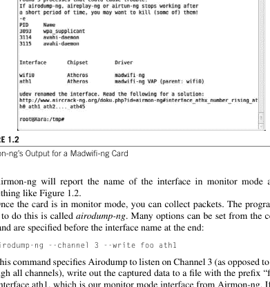

Airmon-ng 将报告监控模式下接口的名称，看起来类似于图 1.2。

一旦网卡进入监控模式，你就可以收集数据包。套件中用于此目的的程序称为 `airodump-ng`。可以通过命令行设置许多选项，并在末尾接口名称之前指定：

```
airodump-ng --channel 3 --write foo ath1
```

此命令指定 Airodump 在频道 3 上监听（而不是在所有频道之间跳频），将捕获的数据写入以 "`foo`" 为前缀的文件，并使用接口 `ath1`，即来自 Airmon-ng 的监控模式接口。如果你对 Airodump 或套件中任何程序的其他选项感兴趣，只需使用 `-help` 开关运行它即可。

一旦运行，你应该会看到网络开始填充列，数据包计数开始上升。图 1.3 显示了一个正在被捕获的单个网络；然而，如果你处于嘈杂的环境中，可能会出现更多网络。

如果一切运行正常，你应该会在显示中看到一个或多个网络列出。希望你的目标是其中之一。上部列出了当前活动的 AP 以及关于它们的一些基本信息。下部列出了客户端设备及其关联。

根据网络上已有的流量数量，你可能会开始看到目标的数据列数字开始上升。如果它上升得足够快，在你认为合理的时间内获取 50,000 个数据包，那么就只是等待时间的问题。如果没有流量，或没有客户端，或你只是不耐烦，你可以尝试 ARP 注入攻击来强制生成更多数据。

`Aireplay-ng` 处理 WEP 的大多数主动攻击。它应与你的捕获程序（如 `Airodump-ng`）同时运行。它具有许多命令行

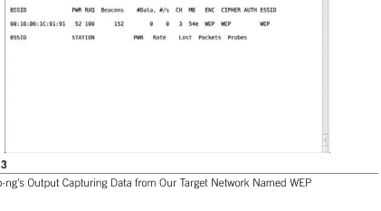

### 图 1.3

Airodump-ng 捕获我们目标网络 WEP 数据的输出

开关，但就本指南而言，我们将重点关注 ARP 重放，因为它是最高效且最广泛使用的：

```
aireplay-ng -3 -b 00:16:B6:1C:91:91 ath1
```

上述命令指定 Aireplay-ng 应使用攻击编号 3，即 ARP 重放攻击，目标的 BSSID，以及用于监听和注入的接口。由于我们未指定 "`-h`" 或主机选项，它默认为使用本地接口 MAC 地址。为了获得更好的结果，如果可以，请指定已关联客户端的 MAC。注意某些网卡在监控模式下无法注入，可能需要特殊的驱动程序或准备。

> NOTE
>
> 无论出于何种原因，Aircrack-ng 开发人员决定对于某些攻击 "`-a`" 是指定目标 BSSID 的开关，对于其他攻击则是 "`-b`"。如果你使用错误的一个，Aireplay-ng 足够智能，会提醒你应使用哪一个。

Aireplay-ng 将在接口上监听 ARP 数据包。ARP 数据包具有特定的大小（68 或 86 字节），即使加密后也十分突出。一旦捕获到一个，它会将其重新传输回 AP 导致 AP 回复另一个使用不同 IV 加密的 ARP，而 Aireplay-ng 将开始计数 ARP 数据包，如图 1.4 所示。这将开始产生大量数据以供破解。

如果你正在攻击一个没有客户端的 AP，并且使用本地 MAC 进行注入似乎不起作用，你有时可以通过从你的攻击客户端伪造与 AP 的关联来强制生成 ARP 数据包。

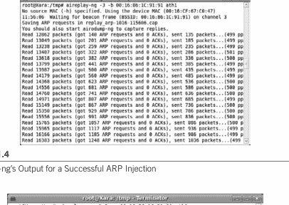

### 图 1.4

Aireplay-ng 成功 ARP 注入的输出

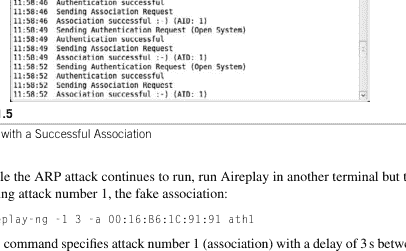

### 图 1.5

Aircrack-ng 找到密钥

在 ARP 攻击继续运行的同时，在另一个终端运行 Aireplay，但这次使用攻击编号 1，即伪造关联：

```
aireplay-ng -1 3 -a 00:16:B6:1C:91:91 ath1
```

此命令指定攻击编号 1（关联），在对指定 BSSID 的每次尝试之间延迟 3 秒，使用接口 `ath1` 进行监听和注入。由于未设置 "`-h`" 选项，使用本地 MAC。这些将尝试与 AP 关联，希望能生成 ARP 数据包来启动 ARP 注入。一次成功的关联看起来类似于图 1.5，包括笑脸。

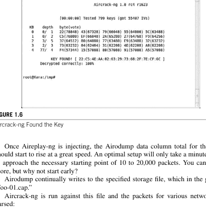

### 图 1.6

Aircrack-ng 找到密钥

一旦 Aireplay-ng 开始注入，Airodump 目标的数据列总数应以极快的速度上升。最佳设置只需一两分钟即可接近必要的起点 10 到 20,000 个数据包。你可以收集更多，但为什么不早点开始呢？

Airodump 不断写入指定的存储文件，在本指南中为 "`foo-01.cap.`"

Aircrack-ng 在此文件上运行并解析各种网络的数据包：

```
aircrack-ng foo-01.cap
```

如果有多个网络的数据包，你将被提示通过从列表中选择来指定其中一个。完成后，攻击开始运行。首先尝试 PTW 攻击，然后对数据进行早期分析以尝试检索密钥。

一次成功的攻击应产生类似于图 1.6 的结果，但密钥不同。

### 情况好转又变坏

随着时间的推移，人们慢慢开始明白他们需要保护自己的网络。安全专家和 wardriving 社区抓住每一个机会警告人们运行开放网络的危险。

> **NOTE**
>
> 有趣的是，`wigle.net` 在其从提交的网络中随时间推移的加密使用图表中显示，在 TJX 于 2007 年 4 月宣布出现问题以及随后媒体对无线安全问题的关注期间，出现了几乎 1% 的明显“跃升”。图 1.7 显示了 `wigle.net` 随时间推移的加密使用图表。

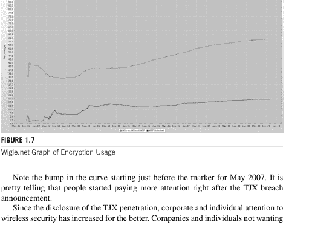

#### 图 1.7

Wigle.net 加密使用图表

注意曲线在 2007 年 5 月标记前不久开始的凸起。很能说明问题的是，人们在 TJX 泄露事件宣布后开始更加关注。

自 TJX 渗透事件披露以来，企业和个人的无线安全关注度有所提高。公司和个人不希望成为无线安全问题的下一个典型案例，纷纷努力从 WEP 升级到 WPA 和 WPA2 安全。虽然这在安全性上是明显的提升，但并非没有问题。

从密码学角度来看，WPA 和 WPA2 解决了 WEP 的许多问题。IV 计数器现在更大（48 位），并且实施了各种对策以防止困扰 WEP 的问题。进一步的改进包括用消息完整性检查（MIC），即 Michael 校验和数据包序列强制执行，取代每个数据包上的简单循环冗余检查（CRC），以防止 ARP 重放和类似攻击。

有一个问题设计者迄今为止无法消除。计算机安全自始以来就困扰的一个问题：人类的愚蠢。人们在选择难以破解的密码短语方面并不擅长。

### WPA 和 WPA2 简介

WPA 版本 1 是 IEEE 在 WEP 明显走向衰败时创建的临时解决方案。担心大规模过时以及消费者因在不久前投资后被迫购买新设备而产生的反弹，WPA 被设计为在为 WEP 设计的 AP 的有限硬件资源上运行。为此，WPA 仍使用 RC4 作为其流密码，这限制了设备负载。WPA2（也称为 802.11i）是 WPA 的最终且更安全的版本。WPA2 使用高级加密标准（AES）作为其流密码，这要安全得多，但需要仅在新一代 AP 中找到的资源，且在旧设备上不可用。

> **NOTE**
>
> WPA 的两个版本都可以在两种模式下运行。这些是预共享密钥（PSK）和企业或 RADIUS 模式。每个模式内有不同的设置，但这些是主要功能。
>
> 在 PSK 模式下，AP 本身处理身份验证并包含客户端 STA 和 AP 用于建立安全连接的共享密钥。在企业模式下，连接的客户端的所有流量都被阻止，除非是到身份验证服务器。那里 AP 可以传递进一步的凭据，如用户名和密码或证书，这些可以集成到更大的身份验证方案中，如 Active Directory。
>
> 总体而言，PSK 是家庭和小型企业最常见的解决方案。企业模式需要进一步的基础设施和更多复杂性，但具有集中控制和与目录服务集成以实现单点登录等附加好处。


在此过程中，`WPA` 和 `WPA2` 的设计者设法解决了除安全之外的问题。`WEP` 的一个问题是密钥本身，虽然不是从安全角度来看，而是从用户感到厌烦并关闭安全的角度来看。

`WEP` 密钥通常是 26 位十六进制数字（如果使用小于 128 位则更短），必须输入到客户端管理器软件中才能连接。这些密钥很长、复杂且容易输错，导致尝试连接系统时出现无尽的麻烦。此外，它们很难记住，因此几乎总是写在 `AP` 附近或用户桌子附近的便签上。更糟糕的是，大多数操作系统（`OS`）要求你手动输入两次，同时用星号或黑圈遮住你输入的内容。

更糟糕的是，没有关于密钥应如何输入的标准定义。一些设备默认为十六进制使用密钥；其他设备以 `ASCII` 格式使用它。并不总是清楚需要哪种格式。这导致了无尽的问题，特别是对于使用不同制造商的 `AP` 和客户端适配器的人来说。经常有人会购买使用 `ASCII` 密钥的 Apple Airport，并尝试使用其非 Apple 计算机的内置无线连接。另一个操作系统会要求以十六进制提供密钥，而 `AP` 会期望一个 `ASCII` 密钥会导致连接失败。更多情况下，这导致许多用户将接入点（`AP`）设置为最后已知的正常工作状态：无安全保护。

## WPA 的改进方案

为了解决这一烦恼，`IEEE` 在规范中包含了详细指南，说明如何从更容易记住的密码短语生成十六进制密钥。`WPA` 版本 1 和版本 2 在 `PSK` 模式下都使用由 `PBKDF2` 算法生成的 256 位十六进制密钥（而不是 `WEP` 最高 128 位）。

`PBKDF2` 算法生成一个称为成对主密钥（`PMK`）的密钥，随后用于驱动四次握手，以对进入网络的客户端设备进行认证。

该算法的基本原理如下：

```
PMK = (Passphrase + SSID + SSID Length),* 4096 SHA1 iterations
```

`PMK` 由用户提供的密码短语（8 到 63 个字符）与网络的 `SSID`（作为盐值）以及 `SSID` 长度拼接而成。然后经过 4096 次 `SHA1` 迭代计算，输出一个 256 位的值，这就是握手中使用的密钥。

这个系统的好处在于，用户只需记住一个简单的密码短语——其余部分都会自动生成，因为 `SSID` 已知，`SSID` 长度也已知。再也不必记住那些又长又难看的十六进制字符串了。只要你知道密码短语和 `SSID`，就可以在任何 `WPA` 客户端管理器中生成相同的十六进制密钥。

## 密码短语的安全性问题

大约在 `WPA` 版本 1 发布时，安全社区注意到规范中一段有趣的陈述：

> > 密码短语通常每字符具有约 2.5 比特的安全性，因此密码短语映射将一个 n 字节的密码转换为具有约 2.5n + 12 比特安全性的密钥。因此，它提供的安全级别相对较低，由短密码生成的密钥容易遭受字典攻击。只有在无法使用更强形式的用户认证时，才建议使用密钥哈希。由少于约 20 个字符的密码短语生成的密钥不太可能阻止攻击。

这一陈述来自 `802.11i` 规范，表明任何少于 20 个字符的密码短语都被认为是弱的，因为更短的密码短语不够随机，可能遭受字典攻击。这促使罗伯特·莫斯科维茨（Robert Moskowitz）为 `wifinetnews.com` 撰写了一篇文章，解释说由于攻击者知道所攻击网络的 `SSID` 和 `SSID` 长度，他们就已经掌握了用于组成密钥的几个部分，而密钥的全部安全性都依赖于良好的密码短语选择。从安全社区的角度来看，这并不是一个好前景。

文章还指出，密钥的生成方式毫无秘密可言，密钥的哈希版本会在站点（`STA`）和接入点（`AP`）之间传输，并且很容易被捕获。理论上，攻击者可以发动字典暴力攻击：将字典词插入 `PBKDF2` 算法，并运行 4096 次 `SHA1` 迭代。将得到的值与捕获到的哈希进行比较，如果匹配，攻击者就知道了明文密钥。

限制在于，可能的密码短语数量大得惊人。密码短语的长度可以是 8 到 63 个字符。密码短语的每个字符都有 94 种可选字符（`ASCII` 字符 32 到 126）——包括键盘上的所有大小写字母、数字和符号，因此可能性非常巨大。`SHA1` 算法也非常消耗 `CPU` 资源，计算时间相对较长，因此要进行穷举搜索需要数千年甚至更长时间。

弱点出现的环节正是公式中不属于数学运算的一个元素：人为操作者。由于密钥由用户自行选择，他们往往会选择基于字典单词的、易于记忆的密码短语。这大大减少了攻击者需要搜索的密钥空间。如果攻击者知道将搜索范围限制在字典单词内，就可以将搜索范围限制在几十万个单词，而不是数万亿种可能的组合。真正的麻烦在于，这种攻击只要求攻击者能够获得四次握手，并且他们可以在离线状态下、远离目标的地方花大量时间遍历单词列表。

## 工具与加速攻击

这一弱点最早由乔希·赖特（Josh Wright）在他的工具 `coWPAtty` 中实现。提供一份字典单词列表、你要攻击的网络的 `SSID`，以及一个包含密钥哈希版本的捕获文件，`coWPAtty` 就会遍历字典，对所有单词进行哈希计算，然后检查它们是否与捕获到的哈希匹配。如果匹配，你就得到了密码短语。

该程序的早期版本仅限于一路直接运行攻击，这意味着每次运行时都必须重新计算哈希。如果你在多个具有相同 `SSID` 的网络上测试密钥，这就会很烦人。由于重复计算多次，`CPU` 算力被白白浪费。

在 `coWPAtty` 版本 2 发布后不久，一个名为“`Wi-Fi` 教会”（Church of Wi-Fi）的无线研究小组启动了一个项目来加速这一过程。

> 注意
>
> 在密码哈希破解领域，有一个“彩虹表”的概念。它不是每次都对每个密码单独发起攻击并从头开始计算、每次都承担相应的 `CPU` 成本，而只是应用时间/空间权衡的概念，计算每一种可能的字符组合的哈希，并存储结果供以后查找。2005 年，`Shmoo` 集团（www.shmoo.com）向公众发布了他们的彩虹表，其中包含用于存储旧版 Windows 登录密码的 `LanMan` 哈希的所有可能密码。
>
> 时间/空间权衡更难应用于 `WPA` 密码短语。由于 `SSID` 和 `SSID` 长度被作为种子引入密码短语哈希，这意味着密码短语“password”在 `SSID` 为“linksys”的网络上的哈希结果，将不同于在 `SSID` 为“default”的网络上的哈希结果。因此，要为所有网络生成所有可能密码短语的穷尽哈希列表，还必须为每个可能的 `SSID` 都生成一遍，这显然数量巨大，而且需要海量存储空间，简直需要数千 `TB` 甚至更多。

`Wi-Fi` 教会采用了另一种方法来加速这一过程。他们认为，如果你针对某个 `SSID` 运行过一次攻击，为什么不把生成的测试哈希列表存储下来，以便以后遇到相同 `SSID` 时再次使用呢？例如，如果你遇到 `SSID`“wireless”，并针对其密钥运行字典攻击，即使没有成功，也保存输出结果；下次再遇到该 `SSID` 时，你就不必花费 `CPU` 时间对同一字典重新计算——只需查找之前的输出即可。

这一概念进一步扩展为：如果你知道目标的 `SSID`（也就是说，你正在进行渗透测试），你可以花费数天、数周或数月时间为该 `SSID` 生成哈希查找表，以便在现场节省时间。你可以在计划测试前让几台备用机器全天候运行，从而在现场获得时间优势。此外，你还可以将这些表保存下来用于下一次测试。最终成果是在 `coWPAtty` 中添加了 `genpmk` 程序，无需捕获握手即可生成哈希查找表。

为了展示这一改进，`Wi-Fi` 教会着手制作一套表，以尽可能提高恢复密钥的机会，而不是试图为所有可能的 `SSID` 构建所有可能密码短语的穷尽列表——后者在存储或合理时间内计算方面是绝对不可行的。他们的方法是在构建定向列表时运用一些心理学。你看，人们懒惰是可以预见的，他们倾向于选择容易记住的密码短语。此外，人们也会选择相当简单的 `SSID`，或者干脆保留制造商默认值。

他们结合常见且已知使用的密码短语列表，以及 `wigle.net` 上排名前 1000 的 `SSID` 列表（该列表约占其数千万网络数据库的 50%），为排名前 1000 的每个 `SSID` 计算了约 120 万个常见单词和密码短语的表，作为概念验证。如果你正在攻击或审计（可以说本质相同只是意图不同）一个配置了这些热门 `SSID` 之一的网络，就可以使用这些表：你可以快速查找，并将预哈希表与捕获到的哈希进行比较，比在现场进行 `CPU` 计算要快几个数量级。在一台奔腾 3、700 MHz 笔记本电脑上的测试显示，当时每秒能测试 12 个密钥，而仅从表中查找时每秒可测试 18,000 个密钥。

`Wi-Fi` 教会的表通过 `churchofwifi.org` 上的 `BitTorrent` 链接免费分发，或者对于带宽受限的用户，可通过 `www.renderlab.net/projects/WPA-tables` 购买 `DVD`。

在推进这一项目背后的想法时，`offensive-security.com` 的人们（`Backtrack` 可引导 Linux 安全发行版背后的团队）使用类似方法生成了 500 GB 的表。虽然他们从 `Wi-Fi` 教会的列表中删除了一些较为多余的 `SSID`，但涵盖了所有非常常见的 `SSID`。每个 `SSID` 的表为 1.9 GB，使用包含 4900 万个单词的字典。显然，这有点难以分发，但可以通过 `BitTorrent` 在 `www.offensive-security.com/wpa-tables/` 获取。

### 如何破解 WPA PSK 和 WPA2 PSK

因为 `WPA` 和 `WPA2` 共享相同的密钥生成机制，因此针对密码选择的相同攻击对两者都有效。当 `coWPAtty` 最初被修改以添加 `WPA2` 支持时，只需更改解析器中的几行代码；其余代码保持不变即可。


破解 WPA 密钥的能力基于两件事：所用字典的质量和大小，以及攻击者愿意投入的时间。如果使用的密码短语不在提供给 `coWPAtty` 的字典中，则无法恢复密钥的机会为零。然而，如果你使用一个巨大的字典或尝试进行穷举搜索，你将会在此世上某处无限期地等待。取决于你的意图，在专业审计中，更容易也更可行的做法是直接索取密码短语并确保它不会出现在攻击者可能使用的字典中。在渗透测试或实际攻击的情况下，手动测试哈希是下一个选择。

你最好的期望是对网络进行审计，并确保密码不在（或在，取决于你的意图）攻击者可获得的任何合理大小的字典中。

第一步是捕获客户端向网络进行身份验证时的四次握手。每个客户端都会执行此操作，在此过程中，密钥的哈希版本会通过空中发送。一旦我们获得它，就可以对其进行攻击。

如何捕获握手由你决定。可以使用的抓包工具如 `Wireshark` (`www.wireshark.org`)，但 `Aircrack-ng` 套件中的 `Airodump-ng` 可能提供了最简单的界面。参见本章中关于设置 `Airodump-ng` 监听目标的 WEP 破解教程：

```
airodump-ng --channel 6 --bssid 00:16:b6:1c:91:94 --write bar ath1
```

`Airodump-ng` 在收集用于 WEP 破解的数据包之外，还可以提醒四次握手已被捕获。当捕获到有效的握手时，在 `Airodump` 屏幕的右上角会出现“WPA Handshake”，以及它捕获的网络的 `BSSID`，如图 1.8 所示。

在有效客户端加入网络之前可能需要一段时间，即使如此，完整的握手也可能未被交换或捕获。可能需要通过去认证攻击来强制执行。

去认证攻击（deauth）是指攻击者伪造一条来自 `AP` 到客户端的消息，要求其断开连接。通常，这用于在 `AP` 即将关闭或重启时优雅地关闭会话。由于这类管理消息未加密且未经过身份验证，任何人都可以注入它们，客户端会服从并断开连接。几秒钟后，客户端发现网络已恢复（它从未离开），然后重新连接，从而泄露四次握手。

`Aireplay-ng` 有一个选项可以执行此攻击，同时还有其他工具，但 `aireplay` 的额外优势在于需要指定目标，并避免了对其他网络的非预期断开造成的附带损害：

```
aireplay-ng -0 5 -a 00:16:b6:1c:91:94 -c 00:0e:35:76:53:47 ath1
```

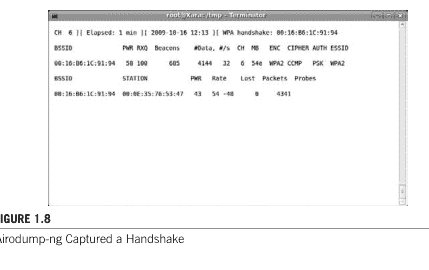

#### 图 1.8

`Airodump-ng` 捕获了握手

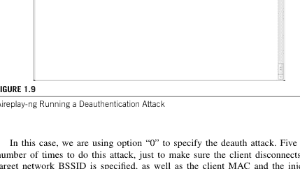

#### 图 1.9

`Aireplay-ng` 运行去认证攻击

在这种情况下，我们使用选项“0”指定去认证攻击。5 是执行此攻击的次数，只是为了确保客户端断开连接。指定了目标网络 `BSSID`，以及客户端 `MAC` 和注入接口。一旦此命令运行，`Aireplay-ng` 将对客户端进行五次去认证，希望当客户端重新连接时，`Airodump-ng` 会捕获握手。`Aireplay` 显示的输出与图 1.9 相似，当然会替换为你的目标地址。

一旦你拥有有效的四次握手，就可以开始破解过程。这种攻击的好处在于它只需要握手，如果运气好，可以在几秒钟内被动捕获。攻击的其余部分可以在其他地方离线进行，不需要目标网络。

> 提示
>
> 捕获完整的 4 次握手哈希比听起来更棘手。客户端管理器、`AP` 行为的差异，甚至处于信号边缘，都可能导致捕获不完整。如果你在捕获完整握手时遇到困难（如果 `coWPAtty` 报告如此），请尝试调整你相对于 `AP` 和客户端的位置并重试。其他方法都失败时，等待客户端正常登录，因为某些客户端在被去认证后重新关联时会表现异常。

`CoWPAtty` 在数据收集后开始攻击只需要几条信息——在这种情况下，是 `wpa2psk-linksys.dump` 捕获文件：

```
cowpatty -r wpa2psk-linksys.dump -f dict -s linksys
```

在这种情况下，捕获文件为 `wpa2psk-linksys.dump`，字典文件为 `dict`，以及我们要攻击的网络的 `SSID`，在本例中为 `linksys`。`CoWPAtty` 将解析捕获文件，如果存在完整的握手，破解将开始；否则，它将报告握手不完整，你应该尝试重新获取。如果握手完整，`coWPAtty` 将通过 `PBKDF2` 算法使用指定的 `SSID` 计算字典中的每个单词并将其输出与捕获内容进行比较。如果匹配，则报告成功的密码短语。如果不匹配，则继续下一个。图 1.10 显示该网络的 `PSK` 是字典中的词。

根据你使用的 `CPU` 和字典的大小，遍历列表所需的时间会有所不同。然而，如果有匹配，`coWPAtty`

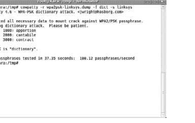

#### 图 1.10

`CoWPAtty` 成功检索到密码短语

会报告成功。在图 1.10 中，`CPU` 每秒可处理约 100 个密码短语，并在 37 秒内遍历了相当短的字典（约 10,000 个词）。如果这是一个你经常审计的 `SSID`，你可能不希望每次运行同一列表时都花费所有 `CPU` 时间。在这种情况下，你需要将输出保存到查找表中。

> **史诗级失败**
>
>
> `CoWPAtty` 要求字典是一个简单的单词列表，采用 `UNIX` 文本文件格式，而不是 `DOS` 格式。`DOS` 格式的文本在每个单词末尾都有一个隐藏的控制字符，而 `UNIX` 格式则没有。如果你向 `coWPAtty` 提供 `DOS` 格式的列表，其解析器会将隐藏的控制字符作为密码短语的一部分进行计算。因此，列表中使用的密码短语 "`password`" 实际上会被计算为 "`password.`"，当然，结果哈希将与使用密码短语 "`password`" 的网络的捕获不匹配。`Wi-Fi` 教会在生成其表时曾两次遇到这种情况，不得不废弃数月的工作。

查找表的数学原理与运行“实时”破解完全相同，只是不同于与捕获文件进行比较，单词的哈希版本及其明文版本会被写入文件。然后可以稍后查看该文件以快速查找匹配项。要生成自己的查找表，`coWPAtty` 提供了程序 `genpmk`：

```
genpmk -f dict -s linksys -d linksys.hash
```

`Genpmk` 接受一个词列表（`dict`）、网络 `SSID`（`linksys`），并将生成的哈希输出到文件（`linksys.hash`）。此过程花费的时间与直接在捕获上运行 `coWPAtty` 几乎相同，如图 1.10 和图 1.11 之间所花费的时间；然而，该文件随后可以反馈给 `coWPAtty`，以便在后续测试中进行更快的查找。

你最有可能想要计算哈希文件的情况是，如果你提前知道目标，并希望在非工作时间（夜间或其他空闲 `CPU` 时间）花费时间，以便在现场获得时间优势（现在花费时间以便在现场节省时间），或者如果你反复进行相同的操作，并希望通过只投资一次并保存输出以供以后使用来节省时间。如果遍历词列表需要一个小时，而不是每次访问都花费一个小时，如果你只做一次并保存输出，你每次都可以有效地节省一个小时。一旦生成了哈希文件，你可以将其输入以替代或补充字典。`CoWPAtty` 将快速浏览哈希文件以查找匹配项。如果未找到，它将报告失败，或者如果你指定了词列表，它将使用该列表开始 `CPU` 密集型破解。如果你在图 1.10 和图 1.12 之间查看破解速度，你会看到明显的速度提升：

```
cowpatty -r wpa2psk-linksys.dump -d linksys.hash -s linksys
```

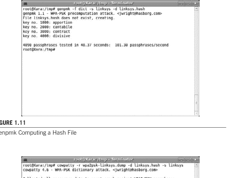

#### 图 1.11

`GenPMK` 计算哈希文件

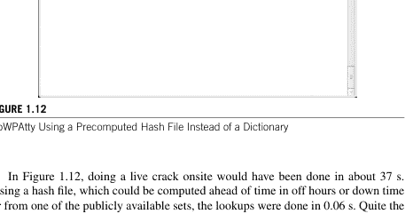

#### 图 1.12

`CoWPAtty` 使用预计算的哈希文件代替字典

在图 1.12 中，现场实时破解大约需要 37 秒。使用哈希文件，该文件可以在非工作时间或空闲时间提前计算，或来自公开可用的集合之一，查找则在 0.06 秒内完成。如果最终多次重复使用哈希文件，节省的时间相当可观。

近期的发展有助于改进 `WPA` 破解和哈希表生成中计算密集型部分的流程。现场可编程门阵列（`FPGAs`）的使用——这是一种可编程处理器——显示出比通用 `CPU` 更快的 `SHA1` 实现，因为算法已内置于硬件本身。这意味着 `FPGA` 只做一件事，而且做得非常快。此外，像 `Nvidia` 和 `ATI` 这样的公司在显卡图形处理单元（`GPUs`）方面的最新进展，使得非视频处理可以在其芯片上运行。这些芯片更适合执行此类计算。示例实现可在 `http://code.google.com/p/pyrit/` 获取

### 摘要


WPA-PSK（和 `WPA2-PSK`）相比 `WEP` 是一种改进，通过为用户记住和输入密码短语创建更简单的方法，IEEE 在其中引入了人为缺陷。`WPA-PSK` 拥有 256 位密钥，比 `WEP` 的 128 位提供更强劲得多，而该密钥的随机性基于用户选择随机密码短语和唯一 `SSID` 的能力，而一般来说，人们在这方面并不擅长。

简而言之，一切都取决于选择一个好的密码短语。尚未有 `WPA-PSK` 密码短语被此类攻击破解的报告；然而，实际上几乎无法检测到此类攻击的发生。不过根据专业渗透测试人员的经验，使用 Wi-Fi 教会表在 `SSID` 位于列表中的情况下成功率约为 50%，这意味着攻击者有相当的机会进入现场并破解密码。这只是说明，如果你使用 `WPA-PSK`，最好遵循 IEEE 标准中的建议，使用 20 个字符的密码短语，不基于任何字典单词，并由大写和小写字母、数字和一些符号组成，以求稳妥。

降低 `WPA` 暴力攻击风险的其他措施：

- 定期更改密码短语（保持长度和随机性）
- 定期更改 `SSID`，从而更改盐值
- 如果发送敏感或财务数据，请考虑安装和使用无线入侵检测系统（`WIDS`）
- 如果可能，迁移到 `WPA-Enterprise` 解决方案
- 教育用户复杂密码短语的必要性

### 注释

1. www.netstumbler.org/t22/faq-legalities-concerning-wardriving-netstumbling-nethugging-6430/#post48649; [检索于 01.12.09].
2. http://standards.ieee.org/getieee802/download/802.11i-2004.pdf; [检索于 01.12.09].

# 无线 – 客户端攻击

## 本章信息

- 公共热点危险
- 热点的工作原理
- 攻击公共热点
- 问题的核心
- 解决方案
- 注入攻击

无线网络安全正在变得更好。当 2001 年首次出现 `Wardriving` 时，统计数据显示只有约 30% 的接入点采用某种加密进行保护。今天这一数字接近 70%，表明人们在保护接入点方面正在缓慢进步。自那以后，无线客户端设备已成为攻击者的诱人目标。员工变得越来越移动，依赖办公室和外出时的无线网络访问。公共热点的可用性使公众越来越习惯于在他们可能前往的每个咖啡店、机场和酒店都能获得互联网访问。

客户端安全经常被忽视，因为用户在连接到“家庭”网络时才经常想到它。实际上，客户端有时更具诱惑力，因为它们可以在信息技术（IT）部门的监视视线之外受到攻击，并且通常可以包含同样有价值的信息或成为进入网络的有用入口点。

2006 年初，游牧移动研究中心（`NMRC`）的 `Simple Nomad` 在华盛顿特区的 `Shmoocon` 上发表演讲，概述了他在一场题为“Hacking the Friendly Skies.”的演讲中的经验。在他的演讲中，他详细说明了他能够访问在跨国航班 30,000 英尺高空使用的笔记本电脑上的私人文件并操纵信息的方式。他的发现和技术表明，他能够在测试的每一次飞行中至少找到一个易受攻击的目标，通常无需任何提示或与用户的交互。他的行为表明，每一位携带笔记本电脑的头等舱高管都是潜在目标，即使在更不寻常的环境中，远离 IT 管理员的监视视线（www.nmrc.org/pub/present/shmoocon-2006-sn.ppt）。

酒店度假者通常是诱人的目标。你连接到的以酒店命名的热点实际上是酒店网络没有任何保证。以 2008 年在拉斯维加斯丽都酒店和赌场举行的 `Defcon 16` 黑客大会为例。在大会之前，从泳池可以检测到 12 个具有酒店网络服务集标识符（`SSID`）的接入点。在为期三天的大会的第一天之后，可用的接入点增至 130 个。赌场的某些赔率对你更有利，而一个不幸的旅行者连接到合法接入点则不是其中之一。

## 公共热点危险

几乎每个人都熟悉公共 Wi-Fi 热点的概念。每个咖啡店似乎都有一个，以及餐馆、酒吧、杂货店、机场和酒店。特别是酒店，几乎需要无线互联网接入才能保持竞争力，而且随着今天似乎无休止的航班延误，机场无线可能是阻止商务旅客发动叛乱的唯一因素。

大多数人似乎没有想到的是，将计算机带到一个你没有任何理由或方式验证或信任的随机网络所固有的危险。你会把台式电脑带在身边并连接到任何随处可见的随机网络电缆吗？当然不会（除了明显的搬运问题之外），然而人们经常将他们的移动无线设备连接到看似随机的网络，而不考虑谁可能在同一网络上。

从攻击者的角度来看，邻里咖啡店里所有顾客都坐在沙发上使用笔记本电脑，是针对无线客户端进行定向欺诈和滥用的主要场所。举办会议的酒店也是非常诱人的目标。

## 热点的工作原理

公共热点没有固定的标准。它们是围绕商业模式而非技术模式设计的。其主要目的是吸引顾客并让他们停留足够长的时间以点第二杯（或第三杯）咖啡。

在无线早期，这很简单：店主只需将数字用户线路（`DSL`）或其他高速线路接入业务并插入一个开放的接入点即可。这效果很好：客户可以毫无问题地连接。不久之后不可避免的事情发生了，所有邻近的家庭和企业注意到这个新的开放网络，并继续免费使用而不向店主购买任何东西。短时间内，合法用户抱怨速度慢，店主发现系统上的用户比店内多出几十个。然后他们继续启用加密并张贴标志让客户询问使用无线密码。这在一段时间内有效，直到邻居们发现他们可以进去买菜单上最便宜的东西并且获取网络密钥并照常使用。业主再次弄清楚系统为何突然变慢，并开始每天更换密钥的制度。过了一段时间，这变得繁琐且得不偿失，导致业主最终对所有人禁用它。

这是一个典型的公地悲剧的例子，这是一个博弈论概念，其中一个人多占用公共资源的一部分并不是问题，除非每个人都这样想，群体最终会过度消耗该资源，从而对所有人造成破坏。常见的例子是一群牧羊人把羊群赶到公共土地上放牧。如果一个人多放几只羊，额外的放牧不会那么显眼。问题源于每个人对 `Windows XP`（服务包 1 之前版本）的一种有趣行为，其中无线客户端可以被攻击者诱骗从安全网络切换到不安全网络，攻击者只需设置一个 `SSID` 相同但未加密且信号强于安全网络的网络，然后向客户端发送伪造的去认证命令。客户端会重新关联到信号最强的网络（未加密的 rogue 网络），并且不会向用户弹出任何提示，告知发生了什么或他们已切换到不安全网络。这种弹出行为在 `XP` 的 `SP1` 中得到修复，并提高了人们的认识——好坏参半——即某些客户端管理器在存储和重新连接到首选网络的方式上具有有趣且潜在危险的行为。

被利用的行为是一种便利性。用户经常会连接到许多不同的网络（工作、家庭、咖啡店、机场等等），每个网络都需要不同的设置。大多数，如果不是全部的客户端管理器软件都会记住之前连接过的网络（通常是 `SSID`、网络密钥等等）并存储这些设置。在某些客户端管理器中，未连接网络时的默认行为是自动连接到之前连接过的这些网络（在其他客户端管理器中，有一个设置可以启用自动连接；否则系统会先询问）。这在首选网络列表中设置了通用 `SSID` 时会造成一种有趣的情况。

“`Linksys`” 是世界上最常见的 `SSID`，根据 `wigle.net`¹ 的数据，在任何给定时间占 `wigle.net` 数据库的 8% 到 9%。这些网络使用的是 `linksys` 无线设备的默认 `SSID`，而且如果设备使用默认 `SSID`，设备的其余部分通常也处于默认状态，即未加密。如果用户在其首选网络列表中输入了“`linksys`”，许多系统仅根据 `SSID` 区分网络，并会假设任何名为“`linksys`”的网络都是列表中最初输入的那个网络并尝试连接。这在无线社区中通常被称为网络漂移。许多客户端管理器会优先选择具有信号强度最高，并且很有可能附近存在一个开放的 `Linksys` 接入点，客户端会突然发现自己连接到一个与预期不同的网络。

> **NOTE**
>
> `SSID` 是大多数人所称的扩展服务集标识符或 `ESSID`。它是指用户所见的网络的逻辑名称。基本服务集标识符或 `BSSID` 通常被称为 `MAC` 地址，因为它与无线接入点的 `MAC` 地址相同。

`Hotspotter` 在主模式下监听无线接口。当它听到来自客户端的探测请求时，会检查一份常见的商业热点名称列表，如果找到匹配项，就将自身配置为被请求的接入点，客户端（通常）会自动连接。从此之后，攻击者可以让 `Hotspotter` 触发 `DHCP` 守护进程、端口扫描——他或她想做任何事情。

再次，这种行为一次只能模拟一个目标。如果你攻击的是一个大群体，比如在会议上会遇到的情况，那么你希望能够配置多个被探测的 `SSID`，而不仅仅是一个预定的列表。

2004 年，`Dino Dai Zovi` 和 `Shane Macaulay` 编写并分发了一个名为 `Karma` 的程序。这正是攻击者长期以来一直在寻找的软件。`Karma` 的运作方式与 `Hotspotter` 类似，监听来自客户端的探测广播并作出回复。不同之处在于，他们对 Linux 下使用的 `Madwifi` 驱动程序进行了修补，允许动态即时创建对探测的回复。这意味着如果十几个客户端都在探测不同的网络，`Karma` 就能够动态地对这些探测和关联请求作出回复，无论 `SSID` 为何。

对话变得简单如下：

```
客户端 1："我在找 mycorpnet。你是 mycorpnet 吗？"
Karma："当然，我就是 mycorpnet，进来吧。"
```


客户端 2："你是 `supersecretinjanetwork` 吗？我正在找 `supersecretninja-network`。"

Karma："为什么不呢？我也是 `supersecretinjanetwork`，连接到我吧！"

一次又一次，等等……

Karma 还附带了一套用于模拟常见服务的工具。如果已连接的客户端正在运行电子邮件客户端，在网络连接建立时它很可能会尝试连接。Karma 会看到 POP3 请求并记录登录用户名和密码。如果没有第二张卡提供到互联网的回程，请求就不会通过，但攻击者现在已经获得了你的密码和服务器地址。DNS 请求被重定向、网页请求和其他常见服务也一样。简而言之，攻击者已将自己建立为中间人（也称为 MitM），可以查看并记录来自多个客户端发送的所有内容，而这些客户端却以为自己在与不同的（真实）网络通信。

> **TIP**
>
> 此攻击的成功取决于许多因素，包括信号强度以及网络是否更具吸引力。尝试使用更好的或更定向的天线、更高功率的网卡，或 simply 靠近目标。经常你会发现自己与房间内的接入点竞争，必须能够压制它。
>
> 此外，某些操作系统的最新服务包和更新在连接到开放接入点之前需要用户输入或某种交互，即使它在首选列表中。话虽如此，仍有一些客户端管理器和其他设备在范围内时会自动建立网络连接。

作为对这种新攻击水平的回应，无线客户端厂商收紧了其软件，现在许多设备除非被明确选择（即用户必须“点击连接”）否则不会自动连接。话虽如此，软件仍会列出附近可供选择的网络列表，包括那些被探测过且 Karma 作出回复的网络，因此粗心的用户可能会看到一个常见的商业热点而认为连接是安全的，却发现自己已连接到一个正在监控其所有通信的攻击者。即使受害者立即意识到有问题并断开连接，损害可能已经造成。今天的许多应用程序，从网页浏览器到电子邮件客户端、Really Simple Syndication（RSS）阅读器等，在网络连接时会自动尝试连接，因此一旦受害者连接，这些应用程序就会自动尝试连接，往往在几秒钟内泄露用户名、密码和其他信息。

如果这还不够危险，2008 年 Karma 被集成到 Metasploit 框架中。Metasploit 框架是一种渗透测试工具，可帮助构建和执行漏洞利用，同时还包含数百个现成的漏洞库。该框架通过处理交付机制、有效载荷等的许多常规开销，使这一过程变得简单。撰写本文时，它尚未完全集成，需要一些外部软件运行（用于分配地址的 DHCP 服务器和用于响应探测的 Airbase-ng），但已处于开发阶段，客户端探测会得到响应，客户端可以连接，框架会记录不安全协议的凭据，如果攻击者愿意，还可以向任何合法请求的网页注入攻击。预计会进一步集成，应能克服需要外部软件的复杂性，提高自动扫描和利用任何连接客户端的能力，从而使这成为攻击者手中极其可怕的工具，但在渗透测试人员手中则是非常有用的工具。

> **NOTE**
>
> 尽管客户端的改进，例如 Windows Zero Config，使得从现代 Windows 操作系统（OSes）完全自动连接变得稍微困难，但仍有大量其他设备对这种情况非常脆弱。手机现在具有 Wi-Fi 功能，智能手机、MP3 播放器——甚至数字相框和游戏机也使用 Wi-Fi，可以被诱导连接到攻击者。威胁并不总是显而易见。

攻击者认为这些攻击的最佳环境之一是在离地 6 英里的空中。谁没有坐过飞机，特别是飞往伦敦或纽约等商业中心的长途航班，安全带指示灯一关闭，笔记本电脑就拿出来，从公司高管到度假的冲浪者都在拿出笔记本电脑工作、看电影或玩游戏？更常见的是，他们忽视了机组人员和联邦航空管理局（FAA）关于飞行中无线设备的警告，没有禁用其 Wi-Fi 适配器（仍会消耗有限的电池电量），并且继续探测网络。

> **WARNING**
>
> 除非机组人员明确允许无线（即航班提供机上 Wi-Fi），一般来说，许多国家的联邦法律都禁止在飞行中使用 Wi-Fi 或任何无线设备。请记住这一点。然而，Wi-Fi 干扰飞行系统的可能性极小。如果这真的是危险，机上 Wi-Fi 不会被允许，一般笔记本电脑也会被禁止，因为因为乘客启动 Windows 并忘记禁用 Wi-Fi 卡而导致飞机坠落不是一个好情况。总的来说，这些规定是作为预防措施制定的，是一个好主意，因为离地 6 英里并以每小时 500 英里的速度飞行对人类来说不是正常情况，而重力是一个严厉的主人。

虽然少数航空公司提供机上 Wi-Fi 服务（那些服务容易受到另一整套攻击），但大多数不提供。飞机的环境非常适合攻击无线。听起来很奇怪，但请考虑一下，周围没有其他网络，所以如果你使用 Karma 或类似工具建立自己的网络，你将是他们看到的唯一网络。身处长长的金属管中并在海洋上空飞行也限制了任何干扰，因此你经常会发现，从机尾的经济舱可以捕获头等舱的探测客户端。一旦他们连接到你，并且你作为攻击者为他们分配一个地址，你现在就与他们的计算机建立了直接连接。你可能无法提供任何互联网访问，但你可以长时间地探测他们的系统，而不会觉得奇怪你也打开了笔记本电脑。

来自 Simple Nomad 的“Hacking the Friendly Skies”演示以及来自各种无线留言板的轶事证据表明，令人惊讶的大量设备没有运行软件防火墙或似乎没有任何来自本地局域网（LAN）上其他客户端的保护。开放共享包含公司文档，以及易受攻击的、随时可被接管的应用程序。一个准备充分的攻击者正处于大肆破坏的绝佳境地。加上机上 Wi-Fi 可提供事先无法预见的漏洞访问途径，就没有什么是不能发生的了。

## 问题的核心

在有线网络时代，许多攻击都需要攻击者设法将自己置于受害者与正在通信的系统之间以便进行监控。至少，攻击者必须找到办法让自己接入本地 LAN 的一端或另一端。早期在基于集线器的网络中，攻击者可以看到线路上的所有内容；后来，在交换式网络中，则需要像 ARP 欺骗网关之类的中间步骤才能将流量重定向通过攻击者。这通常被称为 MitM 攻击，因为攻击者冒充对话中的双方参与者，可以按其意愿监控或操纵对话。有了物理限制，你就可以限制攻击者对电缆网络的访问，因为他或她在物理上必须插上网线或对本地 LAN 中的设备拥有远程控制权。

对于无线网络，这一障碍就降低了，因为正如你所见，让客户端将所有流量都通过你进行路由非常容易。鉴于 SSL 的最新漏洞，即使加密网页或使用虚拟专用网络（VPN）也可以使用像 `sslsniff` 这样的工具（`www.thoughtcrime.org/software/ssl sniff/`）来击败。在这种情况下最糟糕的情况是用户根本没有打算使用 Wi-Fi。

通常用户会自以为聪明，利用非 Wi-Fi 连接来接入互联网或 VPN 回到办公室。一些酒店很容易获得 3G 调制解调器和有线网络连接，使得这种情况很现实。虽然这是解决 Wi-Fi 问题的一个不错的方案，但在使用其他网络连接时，用户往往不会禁用无线适配器。

Windows 和其他操作系统通常足够智能，当存在多个网络连接时，只会使用最后、最最近使用的网络，或者至少使用最后连接的网关。出于各种原因，一些系统的网络接口会被桥接在一起（例如 Windows Internet 连接共享功能）。这可能导致一种有趣的情况，即客户端实际上成为其他网络连接的接入点和网关。如果其中包括 VPN 连接，攻击者就会直接被路由进入企业网络（或互联网），这对企业安全造成明显问题。

## 解决方案

有了像 Karma 这样能够冒充任何开放接入点的工具，很难防御连接到虚假接入点的可能性。最好的防御是限制在这种情况下可能发生的事情。

第一个对策是使用软件防火墙，并制定仅允许所需流量通过而拒绝其余流量的策略。如果发现自己已连接到虚假接入点，至少你不会与攻击者共享所有文件。

下一个解决方案是尽可能避免使用 Wi-Fi，并在不使用时禁用适配器。如果有有线连接可用，选择该选项并禁用无线适配器，同时确保防火墙等预防措施到位，将大大降低威胁。

要谨慎连接你无法验证的东西。当你在机场看到六个接入点时，你怎么知道机场只有五个，哪个是攻击者？大多数公共热点不会公布接入点的 BSSID，因此无法知道哪些是合法的。那些在


通常用户会自以为聪明，利用非 Wi-Fi 连接来接入互联网或 VPN 回到办公室。一些酒店很容易获得 3G 调制解调器和有线网络连接，使得这种情况很现实。虽然这是解决 Wi-Fi 问题的一个不错的方案，但在使用其他网络连接时，用户往往不会禁用无线适配器。

Windows 和其他操作系统通常足够智能，当存在多个网络连接时，只会使用最后、最最近使用的网络，或者至少使用最后连接的网关。出于各种原因，一些系统的网络接口会被桥接在一起（例如 Windows Internet 连接共享功能）。这可能导致一种有趣的情况，即客户端实际上成为其他网络连接的接入点和网关。如果其中包括 VPN 连接，攻击者就会直接被路由进入企业网络（或互联网），这对企业安全造成明显问题。

### 解决方案

有了像 `Karma` 这样能够冒充任何开放接入点的工具，很难防御连接到虚假接入点的可能性。最好的防御是限制在这种情况下可能发生的事情。

第一个对策是使用软件防火墙，并制定仅允许所需流量通过而拒绝其余流量的策略。如果发现自己已连接到虚假接入点，至少你不会与攻击者共享所有文件。

下一个解决方案是尽可能避免使用 Wi-Fi，并在不使用时禁用适配器。如果有有线连接可用，选择该选项并禁用无线适配器，同时确保防火墙等预防措施到位，将大大降低威胁。

要谨慎连接你无法验证的东西。当你在机场看到六个接入点时，你怎么知道机场只有五个，哪个是攻击者？大多数公共热点不会公布接入点的 BSSID，因此无法知道哪些是合法的。那些在标志上公布 SSID 的热点会让攻击者更容易知道要冒充什么名称。连接到公共 Wi-Fi 就是一场赌博。即使是合法 AP 的 BSSID 也很容易被冒充（检查 BSSID 确实会略微降低被利用的几率，因为这一步攻击者有时不会执行）。使用 3G 或其他蜂窝互联网连接可能更安全。

如果可能，安装一个替代的客户端管理器。由于标准的缘故，你并不局限于无线适配器附带的客户端管理软件。制造商提供的产品通常很简单，无法强制执行关于连接什么以及在哪里连接的规则。市面上有很多第三方客户端管理器，通常来自无线安全厂商，他们可以为这种情况提供更多逻辑和理智。一个例子是 `Airtight Networks SpectraGuard`（`Secure Agent For Endpoints`），它可以强制执行策略以防止不安全行为，例如连接到不安全的接入点（连接必须加密）、防止自组织网络连接、防止适配器桥接并仅允许连接到特定的 BSSID，提供比仅按 SSID 选择接入点更精细的接入点选择。这种系统对大型企业用户有明显的益处，他们可以使用现有的集中管理工具推送此类软件，防止用户做出危险的错误。通常，此类软件还可以超越仅控制 Wi-Fi，并对 Bluetooth、WiMax、拨号或其他任何网络连接强制执行规则。

### 注入攻击

2004 年，在 `Defcon 12` 上，网络上出现了一些异常。现在任何熟悉每年在拉斯维加斯举行的 `Defcon` 黑客大会的人都知道，那个周末的网络设置可能是地球上最具敌意的网络。只要连接，你就真正是在拿自己的生命（或至少是自己电脑的生命）冒险，因为网络通常被认为是一个自由竞争的区域。常见的玩笑是他们应该把防火墙反过来并将 `Defcon` 网络与互联网隔离开：那样更容易。今年，然而，造成困惑的是无线网络上的一种异常行为，没有人能够真正解释。鉴于大会上智力集中的程度，这是一个罕见的情况。

用户通常会坐在“放松区”里，在电脑上做谁知道什么的工作。有一段时间，用户开始注意到他们请求的网页上的图像与预期不符。请求 Google 首页会返回 Google，但主图像与预期不同。同一图像出现在多个用户在多个网站上的多个页面上。当然，鉴于 `Defcon` 以及与会者倾向于的幼稚倾向，该图像是相当恐怖的。显然，用户期望看到 Google 的标志性标志却收到恐怖画面，导致一些真正困惑的用户和一些非常有趣的反应（我刚才提到过，“地球上最具敌意的网络”。他们期望什么呢？）

各种用户开始检查 DNS 设置，检查是否连接到 rogue AP，或甚至启动数据包嗅探器来弄清发生了什么。除了肇事者之外，几乎没有人（如果有的话）在那个周末弄清楚发生了什么，直到肇事者后来宣布了这次相当搞笑的黑客攻击。一个名叫 Toast 的家伙声称负责并发布了他编写的用于执行此操作的工具，名为 `Airpwn`。

要理解正在被攻击的是什么，你必须理解事情正常时是如何运作的。当你请求一个网页时，你的系统会通过基本的 `SYN/ACK` 握手连接到远程服务器：

```
Client -> Server "GET /foo.html HTTP/1.0" seqno 123 ack 456
Server -> Client "<HTML...>" seqno 456 ack 145
```

客户端浏览器发送对指定页面的 GET 请求，“`GET /foo.html HTTP/1.0`”，连同序列号（`SEQNO`）和前一个数据包的确认号（`ACK`）。服务器通常返回包含所请求超文本标记语言（HTML）页面的数据包，指定更高的 `SEQNO` 和前一个数据包的 `ACK`。对页面上的每个文件（图像、Java Script 等）重复此过程。

`Airpwn` 基于一个简单的原理运作，如下所示：在开放网络上，攻击者可以看到你的数据包通过空中，就像旧的共享介质（基于集线器）有线网络一样。正常网页服务器的请求往返需要一点时间。由于我们同处一室，我们通常可以比远程服务器更快地做出回复。

攻击看起来是这样的：对文件的正常请求被发出，只是攻击者看到了它。然后他使用适当的 `SEQNO` 和 `ACK` 制作响应，伪造源 MAC 地址使其看起来来自接入点，就像合法响应一样，只是响应包含攻击者的内容。只要内容足够小，可以在真实数据包到达之前发送，攻击者就可以通过 `FIN` 数据包关闭连接。原始请求现在将失序并被丢弃。浏览器将接受攻击者的内容并据此渲染，可能涉及对细腻感受的任何损害。在示例配置中，有几种不同的例子。图 2.1 显示了简单的图像替换，其中图像被替换为“AIRPWNED”图形。图 2.2 显示了 HTML 的替换。

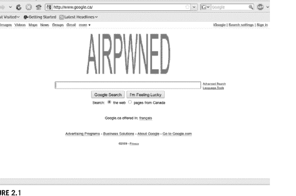

#### 图 2.1

`Airpwn` 对 Google 的图像替换

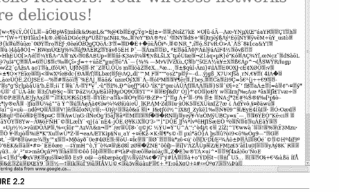

#### 图 2.2

`Airpwn` 替换 HTML

其核心是一场竞赛。如果攻击者能够击败远程服务器，由于响应是预期的并且其 `SEQNO` 顺序正确，它会被盲目接受为合法内容并传递给浏览器。

它在 `Defcon` 首次亮相时，被视为一个有趣的派对小把戏，人们对它还能做什么有些兴趣，但像许多工具和攻击一样，它似乎从未发展起来。随着时间的推移，进行了一些更新以适应新技术和能力，但它在黑客社区中变得有些另类。它可用于展示内容替换和注入，但仅限于在会议上作为玩具，通过在空中数据中插入奇怪或令人困惑的图像来戏弄与会者的心智。

`Airpwn` 还展示了一种不常见的有趣漏洞。由于它注入的是预期内容，客户端系统上的软件防火墙会毫不犹豫地放行这些 rogue 数据。只要注入的数据不符合已知病毒或可检测的攻击模式，它就会静默通过防火墙到达浏览器，打开了许多滥用的可能性。

#### 史诗级失败

`Airpwn` 一直是很有用的工具，用来向用户强调使用不安全网络的风险。仅靠解释风险是不够的；向数据流中注入替代图像或 HTML 并让其在他们自己的屏幕上显示，能更直观地表明他们正处于风险之中。这很有效，因为它不会造成任何永久性损害。进行这些演示的人在选择演示的时间和地点时需要谨慎。

2008 年，在多伦多的 `SecTor`（`www.sector.ca`）会议上，`RenderMan` 正在进行 Wi-Fi 安全诊所，演示各种攻击并帮助与会者在演示接入点上运行攻击。作为其中的一部分，展示了 `Airpwn` 注入数据。不幸的是，它在与会议网络同一频道上运行了数小时。`Hackers for Charity`（`www.hackersforcharity.org/`）的 `Johnny Long` 上前询问为什么网络行为异常。原来 `Airpwn` 正在注入额外的 HTML，导致 `Johnny` 无法为回程航班办理登机手续。尴尬的是，`RenderMan` 必须终止 `Airpwn` 以便 `Johnny` 完成重要任务，这证实了凡事都有时间地点之分，并且不要忘记你留下了哪些工具在运行！

#### 史诗级失败

快进到 2009 年，`Kismet` 无线嗅探工具的作者 `Dragorn` 以及其他研究人员开始研究 `Airpwn` 以及传输控制协议流劫持（这是该攻击的正确名称）实际上能做什么。这一切始于希望替换不仅仅是图像，并能够即时替换 Flash 视频流。随着 YouTube 和其他基于 Flash 的视频网站的流行和普及，它们自然成为热门目标，人们希望用 “RickRoll” 或其他合适内容替换观看的任何视频。

> 注

>


RickRoll 是一种互联网迷因，人们试图通过诱饵和调包手法 `trick` 别人观看 1987 年 Rick Astley 的音乐视频 “Never Gonna Give You Up”。通常是通过缩短链接或重定向进行的，并以指向其他内容的链接形式提供给受害者，最终却让他们到达 Rick Astley 的视频，并由肇事者对其进行不可避免的嘲笑。

如果说 RickRolling 有一点好处，那就是其无害的性质和通常适合工作的内容。这种恶作剧很快取代了将受害者导向恐怖或令人震惊图像的做法，并且通常不会违反大多数网页内容过滤器。

初始测试显示，要替换活动流是不可行的，因为这些通常是用户数据报协议（无连接）传输。由于没有 ACK 可伪造，因此无法从服务器静默流以插入自己的内容。客户端会收到两组数据包，不知道该如何处理。最初，这似乎使准确替换内容几乎不可能。此时，在其他视频流上插入 RickRoll 似乎像是一个失落的梦想。

然而，为了让视频流在浏览器中播放，页面上还有大量其他内容以明文传输，可以被替换并有助于此努力。最可能的目标是 JavaScript。

### 替换 JavaScript

今天大多数带有任何主动内容（Web 2.0）的网页都包含 JavaScript 来驱动页面并动态生成内容。像 YouTube 这样的网站推动了 Web 2.0 运动，但许多博客框架和其他用户生成内容网站也是如此，其中大部分都大量使用 JavaScript。

攻击向量发生了变化——与其注入整个视频（这不可行），我们替换页面上的部分 JavaScript，它体积更小、易于注入，并让它为我们完成所有艰难工作。在一次测试中，一个流行的博客 “failblog.org”，列出各种常识失败的图片和视频，被注入了 JavaScript，该脚本寻找所有指向 Flash 视频文件（`.flv` 文件）的链接并将其替换为 RickRoll 视频的链接。包含六个视频的页面被改成每个都显示 Rick Astley 视频。只有嵌入的视频被更改。在理想情况下对 YouTube 的进一步测试中，无论观看哪个视频，每个视频都会播放 RickRoll，而网站其余部分与预期的视频内容相比保持不变。最好的情况是，恶意 JavaScript 现在将每个 YouTube 视频链接到 RickRoll。最坏的情况是，它将其替换为不那么无害的内容。

替换视频的能力被认为很有趣，但从这一颇为轻浮的研究中开始出现一个更大的问题。JavaScript 可以附加到文件末尾而不是替换现有脚本。`Airpwn` 所需做的只是监视流量流中的 `</BODY>` HTML 标签并尝试击败下一个数据包，该数据包很可能是一个关闭连接的 FIN 数据包。如果 `Airpwn` 击败了 FIN，连接现在可以无限期保持打开，因为他们劫持了流，攻击者可以注入他或她想要的任何其他内容。

其影响是深远的。由于注入的数据被浏览器假定为来自远程服务器的合法流量，因此会被浏览器渲染。这具有完全控制页面内容以及直接与浏览器交互的优势。

近期揭示了浏览器中大量漏洞。无法在此一一列举，但大多数漏洞公告遵循相同的剧本；如果能让受害者访问带有恶意代码的网页，代码就会运行并发生坏事。这种向量的最常见问题是让受害者访问恶意站点。这不再是问题，因为现在我们可以将恶意站点带给他们，将恶意代码注入他们正在访问的任何站点。此外，由于伪造的流量是“预期”的，防火墙几乎无法阻止它。

这种攻击向量还开启了一种有趣的新攻击向量，可能具有长期影响。2009 年，Robert Hansen（Rsnake）撰写了一篇论文，详细说明了由于常见内部地址空间使用和这些地址的冲突而导致的 VPN 漏洞（`www.sectheory.com/rfc1918-security-issues.htm`）。在他的论文中，他指出，可以通过从不安全网络获得的 JavaScript 来攻击安全 VPN 网络。

通过不安全网络注入恶意代码的攻击者可以控制该脚本的缓存时长；攻击者可以强制其永久缓存。其结果是，下次访问该页面时，运行的是缓存版本的脚本，而不是来自远程服务器的版本。如果你对像 `Twitter.com` 或 `Google.com` 这样经常访问的站点这样做，该脚本理论上每天都会运行，无论客户端连接到哪个网络，甚至是安全的 VPN 或办公室的“安全”本地局域网。客户端设备即使只使用一次不安全网络，也足以对安全网络造成漏洞。

这种场景有一些相当严重的含义。想象一下在机场或会议上设置这种攻击，观众中充满了目标公司的员工。即使你只攻破了其中少数几人，当他们回到办公室时，他们会带着恶意代码一起回来，恶意代码就在安全网络内部为你效劳。这可能包括在访问的每个页面中注入持久的 iFrame 并向攻击者发送表单内容，或充当分级器，等待合适的零日漏洞出现，然后自动下载并执行它。结合其他攻击，如 Dan Kaminsky 的 Socket/Sucket DNS 重绑定攻击，该攻击将受害者浏览器转变为攻击者访问内部网络的代理服务器（`http://events.cc.de/congress/2007/Fahrplan/events/2393.en.html`），你就拥有了造成大量损害的配方。

在更基础的层面上，数据注入不必局限于网页浏览器内容。正如长期所推测的那样，使用早期版本的 `Airpwn` 但从未实现，DNS 也可以被注入。客户端发送对 `mybank.com` 的 DNS 请求，攻击者可以将客户端重定向到自己的钓鱼站点。这可以是

对攻击者来说是个问题，因为范围有限且目标池很小。你还必须知道他们会访问哪个网站，但如果你处于一种希望所有内容都解析到某个特定网站的情况（也许是利用扩展的浏览器漏洞或其他恶意软件），或者如果你在会议或某些活动中知道与会者很可能会访问某个网站查看日程等，这可能会造成非常大的破坏。另一种选择不是传播恶意软件，而是传播错误信息。想象一下针对银行家会议并重写所有新站点的 DNS 请求，以显示关于经济崩溃的假新闻故事。由此引发的恐慌可能对攻击者有用，或者至少对某人来说是幽默的。

注入攻击仅受攻击者想象力的限制。潜在的损害可能是明显的，也可能是微妙的。将恶意软件注入并带回安全网络的能力可能是这些微妙攻击中最令人担忧的。

防止这些攻击的常规方法通常归结为“使用 VPN”。

该方法的问题在于，许多公共热点使用访客门户，你需要在建立 VPN 隧道之前输入登录信息。这就需要通过未加密的链接连接到接入点和访客门户。即使访客门户启用了 SSL，访问登录页面通常也是通过将你在浏览器中查看的任何页面的 DNS 重定向到访客门户的域名来完成的。这足以形成注入内容的漏洞，因为初始连接可能被劫持并且重定向被忽略。

正如 Karma 在 2008 年集成到 Metasploit 中一样，`Airpwn` 也在 2009 年底集成到 Metasploit 中。这意味着 `Airpwn` 现在被一个框架所包围，该框架将使构建注入内容变得容易，并且还能利用现有漏洞攻击客户端。这一结果希望意味着人们会更加关注，使用公共热点或任何未加密的网络可能对安全网络构成重大威胁，即使在攻击者离开很久之后也是如此。

## SUMMARY

虽然所有这些看起来令人沮丧，但这是无线便利性的不可避免的代价。虽然对现代生活不可或缺，但无线网络远非有线网络那样成熟的技术。说服人们甚至连接一个基本防火墙将它们与互联网隔离开来花了多年时间；认为无线安全在改善之前还需要一段时间并不算不合理。就像大多数事情一样，当系统在接入点被锁定后，攻击者只是转移了重点并找到了另一个弱点。

关注使用开放网络的危险是解决问题的第一步。虽然使用防止不安全连接的限制性安全策略很不方便，但这将帮助用户保护他们自己。此外，转向更强大和智能的客户端管理器也可以帮助提醒用户注意危险，防止他们做明显危险的事情。最后一种显而易见但经常不被采取的措施是关闭无线，并在可能时使用有线连接。搞砸有线连接比搞砸无线连接要困难得多。

简而言之，避免对无线客户端进行攻击的最佳方法如下

- 随时避免使用开放接入点，尤其是在公共场所。
- 在可能的情况下，选择有线连接。
- 如果你正在使用有线连接，请禁用你的无线适配器。
- 设置防火墙并仅允许你需要的服务。
- 避免通过无线网络发送个人或财务信息。
- 考虑为旅行使用“一次性”笔记本电脑，在重新连接到公司网络之前对其进行擦除和重新安装。
- 始终警惕你所连接的内容可能不是你认为的那样。

## Endnote

1. `www.wigle.net/gps/gps/main/ssidstats`；[检索于 01.12.09]。

本页特意留空

## Bluetooth Attacks

蓝牙攻击

### INFORMATION IN THIS CHAPTER

本章信息

- 蓝牙技术
- 攻击蓝牙
- 连接
- 大规模嗅探
- 蓝牙病毒

蓝牙是那些变得如此普遍以至于成为我们日常生活一部分的技术之一。它已成为解决诸如开车时使用手机通话等问题的解决方案，并为攻击引入了新的有趣营销机会。

一种有趣的骗局出现了，它结合了蓝牙攻击和对付费率服务的创造性使用。其有效性最近有所减弱，但其影响很有趣。


想象一下，一名通勤者每晚乘火车回家。当他或她穿过火车站时，他或她担心的是能否按时回家吃晚饭，而不是担心口袋里的手机被骗。攻击者坐在候车区附近，扫描空中寻找正在广播的蓝牙设备。他或她发现了我们通勤者口袋里的手机，并且由于安全选择不当，能够使用通用或默认 `PIN` 码连接到它。从那里，攻击者指示手机静默拨打一个号码，该号码保持连接，直到通勤者注意到电话并将其视为意外，或因电池耗尽或服务中断而中断通话。攻击者在通勤者的手机账单寄来一个月后才赚到钱。被拨打的号码是攻击者拥有的付费线路，每分钟收取高额费用（$3.99 或类似数字）。受害者的手机拨打了该号码，并在当晚回家的路上按分钟计费。在 45 分钟的火车旅程中，这笔费用可能增长到数百美元，全部进入攻击者的口袋。

## BLUETOOTH TECHNOLOGY

### 蓝牙技术

蓝牙最初的需求是作为一种清理桌面和减少线缆的方法，通过成为连接许多设备到计算机所需的常见 `RS232` 电缆的替代品。能够同时将一个设备连接到多个其他设备以及能够自动重连的能力，对于厌倦了为每台设备处理许多不同线缆的消费者来说是一个非常令人兴奋的前景。需要一种单一的无线方法来清理杂乱。

蓝牙实际上并不是一种协议，而是一套封装在协议栈中的协议和功能。蓝牙工作在 `2.4 GHz` `ISM` 频段，与 `802.11b/g/n` Wi-Fi 使用同一频段；然而，由于发射功率和范围较低，实质性干扰相对较少。

蓝牙设备分为三个等级。每个等级都是为特定应用和情况而设的，但在兼容性方面它们都相同。你可以购买的大多数售后蓝牙适配器是 `Class 1` 或 `Class 2`。`Class 3` 保留给键盘和鼠标等小型设备，这些设备肯定会靠近它们所连接的计算机。表 3.1 显示了每个等级的相对功率和范围。

蓝牙也经历了一些修订，存在多个版本的协议。蓝牙 `1.2` 和 `2.0 + EDR` 在市场上最常见，你不太可能遇到 `1.0`、`1.0B` 或 `1.1` 设备，除非是在某些旧版和早期设备上。

蓝牙 `1.2` 支持大约 725 Kbps 的吞吐量，这足以用于鼠标、键盘、打印机、耳机等。 culminating in Bluetooth `2.0` 的标准修订包括 `EDR`，这将兼容设备的最大吞吐量提高到 3 Mbps，适用于照片或音乐文件等较大数据。

最近，蓝牙特别兴趣小组 `SIG` 采用了蓝牙 `3.0` 的核心规范。该规范可与许多产品中的 `802.11` 无线电配合使用，最大吞吐量为 24 Mbps。基于该规范的实际产品应在 2010 年初上市。

表 3.1 蓝牙适配器等级

| 类别 | 传输功率 | 有效范围 | 常见于 |
|---|---|---|---|
| `Class 1` | 100 mW | 100 m | 外部 USB 适配器带外置天线 |
| `Class 2` | 2.5 mW | 10 m | 内部笔记本适配器 |
| `Class 3` | 1 mW | 1 m | 手机、耳机、键盘 |

### 史诗级失败

虽然支持蓝牙的手机在欧洲已十分常见，但在北美的采用率却较慢。早期的许多北美用户并不了解支持蓝牙的手机所具备的全部功能，因为他们从未真正使用过具备全部功能的设备。虽然这并非所有在售型号的代表，但许多销售蓝牙手机的北美移动运营商所售的手机都已禁用了部分功能。例如 `OBEX` 数据传输在固件中被禁用且不可用。官方的理由是出于安全考虑，因本章所述的问题而采取预防措施，但也有人认为这其实是为了维护其收入来源。

如今大多数手机都内置摄像头并支持自定义铃声。这些功能是移动运营商的重要收入来源。如果你用手机拍照，想要上传到网络或与他人分享，就必须先将其传输出去。这需要昂贵的数据线（由运营商销售）、昂贵的移动存储介质（如果手机支持，且由运营商销售），或通过 MMS 或数据网络在蜂窝网络上上传，这会产生通话时长费用或额外收费。

能够将蓝牙手机与电脑配对，在无需额外付费的情况下下载图片或上传铃声，甚至无线共享网络，对消费者来说极具吸引力。当许多电脑都具备蓝牙功能时，用户已拥有在无需额外付费的情况下传输数据的全部所需。这就是为什么许多手机的功能仅限于操作蓝牙耳机或作为虚拟拨号调制解调器。

2004 年，Verizon 发布了摩托罗拉 V710 手机。它被宣传为支持蓝牙，但由于 Verizon 未提及大多数蓝牙配置文件已通过固件禁用，引发了争议，手机与宣传不符。一起集体诉讼被提起，并最终于 2005 年 9 月达成和解。

其中的教训是，如果你购买支持蓝牙的手机，请务必确认所需的所有配置文件是否可用。

蓝牙设备是通过一个称为配对的过程进行连接的。配对过程通常涉及一台设备在附近搜索其他设备，然后根据其 `BD_ADDR`（类似于计算机的媒体访问控制 [`MAC`] 地址）或逻辑名称选择要配对的设备。配对完成后，这些设备即被视为“已绑定”。

根据所执行的操作，可能需要为正在连接的设备输入 `PIN` 码以完成过程。`PIN` 在两台设备之间的加密方案中充当密码，并用于生成链路密钥。该密钥用于保护设备之间的通信，并在未来对设备进行身份验证。如果设备将来想要重新连接，设备会检查对方的 `BD_ADDR` 是否已绑定，如果已绑定，它们会假定双方仍保存着链路密钥，并立即开始通信。这跳过了 `PIN` 输入过程，并在范围内允许自动重新连接。如果一台或两台设备忘记了链路密钥，则会重新启动配对过程，并需要再次输入 `PIN`。

即使在连接之前，设备也会相互通信其功能。正如互联网上的并非每个主机都是 Web 服务器或安全外壳 `SSH` 服务器一样，并非每个蓝牙设备都使用所有可用的服务。通过一种称为服务发现协议 `SDP` 的协议，设备会相互宣告其支持的服务。计算机可能支持所有可能的配置文件，如网络、文件传输等，而较小的设备仅支持少数或单一配置文件。例如，耳机不支持网络，仅提供音频配置文件。这种配置文件的宣告使设备能够按功能进行筛选，例如手机只查找耳机，或电脑查找打印机，而不会被不必要的设备淹没。

对最终用户而言，该过程通常相当无痛。有些配置文件可以在不加密的情况下运行，例如如果你想在不使用 `PIN` 码使事情复杂化的情况下将联系信息从一部手机发送到另一部手机。需要加密的那些只需简单的 `PIN` 码即可完成过程。增加记住已绑定设备和自动重连的功能使其更加便捷。

### 攻击蓝牙

随着蓝牙设备的广泛采用和便利性，必然会出现导致意外情况发生的实现问题。

大多数基于蓝牙的攻击都基于一个简单且常见的缺陷。用户在阅读文档、理解风险和威胁以及更改默认设置方面往往非常糟糕。大多数攻击都围绕用户未更改设备的默认设置。这再加上糟糕的用户界面 `UI` 设计，造成了用户意识不到正在发生或即将发生坏事的情况。此外，直到最近，文档也没有充分解释某些操作的风险。

#### 蓝牙发现

与大多数攻击一样，第一步是找到目标。最常见的是，蓝牙攻击针对的是机会目标（即非针对性目标）。在蓝牙的情况下，其设计假设设备偶尔会相互交互（这正是该技术的全部意义所在）。这些设备需要能够轻松找到彼此是这一要求。这使合法用户能够找到他们正在寻找的设备，但也允许附近的攻击者找到同一设备并对其进行静默询问，以判断其是否适合攻击。

蓝牙发现过程涉及配对过程中的双方。寻求连接的设备会向附近区域发送广播。如果区域内的设备设置为可发现，则会用设备的 `BD_ADDR` 进行响应。从那里，查询设备可以使用 `SDP` 来发现设备提供的所有配置文件（即服务），反之亦然。简单来说，手机发出查询，耳机回应说它支持免提配置文件，手机现在知道将此远程设备视为耳机而不是拨号适配器或其他配置文件。

大多数手机、`PDA` 或其他蓝牙设备都具有扫描可发现设备的 capability。即使使用这种非常简单的界面，你也可以获得一些有趣的信息。许多手机默认在扫描查询时将手机的品牌和型号列为设备名称。这自动使攻击者的生活更轻松，因为他们可以立即看到设备是什么，并确定是否需要任何特定程序对其进行破坏。另一方面，当人们更改默认设置时，他们经常将其更改为自己的姓名或其他非常容易识别的标识符，如“Bob 的手机”或“Alice 的 Blackberry”。如果攻击者专门寻找目标 Bob，那么 Bob 就让他的手机在探测范围内与其他手机中变得显而易见，从而成为更容易找到的目标。同理，如果攻击者知道 Bob 有一部诺基亚手机，并且只看到一台名为 Nokia 6330 的设备，那么很明显哪一部是 Bob 的。

`BD_ADDR` 与网卡的 `MAC` 地址类似，有一个已知的格式。它们是十六进制格式的 48 位标识符。前 3 个字节分配给特定制造商。与网卡的 `MAC` 地址类似，电气和电子工程师学会 `IEEE` 向制造商分配地址块以嵌入其设备中。最后 3 个字节是设备的唯一地址。由于分配的地址是公开的，如果设备名称没有帮助，`BD_ADDR` 并未隐藏，可用于确定制造商。任何人都可以查询 `OUI` 数据库，查看设备的制造商并据此调整攻击。`IEEE` 在 `http://standards.ieee.org/regauth/oui/index.shtml` 上提供了一个查询页面，你也可以下载整个数据库的副本以集成到自己的应用程序中或进行本地查找。

> 注意


虽然制造商被分配的地址块可包含数百万个设备地址，但这并不意味着它们在现实世界中都被使用。制造商可能只使用几十万个然后就不再使用。BNAP 项目旨在收集设备地址并查看实际使用的制造商前缀。这大大减少了可能性，如果我们在搜索地址空间，因为我们可以排除未使用的地址。BNAP 项目的地址前缀和制造商列表可在 `http://802.15ninja.net/bnapbnap/` 获取。

像 `BTscanner` for Linux 或 Windows（`www.pentest.co.uk/cgi-bin/viewcat.cgi?cat=downloads`）或 `Bluescanner` for Windows（`https://labs.arubanetworks.com/`）这样的应用程序可以自动化扫描设备、询问和编目结果的过程。这使攻击者能够坐下来观察结果，就像 `Kismet`（`www.kismetwireless.net`）和 `Netstumbler`（`www.netstumbler.com/downloads/`）对 Wi-Fi 网络所做的那样。

多年来已有多个项目旨在量化特定区域内的蓝牙设备数量。2006 年初，F-secure 与 Secure Networks 合作创建了 `Bluebag`，这是一款移动蓝牙检测设备，包括九个内置于硬壳轮式手提箱中的蓝牙适配器。他们将该箱子推过机场、购物中心，甚至安全会议。在各个地点的 23 小时扫描中，他们发现了 1405 台独特的可见设备，其中许多

其中广告宣传了各种配置文件，例如 `OBEX` 文件传输和耳机功能。这些设备可能容易受到各种攻击。最终报告很有趣，阅读起来很有价值，可在 `www.securenetwork.it/bluebag_brochure.pdf` 获取。

另一项用于编目蓝牙设备的项目自 2007 年起在荷兰进行。蓝牙追踪项目（`www.bluetoothtracking.org`）在荷兰各地甚至法国巴黎都部署了多个传感器，持续监控可发现的设备并将信息记录到数据库中。此后，他们已收集超过 600,000 台设备并生成了一些有趣的使用统计数据。他们还能够计算设备移动的速度。一个传感器检测到设备，几英里外的另一个传感器再次检测到它——由此可以推断出某人移动的速度和方向。

出于安全考虑，一些设备不会响应探测，或只有设备可发现的有限时间窗口。这些设备会给攻击者带来一些麻烦；然而，通过一点胁迫和暴力破解，它们并非无法检测。

即使设备设置为不可发现，仍可连接到其他设备，只是其他设备需要知道 `BD_ADDR`。如果 Alice 想连接到 Bob，而 Bob 的手机不可发现，Alice 在连接之前需要知道 Bob 的 `BD_ADDR`。如果她不知道，Bob 需要使他的设备可发现或告诉 Alice 他的设备的 `BD_ADDR`，然后她可以输入它（如果可能）来指定要连接的对象。当 Bob 的手机看到指向其地址的定向连接请求时，它会允许连接继续。

从攻击者的角度来看，这使得攻击 Bob 的手机变得困难得多，因为除非攻击者知道 `BD_ADDR`，否则它不会响应。Bob 不太可能与任何人分享该信息，但通过使用一些基本信息，我们有可能查出 Bob 的 `BD_ADDR`。

Ollie Whitehouse 编写的 `Redfang` 等程序（`www.net-security.org/software.php?id=519`）允许你强制通过特定地址空间发出连接请求。如果我们知道 Bob 手机的品牌和型号，我们可以扫描类似的型号来确定其地址范围，或在 IEEE 数据库或 BNAP 数据库中搜索该制造商已知的地址。这将得到地址可能的前 3 个字节。剩余的字节必须按顺序暴力破解，直到收到 Bob 手机的响应。由于每次查询大约需要 10 秒才能充分等待响应，因此该过程可能需要一段时间，从几分钟到几天不等，具体取决于设备类型和正在搜索的地址空间。

## CONNECTING

一旦找到设备，设备就可以开始连接。在大多数情况下，这需要在更高级别的通信开始之前建立加密链路。虽然存在变体，但最常见的是请求配对的设备需要输入另一设备的秘密 `PIN` 码。其理论是只有知道远程设备 `PIN` 的人才能连接。这可能意味着询问另一部手机的所有者，或者仅仅因为你拥有该设备意味着你设置了其 `PIN` 并知道它。其他变体包括让第二个设备输入一个代码，该代码也必须在第一个设备上输入，从而需要用户交互并避免默认 `PIN`。`PIN` 输入后，设备进行握手，建立链路密钥，现在设备已绑定并相互信任。这是对该过程内部的过度简化，但这里的主要问题不是内部问题，而是外部问题。

对蓝牙设备最常见的攻击是由于默认 `PIN` 号码。许多设备出厂时预设了 `PIN`，要求用户更改。通常这些说明被埋在手册中，被用户忽略。其他设备，如耳机，没有更改 `PIN` 的界面，因此其 `PIN` 保持不变。最常见的 `PIN` 是 `0000`、`1234` 和 `9999`。快速 Google 搜索特定设备会找到手册，其中通常包含默认 `PIN`，正好在如何更改它的说明旁边。这种情况为攻击者提供了充足的空间。涉及默认 `PIN` 的最著名攻击之一与蓝牙耳机有关。

## Carwhisperer

它们无处不在。蓝牙耳机已在日常社会中变得极为常见。采用率最近飙升，原因是当地法律禁止驾驶时使用手持手机。对其他人来说，它们已被提升为时尚配饰。毋庸置疑，只要蓝牙手机保持流行，这些设备就会继续繁荣。

耳机也与日益流行的车载蓝牙免提设备相关。这些系统有时由制造商集成在车辆中，也可作为售后单元提供，利用汽车内置的立体声音响系统，让驾驶员（或乘客）能够在保持双手自由（希望用于驾驶）的同时收听手机音频。一个小型麦克风用于将驾驶员的声音传输到手机和对方——本质上与耳机功能相同，只是没有那么时尚，也不是最容易戴在头上的东西。在本章剩余部分，车载系统（原厂安装和售后）以及可穿戴耳机将被视为同一事物，因为它们在功能上是相同的。

早期的蓝牙安全研究指出，默认 `PIN` 的使用将成为一个问题，因为用户在有选择的情况下，往往不会在被强制的情况下更改默认设置。这导致 `carwhisperer` 被开发出来以利用这一点。

2005 年 7 月，`carwhisperer` 由 Trifinite 集团的 Martin Herfurt 发布（`http://trifinite.org/trifinite_stuff_carwhisperer.html`）。该软件利用默认 `PIN` 的情况提供了一种有趣且有时令人恐惧的恶作剧。

`Carwhisperer` 是一系列脚本以及实际应用程序的组合。第一个 `cw_scanner` 探测具有耳机和免提设备常见设备类别的设备。一旦找到，`carwhisperer` 程序会发起与设备的连接，并借助 `cw_pin` 脚本，根据设备的 `BD_ADDR` 的制造商前缀选择适当的默认密钥。一旦连接建立，攻击者可以从设备的麦克风录制音频，或向扬声器注入其选择的音频。可以想象后者带来的乐趣。

一旦连接，攻击者只要仍在范围内且设备连接未中断，就可以继续监听和注入。`Carwhisperer` 不适用于已配对并正在通信的设备，因为耳机一次只支持一个连接。虽然这似乎是个问题，但实际上并非如此。许多车辆都支持该功能，但驾驶员可能在当时并未将手机配对。汽车系统会默认回到可发现模式，等待连接。对于耳机来说，有特定的地方耳机会打开但未配对。最喜欢的地点是电影院和机场，因为这两个地方都要求你关闭手机，但人们常常忘记关闭耳机。

> WARNING
>
> 请注意，机场、航空公司和机组人员对移动设备在错误时间使用规则的执行非常严格。一些航空公司和机场允许在降落后滑行期间使用设备，其他则不允许。仍取决于机场和停靠港，移动设备可能在离开飞机很久之后仍被禁止使用。违反任何这些规则都可能导致罚款和与当局的法律纠纷。
>
> 进行任何游击式蓝牙审计的最佳地点是在你等待登机时，抵达航班的乘客下机并打开他们的设备——最好不要在飞行中扫描，以避免挑战命运、安全和罚款。

虽然 `carwhisperer` 在恶作剧中的用途似乎显而易见，但更阴险的用途在于低成本的工业间谍活动。企业中，高层会议的政策通常是关闭手机，无论出于安全原因还是避免分心。人们常常会关闭手机但不关闭耳机。关闭手机会中断配对，耳机将返回寻求配对的状态。这允许攻击者在会议中将耳机变成窃听设备（窃听器），从而可能泄露敏感信息。

最明显且最简单的解决方案是完全不使用蓝牙耳机。然而，这并不总是可行的，也无法更改耳机的 `PIN`，因为没有界面可以这样做。避免 `carwhisperer` 窃听最有效的方法就是在不使用时简单地关闭耳机，并且在未通话时不要佩戴（当它在口袋里时很难录制音频）。汽车中的免提系统可以在不使用或未配对时禁用该功能。

## Bluebug

本章开头描述了一种攻击，涉及使用蓝牙强制其他手机拨打攻击者拥有的昂贵号码。通常这些不是一种特定的攻击，而更多是对最终结果的描述，然而


已实现。`Bluebug` 是攻击目标的名称；然而，方法可能各有不同。最初由 `Trifinite` 组织命名，它描述了任何通过 `RFCOMM`（另一种蓝牙服务）通道连接获得蓝牙设备访问权限的攻击。像 `Bluebugger` (`www.remote-exploit.org/codes_bluebugger.html`) 和 `Bluesnarfer` (`www.alighieri.org/project.html`) 这样的工具可以自动化该过程，而该过程也可以使用大多数 Linux 发行版中包含的一些基本工具手动执行。

这些攻击之所以可能，是因为制造商实现不佳或未记录的调试或诊断服务被遗留开启。一些蓝牙设备，尤其是手机，会向外界暴露 `RFCOMM` 端口（无线串行端口），并且不需要身份验证。攻击者可以定位并扫描设备以查找开放的 `RFCOMM` 通道，并通过串行终端连接。取决于手机固有的漏洞，攻击者可以几乎不受限制地访问手机的内容和服务，包括读取短信、读取电话簿条目、发出 `Hayes` 调制解调器（`AT`）命令，并允许攻击者执行诸如设置呼叫转移或发起呼叫之类的操作。由于攻击者是直接与手机交互，UI 通常不会做出反应，也不会给出任何手机正在执行操作的提示。

以本章开头提到的通勤者在等待火车时被攻击的例子来说，该攻击只需内置实用程序和大多数操作系统中包含的工具即可完成。显然，脚本和专用工具可以使此过程更容易，但这并不会改变攻击的效果。

攻击者使用 `btcsanner` 或其他应用程序扫描可发现的蓝牙设备。`BD_ADDR` 会显示受害者的手机是一部 `Nokia`。设备的名称是 `Nokia 6310i`，这告诉攻击者这很可能是一部易受攻击的手机。使用 `sdptool`（Linux `Bluez` 协议栈中包含的实用程序），攻击者可以浏览所广告的服务列表，看看是否有任何有趣的内容。他或她发现 `RFCOMM` 通道 17 是开放的，并使用 `Bluebugger` 或 `Bluesnarfer`，甚至是包含的 `rfcomm` 工具和串行终端连接到该端口并开始发出命令。从那里，攻击者可以发出类似 "`ATDT19001234567`" 的命令，这将指示手机拨打一个按分钟收取高额费用的 premium 费率号码。如果一切顺利，手机将连接并在受害者离开攻击者范围很久之后继续通话。

最坏的情况（或视立场而定最好的情况）是目标设备不可被攻击，并且在允许连接到 `RFCOMM` 端口之前需要配对，并且可能会在受害者手机上触发配对请求，而该请求通常会被忽略或驳回。然而，取决于设备，如果受害者使用的是默认 `PIN`，并且其设备在配对时不需要用户交互，那么一切皆有可能，因为攻击者现在无论如何都可以连接。

此攻击导致受害者的服务提供商充当收款代理。由于通话确实源自受害者的手机，受害者很难向服务提供商提出异议，而外部攻击者的想法通常很难让人接受。如果攻击者非常有创意，他或她会将电话线路设置为一个非常尴尬的名称（某些电话色情线路之类的），这样受害者因不得不为自己辩护而感到尴尬——他或她没有拨打 “Madame Whips a lot of fun time party line”——他或她就会支付费用以使问题消失。

### 提示

一些手机有开放的 `RFCOMM` 端口，但未通过 `SDP` 广告。这些端口是制造商用于诊断的遗留物，可以通过直接连接到通道来访问。取决于手机，同时可用的通道有 60 个。攻击者只需遍历所有端口，看看是否有任何响应。这是一个耗时过程，更有可能的是他或她已经知道哪些手机打开了这些后门通道。如果您正在评估蓝牙设备，值得遍历所有 `RFCOMM` 通道，以确保万无一失。

值得注意的是，并不需要直接的 `RFCOMM` 连接来提取或滥用目标设备。其他蓝牙配置文件也可以被滥用来从设备中读取信息。像 `OBEX push` 这样的配置文件，通常用于将联系人从一个设备推送到另一个设备，可以被利用，因为连接实际上是双向的。与其推送联系人，不如对已知文件名发出 `OBEX GET` 请求。诸如 `telecom/pb.vcf` 之类的文件，即设备的电话簿，提取起来最有用。这种类型的连接通常不需要身份验证。一些设备也可以通过推送一个具有非常长文件名的 `vcard`（联系人）而导致崩溃，从而导致缓冲区溢出并可能导致手机崩溃。

此时必须指出，许多这些攻击已通过固件升级和改进的 UI 设计得到缓解。约从 2003 年到 2007 年，这些攻击十分普遍，因为技术是新的，用户群对风险也不了解。现在许多手机不可被发现，并且大多数制造商已改进其实现方式，以避免让用户暴露于此类风险。

话虽如此，市场上总是有新的具有蓝牙功能设备推出。制造商可能会出现失误并暴露漏洞。从 IT 或安全经理的角度来看，在允许设备进入生产环境之前，评估所有蓝牙设备及其外设是否存在明显漏洞是一个好主意。

从审计角度来看，像 `Bluetooth Stack Smasher` (`www.secuobs.com/news/05222006-bluetooth10.shtml`) 这样的工具非常宝贵，因为它们具有模糊测试功能，可以用于发现以前未知的稳定性和安全问题。

### 批发嗅探

2007 年，`n.runs` 发布了 `Bt crack`，这是一款用于破解蓝牙链路密钥的 Windows 程序（`www.nruns.com/_en/security_tools_btcrack.php`）。这看起来像是蓝牙的死刑判决，但有一个问题。嗅探使破解成为可能的那些数据包比你想象的更难捕获。

与任何无线技术一样，这一切都归结于它是一台无线电，而无线电在共享介质电磁频谱中运行。因此，其存在是不可能隐藏的。为了通信，它必须暴露其存在。就蓝牙而言，这是 2.4 GHz 频谱，与 802.11b/g/n 网络相同；然而，其操作与 Wi-Fi 明显不同，这造成了一些独特问题。

与 Wi-Fi 不同，蓝牙没有等效的监控模式，因为它是一套协议，而不是一个连贯的整体。当设备相互连接时，`piconet` 的主设备根据其内部时钟为所有从设备设置跳频方案。蓝牙使用频率跳频扩频（`FHSS`）在 79 个通道上运行，每个通道宽 1 MHz，并以 1600 hops/s 跳频，这意味着如果我们不知道主设备的时钟，就没有简单的方法来跟随 `piconet` 的跳频序列。我们将无法获取所有数据包。此外，在标准蓝牙设备上不可能同时监听所有通道，也不可能实际拥有 79 台蓝牙无线电各自监听一个通道。

> **NOTE**
>
> 市场上确实有一些蓝牙协议分析仪可以嗅探所有流量。通常这些设备需要主设备和从设备的 `BD_ADDR`，并且必须从通信开始时就跟随，即使如此，它们也可能难以正常工作。这些设备无法像 Wi-Fi 和监控模式那样走过去就监听随机的蓝牙对话。这些设备还花费数千美元，对于大多数攻击者和研究人员来说都遥不可及。
>
> 有趣的是，其中一些分析仪通常使用与消费级无线电相同的硬件但不同的固件。2007ᵇ 年发现，一些公司在其分析仪的硬件部分中使用了与消费级无线电相同的无线电芯片，唯一的区别是 USB 标识符上的一位数字和板载固件。人们很快就发现他们可以盗用分析仪的软件部分，修改廉价消费级蓝牙加密狗的固件，并获得分析仪的访问权限。不幸的是，对于研究而言，这帮助不大，因为正如上面所述，为了嗅探所有流量，你需要比随机攻击者多得多关于连接的信息。然而，这确实表明硬件是能够的，其余问题是软件的，并且可能可以构建开源协议分析仪。

为了嗅探蓝牙，我们需要监听原始基带信号并同时监听所有通道，以捕获可能经过的任何流量。这需要超出标准蓝牙适配器所能提供的功能。然而，这并不意味着没有希望。

`GNU Radio` 项目启动是为了创建一个软件定义无线电，让人们可以自由地破解无线电频谱。与用于在特定频率上发射和接收的专用硬件不同，`GNU Radio` 设计了一个系统，使用可现场编程的门阵列，可以重新配置为任何用途。

最终结果是通用软件无线电外设（`USRP`），它是 `GNU Radio` 软件的配套硬件，允许研究人员重新配置设备使其表现得像他们需要的任何无线电设备。

`USRP` 在此方面存在一些限制。`USRP2`（第二代硬件）的最大接收带宽为 25 MHz，这意味着它一次只能读取 25 个蓝牙频道，因此需要四台 `USRP2` 才能扫描所有频道并捕获所有内容。

各种项目，如 `GR-Bluetooth` 项目（`http://gr-bluetooth.sourceforge.net/`），旨在通过各种技术将 `USRP` 转变为能够扫描所有蓝牙频道并捕获所有流量的基带接收器。该项目正在进行中，并持续在其网站上发布新代码。

为了捕获破解链路密钥所需的报文（`PIN` 无需破解，因为它用于派生链路密钥，而且如果知道链路密钥，就可以在没有受害者交互的情况下重新连接），有几种选择。第一种涉及冒充微微网中的从设备。攻击者确定两个设备的 `BD_ADDR`。然后他或她将自己的适配器的 `BD_ADDR` 改为其中一个从设备的 `BD_ADDR`。新的从设备告诉主设备它已丢失链路密钥，导致主设备向真正的从设备请求新的链路密钥。然后捕获该密钥并输入 `Btcrack`，链路密钥就会弹出，可用于解密此后捕获的流量。

### 蓝牙病毒

病毒如今非常普遍，是与互联网和计算相关的背景噪音的一部分。虽然桌面电脑出现新病毒的消息已很少引起关注，但当某人的手机被感染时，尤其是通过蓝牙感染时，就会令人惊讶。


蓝牙已成为某些蓝牙传播病毒的感染媒介。其中最著名的是 Cabir 蠕虫。2004 年，该蠕虫让世界感到惊讶，因为它攻击的是手机而不是桌面电脑。目标是使用流行的 Symbian OS（SymbOS）的手机，病毒会通过蓝牙连接自动传播。一旦设备被感染，用户无需采取任何操作即可传播；然而，被感染需要相当大的用户交互。在这种情况下，用户会收到来自感染设备的蓝牙文件传输请求。他们随后必须接受传输，尽管某些设备会警告不要这样做。一旦接受，他们必须运行该文件，这将安装病毒并开始传播。病毒随后会寻找其他可发现的蓝牙设备并继续该过程。

尽管存在明显的复杂性，用户仍然安装了病毒并促成了感染。通常，感染的设备会反复向目标设备发送传输请求，要求用户不断点击“no。”通常，用户会对不间断的请求感到沮丧，并会点击“yes”以弄清楚问题所在。幸运的是，蠕虫编程中的各种错误将其感染尝试限制为仅一个其他设备，保持其传播范围小且可控。

这种病毒和其他病毒促成了移动设备防病毒解决方案这一小型但不断增长的行业。虽然不如其互联网传播的同类常见，但基于蓝牙的恶意软件仍然是用户必须理解和管理的潜在问题。

### 摘要

尽管你听到的关于蓝牙安全及其缺陷的一切，它并没有看起来那么糟糕。许多缺陷最初是由于制造商的实现不佳。随着时间的推移，制造商已经掌握了如何正确实现蓝牙设备，从而避免这些问题。然而，随着每天都有如此多的新设备进入市场，问题很可能会再次出现，特别是来自新涉足蓝牙设备制造的制造商。

在任何环境中都应注意，确保用户了解其蓝牙设备相关的风险。至少应对任何新设备进行初步测试，以确保其没有明显的漏洞。

确保不使用默认 PIN，并且蓝牙功能（至少是可发现性）已正确配置，可以在很大程度上限制蓝牙威胁的影响。

本页特意留空

## 射频识别攻击

### 本章信息

- RFID 基础
- RFID 风险
- 物理访问控制
- RFID 遇上密码学

射频识别（RFID）是一种人人耳熟能详但大多数人并不完全理解的技术。它的名字在谈论商业效率和现代化时被反复提及，同时又与老大哥和隐私侵犯相关联。就安全而言，它是一种才开始成熟的安全技术，但它经常被误解，风险被严重低估，以至于安全常常被完全遗忘。

大多数现代办公楼已放弃实体钥匙，转而使用 proximity 卡系统。我们都见过它们，挂在挂绳上的卡片在门前的读卡器前挥动，就像现代的魔幻“open sesame”指令。

在 DEFCON 17 黑客大会上，众所周知，相当数量的与会者是联邦特工，有些以本名出席，有些卧底，但都去学习。今年他们中很多人引起了很大轰动：那些认为自己的 proximity 卡可能被克隆的人。由 Adam Laurie（major malfunction）和 Zac Franke 发起的旨在提高人们对 RFID 漏洞认识的项目，收集的数据比预期更多。

他们的项目由一台 125-kHz RFID 读卡器和一根连接到笔记本电脑的大天线组成。笔记本电脑上还连接了一台网络摄像头。所有这些东西都明目张胆地放在会议区的一张桌子上。任何走近桌子并随身携带兼容 RFID 卡的人，其卡都会被扫描，摄像头也会拍摄其照片。想法是随后清理数据并将其放在“wall of sheep”上，与在会议网络上使用不安全协议登录的其他与会者一起。

结果证明他们的项目效果比预期更好，可能捕获了几名联邦特工的门禁卡数据。对于会议组织者来说，这进入了一个灰色地带（对 DEFCON 来说比平常更多），他们认为最好不要鼓励，在“Meet the Fed”小组讨论会上，向台上聚集的联邦特工和观众解释了发生了什么以及其影响。此时，Adam Laurie 在仅粗略看了一眼后就销毁了存储数据的存储卡。之后，许多人被听见说，“We never thought of that。”

### RFID 基础

RFID 涵盖了多种技术，统归于一个缩写。基本上，任何通过无线电信号识别某物的技术都属于 RFID 范畴。人们通常所知的 RFID 是一种短距离无线识别系统，通常用于建筑物出入、条形码替代以及身份文件和支付卡。你很可能在任何时候身上都有一台或多台启用了 RFID 的设备。然而，大多数人对这些设备的工作原理知之甚少，就像大多数技术一样，这导致了安全风险和漏洞。

RFID 设备通常有两个部分：应答器和 reader/interrogator。当读卡器查询标签时，它会回复一些标识符，最基本的是识别号码（可以有更复杂的响应，后面会讨论），读卡器接收该标识符并据此执行某些操作。这可能看起来过于笼统，但标签和读卡器的用途无穷无尽。标签可以放置在几乎任何地方，读卡器可以将标识符传递给后端系统，从而导致几乎任何事情发生，从账户扣款到打开窗户或更新地图。RFID 标识符应仅被视为更大系统中的输入。

### RFID 系统

最常见的 RFID 系统分为两类：主动式和被动式。这通常表示标签所涉及的电源系统，以及在未被 interrogated 时的行为。RFID 的核心包含一个非常小的处理器，在通电时会执行某些操作；然而，电源方式确实限制了一些用途。

#### 主动标签

主动设备通常具有电池或其他电源系统。设备始终处于“on”状态，通常比被动标签的范围更远。这些设备一直在广播信号，可以被附近任何合适的读卡器接收。这方面的主要例子是纽约州和其他美国东北部州的无处不在的 EZpass 以及世界各地其他收费设备。

通常情况下，由于需要内部电源，有源标签的尺寸较大。尺寸和形状的选择几乎没有限制，但它们通常比无源标签大得多。有源标签的优势在于由于额外电源而增加的读取距离。这使其在收费中非常有吸引力，因为汽车无需减速或不必要地靠近读卡器——收费可以自动完成，几乎无需从高速公路速度减速。这减少了收费所需的人力，同时减少了因人工收费造成的瓶颈和交通延误。这也意味着旅行者不必担心零钱不足，因为标签链接到一个账户，后续通过信用卡或发票计费。

有第三种类型的标签，即电池辅助无源（BAP）标签。这些标签需要外部信号来“唤醒”，但一旦唤醒，它们会利用电池大幅增加其读取范围。由于使用电池，它们可以归类为有源标签，但对于某些用途，将其单独考虑可能更有用。本章的目的在于，它们将被视为有源标签类别。

### Passive Tags

无源设备是技术的另一面。这些设备在靠近读卡器之前是无电的。读卡器通过一种称为感应的过程为标签供电。读卡器向标签发射特定频率的无线电信号。标签的天线经过调谐，使得读卡器的信号在天线中感应出电流，为小型电容器供电。当电容器充满电时，它会为标签上的芯片供电，芯片随后执行其功能，通过同一天线向读卡器发送回复。只要读卡器在范围内并为标签供电，此过程就会重复。由于不需要电池等外部电源，这些标签可以非常小。有些设计仅比米粒稍大；其他设计足够薄，可以制成柔性粘性标签并附着在几乎任何东西上。一些封装选项可以嵌入到服装中，即缝入式标签。^1 可用的封装选项很多，而标签本身在封装中只占用很小的空间。图 4.1 显示了各种标签和一个小型爱好者读卡器。

由于无源标签由读卡器供电，因此读卡器必须比有源系统更靠近标签。读卡器为标签供电的信号会随距离衰减（衰减与距标签的距离的平方成反比），因此要增加读取范围，就需要增加读卡器的功率。然而，标签向读卡器发送信号的能力范围有限，因此如果读卡器太远，可能能够为标签供电，但听不到它。这个距离通常取决于所使用的特定技术和读卡器，一般为几英寸到几英尺。对于门禁卡或信用卡系统来说，这不是问题，但对于时速 50 英里的汽车来说并不理想。

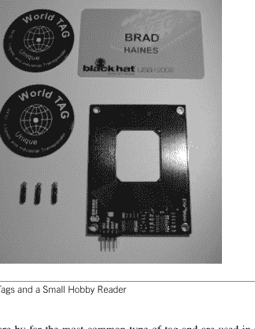

#### FIGURE 4.1

图 4.1

各种 RFID 标签和小型爱好者读卡器

无源标签是迄今为止最常见的标签类型，用于支付系统（信用卡）、身份验证系统（如门禁卡）、防伪检测（如北京奥运会门票和护照），以及各种形状和尺寸产品的库存控制。

### RFID RISKS

RFID 通常被谈论为安全上的灵丹妙药或噩梦。这一切取决于你站在风险的哪一边。

作为灵丹妙药，其主要优势在于电子设备能够抵御伪造者和其他不法分子的攻击。它们还为诸如库存跟踪和建筑物访问等事项提供了更多审计跟踪和精细控制的潜力。

作为噩梦，它们之所以突出，是因为社会普遍倾向于信任技术。如果有人成功伪造或克隆 RFID 设备，就会被认为必须是合法的，而且通常除了存在一个看似有效的标签之外，没有进一步的检查。

该技术的优势也是其弱点。由于它有能力改变其所使用的任何行业，因此会让人相信它是无懈可击的，从而不为其可能出现的故障做好准备。

关于 RFID 系统和安全的一个总是出现的问题是其预期的使用寿命。投资系统的企业可能期望使用该系统 10 年或更长时间，而且通常确实如此。如果在此期间出现漏洞或不可预见的风险，他们很可能不得不更换大部分甚至全部系统——这成本很高，他们不太可能这样做。

另一个问题是自满：系统已经运行了 10 年，负责它的人可能不知道已经有新的发现破坏了他们对系统的所有先前结论。安装时它是安全的，据他们所知现在仍然是安全。与此相关的是成本导致的自满，企业不愿选择更高安全性的系统，因为他们觉得自己尚未面临风险（还！），并且可以通过选择更便宜、安全性较低的系统来节省资金。


在安全领域，事情可能在一夜之间发生变化。一个曾经安全的系统可能因一个信息而变得像瑞士奶酪一样千疮百孔。随着互联网上信息传播的速度，潜在攻击者可以在几分钟内得知这些问题。要纠正软件世界中的问题，通常涉及补丁或简单地将软件包升级到新版本或重新配置。在漏洞内置于硬件的系统中，这就变成了一个无限复杂的问题。RFID 解决方案绝对属于后者，即硬件问题。

为了缓解漏洞，所有读卡器都必须升级（如果可能通过软件，但可能也需要硬件），并且每张卡都必须更换。在安装有数百个读卡器和数千甚至数百万个 RFID 启用卡或设备的场所，这是一项巨大的任务，需要花费大量的时间和金钱。

### PHYSICAL ACCESS CONTROL

在当今世界，某些人群需要进入某个区域，而其他人需要被拒之门外是必要的。这自人类第一次建造墙壁来阻止他人进入自己的空间以来就是一个问题。如果你是一个史前洞穴人，想要把生物挡在洞穴之外（希望它们不要吃掉你），你会建造某种墙壁以便它们无法进入。然而这造成了一个问题。如果动物进不去，可能意味着你也进不去，而你可能在没有洞穴保护的情况下成为某物的午餐。因此在第一堵墙建成后不久，类似第一扇门的东西就被发明了。这可以被认为是第一种访问控制。早期人类知道门以及如何移动它以进入洞穴，但动物不知道。如果你是人类，你就可以进入。这就是物理访问控制；一个人或一组人可以通过某些物理屏障，而另一个人则不能。多年以来，这演变成更大的墙壁、吊桥、护城河、守卫、秘密握手，最终发展为早期的锁和钥匙。

在更现代的时代，这发展成了几种不同的方法，各有优缺点。现代钥匙和锁可以相当安全；然而，访问的粒度难以实现，可能需要用户携带多把钥匙，钥匙可能会丢失，需要以高昂的费用更换锁，以防止丢失的钥匙落入坏人之手而仍然有效。机械锁也会磨损和损坏，需要专门的维护，而且通常需要相当多的开销来保持大型设施中系统的安全。

守卫即使在今天也是常见的访问控制方法。然而，守卫也有一些主要缺点。它们昂贵，会犯错，可能被贿赂、打瞌睡，或本身成为内部威胁。守卫也不太热衷于记录设施内每位员工的移动情况的审计日志。话虽如此，人类守卫也有一些优势，可以极大地补充技术解决方案，如稍后将讨论的那样。

1960 年，磁条卡由国际商业机器公司（IBM）设计，并由中央情报局（CIA）用作访问控制。磁条卡（如信用卡）将其标识号码编码在磁条上，通过连接到计算机后端的读卡器刷卡。这些系统至今仍在使用，但存在卡片磨损和读卡器磨损的问题。此外，由于磁条的读头需要可访问且需要相当精确，外部访问因灰尘、雨水和其他元素弄脏机制而存在问题。尽管如此，这些系统为当今的现代系统奠定了基础。

最终它演变成大多数现代办公楼配备的东西。RFID 近距离卡（因此得名，因为卡片和读卡器在接近时激活）。

#### EPIC FAIL

2006 年，美国开始签发植入 RFID 标签的护照作为安全措施。当提供正确的密钥时，标签会以护照照片页上所有信息的数字副本作出响应。其想法是让伪造者更难作案，因为他们现在必须更改实体护照以及 RFID 标签的内容以匹配出示者。

当该计划宣布时，隐私和安全倡导者并不满意。征求了公众意见，结果对一些担忧进行了一些改变，主要是护照可能随时被读取，而不仅仅是在边境。

解决方案是在护照封面中加入一层金属箔作为屏蔽，防止标签发送或接收任何射频能量。从技术层面来看，这个解决方案是有效的。当护照关闭时，无法与标签通信。然而，这个解决方案是自相矛盾的。由于箔的厚度和刚性以及它嵌入封面层之间的方式，护照自然倾向于“弹开”约 1 英寸，而不是像早期版本那样保持关闭。这个间隙足以允许读取标签，从而使封面中的箔失去意义。放在钱包或松散口袋中的护照自然会想要打开，可能泄露数据。这导致在边境控制中常见的做法是用橡皮筋包裹护照以保持其关闭，或使用带扣的特殊屏蔽套装护照。

这在大多数现代办公场所都是相当常见的景象，员工只需将卡片在授予他们进入权限的读卡器前一挥即可。通常你可以在门边看到一个带有一个或多个LED灯的小塑料盒，尽管并非总是如此。

这些系统可通过有源或无源标签工作。大多数较旧的系统使用较厚的有源卡，厚度约为两张信用卡，内含线圈天线、RFID电路以及一个或多个纽扣电池。其他系统则使用由读卡器供电的无源标签，通常与信用卡厚度相同。近距离卡系统没有标准封装；然而，“卡”格式最受欢迎，并且通常也与员工的身份徽章集成在一起。

### 近距离卡

与之前的方法相比，使用RFID近距离系统具有许多优势。由于它是一种非接触式系统（无线），卡片和读卡器都可以密封以抵御外界环境。这使得室外读卡器能够经受雨水和污垢而不受损坏。这也意味着卡片和读卡器都不会因反复使用而真正“磨损”。

最常见也是最基本的使用方式是通过简单的数字标识符。卡片被呈现在读卡器前并被查询。卡片传输其识别号码，读卡器将此号码发送到后端系统。如果该数字标识符被允许进入该门，后端会向读卡器发送批准消息，读卡器随后打开锁舌或门。如果所呈现的数字标识符不被允许，则什么也不会发生，门保持关闭。所有这些过程都在短短几秒钟内完成，用户只需将卡片在读卡器前一挥即可启动流程。

基于近距离卡的系统相比早期传统的保安和钥匙系统提供了许多安全增强功能。其中最大的一项是使用唯一标识符。在传统的基于钥匙的系统中，拥有某扇门钥匙的每个人都使用同一把钥匙。除了二次验证方法外，没有办法判断是哪把钥匙打开了门。这导致了问题，因为拥有钥匙的每个人都可以指着别人说自己是打开锁的人。用钥匙无法留下谁在何时打开了什么的审计轨迹。而在近距离卡系统中，每位员工的卡片都有唯一的标识符，该标识符在后端系统中与其姓名关联。这允许对特定员工的访问进行详细记录并提供审计，以防日后出现问题。

使用唯一标识符还允许对近距离卡的访问权限进行高度精细的控制。传统钥匙存在一个问题：要实现真正精细的访问控制，必须为每把锁发放单独的钥匙并妥善分发。这在管理和组织上是个真正的麻烦，并导致人们往往拥有不必要的更多访问权限，因为那样更简单。近距离卡系统允许非常精细的控制，可以让你指定到单个门，如果你愿意的话。

如果卡片被复制。如果员工丢失卡片，只需将其旧卡停用并发放新卡，并赋予与旧卡相同的权限即可。而在机械锁系统中，丢失钥匙意味着锁芯必须重新配置，并制作和分发新钥匙。

根据系统不同，卡片可以激活的不仅仅是门。机器、柜子、分发器、自动售货机，甚至计算机登录都可以与系统集成，使一张卡能够执行多种不同的功能。

### 物理访问控制故障

值得花一点时间来看一下身份验证的概念，因为这正是该系统的核心所在，也是其故障所在。系统所做的一切只是获取唯一标识符并基于该标识符授予或拒绝访问。这就是问题潜入的地方——它只是基于标识符授予或拒绝访问。没有任何机制来验证是谁在出示该标识符。

在安全领域中，有一句关于身份验证的老话：“你所拥有的，你所知道的，你所是的。”b 这描述了个人用于向任何安全系统（无论是技术性的还是非技术性的）进行身份验证的各种通用方法。

“你所拥有的”仅仅是一个你必须拥有的物理令牌才能获得访问权限。最常见的例子是音乐会门票。你只需要持有门票即可入场；他们不在乎是谁持有门票，只在乎你有它。计算机等价物是硬件令牌，如智能卡或安全证书。

“你所知道的”仅仅是一个只有授权用户才知道的秘密。大多数人称之为密码。从登录你电脑的密码到小孩的俱乐部或用于识别俱乐部成员身份的秘密握手，都无关紧要是谁，只要他们知道密码、握手、舞蹈或用于身份验证的任何东西即可。

“你所是的”指的是生物识别。虽然这可以复杂到指纹或视网膜扫描，也可以简单到俱乐部保安认出你的脸并让你进入。你的个人独特特征被用来对系统进行身份验证。

通常在安全领域，任何系统都应集成其中至少两种。“你所拥有的”和“你所知道的”可以是智能卡和密码。“你所是的”和“你所知道的”可以是与密码配合的指纹扫描。任何系统都应至少要求其中两种（理想情况下全部三种）来对系统进行身份验证。这能更好地防止对系统的攻击。

> NOTE
>
> 特别说明一下，虽然传统钥匙绝对是“你所拥有的”，但如果多名用户拥有同一把钥匙，将其作为安全令牌使用就意义不大。“你所拥有的”以及身份验证三角的所有部分的逻辑在于，每个标识符都是唯一的，因此可以追溯到特定用户，确保不可否认性。用户之间共用的钥匙意味着现在只剩下一种因素（密码或生物识别）来用于身份验证。

上述说法的一个推论是“丢失的东西，我忘记的东西，我本来的东西。”C 这强调了上述每种单独身份验证方法的缺陷，并突出了为什么它们应协同使用。

“丢失的东西”相当明显。如果用户被发放物理设备用于身份验证，他或她可能会丢失它。丢失钥匙是我们都遇到过最明显的这种形式。在近距离卡系统的情况下，卡片可能会丢失或被盗。攻击者一旦获得卡片，仅凭持有卡片即可获得访问权限，就像你在音乐会停车场殴打某人并拿走他们的门票一样。

“我忘记的东西”对任何做过技术支持的人来说都应该非常明显。用户会忘记东西。密码、握手——所有这些都可能被遗忘并使访问陷入停滞。其潜台词是密码可能会泄露，有时是无意分享、写在便签上，或只是被猜出。有时，它们还可以通过胁迫、勒索、敲诈或酷刑“发现”。同样，如果你知道密码并且这是唯一的身份验证方法，那么一旦你知道密码，就没有任何东西能阻止你。


“我本来的东西”是很多人不太考虑的东西。这个概念比其他概念更模糊一些。如果你的身份验证方法涉及生物识别，丢失或忘记指纹或视网膜是很难的，但也带来了新的考虑。受伤怎么办？如果使用指纹生物识别，如果某人受伤或整只手丢失怎么办？是否注册了其他手指或生物识别？从攻击者角度来看，这一点更难，因为它需要对试图冒充的人进行物理接触。你可能会试图胁迫用户为你进行身份验证。你也可能尝试伪造或复制生物识别，例如提取指纹并制作假手。这也可能意味着更极端的步骤——切除手或手指以绕过指纹系统。

**WARNING**

攻击者切除手指以冒充他人进行身份验证的情况确实发生过。2005年在马来西亚，一名会计师因其奔驰S级轿车被劫持。汽车配备了指纹锁定装置，只有车主才能启动汽车。在将车主带在后备箱里一段时间以便需要时重新启动汽车后，窃贼变得沮丧，并在将他丢弃在路边之前切除了他部分手指（`http://news.bbc.co.uk/2/hi/asia-pacific/4396831.stm`）。在任何系统中，决心的攻击者总会找到绕过或击败安全系统的方法，甚至显然包括截肢。

思路是，随着每增加一种方法，攻击的难度和攻击者对攻击的投入程度都会增加。密码可以远程猜测，但带硬件令牌的密码就困难得多。现在攻击者必须与受害者进行物理接触，而大多数普通攻击者对此毫无兴趣。使用全部三种方式意味着攻击者必须同时拥有密码、硬件令牌和生物识别信息才能进行身份验证，这对除最执着的攻击者之外的所有人来说都是相当令人望而却步的提议。

> 提示
>
> 一些生物识别系统使用声纹来识别用户。一个人的声音会随时间变化，受感冒影响，甚至受情绪或午餐内容影响。因此，为了避免较高的失败率，这些系统通常会调低其容差，有时甚至调低到用户的声音录音足以通过系统身份验证的程度。显然，在高安全性的情况下，这可能是不可取的。
>
> 所选的任何生物识别系统都应考虑系统相关的失败率和问题，以及它们对预期应用的适用性。

近距离卡的主要缺陷是它们通常是一种单因素身份验证形式，即唯一的识别号码。这意味着，除其他方法外，攻击者只需向读卡器出示唯一标识符即可获得访问权限。没有任何东西将唯一标识符与发卡对象以及我们冒充其访问权限的人联系起来。这种类型的系统中也没有任何东西将标识符与其预期的近距离卡绑定。

### 克隆 RFID

由于 RFID 近距离卡基于无线，这使攻击者相比于物理钥匙等具有优势。与物理钥匙不同，复制物理钥匙需要从受害者那里物理取走。近距离卡的无线特性意味着它们可以在远距离读取且无需取下。

目前使用的大量近距离卡系统，特别是较旧的安装，仅使用简单的数字标识符进行身份验证。卡上没有加密或任何验证，除了将接收到的号码与后端系统进行核对。这也意味着卡不会对正在 interrogate 它的读卡器进行身份验证。它会响应任何兼容的读卡器并向其提供其数字标识符。这对攻击者非常有用，因为他们只需将读卡器在受害者的口袋或钱包旁挥一下，卡就会交出标识符。攻击者随后可以获取这些信息并制作自己的卡副本以供其使用。

2003 年，一位名叫 Jonathan Westhues 的工程师开始研究近距离卡并了解其工作原理。通过他的努力，他能够逆向工程 Motorola flexpass 的协议并了解卡传输的内容以及它如何与读卡器交互。他继续努力并开始构建卡模拟器以与读卡器交互并了解卡的工作原理。经过一段时间和多次修改后，他自制了组合读卡器和卡模拟器，因为两者共享许多相同的部件。该设备名为 `proxmark`，大小不比信用卡大多少，仅厚两倍，且操作极其简单。它由两个按钮组成，一个用于“`reader mode`”，一个用于“`card mode`”。“`Reader mode`”将设备变成 125-kHz RFID 标签读卡器，你可以将任何兼容标签靠近它，它会读取其唯一标识符并将其存储在内存中。“`card mode`”按钮仅重放存储的标签信息。这意味着他可以走到某人身边暗中扫描其近距离卡的内容，走到安全门前重放该卡，随后就会像出示真卡一样获得访问权限。

在接下来的几年里，他不断修改设备并大幅提升其能力。截至 2009 年 2 月，`Proxmark 3` 是最新版本，支持大多数 125-kHz 和 13.56-MHz 标签（两种最常见的频率），并且可以读取和模拟几乎所有仅 ID 标签。

> **注意**
>
> `Proxmark` 的所有原理图、物料清单和设计都可在 Jonathan 的网站 `http://cq.cx` 上获取，如果你想自己制作。如果你不想自己制作，成品设备可在 `http://proxmark3.com/` 购买。不过要警告的是，在大多数司法管辖区，克隆你本无权拥有的卡很可能是非法的。你应仅在自己拥有或已明确获得实验许可的系统和卡上进行实验。

该设备的存在和可用性现在意味着攻击者可以克隆许多常见的近距离卡并简单重放以获得访问权限。仍然存在如何到达建筑物内所需位置的问题。如果我们要获取秘密研究或同样有价值的东西，其访问权限很可能仅限于少数特定员工。这意味着我们不能简单克隆任何人的卡，我们需要确保获取一张能让我们进入所需区域以实施恶行的卡。

基于角色的系统允许对特定区域进行细粒度访问，似乎是限制员工访问的合理方式。他们只能访问所需位置，甚至可以限制访问时间。然而，攻击者通常可以利用这一点为己所用。

理想情况下，这些角色应该是严格的。只有真正需要访问特定区域的人才会被授予访问权限，并且会严格执行。然而，大多数企业比这更政治化、更务实。通常，具有合法访问权限的人在加班情况下不会有访问时间限制，助理员工可能需要获得访问权限以代表其老板处理事务。

在理想世界中，企业的所有者/CEO/高层主管没有理由进入某些区域：他们的员工会向他们汇报，他们本人不需要亲自前往。然而，处于这些职位的人通常不喜欢被锁在任何东西之外或对其施加任何限制，因此他们的访问权限通常是 unrestricted，涵盖大多数甚至全部区域和时间。

作为攻击者，我们可以通过针对老板并克隆其标识符来利用这一点。这可能简单到共乘电梯或排队买咖啡。不过有时这会带来问题，因为某些组织的领导并不容易接触。

然而，有一个人往往会拥有对设施的完全或几乎完全的访问权限：清洁人员。几乎任何办公室都有清洁人员，他们负责倒垃圾、洗地板等，通常在夜间工作；这些人需要有自己的访问权限以进入区域进行清洁。作为攻击者，贿赂或窃取一名清洁工的标识符可能比 CEO 的要容易得多。你可以在清洁工上岗时走上前与他握手，感谢他做得好，同时你的另一只手悄悄克隆近距离卡的内容。当晚稍后，你可以返回并通过简单重放清洁工的卡在建筑物内自由活动。

在任何一种情况下，审计日志（如果有）都会显示被克隆的受害者是建筑物内活动的人。最坏的情况下（作为攻击者），这会显示你在建筑物内的移动路径。最好的情况下，这会将你活动的责任指向受害者而远离你。

### 降低风险

虽然可以克隆仅 ID 芯片，但这绝不是使用它们进行物理访问控制的终结，但这确实意味着它们作为独立系统不可靠。许多方面可以改进以提高这些系统的安全性。

提高安全性的首要方法之一就是实际审计日志。日志经常被忽视，直到发生事情后才被诅咒为不够完整。花时间评估在危机中所需的一切是否都被记录下来，将大有裨益。此外，日志的自动审计和警报对于发现不一致和潜在问题非常有用。如果访问控制的执行足够严格（在门的入口和出口都进行扫描），你可以监控异常活动，例如 Bob 两次进入建筑物，或 Bob 的卡在建筑物两端同时使用，而他不可能在那么远的距离移动。你还可以查找人们偏离正常日程的情况。秘书通常不应在凌晨 3 点出现在建筑物内。日志的自动监控和警报可以帮助在事情开始前阻止它。

除了审计日志外，还要审计已注册的卡。定期验证系统中只有当前员工，并且访问权限符合预期。离职员工的访问权限应立即禁用，但在未总是发生的情况下，定期审计有助于发现这些情况。还要审计测试卡，新的系统通常会为安装人员和管理员发放一张或多张具有完全访问权限的测试卡，以测试系统并确保读卡器工作、门打开等。通常，这些标识不会被移除

由于卡片被销毁，无法从角色中追溯。如果发放的标识符是顺序的，攻击者可能倒着计数并从已知的低权限卡生成卡片，以尝试找到一些最早发放的卡片。

尽管保安存在诸多问题，但他们有一个优势，那就是他们会思考。如果得到适当训练，他们可以增加一道强大的安全层。通常，员工入口处的保安会认识每天早上进出的人。对攻击者来说，这是一个真正的问题，因为我们很可能与我们伪造卡片的那个人完全不像。某些系统允许人工保安查看谁在门口进行身份验证的日志，甚至可能还能看到员工照片，从而能够发现我们访问的不一致性并将我们拘留。这确实要求保安不要变得自满，也不要被看电视或上网冲浪分散注意力，但这确实是一个需要克服的障碍。然而，保安费用昂贵，而且他们的角色往往是可见的威慑，而非身份验证解决方案中的积极参与者。不过，他们的存在可以比完全技术性的解决方案单独提供更高的安全性。

改善我们虚构场景的另一种方法是为员工的近场卡发放屏蔽套。这些金属套阻挡读卡器的信号并防止读卡器为标签供电，从而在员工实际使用时最大程度地降低秘密克隆的风险。实际上向员工解释卡片被克隆的风险和影响可以帮助他们站在你这边，防止他们不必要地暴露卡片。告知员工，将卡片佩戴在办公室外的夹子或挂绳上会带来不必要的风险。取下它们甚至将它们放在口袋里会使它们成为不太明显的目标。其他简单的事情，例如不要将卡片留在手套箱里以免被轻易偷走，这是常识，有时需要安全和 IT 人员加强提醒。


即使在所有这些之后，风险仍然存在，即卡片可能被克隆并且访问相对容易获得。通常，这些系统会安装并使用多年甚至数十年。可以肯定地说，早期的设计者和采用者从未想到他们的系统会在攻击者获得可靠攻击能力时仍然在使用。如果威胁足够严重，升级或更换系统几乎是你的唯一选择。

### RFID MEETS CRYPTO

对于 RFID 作为身份验证而言，更明显的一种解决方案是在过程中引入密码学。标签和读卡器在授予访问权限之前必须相互证明共享的秘密。密码学几十年来一直被用于计算机世界的身份验证，并且取得了巨大成功。那么为什么它一开始不在其中呢？

RFID 芯片很小——非常、非常小。它们的大小取决于制造商和型号，但有时实际的硅芯片比大头针的头部还要小。这些芯片可用的处理能力也非常有限。它们部分是这样设计的，以便于生产；这使它们便宜，也意味着整个封装会很小，从而增加其应用。

由于体积微小，将可靠的已知算法塞进去是一个挑战。在标签的前几代中，这根本不可行。因此，制造商和设计人员为了满足市场对安全芯片的需求而做了他们必须做的事情，并打破了一般的安全理解，自己制作加密是不好的主意。

这类系统最近的例子是 `MIFARE Classic` (`http://nxp.com/#!/pip=pip|p|p=53422|jpp=(t=t,p,i=53422)`)。`MIFARE Classic` 系统是由 NXP Semiconductor 制造的 13.56 MHz 标签。当时的低成本和可用性使其非常适合大量应用，其中最显著的是物理访问控制和公共交通的票务系统。NXP 声称在全球约有 10 亿张卡在流通，占市场份额的约 70%。¹ 这加上其在伦敦作为票务系统 `Oyster` 卡和波士顿地铁 `Charlie` 卡的使用，使其成为研究的非常有趣目标。

为了确保通信安全，`MIFARE Classic` 使用挑战-响应身份验证系统。挑战-响应系统就像你与夜总会门口的保安进行的对话。你想告诉他们秘密密码数字 “S” 以进入，但如果你大声说出来，可能会被窃听，任何人都可以进入。因此你建立一个数学系统来证明你们双方都知道密钥，而无需大声说出来。这个系统必须很难让某人逆向操作以获取数字本身。为了简单起见，算法将是取秘密数字和随机数字，相乘，然后对结果进行平方。

你走上前，保安挑选一个随机数字并说“我的挑战数字是 6。”他已经使用秘密数字 5 计算出了预期结果。你在脑中计算：6 × 5 = 30，30² = 900。你对挑战的回复是：“900”并提出自己的挑战以查看他是否真的是保安：“我的挑战是 2。”你已经知道答案是 2 × 5 = 10，10² = 100。如果保安回复 100，你们双方就证明了自己知道秘密，可以继续。如果他对你的回复错误，你可以离开而不信任他，或者至少怀疑他的数学技能。如果你的回复对他错误，他可以将你扔到路边并继续下一位排队的人。幸运的是，对于 RFID 来说，失败的结果没那么戏剧化。这显然是一个过度简化的例子，因为加密算法通常更复杂，但过程是相似的。

`MIFARE Classic` 系统使用挑战-响应系统来在不通过空中泄露密钥的情况下对读卡器进行身份验证以及对卡进行身份验证。读卡器发送请求唯一标识符。卡回复一个 32 位随机数，即挑战。读卡器取此随机数并与读卡器和卡共享的密钥一起计算，并将由此产生的 8 字节响应连同 32 位随机数一起发送回卡。卡最后向读卡器回复 4 字节响应，并且唯一标识符现在以加密形式发送给读卡器。卡知道读卡器对挑战的响应应与它计算的结果相匹配，读卡器也同样如此。这样两个设备都相互进行了身份验证，系统就可以打开门。

弱点在于加密系统称为 `CRYPTO1`，是由 NXP 为标签上的芯片量身打造且专有的。NXP 确保将算法保密，以便没有人能够完全了解正在发生的事情。在上面与保安的例子中，有必要将我们的算法保密，因为知道它并窃听到响应的人可以简单地逆向操作并算出密钥必须是什么（900 的平方根 = 30，30/6 = 5），然后对任何未来的挑战做出适当响应并获得访问权限。这是一个典型的通过 obscurity 实现安全性的案例。

该系统最初于 1995 年推出，¹ 迅速出现在各处并至今仍在使用。直到 2007 年，研究人员才在破解系统方面取得进展。2007 年 12 月在柏林举行的 24C3 大会上，² Henryk Plotz 和 Karsten Nohl 宣布他们已成功逆向工程 `CRYPTO1` 加密算法。

他们的方法非常费力但最终成功。他们取下标签上的集成电路（IC），其尺寸约为 1 毫米乘 1 毫米，并非常小心地刮掉芯片的外层，露出内部的晶体管。然后，在显微镜的帮助下，他们以非常高的细节拍摄了芯片的照片。由于这些芯片是多层的，他们必须逐层刮掉，每层只有几微米厚，这一过程变得更加复杂。在拍摄完所有层后，他们开始通过一些侦探工作识别负责加密的区域。一旦他们将芯片的正确部分隔离出来，他们使用一些图像识别软件来识别每个晶体管的功能以及它们如何相互作用。经过这一切之后，他们能够重建芯片内处理加密的内部逻辑并重建算法。这一突破意味着他们现在了解了加密的内部结构，可以开始寻找潜在的漏洞。

他们发现的一个有趣漏洞是读卡器中的伪随机数生成器（`PRNG`）是无状态的。无状态意味着它在断电周期之间不会跟踪其先前的状态。这使他们能够关闭电源并重新打开读卡器并在多次尝试中使用相同的伪随机数，这对加密分析世界来说是一个很大的帮助。它还表明标签上的随机数生成器为 16 位，这意味着随机数的池非常小，很可能会重复。

算法的逆向工程是克隆卡片能力的巨大进步。由于兼容卡很容易获得（任何人都可以购买），只需确定合法卡上使用的密钥并将其转移到另一张卡上即可。

在 Plotz 和 Nohl 发表演讲几个月后，2008 年 3 月，荷兰奈梅亨拉德堡大学数字安全小组的一个团队能够自行重现该算法并开始对 `CRYPTO1` 算法进行密码分析。他们很快发现了几个关键问题，导致该系统被彻底攻破。他们的 Youtube 视频在安全界引起了小小的轰动（`http://www.youtube.com/watch?v=NW3RGbQTLtHE`）

一种方法涉及攻击读卡器。使用改装的 `proxmark3` 板，他们尝试对读卡器进行 4096 次身份验证并记录结果。这些结果被输入到一个 1 TB 的查找文件中，其中包含算法的所有可能状态，也对应于密钥。攻击者可以简单地生成

在一下午的时间内完成此文件并将其用于他们遇到的任何 `MIFARE Classic` 系统。对读卡器的查询结果被查表，这就揭示了密钥。

另一种更简单甚至更简单的恢复密钥的方法完全不需要查表——它只是利用算法中的一个弱点，在交易结束时（即使交易失败）向攻击者提供算法部分的状态，而凭借一点计算能力，这就足以确定系统的密钥。

一旦密钥被恢复，攻击者现在就可以使用配置了该密钥的移动读卡器暗中与用户的卡进行交互，并且由于他们通过了正确的身份验证，因此可以读取卡上的所有信息。一旦他们获得了这些信息，他们就可以将其写入另一张卡，该卡将完全像克隆的用户一样表现。荷兰团队通过他们的 YouTube 视频演示展示了这一点。在视频中，攻击者带着笔记本电脑走到读卡器前，使用 `proxmark3` 收集多次身份验证，然后返回给他的同伙，他们随后使用这些数据恢复密钥。他们随后再次使用 `proxmark3`（这次配置了密钥）无线嗅探用户卡的内容。然后他们将这些信息写入一整叠卡片。这些卡片中的每一张现在都作为克隆用户进行身份验证。

> **NOTE**
>
> 攻击的密码分析和内部细节本身就可以写成一本书，在这里被一笔带过。描述这些攻击的原始论文可在 `http://www.sos.cs.ru.nl/applications/rfid/2008-esarics.pdf` 获取

考虑到部署的卡片数量以及许多安全设施使用该技术，一些人对这一 revelations 并不太高兴。NXP 肯定不高兴。该团队计划在伊斯坦布尔举行的 `Esorics 2008` 大会上展示他们的研究成果，却遭到 NXP 在法庭上的挑战，NXP 申请了禁令以阻止他们发表研究成果。法院最终裁定有利于研究人员，允许演示继续进行。

> **EPIC FAIL**
>
> 这一场景后来在 2008 年的 `DEFCON 16` 大会上再次被推向前台。几名来自麻省理工学院（MIT）的学生原定就波士顿地区地铁系统以及他们在物理、网络、社会工程和票务等方面发现的多个漏洞发表演讲。马萨诸塞湾交通局（MBTA）对学生对其 RFID 支付卡 `Charlie` 卡进行的游击式研究提出异议。学生们基本上实现了荷兰团队的攻击，并将其应用于 MBTA 读卡器。MBTA 对学生提起了一项最后时刻的联邦诉讼，禁止他们发表演讲。电子前沿基金会（EFF）介入并设法让诉讼被驳回，但仅在会议结束后才如此，这似乎正是 MBTA 最初想要的结果。
>
> 学生们的幻灯片由 MIT 学生报纸发布到互联网上，网址为 `http://tech.mit.edu/V128/N30/subway/Defcon_Presentation.pdf`。法院文件可通过 EFF 在线获取，网址为 `http://www.eff.org/cases/mbta-v-anderson`

### SUMMARY

RFID 是一种难以保护的技术。它是无线的，因此通信可以在远距离被读取和捕获。由于尺寸小，加密选项有限，而且通常由制造商自行滚动，而不是经过同行评审的算法，这可能导致它们很容易被击败。


最终，任何基于 RFID 的系统都应从一开始就问以下问题：“如果它失败了，我们怎么办？”“如果标签被克隆，会有什么影响？”“是否有另一层保护可以在发生这种情况时最大限度地减少影响？”“使用周围的组织结构是什么？”“是否可以审计其使用情况并监控异常情况？”所有这些都是必须回答的难题。

RFID 是一种年轻的技术，开发人员和社会仍在适应它意味着什么。没有简单的解决方案，系统集成商/用户必须积极思考系统的身份验证方案在更大意义上意味着什么。用卡进行简单身份验证可能足以限制公众进入建筑物前门，但也许不足以保护核心资产。RFID 信用卡可能看起来很方便，但必须权衡这种便利与信用卡信息被路过窃取的可能性。在这种特定情况下（1 因素），物理刷卡并要求签名是更安全（2 因素）且更安全的保护信用卡安全的解决方案。

### Endnotes

- 1. `www.nxp.com/#!/pip/pip=[pfp=41863][pp=[t=epfp,is=41863]`
- 2. `http://events.ccc.de/congress/2007/Fahrplan/events/2378.en.html`

本页特意留空

## Analog Wireless Devices

### INFORMATION IN THIS CHAPTER

- Analog Devices
- Digital versus Analog
- Cordless and Wireless
- Exploiting Analog Wireless
- Scanner Selection
- Wireless Microphones
- Video Devices
- Defense

现在许多人对可用的无线设备数量感到惊讶。从鼠标和键盘到电话，一切都在变得无线。人们每天与无线设备互动数十次甚至数百次是常态。我们几乎不再去想这件事（除非电池没电）。我们经常未能评估这些日常用品的安全性，因为它们只是日常用品。

虽然大多数现代数字无线设备在运行中提供了一定程度的安全性，但人们往往没有意识到他们使用的许多设备仍在使用模拟信号传输数据，并且几乎没有或完全没有保护措施来防止外部窃听或干扰。即使在二十一世纪第一个十年即将结束时，我们仍在使用超过 100 年前的相同技术，并且安全级别也与当时差不多。

今天大多数办公室的每张桌子上都有两样东西，一台电脑和一部电话。电脑通常需要双手，电话至少需要一只手。由于人类尚未适应并长出第三条肢体，调整电话更容易。出于便利和舒适，大多数在电话上花费大量时间的现代办公室通常会使用耳机，而不是笨拙地用肩膀夹住听筒。现代便利设施取消了线缆，转向无线，减少了线缆缠绕，让双手可以自由操作电脑。

然而，许多这些办公室从未意识到，他们的便利性可能正在向任何愿意倾听的人泄露私人、专有或个人信息。一项渗透测试能够利用这些耳机获取足够的信息，准确地冒充一位“访问”办公室的远程员工。他或她能够获得对建筑物的完全访问权限，以供应商的名义带入同伙，甚至被分配一个带有方便网络连接的办公桌。他或她在接下来的几天里一直在扫描网络寻找漏洞，同时消费免费的办公室咖啡，所有这一切都只是因为从无线耳机对话中获取了一些信息。

经常被忽视，模拟无线设备可能是任何办公室安全中的一个非常大的漏洞，必须作为任何安全工作的一部分予以考虑。

### ANALOG DEVICES

2008 年 1 月，安全网站 DarkReading.com 上发表了一篇恰逢其时的文章，讲述了一个许多渗透测试人员都太熟悉的故事，但它只是每天发生的事情的一个样本，也是“我们没想到这一点”安全问题的例子。

Steve Stasiukonis 的文章（`http://darkreading.com/shared/printableArticle.jhtml?articleID=208803553`）解释了他在一项渗透测试中经历的场景。客户要求他的团队测试目标建筑的所有无线电发射，包括 Wi-Fi、蓝牙以及作者能找到的任何其他东西。他们对这些感兴趣，因为他们渴望尝试新事物，并且对许多员工使用的无绳耳机非常感兴趣。

他们使用手持无线电扫描仪扫描这些设备的常见频率，并在目标办公室中识别耳机。一旦他们知道了频率，他们就能窃听电话对话，并在短时间内获取大量信息。他们获取的信息包括会议电话的参与者、员工姓名、位置、时间表和其他办公室八卦。不仅仅是电话。许多耳机在挂断电话后仍继续传输，还广播办公室对话。这些信息使他能够冒充来自远程办公室访问目标办公室的员工。计划出奇地奏效。他能够通过提及一些员工姓名和一张假名片说服保安他就是那名员工。他立即被分配了一个办公桌并获得了建筑出入卡，几乎没有人提出任何问题。他的新办公桌为他提供了网络访问权限，并让他全天自由嗅探流量和扫描网络。

几天后，他能够预订一个会议室并邀请一位“供应商”（实际上是同伙）来开会。这让他们获得了更多网络访问权限，并能够将更多攻击者带入内部，绕过外围安全。所有这一切都只是通过监听不安全传输获得的一点内部知识完成的。他们学到的信息量足以让他们了解商业机密、股票操作和其他非常私人的信息。

这篇文章引起了相当大的关注，因为它本应是显而易见的事情，却经常被忽视。

### 数字与模拟

大多数人都在不知不觉中使用模拟通信。我们过去100年里相当成功地使用了它。模拟传输是指数据——无论是语音还是其他东西——通过连续信号发送，该信号在振幅或频率上变化，就像海浪滚向岸边一样是连续的动作。信号中的微小变化对所传输的数据是有意义的。

另一方面，数字是非连续的，使用离散信号发送数据。信息被分解为1和0，并作为离散状态发送。就好像海浪滚向海滩时先在海上，然后下一刻在海滩上，然后又立刻回到海上。

模拟的优点在于对复杂数据（如声音）的表示更准确，因为它是从高音到低音的平滑过渡，并且准确地表示了与声音相关的空气压力变化。模拟的问题在于介质中的噪声会干扰传输的细微之处，导致接收到的信息失真（在声音情况下这就是“静电”）。数字传输将数据分解为原始数据的数字表示，编码为1和0。它没有那么准确，但对传输介质中的噪声容忍度要高得多。这就是摩尔斯电码如此有效的原因。它有两个截然不同且易于识别的状态：点和划，实质上是0和1。

最常见的是，模拟用于短距离单通道类型的通信，如麦克风和耳机，因为电路更容易制造，且短距离最大限度地减少了潜在的干扰问题。电路通常也比数字便宜。数字允许在更少的介质中发送更多数据（即更小的带宽），因为它只需要两种不同的状态来表示数据。这使得更多设备可以在同一介质中运行，而模拟则不能。

### 模拟安全

模拟无线电并不容易保护。除非事先处理信号（编码或改变其形式），否则任何人拦截信号都很容易。大多数人都听说过无聊的人使用业余无线电设备将自己的声音传输到快餐店得来速扬声器上的故事。他们压制员工的信号并用自己的信号替换。通常这些恶作剧最终会导致充满粗俗笑话和脏话，以及一些非常困惑的员工和愤怒的顾客。

通过模拟保护数据的最常见方法是通过诸如频率跳变之类的方法，其中发送方快速改变消息传输的频率，而接收方知道这些变化的顺序并能跟上。不知道顺序的外部监听者只能听到消息的零星片段，无法轻松重建整个消息。问题是如何确保发送方和接收方都了解跳变顺序并能保持同步，同时防止攻击者能够确定顺序并跟随。

保护模拟通信的另一种方法是预处理信号，在广播前添加音频干扰或其他技术。目前运行此类系统的很少。一个常见的例子是20世纪80年代早期的付费有线电视频道，它们会反转并向信号中注入内容，付费订阅者需要“解扰器”才能观看。大多数现代系统选择直接将原始信号转换为数字，并在传输前对其进行编码/加密。

### 数字安全

数字安全提供了更多安全选项。消息可以在传输前比模拟系统更容易地进行编码或加密，因为唯一改变的是1和0的顺序。这也可以与频率跳变等模拟方法叠加使用，以进一步使窃听变得困难。同样，困难在于确保发送方和接收方都知道如何对发送的信息进行编码和解码。

### 无绳与无线

无绳和无线是大多数人每天使用的术语，但大多数人不会停下来思考它们的含义。无绳最常用于指代某些家庭电话。在这种情况下，无绳指的是基站和手柄之间没有电线或电缆。它在这种情况下被射频（RF）发射机取代。然而，无绳并不总是必须表示无线电传输。许多人忘记了数据可以通过其他介质传输。以无处不在的电视遥控器为例。它是一种无线设备，用红外传输（不可见光能量）数据代替电缆，而不是RF信号。其他数据传输系统使用激光进行视线数据传输。

值得指出的是，标有无绳或无线的设备是否使用模拟或数字信号并没有具体规定。通常制造商的数据表、说明书或网站会给出有关所用传输方法的一些说明。

### 利用模拟无线

模拟无线设备通常是相当简单、只做一件事的东西。它们经常用于需要简单性和质量的地方。在许多情况下，这些设备的安全复杂性往往被认为不值得考虑；然而，当技术被用于不应该使用的地方时，问题就会出现。

### 音频漏洞

模拟无线信号的主要威胁来自耳机的语音传输。这些耳机通常用于电话通话，替代手柄，但并不总是需要这样。通常表演或演示的情况也可能需要使用无线麦克风进行放大。此外，这些设备也可能在质量不是必需但易用性是关键的地方使用。很少有人会考虑通过这些设备说出的内容的安全性。


如果你考虑办公室的平均一天以及全天进行的电话通话，令人惊讶的是，通过语音传递了大量信息。员工之间关于业务上似乎无害或微不足道的事情的对话可能对局外人非常感兴趣。秘书接到老板指示对财务报告做一些更改，这对寻找股市内部优势的人来说可能非常有趣。

为了开展业务，信息必须流动。鉴于办公室环境中存在如此庞大的信息流，理所当然它会成为攻击目标。在较小程度上，这就是办公室存在的意义，为了信息流动的隐私。在更极端的情况下，这就是为什么门上有锁，前台有保安，以防止攻击者进入该区域并窃听信息流。

不幸的是，“安全”的敌人往往是“便利”。鉴于有些人花在电话上的时间，期望有更舒适的使用方式是合理的。于是耳机市场应运而生。

耳机（也称为免提等）已经存在相当长的时间。早期电话接线员的照片显示成排的员工佩戴耳机和麦克风。鉴于打电话是他们的工作，他们花了很长时间在电话上，举着听筒放在头上是不切实际的。电话接线员最终消失了，但耳机被呼叫中心、秘书以及任何重度电话使用者所采用。随着时间的推移和无线电硬件变得更便宜，无绳耳机被引入以清除桌上的电缆杂乱。在不知不觉中，它们现在使任何感兴趣的各方都可以窃听对话，范围远在锁、保安和其他安全措施之外。耳机的使用虽然让员工的生活更轻松，但往往以牺牲安全为代价。

几乎任何处理过它们的人都知道婴儿监视器接收到邻居使用类似设备对话的故事。通常这伴随着闲暇的好奇心或窥探的意图，以了解更多关于被听到的人的信息。这就是漏洞的基础；未加密的无线电并不关心谁接收信号，任何拥有兼容接收器的人都可以接收这些传输并窃听。就婴儿监视器而言，只要有一台在相同频率上运行且在范围内的设备，就足以窃听私人对话。许多快餐店得来速订购系统也是如此。员工通过模拟耳机向路边扬声器讲话，而麦克风重放订单退回给客户。路边扬声器不关心谁在同一频率上发射，只关心哪个信号最强。对于恶作剧者来说，获得一台功率足够强的收音机并不困难，经过一些改装后，能够向得来速扬声器广播。有时富有创意，有时并非如此，这些恶作剧在被记录下来时观看起来可能很有趣。^A

### 扫描仪选择

市场上有大量扫描仪。有些针对非常简单的用户，而另一些则针对业余无线电爱好者，还有一些用于专业用途。其中最简单的扫描仪针对的是体育迷，尤其是 NASCAR 赛车迷，他们用它来收听自己喜爱的车手与维修站之间的无线电传输。其他产品则针对具有窥视意图的人，通常以“police scanner”出售，因为它们专注于执法部门使用的频率。在某些情况下甚至不需要扫描仪，随着互联网和流媒体音频的出现；扫描仪爱好者已将他们的扫描仪上线，供任何人免费在线收听。^B 甚至还有一款 iPhone 应用程序，可收听北美各地许多城市的扫描仪音频流。^C 虽然这些仅限于警察频段，但它们展示了可以直接从空中听到的信息类型。

> WARNING
>
> 购买扫描仪时，请注意当地法律可能禁止那些没有特殊许可或执照（业余无线电）的人持有或使用它们。
>
> 其他司法管辖区对某些频率有限制，或对被定罪的重罪犯持有扫描仪有限制。一些规定还涵盖了手持扫描仪与车载设备的区别。
>
> 这些规定不一定能阻止可能对你使用它们的犯罪分子，因为他们反正不会在乎法律。然而，作为一名守法的公民，想要测试自己的设备，强烈建议在购买或使用扫描仪之前熟悉所有相关的当地法律，否则你可能会发现自己正面临法律的制裁。

选择扫描仪时最重要的是考虑频率范围。面向 NASCAR 群体的更便宜的扫描仪可能无法接收监听目标设备所需的频率（但视目标而定，它们可能可以），但它们可能没有必要的范围。需要提前进行一些研究，以确定所需的频率范围。一般来说，支持的频率范围越宽，成本越高。

选择扫描仪的另一个考虑因素是其形态。大型台式机可能具备你所需的所有功能，但将其运送到客户现场或 discreet 使用并不容易。手持扫描仪也值得考虑，例如音频输出能力以记录信号、计算机控制能力、集群无线电跟踪，甚至电池寿命和外部电源选项。

也可以考虑其他有用功能。显示屏大小、视频功能（稍后讨论）和存储功能都很重要。没有一台设备能满足你所有想要的功能（可能有，但成本可能是因素），但大多数时候你不需要所有可能的功能，只需要适用于手头工作的功能即可。

#### 彻底失败

早期模拟手机使用市面上可买到的无线电扫描设备相当容易被窃听。它们的传输未加密，任何拥有合适接收器的人都可以轻松截获，范围内好奇的人都可以收听。

当然，电话里说的事情往往比婴儿监视器周围说的事情更有趣，这导致用户对安全提出疑问。不同国家的监管机构对解决窃听问题做出了相当不同的反应。

在美国，移动电话行业没有改进技术并增加安全性（这会增加一个处于起步阶段的行业的成本），而是决定向 FCC 施压，禁止任何能够监控模拟手机频率的扫描仪或任何可以改装以接收这些频率的设备。这实际上并没有阻止电话被窃听，只是禁止了实现这一目的的工具。从某个日期起，在美国销售的所有扫描仪都必须屏蔽这些频率。当然，犯罪分子继续获取未锁定的扫描仪没有任何问题；法律只是阻止了普通人这样做。实际上他们试图把已经放出的魔鬼再塞回瓶子里。这种禁令和随后几年里对现实情况缺乏讨论导致许多人没有意识到他们的手机通话是脆弱的。

相比之下，加拿大采取了不同的方法。加拿大广播电视和电信委员会（CRTC）表示，收听是被允许的；然而，向他人透露你所听到的内容，或为个人利益使用，则属于违法行为。这使得加拿大可以销售未锁定的扫描仪。电信行业的压力确实导致许多扫描仪在销售时屏蔽了手机频率，但有些并未屏蔽。

两个国家的做法都未能阻止心怀不轨的人非法获取一台功能强大的扫描仪，窃听对话，并对获取的信息为所欲为。

虽然转向数字蜂窝电话增加了对加密技术的支持，但是否启用和使用仍取决于运营商。在某些情况下，他们可能选择不这样做，因为额外的开销可能意味着每座基站的用户减少以及对利润的成本增加。因此，值得研究其他安全选项，例如加密电话，因为对监控手机频率设备的持续禁令不太可能阻止决心坚定的攻击者。

### 耳机

如今办公室中许多无线耳机是数字化的，通常不如其模拟前身那样脆弱。尽管如此，由于“if it ain’t broke, don’t fix it.”的说法，仍有大量设备在使用。这些旧设备在其他设备被更换后仍可使用多年。

> NOTE
>
> A cordless telephone can be thought of as a headset as well, albeit much more bulky, and much of what is discussed in regards to headsets can apply to them as well.

这些设备（最可能受攻击的）通常工作在 46 至 49 MHz 范围或 900 至 948 MHz 范围。其他设备工作在 1.2 GHz 及更高频率，但通常是数字性质，不受相同漏洞影响。

窃听这些设备就像获取一台能够接收这些频率的无线扫描仪并调谐一样简单。这些频率上的许多耳机使用简单的调频，大多数扫描仪都能轻松处理。从那里，你只需收听当时正在说的内容即可。

根据系统不同，一个频率用于基站到耳机的音频，另一个频率用于耳机到基站的音频。这意味着你只能接收对话的一半。如果你只接收到对话的一方，尝试识别正在使用的另一个频率（通常只相差几兆赫）。

能够从停车场窃听电话对话对攻击者来说是一个相当诱人的前景。将合适的扫描仪带入任何大城市的商业中心都会产生某种有趣的对话——从关于即将到来的财务申报或商业交易，到技术支持呼叫重置用户账户密码。可获取的信息种类没有限制。

### 无线麦克风

虽然与电话无线耳机相关，但无线麦克风通常差异足够大，值得单独讨论。

如果你曾参加过会议或演示，你可能见过这些无线麦克风。通常别在或夹在翻领上，有一根线通向口袋里的发射器或别在腰带上的发射器，将演讲者的声音发送到摄像机或房间扬声器，以便每个人都能清晰听到。几乎没有在合理大小的房间进行的演示不使用这种麦克风。此外，舞台制作通常也会使用类似（尽管更高端）的设备来放大舞台上表演者的声音，以便观众能清晰听到。

这些设备是窃听和干扰的丰富目标，因为它们通常未加密，而房间可能对攻击者关闭，但无线电信号并不遵守同样的边界。想象一下一家大型公司的首席执行官向聚集的股东做演示，他必须告知他们，他们最新的小玩意不仅按承诺工作，而且还有让顾客头发变蓝的副作用。首席执行官知道他必须向股东披露此事，但正试图将其排除在媒体之外。他开始演示时夹上一个无线麦克风，以便每个人都能清楚地听到他，包括街对面拿着无线电扫描仪的爱管闲事的记者。在闭门演示中使用扫描仪在渗透测试中可以产生非常有趣的结果，并且证明在大多数情况下非常有效。

这些麦克风通常比电话耳机单元需要更高的质量，并在不同的频率上运行，使用更宽的频道（通常为 200 KHz），以便清晰准确地再现声音。大多数现代系统工作在超高频（UHF）波段，但由于这些频率的不同许可和分配，实际范围取决于设备配置的国家。通常，你可以在 470 到 854 MHz 之间找到它们（在美国为 698 到 854 MHz）。如果你知道设备的制造商，通常很容易在线搜索设备使用的频率。

#### 史诗级失败

科幻小说中经常预测的未来是我们的生活因技术而变得更轻松的未来。其中，企业用户经常寻求的发明包括语音识别和语音听写。


虽然语音听写产品已经达到相当准确的程度，但输出质量直接与输入质量相关。所有语音听写软件共同的问题是如何让用户的声音清晰地进入程序，以便其发挥作用。质量差的麦克风会引入太多噪音，因此错误数量会增加。通常这不是一个大问题，因为大多数人可以稍后返回编辑。其他用户没有时间，需要第一次就准确听写。

这些用户的常见解决方案是避免使用消费级麦克风，转而使用高端舞台设备。这通常具有足够的质量来减少听写错误。史诗级的失败发生在那些用户在涉及私密、机密或秘密信息时进行听写。每个人对电脑说的每一个字都可能被第三方接收（甚至可以将其传输到自己的语音听写软件）。有时，这些用户只会在不使用时禁用听写软件，并继续佩戴耳机并整天保持开启状态。其影响是惊人的，因为办公室里每一次电话通话和对话的内容现在都被广播到建筑物之外。一旦注意到这种情况，麦克风的成本就浪费了，因为在那之后没有真正的方法来保护这些通信并继续使用耳机。

使用无线麦克风时，必须考虑所发送音频的内容及其影响。将麦克风视为房间里的陌生人，并问问自己，如果你不会在陌生人面前谈论它，为什么要让麦克风向范围内任何人广播它？

### 视频设备

今天视频监控无处不在。大多数主要城市周围都有数百个摄像头，监视从交通流量到后巷垃圾桶的一切。无论安装摄像头的理由是什么，大多数摄像头的目的都是让某人远程监控一个区域。有时，这些摄像头需要在临时安装或布线不方便或不切实际的地方安装。在这些情况下，无线视频摄像头应运而生以填补空白。许多房主使用这些无线摄像头来监控他们的院子和周边物业，以及临时应用，如建筑工地。甚至出现了一种爱好，即定位并编目这些摄像头的所在地；与 `wardriving` 类似，`warspying` 出现了，试图更好地理解这项新技术及其使用方式。

这些无线视频单元通常由远程摄像头组成，摄像头可由电池或交流电供电，以及接收信号的基站。基本单元通常只是发射器和接收器对，而高端单元可以在单个接收器上连接多个摄像头。

视频由于其更高的带宽需求（比纯音频更高），通常需要更高的频率来运行。虽然一些早期单元在 `900 MHz` 波段运行，但它们可能受到无绳电话、无线耳机和许多其他设备的干扰，并且通常是最便宜的。更常见的是 `2.4 GHz` 单元，尽管它们会受到 Wi-Fi 网络和其他设备在日益拥挤的免许可 `2.4 GHz` 范围内的干扰。通常，它们占用大约一半的可用 Wi-Fi 频道，并对 Wi-Fi 造成比 Wi-Fi 对视频更大的问题。新单元工作在 `5.8 GHz`，也存在如新型无绳电话等干扰设备，但更宽的可用频谱意味着干扰远没有 `2.4 GHz` 那么严重。

为了接收此类广播，再次需要兼容的接收器。这可以是目标使用的类似基站，连接到视频监视器。一些扫描仪具有视频显示屏，能够查看这些设备的视频（在盲测中非常方便）。一个不错的扫描仪能够扫描这些模拟视频系统常用的频道并显示它们。其他扫描仪会在扫描过程中自动检测视频信号并为你显示。通过无线电测向和基于摄像头图像的简单推断，人们通常可以确定摄像头的位置及其覆盖范围。

对于攻击者来说，这些摄像头是任何信息收集行动中极具诱惑力的目标。它使他们能够 literally 窥探其视野范围内发生的事情（警卫移动、占用情况，甚至在输入时门锁组合！）。市场上大部分常见设备只是广播其信号，查看它不需要身份验证。

这种设备很多价格相当便宜，并在商店和网上作为“间谍装备”销售。虽然有一些合法用途（“保姆摄像头”、员工监控等等），但低成本和易用性意味着业余人员进行监视的能力是真实存在的，对几乎任何人都是危险的。因此，使用无线电扫描仪定期扫描此类设备可以确保没有人在你的家庭或企业中悄悄安装了一个。从专业角度来说，这被称为技术侦察反措施（`TSCM`），基本上就是经典的间谍窃听器排查。专业 `TSCM` 排查非常彻底和完整，并且根据组织类型，非常必要。自己进行虽然更便宜但效果较差，但至少能带来安心感，或者如果你确实发现了什么，那价值就被大大低估了。

> 注意
>
> 反过来也一样，当攻击者使用未加密的音频或视频设备时，这可能会对其努力产生反作用，使他们更容易被检测和捕获。
>
> 2009 年 8 月，加拿大安大略省奥沙瓦的一则新闻报道详细说明了一名 50 岁男子因使用无线“间谍摄像头”监视继女而被抓获的情况，当时隔壁的一名承包商在使用类似设备（用于大型卡车的倒车摄像头）时意外截获了视频信号并确定了来源并报警。
>
> 如果使用了更专业的、加密的或数字设备，他不太可能被意外抓获。

### 防御

针对模拟无线漏洞的最简单防御措施就是根本不使用模拟无线设备。稍微搜索一下，大多数制造商的产品很容易确定是模拟还是数字。最常造成最大损害的设备可能是最小的。一名员工因整天用肩膀夹着电话听筒以便双手打字而颈部疼痛，往往会自行前往当地办公用品商店购买无绳耳机来让生活更轻松，通常未经办公室任何人的知晓或批准。从办公室一端走到另一端并检查发现的每个无线设备，虽然耗时，但可以揪出这些设备。同时，教育员工他们可能带来的风险，并与员工合作寻找更安全的替代方案。

今天销售的大多数数字无线耳机基于蓝牙（已加密），甚至更新的单元能够直接连接到并与数字增强型无绳电话（`DECT`）基站交互。这些设备还提供比旧模拟单元高得多的音频质量，是舒适性和人体工学方面的良好选择。

无线麦克风的安全性问题稍微棘手一些。问题在于大多数人认为没有必要保护它们，因为听众本意就是要听到所说的内容。然而，需要注意的是，有时

#### 警告

用数字设备取代模拟设备确实会增加复杂性；然而，必须注意替换设备提供真正的

#### 警告

用数字设备取代模拟设备确实会增加复杂性；然而，必须注意替换设备提供真正的

#### 警告

用数字设备取代模拟设备确实会增加复杂性；然而，必须注意替换设备提供真正的

#### 警告

用数字设备取代模拟设备确实会增加复杂性；然而，必须注意替换设备提供真正的

#### 警告

用数字设备取代模拟设备确实会增加复杂性；然而，必须注意替换设备提供真正的

#### 警告

用数字设备取代模拟设备确实会增加复杂性；然而，必须注意替换设备提供真正的

测试

selling were available for download from the United States. Charges were eventually dropped, but the case remains to this day an example of how far companies will go to protect their poor security methods from scrutiny.

A common and recurring theme throughout technology is that encryption solves everything and solves nothing at the same time. Proper usage and implementation is a major factor in how security functions overall. The corollary to this is that as you add complexity to any system, usability and stability rapidly approach zero. Adding too much complexity actually makes systems easier and more prone to breaking. In any system, a balance must be found in order to attain the best security for the situation.

### 正确的加密

In the world of encryption, it is worth explaining what a few common terms actually mean as they can differ from their normal everyday uses. The largest of these is about the word “security” and how it relates to protecting something secret from those who should not have it.


# Security in the Crypto World

Security in the crypto world is measured by how long a message can reasonably remain secure and unreadable in the hands of a determined attacker. If you have a secret, say a muffin recipe, writing it on an index card means anyone can read it. In order to protect it from prying eyes of other bakers, you can encrypt the message in such a way that it is unreadable to someone unless they know the secret (or key) to deciphering it. Now a determined attacking baker who really wants the recipe is willing to spend days or weeks to get it. If you only used `ROT13` encryption, the recipe won’t stay hidden for long.

## Key Size and Brute Force Defense

The defense used by most encryption systems against a brute force attack is key size. Much like a combination lock, encryption deals with high numbers of combinations to thwart attackers. Brute force attacks involve an attacker performing an exhaustive test of every possible key for the encryption system. An example is the ubiquitous combination lock. Usually this needs three numbers, entered in sequence, to open it. On a lock with 30 numbers, this means that there are 30 × 30 × 30 possibilities of combinations, which equals 27,000 combinations. Assuming 10 s to enter and try each combination, this totals about 6½ h of constant attack to try every combination (though the attacker is likely to discover the correct combination well before that). This is more than an attacker can probably do standing in front of a locker without looking suspicious. Assuming that an attacker can discover the combination on average in about half the key space, security should be built to take that into consideration (guard rotations and changing the combination regularly). In the digital world, the combination is the key and the length of that key specifies the number of combinations possible. These keys can have millions, trillions, or even higher numbers of possibilities, meaning that an attacker has a much larger number to go through in order to decrypt the message. A well-designed algorithm will have a key length and strength sufficient that an attacker would have to work for billions of years in order to exhaust all possibilities of keys to recover the secret. The idea is that the secret will remain a secret for longer than it is useful, usually long after anyone who cares has passed on.

## Security of Key vs Algorithm

The strength of a well-designed encryption system is commonly thought to be in the secrecy of the key, not the algorithm. That idea is the basis for most modern cryptanalysis. The idea goes that an encrypted message can be obtained by an attacker and they can know everything about the algorithm and how it works and that there are no shortcuts to the plaintext except knowing the proper key. So long as the key remains secure, the message should be as well, even in the hands of an attacker.


A good cryptography system is open for inspection by everyone and has been vetted by experts, and the consensus established that the algorithms used are secure. Many companies and products attempt to add security (or make up for poor security) by hiding the details of their encryption system behind patents, trade secrets, or non-disclosure agreements. This is usually called security by obscurity and is generally not considered a very good security system. In security by obscurity, if an attacker learns how the system works, usually he or she is able to figure a way around it or a shortcut through it. In the case of Dimitri Sklyarov, the products being used to secure E-books were hiding behind security by obscurity. Once the secret was revealed, there was no way to rescue the system. It was broken as soon as that information was released. Other companies have to make compromises due to many factors, such as size, cost, and available computing power, when implementing an encryption system, and security by obscurity becomes a necessary part of the system. These situations are sometimes more complicated than others for an attacker, but they all have the problem that once the genie is out, there is no way to put it back in the bottle.

### 提示

> Anytime you look at products that use encryption, it's worth looking at their descriptions. Terms like million bit key, totally unbreakable, proprietary algorithm, or hacker proof, are often signs that the company did not use a publicly vetted algorithm and created their own. Further investigation with these companies usually terminates in a statement resembling "trust us," which is a big sign that you might not want to. A company using the "trust us" defense will often say that their own experts say it's secure and that it's been approved by some group or another, but almost always, those people are under nondisclosure agreements and cannot talk about specifics.

## 护照

After the events of September 11, 2001, security of international travel documents was driven to the forefront of everyone's mind (ignoring the fact that the attackers held valid U.S. visas). One of the initiatives was the implementation of additional layers of security within passports through the use of electronics to give the documents some brains as it were. Until that point, a passport was a paper document with many anticounterfeit measures incorporated, but was still just a physical document and a skilled forger could create a reasonable clone of one given enough time and materials. The International Civil Aviation Organization¹ (ICAO) is the international body that oversees commercial travel standards in most countries. The policies and procedures they establish allow planes from pretty much any country to be able to fly to any other country safely and without incident. They are also the main body for establishing travel document standards. They are the group that dictates what information needs to be on a passport, its size, shape, and other features. This allows travelers easy passage between countries and streamlines the process for border control officials.

International pressures led the ICAO to issue DOC 9303, entitled "Machine Readable Travel Documents."b This laid out the standards for a machine-readable passport system that integrated digital biometrics and cryptography into passports. The system involved a Radio Frequency Identification (RFID) chip implanted in the passport that could be interrogated by border control, in addition to the physical document. This standard allowed for any country to verify the authenticity of any other country’s passport electronic data.


# 电子护照与 RFID 安全问题

## 标准与设计初衷

Though some countries choose to include biometrics such as fingerprints into the tag, the standard only requires that the information contained on the photo page of the passport (name, birth date, country, and so on) including the photo be incorporated along with appropriate digital cryptographic signatures of the data. This effort meant that not only would forgers have to modify or recreate the physical document, they would also have to successfully forge the contents of the RFID tag as well and have it match the contents of the physical passport and pass cryptographic muster. Border guards now had an additional tool to verify the identity of the person presenting the passport. The person in front of them should match the photo on the passport, as well as the digital version of the photo on the chip, as well as the two photos matching each other.

However, being that this chapter is about bad encryption, you can guess that the system has a few problems that were made apparent only after these new advanced passports were distributed to the public and they had a chance to evaluate them themselves.

## 芯片接口与认证机制

The RFID chip in the passports is a standard `ISO 14443` tag, which defines its radio interface to the world. They operate on `13.56MHz` and are powered by the reader like many tags commonly used for inventory control or door access. Unlike inventory control tags, passport tag contents are encrypted so they cannot be directly read from the device until a special 24-digit code, unique to the passport, is sent from the reader letting the passport know that this reader is authorized to receive the information stored on the tag. Once authenticated, the tag sends over its contents along with a digital signature of those contents, signed by the issuing country’s private key. The digital signature allows the border control agent to quickly verify that the contents have not been altered and are signed by the country of issue using known public keys from all participating countries.

## 密钥推导与密钥空间缩小

在理想运行中，攻击者在没有 24 位密钥的情况下无法访问内容以开始传输；然而，情况很少理想。为了高效地让旅客通过护照检查，必须有一种简单的方法让边境官员知道每本护照的密钥，而不必让各国不断交换每本签发护照的个人代码的庞大数据库。解决方案是每本护照上的机器可读区（`MRZ`）。`MRZ` 是护照照片页底部的一串字符。该区域旨在通过光学阅读器扫描，并包含姓名、护照号码、到期日期等信息。护照官员将页面通过光学阅读器刷过，从而免去他们自己将所有这些信息输入数据库的麻烦。密钥由该 `MRZ` 数据生成，并自动用于接收标签内容并将其显示出来，以便与实体文件和出示人进行比对。理论上，这意味着标签具有 24 个字符的密钥，在理想情况下，这意味着 `36^24` 种可能的密钥，对于使用暴力破解的攻击者来说是一项艰巨的任务。

问题在于，由于密钥基于一组可猜测的值范围，密钥空间急剧缩小。例如，`MRZ` 中的出生日期是两位数的年份、两位数的月份和两位数的日期。这意味着密钥只有 100 种可能的年份、12 种可能的月份和 31 种可能的日期。对密钥的这一部分进行穷举搜索将是 `365 × 100`，等于 `36,500` 种可能性。如果你知道目标的大致年龄，可以进一步缩小范围，例如 10 年，在猜测值两侧各 5 年，仅有 `3,650` 种可能性或更少。护照通常有效期为 5 至 10 年，具体取决于国家。这限制了作为密钥一部分的签发/到期日期的范围，如果护照中的 `RFID` 标签仅在短时间内可用，则限制更大。护照号码猜测起来有点棘手；然而，一些国家的编号系统基于签发日期并且是顺序的。基准值每天按固定数量跳跃（1 月 1 日签发的护照为 00001 并递增，1 月 2 日将从 10001 开始，以此类推）。同样，这也允许攻击者缩小护照号码的密钥空间。

## 实际攻击演示

2007 年，`Adam Laurie` 通过记者的挑战证明了这一点。拿着一本通过邮件寄送的新签发护照，他仅凭信封上的信息和公开记录，就能够穿透信封访问 `RFID` 标签并读取其内容。信封外侧明显带有护照，并包括邮戳以及收件人的姓名和地址。邮戳大大缩小了到期日期的范围，精确到几天，以及在某些国家可能的护照号码。姓名和地址允许对目标进行公开记录搜索，并得出出生日期，这是密钥的另一部分。这意味着，使用简单的读卡器（因为它是标准接口）和一些简单的软件，窃贼可以偷走新护照，读取所有内容，然后将原件放回，而受害者甚至不知道护照已被读取。护照中的信息会让身份窃贼做各种事情。此攻击也不限于信封中的新护照。由于接口是空中传输的，攻击者可以使用手提箱中的电脑坐在火车或公交车上的目标旁边，有合理机会检索标签内容。由于攻击者尝试密钥的次数没有限制（不像你 ATM 卡上的 PIN），这只是时间问题。

## 防御与缓解

一些国家已经认识到这些问题并尝试缓解其中的一些问题。一些国家更改了护照号码的签发模式，以增加攻击者需要测试的密钥数量。美国实施了或许最著名的防御措施，其护照本封面采用金属箔层压，充当法拉第笼，防止读卡器载波信号为标签供电，从而发送信号。

### EPIC FAIL

当电子护照首次被考虑时，绝大多数专家认为从隐私和安全角度来看这是一个坏主意。许多人质疑在有基于接触的选项（智能卡）可用的情况下选择基于无线电的技术的原因。总的来说，`RFID` 被认为是一种非常可疑的技术，存在大量关于对公民进行秘密监控以及恐怖分子可能利用该技术按国籍识别目标的阴谋论。

驳斥这些理论很困难，而在 2008 年纽约市的黑客行星地球大会上并未得到帮助。在该会议上，主题演讲之一由《神话缉凶》Discovery 频道的两位主持人之一 `Adam Savage` 担任。在演讲问答环节，RenderMan 问他关于 `RFID` 以及为什么该节目以揭穿都市传说和伪科学而闻名，却没有处理 `RFID` 技术周围的许多阴谋论。他的回答极大地助长了阴谋论者的火焰。他解释说他们曾为节目调查过该主题，但当同为主持人的 `Tory Belleci` 参与与德州仪器（`TI`）的电话会议以获取背景信息时，电话中还有大多数主要信用卡公司（在某些支付系统中使用 `RFID`）的首席法律顾问——故事继续说，法律顾问们都强力施压要求节目不要展示 `RFID` 技术中的任何漏洞。像许多会议一样，演讲被录制下来，很快回答的片段就出现在 YouTube 上。

不久之后，在媒体广泛关注后，`Adam` 发表声明收回故事，称他把事实弄得很错，是从第二或第三个人那里听来的。电话确实发生了；然而，并非 `Adam` 所认为的那样。主持人 `Grant Imahara` 是参加电话会议的团队成员，且只有一名法律代表出席。没有任何人施压要求节目不要追查这一角度（德州仪器正试图安排它发生），而是否继续进行测试是节目的决定。


因此，史诗级失败和吸取的教训有两点。首先，询问系统安全性的简单问题是好事，但答案可能比你预期的更多。其次，特别是对于安全技术，在发表关于其积极或消极影响的声明之前，要非常清楚事实，因为许多人往往依赖这些技术来保障其安全，一旦你有任何错误，他们会奋力纠正，让你看起来很愚蠢。

密码学问题一旦考虑到并非所有护照都一样就会变得更糟。虽然 `ICAO` 标准的目标是互操作性，但并非所有部分都是强制性的，国家在某些情况下可以自行决定认证方法。一种防止将一个芯片克隆到另一个芯片的方法称为主动认证（`AA`）。使用 `AA`，合法护照嵌入了一个无法直接读取的私钥，但可以与标签上的公钥进行密码学使用，以验证标签内容是否原本属于该标签。克隆标签将没有该私钥，因此测试会失败。然而，此功能是可选的，许多国家选择不支持它，这意味着系统必须处理它不存在的情况。Researchers at The Hackers Choice² 发现，如果他们复制标签内容、更改它们并删除标签上的原始公钥，他们就可以用来自不存在国家的自己的密钥对标签内容进行签名，并通过多个自动护照控制系统（尽管怀疑任何包含警卫的系统）。问题在于，许多这些系统检查内容是否由标签上的密钥对签名，但未能检查这些密钥是否受信任并且确实来自其声称签发的国家。许多系统不这样做，需要修补或升级系统以执行此检查。

### PASSPORT SUMMARY

虽然文件签发机构与文件伪造者之间的斗争是永无止境的，但数字组件的加入使工作变得更加困难。然而，没有系统是完全安全的，为便于实施而做出的妥协的使用已严重降低了护照中可用的安全程度。政府和私人公民对这些弱点的缺乏了解意味着，他们经常会严重高估带有数字组件的文件的安全性，称其为不可克隆且防伪。类似的术语和想法使人们更有可能对这类文件给予更多信任，并且更可能让合理的伪造品以比其非数字对应物更少的审查而通过，从而从一开始就击败了整个系统的目的。

#### WARNING

虽然电子护照在可预见的未来仍将存在，但许多人对它们感到不安。有人主张损坏 `RFID` 标签以防止任何读取。虽然这听起来像是个好主意，但了解这对你的国家意味着什么是非常值得的。

在美国，标签失效的电子护照在到期前仍是有效的旅行证件⁶。美国边境官员可能会比其他旅客更仔细地检查你，但你不会仅因标签损坏而被阻止，因为如果旅客不小心坐在了护照上而被困在边境，这将是非常糟糕的。尚不清楚其他国家是否适用同样的考虑。

在某些情况下，如果你故意损坏标签，也可能被视为篡改联邦文件，这在使用它过境时可能产生不可预见的后果。

保护个人安全和隐私很重要，但应符合当地法律以及目的地国家的法律和政策。

### SPEEDPASS

支付系统显然需要加密。鉴于攻击这些系统的财务动机，在可能的情况下加密支付信息是顺理成章的。支付系统还要求易于使用和快速周转，以对客户、零售商和支付处理商都具有吸引力。为此，多年来许多公司为其商店和服务设立了自己的支付选项，但1997年，事情有了飞跃，当时美孚石油公司创建了`Speedpass`系统。

`Speedpass`是一个小塑料吊坠，挂在钥匙链上，内含德州仪器生产的玻璃胶囊134.2-MHz数字信号应答器（`DST`）。这些标签体积小、批量购买便宜，可以免费赠送。标签的标识符与客户选择的信用卡或支票账户绑定，只需将标签在加油泵内置的读卡器前一挥即可自动扣款。理论上它更方便，因为购买燃料所需的一切就是标签——无需在车内处理现金或信用卡，你可以在泵上即时付款。标签也利用了品牌忠诚度，因为它的便利性和仅限于一个品牌加油站的排他性意味着客户更有可能返回这些站点。便利性还导致附属便利店的销售额增加，因为人们不处理真钱，因此更倾向于多花钱。

1999年，美孚石油公司被埃克森收购，成为埃克森美孚，并将该计划扩展到埃克森加油站，使其成为公众使用的首批大规模`RFID`部署之一。类似技术已推广到其他客户忠诚卡和支付系统，但`Speedpass`在规模（数百万标签和数千个地点）以及失败方面都最为引人注目，因为它是第一个在外部研究下垮台的主要系统。

标签采用挑战/响应认证系统运行。 interrogating reader向标签发送40位挑战，标签随后使用包含存储在标签上的唯一40位密钥的加密算法计算出24位响应。标签将该响应连同唯一的24位标识符，即单元序列号一起发送。读卡器使用该标签序列号的预期密钥计算出对挑战的响应。如果读卡器的预期响应与标签发送的内容匹配，则确认标签为真，并继续从后端数据库中与该唯一标签绑定的信用卡或账户中扣款。所有这些在加油泵上的处理和操作所需时间不到一秒。系统还允许将多个标签附加到同一账户，使家庭和企业能够轻松购买，这对车队和家庭来说是非常方便的功能。

多年来，人们对系统的安全性很感兴趣，但极其微小的应答器对研究人员来说是个谜。使用的加密系统是专有的，并在保密协议和应用程序编程接口后面受到保护。这就是所谓的通过 obscurity 实现的安全。在不知道内部结构的情况下，攻击者只能看到输入标签的内容和输出内容，但对中间过程一无所知，也不知道如何重现它。

通过 obscurity 实现的安全根据定义只有在秘密保持秘密时才有效；然而，一旦秘密被知晓，依赖它的系统就会崩溃。通常，只需要时间和努力。对于`Speedpass`，这时间和努力由约翰霍普金斯大学的一个团队在2005年投入。14

约翰霍普金斯团队获得了一套评估套件和一些`Speedpass`标签样本。他们研究的关键部分是德州仪器（`TI`）工程师在2004年5月于德国波恩举行的`AES4`会议上的一个演示。1 在这些幻灯片中，工程师给出了算法内部的大致框图。该图缺少许多重要细节，但为“黑盒”逆向工程算法提供了一个起点。团队使用了自己的`DST`标签，其功能与`Speedpass`标签相同，但他们能够指定自己的密钥，从而跟随已知的常量输入并将其与输出进行比较，并利用它来重建算法内部的缺失部分。从那里开始，他们还更改输入密钥的单个位，以查看输出发生了什么变化，从而了解更多细节。

团队最终得到了算法的工作模型，以软件形式编写，可从提供给真实`DST`标签的已知输入提供相同的输出结果。这意味着他们已确认了已知密钥的工作模拟器。但对于未知密钥，比如`Speedpass`上的密钥呢？

魔鬼在于任何算法的细节以及实现它的技术。`RFID`标签是非常低功耗的设备，并且由于`DST`标签由读卡器外部供电，它们用于执行复杂算法所需计算的功率非常有限，而大多数现代密码算法都是CPU密集型的。为了获得适合手头硬件的解决方案，`TI`工程师设计了自己的算法，而不是使用公开可信的算法。他们还选择了相对较小的40位密钥大小，以在标签上实现最佳安全性和最佳性能之间的平衡。这些决定绝不算错误；问题在于系统的安全性能在升级、更换或淘汰之前维持多久。在这种情况下，它在首次被公开攻破之前持续的时间不到10年。

研究团队利用了这个弱密钥，应用了系统首次推出时不可用的计算能力。他们知道40位密钥提供了1,099,511,627,776种组合，这看起来很多，但对于计算机在合理的时间范围内计算来说完全在范围内。

> NOTE
>
> 当谈论密码学或密码学家时，“合理”一词可能与普通大众的含义大不相同。在密码学中，穷举搜索预计需要数十亿年，将其降低到几百年的方式已是相当了不起的成就，被认为更合理，尤其是当计算能力的进步可能进一步削减该值时。

研究人员知道，他们只需使用自己的读卡器用已知挑战对其进行询问，即可捕获未知标签的样本输出。这样，他们就知道算法、挑战，并且可以观察响应。唯一剩下的因素是秘密的40位密钥。恢复该密钥（以便稍后复制）的最简单方法是捕获几次交互，然后测试每种可能的密钥，看看它是否在被测试的标签上给出相同的输入时得到相同的输出。

团队发现标准3.8-GHz单核PC每秒可计算约200,000个密钥，这将花费一段时间才能完成穷举搜索（约64天）。为加快速度，他们使用现场可编程门阵列（`FPGAs`）和小型可编程处理器在硬件中实现了破解程序，这些处理器在执行单一任务时通常比通用CPU快得多。他们的实现允许在单个`FPGA`上每秒测试1600万个密钥，这将时间表缩短到约21小时。他们能够利用这一点恢复之前未知的`Speedpass`的密钥。然而，将工作负载分散到16张卡上，可以将时间缩短到约1小时（平均）。

为了验证他们的工作并向德州仪器证明自己，团队要求`TI`提供五个密钥由`TI`选定并已知的标签。在2小时内，团队利用其并行破解设置恢复了所有提供标签的密钥，从而确认了其能力。

将研究更进一步，团队应用了时间-空间权衡，并构建了一个“彩虹表”，其中包含预先计算的输入、输出和秘密密钥数组。大约10Gb的表可用于根据已知挑战的输出查找标签的密钥，将恢复密钥的时间减少到约一分钟，或与计算机搜索正确的挑战/响应一样快。


Applying the attack, the team built the next logical thing, a tag simulator, using their software implementation of the tag to emulate a legitimate tag in the field and use it to make a purchase. The necessary equipment took up most of the back seat of the test vehicle, but they succeeded in obtaining a real tag's secret key and then emulating it to commit a "fraudulent" purchase (the tag was owned by a researcher, so it wasn't fraud, but an attacker would not be so discerning). The equipment size is just a matter of engineering to reduce to an easier, more portable size to allow for sneak attacks.

The resulting fallout from this research was not mass fraud or a breakdown of the entire payment system. The team responsibly kept back details of the algorithm and did not make their implementations public. This made it harder for any attacker to copy their work but allowed them to prove that the research was correct. In addition, Exxon-Mobil was already beginning plans to phase out the older tags in favor of newer, more secure tags.

The conclusion best drawn is that the air interface of the Speedpass allows an attacker access to the communications. The security of those communications depends entirely on the strength of the algorithm protecting it, and that what was considered secure one day, may not be secure the next day.

### ADVANCED WPA AND WPA2 CRACKING

Chapter 1, 802.11 Wireless – Infrastructure Attacks focused on Wi-Fi infrastructure attacks and included weaknesses in Wi-Fi Protected Access (WPA) and WPA2. It is worth exploring the future of these attack vectors and the security that WPA Pre-Shared Key (WPA-PSK) and WPA2-PSK provide.

Current attacks on WPA and WPA2 in PSK mode depend on the guess-ability (or entire lack) of the passphrase used. While an exhaustive search is still out of the realm of possibility, if an attacker can guess your passphrase or you use a very common one, there is a good chance that you may be compromised. All of this depends on the ability to choose a passphrase that is longer and more random than the ability of an attacker to muster enough computing power to end up testing that passphrase in a reasonable amount of time. The idea was that a sufficiently long and random passphrase was enough to thwart most attackers and that the SSID being used as a salt made those attacks even more difficult.

In late 2009, Moxie Marlinspike launched `wpacracker.com` and the wireless world took notice of the availability of cheap processing power and its potential in password cracking. The service uses Amazon's EC2 cloud computing service to allocate processing power for cheap as compared to actually building it yourself. For $35, the service will test a capture (in the same way `coWPAtty` does) for a single SSID against 135 million word dictionary and return results in about 20 min (no guarantee of a success though). There are also options for a dictionary in German, as well as an extended English dictionary. The final one-off option is all the dictionaries combined for a total of 520 million words against the target network.

One can imagine that a determined attacker could probably muster more than $35 to devote to having half billion words tested in a very small amount of time.

The 802.11i standard allows for a minimum of 8 and a maximum of 64 characters with most users falling well below the 20-character mark. Chances are statistically significant that the passphrase for many potential targets is in that list and security could be compromised in less than an hour for less than a console video game.

When you consider that attackers don’t even have to use the automated service, they could just operate their own virtual cracking machine in the cloud where money is the only limit or just hire or create a botnet to do something similar at their beck and call.


This availability of cheap processing power should make anyone reconsider “good enough” in their security solutions. In the case of WPA-PSK and WPA2-PSK, the power available to an attacker should make one pause to think if they are capable of coming up with a suitable passphrase or if it’s time to evaluate other solutions like WPA2-Enterprise, which uses external authentication and is not subject to the same brute force attack vectors.

## SUMMARY

While encryption is a solution to protect wireless communications, it’s not simply a matter of bolting it onto an existing product and calling it a day. The selection of algorithm, the implementation, and a reasonable expectation of the length of time something will last should be considered.

Algorithms used should be publicly vetted and trusted by the cryptanalysis community. Any companies with proprietary or homemade algorithms, while they do work, should be considered with a grain of salt as you cannot independently confirm the security in place. It’s a matter of “trust us” from the developer.

Even if a trusted algorithm is used, poor implementation can cause security to suffer greatly if the keys are easily discovered or guessed. As well, understanding what you are protecting can help you evaluate if the solution will protect your secrets for longer than they will be useful.

Crypto is necessary in our daily lives to keep things private and secret. It’s also really hard to do right. Care should be taken to evaluate any products for their security implications, even those that seem to take it to heart.

For any products that use encryption, there are several guidelines that you should keep in mind when evaluating their potential effectiveness:
- Algorithms should be freely available for scrutiny and analysis.
- Algorithms should have a history of withstanding rigorous attacks.
- Anything secret, proprietary, or that contains “miracle” marketing claims should be treated with skepticism.
- Assume that the attacker knows the algorithm. This should not help them in any meaningful way.
- Acknowledge that any system can be broken with enough time and resources.
- Scale those resources appropriately to the length of time something needs to remain secret.
- Encryption should only be part of a larger system of security.

## Endnote

1. www.icao.int: [accessed 12.09].

# Cell Phones, Personal Digital Assistants, and Other Hybrid Devices

## INFORMATION IN THIS CHAPTER

- Hybrid Devices
- History
- Anatomy of the Attack
- The Attacks
- Future Attacks
- iPhone Summary

So many devices on the market today have their roots in the visions of the future from the past. Mankind has always looked to the future with wonder and hope. Television shows like Star Trek and just about every other science fiction show of the 1950s and 1960s showed a future full of gadgets to make our lives easier and have knowledge at our fingertips.

There’s no mistaking that the cell phone’s design was driven by the communicators in Star Trek, and that devices like the Amazon Kindle have taken on a role resembling that of The Hitchhiker’s Guide to the Galaxy, though without the helpful “Don’t Panic” inscription (though one user corrected that omission: http://scannreiser.com/content/getting-kindle-etched). One aspect of these devices and the predicted future is the security of these devices and the risks that they pose to things people generally hold very dear. Things like privacy and integrity of the information retrieved and stored on those devices are something rarely discussed on those shows, and only now are these challenges becoming apparent as issues we have to deal with – something our past vision of the future never prepared us for.

## HYBRID DEVICES


Hybrid device is a term that means different things to different people. Here, they are best defined as those devices that do more than just what their purpose is on the surface. An example is a modern cell phone. In addition to making and receiving calls over traditional cellular systems like global system for mobile communications (`GSM`) or code division multiple access (`CDMA`), they also have a host of other features, such as Wi-Fi and Bluetooth connectivity, and the ability to access the Internet over cellular data networks, such as Enhanced Data Rates for GSM Evolution (`EDGE`) or `3G`.

These devices pose a new set of problems for administrators and users since they are capable of doing far more than what they were primarily purchased for, and risks may not be apparent.

One recent example of this was a rash of attacks against Apple iPhones in late 2009.^A These attacks targeted phones that had been “jailbroken,” an action taken by phone owners to run unsigned programs and content on their phones. Many users suddenly found themselves locked out of their phones and their lock background changed to a message asking for money to be sent to a PayPal account in exchange for tips on how to secure their phone. Later, a worm^B was discovered in Australia that propagated through jailbroken phones that RickRolled the phone by changing the background to a picture of Rick Astley and changed the ringtone to that of “Never Gonna Give You Up,” the song of RickRolling fame (or infamy).

This fairly harmless prank caught the world’s attention to the risk of hybrid devices and made them realize that they are more general-purpose computers than single-task devices. The threats need to be viewed in context of general computing and not as cell phones or whatever they are being sold as.

## HISTORY

People in modern society carry a surprising amount of data with them, even if they don’t understand or realize that they do. For many years, it was the leather organizer stuffed with notes and business cards and calendars. After that, the organizer was supplemented by the cell phone and the ability to always be in contact. Once cell phones hit the mass market, they became indispensable. These early phones did little more than just one function, to send and receive calls. Even just a few years ago, a business traveler was hard pressed to be separated from his or her monolithic-use cell phone. After a while, computing advanced and the organizer was replaced by a personal digital assistant (`PDA`). Just a few years ago, the Palm Pilot was the ubiquitous device among the business set. The amount of information that one could now carry far outstripped the previous capability for any one person to carry with them, let alone in a pocket. This suddenly started presenting a more interesting target for attackers. The amount of information present and the often sensitive nature was tempting. These devices, however, had very limited communications options, and short of assaulting the target and stealing the Palm Pilot, the options for an attacker were limited as to how to obtain information off of targeted devices. If you are jumping the target anyway, you may as well get the information from them directly.

2000年代初期，BlackBerry席卷全球，同时还有其他将手机和PDA功能合二为一的设备，使得携带更加方便。这一代新设备为用户也为攻击者带来了新颖有趣的通信选择。

从攻击者的角度来看，今天的通信设备很有趣。以现代的苹果iPhone为例。这些流行手机与几年前的手机相比惊人地不同。以前，手机只做一件事：打电话和接电话。它们做得非常好，对商界人士和家庭主妇都不可或缺。然而正如苹果的营销所指出的，iPhone似乎无所不能。这些设备本质上是便携式计算机，其中打电话和接电话只是其中一项功能，而非主要目的。

这些设备也超出了大多数信息技术管理职能的控制范围。它们高度便携的特性使它们游离于保护公司数据或工作场所内部资产的任何基础设施监控之外。此外，这类设备在非技术用户中非常流行，而这些用户并不了解在公共场所不安全网络上使用这些设备的风险。Renderlab.net最近的一项测试发现，在一个大型购物中心，数千人聚集在一起，其中至少有247台设备开启了Wi-Fi功能并尝试连接互联网。像Twitter和Facebook这样的社交网络网站的登录名和密码比比皆是，注入数据制造混乱的机会也十分猖獗。只需携带简单工具进入任何繁忙的公共场所，就能发现数百部手机，每一部都可能存在漏洞。

## 攻击解剖

2009年末对苹果和iPhone安全而言是一个有趣的时期。iPhone的市场份额增加，新机型为用户提供了新颖有趣的功能。安装在每部手机上的App Store允许用户添加软件并自定义手机功能。新的生产力应用、餐饮选择，甚至记住停车位置的应用都应有尽有。


关于iPhone的一个常见抱怨是它是一个封闭系统。iPhone只能运行通过App Store购买和下载的软件，所有这些软件在被收录前都必须经过苹果的审核和批准。有些应用免费，有些只要0.99美元，而另一些则要数百美元（尽管不多）。苹果选择限制应用在操作系统（OS）和其他核心功能方面的访问权限，例如存储音乐。对应用的审批流程对开发者来说高度保密且神秘，他们经常抱怨不知道自己的应用为何被拒。

苹果对这些限制的理由从版权和反盗版要求到稳定性和性能原因不等。批评者反驳称苹果试图维持对收入来源的扼制，并限制对这些来源的竞争。

## 史诗级失败

2009年7月，苹果、谷歌和AT&T之间发生了相当大的纠纷。谷歌提交了其Google Voice服务的应用程序，该服务允许用户拥有一个单一的“Google phone number”，该号码可同时路由到多个手机，并可从多台设备进行集中语音邮件和短信。通话将通过互联网使用语音 over IP（VoIP）而不是普通电信线路路由，大大降低了终端用户的成本。显然，对于拥有多个电话号码和地点需要操心的人来说，这项服务非常有用，对于希望通过VoIP为通常昂贵的长途电话省钱的人来说也是如此。当揭露苹果拒绝了Google Voice应用并清除了提供该服务接口的所有第三方应用时，争议爆发了。随后联邦通信委员会的调查使情况更加奇怪，因为各公司的回复描绘了不同的故事。谷歌声称苹果 outright 拒绝了该应用；苹果声称它仍在审查该应用；而AT&T表示拒绝与自己无关，尽管它显然不希望此类服务存在，并且与苹果之间有旧协议不允许某些VoIP功能。AT&T坚持自己与此事无关，尽管这可能将其自身降格为他人路由通话流量的“dumb pipe”，显然限制了其提供增值服务的能力并将其排除在收入流之外。

2009年10月，AT&T宣布将允许在其3G连接上使用VoIP功能。像Skype这样的产品之前可在Wi-Fi连接上工作，但被禁止在3G链路上工作。这一公告似乎改变了这一点。虽然没有针对Google Voice的具体公告，但它似乎表明该服务有可能获得批准。

争议仍在继续，显然不会是最后一次，但它指向了一个更大的史诗级失败，即混合设备同时是万物又一无所有。对AT&T来说，iPhone是手机。对苹果来说，它是音乐和应用的销售平台。对谷歌来说，它是其服务的销售平台和计算机平台门户。每家公司都会以不同方式对待它，不幸的是，消费者被夹在这些纠纷中间，在某些情况下由于这些纠纷无法从可用技术中受益。

虽然AT&T的问题似乎已经解决，VoIP已被允许，但随着其他提供商提供iPhone且客户希望拥有类似功能，这一问题很可能会再次出现。

## Jailbreaking

由于这种封闭性，自第一批iPhone发布后不久，用户就一直在寻求绕过对可运行软件及其获取来源的限制的方法。这些努力最终演变成了所谓的越狱。越狱意味着打破苹果设置的数字锁并加载未经苹果批准的应用。这可以允许加载其他应用（替代App Store）或对手机进行“解锁”，即移除锁定手机到特定运营商的限制，使其可在其他网络上使用。

### WARNING

对iPhone进行越狱或以制造商允许以外的方式修改任何制造商的手机（铃声、壁纸等）很可能会在制造商和运营商眼中使设备上的任何保修失效，并可能引入不可预见的问题。

与运营商的服务条款通常会明确说明这一点，可能导致服务终止并丧失对手机的保修。

因此，如果你越狱了你的iPhone并且它受损了，维修/更换费用就由你自己承担了，考虑到这些设备未获补贴的成本，这可能是一笔昂贵的开销。

最初的解锁需要相当广泛的修改（包括硬件）才能执行，但现在已简化为简单的点按式界面。最终，这些应用会加载一个替代的App Store应用（除了苹果提供的之外），该应用可引导加载进一步的非批准软件。其中最受欢迎的软件包是来自 `http://blog.iphone-dev.org` 的PwnageTool，它加载Cydia App Store应用。一旦加载，Cydia商店允许用户加载能够在苹果App Store之外执行的功能的应用，包括对文件系统和操作系统的更深层次访问，这不仅允许更多功能，也增加了对关键系统文件造成损害的潜在风险。

虽然越狱过程本身不会特意引入任何漏洞，但它确实引入了用户可能不理解的复杂性。最近的iPhone蠕虫就是利用了这一点。

作为Cydia App Store的一部分，有一个选项可在手机本身上安装并启用OpenSSH服务器，因为Cydia上某些应用仅为命令行，且通过本地安全Shell（SSH）连接是最简单的方式。对于iPhone来说这并非难事，然而由于其操作系统基于UNIX，因此该功能在默认的苹果固件中不可用。

漏洞的原因并非所有者越狱了手机，而是他们在操作过程中不了解自己在做什么。在这种情况下，许多所有者在不了解后果的情况下在手机上安装了OpenSSH服务器。在这种情况下，由于iPhone具有基于UNIX的操作系统，它内置了用户：`root`和`mobile`。`Root`是系统的超级用户，可以做任何事情。用户“mobile”是一个受限用户，大多数应用都以此身份运行，并且拥有大多数有趣的用户生成文件，如电子邮件数据库、日历、短信服务（SMS）等。这两个账户都使用相同的默认密码“alpine”，该密码在互联网上广泛记录，Cydia文档中也有大量说明，如果启用SSH服务器应更改这些密码。

用户就是用户，许多人并未更改密码，这导致了一个非常古老的攻击向量的新变体。

尽管媒体关于通过SSH攻击越狱iPhone的宣传和噪音，但这远非一种新攻击。它可能是已知最古老的攻击向量之一：用户在管理员账户上留下默认密码。

虽然这适用于手机可能很新颖有趣，但这些设备现在更接近移动计算机而非移动电话，应该应被如此对待。然而，用户尚未完全跟上这一思路。对许多人来说，它们首先仍是简单的手机，而不是通用计算设备。

通过现有无线网络手动执行攻击是相当容易的。唯一的困难在于像 iPhone 这样的设备通常按需使用，会随着使用和进入待机而进出网络。机场、咖啡店、图书馆以及任何提供免费 Wi-Fi 的场所，都是很可能找到使用无线网络的 iPhone 和 iPod 的地方。

第一步是识别。由于 iPhone 是网络设备，它们在 Wi-Fi 上工作时需要像网络上任何其他设备一样使用 Internet 协议（IP）地址。简单的 `Nmap` 或其他端口扫描即可识别网络上的设备并报告正在运行的服务。iPhone 通常会打开 `62078` 端口，这是 iPhone 同步服务，一项用于 iPhone 与其他 Apple 设备共享内容的 UPnP 服务。单个开放端口通常是一个很好的迹象，同时也可以确认媒体访问控制地址与 Apple 使用的地址相对应。启用了 SSH 的越狱手机会打开 `22` 端口用于 SSH（SSH 服务的默认端口）。图 7.1 显示了简单的 Nmap 输出。

一旦识别出 iPhone，只需通过 SSH 以 `root` 身份登录手机，默认密码为“alpine”即可。图 7.2 显示了登录越狱 iPhone 以及 root 文件夹的情况。

登录后，即为标准的 UNIX 命令提示符。最基本的命令，如“`ls`”、“`cp`”和“`rm`”，以及诸如安全文件传输协议之类的功能都可用。虽然并非所有常见的 UNIX 命令都可用，但足以在设备上移动数据。

> 注意
>
> 在最初的自动化攻击浪潮引发的整个警报期间，大多数新闻网站都在高呼更改 iPhone root 密码以抵御入侵者的同一口号。许多网站未能提及的是，用户名“`mobile`”的密码也是“alpine”，并且可以访问攻击者在移动设备上寻求的大多数有趣内容（联系人、邮箱内容、短信、照片等）。
>
> 这些文章很可能对读者造成了更大的损害，因为它们未能提及用户“mobile”也需要更改密码，因为一个有经验的攻击者会尝试 user: mobile，password: alpine。

以 `root` 身份登录后，系统上你可以做的事情几乎没有限制。它就像任何其他基于 UNIX 的计算机系统一样。最可能的事情就是窃取 iPhone 所有者的个人数据。iPhone 上更有趣的文件位于 `/private/var/mobile` 目录中。

日历应用程序将数据存储在图 7.3 所示的 `/private/var/mobile/Library/Calendar` 目录中。存储收到的电子邮件本地副本的邮件文件夹存储在 `/private/var/mobile/Library/Mail` 中，每个账户都有自己的邮箱。图 7.4 显示了邮件文件夹的示例。

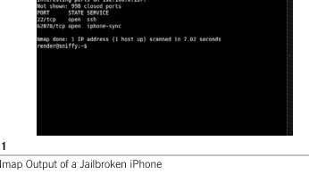

#### 图 7.1

越狱 iPhone 的示例 Nmap 输出

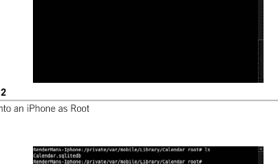

#### 图 7.2

以 Root 身份登录 iPhone

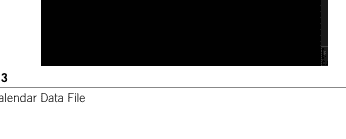

#### 图 7.3

iPhone 日历数据文件

#### 图 7.4

iPhone 邮件文件夹

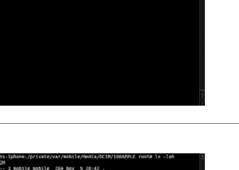

#### 图 7.5

iPhone 照片目录


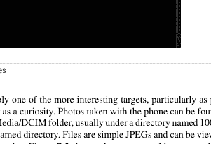

照片可能是更有趣的目标之一，特别是作为潜在的勒索材料或出于好奇心。用手机拍摄的照片可以在`/private/var/mobile/Media/DCIM`文件夹中找到，通常位于名为`100APPLE`或其他类似名称的目录下。文件是简单的 JPEG，可以用大多数图像查看器打开，如图 7.5 所示，它们归用户`mobile`所有，这进一步强调了更改`mobile`用户密码的重要性。

此时，攻击者可以下载大量私人内容；然而，该攻击依赖于持续连接，并且下载所有有趣内容可能需要时间。显然很多操作可以脚本化以加快速度，但另一个问题是我们的目标可能未连接到机场、酒店或被攻击地点的本地网络。

iPhone 有一种有趣的行为。正如第 2 章《802.11 无线 – 客户端攻击》中所述，一些设备在广告和连接其首选列表中的网络方面非常执着。iPhone 似乎尤其被设计为几乎强制执行此操作。

在 iPhone 的 Wi-Fi 网络菜单中，菜单底部有一条说明：“已知网络将自动加入。如果没有可用的已知网络，在加入新网络前会询问您。”由于这些是混合设备，它们也可以通过 3G 连接接入互联网。这显然会给用户带来费用，出于礼貌，操作系统设计为将 3G 作为最后的连接手段。简单来说，系统会检查之前连接过的 Wi-Fi 是否存在。如果存在，它将自动加入并使用该网络。如果不存在，那么如果周围有网络，用户将被提供连接其中一个网络的机会。如果没有网络或用户无法或拒绝连接，则使用 3G 连接。所有这些前提是 Wi-Fi 连接首先已启用。

这为攻击者创造了有趣的情况。由于 iPhone 偏好 Wi-Fi 连接，并且不断搜索家庭网络并会在没有用户提示的情况下自动连接，攻击者可以轻松利用这一点。

使用第 2 章《802.11 无线 – 客户端攻击》中的工具，如`KarMetasploit`，设置一个对任何探测请求做出响应并模拟 iPhone 首选列表中网络的假接入点是微不足道的。一旦 iPhone 连接，它会静默获得一个 IP 地址，现在攻击就与设备建立了直接连接，且无需用户交互。无线社区发现，iPhone 是利用这种行为最容易的设备之一。

由于设备进入待机导致连接间歇性的问题，奇怪地被攻击发生的环境所解决了。大多数 iPhone 用户并不持续使用设备。他们只使用短时间然后将其置于待机。然而，在某些地方持续使用几乎是保证的，通常是在人们需要长时间等待的任何地方。最容易利用的地方之一是在飞机上。用户通常会根据联邦航空管理局的规定在飞行前禁用手机的 3G 功能，但经常不会禁用 Wi-Fi。飞行数英里后，大多数用户会听音乐或在设备上看电影，浑然不觉他们的设备仍在寻找网络连接。攻击者只需在范围内即可，这在飞机上很容易，然后启动攻击。自动化系统可以使这一过程仅需几秒钟，在其他情况下，如两辆同向行驶的汽车甚至在红灯前停车时，仍有足够的时间使其生效。

> **提示**
>
> 虽然大多数情况下，攻击者必须非常有决心才能与目标搭乘同一航班，但存在机会目标。经济舱后排一个非常无聊的人可以制造大量破坏来取乐，而且在航班结束后他们分开很久之前，很不可能被注意到。
>
> 这也适用于后来的自动化病毒和蠕虫攻击。在封闭区域内的持续接触增加了感染传播到您设备的可能性，特别是现在许多航空公司都提供机上 Wi-Fi 功能。

## 攻击

2009年11月初，新闻网站和科技博客纷纷热议一起针对苹果 iPhone 的攻击事件。数名荷兰越狱 iPhone 用户报告称其设备遭到攻击，锁屏壁纸上留下一条不祥的提示，指示访问某个网站以了解如何保护设备。该网站要求支付五欧元才能获得保护手机的说明。消息曝光后，攻击者迅速撤除了付款要求，并发布了保护手机的说明以及对受攻击用户的道歉。正如猜测的那样，他主要利用的是越狱手机上的默认 root 密码。这是该漏洞能力的首次公开演示，但肯定不是它首次被暗中滥用。

11月晚些时候，澳大利亚也出现了另一起 iPhone 攻击，利用了相同的攻击向量。不同的是，这次攻击是自动化的，可以通过易受攻击设备共享的 Wi-Fi 网络在手机之间自动传播。该蠕虫被称为`Ikee`，是 21 岁学生 Ashley Towns 的创意。该蠕虫通过默认 SSH 密码感染越狱 iPhone，但这次将背景图片改为 Rick Astley，并将铃声改为著名 RickRoll 歌曲《Never Gonna Give You Up》。随后，蠕虫会尝试将自身上传并对感染设备连接的网络上的其他手机做同样的事情。报告仅显示感染的手机在 100 台或以下，但考虑到越狱 iPhone 的比例很小，这一数字很有意思。虽然尚不清楚荷兰勒索事件是否启发了`Ikee`蠕虫，但它确实让其作者引起了 iPhone 应用开发商 Mogeneration 的注意，该公司在得知他的蠕虫后，经过面试流程聘用了 Towns 作为开发者。他们声称这并非因为蠕虫，而是他像任何其他员工一样，以优异成绩通过了他们的 iPhone 开发者测试。是否聘用他是对负面行为的奖励并树立危险先例，存在很大争议。有人认为这是对负面行为的正向强化，如果有奖励的暗示，其他人会试图模仿这种行为以期获得奖励。最终结果可能是大量人试图为 iPhone 或其他设备编写蠕虫以期获得工作。有人认为这就像让狐狸看守鸡舍，聘用

> 备注
>
> 尚不清楚该蠕虫是否可以通过 3G 连接传播。许多运营商在向互联网展示设备的方式上存在差异。许多 3G 网关提供商会对无线设备使用的 IP 空间实施严格的防火墙入站连接。他们还可能禁止客户端之间的通信。虽然这阻止了一些攻击向量，但某些提供商可能没有那么严格，允许传播此类恶意软件所需的连接类型。很大程度上取决于设备所连接的运营商的基础设施，并且会因提供商而异。

最优秀的人才。 这绝对不是一个很快就会结束的争论，甚至可能永远无法解决。

这两次攻击相当良性，对被攻击设备几乎没有造成损害。然而，它们确实向世界表明，有大量越狱设备很容易被攻破。它还表明用户群体对这些混合设备风险的认识相当不足。

在前两次攻击后不久，第三个蠕虫出现了，这次具有明确的恶意意图。在荷兰，一个绰号为“Duh”的蠕虫开始传播到具有默认 root 密码的越狱 iPhone，企图窃取银行信息。该蠕虫会建立一个僵尸网络，其中驻留在手机上的僵尸程序会等待来自 ING 银行的短信和移动交易验证码（`mTANs`），即发送给网上银行用户的六位数验证码，用户必须在短时间内输入以完成交易。这是一种离线身份验证系统，用于验证账户所有者是否在访问账户。该系统失效，因为短信接收在本质上与访问网上银行门户的同一台计算机上，从而抵消了离线部分及其所暗示的安全性。僵尸程序拦截 `mTAN` 短信并将其发送到远程系统，攻击者在其中有短暂的机会窗口，可以在合法用户之前登录并获取其资金。虽然传播范围不大，但任何成功的攻击很可能都会获得足够的资金，使攻击者的努力物有所值，并可能激发未来类似的攻击。

## 未来攻击

攻击的未来绝不局限于 RickRolling 和银行欺诈。这些设备作为其他攻击向量的潜力巨大。安全领域唯一不变的是威胁持续存在且常常出人意料。智能手机和混合设备非常多功能，人们不断想出以令人惊讶的方式应用这些优势的新方法。

Twitter 创始人 Jack Dorsey 创办了一家名为`Square`的新公司（www.squareup.com）。该公司希望成为移动信用卡支付系统的主要参与者。该公司正在开发一种小型信用卡读卡器，可插入智能手机（如 iPhone）的音频输入插孔，允许任何人无需传统信用卡授权系统的成本和负担即可接受信用卡付款。

`Motorola` 也以其移动支付模块进入该领域（www.motorola.com/Business/US-EN/Business+Product+and+Services/Accessories/Mobile+Computer+Accessories/Snap-ons/Mobile+Payment+Device/Mobile_Payment_Device_US-EN），该模块可夹在运行 Windows Mobile 的智能手机底部，以便在任何地方接受和处理付款。使用现有的通用设备降低了设备相关的成本。

虽然这些项目仍处于早期阶段，但这确实引发了一些关于混合设备安全的有趣思考。由于这些设备现在接受信用卡，它们对攻击者来说更具吸引力和价值。攻击者不再只能窃取通讯录和电子邮件——他或她可能能够从这些手持设备中批量获取信用卡信息。

技术仍在不断发展，但 `Square` 等公司在一定程度上利用了 iPhone 的普及性和其界面。信用卡是通过手机手动输入或通过连接到手机的读卡器输入的。交易通过 3G 或 Wi-Fi 路由进行实时授权。虽然这似乎很方便，因为你现在可以在任何地方处理信用卡，但它也为攻击者提供了有趣的角度。iPhone 很容易被像 `Karma` 这样的工具诱导连接到 Wi-Fi 网络，并且鉴于它们更倾向于自动连接到已知网络，这将覆盖 3G 连接。只需通过替代回程进行少量网络路由，所有的流量就会通过攻击者路由。将其与安全套接层现有的弱点以及用户处理错误信息的方式结合起来，攻击者就有相当大的机会记录所有交易。iPhone 的封闭性也在此场景中造成问题，因为应用程序供应商无法“窥探引擎盖下”并对设备进行调整以进一步保护它。


这仍然是一个理论情况，因为尚未注意到（或至少未被注意到）通过此或其他方法进行的大规模攻击。尽管如此，并没有什么能阻止新漏洞、与手机相关的缓慢修补周期以及机会的“完美风暴”造成一次非常大且有利可图的攻击。

## 混合设备的进攻性用途

对于通过此类移动支付系统付款的人来说，也几乎无法保证设备没有以某种方式被篡改。也许一个不诚实的员工越狱了设备并篡改了设备，使其将交易的第二份副本发送到他或她的个人电子邮件。同样，`Ikee` 和 `Duh` 蠕虫利用越狱权限在未经用户许可的情况下更改系统文件；同样的权限也可能被用户用来篡改系统并在不知情的情况下损害他人。

另一个鲜少被考虑的角度是使用混合设备作为攻击工具，而非作为攻击目标。带着笔记本电脑和一堆其他设备进入目标地点可能会相当可疑，并引起攻击者不必要的注意，但带着 `iPhone` 进入并在屏幕上轻点则极不可能被视为可疑。

在 2008 年的 `Defcon 16` 上，`Errata Security` 的 `David Maynor` 和 `Robert Graham` 发表了题为《Bringing Sexy Back: Breaking in with Style》的演讲，其中描述了他们在渗透测试期间创造性地入侵公司的多种方法。

作为演讲的一部分，这对搭档讨论了使用 `iPhone` 作为特洛伊木马进入设施并评估其内部无线基础设施。受启发

受《周六夜现场》的一个小品启发，这对搭档萌生了连夜将改装过的 `iPhone` 寄送到目标设施以突破外围的想法。在大多数情况下，邮件和包裹递送会直接进入设施内部，进入邮件室，正好处于设施内任何无线基础设施的覆盖范围内。

他们首先获取了一台早期版本的 `iPhone`（由于功耗较低）和原装包装盒。原装 `iPhone` 电池只能为设备供电一天左右，这意味着它在到达时可能已经没电。为此，他们在包装盒底部安装了一个电池组，并用它为 `iPhone` 供电长达五天，足够完成所需任务。经过少量改装包装盒后，电池、充电线和 `iPhone` 都能紧密地装进一个不起眼的包裹中。

`iPhone` 被越狱并安装了远超苹果预期会安装的额外软件。由于 `iPhone` 是基于 `UNIX` 的系统，因此将多个流行实用工具移植到其他平台（如 `Windows Mobile` 或 `Symbian`）变得很容易。`Tcpdump`（数据包嗅探器）、`Metasploit`（漏洞利用框架）、`FERRET`（信息泄露评估）以及其他工具都被安装到了设备上。关闭手机所有自动关机功能后，他们设置系统定期回连。由于大多数运营商会阻止对蜂窝数据服务设备上的入站连接，因此手机被设置为每小时通过蜂窝数据连接向远程系统主动连接一次，并为渗透测试人员建立一个 `shell`。

一切设置并充电完成后，他们将包装盒和手机连夜寄送到测试设施，收件人为一名不存在的员工。推测上，运单追踪号码告诉了他们包裹何时到达目的地以及何时可以开始测试。将包裹寄给不存在的员工是一种让包裹在邮件室停留一段时间的方式，因为它无法投递，并且（希望）会在几天后被退回 `Errata Security` 以便重新充电并再次使用。

这种攻击被证明非常有效，并且仍在不断发展。在一个有决心的攻击者手中，它可能具有毁灭性，因为它还包含一种高度理想的匿名性。

> **注意**
>
> 由于 `iPhone` 被越狱，这移除了为防止在其他网络上使用手机而设置的数字锁。攻击者随后可以使用来自遥远地方的匿名预付费 `SIM` 卡，这种卡很难追踪。此外，如果包裹因怀疑而被打开，几乎没有任何信息表明是谁寄出的（除返回地址外，而返回地址可能存在也可能不存在），攻击者只损失几百美元，并且安全地远离设施。

进入设施内部后，`Errata` 渗透测试人员拥有了所需的一切。他们可以远程访问该设备，该设备具有可监听流量的无线接口，可用于连接网络，并且是一个安装了 `Metasploit` 等工具的 `UNIX` 平台，以便进行进一步的测试和攻击，而这一切都在这个小盒子安静地放在邮件室的桌子或架子上时进行。

这种攻击方法相当巧妙，因为一些组织常用的防御手段是设置厚重的外层安全（持枪警卫），假设这会阻止攻击者接近到足以利用内部薄弱安全的地方。

次年，在 2009 年的 `Defcon 17`¹ 上，`Thomas Wilhelm` 的一次演讲通过探索使用 `iPod Touch`（功能与 `iPhone` 相似，但没有电话功能）进行黑客攻击的可能性，扩展了 `Errata Security` 的能力。令人惊讶的是，有大量工具已被移植，并且在越狱设备上安装非常简单。其他一些工具需要手动编译安装，但完成此操作所需的所有工具都很容易获得。他指出，将 `iPod`/`iPhone` 带入“安全”区域比带笔记本电脑或其他明显的电脑更易被社会接受。

## Anonymity

这些设备的潜力不仅限于成为攻击目标或攻击工具，还可以作为中间人，在用户不知情的情况下为攻击者执行肮脏的工作。

想象有一天，`iPhone` 上的远程漏洞会让攻击者通过本地 `Wi-Fi` 连接获得对设备的 `root` 访问权限并不难。一旦进入，所有下载和安装更多恶意软件所需的工具都已存在。攻击者可以设置一个定时任务，在稍后运行谁也不知道的东西。

攻击者利用 `Wi-Fi` 连接作为网关，通过蜂窝数据连接访问互联网也并非不合理。以前，试图隐藏行踪的攻击者需要将连接路由通过世界各地的受感染计算机或开放的 `Wi-Fi` 接入点。这些问题的在于连接可能会被记录并留下某种痕迹。而对于手机而言，没有设施可以登录那种详细记录通过它路由的连接的细节，这使得攻击者只需去一家咖啡店就能进行其邪恶行为。

## iPHONE SUMMARY

作为市场日益增长的一部分，`iPhone` 将会受到攻击者对漏洞的更大审查，特别是随着越来越多的人将生活中越来越多的个人部分放在这些设备上。

目前，攻击仅限于使用默认密码的越狱设备。然而，我们应该从这些经验中吸取教训，因为在未来的某个时间点，默认应用程序甚至苹果认可的第三方应用程序中可能会发现漏洞，从而为攻击者提供进入系统其余部分的途径。

`iPhone` 的封闭性对安全而言是一把双刃剑。由于它是封闭的，并且应用程序在通过 `App Store` 提供前会经过审核，苹果可以限制应用程序的访问权限，并希望限制恶意软件的暴露。这对用户来说是有代价的。因为它是封闭的，用户在采取主动防御攻击措施方面受到限制。目前，`iPhone` 上没有可用的防火墙应用程序来过滤允许的流量类型（入站或出站）。虚拟专用网络（`VPN`）功能内置其中，但对不同协议的支持有限。如果您现有的 `VPN` 基础设施不支持任何包含的协议（第二层隧道协议、点对点隧道协议或思科 `IPSec`），您就无能为力了。此外，也没有可用的设备防病毒扫描选项，因为这几乎相当于苹果承认其设备在出厂（未越狱）状态下存在漏洞（这种情况不太可能发生）。

## Android Security

虽然 `iPhone` 在手机市场中占有日益增长的份额并具有一定的吸引力，但基于谷歌 `Android` 操作系统的手机在兴趣和市场份额上也在增长。该操作系统于 2007 年底发布，基于 `Linux` 内核（与 `iPhone` 基于 `FreeBSD` 的 `Darwin` 内核相对），采用了与 `iPhone` 不同的安全模型。操作系统的开放性和对安全的关注是对苹果封闭模式的重要反驳。

`Android` 的安全模型是开放的。这似乎违反直觉，因为安全和开放通常是不兼容的概念。`Android` 开发者的愿望是让用户和应用程序开发者对设备有更大的控制权，并建立一个模型，即使安装了恶意应用程序或发现远程漏洞，其影响也不会那么严重。

在 `Android` 上，大部分安全来自于独特的软件权限模型。每个程序都以自己的用户标识符（`UID` 或简称用户）运行，而在 `iPhone` 上，所有程序都在单个用户（`mobile`）下运行。这充当“沙箱”，并将程序间通信限制为特定功能。在安装时，程序可以请求特定权限以与其他程序交互。用户会被告知这些权限，并可以选择允许或禁止这些权限。这样，用户就可以决定，是的，这个新的通讯录管理器应该能够访问我的电话簿并拨打电话，但不能访问 `Wi-Fi` 网络或 `GPS`。对于没有业务访问核心手机功能的程序也是如此。为什么这个下落式方块游戏需要知道我的位置并访问我的电话簿？在这个模型中，潜在的恶意程序只能以非常特定的方式与其他程序和数据交互，因此限制了它们失控时可能造成的损害。应用程序还可以生成自己的权限类型以允许其他程序访问。

在 `Android` 模式下，用户是守门人，可以对安全做出决策。在 `iPhone` 模式下，`Apple` 是守门人。所有应用都必须提交给 `Apple` 并通过筛选流程后才能添加到 `App Store`。`Apple` 会检查源代码中明显的事项，例如游戏访问麦克风或通话功能以及它不应该执行的其他事项，但鉴于 `Apple` 每周收到约 10,000 份应用和应用更新提交ᴸ 并且只有 40 名全职审查员ᴹ ，该流程因工作过载而遗漏某些内容或因过度谨慎而发生不必要的拒绝ᴺ 的可能性是真实存在的，并且已经发生。`Android` 将决定权留给用户。冒犯性或不稳定的应用程序只是被用户卸载，即使如此，由于权限限制，不稳定或恶意的应用程序不太可能影响系统的核心和其他应用程序。


在 iPhone 及其他平台上，具有恶意意图或以某种方式被入侵的程序能够访问在同一用户下运行的任何程序的数据和资源。一旦程序突破限制，除了 App Store 协议中 Apple 的准则外，没有其他限制。这意味着被入侵的邮件客户端理论上可以访问联系人列表并发送短信，这反过来会让用户花钱。阻止这一切发生的唯一因素是 Apple 不会允许此类应用程序获得批准并进入 App Store。

## 常见威胁

虽然 Android 和 iPhone 在应用安全所使用的模型上相当不同，但它们共享一些基本相似之处，使得智能手机和混合设备整体市场对攻击者来说比任何单一设备或品牌都更有趣的目标。

反对为智能手机增加额外安全性的一个常见论点是，与其他目标相比，任何单一型号或平台的手机数量相对较小。与庞大的基于 Windows 的联网 PC 数量相比，几百万部基于 Android 的手机的安装基数并不是一个非常大的目标基数。利用 Windows PC 上的漏洞比仅仅几百万部智能手机——而且并非全部在线或连接——具有更高的大规模成功机会。

然而，值得记住的是，这些手机本身就是计算机，整体上代表着数量非常庞大的设备，甚至在可预见的未来销量将超过笔记本电脑。放在一起，智能手机是一个相当可观的安装基数，尽管它们看起来各不相同，但在内部它们共享的比人们想象的要多。

为了节省成本、提高开发者采用率以及其他因素，现代智能手机现在利用现有的 UNIX 平台，而不是编写全新的操作系统。其中很大一部分包括开源工具和库。尽管外观不同，iPhone、Android 操作系统，甚至为 Palm Pre 提供动力的 Palm Inc 的 WebOS，都共享许多共同的编程基础，这意味着所有设备都存在潜在的脆弱性。

其中之一就是 WebKit，即 iPhone 用于 Safari 浏览器和电子邮件客户端的引擎；Android 在其浏览器中使用它，而 WebOS 在整个操作系统中大量使用它来渲染应用程序。这个通用引擎是这三种新一代智能手机的基本组成部分。

这造成了一个有趣的情况，因为该引擎在三者中均用于浏览器，因此存在利用漏洞在三个平台上都生效的可能性，大大增加了目标基数，并减少了为特定平台定制攻击的需求。平台之间共有的使用方式也使攻击更容易。像 Google 的 Gmail 和其他基于 Web 的应用程序在移动用户中非常受欢迎，也正遭受大量攻击。

WebKit 中的漏洞，例如跨站脚本漏洞，可能生成一个 iFrame 并被用于将这些 Google 应用程序的内容上传到攻击者在任何平台上的首选服务器。由于即使在 Android 的权限结构下浏览器也需要访问网络，这种操作将被允许。结合商场或会议等大型人群以及使用 Airpwn 向流量注入恶意脚本等客户端攻击，攻击者可以跨平台攻击用户，而不仅仅是一个平台。

平台之间可能存在比 WebKit 更多的共同点，而攻击者以善于利用漏洞而闻名。如果发现此类漏洞，他们肯定会乐于扩大其潜在攻击范围。

## 摘要

虽然未来很少完全如预测那样到来，但其中一些元素确实进入了市场。手机从简单的通信设备发展到混合移动计算平台，在相当短的时间内取得了令人惊叹的进步。多年来成本的下降，使每个人都能拥有一个，这以大多数人从未预料到的方式改变了我们的日常行为。

这些设备带来的和来自这些设备的威胁是社会需要适应的新挑战。虽然制造商可以内置安全机制来尝试预判攻击者并将其扼杀在萌芽状态，但仍然有许多事情可能出错。技术发展不会放缓以让社会跟上。消费者需要更积极地了解他们使用的设备的含义以及它们如何影响日常生活。

本页特意留空

## 索引

### A

- 主动身份验证 (AA)，96
- 主动标签，58–59
- Aircrack-ng，13
- Aireplay-ng (ARP)，11，12
- 重放攻击，8
- Airmon-ng，10
- Airodump-ng，10–11
- Airpwn 工具，37
- Airsnarf，29
- 模拟设备，76–77
- 模拟安全，77–78
- 模拟传输，77
- 模拟无线设备，78
- 防御措施，85–87
- Android 安全模型，117–118
- 攻击，112–113
- 未来，112–113
- 匿名性，116
- 混合设备的攻击性用途，114–116
- 音频漏洞，79–80

### B

- 电池辅助被动 (BAP) 标签，59
- Bluebug，50–52
- Bluesnarfer 工具，51
- Bluetooth
  - 适配器类别，44
  - Bluebug，50–52
  - Carwhisperer，49–50
  - 连接，48–49
  - 黑客攻击，46–48
  - 配对过程，45
  - 嗅探，52–54
  - 病毒，54–55
- 启用 Bluetooth 的手机，45
- 暴力攻击，91
- Btcrack，52

### C

- Carwhisperer，49–50
- 挑战-响应身份验证系统，70
- 客户端安全，25
- 克隆 RFID，66–68
- 无绳，78
- CoWPAtty，21–22
- 破解
  - Aircrack-ng，13
  - Aireplay-ng，11，12
  - Airmon-ng，10
  - Airodump-ng，10–11
  - WPA 和 WPA2，19–24，100–101

### D

- 去认证攻击，19
- 数字安全，78
- 数字传输，77
- 数字与模拟设备
  - 模拟安全，77–78
  - 数字安全，78

### E

- 802.11 无线网络，参见 Wireless network
- 电子护照，96
- 加密麦克风，86–87
- 加密，91–92
- 历史，90–91
- 护照
  - 主动身份验证 (AA)，96
  - 文件签发机构和文件伪造者，96–97
  - 电子护照，96
  - MRZ 数据，93
  - RFID 芯片，93
- ROT 加密，90
- Speedpass，97–100
- 扩展服务集标识符 (ESSID)，30

### F

- 未来攻击
  - 匿名性，116
  - 混合设备的攻击性用途，114–116
- 自由竞争区网络，34

### H

- 黑客攻击 bluetooth，46–48
- 热点，参见 Public hotspots
- 耳机，82
- 混合设备
  - 定义，103
  - 历史，104–105

### I

- 国际民用航空组织 (ICAO)，92–93
- iPhone。另见 Jailbreaking
- Android 安全模型，117–118
- 攻击，112
- 常见威胁，118–119

### J

- 越狱
  - 定义，106
  - iPhone 日历数据文件，109
  - iPhone 邮件文件夹，110
  - iPhone 照片目录，110
  - 登录 iPhone，109
  - 示例 Nmap 输出，109
  - UNIX 命令，108

### M

- 机器可读区 (MRZ)，93
- Madwifi 驱动程序，9
- MitiM 攻击，33

### N

- 网络漂移，29
- NutShell 中的 WPA 和 WPA2，15–18

### P

- 数据包捕获工具，19
- 配对，45
- 成对主密钥 (PMK)，16
- 被动标签，59–60
- 护照
  - 主动身份验证 (AA)，96
  - 文件签发机构和文件伪造者，96–97
  - 电子护照，96
  - MRZ 数据，93
  - RFID 芯片，93
- 支付系统，97
- 混杂模式，4
- 公共热点
  - 攻击，27–33
  - 内在危险，26
  - 注入攻击，34–38
  - Java Script 替换，38–40
  - 问题，33
  - 解决方案，33–34
  - 工作描述，26–27

### R

- 射频识别 (RFID) 系统
  - 主动标签，58–59
  - 密码学，69–72
  - 部件，58
  - 被动标签，59–60
  - 物理访问控制，61–63
  - 克隆，66–68
  - 故障，64–66
  - 降低风险，68–69
  - 接近卡，63–64
  - 风险，60–61
- RickRoll，38
- ROT 加密，90

### S

- 扫描仪，80–81
- 通过模糊实现安全，92
- Speedpass，97–100

### U

- 通用软件无线电外设 (USRP)，54

### V

- 视频设备，84–85

### W

- 战争驾驶，5
- WebKit，119
- WEP，参见 Wired equivalency privacy
- Wi-Fi 保护访问 (WPA)
  - 破解，19–24，100–101
  - 在 NutShell 中，15–18
  - 预共享密钥 (PSK)，15
- Wigle.net，14
- 有线等效隐私 (WEP)，3


- ARP 重放攻击，8
- 破解
  - Airsnort-ng，13
  - Aireplay-ng，11，12
  - Airmon-ng，10
  - Airodump-ng，10–11
  - PTW 攻击，8
  - RC4 流密码算法，7
- 无线，78
- 无线麦克风，82–83
- 无线网络
  - 设备类别，3
  - 混杂模式，4
  - TIX Corporation，5–7
  - WPA。参见 Wi-Fi 保护访问
