# Unix、Linux和OS X中的Shell编程（第4版）（开发者文库）

作为美国西部的标志性象征，**纪念碑谷**是世界自然奇观之一。这片红沙沙漠地区位于亚利桑那州与犹他州交界处的纳瓦霍族保留地范围内，拥有高耸的砂岩岩层，这些岩层经过岁月的雕琢，高出谷底400至1000英尺。该山谷最上镜的三座山峰是独特的东、西连指手套状孤峰和梅里克孤峰。

## 关于作者

**史蒂芬·科昌**是 Unix 和 C 语言领域多本畅销书的作者或合著者，包括 *C 语言程序设计*、*Objective-C 编程*、*C 语言编程专题*和*探索 Unix 系统*。他曾是 AT&T 贝尔实验室的软件顾问，在那里开发和讲授 Unix 与 C 编程课程。

**帕特里克·伍德**是 Electronics for Imaging 公司新泽西分部的首席技术官。1985 年，他在贝尔实验室担任技术人员时结识了科昌先生。他们共同创办了 Pipeline Associates, Inc.，一家 Unix 咨询公司，伍德在那里担任副总裁。他们合著了 *探索 Unix 系统*、*Unix 系统安全*、*C 语言编程专题*和 *Unix Shell 编程*。

## 我们期待你的反馈！

作为这本书的读者，*你*是我们最重要的批评家和评论者。我们重视你的意见，想知道我们做对了什么、哪些地方可以做得更好、你希望我们在哪些领域出版书籍，以及你愿意分享的任何其他真知灼见。

我们欢迎你的评论。你可以通过电子邮件或写信直接告诉我们，你喜欢或不喜欢这本书的哪些方面，以及我们如何能让我们的书变得更好。

*请注意，我们无法帮助你解决与本书主题相关的技术问题，而且由于我们收到的邮件数量很大，我们可能无法回复每条消息。*

*写信时，请务必注明本书的书名和作者，以及你的姓名和电话或电子邮件地址。*

**电子邮件：** feedback@developers-library.info

**邮寄地址：**

Reader Feedback

Addison-Wesley Developer’s Library

800 East 96th Street

Indianapolis, IN 46240 USA

## 读者服务

访问我们的网站并在 `www.informit.com/register` 注册本书，即可方便地获取本书可能有的任何更新、下载或勘误。

*此页有意留白*

## 引言

众所周知，在过去的几十年里，Unix 和类 Unix 操作系统家族已成为当今计算领域中最普及、使用最广泛的一类操作系统。对于那些多年来一直在使用 Unix 的程序员来说，这并不令人意外：Unix 系统为程序开发提供了优雅而高效的环境。这正是丹尼斯·里奇和肯·汤普森早在 20 世纪 60 年代末在贝尔实验室开发 Unix 时想要创造的东西。

> **注意**
>
> 在本书中，我们将使用“Unix”一词来泛指基于 Unix 的广泛操作系统家族，包括真正的 Unix 操作系统（如 Solaris）以及类 Unix 操作系统（如 Linux 和 Mac OS X）。

Unix 系统最强大的特性之一是其丰富的程序集合。标准操作系统自带 200 多个基本命令，而 Linux 更胜一寸，通常附带 700–1000 个标准命令！这些命令（也称为*工具*）可以完成从统计文件行数、发送电子邮件，到显示任意年份日历等各种任务。

但 Unix 系统真正的优势并不在于其庞大的命令集合，而在于这些命令能够被优雅而轻松地组合起来，以执行复杂得多的任务。

Unix 的标准用户界面是命令行，它实际上是一个 *shell*，一个在用户与系统最底层（*内核*）之间充当缓冲的程序。shell 仅仅是一个读取你输入的命令并将其转换为系统更容易理解的形式的程序。它还包含核心编程结构，让你能够进行判断、循环以及在变量中存储值。

Unix 系统附带的标准 shell 源自 AT&T 的发行版，而 AT&T 的发行版又由斯蒂芬·伯恩最初在贝尔实验室编写的版本演变而来。此后，IEEE 基于 Bourne shell 和其他较新的 shell 制定了标准。截至本书写作时，该标准的当前版本是 IEEE Std 1003.1-2001 的 Shell 和 Utilities 卷，也就是 POSIX 标准。本书其余部分将以这个 shell 为基础。

本书中的示例在运行 Mac OS X 10.11 的 Mac、Ubuntu Linux 14.04 以及运行旧版 SunOS 5.7 的 Sparcstation Ultra-30 上测试过。除第 14 章中的一些 Bash 示例外，所有示例均使用 Korn shell 运行，不过所有示例在 Bash 下也能正常运行。

由于 shell 提供了一种解释型编程语言，因此程序可以快速而轻松地编写、修改和调试。我们把 shell 作为编程语言的首选，当你熟练掌握 shell 编程后，你也会如此。

### 本书的结构

本书假定你熟悉系统和命令行的基本知识；也就是说，你知道如何登录，如何创建文件、编辑和删除文件，以及如何使用目录。如果你有一段时间没有使用 Linux 或 Unix 系统，我们将在第 1 章“基础知识快速回顾”中回顾这些基础知识。此外，第 1 章还会介绍文件名替换、I/O 重定向和管道。

第 2 章“什么是 Shell？”揭示了 shell 究竟是什么、它如何工作，以及它如何最终成为你与操作系统本身交互的主要方式。你将了解每次登录系统时会发生什么，shell 程序如何启动，如何解析命令行，以及如何为你执行其他程序。第 2 章的一个关键观点是：shell 只是另一个程序，不多不少。

第 3 章“常用工具”提供了对编写 shell 程序有用的工具的教程。本章涵盖 `cut`、`paste`、`sed`、`grep`、`sort`、`tr` 和 `uniq`。诚然，这种选择带有主观性，但它确实为本书其余部分将要开发的程序奠定了基础。第 3 章还详细讨论了正则表达式，许多 Unix 命令（如 `sed`、`grep` 和 `ed`）都会使用正则表达式。

第 4 章到第 9 章教你如何让 shell 为编写程序服务。你将学习如何编写自己的命令；使用变量；编写接受参数的程序；做出判断；使用 shell 的 `for`、`while` 和 `until` 循环命令；以及使用 `read` 命令从终端或文件读取数据。第 5 章“我能引用你这句话吗？”完全用来讨论 shell 最有趣（也常常令人困惑）的一个方面：它解释引号的方式。

到那时，shell 中的所有基本编程结构都已介绍完毕，你将能够编写 shell 程序来解决自己的特定问题。

第 10 章“你的环境”讨论了一个对真正理解 shell 运行方式非常重要的主题：环境。你将了解局部变量和导出变量、子 shell、特殊 shell 变量（如 `HOME`、`PATH` 和 `CDPATH`），以及如何设置你的 `.profile` 文件。

第 11 章“关于参数的更多内容”和第 12 章“未尽事宜”收尾了一些悬而未决的问题，第 13 章“重访 Rolo”介绍了名为 rolo 的电话目录程序的最终版本，该程序在本书中逐步开发出来。

第 14 章“交互式与非标准 Shell 特性”讨论了 shell 的一些特性，这些特性要么不是 IEEE POSIX 标准 shell 的正式组成部分（但在大多数 Unix 和 Linux shell 中可用），要么主要用于交互式环境而不是程序中。

附录 A“Shell 总结”概述了 IEEE POSIX 标准 shell 的特性。

附录 B“更多信息”列出了参考资料和资源，包括可以下载各种 shell 的网站。

本书的理念是以实例教学。我们相信，恰当选择的示例在说明某个特性的用法时，效果远胜于十倍篇幅的文字。那句古老的“一图胜千言……”的谚语似乎同样适用于编程。

我们鼓励你亲手输入每个示例并在自己的系统上测试，因为只有动手实践，你才能熟练掌握 shell 编程。不要害怕尝试。试着修改程序示例中的命令来观察效果，或者添加不同的选项或功能，使程序更有用或更健壮。

### 访问免费 Web 版

无论你以何种形式购买本书，均可访问相应的 Web 版，它提供了几个特殊功能来帮助你学习：

- 在线提供本书全文

- 互动测验和练习，测试你对内容的理解

- 可用的更新和更正

Web 版可在所有类型的计算机和移动设备上，通过任何支持 HTML5 的现代 Web 浏览器查看。

要访问 *Unix、Linux 和 OS X 下的 Shell 编程* 的 Web 版，你只需注册本书：

1. 前往 `www.informit.com/register`。

2. 登录或创建新账户。

3. 输入 ISBN：`9780134496009`。

4. 回答问卷问题作为购买凭证。

Web 版将出现在你账户页面的“数字购买”选项卡下。单击 Launch 链接即可访问该产品。

## 基础知识快速回顾

本章回顾 Unix 系统的基础知识，包括文件系统、基本命令、文件名替换、I/O 重定向以及管道。

### 一些基本命令

#### 显示日期和时间：`date` 命令

`date` 命令让系统打印日期和时间：

```text
$ date
Thu Dec  3 11:04:09 MST 2015
$
```


`date` 打印星期、月份、日期、时间（24 小时制，采用系统时区）和年份。在本书的所有代码示例中，凡是使用`这样的粗体字`，都表示你（用户）需要输入的内容。像这样的正常字体表示 Unix 系统打印的内容。`交互式操作序列中的注释使用斜体字`。

每条 Unix 命令都是通过按 Enter 键提交给系统的。Enter 表示你已完成输入，并准备好让 Unix 系统执行操作。

### 查看谁已登录：`who` 命令

`who` 命令用于获取当前系统中所有已登录用户的信息：

```text
$ who
pat       tty29    Jul 19 14:40
ruth      tty37    Jul 19 10:54
steve     tty25    Jul 19 15:52
$
```

这里显示有三个用户已登录：`pat`、`ruth` 和 `steve`。每个用户 ID 后面列出了该用户的 `tty` 编号以及登录的日期和时间。`tty` 编号是 Unix 系统分配给每个终端或网络设备的唯一标识号，用户通过这些设备登录系统。

`who` 命令也可以用来获取关于你自己的信息：

```text
$ who am i
pat        tty29   Jul 19 14:40
$
```

实际上，`who` 和 `who am i` 是同一个命令：`who`。在后一种情况下，`am` 和 `i` 是 `who` 命令的`参数`。这不是展示命令参数如何工作的好例子；它只是 `who` 命令的一个有趣特性。

### 回显字符：`echo` 命令

`echo` 命令会在终端上打印（或者说`回显`）你在该行上输入的其他内容（有一些例外情况，你将在后面了解到）：

```text
$ echo this is a test
this is a test
$ echo why not print out a longer line with echo?
why not print out a longer line with echo?
$ echo
```

`显示一个空行`

```text
$ echo one          two    three          four  five
one two three four five
$
```

从前面的示例中你会注意到，`echo` 会压缩单词之间多余的空格。这是因为在 Unix 系统中，单词本身是重要的，而空格只是用来分隔单词的。一般来说，Unix 系统会忽略多余的空格（你将在下一章中了解更多相关内容）。

## 处理文件

Unix 系统只识别三种基本类型的文件：`普通`文件、`目录`文件和`特殊`文件。普通文件就是字面意义上的文件：系统中包含数据、文本、程序指令或几乎其他任何内容的文件。目录（或文件夹）将在本章后面介绍。最后，顾名思义，特殊文件对 Unix 系统具有特殊含义，通常与某种形式的 I/O 相关联。

文件名可以由键盘上几乎任何直接可用的字符组成（甚至包括一些不可用的字符），只要名称中包含的总字符数不超过 255 即可。如果指定的字符超过 255 个，Unix 系统会直接忽略多余的字符。

Unix 系统提供了许多工具，使得处理文件变得非常容易。这里我们将回顾一些基本的文件操作命令。

### 列出文件：`ls` 命令

要查看目录中存储了哪些文件，可以输入 `ls` 命令：

```text
$ ls
READ_ME
names
tmp
$
```

该输出表明当前目录中包含三个名为 `READ_ME`、`names` 和 `tmp` 的文件。请注意，`ls` 的输出可能因系统而异。例如，在许多 Unix 系统上，`ls` 在将输出发送到终端时会生成多列输出；在其他系统上，不同文件类型可能使用不同颜色。你可以始终使用 `-1` 选项（这是数字 1）强制单列输出。

### 显示文件内容：`cat` 命令

你可以使用 `cat` 命令来查看文件的`内容`。如果你联想到猫科动物，这里说明一下，它是“concatenate”（连接）的缩写。`cat` 的参数是你想要查看内容的文件名。

```text
$ cat names
Susan
Jeff
Henry
Allan
Ken
$
```

### 统计文件中的单词数：`wc` 命令

使用 `wc` 命令，你可以获得文件中所包含的行数、单词数和字符数的统计。同样，需要将文件名指定为该命令的参数：

```text
$ wc names
      5      7      27 names
$
```

`wc` 命令列出三个数字，后跟文件名。第一个数字表示文件中的行数（5），第二个数字表示单词数（7），第三个数字表示字符数（27）。

### 命令选项

大多数 Unix 命令允许在执行命令时指定`选项`。这些选项通常遵循相同的格式：

```text
-字母
```

也就是说，命令选项是一个减号后紧跟单个字母。例如，要仅统计文件中的行数，可以将 `-l` 选项（这是字母 l）提供给 `wc` 命令：

```sh
$ wc -l names
        5 names
$
```

要仅统计文件中的字符数，可以指定 `-c` 选项：

```sh
$ wc -c names
       27 names
$
```

最后，`-w` 选项可以用来统计文件中的单词数：

```sh
$ wc -w names
        7 names
$
```

有些命令要求选项必须列在文件名参数之前。例如，`sort names -r` 是可以接受的，而 `wc names -l` 则不可以。不过，前一种写法并不常见，大多数 Unix 命令被设计为先指定命令选项，如 `wc -l names` 所示。

### 复制文件：`cp` 命令

要复制文件，请使用 `cp` 命令。该命令的第一个参数是要复制的文件名（称为`源文件`），第二个参数是要将副本放置到的文件名（称为`目标文件`）。你可以复制文件 `names` 并将其命名为 `saved_names`，如下所示：

```sh
$ cp names saved_names
$
```

执行此命令会将文件 `names` 的内容复制到一个名为 `saved_names` 的新文件中。与许多 Unix 命令一样，输入 `cp` 命令后除了命令提示符外没有任何输出，这表明命令执行成功。

### 重命名文件：`mv` 命令

可以使用 `mv`（“move”，移动）命令重命名文件。`mv` 命令的参数格式与 `cp` 命令相同。第一个参数是要重命名的文件名，第二个参数是新名称。例如，要将文件 `saved_names` 的名称改为 `hold_it`，以下命令即可完成：

```sh
$ mv saved_names hold_it
$
```

小心！在执行 `mv` 或 `cp` 命令时，Unix 系统不关心第二个参数指定的文件是否已存在。如果已存在，该文件的内容将会丢失。例如，如果存在一个名为 `old_names` 的文件，执行命令

```sh
cp names old_names
```

会将文件 `names` 复制到 `old_names`，过程中会销毁 `old_names` 之前的内容。同样，命令

```sh
mv names old_names
```

会将 `names` 重命名为 `old_names`，即使在执行该命令之前 `old_names` 文件已存在也是如此。

### 删除文件：`rm` 命令

使用 `rm` 命令从系统中删除文件。`rm` 的参数就是要删除的文件名：

```sh
$ rm hold_it
$
```

你可以通过在命令行中简单地指定多个文件，一次使用 `rm` 命令删除多个文件。例如，以下命令将删除 `wb`、`collect` 和 `mon` 三个文件：

```sh
$ rm wb collect mon
$
```

## 处理目录

假设你有一组文件，包含各种备忘录、提案和信件。再假设你有另一组计算机程序文件。将这些第一组文件归入名为 `documents` 的目录，将后者归入名为 `programs` 的目录，似乎是很合乎逻辑的。图 1.1 展示了这样的目录组织结构。

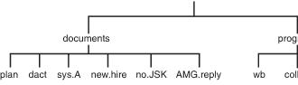

图 1.1 示例目录结构

文件目录`documents`中包含文件 plan、dact、sys.A、new.hire、no.JSK 和 AMG.reply。目录`programs`中包含文件 wb、collect 和 mon。在某些时候，您可能会决定进一步对目录中的文件进行分类。这可以通过创建子目录，然后将每个文件放入相应的子目录来实现。例如，您可能希望在 documents 目录中创建名为 memos、proposals 和 letters 的子目录，如图 1.2 所示。

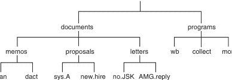

`图 1.2` 包含子目录的目录


`documents` 包含子目录 memos、proposals 和 letters。这些子目录中的每一个又包含两个文件：memos 包含 plan 和 dact；proposals 包含 sys.A 和 new.hire；letters 包含 no.JSK 和 AMG.reply。

虽然给定目录中的每个文件必须具有唯一的名称，但不同目录中的文件可以重名。因此，您可以在 programs 目录中有一个名为 dact 的文件，即使 memos 子目录中也存在同名文件。

## 主目录与路径名

Unix 系统总是将系统的每个用户与一个特定目录相关联。当您登录系统时，您会被自动放入自己的目录（称为您的*主目录*）。

虽然用户主目录的位置可能因系统而异，我们假设您的主目录名为 steve，并且该目录实际上是名为 users 的目录的一个子目录。因此，如果您有 documents 和 programs 两个目录，整个目录结构实际上将类似于图 1.3。目录树的顶部显示了一个名为 `/`（读作“斜杠”）的特殊目录。该目录称为根目录。

每当您“位于”某个特定目录（称为您的*当前工作目录*）中时，该目录中包含的文件无需指定任何路径信息即可直接访问。如果您想从另一个目录访问文件，您可以先发出“切换”到相应目录的命令，然后访问该特定文件，也可以通过其*路径名*来指定该特定文件。

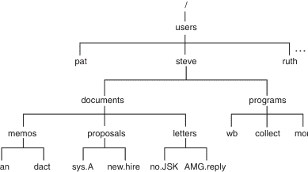

*图 1.3*  层次目录结构

路径名使您能够向 Unix 系统唯一标识特定文件。在路径名的规范中，路径上连续的目录由斜杠字符 `/` 分隔。以斜杠字符开头的路径名称为完整路径名或绝对路径名，因为它指定了从根目录开始的完整路径。例如，路径名 `/users/steve` 标识包含在 users 目录中的 steve 目录。类似地，路径名 `/users/steve/documents` 引用 users 目录中 steve 目录内的 documents 目录。最后一个例子，路径名 `/users/steve/documents/letters/AMG.reply` 标识沿相应目录路径包含的文件 AMG.reply。

为了减少原本所需的输入，Unix 提供了某些记法上的便利。不以斜杠开头的路径名称为相对路径名：该路径相对于您当前的工作目录。例如，如果您刚刚登录系统并被放入主目录 `/users/steve`，您只需输入 `documents` 即可直接引用 documents 目录。类似地，可以输入相对路径名 `programs/mon` 来访问 programs 目录中包含的文件 mon。

按照约定，`..` 始终引用比当前目录高一级的目录，即父目录。例如，如果您在主目录 `/users/steve` 中，路径名 `..` 将引用 users 目录。如果您已发出适当的命令将工作目录更改为 `documents/letters`，则路径名 `..` 将引用 documents 目录，`../..` 将引用 steve 目录，而 `../proposals/new.hire` 将引用 proposals 目录中包含的文件 new.hire。通常有不止一种方法可以指定到特定文件的路径，这是非常 Unix 化的特性。

另一个记法约定是单个句点 `.`，它始终表示当前目录。这在本书后面将变得更加重要，当您想指定当前目录中的 shell 脚本，而不是 PATH 中的某个脚本时。我们稍后会详细解释这一点。

## 显示工作目录：`pwd` 命令

`pwd` 命令通过告诉您当前工作目录的名称，帮助您“确定自己的位置”。

回顾图 1.3 中的目录结构。登录系统后您所在的目录称为您的主目录。从图 1.3 中可以假设用户 steve 的主目录是 `/users/steve`。因此，每当 steve 登录系统时，他都会自动被放入该目录。为了验证这一点，可以发出 `pwd`（打印工作目录）命令：

```shell
$ pwd
/users/steve
$
```

## 切换目录：`cd` 命令

您可以使用 `cd` 命令更改当前工作目录。该命令将目标目录或目的目录的名称作为其参数。

假设您刚刚登录系统并被放置在您的主目录 `/users/steve` 中。图 1.4 中的箭头描述了这一点。

您知道有两个目录直接位于 steve 的主目录“之下”：documents 和 programs。这可以很容易地在终端中通过发出 `ls` 命令来验证：

```shell
$ ls
documents
programs
$
```

`ls` 命令列出 documents 和 programs 这两个目录的方式，与之前示例中列出其他普通文件的方式相同。

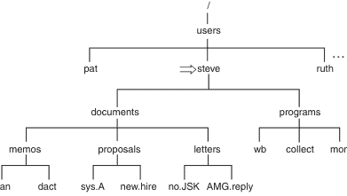

*图 1.4*  当前工作目录是 steve

要更改当前工作目录，请发出 `cd` 命令，后跟新目录的名称：

```shell
$ cd documents
$
```

执行此命令后，您将位于 documents 目录中，如图 1.5 所示。

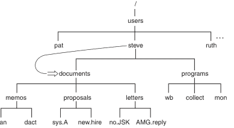

*图 1.5*  `cd documents`

您可以在终端使用 `pwd` 命令验证工作目录是否已更改：

```shell
$ pwd
/users/steve/documents
$
```

在目录中向上移动一级的最简单方法是使用命令引用 `..` 快捷方式：

```shell
cd ..
```

因为按照约定，`..` 始终指上一级目录（见图 1.6）。

```shell
$ cd ..
$ pwd
/users/steve
$
```

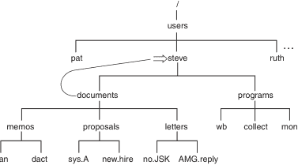

*图 1.6*  `cd ..`

如果您想切换到 letters 目录，可以通过指定相对路径 `documents/letters` 用一条 `cd` 命令到达那里（见图 1.7）：

```shell
$ cd documents/letters
$ pwd
/users/steve/documents/letters
$
```

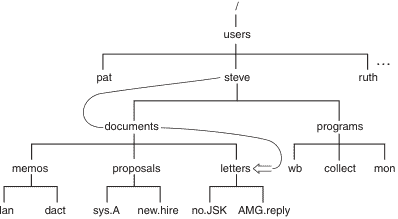

*图 1.7*  `cd documents/letters`

您可以使用一条 `cd` 命令向上两级目录回到您的主目录，如下所示：

```shell
$ cd ../..
$ pwd
/users/steve
$
```

或者，您可以使用完整路径名而不是相对路径名回到主目录：

```shell
$ cd /users/steve
$ pwd
/users/steve
$
```

最后，还有第三种回到主目录的方法，也是最简单的方法。输入命令 `cd` *不带*参数*总是*会将您移回主目录，无论您位于文件系统中的哪个位置：

```shell
$ cd
$ pwd
/users/steve
$
```

## 关于 `ls` 命令的更多内容

当您输入 `ls` 命令时，会列出当前工作目录中包含的文件。但您也可以通过向命令提供参数，使用 `ls` 获取其他目录中的文件列表。首先，让我们回到您的主目录：

```shell
$ cd
$ pwd
/users/steve
$
```

现在，让我们看看当前工作目录中的文件：

```text
$ ls
documents
programs
$
```

如果你将其中一个目录的名称作为参数提供给 `ls` 命令，你就可以看到该目录的内容列表。因此，你可以通过输入 `ls documents` 命令来查看 documents 目录的内容：

```text
$ ls documents
letters
memos
proposals
$
```

要查看子目录 memos，你可以采用类似的方法：

```text
$ ls documents/memos
dact
plan
$
```

如果你将某个非目录文件作为参数提供给 `ls` 命令，那么终端只会原样回显该文件名：

```text
$ ls documents/memos/plan
documents/memos/plan
$
```

感到困惑了吗？`ls` 命令有一个选项，可以让你判断某个文件是否是目录，以及其他信息。`-l` 选项（字母 l）会提供目录中文件的更详细描述。如果你当前位于 steve 的主目录中，那么运行 `ls -l` 命令会得到以下结果：

```text
$ ls -l
total 2
drwxr-xr-x  5 steve    DP3725     80 Jun 25 13:27 documents
drwxr-xr-x  2 steve    DP3725     96 Jun 25 13:31 programs
$
```

显示的第一行是所列文件占用的总块数（1,024 字节）的统计值。`ls -l` 命令显示的每一行都包含目录中某个文件的详细信息。每行的第一个字符表示该文件的类型：`d` 表示目录，`-` 表示普通文件，`b`、`c`、`l` 或 `p` 表示特殊文件。


行中的接下来九个字符定义该文件或目录的访问权限。这些**访问模式**依次适用于文件所有者（前三个字符）、与文件所有者处于同一**用户组**的其他用户（接下来三个字符），以及系统上的所有其他用户（最后三个字符）。通常，它们表示指定类别的用户是否可以读取该文件、向该文件写入内容或执行该文件的内容（对于程序或 shell 脚本而言）。

接着，`ls -l` 命令会显示链接数（参见本章后面的“链接文件：`ln` 命令”）、文件所有者、文件所在用户组、文件大小（即其中包含多少个字符），以及文件的最后修改时间。该行最后显示的信息是文件名本身。

> **注意**
>
> 许多现代 Unix 系统已经不再使用用户组，因此虽然这些权限仍然会显示，但在 `ls` 命令的输出中，特定文件或目录的组所有者往往会被省略。

现在，你应该能从 `ls -l` 输出的一个装满文件的目录中获取大量信息：

```text
$ ls -l programs
total 4
-rwxr-xr-x  1 steve  DP3725   358 Jun 25 13:31 collect
-rwxr-xr-x  1 steve  DP3725  1219 Jun 25 13:31 mon
-rwxr-xr-x  1 steve  DP3725    89 Jun 25 13:30 wb
$
```

每一行第一列中的短横线表示 `collect`、`mon` 和 `wb` 这三个文件是普通文件，而不是目录。现在，你能看出它们的大小吗？

## 创建目录：`mkdir` 命令

使用 `mkdir` 创建目录。此命令的参数就是你想创建的目录名称。例如，假设你仍在使用图 1.7 所示的目录结构，并且想在与 `documents` 和 `programs` 目录相同的层级上创建一个名为 `misc` 的新目录。如果你当前在主目录中，输入 `mkdir misc` 命令即可达到预期效果：

```text
$ mkdir misc
$
```

现在，如果你运行 `ls`，就会看到新目录被列出：

```text
$ ls
documents
misc
programs
$
```

目录结构现在如图 1.8 所示。

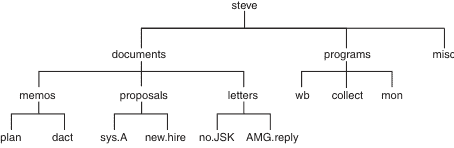

图 1.8 新建了 `misc` 目录后的目录结构

## 将文件从一个目录复制到另一个目录

`cp` 命令可以用于将文件从一个目录复制到另一个目录。例如，你可以将 `programs` 目录中的 `wb` 文件复制为 `misc` 目录中名为 `wbx` 的文件，如下所示：

```text
$ cp programs/wb misc/wbx
$
```

由于这两个文件位于不同的目录中，因此它们完全可以使用相同的名称：

```text
$ cp programs/wb misc/wb
$
```

当目标文件将与源文件同名（当然，位于不同目录）时，只需要将目标目录作为第二个参数指定即可：

```text
$ cp programs/wb misc
$
```

当该命令被执行时，Unix 系统会识别出第二个参数是一个目录，并将源文件复制到该目录中。新文件与源文件同名。

你可以通过将多个要复制的文件列在目标目录名称之前，从而将多个文件复制到一个目录中。如果你当前位于 `programs` 目录中，命令

```text
$ cp wb collect mon ../misc
$
```

会将 `wb`、`collect` 和 `mon` 这三个文件复制到 `misc` 目录中，并保留相同的文件名。

要将文件从另一个目录复制到你在文件系统中的当前位置，并保持文件名不变，可以使用简便的“.”快捷方式来代表当前目录：

```text
$ pwd
/users/steve/misc
$ cp ../programs/collect .
$
```

上面的命令将 `collect` 文件从 `../programs` 目录复制到当前目录（`/users/steve/misc`）。

## 在目录之间移动文件

你回忆一下，`mv` 命令可以用于重命名文件。事实上，Unix 中没有专门的“rename”命令。然而，当两个参数指向不同的目录时，文件实际上会从第一个目录移动到第二个目录。

为了演示，先从主目录进入 `documents` 目录：

```text
$ cd documents
$
```

假设现在你认为 `memos` 目录中的 `plan` 文件实际上是一份提案，因此你想把它从 `memos` 目录移动到 `proposals` 目录。下面的命令可以做到这一点：

```text
$ mv memos/plan proposals/plan
$
```

与 `cp` 命令一样，如果源文件和目标文件同名，只需提供目标目录的名称即可，因此有一种更简单的方式来移动这个文件：

```text
$ mv memos/plan proposals
$
```

同样与 `cp` 命令类似，可以将一组文件同时移动到一个目录中，只需在目标目录名称之前列出所有要移动的文件：

```text
$ pwd
/users/steve/programs
$ mv wb collect mon ../misc
$
```

这会将 `wb`、`collect` 和 `mon` 三个文件移动到 `misc` 目录中。

顺便提一下，你也可以使用 `mv` 命令来更改目录的名称。例如，下面的命令将 `programs` 目录重命名为 `bin`：

```text
$ mv programs bin
$
```

## 链接文件：`ln` 命令

到目前为止，我们讨论的所有文件管理内容都假定一组给定的数据在文件系统中无论位于何处，都只有一个且仅有一个文件名。事实证明，Unix 比这更复杂，它可以为同一组数据分配多个文件名。

为给定文件创建这些重复名称的主要命令是 `ln` 命令。

该命令的一般形式是

```text
ln from to
```

这会将文件 `from` 链接到文件 `to`。

回想一下图 1.8 中 `steve` 的 `programs` 目录结构。在该目录中，他存放了一个名为 `wb` 的程序。假设他决定也想把这个程序称为 `writeback`。最明显的做法是直接创建一份 `wb` 的副本并命名为 `writeback`：

```text
$ cp wb writeback
$
```

这种方法有个缺点：该程序现在会占用两倍的磁盘空间。此外，如果 `steve` 日后修改了 `wb`，他可能会忘记在 `writeback` 中同步修改，导致他认为的同一个程序产生两个不同步的副本。这可不太好，Steve！

通过将 `wb` 文件链接到新名称，可以避免这些问题：

```text
$ ln wb writeback
$
```

现在，不再存在该文件的两个副本，而只存在一个文件，但有两个不同的名称：`wb` 和 `writeback`。这两个名称已被 Unix 系统在逻辑上链接起来。

对你而言，看起来似乎拥有两个不同的文件。执行 `ls` 命令会分别显示这两个文件：

```text
$ ls
collect
mon
wb
writeback
$
```

有趣的是，当你使用 `ls -l` 时：

```text
$ ls -l
total 5
-rwxr-xr-x  1 steve   DP3725   358 Jun 25 13:31 collect
-rwxr-xr-x  1 steve   DP3725  1219 Jun 25 13:31 mon
-rwxr-xr-x  2 steve   DP3725    89 Jun 25 13:30 wb
-rwxr-xr-x  2 steve   DP3725    89 Jun 25 13:30 writeback
$
```

仔细观察输出的第二列：`collect` 和 `mon` 显示的数字是 1，而 `wb` 和 `writeback` 显示的是 2。这是指向一个文件的链接数；对于没有链接的非目录文件，通常为 1。但由于 `wb` 和 `writeback` 是链接在一起的，因此这些文件（更准确地说，是这个具有两个名称的文件）的链接数为 2。

你可以随时删除这两个链接文件中的任意一个，另一个不会被删除：

```text
$ rm writeback
$ ls -l
total 4
-rwxr-xr-x  1 steve    DP3725      358 Jun 25 13:31 collect
-rwxr-xr-x  1 steve    DP3725     1219 Jun 25 13:31 mon
-rwxr-xr-x  1 steve    DP3725       89 Jun 25 13:30 wb
$
```

注意，`wb` 上的链接数从 2 变为 1，因为它的一个链接已被删除。

通常情况下，`ln` 用于让一个文件同时出现在多个目录中。例如，假设 `pat` 想要访问 `steve` 的 `wb` 程序。与其为自己复制一份（这会遇到前面提到的数据同步问题），或者将 `steve` 的程序目录加入他的 `PATH`（这存在第 10 章“你的环境”中描述的安全风险），他只需从自己的程序目录链接到该文件即可：


```text
$ pwd
/users/pat/bin                         pat’s program directory
$ ls -l
total 4
-rwxr-xr-x  1 pat      DP3822     1358 Jan 15 11:01 lcat
-rwxr-xr-x  1 pat      DP3822      504 Apr 21 18:30 xtr
$ ln /users/steve/wb .                link wb to pat’s bin
$ ls -l
total 5
-rwxr-xr-x  1 pat      DP3822     1358 Jan 15 11:01 lcat
-rwxr-xr-x  1 steve    DP3725       89 Jun 25 13:30 wb
-rwxr-xr-x  1 pat      DP3822      504 Apr 21 18:30 xtr
$
```

注意，即使在查看 `pat` 的目录内容时，`wb` 的所有者仍然显示为 `steve`。这是合理的，因为实际上该文件只有一份副本，而它的所有者是 `steve`。

关于链接文件的唯一限制是，对于普通链接，要被链接在一起的文件必须位于同一个文件系统上。如果不在同一个文件系统上，当你试图链接它们时，`ln` 会返回一个错误。（要确定系统上的不同文件系统，可以执行 `df` 命令。输出中每行的第一个字段就是一个文件系统的名称。）

要在不同文件系统（或不同网络系统）上的文件之间创建链接，可以使用 `ln` 命令的 `-s` 选项。这会创建一个符号链接。符号链接的行为与普通链接非常相似，区别在于符号链接指向原始文件；如果原始文件被删除，符号链接将不再有效。

让我们看看符号链接在之前的例子中是如何工作的：

```text
$ rm wb
$ ls -l
total 4
-rwxr-xr-x  1 pat     DP3822    1358 Jan 15 11:01 lcat
-rwxr-xr-x  1 pat     DP3822     504 Apr 21 18:30 xtr
$ ln -s /users/steve/wb ./symwb                 Symbolic link to wb
$ ls -l
total 5
-rwxr-xr-x  1 pat     DP3822    1358 Jan 15 11:01 lcat
lrwxrwxr-x  1 pat     DP3822      15 Jul 20 15:22 symwb -> /users/steve/wb
-rwxr-xr-x  1 pat     DP3822     504 Apr 21 18:30 xtr
$
```

注意，`symwb` 的所有者列的是 `pat`，并且 `ls` 输出中第一个字符显示的文件类型为 `l`，表示这是一个符号链接。这个符号链接的大小是 15（该文件实际上包含字符串 `/users/steve/wb`），但如果尝试访问该文件的内容，看到的却是它所链接到的文件 `/users/steve/wb` 的内容：

```text
$ wc symwb
       5           9          89 symwb

$
```

`ls` 命令的 `-L` 选项可以与 `-l` 选项一起使用，以获取符号链接所指向文件的详细信息列表：

```text
$ ls -Ll
total 5
-rwxr-xr-x  1 pat     DP3822    1358 Jan 15 11:01 lcat
-rwxr-xr-x  1 steve   DP3725      89 Jun 25 13:30 wb
-rwxr-xr-x  1 pat     DP3822     504 Apr 21 18:30 xtr
$
```

删除符号链接所指向的文件会使符号链接失效（因为符号链接是以文件名形式维护的），但并不会删除符号链接本身：

```text
$ rm /users/steve/wb                         Assume that pat can remove this file
$ ls -l
total 5
-rwxr-xr-x  1 pat     DP3822    1358 Jan 15 11:01 lcat
lrwxrwxr-x  1 pat     DP3822      15 Jul 20 15:22 symwb -> /users/steve/wb
-rwxr-xr-x  1 pat     DP3822     504 Apr 21 18:30 xtr
$ wc symwb
Cannot open wb: No such file or directory
$
```

这种类型的文件被称为*悬空符号链接*；除非你有特殊理由保留它（例如，你打算替换被删除的文件），否则应将其删除。

在结束这个话题之前，还有最后一点需要注意：`ln` 命令与 `cp` 和 `mv` 遵循相同的一般格式，也就是说，你可以使用如下格式在特定目标目录中为一组文件创建链接：

```text
ln files directory
```

## 删除目录：`rmdir` 命令

你可以使用 `rmdir` 命令删除目录。不过，为了防止你意外删除几十甚至上百个文件，`rmdir` 只有在指定目录完全没有任何文件和子目录时才会允许你继续操作。

要删除目录 `/users/pat`，可以使用以下命令：

```text
$ rmdir /users/pat
rmdir: pat: Directory not empty
$
```

呼！那本来会是个错误！相反，让我们删除你之前创建的 `misc` 目录：

```text
$ rmdir /users/steve/misc
$
```

同样，上述命令只有在 `misc` 目录中不包含任何文件或目录时才会生效；否则，就会出现下面的情况，正如前面也展示过的那样：

```text
$ rmdir /users/steve/misc
rmdir: /users/steve/misc: Directory not empty
$
```

如果你仍然想删除 `misc` 目录，你必须先删除该目录中的所有文件，然后再重新执行 `rmdir` 命令。

作为删除目录及其内容的另一种方法，你可以使用 `rm` 命令的 `-r` 选项。格式很简单：

```text
rm -r dir
```

其中 `dir` 是你要删除的目录的名称。`rm` 会删除指定目录及其中的所有文件（包括目录），所以使用这个功能强大的命令时要小心。

想直接全速运转？加上 `-f` 标志即可，它会强制执行，而不会逐条命令提示你确认。然而，如果你不小心，它可能会彻底摧毁你的系统，因此许多管理员干脆完全避免使用 `rm -rf`！

## 文件名替换

### 星号

Unix 系统中由 shell 处理的其中一个强大特性就是*文件名替换*。假设你的当前目录中有以下文件：

```text
$ ls
chap1
chap2
chap3
chap4
$
```

假设你想一次显示它们的内容。很简单：`cat` 允许你显示命令行上指定的任意数量文件的内容。就像这样：

```text
$ cat chap1 chap2 chap3 chap4
    ...
$
```

但这很繁琐。相反，你可以利用文件名替换，只需输入：

```text
$ cat *
    ...
$
```

`shell` 会自动把当前目录中与模式 `*` 匹配的所有文件的名称替换进去。当然，如果你把 `*` 与其他命令一起使用，也会发生同样的替换。`echo` 呢？

```text
$ echo * *
chap1 chap2 chap3 chap4 : chap1 chap2 chap3 chap4
$
```

这里的 `*` 再次被替换为当前目录中所有文件的名称，`echo` 命令只是把这个列表显示给你。

只要 `*` 出现在命令行上的任意位置，`shell` 就会执行替换：

```text
$ echo * *
chap1 chap2 chap3 chap4 : chap1 chap2 chap3 chap4
$
```

实际上，`*` 是一种丰富的文件替换语言的一部分，它还可以与其他字符组合使用，以限制匹配哪些文件名。

例如，假设你的当前目录中不仅有 `chap1` 到 `chap4`，还有文件 `a`、`b` 和 `c`：

```text
$ ls
a
b
c
chap1
chap2
chap3
chap4
$
```

若只显示以 `chap` 开头的文件内容，你可以输入：

```sh
$ cat chap*
    .
    .
    .
$
```

`chap*` 匹配任何以 `chap` 开头的文件名。在指定命令被调用之前，所有匹配的文件名都会被替换到命令行上。

`*` 并不限于文件名的末尾；它同样可以用于文件名的开头或中间：

```sh
$ echo *t1
chap1
$ echo *t*
chap1 chap2 chap3 chap4
$ echo *x
*x
$
```


在第一个 `echo` 命令中，`*t1` 指定所有以字符 `t1` 结尾的文件名。在第二个 `echo` 命令中，第一个 `*` 匹配截至字母 `t` 之前的所有内容，第二个 `*` 匹配其后的所有内容；因此，所有包含 `t` 的文件名都会被打印出来。由于没有以 `x` 结尾的文件，在最后一种情况下不会发生替换。因此，`echo` 命令只是显示 `*x`。

### 匹配单个字符

星号（`*`）匹配零个或多个字符，也就是说，`*x*` 既匹配文件 `x`，也匹配 `x1`、`x2`、`xabc` 等等。问号（`?`）恰好匹配一个字符。所以 `cat ?` 会显示所有文件名恰好为一个字符的文件，正如 `cat ?x` 会打印所有以 `x` 开头的两个字符文件名的文件。这里我们再次用 `echo` 来说明这一行为：

```sh
$ ls
a
aa
aax
alice
b
bb
c
cc
```

```
$ echo ?
a b c
$ echo a?
aa
$ echo ??
aa bb cc
$ echo ??*
aa aax alice bb cc report1 report2 report3
$
```

在上面的示例中，`??` 匹配两个字符，而 `*` 匹配从当前位置到末尾的零个或多个字符。最终效果是匹配所有包含两个或更多字符的文件名。

匹配单个字符的另一种方法是在方括号 `[ ]` 中给出要匹配的字符列表。例如，`[abc]` 匹配字母 `a`、`b` 或 `c`。这与 `?` 类似，但它允许你选择哪些字符是有效匹配。

你还可以使用连字符指定一个逻辑上的字符范围，这非常方便！例如，`[0-9]` 匹配从 `0` 到 `9` 的字符。指定字符范围的唯一限制是第一个字符在字母顺序上必须小于最后一个字符，因此 `[z-f]` 不是有效的范围规范，而 `[f-z]` 是。

通过在列表中混合和匹配范围与字符，你可以执行复杂的替换。例如，`[a-np-z]*` 匹配所有以字母 `a` 到 `n` 或 `p` 到 `z` 开头的文件（更简单地说，任何不以小写字母 `o` 开头的文件名）。

如果 `[` 后面的第一个字符是 `!`，则匹配的含义会被反转。也就是说，除了方括号内包含的字符外，任何字符都匹配。所以

```
[!a-z]
```

匹配除小写字母外的任何字符，并且

```
*[!o]
```

匹配任何不以小写字母 `o` 结尾的文件。

表 1.1 给出了更多文件名替换的示例。

**表 1.1 文件名替换示例**

| Command | Description |
| --- | --- |
| `echo a*` | 打印所有以 a 开头的文件的名称 |
| `cat *.c` | 打印所有以 .c 结尾的文件的内容 |
| `rm *.*` | 删除所有包含句点的文件 |
| `ls x*` | 列出所有以 x 开头的文件的名称 |
| `rm *` | 删除当前目录中的所有文件（不！使用此命令时要小心。） |
| `echo a*b` | 打印所有以 a 开头且以 b 结尾的文件的名称 |
| `cp ../programs/* .` | 将 `../programs` 中的所有文件复制到当前目录 |
| `ls [a-z]*[!0-9]` | 列出以小写字母开头且不以数字结尾的文件 |

## 文件名的细微差别

### 文件名中的空格

讨论命令行和文件名时，如果不提及老派 Unix 人士的“克星”——同时也是 Linux、Windows 和 Mac 用户每天都要面对的现实：文件名中的空格，那么这个讨论就不够完整。

问题源于 shell 使用空格作为单词之间的分隔符。换句话说，`echo hi mom` 会被正确解析为对命令 `echo` 的调用，带有两个参数 `hi` 和 `mom`。

现在假设你有一个名为 `my test document` 的文件。你如何从命令行引用它？如何使用 `cat` 命令查看或显示它？

```
$ cat my test document
cat: my: No such file or directory
cat: test: No such file or directory
cat: document: No such file or directory
```

这显然行不通。为什么？因为 `cat` 需要指定一个文件名，而它看到的不是单个文件名，而是三个：`my`、`test` 和 `document`。

对此有两种标准解决方案：要么使用反斜杠转义每个空格，要么将整个文件名放在引号中，这样 shell 就会明白这是一个带有空格的单词，而不是多个单词。

```
$ cat "my test document"
This is a test document and is full
of scintillating information to edify
and amaze.
$ cat my\ test\ document
This is a test document and is full
of scintillating information to edify
and amaze.
```

这解决了问题，并且随着你继续使用很可能包含许多带有空格的目录名和文件名的文件系统，这一点至关重要。

### 其他特殊字符

虽然空格可能是文件名中可能出现的最难处理、最令人恼火的特殊字符，但偶尔你也会发现其他字符出现，它们可能会给你的命令行操作带来不小的麻烦。

例如，如何处理包含问号的文件名？在下一节中，你将了解到字符“?”对 shell 有特定含义。大多数现代 shell 足够聪明，可以避开这种含义的重叠，但同样地，你需要用引号将文件名括起来，或使用反斜杠来表示该特殊字符是文件名的一部分：

```
$ ls -l who\ me\?
-rw-r--r-- 1 taylor staff 0 Dec 4 10:18 who me?
```

真正有趣的是，如果文件名中包含反斜杠或引号，这种情况可能会不经意间发生，尤其是在 Linux 或 Mac 系统上由图形界面程序创建的文件。诀窍是什么？使用单引号来转义包含双引号的文件名，反之亦然。就像这样：

```
$ ls -l "don't quote me" '$he said "yes"'
-rw-r--r-- 1 taylor staff 0 Dec 4 10:18 don't quote me
-rw-r--r-- 1 taylor staff 0 Dec 4 10:19 $he said "yes"
```

随着我们继续深入，这个主题还会再次出现，但现在你已经知道如何规避包含空格或其他非标准字符的目录或文件所带来的问题。

## 标准输入/输出与 I/O 重定向

### 标准输入与标准输出

大多数 Unix 系统命令从你的屏幕获取输入，并将结果输出发送回你的屏幕。在 Unix 术语中，屏幕通常被称为`终端`，这个称谓可以追溯到计算的最早期。如今，它更可能是你在图形环境中运行的终端`程序`，无论是 Linux 窗口管理器、Windows 计算机还是 Mac 系统。

命令通常从`标准输入`读取输入，默认情况下标准输入就是你的计算机键盘。这是一种花哨的说法，用来明确表示你“输入”信息。类似地，命令通常将输出写入`标准输出`，默认情况下标准输出也是你的终端或终端应用程序。这个概念如图 1.9 所示。

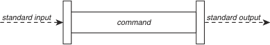

举个例子，回想一下，执行 `who` 命令会显示当前登录的所有用户。更正式地说，`who` 命令将登录用户列表写入标准输出。如图 1.10 所示。

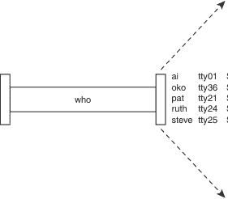

**图 1.10 who 命令**

事实证明，几乎每一个 Unix 命令都可以将前一个命令或文件的输出作为其输入，甚至可以将其输出发送给另一个命令或程序。这个概念对于理解命令行的强大功能至关重要，也解释了为什么即使有图形界面可供使用，了解所有这些命令仍然非常有用。

然而，在进一步讨论之前，请考虑这一点：如果在调用 `sort` 命令时没有指定文件名参数，该命令会从标准输入读取输入。与标准输出一样，标准输入默认是你的终端（或键盘）。

当以这种方式输入时，必须在最后一行输入后指定文件结束序列。按照 Unix 惯例，这个序列是 `Ctrl+d`；也就是说，同时按下 Control（或 Ctrl，取决于你的键盘）键和 `d` 键所产生的序列。

举个例子，让我们使用 `sort` 命令对以下四个名字进行排序：Tony、Barbara、Harry、Dirk。我们不会先将这些名字输入文件，而是直接从终端输入：

```
$ sort
Tony
Barbara
Harry
Dirk
Ctrl+d
Barbara
Dirk
Harry
Tony
$
```

由于没有为 `sort` 命令指定文件名，输入便取自标准输入，即终端。在输入第四个名字后，按下了 Ctrl 和 d 键以表示数据结束。此时，`sort` 命令对四个名字进行了排序，并将结果显示在标准输出设备上，也就是终端上。如图 1.11 所示。

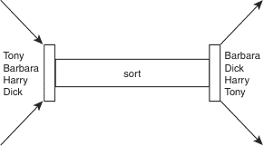

**图 1.11 sort 命令**


`wc` 命令是另一个示例，如果在命令行中没有指定文件名，它会从标准输入读取输入。以下示例展示了使用此命令计算从终端输入的文本行数：

```
$ wc -l
This is text that
is typed on the
standard input device.
Ctrl+d
             3
$
```

请注意，用于终止输入的 `Ctrl+d` 不会被 `wc` 命令计为单独的一行，因为它由 shell 解释，而不是传递给命令。此外，由于为 `wc` 命令指定了 `-l` 标志，因此命令输出中只显示行数（3）。

### 输出重定向

命令通常输出到标准输出的内容可以很容易地“改道”到文件中。这种能力被称为*输出重定向*，它对于理解 Unix 的强大功能同样至关重要。

如果将符号 `> file` 附加到任何通常将其输出写入标准输出的命令后面，那么该命令的输出将改为写入文件 `file`：

```text
$ who > users
$
```

该命令会执行 `who` 命令，并将其输出写入文件 `users`。注意没有输出显示。这是因为输出已从默认的标准输出设备（终端）重定向到指定文件中。当然，我们可以验证这一点：

```text
$ cat users
oko  tty01  Sep 12 07:30
ai   tty15  Sep 12 13:32
ruth tty21  Sep 12 10:10
pat  tty24  Sep 12 13:07
steve tty25 Sep 12 13:03
$
```

如果命令的输出被重定向到文件，而该文件已经包含一些数据，那么这些数据将被覆盖并丢失。

```text
$ echo line 1 > users
$ cat users
line 1
$
```

但现在考虑这个例子，请记住 `users` 已经包含了之前 `who` 命令的输出：

```text
$ echo line 2 >> users
$ cat users
line 1
line 2
$
```

如果你仔细观察，会发现这个 `echo` 命令使用了另一种类型的输出重定向，由字符 `>>` 表示。这对字符使命令的标准输出追加到指定文件的内容末尾。之前的内容不会丢失；新的输出只是被添加到最后。

通过使用重定向追加字符 `>>`，你可以使用 `cat` 将一个文件的内容追加到另一个文件的末尾：

```text
$ cat file1
This is in file1.
$ cat file2
This is in file2.
$ cat file1 >> file2
$ cat file2
This is in file2.
This is in file1.
$
```

*将 file1 追加到 file2*

回想一下，向 `cat` 指定多个文件名会先显示第一个文件，紧接着显示第二个文件，依此类推。这意味着还有第二种方法可以实现相同的结果：

```text
$ cat file1
This is in file1.
$ cat file2
This is in file2.
$ cat file1 file2
This is in file1.
This is in file2.
$ cat file1 file2 > file3
$ cat file3
This is in file1.
This is in file2.
$
```

*改为重定向*

事实上，这正是 `cat` 命令名称的由来：当与多个文件一起使用时，它的作用是将这些文件连接在一起。

## 输入重定向

正如命令的输出可以重定向到文件一样，命令的输入也可以从文件重定向。正如大于号 `>` 用于输出重定向，小于号 `<` 用于重定向命令的输入。当然，只有通常从标准输入读取输入的命令才能以这种方式从文件重定向其输入。

要重定向输入，请键入 `<` 字符，后跟要从中读取输入的文件的名称。例如，要统计文件 `users` 中的行数，你已经知道可以执行命令 `wc -l users`：

```text
$ wc -l users
      2 users
$
```

事实证明，你也可以通过重定向 `wc` 命令的标准输入来统计文件中的行数：

```text
$ wc -l < users
      2
$
```

请注意，`wc` 命令的两种形式产生的输出存在差异。在第一种情况下，文件 `users` 的名称与行数一同列出；在第二种情况下，则没有列出。

这指出了两条命令在执行上的细微差别。在第一种情况下，`wc` 知道它正在从文件 `users` 中读取输入。在第二种情况下，它只看到通过标准输入提供给它的原始数据。shell 将输入重定向为来自文件 `users` 而不是终端（下一章将详细介绍这一点）。对 `wc` 来说，它不知道输入来自终端还是文件，因此它无法报告文件名！

## 管道

你可能还记得，之前创建的文件 `users` 包含当前登录到系统的所有用户的列表。因为你知道文件中每个登录系统的用户对应一行，所以你可以通过统计 `users` 文件中的行数轻松确定登录会话的*数量*。

```sh
$ who > users
$ wc -l < users
      5
$
```

这个输出表明当前有五个用户登录，或者有五个登录会话，区别在于用户，尤其是管理员，经常多次登录。现在你有了一个命令序列，可以在任何时候想知道有多少用户登录时使用。

另一种确定登录用户数量的方法绕过了中间文件。如前所述，Unix 允许你将两个命令“连接”在一起。这种连接称为*管道*，它使你能够将一个命令的输出直接作为另一个命令的输入。管道由字符 `|` 表示，放在两个命令之间。要在 `who` 和 `wc -l` 命令之间创建管道，你可以输入 `who | wc -l`：

```sh
$ who | wc -l
      5
$
```

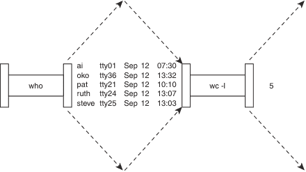

图 1.12  管道过程：`who | wc -l`

当两个命令之间建立管道时，第一个命令的标准输出直接连接到第二个命令的标准输入。你知道 `who` 命令将其登录用户列表写入标准输出。此外，你知道如果没有给 `wc` 命令指定文件名参数，它会从标准输入读取输入。因此，`who` 命令输出的登录用户列表自动成为 `wc` 命令的输入。注意，你永远不会在终端看到该命令的输出，因为它被直接通过管道送入 `wc` 命令。这一点如图 1.13 所示。

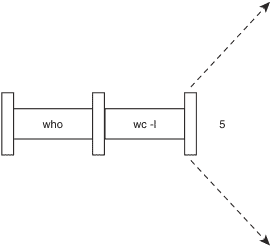

图 1.13   管道过程

管道可以在*任意两个*程序之间建立，前提是第一个程序将其输出写入标准输出，第二个程序从标准输入读取其输入。

再举一个例子，假设你想统计当前目录中包含的文件数量。知道 `ls` 命令对每个文件显示一行输出这个事实，你就可以使用与之前相同的方法：

```bash
$ ls | wc -l
  10
```

输出表明当前目录包含 10 个文件。

还可以创建更复杂的*管道*，由两个以上的程序组成，一个程序的输出作为下一个程序的输入。随着你成为更熟练的命令行用户，你会发现许多情况下管道会非常强大。

## 过滤器

*过滤器*这一术语在 Unix 术语中通常指任何可以从标准输入读取输入、对该输入执行某些操作并将结果写入标准输出的程序。更简洁地说，过滤器是任何可用于修改管道中其他程序输出的程序。因此，在前一个示例的管道中，`wc` 被视为过滤器。`ls` 不是过滤器，因为它不从标准输入读取输入。再举其他例子，`cat` 和 `sort` 是过滤器，而 `who`、`date`、`cd`、`pwd`、`echo`、`rm`、`mv` 和 `cp` 不是。

## 标准错误

除了标准输入和标准输出之外，还有第三个虚拟设备，称为*标准错误*。大多数 Unix 命令将错误消息写到这里。与另外两个“标准”位置一样，标准错误默认与你的终端或终端应用相关联。在大多数情况下，你根本不会注意到标准输出和标准错误之间的区别：

```text
$ ls n*                         List all files beginning with n
n* not found
$
```

这里的“not found”消息实际上是由 `ls` 命令写入标准错误的。你可以通过重定向 `ls` 命令的输出来验证这条消息并未写入标准输出：

```text
$ ls n* > foo
n* not found
$
```

如你所见，该消息仍然打印在终端上，并没有被添加到文件 `foo` 中，即使你已经重定向了标准输出。

前面的示例展示了标准错误存在的意义：即使标准输出被重定向到文件或通过管道传递给另一个命令，错误消息仍然会显示在终端上。

你也可以使用稍微复杂一些的表示法将标准错误重定向到文件（例如，如果你正在记录程序长期运行期间可能出现的错误）：

```text
command 2> file
```

注意，在 `2` 和 `>` 之间*不允许有空格*。任何通常打算写入标准错误的错误消息都会被转移到指定的*文件*中，这与标准输出被重定向的方式类似。

```text
$ ls n* 2> errors
$ cat errors
n* not found
$
```

## 关于命令的更多内容


### 在一行中键入多个命令

你可以在一行中键入多个命令，只要用分号分隔即可。例如，你可以通过在同一行中输入 `date` 和 `pwd` 命令来查看当前时间和当前工作目录：

```text
$ date; pwd
Sat Jul 20 14:43:25 EDT 2002
/users/pat/bin
$
```

只要每个命令都用分号分隔，你可以在这一行中串联任意多个命令。

### 将命令发送到后台

通常，你输入一个命令，然后等待命令的结果显示在终端上。对于到目前为止你看到的所有示例，这段等待时间通常都很短——不到一秒。
然而，有时你可能需要运行需要几分钟或更长时间才能完成的命令。在这种情况下，除非你在后台执行命令，否则你必须等待该命令执行完毕才能继续下一步。
事实证明，虽然你的 Unix 或 Linux 系统看起来完全专注于你正在做的事情，但所有系统实际上都是多任务的，在任何给定时间都会同时运行多个命令。例如，如果你使用的是 Ubuntu 系统，它可能同时运行着窗口管理器、时钟、状态监视器和你的终端窗口。你也可以从命令行同时运行多个命令。这就是将命令“放入后台”的想法，让它在完成的同时，你可以处理其他任务。
将命令或命令序列推入后台的表示惯例是在末尾附加与符号 `&`。这意味着该命令将不再占用你的终端，你可以继续进行其他工作。该命令的标准输出仍将定向到你的终端，不过在大多数情况下，标准输入将与你的终端分离。如果该命令确实尝试从标准输入读取，它将停止并等待你将其带到前台（我们将在第 14 章“交互式和非标准 Shell 特性”中更详细地讨论这一点）。
下面是一个示例：

```text
$ sort bigdata > out &        Send the sort to the background
[1] 1258                    Process ID
$ date                      Your terminal is immediately available to do other work
Sat Jul 20 14:45:09 EDT 2002
$
```

当一个命令被发送到后台时，Unix 系统会自动显示两个数字。第一个称为该命令的作业号，第二个称为进程 ID，或 PID。在前面的示例中，1 是作业号，1258 是进程 ID。作业号被某些 shell 命令用作引用特定后台作业的快捷方式。（你将在第 14 章了解更多这方面的内容。）进程 ID 唯一标识你发送到后台的命令，可用于获取有关该命令的状态信息。这可以通过进程状态——`ps`——命令来完成。

### ps 命令

`ps` 命令为你提供有关系统上正在运行的进程的信息。不带任何选项时，它只打印你的进程的状态。如果你在终端中输入 `ps`，你将得到几行描述你正在运行的进程的信息：

```text
$ ps
  PID TTY          TIME CMD
13463 pts/16    00:00:09 bash
19880 pts/16    00:00:00 ps
$
```

`ps` 命令（通常如此；你的系统可能有所不同）打印出四列信息：PID，即进程 ID；TTY，即运行该进程的终端编号；TIME，即该进程使用的计算机时间（以分钟和秒计）；以及 CMD，即进程名称。（前面示例中的 bash 进程是我们登录时启动的 shell，它已使用了 9 秒的计算机时间。）在该命令完成之前，它会作为正在运行的进程出现在 `ps` 命令的输出中，因此前面示例中的进程 19880 就是 `ps` 命令本身。
当与 `-f` 选项一起使用时，`ps` 会打印出关于你的进程的更多信息，包括父进程 ID（PPID）、进程启动时间（STIME）和命令参数：

```text
$ ps -f
UID       PID  PPID  C STIME TTY          TIME CMD
steve   13463 13355  0 12:12 pts/16    00:00:09 bash
steve   19884 13463  0 13:39 pts/16    00:00:00 ps -f
$
```

### 命令小结

表 1.2 总结了本章中介绍的命令。在此表中，*文件* 指一个文件，*多个文件* 指一个或多个文件，*目录* 指一个目录，*多个目录* 指一个或多个目录。

**表 1.2  命令小结**

| 命令 | 说明 |
|---|---|
| `cat file(s)` | 显示 *多个文件* 的内容；如果未提供，则显示标准输入 |
| `cd dir` | 将工作目录更改为 *目录* |
| `cp file₁ file₂` | 将 *文件₁* 复制到 *文件₂* |
| `cp file(s) dir` | 将 *多个文件* 复制到 *目录* |
| `date` | 显示日期和时间 |
| `echo args` | 显示 *参数* |
| `ln file₁ file₂` | 将 *文件₁* 链接到 *文件₂* |
| `ln file(s) dir` | 将 *多个文件* 链接到 *目录* |
| `ls file(s)` | 列出 *多个文件* |
| `ls dir(s)` | 列出 *多个目录* 中的文件；如果未指定 *多个目录*，则列出当前目录中的文件 |
| `mkdir dir(s)` | 创建目录 *多个目录* |
| `mv file₁ file₂` | 将 *文件₁* 移动到 *文件₂*（如果两者引用同一目录，则仅重命名） |
| `mv file(s) dir` | 将 *多个文件* 移动到目录 *目录* |
| `ps` | 列出有关活动进程的信息 |
| `pwd` | 显示当前工作目录路径 |
| `rm file(s)` | 删除 *多个文件* |
| `rmdir dir(s)` | 删除空目录 *多个目录* |
| `sort file(s)` | 对 *多个文件* 的行进行排序；如果未提供 *多个文件*，则对标准输入排序 |
| `wc file(s)` | 统计 *多个文件* 中的行数、字数和字符数；如果未提供 *多个文件*，则统计标准输入 |
| `who` | 显示谁已登录 |

## 什么是 Shell？

在本章中，你将学习 Unix 命令 Shell 是什么，它做什么，以及为什么它是每个高级用户工具箱中的重要组成部分。

### 内核和实用程序

Unix 系统在逻辑上分为两个不同的区域：*内核*和*实用程序*（见图 2.1）。或者，如果你愿意，也可以说是内核和其他所有东西，而所有这些通常都是通过 Shell 访问的。

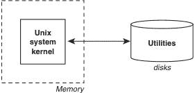

图 2.1  Unix 系统

内核是 Unix 系统的心脏，从计算机开机并*引导*到关机为止，一直驻留在计算机内存中。
构成完整 Unix 系统体验的各种工具和实用程序驻留在计算机磁盘上，只有在请求时才会被调入内存并执行。实际上，你所知道的每个 Unix 命令都是一个实用程序；因此，程序驻留在磁盘上，只有在你的请求下才会被调入内存。例如，当你执行 `date` 命令时，Unix 系统会将名为 date 的程序从计算机磁盘加载到内存中，并开始读取其代码以执行指定的一个或多个操作。
Shell 也是一个实用程序，作为登录过程的一部分被加载到内存中执行。事实上，当终端或窗口上的第一个 Shell 启动时，值得了解一下所发生的精确事件序列。

### 登录 Shell

在过去，终端是物理设备，通过直接连线连接到 Unix 硬件。然而如今，终端程序让你可以留在 Linux、Mac 或 Windows 环境中，并在一个受管理的窗口中通过网络与系统交互。通常你会启动一个程序，如 `Terminal` 或 `xterm`，然后使用 `ssh`、`telnet` 或 `rlogin` 等程序按需连接到远程系统。
对于系统上的每个物理终端，都有一个名为 `getty` 的程序处于活动状态。如图 2.2 所示。

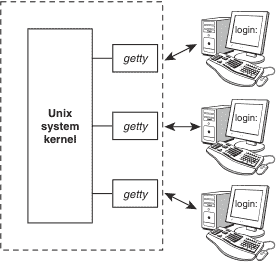

图 2.2  getty 进程

Unix 系统——更确切地说，是一个名为 `init` 的程序——每当系统允许用户登录时，都会在每个终端端口上自动启动一个 `getty` 程序。`getty` 本质上是一个设备驱动程序，让登录程序在其分配的终端上显示消息 `login:` 并等待有人输入内容。
如果你通过像 `ssh` 这样的程序连接，你会被分配一个伪终端，或按 Unix 的说法称为 pseudo-tty。这就是为什么当你输入 `who` 时会看到类似 `pts/3` 或 `pty1` 的条目。
在这两种情况下，都有一个程序读取你的账户和密码信息，还有一个程序验证这些信息，并在一切正确无误的情况下调用你“登录”所需的任何登录程序。
一旦有人输入一些字符并按回车键，登录程序就完成了登录过程（见图 2.3）。

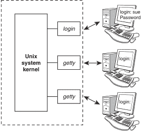

图 2.3  login 在 Sue 的终端上启动


当 `login` 开始执行时，它会在终端显示字符串 `Password:`，然后等待你输入密码。输入密码并按回车键后（出于安全原因，输入时不会显示任何输出），`login` 接着会根据文件 `/etc/passwd` 中的相应条目核对你输入的用户名和密码。该文件包含每个用户账户的一个条目，除其他信息外，还指定了登录名、主目录，以及该用户登录时要启动的程序。最后一项信息（登录 shell）存储在每行的最后一个冒号之后。如果最后一个冒号后面没有任何内容，则默认使用标准 shell `/bin/sh`。

如果你通过终端程序登录，数据握手可能会涉及你系统上的 `ssh` 和服务器上的 `sshd` 之类的程序；如果你是在 Unix 计算机上打开一个窗口，则很可能会直接瞬间完成登录，无需再次输入密码。很方便！

回到密码文件。下面三行展示了系统三个用户 `sue`、`pat` 和 `bob` 在 `/etc/passwd` 中的典型条目：

```text
sue:*:15:47::/users/sue:
pat:*:99:7::/users/pat:/bin/ksh
bob:*:13:100::/users/data:/users/data/bin/data_entry
```

`login` 会将你输入的密码的加密版本与存储在 `/etc/shadow` 中指定账户的加密密码进行校验，然后检查要执行的登录程序的名称。大多数情况下，这个程序是 `/bin/sh`、`/bin/ksh` 或 `/bin/bash`。在其他情况下，它可能是专门定制的程序，或者对于不允许交互式访问的账户（常见于文件所有权管理）是 `/bin/nologin`。这些设置背后的理念是，你可以配置一个登录账户，使任何人在登录系统时自动运行任何程序。由于通用性好，shell 是最常被选中的程序，但它并不是唯一的选择。

回到 Sue。一旦她的身份通过校验，`login` 基本上会自我终止，将 Sue 终端连接的控制权交给标准 shell，然后从内存中消失（见图 2.4）。

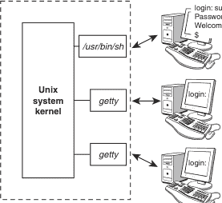

图 2.4  `login` 执行 `/usr/bin/sh`

根据前面展示的 `/etc/passwd` 中的其他条目，`pat` 得到存储在 `/bin` 中的 `ksh` 程序（即 Korn shell），而 `bob` 得到专门的程序 `data_entry`（见图 2.5）。

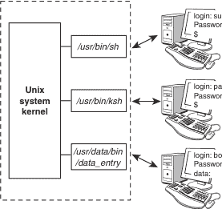

图 2.5  三个用户已登录

如前所述，`init` 程序会为网络连接运行类似于 `getty` 的程序。例如，`sshd`、`telnetd` 和 `rlogind` 分别响应通过 `ssh`、`telnet` 和 `rlogin` 发出的连接请求。这些程序并不是与某个具体的物理终端或调制解调器线路直接绑定，而是将用户的 shell 连接到伪终端（pseudo-tty）。无论你是通过网络、X Window 屏幕，还是通过网络终端连接程序登录你的系统，都可以用 `who` 命令看到这一点：

```text
$ who
phw       pts/0    Jul 20 17:37        Logged in with nlogin
$
```

## 向 Shell 输入命令

当 shell 启动时，它会在终端显示一个命令提示符——通常是美元符号 `$`——然后等待你输入命令（图 2.6，第 1 步和第 2 步）。每当你输入一条命令并按回车键（第 3 步），shell 会分析你输入的内容并执行你的请求（第 4 步）。

如果你要求 shell 调用某个特定程序，它会在磁盘上搜索，依次遍历你在 `PATH` 中指定的所有目录，直到找到该程序。找到程序后，shell 会创建一个自身副本（称为子 shell），并要求内核用指定程序替换该子 shell；然后登录 shell 会“进入睡眠”，直到程序运行完毕（第 5 步）。内核将指定程序复制到内存并开始执行。这个被复制的程序称为进程；这样就将磁盘文件中保存的程序与内存中正在被逐行执行的进程区分开来。

如果程序向标准输出写入输出，除非被重定向或通过管道传给另一条命令，否则该输出将显示在你的终端上。类似地，如果程序从标准输入读取输入，除非从文件重定向或从另一条命令通过管道输入，否则它将等待你输入（第 6 步）。

当命令执行完毕，它便消失，控制权再次交还给登录 shell，提示你输入下一条命令（第 7 步和第 8 步）。

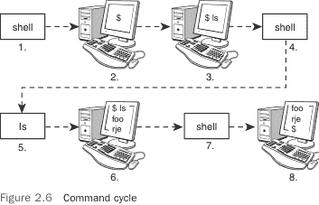

请注意，只要你登录着，这个循环就会持续进行。当你注销系统时，shell 的执行随之终止，系统会启动一个新的 `getty`（或 `rlogin` 等），并等待其他人登录。这个循环如图 2.7 所示。

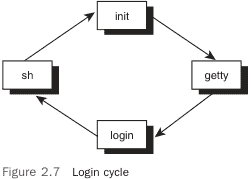

重要的是要认识到，shell 只是一个程序。它在系统上没有特殊权限，这意味着任何有足够专业知识和热情的人都可以创建自己的 shell。这就是为什么今天存在如此多不同版本或“变体”的 shell，包括由 Stephen Bourne 开发的较早的 Bourne shell；由 David Korn 开发的 Korn shell；主要用在 Linux 系统上的“Bourne again shell”；以及由 Bill Joy 开发的 C shell。它们都是为了满足特定目的而设计的，各有独特的能力和个性。

## Shell 的职责

现在你知道了，shell 会分析（用计算机术语来说，就是*解析*）你输入的每一行，并开始执行所选程序。正是在解析阶段，像 `*` 这样的文件名扩展特殊字符才会被展开，如上一章所述。

shell 还有其他职责，如图 2.8 所示。

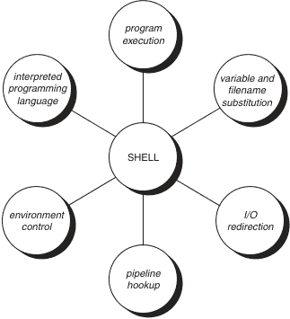

图 2.8  shell 的职责

### 程序执行

shell 负责执行你从终端请求的所有程序。

每次你向 shell 输入一行内容，shell 都会分析这一行并决定如何处理。就 shell 而言，每一行都遵循相同的基本格式：

```text
program-name arguments
```

输入给 shell 的这一行更正式地称为命令行。shell 扫描该命令行，确定要执行的程序的名称以及要传给该程序的参数。

shell 使用特殊字符来确定程序名称的起止位置，以及每个参数的起止位置。这些字符统称为空白字符，包括空格字符、水平制表符和行尾字符（更正式地称为换行符）。多个连续的空白字符会被 shell 忽略。当你输入命令

```text
mv    tmp/mazewars games
```

shell 扫描命令行，从行首到第一个空白字符之间的所有内容都视为要执行的程序名：`mv`。后续的空白字符（多余的空格）被忽略，接下来到下一个空白字符之间的一组字符是 `mv` 的第一个参数：`tmp/mazewars`。再到下一个空白字符（此处即换行符）之前的字符是 `mv` 的第二个参数：`games`。解析完命令行后，shell 接着执行 `mv` 命令，并将指定的两个参数 `tmp/mazewars` 和 `games` 传给它（见图 2.9）。


图 2.9　使用两个参数执行 `mv`

如前所述，多个连续的空白字符会被 shell 忽略。这意味着当 shell 处理下面这条命令行时：

```text
echo        when        do        we        eat?
```

它会向 `echo` 程序传递四个参数：`when`、`do`、`we` 和 `eat?`（见图 2.10）。

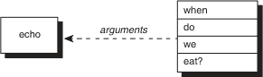

图 2.10　使用四个参数执行 `echo`

由于 `echo` 接收参数后只是简单地在终端上显示它们，并在每个参数之间添加一个单独的空格，因此下面的输出会清晰得多：

```text
$ echo          when    do          we    eat?
when do we eat?
$
```

事实证明，`echo` 命令永远不会看到那些空白空格；它们已被 shell“吞掉”。当我们在第 5 章讨论引号时，你会看到如何在传给程序的参数中包含空格，但通常情况下，多余空格消失正是你期望的行为。

我们前面提到，shell 会在磁盘上搜索，直到找到你要执行的程序，然后请求 Unix 内核启动它。在大多数情况下确实如此。不过，有些命令实际上是内置于 shell 本身的。这些内建命令包括 `cd`、`pwd` 和 `echo`。shell 在磁盘上搜索命令之前，首先会判断它是否是一条内建命令；如果是，就直接执行该命令。

但在调用各个程序之前，shell 还做了更多工作，所以我们先花点时间聊聊这些事。

## 变量与文件名替换


与更正式的程序设计语言类似，shell 允许你为变量赋值。每当你在命令行中指定某个变量并在前面加上美元符号时，shell 就会将该变量的值替换进去。这个话题在第 4 章中有更详细的讨论。

shell 还会在命令行中执行文件名替换。实际上，shell 会扫描命令行，查找文件名替换字符 `*`、`?` 或 `[...]`，然后再确定要执行的程序名称及其参数。

假设当前目录中包含以下文件：

```text
$ ls
mrs.todd
prog1
shortcut
sweeney
$
```

现在，让我们在 `echo` 命令中使用文件名替换（`*`）：

```text
$ echo *
mrs.todd prog1 shortcut sweeney
$
```

传给 `echo` 程序的参数到底是一个还是四个？因为 shell 执行了文件名替换，答案应该是四个。当 shell 分析这行命令

```text
echo *
```

时，它会识别出特殊字符 `*`，并用当前目录下所有文件的名称来替换（甚至还会按字母顺序替你排好）：

```text
echo mrs.todd prog1 shortcut sweeney
```

然后，shell 才会确定要传给实际命令的参数。因此，`echo` 根本看不到星号，对它来说，命令行上只键入过四个参数（参见图 2.11）。

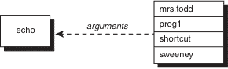

图 2.11  执行 `echo`

## I/O 重定向

处理输入输出重定向也是 shell 的职责。它会扫描每条输入的命令行，查找特殊重定向字符 `<`、`>` 或 `>>`（如果你好奇的话，还存在 `<<` 重定向序列，第 12 章会讲到）。

当你输入命令

```text
echo Remember to record The Walking Dead > reminder
```

shell 会识别出特殊输出重定向字符 `>`，并把命令行中紧随其后的单词当作输出应重定向到的文件名称。在本例中，该文件名为 `reminder`。如果 `reminder` 已存在且你具有写权限，则原先的内容会被覆盖；如果你对该文件或其目录没有写权限，shell 就会产生一条错误消息。

在 shell 开始执行目标程序之前，它会将程序的标准输出重定向到指定文件。在几乎所有情况下，程序都不知道自己的输出已被重定向。它只是照常向标准输出（你回忆一下，通常就是你的终端）写入内容，完全没意识到 shell 已将那部分信息重定向到了某个文件。

我们再来看两个几乎相同的命令：

```text
$ wc -l users
    5 users
$ wc -l < users
    5
$
```

在第一种情况下，shell 解析命令行，确定要执行的程序名称是 `wc`，并向它传递两个参数：`-l` 和 `users`（参见图 2.12）。


图 2.12  执行 `wc -l users`

当 `wc` 开始执行时，它看到传入了两个参数。第一个参数 `-l` 告诉它统计行数；第二个参数则指定了要统计行数的文件名。于是 `wc` 打开 `users` 文件，统计行数，然后打印结果计数以及文件名。

第二种情况下，`wc` 的操作略有不同。shell 在扫描命令行时发现输入重定向字符 `<`，于是把紧随其后的单词解释为输入重定向的来源文件名。在从命令行中“吞掉” `< users` 之后，shell 启动 `wc` 程序，将标准输入重定向到 `users` 文件，并只向它传递一个参数 `-l`（参见图 2.13）。


图 2.13  执行 `wc -l < users`

这一次，当 `wc` 开始执行时，它看到只传入了一个参数 `-l`。由于没有指定文件名，`wc` 便决定统计来自标准输入的行数。于是，`wc -l` 统计行数时，并不知道自己实际上统计的是 `users` 文件的行数。最终计数照常显示，但没有文件名，因为 `wc` 并没有得到文件名。

理解这两条命令在执行上的差异对你来说很重要。如果你仍然不太清楚，请在继续之前把前面这一节再复习一遍。

## 搭建管道

正如 shell 会扫描命令行查找重定向字符一样，它也会查找管道字符 `|`。每匹配到一次，它就会把前一条命令的标准输出连接到后一条命令的标准输入，然后启动这两个程序的执行。

因此，当你输入

```text
who | wc -l
```

shell 会找到分隔 `who` 和 `wc` 两条命令的管道符号。它将前一条命令的标准输出连接到后一条命令的标准输入，然后启动两者的执行。当 `who` 命令执行时，它会生成一份当前登录用户的列表，并将结果写入标准输出，完全不知道这些输出并没有进入终端，而是交给了另一条命令。

当 `wc` 命令执行时，它发现没有指定文件名，便统计标准输入中的行数，同样不知道标准输入并非来自终端，而是来自 `who` 命令的输出。

随着我们继续深入，你会看到不只是两条命令的管道，你还可以把三、四、五条甚至更多的命令串在一起，构成真正复杂的管道。这可能有点难以理解，但这正是 UNIX 系统某些最强大能力之所在。

## 环境控制

shell 提供了一些命令，让你可以自定义自己的环境。你的环境包括你的主目录、shell 显示出来提示你输入命令的提示符，以及当你请求执行某个程序时要搜索的目录列表。关于这部分内容，第 10 章会详细介绍。

## 解释型编程语言

shell 拥有自己的内建编程语言。这门语言是*解释型*的，也就是说，shell 会对遇到的每条语句逐一分析，然后执行其中任何有效的命令。这与 C++ 和 Swift 等编程语言不同，后者的编程语句通常要先被编译成机器可执行的形式，然后才会被执行。

用解释型编程语言开发的程序通常比编译型程序更容易调试和修改。不过，它们执行起来可能比对应的编译型版本耗时更长。

shell 编程语言提供了你在大多数其他编程语言中能看到的功能。它有循环结构、判断语句、变量和函数，并且是面向过程的。基于 IEEE POSIX 标准的现代 shell 还具有许多其他特性，包括数组、数据类型，以及内建的算术运算。

## 常用工具

本章会详细描述一些常用的 shell 编程工具。涵盖 `cut`、`paste`、`sed`、`tr`、`grep`、`uniq` 和 `sort`。你对这些工具使用得越熟练，编写高效 shell 脚本就会越容易。

## 正则表达式

在介绍这些工具之前，你需要先了解*正则表达式*。正则表达式被许多不同的 UNIX 命令使用，包括 `ed`、`sed`、`awk`、`grep`，以及在某种有限程度上使用的 `vi` 编辑器。它们提供了一种方便且一致的方式来指定要匹配的*模式*。

这里容易让人困惑的是，shell 在文件名替换中也识别一种有限形式的正则表达式。回想一下，星号（`*`）匹配零个或多个字符，问号（`?`）匹配任意单个字符，而 `[...]` 结构则匹配括号内包含的任意一个字符。但这与我们即将探讨的更正式的正则表达式并不是一回事。例如，shell 将 `?` 视为匹配任意单个字符，而正则表达式（通常简写为 regex）则使用句点（`.`）达到同样的目的。

真正的正则表达式远比 shell 所识别的那些复杂得多，甚至有整本书专门讨论如何编写真正复杂的 regex 语句。不过别担心，你不需要成为专家也能从正则表达式中获得巨大价值！

在整节中，我们假设你已经熟悉诸如 `ex` 或 `ed` 这类基于行的编辑器。如果你不熟悉它们，请参阅附录 B 以获取关于这些编辑器的更多信息，或者查阅相应的 man 手册页。

### 匹配任意字符：句点（ . ）

正则表达式中的句点匹配任意单个字符，无论它是什么。因此，正则表达式

`r.`

匹配一个 `r` 后跟任意单个字符。

## 正则表达式

`.x.`

匹配被任意两个字符包围的 **x**，这两个字符不要求相同。

我们可以通过简单的 `ed` 编辑器来演示大量正则表达式。`ed` 是一种老式面向行的编辑器，其历史与 Linux 一样悠久。

例如，`ed` 命令

```
/ ... /
```

会在你正在编辑的文件中向前搜索，查找包含任意三个字符且两侧由空格包围的第一行。但在我们演示之前，请注意这个示例最开始时 `ed` 显示了文件中的字符数（248），并且像打印（`p`）这样的命令可以加上范围说明符作为前缀，最基本的范围说明符是 `1,$`，表示从文件的第一行到最后一行：


```
$ ed intro
248
1,$p
The Unix operating system was pioneered by Ken
Thompson and Dennis Ritchie at Bell Laboratories
in the late 1960s. One of the primary goals in
the design of the Unix system was to create an
environment that promoted efficient program
development.
```

*打印所有行*

这就是我们的工作文件。现在让我们尝试一些正则表达式：

```
/ ... /
The Unix operating system was pioneered by Ken
/
Thompson and Dennis Ritchie at Bell Laboratories
1,$s/p.o/XXX/g
1,$p
The Unix operating system was XXXneered by Ken
ThomXXXn and Dennis Ritchie at Bell Laboratories
in the late 1960s. One of the primary goals in
the design of the Unix system was to create an
environment that XXXmoted efficient XXXgram
development.
```

*查找被空格包围的三个字符*

*重复上一次搜索*

*将所有 `p.o` 替换为 `XXX`*

*看看发生了什么*

在第一次搜索中，`ed` 从文件开头开始搜索，发现第一行中的序列 “was” 匹配了指示的模式，并打印了该行。

重复搜索（`ed` 命令 `/`）会显示文件的第二行，因为 “and” 匹配了该模式。接下来的替换命令 `s` 指定将所有出现的小写字母 `p`、其后跟任意一个字符、再后跟小写字母 `o` 的序列替换为字符 `XXX`。前缀 `1,$` 表示应将其应用于文件中的所有行，替换操作使用结构 `s/old/new/g` 指定，其中 `s` 表示这是一个替换操作，斜杠分隔旧值和新值，而 `g` 表示应尽可能多地应用于每一行，而不仅仅是每行一次。

### 匹配行首：脱字符（^）

当脱字符 `^` 作为正则表达式的第一个字符时，它匹配行的开头。因此正则表达式

```
^George
```

匹配字符 `George` *仅当它们出现在行的开头时*。这实际上在正则表达式领域被称为“左锚定”，原因显而易见。

让我们来看一下：

```
$ ed intro
248
/the/
in the late 1960s.  One of the primary goals in
/^the/                         *查找以 the 开头的行*
the design of the Unix system was to create an
1,$s/^/>>/                    *在每行开头插入 >>*
1,$p
>>The Unix operating system was pioneered by Ken
>>Thompson and Dennis Ritchie at Bell Laboratories
>>in the late 1960s.  One of the primary goals in
>>the design of the Unix system was to create an
>>environment that promoted efficient program
>>development.
```

前面的示例还展示了如何使用正则表达式 `^` 来匹配行的开头。在这里，它被用来在每一行的开头插入字符 `>>`。像

```
1,$s/^/    /
```

这样的命令也常用于在每行开头插入空格（在这种情况下会插入四个空格）。

### 匹配行尾：美元符号 $

正如 `^` 用于匹配行的开头，美元符号 `$` 用于匹配行的结尾。因此正则表达式

```
contents$
```

匹配字符 `contents` *仅当它们是行中的最后字符时*。你认为正则表达式

```
.$
```

会匹配什么？这会匹配一个位于行尾的句点字符吗？不会。回想一下，句点匹配任意字符，因此这会匹配行尾的任意单个字符（包括句点）。

那么如何匹配句点呢？一般来说，如果你想匹配正则表达式中具有特殊含义的字符，可以在该字符前面加上反斜杠（`\`）以覆盖其特殊含义。例如，正则表达式

```
\.$
```

匹配任何以句点结尾的行，而正则表达式

```
^\.
```

匹配任何以句点开头的行。

想要将反斜杠指定为实际字符？请连续使用两个反斜杠：`\\`。

```
$ ed intro
248
/\.$/
development.
1,$s/$/>>/
1,$p
The Unix operating system was pioneered by Ken>>
Thompson and Dennis Ritchie at Bell Laboratories>>
in the late 1960s. One of the primary goals in>>
the design of the Unix system was to create an>>
environment that promoted efficient program>>
development.>>
```

*查找以句点结尾的行*

*在每行末尾添加 `>>`*

```
1,$s/..$//
1,$p
The Unix operating system was pioneered by Ken
Thompson and Dennis Ritchie at Bell Laboratories
in the late 1960s. One of the primary goals in
the design of the Unix system was to create an
environment that promoted efficient program
development.
```

*删除每行的最后两个字符*

`^` 和 `$` 的一个常见用途是正则表达式

```
^$
```

它匹配任何*不包含任何*字符的行。请注意，这个正则表达式不同于

```
^ $
```

后者匹配任何只包含一个空格字符的行。

### 匹配字符集：`[ . . . ]` 结构

假设你正在编辑一个文件，想要搜索字符 `the` 的第一次出现。在 `ed` 中这很容易：只需输入命令

```
/the/
```

这将使 `ed` 在其缓冲区中向前搜索，直到找到包含指示序列的行。`ed` 将显示第一个匹配的行：

```
$ ed intro
248
/the/                         查找包含 the 的行
in the late 1960s.  One of the primary goals in
```

请注意，文件的第一行也包含单词 `the`，只是它以大写 `T` 开头。可以使用字符集来构建同时匹配 `the` 或 `The` 的正则表达式：字符 `[ ]` 可用于指定匹配其中一个被封闭的字符。正则表达式

```
[tT]he
```

将匹配小写或大写字母 `t`，后紧跟字符 `he`：

```
$ ed intro
248
/[tT]he/                       查找 the 或 The
The Unix operating system was pioneered by Ken
/                              继续搜索
in the late 1960s.  One of the primary goals in
/                              再次搜索
the design of the Unix system was to create an
1,$s/[aeiouAEIOU]//g             删除所有元音
1,$p
Th nx prtng systm ws prnd by Kn
Thmpn nd Dnns Rtch t Bll Lbrtrs
n th lt 1960s. n f th prmry gls n
th dsgn f th nx systm ws t crt n
vrnmnt tht prmtd fnt prgrm
dvlpmnt.
```

请注意上面示例中的 `[aeiouAEIOU]`，它将匹配单个元音字母，无论大小写。然而，这种表示法可能相当笨拙，因此可以在方括号内指定一个字符范围。这可以通过用短划线（`-`）分隔范围的起始字符和结束字符来实现。因此，要匹配 `0` 到 `9` 之间的任意数字字符，你可以使用正则表达式

```
[0123456789]
```

或者更简洁地写成

```
[0-9]
```

要匹配大写字母，请使用

`[A-Z]`

要匹配大写或小写字母，可以写

`[A-Za-z]`

这里有一些 `ed` 的示例：


```
$ ed intro
248
/[0-9]/
in the late 1960s. One of the primary goals in
/^[A-Z]/
The Unix operating system was pioneered by Ken
/
Thompson and Dennis Ritchie at Bell Laboratories
1,$s/[A-Z]/*/g
1,$p
*he *nix operating system was pioneered by *en
*hompson and *ennis *itchie at *ell *aboratories
in the late 1960s. *ne of the primary goals in
the design of the *nix system was to create an
environment that promoted efficient program
development.
```

*查找包含数字的行*

*查找以大写字母开头的行*

*再次查找*

*将所有大写字母替换为 \*s*

正如你将在下面学到的，星号是正则表达式中的特殊字符。但是，在替换命令的替换字符串中，你不必在它前面加上反斜杠，因为替换的替换字符串使用不同的表达式语言（我们确实提到过这有时会有点棘手，对吧？）。

在 `ed` 编辑器中，正则表达式序列如 `*`、`.`、`[...]`、`$` 和 `^` 仅在搜索字符串中有意义，当它们出现在替换字符串中时没有任何特殊含义。

如果脱字符（`^`）作为左方括号后的第一个字符出现，则匹配的含义被*反转*。（相比之下，shell 在字符集中使用 `!` 来实现此目的。）例如，正则表达式

`[^A-Z]`

匹配*除*大写字母之外的任何字符。类似地，

`[^A-Za-z]`

匹配任何非字母字符。为了演示，让我们从测试文件的行中删除所有非字母字符：

```
$ ed intro
248
1,$s/[^a-zA-Z]//g
1,$p
TheUnixoperatingsystemwaspioneeredbyKen
ThompsonandDennisRitchieatBellLaboratories
```

*删除所有非字母字符*

在20世纪60年代末，Unix系统设计的主要目标之一是创造一个促进高效程序开发的环境。

## 匹配零个或多个字符：星号（*）

星号在shell的文件名替换中用于匹配零个或多个字符。在构成正则表达式时，星号用于匹配正则表达式*前面*元素的零次或多次出现（该元素本身也可以是另一个正则表达式）。

因此，例如，正则表达式

```text
X*
```

匹配零个、一个、两个、三个……大写X，而表达式

```text
XX*
```

匹配一个或多个大写X，因为该表达式指定了一个x后跟零个或多个x。你也可以用+达到同样效果：它匹配前面表达式的*一个或多个*，因此XX*和X+功能相同。

一种类似模式经常用于匹配一行中的一个或多个空格：

```text
$ ed lotspaces
85
1,$p
This       is    an   example   of   a
file    that    contains      a    lot
of     blank spaces
1,$s/ */ /g
1,$p
This       is    an   example   of   a
file    that    contains      a    lot
of     blank spaces
```

将多个空格改为单个空格

`ed`命令

```text
1,$s/ */ /g
```

告诉程序将所有“一个空格后跟零个或多个空格”的出现替换为单个空格——换句话说，将所有空白折叠为单个空格。如果它匹配单个空格，则没有变化。但如果它匹配三个空格，比如说，它们都会被替换为单个空格。

正则表达式

```text
.*
```

常用于指定*任意*字符的零次或多次出现。请记住，正则表达式匹配符合模式的*最长*字符串。因此，这个正则表达式单独使用时，总是匹配文本的*整*行。

作为`.`和`*`组合的另一个例子，正则表达式

```text
e.*e
```

匹配从一行中第一个`e`到最后一个`e`之间的所有字符。

> 请注意，它不一定只匹配以`e`开头和结尾的行，因为它不是左锚定或右锚定的（也就是说，它不在模式中使用`^`或`$`）。

```text
$ ed intro
248
1,$s/e.*e/+++/
1,$p
Th+++n
Thompson and D+++s
 in th+++ primary goals in
 th+++ an
 +++nt program
 d+++nt.
```

这里有一个有趣的正则表达式。你觉得它匹配什么？

```text
[A-Za-z][A-Za-z]*
```

这匹配任意一个字母字符后跟零个或多个字母字符。这非常接近一个匹配单词的正则表达式，可以如下所示用来将所有单词替换为字母X，同时保留所有空格和标点。

```text
$ ed intro
248
1,$s/[A-Za-z][A-Za-z]*/X/g
1,$p
X X X X X X X X
X X X X X X X
X X X 1960X. X X X X X
X X X X X X X X X
X X X X X
X.
```

在这个例子中，它唯一没有匹配的是数字序列1960。当然，你可以修改正则表达式，让它也将数字序列视为单词：

```text
$ ed intro
248
1,$s/[A-Za-z0-9][A-Za-z0-9]*/X/g
1,$p
X X X X X X X X
X X X X X X X
X X X X X X X X X X
X X X X X X X X X X X
X X X X X
X.
```

我们可以扩展这个规则来考虑带连字符和缩写形式的单词（例如don’t），但这留作练习。需要注意的一点是，如果你想在方括号字符选择中匹配连字符，必须将连字符紧跟在左括号之后（但要在反转字符`^`之后，如果存在的话），或者紧跟在右括号之前，才能被正确理解。也就是说，以下两个表达式

```text
[-0-9]
```

```text
[0-9-]
```

都匹配单个连字符或数字字符。

类似地，如果你想匹配右方括号字符，它必须出现在左括号之后（以及在`^`之后，如果存在）。所以

```text
[]a-z]
```

匹配右方括号或小写字母。

## 匹配精确数量的子模式：`\{...\}`

在前面的例子中，你看到了如何使用星号来指定匹配前面正则表达式的零次或多次出现。例如，正则表达式

```text
xx*
```

意味着匹配一个x后跟零个或多个后续字母x。类似地，

```text
xxx*
```

意味着匹配至少两个连续的x。

然而，一旦到了这一步，这种方式就显得相当笨拙，因此有一种更通用的方法来指定要匹配的精确字符数：使用结构

```text
\{min,max\}
```

其中min指定要匹配的前面正则表达式的最小出现次数，max指定最大次数。注意，你需要通过在花括号前面各加一个反斜杠来转义它们。

正则表达式

```text
x\{1,10\}
```

匹配1到10个连续的x。只要有选择，就会匹配最大的模式，因此如果输入文本包含8个连续的x，前面的正则表达式就会匹配这8个。

另一个例子，正则表达式

```text
[A-Za-z]\{4,7\}
```

匹配长度为4到7个字符的字母序列。

让我们尝试使用这种表示法进行替换：

```text
$ ed intro
248
1,$s/[A-Za-z]\{4,7\}/X/g
1,$p
The X Xng X was Xed by Ken
Xn and X X at X XX
in the X 1960s. One of the X X in
the X of the X X was to X an
XX X Xd Xnt X
XX.
```

这个调用是`ed`中全局搜索和替换的一个具体实例（因此在`vi`中也是如此）：*s/old/new/*。在这种情况下，我们事先添加范围`1,$`，并附加`g`标志，以确保每行适当地发生多次替换。

这个特殊构造的几个特例值得注意。如果花括号内只包含一个数字，如

```text
\{10\}
```

该数字指定前面的正则表达式必须被*精确*匹配那么多次。所以

```text
[a-zA-Z]\{7\}
```

匹配恰好七个字母字符；并且

```text
.\{10\}
```

精确匹配10个字符，无论它们是什么：

```text
$ ed intro
248
1,$s/^.*\{10\}//
1,$p
perating system was pioneered by Ken
nd Dennis Ritchie at Bell Laboratories
e 1960s. One of the primary goals in
 of the Unix system was to create an
t that promoted efficient program
t.
```

*删除每行的前10个字符*


```text
$ ed intro
248
1,$s/.\{5\}$//
1,$p
perating system was pioneered b
nd Dennis Ritchie at Bell Laborat
 e 1960s. One of the primary goa
 of the Unix system was to crea
t that promoted efficient pr
t.
```

*删除每行的最后5个字符*

注意，当执行最后一条替换命令时，文件的最后一行没有五个字符；因此，该行匹配失败，于是被保留原样，因为我们指定了要删除*恰好*五个字符。

如果花括号内只有一个数字，后面紧跟一个逗号，那么必须匹配前面正则表达式*至少*那么多次，但不设上限。所以

```text
+\{5,\}
```

匹配至少五个连续的加号。如果输入数据中顺序出现超过五个，则匹配最大的数量。

```text
$ ed intro
248
1,$s/[a-zA-Z]\{6,\}/X/g
1,$p
The Unix X X was X by Ken
X and X at Bell X
in the late 1960s. One of the X goals in
the X of the Unix X was to X an
X that X X X
X.
```

*将长度至少为6个字母的单词改为X*

## 保存匹配的字符：`\(...\)`

可以通过将匹配正则表达式的字符括在反斜线括号中来引用这些字符。这些捕获的字符存储在正则表达式解析器中预定义的变量中，称为*寄存器*，编号为1到9。

这会有点令人困惑，所以请慢慢阅读本节！

作为第一个例子，正则表达式

```text
^\(.\)
```

匹配行中的第一个字符，无论它是什么，并将其存储到寄存器1中。

要检索存储在特定寄存器中的字符，使用结构`\n`，其中*n*是从1到9的数字。因此正则表达式

```text
^\(.\)\1
```

最初匹配行中的第一个字符并将其存储在寄存器1中，然后根据`\1`的指示匹配存储在寄存器1中的字符。这个正则表达式的净效果是：如果一行中的前两个字符*是相同的字符*，则匹配它们。很巧妙，是吧？

正则表达式

```text
^\(.\).*\1$
```

匹配所有行中第一个字符（`^.`）与最后一个字符（`\1$`）相同的行。`.*`匹配中间的所有字符。

让我们来拆解一下这个。记住 `^` 是行首，`$` 是行尾。简化后的模式就是 `^..*`，它匹配行的第一个字符（第一个 `.` 后面跟上 `.*` 以匹配行的其余部分）。加上 `\( \)` 记法将第一个字符存入寄存器 1，再用 `\1` 来引用该字符，你应该就能理解了。

`\(...\)` 结构的连续出现会被分配到连续的寄存器中。因此，当用下面的正则表达式匹配某些文本时

```
^\(...\)\(...\)
```

行中的前三个字符将存入寄存器 1，接下来的三个字符存入寄存器 2。如果在模式后附加 `\2\1`，你将匹配一个 12 个字符的字符串，其中第 1–3 个字符与第 10–12 个字符匹配，第 4–6 个字符与第 7–9 个字符匹配。

在 `ed` 中使用替换命令时，寄存器也可以作为替换字符串的一部分被引用，这正是其强大之处：

```
$ ed phonebook
114
1,$p
Alice Chebba     973-555-2015
Barbara Swingle  201-555-9257
Liz Stachiw      212-555-2298
Susan Goldberg   201-555-7776
Tony Iannino     973-555-1295
1,$s/\(.*\)    \(.*\)/\2 \1/        Switch the two fields
1,$p
```

```
973-555-2015 Alice Chebba
201-555-9257 Barbara Swingle
212-555-2298 Liz Stachiw
201-555-7776 Susan Goldberg
973-555-1295 Tony Iannino
```

在 `phonebook` 文件中，姓名和电话号码彼此之间由一个制表符分隔。正则表达式

```
\(.*\)    \(.*\)
```

表示匹配到第一个制表符为止的所有字符（即 `\(` 和 `\)` 之间的字符序列 `.*`）并将它们分配给寄存器 1，同时匹配制表符之后的所有字符并分配给寄存器 2。替换字符串

```
\2 \1
```

指定寄存器 2 的内容，后跟一个空格，再后跟寄存器 1 的内容。

当 `ed` 对文件的第一行应用替换命令时：

```
Alice Chebba        973-555-2015
```

它会匹配到制表符之前的所有内容（Alice Chebba）并存入寄存器 1，将制表符之后的所有内容（973-555-2015）存入寄存器 2。制表符本身会丢失，因为它在正则表达式中没有被圆括号括起来。然后 `ed` 会用寄存器 2 的内容（973-555-2015）、一个空格、寄存器 1 的内容（Alice Chebba）替换被匹配的字符（整行）。

```
973-555-2015 Alice Chebba
```

正如你所见，正则表达式是强大的工具，能够让你匹配和处理复杂模式，尽管有时看起来像是有只猫在键盘上跑过！

### 表 3.1 正则表达式字符

| 记法 | 含义 | 示例 | 匹配 |
|---|---|---|---|
| `.` | *任意字符* | `a..` | a 后跟任意两个字符 |
| `^` | 行首 | `^wood` | wood，仅当它出现在行首时 |
| `$` | 行尾 | `x$` | x，仅当它是行中最后一个字符时 |
|  |  | `^INSERT$` | 只包含字符 `INSERT` 的一行 |
|  |  | `^$` | 不包含*任何*字符的一行 |
| `*` | 前一个正则表达式出现零次或多次 | `x*`<br>`xx*`<br>`.*`<br>`w.*s` | 零个或多个连续的 x<br>一个或多个连续的 x<br>零个或多个字符<br>w 后跟零个或多个字符，再后跟一个 s |
| `+` | 前一个正则表达式出现一次或多次 | `x+`<br>`xx+`<br>`.+`<br>`w.+s` | 一个或多个连续的 x<br>两个或更多连续的 x<br>一个或多个字符<br>w 后跟一个或多个字符，再后跟一个 s |
| `[...]` | *chars* 中的任意一个字符 | `[tT]`<br>`[a-z]`<br>`[a-zA-Z]` | 小写或大写 t<br>小写字母<br>小写或大写字母 |
| `[^chars]` | 不在 *chars* 中的任意一个字符 | `[^0-9]`<br>`[^a-zA-Z]` | 任何非数字字符<br>任何非字母字符 |
| `\{min,max\}` | 前一个正则表达式至少出现 *min* 次，最多出现 *max* 次 | `x\{1,5\}`<br>`[0-9]\{3,9\}`<br>`[0-9]\{3\}`<br>`[0-9]\{3,\}` | 至少 1 个且最多 5 个 x<br>连续 3 到 9 位数字<br>恰好 3 位数字<br>至少 3 位数字 |
| `\(...\)` | 将括号中匹配的字符保存到下一个寄存器（1-9） | `^\(.\)`<br>`^\(.\)\1`<br>`^\(.\)\(.\)` | 行中的第一个字符；将其存入寄存器 1<br>行中第一个和第二个字符（如果它们相同）<br>行中第一个和第二个字符；将第一个字符存入寄存器 1，第二个字符存入寄存器 2 |

## cut

本节介绍一个名为 `cut` 的有用命令。当你需要从数据文件或命令输出中提取（也就是“切出”）各种数据字段时，这个命令会派上用场。`cut` 命令的一般格式是

```
cut -cchars file
```

其中 `chars` 指定要从 `file` 的每一行中提取哪些字符（按位置）。它可以是一个数字，例如 `-c5` 表示提取输入每行的第 5 个字符；也可以是逗号分隔的数字列表，例如 `-c1,13,50` 表示提取第 1、13 和 50 个字符；还可以是短横线分隔的数字范围，例如 `-c20-50` 表示提取第 20 到第 50 个字符（含两端）。要提取到行尾，可以省略范围的第二个数字，因此

```
cut -c5- data
```

该命令从 `data` 的每一行中提取第 5 个字符到行尾，并将结果写入标准输出。

如果未指定 `file`，`cut` 从标准输入读取输入，这意味着你可以将 `cut` 用作管道中的过滤器。

我们再来看一下 `who` 命令的输出：

```
$ who
root     console  Feb 24 08:54
steve    tty02    Feb 24 12:55
george   tty08    Feb 24 09:15
dawn     tty10    Feb 24 15:55
$
```


如图所示，有四人已登录。假设你只想知道已登录用户的姓名，而不关心他们在哪个终端上或何时登录的。你可以使用 `cut` 命令从 `who` 命令的输出中只切出用户名：

```
$ who | cut -c1-8
root
steve
george
dawn
$
```

*提取前 8 个字符*

`cut` 的 `-c1-8` 选项指定从输入每行中提取第 1 到第 8 个字符，并写入标准输出。

下面展示了如何在前面的管道末尾加上 `sort`，以得到已登录用户的有序列表：

```
$ who | cut -c1-8 | sort
dawn
george
root
steve
$
```

请注意，这是我们第一个三条命令的管道。一旦你理解了输出连接到后续输入的概念，由三条、四条甚至更多命令组成的管道就变得合乎逻辑且易于组装了。

如果你想查看当前正在使用哪些终端，或哪些伪终端/虚拟终端正在使用中，你可以只从 `who` 命令输出中切出 tty 字段：

```
$ who | cut -c10-16
console
tty02
tty08
tty10
$
```

你怎么知道 `who` 会在第 10 到第 16 个字符位置显示终端标识？很简单！你在终端上执行 `who` 命令，然后数出相应的字符位置即可。

你可以使用 `cut` 从一行中提取任意多个不同的字符。下面，`cut` 用于仅显示所有已登录用户的用户名和登录时间：

```
$ who | cut -c1-8,18-
root    Feb 24 08:54
steve   Feb 24 12:55
george  Feb 24 09:15
dawn    Feb 24 15:55
$
```

选项 `-c1-8,18-` 指定“提取第 1 到第 8 个字符（用户名），以及第 18 个字符到行尾（登录时间）”。

## `-d` 和 `-f` 选项

当需要从文件或命令中提取数据时，只要该文件或命令具有固定格式，带 `-c` 标志的 `cut` 命令就很有用。

例如，你可以在 `who` 命令中使用 `cut`，因为你知道用户名总是显示在第 1–8 个字符位置，终端在第 10–16 个位置，登录时间在第 18–29 个位置。遗憾的是，并非所有数据都排列得如此整齐！

例如，看一下 `/etc/passwd` 文件：

```
$ cat /etc/passwd
root:*:0:0:The Super User:/:/usr/bin/ksh
cron:*:1:1:Cron Daemon For periodic tasks:/:
bin:*:3:3:The owner of system files:/
uucp:*:5:5::/usr/spool/uucp:/usr/lib/uucp/uucico
asg:*:6:6:The Owner of Assignable Devices:/
steve:*:203:100::/users/steve:/usr/bin/ksh
other:*:4:4:Needed by secure program:/
$
```

`/etc/passwd` 是主文件，包含你计算机系统上所有用户的用户名。它还包含其他信息，例如用户 ID、主目录，以及该特定用户登录时要启动的程序名称。

很明显，这个文件中的数据排列远不如 `who` 的输出那样整齐。因此，无法使用 `cut` 的 `-c` 选项从该文件中提取系统所有用户的列表。

然而，仔细检查文件后发现，字段显然是由冒号字符分隔的。尽管每一行的各字段长度可能不同，但你可以通过“数冒号”来从每一行获取相同的字段。

当数据由特定字符分隔时，可以将 `-d` 和 `-f` 选项与 `cut` 一起使用，其中 `-d` 指定字段分隔符，`-f` 指定要提取的一个或多个字段。`cut` 命令的调用形式变为

```
cut -dchar -ffields file
```

其中 `dchar` 是分隔数据各字段的字符，`fields` 指定要从 `file` 中提取的字段。字段编号从 1 开始，指定字段编号可以使用与之前指定字符位置相同类型的格式（例如 `-f1,2,8`、`-f1-3`、`-f4-`）。

要从 `/etc/passwd` 中提取所有用户的名称，你可以输入以下命令：

```
$ cut -d: -f1 /etc/passwd              Extract field 1
root
cron
bin
```

```text
uucp
asg
steve
other
$
```

鉴于每个用户的主目录位于第 6 个字段，你可以将系统中的每个用户与其主目录对应起来：

```text
$ cut -d: -f1,6 /etc/passwd
root:/
cron:/
bin:/
uucp:/usr/spool/uucp
asg:/
steve:/users/steve
other:/
$
```

*提取字段 1 和 6*

如果 `cut` 命令用于从文件中提取字段，且未提供 `-d` 选项，则 `cut` 会使用制表符作为默认字段分隔符。

下面展示了使用 `cut` 命令时一个常见的误区。假设你有一个名为 `phonebook` 的文件，内容如下：

```text
$ cat phonebook
Alice Chebba    973-555-2015
Barbara Swingle 201-555-9257
Jeff Goldberg   201-555-3378
Liz Stachiw     212-555-2298
Susan Goldberg  201-555-7776
Tony Iannino    973-555-1295
$
```

如果你只想获取电话簿中人员的姓名，你的第一反应可能是像下面这样使用 `cut`：

```text
$ cut -c1-15 phonebook
Alice Chebba     97
Barbara Swingle
Jeff Goldberg    2
Liz Stachiw      212
Susan Goldberg
Tony Iannino     97
$
```

这可不是你想要的！之所以会出现这种情况，是因为姓名与电话号码之间是用制表符分隔的，而不是一组空格。就 `cut` 而言，使用 `-c` 选项时，制表符计为单个字符。因此 `cut` 会从每行提取前 15 个字符，产生上面所示的结果。

在字段由制表符分隔的情况下，你应该改用 `cut` 的 `-f` 选项：

```text
$ cut -f1 phonebook
Alice Chebba
Barbara Swingle
Jeff Goldberg
Liz Stachiw
Susan Goldberg
Tony Iannino
$
```

回想一下，你不必通过 `-d` 选项指定分隔符，因为 `cut` 默认使用制表符作为分隔符。

如何提前知道字段是由空格还是制表符分隔的呢？一种方法是通过试错来发现，如前所示。另一种方法是在你的终端中输入以下命令：

```text
sed -n l file
```

如果字段之间用制表符分隔，那么显示的将是 `\t` 而不是制表符本身：

```text
$ sed -n l phonebook
Alice Chebba\t973-555-2015
Barbara Swingle\t201-555-9257
Jeff Goldberg\t201-555-3378
Liz Stachiw\t212-555-2298
Susan Goldberg\t201-555-7776
Tony Iannino\t973-555-1295
$
```

输出验证了每个姓名与每个电话号码之间都由一个制表符分隔。流编辑器 `sed` 将在本章稍后更详细地介绍。

## `paste` 命令

`paste` 命令与 `cut` 命令相反：它不是把行拆开，而是把它们合并到一起。`paste` 命令的一般格式为

```text
paste files
```

其中，每个指定文件中对应的行会被“粘贴”或合并在一起，形成单个行，然后写入标准输出。连字符 `-` 也可以用在文件序列中，表示输入来自标准输入。

假设你有一个名为 `names` 的文件，其中包含一份姓名列表：

```text
$ cat names
Tony
Emanuel
Lucy
Ralph
Fred
$
```

假设你还有另一个名为 `numbers` 的文件，其中包含 `names` 中每个姓名对应的电话号码：

```text
$ cat numbers
(307) 555-5356
(212) 555-3456
(212) 555-9959
(212) 555-7741
(212) 555-0040
$
```

你可以使用 `paste` 将姓名和电话号码并排打印，如下所示：

```text
$ paste names numbers
Tony    (307) 555-5356
Emanuel (212) 555-3456
Lucy    (212) 555-9959
Ralph   (212) 555-7741
Fred    (212) 555-0040
$
```

*将它们粘贴在一起*

`names` 中的每一行都会与 `numbers` 中对应的行一起显示，并以制表符分隔。

下一个示例说明了指定两个以上文件时会发生什么：


```text
$ cat addresses
55-23 Vine Street, Miami
39 University Place, New York
17 E. 25th Street, New York
38 Chauncey St., Bensonhurst
17 E. 25th Street, New York
$ paste names addresses numbers
Tony    55-23 Vine Street, Miami       (307) 555-5356
Emanuel 39 University Place, New York  (212) 555-3456
Lucy    17 E. 25th Street, New York   (212) 555-9959
Ralph   38 Chauncey St., Bensonhurst    (212) 555-7741
Fred    17 E. 25th Street, New York   (212) 555-0040
$
```

### -d 选项

如果你不希望输出字段以制表符分隔，可以使用 `-d` 选项指定输出分隔符：

```text
-dchars
```

其中 `chars` 是一个或多个用于分隔被粘贴到一起的行的字符。也就是说，`chars` 中列出的第一个字符用于分隔第一个文件与第二个文件粘贴在一起的行；`chars` 中列出的第二个字符用于分隔第二个文件与第三个文件的行，依此类推。

如果文件数量多于 `chars` 中列出的字符数，`paste` 会“绕回”字符列表，然后从头开始再次使用。

在 `-d` 选项最简单的形式中，只需指定一个分隔符字符，该字符就会用于分隔*所有*粘贴的字段：

```text
$ paste -d'+' names addresses numbers
Tony+55-23 Vine Street, Miami+(307) 555-5356
Emanuel+39 University Place, New York+(212) 555-3456
Lucy+17 E. 25th Street, New York+(212) 555-9959
Ralph+38 Chauncey St., Bensonhurst+(212) 555-7741
Fred+17 E. 25th Street, New York+(212) 555-0040
```

请注意，将分隔符字符放在单引号中始终是最安全的做法。原因稍后就会解释。

### -s 选项

`-s` 选项告诉 `paste` 将来自同一个文件的行粘贴在一起，而不是交替来自不同文件。如果只指定一个文件，效果就是将文件中的所有行合并在一起，用制表符或 `-d` 选项指定的分隔符分隔。

```text
$ paste -s names        Paste all lines from names
Tony    Emanuel Lucy    Ralph Fred
$ ls | paste -d' ' -s -    Paste ls's output, use space as delimiter
addresses intro lotsaspace names numbers phonebook
$
```

在前一个示例中，`ls` 的输出通过管道传给 `paste`，后者将标准输入（`-`）中的行合并（`-s` 选项），并用空格（`-d ' '` 选项）分隔每个字段。你应该还记得第 1 章中的命令

```text
echo *
```

同样会列出当前目录中的所有文件，也许比 `ls | paste` *稍微*简单一些。

## sed 命令

`sed` 是一个用于编辑管道或命令序列中数据的程序。它代表*流编辑器*。与 `ed` 不同，`sed` 不能以交互方式使用，不过它的命令与 `ed` 类似。`sed` 命令的一般形式为

```text
sed command file
```

其中 `command` 是应用于指定 `file` 每一行的 ed 风格命令。如果未指定文件，则假定输入来自标准输入。

`sed` 将指定的一条或多条命令应用于输入的每一行，并将结果写入标准输出。

我们来看一下。首先还是那个 `intro` 文件：

```text
$ cat intro
The Unix operating system was pioneered by Ken
Thompson and Dennis Ritchie at Bell Laboratories
in the late 1960s. One of the primary goals in
the design of the Unix system was to create an
environment that promoted efficient program
development.
$
```

假设你想把文本中所有出现“Unix”的地方改成“UNIX”。用 `sed` 可以轻松完成，如下所示：

```text
$ sed 's/Unix/UNIX/' intro    Substitute Unix with UNIX
The UNIX operating system was pioneered by Ken
Thompson and Dennis Ritchie at Bell Laboratories
in the late 1960s. One of the primary goals in
the design of the UNIX system was to create an
environment that promoted efficient program
development.
$
```

养成用单引号括起 `sed` 命令的习惯。稍后你就会知道什么时候必须用引号，什么时候最好改用双引号。

`sed` 命令 `s/Unix/UNIX/` 会应用于 `intro` 的每一行。无论该行是否被修改，它都会被写入标准输出。同时要注意，由于它在数据流中操作，`sed` 不会对原始输入文件做任何更改。

若要让更改永久生效，你必须将 `sed` 的输出重定向到一个临时文件，然后用新生成的文件替换原始文件：

```text
$ sed 's/Unix/UNIX/' intro > temp    Make the changes
$ mv temp intro                      And now make them permanent
$
```

在覆盖原始文件之前，一定要确保对文件所做的更改是正确的；在执行 `mv` 命令覆盖原始数据文件之前，先 `cat` 一下 `temp` 是明智的做法。

如果文本中同一行出现多次“Unix”，上述 `sed` 命令只会将第一次出现的“Unix”改为“UNIX”。通过在替换命令 `s` 末尾附加全局选项 `g`，可以确保一行中的多处出现都会被替换。

在这种情况下，`sed` 命令将读取：

```sh
$ sed 's/Unix/UNIX/g' intro > temp
```

现在，假设你想从 `who` 的输出中只提取用户名。你已经知道如何使用 `cut` 命令做到这一点：

```text
$ who | cut -c1-8
root
ruth
steve
pat
$
```

或者，你可以利用正则表达式，用 `sed` 删除从第一个空格（表示用户名的结束位置）到行尾的所有字符：

```text
$ who | sed 's/ .*$//'
root
ruth
steve
pat
$
```

`sed` 命令将一个空格以及其后直到行尾的所有字符（`.*$`）替换为空（`//`）；也就是说，对于每一行输入，它删除从第一个空格到行尾的字符。

## -n 选项

默认情况下，无论是否被修改，`sed` 都会将每一行输入写到标准输出。但有时你可能只想用 `sed` 从文件中提取特定行。这就是 `-n` 选项的作用：它告诉 `sed` 你不想让它默认打印任何行。与此配合，使用 `p` 命令打印与你指定的范围或模式匹配的任何行。例如，只打印文件的前两行：

```text
$ sed -n '1,2p' intro          Just print the first 2 lines
The UNIX operating system was pioneered by Ken
Thompson and Dennis Ritchie at Bell Laboratories
$
```

如果不使用行号，而是在 `p` 命令前加上一个用斜杠括起来的字符序列，`sed` 就只打印标准输入中与该模式匹配的行。下面的示例演示了如何使用 `sed` 只显示包含特定字符串的行：

```text
$ sed -n '/UNIX/p' intro          Just print lines containing UNIX
The UNIX operating system was pioneered by Ken
the design of the UNIX system was to create an
$
```

## 删除行


要删除文本行，请使用 `d` 命令。通过指定行号或行号范围，可以从输入中删除特定行。在下面的示例中，使用 `sed` 从 `intro` 中删除前两行文本：

```text
$ sed '1,2d' intro        Delete lines 1 and 2
in the late 1960s. One of the primary goals in
the design of the UNIX system was to create an
environment that promoted efficient program
development.
$
```

记住默认情况下 `sed` 会将输入的所有行写到标准输出，文本中剩余的行——即第 3 行到末尾——会被直接写到标准输出。

在 `d` 命令前加上一个模式，就可以用 `sed` 删除所有包含该文本的行。在下面的示例中，使用 `sed` 删除所有包含单词 UNIX 的文本行：

```text
$ sed '/UNIX/d' intro        Delete all lines containing UNIX
Thompson and Dennis Ritchie at Bell Laboratories
in the late 1960s. One of the primary goals in
environment that promoted efficient program
development.
$
```

`sed` 的强大和灵活性远不止我们在这里展示的这些。`sed` 具备循环、在缓冲区中构建文本以及将许多命令组合成一个编辑脚本的功能。表 3.2 展示了更多 `sed` 命令的示例。

**表 3.2. sed 示例**

| sed 命令 | 描述 |
|---|---|
| `sed '5d'` | 删除第 5 行 |
| `sed '/[Tt]est/d'` | 删除所有包含 Test 或 test 的行 |
| `sed -n '20,25p' text` | 只打印 `text` 中的第 20 到 25 行 |
| `sed '1,10s/unix/UNIX/g' intro` | 将 `intro` 前 10 行中出现的所有 `unix` 改为 `UNIX` |
| `sed '/jan/s/-1/-5/'` | 将所有包含 `jan` 的行中的第一个 `-1` 改为 `-5` |
| `sed 's/...//' data` | 删除 `data` 每行的前三个字符 |
| `sed 's/...$//' data` | 删除 `data` 每行的最后 3 个字符 |
| `sed -n 'l' text` | 打印 `text` 中的所有行，将非打印字符显示为 `\n`（其中 `\n` 是该字符的八进制值），制表符显示为 `\t` |

## tr

`tr` 过滤器用于转换来自标准输入的字符。命令的一般形式是：

```text
tr from-chars to-chars
```

其中 `from-chars` 和 `to-chars` 是一个或多个字符或一组字符。输入中遇到的 `from-chars` 中的任何字符都将被转换为 `to-chars` 中对应的字符。转换结果写入标准输出。

在其最简单的形式中，`tr` 可用于将一个字符转换为另一个字符。回想一下本章前面提到的文件 `intro`：

```text
$ cat intro
The UNIX operating system was pioneered by Ken
Thompson and Dennis Ritchie at Bell Laboratories
in the late 1960s. One of the primary goals in
the design of the UNIX system was to create an
environment that promoted efficient program
development.
$
```

下面的示例展示了如何使用 `tr` 将所有字母 ‘e’ 转换为 x：

```text
$ tr e x intro
Thx UNIX opxrating systxm was pionxxrxd by Kxn
Thompson and Dennis Ritchie at Bxll Laboratorixs
in thx latx 1960s. Onx of thx primary goals in
thx dxsign of thx UNIX systxm was to crxatx an
xnvironmxnt that promotxd xfficixnt program
dxvxlopmxnt.
$
```

`tr` 的输入必须从文件 `intro` 重定向，因为 `tr` 总是期望输入来自标准输入。转换结果写入标准输出，原文件保持不变。再看一个更实际的例子，回想一下你用来提取系统上所有用户的用户名和主目录的管道：

```text
$ cut -d: -f1,6 /etc/passwd
root:/
cron:/
bin:/
uucp:/usr/spool/uucp
asg:/
steve:/users/steve
other:/
$
```

只需在管道末尾附加一个合适的 `tr` 命令，就可以将冒号转换为制表符，从而生成更易读的输出：

```sh
$ cut -d: -f1,6 /etc/passwd | tr ':' ' '
root    /
cron    /
bin     /
uucp    /usr/spool/uucp
asg     /
steve   /users/steve
other   /
$
```

单引号之间是一个制表符（虽然你看不到——请相信我们）。它必须用引号括起来，以免被 shell 作为多余的空格解析和丢弃。

要处理不可打印的字符吗？字符的八进制表示可以按以下格式提供给 `tr`：

```text
\nnn
```

其中 `nnn` 是该字符的八进制值。这并不常用，但记住它可能会很方便。

例如，制表符的八进制值是 11，所以实现冒号到制表符转换的另一种方法是使用 `tr` 命令：

```sh
tr ':' '\11'
```

表 3.3 列出了一些你经常需要以八进制格式指定的字符。

**表 3.3. 一些 ASCII 字符的八进制值**

| 字符 | 八进制值 |
|---|---:|
| 响铃 | 7 |
| 退格 | 10 |
| 制表符 | 11 |
| 换行 | 12 |
| 换行 | 12 |
| 换页 | 14 |
| 回车 | 15 |
| 转义 | 33 |

在下面的示例中，`tr` 获取 `date` 的输出，并将所有空格转换为换行符。最终结果是输出的每个字段都显示在不同行上：

```sh
$ date | tr -s ' ' '\12'    # Translate spaces to newlines
Sun
Jul
28
19:13:46
EDT
2002
$
```

`tr` 还可以转换字符范围。例如，下面的示例演示了如何将 `intro` 中的所有小写字母转换为对应的大写字母：

```text
$ tr '[a-z]' '[A-Z]' < intro
THE UNIX OPERATING SYSTEM WAS PIONEERED BY KEN
THOMPSON AND DENNIS RITCHIE AT BELL LABORATORIES
IN THE LATE 1960S. ONE OF THE PRIMARY GOALS IN
THE DESIGN OF THE UNIX SYSTEM WAS TO CREATE AN
ENVIRONMENT THAT PROMOTED EFFICIENT PROGRAM
DEVELOPMENT.
$
```

字符范围 `[a-z]` 和 `[A-Z]` 被括在引号中，以防止 shell 解释该模式。试试不加引号的命令，你很快就会看到结果并非你所期望的。

通过颠倒 `tr` 的两个参数，你可以使用该命令将所有大写字母转换为小写：

```text
$ tr '[A-Z]' '[a-z]' < intro
the unix operating system was pioneered by ken
thompson and dennis ritchie at bell laboratories
in the late 1960s. one of the primary goals in
the design of the unix system was to create an
environment that promoted efficient program
development.
$
```

再来看一个更有趣的例子，试着猜猜这个 `tr` 调用完成了什么：

```text
tr '[a-zA-Z]' '[A-Za-z]'
```

猜到了吗？它将大写字母转换成小写字母，将小写字母转换成大写字母。

## -s 选项


你可以使用 `-s` 选项来“压缩”掉 `to-chars` 中多个连续出现的字符。换句话说，如果在转换完成后，`to-chars` 中指定字符有多个连续出现，那么这些字符将被替换为单个字符。

例如，以下命令将所有冒号转换为制表符，并将多个制表符替换为单个制表符：

```text
tr -s ':' '\11'
```

输入中的一个冒号或连续几个冒号，在输出中会被替换为*单个*制表符。

请注意，`\t` 在许多情况下可以代替 `\11`，所以如果你希望内容更易读一些，一定要试试 `\t`！

假设你有一个名为 `lotsaspaces` 的文件，内容如下所示：

```text
$ cat lotsaspaces
This       is       an example of a
file    that contains    a lot
of   blank spaces.
$
```

你可以使用 `tr` 的 `-s` 选项，并指定一个空格字符作为第一个和第二个参数，来压缩掉多个空格：

```text
$ tr -s ' ' ' ' < lotsaspaces
This is an example of a
file that contains a lot
of blank spaces.
$
```

这个 `tr` 命令实际上是在说：“将出现的空格转换为另一个空格，并将输入中的多个空格替换为单个空格。”

## `-d` 选项

`tr` 也可以用来从输入流中删除单个字符。在这种情况下，`tr` 的格式为

```text
tr -d from-chars
```

其中 `from-chars` 中列出的任何字符都会从标准输入中删除。在下面的示例中，`tr` 用于删除文件 `intro` 中的所有空格：

```text
$ tr -d ' ' < intro
TheUNIXoperatingsystemwaspioneeredbyKen
ThompsonandDennisRitchieatBellLaboratories
inthelate1960s.Oneoftheprimarygoalsin
thedesignoftheUNIXsystemwastocreatean
environmentthatpromotedefficientprogram
development.
$
```

你可能已经意识到，也可以使用 `sed` 达到同样的结果：

```text
$ sed 's/ //g' intro
TheUNIXoperatingsystemwaspioneeredbyKen
ThompsonandDennisRitchieatBellLaboratories
inthelate1960s.Oneoftheprimarygoalsin
thedesignoftheUNIXsystemwastocreatean
environmentthatpromotedefficientprogram
development.
$
```

这种情况在 Unix 系统中并不罕见；解决一个特定问题几乎总是有不止一种方法。在我们刚刚看到的例子中，两种方法（即 `tr` 或 `sed`）都令人满意，但 `tr` 可能是更好的选择，因为它是一个小得多的程序，执行速度可能更快。

表 3.4 总结了如何使用 `tr` 进行转换和删除字符。请记住，`tr` 只处理*单个*字符。因此，如果你需要转换任何长于单个字符的内容（例如将所有出现的 UNIX 转换为 UNIX），就必须使用其他程序，例如 `sed`。

表 3.4  `tr` 示例

| `tr` 命令 | 描述 |
|---|---|
| `tr 'X' 'x'` | 将所有大写 X 转换为小写 x。 |
| `tr '()' '{}'` | 将所有左圆括号转换为左花括号，所有右圆括号转换为右花括号。 |
| `tr '[a-z]' '[A-Z]'` | 将所有小写字母转换为大写。 |
| `tr '[A-Z]' '[N-ZA-M]'` | 分别将大写字母 A–M 转换为 N–Z，将 N–Z 转换为 A–M。 |
| `tr '\t' ' '` | 将所有制表符（第一对引号中的字符）转换为空格。 |
| `tr -s ' ' ' '` | 将多个空格转换为单个空格。 |
| `tr -d '\14'` | 删除所有换页符（八进制 14）字符。 |
| `tr -d '[0-9]'` | 删除所有数字。 |

## grep

`grep` 允许你在一个或多个文件中搜索你指定的模式。此命令的一般格式是

```text
grep pattern files
```

每个文件中包含*模式*的每一行都会显示在终端上。如果向 `grep` 指定了多个文件，那么每一行前面还会加上文件名，从而使你能够识别出该模式所在的具体文件。

假设你想在文件 `ed.cmd` 中查找单词 shell 的每一次出现：

```text
$ grep shell ed.cmd
files, and is independent of the shell.
to the shell, just type in a q.
$
```

该输出表明，文件 `ed.cmd` 中有两行包含单词 shell。

如果指定的文件中不存在该模式，`grep` 命令就什么也不显示：

```text
$ grep cracker ed.cmd
$
```

你在之前关于 `sed` 的小节中看到了如何用下面的命令打印文件 `intro` 中所有包含字符串 UNIX 的行：

```text
sed -n '/UNIX/p' intro
```

但你也可以使用下面的 `grep` 命令达到相同的结果：

```text
grep UNIX intro
```

回想一下之前的 `phonebook` 文件：

```text
$ cat phonebook
Alice Chebba   973-555-2015
Barbara Swingle 201-555-9257
Jeff Goldberg   201-555-3378
Liz Stachiw     212-555-2298
Susan Goldberg  201-555-7776
Tony Iannino    973-555-1295
$
```

当你需要查找某个特定电话号码时，`grep` 命令就派上了用场：

```text
$ grep Susan phonebook
Susan Goldberg  201-555-7776
$
```

当你有很多文件，并且想知道其中哪些文件包含某些单词或短语时，`grep` 命令尤其有用。下面的示例展示了如何使用 `grep` 命令在当前目录的所有文件中搜索单词 shell：

```text
$ grep shell *
cmdfiles:shell:that enables sophisticated
ed.cmd:files, and is independent of the shell.
ed.cmd:to the shell, just type in a q.
grep.cmd:occurrence of the word shell:
grep.cmd:$ grep shell *
grep.cmd:every use of the word shell.
$
```

如前所述，当向 `grep` 指定多个文件时，每个输出行前面都会加上包含该行的文件名。

与 `sed` 的表达式和 `tr` 的模式一样，最好将 `grep` 模式放在一对单引号中，以“保护”它不被 shell 解释。下面是一个不这样做时可能发生的情况的示例：假设你想在文件 `stars` 中查找所有包含星号的行，输入

```text
grep * stars
```

并不会像你希望的那样工作，因为 shell 会看到星号，并自动用当前目录中所有文件的名称替换它！

```sh
$ ls
circles
polka.dots
squares
stars
stripes
$ grep * stars
$
```

在这种情况下，shell 获取星号并替换为你当前目录中的文件列表。然后它开始执行 `grep`，`grep` 将第一个参数（`circles`）作为模式，并尝试在其余参数指定的文件中查找它，如图 3.1 所示。

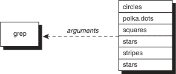

图 3.1  `grep * stars`

然而，将星号放在引号中，可以阻止它被 shell 解析和解释：

```sh
$ grep '*' stars
The asterisk (*) is a special character that
************
5 * 4 = 20
$
```

引号告诉 shell 不要处理被引号括起来的字符。然后它开始执行 `grep`，并将两个参数 `*`（不带周围的引号；shell 在此过程中会去除引号）和 `stars` 传递给它（见图 3.2）。


图 3.2  `grep '*' stars`


除了 `*` 之外，还有其他一些字符对 shell 具有特殊含义，在模式中使用时必须加引号。shell 如何处理引号这个主题确实很棘手；整整一章（第 5 章）专门讨论它。

如果没有指定文件名，`grep` 会从标准输入读取输入。因此，你可以将 `grep` 用作管道的一部分，扫描某个命令的输出中与特定模式匹配的行。假设你想知道用户 jim 是否已登录。你可以使用 `grep` 搜索 `who` 命令的输出：

```shell
$ who | grep jim
jim       tty16                 Feb 20 10:25
$
```

请注意，由于没有指定要搜索的文件，`grep` 会自动扫描标准输入。当然，如果用户 jim 没有登录，你会直接看到一个新的命令提示符，而前面没有任何输出：

```shell
$ who | grep jim
$
```

## 正则表达式与 `grep`

让我们再看一下 `intro` 文件：

```shell
$ cat intro
The UNIX operating system was pioneered by Ken
Thompson and Dennis Ritchie at Bell Laboratories
in the late 1960s. One of the primary goals in
the design of the UNIX system was to create an
environment that promoted efficient program
development.
$
```

`grep` 允许你像在 `ed` 中那样使用正则表达式来指定模式。也就是说，你可以指定如下模式：

```text
[tT]he
```

让 `grep` 搜索小写或大写 T 后跟 he 的情况。

下面是如何使用 `grep` 列出所有包含 the 或 The 这些字符的行：

```shell
$ grep '[tT]he' intro
The UNIX operating system was pioneered by Ken
in the late 1960s. One of the primary goals in
the design of the UNIX system was to create an
$
```

一个更聪明的替代方案可能是使用 `grep` 的 `-i` 选项，该选项使模式不区分大小写。也就是说，命令

```shell
grep -i 'the' intro
```

该选项告诉 `grep` 在将模式与 `intro` 中的行进行匹配时忽略大写和小写之间的差异。因此，包含 the 或 The 的行将被打印，包含 THE、ThE、tHE 等的行也一样。

表 3.5 展示了你可以指定给 `grep` 的其他正则表达式类型，以及它们会匹配的模式类型。

**表 3.5 一些 grep 示例**

| 命令 | 输出 |
|---|---|
| `grep '[A-Z]' list` | 来自 `list` 的包含大写字母的行 |
| `grep '[0-9]' data` | 来自 `data` 的包含数字的行 |
| `grep '[A-Z]...[0-9]' list` | 来自 `list` 的包含以大写字母开头、以数字结尾的五字符模式的行 |
| `grep '\.pic$' filelist` | 来自 `filelist` 的以 .pic 结尾的行 |

### -v 选项

有时候，你关注的不是找出包含指定模式的行，而是找出不包含该模式的行。这正是 `grep` 的 `-v` 选项的作用：反转匹配任务的逻辑。在下一个例子中，`grep` 被用来找出 `intro` 中所有不包含模式 UNIX 的行。

```text
$ grep -v 'UNIX' intro                 Print all lines that don't contain UNIX
Thompson and Dennis Ritchie at Bell Laboratories
in the late 1960s. One of the primary goals in
environment that promoted efficient program
development.
$ 
```

### -l 选项

有时候，你可能不想看到实际匹配模式的行，而只想找到包含该模式的文件的文件名。例如，假设当前目录中有一组 C 程序（按照惯例，这些文件名以 .c 后缀结尾），而你想知道哪些程序使用了名为 `Move_history` 的变量。下面是一种找到答案的方法：

```text
$ grep 'Move_history' *.c              Find Move_history in all C source files
exec.c:     MOVE   Move_history[200] = {0};
exec.c:          cpymove(&Move_history[Number_half_moves -1],
exec.c: undo_move(&Move_history[Number_half_moves-1];
exec.c: cpymove(&last_move,&Move_history[Number_half_moves-1]);
exec.c: convert_move(&Move_history[Number_half_moves-1],
exec.c: convert_move (&Move_history[Number_half_moves-1],
makemove.c: MOVE Move_history[i];
makemove.c:     if ( Move_history[i].from != BOOK (i,j,from) OR
makemove.c:         Move_history[i].to != BOOK (i,j,to) )
testch.c:GLOBAL MOVE Move_history[100] = {0};
testch.c:    Move_history[Number_half_moves-1].from = move.from;
testch.c:    Move_history[Number_half_moves-1].to = move.to;
$
```

仔细查看上面的输出，你会发现有三个文件——`exec.c`、`makemove.c` 和 `testch.c`——使用了这个变量。

给 `grep` 加上 `-l` 选项后，你会得到包含指定模式的文件的列表，而不是文件中匹配的行：

```text
$ grep -l 'Move_history' *.c        List the files that contain Move_history
exec.c
makemove.c
testch.c
$
```

由于 `grep` 惯例上是每行列出一个文件，你可以把 `grep -l` 的输出通过管道传给 `wc`，从而统计包含某个特定模式的文件数量：

```text
$ grep -l 'Move_history' *.c | wc -l
        3
$
```

上面的命令显示恰好有三个 C 程序文件引用了变量 `Move_history`。现在，为了确认你确实在认真阅读：如果你使用不带 `-l` 选项的 `grep`，并把输出通过管道传给 `wc -l`，你统计的又是什么呢？

### -n 选项

如果在 `grep` 中使用 `-n` 选项，文件中匹配指定模式的每一行前面都会加上对应的行号。从前面的例子可以看到，`testch.c` 是引用变量 `Move_history` 的三个文件之一；下面展示如何精确定位文件中引用该变量的具体行：

```text
$ grep -n 'Move_history' testch.c        Precede matches with line numbers
13:GLOBAL MOVE Move_history[100] = {0};
197:    Move_history[Number_half_moves-1].from = move.from;
198:    Move_history[Number_half_moves-1].to = move.to;
$
```

可以看到，`Move_history` 在 `testch.c` 的第 13、197 和 198 行被使用。

对于 Unix 专家来说，`grep` 是最常用的程序之一，因为它在模式匹配方面灵活而精巧。它非常值得学习。

## sort

最基础的 `sort` 命令非常容易理解：给它输入若干行，它会按字母顺序对它们进行排序，并把结果显示为输出：

```text
$ sort names
Charlie
Emanuel
Fred
Lucy
Ralph
Tony
Tony
$
```

默认情况下，`sort` 会读取指定输入文件中的每一行，并按升序排序。


特殊字符按照字符的内部编码进行排序。例如，空格字符在内部表示为数字 32，双引号表示为数字 34。这意味着前者会排在后者之前。尤其是在其他语言和区域设置中，排序顺序可能会有所不同，因此尽管通常可以保证 `sort` 对字母数字输入的表现符合预期，但外语字符、标点符号和其他特殊字符的排序顺序并不总是一如所料。

`sort` 有许多选项，可让排序操作更加灵活。这里我们只介绍其中少数几个选项。

### -u 选项

`-u` 选项告诉 `sort` 从输出中消除重复行。

```text
$ sort -u names
Charlie
Emanuel
Fred
Lucy
Ralph
Tony
$
```

这里可以看到，包含 Tony 的重复行已从输出中消除。许多老派 Unix 用户会使用单独的程序 `uniq` 来完成同样的事情，所以如果你阅读系统 shell 脚本，经常会看到 `sort | uniq` 这样的组合。这些都可以用 `sort -u` 来替代！

### -r 选项

使用 `-r` 选项可以反转排序顺序：

```text
$ sort -r names          Reverse sort
Tony
Tony
Ralph
Lucy
Fred
Emanuel
Charlie
$
```

### -o 选项

默认情况下，`sort` 将排序后的数据写入标准输出。如果希望将结果写入文件，可以使用输出重定向：

```text
$ sort names > sorted_names
$
```

或者，你可以使用 `-o` 选项来指定输出文件。只需在 `-o` 后面直接写出输出文件的名称即可：

```text
$ sort names -o sorted_names
$
```

这将对 `names` 进行排序，并将结果写入 `sorted_names`。

`-o` 选项的价值在哪里？通常，你会想对文件中的行进行排序，并用排序后的数据替换原始文件。但输入

```text
$ sort names > names
$
```

是不会生效的——它最终会清空 `names` 文件！然而，使用 `-o` 选项时，可以将输出文件的名称指定为与输入文件相同的名称：

```text
$ sort names -o names
$ cat names
Charlie
Emanuel
Fred
Lucy
Ralph
Tony
Tony
$
```

### 提示

如果你的过滤器或进程将要替换原始输入文件，请务必小心，并确保在数据被覆盖之前一切都能按预期工作。Unix 擅长很多事情，但没有 `unremove` 命令来恢复丢失的数据或文件。

### -n 选项

假设你有一个文件，其中包含成对的 `x, y` 数据点，如下所示：

```text
$ cat data
5    27
2    12
3    33
23   2
-5   11
15   6
14   -9
$
```

再假设你想把这些数据输入到一个名为 `plotdata` 的绘图程序中，但该程序要求传入的数据对必须按 `x` 值递增的顺序排序（`x` 是每行的第一个值）。

`sort` 的 `-n` 选项指定将行中的第一个字段视为*数字*，并按算术方式进行排序。比较一下不使用 `-n` 选项和使用 `-n` 选项时 `sort` 的输出：

```text
$ sort data
-5   11
14   -9
15   6
2    12
23   2
3    33
5    27
$ sort -n data    Sort arithmetically
-5   11
2    12
3    33
5    27
14   -9
15   6
23   2
$
```

### 跳过字段

如果你需要按 `y` 值（即每行的第二个数字）对数据文件排序，可以使用以下选项告诉 `sort` 从第二个字段开始：

`-k2n`

而不是 `-n`。`-k2` 表示跳过第一个字段，并从每行的第二个字段开始排序分析。类似地，`-k5n` 表示从每行的第五个字段开始，并按数值对数据进行排序。

```text
$ sort -k2n data
14     -9
23      2
15      6
-5     11
2      12
5      27
3      33
$
```

*从第二个字段开始排序*

默认情况下，字段由空格或制表符分隔。如果要使用不同的分隔符，则必须使用 `-t` 选项。

### -t 选项

如前所述，如果你跳过字段，`sort` 会假定字段由空格或制表符分隔。`-t` 选项可以指示其他情况。在这种情况下，`-t` 后面的字符被视为分隔符。

再看一下示例密码文件：

```text
$ cat /etc/passwd
root:*:0:0:The super User:/:/usr/bin/ksh
steve:*:203:100::/users/steve:/usr/bin/ksh
bin:*:3:3:The owner of system files:/: 
cron:*:1:1:Cron Daemon for periodic tasks:/: 
george:*:75:75::/users/george:/usr/lib/rsh
pat:*:300:300::/users/pat:/usr/bin/ksh
uucp:nc823cisiLiZM:5:5::/usr/spool/uucppublic:/usr/lib/uucp/uucico
asg:*:6:6:The Owner of Assignable Devices:/: 
sysinfo:*:10:10:Access to System Information:/:/usr/bin/sh
mail:*:301:301::/usr/mail:
$
```

如果你想按用户名（每行的第一个字段）对这个文件进行排序，只需发出以下命令：

```text
sort /etc/passwd
```

如果要改为按第三个以冒号分隔的字段（即通常所说的*用户 ID*）来排序文件，你需要进行算术排序，从第三个字段开始（`-k3`），并指定冒号字符作为字段分隔符（`-t:`）：

```text
$ sort -k3n -t: /etc/passwd                 Sort by userid
root:*:0:0:The super User:/usr/bin/ksh
cron:*:1:1:Cron Daemon for periodic tasks:/
bin:*:3:3:The owner of system files:/
uucp:*:5:5:/usr/spool/uucppublic:/usr/lib/uucp/uucico
asg:*:6:6:The Owner of Assigned Devices:/
sys:*:7:7:I/O Access to System Information:/usr/bin/sh
george:*:75:75:/users/george:/usr/lib/rsh
steve:*:203:100:/users/steve:/bin/ksh
pat:*:300:300:/users/pat:/usr/bin/ksh
mail:*:301:31:/usr/mail:
$
```

这里我们将每行的第三个字段加粗，以便你可以轻松验证文件确实按用户* ID *正确排序。

### 其他选项

`sort` 的其他选项允许你跳过字段内的字符、指定排序结束的字段、合并已排序的输入文件，以及按“字典顺序”排序（仅使用字母、数字和空格进行比较）。关于这些选项的更多细节，请参阅*Unix 用户手册*中的 `sort` 部分。

### uniq

当你需要查找或删除文件中的重复行时，`uniq` 命令非常有用。该命令的基本格式为

```text
uniq in_file out_file
```

在这种格式下，`uniq` 将 `in_file` 复制到 `out_file`，并在此过程中删除任何重复行。`uniq` 对重复行的定义是*连续且完全匹配的行*。

如果未指定 `out_file`，结果将写入标准输出。如果也未指定 `in_file`，`uniq` 将充当过滤器，从标准输入读取其输入。

下面是一些示例，看看 `uniq` 是如何工作的。假设你有一个名为 `names` 的文件，内容如下所示：

```text
$ cat names
Charlie
Tony
Emanuel
Lucy
Ralph
Fred
Tony
$
```

你可以看到名字 Tony 在文件中出现了两次。你可以使用 `uniq` 删除此类重复条目：

```text
$ uniq names                 Print unique lines
Charlie
Tony
Emanuel
Lucy
Ralph
Fred
Tony
$
```

哎呀！Tony 在前面的输出中仍然出现了两次，因为多次出现的位置在文件中并不*连续*，因此不满足 `uniq` 对重复的定义。为了解决这个问题，通常使用 `sort` 让重复行相邻排列，正如本章前面提到的。然后将排序结果通过 `uniq` 处理：


```text
$ sort names | uniq
Charlie
Emanuel
Fred
Lucy
Ralph
Tony
$
```

`sort`将两个`Tony`行移到一起，然后`uniq`过滤掉重复行（但请记住，带有`-u`选项的`sort`正好执行此功能）。

### -d 选项

通常，你可能只对查找文件中的重复条目感兴趣。`uniq`的`-d`选项可用于此目的：它告诉`uniq`*仅*将重复的行写入*out_file*（或标准输出）。无论连续出现多少次，这些行只会被写入一次。

```text
$ sort names | uniq -d       List duplicate lines
Tony
$
```

作为一个更实际的例子，让我们回到`/etc/passwd`文件。该文件包含系统上每个用户的信息。可以想象，在向该文件添加和删除用户的过程中，可能不小心多次输入了相同的用户名。你可以通过首先排序`/etc/passwd`并将结果通过管道传递给`uniq -d`来轻松找到此类重复条目，如前所述：

```text
$ sort /etc/passwd | uniq -d
$
```

`/etc/passwd`中没有重复的整行条目。但你真正想找到的是用户名字段中的重复条目，因此你只需要查看每行的第一个字段（请记住，`/etc/passwd`每一行中冒号之前的前导字符就是用户名）。这不能直接通过`uniq`的选项来完成，但可以通过使用`cut`从密码文件的每一行中提取用户名，然后将其发送给`uniq`来实现。

```text
$ sort /etc/passwd | cut -f1 -d: | uniq -d
cem
harry
$
```

事实证明，`/etc/passwd`中有多个`cem`和`harry`的条目。如果你想了解这些特定条目的更多信息，现在可以用`grep`从`/etc/passwd`中查找它们：

```text
$ grep -n 'cem' /etc/passwd
20:cem:*:91:91::/users/cem:
166:cem:*:91:91::/users/cem:
$ grep -n 'harry' /etc/passwd
29:harry:*:103:103:Harry Johnson:/users/harry:
79:harry:*:90:90:Harry Johnson:/users/harry:
$
```

使用`-n`选项可以找出重复条目的位置。对于`cem`，有两个条目分别位于第 20 行和第 166 行；对于`harry`，两个条目分别位于第 29 行和第 79 行。

### 其他选项

`uniq`的`-c`选项会添加出现次数计数，这在脚本中极为有用：

```text
$ sort names | uniq -c
    1 Charlie
    1 Emanuel
    1 Fred
    1 Lucy
    1 Ralph
    2 Tony
$
```

`uniq -c`的一个常见用途是找出数据文件中最常见的单词，使用如下命令即可轻松完成：

```text
tr '[A-Z]' '[a-z]' datafile | sort | uniq -c | head
```

还有两个选项，我们没有足够篇幅完全描述，它们允许你让`uniq`忽略一行的前导字符/字段。有关更多信息，请使用命令`man uniq`查阅你特定实现版本的 man 手册页。

如果我们不提及`awk`和`perl`这两个程序，那将是不妥的，它们在编写 shell 程序时也很有用。然而，它们本身都是庞大而复杂的编程环境，因此我们建议你查阅 Aho 等人所著的*Awk——一种模式扫描与处理语言*（见于*Unix 程序员手册，第二卷*）以了解`awk`，以及 O'Reilly and Associates 出版的*学习 Perl*和*Perl 编程*，它们分别提供了关于该语言的优秀教程和参考资料。

## 那么，我们出发吧

根据我们在第 2 章“什么是 Shell？”中的讨论，你现在应该意识到，每当你输入类似如下的内容时

```text
who | wc -l
```

你实际上是在 shell 中编程。这是因为 shell 正在解释命令行、识别管道符号、将第一个命令的输出连接到第二个命令的输入，并启动两个命令的执行。

在本章中，你将学习如何编写自己的命令以及如何使用 shell 变量。

### 命令文件

shell 程序可以直接输入，例如

```text
$ who | wc -l
```

也可以输入到文件中，然后由 shell 执行该文件。例如，假设你一天中需要多次查看已登录用户的数量。每次需要这一信息时输入上述管道命令并非不合理，但为了举例说明，让我们把这个管道命令写入一个文件。

我们把该文件命名为`nu`（表示用户数量），其内容就是前面显示的管道命令：

```text
$ cat nu
who | wc -l
$
```

要执行文件`nu`中包含的命令，你现在只需在 shell 中输入`nu`作为命令名：

```text
$ nu
sh: nu: cannot execute
$
```

哎呀！我们忘记提一件事。在你可以从命令行执行脚本之前，必须更改文件权限，使其可执行。这通过更改模式命令`chmod`完成。要为文件添加执行权限，你只需输入

```text
chmod +x *file(s)*
```

`+x`表示你希望让紧随其后的*文件*可执行。shell 要求一个文件必须*同时*对你可读且可执行，你才能直接在命令行调用它。

```text
$ ls -l nu
-rw-rw-r--  1 steve  steve  12 Jul 10 11:42 nu
$ chmod +x nu                         *Make it executable*
$ ls -l nu
-rwxrwxr-x  1 steve  steve  12 Jul 10 11:42 nu
$
```

现在你已经使它可执行了，再试一次：

```text
$ nu
      8
$
```

这次成功了。

> **警告**
>
> 如果修复了权限问题后仍然出现“找不到命令”的错误，请尝试在命令前加上`./`，例如`./nu`，以确保 shell 在当前目录以及常规系统位置中查找命令。要长期解决此问题，请将`.`添加到`PATH`的末尾（通常是在你的`.profile`文件中）。

你可以将任何命令放入文件中，使文件可执行，然后只需在 shell 中输入其名称即可执行其中内容。就这么简单，也这么强大，因此你学到的关于命令行操作的一切也同样适用于编写 shell 脚本。

标准的 shell 机制，如 I/O 重定向和管道，同样可以用于你自己的程序：

```text
$ nu > tally
$ cat tally
      8
$
```

假设你正在编写一份名为 *sys.caps* 的提案，每次打印该提案时都需要以下命令序列：

```text
tbl sys.caps | nroff -mm -Tlp | lp
```

你可以通过将此命令序列放入一个文件——我们称之为`run`——使其成为可执行文件，然后在想要打印提案的新副本时，只需键入`run`这个名字，从而节省一些输入：

```sh
$ cat run
tbl sys.caps | nroff -mm -Tlp | lp
$ chmod +x run
$ run
request id is laser1-15 (standard input)
$
```

（示例中的 request id 消息来自`lp`命令。）

对于下一个示例，假设你想编写一个名为`stats`的 shell 程序，它将打印日期和时间、当前登录用户数以及当前工作目录。你需要用来获取这些信息的三个命令序列是`date`、`who | wc -l`和`pwd`：

```sh
$ cat stats
date
who | wc -l
pwd
$ chmod +x stats
$ stats                         Try it out
Wed Jul 10 11:55:50 EDT 2002
     13

/users/steve/documents/proposals
$
```

你可以在`stats`中添加一些`echo`命令，使输出信息更丰富一些：


```sh
$ cat stats
echo The current date and time is:
date
echo
echo The number of users on the system is:
who | wc -l
echo
echo Your current working directory is:
pwd
$ stats                         Execute it
The current date and time is:
Wed Jul 10 12:00:27 EDT 2002

The number of users on the system is:
     13

Your current working directory is:
/users/steve/documents/proposals
$
```

回想一下，不带任何参数的 `echo` 会输出一个空行。稍后你将看到如何将消息和命令输出显示在同一行，如下所示：

```
The current date and time is: Wed Jul 10 12:00:27 EDT 2002
```

## 注释

如果没有*注释*语句，shell 编程语言就不够完整。注释是你在程序中插入说明或注解的一种方式，这些内容对程序的执行没有任何影响。

每当 shell 遇到特殊字符 `#` 时，它会忽略从 `#` 开始到行尾的所有字符。如果 `#` 位于行首，则整行被视为注释。下面是有效注释的示例：

```
# Here is an entire commentary line
# who | wc -l      # count the number of users
#
# Test to see if the correct arguments were supplied
#
```

注释对于记录那些目的可能不明显或足够复杂以至于你可能会忘记它们为什么存在或做什么的命令或命令序列非常有用。明智地使用注释还有助于使 shell 程序更易于调试和维护——无论是对你，还是对可能需要维护你程序的其他人而言。

让我们回到 `stats` 程序，插入一些注释和空行以提高可读性：

```
$ cat stats
#
# stats -- prints: date, number of users logged on,
#                  and current working directory
#

echo The current date and time is:
date

echo
echo The number of users on the system is:
who | wc -l

echo
echo Your current working directory is:
pwd
$
```

额外的空行在程序空间方面消耗很少，但在程序可读性方面却增加很多。它们会被 shell 直接忽略。

## 变量

与几乎所有编程语言一样，shell 允许你将值存储在*变量*中。shell 变量以字母或下划线（`_`）字符开头，后跟零个或多个字母数字或下划线字符。

> **注意**
> 
> 因此，shell 变量名的正则表达式是 `[A-Za-z_][a-zA-Z0-9_]*`，对吗？

要将值存储到 shell 变量中，你需要写出变量名，后面紧跟等号 `=`，再紧跟要存储在变量中的值：

```
variable=value
```

例如，要将值 1 赋给 shell 变量 `count`，你只需编写

```
count=1
```

要将值 `/users/steve/bin` 赋给 shell 变量 `my_bin`，你编写

```
my_bin=/users/steve/bin
```

这里有几点很重要。首先，等号两侧不允许有空格。请记住这一点，特别是如果你曾经使用过其他编程语言，并且习惯于在运算符周围插入空格。在 shell 语言中，你不能加这些空格。

其次，与大多数其他编程语言不同，shell 没有*数据类型*的概念。无论你向 shell 变量赋什么值，shell 都会简单地将该值解释为字符串。因此，当你将 1 赋给变量 `count` 时，shell 只是将*字符* 1 存储在变量 `count` 中，而不会假设变量中存储的是整数值。

如果你习惯于使用 C、Perl、Swift 或 Ruby 等所有变量都必须*声明*的语言进行编程，那么你还需要进行另一项调整：由于 shell 没有数据类型的概念，变量在使用前不会被声明；当你想要使用它们时，直接为它们赋值即可。

shell 确实支持对包含有效数字字符串的 shell 变量执行整数运算，这是通过特殊的内置操作实现的，但即便如此，变量也会被不断求值以确保它是有效数字。

因为 shell 是一种解释性语言，你可以直接在终端上为变量赋值：

```sh
$ count=1                         Assign character 1 to count
$ my_bin=/users/steve/bin         Assign /users/steve/bin to my_bin
$
```

既然你现在已经知道如何为变量赋值，那这有什么用呢？问得好。

### 显示变量的值

`echo` 命令——我们已经用它来打印从标准输入接收的字符串等值——用于显示存储在 shell 变量中的值。要做到这一点，你只需编写

```
echo $variable
```

`$` 字符对 shell 来说是一个特殊字符，当后跟一个或多个字母数字字符时尤其如此。如果 `$` 后面跟着变量名，shell 会将其视为指示该变量中存储的值应在该位置进行替换。因此，当你输入

```
echo $count
```

shell 会将 `$count` 替换为其中存储的值；然后执行 `echo` 命令：

```
$ echo $count
1
$
```

请记住，shell 在执行命令*之前*进行变量替换（见图 4.1）。


图 4.1  `echo $count`

你可以同时替换多个变量的值：

```
$ echo $my_bin
/users/steve/bin
$ echo $my_bin $count
/users/steve/bin 1
$
```

在第二个示例中，shell 会替换 `my_bin` 和 `count` 的值，然后执行 `echo` 命令（见图 4.2）。


图 4.2  `echo $my_bin $count`

变量可以用于任何命令行上的任何位置，并会在调用特定命令之前由 shell 替换为其值，如下面的示例所示：

```text
$ ls $my_bin
mon
nu
testx
$ pwd
/users/steve/documents/memos
$ cd $my_bin
$ pwd
/users/steve/bin
$ number=99
$ echo There are $number bottles of beer on the wall
There are 99 bottles of beer on the wall
$
```

*我们在哪里？*

*切换到我的 bin 目录*

这里还有一些示例：

```text
$ command=sort
$ $command names
Charlie
Emanuel
Fred
Lucy
Ralph
Tony
Tony
$ command=wc
$ option=-l
$ file=names
$ $command $option $file
        7 names
$
```

所以你看，甚至命令名也可以存储在变量中。由于 shell 在确定要执行的程序名及其参数之前执行替换，它会解析这一行

```text
$command $option $file
```

然后进行所有请求的替换，将实际调用的命令变为

```text
wc -l names
```

然后 shell 执行 `wc`，并传递两个参数 `-l` 和 `names`。

变量甚至可以赋值给其他变量，如下一个示例所示：

```text
$ value1=10
$ value2=$value1
$ echo $value2
```

```text
$ value1=10
$ value2=$value1
$ echo $value2
10
$
```

*刚才那样做不对*

*这样才对*

请记住：每当你想要使用某个变量中存储的值时，必须在变量名前加上美元符号。

### 未定义的变量具有空值

当你试图显示一个没有被赋值的变量的值时，你认为会发生什么？试试看：

```text
$ echo $nosuch
$
```

*从未被赋值*

你没有收到错误消息。`echo` 命令到底显示了什么吗？让我们看看能否更精确地确定这一点：

```text
$ echo :$nosuch:
::
$
```

*用冒号包围它的值*

所以你看，对于 `nosuch` 的未指定值，shell 没有替换出任何字符。


一个不包含任何值的变量被称为未定义的，并被认为包含空值。这是你从未向其存储值的变量的默认情况。当 shell 执行变量替换时，任何为空的值实际上都会从命令行中被移除（如果它们具有空值，这是有道理的）：

```text
$ wc -l $nosuch names
      7 names
$
```

shell 扫描命令行，将变量 `nosuch` 替换为空值。扫描完成后，该命令行实际上看起来像这样：

```text
wc -l names
```

这就解释了它为什么能正常工作。

有时你可能希望将变量的值初始化为空值。这可以通过简单地不向变量赋值来实现，如下所示：

```text
dataflag=
```

或者，作为一种更好的做法，你可以在 `=` 后面列出两个相邻的引号对。所以

```text
dataflag=""
```

和

```text
dataflag=''
```

两者都将空值赋给 `dataflag` 的效果相同，并且额外的好处是这看起来像是故意的，而不是像第一种情况那样，以后可能会被视为错误或笔误。

请注意，赋值

```text
dataflag=" "
```

与前面三种赋值的含义不同，因为它将一个空格字符赋给了 `dataflag`；这与不赋任何字符给它是有区别的。

## 文件名替换与变量

这里有一个谜题给你：如果你输入

```text
x=*
```

shell 会将字符 `*` 存储到变量 `x` 中，还是会将当前目录中的所有文件名存储到变量 `x` 中？让我们试一试：

> *我们有哪些文件？*

```text
$ ls
addresses
intro
logspaces
names
nu
numbers
phonebook
stat
$ x=*
$ echo $x
addresses intro logspaces names nu numbers phonebook stat
$
```

这个简单的例子包含了很多值得学习的内容。当执行

```text
x=*
```

时，文件列表被存储到变量 `x` 中了吗？还是 shell 在执行

```text
echo $x
```

时才进行了替换？

事实证明，shell 在为变量赋值时不会执行文件名替换。因此，

```text
x=*
```

将单个字符 `*` 赋给 `x`。这意味着，根据显示的输出，shell 在执行 `echo` 命令时一定进行了文件名替换。实际上，当

```text
echo $x
```

执行时，发生的精确步骤顺序如下：

1. shell 扫描该行，将 `*` 替换为 `x` 的值。
2. shell 重新扫描该行，遇到 `*`，然后替换为当前目录中所有文件的名称。
3. shell 开始执行 `echo`，将文件列表作为参数传递给它（参见图 4.3）。

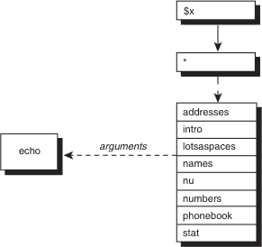

图 4.3  *echo $x*

这个求值顺序很重要。请记住，shell 首先进行变量替换，然后进行文件名替换，最后将该行解析为参数。

## `${variable}` 结构

假设你有一个文件名存储在变量 `filename` 中。如果你想重命名该文件，使新名称与旧名称相同，只是在末尾添加一个 X，你的第一反应是输入

```text
mv $filename $filenameX
```

然而，当 shell 扫描此命令行时，它会替换变量 `filename` 的值，也会替换变量 `filenameX` 的值。shell 认为 `filenameX` 是变量的完整名称，因为它完全由有效字符组成。

为了避免这个问题，请用花括号将整个变量名括起来（但不包括开头的美元符号）来界定变量，如下所示：

```text
${filename}X
```

这消除了任何歧义，`mv` 命令就会按预期工作：

```text
mv $filename ${filename}X
```

请记住，只有当变量名的最后一个字符后面跟着字母数字字符或下划线时，才需要使用花括号。

另外，在这种花括号表示法中还有不少适用于变量的其他功能，包括提取子集、在当前变量未赋值时赋值等。敬请期待！

## 内置整数算术

所有现代 Unix 和 Linux 变体（包括 Mac OS X 的命令 shell）所附带的 POSIX 标准 shell 都提供了一种对 shell 变量执行整数算术的机制，称为*算术展开*。请注意，一些较旧的 shell 不支持此功能。

算术展开的格式为

```text
$((expression))
```

其中 *expression* 是使用 shell 变量和运算符的算术表达式。有效的 shell 变量是那些包含数值的变量（允许前导和尾随空白）。有效的运算符取自 C 编程语言，并在附录 A“Shell 摘要”中列出。

> **$(( )) 运算符**
>
> 运算符列表出奇地广泛，包括基本的六个：`+`、`-`、`*`、 `/`、`%` 和 `**`，以及更复杂的表示法，包括 `+=`、`-=`、 `*=`、 `/=`、使用 `variable++` 和 `variable--` 的简便递增和递减等等。
>
> 我们最喜欢的？你可以使用不同的数字基，甚至可以从一种数字基转换为另一种。例如，以下是 100 八进制（基数为 8）和 10101010101010101010 二进制（基数为 2）的十进制答案：
>
> ```sh
> $ echo $(( 8#100 ))
> 64
> $ echo $(( 2#10101010101010101010 ))
> 174762
> ```

计算 *expression* 的结果会被替换到命令行中。例如，

```text
echo $((i+1))
```

将 shell 变量 `i` 的值加 1 并打印结果。请注意，变量 `i` 前面不必加美元符号，因为 shell 知道算术展开中唯一可以出现的有效元素是运算符、数字和变量。如果变量未定义或包含 NULL 字符串，则假定其值为零。所以如果我们还没有给变量 `a` 赋值，我们仍然可以在整数表达式中使用它：

```text
$ echo $a                         变量 a 未设置
$ echo $(( a = a + 1 ))           等同于 a = 0 + 1
1
$ echo $a                         现在 a 包含 1
$
```

请注意，赋值是一个有效运算符，并且在前面的示例中，赋值的结果被替换到第二个 `echo` 命令中。

在表达式内部，括号经常用于强制分组，如下所示：

```text
echo $((i = (i + 10) * 3))
```

如果你想在不使用 `echo` 或其他命令的情况下执行赋值，可以将赋值移到算术表达式之前。

所以要将变量 `i` 乘以 5 并将结果赋回给 `i`，你可以这样写：

```text
i=$(( i * 5 ))
```

请注意，在双括号内部空格是可选的，但当赋值在双括号外部时不允许有空格。

一种更简洁地将 `$i` 乘以 5 的方法是下面这种常见表示法，它可以出现在另一条语句中：

```text
$(( i *= 5 ))
```

如果你只是将值加 1，还可以更简洁：

```text
$(( i++ ))
```

最后，要测试 `i` 是否大于或等于 0 且小于或等于 100，你可以这样写：

```text
result=$(( i >= 0  &&  i <= 100 ))
```

如果表达式为真，则将 `result` 赋值为 1（真）；如果为假，则赋值为 0（假）：

```text
$ i=$(( 100 * 200 / 10 ))       如果 i < 1000，则设置 j = 0；否则为 1
$ j=$(( i < 1000 ))              i 是 2000，所以 j 被设置为 0
$ echo $i $j
2000 0
$
```

到此，我们对编写命令和使用变量的介绍就结束了。下一章将详细介绍 shell 中的各种引用机制。

## 我可以引用你这句话吗？

本章介绍 shell 编程语言的一个独特特性：它解释引号字符的方式。shell 能识别四种不同类型的引号字符：

- 单引号字符 `'`
- 双引号字符 `"`
- 反斜杠字符 `\`
- 反引号字符 `` ` ``

上述列表中的前两个引号字符和最后一个引号字符必须成对出现，而反斜杠字符可以根据需要在一道命令中使用任意次数。这些引号对 shell 而言各有不同的含义。我们将在本章的各小节中分别介绍它们。

### 单引号

在 shell 中需要使用引号的原因有很多。最常见的原因之一是，将包含空白字符的字符序列作为一个整体保留。

下面是一个名为 phonebook 的文件，其中包含姓名和电话号码：


```text
$ cat phonebook
Alice Chebba     973-555-2015
Barbara Swingle  201-555-9527
Liz Stachiw      212-555-2298
Susan Goldberg   201-555-7776
Susan Topple     212-555-4932
Tony Iannino     973-555-1295
$
```

若要在 `phonebook` 文件中查找某人，可以使用 `grep`：

```text
$ grep Alice phonebook
Alice Chebba     973-555-2015
$
```

看看当你查找 Susan 时会发生什么：

```text
$ grep Susan phonebook
Susan Goldberg  201-555-7776
Susan Topple    212-555-4932
$
```

数据文件中有两个 Susan，因此输出了两行——但假设你只想要 Susan Goldberg 的信息。解决这个问题的一种方法是进一步限定名字。例如，你还可以同时指定姓氏：

```text
$ grep Susan Goldberg phonebook
grep: can't open Goldberg
Susan Goldberg  201-555-7776
Susan Topple    212-555-4932
$
```

但正如你所见，这样并不管用。

为什么？因为 shell 使用空白字符来分隔命令参数，所以上面的命令行会让 `grep` 接收到三个参数：`Susan`、`Goldberg` 和 `phonebook`（见图 5.1）。

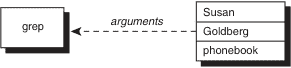

*图 5.1*  `grep Susan Goldberg phonebook`

当 `grep` 执行时，它会把第一个参数解释为搜索模式，把其余参数解释为要搜索的文件名。在本例中，`grep` 认为它应该在 `Goldberg` 和 `phonebook` 这两个文件中查找 `Susan`。它尝试打开 `Goldberg` 文件，但找不到它，于是发出如下错误信息：

```text
grep: can't open Goldberg
```

然后它接着处理下一个文件 `phonebook`，打开它，搜索模式 `Susan`，并打印出两个匹配的行。说实话，这是很合逻辑的。

真正的问题在于，如何向程序传递包含空白字符的参数。

解决办法：把整个参数放在一对单引号内，就像这样：

```text
grep 'Susan Goldberg' phonebook
```

当 shell 看到第一个单引号时，*它会忽略其后直到匹配的结束引号为止的所有特殊字符。*

```text
$ grep 'Susan Goldberg' phonebook
Susan Goldberg  201-555-7776
$
```

当 shell 遇到第一个 `'` 后，就会停止解释任何特殊字符，直到找到结束的 `'`。因此，`Susan` 和 `Goldberg` 之间的空格虽然通常会把两个参数分隔开，但这次被 shell 忽略了。随后 shell 把命令行拆分为两个参数：第一个是 `Susan Goldberg`（包含空格字符），第二个是 `phonebook`。然后它调用 `grep`，并把这两个参数传给它（见图 5.2）。


*图 5.2*  `grep 'Susan Goldberg' phonebook`

`grep` 将第一个参数 `Susan Goldberg` 解释为包含嵌入空格的模式，并在第二个参数 `phonebook` 指定的文件中查找它。请注意，shell 会移除引号，不会把它们传给程序。

无论引号之间包含多少个空格字符，shell 都会将它们全部保留。

```text
$ echo  one          two        three      four
one two three four
$ echo 'one          two        three      four'
one          two        three      four
$
```

在第一种情况下，shell 会移除命令行中多余的空白字符（没有引号！），并把 `one`、`two`、`three`、`four` 这四个参数传给 `echo`（见图 5.3）。

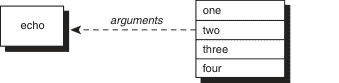

*图 5.3*  `echo  one          two      three    four`

在第二种情况下，多余的空格被保留，shell 在执行 `echo` 时会把引号内的整个字符串当作一个参数（见图 5.4）。


*图 5.4*  `echo  'one          two      three    four'`

值得强调的是，所有出现在单引号内的特殊字符都会被 shell 忽略。下面的示例正好说明了这一点：

```text
$ file=/users/steve/bin/prog1
$ echo $file
/users/steve/bin/prog1
$ echo '$file'                        # $ not interpreted
$file
$ echo *
addresses intro lotsospaces names nu numbers phonebook stat
$ echo '*'
*
$ echo '< > | ; ( ) { } >> " &'
< > | ; ( ) { } >> " &
$
```

如果回车键被包含在单引号内，它也会作为命令参数的一部分被保留：

```text
$ echo 'How are you today,
> John'
How are you today,
John
$
```

解析完第一行后，shell 发现引号没有配对，于是提示用户（用 >）输入结束引号。这个 > 被称为次提示符，每当 shell 等待你完成多行命令输入时，它都会显示该提示符。

给 shell 变量赋值时，如果值中包含空白或特殊字符，也需要使用引号，不过其中有一些细微差别，如下所示：

```text
$ message='I must say, this sure is fun'
$ echo $message
I must say, this sure is fun
$ text='* means all files in the directory'
$ echo $text
names nu numbers phonebook stat means all files in the directory
$
```

第一条语句需要引号，因为要存储的值中包含空格。

第二个涉及变量 `text` 的示例则说明，shell 会先进行变量名替换，再进行文件名替换：也就是说，在变量展开之后、`echo` 执行之前，`*` 会被替换为当前目录下所有文件的名称。真烦人！

如何解决这类问题？使用双引号。

### 双引号

双引号与单引号的工作方式类似，区别在于双引号对内容的保护性较弱：单引号告诉 shell 忽略所有被括起来的字符，双引号则表示忽略其中大部分字符。具体来说，双引号内的以下三种字符不会被忽略：

- 美元符号

- 反引号

- 反斜杠

美元符号不会被忽略，这意味着 shell 会在双引号内进行变量名替换。

```shell
$ filelist=*
$ echo $filelist
addresses intro lotsospaces names nu numbers phonebook stat
$ echo '$filelist'
$filelist
$ echo "$filelist"
*
$
```

这里你可以看到不用引号、用单引号和用双引号之间的主要区别。在第一种情况下，shell 看到星号，并用当前目录中的所有文件名替换它。在第二种情况下，shell 对单引号内的字符完全不予处理，因此屏幕上显示的是 `$filelist`。在最后一种情况下，双引号向 shell 表明，引号内仍然需要进行变量名替换。于是 shell 将 `$filelist` 替换为 `*`。但双引号内不进行文件名替换，因此 `*` 会作为要显示的值被安全地传给 `echo`。

> **注意**
>
> 在我们讨论单引号与双引号时，你还应该知道，shell 根本不认识“智能引号”。这类引号由 Microsoft Word 等文字处理器生成，会向它们所包围的内容内侧弯曲，打印出来时更美观。问题是，它们会破坏你的 shell 脚本，所以一定要保持警惕！

如果你希望替换变量的值，但又不希望 shell 随后对替换出的字符作特殊解析，就把变量放在双引号内。

下面是另一个示例，说明双引号和不使用引号之间的区别：


```shell
$ address="39 East 12th Street
> New York, N. Y. 10003"
$ echo $address
39 East 12th Street New York, N. Y. 10003
$ echo "$address"
39 East 12th Street
New York, N. Y. 10003
$
```

请注意，在这个特定示例中，赋给 `address` 的值是用单引号还是双引号括起来并没有区别。无论哪种情况，shell 都会显示辅助命令提示符，表示它正在等待对应的右引号。

将两行地址赋给 `address` 之后，`echo` 会显示该变量的值。如果不给变量加引号，地址会显示在一行中。原因与导致

```text
echo one        two      three    four
```

显示为

```text
one two three four
```

的原因相同。

因为 shell 会从命令行中删除空格、制表符和换行符（空白字符），然后在将命令行交给所请求的命令之前将其拆分成参数，所以命令

```sh
echo $address
```

会使 shell 去除内嵌的换行符，将它当作空格或制表符一样的参数分隔符来处理。然后 shell 将九个参数传给 `echo` 显示。`echo` 永远看不到那个换行符；shell 先一步处理了它（见图 5.5）。

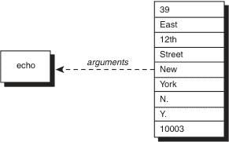

图 5.5  `echo $address`

而当使用命令

```sh
echo "$address"
```

时，shell 与之前一样替换 `address` 的值，只是双引号告诉它保留任何内嵌的空白字符。因此在这种情况下，shell 传给 `echo` 的是单个参数——一个包含内嵌换行符的参数。然后 `echo` 显示它的这一个参数。图 5.6 展示了这一点，其中换行符用序列 `\n` 表示。


图 5.6  `echo "$address"`

有一点比较奇怪的是，双引号可以用来对 shell 隐藏单引号，反之亦然：

```sh
$ x="'Hello,' he said"
$ echo $x
'Hello,' he said
$ article="'Keeping the Logins from Lagging,' Bell Labs Record"
$ echo $article
'Keeping the Logins from Lagging,' Bell Labs Record
$
```

## 反斜杠

从功能上讲，反斜杠（用作前缀）等价于将单个字符放在单引号中，不过有少数细微的例外。反斜杠会*转义*紧随其后的字符。通用格式如下：

```sh
\c
```

其中 *c* 是你要加引号的字符。该字符通常附带的任何特殊含义都会被移除。下面是一个例子：

```sh
$ echo >
syntax error: 'newline or ;' unexpected
$ echo \>
>
$
```

在第一种用法中，shell 看到 `>`，以为你想将 echo 的输出重定向到文件，因此它期望后面跟着一个文件名。由于后面没有文件名，shell 便输出了错误信息。

在接下来的用法中，反斜杠转义了 `>` 的特殊含义，于是它被当作一个要显示的字符传给 echo。

```sh
$ x=*
$ echo \$x
$x
$
```

在这种情况下，shell 会忽略反斜杠后面的 `$`，因此不会执行变量替换。

因为反斜杠会移除后面字符的特殊含义，你能猜到如果后面的字符是另一个反斜杠，会发生什么吗？它会移除那个反斜杠的特殊含义：

```sh
$ echo \\\\
\\
$
```

你也可以使用单引号来完成这个任务：

```sh
$ echo '\\'
\\
$
```

### 使用反斜杠续行

正如本节开头提到的，`\c` 基本上等同于 `'c'`。这个规则的一个例外是，当反斜杠正好是一行中的最后一个字符时：

```sh
$ lines=one'
> 'two
$ echo "$lines"
one
two
$ lines=one\
> two
$ echo "$lines"
onetwo
$
```

> 单引号告诉 shell 忽略换行符

> 试试改用 `\`

当反斜杠是输入行的最后一个字符时，shell 会将它视为续行符。它会移除后面的换行符，并且不会把该换行符当作参数分隔符（就好像它从未被输入过一样）。这种结构通常用于跨多行输入长命令。

例如，下面的写法完全有效：

```text
Longinput="The shell treats a backslash that's the \
last character of a line of input as a line \
continuation. It removes the newline too."
```

### 双引号内的反斜杠

我们前面提到过，反斜杠是 shell 在双引号内会解释的三种字符之一。这意味着你可以在双引号内使用反斜杠，来移除那些在双引号内本来会被解释的字符的含义（也就是其他反斜杠、美元符号、反引号、换行符以及其他双引号）。如果反斜杠在双引号内位于任何其他字符之前，shell 会忽略这个反斜杠，并将它传给程序：

```sh
$ echo "\$x"
$x
$ echo "\ is the backslash character"
\ is the backslash character
$ x=5
$ echo "The value of x is \"$x\""
The value of x is "5"
$
```

在第一个示例中，反斜杠位于美元符号之前，因此 shell 会忽略美元符号，移除反斜杠，并把结果交给 echo。在第二个示例中，反斜杠位于空格之前，而空格在双引号内不会被 shell 解释。所以 shell 会忽略反斜杠，并将它传给 echo 命令。最后一个示例展示了反斜杠在双引号字符串内用来括起双引号。

作为引号用法的一个练习，假设你想在终端上显示下面这一行：

```text
<<< echo $x >>> displays the value of x, which is $x
```

这里的意图是：在第二处 `$x` 中替换 x 的值，但第一处不替换。先给 x 赋一个值：

```sh
$ x=1
$
```

现在尝试不使用任何引号来显示这一行：

```sh
$ echo <<< echo $x >>> displays the value of x, which is $x
syntax error: '<' unexpected
$
```

`<` 向 shell 表示输入重定向，但后面缺少文件名，因此产生了错误信息。

如果你把整条消息放在单引号内，最后那处 x 的值不会被替换。如果你把整个字符串放在双引号内，两处 `$x` 都会被替换。有点棘手！

下面给出了两种不同的方法，可以正确地为这个字符串加引号，让一切都按预期工作：

```sh
$ echo "<<< echo \$x >>> displays the value of x, which is $x"
<<< echo $x >>> displays the value of x, which is 1
$ echo '<<< echo $x >>> displays the value of x, which is' $x
<<< echo $x >>> displays the value of x, which is 1
$
```

在第一种情况下，所有内容都用双引号括起来，并用反斜杠来防止 shell 在第一处 `$x` 中执行变量替换。在第二种情况下，直到最后一处 `$x` 之前的所有内容都用单引号括起来，但需要被替换的那个变量在添加时没有加引号。

然而，后一种方案有一点风险：如果变量 `x` 中包含文件名替换或空白字符，这些字符会被解释。更安全的 echo 写法应该是：

```sh
echo '<<< echo $x >>> displays the value of x, which is' "$x"
```

## 命令替换

*命令替换*是指 shell 在命令行的任意位置，用指定命令的输出来替换该命令的能力。shell 中有两种执行命令替换的方式：将命令括在反引号中，或用 `$(...)` 结构将其括起来。

### 反引号

反引号——常被称为“back tick”——不同于之前遇到的任何类型的引号，因为它的目的不是保护字符不受 shell 影响，而是告诉 shell 用所括命令的输出来替换该命令。使用反引号的一般格式是：

```text
`command`
```

其中 *command* 是要执行的命令名，该命令的输出将被插入到相应位置。

> **注意**
>


> 使用反引号进行命令替换已不再是首选方法；不过，我们在这里介绍它，是因为大量旧版 shell 脚本仍在使用这种结构。你也应该了解反引号，以防万一需要编写可移植到较老 Unix 系统的 shell 程序，而这些系统的 shell 不支持较新的、更受推荐的 `$(...)` 结构。

下面是一个示例：

```sh
$ echo The date and time is: `date`
The date and time is: Wed Aug 28 14:28:43 EDT 2002
$
```

当 shell 对命令行进行初始扫描时，它会识别出反引号，并期望后面跟着一个命令。在这个例子中，shell 找到 `date` 命令，于是执行 `date`，并用 `date` 的输出来替换命令行中的 `date` 序列。之后，shell 以正常方式将所得命令行划分为多个参数，然后将它们全部交给 `echo` 命令。

```sh
$ echo Your current working directory is `pwd`
Your current working directory is /user/steve/shell/ch6
$
```

这里，shell 执行 `pwd`，将其输出插入命令行，然后执行 `echo`。请注意，在接下来的小节中，反引号可以用于所有使用 `$(...)` 结构的地方；当然，在本小节的示例中反之亦然。

## `$(...)` 结构

所有现代 Unix、Linux 以及任何其他符合 POSIX 标准的 shell 都支持更新且更受青睐的 `$(...)` 结构进行命令替换。其一般格式为：

`$(command)`

其中，与反引号一样，`command` 是要在命令行中替换其标准输出的命令名称。例如：

```sh
$ echo The date and time is: $(date)
The date and time is: Wed Aug 28 14:28:23 EDT 2002
$
```

这种结构之所以优于反引号，有几个原因。首先，使用正引号和反引号组合的复杂命令可能难以阅读，尤其是当你使用的字体无法在视觉上区分单引号和反引号时；其次，`$(...)` 结构可以轻松嵌套，从而实现命令替换中的命令替换。虽然反引号也可以进行嵌套，但更麻烦。在本小节的后面，你会看到一个嵌套命令替换的示例。

让我们强调一个重要的事情：你并不局限于在括号之间调用单个命令。如果命令以分号分隔，则可以执行多个命令；而且更常见的是，你还可以使用命令管道。

下面是一个修改版的 `nu` 程序，用于显示已登录用户的数量：

```sh
$ cat nu
 echo There are $(who | wc -l) users logged in
$ nu                         Execute it
There are 13 users logged in
$
```

因为单引号会保护一切内容，所以以下输出应该很容易理解：

```sh
$ echo '$(who | wc -l) tells how many users are logged in'
$(who | wc -l) tells how many users are logged in
$
```

但在双引号内，命令替换会被解释执行：

```sh
$ echo "You have $(ls | wc -l) files in your directory"
You have       7 files in your directory
$
```

请记住，shell 负责执行括号之间的命令。`echo` 命令所能看到的只是 shell 插入的输出。

> **注意**
>
> 上面的示例中 `wc` 命令产生的那些前导空格一直让程序员们感到烦恼。你能想到用 `sed` 去除它们的方法吗？

假设你正在编写一个 shell 程序，并想把当前的日期和时间赋值给一个名为 `now` 的变量。

可以使用命令替换来实现：

```sh
$ now=$(date)                         Execute date and store the output in now
$ echo $now                            See what got assigned
Wed Aug 28 14:47:26 EDT 2002
$
```

当你输入

```sh
now=$(date)
```

shell 会理解 `date` 命令的全部输出都将赋值给 `now`。因此，你不需要把 `$(date)` 放在双引号内，尽管这是一种常见做法。

即使是产生多行输出的命令，也可以将其输出存储在变量中：

```sh
$ filelist=$(ls)
$ echo $filelist
addresses intro lotsaspaces names nu numbers phonebook stat
$
```

这里发生了什么？虽然 `ls` 产生的换行符存储在 `filelist` 变量中，但你最终得到的是文件的水平列表。当 shell 在处理 `echo` 命令行时替换了 `filelist` 的值后，这些换行符在显示时被吃掉了。在变量周围加上双引号可以保留换行符：

```sh
$ echo "$filelist"
addresses
intro
lotsaspaces
names
nu
numbers
phonebook
stat
$
```

进一步深入 shell 脚本的世界，让我们看看这在文件重定向中是如何工作的。例如，要将文件内容存储到变量中，可以使用方便的 `cat` 命令：

```sh
$ namelist=$(cat names)
$ echo "$namelist"
Charlie
Emanuel
Fred
Lucy
Ralph
Tony
Tony
$
```

如果你想将 memo 文件的内容邮寄给 `names` 文件中列出的所有人，可以这样做：

```sh
$ mail $(cat names) < memo
$ 
```

这里，shell 将 `cat` 命令替换为它在命令行上的输出，因此看起来像这样：

```sh
mail Charlie Emanuel Fred Lucy Ralph Tony Tony < memo
```

然后 shell 执行 `mail`，将其标准输入从 `memo` 文件重定向，并将内容传递给指定的七个收件人。

请注意，Tony 可能会收到两次相同的邮件，因为他在 `names` 文件中出现了两次。你可以使用带有 `-u` 选项（删除重复行）的 `sort` 而不是 `cat` 来删除文件中的重复条目，以确保每个人只收到一次邮件：

```sh
$ mail $(sort -u names) < memo
$ 
```

请记住，shell 是在替换命令输出*之后*才进行文件名替换的。将命令放在双引号内可以防止 shell 对输出进行文件名替换。

命令替换通常用于更改 shell 变量中存储的值。例如，如果 shell 变量 `name` 包含某人的名字，而你想将该变量中的每个字符都转换为大写，可以使用 `echo` 将该变量发送到 `tr` 的输入，执行转换，然后将结果重新赋值给该变量：

```sh
$ name="Ralph Kramden"
$ name=$(echo $name | tr '[a-z]' '[A-Z]')    # Translate to uppercase
$ echo $name
RALPH KRAMDEN
$
```

在管道中使用 `echo` 将数据写入后续命令的标准输入，这种技术简单但功能强大，在 shell 程序中经常使用。

下一个示例展示了如何使用 `cut` 从名为 `filename` 的变量存储的值中提取第一个字符：

```sh
$ filename=/users/steve/memos
$ firstchar=$(echo $filename | cut -c1)
$ echo $firstchar
/
$
```

`sed` 也经常被用来“编辑”存储在变量中的值。这里用它来从变量 `file` 指定的文件中的每一行提取最后一个字符：

```sh
$ file=exec.o
$ lastchar=$(echo $file | sed 's/.*\(.\)$/\1/')
$ echo $lastchar
o
$
```

`sed` 命令将该行上的所有字符替换为最后一个字符（请记住，用括号括起来一个模式会使其保存在一个寄存器中——在本例中是寄存器 1，然后以 `\1` 引用）。`sed` 替换的结果存储在变量 `lastchar` 中。`sed` 命令周围的单引号很重要，因为它们可以防止 shell 尝试解释反斜杠。（问题：双引号是否也能起作用？）

最后，命令替换可以嵌套。假设你想把变量中第一个字符的每次出现都替换成其他字符。在前面的示例中，`firstchar=$(echo $filename | cut -c1)` 从 `filename` 中获取第一个字符，但是我们如何用这个字符来替换 `filename` 中该字符的每次出现呢？一种方法是分两步进行：


```sh
$ filename=/users/steve/memos
$ firstchar=$(echo $filename | cut -c1)
$ filename=$(echo $filename | tr "$firstchar" "^")    *translate to ^*
$ echo $filename
^users^steve^memos
$
```

但是，一条嵌套的命令替换就可以完成同样的操作：

```sh
$ filename=/users/steve/memos
$ filename=$(echo $filename | tr "$(echo $filename | cut -c1)" "^")
$ echo $filename
^users^steve^memos
$
```

如果你觉得这个示例难以理解，可以把它和上一个示例进行比较：注意早先示例中的 `firstchar` 变量是如何被嵌套的命令替换所取代的；除此之外，这两个示例是一样的。

## `expr` 命令

尽管标准 shell 支持内置的整数算术，但较老的 shell 不具备这一能力。在这种情况下，可以使用下面显示的数学方程来代替：

```sh
$ expr 1 + 2
3
$
```

它用起来很简单，但 `expr` 不太擅长解析等式，因此传递给 `expr` 的每个运算符和操作数都必须用空格分隔，才能被正确理解。这就解释了下面这个现象：

```sh
$ expr 1+2
1+2
$
```

`expr` 能识别常用的算术运算符：`+` 表示加法，`-` 表示减法，`/` 表示除法，`*` 表示乘法，`%` 表示取模（余数）。

```sh
$ expr 10 + 20 / 2
20
$
```

与标准数学一样，乘法、除法和取模的优先级高于加法和减法。因此，在上面的示例中，先进行除法，后进行加法。

但下面这个例子呢？

```sh
$ expr 17 * 6
expr: syntax error
$
```

`shell` 看到了 `*`，并用你目录中所有文件的名称替换了它，而 `expr` 根本不知道如何解释这些文件名！尤其是在乘法的情况下，传给 `expr` 的表达式必须加引号，以免受到 `shell` 的干扰——但不能作为单个参数，如下例所示：

```sh
$ expr "17 * 6"
17 * 6
$
```

请记住，`expr` 必须将每个运算符和操作数视为单独的参数；上面的示例将整个表达式作为单个参数传入，这并不能给你想要的结果。

这正是反斜杠的工作！

```sh
$ expr 17 \* 6
102
$
```

当然，由于 `shell` 会先进行替换，`expr` 的一个或多个参数可以是存储在 `shell` 变量中的值：

```sh
$ i=1
$ expr $i + 1
2
$
```

这是对 `shell` 变量执行算术运算的较旧方法，效率不如 `shell` 内建的 `$((...))` 结构。如果要对变量进行递增或其他修改，可以使用命令替换机制将 `expr` 的输出重新赋值给变量：

```sh
$ i=1
$ i=$(expr $i + 1)    # Add 1 to i
$ echo $i
2
$
```

在传统的 `shell` 程序中，你更可能看到 `expr` 与前面讨论过的反引号一起使用：

```sh
$ i=`expr $i + 1`    # Add 1 to i
$ echo $i
3
$
```

与 `shell` 的内建算术类似，`expr` 只能计算整数算术表达式。如果需要进行浮点运算，可以使用 `awk` 或 `bc`。区别在哪里？`17` 是整数，而 `13.747` 是浮点数（即带小数点的数）。

另外请注意，`expr` 还有其他运算符。其中最常用的一个是 `:` 运算符，它用于将第一个操作数中的字符与作为第二个操作数给出的正则表达式进行匹配。默认情况下，它返回匹配的字符数。

例如，`expr` 命令

```sh
expr "$file" : ".*"
```

返回存储在变量 `file` 中的字符数，因为正则表达式 `.*` 匹配字符串中的所有字符。关于 `expr` 和强大的冒号结构的更多细节，请查阅你的 *Unix 用户手册* 或你系统上 `expr` 的手册页。

附录 A 中的表 A.5 总结了 `shell` 处理引号的方式。

## 传递参数

学会如何处理传递给 `shell` 程序的参数后，`shell` 程序会变得有用得多。在本章中，你将学习如何编写接受命令行上输入参数的 `shell` 程序。回忆一下你在第 4 章中编写的那个单行程序，它通过 `tbl`、`nroff` 和 `lp` 处理文件 `sys.caps`：

```sh
$ cat run
tbl sys.caps | nroff -mm -Tlp | lp
$
```

假设你需要通过同样的命令序列运行除 `sys.caps` 之外的其他文件。你可以为每个这样的文件制作一个单独的 `run` 版本；或者，你可以修改 `run` 程序，使你能在命令行上指定要运行的文件名。也就是说，你可以修改 `run`，使你能输入

```sh
run new.hire
```

例如，指定文件 `new.hire` 通过该命令序列打印，或

```sh
run sys.caps
```

指定文件 `sys.caps`。

每当你执行一个 `shell` 程序时，`shell` 会自动将第一个参数存储在特殊 `shell` 变量 `1` 中，第二个参数存储在变量 `2` 中，依此类推。（为了方便起见，从现在起我们将它们称为 `$1`、`$2` 等，尽管 `$` 实际上是变量引用符号的一部分，而不是变量名的一部分。）这些特殊变量——更正式地称为位置参数，因为它们基于值在命令行中的位置——在 `shell` 完成其正常的命令行处理（即输入/输出重定向、变量替换、文件名替换等）之后被赋值。

要修改 `run` 程序以接受文件名作为参数，你只需要修改程序中引用文件 `sys.caps` 的地方，使其改为引用命令行上输入的第一个参数：

```sh
$ cat run
tbl $1 | nroff -mm -Tlp | lp
$ run new.hire                                      # Execute it with new.hire as the argument
request id is laser1-24 (standard input)
$
```

每次执行 `run` 程序时，命令行上紧随其后的单词都会被 `shell` 存储到第一个位置参数中，然后交给程序本身。在第一个例子中，`new.hire` 将被存储在该参数中。

位置参数的替换与其他类型变量的替换完全相同，因此当 `shell` 看到

```sh
tbl $1
```

它会用提供给程序的第一个参数 `new.hire` 替换 `$1`。

另一个例子是下面的程序，名为 `ison`，它可以让你知道指定的用户是否已登录：

```sh
$ cat ison
who | grep $1
$ who                                      # See who's on
root      console Jul 7 08:37
barney    tty03 Jul 8 12:28
fred      tty04 Jul 8 13:40
joanne    tty07 Jul 8 09:35
tony      tty19 Jul 8 08:30
lulu      tty23 Jul 8 09:55
$ ison tony
tony      tty19 Jul 8 08:30
$ ison pat
$                                          # Not logged on
```

### `$#` 变量

除了位置变量之外，特殊的 `shell` 变量 `$#` 会被设置为命令行上输入的参数个数。正如你将在下一章看到的，程序经常测试这个变量，以确定用户是否指定了正确数量的参数。

下一个程序名为 `args`，编写它只是为了让你更熟悉参数传递给 `shell` 程序的方式。研究每个示例的输出，并确保你理解它：


```sh
$ cat args                                      # Look at the program
echo $# arguments passed
echo arg 1 = :$1: arg 2 = :$2: arg 3 = :$3:
$ args a b c                                    # Execute it
3 arguments passed
arg 1 = :a: arg 2 = :b: arg 3 = :c:
$ args a b                                      # Try it with two arguments
2 arguments passed
arg 1 = :a: arg 2 = :b: arg 3 = ::
                         # Unassigned args are null
$ args
0 arguments passed
arg 1 = :: arg 2 = :: arg 3 = ::
                         # Try it with no arguments
$ args "a b c"
1 arguments passed
arg 1 = :a b c: arg 2 = :: arg 3 = ::
                         # Try quotes
$ ls x*
xact
xtra
                         # See what files start with x
$ args x*
2 arguments passed
arg 1 = :xact: arg 2 = :xtra: arg 3 = ::
                         # Try filename substitution
$ my_bin=/users/steve/bin
$ args $my_bin
1 arguments passed
arg 1 = :/users/steve/bin: arg 2 = :: arg 3 = ::
                         # And variable substitution
$ args $(cat names)
7 arguments passed
arg 1 = :Charlie: arg 2 = :Emanuel: arg 3 = :Fred:
                         # Pass the contents of names
$
```

### `$*` 变量

特殊变量 `$*` 引用传递给程序的*所有*参数。这在接受不确定或*可变*数量参数的程序中通常很有用。稍后你会看到一些更实际的例子。下面是一个说明其用法的程序：

```sh
$ cat args2
echo $# arguments passed
echo they are :$*:
$ args2 a b c
3 arguments passed
they are :a b c:
$ args2 one two                                 # two
2 arguments passed
they are :one two:
$ args2
0 arguments passed
they are ::
$ args2 *
8 arguments passed
they are :args args2 names nu phonebook stat xact xtra:
$
```

### 在电话簿中查找某人的程序

下面是之前示例中的 `phonebook` 文件：

```sh
$ cat phonebook
Alice Chebba     973-555-2015
Barbara Swingle  201-555-9257
Liza Stichow      212-555-2298
Susan Goldberg   201-555-7776
Susan Topple      212-555-4932
Tony Annino       973-555-1295
$
```

你知道如何使用 `grep` 在文件中查找某人：

```sh
$ grep Chebba phonebook
Alice Chebba     973-555-2015
$
```

而且你知道，如果你想按全名查找某人，需要给单词加上引号，以保持参数完整：

```sh
$ grep "Susan T" phonebook
Susan Topple     212-555-4932
$
```

如果能编写一个用于查找某人的 shell 程序，那就太好了。我们把这个程序命名为 `lu`，并让它将待查找的人名作为参数：

```sh
$ cat lu
#
# Look someone up in the phone book
#

grep $1 phonebook
$
```

下面是 `lu` 的一个使用示例：

```sh
$ lu Alice
Alice Chebba     973-555-2015
$ lu Susan
Susan Goldberg   201-555-7776
Susan Topple      212-555-4932
$ lu "Susan T"
grep: can't open T
phonebook:Susan Goldberg   201-555-7776
phonebook:Susan Topple      212-555-4932
$
```

在前面的示例中，你小心地将 `Susan T` 放在双引号中；那么发生了什么？再看一下 `lu` 程序中的 `grep` 调用：

```sh
grep $1 phonebook
```

看到问题了吗？将 `"Susan T"` 放在双引号中，它会作为一个单独的参数传递给 `lu`，但是当 shell 在程序内部的 `grep` 命令行上替换 `$1` 的值时，它会将其作为**两个**参数传递给 `grep`。

你可以通过在 `lu` 程序中将 `$1` 放在双引号内来修复此问题：

```sh
$ cat lu
#
# Look someone up in the phone book -- version 2
#

grep "$1" phonebook
$
```

在这个实例中，单引号行不通。为什么不行呢？

现在让我们再次尝试该调用：

```text
$ lu Tony
Tony Iannino    973-555-1295             *This still works*
$ lu "Susan T"                         *Now try this again*
Susan Topple    212-555-4932
$
```

## 向电话簿添加某人的程序

让我们继续开发与电话簿文件相关的程序。你可能在某个时候会想要向文件中添加某人，尤其是因为我们的电话簿文件非常小，所以让我们编写一个名为 `add` 的程序，它接受两个参数：要添加的人的姓名及其电话号码。

`add` 程序简单地将姓名和号码（以制表符分隔）附加到电话簿文件的末尾：

```sh
$ cat add
#
# Add someone to the phone book
#

echo "$1        $2" >> phonebook
$
```

虽然你可能看不出来，但在前面的 `echo` 命令中，有一个制表符将 `$1` 与 `$2` 分隔开来。这个制表符必须加上引号，才能将其传递给 `echo` 而不被 shell 吞掉。

让我们试一下这个程序：

```text
$ add 'Stromboli Pizza' 973-555-9478
$ lu Pizza                         *See if we can find the new entry*
Stromboli Pizza  973-555-9478      *So far, so good*
```

```text
$ cat phonebook
Alice Chebba    973-555-2015
Barbara Swingle 201-555-9257
Liz Stachiw     212-555-2298
Susan Goldberg  201-555-7776
Susan Topple    212-555-4932
Tony Iannino    973-555-1295
Stromboli Pizza 973-555-9478
$
```

*看看发生了什么*

`Stromboli Pizza` 被加了引号，因此 shell 将其作为单个参数传递给 `add`（如果没有加引号会发生什么？）。`add` 执行完毕后，运行 `lu` 来查看它是否能找到新条目，结果它找到了。随后执行 `cat` 命令查看修改后的电话簿文件的内容。新条目按预期添加到了末尾。

不幸的是，新文件不再是有序的。这不会影响 `lu` 程序的运行，但无论如何，排序是一个不错的功能。解决方案？使用 `sort` 命令为程序添加排序功能：


```sh
$ cat add
#
# Add someone to the phonebook file -- version 2
#

echo "$1        $2" >> phonebook
sort -o phonebook phonebook
$
```

回想一下，`sort` 命令的 `-o` 选项指定了排序输出写入的位置，并且该位置可以与输入文件相同：

```text
$ add 'Billy Bach' 201-555-7618
$ cat phonebook
Alice Chebba    973-555-2015
Barbara Swingle 201-555-9257
Billy Bach      201-555-7618
Liz Stachiw     212-555-2298
Stromboli Pizza 973-555-9478
Susan Goldberg  201-555-7776
Susan Topple    212-555-4932
Tony Iannino    973-555-1295
$
```

每添加一个新条目，电话簿文件都会重新排序，这样多行匹配项始终按字母顺序排列。

## 从电话簿中删除某人的程序

如果没有一个程序也能从电话簿中删除某人，那么这套支持你查找或添加某人的程序就不完整。我们将这个程序命名为 `rem`，并让用户将待删除人员的姓名指定为命令行参数。

开发这个程序的策略应该是什么？本质上，你要从文件中删除包含指定名称的行，这是一个反向模式匹配。这里可以使用 `grep` 的 `-v` 选项，因为它所做的正是我们想要的：打印文件中与模式不匹配的所有行：

```sh
$ cat rem
#
# Remove someone from the phone book
#

grep -v "$1" phonebook > /tmp/phonebook
mv /tmp/phonebook phonebook
$
```

`grep` 命令会将所有不匹配的行写入文件 `/tmp/phonebook`。提示：`/tmp` 是 Unix 系统中指定用于存放临时文件的目录，通常每次系统重启时都会被清空。`grep` 命令执行完毕后，旧的电话簿文件会被 `/tmp` 中的新文件替换。

```text
$ rem 'Stromboli Pizza'    Remove this entry
$ cat phonebook
Alice Chebba    973-555-2015
Barbara Swingle 201-555-9257
Billy Bach      201-555-7618
Liz Stachiw     212-555-2298
Susan Goldberg  201-555-7776
Susan Topple    212-555-4932
Tony Iannino    973-555-1295
$ rem Susan
$ cat phonebook
Alice Chebba    973-555-2015
Barbara Swingle 201-555-9257
Billy Bach      201-555-7618
Liz Stachiw     212-555-2298
Tony Iannino    973-555-1295
$
```

第一种情况，删除 Stromboli Pizza，运行良好。然而在第二种情况下，两个 Susan 条目都被删除了，因为它们都匹配该模式。这可不好！你可以使用 `add` 程序将它们重新添加到电话簿中：

```sh
$ add 'Susan Goldberg' 201-555-7776
$ add 'Susan Topple' 212-555-4932
$
```

在第7章中，你将学习如何在执行操作之前进行测试，以便程序能够确定是否找到了多个匹配条目。例如，程序可能希望提醒用户找到了多个匹配项，而不是盲目地删除多个条目。这可能非常有用，因为大多数 `grep` 实现会在传入空字符串作为模式时匹配*所有内容*，这实际上会删除整个电话簿。那可就不好了。

顺便提一下，`sed` 也可以用来删除匹配的条目。在这种情况下，`grep` 可以替换为

```sh
sed "/$1/d" phonebook > /tmp/phonebook
```

以达到相同的效果。`sed` 命令的参数周围需要双引号，以确保 `$1` 的值被替换，同时确保 shell 不会看到类似这样的命令行

```sh
sed /Stromboli Pizza/d phonebook > /tmp/phonebook
```

否则会将三个参数而不是两个参数传递给 `sed`。

```sh
${n}
```

如果你向程序提供的参数超过九个，则无法使用 `$10`、`$11` 等来访问第十个及以后的参数。如果你尝试通过编写以下内容来访问第十个参数

```sh
$10
```

shell 实际上会替换为 `$1` 的值后跟一个 `0`。反而，应该使用这样的格式

```sh
${n}
```

必须使用该格式。要直接访问第10个参数，你必须编写

```sh
${10}
```

在你的程序中，以此类推用于第11、12等参数。

## `shift` 命令

`shift` 命令允许你有效地*左移*你的位置参数。如果你执行命令

```sh
shift
```

之前存储在 `$2` 中的内容将被赋给 `$1`，之前存储在 `$3` 中的内容将被赋给 `$2`，依此类推。`$1` 的旧值将不可挽回地丢失。

执行此命令时，`$#` 参数个数变量也会自动减一：

```sh
$ cat tshift
echo $# $*
shift
echo $# $*
shift
echo $# $*
shift
echo $# $*
shift
echo $# $*
$ tshift a b c d e
5 a b c d e
4 b c d e
3 c d e
2 d e
1 e
0
$
```

*用于测试 shift 的程序*

如果在没有变量可移位时即 `$#` 已经等于零尝试执行 `shift`，你会从 shell 收到一条错误消息错误信息因 shell 而异：

```text
prog: shift: bad number
```

其中 *prog* 是执行了有问题的 `shift` 的程序名。

你可以通过在 `shift` 后面紧跟一个*计数*来一次移动多个位置，例如

```sh
shift 3
```

此命令与执行三次单独的 `shift` 效果相同：

```sh
shift
shift
shift
```

`shift` 命令在处理可变数量的参数时非常有用。当你在第8章学习循环时，你会看到它的应用。现在，只需记住位置参数可以通过使用 `shift` 沿着链条移动。

## 决策，决策

本章介绍条件语句，这是几乎每种编程语言都有的结构：`if`。它可以让你测试一个条件，然后根据测试结果改变程序执行的流程。

`if` 命令的一般格式为

```text
if command
then
        command
        command
        ...
fi
```

其中 `command` 会被执行，并测试其退出状态。如果退出状态为零，则执行 `then` 和 `fi` 之间的命令；否则，跳过这些命令。

### 退出状态

要理解条件测试的工作原理，就必须了解 Unix 如何处理所谓的退出状态。每当任何程序完成执行时，它都会向 shell 返回一个退出状态码。该状态是一个数值，用于表示程序是成功运行还是失败。按照惯例，退出状态为零表示程序成功，非零表示程序失败，不同的值表示不同类型的失败。

失败可能由传给程序的无效参数引起，也可能由程序检测到的错误状态引起。例如，如果复制失败比如找不到源文件或无法创建目标文件，或者参数指定不正确比如参数数量错误，或者参数超过两个且最后一个不是目录，`cp` 命令会返回非零失败退出状态。

非零是什么意思？简单说，就是任何不是 0 的整数值。大多数命令的手册页也会列出可能的退出状态值，因此文件复制命令可能出现的错误状态可以是：1 表示找不到文件，2 表示文件不可读，3 表示找不到目标文件夹，4 表示目标文件夹不可写，5 表示复制文件时出现一般错误，当然，0 表示成功。

对于 `grep`，如果它在至少一个指定文件中找到了指定模式，则返回退出状态零成功；如果找不到该模式，或者发生其他错误如无法打开指定的源文件，则返回非零值。

在管道中，退出状态反映的是管道中最后一个命令的状态。因此，在

```text
who | grep fred
```

中，shell 将 `grep` 的退出状态作为整个管道的退出状态。在这种情况下，退出状态为零成功意味着在 `who` 的输出中找到了 `fred` 也就是说，在执行该命令时 `fred` 已登录。

### `$?` 变量

shell 变量 `$?` 由 shell 自动设置为最后一条已执行命令的退出状态。当然，你可以使用 `echo` 在终端显示它的值。


```text
$ cp phonebook phone2
$ echo $?
0                         Copy “succeeded”
$ cp nosuch backup
cp: cannot access nosuch
$ echo $?
2                         Copy “failed”
$ who                     See who’s logged on
root     console Jul 8 10:06
wilma    tty03   Jul 8 12:36
barney   tty04   Jul 8 14:57
betty    tty15   Jul 8 15:03
$ who | grep barney
barney   tty04   Jul 8 14:57
$ echo $?                 Print exit status of last command (grep)
0                         grep “succeeded”
$ who | grep fred
$ echo $?
1                         grep “failed”
$ echo $?
0                         Exit status of last echo
$
```

请注意，某些命令的“失败”所对应的数值结果可能因 Unix 版本而异，但成功始终以退出状态零来表示。

让我们编写一个名为 `on` 的 shell 程序，用来告诉我们指定用户是否已登录系统。要检查的用户名将通过命令行传给程序。如果用户已登录，我们就打印一条相应消息；否则不输出任何内容。程序如下：

```text
$ cat on
#
# determine if someone is logged on
#
user="$1"

if who | grep "$user"
then
    echo "$user is logged on"
fi
$
```

在命令行输入的第一个参数会存储在 shell 变量 `user` 中。然后，`if` 命令执行管道

```text
who | grep "$user"
```

并测试 `grep` 返回的退出状态。如果退出状态为零（成功），说明 `grep` 在 `who` 的输出中找到了 `user`。在这种情况下，后面的 `echo` 命令会被执行。如果退出状态非零（失败），说明指定用户未登录，`echo` 命令会被跳过。

`echo` 命令相对左边界缩进，纯粹是为了美观。在这个例子中，`then` 和 `fi` 之间只包含一条命令。当包含更多命令、嵌套层次更深时，缩进会对程序的可读性产生显著影响。后面的示例将有助于说明这一点。

下面是 `on` 的一些用法示例：

```text
$ who
root     console  Jul 8 10:37
barney   tty03    Jul 8 12:38
fred     tty04    Jul 8 13:40
joanne   tty07    Jul 8 09:35
tony     tty19    Jul 8 08:30
lulu     tty23    Jul 8 09:55
$ on tony
tony     tty19    Jul 8 08:30
tony is logged on
$ on
$ on ann
joanne   tty07    Jul 8 09:35
ann is logged on
$
```

> *我们知道他在线*  
> *这是从哪来的？*  
> *我们知道他不在线*  
> *试试这个*

不过，这个程序还存在两个问题。当指定用户已登录时，由于调用了 `grep`，`who` 输出中对应的那一行也会被显示出来。这可能不一定是坏事，但程序需求要求只显示“已登录”这条信息，不显示其他任何内容。

这多余的一行之所以会显示，是因为条件测试：`grep` 在管道中不仅返回退出状态，而且还会执行其正常功能，把所有匹配的行写入标准输出，即使我们其实并不关心这些输出。

因为我们不想看到命令的输出，只想测试退出码，所以可以把 `grep` 的输出重定向到系统的“垃圾桶”`/dev/null`，从而处理掉这些输出。这是系统上一个特殊的文件，任何人都可以读取（并立即得到文件结束标志）或写入。当你向它写入时，这些比特会消失，仿佛它是一个巨大的黑洞！

```text
who | grep "$user" > /dev/null
```

这将解决多余输出的问题。

`on` 的第二个问题出现在程序以参数 `ann` 执行时。尽管 `ann` 并未登录，`grep` 还是会在用户 `joanne` 中匹配到字符 `ann`。我们需要的是一个更严格的模式，第 3 章讲正则表达式时你已经学过如何做。因为 `who` 会把每个用户名列在输出的第一列，所以我们可以在模式前面加上字符 `^` 来锚定模式，使其匹配行首：

```text
who | grep "^$user" > /dev/null
```

但这还不够。搜索像 `bob` 这样的模式时，`grep` 仍然会匹配像下面这样的行：

```text
bobby   tty07  Jul 8 09:35
```

你还需要在右侧也锚定模式。考虑到 `who` 会在每个用户名后面以一个或多个空格结束，进一步修改后的模式

```text
"^$user "
```

现在只会匹配指定用户的行。第二个问题解决了！

让我们试试改进后的新版本 `on`：

```text
$ cat on
#
# determine if someone is logged on -- version 2
#
user="$1"

if who | grep "^$user " > /dev/null
then
        echo "$user is logged on"
fi
$ who                    Who's on now?
root       console Jul 8 10:37
barney     tty03   Jul 8 12:38
fred       tty04   Jul 8 13:40
joanne  tty07  Jul 8 09:35
tony    tty19  Jul 8 08:30
lulu    tty23  Jul 8 09:55
$ on lulu
lulu is logged on
$ on ann
$ on
$
```

> *再试试这个*  
> *如果不给任何参数会发生什么？*

如果未指定任何参数，`user` 将为空。`grep` 随后会在 `who` 的输出中查找以空白开头的行（为什么？）。它不会找到任何行，因此只会返回一个命令提示符。在下一节中，你将看到如何测试程序是否收到正确数量的参数，如果没有，则采取相应措施。

### test 命令

虽然前面的示例程序使用管道来测试 `if` 语句，但名为 `test` 的内置 shell 命令更常用于测试一个或多个条件。它的一般格式为

```text
test expression
```

其中 *表达式* 表示你要测试的条件。`test` 会对 *表达式* 求值；如果结果为 *真*，返回退出状态零，否则结果为 *假*，返回非零退出状态。

### 字符串运算符

例如，如果 shell 变量 `name` 包含字符 `julio`，下面的命令会返回零退出状态：

```text
test "$name" = julio
```

`=` 运算符用于测试两个值是否相同。在这个例子中，我们测试的是 shell 变量 `name` 的*内容*是否与字符 `julio` 相同。如果相同，`test` 返回退出状态零；否则返回非零。

请注意，`test` 必须将所有操作数（`$name` 和 `julio`）和运算符（`=`）视为独立参数，也就是说，它们必须用一个或多个空白字符分隔。

回到 `if` 命令：如果 `name` 包含字符 `julio`，并想输出“你想玩一局游戏吗？”这条消息，你可以这样编写 `if` 命令：

```text
if test "$name" = julio
then
        echo "Would you like to play a game?"
fi
```

当 `if` 命令执行时，`if` 后面的命令会被执行，并对其退出状态进行评估。`test` 命令会收到三个参数 `$name`（连同其

（当然，值已被替换）、`=` 和 `julio`。`test` 随后判断第一个参数是否与第三个参数相同，如果相同则返回退出状态 0，如果不同则返回非零退出状态。

`test` 返回的退出状态随后由 `if` 语句测试。如果为零，则执行 `then` 和 `fi` 之间的命令；在本例中，会执行单个 `echo` 命令。如果退出状态不为零，则跳过 `echo` 命令。

如上所示，将作为 `test` 参数的 shell 变量括在一对*双*引号之内（以允许变量替换），是一种良好的编程实践。这可以确保即使变量的值为空，`test` 也能看到该参数。例如，考虑下面的示例：


```sh
$ name=                Set name null
$ test $name = julio
sh: test: argument expected
$
```

由于 `name` 为空，shell 在将命令行解析成参数之前已经替换了 `name` 的值，因此只向 `test` 传递了两个参数：`=` 和 `julio`。事实上，在 shell 替换了 `$name` 之后，就好像你键入了以下内容：

```sh
test = julio
```

当 `test` 执行时，它只看到两个参数，因而不发出错误消息。


图 7.1  当 `name` 为空时执行 `test $name = julio`

在变量两侧加上双引号，可以确保 `test` 能看到该参数，因为当参数为空时，引号起到了“占位符”的作用。

```sh
$ test "$name" = julio
$ echo $?                Print the exit status
1
$
```

即使 `name` 为空，shell 仍会向 `test` 传递三个参数，其中第一个是一个空值。


图 7.2  当 `name` 为空时执行 `test "$name" = julio`

还可以使用其他运算符来测试字符串。这类运算符有很多，如表 7.1 所示。

**表 7.1** — `test` 字符串运算符

| Operator | Returns TRUE (exit status of 0) if |
|---|---|
| `string₁ = string₂` | `string₁` 与 `string₂` 相同 |
| `string₁ != string₂` | `string₁` 与 `string₂` 不相同 |
| `string` | `string` 不为空 |
| `-n string` | `string` 不为空（且 `string` 必须能被 `test` 看到） |
| `-z string` | `string` 为空（且 `string` 必须能被 `test` 看到） |

你已经看到了 `=` 运算符的用法。`!=` 运算符与之类似，只是它测试两个字符串是否不相等。也就是说，如果两个字符串不相等，`test` 的退出状态为 0；如果相等，则为非零。

让我们看三个类似的示例。

```sh
$ day="monday"
$ test "$day" = monday
$ echo $?
0                         True
$
```

`test` 命令返回退出状态 0，因为 `day` 的值等于字符 `monday`。现在再看下面的示例：

```sh
$ day="monday "
$ test "$day" = monday
$ echo $?
1                         False
$
```

这里我们将字符 `monday ` 包括紧随其后的空格字符赋给了 `day`。因此，当执行前面的测试时，`test` 返回 FALSE，因为字符 `monday ` 与字符 `monday` 并不相同。

如果你希望这两个值被视为相等，那么省略变量引用两侧的双引号会使 shell “吃掉”尾随的空格字符，`test` 就永远不会看到它：

```sh
$ day="monday"
$ test $day = monday
$ echo $?
0                         True
$
```

虽然这看起来违反了我们对作为 `test` 参数的 shell 变量始终使用引号的规则，但如果你确定变量不为空且不是完全由空白字符组成，省略引号也是可以的。

你可以使用表 7.1 中列出的第三个运算符来测试 shell 变量是否有空值：

```sh
test "$day"
```

如果 `day` 不为空，则返回 TRUE；如果为空，则返回 FALSE。这里不需要引号，因为在这种情况下 `test` 不关心是否看到了参数。不过，最好还是在这里也使用引号，因为如果变量完全由空白字符组成，并且参数没有被引号括起来，shell 会将该参数丢弃。

```sh
$ blanks="     "                 Is it not null?
$ test $blanks
$ echo $?
1                              False—it’s null
$ test "$blanks"                And now?
$ echo $?
0                              True—it’s not null
$
```

如果我们在空白字符和引号的问题上显得过于啰嗦，请意识到这是 shell 编程中常见的错误来源。真正理解这里的原理，将来能为你省去许多编程上的麻烦。

还有另一种测试字符串是否为空的方法，即使用前面表 7.1 中列出的最后两个运算符中的任何一个。如果后面跟随的参数不为空，`-n` 运算符返回退出状态 0。你可以把这个运算符理解为用于测试非零长度。

`-z` 运算符测试后面的参数是否为空，如果为空则返回退出状态 0。你可以把这个运算符理解为用于测试后面参数的长度是否为零。

因此，命令

```sh
test -n "$day"
```

如果 `day` 至少包含一个字符，则返回退出状态 0。命令

```sh
test -z "$dataflag"
```

如果 `dataflag` 不包含任何字符，则返回退出状态 0。也就是说，`-n` 和 `-z` 互为相反，它们的存在只是为了让你更容易写出清晰、可读的条件语句。

需要提醒的是，上述两个运算符都期望后面跟有参数，所以要养成用双引号将参数括起来的习惯。

```sh
$ nullvar=
$ nonnullvar=abc
$ test -n "$nullvar"    Does nullvar have nonzero length?
$ echo $?
1    No
$ test -n "$nonnullvar"  And what about nonnullvar?
$ echo $?
0    Yes
$ test -z "$nullvar"    Does nullvar have zero length?
$ echo $?
0    Yes
$ test -z "$nonnullvar"  And nonnullvar?
$ echo $?
1    No
$
```

请注意，`test` 对参数也可能很挑剔。例如，如果 shell 变量 `symbol` 包含一个等号，看看当你尝试测试它的长度是否为零时会发生什么：

```sh
$ echo $symbol
=
$ test -z "$symbol"
sh: test: argument expected
$
```

`=` 运算符的优先级高于 `-z` 运算符，因此 `test` 会尝试把该命令作为相等性测试来处理，并期望在 `=` 后面跟一个参数。为了避免这类问题，许多 shell 程序员把测试命令写成

```sh
test X"$symbol" = X
```

如果 `symbol` 为空，则该命令为真；如果不为空，则为假。`symbol` 前面的 `X` 可以防止 `test` 把存储在 `symbol` 中的字符解释为运算符。

## test 的另一种格式

`test` 命令在 shell 程序员中使用得非常频繁，因此该命令提供了一种替代格式，可以让你的程序整洁得多：`[`。这种格式提高了整个 shell 脚本中 `if` 语句和其他条件测试的可读性。

你应该还记得，`test` 命令的一般格式为

```sh
test expression
```

它也可以用替代格式表示为

```sh
[ expression ]
```

`[` 实际上是命令的名称。它仍然会启动同一个 `test` 命令的执行，但是当这样使用时，它还期望在表达式末尾看到一个结束的 `]`。在 `[` 之后和 `]` 之前必须有空格。

你可以使用这种替代格式重写前面示例中的 `test` 命令，如下所示：

```sh
$ [ -z "$nonnullvar" ]
$ echo $?
1
$
```

当用于 `if` 命令时，替代格式如下：

```sh
if [ "$name" = julio ]
then
        echo "Would you like to play a game?"
fi
```

使用哪种 `if` 命令格式由你自己决定；我们更倾向于 `[...]` 格式，它使 shell 编程的语法更接近其他流行的编程语言，因此本书剩余部分将使用这种格式。

## 整数运算符

`test` 有大量用于执行整数比较的运算符。表 7.2 总结了这些运算符。

**表 7.2** — `test` 整数运算符


| Operator | Returns TRUE (exit status of 0) if |
|---|---|
| `int₁ -eq int₂` | `int₁` 等于 `int₂` |
| `int₁ -ge int₂` | `int₁` 大于或等于 `int₂` |
| `int₁ -gt int₂` | `int₁` 大于 `int₂` |
| `int₁ -le int₂` | `int₁` 小于或等于 `int₂` |
| `int₁ -lt int₂` | `int₁` 小于 `int₂` |
| `int₁ -ne int₂` | `int₁` 不等于 `int₂` |

例如，运算符 `-eq` 用于测试两个整数是否相等。因此，如果你有一个名为 `count` 的 shell 变量，并且想查看它的值是否等于 0，你可以这样写：

```sh
[ "$count" -eq 0 ]
```

其他整数运算符的行为类似，因此

```sh
[ "$choice" -lt 5 ]
```

测试变量 `choice` 是否小于 5。

命令

```sh
[ "$index" -ne "$max" ]
```

测试 `index` 的值是否不等于 `max` 的值。

最后

```sh
[ "$#" -ne 0 ]
```

测试传递给命令的参数个数是否不等于零。

需要特别注意的是，当使用整数运算符时，是 `test` 命令（而非 shell 本身）将变量的值解释为整数，因此这些比较不受 shell 变量类型的影响。

让我们通过几个例子，更仔细地看看 `test` 的字符串运算符和整数运算符之间的区别。

```sh
$ x1="005"
$ x2=" 10"
$ [ "$x1" = 5 ]             String comparison
$ echo $?
1                           False
$ [ "$x1" -eq 5 ]            Integer comparison
$ echo $?
0                           True
$ [ "$x2" = 10 ]             String comparison
$ echo $?
1                           False
$ [ "$x2" -eq 10 ]           Integer comparison
$ echo $?
0                           True
$
```

第一个测试

```sh
[ "$x1" = 5 ]
```

使用字符串比较运算符 `=` 来测试两个字符串是否完全相同。它们并不相同，因为第一个字符串由三个字符 `005` 组成，而第二个是单个字符 `5`。

在第二个测试中，使用了整数比较运算符 `-eq`。将这两个值视为整数（数字）时，`005` 等于 `5`，测试的退出状态也验证了这一点。

第三个和第四个测试与此类似，但在这些例子中，你可以看到即使变量 `x2` 中存储了一个前导空格，也会影响使用字符串运算符进行的测试与使用整数运算符进行的测试的结果。

## 文件运算符

几乎每个 shell 程序都会处理一个或多个文件。因此，`test` 提供了多种多样的运算符，使你可以就文件提出各种问题。这些运算符本质上都是*一元*的，意味着它们后面需要跟一个参数。在所有情况下，第二个参数是文件名（在适当情况下也包括目录名）。

表 7.3 列出了常见的文件运算符。

| 运算符 | 如果以下条件成立，则返回 TRUE（退出状态为 0） |
|---|---|
| `-d file` | `file` 是一个目录 |
| `-e file` | `file` 存在 |
| `-f file` | `file` 是一个普通文件 |
| `-r file` | `file` 可被该进程读取 |
| `-s file` | `file` 长度非零 |
| `-w file` | `file` 可被该进程写入 |
| `-x file` | `file` 可执行 |
| `-L file` | `file` 是一个符号链接 |

命令

```sh
[ -f /users/steve/phonebook ]
```

测试文件 `/users/steve/phonebook` 是否存在且为普通文件（也就是说，不是目录或特殊文件）。

命令

```sh
[ -r /users/steve/phonebook ]
```

测试指定的文件是否存在，并且你是否有权读取它。

命令

```sh
[ -s /users/steve/phonebook ]
```

测试指定的文件是否有非零内容（也就是说，不是一个空文件）。如果你创建了一个错误日志文件，之后想看看是否有任何内容写入其中，这个运算符会很有用：

```sh
if [ -s $ERRFILE ]
then
        echo "Errors found:"
        cat $ERRFILE
fi
```

另外一些测试运算符，与前面描述的运算符结合使用时，可以让你指定更复杂的条件表达式。

## 逻辑非运算符 `!`

一元逻辑非运算符 `!` 可以放在任何其他测试表达式的前面，用来对表达式的求值结果取反。例如，

```sh
[ ! -r /users/steve/phonebook ]
```

如果 `/users/steve/phonebook` **不可**读，则返回零退出状态（真）；而

```sh
[ ! -f "$mailfile" ]
```

如果 `$mailfile` 指定的文件不存在或**不是**普通文件，则返回真。最后，

```sh
[ ! "$x1" = "$x2" ]
```

如果 `$x1` 与 `$x2` 不相同，则返回真，并且它显然等价于（并且是更令人困惑的）更清晰的条件表达式

```sh
[ "$x1" != "$x2" ]
```

## 逻辑与运算符 `-a`

运算符 `-a` 对两个表达式执行逻辑*与*运算，只有当连接的两个表达式都为真时，才返回 TRUE。因此

```sh
[ -f "$mailfile"  -a  -r "$mailfile" ]
```

如果 `$mailfile` 指定的文件是普通文件且你可读，则返回 TRUE。（在 `-a` 运算符周围添加了额外的空格，以帮助提高表达式的可读性，显然对执行没有影响。）

命令

```sh
[ "$count" -ge 0   -a   "$count" -lt 10 ]
```

如果变量 `count` 包含的整数值大于或等于 0 且小于 10，则为真。`-a` 运算符的优先级低于整数比较运算符（以及字符串和文件运算符），这意味着前面的表达式会被求值为

```sh
[ "$count" -ge 0 ] -a [ "$count" -lt 10 ]
```

正如你所期望的那样。

在某些情况下，了解 `test` 会在某一部分被证明为假时立即停止求值 AND 表达式是很重要的，因此像

```sh
[ ! -f "$file" -a $(who > $file) ]
```

这样的语句，如果 `! -f`（不存在）测试失败，那么 `who` 命令不会在子 shell 中运行，因为 `test` 已经知道 AND（`-a`）表达式为假。这很微妙，但如果 shell 程序员试图在条件表达式中塞入太多内容，并假设所有这些内容都会在条件测试应用之前运行，就可能会被这一点绊倒。

## 括号

你可以在测试表达式中使用括号来根据需要改变求值顺序；只需确保括号本身被引用，因为它们是 shell 的特殊字符。因此，要把之前的例子转换为 `test` 命令，你可以这样写：

```sh
[ \( "$count" -ge 0 \) -a \( "$count" -lt 10 \) ]
```

和通常一样，括号周围必须有空格，因为 `test` 期望条件语句中的每个元素都作为独立的参数出现。

## 逻辑或运算符 `-o`

`-o` 运算符与 `-a` 运算符类似，只是它构成的是两个表达式的逻辑或。也就是说，如果第一个表达式为真或第二个表达式为真（或者两个表达式都为真），表达式的求值结果就为真。

```sh
[ -n "$mailopt" -o -r $HOME/mailfile ]
```

如果变量 `mailopt` 不为空，或者文件 `$HOME/mailfile` 你可读，则该命令为真。

`-o` 运算符的优先级低于 `-a` 运算符，这意味着表达式

```sh
"$a" -eq 0 -o "$b" -eq 2 -a "$c" -eq 10
```

会被 `test` 求值为

```sh
"$a" -eq 0 -o ("$b" -eq 2 -a "$c" -eq 10)
```

当然，如果有必要，你可以使用括号来改变这个顺序：

```sh
\( "$a" -eq 0 -o "$b" -eq 2 \) -a "$c" -eq 10
```


由于在复杂的条件语句中优先级至关重要，你会发现很多 shell 程序员使用嵌套的 `if` 语句来绕开这个问题，而其他人则使用明确的括号来阐明解释顺序。当然，仅仅假设表达式的解释是按从左到右的顺序进行是危险的！

你会在本书中看到大量使用 `test` 命令的地方，因为即使编写简单的 shell 程序，也几乎不可能不涉及某种条件语句。附录 A 中的表 A.11 总结了所有可用的 `test` 运算符。

## else 结构

称为 `else` 的结构可以添加到 `if` 命令中，其一般格式如下所示：

```sh
if command
then
        command
        command
        . . .
else
        command
        command
. . .
fi
```

在上面，`command` 被执行，并评估其退出状态。如果为真（零），则执行 `then` 代码块（`then` 和 `else` 之间的所有语句），并忽略 `else` 块。如果退出状态为假（非零），则忽略 `then` 代码块，并执行 `else` 代码块（`else` 和 `fi` 之间的所有内容）。无论哪种情况，只有一组命令会被执行：如果退出状态为零，则执行第一组；如果非零，则执行第二组。

这可以更简洁地解释为：

```sh
if condition then statements-if-true else statements-if-false fi
```

现在让我们编写一个修改版的 `on`。如果请求的用户未登录，程序不再不输出任何内容，而是向用户报告这一事实。

以下是该程序的第 3 版：

```sh
$ cat on
#
# determine if someone is logged on -- version 3
#

user="$1"

if who | grep "$user " > /dev/null
then
        echo "$user is logged on"
else
        echo "$user is not logged on"
fi
$
```

如果作为 `on` 第一个参数指定的用户已登录，则 `grep` 会成功，并显示消息 `user is logged on`；否则，将显示消息 `user is not logged on`。

```text
$ who
                         Who's on?
root      console Jul 8 10:37
barney    tty03    Jul 8 12:38
fred      tty04    Jul 8 13:40
joanne    tty07    Jul 8 09:35
tony      tty19    Jul 8 08:30
lulu      tty23    Jul 8 09:55
$ on pat
pat is not logged on
$ on tony
tony is logged on
$
```

为了将快速原型转变为长期有用的程序，一个良好的实践是确保向程序传递了正确数量的参数。如果用户指定的参数数量有误，可以输出适当的错误消息以及用法消息。就像这样：

```text
$ cat on
#
# determine if someone is logged on -- version 4
#
#
# see if the correct number of arguments were supplied
#
if [ "$#" -ne 1 ]
then
        echo "Incorrect number of arguments"
        echo "Usage: on user"
else
        user="$1"

        if who | grep "^$user " > /dev/null
        then
                echo "$user is logged on"
        else
                echo "$user is not logged on"
        fi
fi
$
```

看起来改动很多，但除了将之前的所有代码包裹在一对 `else-fi` 中之外，主要的增补是一个用于判断是否提供了正确参数数量的 `if` 命令。如果 `$#` 不等于 1（即所需的参数数量），程序会打印两条错误消息；否则，执行 `else` 子句之后的命令。注意，由于使用了两个 `if` 命令，因此需要两个 `fi` 命令。

如你所见，缩进对提升程序的可读性和可理解性大有帮助。养成在自己的程序中设定并遵循缩进规则的习惯，那么当你的程序变得越来越复杂时，你一定会感谢我们。

与程序的早期版本相比，用户体验显然更完善了：

```text
$ on                         No arguments
Incorrect number of arguments
Usage:  on user
$ on priscilla               One argument
priscilla is not logged on
$ on jo anne                 Two arguments
Incorrect number of arguments
Usage:  on user
$
```

## `exit` 命令

一个名为 `exit` 的内置 shell 命令可以让你立即终止 shell 程序的执行。该命令的一般格式是

`exit n`

其中 *n* 是你希望返回的退出状态。如果未指定，则使用的退出状态是 `exit` 之前最后执行的命令的退出状态（也就是说，它实际上相当于 `exit $?`）。

请注意，直接在终端中执行 `exit` 命令将使你注销系统，因为这将终止登录 shell 的执行。

## 再探 `rem` 程序

`exit` 经常被用作一种便捷的方式来终止 shell 程序的执行。例如，让我们再看一下 `rem` 程序，它用于从电话簿文件中删除条目：

```text
$ cat rem
#
# Remove someone from the phone book
#

grep -v "$1" phonebook > /tmp/phonebook
mv /tmp/phonebook phonebook
$
```

按目前这种写法，如果出现意外情况，该程序有可能引发问题，甚至可能损坏或清空整个电话簿文件。

例如，假设你输入

```text
rem Susan Topple
```

由于缺少引号，shell 会向 `rem` 传递两个参数。然后 `rem` 程序会按照 `$1` 指定的内容删除所有 Susan 条目，而根本不会察觉用户一开始指定了过多的参数。

因此，对于任何具有潜在破坏性的程序，最好始终采取预防措施，并确保用户意图执行的操作与程序准备执行的操作一致。

在 `rem` 中可以进行的首要检查之一就是参数数量是否正确，这与之前 `on` 程序的做法相同。这一次，如果未提供正确数量的参数，我们将使用 `exit` 命令来终止程序：

```text
$ cat rem
#
# Remove someone from the phone book -- version 2
#

if [ "$#" -ne 1 ]
then
        echo "Incorrect number of arguments."
        echo "Usage: rem name"
        exit 1
fi

grep -v "$1" phonebook > /tmp/phonebook
mv /tmp/phonebook phonebook
$ rem Susan Goldberg
Incorrect number of arguments.
Usage: rem name
$
```

*试一试*

`exit` 命令返回退出状态 1 以表示失败，以防其他程序需要在条件表达式中检查它。如果不用 `exit`，你会如何用 `if-else` 来编写前面的程序？

使用 `exit` 还是 `if-else` 取决于你自己。有时候，`exit` 是快速退出程序的一种更方便的方式，尤其是在程序早期执行时；而且它还有一个额外的好处，即无需使用深层嵌套的条件语句。

## `elif` 结构

随着程序变得越来越复杂，你可能会发现自己不得不编写如下所示的嵌套 `if` 语句：


```sh
if command₁
then
        command
        command
        ...
else
    if command₂
    then
        command
        command
        ...
    else
        ...
        if commandₙ
        then
            command
            command
            ...
        else
            command
            command
            ...
        fi
        ...
    fi
fi
```

当你需要做出不仅仅是二选一的决定时，这种命令序列会很有用。在这种情况下，会进行多路决策；如果前面的条件都不满足，则执行最后一个 `else` 子句。

作为一个相对简单的例子，让我们编写一个名为 `greetings` 的程序，它会根据一天中的时间打印友好的 Good morning、Good afternoon 或 Good evening。为了举例方便，我们假定从午夜到正午为上午，正午到下午 6 点为下午，下午 6 点到午夜为晚上。

要编写这个程序，你必须先获取当前时间。`date` 命令完全可以满足这一目的。再看一下这个命令的输出：

```text
$ date
Wed Aug 29 10:42:01 EDT 2002
$
```

`date` 命令的输出格式是固定的，你可以利用这一点，因为时间总会出现在字符位置 12 到 19 上。实际上，你只需要位置 12 和 13 上的小时值：

```text
$ date | cut -c12-13
10
$
```

现在编写 `greetings` 程序的任务就很简单了：

```text
$ cat greetings
#
# Program to print a greeting
#

hour=$(date | cut -c12-13)

if [ "$hour" -ge 0 -a "$hour" -le 11 ]
then
        echo "Good morning"
else
        if [ "$hour" -ge 12 -a "$hour" -le 17 ]
        then
                echo "Good afternoon"
        else
                echo "Good evening"
        fi
fi
$
```

如果小时大于或等于 0（午夜）且小于或等于 11（直到 11:59:59），则显示 Good morning。如果小时大于或等于 12（正午）且小于或等于 17（直到下午 5:59:59），则显示 Good afternoon。如果前面的条件都不满足，则显示 Good evening。

```text
$ greetings
Good morning
$
```

然而，再看一下这个程序，你会意识到 `greetings` 中使用的嵌套 `if` 命令序列相当笨拙。为了精简这类 *if-then-else* 序列，shell 还支持一种特殊的 `elif` 元素，它的行为有点像 *else if 条件*，但不会增加你的嵌套层级。一般格式为

```sh
if command₁
then
        command
        command
        ...
elif command₂
then
        command
        command
        ...
else
        command
        command
        ...
fi
```

`command₁`、`command₂`、……、`commandₙ` 依次执行并测试它们的退出状态。一旦其中一个返回 TRUE（零）的退出状态，就会执行紧随其后的 `then` 之后列出的命令，直到遇到另一个 `elif`、`else` 或 `fi`。如果所有条件表达式都不为真，则执行可选的 `else` 之后列出的命令。

现在你可以使用这种新格式重写 `greetings` 程序，如下所示：

```text
$ cat greetings
#
# Program to print a greeting -- version 2
#

hour=$(date | cut -c12-13)

if [ "$hour" -ge 0 -a "$hour" -le 11 ]
then
        echo "Good morning"
elif [ "$hour" -ge 12 -a "$hour" -le 17 ]
then
        echo "Good afternoon"
else
        echo "Good evening"
fi
$
```

这确实是一个改进。程序更易读了，而且不会因为缩进不断加深而向右边缘偏移。

顺便说一句，很少会看到 `date | cut` 这样的管道，因为 `date` 命令本身有一套丰富而复杂的输出格式，你可以利用它们只获取所需的信息或值。例如，要以 0–23 的格式仅输出当前小时，可以使用 `%H`，并加上必要的 `+` 前缀以表明这是一个格式字符串：

```text
$ date +%H
10
$
```

作为练习，你应该修改 `greetings` 程序，使用这种更简洁的方式来获取当前小时。

## `rem` 的另一个版本

让我们回到电话号码删除程序 `rem`。之前我们提到过它很危险，因为如果不检查其操作的正确性，它可能会盲目删除超出用户预期数量的条目。

解决这个问题的一种方法是：在删除之前检查与用户指定模式匹配的条目*数量*。如果匹配项不止一个，则发出相应的消息并终止程序的执行。但是，如何确定匹配条目的数量呢？

一种简单的方法是对 `phonebook` 文件执行 `grep`，然后用 `wc` 统计匹配结果的数量。如果匹配数量大于 1，就可以发出相应的提示信息。该逻辑可以编写如下：

```sh
$ cat rem
#
# Remove someone from the phone book -- version 3
#

if [ "$#" -ne 1 ]
then
        echo "Incorrect number of arguments."
        echo "Usage: rem name"
        exit 1

fi

name=$1

#
# Find number of matching entries
#

matches=$(grep "$name" phonebook | wc -l)

#
# If more than one match, issue message, else remove it
#

if [ "$matches" -gt 1 ]
then
        echo "More than one match; please qualify further"
elif [ "$matches" -eq 1 ]
then
        grep -v "$name" phonebook > /tmp/phonebook
        mv /tmp/phonebook phonebook

else
        echo "I couldn't find $name in the phone book"
fi
$ 
```

为了提高可读性，在检查参数数量之后，将位置参数 `$1` 赋值给变量 `name`。

将命令序列的输出赋值给变量在 shell 程序中非常常见，如下面这行所示：

```sh
matches=$(grep "$name" phonebook | wc -l)
```

计算出匹配数量后，就可以很容易地沿 `if...elif...else` 命令序列逐步执行，它会首先测试匹配数量是否大于 1。如果是，则打印“more than one match”（匹配多于一个）的消息。如果不是，则测试匹配数量是否等于 1。如果是，则从电话簿中删除该条目。如果既不是 1 也不是大于 1，那么匹配数量必定为零，此时会显示一条消息提醒用户这一情况。

请注意，`grep` 命令在此程序中使用了两次：第一次用于确定匹配数量，第二次使用 `-v` 选项，在确保只有一行匹配后删除匹配的条目。

以下是 `rem` 这个版本的一些示例运行：

```text
$ rem
Incorrect number of arguments.
Usage: rem name
$ rem Susan
More than one match; please qualify further
$ rem 'Susan Topple'
$ rem 'Susan Topple'
I couldn't find Susan Topple in the phone book    She's history
$
```


现在你有了一个相当健壮的 `rem` 程序：它会检查参数数量是否正确，如果数量不正确则打印正确的用法说明；它还会检查确保每次只从 `phonebook` 文件中删除一个条目。

按照典型的 Unix 风格，还要注意当请求的操作成功时，`rem` 脚本不会产生任何输出。

## case 命令

`case` 命令允许你将单个值与一组其他值或表达式进行比较，并在找到匹配时执行一个或多个命令。该命令的一般格式如下：

```text
case value in
pattern₁)    command
             command
             ...
             command;;
pattern₂)    command
             command
             ...
             command;;
...
patternₙ)    command
             command
             ...
             command;;
esac
```

单词 *value*（值）会依次与 *pattern₁*、*pattern₂*、……、*patternₙ* 这些值进行比较，直到找到匹配为止。当找到匹配时，将执行匹配值之后列出的命令，直到双分号为止，双分号相当于一条“break”（跳出）语句，表示你已经完成了该特定条件的命令指定。到达双分号后，`case` 命令的执行即终止。如果未找到匹配，则 `case` 中列出的所有命令都不会被执行。

作为使用 `case` 语句的一个示例，下面这个名为 `number` 的程序接收一个数字并将其翻译成对应的英文：

```sh
$ cat number
#
# Translate a digit to English
#

if [ "$#" -ne 1 ]
then
        echo "Usage: number digit"
        exit 1
fi

case "$1"
in

        0) echo zero;;
        1) echo one;;
        2) echo two;;
        3) echo three;;
        4) echo four;;
        5) echo five;;
        6) echo six;;
        7) echo seven;;
        8) echo eight;;
        9) echo nine;;

esac
$ 
```

现在来测试一下：

```text
$ number 0
zero
$ number 3
three
$ number
Usage: number digit
$ number 17
$
```

*尝试不带参数*

*尝试一个两位数字*

最后一种情况展示了当你输入多于一位数字时会发生什么：`$1` 与 `case` 中列出的任何值都不匹配，因此没有执行任何 `echo` 命令。

## 特殊模式匹配字符

`case` 语句非常强大，因为你不只是可以指定字母序列，还可以在 shell 表示法中创建复杂的正则表达式。也就是说，你可以在 `case` 中使用与文件名替换相同的特殊字符来指定模式。例如，`?` 可以用于指定任意单个字符；`*` 可以用于指定任意字符的零次或多次出现；`[...]` 可以用于指定括号内包含的任意单个字符。

由于模式 `*` 匹配任何内容（就像 `echo *` 匹配当前目录中的所有文件一样），它经常被放在 `case` 的末尾作为“catch-all”（兜底）或默认值：如果 `case` 中前面的值都不匹配，那么这个值保证会匹配。

考虑到这一点，下面是 `number` 程序的第二个版本，它包含这样一个兜底 `case` 语句。

```sh
$ cat number
#
# Translate a digit to English -- version 2
#

if [ "$#" -ne 1 ]
then
        echo "Usage: number digit"
        exit 1
fi

case "$1"
in
        0) echo zero;;
        1) echo one;;
        2) echo two;;
        3) echo three;;
        4) echo four;;
        5) echo five;;
        6) echo six;;
        7) echo seven;;
        8) echo eight;;
        9) echo nine;;
        *) echo "Bad argument; please specify a single digit";;
esac
$ number 9
nine
$ number 99
Bad argument; please specify a single digit
$
```

让我们切换到另一个程序 `ctype`，它识别并打印作为参数给出的单个字符的类别。可识别的字符类型有数字、大写字母、小写字母和特殊字符（不属于前三类的任何字符）。作为额外的检查，该程序还确保只给出单个字符作为参数。

```sh
$ cat ctype
#
# Classify character given as argument
#

if [ $# -ne 1 ]
then
        echo Usage: ctype char
        exit 1
fi

#
# Ensure that only one character was typed
#

char="$1"
numchars=$(echo "$char" | wc -c)

if [ "$numchars" -ne 1 ]
then
        echo Please type a single character
        exit 1
fi

#
# Now classify it
#

case "$char"
in
        [0-9]  ) echo digit;;
        [a-z]  ) echo lowercase letter;;
        [A-Z]  ) echo uppercase letter;;
        *       ) echo special character;;
esac
$
```

但当我们尝试一些示例运行时，发现问题了：

```text
$ ctype a
Please type a single character
$ ctype 7
Please type a single character
$
```

## 用于调试程序的 -x 选项

一个 Bug。在开发程序的过程中，无论是 5 行还是 500 行的程序，遇到 Bug 都再正常不过了。在这个例子中，看起来我们程序的字符计数部分没有正常工作。但你要如何找出问题所在呢？

这是介绍 shell 的 `-x` 选项的好时机。要调试任何 shell 程序（或更深入地了解它的工作原理），可以输入 `sh -x`，后面跟上常规的调用方式（程序名和参数），从而跟踪它的执行顺序。这会启动一个新的 shell，在启用 `-x` 选项的情况下执行指定的程序。

在这种模式下，命令在执行时会被打印到终端上，前面带有加号。让我们试试看！

```text
$ sh -x ctype a                         Trace execution
+ [ 1 -ne 1 ]                            $# equals 1
+ char=a                                 Assignment of $1 to char
+ echo a
+ wc -c
+ numchars=     2                        wc returned ???
+ [       2 -ne 1 ]                      That's why this test succeeded
+ echo Please type a single character
Please type a single character
+ exit 1
$
```

跟踪输出表明，在执行以下命令时 `wc` 返回了 2：

```sh
echo "$char" | wc -c
```

但如果命令接收的是单个字母 `a`，为什么值会是 2 呢？事实证明，实际上给了 `wc` 两个字符：单个字符 `a` 和 `echo` 在每行末尾自动打印的“看不见的”换行符。哎呀。因此，条件表达式不应该将之与 1 进行比较来测试单个字符，而应该将用户输入与 2 进行比较：即输入的字符加上 `echo` 添加的换行符。

回到 `ctype` 程序，将原来如下的 `if` 命令

```sh
if [ "$numchars" -ne 1 ]
then
        echo Please type a single character
        exit 1

fi
```

更新成下面这样


```sh
if [ "$numchars" -ne 2 ]
then
        echo Please type a single character
        exit 1

fi
```

然后再试一次。

```sh
$ ctype a
lowercase letter
$ ctype abc
Please type a single character
$ ctype 9
digit
$ ctype K
uppercase letter
$ ctype !
special character
$ ctype
Usage: ctype char
$
```

现在它似乎工作得很好。

在第 11 章中，你还将学习如何从程序内部随意开启和关闭这个跟踪功能；但现在，我们鼓励你尝试对我们目前创建的各种脚本使用 `sh -x`。

在结束 `ctype` 程序之前，这里有一个避免使用 `wc` 并用 `case` 语句处理所有可能情况的版本：

```sh
$ cat ctype
#
# Classify character given as argument -- version 2
#

if [ $# -ne 1 ]
then
        echo Usage: ctype char
        exit 1
fi

#
# Now classify char, making sure only one was typed
#

char=$1

case "$char"
in
        [0-9] ) echo digit;;
        [a-z] ) echo lowercase letter;;
        [A-Z] ) echo uppercase letter;;
        ?      ) echo special character;;
        *      ) echo Please type a single character;;
esac
$
```

记住，`?` 匹配任意单个字符。由于我们已经用数字、小写字母和大写字母测试过该字符，因此如果这个模式被匹配，该字符必定是特殊字符。最后，如果这个模式没有被匹配，那么一定是输入了多个字符，所以兜底（catch-all）分支会打印相应的错误消息。

```text
$ ctype u
lowercase letter
$ ctype '>'
special character
$ ctype xx
Please type a single character
$
```

## 回到 case

符号 `|` 在两个模式之间使用时具有逻辑或（logical OR）的效果。也就是说，模式

`pat₁ | pat₂`

指定要么匹配 `pat₁`，要么匹配 `pat₂`。例如，

`-l | -list`

匹配值 `-l` 或 `-list`，而

`dmd | 5620 | tty5620`

匹配 `dmd`、`5620` 或 `tty5620` 中的任意一个。

了解了 `case` 语句之后，你会发现有许多不同的程序流程结构可以更简洁、更高效地改写为 `case` 序列。

例如，你在本章前面看到的 `greetings` 程序可以改写为使用 `case` 语句，而不是更笨拙的 `if-elif`。这一次，让我们利用 `date` 加 `+%H` 选项会将两位数的小时写入标准输出这一特性。

```sh
$ cat greetings
#
# Program to print a greeting -- case version
#

hour=$(date +%H)

case "$hour"
in
        0?  | 1[01] ) echo "Good morning";;
        1[2-7]      ) echo "Good afternoon";;
        *           ) echo "Good evening";;
esac
$
```

从 `date` 获取的两位数小时被赋值给 shell 变量 `hour`，然后执行 `case` 语句。`hour` 的值会与第一个模式进行比较：

```
0? | 1[01]
```

该模式匹配以零开头后跟任意字符的任何值（午夜到上午 9 点），或匹配以 1 开头后跟 0 或 1 的任何值（上午 10 点或 11 点）。

第二个模式

```
1[2-7]
```

匹配以 1 开头后跟 2 到 7 中任意一个数字的值（中午到下午 5 点）。

最后一个分支，即兜底分支，匹配其他所有情况（下午 6 点到晚上 11 点）。

```sh
$ date
Wed Aug 28 15:45:12 EDT 2002
$ greetings
Good afternoon
$
```

## 空命令 :

每个匹配的 `case` 语句都需要一个结果命令，每个 `if-then` 条件语句也需要一个结果命令——但有时你不想执行任何操作，只是想“吞掉”结果。该怎么做呢？使用 shell 内置的 *空* 命令。这个命令的格式很简单，就是

```
:
```

而它的用途——你猜对了——就是什么都不做。

在大多数情况下，它是为了满足必须有命令出现的要求，尤其是在 `if` 语句中。假设你想确保变量 `system` 中存储的值存在于文件 `/users/steve/mail/systems` 中，如果不存在，你就想发出错误消息并从程序中退出。于是你开始写类似这样的代码：

```sh
if grep "^$system" /users/steve/mail/systems > /dev/null
then
```

但你不知道在 `then` 后面该写什么，因为你想测试的是系统在文件中不存在的情况，并且如果 `grep` 成功你不想做任何特殊处理。shell 要求你在 `then` 后面写一个命令，所以这就是空命令大显身手的地方：

```sh
if grep "^$system" /users/steve/mail/systems > /dev/null
then
        :
else
        echo "$system is not a valid system"
        exit 1
fi
```

如果条件测试成立，则不执行任何操作。如果不成立，则发出错误消息并退出程序。

公平地说，这个特定的例子可以通过重构 `grep` 语句来反转（还记得 `test` 的 '!' 参数吗？），但有时候测试一个肯定条件然后什么都不做，比测试否定条件更容易。无论哪种情况，在几周或几个月后阅读代码时，一个位置恰当的注释都能发挥神奇的作用。

## && 与 || 结构

shell 有两个特殊结构，让你可以根据前一个命令的成功或失败来执行命令。如果你觉得这听起来和 `if` 命令很相似，嗯，确实如此。有点像。它是 `if` 的一种简写形式。

如果你编写

```sh
command_1 && command_2
```

在 shell 期望看到命令的任何地方，`command_1` 都将被执行，如果它返回退出状态 0（成功），`command_2` 将被执行。如果 `command_1` 返回非零退出状态（失败），`command_2` 则不会被调用，而是被忽略。

例如，如果你编写

```sh
sort bigdata > /tmp/sortout && mv /tmp/sortout bigdata
```

那么只有当 `sort` 成功时，`mv` 命令才会被执行。注意，这等同于编写

```sh
if sort bigdata > /tmp/sortout
then
        mv /tmp/sortout bigdata
fi
```

命令

```sh
[ -z "$EDITOR" ] && EDITOR=/bin/ed
```

测试变量 `EDITOR` 的值。如果它为空，则将 `/bin/ed` 赋值给它。

`||` 结构的用法类似，不同之处在于只有当第一个命令的退出状态为非零时，第二个命令才会被执行。所以如果你编写

```sh
grep "$name" phonebook || echo "Couldn't find $name"
```

只有当 `grep` 失败时（也就是说，如果它无法在 `phonebook` 中找到 `$name`，或者无法打开 `phonebook` 文件），`echo` 命令才会被执行。在这种情况下，等价的 `if` 命令看起来像这样

```sh
if grep "$name" phonebook
then
    :
else
        echo "Couldn't find $name"
fi
```

你可以在这些结构的左侧或右侧（或两侧同时）使用复杂的命令序列。在左侧，被测试的退出状态是管道中最后一个命令的退出状态；因此

```sh
who | grep "^$name " > /dev/null || echo "$name's not logged on"
```

如果 `grep` 失败，就会执行 `echo`。

`&&` 和 `||` 也可以组合在同一条命令行上：


```sh
who | grep "^$name " > /dev/null && echo "$name's not logged on" \
        || echo "$name is logged on"
```

（回想一下，当 `\` 用在行末时，它向 shell 表示行继续。）

如果 `grep` 成功，执行第一个 `echo`；如果失败，则执行第二个。

这些结构也经常用在 `if` 命令中，正如这个来自系统 shell 程序的片段所展示的那样（如果你不理解其中调用的每个命令，也不用担心）：

```sh
if validsys "$sys" && timeok
then
        sendmail "$user@$sys" < $message
fi
```

如果 `validsys` 返回的退出状态为零，`timeok` 会被执行，然后其退出状态被 `if` 测试。如果该状态为零，则执行 `sendmail`。然而，如果 `validsys` 返回非零退出状态，`timeok` 不会被执行，`if` 会测试这个失败的退出状态，最终 `sendmail` 不会被执行。

在前面的情况中，使用 `&&` 运算符是一种逻辑与（logical AND）；两个程序都必须返回退出状态零，`sendmail` 程序才会被执行。实际上，你也可以把上面的 `if` 条件写成

```sh
validsys "$sys" && timeok && sendmail "$user@$sys" < $message
```

相比之下，当 `||` 用在 `if` 中时，效果类似于逻辑或（logical OR）：

```sh
if endofmonth || specialrequest
then
        sendreports
fi
```

如果 `endofmonth` 返回零退出状态，`sendreports` 会被执行；否则 `specialrequest` 被执行，如果其退出状态为零，`sendreports` 会被执行。最终效果是，只要 `endofmonth` 或 `specialrequest` 中任何一个返回零退出状态，`sendreports` 就会被执行。

在第 8 章中，你将学习如何在程序中编写复杂的流程控制循环。但在此之前，请用本章讲解的 `if`、`case`、`&&` 和 `||` 记法尝试后面的练习。

# 转不停的小马

在本章中，您将学习如何设置程序循环。这些循环使您能够执行一组命令，既可以是指定次数，也可以是直到满足特定的结束条件。

Shell 编程中三个内置的循环命令是：

- `for`
- `while`
- `until`

在本章的各节中，您将逐一了解这些循环。

## `for` 命令

`for` 命令用于将一条或多条命令执行指定次数。其基本格式如下所示：

```sh
for var in word₁ word₂ ... wordₙ
do
        command
        command
        ...
done
```

包含在 `do` 和 `done` 之间的命令称为循环体，它们会针对 `in` 之后列出的每一项各执行一次。当循环执行时，第一个词 `word₁` 被赋给变量 `var`，然后循环体被执行。接着，列表中的第二个词 `word₂` 被赋给 `var`，循环体再次执行。

这个过程持续进行，列表中的词依次被赋给 `var`，循环体中的命令依次执行，直到列表中的最后一个词 `wordₙ` 被赋给 `var` 并执行循环体。此时，列表中不再有剩余的词，`for` 命令的执行也随之完成。接着，执行过程继续沿 `done` 之后的命令进行。

如果 `in` 之后列出了 *n* 个词，则循环结束时，循环体总共执行了 *n* 次。

下面是一个将被执行三次的循环：

```sh
for i in 1 2 3
do

        echo $i

done
```

要试用它，请在终端中直接输入，就像输入任何其他 shell 命令一样：

```sh
$ for i in 1 2 3
> do
>
>        echo $i
>
> done
1
2
3
$
```

当 shell 等待输入 `done` 以完成 `for` 命令时，它会持续显示次级命令提示符。当用户输入 `done` 后，shell 接着继续执行循环。由于 `in` 之后列出了三个项（1、2 和 3），循环体——在本例中是一条 `echo` 命令——将总共执行三次。

第一次进入循环时，列表中的第一个值 1 被赋给变量 `i`，然后循环体被执行，在终端显示出 `i` 的值。接着列表中的下一个词 2 被赋给 `i`，`echo` 命令再次执行，导致在终端显示 2。第三次进入循环时，列表中的第三个词 3 被赋给 `i` 并执行 `echo` 命令，结果是在终端显示 3。此时，列表中不再有剩余的词，因此 `for` 命令执行完毕，shell 显示命令提示符让您知道它已完成。

现在回到第 6 章，回顾一下能让您通过 `tbl`、`nroff` 和 `lp` 运行文件的 `run` 程序：

```sh
$ cat run
tbl $1 | nroff -mm -Tlp | lp
$
```

如果您想运行 `memo1` 到 `memo4` 这些文件，可以在终端输入以下命令：

```sh
$ for file in memo1 memo2 memo3 memo4
> do
>        run $file
> done
request id is laser1-33 (standard input)
request id is laser1-34 (standard input)
request id is laser1-35 (standard input)
request id is laser1-36 (standard input)
$
```

`memo1`、`memo2`、`memo3` 和 `memo4` 这四个值将依次赋给变量 `file`，并以该值作为参数执行 `run` 程序。执行过程就像您输入了四条命令一样：

```sh
$ run memo1
request id is laser1-33 (standard input)
$ run memo2
request id is laser1-34 (standard input)
$ run memo3
request id is laser1-35 (standard input)
$ run memo4
request id is laser1-36 (standard input)
$
```

shell 允许在 `for` 语句的词列表中进行文件名替换，因此前面的循环也可以这样编写：

```sh
for file in memo[1-4]
do
        run $file
done
```

如果您想使用 `run` 程序打印当前目录中的所有文件，可以输入

```sh
for file in *
do
        run $file
done
```

要做一些更复杂的操作，假设 `filelist` 包含一个文件列表，表示您想通过 `run` 运行的文件。您可以输入

```sh
files=$(cat filelist)

for file in $files
do
        run $file
done
```

来运行每个文件，或者更简洁地：

```sh
for file in $(cat filelist)
do
        run $file
done
```

不过，更好的做法实际上是改进 `run` 脚本本身，而事实证明 `for` 语句非常适合这项工作：

```sh
$ cat run
#
# process files through nroff -- version 2
#
for file in $*
do
        tbl $file | nroff -mm -Tlp | lp
done
$
```

回想一下，特殊的 shell 变量 `$*` 代表命令行上输入的所有参数。如果您输入以下命令来执行新版的 `run`：

```sh
run memo1 memo2 memo3 memo4
```

`for` 列表中的 `$*` 将被替换为四个参数 `memo1`、`memo2`、`memo3` 和 `memo4`。当然，您也可以输入

```sh
run memo[1-4]
```

来获得相同的结果。

### `$@` 变量

既然我们正在使用 `$*`，不妨更仔细地看看它及其兄弟 `$@` 是如何工作的。为此，让我们编写一个名为 `args` 的程序，它将显示命令行上输入的所有参数，每行一个。

```sh
$ cat args
echo Number of arguments passed is $#

for arg in $*
do
        echo $arg

done
$
```

现在来试一下：

```sh
$ args a b c
Number of arguments passed is 3
a
b
c
$ args 'a b' c
Number of arguments passed is 2
a
b
c
$
```


请仔细观察第二个示例：即使 `a b` 是作为单个参数传给 `args` 的，它在 `for` 循环内仍被拆分成两个值。这是因为 `for` 命令中的 `$*` 被 shell 替换为 `a b c`，而引号丢失了。因此循环执行了三次。

shell 将 `$*` 替换为 `$1, $2, ...`，但如果您改用特殊的 shell 变量 `"$@"`，则这些值将以 `"$1", ...` 的形式传递。关键区别在于 `$@` 周围的双引号：如果没有它们，这个变量的行为就和 `$*` 完全一样。

回到 `args` 程序，将未加引号的 `$*` 替换为 `"$@"`：

```sh
$ cat args
echo Number of arguments passed is $#

for arg in "$@"
do
        echo $arg

done
$
```

现在试试看：

```sh
$ args a b c
Number of arguments passed is 3
a
b
c
$ args 'a b' c
Number of arguments passed is 2
a b
c
$ args
Number of arguments passed is 0
$
```

*尝试不输入参数*

在最后一种情况下，没有向程序传递任何参数，因此变量 `"$@"` 被替换为*空*。最终结果是循环体完全没有执行。

## 不带列表的 `for`

在编写 `for` 命令时，shell 会识别一种特殊的写法。如果您省略 `in` 元素及其后的列表

```sh
for var
do
    command
    command
    ...
done
```

shell 会自动依次遍历命令行上输入的所有参数，就像您写下了

```sh
for var in "$@"
do
    command
    command
    ...
done
```

明白了这一点，下面是 `args` 程序的第三个也是最后一个版本：

```sh
$ cat args
echo Number of arguments passed is $#

for arg
do
        echo $arg
done
$ args a b c
Number of arguments passed is 3
a
b
c
$ args 'a b' c
Number of arguments passed is 2
a b
c
$
```

## `while` 命令

第二种类型的循环命令是 `while` 语句。该命令的格式为

```sh
while command_t
do
    command
    command
    ...
done
```

`command_t` 被执行并测试其退出状态。如果退出状态为零，则执行 `do` 和 `done` 之间包含的命令一次。然后 `command_t` 再次执行并测试其退出状态。

如果为零，则 `do` 和 `done` 之间的命令将再次执行。这一过程会持续到 `command_t` 返回非零退出状态为止。此时，循环的执行终止，执行过程接着进行到 `done` 之后的命令。

请注意，如果 `command_t` 在第一次执行时就返回非零状态，则 `do` 和 `done` 之间的命令可能永远不会被执行。

下面是一个名为 *while* 的程序，它只是简单地计数到 5：

```sh
$ cat twhile
i=1

while [ "$i" -le 5 ]
do
        echo $i
        i=$((i + 1))
done
$ twhile                         Run it
1
2
3
4
5
$
```

变量 `i` 最初被设为值 1。然后进入 `while` 循环，条件测试成功，因此执行代码块。只要 `i` 小于或等于 5，shell 就继续执行。在循环内部，`i` 的值会显示在终端上，然后增加 1。

`while` 循环通常与 `shift` 命令结合使用，以处理命令行上输入的未知数量的参数。

请看下一个程序，名为 `prargs`，它会将命令行参数逐个打印出来，每行一个。

```sh
$ cat prargs
#
# Print command line arguments one per line
#

while [ "$#" -ne 0 ]
do
        echo "$1"
        shift
done
$ prargs a b c
a
b
c
$
```

```text
$ prargs 'a b' c
a b
c
$ prargs *
addresses
intro
lotspaces
names
nu
numbers
phonebook
stat
$ prargs
No arguments
$
```

当参数个数不为零时，显示 `$1` 的值，然后调用 `shift` 将变量逐个下移（即 `$2` 变为 `$1`，`$3` 变为 `$2`，依此类推），同时递减 `$#`。当最后一个参数被显示并移出后，`$#` 将等于零，此时 `while` 循环的执行便会终止。

请注意，如果没有向 `prargs` 提供任何参数（就像最后一种情况那样），`echo` 和 `shift` 永远不会执行，因为一进入循环 `$#` 就已经等于零了。

## `until` 命令

只要测试表达式持续返回 TRUE（零）退出状态，`while` 命令就会继续执行。`until` 命令则相反：它会持续执行代码块，直到测试表达式返回非零退出状态，一旦产生零状态便停止。

下面是 `until` 的一般格式：

```text
until commandₜ
do
        command
        command
        ...
done
```

与 `while` 一样，如果 `command_t` 在第一次执行时就返回零退出状态，`do` 与 `done` 之间的命令可能永远不会执行。

虽然这两个命令非常相似，但 `until` 命令在编写等待某个特定事件发生的程序时非常有用。例如，假设你想看看 sandy 是否已登录，因为你必须把某件重要的事情告诉她。你可以给她发送电子邮件，但你知道她通常要到很晚才会去看邮件。你可以使用第 7 章中的 `on` 程序来查看 sandy 是否登录：

```text
$ on sandy
sandy is not logged on
$
```

简单，但没什么用，因为它只运行一次就结束了。你可以一天中定期运行这个程序（相当繁琐），或者更好的做法是，编写你自己的程序，持续检查直到她登录为止！

我们把这个程序命名为 `waitfor`，它接受一个参数：你想监控的用户名。不过，不要让程序持续检查该用户是否登录，而是让它每分钟只检查一次。为此，我们必须使用一个名为 `sleep` 的命令，它可以暂停程序的执行若干秒。

## `sleep` 命令

`sleep n` 将程序暂停执行 n 秒。在该时间间隔结束时，程序从暂停的位置恢复执行——也就是紧接着 `sleep` 之后的那条命令。

```sh
$ cat waitfor
#
# Wait until a specified user logs on
#

if [ "$#" -ne 1 ]
then
        echo "Usage: waitfor user"
        exit 1
fi

user="$1"

#
# Check every 60 seconds for user logging on
#

until who | grep "^$user " > /dev/null
do
        sleep 60
done

#
# When we reach this point, the user has logged on
#
echo "$user has logged on"
$
```

在检查确实只提供了一个参数之后，程序将 `$1` 赋给 `user`。然后进入一个 `until` 循环，该循环将一直执行，直到 `grep` 的退出状态为零；也就是说，直到指定的用户登录为止。只要该用户尚未登录，循环体——`sleep` 命令——就会被执行，以暂停程序 60 秒。一分钟结束后，`until` 之后的管道命令会再次被调用，整个过程重复进行。

当 `until` 循环退出时——表示被监控的用户已经登录——终端上就会显示一条相应的消息，脚本也随之结束。

```text
$ waitfor sandy          Time passes
sandy has logged on
$
```

当然，像这样运行程序并不十分实用，因为这会一直占用你的终端，直到 sandy 登录。更好的办法是在后台运行 `waitfor`，这样你就可以用终端做其他工作了：


```text
$ waitfor sandy &       Run it in the background
[1] 4392               Job number and process id
$ nroff waitfor         Do other work
    ...

sandy has logged on      Happens sometime later
```

现在你可以做其他工作，而 `waitfor` 程序会在后台持续执行，直到 sandy 登录，或者直到你退出系统。

> **注意**
>
> 默认情况下，当你退出系统时，你所有的进程都会自动被终止。
>
> 如果你想在退出登录后让某个程序继续运行，可以使用 `nohup` 命令运行它，或者使用 `at` 或 `cron` 安排它运行。更多细节请参阅你的 Unix 用户手册。

由于 `waitfor` 每分钟只检查一次用户是否登录，它在运行期间不会消耗太多系统资源（这是在后台运行程序时的一个重要考虑因素）。

遗憾的是，在指定用户登录之后，你可能会错过那一行通知消息。如果你正在使用 `vi` 之类的屏幕编辑器编辑文件，通知消息可能把你的屏幕弄得一团糟，而且你仍然可能无法看清消息！

更好的办法也许是改为把通知发送到你的邮箱。嘿，你甚至可以让用户自己选择：在程序中添加一个选项，如果选中该选项，则表示消息应该被发送到邮箱；如果没有选中，则在终端上显示消息。

在下面的 `waitfor` 版本中，为此添加了一个 `-m` 选项：

```sh
$ cat waitfor
#
# Wait until a specified user logs on -- version 2
#

if [ "$1" = -m ]
then
        mailopt=TRUE
        shift
else
        mailopt=FALSE
fi

if [ "$#" -eq 0 -o "$#" -gt 1 ]
then
        echo "Usage: waitfor [-m] user"
        echo "    -m means to be informed by mail"
        exit 1

fi

user="$1"

#
# Check every minute for user logging on
#

until who | grep "^$user " > /dev/null
do
        sleep 60
done

#
# When we reach this point, the user has logged on
#

if [ "$mailopt" = FALSE ]
then
        echo "$user has logged on"
else
        echo "$user has logged on" | mail steve
fi
$
```

第一个测试检查是否指定了 `-m` 选项。如果指定了，`mailopt` 被赋值为 `TRUE`，并执行 `shift` 以“移出”第一个参数（将要监控的用户名移到 `$1`，并递减 `$#`）。如果没有指定 `-m` 选项，`mailopt` 被设置为 `FALSE`。

随后程序的执行过程与前一版本相同，只不过这次当主代码块执行完毕后，会测试 `mailopt` 变量，以决定是通过电子邮件还是通过 `echo` 语句来输出通知。

```sh
$ waitfor sandy -m
Usage: waitfor [-m] user
             -m means to be informed by mail
$ waitfor -m sandy &
[1] 5435
```

```text
$ vi newmemo

you have mail
$ mail
From steve Wed Aug 28 17:44:46 EDT 2002
sandy has logged on

?d
$
```

*工作继续*

当然，我们本可以把 `waitfor` 写成让 `-m` 选项可以作为第一个或第二个参数出现，但这不是传统 Unix 语法的做法：所有选项都应放在命令行中其他任何类型的参数之前。

另外请注意，旧版本的 `waitfor` 也可以通过以下方式执行：

```sh
$ waitfor sandy | mail steve &
[1] 5522
$
```

来达到与添加 `-m` 选项相同的结果，但这样做远不那么优雅。

这个程序目前始终把邮件发送给 `steve`，如果有人想运行它，这就不太有用了。更好的做法是确定运行该程序的用户，然后在他们指定 `-m` 选项时，将邮件发送给该用户。但如何做到这一点呢？一种方法是执行带 `am i` 选项的 `who` 命令，获取返回的用户名。然后你可以使用 `cut` 从 `who` 的输出中提取用户名，并把该用户名作为邮件的收件人。

所有这些都可以在 `waitfor` 的最后一条 `if` 命令中完成，只要将其改为如下所示：

```sh
if [ "$mailopt" = FALSE ]
then
        echo "$user has logged on"
else
        recipient=$(who am i | cut -c1-8)
        echo "$user has logged on" | mail $recipient
fi
```

现在，任何人都可以运行这个程序，邮件通知也会被发送给正确的收件人。

## 关于循环的更多内容

### 跳出循环

有时，程序逻辑要求立即退出某个循环语句。要从循环中退出但不退出程序，可以使用 `break` 命令：

```sh
break
```

当执行 `break` 命令时，控制会立即移出循环，然后像平时一样继续执行。

这种用法常见于无限循环——即一段旨在不断循环执行相同命令、直到 `break` 将其停止的代码块。

在这些情况下，可以使用 `true` 命令来返回零退出状态。`false` 命令也可以用在相反的情况下，因为它返回非零退出状态。如果你编写

```
while true
do
        ...
done
```

那么 `while` 循环将永远执行下去，因为 `true` 总是返回零退出状态。

由于 `false` 总是返回非零退出状态，因此下面这个循环

```
until false
do
        ...
done
```

也将永远执行下去。

因此，`break` 命令通常用于在检测到错误条件或处理结束时退出这类无限循环：

```
while true
do
        cmd=$(getcmd)

        if [ "$cmd" = quit ]
        then
                break
        else
                processcmd "$cmd"
        fi
done
```

在这里，`while` 循环将继续执行 `getcmd` 和 `processcmd` 程序，直到 `cmd` 等于 `quit`。此时，将执行 `break` 命令，从而退出循环。

如果 `break` 命令以下面的形式使用

```
break n
```

那么最内层的 `n` 个循环会立即被退出，因此在

```
for file
do
    ...
    while [ "$count" -lt 10 ]
    do
        ...
        if [ -n "$error" ]
        then
            break 2
        fi
        ...
    done
    ...
done
```

中，如果 `error` 非空，`while` 和 `for` 循环都会被退出。

### 在循环中跳过剩余命令

`continue` 命令与 `break` 类似，只是它不会导致循环退出，而只是跳过当前循环迭代中的剩余命令。程序会立即进入循环的下一次迭代，并照常继续执行。与 `break` 一样，`continue` 后面可以跟一个可选数字，因此

```
continue n
```

会使最内层 `n` 个循环中的命令被跳过，之后程序照常继续执行。

```
for file
do
    if [ ! -e "$file" ]
    then
        echo "$file not found!"
        continue
    fi

    #
    # Process the file
    #

    ...
done
```

每次都会检查 `file` 的值，以确保该文件存在。如果不存在，就会打印一条消息，并跳过 `for` 循环中对该文件的进一步处理。程序继续处理列表中的下一个值。

前面的示例等同于编写


```
for file
do
    if [ ! -e "$file" ]
    then
        echo "$file not found!"
    else
        #
        # Process the file
        #
        ...
    fi
done
```

## 在后台执行循环

只需在 `done` 语句后面加上一个 `&` 符号，即可将整个循环放到后台执行：

```
$ for file in memo[1-4]
> do
>
>       run $file
>
> done &
[1] 9932
$
request id is laser1-85 (standard input)
request id is laser1-87 (standard input)
request id is laser1-88 (standard input)
request id is laser1-92 (standard input)
```

这个示例以及后面的示例之所以有效，是因为 shell 将循环视为独立的迷你程序，因此在 `done`、`fi` 和 `esac` 等块结束语句之后出现的内容，可以进行重定向、使用 `&` 符号放到后台，甚至可以组成命令管道的一部分。

## 循环的 I/O 重定向

你也可以对循环执行 I/O 重定向。重定向到循环的输入适用于循环中所有从标准输入读取数据的命令。从循环重定向到文件的输出适用于循环中所有写入标准输出的命令。这一切都发生在循环结束语句 `done` 处：

```
$ for i in 1 2 3 4
> do
>
>       echo $i
>
> done > loopout
$ cat loopout
1
2
3
4
$
```

单个语句可以覆盖块的重定向，就像 shell 程序中的其他语句一样，可以显式地从指定来源读取或将输出发送到指定目标。

若要强制输入或输出来自于或发送到终端，请使用 `/dev/tty`，无论你使用的是 Mac、Linux 还是 Unix 系统，它总是指向你的终端程序。

在下面的循环中，除了 `echo` 命令的输出被显式重定向到终端外，所有输出都被重定向到文件 `output`：

```
for file
do

    echo "Processing file $file" > /dev/tty
    ...
done > output
```

你也可以重定向循环的标准错误输出，只需在 `done` 后面附加 `2> file` 即可：

```
while [ "$endofdata" -ne TRUE ]
do

    ...

done 2> errors
```

在这里，循环中所有写入标准错误的命令的输出都会被重定向到文件 `errors`。

`2>` 格式的一种变体通常用于确保即使脚本的输出可能被重定向到文件或管道，错误消息也会发送到终端：

```
echo "Error: no file" 1>&2
```

默认情况下，`echo` 将输出发送到标准输出（文件描述符 `1`），而文件描述符 `2` 仍是标准错误，并且在文件重定向或管道中默认不会被重定向。因此，上面的写法表示 `echo` 的错误消息应将其“文件 #1”的输出重定向到“文件 #2”，即标准错误。你可以用如下代码进行测试：

```
for i in "once"
do

    echo "Standard output message"
    echo "Error message" 1>&2
done > /dev/null
```

你可以自己尝试一下，看看会发生什么。

## 将数据通过管道传入和传出循环

命令的输出可以通过管道送入循环（方法是让循环命令之前的命令以管道符号结尾），循环的输出也可以管道送入另一个命令。下面是一个将 `for` 命令的输出管道送入 `wc` 的示例：

```
$ for i in 1 2 3 4
> do
>        echo $i
> done | wc -l
         4
$
```

## 在一行中输入循环

如果你发现自己经常直接在命令行中键入循环，不妨试试下面的简写形式，将整个命令在一行内输入：在列表的最后一项后面放一个分号，并在循环中的每个命令后面各放一个分号（但不要在 `do` 后面放）。

使用这种简写形式，循环

```
for i in 1 2 3 4
do
        echo $i
done
```

可以写成

```
for i in 1 2 3 4; do echo $i; done
```

你可以直接在命令行中这样输入：

```
$ for i in 1 2 3 4; do echo $i; done
1
2
3
4
$
```

同样的规则也适用于 `while` 和 `until` 循环。

`if` 命令也可以用类似的格式在同一行内输入：

```
$ if [ 1 = 1 ]; then echo yes; fi
yes
$ if [ 1 = 2 ]; then echo yes; else echo no; fi
no
$
```

请注意，在 `then` 和 `else` 后面没有分号。

许多 shell 程序员使用一种混合结构，将 `if` 语句写成如下形式：

```
if [ condition ]; then
    command
fi
```

这种分号的简单用法有助于提高 shell 程序的可读性，值得你考虑将其纳入自己的代码格式。

### `getopts` 命令

让我们进一步扩展 `waitfor` 程序，添加一个 `-t` 选项，该选项以秒为单位指定执行检查的频率。现在 `waitfor` 同时接受 `-m` 和 `-t` 选项。我们允许这些选项以任意顺序出现在命令行上，只要它们出现在我们要监视的用户名之前。因此，有效的 `waitfor` 命令如下：

```
waitfor ann
waitfor -m ann
waitfor -t 600 ann
waitfor -m -t 600 ann
waitfor -t 600 -m ann
```

无效的命令如下：

| 命令 | 问题 |
|---|---|
| `waitfor` | 缺少用户名 |
| `waitfor -t600 ann` | `-t` 后面需要一个空格 |
| `waitfor ann -m` | 选项必须放在最前面 |
| `waitfor -t ann` | `-t` 后面缺少参数 |

当你开始编写代码来允许命令行具有这种灵活性时，你很快就会发现它可能变得相当复杂！

不过别担心；shell 提供了一个名为 `getopts` 的内置命令，可以轻松处理命令行参数。该命令的一般格式是

```
getopts options variable
```

我们很快就会深入研究 `options` 字符串。现在，只需知道纯字母选项就是这样指定的，带有必需参数的选项后面带有一个冒号，因此 `"abc:"` 表示允许 `-a` 和 `-c`，`-b` 也允许，但 `-c` 需要指定一个附加参数。

不过，`getopts` 命令被设计为在循环中执行，因为它可以方便地为每个用户指定的选项采取所需的任何操作。每次循环时，`getopts` 都会检查下一个命令行参数，并通过查看该参数是否以减号开头、后面是否跟有 `options` 中指定的某个字母，来确定它是否为有效选项。如果是，`getopts` 会将匹配的选项字母存储到指定的变量中，并返回零退出状态。过几行你就会明白我的意思……

如果减号后面的字母没有列在 `options` 中，`getopts` 会在变量中存储一个问号，然后返回零退出状态。它还会向标准错误写入一条关于用户指定错误参数的错误消息。

如果命令行上不再有剩余参数，或者当前参数不以减号开头，`getopts` 会返回非零退出状态，从而允许脚本随后处理任何后续参数。在这种情况下，可以想想命令 `ls -c /bin`：`-c` 是一个可以由 `getopts` 解析和处理的标志，而 `/bin` 是 `ls` 命令本身的一个参数，在处理完所有起始参数之后才被处理。

如果这看起来真的很让人困惑，别太焦虑。事实上，这一切确实非常复杂，所以我们来看一个例子，让你明白 `getopts` 是如何工作的。假设你正在为一个脚本编写代码，想要使用 `getopts` 来识别选项 `-a`、`-i` 和 `-r`。你的 `getopts` 调用可能如下所示：

```sh
getopts "air" option
```

在这里，第一个参数——`air`——指定了三个可接受的命令标志（`-a`、`-i` 和 `-r`），而 `option` 是 `getopts` 将用来存储遇到的每个匹配值的变量名。

`getopts` 命令还允许选项在命令行中组合或合并在一起。做法是在一个减号后面紧跟多个连续选项。例如，我们的 `foo` 命令可以这样执行：

```sh
foo -a -r -i
```

或者这样：

```sh
foo -ari
```

利用这个简单的分组功能。

但是等等，`getopts` 远比我们目前所解释的要强大得多！例如，它还能处理选项需要额外参数的情况。例如，将要添加到 `waitfor` 命令中的新 `-t` 选项也需要一个参数。


为了正确解析用户指定选项之后的参数，`getopts` 要求命令行中选项与参数之间至少用一个空格分隔。在这种情况下，选项不能组合在一起。

要向 `getopts` 指示某个选项带有必需参数，需要在 `getopts` 命令行中的选项字母后添加一个冒号字符。因此，`waitfor` 程序允许 `-m` 和 `-t` 两个选项，其中后者带有必需的附加参数，它应该像这样调用 `getopts`：

```sh
getopts mt: option
```

如果 `getopts` 在需要参数的选项后面没有找到参数，它会在变量中存储一个问号，并向标准错误输出一条错误消息。否则，它会把该字符存储在变量中，把用户指定的参数存储在一个名为 `OPTARG` 的特殊变量中。

关于 `getopts` 的最后一点说明：另一个名为 `OPTIND` 的特殊变量会被初始设置为 1，并且每次 `getopts` 返回时都会更新，以反映下一个待处理命令行参数的编号。

为了更清楚地说明这一点，下面是 `waitfor` 的第三个版本，它使用 `getopts` 命令来处理命令行参数。该版本还包含了前面提到的修改，即向运行程序的用户发送邮件。

```sh
$ cat waitfor
#
# Wait until a specified user logs on -- version 3
#
# Set up default values

mailopt=FALSE
interval=60

# process command options

while getopts mt: option
do
        case "$option"
        in
                m) mailopt=TRUE;;
                t) interval=$OPTARG;;
                \?) echo "Usage: waitfor [-m] [-t n] user"
                    echo "    -m means to be informed by mail"
                    echo "    -t means check every n secs."
                    exit 1;;
        esac
done

# Make sure a user name was specified

if [ "$OPTIND" -gt "$#" ]
then
        echo "Missing user name!"
        exit 2
fi

shiftcount=$((OPTIND - 1))
shift $shiftcount
user=$1

#
# Check for user logging on
#

until who | grep "^$user " > /dev/null
do
        sleep $interval
done

#
# When we reach this point, the user has logged on
#
if [ "$mailopt" = FALSE ]
then
        echo "$user has logged on"
else
        runner=$(who am i | cut -c1-8)
        echo "$user has logged on" | mail $runner
fi
```

```sh
$ waitfor -m
Missing user name!
$ waitfor -x fred                    Illegal option
waitfor: Illegal option -- x
Usage: waitfor [-m] [-t n] user
    -m means to be informed by mail
    -t means check every n secs.
$ waitfor -m -t 600 ann &
[1] 5792
$
```

每 10 分钟检查一次 `ann`。

让我们更仔细地看看最后一行。当执行

```sh
waitfor -m -t 600 ann &
```

时，`while` 循环内会发生以下过程：`getopts` 被调用，将字符 `m` 存储在变量 `option` 中，将 `OPTIND` 设置为 2，并返回一个零退出状态。

然后，`case` 命令会判断 `option` 中存储的内容。与字符 `m` 匹配表示选择了“发送邮件”选项，因此 `mailopt` 被设置为 `TRUE`。（注意，`case` 中的 `?` 是被引号括起来的。这是为了消除它在 shell 中作为模式匹配字符的特殊含义。）

第二次执行 `getopts` 时，`getopts` 将字符 `t` 存储在 `option` 中，将下一个命令行参数 `600` 存储在 `OPTARG` 中，将 `OPTIND` 设置为 3，并返回一个零退出状态。然后，`case` 命令会匹配存储在 `option` 中的字符 `t`。随后，与该 `case` 关联的代码会将存储在 `OPTARG` 中的值 `600` 复制到变量 `interval` 中。

第三次执行 `getopts` 时，`getopts` 返回一个非零退出状态，表示已到达用户指定命令选项的末尾。

然后，程序会将 `OPTIND` 的值与 `$#` 进行比较，以确保命令行中键入了用户名。如果 `OPTIND` 大于 `$#`，则说明不再有其他参数，用户忘了输入用户名参数。否则，使用 `shift` 命令将用户名参数移动到 `$1` 中。实际需要移动的位置数比 `OPTIND` 的值少 1。

`waitfor` 程序的其余部分保持不变；唯一的更改是使用 `interval` 变量来指定睡眠的秒数。

如果你对 `getopts` 及其用法感到有点晕头转向，别担心，它会在后续的 shell 程序中不断出现，多接触一些你就能掌握它。它也很值得为高级 shell 编程而研究，因为否则的话，手动解析任何不止一个命令标志的内容都会极其低效。

# 读取和打印数据

在本章中，你将学习如何使用 `read` 命令从终端或文件读取数据，以及如何使用 `printf` 命令将格式化数据写入标准输出。

## `read` 命令

`read` 命令的一般格式是

```sh
read variables
```

当此命令执行时，shell 会从标准输入读取一行，并将第一个单词赋给 `variables` 中列出的第一个变量，将第二个单词赋给第二个变量，依此类推。如果行中的单词数多于列出的变量数，多余的单词会赋给最后一个变量。例如，命令

```sh
read x y
```

会从标准输入读取一行，将第一个单词存储到变量 `x` 中，将行的其余部分存储到变量 `y` 中。由此可知，命令

```sh
read text
```

会读取一整行并存储到 shell 变量 `text` 中。

## 一个复制文件的程序

让我们编写一个简化版的 `cp` 命令，让 `read` 命令派上用场。我们把它命名为 `mycp`，并让它接受两个参数：源文件和目标文件。如果目标文件已经存在，程序会警告用户，并询问他们是否要继续复制。如果回答是“是”，我们就继续；否则程序将退出。

```sh
$ cat mycp
#
# Copy a file
#
if [ "$#" -ne 2 ] ; then
    echo "Usage: mycp from to"
    exit 1
fi

from="$1"
to="$2"

#
# See if the destination file already exists
#

if [ -e "$to" ] ; then
    echo "$to already exists; overwrite (yes/no)?"
    read answer

    if [ "$answer" != yes ] ; then
        echo "Copy not performed"
        exit 0
    fi
fi

#
# Either destination doesn't exist or "yes" was typed
#

cp $from $to      # proceed with the copy
$
```

现在让我们快速测试一下这个程序：


```sh
$ ls -C                         What files? -C forces multicolumn output too
Addresses       intro       lotsaspaces      mycp
names           nu          numbers          phonebook
stat
$ mycp                          No arguments
Usage: mycp from to
$ mycp names names2              Make a copy of names
$ ls -l names*                   Did it work?
-rw-r--r--  1 steve  steve      43 Jul 20 11:12 names
-rw-r--r--  1 steve  steve      43 Jul 21 14:14 names2
$ mycp names numbers             Try to overwrite an existing file
numbers already exists; overwrite (yes/no)?
no
Copy not performed
$
```

请注意，如果文件已经存在，则会执行提示回答 `yes/no` 的 `echo` 命令。紧随其后的 `read` 命令会让 `shell` 等待用户输入回答。这说明 `shell` 在等待数据时并不会主动提示用户；需要由程序员在程序中添加有用的提示。

输入的数据被存储在变量 `answer` 中，然后与字符串 `yes` 进行比较，以确定是否应继续复制过程。在测试

```
[ "$answer" != yes ]
```

中对变量 `answer` 的引用所加的引号是必要的，以防用户未输入任何数据而直接按下 `Enter` 键。在这种情况下，`shell` 会在 `answer` 中存储一个空值；如果没有引号，`test` 命令将产生一条错误消息。

还要注意使用分号将 `then` 语句移到与 `if` 语句相同的行上。正如前一章提到的，这是 `shell` 程序员常用的一种记法技巧。

## 特殊的 echo 转义字符

`mycp` 有一个小小的缺点：`echo` 命令运行后，用户输入的回答会出现在下一行。发生这种情况是因为 `echo` 命令会在最后一个参数之后自动添加一个终止换行符。

幸运的是，如果传给 `echo` 的最后两个字符是特殊转义字符 `\c`，就可以抑制这个换行符。这会让 `echo` 在显示最后一个参数后不输出换行符。如果将 `mycp` 中的 `echo` 命令改成下面这样：

```
echo "$to already exists; overwrite (yes/no)? \c"
```

用户的输入就会紧跟在同一行中消息的后面出现。请记住，`\c` 是由 `echo` 解释的，而不是 `shell`；也就是说，必须对它加引号，这样反斜线才能到达 `echo`。

> **注意**
>
> 某些 Linux 和 Mac OS X 系统的 `shell` 无法解释这些 `echo` 转义字符，因此上述内容会显示为
>
> `newfile.txt already exists; overwrite (yes/no)? \c`
>
> 如果测试表明你的 `shell` 正是这样工作的，请将这些特定的 `echo` 调用改为单独的程序 `/bin/echo`，它们就能正常工作了。当然，所有其他的 `echo` 语句仍可保留为普通的 `echo` 命令。

`echo` 命令还可以解释其他特殊字符（如果你的 `echo` 不能按预期工作，请参见上面的注意）。这些字符必须分别在前面加上反斜线，表 9.1 中做了汇总。

**表 9.1** *echo* **转义字符**

| 字符 | 输出 |
|---|---|
| `\b` | 退格 |
| `\c` | 输出该行且不带终止换行符 |
| `\f` | 换页 |
| `\n` | 换行 |
| `\r` | 回车 |
| `\t` | 制表符 |
| `\\` | 反斜线字符 |
| `\0nnn` | ASCII 值为 *nnn* 的字符，其中 *nnn* 是一位到三位的八进制数 |

## `mycp` 的改进版本

假设当前目录中有一个名为 `prog1` 的程序，你想把它复制到你的 `bin` 目录中。使用常规的 `cp` 程序时，你可以使用快捷方式：只需指定目标目录，文件就会以现有文件名被复制到那里。但再看一下 `mycp` 程序，判断如果输入下面的命令会发生什么：

```
mycp prog1 bin
```

对 `bin` 进行的 `-e` 测试将会成功（因为 `-e` 测试文件是否存在），然后 `mycp` 会显示“already exists”消息，并等待 `yes/no` 回答。这是一个危险的错误，尤其是当用户输入 `yes` 时！

如果第二个参数是*目录*，`mycp` 则应改为检查 `from` 文件是否存在于指定目录*内部*。

下一版的 `mycp` 会执行这一检查。它还带有修改后的 `echo` 命令，其中包含 `\c` 以抑制终止换行符。

```sh
$ cat mycp
#
# Copy a file -- version 2

if [ "$#" -ne 2 ] ; then
        echo "Usage: mycp from to"
        exit 1
fi

from="$1"
to="$2"

#
# See if destination file is a directory
#

if [ -d "$to" ] ; then
        to="$to/$(basename $from)"
fi

#
# See if the destination file already exists
#

if [ -e "$to" ] ; then
        echo "$to already exists; overwrite (yes/no)? \c"
        read answer

        if [ "$answer" != yes ] ; then
                echo "Copy not performed"
                exit 0
        fi
fi
#
# Either destination doesn't exist or "yes" was typed
#

cp $from $to        # proceed with the copy
$
```

如果目标文件是目录，程序会通过包含目录名来修改变量 `to`，从而更精确地标识目标文件名：`$to/$(basename $from)`。这样可确保随后对普通文件 `$to` 的存在性测试是在该目录内的文件上进行的，而不是针对目录本身。

`basename` 命令返回其参数的基名，并去掉所有目录部分（例如，`/usr/bin/troff` 产生 `troff`；`basename troff` 也产生 `troff`）。这额外的一步可以确保复制操作的源位置和目标位置都是正确的。（例如，如果输入 `mycp /tmp/data bin`，其中 `bin` 是一个目录，你希望将 `/tmp/data` 复制到 `bin/data`，而不是 `bin/tmp/data`。）

下面是一些示例输出。请注意 `\c` 转义字符的效果。

```text
$ ls                 Check out current directory
bin
prog1
$ ls bin             Look inside bin
lu
nu
prog1
```

```sh
$ mycp prog1 prog2    Simple case
$ mycp prog1 bin      Copy into directory
bin/prog1 already exists; overwrite (yes/no)? yes
$
```

## `mycp` 的最终版本

对 `mycp` 的最后修改使其几乎等同于标准的 Linux `cp` 命令，因为它允许参数个数可变。回顾一下，标准命令允许任意数量的文件放在目录名之前，例如

```sh
cp prog1 prog2 greetings bin
```

要把 `mycp` 修改为以类似格式接受任意数量的文件，可以使用以下方法：

1. 从命令行获取除最后一个参数外的每一个参数，并将它们存储到 `shell` 变量 `filelist` 中。
2. 将最后一个参数存储到变量 `to` 中。
3. 如果 `$to` 不是目录，则检查参数个数；因为此时必须恰好有两个参数。
4. 如果 `$to` 是目录，则对 `$filelist` 中的每个文件，检查该文件是否已存在于目标目录中。如果不存在，则将该文件名添加到变量 `copylist` 中。如果确实存在，则询问用户是否应覆盖该文件。如果回答为 `yes`，则将该文件名添加到 `copylist` 中。
5. 如果 `copylist` 非空，则将其中的文件复制到 `$to`。


如果这个算法看起来有点模糊，程序及其详细解释将有助于把问题弄清楚。请注意修改后的命令用法信息。

```sh
$ cat mycp
#
# Copy a file -- final version
#

numargs=$#                 # save this for later use
filelist=
copylist=

#
# Process the arguments, storing all but the last in filelist
#

while [ "$#" -gt 1 ] ; do
        filelist="$filelist $1"
        shift

done
to="$1"

#
# If less than two args, or if more than two args and last arg
# is not a directory, then issue an error message
#

if [ "$numargs" -lt 2 -o "$numargs" -gt 2 -a ! -d "$to" ] ; then
    echo "Usage: mycp file1 file2"
    echo "       mycp file(s) dir"
    exit 1
fi

#
# Sequence through each file in filelist
#

for from in $filelist ; do
    #
    # See if destination file is a directory
    #

    if [ -d "$to" ] ; then
        tofile="$to/$(basename $from)"
    else
        tofile="$to"
    fi

    #
    # Add file to copylist if file doesn't already exist
    # or if user says it's okay to overwrite
    #

    if [ -e "$tofile" ] ; then
        echo "$tofile already exists; overwrite (yes/no)? \c"
        read answer

        if [ "$answer" = yes ] ; then
            copylist="$copylist $from"
        fi
    else
        copylist="$copylist $from"
    fi
done

#
# Now do the copy -- first make sure there's something to copy
#
if [ -n "$copylist" ] ; then
        cp $copylist $to        # proceed with the copy
fi
$
```

在深入研究代码本身之前，先来看一些示例输出。

```
$ ls -C
bin        lu        names        prog1
prog2
```

看看周围有什么

```
$ ls bin
lu
nu
prog1
```

`bin` 里有什么？

```
$ mycp
Usage: mycp file1 file2
       mycp file(s) dir
```

无参数

```
$ mycp names prog1 prog2
Usage: mycp file1 file2
       mycp file(s) dir
```

最后一个参数不是目录

```
$ mycp names prog1 prog2 lu bin
bin/prog1 already exists; overwrite (yes/no)? yes
bin/lu already exists; overwrite (yes/no)? no
```

合法使用

```
$ ls -l bin
total 5
-rw-r--r--   1 steve   steve   543 Jul 19 14:10 lu
-rw-r--r--   1 steve   steve   949 Jul 21 17:11 names
-rw-r--r--   1 steve   steve    38 Jul 19 09:55 nu
-rw-r--r--   1 steve   steve   498 Jul 21 17:11 prog1
-rw-r--r--   1 steve   steve   498 Jul 21 17:11 prog2
$
```

看看发生了什么

在最后一种情况中，按照用户的要求，`prog1` 被覆盖，而 `lu` 没有被覆盖。

程序开始执行时，会将参数个数保存到变量 `numargs` 中。这样做是因为参数变量稍后会在程序中被 `shift` 命令改变。

接下来进入一个循环，只要参数个数大于 1，该循环就会执行。这个循环的目的是取得命令行上的最后一个参数。在这样做的同时，循环会将其余参数暂存到 shell 变量 `filelist` 中，该变量最终将包含所有待复制文件的列表。语句如下：

```sh
filelist="$filelist $1"
```

表示取 `filelist` 的旧值，在其后添加一个空格和 `$1` 的值，然后将结果存回 `filelist`。然后执行 `shift` 命令，将所有参数“向前”移动一位。最终，`$#` 将等于 1，循环将退出。

此时，`filelist` 将包含一个以空格分隔的列表，其中列出了所有待复制的文件，而 `$1` 将包含最后一个参数，即目标文件名或目标目录。

为了理解其工作方式，考虑当命令按如下方式执行时 `while` 循环的执行过程：

```
mycp names prog1 prog2 lu bin
```

图 9.1 描绘了循环每次迭代中变量值的变化情况。第一行显示了进入循环前各变量的状态。

| $# | $1 | $2 | $3 | $4 | $5 | filelist |

|---:|---|---|---|---|---|---|

| 5 | names | prog1 | prog2 | lu | bin | 空 |

| 4 | prog1 | prog2 | lu | bin |  | names |

| 3 | prog2 | lu | bin |  |  | names prog1 |

| 2 | lu | bin |  |  |  | names prog1 prog2 |

| 1 | bin |  |  |  |  | names prog1 prog2 lu |

图 9.1  处理命令行参数

循环退出后，`$1` 中保存的最后一个参数被存入变量 `to`。接下来进行一次测试，以确保命令行上至少输入了两个参数；如果输入了多于两个参数，还要确保最后一个参数是一个目录。如果任一条件不满足，就向用户显示用法信息，并且程序以状态 1 退出。

随后，`for` 循环检查列表中的每个文件，看它是否已经存在于目标目录中。如果存在，就会像之前一样提示用户。如果用户想要覆盖该文件——或者该文件不存在——该文件就会被添加到 shell 变量 `copylist` 中。这里使用的技术与在 `filelist` 中累积参数所用的技术相同。

当 `for` 循环退出时，`copylist` 包含所有待复制文件的列表。在极端情况下，请注意：如果用户决定不覆盖任何文件，并且指定的每个文件在目标目录中都已存在，那么这个列表可能为空。因此要进行测试以确保 `copylist` 非空；如果非空，就执行复制。

花点时间回顾一下 `mycp` 最终版本的逻辑；它展示了本书迄今为止你学到的许多特性。本章末尾的一些练习也会测试你对这个程序的理解。

### 菜单驱动的电话簿程序

`read` 命令的一个有用之处在于，它使你能够编写菜单驱动的 shell 程序。作为示例，让我们回到之前编写的三个电话簿程序 `add`、`lu` 和 `rem`，创建一个所谓的 *包装器*（wrapper），即一种让其他程序更易于使用的程序。这次我们将创建包装器程序 `rolo`（“rolo”是 Rolodex 的缩写，以防你还记得 Rolodex 是什么！）。

调用时，`rolo` 会向用户显示一个选项列表，然后在提示输入必要的参数后，根据所选选项执行相应的程序：


```sh
$ cat rolo
#
# rolo - rolodex program to look up, add, and
#        remove people from the phone book
#

# Display menu
#

echo '
        Would you like to:

                1. Look someone up
                2. Add someone to the phone book
                3. Remove someone from the phone book

        Please select one of the above (1-3): \c'

#
# Read and process selection
#

read choice
echo ""
case "$choice"
in
        1) echo "Enter name to look up: \c"
           read name
           lu "$name";;
        2) echo "Enter name to be added: \c"
           read name
           echo "Enter number: \c"
           read number
           add "$name" "$number";;
        3) echo "Enter name to be removed: \c"
           read name
           rem "$name";;
        *) echo "Bad choice";;
esac
$ 
```

注意，这里仅用一个 `echo` 命令就显示了完整的多行菜单，利用的是引号会保留格式和嵌入换行符这一特性。然后 `read` 从用户处获取选择并将其存入变量 `choice`。

`case` 语句用于确定做出了哪个选择。如果选择了选项 1，则表示用户想要在电话簿中查找某人。在这种情况下，会要求用户输入所需姓名，然后以指定的参数调用 `lu` 程序。还要注意，`lu "$name"` 中 `name` 两边的双引号是必需的，以确保用户输入的两个或更多单词作为单个参数传递给 `lu`。

如果用户选择菜单项 2 或 3，也会发生类似的流程。

程序 `lu`、`rem` 和 `add` 来自前面的章节。

以下是一些 `rolo` 的示例运行：

```text
$ rolo

Would you like to:

    1.  Look someone up
    2.  Add someone to the phone book
    3.  Remove someone from the phone book

Please select one of the above (1-3): 2
Enter name to be added: El Coyote
Enter number: 212-567-3232
$ rolo
```

*再试一次*

```text
Would you like to:

    1.  Look someone up
    2.  Add someone to the phone book
    3.  Remove someone from the phone book

Please select one of the above (1-3): 1

Enter name to look up: Coyote
El Coyote        212-567-3232
$ rolo
```

*再来一次*

```text
Would you like to:

    1.  Look someone up
    2.  Add someone to the phone book
    3.  Remove someone from the phone book

Please select one of the above (1-3): 4
Bad choice
$
```

当输入无效选择时，程序会显示 `Bad choice` 然后终止。更友好的做法是循环返回，再次提示用户，直到做出正确的选择。这可以通过将整个程序封装在 `until` 循环中来实现，该循环将一直执行，直到做出有效选择为止。

对 `rolo` 的另一个修改反映了它最可能的用法：由于最常见的操作是查找某人，用户往往会避免输入 `rolo`、再选择选项 1、然后输入所需姓名这一系列步骤。相反，直接输入 `lu name` 要容易得多。鉴于此，让我们给 `rolo` 添加一些有用的命令行参数，以便它也能被高效使用。默认情况下，如果指定了任何参数，`rolo` 将假定用户请求执行查找，并直接调用 `lu`，将所有参数一并传递。如果用户想要快速查找，可以输入 `rolo` 后跟姓名。如果他们想要完整的菜单界面，只需输入 `rolo` 也可以做到。

上述两项修改（循环直到选择有效选项，以及快速查找）被添加到了 `rolo` 的第 2 版中：

```sh
$ cat rolo
#
# rolo - rolodex program to look up, add, and
#     remove people from the phone book -- version 2

#
# If arguments are supplied, then do a lookup
#

if [ "$#" -ne 0 ]; then
        lu "$@"
        exit
fi

validchoice=""        # set it null

#
# Loop until a valid selection is made
#

until [ -n "$validchoice" ]
do
        #
        # Display menu
        #

echo '

Would you like to:

    1. Look someone up
    2. Add someone to the phone book
    3. Remove someone from the phone book

Please select one of the above (1-3): \c'

#
# Read and process selection
#
read choice
echo

case "$choice"
in
    1) echo "Enter name to look up: \c"
       read name
       lu "$name"
       validchoice=TRUE;;

    2) echo "Enter name to be added: \c"
       read name
       echo "Enter number: \c"
       read number
       add "$name" "$number"
       validchoice=TRUE;;

    3) echo "Enter name to be removed: \c"
       read name
       rem "$name"
       validchoice=TRUE;;

    *) echo "Bad choice";;
esac
done
$
```

如果 `$#` 不为零，则直接以命令行上输入的参数调用 `lu`，然后程序退出。否则，执行 `until` 循环，直到变量 `validchoice` 非空。请记住，只有执行选项 1、2 或 3 的 `case` 中的命令 `validchoice=TRUE` 时，它才会被赋值。否则，程序将继续循环。

```text
$ rolo Bill        Quick lookup
Billy Bach    201-331-7618
$ rolo             Let's have the menu this time
```

您想做什么：

- 1. 查找某人

- 2. 将某人添加到电话簿

- 3. 从电话簿中删除某人

请选择以上选项之一（1-3）：4

错误的选择

您想做什么：

- 1. 查找某人

- 2. 将某人添加到电话簿

- 3. 从电话簿中删除某人

请选择以上选项之一（1-3）：0

错误的选择

您想做什么：

- 1. 查找某人

- 2. 将某人添加到电话簿

- 3. 从电话簿中删除某人

请选择以上选项之一（1-3）：1

输入要查找的姓名：Tony

Tony Iannino    973-386-1295

$

## $$ 变量和临时文件

如果系统中有两个或更多人同时使用 `rolo` 程序，就可能出现潜在问题。看看 `rem` 程序，看你能不能发现问题。问题出在用于创建电话簿文件新版本的临时文件 `/tmp/phonebook` 上。

`rem` 程序中的具体语句如下所示：


```sh
grep -v "$name" phonebook > /tmp/phonebook
mv /tmp/phonebook phonebook
```

但问题在于：如果不止一个人同时使用 `rolo` 来删除条目，那么电话簿文件就有可能被弄乱，因为同一个临时文件会被同时使用多次。公平地说，这种情况发生的概率相当小，但它是非零的，这意味着它就是一个问题。

实际上，这段代码引出了两个重要概念。第一个与计算机如何通过将各个程序换入和换出处理器来实现多任务处理有关。结果是，在执行过程中的任何时候，程序都可能被换出，即使是在一系列命令进行到一半时也是如此。现在你可以看到上述代码的问题了：因为它是两条语句，如果程序在两条语句之间失去了在队列中的位置，而另一个程序实例恰好运行了完全相同的两行代码，会发生什么？第二个程序会覆盖第一个程序 `grep` 调用的结果。这对两个用户都不好！

第二个概念涉及所谓的*竞态条件*，即同时多次调用一个程序可能引发麻烦的情况。这通常与临时文件有关，但也可能发生在子进程和锁文件上，我们将在本书后面讨论。

目前，只需记住：在编写可能由多人运行的 shell 程序时，要确保每个用户的临时文件是唯一的。

一种解决方案是在用户的主目录中创建临时文件，而不是在 `/tmp` 中。另一种方法是为每次程序调用选择唯一且不同的临时文件名。一个巧妙的方法是将特定调用的唯一进程 ID（PID）嵌入文件名中。这可以通过引用特殊的 `$$` shell 变量轻松实现：

```shell
$ echo $$
4668
$ ps
  PID  TTY   TIME COMMAND
 4668  co    0:09 sh
 6470  co    0:03 ps
$
```

当被 shell 替换时，`$$` 会变成登录 shell 本身的进程 ID 号。由于系统中的每个进程都有唯一的进程 ID，在文件名中使用 `$$` 的值就消除了不同进程使用相同名称的可能性。要修复前面强调的问题，请将上面的两行替换为以下改进后的序列：

```shell
grep -v "$name" phonebook > /tmp/phonebook$$
mv /tmp/phonebook$$ phonebook
```

以避免任何潜在的竞态条件。每个使用 `rolo` 的人都会以不同的进程运行它，因此每个实例中使用的临时文件都会不同。问题解决了。

## `read` 的退出状态

`read` 返回退出状态零，除非遇到文件结束条件。如果数据来自终端，这意味着用户按下了 `Ctrl+d`。如果数据来自文件，则意味着文件中没有更多数据可读取。

这使得编写一个从文件或终端读取数据行的循环变得很容易。

下一个程序名为 `addi`，它读取包含成对数字的行，这些数字被加在一起；然后它们的总和被写入标准输出：

```sh
$ cat addi
#
# add pairs of integers on standard input
#

while read n1 n2
do
        echo $(( $n1 + $n2))
done
$
```

只要 `read` 命令返回退出状态零，`while` 循环就会执行，而只要仍有数据可读，`read` 就会返回零。在循环内部，从行中读取的两个值（大概是整数——这里不做错误检查）相加，结果由 `echo` 写入标准输出。

```text
$ addi
10 25
35
-5 12
7
123 3
126
Ctrl+d
$
```

`addi` 的标准输入可以从文件重定向，标准输出可以是另一个文件（当然也可以是管道）：

```sh
$ cat data
1234 7960
593 -595
395 304
3234 999
-394 -493
$ addi < data > sums
$ cat sums
9194
-2
699
4233
-887
$
```

下面的程序名为 `number`，它是标准 Unix 命令的简化版本：它接受一个或多个文件作为参数，并显示其内容，每行前面加上行号。如果没有提供参数，则改为读取标准输入。

```sh
$ cat number
#
# Number lines from files given as argument or
# from standard input if none supplied
#

lineno=1

cat $* |
while read line
do
        echo "$lineno: $line"
        lineno=$((lineno + 1))
done
$
```

变量 `lineno`（行号计数）初始设置为 1。然后，输入给 `number` 的参数被交给 `cat`，由 `cat` 统一写入标准输出。如果没有提供参数，`$*` 将为空，`cat` 不会收到任何参数。这将导致它从标准输入读取。`cat` 的输出通过管道进入 `while` 循环。

`read` 遇到的每一行都会在终端上回显，前面加上 `lineno` 的当前值，然后 `lineno` 的值加一。

```text
$ number phonebook
1: Alice Chebba       973-555-2015
2: Barbara Swingle    201-555-9257
3: Billy Bach         201-555-7618
4: El Coyote          212-555-3232
5: Liz Stachiw        212-555-2298
6: Susan Goldberg     201-555-7776
7: Teri Zak           201-555-6000
8: Tony Iannino       973-555-1295
$ who | number                         Try from standard input
1: root      console   Jul 25 07:55
2: pat       tty03     Jul 25 09:26
3: steve     tty04     Jul 25 10:58
4: george    tty13     Jul 25 08:05
$
```

请注意，对于包含反斜杠或前导空白字符的行，`number` 不会很好地工作。下面的示例说明了这一点。

```text
$ number
        Here are some backslashes: \\ \\
1: Here are some backslashes: \ \
$
```

读取的任何行的前导空白字符都会被移除。反斜杠字符在 shell 读取该行时也会被解释。你可以使用 `read` 的 `-r` 选项来防止它解释反斜杠字符。如果我们将 `number` 中的

```
while read line
```

改为

```
while read -r line
```

输出看起来会更好：

```sh
$ number
        Here are some backslashes: \\ \\
1: Here are some backslashes: \\ \\
$
```

在第 11 章中，你将学习如何保留前导空白字符，以及如何对输入数据的解析进行一定程度的控制。

## `printf` 命令

虽然 `echo` 对于显示简单消息已经足够了，但有时你需要打印*格式化*输出：例如，将数据列对齐。Unix 系统为这些任务提供了 `printf` 命令。熟悉 C 或 C++ 编程语言的人会注意到与同名函数的许多相似之处。

`printf` 命令的一般格式为：

```text
printf "format" arg1 arg2
```

其中*格式*是一个字符串，详细说明后续值应如何显示。由于格式字符串是一个单独的参数，并且可能包含特殊字符和空格，因此始终建议用引号将其括起来。

格式字符串中前面没有百分号（`%`）的字符会直接写入标准输出。那么，在最简单的情况下，`printf` 可以像 `echo` 一样工作（只要记住每行以 `\n` 结束以换行，如下所示）：

```sh
$ printf "Hello world!\n"
Hello world!
$
```

前面带有百分号的字符称为*格式说明符*，它们告诉 `printf` 相应的参数应如何显示。格式字符串中的每个百分号都应有一个对应的参数，但特殊说明符 `%%` 除外，它会导致显示一个百分号。

让我们从一个简单的 `printf` 示例开始：

```sh
$ printf "This is a number: %d\n" 10
This is a number: 10
$
```

`printf` 不会像 `echo` 那样在输出末尾自动添加换行符，但它确实能理解同样的转义序列（参见本章前面的表9.1），所以在格式字符串末尾加上 `\n`，也会打印出换行符序列，命令提示符也会如预期出现在下一行。


尽管上面的简单示例也可以用`echo`处理，但它有助于说明`printf`如何解释转换规范（`%d`）：`printf`会扫描格式字符串，并逐个输出其中的字符，直到遇到百分号。然后它读取`d`，并尝试用传给`printf`的下一个参数来替换`%d`，该参数必须是整数。在该参数（`10`）被发送到标准输出后，`printf`继续扫描格式字符串，看到`\n`，然后输出一个换行符。

### 表9.2总结了不同的格式规范字符

表9.2 `printf` **格式规范字符**

| 字符 | 用途 |
|---|---|
| `%d` | 整数 |
| `%u` | 无符号整数 |
| `%o` | 八进制整数 |
| `%x` | 十六进制整数，使用a-f |
| `%X` | 十六进制整数，使用A-F |
| `%c` | 单个字符 |
| `%s` | 字面量字符串 |
| `%b` | 包含反斜杠转义字符的字符串 |
| `%%` | 百分号 |

前五个转换规范字符都用于显示整数。`%d`显示有符号整数，`%u`显示无符号整数；`%u`也可用来显示负数的正数表示形式。默认情况下，以八进制或十六进制显示的整数不会有前导`0`或`0x`，但如有必要，你可以修正这一点，稍后在本节中我们会演示。

字符串使用`%s`或`%b`打印。`%s`用于按字面打印字符串，不处理任何反斜杠转义字符；`%b`用于强制解释字符串参数中的反斜杠转义字符。

下面是一些`printf`示例，以便说明：

```
$ printf "The octal value for %d is %o\n" 20 20
The octal value for 20 is 24
$ printf "The hexadecimal value for %d is %x\n" 30 30
The hexadecimal value for 30 is 1e
$ printf "The unsigned value for %d is %u\n" -1000 -1000
The unsigned value for -1000 is 4294966296
$ printf "This string contains a backslash escape: %s\n" "test\nstring"
This string contains a backslash escape: test\nstring
$ printf "This string contains an interpreted backslash escape: %b\n" "test\nstring"
This string contains an interpreted backslash escape: test
string
$ printf "A string: %s and a character: %c\n" hello A
A string: hello and a character: A
$
```

在最后一个`printf`示例中，`%c`用于显示单个字符。如果对应参数长度超过一个字符，则只显示第一个字符：

```
$ printf "Just the first character: %c\n" abc
a
$
```

转换规范的一般格式为

`%[flags][width][.precision]type`

*type*是表9.2中的转换规范字符。可以看到，只有百分号和*type*是必需的；其他参数称为*修饰符*，是可选的。有效的*标志*是`-`、`+`、`#`和空格字符。

- `-` 将打印的值左对齐；当我们讨论*width*修饰符时，这会更有意义。
- `+` 会让`printf`在整数前面加上+或−符号（默认情况下，只有负整数打印时带符号）。
- `#` 会让`printf`在八进制整数前加上`0`，在十六进制整数前加上`0x`或`0X`（分别通过`%x`或`%X`指定）。
- 空格字符会让`printf`在正整数前加一个空格，在负整数前加一个−，以便对齐。

再看几个示例。请密切注意格式字符串！

```
$ printf "%+d\n%d\n%+d\n" 10 -10 20
+10
-10
+20
$
```

```
$ printf "% d\n% d\n% d\n" 10 -10 20
 10
-10
 20
$
```

```
$ printf "%#o %#x\n" 100 200
0144 0xc8
$
```

如你所见，使用`+`或空格作为标志，可以让正数和负数的一列整齐对齐。

`width`修饰符是一个正数，用于指定打印参数的最小*字段宽度*。除非使用`-`标志，否则参数在该字段内右对齐：

```
$ printf "%20s%20s\n" string1 string2
                    string1                    string2
$ printf "%-20s%-20s\n" string1 string2
string1                 string2
$ printf "%5d%5d%5d\n" 1 10 100
    1    10    100
$ printf "%5d%5d%5d\n" -1 -10 -100
   -1   -10   -100
$ printf "%-5d%-5d%-5d\n" 1 10 100
1     10   100
$
```

`width`修饰符可用于对齐文本列或数字列（提示：数字的符号以及前导的`0`、`0x`或`0X`字符都会计入参数宽度）。`width`指定的是字段的*最小*尺寸，但如果参数的宽度超过*width*，它可能会溢出，甚至根本无法输出。一个简单的测试方法是：

```
    printf "%-15.15s\n" "this is more than 15 chars long"
```

当你在自己的系统上尝试该命令时会发生什么？

`.precision`修饰符是一个正数，用于指定`%d`、`%u`、`%o`、`%x`和`%X`所显示数字的最少位数。这会导致在值的左侧补零：

```
$ printf "%.5d %.4X\n" 10 27
00010 001B
$
```

对于字符串，`.precision`修饰符指定要从字符串打印的最大字符数。如果字符串长度超过*precision*个字符，则在右侧截断。认识到这一点很重要，因为它可以让你在多行之间对齐文本；但如果某个值的宽度超过指定字段，就会丢失一些数据。

```
$ printf "%.6s\n" "Ann Smith"
Ann Sm
$
```

*width*可以与`.precision`结合使用，同时指定字段宽度和零填充（针对数字）或截断（针对字符串）：

```
$ printf "%#10.5x:%5.4x:%5.4x\n" 1 10 100
    0x00001: 000a: 0100
$ printf "%-9.5s:\n" abcdefg
    abcde:
$ printf "%-9.5s:\n" abcdefg
abcde    :
$
```

最后，如果以上这些还不够让人困惑的话：若用`*`代替数字作为**width**或**precision**，则待打印值前面的参数必须是数字，并分别用作宽度或精度。若两个位置都用`*`代替，则待打印值前面必须提供两个整数参数，分别用作宽度和精度：

```
$ printf "%*s%*.*s\n" 12 "test one" 10 2 "test two"
        test one        te

$ printf "%12s%10.2s\n" "test one" "test two"
        test one        te
```

如你所见，本例中的两条`printf`命令产生相同的结果。在第一条`printf`中，`12`用作第一个字符串的宽度，`10`用作第二个字符串的宽度，`2`用作第二个字符串的精度。在第二条`printf`中，这些数字被直接写在格式规范中。

尽管`printf`的格式规范无疑很复杂，但它能把`echo`相对非结构化的输出，转换成你在自己的`shell`程序中想要的确切内容，这种能力和灵活性实在太有帮助了。这个命令非常值得更仔细地研究，以便你在开发更复杂的程序时知道如何使用它。

### 表9.3总结了各种格式规范修饰符

表9.3 — *printf* 格式规范修饰符

| 修饰符 | 含义 |
|---|---|
| *标志* |  |
| `-` | 左对齐值。 |
| `+` | 在整数前添加 + 或 -。 |
| `(space)` | 在正整数前添加空格字符。 |
| `#` | 在八进制整数前添加0，在十六进制整数前添加0x或0X。 |
| *width* | 字段的最小宽度；`*`表示使用下一个参数作为宽度。 |
| *precision* | 整数显示的最少位数；字符串显示的最大字符数；`*`表示使用下一个参数作为精度。 |

让我们继续探索`printf`。下面是一个使用`printf`对齐文件中两列数字的简单示例：


```
$ cat align
#
# Align two columns of numbers
# (works for numbers up to 12 digits long, including sign)
```

## 你的环境

当你登录到你的系统时，无论是崭新的 Mac OS X 终端应用、全新的 Linux 安装，还是后台办公室里的 Unix 服务器，实际上你都获得了自己的 shell 程序副本。这个登录 shell 维护着所谓的你的*环境*——一种与系统上其他用户不同的配置。这种环境从你登录的那一刻起一直保持到注销。在本章中，你将学习 shell 环境，并了解它如何与编写和运行程序相关联。

## 局部变量

将下面这个名为 `vartest` 的程序输入到计算机中：

```sh
$ cat vartest
echo $x:
$
```

`vartest` 只包含一条 `echo` 命令，用于显示用冒号括起来的变量 `x` 的值。

从终端为变量 `x` 赋任意值：

```sh
$ x=100
```

问题：现在执行 `vartest`，你认为会显示什么？答案：

```sh
$ vartest
::
$
```

`vartest` 并不知道 `x` 的值。因此，它的值是默认值：null。在登录 shell 中被赋值为 100 的变量 `x` 被称为*局部变量*。为什么叫这个名字，后面很快就会清楚。

下面是另一个名为 `vartest2` 的例子：

```sh
$ cat vartest2
x=50
echo :$x:
$ x=100
$ vartest2
:50:
$
```

脚本把 `x` 的值从 100 改成了 50，问题是：脚本运行完成后，`x` 的值是多少？

```sh
$ echo $x
100
$
```

你可以看到，`vartest2` 并没有改变 `x` 的值；这个值此前已在交互式 shell 中被设为 100。

## 子shell

`vartest` 和 `vartest2` 表现出的看似奇怪的行为，是因为这些程序由你的登录 shell 在*子shell*中运行。子shell 本质上是一个全新的 shell，专门用来运行所需的程序。

当你让登录 shell 执行 `vartest` 时，它会启动一个新的 shell 来执行该程序。每当一个新 shell 运行时，它都在自己的环境中运行，并拥有自己的一组局部变量。子shell 不知道登录 shell（即*父* shell）中已赋值的局部变量。此外，正如 `vartest2` 所示，子shell 无法改变父 shell 中变量的值。

让我们回顾一下这里发生的过程，以便你更好地理解 shell 程序中变量的*作用域*：在执行 `vartest2` 之前，你的 shell 有一个名为 `x` 的变量，已被赋值为 100。如图 10.1 所示。

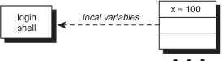

图 10.1   `x=100` 的登录 shell

当你调用 `vartest2` 时，你的 shell 会启动一个子shell 来运行它，并给它一个最初为*空*的局部变量列表（见图 10.2）。

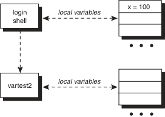

图 10.2  登录 shell 执行 `vartest2`

在 `vartest2` 的第一条命令执行之后，子shell 环境中的局部变量 `x` 被赋值为 50（见图 10.3），但父 shell 中 `x` 的值保持不变。

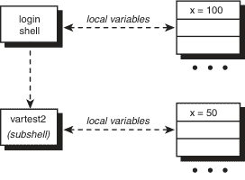

图 10.3  `vartest2` 执行 `x=50`

当 `vartest2` 执行完毕，子shell 连同程序赋值的所有变量一起消失。

这个问题其实没有看起来那么严重。你只需要理解：登录 shell 的环境与子shell 及其 shell 程序的环境是非常不同的。

## 导出变量

有一种方法可以让子shell 知道变量的值，那就是使用 `export` 命令将其导出。这个命令的格式很简单：

### `export -p`

其中 *variables* 是你想要导出的变量名列表。对于在 `export` 命令之后执行的任何子shell，导出变量的值都会被传递给该子shell。

下面是一个名为 `vartest3` 的程序，用来说明局部变量与导出变量之间的区别：

```sh
$ cat vartest3
echo x = $x
echo y = $y
$
```

在登录 shell 中为变量 `x` 和 `y` 赋值，然后运行 `vartest3`：

```sh
$ x=100
$ y=10
$ vartest3
x =
y =
$
```

`x` 和 `y` 都是局部变量，因此它们的值不会传递给运行 `vartest3` 的子shell。这是预期之中的。

但现在让我们导出变量 `y`，再试一次这个程序：

```sh
$ export y
$ vartest3
x =
y = 10
$
```

*让子shell 知道 `y`*

这一次，`vartest3` 知道了 `y`，因为它是一个导出变量。

从概念上讲，每当执行一个子shell 时，导出变量会被“向下复制”到子shell，而局部变量则不会（见图 10.4）。

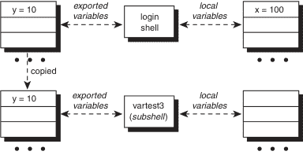

图 10.4  执行 `vartest3`

现在是另一个问题：如果子shell 改变了导出变量的值，你认为会发生什么？也就是说，子shell 运行结束后，父 shell 会知道这个变化吗？

为了回答这个问题，下面是一个名为 `vartest4` 的程序：

```sh
$ cat vartest4
x=50
y=5
$
```

我们假设你没有改变 `x` 和 `y` 的值，并且 `y` 仍是前一个例子中导出的变量。

```sh
$ vartest4
$ echo $x $y
100 10
$
```

子shell 既无法改变局部变量 `x` 的值（毫不意外！），也无法改变导出变量 `y` 的值；它只是改变了子shell 在自身执行时实例化的 `y` 的本地副本（见图 10.5）。与局部变量一样，当子shell 消失时，导出变量的值也随之消失。事实上，它们一旦到达子shell，就成了局部变量。

> 这就是为什么会有这样的结论：*无法从子shell 内部改变父 shell 中变量的值。*

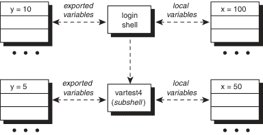

图 10.5  执行 `vartest4`

当一个 shell 程序调用另一个 shell 程序（例如 `rolo` 程序调用 `l` 程序）时，这个过程会重复：子shell 中的导出变量会被复制到新的子shell。这些导出变量可能来自登录 shell 的导出，也可能是在子shell 内部新增导出的。

> *变量导出后，对所有随后执行的子shell 来说，它仍然是导出的。*

考虑 `vartest4` 的一个修改版本：

```sh
$ cat vartest4
x=50
y=5
z=1
export z
vartest5
$
```

以及 `vartest5`：

```sh
$ cat vartest5
echo x = $x
echo y = $y
echo z = $z
$
```

当 `vartest4` 执行时，导出变量 `y` 会被复制到子shell 的环境中。`vartest4` 将 `x` 的值设为 50，将 `y` 的值改为 5，并将 `z` 的值设为 1。然后它导出 `z`，使 `z` 的值对任何后续子shell 都是可用的。

`vartest5` 就是这样一个子shell；当它执行时，shell 会将来自 `vartest4` 的导出变量 `y` 和 `z` 复制到它的环境中。

这解释了下面的输出：

```sh
$ vartest4
x =
y = 5
z = 1
$
```

整个过程如图 10.6 所示。

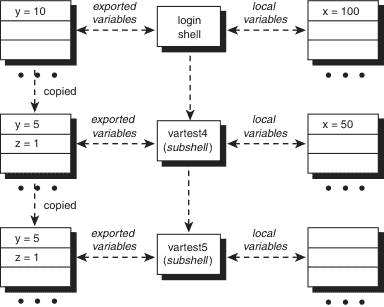

总结局部变量和导出变量的工作方式：

- 任何未导出的变量都是局部变量，子shell 不会知道它的存在。
- 导出变量及其值会被复制到子shell 的环境中，在那里可以被访问和修改。然而，这类修改对父 shell 中的变量没有任何影响。
- 导出变量不仅对直接派生的子shell 保留这一特性，而且对由这些子shell 再派生的子shell（如此层层向下）也同样有效。
- 变量可以在赋值前或赋值后的任何时间导出，但它取的是导出那一刻的值；之后发生的更改不会被跟踪。

### `export -p`

如果你输入 `export -p`，会得到你的 shell 导出的变量及其值的列表：

```sh
$ export -p
export LOGNAME=steve
export PATH=/bin:/usr/bin:.
export TIMEOUT=600
export TZ=EST5EDT
export y=10
$
```

另外，这里有一段来自前文的代码示例，它出现在讨论 `printf` 用途的章节之后：


```text
cat $*
while read number1 number2
do
        printf "%12d %12d\n" $number1 $number2
done
$ cat data
1234 7960
593 -595
395 304
3234 999
-394 -493
$ align data
             1234        7960
              593        -595
              395         304
             3234         999
             -394        -493
$
```

在第 11、13 和 14 章中，你还会看到更多 `printf` 不同用途的示例。

如你所见，在典型的登录 shell 中实际上有很多已导出的变量。在 Mac 上，`export -p` 会生成一个包含 22 个变量的列表。请注意，在我们之前进行 `export` 实验时展示的示例中，也包含了你登录并启动登录 shell 时导出的其他变量。

## PS1 与 PS2

shell 用作命令提示符的字符序列存储在环境变量 `PS1` 中。实际上，你可以把它改成任何你想要的字符串，而且一旦修改，shell 从那时起就会使用新值。

```
$ echo :$PS1:
$: $
$ PS1="==> "
==> pwd
/users/steve
==> PS1="I await your next command, master: "
I await your next command, master: PS1="$ "
$
```

恢复正常

当一条命令需要多行输入时，shell 使用的次级命令提示符默认为 `>`，它保存在变量 `PS2` 中。你也可以随心所欲地更改它：

```
$ echo :$PS2:
:>
$ PS2="=======> "
$ for x in 1 2 3
=======> do
=======> echo $x
=======> done
1
2
3
$
```

一旦注销系统，所有这些更改都会消失，就像修改任何其他 shell 变量一样。如果你更改了 `PS1`，shell 会在本次登录会话的剩余时间内使用新值。不过，下次登录时，你会看到旧提示符，除非你把新的 `PS1` 值保存到 `.profile` 文件中（本章稍后会讨论）。

> **提示**
>
> `PS1` 提示符有一套自己的语言，其中的特殊序列可以显示命令编号、当前目录、当前时间以及更多信息。请阅读 Bash 或 Sh 手册页中的“Prompting”一节来了解它！

## HOME

主目录（home directory）是你每次登录系统时所处的位置。一个名为 `HOME` 的特殊 shell 变量也会在你登录时自动被设置为该目录：

```
$ echo $HOME
/users/steve
$
```

你的程序可以使用这个变量来识别你的主目录，Unix 中的其他程序也广泛地用它来实现这一目的。当你不带参数输入 `cd` 时，`cd` 命令也会把它作为想去的目的地：

```
$ pwd                         *Where am I?*
/usr/src/lib/libc/port/stdio
$ cd
$ pwd
/users/steve                  *There’s no place like home*
$
```

你可以把 `HOME` 变量改成任何你想要的值，但要注意，这样做可能会影响依赖它的程序的运行：

```
$ HOME=/users/steve/book       *Change it*
$ pwd
/users/steve
$ cd
$ pwd                         *See what happened*
/users/steve/book
$
```

你可以更改 `HOME`，但除非你准备好让很多事情很快变得不正常，否则真的不应该改。

## PATH

让我们回到第 9 章中的 `rolo` 程序：

```
$ rolo Liz
Liz Stachiw     212-775-2298
$
```

为了保持整洁有序，该程序被创建在 `steve` 的 `/bin` 子目录中，如下所示：

```
$ pwd
/users/steve/bin
$
```

将当前目录切换到系统上的任何其他位置：

```
$ cd                                      *Go home*
$
```

然后尝试在电话簿中查找 Liz：

```
$ rolo Liz
sh: rolo: not found
$
```

哎呀，这可不太好。发生了什么？

每当你输入程序名称时，shell 会搜索一个目录列表，直到找到所请求的程序。找到后，程序就会被启动。这个用于搜索用户命令的目录列表存储在一个名为 `PATH` 的 shell 变量中，并在你登录时自动设置。要随时查看它的值，可以使用 `echo`：

```
$ echo $PATH
/bin:/usr/bin:.
$
```

你的 `PATH` 很可能有一些不同的值，但不用担心——这只是系统配置的差异。需要注意的重要一点是，目录之间用冒号（`:`）分隔，shell 会按从左到右的顺序搜索它们，以找到请求的命令或程序。

在前面的示例中，列出了三个目录：`/bin`、`/usr/bin` 和 `.`（你回忆一下，它代表当前目录）。因此，每当你输入程序名称时，shell 会搜索 `PATH` 中列出的目录，直到找到匹配的可执行文件。输入 `rolo` 时，shell 会先查找 `/bin/rolo`，然后查找 `/usr/bin/rolo`，最后在当前目录中查找 `./rolo`。一旦找到匹配项，shell 就会执行它；但如果 shell 在 `PATH` 指定的所有目录中都没有找到 `rolo`，它就会发出“not found”错误。

若要让当前目录最先被搜索，就把句点放在 `PATH` 的开头：

```
.:/bin:/usr/bin
```

警告！出于安全原因，最好不要让当前目录先于系统目录被搜索。

这是为了避免特洛伊木马攻击：设想有人在一个目录中创建了自己版本的命令（如 `su`，它通过提示输入管理员密码来允许你切换到 root 或超级用户状态），然后等待另一个用户切换到该目录并运行命令。如果 `PATH` 指定先搜索当前目录，那么被修改过的 `su` 就会被执行。问题在于，这个版本会提示输入密码，将密码发送给恶意用户，删除自身，然后打印出一条无害的错误消息。再次调用时，重新输入密码，一切正常，而管理员账户就这样被攻破了，用户却浑然不觉！很阴险，对吧？

用于指定当前目录的句点 `.` 是可选的，但作为可见提醒很有用。例如，`PATH` 为

```
:/bin:/usr/bin
```

与之前的写法等价；不过，在本书中，为清晰起见，我们会用句点来指定当前目录。

现在担心特洛伊木马了吗？别怕，你总是可以通过指定要执行的程序的显式路径，来覆盖 `PATH` 指定的搜索。例如，如果你输入

```
/bin/date
```

shell 会直接到 `/bin` 执行 `date`。这种情况下 `PATH` 会被忽略，你输入

```
../bin/lu
```

或

```
./rolo
```

时也是如此。最后一种情况表示执行当前目录中的 `rolo` 程序，它在开发 shell 程序时很常用，因为它让程序员可以不必在 `PATH` 中包含 `.`。

现在你明白为什么无法从你的主目录执行 `rolo` 了：`/users/steve/bin` 不在 `PATH` 中，所以 shell 找不到 `rolo`。解决起来很简单：你只需把这个目录添加到 `PATH` 中：

```
$ PATH=/bin:/usr/bin:/users/steve/bin:.
$
```

现在，无论你在文件系统中的当前目录是什么，`/users/steve/bin` 中的任何程序都可以执行了：

```
$ pwd
/users/steve
$ rolo Liz
grep: can't open phonebook
$
```

*我在哪里？*

糟糕。shell 找到了 `rolo` 并正确执行了它，但 `grep` 命令找不到 `phonebook` 数据文件。

更仔细地看看 `rolo` 程序，你会明白这条 `grep` 错误信息一定来自 `lu`。下面是 `lu` 当前的样子：

```
$ cat /users/steve/bin/lu
#
# Look someone up in the phone book -- version 3
#
    if [ "$#" -ne 1 ]
    then
            echo "Incorrect number of arguments"
            echo "Usage: lu name"
            exit 1

    fi

    grep "$name" phonebook
    $
```

`grep` 正试图在当前目录（`/users/steve`）中打开 `phonebook` 文件，而问题就在这里：程序被执行的位置与程序和它的数据文件所在目录没有任何关系。


`PATH` 只指定了在命令行上调用的程序要搜索的目录，而不包括任何其他类型的文件。因此，为了让 `lu` 更有用，必须精确定位 `phonebook`。

有几种方法可以解决这个问题，`rem` 和 `add` 程序也存在同样的问题。一种方法是让 `lu` 程序在调用 `grep` 之前将目录切换到 `/users/steve/bin`。这样，`grep` 就能找到 `phonebook`，因为它存在于新的当前目录中：

```
...
cd /users/steve/bin
grep "$1" phonebook
```

当你在某个特定目录中需要处理大量不同文件时，这是一个好方法。只需先 `cd` 到该目录，然后就可以直接引用你需要的所有文件。

第二种更常见的方法是在 `grep` 命令中写出 `phonebook` 的完整路径：

```
grep "$1" /users/steve/bin/phonebook
```

### 多用户共享

假设你想让其他人也能使用你的 `rolo` 程序（以及相关的 `lu`、`add`、`rem` 辅助程序）。你可以给他们每人一份副本，但那样系统上会有多份副本；如果你做了一点小改动，怎么办？你还要更新他们所有的副本吗？太繁琐了。

更好的解决方案是只保留一份 `rolo` 副本，但让其他用户能够访问它。

此时问题应该很明显了：如果你把所有 `phonebook` 的引用都改成显式引用你的电话簿，那么其他人也都会使用你的电话簿。更聪明的解决方法是要求每个人在自己的主目录中都有一个 `phonebook` 文件，并将该文件引用为 `$HOME/phonebook`。

按照一个非常常见的 `shell` 编程惯例，在 `rolo` 内部定义一个名为 `PHONEBOOK` 的变量，并将其设置为多用户友好的值 `$HOME/phonebook`。如果你导出这个变量，`lu`、`rem` 和 `add`（它们由 `rolo` 作为子 `shell` 执行）也可以使用 `PHONEBOOK` 的值来引用各用户自己的文件版本。

这种方法的一个优点是，如果你改变了电话簿文件的位置，只需要修改 `rolo` 中的这一个变量；其他三个程序将继续正常工作，不会出错。

### 新的程序实现

基于这一点，下面是新的 `rolo` 程序，以及修改后的 `lu`、`add` 和 `rem` 程序。

```sh
$ cd /users/steve/bin
$ cat rolo
#
# rolo - rolodex program to look up, add, and
#        remove people from the phone book
#
#
# Set PHONEBOOK to point to the phone book file
# and export it so other programs know about it
#
PHONEBOOK=$HOME/phonebook
export PHONEBOOK

if [ ! -f "$PHONEBOOK" ] ; then
        echo "No phone book file in $HOME!"
        exit 1
fi

#
# If arguments are supplied, then do a lookup
#

if [ "$#" -ne 0 ] ; then
        lu "$@"
        exit
fi
validchoice=""          # set it null

#
# Loop until a valid selection is made
#

until [ -n "$validchoice" ]
do
        #
        # Display menu
        #
        echo "
Would you like to:

 1. Look someone up
 2. Add someone to the phone book
 3. Remove someone from the phone book

Please select one of the above (1-3): \c"

        #
        # Read and process selection
        #

        read choice
        echo

        case "$choice"
        in
                1) echo "Enter name to look up: \c"
                   read name
                   grep -i "$name" $PHONEBOOK
                   validchoice=TRUE;;
                2) echo "Enter name to be added: \c"
                   read name
                   echo "Enter number: \c"
                   read number
                   add "$name" "$number"
                   validchoice=TRUE;;
                3) echo "Enter name to be removed: \c"
                   read name
                   rem "$name"
                   validchoice=TRUE;;
                *) echo "Bad choice";;
        esac
done
$ cat add
#
# Program to add someone to the phone book file
#

if [ "$#" -ne 2 ]; then
       echo "Incorrect number of arguments"
       echo "Usage: add name number"
       exit 1
fi

echo "$1       $2" >> $PHONEBOOK
sort -o $PHONEBOOK $PHONEBOOK
$ cat lu
#
# Look someone up in the phone book
#

if [ "$#" -ne 1 ] ; then
        echo "Incorrect number of arguments"
        echo "Usage: lu name"
        exit 1
fi

name=$1
grep "$name" $PHONEBOOK

if [ $? -ne 0 ] ; then
        echo "I couldn't find $name in the phone book"
fi
$ cat rem
#
# Remove someone from the phone book
#

if [ "$#" -ne 1 ] ; then
        echo "Incorrect number of arguments"
        echo "Usage: rem name"
        exit 1
fi

name=$1

#
# Find number of matching entries
#

matches=$(grep "$name" $PHONEBOOK | wc -l)

#
# If more than one match, issue message, else remove it
#

if [ "$matches" -gt 1 ] ; then
        echo "More than one match; please qualify further"
elif [ "$matches" -eq 1 ] ; then
        grep -v "$name" $PHONEBOOK > /tmp/phonebook$$
        mv /tmp/phonebook$$ $PHONEBOOK
else
        echo "I couldn't find $name in the phone book"

fi
$
```

注意，我们还做了一点小改进：为了让程序更好用，在 `lu` 的末尾增加了一项检查，用来查看 `grep` 是否成功；现在，如果搜索没有找到任何结果，就会显示一条失败信息。

### 测试

```sh
$ cd
$ rolo Liz
No phone book file in /users/steve!
$ mv /users/steve/bin/phonebook .
$ rolo Liz
Liz Stachiw    212-775-2298
$ rolo
```

*返回主目录*

*快速查找*

*忘了移动它*

*再试一次*

*尝试菜单选择*


```sh
Would you like to:

1. Look someone up
2. Add someone to the phone book
3. Remove someone from the phone book

Please select one of the above (1-3): 2

Enter name to be added: Teri Zak
Enter number: 201-393-6000
$ rolo Teri
Teri Zak       201-393-6000
$
```

`rolo`、`lu` 和 `add` 都工作正常。`rem` 也应该测试一下，确保它也没问题。

如果你仍想单独运行 `lu`、`rem` 或 `add`，也可以，前提是你先定义 `PHONEBOOK` 并导出它：

```sh
$ PHONEBOOK=$HOME/phonebook
$ export PHONEBOOK
$ lu Harmon
I couldn't find Harmon in the phone book
$
```

如果你确实打算单独运行这些程序，最好在各个程序中加入检查，以确保 `PHONEBOOK` 被设置为正确的值。

## 当前目录

你的当前目录也是 shell 环境的一部分。来看一下这个名为 `cdtest` 的小型 shell 程序：

```sh
$ cat cdtest
cd /users/steve/bin
pwd
$
```

该程序使用 `cd` 切到 `/users/steve/bin`，然后调用 `pwd` 来确认切换是否生效。我们来运行它：

```sh
$ pwd
/users/steve
$ cdtest
/users/steve/bin
$
```

*弄清我的位置*

现在，到了那个价值 64,000 美元的问题：执行 `pwd` 后，你会在 `/users/steve` 还是 `/users/steve/bin`？

```sh
$ pwd
/users/steve
$
```

事实证明，`cdtest` 中的 `cd` 并不会影响你的当前目录。由于当前目录属于环境的一部分，当 `cd` 在子 shell 中执行时，它只会影响该子 shell 的目录。*子 shell 无法改变父 shell 的当前目录。*

执行 `cd` 时，它会改变你的当前目录，同时也会将 `PWD` 变量设置为新当前目录的完整路径名。因此，命令 `echo $PWD` 的输出与 `pwd` 命令相同：

```sh
$ pwd
/users/steve
$ echo $PWD
/users/steve
$ cd bin
$ echo $PWD
/users/steve/bin
$
```

`cd` 还会把 `OLDPWD` 设置为先前当前目录的完整路径名，这在某些情况下也很有用。

## CDPATH

`CDPATH` 变量的工作方式与 `PATH` 变量类似：它指定了一个目录列表，每当你执行 `cd` 命令时，shell 都会在这些目录中搜索目标。只有当指定目录不是以完整路径名给出，并且 `CDPATH` 不为空时，才会进行这种搜索。如果你输入 `cd /users/steve`，shell 会直接将你的目录切换到 `/users/steve`；但如果你输入 `cd memos`，shell 会查看你的 `CDPATH` 变量来找到 memos 目录。如果 `CDPATH` 看起来像这样：

```sh
$ echo $CDPATH
.:/users/steve:/users/steve/docs
$
```

shell 会先在当前目录中查找 memos 目录；如果没有找到，再到 `/users/steve` 中查找；如果还是没有，最后会作最后的努力，尝试在 `/users/steve/docs` 中查找该目录。如果找到的目录并不是相对于当前目录的，`cd` 命令会打印该目录的完整路径，好让你知道它把你带到了哪里：

```sh
$ cd /users/steve
$ cd memos
/users/steve/docs/memos
$ cd bin
/users/steve/bin
$ pwd
/users/steve/bin
$
```

与 `PATH` 变量一样，是否使用点号来表示当前目录是可选的，因此 `:/users/steve:/users/steve/docs` 等价于 `.:/users/steve:/users/steve/docs`。

明智地使用 `CDPATH` 变量可以节省大量输入，尤其是当你的目录层级相当深，并且你经常需要在其中切换时（或者你也经常需要进入其他目录层级结构）。

与 `PATH` 不同，你可能会希望把当前目录放在 `CDPATH` 列表的第一位。这样使用起来最自然；如果当前目录不在列表中的第一位，你最终可能会进入一个意想不到的目录！

哦，还有一件事：登录时 `CDPATH` 不会自动设置；你需要显式地把它设置为你希望 shell 在搜索指定名称时使用的目录序列。

## 关于子 shell 的更多内容

你已经知道，子 shell 既不能改变父 shell 中变量的值，也不能改变其当前目录。假设你想编写一个程序，为一些你希望在每次登录时使用的变量设置值。例如，假设你有下面这个名为 `vars` 的文件：

```sh
$ cat vars
BOOK=/users/steve/book
VUPUB=/usr/spool/uucppublic
DOCS=/users/steve/docs/memos
DB=/usr2/data
$
```

如果运行 `vars`，这些变量被赋的值在程序执行完毕后基本上都会消失，因为 `vars` 是在子 shell 中运行的：

```sh
$ vars
$ echo $BOOK

$
```

这并不奇怪。

### . 命令

为了解决这个难题，shell 中有一个内建命令叫 `.`（读作“点”），它的通用格式是

```sh
. file
```

它的作用是在当前 shell 中执行 `file` 的内容。也就是说，`file` 中的命令会像你直接输入一样由当前 shell 执行，而不是在子 shell 中执行。shell 会像执行其他程序时一样，使用 `PATH` 变量来查找 `file`。

```sh
$ . vars        # Execute vars in the current shell
$ echo $BOOK    # Hoorah!
/users/steve/book
$
```

由于执行该程序时不会创建子 shell，因此即使程序执行完毕，任何被赋值的变量也都会保留。

如果你有一个名为 `db` 的程序，包含以下命令：

```sh
$ cat db
DATA=/usr2/data
RPTS=$DATA/rpts
BIN=$DATA/bin

cd $DATA
$
```

使用“点”命令执行 `db` 会做一些有趣的事情：

```sh
$ pwd
/users/steve
$ . db
$
```

这次 shell 程序在当前 shell 中定义了 `DATA`、`RPTS` 和 `BIN` 三个变量，并切换到 `$DATA` 目录。

```sh
$ pwd
/usr2/data
$
```

如果你在多个项目上工作，可以创建像 `db` 这样的程序，根据需要定制你的环境。在该程序中，你还可以包含其他变量的定义、更改提示符等等。例如，你可能想把 `PS1` 提示符改为 `DB`——以便让你知道你的数据库变量已经设置好。你也可以改变 `PATH`，使其包含一个存放与数据库相关程序的目录；还可以改变 `CDPATH`，以便用 `cd` 命令轻松访问相关目录。

另一方面，如果你做了这类更改，你可能希望在子 shell 中而不是当前 shell 中执行 `db`，因为如果在当前 shell 中执行，完成工作后所有修改过的变量都会残留下来。

最好的解决方案是从子 shell 内部启动一个新 shell，所有修改过的变量和更新的环境设置都会保留。然后，当你完成工作后，可以按 `Ctrl+d` “注销”这个新 shell。

让我们通过一个新版本的 `db` 来看看这是如何工作的：

```sh
$ cat db
#
# Set up and export variables related to the data base
#

HOME=/usr2/data
BIN=$HOME/bin
RPTS=$HOME/rpts
DATA=$HOME/rawdata

PATH=$PATH:$BIN
CDPATH=$HOME:$RPTS

PS1="DB: "

export HOME BIN RPTS DATA PATH CDPATH PS1

#
# Start up a new shell
#

/bin/sh
$
```

`HOME` 目录设置为 `/usr2/data`，然后变量 `BIN`、`RPTS` 和 `DATA` 相对于这个 `HOME` 定义（这是一个好主意，万一你必须把目录结构移动到其他地方：你只需要修改程序中的 `HOME` 变量）。

接下来，`PATH` 被修改为包含数据库的 `bin` 目录，`CDPATH` 变量被设置为搜索当前目录、`HOME` 目录和 `RPTS` 目录（其中大概包含一些子目录）。


导出这些变量后，就会调用标准 shell `/bin/sh`。从那时起，这个新 shell 处理用户输入的任何命令，直到用户输入 `exit` 或使用 `Ctrl-d` 组合键。退出后，控制权返回 `db`，`db` 再将控制权返回给你的登录 shell。

```text
$ db
DB: echo $HOME
/usr2/data
DB: cd rpts
/usr2/data/rpts
DB: ps
PID TTY TIME COMMAND
123 13 0:40 sh
761 13 0:01 sh
765 13 0:01 sh
769 13 0:03 ps
DB: exit
$ echo $HOME
/usr/etc/steve
$
```

- *运行它*
- *试试 CDPATH*
- *有效*
- *查看正在运行的进程*
- *你的登录 shell*
- *运行 db 的子 shell*
- *从 db 运行的新 shell*
- *暂时完成*
- *恢复正常*

图 10.7 描绘了 `db` 的执行过程（为了简洁，我们只显示了感兴趣的导出变量，而不是环境中存在的所有变量）。

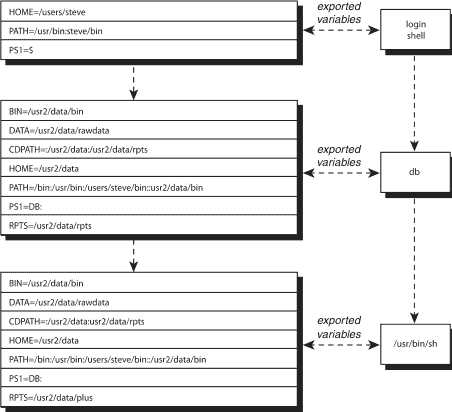

图 10.7   执行 db

## `exec` 命令

在 `db` 程序中，一旦那个 shell 进程执行完毕，整个工作也就结束了，这一点从程序里 `/bin/sh` 后面没有跟随任何命令可以看出。与其让 `db` 等待子 shell 结束，你可以使用 `exec` 命令将当前程序（`db`）替换为新程序（`/bin/sh`）。

`exec` 的一般格式是

```sh
exec program
```

因为被 `exec` 的程序替换了当前程序，所以会少一个残留的进程，这有助于系统快速运行。由于 Unix 系统执行进程的方式，被 `exec` 的程序的启动时间也会更快。

要在 `db` 程序中使用 `exec`，只需将最后一行替换为

```sh
exec /bin/sh
```

这条语句执行后，`db` 将被 `/bin/sh` 替换。这意味着在 `exec` 之后再加任何命令都没有意义，因为它们永远不会被执行。

`exec` 还可以用来关闭标准输入，并用你想读取的任何文件重新打开它。例如，要将标准输入改为 `infile`，可以使用如下形式的 `exec` 命令：

```sh
exec < infile
```

任何后续从标准输入读取数据的命令都将从 `infile` 读取。

标准输出的重定向也类似。命令

```sh
exec > report
```

将所有后续写入标准输出的输出重定向到文件 `report`。请注意，在前两个示例中，`exec` 都不是用来启动一个新程序的执行，而只是用来重新分配标准输入或标准输出。

如果你使用 `exec` 重新分配标准输入，之后又想将其重新分配到其他地方，你可以再次调用 `exec`。要将标准输入重新分配回终端，你可以写：

```sh
exec < /dev/tty
```

同样的概念也适用于标准输出的重新分配。

## `(…)` 和 `{ …; }` 结构

有时你会想把一组命令组合在一起。例如，你可能想把一个 `sort` 命令后跟你的 `plotdata` 程序推入后台。并不是用管道连接；只是两条命令一前一后。

事实证明，你可以将一组命令放在圆括号或花括号中来组合它们。第一种形式会让命令在子 shell 中执行，第二种形式则会在当前 shell 中执行。

下面是一些示例，用来说明它们的工作方式：

```text
$ x=50
$ (x=100)                              Execute this in a subshell
$ echo $x
50                                     Didn't change
$ { x=100; }                           Execute this in the current shell
$ echo $x
100
$ pwd
/users/steve                           Where am I?
$ (cd bin; ls)                         Change to bin and do an ls
add
greetings
lu
number
phonebook
rem
rolo
$ pwd
/users/steve                           No change
$ { cd bin; }                          This should change me
$ pwd
/users/steve/bin
$
```

如果放在花括号中的命令都要写在同一行，左花括号后必须有一个空格，并且命令后必须有分号。仔细观察上面的语句——`{ cd bin; }`——就是一个例子。

圆括号的工作方式不同。正如示例 `(cd bin; ls)` 所示，圆括号对于在不影响当前环境的情况下执行命令非常有用。

你还可以将它们用于其他目的，例如将一组命令推入后台：

```sh
$ (sort 2016data -o 2016data; plotdata 2016data) &
[1]   3421
$
```

圆括号将 `sort` 和 `plotdata` 命令组合在一起，这样它们就能在保持执行顺序的同时被送到后台。

输入和输出也可以与这些结构进行管道连接，I/O 也可以重定向，这使得它们对 shell 程序员来说非常有用。

在下一个示例中，一个以点开头的 `nroff` 命令——`.ls 2`——会在发送给 `nroff` 处理之前被有效地添加到文件 `memo` 的开头。

```sh
$ { echo ".ls 2"; cat memo; } | nroff -Tlp | lp
```

在命令序列

```sh
$ { prog1; prog2; prog3; } 2> errors
```

中，三个程序写入标准错误的所有消息都会被收集到文件 `errors` 中。

作为最后一个示例，让我们回到第 8 章的 `waitfor` 程序。你应当记得，这个程序会定期检查是否有用户登录系统。你还记得，如果程序能以某种方式自动“发送自身”到后台就好了。现在你知道怎么做了：只需将 `until` 循环及其后面的命令放在圆括号中，并将整个组合发送到后台：

```sh
$ cat waitfor
#
# Wait until a specified user logs on -- version 4
#
# Set up default values
mailopt=FALSE
interval=60

# process command options

while getopts mt: option
do
        case "$option"
        in
                m)      mailopt=TRUE;;
                t)      interval=$OPTARG;;
                \?)     echo "Usage: mon [-m] [-t n] user"
                        echo "-m means to be informed by mail"
                        echo "-t means check every n secs."
                        exit 1;;
        esac
done

# Make sure a user name was specified

if [ "$OPTIND" -gt "$#" ] ; then
        echo "Missing user name"
        exit 2
fi

shiftcount=$(($OPTIND - 1))
shift $shiftcount
user=$1

#
# Send everything that follows into the background
#

(
        #
        # Check for user logging on
        #

        until who | grep "^$user" > /dev/null
        do
                sleep $interval
        done

        #
        # When we reach this point, the user has logged on
        #
```

```sh
if [ "$mailopt" = FALSE ] ; then
    echo "$user has logged on"
else
    runner=$(who am i | cut -c1-8)
    echo "$user has logged on" | mail $runner
fi
) &
$ 
```


整个程序本来可以用圆括号括起来，但我们决定在将程序放入后台之前先完成参数检查和解析。

```sh
$ waitfor fred
$
...
fred has logged on
```

*提示符会返回，这样你可以继续工作*

请注意，在 shell 程序中将命令发送到后台时，shell 不会打印进程 ID。

## 向子 shell 传递变量的另一种方法

如果要将变量的值传递给子 shell，除了导出变量之外，还有另一种方法。在命令行中，在命令前面加上一个或多个变量的赋值。例如，

```sh
DBHOME=/uxn2/data DBID=452 dbrun
```

这将变量 `DBHOME` 和 `DBID` 及其指定的值放入 `dbrun` 的环境中，然后执行 `dbrun`。然而，当前 shell 不会知道这些变量，因为它们只是为了执行 `dbrun` 而创建的。

事实上，上述命令与键入以下内容的行为完全相同：

```sh
(DBHOME=/uxn2/data; DBID=452; export DBHOME DBID; dbrun)
```

下面是一个简短的示例：

```sh
$ cat foo1
echo $x:
foo2
$ cat foo2
echo :$x:
$ foo1
::
$ x=100 foo1
:100
:100
$ echo :$x:
::
$
```

*`foo1` 或 `foo2` 不知道 `x`*

*试试这种方式*

*`foo1` 知道 `x`*

*它的子 shell 也知道*

*当前 shell 仍然不知道*

以这种方式定义的变量，在其他方面对子 shell 的行为与普通导出变量一样，但一旦该行代码执行完毕，它们对调用 shell 来说就不存在了。

## 你的 `.profile` 文件

在第 2 章中，你了解了在 shell 显示命令提示符、准备让你输入第一条命令之前所完成的登录过程。在提示符出现之前，登录 shell 会在系统中查找并读取两个特殊文件。

第一个是 `/etc/profile`，由系统管理员设置。它通常会检查你是否有邮件（“You have mail”消息就来自这里），设置你的默认文件创建掩码（你的 `umask`），建立默认的 `PATH`，以及管理员希望在用户登录时发生的任何其他事情。

更有趣的是，第二个被自动执行的文件是你主目录下的 `.profile`。大多数 Unix 系统在创建帐户时会设置一个默认的 `.profile` 文件，所以让我们先来看看它的内容：

```sh
$ cat $HOME/.profile
PATH="/bin:/usr/bin:/usr/local/bin:."
export PATH
$
```

这是一个相当朴素的 `.profile`，只是设置 `PATH` 并导出它。

你可以修改你的 `.profile` 文件，加入任何你希望在每次登录时执行的命令，包括指定你从哪个目录开始、检查谁已登录，以及安装你喜欢的任何系统别名。你甚至可以在 `.profile` 中放入命令，覆盖 `/etc/profile` 中建立的设置（通常是环境变量）。

既然我们说过你可以在 `.profile` 中更改当前工作目录，那么登录 shell 实际上执行这些文件时，就好比你键入了以下内容，这也就不足为奇了：

```sh
$ . /etc/profile
$ . .profile
$
```

就在你登录后。这也意味着你在 `.profile` 中对环境所做的更改会一直保留，直到你从 shell 注销。

大多数 Unix 用户都会摆弄他们的 `.profile`，以改变命令行环境的许多方面。例如，下面是一个示例 `.profile`，它设置 `PATH` 以包含你自己的 bin，设置 `CDPATH`，更改主命令提示符和辅助命令提示符，使用 `stty` 命令将删除字符更改为退格键（Ctrl+h），并使用第 7 章中的 `greetings` 程序打印一条友好的消息：

```sh
$ cat $HOME/.profile
PATH="/bin:/usr/bin:/usr/local/bin:$HOME/bin:."
CDPATH=.:$HOME:$HOME/misc:$HOME/documents

PS1="> "
PS2="====> "

export PATH CDPATH PS1 PS2

stty echoe erase CTRL-h

echo
greetings
$
```

使用这个 `.profile` 时，登录序列如下所示：

```
login: steve
Password:

Good morning                    Output from greetings
>                              New PS1
```

### TERM 变量

尽管 Unix 中的许多程序都是基于命令行的（如 `ls` 和 `echo`），但也有许多全屏命令（如 `vi` 编辑器）需要详细了解你的终端设置和功能。保存这些信息的环境变量是 `TERM`，通常你无需担心：你的终端或 SSH 程序通常会自动将其设置为最优值，以便一切无缝工作。

然而，一些老派用户可能会发现，为了让全屏程序正常运行，`TERM` 需要设置为特定值，如 `ansi`、`vt100` 或 `xterm`。在这种情况下，建议在 `.profile` 中设置该值。

你甚至可以在登录序列期间提示输入 `TERM` 值，方法是在 `.profile` 中包含一个简单的代码块，如下所示：

```sh
echo "What terminal are you using (xterm is the default)? \c"
read TERM
if [ -z "$TERM" ]
then
        TERM=xterm

fi
export TERM
```

根据输入的终端类型，你可能还想做一些事情，比如设置终端上的功能键或制表位。

即使你总是使用相同的终端类型，也应该在 `.profile` 文件中设置 `TERM` 变量。

有趣的是，Mac OS X 和 Ubuntu Linux 用户会发现 Terminal 程序的 TERM 类型是 `xterm-256color`，而 Solaris Unix 用户的默认 `TERM` 是 `vt100`。许多第三方 `telnet`/`SSH`（终端）程序使用 `ansi` 作为其 `TERM` 值。

### TZ 变量

`TZ` 变量被 `date` 命令和一些标准 C 库函数用来确定当前时区。实际上，由于用户可以通过互联网远程登录，系统上的不同用户完全可能处于不同的时区。`TZ` 最简单的设置是一个由三个或更多字母组成的时区名称，后跟一个数字，该数字指定本地时间必须加上多少小时才能到达协调世界时，也称为格林尼治标准时间。这个数字可以是正数（本地时区位于 0 度经线以西）或负数（本地时区位于 0 度经线以东）。例如，东部标准时间可以指定为

```sh
TZ=EST5
```

`date` 命令根据这些信息计算正确的时间，并在必要时在其输出中使用时区名称：

```sh
$ TZ=EST5 date
Wed Feb 17 15:24:09 EST 2016
$ TZ=xyz date
Wed Feb 17 17:46:28 xyz 2016
$
```

数字后面可以跟第二个时区名称；如果指定了第二个名称，则假定采用夏令时（`date` 随后会在夏令时生效时自动调整时间），并假定夏令时比标准时间早一小时。如果夏令时时区名称后面跟有一个数字，则该数字用于以与前面描述的数字相同的方式，根据协调世界时计算夏令时。

最常见的是，你会看到时区指定为 `EST5EDT` 或 `MST7MDT`，不过由于世界上有些地区实际上不实行夏令时切换，当然也可以这样指定。

`TZ` 变量通常设置在 `/etc/profile` 文件或你的 `.profile` 文件中。如果未设置，则使用特定实现的默认时区，通常是协调世界时。

还要注意，在许多现代 Linux 系统上，可以通过指定地理区域来设置时区，因此

```sh
TZ="America/Tijuana" date
```

将显示墨西哥蒂华纳的当前时间。

## 关于参数的更多内容

在本章中，你将学习更多关于变量和参数的内容。从技术上讲，参数包括传递给程序的参数（*位置参数*）、特殊 shell 变量（如 `$#` 和 `$?`），以及普通变量，也称为*关键字参数*。

位置参数不能直接赋值，但可以使用 `set` 命令重新赋值。如你所知，变量赋值只需写

```sh
variable=value
```

实际上，这种格式比所示更通用一些，因为你可以使用以下格式一次赋值多个变量：

```sh
variable=value variable=value . . .
```

下面的示例说明了这一点：

```sh
$ x=100 y=200 z=50
$ echo $x $y $z
100 200 50
$
```

### 参数替换

在最简单的形式中，要让参数的值被替换，请在参数前加一个美元符号，如 `$1` 或 `$9`。

```sh
${parameter}
```

如果参数名后面的字符可能引起冲突，你可以将参数名括在花括号中，如下所示：

```sh
mv $file ${file}x
```


这个命令会在 `$file` 指定的文件名末尾加上一个 x。它不能写成

```
mv $file $filex
```

因为 shell 会尝试用名为 `filex` 的变量的值来替换第二个参数，而不是 `file` 加字母 `x`。

正如第 6 章所提到的，要访问 10 及以上的位置参数，你也必须使用相同的表示格式将数字括在花括号中：`${11}`。

但事实证明，一旦你用花括号将变量名括起来，你还能做更多事情……

```
${parameter:-value}
```

这种结构的意思是：如果 *参数* 不为空，就使用它的值；否则，替换为 *值*。例如，在命令行中

```
echo Using editor ${EDITOR:-/bin/vi}
```

shell 会使用 `EDITOR` 的值（如果它不为空），否则使用 `/bin/vi`。它的效果与编写以下代码相同：

```
if [ -n "$EDITOR" ]
then
        echo Using editor $EDITOR
else
        echo Using editor /bin/vi
fi
```

命令行

```
${EDITOR:-/bin/ed} /tmp/edfile
```

会启动存储在变量 `EDITOR` 中的程序（通常是一个文本编辑器），如果 `EDITOR` 为空，则启动 `/bin/ed`。

需要注意的重要一点是，这不会改变变量的值，所以即使执行了上述语句，如果 `EDITOR` 一开始为空，它仍将保持为空值。

下面是这种结构的一个简单演示：

```sh
$ EDITOR=/bin/ed
$ echo ${EDITOR:-/bin/vi}
/bin/ed
$ EDITOR=                         # Set it null
$ echo ${EDITOR:-/bin/vi}
/bin/vi
$
```

## `${parameter:=value}`

这个版本与上一个类似，但如果 `parameter` 为空，不仅会使用 `value`，而且还会将其赋值给 `parameter`（注意结构中的 `=`）。但是，你不能用这种方式给位置参数赋值，因此这意味着 `parameter` 不能是数字。

这种结构的一个典型用途是测试一个已导出的变量是否已被设置，如果没有，则为其分配一个默认值：

```
${PHONEBOOK:=$HOME/phonebook}
```

它的意思是，如果 `PHONEBOOK` 已经有赋值，则保持不变；否则将其设置为 `$HOME/phonebook`。

请注意，前面的示例不能单独作为命令使用，因为执行替换后，shell 会尝试执行替换结果：

```sh
$ PHONEBOOK=
$ ${PHONEBOOK:=$HOME/phonebook}
sh: /users/steve/phonebook: cannot execute
$
```

要将这种结构作为独立命令使用，可以使用空命令。如果你编写

```
: ${PHONEBOOK:=$HOME/phonebook}
```

shell 仍然会进行替换（它会计算命令行的其余部分），但不会执行任何操作（即空命令）。

```sh
$ PHONEBOOK=
$ : ${PHONEBOOK:=$HOME/phonebook}    # See if it got assigned
$ echo $PHONEBOOK
/users/steve/phonebook
$ : ${PHONEBOOK:=foobar}             # Shouldn’t change
$ echo $PHONEBOOK
/users/steve/phonebook               # It didn’t
$
```

然而，同样常见的是，shell 程序会在条件或 `echo` 语句中首次引用变量时使用 `:=` 记号。效果相同，但不需要空命令。

## `${parameter:?value}`

如果 `parameter` 不为空，shell 会替换为其值；否则，shell 会将 `value` 写入标准错误，然后退出（不用担心——如果是在你的登录 shell 中执行，你不会被注销）。如果省略 `value`，shell 会写入默认错误消息：

```
prog: parameter: parameter null or not set
```

下面是一个例子：

```sh
$ PHONEBOOK=
$ : ${PHONEBOOK:?"No PHONEBOOK file"}
No PHONEBOOK file
$ : ${PHONEBOOK:?}
sh: PHONEBOOK: parameter null or not set
$
```

使用这种结构，你可以轻松检查程序所需的变量是否都已设置且不为空：

```sh
: ${TOOLS:?}  ${EXPTOOLS:?}  ${TOOLBIN:?}
```

## `${parameter:+value}`

如果 *参数* 不为空，则替换为 `value`；否则不替换任何内容。当然，它与 `-` 相反。

```sh
$ traceopt=T
$ echo options: ${traceopt:+"trace mode"}
options: trace mode
$ traceopt=
$ echo options: ${traceopt:+"trace mode"}
options:
$
```

本节中任何结构的 *值* 部分都可以是命令替换，因为它只在需要其值时才执行。这也会变得有点复杂。考虑以下示例：

```
WORKDIR=${DBDIR:-$(pwd)}
```

这里，如果 `DBDIR` 不为空，则将 `DBDIR` 的值赋给 `WORKDIR`；否则执行 `pwd` 命令，并将结果赋给 `WORKDIR`。`pwd` *仅当* `DBDIR` 为空时才执行。

## 模式匹配结构

POSIX shell 提供了四种执行模式匹配的参数替换结构。一些很老的 shell 不支持这个特性，但如果你使用的是现代 Unix、Linux 或 Mac 系统，你不太可能遇到这种情况。

该结构接受两个参数：变量名（或参数编号）和一个模式。shell 会在指定变量的内容中搜索与所提供的模式相匹配的部分。如果匹配，shell 会在命令行中使用该变量的值，并删除*与模式匹配的部分*。如果模式不匹配，则在命令行中使用变量的全部内容。在这两种情况下，变量的内容都保持不变。

这里使用术语 *模式*，是因为 shell 允许你使用与文件名替换和 case 值中相同的模式匹配字符：`*` 匹配零个或多个字符，`?` 匹配任意单个字符，`[...]` 匹配指定集合中的任意单个字符，`[!...]` 匹配不在指定集合中的任意单个字符。

当你编写结构

`${variable%pattern}`

时，shell 会查看 `variable` 的内容，看它是否以指定的 `pattern` 结尾。如果是，则使用 `variable` 的内容，并从右侧删除最短的匹配 `pattern`。

如果你使用结构

`${variable%%pattern}`

shell 会再次查看 `variable` 的内容，看它是否以 `pattern` 结尾。不过，这一次它会从右侧删除最长的匹配模式。只有当结构中使用 `*` 时，这才有意义。否则，`%` 和 `%%` 的行为相同。

`#` 以类似的方式使用，用于强制模式匹配从左侧而不是右侧开始。因此，结构

`${variable#pattern}`

告诉 shell 在命令行中使用 `variable` 的值，并从左侧删除 `pattern`。

最后，shell 结构

`${variable##pattern}`

的工作方式与 `#` 形式类似，不同之处在于从左侧删除最长的 `pattern` 匹配。

请记住，在所有四种情况下，都不会改变变量本身。你只影响命令行中使用的内容。另外，请记住，模式匹配是锚定的。对于 `%` 和 `%%` 结构，变量的值必须以指定模式结尾；对于 `#` 和 `##` 结构，变量必须以该模式开头。

下面是一些简单的例子，演示这些结构的工作原理：


```sh
$ var=testcase
$ echo $var
testcase
$ echo ${var%e}                    # Remove e from right
testcas
$ echo $var                        # Variable is unchanged
testcase
$ echo ${var%s*e}                  # Remove smallest match from right
testca
$ echo ${var%%s*e}                 # Remove longest match
te
$ echo ${var#?e}                   # Remove smallest match from left
stcase
$ echo ${var#*s}                   # Remove smallest match from left
tcase
$ echo ${var##*s}                  # Remove longest match from left
e
$ echo ${var#test}                 # Remove test from left
case
$ echo ${var%test}                 # No match
testcase
$
```

这些结构有许多实际用途。例如，下面的测试检查存储在变量 `file` 中的文件名是否以两个字符 `.o` 结尾。

```sh
if [ ${file%.o} != $file ] ; then
    # file ends in .o
        ...
fi
```

再举一个例子，下面是一个 shell 程序，它的功能与 Unix 系统的 `basename` 命令完全相同：

```sh
$ cat mybasename
echo ${1##*/}
$
```

该程序显示其参数，但会删除最后一个 `/` 及其之前的所有字符：

```sh
$ mybasename /usr/spool/uucppublic
uucppublic
$ mybasename $HOME
steve
$ mybasename memos
memos
$
```

等等，还有更多的结构。

## `${#variable}`

需要知道一个变量中存储了多少个字符？这正是这个结构所提供的功能：

```sh
$ text='The shell'
$ echo ${#text}
9
$
```

> **提示**
>
> 本章描述的每个参数结构在附录 A 的表 A.3 中都有总结。

## `$0` 变量

每当你执行一个 shell 程序时，shell 都会自动将程序名存储到特殊变量 `$0` 中。这在很多情况下都很有用，例如当同一个程序通过文件系统中的硬链接以不同的命令名被调用时，你可以用编程方式判断实际执行的是哪一个。

它更常用于显示错误信息，因为错误信息基于实际程序文件名，而不是程序中硬编码的内容。如果程序名通过 `$0` 引用，那么重命名程序后，错误信息也会自动更新，无需修改程序：

```sh
$ cat lu
#
# Look someone up in the phone book
#

    if [ "$#" -ne 1 ] ; then
        echo "Incorrect number of arguments"
        echo "Usage: $0 name"
        exit 1
fi

name=$1
grep "$name" $PHONEBOOK

if [ $? -ne 0 ] ; then
        echo "I couldn't find $name in the phone book"
fi
$ PHONEBOOK=$HOME/phonebook
$ export PHONEBOOK
$ lu Teri
Teri Zak             201-393-6000
$ lu Teri Zak
Incorrect number of arguments
Usage: lu name
$ mv lu lookup                    Rename it
$ lookup Teri Zak                See what happens now
Incorrect number of arguments
Usage: lookup name
$
```

某些 Unix 系统会自动让 `$0` 变成包含目录的完整路径名，这会导致错误信息和使用用法显得笨拙。这种情况下，可以使用 `$(basename $0)`，或者利用前面介绍过的技巧去掉路径名：

```sh
${0##*/}
```

## `set` 命令

shell 的 `set` 命令有两个用途：一是设置各种 shell 选项，二是重新赋值位置参数 `$1`、`$2` 等等……

### `-x` 选项

在第 7 章中，我们曾简单介绍过使用 `sh -x` 选项来帮助调试 shell 程序中的问题；而 `set` 命令则允许你在程序的具体片段中开启和关闭跟踪模式。

在程序中，语句

```sh
set -x
```

会开启跟踪模式。这意味着之后执行的所有命令，都会在完成文件名、变量和命令替换以及 I/O 重定向之后，由 shell 打印到标准错误输出。被跟踪的命令前面会带有加号。

```sh
$ x=*
$ set -x                         Set command trace option
$ echo $x
+ echo add greetings lu rem rolo
add greetings lu rem rolo
$ cmd=wc
+ cmd=wc
$ ls | $cmd -l
+ ls
+ wc -l
        5
$
```

你可以随时通过执行带 `+x` 选项的 `set` 命令来关闭跟踪模式：

```sh
$ set +x
+ set +x
$ ls | wc -l
        5
$

                         Back to normal
```

请注意，跟踪选项不会传递给子 shell。不过，你仍然可以跟踪子 shell 的执行，方法是使用 `sh -x` 选项后跟程序名来调用程序，例如：

```sh
sh -x rolo
```

或者，你也可以在程序内部插入一系列 `set -x` 和 `set +x` 命令。实际上，你可以在程序里任意插入多个 `set -x` 和 `set +x` 命令，根据需要随时开启或关闭跟踪模式！

### 不带参数的 set

如果你不给 `set` 传递任何参数，它会按字母顺序列出当前环境中存在的所有变量，无论是局部变量还是已导出变量：

```sh
$ set                         Show me all variables
CDPATH=.:/users/steve:/usr/spool
EDITOR=/bin/vi
HOME=/users/steve
IFS=

LOGNAME=steve
MAIL=/usr/spool/mail/steve
MAILCHECK=600
PATH=/bin:/usr/bin:/users/steve/bin:.
PHONEBOOK=/users/steve/phonebook
PS1=$
PS2=>
PWD=/users/steve/misc
SHELL=/usr/bin/sh
TERM=xterm
TMOUT=0
TZ=EST5EDT
cmd=wc
x=
$
```

### 使用 `set` 重新赋值位置参数

你应该还记得，位置参数无法被赋予新值或重新赋值。例如，要把 `$1` 重新赋值为 100，逻辑上可能会写成这样：

```sh
1=100
```

但这样做是行不通的。位置参数是在 shell 程序被调用时设定的。

不过，有一个巧妙的技巧：你可以使用 `set` 来改变它的值。如果在命令行中给 `set` 提供若干单词作为参数，位置参数 `$1`、`$2`……就会被赋值为这些单词。之前存储在位置参数中的值会丢失。因此，在 shell 程序中，命令

```sh
set a b c
```

会把 `a` 赋给 `$1`，`b` 赋给 `$2`，`c` 赋给 `$3`。`$#` 也会相应地被设为 3，以反映新的参数个数。

下面是一个更复杂的例子：

```sh
$ set one two three four
$ echo $1:$2:$3:$4
one:two:three:four
$ echo $#                         *This should be 4*
4
$ echo $*                         *What does this reference now?*
one two three four
$ for arg; do echo $arg; done
one
two
three
four
$
```


执行 `set` 之后，一切都会按预期工作：`$#`、`$*` 以及不带列表的 `for` 循环都会反映位置参数值的变化。

`set` 经常以这种方式来“解析”从文件或终端读取的数据。下面是一个名为 `words` 的程序，它统计一行中输入的单词数量（使用 shell 对“单词”的定义）：

```sh
$ cat words
#
# Count words on a line
#

read line
set $line
echo $#
$ words                         *Run it*
Here's a line for you to count.
7
$
```

该程序读取用户输入，将读到的行存储在 shell 变量 `line` 中，然后执行命令

```sh
set $line
```

这会使得 `line` 中存储的每个单词都被赋值给相应的位置参数。变量 `$#` 也会被设为所赋值的单词数量，也就是这一行中的单词数量。

### `--` 选项

上面的程序运行得很好，但如果用户输入以 `-` 符号开头，会发生什么？

```sh
$ words
-1 + 5 = 4
words: -1: bad option(s)
$
```

实际情况是这样的：当这一行被读取并赋值给 `line` 后，命令

```sh
set $line
```

被执行；shell 完成替换后，该命令变成了这样：

```sh
set -1 + 5 = 4
```

当 `set` 执行时，它看到了 `-`，认为正在选择某个无效选项 `-1`。这就是错误信息的由来。

`words` 的另一个问题出现在你输入一行完全由空白字符组成的文本，或者输入空行时：

```sh
$ words
```

*Just Enter is pressed*

```sh
CDPATH=.:/users/steve:/usr/spool
EDITOR=/bin/vi
HOME=/users/steve
IFS=

LOGNAME=steve
MAIL=/usr/spool/mail/steve
MAILCHECK=600
PATH=/bin:/usr/bin:/users/steve/bin:.
PHONEBOOK=/users/steve/phonebook
PS1=$
PS2=>
PWD=/users/steve/misc
SHELL=/usr/bin/sh
TERM=xterm
TMOUT=0
TZ=EST5EDT
cmd=wc
x=*
0
$
```

在后一种情况下，shell 看到的是 `set` 命令，但没有任何参数，因此它会输出 shell 中所有变量的列表。

为了避免这两种问题，可以使用 `set` 的 `--` 选项。它告诉 `set` 不要将命令行中随后遇到的任何短横线或以参数格式出现的单词解释为选项。同时，如果后面没有其他参数，它也能防止 `set` 显示你的所有变量——就像你输入空行时那样。

因此，`words` 中的 `set` 命令应改为：

```sh
set -- $line
```

加上一个 `while` 循环和一些整数运算后，`words` 程序就可以修改为统计标准输入中的单词总数，本质上相当于你自己实现了一个 `wc -w`：

```sh
$ cat words
#
# Count all of the words on standard input
#

count=0
while read line
do
        set -- $line
        count=$(( count + $# ))
done

echo $count
$
```

每读入一行后，`set` 命令都会将所有位置参数赋值给这行新的信息，从而将 `$#` 重置为该行中的单词数量。加入 `--` 选项是为了防止某些行以 `-` 开头、是空行，或不含任何字母数字字符。

然后将 `$#` 的值加到变量 `count` 上，再读取下一行。当循环因遇到文件末尾而退出时，显示 `count` 的值，也就是读取到的单词总数。

```sh
$ words < /etc/passwd
567
$ wc -w < /etc/passwd
567
$

*Check against wc*
```

我们承认，用这种方法来统计文件中的单词数量有些另类，但正如你所见，`set` 命令的用途比大多数 Unix 用户所认识的更为广泛。

下面是一种快速统计目录中文件数量的方法：

```sh
$ set *
$ echo $#
8
$
```

这比下面这种方式要快得多：

```sh
ls | wc -l
```

因为第一种方法只使用了 shell 的内建命令。一般来说，如果尽可能多地使用 shell 内建命令来完成工作，你的 shell 程序运行速度会快得多。

## 其他可设置的选项

`set` 还接受其他几个选项，每个选项通过在其前面加上 `-` 来启用，加上 `+` 来禁用。我们这里描述的 `-x` 选项是最常用的，但其他选项总结在附录 A 的表 A.9 中。

## IFS 变量

有一个特殊的 shell 变量叫做 `IFS`，它代表 *内部字段分隔符*。shell 在解析 `read` 命令的输入、命令替换（反引号机制）的输出以及执行变量替换时，会使用这个变量的值。简而言之，`IFS` 包含一组用作空白分隔符的字符。如果它被输入到命令行上，shell 会将其视为普通空白字符（即单词分隔符）。

看看它当前设置为什么：

```sh
$ echo "$IFS"

$
```

嗯，这不太能说明问题！要确定其中存储的实际字符，请将 `echo` 的输出通过管道传给带有 `-b`（*字节显示*）选项的 `od`（*八进制转储*）命令：

```sh
$ echo "$IFS" | od -b
0000000 040 011 012 012
0000004
$
```

显示的第一列数字是相对于输入开头的偏移量。后面的数字是 `od` 读取的字符的八进制等价物。第一个这样的数字是 `040`，它是空格字符的 ASCII 值。接下来是 `011`，即制表符，然后是 `012`，即换行符。下一个字符是 `echo` 添加的另一个换行符。`IFS` 的这一组字符应该不足为奇；它们就是我们在本书中一直在讨论的空白字符。

有趣的是，你可以将 `IFS` 更改为任何所需的字符或字符集。当你想解析一行其字段不是由正常空白字符分隔的数据时，这尤其有用。

例如，我们注意到，shell 通常会从你用 `read` 命令读取的任何行的开头剥离前导空白字符。然而，如果在执行 `read` 之前将 `IFS` 更改为仅一个换行符，它将保留前导空白（因为 shell 不会将其视为字段分隔符）：

```sh
$ read line                         Try it the “old” way
             Here's a line

$ echo "$line"
Here's a line
```

```sh
$ IFS="
> "
$ read line
        Here's a line
$ echo "$line"
        Here's a line
$
```

设置为仅换行符

再试一次

前导空格被保留

要将 `IFS` 更改为仅一个换行符，需要输入一个左引号，然后立即按回车键，然后在下一行输入右引号。在这些引号内不能输入任何其他字符，因为它们会被存储在 `IFS` 中，然后被 shell 使用。

现在让我们将 `IFS` 改为更显而易见的字符——冒号：

```sh
$ IFS=:
$ read x y z
123:345:678
$ echo $x
123
$ echo $z
678
$ list="one:two:three"
$ for x in $list; do echo $x; done
one
two
three
$ var=a:b:c
$ echo "$var"
a:b:c
$
```

因为 `IFS` 被改成了冒号，当读取该行时，shell 将其分成三个单词：123、345 和 678，然后分别存储到三个变量 `x`、`y` 和 `z` 中。在倒数第二个示例中，shell 在 `for` 循环中对 `list` 的值进行替换时使用了 `IFS`。最后一个示例表明，shell 在执行变量赋值时不使用 `IFS`。

更改 `IFS` 通常与 `set` 命令结合使用：

```sh
$ line="Micro Logic Corp.:Box 174:Hackensack, NJ 07602"
$ IFS=:
$ set $line
$ echo $#
3
$
$ for field; do echo $field; done
Micro Logic Corp.
Box 174
Hackensack, NJ 07602
$
```

设置了多少个参数？

这种技术非常强大，因为它使用了所有内建 shell 命令，因此速度非常快。该技术在第十三章中介绍的 `rolo` 程序的最终版本中使用。


下面的程序称为 `number2`，是第九章中给出的行编号程序的最终版本。该程序将输入行打印到标准输出，每行前面带有一个行号，并修改 `IFS` 以确保输入每一行上的前导空格和其他空白字符被忠实地存储和再现，这与程序的早期版本不同。还要注意使用 `printf` 来右对齐行号。

```sh
$ cat number2
#
# Number lines from files given as argument or from
# standard input if none supplied (final version)
#

# Modify the IFS to preserve leading whitespace on input

IFS='
'   # Just a newline appears between the quotes

lineno=1

cat $* |
while read -r line
do
        printf "%5d:%s\n" $lineno "$line"
        lineno=$(( lineno + 1 ))
done
```

下面是 `number2` 的示例执行：

```text
$ number2 words
  1:#
  2:# Count all of the words on standard input
  3:#
  4:
  5:count=0
  6:while read line
  7:do
  8:  set -- $line
  9:  count=$(( count + $# ))
10:done
11:
12:echo $count
$
```

由于 `IFS` 会影响 shell 解释事物的方式，如果你要在程序中更改它，通常明智的做法是先将旧值保存在另一个变量（例如 `OIFS`）中，然后在完成操作后将其恢复。

## `readonly` 命令

`readonly` 命令用于指定其值之后不能被更改的变量。例如，

```
readonly PATH HOME
```

这会将 `PATH` 和 `HOME` 变量都标记为只读。随后尝试对任一变量赋值都会导致 shell 发出错误消息：

```sh
$ PATH=/bin:/usr/bin:.
$ readonly PATH
$ PATH=$PATH:/users/steve/bin
sh: PATH: is read-only
$
```

这里你可以看到，在变量 `PATH` 被设为只读后，当有人试图为其赋值时，shell 打印了一条错误消息。

要获取只读变量列表，请在不带任何参数的情况下输入 `readonly -p`：

```
$ readonly -p
readonly PATH=/bin:/usr/bin:.
$
```

只读变量属性不会传递给子 shell。此外，一旦变量在某个 shell 中被设为只读，就没有办法“撤销”它。

## `unset` 命令

有时你可能想从环境中移除某个变量的定义。为此，你输入 `unset`，后跟变量名：

```
$ x=100
$ echo $x
100
$ unset x    _Remove x from the environment_
$ echo $x

$
```

你不能 `unset` 一个只读变量。此外，变量 `IFS`、`MAILCHECK`、`PATH`、`PS1` 和 `PS2` 不能被 `unset`。

## 杂项

我们把不适合放在前面章节中的命令和特性放在这一章。它们的出现顺序没有什么特别的理由，所以这正是一个扩展你对 shell 编程技巧和技术知识的好机会。

### `eval` 命令

本节介绍一个比较不寻常的 shell 命令：`eval`。其格式如下：

```
eval command-line
```

其中 `command-line` 是你在终端上输入的正常命令行。然而，当你在它前面加上 `eval` 时，效果是 shell 在执行它之前会扫描命令行两次。如果脚本正在构建一个需要调用的命令，这非常有用，还有其他用途。

对于简单情况，使用 `eval` 似乎没有效果：

```
$ eval echo hello
hello
$
```

但考虑下面这个不使用 `eval` 的例子：

```
$ pipe="|"
$ ls $pipe wc -l
|: No such file or directory
wc: No such file or directory
-l: No such file or directory
$
```

那些 `ls` 错误是因为 `pipe` 的值以及随后对 `wc -l` 的调用都被解释为命令参数。shell 在变量替换之前处理管道和 I/O 重定向，因此它无法正确解释 `pipe` 内部的管道符号。

然而，在命令序列前面加上 `eval` 可以得到期望的结果：

```sh
$ eval ls $pipe wc -l
             16
$
```

shell 第一次扫描命令行时，会将 `|` 替换为 `pipe` 的值。然后 `eval` 使其重新扫描该行，此时 `|` 被 shell 识别为管道符号，一切按预期进行。

`eval` 命令经常用于在一个或多个变量中构建命令行的 shell 程序中。如果变量包含任何必须由 shell 解释的字符，`eval` 就至关重要。命令终止符（`;`、`|`、`&`、`>`、`<`）、I/O 重定向（`<`、`>`）和引号字符等，都必须直接出现在命令行上才能对 shell 具有特殊含义。

对于下一个示例，考虑程序 `last`，其唯一目的是显示传递给它的最后一个参数。回想第九章中的 `mycp` 程序，我们通过移动所有参数直到只剩下一个来完成这个任务。

事实证明，你可以使用 `eval` 获得相同的结果：

```sh
$ cat last
eval echo \$\#
$ last one two three four
four
$ last *                         Get the last file
zoo_report
$
```

shell 第一次扫描时

```sh
echo \$\#
```

反斜杠告诉它忽略紧随其后的 `$`。之后，它遇到特殊参数 `$#`，因此它在命令行上替换其值。该命令现在看起来像这样：

```sh
echo $4
```

反斜杠在第一次扫描后被 shell 移除。当 shell 重新扫描这一行时，它会替换 `$4` 的值，然后执行 `echo`。

如果你有一个名为 `arg` 的变量，其中包含一个数字，并且你想显示 `arg` 所引用的位置参数，也可以使用同样的技术。你可以简单地写

```sh
eval echo \$\$arg
```

这种方法的唯一问题是，只能以这种方式访问前九个位置参数，因为访问 10 及以上的位置参数需要 `${n}` 表示法。所以这里有第二次尝试：

```sh
eval echo \${$arg}
```

`eval` 命令还可用于有效地创建指向变量的“指针”：

```text
$ x=100
$ ptrx=x
$ eval echo \$$ptrx        *Dereference ptrx*
100
$ eval $ptrx=50             *Store 50 in var that ptrx points to*
$ echo $x                   *See what happened*
50
$
```

## `wait` 命令

如果将一个命令放到后台执行，该命令行会在独立于当前 shell 的子 shell 中运行（这种作业被称为*异步*运行）。但在某些情况下，你可能希望等待后台进程（也称为*子*进程，因为它是由当前 shell——即*父*进程——派生出来的）完成执行后再继续。例如，你可能已将一次大型排序任务放到后台，需要等它完成之后才能访问排序后的数据。

`wait` 命令可以完成这项工作。其一般格式为

```text
wait process-id
```

其中 *process-id* 是你要等待其完成的进程的进程 ID。如果省略进程 ID，shell 将等待所有子进程完成执行。当前 shell 的执行将被挂起，直到该进程或这些进程完成执行。

你可以在终端上尝试 `wait` 命令：

```text
$ sort big-data > sorted_data &       Send it to the background
[1] 3423                              Job number & process id from the shell
$ date                                Do some other work
Wed Oct  2 15:05:42 EDT 2002
$ wait 3423                           Now wait for the sort to finish
$                                     When sort finishes, prompt is returned
```

## `$!` 变量


如果后台只有一个进程在运行，那么不带参数的 `wait` 就足够了。但是，如果你运行了多个后台命令，并且希望等待最近启动的那个命令，可以通过特殊变量 `$!` 获取最近一个后台命令的进程 ID。因此，命令

```text
wait $!
```

会等待最后一个发送到后台的进程完成执行。借助一些中间变量，你也可以保存它们的进程 ID 值以便稍后访问：

```text
prog1 &
pid1=$!
...
prog2 &
pid2=$!
...
wait $pid1        # wait for prog1 to finish
...
wait $pid2        # wait for prog2 to finish
```

**提示：** 想测试你启动的进程是否仍在运行？如果使用 `-p` 标志和进程 ID，`ps` 命令可以进行检查。

## `trap` 命令

在 shell 程序执行期间，如果你在终端按下 DELETE 或 BREAK 键，该程序通常会被终止，然后提示你输入下一条命令。在 shell 程序中，这并不总是可取的。例如，你可能会留下一堆临时文件，而这些文件不会像程序正常结束时那样被清理掉。

按下 DELETE 键会向正在执行的程序发送所谓的信号，程序可以指定收到信号时应采取的操作，而不是仅仅依赖诸如立即退出进程之类的默认操作。

shell 程序中的信号处理通过 `trap` 命令完成，其一般格式为

```text
trap commands signals
```

其中 `commands` 是一个或多个命令，每当收到 `signals` 所指定的任一信号时，这些命令就会被执行。

不同类型的信号被赋予了助记名称和编号，较常用的信号在表 12.1 中进行了总结。更完整的列表见附录 A 中关于 `trap` 命令的部分。

**表 12.1 常用信号编号**

| 信号 | 助记名称 | 产生原因 |

|---:|:---|:---|

| 0 | `EXIT` | 从 shell 退出 |

| 1 | `HUP` | 挂断 |

| 2 | `INT` | 中断（例如 DELETE、`Ctrl+C` 键） |

| 15 | `TERM` | 软件终止信号（默认由 `kill` 发送） |

作为 `trap` 命令的一个示例，下面展示了当有人试图从终端中断程序时，你如何删除一些文件然后退出：

```text
trap "rm $WORKDIR/work1$$ $WORKDIR/dataout$$; exit" INT
```

一旦此 `trap` 被执行，如果程序收到 SIGINT（信号编号 2），`work1$$` 和 `dataout$$` 这两个文件将被自动删除。如果用户在此 `trap` 执行之后中断程序的执行，你可以放心，这两个临时文件将被删除，而不会残留在文件系统中。`rm` 之后的 `exit` 是必需的，因为没有它，程序将在收到信号时中断的位置继续执行。

信号编号 1——SIGHUP 或简称 HUP——是为挂断（hangup）而生成的：最初这与拨号连接有关，但现在更普遍地指意外断开，例如互联网连接中断。你可以在信号列表中添加 SIGHUP 来修改前面的 `trap`，以便在这种情况下也删除这两个特定文件：

```text
trap "rm $WORKDIR/work1$$ $WORKDIR/dataout$$; exit" INT HUP
```

现在，如果线路被挂断，或者用户用 DELETE 键或 `Ctrl+C` 中断处理，这些文件将被删除。

如果提供给 `trap` 的命令序列（也称为 trap 处理程序）包含多个命令，则必须用引号括起来。还要注意，shell 会在 `trap` 命令执行时扫描命令行，并在收到所列信号之一时再次扫描。

在前面的示例中，`WORKDIR` 和 `$$` 的值会在 `trap` 命令执行时被替换。如果你希望这种替换发生在收到信号时，可以将命令放在单引号内：

```text
trap 'rm $WORKDIR/work1$$ $WORKDIR/dataout$$; exit' INT HUP
```

`trap` 命令也可以用来使程序更加用户友好。在下一章对 rolo 程序的进一步修订中，`Ctrl+C` 中断信号将被程序捕获，并将用户返回到主菜单，而不是让程序完全退出。

### 不带参数的 trap

不带参数执行 `trap` 会显示你已经定义或修改的任何 trap 处理程序：

```text
$ trap 'echo logged off at $(date) >>$HOME/logoffs' EXIT
$ trap                         List changed traps
trap - 'echo logged off at $(date) >>$HOME/logoffs' EXIT
$ Ctrl+d                       Log off
login: steve                  Log back in
Password:
$ cat $HOME/logoffs            See what happened
logged off at Wed Oct  2 15:11:58 EDT 2002
$
```

这里设置了一个 `trap`，每当 shell 收到退出信号（信号 0，即 `EXIT`）时就会执行。由于这是在登录 shell 中设置的，因此当你注销时，trap 处理程序会将你注销的时间写入文件 `$HOME/logoffs`。该命令用单引号括起来，以防止 shell 在定义 `trap` 时执行 `date`。

随后不带参数执行 `trap` 命令，它会列出针对信号 0（`EXIT`）将要采取的新操作。当 Steve 随后注销并重新登录后，文件 `$HOME/logoffs` 验证了 `echo` 命令确实被执行，trap 生效了。

### 忽略信号

如果为 `trap` 列出的命令为空，则收到指定信号时该信号将被忽略。例如，命令

```text
trap "" SIGINT
```

指定中断信号将被忽略。当执行某些不希望被打断的操作时，你可能想要忽略某些信号。

请注意，`trap` 允许你通过信号编号、缩写名称（`INT`）或完整信号名称（`SIGINT`）来指定信号。我们鼓励你使用助记名称来编写可读性更高的代码，当然，选择哪种方式完全由你决定。

在上述示例中，要使信号被忽略，第一个参数必须指定为空值，这与下面这种写法并不等价，后者有其自身的独立含义：

```text
trap 2
```

如果你忽略某个信号，所有子 shell 也会忽略该信号。然而，如果你指定了信号处理操作，所有子 shell 在收到该信号时将自动采取默认操作，而不是执行新的代码序列。

假设你执行命令

```text
trap "" 2
```

然后启动一个子 shell，而该子 shell 又会作为子 shell 执行其他 shell 程序。如果此时产生中断信号，它对正在执行的 shell 或子 shell 不会有任何影响，因为它们默认都会忽略该信号。

如果你不执行前面的 `trap` 命令，而是执行

```text
trap : 2
```

然后执行你的子 shell，那么当前 shell 在收到中断信号时不会做任何事（它将执行空命令），而子 shell 将被终止（默认操作）。

## 重置陷阱

在更改了接收信号时采取的默认动作之后，你可以通过省略 `trap` 的第一个参数将其改回原来的动作；例如

```shell
trap HUP INT
```

会将接收到 SIGHUP 或 SIGINT 信号时采取的动作重置为 shell 的默认行为。

许多 shell 程序还会使用类似这样的结构

```shell
trap "/bin/rm -f $tempfile; exit" INT QUIT EXIT
```

以确保如果在退出时临时文件尚未创建，`rm` 命令不会产生错误消息。陷阱处理程序会删除临时文件（如果它存在），如果不存在则不执行任何操作。

## 更多关于 I/O 的内容

你已经知道标准结构 `<`、`>` 和 `>>` 分别用于输入重定向、输出重定向和带追加的输出重定向。你也知道，只需将 `>` 改为 `2>`，就可以重定向任意命令的标准错误：

```shell
command 2> file
```

有时你可能希望在程序中显式地写入标准错误。对以上内容稍作变化，你可以通过编写

```shell
command >&2
```

将标准输出重定向到标准错误。符号 `>&` 表示将输出重定向到后面文件描述符所关联的文件。文件描述符 `0` 是标准输入，描述符 `1` 是标准输出，描述符 `2` 是标准错误。重要的是要记住，`>` 和 `&` 之间不允许有空格。

要向标准错误写入一条消息：

```shell
echo "Invalid number of arguments" >&2
```

你可能希望将程序的标准输出（通常缩写为“stdout”）和标准错误输出（“stderr”）都重定向到同一个文件中。如果你知道文件名，这很简单：

```shell
command > foo 2>> foo
```

这里 `stdout` 和 `stderr` 都会被写入 `foo`。


你也可以编写

```shell
command > foo 2>&1
```

来实现相同的效果；标准输出被重定向到 `foo`，而标准错误被重定向到标准输出（后者已经被重定向到 `foo`）。因为 `shell` 在命令行上从左到右计算重定向，如果 `stderr` 重定向序列出现在命令行的最前面，最后一个示例将无法正常工作

```shell
command 2>&1 > foo
```

因为这会首先将标准错误重定向到标准输出，然后将标准输出重定向到 `foo`。

你还可以在程序中使用 `exec` 命令动态地重定向标准输入或输出：

```shell
exec < datafile
```

将标准输入重定向到文件 `datafile`。之后执行的从标准输入读取的命令将从 `datafile` 读取，而不是从标准输入读取。命令

```shell
exec > /tmp/output
```

对标准输出做同样的事情：之后所有写入标准输出的命令都将写入 `/tmp/output`，除非显式地重定向到其他地方。

当然，标准错误也可以被重新分配：

```shell
exec 2> /tmp/errors
```

之后所有对标准错误的输出都将发送到 `/tmp/errors`。

### `<&-` 和 `>&-`

序列 `>&-` 的效果是关闭标准输出。如果前面有文件描述符，则关闭相应的文件。因此编写

```shell
ls >&-
```

会导致 `ls` 的输出无处可去，因为在执行 `ls` 之前，标准输出已经被 `shell` 关闭了。我们承认，这不是很有用！

## 内联输入重定向

如果 `<<` 字符后面跟随着命令，格式为

```shell
command <<word
```

则 `shell` 会将接下来的行作为命令的输入，直到遇到只包含 `word` 的一行为止。这是一个简单的例子：

```text
$ wc -l <<ENDOFDATA
> here's a line
> and another
> and yet another
> ENDOFDATA
3
$
```

将输入行用作标准输入，直到 `ENDOFDATA`

`shell` 将输入到 `shell` 中的每一行都作为 `wc` 的标准输入流，直到它遇到只包含 `EOF` 后跟回车的一行。

内联输入重定向——一些程序员也称之为 *here document*——在 `shell` 程序中使用时是一个强大的功能。它允许你直接在程序中指定命令的标准输入，从而无需将其写入单独的文件，也无需使用 `echo` 将其送入命令的标准输入。

下面是一个在 `shell` 程序中使用此功能的常见示例：

```shell
$ cat mailmsg
mail $* <<END-OF-DATA

Attention:

Our monthly computer users group meeting
will take place on Friday, March 4, 2016 at
8pm in room 1A-08. Please try to attend.

END-OF-DATA
$
```

要将此消息发送给存储在文件 `users_list` 中的该组的所有成员，你可以调用

```shell
mailmsg $(cat users_list)
```

`shell` 会对重定向的输入数据执行参数替换，执行反引号中的命令，并识别反斜杠字符。

*here document* 中的特殊字符通常会被忽略，但如果这些行中包含美元符号、反引号或反斜杠，它们可能会被解释。要让它们被忽略，可以在它们前面加上一个反斜杠字符。另外，如果你希望 `shell` 完全保留所有输入行不变，可以在跟随 `<<` 的文档结束单词前面加上一个反斜杠。

让我们强调一下两者之间的区别：

```text
$ cat <<FOOBAR
> $HOME
> *****
>       \$foobar
> `date`
> FOOBAR                         终止输入
/usr/steve
^^^^^^^
       \$foobar
Wed Oct  2 15:23:15 EDT 2002
$
```

由于 `shell` 将直到 `FOOBAR` 的所有行都作为 `cat` 的输入，它会替换 `$HOME` 的值，但不会替换 `foobar`，因为后者前面有反斜杠。`date` 命令也会被执行，因为反引号会被 `shell` 解释。

要避开 `shell` 解释行内容的所有这些问题，请在 *文档结束* 单词上使用反斜杠：

```text
$ cat <<\FOOBAR
> \\\\\\\\
> `date`
> $HOME
> FOOBAR
\\\\
`date`
$HOME
$
```

在选择跟随 `<<` 的单词时要小心。通常，只需确保它足够奇特，使得它意外出现在后续数据行中的可能性微乎其微。

你现在已经了解了 `<<\` 序列，但还有另一种大多数现代 `shell` 都能理解的序列：如果跟在 `<<` 后面的第一个字符是短划线（`-`），那么输入中的任何前导制表符都会被 `shell` 移除。这对于为了可读性而视觉上缩进重定向文本、同时仍使其输出以正常的左对齐形式显示非常有用：

```text
$ cat <<-END
>             Indented lines
>             because tabs are cool
> END
Indented lines
because tabs are cool
$
```

## Shell 归档

内联输入重定向功能的最佳用途之一是创建 `shell` *归档* 文件。使用这种技术，可以将一个或多个相关的 `shell` 程序放入单个文件中，然后使用标准的 Unix `mail` 命令将其发送给其他人。收到归档文件后，可以通过将其作为 `shell` 程序调用来“解包”。

例如，下面是 `rolo` 使用的 `lu`、`add` 和 `rem` 程序的归档版本：

```shell
$ cat rolousb
#
# Archived programs used by rolo.
#

echo Extracting lu
cat >lu <<\THE-END-OF-DATA
#
# Look someone up in the phone book
#

if [ "$#" -ne 1 ]
then
        echo "Incorrect number of arguments"
        echo "Usage: lu name"
        exit 1
fi

name=$1
grep "$name" $PHONEBOOK

if [ $? -ne 0 ]
then
        echo "I couldn't find $name in the phone book"
fi
THE-END-OF-DATA

echo Extracting add
cat >add <<\THE-END-OF-DATA
#
# Program to add someone to the phonebook file
#

if [ "$#" -ne 2 ]
then
        echo "Incorrect number of arguments"
        echo "Usage: add name number"
        exit 1
fi

echo "$1    $2" >> $PHONEBOOK
sort -o $PHONEBOOK $PHONEBOOK
THE-END-OF-DATA

echo Extracting rem
cat >rem <<\THE-END-OF-DATA
#
# Remove someone from the phone book
#

if [ "$#" -ne 1 ]
then
        echo "Incorrect number of arguments"
        echo "Usage: rem name"
        exit 1
fi

name=$1

#
# Find number of matching entries
#

matches=$(grep "$name" $PHONEBOOK | wc -l)

#
# If more than one match, issue message, else remove it
#

if [ "$matches" -gt 1 ]
then
        echo "More than one match; please qualify further"
elif [ "$matches" -eq 1 ]
then
        grep -v "$name" $PHONEBOOK > /tmp/phonebook
        mv /tmp/phonebook $PHONEBOOK
else
        echo "I couldn't find $name in the phone book"
fi
THE-END-OF-DATA
$
```

为了完整性，这个归档文件本应也包含 `rolo`，但为了节省本书篇幅，我们没有将其包含在内。


这个 shell 归档提供了一个可移植的文件 `rolosubs`，其中包含所有三个程序 `lu`、`add` 和 `rem` 的源代码，并且可以使用 `mail` 发送给其他人：

```text
$ mail tony@aisystems.com < rolosubs          邮寄归档文件
$ mail tony@aisystems.com                     给 tony 发送一条消息
Tony,

        I mailed you a shell archive containing the programs
        lu, add, and rem. rolo itself will be sent along shortly.
Pat
Ctrl+d
$
```

当 tony 在她的邮件中收到该文件时，她可以通过保存消息，然后在该文件上运行 shell（前提是首先删除了可能出现在文件开头的任何电子邮件头行）来提取这三个程序：

```sh
$ sh rolosubs
Extracting lu
Extracting add
Extracting rem
$ ls lu add rem
add
lu
rem
$
```

为了推广这一过程，这里有一个简单的 shell 程序 `shar`，它可以生成一个 shell 归档，其中包含所有指定的脚本，格式整洁，可以直接通过电子邮件发送：

```sh
$ cat shar
#
# Program to create a shell archive
# from a set of files
#

echo "#"
echo "# To restore, type sh archive"
echo "#"

for file
do
    echo
    echo "echo Extracting $file"
    echo "cat >$file <<\\THE-END-OF-DATA"
    cat $file
    echo "THE-END-OF-DATA"
done
```

在研究这个 `shar` 程序的操作时，可以翻回前面看看 `rolosubs` 文件的内容，并记住：`shar` 实际上创建的是一个 shell 程序，而不仅仅是一个普通的输出文件。

更复杂的归档程序允许包含整个目录，并使用各种技术确保数据在传输过程中不丢失（参见本章末尾的练习 2 和练习 3）。

`sum` 和 `cksum` 命令也可以用来为程序生成校验和。发送端可以为归档中的每个文件生成校验和，然后 shell 归档可以在接收端对每个解包后的文件进行校验和验证。如果不匹配，就会显示错误消息，提醒用户过程中出了问题。

## 函数

所有现代 shell 都支持函数——即可以在 shell 程序中按需反复引用或重用的长序列或短序列命令。

要定义函数，使用以下通用格式：

```text
name () { command; ... command; }
```

其中 `name` 是函数的名称，圆括号表示正在定义函数，花括号之间的命令定义函数体。每当函数执行时，这些命令都会被执行。

注意，`{` 与第一条命令之间必须至少有一个空白字符；如果最后一条命令与右花括号在同一行，则两者之间必须用分号分隔。

下面定义一个名为 `nu` 的函数，用于显示已登录用户的数量：

```sh
nu () { who | wc -l; }
```

执行函数的方式与执行普通命令相同：在 shell 中输入函数名即可：

```sh
$ nu
        22
$
```

函数对 shell 程序员来说非常有用，可以减轻开发解决方案时的大量枯燥工作。一个关键特性是：命令行中跟在函数后面的参数会被赋给函数内部的位置参数 `$1`、`$2`、……，就像其他任何命令一样。

下面是一个名为 `nrrun` 的函数，它对指定文件运行 `tbl`、`nroff` 和 `lp`：

```sh
$ nrrun () { tbl $1 | nroff -mm -Tlp | lp; }
$ nrrun memo1                         *Run it on memo1*
request id is laser1-33 (standard input)
$
```

函数只存在于定义它们的那个 shell 中，因此不能传递给子 shell。由于函数是在当前 shell 中执行的，对当前目录或变量所做的更改在函数执行完毕后仍然有效，就好像使用本书前面介绍的 `.` 命令调用它一样：

```sh
$ db () {
>       PATH=$PATH:/uxn2/data
>       PS1=DB:
>       cd /uxn2/data
>       }
$
$ db                              *Execute it*
DB:
```

函数定义可以根据需要跨越多行。在函数定义完成之前，shell 会继续使用次要命令提示符提示你在函数内输入命令，直到你用 `}` 完成函数定义。

你可以把常用函数的定义放在 `.profile` 中，这样每次登录时这些函数都可以使用。或者，你也可以把定义集中放在一个文件中，比如 `myfuncs`，然后通过在 shell 中输入以下命令来在当前 shell 中执行该文件：

```sh
. myfuncs
```

如你所知，这会使 `myfuncs` 中定义的任何函数在当前 shell 中变为可用。

下面这个名为 `mycd` 的函数利用了函数在当前环境中运行这一特性。它模拟了 Korn shell 的 `cd` 命令的行为，该命令能够替换当前目录路径的部分内容（更多说明参见第 14 章中关于 `cd` 的讨论）。

```sh
$ cat myfuncs
```

_看看里面有什么_

```sh
#
# new cd function:
#     mycd dir Switches dir
#     mycd old new Substitute new for old in current directory's path
#
mycd ()
{
        if [ $# -le 1 ] ; then
                # normal case -- 0 or 1 argument
                cd $1
        elif [ $# -eq 2 ] ; then
                # special case -- substitute $2 for $1
                cd $(echo $PWD | sed "s|$1|$2|g")
        else
                # cd can't have more than two arguments
                echo mycd: bad argument count
                exit 1
        fi
}
```

```sh
$ . myfuncs
$ pwd
/users/steve
$ mycd /users/pat
$ pwd
/users/pat
$ mycd pat tony
$ pwd
/users/tony
$
```

_读取定义_

_更改目录_

_成功了吗？_

_将 pat 替换为 tony_

函数比等效的 shell 程序执行得更快，因为 shell 不必在磁盘上搜索程序、打开文件并将其内容读入内存；它可以直接跳转去执行各个命令。

函数的另一个优点是可以将相关的 shell 程序分组放在同一个文件中。例如，第 10 章中的 `add`、`lu` 和 `rem` 程序现在可以定义为 `rolo` 程序文件中的独立函数。下面展示了这种方法的模板：

```sh
$ cat rolo
#
# rolo program written in function form
#
#
# Function to add someone to the phonebook file
#
add () {
        # put commands from add program here
}

#
# Function to look someone up in the phone book
#

lu () {
        # put commands from lu program here
}

#
# Function to remove someone from the phone book
#

rem () {
        # put commands from rem program here
}

#
# rolo - rolodex program to look up, add, and
#       remove people from the phone book
#

# put commands from rolo here
$


原始 `add`、`lu`、`rem` 或 `rolo` 程序中的命令都不需要更改。前三个程序通过包含在 `rolo` 中、夹在函数头和右花括号之间而变成函数。不过，将它们定义为函数会让它们无法再作为独立命令使用。

## 移除函数定义

要从 shell 中移除函数定义，请使用带 `-f` 选项的 `unset` 命令。看起来眼熟吗？这与从 shell 中移除变量定义所用的命令相同。

```text
$ unset -f nu
$ nu
sh: nu: not found
$
```

## `return` 命令

如果在函数内部使用 `exit`，其效果不仅是终止函数的执行，还会终止调用该函数的 shell 程序。它会一直退出到命令行。如果你只想退出函数，应使用 `return` 命令，其格式为

`return` *n*

数值 *n* 用作函数的返回状态。如果省略，则状态为最后执行的命令的状态。如果你在函数中没有包含 `return` 语句，返回的也是这个状态。返回状态在其他所有方面都与退出状态等价：你可以通过 shell 变量 `$?` 访问其值，也可以在 `if`、`while` 和 `until` 命令中测试它。

## `type` 命令

当你在终端输入要执行的命令名称时，了解该命令是函数、shell 内置命令、标准 Unix 命令还是 shell 别名会很有用。这时 `type` 命令就能派上用场。`type` 命令以一个或多个命令名作为参数，并告诉你它所知道的信息。下面是一些示例：

```text
$ nu () { who | wc -l; }
$ type pwd
pwd is a shell builtin
$ type ls
ls is aliased to `/bin/ls -F'
$ type cat
cat is /bin/cat
$ type nu
nu is a function
$
```

# Rolo 再探

本章介绍 `rolo` 程序的最终、大幅改进版本，它增加了额外的选项，并允许更通用的条目类型（不仅仅是姓名和号码）。本章各节讨论 `rolo` 的各个组成部分，首先从 `rolo` 主程序本身开始。在本章末尾，展示了示例输出。

## 数据格式化的考量

虽然本书前面展示的初始姓名与号码 `rolo` 程序很方便，但毫无疑问，一个更有用的程序应当不仅能存储姓名和号码。例如，你可能还想保存地址和电子邮件地址。新的 `rolo` 程序允许电话簿中的条目由多行组成。一个典型条目可能是

```
Steve's Ice Cream
444 6th Avenue
New York City 10003
212-555-3021
```

为了提高程序的灵活性，单个条目现在可以包含任意多行。电话簿中的另一个条目可能是

```
YMCA
(201) 555-2344
```

为了在逻辑上分隔电话簿文件中的条目，每个条目都会被“打包”成一行，方法是将条目中结尾的换行符替换为另一个字符。我们随意选中了插入符 `^`，因为它在普通的用户输入、地址等中极少出现。这个决定的唯一影响是，该字符不能作为条目本身的一部分使用。

使用这种技术，上面显示的第一个条目将以如下形式存储在电话簿文件中：

```
Steve's Ice Cream^444 6th Avenue^New York City 10003^212-555-3021^
```

而第二个条目为

```
YMCA^(201) 555-2344^
```

当条目以此格式存储时，处理起来变得非常容易，这证明了真正深入思考问题和解决方案，能在进一步开发时带来巨大收益。


```sh
rolo
#
# rolo - rolodex program to look up, add,
#        remove and change entries from the phone book
#
#
# Set PHONEBOOK to point to the phone book file
# and export it so other progs know about it
# if it's set on entry, then leave it alone
#
: ${PHONEBOOK:=$HOME/phonebook}
export PHONEBOOK
if [ ! -e "$PHONEBOOK" ] ; then
        echo "$PHONEBOOK does not exist!"
        echo "Should I create it for you (y/n)? \c"
        read answer

        if [ "$answer" != y ] ; then
                exit 1
        fi

        > $PHONEBOOK || exit 1       # exit if the creation fails
fi

#
#
# If arguments are supplied, then do a lookup
#

if [ "$#" -ne 0 ] ; then
        lu "$@"
        exit
fi

#
# Set trap on interrupt (DELETE key) to continue the loop
#

trap "continue" SIGINT

#
# Loop until user selects 'exit'
#

while true
do
                #
                # Display menu
                #
                echo '
                Would you like to:

                        1. Look someone up
                        2. Add someone to the phone book
                        3. Remove someone from the phone book
                        4. Change an entry in the phone book
                        5. List all names and numbers in the phone book
                        6. Exit this program

                Please select one of the above (1-6): \c'

                #
                # Read and process selection
                #

                read choice
                echo "$choice"
                case "$choice"
                in
                        1) echo "Enter name to look up: \c"
                           read name

                           if [ -z "$name" ] ; then
                                   echo "Lookup ignored"
                           else
                                   lu "$name"
                           fi;;
                        2) add;;
                        3) echo "Enter name to remove: \c"
                           read name
                           if [ -z "$name" ] ; then
                                   echo "Removal ignored"
                           else
                                   rem "$name"
                           fi;;
                        4) echo "Enter name to change: \c"
                           read name
                           if [ -z "$name" ]; then
                              echo "Change ignored"
                           else

                              change "$name"

                           fi;;
                        5) listall;;
                        6) exit 0;;
                        *) echo "Bad choice\a";;
                esac
done
```

新代码的最开头出现了一处改进：程序不再要求用户在主目录中预先拥有电话簿文件，而是先检查 `PHONEBOOK` 变量是否已设置。如果已设置，则假定其中包含电话簿文件的名称。如果未设置，则将其默认设为 `$HOME/phonebook`。

程序随后检查实际文件是否存在，如果不存在，则询问用户是否希望创建它。可以想象，这大大改善了首次使用的体验。

这个版本的 `rolo` 在菜单上也有几个新选项。由于单个条目可能相当长，现在新增了一个编辑选项，允许用户更新特定条目。当然，在此之前，更改条目的唯一方式是先删除它，再添加一个全新的条目。

另一个选项是列出整个电话簿。使用此选项时，仅显示每个条目的第一行和最后一行（字段）。这假定用户遵循某种约定，例如将姓名放在第一行，号码放在最后一行。

整个菜单选择代码块现在也位于 `while` 循环内，这样 `rolo` 会持续显示菜单，直到用户选择退出程序。

正如我们上一章讨论的，请注意在进入循环之前执行了一条 `trap` 命令。这条 `trap` 指定：如果用户产生中断（`SIGINT`），就执行 `continue` 命令。如果用户在执行某个操作（例如列出整个电话簿）的途中按下 Ctrl-C，程序将停止当前操作并重新显示主菜单。

由于条目现在可以跨任意多行，选择 `add` 时执行的操作也发生了变化。`rolo` 不再询问姓名和号码，而是调用 `add` 程序来获取条目，并让该函数负责提示用户并判断数据输入何时完成。

对于查找、更改和删除选项，现在会进行一次检查，以确保用户在被要求输入姓名时不会仅按 Enter 键而输入空值。这避免了 `grep` 在收到空的第一个参数时可能发出的正则表达式错误。

现在让我们看看 `rolo` 所使用的各个程序，特别关注数据格式的变化如何在整个设计中产生连锁反应。每个原始程序都已更改，以适应新的条目格式并更加用户友好。

### add


```sh
##
# Program to add someone to the phonebook file
#

echo "Type in your new entry"
echo "When you're done, type just a single Enter on the line."

first=
entry=

while true
do
        echo ">> \c"
        read line

        if [ -n "$line" ] ; then
                entry="$entry$line"

                if [ -z "$first" ] ; then
                        first=$line
                fi
        else
                break
        fi
done

echo "$entry" >> $PHONEBOOK
sort -o $PHONEBOOK $PHONEBOOK
echo
echo "$first has been added to the phone book"
```

该程序向电话簿添加条目。它会持续提示用户输入行，直到输入一个仅含 Enter 的行（即完全空白的行）。每输入一行，都会被追加到变量 `entry` 中，并使用特殊的 `^` 字符在逻辑上分隔字段。

当退出 `while` 循环时，新条目会被添加到电话簿末尾，然后对文件进行排序。

### lu

```sh
lu

#
# Look someone up in the phone book
#

name="$1"
grep -i "$name" $PHONEBOOK > /tmp/matches$$

if [ ! -s /tmp/matches$$ ] ; then
    echo "I can't find $name in the phone book"
else
        #
        # Display each of the matching entries
        #

        while read line
        do
                display "$line"
        done < /tmp/matches$$
fi

rm /tmp/matches$$
```

这是用于在电话簿中查找条目的程序。不过，现在匹配的条目会被写入文件 `/tmp/matches$$`，以便在没有任何匹配项的情况下也能改善用户体验。

如果这个输出文件的大小为零（`test -s`），则说明未找到匹配项。否则，程序进入循环，从文件中读取每个匹配行并显示给用户。一个新的名为 `display` 的程序用于解开以 `^` 分隔的字段，并将它们转换为多行输出条目。`rem` 和 `change` 程序也使用这个新程序来显示条目。

还要注意脚本中的 `grep` 增加了 `-i` 标志。这允许不区分大小写的匹配，因此搜索“steve”也能匹配“Steve”。这是一个很好的例子，说明对 Unix 命令中 `grep` 各标志的实用了解，可以轻松地让你的脚本更强大、更易用。

### display

```sh
display

#
# Display entry from the phonebook
#

echo
echo "----------------------------------------"
```

```sh
entry=$1
IFS="^"
set $entry

for line in "$1" "$2" "$3" "$4" "$5" "$6"
do
        printf "| %-34.34s |\n" $line
done
echo "|          o                 o          |"
echo "----------------------------------------"
echo
```

此程序显示作为其参数传入的、以脱字符（`^`）分隔的条目。为了让输出更有观赏性，程序实际上“绘制”了一张 rolodex 卡片。`display` 的典型输出如下：

```text
----------------------------------------
| Steve's Ice Cream                    |
| 444 6th Avenue                       |
| New York City 10003                  |
| 212-555-3021                         |
|                                      |
|           o                 o        |
----------------------------------------
```

再看一下代码，注意在跳过一个空行并显示卡片顶部之后，`display` 将 `IFS` 改为 `^`，然后执行 `set` 命令，把每一“行”赋给不同的位置参数。例如，如果 `entry` 等于

```text
Steve's Ice Cream^444 6th Avenue^New York City 10003^212-555-3021^
```

执行 `set` 命令后，`Steve's Ice Cream` 被赋给 `$1`，`444 6th Avenue` 被赋给 `$2`，`New York City 10003` 被赋给 `$3`，`212-555-3021` 被赋给 `$4`。

用 `set` 分解字段后，程序进入一个 `for` 循环；在这个版本的代码中，无论条目中包含多少行，都会输出六行数据。这保证了 rolodex 卡片外观统一，而且如果需要，程序很容易修改为“绘制”更大尺寸的卡片。

如果像前面那样对 `Steve's Ice Cream` 执行 `set` 命令，`$5` 和 `$6` 将为空，因此会得到两个空行来“填满”卡片底部。

为确保输出左右边缘正确对齐，程序使用 `printf` 命令显示一行宽度恰好为 38 个字符的内容：开头是一个 `|`，接着一个空格，然后是 `$line` 的前 34 个字符，再是一个空格和一个 `|`。

## rem

```sh
#
# Remove someone from the phone book
#

name=$1

#
# Get matching entries and save in temp file
#

grep -i "^$name" $PHONEBOOK > /tmp/matches$$

if [ ! -s /tmp/matches$$ ] ; then
        echo "I can't find $name in the phone book"
        exit 1
fi

#
# Display matching entries one at a time and confirm removal
#

while read line
do
        display "$line"
        echo "Remove this entry (y/n)? \c"
        read answer < /dev/tty

        if [ "$answer" = y ] ; then
                break
        fi
done < /tmp/matches$$

rm /tmp/matches$$

if [ "$answer" = y ] ; then
        if grep -i -v "$line" $PHONEBOOK > /tmp/phonebook$$
        then
                echo "Selected entry has been removed"
        elif [ ! -s $PHONEBOOK ] ; then
                echo "Note: You now have an empty phonebook."
        else
                echo "Entry not removed"
        fi
fi
```

`rem` 程序将所有匹配的条目收集到一个临时文件中，然后测试结果。如果文件大小为 0，说明没有找到匹配项，并输出一条错误消息。否则，对于每个匹配的条目，程序会显示该条目，并询问用户是否应删除该条目。

从用户体验的角度来看，这种编码实践能让用户放心：他们打算删除的条目与程序将要删除的条目是同一个，即使在只有一个匹配项的情况下也是如此。

用户用 `y` 回答提示后，`break` 命令退出循环。在循环之外，程序随后测试 `answer` 的值，以判断循环是如何退出的。如果其值不等于 `y`，说明用户终究不想删除条目（无论出于什么原因）。否则，程序会通过 `grep` 排除所有与指定模式不匹配的行，继续执行所请求的删除操作。请注意，`grep` 通过将正则表达式锚定到行的开头和结尾，只匹配完整的行。


还要注意一种边界情况：当用户删除电话簿中的最后一个条目时，脚本会识别出当前状况（通过检查文件是否存在且大小不为零），并输出一条提示信息。这不是错误，但可以确保不会显示那条原本会由 `grep -v` 调用触发的失败消息。

## change

```sh
#
# Change an entry in the phone book
#

name=$1

#
# Get matching entries and save in temp file
#

grep -i "$name" $PHONEBOOK > /tmp/matches$$
if [ ! -s /tmp/matches$$ ]; then
        echo "I can't find $name in the phone book"
        exit 1
fi

#
# Display matching entries one at a time and confirm change
#

while read line
do
        display $line
        echo "Change this entry (y/n)? \c"
        read answer < /dev/tty

        if [ "$answer" = y ] ; then
                break
        fi
done < /tmp/matches$$

rm /tmp/matches$$

if [ "$answer" != y ] ; then
        exit
fi

#
# Start up editor on the confirmed entry
#

echo "$line\c" | tr '^' '\012' > /tmp/ed$$

echo "Enter changes with ${EDITOR:=/bin/vi}"
trap "" 2   # don't abort if DELETE while editing
$EDITOR /tmp/ed$$

#
# Remove old entry now and insert new one
#

grep -i -v "^$line$" $PHONEBOOK > /tmp/phonebook$$
{ tr '\012' '\c' /tmp/ed$$; echo; } >> /tmp/phonebook$$
# last echo was to put back trailing newline translated by tr

sort /tmp/phonebook$$ -o $PHONEBOOK
rm /tmp/ed$$ /tmp/phonebook$$
```

`change` 程序允许用户编辑电话簿中的一个条目。代码的第一部分与 `rem` 几乎完全相同：它先找到匹配的条目，然后提示用户选择要修改哪一个。

所选条目随即被写入临时文件 `/tmp/ed$$`，其中的 `^` 字符被转换为换行符。这样就可以把条目“展开”为单独的行，与 `rolo` 显示条目的方式保持一致，也便于编辑。随后程序显示消息：`echo "Enter changes with ${EDITOR:=/bin/vi}"`。

这有两个作用：它告诉用户接下来将使用哪个编辑器进行修改，同时如果 `EDITOR` 尚未设置，就将其设为 `/bin/vi`。这种技巧让用户可以先把自己的编辑器名称赋给 `EDITOR` 变量，再执行 `rolo`，即可使用偏好的编辑器：

```sh
$ EDITOR=emacs rolo
```

`DELETE` 键产生的信号（`2`）会被忽略，因此即使用户在编辑器内按下该键，`change` 程序也不会中止。接着启动编辑器，让用户进行所需修改。完成后，程序继续处理：先用 `grep` 从电话簿文件中删除旧条目，然后把修改后的条目转换回以 `^` 作为字段分隔符的形式，追加到文件末尾。这里必须额外添加一个换行符，以确保新条目之后在文件中保存有一个换行符；只需使用不带参数的 `echo` 即可轻松完成。

最后，对电话簿文件进行排序，并删除临时文件。

## listall

```sh
#
# list all of the entries in the phone book
#

IFS='^'    # to be used in set command below
echo "----------------------------------------------"
while read line
do
    #
    # Get the first and last fields, presumably names and numbers
    #

    set $line

    #
    # display 1st and last fields (in reverse order!)
    #

    eval printf "\"%-40.40s \\n\" \"-\$1\" \"-\${\$#}\""
done < $PHONEBOOK
echo "----------------------------------------------"
```

`listall` 程序列出电话簿中的所有条目，只打印每个条目的第一行和最后一行。内部字段分隔符（`IFS`）被设置为 `^`，供循环内部使用。程序从文件中读取每一行并赋给变量 `line`。`set` 命令再如前面所示，将每个字段赋给对应的位置参数。

难点在于获取第一个和最后一个位置参数的值。第一个很容易，因为可以直接引用为 `$1`。要获取最后一个，程序借助了第 12 章所讲的 `eval` 的强大能力。具体来说，命令

```sh
eval echo \${$#}
```

会显示最后一个位置参数的值。在这个特定程序中，它出现在以下命令中。

```sh
eval printf "\"%-40.40s %-s\n\"" "$1" "\"${4}\""
```

例如，这条命令会被求值为

```sh
printf "%-40.40s %-s\n" "Steve's Ice Cream" "${4}"
```

它使用了前面显示的条目，然后在执行 `printf` 之前会再次扫描以替换 `${4}` 的值。

## 示例输出

现在是时候来看看全新的、大幅改进的 `rolo` 是如何工作的了。我们将从一个空的电话簿开始，向其中添加几条条目。然后我们会列出所有条目，查找一位朋友，再修改其条目。为了节省本书中的篇幅，我们将只展示 `rolo` 第一次运行时显示的完整菜单。


```text
$ PHONEBOOK=/users/steve/misc/book
$ export PHONEBOOK
$ rolo                                      Start it up
/users/steve/misc/book does not exist!
Should I create it for you (y/n)? y

        Would you like to:

                1. Look someone up
                2. Add someone to the phone book
                3. Remove someone from the phone book
                4. Change an entry in the phone book
                5. List all names and numbers in the phone book
                6. Exit this program

Please select one of the above (1-6): 2

Type in your new entry
When you're done, type just a single Enter on the line.
>> Steve's Ice Cream
>> 444 6th Avenue
>> New York City 10003
>> 212-555-3021
>>

Steve's Ice Cream has been added to the phone book

        Would you like to:
                ...
        Please select one of the above (1-6): 2

Type in your new entry
When you're done, type just a single Enter on the line.
>> YMCA
>> 973-555-2344
>>

YMCA has been added to the phone book
        Would you like to:
            ...
        Please select one of the above (1-6): 2

Type in your new entry
When you're done, type just a single Enter on the line.
>> Maureen Connelly
>> Hayden Book Company
>> 10 Mulholland Drive
>> Hasbrouck Heights, N.J. 07604
>> 201-555-6000
>>

Maureen Connelly has been added to the phone book

        Would you like to:
            ...
        Please select one of the above (1-6): 2

Type in your new entry
When you're done, type just a single Enter on the line.
>> Teri Zak
>> Hayden Book Company
>> (see Maureen Connelly for address)
>> 201-555-6060
>>

Teri Zak has been added to the phone book

        Would you like to:
            ...
        Please select one of the above (1-6): 5

---------------------------------------------------
Maureen Connelly                         201-555-6000
Steve's Ice Cream                         212-555-3021
Teri Zak                                  201-555-6060
YMCA                                      973-555-2344
---------------------------------------------------
        Would you like to:
            ...

        Please select one of the above (1-6): 1
Enter name to look up: Maureen

----------------------------------
| Maureen Connelly                |
| Hayden Book Company             |
| 10 Mulholland Drive             |
| Hasbrouck Heights, N.J. 07604   |
| 201-555-6000                    |
|       o                 o       |
----------------------------------

----------------------------------
| Teri Zak                        |
| Hayden Book Company             |
| (see Maureen Connelly for address) |
| 201-555-6000                    |
|       o                 o       |
----------------------------------


        Would you like to:
            ...

        Please select one of the above (1-6): 4

Enter name to change: Maureen

----------------------------------
| Maureen Connelly                |
| Hayden Book Company             |
| 10 Mulholland Drive             |
| Hasbrouck Heights, N.J. 07604   |
| 201-555-6000                    |
|       o                 o       |
----------------------------------

Change this person (y/n)? y
Enter changes with /bin/ed
10i
1,$p
Maureen Connelly
Hayden Book Company
10 Mulholland Drive
Hasbrouck Heights, N.J. 07604
201-555-6000
```

## 修正拼写错误

```text
2s/anu/any
Hayden Book Company
w
101
q

    Would you like to:
        ...
    Please select one of the above (1-6): 6
$
```

希望这个复杂的 shell 编程示例能让你对如何开发更大的 shell 程序、以及系统提供的众多不同编程工具如何协同工作有所了解。

除了 shell 内建命令之外，`rolo` 还依赖 `tr`、`grep`、一个编辑器、`sort` 以及 `mv`、`rm` 等标准文件系统命令来完成工作。

正是这种让你能够轻松地将所有这些工具组合在一起的简洁与优雅，使得 Unix 系统赢得了当之无愧的普及。

有关下载 `rolo` 程序的更多信息，请参阅附录 B。

第 14 章将为你介绍 shell 的交互式特性，以及两个具备一些 POSIX 标准 shell 所没有的优良特性的 shell。

## 交互式及非标准 Shell 特性

在本章中，你将了解对交互式用户有用但不属于 POSIX shell 标准的 shell 特性。这些特性在 Bash 和 Korn shell 中均可用，它们是 Unix、Linux 和 Mac 系统上最常见的两种符合 POSIX 标准的 shell。


Korn shell 由 David Korn 在 AT&T 贝尔实验室开发，其设计目标是同时与 System V Bourne shell 和 POSIX 标准 shell “向上兼容”。如今，它在所有主流 *nix 平台上都广泛可用；如果你能使用命令行，那么你很可能会用到 `ksh`。

Bash（Bourne-Again Shell 的简称）由 Brian Fox 为自由软件基金会开发。它的设计目标也是与 System V Bourne shell 和 POSIX 标准 shell 兼容，此外还包含了许多来自 Korn shell 和 C shell 的扩展。Bash 是 Linux 系统上的标准 shell，并且在大多数现代 Unix 和 Mac 系统上，它已经取代了 Bourne shell（事实上，如果你使用 `sh`，你很可能实际上是在使用 `bash`，只是自己不知道而已）。

除了少数细微差异外，Bash 和 Korn shell 提供了 POSIX 标准 shell 的全部特性，并新增了许多新特性。为了让您了解这些 shell 与 POSIX 标准的兼容性，本书中介绍的所有 shell 程序都可以在 Bash 和 Korn shell 下运行。

我们将在本章中标注所讨论的任何非标准特性，本章末尾的表 14.4 列出了不同 shell 所支持的特性。

## 选择合适的 Shell

到目前为止，我们都是把命令放入文件中并将其作为 shell 程序运行，而没有真正讨论究竟哪个 shell 会读取这些行并运行该程序。默认情况下，shell 程序由你的登录 shell 运行，所以这还不算一个大问题。

事实证明，所有主要的交互式 shell 都允许你指定应该用哪个 shell——实际上，是 Unix 或 Linux 发行版所包含的数千个程序中的哪一个——来运行该文件。如果文件第一行的前两个字符是 `#!`，则该行其余部分指定该文件的解释器。因此

```sh
#!/bin/ksh
```

指定 Korn shell，而

```sh
#!/bin/bash
```

指定 Bash。如果你使用特定于某个 shell 的结构或符号约定，就可以利用此功能强制该 shell 运行你的程序，从而避免兼容性问题。

由于你可以指定任何程序，因此一个以

```sh
#!/usr/bin/perl
```

开头的 Perl 程序会强制 shell 调用 `/usr/bin/perl` 来解释文件中的各行。

但你必须谨慎使用此功能，因为许多程序（如 Perl）并非在每个 Unix 系统上都位于标准位置。此外，POSIX 标准并未对此作出规定，尽管每个现代 shell 都有此功能，而且在许多 Unix 版本中，它甚至在操作系统层面也已实现。

最常见的用法是，系统 shell 程序以

```sh
#!/bin/sh
```

开头，以确保无论用户的登录 shell 是什么，都会使用 Bourne Shell。

## ENV 文件

当你启动 shell 时，它首先会做的一件事就是，在你的环境中查找名为 `ENV` 的变量。如果找到且该变量非空，就会执行 `ENV` 所指定的文件，就像登录时执行 `.profile` 一样。`ENV` 文件包含用于设置 shell 环境的命令。在本章中，我们会提到你可能想要放入该文件的各种内容。

如果你确实决定使用 `ENV` 文件，则应在你的 `.profile` 文件中设置并导出 `ENV` 变量：

```sh
$ cat .profile
...
export ENV=$HOME/.alias
...
$
```

请注意上面使用的简写方式：与其先给变量赋值，再调用 `export`，不如在同一行中完成这两件事，这样更高效。

对于 Bash 用户，只有在 Bash 以 `sh` 名称被调用、使用 `--posix` 命令行选项，或执行 `set -o posix` 之后（所有这些方式都会强制符合 POSIX 标准），才会读取 ENV 文件。默认情况下，当启动非交互式 Bash shell 时（例如运行一个 shell 程序），它会从 `BASH_ENV` 环境变量指定的文件中读取命令；而当启动交互式 Bash shell 时（例如在命令提示符下输入 `bash`），它不会读取该文件。

如果你运行的是较老的系统，还应该在 `.profile` 文件中导出一个名为 `SHELL` 的变量。

```sh
$ grep $SHELL .profile
SHELL=/bin/ksh ; export SHELL
$
```

某些应用程序（如 `vi`）会使用这个变量来决定当你执行 shell 转义（shell escape）时要启动哪个 shell。在这种情况下，你需要确保每次启动新 shell 时，得到的是你想要的 shell，而不是更老旧的 Bourne shell。

不过，你的登录 shell 很可能已经设置好了 `SHELL`。你可以用下面的命令测试：

```sh
$ echo $SHELL
/bin/bash
$
```

另外请注意，前面的示例还演示了另一种设置并导出变量的方法：这次是在同一行上写两个独立的命令，用分号分隔。为什么会有这种不一致？因为 Unix 非常灵活，你会发现你读到的 shell 程序——以及与你共事的用户——往往会用多种方式完成同一项任务。不妨习惯一下记法上的各种变化吧！

## 命令行编辑

行编辑模式是 shell 的一项功能，它允许你以模仿两个流行的全屏编辑器功能的方式来编辑命令行。POSIX 标准 shell 提供了模仿 `vi` 的能力，而 Bash 和 Korn shell 也都支持 `emacs` 行编辑模式。附录 A 中的表 A.4 列出了完整的 `vi` 命令集。

如果你使用过这两种基于屏幕的文本编辑器，你会发现 shell 内置的行编辑器从功能角度来看是忠实的再现。这项能力是 shell 中最有用的特性之一。

要启用行编辑模式，请使用带 `-o mode` 选项的 `set` 命令，其中 `mode` 为 `vi` 或 `emacs`：

```sh
$ set -o vi                         # Turn on vi mode
```

把它放进你的 `.profile` 或 `ENV` 文件中，以便在启动 shell 时自动打开其中一种编辑模式。

## 命令历史

无论你使用哪个 shell，它都会保存你之前输入的所有命令的历史记录。每次你按 Enter 键执行命令时，该命令都会被添加到历史列表的末尾。

根据你的设置，命令历史甚至可以保存到文件中，并在登录会话之间恢复，因此你可以快速访问之前会话中的命令。

默认情况下，历史列表保存在主目录中名为 `.sh_history` 的文件里（Bash 为 `.bash_history`）。你可以将变量 `HISTFILE` 设置为历史文件名，从而把这个文件名改成任何你想要的名字。这个变量可以在你的 `.profile` 文件中设置并导出。

shell 存储的命令数量是有限制的。最小值为 128 条命令，但大多数现代 shell 会在列表中保存 500 条或更多命令。每次登录时，shell 都会自动将历史文件截断到这个长度。

你可以通过 `HISTSIZE` 变量控制历史文件的大小。如果默认大小满足不了你的需求，请将 `HISTSIZE` 变量设置为更大的值，例如 500 或 1000。你为 `HISTSIZE` 赋予的值可以在 `.profile` 文件中设置并导出：

```sh
$ grep HISTSIZE .profile
HISTSIZE=500
export HISTSIZE
$
```

不过，不要把历史记录大小设置得过于夸张：值越大，存储历史文件所需的磁盘空间就越多，而且当你访问之前的命令时，shell 搜索列表所花的时间也越长。

## `vi` 行编辑模式

打开 `vi` 行编辑器功能后，你之后输入的所有命令都将处于 `vi` 用户所说的*输入模式*。你可能根本不会注意到有什么不同，因为你可以像在默认 shell 输入提示符下那样输入并执行命令：

```sh
$ set -o vi
$ echo hello
hello
$ pwd
/users/pat
$
```

要使用行编辑器，你必须按下 ESCAPE 或 Esc 键切换到*命令模式*，该键通常位于键盘左上角。进入命令模式后，光标会向左移动一格，停在最后输入的字符上。

*当前字符*就是光标所在的那个字符；稍后我们会对当前字符作更多说明。你只能在命令模式下输入 `vi` 命令，而且命令在输入后会被立即解释，无需按 Enter。

输入长命令时，你可能会遇到一个典型问题：往往是在全部输入完之后才注意到错误。而且这个错误几乎总是出现在行首！

在命令模式下，你可以移动光标并修正错误，而不会打乱命令行。将光标移到错误所在位置后，你可以把这个或这些字母改成任意内容。然后按 Enter（无论光标在该行的什么位置），命令行就会被交给 shell 解释。

在以下示例中，下划线（_）表示光标。先显示命令行，接着是一个或多个按键，然后是应用这些按键后命令行的样子：

*按键前 按键 按键后*

首先，我们来看看如何移动光标。许多系统允许你使用键盘上的方向键，这让操作变得简单：左箭头向左移动，右箭头向右移动。


不过，更通用的、受 vi 启发的移动命令是：`h` 将光标向左移动，`l` 键将光标向右移动。你可以进入命令模式（按 `Esc`），然后按几次 `h` 和 `l` 键来试试。光标应该会在行内移动。如果你试图让光标越过行的左侧或右侧，shell 就会对你发出“哔”声。

```text
$ mary had a little larb_    Esc    $ mary had a little larb_
$ mary had a little larb_    h      $ mary had a little larb_
$ mary had a little larb_    h      $ mary had a little larb_
$ mary had a little larb_    l      $ mary had a little larb_
```

当光标位于你想更改的字符上之后，你可以使用 `x` 命令删除当前字符（把它“叉”掉）。

```text
$ mary had a little larb_    x    $ mary had a little lab_
```

注意，当 `r` 被删除后，`b` 向左移动了一位，现在它就是当前字符。

要向命令行添加字符，可以使用 `i` 或 `a` 命令。`i` 命令在当前字符*之前*插入字符，`a` 命令在当前字符*之后*添加字符。这两个命令都会让你回到输入模式，所以记得按 `Esc` 返回命令模式。

```text
$ mary had a little lab_     im     $ mary had a little lamb_
$ mary had a little lamb_    m      $ mary had a little lamb_
$ mary had a little lamb_    Esc    $ mary had a little lamb_
$ mary had a little lamb_    x      $ mary had a little lam_
$ mary had a little lam_     a      $ mary had a little lamb_
$ mary had a little lamb_    da     $ mary had a little lambda_
```

如果你觉得反复按 `h` 和 `l` 移动光标很慢，你说得没错。`h` 和 `l` 命令前面可以加上一个数字，指定光标要移动的格数。

```text
$ mary had a little lamb    Esc    $ mary had a little lamb
$ mary had a little lamb    10h    $ mary had a little lamb
$ mary had a little lamb    13h    $ mary had a little lamb
$ mary had a little lamb    5x     $ mary had a little lamb
```

如你所见，`x` 命令前面也可以加上一个数字，表示要删除多少个字符。

然后你可以输入 `$` 命令轻松移动到行尾：

```text
$ had a little lambda          $       $ had a little lambda
```

要移动到行首，可使用 `0`（对，是零）命令：

```text
$ had a little lambda        0      $ had a little lambda
```

另外两个有用的光标移动命令是 `w` 和 `b`。`w` 命令将光标向前移动到下一个单词的开头，这里的“单词”是指由字母、数字和下划线组成的字符串，以空格或标点符号分隔。`b` 命令将光标向后移动到前一个单词的开头。这些命令前面也可以加上数字，指定向前或向后移动多少个单词。

```text
$ had a little lambda       w       $ had a little lambda
$ had a little lambda       2w      $ had a little lambda
$ had a little lambda       3b      $ had a little lambda
```

你随时可以按 `Enter`，当前行将作为命令执行。

```text
$ had a little lambda                  Hit Enter
ksh: had: not found
$ _
```

命令执行后，你会回到输入模式。

## 从历史记录中访问命令

到目前为止，你已经学会了如何编辑当前命令行。但 vi 模式还有更多功能，因为你可以使用 vi 命令 `k` 和 `j` 从历史记录中取回命令。`k` 命令会用之前输入的命令替换终端上的当前行，并将光标放到行首。假设刚刚输入了以下命令：

```sh
$ pwd
/users/pat
$ cd /tmp
$ echo this is a test
this is a test
$ _
```

现在进入命令模式（按 `Esc`），然后使用 `k` 从命令历史中获取上一条命令：

```text
$ _                         Esc k       $ echo this is a test
```

每次按下 `k`，当前行都会被替换为命令历史中的上一条命令，只要在 `HISTSIZE` 设定的范围内，你可以一直往回翻。

```text
$ echo this is a test       k          $ cd /tmp
$ cd /tmp                   k          $ pwd
```

要执行当前显示的命令，只需按回车键即可。

```text
$ pwd                       Hit Enter
/tmp
$ _
```

`j` 命令是 `k` 命令的反向操作，用于显示历史中下一条更近的命令。换句话说，`k` 让你在时间上“后退”，而 `j` 让你在时间上“前进”。多试几次，你立刻就会明白我们的意思。

`/` 命令会在命令历史中搜索包含指定字符串的命令。输入 `/` 后跟一个字符串，shell 会从后往前搜索历史，找到最近执行过的包含该字符串的命令，并显示出来。

如果历史中没有包含该字符串的命令，shell 会发出“蜂鸣”声提示错误。输入 `/` 时，当前行会被替换为一个 `/`。

```text
/tmp
$ _                         Esc /test    /test_
```

搜索在按下回车键时开始。

```text
/test_                    Enter        $ echo this is a test
```

要执行搜索得到的命令，需要再次按下回车。

```text
$ echo this is a test                         Hit Enter again
this is a test
$ _
```

如果显示出来的命令不是你要找的，输入不带模式的 `/` 并按下回车，即可继续搜索。shell 会智能地使用你上次执行搜索时输入的字符串，并从命令列表中更早之前的最后一个匹配处继续搜索。

当你在历史中找到命令后（无论是通过 `k`、`j` 还是 `/`），你可以使用我们已讨论过的其他 vi 命令对该命令进行编辑。值得注意的是，进行这些修改并不会真正改变历史中的命令。你编辑的是命令的一个副本，按下回车后，该副本会作为最近执行的命令被加入历史记录。

表 14.1 总结了基本的 vi 行编辑命令。

| 命令 | 含义 |
|---|---|
| `h` | 向左移动一个字符。 |
| `l` | 向右移动一个字符。 |
| `b` | 向左移动一个单词。 |
| `w` | 向右移动一个单词。 |
| `0` | 移动到行首。 |
| `$` | 移动到行尾。 |
| `x` | 删除光标所在处的字符。 |
| `dw` | 删除光标所在处的单词。 |
| `rc` | 将光标所在处的字符改为 `c`。 |
| `a` | 进入输入模式并在当前字符之后输入文本。 |
| `i` | 进入输入模式并在当前字符之前插入文本。 |
| `k` | 从历史中获取上一条命令。 |
| `j` | 从历史中获取下一条命令。 |
| `/string` | 在历史中搜索包含 `string` 的最近命令；若 `string` 为空，则使用之前搜索的字符串。 |

*表 14.1 基本 vi 行编辑命令*

看起来内容很多，但不要过于焦虑：`j` 和 `k` 用于在历史列表中上下移动，`h` 和 `l` 用于在命令行上移动光标，`i` 用于插入，`Enter` 用于执行——这就是你在 vi 模式下进行命令行编辑真正需要掌握的全部内容。

## emacs 行编辑模式

不喜欢 vi 可视化编辑器，而更喜欢 emacs（开源开发者社区非常喜爱的一款编辑器）？shell 也为您提供了行编辑模式。开启 emacs 行编辑器后，你同样不会感觉到任何不同，因为你依然可以像之前一样输入和执行命令：


```shell
$ set -o emacs
$ echo hello
hello
$ pwd
/users/pat
$
```

不过这一次，要使用 `emacs` 行编辑器，你需要输入 `emacs` 命令。`emacs` 命令要么是控制字符（按住 Ctrl 键再按另一个键输入的字符），要么是前面带有 Esc 键的字符。你可以随时输入 `emacs` 命令，因为与 `vi` 行编辑器不同，它没有独立的“模式”。*请注意，`emacs` 命令后面不需要接 Enter。*

（完整的 `emacs` 命令列表，请参阅 Bash 或 Korn shell 的文档。）

首先，我们来看看如何在命令行上移动光标。`Ctrl+b` 将光标向后（向左）移动，`Ctrl+f` 命令则将其向前（向右）移动。在命令行输入命令时，试按几下 `Ctrl+b` 和 `Ctrl+f`。光标应在命令行上移动。如果试图将光标移过行的左端或右端，shell 会直接忽略你的命令。

```text
$ mary had a little larb_    Ctrl+b       $ mary had a little larb
$ mary had a little larb     Ctrl+b       $ mary had a little larb
$ mary had a little larb     Ctrl+f       $ mary had a little larb
$ mary had a little larb     Ctrl+f       $ mary had a little larb
```

当光标移到你想更改的字符上后，可以使用 `Ctrl+d` 命令删除当前字符。

```text
$ mary had a little larb_    Ctrl+d       $ mary had a little lab
```

注意，删除 `r` 后，`b` 向左移动了，现在它是当前字符。

要向命令行添加字符，直接输入即可。字符会被插入到当前字符 *之前*。

```text
$ mary had a little lab_      m          $ mary had a little lamb
$ mary had a little lamb      m          $ mary had a little lamb_
$ mary had a little lamb_     Ctrl+h      $ mary had a little lamb
```

请注意，当前的擦除字符（通常是 Backspace 或 `Ctrl+h`）始终会删除光标左侧的字符。

`Ctrl+a` 和 `Ctrl+e` 命令可用于将光标分别移动到命令行的开头和结尾。

```text
$ mary had a little lamb_    Ctrl+a       $ mary had a little lamb
$ mary had a little lamb     Ctrl+e       $ mary had a little lamb_
```

请注意，`Ctrl+e` 命令将光标放置在行中最后一个字符右侧一个空格处。（当不处于 `emacs` 模式时，光标总是停留在行尾，位于最后输入字符右侧一个空格处。）

这很方便，因为当你在行尾时，你输入的任何内容都会追加到行中已有内容的后面。

```text
$ mary had a little lamb_    da         $ mary had a little lambda_
```

另外两个有用的光标移动命令是 `Esc f` 和 `Esc b`。`Esc f` 命令将光标向前移动到当前单词的末尾。`Esc b` 命令将光标向后移动到前一个单词的开头。请注意，对于这些命令，你需要先按下并松开 Esc 键，然后再按下与你所需命令对应的键（f、b 等）。

```text
$ mary had a little lambda_    Esc b       $ mary had a little lambda_
$ mary had a little lambda_    Esc b       $ mary had a little lambda
$ mary had a little lambda     Esc b       $ mary had a little lambda
$ mary had a little lambda     Esc f       $ mary had a little lambda
$ mary had a_little lambda     Esc f       $ mary had a_little lambda
```

你可以在任何时候按回车键，当前行将被作为命令执行。

```text
$ mary had a little lambda_                    Hit Enter; enter command
ksh: mary: not found
$ _
```

## 从历史中访问命令

你已经学会了如何编辑当前命令行，但 shell 还保留了最近输入命令的历史记录。要访问历史列表中的这些命令，请使用 `emacs` 命令 `Ctrl+p` 和 `Ctrl+n`。`Ctrl+p` 命令将终端上的当前行替换为之前输入的命令，并将光标放在行尾。`Ctrl+n` 执行相同操作，但使用的是历史列表中的 *下一条* 命令。

假设刚刚输入了以下命令：

```text
$ pwd
/users/pat
$ cd /tmp
$ echo this is a test
this is a test
$ _
```

现在使用 `Ctrl+p` 来访问它们：

```text
$ _                         Ctrl+p             $ echo this is a test_
```

每次使用 `Ctrl+p`，当前行都会被命令历史中的上一条命令替换。

```text
$ echo this is a test_       Ctrl+p             $ cd /tmp_
$ cd /tmp_                  Ctrl+p             $ pwd_
```

要执行当前显示的命令，直接按回车即可。

```text
$ pwd_                       Hit Enter
/tmp
$ _
```

`Ctrl+r` 命令用于在命令历史中搜索包含指定搜索字符串的命令。输入 `Ctrl+r`，后跟搜索模式，再按回车键。shell 随后会在命令历史中搜索最近执行的、包含该字符串的命令。如果找到，则会显示该命令行；否则，shell 会发出“蜂鸣”声。

当输入 `Ctrl+r` 时，shell 会用提示符 `^R` 替换当前行：

```
$ _                         Ctrl+r test       $ ^Rtest_
```

按 Enter 键时开始搜索。

```
$ ^Rtest_                   Enter             $ echo this is a test_
```

要执行搜索结果显示的命令，必须再次按 Enter 键。

```
$ echo this is a test_       Hit Enter again
this is a test
$ _
```

要继续在命令历史中搜索，请持续输入 `Ctrl+r`，然后按 Enter 键。

Bash 处理 `Ctrl+r` 的方式略有不同。当你输入 `Ctrl+r` 时，Bash 会用 `(reverse-i-search)`':`` 替换当前行。

```
$ _                         Ctrl+r             (reverse-i-search)`': _
```

当你输入文字时，`_` 内部会更新为你输入的文字，行的其余部分会更新为匹配的命令：

```
(reverse-i-search)`': _                         c       (reverse-i-search)`c': echo this is a test
(reverse-i-search)`c': echo this is a test   d       (reverse-i-search)`cd': cd /tmp
```

注意 Bash 如何通过将光标放在匹配部分上来高亮显示命令的匹配部分。与 Korn shell 一样，按 Enter 键即可执行该命令。

当你在历史中找到命令后（通过 `Ctrl+p`、`Ctrl+n` 或 `Ctrl+r`），你还可以使用前面讨论过的其他 `emacs` 命令来编辑该命令。与 `vi` 编辑模式一样，你实际上不会更改历史中的命令，而是在编辑该命令的一个副本，按下 Enter 键后，这个副本将进入历史列表。

表 14.2 总结了基本的 `emacs` 行编辑命令。

## 表 14.2 基本的 emacs 行编辑命令

| 命令 | 含义 |
|---|---|
| `Ctrl+b` | 向左移动一个字符。 |


| `Ctrl+f` | 向右移动一个字符。 |
| `Esc f` | 向前移动一个单词。 |
| `Esc b` | 向后移动一个单词。 |
| `Ctrl+a` | 移动到行首。 |
| `Ctrl+e` | 移动到行尾。 |
| `Ctrl+d` | 删除当前字符。 |
| `Esc d` | 删除当前单词。 |
| `erase char` | （用户定义的擦除字符，通常为`#`或`Ctrl+h`），删除前一个字符。 |
| `Ctrl+p` | 从历史中获取上一条命令。 |
| `Ctrl+n` | 从历史中获取下一条命令。 |
| `Ctrl+r string` | 在历史中搜索包含 `string` 的最近一条命令行。 |

## 访问历史记录的其他方式

如果你觉得 vi 或 emacs 行编辑模式都不适合你，还有几种其他访问命令历史的方式值得注意。

### `history` 命令

访问命令历史最简单的方法实际上是直接输入`history`命令：

```shell
$ history
507   cd shell
508   cd ch15
509   vi int
510   ps
511   echo $HISTSIZE
512   cat $ENV
513   cp int int.sv
514   history
515   exit
516   cd shell
517   cd ch16
518   vi all
519   run -n5 all
520   ps
521   lpr all.out
522   history
```

左边的数字是相对命令编号（命令编号 1 是历史中的第一条命令，也就是最旧的命令）。

请注意，`history`命令在 Korn shell 和 Bash shell 中有所不同：Korn shell 的`history`命令将最近 16 条命令写入标准输出，而 Bash 会列出整个命令历史，即使有 500 或 1000 行。

如果你运行的是 Bash，并且不想被命令淹没，你可以将要显示的命令数量作为参数指定：

```shell
$ history 10
  513   cp int int.sv
  514   history
  515   exit
  516   cd shell
  517   cd ch16
  518   vi all
  519   run -n5 all
  520   ps
  521   lpr all.out
  522   history 10
$
```

### `fc` 命令

`fc`命令允许你在历史中的一条或多条命令上启动编辑器，或将历史命令列表写入终端。后者通过给`fc`加上`-l`选项来指定，就像输入`history`一样，但更灵活（你可以指定要列出的命令范围）。例如，命令

```shell
fc -l 510 515
```

将 510 到 515 条命令写入标准输出，而命令

```shell
fc -n -l -20
```

将最近 20 条命令写入标准输出，但省略命令编号（`-n`）。假设你刚刚执行了一条很长的命令，并决定将该命令行变成一个名为 `runx` 的 shell 程序。你可以使用`fc`从历史中获取该命令，并使用 I/O 重定向将该命令写入文件：

```shell
fc -n -l -1 > runx
```

这是字母 `l` 后跟数字 `-1`，用来获取最近的一条命令（当前命令减一）。`fc`在附录 A 中有完整详细说明。

### `r` 命令

Korn shell 中的一个简单命令允许你用更少的按键重新执行之前的命令。输入`r`命令，Korn shell 会重新执行你的上一条命令：

```shell
$ date
Thu Oct 24 14:24:48 EST 2002
$ r
date
Thu Oct 24 14:25:13 EST 2002
$
```

*重新执行上一条命令*

当你输入`r`命令时，Korn shell 会重新显示上一条命令，然后立即执行它。

如果你给`r`一个命令名作为参数，Korn shell 会从历史中重新执行以指定模式开头的最近一条命令：

```shell
$ cat docs/planA
...
$ pwd
/users/steve
$ r cat                 Rerun last cat command
cat docs/planA
$
```

同样，Korn shell 会先从历史中重新显示该命令行，然后自动重新执行它。

`r`命令的最后一种形式允许你用后一个字符串替换第一个字符串的首次出现。要重新执行上一条对文件`planB`（而不是`planA`）执行的`cat`命令，你可以输入：

```shell
$ r cat planA=planB
cat docs/planB
...
$
```

或者更简单地说，你可以输入：

```shell
$ r cat A=B
cat docs/planB
...
$
```

Bash 有一个类似的历史快捷命令。`!string`允许你在历史中搜索，`!!`重新执行上一条命令：

```shell
$ !!
cat docs/planB
...
$ !d
date
Thu Oct 24 14:39:40 EST 2002
$
```

`!`和`string`之间不能有空格。

`fc`命令可以与`-s`选项一起使用，在任何符合 POSIX 的 shell 中完成同样的操作（在 Korn shell 中，`r`命令实际上就是`fc`命令的别名——本章稍后会详细介绍）：

```shell
$ fc -s cat
cat docs/planB
...
$ fc -s B=C
cat docs/planC
...
$
```

## 函数

Bash 和 Korn shell 都具有 POSIX 标准 shell 所没有的函数功能。让我们来看一下。

### 局部变量

Bash 和 Korn shell 函数都可以有局部变量，这使得递归函数成为可能。这些变量使用`typeset`命令定义，例如`typeset i j`。

如果已经存在同名的变量，那么在执行`typeset`时会保存它，并在函数退出时恢复。

使用 shell 一段时间后，你可能会开发出一组在交互式工作会话中喜欢使用的函数。定义这些函数的一个好地方是在你的`ENV`文件内，这样你每次启动新 shell 时它们都会被定义。

### 自动加载的函数

Korn shell 允许你设置一个名为`FPATH`的特殊变量，它类似于`PATH`变量。如果你尝试执行一个尚未定义的函数，Korn shell 会在`FPATH`中以冒号分隔的目录列表中搜索与函数名匹配的文件。如果找到这样的文件，它会在当前 shell 中执行该文件，并期望该文件中的某处有指定函数的定义。

## 整数算术

Bash 和 Korn shell 都支持在不进行算术展开的情况下求值算术表达式。语法类似于`$((...))`，但没有美元符号。因为不执行展开，所以该结构本身可以用作命令：

```shell
$ x=10
$ ((x = x * 12))
$ echo $x
120
$
```

这个构造的真正价值在于，它允许在 `if`、`while` 和 `until` 命令中使用算术表达式。如果比较结果为假，比较运算符会将退出状态设置为非零值；如果比较结果为真，则设置为零值。因此，编写

```
(( i == 100 ))
```

可以测试 `i` 是否等于 100，并相应地设置退出状态。这使得整数算术非常适合包含在 `if` 条件中：

```
if (( i == 100 ))
then
        ...
fi
```

如果 `i` 等于 100，`(( i == 100 ))` 返回退出状态零（真），否则返回一（假），其效果与编写以下代码相同：

```
if [ "$i" -eq 100 ]
then
        ...
fi
```

使用 `((...))` 而不是 `test` 的另一个优点是能够在测试中执行算术运算：

```
if (( i / 10 != 0 ))
then
        ...
fi
```

在这里，如果 `i` 除以 10 的结果不等于零，则比较返回 TRUE。

`while` 循环也可以从整数算术中获益。例如，

```
x=0
while (( x++ < 100))
do
        commands
done
```

执行 `commands` 100 次。

## 整数类型

Korn 和 Bash shell 都支持整数数据类型。你可以使用带有 `-i` 选项的 `typeset` 命令将变量声明为整数：

```
typeset -i variables
```

其中 `variables` 是任何有效的 shell 变量名。也可以在声明变量时为其赋初始值：

```
typeset -i signal=1
```

主要好处：使用 `((...))` 构造对整数变量执行的算术运算比非整数值更快。

然而，整数变量只能被赋值为整数值或整数表达式。如果尝试为其赋非整数值，shell 会打印消息 `bad number`：


```sh
$ typeset -i i
$ i=hello
ksh: i: bad number
```

Bash 会简单地忽略任何不包含数值的字符串，并针对同时包含数字和其他字符的内容生成错误：

```sh
$ typeset -i i
$ i=hello
$ echo $i
0
$
$ i=1hello
bash: i: hello: value too great for base (error token is "1hello")
$ i=10+15
$ echo $i
25
$
```

前面的示例还表明，无需使用 `((...))` 构造即可将整数值表达式赋给整数变量。这两种 shell 都如此。

## 不同基数的数字

Korn 和 Bash 也都允许你以不同的数值基数执行算术运算。要在这些 shell 中以不同基数书写数字，可以使用以下表示法：

`base#number`

例如，要以 8（八进制）表示数值 100，你可以编写

`8#100`

你可以在允许整数值的任何地方以不同基数编写常量。要将八进制 100 赋给整数变量 `i`，你可以编写

```sh
typeset -i i=8#100
```

请注意，在 Korn shell 中，赋给整数变量的第一个值的基数会设置该变量所有后续使用的默认基数。换句话说，如果你赋给整数变量 `i` 的第一个值是八进制数，那么每次在命令行引用 `i` 的值时，Korn shell 都会使用 `8#value` 表示法将其显示为八进制数。

```sh
$ typeset -i i=8#100
$ echo $i
8#100
$ i=50
$ echo $i
8#62
$ (( i = 16#a5 + 16#120 ))
$ echo $i
8#705
$
```

因为赋给 `i` 的第一个值是八进制数 (`8#100`)，所以对 `i` 的所有后续引用也将是八进制。当接下来将基数为 10 的 50 赋给 `i`，然后再显示 `i` 时，我们得到值 `8#62`，即 50 在基数 10 下的八进制等价形式。

上面的示例中还有一个微妙之处：虽然 `i` 的显示值被设置为八进制，但赋给该变量的值的默认数值基数仍然是十进制，除非另有指定。换句话说，即使 shell 知道 `i` 将以基数 8 被引用，`i=50` 也不同于 `i=8#50`。

在前面的示例中，使用 `((...))` 构造将两个十六进制值 `a5` 和 `120` 相加。然后结果显示，同样是八进制。我们承认，这相当晦涩，不太可能在日常 shell 编程或交互式使用中遇到！

Bash 既使用 `*基数#数字*` 语法来表示任意基数，也使用 C 语言语法来表示八进制和十六进制数——八进制数以 0（零）开头，十六进制数以 0x 开头：

```sh
$ typeset -i i=0100
$ echo $i
64
$ i=0x80
$ echo $i
128
$ i=2#1101001
$ echo $i
105
$ (( i = 16#a5 + 16#120 ))
$ echo $i
453
$
```

与 Korn shell 不同，Bash 不会跟踪变量的数值基数；整数变量以十进制值显示。你随时可以使用 `printf` 以八进制或十六进制格式打印整数。

如你所见，使用 Bash 和 Korn shell 可以轻松地处理不同的基数，这使编写执行基数转换和非十进制算术的函数成为可能。

## alias 命令

别名（`alias`）是 shell 提供的一种简写表示法，用于实现命令自定义。shell 维护一个别名列表，在输入命令时，会在任何其他替换发生之前搜索该列表。如果命令行的第一个词是别名，它就会被别名的文本所替换。

使用 `alias` 命令定义别名。格式如下：

```
alias name=string
```

其中 `name` 是别名的名称，`string` 是任意字符串。例如，

```
alias ll='ls -l'
```

将 `ls -l` 赋值给别名 `ll`。现在，当用户输入命令 `ll` 时，shell 会静默地将其替换为 `ls -l`。更好的是，你可以在命令行中别名名称后面输入参数，例如

```
ll *.c
```

在执行别名替换后，它会变成这样：

```
ls -l *.c
```

shell 在设置别名和使用别名时都会执行正常的命令行处理，因此引号的使用可能会很棘手。例如，回想一下，shell 会在名为 `PWD` 的变量中记录你的当前工作目录：

```
$ cd /users/steve/letters
$ echo $PWD
/users/steve/letters
$
```

你可以使用 `PWD` 变量和参数替换构造之一，创建一个名为 `dir` 的别名，用于给出当前工作目录的基名：

```
alias dir="echo ${PWD##*/}"
```

这看起来合理，但让我们看看这个别名在实践中如何工作：

```
$ alias dir="echo ${PWD##*/}"    *Define alias*
$ pwd                              *Where are we?*
/users/steve
$ dir                              *Execute alias*
steve
$ cd letters                      *Change directory*
$ dir                              *Execute the alias again*
steve
$ cd /usr/spool                   *One more try*
$ dir
steve
$
```

无论当前目录是什么，`dir` 别名都会输出 `steve`。这是因为我们在定义 `dir` 别名时对引号不够小心。回想一下，shell 会在双引号内进行参数替换，问题在于 shell 在定义别名时就已经对 `${PWD##*/}` 进行了求值。这意味着 `dir` 别名本质上被定义为如同我们键入了以下内容：

```sh
$ alias dir="echo steve"
```

难怪它不生效！

解决方案是在定义 `dir` 别名时使用单引号而非双引号，将参数替换延迟到别名执行时：

```sh
$ alias dir='echo ${PWD##*/}'        Define alias
$ pwd                                  Where are we?
/users/steve
$ dir                                  Execute alias
steve
$ cd letters                           Change directory
$ dir                                  Execute alias again
letters
$ cd /usr/spool                        One more try
$ dir
spool
$
```

如果别名以空格结尾，则别名后面的单词也会被检查是否需要进行别名替换。例如：

```sh
alias nohup="/bin/nohup "
nohup ll
```

这会使 shell 在将 `nohup` 替换为 `/bin/nohup` 后，对字符串 `ll` 执行别名检查。

对命令加引号或在命令前面加上反斜杠可以防止别名替换。例如：

```sh
$ \ll
ksh: ll: command not found
$
```

### 格式

```
alias name
```

会使别名的值被列出，而不带参数的 `alias` 命令会使所有别名被列出。

Korn shell 启动时会自动定义以下别名：

```
autoload='typeset -fu'
functions='typeset -f'
history='fc -l'
integer='typeset -i'
local=typeset
nohup='nohup '
r='fc -e -'
suspend='kill -STOP $$'
```

从前面的示例可以看出，`r` 实际上是 `fc` 命令带 `-e` 选项的别名，而 `history` 是 `fc -l` 的别名。相比之下，Bash 默认不会自动定义任何别名。

## 删除别名

`unalias` 命令用于从别名列表中删除别名。其格式为

```
unalias name
```

该命令删除指定的别名，而

```
unalias -a
```

删除所有别名。

如果你在登录会话期间喜欢使用一组别名定义，你可能希望将它们定义在 `ENV` 文件中，这样它们就始终可供你使用，否则它们不会迁移到子shell中。

## 数组

Korn shell 和 Bash 都提供了有限的数组能力。Bash 数组可以包含无限数量的元素（受内存限制）；Korn shell 数组限制为 4096 个元素。两种 shell 的数组索引都从零开始。

数组元素通过下标访问，下标是一个用方括号括起来的整数值表达式。你也不需要声明 shell 数组的最大大小，只需根据需要给元素赋值即可。可以赋的值与普通变量相同：


# 数组赋值与访问

```
$ arr[0]=hello
$ arr[1]="some text"
$ arr[2]=/users/steve/memos
$
```

要从数组中获取一个元素，你需要写出数组名，后跟一个左方括号、元素编号和一个右方括号。整个结构还必须用一对花括号括起来，并且整个元素前面加一个美元符号。听起来很复杂？其实并不复杂：

```
$ echo ${array[0]}
hello
$ echo ${array[1]}
some text
$ echo ${array[2]}
/users/steve/memos
$ echo $array
hello
$
```

从前面的示例可以看出，如果未指定下标，则使用第零个元素。

如果在执行替换时忘记花括号，不会出错，只是产生的结果不完全符合你的预期：

```
$ echo $array[1]
hello[1]
$
```
`array` 的值会被替换（`hello`——即 `array[0]` 的值），然后与 `[1]` 一起回显。（注意，因为 shell 会在变量替换之后进行文件名替换，所以 shell 会尝试将模式 `hello[1]` 与当前目录中的文件进行匹配。）

## 展开数组元素

`*` 结构可以用作下标，以在命令行中生成数组的所有元素，每个元素之间用空格分隔。

```
$ echo ${array[*]}
hello some text /users/steve/memos
$
```

`${#array[*]}` 结构可用于查看数组中的元素数量。

```
$ echo ${#array[*]}
3
$
```

报告的数字是数组元素中实际存储的值的数量，而不是用于在数组中存储元素的最大下标。

```
$ array[10]=foo
$ echo ${array[*]}                 Display all elements
hello some text /users/steve/memos foo
$ echo ${#array[*]}                 Number of elements
4
$
```

定义了非连续值的数组被称为稀疏数组——如果你以前听说过这个术语的话。

## 整数数组与计算

可以通过将数组名指定给 `typeset -i` 来声明一个整数数组：

```
typeset -i data
```

可以使用 `((...))` 结构对数组元素执行整数计算：

```sh
$ typeset -i array
$ array[0]=100
$ array[1]=50
$ (( array[2] = array[0] + array[1] ))
$ echo ${array[2]}
150
$ i=1
$ echo ${array[i]}
50
$ array[3]=array[0]+array[2]
$ echo ${array[3]}
250
$
```

请注意，在双括号内引用数组元素时，你不仅可以省略美元符号和花括号，而且在数组被声明为整数类型时，在双括号外也可以省略它们。还要注意，在下标表达式中使用的变量前也不需要美元符号。

## 示例程序：reverse

下面的程序名为 `reverse`，它从标准输入读取行，然后以逆序将它们写回标准输出：

```sh
$ cat reverse
# read lines to array buf

typeset -i line=0

while (( line < 4096 )) && read buf[line]
do
    (( line = line + 1 ))
done

# now print the lines in reverse order

while (( line > 0 )) do
    (( line = line - 1 ))
    echo "${buf[line]}"
done

$ reverse
line one
line two
line three
Ctrl-d
line three
line two
line one
$
```

第一个 `while` 循环会一直执行，直到到达文件结尾或已读取 4096 行（4096 是 Korn shell 对数组的缓冲区限制）。

## 示例函数：cdh

另一个例子：下面定义的 `cdh` 函数会更改当前目录，同时使用数组保存之前目录的历史记录。它允许用户列出目录历史，并返回到列表中的任何目录：

```sh
$ cat cdh
CDHIST[0]=$PWD                         # initialize CDHIST[0]

cdh ()
{
        typeset -i cdlen i
        if [ $# -eq 0 ] ; then          # default to HOME with no arguments
                set -- $HOME
        fi

        cdlen=${#CDHIST[*]}             # number of elements in CDHIST

        case "$@" in
        -l)                             # print directory list
                i=0
                while ((i < cdlen))
                do
                        printf "%3d %s\n" $i ${CDHIST[i]}
                        ((i = i + 1))
                done
                return ;;
        -[0-9] | -[0-9][0-9] | -[0-9][0-9][0-9])
                                        # cd to dir in list
                i=${1#-}                # remove leading '-'
                cd ${CDHIST[i]} ;;
        *)                              # cd to new dir
                cd $@ ;;
        esac

        CDHIST[cdlen]=$PWD
}
$ 
```

`CDHIST` 数组存储 `cdh` 访问过的每个目录，第一个元素 `CDHIST[0]` 在运行 `cdh` 文件时使用当前目录初始化：

```sh
$ pwd
/users/pat
$ . cdh
$ cdh /tmp
$ cd /tmp
    0 /users/pat
    1 /tmp
$
```

*定义 `cdh` 函数*

当 `cdh` 文件第一次运行时，`CDHIST[0]` 被赋值为 `/users/pat`，并且定义了 `cdh` 函数。当执行 `cdh /tmp` 时，`cdh` 被赋值为 `CDHIST` 中的元素个数（1），并且 `CDHIST[1]` 被赋值为 `/tmp`。`cdh -l` 使 `printf` 显示 `CDHIST` 的每个元素（在此次调用中，`cdlen` 被设置为 2，因为 `CDHIST` 的元素 0 和元素 1 都包含数据）。

注意，函数开头的 `if` 语句在未传递参数时将 `$1` 设置为 `$HOME`。让我们试一下：

```
$ cdh
$ pwd
/users/pat
$ cdh -l
    0 /users/pat
    1 /tmp
    2 /users/pat
$
```

它起作用了，但现在 `/users/pat` 在列表中出现了两次。本章末尾的一个练习要求你想出解决这个 bug 的办法。

`cdh` 最有用的功能是 `-n` 选项，它可以将你的当前目录更改为列表中指定的目录：

```
$ cdh /usr/spool/uucppublic
$ cdh -l
    0 /users/pat
    1 /tmp
    2 /users/pat
    3 /usr/spool/uucppublic
$ cdh -1
$ pwd
/tmp
$ cdh -3
$ pwd
/usr/spool/uucppublic
$
```

`cdh` 可以取代标准的 `cd` 命令，因为别名查找在内建命令执行之前进行。如果我们创建一个指向 `cdh` 的 `cd` 别名，我们就有了一个增强版的 `cd`。

然而，为了让其正常工作，我们必须为 `cdh` 函数中所有对 `cd` 的使用加引号，以防止不必要的递归：


```
$ cat cdh
CDHIST[0]=$PWD                         # initialize CDHIST[0]
alias cd=cdh

cdh ()
{
        typeset -i cdlen i
        if [ $# -eq 0 ]; then            # default to HOME with no arguments
set -- $HOME
fi

cdlen=${#CDHIST[*]}                 # number of elements in CDHIST

case "$@" in
-l)                                # print directory list
        i=0
        while ((i < cdlen))
        do
                printf "%3d %s\n" $i ${CDHIST[i]}
                (( i = i + 1))
        done
        return ;;
-[0-9] | -[0-9][0-9] | -[0-9][0-9][0-9])                # cd to dir in list
        i=${1#-}                           # remove leading '-'
        'cd' ${CDHIST[i]} ;;
*)                                    # cd to new dir
        'cd' $@ ;;
esac

CDHIST[cdlen]=$PWD
}
$ . cdh
$ cd /tmp
$ cd -1
  0 /users/pat
  1 /tmp
$ cd /usr/spool
$ cd -1
  0 /users/pat
  1 /tmp
  2 /usr/spool
$
```

*定义 `cdh` 函数和 `cd` 别名*

表 14.3 总结了 Korn shell 和 Bash 中的各种数组结构。

**表 14.3 数组结构**

| 结构 | 含义 |

|---|---|

| `${array[i]}` | 替换元素 *i* 的值 |

| `$array` | 替换第一个元素 `${array[0]}` 的值 |

| `${array[*]}` | 替换所有元素的值 |

| `${#array[*]}` | 替换元素的数量 |

| `array[i]=val` | 将 *val* 存储到 `array[i]` 中 |

## 作业控制

`shell` 提供了直接从命令行控制作业的功能。作业是 `shell` 中的任意命令或命令序列。例如：

```shell
who | wc
```

当命令在后台启动时（即使用 `&`），`shell` 会打印出方括号（`[]`）内的作业号以及进程 ID：

```shell
$ who | wc &
[1]     832
$
```

当作业完成时，`shell` 会打印以下消息：

```text
[n] + Done    sequence
```

其中 `n` 是已完成作业的作业号，*序列* 是创建该作业所使用的命令序列文本。

在最简单的用法中，`jobs` 命令用于打印尚未完成的作业的状态。

```shell
$ jobs
[3] +  Running          make ksh &
[2] -  Running          monitor &
[1]    Running          pic chap2 | troff > aps.out &
```

作业号后的 `+` 和 `-` 分别标记当前作业和上一个作业。当前作业是最近发送到后台的作业，上一个作业是倒数第二个发送到后台的作业。许多内建命令都可以接收作业号、当前作业或上一个作业作为参数，这是一种方便的快捷方式。

例如，`shell` 的内建 `kill` 命令可用于终止后台运行的作业。其参数可以是进程 ID，也可以是百分号（`%`）后跟作业号、`+`（当前作业）、`-`（上一个作业），或另一个 `%`（同样表示当前作业）。

```shell
$ pic chap1 | troff > aps.out &
[1]     886
$ jobs
[1] +  Running          pic chap1 | troff > aps.out &
$ kill %1
[1]    Done            pic chap1 | troff > aps.out &
$
```

上述 `kill` 命令也可以使用 `%+` 或 `%%` 引用同一个作业。

命令序列的前几个字符也可以用来引用作业；例如，在前面的示例中，`kill %pic` 同样有效。

## 停止的作业与 `fg` 和 `bg` 命令

如果你正在前台运行作业（没有使用 `&`）并想要挂起它，可以按 **Ctrl+z**。作业停止执行，`shell` 会打印以下消息：

```text
[n]  + Stopped (SIGTSTP)    sequence
```

停止的作业会成为当前作业。若要让它继续执行，可使用 `fg` 或 `bg` 命令：`fg` 命令使当前作业在前台继续执行，`bg` 命令使当前作业在后台恢复执行。

你也可以向 `fg` 和 `bg` 命令指定作业号、管道的前几个字符、`+`、`-`，或前面带 `%` 的 `%`（即 `%%`）来指定任意作业。这些命令还会打印出命令序列，提醒你正在将哪个作业带到前台或发送到后台。

```shell
$ troff memo | photo
Ctrl+z
[1] + Stopped (SIGTSTP)        troff memo | photo
$ bg
[1]     troff memo | photo &
$
```

上述操作序列是作业控制中最常用的方式之一：停止正在运行的前台作业并将其发送到后台。

如果后台运行的作业试图从终端读取输入，它会被停止，并输出以下消息：

```text
[n] - Stopped (SIGTTIN)    sequence
```

随后可以用 `fg` 命令将其带到前台以输入所需数据。输入完成后，可以再次停止作业（使用 **Ctrl+z**）并将其移到后台继续运行。

后台作业的输出通常直接发送到终端，如果你当时正在做其他事情，这可能会造成混淆。不过有一个解决办法：命令

```shell
stty tostop
```

会导致任何试图向终端写入的后台作业被停止，并打印以下消息：

```text
[n] - Stopped (SIGTTOU)    sequence
```

（Bash 生成的消息与此处显示的消息略有不同，但功能完全相同。）

下面展示了作业控制可能的使用方式：

```shell
$ stty tostop
$ rundb                                  Start up data base program
??? find green red                       ??? Find green and red objects
Ctrl+z                                  This may take a while
[1] + Stopped        rundb
$ bg
[1]    rundb &
...
$ jobs
[1] + Stopped(tty output)        rundb &
$ fg
rundb
1973 Ford    Mustang       red
1975 Chevy   Monte Carlo   green
1976 Ford    Granada       green
1980 Buick   Century        green
1983 Chevy   Cavalier       red
??? find blue
Ctrl+z
[1] + Stopped        rundb
$ bg
[1]    rundb &
...
```

> *那就把它放到后台*
>
> *做点其他事*
>
> *带回前台*
>
> *查找蓝色物体*
>
> *再次停止它*
>
> *回到后台*
>
> *继续工作，直到它准备好*

## 其他功能

在本章结束之前，再补充一些小知识……

### `cd` 命令的其他功能

`cd` 命令看起来很简单，但它其实暗藏一些妙招。例如，`-` 参数表示“上一个目录”，这是一个方便的快捷方式：


```text
$ pwd
/usr/src/cmd
$ cd /usr/spool/uucp
$ pwd
/usr/spool/uucp
$ cd -
/usr/src/cmd                         cd to previous directory
                                     cd prints out name of new directory
$ cd -
/usr/spool/uucp
$
```

如你所见，`cd -` 可以毫不费力地在两个目录之间切换。

Korn shell 的 `cd` 命令能够替换当前目录路径中的部分内容。（Bash 和 POSIX 标准 shell 均不支持此功能。）

其格式如下：

```shell
cd old new
```

`cd` 会尝试用字符串 *新* 替换当前目录路径中第一次出现的字符串 *旧*。

```shell
$ pwd
/usr/spool/uucppublic/pat
$ cd pat steve        # Change pat to steve and cd
/usr/spool/uucppublic/steve        # cd prints out name of new directory
$ pwd                 # Confirm location
/usr/spool/uucppublic/steve
$
```

### 波浪号替换

如果命令行中的某个单词以波浪号 `~` 字符开头，shell 会执行以下替换：如果波浪号是该单词中的唯一字符，或者波浪号后面的字符是斜杠 `/`，则将替换为 `HOME` 变量的值：

```shell
$ echo ~
/users/pat
$ grep Korn ~/shell/chapter9/ksh
The Korn shell is a new shell developed
by David Korn at AT&T
for the Bourne shell would also run under the Korn
the one on System V, the Korn shell provides you with
idea of the compatibility of the Korn shell with Bourne's,
the Bourne and Korn shells.
The main features added to the Korn shell are:
$
```

如果该单词中直到斜杠为止的其余部分在 `/etc/passwd` 中是某个用户的登录名，则波浪号和该用户的登录名会被替换为该用户的 `HOME` 目录。

```shell
$ echo ~steve
/users/steve
$ echo ~pat
/users/pat
$ grep Korn ~pat/shell/chapter9/ksh
The Korn shell is a new shell developed
by David Korn at AT&T
for the Bourne shell would also run under the Korn
the one on System V, the Korn shell provides you with
idea of the compatibility of the Korn shell with Bourne's,
the Bourne and Korn shells.
The main features added to the Korn shell are:
$
```

在 Korn shell 和 Bash 中，如果 `~` 后面跟着 `+` 或 `-`，则分别替换为变量 `PWD` 或 `OLDPWD` 的值。`PWD` 和 `OLDPWD` 由 `cd` 设置，分别表示当前目录和上一个目录的完整路径名。POSIX 标准 shell 不支持 `~+` 和 `~-`。

```text
$ pwd
/usr/spool/uucppublic/steve
$ cd
$ pwd
/users/pat
$ echo ~
/users/pat
$ echo ~-
/usr/spool/uucppublic/steve
$
```

除了上述替换之外，shell 还会检查冒号 `:` 之后的波浪号，并对其执行波浪号替换（这就是你可以在 `PATH` 中包含 `~/bin` 之类的条目并使其正常工作的原因）。

### 搜索顺序

理解 shell 在输入命令名时使用的搜索顺序是很有价值的：

1. shell 首先检查命令是否是保留字（例如 `for` 或 `do`）。

2. 如果不是保留字且未被引用，shell 接下来会检查其别名列表，如果找到匹配项，则执行替换。如果别名定义以空格结尾，它还会尝试对下一个单词进行别名替换。随后会将最终结果与保留字列表进行核对，如果不是保留字，shell 将进入第 3 步。

3. shell 将命令与其函数列表进行核对，如果找到同名函数，则执行该函数。

4. shell 检查命令是否为内建命令（例如 `cd` 和 `pwd`）。

5. 最后，shell 搜索 `PATH` 以定位命令。

6. 如果仍然找不到命令，则会发出“找不到命令”的错误消息。

### 兼容性摘要

表 14.4 总结了 POSIX 标准 shell、Korn shell 和 Bash 对本章所述功能的兼容性。在该表中，“X” 表示支持的功能，“UP” 表示 POSIX shell 中的可选功能（这些功能在 POSIX shell 规范中也称为“用户可移植性”功能），“POS” 表示仅当 Bash 以名称 `sh` 调用，或使用 `--posix` 命令行选项调用，或执行 `set -o posix` 之后才支持的功能。

|  | POSIX Shell | Korn Shell | Bash |
|---|---|---|---|
| `ENV` 文件 | X | X | POS |
| vi 行编辑模式 | X | X | X |
| emacs 行编辑模式 |  | X | X |
| `fc` 命令 | X | X | X |
| `r` 命令 |  |  | X |
| `!!` |  |  |  |
| `!string` |  |  | X |
| 函数 | X | X | X |
| &nbsp;&nbsp;局部变量 |  | X | X |
| &nbsp;&nbsp;通过 `FPATH` 自动加载 |  | X |  |
| 使用 `{...}` 的整数表达式 |  | X | X |
| 整数数据类型 |  | X | X |
| 不同进制的整数 |  | X | X |
| `0xhexnumber`, `0octalnumber` |  |  | X |
| 别名 | UP | X | X |
| 数组 |  | X | X |
| 作业控制 | UP | X | X |
| `cd -` | X | X | X |
| `cd old new` |  | X |  |
| `~username`, `~/` | X | X | X |
| `~+`, `~-` |  | X | X |

## Shell 摘要

本附录总结标准 POSIX shell 的主要特性，其依据为 IEEE Std 1003.1-2001。

### 启动

Shell 可以在命令行上接受与 `set` 命令相同的选项。此外，还可以指定以下选项：

- `-c commands` — 执行*命令*。

- `-i` — Shell 为交互式。将忽略信号 2、3 和 15。

- `-s` — 从标准输入读取命令。

### 命令

输入到 shell 的命令的一般格式为：

```
command arguments
```

其中*命令*是要执行的程序名称，*参数*是该程序的参数。命令名和参数由*空白*字符分隔，通常是空格、制表符和换行符（更改变量 `IFS` 会影响这一点）。

如果多个命令用分号 `;` 分隔，则可以在同一行中输入。

每个被执行的命令都会返回一个称为退出状态的数字；0 表示成功，非 0 表示失败。

管道符号 `|` 可将一个命令的标准输出连接到另一个命令的标准输入，如下所示：

```
who | wc -l
```

退出状态是管道中最后一条命令的退出状态。在管道开头放置 `!` 会使管道退出状态成为最后一条命令退出状态的逻辑非。

如果命令序列以与符号 `&` 结束，则该命令序列将在后台异步运行。Shell 会在终端显示该命令的进程 ID 和作业编号，并提示输入下一条交互式命令。

如果一行中的最后一个字符是反斜杠字符 `\`，则命令输入可以延续到下一行。

字符 `&&` 使后面的命令仅在前面的命令返回零退出状态时执行。字符 `||` 使后面的命令仅在前面的命令返回非零退出状态时执行。例如，在以下命令中：

```
who | grep "fred" > /dev/null && echo "fred's logged on"
```

仅当 `grep` 返回零退出状态时，`echo` 才会执行。

### 注释


如果一行中出现字符 `#`，shell 会将该行其余部分视为注释，并在解释、替换和执行时忽略它。

### 参数和变量

*参数*分为三种不同类型：shell 变量、特殊参数和位置参数。

### Shell 变量

Shell 变量名必须以字母或下划线 `_` 字符开头，后跟任意数量的字母数字字符或下划线。可以通过编写以下内容在命令行上为 Shell 变量赋值：

```
variable=value variable=value ...
```

不会对*值*执行文件名替换。

### 位置参数

每当 shell 程序执行时，程序名称会被赋给变量 `$0`，命令行中输入的参数会分别赋给变量 `$1`、`$2` 等。位置参数也可以用 `set` 命令赋值。参数 1 到 9 可以被显式引用。大于 9 的参数必须放在花括号中，例如 `${10}`。

### 特殊参数

表 A.1 总结了特殊 shell 参数。

**表 A.1 特殊参数变量**

| Parameter | Meaning |
|---|---|
| `$#` | 传递给程序的参数个数；或执行 `set` 语句所设置的参数个数。 |
| `$*` | 以 `$1, $2, ...` 的形式集体引用所有位置参数。 |
| `$@` | 与 `$*` 相同，但用双引号（`"$@"`）引用时，会以 `"$1", "$2", ...` 的形式集体引用所有位置参数。 |
| `$0` | 正在执行的程序的名称。 |
| `$$` | 正在执行的程序的进程 ID。 |
| `$!` | 最后一个被送到后台执行程序的进程 ID。 |
| `$?` | 最后一个不在后台执行的命令的退出状态。 |
| `$-` | 当前生效的选项标志（参见 `set` 语句）。 |

除这些参数外，shell 还使用一些其他变量。表 A.2 总结了其中较重要的变量。

**表 A.2 Shell 使用的其他变量**

| Variable | Meaning |
|---|---|
| `CDPATH` | 每当执行 `cd` 且没有完整路径作为参数时要搜索的目录。 |
| `ENV` | shell 以交互方式启动时，在当前环境中执行的文件名。 |
| `FCEDIT` | `fc` 使用的编辑器。如果未设置，则使用 `ed`。 |
| `HISTFILE` | 如果设置了，则指定一个文件用于存储命令历史。如果未设置或文件不可写，则使用 `$HOME/.sh_history`。 |
| `HISTSIZE` | 如果设置了，则指定可供编辑的先前输入命令的数量。默认值至少为 128。 |
| `HOME` | 用户的主目录；`cd` 在未提供参数时切换到的目录。 |
| `IFS` | 内部字段分隔符；shell 在解析命令行、对于 `read` 和 `set` 命令、替换反引号命令的输出以及执行参数替换时，会用这些字符分隔单词。通常，它包含三个字符：空格、水平制表符和换行符。 |
| `LINENO` | 由 shell 设置为正在执行的脚本中的行号。该值在该行执行前设置，并从 1 开始。 |
| `MAIL` | shell 定期检查是否有邮件到达的文件名。如果有新邮件到达，shell 会显示“你有邮件”消息。另请参阅 `MAILCHECK` 和 `MAILPATH`。 |
| `MAILCHECK` | 指定 shell 每隔多少秒检查一次 `MAIL` 中的文件或 `MAILPATH` 中列出的文件是否有邮件到达。默认值为 600。值为 0 会导致 shell 在显示每个命令提示符之前进行检查。 |
| `MAILPATH` | 要检查是否有邮件到达的文件列表。每个文件以冒号分隔，后面可跟百分号 `%` 和一条消息，当邮件到达指定文件时显示该消息。（“你有邮件”通常是默认消息。） |
| `PATH` | 以冒号分隔的目录列表，shell 在需要查找要执行的命令时会搜索这些目录。当前目录指定为 `.` 或 `::`（如果它位于列表的开头或结尾，则使用 `.` 即可）。 |
| `PPID` | 调用此 shell 的程序（即父进程）的进程 ID。 |
| `PS1` | 主命令提示符，通常为 `$ `。 |
| `PS2` | 辅助命令提示符，通常为 `> `。 |
| `PS4` | 执行跟踪期间使用的提示符（shell 的 `-x` 选项或 `set -x`）。默认值为 `+ `。 |
| `PWD` | 当前工作目录的路径名。 |

### 参数替换

在最简单的情况下，可以通过在参数前加上美元符号 `$` 来访问参数的值。表 A.3 总结了可以执行的不同类型的参数替换。参数替换由 shell 在文件名替换之前以及命令行被分割成参数之前执行。

在表 A.3 中，*参数*后带有冒号表示要测试*参数*是否已设置且非空。如果没有冒号，则仅测试*参数*是否已设置。

**表 A.3 — 参数替换**

| 参数 | 含义 |
|---|---|
| `$parameter` 或 `${parameter}` | 替换 *参数* 的值。 |
| `${parameter:-value}` | 如果 *参数* 已设置且非空，替换其值；否则替换 *值*。 |
| `${parameter-value}` | 如果 *参数* 已设置，替换其值；否则替换 *值*。 |
| `${parameter:=value}` | 如果 *参数* 已设置且非空，替换其值；否则替换 *值*，并将该值赋给 *参数*。 |
| `${parameter=value}` | 如果 *参数* 已设置，替换其值；否则替换 *值*，并将该值赋给 *参数*。 |
| `${parameter:?value}` | 如果 *参数* 已设置且非空，替换其值；否则将 *值* 写入标准错误并退出。如果省略 *值*，则改为写入 `parameter: parameter null or not set`。 |
| `${parameter?value}` | 如果 *参数* 已设置，替换其值；否则将 *值* 写入标准错误并退出。如果省略 *值*，则改为写入 `parameter: parameter null or not set`。 |
| `${parameter:+value}` | 如果 *参数* 已设置且非空，替换 *值*；否则替换为 null。 |
| `${parameter+value}` | 如果 *参数* 已设置，替换 *值*；否则替换为 null。 |
| `${#parameter}` | 替换 *参数* 的长度。如果 *参数* 是 `*` 或 `@`，则结果未指定。 |
| `${parameter#pattern}` | 替换 *参数* 的值，从左侧移除 *模式*。移除 *参数* 内容中与 *模式* 匹配的最小部分。Shell 文件名替换字符（`*`、`?`、 `[...]` 和 `@`）可用于 *模式*。 |
| `${parameter##pattern}` | 与 `#pattern` 相同，但移除最大匹配的 *模式*。 |
| `${parameter%pattern}` | 与 `#pattern` 相同，但从右侧移除 *模式*。 |
| `${parameter%%pattern}` | 与 `##pattern` 相同，但从右侧移除最大匹配的 *模式*。 |

## 命令重新输入

Shell 会保留一个最近输入的命令历史列表。可用命令的数量由 `HISTSIZE` 变量决定（默认值通常为 128），保存历史的文件由 `HISTFILE` 变量决定（默认是 `$HOME/.sh_history`）。由于命令历史存储在文件中，因此注销后重新登录，这些命令仍然可用。

有三种方式可以访问命令历史。

### `fc` 命令

内置命令 `fc` 允许你对命令历史中的一条或多条命令运行编辑器。当编辑后的命令被写出并退出编辑器时，将执行编辑后的命令版本。编辑器由 `FCEDIT` 变量决定（默认 `ed`）。也可以使用 `fc` 的 `-e` 选项来指定编辑器，而非 `FCEDIT`。

`-s` 选项使命令无需先调用编辑器即可执行。`fc -s` 命令内置了简单的编辑功能；形式如

`old=new`

的参数可用于将待重新执行的命令中首次出现的字符串 *old* 改为字符串 *new*。

### `vi` 行编辑模式

Shell 具有与 `vi` 编辑器兼容的编辑模式。打开 `vi` 模式后，你会处于与 `vi` 的 *输入* 模式相同的状态。你可以按 ESC 键切换到 *编辑* 模式，此时大多数 `vi` 命令都能被 Shell 正确解释。当前命令行可以编辑，命令历史中的任何行也都可以编辑。在命令模式或输入模式下，按 Enter 键都会执行正在编辑的命令。

表 A.4 列出了 `vi` 模式下的所有编辑命令。注意：`[count]` 是整数，可省略。

**表 A.4 — vi 编辑命令**

### 输入模式命令

| 命令 | 含义 |
|---|---|
| *擦除* | （擦除字符，通常是 Ctrl+h 或 #）；删除前一个字符。 |
| `Ctrl+w` | 删除前一个由空白分隔的单词。 |


| *终止* | （行终止字符，通常是 `Ctrl+u` 或 `@`）；删除整个当前行。 |

| *文件结束符* | （文件结束字符，通常是 `Ctrl+d`）；如果当前行为空，则终止 Shell。 |

| `Ctrl+v` | 引用下一个字符；如果前面加上 `Ctrl+v`，编辑字符以及擦除和终止字符可以输入到命令行或搜索字符串中。 |

| `Enter` | 执行当前行。 |

| `ESC` | 进入编辑模式。 |

### 编辑模式命令

| 命令 | 含义 |
|---|---|
| `[count]k` | 从历史中获取上一条命令。 |
| `[count]-` | 从历史中获取上一条命令。 |
| `[count]j` | 从历史中获取下一条命令。 |
| `[count]+` | 从历史中获取下一条命令。 |
| `[count]G` | 从历史中获取编号为 `count` 的命令；默认为最早存储的命令。 |
| `/string` | 在历史中搜索包含 `string` 的最近命令；如果 `string` 为空，则使用之前的字符串（`string` 由 `Enter` 或 `Ctrl+j` 终止）；如果 `string` 以 `^` 开头，则搜索以该字符串开头的行。 |
| `?string` | 同 `/`，但搜索的是最久远的命令。 |
| `n` | 重复上一条 `/` 或 `?` 命令。 |
| `N` | 重复上一条 `/` 或 `?` 命令，但反向搜索。 |
| `[count]l` 或 `[count]space` | 将光标向右移动一个字符。 |
| `[count]w` | 将光标向右移动一个字母数字单词。 |
| `[count]W` | 将光标向右移动到下一个以空白分隔的单词。 |
| `[count]e` | 将光标移动到单词末尾。 |
| `[count]E` | 将光标移动到当前以空白分隔的单词末尾。 |
| `[count]h` | 将光标向左移动一个字符。 |
| `[count]b` | 将光标向左移动一个单词。 |
| `[count]B` | 将光标向左移动到前一个以空白分隔的单词。 |
| `0` | 将光标移动到行首。 |
| `^` | 将光标移动到第一个非空白字符。 |
| `$` | 将光标移动到行尾。 |
| `[count]\|` | 将光标移动到第 `count` 列；默认是 1。 |
| `[count]fc` | 将光标向右移动到字符 `c`。 |
| `[count]Fc` | 将光标向左移动到字符 `c`。 |
| `[count]tc` | 与 `fc` 后接 `h` 相同。 |
| `[count]Tc` | 与 `Fc` 后接 `l` 相同。 |
| `;` | 重复上一条 `f`、`F` 或 `T` 命令。 |
| `,` | 反转 `;` 的方向。 |
| `a` | 进入输入模式，并在当前字符之后输入文本。 |
| `A` | 将文本追加到行尾；等同于 `$a`。 |
| `[count]c motion` | 删除从当前字符到 `motion` 所指定字符之间的内容，并进入输入模式；如果 `motion` 是 `c`，则删除整行。 |
| `c` | 删除从当前字符到行尾的内容，并进入输入模式。 |
| `s` | 等同于 `cc`。 |
| `[count]d motion` | 删除从当前字符到 `motion` 所指定字符之间的内容；如果 `motion` 是 `d`，则删除整行。 |
| `D` | 删除从当前字符到行尾的内容；等同于 `d$`。 |
| `i` | 进入输入模式，并在当前字符之前插入文本。 |
| `I` | 进入输入模式，并在行中第一个单词之前插入文本。 |
| `[count]p` | 将之前的文本修改内容放置在光标之前。 |
| `[count]P` | 将之前的文本修改内容放置在光标之后。 |
| `[count]y motion` | 将当前字符到 `motion` 所指定字符之间的内容复制到 `p` 和 `P` 使用的缓冲区中；如果 `motion` 是 `y`，则复制整行。 |
| `Y` | 复制从当前字符到行尾的内容；等同于 `y$`。 |
| `R` | 进入输入模式，并覆盖行上的字符。 |
| `[count]rc` | 用 `c` 替换当前字符。 |
| `[count]x` | 删除当前字符。 |
| `[count]X` | 删除前一个字符。 |
| `[count].` | 重复上一条文本修改命令。 |
| `~` | 反转当前字符的大小写，并向前移动光标。 |
| `[count]_` | 追加上一条命令中的第 `count` 个单词，并进入输入模式；默认是最后一个单词。 |
| *空白* | 尝试对当前单词进行文件名生成；如果找到匹配项，则用匹配项替换当前单词并进入输入模式。 |
| `=` | 列出以当前单词开头的文件。 |
| 命令 | 描述 |
| --- | --- |
| `\` | 当前单词的完整路径名；如果当前单词是目录，则追加 `/`；如果当前单词是文件，则追加一个空格。 |
| `u` | 撤销上一个文本修改命令。 |
| `U` | 将当前行恢复到其原始状态。 |
| `@letter` | 软功能键——如果定义了名为 `_letter` 的别名，则执行其值。 |
| `[count]v` | 在 count 行上执行 vi 编辑器；如果省略 count，则使用当前行。 |
| `Ctrl+L` | 换行并打印当前行。 |
| `L` | 重新打印当前行。 |
| `Ctrl+j` | 执行当前行。 |
| `Ctrl+m` | 执行当前行。 |
| `Enter` | 执行当前行。 |
| `#` | 在行首插入一个 `#`，并将该行输入命令历史（与 `#`+Enter 相同）。 |

## 引用机制

四种不同的引用机制会被识别，如表 A.5 所示。

**表 A.5 — 引号摘要**

| 引用形式 | 描述 |
| --- | --- |
| `'...'` | 移除所有被包含字符的特殊含义。 |
| `"..."` | 移除所有被包含字符中除 `$`、`` ` ``、`\` 和 `"` 之外的特殊含义。 |
| `\c` | 移除紧随其后的字符 *c* 的特殊含义；在双引号内，会移除紧随其后的 `$`、`` ` ``、`"`、换行符和 `\` 的特殊含义，但除此之外它不被解释；如果它出现在行末，则用于续行（换行符会被移除）。 |
| `'command'` 或 `$(command)` | 执行 *command*，并在该位置插入标准输出。 |

## 波浪号替换

命令行上的每个单词和 shell 变量都会被检查，看它是否以未加引号的 `~` 开头。如果是，则该单词或变量中直到 `/` 为止的其余部分被视为登录名，并在系统文件（通常是 `/etc/passwd`）中查找。如果该用户存在，则其主目录会替换 `~` 和登录名。如果该用户不存在，则文本保持不变。单独一个 `~`，或后跟 `/` 的 `~`，会被替换为 `HOME` 变量。

## 算术表达式

*一般格式：* `$((expression))`

shell 会对该整数算术表达式求值。*expression* 可以包含常量、shell 变量（这些变量不必带美元符号前缀）和运算符。运算符按优先级从高到低依次为：

| 运算符 | 描述 |
| --- | --- |
| `-` | 一元减号 |
| `~` | 按位取反 |
| `!` | 逻辑非 |
| `* / %` | 乘法、除法、取余 |
| `+ -` | 加法、减法 |
| `<< >>` | 左移、右移 |
| `<= >= < >` | 比较 |
| `== !=` | 等于、不等于 |
| `&` | 按位与 |
| `^` | 按位异或 |
| `\|` | 按位或 |
| `&&` | 逻辑与 |
| `\|\|` | 逻辑或 |
| `expr₁ ? expr₂ : expr₃` | 条件运算符 |
| `=, *=, /=, %=` | 赋值 |
| `+=, <<=, >>=` |  |
| `&=, ^=, \|=` |  |

可以使用括号来覆盖运算符优先级。

如果最后一个表达式的值非零，则退出状态为 0（真）；如果最后一个表达式的值为零，则退出状态为 1（假）。

C 运算符 `sizeof`、`++` 和 `--` 在你的 shell 实现中可能可用，但标准并未要求提供。可以尝试输入 `sizeof` 看看会发生什么。

*示例*

```
y=$((22 * 33))
z=$(( (y * y) / (y - 1) ))
```

## 文件名替换

在命令行上完成参数替换和命令替换之后，shell 会查找特殊字符 `*`、`?` 和 `[`。如果它们未被引用，shell 会搜索当前目录；如果前面有 `/`，则搜索另一个目录，并替换所有匹配的文件名。如果没有找到匹配项，则这些字符保持原样。


注意，以 `.` 开头的文件名必须被显式匹配（也就是说，`echo *` 不会显示你的隐藏文件，但 `echo .*` 会）。

文件名替换字符总结于表 A.6。

### 表 A.6 — 文件名替换字符

| 字符 | 含义 |
| --- | --- |
| `?` | 匹配任意单个字符。 |
| `*` | 匹配零个或多个字符。 |
| `[chars]` | 匹配 `chars` 中的任意单个字符；`C₁-C₂` 格式可用于匹配 `C₁` 到 `C₂`（含）范围内的任意字符（例如，`[A-Z]` 匹配任意大写字母）。 |
| `[!chars]` | 匹配不在 `chars` 中的任意单个字符；字符范围可按上述方式指定。 |

## I/O 重定向

扫描命令行时，shell 会查找重定向特殊字符 `<` 和 `>`。如果找到，它们会被处理并从命令行中移除（连同任何关联参数）。表 A.7 总结了 shell 支持的各种 I/O 重定向类型。

### 表 A.7 — I/O 重定向

| 结构 | 含义 |
| --- | --- |
| `< file` | 从 `file` 重定向标准输入。 |
| `> file` | 将标准输出重定向到 `file`；如果 `file` 不存在则创建，如果已存在则清零。 |
| `>\| file` | 将标准输出重定向到 `file`；如果 `file` 不存在则创建，如果已存在则清零；`set` 的 `noclobber`（`-C`）选项被忽略。 |
| `>> file` | 与 `>` 类似，不同之处在于如果 `file` 已存在，则输出会追加到 `file`。 |
| `<< word` | 从后续行重定向标准输入，直到出现仅包含 `word` 的一行；在这些行上进行参数替换；如果反斜杠字符被解释，则执行反引号命令；如果 `word` 中有任何字符被引用，则所有这些处理都不会发生，这些行会原样传递；如果 `word` 前面有 `-`，则这些行行首的制表符会被移除。 |
| `<<& digit` | 标准输入被重定向到与文件描述符 `digit` 关联的文件。 |
| `>& digit` | 标准输出被重定向到与文件描述符 `digit` 关联的文件。 |
| `<&-` | 关闭标准输入。 |
| `>&-` | 关闭标准输出。 |
| `<> file` | 打开 `file` 以进行读写。 |

注意，不会对 *file* 执行文件名替换。表中第一列列出的任何结构都可以在前面加上文件描述符编号，以对该文件描述符关联的文件产生相同效果。

文件描述符 `0` 与标准输入关联，`1` 与标准输出关联，`2` 与标准错误关联。

## 导出变量与子 shell 执行

除 shell 的内建命令之外，命令通常在 shell 的新实例中执行，该实例称为 *子 shell*。子 shell 无法改变父 shell 中变量的值，并且只能访问父 shell 中已*导出*（无论是隐式还是显式导出）的变量。如果子 shell 改变了这些变量中的某个值，并希望它自己的子 shell 也了解该变化，则必须在执行子 shell 之前显式导出该变量。

当子 shell 执行完毕时，它可能已设置的任何变量都无法被父 shell 访问。

## `( ... )` 结构

如果一个或多个命令被放在括号内，这些命令将在子 shell 中执行。

## `{ ...; }` 结构

如果将一条或多条命令放在花括号内，这些命令将由*当前* shell 执行。

借助此结构和 `( ... )` 结构，可以对所包含的命令集进行 I/O 重定向和管道输入/输出，并且可以通过在末尾放置 `&` 将整个命令集放到后台执行。例如，

```
(prog1; prog2; prog3) 2>errors &
```

上述命令将列出的三个程序提交到后台执行，这三个程序的标准错误都被重定向到文件 `errors`。

## 关于 Shell 变量的更多内容

可以通过在命令行中、命令名之前添加对该参数的赋值，将某个 shell 变量放入命令的环境中，如下所示：

```
PHONEBOOK=$HOME/misc/phone rolo
```

这里，变量 `PHONEBOOK` 将被赋予所示值，然后被放入 `rolo` 的环境中。当前 shell 的环境保持不变，就好像执行的是以下命令一样：

```
(PHONEBOOK=$HOME/misc/phone; export PHONEBOOK; rolo)
```

## 函数

函数采用如下形式：

```
name () compound-command
```

其中 `compound-command` 是用 `(...)`、`{...}` 括起来的一组命令，也可以是 `for`、`case`、`until` 或 `while` 命令。大多数情况下，函数定义采用如下形式：

```
name () { command; command; ...command; }
```

其中 `name` 是定义给当前 shell 的函数名（函数不能被导出）。函数定义可以根据需要跨越多行。可以使用 `return` 命令终止函数的执行，而不会同时终止 shell（参见 `return` 命令的说明）。

例如，

```
nf () { ls | wc -l; }
```

定义了一个名为 `nf` 的函数，用于统计当前目录中的文件数量。

## 作业控制

### Shell 作业

每个在后台运行的命令序列都会被分配一个作业编号，从 `1` 开始。作业可以由 `job_id` 引用，它可以是 `%` 后接作业编号、`%+`、`%-`、`%%`、`%` 后接命令行（管道）的前几个字母，或 `%?string`。

以下内建命令可以将 `job_id` 作为参数：`kill`、`fg`、`bg` 和 `wait`。特殊约定 `%+` 和 `%-` 分别指当前作业和上一个作业；`%%` 也指当前作业。当前作业是最近放入后台的作业，或正在前台运行的作业。`%string` 约定指名称以 `string` 开头的作业；`%?string` 指名称包含 `string` 的作业。`jobs` 命令可用于列出当前所有正在运行的作业的状态。

如果 `set` 命令的 `monitor` 选项已打开，那么当每个作业完成时，shell 会打印一条消息。如果你在尝试退出 shell 时仍有作业，系统会打印一条消息来提醒你。如果你立即再次尝试退出，shell 就会退出。`monitor` 选项默认对交互式 shell 启用。

### 停止作业

如果 shell 运行在支持作业控制的系统上，并且 `set` 命令的 `monitor` 选项已启用，则前台运行的作业可以放到后台，反之亦然。通常，`Ctrl+z` 会停止当前作业，`bg` 命令会将已停止的作业放到后台。`fg` 命令会将后台或已停止的作业带到前台。

每当后台作业尝试从终端读取时，它会被停止，直到被带到前台。后台作业的输出通常输出到终端。如果执行了 `stty tostop`，后台作业的输出会被禁用，而向终端写入的作业会被停止，直到被带到前台。当 shell 退出时，所有已停止的作业都会被终止。

## 命令摘要

本节概述 shell 的内置命令。实际上，其中一些命令（如 `echo` 和 `test`）可能不是 shell 内置的，或者可能有一个精简版本内置于 shell 中，而更复杂的版本作为单独的程序提供。在所有情况下，这些功能都必须由符合 POSIX 标准的系统作为实用程序提供。它们内置于 Bash 和 Korn shell 中，几乎用于所有 shell 脚本。

### `:` 命令

*一般格式：* `:`

这本质上是一个 *空* 命令。它常用于满足必须有命令出现的要求。

*示例*

```
if who | grep jack > /dev/null ; then
    :
else
    echo "jack's not logged in"
fi
```

`:` 命令返回的退出状态为零。

### `.` 命令

*一般格式：* `. file`

“点”命令使 shell 读取并执行指定的文件，就像文件中的行是在该处输入的一样。请注意，`file` 不需要可执行，只需可读。此外，shell 使用 `PATH` 变量来查找 `file`。

*示例*

```
. progdefs                         Execute commands in progdefs
```

上述命令使 shell 在当前 `PATH` 中搜索文件 `progdefs`。找到后，它会读取并执行该文件中的命令。

请注意，由于 `file` 不是由子 shell 执行的，因此在 `file` 中的命令执行完之后，在 `file` 中设置和/或更改的变量仍然有效。

### `alias` 命令

*一般格式：* `alias name=string [name=string ...]`

`alias` 命令将 `string` 赋给别名 `name`。每当 `name` 被用作命令时，shell 会替换 `string`，并在 `string` 就位后执行命令行替换。

*示例*

```
alias ll='ls -l'
alias dir='basename $(pwd)'
```


如果别名以空格结尾，则还会检查别名后面的单词，看它是否也是一个别名。

格式

```
alias name
```

会打印出 `name` 的别名。

```
alias
```

不带参数的 `alias` 会列出所有别名。

`alias` 返回退出状态零，除非给出了 `name`（如 `alias name`），且尚未为该名称定义别名。

## `bg` 命令

*一般格式：* `bg job_id`

如果启用了作业控制，则由 `job_id` 标识的作业会被放入后台。如果没有给出参数，则最近被挂起的作业会被放入后台。

*示例*

```
bg %2
```

## `break` 命令

*一般格式：* `break`

执行此命令会导致最内层的 `for`、`while` 或 `until` 循环立即终止。然后继续执行紧随循环之后的命令。

如果使用格式

```
break n
```

则 *n* 个最内层循环的执行会自动终止。

## `case` 命令

*一般格式：*

```
case value in
    pat₁) command
          command
          ...
          command;;
    pat₂) command
          command
          ...
          command;;
          ...
    patₙ) command
          command
          ...
          command;;
esac
```

单词 *值* 会依次与 *模式₁、模式₂、...、模式ₙ* 进行比较，直到找到匹配项。随后，匹配模式之后紧跟的命令会被执行，直到遇到双分号（`;;`）。此时，`case` 的执行终止。

如果没有模式与 *值* 匹配，则 `case` 内的命令都不会执行。模式 `*` 可匹配任何内容，通常用作 `case` 中的最后一个模式，作为默认或“兜底”情况。

Shell 元字符

- `*`（匹配零个或多个字符），
- `?`（匹配任意单个字符），以及
- `[...]`（匹配方括号内的任意单个字符）

可用于模式中。字符 `|` 可用于指定两个模式的逻辑或，如下所示：

```
pat₁ | pat₂
```

这意味着匹配 *模式₁* 或 *模式₂*。

*示例*

```
case $1 in
    -i) lopt=TRUE;;
    -w) wopt=TRUE;;
    -c) copt=TRUE;;
    *) echo "Unknown option";;
esac
case $choice in
    [1-9]) valid=TRUE;;
    *) echo "Please choose a number from 1-9";;
esac
```

## `cd` 命令

*一般格式：* `cd directory`

执行此命令会使 shell 将 *目录* 设为当前目录。如果省略目录，shell 会将 `HOME` 变量中指定的目录设为当前目录。

如果 shell 变量 `CDPATH` 为空，则 *目录* 必须是完整目录路径（例如 `/users/steve/documents`），或相对于当前目录指定（例如 `documents` 或 `../pat`）。

如果 `CDPATH` 非空且 *目录* 不是完整路径，则 shell 会在 `CDPATH` 的冒号分隔目录列表中搜索包含 *目录* 的目录。

*示例*

```
$ cd documents/memos        Change to documents/memos directory
$ cd                       Change to HOME directory
```

参数 `-` 会使 shell 将用户移回前一个目录。并打印出新的当前目录的路径名。

*示例*

```
$ pwd
/usr/lib/uucp
$ cd /
$ cd -
/usr/lib/uucp
$
```

`cd` 命令将 shell 变量 `PWD` 设为新的当前目录，将 `OLDPWD` 设为前一个目录。

## `continue` 命令

*一般格式：* `continue`

在 `for`、`while` 或 `until` 循环内执行此命令会导致 `continue` 之后的任何命令被跳过。然后循环执行照常继续。

如果使用格式

`continue n`

则 *n* 个最内层循环中的命令会被跳过。然后循环执行照常继续。

## `echo` 命令

*一般格式：* `echo args`

此命令会将 *参数* 写入标准输出。*参数* 中的每个单词以空格分隔。末尾会写入一个换行符。如果省略 *参数*，其效果是简单地跳过一行。

某些反斜杠转义字符对 `echo` 有特殊含义，如表 A.8 所示。

表 A.8 `echo` **转义字符**

| 字符 | 输出 |
| --- | --- |
| `\a` | 警报 |
| `\b` | 退格 |
| `\c` | 不包含终止换行符的行 |
| `\f` | 换页 |
| `\n` | 换行 |
| `\r` | 回车 |
| `\t` | 制表符 |
| `\v` | 垂直制表符 |
| `\\` | 反斜杠字符 |
| `\0nnn` | ASCII 值为 *nnn* 的字符，其中 *nnn* 是一个以零开头的一到三位八进制数 |

请记住引用这些字符，以便由 `echo` 命令而不是 shell 来解释它们。

*示例*

| 命令/输出 | 说明 |
| --- | --- |
| `$ echo *`<br>`bin docs mail misc src` | 列出当前目录中的所有文件 |
| `$ echo` | 跳一行 |
| `$ echo X\tY`<br>`X　　 Y` | 打印 X 和 Y，以制表符分隔 |
| `$ echo "\n\nSales Report"`<br><br>`Sales Report`<br>`$ echo "Wake up!!\a"`<br>`Wake up!!`<br>`$` | 在显示 Sales Report 前先跳过两行<br><br>打印消息并使终端发出蜂鸣声 |

## `eval` 命令

*一般格式：* `eval args`

执行此命令会使 shell 计算 *参数* 的值，然后执行其结果。这可用于使 shell 有效地“双重扫描”命令行。

*示例*

```sh
$ x='abc def'
$ y='$x'
$ echo $y
$x
$ eval echo $y
abc def
$
```

将 `$x` 赋给 `y`。

## `exec` 命令

*一般格式：* `exec command args`

当 shell 执行 `exec` 命令时，它会用指定的参数开始执行指定的 *命令*。与其他命令不同，*命令* 会替换当前进程（也就是说，不会创建新进程）。*命令* 开始执行后，不会返回发起 `exec` 的程序。

如果仅指定了 I/O 重定向，则 shell 的输入和/或输出会被相应地重定向。

*示例*

| 命令 | 说明 |
| --- | --- |
| `exec /bin/sh` | 用 `sh` 替换当前进程 |
| `exec < datafile` | 将标准输入重新指定为 `datafile` |

## `exit` 命令

### 通用格式

`exit n`

执行 `exit` 会导致当前 shell 程序立即终止。程序的退出状态为整数 `n` 的值（如果提供了 `n`）。如果未提供 `n`，则退出状态为退出前最后执行的那条命令的退出状态。

退出状态为零表示成功，非零表示失败（例如出错情况）。shell 在计算 `if`、`while` 和 `until` 命令以及 `&&` 和 `||` 结构中的条件时，使用的就是这一约定。

### 示例

```
who | grep $user > /dev/null             Exit with status of last grep
exit 1                                  Exit with status of 1
if finduser                              If finduser returns an exit status of zero then...
then
    ...
fi
```

注意：直接从登录 shell 执行 `exit` 会起到注销登录的效果。

## `export` 命令

### 通用格式

`export variables`

`export` 命令告诉 shell：所指定的变量将被标记为已导出；也就是说，它们的值会传递给子 shell。

### 示例

```
export PATH PS1
export dbhome x1 y1 date
```

也可以在导出时用以下形式设置变量：

```
export variable=value...
```

因此，这样几行代码：


```
PATH=$PATH:$HOME/bin; export PATH
CDPATH=.:$HOME:/usr/spool/uucppublic; export CDPATH
```

可以改写为：

```
export PATH=$PATH:$HOME/bin CDPATH=.:$HOME:/usr/spool/uucppublic
```

`export` 加上 `-p` 参数后的输出是一个已导出变量及其值的列表，形式如下：

```
export variable=value
```

或

```
export variable
```

如果 `variable` 已被导出但尚未设置其值。

## `false` 命令

### 通用格式

`false`

`false` 命令返回非零退出状态。

## `fc` 命令

### 通用格式

`fc -e editor -lnr first last`

```
fc -s old=new first
```

`fc` 命令用于编辑命令历史中的命令。可以指定从 `first` 到 `last` 的一个命令范围，`first` 和 `last` 既可以是命令编号，也可以是字符串；负数被视为相对于当前命令编号的偏移量，字符串则指定最近输入的以该字符串开头的命令。这些命令会被读入编辑器，并在退出编辑器时执行。如果未指定编辑器，则使用 shell 变量 `FCEDIT` 的值；如果 `FCEDIT` 未设置，则使用 `ed`。

`-l` 选项会列出从 `first` 到 `last` 的命令（即不调用编辑器）。如果同时选择了 `-n` 选项，这些命令前不会显示命令编号。

`fc` 的 `-r` 选项会反转命令的顺序。

如果未指定 `last`，则默认为 `first`。如果也未指定 `first`，则编辑时默认为上一条命令，列出时默认为 `-16`。

`-s` 选项使所选命令在不先编辑的情况下直接执行。格式

```
fc -s old=new first
```

会使命令 `first` 在其中的字符串 `old` 被替换为 `new` 后重新执行。如果未指定 `first`，则使用上一条命令；如果未指定 `old=new`，则命令不变。

### 示例

| 命令 | 描述 |
|---|---|
| `fc -l` | 列出最后 16 条命令 |
| `fc -e vi sed` | 将最后一条 `sed` 命令读入 `vi` |
| `fc 100 110` | 将 100 到 110 条命令读入 `FCEDIT` |
| `fc -s` | 重新执行上一条命令 |
| `fc -s abc=def 104` | 重新执行命令 104，并将 `abc` 替换为 `def` |

## `fg` 命令

### 通用格式

`fg job_id`

如果启用了作业控制，则 `job_id` 指定的作业会被带到前台。如果未给出参数，则最近被挂起的作业或最近被送到后台的作业会被带到前台。

### 示例

```
fg %2
```

## `for` 命令

### 通用格式

```
for var in word₁ word₂ ... wordₙ
do
    command
    command
    ...
done
```

执行此命令时，`do` 和 `done` 之间包含的命令会被执行多次，次数与 `in` 后面列出的单词数量相同。

第一次循环时，第一个单词 `word₁` 被赋给变量 `var`，并执行 `do` 和 `done` 之间的命令。第二次循环时，列出的第二个单词 `word₂` 被赋给 `var`，再次执行循环中的命令。

这一过程持续进行，直到列表中的最后一个变量 `wordₙ` 被赋给 `var`，并执行 `do` 和 `done` 之间的命令。此时，`for` 循环的执行终止。随后继续执行紧跟在 `done` 之后的命令。

特殊格式

```
for var
do
    ...
done
```

表示将使用位置参数 `"$1"`、`"$2"`……作为列表，等价于

```
for var in "$@"
do
    ...
done
```

### 示例

```
# nroff all of the files in the current directory
for file in *
do
    nroff -Tlp $file | lp
done
```

## `getopts` 命令

### 通用格式

`getopts options var`

该命令处理命令行参数。*选项*是一个由有效的单字母选项组成的列表。如果 *选项* 中的任何字母后面跟有 `:`，则该选项需要在命令行中额外提供一个参数，且该参数与选项之间至少要用一个空格分隔。

每次调用 `getopts` 时，它都会处理下一个命令行参数。如果找到有效选项，`getopts` 会将匹配的选项字母存储到指定的 *变量* 中，并返回零退出状态。

如果指定了无效选项（即不在 *选项* 列表中的选项），`getopts` 会将 `?` 存储到 *变量* 中，并返回零退出状态。同时它还会向标准错误写入一条错误消息。

如果某个选项需要参数，`getopts` 会将匹配的选项字母存储到 *变量* 中，并将命令行参数存储到特殊变量 `OPTARG` 中。如果命令行上不再有参数，`getopts` 会将 *变量* 设为 `?`，并向标准错误写入一条错误消息。

如果命令行上不再有选项（即下一个命令行参数不以 `-` 开头），`getopts` 返回非零退出状态。

`getopts` 还会使用特殊变量 `OPTIND`。它初始设置为 1，每次 `getopts` 返回时都会进行调整，以指示下一个要处理的命令行参数的编号。

可以在命令行中放置参数 `--` 来指定命令行参数的结束。

`getopts` 支持参数堆叠，例如：

```
repx -iau
```

它等价于：

```
repx -i -a -u
```

带有必需参数的选项不能堆叠。

如果使用格式

```
getopts options var args
```

则 `getopts` 会解析 `args` 指定的参数，而不是命令行参数。

### 示例

```
usage="Usage: foo [-r] [-O outfile] infile"

while getopts ro: opt
do
    case "$opt"
    in
        r) rflag=1;;
        o) oflag=1
           ofile=$OPTARG;;
        \?) echo "$usage"
            exit 1;;
    esac
done

if [ $OPTIND -gt $# ]
then
        echo "Needs input file!"
        echo "$usage"
        exit 2
fi

shift $((OPTIND - 1))
ifile=$1
...
```

## `hash` 命令

### 通用格式

`hash commands`

该命令告诉 shell 查找指定的命令，并记住它们所在目录。如果未指定 *命令*，则显示已哈希命令的列表。

如果使用格式

```
hash -r
```

则 shell 会从哈希列表中移除所有命令。下次执行任何命令时，shell 将使用其正常的搜索方法来查找命令。

### 示例

| 命令 | 描述 |
|---|---|
| `hash rolo who` | 将 `rolo` 和 `who` 添加到哈希列表 |
| `hash` | 打印哈希列表 |
| `hash -r` | 移除哈希列表 |

## `if` 命令

### 通用格式

```
if command_t
then
    command
    command
    ...
fi
```

执行 `command_t` 并测试其退出状态。如果退出状态为零，则执行直到 `fi` 之前的命令。否则，跳过直到 `fi` 之前的命令。

### 示例

```
if grep $sys sysnames > /dev/null
then
        echo "$sys is a valid system name"
fi
```

如果 `grep` 返回零退出状态（如果它在文件 `sysnames` 中找到 `$sys`，就会返回零），则执行 `echo` 命令；否则跳过。

内建命令 `test` 经常被用作 `if` 后面的命令，可以显式调用 `test`，也可以使用其助记简写 `[`，后者需要配对的 `]`。

### 示例

```
if [ $# -eq 0 ] ; then
        echo "Usage: $0 [-l] file ..."
        exit 1
fi
```

可以在 `if` 中添加 `else` 子句，以便在命令返回非零退出状态时执行。这种情况下，`if` 的通用格式变为：


```
if command_t
then
        command
        command
        ...

else
        command
        command
        ...

fi
```

如果 `command_t` 返回零退出状态，则执行 `else` 之前的命令，并跳过 `else` 与 `fi` 之间的命令。否则，`command_t` 返回非零退出状态，跳过 `then` 与 `else` 之间的命令，并执行 `else` 与 `fi` 之间的命令。

### 示例

```
if [ -z "$line" ]
then
        echo "I couldn't find $name"
```

```sh
else
    echo "$line"
fi
```

在前面的例子中，如果 `line` 的长度为零，则执行显示“找不到 `$name`”消息的 `echo` 命令；否则，执行显示 `line` 值的 `echo` 命令。

当需要做出多于两个分支的决策时，`if` 命令的最后一种格式非常有用。其一般格式为：

```sh
if command_1
then
        command
        command
        ...
elif command_2
then
        command
        command
        ...
elif command_n
then
        command
        command
        ...
else
        command
        command
        ...
fi
```

`command₁`、`command₂`、...、`commandₙ` 按顺序被求值，直到其中一个命令返回退出状态 0，此时紧接着 `then` 之后的命令（直到另一个 `elif`、`else` 或 `fi` 之前）将被执行。如果没有一个命令返回退出状态 0，则执行 `else`（如果存在）之后列出的命令。

**示例**

```sh
if [ "$choice" = a ] ; then
        add $*
elif [ "$choice" = d ] ; then
        delete $*
elif [ "$choice" = l ] ; then
        list
else
        echo "Bad choice!"
        error=TRUE
fi
```

## `jobs` 命令

**一般格式：** `jobs`

将打印活动作业的列表。如果指定了 `-l` 选项，则还会列出每个作业的详细信息，包括其进程 ID。如果指定了 `-p` 选项，则只列出进程 ID。

如果向 `jobs` 命令提供了可选的 *job_id*，则只列出该作业的信息。

**示例**

```text
$ sleep 100 &
[1] 1104
$ jobs
[1] + Running              sleep 100 &
$
```

## `kill` 命令

**一般格式：** `kill -signal job`

`kill` 命令将信号 *signal* 发送给指定进程，其中 *job* 是进程 ID 或 *job_id*，而 *signal* 是一个数字或 `<signal.h>` 中指定的信号名称之一（参见本章后面的 `trap` 描述）。`kill -l` 会列出这些名称。使用 `-l` 选项并提供信号编号会列出相应的信号名称。使用 `-l` 选项并提供进程 ID 会列出终止该指定进程的信号名称（如果它是由某个信号终止的）。

当提供信号名称时，也可以使用 `-s` 选项，在这种情况下，名称前的短横线不再使用（参见下面的示例）。

如果没有指定 *signal*，则使用 `SIGTERM` (TERM)。

**示例**

```text
kill -9 1234
kill -HUP %2 3456
kill -s TERM %2
kill %1
```

请注意，可以在命令行上向 `kill` 命令提供多个进程 ID。

## `newgrp` 命令

**一般格式：** `newgrp group`

该命令将你的真实组 ID (GID) 更改为 *group*。如果没有指定参数，它将你更改回默认组。

**示例**

| 命令 | 描述 |

|---|---|

| `newgrp shbook` | *切换到 shbook 组* |

| `newgrp` | *更改回默认组* |

如果新组关联了密码，而你不是该组的成员，系统会提示你输入密码。

`newgrp -l` 将你更改回登录组。

## `pwd` 命令

**一般格式：** `pwd`

该命令告诉 shell 打印你的工作目录，该目录会写入标准输出。

**示例**

```text
$ pwd
/users/steve/documents/memos
$ cd
$ pwd
/users/steve
$
```

## `read` 命令

**一般格式：** `read vars`

该命令让 shell 从标准输入读取一行，并将该行中以空白分隔的连续单词分配给变量 `vars`。如果列出的变量数量少于该行中的单词数量，多余的单词将存储到最后一个变量中。

只指定一个变量时，会将整行读取并分配给该变量。

除非遇到文件结束条件，否则 `read` 的退出状态为零。

**示例**

```text
$ read hours mins
10 19
$ echo "$hours:$mins"
10:19
$ read num rest
39 East 12th Street, New York City 10003
$ echo "$num\n$rest"
39
East 12th Street, New York City 10003
$ read line
        Here     is an entire       line \r
$ echo "$line"
Here    is an entire       line r
$
```

请注意，在最后一个示例中，当你读取时，任何前导空白字符都会被 shell “吃掉”。如果这带来问题，你可以更改 `IFS`。

还要注意，当你读取该行时，反斜杠字符会被 shell 解释，任何能通过的反斜杠（双反斜杠会以单个反斜杠的形式通过）如果你显示变量的值，会被 `echo` 解释。

`read` 的 `-r` 选项表示不将行尾的 `\` 字符视为行继续符。

## `readonly` 命令

**一般格式：** `readonly vars`

该命令告诉 shell，列出的变量不能被赋值。这些变量可以在 `readonly` 命令行上可选地赋值。如果之后你试图给只读变量赋值，shell 会发出错误消息。

只读变量对于确保你不会意外覆盖变量的值非常有用。它们也有助于确保使用 shell 程序的其他人无法更改特定变量的值（例如他们的 `HOME` 目录或 `PATH`）。只读属性不会传递给子 shell。

带有 `-p` 选项的 `readonly` 会打印你的只读变量列表。

**示例**

```text
$ readonly DB=/users/steve/database     Assign value to DB and make it readonly
$ DB=foo                              Try to assign it a value
sh: DB: is read-only                    Error message from the shell
$ echo $DB                             But can still access its value
/users/steve/database
$
```

## `return` 命令

**一般格式：** `return n`

该命令使 shell 停止执行当前函数，并立即以退出状态 `n` 返回调用者。如果省略 `n`，则返回的退出状态是紧挨着 `return` 之前执行的命令的退出状态。

## `set` 命令

**一般格式：** `set options args`

该命令用于按照 *options* 的指定打开或关闭选项。它还用于按照 *args* 的指定设置位置参数。

*options* 中的每个单字母选项，如果选项前面有减号 `-`，则启用；如果前面有加号 `+`，则禁用。选项可以分组，例如

```sh
set -fx
```

这将启用 `f` 和 `x` 选项。

**表 A.9 — `set` 选项**

| 选项 | 含义 |

|---|---|

| `--` | 不要将后续以 - 开头的 *args* 视为选项。如果没有参数，则取消设置位置参数。 |

| `-a` | 自动导出随后定义或修改的所有变量。 |

| `-b` | 如果实现支持，使 shell 在后台作业完成时通知你。 |

| `-C` | 不允许输出重定向覆盖现有文件。即使选择了此选项，`>\|` 仍可用于强制覆盖单个文件。 |


| `-e` | 如果任何执行的命令失败或具有非零退出状态，则退出。 |
| `-f` | 禁用文件名生成。 |
| `-h` | 将函数内部的命令在定义时添加到哈希列表中，而不是在它们执行时添加。 |
| `-m` | 打开作业监视器。 |
| `-n` | 读取命令但不执行它们（用于检查 `do`...`done` 和 `if`...`fi` 是否配对很有用）。 |
| `+o` | 以命令格式写出当前的选项模式设置。 |
| `-o m` | 打开选项模式 *m*（参见表 A.10）。 |
| `-u` | 如果引用了一个未被赋值的变量，或者引用了一个未被设置的位置参数，则发出错误。 |
| `-v` | 读取每个 shell 命令行时将其打印出来。 |
| `-x` | 执行每个命令及其参数时，在其前面加上 + 并打印。 |

通过分别使用 `-o` 和 `+o` 选项并后跟选项名称，可以打开或关闭 shell 模式。这些选项在表 A.10 中总结。

### 表 A.10 — Shell 模式

| 模式 | 含义 |
|---|---|
| `allexport` | 与 `-a` 相同。 |
| `errexit` | 与 `-e` 相同。 |
| `ignoreeof` | 必须使用 `exit` 命令才能离开 shell。 |
| `monitor` | 与 `-m` 相同。 |
| `noclobber` | 与 `-C` 相同。 |
| `noexec` | 与 `-n` 相同。 |
| `noglob` | 与 `-f` 相同。 |
| `nolog` | 不要将函数定义放入历史记录中。 |
| `nounset` | 与 `-u` 相同。 |
| `verbose` | 与 `-v` 相同。 |
| `vi` | 行内编辑器设置为 vi。 |
| `xtrace` | 与 `-x` 相同。 |

不带任何选项的 `set -o` 命令会列出所有 shell 模式及其当前设置。

shell 变量 `$-` 包含当前选项设置。

`*args*` 中列出的每个单词将分别设置为位置参数 `$1`、`$2`、...。如果第一个单词可能以减号开头，那么更安全的做法是指定 `set` 的 `--` 选项，以避免对该值的解释。

如果提供了 `*args*`，则在命令执行后，变量 `$#` 将被设置为所分配参数的数量。

**示例**

```sh
set -vx
set "$name" "$address" "$phone"
set -- -1
set -o vi
set +o verbose -o noclobber
```

- `set -vx` — 读取所有命令行时打印它们，并在执行每个命令及其参数时打印。
- `set "$name" "$address" "$phone"` — 将 `$1` 设置为 `$name`，`$2` 设置为 `$address`，`$3` 设置为 `$phone`。
- `set -- -1` — 将 `$1` 设置为 `-1`。
- `set -o vi` — 打开 vi 模式。
- `set +o verbose -o noclobber` — 关闭 verbose 模式，打开 noclobber。

## `shift` 命令

*一般格式：* `shift`

该命令会使位置参数 `$1`, `$2`, ..., `$n` 向左“移动”一位。也就是说，`$2` 被赋给 `$1`，`$3` 被赋给 `$2`，...，`$n` 被赋给 `$n-1`。`$#` 也会相应调整。

如果使用格式

`shift n`

则向左移动 `n` 位。

*示例*

```sh
$ set a b c d
$ echo "$#\n$*"
4
a b c d
$ shift
$ echo "$#\n$*"
3
b c d
$ shift 2
$ echo "$#\n$*"
1
d
$
```

## `test` 命令

*一般格式：*

`test condition`

或

`[ condition ]`

shell 会对 `condition` 求值，如果求值结果为 *TRUE*，则返回零退出状态；如果求值结果为 *FALSE*，则返回非零退出状态。如果使用 `[ condition ]` 这种格式，则必须在 `[` 之后和 `]` 之前立即出现一个空格。

`condition` 由一个或多个运算符组成，如表 A.11 所示。`-a` 运算符的优先级高于 `-o` 运算符。在任何情况下，都可以使用括号对子表达式进行分组。只需记住，括号对 shell 来说具有特殊含义，因此必须用引号括起来。运算符和操作数（包括括号）必须用一个或多个空格分隔，以便 `test` 将它们视为独立的参数。

`test` 最常用于在 `if`、`while` 或 `until` 命令中测试条件。

### 示例

```sh
# 查看 perms 是否可执行

if test -x /etc/perms
then
        ...
fi
# 查看它是否是一个目录，或者是一个可读的普通文件

if [ -d $file -o \( -f $file -a -r $file \) ]
then
        ...
fi
```

### 表 A.11 test 运算符

| 运算符 | 如果以下条件成立则返回 TRUE（零退出状态） |
|---|---|
| **文件运算符** | |
| `-b file` | `file` 是一个块特殊文件 |
| `-c file` | `file` 是一个字符特殊文件 |
| `-d file` | `file` 是一个目录 |
| `-e file` | `file` 存在 |
| `-f file` | `file` 是一个普通文件 |
| `-g file` | `file` 设置了其设置组 ID（SGID）位 |
| `-h file` | `file` 是一个符号链接 |
| `-k file` | `file` 设置了其粘滞位 |
| `-L file` | `file` 是一个符号链接 |
| `-p file` | `file` 是一个命名管道 |
| `-r file` | `file` 可被当前进程读取 |
| `-S file` | `file` 是一个套接字 |
| `-s file` | `file` 的长度非零 |
| `-t fd` | `fd` 是与终端关联的打开文件描述符（默认为 1） |
| `-u file` | `file` 设置了其设置用户 ID（SUID）位 |
| `-w file` | `file` 可被当前进程写入 |
| `-x file` | `file` 可执行 |
| **字符串运算符** | |
| `string` | `string` 非空 |
| `-n string` | `string` 非空（且 `string` 必须被 `test` 识别） |
| `-z string` | `string` 为空（且 `string` 必须被 `test` 识别） |
| `string1 = string2` | `string1` 与 `string2` 相同 |
| `string1 != string2` | `string1` 与 `string2` 不同 |
| **整数比较运算符** | |
| `int1 -eq int2` | `int1` 等于 `int2` |
| `int1 -ge int2` | `int1` 大于或等于 `int2` |
| `int1 -gt int2` | `int1` 大于 `int2` |
| `int1 -le int2` | `int1` 小于或等于 `int2` |
| `int1 -lt int2` | `int1` 小于 `int2` |
| `int1 -ne int2` | `int1` 不等于 `int2` |
| **布尔运算符** | |
| `! expr` | `expr` 为 FALSE；否则返回 TRUE |
| `expr1 -a expr2` | `expr1` 为 TRUE，且 `expr2` 为 TRUE |
| `expr1 -o expr2` | `expr1` 为 TRUE，或 `expr2` 为 TRUE |

## `times` 命令

*一般格式：* `times`

执行此命令会使 shell 向标准输出写入 shell 及其所有子进程已使用的总时间。对于每个进程，列出两个数字：先是累积的用户时间，然后是累积的系统时间。

请注意，`times` 不报告内置命令所使用的时间。

*示例*

```text
$ times                         打印进程使用的时间
1m5s  2m9s                      1 分 5 秒用户时间，2 分 9 秒系统时间
8m22.23s  6m22.01s              子进程使用的时间
$
```

## `trap` 命令

*一般格式：* `trap commands signals`


此命令告诉 shell，当它收到 `signals` 中列出的某个信号时，就执行 `commands`。列出的信号可以按名称或编号指定。

不带参数的 `trap` 会打印当前 trap 分配的列表。

如果第一个参数是空字符串，如下所示：

```
trap "" signals
```

那么当 shell 收到 `signals` 中的信号时，这些信号将被忽略。

如果使用以下格式：

```
trap signals
```

则 `signals` 中列出的每个信号的处理都将重置为默认操作。

*示例*

- `trap "echo hangup >> $ERRFILE; exit" HUP` — 在挂断时记录消息并退出

- `trap "rm $TMPFILE; exit" 1 2 15` — 在收到信号 1、2 或 15 时删除 `$TMPFILE`

- `trap "" 2` — 忽略中断

- `trap 2` — 重置中断的默认处理

**表 A.12 `trap` 的信号编号和名称**

| 信号编号 | 信号名称 | 产生原因 |
|---|---|---|
| 0 | EXIT | 从 shell 退出 |
| 1 | HUP | 挂断 |
| 2 | INT | 中断（例如 Delete 键、Ctrl+c） |
| 3 | QUIT | 退出 |
| 6 | ABRT | 中止 |
| 9 | KILL | 杀死 |
| 14 | ALRM | 闹钟超时 |
| 15 | TERM | 软件终止信号（默认由 `kill` 发送） |

shell 在遇到 `trap` 命令时会扫描 `commands`，并在收到列出的某个信号时再次扫描。这意味着，例如，当 shell 遇到以下命令时：

```
trap "echo $count lines processed >> $LOGFILE; exit" HUP INT TERM
```

它会在这时替换 `$count` 的值，而*不是在收到某个信号时*再替换。如果你希望收到信号时才替换 `$count` 的值，可以将命令用单引号括起来：

```text
trap 'echo $count lines processed >> $LOGFILE; exit' HUP INT TERM
```

## `true` 命令

*一般格式：* `true`

此命令返回零退出状态。

## `type` 命令

*一般格式：* `type commands`

此命令打印有关指定命令的信息。

*示例*

```text
$ type troff echo
troff is /usr/bin/troff
echo is a shell builtin
$
```

## `umask` 命令

*一般格式：* `umask mask`

`umask` 将默认文件创建掩码设置为 *mask*。随后创建的文件会与此掩码进行 AND 运算，以确定文件的模式。

不带参数的 `umask` 会打印当前掩码。`-S` 选项表示产生符号输出。

*示例*

```text
$ umask                打印当前掩码
002                    对其他人无写入权限
$ umask 022            对组也无写入权限
$
```

## `unalias` 命令

*一般格式：* `unalias names`

别名 *names* 将从别名列表中移除。`-a` 选项表示移除所有别名。

## `unset` 命令

*一般格式：* `unset names`

这会使 shell 清除 `names` 中列出的变量或函数的定义。只读变量不能被 unset。`unset` 的 `-v` 选项指定后面跟的是变量名，而 `-f` 选项指定是函数名。如果两个选项都没有使用，则假定后面跟的是变量名。

*示例*

```sh
unset dlist files
```

*移除变量 `dlist` 和 `files` 的定义*

## `until` 命令

*一般格式：*

```sh
until command_t
do
        command
        command
        ...
done
```

先执行 `command_t` 并测试其退出状态。如果它非零，则执行 `do` 和 `done` 之间包含的命令。然后再次执行 `command_t` 并测试其状态。如果它非零，则再次执行 `do` 和 `done` 之间的命令。`command_t` 的执行以及随后 `do` 和 `done` 之间命令的执行会一直持续，直到 `command_t` 返回零退出状态，此时循环终止。然后继续执行 `done` 之后的命令。

因为 `command_t` 在进入循环时立即被求值，所以如果第一次测试就返回零退出状态，那么 `do` 和 `done` 之间的命令可能永远不会执行。

*示例*

```sh
# 休眠 60 秒直到 jack 登录
until who | grep jack > /dev/null
do
        sleep 60
done

echo jack has logged on
```

上述循环会一直持续，直到 `grep` 返回零退出状态（即，在 `who` 的输出中找到 jack）。此时循环终止，并执行后面的 echo 命令。

## `wait` 命令

**一般格式：** `wait job`

该命令使 shell 暂停执行，直到标识为 `job` 的进程完成执行。Job 可以是进程 ID 或 `job_id`。如果未提供 `job`，shell 将等待所有子进程完成执行。如果列出了多个进程，`wait` 将等待它们全部完成。

`wait` 对于等待已发送到后台执行的进程完成非常有用。

**示例**

```
sort large_file > sorted_file &    sort in the background
    . . .                         Continue processing
wait                              Now wait for sort to finish
plotdata sorted_file
```

变量 `$!` 可用于获取最后一个发送到后台的进程的进程 ID。

## `while` 命令

**一般格式：**

```
while commandₜ
do
        command
        command
        . . .
done
```

执行 `commandₜ` 并测试其退出状态。如果为零，则执行 `do` 和 `done` 之间的命令。然后再次执行 `commandₜ` 并测试其状态。如果为零，则再次执行 `do` 和 `done` 之间的命令。`commandₜ` 的执行以及随后 `do` 和 `done` 之间命令的执行会一直持续，直到 `commandₜ` 返回非零退出状态，此时循环终止。然后继续执行 `done` 之后的命令。

请注意，由于进入循环时会立即对 `commandₜ` 求值，如果第一次测试就返回非零退出状态，则 `do` 和 `done` 之间的命令可能永远不会执行。

**示例**

```
# fill up the rest of the buffer with blank lines

while [ $lines -le $maxlines ]
do
        echo >> $BUFFER
        lines=$((lines + 1))
done
```

## 更多信息

关于 Unix、Linux 和 Mac OS X 命令行的信息来源有很多，但我们挑选了对 shell 程序员特别有价值的书籍和网站。本书出版时所有网站和 URL 均有效，但互联网上常有这种情况：当你读到本书时，其中一些可能已无法访问。

有一份参考资料是你不可或缺的，那就是你所使用系统的内置文档，其中提供了每个命令的语法和各种选项的详细说明。

## 在线文档

如果没有系统文档的印刷版，你可以使用 `man` 命令获取关于任何特定 Unix 命令的信息（称为“man 手册页”）。格式为

`man command`

不确定命令名称？`man -k` 可以帮助你找到所需的特定 Linux 或 Unix 命令，如下面的 Ubuntu Linux 示例所示：


```
$ man -k dvd
brasero (1)          - Simple and easy to use CD/DVD burning application for ...
btcflash (8)          - firmware flash utility for BTC DRW1008 DVD+/-RW recorder.
dvd+rw-booktype (1)   - format DVD+-RW/-RAM disk with a logical format
dvd+rw-format (1)     - format DVD+-RW/-RAM disk
dvd+rw-mediainfo (1)  - display information about dvd drive and disk
dvd-ram-control (1)   - checks features of DVD-RAM discs
growisofs (1)         - combined genisoimage frontend/DVD recording program.
rpl8 (8)              - Firmware loader for DVD drives
$
```

有些系统有一个名为 `info` 的交互式文档命令。要调用它，只需输入 `info`，启动后输入 `h` 即可查看教程。

## Web 上的文档

在 Web 上获取 POSIX 标准信息的最佳位置是 www.unix.org。该网站由 The Open Group 维护，这是一个与 IEEE 合作制定当前 POSIX 规范的国际联盟。完整的规范可在其网站上获取。阅读前必须先注册，但注册是免费的。访问文档的 URL 是 www.unix.org/online.html。

自由软件基金会（Free Software Foundation）在 www.fsf.org/manual 上维护各种 Linux 和 Unix 实用程序的在线文档，尤其包括 Bash 和 C 编译器。

Korn shell 的开发者 David Korn 维护着 www.kornshell.com。该网站包含文档、下载、Korn shell 相关书籍的信息，以及其他 shell 相关信息的链接。

如果你只能使用 Microsoft Windows 系统，但仍想尝试 shell 编程，或者只是想体验一下 Linux，我们建议你从 www.cygwin.com 安装 Cygwin 软件包。基础系统包含 Bash 和许多其他命令行实用程序，提供了一个与 Linux 和 Unix 非常相似的系统。最棒的是，整个 Cygwin 软件包都可以免费下载和使用。

## 书籍

### O'Reilly & Associates

O'Reilly and Associates（www.ora.com）是获取 Linux 和 Unix 相关主题书籍的良好来源。他们的书籍涵盖各种各样的主题，可从其网站、在线书商和书店购买。他们的网站上还有许多关于 Unix 和 Linux 的有用文章。

两本分别关于 Unix 和 Linux 的优秀参考书：

- *《Unix 技术手册》*, 第 4 版, A. Robbins, O'Reilly & Associates, 2005.

- *《Linux 技术手册》*, 第 6 版, E. Siever, S. Figgins, R. Love 和 A. Robbins, O'Reilly & Associates, 2009.

两本从入门到高级的 Perl 编程好书：

- *《Perl 语言入门》*, 第 6 版, R. L. Schwartz, B. Foy 和 T. Phoenix, O'Reilly & Associates, 2011.

- *《Perl 技术手册》*, 第 2 版, S. Spainhour, E. Siever 和 N. Patwardhan, O'Reilly & Associates, 2002.

一本同时涵盖 POSIX 标准版本和 GNU 版本的 awk 和 sed 的好书：

- *《Sed 与 Awk》*, 第 2 版, D. Dougherty 和 A. Robbins, O'Reilly & Associates, 1997（ISBN 978-1-56592-225-9）.

想从 Mac 用户的角度了解更多关于 Unix 命令行的知识吗？我们推荐：

- *《在 OS X 上学习 Unix》*, D. Taylor, O'Reilly & Associates

### Pearson

从零开始学习 Unix shell 编程的基本知识：

- *《Sams 24 小时学通 Shell 编程》*, 第 2 版, S. Veeraraghavan, Sams Publishing, 2002.

一本在 Unix 系统上学习 Unix 以及 C 和 Perl 编程的好书：

- *《Sams 24 小时学通 Unix》*, 第 5 版, D. Taylor, Sams Publishing, 2016.

这本书涵盖了与 FreeBSD 相关的广泛主题。FreeBSD 是一个健壮且免费的 UNIX 系统，许多要求严格的企业用它来替代 Linux。本书内容详尽，提供了在其他地方找不到的信息：

- *《FreeBSD 完全指南》, 第 2 版*, M. Urban 和 B. Tiemann, Sams Publishing, 2003.

从零开始学习 FreeBSD。这本书是唯一一本从头到尾介绍 FreeBSD 操作系统各个方面的入门教程：

- *《Sams 24 小时学通 FreeBSD》*, Michael Urban 和 Brian Tiemann, 2002.

- *《Unix C Shell 实用指南》*, G. Anderson 和 P. Anderson, Prentice Hall, 1986.

  一本深入介绍 C shell 的参考资料。

- *《AWK 程序设计语言》*, A. V. Aho, B. W. Kernighan 和 P. J. Weinberger, Addison-Wesley, 1988.

  由 awk 语言创建者撰写的完整描述。

- *《Unix 程序设计环境》*, B. W. Kernighan 和 R. Pike, Prentice Hall, 1984.

  一本高级 Unix 编程书籍。

- *《高级 Linux 程序设计》*, M. Mitchell, J. Oldham 和 A. Samuel, New Riders Publishing, 2001.

  一本高级 Linux 编程书籍。

此页有意留空

## 索引

### 符号

- `&（与号）`

  - `&&` 结构, 161–162

  - 循环的后台执行, 177

  - 命令序列与, 322

- `*（星号）`

  - 与 case 语句一起使用, 155

  - 文件名替换, 24–25, 47, 331

  - 模式匹配, 57–59, 63, 242, 336

- `` `（反引号）``, 114–115

- `\\（反斜杠）`

  - 使用反斜杠转义字符, 111–112

  - 在双引号内, 112–114

  - 续行, 112

  - 概述, 322

- `[ ]（方括号）`, 139–140

- `^（脱字符）`, 53, 63

- `:（冒号）`

  - `:`（空）命令, 160–161, 334

  - 在目录中, 218

  - `((..))` 结构, 311

  - `(.)` 结构, 47, 231–234, 332

  - `(\.\)` 结构, 61–63, 64

  - `[\.\]` 结构, 59–61, 64

  - `#!` 结构, 289–290

  - `||` 结构, 161–162

  - `$(.)` 结构, 115–118

  - `[!]` 结构, 242

- `[.]` 结构，55–57, 242, 336

- `{ , }` 结构，231–234, 332

- `>&` 结构，261–262

- `>&<` 结构，262

- `$（美元符号）`

  - 命令提示符，43

  - 参数替换

    - `${parameter}`, 239–240

    - `${parameter:+value}`, 242

    - `${parameter:=value}`, 241

    - `${parameter:-value}`, 240

    - `${parameter:?value}`, 241–242

  - 模式匹配，53–54, 63

  - 变量替换，98–100

- `"（双引号）`

  - 其中的反斜杠（\），112–114

  - 用双引号对字符序列分组，109–111

- `\-（连字符）`

  - 命令选项，8

  - 作业控制，315

  - printf 格式说明修饰符，206

- `<（左尖括号）`, 48–49, 331–332

- `!（逻辑非）` 运算符，143, 322


- `$(( ))` 运算符，103

- `%`（百分号）

- `%x` 格式说明字符，203

- `%b` 格式说明字符，203

- `%c` 格式说明字符，203

- `%d` 格式说明字符，203

- `%f` 格式说明字符，203

- `%o` 格式说明字符，203

- `%s` 格式说明字符，203

- `%u` 格式说明字符，203

- `%X` 格式说明字符，203

- `%x` 格式说明字符，203

  - 作业控制，315

  - 模式匹配，242–243

  - 与 `printf` 命令一起，202

- `.`（句点）

  - `dot`（`.`）命令，227–230, 334–335

  - 模式匹配，51–53, 63

- `|`（管道符号）

  - `||` 结构，161–162

  - `case` 命令，159–160

  - 循环，178–179

  - 管道进程，33–34, 49, 321, 322

- `+`（加号）

  - 作业控制，315

  - 模式匹配，63

  - `printf` 格式说明修饰符，206

- `#`（井号）

  - 注释，96

  - 模式匹配，243

  - `printf` 格式说明修饰符，206

- `?`（问号）

  - 文件名替换，25–27, 47, 331

  - 模式匹配，242, 336

- `>>`（追加重定向）字符，31–32, 48–49

- `<<`（追加重定向）字符

  - shell 归档创建，264–267

  - 语法，262–264

- `>`（右尖括号），30–32, 48–49, 331–332

- `;`（分号），36, 179–180, 321

- `'`（单引号），105–108

- `~`（波浪号）替换，318–319, 329

- `_`（下划线），322

- `$?` 变量，323

- `$!` 变量，257–258, 323

- `$-` 变量，323

- `$#` 变量，122–123, 323

- `$$` 变量，198–199, 323

- `$*` 变量，123–124, 166, 323

- `$@` 变量，166–167, 323

- `$0` 变量，245, 323

- `$[n]` 变量，128

- `${variable}` 结构，98–100, 102–103

- 位置参数，121–122

- `shift` 命令，128–129

- 处理，343–344

- 行排序，86

### A

- **算术**

  - 算术扩展，103–104

  - 算术表达式，330

  - `expr` 命令，119–120

  - 整数算术

    - 整数类型，304–305

    - 不同基数的数字，305–306

    - 概述，303–304

- **数组，309–314**

- **ASCII 字符的八进制值，75**

- **星号（\*）**

  - 用于 `case` 语句，155

  - 文件名替换，24–25, 47, 331

  - 模式匹配，57–59, 63, 242, 336

- **异步作业，257**

- **自动加载的函数，303**

- **`awk` 命令，91**

- `-a`（逻辑与）运算符，143–144

- **访问模式，16–17**

- **访问命令历史。**

  - 参见命令历史

- **`add` 程序，125–127, 277**

- **`addi` 程序，200**

- **`alias` 命令，307–309, 335**

- **别名**

  - 定义，307–309

  - 删除，309

- **`allexport` shell 模式，350**

- **`test` 命令的替代格式，139–140**

- **与号（&）**

  - `&&` 结构，161–162

  - 循环的后台执行，177

  - 命令序列及与号，322

- **归档的创建，264–267**

- **`args` 程序，122–123**

- **参数**

  - 定义，321

  - 传递

    - `$#` 变量，122–123

    - `$*` 变量，123–124

    - `${n}` 特殊变量，128

    - 电话簿文件示例，124–128

### B

- `%b` 格式说明字符，203

- **反引号（\`），114–115**

- **后台执行**

  - 命令，36–37

  - 作业，316–317

  - 循环，177

- **反斜杠（\\）**

  - 用反斜杠转义字符，111–112

  - 在双引号内，112–114

  - 续行，112

  - 概述，322

- **基数，不同基数的数字，305–306**

- **Bash shell。** *另请参阅* 非标准 shell 功能

  - 兼容性摘要，319–320

  - 历史，289

  - Web 文档，360

- 行首匹配，53

- 贝尔实验室，1

- `bg` 命令，316–317, 335

- 存储块，16

- 循环体，164

- 推荐书籍，360–361

- 伯恩，斯蒂芬，1

- 方括号（[ ]），139–140

- `break` 命令，174–176, 336

- 跳出循环，174–176

### C

- C 编译器，360

- `%c` 格式说明字符，203

- 脱字符（^），53, 63

- `case` 命令

  - 调试，157–159

  - 概述，336–337

  - 模式匹配字符，155–156

  - 管道符号（|），159–160

  - 语法，153–154

- `cat` 命令，7

- `cd` 命令，12–15, 317–318, 337

- `cdh` 函数，312–314

- `CDPATH` 变量，323, 337

- `cdtest` 程序，225

- `change` 程序，281–283

- 更改

  - 目录，12–15, 337

  - 组标识（GID），347–348

  - 电话簿文件条目，281–283

- 字符集匹配，55–57

- 字符。*另请参阅* 文本

  - ASCII 字符的八进制值，75

  - 字符序列

    - 双引号（"），109–111

    - 单引号（'），105–108

  - 剪切，64–68

  - 从输入流中删除，77–78

  - 回显，6

  - 转义，111–112

  - 在文件名中

    - 允许的字符，6

    - 特殊字符，28

  - 格式说明字符（`printf`），202–205

  - 模式匹配

    - 任意字符，51–53

    - 行首，53

    - 字符集，55–57

    - 行尾，53–54

    - 文件名替换，25–27

    - 保存匹配的字符，61–63

    - 概述，155–156

    - 参数替换，242–244

    - 精确字符数，59–61

    - 零个或多个字符，57–59

  - 引号字符

    - 反斜杠（\），111–114

    - 双引号（"），109–111

    - 单引号（'），105–108

  - 从标准输入转换，74–77

- 子进程，257

- `else` 子句，145–147, 345–346

- 关闭标准输出，262

- 冒号（:）

  - `:`（空）命令，334

  - 在目录中，218

- `cut`

  - `-d` 选项，66–68

  - `-f` 选项，66–68

  - 概述，64–66

- `date`，5，95–96，237

- `dot` (.)，334–335

- `echo`

  - 转义字符，187–188

  - 概述，6，338–339

- `emacs` 行编辑命令，299–300

- 输入，43–44

- `eval`，255–257，339

- `exec`，230–231，262，339

- `exit`，147–148，340

- `export`，340–341

- `expr`，119–120

- `false`，341

- `fc`，301，326–327，341

- `fg`，316–317，342

- `for`

  - `$*` 变量，166

  - `$@` 变量，166–167

  - 概述，163–166，342–343

  - 无 `in` 元素，167–168

- 格式，321–322

- `getopts`，180–184，343–344

- `grep`

  - `-l` 选项，82–83

  - `-n` 选项，83

  - 概述，78–81

  - 正则表达式，81–82

  - `-v` 选项，82

- 分组，231–234

- `hash`，344

- `history`，294–296，300–301

- `if`. 另见 `if` 语句

- `info`，359

- `jobs`，315，347

- `kill`，315，347

- `ln`，20–23

- `ls`，7，15–17

- `man`，325–359

- `mkdir`，17–18

- 同一行上的多条命令，36

- `mv`，8–9，19


- `newgrp`，347–348
- `null` (.)，160–161，334
- `od`，251
- 选项，8
- `paste`
  - `-d` 选项，69–70
  - 概述，68–69
  - `-s` 选项，70
- `perl`，91
- `printf`
  - 示例，206–207
  - 格式规范字符，202–205
  - 格式规范修饰符，205–206
  - 语法，202
- 打印相关信息，356
- `ps`，37
- `pwd`，12，95–96，348
- 引用，329
- `r`，301–303
- `read`
  - 退出状态，199–202
  - 菜单驱动的电话程序 (`rolo`)，193–199
  - `mycp` 程序，185–193
  - 概述，348–349
  - 语法，185
- `readonly`，254，349
- `return`，271，349
- 返回相关信息，271
- `rm`，9
- `rmdir`，22–23
- 执行前扫描两次，255–257
- `sed`
  - `d` 命令，73
  - 示例，73
  - `-n` 选项，72
  - 语法，70–72
- 发送到后台，36–37
- `set`
  - `--` 选项，248–250
  - `IFS` 变量，251–254
  - 监视选项，331–332
  - 不带参数，247
  - 概述，239，321，350–351
  - 位置参数，重新赋值，247–248
  - `-x` 选项，246
- `shift`，128–129，352
- 循环中跳过，176–177
- `sort`
  - `-k2n` 选项，87
  - `-n` 选项，86
  - `-o` 选项，85
  - 其他选项，88
  - 概述，84
  - `-r` 选项，85
  - `-t` 选项，87–88
  - `-u` 选项，84
- 替换
  - `$(.)` 结构，115–118
  - 反引号 (\`)，114–115
  - 定义，112
  - `expr` 命令，119–120
- `test`，135，352–354
- 波浪号替换，318–319，329
- `times`，354，355–356
- `tr`
  - `-d` 选项，77–78
  - 示例，78
  - ASCII 字符的八进制值，75
  - 概述，74–76
  - `-s` 选项，76–77
- `trap`
  - 不带参数执行，259–260
  - 忽略的信号，260
  - 概述，258–259
  - 信号编号，258
  - `trap` 重置，261
- `true`，356
- `type`，271
- 在一行上输入，179–180
- `umask`，356
- `unalias`，309，356
- `uniq`
  - `-c` 选项，90
  - `-d` 选项，89–90
  - 概述，88–89
- `unset`，254，271，357
- `until`，170–174，357
- `vi` 行编辑命令，296，326–329
- `wait`，257，358
- `wc`，7，95–96
- `while`，168–170
- `who`，5–6
- 注释，96，322
- shell 的兼容性，319–320
- 条件语句。另见 循环
  - `&&` 结构，161–162
  - `||` 结构，161–162
  - `if`
    - `case` 命令，153–160
    - `elif` 结构，148–151
    - `else` 结构，145–147
    - `exit` 命令，147–148
    - 退出状态，131–135
    - `null` 命令 (:)，160–161
    - 管道符 (|)，159–160
    - 语法，131
    - 条件测试，131–144
  - 嵌套，148–149
  - 条件测试
    - `test` 的替代格式，139–140
    - 文件操作符，142–143
    - 整数操作符，140–142
    - 逻辑与操作符 (-a)，143–144
    - 逻辑非操作符 (!) ，143
    - 逻辑或操作符 (-o)，144
    - 概述，135
    - 字符串操作符，135–139
- 文件内容显示，7
- 行的继续，112
- `continue` 命令，176–177，338
- 协调世界时，237
- 复制文件
  - 到另一个目录，18–19
  - `mycp` 程序
    - `echo` 转义字符，187–188
    - 最终代码清单，190–193
    - 初始代码清单，185–187
    - 修订后的代码清单，188–190
  - 到新文件，8
- 统计文件中的单词数，7
- `cp` 命令，8，18–19
- 创建
  - 别名，307–309
  - 目录，17–18
  - 函数，268
  - 指向变量的指针，257
  - shell 归档，264–267
- `ctype` 程序，155–156，158–159
- 当前目录，225–226
- `cut` 命令
  - `-d` 选项，66–68
  - `-f` 选项，66–68
  - 概述，64–66
- `Cygwin`，360
- `d` 命令，73
- `-d` 文件操作符，142–143
- `%d` 格式规范字符，203
- 悬空符号链接，23
- 数据。另见 I/O（输入/输出）重定向
  - 提取
    - `cut` 命令语法，64–66
    - 分隔符，66–68
    - 字段，66–68
  - 打印
    - 命令信息，356
    - 日期/时间，5，95–96
    - 格式化输出，202–207
    - 活动作业列表，347
    - 到工作目录，348
  - 读取
    - 退出状态，199–202
    - 菜单驱动的电话程序 (`rolo`) 示例，193–199
    - `mycp` 程序，185–193
    - `read` 命令语法，185
- 数据格式化 (`rolo` 程序)，273–274
- `date` 命令，5，95–96，237
- 日期/时间打印，5，95–96
- `db` 程序，227–229
- 使用 `-x` 调试，157–159
- 定义。另见 创建
- 定义（函数）
  - 创建，268
  - 移除，271
- 删除
  - 别名，309
  - 从输入流中删除字符，77–78
  - 目录，22–23
  - 重复行
    - `sort` 命令，84
    - `uniq` 命令，88–89
  - 文件，9
  - 函数定义，271
  - 行，73
  - 电话簿文件条目，127–128，280–281
- 分隔符
  - `cut` 命令，66–68
  - `paste` 命令，69–70
  - `sort` 命令，87–88
- Unix 的发展，1
- `/dev/tty`，178
- 目录
  - 更改，12–15，337
  - 向其中复制文件，18–19
  - 创建，17–18
  - 当前目录，225–226
  - 目录文件，6
  - 主目录，10–12，217
  - 在目录之间移动文件，19
  - 路径名，10–12
  - 删除，22–23
  - 结构，9–10
- 工作目录
  - 定义，10
  - 显示，12
  - 打印到，348
- 禁用跟踪模式，246
- 显示程序，278–279
- 显示
  - 错误消息，245
  - 文件内容，7
  - 电话簿文件条目，278–279
  - 变量值，98–100
  - 工作目录，12
- 文档
  - 书籍，360–361
  - 注释，96
  - here 文档
    - shell 归档创建，264–267
    - 语法，262–264
  - 在线文档，359
  - Web 文档，360
- 美元符号 ($)
  - 命令提示符，43
  - 参数替换
    - `${parameter}`，239–240
    - `${parameter:+value}`，242
    - `${parameter:=value}`，241
    - `${parameter:-value}`，240
    - `${parameter:?value}`，241–242
  - 模式匹配，53–54，63
  - 变量替换，98–100
- `dot` (.) 命令，227–230
- 双引号 (")
  - 其中的反斜杠 (\\)，112–114
  - 使用双引号对字符序列进行分组，109–111
- 查找重复条目，89–90

## D

- 消除重复行
  - `sort` 命令，84
  - `uniq` 命令，88–89

## E

- `-e` 文件操作符，142–143


## `echo` 命令
- 转义字符，187–188
- 概述，6，338–339

## 编辑
### 命令行编辑
- 命令历史，292
- `emacs` 行编辑模式，296–300
- 概述，291
- `vi` 行编辑模式，292–296
- 电话簿文件条目，281–283

## 编辑器
### 流编辑器 (`sed`)
- 命令语法，70–72
- `d` 命令，73
- 示例，73
- `-n` 选项，72
- `vi` 行编辑模式，326–329

## 数组元素的检索
309–310

## `elif` 结构
148–151

## `else` 子句
145–147，345–346

## `emacs` 行编辑模式
- 访问命令历史，296–298
- 概述，296–298

## 启用跟踪模式
246

## 行尾匹配
53–54

## 行尾字符
45

## 输入
- 命令，43–44
- 登录时输入密码，41

## 条目（电话簿文件）
- 添加，125–127，277
- 显示，278–279
- 编辑，281–283
- 列出，283–284
- 查找，124–125，278
- 删除，127–128，280–281

## `ENV` 文件
290–291

## `ENV` 变量
290–291，323

## 环境
- 当前目录，225–226
- 导出变量，211–216
- `HOME` 变量，217
- 局部变量，209–210
- `PATH` 变量，217–224
- `.profile` 文件，235–236
- `PS1` 变量，216
- `PS2` 变量，216
- 子 shell
  - `( )` 结构，231–234
  - `{ ; }` 结构，231–234
  - `dot (.)` 命令，227–230
  - `exec` 命令，227–230
  - 概述，210–211，227
  - 向子 shell 传递变量，234–235
- `TERM` 变量，236–237
- `TZ` 变量，236–237

## 环境控制
49

## `-eq` 操作符
140–142

## `errexit` shell 模式
350

## 错误
- 找不到命令，94
- 显示错误消息，245
- 标准错误，35

## 转义字符（`echo` 命令）
187–188，338

## 字符转义
111–112

## E

### `/etc/passwd`
41

### `/etc/profile`
235–236

### `/etc/shadow`
41

### `eval` 命令
255–257，339

### 感叹号（`!`）
322

### `exec` 命令
230–231，262，339

### 可执行文件
94

### 执行
- 循环的后台执行，177
- 命令执行
  - 命令文件，93–96
  - 两次扫描命令行
    - 执行前，255–257
  - 在当前 shell 中执行，227–230
  - 函数执行，268–269
  - 程序执行，45–47
  - 子 shell 执行，332

### `exit` 命令
147–148，340

### `EXIT` 信号
258

### 退出状态
- `$?` 变量，132–135
- 定义，321
- 非零值，131
- 概述，131–132
- `read` 命令，199–202
- 零值，131

### `export` 命令
340–341

### 导出的变量
211–216，332，340–341

### `expr` 命令
119–120

### 表达式
- 算术表达式，330
- 正则表达式
  - `[.]` 结构，55–57
  - `\(.\)` 结构，61–63
  - `\{.\}` 结构，59–61
  - 星号（`*`），57–59
  - 脱字符（`^`），53
  - 美元符号（`$`），53–54
  - `grep` 命令，81–82
  - 概述，51
  - 句点（`.`），51–53
  - 汇总表，61–63

### 提取数据
- `cut` 命令
  - 分隔符字符，66–68
  - 字段，66–68
- 概述，64–66

## F

### `-f` 文件操作符
142–143

### `false` 命令
341

### `fc` 命令
301，326–328，341

### `FCEDIT` 变量
323

### `fg` 命令
316–317，342

### 字段
- 剪切，66–68
- 排序时跳过，87

### 文件描述符
261

### 文件操作符
142–143

### 文件名替换
- 星号（`*`），24–25
- 概述，47，331
- `POSIX` shell，331
- 问号（`?`），25–27
- 变量，101–103

### 文件
- 命令文件，93–96
- 复制
  - 到另一个目录，18–19
  - `mycp` 程序，185–193
- 复制到新文件，8
- 统计字数，7
- 目录文件，6
- 显示文件内容，7
- 查找重复条目，89–90
- `ENV` 文件，290–291
- 可执行文件，94
- 在当前 shell 中执行，227–230
- 文件描述符，261
- 文件操作符，142–143
- 文件名替换
  - `*`（星号），24–25
  - `?`（问号），25–27
  - 星号（`*`），24–25
  - 概述，47，331
  - `POSIX` shell，331
  - 问号（`?`），25–27
  - 变量，101–103
- 文件名
  - 允许的字符，6
  - 更改，8–9
  - 其中的空格，27
  - 特殊字符，28
- 链接，20–23
- 列出，7，15–17
- 在目录之间移动，19
- 普通文件，6
- 概述，6–7
- 电话簿
  - 添加条目，125–127，277
  - 显示条目，278–279
  - 编辑条目，281–283
  - 列出条目，283–284
  - 查找条目，124–125，278
  - 删除条目，127–128，280–281
- `.profile` 文件，235–236
- 删除，9
- 重命名，8–9
- `rolosus` 文件，264–266
- 使用 `grep` 搜索
  - `-l` 选项，82–83
  - `-n` 选项，83
  - 概述，78–81
  - 正则表达式，81–82
  - `-v` 选项，82
- 将行排序到文件中，85
- 特殊文件，6
- 临时文件，198–199

## 过滤器
35

## 查找
参见模式匹配

## 前台作业
- 将作业转入前台，342
- 停止，316–317

## 格式规范（`printf`）
- 字符，202–205
- 修饰符，205–206

## 格式化输出，打印
- 示例，206–207
- 格式规范字符，202–205
- 格式规范修饰符，205–206
- `printf` 命令语法，202

## Fox，Brian
289

## 自由软件基金会
289，360

## `fsf.org` 网站
360

## 函数
- 自动加载的函数，303
- `cdh`，312–314
- 定义
  - 创建，268–271
  - 删除，271
- 执行，268–269
- 局部变量，303
- 概述，333
- 终止，271

## G

### `-ge` 操作符
140–142

### `getopts` 命令
180–184，343–344

### `getty` 程序
参见 shells

### `GID`（组 ID）
更改，347–348

### `greetings` 程序
149–151，159–160

### `grep` 命令
- `-l` 选项，82–83
- `-n` 选项，83
- 概述，78–81
- 正则表达式，81–82
- `-v` 选项，82

### 组 ID（`GID`）
更改，347–348

### 命令分组
231–234

### 组
16–17

### `-gt` 操作符
140–142

## H

### 使用 `trap` 命令处理信号
- 不带参数执行，259–260
- 被忽略的信号，260
- 概述，258–259
- 信号编号，258


## 重置 trap，261

- `hash` 命令，344

- 井号（`#`）

  - 注释，96
  - 模式匹配，243
  - `printf` 格式规范修饰符，206

- here 文档

  - shell 归档的创建，264–267
  - 语法，262–264

- `HISTFILE` 变量，323

- `history` 命令，294–296，300–301。
  - 另请参阅命令历史

- Unix 的历史，1

- `HISTSIZE` 变量，326

- 主目录，10–12，217

- `HOME` 变量，217，323

- `HUP` 信号，258

- 连字符（`-`）

  - 命令选项，8
  - 作业控制，315
  - `printf` 格式规范修饰符，206

- 概览，48–49，331–332

- 在程序中，94

- 标准错误，写入，261–262

- 标准 I/O（输入/输出），28–30

## J

- **作业**

  - 异步作业，257
  - 将作业调至前台，342
  - 作业控制，315–317
  - 作业编号，37
  - 终止，347
  - 打印作业列表，347
  - 引用，333–334
  - 发送到后台，316–317
  - 已停止的作业，316–317
  - 停止，334
  - 等待，358
  - 等待完成
    - `$!` 变量，257–258
    - `wait` 命令，257

- **`jobs` 命令**，315, 347

- **`json` 程序**，122

## K

- **内核**，1, 39

- **关键字参数。**参见变量（shell）

- **`kill` 命令**，315, 347

- **终止作业**，347

- **Korn, David**，289, 360

- **Korn shell。**另见*非标准 shell 特性*
  - 兼容性摘要，319–320
  - 历史，289
  - Web 文档，360

- `kornshell.com` 网站，360

## L

- **`-L` 文件运算符**，142–143

- **`-le` 运算符**，140–142

- **左移位置参数**，128–129

- **行编辑模式**
  - *emacs*
    - 访问命令历史，296–298
    - 概览，296–298
  - *vi*
    - 访问命令历史，294–296
    - 概览，292–294

- **内联输入重定向**
  - 创建 shell 归档，264–267
  - 语法，262–264

- **`LINENO` 变量**，324

- **行**
  - 剪切，64–66
  - 删除，73
  - 消除重复行
    - `sort` 命令，84
    - `uniq` 命令，88–89
  - 行继续，112
  - 粘贴
    - 从不同文件，68–69
    - 输出分隔符，69–70
    - 从同一文件，70
  - 模式匹配
    - 行首，53
    - 行尾，53–54
  - 排序
    - 按算术方式，86
    - 分隔符字符，87–88
    - 消除重复行，84
    - 到输出文件，85
    - 概览，84
    - 逆序，85
    - 跳过的字段，87

- **链接文件**，20–23

- **Linux 资源**
  - 书籍，360–361
  - 在线文档，359
  - 概览，359
  - Web 文档，360

- **`listall` 程序**，283–284

- **列出**
  - 文件，7, 15–17
  - 电话簿文件条目，283–284
  - 变量，247

- **`ln` 命令**，20–23

- 局部变量，209–210, 303

- 逻辑 AND 运算符（`-a`），143–144

- 逻辑非运算符（`!`），143, 322

- 逻辑 OR 运算符（`-o`），144

- 登录周期，44

- 登录 shell，40–43

- **查找电话簿条目**，124–125, 278

- **`for` 循环**，342–343

- **循环**
  - 循环体，164
  - 跳出循环，174–176
  - 在后台执行，177
  - **for**
    - `$*` 变量，166
    - `$?` 变量，166–167
    - 概览，163–166, 342–343
    - 没有 in 元素，167–168
  - `getopts` 命令，180–184
  - I/O 重定向，177–178
  - 通过管道将数据传入和传出循环，178–179
  - 跳过循环中剩余的命令，176–177
  - 终止，336
  - 在一行输入，179–180
  - `until`，170–174
  - `while`，168–170, 358

- **`ls` 命令**，7, 15–17

- **`-lt` 运算符**，140–142

- **`lu` 程序**，124–125, 278

## M

- `MAIL` 变量，324

- `MAILCHECK` 变量，324

- `MAILPATH` 变量，324

- `man` 命令，359

- 保存匹配字符，61–63

- **匹配模式**
  - 任意字符，51–53
  - 行首，53
  - `case` 命令，155–156, 336–337
  - 字符集，55–57
  - 重复条目，89–90
  - 行尾，53–54
  - 文件名替换，25–27
  - **`grep` 命令**
    - `-l` 选项，82–83
    - `-n` 选项，83
    - 概览，78–81
    - 正则表达式，81–82
    - `-v` 选项，82
  - 保存匹配字符，61–63
  - 概览，51
  - 参数替换，242–244
  - 子模式的精确数量，59–61
  - 正则表达式字符摘要，63–64
  - 零个或多个字符，57–59

- **数学方程求解器（`expr`）**，119–120

- **菜单驱动的电话程序（`rolo`）**
  - `$$` 变量，198–199
  - `add` 程序，277
  - `change` 程序，281–283
  - 数据格式化，273–274
  - `display` 程序，278–279
  - 最终代码清单，274–277
  - 初始代码清单，193–194
  - `listall` 程序，283–284
  - `lu` 程序，278
  - `rem` 程序，280–281
  - 修订后的代码清单，196–198
  - 示例输出，284–287
  - 示例运行，195–196
  - 临时文件，198–199

- **消息**（错误），显示，245

- **减号（`–`）。**参见连字符（`-`）

- **`mkdir` 命令**，17–18

- **监视选项（`set` 命令）**，331–332

- **监视 shell 模式**，351

- 在目录之间移动文件，19

- **`mv` 命令**，8–9, 19

- **`mybasename` 程序**，244

- **`mycp` 程序**
  - `echo` 转义字符，187–188
  - 最终代码清单，190–193
  - 初始代码清单，185–187
  - 修订后的代码清单，188–190

## N

- **`-n` 字符串运算符**，137, 138

- **名称**
  - 文件名替换
    - 星号（`*`），24–25
  - 概览，27, 47, 331
  - POSIX shell，331
  - 问号（`?`），25–27
  - 变量，101–103
  - **文件名**
    - 允许的字符，6
    - 更改，8–9
    - 其中的空格，27
    - 特殊字符，28
  - **路径名**，10–12

- **`-ne` 运算符**，140–142

- **嵌套 if 语句**，148–149

- **`newgrp` 命令**，347–348

- **换行符**，45

- `noclobber` shell 模式，351

- `noexec` shell 模式，351

- `noglob` shell 模式，351

- `nolog` shell 模式，351

- **非标准 shell 特性**
  - 别名
    - 定义，307–309
    - 删除，309
  - 数组，309–314
  - `cd` 命令，317–318
  - 访问命令历史
    - emacs 行编辑模式，296–298
    - `fc` 命令，301
    - `history` 命令，300–301
    - `r` 命令，301–303
    - vi 行编辑模式，294–296
  - 命令行编辑
    - 命令历史，292


- `emacs` 行编辑模式，296–300
- 概览，291
- `vi` 行编辑模式，292–296
- `ENV` 文件，290–291
- 函数
  - 自动加载的函数，303
  - 局部变量，303
- 整数算术
  - 整数类型，304–305
  - 不同基数的数字，305–306
  - 概览，303–304
- 作业控制，315–317
- 数字，304–305
- 搜索顺序，319
- 指定 shell，290
- 波浪号替换，318–319
- **非零退出状态**，131
- **nounset shell 模式**，351
- **空命令（:）**，160–161
- **空值**，100–101
- **number 程序**，154–155, 201–202
- **number 2 程序**，253
- 数字
  - 不同基数的数字，305–306
  - 作业编号，37
  - 信号编号，258, 355

## O

- **%o 格式说明字符**，203
- **-o（逻辑 OR）运算符**，144
- **八进制转储命令**，251
- **ASCII 字符的八进制值**，75
- **`od` 命令**，251
- **在线文档**，359
- **The Open Group**，360
- **AND 运算符**，143–144
- **OR 运算符**，144
- **运算符**
  - 整数运算符，140–142
  - 逻辑 AND 运算符（-a），143–144
  - 逻辑非运算符（!），143
  - 逻辑 OR 运算符（-o），144
  - 字符串运算符，135–139
  - `test` 运算符，353–354
  - `$(( ))`，103
  - 算术运算符，330
  - 文件运算符，142–143
- **选项（命令）**，8
- **普通文件**，6
- **O’Reilly & Associates**，360–361
- **输出**
  - 输出重定向
    - >（右箭头），30–32
    - `exec` 命令，230–231, 262
    - POSIX shell，331–332
    - 关闭标准输出，262
  - 标准 I/O（输入/输出），28–30
- **输出分隔符**
  - `paste` 命令，69–70
  - `sort` 命令，88

## P

- **包，Cygwin**，360
- **参数。**另见*变量（shell）*
  - 概览，239
  - 参数替换
    - `${parameter}`，239–240
    - `${parameter:+value}`，242
    - `${parameter:-value}`，241
    - `${parameter:=value}`，240
    - `${parameter:?value}`，241–242
  - 概览，324–325
  - 模式匹配，242–244
  - 位置参数
    - 定义，239
    - 左移，128–129
    - 概览，322
- **父进程**，257
- **`test` 命令中的圆括号**，144
- **解析阶段**，44
- **传递**
  - 参数
    - `$#` 变量，122–123
    - `$*` 变量，123–124
    - `${n}` 特殊变量，128
    - 电话簿文件示例，124–128
    - 位置参数，121–122
    - `shift` 命令，128–129
    - 传给子 shell 的变量，234–235
- **密码，登录时输入**，40
- **`paste` 命令**
  - `-d` 选项，69–70
  - 概述，68–69
  - `-s` 选项，70
- **粘贴行**
  - 从不同文件中，68–69
  - 输出分隔符，69–70
  - 从同一文件中，70
- **`PATH` 变量**，217–224，324
- **路径名**，10–12
- **模式匹配**
  - 任意字符，51–53
  - 行首，53
  - `case` 命令，155–156，336–337
  - 字符集，55–57
  - 重复条目，89–90
  - 行尾，53–54
  - 文件名替换，25–27
  - `grep` 命令
    - `-l` 选项，82–83
    - `-n` 选项，83
    - 概述，78–81
    - 正则表达式，81–82
    - `-v` 选项，82
  - 保存匹配的字符，61–63
  - 概述，51
  - 参数替换，242–244
  - 子模式的精确数量，59–61
  - 正则表达式字符汇总，63–64
  - 零个或多个字符，57–59
- **Person books**，361
- **百分号（%）**
  - 作业控制，315
  - 模式匹配，242–243
  - 与 `printf` 命令一起使用，202
- **句点（.）**
  - `dot (.)` 命令，227–230，334–335
  - 模式匹配，51–53，63
- **`perl` 命令**，91
- **电话簿文件。另请参阅 rolo (Rolodex) 程序**
  - 向其中添加条目，125–127，277
  - 从中显示条目，278–279
  - 编辑其中的条目，281–283
  - 列出其中的条目，283–284
  - 在其中查找条目，124–125，278
  - 从中移除条目，127–128，280–281
- **PID（进程 ID）**，37，199
- **管道符号（|）**
  - `||` 结构，161–162
  - `case` 命令，159–160
  - 循环，178–179
  - 管道进程，33–34，49，321，322
- **加号（+）**
  - 作业控制，315
  - 模式匹配，63
  - `printf` 格式说明修饰符，206
- **变量指针**，257
- **位置参数**
  - 定义，239
  - 左移，128–129
  - 概述，322
  - 重新赋值，239，247–248
  - 设置，350
  - 左移，352
  - 特殊参数，323–324
  - 替换，121–122
- **POSIX shell**
  - 兼容性汇总，319–320
  - 概述，1
  - 启动，321
  - 子 shell 执行，332
  - `vi` 行编辑模式，326–329
  - Web 文档，360
- **井号（#）**
  - 注释，96
  - 模式匹配，243
  - `printf` 格式说明修饰符，206
- **`PPID` 变量**，324
- **`prargs` 程序**，169–170
- **运算符优先级**，330
- **匹配子模式的精确数量**，59–61
- **精度修饰符（printf）**，205–206
- **`printf` 命令**
  - 示例，206–207
  - 格式说明字符，202–205
  - 格式说明修饰符，205–206
  - 语法，202
- **打印**
  - 命令信息，356
  - 日期/时间，5，95–96
  - **格式化输出**
    - 示例，206–207
    - 格式说明字符，202–205
    - 格式说明修饰符，205–206
    - `printf` 命令语法，202
  - 活动作业列表，347
  - 到工作目录，348
- **进程 ID（PID）**，37，199
- **进程**
  - 定义，43
  - 父/子，257
  - 返回相关信息，37
  - 等待完成
    - `$?` 变量，257–258
    - `wait` 命令，257
- **.profile 文件**，235–236
- **`on` 程序**，132–135，145–147，170–171
- **程序**
  - `add`，125–127，277
  - `addi`，200
  - `args`，122–123
  - **传递参数**
    - `$#` 变量，122–123
    - `$*` 变量，123–124
    - `${n}` 特殊变量，128


- 电话簿文件示例，124–128
- 位置参数，121–122
- `shift` 命令，128–129
- `cdtest`，225
- `change`，281–283
- 命令文件，93–96
- 注释，96
- `ctype`，155–156，158–159
- `db`，227–229
- 调试，157–159
- `display`，278–279
- 执行，45–47
- `getty`。另请参阅 shells
- `greetings`，149–151，159–160
- `init`，40–43
- `json`，122
- `listall`，283–284
- `lu`，124–125，278
- `mybasename`，244
- `mycp`
  - `echo` 转义字符，187–188
  - 最终代码清单，190–193
  - 初始代码清单，185–187
  - 修订后的代码清单，188–190
- `number`，154–155
- `number2`，253
- `on`，132–135，145–147，170–171
- `prargs`，169–170
- `rem`，147–148，151–153，280–281
- `reverse`，311
- `rolo` (Rolodex)
  - `$$` 变量，198–199
  - `add` 程序，277
  - `change` 程序，281–283
  - 数据格式化，273–274
  - `display` 程序，278–279
  - 最终代码清单，274–277
  - `fun`，270–271
  - 初始代码清单，193–194
  - `listall` 程序，283–284
  - `lu` 程序，278
  - `PATH` 变量，221–224
  - `rem` 程序，280–281
  - 修订后的代码清单，196–198
  - `rolosubs` 文件，264–266
  - 示例输出，284–287
  - 示例运行，195–196
  - 临时文件，198–199
- `run`，95，121，164
- `shar`，267
- `shell` 变量
  - 算术扩展，103–104
  - 为变量赋值，97，322，333
  - 定义，97
  - 显示变量的值，98–100
  - 导出变量，332，340–341
  - 文件名替换，101–103
  - `HISTSIZE`，326
  - 空值，100–101
  - 只读变量，349
  - 变量表，323–324
  - 未定义变量，100–101
- `stats`，95–96
- 跟踪模式，开启/关闭，246
- `twhile`，169
- `vartest`，209
- `vartest2`，210
- `vartest3`，212
- `vartest4`，213–214
- `waitfor`，171–174，180–184
- `words`，249–250

- `ps` 命令，37
- `PS1` 变量，216，324
- `PS2` 变量，216，324
- `PS4` 变量，324
- 伪终端，40
- 伪 tty，40
- `pwd` 命令，12，95–96，348
- `PWD` 变量，324

### Q

- 问号（`?`）
  - 文件名替换，25–27，47，331
  - 模式匹配，242，336
- 引号字符
  - 反引号（`` ` ``），114–115
  - 反斜杠（`\`）
    - 使用反斜杠转义字符，111–114
    - 在双引号内，112–114
    - 行继续符，112
    - 概述，111–112
  - 双引号（`"`），109–111
  - 概述，329
  - 单引号（`'`），105–108
  - 智能引号，119

### R

- `r` 命令，301–303
- `-r` 文件运算符，142–143
- 竞争条件，199
- `read` 命令
  - 退出状态，199–202
  - 菜单驱动的电话簿程序（`rolo`）
    - `$$` 变量，198–199
    - 初始代码清单，193–194
    - 修订后的代码清单，196–198
    - 示例运行，195–196
    - 临时文件，198–199
  - `mycp` 程序
    - `echo` 转义字符，187–188
    - 最终代码清单，190–193
    - 初始代码清单，185–187
    - 修订后的代码清单，188–190
  - 概述，348–349
  - 语法，185
- 读取数据
  - 退出状态，199–202
  - 菜单驱动的电话簿程序（`rolo`）
    - `$$` 变量，198–199
    - 初始代码清单，193–194
    - 修订后的代码清单，196–198
    - 示例运行，195–196
    - 临时文件，198–199
  - `mycp` 程序
    - `echo` 转义字符，187–188
    - 最终代码清单，190–193
    - 初始代码清单，185–187
    - 修订后的代码清单，188–190
  - `read` 命令语法，185
- `readonly` 命令，254，349
- 只读变量，254，349
- 重新为位置参数赋值，239，247–248
- 重定向（I/O）
  - `<&-` 结构，262
  - `>&-` 结构，262
  - 输入重定向
    - `<`（左箭头），331
    - `exec` 命令，230–231，262
    - 内联输入重定向，262–267
    - 概述，331
    - POSIX shell，331
    - shell 归档创建，264–267
    - 标准 I/O（输入/输出），28–30
  - 循环，177–178
  - 输出重定向
    - `exec` 命令，230–231，262
    - 概述，30–32
    - 标准输出，关闭，262
  - 概述，48–49，331–332
  - POSIX shell，331–332
  - 在程序中，94
- 标准错误，写入，261–262
- 标准 I/O（输入/输出），28–30
- 重定向追加 (`>>`) 字符，31–32
- 命令重新输入，326
- 参考资料
  - 图书，360–361
  - 在线文档，359
  - 概述，359
  - Web 文档，360
- 引用作业，333–334
- `regex`。*参见* 正则表达式
- 注册您的图书，3
- 正则表达式
  - `[.]` 结构，55–57
  - `\(\.\)` 结构，61–63
  - `\{\}` 结构，59–61
  - 星号 (`*`)，57–59
  - 脱字符 (`^`)，53
  - 美元符号 (`$`)，53–54
  - `grep` 命令，81–82
  - 概述，51
  - 句点 (`.`)，51–53
  - 汇总表，61–63
- `rem` 程序，147–148, 151–153, 280–281
- 删除
  - 别名，309
  - 从输入流中删除字符，77–78
  - 目录，22–23
  - 重复行
    - `sort` 命令，84
    - `uniq` 命令，88–89
  - 文件，9
  - 函数定义，271
  - 行，73
  - 电话簿文件条目，127–128, 280–281
- 重命名文件，8–9
- 重置陷阱，261
- 资源
  - 图书，360–361


- 在线文档，359
- 概述，359
- Web 文档，360
- `return` 命令，271, 349
- `reverse` 程序，311
- 反转排序顺序，85
- 里奇，丹尼斯，1
- `rm` 命令，9
- `rmdir` 命令，22–23
- `rolo`（Rolodex）程序
  - `$$` 变量，198–199
  - `add` 程序，277
  - `change` 程序，281–283
  - 数据格式化，273–274
  - `display` 程序，278–279
  - 最终代码清单，274–277
  - 函数，270–271
  - 初始代码清单，193–194
  - `listall` 程序，283–284
  - `lu` 程序，278
  - `PATH` 变量，221–224
  - `rem` 程序，280–281
  - 修订后的代码清单，196–198
  - `rolosubs` 文件，264–266
  - 示例输出，284–287
  - 示例运行，195–196
  - 临时文件，198–199
- `Rolodex` 程序。*参见* `rolo`（Rolodex）程序
- `rolosubs` 文件，264–266
- `run` 程序，95, 121, 164
- 运行 `rolo` 程序，195–196

## S

- `-s` 文件运算符，142–143
- `%s` 格式说明符，203
- 保存匹配的字符，61–63
- 执行前扫描命令行两次，255–257
- 搜索顺序，319
- 搜索。*参见* *模式匹配*
- 使用 `grep` 搜索文件
  - `-l` 选项，82–83
  - `-n` 选项，83
  - 概述，78–81
  - 正则表达式，81–82
  - `-v` 选项，82
- `sed` 命令
  - `d` 命令，73
  - 示例，73
  - `-n` 选项，72
  - 概述，70–72
- 分号 (`;`)，36, 179–180, 321
- 发送命令到后台，36–37
- 字符序列
  - 双引号 (`"`)，109–111
  - 单引号 (`'`)，105–108
- `set` 命令
  - `--` 选项，248–250
  - `IFS` 变量，251–254
  - `monitor` 选项，331
  - 不带参数，247
  - 概述，239, 321, 350–351
  - 位置参数，重新赋值，247–248
  - `-x` 选项，246
- `shar` 程序，267
- shell 归档，创建，264–267
- shell 变量。另请参阅*参数*
  - 算术扩展，103–104
  - 为变量赋值，97, 322, 333
  - 定义，97
  - 显示变量的值，98–100
  - `ENV`，290–291
  - 导出的变量，211–216, 332, 340–341
  - 文件名替换与，101–103
  - 查找存储在其中的字符数，244
  - `HISTSIZE`，326
  - `HOME`，327
  - `IFS`，251–254
  - 列出，247
  - 局部变量，209–210, 303
  - 空值，100–101
  - 传递给子 shell，234–235
  - `PATH`，217–224
  - 指针，创建，257
  - `PS1`，216
  - `PS2`，216
  - 只读变量，254, 349
  - 特殊变量
    - `$?` 变量，132–135
    - `!$` 变量，257–258
    - `$#` 变量，122–123
    - `$*` 变量，123–124, 166
    - `$@` 变量，166–167
  - 表，323–324
  - `TERM`，236–237
  - `TZ`，236–237
  - 未定义变量，100–101
  - 取消设置，254
- shell
  - Bash。*另请参阅* 非标准 shell 功能
    - 兼容性摘要，319–320
    - 历史，289
    - Web 文档，360
  - 兼容性摘要，319–320
  - 当前 shell，在其中执行文件，227–230
  - 定义，1
  - Korn shell。*另请参阅* 非标准 shell 功能
    - 兼容性摘要，319–320
    - 历史，289
    - Web 文档，360
  - 登录 shell，40–43
  - POSIX shell。*参见* POSIX shell
  - 职责
    - 环境控制，49
    - 文件名替换，47
    - 解释型编程语言，50
    - I/O 重定向，48–49
    - 概述，44–45
    - 管道，49
    - 程序执行，45–47
    - 变量替换，47
  - 指定，289–290
  - 子 shell
    - 定义，43
    - 环境，210–211
    - 概述，227
  - 终止，340
  - 向其输入命令，43–44
- `shift` 命令，128–129, 352
- 信号
  - 使用 `trap` 命令处理
    - 不带参数执行，259–260
  - 被忽略的信号，260
  - 概述，258–259
  - 信号编号，258
  - 陷阱重置，261
  - 忽略，260
  - 编号，355
- 单引号 (`'`)，105–108
- 跳过
  - 循环中的命令，176–177
  - 排序期间跳过的字段，87
- 智能引号，119
- `sort` 命令
  - `-k2n` 选项，87
  - `-n` 选项，86
  - `-o` 选项，85
  - 其他选项，88
  - 概述，84
  - `-r` 选项，85
  - `-t` 选项，87–88
  - `-u` 选项，84
- 排序行
  - 按算术排序，86
  - 分隔符字符，87–88
  - 消除重复行，84
  - 输出到文件，85
  - 概述，84
  - 反向顺序，85
  - 跳过的字段，87
- 文件名中的空格，27
- 稀疏数组，310
- 特殊文件，6
- 特殊变量
  - `$?` 变量，132–135
  - `$!` 变量，257–258
  - `$#` 变量，122–123
  - `$*` 变量，123–124, 166
  - `$@` 变量，166–167
  - `${n}` 变量，128
  - `$0` 变量，245
  - 表，323–324
- 指定 shell，289–290
- 标准错误
  - 概述，35
  - 写入，261–262
- 标准 I/O（输入/输出）
  - 关闭，262
  - 从输入流中删除，77–78
  - 概述，28–30
  - 重定向，230–231
  - 重定向，261–262
  - 转换字符，74–77
- 标准 shell。*参见* POSIX shell
- 启动 POSIX shell，321
- 语句
  - `&&` 结构，161–162
  - `||` 结构，161–162
  - 注释，96
  - `if`
    - `elif` 结构，148–151
    - `else` 结构，145–147
    - `exit` 命令，147–148
    - 退出状态，131–135
    - 嵌套，148–149
    - 语法，131
    - 测试条件，131–144
  - 测试条件
    - 替代测试格式，139–140
    - 文件运算符，142–143
    - 整数运算符，140–142
    - 逻辑 AND 运算符 (`-a`)，143–144
    - 逻辑非运算符 (`!`)，143
    - 逻辑 OR 运算符 (`-o`)，144
    - 概述，135
    - 字符串运算符，135–139
- `stats` 程序，95–96
- 状态，退出
  - `$?` 变量，132–135
  - 定义，321
  - 非零值，131
  - 概述，131–132
  - 零值，131
- 已停止的作业，316–317, 334
- 在变量中存储值，97
- 流编辑器 (`sed`)
  - 命令概述，70–72
  - `d` 命令，73
  - 示例，73
  - `-n` 选项，72
- 字符串运算符，135–139


- 子代理，匹配，59–61
- 下标，309
- 子 shell
  - `(.)` 结构，231–234
  - `{ ; }` 结构，231–234
  - 定义，43
  - `dot (.)` 命令，227–230
  - 环境，210–211
  - `exec` 命令，227–230
  - 执行，332
  - 概述，227
  - 传递变量给，234–235
- 替换
  - 命令替换
    - `$()` 结构，115–118
    - 反引号 (`)，114–115
    - 定义，112
    - `expr` 命令，119–120
  - 文件名替换
    - 星号 (`*`)，24–25
    - 概述，47
  - POSIX shell，331
- 问号 (`?`)，25–27
- shell 变量，101–103
- 参数替换
  - `${parameter}`，239–240
  - `${parameter:=value}`，242
  - `${parameter:-value}`，241
  - `${parameter:+value}`，240
  - `${parameter:?value}`，241–242
- 概述，324–325
- 模式匹配，242–244
- 位置参数，121–122
- 波浪号替换，318–319, 329
- 变量替换，97, 98–100
- 挂起作业，316
- 符号链接，21–23

## T
- 临时文件，198–199
- `TERM`，236–237, 258
- 终端，28
- 终止
  - 函数，271
  - 作业，315
  - 循环，336
  - shell 程序，340
- `test` 命令
  - 替代格式，139–140
  - 文件运算符，142–143
  - 整数运算符，140–142
  - 逻辑与运算符 (`-a`)，143–144
  - 逻辑非运算符 (`!`)，143
  - 逻辑或运算符 (`-o`)，144
  - 概述，135, 352–354
  - 括号，144
  - 字符串运算符，135–139
  - 语法，135
- 在 `if` 语句中测试条件
  - 替代格式，139–140
  - 文件运算符，142–143
  - 整数运算符，140–142
  - 逻辑与运算符 (`-a`)，143–144
  - 逻辑非运算符 (`!`)，143
  - 逻辑或运算符 (`-o`)，144
  - 概述，135
  - 括号，144
  - 字符串运算符，135–139
  - `test` 命令语法，135
- 文本
  - ASCII 字符的八进制值，75
  - 字符序列
    - 双引号 (`"`)，109–111
    - 单引号 (`'`)，105–108
  - 剪切，64–66
  - 删除
    - 使用 `sed` 删除，73
    - 使用 `tr` 命令删除，77–78
  - 回显，6
  - 转义，111–112
  - 文件名
    - 允许的字符，6
    - 特殊字符，28
  - 续行，112
  - 粘贴，68–70
  - 模式匹配
    - 任意字符，51–53
    - 行首，53
    - 字符集，55–57
    - 行尾，53–54
    - 文件名替换，25–27
    - 保存匹配的字符，61–63
    - 参数替换，242–244
    - 精确字符数，59–61
    - 零个或多个字符，57–59
  - 排序，84–88
  - 从标准输入转换字符，74–77
- 肯·汤普森，1
- 波浪号替换，318–319, 329
- 时间
  - 打印，5
  - 确定时区，237
- `times` 命令，354, 355–356
- 工具。参见“命令”
- `tr` 命令
  - `-d` 选项，77–78
  - 示例，78
  - ASCII 字符的八进制值，75
  - 概述，74–76
  - `-s` 选项，76–77
- 跟踪模式，打开/关闭，246
- 从标准输入转换字符，74–77
- `trap` 命令
  - 无参数执行，259–260
  - 被忽略的信号，260
  - 概述，258–259
  - 信号编号，258
  - 重置 `trap`，261
- 特洛伊木马，218–219
- `true` 命令，356
- 打开/关闭跟踪模式，246
- `twhile` 程序，169
- `type` 命令，271
- 整数类型，304–305
- 在单行中输入循环，179–180
- `TZ` 变量，236–237

## U
- `%u` 格式说明符，203
- `umask` 命令，356
- `unalias` 命令，309, 356
- 一元文件运算符，142–143
- 一元逻辑非运算符 (`!`)，143
- 未定义变量，100–101
- 下划线 (`_`)，322
- `uniq` 命令
  - `-c` 选项，90
  - `-d` 选项，89–90
  - 概述，88–89
- Unix
  - 开发，1
  - 资源
    - 书籍，360–361
    - 在线文档，359
  - 概述，359
  - Web 文档，360
  - 优势，1
- `unix.org` 网站，360
- `unset` 命令，254, 271, 357
- `until` 命令，170–174, 357
- 检索用户信息，5–6
- 实用程序，39。另请参见“命令”

## V
- 值
  - 赋值给变量，97
  - 重新赋值给位置参数，239, 247–248
- 变量（shell）。另请参见“参数”
  - 算术展开，103–104
  - 赋值，97, 322, 333
  - 定义，97
  - 显示值，98–100
  - `ENV`，290–291
  - 导出变量，211–216, 332, 340–341
  - 文件名替换，101–103
  - 查找变量中存储的字符数，244
  - `HISTSIZE`，326
  - `HOME`，217
  - `IFS`，251–254
  - 列出，247
  - 局部变量，209–210, 303
  - 空值，100–101
  - 传递给子 shell，234–235
  - `PATH`，217–224
  - 创建指针，257
  - `PS1`，216
  - `PS2`，216
  - 只读变量，254
  - `readonly` 变量，349
  - 特殊变量
    - `$?` 变量，132–135
    - `$!` 变量，257–258
    - `$#` 变量，122–123
    - `$*` 变量，123–124, 166
    - `$@` 变量，166–167
    - `${n}` 变量，128
    - `$0` 变量，245
  - 替换，47, 98–100
  - 变量表，323–324
  - `TERM`，236–237
  - `TZ`，236–237
  - 未定义变量，100–101
  - 取消设置，254
- `vartest` 程序，209
- `vartest2` 程序，210
- `vartest3` 程序，212
- `vartest4` 程序，213–214
- 详细 shell 模式，351
- `vi` 行编辑模式
  - 访问命令历史，294–296
  - 概述，292–294, 326–329, 351

## W
- `-w` 文件运算符，142–143
- `wait` 命令，257, 358
- `waitfor` 程序，171–174, 180–184, 232–234
- 等待作业完成
  - `$!` 变量，257–258
  - 概述，358
  - `wait` 命令，257
- `wc` 命令，7, 95–96
- Web 文档，360
- 本书 Web 版，3
- 网站
  - Cygwin，360
  - `cygwin.com`，360
  - 自由软件基金会，360
  - Korn shell，360
  - The Open Group，360
- `while` 循环，168–170, 358
- 空白字符，45, 321
- `who` 命令，5–6
- 宽度修饰符 (`printf`)，205–206
- 字数统计，7
- `words` 程序，249–250
- 工作目录
  - 定义，10
  - 显示，12
  - 打印到，348
- 写入标准错误，261–262

## X
- `-x` 文件运算符，142–143
- `%x` 格式说明符，203
- `%X` 格式说明符，203


- 使用 `-x` 选项调试，157–159
- `xtrace` 模式，351

### Y-Z

- `-z` 字符串运算符，137, 138
- 零退出状态，131
- 匹配零个或多个字符，57–59

此页有意留为空白

## 注册

### 本产品

`informit.com/register`

注册您拥有的 Addison-Wesley、Exam Cram、Prentice Hall、Que 和 Sams 产品，即可解锁超值权益。

要开始注册流程，只需前往 `informit.com/register` 登录或创建账户。然后系统会提示您输入产品封底上的 10 位或 13 位 ISBN。

注册您的产品可解锁以下权益：

- 访问补充内容，包括附加章节、源代码或项目文件。
- 一张可用于下次购买的优惠券。

注册权益因产品而异。权益将列在您账户页面的“已注册产品”下。

### 关于 InformIT — 值得信赖的技术学习资源

InformIT 汇聚了领先的技术出版品牌

Addison-Wesley Professional、Cisco Press、Exam Cram、IBM Press、Prentice Hall Professional、Que 和 Sams。在这里，您可以获取来自技术领域的作者、创造者、创新者和领导者提供的优质、可信的内容和资源。无论您是在寻找一本关于新技术的新书、一篇实用的文章、及时的新闻通讯，还是访问 Safari Books Online 数字图书馆，InformIT 都能为您提供解决方案。


## 在 `informit.com/register` 注册您的产品

获取额外权益，并在下次购买时节省 35%

- 下载可用的产品更新。
- 在适用情况下访问附加材料。
- 接收有关新版本和相关产品的独家优惠。（设置账户时，勾选相应复选框即可接收我们的消息。）
- 获得下次购买 35% 折扣的优惠券，有效期 30 天。您的代码将出现在您的 InformIT 购物车中。（您也可以在账户页面的“管理代码”部分找到它。）

注册权益因产品而异。权益将列在您账户页面的“已注册产品”下。

## InformIT.com——值得信赖的技术学习资源

InformIT 是全球领先的教育公司 Pearson 旗下信息技术品牌在网上的家园。在 InformIT.com，您可以

- 选购我们的图书、电子书、软件和视频培训课程。
- 享受我们的特惠和促销活动 (`informit.com/promotions`)。
- 订阅特惠和内容通讯 (`informit.com/newsletters`)。
- 阅读信息技术专家撰写的免费文章和博客。
- 访问数千个免费章节和视频课程。

## 与 InformIT 互动——访问 `informit.com/community`

了解 InformIT 社区活动和计划。


## 开发者文库

面向编程专业人士的  
必备参考书

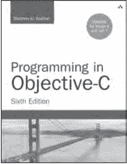

`《Objective-C编程（第六版）》`  
斯蒂芬·G·科尚  
ISBN-13: 978-0-321-96760-2

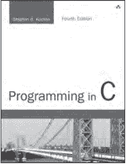

`《C语言编程（第四版）》`  
斯蒂芬·G·科尚  
ISBN-13: 978-0-321-77641-9


`《C Primer Plus（第六版）》`  
斯蒂芬·普拉塔  
ISBN-13: 978-0-321-92842-9

### 其他开发者文库图书

| 书名 | 作者 | ISBN-13 |
|---|---|---|
| `《C++ Primer Plus（第六版）》` | 斯蒂芬·普拉塔 | 978-0-321-77640-2 |
| `《Linux内核开发（第三版）》` | 罗伯特·洛夫 | 978-0-672-32946-3 |
| `《Linux短语手册（第二版）》` | 斯科特·格兰尼曼 | 978-0-321-83388-4 |
| `《使用Bash的Linux Shell脚本编程》` | 肯·O·伯奇 | 978-0-672-32642-4 |

开发者文库的书籍在大多数零售书店和网上书店均有销售。如需更多信息或直接订购，请访问我们的在线书店：`informit.com/store`

开发者文库所有图书的在线版本均可通过Safari Books Online订阅获取，网址为：`safari.informit.com`
