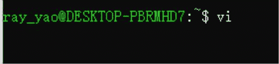
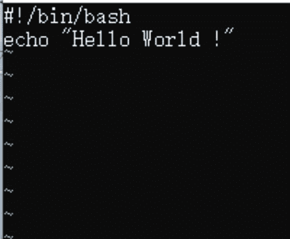
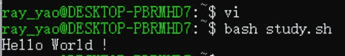
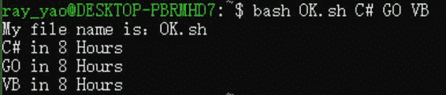
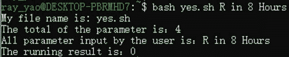
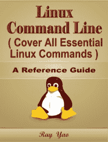

# 8 小时精通 Shell 脚本：初学者指南

快速学习编程：Linux Shell 脚本与练习

## 关于作者：Ray Yao

- 美国 Zend 认证 PHP 工程师
- 美国 Sun 认证 JAVA 程序员
- Oracle 认证 SCWCD 开发者
- 美国 CompTIA 认证 `A+` 专业人士
- Microsoft 认证 `ASP.NET` 专家
- Microsoft 认证 `MCP` 专业人士
- Microsoft 认证 TECHNOLOGY 专家
- 美国 CompTIA 认证 `NETWORK+` 专业人士
- [www . amazon . com/author/ray-yao](http://mybook.to/yaowining)

## 序言

“8 小时 Linux Shell 脚本与练习”涵盖了所有 Linux Shell 语言知识。你可以快速、轻松地学习 Linux Shell 脚本的完整基础技能。

本书包含了 60 个针对初学者的实用示例，并包含了高校考试、工程师认证考试以及工作面试的练习。

注意：本书仅适用于初学者，不适合有经验的程序员。

## 第 1 小时

### 什么是 Linux Shell？

Shell 是用户与 Linux 之间的接口；你在提示符输入的每个命令都会由 Shell 解析并传递给 Linux 内核。Shell 是一个带有内置命令集的命令语言解释器。此外，Shell 可以被任何其他 Linux 工具和应用程序调用。

每当你输入命令时，Shell 都会进行解析。例如：打印当前工作目录的命令（`PWD`）位于 Bash 中。复制命令（`cp`）和移动命令（`rm`）是文件系统中两个独立的程序。Shell 首先检查该命令是否为内部命令，然后检查它是否为应用程序。

### Shell 脚本

Shell 脚本是为 Shell 编写的脚本程序。

### Shell 工作环境

Shell 脚本类似于 Java、C++ 编程，只需要文本编辑器来编写代码以及脚本解释器来解释执行。

### 各种 Linux Shell

- `/bin/sh`
- `/bin/bash`
- `/usr/bin/csh`
- `/usr/bin/ksh`
- `/sbin/sh`

本书介绍了 Bash（Bourne Again Shell）。Bash 是大多数 Linux 上的默认 Shell。

## 第一个 Shell 脚本

### 示例 1.1

1. 使用 `vi` 命令打开 Vi 文本编辑器。

   

2. 按 `i` 键进入插入模式（Insert Mode）。

3. 在 Vi 编辑器中输入以下代码：

   ```bash
   #! /bin/bash
   echo "Hello World ! "
   ```

   

4. 按 `Esc` 键退出插入模式。

5. 输入 `:wq study.sh` 保存文件。文件名为 `study.sh`，扩展名为 `.sh`。

6. 使用以下命令运行此 Shell 程序：

   ```bash
   bash study.sh
   ```

   输出：Hello World!

解释：

- `vi` 是一个打开 Vi 编辑器的命令。
- `i` 键用于进入 Vi 编辑器的插入模式。插入模式可用于编写和编辑 Shell 脚本。
- `#! /bin/bash` 告诉 Shell 系统使用 Bash 来解释脚本。
- `echo "Hello World ! "` 显示内容 `Hello World! `。
- `Esc` 键用于退出 Vi 编辑器的插入模式。
- `:wq file_name` 保存 Shell 文件并退出 Vi。
- `bash study.sh` 执行 Shell 文件 `study.sh`。
- `bash myFile.sh` 执行 Shell 文件 `myFile.sh`。

### Shell 注释

```bash
#
```

`#` 符号用于 Shell 注释。Shell 解释器始终忽略 Shell 注释。

### 示例 1.2

```bash
#! /bin/bash
echo "Hello World! "     # 输出 Hello World!
echo "Hi, Friends! "      # 输出 Hi, Friends!
```

输出：

Hello World!

Hi, Friends!

解释：

- `# output Hello World ! ` 是 Shell 脚本的注释。
- `# output Hi, Friends ! ` 是 Shell 脚本的注释。

### 多行注释

```bash
: <<EOF
comment 1
comment 2
comment 3...
EOF
```

`: <<EOF……EOF` 用于多行注释。

### 示例 1.3

```bash
#! /bin/bash
echo "Hello World! "
:<<EOF
这是一个 "Hello World" 程序。
这是一个 Shell 脚本。
这是一个多行注释的示例.......
EOF
echo "This is a sample of multi-line comment. "
```

输出：

Hello World!

This is a sample of multi-line comment.

解释：

`: <<EOF……EOF` 用于多行注释。

## Shell 变量

1. 定义变量的语法如下：

   ```bash
   var="value"
   ```

   注意：等号前后不能有空格！

2. 要使用变量，需要在变量名前使用 `$`。

   ```bash
   $var
   ```

### 示例 1.4

```bash
#! /bin/bash
book="Scala in 8 Hours"     # 定义变量
echo $book                  # 使用变量
```

输出：Scala in 8 Hours

解释：定义变量时，请确保等号前后没有空格。

### 变量名

变量名的规则如下：

- 变量名只能使用英文字母、数字和下划线。
- 变量名的第一个字符不能是数字。
- 变量名中间不能有空格。
- 变量名不能包含标点符号。
- Bash 不能作为变量名。

**有效变量名：** `_myVariable`、`myVariable001`、`my_Varialbe`

**无效变量名：** `001Variable`、`echomy`、`*Varialbe*`

### 只读变量

`readonly` 命令可以将变量定义为只读变量，其值无法更改。

```bash
readonly variable
```

### 示例 1.5

```bash
#! /bin/bash
myVar="C# in 8 Hours"
readonly myVar
myVar="Scala in 8 Hours"     # 修改变量值
```

输出：

（如下错误消息：）

`test.sh: line 4: myVar: readonly variable`

解释：`readonly myVar` 将 `myVar` 设置为只读。输出为错误消息。`myVar` 变成只读变量后，对 `myVar` 值的任何更改都会导致错误。

### 删除变量

`unset` 命令可以删除变量。

```bash
unset variable
```

### 示例 1.6

```bash
#! /bin/sh
myVar="C++ in 8 Hours"
unset myVar     # 变量
echo $myVar
```

输出：（无）

解释：变量被删除后，该变量不再存在，其值也不再存在。因此你看不到任何输出。

### 变量输入

变量的值可以从用户的键盘输入。

```bash
read variable
```

### 示例 1.7

```bash
#! /bin/sh
echo "Please input your name. "
read myInput          # 输入值将存储在 myInput 中
echo "Hi! Your name is: $myInput" # 假设我输入我的名字：Ray Yao
```

输出：

Please input your name.

Ray Yao

Hi! Your name is Ray Yao

解释：假设我输入了我的名字：Ray Yao。`read myInput` 将输入值存储到 `myInput`。`echo "Hi! Your name is: $myInput"` 显示输入值。

## 第 2 小时

### Shell 字符串（1）

字符串包含在单引号中。

```bash
str='This is a string'
```

- 单引号内的任何字符将以其原始格式打印。
- 单引号内的字符串变量是无效的。

### 示例 2.1

```bash
#! /bin/sh
var=Andy
str='Hello, $var'         # 单引号字符串
echo $str
```

输出：Hello, $var

解释：`'Hello, $var'` 是单引号字符串。单引号内的任何字符将以其原始格式打印。

### Shell 字符串（2）

字符串包含在双引号中。

```bash
str="This is a string"
```

- 双引号内的任何字符将按其返回的值打印。
- 双引号内的字符串变量是有效的。

### 示例 2.2

```bash
#! /bin/sh
var=Andy
str="Hello, $ "         # 双引号字符串
echo $str
```

输出：Hello, $

（此处更正示例 2.2 应为）

```bash
#! /bin/sh
var=Andy
str="Hello, $var"         # 双引号字符串
echo $str
```

输出：Hello, Andy

解释：`"Hello, $var"` 是双引号字符串。双引号内的字符串变量将按其返回的值打印。

### 连接字符串

我们可以使用双引号连接字符串。

### 示例 2.3

```bash
#! /bin/sh
str1="Kotlin"
str2="in 8 Hours"
myString="$str1str2"
echo $myString
```

输出：Kotlin in 8 Hours

解释：`"$str1str2"` 连接了字符串。

### 字符串长度

我们通过 `#` 获取字符串的长度。

### 示例 2.4

```bash
#! /bin/sh
str="jQuery in 8 Hours"
echo ${#str} # 获取长度
```

输出：17

解释：`${str}` 获取字符串长度。

### 截取子字符串

我们可以从字符串中截取子字符串。

### 示例 2.5

```bash
#! /bin/sh
str="Django in 8 Hours"
echo ${str:4:16} # 截取
```

输出：go in 8 Hours

解释：`${str:4:16}` 从索引 4 开始截取 16 个字符。

### 关于 `expr…`

`expr` 是一个表达式，用于计算。

### 示例 2.6

```bash
#! /bin/sh
x=100
y=200
z=`expr $x + $y` # 表达式
echo "The sum is $z"
```

输出：The sum is 300

解释：`expr $x + $y` 是一个表达式，计算结果赋值给 `z`。

### 索引

我们可以查找字符串中字符首次出现的索引。

### 示例 2.7

```bash
str="Kotlin in 8 Hours"
echo `expr index "$str" n`
```

输出：6

解释：`expr index "$str" n` 找到字符串中字符“n”首次出现的索引。

### Shell 参数

我们可以在执行时向 Shell 脚本传递参数。

参数的语法如下：

```bash
$n
```

`n` 代表数字。`$0` 代表文件名。`$1` 代表第一个参数。`$2` 代表第二个参数。`$3` 代表第三个参数。

### 示例 2.8

```bash
#! /bin/bash
echo "My file name is:$0 "
echo "$1 in 8 Hours"
echo "$2 in 8 Hours"
echo "$3 in 8 Hours";
```

将文件保存为 `OK.sh`。使用以下命令运行文件：

```bash
bash OK.sh C# GO VB
```

**输出：**

`My file name is: OK.sh`

C# in 8 Hours

GO in 8 Hours

VB in 8 Hours



**解释：**

`bash OK.sh C# GO VB` 运行文件 `OK.sh`，并向 Shell 脚本传递四个参数。

零参数 `OK.sh` 传递给 `$0`。

第一个参数 `C#` 传递给 `$1`。

第二个参数 `GO` 传递给 `$2`。

第三个参数 `VB` 传递给 `$3`。

### 内置参数

Shell 中的内置参数如下：

| 参数 | 描述 |
| :--- | :--- |
| `$0` | 返回文件名 |
| `$#` | 返回参数总数 |
| `$*` | 返回用户的所有参数 |
| `$@` | 返回用户输入的所有参数 |
| `$$` | 返回脚本的当前进程 ID |
| `$!` | 返回脚本的最后一个进程 ID |
| `$?` | 返回 `0` 表示运行成功 |

#### 示例 2.9

```bash
#!/bin/bash
echo "My file name is: $0 ";
echo "The total of the parameter is:$# ";
echo "All parameter input by the user is:$* ";
echo "The running result is:$? ";
```

将文件保存为 `yes.sh`。使用以下命令运行文件：

```bash
bash yes.sh R in 8 Hours
```

**输出：**

`My file name is: yes.sh`

`The total of the parameter is: 4`

`All parameter input by the user is: R in 8 Hours`

`The running result is: 0`



**解释：**

`bash yes.sh R in 8 Hours` 运行文件 `yes.sh`，并向 Shell 脚本传递四个参数。

`$#`：返回参数总数。

`$*`：返回用户输入的所有参数。

`$?`：返回 `0` 表示脚本运行成功，返回其他数字表示脚本运行失败。

## 第 3 小时

### Shell 数组

数组是一种特殊的变量，可以同时包含一个或多个值。Bash 支持一维数组，不支持多维数组，并且不限制数组的大小。

#### 1. 创建数组的语法

| 语法 |
| :--- |
| `array_name = (value0 value1 value2...)` |

**示例：**

```bash
myArray=(100 101 102 103)
```

**解释：**

上述代码创建了一个数组，数组名为 `myArray`，它有四个元素，索引为 `0`、`1`、`2`、`3`，其值为 `100`、`101`、`102`、`103`。注意索引从 `0` 开始。

#### 2. 创建数组的另一种语法

| 语法 |
| :--- |
| `array_name[0]=value0 array_name[1]=value1 array_name[2]=value2` |

**示例：**

```bash
color[0] = "red";
color[1] = "blue";
color[2] = "green";
```

**解释：**

上述代码创建了一个数组，数组名为 `color`，它有三个元素：`color[0]`、`color[1]`、`color[2]`。它的索引是 `0`、`1` 和 `2`。其值是 `red`、`blue` 和 `green`。注意索引从 `0` 开始。

### 访问元素

访问数组元素的语法如下：

| 语法 |
| :--- |
| `${array_name[index]}` |

#### 示例 3.1

```bash
#!/bin/bash
my_array=(Rust in 8 Hours)     # 创建数组
echo "The first element is: ${my_array[0]} "
echo "The second element is: ${my_array[1]} "
echo "The third element is: ${my_array[2]} "
echo "The fourth element is: ${my_array[3]} "
```

**输出：**

`The first element is: Rust`

`The second element is: in`

`The third element is: 8`

`The fourth element is: Hours`

**解释：**

`my_array=(Rust in 8 Hours)` 创建了一个数组。

`${my_array[0]}` 访问索引为 `0` 的元素。

`${my_array[1]}` 访问索引为 `1` 的元素。

`${my_array[2]}` 访问索引为 `2` 的元素。

`${my_array[3]}` 访问索引为 `3` 的元素。

`my_array[0]` 的值是：Rust。

`my_array[1]` 的值是：in。

`my_array[2]` 的值是：8。

`my_array[3]` 的值是：Hours。

### 获取所有元素


`array_name[@]` 或 `array_name[*]` 可以获取数组的所有元素。

| `array_name[@]` 或 `array_name[*]` |
| :--- |

### 示例 3.2

```bash
#!/bin/bash
my_array[0]=Java
my_array[1]=Ruby
my_array[2]=Html
my_array[3]=Rust
echo "All elements are: ${my_array[@]}"
echo "All elements are: ${my_array[*]}"
```

**输出：**

`All elements are: Java Ruby Html Rust`

`All elements are: Java Ruby Html Rust`

**解释：**

`array_name[@]` 或 `array_name[*]` 可以获取数组的所有元素。

### 数组长度

`#array_name[@]` 或 `#array_name[*]` 可以获取数组的长度。

| `#array_name[@]` 或 `#array_name[*]` |
| :--- |

### 示例 3.3

```bash
#!/bin/bash
my_array=(PHP in 8 Hours)
length1=${#my_array[@]}
length2=${#my_array[*]}
echo $length1
echo $length2
```

**输出：**

`4`

`4`

**解释：**

`#my_array[@]` 或 `#my_array[*]` 可以获取数组的长度。

### Print 命令

`printf` 是一个在 Shell 中格式化输出的命令。

| 类型 | 描述 |
| :--- | :--- |
| `%b` | 输出二进制值 |
| `%d` | 输出整数值 |
| `%f` | 输出浮点数值 |
| `%o` | 输出八进制值 |
| `%s` | 输出字符串值 |
| `%x` | 输出十六进制值 |

例如：

`%10s` 表示格式化为宽度为 10 个字符的字符串（`-` 表示左对齐，无表示右对齐）。

`%8.2f` 表示格式化为浮点数，8 位，2 位小数。

#### 示例 3.4

```bash
printf "%-10s%-7s %8s\n" Name Age
```

**输出：**

`Name      Age     Weight`

**解释：**

`%-10s` 被替换为 `Name`，`Name` 格式化为 10 个字符的字符串，左对齐。

`%-7s` 被替换为 `Age`，`Age` 格式化为 7 个字符的字符串，左对齐。

`%-8s` 被替换为 `Weight`，`Weight` 格式化为 8 个字符的字符串，左对齐。

`\n` 用于换行。

#### 示例 3.5

```bash
#!/bin/bash
printf "%-10s%-7s %8s\n" Name Age
printf "%-10s%-7d %5.2f\n" Andy 18 91.8843
printf "%-10s%-7d %5.2f\n" Tomy 19 95.4675
printf "%-10s%-7d %5.2f\n" Rosy 17 80.8563
```

**输出：**

`Name      Age     Weight`

`Andy      18      91.88`

`Tomy      19      95.47`

`Rosy      17      80.86`

**解释：**

`printf "%-10s%-7d %5.2f\n" Andy 18 91.8843` 格式化三个参数 `Andy`、`18`、`91.8843`。

`%-10s` 被替换为 `Andy`，`Andy` 格式化为 10 个字符的字符串，左对齐。

`%-7d` 被替换为 `18`，`18` 格式化为最多 7 位的数字类型，左对齐。

`%-5.2f` 被替换为 `91.88`，`91.88` 格式化为浮点类型，最多 5 位，2 位小数，左对齐。

`\n` 用于换行。

### 转义序列

`\` 反斜杠字符用于转义字符。

`\a` 输出警报。

`\n` 将内容输出到新行。

`\r` 产生回车。

`\t` 产生制表符。

`\f` 输出内容到下一页。

`\'` 输出单引号。

`\"` 输出双引号。

#### 示例 3.6

```bash
#!/bin/bash
printf "%s %s \'%s\' \n" He said OK
printf "%d\t %d\n" 10 100
printf "%s\n %s %d %s\n" "C# in 8 Hours"
```

**输出：**

`He said 'OK'`

`10      100`

`C# in 8 Hours`

**解释：**

`\'%s\'` 输出单引号和格式化字符串。

`%d\t` 输出两个数字之间的制表符空格。

`%s\n` 在下一行输出字符串。

## 第 4 小

### 运算符

Shell 与其他语言一样支持多种运算符，包括：算术运算符、关系运算符、逻辑运算符、字符串运算符、文件运算符。

`expr...`

`expr...` 是一个表达式求值工具。`` 键是反引号，而不是单引号。

#### 示例 4.1

```bash
#!/bin/bash
sum=`expr 100 + 200`
echo "The sum is: $sum"
```

**输出：**

`The sum is: 300`

**解释：**

`` 键是反引号，而不是单引号。

整个表达式必须包含在反引号内。

表达式和运算符之间必须有空格。例如，`10+20` 是错误的，`10 + 20` 是正确的。

`if...then...else...fi`

`if` 语句在条件为真时执行代码 1，在条件为假时执行代码 2。

```bash
if condition
then
    # 如果为真执行代码 1
else
    # 如果为假执行代码 2
fi
```

#### 示例 4.2

```bash
a=10
b=20
if [ $a == $b ]  # 检查 a 是否等于 b
then
    echo "a is equal to b"
else
    echo "a is not equal to b"
fi
```

输出：`a is not equal to b`

解释：`[$a == $b ]` 比较 `a` 和 `b`，检查 `a` 是否等于 `b`。

注意：关于 `==`，它应该放在方括号内并留空格。例如：`[$a==$b]` 是错误的，`[ $a == $b ]` 是正确的。`==` 是一个比较运算符。如果 `a` 等于 `b`，返回 `true`。如果 `a` 不等于 `b`，返回 `false`。

在在方的“if 语句”中，因为测试条件返回 `false`，所以执行了“else code2”。

因此，执行了 `echo "a is not equal to b"` 命令。

## 算术运算符

| 运算符 | 运行 |
| :--- | :--- |
| `+` | 加法 |
| `-` | 减法 |
| `*` | 乘法（注意：`*`） |
| `/` | 除法 |
| `%` | 取模 |
| `=` | 赋值 |
| `==` | 检查相等 |
| `!=` | 检查不相等 |

### 示例 4.3

```bash
#!/ /bin/bash
a=100
b=2
result=`expr $a + $b`
echo "a + b : $result"
result=`expr $a - $b`
echo "a - b : $result"
result=`expr $a \* $b`      # 注意 \*
echo "a \* b : $result"
result=`expr $a / $b`
echo "a / b : $result"
result=`expr $a % $b`
echo "a % b : $result"
```

输出：

`a + b : 102`

`a - b : 98`

`a * b : 200`

`a / b : 50`

`a % b : 0`

解释：

| 运算符 | 运行 |
| :--- | :--- |
| `+` | 加法 |
| `-` | 减法 |
| `*` | 乘法（注意：`*`） |
| `/` | 除法 |
| `%` | 取模 |

### 示例 4.4

```bash
a=100
b=200
if [ $a == $b ]      # 如果 a 等于 b，返回 true
then
    echo "a is equal to b"
fi
if [ $a != $b ]      # 如果 a 不等于 b，返回 true
then
    echo "a is not equal to b"
fi
```

输出：`a is not equal to b`

解释：`[$a == $b ]` 检查 `a` 是否等于 `b`。

注意：`[ ]` 和 `!=` 之间应该有空格。`[$a!=$b]` 是错误的。`[ $a != $b ]` 是正确的。

## 比较运算符

Linux Shell 有以下比较运算符：

| 运算符 |  |
| :--- | :--- |
| `-eq` | 等 |
| `-ne` | 不等于 |
| `-gt` | 大于 |
| `-ge` | 大于等于 |
| `-lt` | 小于 |
| `-le` | 小于等于 |

比较表达式返回 `true` 或 `false`。

### 示例 4.5

```bash
#! /bin/bash
a=100
b=200
if [ $a -eq $b ]      # 如果 a 等于 b
then
    echo "a is equal to b"
else
    echo "a is not equal to b"
fi
if [ $a -ne $b ]      # 如果 a 不等于 b
then
    echo "a is not equal to b"
else
    echo "a is equal to b"
fi
if [ $a -gt $b ]      # 如果 a 大于 b
then
    echo "a is greater than b"
else
    echo "a is not greater than b"
fi
if [ $a -lt $b ]      # 如果 a 小于 b
then
    echo "a is less than b"
else
    echo "a is not less than b"
fi
if [ $a -ge $b ]      # 如果 a 大于等于 b
then
    echo "a is greater than equal to b"
else
    echo "a is not greater than equal to b"
fi
if [ $a -le $b ]      # 如果 a 小于等于 b
then
    echo "a is less than equal to b"
else
    echo "a is not less than equal to b"
fi
```

输出：

`a is not equal to b`

`a is not equal to b`

`a is not greater than b`

`a is less than b`

`a is not greater than equal to b`

`a is less than equal to b`

### 逻辑运算符

| 运算符 |  |
| :--- | :--- |
| `-a` | 与 |
| `-o` | 或 |
| `!` | 非 |

使用逻辑运算符后结果将 `true` 或 `false`。

- `true -a true` 返回 `true`
- `true -a false` 返回 `false`
- `false -a false` 返回 `false`
- `true -o true` 返回 `true`
- `true -o false` 返回 `true`
- `false -o false` 返回 `false`
- `! false` 返回 `true`
- `! true` 返回 `false`

### 示例 4.6

```bash
#! /bin/bash
x=true
y=false
if [ $x -a $y ]      # -a 意味着“与”
then
    echo false
fi
if [ $x -o $y ]      # -o 意味着“或”
then
    echo true
fi
if [ !$x ]           # ! 意味着“非”
then
    echo false
fi
```

输出：

`false`

`true`

`false`

解释：

- `true -a true` 返回 `true`
- `true -a false` 返回 `false`
- `false -a false` 返回 `false`
- `true -o true` 返回 `true`
- `true -o false` 返回 `true`
- `false -o false` 返回 `false`
- `! false` 返回 `true`
- `! true` 返回 `false`

## 字符串运算符

| 运算符 | 检查 |
| :--- | :--- |
| `=` | 如果两个字符串相等 |
| `!=` | 如果两个字符串不相等 |
| `-z` | 如果字符串长度为零 |
| `-n` | 如果字符串长度不为零 |
| `$` | 如果字符串为空 |

### 示例 5.1

```bash
#! /bin/bash
a="Java"
b="Ruby"
if [ $a = $b ]      # 检查 a 是否等于 b
then
    echo "$a = b ?  a is equal to b"
else
    echo "$a = b ?  a isn't equal to b"
fi
if [ $a != $b ]      # 检查 a 不等于 b
then
    echo "$a != b ?  a isn't equal to b"
else
    echo "$a != b ?  a is equal to b"
fi
if [ -z $a ]         # 检查字符串长度是否为 0
then
    echo "-z $a ?  The string is 0"
else
    echo "-z $a ?  The string is not 0"
fi
if [ -n $a ]         # 检查字符串长度是否为 0
then
    echo "-n $a ?  The string is not 0"
else
    echo "-n $a ?  The string is 0"
fi
```

输出：

`a = b ?  a isn't equal to b`

`a != b ?  a isn't equal to b`

`-z $a ?  The string is not 0`

`-n $a ?  The string is not 0`

解释：

- `=`：如果两个字符串相等
- `!=`：如果两个字符串不相等
- `-z`：如果字符串长度为零
- `-n`：如果字符串长度不为零
- `$`：如果字符串为空

## 文件运算符

文件运算符用于检测文件的各种属性。

| 运算符 | 检查 |
| :--- | :--- |
| `-d` | 如果是目录 |
| `-f` | 如果是文件 |
| `-p` | 如果是管道 |
| `-r` | 如果是可读的 |
| `-w` | 如果是可写的 |
| `-x` | 如果是可执行的 |
| `-e` | 如果文件存在 |
| `-s` | 如果文件不是空的 |
| `-b` | 如果是块设备 |
| `-c` | 如果是字符设备 |

### 示例 5.2

假设文件“myFile.sh”不存在，但我们仍然检查该属性。


```bash
#! /bin/bash
file="/root/myFile.sh"
if [ -r $file ]      # 检查是否可读
then
    echo "The object is readable"
else
    echo "The object isn't readable"
fi
if [ -w $file ]      # 检查是否可写
then
    echo "The object is writable"
else
    echo "The object isn't writable"
fi
if [ -x $file ]      # 检查是否为可执行的
then
    echo "The object is executable"
else
    echo "The object isn't executable"
fi
if [ -f $file ]      # 检查是否是文件
then
    echo "The object is a file"
else
    echo "The object isn't a file"
fi
if [ -d $file ]      # 检查是否是目录
then
    echo "The object is a directory"
else
    echo "The object isn't a directory"
fi
if [ -s $file ]      # 检查是否不是空的
then
    echo "The object isn't empty"
else
    echo "The object is empty"
fi
if [ -e $file ]      # 检查文件是否存在
then
    echo "The file is existing"
else
    echo "The file isn't existing"
fi
```

输出：

`The object isn't readable`

`The object isn't writable`

`The object isn't executable`

`The object isn't a file`

`The object isn't a directory`

`The object is empty`

`The file isn't existing`

| 选项 | 描述 |
| --- | --- |
| `-e file` | 如果对象是一个空文件，则返回 `true`。 |
| `-s file` | 如果对象不是空文件，则返回 `true`。 |

最后检查的结果是“文件不存在。”`echo` 命令被用于输出内容。在这里，我们来谈一下它的特殊用法。

### 输出转义字符

```bash
#! /bin/sh
echo "\"C++ in 8 Hours\" "
```

输出：`"C++ in 8 Hours"`

### 输出变量值

```bash
#! /bin/sh
book ="C# in 8 Hours"
echo "$book is a great book"
```

输出：`C# in 8 Hours is a great book`

### 在同一行输出内容

```bash
#! /bin/sh
echo -e "Go \c "      # -e 开启转义开关
echo "in 8 Hours"      # \c 在同一行输出
```

输出：`Go in 8 Hours`

### 输出到文件

```bash
#! /bin/sh
echo "PHP in 8 Hours" > myFile     # ">" 重定向到
```

### 输出原始格式

```bash
#! /bin/sh
echo ' He said: "OK! " '      # 使用单引号
```

输出：`He said: "OK! "`

### 输出执行结果

```bash
#! /bin/sh
echo Today is `date`  # 使用反引号而不是单引号
```

输出：`Today is Thu Aug 22 09: 01: 19 DST 2019`

### 显示用户输入

```bash
#! /bin/sh
echo "Please type your name: "
read name      # "read" 接受用户输入
echo "My name is $name"
```

输出：

```text
Please type your name:Ray Yao

My name is Ray Yao
```

## 第 6 小节

### `test` 命令

`test` 命令用于检查条件是否为真。它可以用于测试三个方面：数值、字符和文件。`[ ]` 用于执行算术计算。

| 命令 |
| --- |
| `test numerics / characters / files` |

#### 示例 6.1

```bash
#! /bin/bash
num1=10
num2=20
if test $[num1] -eq $[num2]
then
echo 'Two numbers are equal. '
else
echo 'Two numbers are not equal. '
fi
```

输出：`Two numbers are not equal.`

解释：`test $[num1] -eq $[num2]` 测试两个数字的相等性。`[ ]` 符号用于执行算术计算。在表达式中，` 的两边不能有空格。

#### 示例 6.2

```bash
#! /bin/bash
x=100
y=200
z=$[x + y]
echo "The result is: $z"
```

输出：`The result is: 300`

解释：`[x + y]` 执行算术计算。注意：`=` 的两边不能有空格。

### 测试相等性

`test` 命令可以测试两个字符串是否相等。

#### 示例 6.3

```bash
#! /bin/bash
str1="Java"
str2="JavaScript"
if test $str1 = $str2
then
echo 'Two strings are equal! '
else
echo 'Two strings are not equal! '
fi
```

输出：`Two strings are not equal!`

解释：`test $str1 = $str2` 测试两个字符串的相等性。

### 测试存在性

`test` 命令可以测试文件是否存在。

#### 示例 6.4

```bash
#! /bin/bash
# 假设 theFile . sh 不存在 .
if test -e /root/theFile.sh       # -e 检查存在性
then
echo 'The file exists! '
else
echo ' The file doesn't exist! '
fi
```

输出：`The file doesn't exist!`

解释：假设 `theFile. sh` 不存在。`test -e /root/theFile. sh` 测试文件是否存在。

### 测试空字符串

`test` 命令可以测试字符串是否为空。

#### 示例 6.5

```bash
#! /bin/bash
# 假设 "$myString” 尚未被赋值 .
if test -n "$myString"      # -n 检查非空字符串
then
    echo "It's not an empty string. "
else
echo "It's an empty string. "
fi
```

输出：`It’s an empty string.`

解释：因为 `myString` 尚未被赋值任何值，它是一个空字符串。

## Shell 函数

函数是一个可以重复运行多次的代码块。定义函数的语法如下：

| 语法 |
| --- |
| `function_name(){}` |

要调用函数，请使用 `function_name;`。

| 函数 |
| --- |
| `function_name` |

#### 示例 6.6

```bash
#! /bin/bash
myFunction() {
     # 定义一个函数
echo "jQuery in 8 Hours"
}
echo "Before calling the function. "
myFunction      # 调用函数
echo "After calling the function. "
```

输出：

```text
Before calling the function.

jQuery in 8 Hours

After calling the function.
```

解释：`myFunction(){ }` 定义了一个函数。`myFunction` 调用了函数。

### 带参数的函数

在调用函数时，你可以将参数传递给函数体。例如，将第一个参数传递给 `${1}`，将第二个参数传递给 `${2}`……

#### 示例 6.7

```bash
#! /bin/bash
myFunction(){
echo "The first parameter is: ${1} "
echo "The second parameter is: ${2} "
echo "The third parameter is: ${3} "
echo "The fourth parameter is: ${4} "
echo "All parameters are: $* "
}
myFunction Kotlin in Hour
```

解释：`${1}` 接受第一个参数。`${2}` 接受第二个参数。`$*` 显示所有参数。`myFunction Kotlin in Hour` 调用了函数并传递了四个参数。

### 返回值

`return` 可以向 `$?` 返回一个值。`$?` 显示返回值。在某些机器上，`$?` 只显示 0 到 255 之间的值。

| 语法 | 描述 |
| --- | --- |
| `function_name { return value }` |  |
| `$?` | 显示返回值 |

#### 示例 6.8

```bash
#! /bin/bash
add(){
x=100
y=55
z=`x + y`
return z     # 返回返回值
}
add
echo "The sum of numbers is $?"
```

输出：`The sum of numbers is 155`

解释：`add` 调用函数并返回返回值。

#### 示例 6.9

```bash
#! /bin/bash
myFunction(){
echo "The first parameter is: ${1} "
echo "The second parameter is: ${2} "
echo "The third parameter is: ${3} "
echo "The fourth parameter is: ${4} "
echo "All parameters are: $* "
}
myFunction Kotlin in Hour
```

输出：

```text
The first parameter is: Kotlin

The second parameter is: in

The third parameter is: Hour

The fourth parameter is: 

All parameters are: Kotlin in Hour
```

解释：`${1}` 接受第一个参数。`${2}` 接受第二个参数。`$*` 显示所有参数。`myFunction Kotlin in Hour` 调用了函数并传递了三个参数。

## 第 7 小节

### `if .. then .. else`

`if` 语句用于检查条件是否为真。如果条件为真，则执行 `then` 后面的代码。

`if condition; then code else code fi`

#### 示例 7.1

```bash
#! /bin/bash
x=100
y=80
if [ $x -eq $y ]
then
echo "x is equal to y"
else
echo "x is not equal to y"
fi
```

输出：`x is not equal to y`

解释：`[ $x -eq $y ]` 测试两个数字是否相等。

#### 示例 7.2

```bash
#! /bin/bash
x=100
y=80
if [ $x -gt $y ]
then
echo "x is greater than y"
else
echo "x is not greater than y"
fi
```

输出：`x is greater than y`

解释：`[ $x -gt $y ]` 测试 `$x` 是否大于 `$y`。

#### 示例 7.3

```bash
#! /bin/bash
x=100
y=80
if [ $x -lt $y ]
then
echo "x is less than y"
else
echo "x is not less than y"
fi
```

输出：`x is not less than y`

解释：`[ $x -lt $y ]` 测试 `$x` 是否小于 `$y`。

#### 示例 7.4

```bash
#! /bin/bash
x=100
y=80
if [ $x -ne $y ]
then
echo "x is not equal to y"
else
echo "x is equal to y"
fi
```

输出：`x is not equal to y`

解释：`[ $x -ne $y ]` 测试两个数字是否不相等。

#### 示例 7.5

```bash
#! /bin/bash
x=100
y=80
if [ $x -ge $y ]
then
echo "x is greater than or equal to y"
else
echo "x is not greater than or equal to y"
fi
```

输出：`x is greater than or equal to y`

解释：`[ $x -ge $y ]` 测试 `$x` 是否大于或等于 `$y`。

#### 示例 7.6

```bash
#! /bin/bash
x=100
y=80
if [ $x -le $y ]
then
echo "x is less than or equal to y"
else
echo "x is not less than or equal to y"
fi
```

输出：`x is not less than or equal to y`

解释：`[ $x -le $y ]` 测试 `$x` 是否小于或等于 `$y`。

### 运算符

`if` 语句可以使用各种运算符来测试条件。

| 运算符 | 描述 |
| --- | --- |
| `-eq` | 数字相等 |
| `-ne` | 数字不相等 |
| `-gt` | 大于 |
| `-lt` | 小于 |
| `-ge` | 大于等于 |
| `-le` | 小于等于 |
| `=` | 字符串相等 |
| `!=` | 字符串不相等 |
| `-e` | 存在性 |
| `-f` | 是普通文件 |
| `-d` | 是目录 |
| `-n` | 字符串非空 |
| `-s` | 文件不为空 |

### 逻辑运算符

`if` 语句可以使用逻辑运算符来组合多个条件。

| 逻辑运算符 | 描述 |
| --- | --- |
| `-a` | 逻辑（AND） |
| `-o` | 逻辑（OR） |

### 示例 7.7

```bash
#! /bin/bash
x=100
y=80
if [ $x -gt $y ] -a [ $y -ne 70 ]
then
echo "x is greater than y and y is not equal to 70"
else
echo "condition not met"
fi
```

输出：`x is greater than y and y is not equal to 70`

解释：`-a` 用于逻辑与（AND）。

### 示例 7.8

```bash
#! /bin/bash
x=100
y=80
if [ $x -lt $y ] -o [ $y -eq 80 ]
then
echo "x is less than y or y is equal to 80"
else
echo "condition not met"
fi
```

输出：`x is less than y or y is equal to 80`

解释：`-o` 用于逻辑或（OR）。

### 嵌套 `if`

`if` 语句可以嵌套另一个 `if` 语句。

#### 示例 7.9

```bash
#! /bin/bash
x=100
y=80
if [ $x -gt $y ]
then
    if [ $y -eq 80 ]
    then
        echo "x is greater than y and y is equal to 80"
    else
        echo "x is greater than y but y is not equal to 80"
    fi
else
echo "x is not greater than y"
fi
```

输出：`x is greater than y and y is equal to 80`

解释：嵌套的 `if` 语句。

### `case`

`case` 语句用于根据变量与多个模式的匹配来执行相应的代码。

#### 示例 7.10

```bash
#! /bin/bash
line="apple"
case $line in
    "apple")
        echo "The line is apple"
        ;;
    "banana")
        echo "The line is banana"
        ;;
    *)
        echo "The line is something else"
        ;;
esac
```

输出：`The line is apple`


解释：`case` 语句根据模式匹配执行代码。`;;` 表示每个模式的结束。`esac` 是 `case` 的反写。

## `for` 循环

`for` 循环用于遍历列表并执行代码。

### 示例 7.11

```bash
#! /bin/bash
for i in 1 2 3 4
do
    echo "Number: $i"
done
```

输出：

```text
Number: 1
Number: 2
Number: 3
Number: 4
```

解释：`for` 循环遍历列表中的每个元素。

### 示例 7.12

```bash
#! /bin/bash
for fruit in apple banana cherry
do
    echo "Fruit: $fruit"
done
```

输出：

```text
Fruit: apple
Fruit: banana
Fruit: cherry
```

解释：`for` 循环可以处理字符串列表。

### 示例 7.13

```bash
#! /bin/bash
for i in {1..5}
do
    echo "Count: $i"
done
```

输出：

```text
Count: 1
Count: 2
Count: 3
Count: 4
Count: 5
```

解释：使用`{1..5}`扩展生成序列。

## `while` 循环

`while` 循环在条件为真时重复执行代码。

### 示例 7.14

```bash
#! /bin/bash
i=1
while [ $i -le 5 ]
do
    echo "Count: $i"
    i=`expr $i + 1`
done
```

输出：

```text
Count: 1
Count: 2
Count: 3
Count: 4
Count: 5
```

解释：`while` 循环在条件`$i <= 5`为真时运行。

### 示例 7.15

```bash
#! /bin/bash
i=1
until [ $i -gt 5 ]
do
    echo "Count: $i"
    i=`expr $i + 1`
done
```

输出：

```text
Count: 1
Count: 2
Count: 3
Count: 4
Count: 5
```

解释：`until` 循环在条件`$i > 5`为假时运行。

## 函数

`函数`可以在脚本中重用代码块。

### 示例 7.16

```bash
#! /bin/bash
my_function() {
    echo "Hello from function!"
}
my_function
```

输出：

```text
Hello from function!
```

解释：定义并调用函数。

## 带参数的函数

函数可以接收位置参数。

### 示例 7.17

```bash
#! /bin/bash
my_function() {
    echo "First argument: $1"
    echo "Second argument: $2"
}
my_function "Hello" "World"
```

输出：

```text
First argument: Hello
Second argument: World
```

解释：使用`$1`、`$2`等访问位置参数。

## 函数返回值

使用`return`从函数返回状态码。

### 示例 7.18

```bash
#! /bin/bash
my_function() {
    return 10
}
my_function
echo "Return value: $?"
```

输出：

```text
Return value: 10
```

解释：`return`返回的值通过`$?`获取。

输出：

```text
0123
```

解释：`until [ $n -ge 4 ]`当`$n`等于 4 时将退出循环。

## `case` 语句

`case statement`是一个多选择命令。`case statement`将一个值与模式进行匹配。如果匹配成功，则执行对应的命令。

```bash
case value in
  pattern1) code1;;      # 注意使用 ) 和 ;;
  pattern2) code2;;
  pattern3) code3;;
  pattern*) code4;;      # 当没有匹配到任何项时，运行此项
esac
```

### 示例 7.7

```bash
#! /bin/bash
echo 'Please input a number between 1 to 4: '
read num
case $num in
  1)  echo 'You have input 1';;
  2) echo 'You have input 2';;
  3) echo 'You have input 3';;
  4) echo 'You have input 4';;
  *) echo 'Your number is not between 1 to 4';;
esac
```

## 假设我们输入数字 2

输出：

```text
Please input a number between 1 to 4:

2

You have input 2
```

解释：假设我们输入了数字 2，它匹配了第二个`case`，因此执行了第二个代码。

## `break` 命令

`break`关键字用于根据条件停止循环的运行。

```bash
break
```

### 示例 7.8

```bash
#! /bin/bash
num=0
while(( $num<=8))
do
  if [ $num == 3 ]
  then
    break      # 退出 while 循环
  fi
  num=`expr $num + 1`
  echo $num
done
```

输出：

```text
123
```

解释：如果`$num`为 3，程序将运行`break`命令并退出循环。

## `continue` 命令

`continue`用于停止当前迭代，忽略后续代码，然后继续下一次循环。

```bash
continue
```

### 示例 7.9

```bash
#! /bin/sh
nums="1 2 3 4 5 "
for n in $nums
do
  if [ $n -eq 3 ]
  then
    continue      # 执行下一次 for loop
  fi
  echo $n
done
```

输出：

```text
1245
```

解释：注意：输出中没有数字 3。如果`$n = 3`，程序将运行`continue`命令，忽略下一个命令`echo $n`，然后执行下一次`for loop`。

## 第 8 章 `select` 语句

`Select`语句允许用户选择一个符合条件的项并运行相关代码。`Select`语句通常与`Case`语句配合使用。

```bash
select var in item1 item2 item3...
do
  case statement
    ...
  esac
done
```

### 示例 8.1

```bash
#! /bin/bash
echo "Please input a number between 1 to 4. "
echo "If you input 4, the program will exit. "
select choice in 1 2 3 4 ;      # 选择一个数字
do
  case $choice in
  1)  echo "You choose 1";;
      2)  echo "You choose 2";;
      3)  echo "You choose 3";;
      4)  echo "You choose 4 to exit"; break;;
      *)  echo "Enter error! "; break;;
  esac
done
```

输出：

```text
Please input a number between 1 to 4.

If you input 4, the program will exit.

1) 1

2) 2

3) 3

4) 4

#? 2

You choose 2

#? 4

You choose 4 to exit
```

解释：假设我们第一次输入 2，第二次输入 4。`select choice in 1 2 3 4 ;`选择 4 个数字之一。`Select`语句通常与`Case`语句配合使用。`#?`是输入提示，你可以输入一个数字。

## I/O 重定向

Linux Shell 系统命令从终端获取输入并将结果输出传回终端。命令通常从标准输入读取数据并写入标准输出数据。重定向命令如下：

| 命令 | 描述 |
| :--- | :--- |
| `command > file` | 将输出重定向到文件。 |
| `command < file` | 将输入重定向到文件。 |
| `command >> file` | 将输出追加到文件。 |
| `n > file` | 将`File n`重定向到文件 |
| `n >> file` | 将`File n`追加到文件 |
| `n >& m` | 合并输出文件`m`和`File n` |
| `n <& m` | 合并输入文件`m`和`File n` |
| `<< tag` | 将标签之间的内容作为输入。 |

`File n`、`File m`表示文件描述符 0、1 或 2 的文件。`0`表示标准输入（STDIN）。`1`表示标准输出（STDOUT）。`2`表示标准错误（STDERR）。

### 输出重定向

输出重定向：执行命令并使用`>`将输出存储到文件中。

```bash
command > file
```

### 示例 8.2

```bash
echo "Hello" > file
```

解释：使用`>`将输出重定向到文件。

### 追加重定向

如果你不想覆盖文件，使用`>>`将内容追加到文件。

```bash
echo "World" >> file
```

### 示例 8.3

```bash
echo "Good!" >> file
```

解释：使用`>>`将内容追加到文件。

## 输入重定向

输入重定向：使用`<`从文件获取输入。

```bash
command < file
```

### 示例 8.4

```bash
wc < file
```

输出：

```text
2 7 25
```

解释：使用`<`从文件获取输入。`wc`统计行、单词和字符。

## Here Document（在此文档）

使用`<<`将标签之间的内容作为输入。

```bash
command << tag
```

### 示例 8.5

```bash
#! /bin/bash
cat << DOC
...
DOC
```

解释：`<<`定义了在此文档。`cat`显示文件内容。

### 示例 8.6

```bash
#! /bin/bash
wc << EOF
...
EOF
```

输出：

```text
3 13 68
```

解释：`<< EOF`定义了在此文档。`wc`统计行、单词和字符。

## 重定向逻辑

`<<`运算符必须位于最左侧，前面没有字符。

```bash
command << EOF
```

`<<`将文档重定向到命令。`EOF`是分隔符。你可以指定其他字符作为分隔符。

## 文件引入

Shell 可以外部脚本引入当前文件。

```bash
source ./external_file
```

`./`定位外部文件。

### 示例 8.7

```bash
#! /bin/bash
url = "www.amazon.com/author/ray-yao"
```

### 示例 8.8

```bash
#! /bin/bash
source ./file1.sh
echo "The website of Ray Yao is:$url"
```

解释：`source ./file1.sh`引入了外部文件`file1.sh`。在文件中定义了变量。

## 附录 1 Shell 脚本表

### 内置参数表

Shell 中的内置参数如下：

| 参数 | 描述 |
| :--- | :--- |
| `$0` | 返回文件名 |
| `$#` | 返回参数的总数 |
| `$*` | 返回用户输入的所有参数 |
| `$@` | 返回用户输入的所有参数 |
| `$$` | 返回脚本的当前进程 ID |
| `$!` | 返回上一个命令的进程 ID |
| `$?` | 返回 0 表示执行成功 |

### `printf` 命令表

`printf`是一个在 Shell 中用于格式化输出的命令。

## `printf "type" 变量

`"type"`是用于格式化输出的参数。

| 类型 | 描述 |
| :--- | :--- |
| `%b` | 以二进制值打印 |
| `%d` | 以整数值打印 |
| `%f` | 以浮点数值打印 |
| `%o` | 以八进制值打印 |
| `%s` | 以字符串值打印 |
| `%x` | 以十六进制值打印 |

## 转义序列表

`\`反斜线字符可用于转义字符。

`\a`输出警报；`\n`将内容输出到下一行；`\r`换回；`\t`制表符；`\f`将内容输出到下一页；`\'`输出单引号；`\"`输出双引号。

## 比较运算符表

Linux Shell 拥有如下比较运算符：

| 运算符 | 检查项 |
| :--- | :--- |
| `-eq` | 等于 |
| `-ne` | 不等于 |
| `-gt` | 大于 |
| `-ge` | 大于等于 |
| `-lt` | 小于 |
| `-le` | 小于等于 |

比较表达式返回真或假。

## 布尔运算符表

| 运算符 |
| :--- |
| `-a` |
| `-o` |
| `!` |

使用逻辑运算符后，结果将为真或假。

- `true -a true;`返回真；
- `true -a false;`返回假；
- `false -a false;`返回假；
- `true -o true;`返回真；
- `true -o false;`返回真；
- `false -o false;`返回假；
- `! false;`返回真；
- `! true;`返回假；

## 字符串运算符表

| 运算符 | 检查项 |
| :--- | :--- |
| `=` | 如果两个字符串相等，则返回真。 |
| `!=` | 如果两个字符串不等，则返回真。 |
| `-z` | 如果字符串长度为零，则返回真。 |
| `-n` | 如果字符串长度不为零，则返回真 |
| `$` | 如果字符串不空，则返回真。 |

## 文件运算符表

文件运算符用于检测 Linux 文件的各种属性。

| 运算符 | 检查项 |
| :--- | :--- |
| `-d file` | 如果对象是目录，则返回真 |
| `-f file` | 如果对象是文件，则返回真 |
| `-p file` | 如果对象是管道，则返回真 |
| `-r file` | 如果对象是可读文件，则返回真。 |
| `-w file` | 如果对象是可写文件，则返回真 |
| `-x file` | 如果对象是可执行文件，则返回真 |
| `-e file` | 如果对象是空文件，则返回真 |
| `-s file` | 如果对象不是空文件，则返回真 |
| `-b file` | 如果对象是块设备文件，则返回真 |
| `-c file` | 如果对象是字符设备文件，则返回真 |

## I/O 重定向表

Linux Shell 系统命令从终端输入并将输出传回终端。命令通常从标准输入读取数据，并写入标准输出。重定向命令如下：

| 命令 | 描述 |
| :--- | :--- |
| `command > file` | 将输出重定向到文件。 |
| `command < file` | 将输入重定向文件。 |
| `command >> file` | 将输出追加到文件。 |
| `n > file` | 将文件`n`重定向到文件 |
| `n >> file` | 将文件`n`追加到文件 |
| `n >& m` | 合并输出文件`m`和文件`n` |
| `n <& m` | 合并输入文件`m`和文件`n` |
| `<< tag` | 将标签之间的内容作为输入。 |

## 附录 2 练习

### 题目

请选择正确答案。

#### （01）

填入`# 使用多行注释字符`

```text
comment 1
comment 2
comment 3...
EOF
```

A. `EOF`

B. `#EOF`

C. `<<EOF`

D. `: <<EOF`

#### （02）

```bash
#! /bin/sh
str1="Kotlin"
str2="in 8 Hours"
myString="$str1 fill in $str2" # 连接两个字符串
echo $myString
```

A. `+`

B. `−`

C. 空格

D. `concat`

#### （03）

访问数组元素的语法是填入`?`

1. `$(array_name[index])`
2. `${array_name[index]}`
3. `array_name(index)`
4. `array_name{index}`

#### （04）

```bash
#! /bin/bash
sum= fill in expr 100 + 200 fill in
echo "The sum is: $sum"
```

A. 双引号

B. 单引号

C. 反引号

D. 空格

#### （05）

参数`-s file`检查填入`?`

A. 如果对象不是空文件，则返回真。

B. 如果对象为空文件，则返回真。

C. 如果对象是块设备文件，则返回真。

D. 如果对象是字符设备文件，则返回真。


(06)

```bash
#! /bin/bash
test fill in myFile # 检查 myFile 是否存在
then
  echo 'The file'
else
  echo ' '
fi
```

A. `-o`

B. `-e`

C. `-n`

D. `-s`

(07) `if fill in condition then code1 else code2 fi`

A. `( )`

B. `{ }`

C. `[ ]`

D. 空格

(08) `# 将输出重定向到 myFile`

```bash
echo "R in" fill in
```

A. `->`

B. `>`

C. `in`

D. `to`

(09)

```bash
#! /bin/sh
echo "Please input your.
fill in myInput # 将值存储在 myInput
echo "Hi! Your name is: $myInput"
```

A. `input`

B. `var`

C. `=`

D. `read`

(10)

```bash
#! /bin/sh
str="jQuery in"
echo fill in # 获取字符串的长度
```

A. `str.length()`

B. `length(str)`

C. `${#str}`

D. `$[#str]`

(11) `fill in` 可以获取数组的所有元素。

1. `array_name[@]`

2. `array_name[#]`

3. `array_name[%]`

4. `array_name[&]`

(12)

| 运算符 | 运行 |
| :--- | :--- |
| `+` | 加 |
| `-` | 减 |
| `fill in` | 乘 |
| `/` | 除 |

A. `*`

B. `\*`

C. `X`

D. `\x`

(13)

```bash
#! /bin/sh
echo fill in "Go " # 转义
```

A. `-a`

B. `-o`

C. `-s`

D. `-e`

(14)

```bash
#! /bin/bash
if test fill in "$myString" # 检查是否为空
then
  echo "It's not empty."
else
  echo "It's an empty string."
fi
```

A. `-o`

B. `-e`

C. `-n`

D. `-s`

(15) `until` 在条件 `fill in` 时循环代码，如果条件 `fill in` 则退出循环。

1. `true`

2. `true`

3. `false`

4. `false`

(16) 如果你不想文件被覆盖，请使用 `fill in` 符号追加到文件末尾。

A. `>>`

B. `->`

C. `=>`

D. `>=`

(17)

| 参数 | 描述 |
| :--- | :--- |
| `fill in` | 返回文件名 |
| `$#` | 返回参数总数 |
| `$*` | 返回用户输入 |
| `$@` | 返回用户输入 |

A. `n`

B. `$0`

C. `f`

D. `%`

(18)

```bash
#! /bin/bash
arr=(fill in) # 获取数组的长度
```

A. `arr.length()`

B. `length(arr)`

C. `${#arr}`

D. `$[#arr]`

(19)

- `true -a true;` 返回真；
- `true -a false;` 返回假；
- `false -a false;` 返回假；
- `true -o true;` 返回真；
- `true -o false;` 返回真；
- `false -o false;` 返回假；

(20)

| 运算符 | 检查 |
| :--- | :--- |
| `-z` | 如果字符串长度为零，则返回真。 |
| `-n` | 如果字符串长度不为零，则返回真 |
| `fill in` | 如果字符串不空，则返回真。 |

A. `$`

B. `&`

C. `@`

D. `%`

(21)

```bash
#! /bin/bash
add(){
  x=100
  y=155
  z=`expr $x + $y`
  return $z
}
add
echo "The sum is fill in" # 显示值
```

A. `$!`

B. `$@`

C. `$*`

D. `$`

(22)

```bash
#! /bin/bash
echo 'Please input a number between 1 to 4:'
read num
case $num in
  1) echo 'You have input 1'
  2) echo 'You have input 2'
  3) echo 'You have input 3'
  4) echo 'You have input 4'
  *) echo 'Your number is not between 1 to 4'
esac
```

A. `;`

B. `;;`

C. `;;;`

D. `;;;`

(23)

```bash
#! /bin/bash
fill in # 计算行数、单词、字符数
```

1. `num << DOC`

2. `ls << DOC`

3. `wc << EOF`

4. `cat << EOF`

(24)

```bash
#! /bin/bash
fill in ./file1.sh # 引入外部文件 "file1.sh"
echo "The website of Ray Yao is:$url"
```

A. `include`

B. `import`

C. `resource`

D. `source`

### Answers

| 题号 | 答案 |
| :--- | :--- |
| 01. | D |
| 02. | C |
| 03. | B |
| 04. | C |
| 05. | A |
| 06. | B |
| 07. | C |
| 08. | B |
| 09. | D |
| 10. | C |
| 11. | A |
| 12. | B |

## Amazon 上的推荐书籍

- [8 小时精通高级 C++](http://mybook.to/yaowining)
- [8 小时精通高级 Java](http://mybook.to/yaowining)
- [8 小时精通 AngularJs](http://mybook.to/yaowining)
- [Asp .net 编程](http://mybook.to/yaowining)
- [8 小时精通 Awk](http://mybook.to/yaowining)
- [8 小时精通 BootStrap](http://mybook.to/yaowining)
- [C# 面试题问答](http://mybook.to/yaowining)
- [C# 编程](http://mybook.to/yaowining)
- [C++ 面试题问答](http://mybook.to/yaowining)
- [C++ 编程](http://mybook.to/yaowining)
- [8 小时精通 Dart](http://mybook.to/yaowining)
- [8 小时精通 Django](http://mybook.to/yaowining)
- [8 小时精通 Erlang](http://mybook.to/yaowining)
- [8 小时精通 Go](http://mybook.to/yaowining)
- [Html Css 面试题问答](http://mybook.to/yaowining)
- [Html Css 编程](http://mybook.to/yaowining)
- [Java 面试题问答](http://mybook.to/yaowining)
- [Java 编程](http://mybook.to/yaowining)
- [JavaScript 面试题问答](http://mybook.to/yaowining)
- [JavaScript 编程](http://mybook.to/yaowining)
- [JQuery 面试题问答](http://mybook.to/yaowining)
- [JQuery 编程](http://mybook.to/yaowining)
- [Jsp Servlets 编程](http://mybook.to/yaowining)
- [8 小时精通 Kotlin](http://mybook.to/yaowining)
- [Linux 命令行](http://mybook.to/yaowining)
- [Linux 面试题问答](http://mybook.to/yaowining)
- [8 小时精通 Lua](http://mybook.to/yaowining)
- [8 小时精通 Matlab](http://mybook.to/yaowining)
- [8 小时精通 MySql](http://mybook.to/yaowining)
- [8 小时精通 Node . Js](http://mybook.to/yaowining)
- [8 小时精通 Numpy](http://mybook.to/yaowining)
- [8 小时精通 Perl](http://mybook.to/yaowining)
- [Php 面试题问答](http://mybook.to/yaowining)
- [Php MySql 编程](http://mybook.to/yaowining)
- [8 小时精通 PowerShell](http://mybook.to/yaowining)
- [Python 面试题问答](http://mybook.to/yaowining)
- [Python 编程](http://mybook.to/yaowining)
- [R 编程](http://mybook.to/yaowining)
- [8 小时精通 React . Js](http://mybook.to/yaowining)
- [Ruby 编程](http://mybook.to/yaowining)
- [8 小时精通 Rust](http://mybook.to/yaowining)
- [8 小时精通 Scala](http://mybook.to/yaowining)
- [8 小时精通 Shell 脚本](http://mybook.to/yaowining)
- [8 小时精通 Swift](http://mybook.to/yaowining)
- [8 小时精通 Tcl](http://mybook.to/yaowining)
- [8 小时精通 TypeScript](http://mybook.to/yaowining)
- [Visual Basic 面试题问答](http://mybook.to/yaowining)
- [Visual Basic 编程](http://mybook.to/yaowining)
- [8 小时精通 Vue . Js](http://mybook.to/yaowining)
- [8 小时精通 Xml Json](http://mybook.to/yaowining)



下次见！
