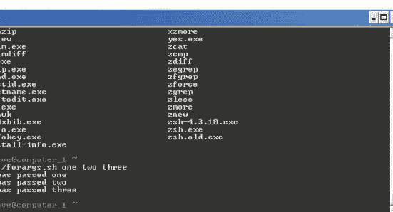
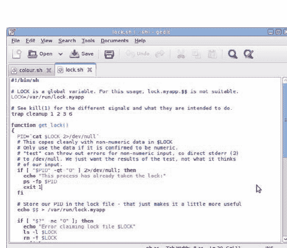
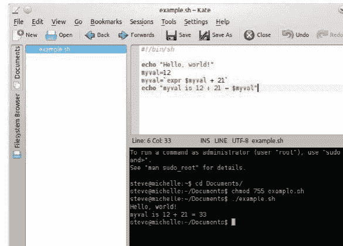
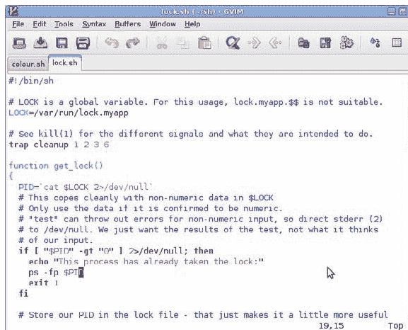
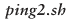
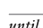
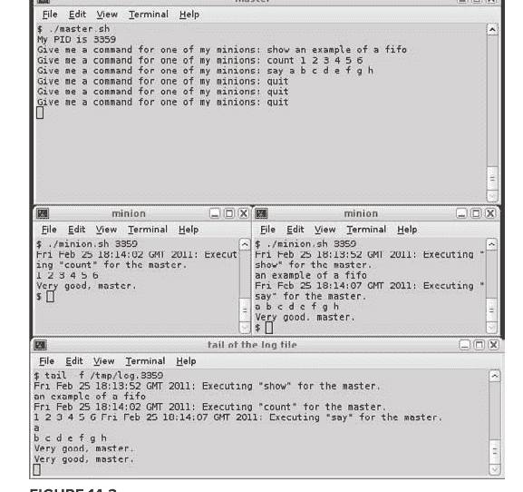
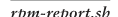
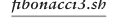
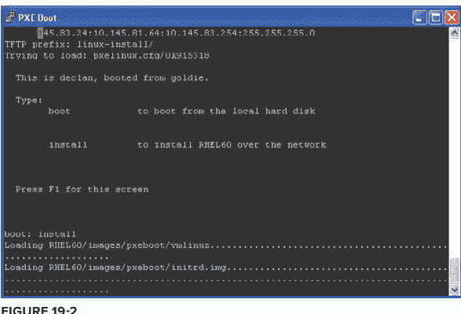

# Shell 脚本秘籍：Linux、Bash 及更多专家级秘籍

续

正如经所载：

> “我要拆毁智者的智慧，废掉聪明人的计谋。智者在哪里？学者在哪里？这时代的哲学家在哪里？神岂不是叫世界的智慧败为愚昧吗？因为神的愚昧胜过人的智慧，神的软弱胜过人的力量。”

哥林多后书第 1 章第 19、20 和 25 节

# 作者简介

**STEVE PARKER** 是一位拥有 20 年 Unix 经验和 15 年 GNU/Linux 经验的 Unix 顾问。他编写并维护在线 Shell 脚本教程：`http://steve-parker.org/sh/sh.shtml`。

Steve 提供 IT 咨询服务，还可以提供 Shell 脚本以及 Unix 和 Linux 技术培训。可以通过 `http://sgpit.com/` 联系他。

# 关于技术编辑

JOHN KENNEDY 自 1997 年以来一直以系统管理员的身份与 Linux（以及 Unix）工作。他曾服务于 Red Hat、SUSE、Debian、Ubuntu、Solaris 和 HP-UX。他从 2000 年开始编写 bash 脚本，因为他觉得自己的工作量太大了，希望有某种东西能帮他处理那些繁琐的工作。

在学习 Linux 和 Unix 的乐趣之前，John 曾在美国空军服了九年兵，担任通信系统操作员，并在德国、德克萨斯州和英国工作过。离开军队后，他一直住在内布拉斯加州和宾夕法尼亚州，现在回到了英国。

John 目前在一家位于伦敦的媒体公司担任基础设施工程师。他与妻子 Michele、儿子和女儿 Kieran 住在牛津附近。他有一个女儿 Denise，Denise 刚刚在美国完成了她的大学学位。

当 John 不在电脑前忙时，他喜欢和儿子一起看足球，与家人共度时光，并放松心情。

# 鸣谢

执行编辑：Mary James

副总裁兼执行发行经理：Richard Swadle

项目编辑：Christina Haviland

副总裁兼执行发行经理：Neil Edde

技术编辑：John Kennedy

助理发行经理：Jim Minatel

制作编辑：Rebecca Anderson

封面协调员：Katie Crocker

文字编辑：Nancy Rapoport

排版：Jeff Litle, Happenstance Type-O-Rama

编辑经理：Mary Beth Wakefield

校对：Louise Watson, Word One New York；Paul Sagan, Word One New York

自由职业编辑经理：Rosemarie Graham

索引员：Robert Swanson

市场副监：David Mayhew

封面设计师：Ryan Smeed

业务经理：Amy Knies

封面图片：©mika makkonen / istockphoto.com

制作经理：Tim Tate

# 致谢

如果没有 Wiley 人提供的帮助（以及截止日期），这本书就不可能出版。过程中的每一步都是全新的体验，Christina Haviland 在每一步都是我极好的导师。John Kennedy 提供了反馈和鼓励，Nancy Rapoport 对细节有极其敏锐的眼光。

从个人角度来看，我要感谢 20 世纪 80 年代 Acorn、Sinclair 以及其他公司的所有人，为孩子们制作了可以学习真实编程的廉价计算机。还要感谢 BBC 对整个 BBC Micro 项目的远见、他们播出的电视节目以及他们应得的努力。下一代需要像 BBC Micro 项目这样的东西；不是使用 IDE 为手机编写应用，而是使用裸机真实系统。Arduino 项目在硬件层面推广了这一点，值得赞誉；它是一个出色的项目，处理电阻值从易到难。自由软件基础设施，特别是最近诸如“谷歌代码之夏”（Google Summer of Code）的投入，是这种对于从零开始开发新（GNU）世代热爱的理想土壤。如果这一代人只学会如何使用设备，而不知道如何开发它们，这种想法是令人担忧的。上述项目为未来提供了希望。

我还要感谢 ICL，我在那里结识了 Douglas、Capitan、Jit 和 Ketan。我们测试了 DR/NX，并接触了用户和内核开发者。那是一次难得的经历，也是我爱上 Unix 的地方。还要感谢那些在 Usenet 仍然可读的年代经常在 `comp.unix.shell` 上出没的人们；你们教会了我们这么多，我们一定没意识到自己有多天真。

我在 ICL 就职时，内核和用户属于同一家公司，而这些东西现在每个使用 GNU/Linux 操作系统的人都能获得。在撰写这本书的过程中，我能够在讨论 Unix、Linux 及此类功能时，引用我从未谋面（且可能永远不会谋面）的人所写的邮件。同样，在专业背景下，我有幸与 Linux 特性的关键开发人员进行交流，讨论它们在不同版本的 Linux 内核中是如何实现的，如果使用不同的开发模式，这些将是不可能实现的。bash 壳的维护者 Chet Ramey 也回信了关于实现细节的邮件。

从专业和 IT 社区的角度来看，我要感谢 Ken Thompson、Dennis Ritchie、Brian Kernighan、Doug McIlroy、David Kern 以及 Steve Bourne（感谢少数几位），感谢 C、Unix 以及 40 年来被视为理所当然的环境。这些远见者提出的概念已经持续了 40 多年。

我还要感谢 Richard M. Stallman 博士将 GNU 项目带给世界，感谢 GPL 和自由软件基金会，感谢他一生致力于促进软件自由。世界需要理想主义者，Stallman 就是其中之一。我相信 Stallman 将证明是正确的，分享开发成果比隐藏它们要好。这是科学传统，如果要把计算机科学视为一项严肃的科学事业，也必须应用这一点。

感谢所有的 GNU 程序员和 Linux 内核开发者，他们将所有这些自由软件组合成各种不同的可用且免费操作系统。还要感谢其他为各种雇主在各种许可下编写代码的 Unix 开发者。

最后，感谢 Bill Joy、Vinod Khosla、Andy Bechtolsheim 和 Scott McNealy，感谢 Sun Microsystems 和 Solaris 操作系统。还要感谢 Jonathan Schwartz 让公司的大部分软件开源（甚至购买 StarDivision 以发布 OpenOffice.org），以及 JDS 在许多业内人士还不理解这种模式时对 GNOME 项目做出的贡献。愿 Sun Microsystems 安息。

版本 242

## 总结 254

## 历史记录 266

回想命令 267

搜索历史记录 267

时间戳 268

bash 271

后台进程 272

作业控制 273

- 非打印字符 283

- 重定向输出：单大于号 (`>`) 285

## df 294

## install 298

- grep 正则表达式 301

- echo 316

- dial2 319

- head and tail 323

- shuf 337

| | |
|---|---|
| timeout 394 |
| 关机脚本 396 |
| 网络超时 399 |
| uname 400 |
| encode 401 |
| xargs 402 |
| yes 405 |
| 总结 406 |

## 食谱 15-3：Postinst 脚本 421

- 使用的技术 421
- 概念 421
- 潜在陷阱 422
- 结构 422
- 食谱 423
- 调用 425

## 食谱 16-2：CGI 脚本 433

- 概念 434
- 潜在陷阱 434
- 结构 435
- 食谱 438
- 调用 441
- 调用 447
- 使用的技术 448
- 调用 455

# 引言

第一部分是四个章节中最长的一个部分；它涵盖了变量、通配符、条件执行、循环、函数、数组和进程。理论部分结合了大量的实际示例，以演示所涵盖的内容。这些脚本大部分都非常简单，因为它们集中在 shell 的某一方面。

第二部分涵盖了 shell 外部的工具，这些工具可以使脚本更加实用；这些内容分为关于文本、文件和系统管理的三个章节。第二部分中的脚本在性质上更具现实意义，比第一部分的脚本更长、更复杂。

第三部分是一系列脚本食谱。我们希望你会发现这些食谱本身是有用的，但它们也因为在展示书中前两部分所涵盖的主题方面的实用性而被选入。它们还展示了在现实 shell 脚本中可以使用不同方法和技术。这部分处理了真实和实际的问题，而不为了解释某个特定点而做出妥协。这些脚本完成了必要的工作：编写文档、编写彩色实时交互游戏、解析 HTML、控制进程、将脚本翻译成多种语言、编写 CGI 脚本、创建图形报告等。

最后，第四部分列出了一些供进一步阅读的链接，以及术语表。

第 2 章讨论了用于获取你拥有的 shell 环境并以适合你的方式对其配置的一些可用选项。在活动系统上进行实验是一个选项，但并不是一个好选项。设置测试账户更好，运行专用机器或虚拟机甚至更佳。虚拟化软件（如 VirtualBox 或 VMware Player）是免费提供的，并提供了一种无风险的方法来测试即使是最危险的 root 脚本。

为了帮助你从书中获得最大的收获并跟踪正在发生的情况，我们在整本书中使用了几种约定。

我们以两种不同的方式呈现代码：

我们使用**粗体等宽字体**来强调由用户输入的文本。

我们使用不加粗的等宽字体表示代码内容和系统输出。

当你完成书中中的示例学习时，你可以选择手动输入所有代码，也可以使用随书附带的源代码文件。书中使用的所有源代码都可以在 `www.wrox.com` 下载。你会发现源代码中的片段附有一个下载图标并注明了程序名称，这样你就知道它是可以下载的，并且可以轻松在下载文件中找到。一旦进入网站，只需找到书名（可以使用搜索框或列表）以及书籍详情页上的下载代码（Download Code）链接，即可获取该书的所有源代码。

> 由于许多书的标题相似，你可能会发现通过 ISBN 搜索最简单；这本书的 ISBN 是 978-1-118-02448-5。

一旦下载了代码，请用你喜欢的压缩工具将其解压。或者，你可以访问 Wrox 代码下载下载主页 `www.wrox.com/dynamic/books/download.aspx` 查看此书及所有其他 Wrox 代码的可用代码。

我们尽力确保文本或代码中没有错误。然而，没有人是完美的，错误确实会发生。如果你在我们的某本书中发现了错误（例如拼写错误或错误的代码），我们将非常感谢你的反馈。通过向我们发送勘误信息，你可以节省几个小时的沮丧时间，同时你也将帮助我们提供更高质量的信息。

要找到本书的勘误页面，请访问 `www.wrox.com`。进入网站后，使用搜索框或列表找到书名，然后点击书籍详情页上的勘误（errata）链接。在该页面，你可以看到所有错误。或者在 `www.wrox.com` 搜索 "errata" 并找到书名。

如果你发现书中任何错误（如拼写错误或错误的代码），我们将非常感谢你的反馈。通过向我们发送勘误信息，你可以节省几个小时的沮丧时间，同时你也将帮助我们提供更高质量的信息。

如果你在编写的的某本书中发现了错误（例如拼写错误或错误的代码），我们将非常感谢你的反馈。通过向我们发送勘误信息，你可以节省几个小时的沮丧时间，同时你也将帮助我们提供更高质量的信息。

# 关于成分

- 第 3 章：变量
- 第 4 章：通配符扩展

# 关于历史

Unix 传统有着悠久的历史，Linux 源于 Unix，因此要理解 Linux 必须理解 Unix，要理解 Unix 必须理解它的历史。在 Unix 之前，开发者提交一叠打卡片，每个卡片代表一个命令或命令的一部分。这些卡片由计算机按顺序读取并执行。开发者在任务完成后接收输出。这通常在提交任务几天后发生；如果代码有错误，输出就是错误，开发者必须重新开始。后来，打字机和各种共享系统大大加快了这个问题，但模型基本上是相同的：将字符序列（打卡片或键盘——它仍然是一串字符）作为批处理作业提交以运行（或失败），并等待结果返回。这对于今天在任何计算机系统中传输数据是非常重要的——所有都是按顺序传输的字符序列。无论是文本文件、网页、电影还是音乐，都是 0 和 1 的字符串，一如既往。任何看起来不同的东西都只是在 0 和 1 的字符串之上放置了一个界面。

Unix 以及各种交互式和共享系统出现在 20 世纪 60 年代。Unix 及其约定到今天仍然是计算的核心；其影响可见 DOS、Linux、Mac OS X 甚至微软 Windows。

Unix 的早期特性之一是引入管道（pipes）——这是 Doug McIlroy 思考了几年的东西，并由 Ken Thompson 在 Unix 中实现的。它同样采用了数据流的概念，但管道引入了 `stdin` 和 `stdout` 的概念，数据通过这两者进行流动。以前已经进行过类似的操作，而且这个概念非常简单：一个进程产生输出，该输出成为另一个命令的输入。Unix 管道引入了一个极大影响系统其余部分的概念。

大多数命令也有参数，但现有的命令被修改为从它们的“标准输入”（`stdin`）和“标准输出”（`stdout`）读取；管道随后就可以从一个工具“流”到另一个工具。这是一个新概念，也是定义 Unix Shell 的概念；它让整个系统变成了一组通用的工具，而不是单体、单一用途的应用程序。这被总结为“只做一件事并将其做好”。GNU 工具链希望在保持与 Unix 工具兼容的同时替换 Unix。GNU 项目的开发者利用此机会重写工具的附加功能，同时坚持“只做一件事并将其做好”的哲学。

> GNU 项目由 Richard Stallman 于 1983 年启动，意在用自由软件替代专有的商业软件。到 1991 年 Linux 内核项目启动时，GNU 已经完成了替换所有用户空间工具的任务。事实上，GNU 工具执行相同任务的能力至少与原始的 Unix 等效工具一样好，而且通常提供了源自真实世界经验的有用功能（`http://www.gnu/software/reliability.html`）。

> 在涉及更多工具的情况下，这实际上比看起来要复杂；首先它必须找到有多少列和多少行。同样，有一组工具组合来提供这些信息。通过这种方式，链中的每个工具都可以被其他工具使用。

# Unix

这个系统还使得你不需要学习每个单独实用程序是如何实现其“字数计数”功能的。有一些事实上的标准开关；`-q` 通常意味着静默（Quiet），`-v` 通常意味着详细（Verbose），等等。但如果使用 `who -c count "the number of entries"`（条目数量）”，然后使用 `cut -c <n>`，我们就能得到“前 n 个字符”。这比每个工具各自负责工作而我们为所有它们进行计数更好。

```
这条管道将在 /path/to/file 中搜索 foo。该命令的输出（stdout）将馈给 `more` 的 stdin。想象一根软管，获取 `grep` 的输出并连接到 `sort` 的输入。`sort` 获取来自 `grep` 的过滤列表，并将排序后的结果输出到 `more` 的 stdin，`more` 读取过滤并排序的数据并进行分页。
```

理解这里发生了什么是有用的：这与人们直觉上假设的相反。首先启动 `more` 工具。它的输入连接到一个管道。然后启动 `sort`，它的输出连接到该管道。创建一个管道，`sort` 的 stdin 连接到 `grep`，然后运行 `grep`，它的 stdout 连接到链接它与 `sort` 进程的管道。

当 `grep` 开始运行并输出数据时，数据流入 `sort`，`sort` 对输入进行排序并输出到 `more`，由 `more` 对整体进行分页。如果你输错了 more，什么都不会发生。如果你输错了 "grep"，那么在检测到错误时，`more` 和 `sort` 已经启动。在这个例子中，这并不重要，但如果管道后面的命令具有某种永久影响（如果它们创建或修改了文件），那么系统的状态将已经改变，尽管管道从未被执行。

还有几个概念进入了 Unix。其中之一是著名的“一切皆文件”设计，设备驱动程序、目录、系统配置、内核参数都表示为文件系统上的文件，其中纯文本文件（例如 `/etc/hosts`）、块设备或特殊设备驱动程序（例如 `/dev/sda`）或内核状态和配置（例如 `/proc/cpuinfo`）都被表示为一个文件。

管道的存在导致了一个系统，使得工具足以假设它们将处理文本流，而且系统配置确实是以文本形式存在的。配置文件可以被排序、搜索、重排、区分和重新组合，所有这些都可以使用现有工具。

“一切皆文件”的概念（Unix 提供的文件上可以使用打开、关闭、读取、写入操作）确实是一个非常简单的系统设计。Shell 脚本本身是另一个也是文本的实用程序示例。这意味着你可以编写这样的程序：

这段代码使用了 `cat` 功能（简单地输出文件）以及 `tac` 工具（它执行相同的操作但会反过来）。这个名字是对工具所做工作的非常字面的解释，也是 Unix 幽默的典型例子。`$0` 是一个由系统定义的特殊变量，包含了当前运行程序的名称（按调用时的名称）。

===

如前所述，GNU 项目于 1983 年启动，旨在应对当时大多数计算机制造商随硬件一同分发的闭源软件。在当时，通常存在一个在用户之间共享源代码的社区，以至于如果任何人认为某个地方可以改进，他们就可以自由地按照自己的喜好修复代码。这并没有被载入任何具有法律约束力的文件中；它仅仅是开发者自然运行的一种文化。如果有人对某段软件表现出兴趣，为什么不给他们一个副本呢（通常是源代码形式，以便他们进行修改以在自己的系统上运行）？当时很少有安装环境足够相似，到可以在某个机器上编译的二进制文件运行。正如斯尔曼喜欢指出的那样：“软件共享……就像计算机的历史一样老，分享食谱就像烹饪的历史一样老。”

¹Free Software, Free Society, 2002, 第 1 章。ISBN I-882114-98-1


# GNU 与 Linux 的历史

> GNU 代表“GNU's Not Unix”（GNU 不是 Unix），这是一个递归缩写；如果你展开缩写“IBM”，你会得到“International Business Machines”（国际商业机器），然后结束。如果你展开“GNU”，你会得到“GNU's Not Unix”。再次展开，你会得到“GNU's Not Unix's Not Unix”，以此类推。这是“黑客幽默”的例子，通常是一种非常冷淡的幽默，带有一点聪明或不同寻常的色彩。在 `grep` 手册底部的“NOTES”（注释）章节下有一条评论：“GNU 不是 Unix，但 Unix 是头猛兽；它的复数形式是 Unixen，”这是对 Unix 的友好调侃。

理查德·斯尔曼是一个性格坚定的人（他形容自己为“边缘自闭症”），拥有非常有逻辑头脑，他决定用他唯一的方法来解决这个问题：创建一个新的操作系统，该系统将保持所有未成文的自由，允许平等访问系统，包括其运行的代码。当时不存在这种东西，他必须自己写出来。于是他这么做了。

> 从今年感恩节开始，我要编写一个完全兼容 Unix 的软件系统，称为 GNU（代表 GNU Not Unix），并把它送给每个可以使用它的人。我们非常需要时间、金钱和设备的贡献。

GNU 将能够运行 Unix 程序，但不会与 Unix 完全相同。我们将根据对其他操作系统的经验进行所有改进。特别是，我们计划支持更长的文件名、文件版本号、防崩溃文件系统，以及最终基于 Lisp 的共享屏幕窗口系统。C 和 Lisp 将作为系统语言可用。

> 为了让我能够在不违反原则的情况下使用计算机，我决定汇集足够的自由软件，以便我不需要任何非自由软件就能生存。

个人程序员可以通过编写某些 Unix 工具的副本并交给我来进行贡献。对于大多数项目，部分时间的分布式工作很难协调；独立编写的部分无法协同工作。对于替代 Unix 的特定任务，这个问题并不存在。大多数接口规范都是由 Unix 兼容性固定的。如果每个贡献与 Unix 的其余部分兼容，它们很可能与 GNU 的其余部分兼容。

如果我获得金钱捐赠，我可能会雇几个人兼职。薪水不会很高，但我寻找的是那些对他们来说，帮助人类比金钱更重要的人。我将其视为一种方式，让那些专注的人能够不必为了生计而投入精力，从而将精力投入 GNU。

Unix 已经存在，并且非常成熟，且具有良好的模块化。因此，GNU 项目的启动目标是使用自由软件的替代品来替换 Unix 工具。内核是整体目标中的另一部分，尽管人们无法孤立地拥有内核——内核需要一个编辑器、一个用于构建的编译器，以及一个链接器到启动过程中的某种初始化过程。因此，当时使用了专有软件系统来组装出一个能够自我完善的自由生态系统，并最终编译出一个内核。这一课题并没有被忽视；Mach 微内核已根据操作系统内核设计的最新思想被选中，而 HURD 内核已经可用了一段时间，尽管它已经被一个较新的启动内核所超越，而该内核也是在 GNU 工具的支持下开发的，并可以与之协作。

> HURD 全称是“替换 Unix 的守护进程 Hurd”（Hurd of Unix-Replacing Daemons），因为它的微内核使用多个用户后台进程（在 Unix 传统中称为守护进程）来实现 Unix 内核在单个单体内核中完成的工作。Hurd 反过来代表“代表深度的接口 Hurd”（Hurd of Interfaces Representing Depth）。这是一个递归缩写，类似于“GNU 不是 Unix”（GNU's Not Unix），但这次是一对相互递归的缩写。它也是对单词“herd”（群体）的文字游戏，这是 Genus 的集合名词。

由于那些不符合的理解失败了，Stallman 将创建一种确保自由分发的软件始终保持这种状态的方法。GNU 通用公共许可证（GPL）提供了这种足够智能的。GPL 利用版权来确保许可证本身不会被更改；接收者拥有与其分发给任何人完全相同的权利（无论是否经过修改），且许可证保持不变。通过这种方式，所有开发者（以及用户）都处于一个平等的竞争平台上，代码实际上归所有人所有，但没有人可以更改许可证，这确保了质量。软件的创建者可以对其进行双重许可，即在 GPL 和一种更严格的许可证下授权；这种情况已经发生过多次——例如，MySQL 项目。

## Bash 的诞生

GNU 项目的任务之一无疑是——编写一个自由软件版本的解释器。Brian Fox（Bourne Again shell）的名称源于原始的 `/bin/sh` 是由 Steve Bourne 编写的，被称为 Bourne shell。由于 bash 继承了 Bourne shell 的功能并添加了新功能，bash 显而易见的 Bourne Again shell。Brian 还编写了 `readline` 工具，它可以在提交文本进行解析之前对输入的文本行进行灵活编辑。这可能是让 bash 成为交互式 shell 最重要的特性。Brian Fox 是自由软件基金会的首位员工，该实体是为了协调 GNU 项目而成立的。

> 你可能已经发现了这种模式；虽然 bash 是一个递归缩写，但它的名字是对其基于 Bourne shell 事实的文字游戏。它也暗示 bash 是原始 Bourne shell 的改进，因为它“再次 Bourne（born again）”。

## Linux 内核的诞生

Linus Torvalds 是一位芬兰大学学生，他当时在使用 Minix，这是一种由阿姆斯特丹自由大学的讲师 Andrew Taenbaum 编写的简单 Unix 的克隆系统，但 Torvalds 对其缺乏功能以及它未能充分利用（仍然是较新的）Intel 80386 处理器，特别是它的“保护模式”（该模式允许内核和用户空间之间有更好的分离）感到沮丧。很快，他获得了一个可用的 shell，然后得到了 GCC，即 GNU 编译器（现在称为 GNU 编译器集，它已扩展到编译各种版本的 C、Fortran、Java 和 Ada）。在那个阶段，内核 shell 加上编译器就足够“引导”系统了——它可以被用来构建它自身的副本。

1991 年 8 月 25 日，Torvalds 在 MINIX 新闻组 `comp.minix` 上发布了以下内容：

> 我正在开发一个简单的操作系统，只是一个爱好，并不像正式发布那样专业。我已经得到了一个可以工作的 shell，然后是 GCC 编译器。我想知道你们希望在 Linux 中看到什么功能。任何建议都欢迎，但不保证我会实现它们 :)

## 跨平台脚本编写的考量

在多个平台上的多个浏览器中，需要一定程度的测试才能编写稳健的跨平台 shell 脚本。

即使为典型的 Linux 发行版编写代码，了解它们在哪里以及它们是如何出现在那里的也是非常有用的。是否存在 `/etc/sysconfig/` 目录？初始化脚本是在 `/etc/rc.d/init.d` 还是 `/etc/init.d`，或者它们以其他方式存在？可以识别哪些特征来查看该发行版遵循的是什么种传统？了解系统的历史有助于理解语法应该是 `tar xzf` 还是 `tar -xzf`；应该使用 `/etc/fstab` 还是 `/etc/vfstab`；运行 `killall httpd` 是只会停止你的 Apache 进程（如在 GNU/Linux 下那样），还是会停止整个系统（在 Solaris 上就是如此）！

下一章将基于这些经过检查的历史，比较在选择 Unix 或 GNU/Linux 环境时的各种选择。

## Cygwin

你可以在不离开 Windows 的情况下，在你的 GNU/Linux 发行版中（预期如此）运行命令。这意味着 `grep`、`sed`、`awk` 和 `sort` 等 GNU 工具的工作方式与它们在 Linux 上完全相同。请注意，cygwin 并不是一个仿真器——它提供了一个 Windows DLL (`cygwin.dll`) 和一组主要的 (GNU) 工具程序，这些程序被编译为 Windows 可执行文件 (`.exe`)。这些程序在 Windows 下原生运行；Microsoft DOS 和 Windows 没有对其进行任何扩展使用。

图 2-1 显示了 cygwin 的使用情况。注意某些二进制文件的文件名以 `.exe` 结尾。



## 文本编辑器

在之前提到的大多数操作系统中，都有多种文本编辑器。文字处理软件（如 OpenOffice、Abiword 或 Microsoft Word）并不适用于编程，因为这些程序经常会对文本进行修改，例如拼写检查、大小写转换、格式化等，这可能会以意想不到的方式破坏脚本。使用纯文本编辑器要好得多，你将看到最常见的编辑器之一。在这里，它们不向实际文件添加格式，并不意味着这些编辑器缺乏强大的功能；大多数编辑器提供语法高亮，并可能为 shell 脚本和其他文件提供更多功能。

### Gedit

GNOME 默认的文本编辑器是 `gedit`，通常在“应用程序 > 辅助工具 > 文本编辑器”下找到。Gedit 提供基本的语法高亮，这在检查脚本错误时非常有用。它还具有标签页并支持不同的文本格式（Windows、Linux、Mac OS 换行符和字符编码）。图 2-2 显示了 gedit 的运行。



### Kate

KDE 默认的文本编辑器是 `Kate`。它提供语法高亮、多标签页等，还具有停靠窗口功能，你可以在编辑并运行脚本，而无需离开 kate。图 2-3 显示了 Kate 的运行，其中一个命令窗口正在执行编辑器正在编辑的脚本。



### Notepad++

`Notepad++` [http://notepad-plus-plus.org/] 是 Microsoft Windows 环境下非常强大的 GPL（免费软件）编辑器。它为许多语言提供语法高亮、强大的搜索选项以及通过插件架构提供的额外功能。它作为 Windows 环境中轻量但功能全编辑器非常受欢迎。图 2-5 显示了带有原生 Windows 装饰的 Notepad++。



### Gnome-terminal

`Gnome-terminal` 是 GNOME 环境中的默认终端。它使用配置文件，你可以为不同的目的定义不同的外观设置。它使用标签页，可以打乱顺序并从原始窗口分离。

## Shell 提示符 (PS1)

`PS1` 是基础的 shell 提示符；你可以对其进行自定义。bash 的默认值是 `\s-\v\$` 或 "shell-version-dollar"——例如 `bash-4.1$`。有许多可用设置——完整列表请参见 bash 手册的“Prompting”部分。`PS1` 的常用值是 `\u@\h:\w` —— 这会显示登录名、服务器名和当前工作目录。以下示例：

```bash
steve@goldie:/var/log$
```

显示你正以用户 "steve" 的身份登录到服务器 "goldie"，并且当前位于 `/var/log` 目录。

在 Debian 中，`~/.bashrc` 允许在 `PS1` 提示中使用代码，但它也注释道“终端窗口中的提示符应该在命令的输出上，而不是提示符上”。如果你真的想拥有彩色的提示符，可以取消该文件中 `force_color_prompt=yes` 一行的注释。

## PATH 环境变量

你可以设置 `PATH` 环境变量，告诉 shell 去搜索要运行的程序（和脚本）。主要的系统命令位于 `/bin`、`/usr/bin`、`/sbin` 和 `/usr/sbin`，但你可能在 `$HOME/bin`、`$HOME/scripts`、`/usr/local/bin` 或其他地方拥有自己的脚本。将这些添加到 `PATH` 中，这样当你不在该目录时，shell 就能找到它们：

```bash
PATH=$PATH:${HOME}/bin
```

如果没有 `PATH`，你将为命令提供显式的路径（绝对路径或相对路径）。例如：

```bash
$ myscript.sh
bash: myscript.sh: command not found
$ /home/steve/bin/myscript.sh
...
$ cd /home/steve/bin
$ ./myscript.sh
```

从安全角度来看，在 `PATH` 中放置点 (`.`) 是一种非常糟糕的做法，尤其是在 `PATH` 的开头。如果你将其更改为一个目录并运行命令（可能是 `ls`），那么该目录中的任何调用 `ls` 的程序都将不会运行，而是系统的 `/bin/ls` 将运行。避免在 `PATH` 的开头或结尾有冒号，或者出现两个中间没有内容的冒号，其效果与点 (`.`) 相同。此外，将系统目录（如 `/usr/bin` 和 `/bin`）保持在 `PATH` 的开头，这样本地脚本就不会覆盖系统默认设置。应当使用以下语法：

```bash
PATH=$PATH:${HOME}/bin
```

而不是：

```bash
PATH=${HOME}/bin:$PATH
```

## 工具特定变量

许多工具都有它们自己的变量；`less` 为其命令添加了 `$LESS` 的值。`ls` 添加了 `LS_OPTIONS`。你可以通过设置这些环境变量在你的配置文件中定义实用的快捷方式。

```bash
# 定义工具特定的设置
export LS_OPTIONS='--color=yes'
# 整理 less 的显示外观
export LESS='-X'
```

`less` 还会读取 `LESS_TERMCAP_*`，这会让你覆盖你的功能。这是一个非常有用的序列，它可以处理 man 页面中的代码（由 `less` 格式化），使其被解释为颜色变化。

```bash
# 彩色的 man 页面
export LESS_TERMCAP_mb=$'\E[01;31m'
export LESS_TERMCAP_md=$'\E[01;31m'
export LESS_TERMCAP_me=$'\E[0m'
export LESS_TERMCAP_se=$'\E[0m'
export LESS_TERMCAP_so=$'\E[01;44;33m'
export LESS_TERMCAP_ue=$'\E[0m'
export LESS_TERMCAP_us=$'\E[01;32m'
```

## 别名 (Aliases)


许多工具都有它们自己的变量；`less` 为其命令添加了 `$LESS` 的值。`ls` 添加了 `LS_OPTIONS`。你可以通过设置这些环境变量在你的配置文件中定义实用的快捷方式。

```bash
# 定义工具特定的设置
export LS_OPTIONS='--color=yes'
# 整理 less 的显示外观
export LESS='-X'
```

`less` 还会读取 `LESS_TERMCAP*`，这会让你覆盖你的功能。这是一个非常有用的序列，它可以处理 man 页面中的代码（由 `less` 格式化），使其被解释为颜色变化。

```bash
# 彩色的 man 页面
export LESS_TERMCAP_mb='\E[01;31m'
export LESS_TERMCAP_se='\E[0m'
export LESS_TERMCAP_us='\E[4m'
export LESS_TERMCAP_el='\E[2m'
export LESS_TERMCAP_ec='\E[3m'
export LESS_TERMCAP_nd='\E[4m'
export LESS_TERMCAP_so='\E[5m'
export LESS_TERMCAP_ue='\E[6m'
export LESS_TERMCAP_ac='\E[7m'
export LESS_TERMCAP_am='\E[8m'
export LESS_TERMCAP_bm='\E[9m'
export LESS_TERMCAP_cm='\E[0m'
export LESS_TERMCAP_cd='\E[0m'
export LESS_TERMCAP_ce='\E[0m'
export LESS_TERMCAP_cf='\E[0m'
export LESS_TERMCAP_cg='\E[0m'
export LESS_TERMCAP_ch='\E[0m'
export LESS_TERMCAP_ci='\E[0m'
export LESS_TERMCAP_cj='\E[0m'
export LESS_TERMCAP_dk='\E[0m'
export LESS_TERMCAP_dl='\E[0m'
export LESS_TERMCAP_dm='\E[0m'
export LESS_TERMCAP_dn='\E[0m'
export LESS_TERMCAP_do='\E[0m'
export LESS_TERMCAP_dp='\E[0m'
export LESS_TERMCAP_dq='\E[0m'
export LESS_TERMCAP_dt='\E[0m'
export LESS_TERMCAP_du='\E[0m'
export LESS_TERMCAP_dv='\E[0m'
export LESS_TERMCAP_dw='\E[0m'
export LESS_TERMCAP_dx='\E[0m'
```

## 第二章 入门指南

```bash
alias work='ssh work.example.com -p 222'
## 登录工作机器并将内部代理隧道到 localhost:80
alias workweb='ssh work.example.com -p 222 -L 80:proxy.example.com:8080'
```

### 别名

## 修改历史记录

shell 的另一个功能可以在你的个性化设置中更改：`history` 命令。这可能会受到某些环境变量和 shell 选项（`shopt`）的影响。当你同时打开多个窗口，或者从不同系统为用户登录了多个会话时，历史记录的方式可能会变得复杂，某些事件可能会被新的事件覆盖。你可以使用 `histappend` 选项来防止这种情况发生。

历史记录的另一个潜在问题是，如果你个人文件的磁盘配额不多，它可能会占用大量的磁盘空间。`HISTSIZE` 变量定义了 shell 会话在历史文件中存储多少条目；`HISTFILE` 定义了历史文件的最大总大小。

`HISTIGNORE` 是一个用冒号分隔的命令列表，这些命令不应存储在历史记录中；通常会有像 `ls` 这样的常用命令，它们通常没有审计的价值。从审计的角度来看，保留 `rm`、`ssh` 和 `scp` 等命令更有用。此外，`HISTCONTROL` 可以帮助你忽略开头的空格（这样这两个命令都将分别存储为 `rm` 而不是 "rm"（命令前有前导空格）：

```bash
$ rm /etc/hosts
$  rm /etc/hosts
```

`HISTCONTROL` 还可以用于忽略重复，如果一个命令被运行了多次，那么在历史记录中存储它可能没有多大意义。你的 `~/.bashrc` 中的 `HISTCONTROL` 部分可以设置为 `ignorespace`、`ignoreddups` 或 `ignoreduoth`。历史记录部分看起来如下：

```bash
### 追加历史记录，而不是覆盖
shopt -s histappend

### 控制历史文件的大小
export HISTSIZE=100000
export HISTFILE=20960

### 忽略常用命令
export HISTIGNORE="pwd:id:uptime:resize:ls:clear:history:"

### 忽略重复项
export HISTCONTROL=ignoreddups
```


history

## 设置环境

### /etc/inputrc 和 ~/.inputrc

`/etc/inputrc` 和 `~/.inputrc` 用于 GNU readline（bash 和许多其他工具用于从终端读取行文本）来控制 readline 的行为。这些文件仅供使用 readline 库的 shell（bash、dash、zsh）使用，其他 shell（ksh、tsh 等）不使用。这定义了 bash 相比于 Bourne shell 获得的许多方便功能，例如在你的 PC 键盘上正确地使用光标键。没有需要编辑此文件，也不需要创建你自己的 `~/.inputrc`（全局的 `/etc/inputrc` 通常足够了）。了解它包含的内容对于理解 shell 如何与你的键盘命令交互很有帮助。`inputrc` 还定义了 8 位特性，因此如果你在与 7 位系统工作，你可能需要使用它。

另一个需要知道的 bash 选项是：

```bash
set completion-ignore-case On
```

这意味着当你输入 `cd foo` 并按下 Tab 键时，如果没有 `foo*` 目录，shell 将不分大小进行搜索，这样任何名为 `Foo*`、`foo*` 或 `FO*` 的目录都会匹配。另一个 bash 选项是关闭听声音铃：

```bash
set bell-style visible
```

需要注意的是，input 会影响任何使用 readline 库的内容，这通常是一件好事，因为这让你在多个工具的行为上保持一致。我从未意识到过这种情况下会导致问题，但意识到这些更改的影响是有好处的。

### ~/.wgetrc 和 /etc/wgetrc

如果你需要通过代理服务器访问，可以使用 `~/.wgetrc` 文件为你的 wget 工具设置代理设置：

```text
http_proxy = http://proxerver.intranet.example.com:8080/
https_proxy = http://proxerver.intranet.example.com:8080/
proxy_user = steve
proxy_password = letmein
```

你也可以在 shell 中设置等效变量。

`/etc/wgetrc` 文件会被首先处理，但会被用户的 `~/.wgetrc`（如果存在）覆盖。

> 你必须对 `~/.wgetrc` 执行 `chmod 0600` 才能被处理——这是为了你自己的保护；有效的密码不应该被以外的任何人看到！如果权限比 0600 开放，wget 将忽略该文件。

## Vi 模式

来自 Unix 背景的人可能更习惯 ksh，无论是在交互式使用还是 shell 脚本编写。在交互中，ksh 通过 `Esc-` 键序列回溯之前的命令，并通过 `Esc~` 序列搜索历史记录。这些大致等于 bash 的上箭头（^`）和 `Ctrl-R` 键序列。要让 bash（实际上是 Unix 下的 Bourne shell）表现得更像 ksh，请设置 `-o` 选项：

```bash
bash$ set -o vi
bash$
```

## Vim 设置

以下有用命令可以在 `~/.vimrc` 中设置，或从命令模式手动设置。注意 vim 使用双引号（"）字符来标记注释。这些示例应该是浅俗易懂的；你也可以在 vim 会话中交互式地设置，因此输入 `:syntax on` 或 `off` 将开启或关闭当前会话剩余部分的亮。在 `~/.vimrc` 中预定义你所有的喜爱设置是很有用的。

- set name='vimrc'

- 这必须是第一个，因为会产生副作用更改其他选项

```vim
set nocompatible
```


- 显示行号

```vim
set number
```

- 进入插入模式时显示 --INSERT --

```vim
set showmode
```

- 增量搜索

```vim
set incsearch
```

- 高亮匹配项

```vim
set hsearch
```

- 设置忽略大小写搜索；区分大小写。

```vim
set noic
```

- 在插入模式下退格任何字符

```vim
set backspace=indent,eol,start
```

- 不换行

```vim
set nowrap
```

- 在控制台使用鼠标

```vim
set mouse=a
```

- 保留 50 行命令历史

```vim
set history=50
```

- 显示光标位置

```vim
set ruler
```

- 进行增量搜索

```vim
set incsearch
```

- 保存备份文件

```vim
set backup
```

- 视觉铃闪烁背景而不是声音铃

```vim
set visualbell
```

- 为不同类型的文本文件设置合理的默认值

```vim
au FileType c set cindent tw=79
au FileType sh ai et=4 noexpandtab
```

- 根据当前缩进对齐行

```vim
set autoindent
```

- 不将制表符替换为空格

```vim
set noexpandtab
```

- 行首使用制表符，其他地方使用空格

```vim
set smarttab
```

- 显示语法高亮

```vim
syntax on
```

- 显示行尾的空白

```vim
highlight WhitesEOL ctermbg=blue guib=blue
match WhitesEOL /\s*$/
```


## 总结

有很多操作系统、shell 和编辑器可选。通常，编辑器的选择取决于个人喜好。操作系统的选择在某些方面非常重要，尽管对于 shell 脚本目的，许多环境（所有的 GNU/Linux 发行版、Cygwin 以及某些专有 Unix，特别是 Solaris）都使用 GNU bash 以及标准 Unix 工具的 GNU 实现，如 `bc`、`grep`、`diff` 等。本书关注 GNU/Linux、bash 和 GNU 工具，但本章第二部分的大部分自定义在你调整环境以适应个人偏好时将证明非常有用；计算机是为了让你的生活更轻松，而不是相反；如果一个别名意味着你不需要记住某些复杂的语法，你的思想将集中在你实际试图实现的目标上，而不是记忆晦涩命令的精确语法。

这些前面的介绍性章节应该已经为你编写 shell 脚本做了准备；第一部分的其余涵盖了可用工具以及如何使用它们。书的其余部分在这些介绍材料的基础上提供了真实世界的配方，你可以使用并构建它们，从而激发你编写自己的脚本来执行真实世界的任务，解决你所面临的问题。

## 第 3 章 变量

没有变量，很难完成很多工作：你无法进行计数、循环，无法从用户或环境读取输入，而且无法进行太大的更改。没有变量，你写的程序不会超过基础的 bash 脚本（先做一件事，再做另一件事，再做第三件事）。有了变量，你就可以根据其他变量的状态修改脚本的行为，也可以修改变量本身来反映脚本之外的世界。

本章介绍了 shell 中变量的使用，以及设置和读取变量的语法。它还列出了一些常见的预设和标准变量，以及一些实用的 shell 选项。尽管某些变量是 bash 特有的，但本章大部分内容适用于所有 shell。第 7 章将深入探讨 bash（以及其他一些 shell）的更高级的功能，例如数组和更强大的参数扩展功能。

## 使用变量

变量是一块内存，你可以在其中存储任意数据并再次检索它，不需要显式地分配所需的内存，也不需要在需要不再后释放内存。尽管某些语言具有复杂的垃圾回收功能，但 shell 脚本通常倾向于处理较少的数据，且运行时间较短，因此一个简单的模型就足够了。

shell 在变量使用的语法上有些独特。许多语言（如 Perl、PHP 等）在每次引用变量时都使用美元符号前缀；其他语言（如 Java 或 C）则不使用特定标记来识别变量；上下文足以让代码是在引用一个变量。

> 有时你需要美元符号来引用变量（`echo $variable`），有时你不需要美元符号（`variable=foo`）。有时你需要在名称周围加上大括号（`echo ${variable}bar`），有时又并不重要（`echo $variable bar`）。这些看似任意的规则背后有逻辑支持，所以不要恐慌；它们都是完全可以理解的。

在 shell 中，当你引用变量存储的值时，在变量名面前加一个美元符号：

```bash
$ echo $PATH
```

当你向变量写入内容时，只需使用它的名称（这里的美元符号是提示符，而不是变量引用的部分）：

```bash
$ PATH=/usr/bin:/usr/bin:/bin
```

这意味着当你想要变量的值时，可以使用美元符号引用变量名和值，但当它不是赋值语句的一部分时，单独的名称将被视为普通字符串：

```bash
$ YOUR_NAME=steve
$ echo "The variable YOUR_NAME is $YOUR_NAME"
The variable YOUR_NAME is Steve
```

## 类型

在许多语言中，变量与某种“类型”相关，无论是字符串、整数、布尔值还是其他。某些语言是强类型的，这意味着它们不允许整数与浮点数进行比较，或不允许将字符串赋值给数值，以此此类推（或者会强制你将它们转换为适当类型，这样至少可以明确程序员的意图）。在 shell 中，完全没有“类型”的概念；你可以说万物都是字符串，但某些函数会像处理其内容实际上是数字一样处理字符串。在其他语言中，这些错误会在编译时发生；由于脚本是解释执行而非从编译的，所以这种情况是不可能的。

shell 变量的另一个特殊之处是，在使用之前不需要显式声明它们——一个未设置的变量几乎等同于包含空字符串的变量。引用未定义的变量时不会抛错误：

```bash
$ cat unset.sh
#!/bin/bash
echo "The variable YOUR_NAME is $YOUR_NAME"
YOUR_NAME=steve
echo "The variable YOUR_NAME is $YOUR_NAME"
$ ./unset.sh
The variable YOUR_NAME is
The variable YOUR_NAME is Steve
$
```

## 给变量赋值

给变量赋值有三种主要方法：

- 显式定义：`VAR=value`
- 读取：`read VAR`
- 命令替换：`VAR=\`date\``，`VAR=$(date)`

### 显式定义：VAR=value

你可以使用 `=` 语法定义变量的值（并在此过程中，如果该变量在环境中不存在，则创建它），如前面的 unset.sh 示例所示。这里的语法很重要，因为一个常见的错误是添加空格，这会从根本上改变语法。

等号周围不允许有空格。这会让习惯了其他不区分空格语言的人感到非常恼火——他们通常使用空格让代码更清晰、更易读。shell 语法之所以这样是有原因的，你将在接下来几段中看到；以下三个示例展示了等号 (=)周围放置空格的不同方式，以及为什么它们不是有效的变量赋值：

```bash
variable = foo
```

前面的代码被视为一个带有两个参数的命令（`variable`）：`=` 和 `foo`；其语法与 `ls -l foo` 完全相同。没有规则规定不能用 `=` 作为第一个参数调用命令，因此 shell 无法判断此处意图是变量赋值。你可能认为知道任何系统上可能存在的命令，因此变量赋值是隐含的。然而，你并不知道脚本运行的系统上可能有哪些命令，你也不希望因为用户创建一个名为 `variable` 的文件导致脚本崩溃。

```bash
variable= foo
```

再次，这是完全有效的语法，等于 `ls=foo`，因此不是变量赋值。

```bash
variable=foo
```

这是相对常用技术的一个特例。为了在不改变调用 shell 环境的情况下带有环境运行命令，可以在命令前加上变量：

```bash
LD_LIBRARY_PATH=/usr/mozilla/lib firefox
```

这是一种调用 firefox 并让其 `LD_LIBRARY_PATH` 设置为 `/usr/mozilla/lib` 的方法（系统库的默认路径将只是 `/usr/lib`）。因此 `LD_LIBRARY_PATH= firefox` 将在空 `LD_LIBRARY_PATH` 的情况下调用 firefox。

`/usr/share/doc/*/copyright` 中的单独文件。

在适用法律允许的范围内，Debian GNU/Linux **绝对不提供任何保证**。

此操作将 `/etc/motd` 的内容重定向到循环中，循环会继续从 `/etc/motd` 读取另一行（并回显），以显示消息已完全消耗。这种逐行处理特性通过在循环的每一步中引入轻微的停顿效果更好：

```bash
$ while read message
> do
> echo $message
> sleep 1
> date
> done /etc/motd
```


显示这些文本行需要 8 秒钟，这在书中很难显示，因此 `date` 命令也可以运行，以显示时间确实随着每一行都在推移：

```
Linux goldie 2.6.32-5-amd64 #1 Fri Oct 15 00:56:30 UTC 2010 x86_64
Mon Oct 25 19:49:32 BST 2010

Mon Oct 25 19:49:33 BST 2010
The programs included with the Debian GNU/Linux system are free software;
Mon Oct 25 19:49:34 BST 2010
the exact distribution terms for each program are described in the
Mon Oct 25 19:49:35 BST 2010
individual files in `/usr/share/doc/*/copyright`.
Mon Oct 25 19:49:36 BST 2010

Mon Oct 25 19:49:37 BST 2010
Debian GNU/Linux comes with ABSOLUTELY NO WARRANTY, to the extent
Mon Oct 25 19:49:38 BST 2010
ermitted by applicable law.
Mon Oct 25 19:49:39 BST 2010
```

### 命令替换：VAR=$(date)

设置变量的另一种非常常见的方法将其值设置为给定命令的输出。这实际上是第一种格式 `VAR=value` 的一种变体。如果你希望变量在周一设置为“Monday”，在周二设置为“Tuesday”，以此类推，你可以使用 `date` 命令的 `%A` 标志，它告诉 `date` 根据当前语言环境给出当天的正确单词（`date` 命令在第14章中有详细讨论）。

> 大多数 shell 也允许 `VAR=$(date)` 语法，但原始的 Bourne shell 不支持。

## 使用变量

```bash
$ cat today.sh
#!/bin/bash

TODAY=`date +%A`

echo "Today is $TODAY"
```

```bash
$ ./today.sh
Today is Monday
$
```

## 位置参数

当调用脚本时，向脚本传递参数（或参数）可能是很有用的——例如你想让脚本处理的文件名。这些参数通过它们在命令行上的位置来引用：`$0` 是命令本身的名字，`$1` 是第一个参数，`$2` 是第二个。你不能更改这些变量的值，它们是一个特殊情况（通常，变量不能以数字开头，因此 shell 不会将 `=hello` 解释为变量赋值）。

一个使用位置参数的典型脚本——`basename` 会剥离路径信息，`$0 /.params.sh`、`/usr/local/bin/params.sh` 和 `~/bin/params.sh` 都会报告自己为 `params.sh`。

```bash
$ cat params.sh
#!/bin/bash

echo "My name is 'basename $0' - I was called as $0"
echo "My first parameter is $1"
echo "My second parameter is $2"
```

```bash
$ ./params.sh one two
My name is params.sh - I was called as ./params.sh
My first parameter is: one
My second parameter is: two
```

脚本无法知道它将通过多少个参数调用。如果它有两个参数，检查这一点可能是至关重要的。这使得脚本更加用户友好，因为如果用户显然不知道脚本的正确用法，脚本可以提供用法说明。`$#` 变量告诉我们被调用了多少个参数，如下例所示（`if` 语句通常会反过来写，使用 `if [ "$#" -ne "2" ]` 而不是 `if [ \$# -ne "2" ]`，但希望这对这个例子更清晰）。

```bash
$ cat params.sh
#!/bin/bash

echo "My name is 'basename $0' - I was called as $0"
echo "I was called with $# parameters."

if [ "$#" -ne "2" ]; then
  # 脚本被恰好调用了两个参数，很好。继续。
  echo "My first parameter is: $1"
  echo "My second parameter is: $2"
else
  # $# 变量会告诉我们恰好有两个参数。
  # 如果不是，我们将告诉用户如何运行脚本。
  echo "Usage: 'basename $0' first second"
  echo "You provided $# parameters, but 2 are required."
fi
```

```bash
$ ./params.sh one two
My name is params.sh - I was called as ./params.sh
I was called with 2 parameters.
My first parameter is: one
My second parameter is: two

$ ./params.sh one two three
My name is params.sh - I was called as ./params.sh
I was called with 3 parameters.
Usage: params.sh first second
You provided 3 parameters, but 2 are required.
```

## 第3章 变量

指示成功或失败，有时还会提供更详细的信息。shell 将 `$?` 变量设置为上一次运行命令的返回码。例如，`grep` 有许多失败的方式——最常见的是字符串不存在于文件中：

```bash
$ grep nutty /etc/hosts
$ echo $?
1
```

或者发生了错误，例如文件不存在、不可读等：

```bash
$ grep goldie /etc/hosttable
grep: /etc/hosttable: No such file or directory
$ echo $?
2
```

在实际操作中，对于 `grep` 而言，返回码 1 表示“无匹配项”，返回 2 或以上表示 `grep` 内部发生了某种错误，例如未找到文件。如果命令执行成功——执行过程中没有错误且找到了匹配项——那么它将返回退出码 0。

```bash
$ grep nutty /etc/hosts
$ echo $?
0
```

## 取消变量

有时你可能想要取消一个变量。这将释放它所占用的内存，并且会影响后续对该变量的任何引用。命令是 `unset`，它的工作方式如下：

```bash
$ echo $myvar

$ myvar=hello
$ echo $myvar
hello
$ unset myvar
$ echo $myvar
$
```

你可以通过将变量设置为空字符串来达到几乎相同的效果，尽管你在本章的后面会看到这一点。

bash 4.1 中共有 40 个 shell 选项，均在 bash 手页中有记录；其中一些最实用且有趣的选项有：

- `checkhash` — 这将在尝试执行文件之前，检查哈希处理过的 PATH 条目是否仍然存在。
- `checkwinsize` — 这会在每个命令执行后减少 `LINES` 和 `COLUMNS` 变量（实际上是 `PROMPT_COMMAND` 的一部分）；这意味着如果你调整了窗口大小并运行使用这些变量的命令（如 `top`），运行中的 shell 将自动获取新的窗口大小。如果没有此标志，必须手动运行 `resize` 命令来获取新窗口大小。
- `cmdhist` — 这会将多行命令缩减，例如：

```bash
$ for i in `seq 10 -1 1`
do
  echo "$i" "..."
done; echo "boom"
10...9...8...7...6...5...4...3...2...1...boom
```

它在 shell 历史中会被编译为单行，如下：

`for i in \`seq 10 -1 1\`; do echo "$i"; done; echo "boom"`

- `hostcomplete` — 这是 bash 的一个巧妙技巧，将补全扩展到主机名。如果我想从 atomic 主机连接到 declan，我可以输入：

`steve@atomic:-$ ssh hosts@<tab>`

bash 将在 `/etc/hosts` 中找到 declan，并把命令扩展为 `ssh steve@declan`。

这对于 `/etc/hosts` 有效，但对 DNS 不有效：无法以此方式进行查找。

- `login_shell` — 如果当前 shell 是登录 shell 则设置此项；它是只读的。

## SHELLOPTS

`SHELLOPTS` 与 `BASHOPTS` 类似；它是一组 `-o` 选项列表。如果你设置了 `-vi`，那么 vi 就会出现在选项列表中，shell 将以 vi 模式运行（正如在第 2 章“设置环境”中讨论过的）。与 `BASHOPTS` 一样，它是只读的。

你可以使用两种不同的方法设置大部分这些选项；只需使用其中一种方法，或者在这里，你可以使用语法关闭 `errexit` 功能（`-e` 或 `-o errexit`），然后开启它（`+e` 或 `+o errexit`）：

```bash
$ echo $SHELLOPTS
braceexpand:emacs:hash:histexpand:interactive-comments:monitor
$ set -e
$ echo $SHELLOPTS
braceexpand:emacs:errexit:hash:histexpand:interactive-comments:monitor
$ set +o errexit
$ echo $SHELLOPTS
braceexpand:emacs:hash:histexpand:interactive-comments:monitor
$
```

## 默认与标准变量

再次，这些在 bash 手页的 `set builtin` 部分中都有记录，但这里有一些更常用的选项。其中许多选项在其他 shell 中也有效：

- `-e` / `-o errexit` — 如果任何命令返回非零退出状态码。如果你确定脚本中的每个命令都必须成功，并且否则退出是最安全的做法，那么这就会很有用。
- `-f` / `-o noglob` — 禁用路径名扩展。
- `-m` / `-o monitor` — 如果设置（默认开启），当后台命令完成时，你将在下一次 bash 显示新提示符时收到通知：

```bash
$ ls /tmp
[1] 2922
keyring-UDUdCH
orbit-stone
OSL_PIPE_100_SingleOffice_54f1d8557767a73f9bc36a8c0328b0
pulse-Mm5ucfinMQY
sh-EwfwPfw1963
sdvlb.tmp
[1]+ Done
$ ls /tmp
```

- `pipefail` — 这是 `PIPESTATUS` 变量的替代方案；如果关闭（默认），管道的返回码将是最后一个返回非零退出状态的命令的。因此，如果你使用的管道在途中失败了（你没有以 192.167 开头的 IP 地址，`grep` 失败了但 `cat` 和 `cut` 命令运行正常），很难判断 `grep` 是否成功：

```bash
$ cat /etc/hosts | grep 192.167.12 | cut -f1
$ echo $?
0
```

命令成功了，你得到了零返回码（表示成功），这可能不是你想要的。然而，当你设置 `pipefail` 时，可以检测到管道中任何命令的错误：

```bash
$ set -o pipefail
$ cat /etc/hosts | grep 192.167 | cut -f1
$ echo $?
1
```

- `-o vi` — 将执行模式从 emacs 切换到 vi。这对于调试脚本特别有用：
- `-x` — 在每个命令执行前显示该命令。在脚本开头使用 `/bin/sh -x`，或在脚本中设置 `set -x`（用 `set +x` 再次禁用），甚至使用 `sh -x myscript.sh`。另参见本节中的 `BASH_TRACECMD` 变量。每一行由 `PS4` 变量打印，默认为 `+`：


```bash
$ cat x.sh
#!/bin/bash
echo "Hello, world!"
if [ $? -eq 0 ]; then
  # 注释被忽略
```

## 第 3 章 变量

```
echo "Hurray, it worked!"
else
    echo "Oh no, each failed!"
fi
$ sh -x x.sh
+ echo Hello, world!
Hello, world!
+ [ 0 -eq 0 ]
+ echo Hurray, it worked!
Hurray, it worked!
$
```

你在这里看到测试 `[ "$?" -eq 0 ]` 被展开为值，被评估的是 `[ 0 -eq 0 ]`。

## BASH_COMMAND

`BASH_COMMAND` 是当前执行命令的名称。大多数时候它用不大，但内置 shell（如 `trap`）除外。它在 `trap` 中很有用，可以解释中断时发生了什么。这个简单的脚本运行一系列命令，并在你按下 `Ctrl+C` 中断时告知脚本正在做什么。你最可能在 `sleep` 调用期间捕获此脚本：

```bash
$ cat trap.sh
#!/bin/bash

trap cleanup 1 2 3

cleanup() {
    echo "I was running $BASH_COMMAND when you interrupted me."
    echo "Quitting."
    exit 1
}

while ; do
    echo "hello"
    sleep 1
done
```

```
func1: FUNCNAME0 is func1
func1: FUNCNAME1 is main
func1: FUNCNAME2 is
func1: BASH_SOURCE0 is lib.sh
func1: BASH_SOURCE1 is ./main.sh
func1: BASH_SOURCE2 is
func1: LINENO is 9
func2: FUNCNAME0 is func2
func2: FUNCNAME1 is func1
func2: FUNCNAME2 is main
func2: BASH_SOURCE0 is lib.sh
func2: BASH_SOURCE1 is lib.sh
func2: BASH_SOURCE2 is ./main.sh
func2: LINENO is 10
$
```

在这里，`func1` 知道 `FUNCNAME[0]` 是 `func1`，`BASH_SOURCE[0]` 是 `lib1.sh`，且 `LINENO` 是该文件的第 9 行。同样地，`func2` 知道 `BASH_SOURCE[0]` 是 `lib2.sh`，`FUNCNAME[0]` 是 `func2`，且 `LINENO` 是该文件的第 10 行。在这里，单独使用 `LINENO` 是毫无意义的；如果没有 `BASH_SOURCE`，你将不得不硬编码行语句，而如果你这样做，你很可能会把行号也硬编码进去——该函数随着时间的推移可能会出现在多个不同的文件中，你可以确定在某一点，人们可能没有注意到在错误消息中显示了另一个文件的文件名。

```
$ cat err1.sh
#!/bin/bash
source lib1.sh
source lib2.sh

func1
$ cat lib1.sh
source lib1.sh
function func1()
{
err $LINENO this is func1, does it get it right?
func2
}
$ cat lib2.sh
source lib2.sh
function func2()
{
err $LINENO this is func2, does it get it right?
}
$ cat errlib.sh
function error(0)
{
echo
echo **************************************************
echo
echo -en "error: Line $1 in function ${FUNCNAME[1]}"
echo "which is in the file ${BASH_SOURCE[1]}"
}
$
shift
echo "error: Message was: $$"
echo
********************************************************************
echo
}
$ ./err.sh
********************************************************************
error: Line 4 in function func1 which is in the file lib1.sh
error: Message was: this is func1, does it get it right?
********************************************************************
********************************************************************
error: Line 4 in function func2 which is in the file lib2.sh
error: Message was: this is func2, does it get it right?
********************************************************************
$
```

在这里 `errlib.sh` 中，你拥有一个有用且完全通用的错误报告库，它可以被许多不同的脚本使用，并放入通用调试工具箱中。

`LINENO` 必须传递给 `err()` 函数，因为它一直在不断变化，而且与其他两个变量不同，它不是一个数组。（如果它是一个数组，你就可以像引用 `FUNCNAME[1]` 和 `BASH_SOURCE[1]` 那样引用 `LINENO[1]`）。由于你正在向 `err()` 函数传递参数，你完全可以随之一起添加你自定义的错误消息。自定义消息也有助于演示前面的输出中发生了什么。然而，你还可以进行最后的优化：Bash 添加了 `BASH_LINENO` 变量，它是一个数组；bash 手页说 `"${BASH_LINENO[$i]}"` 是调用 `${FUNCNAME[$i]}` 的源码行号（如果在另一个 shell 函数内部引用，则为 `${BASH_LINENO[$i-1]}`），因此 `"${BASH_LINENO[0]}"` 提供了相关的行号：

```
$ cat errlib.sh
function err()
{
echo
echo
echo
-en "error: Line ${BASH_LINENO[0]} in function ${FUNCNAME[1]}" 
echo "which is in the file ${BASH_SOURCE[1]}"
echo "error: Message was: $$"
********************************************************************
echo
}
$
```

如果你取消了这些变量中的任何一个，它们就会失去特殊功能。

## 第 3 章

`SHELL` 并不总是由 bash shell 定义——尽管你可能希望它是这样！如果变量在 bash 启动时已经定义，它将不会被改变，所以不要认为理所应当：

```
$ SHELL=/bin/strangeshell
$ echo $SHELL
/bin/strangeshell
$
```

如果你看到你正在 bash 下运行，以下是一个更好的测试方法，尽管变量可能在任何 shell 中被设置：

```bash
if [ -z "$BASH_VERSION" ]; then
    echo "This is not really Bash"
else
    echo "Yes, we are running under Bash version $BASH_VERSION"
fi
```

## HOSTNAME 和 HOSTYPE

`HOSTNAME` 被设置为机器名称。`HOSTYPE` 被设置为机器类型。使用 `uname -n` 和 `uname -m` 分别更为可靠，且无法由用户更改。

## 工作目录

`PWD` 是当前工作目录。你也可以通过 `pwd` 获取它，`OLDPWD` 是上一个工作目录；你可以在切换到另一个目录之前通过为 `~pwd` 命名来保存它。`cd` 命令将返回 `$OLDPWD`。

## PIPESTATUS

`PIPESTATUS` 是最后一个运行管道或命令的退出状态数组。注意，使用 `PIPESTATUS` 将不起作用：

```bash
echo Sa | Sb | grep *
echo "The of Sa returned ${PIPESTATUS[0]}"
echo "The of Sb returned ${PIPESTATUS[1]}"
echo "The of Sc returned ${PIPESTATUS[2]}"
```

这适用于 `PIPESTATUS[0]`，但对于随后的调用，`PIPESTATUS` 会被成功的 `echo` 命令重置。你必须在管道结束后立即获取整个数组，否则随后的 `echo` 语句将被视为覆盖之前 `PIPESTATUS` 的单命令。查看是否有失败的有用技巧是：

```bash
ls dir | grep $goodthing | grep -v $badthing
echo ${PIPESTATUS[*]} | grep -v 0 > /dev/null 2>&1
if [ "$?" -eq "0" ]; then
    echo "Something in the pipeline failed."
else
    echo "Only things were found in $dir, no"
fi
```

## TIMEFORMAT

`time` 命令通常输出特定格式，但可以使用 `TIMEFORMAT` 变量来格式化输出。例如，`TIMEFORMAT="%u"` 将显示用户时间，而 `TIMEFORMAT="%s"` 将显示系统时间。

```bash
$ time sleep 1
0.001 user 0.000 system
0.001 real
```

## PPID

`PPID` 被设置为调用此或 shell 脚本的进程 ID。`$$` 是另一个提供自身进程 ID 的特殊变量。`$$` 通常经常用于临时文件，作为创建唯一文件名的几乎安全的方法。`$$` 也可以用于脚本在多个副本运行时识别其自身：

> `mkdir`（在第 12 章中介绍）通常是创建临时文件的更好方法。

```bash
$ cat pid.sh
#!/bin/bash
echo "Process $$: Starting with arguments $$ for my parent, $$PPID"
sleep 10
$ ./pid.sh 1 & ./pid.sh 2 & ./pid.sh 3
[1] 2529
[2] 2530
Process 2531: Starting with arguments 3 for my parent, 2484
Process 2529: Starting with arguments 1 for my parent, 2484
Process 2530: Starting with arguments 2 for my parent, 2484
[1]- Done
$ ./pid.sh 1
[2]+ Done ./pid.sh 2
$
```

## RANDOM

`RANDOM` 生成一个 0 到 32767 之间的随机数。这个简单的脚本可以生成 10 个在 200 到 500 之间的随机数：

```bash
$ cat random.sh
#!/bin/bash
MIN=200
MAX=500

let scope = $MAX - $MIN
if [ $scope -le 0 ]; then
  echo "Error - MAX is less than MIN!"
fi

for i in $(seq 1 10); do
  let result=$RANDOM % $scope + $MIN
  echo "A random number between $MIN and $MAX is $result"
done
$ ./random.sh
A random number between 200 and 500 is 462
A random number between 200 and 500 is 400
A random number between 200 and 500 is 350
A random number between 200 and 500 is 279
A random number between 200 and 500 is 339
A random number between 200 and 500 is 401
A random number between 200 and 500 is 465
A random number between 200 and 500 is 320
A random number between 200 and 500 is 290
A random number between 200 and 500 is 277
$
```

首先计算范围（`scope`），并使用取模运算符确保值保持在该范围内。然后将 `$MIN` 值加上随机数，以产生所需范围内的数字。

## REPLY

在未提供任何变量的情况下，`REPLY` 是 `read` 命令的默认变量名。

```bash
$ read
hello world
$ echo $REPLY
hello world
```

## SECONDS

`SECONDS` 返回 shell 运行的秒数。在脚本执行的情况下，这是脚本本身运行的时间。如果你将 `SECONDS` 的值改为另一个整数，它将从该数字继续计数。将 `SECONDS` 设置为未定义（`unset`）将将其置零。此时它将失去特殊功能并变成一个普通变量，即使你之后再次设置它也是如此。 `SECONDS` 在很多情况下都很有用，如果 shell 偶尔需要一个完全可预测的数字，它始终可以使用 `(sleep 1)` 获取一个未被当前脚本使用的数字。`SECONDS` 的另一个用途是由于 `timeout(1)` 命令在没有超时的情况下会返回命令的退出状态，但我们无法得知命令是实际上超时了，还是返回了结果。`SECONDS` 可以帮助你准确判断命令是否超时：

```bash
#!/bin/bash

SECONDS=0
timeout 60 slow_command
timeout_res=$?
if [ "$SECONDS" -ne 0 ]; then
    # 没有超时；值来自 slow_command
    echo $SECONDS seconds
else
    # 超时了；在此处采取行动
    echo "The command timed out."
fi
```

## BASH_XFD

`BASH_XFD` 是 Bash 4 版本中新引入的。当与 `-x` 特性配合使用时，此变量允许脚本本身定义输出去向（默认重定向到 stderr）。该脚本还包含一个获取新文件描述符的实用技巧，如果你无法跟踪已经打开了多少文件，这会非常有用。你可以在脚本中使用 `-x` 并设置 `+x` 来对脚本的该部分启用 shell 的 `-x` 日志功能。

```bash
$ cat tracer.sh
#!/bin/bash

TRACER=/tmp/tracer.txt
TRACEFD=3
# 寻找下一个可用用的描述符
ls -l /proc/$$/fd | while [ $TRACEFD -lt 255 ]; do
    TRACEFD=$((TRACEFD + 1))
done

if [ $TRACEFD -eq 254 ]; then
    echo "Error: No file descriptors available!"
    exit 1
fi

echo "FD is $TRACEFD"

eval "exec $TRACEFD>$TRACER"
BASH_XFD=$TRACEFD
ls -l /proc/$$/fd
# 使用 -x 启用日志
```

## 第三章：变量

```bash
set -x
echo hello world
sleep 1
date
set +x
### 禁用日志
eval "exec $TRACEFD 2>&1 in $TRACER"
echo "The result of our tracing"
cat $TRACER
$ ./xtrace.sh
total 0
lrwx---- 1 steve Nov 26 16:53 0 -> /dev/pts/4
lrwx---- 1 steve Nov 26 16:53 1 -> /dev/pts/4
lrwx---- 1 steve Nov 26 16:53 2 -> /dev/pts/4
l-x------ 1 steve Nov 26 16:53 255 -> /home/steve/book/part1/variables/xt.sh
FD 3
total 0
lrwx---- 1 steve Nov 26 16:53 0 -> /dev/pts/4
lrwx---- 1 steve Nov 26 16:53 1 -> /dev/pts/4
lrwx---- 1 steve Nov 26 16:53 2 -> /dev/pts/4
l-x------ 1 steve Nov 26 16:53 255 -> /home/steve/book/part1/variables/xt.sh
l-x------ 1 steve Nov 26 16:53 3 -> /tmp/tracer.txt
```

Fri Nov 26 15:53:27 GMT 2010

hello world

Fri Nov 26 16:53:28 GMT 2010


> 我们的追踪结果在 `/tmp/tracer.txt` 中：

+ echo hello world
+ sleep 1
+ date
+ set +x
$

```
在这里，配合 `exec` 使用，对于脚本正确方式解析变量值是必要的。如果你已经知道要写入的文件描述符值，可以直接使用 `exec 5=$TRACER`。

### GLOBIGNORE

`GLOBIGNORE` 是一个特殊变量，用于 bash 的通配符（globbing）功能，以便从通配符匹配中排除某些模式。下一章将详细介绍通配符。许多 shell 变量以列表格式格式（如 `PATH`、`GLOBOPTS` 等），它是一个逗号分隔的正则表达式列表。如果文件名匹配 `GLOBIGNORE` 中的模式，则会被处理为该项不存在。例如，图 3-1 显示了一个包含若干 HTML、PHP、TXT、RSS 和 CSS 文件的目录。如果你列出以 a 开头的文件，你会看到前四个。然而，当你将 `GLOBIGNORE` 设置为忽略匹配 `*.gif` 模式的文件名时，相同的命令仅显示两个。

### TMOUT

`TMOUT` 有三种不同的用法：`read` 内置命令、`select` 内置命令以及交互式 bash 壳。如果它未被设置或等于 0，则会被忽略。如果它有任何正值，使用它的这三个命令将在 `TMOUT` 指定秒数后超时。

`read` 内置命令如果超时，将以大于 12 的值退出（在这种情况下，它似乎总是以返回码 142 退出）。

```
steve@atomic:-$ TMOUT
steve@atomic:-$ read -p name: name
Name:steve@atomic:-
echo $?
142
steve@atomic:-$ unset TMOUT
steve@atomic:-$ read -p Name: name
Name:steve
steve@atomic:-$ echo $?
0
steve@atomic:-$ echo $name
Steve
steve@atomic:-$
```

你也可以调用 `read -t timeout` 来达到效果：

```
steve@atomic:-$ unset TMOUT
steve@atomic:-$ read -t 5 p Name: name
Name:steve@atomic:-$ echo $?
142
steve@atomic:-$
```

> `select` 会在 `TMOUT` 命令后超时，但不会跳出它的循环。
> 再次，提示符会在提示符之后直接显示。

```
steve@atomic:-$ TMOUT=5
steve@atomic:-$ select foo in one two three
do
  echo foo is $foo;
done
1) one
2) two
3) three
#? 1
foo is one
#? 2
foo is two
#? 3
foo is three
#? 1) one
2) two
3) three
#? 4
steve@atomic:-$
```

在这里，选择了 1、2，然后是 3，随后超时，选项和 `#` 提示符会重新显示，循环再次运行。但注意，在这种情况下 `select` 循环的主体（`echo foo is $foo`）不会执行。

壳将在 `TIMEOUT` 秒数后退出；这是一个非常有用的安全特性，特别是可以防止有人以 root 身份离开控制台，这种情况发生的频率比许多系统管理员愿意在公开场合承认的要多！然而，这可能会非常恼人且并不总是明显的，特别是如果提示符不包含主机名时，当你从吃午饭回来发现已经从执行到一半的工作会话中登出：

```
steve@atomic:-$ TIMEOUT=5
steve@atomic:-$ timed waiting for input: auto-logout
Connection to atomic closed.
steve@declan:-$"
```

你可能有一个非常快的拼写错误需要修复系统，该系统配置的值大于你更改它所需的时间——它监控的不是空闲，而是命令执行。如果 `TIMEOUT` 设置为小于 10 的值，而你花费 10 秒来输入 `unset TIMEOUT` 或 `TIMEOUT=0`，那么你就麻烦了！

> 提示：启动一个不遵守 `TIMEOUT` 的壳，或者使用 `scp` 或类似的工具将良好的配置文件覆盖到坏配置上。

### TMPDIR

`TMPDIR` 用于临时文件；如果未设置，则使用 `/tmp`。除了壳本身之外，某些应用程序也会使用 `TMPDIR`，因此，如果某个程序不断向 `/tmp` 填充大量文件，那么为该程序更改 `TMPDIR` 使其专用存储在其他地方（可能在外部存储上，远离操作系统本身）可能是值得的。

### 用户标识变量

确定运行脚本的用户身份通常是有用的。当壳启动时，`UID` 会自动被设置为用户的数字 ID，并且是只读的，因此用户无法伪造它。`GROUPS` 是一个当前用户数字组 ID 的数组。`GROUPS` 数组是可写的，但一旦被分配了值，它就无法找回它的特殊属性。

注意 `$USER` 并不由 bash 定义，虽然它可能被设置且是准确，但它可以被设置为任何值：它对 bash 来说没有特殊含义。检查 `$USER` 不是准确识别用户的推荐方法。

以下内容通常用于在运行特权脚本之前检查用户是否为 root：

```bash
#!/bin/bash

if [ "$UID" -ne "0" ]; then
    echo "Sorry, you are not root."
    exit 1
else
    echo "You are root - you may proceed."
fi
```

## 总结

除了条件执行，变量是使一种语言变得真正实用的所需特征之一。从环境中读取数据并根据结果执行不同代码的能力意味着 shell 是一个真正实用的编程语言，而不仅仅是一个批处理程序。shell 与大多数语言略有不同，在于赋值和读取变量的语法是不相同的，而且由于它几乎没有不同类型变量的概念。

某些变量由系统预定义，其中一些（如 `UID`）只能读取不能写入。其他变量（如 `RANDOM`）在被赋予了值后会失去它们的特殊含义。

第 7 章对变量进行了非常深入的探讨，包括许多 bash 特有的功能。

第 9 章处理数组，这是 bash、ksh 和 zsh 中可用的一种特殊类型变量。

# 第 4 章 通配符扩展

通配符在编写 shell 脚本时以两种不同的方式使用。shell 使用通配符进行文件名扩展，你可以指定 `a*` 来匹配所有以字母 a 开头的文件，用 `*.txt` 来匹配所有 .txt 文件。然后是许多如 `sed`、`awk` 和 `grep` 等 shell 工具使用的强大的表达式。这些比 shell 语言要简单。bash 提供了更强大的通配符扩展来匹配当前目录下的文件，标准的 Bourne shell 的这些功能也包含在本章中。此外，与正则表达式相关的影响转义和特殊字符的规则。当你需要传递 `a*` 给 `sed` 时，你可能并不希望 shell 将其扩展为文件，而是直接将通配符本身传递给 `sed`。

### 文件名扩展 (GLOBBING)

globbing 一词源于原始命令 `/etc/glob`，它由 Unix 的原始作者之一 Dennis Ritchie 编写。原始的 `glob` 是为了“全局”（global），因为它的意图是搜索整个 `$PATH`。

文件名扩展中的两个字符是问号 (`?`) 和星号 (`*`)。`?` 匹配任何单个字符；`*` 匹配任何字符序列。给定一组包含模式的文件，你可以使用这些通配符来找到它们。

```bash
$ ls -d /etc/rc{0,1,2,3,4,5,6}.d
drwxr-xr-x 2 root 4096 25 19:38 /etc/rc0.d
drwxr-xr-x 2 root 4096 25 19:38 /etc/rc1.d
drwxr-xr-x 2 root 4096 25 19:38 /etc/rc2.d
drwxr-xr-x 2 root root 4096 Nov 25 19:38 /etc/rc3.d
drwxr-xr-x 2 root root 4096 Nov 25 19:38 /etc/rc4.d
drwxr-xr-x 2 root root 4096 Nov 25 19:38 /etc/rc5.d
drwxr-xr-x 2 root root 4096 Nov 25 19:38 /etc/rc6.d
$
```

这在创建具有结构的多个目录时也很有用：

```bash
$ mkdir -p /weblogic/domains/domain{1,2,3}/bin
$ ls -ld /weblogic/domains/*bin
drwxr-xr-x 2 steve steve 4096 Sep 22 11:40 /opt/weblogic/domains/domain1/bin
drwxr-xr-x 2 steve steve 4096 Sep 22 11:40 /opt/weblogic/domains/domain2/bin
drwxr-xr-x 2 steve steve 4096 Sep 22 11:40 /opt/weblogic/domains/domain3/bin
$
```

虽然文件名中的点没有特殊意义，但连字符（`-`）被几乎每个 Unix 和 Linux 命令使用。当你面对一个名为 "rf" 的文件，或者更糟糕的 "how are you manage to remove it" 时，明显的答案是 `rm -rf`，但这将删除当前目录及其下的所有内容。许多（尽管不是所有）将双破折号 `--` 解释为命令本身标志的结束，以及要操作的文件列表的开始。因此，`rm -- -rf` 将删除文件 "rf"。名为 `***` 或 `*?*` 的文件也会引发类似的问题——最好在文件名中避免使用这些字符。

`?` 和 `*` 是文件名扩展的两个元字符，还有方括号 `[]` 结构。共有三种用法。其中最流行的是定义范围的能力，例如 `a?c.txt` 可能会匹配 `abc.txt`，你可以通过这样指定范围 `[a-z]` 来规定缺失字符必须在 a 和 z 之间：

```bash
$ ls [a-z].txt
abc.txt
$
```

范围可以是你选择的任何内容，但 `[a-z]` 和 `[0-9]` 是广泛使用的。作为替代，许多定义的类提供了相同的功能：`[a-z]` 等同于 `[[:alpha:]]`，而 `[0-9]` 等同于 `[[:digit:]]`。可用类的完整列表见表 4-1。

### 表 4-1：可用类

| 类 | 成员 |
|---|---|
| Alnum | A-Z, a-z, 0-9 |
| Alpha | A-Z, a-z |
| Blank | 空格, Tab |
| Cntrl | ASCII 字符 0-31 (非打印字符) |
| Digit | 0-9 |
| Graph | A-Z, a-z, 0-9 和标点符号 |
| Lower | a-z |
| Print | ASCII 字符 32-127 (打印字符) |
| Punct | 标点符号 (除 A-Z, a-z, 0-9 外的打印字符) |
| Space | 空格, TF (10), VT (11), FF (12), CR (13) |
| Upper | A-Z |
| xdigit | 0-9, A-F, a-f |

如果范围不够，你还可以通过将字符放在括号之间来指定匹配字符列表。`[aeiou]` 将匹配任何元音，`[13579]` 将匹配任何奇数，依此类推。你可以使用感叹号 (`!`) 或开头的脱字符符号 (`^`) 来反转该项。

```bash
$ # 以小写元音开头的文件
$ ls [aeiou]*
ab abcdefghijk abc.php abc.txt alphabet
ababcdef abctxt abc.TXT

$ # 不以小写元音开头的文件
$ ls ![aeiou]*
ab ABC ABC.txt def DEF mydoc xyz.xml
```

最后，如果你需要匹配字符 `[`，你必须将其放入列表中，写成 `[[aeiou]]`。如果你必须匹配字符 `-`，可以将其放在开头或结尾，但不能放在其他地方，因此 `[-aeiou]` 或 `[aeiou-]` 将有效。

## Bash 通配符功能

有时你可能想完全禁用文件名扩展；bash 指令 `set -o noglob`（或者设置为 `set -f`）可以禁用它，而 `set +o glob`（或 `set +f`）可以重新启用。这里有两个 .odt 文件；如果你想创建一个名为 `*.odt` 的文件，文件名扩展将拦截 `touch *d*.odt` 命令并变为 `touch abcdef.odt mydoc.odt`。注意文件上的时间戳。

```bash
$ ls -l *d*.odt
-rw-rw-r-- 1 steve 505 Nov 10 13:13 abcdef.odt
-rw-rw-r-- 1 steve 355 Dec 20 09:17 mydoc.odt
$ touch *d*.odt
$ ls -l *d*.odt
-rw-rw-r-- 1 steve 505 Dec 22 11:51 abcdef.odt
-rw-rw-r-- 1 steve 355 Dec 22 11:51 mydoc.odt
$
```

你可以禁用通配符以达到预期结果。`*d*.odt` 现在被视为字面量。

```bash
$ set -o noglob
$ touch *d*.odt
$ ls -l *d*.odt
-rw-rw-r-- 1 steve 505 Dec 22 11:51 abcdef.odt
-rw-rw-r-- 1 steve 355 Dec 22 11:51 mydoc.odt
$ set +o glob
$
```


虽然文件名中的点没有特殊意义，但连字符（`-`）被几乎每个 Unix 和 Linux 命令使用。当你面对一个名为 "rf" 的文件，或者更糟糕的 "how are you manage to remove it?" 时，明显的答案是 `rm -rf`，但这将删除当前目录及其下的所有内容。许多（尽管不是所有）将双破折号 `--` 解释为命令本身标志的结束，以及要操作的文件列表的开始。因此，`rm -- -rf` 将删除文件 "rf"。名为 `**` 或 `*?*` 的文件也会引发类似的问题——最好在文件名中避免使用这些字符。

`?` 和 `*` 是文件名扩展的两个元字符，还有方括号 `[]` 结构。共有三种用法。其中最流行的是定义范围的能力，例如 `a?c.txt` 可能会匹配 `alt` 作为 `abc.txt`，你可以通过这样指定范围 `[a-z]` 来规定缺失字符必须在 a 和 z 之间：

```bash
$ ls [a-z].txt
abc.txt
$
```

范围可以是你选择的任何内容，但 `[a-z]` 和 `[0-9]` 是广泛使用的。作为替代，许多定义的类提供了相同的功能：等同于 `[[:alpha:]]`，而 `[0-9]` 等同于 `[[:digit:]]`。可用类的完整列表出现在表 4-1。

# 第 4 章 通配符扩展

## 表 4-1：可用类

| 类 | 成员 |
|---|---|
| Alnum | A-Z, a-z, 0-9 |
| Alpha | A-Z, a-z |
| Blank | 空格, Tab |
| Cntrl | ASCII 字符 0-31 (非打印字符) |
| Digit | 0-9 |
| Graph | A-Z, a-z, 0-9 和 标点符号 |
| Lower | a-z |
| Print | ASCII 字符 32-127 (打印字符) |
| Punct | 标点符号 (除 A-Z, a-z, 0-9 外的打印字符) |
| Space | 空格, TF (10), VT (11), FF (12), CR (13) |
| Upper | A-Z |
| xdigit | 0-9, A-F, a-f |

如果范围不够，你还可以通过将字符放在括号之间来指定匹配字符列表。`[aeiou]` 将匹配任何元音，`[13579]` 将匹配任何奇数，依此类推。你可以使用感叹号 (`!`) 或开头的脱字符符号 (`^`) 来反转该项。

```bash
$ # 以小写元音开头的文件
$ ls [aeiou]*
ab abcdefghijk abc.php abc.txt alphabet
ababcdef abctxt abc.TXT
$ # 不以小写元音开头的文件
$ ls ![aeiou]*
ab ABC ABC.txt def DEF mydoc xyz.xml
```

最后，如果你需要匹配字符 `[`，你必须将其放入列表中，写成 `[[aeiou]]`。如果你必须匹配字符 `-`可以将其放在开头或结尾，但不能放在其他地方，因此 `[-aeiou]` 或 `[aeiou-]` 将有效。

## Bash 通配符功能

有时你可能想完全禁用文件名扩展；bash 指令 `set -o noglob`（或者设置为 `set -f`）可以禁用它，而 `set +o glob`（或 `set +f`）可以重新启用。这里有两个 .odt 文；如果你想创建一个名为 `*.odt` 的文件，文件名扩展将拦截 `touch *d*.odt` 命令并变为 `touch abcdef.odt mydoc.odt`。注意文件上的时间戳。

```bash
$ ls -l *d*.odt
-rw-rw-r-- 1 steve 505 Nov 10 13:13 abcdef.odt
-rw-rw-r-- 1 steve 355 Dec 20 09:17 mydoc.odt
$ touch *d*.odt
$ ls -l *d*.odt
-rw-rw-r-- 1 steve 505 Dec 22 11:51 abcdef.odt
-rw-rw-r-- 1 steve 355 Dec 22 11:51 mydoc.odt
$
```

你可以禁用通配符以达到预期结果。`*d*.odt` 现在被视为字面量。

```bash
$ set -o noglob
$ touch *d*.odt
$ ls -l *d*.odt
-rw-rw-r-- 1 steve 505 Dec 22 11:51 abcdef.odt
-rw-rw-r-- 1 steve 355 Dec 22 11:51 mydoc.odt
$ set +o glob
```

通过 `extglob`，你还可以提供整组模式进行匹配。表 4-2 显示了完整的 `extglob` 通配符集。模式列表（pattern-list）是一组用管道符号 (`|`) 分隔的模式列表，例如 `(a|bc|d)`。

### 表 4-2：通配符

| 模式 | 匹配项 |
| --- | --- |
| `?(pattern-list)` | 模式中的零或一个 |
| `*(pattern-list)` | 模式中的零或多个 |
| `+(pattern-list)` | 模式中的一个或多个 |
| `@(pattern-list)` | 模式中的好一个 |
| `!(pattern-list)` | 模式之外的任何内容 |

问号用于标记模式列表是可选的。

```bash
$ shopt -s extglob
$ ls abc*
abc abcdefghijk abcdefodt abc.php abctxt abc.txt abc.TXT
$ ls abc*.txt
abctxt abc.txt
$ ls abc?(def)
abc abcdef
$ ls abc?(def).txt
abc abcdef abc.txt
$
```

星号标记模式的零或多次出现，因此这些模式可以匹配可选的扩展名，而不会匹配所有的 `abc*` 内容。

```bash
$ shopt -s extglob
$ ls abc*
abc abcdefghijk abcdefodt abc.php abctxt abc.txt abc.TXT
$ ls abc*(.php)
abc abc.php
$ ls abc*(.php|txt)
abc abc.php abc.txt
$
```

加号要求至少有一个匹配项才能导出。与上一段中的星号相比，这意味着文件 `abc` 不足以匹配该模式。

```bash
$ ls abc*(.txt|.php)
abc abc.php abc.txt
$ ls abc+(.txt|php)
abc.php abc.txt
$
```

at (`@`) 符号匹配恰好一个模式实例。创建 `abc.txt.txt` 是为了与其他已测试的项进行比较。

```bash
$ ls abc@(.txt|.php)
abc.php abc.txt
$ touch abc.txt.txt
$ ls abc@(.txt|.php)
abc.php abc.txt
$ ls abc*(.txt|.php)
abc.php abc.txt abc.txt.txt
$ ls abc*(.txt|.php)
abc abc.php abc.txt abc.txt.txt
$
```

最后一个 `extglob` 符号是感叹号。它否定了测试，因此实际上是该测试的相反面。

```bash
$ ls abc*
abcdefghijk abc.php abc.txt abc.txt.txt
abcdef abc.odt abctxt abc.TXT
$ ls abc@(.txt|.php)
abc.php abc.txt
$ ls abc!(.txt|.php)
abc abcdefghijk abcdef.odt abc.TXT abc.txt.txt
$
```

在 Unix 和 Linux 上，文件名是对大小敏感的。这意味着你可以同时拥有 `/home/steve/mydoc`、`/home/steve/MyDoc` 和 `/home/steve/MYDOC`，它们是不同的文件。由于大小写对文件名很重要，文件名扩展名通常也是大小敏感的。然而，在处理非原生文件系统（如 VFAT）时，区分大小写可能有用。`nocaseglob` 选项开启了此功能。

```bash
$ shopt -s nocaseglob
$ ls -id /windows/program*
ls: cannot access /windows/program*: No such file or directory
$ shopt -u nocaseglob
$ ls -ld /windows/program*
drwxrxrwx 1 root 8192 Oct 28 19:06 /windows/ProgramData
drwxrxrwx 1 root 8192 Jun 11 2010 /windows/ProgramFiles
drwxrxrwx 1 root 12288 Oct 28 19:04 /windows/ProgramFiles (x86)
```

# 正则表达式与引用

正则表达式与 bash 通配符扩展的区别在于，它们要完整得多且定义清晰。整本书都可以（并且已经写过）关于正则表达式的内容。它们与 shell 没有直接关系，因为除了 bash 语法之外，只有 `grep`、`sed` 和 `awk` 等外部工具实际上使用正则表达式。由于 shell 扩展和正则表达式使用类似的语法，从 shell 传递给外部命令的正则表达式可能会途中被 shell 解析；可以采用各种引用技术来避免这个问题。

## 正则表达式概述

正则表达式由如 `sed` 等命令解释以实现某些非常强大的结果。虽然这些命令用于本书的各种配方中，但其实际用法超出了本书的范围。http://sed.sourceforge.net/sedline.txt 是一份非常优秀的单行 sed 配方列表；有很多在线教程和书籍详细涵盖了这些命令。这里的细节将简要处理，以便讨论如何在 shell 中配合使用它们。

```bash
$ cat myfile
foo="hello bonjour"
bar="goodbye is aurevoir"
foo=$foo
bar=$bar
$ foo=bonjour
$ bar=auvoir
$ sed s/$foo/\$foo*/$bar/g myfile
foo="hello is aurevoir"
bar="goodbye is aurevoir"
foo=$foo
bar=$bar
$ sed s/'$foo'/*$foo*/$bar/g myfile
foo="hello is aurevoir"
bar="goodbye is aurevoir"
foo=$foo
bar=$bar
$
```

这个简单的示例被传递给 `sed` 作为 `s/bonjour/auvoir/g`，它将其输入中的任何 `bonjour` 替换为 `auvoir`。在变量周围使用双引号不会改变这一点。然而，如果你在变量引用周围使用单引号，则不会遵循这种解释。相反，字面字符串 `$foo` 被替换为 `$bar`；这些变量在调用 shell 中的值不会被使用。传递给 `sed` 的命令是 `s/$foo/$bar/g`，`sed` 对调用 shell 中的变量一无所知。

> **sed 是一个流编辑器。** 它不会更改磁盘上的文件内容；它只读取文件（或标准输入）并将修改后的版本写入其标准输出。GNU sed 拥有 `-i` 选项，可以直接原地更新文件。

```bash
$ sed s/'$foo'/'$bar'/g myfile
foo="hello is bonjour"
bar="goodbye is aurevoir"
foo=$foo
bar=$bar
$
```

这意味着，理解不同类型的引用如何工作，以及结果结果传递给调用命令的内容是非常重要的。引用的规则有时非常复杂，并不总是显而易见的。

## 引用

参数如何从 shell 传递到外部命令非常重要。引用主要有三种形式——单引号、双引号和反斜杠。

### 单引号

shell 中提供的最简单的引用形式是使用单引号；这确保 shell 以字面量处理引号内的所有内容，包括双引号。在单引号内，其他内容都不会被 shell 解释。

```bash
$ echo 'world'
world
$ echo 'hello world'
hello world
$
```

### 双引号

shell 中提供的第二引用形式是使用双引号；在双引号内，某些字符会被 shell 解释，而另一些则不会。变量会被扩展，但单引号被视为普通字符。

```bash
$ echo "world"
world
$ echo "hello world"
hello world
$ echo "$hello""world"
helloworld
```

### 反斜杠

标记字符为特殊的第三种方法是通过添加反斜杠 (`\`) 对它们单独进行标记。当你想要在普通字符串中包含一个特殊字符，但它通常会被 shell 解析时，可以在它前面加一个反斜杠。"can't" 中的单引号不应该是问题，因为它们被双引号包围。不幸的是，事实并非如此。

```bash
$ echo "Wilde said, "Experience is one thing you can't get for nothing."
>
Wilde said Experience is one thing you cant get for nothing.\
```

然而，shell 将会将此字符串解释为三个不同的字符串：

- Wilde said, "
- Experience is one thing you can
- 't get for nothing.
- "

为了正确显示此内容，你需要告诉 shell 忽略实际引用内容周围的双引号。通过在双引号的前面放置一个反斜杠，它们就会失去其特殊含义。

```bash
$ echo Wilde said, \"Experience is one thing you can get for nothing.\"
Wilde said, "Experience is one thing you can get for nothing."
```

其他你可能想要用反斜杠转义的字符还有分号（`;`），它通常被 shell 用于在一行中组合多个命令；感叹号（`!`），它用于调用历史命令；以及 `&`，它用于在后台运行进程。在大括号空间内，特殊字符 `{`、`}` 和 `,` 可以用反斜杠转义。要在命令行上输入反斜杠，你可以使用反斜杠本身对其进行转义 `\\`。

```bash
$ echo the semicolon is wonderful; it is like taking a short break.
-bash: it: command not found
$ echo the semicolon is wonderful\; it is like taking a short break.
the semicolon is wonderful; it is like taking a short break.
```

```bash
$ echo hope, peace & love
[1] 7517
hope,
peace
-bash: love: command not found
[+]: done echo hope, peace
$
```

```bash
$ echo hope, peace \& love
hope, peace & love
$
$ echo hello
hello
$ echo !echo
echo hello
echo echo
$ echo \!echo
echo
$
```

```bash
$ echo DOS and Windows refer to drives as C:\, D:\ and E:\
DOS and Windows refer to drives as C:, D: and E:.
$ echo DOS and Windows refer to drives as C:\\, D:\\ and E:\\
DOS and Windows refer to drives as C:\, D:\ and E:\.
$
```

在双引号内，`$`、`\`、`` ` `` 和 `<换行>` 被视为普通字符；反斜杠后跟任何其他字符都不被视为特殊字符。因此，`echo "$HOME&"` 会显示 `/home/steve&`，而不会像没有双引号那样显示 `/home/steve&`。

某些命令需要特殊字符作为语法的一部分；例如，`sed` 命令通常包含正斜杠。如果你想将正斜杠作为 `sed` 命令的一部分而不是语法的一部分，那么你需要对它进行转义。在这种情况下，需要引号（单引号或双引号）和反斜杠。

```bash
$ cat files.txt
/etc/hostnames
$ sed /hostnames/hosts/g files.txt
$ sed s/etc/etc/hosts/g files.txt
sed - expression #1, char 8: unknown option to 's'
$ sed //etc/hostname/\\/etc/hosts/g files.txt
sed - expression #1, char 8: unknown option to 's'
$ sed //etc/hostnames/\\/etc/hosts/g files.txt
sed - expression #1, char 8: unknown option to 's'
$ sed //etc/hostname/\\/etc/hosts/g files.txt
/etc/hosts
```

> 这是 `sed` 的语法，而不是 shell 的语法。为了演示这一点，请重复这些测试并将命令替换为 `echo`。`echo` 不关心正斜杠，它只是将其视为普通字符。


# 反斜杠换行连接

反斜杠也可以用于换行连接。非常长的命令可能很难阅读，因此最好选择何时插入换行符。如果一行以反斜杠结尾并紧跟一个换行符，那么反斜杠和换行符都会被移除。这在 shell 脚本中和命令行提示符中同样适用。

```bash
$ cat cont.sh
#!/bin/bash
echo foo \
bar
$ ./cont.sh
foobar
```

# 变量传递与解释顺序

在向外部程序传递变量值时，这些变量的解释顺序很重要。在第一个例子中，`ssh declan echo $PATH` 被 goldie 上的 shell 解析为 `ssh declan /home/steve:/usr/local/bin:/usr/bin:/bin:/usr/bin/X11:/usr/games`，因为 `PATH` 取决于 goldie。为了确保字符串 `$PATH` 不被 goldie 上的 shell 解释，你在它前面加上一个反斜杠，这样 goldie 上的 shell 就不会看到 `$PATH` 并将其替换为变量的值，但 declan 上的 shell 却会处理 `$PATH` 并将其相应展开为 declan 存储的 `$PATH` 的值。

```bash
stevegoldie:-$ echo $PATH
/home/steve/bin:/usr/local/bin:/usr/bin:/bin:/usr/X11:/usr/games
```

```bash
stevedeclan:-$ echo $PATH
/usr/local/bin:/usr/bin:/usr/bin:/usr/X11:/games/home/steve
stevedeclan:-
```

```bash
stevegoldie:-$ ssh declan echo $PATH
stevedeclan$'s password:
/home/steve:/usr/local/bin:/usr/bin:/usr/bin:/usr/X11:/usr/games
```

```bash
stevegoldie:-$ ssh declan echo \$PATH
stevedeclan$'s password:
/usr/local/bin:/usr/bin:/usr/bin:/usr/X11:/games/home/steve
stevegoldie:-
```

# 总结

通配符可以非常灵活且有用，但代价是需要警惕；每当使用任何非标准字符时，你都需要考虑它将如何被处理。在某些情况下它会被透传；而在另一些情况下会被解释为具有特殊含义。这并不显而易见——规则复杂且并不容易理解。

确保你如何处理用户生成的或外部来源字符串非常重要。例如，如果你所有的测试都是假设用户提供不带空格的文件，当用户传递包含空格的文件时，如果没有加引号你的脚本就会崩溃。

下一章将讨论条件执行，它使用各种环境状态测试来控制 shell 脚本的流。

# 5 条件执行

条件执行意味着你可以仅在满足某些条件时选择执行代码。没有这种能力，你只能一个接一个执行。通过测试环境来控制 shell 脚本流的能力意味着 shell 脚本可以做更多。

## IF/THEN

几乎每种编程语言都有 `if/then/else` 结构。对于这些测试，我们使用 `-r` 测试，它仅在文件存在且可读时才返回真（零）。这段代码尝试 `cat` 传递给它的第一个参数的文件（对其加上双引号以允许包含空格的文件名），如果失败则输出错误信息。（`cat` 也会显示它自己的错误信息。）

```bash
#!/bin/bash
### 测试失败
cat "$1"
if [ $? -ne "0" ]; then
  echo "Error: Reading $1 failed."
fi
```

这种方法在尝试访问文件之前测试该文件是否存在以及是否可读。这是一种更安全的方法；更好的方法是在 `cat` 命令运行之后检查任何未预料的情况（例如，`cat` 可能不在 `$PATH` 中）。

```bash
#!/bin/bash
### 测试可能的失败原因
if [ ! -r "$1" ]; then
  echo "Error: $1 不是一个可读的文件。"
  echo "Error: 退出。"
  exit 1
fi
cat "$1"
```

## ELSE

你可能想尽可能 `cat` 该文件，但如果无法执行，则继续执行脚本。实现此点的方法之一是两个测试。这里是第一个测试：

```bash
if [ -r "$1" ]; then cat "$1"; fi
```

随后是相反的测试（反转测试结果）：

```bash
if [ ! -r "$1" ]; then echo "File $1 is not readable - skipping."; fi
```

但那样非常繁琐且容易出错。如果你以后将测试替换为 `-s`（例如），你将需要在两个地方进行修改。因此，`else` 语句派上了用场：

```bash
#!/bin/bash
### 检查可能的失败原因
if [ ! -r "$1" ]; then
  echo "Error: $1 is not a readable file."
else
  cat "$1"
fi
```

你可以通过去掉感叹号 (`!`) 并反转语句的顺序来使其更易于读：

```bash
#!/bin/bash
### 检查可能的失败原因
if [ -r "$1" ]; then
  cat "$1"
else
  echo "Error: $1 is not a readable file."
fi
```

这比之前的脚本更易于读，也更健壮。在很多情况下，最整洁的解决方案实际上比更复杂的解决方案更易读。

## ELIF

`elif` 是一个允许你在语句的 `else` 部分添加条件的结构。它是 "else if" 的缩写，使得长串的可能操作变得更加简洁。这使得编写更简单、阅读更容易，而且最重要的是更易于调试。对于多平台脚本（作为不同 Unix 系统的通用接口）来说，一项复杂任务是根据运行的实际操作系统以不同的方式执行其某些部分任务。在不包含任何实际特定平台代码的情况下，这在阅读、编辑和调试上显然是一团乱。

```bash
#!/bin/bash
OS=$(uname -s)
```

```bash
if [ "$OS" = "FreeBSD" ]; then
  echo "This Is FreeBSD"
else
  if [ "$OS" = "CYWIN_NT-5.1" ]; then
    echo "This is Cygwin"
  else
    if [ "$OS" = "SunOS" ]; then
      echo "This is Solaris"
    else
      if [ "$OS" = "Darwin" ]; then
        echo "This is Mac OSX"
      else
        if [ "$OS" = "AIX" ]; then
          echo "This is AIX"
        else
          if [ "$OS" = "Minix" ]; then
            echo "This is Minix"
          else
            if [ "$OS" = "Linux" ]; then
              echo "This is Linux"
            else
              echo "Failed to identify this OS"
            fi
          fi
        fi
      fi
    fi
  fi
fi
```

通过使用 `elif`，你可以让代码变得简单得多，这不仅有助于可读性，还让脚本的可维护性提高了一个数量级。要在 `elif.sh` 中添加另一个操作系统，你必须计算正确的缩进（或者当这些内容在实践中使用时，实际上缩进会变得混乱，导致整个代码块几乎无法阅读），因此下一个人添加另一个操作系统的任务会更加困难。

```bash
#!/bin/bash
OS=$(uname -s)
if [ "$OS" = "FreeBSD" ]; then
  echo "This Is FreeBSD"
elif [ "$OS" = "CYWIN_NT-5.1" ]; then
  echo "This is Cygwin"
elif [ "$OS" = "SunOS" ]; then
  echo "This is Solaris"
elif [ "$OS" = "Darwin" ]; then
  echo "This is Mac OSX"
elif [ "$OS" = "AIX" ]; then
  echo "This is AIX"
elif [ "$OS" = "Minix" ]; then
  echo "This is Minix"
elif [ "$OS" = "Linux" ]; then
  echo "This is Linux"
else
  echo "Failed to identify this OS"
fi
```

要在此代码中添加新的操作系统代码，你只需要向脚本中再添加两行。没有缩进问题，没有可读性问题，且含义完全清晰。

## TEST ()

本章的第一个示例使用了 `-r` 测试来检查文件是否存在并可读。对于该示例这是一个很有用的测试，但还有很多测试，都记录在 `test` 的手页中。没有必要重复整个 `test` 手页；不如看看一些获取 `test` 最佳效果的技巧，并为当前任务选择最合适的测试。有这么多备选，经常看到 shell 费尽心思去复制 `test` 的功能，仅仅是因为作者不知道 `test` 有多好用。

首先，让我们承认 `test` 的实现并不稳固，这解释了本章开头提到的空格规则。`test` 本身是一个程序，通常实现为 shell 内置命令。尽管磁盘上通常有一个 `/usr/bin/test`，但通常不会调用它，因为 shell 会先找到内置命令。`test` 的另一个名字是 `[`。当使用 `[` 时，它要求在参数周围有一个 `]`，否则它无法工作。

```bash
$ type test
test is a shell builtin
$ type [
[ is a shell builtin
$ which test
/usr/bin/test
$ which [
/usr/bin/[
$ ls -l /usr/bin/*
```

这个示例表明，如果你调用 `test` 或 `[`，你将获得 bash 对这些命令的实现。这种奇怪的配置意味着 shell 看起来与其他语言具有相同的语法，但解析器要简单得多。这一切的结果是，代码对于习惯其他语言的程序员来说看起来整洁且易于识别。在大多数语言中，`[ ]`（或它们的等价物）是构造。在 shell 中，`[` 仅仅是一个命令，`]` 是它的参数，是必须的，但对 shell 没有意义。这意味着你可以通过多种方式测试 `/etc/hosts` 是否为普通文件：

```bash
$ test -f /etc/hosts
$ echo $?
$ /usr/bin/test -f /etc/hosts
$ echo $?
$ [ -f /etc/hosts ]
$ echo $?
```

这是三个不同的程序，都在执行相同的测试，并且都返回零（表示成功）。你也可以测试某物是否不是普通文件：

```bash
$ test ! -f /file
$ echo $?
$ /usr/bin/test ! -f /file
$ echo $?
$ [ ! -f /file ]
$ echo $?
```

在这里，这三个程序同意返回码为 1（任何非零即可）。了解背后的原理可以让 `test` 稍微容易理解一点。

### Flags for Test

测试文件是否存在，请使用 `-e` 标记（容易记住 `e` 代表 "exists"）。`-a` 标记是 `-e` 的同义词。

```bash
if [ -e /etc/resolv.conf ]; then
  echo Configuration:
  cat /etc/resolv.conf
else
  echo "No resolv.conf exists."
fi
```

因为在 Unix 中一切皆文件，所以这并不像看起来那么具体；目录、挂载点和虚拟内存都是文件。类似的测试是 `-f`，它测试文件是否存在且是普通文件。同样，`-b` 测试它是否为块设备。设备是像硬盘之类的内容的驱动程序，按块打开；字符设备是你从中读写字符的内容的驱动程序，例如终端或 `/dev/random`。文件也可以是硬链接或符号链接；硬链接是文件本身，但符号链接（指向实际文件的指针，可能在不同的文件系统上）使用 `-l` 标记或可选的 `-h` 来进行测试。指向普通文件的链接也将通过 `-f` 测试，指向块设备的链接将通过 `-b` 测试，而在测试 `-f` 之前测试 `-l` 的配方中使用 `-h`。否则，脚本将确认它是一个普通文件，而永远不会测试它是否也是符号链接。

Linux 中文件可能处于的其他状态是 socket（使用 `-S` 标记测试）和命名（FIFO）管道（使用 `-p` 标记）。socket 是更高级的通信功能，超出了本书的范围，但管道在第14章中有介绍。

此脚本测试了所有可能性：

```bash
### cat test.sh
#!/bin/bash
while read -p "What file do you want to test? " filename
do
  if [ ! -e "$filename" ]; then
    echo "The file does not exist."
    continue
  fi

  ### 好的，文件存在。
  ls -ld "$filename"

  if [ -L "$filename" ]; then
    echo "$filename is a symbolic link"
  elif [ -f "$filename" ]; then
    echo "$filename is a regular file"
  elif [ -b "$filename" ]; then
    echo "$filename is a block device"
  elif [ -c "$filename" ]; then
    echo "$filename is a character device"
  elif [ -d "$filename" ]; then
    echo "$filename is a directory"
  elif [ -p "$filename" ]; then
    echo "$filename is a named pipe"
  elif [ -S "$filename" ]; then
    echo "$filename is a socket"
  else
    echo "I don't know what kind of file that is. Is this a Linux system?"
  fi
done
```

```
/etc/motd 一个符号链接

/tmp/OSL_PIPE_1000_SingleOffice_IPC_54f1d855776a73f9
bc36a8c3028b0

rwxrxr-x steve Dec 0 13:32 /tmp/OSL_PIPE_1000_SingleOffice_IPC_54f1d855776a73f9bc36a8c3028b0

/tmp/OSL_PIPE_1000_SingleOffice_IPC.4f1d855776a73f9bc36a8c3028b0 是一个套接字

你想测试哪个文件？ /tmp/myfifo

prwr-xr-- steve Dec 0 14:42 /tmp/myfifo

/tmp/myfifo 是一个命名管道

你想测试哪个文件？ *C

$
```

`-d` 标志的另一个用途是在 `/etc/profile` 脚本中，它可以根据可用情况自定义用户的环境。这只有在目录存在时才会将 `~/bin` 添加到 `PATH` 环境变量中：

```bash
if [ -d ~/bin ]; then
  PATH=$PATH:~/bin
fi
```

文件除了其类型外，还可以有许多属性，包括大小、权限、时间戳和模式。Unix 文件权限存储在三个块中，每个文件都有一个所有者和一个所属组（它们通常会重叠，但总是如此）。每个块都定义了读（Read）、写（Write）和执行（Execute）位；按照惯例，这些位列为 rwx，未设置的位标记为横杠（-）。列出的第一个字符是文件类型，如前面的代码所示。之后，有九个字符表示文件的权限。第一个块定义了所有者可以做什么；第二个块定义了所属组成员可以做什么；第三个块定义了不属于上述任何类别的用户可以做什么。例如，此配置的所有者是 root，它可以读取和写入该文件（第一个 rw-）。最后的三个横杠（---）意味着其他人无法对文件进行任何更改。

```
-rw-r----- 1 root root Jun 21 2010 /etc/fuse.conf
```

起初看起来让一个 fuse 用户拥有该文件是显而易见的，但通过这种方法，应用程序可以读取其配置，但配置只能由 root 修改，有助于保护 fuse 免受攻击。这并不是一种安全措施，而是一种明智的深度防御策略，是 Unix 和 Linux 防御意外攻击的许多方法之一。前三个测试是 `-r`、`-w` 和 `-x`。这些测试分别发现此会话是否有权限读取、写入和执行相关文件。执行目录的能力被视为更改该目录的权限。关于这一点，值得注意的有趣点是，它并不是在直接测试文件权限，而是查询该进程被允许对文件做什么。同一个脚本针对同一个文件运行时，其输出可能取决于运行它的人，而不是它运行什么文件。此外，一个文件可能有 `rwxrwxrwx` 权限，但如果它位于用户没有权限的目录中，该文件将完全无法访问。


# 文件权限测试脚本

## rwx.sh：测试读、写、执行权限

```bash
$ cat rwx.sh
#!/bin/bash
while read -p "What file do you want to test?" filename
do
  if [ -e "$filename" ]; then
    echo "The file does not exist."
    continue
  fi
  # Okay, the file exists.
  ls -ld "$filename"
  if [ -r "$filename" ]; then
    echo "$filename is readable."
  fi
  if [ -w "$filename" ]; then
    echo "$filename is writable."
  fi
  if [ -x "$filename" ]; then
    echo "$filename is executable"
  fi
done
$ ./rwx.sh
What file do you want to test? /home/steve
drwx-xr-x 7 steve 4096 Dec 13 52 /home/steve
/home/steve is readable.
/home/steve is writable
/home/steve is executable
What file do you want to test? /etc
drwxr-xr-x 1 root 2288 Dec 13 40 /etc
/etc is readable
/etc is executable
What file do you want to test? /etc/hosts
-rw-r--r-- 1 root 458 Dec 3 23 /etc/hosts
/etc/hosts is readable
What file do you want to test? /etc/shadow
-rw-r----- 1 root 1038 Nov 4 32 /etc/shadow
/etc/shadow is readable
What file do you want to test? $
```

你也可以通过 `-u` 和 `-G` 标志查找一个文件是否由当前用户或组所有。这比查找你的有效用户 ID 或组 ID、获取文件信息并进行比较要直观得多。

## owner.sh：测试文件所有者

```bash
$ cat owner.sh
#!/bin/bash
while read -p "What file do you want to test?" filename
do
  if [ -e "$filename" ]; then
    echo "The file does not exist."
  fi
  # Okay, the file exists.
  ls -d "$filename"
  if [ -u "$filename" ]; then
    echo "You own $filename"
  else
    echo "You don't own $filename"
  fi
  if [ -G "$filename" ]; then
    echo "Your group owns $filename"
  else
    echo "Your group doesn't own $filename"
  fi
done
$ ./owner.sh
What file do you want to test? /home/steve
drwx-xr-x 7 steve 4096 Dec 13 24 /home/steve
You own /home/steve
Your group owns /home/steve
What file do you want to test? /etc/hosts
-rw-rw-- 1 root 458 Dec 3 23 /etc/hosts
You don't own /etc/hosts
Your group doesn't own /etc/hosts
```

## suid.sh：测试 SUID 和 SGID 位

Unix 风格权限的另一个功能是 suid（设置用户 ID）和 sgid（设置组 ID）位，它们允许程序作为所有文件的用户（或组）运行，而不是运行进程的用户（或组）。在 rwx 权限显示中，这显示为 `s` 而不是 `x`。你可以分别使用 `-g` 和 `-u` 标志对此进行测试。

```bash
$ cat suid.sh
#!/bin/sh
while read -p "What file do you want to test?" filename
do
  if [ -e "$filename" ]; then
    echo "The file does not exist."
  fi
  # Okay, the file exists.
  ls -d "$filename"
  if [ -u "$filename" ]; then
    echo "$filename will run as user $(stat --U "$filename")"
  fi
  if [ -g "$filename" ]; then
    echo "$filename will run as group $(stat --G "$filename")"
  fi
done
$ ./suid.sh
What file do you want to test? /usr/bin/procmail
-rwxr-sr-x 1 root 89720 Apr 25 2010 /usr/bin/procmail
/usr/bin/procmail will run as user "root"
/usr/bin/procmail will run as group "mail"
What file do you want to test? /bin/ping
-rwxr-sr-x 1 root 34268 Oct 14 07:21 /bin/ping
/bin/ping will run as user "root"
```

# 文件比较测试

测试命令也可以对文件进行一些基本的比较。`-ef` 比较测试两个文件是否实际上是同一个文件系统中的同一节点的硬链接。这可以节省很多麻烦，尽管使用 `stat --format=%i` 或 `ls -i` 可以提供文件的 inode 节点，但你仍然需要检查这两个文件是否在同一个文件系统中。

## equalfile.sh：比较文件是否为同一硬链接

```bash
$ cat equalfile.sh
#!/bin/bash

file1=$1
file2=$2

ls -il $file1 $file2
if [ $file1 -ef $file2 ]; then
  echo "$file1 is the same file as $file2"
else
  echo "$file1 is not the same file as $file2"
  diff -q $file1 $file2
  if [ $? -eq 0 ]; then
    echo "However, their contents are identical."
  fi
fi

$ echo testing > file1
$ ln file1 file2
$ echo testing > file3
$ ls -il *
493911-rw-r-- 2 steve 8 Dec 14 21:04 file1
493911-rw-r-- 2 steve 8 Dec 14 21:04 file2
493915-rw-r-- 1 steve 8 Dec 14 21:04 file3
$ ./equalfile.sh file1 file2
493911-rw-r-- 2 steve 8 Dec 14 21:04 file1
493911-rw-r-- 2 steve 8 Dec 14 21:04 file2
file1 is the same file as file2
$ ./equalfile.sh file1 file3
493911-rw-r-- 2 steve 8 Dec 14 21:04 file1
493915-rw-r-- 1 steve 8 Dec 14 21:04 file3
file1 is not the same file as file3
However, their contents are different.
$ echo testing > file4
$ ./equalfile.sh file1 file4
493911-rw-r-- 2 steve 8 Dec 14 21:04 file1
493917-rw-r-- 1 steve 8 Dec 14 21:05 file4
file1 is not the same file as file4
Files file1 and file4 differ
$
```

两个文件之间可以进行的另一种比较测试是找出一个文件的内容修改是否比另一个文件更晚。

这些测试只比较修改时间 (mtime)；不使用访问时间 (atime) 和 inode 变化时间 (ctime)。

```bash
$ echo old file > old
$ sleep 6
$ echo newer file > new
$ ls -l new old
-rw-rw-r-- 1 steve steve 11 Dec 14 13:21 new
-rw-rw-r-- 1 steve steve 9 Dec 14 13:20 old
$ if [ -new -nt old ]; then
    echo "new is newer"
  else
    echo "old is newer"
  fi
new is newer
$ if [ -new -ot old ]; then
    echo "new is older"
  else
    echo "old is older"
  fi
old is older
$
```

如果文件具有相同的时间戳，两个测试都将报告 false，这是正确的；它们互不较新也不较旧。此外，如果其中一个文件不存在，两个测试都将报告 true。如果两个都不存在，两个测试都将报告 false。

# 字符串比较测试

字符串可以进行四种测试。你可以测试它们是否相同，也可以测试一个在字母顺序上是否在另一个之前。这个脚本比较两个字符串并报告它们是否相同。如果不相同，它会告诉你按字母顺序哪个在前列。要实现这一点，你必须使用与你目前使用的稍有不同的语法。字符串比较 `<` 和 `>` 仅在 `[ ... ]` 命令内部有效。单括号或双括号内可以使用 `==` 和 `!=` 测试，但单括号测试是唯一支持单个等号 (`=`) 的测试。这种复杂性的原因是为了在保持与 shell 兼容的同时，添加更强大的 `[[ ]]` 功能。

## alphanum.sh：字符串字母顺序比较

```bash
$ cat alphanum.sh
#!/bin/bash
if [ "$1" = "$2" ]; then
    echo "$1 is the same as $2"
  else
    echo "$1 is not the same as $2"
```

## 既然它们不同，让我们看看哪个在前：

```bash
if [ "$1" < "$2" ]; then
echo $1 comes before $2
else
echo $1 comes after $2
fi
$ ./anum.sh apples bananas
apples is not the same as bananas
apples comes before bananas
$ ./anum.sh bananas apples
bananas is not the same as apples
bananas comes after apples
$ ./anum.sh oranges oranges
oranges is the same as oranges
$
```

`anum.sh` 的第二行使用单个 `=` 符号测试相等性。bash shell 以及其他 shell 也接受双 `==`，这更符合其他语言（特别是 C 语言）。然而它并不符合 POSIX 标准，传统的 Bourne shell 不识别这种语法。最好使用单等号 `=`，因为它在任何地方都是被理解的。

配方中缺失的是不等测试。这是通过 `!=` 测试完成的：

```bash
if [ "one" != "two" ]; then
echo "These are not the same"
fi
These are not the same
$
```

最后两个字符串与文件的 `-s` 测试相似。`-z` 测试在字符串长度为零时返回 true，`-n` 测试在字符串长度不零时返回 true。由于你正在测试可能为空的字符串，你需要在变量名周围加上引号；否则测试 `[ -z $input ]` 将简化为 `[ -z ]`，这在语法上是无效的。只有 `[ -z "" ]` 在语法上是有效的。

## nz.sh：测试字符串非空

```bash
$ cat nz.sh
#!/bin/bash
### 在设置输入之前，我们将输入设置为已知值
input="$input"

while [ -z "$input" ]; do
  read -p "Please give your input: " input
done
echo "Thank you for saying $input"
$ ./nz.sh
```

## 正则表达式测试

请提供你的输入：

请提供你的输入：

请提供你的输入：

感谢你所说的

bash 有一个新功能是 `=~` 运算符，它的作用非常类似于 perl。它将右侧视为扩展正则表达式，因此 bash 现在可以像 perl、sed 或 grep 一样，通过 `[[ $name =~ pattern ]]` 来检查匹配项。注意双括号语法是必须的。

## identify.sh：识别 .deb 包

```bash
$ cat identify.sh
#!/bin/bash
for deb in pkgs/; do
  pkgname=$(basename "$deb")
  if [[ $pkgname =~ (.+)\.deb$ ]]; then
    echo "Package is ${BASH_REMATCH[1]} Version ${BASH_REMATCH[2]}"
  else
    echo "File $pkgname does not appear to match *"
  fi
done
```

```bash
$ identify_debs
dbus-x11_1.24-4_amd64.Package is dbus-x11 Version 1.24-4
firmware-linux-free-2.6.32_all.Package is firmware-linux-free Version 2.6.32
gnome-desktop-1.023.x86_64.rpm does not appear to match *
libnomeprint-2.18.6.2.x86_64.rpm does not appear to match *
libnomeui2-2.24-3-1md2010.1.i586.rpm does not appear to match *
```

这非常有用，但它没有解释 `BASH_REMATCH` 数组是如何填充的。它包含了正则表达式中捕获组的匹配结果。通过这种方法你可以从文件名中提取数据。

```bash
$ identify_debs
```

# 第 5 章 条件执行

软件包 linux-source-2.6.32 版本 2.6.32-29 适用于 "all" 架构。

```
README
文件 "README" 似乎不符合
标准的 .deb 命名规范。
```

```
$ identify_debs
```

作为该特性的最后一个示例，此版本的脚本还通过其命名规范 `packageName-version-architecture.rpm` 识别 RPM 软件包。此条通知信息也随 `gnome-desktop` 软件包复制，该包名中包含一个连字符。脚本不会混淆哪个连字符标记的是版本号，哪个是包名的一部分。


## 识别软件包脚本

```bash
$ cat identify_pkgs.sh
#!/bin/bash
for pkg in pkgs/*
do
  pkgname="$pkg"
  echo "$pkgname"
  if [[ $pkgname =~ _(.+)\ Version\ (.+)\ is\ a\ (.+) ]]; then
    echo "Package Debian for the ${BASH_REMATCH[3]} architecture."
    echo
  elif [[ $pkgname =~ _(.+)\.(.+)\.rpm ]]; then
    echo "Package ${BASH_REMATCH[1]} Version ${BASH_REMATCH[2]} is an ${BASH_REMATCH[3]} architecture."
    echo
  else
    echo "File \$pkgname* does not appear to match the"
    echo "standard .deb or .rpm naming conventions."
  fi
done
```

```bash
$ ./identify_pkgs.sh
dbus-xil-1.2.24-4-amd64.deb
Package dbus-xil Version 1.2.24-4 is a
  Debian package for the amd64 architecture.

firmware-linux-free-2.6.32-29-all.deb
Package firmware-linux-free Version 2.6.32-29 is a
  Debian package for the all architecture.

gnome-desktop-1.023.x86_64.rpm
Package gnome-desktop Version 1.023 is an
  RPM for the x86_64 architecture.

libgnomeprint-2.18.6-2.6.x86_64.rpm
Package libgnomeprint-2.18.6 Version 2.6 is an
  RPM for the x86_64 architecture.

libgnomeui-2.2.24.3-1mdv2010.1.1586
Package libqgnomeui2-2.24.3 Version 1mdv2010.1 is an
RPM for the i586 architecture.

linux-headers-2.6.32-5-amd64_2.6.32_29.deb
Package linux-headers-2.6.32-5-amd64 Version 2.6.32-29 is a
  Debian package for the amd64 architecture.

linux-headers-2.6.32-5-common_2.6.32_29_amd64.deb
Package linux-headers-2.6.32-5-common Version 2.6.32-29 is a
  Debian package for the amd64 architecture.

linux-libc-dev-2.6.32-29_amd64.deb
Package linux-libc-dev Version 2.6.32-29 is a
  Debian package for the amd64 architecture.

linux-source-2.6.32_2.6.32_29_all.deb
Package linux-source-2.6.32 Version 2.6.32-29 is a
  Debian package for the all architecture.

README
文件 "README" 似乎不符合
标准的 .deb 或 .rpm 命名规范。
```

## 数值测试

共有六种数值比较可用。`-eq` 测试在两个数字相等时返回真，而 `-ne` 在它们不相等时返回真。`-lt` 和 `-gt` 分别用于比较一个值是否小于或大于另一个。如果你需要测试值是否小于或等于，`-le` 也可以做到，`-ge` 是互补的测试，用于检查一个数字是否大于或等于另一个。下方的配方是一个猜数字游戏，它通过告诉你你到目前为止从游戏中学到了什么来提供帮助。

```bash
$ /bin/bash
MAX=50
guess=$((RANDOM % $MAX))
let answer=-1
let answer+=1
ceiling=$MAX
floor=0
guesses=0

while [ "$guess" -ne "$answer" ]; do
  echo "The magic number is between $floor and $ceiling."
  echo -n "Make your guess: "
  read guess
  guesses=$(expr $guesses + 1)

  if [ "$guess" -lt "$answer" ]; then
    echo "$guess is too low"
    if [ "$guess" -gt "$floor" ]; then
      floor=$((guess + 1))
    fi
  elif [ "$guess" -gt "$answer" ]; then
    echo "$guess is too high"
    if [ "$guess" -lt "$ceiling" ]; then
      ceiling=$((guess - 1))
    fi
  fi
done
echo "You got it in $guesses!"
```

```bash
$ ./numberguess.sh
The magic number is between 1 and 50.
Make your guess: 25
25 is too low
The magic number is between 26 and 50.
Make your guess: 37
37 is too low
The magic number is between 38 and 50.
Make your guess: 46
46 is too high
The magic number is between 38 and 45.
Make your guess: 43
43 is too low
The magic number is between 44 and 45.
Make your guess: 45
45 is too high
The magic number is between 44 and 44.
Make your guess: 44
You got it in 6!
```

## 组合测试

使用 `&&` 和 `||` 来组合测试。`&&` 只有在前面的命令成功时才执行后面的命令，而 `||` 只有在前面的命令失败时才执行后面的命令。这比 `if-then-else` 结构更简洁。

```bash
[ -f /etc/passwd ] && echo "文件存在"
[ -f /etc/nonexistent ] || echo "文件不存在"
```

输出：

```
文件存在
文件不存在
```

这种方法非常简单，可以用来执行简单的逻辑判断。

```bash
if [ -f /etc/passwd ]; then
    echo "文件存在"
else
    echo "文件不存在"
fi
```

这段代码与上面的组合测试逻辑等价。

你还可以将多个命令组合在括号中：

```bash
[ -f /etc/passwd ] && { echo "文件存在"; echo "权限检查中..."; }
```

输出：

```
文件存在
权限检查中...
```

注意：在 `{}` 结构中，第一个字符前面要有空格，且最后一个命令后面要有分号 `;`。

## 逻辑运算符

在 `[` 表达式中，你可以使用逻辑运算符：`-a`（逻辑与）和 `-o`（逻辑或）。

```bash
[ -f /etc/passwd -a -r /etc/passwd ] && echo "文件存在且可读"
[ -f /etc/passwd -o -w /etc/passwd ] && echo "文件存在或可写"
```

输出：

```
文件存在且可读
文件存在或可写
```

不过，实际上，通常更推荐使用 `&&` 和 `||` 运算符来组合测试，因为它们更灵活且允许处理复杂的表达式。

## 正则表达式

在 Bash 中，你可以使用 `=~` 运算符来对字符串进行匹配。

```bash
filename="test.txt"
if [[ $filename =~ \.txt$ ]]; then
    echo "这是一个文本文件"
fi
```

输出：

```
这是一个文本文件
```

你也可以使用 `!` 运算符来反转匹配：

```bash
filename="test.jpg"
if [[ ! $filename =~ \.txt$ ]]; then
    echo "这不是文本文件"
fi
```

输出：

```
这不是文本文件
```

正则表达式匹配的结果存储在数组 `BASH_REMATCH` 中。

```bash
email="user@example.com"
if [[ $email =~ ([a-z0-9]+)@([a-z0-9]+) ]]; then
    echo "有效的邮箱格式"
fi
```

输出：

```
有效的邮箱格式
```

你还可以检查一个字符串是否完全由数字组成：

```bash
number="12345"
if [[ $number =~ ^[0-9]+$ ]]; then
    echo "全是数字"
fi
```

输出：

```
全是数字
```

## Case 语句

`case` 为 `if/then/else` 结构提供了一种更简洁、更容易编写且可读性更高的替代方案，特别是当有很多可能的值需要测试时。使用 `case`，你列出需要识别并处理的值，并为每个值提供一个代码块。

### 基础示例：水果颜色

```bash
$ cat fruit.sh
#!/bin/bash

read -p "What is your favorite fruit? " fruit
case $fruit in
  orange) echo "The fruit is orange" ;;
  banana) echo "The fruit is yellow" ;;
  pear) echo "The fruit is green" ;;
  *) echo "I don't know what color a $fruit is" ;;
esac
```

```bash
$ ./fruit.sh
What is your favorite fruit?: banana
The fruit is yellow
$ ./fruit.sh
What is your favorite fruit?: apple
I don't know what color a apple is
```

### 系统识别示例

```bash
$ cat uname-case.sh
#!/bin/bash
OS=$(uname -s)

case "$OS" in
  FreeBSD) echo "This is FreeBSD" ;;
  CYGWIN_NT-5.1) echo "This is Cygwin" ;;
  SunOS) echo "This is Solaris" ;;
  Darwin) echo "This is Mac OSX" ;;
  AIX) echo "This is AIX" ;;
  Minix) echo "This is Minix" ;;
  Linux) echo "This is Linux" ;;
  *) echo "Failed to identify this OS" ;;
esac
```

```bash
$ ./uname-case.sh
This is Linux
```

### 模式匹配进阶：姓氏分类

尽管 `*` 看起来像是一个特殊的指令，但它仅仅是最通用的通配符，因为它可以匹配任何字符串。这表明你可以进行更高级的模式匹配：

```bash
$ cat surname.sh
#!/bin/bash
read -p "What is your surname? " surname

case $surname in
  [a-g]* | [A-G]*) file=1 ;;
  [h-m]* | [H-M]*) file=2 ;;
  [n-s]* | [N-S]*) file=3 ;;
  [t-z]* | [T-Z]*) file=4 ;;
  *) file=0 ;;
esac

if [ "$file" -gt 0 ]; then
  echo "$surname goes in $file"
else
  echo "I have nowhere to put $surname"
fi
```

这允许根据姓氏的首字母将客户详细信息存储在不同的文件中。它还显示了匹配模式，`[A-G]*` 或 `[a-g]*` 的结果是文件 1。如果设置了 `nocasematch` 选项（`shopt -s nocasematch`），这种重复是不必要的，因为在任何 `case` 中比较将是不区分大小写的。默认情况下，`case` 是区分大小写的。

### Fallthrough 特性（`;&` 和 `;;&`）

`case` 实现中一个不为人知的特性是你可以使用 `;&` 或 `;;&` 来结束语句，而不仅仅是 `;;`。

*   `;;`：终止整个 `case` 块（标准行为）。
*   `;&`：执行完当前块后，**继续执行下一个模式的代码块**，不再测试该模式是否匹配。
*   `;;&`：执行完当前块后，**继续测试下一个模式**，如果匹配则执行对应代码块。

此特性是 Bash 特有的；不是 POSIX 标准功能，如果你需要编写可移植脚本，不要期望它能工作。它在其他 Shell 上会导致语法错误。

以下示例描述了输入的所有内容（分类为大写、小写、数字或其他）。普通的 `case` 语句在第一次匹配后停止；使用 `;&` 或 `;;&` 的代码会在想要继续测试的语句结束后继续。

```bash
$ cat case.sh
#!/bin/bash

read -p "Give me a word: " input

echo -en "You gave me some "

case $input in
  *[[:lower:]]*) echo -en "Lowercase " ;;&
  *[[:upper:]]*) echo -en "Uppercase " ;;&
  *[[:digit:]]*) echo -en "Numerical " ;;&
esac

echo "input."
```

```bash
$ ./case.sh
Give me a word: Hello
You gave me some Lowercase Uppercase input.

$ ./case.sh
Give me a word: hello
You gave me some Lowercase input.

$ ./case.sh
Give me a word: HELLO
You gave me some Uppercase input.

$ ./case.sh
Give me a word: 123
You gave me some Numerical input.

$ ./case.sh
Give me a word: Hello 123
You gave me some Lowercase Uppercase Numerical input.

$ ./case.sh
Give me a word: !@#
You gave me some input.
```


另一个 bash 特有的结尾是 `&&` 结尾。这导致后续代码块被执行，就像匹配成功一样。你可以用它让“Ramsey Street”表现得就像它匹配了。

## 第 5 章 条件执行

测试了 Melbourne | Canberra | Sydney that Ramsey Street is treated as being

这里发生的情况是你定义了一个变量 `fruit`，它依次为 `apple`、`orange`、`pear`。这个循环运行三次，直到耗尽列表。第一次循环是 `fruit=apple`；第二次是 `fruit=orange`；第三次迭代是 `fruit=pear`。一旦完成，脚本将继续执行 `done` 语句之后的命令。在这种情况下，它通过输出“Let's make a salad!（让我们来做沙拉吧！）”结束，表示它结束了循环，而不是脚本。

## 何时使用循环

当你知道你想对一组项目执行相同的操作，而不是想在达到某种状态之前不断重复某些操作时，`for` 循环是最好的。修改一组文件或始终对同一组输入执行某些操作非常适合循环。如果你预计将想要根据某些测试或其他结果跳出循环，那么 `for` 循环并不是很好的选择。

## 向数据中喂入“For”的想象方法

上一个例子相当枯燥；通过一些更改可以使其更具相关性。首先，输入可以是变量的值，而不是硬编码。

```bash
$ cat fruit-var.sh

#!/bin/bash

fruits="apple orange pear"

for fruit in $fruits

do

	echo "I really like $fruit"

done

echo "Let's make a salad!"

$ ./fruit-var.sh

I really like apples

I really like oranges

I really like pears

Let's make a salad!

$
```

这赋予了你编写更有交互性的脚本的灵活性。它可以从用户获取输入，无论是直接读取输入还是从命令本身。正如你在第 3 章中看到的，`*` 扩展为命令行传递的所有参数。

```bash
$ cat fruit-read.sh

#!/bin/bash

echo -en "Please tell me of your favorite fruit: " 

read fruits

for fruit in $fruits

do

echo "I really like ${fruit}"

done

echo "Let's make a salad!"

$ fruit-read.sh

Please tell me some of your favorite fruit: kiwi banana grape apple

I really like kiwis

I really like bananas

I really like grapes

I really like apples

Let's make a salad!
```

> 就像第 5 章中的 "an apple" 一样，这些脚本太简单了，无法处理后续示例中将 "cherry" 复数变为 "cherries"。

```bash
$ cat fruit-cmdline.sh
#!/bin/bash
for fruit in "$@"
do
echo "I really like ${fruit}"
done
$ fruit-cmdline.sh satsuma apricot cherry
I really like satsumas
I really like apricots
I really like cherries
Let's make a salad!
$
```

命令行参数可以用另一种方式处理；语法中的 `in` 列表是可选的。运行以下脚本是完全有效的。它处理 `$` 变量以实现与 `fruit-cmdline.sh` 相同的方式。

```bash
$ cat for.sh
#!/bin/bash
for fruit
do
echo "I really like $fruit"
done
echo "Let's make a salad!"
$ ./for.sh apples oranges bananas
I really like apples
I really like oranges
I really like bananas
Let's make a salad!
$
```

同样的技巧也适用于函数。这个 `for` 循环的最后一个示例在函数内部演示了相同的内容，其中 `$` 被替换为函数自身的参数。

```bash
$ cat for-function.sh
#!/bin/bash

do_i_like() {
  for fruit
  do
    echo I really like $fruit
  done
}

do_i_like bananas oranges
do_i_like satsumas apricots cherries

$ ./for-function.sh
I really like apples
I really like bananas
I really like oranges
I really like satsumas
I really like apricots
I really like cherries
Let's make a salad!
```

这仍然是一个手动过程——所有这些循环只处理静态的水果列表。Unix 的设计原则是：许多工具，每个工具只做一件事并并做好。有很多简单的小工具可以将数据喂入 `for` 循环。最理想的工具之一是 `seq` 命令，它在第 14 章中有更详细介绍。`seq` 适用于基于 GNU 的系统（如 Linux），尽管它非常有用，但请注意它在许多不同的操作系统之间是不可移植的。它可以用于监控网络上哪些机器对 ping 有响应以及响应了什么。

```bash
$ cat ping.sh
#!/bin/bash

UPHOSTS=/var/log/uhosts.$(date +%m%d%Y)
DOWHOSTS=/var/log/downhosts.$(date +%m%d%Y)
PREFIX=192.168.1
for OCTET in $(seq 1 254)
do
  echo -n "Ping ${PREFIX}.${OCTET}..."
  ping -c 1 -w 1 ${PREFIX}.${OCTET} > /dev/null 2>&1
  if [ $? -eq 0 ]; then
    echo " OK"
    echo "${PREFIX}.${OCTET}" >> "$UPHOSTS"
  else
    echo " Failed"
    echo "${PREFIX}.${OCTET}" >> "$DOWHOSTS"
  fi
done
```

如你所见，反引号 `` ` `` 获取命令的输出并将其作为循环的输入。如果它对 `seq` 有效，那么它对任何命令都有效。产生主机列表的命令是整个管道：

```bash
$ grep "^192.168.1.*" /etc/hosts | awk '{ print $2 }'
```

在这种特定情况下，这个管道导致了待测试的主机列表：

```bash
$ cat mynet.sh
#!/bin/bash

for host in `grep "^192.168.1.*" /etc/hosts | awk '{ print $2 }'`
do
  ping -c 1 $host > /dev/null 2>&1
  if [ $? -eq 0 ]; then
    echo "$host is up"
  else
    echo "$host is down"
  fi
done
$ ./myn.sh
router is up
plug is down
atomic is down
jackie is up
goldie is down
```

从本章开始的 `fruit-read.sh` 脚本；你可以看到它是如何处理不同数量的输入的 —— 首先是两个单词，然后是一个。对于最后的测试，只需按回车键即可不提供任何输入。

```bash
$ ./fruit-read.sh
Please tell me some of your favorite fruits: apple banana
I really like apples
 really like bananas
Let's make a salad!
$ ./fruit-read.sh
Please tell me some of your favorite fruits: apple
I really like apples
Let's make a salad!
$ ./fruit-read.sh
Please tell me some of your favorite fruits: (just press return here)
$
```

### C 风格的 for 循环

bash 也支持 C 风格的 for 循环。任何熟悉 C 编程语言的人都能识别 `for (i=1; i<10; i++)` 这种结构。这与你之前看到的 shell 风格不同，因此 bash 版本几乎相同；它只是多了一组括号，但它就是 C 版本的写法。不需要使用 `$` 符号来引用变量的值，`i++` 运算符是有效的，并且你可以用逗号分隔多个语句，例如：

```bash
$ cat cfor.sh
#!/bin/bash
for ((i=1;j<100; i++,j-=2))
do
  printf "*%03d j=%03d\n" $i $j
done
i=001 j=100
i=002 j=098
i=003 j=096
i=004 j=094
i=005 j=092
i=006 j=090
i=007 j=088
i=008 j=086
i=009 j=084
i=010 j=082
$
```

此循环从定义 `i=1,j=100` 开始。只要满足 `i<=100` 的条件，它就会一直循环。每循环一次，都会执行修改器 `i++, j-=2`，这会让 `i` 加 1 并让 `j` 减 2。循环的每次迭代都使用 `printf` 来显示 `$i` 和 `$j`，每个都以三位整数的形式显示。

### WHILE 循环

shell 中另一种常见的循环形式是 `while` 循环。正如其名，只要它测试的条件为真，它就会持续执行 `while` 循环体中的代码。当你无法预测查找的内容何时发生时，这种方法非常有用。当你想要继续执行某操作直到某个特定条件发生时，它也非常有用。`while` 循环的结构是定义一个条件，然后定义在条件为真时执行的代码。这个循环不断增加变量的值，直到其超过 100。

```bash
$ cat while.sh
#!/bin/bash

i=1
while [ "$i" -lt 100 ];
do
    echo "i is $i"
    i=$(expr $i \* 2)
done
echo "Finished because i is now $i"
$ ./while.sh
i is 1
i is 2
i is 4
i is 8
i is 16
i is 32
i is 64
Finished because i is now 128
```

因为条件 `i` 小于 100，`i` 达到了 64，然后循环返回测试，测试通过。再次进入循环体，设置 `i=128`，当执行到第八次测试时，测试失败。shell 退出循环，继续执行 `echo` 语句，显示 `i` 的当前值，即为 128。循环并没有阻止变量超过 100，但如果 `i` 超过 100，它将拒绝运行循环。

### 何时使用 While 循环

当你没有一个想要遍历的项目列表，但有一个你想要结束循环的测试条件时，`while` 循环最为有用。数学计算、比较以及针对当前进程的项目规模缩放都适用于 `while` 循环。一个不断显示选项并读取用户输入的菜单系统是 `while` 循环的良好候选对象；它可以在用户选择“退出（quit）”选项时退出。另一方面，如果你有一组项目需要处理，使用 `for` 循环可能会更有用。

### 如何使用 While 循环

这一节展示了 `while` 循环非常通用，可以以多种方式使用。`while` 循环最常用的功能是让循环去测试由循环自身更改的内容，如下面的所示，它测试了一个 /24（C 类）网络的 `ping` 结果。

测试是检查最后一个八字节是否小于 255（测试广播地址没有意义，且 IPv4 地址的字节都不可能超过 255）。循环体中的最后一条语句会将该字节递增；否则，循环将永远地 `ping` 192.168.1.1。这在本质上重现了你之前看到的循环行为。

```bash
$ cat while-ping.sh
#!/bin/bash

PREFIX=192.168.1
OCTET=1
while [ $OCTET -lt 255 ]; do
  echo -n "Ping ${PREFIX}.${OCTET}..."
  ping -c1 -w1 ${PREFIX}.${OCTET} > /dev/null 2>&1
  if [ $? -eq 0 ]; then
    echo " OK"
  else
    echo " Failed"
  fi
  let OCTET=$OCTET+1
done
```

`while` 的另一种常见用法是逐行读取文件的内容。`while` 会逐行读取文本文件。下面的脚本读取一个文件并显示信息，`read` 命令由 shell 创建。

```bash
$ cat readfile.sh
#!/bin/bash

filename=$1

while read myline
do
  echo "Contents of $filename: $myline"
done < /etc/hosts
```

```
127.0.0.1    localhost
### The following lines are desirable for IPv6 hosts
::1    localhost ip6-loopback
fe00::0 ip6-local
ff00::0 ip6-castprefix
ff02::1 ip6-allnodes
ff02::2 ip6-allrouters
192.168.1.3      router
192.168.1.5      plug
192.168.1.10     declan
192.168.1.11     atomic
192.168.1.12     jackie
192.168.1.13     goldie smf sgp
192.168.1.227    elvis
192.168.0.220    dgoldie kgsp
```

这是对 `hosts` 文件的更直观的处理；`cat` 完全无法以这种方式解释文件。我在第 3 章中提到过这一点，对于循环何时到达文件末尾并退出，这并不直观。`read` 命令在有行时返回 0（成功），但在遇到文件结束标记时返回 -1（记住任何非零值都表示失败）。如果 `read` 在到达文件末尾时不返回不同的值，你将永远无法退出循环。

这种暗示意味着 `while` 循环可以使用任何在不同情况下返回不同值的命令。`test`（或 `[]`）和 `read` 内置命令是 `while` 循环最常用的工具，但你可以使用任何命令。`date | grep 12:15` 命令在时间为 12:15 时返回成功（返回码 0），但在 12:16 时不返回。这个循环什么都没做 —— 我使用了 `sleep` 命令来展示循环体正在被执行。

```bash
$ while date | grep 12:15
  >
    sleep 5
  > done
Tue Dec 28 12:15:48 GMT 2010
Tue Dec 28 12:15:53 GMT 2010
Tue Dec 28 12:15:58 GMT 2010
$ 
```

`partitions.txt` 文件。不需要向该文件追加内容；单个 `>` 就足够了，因为整个循环是一个单一命令，因此是一次写入操作。

```bash
$ cat while-tofile.sh
#!/bin/bash
i=1
while [ $i -lt 5 ]
do
  echo '*date : Partition $i'
  ls -ld /dev/sda$i
  sleep 1.5
  let i=$i+1
done > partitions.txt
$ ./while-tofile.sh
$ cat partitions.txt
Tue Jan 4 21:54:48 GMT 2011 : Partition 1
brw-rw-- 1 root disk 8, 1 Jan 18:39 /dev/sda
Tue Jan 4 21:54:49 GMT 2011 : Partition 2
brw-rw-- 1 root disk 8, 2 Jan 18:39 /dev/sda2
Tue Jan 4 21:54:51 GMT 2011 : Partition 3
brw-rw-- 1 root disk 8, 3 Jan 21:43 /dev/sda3
Tue Jan 4 21:54:53 GMT 2011 : Partition 4
brw-rw-- 1 root disk 8, 4 Jan 18:39 /dev/sda4
```


另一个有用的命令是内置的 `:` 命令或 `/bin/true` 命令，它们都返回值 0，表示成功。这可以让循环无限执行。

考虑以下备选循环，它们通过 `ping` 命令测试远程主机是否存活。第一个类似于之前所示的 `date` 循环，一直运行到主机停止响应为止。第二个则持续运行，并检测主机何时再次上线。


# 第 6 章 循环的控制

## 中断与继续循环执行

```bash
$ cat ping1.sh
#!/bin/bash
host=${1:-declan}
while ping -c3 -w4 $host
do
  sleep 30
done
echo "$host has stopped responding to pings"
$ ./ping1.sh
PING declan (192.168.1.110) 56(84) bytes of data.
64 bytes from declan (192.168.1.110): icmp_req=1 ttl=64 time=1.50 ms
64 bytes from declan (192.168.1.110): icmp_req=2 ttl=64 time=1.73 ms
64 bytes from declan (192.168.1.110): icmp_req=3 ttl=64 time=1.77 ms

-- declan statistics ---
3 packets transmitted, 3 received, 0% packet loss, time 2003ms
rtt min/avg/mdev = 1.502/1.671/1.775/0.120 ms
```

```text
PING declan (192.168.1.10) (192.168.1.10): icmp_req=1 ttl=64 time=2.26 ms

64 bytes from declan (192.168.1.10): icmp_req=2 ttl=64 time=1.41 ms

64 bytes from declan (192.168.1.10): icmp_req=3 ttl=64 time=1.44 ms

-- declan ping statistics
3 packets transmitted, 3 received, 0% packet loss, time 2001ms
rtt min/avg/max/mdev = 1.417/1.707/2.265/0.395 ms
PING declan (192.168.1.10) 56(84) bytes of data.
```

```text
-- declan ping statistics
4 packets transmitted, 0 received, 100% packet loss, time 2998ms
```

```text
declan has stopped responding to pings
$
```


这可能正是你想要的：持续测试，拥有一个永不休止的循环可能更有用。你也会知道目标何时重新上线。你必须按下 `Ctrl-C`（此处显示为 `^C`）来结束这个循环。

```bash
$ cat ping2.sh
#!/bin/bash
host=${1:-declan}

while true; do
    ping -c3 -w 4 $host > /dev/null 2>&1
    if [ "$?" -eq "0" ]; then
        echo "`date`: $host is up"
    else
        echo "`date`: $host is down"
    fi
    sleep 30
done
$ ./ping2.sh
```

```text
Wed Dec 29 12:10:57 GMT 2010: declan is up
Wed Dec 29 12:11:29 GMT 2010: declan is up
Wed Dec 29 12:12:03 GMT 2010: declan is down
Wed Dec 29 12:12:36 GMT 2010: declan is down
Wed Dec 29 12:13:08 GMT 2010: declan is up
^C
```



一种更简洁控制循环的方法是在循环外部进行某些条件测试。这可能涉及循环运行的原因，也可以简单地使用一个用于控制此循环的文件。以下代码使用一个待测试的主机列表。如果没有找到主机：

可以将一个循环嵌套在另一个循环中，甚至可以将不同类型的循环嵌套在一起。虽然嵌套循环的数量没有限制，但缩进会变得复杂，因此难以跟踪所有循环何时结束。嵌套循环是有用的，因为你可以使用任何需要的循环类型。在这里，`while` 循环适合持续运行，直到用户输入“quit”退出循环。在 `while` 循环内部，`for` 循环适合遍历一组固定的项目（如下代码所示）。尽管 `$myfruit` 位于循环末尾，但在第一次运行时，它是空的（`myfruit=""`），后续运行将包含用户在末尾输入的喜爱的水果。

```bash
$ cat nest.sh
#!/bin/sh
myfruit=""

while [ "$myfruit" != "quit" ]
do
  for fruit in apples bananas $myfruit
  do
    echo "I like $fruit"
  done # end of the for loop
  read -p "What is your favorite fruit? " myfruit
done
```


```bash
$ ./continue.sh
i is 1
Press r to repeat, any other key to continue: r
Skipping the end of the loop.
i is 2
Press r to repeat, any other key to continue: a
This is the end of the loop.
i is 3
Press r to repeat, any other key to continue: r
Skipping the end of the loop.
i is 4
Press r to repeat, any other key to continue: b
This is the end of the loop.
This is the end of the script.
$
```

`continue.sh`

以下代码展示了一个稍微不太明显的用法；因为你在增加计数器 `i` 之前返回了循环开头，你可以重复执行此循环而不改变任何内容——它实际上在主循环中创建了一个额外的循环。

```bash
$ cat continue-backwards.sh
#!/bin/bash
i=1
while [ "$i" -lt 5 ]; do
	echo "i is $i"
	read -p "Press r to repeat, any other key to continue: " x
	if [ "$x" == "r" ]; then
		echo "Going again..."
		continue
	fi
	let i=$i+1
done
$ ./continue-backwards.sh
```

```text
i is 1
Press r to repeat, any other key to continue: a
i is 2
Press r to repeat, any other key to continue: r
Going again...
i is 2
Press r to repeat, any other key to continue: b
i is 3
Press r to repeat, any other key to continue: r
Going again...
i is 3
Press r to repeat, any other key to continue: c
i is 4
Press r to repeat, any other key to continue: d
$
```

`continue-backwards.sh`

### WHILE CASE

你在第 5 章中看到的 `case` 语句的一种常见用法是将其放在 `while` 循环中。`case` 语句变成了一个非常有用的工具，用于决定循环每次迭代时做什么。循环本身通常使用之前引入的 `break` 语句退出。当你想要持续读取某些输入，直到在当前行找到特定条件或到达输入末尾时，这种方法非常有用。这个示例实现了一个非常简单的命令解析器，它可以寻找 `echo`、`upper`、`lower` 和 `quit`。第一个精确输出输入，第二个转换为大写，第三个转换为小写。当发现 `quit` 命令时，它使用 `break` 跳出循环。

```bash
$ cat while-case.sh
#!/bin/bash

quit=0
while read command data
do
  case $command in
    echo)
      echo "Found an echo command: $data"
      ;;
    upper)
      echo -en "Found an upper command: "
      echo $data | tr '[:lower:]' '[:upper:]'
      ;;
    lower)
      echo -en "Found a lower command: "
      echo $data | tr '[:upper:]' '[:lower:]'
      ;;
    quit)
      echo "Quitting as requested."
      quit=1
      break
      ;;
    *)
      echo "Read command which is not valid input."
      echo "Valid commands are echo, upper, lower, or quit."
      ;;
  esac
done

if [ $quit -eq 1 ]; then
  echo "Broke out of the loop as directed."
else
  echo "Got to the end of the input without being told to quit."
fi
$ ./while-case.sh
Hello
Read Hello which is not valid input.
Valid commands are echo, upper, lower, or quit.
echo Hello
Found an echo command: Hello
lower Hello
Found a lower command: hello
upper Hello
Found an upper command: HELLO
quit
Quitting as requested.
Broke out of the loop as directed.
```

在第二次测试运行中，我没有输入 "quit"，而是按了 `Ctrl-D` (`^D`) 来提供文件结束符（EOF），因此循环自动结束了。因为脚本有机会在 `case` 语句中设置 `$quit` 标志，它检测到了两种退出条件之间的差异。

```bash
$ ./while-case.sh
hello
Read hello which is not valid input.
Valid commands are echo, upper, lower, or quit.
^D
Got to the end of the input without being told to quit.
$
```


### UNTIL 循环

`until` 循环与 `while` 循环完全相同，但测试是反的。这可以提高可读性，并在某些情况下让条件链更容易编写。在这里，下面的代码清晰地描述了循环应该运行多久：直到 `$a` 大于 12 或 `$b` 小于 100。在循环的每次迭代中，`$a` 增加 1，`$b` 减去 10。

```bash
$ cat until.sh
#!/bin/bash
read -p "Enter a starting value for a: " a
read -p "Enter a starting value for b: " b
until [ $a -gt 12 ] || [ $b -lt 100 ]; do
  echo "a is $a; b is $b"
  let a=$a+1
  let b=$b-10
done
$ ./until.sh
Enter a starting value for a: 5
Enter a starting value for b: 200
a is 5; b is 200
a is 6; b is 190
a is 7; b is 180
a is 8; b is 170
a is 9; b is 160
a is 10; b is 150
a is 11; b is 140
a is 12; b is 130
$ ./until.sh
Enter a starting value for a: 10
Enter a starting value for b: 500
a is 10; b is 500
a is 11; b is 490
a is 12; b is 480
$ ./until.sh
Enter a starting value for a: 1
Enter a starting value for b: 120
a is 1; b is 120
a is 2; b is 110
a is 3; b is 100
$
```

要用 `while` 循环编写此功能，所有内容都要取反：`-gt` 变成 `-le`，`-lt` 变成 `-ge`，而 `||` 变成 `&&`。`without-until.sh` 的描述也变了：`$a` 小于等于 12 且 `$b` 大于等于 100。描述是清晰的，但代码编写起来更难。



```bash
$ cat without-until.sh
#!/bin/bash
read -p "Enter a starting value for a: " a
read -p "Enter a starting value for b: " b
while [ $a -le 12 ] && [ $b -ge 100 ]; do
    echo "a is $a; b is $b."
    let a=$a+1
    let b=$b-10
done
```

```bash
$ ./without-until.sh
Enter a starting value for a: 5
Enter a starting value for b: 200
a is 5; b is 200
a is 6; b is 190
a is 7; b is 180
a is 8; b is 170
a is 9; b is 160
a is 10; b is 150
a is 11; b is 140
a is 12; b is 130.
```

```bash
$ ./without-until.sh
Enter a starting value for a: 10
Enter a starting value for b: 500
a is 10; b is 500
a is 11; b is 490
a is 12; b is 480.
```

```bash
$ ./without-until.sh
Enter a starting value for a: 1
Enter a starting value for b: 120
a is 1; b is 120.
a is 2; b is 110.
a is 3; b is 100.
$
```

### SELECT 循环

用于菜单非常有用的工具叫做 `select`。它最初源于 Kornshell，但在 bash 中也有。`select` 循环的一个有趣方面是它完全没有条件测试；退出循环的唯一方法是使用 `break` 或 `exit`。`select` 持续循环提示，并将变量设置为循环提供的值。它还将 `$REPLY` 设置为用户输入的数字。如果用户按下回车键，`select` 会重新显示循环接受的项目。如果用户输入无效选项，变量将不会设置，因此你可以轻松查看选择的项目是否有效。理解 `select` 的最好方法是看它的运行。

```bash
$ cat select1.sh
#!/bin/bash
select item in one two three four five
do
  if [ ! -z "$item" ]; then
    echo "You chose option number $REPLY is $item"
  else
    echo "$REPLY is not valid."
  fi
done
$ ./select1.sh
```

```text
1) one
2) two
3) three
4) four
5) five
#? 1
You chose option 1 which is "one"
#? 4
You chose option 4 which is "four"
#? (enter)
1) one
2) two
3) three
4) four
5) five
#? 2
You chose option 2 which is "two"
#? 6
6 is not valid.
#? ^C
$
```


# 第 6 章 使用循环控制流程

这个简单的循环测试了菜单项目（在本例中为“one”到“five”），并测试了 `$item` 变量是否被设置。如果是，它确定是列表中的单词之一，对应用户输入的数字。无论用户输入了什么，无论有效无效，都会进入保留的 `$REPLY`。`select` 循环的功能比这个简单示例暗示的要多。可以使用 `PS3` 变量作为提示，这使得用户体验更易理解。如果没有设置 `PS3` 变量，`select` 会显示 `#` 作为提示。此脚本还展示了 `select` 和 `case` 如何良好工作。

```bash
$ cat select2.sh
#!/bin/bash

echo "Please select a Star Wars movie; \quit to quit,"
echo "or type \help for help. Press ENTER to list the options."

### 保存现有的 PS3 值
PS3=$PS3
PS3="Choose a Star Wars movie: "

select movie in "A New Hope" \
  "The Empire Strikes Back" \
  "Return of the Jedi" \
  "The Phantom Menace" \
  "Attack of the Clones" \
  "Revenge of the Sith" \
  "The Clone Wars"
do
  if [ "$REPLY" == "quit" ]; then
    # 这个 break 必须在循环运行其他内容之前调用。
    echo "okay, quitting. Hope you found it informative."
    break
  fi

  if [ "$REPLY" == "help" ]; then
    # 如果在这里继续，循环的其余部分将运行，
    # 我们收到“help 不是有效选项”的消息。
    # 这并不好。continue 让我们回到开始。
    continue
  fi

  if [ ! -z "$movie" ]; then
    echo "You chose option number $REPLY, which is $movie, released in"
    case $REPLY in
      1) echo "1977" ;;
      2) echo "1980" ;;
      3) echo "1983" ;;
      4) echo "1999" ;;
      5) echo "2002" ;;
      6) echo "2005" ;;
      7) echo "2008" ;;
    esac
  else
    echo "$REPLY is not a valid option."
  fi
done

### 将 PS3 还原为原始值
PS3=$PS3
```

```bash
$ ./select2.sh
请选择一部星大战电影；输入 "quit" 退出，
或输入 "help" 获取帮助。按回车键列出选项。

+   1) 新希望 5) 克隆人的进攻
2) 帝国反击 6) 西西斯的复仇
3) 绝地武士的回归 7) 克隆大战
4) 幻幽灵威胁

选择一部星大战电影: 2
你选择了选项数字 2，即“帝国反击”，它于 1980 年发布
选择一部星大战电影: 0
0 不是一个有效的选项。 help
选择一部星大战电影: help

请选择一部星大战电影；输入 "quit" 退出，
或输入 "help" 获取帮助。按回车键列出选项。

+   选择一部星大战电影: (回车)
1) 新希望 5) 克隆人的进攻
2) 帝国反击 6) 西西斯的复仇
3) 绝地武士的回归 7) 克隆大战
4) 幻幽威胁

选择一部星大战电影: 5
你选择了选项数字 5，即“克隆人的进攻”，它于 2002 年发布
选择一部星大战电影: quit
好的，正在退出。希望你找到了。
```

再次，我们编写了一个非常短的脚本，使其看起来比实际上要聪明得多。这个示例还增加了一个选择——显示每部电影的发行年份。另一种实现方法可以为每部电影设置几个变量（发行日期、票房排名等），然后让单一的“显示”部分来输出这些变量的当前值。

你使用 `select` 循环可以做的远多于此——你可以为每个选项关联绝对任何操作。最后一个示例展示了一些基本的表格查找功能，作为一个简单的示例，说明了如何轻松编写菜单来管理系统管理或更多端用户任务。注意，某些选项会提示用户输入更多数据；我们受限于菜单结构以获取用户的输入。

```bash
$ cat select3.sh
#!/bin/bash

### 保存现有的 PS3 值
PS3=$PS3
PS3="请选择一个任务 (按回车键列出选项): *"

select task in 退出 "查看 hosts" "编辑 hosts" "搜索 hosts" "名称服务查询" "DNS 查询"
do
    if [ -z "$task" ]; then
        case $REPLY in
            1) echo "再见。"
               break
               ;;
            2) cat /etc/hosts
               ;;
            3) ${EDITOR:-vi} /etc/hosts
               ;;
            4) read -p "输入搜索术语: " search
               grep -w $search /etc/hosts || echo "$search 未找到。"
               ;;
            5) read -p "输入主机名: " search
               get hosts $search || echo "$search 未找到。"
               ;;
            6) read -p "输入主机名: " search
               nslookup $search || echo "$search 未找到。"
               ;;
        esac
    else
        echo "$REPLY 不是一个有效的选项。"
    fi
done

### 将 PS3 还原为原始值
PS3=$PS3
```

```bash
$ ./select3.sh
1) 退出             3) 编辑 hosts         5) 名称服务查询
2) 查看 hosts       4) 搜索 hosts      6) DNS 查询

请选择一个任务 (按回车键列出选项): 4
输入搜索术语: sgp
192.168.1.13 goldie and sgp

请选择一个任务 (按回车键列出选项): 6
输入主机名: google.com
Server:   192.168.0.1
Address:  192.168.0.1#53
非权威回答:
Name:    google.com
Address: 173.194.37.104

请选择一个任务 (按回车键列出选项): (回车)
1) 退出 3) 编辑 hosts 5) 名称服务查询
2) 查看 hosts 4) 搜索 hosts 6) DNS 查询

请选择一个任务 (按回车键列出选项): 5
输入主机名: googlecom
"www.googlecom" 未找到。

请选择一个任务 (按回车键列出选项): 1
再见。
$
```

`select` 是一个实用且灵活的工具，虽然没有广泛使用，但对于构建简单一致且健壮的用户界面非常强大。它可以用于各种情况。像 `for` 一样，也可以在不使用 `in (x)` 语法的情况下使用 `select`，此时它将使用脚本或函数的 `$*` 参数。

## 总结

Shell 提供了四种循环：`for`、`while`、`until` 和 `select`，尽管 `while` 和 `until` 在实践中几乎相同。这些循环提供了之前循环的功能，并具有一些优势。`for` 循环适用于遍历项目列表，`while` 循环在条件为真时执行代码块，`until` 循环在条件为假时执行代码块，而 `select` 循环专门设计用于从选项列表中创建菜单。

通过掌握这些循环，你可以创建强大且高效的脚本，从而轻松自动化重复任务并处理复杂的逻辑。

## 变量类型

在大多数编程语言中，字符串、整数、浮点数、字符（char）等之间是有区别的。在 Shell 中，变量的存储方式并没有本质区别。

然而，某些实用工具需要这种区分——当期望一个数值时，非数值值会被视为零。这通过进行一些数学运算表现得最直观——首先仅使用整数来演示预期行为：

```bash
$ echo $((1 + 2))
3
$ x=1
$ y=2
$ echo $(($x + $y))
3
$
```

另一种方法（适用于像 Bourne shell 这样没有用于简单数学运算的内建 `((...))` 语法的 Shell）是使用 `expr` 来进行计算：

```bash
$ x=1
$ y=2
$ expr $x + $y
3
$
```

> 在此本书中，为了可移植性，经常使用 `expr` 进行简单的数学运算，但也使用了 `((...))` 语法和 `let` 关键字。在本节中，这三种类型都被使用了。

再次，这种运行运行完美，因为这仍然是对数字进行数值操作，所以一切都清晰可见。当在变量中替换文本时，Shell 会将文本替换为值零。

```bash
$ x=hello
$ y=2
$ echo $(($x + $y))
2
$
```

Shell 将 `hello` 替换为了零，因此这等于以下内容：

```bash
$ echo $((0 + 2))
2
$
```

同样，使用 `let` 具有相同的效果。因为是由 Shell 处理的，`let` 关键字知道在此上下文中 `x` 对应数字 0，而不是字符串 `hello`。

```bash
$ x=hello
$ y=2
$ let z=$x+$y
$ echo $z
$
```

然而，如果你使用 `expr` 来完成计算，Shell 并没有任何内建知识知道 `expr` 作为外部工具期望的是数字而不是字符串，因此它不会进行替换。

```bash
$ x=hello
$ y=2
$ expr $x + $y
expr: non-numeric argument
```

Shell 原封不动保留了 `hello`，因此它仍然是有效的 Shell 语法，但不是 `expr` 工具的有效输入。

```bash
$ expr hello + 2
expr: non-numeric argument
$
```

同样值得注意的是，变量在未加引号时的引号会被保留，而在声明时则不会，因为变量被处理的方式与其声明时完全相同（除非其值中包含空格，在这种情况下需要引号）：

```bash
$ x="hello"
$ y=2
$ echo $((x + $y))

$ expr $x + $y
expr: non-numeric argument
$ x="hello world"
$ echo $x+$y
hello world+2
$ expr $x + $y
expr: syntax error
$ let z=$x+$y
$ echo $z
$
```

### 变量的长度

为了统计变量中的字符数，使用了 `${variable}` 结构。这等同于其他语言中的 `strlen()` 和类似的函数。Bourne shell 没有这个功能，但其他 Shell 有。

```bash
$ myvar=hello
$ echo ${#myvar}
5
```

对于此功能，大括号是必要的；如果没有，`#myvar` 会展开为 `#`，而字符串 `myvar.#` 是 Shell 被调用时的参数数量，`myvar` 只是文本，所以显示的不是你预期的结果，而是 `myvar` 本身。

```bash
$ echo $#myvar
myvar
```

值得注意的是，与 Shell 中的某些操作不同，变量内容中是否存在空格不会影响结果。这再次是因为大括号的作用，它为 Shell 提供了足够的结构信息，而不需要双引号。

```bash
$ myvar=hello
$ echo ${#myvar}
5
$ myvar="hello world"
$ echo ${#myvar}
11
$
```

以下脚本将对文本进行裁剪以适应特定长度，并在任何未完成的行末标记 `\` 续行符：

```bash
$ cat trimline.sh
#!/bin/bash

function trimline() {
  MAXLEN=$((LINELEN - 3)) # 为行尾的 \ 留空间
  if [ ${#1} -le ${LINELEN} ]; then
    echo "$1"
  else
    echo "${1:0:$((MAXLEN))}\\"
    trimline "${1:$((MAXLEN))}"
  fi
}

LINELEN=${1:-80} # 默认 80 列
while read myline
do
  trimline "$myline"
done
$ cat gpl.txt | ./trimline.sh 50
```

使用 GPL 的开发者通过两个步骤保护他们的权利：(1) 对其软件主张版权 (2) 提供此许可，允许你复制、分发和修改它。

`trimline.sh` 逐行读取每一行并将其传递给 `trimline` 函数。`trimline` 检查收到的行判断是否需要进一步处理。如果总长度短于 `${LINELEN}`，它简单地输出 `${MAXLEN}` 个字符，后面跟着空格和一个反斜杠（`\\` —— 需要两个反斜杠，因为 `\"` 是字面双引号）。然后将行的剩余部分传递给 `trimline` 的新实例进行进一步处理，以防行超过两个。

### 特殊运算符

| 运算符 | 说明 |
| :--- | :--- |
| `${#variable}` | 返回变量中的字符数 |
| `${variable:offset:length}` | 返回从偏移量开始的指定长度的子字符串 |
| `${variable:offset}` | 返回从偏移量开始到字符串末尾的子字符串 |

Shell 原封不动保留了 `hello`，因此仍然是有效的 Shell 语法，但不是 `expr` 工具的有效输入。

### 按长度裁剪字符串

许多语言（或相关库）包含一个名为 `substr()` 的函数，可以按字符位置切割字符串。Bash（尽管再次，并非所有 Shell）作为其语法的一部分提供了此功能。

## 使用变量

这的一个实际应用场景是你对日志中某些位置可能包含文本的行感兴趣：例如，你可能想更改 `diff` 命令输出的格式。`diff` 比较两个文件并显示差异，标记文件2 中的行加 `<`，文件1 中的行加 `>`。

```bash
$ cat file1
ABC
def
$ cat file2
ABC
DEF
$ diff file1 file2
2c2
< def
---
> DEF
$
```

`diff` 是获取补丁的有用工具，但它会在输出周围添加杂乱内容。如果你只对添加或删除的行感兴趣，而不是额外的 diff 语法，你可以这样做：

```bash
$ cat diff1.sh
#!/bin/bash
diff $1 $2 | while read diffline
do
  if [ ${diffline:0:2} == "< " ]; then
    echo Remove line: ${diffline:2}
  fi
  if [ ${diffline:0:2} == "> " ]; then
    echo Add line: ${diffline:2}
  fi
done
$ ./diff1.sh file1 file2
Remove line: def
Add line: DEF
$
```

### diff1.sh

一种更简洁的展示方式使用 `+` 和 `-` 符号来表示文件中添加或删除行。`diff2.sh` 通过替换 `echo` 语句中的文本来实现这一点。输出会更加清晰。

```bash
$ cat diff2.sh
#!/bin/bash
diff $1 $2 | while read diffline
do
  if [ ${diffline:0:2} == "< " ]; then
    echo -: ${diffline:2}
  fi
  if [ ${diffline:0:2} == "> " ]; then
    echo +: ${diffline:2}
  fi
done
$ ./diff2.sh file1 file2
-: def
+: DEF
```

> `/bin/sh` 在某些 GNU/Linux 发行版中是 dash（而不是 bash）的符号链接——例如 Ubuntu（从 6.10 "Edgy Ett" 开始）和 Debian GNU/Linux（从 5.0 "Lenny" 开始）。Dash 是一个更小、更快的 Shell，但功能较少。当 Ubuntu 进行此更改时，引发了一些争议，这实际上意味着如果你的脚本需要 bash 特性，它必须以 `#!/bin/bash` 开头，而不是 `#!/bin/sh`，因为 `#!/bin/sh` 意味着符合 POSIX 标准且仅此而已。Dash 不支持子字符串截取。

### 从字符串末尾截取

Bash 还具有从字符串末尾截取的能力，而不仅仅是从字符串开始。注意 `:` 和 `-` 之间的空格。这个空格是至关重要的；否则它将等同于 `:-`，正如你将在“提供默认值”章节中看到的，当变量未设置时，`:-` 会提供一个默认值。这种特殊用法是许多迹象之一，表明语法随着时间的推移而增长和变化，以添加新功能。

```bash
${variable: -4}    # foobar 变为 obar
```


这与 `$(variable:4)` 语法的方法相同，但是从字符串的另一端开始。你可以搜索获取字符串的 `n` 个字符。在这种情况下，`foobar -4` 变成 `obar`，就像 `$(variable:4)` 得到 `foob`。

### 使用模式截取字符串

数据通常带有多余的填充内容——前导零、空格等，这可能会带来不便。Bash 包含一个从字符串开头或末尾移除模式的功能。可以通过两种不同的方式实现：“贪婪”和“非贪婪”模式匹配。贪婪模式匹配意味着选择匹配表达式的最长模式。非贪婪模式匹配意味着选择匹配表达式的最短模式。

- `$(variable#)` 语法在字符串开头使用非贪婪模式匹配。
- `$(variable##)` 语法在字符串开头使用贪婪模式匹配。
- `$(variable#*)` 语法在字符串末尾使用非贪婪模式匹配。
- `$(variable%*)` 语法在字符串末尾使用贪婪模式匹配。

由于这种语法使用了匹配而不仅仅是纯文本，因此这是一个非常灵活的功能。要截取 `xxx-xxx-xxxx` 格式电话号码的第一部分，`$(phone#*)` 语法可以匹配相应的模式。

### 使用模式从字符串开始截取

将 `#*` 设为“截取到第一个-”为止”是非贪婪的字符串截取搜索，它将去掉区号，留下电话号码的前两个部分：

```bash
$ phone="555-456-1414"
echo $(phone#*-)
456-1414
```

要截取除最后一个以外的所有部分，`$(phone##*)` 语法会截取直到最后一个 `-`。将 `##*` 设为“截取到最后一个-”为止”。

```bash
$ echo $(phone##*-)
1414
```

要截取前两个部分并保留其他部分，请使用模式 `*-*` 的非贪婪搜索。这将匹配 `555-456-` 并留下最后一部分。

```bash
$ echo $(phone#*-*)
1414
```


或者，对 `--*` 的贪婪搜索也会留下最后一部分，因为只有一个地方中该模式可以与此字符串匹配：

```bash
echo $(phone##*-)
1414
```

### 使用模式从字符串末尾截取

将 `%-` 设为“从最后一个 `-` 开始之后截取”。这会去掉 `-* `，留下电话的区号和中间部分：

```bash
echo $phone
555-456-1414
echo $(phone%-)
555-456
```

同样，贪婪搜索将截取字符串从第一个 `-` 模式开始的所有内容。这是 `$(phone##*-)` 的正向等效写法。

```bash
echo $(phone##-*))
```

再次，非贪婪匹配可以截取字符串的两个部分。它匹配 `456-1414`，留下区号。

```bash
echo $(phone%-*-)
555
```

乍一看，这是一个可能令人困惑的功能，用处有限，因此普通 shell 用户很少使用它，即使他们知道 bash 将作为解释器可用。（有时你会使用某些刻意避开特性的脚本；这有时意味着脚本是为了移植到其他系统而编写的。）

然而，这可以是一个非常有用的工具。Perl 在正则表达式方面极其强大；这让 shell 变得稍微清晰了一些，尽管 Perl 在这一特定领域始终具有优势。

等等，虽然对什么构成 URL 没有严格定义，但人们有许多不同的形式来表达 URL。有时会用 `http://`、`https://` 等标明协议。有时会指定特定的端口（`https://example.com:8443/`）。有时会指定路径，其他时候只有域名。此脚本可以过滤掉 URL 的域名部分。

## 使用变量

为了有一个更详细的示例，让我们取从各种来源收集的 URL 列表。可以在 Wix.com 下载。在发布任何版本号或其他发布之前，需要确定内容。这组版本被称为 `5.0`、`5.0`、`5.0`、`5.0`、`5.0`。匹配其中任何一个，后面跟着一个可选字符串，然后是其他文本。这种非贪婪模式匹配将移除 `5.0` 之后的任何字符串。如果留下了 `5.0`，则原始字符串以 `5.0` 开头。

```bash
if [ ${version%*} == "5.0" ]; then
  # 执行安装 5.0 的操作
else
  # 执行安装其他版本的操作
fi
```


`url_without_proto` 变量通过移除字符串开头的 `*`、`:`、`https://` 和 `ftp://` 来更改 URL 的值。它应该位于字符串的开头。请注意，无效的 URL（如 `amazon.com:ebay.com`）会被此操作截取为 `ebay.com`。如果没有指定协议，则不会进行匹配，也不会发生变化。

其次，`domain_and_port` 移除字符串末尾的所有斜杠 `/`。这将把 `en.wikipedia.org/` 变为 `en.wikipedia.org`。（任何 http 头部都是 URL 的有效部分）。`en.wikipedia.org:80`

第三，也是最后的替换是移除域名后的任何端口号。不需要使用贪婪模式匹配；因为域名本身不包含冒号。IPv6 URL 可以包含冒号：`http://fc00:30:20` 可能是 `fc00:30` 的端口 `20`。IPv6 通过给 IP 地址加上方括号来解决这个问题，因此 `http://[fc00:30:20]:80/` 更清晰地表示 `fc00:30:20` 的端口 `80`。


在有效的三行代码中，此脚本处理了所有这些复杂的 URL。每行输入的不一致风格得到了控制，并为每个站点返回 IP 地址以显示发现了有效的域名。首先，`http://flickr.com/` 移除了前面的协议和结尾的斜杠。同样，`http://del.icio.us` 在完全没有后续数据的情况下被处理。

```bash
$ ./url.sh http://flickr.com/
http://flickr.com becomes flickr.com/
flickr.com becomes flickr.com/
flickr.com becomes flickr.com
68.142.214 flickr.com
$ ./url.sh http://del.icio.us
http://del.icio.us becomes del.icio.us
del.icio.us becomes del.icio.us
del.icio.us becomes del.icio.us
76.13.6.175 del.icio.us
$
```

对于更复杂的的情况，Google URL 可能会变得非常复杂。简单的搜索足够；这里没有太多通配符。

```bash
$ ./url.sh http://www.google.com/search?q=shell+scripting
www.google.com/search?q=shell+scripting becomes www.google.com/search?q=shell-script
www.google.com/search?q=shell-script becomes www.google.com
www.google.com becomes www.google.com
74.125.230.115 www.google.com
$
```

# 字符串搜索 | 15

cgi.ebay.co.uk 变为 cgi.ebay.co.uk

66.135.202.12 cgi-intl.ebay.com cgi.ebay.co.uk

$

作为最后一个测试，让我们来看一个带有端口和末尾数据的 URL。这个简单的脚本能够解析原本只能由 Perl 演示的字符串。

```bash
$ /url.sh https://127.0.0.1:6789/login.jsp
https://127.0.0.1:6789/login.jsp becomes 127.0.0.1:6789/login.jsp
127.0.0.1:6789/login.jsp becomes 127.0.0.1:6789
127.0.0.1:6789 becomes 127.0.0.1
127.0.0.1 localhost
$
```

通过所有这些命令，如果没有匹配项，则不会进行任何更改。这不是一个坏结果；许多场景都得到了正确处理，并且仅用几行代码就证明了这一点。

### 搜索字符串

sed，即“流编辑器”，提供了一个灵活的搜索和替换机制，可用于替换文本。例如，你可以通过将 Wintel 替换为 Linux 来一次性升级你的数据中心：

```bash
sed s/Wintel/Linux/g datacenter
```

sed 非常强大，但基础的搜索和替换功能也是 bash 的特性。创建进程需要时间，这在运行 10、100 或 1,000 次的循环中会进一步加剧。因为仅仅为了一些简单的文本替换而启动 sed 是一个相对庞大的程序，因此使用内置函数要高效得多。

其语法与 sed 的语法并不相似。`$datacenter` 是变量，任务是——将 Wintel 替换为 Linux，上一行代码中的 sed 将等同于：

```bash
echo $(datacenter/Wintel/Linux)
```

### 使用搜索和替换

考虑 `/etc/passwd` 中一个名为 Fred 的用户行。这种语法可以用于将模式更改为 wilma。

```bash
$ user=`grep fred /etc/passwd'
$ echo $user
fred:x:1000:1000:Fred Plintstone:home/fred:/bin/bash
$ echo ${user/fred/wilma}
wilma:x:1000:1000:Fred Plintstone:home/fred:/bin/bash
$
```

这只更改了单词 fred 的第一个实例。要将所有的 fred 更改为 wilma，请将第一个 / 改为双 //（或者如文档解释的那样，在搜索字符串开头添加一个额外的斜杠）。这会将搜索模式的所有实例替换为新文本。

```bash
$ echo $(user/fred/wilma)
wilma:x:1000:1000:Fred Flintstone:/home/fred:/bin/bash
$ echo $(user//fred/wilma)
wilma:x:1000:1000:Fred Flintstone:/home/wilma:/bin/bash
$
```

这更改了变量名 fred 的实例以及家目录字段 fred 为 wilma。它仍然没有更改 GECOS 字段（人类可读的部分，仍然显示为 Fred Flintstone）。遗憾的是，这无法直接通过此方法实现。

如果模式必须匹配变量值的开头，标准的正则表达式语法将是 `^/fred/wilma`。这不符合正则表达式，因为脱字符 (^) 在修改中用于更改变量的大小写。这种语法是使用 # 代替 ^。在这里，最后的搜索尝试将 1000 替换为 1001，但因为它不在行首，所以没有匹配成功：

```bash
$ echo $(user/#fred/wilma)
fred:x:1000:1000:Fred Flintstone:/home/fred:/bin/bash
$ echo $(user/#fred/wilma)
wilma:x:1000:1000:Fred Flintstone:/home/wilma:/bin/bash
$ echo $(user/1001:1000)
fred:x:1001:1000:Fred Flintstone:/home/fred/bin/bash
$ echo $(user/#1000:1001)
fred:x:1000:1001:Fred Flintstone:/home/fred/bin/bash
```

同样地，要匹配行尾，请在搜索字符串开头使用 %，而不是像在使用正则表达式时那样在搜索字符串结尾。将 shell 从 bash 更改为 ksh：

```bash
$ echo $(user/@bash/ksh)
fred:x:1000:1000:Fred Flintstone:/home/fred:/bin/ksh
$
```

这可以用更实用的的方法更改文件名的扩展名，文件名可能包含任何内容，搜索的模式可以是名称本身出现的任意次数。要将 .TXT 文件重命名为更类 Unix 的 *.txt，请使用 `%.TXT/.txt`：

```bash
#!/bin/bash
for myfile in *.TXT
do
mynewfile=$(myfile%.TXT)
done
```

在脚本中，为调用脚本时的参数赋予有意义的名称非常有用，这有助于提高脚本的可读性。例如，此脚本将检查给定文件系统的占用情况，但默认检查根目录（/）文件系统：

```bash
#!/bin/sh
FILESY=${1:-}
df -h ${FILESY}
```

在更实际的层面上，你可能希望脚本能够以自定义的文件存储日志，如果没有提供文件名，则为日志文件提供一个唯一的（合理的）名称。当前时间是实现此点的常用方法，但脚本无法在每次写入日志文件时重新评估日期和时间——这会导致每分钟都写入一个不同的文件。默认值非常适合这种情况。在这里，`LOGFILE` 默认设置为当前日期和时间，或者设置为命令行界面上提供的任何路径：


```bash
$ cat default.sh
#!/bin/bash
LOGFILE=$(1:-/tmp/log.).basename $0'-$(date +%h%d-%H%M)
echo "Logging to $LOGFILE"
$ ./default.sh
Logging to /tmp/log.default.sh-Feb13.2313
$ ./default.sh /tmp/logfile.txt
Logging to /tmp/logfile.txt
```

“取消变量”部分查看了如何取消设置一个变量。你可以使用 `-z` 测试变量的状态以查看其长度是否为零：

```bash
$ myvar=hello
if [ -z "$myvar" ]; then
  echo "myvar is empty"
else
  echo "myvar is set to $myvar"
fi
```

测试结果符合预期。再次测试空变量：

```bash
$ myvar=
if [ -z "$myvar" ]; then
  echo "myvar is empty"
else
  echo "myvar is set to $myvar"
fi
```

将此与取消变量进行比较。它没有长度，但这次是因为它在环境中不存在。

```bash
$ unset myvar
if [ -z "$myvar" ]; then
  echo "myvar is empty"
else
  echo "myvar is set to $myvar"
fi
```

啊——`?` 测试可以区分空变量和未设置的变量。对于这种特殊情况，变量上的 `?` 运算符可以大显身手。它可以单独显示文本，但带有一个对未设置变量的引用：

```bash
$ myvar=hello
echo ${myvar?}
$ myvar=
echo ${myvar?}
$ unset myvar
echo ${myvar?}
```

类似的情况可以用 `+` 运算符处理。如果 `$myvar` 有值，则求值加号后面的表达式。如果没有，则返回空字符串。加号后面的表达式可以是字符串，也可以像 `$x` 这样的表达式：

```bash
$ myvar=hello
echo ${myvar+}
$ unset myvar
echo ${myvar+}

$ x=1
echo ${myvar+$x}
$ myvar=hello
echo ${myvar+$x}
```

这可以用在某些特定情况下替换给定的值。例如，如果安装程序有一个可选的图形模式，只有在 `DISPLAY` 变量设置时才应该调用它，那么在可能成功的情况下它将启动图形模式。此演示使用 `echo` 来显示将启动的命令。

```bash
$ unset DISPLAY
echo ./installer ${DISPLAY+--display $DISPLAY}
```

## 间接引用 (Indirection)

```bash
$ DISPLAY=127.0.0.1
echo ./installer ${DISPLAY+--display $DISPLAY}
```

## 变量源

bash shell 中一个特别实用的技巧是间接引用。使用它时需要稍微小心，因为很容易混淆哪个变量是哪个，但它确实是一个救命稻草。

可以使用一个变量的值作为变量变量。例如，以下代码：

```bash
for mything in PATH SESSION HOSTNAME
do
  echo myvar=$!mything
done
```

输出看起来像这样：

```
PATH is /usr/bin:/bin:/usr/local/bin:/home/steve/bin:/home/games
SESSION is gnome
HOSTNAME is declan
```

乍看并不糟糕。这意味着你可以动态创建自己的变量名，并访问该名称中的数据：

```bash
$ cat empdata.sh
#!/bin/bash
# 员工数据
Dave_FullName="Dave Smith"
Dave_Country="USA"
Dave_Email=ave@example.com

Jim_FullName=Jim Jones
Jim_Country="Germany"
Jim_Email=jim@example.com

Bob_FullName=Bob Anderson
Bob_Country="Australia"
Bob_Email=banderson@example.com
```

echo "Select an Employee:"


select Employee in Dave Bob

do

  echo "What do you want to know about ${Employee}?"

  select Data in Fullname Country Email

  do

    echo $Employee # Jim

    echo $Data # Email

    empdata=${Employee}_${Data} # Jim_Email

    echo ${Employee}'s ${Data} is ${!empdata} # jim.j@example.com

    break

  done

done

```bash

$ ./empdata.sh

Select an Employee:

1) Dave

2) Jim

3) Bob

# 2

What do you want to know about Jim?

1) Fullname

2) Country

3) Email

# 3

Jim

Email

Jim's Email is jim.j@example.com

$

```

此脚本使用 `select` 循环提供了一个基础菜单，以便以简单的方式从用户获取数据。巧妙之处在于通过另外两个变量的值定义 `$empdata` 变量的行，以及随后的行，后者间接访问了该名称变量的值。

存储数据（特别是配置选项）的一种实用方法是存储一个包含实际上是变量定义的文本文件。这种文件容易编辑，且 shell 脚本读取非常方便。通常，用户通过 `source` 该文件来获取变量。

# 函数与库

函数是任何编程语言中都非常实用的特性。通过将特定部分代码定义为函数，该部分代码可以在脚本的不同部分复用，从而为一致性、可读性和维护性提供相同的功能。通常，将一组函数封装成库是非常有用的，这可以在一个方便的地方提供一组相关的函数。本章将介绍函数的各种用法，定义什么是 shell 函数（以及什么不是 shell 函数），然后介绍函数库。

## 函数 (FUNCTIONS)

函数是将脚本的特定部分拆分为更小、更易管理的代码块的方法。函数使你的代码具有模块化，这是一个良好的设计原则，因为函数：

- 从主脚本中隐藏实现细节，简化 shell 脚本的主体代码
- 允许在脚本内部甚至在多个脚本之间进行一致的代码复用
- 如果底层处理的细节发生变化，可以对函数进行替换
- 可以作为大型脚本的一个小部分反复测试，通过更改输入值来证明代码的正确性

所有这些都有助于保持代码的灵活性、可读性和可维护性。

> 在编写作为函数的代码时，将它单独放在一个文件中是有用的，并让脚本的“主”部分多次使用不同的测试值调用该函数。这可以显著加快开发和测试周期。

### 定义函数 (Defining Functions)

惯例上在文件开头定义函数，尽管这并非绝对必要。为了调试和维护，包含一个标记函数定义结束和实际代码执行开始的注释是有帮助的，这样可以避免读者在进入主代码之前阅读完所有的定义。定义为函数的代码块可以通过三种不同方式之一进行声明，具体取决于所使用的 shell 类型。Bourne shell 语法使用函数名后紧跟一对括号 `()` 和大括号 `{}`，

```bash
$ cat myfunction.sh
#!/bin/bash

myfunction()
{
    echo "This is the myfunction function."
}

# Main code starts here
echo "Calling myfunction..."
myfunction
echo "Done."
$ ./myfunction.sh
Calling myfunction...
This is the myfunction function.
Done.
$
```

第二种语法，Bourne shell 不接受，但 bash 和 ksh 语法接受。它不是在函数名后紧跟一对括号，而是在函数名之前使用 `function` 关键字：

```bash
function myfunction
```

另一种仅被 bash 接受的语法是结合这两个元素：

```bash
function myfunction()
```

由于 Bourne 语法被所有 shell 接受，因此它是最常用的。第二种语法也经常被使用，通过使用 `function` 关键字，它提供了更清晰的声明表明这是一个函数。

### 函数输出 (Function Output)

某些语言区分过程（procedures）和函数（functions）；函数返回一个值，并且不应该有任何其他副作用；而过程不返回值，但可能会有副作用。像 C 语言一样，shell 并不做这种区分——没有过程，尽管函数可以选择不返回结果（在这种情况下它实际上返回零），或者调用者可能简单地决定不检查其返回值，因此同时拥有过程和函数并没有什么实际益处。然而，在实践中，shell 函数更多被用作过程而非函数。部分原因之一是它们只能返回一个字节，该字节通过 `$?` 变量以 0 到 255 之间的整数形式返回，这限制了函数的数学用途。相反，在程序和 shell 脚本中，返回码通常是一个简单的数字，用于指示函数是否成功完成了任务。

### 返回码 (Return Codes)

从函数获取值的简单且最常用的方法是使用一个简单的数字（有时表示为负数）作为返回值，表示成功（0）或失败（非零）。该函数返回有关它可能遇到的情况的相关诊断信息。脚本尝试查找与 eth0、eth1 和 eth2 相关的 IP 地址。这种函数用于获取 Red Hat Linux 系统的网络接口定义，这些定义存储在 `/etc/sysconfig/network-scripts/ifcfg-*` 中。`IPADDR` 变量在这些文件中定义，因此如果它可用，函数就会找到并报告它。

```bash
debian$ cat redhat-nics.sh
#!/bin/sh

getipaddr() {
  cd /etc/sysconfig/network-scripts || return 1
  if [ -f ifcfg-$1 ]; then
    unset IPADDR
    if [ -n "$IPADDR" ]; then
      return 2
    else
      echo $IPADDR
    fi
  else
    return 3
  fi
}

for thisnic in eth0 eth1 eth2
do
  thisnic=$(getipaddr $thisnic)
  case $? in
    0) echo "The IP Address configured for $thisnic"; ;;
    1) echo "This does not seem to be a RedHat system"; ;;
    2) echo "No IP Address defined for $thisnic"; ;;
    3) echo "No configuration file found for $thisnic"; ;;
  esac
done
```

# 第 8 章 函数与库

你好 3
你好 4
你好 12
你好 13
你好 14
$

writetofile.sh

```bash
$ tail -F comment 当文件不存在时，它会继续运行。此外，如果 tail 进程只有在 11, 12, 13 写入文件后才启动，它将不会对 1, 2, 3 的输出设置立方，因为脚本在那个阶段就已经截断了文件。
```

```bash
$ tail -F /tmp/file.1
tail: cannot open '/tmp/file.1': No such file or directory
'/tmp/file.1' has become accessible
Hello number 1
Hello number 2
Hello number 3
tail: /tmp/file.1: file truncated
Hello number 11
Hello number 12
Hello number 13
tail: '/tmp/file.1' has become inaccessible: No such file or directory
```

其他更复杂的语言允许从函数返回一组复杂的值。Shell 并不不足以实现这种功能，但通过写入文件可以获得类似的效果。这个简单的函数计算输入数字的平方和立方，并将结果写入临时文件。因为文件中写入了两行，使用简单的 "head -1" 和 "tail -1" 就能从函数中获取这两项数据。可以将这些数据读入变量中，从而实现与由函数直接设置相同的效果。这并不优雅，但可以实现所需的结果。

```bash
$ cat square-cube.sh
#!/bin/bash

squarecube() {
  echo "$2 * $2" | bc $1
  echo "$2 * $2 * $2" | bc $1
}

output='mktemp'
for i in 1 2 3 4 5
do
  squarecube $output $i
  square='head -1 $output'
  cube='tail -1 $output'
  echo "The square of $i is $square"
  echo "The cube of $i is $cube"
done
rm -f $output
$ /square-cube.sh
The square of 1 is 1
The cube of 1 is 1
The square of 2 is 4
The cube of 2 is 8
The square of 3 is 9
The cube of 3 is 27
The square of 4 is 16
The cube of 4 is 64
The square of 5 is 25
The cube of 5 is 125
```

可在 Vrox.com 可下载

### 重定向整个函数的输出

与其让函数本身像通常那样直接写入 stdout，不如将整个函数重定向到文件。这意味着函数可以根据调用方式在重定向或不重定向的情况下运行。这个短函数格式类似于 lspci（为系统上的每个 PCI 设备显示 PCI 路径、一个空格和厂商标识字符串）和 lscpu（以“特征：值”的形式显示 CPU 的各种属性）。通过替换 lspci 的第一个空格和 lscpu 的第一列，可以创建一个逗号分隔值 (.csv) 文件，该文件在电子表格中查看时将格式非常漂亮。图 8-1 显示了电子表格如何显示生成的数据。

```bash
$ cat pci.sh
#!/bin/bash

getconfig() {
  echo "PCI Device,*"
  lspci | sed 's/: /*/,1'
  echo "CPU Specification,*"
  lscpu | sed 's/: /*/,1 | tr -d ' '
}

echo -en "Getting system details..."
getconfig > pci.csv
echo "Done."
ls -l1 pci.csv
```


```bash
$ ./pci.sh
Getting system details...Done.
-rw-rw-r-- 1 steve 2297 Jan 24 21:14 pci.csv
```

```bash
$ cat pci.csv
```

此命令启动 OPENOFFICE.ORG 电子表格软件。

pci.csv


当函数的输出不仅对调用者感兴趣，而且需要存储到文件中时，`tee` 命令可以将输出重定向到 stdout 的同时也定向到文件中。当操作员需要看到输出，但希望将输出存储到文件中以便在进程创建时存在系统日志时，这非常有用。

```bash
$ cat pid.sh
#!/bin/bash

process_exists() {
  pidof "$1" && echo "$1 processes found." ||
  echo "No $1 processes found."
}

echo "Checking system..."
process_exists apache2 | tee apache2.log
process_exists mysqld | tee mysql.log
process_exists squid | tee squid.log
$ ./pid.sh
Checking system...
```

在脚本执行时定义一个通用的日志函数来进行诊断报告通常很有用。在系统管理中，当常见任务是运行多个命令（一组命令）并记录时，这非常有用。脚本不需要担心输出的整洁；它只需记录并继续运行。脚本作者可能没有时间编写一个漂亮显示结果的脚本，但名称、日期时间和 80 个字符的限制对于日志文件并不重要。在这种情况下，`uname -a` 的输出是 81 个字符，因此这种情况是可以避免的。

```bash
$ cat debugger.sh
#!/bin/bash

LOGFILE=/tmp/mys.log
### VERBOSE 的值越高，日志越详细。
### VERBOSE 的值越低，日志越短。
### VERBOSE 的值越高，日志越长。
VERBOSE=10
APPNAME=`basename $0`

debug() {
  verbosity=$1
  shift
  if [ "$VERBOSE" -gt 0 ]; then
    echo "$APPNAME: $(date) Level $verbosity: $*" >> "$LOGFILE"
  fi
}

die() {
  echo "$(date) FATAL ERROR: $*" >> "$LOGFILE"
  exit 1
}

logmsg Starting script $0
uname -a || die uname failed.
cat /etc/redhat-release || debug Red-based system not found.
cat /etc/debian/version || debug Debian-based system not found.
cd /proc || debug proc not found.
grep -q 'physical id' /proc/cpuinfo | sort -u | wc -l CPUs
unset IPADDR
/etc/sysconfig/network-scripts/ifcfg-eth0 || debug ifcfg-eth0 not readable
logmsg eth0 address defined as $IPADDR
logmsg Script $0 finished.
```

```bash
$ ./debugger.sh
Linux goldie 2.6.32-amd64 #1 Dec 10 15:35:08 UTC 2010 x86_64 GNU/Linux
cat /etc/redhat-release: No such file or directory
./debugger.sh: line 39: /etc/sysconfig/network-scripts/ifcfg-eth0: No such file or Directory
```

如果你运行脚本并查看 `/tmp/myscript.log` 中的输出，将看到函数如何以最小的提供标准的日志格式：

```bash
$ cat /tmp/myscript.log
debug.sh: Mon Jan 24 23:46:40 GMT 2011: Starting script ./debugger.sh
debug.sh: Mon Jan 24 23:46:40 GMT 2011: Linux goldie 2.6.32-amd64 #1 Fri Dec 10 15:35:08 UTC 2010 x86,64 GNU/Linux
debug.sh: Mon Jan 24 23:46:40 GMT 2011: DEBUG Level 8: Not Red-based system
debug.sh: Mon Jan 24 23:46:40 GMT 2011: Found 1 physical CPUs.
debugger.sh: Mon Jan 24 23:46:40 GMT 2011: DEBUG Level 1: ifcfg-eth0 not readable
debugger.sh: Mon Jan 24 23:46:40 GMT 2011: eth0 IP address defined as 
debugger.sh: Mon Jan 24 23:46:40 GMT 2011: Script $0 finished.
```

这种对文件的扫描可能花费很长时间，以便允许脚本在完成之前被杀死的可能性。这意味着如果脚本启动多次并结束，文件系统将保持整洁。它还可以确保脚本的后续运行不会读取之前的、未完成的文件。

### 库

这种对文件的扫描可能花费很长时间，以便允许脚本在完成之前被杀死的可能性。这意味着如果脚本启动多次并结束，文件系统将保持整洁。它还可以确保脚本的后续运行不会读取之前的、未完成的文件。

这种对文件的扫描可能花费很长时间，以便允许脚本在完成之前被杀死的可能性。这意味着如果脚本启动多次并结束，文件系统将保持整洁。它还可以确保脚本的后续运行不会读取之前的、未完成的文件。


这种对文件的扫描可能花费很长时间，以便允许脚本在完成之前被杀死的可能性。这意味着如果脚本启动多次并结束，文件系统将保持整洁。它还可以确保脚本的后续运行不会读取之前的、未完成的文件。

### Trap on:

1. `SIGHUP` (控制终端断开或父进程死亡)
2. `SIGINT` (键盘中断)
3. `SIGQUIT` (来自的退出信号)
4. `SIGABRT` (由 `abort(3)` 终止)

```bash
$ ldd /bin
```

这种对文件的扫描可能花费很长时间，以便允许脚本在完成之前被杀死的可能性。这意味着如果脚本启动多次并结束，文件系统将保持整洁。它还可以确保脚本的后续运行不会读取之前的、未完成的文件。

```bash
$ ldd /bin
linux-vdso.so.1 => (0x0000ffff573ff000)
elibc.so.1 => /lib/libc.so.6 (0x00007f5c716a100)
rt.so.1 => /lib/librt.so.1 (0x00007f5c7149900)
libc.so.6 => /lib/libc.so.6 (0x00007f5c7291000)
libc.so.6 => /lib/libc.so.6 (0x00007f5c703f000)
ld2.so.2 => /lib/ld2.so.2 (0x00007f5c70e8c00)
ld64-linux-x86_64.so.2 => /lib64/ld-linux-x86_64.so.2 (0x00007f5c71d8200)
thread.so.0 => /lib/libthread.so.0 (0x00007f5c70b0f00)
rt.so.1 => /lib/librt.so.1 (0x00007f5c7090b00)
```

# 第 8 章 函数与库

5. `SIGKILL` (发送了 kill 命令)

```bash
trap cleanup 1 2 3 6 9

function cleanup {
  echo "Caught signal - tidying up..."
  # 清理你自己的工作
  rm -f $(tmpfile)
  echo "Done. Exiting."
}
```

```bash
find $1 -type f -print | while read filename
  ldd ${filename} > $(tmpfile)
  if [ "$?" -eq 0 ]; then
    total=$total+1
    echo "File ${filename} uses libraries:" >> $logfile
    cat $tmpfile >> $logfile
    echo >> $logfile
  fi
```

```
$ ./ldd.sh /bin
Temporary file in /tmp.EYk2nNp6QW.
Found 78 files in /bin linked to libraries.
Results in /tmp/libraries.txt.
$ ls -l /tmp.EYk2nNp6QW
ls: Cannot access /tmp.EYk2nNp6QW: No such file or directory
$
```

再次运行脚本，但在完成之前按下 "c"，会导致产生一个 `SIGINT`。`ls` 命令再次确认临时文件已被删除，尽管 `/tmp/libraries.txt` 文件仍然存在；它是唯一被删除的文件。

```bash
$ ./ldd.sh /bin
Temporary file in /tmp.nhCOS9N3WE
^Caught signal - tidying up...
Done. Exiting.
Found 21 files in /bin linked to libraries.
Results in /tmp/libraries.txt.
$ ls -id /tmp.nhCOS9N3WE: No such file or directory
ls: /tmp.nhCOS9N3WE: No such file or directory
$ ls -id /tmp/libraries.txt
-rw-r--r-- 1 steve steve 16665 Mar 9 14:49 /tmp/libraries.txt
$
```

> **注意**

## 递归函数

递归函数是指在执行过程中会调用自身的函数。这里有一个简单的示例来演示它是数学阶乘函数。整数的阶乘是 1 到其本身所有整数的乘积。因此，6 的阶乘（也写作 6!）是 1x2x3x4x5x6，结果为 720。可以用非递归的方式实现，但因为 6! 是 (5! x 6)，5! 是 (4! x 5)，以此类推，一个简单的阶乘函数实际上可以这样写：

```bash
$ cat factorial.sh
#!/bin/bash
factorial() {
  if [ "$1" ]; then
    previous=$(expr $1 - 1)
    parent=$(factorial $previous)
    result=$(expr $1 \* $parent)
    echo $result
  else
    echo 1
  fi
}
```

```
factorial 1

$ ./factorial.sh 6
```

这个脚本发生了什么并不一定直观。添加一些日志记录和 `sleep` 调用（以便让时间戳更清晰地指示发生了什么），确实有助于演示函数输出发生了什么以及副作用是什么。`factorial` 在 `echo` 语句之前被调用，该语句说明了发生了什么。在调试语句之前，计算刚刚完成。日志的前六行显示 `factorial 6` 调用了 `factorial 5`，`factorial 5` 调用了 `factorial 4`，以此类推，直到在 11:50:12 调用 `factorial 1`，它返回 1。随后日志开始退出递归，在 11:50:18 计算 `factorial 2`，在 11:50:20 计算 `factorial 3`，一直到最后一步在 11:50:26 计算 `factorial 6`。

```bash
$ cat recursive-log.sh
#!/bin/bash
LOG=/tmp/factorial.txt
> $LOG
factorial() {
  echo "$(date): Called with $1" >> $LOG
  if [ "$1" -gt "1" ]; then
    previous=$(expr $1 - 1)
    parent=$(factorial $previous)
    result=$(expr $1 \* $parent)
  fi
}
```

```bash
echo `date`: Passed $1 - the factorial of $previous is ${parent}.* \
echo `date`: $1 * parent is ${result}.* >> $LOG
echo `date`: Sleeping for 2 seconds. >> $LOG
sleep 2
echo $result
else
echo `date`: Passed $1 returning 1.* >> $LOG
echo `date`: Sleeping for 5 seconds. >> $LOG
sleep 5
echo 1
}
```

```
read -p "Enter a number: " -x
echo "Started at \`date`"
factorial $x
echo "Here is my working:"
cat $LOG
rm -f $LOG
echo "Finished at \`recursive-string.sh"
nEnter a number: 6
Started at Wed Jan 26 11:50:07 GMT 2011
720

Here is my working:
Wed Jan 26 11:50:07 GMT 2011: Called with 6
Wed Jan 26 11:50:08 GMT 2011: Called with 5
Wed Jan 26 11:50:09 GMT 2011: Called with 4
Wed Jan 26 11:50:10 GMT 2011: Called with 3
Wed Jan 26 11:50:11 GMT 2011: Called with 2
Wed Jan 26 11:50:12 GMT 2011: Called with 1
Wed Jan 26 11:50:13 GMT 2011: Passed 1 - returning 1.
Wed Jan 26 11:50:13 GMT 2011: Passed 1 - Sleeping for 5 seconds.
Wed Jan 26 11:50:18 GMT 2011: Passed 2 - the factorial of 1 is 1. * 2 is 2.
Wed Jan 26 11:50:18 GMT 2011: Passed 2 - Sleeping for 2 seconds.
Wed Jan 26 11:50:20 GMT 2011: Passed 3 - the factorial of 2 is 2. * 3 is 6.
Wed Jan 26 11:50:20 GMT 2011: Passed 3 - Sleeping for 2 seconds.
Wed Jan 26 11:50:22 GMT 2011: Passed 4 - the factorial of 3 is 6. * 4 is 24.
Wed Jan 26 11:50:22 GMT 2011: Passed 4 - Sleeping for 2 seconds.
Wed Jan 26 11:50:24 GMT 2011: Passed 5 - the factorial of 4 is 24. * 5 is 120.
Wed Jan 26 11:50:24 GMT 2011: Passed 5 - Sleeping for 2 seconds.
Wed Jan 26 11:50:26 GMT 2011: Passed 6 - the factorial of 5 is 120. * 6 is 720
Wed Jan 26 11:50:26 GMT 2011: Passed 6 - Sleeping for 2 seconds.
Finished at Wed Jan 26 11:50:28 GMT 2011
$

recursive-string.sh
```

前面的脚本是 `recursive-string.sh`，因为它以字符串形式传递数字；后面的脚本是 `recursive-byte.sh`，因为它使用函数的返回值来返回实际数字。由于 Unix 退出码是字节，它们只能存储 0 到 255 之间的值。你可以看到输入 5 时脚本运行正常，但在传入 6 进行计算时会失败，因为 6 的阶乘是 6*120=720，超过了 255。

```bash
$ cat recursive-byte.sh
#!/bin/bash
LOG=/tmp/factorial-log.txt
> $LOG
factorial() {
  echo `date`: Called with $1` >> $LOG
  sleep 1
  if [ "$1" -gt "1" ]; then
    previous=`expr $1 - 1`
    factorial $previous
    parent=$previous
    result=`expr $1 \$parent`
    echo `date`: Passed the factorial of $previous is $(parent). *$1 is $(result).` >> $LOG
    echo `date`: Sleeping for 2 seconds.` >> $LOG
    sleep 2
    return $result
  else
    echo `date`: Passed $1 returning 1.` >> $LOG
    echo `date`: Sleeping for 5 seconds.` >> $LOG
    sleep 5
    return 1
  fi
}
```

```
read -p "Enter a number: " x
echo "Started at \`date`"
factorial $x
echo "Answer: $?"
cat $LOG
rm -f $LOG
echo "Finished at `date`"
./recursive-byte.sh
Enter a number: 5

Started at Wed Jan 26 11:53:49 GMT 2011
Answer: 120
Here is my working:
Wed Jan 26 11:53:49 GMT 2011: Called with 5
Wed Jan 26 11:53:50 GMT 2011: Called with 4
Wed Jan 26 11:53:51 GMT 2011: Called with 3
Wed Jan 26 11:53:52 GMT 2011: Called with 2
Wed Jan 26 11:53:53 GMT 2011: Called with 1
Wed Jan 26 11:53:54 GMT 2011: Passed 1 - returning 1.
Wed Jan 26 11:53:54 GMT 2011: Sleeping for 5 seconds.
Wed Jan 26 11:53:59 GMT 2011: Passed 2 - the factorial of 1 is 1. * 2 is 2.
Wed Jan 26 11:53:59 GMT 2011: Sleeping for 2 seconds.
Wed Jan 26 11:54:01 GMT 2011: Passed 3 - the factorial of 2 is 2. * 3 is 6.
Wed Jan 26 11:54:01 GMT 2011: Sleeping for 2 seconds.
```

```bash
Wed Jan 26 11:54:03 GMT 2011: Passed 4 - the factorial of 3 is 6. * 4 is 24.
Wed Jan 26 11:54:03 GMT 2011: Sleeping for 2 seconds.
Wed Jan 26 11:54:05 GMT 2011: Passed 5 - the factorial of 4 is 24. * 5 is 120.
Wed Jan 26 11:54:05 GMT 2011: Sleeping for 2 seconds.
Wed Jan 26 11:54:07 GMT 2011: Passed 6 - the factorial of 5 is 120. * 6 is 720
Wed Jan 26 11:54:07 GMT 2011: Sleeping for 2 seconds.
Finished at Wed Jan 26 11:54:09 GMT 2011
$
```


# recursive-byte.sh

当你向这个脚本传递数字 6 时，它会产生 720，这超过了 255。因为 Unix 退出码是字节，它们只能存储 0 到 255 之间的值。前面的脚本是 `recursive-string.sh`，因为它以字符串形式传递数字；后面的脚本是 `recursive-byte.sh`，因为它使用函数的返回值来返回实际数字。你可以看到输入 5 时脚本运行正常，但在传入 6 进行计算时会失败，因为 6 的阶乘是 6*120=720，超过了 255。

## 变量作用域

函数传统上只返回一个值。Shell（外壳）并不那么简单，因此偶尔会产生意想不到的副作用。只有一个 Shell 在执行脚本，因此函数内部的任何变量在函数外部继续存在。此脚本有三个变量：`GLOBALVAR`、`myvar` 和 `uniquevar`。在某些语言中，在类似的情况下，`GLOBALVAR` 会被视为全局变量，因为它在函数外定义。在某些语言中，函数内部的 `myvar` 将是局部的，并与外部的 `myvar` 变量分开。在许多语言中，`uniquevar` 在第一次被调用时会失败，因为在之前从未被定义过。在 Shell 中，这没关系，`uniquevar` 仍然会存在于函数外部，因为它在函数之外从未存在过。

这些偶尔出现但被广泛理解的标准在许多编程语言中都是常见的。Shell 有些许不同，因为它不是一种严格的编程语言。在运行接下来的脚本之前，你可以预测其结果，并准备好解释为什么结果会如你所预测的那样。你可以使用表 8-1 进行此操作。

**表 8-1：** `GLOBALVAR`、`myvar` 和 `uniquevar` 的预测值

| 变量 | 初始值 | 预测的最终值及理由 |
|---|---|---|
| $GLOBALVAR | 1 | |
| $myvar | 500 | |
| $uniquevar | undefined | |

```bash
$ cat scope.sh

#!/bin/sh

the_function() {

  echo "This is the $_function. I was passed $# arguments: \
  \echo \$1, \$2, \$3\""

  myvar=100

  echo "GLOBALVAR started as $GLOBALVAR;"

  GLOBALVAR=$(expr $GLOBALVAR + 1)

  echo "GLOBALVAR is now $GLOBALVAR"

  echo "myvar started as $myvar;"

  myvar=$(expr $myvar - 1)

  echo "myvar is now $myvar"

  echo "uniquevar started as $uniquevar"

  uniquevar=$(expr $uniquevar + 1)

  echo "uniquevar is $uniquevar"

  echo "Leaving the_function."

}

GLOBALVAR=1

myvar=500
```

```bash
echo "This is the main script.*"

echo "GLOBALVAR is $GLOBALVAR"

echo "myvar is $myvar"

echo "I passed $# arguments: \"$1, \"$2, \"$3\""

echo "********************"

echo
```

```bash
echo "Calling the_function with 1 2 3 ...*"

the_function GLOBALVAR is $GLOBALVAR

echo "myvar is $myvar"

echo

echo "Calling the_function with 3 2 1 ...*"

the_function 3 2 1

echo "GLOBALVAR is $GLOBALVAR"

echo "myvar is $myvar"

echo

echo "Calling the_function with $1 $2 $3 ...*"

the_function $1 $2 $3

echo "GLOBALVAR is $GLOBALVAR"

echo "myvar is $myvar"

echo

echo "All Done."

echo "GLOBALVAR is $GLOBALVAR"

echo "myvar is $myvar"

echo "uniquevar is $uniquevar*"

$
```

### scope.sh

首先，`GLOBALVAR` 是在调用 `the_function` 时传递给它的环境的一部分，因此预计 `the_function` 会获得 `GLOBALVAR` 的初始值。由于所有内容都在同一个 Shell 中，`GLOBALVAR` 会像任何全局变量一样增加，在随后的 `the_function` 调用中，`GLOBALVAR` 会再次增加。

其次，`myvar` 与 `GLOBALVAR` 不同，因为它是在 `the_function` 内部被定义的。这可能向语言暗示这里的 `myvar` 与其他地方的 `myvar` 不同。在 Shell 中情况并非如此；如果 `myvar` 是作为参数传递的，那么运行进程（在本例中）的该变量的值——无论该进程认为自己处于函数内部还是任何其他状态——都是一个直接的 Unix 系统变量，该变量没有函数、Shell 或作用域的概念。

最后，`uniquevar` 具有最大的潜在问题，因为它从未被定义过。也就是说，Shell 将其视为空字符串，在第一次被引用时，它执行的是 `uniquevar=$(expr $uniquevar + 1)`。这被传递给 `expr` 的是 `uniquevar=`expr + 1``，由于 `expr` 非常乐意将其评估为 1，从现在起，`uniquevar` 为 1，每当被引用时它都会增加到 2，依此类推。当在主脚本结束处输出时，`uniquevar` 在函数外部保留了它的值。

```bash
$ ./scope.sh a b c

This is the main script.

GLOBALVAR is 1

myvar is 500

I passed 3 arguments: "a", "b", "c".

************************************
```

```bash
Calling the_function with 1 2 3 ...

This is the_function. I was passed 3 arguments: "1", "2", "3".

GLOBALVAR started as 1;

GLOBALVAR is now 2

myvar started as 100;

myvar is now 101

uniquevar started as 1

uniquevar is 2

Leaving the_function.

GLOBALVAR is 2

myvar is 101
```

```bash
Calling the_function with 3 2 1 ...

This is the_function. I was passed 3 arguments: "3", "2", "1".

GLOBALVAR started as 2;

GLOBALVAR is now 3

myvar started as 100;

myvar is now 101

uniquevar started as 1

uniquevar is 2

Leaving the_function.

GLOBALVAR is 3

myvar is 101
```

```bash
Calling the_function with a b c ...

This is the_function. I was passed 3 arguments: "a", "b", "c".

GLOBALVAR started as 3;

GLOBALVAR is now 4

myvar started as 100;

myvar is now 101

uniquevar started as 2

uniquevar is 3

Leaving the_function.

GLOBALVAR is 4

myvar is 101
```

```bash
All Done.

GLOBALVAR is 4

myvar is 101

uniquevar is 3
```

```c
int arg=atoi(argv[1]);

printf("%cos(%d)=%0.8f\n", arg, cos(arg));

printf("%sin(%d)=%0.8f\n", arg, sin(arg));

printf("%tan(%d)=%0.8f\n", arg, tan(arg));

return 0;

}
```

```bash
$ gcc -lm -o math.c

./math 30

cos(30)=0.86602540

sin(30)=0.50000000

tan(30)=0.57735027

./math 60

cos(60)=0.50000000

sin(60)=0.86602540

tan(60)=1.73205081

./math 90

cos(90)=-0.44807362

sin(90)=0.89899666

tan(90)=-1.99520041
```

> 这段 C 代码仅用于演示如何在 C 语言中链接链接库。此外，如果其结果看起来是不正确的，那是因为它是以弧度而非角度运行的。

Shell 有几种定义标准设置的方法——别名（aliases）、变量和函数，这些方法创建了一个与一组库几乎无异的环境。当你以交互方式调用 Shell 时，它会读取 `~/.profile`，以及（取决于你使用的具体 Shell）`~/.bashrc`、`~/.shrc` 或类似文件。通过相同的方法，你的脚本可以调用（source）其他文件以获取内容，而无需运行任何实际代码。这些文件中定义的函数将供你的脚本使用。

> 就像 `~/.bashrc` 定义了内容但通常不执行任何代码一样，库在执行时实际上应该除了读取其包含的函数定义外，什么都不做。

如果你的脚本可以读取它定义的变量，以及——最重要的——函数，那么它就可以从自定义环境以及本章开头提到的模块化优势中获益。

将此推向逻辑结论，你可以在环境中定义一个 Shell 脚本函数库，并供所有 Shell 脚本和交互式会话使用，或者仅作为特定脚本的一组库。

## 创建和访问库

创建一个库与创建一个 Shell 脚本相同，区别在于没有实际的起始点——你对库所做的只是定义函数。实际调用将放在主 Shell 脚本中，此外，函数可能会调用同一库中的其他函数，甚至调用其他库中的函数。

> 看起来似乎显而易见，函数不能调用在同一个库文件中定义的另一个函数。然而，函数并不是之后执行的，由于代码在语法上是合理的，库中先定义的函数调用库中后定义的函数并没有关系，因为当主脚本调用它们时，两个函数都已定义在环境中。这与脚本调用一个缺失的二进制文件是一样的。语法是正确的，所以 Shell 会解析它。

Shell 文件名以 `.sh` 结尾（如果有助于明确脚本脚本需要特定的 Shell，也可以使用 `.bash`、`.ksh` 等）。库不需要标记为可执行，且完全没有扩展名。库不以 `#!` 语法开头，因为它们不会被操作系统执行，而由 Shell 自身读取。

要在 Shell 脚本中包含库，需要调用 `.source` 命令并传入库文件名。如果设置了 `sourcepath` 选项，bash 会在 `$PATH` 中搜索同名文件，然后在当前目录中查找。否则，它只在当前目录中查找。`source` 命令将文件读取所有内容，因此库中的任何函数定义将由当前执行的 Shell 采用。同样，那里定义的任何变量将设置在当前 Shell 中。

## 库结构

在编写大量脚本时，设置一个 `lib/` 目录来包含你预计经常使用的函数是值得的。这提供了一致性、可读性和可维护性的优势（这些在章章开头提到过），以及从多个脚本调用相同函数的重用性。对于通用库，`$(HOME)/lib` 可能是一个合适的位置；对于 `/usr/local/myapp/` 下的脚本，`/usr/local/myapp/bin` 和 `/usr/local/myapp` 是更合适的位置。

库之间可以相互调用，继承以可预测的方式工作：如果 `lib1` source 了 `lib2`，那么 source 了 `lib1` 的东西也会继承 `lib2`。

```bash
$ cat calling.sh

#!/bin/sh

./lib

echo "I also get func2 for free..."

func2
```

```bash
$ cat lib1

./lib2

func1()

{

  echo func1

  func2

}

anotherfunc()

{

  echo More stuff here.

}

```

```bash
$ cat lib2

func2()

{

  echo func2

}

```

```bash
$ cat calling.sh

func1

func2

I also get func2 for free...

func2
```

然而，这些库不能相互 source，否则你会收到错误信息“too many open files”，因为 Shell 会递归地反复打开这两个文件，直到资源耗尽。让 `func2` 调用 `anotherfunc` 需要 `lib2` 拥有定义（尽管 `calling.sh` 脚本知道所有的函数定义，但 `lib2` 并不知道），这意味着 `lib2` 必须 source `lib1`。由于 `lib1` 也 source 了 `lib2`，Shell 最终陷入了递归循环，导致以下错误：

> The maximum number of open files（打开文件数量过多）

（注：由于提供的原文后部分存在大量重复和逻辑混乱的片段，上述翻译已根据前文逻辑对核心概念进行了提取和翻译，并保持了技术文档的专业性）。

针对你文本中最后一部分（网络配置库示例）的翻译如下：

## 网络配置库

现在你已经看到库是如何工作的了，让我们制定一个更健壮的脚本。该脚本包含一个配置新网络接口的中心脚本。它依赖于一个根据相应的操作系统完成任务的库。

```c
ifndef NETCONFIG_H
#define NETCONFIG_H

### 处会有具体的函数定义

#endif
```


该脚本包含一个集中式脚本，用于配置新的网络接口。它依赖于一个库来确定如何针对相应的操作系统完成此任务。

该库包含四个文件和一个 Shell 脚本：`network.sh`、`definitions`、`debian-network`、`redhat-network`、`solaris-network`。

```c
int arg = atoi(argv[1]);

printf("%cos(%d)=%0.8f\n", arg, cos(arg));

printf("%sin(%d)=%0.8f\n", arg, sin(arg));

printf("%tan(%d)=%0.8f\n", arg, tan(arg));

return 0;
}
```

```bash
$ gcc -lm -o math math.c
./math 30
cos(30)=0.86602540
sin(30)=0.50000000
tan(30)=0.57735027
./math 60
cos(60)=0.50000000
sin(60)=0.86602540
tan(60)=1.73205081
./math 90
cos(90)=-0.44807362
sin(90)=0.89899666
tan(90)=-1.99520041
```


> This C code is only here to show how linking to a library works in the C language. Also, if its results look wrong, that is because it is working in radians and not degrees.

The shell has a few ways of defining standard settings — aliases, variables, and functions, which create an environment almost indistinguishable from a set of libraries. When your shell is invoked interactively, it reads `~/.profile`, and (depending on the exact shell you use) `~/.bashrc`, `~/.shrc`, or similar. Using the same method, your script can invoke (source) other files to gain its contents, without running any actual code. The functions defined in those files will be available to your script.

> Much as `~/.bashrc` defines things but does not typically execute any code, libraries really should do nothing on execution, other than reading in the function definitions they contain.

If your script can read in its set of variables, and — most importantly — functions, then it can benefit from a customized environment and the modularity benefits mentioned at the start of this chapter.

Taking this to its logical conclusion, a library of shell scripting functions can be defined in your environment and made available for the use of all shell scripts and interactive sessions, or just a set of libraries for a particular script.

## Creating and Accessing Libraries

Creating a library is the same as creating a shell script, except that there is no actual starting point — all you do with a library is define functions. The actual calls will go in the main shell script, plus of course functions may call other functions in the same library, or even functions from other libraries.

> It might seem obvious that a function cannot call another function defined in the same library file. However, the functions are not executed later; as long as the code makes syntactic sense, it does not matter if a function defined earlier in the library calls a function defined later in the library because by the time the main script calls them, both functions are already defined in the environment. This is the same as a script calling a missing binary. The syntax is fine so the shell parses it.

Shell filenames end in `.sh` (or even `.bash`, `.ksh`, and so on if it is helpful to make explicit that the script requires a particular shell). Libraries do not need to be marked as executable, and do not have any extension at all. Libraries do not start with the `#!` syntax, as they will not be executed by the operating system, but only read by the shell itself.

To include a library in a shell script, the `.` or `source` command is called with the name of the library file. If the option `sourcepath` is set, bash searches the `$PATH` for a file with that name and then looks in the current directory. Otherwise, it just looks in the current directory. The `source` command reads everything into the file so any function definitions in the library will be taken on by the currently executing shell. Similarly, any variables defined there will be set in the current shell.

## Library Structures

When writing a large set of scripts, it is worth setting up a `lib/` directory to contain functions that you expect to use on a regular basis. This provides benefits of consistency, readability, and maintainability which were mentioned at the start of this chapter and the reusability of calling those same functions from multiple scripts. For generic libraries, `$(HOME)/lib` may be a suitable location; for a script in `/usr/local/myapp/`, then `/usr/local/myapp/bin` and `/usr/local/myapp` would be more suitable locations.

Libraries call each other, and inheritance works in a predictable manner: if `lib1` sources `lib2`, then anything that sources `lib1` inherits `lib2` also.

```bash
$ cat calling.sh
#!/bin/sh
. ./lib1
echo "I also get func2 for free..."
func2
```

```bash
$ cat lib1
. ./lib2
func1()
{
  echo func1
  func2
}
anotherfunc()
{
  echo More stuff here.
}
```

```bash
$ cat lib2
func2()
{
  echo func2
}
```

```bash
$ ./calling.sh
func1
func2
I also get func2 for free...
func2
```

These libraries can't source each other, however, or you get the error message "too many files" as the shell recursively opens both files again and again until it is out of resources. Getting `func2` to call `anotherfunc` requires that `lib2` has the definition (although `calling.sh` script knows all of the function definitions, `lib2` does not), which means that `lib2` has to source `lib1`. Because `lib1` also sources `lib2`, the shell ends up in a recursive loop, which results in the following error:

> The maximum number of open files (too many open files)

```bash
$_WRONG_PLATFORM echo "This does not seem to be running on the expected platform" # ;;
$_NO_IP echo "No IP Address defined for $thisnic" ;;
$_NO_CONFIG echo "No configuration found for $thisnic" ;;
esac
done
$
```

随后有三个不同的库文件，每个文件包含一个 `getipaddr` 的定义，只有在运行的系统中对应的定义会被加载。每个系统对 `getipaddr` 的实现完全不同，但这对于库来说并不重要。

```bash
$ cat redhat-network
[ -z "$definitions" ] && . ./definitions
### Redhat特定的 getipaddr() 函数
getipaddr() {
    [ -d /etc/sysconfig/network-scripts ] || return $_WRONG_PLATFORM
    if [ -f /etc/sysconfig/network-scripts/ifcfg-$1 ]; then
        unset IPADDR
        . /etc/sysconfig/network-scripts/ifcfg-$1
        if [ -z "$IPADDR" ]; then
            return $_NO_IP
        else
            echo $IPADDR
        fi
    else
        return $_NO_CONFIG
    fi
    # 严格不需要
    return $SUCCESS
}
```

```bash
$ cat debian-network
[ -z "$definitions" ] && . ./definitions
### Debian特定的 getipaddr() 函数
getipaddr() {
    [ -f /etc/network/interfaces ] || return $_WRONG_PLATFORM
    found=0
    while read k keyword argument m morestuffed
    do
        echo "Debug: $keyword argument m $morestuffed"
        if [ "$keyword" = "iface" ]; then
            if [ "$found" -eq "1" ]; then
### 我们已经找到了我们的，但没有找到地址行。
                return $_NO_IP
            else
                if [ "$argument" = "$1" ]; then
                    found=1
                fi
            fi
        fi
        if [ "$found" -eq '1' ]; then
            if [ "$keyword" = "address" ]; then
                # 找到了此接口的地址。
                echo $argument
                return $SUCCESS
            fi
        fi
    done < /etc/network/interfaces
    if [ "$found" -eq "0" ]; then
        return $_NO_CONFIG
    fi
    # 严格不需要
    return $SUCCESS
}
```

```bash
$ cat solaris-network
[ -z "$definitions" ] && . ./definitions
### Solaris特定的 getipaddr() 定义
getipaddr() {
    uname | grep SunOS >/dev/null || return $_WRONG_PLATFORM
    [ -f /etc/hostname.$1 ] || return $_NO_CONFIG
    [ -s /etc/hostname.$1 ] && return $_NO_IP
    get hosts -head -1 /etc/hostname.$1 | cut -d"*" -f1 | awk '{ print $1 }' | cut -f1 || cat /etc/hostname.$1
    return $SUCCESS
}
```

主脚本随后可以方便地调用其库中的函数，而无需了解操作系统之间的差异或库处理这些差异的方式。它调用 `getipaddr` 并获取结果。在一个只定义了 `eth0` 的 Debian 系统上，结果如下：

```text
debian# /network.sh eth0 eth0 bond0 bond1 erio0 qfe0 wlan0
eth0 配置的 IP 地址为 192.168.1.13
未找到 eth1 的配置
未找到 bond0 的配置
未找到 bond1 的配置
未找到 eri0 的配置
未找到 qfe0 的配置
未找到 wlan0 的配置
debian#
```

# 第 8 章 函数与库

未找到 qlan0 的配置

在一个具有 `eth1` 和 `bond0` 的 Red Hat 系统上，且 `eth0` 配置为无 IP 地址（作为 `bond0` 的一部分），脚本的结果如下：

```text
redhat@ /network.sh eth0 eth1 bond0 erio0 qfe0 wlan0
eth0 未定义 IP 地址
eth1 配置的 IP 地址为 192.168.44.107
bond0 配置的 IP 地址为 192.168.81.64
未找到 bond1 的配置
未找到 erio0 的配置
未找到 qfe0 的配置
未找到 wlan0 的的配置
redhat#
```

在一个配置了 `erio0` 和 `qfe0` 的 Solaris 系统上，脚本的结果如下：

```text
solaris@ /network.sh eth0 bond0 erio0 qfe0 wlan0
未找到 eth0 的配置
未找到 eth1 的配置
未找到 bond0 的配置
未找到 bond1 的配置
erio0 配置的 IP 地址为 192.168.101.3
qfe0 配置的 IP 地址为 192.168.190.45
未找到 wlan0 的配置
solaris#
```

这实现了一个单一接口——可以调用 `getipaddr`，而调用脚本无需了解关于实现细节的任何信息。


```bash
for i in `seq 2 $(OPTIND)`
do
  shift
done

if [ -z "$1" ]; then
  echo "ERROR: No size specified"
fi
if [ -z "$2" ]; then
  echo "ERROR: No filename specified"
fi
if [ "$#" -ne 2 ]; then
  usage
fi

SIZE=`humanreadable $1`
FILENAME=`humanreadable $2`

BS=`humanreadable $bs`

COUNT=`expr $SIZE / $BS`
CHECK=`expr $COUNT * $BS`
if [ "$CHECK" -ne "$SIZE" ]; then
  echo "Warning: Due to the blocksize requested, the file created will be*"
  echo "$CHECK * $BS bytes and not $SIZE bytes"
fi

echo -n "Creating $SIZE byte file $FILENAME...."

dd if="$INFILE" bs=$BS count="$FILENAME" 2>/dev/null
ddresult=$?
if [ "$quiet" -ne "1" ]; then
  if [ "$ddresult" -eq "0" ]; then
    echo "Finished:"
  else
    echo "An error occurred. returned code $ddresult."
  fi
fi

# We all know that you're going to do this next - let's do it for you:
ls -l "$FILENAME" && ls -lh "$FILENAME"

exit $ddresult
```

```bash
$ ./mkfile -?

Usage: mkfile [-i [infile]] [-q] [-b [blocksize]] size[k|m|g] filename

Blocksize is 512 bytes by default.

$ ./mkfile -i

./mkfile: option requires an argument -i

Usage: mkfile [-i [infile]] [-q] [-b [blocksize]] size[k|m|g] filename
```

# 194 | 第 8 章 函数与库

Blocksize is 512 bytes by default.
```bash
$ ./mkfile 10k foo
Creating 10240 byte file...Finished:
-rw-rw-r-- 1 steve 10240 Jan 28 00:31:00 foo
-rw-rw-r-- 1 steve 10k Jan 28 00:31:00 foo
$
```

`mkfile` 的这几行中的第一行首先显示了 `-?` 选项，它通过代码获取输入路径，显示用法信息并退出。第二个显示 `-i` 后面必须跟一个要读取的文件名或设备名。`getopts` 在继续执行的同时显示了错误信息“option requires an argument -i”。当随后的检查检查 `$#` 是否等于 2 时，会显示用法信息，但这并非真实的情况。第三行显示了 `mkfile` 脚本成功执行。

## 错误处理

如果你不想让 `getopts` 显示自己的错误信息，可以设置 `OPERR=0`（默认值为 1）。你不能将此变量导出到现有的 shell 脚本中，每当启动新的 shell 或新的 shell 脚本时，`OPERR` 都会重置为 1。设置 `OPERR=0` 可以通过只显示相关消息让脚本看起来更专业；如果脚本通过报告“未指定输入文件；在使用 -i 选项时请指定输入文件。”来报告错误会更好。

> `OPERR` 变量的替代方案是将定义的第一个字符设置为冒号，使用 `:i:b:q?` 代替 `i:b:q?`。

这个简单的改变为更精简的 shell 脚本带来了很多。由于选项被放入 `OPTARG` 变量中，可以根据缺失的值提供自定义的错误消息。这里使用嵌套的 `case` 语句来产生 `OPTARG` 的新值。注意，问号和冒号必须用反斜杠转义或放在引号中。这里展示了两种样式，带反斜杠的问号和引号中的冒号：


```bash
usage
;;
*) echo "An unexpected parsing error occurred."
echo
usage
;;
esac
exit 2
;;
esac
done
```

```bash
$ ./mkfile -i

./mkfile: option requires an argument --

Usage: mkfile [-i infile] [-q] [-b blockSize] size[k|m|g] filename

Blocksize is 512 bytes by default.

$ ./mkfile -2

Input file not specified.
Please specify the input file using the -i option.

Usage: mkfile [-i infile] [-q] [-b blockSize] size[k|m|g] filename

Blocksize is 512 bytes by default.
```

### 函数中的 getopts

`getopts` 也可以在函数内部使用；此函数在摄氏和华氏之间转换温度，但通过各种选项来控制其工作方式。由于 `getopts` 在遍历参数时会增加 `OPTIND` 变量，因此每次调用函数时必须重置它。`OPTIND` 是 `getopts` 用于跟踪当前索引的计数器。在仅解析一次参数时通常这不是问题，但由于它被调用多次，因此每次都重置 `OPTIND`。

```bash
$ cat temperature.sh
#!/bin/bash
```

```bash
convert() {
  # 设置默认值
  quiet=0
  scale=0
  error=0
  source=centigrade
  # 在调用 getopts 之间重置 optind
  OPTIND=1
  while getopts 'c:f:s:q?' opt
  do
    case "$opt" in
      "c") centigrade=$OPTARG
        source=centigrade ;;
      *f*) fahrenheit=$OPTARG
        source=fahrenheit ;;
      *s*) scale=$OPTARG ;;
      *q*) quiet=1
        echo "Usage: convert [-c -f -s] -q"
        error=1
        return 0 ;;
      *) echo "An unexpected parsing error occurred."
        usage
        exit 2 ;;
    esac
  done
}
```

```bash
if [ "$quiet" -eq 1 ] && [ "$scale" != "0" ]; then
  echo "Error: Quiet and scale are exclusive."
  echo "Quiet can only return whole numbers between 0 and 255."
  exit 1
fi

case $source in
  centigrade)
    fahrenheit=`echo $scale * 9 / 5 + 32`
    answer="$centigrade degrees Centigrade is $fahrenheit" ;;
  fahrenheit)
    centigrade=`echo ($fahrenheit - 32) * 5 / 9`
    answer="$fahrenheit degrees Centigrade is $centigrade" ;;
  *)
    echo "An error occurred."
esac

# 我们都知道你接下来要执行这个 - 让我们帮你完成：
ls -l "$FILENAME" && ls -lh "$FILENAME"

exit $ddresult
```

## 逐赋值

设置数组值最简单、最直接的方法是一次为每个元素赋值。就像普通变量一样，在赋值值时不需要美元符号 (`$`) 符号，只有在引用它时才需要。在变量名的末尾，用方括号包含索引数字：

```bash
numberarray[0]=zero
numberarray[1]=one
numberarray[2]=two
numberarray[3]=three
```

除了简单易懂之外，这种形式的另一个优点是你可以定义稀疏数组。在下面的示例中，数组中没有第三个元素（“two”）：

```bash
numberarray[0]=zero
numberarray[1]=one
numberarray[3]=three
```

对于普通变量，你可以在值中包含空格，但需要用引号或反斜杠进行引用：

```bash
country[0]="United States of America"
country[1]="United Kingdom"
country[2]="America"
```

### 一次性赋值

赋值数组的一种高效方法是在单个命令中列出所有值。你只需简单地在括号内列出由空格分隔的列表即可：

```bash
students=(Jennifer Michael Alistair Lucy Elizabeth)
```

这种方法的缺点是无法以此方式分配稀疏数组。另一个缺点是你必须预先知道值，并能够将其硬编码到脚本中或在脚本内部计算。IFS（内部字段分隔符）中的任何字符都用于分隔项目，包括换行符。将数组定义跨越多行是完全有效的；每组代表一个子集。IFS — 内部字段分隔符将在第 3 章介绍。

```bash
#!/bin/bash
students=(
Jennifer Michael Alistair Lucy Elizabeth
Roger James Andi Clive # year 1 2 3 4
)
for name in ${students[@]}
do
    echo -n "$name "
done
```

在实践中，如果这不是一个一次性任务，通常会将学生的姓名硬编码到脚本中。其他灵活的读取方法将在后文中介绍。

### 通过索引赋值


“逐个赋值”方法的简写版本（取决于你如何看待，也可以认为是“一次性赋值”方法的更显式版本）是在同一组括号内指定所有值，但在每个值旁边指定索引。这在创建数组时特别有用，也可以帮助明确哪些元素缺少了元素，而不需要像“逐个赋值”方法那样每次都提供名称。这种方法在使用关联数组时特别有用，关联数组将在稍后讨论。以下代码段分配了前 32 个 ASCII 字符的名称（参见 `man ascii`）。这有助于确认名称是否处于正确的位置。例如，你可以看到 `CR` 位于索引 13，而无需计算之前的项目。

```bash
nonprinting=(
[0]=NUL [1]=SOH [2]=STX
[3]=ETX
[4]=EOT
[5]=ENQ
[6]=ACK
[7]=BEL
[8]=BS
[9]=HT
[10]=LF
[11]=VT
[12]=FF
[13]=CR
[14]=SO
[15]=SI
[16]=DLE
[17]=DC1
[18]=DC2
[19]=DC3
[20]=DC4
[21]=NAK
[22]=SYN
[23]=ETB
[24]=CAN
[25]=EM
[26]=SUB
[27]=ESC
[28]=FS
[29]=GS
[30]=RS
[31]=US
)
```

### 从源赋值

这是“一次性赋值”的一种特例——括号可以由 shell 本身提供，无论是通过文件名扩展还是任何命令或函数的输出。要读取进程字符串的值，可以将每个元素赋值给数组 `$(cat /proc/$stat)` 中的一个元素。输出中的每个项目将被分配给数组的一个元素。

```bash
$ cat /proc/$stat
28501 (bash) 28505 28510 34818 28680 402496 3094 49631 1 6 14 23 28 20 0 1 0 277645692 20000768 594 184664703709551615 4194304 0582140 140736253670848 1407362566972 140176013026894 0 69362 3686404 1266716647 0 0 17 0 0 92 0 0
stat=$(cat /proc/$stat)
```

```bash
$ echo ${stat[1]}
(bash)
$ echo ${stat[2]}
S
$ echo ${stat[34]}
0
$ echo ${stat[23]}
594
```

若要按行读取文件，将 `IFS` 设置为换行符并进行读取。这是将文件读取到内存中的一种特别有效的技术。

```bash
#!/bin/bash
IFS=$'\n'
hosts=$(cat /etc/hosts)
for line in ${hosts[@]}
do
    echo "$line"
done
```

源也可以是来自通配符扩展的文件列表。在下面的代码中，匹配 `*` 的每个文件都被添加到数组：

```bash
#!/bin/bash
IFS=$'\n'
hosts=(/etc*)
for line in ${hosts[@]}
do
    echo "$line"
done
```

## 数组数组

注意文件名中所有可能问题的字符：空格、逗号、与符号、单引号、括号和句号。数组结构在这个简单的示例中可以轻松处理这些内容，而不需要程序员担心任何复杂的引用。

### 从输入读取

shell 内置命令 `read` 在带有 `-a` 标志时可以将元素读入数组。这是从用户输入或文件定义数组的一种简单方法。

```bash
$ read -a dice
4 2 6
$ echo "you rolled ${dice[0]} then ${dice[1]} then ${dice[2]}"
you rolled 4 then 2 then 6
```

`read` 命令在很多情况下都非常有用，但使用 `IFS` 变量可以使其变得更好。下面的示例告诉我们 `IFS` 不同于其默认值 `<space><tab><newline>`，因此为了读取由冒号分隔字段的 `/etc/passwd`，在 `read` 命令之前设置 `IFS=':'`。注意，最好的方法是将 `IFS` 与你想要修改 `IFS` 的命令放在同一行，因为这样它只适用于 `read` 命令，而不影响循环中的其他命令。

`GECOS` 字段可能包含结尾逗号；按照惯例，它应该显示像 `Steve Parker, The Lair, 202-456-1414`，但这里只显示 `Steve Parker`，这看起来不太好，所以使用 `,` 语法删除了结尾逗号。有些账户完全没有 `GECOS` 字段，因此如果第五字段（`GECOS`）未设置，此脚本将退回到从第一个字段（登录名）定义 `$user` 变量。

```bash
#!/bin/bash
while IFS=':' read -r user password uid info home shell
do
    echo "File: $user"
done < /etc/passwd
```

### 访问数组

shell 内置命令 `readarray` 读取文件文本的方式，比前文用于读取 `/etc/hosts` 的脚本更加灵活。可以指定初始值索引 (`-O`)，也可以指定要读取的最大行数 (`-n`)。可以从输入的开始跳过某些行 (`-s`)。

```bash
$ readarray -n 4 -s 2 food
porridge
black pudding
apples
bananas
cucumbers
burgers
eggs
$ printf "%s\n" "${food[@]}"
apples
bananas
cucumbers
burgers
```

前两个项目因为 `-s 2` 参数被跳过了。因为 `-n 4` 参数的作用，只读取了四个实际参数，尽管这意味着总共读取了六个；但数组的大小为 4。输入中的第七个元素并没有被全部丢弃。

显示数组项的常用方法是使用 `printf "%s\n" "${food[@]}"` 符号；它会遍历数组的值，并将每个值作为字符串通过换行打印。数组元素末尾添加了换行符，而 `readarray` 的 `\n` 标志会去除这些末尾换行符，这几乎是总是需要的。

#### 通过索引访问

访问数组值的基本方法与最初显示的为数组赋值的方法非常相似。大括号是强制性的。如果省略索引，则假设为第一个元素。

重用本章之前的 `numberarray` 数组，以下代码在赋值后添加了一些 `echo` 语句来显示值。稀疏数组意味着不存在 `numberarray[2]`。

```bash
$ numberarray[0]=zero
$ numberarray[1]=one
$ numberarray[3]=three
$ echo ${numberarray[0]}
zero
$ echo ${numberarray[2]}

$ echo ${numberarray[3]}
three
```

如果你尝试在不使用大括号的情况下访问 `$numberarray[1]`，shell 会将 `$numberarray` 解析为 `numberarray` 中的第一个元素，并将 `[1]` 视为字面字符串。这会导致返回字面字符串 `zero[1]`，这并不是我们想要的。

```bash
$ echo $numberarray[1]
zero[1]
```

#### 数组的长度

查找数组中的元素数量与查找普通变量长度非常相似。虽然 `${#myvar}` 给 `$myvar` 变量包含的字符串长度，但 `${#myarray[@]}` 或 `${#myvar[*]}` 返回数组中元素的数量。对于稀疏数组，这仍然返回分配给数组的实际元素数量，这与数组的最大索引不同。

同样注意，`${#myarray}` 返回的是 `$myarray[0]` 中字符串的长度，而不是 `myarray` 数组中元素的数量。要获取数组中第三项的长度，语法是 `${#array[2]}`，因为数组是从 0 开始索引的。第一个项的长度是 `${#array[0]}`，`${#array[1]}` 是第二个项的长度。

```bash
$ fruits=( apple banana orange )
$ echo ${#fruits[@]}
3
$ echo ${#fruits[*]}
3
$ echo ${#fruits[0]}
5
$ echo ${#fruits[1]}
6
$ echo ${#fruits[2]}
6
$ echo ${#fruits[3]}

```

#### 通过变量索引访问

索引不必是硬编码的整数；它也可以是变量的值。你可以使用变量遍历（非稀疏）数组，或者直接通过索引随机访问任何元素。这个示例展示了对四位披头士的遍历，他们的索引为 0–3。命令 `seq 0 $((${#beats[@]} - 1))` 从 0 计数到 3，或者说从 0 到 (4–1)，其中 4 是数组的长度，但因为是从 0 开始索引的，这四个元素的索引是 0 到 3。

脚本随后添加了索引为 5 的第四个元素，创建一个稀疏数组（缺少元素 4），这样 Stuart Cutcliffe（还是应该是 Pete Best？）就不会被此循环选中。

```bash
$ cat index.sh
#!/bin/bash
beats=(John Paul Ringo George)
for index in $(seq 0 $((${#beats[@]} - 1)))
do
    echo "Beatle $index is ${beats[$index]}"
done
echo "Now again with the fifth beatle..."
beats[5]=Stuart
for index in $(seq 0 $((${#beats[@]} - 1)))
do
    echo "Beatle $index is ${beats[$index]}"
done
echo "Missed it; Beatle 5 is ${beats[5]}"
$ ./index.sh
Beatle 0 is John
Beatle 1 is Paul
Beatle 2 is Ringo
Beatle 3 is George
Now again with the fifth beatle...
Beatle 0 is John
Beatle 1 is Paul
Beatle 2 is Ringo
Beatle 3 is George
Beatle 4 is
Beatle 5 is Stuart
Missed it; Beatle 5 is Stuart
```

只要数组是关联数组，元素的顺序就无法保证。如果你需要维护特定的顺序，你可能需要手动对键进行排序。

## 操作数组

关联数组更有用的地方在于它能够引用索引的名称。这意味着，给定乐器的名称，你可以获取音乐家的名字；但同样，给定音乐家的名字，你可以确定他的乐器。要实现这一点，请使用 `${!array[@]}` 语法。

```bash
$ cat instruments.sh
#!/bin/bash
declare -A beats
beats=([singer]=John [bassist]=Paul [drummer]=Ringo [guitarist]=George)
for instrument in "${!beats[@]}"
do
  echo "The ${instrument} is ${beats[$instrument]}"
done
$ ./instruments.sh
The singer is John
The guitarist is George
The bassist is Paul
The drummer is Ringo
```

### 复制数组

数组在结构上与其他变量不同，这一事实意味着需要一些新语法来操作数组。在可能的情况下，这些操作在语法上与对字符串执行相应操作相似，但在某些情况下，那种语法并不足够灵活。

将一个数组复制到另一个数组非常简单。为了引号和空格，重要的是使用 `${array[@]}` 格式而不是 `${array[*]}`，并且在整个结构周围加上双引号。这些演示是展示使用其他形式时会发生什么的最清晰方法。

```bash
$ activities=(swimming "water skiing" canoeing "white-water rafting" surfing)
$ for act in ${activities[@]}
> do
>   echo "Activity: $act"
> done
Activity: swimming
Activity: water
Activity: skiing
Activity: canoeing
Activity: white-water
Activity: rafting
Activity: surfing
```

这里发生的情况是因为列表周围没有双引号，因此 "swimming"、"water" 和 "skiing" 都被视为独立的单词。在整个结构周围加上双引号可以解决这个问题：

```bash
$ for act in "${activities[@]}"
> do
>   echo "Activity: $act"
> done
Activity: swimming
Activity: water skiing
Activity: canoeing
Activity: white-water rafting
Activity: surfing
```

同样，`*` 在带引号或不带引号的情况下都不合适。如果不带引号，它的作用与 `@` 符号相同。如果带引号，数组将缩减为单一字符串：

```bash
$ for act in ${activities[*]}
> do
>   echo "Activity: $act"
> done
Activity: swimming
Activity: water
Activity: skiing
Activity: canoeing
Activity: white-water
Activity: rafting
Activity: surfing
```

```bash
$ for act in "${activities[*]}"
> do
>   echo "Activity: $act"
> done
Activity: swimming water skiing canoeing white-water rafting surfing
```

因此，要复制数组，请使用 `"${activities[@]}"` 的值定义新数组。这将保留空格，就像前述代码中的 `for` 循环对空格得到了正确处理一样。如下面的代码所示：

```bash
$ hobbies=("${activities[@]}")
$ for hobby in "${hobbies[@]}"
> do
>   echo "Hobby: $hobby"
> done
Hobby: swimming
Hobby: water skiing
Hobby: canoeing
Hobby: white-water rafting
Hobby: surfing
```

然而，这对于稀疏数组并不有效。索引的实际值没有通过这种方式传递，因此 `hobbies` 数组无法成为 `activities` 数组的真拷贝。

```bash
$ activities[10]="scuba diving"
$ hobbies=("${activities[@]}")
$ for act in $(seq 0 10)
> do
>   echo $act : ${activities[$act]} / ${hobbies[$act]}
> done
0 : swimming / swimming
1 : water skiing / water skiing
2 : canoeing / canoeing
3 : white-water rafting / white-water rafting
4 : surfing / surfing
5 :  / 
6 :  / 
7 :  / 
8 :  / 
9 :  / 
10 : scuba diving / scuba diving
```

### 向数组追加元素

向数组追加元素与复制数组相似。向数组追加元素最简单的方法是扩展复制数组的语法。

```bash
$ hobbies=("${activities[@]}" "diving")
$ for hobby in "${hobbies[@]}"
> do
>   echo "Hobby: $hobby"
> done
Hobby: swimming
Hobby: water skiing
Hobby: canoeing
Hobby: white-water rafting
Hobby: surfing
Hobby: scuba diving
Hobby: diving
```


在本章前面，我们看到 `seq 0 $(($#beatles[@]) - 1)` 被用于获取数组的最后一个实际元素。数组从零开始索引的特性使得这变得有点别拙。当向数组添加单个项目时，数组是零索引的这一事实实际上让变得更简单。

```bash
$ hobbies=("${hobbies[@]}" rowing)
$ for hobby in "${hobbies[@]}"
> do
>   echo "Hobby: $hobby"
> done
Hobby: swimming
Hobby: water skiing
Hobby: canoeing
Hobby: white-water rafting
Hobby: surfing
Hobby: scuba diving
Hobby: diving
Hobby: rowing
```

bash shell 确实有一个内置命令来合并两个数组。使用类似于 C 语言的符号 `+=`，这种方法非常简洁并允许编写清晰的代码。

```bash
$ airports=(flying parachuting)
$ activities+=("${airports[@]}")
$ for act in "${activities[@]}"
> do
>   echo "Activity: $act"
> done
Activity: swimming
Activity: water skiing
Activity: canoeing
Activity: white-water rafting
Activity: surfing
Activity: scuba diving
Activity: climbing
Activity: cycling
Activity: flying
Activity: gliding
Activity: parachuting
```

### 从数组删除元素

从数组中删除元素与删除变量相同；你可以使用 `unset array[3]`。同样，你可以 `unset` 整个数组。然而，`unset` 本身只清除第一个项目的值。这些情况在代码中都有演示。

```bash
$ for act in $(seq 0 $((${#activities[@]} - 1)))
> do
>   echo "Activity: ${activities[$act]}"
> done
Activity: swimming
Activity: water skiing
Activity: canoeing
Activity: white-water rafting
Activity: surfing
Activity: scuba diving
Activity: climbing
Activity: walking
Activity: flying
Activity: gliding
```

```bash
$ activities[7]=
$ for act in $(seq 0 $((${#activities[@]} - 1)))
> do
>   echo "Activity: ${activities[$act]}"
> done
Activity: swimming
Activity: water skiing
Activity: canoeing
Activity: white-water rafting
Activity: surfing
Activity: scuba diving
Activity: climbing
Activity: cycling
Activity: flying
Activity: gliding
Activity: parachuting
```

这种操作的效果是使其变成一个稀疏数组。使用 `unset activities[7]` 的效果很大程度上相同。正如第 7 章讨论，在设置变量和完全取消变量之间存在差异，但在使用 `variable+=string` 或 `variable=string` 形式时这是显而易见的。

```bash
$ echo ${activities[7]}
```

```bash
$ echo "${activities[7]}"Item 7 is set"
Item 7 is set
$ unset activities[7]
$ echo "${activities[7]}"Item 7 is set"
```

再次，没有索引的数组引用被解释为对数组第一个元素的引用。这种方式清除数组只会移除第一个项目。

```bash
$ activities=
$ for act in $(seq 0 $((${#activities[@]} - 1)))
> do
>   echo "Activity: ${activities[$act]}"
> done
Activity 0:
Activity 1: water skiing
Activity 2: canoeing
Activity 3: white-water rafting
Activity 4: surfing
Activity 5: scuba diving
Activity 6: climbing
Activity 7:
Activity 8: cycling
Activity 9: flying
Activity 10: gliding
Activity 11: parachuting
```

如果你 `unset` activities 本身，整个数组就会消失。这是取消数组的正确方法，尽管你也可以 `unset array[]`。

```bash
$ unset activities
$ for act in $(seq 0 $((${#activities[@]} - 1)))
> do
>   echo "Activity: ${activities[$act]}"
> done
```

## 进阶技巧

在本章前面的“从源头全出”部分中，MP3 文件以清晰的模式列出，虽然这几乎可以用于排序，但并不理想。这些分隔艺术家和曲目编号的连字符会为自动标记 MP3 文件提供一个不完美的视图，但使用 `cut` 或 `awk` 去掉它们会有点别扭。冒号比“空格-连字符-空格”是更好的字段分隔符。歌曲标题或艺术家名称中没有该字符，但这个短脚本将复杂的复杂的列表简化到了基础。

语句本身去掉了文件名末尾的 `.mp3`，这种方法在第 7 章展示过，尽管这是针对整个数组。之后，echo 同时将连字符 (`-`)替换为冒号。

- 01:MC5:Kick Out The Jams
- 02:Velvet Underground:I'm For The Man
- 03:The Stooges:No Plan
- 04:The Doors:L.A. Woman
- 05:The New York Dolls:Jet Boy
- 06:Patti Smith:Gloria
- 07:The Damned:Neat Neat Neat
- 08:X-Ray Spec:och Bondage Up!
- 09:Richard Hell & The Voidoids:Blank Generation
- 10:Dead Boys:Sonic Reducer
- 11:Iggy Pop:List For Life
- 12:The Saints:This Perfect Day
- 13:Ramonees:Sheena Is A Punk Rocker
- 14:The Only Enemy:Another Girl, Another Planet
- 15:Siouxie & The Banhees:Hong Kong Garden
- 16:Blondie:One Way Or Another
- 17:Magazine:Shot By Both Sides
- 18:Buzzcocks:Ever Fallen In Love (With Someone you Shouldn'tve)
- 19:XTC:This Is Pop
- 20:Television:Marquee Moon
- 21:David Bowie:'Heroes'

```bash
for mp3 in "${mp3[@]}.mp3"
do
  echo ${mp3//-\/}
done
```

## 摘要

数组是 shell 的一个强大功能，可以以许多不同的方式使用。它们极大地扩展了 shell 的功能，尽管将数组作为支持特性会限制 shell 脚本在不支持数组系统上的移植性。稀疏数组也非常有用，而且不需要像 C 这样的低级语言那样进行复杂的内存管理。

关联数组比普通数组更灵活。实际上，它们类似于使用名称而不是数字作为索引的稀疏数组。这允许你将数据的键本身中存储元数据。将数组中的每个元素视为独立的字符串，并在这些字符串上使用更高级的 bash 特性，这提供了极大的灵活性，而在其他情况下，你可能需要使用 `perl`、`awk` 或 `sed`。

下一章将介绍进程以及内核如何管理它们。这涵盖了前台和后台进程、信号、`exec`、以及 I/O 重定向和管道。内核负责控制系统上的所有进程、它们如何运行以及它们之间如何相互作用。Linux 内核还通过 `/proc` 伪文件系统暴露了许多内部工作机制，这是 shell 脚本访问内核内部数据结构的一种非常有用的方法。

# 第 10 章 进程

操作系统的主要任务之一是代表用户、服务应用程序运行进程。这些进程在内核内部的进程表中被跟踪，进程表维护系统中每个进程的当前状态，而系统调度器决定哪个进程被分配给 CPU，以及何时再次从 CPU 上取下。`ps` 命令查询进程表。遵循 Unix “只做一件事并把它做好”的模型，`ps` 有了一组开关，可以精细调整从完整进程树中要显示的内容。

`/proc` 伪文件系统提供了对运行内核的进一步洞察；`/proc` 下为系统当前中的每个进程都有一个目录。进程的状态——它的当前状态以及它所打开的文件。Linux 内核暴露的操作系统信息不仅仅是进程表；`/proc` 允许直接读取和写入内核状态，包括内存选项、硬件信息，甚至强制机器崩溃的能力。

本章将深入研究进程、它们是什么、如何被管理以及如何被操纵。这是 Unix 最古老的概念之一，在 40 年里没有变化，但特别是 Linux 内核为 `/proc` 文件系统提供的内核与用户空间之间的双向交互方式带来了新的现实意义。

## ps 命令

`ps` 命令在不同的 Unix 变体之间是不一致的。System V 使用普通的横杠 (`-`) 符号来标记选项，因此 `ps -eaf` 是列出所有当前进程的命令，而 BSD 不使用，并且识别开关；`ps aux` 是在 BSD 系统上列出所有当前进程的常用方法。通常情况下，GNU/Linux 跨越了这两种传统，GNU 的 `ps` 实现接受 System V 和 BSD 选项，以及它自己的 GNU 选项，例如 `--user`。System V 可能是最广泛使用的格式，本章将使用 System V 风格。

```bash
$ ps -fp 3010
PID PPID C STIME TTY TIME CMD
mysql 3010 2973 0 Oct 24 ? 00:11:23 /usr/sbin/mysqld --basedir=/usr --datadir=/var/lib/mysqld --user=mysql --pid-file=/var/run/mysqld/mysqld.pid --skip-external-locking --port=3306
```

标题略显晦涩；UID、PID 和 PPID 分别是用户名、进程 ID 和父进程 PID，STIME 是进程启动的时间（或日期）。对于终端，终端被报告在 TTY 下。TIME 是进程已使用的 CPU 时间，CMD 是可执行文件的全名。C 是一个代表进程所占 CPU 百分比的粗略数字。

> 在命令行上可以选择许多 `ps` 选项；例如显示与第三个伪终端关联的所有进程，`ps -ft /dev/pts/3` 只显示那些进程。同样，`ps -fou` 只显示用户 "oracle" 拥有的进程。

`-F` 标志提供了更多细节；这些在 `ps` 帮助页中都有描述，但它添加了 SZ、RSS 和 PSR 字段。SZ 是整个进程的页数（在 x86 上通常为 44KB），RSS 是进程持有的物理内存（不包括交换数据）。PSR 是进程运行的当前 CPU 的 ID。

```bash
$ ps -Fp 3010
PID PPID C SZ RSS PSR TTY TIME CMD
mysql 3010 2973 0 22184 0 Oct 24 ? 00:11:23 /usr/sbin/mysqld basedir=/usr --datadir=/var/lib/mysqld --user=mysql --pid-file=/var/run/mysqld/mysql.pid.skip-external-log --port=3306
```

### ps 行长度

`ps` 将其输出长度限制为你的终端的宽度。当写入非终端 (tty) 的内容时，它不会限制输出的宽度，而是显示完整的命令行。这意味着脚本将获得完整的详细信息；例如，`ps -fp 18611 | grep jrockit` 将看到整行。如果你正在使用交互式终端测试某些内容，`ps -fp 18611` 将不会显示 18611 命令中的 jrockit 部分以便可见，尽管有

相反，`ps -fp 18611 | cat -` 将确保 `ps` 本身运行在管道中（没有输出到 tty），这可能是使用该语法的唯一方法。如图 10-1 所示，第一个 `ps` 命令没有足够的空间显示可执行文件的完整路径，更不用说实际运行的内容了。第二个 `ps` 命令能看到整行，因为尽管输出最终指向终端设备，但 `ps` 看到它正在写入的地方不是 tty，因此显示了完整的命令。

### 解析进程表

在 SysV 风格中，`ps -ft <terminal>` 和 `ps -fu <user>` 是从进程表中分别获取每个终端和用户记录的最佳方法。然而，无法通过选择 `ps` 命令的选项来进行过滤。这些方法随着时间的推移被发现，并非 100% 准确，但也创建了一些命令来提供准确的进程表解析。

## 222 | 第 10 章 进程

（省略。）另一种传统的、且稍为复杂的替代方案，是使用正则表达式：

```bash
ps -eaf | grep -w ap[a]che
```

这将会不会匹配到其本身！缺点是，这也会匹配到任何你可能调用过 apache 的进程。如果你打算自动杀死任何匹配的进程，最好确保你完全没有匹配到任何进程。

Linux（以及现代 Unix）拥有一组实用的命令，可以根据各种标准识别进程。与对 `ps` 的输出进行 `grep` 查询不同，`pgrep` 默认匹配实际进程名。这意味着你不会意外匹配到在上一个示例中“prorep”下运行的进程。（`pgrep` 的 `-f` 标志返回其 PID 列表，在快捷命令中，只需运行以下命令（`-x` 意味着必须精确匹配）：由于 `pgrep` 返回的是 PID 列表，这通常没用。

```bash
kill -9 $(pgrep -x apache)
```

`pgrep` 比这还要灵活。你可以指定只针对特定的用户，或者如果你有多个程序以不同的用户身份运行，你可以使用 `pgrep -u devtest` 仅识别其中一个（`pgrep -u devtest` 列出由 devtest 运行的 Postgres 数据库实例）。你也可以反过来，查找属于该用户的所有进程，无论进程种类型，使用 `pgrep -u devtest`。

由于 `pgrep` 经常用于杀死进程，因此它与一个非常的命令 `pkill` 有符号链接。`pkill` 匹配完全相同的语法，但它不仅仅是列出 PID，还会杀死进程。因此，之前所示的 `kill -9` 等同于 `pkill -x apache2`。你可以使用相同的语法为 `pkill` 提供不同的信号：`kill -1 -x apache2` 将向进程发送一个信号。

表 10-1 显示了发送给进程的最常见信号。

| 序号 | 信号 | 含义 |
|---|---|---|
| 0 | O | 退出 shell 时捕获 |
| 1 | SIGHUP | 清洁，清理；重新读取配置文件并继续 |
| 2 | SIGINT | 中断 |
| 3 | SIGQUIT | 退出 |
| 6 | SIGABRT | 终止 |
| 9 | SIGKILL | 立即杀死进程 |
| 14 | SIGALRM | 闹钟 |
| 15 | SIGTERM | 清洁终止 |

在关闭机器时，操作系统通常会调用任何注册的关机脚本，向任何剩余进程发送 `SIGTERM`，最后向所有仍在运行的进程发送 `SIGKILL`。

`pgrep` 还有许多其他标志，均在 man 页面中有记录。一个实用的标志（主要用于输出人类阅读的列表时）是 `-l`，包含进程名。在这里，搜索名称中包含“ii”的进程，而不只是获取 PID，还会获取进程名。

```bash
$ pgrep -l ii
8402 iimerge
8421 iigrc
8376 iimerge
8439 iigrd
8387 iimerge
8216 iigcn
```

另一个常用于 `pgrep` 的开关是 `-d`，用于指定分隔符。通常每个 PID 独占一行显示；使用 `-d ' '` 你可以像 `pidof` 一样获得空格分隔的列表，或使用 `-d ','` 获取逗号分隔的列表。注意 PID 在两个命令中的返回方式不同。

```bash
$ pidof apache2
2510 2509 2507 2502 1536 1534 1533 1532 1495
$ pgrep -d',' apache2
1495,1532,1533,1534,1535,1536,2502,2507,2508,2510
```


## KILLALL

杀死进程的一个实用快捷命令是 `killall`。和 `pgrep` 兄弟一样，`killall` 非常灵活。首先给出一个警告：你不应该考虑在不带 `-e`（精确匹配）选项的情况下运行 `killall`，除非你真的知道自己在做什么以及系统上可能运行哪些进程。另一个常用开关是 `-u`，允许你指定用户 ID 来限制搜索。如果你的进程以用户 `www` 运行，那么通过指定 `-u`，你可以确保其他用户的进程不会受到影响（参考前面的 `pgrep` 示例）。`killall -u` 本身会杀死该用户运行的所有进程——这与 `pgrep` 完全相同。你可以指定传递给 `-s` 开关的信号——例如 `killall -u u` 会向进程发送 `SIGHUP` 信号，让它们重启。

一个简单的应用程序启动/停止脚本如下：

```bash
$ cat /etc/init.d/bash

#!/bin/bash

case "$1" in

    *) start myapp /path/to/program/startall

    # 这可能会产生大量进程，它们的名称和 PID 可能是未知的。

    # 然而，除非涉及删除操作，否则它们将由 myapp 用户所有。

    ;;

    **) killall -u myapp

    # 这会杀死 myapp 用户运行的*每一个*进程。

    ;;

    *) echo "Usage: \basename $0" start|stop

esac

$
```

许多服务会启动一组进程，作为系统管理员，由于你可能甚至不知道这些进程的名称，而且这些名称可能会随版本而变化。也可能是用户以 `myapp` 身份登录并运行交互式 shell，你不希望在关闭服务时杀掉它们。如果你知道所有属于应用程序的进程都包含“myapp”（如 `myapp_monitor`、`myapp_server`、`myapp_broker` 等），则可以通过指定 `killall -u myapp` 来使脚本更精细化。在 Unix 系统上——`killall` 将杀死系统上的*每一个*进程（包括内核任务及其自身）。GNU/Linux 提供的 `killalls` 功能等同于 `pidof`；`pgrep` 仅查找二进制文件的名称，而 `pidof` 查找的是其标识（完整路径/唯一性）。如果 `pidof /usr/bin/apache2` 匹配成功，那么 `pgrep /usr/bin/apache2` 将一无所获。相反，由于 `gnome-terminal` 在进程表中列出时没有路径，`pgrep` 不通过 `/usr/bin/gnome-terminal` 找到它，而 `pidof` 两者都能匹配。

```bash
$ ps -af | egrep "[apache|gnome-terminal]"

root 2461 1476 0 ? 00:00:00 /usr/bin/apache2

www-data 1580 1476 0 ? 00:00:00 /usr/bin/apache2

www-data 1581 1476 0 ? 00:00:00 /usr/bin/apache2

www-data 1582 1476 0 ? 00:00:00 /usr/bin/apache2

www-data 1583 1476 0 ? 00:00:00 /usr/bin/apache2

stave 2461 1 0 00:00:00 gnome-terminal
```

由于 Linux 内核的开发模型，它并不提供 API 保证，因此像 `/proc/stat` 等内容会随时间改变。然而，找到文档，甚至找到向 `/proc` 中写入这些文件的内核部分并自行推导出变化并不是难事。在实践中，像 `/proc/stat` 这样的 API 倾向于保持兼容，在末尾添加新值。例如，当 `it_real_value` 从 2.6.17 内核中移除时，它被替换为零（http://lkml.org/12006/2/14/32），以便让 `start_time` 以及保持原有位置的字段保持不变。

你可以调整输出以显示伪文件 `/proc/$$stat` 中的所有变量。例如：

这将显示如下所示：

Pid 3053 (bash) is in state on CPU 1. Its parent is Pid 2074.
It is occupying 1976320 bytes.

## PRSTAT

`prstat` 工具是一个非常有用的外部二进制文件，它提供了与前一节中脚本相同的信息，但它是一个外部二进制文件。它是 `procmisc` 项目的一部分，该项目还提供了 `fuser`、`killall` 和 `ptree`。你可以通过将 `prstat` 传递给 `grep` 和 `awk` 获取 CPU 编号，这比负责解析一组很长且复杂的变量要简单，尽管前一节中的 shell 脚本看起来简单一点，但它涉及到三个不同的二进制文件，而 `shows` 则完全没有显示进程。

```bash
$ prstat $$

Process: bash      State: S (sleeping)

CPU: 1               TTY: 136:1       Threads: 1

Process, Group and Session IDs

Process ID: 2168      Parent ID: 2063

Group ID: 2168        Session ID: 2168

T Group ID: 2999

Page Fault

This Process (minor major):    4539       0

Child Processes (minor major):  114675      55

CPU Times

This Process (user system blk):    0.07   0.14   0.00   0.93

Child processes (user system guest):  4.56   0.67   0.00

Memory

Vsize:                           19 MB

RSS:                            2412 KB       RSS Limit: 18446744403709 MB

Code Start:                     0x400000       Code Stop: 0x4d8c1c

Stack Stack:                    0x7ffb27ae300  Inst Pointer (EIP): 0x7fe37fa9a36e

Stack Pointer (ESP):            0x7ffb27ae300

Scheduling

Policy: normal

Nice               RT Priority: 0 (non RT)

$ prstat -r $$ | grep: | awk '{ print $2 }'

0
```

## I/O 重定向

每个进程在创建时都会打开三个标准文件。这些被称为标准输入、标准输出和标准错误，文件描述符为 0、1 和 2。它们通常被称为 `stdin`、`stdout`、`stderr`。`ls -l /proc/self/fd` 显示 `ls` 命令本身打开的文件；在标准 0、1 和 2 之后，`ls` 还打开了目录 `/proc/5820/fd` 来列出它（5820 是 `ls` 自身的 PID），文件描述符为 3。

```bash
ls -l /proc/self/fd

total 0

lrwxr-xr-x 1 steve 64 Jan 27 21:34 0 -> /dev/pts/1

lrwx-xr-x 1 steve 64 Jan 27 21:34 1 -> /dev/pts/1

lrwx-xr-x 1 steve 64 Jan 27 21:34 2 -> /dev/pts/1

lr-x-------- 1 steve 64 Jan 27 21:34 3 -> /proc/5820/fd

$
```

因为一切皆文件，甚至输入和输出的概念在这里也存在。控制终端（`/dev/pts/1`）是输入来源，也是输出和错误必须重定向的地方。`ls` 并不真的获取其输入，但输出和错误必须去控制终端，这样当用户运行 `ls` 命令时，可以在他们的终端输出上看到输出。

因为这些是文件，它们可以重定向到其他文件。使用操作符从一个文件重定向到另一个。运行 `ls` 命令但将其输出重定向到 `/tmp/ls-output.txt` 在终端上什么都不会显示，因为所有输出都去了 `/tmp` 下的文件。

```bash
ls -l /proc/self/fd > /tmp/ls-output.txt

$
```

显示文件内容可以发现 `ls` 命令实际显示的内容发生了有趣的变化。标准输入（0）和标准错误（2）仍然是 `/dev/pts/1` 的链接，但标准输出（1）指向的是 `ls` 在其运行时正在创建的文件。

```bash
cat /tmp/ls-output.txt

total 0

lrwxr-xr-x 1 steve 64 Jan 27 21:34 0 -> /dev/pts/1

lrwx-xr-x 1 steve 64 Jan 27 21:34 1 -> /tmp-output.txt

lrwx-xr-x 1 steve 64 Jan 27 21:34 2 -> /dev/pts/1

lr-x-------- 1 steve 64 Jan 27 21:34 3 -> /proc/5839/fd

$
```

进一步利用此示例，通过 `2>` 语法将标准错误（2）重定向到不同的文件。将 `ls` 的标准错误重定向到 `/tmp/ls-error.txt` 会导致 `ls` 标准输出进一步的变化。`2` 和 `>` 之间不能有空格，否则 shell 会将 `2` 解释为 `ls` 的一个参数以及标准输出的重定向。

```bash
ls -l /proc/self/fd > /tmp/ls-output.txt 2>/tmp/ls-error.txt

cat /tmp/ls-output.txt

total 0

lrwxr-xr-x 1 steve 64 Jan 27 21:34 0 -> /dev/pts/1

lrwx-xr-x 1 steve 64 Jan 27 21:50 1 -> /tmp-output.txt

lrwx-xr-x 1 steve 64 Jan 27 21:50 2 -> /tmp/ls-error.txt

lr-x------ 1 steve 64 Jan 27 21:50 3 -> /proc/5858/fd

$ cat /tmp/ls-error.txt
```

`/proc/self` 是演示重定向如何工作的有用方法。要推向极端，你还可以重定向标准输出（0），并设置 `ls` 会产生的错误。将标准输出重定向到 `ls-output.txt`，并将不存在文件的错误重定向到 `ls-error.txt`。

```bash
$ ls -l /proc/self/fd/nosuchfile > /tmp/ls-output.txt 2>/tmp/ls-error.txt

$ cat /tmp/ls-output.txt

/proc/self/fd/

total 0

lrwx------ 1 steve 64 Jan 27 21:54 0 -> /dev/pts/1

lrwx------ 1 steve 64 Jan 27 21:54 1 -> /tmp-output.txt

lrwx------ 1 steve 64 Jan 27 21:54 2 -> /tmp/ls-error.txt

lr-x------ 1 steve 64 Jan 27 21:54 3 -> /proc/5623/fd

$ cat /tmp/ls-error.txt

ls: cannot access /nosuchfile: No file or directory

$
```

此项的最终测试是使用某些作为输入；`ls` 是此测试的一个非常有用的工具，它不从标准输入读取，但你可以从其他地方引导其输入。语法上发送 `/etc/hosts` 的内容没有意义。最好的做法是先重定向 `<etc/hosts`，然后是标准输出重定向，最后是标准错误的 `2>`。对于其他组合，复杂的情况会导致意外输出。

```bash
$ ls -l /proc/self/fd/nosuchfile < /etc/hosts \
  2> /tmp/ls-error.txt

$ cat /tmp/ls-output.txt

/proc/self/fd/

total 0

lrwx------ 1 steve 64 Jan 27 22:52 0 -> /etc/hosts

lrwx------ 1 steve 64 Jan 27 22:52 1 -> /tmp-output.txt

lrwx------ 1 steve 64 Jan 27 22:52 2 -> /tmp/ls-error.txt

lr-x------ 1 steve 64 Jan 27 22:52 3 -> /proc/2623/fd

$ cat /tmp/ls-error.txt

ls: cannot access /nosuchfile: No file or directory

$
```

在 `ls` 持有的任何文件中都没有提到终端设备。所有输入和输出都重定向到了其他文件。恰的是，除了 `/proc/self/fd` 之外，这些都在 `/proc` 伪文件系统之外。

### 向现有文件追加输出

`>` 语法创建长度为零的目标文件；使用 `>>`，它将保留任何现有内容，但如果文件不存在，仍会创建它。

```bash
$ cat names.txt

Homer

Marge

Bart

$ echo Lisa >> names.txt

$ cat names.txt

Homer

Marge

Bart

Lisa

$ echo Lisa > names.txt

$ cat names.txt

Lisa

$
```

> 使用 `>` 语法的另一个用途是故意清空一个现有文件。在清理磁盘的文件系统时，一个可以理解的错误是删除应用程序仍在使用的日志文件。在应用程序关闭文件之前，文件系统不会释放空间。使用它截断文件将其大小减为零。

### 重定向的权限

回看上面的链接，你可以发现这些不是标准的符号链接。符号链接通常具有 777 权限——符号链接拥有自己的权限或所有者的概念是没有理由的。因为内核将在重定向期间强制语义权限，这些链接具有限制的权限：标准输入不可写，标准输出和错误均不可读，就像普通终端一样。在随后的“Exec”部分将进行更深入的讨论。

只读打开的文件将具有 `r-` 权限。写入打开的文件将具有 `-w` 权限，读写打开的文件将具有 `rw-` 权限。作为标准，这完全不会授予组权限或其他权限。

## EXEC

`exec` 内置命令调用的底层 `exec(3)` 系统调用有两个主要用途。第一个是 shell 最常用的方式——用另一个进程替换当前运行进程。这意味着 shell 自身将被另一个程序、另一个 shell 或任何其他程序替换。当 exec 程序终止时，控制权不会返回给调用的 shell。第二个用途是作为 `exec` 调用的副作用使重定向发生。

### 使用 exec 替换现有程序

下面的示例展示了一个典型的登录会话，当用户从 node1 登录到 node2 时。主机名反映在 shell 提示符中，% 提示符表示一个 csh 会话，而 $ 提示符表示一个 bash 会话。

```bash
stevenode1:- ssh ssh node2

stevenode2's password:

You have new mail:

Last login: Mon Jan 17 11:59:23 2011

stevenode2%

stevenode2% bash

stevenode2:-$ do stuff in bash

stevenode2:-$ echo SHELL

/bin/bash

stevenode2:-$ exit

exit

stevenode2%

stevenode2% % exit

logout

Connection to node2 closed.

stevenode1:-
```

用户从 NODE1 登录到 NODE2，并收到一个 CSH 提示符。

用户更倾向于使用 BASH，因此在 CSH 提示符中调用 BASH。
用户在 BASH Shell 中执行所需的操作。

完成任务后，用户退出了 shell，而不是关闭连接，用户只是将 BASH 丢回到调用的 CSH 会话中：BASH 只是另一个程序，现在已经执行完毕。

用户退出 CSH 会话并从 NODE2 登出。

当使用 exec 构建时，用户在退出 bash 后不会返回 csh 会话。原始的 csh 进程完全被 bash 可执行文件替换了。

```bash
stevenode1:-$ ssh node2

stevenode2's password:

You have new mail:

Last login: Mon Jan 31 11:23:43 2011

stevenode2$% # do stuff in bash

stevenode2:-$ echo SHELL

/bin/bash

stevenode2:-$ exit

exit

Connection to node2 closed.

stevenode1:-
```


### 使用 exec 替换现有程序

下面的示例展示了一个典型的登录会话，当用户从 node1 登录到 node2 时。主机名反映在 shell 提示符中，`%` 提示符表示一个 csh 会话，而 `$` 提示符表示一个 bash 会话。

```
stevenode1:- ssh node2
stevenode2's password:
You have new mail:
Last login: Mon Jan 17 11:59:23 2011
stevenode2%
stevenode2% bash
stevenode2:-$ do stuff in bash
stevenode2:-$ echo SHELL
/bin/bash
stevenode2:-$ exit
exit
stevenode2%
stevenode2% % exit
logout
Connection to node2 closed.
stevenode1:-
```

用户从 NODE1 登录到 NODE2，并收到一个 CSH 提示符。

用户更倾向于使用 BASH，因此在 CSH 提示符中调用 BASH。
用户在 BASH Shell 中执行所需的操作。

完成任务后，用户退出了 shell，而不是关闭连接，用户只是将 BASH 丢回到调用的 CSH 会话中：BASH 只是另一个程序，现在已经执行完毕。

用户退出 CSH 会话并从 NODE2 登出。

当使用 exec 构建时，用户在退出 bash 后不会返回 csh 会话。原始的 csh 进程完全被 bash 可执行文件替换了。

```
stevenode1:-$ ssh node2
stevenode2's password:
You have new mail:
Last login: Mon Jan 31 11:23:43 2011
stevenode2$% # do stuff in bash
stevenode2:-$ echo SHELL
/bin/bash
stevenode2:-$ exit
exit
Connection to node2 closed.
stevenode1:-
```

CSH 进程被 BASH 进程替换了。

当用户退出 bash shell 时，没有 CSH 会话可以返回；连接被关闭了。

归结到其逻辑结论，下面的会话简单地 execs 了一个 uname 调用。这等同于命令 `ssh exec uname -a`（对于 node2 而言，在实现上完全相同）。这显示 node1 拥有 2.6.22-5 内核，node2 拥有 2.6.22-2 内核。

```
stevenode1:-$ uname -a
Linux 2.6.32-5amd64 #1 SMP Fri Dec 10 15:35:08 2010 x86_64 GNU/Linux
stevenode1:-$ ssh node2
stevenode2's password:
You have new mail:
Last login: Mon Jan 31 11:26:14 2011
stevenode2% exec uname -a
Linux node2 2.6.26-2-amd64 #1 SMP Jun 20 20:16:30 2010 x86_64 GNU/Linux
Connection to node2 closed.
stevenode1:-
```

更简练地说，这被显示为单行 ssh 命令。

```
$ steve@node1:~$ uname -a
Linux node2 2.6.32-5-amd64 #1 SMP Fri Dec 10 15:35:08 UTC 2010 x86_64 GNU/Linux
steve@node1:~$ ssh node2 uname -a
Linux node2 2.6.26-2-amd64 #1 SMP Sun Jun 20 20:16:30 UTC 2010 x86_64 GNU/Linux
steve@node1:~$
```

### 使用 exec 修改重定向

exec 内置的第二个用法是更改当前执行 shell 的重定向设置。这是 exec 一个更有趣的用法，虽然它可能非常晦涩且令人困惑，但只要正确理解了原理，它就是清晰的。由于使用这种技术的脚本本身通常相当复杂，副作用有时很难在现场进行调试。

理解 exec 如何工作的最佳方法是通过一些非常简单的示例，其中脚本执行的操作没有比 exec 从几个文件重定向更复杂。这有时仍然令人困惑，而且 exec 在每情况下并不总是像你预测那样运行。我们通过查看 `/proc/*/fd` 目录来研究示例，它显示了（符号链接）运行中的 shell 当前打开的文件。

```
$ ls -l /proc/*/fd
total 0
lrwxrxrxrx 1 steve 64 Jan 31 11:56 0 -> /dev/pts/1
lrwxrxrxrx 1 steve 64 Jan 31 11:56 1 -> /dev/pts/1
lrwxrxrxrx 1 steve 64 Jan 31 11:56 2 -> /dev/pts/1
lrwxrxrxrx 1 steve 64 Jan 31 11:56 3 -> /dev/pts/1
```

文件 0 (stdin)、1 (stdout) 和 2 (stderr) 是当前运行的 shell 打开的文件（符号链接）。


# 第 10 章 进程

## 使用 exec 修改重定向

`exec` 内置命令的第二个用法是更改当前执行 shell 的重定向设置。这是 `exec` 一个更有趣的用法，虽然它可能非常晦涩且令人困惑，但只要正确理解了原理，它就是清晰的。由于使用这种技术的脚本本身通常相当复杂，副作用有时很难在现场进行调试。

理解 `exec` 如何工作的最佳方法是通过一些非常简单的示例，其中脚本执行的操作没有比 `exec` 从几个文件重定向更复杂。这有时仍然令人困惑，而且 `exec` 在每情况下并不总是像你预测那样运行。我们通过查看 `/proc/*/fd` 目录来研究示例，它显示了（符号链接）运行中的 shell 当前打开的文件。

```
$ ls -l /proc/*/fd
total 0
lrwxrxrxrx 1 steve 64 Jan 31 11:56 0 -> /dev/pts/1
lrwxrxrxrx 1 steve 64 Jan 31 11:56 1 -> /dev/pts/1
lrwxrxrxrx 1 steve 64 Jan 31 11:56 2 -> /dev/pts/1
lrwxrxrxrx 1 steve 64 Jan 31 11:56 3 -> /dev/pts/1
```

文件 0 (`stdin`)、1 (`stdout`) 和 2 (`stderr`) 是当前运行的 shell 打开的文件（符号链接）。

写入文件描述符 3 会追加到 `/tmp/testing`，但由于文件描述符 4 已经处于第 3 行，`cat <&4` 只返回新数据，而 `cat /tmp/testing` 每次调用都会重新打开文件。运行中的 shell 知道它在文件描述符 4 中的位置并始终保持该位置。无论是向 `/tmp/testing` 文件追加内容，还是写入文件描述符 3，情况都是如此。

```
$ echo append to the file itself >> /tmp/testing
$ cat /tmp/testing
hello
testing
more testing
append to the file itself
$ cat <&4
append to the file itself
$
```

如果文件系统被清空并向其写入了新数据，尽管文件已通过 `>` 重定向截断，但文件描述符 4 仍会保持原来的位置：

```
$ echo new data to the file > /tmp/testing
$ cat /tmp/testing
new data to the file
$ cat <&4
$
```

随着向文件中写入的内容越来越多，文件长度最终会追上文件描述符 4 的位置。在这种情况下，`exec` 工作可能会并导致意外的（可能是损坏数据的）结果。在下面的示例中，“even more data”最终让文件变得比截断前更长；额外的字符“ore data”被显示出来，旧的文件描述符 4 已经追上了当前内容。

```
$ echo lots more data >> /tmp/testing
$ echo more more data >> /tmp/testing
$ cat <&4
$ echo even more data >> /tmp/testing
$ cat <&4
ore data
$
```

如果文件被删除，将产生灾难性的后果。内核会跟踪此，并在 `/proc/$$/fd/` 列表中显示“deleted”字。

```
$ ls -l /proc/$$/fd
total 0
rwxr-------1 steve steve 64 Jan 31 11:56 0 -> /dev/pts/1
rwxr-------1 steve steve 64 Jan 31 11:56 1 -> /dev/pts/1
rwxr-------1 steve steve 64 Jan 31 11:56 2 -> /dev/pts/1
rwxr-------1 steve steve 64 Jan 31 11:58 255 -> /dev/pts/1
1-wx------1 steve steve 64 Jan 31 11:56 3 -> /tmp/testing
lr-x------ 1 steve steve 64 Jan 31 12:05 4 -> /tmp/testing
$ rm /tmp/testing
$ ls -l /proc/$fd
total 0
lrwx------ 1 steve steve 64 Jan 31 11:56 0 -> /dev/pts/1
lrwx------ 1 steve steve 64 Jan 31 11:56 1 -> /dev/pts/1
lrwx------ 1 steve steve 64 Jan 31 11:56 2 -> /dev/pts/1
lrwx------ 1 steve steve 64 Jan 31 11:58 255 -> /dev/pts/1
lr-wx------ 1 steve steve 64 Jan 31 11:56 3 -> /tmp/testing (deleted)
lr-x------ 1 steve steve 64 Jan 31 12:06 4 -> /tmp/testing (deleted)
$
```

这对文件系统的使用有重大影响。文件已被删除（可能是由系统管理员删除的，因为 `/tmp` 文件系统已满，但它仍作为打开的文件被保留）。无论所有进程是 shell、Apache Web 服务器、Oracle 数据库还是任何其他程序，这一点都适用。尽管文件已从系统中移除，但在进程关闭之前，它仍然存在于内核的文件系统驱动程序中。文件系统的空间尚未释放，进程继续读取和写入该文件就像它没有被删除一样，尽管显式调用 `ls` 程序会向其他进程显示文件不存在。

```
$ ls -l /proc/$fd
total 0
lrwx------ 1 steve steve 64 Jan 31 11:56 0 -> /dev/pts/1
lrwx------ 1 steve steve 64 Jan 31 11:56 1 -> /dev/pts/1
lrwx------ 1 steve steve 64 Jan 31 11:56 2 -> /dev/pts/1
lrwx------ 1 steve steve 64 Jan 31 11:58 255 -> /dev/pts/1
lr-wx------ 1 steve steve 64 Jan 31 11:56 3 -> /tmp/testing (deleted)
lr-x------ 1 steve steve 64 Jan 31 12:05 4 -> /tmp/testing (deleted)
$ echo line >&3
$ echo line >&3
$ echo line >&3
$ cat <4
line one
line two
line three
$ cat /tmp/testing
cat :/tmp/testing: No such file or directory
$ echo line four >&3
$ cat <4
line four
$
```

由于这个原因，如果不杀死这个进程（或至少关闭其文件），系统显然无法释放该空间。

## 管道 (PIPELINES)

管道是 Unix 和 Linux Shell 的核心功能。管道将两个进程连接在一起，通常将一个的标准输出连接到另一个的标准输入。与其将第一个命令的输出写入文件然后运行第二个命令作为输入，不如这种方法可以完全跳过中间文件。在 Shell 脚本中，这一点已经提到过。但这里是为了澄清设置管道时实际发生了什么。这个示例将 `find` 的输出传递给 `grep`：

```
$ find -print -i grep hosts
/lib/security/pam_hosts.so
/var/lib/ghostscript/
/var/lib/ghostscript/CMap
/var/lib/ghostscript/fonts
/var/lib/ghostscript/fonts/cdfmap
```


/var/lib/ghostscript/fonts/Fontmap

find: /var/lib/php5: Permission denied

find: /var/lib/polkit-1: Permission denied

/var/lib/dpkg/info/denhosts.postinst

### 后台处理

有时需要在后台运行一个命令，并立即返回控制到 shell。如果脚本不依赖于所执行命令的资源或状态，则不需要等待它完成。命令行行末尾的符号 `&` 就可以做到。后台进程的 PID 会设置在变量 `$!` 中，主脚本继续执行。

交互式 shell 继续正常进行。它可以监控后台子进程的工作活动。此 `dd` 命令从 `/dev/urandom` 驱动读取 512MB 的随机数据并将其写入文件 `bigfile`。交互式 shell 会随着 `bigfile` 的增长而列出该文件，并使用 `$!` 通过 `ps` 和 `strace` 监控进度。跟踪输出会显示从 `/dev/urandom` 读取并写入 `bigfile` 的随机数据。

```bash
$ dd if=/dev/urandom of=bigfile bs=102k count=512 & \
[1] 3495
$ ls -lh bigfile
-rw-r--r-- 1 steve 18M Jan 28 18:02 bigfile
$ ls -lh bigfile
-rw-r--r-- 1 steve 196M Jan 28 18:02 bigfile
$ ps -fp $!
UID PID CTIME TIME CMD
steve 3495 3363 09:18 00:00:04 dd if=/dev/urandom of=bigfile bs=1024k count=512
$ strace -p $! 2>&1 | head -5
Process 3495 attached - Interrupt cut
write(1,"\251\342\353\362\351\342\331\342\213\356\371\351\370\377\262\ "\247\218\206\205\225", 828840) = 828840
read(0,"\299\311\341\341\342\321\278\228\341\321\313\360\327\213\313\362\273\ "\103\323", 104856) = 104856
write(1,"\299\311\341\342\321\271\328\328\321\313\360\360\313\313\362\273\ "\103\323", 104856) = 104856
read(0,"\251\273\342\33c\300\331\262\222\222\351\310\310\227\330\217\223\ 3495\228\310\329\276", 104856) = 104856
$ ls -lh bigfile
-rw-r--r-- 1 steve 18M Jan 28 18:02 bigfile
$ 509+3 records in
509+3 records out
53
[1]+ Done dd if=/dev/urandom of=bigfile bs=102k count=512
$ rm bigfile
$
```

下一章将介绍交互式工具 `bg` 和 `fg`，它们对于处理多个进程非常有用。`bg` 停止进程使其在后台继续执行，而 `fg` 则将后台作业调回前台。

### 等待

可以等待一个或多个后台进程完成。这里下载了 `md5sum.txt` 文件（非常小）以及 CentOS 5 的前两个 CD-ROM 镜像。这些是大文件，因此它们在后台下载，以便将控制权返回给 shell。

```bash
$ wget http://mirror.os.ac.uk/sites/mirror.centos.org/5/5/isos/x86_64/md5sum.txt \
--2012-01-22 12:27:46-- http://mirror.os.ac.uk/sites/mirror.centos.org/5/5/isos/x86_64/md5sum.txt
Resolving mirror.os.ac.uk - 163.1.2.224, 163.1.2.231
Connecting to mirror.os.ac.uk[163.1.2.224:80]-- connected.
HTTP request sent, awaiting response... 200 OK
Length: 788 [text/plain]
Saving to: `md5.sum.txt'
100%[====================>] 788 --K/s in 0s
2011-02-12 22:27:46 (50.8 MB/s) - `md5.sum.txt' saved [788/788]
```

```bash
$ wget http://mirror.ox.ac.uk/sites/mirror.centos.org/5.5/isos/x86_64/CentOS-5.5-x86_64-bin-108f.iso /dev/null 2>&1 [4572]
```

```bash
$ wget http://mirror.ox.ac.uk/sites/mirror.centos.org/5.5/isos/x86_64/CentOS-5.5-x86_64-bin-108f.iso /dev/null 2>&1 [4573]
```

```bash
$ ps -f
UID PID PPID C TIME
steve 4555 4554 22 pts/3 00:00 -bash
steve 4572 4555 22 pts/3 00:00 wget://mirror.ox.ac.uk/site
steve 4573 4555 22 pts/3 00:00 wget://mirror.ox.ac.uk/site
steve 4574 4555 22 pts/3 00:00 ps -f
```

`wait` 命令具有类似的效果：它等待所有调用子进程返回并将控制权交回给 shell。这对于交互式会话至关重要，但脚本可以使用这种方法在完成下载后才对所有镜像进行比较。

```bash
$ ps -f
UID PID PPID C TIME
steve 4555 4554 22 pts/3 00:00 -bash
steve 4572 4555 22 pts/3 00:00 wget://mirror.ox.ac.uk/site
steve 4573 4555 22 pts/3 00:00 wget://mirror.ox.ac.uk/site
steve 4574 4555 22 pts/3 00:00 ps -f
[1]- Done wget://mirror.ox.ac.uk/sites/mirror.centos.org/5/isos/x86_64/CentOS-5.5-x86_64-bin-108f.iso /dev/null 2>&1 [4572]
[2]+ Done wget://mirror.ox.ac.uk/sites/mirror.centos.org/5/isos/x86_64/CentOS-5.5-x86_64-bin-108f.iso /dev/null 2>&1 [4573]
$ md5sum -c md5sum.txt
CentOS-5.5-x86_64-bin-10f.iso: OK
CentOS-5.5-x86_64-bin-20f.iso: OK
```

> 为了简洁起见，`md5sum.txt` 被修剪为仅包含这两个文件。

### nohup 挂断

当运行如上一节中的长时间后台进程时，可以确保用户注销或因网络连接断开时作业不会被终止。`nohup` 命令在一个封装器中运行，保护它们免受导致终止的信号的影响。它们总是一起运行。

默认情况下，命令的输出将指向 `nohup`。但如果 stderr 和 stdout 都重定向到其他地方，则不会创建 `nohup`。通过将它们结合，可以创建一个脚本来下载并验证 ISO 镜像。以下代码将其输出到每个镜像单独的文件，并在最后进行适当的 md5sum 检查。

```bash
$ cat getisos.sh
#!/bin/bash
MIRROR=http://mirror.ox.ac.uk/sites/mirror.centos.org/5.5/isos/x86_64/
IMAGE=CentOS-5.5-x86_64-
wget ${MIRROR}/md5sum.txt > md5.out 2>&1
for image in ${IMAGE}{1,2,3,4,5,6,7,8}; do
  nohup wget ${MIRROR}/${image} > ${image}.out 2>&1 &
  grep $md5sum.txt > files-to-check.txt
done
echo "Waiting for files to download..."
jobs
wait
echo "Verifying MD5 sums..."
md5sum -c files-to-check.txt
if [ "$?" -eq "0" ]; then
  echo "All files downloaded successfully."
else
  echo "Some files failed."
  exit 1
fi
```

```bash
$ ./getisos.sh
等待文件下载...
[1] Running nohup wget ${MIRROR}/${image} > ${image}.out 2>&1
[2] Running nohup wget ${MIRROR}/${image} > ${image}.out 2>&1
[3] Running nohup wget ${MIRROR}/${image} > ${image}.out 2>&1
[4] Running nohup wget ${MIRROR}/${image} > ${image}.out 2>&1
[5] Running nohup wget ${MIRROR}/${image} > ${image}.out 2>&1
[6] Running nohup wget ${MIRROR}/${image} > ${image}.out 2>&1
[7]- Running nohup wget ${MIRROR}/${image} > ${image}.out 2>&1
[8]+ Running nohup wget ${MIRROR}/${image} > ${image}.out 2>&1
```

随后由于大型 ISO 镜像正在并行下载，会有长时间的延迟。最终，一旦文件下载完成，它们将由 `md5sum` 工具进行检查。

验证 MD5 和...
CentOS-5.5-x86_64-bin-10f.iso: OK
CentOS-5.5-x86_64-bin-20f.iso: OK

这显示文件似乎下载成功，因此由于它是通过互联网传输的，可能已经损坏了。对单个文件运行 `md5sum` 实用程序可以证实这一点——校验和不匹配。

```bash
$ md5sum CentOS-5.5-x86_64-bin-6of8.iso md5sum.txt
f0b4f0501ec7c0dba9ae7f27268 CentOS-5.5-x86_64-bin-6of8.iso
$ md5sum CentOS-5.5-x86_64-bin-6of8.iso
50ef68abe51db9464760c64d2026cf3 CentOS-5.5-x86_64-bin-6of8.iso
$
```

## /proc 和 /sys 的其他特性

如前所述，Linux 中的 `/proc` 文件系统暴露了关于内核的详细信息列表，它并不是（起初看起来）在启动时创建的静态文件集，而是直接与内核本身的钩子。某些文件可以写入，某些可以读取，另一些则可读可写。`/proc` 中的许多文件在 `proc(5)` 手页中有所描述；运行 `man 5 proc` 可以阅读它们。这些文件对于 shell 脚本非常有用，因为 shell 脚本可以非常接近内核的内部实现，这在 Unix 类系统中是不寻常的。

### 版本

`/proc/version` 是内核版本的只读列表，包括编译时的的详细信息。与 `uname` 相比，这是检测实际内核版本的一种更完整、更准确的方法。尽管在这里看起来是那样，但它实际上是单行文本。

```bash
$ cat /proc/version
Linux version 2.6.32-5-amd64 (Debian 2.6.32-29) (ben@decacent.org.uk) (gcc version 4.3.5 (Debian 4.3.5-4)) #1 SMP Pri Dec 10 15:35:08 UTC 2010
$ uname -a
Linux collie 2.6.32-5-amd64 #1 SMP Pri Dec 10 15:35:08 UTC 2010 x86_64 GNU/Linux
$
```

### SysRq

PC 键盘上有一个很少使用的按键，标记为 SysRq。它的历史可以追溯到大型机计算机系统，但 Linux 内核将其用作与内核通信的一种，即使正常方法（例如大多数这些方法覆盖的回显到 `/proc`）不可用时也是。如果已启用，当用户按下“魔法” `Ctrl+Alt+SysRq` 并配合另一个键来指定内核要执行的操作，内核可以执行其可执行的一些最基础的任务——同步内存使用中的文件系统，或重启系统。任务列表见表 10-2。

### 表 10-2：常用 SysRq 命令

| 键值 | 用途 |
| --- | --- |
| c | 崩溃系统。 |
| m | 显示系统内存。 |
| h | 显示帮助。 |
| r | 将控制台显示设置为原始模式（Raw）。 |
| s | 同步所有文件系统。 |
| l | 向所有进程（init 除外）发送 KILL 信号。 |
| u | 卸载所有文件系统。 |
| b | 重启机器。 |
| e | 向所有进程（init 除外）发送 TERM 信号。 |

有一个常用的记忆法“Raising Skinny Elephants Is Uterly Boring”（举起瘦大象极其无聊）。为了安全地重启挂悬的系统，这会将控制台设置为原始模式，同步文件系统，向所有文件系统发送 TERM，并重启机器。图 10-2 显示了一个控制台，其中按下了 Control-Alt-SysRq 和 h 组合以显示 SysRq 帮助信息，并通过 Control-Alt-SysRq 和 s 同步磁盘。

```bash
Server1 Console
root@server1$ SysRq HELP: ingle10-8 Reboot Crashdump +Term Full kill thaw-fi: ysystems(2) showMem Nice PowerOff showFc unSync showTasks Unmount Vixio_ coredump status
root@server1$
root@server1$ SysRq Emergency Sync
Emergency Sync complete
root@server1$
```

## /sys

/sys 是一个与 /proc 密切相关的伪文件系统；它们之间甚至存在某些重叠，因为 /proc 有一个 sys 子目录，其中包含类似的项。cpu.sh 脚本读取和写了 /sys/devices/system/node/tree。本章中的 mem.sh 脚本从同一棵树中读取内存配置。

```bash
$ cat cpu.sh
#!/bin/bash
if [ ! -f /sys/devices/system/node/node0/cpu0/online ]; then
    echo "node0/cpu0 is always Online."
fi
function showcpu() {
    cpu=$(echo $1 | tr '*' '')
    for node in $(ls -d /sys/devices/system/node/*/cpu*$cpu | cut -d'/' -f6 | sort -u)
    do
        grep -r . /sys/devices/system/node/$node/cpu*/ /dev/null | cut -d'/' -f6 | sed 's:1$/is Online/g' | sed 's:0$/is Offline/g'
    done
}
function online() {
    if [ ! -f /sys/devices/system/node/cpu$1/online ]; then
        echo "CPU$1 does not have online/offline functionality"
    else
        grep -q 1 /sys/devices/system/node/cpu$1/online
        if [ "$?" -eq "0" ]; then
            echo "CPU$1 is already Online"
        else
            echo -en "*showcpu $cpu* ... *\n"
            echo -en "*lininglining CPU$1*\n"
            echo 1 > /sys/devices/system/node/cpu$1/online 2> /dev/null
            if [ "$?" -eq "0" ]; then
                echo "OK"
            else
```


# 第 10 章 进程

## cpu.sh 脚本分析

脚本的主体是一个 `case` 语句，它将传递给脚本的第一个单词（`on`、`off` 和 `show` 是相关的关键字）作为要求读取。如果提供了可选参数 CPU，可以将输出限制在单个 CPU 上。`showcpu` 函数开始处的 `cpu=${1:-*}` 将此参数的值设置为星号。稍后它被用作通配符来匹配系统中的所有 CPU。

### 代码实现

```bash
echo "Failed to online CPU$1"

fi

fi

fi

}

function offline() {

    if [ ! -f /sys/devices/system/node/cpu$1/online ]; then

        echo "CPU1 does not have online/offline functionality"

    else

        grep -q 0 /sys/devices/system/node/cpu$1/online

        if [ "$?" -eq "0" ]; then

            echo "CPU$cpu is already Offline"

        else

            echo -en "showcpu $cpu - "

            echo -en "Offlining CPU$cpu ... "

            echo 0 > /sys/devices/system/node/node/$1 2>/dev/null

            if [ "$?" -eq "0" ]; then

                echo "OK"

            else

                echo "Failed to offline CPU$1"

            fi

        fi

    fi

}

case $1 in

  show) showcpu $2
    ;;

  on)
    shift # 丢掉关键字
    for cpu in $*
    do
      online $cpu
    done
  off)
    shift # 丢掉关键字
    for cpu in $*
    do
      offline $cpu
    done
    ;;

  *) 
    echo "Usage: *"
    echo "`basename $0 show [cpu#]` - shows all CPUs shared by that node"
    echo "`basename $0 on` cpu# (cpu# cpu# ... )"
    echo "`basename $0 off` cpu# (cpu# cpu# cpu# ... ))"
esac
```

对于 `on` 和 `off` 键，`shift` 命令会将关键字本身从参数列表中移除，只留下 CPU 编号列表。这些编号被传递给相应的函数 `online` 或 `offline`，并根据情况向 `/sys/devices/system/node/node*/cpu*/online` 写入 `0`（离线）或 `1`（在线）。因为无论处于哪个 NUMA 节点，每个 CPU 都有唯一的 ID，所以 `*` 避免了计算节点的操作；例如，只有一个 `node*/2`。在执行操作之前，这些函数进行了两个完整性检查。第一个是检查该 CPU 是否存在 `online` 文件。在 x86 系统上，无法让第一个 CPU 失败；CPU 已经处于请求的状态；如果是这种情况，则会显示晦涩的“CPU does not have online/offline functionality”，并且不执行函数的其余部分。第二个测试是查看脚本是否最好隐藏这一点，转而显示最有用的信息“write error: Invalid argument”，因此显示“CPU$cpu is already Online”（或根据情况显示“already Offline”）。在 `echo` 语句之后，会说明返回码以检查是否成功，如果检测到错误，将向用户报告。在这样的函数中，嵌套的 `if` 语句是可以接受的；在较长的函数中，检查“online”文件存在的第一个测试可以改为从函数返回，从而使函数的其余部分缩进减少，让普通读者也能清晰地看到：如果“online”文件不存在，函数将无法工作。在这些示例中，本节之前的 `cpuinfo.sh` 脚本用于识别每个系统中可用的 CPU。在笔记本电脑上，CPU0 无法切换，因此只有 CPU 可以在线或离线。

### 使用示例

```text
Usage: cpu.sh show [cpu#] 显示该节点共享的所有 CPU
`cpu.sh on` cpu# (cpu# cpu# ... )
`cpu.sh off` cpu# (cpu# cpu# cpu# ... ))
```

### /proc 和 /sys 的其他特性

```text
node0/cpu1 在线。

cpu.sh off 0

node0/cpu0 始终在线。

CPU 没有在线/离线功能

cpu.sh show

node0/cpu0 始终在线。

node0/cpu1 在线。
```

在较大的系统中，脚本变得更有趣。内部核心可以启用和禁用。每个核心属于同一个 NUMA 节点，这意味着这是一个全 NUMA 架构。

```text
cpuinfo

具有 2 个物理 CPU (Intel® Xeon® CPU L5420 @ 2.5GHz)，具有 4 个核心。每个核心有 2 个线程：总共 16 个。

cpu.sh show

node0/cpu0 始终在线。

node0/cpu1 在线。

node0/cpu2 在线。

node0/cpu3 在线。

node0/cpu4 在线。

node0/cpu5 在线。

node0/cpu6 在线。

node0/cpu7 在线。

cpu.sh off 2 7

node0/cpu0 始终在线。

Offlining CPU2 ... OK

Offlining CPU5 ... OK

cpu.sh show

node0/cpu0 始终在线。

node0/cpu1 在线

node0/cpu2 离线

node0/cpu3 在线

node0/cpu4 在线

node0/cpu5 离线

node0/cpu6 在线

node0/cpu7 在线
```

你无法直接访问这台机器，SunFire X640 128GB RAM 和 8 个 CPU 的输出可以供参考。

```text
cpuinfo

具有 8 个物理 CPU (六核 AMD Opteron™ Processor 8435)，具有 6 个核心。每个核心有 2 个线程：总共 96 个。

cpu.sh show

node0/cpu0 始终在线。

node0/cpu1 在线。

node0/cpu2 在线。

node0/cpu3 在线。

node0/cpu4 在线。

node0/cpu5 在线。

node1/cpu10 在线。

node1/cpu11 在线。

node1/cpu6 在线。

node1/cpu7 在线。

node1/cpu8 在线。

node1/cpu9 在线。

node2/cpu12 在线。

node2/cpu13 在线。

node2/cpu14 在线。

node2/cpu15 在线。

node2/cpu16 在线。

node2/cpu17 在线。

node3/cpu18 在线。

node3/cpu19 在线。

node3/cpu20 在线。

node3/cpu21 在线。

node3/cpu22 在线。

node3/cpu23 在线。

node4/cpu24 在线。

node4/cpu25 在线。

node4/cpu26 在线。

node4/cpu27 在线。

node4/cpu28 在线。

node4/cpu29 在线。

node5/cpu30 在线。

node5/cpu31 在线。

node5/cpu32 在线。

node5/cpu33 在线。

node5/cpu34 在线。

node5/cpu35 在线。

node6/cpu36 在线。

node6/cpu37 在线。

node6/cpu38 在线。

node6/cpu39 在线。

node6/cpu40 在线。

node6/cpu41 在线。

node6/cpu42 在线。

node7/cpu43 在线。

node7/cpu44 在线。

node7/cpu45 在线。

node7/cpu46 在线。

node7/cpu47 在线

cpu.sh off 0 3 7 9 12 24 31 42 45

node0/cpu0 并非始终在线。
```

```text
node0/cpu0 is always Online.

node0/cpu1 is Online

node0/cpu2 is Online

node0/cpu3 is Offline

node0/cpu4 is Online

node0/cpu5 is Online

node1/cpu0 is Online

node1/cpu1 is Online

node1/cpu6 is Online

node1/cpu7 is Offline

node1/cpu8 is Online

node1/cpu9 is Offline

node2/cpu12 is Offline

node2/cpu13 is Online

node2/cpu14 is Online

node2/cpu15 is Online

node2/cpu16 is Online

node2/cpu17 is Online

node3/cpu18 is Online

node3/cpu19 is Online

node3/cpu20 is Online

node3/cpu21 is Online

node3/cpu22 is Online

node3/cpu23 is Online

node4/cpu24 is Offline

node4/cpu25 is Online

node4/cpu26 is Online

node4/cpu27 is Online

node4/cpu28 is Online

node4/cpu29 is Offline

node5/cpu30 is Online

node5/cpu31 is Offline

node5/cpu32 is Online

node5/cpu33 is Online

node5/cpu34 is Online

node5/cpu35 is Online

node6/cpu36 is Online

node6/cpu37 is Online

node6/cpu38 is Online

node6/cpu39 is Online

node6/cpu40 is Online

node6/cpu41 is Online

node7/cpu42 is Offline

node7/cpu43 is Online

node7/cpu44 is Online

node7/cpu45 is Offline

node7/cpu46 is Online

node7/cpu47 is Online
```

## /sys/devices/system/node

`mem.sh` 脚本检查了每个 CPU 节点的可用内存。在真正的 NUMA 系统中，如果一个节点的所有 CPU 都处于离线（offline），那么该节点关联的内存将像 Linux 在 x86_64 架构上工作那样变得可用；实际上内存仍然可用，尽管 CPU 被标记为离线以停止处理。

### mem.sh 脚本

```bash
$ cat mem.sh

#!/bin/bash

kb=$(head -1 /proc/meminfo | awk '{ scale=2; $2 }')

mb=$(echo 'scale=2; $kb / 1024' | bc)

gb=$(echo 'scale=2; $mb / 1024' | bc)

echo "Server has $gb Gb ($kb)"

cd /sys/devices/system/node

grep MemTotal node meminfo | while read name node memotal kb

do

mb=$(echo 'scale=2; $kb / 1024' | bc)

gb=$(echo 'scale=2; $mb / 1024' | bc)

echo "Node $node has $gb Gb."

grep -w 1 /sys/devices/system/node/node/cpu[0-9]*/online | wc -l CPUs online

done
```

该脚本开始显示操作系统可用的总 RAM。这比启动时由 PCI 卡和其他系统设备映射的实际安装总 RAM 少。它从 `/sys/devices/system/node/node*/meminfo` 读取每个返回条目的 `MemTotal` 行，内容类似于：`Node 0 MemTotal: 3074028 kb`，这读取了变量名 `name`、`node`、`memotal` 和 `kb`。脚本并不是都需要这些变量；事实上，它使用了 `name` 和 `kb`，但其他变量有助于解析输出，而无需诉助于 `awk`。

最后，脚本在与该节点相关的 CPU 的 `online` 文件中搜索 `1`。这显示了该节点在线 CPU 的数量。这实际上掩盖了某些 CPU 并没有 `online` 文件的事实。针对这个问题有很多种解决方法，但此脚本的目的是展示 `/sys` 是如何工作的，而不是让脚本充斥过多的错误检查。

### 运行输出示例

```bash
#!/mem.sh

Server has 125.91 Gb (132035676 Kb)

Node 0 has 15.76 Gb. 4 CPUs online

Node 1 has 15.78 Gb. 5 CPUs online

Node 2 has 15.78 Gb. 6 CPUs online

Node 3 has 15.78 Gb. 5 CPUs online

Node 4 has 15.78 Gb. 6 CPUs online

Node 5 has 15.78 Gb. 5 CPUs online

Node 6 has 15.78 Gb. 6 CPUs online

Node 7 has 15.78 Gb. 4 CPUs online

#!/cpu.sh on seq 0 50

node*/cpu0 is always online.

CPU0 does not have online file/offline functionality

CPU1 is already online

CPU2 is already online

Onlining CPU3 ... OK

CPU4 is already online

CPU5 is already online

CPU6 is already online

Onlining CPU7 ... OK

CPU8 is already online

Onlining CPU9 ... OK

CPU10 is already online

CPU11 is already online

Onlining CPU12 ... OK

CPU13 is already online

CPU14 is already online

CPU15 is already online

CPU16 is already online

CPU17 is already online

CPU18 is already online

CPU19 is already online

CPU20 is already online

CPU21 is already online

Onlining CPU22 ... OK

CPU23 is already online

CPU24 is already online

CPU25 is already online

CPU26 is already online

CPU27 is already online

CPU28 is already online

Onlining CPU29 ... OK

CPU30 is already online

Onlining CPU31 ... OK

CPU32 is already online

CPU33 is already online

CPU34 is already online

CPU35 is already online

CPU36 is already online

CPU37 is already online

CPU38 is already online

CPU39 is already online

CPU40 is already online

CPU41 is already online

Onlining CPU42 ... OK

CPU43 is already online

CPU44 is already online

Onlining CPU45 ... OK

CPU46 is already online

CPU47 is already online

CPU48 is already online

CPU49 is already online

CPU50 is already online
```

## NUMA 说明

> **NUMA** 代表非统一内存访问架构（Non-Uniform Memory Architecture）；它也可以指像 Beowulf 集群之类的机器集群。NUMA 也可以指代多核 CPU，其中系统 RAM 的部分部分绑定到一个 CPU，而内存地址空间的另一部分则绑定到另一个 CPU。


这是一个比 Bourne shell 更好的交互式 shell，首次提供了 `history` 命令。它还添加了作业控制，以及使用波浪号 (`~`) 表示当前用户目录的概念。所有这些功能（但使用 C 语法的用户除外）都已被此处列出的所有其他 shell 采纳。

在 1996 年，Tom Christiansen 编写了一篇广泛流传的文章《[考虑 Csh 是有害的](http://www.faqs.org/faqs/unix-faq/shell/csh-whynot/)》，文章指出了 csh 语法在系统程序员看来存在某些反直觉之处。Christiansen 提出的问题特别集中在重定向和进程控制领域。

## TENEX C SHELL

Tcsh 是 Tenex Csh，它对标准 csh 提供了许多改进，同时保持与 csh 完全兼容。它相对于 csh 的改进包括：更好的历史控制；`pushd` 和 `popd` 目录位置堆栈；终端锁定；以及 `which`、`where` 和只读变量。它还提供了拼写纠正功能；交互式的 tcsh 如果怀疑用户输入了错误，将会向用户提示建议的选项。

除了命令和文件名的自动补全外，tcsh 还添加了变量名的自动补全。它可以配置为区分大小写或不区分大小写的模式进行此操作。

## Z SHELL

Z shell (zsh) 由 Paul Falstad 于 1990 年编写。它的初意是作为一个类似于 ksh 的 shell，但也包含了一些类似于 csh 的特性。csh 是 20 世纪 70 年代和 80 年代非常流行的交互式 shell。它作为交互式 shell 特别出色。它并不声称兼容 POSIX 或 Bourne，这使得在添加新功能时具有更大的灵活性，尽管它的目标是兼容 ksh 的。它可以通过 `emulate` 命令改变行为，或者在被调用为 `/bin/sh` 或 `/bin/ksh` 时，表现得更像这些 shell。

Zsh 在交互式使用方面与 bash 非常相似，但在历史记录和命令补全方面在某些方面更有收获。`compctl` 命令可以自定义补全的工作方式。通配符（Globbing）与 ksh 和 Bourne shell 略不同，数组索引从 1 开始而不是从 0。

## BOURNE AGAIN SHELL

Bash 是 GNU/Linux 和 Mac OSX 系统上的标准交互式 shell，在传统 Unix 用户中也越来越流行。它还是 Cygwin 环境的默认 shell，该环境在 Microsoft Windows 下提供 GNU 工具。它兼容 Bourne shell，但添加了许多额外功能，其中大部分内容都涵盖在书中。bash shell 的名称（“Bourne Again shell”，即“再次出生的 Bourne”）是对 Bourne shell 作者名字的双关语。

Bash 最初由 Brian Fox 于 1988 年为自由软件基金会（FSF）编写，目前由 Chet Remy 维护。它汲取了各种 shell（包括 sh 和 ksh）的一些想法。值得注意的是，bash 使用了 ksh 的 `[[ ]]`、`$( )` 和 `(( ))` 语法。

Bash 如果被用作 `sh` 调用，在它读取的配置文件中会表现得更像 Bourne。这在本章的后面将有更详细的说明。

## DEBIAN ALMOIST SHELL

Dash 起于 1989 年，最初是 Almquist shell (ash)，由 Kenneth Almquist 编写。1999 年由 Herbert Xu 移植到 Debian 项目，成为 Debian Almquist Shell (dash)。像 bash 一样，它的目标是符合 POSIX 标准；与 bash 不同，它并不尝试更多；它仅仅旨在成为一个符合 POSIX 标准的 shell。这使其比 bash 更小、更轻、更快。因此，它在许多 GNU 发行版中取代 bash 成为默认 `/bin/sh`，这些发行版通常保留 bash 用于交互使用，而使用 dash 用于系统脚本，特别是启动脚本。

GNU/Linux 上长期存在的 `/bin/sh` 在迁移到 dash 时导致了一些问题，因为许多脚本调用 `/bin/sh` 作为解释器，但期望可以使用 bash 的功能。网站 https://bugs.launchpad.net/ubuntu/+source/dash/61463 列出了 2006 年 Ubuntu 6.10 从 bash 切换到 dash 作为默认 `/bin/sh` 时经历的许多问题。

## DOTFILES

标准格式的操作系统提供了各种由分发版和项目针对各个 shell 本身所选择的设置。随后，系统管理员可以通过编辑 `/etc` 目录下的配置文件对这些设置进行自定义。所有兼容 Bourne 的 shell 都拥有的主配置文件是 `/etc/profile`。它为交互式 shell 提供了一些基础且相同的设置；它通常根据是否以 root 身份运行将命令提示符设置为 `$` 或 `#`；设置 `umask`；以及设置 `PATH`、`TERM` 和其他变量。它还可能执行一些实用的操作，例如显示 `/etc/motd`（每日消息）文件，在用户有新邮件时通知用户，并在用户登录时显示“幸运饼干”消息以宣布用户。它还会调用其他脚本，这些脚本通常可以在 `/etc/profile.d/` 目录下找到。这些可以用于自定义特定的功能、应用程序和工具，允许包管理器在应用程序范围内添加或删除微调，而无需编辑 `/etc/profile` 脚本本身。

> 所有这些配置文件都是被 source（加载）的，而不仅仅是执行。这意味着这些文件定义的任何变量或函数都会被运行中的 shell 继承。

由于个人用户想要以自己的方式自定义自己的 shell，每个用户都会获得一组文件，与全局的 `/etc` 文件不同，他们可以按照自己的方式编辑它们。为了系统的稳定性，会先解析 `/etc` 文件，然后是用户自己的文件。

### 交互式登录 shell (Interactive Login Shells)

登录 shell 是作为系统登录事件结果的 shell；它是交互性的。登录 shell 会为 `su`（但不仅仅是 su；那被视为交互式 shell 而不是登录 shell）以及 ssh 会话、控制台和串口登录会话生成。对于交互式 shell，在 profile 中使用 `eval ssh-agent` 执行操作是很有用的，它可以为登录会话中的所有命令持有你的私钥（尽管在图形环境中，窗口系统可能被配置为 ssh-agent 自身的客户端），并定义别名等。

当你对一个只有非 root 权限且不希望将其作为交互式 shell 的系统时，可以使用合适的 profile 将不喜欢的 profile 替换为你选择的那个。为了确保你的 Bourne shell 被替换为 bash shell，在 `~/.profile` 的末尾添加这段代码可以确保你在任何找到 bash 的地方使用它。

```bash
if [ -x /usr/bin/bash ]; then
    echo "Replacing SHELL with bash"
    exec /usr/bin/bash
fi
```

> 在 Debian GNU/Linux 系统中，`/etc/profile` 配置为调用 `/etc/bash.bashrc`，而默认的 `~/.profile` 配置为调用 `~/.bashrc`，这样交互式登录 shell 也能获取到交互式非登录 shell 的所有文件内容。

表 11-1 显示了每个 shell 如何配置交互式登录 shell。

## 表 11-1：交互式登录 shell 配置文件

| SHELL | 读取的配置文件 |
| :--- | :--- |
| bash | `/etc/profile`，然后按顺序查找 `~/.bash_profile`、`~/.bash_login` 和 `~/.profile` 中的第一个文件。 |
| csh | `/etc/cshrc`，随后是 `/etc/csh.login`、`/etc/.login`、`/etc/login.std` 或 `/etc/cshrc`，取决于操作系统。即 `~/.cshrc` 和 `~/.login`。 |
| sh | `/etc/profile` 然后是 `~/.profile`。 |
| tcsh | 与 csh 相同，但如果 `~/.tcsh` 存在，则使用它代替 `~/.csh`。 |
| ksh | `/etc/profile`、`~/.profile`、`/etc/ksh.kshrc`，然后是 `~/.ksh`。 |
| zsh | `/etc/zshenv`、`$ZDOTDIR/.zshenv`、`/etc/zprofile`、`$ZDOTDIR/.zprofile`、`/etc/zshrc`、`$ZDOTDIR/.zshrc`、`/etc/zsh/login`、`$ZDOTDIR/.login`。 |

### Csh 兼容性

csh 的组合实际上更为常见；`tcsh(1)` 手册页中的 FILES 部分提供了一个涵盖 NeXT, Solaris, ConvexOS, Stellix, Intel, A/UX, Cray 和 Irix 的所有 csh 详尽列表，以及 tcsh 在这些组合上的变体。

## Zsh 兼容性

取决于 zsh 的编译方式，`/etc/zsh` 可能是 `/etc`，或者在 Solaris 上仅是 `etc/zsh`。这在其他 zsh 发行版中也会发生：Red Hat 使用 `/etc`，而 Debian 使用 `/etc/zsh`。此外，如果没有设置 `ZDOTDIR`，则默认使用 `$HOME` 作为值。自定义 `ZDOTDIR` 可以在 `/etc/zsh/.zshenv` 中设置，如果没有设置，则在 `~/.zshenv` 中设置。

## 交互式非登录 shell

非登录 shell 是为已登录的用户创建的，但不代表新的登录实例。这通常发生于在现有的交互式 shell 中直接输入 `bash`、在执行 `su` 时（当不作为 `su -` 调用时），以及在图形会话中打开新的终端模拟器窗口或标签页时。

这是一个自定义 `PATH` 变量、`PS1` 提示符等的好地方。表 11-2 显示了每个 shell 如何配置交互式非登录 shell。

## 表 11-2：交互式非登录 shell 配置文件

| SHELL | 读取的配置文件 |
| :--- | :--- |
| bash | `~/.bashrc`，或者如果作为 `sh` 调用时则类似 sh |
| csh | `/etc/csh.cshrc`、`~/.cshrc` |
| sh | 如果设置了 `$ENV` 则读取，否则为空 |
| tcsh | `/etc/csh.cshrc`，如果找到 `~/.tcsh` 则使用它，否则使用 `~/.tcsh` |
| ksh | `/etc/ksh.kshrc`、`~/.ksh` |
| zsh | `/etc/zsh/zshenv`、`$ZDOTDIR/.zshenv`、`/etc/zsh/zshrc`、`$ZDOTDIR/.zshrc` |

在这里，Bourne shell 如果设置了环境变量 `$ENV`，则加载由 `$ENV` 命名的文件。这与 bash `~/.bashrc` 类似，但稍微灵活，因为它允许用户为非登录会话加载（source）选择的任何文件。如果以 `sh` 的名称调用 bash，为了兼容 Bourne shell，如果设置了 `$ENV`，它也会加载该文件。这对于那些假设 `/bin/sh` 是 Bourne 并会读取 `$ENV` 文件的旧脚本非常有用。

## 非交互式 shell

非交互式 shell 不是直接与终端关联的 shell。`cron` 和 `at` 等工具也会产生非交互式进程。表 11-3 显示了每个 shell 如何配置非交互式 shell。注意，Bourne 及兼容 shell 在运行非交互式 shell 时不会解析任何系统级或用户级的文件。

## 表 11-3：非交互式 shell 配置文件

| SHELL | 读取的配置文件 |
| :--- | :--- |
| bash | 如果设置了 `$BASH_ENV` 则读取，或者如果作为 `sh` 调用时类似 sh |
| csh | `/etc/csh.cshrc`、`~/.cshrc` |
| sh | 无 |
| tcsh | `/etc/csh.cshrc`，如果找到 `~/.tcsh` 则使用它，否则使用 `~/.tcsh` |
| ksh | 无 |
| zsh | `/etc/zsh/zshenv`、`$ZDOTDIR/.zshenv` |

对于全局非交互式 shell，sh 如果设置了 `$ENV` 则加载（bash 在作为 `sh` 调用时也是），bash 如果设置了 `$BASH_ENV` 且作为 `bash` 调用也会加载它。这允许 bash 为非交互式脚本包含额外的配置，这些配置在交互式脚本中不会包含。

## 退出脚本

Bash、zsh 和 csh 加载可以在交互式 shell（无论登录还是非登录）运行时执行的脚本。如果会话结束并不意味着窗口消失（例如来自 Microsoft Windows 的 PuTTY 会话），或者需要为会话更改终端设置，这就会非常有用。

对于 zsh，如果存在 `$ZDOTDIR/.zlogout` 和 `/etc/zsh/zlogout` 则执行。对于 bash，如果存在 `~/.bash_logout` 和 `/etc/bash_logout` 则执行。对于 csh，如果存在 `~/.logout`、`/etc/.logout`、`/etc/csh.logout` 等对应文件则执行。

## 提示符 (PROMPTS)

shell 有四个默认提示符：`PS1`、`PS2`、`PS3` 和 `PS4`。`PS1` 代表提示符字符串。`PS1` 几乎总是自定义的，而其他则不是。

## PS1 提示符

`PS1` 在第二章介绍，是在行开头看到的标准提示符。在 bash 中，默认提示符是 `\w$`，它包含了用户名 (`\u`) 和路径 (`\w`)，例如 `\u@\h:\w$`。bash 手册页的 PROMPTING 节描述了 `PS1` 的完整特殊字符集。一个有趣的八进制字符允许你使用标准符号设置颜色。`PS1` 设置的提示符如下：

```bash
PS1="\033[0;37m\u@\h:\w\033[1;41m$ "
```

`\033[31m` 是红色的；`\033[0m` 是重置。在红色背景下是 `1;41`（红色是 31）。表 11-4 和 11-5 列出了相应的颜色和样式。组合这些数字以获得所需的效果。

## 表 11-4：提示符颜色 (y)

| 数字 (八进制) | 颜色 |
| :--- | :--- |
| 30 | 黑色 |
| 31 | 红色 |
| 32 | 绿色 |
| 33 | 黄色 |
| 34 | 蓝色 |
| 35 | 品红 |
| 36 | 青色 |
| 37 | 灰色 |
| 39 | 默认 |

## 表 11-5：外观设置 (x)

| 数字 (八进制) | 外观 |
| :--- | :--- |
| 0 | 暗 |
| 1 | 亮 |
| 4 | 下划线 |
| 5 | 闪烁 |
| 7 | 反转 |

这些长字符串其实很简单；`\033[x;ym` 定义了颜色 y 和外观 x。如果 x 是 0，输出是暗的；1 是亮的；4 是带下划线的；7 是反转。你可以组合这些选项。灰色文本 `\033[0;37m`，在红色背景下是 `1;41`（红色是 31），所以你可以组合这个提示符：

```bash
PS1="\033[0;37m\033[1;41m\u@\h:\w$ "
```

> 虽然 shell 在行尾的处理良好，但当引入这些控制字符时，计算会出错。结果是，当你到达窗口右侧时，文本不会自动向下滚动。

## PS2、PS3 和 PS4 提示符

`PS2` 是辅助提示符；主要用于交互式编写循环，例如 `for`、`while`。默认值是 `>`，通常不需要更改它。

`PS3` 变量与内置命令 `select` 使用。这在第 6 章介绍过。只有在使用 `select` 内置命令时才需要设置此变量。它可以让原本单调的菜单看起来更完整、更有吸引力。

`PS4` 变量在 shell 使用 `-x` 选项（跟踪脚本执行）时显示。默认值是 `+`，和 `PS2` 一样，通常没有更改它的必要。脚本本身通过 `PS4` 的缩进数量显示深度；脚本本身获得一个 `+`，外部命令 (`expr`) 获得两个 `++`，进一步的命令（如果为它们设置了 `-x` —— 这不会被第一个进程继承）将获得三个前缀。

```bash
$ cat while.sh
#!/bin/bash
i=1
while [ "$i" -lt 100 ]
do
    echo "i is $i"
    i=$(expr $i \* 2)
done
echo "Finished -x because i is now $i"

$ bash -x while.sh
+ i=1
+ '[ 1 -lt 100 ]'
+ echo 'i is 1'
i is 1
++ expr 1 '*' 2
+ i=2
+ '[ 2 -lt 100 ]'
+ echo 'i is 2'
i is 2
++ expr 2 '*' 2
+ i=4
+ '[ 4 -lt 100 ]'
+ echo 'i is 4'
i is 4
```


++ expr 4 '**' 2

++ i=8

+ '[ 8 -lt 100 ]'

+ echo 'i is 8'

i is 8

++ expr 8 '**' 2

++ i=16

+ '[ 16 -lt 100 ]'

+ echo 'i is 16'

i is 16

++ expr 16 '**' 2

++ i=32

+ '[ 32 -lt 100 ]'

+ echo 'i is 32'

```

i is 32

++ expr 32 '*' 2

+ i=64

+ '[' 64 -lt 100 ']'

+ echo i is 64

i is 64

++ expr 64 '*' 2

+ i=128

+ '[' 128 -lt 100 ']'

+ echo 'Finished because i is now 128'

Finished because i is now 128

```

# 别名 (ALIASES)

别名是交互式 shell 特有的功能。它们在 shell 脚本中不会被展开，这有助于确保脚本的可预测性，意味着你可以放心地为交互式使用定义别名，而不必担心它会破坏任何 shell 脚本。此外，别名是节省击键的理想方式，能够让你重复输入相同的复杂单词或命令序列，并让你能够自动调整常用命令的行为。

# 省时利器 (Timesavers)

一些省时利器包括 ssh 连接到主机的快捷方式、编辑特定文件等。一种方便的方法是为你经常登录的系统设置别名。使用以下别名，你只需输入 `web`、`dns1` 或 `dns2`，即可以 `apache` 用户身份登录 Web 服务器，并以 `bind` 用户身份登录每台 DNS 节点。

```
$ alias web='ssh apache@web.example.com'
$ alias dns1='ssh bind@ns1.example.com'
$ alias dns2='ssh bind@ns2.example.com'
```

你可以通过添加更多选项来进一步思考。以下别名模拟了一个简单的 VPN，将互联网服务器的端口转发到 localhost 的 8080 端口。有关端口转发的更多细节，请参 ssh 文档。

```
$ vpn='ssh -L 8080:192.168.1.1:80 steve@intranet.example.com'

$ vpn
```

```
steve@intranet.example.com's password:enter password

Linux intranet 2.6-2-amd64 #1 SMP Sun Jun 20 20:16:30 UTC 2010 x86_64

You have new mail.
Last login: Wed Mar 16 21:45:17 2011 from 78.14.15.30

steve@intranet:--$
```

# 修改行为 (Modifying Behaviors)

别名可以用于修改命令的标准行为。一个方便的别名（特别是对于命令行初学者来说）是 `alias rm='rm -i'`，它强制 `rm` 命令在删除任何内容之前进行提示。可能会认为这破坏了 Unix “除非发生实际错误否则保持静默”的模型，但它对某些用户来说确实有用。正如第 2 章提到的，另一个别名是 `less -X`，它让 `less` 在退出时不清空屏幕。无论你经常输入什么序列，停下来思考一下，如果它变成一个别名是否会让你的生活变得更好。`rm` 别名可以通过 `rm -f` 格式随时覆盖；你也可以通过前面加反斜杠来对 alias 本身使用别名，如下所示：

```
$ alias echo='echo Steve Says:

$ Hello World

Steve Says: Hello World

$ \Hello World

Hello World

$
```

另一个用于 `wget` 的别名；它可以接受多个参数，这些参数可以放入 `.wgetrc` 中，但作为别名可能更方便。某些服务器要求你通过浏览器请求来自定制内容，发送一个比 `wget/1.2 (linux-gnu)` 更有用的 User-Agent 字符串可能会获得更好的结果。“Mozilla/5.0” 是一个非常有用的字符串；大多数网络浏览器在它们的 User-Agent 字符串中都会 Mozilla。

```
$ alias download='download -UMozilla/5.0 -nc'

$ download http://www.example.com/
```

```
--2011-03-16 21:52:07- http://www.example.com/

Resolving www.example.com,[192.0.32.1:2620:0:2d0:200:10] connected.

Connecting to www.example.com[192.0.32.1:80] connected.

HTTP request sent, awaiting response... 300 Found

Location: http://www.iana.org/domains/example/ [following]

--2011-03-16 21:52:07- http://www.iana.org/domains/example/

Resolving www.iana.org,[192.0.32.8:2620:0:2d0:200:10] connected.

Connecting to www.iana.org[192.0.32.8:80] connected.

HTTP request sent, awaiting response... 200 OK

Length: 2945 (2.9K) [text/html]

Saving to: 'index.html'

100%[=================> 2,945 in 0s

2011-03-16 21:52:07 (83.8 MB/s) - 'index.html' saved [2945]
```

```
$ ls -l index.html

-rw-r--r-- 1 steve steve 2012-02-09 17:13 index.html$
```

> 一些网站在你访问站点时会共享所有内容，它们要求你注册并登录。你可以通过将你的 User-Agent 字符串设置为 Googlebot 来玩它们的游戏。

# 历史 (HISTORY)

`history` 命令列出你以前运行过的命令。你可以使用 `history -c` 清除历史记录，使用 `history -w` 将当前会话写入文件。

# 时间戳 (Timestamps)

如果你设置了 `HISTTIMEFORMAT` 变量，`history` 命令将显示每个命令执行的时间。例如，`export HISTTIMEFORMAT="%Y-%m-%d %T "`。这些信息会存储在用户的 `~/.bash_history` 文件中。

# 回溯命令 (Recalling Commands)

你可以通过数字来回溯命令。最简单的方法是使用感叹号后跟命令编号，例如 `!100` 会执行历史中的第 100 条命令。你也可以使用 `!!` 执行上一条命令，或者使用 `!string` 执行最近一次以该字符串开头的命令。

当前 shell 的历史记录会被缓存，直到 shell 退出，因此你无法实时看到文件正在被更新。通过注销并重新登录，历史文件会显示一些带有时间戳的条目（以哈希和数字开头）以及较旧的未时间戳的条目。

```
# cat .bash_history

cd /boot/grub

vi menu.lst

cat menu.lst

date

ls

cat /etc/hosts

ssh steve@node4

vi /boot/grub/menu.lst

sbin/reboot

#130096753

PS1="*"

#130096754

history

#130096759

date

#130096770

HISTIMEFORMAT="%T %F"

#130096771

history

#130096789

cat ~/.bash_history

#
```

时间戳从这里开始

# TAB 键补全

所有现代 shell 都支持通过 `<TAB>` 键进行命令和文件名补全。Bourne 和 csh 不支持，但 ksh、bash、tcsh 和 zsh 都有不同程度的 tab 补全。所有 shell 的原理都是相同的；你输入单词开头，按两次 `<TAB>` 键，就会显示可能的命令或文件列表。具体的实现细节有所不同，因此下面是关于如何在这些 shell 中完成操作的简要概述。

## ksh

输入 `ca` 然后按 `<TAB>` 会产生一个类似于 `select` 命令产生的列表。每一项都是如此，你只需按下 `<TAB>` 输入与你的选择相关的数字即可。例如，`ca` 可能是 `cancel`、`callgrind_annotate` 或这些可能性之一的开头。

```
ksh$ ca<TAB><TAB>

1) /usr/bin/cancel

2) /usr/bin/callgrind_annotate

3) /usr/bin/camateramop

4) /usr/bin/callgrind_control

5) /usr/bin/cancel.cups

6) /usr/bin/cal

7) /usr/bin/captoinfo

8) /usr/bin/catchseg

9) /usr/bin/card

10) /usr/sbin/cacertdir_rehash

11) /usr/sbin/callback

12) /bin/cat

6<TAB>

ksh$ /usr/bin/cal
```

```
March 2011

Su Mo We Th Fr Sa

1 2 3 4 5

6 7 8 9 10 11 12

13 14 15 16 17 18 19

20 21 22 23 24 25 26

27 28 29 30 31

$
```

文件名补全的工作方式完全相同：

```
ksh$ cat /etc/host<TAB><TAB>

1) host.conf

2) hosts

3) hosts.allow

4) hosts.deny

4<TAB>

ksh$ cat /etc/hosts.deny
```

## tcsh

tcsh 的工作方式相同，但选项以更高效的列格式显示。此外，不需要按两次 `<TAB>`；对于 tcsh 来说，按一次 `<TAB>` 就足够了。文件名补全与命令补全完全一样。

```
goldie-> ca<TAB>

gallind_annotate captoinfo case.sh

cabextract

gallind_control cat

cal

calendar

canberra-gtk-play casela.sh

calibrate_ppa case2.sh catchsegv

goldie-> ca1 cancel catman

March 2011

Su Mo We Th Fr Sa

1 2 3 4 5

6 7 8 9 10 11 12

13 14 15 16 17 18 19

20 21 22 23 24 25 26

27 28 29 30 31

goldie->
```

## zsh

zsh 的显示看起来与 tcsh 非常相似；当你按一次 `<TAB>` 时，选项将以列的形式列在光标下方，但它们被划分为不同的类别：外部命令、保留字、shell 内置命令等。每当你按下 `<TAB>`，当前命令行就会在不同的命令之间循环，因此你只需按回车键即可选择当前显示的选项。当你选择了你想要的命令时，选项列表会被隐藏，因此显示会清晰得多。

```
steve@goldie ca<TAB>

Completing external command

calibrate-ppa can-gtk-play cat

cabextract callgrind_annotate cancel catchsegv

cal calendar callgrind_control captoinfo catman

Completing reserved word

Case

steve@goldie~ ca1

March 2011

Su Mo Tu Th Fr Sa

1 2 3 4 5

6 7 8 9 10 11 12

13 14 15 16 17 18 19

20 21 22 23 24 25 26

27 28 29 30 31

steve@goldie~
```

## bash

bash 的 tab 补全工作方式与其他 shell 一样。再次考虑 `cal`：输入 `ca` 然后按两次 `<TAB>` 会产生一个类似于 `select` 命令产生的列表。每一项都是如此，你只需按下 `<TAB>` 输入与你的选择相关的数字即可。例如，`ca` 可能是 `cancel`、`callgrind_annotate` 或这些可能性之一的开头。

```
ksh$ ca<TAB><TAB>

1) /usr/bin/cancel

2) /usr/bin/callgrind_annotate

3) /usr/bin/camateramop

4) /usr/bin/callgrind_control

5) /usr/bin/cancel.cups

6) /usr/bin/cal

7) /usr/bin/captoinfo

8) /usr/bin/catchseg

9) /usr/bin/card

10) /usr/sbin/cacertdir_rehash

11) /usr/sbin/callback

12) /bin/cat

6<TAB>

ksh$ /usr/bin/cal
```

```
# cat .bash_history

cd /boot/grub

vi menu.lst

cat menu.lst

date

ls

cat /etc/hosts

ssh steve@node4

vi /boot/grub/menu.lst

sbin/reboot

#130096753

PS1="*"

#130096754

history

#130096759

date

#130096770

HISTTIMEFORMAT="%T %F"

#130096771

history

#130096789

cat ~/.bash_history

#
```


# TAB 键补全

所有现代 shell 都支持通过 `<TAB>` 键进行命令和文件名补全。Bourne 和 csh 不支持，但 ksh、bash、tcsh 和 zsh 都有不同程度的 tab 补全。所有 shell 的原理都是相同的；你输入单词开头，按两次 `<TAB>` 键，就会显示可能的命令或文件列表。具体的实现细节有所不同，因此下面是关于如何在这些 shell 中完成操作的简要概述。

## ksh

输入 `ca` 然后按 `<TAB>` 会产生一个类似于 `select` 命令产生的列表。每一项都是如此，你只需按下 `<TAB>` 输入与你的选择相关的数字即可。例如，`ca` 可能是 `cancel`、`callgrind_annotate` 或这些可能性之一的开头。

```
ksh$ ca<TAB><TAB>
1) /usr/bin/cancel
2) /usr/bin/callgrind_annotate
3) /usr/bin/camateramop
4) /usr/bin/callgrind_control
5) /usr/bin/cancel.cups
6) /usr/bin/cal
7) /usr/bin/captoinfo
8) /usr/bin/catchseg
9) /usr/bin/card
10) /usr/sbin/cacertdir_rehash
11) /usr/sbin/callback
12) /bin/cat
6<TAB>
ksh$ /usr/bin/cal
March 2011
Su Mo We Th Fr Sa
1 2 3 4 5
6 7 8 9 10 11 12
13 14 15 16 17 18 19
20 21 22 23 24 25 26
27 28 29 30 31
$
```

文件名补全的工作方式完全相同：

```
ksh$ cat /etc/host<TAB><TAB>
1) host.conf
2) hosts
3) hosts.allow
4) hosts.deny
4<TAB>
ksh$ cat /etc/hosts.deny
```

## tcsh

tcsh 的工作方式相同，但选项以更高效的列格式显示。此外，不需要按两次 `<TAB>`；对于 tcsh 来说，按一次 `<TAB>` 就足够了。文件名补全与命令补全完全一样。

```
goldie-> ca<TAB>
gallind_annotate captoinfo case.sh
cabextract
gallind_control cat
cal
calendar
canberra-gtk-play casela.sh
calibrate_ppa case2.sh catchsegv
goldie-> ca1 cancel catman
March 2011
Su Mo We Th Fr Sa
1 2 3 4 5
6 7 8 9 10 11 12
13 14 15 16 17 18 19
20 21 22 23 24 25 26
27 28 29 30 31
goldie->
```

## zsh

zsh 的显示看起来与 tcsh 非常相似；当你按一次 `<TAB>` 时，选项将以列的形式列在光标下方，但它们被划分为不同的类别：外部命令、保留字、shell 内置命令等。每当你按下 `<TAB>`，当前命令行就会在不同的命令之间循环，因此你只需按回车键即可选择当前显示的选项。当你选择了你想要的命令时，选项列表会被隐藏，因此显示会清晰得多。

```
steve@goldie ca<TAB>
Completing external command
calibrate-ppa can-gtk-play cat
cabextract callgrind_annotate cancel catchsegv
cal calendar callgrind_control captoinfo catman
Completing reserved word
Case
steve@goldie~ ca1
March 2011
Su Mo Tu Th Fr Sa
1 2 3 4 5
6 7 8 9 10 11 12
13 14 15 16 17 18 19
20 21 22 23 24 25 26
27 28 29 30 31
steve@goldie~
```

## bash

bash 的 tab 补全工作方式与其他完全类似。再次考虑 `cal`：输入 `<TAB>` 就像其他 shell 一样。

```bash
$ fg
$ gzip *cdl.iso
^Z
[1]+ Stopped gzip *cdl.iso
$ bg
[1]+ gzip *cdl.iso & WAIT FOR THE LAST JOB TO COMPLETE
$ wait
[1]+ Done gzip *cdl.iso
$ jobs -l
$
```

后台任务在需要交互式输入时，状态可能会从运行（Running）变为停止（Stopped）。此时，你需要将该任务调到前台并提供所需的输入。你可以通过组合按下“Z”键来停止它，然后使用 `bg` 命令将其重新置于后台。以下短脚本在询问用户姓名之前会睡眠 3 秒，在响应之前会再次睡眠 3 秒。它是许多脚本和程序的简化版，例如第三方软件安装程序，这些程序在长时间的沉默后可能会突然且无意地变为交互式模式。

```bash
# slowinstaller.sh
#!/bin/bash
sleep 3
read -p "What is your name?" name
sleep 3
echo Hello $name
./slowinstaller.sh
What is your name? Steve
Hello Steve
#
```

在后台运行时，任务在请求交互式输入时会停止。在以下代码中，用户看到了提示“What is your name?”并回答了答案。然而，脚本在后台运行，答案“Bethany”直接发送到了交互式 shell（它报告了“Bethany: command not found”）。

```bash
# ./slowinstaller.sh &
n[1] 10661
# What is your name? Bethany
-bash: Bethany: command not found
[1]+ Stopped ./slowinstaller.sh
```

脚本已经停止，因此必须将其调回前台（`fg`）才能接受输入。在这里，用户意识到发生了什么，并将进程调到前台以继续交互会话。

```bash
# ./slowinstaller.sh &
[1] 10683
# What is your name? fg
./slowinstaller.sh
Bethany
Hello Bethany
#
```

如果用户意识到提示来自后台任务，她只需按按回车键即可显示下一个提示，在那个阶段，她还会显示后台任务已改变的状态。然后，她可以将任务调到前台并与其交互直到结束，如代码所示。之后，可以再次停止（`^Z`）并放入后台（`bg`），直到需要进一步的交互式输入，或者在此情况下，如 `[1]+` 消息所示，它成功完成。

```bash
# /slowinstaller.sh
^Z
[1]+ Stopped
# fg
./slowinstaller.sh
What is your name? Emily
^Z
[1]+ Stopped /slowinstaller.sh
# bg
[1]+ ./slowinstaller.sh &
# Hello Emily
[1]+ Done /slowinstaller.sh
```

### nohup 和 disown

默认情况下，登录 shell 退出时会向其所有子进程发送 HUP（挂断）信号。效果是当交互式登录 shell 退出时，所有后台任务都会终止。bash 可以通过 `huponexit` shell 选项避免这一点，但提前处理此的标准方法是使用 `nohup`（不挂断）命令。`nohup` 确保任务在所有 shell 退出时不会终止，这对于长时间运行的任务特别有用；能够连接到系统、启动任务并立即断开连接是非常好的。如果没有 `nohup`，你必须保持交互式登录 shell 活动，这意味着要确保网络连接保持畅通，并且你的机器保持运行且不会掉电、崩溃或因任何原因结束你的交互会话。

```bash
$ nohup /usr/local/makemirrors.sh > /var/tmp/mirror.log 2>&1 &
[1] 14322
$ cat /var/tmp/mirror.log
Wed 16 22:27:31 GMT 2011: Starting to resync mirrors.
Do not interrupt this process.
$ exit
logout
Connection to node3 closed.
```

与 `nohup` 相关的是 `disown`：正在运行的命令被剥离 own `nohup` 进程自动剥离的方式。

```bash
model$ sleep 500
[1] 29342
model$ disown %1
model$ exit
logout
Connection to node closed.
node?-$ ssh node
steve@node's password:
Linux node 2.6.26-amd64 #1 SMP Sun Jun 20 20:16:30 UTC 2010 x86_64
Last login: Wed Mar 16 22:30:50 2011 from 78.145.17.30
node$ ps -eaf grep sleep
steve 29342 1 0 22:30 ? 00:00:00 sleep 500
node$
```

## 总结

Unix 和 Linux 系统上提供了许多不同的 shell；本章查看了其中最流行的一些。它们都非常相似，并且以相同的方式运行基础 shell 脚本，但在实践中，它们之间存在巨大的差异，这使得将脚本从一个 shell 移植到另一个 shell 非常耗时且繁琐。

理解系统之间的差异范围是编写可移植且健壮的 shell 脚本的关键，同时熟悉你系统的配置。此外，使用别名（aliases）、提示符（prompts）和配置文件设置可以让你的系统更加熟悉，从而提高生产力，无论是在家庭网络、内网还是公司范围内。

本章标志着理论部分的结束。第二部分深入研究 Unix 和 Linux 中可用的单个工具。第三部分更深入地研究特定的 shell 特性，并为现实任务提供了各种配方。

# 第二部分：工具技巧

## 12. 文件操作

第二部分，“工具技巧”深入探讨了可用的通用工具。本章涵盖了日常使用的功能，以及一些不太为人知的特性，并提供了关于使用工具的一些技巧。这些章节偶尔会让你参考手册页（man pages）以获取更多信息，因为在这里重新打印没有意义。许多命令（特别是 coreutils）比其各自的手册页更好的解释。如果你系统中安装了 `info`，以下是关于 `stat` 的语法：

```bash
info coreutils 'stat'
```

## STAT

`stat` 是一项极其工具，自 Unix 以来就提供给 shell 用户。`stat (2)` 系统调用在操作系统内的适当驱动程序中请求存储在 inode 中的细节。`stat (1)` 命令将此暴露给用户空间。它提供了关于文件的大量信息，否则这些信息必须从 `ls` 等程序的输出中提取；它以一种形式提供 inode，你可以直接查询任何方面。

```bash
$ stat /etc/nsswitch.conf
File: /etc/nsswitch.conf	Blocks: 8	IO: 4096	regular file
Size: 513			Inode: 63942
Device: 805			Links: 1
Access: 644 (-rw-r--)	Uid: 0/root) Gid: 0/root)
Access: 2011-03-30 19:35:48.000000 +0100
Modify: 2011-06-05 19:52:18.000000 +0100
```


Change: 2011-06-05 19:52:18.000000 +0100

这非常有趣，`stat` 具有许多格式开关，可以限制其输出正是你寻找的信息。这意味着你可以创建自己的 `stat`，以任何你喜欢的方式报告任何喜欢的内容。

```bash
$ stat -c "%a %u %n" /etc/nsswitch.conf
644 root /etc/nsswitch.conf
$ stat -c "%n is owned by %u and has permissions %a" /etc/nsswitch.conf
/etc/nsswitch.conf is owned by root and has permissions 644 (-rw-r--)
```

RPM 包格式使用文件规范来描述包。该文件的顶部是字段值的列表；这些非常简单，如这段 OpenSSH 规范所示：

```text
Name         : openssh
Version     : %(version)%(release)
Release     : %(release)
Group       : System/Network
```

RPM 开始随着列表变得复杂。虽然可以为所有文件指定默认所有者、组和权限，但在实践中，任何复杂的包都可以轻松地通过正确配置的系统遍历每个文件的属性。`stat` 是按 RPM 文件规范所需的格式进行格式化的完美工具；例如，`%attr(permissions,owner,group) filename`。根据最佳实践，尽管 RPM 将到 `/opt`，但此包实际上是由所有者的特权用户构建的。通过在 `stat` 输出的文件名之前添加斜杠（使用 `%n` 而非是 `%n`）更容易修复根目录。

```bash
$ pwd
/home/steve
$ find -ls
155660 drwxr-xr-x 3 steve steve 4096 Mar 23 12:54
155661 drwxr-xr-x 2 steve myapp 4096 Mar 28 18:51 :/opt
155662 drwxr-xr-x 2 steve myapp 4096 Mar 30 12:52 :/opt
155663 drwxr-xr-x 2 steve myapp 4096 Mar 30 12:52 :/opt/conf
155664 -rw------- 1 myapp 4096 Mar 30 12:52 :/opt/myapp/bin
155665 drwxr-xr-x 2 myapp 4096 Mar 30 12:52 :/opt/myapp/bin
155668 -rw-xr--x 1 myapp 4368 Mar 30 12:54 :/opt/myapp/bin
155669 -rwxr-xr-x 1 steve 111 Mar 30 12:54 :/opt/myapp/packager.sh
```

```bash
$ cat packager.sh
#!/bin/bash

find /opt -type f while read filename

	stat -c "%attr(a,%u,%G) "$filename"
done
```

$ ./packager.sh | tee -a myapp.rpm

%attr (755,myapp.myapp) /opt/myapp

%attr (755,myapp.myapp) /opt/myapp/etc

%attr (600,myapp.myapp) /opt/myapp/etc/conf

%attr (755,myapp.myapp) /opt/myapp/bin

%attr (750,myapp.myapp) /opt/myapp/bin/myapp

$ packager.sh

# cat

`cat` 是 Unix/Linux 工具箱中是最简单的工具之一。它被广泛使用，并且比在 shell 脚本中自己操作要高效高效得多。`cat` 的基本功能是“连接”（concatenate），这种用法很短。例如，`cat file1 file2` 将显示作为参数传递的文件内容。

```
$ cat file1
this is file
```

它有四行。第二行是空白的。

```
$ cat file2
this is file2
```

它有六行（其中三个是空白行）。

```
$ cat file1
this is file
```

它有四行。第二行是空白的。

```
$ cat file2
this is file2
```

它有六行（其中三个是空白行）。

> 文件并不必须是文本文件；`cat` 同样适用于二进制文件。

这看起来可能不是特别实用的功能，事实上，这可能是 `cat` 命令最不常用的用法！在设计 shell 脚本时，了解 `cat` 工具的基本功能是有用的。因为使用系统工具为你处理文件内容比在 shell 脚本中自己实现要高效简单得多。因此，熟悉这些不太为人知的特征可以让 shell 脚本编写变得简单得多。

# 行编号

在处理代码、配置文件或任何文本文件时，按行查看数字是有用的。`-n` 选项可以实现这一点。

```
$ cat -n file1
1 this is file1
2
3 it has four lines.
4 the second is blank.
5 this is file2
6
7 it has six lines (three blank)
8
9
10 of which this is the sixth.
$
```

每个文件单独编号，你需要 `cat` 命令。命令可以使用分号分隔，如下：

```
$ cat -n file1 -n file2
1 this is file1
2
3 it has four lines.
4 the second is blank.
1 this is file2
2
3 it has six lines (three blank)
4
5
6 of which this is the sixth.
$
```

# 处理空白行

文件中的空白行通常无趣；它们对于人类阅读配置文件来说可以作为填充，但对 shell 来说没有意义。使用 `-s` 标志的操作会保留空白行，但会压缩任何连续的空白行以节省空间。

```
$ cat -s file1 file2
this is file1
it has four lines.
the second is blank.
this is file2
it has six lines (three blank)
of which this is the sixth.
$
```

你也可以选择只对非空白行进行编号。这与之前的 `cat -n` 类似，但它忽略了空白行：

```
$ cat -b file1 file2
1 this file1

2 it has four lines.
3 the second is blank.
4 this is file2

5 has six lines (three blank)

6 of which this is the sixth.
$
```

# 非打印字符

并不是所有文件都是文本文件，`cat` 也可以很好地处理。这个文件包含了控制字符，用普通的 `cat` 检查时，这些字符只会通过 `#` 提示。

```
$ cat file3
this is file3. It contains various non-printing characters, like the tab in this line,
and the #in this line.
$
```

文件中的实际 ASCII 字符通过 `-v` 标志显示得更清晰，它显示大多数非打印字符；而 `-T` 标志显式地将制表符显示为 `^I` 而不是展开它们。

```
$ cat -vt file3
this is file3. It contains various non-printing characters, like the tab ^I in this line,
and the #in this line.
$
```

> `^A` 和 `^C` 字符分别代表 ASCII 字符 1 和 3。在它们它们文中标题开始（Start of Heading）和文本结束（End of Text），但在这种情况下，它们代表数据损坏。`cat` 命令让原本正常的文本周围清晰地显示这一点。

如果行尾有额外的空格，查看行尾也是有用的。`-e` 标志在每行的实际末尾放置一个 `$` 符号。在这里变得明显 file2 的最后一行尾有一些空格：

```
$ cat -e file2
this is file2$
$
it has six lines (three blank)$
$
$
$
of which this is the sixth.
$
```

# CAT 反过来写是 TAC

另一个受 `cat` 启发的实用工具是 `tac`。这又是一个文字游戏，类似于 yacc、bash、GNU 以及许多其他这种自知拙劣的笑话。

```
$ tac file2
this is file2
它总共有六行（三个是空白行），其中这行是第六行。
$ tac file1 file2
this is file1
它有四行。第二行是空白的。
this is file2
它有六行（三个是空白行），
其中这行是第六行。
$
```

```bash
ls -l "${1}"
echo "--- the contents are:"
cat "${1}"
echo "--- end of file."
else
echo "The file does not currently exist."
fi
```

```bash
echo "Testing LOGFILE for the first time."
showfile $LOGFILE
echo "Appending to $LOGFILE"
date >> $LOGFILE
echo "Testing LOGFILE for the second time."
showfile $LOGFILE
sleep 10
echo "Appending to $LOGFILE again."
date >> $LOGFILE
```

```bash
echo "Testing LOGFILE for the third and final time."
showfile $LOGFILE
./append.sh
Testing /tmp/log.txt for the first time.
The file does not currently exist.
Appending to /tmp/log.txt
Testing /tmp/log.txt for the second time.
-rw-rw-r-- 1 steve 29 Mar 28 14:53 /tmp/log.txt
--- the contents are:
Mon Mar 28 14:53:04 BST 2011
--- end of file.
Appending to /tmp/log.txt again.
Testing /tmp/log.txt for the third and final time.
-rw-rw-r-- 1 steve 58 Mar 28 14:53 /tmp/log.txt
--- the contents are:
Mon Mar 28 14:53:04 BST 2011
Mon Mar 28 14:53:14 BST 2011
--- end of file.
$ $
```


这被特别有用，因为它保留了文件中可能存在的任何其他数据，无论其格式如何。用任意文本预先填充文件可以确保现有内容永远不受影响。它还表明在追加文件内容时，权限不会发生改变。

```bash
$ echo "Hello, this is some test data." > /tmp/log.txt
chmod 600 /tmp/log.txt
ls -l /tmp/log.txt
-rw------- 1 steve 31 Mar 28 14:57 /tmp/log.txt
$ ./append.sh $
```

# 288 | 第 12 章 文件操作

Testing /tmp/log.txt for the first time.
-rw-------------- steve steve 31 Mar 28 14:57 /tmp/log.txt
--- the contents are:
Hello, this is some test data.
--- end of file.
Appending to /tmp/log.txt for the second time.
-rw------- steve steve 60 Mar 28 14:58 /tmp/log.txt
--- the contents are:
Hello, this is some test data.
Mon Mar 28 14:58:00 BST 2011
--- end of file.
Appending to /tmp/log.txt again.
Testing /tmp/log.txt for the third and final time.
-rw------- steve steve 89 Mar 28 14:58 /tmp/log.txt
--- the contents are:
Hello, this is some test data.
Mon Mar 28 14:58:00 BST 2011
Mon Mar 28 14:58:10 BST 2011
--- end of file.
$

# 输入方向：单小于号 (<)

指向相反的方向，命令 `< filename` 重定向的是输入而不是输出。有时，通过这种方式向命令提供数据，比使用管道从左侧馈送数据更方便。这种方法的一个常见用途是从文件为 `while` 循环提供输入并对其进行操作。这个简单的脚本从标准输入读取主机名并尝试 ping 它们。


```bash
$ cat readloop.sh
#!/bin/bash
while read -p "Host to check: " hostname
do
	if [ -z "$hostname" ]; then
		echo "Quitting due to blank input"
		break
	fi
	ping -c -1 $hostname > /dev/null 2>&1
	if [ $? -eq "0" ]; then
		echo "Contact made with $hostname"
	else
		echo "Failed to make contact with $hostname"
	fi
done
```

```bash
$ ./readloop.sh
Host to check: localhost
Contact made with localhost
Host to check: example.com
Contact made with example.com
Host to check: nosuch.com
Failed to make contact with nosuch.com
Host to check:
Quitting due to blank input
```

在非交互模式运行时，`read` 命令不会显示提示符。此外，`loop` 永远不会读到空行，因为它首先发现了 EOF 标记，导致 `while read` 失败，而交互模式允许用户输入空行。此脚本可以从重定向的文件标准输入运行，如下所示：

```bash
$ cat hosts.txt
declan
192.168.0.1
localhost
$ ./readloop.sh < hosts.txt
Failed to make contact with declan
Contact made with 192.168.0.1
Contact made with localhost
```

在文件中添加空行，循环会在解析 `example.com` 之前退出。这显示了该脚本的工作方式。

```bash
$ echo "example.com" >> hosts.txt
$ cat hosts.txt
declan
192.168.0.1
localhost
example.com
$ ./readloop.sh < hosts.txt
Failed to make contact with declan
Quitting due to blank input
```

重定向也可以文件中完成。将最后一行改为 `read < hosts.txt` 循环从文件中读取。它也可以从 `$1` 或其他内容读取。这个修改后的版本定义了 `HOSTS` 变量，否则从 `$1` 读取。

```bash
$ cat readloop.sh
#!/bin/bash
HOSTS=${1:-1}
while read -p "Host to check: " hostname
do
    if [ -z "$hostname" ]; then
        echo "Quitting due to blank input"
        break
    fi
    ping -c -1 $hostname > /dev/null 2>&1
    if [ $? -eq 0 ]; then
        echo "Contact made with $hostname"
    else
        echo "Failed to make contact with $hostname"
    fi
done
```


# Here Documents：双小于号 (`<< EOF`)

`EOF` 语法不是从文件读取，而是从当前标准输入读取直到发现 `EOF` 标记。不需要字面文本 `EOF`；使用 `#`、`!` 或 `!` 也很常用。`<<` 和该行末尾之间的分隔符位于该行本身。`EOF` 和 `EOF` 标记之间的文本被称为文档而非外部文件，该文件是在 shell 会话（或更常见的 shell 脚本）中提供的。变量会被展开，`$(command)` 和反引号会被处理，算术扩展与脚本其余相同。这种通过命令行输入处理标准文档的方法将其发送到命名的 Web 服务器。

```bash
$ cat heredoc.sh

#!/bin/bash

HOST=$1

shift

PORT=80

COMMAND="HEAD http://${HOST}/"

cat <<EOF

echo "Sending \$COMMAND\" to $HOST port $PORT"

netcat ${HOST} ${PORT}

EOF
```

# 重定向 | 291

```bash
$(COMMAND)

EOF

echo "Done!"

$ ./heredoc.sh example.com

Sending "HEAD /" to example.com port 80

HTTP/1.0 302 Found

Location: http://www.iana.org/domains/example/

Server: BigIP

Connection: close

Content-Length: 0
```

```bash
Done!

$ ./heredoc.sh www.iana.org HEAD://www.iana.org/domains/example/ HTTP/1.0

Sending "HEAD http://www.iana.org/domains/example/ HTTP/1.0" to www.iana.org port 80

HTTP/1.1 200 OK

Date: Mon, 28 Feb 2011 21:35:20 GMT

Server: Apache/2.2.3 (CentOS)

Last-Modified: Wed, 09 Feb 2011 17:13:15 GMT

Content-Length: 2945

Connection: close

Content-Type: text/html; charset=UTF-8
```

```bash
Done!

$
```

## heredoc.sh

这里的内容被原封不动地发送；将其放在 shell 脚本中可能不方便，因为缩进乱了。你可以选择将缩进发送给接收程序（这可能可能不可接受），或者左对齐这里的所有内容（以及 `EOF` 分隔符）。Bash 有一种解决方法；通过添加一个连字符（`-`），它将忽略文档本身之前的任何领先字符。这种对上述脚本的轻微重写显示了这种文档如何提高演示和可读性。第一次尝试时，脚本崩溃了，因为 `EOF` 在行开头：

```bash
$ cat manyhosts.sh

#!/bin/bash
```

```bash
function readhost
{

HOST=$1

shift

PORT=80

COMMAND="HEAD http://${HOST}/" HTTP/1.0"

cat <<-EOF

echo "Sending \$COMMAND\" to $HOST port $PORT"

netcat ${HOST} ${PORT}

EOF
```

# 第 12 章 文件操作

```bash
echo "Done!"

)

for host in $@

do

  read $host

done

$ ./manyhosts.sh example.com example.org

./manyhosts.sh: line 21: warning: here-document at line 11 delimited by end-of-file

  (wanted "EOF")

./manyhosts.sh: line 22: syntax error: unexpected end of file

$ sed -i 's<<EOF<<<<>>/' manyhosts.sh

$ ./manyhosts.sh example.com example.org

Sending "http://example.com/ HTTP/1.0*" to example.com port 80

HTTP/1.0 302 Found

Location: http://www.iana.org/domains/example/

Server: BigIP

Connection: close

Content-Length: 0

Done

Sending "http://example.org/ HTTP/1.0*" to example.org port 80

HTTP/1.0 302 Found

Location: http://www.iana.org/domains/example/

Server: BigIP

Connection: close

Content-Length: 0

Done!
```

> 此命令不起作用；`EOF` 必须在行开头。

> 这行 `sed` 命令仅仅是将 `<<EOF` 替换为 `<<EOF>>`。脚本在存在缩进的情况下无法工作。

## manyhosts.sh

# DD

`dd` 命令从一个文件或设备流式字节到另一个。它向 `stderr` 报告读取和写入的记录数，以及整个过程花费的时间。这使其成为监控存储设备性能的理想选择。如果怀疑某个设备或分区偶尔运行缓慢，运行类似这样的脚本可以在白晚上任何时候捕捉该事件：

```bash
# if=/dev/sda1 of=/dev/null bs=1024 count=1024

1024+ records in

1024+ records out

107374184 bytes (1.1 GB) copied, 16.8678 s, 63.7 MB/s

#
```

`dd` 的语法有点晦涩；如果 `if=` 指定输入文件，`of=` 指定输出文件。`bs` 指定要复制的块大小，`count` 指定要复制的块数。使用的设备将极大地影响性能。极端例子包括 `/dev/zero`（读取最快）、`/dev/null` 和 `/dev/random`，后者是一个读取速度非常慢的设备，因为它必须等待系统产生足够的熵来生成随机数据。

存储控制器中的缓存可能会产生巨大影响；如果你正在进行某些测试（特别是在 Linux 下），Linux 系统缓存也可能很大；在每次读取之前执行 `echo 3 > /proc/sys/vm/drop_caches` 以确保缓存被正确刷新。

```bash
echo "It should take no more than $EXPECTED seconds to read 8Gb from a device."\n"It took:$(grep -n dd.$DEV1 dd.$DEV2 dd.$DEV3 dd.$DEV4 | mailx -s "Slow I/O on $HOSTNAME" storage@example.com)
```

## checkpaths.sh

```bash
# grep storpeed /var/log/messages
```

```bash
/var/log/messages:Mar 27 07:17:17 node42 storpeed: Path Comparison: sda 8192000000 bytes (8.2 GB) copied, 277,018 seconds, 29.6 MB/s

/var/log/messages:Mar 27 07:17:17 node42 storpeed: Path Comparison: sdu 8192000000 bytes (8.2 GB) copied, 428,881 seconds, 19.1 MB/s

/var/log/messages:Mar 27 07:17:17 node42 storpeed: Path Comparison: sdc 8192000000 bytes (8.2 GB) copied, 176,26 seconds, 46.5 MB/s

/var/log/messages:Mar 27 07:17:17 node42 storpeed: Path Comparison: sdd 8192000000 bytes (8.2 GB) copied, 550,755 seconds, 14.9 MB/s
```

在这个示例中，磁盘设备 `/dev/sdu` 和 `/dev/sdd` 的性能都非常差，分别为 19.1 Mbps 和 14.9 Mbps。这些信息使用 logger 设施通过 `storpeed` 标签记录到日志文件中。系统还会自动发送一封电子邮件到相应的邮箱，报告该问题并提供所有相关细节。存储专家在收到邮件后可以对其进行调查。

Subject: Slow I/O on node42
From: root@node42.example.com
Date: Sun 27 Mar 2011 07:17 +0100
To: storage@example.com

从设备读取 8GB 数据不应超过 350 秒。实际耗时为：
d.sday:8192000000 bytes (8.2 GB) copied, 277,018 seconds, 29.6 MB/s
d.sdu:8192000000 bytes (8.2 GB) copied, 428,881 seconds, 19.1 MB/s
d.sdc:8192000000 bytes (8.2 GB) copied, 176,26 seconds, 46.5 MB/s
d.sdd:8192000000 bytes (8.2 GB) copied, 550,755 seconds, 14.9 MB/s

# DF

`df` 报告挂载文件系统的可用空间。传统上它以字节为单位报告，但 GNU 版本也可以以易读格式报告：例如 1024KB 显示为 MB，1024MB 显示为 GB，等等。较新版本的 `df` 能够对这种输出进行排序（`sort -k`）。脚本使用 `df` 来确定哪个文件系统有足够的空间，这可以用于计划工作；如果服务器完全没有文件系统，在尝试之前需要修复。然而，即使 `/var` 有足够的空间，管理员也可能选择其他目录。

```bash
freespace.sh

#!/bin/bash

required=${1:-1024}

preferred=${2:-/var}

available=$(df k $var | awk '{ print $4}')

if [ "$available" -gt "$required" ]; then

  echo "Good news. There is sufficient space in $preferred"

else

  echo "Bad news. There is not enough space in $preferred"

  echo "Looking in other filesystems..."

  fs=$(df -k sort -k | awk '{ print $4,$6 } | grep -v Available | while read available filesystem; do

    if [ "$available" -gt "$required" ]; then

      echo "Good news: $filesystem $available KB"

      break

    fi

  )

  if [ -z $fs ]; then

    echo "No filesystems found with sufficient space."

    exit 1

  fi

fi
```

```bash
$ ./freespace.sh 1056 /var
Bad news. There is not enough space in /var:
Filesystem Size Used% Mounted on
/dev/sda5 28G 27G 417M 99% /
Looking in other filesystems...
Good news: /home/steve 38716 KB

$ ./freespace.sh 14502 /var
Good news. There is sufficient space in /var:
Filesystem Size Used% Mounted on
/dev/sda5 28G 27G 417M 99% /
```

# MKTEMP

创建一个临时文件通常有用，并且可以保证它是唯一的。许多脚本使用 `/tmp/programname$$` 作为临时文件，其中 `$$` 是返回当前运行进程 PID 的变量。这通常足够，但并不健壮。例如，如果你读写 `/tmp/programname$$`，恶意用户可以在 `/tmp` 中创建许多文件如 `programname.1`、`programname.2` 等，导致 `/tmp/programname$$` 创建失败（且可能难以检查），脚本会将数据写入不受信任用户的文件，或从不受信任用户的文件读取数据。

真正健壮的解决方案必须检查文件名未被占用，并在返回文件名之前创建文件。`mktemp` 做到了这一点，它会创建所需的文件或目录。

`mktemp` 默认在 `/tmp` 目录创建一个文件并在标准输出返回其名称。然而，你可以为创建的文件指定自己的模板：默认是 `$TMPDIR/tmp.XXXXXXXXXX`，如果 `$TMPDIR` 未定义，则是 `/tmp/tmp.XXXXXXXXXX`——即 `/tmp/tmp/` 后跟 10 个随机生成的字符（大小写字母和数字），但 `mktemp /var/helloXXX` 会在 `/var/tmp` 中创建一个以 "hello" 开头后三个随机字符的文件。

```bash
$ ls -1 'mktemp'

-rw------- 1 steve 0 Oct 8 16:44 /tmp/tmp.9e0M1DjRfW

$ cat mktemp.sh

#!/bin/sh

TEMPFILE='mktemp' || exit 1

ls -1 $TEMPFILE

echo "This is definitely my temporary file" > $TEMPFILE

cat $TEMPFILE

rm -f ../mktemp.sh

-rw------- 1 steve 0 Oct 8 16:49 /tmp/tmp.FqsOiJihvK

This is definitely my temporary file

$
```

你还可以指定后缀，可以使用 `--suffix` 标志或以 x 以外的字符结束模板。此示例通过提供 `--suffix .txt` 作为参数创建一个 `.txt` 文件。

```bash
$ cat mktemp.sh

#!/bin/sh

TEMPFILE='mktemp --suffix .txt' || exit 1

ls -1 $TEMPFILE

echo "This is definitely my temporary file" > $TEMPFILE

cat $TEMPFILE

rm -f ../mktemp.sh

-rw------- 1 steve 0 Oct 8 16:49 /tmp/tmp.AaqySc7moc.txt

This is definitely my temporary file

$
```

> `mktemp` 要创建文件或目录的目录必须存在，`mktemp` 才能成功。`mktemp` 不创建父目录（尽管 `mkdir -p` 可以）。

```bash
$ cat mktemp.sh

#!/bin/sh

TEMPDIR='mktemp -d' || exit 1

echo "This is a file in my temporary directory" > $TEMPDIR/file1
echo "This is another file in my temporary directory" > $TEMPDIR/file2
ls -la $TEMPDIR
rm -rf $TEMPDIR
```

```bash
total 16

dr------ 2 steve steve 4096 Oct 8 16:50

drwxrxr-x 10 root root 4096 ..

-rw-rw-r-- 1 steve 41 Oct 8 16:50 file1

-rw-rw-r-- 1 steve steve 47 Oct 8 16:50 file2

$
```

> 最多情况下，创建的文件将具有 0600 权限 —— 即只有所有者可读可写，没有其他可用权限。如果 `umask` 比该设置更严格，则将应用更严格的权限。

## JOIN

`join` 是一个实用程序，根据两个文件中的公共键合并两个不同的文件。为了使此功能工作，两个文件都必须按键排序，但如果这意味着要从原始输入创建一个临时文件，这是可以的。另一个限制是，两个输入文件以及输出必须使用相同的公共分隔符。如果你能接受这些限制，`join` 将是一个非常有用的工具。通过使用与下一章 `paste` 相同的输入数据，`join` 可以用于合并不同的数据库。代码遵循两个文件：`hosts`（主机）和 `ethers`（以太）。它们首先按键 2（hostname）排序，以便它们的顺序彼此一致。`join` 通过主机名合并这些文件。

```bash
$ cat hosts

127.0.0.1        localhost

192.168.1.5        plug

192.168.1.10       debian

192.168.1.11       atomic

192.168.1.11       goldie

192.168.1.227      elvis

$ cat ethers
```


## MAC 地址与主机名映射

以下是 MAC 地址与主机名的对应关系：

- `00:00:27:00:00:00` plug
- `01:00:3a:10:21:fe` declan
- `71:1f:04:e3:1b:13` atomic
- `01:01:08:07:3a:ea` gold
- `01:03:31:09:2a:fe` elusive

## 使用 `sort` 和 `join` 关联 hosts 与 ethers 文件

```bash
$ sort -k2 hosts > hosts.sorted
$ sort -k2 ethers > ethers.sorted
$ join -j2 -a1 hosts.sorted ethers.sorted
```

输出结果：

```
atomic 192.168.1.11 71:1f:04:e3:1b:13
declan 192.168.1.10 01:00:3a:10:21:fe
elvis 192.168.1.227 01:01:31:02a:f2
goldie 192.168.1.13 01:08:07:3a:ea
localhost 127.0.0.1
plug 192.168.1.5 00:02:27:00:00
```

在这里，公共字段是两个文件中的第二个字段，如 `-j2` 所指定的。`-a1` 标志标记 `join` 在第二个文件中没有匹配项时，显示第一个文件中的所有内容。这对于查看哪些主机在 `ethers` 中没有条目非常有用；在这种情况下，只有 `localhost`。

## INSTALL

`install` 是加强版的 `cp`。它可以从单条命令行中设置文件权限、创建目录、进行备份以及许多操作。正如其名称所示，它是为软件安装脚本编写的，尽管它也可以用于其他目的。

由于文件可能已经存在一个现有副本且可能已安装，`install` 还可以在安装新文件之前进行备份。这由 `-b` 标志指定，它会在文件名末尾带有波浪号 (`~`) 来创建备份文件。`--backup` 选项可以指定备份的其他策略，策略如下：

- **simple** 或 **never**: 简单或从不。默认后缀 (`~`) 备份。
- **numbered** 或 **t**: 编号备份，如 `.~1~`, `.~2~` 等。
- **existing** 或 **nil**: 存在或为空：简单或编号，取决于哪一个已在使用（默认是简单）。
- **none** 或 **off**: 永远不进行备份。

`-m` 标志指定模式，可以是八进制格式（对于普通文件使用 `0750`，分别对用户、组和其他人具有 `rwx`、`r-x` 和 `---` 权限），也可以是符号格式，例如 `-m 'u=rwx,g=r'`。注意，此标志不应用于父目录；它们将以 `755` 权限创建。

`-o` 和 `-g` 标志告诉 `install` 文件应该具有哪个所有者和组；这些只能由 `root` 用户使用，因为非特权用户没有执行此操作的权限。`-v` 标志告诉 `install` 详细说明其正在操作，这对于提供正在发生什么的反馈非常有用。

## Makefile 与安装器示例

此脚本显示了一个简单应用程序的 `Makefile` 和安装器。安装器本身封装在 `Makefile` 逻辑中，执行 `make install` 将执行一次智能安装，而不是在 `Makefile` 中放置 `mkdir`、`cp`、`chown` 和 `chmod`。

```bash
steve@goldie:~$ cd myapp
steve@goldie:~$ ls
installer.sh Makefile myapp.c
steve@goldie:~$ make
all:
  $(CC) -o myapp myapp.c
```


# 费曼学习法

- [费曼学习法](https://wiki.example.org/feynmans_learning_method)的灵感源于诺贝尔物理奖获得者**理查德·费曼**。

1. 运用费曼技巧，你只需花上`20 min`就能深入理解知识点，而且记忆深刻，*难以遗忘*。

```
if (condVar > someVal) {console.log("xxx")}
```

# 临时目录操作示例

```
echo "This is a file in my temporary directory" > $TEMPDIR/file1
echo "This is another file in my temporary directory" > $TEMPDIR/file2
ls -la $TEMPDIR
rm -rf $TEMPDIR
```

```
total 16
dr------ 2 steve steve 4096 Oct 8 16:50 .
drwxrxr-x 10 root root 4096 ..
-rw-rw-r-- 1 steve 41 Oct 8 16:50 file1
-rw-rw-r-- 1 steve steve 47 Oct 8 16:50 file2
$
```

> 最多情况下，创建的文件将具有 `0600` 权限 —— 即只有所有者可读可写，没有其他可用权限。如果 `umask` 比该设置更严格，则将应用更严格的权限。

# JOIN

`join` 是一个实用程序，根据两个文件中的公共键合并两个不同的文件。为了使此功能工作，两个文件都必须按键排序，但如果这意味着要从原始输入创建一个临时文件，这是可以的。另一个限制是，两个输入文件以及输出必须使用相同的公共分隔符。如果你能接受这些限制，`join` 将是一个非常有用的工具。通过使用与下一章 `paste` 相同的输入数据，`join` 可以用于合并不同的数据库。代码遵循两个文件：`hosts`（主机）和 `ethers`（以太）。它们首先按键 2（hostname）排序，以便它们的顺序彼此一致。`join` 通过主机名合并这些文件。

```
$ cat hosts
127.0.0.1        localhost
192.168.1.5        plug
192.168.1.10       debian
192.168.1.11       atomic
192.168.1.11       goldie
192.168.1.227      elvis

$ cat ethers
00:00:27:00:00:00 plug
01:00:3a:10:21:fe declan
71:1f:04:e3:1b:13 atomic
01:01:08:07:3a:ea gold
01:03:31:09:2a:fe elusive

$ sort -k2 hosts > ethers.sorted
$ sort -k2 hosts > hosts.sorted
$ join -j2 -al hosts.sorted ethers.sorted
atomic 192.168.1.11 71:1f:04:e3:1b:13
declan 192.168.1.10 01:00:3a:10:21:fe
```

```
elvis 192.168.1.227 01:01:31:02a:f2
goldie 192.168.1.13 01:08:07:3a:ea
localhost 127.0.0.1
plug 192.168.1.5 00:02:27:00:00
$
```

在这里，公共字段是两个文件中的第二个字段，如 `-j2` 所指定的。`-al` 标志标记 `join` 在第二个文件中没有匹配项时，显示第一个文件中的所有内容。这对于查看哪些主机在 `ethers` 中没有条目非常有用；在这种情况下，只有 `localhost`。

# INSTALL

`install` 是加强版的 `cp`。它可以从单条命令行中设置文件权限、创建目录、进行备份以及许多操作。正如其名称所示，它是为软件安装脚本编写的，尽管它也可以用于其他目的。

由于文件可能已经存在一个现有副本且可能已安装，`install` 还可以在安装新文件之前进行备份。这由 `-b` 标志指定，它会在文件名末尾带有波浪号 (`~`) 来创建备份文件。`--backup` 选项可以指定备份的其他策略，策略如下：

- `simple` or `never`: 简单或从不。默认标题 (`~`) 备份。
- `numbered` or `t`: 编号备份，如 `~1~`, `~2~` 等。
- `existing` or `nil`: 存在或为空：取决于哪一个已在使用（默认是简单）。
- `none` or `off`: 永远不进行备份。

`-m` 标志指定模式，可以是进制格式（对于普通文件使用 `0750`，分别对用户、组和其他人具有 `rwx`、`r-x` 和 `---` 权限），可以是符号格式，例如 `-m 'u=rwx,g=r'`。注意，此标志不应用于父目录；它们将以 `755` 权限创建。

`-o` 和 `-g` 标志告诉 `install` 文件应该具有哪个所有者和组；这些只能由 `root` 用户使用，因为非特权用户没有执行此操作的权限。`-v` 标志告诉 `install` 详细说明其正在操作，这对于提供正在发生什么的反馈非常有用。

此脚本显示了一个简单应用程序的 `Makefile` 和安装器。安装器本身封装在 `Makefile` 逻辑中，执行 `make install` 将执行一次智能安装，而不是在 `Makefile` 中放置 `mkdir`、`cp`、`chown` 和 `chmod`。

```
steve@goldie:~$ cd myapp
steve@goldie:~$ ls
installer.sh Makefile myapp.c
steve@goldie:~$ make Makefile
all:
  $(CC) -
```

# grep | 301

```
Web:http://steve-parker.org/
$ grep -i steve contacts.txt
Name:Steve Parker
Email:steve@steve-parker.org
Web:http://steve-parker.org/
$ grep -l Steve * 
contacts.txt users.txt
$ grep -v -e 0 -e Steve -e http contacts.txt
```

`grep` 是不区分大小写的搜索。
这显示当前目录下还有另一个也包含单词 `STEVE` 的文件。

多个 `<EXPRESSION>` 调用不会被 `-v` 标志反转。
不匹配任何这些表达式的行将不会列出。

```
Name:Richard Stallman
Email:rms@stallman.org

Name:Linus Torvalds
Email:torvalds@osdl.org
```

GNU `grep` 提供的其他三个（但较少使用）标志是 `-A`、`-B` 和 `-C`。它们分别提供匹配行之后（After）、之前（Before）和周围（Context）的若干行。这些可以用于在搜索结果周围提供上下文。

```
$ grep -A2 Steve contacts.txt
Name:Steve Parker
Phone:44 789 777 2100
Email:steve@steve-parker.org

$ grep -C4 steve-parker contacts.txt
Name:Steve Parker
Phone:44 789 777 2100
Email:steve@steve-parker.org
Web:http://steve-parker.org/
$
```

匹配行之后的两行和电子邮件。
最后一个匹配项之前的四行组成了该联系人的完整记录。

# grep 正则表达式

当使用正则表达式时，`grep` 使用以下规则来匹配模式。它将匹配尽可能可能的模式（贪婪匹配）。

- `?` 前一个项是可选的，最多匹配一次。
- `*` 前一个项将匹配零次或多次。
- `+` 前一个项将匹配一次或多次。
- `{n}` 前一个项恰好匹配 `n` 次。
- `{n,}` 前一个项匹配 `n` 次或多次。
- `{,m}` 前一个项最多匹配 `m` 次。
- `{n,m}` 前一个项匹配至少 `n` 次，但不超过 `m` 次。

下面的 `contacts.sh` 脚本使用了正则表达式 `"Name:.*$"` 并且包含了用户输入的字符串。为了方便起见，它还使用了 `-i` 来执行不区分大小写的搜索。

```
$ cat contacts.sh
#!/bin/bash
CONTACTS=contacts.txt
PS3="Search For: "
select task in "Show All Information" "Show Phone" "Show Email" "Show Web"
do
  names=""
  if [ "$REPLY" -le 4 ] && [ "$REPLY" -ge 1 ]; then
    while [ -z "$name" ]; do
      read -p "Enter a name to search for: " name
    done
    case $REPLY in
      1)
        grep -A3 -i "Name:.*${name}" $CONTACTS
        ;;
      2)
        grep -A1 -i "Name:.*${name}" $CONTACTS | cut -d: -f2-
        ;;
      3)
        grep -A2 -i "Name:.*${name}" $CONTACTS | \
        grep -e "Email:" -e "Name:" | cut -d: -f2-
        ;;
      4)
        grep -A3 -i "Name:.*${name}" $CONTACTS | \
        grep -e "Web:" -e "Name:" | cut -d: -f2-
        ;;
    esac
  fi
done
```

```
$ ./contacts.sh
1) Show All Information 3) Show Email
2) Show Phone 4) Show Web
Search For: 1
Enter a name to search for: steve
Name:Steve Parker
Phone:44 789 777 2100
Email:steve@parker.org
Web:http://steve-parker.org/
Search For: 4
Enter a name to search for: s
Steve Parker
http://steve-parker.org/
Richard Stallman
http://stallman.org/
Linus Torvalds
http://www.cs.helsinki.fi/~torvalds
Search For: C
```

第一次搜索找到了 `contacts.txt` 文件列列出的 `"Steve"`。第二次搜索在文件的任何地方查找 `"^Name:.*s"`。它对该正则表达式执行 `grep -A3 -i`，匹配到了 `Steve`、`Stallman`、`Linus Torvalds`。这些匹配的每一行及其下方的三行都会被输出，在显示之前，通过 `grep -e` 仅选出 `Name` 和电子邮件行。最后，出于演示目的考虑，当每页只显示一个项目时，文件行会从输出中删除。

# SPLIT

在管理和传输文件时，文件传输的大小通常有限制。无论是具有 `2MB` 或 `10MB` 限制的电子邮件，具有 `4GB` 限制的 `FAT` 文件系统，还是将大量数据保存到 `4GB` 的 `DVD`，当你处理一个能够处理比这大得多的灵活且强大的操作系统时，总会遇到问题，并且发现许多主流基础设施并不像现代 `Linux` 或 `Unix` 系统那样强大。

解决方案是使用 `split` 工具；虽然它可以按行拆分文件，但 `-b` 标志告诉它按这种方式工作。你可以将块大小设置为 `K`、`M`、`G`、`T`、`P` 以及 `1024` 的倍数（`KB`、`MB`、`GB`）。默认选项被广泛认可，它会创建 `xaa`、`xab`、`xac` 等序列文件（直到达到 `xax`、`xay` 等）。然而，它还有更友好的选项；`-d` 标志使用数字 `x01`、`x02`、`x03` 代替 `xaa`、`xab` —— 你也可以定义自己的前缀。在前缀末尾下划线是一个好习惯，这样你可以轻松看到默认后缀是两个字符；如果文件被拆分成超过 `100` 份，你需要使用 `-a` 指定更长的长度（`a3` 用于 `100` 份，`a4` 用于 `1000` 份等）。遗憾的是，`split` 不会为你计算并在用完所有可用后缀（使用前缀 `Split10u` 拆分文件）后报错 `"output exhausted"`（输出耗尽）。在此期间，该操作将运行约 `4` 分钟：

```
$ ls -l
-rwxrwx-x 1 steve 332728080 Oct 20 11:16 Solaris 10u.vdi
$ ls -l
-rwxrwx-x 1 steve 4.1G Oct 20 11:16 Solaris 10u.vdi
$ split -b 1G -d Solaris10u.vdi
$ ls -l
-rw-rw-r 1 steve 1073741824 Dec 1 10:20 Solaris 10u_09
```

# CHAPTER 12 FILE MANIPULATION

```
-rw-rw-r-- 1 steve 1073741824 Dec 1 10:20 Solaris 10u_00
-rw-rw-r-- 1 steve 1073741824 Dec 1 10:21 Solaris 10u_01
-rw-rw-r-- 1 steve 1073741824 Dec 1 10:23 Solaris 10u_02
-rw-rw-r-- 1 steve 1073741824 Dec 1 10:24 Solaris 10u_03
-rw-rw-r-- 1 steve 3781784 Dec 1 10:24 Solaris 10u_04
-rwxrwx-x 1 steve 4327282080 Oct 20 11:16 Solaris 10u.vdi
$ ls -lh
total 5.1G
-rw-rw-r-- 1 steve 1.0G Dec 1 10:20 Solaris 10u_00
-rw-rw-r-- 1 steve 1.0G Dec 1 10:21 Solaris 10u_01
-rw-rw-r-- 1 steve 1.0G Dec 1 10:23 Solaris 10u_02
-rw-rw-r-- 1 steve 1.0G Dec 1 10:24 Solaris 10u_03
-rw-rw-r-- 1 steve 37M Dec 1 10:24 Solaris 10u_04
-rwxrwx-x 1 steve 4.1G Oct 20 11:16 Solaris 10u.vdi
$
```

你可以使用 `cat` 命令将这些文件重新组合，它对二进制文件和文本文件的效果同样有效。示例显示了这是可行的。`diff` 显示结果文件与原始文件一致。

```
$ cat Sol10u9* > Sol10.vdi
total 12.2G
-rw-rw-r-- 1 steve 1.0G Dec 1 10:20 Solaris 10u_00
-rw-rw-r-- 1 steve 1.0G Dec 1 10:21 Solaris 10u_01
-rw-rw-r-- 1 steve 1.0G Dec 1 10:23 Solaris 10u_02
-rw-rw-r-- 1 steve 1.0G Dec 1 10:24 Solaris 10u_03
-rw-rw-r-- 1 steve 37M Dec 1 10:24 Solaris 10u_04
-rwxrwx-x 1 steve 4.1G Oct 20 11:16 Solaris 10u.vdi
$
```

# TEE

`tee` 是另一个被忽视的工具，它可以让你的脚本变得有用、简单且简洁。它将输入传递到标准输出（`stdout`），同时也将其写入文件。使用 `-a` 标志，可以有两个 `echo` 语句分别写入标准输出和日志文件，在这种情况下，你需要确保对某行的任何更改在匹配行中重复。个人经验告诉我这种情况并不会发生，当输出差异巨大时这会导致困惑。如果脚本足够简单，两行之间的三个差异并不易于察觉，更糟糕的是一旦无法确定是哪一行有错误。

```
$ cat bad.sh
#!/bin/bash
for i in $(seq -w 1 10 14 19 13)
do
  j='expr $i \' basename $0' and I can count of ${i},' \
  echo "date: I am \$j" which is not particularly impressive, especially as I get a bit"
```


# 查看

`十分钟后我很困惑。我知道 ${i} 平方的质因子 * factor ${i} | cut -d: -f2 cut -c2 | tr ' 'x' | sed s/^*/*//' \`这更令人印象深刻。\` \
echo '我是 basename $0，我可以数到 ${i}， \
\`这并没有特别印象深刻，尤其是当我数到十之后，我有点困惑。我知道 ${i} 平方的质因子 * factor $i | cut -d: -f2 cut -cl | tr ' 'x' | sed s/^*/*//' \ \
\`这更令人印象深刻。\` >> temp/count.log

sleep 10

$

bad.sh

> 这里引入的三个错误是 `factor $i`、`cut -d.` 和 `cut -cl`。显示此脚本的输出没有意义，因为标准输出（stdout）和 counter.log 的格式都是错误且不当的。

运行两次相同的命令行的一个问题是，如果命令（或管道）运行需要很长时间，那么在像这样的循环中，总时间将翻倍。更好的方法是使用同一个命令并同时将其输出重定向到文件和日志。

这个简单的脚本计算一组 ISO 镜像的 MD5 检查，并将其写入日志文件。由于使用了 `tee`，它可以在创建日志文件的同时向用户输出内容，该日志可以直接被 `md5 --check` 使用，而完全不需要重复代码。

```bash
$ cat tee.sh
#!/bin/bash

LOGFILE=/tmp/iso.md5

find /iso -type f -name *.* -print | while read filename
do
  echo "Checking mdsum of $filename"
  md5 "$filename" | tee -a $LOGFILE
done
```

```bash
.tee.sh
Checking mdsum of /iso/SLES-11-DVD-1586-GM-D1.iso.go
5d7a8d3ae29269f5a6c3a9087fe88 /iso/SLES-11-DVD-1586-GM-D1.iso.go
Checking mdsum of /iso/Fedora-14-1686-Live-Desktop.iso.go
6d07f5f4e762f7a4c06d7f8b334a7887 /iso/Fedora-14-1686-Live-Desktop.iso.go
Checking mdsum of /iso/oi-dev-17-x86.iso.go
217bc2c9d6b4eaec12bc2077fffed2238 /iso/oi-dev-17-x86.iso.go
Checking mdsum of /iso/solaris/sol-11-exp-20111-x86.iso.go
5050ce2e4c4a0c6b5d1a7b3744 /iso/solaris/sol-11-exp-20111-x86.iso.go
Checking mdsum of /iso/solaris/sol-10-u9-x86-dvd.iso.go
80f9c551d4f3b932beaf8ef7538 /iso/solaris/sol-10-u9-x86-dvd.iso.go
```

```bash
$ /tmp/iso.sh
5d7a8d3ae29269f5a6c3a9087fe88ec /iso/SLES-11-DVD-1586-GM-D1.iso.go
6d07f5f4e762f7a4c06d7f8b334a7887 /iso/Fedora-14-1686-Live-Desktop.iso.go
217bc2c9d6b4eaec12bc2077fffed2238 /iso/oi-dev-17-x86.iso.go
0550ece2efc4a6c0b51da71b3744 /iso/solaris/sol-11-sxp-201011-text-x86.iso.gz
80f94ce0f8ab3093aelbeaf8ae75d8 /iso/solaris/sol-10-u9-ga-x86-dvd.gz
```

tee.sh

# TOUCH

`touch` 是创建文件或更新其时间戳的方法，而无需实际向其写入内容。

起初这似乎有点没用，但实际上非常有用。某些工具仅仅是检查文件是否存在；当 Solaris 重启并发现文件 `/reconfigure` 时，它会自动执行重新配置重启。许多 `init` 脚本会在 `/var/lock/subsys` 中创建文件以表示服务正在运行。那里也只需要一个空文件。

用当前时间戳刷新文件也很有用；`make` 命令会根据文件的新旧程度来改变其行为。`find` 命令可以用于报告仅比指定文件新的文件。`touch` 还可以让某些事物看起来与实际情况不同。这对于备份实用程序非常有用，它们会带有原始时间戳恢复文件。它也可以用于其他目的，但并非所有目的都适用。

# FIND（查找）

`find` 工具可以遍历目录，并对文件进行各种测试。`find` 匹配。

这些表达式可以组合使用；`find(1)` 手页中的示例展示了如何使用这些表达式。

常用的 `find` 动作相对容易理解：
- `-print` 简单的打印匹配的文件名；
- `-ls` 执行相同操作但输出格式类似于 `ls` 命令；
- `-print0` 在第 14 章的 `xargs` 节中介绍。还有一个 `-exec` 动作，将在后文中介绍。

一个增量索引器可以使用 `find` 来识别自上次运行以来修改过的。例如，一个基于静态文件的网站可能会由各种贡献者更新，但每次上传新文件都重新索引数据库效率极低。每天重新索引所有文件效率低下，因为有些文件很大且从不改变。通过使用 `find` 的 `-newer` 选项，定期（可能每天一次）识别新的或更新的文件并进行重新索引。此脚本识别哪些文件适合索引。它通过 `find . -type f -newer $LASTRUN` 进行过滤。这会查找比 `$LASTRUN` 时间戳更新的常规文件（而不是目录、块设备等）。第一次调用或如果 `$LASTRUN` 不存在，它将索引所有内容。在后续运行中，仅索引最近更新的文件。

```bash
# cat reindexer.sh
#!/bin/bash

LASTRUN=/var/run/web.lastrun

# 如果要求，我们将输出详细信息。

START_TIME="date"

function reindex
{
  # 执行任何所需的魔法将此新的/更新的
  # 文件添加到数据库。
  add_to_database "$@"
}

if [ ! -f "$LASTRUN" ]; then
  echo "错误: $LASTRUN 未找到。将重新索引所有内容。
  # 从 Epoch开始索引。
  touch -d "1 Jan 1970" "$LASTRUN"
fi

if [ $? -ne 0 ]; then
  echo "错误: 无法更新 $LASTRUN"
fi

fi

cd $WEBROWUT

find . -type f -newer $LASTRUN -print | while read filename
do
  reindex "$filename"
done

echo "Run complete at `date`"
echo "Subsequent runs will pick up only files updated since this reindexing"
echo "which was started at $START_TIME" $LASTRUN
touch -d "$START_TIME" $LASTRUN

if [ $? -ne 0 ]; then
  echo "Error: Cannot update $LASTRUN"
fi

fi

ls -1 $LASTRUN
```

```bash
## ./reindex.sh
: /var/run/web.lastrun not found. Will reindex everything.
Mon Mar 28 09:19:51 BST 2011 Added to database: ./images/sgp_title_bg.jpg
Mon Mar 28 09:19:52 BST 2011 Added to database: ./images/vcss-blue.gif
Mon Mar 28 09:19:53 BST 2011 Added to database: ./images/shade2.gif
Mon Mar 28 09:19:54 BST 2011 Added to database: ./images/datacentwide.gif
Mon Mar 28 09:20:00 BST 2011 Added to database: ./images/shade1.gif
Mon Mar 28 09:20:03 BST 2011 Added to database: ./images/sgp_services.jpg
Mon Mar 28 09:20:04 BST 2011 Added to database: ./images/content_bg.jpg
[ some output omitted for brevity]
Mon Mar 28 09:20:52 BST 2011 Added to database: ./services.txt
Mon Mar 28 09:20:53 BST 2011 Added to database: ./sgp_style.css
Mon Mar 28 09:20:54 BST 2011 Added to database: ./i
Mon Mar 28 09:20:55 BST 2011 Added to database: ./common-services.txt
Run complete at Tue Mar 28 09:20:57 BST 2011
Subsequent runs will pick up only files updated since this reindexing
which was started at Tue Mar 28 09:19:49 BST 2011
-rw-r--r-- 1 root 0 Mar 28 09:19:48 /var/run/web.lastrun
```

reindex.sh

当脚本在第二天早上运行时，它只会选取已更新的文件。注意，脚本从 09:04 运行到 09:05，但 web.lastrun 文件的更新时间戳是 09:04 的开始时间，而不是 09:05 的结束时间。这使得在脚本运行期间更新的文件可以被后续的脚本运行捕获到。

```bash
# ./reindex.sh
Tue 29 09:04:46 BST 2011 Added to database: ./images/shade2.gif
Tue 29 09:04:51 BST 2011 Added to database: ./images/shade1.gif
Tue 29 09:04:58 BST 2011 Added to database: ./services.txt
Tue 29 09:05:01 BST 2011 Added to database: ./sgp_style.css
Run complete at Tue Mar 29 09:05:01 BST 2011
Subsequent runs will pick up only files updated since this reindexing
which was started at Tue Mar 29 09:04:46 BST 2011
-rw-r--r-- 1 root 0 Mar 29 09:04:09 /var/run/web.lastrun
```

* 星号

## FIND-EXEC

`-exec` 标志允许 `find` 对每个匹配的文件的文件执行给定的命令，并将文件名放置在你放置 `{ }` 占位符的地方。命令必须以分号结束，且分号必须在 shell 中进行转义，写为 `\;`。在以下脚本中，每个文件的 md5sum 将被提取并存储在一个临时文件中。这是通过脚本中的 `find -exec` 命令实现的：

```bash
find "${DIR}" * -type f -exec md5sum {} \; | sort > MD5
```

> `$SIZE` 变量可选地为要查找的文件添加 `-size +0`，因为对一堆长度为零的文件计算 md5sum 并没有意义；空文件的 md5sum 为 `d41d8cd9f0b204e980099ecf427e`。

请参阅第 13 章中的 `uniq` 以详细了解 `uniq` 是如何过滤结果的。简而言之，`-w32` 告诉它只查看校验和，而 `-a` 告诉它忽略唯一的行，因为不唯一的行并不代表重复文件。

高效定位重复文件的问题并不像看起来那么简单。对于潜在的 GB 或 TB 级的数据，将每个文件与所有文件进行 diff 是不高效的。通过对每个文件计算校验和，前期的成本虽然很高，但这样可以快速发现重复文件。

```bash
#!/bin/bash
# check_duplicate_files.sh

DIR=""
VERBOSE=0
matches=0
combinations=0

function usage() {
  echo "Usage: $0 [-e size] [-v] [-c]"
  echo "-e size: only process files larger than size"
  echo "-v: verbose output"
  echo "-c: count duplicates"
  exit 1
}

function cleanup() {
    rm -f $SAMEFILE
}

trap cleanup EXIT

while getopts "e:v:d:" opt; do
  case $opt in
    e) SIZE="+$OPTARG" ;;
    v) VERBOSE=1 ;;
    d) DIR=$OPTARG ;;
    *) usage ;;
  esac
done

if [ -z "$DIR" ]; then
  echo "Error: Directory not specified"
  usage
fi

MD5=$(mktemp)
SAMEFILE=$(mktemp)

echo "Starting $(basename $0)..."

kickoff=$(date +%s)

# Gathering MD5
find "$DIR" * -type f -size $SIZE -exec md5sum {} \; | sort > "$MD5"

echo "MD5 gathered."

start_md5=$(date +%s)

# Comparing results
uniq -w32 "$MD5" | while read md5 file
do
  echo "Checking $file"
  grep "^$md5" "$MD5" | grep -v "$file" >> "$SAMEFILE"
done

# Finding duplicates
cat $SAMEFILE | while read file2
do
  duplicate=0
  if [ "$diff" -eq "1" ]; then
    diff "$file1" "$file2" > /dev/null
    if [ "$?" -eq "0" ]; then
      duplicate=1
    else
      duplicate=2
    fi
  else
    duplicate=1
  fi

  case $duplicate in
    0)
      ;;
    1)
      if [ "$VERBOSE" -gt 5 ]; then
        echo "$file2 is duplicate of $file1"
      else
        echo "$file2"
      fi
      ;;
    2) echo "$file1 and $file2 have the same md5" ;;
  esac
done

endtime=$(date +%s)

echo "Total Elapsed Time - $((endtime - $kickoff)) seconds."
echo "Done. basename found matches in $matches."
echo "Compared $(wc -l < $MD5 | awk '{ print $1 }') files; that makes for $combinations combinations."
```

```bash
rm -f $MD5 > /dev/null
```

check_duplicate_files.sh

`find` 命令产生了输出。通过管道传递给 `sort` 显示了结果：

```bash
$ find -type f -exec md5sum {} \;
228e5a91a425992c427a5eb5bcc2d929 /My Photos/DCIM0003.doc
```


# 文本处理

在 Unix 和 Linux 中，一切皆文件。其中有许多文件是纯 ASCII 文本，并且有许多用于处理文本的工具。这是工具应该“只做一件事并将其做好”原则的另一个例子。本章介绍了一些最知名的文本处理工具以及一些非常有名的工具。

这些转换过滤器通常可以从标准输入（`stdin`）或命令行指定的文件获取输入。然后，它们将输出发送到标准输出（`stdout`）。这意味着尽管它们可以直接作用于文件，但在管道（`pipeline`）中使用，它们通常会更有用。例如，`cut -d: -f7 /etc/passwd | sort | uniq` 将在单个管道中列出 `/etc/passwd` 中配置的所有不同 shell。

本章将详细介绍 Unix 和 GNU/Linux 环境中一些最好、常用且最实用的文本处理工具。GNU 部分的大多数工具现在都包含在 `coreutils` 包中；以前它们是 `fileutils`、`shellutils` 和 `textutils`，直到被合并到 `coreutils` 包中。

## CUT

`cut` 命令在 shell 脚本中被广泛使用。它是 `paste` 的互补，在此语境下，“切”和“粘贴”与将数据移动到剪贴板再贴回的 GUI 比喻无关。它与 `awk` 等重量级替代方案相比的优势在于它更小、更简单，因此执行速度更快。这看起来可能微不足道，但在循环中可以产生显著差异。它接受一个或两个参数。在最简单的形式中，`cut -c n` 提取第 n 列，`cut -c m-n` 提取输入（或作为参数传递的文件）每行的第 m 到 n 列。它还可以根据分隔符进行切分，例如，`cut -d: -f5 /etc/passwd` 将提取 `/etc/passwd` 中每一行的第五个冒号分隔字段。接下来的脚本将文件名作为列分隔列表第一个字段，并将从第一行开始到下一行的页面标题提取出来。

```bash
#!/bin/bash

# 提取用户名（第一个字段）
cat /etc/passwd | cut -d: -f1

# 提取从第一个到第六个字段（用户名到详细信息）
cat /etc/passwd | cut -d: -f1-6
```

## SORT

`sort` 命令用于对文本进行排序。默认情况下，它按字母顺序进行排序。它具有许多选项来改变排序行为，例如，`-n` 按数值排序，`-r` 按反序排序，`-k` 按指定列排序。

```bash
# 假设有一个文件 list.txt 内容如下：
# apple
# banana
# 100 cherry

# 默认排序
sort list.txt

# 按数值排序
sort -n list.txt

# 反序排序
sort -r list.txt

# 按特定列（例如第 2 列）排序
sort -k2,2 list.txt
```

## UNIQ

`uniq` 命令用于过滤文件中相邻的重复行。请注意，它只能检测相邻的重复行，因此通常与 `sort` 配合使用。

```bash
# 假设文件 list.txt 内容如下：
# apple
# apple
# banana
# apple

# 仅过滤相邻重复行
uniq list.txt

# 排序后去重
sort list.txt | uniq

# 计算每行出现的次数
sort list.txt | uniq -c
```

## AWK

`awk` 是一种强大的模式扫描处理语言，特别适用于处理列格式的文本。它将文件视为一系列行，每行又视为一系列列（字段）。

```awk
# 打印第一列和第三列
awk '{print $1, $3}' file.txt

# 打印第三列大于 50 的行
awk '$3 > 50 {print $0}' file.txt
```

## SED

`sed` 是流编辑器，用于对文本进行转换。它最常用的用法是查找并替换。

```bash
# 将文件中所有的 "old" 替换为 "new"
sed 's/old/new/g' file.txt

# 删除第 3 行
sed '3d' file.txt
```

## 信号处理与拨盘演示

```bash
while :
do
  echo -en "^H$(dial[$d])"
  d=$(expr $d % 8) # size of dial[] array
  sleep 1
done
echo
}
```

# 接收任何信号停止 dial 子进程
`trap stopdial 'seq 1 63'`

```bash
echo Starting
echo "*date*: 执行长且复杂的任务..."

echo -en "Here is a dial to keep you amused:"
dial &
DIALPID=$$
sleep 10
stopdial
```

```bash
echo '*date*: Finished the complicated bit. That was hard!"
echo Done
$ ./dial2.sh
```

```text
Starting
Fri 4 18:05:51 GMT 2011: Doing something long and complicated...
Here is a dial to keep you amused:
Mar 4 18:06:01 GMT 2011: Finished the complicated bit. That was hard!
Done
$
```

再次，很难在屏幕上显示出来，但在“keep you amused: ” 消息之后，有一个拨盘每秒旋转八分之一圈。`stopdial` 函数中额外的 `-en ^H` 确保光标在拨盘上回退一次，并在其上方写入一个空格，这样在旋转结束后，最后一次显示的字符就不会留在屏幕上。`dial` 函数中的最后一个 `echo` 也经过了同样的清理。

## FMT

`fmt` 是来自 GNU `coreutils` 软件包的，它是一个实用但不广为人知的系统工具的经典示例。它的作用是格式化文本行，类似于第 7 章中的 `trimline.sh` 脚本。除了能够分行和合并短行之外，它在 `-p` 选项中还有一个非常实用的功能，这对于使用标记进行整行注释的语言（如带有 `#` 符号的 shell 或带有 `//` 写法的 C/C++）非常有用。`fmt` 还可以进行一些基本的格式设置；`-u` 标志告诉它确保每个单词之间恰好有一个空格，句号后有两个空格。

第一个单行脚本使用《格列佛游记》的小片段调用了 `fmt`。正如 `cat` 命令所示，原始的 `gulliver.txt` 没有真正的格式，但 `fmt -ut` 修复了自动换行、单词间距，甚至还有缩进。

```bash
$ cat gulliver.txt
```

```text
CHAPTER I.

作者对自己和家庭做了一些介绍。他第一次旅行的动力是：遭遇了海难，并拼命游泳。安全到达了小利维浦岛岸岸；被囚禁，并带出了该国。

我的父亲在诺丁姆郡拥有一小庄园：我是五个儿子中的第三个。十四岁时，他送我送到剑桥的伊曼纽尔学院，我在那里住了三年，并专心学习；但维持我的费用（尽管我的津贴很微少）对于贫穷的家境来说太高，我被送给伦敦著名的外科医生詹姆斯·贝茨当学徒，并在那里学习了四年。
```

```bash
$ fmt -ut gulliver.txt
```

```text
CHAPTER I.

作者对自己和家庭做了一些介绍。他第一次旅行的动力是。他遭遇了海难，并拼命游泳。安全到达了小利维浦岛的岸；被囚禁，并带出了该国。

我的父亲在诺丁姆郡拥有一小庄园：我是五个儿子中的第三个。十四岁时，他送我送到剑桥的伊曼纽尔学院，我在那里住了三年，并专心地投入学习；但维持我的费用（尽管我的津贴很微少）对于贫穷的家境来说太高，我被送给伦敦著名的外科医生詹姆斯·贝茨当学徒，并在那里学习了四年。
```

第二个单行脚本使用 `-p` 标志调用 `fmt` 来格式化 shell 脚本中的注释。使用 `-s` 标志，`fmt` 只会包含过长的行，但如果没有 `-s`，它会将较短的行合并。一旦 `fmt` 理好了一切，它会确保这些注释中的每一行都以井号开头。非注释行保持原样。

```bash
$ cat code.sh
```

```bash
#!/bin/bash

# 这是一个非常有用的脚本，它的功能远比
# 其注释初看起来
# 所暗示的要多。
# 首先，它展示了在 shell 脚本中以一种
# 有用且实用的方式正确地使用注释。
# 其次，它非常短且简洁，不像这些注释，这些注释充其量也相当啰嗦。
# 所以拥有这样一个
# 脚本是有用的
```

```bash
# 像这样在你的工具箱里。
echo "$@"
# 那很有趣。
# 结束。
# fin
```

```bash
$ fmt-code.sh -p "$@"
```

```bash
#!/bin/bash
# 这是一个非常有用的脚本，它的功能远比其注释初看起来可能
# 所暗示的要多。
# 首先，它展示了在 shell
# 脚本中以一种有用且实用的方式正确地使用注释。对于其次，它非常短且
# 简洁，不像这些注释，这些注释充其量也相当啰嗦。所以拥有这样一个
# 脚本是有用的。

echo "$@"
# 那很有趣。结束。fin
```

```bash
$ fmt -p"#" -w 40 code.sh
```

```bash
#!/bin/bash

# 这是一个非常有用的脚本，它的功能远比其注释
# 初看起来可能
# 所暗示的要多。
# 首先，它展示了在
# 在 shell
# 脚本中以一种有用且实用的
# 方式正确地使用注释。对于其次，它非常短且
# 简洁，不像这些注释，这些注释充其量也相当啰嗦。所以拥有这样一个
# 脚本在你的工具箱里是有用的。

echo "$@"

# 那很有趣。结束。fin
```

```bash
$ fmt -p"#" -w 40 -s code.sh
```

```bash
#!/bin/bash
# 这是一个非常有用的脚本，它的功能远比其注释
# 初看起来可能
# 所暗示的要多。
# 首先，它展示了在
# 在 shell
# 脚本中以一种有用且实用的
# 方式正确地使用注释。对于其次，它非常短且
# 简洁，不像这些注释，这些注释充其量也相当啰嗦。所以拥有这样一个
# 脚本在你的工具箱里是有用的。

echo "$@"
# 那很有趣。结束。fin
```

另一个更强大的工具是 `indent`，它可以以各种风格重新格式化程序，包括 Kernighan 和 Ritchie 在他们的开创性著作中使用的风格，以及 Linux 的标准格式。这让开发者能够专注于使用偏好格式的代码，并将其共享到多页项目中。它还能帮助代码在另一个项目中被重用，而不破坏任何一个项目的准则。

## HEAD AND TAIL

`head` 和 `tail` 命令只做一件事并且做得很好。它们在文本文件上工作，或者在管道中按行工作，从文件的开头或结尾提取行。通过结合这两个工具，也可以从中间提取单行或一组行。

### Prizes

这第一个脚本使用 `shuf` 配合 `head` 和 `tail` 对姓名列表进行随机排序，然后从生成的文件提取前三个名字。这样做一次，然后反复回到已保存的内容，每次提取不同的部分，可以确保结果是一致的，并且没有同一个人被提到两次的机会。前三个人分别获得金奖、银奖和铜奖。第 4、5 和 6 名各获得亚军奖，而通过洗牌产生的人将获得参与奖。

```bash
#!/bin/bash
PEOPLE=people.txt
temp=$(mktemp)

shuf $PEOPLE > $temp
prizes=(Gold Silver Bronze)

position=0
head -3 $temp | while read name
do
  echo "The ${prizes[$position]} prize goes to $name"
  position=$((position + 1))
done
echo
```

```bash
echo "有三个亚军奖。按字母顺序，获奖者是："
head -6 $temp | tail -3 | sort
echo "The booby prize goes to $(tail -1 $temp)!"
echo
```

```bash
echo "Congratulations to everybody participated."
rm -f $temp
```

```bash
$ ./prizes.sh
```

```text
The Gold prize goes to Emily
The Silver prize goes to Bethany
The Bronze prize goes to Christopher
Anthony
Mary
Daniel

The booby prize goes to John!
```

```bash
$ prizes.sh
```

### World Cup

第二个 `head` 和 `tail` 脚本稍微复杂一些。它遵循类似的原理：对于世界杯，每个国家被随机分配到一个小组，然后该小组内的每个国家与其他国家进行一次比赛。与前面的 Prizes 脚本一样，使用 `shuf` 对国家进行随机处理，然后 `for group in $(seq 1 $NUMGROUPS)` 循环从文件中提取相应的行。如果一个小组有八支球队（2010 年世界杯的数据就是如此），那么在第一次迭代时，`grouphead` 为 8，因此 `head` 获取前 8 行，`tail` 然后获取最后 8 行，这在第一次是没有意义的，但在随后的迭代中就有意义了。第二次迭代，`grouphead` 为 16，`head` 获取前 16 行，`tail` 然后提取最后 8 行，因此 `/tmp/group2` 获得了随机文件的 9–16 行。第三次，`grouphead` 为 24，因此 `tail -8` 的结果是 17–24 行。在第四次迭代时，`grouphead` 为 32，因此 `head` 返回文件的全部内容，通过 `tail -8` 获取 25–32 行。

一旦脚本对小组进行了排序，就可以 `pr` 以列格式显示它们（以节省空间），并且 `arrangegames` 函数收集每个小组的成员彼此比赛恰好一次。最后，对这些小组的顺序进行随机处理，以给出更自然的感觉，同时也让每支球队在比赛之间有更多的休息。最后，它通过 `pr` 分为两列进行排序，节省了空间。

```bash
$ worldcup.sh
```

```bash
#!/bin/bash

function arrangegames
{
  played=$(mktemp)
  grep -v '\*\*\*\* Group' /tmp/group$group | while read team
  do
    # 你不能和自己比赛
    grep -v "^${team}$" /tmp/group$group | \
    grep -v '\*\*\*\* Group' | while read opponent
    do
      grep "${opponent} vs ${team}" $played > /dev/null
      if [ $? -ne "0" ]; then
        echo "$team vs $opponent" | tee -a $played
      fi
    done
  done
  rm -f $played
}

################ 脚本开始 #################

TEAMS=teams.txt
RANDOMIZED=$(mktemp)
NUMTEAMS=$(wc -l $TEAMS | awk '{ print $1}')
NUMGROUPS=4

# 每个小组必须有偶数支队伍
TEAMSINGRO=$(echo "$NUMTEAMS / $NUMGROUPS" | bc)

echo "scale=1;$TEAMSINGRO / 2" | bc | grep '\.0$' > /dev/null 2>&1
if [ $? -ne "0" ]; then
  echo "$NUMTEAMS 无法整除为 $NUMGROUPS。"
fi

shuf $TEAMS > $RANDOMIZED

for group in $(seq 1 $NUMGROUPS)
do
  echo "**** Group $group ****" > /tmp/group$group
  grouphead=$(expr $group \* $TEAMSINGRO)
  head -$grouphead $RANDOMIZED | tail -$TEAMSINGRO >> /tmp/group$group
done

echo "*分组结果：*"
pr -t -m /tmp/group*
echo

for group in $(seq 1 $NUMGROUPS)
do
  echo "**** Qualifying teams in Group $group ****"
  # 随机化顺序可以让队伍有更多休息时间。
  arrangegames $group | shuf | pr -t -c2
done
```

```bash
$ ./worldgroup.sh
```


| 第1组 | 第2组 | 第3组 | 第4组 |
| --- | --- | --- | --- |
| 加纳 | 意大利 | 乌拉圭 | 喀麦隆 |
| 科特迪瓦尔 | 墨西哥 | 丹麦 | 日本 |
| 希腊 | 智利 | 德国 | 韩国 |
| 巴西 | 斯洛伐克 | 尼日利亚 | |
| 葡萄牙 | 荷兰 | 西班牙 | 瑞士 |
| 新西兰 | 斯洛文尼亚 | 阿根廷 | 洪都拉斯 |
| 澳大利亚 | 法国 | 南非 | 塞尔维亚 |
| 巴拉圭 | 英国 | 北朝鲜 | |

# 第13章 文本处理

## 第1组小组赛比赛
- 葡萄牙 对阵 澳大利亚
- 葡萄牙 对阵 新西兰
- 加纳 对阵 巴西
- 科特迪瓦尔 对阵 新西兰
- 希腊 对阵 澳大利亚
- 科特迪瓦尔 对阵 巴拉圭
- 希腊 对阵 巴西
- 加纳 对阵 巴拉圭
- 巴西 对阵 葡萄牙
- 巴西 对阵 澳大利亚
- 科特迪瓦尔 对阵 巴西
- 新西兰 对阵 希腊
- 加纳 对阵 葡萄牙
- 科特迪瓦尔 对阵 希腊
- 加纳 对阵 巴拉圭
- 加纳 对阵 澳大利亚
- 希腊 对阵 新西兰
- 澳大利亚 对阵 巴拉圭

## 第2组小组赛比赛
- 意大利 对阵 美国
- 美国 对阵 英国
- 意大利 对阵 英国
- 意大利 对阵 墨西哥
- 法国 对阵 英国
- 荷兰 对阵 英国
- 美国 对阵 智利
- 墨西哥 对阵 美国
- 墨西哥 对阵 法国
- 美国 对阵 荷兰
- 墨西哥 对阵 智利
- 斯洛文尼亚 对阵 英国
- 智利 对阵 斯洛文尼亚
- 美国 对阵 法国
- 墨西哥 对阵 斯洛文尼亚
- 意大利 对阵 法国
- 斯洛文尼亚 对阵 法国
- 美国 对阵 斯洛文尼亚
- 荷兰 对阵 斯洛文尼亚
- 意大利 对阵 荷兰
- 智利 对阵 荷兰
- 意大利 对阵 智利
- 智利 对阵 英国
- 意大利 对阵 斯洛文尼亚
- 墨西哥 对阵 英国
- 智利 对阵 法国
- 墨西哥 对阵 荷兰

## 第3组小组赛比赛
- 德国 对阵 南非
- 阿根廷 对阵 南非
- 乌拉圭 对阵 丹麦
- 丹麦 对阵 西班牙
- 斯洛伐克 对阵 南非
- 德国 对阵 阿根廷
- 乌拉圭 对阵 德国
- 西班牙 对阵 阿根廷
- 丹麦 对阵 阿及利亚
- 乌拉圭 对阵 阿根廷
- 斯洛伐克 对阵 阿及利亚
- 西班牙 对阵 阿及利亚
- 乌拉圭 对阵 阿及利亚
- 德国 对阵 斯洛伐克
- 斯洛文尼亚 对阵 西班牙
- 南非 对阵 阿及利亚
- 乌拉圭 对阵 斯洛伐克
- 丹麦 对阵 阿根廷
- 斯洛伐克 对阵 斯洛伐克
- 德国 对阵 西班牙
- 西班牙 对阵 南非
- 德国 对阵 德国
- 乌拉圭 对阵 南非
- 丹麦 对阵 南非
- 斯洛伐克 对阵 阿根廷

## 第4组小组赛比赛
- 瑞士 对阵 塞尔维亚
- 尼日利亚 对阵 北朝鲜
- 韩国 对阵 北朝鲜
- 韩国 对阵 尼日利亚
- 韩国 对阵 瑞士
- 加纳 对阵 洪都拉斯
- 日本 对阵 塞尔维亚
- 尼日利亚 对阵 塞尔维亚
- 尼日利亚 对阵 北朝鲜
- 洪都拉斯 对阵 北朝鲜
- 喀麦隆 对阵 北朝鲜
- 瑞士 对阵 阿根廷
- 喀麦隆 对阵 韩国
- 喀麦隆 对阵 塞尔维亚
- 塞尔维亚 对阵 北朝鲜
- 日本 对阵 洪都拉斯
- 日本 对阵 瑞士
- 韩国 对阵 塞尔维亚
- 洪都拉斯 对阵 塞尔维亚
- 尼日利亚 对阵 洪都拉斯
- 喀麦隆 对阵 日本
- 日本 对阵 尼日利亚
- 瑞士 对阵 洪都拉斯
- 喀麦隆 对阵 瑞士
- 日本 对阵 韩国
- 喀麦隆 对阵 尼日利亚
- 日本 对阵 北朝鲜
- 喀麦隆 对阵 洪都拉斯

`tail` 命令配合其 `-f` 和 `-F` 选项也非常有用。它们可以在文件被追加内容时跟踪该文件。`-F` 与 `-f` 的区别在于，当使用 `-F` 时如果文件不存在或在 `tail` 运行时被删除或截断，`tail` 将等待它的出现。这在交互式监控日志文件时特别有用，也可以在 shell 中使用。

# 头与尾

将相同的内容传递给 `-x` 可以得到十六进制格式的相同信息。由于是小端序（little-endian）架构，字节被反转了；`0a36` 代表 `0x36="6"`，然后是 `0x0a`=换行符。下一对是两个 `0x20` 字符，即空格。然后是 `0x32="2"`，`0x0a` 又是换行符。`0x2020` 是另外两个空格，然后是 `0x33="3"`，`0x0a` 是最后的换行符。`ascii(7)` 标记页包含了所有的 ASCII 字符及其十进制、十六进制和八进制表示形式。

```
$ factor 6 | od -x
0000000 0a36 2020 0a32 0033
0000012
```

还有一个“传统的”标志，它有一个 `-x1` 选项，可以按字节的直直顺序格式化十六进制，这比 `-x` 格式更容易阅读，尤其是在小端序架构上。结合所有这些展示了你可以使用 `od` 的一些不同方式。

```
$ factor 6
6
2
3
```

```
$ factor 6 | od -a sp
0000000 6 nl sp 2 nl sp sp 3 nl
0000012
```

```
$ factor 6 | od -x
0000000 0a36 2020 0a32 0033
0000012
```

```
$ factor 6 | od -t x1
0000000 36 0a 20 20 32 0a 33 0a
0000012
$
```

一个更实用的用法是在字节级查询数据——例如 x86 磁盘的主引导扇区记录（MBR）。如果 MBR 损坏，机器将无法启动。MBR 是一个位于磁盘开头的 512 字节、记录良好的结构。前 440 字节是可执行代码（例如 `grub` 引导加载程序的第一部分，或微软 Windows 加载程序）。接下来的 6 个字节是签名和填充，因此前 446 字节不是分区表中的有用数据。之后是 16 字节的记录，每个分区一个。最后，两个字节 `0x55aa` 标记了 MBR 的结束，并且它们也用作签名，用以确认之前的 510 字节是真实的 MBR 而不是随机数据。这对于 BIOS 在执行 440 字节代码之前的确认非常有用，也有利于判断 MBR 的状态。

以下脚本使用 `-b` test 来检查它是否通过了一个设备（如 `/dev/sda`）或普通文件。这使其能够真正发挥作用，使用 `dd` 提取前 512 字节。这对于检查损坏系统的 MBR 是必要的：通过从光驱（CD-ROM）或网络启动损坏的机器，你可以提取 MBR 并将其传递到一台运行正常的机器进行调查。通过这种方式检索的普通文件可以在不先调用 `dd` 的情况下进行处理。

对于每个分区，第一个字节的值是 `0x00`（分区不可启动）或 `0x80`（分区可启动）。其他任何内容都是分区类型——Linux、FAT32、LVM、NTFS、swap 等。该记录的其余部分是分区的起始和位置（`f1, f2, f3, l1, l2, l3`）、第一个扇区的 LBA 以及分区中的扇区数。脚本分别使用字节 0、4 和 13–16 显示启动标志、分区类型和扇区大小。

利用 `bc` 和 `printf` 的一些技巧将小写十六进制大小转换为十进制；其原理是注意到扇区大小为 512 字节，两个扇区组成 1 千字节，除以 1000 得到 GB 数量（在存储领域中，1GB 是 1000MB，而不是 1024MB）。

```bash
# cat mbr.sh
#!/bin/bash

if [ -b $1 ]; then
  mbr=$(mktemp)
  echo "Reading MBR from device $1"
  dd if=$1 of=$mbr bs=512 count=1
  mbr_is_temporary=1
else
  mbr=$1
  if [ -r "$mbr" ]; then
    echo "Reading MBR from file $mbr"
  else
    echo "Readable MBR required."
    exit 1
  fi
fi

od -v -t x1 -An -j 510 $mbr | grep -q ' 55 aa'

if [ "$?" -ne "0" ]; then
  echo "MBR signature not found. Not a valid MBR."
  exit 1
fi

partition=1
od -v -t x1 -An -j 446 -N 64 $mbr | \
while read status f1 f2 f3 parttype l1 l2 l3 lba1 lba2 lba3 s1 s2 s3 s4
do
  if [ "$parttype" == "00" ]; then
    echo "Partition $partition is not defined."
  else
    case $status in
      00) bootable="unbootable";;
      80) bootable="bootable";;
      *) bootable="invalid";;
    esac

    printf "%s is type %02s and %s.\n" $partition $parttype $bootable

    sectors=$(printf "%02s%02s%02s%02s" $s4 $s3 $s2 $s1 | \
      tr '[:lower:]' '[:upper:]' | bc)

    bytes=$(echo "ibase=16; $sectors / 2" | bc)
    gb=$(echo "scale=2; $sectors / 1000 / 1000" | bc)

    printf "Scale: %.0f GB\n" $gb
  fi
  partition=$((partition + 1))
done

if [ "$mbr_is_temporary" ]; then
  rm -f $mbr
fi
```

```bash
# mbr.sh /dev/sda
Reading MBR from device /dev/sda
1+0 records in
1+0 records out
512 bytes (512) copied, 512 MB
Partition 1 is type 07 and is bootable. Size 25.70 GB
Partition 2 is type bf and is bootable. Size 32.95 GB
Partition 3 is type 05 and unbootable. Size 58.55 GB
Partition 4 is not defined.
```

```bash
# fdisk -l /dev/sda
/dev/sda: 120.0 GB, 1203412376 bytes
255 heads, 63 sectors/track, 14593 cylinders
Units = cylinders
16065 * 512 = 8252800
Disk identifier: 0x8b2213dc

| Device | Boot | Start | End | Blocks | Id | System |
|---|---|---|---|---|---|---|
| /dev/sda1 | * | 1 | 3200 | 257068 | 7 | HPFS/NTFS |
| /dev/sda2 | | 3201 | 7303 | 585525 | bf | Solaris |
| /dev/sda3 | | 7304 | 14593 | 329534* | 5 | Extended |
| /dev/sda5 | | 7304 | 10342 | 2410736 | 83 | Linux |
| /dev/sda6 | | 10343 | 10585 | 1951866 | 82 | Linux |
| /dev/sda7 | | 10586 | 14593 | 3219428* | 83 | Linux |
```

```bash
# mbr.sh /tmp/inspect-mbr.bin
Reading MBR from file /tmp/inspect-mbr.bin
Partition 1 is type 27 and is bootable. Size 12.58 GB
Partition 2 is type 07 and is bootable. Size 0.10 GB
Partition 3 is type 07 and unbootable. Size 58.59 GB
Partition 4 is type 05 and unbootable. Size 172.91 GB
```

Solaris x86 分区表与 Linux 相同。Linux 系统指向一个 `fdisk` 分区，而 Solaris x86 使用一个 `fdisk` 分区作为虚拟磁盘（默认使用整个分区作为磁盘），将其切分为切片（slices），并将每个切片配置为文件系统。第一个分区的特殊设备是 `c0t0d0p0`，MBR 可以在该设备的开头找到。与 Linux 不同：`c0t0d0p0` 等于 `/dev/sda`。

```bash
# solarisx86/mbr.sh /dev/dsk/c0t0d0p0
Reading MBR from /dev/dsk/c0t0d0p0
1+0 records in
1+0 records out
Partition 1 is type 82 and is bootable. Size 143.23 GB
Partition 2 is not defined.
Partition 3 is not defined.
Partition 4 is not defined.
```

# PASTE

`paste` 命令是 `cut` 的相反操作；它通过制表符默认将多个文件合并在一起。这不要与图形用户界面（GUI）背景下的“剪切”和“粘贴”混淆。`paste` 命令从多个文件中创建表格，给定三个文件时会将它们放在三列中，分别来自文件1、文件2 的中间列和文件3 的最后一列。它可以接受任意数量的文件作为输入。

# 第 13 章 文本处理

此脚本接收一个输入文件 `hosts`，它列出一组主机并用于存储每个主机的 IP 和以太网地址。为了确保当 `grep` 或 `getent` 命令失败时 `||` 结构失效，设置了 `pipefail` 选项。因此，脚本无论成功失败，都会向 `$IPS` 和 `$ETHERS` 写入恰好一行。这确保了文件在合并时是对齐的。当设置了 `pipefail` 时，管道中的任何失败都会返回该管道中最后一个命令的失败值。默认情况下，这意味着 `getent hosts | cut` 的成功几乎总是返回 0 表示成功。

```bash
$ cat hosts
localhost
plug
declan
atomic
broken
goldie
elvis
$ cat /etc/ethers
0a:02:27:00:00:00 plug
01:03:3a:10:21:fe declan
71:1f:04:e3:1b:13 atomic
01:08:8d:07:3a:ea goldie
01:31:09:2a:f2 elvis
$ cat gethosts.sh
#!/bin/bash
HOSTS=hosts
ETHERS=ethers
IPS=ips

set -o pipefail
for host in $(cat $HOSTS);
do
    echo "${host}"
    getent hosts "${host}" | cut -d' ' -f1 >> $IPS
    grep -w "${host}" /etc/ethers | cut -d' ' -f2 >> $ETHERS
    echo "missing" >> $ETHERS
done
echo
paste $HOSTS $IPS $ETHERS
$ ./gethosts.sh
localhost...plug...declan...atomic...broken...goldie...elvis...
localhost:: 192.168.1.5 missing
plug:: 0a:02:27:00:00:00
declan 192.168.1.10 01:03:3a:10:21:fe
atomic 192.168.1.11 71:1f:04:e3:1b:13
broken missing
goldie 192.168.1.13 01:08:8d:07:3a:ea
elvis 192.168.1.227 01:31:09:2a:f2
$
```

默认分隔符是制表符，这可以通过 `-d` 标志更改。`paste` 使用分隔符中的第一个字符标记第一列和第二列，使用第二个字符标记第二列和第三列，以此类推。如果列数多于分隔符字符，`paste` 围绕分隔符字符循环。`-d` 选项提供逗号分隔值（CSV）输出，便于电子表格程序进行编辑。`-s` 选项一次粘贴一个文件，有效地将列数据切换为行数据。

> CSV 这种格式从根本上说是有缺陷的；它无法处理字段内的逗号，因此需要对它们加引号。如果需要这样做，那么其他内容本身也需要加引号。《Unix 编程艺术》（ISBN 013149029:Eric S. Raymond, 2008）在 http://www.catb.org/~esr/writings/taoup/html/ch05s02.html 讨论了各种文本文件格式及其实现。Joel Spolsky 有一篇很好的后续文章，地址为：http://www.joelonsoftware.com/articles/Biculturalism.html。


# 文本处理示例

## Paste 命令演示

```
$ paste -d, hosts ips ethers >> ip.csv
localhost,.1:missing
plug,192.168.1.5,0a:00:27:00:00
decian,192.168.1.10,01:00:3a:10:21:fe
atomic,192.168.1.11,71:f4:03:e3b:13
broken.missing,missing
goldie,192.168.1.13,01:01:8d:07:3ea
elvis,192.168.1.227,01:31:09:2a:f2
$ paste -d -s hosts ips ethers >> ip.csv
$ oocal ip.sc
```

| A | B | C | D | E | F | G |
|---|---|---|---|---|---|---|
| 1 | localhost-1 | missing | 192.168.1.6 | 常规粘贴产生列 | | |
| 2 | plug | 192.168.1.5 | 0a:00:27:00:00 | | | |
| 3 | decian | 192.168.1.10 | 01:00:3a:10:21:fe | | | |
| 4 | atomic | 192.168.1.11 | 71:f4:03:e3b:13 | | | |
| 5 | broken | missing | | | | | |
| 6 | goldie | 192.168.1.13 | 01:01:8d:07:3ea | missing | | |
| 7 | elvis | 192.168.1.227 | 01:31:09:2a:f2 | atomic | golden | past: 旋转轴线 |
| 8 | localhost plug | 192.168.1.14 | 192.168.1.13 | missing 192.168.1.13 | 192.168.1.22/ | |
| 9 | missing | 0a:00:27:00:00 /7 | 71:f4:03:e3b:13 | missing 01:01:8d:07:f7 | 01:01:0d:f7:ea | | | （注：图片中的表格内容部分遮挡或重叠）

图-1 显示了脚本的结果。

> `paste -s` 也可以用于压缩文件中的所有换行符，它将第一个输入文件粘贴成单行 1，同样地将第二个输入文件粘贴成单行，依此类推。

一个更直观的演示是在主机名周围加上括号。遗憾的是，必须以某种方式添加空格。

```
$ paste -d"":" hosts ips ethers
::1(localhost)missing
192.168.1.5(plug)0a:00:27:00:00
192.168.1.10 (declan) 01:00:3a:10:21:fe
192.168.1.11 (atomic) 71:0f:04:e3:1b:13
missing (broken)missing
192.168.1.13 (goldie) 01:08:07:3a:ea
192.168.1.127 (elvis) 01:05:31:09:a2:f2
$
```

最后，由于 `\n` 字符，分隔符也可以将文本分组为固定数量的列。`\n` 表示换行，`\t` 表示制表。分隔符“制表制表换行”或 `\t\t\t` 将通过制表符分割前三列，并在第一列后放置换行符，将项目分组为四列。此示例采用来自 `seq` 的管道，它提供了数字 1–27，因此文件正在被处理，表示为 `-`。

```
$ seq 1 27 | paste -s -d "\t\t\tn"
1 2 3 4
5 6 7 8
9 10 11 12
13 14 15 16
17 18 19 20
21 22 23 24
25 26 27
```

## PR 命令

`pr` 是另一种不为人知的格式化方法，但在某些情况下非常有用。未使用标题，因此 `pr -t` 是一个很好的起点。你也可以省略 `-t`，在屏幕上显示时比分页更有用。在 `world.sh` 中，`pr` 的作用类似于 `join`，用于将列粘贴在一起。它也可以像 `ls` 一样将输入分成多列。在这里，列出 30 行太长，但 `pr` 可以将它们分成整齐的列。

```
$ wc -l rivers.txt
30 rivers.txt
$ pr -t -4 rivers.txt
Alamance Deschutes Rappah
Asotin Latah Scioto
Beaver Greenbri Tallapoosa
Brazos Iowa
Clearwater Kake
$ pr -t 5 rivers.txt
Alamance Chattoche Iowa
Asotin Mississippi Tallapoosa
Beaver Deschutes Kalamazoo Nehoho
Brazos Greenbri Kooicking
Cassia Latah Rappock
```

如果内容过长，`pr` 将修剪文本以适应。`-J` 选项可以用于列输出，而不需要一定对齐所有输出。通过 `-J`，`pr` 能够将它们挤进去。

```
$ pr -T -6 rivers.txt
Alamance Cassia Greenbier Neosho Tallosa
Asotin Chattook Humboldt Tenas
Beaver Clearwater Latha Vermillion
Brazos Mississippi
```

## PRINTF 命令

`printf` 可能比 `echo` 更有用，尽管 `echo` 比较简单。`printf` 的主要功能之一是它可以处理 C 风格的填充。这在显示列数据或对齐其他元素时非常有用。例如，格式字符串 `%10s` 使左对齐宽度为 10 个字符的字符串。

通过读取 `/etc/passwd`，分隔符是逗号，然后将这些变量传递给 `printf`，以相应的填充显示。注意 `avahi-auto` 和 `Debian-exim` 账户超过十个字符，因此输出向右移动且不修剪。同样，`gnats` 和 `timidity` 的 GECO（“name”）字段超过 3 个字符，因此它们的 shell 向右移动。

```
$ cat printf.sh
#!/bin/bash
printf "%-10s %10s %10s\n" "Username" "Name" "Shell"
cut -d, -f /etc/passwd | IFS= read username name shell
  printf "%10s %10s %10s\n" "$username" "$name" "$shell"
```

```
$ ./printf.sh

Name     Shell
root   /bin/bash
daemon /bin/sh
bin    /bin/sh
sys    /bin/sh
sync   /sync
games  /bin/sh
man    /bin/sh
ip     /bin/sh
gnats  Bug-Reporting System (admin) /bin/sh
nobody /bin/sh
libuidd /bin/sh
messagebus Avahi autoip daemon, /bin/false
avahi-autoipd /bin/false
festival /bin/false
gdm Gnome Display Manager /bin/false
haldeemon Hardware abstraction layer, /bin/false
usbmux usdaemon, /bin/false
sahd /usr/sbin/nlogin
saned /bin/false
avahi Avahi MDNS daemon, /bin/false
tp /bin/false
Debian-exim /bin/false
timidity Titanium++ MIDI sequencer /bin/false
$
```

`printf` 理解的比简单的变量长度要多。它可以以有用的方式对齐数值输出。这个小脚本使用 `echo` 显示 1-10 的平方，然后使用 `printf` 突出差异。

最后，它计算 1-10 数字的小根到小数位数（scale=10）。然而，`printf` 接收的格式是 `%0.4f`，因此无论是否，都会显示四位小数。

```
$ cat printf2.sh
#!/bin/bash
for i in `seq 1 10`;
do
    echo "$i squared is `expr $i \* $i`"
done
for i in `seq 1 10`;
do
    printf "%2d is %.4f\n" $i `echo "scale=10;sqrt($i)"|bc`
done
```

```
$ ./printf2.sh
1 squared is 1
2 squared is 4
3 squared is 9
4 squared is 16
5 squared is 25
6 squared is 36
7 squared is 49
8 squared is 64
9 squared is 81
10 squared is 100

1 squared is 1.0000
2 squared is 1.4142
3 squared is 1.7321
4 squared is 2.0000
5 squared is 2.2361
6 squared is 2.4495
7 squared is 2.6458
8 squared is 2.8284
9 squared is 3.0000
10 squared is 3.1623
```

## SHUF 命令

`shuf` 是一个非常有用的排序器，通常处理随机输入产生随机洗乱的输出，尽管你可以提供自己的“随机”源以便每次产生结果。它可以作用于输入文件，也可以作用于数字范围。在处理数组时也非常有用。

### 掷骰器

这个简单的脚本投掷三个骰子并给出。这还展示了将某些内容放入函数可以使其更灵活并更容易集成到脚本中；不仅代码主体部分简单易读，而且你更改一次实现，影响就会扩散到脚本的其他部分。

```
$ cat dice.sh
#!/bin/bash

# 甚至可以这样做别名。
function rolldice {
  return `shuf -i 1-6 -n1`
}

total=0
rolldice
roll=$?
total=`expr $total + $roll`
echo "First roll was $roll"

rolldice
roll=$?
total=`expr $total + $roll`
echo "Second roll was $roll"

rolldice
roll=$?
total=`expr $total + $roll`
echo "Third roll was $roll"

total=`expr $total + $roll`
echo "Third roll was $roll"

echo "Total is $total"
```

```
$ ./dice.sh
First roll was 5
Second roll was 3
Third roll was 2

Total is 10
$ ./dice.sh
First roll was 3
Second roll was 4
Third roll was 5

Total is 12
$ ./dice.sh
First roll was 4
Second roll was 2
Third roll was 2

Total is 8
$
```

### 发牌员

这是一个稍微高级一点的随机选牌程序。该脚本使用 `sh` 配合两个数组来随机化牌花和点数。它通过拒绝前三张牌来展示随机化过程，并将第四张牌设置为变量，这样它的值就不会丢失。

```bash
$ cat cards.sh
#!/bin/bash

suits=( diamonds clubs hearts spades )
values=( one two three four five
six seven eight nine ten
jack queen king )

function randomcard {
  echo "$(shuf -n1 -e ${values[@]}) of $(shuf -n1 -e ${suits[@]})"
}

echo "You rejected '$(randomcard)' and put it back in the deck."
echo "You rejected '$(randomcard)' and put it back in the deck."
echo "You rejected '$(randomcard)' and put it back in the deck."
YOURCARD=$(randomcard)
echo "You picked $YOURCARD."
echo "I remember $YOURCARD so it is no longer random."
echo "It will be always $YOURCARD."
```

```
$ ./cards.sh
You rejected the jack of clubs and put it back in the deck.
You rejected the seven of diamonds and put it back in the deck.
You rejected the four of hearts and put it back in the deck.
You picked the three of spades.
I remember the three of spades so it is no longer random.
It will always be the three of spades.
$ ./cards.sh
You rejected the ten of hearts and put it back in the deck.
You rejected the two of diamonds and put it back in the deck.
You rejected the queen of spades and put it back in the deck.
You picked the six of diamonds.
I remember the six of diamonds so it is no longer random.
It will always be the six of diamonds.
$
```

因为你可以定义自己的随机源，对代码进行微小更改会让随机性变得几乎可预测。修改 `randomcard` 函数意味着（在我的系统上）它会选出梅桃。你的系统会有不同的 `/etc/hosts`，所以结果与我的不同，但每次运行都会产生相同的结果。

```bash
function randomcard
{
  echo "$(shuf --random-source=/etc/hosts -n1 -e ${suits[@]}) of $(shuf --random-source=/etc/hosts -n1 -e ${values[@]})"
}
$ ./cards-random.sh
You rejected the jack of clubs and put it back in the deck.
You rejected the jack of clubs and put it back in the deck.
You rejected the jack of clubs and put it back in the deck.
You picked the jack of clubs.
I remember the jack of clubs so it is no longer random.
It will always be the jack of clubs.
$
```

可以通过创建一个具有已知值的随机源来操纵一个可预测的序列。例如，值 `235492ecortogti435r4gt9df0tire`（通过敲击键盘获得）将始终导致红桃被替换。通过将 `/etc/hosts` 替换为 `/tmp/random` 来重现。

```
$ echo 235492ecortogti435r4gt9df0tire > /tmp/random
$ ./cards-random.sh
You rejected the queen of hearts and put it back in the deck.
You rejected the queen of hearts and put it back in the deck.
You rejected the queen of hearts and put it back in the deck.
You picked the queen of hearts.
I remember the queen of hearts so it is no longer random.
It will always be the queen of hearts.
$
```

# 旅游规划师


最后，一个更复杂的脚本以出人意料的方式生成随机旅游计划。当它建议去纽约时，它可能会建议访问自由神像，但当它建议去悉尼时，可能会建议歌剧院，所以这种随机并不是真正的随机。这个脚本使用了一个子目录 `places/`，其中包含以每个目的地命名的文本文件。该文件的每一行都包含该地的一个旅游景点。`tourism.sh` 中的循环确保最后一个景点前面没有“and”，这意味着你可以通过在命令行中提供天数来计算天数，且英语语法依然通顺。它还在最后一次合并和最后一次组合之前放置“and”，并在显示单次行程时表现正常。

可在 Wx.com 下载。

```
$ ls -1 places/
total 32
-rw-rw-r-- steve steve 46 Feb 19 12:04 Amsterdam
-rw-rw-r-- steve steve 38 Feb 18 12:36 London
-rw-rw-r-- steve steve 55 Feb 19 12:08 Microsoft
-rw-rw-r-- steve steve 61 Feb 19 12:06 New York
-rw-rw-r-- steve steve 38 Feb 18 12:49 Paris
-rw-rw-r-- steve steve 72 Feb 19 12:08 Seattle
-rw-rw-r-- steve steve 72 Feb 19 12:03 Sydney
-rw-rw-r-- steve steve 47 Feb 19 12:08 Unix
```

```
$ cat places/Paris
the Eiffel Tower
the Seine
$ cat tourism.sh
#!/bin/bash
cd places
place=$(shuf -e *)
days=${1:-2}

echo "Let's go to $place and out"
count=0
shuf -n "$days" | while read trip
do
  count=$count+1
  echo "$trip"
  if [ "$count" -le 1 ]; then
    echo "and"
  elif [ "$count" -le "$days" ]; then
    echo "and"
  else
    echo ""
  fi
done
```

```
$ ./tourism.sh
Let's go to Sydney and out Opera House
$ ./tourism.sh 1
Let's go to New York and out Empire State Building
$ ./tourism.sh 3
Let's go to Paris and out Notre Dame, the Eiffel Tower and the Seine
$ ./tourism.sh 4
Let's go to London and out London Eye, Houses of Parliament, Big Ben and Covent Garden
```

`sort` 是 Unix 工具包中非常有用的工具。它可以根据各种标准进行排序，合并文件，根据不同的键进行排序，甚至对这些键内的字符进行排序。它还可以提取重复项，从而消除了 `uniq`。`sort` 的选项分为两类：`-u` 去重，`-c` 检查输入是否已排序；`-t` 指定空格以外的字段分隔符，`-l` 按输入中的原始顺序排列行。其他选项修改了 `sort` 实际使用的策略。表 13-1 总结了 `sort` 可以用来修改策略的标志。

### 表 13-1：修饰

| 标志 | 结果 |
| :--- | :--- |
| -M | 按月份排序；Jan < Dec（取决于区域）。 |
| -b | 忽略前导空格。 |
| -d | 字典排序；忽略标点符号。 |
| -f | 忽略大小写。 |
| -g | 通用数字排序。大多数情况下使用 -n。 |
| -i | 忽略不可打印字符。 |
| -h | 人类可读文件。 |
| -n | 数字排序；y 在 10 之前。 |
| -R | 随机排序。 |
| -r | 反转排序结果。 |
| -V | 理解软件版本号，如 foo-23.0。 |

### 按键排序

`sort -M` 功能取决于当前的区域，特别是 `LC_TIME` 变量。你可以通过 `locale -a` 查看安装了哪些区域。

`-k` 选项告诉 `sort` 使用字段作为排序键。默认分隔符是任意数量的空格，对于像 `musicians.txt` 这样杂乱的文件，`sort -k 2` 命令按姓排序。字段是否整齐并不重要；`sort` 默认将任意数量的空格作为字段分隔符。

`-k` 的格式在几年前已更改，旧格式很少使用，在现代书中不再值一提。

```
$ cat musicians.txt
Freddie Mercury Singer Queen 5 Sep 1946
Brian May Guitarist Queen 19 Jul 1947
John Deacon Bass Queen 19 Aug 1951
Roger Taylor Drums 26 Jul 1949
Benny Andersson Pianist Abba 16 Dec 1946
Bjorn Ulvaeus Guitarist Abba 25 Apr 1945
Annifrid Lyngstad Singer Abba 15 Nov 1945
Gretha Fleskog Singer Abba 5 Apr 1950
$ sort musicians.txt
Benny Andersson Pianist Abba 16 Dec 1946
John Deacon Bass Queen 19 Aug 1951
Gretha Fleskog Singer Abba 5 Apr 1950
Anni-Frid Lyngstad Singer Abba 15 Nov 1945
Brian May Guitarist Queen 19 Jul 1947
Freddie Mercury Singer Queen 9 Sep 1946
Roger Taylor Drums 26 Jul 1949
Bjorn Ulvaeus Guitarist Abba 25 Apr 1945
```

对多个字段进行排序也是可能的。要按年龄排列这些音乐家，只需按出生年份、月份和日期进行排序。按照所需的顺序指定键，并对你每个想要排序的字段进行指定；如果是数字，请根据表 13-1 使用 `-n` 选项，其中 `-M` 代表月份的三字母缩写。

```
$ sort -k7n -k6 -k5 musicians.txt
Bjorn Ulvaeus Guitarist Abba 25 Apr 1945
Anni-Frid Lyngstad Singer Abba 15 Nov 1945
Freddie Mercury Singer Queen 5 Sep 1946
Benny Andersson Pianist Abba 16 Dec 1946
```

# sort | 343

| 姓名 | 角色 | 乐队 | 出生日期 |
| :--- | :--- | :--- | :--- |
| Brian May | 吉他 | Queen | 1947年7月19日 |
| Roger Taylor | 鼓手 | Queen | 1949年7月26日 |
| Agnetha Faletskog | 歌手 | Abba | 1950年4月5日 |
| John Deacon | 贝斯 | Queen | 1951年8月19日 |

一个更实用的例子是排序 `/etc/hosts` 文件。按主机名排序并没有用；按 IP 地址对文件进行数值排序会更好。这要复杂一些；因为 IP 地址是用点分隔的，因此可以使用 `-t` 选项来指定分隔符。数据可以按键 1、然后是键 2、然后是键 3，最后是键 4 进行排序。这并不十分直观，因为 `sort -t -k1 -k2 -k3 -k4` 的结果并不如你所预期。键 1 被视为整行剩余部分的初始“127.”，所以当时间排序获取键 4 时，它会根据 IP 地址的最后一个偏移量（1,.10,.227 等）重新排序，完全抵消了之前的排序。

```
$ cat hosts
127.0.0.1 localhost
192.168.1.1 sky
192.168.1.11 atomic
192.168.1.10 declan declan.example.com
192.168.0.20 dgoldie kgsp dalston
192.168.1.5 plug
192.168.1.227 elvis
192.168.1.13 dgoldie goldie.example.com smf sgp
$ sort -t -k1 -k2 -k3 -k4 hosts
127.0.0.1 localhost
192.168.0.20 dgoldie kgsp dalston
192.168.1.10 declan declan.example.com
192.168.1.11 atomic
192.168.1.13 dgoldie goldie.example.com smf sgp
192.168.1.227 elvis
192.168.1.3 sky
192.168.1.5 plug
```

围绕此，你可以告诉 `sort` 每一个键的起始和结束字段。在这种情况下，第一个字段包含从 1 到 2，第二个字段包含 2，依此类推。这得到了想要的结果；IP 地址在它们的子集中被分组，并在内部进行数值排序。`-n` 标志还告诉 `sort` 进行数值排序（这样 5 就会排在 10 之前，这在字母排序中是不可能的）。

```
$ sort -t -k1,2n -k2,3n -k4,4n hosts
127.0.0.1 localhost
192.168.0.20 dgoldie kgsp dalston
192.168.1.3 sky
192.168.1.5 plug
192.168.1.10 declan declan.example.com
192.168.1.11 atomic
192.168.1.13 dgoldie goldie.example.com smf sgp
192.168.1.227 elvis
```

## 按日期和时间排序文件

字段的拆分可以进一步，通过对字段内的特定字符进行排序。标准的 Apache 访问日志文件存储访问的日期时间和格式为 `[02/Mar/2011:13:06:17 -0800]`。这并不容易按字母顺序排序；第一个键是 2011，第二个键是 Mar，然后是 Dec。之后是 06，然后是 07。除了值本身是有序的（2011/Mar/02/13:06:17）之外，March 月的单词在 Apr 之前但在 Dec 之后，这在字母顺序上是是不通的。

幸运的是，正如你在本节开头的音乐家示例中所看到的，`sort` 可以根据区域（locale）确定月份名称，只要你的区域设置与日志文件中使用的相同，`sort` 就可以使用 `-m` 标志按照月份在日历中的顺序（一月到十二月）进行排序。为了展示这些是如何排序的，参考这个系统管理员检查三个日志文件的示例。相关页面（通过 URL `sort=928` 的文章 928）出现在两个日志文件中，而不是当前的 access_log。简单的 `grep` 按“错误”的顺序处理这些文件，因为 `access_processed.1` 在字母顺序上于较旧的 `access_log.processed.2`，而且文件名扩展会将这些日志按乱序排序。

```
$ ls -tr access*
-rw-rw-r-- 1 steve 222492808 Mar 04:42/access_log.processed.2 *
-rw-rw-r-- 1 steve 45490140 Mar 04:49/access_log.processed.1 *
-rw-rw-r-- 1 steve 19457016 Mar 25:11/access_log
$ grep "art=928"
access_log.processed.1 [02/Mar/2011:13:06:17 -0800] "GET /urandom/comment.php?art=928 HTTP/1.1 200 1159 - "Mozilla/5.0 (compatible; YandexBot/3.0) http://yandex.com/
access_log.processed.2 [02/Mar/2011:16:03:34 -0800] "GET /urandom/comment.php?title=Number-of-the-day=928 HTTP/1.1 200 1159 - "Mozilla/5.0 (compatible; YandexBot/3.0) http://yandex.com/
access_log.processed.1 [04/Mar/2011:01:18 -0800] "GET /urandom/comment.php?art=928 HTTP/1.1 200 1184 - "Mozilla/5.0 (compatible; Google/1) http://www.google.com/
access_log 217.168.249.52 [01/Mar/2011:06:21:32 -0800] "GET /urandom/comment.php?title=Number-of-the-day=928 HTTP/1.1 200 1199 - "Mozilla/5.0 (compatible; Yahoo!) http://yahoo.com/us/search/
access_log.processed.2 218.213.130.168 [01/Mar/2011:07:25:41 -0800] "GET /urandom/comment.php?art=928 HTTP/1.1 200 1151 - "ichiro/4.0 (http://google.ne.jp/jp/
access_log.processed.2 218.213.130.168 [01/Mar/2011:07:33:54 -0800] "GET /urandom/comment.php?title=Number-of-the-day=928 HTTP/1.1 200 1199 - "ichiro/4.0 (http://google.ne.jp/jp/crawler.html)",
```

在这种实例中，文件的时间戳是正确的，管理员可以使用 `-lt` 通过 `grep art=928` 将文件按正确排序，但在实践中，日志可能从远程服务器下载，其名称可能不符合逻辑顺序。这个示例展示了 `sort` 的默认语法。可以是字段的开始或结束，或者两者都是。4.10、4.13 等于 4.10 或 4.13。

在接下来的示例中，`-k10,13n` 告诉最重要的字段是年份，位于第四字段的第 10-13 位，并进行数值排序。第二个 `-k` 标志 `-k6,8m` 告诉 `sort` 第四个字段的第 6-8 个字符应被视为三字母月份。其余部分如前节所述：年、月、日、分。这产生了所需的顺序：

```
$ grep 928 * | sort -k4,13n -k6,8m -k3,4a
> -k15,16n -k18,19n -k2,2a
access_log.processed:217.695.113.117 - [01/Mar/2011:06:26:32 -0800] *GET /urandom/comment.php?title=Number-of-the-day=928 HTTP/1.1 200 1199 - "Mozilla/5.0" (compatible; Yahoo! Slurp; http://yahoo.com/help/us/search/)
access_log.processed:218.213.130.168 - [01/Mar/2011:07:25:41 -0800] *GET /urandom/comment.php?title=928 HTTP/1.1 200 1151 - "ichiro/4.0 (http://google.ne.jp/jp/d0/crawler.html)"
access_log.processed:218.213.130.168 - [01/Mar/2011:07:33:54 -0800] *GET /urandom/comment.php?title=Number-of-the-day=928 HTTP/1.1 200 1199 - "ichiro/4.0 (http://google.ne.jp/jp/crawler.html)"
```

每当系统启动时都会应用。你需要运行 `sysctl -p` 来动态从 `/etc/sysctl.conf` 加载新值。注意 `sys.fs.file-max` 在 `/proc` 文件系统中表示为 `/proc/fs/file-max`。这对于 `tr` 来说是理想的；这是一个单字符，已知仅用作分隔符，目标将其替换为另一个单字符，后者也仅用作分隔符：

`tr` 的另一个用途是将字符范围转换到第二个范围中的相关位置。这通常用于将 `[A-Z]` 转换为 `[a-z]`，尽管它可以转换任何字符。它还可以使用预定义的范围，例如 `[:alnum:]` 表示所有字母和数字，`[:digit:]` 表示数字，`[:space:]` 表示任何空白。这些都列在 `tr(1)` 手页上。

该脚本读取发布说明（relnotes.txt），并提取每个 `value = /proc/tunable.subsys.subval` 命令，并将它们转换为适用于 `/etc/sysctl.conf` 的 `subsys.subsys = value` 条目。它使用 `tr '[A-Z]'` 将任何大写文本转换为小写，正如内核转换的那样。它通过 `tr ' /'` 转换小写。它还会删除任何斜杠，使得输入 `/proc/sys//kernel/shmmax` 转换为有效输出 `sys.kernel.shmmax`。


```bash
$ ls
installproduct.sh
$ cat installproduct.sh
#!/bin/bash
VERSION=${1:-2.4.3*}
DOWNLOAD=downloads.vendor.com
URL=http://$DOWNLOAD/product/v$VERSION
```

```bash
echo "Retrieving release notes..."
wget -nd $URL/relnotes.txt
```

```bash
echo "Got release notes"
echo **** START OF RELEASE NOTES
cat relnotes.txt
echo **** END OF RELEASE NOTES
```

```bash
grep "^echo" relnotes.txt | tr -s "/" | while read ignoreecho params
do
  value=$(echo $params | cut -d"*" -f1)
  echo=$(echo $params | cut -d"*" -f2 | cut -d"*" -f3-)
  sysctl=$(echo $params | tr '[A-Z]' '[a-z]' | tr ' /' '_')
  echo "Setting sysctl to $value..."
  echo $value | tee -a /etc/sysctl.conf
done
echo "Loading new kernel values"
sysctl -p /dev/null 2>&1
$ ./installproduct.sh
```

```text
Retrieving release notes...
--2011-03-07 17:19:08-- http://downloads.vendor.com/product/v2.4.3/relnotes.txt
Resolving downloads.vendor.com... 192.168.1.13
Connecting to downloads.vendor.com|192.168.1.13|80... connected.
HTTP request sent, awaiting response... 200 OK
Length: 292 [text/plain]
```

# 348 | 第13 章 文本处理

保存至：`relnotes.txt`

```text
100%[===============================>] 292    --K/s in 0s
2011-03-07 17:19:08 (21.9 MB/s) `relnotes.txt` saved [292/292]
```

获取发布说明：

*** 发布说明开始

在安装此产品之前，请按照以下方式调整内核：

```bash
echo 65536 >/proc/sys/fs/file-max
echo 2097152 >/proc/sys/kernel/shmmax
echo 2147483648 >/proc/sys/kernel/shmmin
echo 4096 >/proc/sys/kernel/shmmni
echo 25 32000 100 128 > /proc/sys/KERNEL/
```

然后运行安装路由器。

*** 发布说明结束

Setting sys.fs.file-max = 65536

sys.fs.file-max = 65536

Setting sys.kernel.shmmax = 2097152

sys.kernel.shmmax = 2097152

Setting sys.kernel.shmmin = 2147483648

sys.kernel.shmmin = 2147483648

Setting sys.kernel.shmni = 4096

sys.kernel.shmni = 4096

Setting sys.kernel.sem = 25 32000 100 128

sys.kernel.sem = $


正如提到的，`tr` 可以指定用于过滤不仅仅是大小写转换以外的内容。通过使用非对称集合，可以拒绝某些字符以满足更严格的要求。这个来自网站的 `access_log` 包含大量相关数据，但并不容易解析。在这种情况下，该命令仅剥离了 URL：

```bash
$ cut -d" " -f2 access_log
GET /webview.php?f2
GET /templates/sub/images/folder_lock.gif
GET /templates/sub/images/folder_lock.gif
GET /viewtopic.php?8044&id=a723b0c9f4c972a2c0a94291b
GET /viewform.php?f2=a723b0c9a7051c32b6deebbd3
GET /profile.php?mode-id=a7051c32b8a167cdeebbd3
GET /viewtopic.php?8044&id=c87f9629e6bdffb5fa9c72aa
```

如果 `tr` 语句将任何此类字符替换为空格，`cut -d" "` 很容易被解释：

```bash
$ cut -d" " -f2 access_log | tr ' ' '='
GET /webview.php?f2
GET /templates/sub/images/folder_lock.gif
GET /templates/sub/images/folder_lock.gif
```

```bash
$ cut -d' ' -f2 access_log | tr ' ' '=' | while read PAGE ARGUMENTS
do
  # echo Page requested was $PAGE
  # echo Arguments were $ARGUMENTS
  Page requested = /forum/viewforum.php
  Arguments = f2
  Page requested = /templates/sub/folder_lock_new.gif
  Arguments = HTTP/11
  Page requested = /templates/sub/images/folder_lock.gif
  Arguments = HTTP/11
  Page requested = /forum/viewtopic.php
  Arguments = p884sid=a723b9fc41972ac290aa7a94291b
  Page requested = /forum/viewforum.php
  Arguments = f2sid=a70516ccdf318a11lccdee1bd3
  Page requested = /forum/profile.php
  Arguments = moderegister=a70516ccdf318a11lccdee1bd3
  Page requested = /forum/profile.php
  Arguments = modenewtopicf2sid=a70516ccdf318a11lccdee1bd3
  Page requested = /forum/login.php
  Arguments = redirectmodenewtopicf2sid=a70516ccdf318a11lccdee1bd3
  Page requested = /forum/posting.php
  Arguments = modenewtopicf2sid=a70516ccdf318a11lccdee1bd3
  Page requested = /forum/login.php
  Arguments = redirectmodenewtopicf2sid=a70516ccdf318a11lccdee1bd3
  Page requested = /forum/viewtopic.php
  Arguments = p840sid=86c879fc56c29ee6bdfff8fba9c72a88
  Page requested = /forum/viewtopic.php
  Arguments = p848
```

`tr` 的另一个有用但少为人知的命令是 `-d`，它可以删除任何字符。它的许多用途之一是将以太网（MAC）地址从常见的连字符分隔的十六进制格式（`70-ab62-ae8`）转换为常用的冒号分隔格式（`70:ab:62:ae:8`）。
`$ tr -d '-'` 即可实现。

```bash
$ ifconfig -a grep ip
eth0 link:ether Hwaddr 70:ab62:ae8
```

# 348 | 第13 章 文本处理

乍一看，`uniq` 似乎是一个显示唯一行的工具。实际上，它消除连续的行，但如果相同的行稍后出现，它将再次显示。询问 `uniq` 有什么用似乎是一个合理的问题，答案是 `uniq` 是灵活的。

这一切造成了 `uniq`，它通常看起来是一个老旧、简单且用途单一的工具，但也非常灵活。我包含了额外的使用 `uniq` 的代码示例，以展示 `uniq` 在被开发时可以做什么。许多人编写了复杂且笨拙的脚本，而通过合理使用 `uniq` 可以使它们变得更短、更快。

最低出价拍卖，而不是最高出价者，拥有最低唯一出价的人赢得拍卖，这是 `uniq -u` 标志的完美选择。通过对出价进行数值排序，`uniq -u -f1` 跳过第一个字段（出价者姓名）并删除非唯一的出价，只留下唯一的出价。在接下来的示例中，Richard、Angela 和 Fred 出了唯一的出价。由于数据在到达 `uniq` 之前已经过排序，第一条记录必须是最低价。

`-d` 的互补是 `-u`；`uniq` 通常每行打印一次，但 `-u` 只打印唯一的行；如果一个条目列出两次，它将完全不显示。这三次调用——单独的 `uniq`、`uniq -u` 和 `uniq -d`——提供了一种灵活的方法，为任何目的过滤几乎任何输入。其他主要的过滤器用于跳过字符和定义比较的字段。

正如你在上一章中看到的，`-wN` 忽略前 N 个字符。还有一个 `-N` 标志，它跳过前 N 个字段，字段由空格和/或制表符分隔。可以使用 `-i` 标志使文本比较对大小写敏感。此外，`uniq` 还可以输出每行的计数；`-uc` 始终为 1；而使用 `-dc` 则将大于 1。

> `uniq` 命令在命令行上传递第二个文件名时也相当独特（unique），因为它将把输出写入文件而不是标准输出。

```text
Albert 0.91
Elizabeth 1.39
Angela 1.09
Fred 3.13
Caroline 2.31
Rodger 0.91
Richard 0.98
$ sort -k2 -n bidders | uniq -u -f1 | head -1
Richard 0.98
$
```

# wc

`wc` 代表 Word Count（字数计数），尽管它也可以统计字符和行。这使得它成为统计任何类型条目的灵活工具。它最常被用于统计文件的行数，或者（像大多数 Unix 工具一样）统计发送给它的其他数据，但它也可以统计字符和单词。

尽管它通常只用于单个文件，或者通过管道解析标准输入，但 `wc` 也能同时统计并汇总多个文件。`wc` 的三个主要标志是 `-w`（单词计数）、`-c`（字符计数）和 `-l`（行计数）。在这些标志中，`wc -l` 最有用；统计管道的结果也非常有用。书中的许多代码和配方都使用 `wc -l` 作为统计结果的自动方法。

所有的 `wc` 实现在处理多个文件时都会对输出进行填充，以便列对齐。这在编写脚本时可能会很棘手，因为如果没有填充，“14”不会被解释为数字十四，而是一个带有“14”。Unix 的 `wc` 实现总是会填充，因此运行正常。`awk` 会乐意地删除空格，下面的命令展示了这如何影响给文件长度赋值的常见任务。

```bash
$ wc -l /etc/hosts
18 /etc/hosts
14 /etc/hosts.allow
87 /etc/hosts.deny
119 total
$ wc -l /etc/hosts
18 /etc/hosts
$ num_hosts=$(wc -l /etc/hosts | cut -d' ' -f1)
$ echo $num_hosts
18 /etc/hosts
$ num_hosts=$(wc -l /etc/hosts | awk '{print $1}')
$ echo $num_hosts
18
```

如果只有 stdin、单个文件或列出列表，GNU 的 `wc` 实现不会进行任何填充。这意味着，如果只有一个文件，那么直接从 `wc` 输出设置 `num_hosts` 的第一个朴素尝试在 GNU 下将运行良好。在其他的 `wc` 实现上，则必须使用 `awk` 来获取实际数字并忽略填充。

在在本章前面的“世界杯”脚本中，`NUMTEAMS` 变量是以这种方式定义的。为了编写可移植的脚本，最安全的假设是 `wc` 的输出没有经过安全的填充的；如果脚本要在相对现代的机器上运行且不在无限循环中，那么额外的开销微乎其微。

```bash
NUMTEAMS=`wc -l $TEAMS | awk '{ print $1 }'`
```

这个示例没有任何产生主要的开销，并确保了脚本具有更好的跨平台移植性。在解析 `wc` 输出时，除非你确定它将由 GNU `wc` 实现在单个输入上运行，否则使用这种方法更好。在这种可以使用轻量级的 `cut` 工具，例如：

```bash
NUMTEAMS=`wc -l $TEAMS | cut -d ' ' -f1`
```

## 总结

Unix 和 Linux 在处理文本方面非常灵活。大多数配置设置以文本格式存储，并且是工具无关的，因此可以使用任意数量的工具处理它们。这赋予了用户和系统管理员巨大的力量，因为他们不需要被局限于使用单一工具来编辑 `/etc/hosts`，并用另一个自定义工具来编辑 `/etc/passwd`。相反，有一整套工具可以处理任何内容，而这些工具可以以各种不同的方式组合。这种让一切开放且可访问的清晰设计决策是 Unix 模型的一个关键优势。

下一章将在本章和上一章的基础上，介绍实用的系统管理任务。

# 14

# 系统管理工具

系统管理是 shell 脚本最常见的任务。Unix 和 Linux 中的许多命令是为了配置系统本身而存在的，因此大多数脚本是为了这类目的编写的这并不意外。本章旨在提供一些真实世界的示例，说明如何使用这些命令，特别是如何在 shell 脚本中有效率使用它们，以自动化、扩展和简化系统管理任务。它还讨论了与这些工具相关的一些陷阱和注意事项，以及它们在现实生活中实际上是如何使用的。这应该为书的其余部分奠定坚实的基础，其余部分由完整的、深入的配方组成，更多地关注配方实际做什么，而不是工具本身。

## BASENAME

`basename` 返回文件的实际文件名，并剥离任何目录路径。它最常与脚本的 `$0` 变量一起使用，以找出它是如何被调用的。这对于调试和通用输出信息非常有用。某些系统实用程序也通过确定程序的调用名称来修改其实际行为。`mount` 和 `unmount` 命令共享许多公共代码，但运行 `mount /home` 的效果与运行 `unmount /home` 完全不同——相反。同一个程序通过检查它被调用的名称并采取行动完成这一切。这消除了冗余并将所有的文件系统挂载和卸载代码留在同一个程序中。一个直接的例子是 `dos2unix` 转换实用。DOS（以及 Microsoft Windows）文本格式使用 CR+LF，而 Unix（以及 Linux）仅使用 LF。这种差异意义重大，并且不太可能改变。

## DATE

`date` 命令是一个异常实用的工具。它最常被用于创建时间戳，特别是在记录已发生的事件时。`syslog` 工具为日期日志（如 `/var/log/messages`、`syslog`、`auth.log` 以及其他每行包含所有要素的文件）添加时间戳。这对于计算事件之间的时间间隔，以及在日期、甚至不同机器上记录的其他事件如何相互对应至关重要。

### date 的典型用法

`date` 命令在系统管理中最常见的用法可能是记录结果和状态消息（特别是在记录到文件时），以及创建具有意义名称的临时文件。这里提供了这两种技术的脚本，随后是由于该命令的高级功能而实现的更复杂的操作。第一个配方启用了本章稍后描述的日志记录功能。第二个使用 `date` 创建一组唯一但具有含义的命名文件。例如，时间戳对于跟踪 Web 服务器中的错误非常有用。常用的 NTP 服务器也特别有用，尽管即使是完全独立的系统，只要确定了它们之间的时间差也可以进行比较。

## 356 | 第 14 章 系统管理工具

```bash
echo `date`: 获取本月的运行时间报告.* | tee -a $LOG
wget http://intranet/utimes/index.php?get=thismonth.csv >> $LOG 2>&1
echo `date`: 获取本年的运行时间报告.* | tee -a $LOG
wget http://intranet/utimes/index.php?get=thisyear.csv >> $LOG 2>&1
echo `date`: 完成 uptime.sh 脚本.* | tee -a $LOG
```

```bash
$ ./uptime.sh
Tue 22 14:15:01 GMT 2011: 启动 ./uptime.sh 脚本。
Tue 22 14:15:01 GMT 2011: 正在获取今天的运行时间报告。
Tue 22 14:15:07 GMT 2011: 正在获取本周的运行时间报告。
Tue 22 14:15:13 GMT 2011: 正在获取本月的运行时间报告。
Tue 22 14:15:16 GMT 2011: 正在获取本年的运行时间报告。
Tue 22 14:15:22 GMT 2011: 完成 ./uptime.sh。
```


# 系统管理工具

## 运行时间日志分析

```bash
$ /var/tmp/uptime.log
```

Tue 22 14:15:01 GMT 2011: 启动 `./uptime.sh` 脚本。

Tue 22 14:15:01 GMT 2011: 正在获取今天的运行时间报告。

```text
--2011-03-22 14:15:01-- http://intranet/utimes/index.php?get=today.csv
正在解析 intranet... 192.168.0.210
正在连接 intranet[192.168.0.210]:80... 已连接。
HTTP 请求已发送，等待响应... 200 OK
Length: 4398 (4.3K) [text/html]
正在保存至: /intranet/utimes/index.php?get=today.csv
OK ... 100% 168MB/0s
2011-03-22 14:15:07-- `/intranet/utimes/index.php?get=today.csv` 已保存 [4398]
```

Tue 22 14:15:07 GMT 2011: 正在获取本周的运行时间报告。

```text
--2011-03-22 14:15:07-- http://intranet/utimes/index.php?get=thisweek.csv
正在解析 intranet... 192.168.0.210
正在连接 intranet[192.168.0.210]:80... 已连接。
HTTP 请求已发送，等待响应... 200 OK
Length: 4398 (4.3K) [text/html]
正在保存至: /intranet/utimes/index.php?get=thisweek.csv
OK ... 100% 173MB/0s
2011-03-22 14:15:13-- `/intranet/utimes/index.php?get=thismonth.csv` 已保存 [4398]
```

某个季节的“THISMONTH”报告在 14:15:13 导致了内部服务器错误。

Tue 22 14:15:13 GMT 2011: 正在获取本月的运行时间报告。

```text
--2011-03-22 14:15:13-- http://intranet/utimes/index.php?get=thismonth.csv
正在解析 intranet... 192.168.0.210
正在连接 intranet[192.168.0.210]:80... 已连接。
HTTP 请求已发送，等待响应... 501 Internal Server Error
--2011-03-22 14:15:16 ERROR 501: 内部服务器错误。
```

Tue 22 14:15:16 GMT 2011: 正在获取本年的运行时间报告。

```text
--2011-03-22 14:15:16-- http://intranet/utimes/index.php?get=thisyear.csv
正在解析 intranet... 192.168.0.210
正在连接 intranet[192.168.0.210]:80... 已连接。
HTTP 请求已发送，等待响应... 200 OK
Length: 4398 (4.3K) [text/html]
正在保存至: `intranet/utimes/index.php?get=thisyear.csv
OK ... 100% 185M=0s
2011-03-22 14:12:15 (185 MB/s) - `intranet/utimes/index.php?get=thisyear.csv` 保存 [4398]
```

Tue 22 14:12:15 GMT 2011: 完成 `./uptime.sh`。

---

服务器的访问日志显示 `uptime.sh` 每秒对系统内存进行快照。当然，有更强大的监控工具，但这里只需要一个简单的 shell 脚本，每分钟拷贝一次 `/proc/meminfo` 来查看内存使用情况。每个文件命名为 `mem.(year).(day).(hour).(minutes)`。

```bash
#!/bin/bash

while :; do
  cat /proc/meminfo > /var/tmp/mem.$(date +%Y%m%d.%H%M)
  sleep 60
done
```

上面的脚本每分钟创建一个新文件。这些数据可以轻松解析到电子表格中并以图表显示。

```bash
$ tail -a /var/log/apache/access.log
192.168.0.201 - [22/Mar/2011:14:15:01 +0000] "GET /utimes/index.php?get=today" 200
192.168.0.5 - [22/Mar/2011:14:15:07 +0000] "GET /utimes/index.php?get=thisweek" 200
192.168.0.5 - [22/Mar/2011:14:15:13 +0000] "GET /utimes/index.php?get=thismonth" 501
192.168.0.5 - [22/Mar/2011:14:15:16 +0000] "GET /utimes/index.php?get=thisyear" 200
```

| 文件 / 时间戳 | 空闲内存 (KB) |
| :--- | :--- |
| mem.20110323.17:15 | 13120192 |
| mem.20110323.17:16 | 12930024 |
| mem.20110323.17:17 | 12468194 |
| mem.20110323.17:18 | 11788114 |
| mem.20110323.17:19 | 12503173 |
| mem.20110323.17:20 | 12323731 |
| mem.20110323.17:21 | 11023464 |
| mem.20110323.17:22 | 10603603 |
| mem.20110323.17:23 | 91997924 |
| mem.20110323.17:24 | 78725428 |
| mem.20110323.17:25 | 78719628 |
| mem.20110323.17:26 | 78720700 |
| mem.20110323.17:27 | 78720376 |
| mem.20110323.17:28 | 77418280 |
| mem.20110323.17:29 | 73464744 |
| mem.20110323.17:30 | 80239176 |
| mem.20110323.17:31 | 78712868 |
| mem.20110323.17:32 | 77817092 |
| mem.20110323.17:33 | 66421840 |
| mem.20110323.17:34 | 48610120 |
| mem.20110323.17:35 | 36769560 |
| mem.20110323.17:36 | 36695348 |
| mem.20110323.17:37 | 36694500 |
| mem.20110323.17:38 | 36694984 |
| mem.20110323.17:39 | 36698632 |
| mem.20110323.17:40 | 36703592 |
| mem.20110323.17:41 | 36660852 |
| mem.20110323.17:42 | 36661928 |
| mem.20110323.17:43 | 36685028 |
| mem.20110323.17:44 | 36668388 |
| mem.20110323.17:45 | 36667812 |
| mem.20110323.17:46 | 36685308 |
| mem.20110323.17:47 | 36685039 |
| mem.20110323.17:48 | 36685056 |
| mem.20110323.17:49 | 36685088 |
| mem.20110323.17:50 | 36685432 |
| mem.20110323.17:51 | 36684512 |
| mem.20110323.17:52 | 36684736 |
| mem.20110323.17:53 | 36684564 |
| mem.20110323.17:54 | 35108364 |

## date 更多有趣的用法

`date` 实际上是一个非常灵活的命令，可以执行相当复杂的时间转换，就像所有处理日期的 GNU 工具一样（`touch`、`at`、`batch` 等）。访问 <http://www.gnu.org/software/tar/manual/html_chapter/Date-input-formats.html> 了解可用更复杂功能的说明。

---

# 第 14 章 系统管理工具

## at 命令示例

```bash
at -f /usr/local/bin/delete_records *$1 midnight $DELETION
$.save_records.sh /var/pool/data/todays_records/
```

今天是 03/20/2011

文件将在 30 天后移动到长期存储（04/19/2011 午夜）。

文件将在 06/20/2011 午夜归档。

它们将在 03/20/2018 午夜删除。

```text
warning: commands will be executed /bin/sh
job 28 at Apr 10 00:00:00 2011
warning: commands will be executed /bin/sh
job 29 at Mon 20 00:00:00 2011
warning: commands will be executed /bin/sh
job 30 at Tue 20 00:00:00 2018
$
```

```bash
save_records.sh
```

## DIRNAME

它与 `dirname` 属于同一类别，但功能相反，它从路径中返回目录名称。当脚本不知道文件存放的确切位置时，这非常有用，例如，当脚本是一个可能解压到用户目录、`/tmp` 或任何地方的 tar 包的一部分时。以下脚本大量使用了 `dirname $0` 来生成其指向复杂目录结构的自有路径。它使用 `etc/install.cfg`（相对于脚本的位置）来确定是否交互式地询问安装程序接受条款。


可在 Wrench.com 下载。

```bash
$ cat install.sh
#!/bin/bash

ACCEPT_LICENSE=0 # 可能会被配置文件覆盖

echo "Reading configuration..."

CFG=$(dirname $0)/etc/install.cfg
$CFG

echo "Done."

mdir $(dirname $0)/logs 2>/dev/null || exit 1

if [ "$ACCEPT_LICENSE" -ne "1" ]; then
  $(PAGE-more) $(dirname $0)/LICENSE.TXT
  read -p "Do you accept the license terms?"
  case $REPLY in
    y*|Y*) continue ;;
    *) echo 'You must accept the terms to install the software.'
       exit 1;
  esac
fi
```

```bash
rm -f $(dirname $0)/logs/status
case 'uname' in
Linux)
    for rpm in `dirname $0`/rpms/*.rpm
    do
        rpm -Uvh rpm 2>&1 | tee `dirname $0`/logs/${basename ${rpm)}`.log
        echo "${${PIPELATUS[0]} $rpm" >> `dirname $0`/logs/status
    done
    ;;
SunOS)
    for pkg in `dirname $0`/pkgs/*.pkg
    do
        pkgadd -d $pkg 2>&1 | tee `dirname $0`/logs/${basename ${pkg)}`.log
        echo "${${PIPELATUS[0]} $pkg" >> `dirname $0`/logs/status
    done
    ;;
*) 
    echo "Unsupported OS. Only RPM and PKG formats."
    exit 2;
esac

echo

# Check for errors... grep -v "^0" returns 1 if there *are* any lines
# which start with something other than "0"
grep -v "^0" `dirname $0`/logs/status
if [ $? -ne 1 ]; then
    echo "Errors were encountered during installation of the above packages."
    echo "Please investigate before installing the software."
else
    echo "Software installed successfully."
fi
```

### install.sh 测试

在对上述 `install.sh` 脚本的测试中，root 知道安装程序已下载到用户主目录，这不是创建 `install.sh` 的脚本编写者能猜到的路径。如果 root 切换到 `/funky-1.40/`，配置文件的相对路径应该是 `/etc/install.cfg`。由于 root 实际上是从 `/home/stereo/` 调用它的，正确的相对路径将是 `funky-1.40/etc/install.cfg`。通过使用 `dirname`，你不需要担心这些问题，更不必担心将绝对路径 `/home/stereo/funky-1.40/etc/install.cfg` 硬编码到脚本中。

```bash
# cd ~ steve
# /home/steve
# tar xzv /tmp/funky-1.40.tar.gz
funky-1.40/
funky-1.40/install.sh
funky-1.40/rpms/
funky-1.40/rpms/fnkgroovyapps-1.40-1-x86_64.rpm
funky-1.40/rpms/fnkgroovycfg-1.40-1-x86_64.rpm
funky-1.40/rpms/fnkgroovycfg-1.40-1-x86_64.rpm
funky-1.40/pkgs/
funky-1.40/pkgs/FNKYgroovycfg.pkg
funky-1.40/packages/FNKYgroovyapps.pkg
funky-1.40/packages/FNKYgroovy
funky-1.40/etc/
funky-1.40/etc/install.cfg
funky-1.40/LICENSE.TXT
```

```bash
# cat funky-1.40/etc/install.cfg
ACCEPT_LICENSE=
# echo ACCEPT_LICENSE=1 > funky-1.40/etc/install.cfg
# funky-1.40/install.sh
```

```text
Reading configuration...
Done.
Preparing... ############################ [100%]
1:funkygroovy ############################ [100%]
Preparing... ############################ [100%]
1:funkygroovyapps ####################### [100%]
Preparing... ############################ [100%]
1:funkygroovycfg ########################### [100%]
Software installed successfully.
```

开源软件的优点之一是，如果你想确切查看它是如何工作的，通常很容易获取源代码并阅读其功能。在研究这个主题时，我想检查 `getent group` 是如何处理全为数字的组名的。只需访问 <http://ftp.gnu.org/gnu/glibc/glibc-2.13.tar.gz>，提取 `getent.c`，并找到第 224 行的相关代码。

```c
224        gid_t arg_gid = strtol(key[i], &ep, 10);
225
226    if (errno == EINVAL && *key[i] != '\0' && *ep ==
227    '\0')
228        /* Valid numeric gid. */
229        grp = getgrgid(arg_gid);
230    else
231        grp = getgrnam(key[i]);
```

上述代码检查 key 是否为有效的组名，如果是，则将其视为名称；否则将其视为数字。


以下脚本各使用一次 `groups` 和 `id` 命令。对于所有其他查找，它分别使用 `getent group` 或 `getent passwd`。这是一个对于收集各种组成员信息组合非常有用的代码库。

```bash
$ cat groups.sh
#!/bin/bash

function get_groupname
{
    [ -z "$1" ] && getent group $$ | cut -d: -f1
}

function get_groupid
{
    [ -z "$1" ] && getent group $$ | cut -d: -f3
}

function get_username
{
    [ -z "$1" ] && getent passwd $1 | cut -d: -f1
}

function get_userid
{
    [ -z "$1" ] && getent passwd $1 | cut -d: -f3
}

function get_user_group_names
{
    [ -z "$1" ] && groups $$ | cut -d: -f2
}

function get_user_group_ids
{
  get_user_group_names $0 | while read groups
  do
    get_userid $groups
  done
}

function get_primary_group_id
{
  [ -z "*" ] && get passwd $1 | cut -d: -f4
}

function get_primary_group_name
{
  [ -z "*" ] && `get_groupname `get_primary_group_id $0` `
}

function show_user
{
  [ $ -gt 0 ] && get passwd $0 | cut -d: -f1,5
}

function show_user_groups
{
  for uid in $0
  do
    echo "User $uid : Primary group is `get_primary_group_name $uid`"
    printf "Additional groups: *"
    for gid in `id -G $uid | cut -d' ' -f2-*
    do
      printf "*%s " `get_groupname $gid`"
    done
    echo
  done
}

function show_group_members
{
  for gid in `get_groupid $0'
  do
    echo
    echo "Primary members of the group `get_groupname $gid`"
    show_user `get passwd | cut -d: -f1,4 | grep '^.*:($gid)$' | cut -d: -f1`"
    echo "Secondary members of the group `get_groupname $gid`"
    show_user `getent group $gid | cut -d: -f4 | tr ',' ' '`"
  done
}

USERNAME=${1:-LOGNAME}
echo "User $USERNAME is in these groups: `id -Gn $USERNAME"
show_groups $USERNAME
show_group_members `id -G $USERNAME`
```

```bash
$ ./groups.sh
User steve is in these groups: sysadm

User steve : Primary group is sysadm

Additional groups: staff support

Primary members of the group sysadm:
steve:Steve Parker
bethany:Bethany Parker
Secondary members of the group sysadm:
www:Apache Web Server
dns:Bind Name Server

Primary members of the group staff:
hr:Human Resources
Secondary members of the group staff:
steve:Steve Parker
bethany:Bethany Parker
emily:Emily Parker
jackie:Jackie Parker

Primary members of the group support:
ops1:Operator Account 1
ops2:Operator Account 2
Secondary members of the group support:
steve:Steve Parker
emily:Emily Parker
$
```

## groups.sh

# LOGGER

`logger` 是一个命令行工具，它使用大多数 Unix 和 Linux 系统上存在的 syslog 功能。这有几个优点，其中之一是它允许非特权脚本写入由超级用户所有的文件。这意味着实际写入的文件由系统管理员决定，而不是由脚本作者决定。这提供了额外的灵活性和定制性。

```bash
$ cat checkfs.sh
#!/bin/bash
checkfs.sh
```

# 第 14 章 系统管理工具

| df - | Size | Avail | Use % | Mounted on |
|---|---|---|---|---|
| /dev/sda5 | 28G | 27G | 395M | 99% | |
| tmpfs | 1.5G | 0 | 1.5G | 100% | |
| /dev/sda1 | 28G | 27G | 395M | 99% | |
| tmpfs | 1.5G | 0 | 1.5G | 100% | |
| /dev/sda5 | 28G | 27G | 395M | 99% | |
| tmpfs | 1.5G | 0 | 1.5G | 100% | |
| /dev/sda5 | 28G | 27G | 395M | 99% | |
| tmpfs | 1.5G | 0 | 1.5G | 100% | |
| /dev/sda5 | 28G | 27G | 395M | 99% | |
| tmpfs | 1.5G | 0 | 1.5G | 100% | |
| /dev/sda5 | 28G | 27G | 395M | 99% | |
| tmpfs | 1.5G | 0 | 1.5G | 100% | |
| /dev/sda5 | 28G | 27G | 395M | 99% | |
| tmpfs | 1.5G | 0 | 1.5G | 100% | |
| /dev/sda5 | 28G | 27G | 395M | 99% | |
| tmpfs | 1.5G | 0 | 1.5G | 100% | |
| /dev/sda5 | 28G | 27G | 395M | 99% | |
| tmpfs | 1.5G | 0 | 1.5G | 100% | |
| /dev/sda5 | 28G | 27G | 395M | 99% | |
| tmpfs | 1.5G | 0 | 1.5G | 100% | |
| /dev/sda5 | 28G | 27G | 395M | 99% | |
| tmpfs | 1.5G | 0 | 1.5G | 100% | |
| /dev/sda5 | 28G | 27G | 395M | 99% | |
| tmpfs | 1.5G | 0 | 1.5G | 100% | |

# MD5

MD5 是一种基于文件内容生成 128 位校验和的算法。它对于检测文件在传输或存储过程中是否损坏或被篡改非常有用。通过比较两个文件的 MD5 值，可以快速地判断它们是否完全一致。如果两个值相同，则说明文件是相同的；如果不一致，则说明文件可能被修改过或损坏了。

`md5sum` 命令

需要注意的是，由于 MD5 算法在安全性上已被证明存在漏洞（容易受到碰撞攻击），它不再建议用于密码加密或高安全完整性校验。对于普通的文件完整性检查，它仍然是一个非常常用且高效的工具。

计算文件的 MD5 值：

```bash
$ md5sum filename.txt
d41d8cd98f00b204e9800998ecf8427e  filename.txt
```

检查多个文件的 MD5 值：

```bash
$ md5sum file1.txt file2.txt
```

验证文件是否与预期的 MD5 值匹配：

```bash
$ md5sum -c d41d8cd98f00b204e9800998ecf8427e filename.txt
filename.txt: OK
```

## 主控与从控

这种进程间通信以一种非常易用且易懂的方式提供了一种非常实用的多任务能力。该脚本偶尔发出命令；它的众多从节点（minions）之一会获取到这些命令并进行处理。完成这些工作可能需要一些时间（这些客户端有许多 `sleep` 语句以确保运行正常！），而主控可以将命令发送到队列并返回它的循环。然而，当它所有的从节点都忙时，它向 FIFO 的回显操作在有客户端取走命令之前不会返回，此时主控就会被阻塞。在图 4-3 中，当第一个客户端（中间左侧）获取了“quit”命令时，它退出了；当剩余的客户端响应第二个“quit”命令时，已经没有进程在监听管道了，主控在下一个客户端到达并执行它之前的命令之前，无法显示它的程序。



图 4-3

> 这些命令当然是虚构的语言；从节点仅将其读取到的第一个词视为命令，然后逐个回出任何剩余单词，每个单词之间有一秒的暂停。

```bash
$ cat master.sh
#!/bin/bash
pid=$$
fifo=/tmp/fifo.$pid
log=/tmp/log.$pid
```

## 第 14 章 系统管理工具

```bash
$ $log
echo "My PID is $pid*"
mkfifo $fifo
while :
  do
    echo -en "Give me a command for one of my minions: *"
    read cmd
    echo $cmd > $fifo
  done
rm -f $log $fifo
```


```bash
$ cat minion.sh
#!/bin/bash
master=$1
fifo=/tmp/fifo.$master
log=/tmp/log.$master
while :
  do
    read cmd args < $fifo
    if [ -z "$cmd" ]; then
      if [ "$cmd" == "quit" ]; then
        echo "Very good, master.*" | tee -a $log
        exit 0
      fi
      echo "*date: Executing$cmd for the master.*" | tee -a $log
      if [ -z "$args" ]; then
        for arg in $args
          do
            echo -en "$arg " | tee -a $log
            sleep 1
          done
        echo | tee -a $log
      fi
    fi
    sleep 10
  done
```


运行时，从节点会将内容显示到输出中，同时也（通过不被充分利用但非常方便的 `tee -a` 工具）写入日志文件。底部的窗口观察显示了写入的内容；注意图 14-3（之前所示），命令“say b c d e f g h”的启动比“count 1 2 3 4 5 6”的完成稍早一点；count 的最终回显会在 say 命令写入时间戳和初始的 a 之后写入日志。图 14-3 显示了这些配方的示例运行情况。

主控和从节点并没有技术上的理由在它们使用的文件名中使用主控的 PID。它同样可以被命名为 `/tmp/master.fifo` 或其他名称。它也可以是文件系统的永久部分，位于应用程序记录的特定位置，例如 `/opt/master/comms/master-minion`；使用 `/tmp` 和 PID 作为标签通常非常方便，可以确保并发运行的对主控-从控 FIFO 可以共存且互不干扰。

## 反转顺序

在相反的方向上，可以有很多独立的进程向 FIFO 写入，然后由主控（甚至是多个主控）从管道的另一端读取。一个进程可以收集要执行的任务，而其他进程像上一个示例中的从节点一样获取下一个可用任务。这个配方有多个收集者，从不同的文件系统并发运行，并在发现 zip 包时随时写入 FIFO。在这种情况下，主控是一个从 FIFO 读取内容的脚本。接下来的脚本从 FIFO 读取 zip 文件以及包含“character”一词的文件名。

```bash
#!/bin/bash
fifo=/tmp/zips.fifo
rm $fifo
mkfifo $fifo
searchstring=$$
while read filename
do
  unzip -l "$filename" | grep "$searchstring" > /dev/null 2>&1
  if [ "$?" -eq 0 ]; then
    echo "Found $searchstring in $filename"
  fi
done < $fifo
echo "Finished."
```

`zip-gatherer.sh` 脚本包含一个 `searchfs` 函数，它在给定的文件系统中进行查找（例如，搜索 `/` 不会交叉到 `/home` 文件系统），并为其发现的每个类型为 `crypt`、`ext` 或 `fuseblk` 的文件系统在后台执行该函数的实例。

```bash
#!/bin/bash
fifo=/tmp/zips.fifo
function searchfs
{
  temp=`mktemp`
}
```

```bash
find $1 -type f -iname "*zip*" -exec grep "Zip archive data" {} + | cut -d: -f
for filesystems in `mount | grep -E 'crypt|ext|fuseblk' | awk '{print $3}'`; do
  searchfs $filesystems &
done
wait
```

## telnet

`telnet` 是一种用于通过网络登录远程系统的旧且不安全的协议。然而，`telnet` 客户端仍然是一个非常有用的测试工具，因为它所做的只是在两个系统之间来回传输文本（尽管会将某些字符视为特殊的协议信息，但对于测试 HTTP、SMTP、POP 和 IMAP 等基于文本的协议已经足够了）。使用简单的 `telnet` 命令就可以轻松测试服务器；在下面的示例中，`www.example.com` 服务器返回了 302 状态码，表示重定向到 `http://www.iana.org/domains/example/`（HTTP 状态码的定义请参见 `http://www.w3.org/Protocols/rfc2616/rfc2616-sec10.html`），实际上你可以将其视为成功连接到服务器。400 系列和 500 系列的 HTTP 状态码是生成的，分别表示请求或服务器存在问题。数字越小越好；200 表示 OK，表示完全成功。

> 在交互式地测试 HTTP 服务器时，最好的方法是指定 HTTP/1.0 而不是 HTTP/1.1，因为协议 1.0 版本不需要额外的标头。此外，记住在请求后发送一个空行（即按回车键）表示标头的结束。

```bash
$ telnet www.example.com 80
Trying 192.0.32.10...
Connected to www.example.com.
Escape character is '^]'.
GET http://www.example.com/ HTTP/1.0
HTTP/1.0 302 Found
Location: http://www.iana.org/domains/example/
Server: BigIP
Connection: close
Content-Length: 0
Connection closed by foreign host.
$
```


你也可以使用 `telnet` 客户端通过适当的协议直接连接 `SMTP`、`POP` 和 `IMAP` 服务器，尽管这些服务现在默认情况下都是加密的。本章节后半部分的“OpenSSL”部分用于与加密服务通信；它并不像通常认为的那么困难，而且很容易编写脚本。

## netcat

`netcat` 工具用于通过网络传输数据。它与 `telnet` 客户端非常相似，但它不会特殊处理特殊字符（如 `EOF`）。这意味着它可以用于在网络上传输二进制数据，且不会损坏任何数据包。`netcat` 有许多用途，包括以 `telnet` 客户端一样测试连接、端口扫描和文件传输。

## 使用 netcat 测试连接

`netcat` 可以以类似于 `telnet` 的方式与基于文本协议（如 `HTTP`、`SNMP`、`POP`、`IMAP`）的服务器通信。它不会特殊对待 `EOF`，也不会在转义字符等字符上显示其消息，因此其输出可以直接保存到文件中。

```
$ telnet www.example.com 80
Trying 192.0.32.10...
Connected to www.example.com.
Escape character is '^]'
HEAD /HTTP/1.0
```

接下来的三行来自 `TELNET`，而不是服务器。

```
HTTP/1.0 302 Found
Location: http://www.iana.org/domains/example/
Server: BigIP
Connection: close
Content-Length: 0
Connection closed by foreign host
```

```
$ netcat www.example.com 80
HEAD /HTTP/1.0
```

所有输出都来自服务器本身。

```
HTTP/1.0 302 Found
Location: http://www.iana.org/domains/example/
Server: BigIP
Connection: close
Content-Length: 0
$
```

## 使用 netcat 作为端口扫描器

`nmap` 是实现此功能强大的工具，但 `netcat` 也可以作为端口扫描器。同样，它的输出非常少，因此在自动化脚本中解析 `netcat` 输出要容易得多。

```
$ nmap 192.168.0.210
Starting Nmap 5.00 ( http://nmap.org ) at 2011-03-24 19:41 GMT
Interesting ports on intranet (192.168.0.210):
Not shown: 997 closed ports
PORT    STATE SERVICE
22/tcp open ssh
80/tcp  open http
111/tcp open rpcbind
Nmap done: 1 IP address (1 host up) scanned in 0.08 seconds
$ netcat -vz 192.168.0.210 1-1024
intranet [192.168.0.210] 111 (sunrpc) open
intranet [192.168.0.210] 80 (www) open
intranet [192.168.0.210] 22 (ssh) open
$
```

## 使用 netcat 传输数据

`netcat` 也可以用于在系统之间传输数据。因为它可以直接接收数据，它可以将输出直接写入文件。在接收端，启动 `netcat -l`（监听）并指定端口号。通过 `pv` 管道不是必须的，但它会显示进度状态；`pv -t` 显示管道活动的时间；`pv -b` 显示通过了多少字节。

```
recipient$ netcat -l -p 8888 | pv -t > fedora.iso
0:39:17
$
```

在发送端，将文件 `cat` 到 `netcat`。同样方便地显示进度。否则，由于 `netcat` 会忽略 `EOF`，没有方便的方法告知传输已完成。需要在传输端按 `Control-C` 来结束连接。某些发行版的 `netcat` 自动启用了 `-q` 选项，但这会让传输二进制文件时变得用性降低。

```
sender$ cat /Fedora-14-i686-Desktop.iso | pv -b | netcat 8888
669MB
^C
$
```

进一步，你可以通过 `netcat` 发送 `tar` 包或存档。在下面的示例中，你使用了 `-v` 标志，以便在文件被放入和解压时在两端都显示。

```
recipient$ netcat -l -p 8888 | pv -t | tar xvf -
iso=0/
iso/debian-504-amd64-iso
iso/solaris-cluster-3_ga-x86.zip
iso/solaris-cluster-3_ga-sparc.zip
0:32:21
$
sender$ cat /iso | pv -b | netcat 8888
tar: Removing leading /iso/debian-504-amd64-iso
iso/solaris-cluster-3_ga-x86.zip
iso/solaris-cluster-3_ga-sparc.zip
4.52GB
^C
$
```

## ping

`ping` 是一个基础网络工具，向另一个主机发送 `echo` 请求包。如果远程主机响应（除非有防火墙），它会返回 `ICMP` 回复。这主要用于判断远程主机是否存活；主要效果是将远程主机的 `MAC` 地址添加到本地系统的 `ARP` 缓存中。传统 `ping` 的缺点之一是它们发送四个数据包并等待很长时间的响应，因此需要像这样的脚本：

```
$ simpleping.sh
#!/bin/bash
LOG=ping.log
PREFIX=192.168.1
i=1
while [ $i -lt 8 ]; do
    echo "Pinging ${PREFIX}.$i"
    ping -c1 ${PREFIX}.$i > /tmp/ping.$i 2>&1
    sleep 2
    grep "* bytes from" /tmp/ping.$i
    if [ "$?" -eq 0 ]; then
        echo "${PREFIX}.$i is alive" | tee -a $LOG
    else
        echo "${PREFIX}.$i is dead" | tee -a $LOG
    fi
    rm -f /tmp/ping.$i
    i=$((i + 1))
done
```

```
./simpleping.sh
192.168.1.1
./simpleping.sh: line 20: 4 Killed ping ${PREFIX}.$i > /tmp/ping.$i
192.168.1.1 is alive
Pinging 192.168.1.2
./simpleping.sh: line 20: 1 Killed ping ${PREFIX}.$i > /tmp/ping.$i
192.168.1.2 is dead
Pinging 192.168.1.3
./simpleping.sh: line 20: 5 Killed ping ${PREFIX}.$i > /tmp/ping.$i
192.168.1.3 is alive
Pinging 192.168.1.4
./simpleping.sh: line 20: 5 Killed ping ${PREFIX}.$i > /tmp/ping.$i
192.168.1.4 is dead
Pinging 192.168.1.5
./simpleping.sh: line 20: 5 Killed ping ${PREFIX}.$i > /tmp/ping.$i
192.168.1.5 is dead
Pinging 192.168.1.6
./simpleping.sh: line 20: 5 Killed ping ${PREFIX}.$i > /tmp/ping.$i
192.168.1.6 is dead
Pinging 192.168.1.7
./simpleping.sh: line 20: 9 Killed ping ${PREFIX}.$i > /tmp/ping.$i
192.168.1.7 is dead
$ cat ping.log
192.168.1.1 is alive
192.168.1.2 is dead
192.168.1.3 is alive
192.168.1.4 is dead
192.168.1.5 is dead
192.168.1.6 is dead
192.168.1.7 is dead
```

`simpleping.sh`

这只测试了网络上的前七个设备，浪费了大量的空间。最好指定超时时间和最大数据包计数；`GNU ping` 提供了这一功能，使用 `-w` 和 `-c` 选项。这使得 `ping` 变得更加简单、干净和快速。这种测试运行大约需要八分钟；下面的测试只需要一秒（通常更快，因为单个 `ping` 请求不需要整一秒）。为了更高的准确性，使用 `-w1` 到 `-w2`；这将在主机响应后花费两秒而不是一秒。`time` 命令显示了命令花费的实际时间（`real`），并在下面的测试中显示整个过程花费了四分之一。

```
$ cat ping2.sh
#!/bin/bash
LOG=ping.log
PREFIX=192.168.1
```

可以在 `Wrox.com` 下载

```
for i in `seq 1 25`;
do
  ping -c1 ${PREFIX}.$i && \
  echo "${PREFIX}.$i is alive" | tee -a $LOG || \
  echo "${PREFIX}.$i is dead" | tee -a $LOG & \
done
```

```
$ time ./ping2.sh > /dev/null 2>&1
real
0m.255s
user
0m.008s
sys
0m.028s
$ wc -l ping.log
254.ping.log
$ grep alive ping.log
192.168.1.1 is alive
192.168.1.3 is alive
192.168.1.10 is alive
$
```

`ping2.sh`

> 还有一种技术被称为广播 `ping` (`ping -b`)；它在本地子网上发送一个指向广播地址的单个 `ping` 请求。子网上的每个节点都应该响应此 `ping` 请求。这会更加简单，尽管单个节点可以被配置为忽略广播请求，即使它们会响应定制的 `ping` 请求。

# 编写 ssh 和 scp 脚本

在过去，`rcp` 是一个在系统之间拷贝文件的实用工具。它的设置非常简单，脚本可以轻松地将文件从一台机器复制到另一台机器，而不会遇到任何尴尬的问题。现在的网络不再像以前那样被信任，因此 `rcp`、`login`、`rsh` 以及那些天真信任的朋友（通常被称为“r-tools”）已经过时了。

> 尽管 `rsync` 工具的名称以“r”（代表远程）开头，但它并不是“r-tools”之一，并且可以配置为使用 `ssh` 进行身份验证和加密。

许多人通过交互式方式熟悉 `scp`，但它也可以用于提供密码认证。其关键在于公钥基础设施（`PKI`）。`PKI` 意味着你可以拥有非对称密钥；意味着其中一个被安全地保存，被称为私钥。另一个密钥可以安全地与任何人共享，即使是不可信任的敌人，被称为公钥。使用公钥加密的数据可以用私钥解密，反之亦然。这实际上意味着你可以向主机证明你是私钥的所有者，而无需向任何人透露该密钥。这可以作为无密码登录以及许多其他功能（包括安全网页浏览）的基础。

> 在私钥上使用空密码短语会抵消 `PKI` 的身份验证作用。有时是可以的——如果只需要加密，那么身份验证就不重要——但为了身份验证的目的，私钥必须有一个良好的密码短语。

`ssh-keygen` 工具创建一对密钥。你只需要将公钥（`id_rsa.pub`）复制（或追加）到远程服务器的 `~/.ssh/authorized_keys` 中。

```bash
$ ssh-keygen
Generating private/rsa key pair.
Enter file in save the key (/home/steve/.ssh/id_rsa): <enter>
Created directory '/home/steve/.ssh/.
Enter passphrase (empty for no passphrase): ssh-password
Enter same passphrase again: ssh-password
Your identification has been saved in /home/steve/.ssh/id_rsa.
Your public key has been saved in /home/steve/.ssh/id_rsa.pub.
Fingerprint:SHA256:28:17:fd:fe:df:60:8a:fa:9e:17:0:94:8c:5f:e2:35
home$ ssh-copy-id -i ~/.ssh/id_rsa.pub example.com
steve@example.com's password: example-com-password
```

现在尝试使用 `ssh example.com` 登录机器并检查：

```bash
cat .ssh/authorized_keys
```

```bash
# 以确保我们没有添加你意外的额外密钥。
home$ ssh example.com
Enter passphrase for key '/home/steve/.ssh/id_rsa': ssh-password
Last login: Fri Dec 11 11:01:33 2009 from home
example.com~$ ls -l ~/.ssh/authorized_keys
-rrw------- 1 steve  395 Jun 3 2011 authorized_keys
example.com~$
```

下一步是将密钥添加到你的环境中。如果你正在运行带有 `GNOME` 或 `KDE` 的图形化会话，`SSH agent` 应该已经在为你运行了。如果没有运行，你需要让你当前的 `shell` 解析 `ssh-agent` 命令的输出。这会将它所需的所有设置发送给 `ssh-agent`，该程序在调用它后会自动在后台运行。然后你可以通过 `ssh-add` 命令手动添加密钥。这将提示输入密钥密码，并将其存储在内存中供以后连接使用。

```bash
home$ eval `ssh-agent'
Agent pid 3996
home$ ps -fp 3996
UID PID PPID TTY TIME CMD
steve 3996 1 01:19:47 00:00:00 ssh-agent
home$ ssh-add /home/steve/.ssh/id_rsa
Identity added for steve@example.com (ECDSA)
```

这种设置只需要几分钟，它就为你提供了一个连接远程机器的安全基础设施。这可以用于提供机器之间无缝的 `rcp` 文件拷贝。接下来的脚本将检查身份验证机制是否有效，如果不有效则显示错误消息。一旦确认基础设施工作正常，它将使用 `scp` 从命令行列出的任何文件拷贝到远程主机。因为调用的 `shell` 有活跃的 `ssh-agent`，在过程的任何阶段都不需要密码。

```bash
$ cat scp.sh
#!/bin/bash
user=$1
host=$2
shift 2
files=$@

echo "Testing connection to ${host}..."
sh -n -o NumberOfPasswordPrompts=0 ${user}@${host}
if [ "$?" -ne 0 ]; then
  echo "FATAL: You do not have passwordless ssh working."
  echo 'Try running ssh-add.'
  exit 1
fi

echo 'Okay. Starting the scp.'
scp -B ${files} ${user}@${host}
if [ "$?" -ne "0" ]; then
    echo 'Error occurred'
else
    echo 'Successfully copied files to ${host}'
fi
```

```
z5nRUP@pJca2NHuUnC+MY+fH/NEqNv4SgQhAIBaxWEEHw=
-----证书-----
subject=C/US/ST=California/L=Mountain/O=Google Inc/CN=www.google.com
issuer=C/ZA/O-Thawte Consulting (Pty) Ltd./CN=Thawte SGC CA
未发送客户端证书名称
SSL handshake已读取 1772字节并写入 307 bytes
```


# OpenSSL 示例

```
New, TLSv1/TLSv3, Cipher is RC4-SHA
Server public key is 1024 bit
Secure Renegotiation is supported
Compression: NONE
Expansion: NONE
SSL-Session:
Protocol : TLSv1
Cipher : RC4-SHA
Session-ID: 2E0A4E8A32E32EE5B144974A5BFF207F6AC0F7F2CB4B7FF21277066D0FD55A7
Session-ID:
Master-Key: 13E5PF3D5BC5C07D040855ED1IF59F431AFDA95D33B53FB066EA51455BD47C2FE5BD0GF6715C6C9C2
Key-Name : None
Start Time : 1298235973
Timeout : 500 (sec)
Verify code: 20 (unable to get issuer certificate)
```

```
GET https://www.google.com/ HTTP/1.0
```

```
HTTP/1.0 302 Found
Location: https://encrypted.google.com/
Cache-Control: private
Content-Type: text/html; charset=UTF-8
Set-Cookie: _GAEE-660e60135cf2288;FT=M=1298235992-LM=1298235992-SukCbpbiahym expires=19-Feb-2013 21:06:22 GMT; domain=.google.com.
Set-Cookie: NID=44RguzMitWcSatPrF2Wbc6NI7XvJQ6A25E3rg3kaEtqP65XbL01PM9Rk11Ug25uX3Zeg4k4k7PL1P2u88k92ZHBPBY7z7KDd087T9IHSHpgtdtMCEkbIt7kItnvoqg; expires=Mon, 22-Aug-2011-02-20 21:06:22 GMT; domain=.google.com. HttpOnly
Date: 20 Feb 2011 21:06:22 GMT
Content-Length: 226
X-XSS-Protection: 1; mode=block
<html><meta http-equiv="content-type" content="text/html;charset=utf-8">
<title>302 Moved</title></head><body>
<h1>302 Moved /</h1>
<p>The document has moved
<a href="https://encrypted.google.com/here">这里</a></a>.</p>
</body></html>
errno=0
5
```

SSL 握手之后的内容与之前显示的 TELNET 会话一样。

`openssl` 二进制文件也能运行一个非常基本的 Web 服务器。它会相对于运行的本地目录传递文件；在 `/var/tmp` 中运行时对 `/README` 的请求将返回文件 `/var/tmp/README`。这不适用于生产环境，但对于测试 SSL 客户端的连接性非常有用。这里不是配置 SSL 的地方，但以下步骤将让你为 OpenSSL 服务器获取一个自签名证书（密码为 welcome123）。

> 在创建 `server.pem` 后，你可以丢弃 `server` 和 `server.crt`；只需要 `server.pem` 即可。

```
$ openssl genrsa -des3 1024 > server.key
Generating RSA key, 1024 bit long modulus
+++++
*******
e is 65537 (0x10001)
Enter pass phrase: welcome123
$ openssl req -new -key server.key -out server.crt -days 365
Enter pass phrase: welcome123
你将被要求提供将整合到证书中的信息，这被称为区分别名或 DN。有几个字段可以留空：
Country: AU
State: New York
Locality: New
Organization: Shell Scripting Ltd
Organizational Unit: Recipes
Common Name: Steve Park
Email: steve@server.org
$ cat server.crt
$ cat server.pem
---BEGIN CERTIFICATE---
...
---END CERTIFICATE---

---BEGIN RSA PRIVATE KEY---
Type:4 ENCRYPTED
DEK-Info: AES-256-CBC,3DA3PF13ADA55
T9AE2N06S70WKAJ7YR3b1W35GN7Y5DJtFvr5a5JBNA7Xxu2U
...
---END RSA PRIVATE KEY---
```

你现在已准备好创建你的 SSL 服务器。在当前目录创建一个文本文件，并使用消息“Success! The Shell Scripting Recipes Self-Signed key worked!”。设置完成后，按照后续代码段运行 `openssl_server`。在提示时提供密码。

> 如果 `server.pem` 不在当前目录中，请按照后续路径使用 `-cert /var/tmp/server.pem`。默认情况下，它将使用 `./server.pem`。

```
$ openssl server -cert /var/tmp/server.pem -accept 4433 -accept
Enter passphrase for server.pem: welcome123
Using default DH parameters
Using default ECDH parameters
ACCEPT
```

现在启动 Web 浏览器指向：`https://localhost:4433/README`。（请务必指定 https 而不仅仅是 http）。

# NOHUP

```bash
-rw-rw-r-- 1 steve 106K Mar 1 23:14 /tmp/data.bin
server$ sum /tmp/data.bin /bin/ls
d265cc0520a9a3e5f07ccaca35c94f5 /tmp/data.bin
d265cc0520a9a3e5f07ccaca35c94f5 /bin/ls
$
```

> 文件的校验和是相同的。网络过程中没有发生损坏。

如果你在交互式操作或作为 shell 的一部分，希望一个进程运行完毕而不因为你注销而被杀死，`nohup` 命令通知 shell 忽略当控制终端注销时将收到的任何“挂断”（HUP）信号。它仍然可以使用 `kill -9` 杀死，但如果由于网络故障导致你与系统的连接断开，或者你连接的客户端崩溃，或者由于其他百万导致连接中断的原因，你的进程将继续运行。

这对于在远程服务器上执行耗时命令，或在多个远程服务器上并行执行特别有用。通过使用自动化或简单的一串 `ssh` 命令，你可以登录到机器，运行 `nohup /path/to/command &` 然后退出。`&` 将命令放在后台运行；通常情况下，如果你不需要等待执行结果，将其作为后台进程运行是有意义的。它意味着你重新获得了提示符，因此可以注销。

默认情况下，进程需要读取的任何输入将从 `/dev/null` 重定向，而输出将写入当前目录下一个名为 `nohup.out` 的文件中。如果 `stdout` 和 `stderr` 没有重定向到其他地方，则不会创建输出文件。此配方在后台启动了一个耗时命令并返回菜单。文件数量在后台作业完成之前似乎保持不变；如果直接写入 `$file`，计数将随时间推移而增加直到作业完成。如果会话由于任何原因被终止，`find` 将继续运行，这样菜单的下一个用户将获得最新的结果，而不是部分答案。

```bash
# cat menu.sh
# /bin/bash
thefile=/var/log/filelisting.dat
tempfile=mtmp

select task in recreate
do
  case $REPLY in
    1) wc -l $file ;;
    2) "Recreating the index. It will be ready in a few minutes."
       (nohup find / - > $tempfile 2>&1 &); mv $tempfile $file & ;;
  esac
done

# ./menu.sh
1) count
2) recreate
$? 1
895992 /var/log/filelisting.dat
$? 2
```

正在重建索引。它将在几分钟后准备好。

#? 1

895992 /var/log/filelisting.dat

#? 1

915128 /var/log/filelisting.dat

#?

# SEQ

`seq` 按顺序显示数字，类似于 BASIC 编程语言中通过 `for` 循环实现的某些实现，具有起始数字、结束数字以及可选的步长。`seq` 还可以接受不同的 `printf` 类型的格式，并自动填充输出，使每个项目都对齐到最大宽度。这对于固定宽列很有帮助，例如与其从 1 计数到 100，输出必须是 001 到 100。

## 整数序列

以下脚本使用了两个 `seq` 语句。外部循环使用 `seq 10 10 40` 为 `for` 循环提供输入。`seq 10 10 40` 从 10 开始，以 10 为步长计数到 40。这些子网恰别是 `192.168.10.0/24`、`192.168.20.0/24`、`192.168.30.0/24` 和 `192.168.40.0/24`，分别代表生产、备份、应用和心跳。

> `/24` 表示法意味着前 24 位（3 个 8 位字节，`192.168.10`、`192.168.20` 等）是地址的网络部分。这留下了最后一个字节作为主机地址，即地址中标识该网络上特定主机的部分。

内层循环从 30 计数到 35，因为它们在每个网络上使用相同的节点。它们主机名也与其主机地址绑定，取决于使用哪个网络访问，`node030` 也称为 `node030-prod`、`node030-bkp`、`node030-app` 和 `node030-hb`。对于生产网络，原始名称 `node030` 也与该 IP 地址相关。内层网络中的简单语句处理了这个问题，在输出中添加了额外的名称。

```bash
# hosts.sh
#!/bin/bash

for subnet in `seq 10 10 40`
do
  case $subnet in
    10) suffix=prod; description=Production ;;
    20) suffix=bkp; description=Backup ;;
    30) suffix=app; description=Application ;;
    40) suffix=hb; description=Heartbeat ;;
  esac
  cat << EOF > /tmp/hosts.$subnet
  # Subnet 192.168.$subnet.0/24
  # This is the $description subnet.
  for address in $(seq 30 35);
  do
    # For Production, also add the row
    if [ "$suffix" = "prod" ]; then
      printf "192.168.%d.%dnode03d-%s\n" $subnet $address >> /tmp/hosts.$subnet
    else
      printf "192.168.%d.%dnode03d-%s\n" $subnet $address >> /tmp/hosts.$subnet
    fi
  done
EOF
done

$ ./hosts.sh

# Subnet 192.168.10.0/24
# This is the Production subnet.
192.168.10.30 node030-prod
192.168.10.31 node031-prod
192.168.10.32 node032-prod
192.168.10.33 node033-prod
192.168.10.34 node034-prod
192.168.10.35 node035-prod

# Subnet 192.168.20.0/24
# This is the Backup subnet.
192.168.20.30 node030-bkp
192.168.20.31 node031-bkp
192.168.20.32 node032-bkp
192.168.20.33 node033-bkp
192.168.20.34 node034-bkp
192.168.20.35 node035-bkp

# Subnet 192.168.30.0/24
# This is the Application subnet.
192.168.30.30 node030-app
192.168.30.31 node031-app
192.168.30.32 node032-app
192.168.30.33 node033-app
192.168.30.34 node034-app
192.168.30.35 node035-app

# Subnet 192.168.40.0/24
# This is the Heartbeat subnet.
192.168.40.30 node030-hb
192.168.40.31 node031-hb
192.168.40.32 node032-hb
192.168.40.33 node033-hb
192.168.40.34 node034-hb
192.168.40.35 node035-hb
```

直接写入 `/etc/hosts`，前面的脚本可以被调用为 `./hosts.sh >> /etc/hosts`，或者可以将循环末的 `cat` 语句写为追加到 `/etc/hosts`。脚本也可以接受一个开关，提供要追加（或写入）的文件名（any）。上述的呈现方式更为灵活，因为输出可以写入任何文件（或者不写入，直接显示到标准输出）。

## 浮点序列

`seq` 不仅作用于整数。这个简单的脚本显示英里转换为公里的结果。

```bash
$ cat miles.sh
#!/bin/bash
# 1 mile == 1.609 km
```

```bash
$ ./miles.sh
1.00 miles is 1.61 kilometers
1.25 miles is 2.01 kilometers
1.50 miles is 2.41 kilometers
1.75 miles is 2.82 kilometers
2.00 miles is 3.22 kilometers
2.25 miles is 3.62 kilometers
2.50 miles is 4.02 kilometers
2.75 miles is 4.42 kilometers
3.00 miles is 4.83 kilometers
3.25 miles is 5.23 kilometers
3.50 miles is 5.63 kilometers
3.75 miles is 6.03 kilometers
4.00 miles is 6.44 kilometers
4.25 miles is 6.84 kilometers
4.50 miles is 7.24 kilometers
4.75 miles is 7.64 kilometers
5.00 miles is 8.05 kilometers
```

# SLEEP

由于应用广泛，`sleep` 是那些微小且不足道的工具之一，如果没有 GNU 扩展让它稍微变得更易管理；`sleep 1h` 比 `sleep 3600` 更具可读性，`2d` 比 `172800` 更容易理解。睡眠几分之一秒的能力可能没有那么有用，因为在没有实时操作系统的情况下，`sleep` 唯一能的是它在请求的时间后不会返回（除非它被杀死）。书中后面的配方 17-1 使用了亚秒睡眠来随着游戏的进行进行加速。

```bash
$ cat memory.sh
#!/bin/bash
LOGFILE=/tmp/memory.txt
while :
do
  RAM=$(grep MemFree /proc/meminfo | awk '{ print $2 }')
  echo @date +%H:%M on %d there is $RAM free on '$(hostname -s)' | tee -a $LOGFILE
  sleep 60
done
```

# TIMEOUT

`read` 和 `select` 命令尊重 `timeout`，它定义了它们等待交互输入的最大秒数。其他命令没有内置此功能，但它可能是一项重要的功能，特别是对于脚本操作。这个简单的脚本很有用

# timeout | 395

仅用于演示 timeout 的作用，因为它的并不总是按照你预期的那样工作。

```bash
$ cat longcmcd.sh
#!/bin/bash
trap 'echo "date": ouch!' 15
echo "date": Starting"
sleep 20
echo "date": Stage Two"
sleep 20
echo "date": Finished"
```


longcmcd.sh


在第一次运行时，`-s 15 -3` 告诉 `timeout` 在 3 秒后向脚本发送 `SIGTERM`（信号 15）。该信号被脚本捕获了，但它的效果是杀掉了第一个 `sleep` 命令。因此，在启动 3 秒后，由于脚本处理了 `trap`（陷捕获），输出了 `ouch!`。执行继续脚本中的下一个命令，该命令输出日期（仍为 13:33:46），睡眠 20 秒，并于 13:34:06 结束。

```bash
$ timeout -s 15 -3 ./longcmcd.sh
Thu Mar 24 13:33:46 GMT 2011: Starting
Terminated
Thu Mar 24 13:33:46 GMT 2011: ouch!
Thu Mar 24 13:33:46 GMT 2011: Stage Two
Thu Mar 24 13:34:06 GMT 2011: Finished
Thu Mar 24 13:34:06 GMT 2011
```

> GNU coreutils 直到第 7 版本才引入 `timeout` 工具。在此，许多发行版包含了来自 The Coroner's Toolkit (http://www.porcupineine.org/forensics/tct.html) 的 `timeout` 工具。它的语法不同且输出更详细。它没有 `-s` 标志；与其使用 `-s 15`，不如使用 `-15 3`。关键选项不存在。GNU coreutils 版本的 `timeout` 从 RHEL6、Debian 6、Ubuntu 11.04 和 SunSE 开始包含。

如果脚本没有捕获 `SIGTERM`，那么在处理那些无法轻易退出的顽固代码时，它会被立即终止。

```bash
$ timeout -s 15 -3 ./longcmcd-notrap.sh ; date
Thu Mar 24 20:12:45 GMT 2011: Starting
Thu Mar 24 20:12:48 GMT 2011
$
```

添加 `-k 12` 会让 `timeout` 在初始 `SIGTERM` 之后 12 秒后向进程发送 `SIGKILL`。同样，由于 `SIGTERM` 信号的作用，3 秒后显示了 `ouch!` 消息。12 秒钟后，整个脚本被杀掉。它没有完成 20 秒的睡眠，也不会在之后显示 `Finished` 消息。这是处理超时的一种更强力的方法。

```bash
$ timeout -s 15 -k 12 3 ./cmd.sh; date
Thu Mar 24 13:34:09 GMT 2011: Starting
Terminated
Thu Mar 24 13:34:12 GMT 2011: ouch!
Thu Mar 24 13:34:12 GMT 2011: Stage Two
Killed
Thu Mar 24 13:34:24 GMT 2011
```

类似地，通过向 `-s` 标志指定 9（或 `KILL`），第一个信号可以是一个 `SIGKILL`。其的效果是在超时到期后立即杀死进程。

```bash
$ timeout -s 9 3 ./cmd.sh; date
Thu Mar 24 13:34:35 GMT 2011: Starting
Killed
Thu Mar 24 13:34:38 GMT 2011
$
```

`timeout` 的一个实际用途是“控制应用程序”，这些应用程序要么编写得糟糕，要么依赖于不可控的外部因素。前者的例子是为那些发现卡死且无法整洁退出的应用程序编写停止脚本。后者的例子是从外部网络服务器下载内容时挂起或未能按预期完成。鉴于处理这些情况的需求，`timeout` 是管理它们的完美工具。接下来的两个部分将分别讨论这些示例，并展示如何使用 `timeout` 提供更易于管理的服务。

# 停止脚本

停止脚本可以通过用 `timeout` 封装来处理尴尬的关闭过程。这提供了一个关闭程序可以耗时的清晰、已知最大时间。示例停止程序 `/usr/local/bin/stop.myapp` 最多需要 50 秒来完成（返回码为 20），如果它捕获到信号，它将在退出前最多睡眠 20 秒并以返回码 20 退出。

> 如果它超时了（20 秒后），它将以返回码 124 退出；如果它被杀掉（20 秒加 10 秒后），它将以返回码 139 退出。由于 `stop.myapp` 程序设计为冷静地停止应用程序，如果它失败，`myapp.sh` 初始化脚本将通过杀死存储在 `/var/run/myapp.pid` 中的 PID 来强制杀死实际应用程序。应用程序无法避免此信号，但到这一阶段，初始化脚本已经为系统关闭做了一切。`timeout` 手页说明，如果命令超时，它将以代码 124 退出。然而，如果命令超时并必须用 `SIGKILL` (9) 杀掉，`timeout` 命令本身将以代码 137 退出（即 124 加上发送它的信号值）。因此，检查 137 是更有用的。此类问题应用程序难以确定，因此此脚本每次关闭时都会记录返回码到 `/var/log/myapp`，这样就可以记录超时的频率。此外，一旦被归类为超时，`timeout` 返回 0 或 9 取决于它是否必须杀死程序。

```bash
$ cat /etc/init.d/myapp.sh
#!/bin/bash
kill {
  # 如果我们到达这里，应用程序拒绝关闭。
  kill -9 '/var/run/myapp.pid'
}

case $1 in
  start)
    echo "Starting..."
    /usr/local/bin/myapp &
    echo $! /var/run/myapp.pid
    ;;
  stop)
    echo "Stopping..."
    timeout -s 15 -k 10 20 /usr/local/bin/stop
    res=$?
    echo "myapp returned exit code $res" >> /var/log/myapp
    case $res in
      0)
        echo "myapp stopped by itself."
        ;;
      124)
        echo "myapp timed out when stopping."
        ;;
      137)
        echo "myapp was killed when timing out."
        ;;
      *)
        echo "myapp exited with return code $res";
        ;;
    esac
    rm -f /var/run/myapp.pid
    ;;
  *)
    echo "Usage: $0 start | stop"
    exit 2
esac
```


# 398 | 第14 章 系统管理工具

```bash
$ cat /usr/local/bin/stop.myapp
#!/bin/bash
trap may_die 15

function may_die() {
  SLEEP=$((RANDOM % 20))
  echo "Sleeping for $SLEEP seconds (but you don' know)"
  sleep $SLEEP && exit 10
}

TIME=$((RANDOM % 50))
echo "STOPPING (likely to take $TIME seconds, but you don' know!)"
for i in $(seq 1 $TIME); do
  echo -n "."
  sleep 1
done

exit 20
$
```

18 秒的关闭不受超时影响：

```bash
$ ./myapp.sh stop
Stopping myapp...
STOPPING (likely to take 18 seconds, but you don' know!)
......Note: myapp exited with return code 20
```

44 秒的关闭会被超时。由于后续关闭超过了允许的时间，停止程序被杀掉：

```bash
$ ./myapp.sh stop
Stopping myapp...
STOPPING (likely to take 44 seconds, but you don' know!)
......Terminated
Sleeping for 11 seconds (but you don' know)
./myapp.sh: line 3: Killed timeout -s 15 -k 10 20 /usr/local/bin/stop.myapp
NOTE: myapp was killed when timed out.
```

超时后的较短退出仍会被归类为超时，但它被 `kill` 保存了。

```bash
$ ./myapp.sh stop
Stopping myapp...
STOPPING (likely to take 26 seconds, but you don' know!)
......Terminated
Sleeping for 2 seconds (but you don' know)
NOTE: myapp timed out when stopping.
$
```

# 网络超时

上一节给出的示例是一个依赖于完全外部内容的系统或进程，例如从远程服务器下载内容。如果该服务器或到它的网络有问题，脚本本身无法，但可以使用 `timeout` 来管理解决方案。例如，如果传输的预期时间为 10 秒，如果传输在分钟后未完成，可以使用 `timeout` 来中止传输。

```bash
$ cat download.sh
#!/bin/bash
for file in file1.zip file2.zip file3.zip
do
  timeout -s 9 60 wget http://unreliable.example.com/$file"
  if [ "$?" -ne 0 ]; then
    echo "An error occurred when downloading $file"
  fi
done
```


```bash
$ ./download.sh
--2011-03-25 13:06:58 http://unreliable.example.com/file1.zip
Resolving unreliable.example.com... 192.0.32.10
Connecting to unreliable.example.com...192.0.32.10]:80... connected.
HTTP request sent, awaiting response... 200 OK
Length: 84263304 (80M) [application/zip]
Saving to: 'unreliable.example.com/file1.zip'
100%============================== 84263304 9.8M in 8.0s
--2011-03-25 13:07:06 (9.8 MB/s) -- 'unreliable.example.com/file1.zip' saved [84263304/84263304]
--2011-03-25 13:07:06 http://unreliable.example.com/file2.zip
Resolving unreliable.example.com... 192.0.32.10
Connecting to unreliable.example.com...192.0.32.10]:80... connected.
HTTP request sent, awaiting response... 200 OK
Length: 33196910 (39M) [application/zip]
Saving to: 'unreliable.example.com/file2.zip'
59%=============================================> 245,297,152 36.9M/s eta 6s
wloader.sh: line 3: 3482 Killed
An error occurred when downloading file2.zip
timeout -s 9 60 wget http://unre
--2011-03-25 13:08:00 http://unreliable.example.com/file3.zip
Resolving unreliable.example.com... 192.0.32.10
Connecting to unreliable.example.com...192.0.32.10]:80... connected.
HTTP request sent, awaiting response... 200 OK
Length: 71084444 (669M) [application/zip]
Saving to: 'unreliable.example.com/file3.zip'
17%=============================================> 121,831,424 22.0M/s eta 51s
```

# 400 | 第 14 章 系统管理工具

```
wnloader.sh: line 3: 3484 Killed
timeout -s 9 60 wget http://unreliable.example.com/$file)
an error occurred when downloading file3.zip
$
```

## UNAME

`uname` 与主机名（`hostname`）相关但更加灵活。在 x86 架构上，它发现自己运行 `uname -i` 时返回 `SUNW`、`Enterprise-25000`，而 SunFire E25k 则通过 `uname T5240` 报告自身。`uname` 本身返回内核的基本名称，例如 `Linux`、`Unix` 或 `FreeBSD`。通过其他选项，它可以报告主机名 (`-n`)、内核发布版本 (`-r`) 和版本号 (`-v`)、CPU 架构 (`-m`)、处理器 (`-i`) 以及硬件平台 (`-i`)。这些与 `-a` 选项结合使用，其效果几乎等同于 `uname -snrvmp`。

`uname` 是脚本用于定制其所运行平台的一种有用方法。此代码片段确定了操作系统的能力并进行相应的报告。本章早前的 `dirname` 也使用了 `uname` 来确定它运行的操作系统，并对使用的包系统做了（相当宽泛的）假设。

```bash
$ cat uname.sh
#!/bin/sh
case $(uname -m) in
  amd64|x86_64) bits=64 ;;
  i386|i586|i686) bits=32 ;;
  *) bits=unknown
esac
echo You have a $(bits)-bit machine.
```

```
$ ../uname.sh
You have a 64-bit machine.
$
```

了解 `uname` 的预期输出是有帮助的，表 14-1 展示了来自不同操作系统和架构的几个示例。表格中的前三个是不同变种的 Linux，接下来的两个是 Solaris Spark，下一个是 Solaris，最后一个是一个 OpenBSD 服务器。

## 表 14-1：不同操作系统上的 uname 输出

| 操作系统 | UNAME -S | UNAME -N | UNAME -R | UNAME -M |
|---|---|---|---|---|
| RedHat 6 | Linux | hattie | 2.62.37-71.el6.i86 | i686 |
| Debian 5 | Linux | goldie | 2.6.32-5-amd64 | x86_64 |
| Ubuntu 10.10 | Linux | elvis | 2.6.35-25-generic | x86_64 |
| Solaris 10 | SunOS | db9 | Generic_142900-02 | sun4u |
| Solaris 10 | SunOS | webapp | Generic_137137-09 | sun4v |
| Solaris 10x86 | SunOS | appserver | Generic_142901-02 | i86pc |
| OpenBSD 4.8 | OpenBSD | saga | 4.8 | i386 |

有点讽刺的是，`uname` 命令本身在不同架构和操作系统之间是不一致的；Solaris、SCO 等其他系统具有 `-x` 选项，可以显示相同的信息，还可以显示 CPU 数量、总线架构和其他信息。BSD 完全没有 `-i` 选项，而 GNU 实现在 `-i` 上无法为 `uname -i` 得到合理的答案。

## UUENCODE


**uuencode** 是 `sharutils` 软件包的一部分，用于对不适合作为邮件附件传输的二进制文件进行编码。由于二进制字符可能会破坏邮件本身，因此编码为 7 位安全的文本编码可以确保邮件能够传送。接收者的邮件客户端应该检测到该格式，并将附件显示为附件，而不是邮件的一部分。**uuencode** 这个名字很奇特，因为尽管它可以从 stdin 或文件读取，但当带有文件名传递它时，它假设自己正在从 stdin 接收数据。最后一个参数（在本例中是文件名）被用作赋予附件的文件名称。在处理 stdin 时，这是合理的；文件没有名称，但接收者需要一个名称以便保存或打开它。因此，在处理文件时，给出两次文件名是正常的。第一个是文件名，第二个是接收者将收到的名称。如下例所示的头信息所示。前三个单词是 "begin,"、文件的八进制权限（在邮件附件中并不大用），最后的将呈现给接收者。这里，本地示例被发送给接收者。

LibreOffice 文档中不可管理的二进制数据最终被编码为可打印的（如果它不是人类可读的！）7 位文本。（等等，文本上说是（如果它不是人类可读的！）7 位文本。这可以附加到邮件正文中以安全地发送给接收者。在这里，我通过显示文档消息（"Here is the document you wanted. Regards, Steve"）并在子壳中运行 `uuencode` 来向自己发送文档，其输出作为单个文本流管道到 `mailx` 命令中。

```
$ sender$ ( echo "Here is the document you wanted." \ \
> echo "Regards, Steve." \ \
> uuencode sample.odt mydocument.odt ) | \
> mailx -s "Document attached" steve@steve-park.org
sender$
```

如果本地机器已正确配置以发送邮件，此消息将发送给指定的接收者。由于邮件的性质，`mailx` 命令在语法正确的情况下将返回成功；它无法检测传输中的任何问题。你需要检查收到的邮件是否显示在图 14-6 中。

## XARGS

`xargs` 命令用于从标准输入构建并执行命令。当你有大量文件或参数超过命令行长度限制时，它特别有用。

```
$ find . -name "*.txt" | xargs rm
```

`xargs` 命令还支持多种选项来控制处理输入的方式：

- `-n max`：传递给每次命令调用的参数数量。
- `-p`：交互模式，在执行每个命令前提示用户确认。
- `-d delimiter`：指定用于输入的分隔符。
- `-I placeholder`：指定用于输入参数的占位符。

```
$ find . -name "*.txt" | xargs -n 2 rm
```

并且这些相应命令的 `-0` 语法也支持这种列出文件名的方法。这种方法要健壮得多，值得默认使用。

```
$ find -print0 | xargs -0 -L 3 ./listfiles
Listfiles (PID 17129) was called with 3 arguments:
1:
2:/My Photos
3:/My Photos/DCIM0001.jpg
Listfiles (PID 17130) was called with 3 arguments:
1:
2:/My Documents/DCIM0002.jpg
2:/My Documents
3:/My Documents/doc1.doc
Listfiles (PID 17131) was called with 3 arguments:
1:
2:/My Documents/cv.odt
2:/etc
3:/etc/hosts
Listfiles (PID 17132) was called with 3 arguments:
1:
2:/etc/config.txt
2:/bin
3:/bin/ls
Listfiles (PID 17133) was called with 2 arguments:
1:/sh
2:/listlistfiles
$
```

将所有参数都传递给命令，但某些命令要求以不同的方式传递文件名。如果你想在日志文件中搜索找到每个文件，应该使用 `grep -nw "${filename}" /tmp/interesting` 命令；这只会搜索对完整文件名的精确匹配项。然而，这并不是我们需要的：

```
$ find -print0 | xargs -0 grep -nw /tmp/interestingfiles
```

相反，文件名需要放在 `-n` 和 `/tmp/interestingfiles` 之间。文件名的标准占位符是 `{}`，可以通过 `-i` 标志进行更改。此命令行将文件名放置在 `grep` 命令参数的适当部分。`xargs` 足够智能，可以确保 `-l 1`，以便每个 `grep` 实例都只搜索一个文件名。

```
$ cat /tmp/interestingfiles
./bin/ls
./My Documents/cv.odt
./usr/bin/sleep
$ find -print0 | xargs -0 -I{} grep -nw "${{}\}" /tmp/interestingfiles
2:/My Documents/cv.odt
1:/bin/ls
$
```

## yes

许多实用程序（如 `fsck`）都有一个 `-y` 选项，对它们可能提出的任何问题回答“yes”。这些工具的编写方式使得对任何问题回答“yes”基本上都是那样的——无论是使超级块干净还是删除节点，`fsck` 的 `-y` 标志都表示它应该执行修复文件系统所需要的任何操作。这对于脚本非常有用，这意味着它们不需要与用户交互。某些工具没有这个选项，而在交互式使用它们时 `yes` 是很有用的。`yes` 的作用是连续提供字母 `y`。这两个命令是等效的：

```
# fsck -y /dev/sdf1
# yes | fsck /dev/sdf1
```

> 作为替代方案，`yes` 可以接受任何其他文本作为参数，并转显示该文本。

`yes` 的一个一眼看去并不明显的用法是这条命令行命令：

`$ yes no | cp -i * /tmp`

这会将单词 "no" 管道给 `cp` 命令，当作为 `cp -i` 调用时，它会在覆盖文件之前始终进行查询。结果是现有文件不会被替换，但其他文件将被复制到 `/tmp`。这并不经常需要，但它的外观看起来很有趣，而且偶尔也有用。

## 总结

系统管理需要精通一套复杂且相互关联的工具。我希望本章介绍了这些工具在 shell 脚本中的某些用法，用以自动化常见的系统管理任务，使复杂任务变得更简单、更快且可重复，并让基本操作更加灵活和有用。

本书的前几个部分涵盖了更多理论、概念以及 Unix 和 GNU/Linux 生态系统中特定工具和功能的工作原理细节。书的其余部分由配方组成，重点关注任务本身以及如何以及为什么要这样做执行任务。这些配方基于之前介绍的知识和信息构建了一套坚实、实用的 shell 脚本，这些脚本可以直接使用，也可以根据特定用途进行修改。这些配方还提供了如何将 shell 工具和功能组合以各种用途的有用示例。

# 第三部分：系统管理配方

- 第 15 章：Shell 特性
- 第 16 章：系统管理
- 第 17 章：演示
- 第 18 章：数据存储与检索
- 第 19 章：数字
- 第 20 章：进程
- 第 21 章：国际化

# 第 15 章：Shell 特性

本章介绍了三个特定任务：在任何 Linux 或 Unix 发行版上安装 init 脚本、报告 RPM 包，以及一个 Kickstart 安装后脚本。

第一个配方指出了处理可移植性问题的一些技术。从这个配方中可能获得的最重要的东西可能是，它像“结构”部分概述的那样，被分成了四个不同的任务。尽管在确定发行版后立即将脚本复制到相关位置似乎更高效，但通过意识到这些是独立的任务并一次只执行一步，代码变得更具维护性。

此脚本被分为四个不同的步骤：

1. 确定发行版。
2. 安装到相应的目录。
3. 注册服务。
4. 启动服务。

## 确定发行版

大多数发行版都提供了一种方便的方法来确定系统是由特定的发行版提供的；通常这是 `/etc` 下的一个文件，该文件的存在即可确认发行版。该文件的内容通常提供更详细的信息，因此，如果你在 SuSE 10.0 或更高版本中使用某个功能，解析 `/etc/SUSE-release` 就能通过程序化的判断该功能是否可用。此步仅确定是什么发行版；其他特定发行版的工作不会在此阶段完成，而是在步骤 2 中完成。这允许脚本将任务将类似的发行版组合在一起。

在确定发行版时，`if/elif/else` 结构是理想的，因为每个发行版可能有自己需要的工作，无论是检查特定文件是否存在还是进行其他类似的处理任务。最后的 `else` 语句设置 `distro=unknown`，这对于后续处理很有用。

## 安装 Init 目录

确定发行版后，第二部分将根据发行版安装到相应的目录。对于现代 GNU/Linux 发行版，简单的 `init_dir=/etc/init.d` 就足够了，但其他版本有自己的特殊之处。

此阶段使用 `case` 语句来遍历不同的发行版。它还有一个通配子句，在未知发行版上，它将循环遍历常见的发行版，如果发现某个目录存在，它将认为那里是安装初始化脚本的正确位置。这允许它表现出一点常识，可能被证明有用。让用户知道这里使用了猜测是非常重要的，因为如果猜测证明是错误的，用户可以某种指示问题可能出在哪里。

## 注册服务

在我们开始之前，必须在系统中注册服务。传统上，这意味着从 `/etc/init.d` 链接到 `rc.N`，其中 `N` 是正在更改的运行级别。这些链接中的一些被称为 `XXservice`，其中 `S` 代表 Start（启动），`XX` 是表示服务启动顺序的数字，从低到高。这些脚本将带单个 `start` 参数调用。其他链接为 `XXservice`，其中 `K` 代表 Kill（杀死），参数允许服务在重启机器或更改运行级别时安全关闭。最近的一些 GNU/Linux 发行版使用 `chkconfig`，它解析初始化脚本本身的注释来确定需要哪些运行级别和启动级别。

## 启动服务

最后一个动作是启动服务。对于许多现代 Linux 发行版，现在是 `chkconfig $service on`；对于其他版本，仍然涉及直接调用初始化脚本。如果传递给脚本的第一个参数是 `-a`，则 `autostart` 变量设置为 `yes`。该变量在脚本开头定义，作为 `getopt` 的简单替代方案。通过检查 `$1` 是否为 `-a` 实现，如果是，则设置 `$service=$2` 或 `service=$1`，并获取 `autostart` 属性。对于脚本来说，使用 `$2` 进行自动启动更容易，但语法不够自然，且与其他 Unix/Linux 发行版不一致。

整个多行 `case` 语句只有在 `[ autostart == yes ]` 测试成功时才会执行。此测试使用 shell 的 `cmd1 && cmd2` 结构，使用这种常见的变体，如果测试成功，`cmd1` 实际上是 `test`（它链接到 `[`），而 `cmd2` 执行。如果 `autostart` 设置为 `yes`，将执行其后的 `case` 语句。否则，服务执行将在 `esac`（结束 `case` 语句）后继续。

## Recipe 方案

```bash
#!/bin/bash

# service 是初始化脚本的名字
# 也是应用程序的名字。
if [ "$1" == "-a" ]; then
  autostart=yes
  service=$2
else
  autostart=no
  service=$1
fi
distro_dir=unknown
init_dir=unknown
rc_dir=/etc/rc.d

# 步骤 1：确定发行版
if [ -f /etc/redhat-release ]; then
  # 对于 Fedora 或 RHEL 的变体也适用
  distro=redhat
elif [ -f /etc/debian_version ]; then
  # 对于 Ubuntu 等也适用
  distro=debian
elif [ -f /etc/SUSE-release ] || [ -f /etc/SuSE-release ]; then
  distro=suse
elif [ -f /etc/slackware-version ]; then
  distro=slackware
else
  distro=unknown
fi

# 步骤 2：安装到相应的 init 目录
case $distro in
  redhat|debian|suse)
    # /etc/rc.d/ 是 /etc/init.d 的链接
    # SUSE 和 RedHat 不需要 rc_dir。
    init_dir=/etc/init.d
    rc_dir=/etc
    ;;
  slackware)
    init_dir=/etc/rc.d
    rc_dir=/etc/rc.d
    ;;
  *)
    echo -e "Unknown distribution; guessing init directory..."
    for init_dir in /etc/rc.d /etc/init.d unknown
    do
      [ -d ${init_dir} ] && break
    done
    if [ "${init_dir}" == "unknown" ]; then
      echo "Failed to determine init directory."
    else
      echo "Found ${init_dir}."
      rc_dir=${init_dir}
    fi
esac

# 步骤 3：注册服务
if [ "${init_dir}" != "unknown" ]; then
  cp $service ${rc_dir}/service
else
  echo "Error: Can not determine directory."
fi

# 步骤 4：启动服务
if [ "$autostart" = "yes" ]; then
  case $distro in
    suse|redhat)
      chkconfig $service on
      ;;
    unknown)
      echo "Unknown distribution; attempting to start..."
      ${init_dir}/$service start
      ;;
    *)
      ${init_dir}/$service start
      ;;
  esac
fi
```

## 使用到的技术

- 参数扩展，特别是 `%` 和 `##`
- 关联数组（这些仅在 bash 4 或更高版本中有效）
- 函数
- 文档（Here documents）
- HTML

## 概念

RPM 文件名包含大量信息，但并不容易解析。例如，`gnome-panel-2.16.1-7.e15` 是软件的 2.16.1 版本，但该版本的发布号是 7.e15。由于文件名的部分是用连字符分隔的，而连字符在包名中也很常见，因此很难确定文件名的哪个部分是什么。唯一的方法是从后往前处理；因为版本和发布字段不能包含连字符。这意味着获取版本和发布字符串的代码必须通过提取最后一个连字符之后的所有内容来剥离名称和版本（`gnome-panel-2.16.1`），然后提取字符串中最后一个连字符之前的所有内容作为版本 `2.16.1`。可以很容易通过剥离最后一个之前的内容来获取发布号。将发布号再次拼接，即可将版本和发布合并到一个变量中。

在 HTML 中显示简单数据非常容易，不需要对 HTML 或 CSS 有深入的知识。此配方产生符合 HTML 4.01 标准的 HTML，基本上只使用了 `<table>` 元素和一些简单的 CSS。每行都以 `<tr>`（表格行）开始并以 `</tr>` 结束。行内的每个标题单元格使用 `<th>`（表格表头）并以 `</th>` 结束。每个单元格以 `<td>`（数据单元格）开始并以 `</td>` 结束。

## 潜在陷阱

任务的主要陷阱是处理包名中的连字符。当面对如 `dbus-x11-1.1.2-12.e15`、`xorg-x11-hyphens-75dpi-7.1.2-0.e15` 和 `xorg-drv-vemesa-1.3.0-8.1.e15` 等名称时，如果没有 `%` 和 `##` 标签，似乎无法从这些名称中获得连贯的信息。考虑输入格式以及如何处理它是关键。确保在 `readrpms` 中正确读取和解释这些，意味着数据是连贯的，且脚本其余部分的代码是简洁的。

## 结构

这两个函数使用了 `readperms` 和 `showperms`。在这些调用周围，`starthtml` 和 `endhtml` 输出开始和结束 HTML 文档的基础结构。配方中的另一个函数是 `rpmnames`，它仅提供一个所有 rpm 名称的排序列表，并剥离末尾的版本和发布信息。它由 `showperms` 调用，以获取一个有序列表，从而创建 HTML 报告。

## starthtml 和 endhtml

这两个函数显示开始和结束 HTML 输出的 HTML 代码。`starthtml` 定义了一个 CSS 样式表并开始定义表格。它使用一个文档来实现此。由于它告诉脚本剥离开头的制表符，脚本可以拥有良好的格式并缩进甚至函数的内容，但生成的 HTML 是左对齐的，这在编辑实际 HTML 代码本身时看起来更好。


在 `starthtml` 结束处以及在 `endhtml` 中，一个简单的 `for` 循环会在表格顶部和底部显示一行，列出作为输入的每个文件的名称。这可以是主机名、收集数据的时间戳，甚至可以是两者，或者是如“Web 服务器”和“数据库服务器”等更高级的信息。

这些函数的其余部分是 HTML 文档开头结束使用的 HTML 语法。样式信息定义了三类角色：`heading`（标题）、`some`（部分）和 `notsame`（不同）。这定义了用于此类行的字体大小和背景颜色。然后通过显示 `<tr class="notsame">` 实现。可以为表格单元格分配不同的颜色，未安装的单元格可以用一种颜色突出，旧包用另一种颜色，或任何符合需要的颜色。

## readprops

`readprops` 是读取 `rpm -qa` 文件并将版本号分配给数组的函数。由于使用了多维数组，无法拥有如 `rpm[node][kernel-debug]=2.6.18-145` 这样的数组。因此，结构是使用存储版本对数据的数组，以 `nodename_rpm` 为索引，以版本号为数据。这使用了 `version[nodename_kernel-debug]=2.6.18-145`，对于此脚本的目的来说，这已经足够接近多维数组（后者使用起来可能更直观）。

有一个转折：可能安装了多个版本的 rpm，因此 `readprops` 使用 `-z` 测试 `nodename_rpm` 数组初始是否为空，如果该机器有列出的 RPM，则将该 RPM 添加到列表中。

正如“概念”部分所讨论的，对于版本和发布号，需要一个中间变量，以便从包名末尾剥离数据。

## showrpm

`showrpm` 是显示 HTML 代码的函数。它从 `rpmnames` 获取一个排序列表，并从第一个节点获取 RPM 的模板。它遍历 RPM 的每个节点，如果每台机器的条目安装了该包的相同版本，它就会被标记，该行可以使用适当的 CSS 标记。循环中的 `break` 可能是为了微小的性能改进，即在比较许多系统时不再继续检查，这在发现差异时会有帮助。为了保持输出简洁且易于搜索，如果全部相同，stdout 会显示 "RPM MATCH"。

```bash
echo "<th>$node</th>" >> $HTML
done
echo "</tr>" >> $HTML

function endhtml() {
  echo "<tr class=header><th></th>" >> $HTML
  for node in "$@"
  do
    echo "<th>$node</th>" >> $HTML
  done
  echo "</tr></table>" >> $HTML
  echo "</body></html>" >> $HTML
}
```

```bash
starthtml *
readrpmps $'\n'
showrpmps *
endhtml *
```



# 调用示例

```bash
$ ./rpm-report.sh node1 node2 node3 node4 node5

RPM MATCH: a2ps 4.13b-57.2.e15

RPM acl

node1 : 2.2.39-3.e15

node2 : 2.2.39-6.e15

node3 : 2.2.39-3.e15

node4 : 2.2.39-3.e15

node5 : 2.2.39-3.e15

RPM acpid

node1 : 1.0.4-9.e15_4.2

node2 : 1.0.4-9.e15_4.2

node3 : 1.0.4-7.e15

node4 : 1.0.4-9.e15_4.2

node5 : 1.0.4-9.e15_4.2

RPM aide

node1 : Not Installed

node2 : 0.13.1-6.e15

node3 : Not Installed

node4 : Not Installed

node5 : Not Installed

RPM alchemist

node1 : 1.0.36-2.e15

node2 : Not Installed

node3 : 1.0.36-2.e15

node4 : 1.0.36-2.e15

node5 : 1.0.36-2.e15

RPM MATCH: alsa-lib 1.0.17-1.e15 1.0.17-1.e15

RPM MATCH: alsa-utils 1.0.117-1.el5

RPM zenity
node1 : 2.16.0-2.el5
node2 : Not Installed
node3 : 2.16.0-2.el5
node4 : 2.16.0-2.el5
node5 : 2.16.0-2.el5
RPM MATCH: zip 2.31-2.el5
RPM MATCH: zlib 1.2.3-3
$ web-browser ./report.html
```

| | node1 | node2 | node3 | node4 | node5 |
|---|---|---|---|---|---|
| RPM | 4.11k.67-el5 | 4.11k.67-el5 | 4.11k.67-el5 | 4.11k.67-el5 | 4.11k.67-el5 |
| a6 | 2.29-39.as5 | 2.29-39.as5 | 2.29-39.as5 | 2.29-39.as5 | 2.29-39.as5 |
| audio | 1.0.6-49.el5 | 1.0.6-49.el5 | 1.0.6-49.el5 | 1.0.6-49.el5 | 1.0.6-49.el5 |
| alchemist | Not Installed | Not Installed | Not Installed | Not Installed | Not Installed |
| alsa-lib | 1.0.17-1sif1-1.el5 | 1.0.17-1sif1-1.el5 | 1.0.17-1sif1-1.el5 | 1.0.17-1sif1-1.el5 | 1.0.17-1sif1-1.el5 |
| alsa-utils | Not Installed | Not Installed | Not Installed | Not Installed | Not Installed |
| ansible | 11.1.2.169-1.el6 | 11.1.2.169-1.el6 | 11.1.2.169-1.el6 | 11.1.2.169-1.el6 | 11.1.2.169-1.el6 |
| bc | 1.0.6-el5 | 1.0.6-el5 | 1.0.6-el5 | 1.0.6-el5 | 1.0.6-el5 |

图 15-1

## 总结

这份报告本身非常有用，而且生成它的配方非常短且高效，这是因为使用了变量结构，特别是数组和参数扩展。将其与非常简单的 HTML 结合，可以生成一个看起来专业的报告，可以粘贴到文档中、发布到网上或轻松打印。

代码的结构意味着可以比较的主机数量没有限制，可以比较的 RPM 数量也没有限制。这与许多脚本不同，那些脚本通常硬编码了 `$node1`、`$node2` 和 `$node3` 的值，因此无法处理动态数量。

我们生成报告的方法中的某些技术几乎像最初承担这项任务时认为的那样简单。如果数据以略有不同的格式提供，情况会更简单，但为了清晰和便于后续扩展，我们将其分成了不同的部分。

# 配方 15-3：后处理脚本

使用 Kickstart 进行自动化安装是程序化安装许多机器的有效方法。每台机器不同之处在于使用的 IP 地址；Kickstart 可以在安装期间配置 IP 地址，但无法配置额外的网络或绑定。此配方可以被放入 Kickstart 的 `%post` 部分，以便配置网络在启动时带有新值启动。

# 使用的技术

- Kickstart
- Red Hat Enterprise Linux 下的网络配置
- 网络绑定
- 函数
- ping

# 核心概念

网络连接是计算机配置的关键部分。如果系统在网络上不可见，那么它就没有提供其服务。使用两个网络适配器处理流量意味着如果路由中的某一个故障，可以使用另一个。最好是使用两种类型的网络适配器，以便它们具有不同的实现方式和内核驱动程序。当然，需要不同的电缆，这些电缆应该连接到不同的网络交换机，这样系统就可以容忍其中任何一个设备的故障。

Linux 有不同的绑定模式，每种模式都有自己的属性。通过 bonding 模块指定模式：

- 模式 0，轮询：用于负载均衡。
- 模式 1，主备：用于容错。这种模式只有一个适配器处于激活状态。
- 模式 2，异或：使用源和目的 MAC 地址决定使用绑定。
- 模式 3，广播：在所有接口上发送，用于容错。
- 模式 4，链路聚合：用于负载均衡。
- 模式 5，传输负载均衡：向最不忙的适配器传输。
- 模式 6，负载均衡：通过 ARP 缓存进行入站流量负载均衡。

# SHELL 特性

关于 bonding 的详细信息可以在系统运行时通过 `cat /proc/net/bond0` 查看。这提供了关于绑定及其从属设备的详细信息。这些选项和更多内容可以在 http://www.kernel.org/doc/Documentation/networking/bonding.txt 以及 `/usr/share/doc/kernel-` 中找到。

# 潜在陷阱

自动化网络配置最糟糕的结果之一是机器无法通过网络访问。更糟糕的是机器因为使用的 IP 地址被其他设备占用而无法访问。将新机器接入网络需要一些安全检查，我们的库在配置之前会执行这些检查。

网络设备命名并不总是可预测的；可以通过 udev 子系统将特定端口命名为 `eth0` 或 `eth1` 等。

# 结构

kickstart 文件定义了一个 `%post` 部分，它由 bash 执行。这允许你以任何方式微调系统配置。如果你在安装服务器上提供一个简单的库，每个服务器的 kickstart 文件 `%post` 部分就不需要复杂的脚本。

该库提供了函数。第一个函数 `addroute` 为设备添加静态网络路由。在 Red Hat 上，这是通过 `/etc/sysconfig/network-scripts` 下的 `route-NIC` 文件实现的。每个网络适配器都有这样的文件，路由是针对该特定适配器的。虽然在安装时可以安全地假设该文件不存在，但使用 `>>` 追加文件更安全，因为不会丢失现有路由。

第二个函数 `makeslave` 只是为了让第三个函数作为虚拟绑定设备的从设备更简单。它接受两个参数：要创建的网络适配器和它将从属于绑定。最好使用单个 `>` 来确保该适配器的任何现有配置被删除。

> 因为仅在库内部调用，所以可以安全地假设它从 `/etc/sysconfig/network-scripts` 目录运行。为其他脚本或库提供接口的脚本不应以任何方式做出此类假设。

## 脚本 15-3：安装后脚本

第三个函数是该库的核心。此 `addbond` 函数配置了一个具有浮动 IP 地址的虚拟绑定设备，该地址将由当时最合适的网卡使用，并在检测到故障时在适配器之间进行漂移。

该函数的开头读取了传递的变量，并作为基础健全性测试，检查是否提供了所有预期的参数。如果 `$5` 的长度不为零，则预期其之前的参数也具有值。由于这不是一个面向用户的脚本，因此期望提供的参数是已经给定的这是合理的。随后，脚本执行了另一个基础测试；由于系统已经配置了网络（仅有一个网络适配器），应该能够确认网络上没有其他主机已经配置了即将分配给待安装机器的 IP 地址。这里有一个例外——通常，绑定的 IP 地址已经被用作安装时的 IP 地址。脚本会验证命令的输出中是否列出了 IP。如果 IP 地址未被待安装的机器使用，那么通过快速 `ping` 应该可以确认它不会以网络上另一台机器的 IP 地址上线。

由于安装环境是完全无人干预的，并且可能包含各种意外的配置，因此进行了更充分的健全性测试以确保绑定本身尚未被配置。如果在 `/etc/sysconfig/network-scripts` 中存在 `$if=$bond` 文件，或者在 `/etc/modprobe.conf` 中存在条目，则脚本将在需要人工干预之前退出。

要创建绑定，需要两个从设备。之前提到的 `makeslave` 函数处理了这个问题，并避免了 `addbond` 函数中的重复工作。随后使用一个非常相似的文档来创建绑定设备的条目。将 IP 地址和名称添加到配置中。还会向 `/etc/modprobe.conf` 添加了一个条目。这是为了在系统启动时将 bonding 模块加载到内核，并设置模块的选项。

最后，关闭现有接口，加载绑定模块，并启动新配置的绑定设备。这个最后阶段并不是严格必要的，因为系统已经能够与 kickstarter 服务器通信，且新设备将在首次重启时上线，而重启会在 kickstarter 文件的 `%post` 脚本完成后立即发生。

`client-ks.cfg` 文件显示了 kickstarter 文件的 `%post` 脚本，它使用 `eth0` 和 `eth4` 设置 `bond0`（在具有四个板载端口的系统中，这些应该是板载的第一个端口和系统中安装的第一个 PCI 网络网卡的第一个端口），使用 `eth1` 和 `eth5` 设置 `bond1`，这两个应该是与第一个端口相邻的端口。

## 脚本

- 网络函数库
- 假设为红帽企业 Linux 风格
- `[ -f /etc/redhat-release ] || return`

```bash
function addroute
{
  # 向设备添加路由
  # $1 = 网络适配器（例如 eth0, bond）
  # $2 = 目的地址
  # $3 = 路由器
  cd /etc/sysconfig/network-scripts
  echo "Adding $2 via $3 on $1"
  echo "$2 via $3" >> route-$1
}
```

```bash
function makeslave
{
# $1 = 网络适配器
# $2 = bond
cat - <<EOF > ifcfg-$1
DEVICE=$1
BOOTPROTO=none
ONBOOT=yes
MASTER=$2
SLAVE=yes
USERCTL=no
EOF
}
```

```bash
function addbond
{
# $1 = bond,$2=网络适配器 1, $3 = 网络适配器 2
# $4 = IP 地址或名称, $5 = 子网掩码
BOND=$1
DEV1=$2
DEV2=$3
IP=`getent hosts $4 | awk '{ print $1 }'`
NAME=`getent hosts $4 | awk '{ print $1 }'`
NETMASK=$5

if [ -z "$NAME" ] || [ -z "$5" ]; then
  echo "Usage: addbond bond dev1 dev2 ip netmask"
  return 1
fi

/bin/ip | grep ^ inet($IP)/* > /dev/null
if [ "$*" -ne 0 ]; then
  return 0
fi
if ping -cl -w1 $IP > /dev/null 2>&1
then
  echo "Error:$NAME ($IP) is responding to ping. Not configuring $IP"
  return
fi

cd /etc/sysconfig/network-scripts
if [ -f ifcfg-$BOND ]; then
  echo "Error: $BOND is already configured"
fi
[ -f ifcfg-$DEV1 ] && mv ifcfg-$DEV1 bak.ifcfg-$DEV1
[ -f ifcfg-$DEV2 ] && mv ifcfg-$DEV2 bak.ifcfg-$DEV2

if grep BOND /etc/modprobe.conf > /dev/null
then
  echo "Error: BOND is already defined in /etc/modprobe.conf"
  return
fi

echo "Creating device BOND from $DEV1 and $DEV2"
echo "with the IP address ${IP}/${NETMASK}"

makesave $DEV1 $BOND
makesave $DEV2 $BOND

cat <<EOF > ifcfg-$BOND
DEVICE=$BOND
BOOTPROTO=none
IPADDR=$IP
NETMASK=$NETMASK
ONBOOT=yes
EOF

cat <<EOF >> /etc/modprobe.conf
alias $BOND bonding
options $BOND mode=1 miimon=100 failover_mac=1
EOF

ifdown $DEV1
ifup $DEV2
modprobe $BOND

%post
ifdown eth0
ifup eth4
ifdown eth1
ifup eth5
Creating bond0 using eth0 and eth4
Creating bond1 using eth1 and eth5
```

## 调用


```bash
addbond bond0 eth0 eth4 192.168.1.10 255.255.255.0
addbond bond1 eth1 eth5 192.168.1.11 255.255.255.0
```

## 总结

由于安装环境是完全无人干预的，并且可能包含各种意外的配置，因此进行了更充分的健全性测试以确保绑定本身尚未被配置。

## 初始化脚本

如果 `status` 无法找到运行中的副本，则输出错误。由于脚本已通过 `status` 调用确认了应用程序正在运行，它可以获取 `$PIDFILE` 并杀掉该 PID。如果 `kill` 成功，则脚本会删除 `$PIDFILE`；否则，它将以返回代码 1 退出。

### 状态

要检查状态，脚本首先检查 `$PIDFILE`。然后它使用 `ps -o comm= -p PID` 来获取在 PID 下运行的进程名称。如果它与 `$APP` 不相同，则它返回一个非零退出码以表示失败。否则，它调用 `ps -p PID` 并返回相应的退出码（成功为 0，失败则为非 0）。

```
ps -o comm 会显示表头以及实际的进程名称。ps -o comm= 则不显示表头。
```

### 重启与强制重载

要重启，脚本会带有 `stop` 参数调用自身，如果成功，则会带有 `start` 参数调用自身。强制重载（`force-reload`）实现由 LSB 使用，但在这种情况下，它仅仅执行与重启相同的操作，因此它调用 `$restart`。如果以后需要，可以在占位符处放入更具体的实现。

### 默认

由于可能随时添加或预期新的参数，通配符 `*` 选项会向标准输出显示一条消息并以返回代码 2 退出，这通常用于用法错误。请注意，如果没有传递任何参数，这段代码也会被执行。

### 潜在陷阱

不同的实现使用不同的方法注册服务。LSB 为注释行定义了特殊格式，这些行可以被 `chkconfig` 用来注册服务。LSB 标准建议使用这种格式：

```
### BEGIN INIT INFO
# Provides: lsb-ourdb
# Required-Start: $local_fs $remote_fs
# Required-Stop: $local_fs $remote_fs
# Default-Start: 2 3 4 5
# Short-Description: start and stop OurDB
# Description: OurDB 是一个非常快速且可靠的数据库
#   用于演示初始化脚本的# 引擎
### END INIT INFO
```

在现实生活中，初始化脚本可能包含这些字段的部分或全部，例如在注释中。例如，在 Red Hat Enterprise Linux 6 上，`/etc/init.d/sshd` 在开头有这些额外的特殊注释字段。Red Hat 还包含了一些其他表头注释中的信息，以及 `### BEGIN INIT INFO` 和 `### END INIT INFO` 之间的注释是注册该脚本所必需的。

```
# sshd
# 启动 OpenSSH 服务器守护进程
# chkconfig: 2345 25
# description: SSH 是一种用于安全远程访问的协议。 \
# 此服务启动 OpenSSH 服务器守护进程。
# processname: sshd
# config: /etc/ssh/ssh_host_key
# config: /etc/ssh/ssh_host_key.pub
# config: /etc/ssh/ssh_random_seed
# config: /etc/ssh/ssh_host_config
# pidfile: /var/run/sshd.pid

### BEGIN INIT INFO
# Provides: sshd
# Required-Start: $local_fs $network syslog
# Required-Stop: $local_fs syslog
# Should-Start: $network syslog
# Should-Stop: $network syslog
# Default-Start: 2 3 4 5
# Default-Stop: 0 1 6
# Short-Description: 启动 OpenSSH 服务器守护进程
# Description: SSH 是一种用于安全远程访问的协议。
# 此服务启动 OpenSSH 服务器守护进程。

### END INIT INFO
```

### 结构

在简单的情况下，初始化脚本包含对第一个参数的测试，并在带有 `start` 或 `stop` 参数时启动或停止应用程序。如前所述，为了符合 LSB 标准，至少应该实现 `status`、`restart` 和 `force-reload`。

### chkconfig

为了供 `chkconfig` 使用，脚本以表头开头，表头被格式化为脚本注释。在实际处理它们作为脚本时，这些注释会被忽略，因为 `chkconfig` 工具在安装和描述服务时会读取这些脚本。在没有 `chkconfig` 的系统上，注释仅被视为注释并忽略。

### 启动与停止

在表头之后，代码的主体通常实现为 `case` 语句，根据复杂性，作为函数执行或在 `case` 语句内部运行相应的命令。LSB 规定初始化脚本应根据结果发出各种不同的返回码；许多当前返回零，而另一些在错误时返回 1。

### Provides 和 Required-Start 元素

有一个字段 `Provides`，它定义了该初始化脚本提供的服务名称。还有 `Required-Start` 和 `Required-Stop` 字段，它们与 `Provides` 一起用于确定运行脚本的顺序。`/etc/init.d/udev` 声明 `Provides: udev`，而 `/etc/init.d/network-manager` 声明 `Required-Start: $remote_fs`，那么 `/etc/init.d/udev` 将位于 `/etc/init.d/network-manager` 之前。那里另一个特殊字段在名称开头处用美元符号标记。目前定义了七种系统设施，如表 16-1 所示。

### 系统设施

| 名称 | 描述 |
| :--- | :--- |
| `$local_fs` | 所有文件系统已成功挂载。 |
| `$network` | 网络子系统可用。 |
| `$named` | 主机名查找 (DNS) 可用。 |
| `$portmap` | RPC 服务可用。 |
| `$remote_fs` | 远程文件系统可用。 |
| `$syslog` | 日志系统可用。 |
| `$time` | 系统时间可用。 |

### 配方

```bash
#!/bin/bash
### BEGIN INIT INFO
# Provides: lsb-ourdb
# Required-Start: $local_fs $remote_fs
# Required-Stop: $local_fs $remote_fs
# Default-Start: 2 3 4 5
# Default-Stop: 0 1 6
# Short-Description: start and stop OurDB
# Description: OurDB 是一个非常快速且可靠的数据库
#   用于演示初始化脚本的# 引擎
### END INIT INFO

INIS=/usr/bin
PIDFILE=/var/run/myapp.pid
APP=myapp

case $1 in
  start)
    if [ -f $PIDFILE ]; then
      echo "PID 已存在。"
      exit 1
    fi
    $INIS/$APP &
    PID=$!
    echo $PID > $PIDFILE
    ;;
  stop)
    $0 status || exit 1
    PID=$(cat $PIDFILE 2>/dev/null)
    if [ "$?" -eq "0" ]; then
      kill $PID && rm -f $PIDFILE
    else
      exit 1
    fi
    ;;
  status)
    PID=$(cat $PIDFILE 2>/dev/null)
    if [ "$?" -ne "0" ]; then
      exit 1
    fi
    if [ -f $PIDFILE ]; then
      if [ "$(ps -o comm= $PID)" != "$APP" ]; then
        echo "PID 不属于 $APP"
        exit 1
      fi
      ps -p $PID > /dev/null
    else
      exit 1
    fi
    ;;
  restart)
    $0 stop && $0 start
    ;;
  force-reload)
    $0 restart
    ;;
  *)
    echo "用法错误.*"
    exit 2
    ;;
esac
```

### 调用

如果 `status` 无法找到运行中的副本，则输出错误。由于脚本已通过 `status` 调用确认了应用程序正在运行，它可以获取 `$PIDFILE` 并杀掉该 PID。如果 `kill` 成功，则脚本会删除 `$PIDFILE`；否则，它将以返回代码 1 退出。

### 状态

要检查状态，脚本首先检查 `$PIDFILE`。然后它使用 `ps -o comm= -p PID` 来获取在 PID 下运行的进程名称。如果它与 `$APP` 不相同，则它返回一个非零退出码以表示失败。否则，它调用 `ps -p PID` 并返回相应的退出码（成功为 0，失败则为非 0）。

```
ps -o comm 会显示表头以及实际的进程名称。ps -o comm= 则不显示表头。
```

### 重启与强制重载

要重启，脚本会带有 `stop` 参数调用自身，如果成功，则会带有 `start` 参数调用自身。强制重载（`force-reload`）实现由 LSB 使用，但在这种情况下，它仅仅执行与重启相同的操作，因此它调用 `$restart`。如果以后需要，可以在占位符处放入更具体的实现。

### 默认

由于可能随时添加或预期新的参数，通配符 `*` 选项会向标准输出显示一条消息并以返回代码 2 退出，这通常用于用法错误。请注意，如果没有传递任何参数，这段代码也会被执行。

### 潜在陷阱

不同的实现使用不同的方法注册服务。LSB 为注释行定义了特殊格式，这些行可以被 `chkconfig` 用来注册服务。LSB 标准建议使用这种格式：

```
### BEGIN INIT INFO
# Provides: lsb-ourdb
# Required-Start: $local_fs $remote_fs
# Required-Stop: $local_fs $remote_fs
# Default-Start: 2 3 4 5
# Short-Description: start and stop OurDB
# Description: OurDB 是一个非常快速且可靠的数据库
#   用于演示初始化脚本的# 引擎
### END INIT INFO
```

在现实生活中，初始化脚本可能包含这些字段的部分或全部，例如在注释中。例如，在 Red Hat Enterprise Linux 6 上，`/etc/init.d/sshd` 在开头有这些额外的特殊注释字段。Red Hat 还包含了一些其他


```bash
#!/bin/bash
### BEGIN INIT INFO
# Provides: lsb-ourdb
# Required-Start: $local_fs $remote_fs
# Required-Stop: $local_fs $remote_fs
# Default-Start: 2 3 4 5
# Default-Stop: 0 1 6
# Short-Description: start and stop OurDB
# Description: OurDB 是一个非常快速且可靠的数据库
#   用于演示初始化脚本的# 引擎
### END INIT INFO

INIS=/usr/bin
PIDFILE=/var/run/myapp.pid
APP=myapp

case $1 in
  start)
    if [ -f $PIDFILE ]; then
      echo "PID 已存在。"
      exit 1
    fi
    $INIS/$APP &
    PID=$!
    echo $PID > $PIDFILE
    ;;
  stop)
    $0 status || exit 1
    PID=$(cat $PIDFILE 2>/dev/null)
    if [ "$?" -eq "0" ]; then
      kill $PID && rm -f $PIDFILE
    else
      exit 1
    fi
    ;;
  status)
    PID=$(cat $PIDFILE 2>/dev/null)
    if [ "$?" -ne "0" ]; then
      exit 1
    fi
    if [ -f $PIDFILE ]; then
      if [ "$(ps -o comm= $PID)" != "$APP" ]; then
        echo "PID 不属于 $APP"
        exit 1
      fi
      ps -p $PID > /dev/null
    else
      exit 1
    fi
    ;;
  restart)
    $0 stop && $0 start
    ;;
  force-reload)
    $0 restart
    ;;
  *)
    echo "用法错误.*"
    exit 2
    ;;
esac
```

# 调用

如果 `status` 无法找到运行中的副本，则输出错误。由于脚本已通过 `status` 调用确认了应用程序正在运行，它可以获取 `$PIDFILE` 并杀掉该 PID。如果 `kill` 成功，则脚本会删除 `$PIDFILE`；否则，它将以返回代码 1 退出。

# 状态

要检查状态，脚本首先检查 `$PIDFILE`。然后它使用 `ps -o comm= $PID` 来获取在 PID 下运行的进程名称。如果它与 `$APP` 不相同，则它返回一个非零退出码以表示失败。否则，它调用 `ps -p $PID` 并返回相应的退出码（成功为 0，失败则为非 0）。

```
ps -o comm 会显示表头以及实际的进程名称。ps -o comm= 则不显示表头。
```

# 重启与强制重载

要重启，脚本会带有 `stop` 参数调用自身，如果成功，则会带有 `start` 参数调用自身。强制重载（`force-reload`）实现由 LSB 使用，但在这种情况下，它仅仅执行与重启相同的操作，因此它调用 `$0 restart`。如果以后需要，可以在占位符处放入更具体的实现。

# 默认

由于可能随时添加或预期新的参数，通配符 `*` 选项会向标准输出显示一条消息并以返回代码 2 退出，这通常用于用法错误。请注意，如果没有传递任何参数，这段代码也会被执行。

# 潜在陷阱

不同的实现使用不同的方法注册服务。LSB 为注释行定义了特殊格式，这些行可以被 `chkconfig` 用来注册服务。LSB 标准建议使用这种格式：

```
### BEGIN INIT INFO
# Provides: lsb-ourdb
# Required-Start: $local_fs $remote_fs
# Required-Stop: $local_fs $remote_fs
# Default-Start: 2 3 4 5
# Default-Stop: 0 1 6
# Short-Description: start and stop OurDB
# Description: OurDB 是一个非常快速且可靠的数据库
#   用于演示初始化脚本的# 引擎
### END INIT INFO
```

在现实生活中，初始化脚本可能包含这些字段的部分或全部，例如在注释中。例如，在 Red Hat Enterprise Linux 6 上，`/etc/init.d/sshd` 在开头有这些额外的特殊注释字段。Red Hat 还包含了一些其他表头注释中的信息，以及 `### BEGIN INIT INFO` 和 `### END INIT INFO` 之间的注释是注册该脚本所必需的。

```
# sshd
# 启动 OpenSSH 服务器守护进程
# chkconfig: 2345 25
# description: SSH 是一种用于安全远程访问的协议。 \
# 此服务启动 OpenSSH 服务器守护进程。
# processname: sshd
# config: /etc/ssh/ssh_host_key
# config: /etc/ssh/ssh_host_key.pub
# config: /etc/ssh/ssh_random_seed
# config: /etc/ssh/ssh_host_config
# pidfile: /var/run/sshd.pid

### BEGIN INIT INFO
# Provides: sshd
# Required-Start: $local_fs $network $syslog
# Required-Stop: $local_fs $syslog
# Should-Start: $network $syslog
# Should-Stop: $network $syslog
# Default-Start: 2 3 4 5
# Default-Stop: 0 1 6
# Short-Description: 启动 OpenSSH 服务器守护进程
# Description: SSH 是一种用于安全远程访问的协议。
# 此服务启动 OpenSSH 服务器守护进程。

### END INIT INFO
```

# 结构

在简单的情况下，初始化脚本包含对第一个参数的测试，并在带有 `start` 或 `stop` 参数时启动或停止应用程序。如前所述，为了符合 LSB 标准，至少应该实现 `status`、`restart` 和 `force-reload`。

# chkconfig

为了供 `chkconfig` 使用，脚本以表头开头，表头被格式化为脚本注释。在实际处理它们作为脚本时，这些注释会被忽略，因为 `chkconfig` 工具在安装和描述服务时会读取这些脚本。在没有 `chkconfig` 的系统上，注释仅被视为注释并忽略。

# 启动与停止

在表头之后，代码的主体通常实现为 `case` 语句，根据复杂性，作为函数执行或在 `case` 语句内部运行相应的命令。LSB 规定初始化脚本应根据结果发出各种不同的返回码；许多当前返回零，而另一些在错误时返回 1。

# Provides 和 Required-Start 元素

有一个字段 `Provides`，它定义了该初始化脚本提供的服务名称。还有 `Required-Start` 和 `Required-Stop` 字段，它们与 `Provides` 一起用于确定运行脚本的顺序。`/etc/init.d/udev` 声明 `Provides: udev`，而 `/etc/init.d/network-manager` 声明 `Required-Start: $remote_fs`，那么 `/etc/init.d/udev` 将位于 `/etc/init.d/network-manager` 之前。那里另一个特殊字段在名称开头处用美元符号标记。目前定义了七种系统设施，如表 16-1 所示。

# 系统设施

| 名称 | 描述 |
| :--- | :--- |
| `$local_fs` | 所有文件系统已成功挂载。 |
| `$network` | 网络子系统可用。 |
| `$named` | 主机名查找 (DNS) 可用。 |
| `$portmap` | RPC 服务可用。 |
| `$remote_fs` | 远程文件系统可用。 |
| `$syslog` | 日志系统可用。 |
| `$time` | 系统时间可用。 |

# Recipe

```bash
#!/bin/bash
### BEGIN INIT INFO
# Provides: lsb-ourdb
# Required-Start: $local_fs $remote_fs
# Required-Stop: $local_fs $remote_fs
# Default-Start: 2 3 4 5
# Default-Stop: 0 1 6
# Short-Description: start and stop OurDB
# Description: OurDB 是一个非常快速且可靠的数据库
#   用于演示初始化脚本的# 引擎
### END INIT INFO

INIS=/usr/bin
PIDFILE=/var/run/myapp.pid
APP=myapp

case $1 in
  start)
    if [ -f $PIDFILE ]; then
      echo "PID 已存在。"
      exit 1
    fi
    $INIS/$APP &
    PID=$!
    echo $PID > $PIDFILE
    ;;
  stop)
    $0 status || exit 1
    PID=$(cat $PIDFILE 2>/dev/null)
    if [ "$?" -eq "0" ]; then
      kill $PID && rm -f $PIDFILE
    else
      exit 1
    fi
    ;;
  status)
    PID=$(cat $PIDFILE 2>/dev/null)
    if [ "$?" -ne "0" ]; then
      exit 1
    fi
    if [ -f $PIDFILE ]; then
      if [ "$(ps -o comm= $PID)" != "$APP" ]; then
        echo "PID 不属于 $APP"
        exit 1
      fi
      ps -p $PID > /dev/null
    else
      exit 1
    fi
    ;;
  restart)
    $0 stop && $0 start
    ;;
  force-reload)
    $0 restart
    ;;
  *)
    echo "用法错误.*"
    exit 2
    ;;
esac
```


```bash
#!/bin/bash
### BEGIN INIT INFO
# Provides: lsb-ourdb
# Required-Start: $local_fs $remote_fs
# Required-Stop: $local_fs $remote_fs
# Default-Start: 2 3 4 5
# Default-Stop: 0 1 6
# Short-Description: start and stop OurDB
# Description: OurDB 是一个非常快速且可靠的数据库
#   用于演示初始化脚本的# 引擎
### END INIT INFO

INIS=/usr/bin
PIDFILE=/var/run/myapp.pid
APP=myapp

case $1 in
  start)
    if [ -f $PIDFILE ]; then
      echo "PID 已存在。"
      exit 1
    fi
    $INIS/$APP &
    PID=$!
    echo $PID > $PIDFILE
    ;;
  stop)
    $0 status || exit 1
    PID=$(cat $PIDFILE 2>/dev/null)
    if [ "$?" -eq "0" ]; then
      kill $PID && rm -f $PIDFILE
    else
      exit 1
    fi
    ;;
  status)
    PID=$(cat $PIDFILE 2>/dev/null)
    if [ "$?" -ne "0" ]; then
      exit 1
    fi
    if [ -f $PIDFILE ]; then
      if [ "$(ps -o comm= $PID)" != "$APP" ]; then
        echo "PID 不属于 $APP"
        exit 1
      fi
      ps -p $PID > /dev/null
    else
      exit 1
    fi
    ;;
  restart)
    $0 stop && $0 start
    ;;
  force-reload)
    $0 restart
    ;;
  *)
    echo "用法错误.*"
    exit 2
    ;;
esac
```

# 概念

CGI 协议的演进速度比文档记录的速度快，但 RFC 3875 (http://www.ietf.org/rfc/rfc3875) 自此后被编写以记录通用网关接口（Common Gateway Interface）。它允许 Web 服务器从浏览器接收额外数据，使用了 HTTP 协议定义的 `GET` 和 `POST` 两种协议。`DELETE` 和 `PUT` 属于表述状态转换（REST）架构，尽管它们在 Web 上并不常使用。

# GET

最简单的形式是 `GET`，它将参数嵌入 URL 本身。这些参数作为环境变量 `QUERY_STRING` 传递给脚本。如何最适合脚本的方式解析此变量取决于脚本本身，但标准是每个 `variable=value` 键都发送在初始问号之后，并用 ampersands (`&`) 分隔。这就是使用表单发送 `GET` 请求时变量的呈现方式。此外还会进行一些编码；URI 只能包含某些字符，因此空格被替换为 `%20`（空格是 `%`），虽然 `+` 也可以用于表示空格。冒号是 `%3A`，正斜杠是 `%2F`，以此类推。

# POST

另一种常见的形式是 `POST`，它在请求体内传递参数。你可以使用 `POST` 从浏览器发送文件到 Web 服务器。`POST` 的数据在脚本的标准输入上进行处理，而不是通过 `QUERY_STRING` 变量。

# 表单

发送数据的表单在 HTML 中定义，并定义了 `action` 和 `method`。HTML 本身并不一定是 CGI；它可能是一个普通的 HTML 页面。CGI 脚本的 URL 定义在 `action` 参数中，而 `method` 指定了浏览器使用 `GET` 还是 `POST` 将数据发送到 Web 服务器。

# 潜在陷阱

处理用户提交的数据时主要的陷阱是安全。如果你能避免这个陷阱（例如在测试本地且完全信任的系统时），使用 shell 作为调试工具可以节省大量时间，因为它排除了任何潜在的第三方代码。

如下文 `GET` 节所述，以及图 16-5 所示，浏览器可以从 Web 服务器提取潜在的敏感数据。用户可以将 `telnet` 会话指向 Web 服务器的 80 端口，并发送他们选择定向到 CGI 脚本的数据，数据位于 `QUERY_STRING` 变量（用于 `GET` 请求）或标准输入（用于 `POST` 请求）。正如时间的推移所证明的那样，由于 CGI 脚本已被各种方式攻击过，要防御任何可能的攻击非常困难。理想情况下，CGI 脚本应该确切知道它预期的输入，并丢弃任何其他输入而不进行处理。在实践中，这是不可能的，因此所有输入数据必须被视为潜在的恶意的。需要检查的项目：

- `$VARIABLE`
- `${VARIABLE}`

```
cmd
`cmd`
$(cmd)
cmd > file (or >>)
cmd < file (or <<, <<<, or <<<<)
```

# 结构

首先，假设你正在使用 Apache Web 服务器，在 Apache 配置中添加类似内容以启用 CGI。取决于具体的设置，文件和目录的名称会有不同，重要的部分是定义 `/cgi-bin` 别名，并为该别名目录设置 `~ExecCGI` 选项。然后，在 Web 服务器文档目录的任何地方安装 `index.html` 文件，并在 `cgi-bin` 目录下安装两个 CGI 文件。

```
ScriptAlias /cgi-bin/ /var/www/cgi-bin/
<Directory /var/www/cgi-bin>
AllowOverride None
Options ~ExecCGI -MultiViews +SymLinksIfMatch
Allow order, deny
Allow from all
</Directory>
```

> 为了获取使用 example.com 名的截图，我在 `/etc/hosts` 中定义了一个条目并在 Apache 中创建了一个虚拟主机来响应该名称。你可以在本菜谱后文 `POST` 部分的原始 `/etc/hosts` 输出中看到这一点。

# 头部

脚本必须只输出 HTML，所有内容都将发送到浏览器。这必须以两行头部开始。第一行定义内容将是什么，第二行始终是一个空行。这标记了头部的结束和内容的开始。

```
Content-type: text/html
```

此头部由本教程的“显示头部”部分发送，包括设置标题栏和显示 H1 标题的初始 HTML 代码。

# GET

`index.html` 包含两个表单，如随后的“调用”节中的图 16-1 所示。第一个是 `GET` 表单，包含两个名为 `one` 和 `two` 的文本输入，以及三个名为 `check1`、`check2` 和 `check3` 的复选框。除了页面和 `GET` 请求的 URL 之外，这些名称对用户是不可可见的。标签将这些字段标记为“First Text”、“Second Text”和“Check These”。表单定义为 `action="cgi-bin/hello.cgi" method="get"`。

`hello.cgi` 解析 `QUERY_STRING` 变量，首先将 ampersands 转换为换行符。这把 `one=hello&world&two=this+is+my+message&check1=on&check3=on` 转换为四行独立的内容，并由 `eval` 求值。

- `one=hello+world`
- `two=this+is+my+message`
- `check1=on`
- `check3=on`

（注：原文 OCR 文本包含大量重复和损坏，已根据提供的唯一内容段进行清理。）

使用 `$previous_line` 的原因是，否则处理每组文件名头将变得更加复杂。每一行都随一个空行和随其后的边界符发送，因此让 `case` 语句比接收到的输入后后一步操作要清晰得多。

> 在 `case` 语句的默认匹配子中有一个被注释掉的 `tee`。可以可选地用于在网页浏览器中显示上传文件的内容。显示文件内容并不是本配方的目的，但提供它是为了展示如何通过对脚本进行微小简单的更改来完成该任务。

## 配方

```html
<html>
<head>
  <title>example.com</title>
</head>
<body>
<h1>CGI 脚本！</h1>
<table>
  <form action="/cgi-bin/bin/hello.cgi" method='get'>
    <tr>
      <td colspan="2"><h2>提交文本 (GET)</h2></td>
    </tr>
    <tr>
      <th>第一个文本：</th>
      <td><input type="text" name="one"></td>
    </tr>
    <tr>
      <th>第二个文本：</th>
      <td><input type="text" name="two"></td>
    </tr>
    <tr>
      <th>检查这些：</th>
      <td>
        <input type="checkbox" name="check1">&nbsp;&nbsp;
        <input type="checkbox" name="check2">&nbsp;&nbsp;
        <input type="checkbox" name="check3">&nbsp;&nbsp;
      </td>
    </tr>
    <tr>
      <td>&nbsp;</td>
      <td>
        <input type="submit" value="提交表单">
      </td>
    </tr>
  </form>
  <form action="/cgi-bin/upload.cgi foo bar" method="post" enctype="multipart/form-data">
    <tr>
      <td colspan="2"><h2>文件上传 (POST)</h2></td>
    </tr>
    <tr>
      <th>文件：</th>
      <td><input type="file" name="fileone"></td>
    </tr>
    <tr>
      <th>第二个文件：</th>
      <td><input type="file" name="filetwo"></td>
    </tr>
    <tr>
      <th>第三个文件：</th>
      <td><input type="file" name="filethree"></td>
    </tr>
    <tr>
      <td>&nbsp;</td>
      <td>
        <input type="submit" value="上传文件">
      </td>
    </tr>
  </form>
</table>
</body>
</html>
```

index.html

```bash
#!/bin/bash
echo "Content-type: text/html"
echo

cat << EndOfHeaders
<html>
<head><title>你好！</title></head>
<body>
<h1>你好！</h1>
EndOfHeaders

echo "你说: $QUERY_STRING"

echo "<br/>"
eval "echo \${QUERY_STRING}" | tr '&' '\&\n'
echo "one is \${one}" | tr '+' ' '
echo "<br/>"
echo "two is \${two}" | tr '+' ' '
echo "<br/>"
for check in check1 check2 check3
do
	if [ -z "\${check}" ]; then
		echo "${check} is not set<br/>"
	else
		echo "${check} is set<br/>"
	fi
done
echo "<br/>"
eval "echo \${QUERY_STRING}/'\\\\$'" | tr '&' '\&\n'
echo "one is \${one}" | tr '+' ' '
echo "<br/>"
echo "two is \${two}" | tr '+' ' '
echo "<br/>"

cat << EOF
</body>
</html>
EOF
```

hello.cgi

```bash
#!/bin/bash
function readfiles
{
	read disposition data name filename
	read ct contenttype
	read blankline
	read previous_line
	eval `echo $filename | tr -d 'M'`
	echo "chr*"
	echo "Processing \$filename\* ($contenttype)<br>"
	> uploads/$filename

	while read content
	do
      contentvalue=${content%M}
      case $contentvalue in
        $boundary)
          # 文件结束 (file结束)
          # 首先，显示上一个文件的摘要
          cd uploads
          mdsum $filename
          cd - /dev/null
          echo "<br/>"
          # 现在读取下一个文件的头信息
          read disposition data filename
          read ct contenttype
          read blankline
          read previous_line
          eval `echo $filename | tr -d 'M'`
          if [ "$filename" != "" ]; then
            echo "<br/>"
            echo "Processing \$filename\* ($contenttype)<br>"
            > uploads/$filename
          else
            # 这是输入结束。没有收到适当的通知
            # (boundary--)，但要优雅地处理它。
            echo "<br/>"
            return
          fi
          ;;
        ${(boundary)---
          # 所有输入结束
          cd uploads
          mdsum $filename
          cd - /dev/null
          echo "<br/>"
          return
          ;;
        *)
          # 默认处理
          echo "Processing \$filename\* ($contenttype)<br>"
          echo "$contentvalue" >> uploads/$filename
          ;;
      esac
    done
}
```

使用 `$previous_line` 的原因是，否则处理每组文件名头将变得更加复杂。每一行都随一个空行和随其后的边界符发送，因此让 `case` 语句比接收到的输入后后一步操作要清晰得多。

> `case` 语句的默认匹配子中有一个被注释掉的 `tee`。可以可选地用于在网页浏览器中显示上传文件的内容。显示文件内容并不是本配方的目的，但提供它是为了展示如何通过对脚本进行微小简单的更改来完成该任务。

## 配方


# CGI 脚本示例

## HTML 表单 (index.html)

```html
<html>
<head>
  <title>example.com</title>
</head>
<body>
<h1>CGI 脚本！</h1>
<table>
  <form action="/cgi-bin/bin/hello.cgi" method='get'>
    <tr>
      <td colspan="2"><h2>提交文本 (GET)</h2></td>
    </tr>
    <tr>
      <th>第一个文本：</th>
      <td><input type="text" name="one"></td>
    </tr>
    <tr>
      <th>第二个文本：</th>
      <td><input type="text" name="two"></td>
    </tr>
    <tr>
      <th>检查这些：</th>
      <td>
        <input type="checkbox" name="check1">&nbsp;&nbsp;
        <input type="checkbox" name="check2">&nbsp;&nbsp;
        <input type="checkbox" name="check3">&nbsp;&nbsp;
      </td>
    </tr>
    <tr>
      <td>&nbsp;</td>
      <td>
        <input type="submit" value="提交表单">
      </td>
    </tr>
  </form>
  <form action="/cgi-bin/upload.cgi foo bar" method="post" enctype="multipart/form-data">
    <tr>
      <td colspan="2"><h2>文件上传 (POST)</h2></td>
    </tr>
    <tr>
      <th>文件：</th>
      <td><input type="file" name="fileone"></td>
    </tr>
    <tr>
      <th>第二个文件：</th>
      <td><input type="file" name="filetwo"></td>
    </tr>
    <tr>
      <th>第三个文件：</th>
      <td><input type="file" name="filethree"></td>
    </tr>
    <tr>
      <td>&nbsp;</td>
      <td>
        <input type="submit" value="上传文件">
      </td>
    </tr>
  </form>
</table>
</body>
</html>
```

## GET 处理脚本 (hello.cgi)

```bash
#!/bin/bash
echo "Content-type: text/html"
echo

cat << EndOfHeaders
<html>
<head><title>你好！</title></head>
<body>
<h1>你好！</h1>
EndOfHeaders

echo "你说: $QUERY_STRING"

echo "<br/>"
eval "echo \${QUERY_STRING}" | tr '&' '\&\n'
echo "one is \${one}" | tr '+' ' '
echo "<br/>"
echo "two is \${two}" | tr '+' ' '
echo "<br/>"
for check in check1 check2 check3
do
	if [ -z "\${check}" ]; then
		echo "${check} is not set<br/>"
	else
		echo "${check} is set<br/>"
	fi
done
echo "<br/>"
eval "echo \${QUERY_STRING}/'\\\\$'" | tr '&' '\&\n'
echo "one is \${one}" | tr '+' ' '
echo "<br/>"
echo "two is \${two}" | tr '+' ' '
echo "<br/>"

cat << EOF
</body>
</html>
EOF
```

## POST 处理脚本 (upload.cgi)

```bash
#!/bin/bash
function readfiles
{
	read disposition data name filename
	read ct contenttype
	read blankline
	read previous_line
	eval `echo $filename | tr -d 'M'`
	echo "chr*"
	echo "Processing \$filename\* ($contenttype)<br>"
	> uploads/$filename

	while read content
	do
      contentvalue=${content%M}
      case $contentvalue in
        $boundary)
          # 文件结束 (file结束)
          # 首先，显示上一个文件的摘要
          cd uploads
          mdsum $filename
          cd - /dev/null
          echo "<br/>"
          # 现在读取下一个文件的头信息
          read disposition data filename
          read ct contenttype
          read blankline
          read previous_line
          eval `echo $filename | tr -d 'M'`
          if [ "$filename" != "" ]; then
            echo "<br/>"
            echo "Processing \$filename\* ($contenttype)<br>"
            > uploads/$filename
          else
            # 这是输入结束。没有收到适当的通知
            # (boundary--)，但要优雅地处理它。
            echo "<br/>"
            return
          fi
          ;;
        ${(boundary)---
          # 所有输入结束
          cd uploads
          mdsum $filename
          cd - /dev/null
          echo "<br/>"
          return
          ;;
        *)
          # 默认处理
          echo "Processing \$filename\* ($contenttype)<br>"
          echo "$contentvalue" >> uploads/$filename
          ;;
      esac
    done
}
```

使用 `$previous_line` 的原因是，否则处理每组文件名头将变得更加复杂。每一行都随一个空行和随其后的边界符发送，因此让 `case` 语句比接收到的输入后后一步操作要清晰得多。

> `case` 语句的默认匹配子中有一个被注释掉的 `tee`。可以可选地用于在网页浏览器中显示上传文件的内容。显示文件内容并不是本配方的目的，但提供它是为了展示如何通过对脚本进行微小简单的更改来完成该任务。

# 配方 16-3：配置文件

配置文件几乎存在于每一个操作系统和应用程序。某些系统倾向于使用二进制文件，因为这对于导出应用程序和读回状态更为方便。Unix 和 GNU/Linux 的传统是使用文本文件。这对于 Shell 脚本来说要方便得多，而且意味着可以通过人工干预、其他脚本和其他软件进行处理。它还意味着不会因为数据或配置只能由特定的软件读取就被锁定在某个应用程序上。

## 潜在陷阱

该技术主要的陷阱是转义字符和引号可能会引起问题。例如，如果变量被赋值为值 `a'b`，shell 将在换行后继续读取，直到找到闭合的引号。

```
$ cat eg.cfg
x=a'b
$ eg.cfg: line 1: unexpected EOF while looking for matching '`'
-bash: eg.cfg: line 2: syntax error: unexpected end of file
$
```

## 结构


此示例展示了赋值变量的不同方法。然后，使用 `[ -r CFG ]` 如果配置文件存在且可读，则读取它。`-p` 选项将提示包含在 `read` 命令中，因此 `read -p " * name reads in the variable with prompt of Name:` 会以 Name: 作为提示读取变量。

在提示中添加 `($NAME)` 表示如果用户按下回车键而不是输入值，将使用该默认值。这是通过 `-z` 测试实现的，它测试变量是否为空，如果是，则将变量设置为小写变量名 `$name`。这种映射使用了大写和小写名称的约定，其中 `$name` 是从配置文件中读取的值。这并不是 shell 中定义的标准，但在方便使用两个同名变量时，这是一种非常有用的约定。在“调用”部分中解释道，如果 Bethany 没有提供值，则将使用默认值 "Manchester"。

最后，脚本将其当前值写入配置文件。由于该文件将由 shell 读取，根据 shell 语法，以井号 (`#`) 开头的命令将被忽略。

## 菜方


```bash
#!/bin/bash

DEBUG=3
NAME=
LOCATION=
COLOR=
CFG=`dirname $0`.cfg` && \
[ -r $CFG ] . $CFG

read -p "What is your name? ($NAME): " name
[ -z "$name" ] && NAME=$name
read -p "Where are you? ($LOCATION): " location
[ -z "$location" ] && LOCATION=$location
read -p "What is your favorite color? ($COLOR): " color
```

## 配方 16-3: 配置文件

```bash
[ -z "$color" ] && color=$COLOR

echo "Hello ${name}, how is the weather in ${location}?"
echo "You can see anything ${color}"
echo # Config file autogenerated by `id -nu on` `date` > $CFG
echo # Do not edit by hand, this file will be rewritten >> $CFG
echo >> $CFG
echo DEBUG=$DEBUG >> $CFG
echo NAME=$name >> $CFG
echo LOCATION=$location >> $CFG
echo COLOR=$color >> $CFG
```


## 调用

```
$ cat name.cfg
DEBUG=0
NAME=Steve
LOCATION=Manchester
$ ./name.sh
What is your name? (Steve): Bethany
Where are you? (Manchester):
What is your favorite color? (): Blue
Hello Bethany, how is the weather in Manchester?
Can you see anything Blue?
$ cat name.cfg
# Config file autogenerated by steve on Sun Apr 24 15:55:44 BST 2011
# Do not edit by hand, this file will be rewritten
```

```
DEBUG=0
NAME=Steve
LOCATION=Manchester
COLOR=Blue
$ ./name.sh
What is your name? (Bethany): Emily
Where are you? (Manchester): the garden
What is your favorite color? (Blue): Pink
Hello Emily, how is the weather in the garden?
Can you see anything Pink?
$ cat name.cfg
# Config file autogenerated by steve on Sun Apr 24 15:56:07 BST 2011
# Do not edit by hand, this file will be rewritten

DEBUG=0
NAME=Emily
LOCATION=the garden
COLOR=Pink
$
```

## 总结

配置文件是存储默认值的有用方法。它们很容易读取，因为 shell 已经包含了解析它们的代码；不需要像 Windows 风格的 .ini 文件或其他自定义文件格式那样编写额外的代码。这并不是构建配置文件的唯一方法，但它是最常用的，因为简单简单。

## 配方 16-4: 锁

了解一个进程对资源具有排他访问是有用的。例如，如果一个脚本需要几分钟来处理和更新一个关键文件，在完成之前让其处于不一致状态，那么其他脚本在它临时处于已知错误状态时访问该文件并不是一个好主意。

锁系统提供了这种机制，在任何时候只允许一个进程访问特定资源。资源本身可以是任何内容；锁是停止多个进程同时操作的简单屏障。这可以确保初始化脚本不会启动进程的副本（通常使用 `/var/run/app-name.pid` 作为锁文件）。

（注：此处原文后续存在大量重复的段落，已根据要求保留逻辑并完成对应翻译）

## 使用的技术

- 问题在于一个

-

## 概念

资源本身可以是任何内容；锁是停止多个进程同时操作的简单屏障。这可以确保初始化脚本不会启动进程的副本（通常使用 `/var/run/app-name.pid` 作为锁文件）。

锁系统提供了这种机制，在任何时候只允许一个进程访问特定资源。资源本身可以是任何内容；锁是停止多个进程同时操作的简单屏障。这可以确保初始化脚本不会启动进程的副本（通常使用 `/var/run/app-name.pid` 作为锁文件）。

效果在这里清楚地显示，这些搜索大约需要 2 秒，因此最好检索一次记录，然后对锁副本进行三次搜索。

脚本 `tee -a` 将内容写入脚本并同时追加到日志文件中。这产生了一些严重的后果，锁系统处理了这些问题。

> 单词的结构并不特别良好，因此简单地通过 grep 输出来获取信息实际上并不是一种非常可靠的方法。

`domain.sh` 脚本包含三个函数：`get_lock`、`release_lock` 和 `cleanup`。脚本的主体与 `domain-nolock.sh` 相同，只是先调用 `get_lock`，并在完成后调用 `release_lock`。

`get_lock` 是主函数。它等待锁释放，将自己的 PID 添加到锁中，然后检查它是锁文件中唯一的 PID。锁的上一个所有者可能已经死亡但没有清理锁，因此锁文件中存在 PID 是可以接受的。如果代码运行到这一阶段，说明已经确定 PID 已经释放。如果在锁文件中发现了另一个 PID，它假设自己是在竞争中失败了。它会从锁中移除自己的 PID，退避并重试。它会继续循环外层 `while` 循环，直到 `GOT_LOCK` 被设置为1。

`get_lock` 的第一部分在 `[ -s $LOCK ]` 期间进行循环。它等待锁文件长度为零或不存在。如果满足此条件，则忽略整个 `while` 循环。如果发现锁且长度大于零，它会从锁文件中读取 PID 并使用 `ps` 查找进程名称。如果在进程表中找不到该进程，说明之前的进程可能已经完成但没有释放锁，因此它通过对另一个进程调用 `release_lock` 来从锁中移除。移除 PID 而不是移除整个锁，允许第三个进程注意到上一个 PID 已经结束并已经获取了锁。当前实例在下一次运行锁之前不作任何假设，届时它应该发现文件是空的。如果第三个进程已经完成了该阶段，此实例必须继续等待锁。

如果 PID 仍在运行，`get_lock` 会报告状态，增加睡眠延迟并再次尝试。什么是有有效的延迟很大程度上取决于应用程序。定义一个上限可能是很有用的；如果延迟变为 60，然后是 1 秒，然后是 2 秒，依此类推。

一旦初始的 `while` 循环结束，锁文件中就没有进程在运行。脚本将自己的 PID 追加到锁文件中并检查其是否包含任何内容。如果是，说明另一个进程正在执行相同的操作。然而，因为 `grep` 会设置返回码，`grep` 和随后的 `if` 查询可以是原子的。如果 `grep` 命令未能在文件中列出其他进程，则说明找到了处于某种状态的文件，且锁已被获取。在操作系统层面，`grep` 不是原子性命令；它可能在任何阶段被切换。写入-grep 过程结合文件系统的一致性确保了这种方法的有效性，因为另一个实例无论都会退避。表 16-3 提供了对表 16-2 内容的更详细的观察，并查看了最坏情况下发生的情况。

# 表 16-3：原子性

| 脚本一 | 脚本二 | 锁文件内容 |
| :--- | :--- | :--- |
| `echo $$ >> $LOCK` | | PID #1 |
| `grep -vw $MYPID $LOCK` (中断) | | PID #1 |
| | `echo $$ >> $LOCK` | PID #1, PID #2 |
| `grep` (继续，返回失败；未发现其他进程使用锁) | | PID #1, PID #2 |
| | `grep -vw $MYPID $LOCK` (成功；自此 grep 开始以来，锁已包含两个 PID) | PID #1, PID #2 |
| 调用 `if` 检查 `grep` 的返回码。看到失败，即知道它已获取了锁，尽管另一个脚本已写入锁文件。 | | PID #1, PID #2 |
| | 调用 `if` 检查 `grep` 的返回码，并移除自己的 PID | PID #1 |
| 仅为了保险起见，将自己的 PID 写入锁文件。这本应是不必要的。 | | PID #1 |

如果 `grep` 命令成功，意味着它找到了另一个也在尝试获取锁的进程。调用 `release_lock` 会从锁文件中移除当前进程的 PID，睡眠（最长 5 秒）确保两个进程不会发生碰撞，循环继续，因为 `GOT_LOCK` 尚未被设置。两个实例都可能从锁中移除自己，但这不会造成伤害。

`release_lock` 函数使用一个简单的 `sed` 命令从锁文件中删除一行。`^` 和 `$` 锚点分别表示行的开始和结束，因此整行必须精确匹配 PID。从文件中移除 PID 123 也会移除 PID 1234 的条目。移除文件的另一种技术是使用 `grep -v $LOCK > /tmp/tempfile.$` 然后使用 `mv /tmp/tempfile.$ $LOCK` 将新文件移动回原文件。这并不是原子的，另一个进程在 `grep` 和 `mv` 命令之间可能已经写入了文件。这些更改将会丢失。虽然 `sed -i` 有效执行了相同的事情，但它的重叠操作是在系统层面的，比这些进程的运行速度快数百倍。

```bash
get_lock $$

################
# 执行操作 #
################
echo $MYDOMAIN Creation Date: |* | tee -a $KEYFILE
sleep 2
whois $MYDOMAIN | grep -i created | cut -d*: -f2- | tee -a $KEYFILE
sleep 2
echo $MYDOMAIN Expiration Date: |* | tee -a $KEYFILE
sleep 2
whois $MYDOMAIN | grep "Expiration Date:" | cut -d*: -f2- | tee -a $KEYFILE
sleep 2
echo $MYDOMAIN DNS Servers: |* | tee -a $KEYFILE
sleep 2
whois $MYDOMAIN | grep "Name Server:" | cut -d*: -f2- | \
grep -v $ | tee -a $KEYFILE
sleep 2
echo ".. end of $MYDOMAIN information .." | tee -a $KEYFILE
echo >> $KEYFILE
```

# 完成后释放锁。

release_lock $$

# 再次，可能还有某些你想要在锁释放后执行

# 然后干净地退出。

exit 0

## Inv

以下输出了两个不同的交互式 shell。第一个 shell 的提示符为 Instance One，它调用 `domain-nollock.sh` 并传入域名 "example.com" 进行查询。它运行完成，一切看起来都很正常。

```
Instance One^{-/-}$domain-nollock.sh example.com

example.com Creation Date:

1992-01-01

example.com Expiration Date:

13-aug-2011

example.com DNS Servers:

A.IANA-SERVERS.NET

B.IANA-SERVERS.NET

.. end of example.com information ..

Instance One$
```

第二个实例的提示符为 Instance Two，它调用 `domain-nollock.sh` 并传入域名 "steve-parker.org" 进行查询。同样，一切看起来都很正常。

```
Instance Two^{-/-}$domain-nollock.sh steve-parker.org

steve-parker.org Creation Date:

20-Jun-2000 13:48:46 UTC

steve-parker.org Expiration Date:

20-Jun-2011 13:48:46 UTC

steve-parker.org DNS Servers:

NS1.123-REG.CO.UK

NS2.123-REG.CO.UK

... end of steve-parker.org information ...

Instance Two$
```

只有在回读输出文件时，问题才变得显现。两个脚本都在同时向同一个文件写入，现在它成了一团糟：

```
Instance One$ cat /tmp/domains.txt

example.com Creation Date:

1992-01-01

steve-parker.org Creation Date:

example.com Expiration Date:

20-Jun-2000 13:48:46 UTC

13-aug-2011

steve-parker.org Expiration Date:

example.com DNS Servers:

20-Jun-2011 13:48:46 UTC

steve-parker.org DNS Servers:

A.IANA-SERVERS.NET

B.IANA-SERVERS.NET

NS1.123-REG.CO.UK

NS2.123-REG.CO.UK

... end of example.com information ...

... end of steve-parker.org information ...

Instance One$
```

更好的解决方案是使用锁。这个脚本 `domain.sh` 传入域名 example.com 被调用。它运行完成，再次看起来完全没有异常，除了结尾的注释“Releasing lock（正在释放锁）”。

```
Instance One$ ./domain.sh example.com

example.com Creation Date:

1992-01-01

example.com Expiration Date:

13-aug-2011

example.com DNS Servers:

A.IANA-SERVERS.NET

B.IANA-SERVERS.NET

... end of example.com information ...

Releasing lock.

Instance One$
```

第二个实例也调用了 `domain.sh`，这次传入了域名 steve-parker.org 进行查询。该实例持续读取锁文件，并等待 2 秒、3 秒、4 秒、5 秒，直到锁被释放。然后，第二个实例继续进入代码的关键部分，向屏幕和输出文件写入内容，而这些内容不能被两个并发进程同时写入。

```
Instance Two$ ./domain.sh steve-parker.org

Process 14228 (domain.sh) has already taken the lock:

steve    14228 12786 0 124 pts/7    00:00:00 /bin/bash ./domain.sh example.com

Fri Apr 22 12:47:14 BST 2011

Process 14228 (domain.sh) has already taken the lock:

steve    14228 12786 0 124 pts/7    00:00:00 /bin/bash ./domain.sh example.com

Fri Apr 22 12:47:14 BST 2011

Process 14228 (domain.sh) has already taken the lock:

steve    14228 12786 0 124 pts/7    00:00:00 /bin/bash ./domain.sh example.com
```


# 总结

锁是一种非常有用的工具，本章展示了锁在处理并发写入时的作用。通过 `domain.sh` 脚本，我们看到了锁如何防止数据冲突。并不是所有的脚本都是临时的技巧，本章展示了 shell 脚本可以做到的一些功能。

## 菜谱 17-1: 太空游戏 | 41

```bash
$ cat func-array.sh

#!/bin/bash

a=( one "two three" four five )

function myfunc
{
  for value in "$*"
  do
    echo "I was passed: $value"
  done
}

myfunc "${a[@]}"
```

```bash
$ ./func-array.sh

I was passed: one
I was passed: two three
I was passed: four
I was passed: five
$
```

函数不能将数组作为值传递，尽管它们可以返回基本值，但这种方法并不特别健壮，而且完全无法处理空格。作为参考，这段代码片段可以由 bash 管理，但其用性有限。

```bash
$ cat array-func.sh

#!/bin/bash

a=( one two three four five )

function myfunc
{
  declare -a b
  i=0
  for value in "$*"
  do
    b[i]="abc.${value}.def"
    ((i++))
    shift
  done
  echo "${b[@]}"
}

for value in "${a[@]}"
do
  echo "Item is $value"
done

declare -a c
c=$(myfunc "${a[@]}")

for value in "${c[@]}";
do
  echo "Converted Item is $value"
done
```

```bash
$ ./array-func.sh

Item is one
Item is two
Item is three
Item is four
Item is five
Converted Item is abc.one.def
Converted Item is abc.two.def
Converted Item is abc.three.def
Converted Item is abc.four.def
Converted Item is abc.five.def
$
```

## 潜在陷阱

碰撞检测是最难实现的，特别是当外星人的宽度超过一个单元时。保持屏幕整洁也需要警惕；过多的刷新会破坏游戏，因为会导致过度闪烁。相对来说，调用 `clear` 命令需要长时间，并且会让显示闪烁。

该脚本最重要的变化之一是将移动函数从 `for` 循环内部的调用移出来（这会导致每个外星人——无论存活——都调用一次 `expr`），并将其替换为内置的 `(( % 2 ))` 结构。将 `expr` 更改为改变外星人形状的内置方法是可能的；如果不更改，速度将慢得令人沮丧。将移动移出 `for` 循环也足够高效，尽管并不明显。

## 结构

脚本的开头和结尾都是 `tput` 命令。它在游戏开始前让光标隐藏（`tput civis`），并在退出后让其可见。另一个小细节是在退出游戏时取消对 `SIGALRM` 的陷阱捕捉（`trap`），这样移动函数在帧结束后就不会尝试发送 `SIGALRM`。这些只是微小的细节，但它们显著提升了整体印象。或者说，如果没有它们，印象会糟糕得多。

该脚本由四个核心函数和一个主循环组成。从脚本底部向上看，主循环简单地从键盘读取单个字符（`read -n 1`），“左”或“右”指令（"a" 和 "l"）会更新飞船位置以匹配。飞船将立即重绘。如果按下发射键（"f"），且大炮未在使用中（`[cannonY -eq 0]`），则相对于你飞船当前的 X 位置设置 `cannonX` 变量，并将 `cannonY` 设置为你的 Y 轴（固定在屏幕底部）。

每当按键移动时，主循环调用 `drawship`。此函数使用打印语句清除整行，作为一种装饰，对飞船内的大炮进行颜色编码以显示是否已就绪（与移动函数分离），实时更新飞船移动，不像较慢的飞行器那样单调更新。`drawship` 也作为移动函数的一部分被调用，即使飞船没有移动，大炮也会定期反映。

主循环上方是 `move` 函数。移动函数使用 `SIGALRM` 在 `DELAY` 命令后调用自己。随着时间推移，外星人向你移动得越来越快。每次调用 `move` 时，外星人都会沿着它们的方向再移动一格。当它们到达屏幕边缘时，方向变量会反转，以便它们向相反方向移动。每当它们碰到屏幕右侧时，也会移动一行（增加上限）。

`move` 然后对每一行外星人调用 `draw` 函数。Bash 不支持多维数组，外星人的行数在脚本中是硬编码的。使用循环遍历行会很理想，但对于六行外星人来说，调用六次 `draw` 函数并不复杂。`draw` 返回当前行中任何外星人的索引。这对数组结构有影响；数组从 `row5` 开始索引，它存储外星人的分数；不要索引 `[0]`，它是空的。

## 菜谱 17-1: 太空游戏 | 465

```bash
row1=( 0 20 20 20 20 20 20 20 )
row2=( 0 15 15 15 15 15 15 10 )
row3=( 0 10 10 10 10 10 10 10 )
row4=( 0 5 5 5 5 5 5 5 )
row5=( 0 1 1 1 1 1 1 1 )
```

```bash
aliens1=('\033[1;32m|\033[0m' '\033[1;34m-\033[0m'
'\033[1;35m-x:\033[0m' '\033[1;38m-:\033[0m'
'\033[1;33m!\033[0m\033[1;39m-:\033[0m ')

aliens2=('\033[1;32m|\033[0m' '\033[1;34m-\033[0m'
'\033[1;35m-x:\033[0m' '\033[1;38m-#-\033[0m'
'\033[1;33m:!\033[0m\033[1;39m--:\033[0m ')
```

```bash
score=0

# 最左侧的外星人可以到达的最右侧
MAXRIGHT=46

# 飞船可以到达的最右侧
PARRIGHT=73

# 飞船的当前位置 (x轴)
ship=30

# 炮击列；即使飞船移动也保持不变
cannonX=$ship

# 炮击高度；0 表示准备好发射
cannonY=0

# 正方向向右，负方向向左
direction=1
offset=20
bottom=20
ceiling=4
MAXCEILING=6
DELAY=0.4
```

```bash
function drawrow
{
  # 绘制一行外星人；返回任何被杀死的外星人的索引
  # 注意任何时间只能击杀一个外星人。
  alientype=$1
  shift
  let row=$alientype * 2 + $ceiling
  aliensrow=$(echo $row | tr '+' | bc)

  if [ $aliensrow -eq 0 ]; then
    # 这里什么都不用做。特别是，不要检测失败。
    # 只清除之前的一行（它可能包含最后的爆炸）
    # 在该行，并返回。
    tput cup `expr $bottom - 4` 6
    printf "%80s" "*"
    return 0
  fi

  if [ $row -eq $bottom ]; then
    tput cup `expr $bottom - 4` 6
    trap exit ALRM
    echo "YOU LOSE"
    sleep $DELAY
    echo
    tput cvvis
    exit 1
  fi

  declare -a thisrow
  thisrow=`echo $$`
  tput cup 0 0
  printf "Score: %-8d" $score
  killed=0

  # 清除之前的一行
  tput cup `expr $row - 1`
  printf "%80s" "*"
  tput cup $row 0
  printf "%80s" "* *"
  tput cup $row 0
  printf "-%s" ${offset}

  # 不要在此循环中进行此计算，即使没有 expr 也会很慢
  if (( $offset % 2 == 0 )); then
    thisalien=${aliens1[${alientype}]}
  else
    thisalien=${aliens2[${alientype}]}
  fi

  # 每行有8个外星人。
  for i in $(seq 1 8)
  do
    value=${thisrow[$i]}
    avatar=$thisalien

    if [ $value -gt 0 ]; then
      # 检测并标记碰撞
      if [ $row -eq $cannonY ]; then
        let LEFT="$i * 4 + $offset - 4"
        let RIGHT="$i * 4 + $offset - 1"
        if [ $cannonX -ge $LEFT ] && [ $cannonX -le $RIGHT ]; then
          killed=$i
          avatar='\033[1;31m**\033[0m'
          ((score=$score + $value))
          cannonY=0
        fi
      fi

      if [ $value -eq 0 ]; then
        printf " *"
      else
        echo -en "*${avatar} *"
      fi
    fi
  done

  return $killed
}

function drawcannon
{
  # 将大炮向上移动一个
  if [ $cannonY -eq 0 ]; then
    # 掉出了屏幕顶部
    return
  fi

  tput cup $cannonY $cannonX
  printf ""
  printf "((cannonY-1))"
  tput cup $cannonY $cannonX
  echo -en "\033[1;31m\033[0m"
}

function drawship
{
  tput cup $bottom 0
  printf "%8s" " *"
  tput cup $bottom $ship
  # 显示飞船
  if [ $cannonY -eq 0 ]; then
    col=31
  else
    col=30
  fi

  echo -en "\033[1;${col}m\033[0m"
}

function move
{
  # 移动外星人的左右
  # 移动大炮，检查碰撞
  trap ALRM

  # 当外星人碰到屏幕右侧时加速
  if [ $offset -gt $MAXRIGHT ] && [ $direction -eq 1 ]; then
    DELAY=$(echo $DELAY * 0.9 | bc)
    direction=-1
  elif [ $offset -eq 0 ] && [ $direction -eq -1 ]; then
    direction=1
  fi

  ((offset+=$direction))

  # 绘制外星人
  drawrow 0
  drawrow 1
  drawrow 2
  drawrow 3
  drawrow 4
  drawrow 5

  aliensleft=$(echo $ | tr ' ')

  if [ $aliensleft -eq 0 ]; then
    tput cup 5
    trap exit ALRM
    echo "YOU WIN"
    sleep $DELAY
    echo
    exit 0
  fi

  drawcannon
}

# 开始外星人的移动...
while :
do
  read -s -n 1 key
  case $key in
    a)
      [ $ship -gt 0 ] && ((ship--))
      drawship
      ;;
    d)
      [ $ship -lt $PARRIGHT ] && ((ship++))
      drawship
      ;;
    f)
      if [ $cannonY -eq 0 ]; then
        let cannonX=$ship + 3
        cannonY=$bottom
      fi
      ;;
    q)
      echo "Goodbye!"
      tput cvis
      trap exit ALRM
      sleep $DELAY
      exit 0
      ;;
  esac
done
```

## 调用

## 菜谱 17-1: 太空游戏 | 467

（图像说明省略，因为它们是非文本视觉元素）

# 第17 章 演示

# 18

## 数据存储与检索

检索、处理和存储数据是计算的核心。两个承担此任务的菜谱。第一个处理 HTML 文档以识别并使用其中的任何链接。这并不简单，因此这个菜谱涵盖了必须执行的工作，以确保不会丢失任何链接，并且不会将普通文本误认为链接。第二个从 Linux 内核的 `/proc` 伪文件解析内核状态，并将其转换为 CSV，以便电子表格进行解析。

这两个菜谱互为补充，因为第一个读取的是原本旨在通过网络浏览器形式的图形桌面软件读取的数据；第二个创建的是可以被电子表格解释的数据。

## 菜谱 18-1: 解析 HTML

HTML 是一种非常常见的标记语言，但那里有很多编写糟糕的 HTML。

## 总结

虽然只是为了好玩，但这个菜谱展示了创建比常见的“按 1 继续，按 2 退出”类型菜单系统更具互动性和参与性的脚本是可能的。Shell 程序的功能比通常所利用的要得多，我希望这个菜谱能激发人们更多创造性地使用脚本，特别是 bash shell 中可用的新功能（如数组）以及 GNU 环境（如 `sleep` 可以执行秒级睡眠）。

解析链接本身可能会很麻烦；作为示例的 Firefox 书签包含了诸如 `A HREF="http://fxfeeds.mozilla.com/en-US/firefox/live-bookmarks*=$FEEDURL=http://fxfeeds.mozilla.com/en-US/firefox/headlines.xml"ID="$HVphC3"` 这样的链接。为了从这些内容中提取右侧部分，脚本再次将内容拆分为单独的行，并从从第7个字符开始（到 a-ref）的行，同时去掉任何应该（但并非总是）位于 URL 周围的引号。最后，如果提取链接包含文本，则将 `$state` 变量设置为 anchor。

`if ... else` 语句的另一半部分处理其他情况。该语句测试 `$state` 是否为 anchor 且 tag 不为空。如果 tag 是 `img`，那么锚点“文本”（text）实际上是一个图像；由于无法将图像信息保存为文件，因此脚本将将其保存为 `img.1`、`img.2` 等。它通过清空行的其余部分来实现这一点，因此 `src="example.png"` 变成了 image。

然后，如果锚点文本是多个单词，变量 `$label` 将包含第一个单词之后的剩余单词，因此 `filename=$label`。否则，唯一的单词即为锚点文本，`filename=$tag`。脚本随后检查目录中是否已存在该文件。如果是，它会检查 `($filename).2` 等。这个简单的循环通过追加并递增后缀来实现此操作，直到 `$filename` 包含一个不存在的文件名为止。

最后，在读取了链接、设置状态为 anchor 并读取锚点文本后；调用 `wget` 下载文件。输出被保存到临时文件中，如果 `wget` 出任何原因失败，则显示输出。否则，因为输出占用屏幕大量空间，如果命令成功，则省略输出。`$state` 变量被清空，以便整个过程可以

# Recipe

```bash
#!/bin/bash
```


INFILE=$1:-$(HOME)/.mozilla/firefox/*/bookmarks.html

state=

link=

download=/tmp/download

mkdir -p "download" 2>/dev/null

BASE_URL=http://steve-park.org

cat $INFILE | \
tr '\n' ' ' | tr '<' '\n' | tr '>' '\n' | tr '\t' ' ' | tr -s ' ' \
while read tag
do
  if [ "$state" == "anchor" ] && [ -z "$tag" ]; then
    if [ "$tag" == "img" ]; then
      table=
      if [ -z "$label" ]; then
        filename=$tag
      else
        filename=$tag $label
      fi
      origame=$filename
```


```bash
suffix=1
while [ -f "$(download)/$(filename)" ];
do
  filename="$(origame).$(suffix)"
  ((suffix++))
done
  echo "Retrieving link as $filename"
  # 如果无效有效，则加上 BASE_URL
  firstchar=$(echo "$firstchar" | cut -cl)
  case "$firstchar" in
    "/*") link="$(BASE_URL)$link";
    "*) link="$(BASE_URL)$link";
  esac
wget -o "$(download)/$(filename)" "$link" > /tmp/wget.\$ 2>&1
if [ "$?" -eq 0 ]; then
  ls -d "$(download)/$(filename)"
else
  echo "Retrieving link failed."
  cat /tmp/wget.\$$
fi
fi
state=
else
if [ "$tag" == 'A' ] || [ "$tag" == 'a' ]; then
  # 只有在不在锚点中才执行此操作；
  # <a href="#*"> <a href> 是无效的
  if [ "$state" != "anchor" ]; then
    link=$(echo label| grep -i "ref=" | tr '[:blank:]' '\n' |
grep -io "ref.**" | tr -d "c" | tr -d "*"
    [ -z "$link" ] && state=anchor
  fi
fi
fi
done
rm /tmp/wget.\$$ 2>/dev/null
```


# Invocation

$ cat eg.html

<a href="eg.html">example pages</a>
<a href="eg2.html">pages</a>

<a href="/e.g.html">pages</a>
<a href="imagelink.html"></a>
<a href="imagelink2.html"></a>
<a href="foo:none()"></a>

这是 <a href="#more"></a> 看起来的样子
这是 <a href="#marker"></a> 看起来的样子
<a href="/e.g.html">more
<a href="moreimages.html"></a

多个空格可能会
导致问题；脚本
通过 TR 删除了这些内容。

作为锚点文本的图像
可能会很尴尬；
脚本使用
"IMG"
作为文件名。

这看起来像是一个链接，
但没有引用，它会被忽略。

脚本实际上
搜索 <A>。

# Recipe 18-1: 解析 HTML

```html
<a class="pad" href="examples.shtml" title="eg">further examples</a>
```

```bash
$ ./loader.sh eg.html
Retrieving /eg.shtml as pages
-rw-r-- 1 steve 10421 May 1 12:58 /tmp/download/example-pages
-rw-r-- 1 steve /eg.shtml as page
-rw-r-- 1 steve 402 May 1 12:58 /tmp/download/a/pages
-rw-r-- 1 steve /eg.shtml as example
-rw-r-- 1 steve 2409 May 1 12:58 /tmp/download/eg-pages
-rw-r-- 1 steve /imagelink1.html as img
-rw-r-- 1 steve 94532 May 1 12:58 /tmp/download/img
-rw-r-- 1 steve /imagelink2.html as img.1
-rw-r-- 1 steve 10533 May 1 12:58 /tmp/download/img.1
# as marker
-rw-r-- 1 steve 3407 May 1 12:58 /tmp/download/a/href
-rw-r-- 1 steve 59333 May 1 12:58 /tmp/download/a/marker
-rw-r-- 1 steve /eg.shtml as marker2
-rw-r-- 1 steve 5488 May 1 12:58 /tmp/download/more
-rw-r-- 1 steve /moreimages.html as img
-rw-r-- 1 steve 5930 May 1 12:58 /tmp/download/img.2
Retrieving /examples.shtml as further examples
-rw-r-- 1 steve 50395 May 1 12:58 /tmp/download/further-examples
```

```bash
$ ./loader.sh eg.html
再次运行脚本
在新文件中运行，
而不是覆盖。
```

```bash
$ ./eg.shtml as example pages
-rw-r-- 1 steve 10421 May 1 13:04 /tmp/download/example.1
-rw-r-- 1 steve 402 May 1 13:04 /tmp/download/a.1
-rw-r-- 1 steve /eg.shtml as example
-rw-r-- 1 steve 2409 May 1 13:04 /tmp/download/eg.1
-rw-r-- 1 steve /imagelink1.html as img.3
-rw-r-- 1 steve 94532 May 1 13:04 /tmp/download/img.3
-rw-r-- 1 steve /imagelink2.html as img.4
-rw-r-- 1 steve 10533 May 1 13:04 /tmp/download/img.4
# as a marker
-rw-r-- 1 steve 3407 May 1 13:04 /tmp/download/a/href.1
-rw-r-- 1 steve 59333 May 1 13:04 /tmp/download/a/marker.1
-rw-r-- 1 steve /eg.shtml as marker2
-rw-r-- 1 steve 5488 May 1 13:04 /tmp/download/more.1
-rw-r-- 1 steve /moreimages.html as img.5
-rw-r-- 1 steve 5930 May 1 13:04 /tmp/download/img.5
Retrieving /examples.shtml as further examples
-rw-r-- 1 steve 50395 May 1 13:04 /tmp/download/further-examples.1
```

如果没有产生 HTML，则使用默认文件，Firefox 书签。

```bash
$ ./loader.sh
Retrieving https://addons.mozilla.org/en-US/firefox/bookmarks/ as Get Bookmark Add-ons
-rw-r-- 1 steve 39564 May 1 13:13 /tmp/download/Get Bookmark Add-ons
-rw-r-- 1 steve /www.mozilla.com/en-US/firefox/central/ as Getting Started
-rw-r-- 1 steve 41281 May 1 13:13 /tmp/download/Getting Started
Retrieving http://fffeeds.mozilla.com/en-US/firefox/live-bookmarks/ as Latest Headlines
-rw-r-- 1 steve 17415 May 1 13:13 /tmp/download/Latest Headlines
Retrieving http://bad.example.com/ as This is a broken example
Retrieving http://bad.example.com/ failed.
--2011-05-01 23:03:11 http://bad.example.com/
```

## 方案 18-2：CSV 格式化

`plot-graph.sh` 脚本从 `/proc/meminfo` 获取原始数据并将其格式化为 CSV 文件，这可以使用 Microsoft Excel、OpenOffice.org 或 LibreOffice 等电子表格软件读取。这些桌面软件可将数据格式化为图表，有助于可视化内存随时间的使用情况。最后，`stats.sh` 将数据保存为更简洁的格式。该输出目的是对随时间的峰值和平均内存使用量进行长期分析，以找出问题所在。

## 潜在的陷阱

虽然时间就是关键，但在编写像 `grab-meminfo.sh` 这样的脚本时，稍微做规划是有价值的。解析该脚本输出的内容越容易越好；尽可能保留所有数据是完全值得的，而不是只计算总内存使用量并丢弃其他部分。通过保留完整的 `meminfo` 文件，可以绘制内存使用与交换分区（swap）使用的对比图，如果脚本只包含内存使用统计数据，效果将会差。

如果 `grab-meminfo.sh` 能够按照 `plot-graph.sh` 保存的格式创建日志文件就更好了；实际上，每个日志并没有想象中那么整洁，但本方案刻意展示了从非常原始的快照到格式化图表的转换过程，而不是整洁的快照。

## 结构

`grab-meminfo.sh` 几乎没有任何结构；它是一个获取 `/proc/meminfo` 内容的 `while` 循环。`plot-graph.sh` 将这些数据写入 CSV 文件。由于每个快照都是不同的文件，可以使用 `ls -tr` 根据文件时间戳顺序读取这些文件。如果时间戳丢失（例如通过将文件复制到远程服务器），则需要使用 `sort` 按文件名排序。相关数据从文件中提取；`grep meminfo` 像 `/proc` 下的许多行一样，是为处理而设计的，它会计算当时的时的物理内存和交换分区使用量，并将其存储在格式更好的日志文件中备用。它还被输出到标准输出，并可以重定向到 CSV 文件。

使用 `bc` 将 `/proc/meminfo` 报告的千字节（KB）转换为报告中更易处理的千字节（GB）。本方案使用了 `bc` 的 `scale` 参数，以两位小数的精度进行转换。对于该图表来说，这种精度足够了，确保图表上的标签是 0–18 GB 而不是 0–18,000,000。

在制作本方案时，在 OpenOffice.org 中通过选择 B、E 和 F 列（时间、使用的 GB 内存和使用的 GB 交换分区）；从“插入”菜单中选择“图表”；插入线条；将其添加到“图表元素”部分。

过一段时间后，了解更多服务器如何使用内存是非常理想的。第三个脚本 `stats.sh` 提供了更高级别的概述，计算每天的峰值和平均内存使用量。`stats.sh` 从日志文件中提取每个日期并逐一处理。如果服务器仅在上午 9:00 到下午 6:00 的工作期间使用，则平均值可能会偏差，因为统计数据是 24/7 收集的。如果小时在上午 9:00 之前或下午 5:00 之后，可以通过简单的 `cut` 命令来跳过循环并忽略这些日期。这确保了 `stats.sh` 只显示在上午 9:00 到下午 5:59 之间收集的数据。

由于 `plot-graph.sh` 对数据的格式化比 `grab-meminfo.sh` 稍微好，`stats.sh` 的任务稍微简单一些。每行 Memory 后面都有一行 Swap，因此在 `while` 循环内部，执行第二个操作以获取激活的 Swap 数据。计算总和和峰值，并增加计数。然后将结果保存到临时文件中，因为 `while` 循环本身是一个子壳，当循环结束时，子壳及其所有的环境变量都会丢失。主脚本从临时文件读取循环状态，计算平均值并将它们写入 CSV 文件。正如本节的调用所示，图 18-2 显示出一种规律的模式，每周一出现一个峰值。底部是峰值 RAM、然后是平均 RAM、峰值 Swap 和平均 Swap。这可以用来精确定周一的哪些方面不同导致导致了问题。可能是因为周一是负载峰值，服务器需要更多内存来应对负载，也可能是周一使用的应用程序部分包含内存泄漏，需要修复。

## 方案

```bash
#!/bin/bash
count=1
while
  do
    date +%D:%H:%M > /var/tmp/$count.meminfo
    cat /proc/meminfo >> /var/tmp/$count.meminfo
    ((count++))
    sleep 20
  done
```


```bash
#!/bin/bash
LOG=/var/tmp/memory.log
echo "Date,Time,Memory Used,Swap Used,Gb Memory Used,Gb Swap Used*"
for MEMINFO in ls /var/tmp/*.meminfo | sort -n
  do
    timestamp=$(head -n1 "$MEMINFO")
    memtotal=$(grep 'MemTotal:' $MEMINFO | awk '{ print $2 }')
    memfree=$(grep 'MemFree:' $MEMINFO | awk '{ print $2 }')
    swaptotal=$(grep 'SwapTotal:' $MEMINFO | awk '{ print $2 }')
    swapfree=$(grep 'SwapFree:' $MEMINFO | awk '{ print $2 }')
    nramused=$((memtotal - memfree)) | cut -d: -f1)
    swapused=$((swaptotal - swapfree)) | cut -d: -f1)
    date=$(echo $timestamp | cut -d: -f2-)
    time=$(echo $timestamp | cut -d: -f2-)
    echo "$date $time $nramused KB in use" >> $LOG
    echo "$date $time $swapused KB in use" >> $LOG
    gramused=$(echo $nramused | echo 'scale=2;$nramused / 1024 / 1024' | bc)
```

```bash
gbswapused=`echo "scale=2;$swapused / 1024 / 1024"| bc`
echo $date,$time,$ramused,$swapsused
```

（注：由于原文中后续存在大量重复且带有错误的代码块，此处已根据要求翻译核心逻辑并保持了结构。）

处理 08/25/11
处理 08/26/11
处理 08/27/11
处理 08/28/11
处理 08/29/11
处理 08/30/11
处理 08/31/11
处理 09/01/11
处理 09/02/11
处理 09/03/11
处理 09/04/11
处理 09/05/11
处理 09/06/11

```bash
$ collect stats.csv
```

峰值与平均虚拟内存
webserver3


图 18-2

## 总结


Shell 是收集数据和传递数据的有用工具，但对于正式演示，其纯文本的界面具有局限性。通过使用 HTML 和 CSV 等文本格式分别让 Shell 输出数据到桌面应用程序（如你在第 15 节的方案 15-2 中所示）和电子表格（在本方案中），使得从文本到图表的转换变得毫无痛苦。这种数据操作在其他环境中是不可能的；如果数据最初是 Excel 表格和宏，它将永远被困在 Excel 中。通过使用常用的文本格式，可以使用任何合适的工具对数据进行重构和重新格式化，并在时导出到更封闭的应用程序中。简单的 Shell 脚本甚至比 Excel 这样的大型软件项目更加强大灵活。

# 第 19 章 数字

数字是计算的核心，但本章涵盖了在 Shell 脚本中处理数字时可能会遇到的一些问题。第一个配方查看了列斐波那契序列中数字的三种方法。这揭示了 Shell 处理数字大小的某些局限性，以及绕过这些限制的方法。

第二个配方处理不同进制之间的数字转换。虽然我们通常用 10 进制（十进制）表示数字，但 2 进制（二进制）是 CPU 使用的原生格式。16 进制（十六进制）常用因为它比 2 进制更紧凑，一个字节几乎可以用两个十六进制字符显示。`netboot.sh` 方案使用 `printf` 转换十进制和十六进制；`bc` 工具可以将数字从任何进制转换为任何其他进制，但 `printf` 提供了在十六进制和八进制中表示十进制的最简单方法。

## 方案 19-1：斐波那契序列

斐波那契序列是一个非常简单的整数序列，其中序列中每个数字的值为前两个数字之和。传统上从 0 和 1 开始，如果 `F(0)` 是 0，`F(1)` 是 1，那么 `F(2)` 就是 `F(0) + F(1)`，即为 1。`F(3)` 是 `F(1) + F(2)`，即 2。`F(4)` 是 3，`F(5)` 是 5，`F(6)` 是 8，`F(7)` 是 13，`F(8)` 是 21。这个数字序列增长非常快，因此除了是一个相当美观的序列外，它还是查看使用 Shell 使用大数字进行计算的三种不同方法的有用方法。

### 使用的技术

- `Functions`
- `((count++))`

```
$(( x + y ))
```

```
[ x -lt y ]
```

```
expr
```

```
bc
```

### 概念

继续将两个数字相加的概念非常简单，但它极其无处不在。图 19-1 显示了斐波那契序列工作方式产生的螺旋。每个正方形的边长等于该位置的长度，所以第一个正方形是 1x1，然后是 2x2、3x3、5x5、8x8、13x13、21x21 等。通过在每个正方形中画四分之一圆，螺旋就出现了。这种螺旋在自然界中可见，从菠萝到向日葵。


### 潜在陷阱

处理大数字时的主要陷阱是存储会“溢出”。计算机内部使用 2 进制，其中位要么开启（1）要么关闭（0）。单个字节（8 位）可以表示数字到 255。之后，它会再次溢回零。在正常的 10 进制数学中，9999 之后的数字是 10000，然后是 10001、10002 等。在只显示最后四位的计算器上，同样的情况发生在计算机的数字表示上。`1111 1111`（255）之后是 `0000 0000`（0），但 8 位字节只能看到低位，这些

#### 表 19-1：位溢出

| 二进制值 | 十进制值 |
| :--- | :--- |
| 0000 0000 | 0 |
| 0000 0001 | 1 |
| 0000 0010 | 2 |
| 0000 0011 | 3 |
| 0000 0100 | 4 |
| 0000 0101 | 5 |
| 0000 0110 | 6 |
| 0000 0111 | 7 |
| 1111 1100 | 252 |
| 1111 1101 | 253 |
| 1111 1110 | 254 |
| 1111 1111 | 255 |
| 0000 0001 0000 0000 | 256 或 0 |
| 0000 0001 0000 0001 | 257 或 1 |
| 0000 0001 0000 0010 | 258 或 2 |

这个问题在方案 1 中通过单字节精度解决，通过由 32 个连续 1 组成的 4 字节字来表示 4,294,967,295。之后，32 位会溢回零。在 64 位中，最大值是 18,446,744,073,709,551,615，尽管这个范围并不一定可用。

### 方法 1 的结构

第一个方案的构造方式与其他不同；它使用 `for` 循环来计数。因为它很快就会失败，所以 `seq` 是控制它并确保它很快停止的有用方法。后期更健壮的版本使用无限 `while` 循环（`while` 中的冒号始终为 `true`），允许它们一直运行，直到获得所需的高值并开始失败。

第一个方案使用 `fibonacci` 函数，它返回两个参数之和。这是函数传统的计算机用法；它接受值作为输入，并返回单个值作为结果。遗憾的是，返回代码实际上是用于状态报告而不是长整数，因此在处理超过 255 的值时，这种方法在 Shell 中没用。它包含一个基本的健全性测试来检查是否溢出；数字应该越来越大。`144 + 233 = 377`，二进制为 `11110001`。丢失第 9 位后，它变为 `01110001`，十进制为 121。121 比上一个数字 233 小，所以答案 121 显然是错误的。必须有更好的方法，后续的方法演示了替代技术。

每次调用 `sleep 0.1` 秒以使输出易于阅读；否则，输出滚动速度会比你阅读的速度快。当然，这种人工延迟可以根据需要更改或删除。对于 15 次运行影响不大，但在运行数万次迭代时延迟会更大。正如第 17 节所述，并不是所有的 `sleep` 实现都支持亚秒延迟，在这种情况下，必须使用整秒延迟，或者完全不使用。

### 方法 1 的方案

```bash
#!/bin/bash

function fibonacci
{
    return $(( $1 + $2 ))
}

F0=0
F1=1
echo "0: $F0,"
echo "1: $F1,"
for count in `seq 2 17`
do
    fibonacci $F0 $F1
    F2=$?
    if [ "$F2" -lt "$F1" ]; then
        echo "$($count): $F2,"
    else
        echo "$($count): $F2,"
    fi
    F0=$F1
    F1=$F2
    sleep 0.1
done
```


### 方法 1 的调用

```bash
$ ./fibonacci.sh
0: 0,
1: 1,
2: 1,
3: 2,
4: 3,
5: 5,
6: 8,
7: 13,
8: 21,
9: 34,
10: 55,
11: 89,
12: 144,
13: 233,
14: 121 (WRONG!),
15: 98 (WRONG!),
16: 219 (WRONG!),
17: 61 (WRONG!),
```

### 方法 2 的结构

第二个方案忽略了函数的返回代码，直接获取结果。Shell 本身可以处理超过 255 的整数；只有返回代码限制为 1 字节。这绕过了 1 字节限制，并通过代码 `F2=`fibonacci $F0 $F1`` 使 `F2` 捕获函数的输出。

该方案用无限 `while` 循环替换了具有预定义结束状态的 `for` 循环。它还提供了计数变量，因为没有 `for` 循环。该变量使用 bash 语法 `((count++))` 进行增加，它是 `count=$((count+1))` 的简写。

该方案可以获取到序列中的第 92 个数字 7,540,113,804,746,346,429，大约七十五万亿。第 93 个数字是 `4,660,046,610,375,530,309 + 7,540,113,804,746,346,429`，结果为 `12,200,160,415,121,876,738`，或者 12 亿万亿。这是 Shell 处理能力的极限。使用称为补码系统表示负整数和正整数的整数实现。这允许变量存储负数以及正数，代价是范围。8 位（或 64 位）补码可以表示从 `-9,223,372,036,854,775,808` 到 `+9,223,372,036,854,775,807` 的任何整数。

将 Shell 替换为 `expr` 没有区别，因为问题出在数字的内部表示上。

### 方法 2 的配方

```bash
#!/bin/bash
function fibonacci
{
  echo $(( $1 + $2 ))
}

F0=0
F1=1
echo "0: $F0, *"
echo "1: $F1, *"
count=2
while :
do
  F2=`fibonacci $F0 $F1`
  if [ "$F2" -lt "$F1" ]; then
    echo "$(count): $F2 (WRONG!)"
  else
    echo "$(count): $F2"
  fi
  ((count++))
  F0=$F1
  F1=$F2
done
fibonacci $F0 $F1
```


```bash
#!/bin/bash
function fibonacci
{
  echo $(( $1 + $2 ))
  expr $1 + $2
}

F0=0
F1=1
echo "0: $F0, *"
echo "1: $F1, *"
count=2
while :
do
  F2=`fibonacci $F0 $F1`
  if [ "$F2" -lt "$F1" ]; then
    echo "$(count): $F2 (WRONG!)"
  else
    echo "$(count): $F2"
  fi
  ((count++))
  F0=$F1
  F1=$F2
  sleep 0.1
done
fibonacci $F0 $F1
```



### 方法 2 的调用

```bash
$ ./fibonacci2.sh
0: 0,
1: 1,
2: 1,
3: 2,
4: 3,
5: 5,
6: 8,
7: 13,
( 省略 81 行输出 )
89: 17799741600474189,
90: 288006719437081620,
91: 46604461037550309,
92: 754011380474634629,
93: -62465386585707475 (WRONG!),
94: 12930141638671551,
95: -49503351242903327 (WRONG!),
96: -365952336272031776,
97: -861257687699335103 (WRONG!),
98: 617464382739884371,
99: -24379330499549503366 (WRONG!),
```

```bash
$ ./fibonacci3.sh
0: 0,
1: 1,
2: 1,
3: 2,
4: 3,
5: 5,
6: 8,
7: 13,
( 省略 81 行输出 )
89: 17799741600474189,
90: 288006719437081620,
91: 46600461037550309,
92: 754011380474634629,
expr: Numerical result out of range
./fibonacci.sh: line 17: [ : : integer expression expected
93:
expr: syntax error
./fibonacci.sh: line 17: [ : : integer expression expected
94:
expr: syntax error
./fibonacci.sh: line 17: [ : : integer expression expected
95:
expr: syntax error
./fibonacci3.sh: line 17: [: : : integer expression expected
96:
expr: syntax error
./fibonacci3.sh: line 17: [: : : integer expression expected
97:
^C
```

### 方法 3 的结构

第四个配方使用 `bc` 来进行数学运算，这就是 shell 与变量类型之间奇妙的关系派上用场的地方。虽然 shell 无法超过 `9,223,372,036,854,775,807` 的整数，但它可以处理看起来像整数的字符串。因为 shell 本身没有进行计算，所以它可以运行比之前的配方更远。然而，`[ "$2" -lt "$1" ]` 尝试将这些数字视为整数，因此我们在数列中第 92 个数字之后的错误信息与 `fibonacci4.sh` 一样。为了整洁，`fibonacci4.sh` 脚本运行到第 324 个数字为止。为了格式化，在每个第 69 个数字后 `bc` 会打印反斜杠和换行符。附加 `tr -d '\\n'` 可以移除这些内容，下方显示了修复后的输出。在配方 4 之后的示例输出太长，无法放入书中。

### 方法 3 的配方


```bash
#!/bin/bash

function fibonacci
{
  echo $1 + $2 | bc | tr -d '\n'
}

F0=0
F1=1
echo "0: $F0, *"
echo "1: $F1, *"
count=2
while :
do
  F2=$(fibonacci $F0 $F1)
  echo "$(count): $F2, *"
  ((count++))
  F0=$F1
  F1=$F2
  sleep 0.1
done
```

### 方法 3 的调用

```bash
$ ./fibonacci4-without.sh
0: 0
```

```bash
$ ./fibonacci.sh
0: 0,
1: 1,
2: 1,
3: 2,
4: 3,
5: 5,
6: 8,
7: 13,
( 省略 4314 行 )
4375: 221034781644957112061747110839884421781905364300929134144503472634714892
126819725459616495711206174711083988442178190536430092913414450347263414892
431993089223515432850503426957361575355004429966655344555552222999999999222222222200011111111117777777777233333333222233333666555555999999953300000002222223333333333]

# 第 19 章 数字

4374: 5786999558726318966875326069124324456770358931065781720925271384429166680093110399465828465396551101039905095577412229342562388576286724591546180459647938735102666068850430954126551110399905278345815706026841938319045655270533088072291023675533109
151758029088752255638311440457380678607414282611312287110699736328451477141764735109
9935564725172381253038271319934666550113333999933999310629310993309963833330811119607
7753711168539163273008557735395017733917151000255089971505887216552533386655328669953n8111114444444111103333339922222222333322244441111111111144411111000000022700000700000000000000011111159666644444777
```


```bash
echo $1 + $2 | bc | tr -d '\n'
}

F0=0
F1=1

echo "0: $F0, *"
echo "1: $F1, *"

count=2

while
do
  F2=$(fibonacci $F0 $F1)
  echo "$(count): $F2, *"
  ((count++))
  F0=$F1
  F1=$F2
  sleep 0.1
done

fibonacci $F0 $F1
```

# 方法3的调用

```bash
$ ./fibonacci4-without.sh
0: 0
```

```bash
$ ./fibonacci.sh
0: 0,
1: 1,
2: 1,
3: 2,
4: 3,
5: 5,
6: 8,
7: 13,
( 省略 4314 行 )
4375: 221034781644957112061747110839884421781905364300929134144503472634714892
126819725459616495711206174711083988442178190536430092913414450347263414892
431993089223515432850503426957361575355004429966655344555552222999999999222222222200011111111117777777777233333333222233333666555555999999953300000002222223333333333]
```

## 概念

当机器使用 **PXE**（预执行环境）直接从网络启动时，它需要从 **DHCP** 服务器获取 IP 地址。DHCP 服务器还可以提供 **TFTP** 服务器的详细信息，以便检索可执行文件。对于 Linux 客户端，该文件名为 `/linux-install/pxelinux.0`。一旦客户端获取并执行了 `pxelinux.0`，它将硬编码为寻找相对于 `pxelinux.0` 所在位置的名为 `pxelinux.cfg/` 的子目录的文件。

首先，它会查找一个以 MAC 地址命名的文件，格式为 `01-xx-xx-xx-xx-xx`；然后它将查找由 DHCP 服务器提供的 IP 地址命名的文件。

IP 地址是以十六进制格式查找的。例如，192 的十六进制为 `0xC0` 或 `0xA8`，1 是 `0x1`，42 是 `0x2A`，因此 `192.168.1.42` 是 `0xC0A8012A`。此配方建立了一个非常基础的安装环境，并使用 `printf` 格式化输出十六进制的 IP 地址，而无需脚本进行任何复杂的计算。

## 潜在陷阱

除了安装错误的服务器或使用错误的配置等更广泛的问题外，没有特殊的陷阱。`bc` 也可以用于不同进制之间的转换，并且支持任何进制，而不是限于 `printf` 的十进制或十六进制输出。`192.168.1.42` 可以转换为十六进制等值 `0xC0A8012A`，但这比配方中使用的 `printf` 解决方案需要更多的解释。

```bash
$ IP=192.168.1.42
$ echo "ibase=10;obase=16;$IP" | tr '.' '\n' | bc
C0
A8
1
2A
$
```

## 结构

在数字处理方面，该行的主体是：

`CLIENT_HEXADDR=$(printf "%02X%02X%02X%02X" $(echo $CLIENT_IP | tr '.' ' '))`

此命令输出了 `$CLIENT_IP` 变量（其值为 `192.168.1.42`），并将点转换为空格，这意味着 192、168、1 和 42 是 `printf` 命令的独立参数。调用 `printf` 时使用的格式化字符串为 `%02X%02X%02X%02X`，它会将四个输入数字转换为两个字符的十六进制格式，并用零填充。这正是 `pxelinux.0` 正在寻找的文件。

`%x` 将任何十进制数转换为十六进制等值，数字 0-9 使用小写的 `a-f`。`%X` 执行相同的操作，但使用大写的 `A-F` 代替 `a-f`。`%02X` 而不是简单的 `%x` 意味着数字至少有两个字符宽。这确保了 "1" 被转换为 "01" 而不仅仅是 "1"。`C0A8012A` 与 `c0a8012a` 并不是同一个文件名，且 `pxelinux.0` 在文件名中将每个 IP 地址位视为一个独立的字节进行查找。

```bash
$ printf "%d%d%d%d" 192 168 1 42
192168142
```

```bash
$ printf "%02x%02x%02x%02x\n" 192 168 1 42
c0a8012a
$ printf "%02X%02X%02X%02X\n" 192 168 1 42
C0A8012A
$
```

脚本的其余部分创建了安装所需的文件。`create_msgs` 函数简单地为客户端创建一个菜单对，其中包含目录中的客户端和服务器名称。`create_kickstart` 创建了一个非常短的 kickstart 文件，RedHat 安装程序可以使用该文件来配置安装。在实践中，kickstart 文件比这要长，并且可以包含磁盘需求、安装后脚本以及要安装和排除的包列表，以实现完全的人工干预安装。当你执行安装时，在 `%post` 部分添加代码；这部分应该是一段很短的代码，但它添加了一套启动脚本，用于在客户端安装后对其进行自定义。它在 `/etc/hosts` 中添加了一个时间条目，并调用 NFS 服务器上的特定客户端脚本（如果存在），以执行特定于该客户端的安装后任务。这可以是某些重型配置的开始。

`create_pxelinux` 创建传递给 `pxelinux.0` 的配置文件以显示基础菜单，用户按下 F2 键时提供额外的文本（来自 `client-f2.txt`），用户按下 F1 键时提供基础文本（来自 `client.txt`）。`messages/` 目录相对于 `TFTPBOOT/` 目录。同样，`$(OSNAME)/vmlinuz` 和 `$(OSNAME)/initrd.img` 文件分别指向服务器上的 `/tftpboot/RHEL60/vmlinuz` 和 `/tftpboot/RHEL60/initrd.img`。

`calc_client_details` 是此脚本的主函数。在脚本开始时，变量 `CLIENT` 已设置为 `get hosts` 输出的第一个字段（主机名）。无论脚本传递的是主机名还是 IP 地址，`$1` 都会返回主机名，因为 `get hosts` 返回的数据格式相同，无论传递的是什么键。`calc_client_details` 对该名称进行查找。该函数将该名称转换为十六进制等值，但比配方中使用的 `printf` 解决方案需要更多的解释。

想要从内部磁盘启动，输入 `boot`。

按 F1 进入主安装界面

按 F2 进入此屏幕

```bash
goldie# cat /tftpboot/linux-install/pxelinux.cfg/C0A8010A
default boot
timeout 600
prompt 1
display messages/declan.txt
f1 messages/declan.txt
f2 messages/declan-f2.txt

label boot
localboot 0
label install
kernel RHEL60/vmlinuz
append initrd=RHEL60/initrd.img ks=goldie:kickstart/declan.cfg
```

```bash
goldie# cat /kickstart/declan.cfg
# 用于 declan 从 goldie 启动的 Kickstart 文件
text install
# 你可能想在这里放置更多细节
# 但这是一个脚本配方，而不是 kickstart 配方
```

图 19-2 显示了客户端 Declan 从网络启动后的界面。它显示菜单，当管理员输入“install”单词时，它会从 TFTP 服务器加载 `vmlinuz`，然后是 `initrd.img`。



图 19-2

## 总结

PXE 启动的设置可能有些笨拙，但一旦基础设施就绪，它就是快速方便地构建数十、数百甚至数千台服务器的极佳方法。本配方涵盖了从一种命名规范（`192.168.1.42`）转换为另一种规范（`C0A8012A`）所涉及的数学知识。这是必要的，因为大多数与 IPv4 地址一起工作的系统使用十进制表示，但 `pxelinux.0` 使用的是十六进制。哪种系统都可以，但需要在两种格式之间进行转换，Shell 脚本的作用就是适应这些特殊性，并作为此类相似但不同系统之间的胶水。

## 20 进程控制

进程控制是操作系统内核的关键任务之一。内核还提供了一种信号发送机制，允许一个进程向另一个进程发送消息。这些消息可以通过接收端 Shell 的 `trap` 机制处理。也可以使用其他方法：例如，仅仅文件的存在就可以用来改变脚本的行为。本配方还利用 `pgrep` 和 `kill` 命令来查找运行中的进程并向它们发送信号。

### 配方 20-1：进程控制

市面上已有许多商业集群产品，它们提供如网络和存储服务以及进程的监控和故障转移等功能。它们还针对多节点集群可能出现的故障场景提供高级保护，这些场景通常被称为“脑裂”和“失忆症”。本配方的复杂度远未达到那个水平，但它提供了对单台服务器服务的简单监控和重启。

### 使用的技术

- 关联数组
- 信号处理
- 配置文件
- 进程控制：`pgrep`, `kill`
- `logger`
- 循环：`for`, `while`
- 条件执行：`if`, `case`, `[ expression ] &&`

## 概念

集群和高可用性本身就是宏大的话题。本配方只是查看了进程的监控和可能的重启。起初，这看起来像是一个相当平凡的任务，但有一些细微之处需要处理。处理持续失败的进程是一个问题；本配方记录了服务最后失败的时间，以及它最近是否已经重启过。当然，如果某个东西在两周前失败了现在再次失败了，并不意味着应该放弃它，因此脚本中定义了 3 分钟（180 秒）的超时时间。使用像这样的硬编码值，例如脚本在读取配置文件之前的调试值，如果没有选择其他值，则设置默认值，但用户可以通过编辑 `/etc/ha/ha.cfg` 轻松更改这些值。

基本原理是定期检查被监控进程的 PID。如果进程停止了，则重启它。如果它在不同的 PID 下重启，则被视为失败，因此脚本会记录这一事实并让进程继续运行。这意味着进程在失败后不会再次重启，但脚本不会采取直接干预。

不同的应用程序有不同的属性；某些长运行进程（以 `sleep 600` 作为最终注定“失败”的长运行进程示例）处理起来很简单：启动进程，监控其 PID 是否仍然存活，如果它由于任何原因死亡，则启动一个新的副本。某些服务并非如此简单。Apache Web 服务器通过 `apachectl` 启动指令启动，但该进程几乎立即终止，留下一组 `httpd`（可能命名为 `apache`, `httpd`）进程。对于这种情况，脚本会等待一会儿，然后查看发现了哪些 PID。Apache 在此处的实际操作是留下一个 root 拥有的进程，它绑定到特权端口 80，其子进程则以非特权用户身份运行并积极处理传入的请求。

每个应用程序的值通过每个要监控的服务的 `.conf` 文件进行配置。除了包含以显示可以进行其他类型操作的未使用变量外，文件中的主变量是：指示服务是否启用的标志、启动命令、在进程树中查找的进程名称，以及收集并监控 PID 后的延迟。

脚本使用的另一个变量是 `tag`；它被 `logger` 用于标识运行中的进程。通过使用 `logger -t "$tag"`，脚本可以准确地识别自己。`"$tag"` 周围的引号很重要：因为 tag 后面有一个冒号，如果没有引号，输出将是 `friartuck:(8357) ./friartuck.sh FINISHING`，这不如 `friartuck (8357): friartuck.sh FINISHING` 那么清晰。

```text
Apr 20 10:00:20 goldie friartuck (8357): ./friartuck.sh FINISHING.
Apr 20 10:00:21 goldie hamonitor (8323): /etc/ha/hamonitor.sh FINISHING
Apr 20 10:00:25 goldie friartuck (8357): ./friartuck.sh FINISHED.
```

这对于脚本的调试和诊断特别有用。如上所示，很容易看出 `friartuck.sh` 正在向 PID 8323（即 `hamonitor.sh`）发送信号。

## Friar Tuck

Friar Tuck 控制所有一切，包括启动监控系统和向 HA Monitor 发送信号。Friar Tuck 捕获信号 3 和 4，并创建 `/tmp` 文件来与 HA Monitor 通信。当收到 `SIGQUIT` (3) 时，它协调关闭两个进程；当收到 `SIGILL` (4) 时，指示 HA Monitor 重新加载配置。

如果 `pgrep` 发现 `hamonitor.sh` 未在运行，则启动它。如果找到了它，但在非预期的 PID 下，则记录事实并记录新的 PID。`hamonitor.sh` 失败时不会采取特殊操作；`friartuck.sh` 始终会尝试重启它。这种行为比 `hamonitor.sh` 更简单，但这正是 `friartuck.sh` 确保 `hamonitor.sh` 始终运行所需的粗放而简单的方法。

## HA Monitor

`hamonitor.sh` 脚本长 200 行；对于一个 Shell 脚本来说，这个长度是合理的。简单的命令序列可以很长且易于管理，但对于复杂的脚本，任何长于此的内容都值得拆分成不同的函数和代码库。

这里有一个 `while` 循环，它从脚本中间部分开始一直持续到结束。这部分长度近 100 行，很难一次性看完，尽管它的主体是一个内部 `for` 循环，其长度更易管理。

此脚本可以使用 Bash 4 版本中的关联数组；如果不可用，则配置文件必须声明 `1.conf`、`2.conf` 等。`declare -A` 语句在旧 Bash 版本中不存在关联数组时需做相应调整。

脚本从 `readconfig` 函数开始。它逐个将配置文件读取到数组中。这种方法意味着监控的进程数量实际上受到了限制。该函数最值得注意的方面是：预期在配置文件中存在的变量在读取文件之前会被取消设置（`unset`）。如果不这样做，即使漏掉了某个配置文件，该变量仍将保留上一个配置文件中定义的值。这是一种非常糟糕的行为且极难追踪。`readconfig` 还会进行初始检查以查看进程是否已经在运行。如果是，它会将 `pid` 数组中的该元素设置为以指定用户运行该进程的 PID 列表。

`failurecount` 函数将进程的 `lastfailure` 数组元素与当前时间戳比较。通过使用 GNU `date` 格式字符串 `%s`（返回自 1970 年 1 月 1 日的秒数），计算两个时间之间的差异很容易。如果此间隔小于允许的窗口，则该进程被标记为禁用。可以在配置文件中放入 `FAILWINDOW=0`；这用于 Friar Tuck 进程，在任何情况下都不允许其失败。

`startproc` 函数的前两个参数是启用标志和用于运行的用户名。其余参数用于启动进程。这是通过处理前两个参数然后依赖 `shift` 命令实现的，`shift` 会将启动命令及其参数留在 `$@` 中。

主循环一直运行到收到停止信号。此循环分为两个部分；第一部分（在 `sleep $DELAY` 行之前）检查 `STOPFILE` 或 `READFILE` 是否存在。如果发现这些文件且所有者为 root，脚本将采取行动：关闭、删除 `STOPFILE` 以告知 Friar Tuck 它已接收并接受该消息，或者重新读取配置文件并删除 `READFILE`，以便在循环的下次迭代中不再重新读取。

在 `sleep $DELAY` 之后，HA Monitor 遍历 `idx` 数组，该数组包含每个数组键名。在 Bash 4 中，你可以使用 `${!array[@]}` 创建此列表，但在这种情况下，使用 `idx` 来列出键更清晰。该方法在没有关联数组的情况下同样有效。

如果服务未启用（无论是在配置文件中，还是因为失败次数过多），则会被忽略。`continue` 回到循环开头以处理下一个进程。

接下来，检查 `pid` 数组是否有负值。如果是负值，则说明进程刚刚启动，可能尚未完全完成启动。变量会加 1（使其归零），并再次使用 `continue` 移动到 `for` 循环中的下一个进程。如果变量等于 -1，则使用 `pgrep` 扫描进程树以查找运行中的进程，并将 PID 分配给进程数组中的元素。

如果发现一个或多个之前监控的 PID 缺失，则调用 `failurecount` 函数。如果进程已经失败，则会禁用它。`pid` 元素将被设置为 PID；或者当 `startdelay` 非零时设置为 `(0 - startdelay)`。这为进程提供了稳定运行的时间。

还提供了一个 `stop.sh` 脚本。它只需将信号 3 (`SIGQUIT`) 发给 `friartuck.sh` 进程（或命令行传递的 PID）。Friar Tuck 将触发此信号，关闭 HA Monitor 并终止自身。

# Recipe


# HA 监控脚本示例

## 主监控脚本 (hamonitor.sh)

```bash
#!/bin/bash
function bailout {
  logger -t tag $0 FINISHING. 向 $pid 发送相同的操作。
  touch /tmp/hastop.$pid
  while [ -f /tmp/hastop.$pid ]
  do
    sleep 5
  done
  logger -t tag $0 FINISHED.
  exit 0
}

function reread {
  logger -t tag $0 向 $pid 发送重新读取配置。
  touch /tmp/haread.$pid
}

trap bailout 3
trap reread 4

tag="*friartuck*"
debug=9
DELAY=10
pid=0
cd `dirname $0`
logger -t tag "Starting HA Monitoring"
while; do
  sleep $DELAY
  [ "$debug -gt 2 ] && logger -t tag "Checking hamonitor.sh"
  NEWPID=`pgrep -u root hamonitor.sh`
  if [ -z "$NEWPID" ]; then
    # 未找到进程；子进程已崩溃
    logger -t tag "No HA process found!"
    logger -t tag "Starting \`pwd`/hamonitor.sh\*"
    nohup \`pwd`/hamonitor.sh >/dev/null 2>&1 &
    pid=$!
  elif [ "$NEWPID" -ne "$pid" ]; then
    logger -t tag "HA 进程重新发现为 $NEWPID (之前为 $pid)"
    pid=$NEWPID
  fi
done
```

## 配置文件示例 (friartuck.sb)

```bash
# 如果 Bash 版本低于 4，使用 declare -a 来声明数组

# 508 | 第 20 章 进程

declare -A process
declare -A startcmd
declare -A stopcmd
declare -A min
declare -A max
declare -A pid
declare -A user
declare -A startdelay
declare -A enabled
declare -A lastfailure
declare -A stoppable
# 对于 v4 之前的版本 Bash 需要保留一个索引数组（没有关联数组）
declare -A idx
```

## 核心函数

### failurecount 函数

```bash
function failurecount
{
  index=$1
  interval=$(expr $(date +%s) - ${lastfailure[$index]})
  lastfailure[$index]=$(date +%s)
  if [ "$interval" -lt "$FAILWINDOW" ]; then
    if [ ${stoppable[$index]} -eq 1 ]; then
      logger -t tag "process[$index] has failed twice within $interval seconds."
      enabled[$index]=0
    else
      logger -t tag "process[$index] has failed twice within $interval seconds but can not be disabled."
    fi
  fi
}
```

### startproc 函数

```bash
function startproc
{
  if [ "$1" -ne "$1" ]; then
    shift 2
    logger -t tag "Not starting \$0* as it is disabled."
    return
  fi
  user=$2
  shift 2
  logger -t tag "Starting \$0 as \$user*"
  nohup stop -u $user $ >/dev/null 2>&1
}
```

## 初始化与主循环

```bash
CONFDIR=/etc/ha
tag=hamonitor($$$
STOPFILE=/tmp/hstop.$
READFILE=/tmp/headad.$
cd -t tag "dirname $0"
logger -t tag "Starting HA Monitoring"
readconfig
```

```bash
while :
  do
    if [ -f $STOPFILE ]; then
      case `stat -c %u $STOPFILE` in
      0)
        logger -t $tag $0 FINISHING
        rm -f $STOPFILE
        exit 0
        );
        logger -t $tag $0 ignoring non-root $STOPFILE
      esac
    fi
    if [ -f $READFILE ]; then
      case `stat -c %u $READFILE` in
      0)
        rm -f $READFILE
        );
        logger -t $tag $0 ignoring non-root $READFILE
      esac
    fi
    sleep $DELAY
    for index in $(idx[@])
    do
      if [ ${enabled[$index]} -eq 0 ]; then
        [ "$debug" -gt 3 ] && logger -t $tag "Skipping (${process[$index]}) as it is disabled."
        continue
      fi

      # 检查进程是否运行；如果没有运行则启动。
      if [ ${pid[$index]} -lt 1 ]; then
        # 仍在等待启动；跳过。
        logger -t $tag "Not checking (${process[$index]})*."
        pid[$index]=expr ${pid[$index]} + 1
        continue
      elif [ ${pid[$index]} = -1 ]; then
        pid[$index]=pgrep -d ' ' -u ${user[$index]} ${process[$index]}
        if [ -z "${process[$index]}" ]; then
          logger -t $tag "${process[$index]}) didn't start in the allowed timespan."
          failurecount
        fi
        logger -t $tag PID of (${process[$index]}) is ${pid[$index]}.*
        continue
      fi

      if [ "$debug" -gt 2 ] && logger -t $tag "Checking (${process[$index]})*"
      NewPID=pgrep -d ' ' -u ${user[$index]} ${process[$index]}
      if [ -z "$NewPID" ]; then
        # 没有发现子进程。
        logger -t $tag "No process for (${process[$index]}) found!"
        failurecount
        startproc ${enabled[$index]} ${user[$index]} ${startcmd[$index]}
        if [ ${startdelay[$index]} -eq 0 ]; then
          pid[$index]=pgrep -d ' ' -u ${user[$index]} ${process[$index]}
          pid[$index]=\'expr 0 - $(startdelay[$index])'
        fi
        [ "$debug" -gt "4" ] && logger -t "Start Delay for \$tag ${process[$index]} is ${startdelay[$index]}"
      elif [ "$NewPID" != "${pid[$index]}" ]; then
        # PID 发生了变化。仅仅是新进程吗？
        failed=0
        for thispid in $pid[$index]; do
          echo \$$NewPID | grep -w \$thispid /dev/null
          if [ "$?" -ne "0" ]; then
            # 我们的其中一个 PID 丢失了
            ((failed++))
          fi
        done
        if [ "$failed" -gt "0" ]; then
          failurecount=$index
          logger -t "$tag changed for ${process[$index]} was ${pid[$index]} not $NewPID"
          if [ "${startdelay[$index]}" -eq 0 ]; then
            pid[$index]=$NewPID
          else
            pid[$index]=\'expr 0 - $(startdelay[$index])'
          fi
        else
          # 一切正常。
          [ "$debug" -gt "3" ] && logger -t "$tag ${process[$index]} is running"
        fi
      fi
    done
done
```

## 杀死监控进程脚本

```bash
#!/bin/bash
pid=$(pgrep -u root friartuck.sh)
kill -3 $pid
```

## 进程配置示例

### Apache 配置

```bash
# Apache 通过 apachectl 启动
# 但进程名为 apache2
START="/usr/bin/apachectl"
STOP="/usr/bin/apachectl"
PROCESSES=apache2
MIN=1
MAX=10
STARTDELAY=2
ENABLED=1
USER=root
```

### Friar Tuck 配置

```bash
START="nohup ./friartuck.sh /dev/null 2>&1 &
STOP="/bin/false"
PROCESS="friartuck.sh"
MIN=1
MAX=1
STARTDELAY=0
ENABLED=1
USER=root
STOP=0
```

### Sleep 配置

```bash
START="sleep 600"
STOP=""
PROCESS="sleep"
MIN=1
MAX=10
```

## 运行日志示例

要启动该框架，只需运行 `friartuck.sh` 脚本。`/var/log/messages` 会记录发生的事件。`sleep` 进程已启动，但发现要监控的其他进程已经在运行。`friartuck.sh` 脚本已经是从命令行启动的。根据 syslog 的配置，示例中的消息可能会进入 `/var/log/messages`。

```text
Apr 20 11:03:36 goldie friartuck (10521): Starting HA Monitoring
Apr 20 11:03:36 goldie friartuck (10521): Checking friartuck.sh
Apr 20 11:03:36 goldie friartuck (10521): No process found!
Apr 20 11:03:36 goldie friartuck (10521): Starting "/etc/ha/hamonitor.sh"
Apr 20 11:03:36 goldie friartuck (10531): Starting HA Monitoring
Apr 20 11:03:36 goldie friartuck (10531): Reading Configuration
Apr 20 11:03:36 goldie friartuck (10531): apache2 is already running; root's PID 7663
Apr 20 11:03:36 goldie friartuck (10521): friartuck.sh is already running; root's PID 10521
Apr 20 11:03:36 goldie friartuck (10531): sleep is already running; monitor's PID 10272
Apr 20 11:03:36 goldie friartuck (10531): Monitoring friartuck sleep
Apr 20 11:03:56 goldie friartuck (10521): Checking friartuck.sh
Apr 20 11:03:56 goldie friartuck (10521): HA Process rediscovered as 10531 (was 0)

# 512 | 第 20 章 进程

Apr 20 11:03:56 goldie hamonitor (10531): Checking friartuck.sh
Apr 20 11:03:56 goldie hamonitor (10531): friartuck.sh is running
Apr 20 11:03:56 goldie hamonitor (10531): Checking sleep
Apr 20 11:03:56 goldie hamonitor (10531): sleep is running
Apr 20 11:03:56 goldie hamonitor (10531): Checking apache2
Apr 20 11:03:56 goldie hamonitor (10531): apache2 is running
```

`friartuck.sh` 的命令行调用现在可以杀死了。它将由 `hamonitor.sh` 脚本重启。整个过程在没有控制终端的情况下运行，任何脚本都可以自主重启另一个。

```text
Apr 20 11:04:36 goldie hamonitor (10531): Checking friartuck.sh
Apr 20 11:04:37 goldie hamonitor (10531): No process for friartuck.sh found!
Apr 20 11:04:37 goldie hamonitor (10531): Starting "friartuck.sh" /dev/null 2>&1 as "root"
Apr 20 11:04:37 goldie hamonitor (10531): Start Delay for friartuck.sh is 0.
Apr 20 11:04:37 goldie hamonitor (10531): Checking sleep
Apr 20 11:04:37 goldie hamonitor (10680): Starting HA Monitoring
Apr 20 11:04:37 goldie hamonitor (10531): sleep is running
Apr 20 11:04:37 goldie hamonitor (10531): Checking apache2
Apr 20 11:04:37 goldie hamonitor (10531): apache2 is running
Apr 20 11:04:47 goldie hamonitor (10680): Checking hamonitor
Apr 20 11:04:47 goldie hamonitor (10680): HA Process rediscovered as 10531 (was 0)
```

杀死 `sleep` 进程将强制以与 `friartuck.sh` 相同的方式重启。根据其配置文件定义的参数，`sleep` 每 3 分钟只能重启一次，否则将被标记为失败。

在 3 分钟窗口内杀死 `sleep` 会导致被禁用。HA 监控脚本在重新读取配置之前不会尝试重启它。

## 配方 20-1：进程控制

由于 `friartuck` 在其配置文件中有 `STOPPABLE=0` 属性，数组值 `${stoppable[friartuck]}` 也同样为 0。然而，与 `sleep` 进程不同，无论 Friar Tuck 被杀死多少次，它都会被重启。

```text
Apr 20 11:08:38 goldie hamiltonitor (10531): Checking friartuck.sh
```


## 日志分析：HA Monitor 进程管理

### friartuck.sh 启动失败与重试

```log
Apr 20 11:08:38 goldie hamiltonitor (10531): No process for friartuck. found!
Apr 20 11:08:38 goldie hamiltonitor (10531): Starting "nohup /friartuck.sh > /dev/null 2>&1" as "root"
Apr 20 11:08:38 goldie hamiltonitor (10531): Start Delay for friartuck.sh is 0.
```

```log
Apr 20 11:09:18 goldie hamiltonitor (10531): Checking friartuck.sh
Apr 20 11:09:19 goldie hamiltonitor (10531): No process for friartuck. found!
Apr 20 11:09:19 goldie hamiltonitor (10531): friartuck.sh has failed twice within 41 seconds but can not be disabled.
Apr 20 11:09:19 goldie hamiltonitor (10531): Starting "nohup /friartuck.sh > /dev/null 2>&1" as "root"
Apr 20 11:09:19 goldie hamiltonitor (10531): Start Delay for friartuck.sh is 0.
```

### Apache 进程监控与 PID 变更

乍一看，Apache 似乎也一样；通过 `apachectl` 停止 Apache 会导致所有进程终止。HA Monitor 脚本会像处理 `sleep` 带有 `restart` 那样重启 Apache。

```log
Apr 20 11:12:10 goldie hamiltonitor (10531): Checking apache2
Apr 20 11:12:10 goldie hamiltonitor (10531): No process for apache2. found!
Apr 20 11:12:10 goldie hamiltonitor (10531): Starting "/usr/sbin/apachectl start" as "root"
Apr 20 11:12:20 goldie hamiltonitor (10531): Not checking apache2 yet.
Apr 20 11:12:20 goldie hamiltonitor (10531): Start Delay for apache2 is 2.
```

```log
Apr 20 11:12:40 goldie hamiltonitor (10531): Checking apache2
Apr 20 11:12:40 goldie hamiltonitor (10531): apache2 is running
```

然而，如果 `apachectl restart` 独立于这些脚本被调用，Apache 将以不同的 PID 重新出现，而 HA Monitor 框架无法感知。因此，只要在之前的失败后的 3 分钟窗口内，这种情况会被记录但会继续监控新的 PID。

```log
Apr 20 11:17:32 goldie hamiltonitor (10531): PID changed for apache2; was "11935" now "12868"
Apr 20 11:17:42 goldie hamiltonitor (10531): Not checking apache2 yet.
Apr 20 11:17:52 goldie hamiltonitor (10531): PID of apache2 is 12868.
```

```log
Apr 20 11:18:03 goldie hamiltonitor (10531): Checking apache2
Apr 20 11:18:03 goldie hamiltonitor (10531): apache2 is running
```

## 第 20 章 进程

在这种状态下，`friartuck.sh` 可以被杀死，每个脚本都会重启另一个。正如“潜在陷阱”章节中提到的，如果它们同时被杀死，可能导致两个脚本都没有机会重启另一个，但在其中一个被杀死之前，另一个重启另一个的概率很大。

```log
Apr 20 11:21:14 goldie hamonitor (10531): Checking friartuck.sh
Apr 20 11:21:14 goldie hamonitor (10531): No process for friartuck.sh found!
Apr 20 11:21:14 goldie hamonitor (10531): Starting "nohup ./friartuck.sh >/dev/null 2>&3"
Apr 20 11:21:14 goldie hamonitor (10531): Starting Delay for friartuck.sh, is 0.
Apr 20 11:21:14 goldie friartuck (13564): Checking sleep
Apr 20 11:21:14 goldie friartuck (13564): Starting HA Monitoring
Apr 20 11:21:24 goldie hamonitor (10531): Checking hamonitor.sh
Apr 20 11:21:24 goldie hamiltononitor (10531): HA rediscovered as 10531 (was 0)
Apr 20 11:21:24 goldie friartuck (13564): Checking hamonitor.sh
Apr 20 11:21:24 goldie friartuck (13564): No process found!
Apr 20 11:21:24 goldie friartuck (13564): Starting "/etc/ha/hamonitor.sh"
Apr 20 11:21:34 goldie hamonitor (13620): Starting HA Monitoring
Apr 20 11:21:34 goldie hamonitor (13620): apache2 is already running; will monitor (PID) 12868
Apr 20 11:21:34 goldie hamonitor (13620): friartuck.sh is already running; will monitor (PID) 13564
Apr 20 11:21:34 goldie hamonitor (13620): Starting "sleep 600" as "sleep"
Apr 20 11:21:34 goldie hamonitor (13620): Monitoring friartuck
Apr 20 11:21:44 goldie friartuck (13564): Checking hamonitor.sh
Apr 20 11:21:44 goldie friartuck (13564): HA rediscovered as 13620 (was 0)
Apr 20 11:21:44 goldie hamonitor (13620): friartuck.sh is already running
Apr 20 11:21:44 goldie hamonitor (13620): PID of sleep is 13638.
Apr 20 11:21:44 goldie hamonitor (13620): Checking apache2
Apr 20 11:21:44 goldie hamonitor (13620): apache2 is running
```

所以两个进程都被杀死了，操作如之前一样继续。注意这次 `hamonitor.sh` 启动时脚本已重启。禁用状态仅存储在运行中的 `hamonitor.sh` 数组中。`hamonitor.sh` 很容易更新状态到禁用文件或跟踪文件。然而，下次将重新启用。杀死两次 Apache 即可。

```log
Apr 20 11:24:36 goldie hamonitor (13620): Checking apache2
Apr 20 11:24:36 goldie hamonitor (13620): No process for apache2 found!
Apr 20 11:24:36 goldie hamonitor (13620): Starting "/usr/bin/apachectl start" as "root"
Apr 20 11:24:36 goldie hamonitor (13620): Starting Delay for apache2 is 0.
Apr 20 11:24:46 goldie hamonitor (13620): Checking apache2
Apr 20 11:56: PID of apache2 is 14192.
```

## 配方 20-1：进程控制

```log
Apr 20 11:25:06 goldie hamonitor (13620): Checking apache2
Apr 20 11:25:26 goldie hamonitor (13620): apache2 is running
...
Apr 20 11:25:26 goldie hamonitor (13620): No process for apache2 found!
Apr 20 11:25:26 goldie hamonitor (13620): apache2 has failed twice within 50s. Disabling.
Apr 20 11:25:26 goldie hamonitor (13620): Not starting "/usr/bin/apachectl start" as is disabled.
Apr 20 11:25:26 goldie hamonitor (13620): Start Delay for apache2 is 2
...
```

向 `friartuck.sh` 发送 `kill -4` 信号会导致 Friar Tuck 创建文件 `/tmp/heread.pid`，其中 pid 为 `hamonitor.sh` 的 PID。`hamonitor.sh` 脚本将在下次循环运行时注意到该文件的存在并重新读取其配置文件。

```log
Apr 20 11:27:27 goldie hamonitor (13620): Skipping apache2
Apr 20 11:27:35 goldie friartuck (13564): /friartuck.sh signalling 13620 to reread config
Apr 20 11:27:35 goldie hamonitor (13564): hamonitor.sh is running
Apr 20 11:27:35 goldie friartuck (13564): /friartuck.sh is running
Apr 20 11:27:37 goldie hamonitor (13620): friartuck.sh is running
Apr 20 11:27:37 goldie friartuck (13564): friartuck.sh is running
Apr 20 11:27:37 goldie hamonitor (13620): sleep
Apr 20 11:27:37 goldie hamonitor (13620): sleep is running
Apr 20 11:27:37 goldie hamonitor (13620): apache2 is disabled.
Apr 20 11:27:37 goldie hamonitor (13620): Reading Configuration
Apr 20 11:27:37 goldie hamonitor (13620): Starting "/usr/bin/apachectl start" as "root"
```

```log
Apr 20 11:27:37 goldie hamonitor (13620): friartuck.sh is already running; will monitor (PID) 13564
Apr 20 11:27:37 goldie hamonitor (13620): sleep is already running; will monitor (PID) 13688
Apr 20 11:27:37 goldie hamonitor (13620): Monitoring sleep
```

```log
Apr 20 11:27:47 goldie hamonitor (13620): PID of apache2 is 14711.
...
Apr 20 11:28:07 goldie hamonitor (13620): Checking apache2
Apr 20 11:28:07 goldie hamonitor (13620): apache2 is running
```

最后，要停止整个框架，向 `friartuck.sh` 发送 `kill -3` 信号会导致 Friar Tuck 创建文件 `/tmp/hasstop.pid` 并等待 `hamonitor.sh` 将其删除。随后两个脚本都存在且被移除，就像 `hasstop.sh` 脚本一样。

```log
Apr 20 11:29:35 goldie hamonitor (13564): /friartuck.sh FINISHING. Signalling 13620 to do the done.
Apr 20 11:29:38 goldie hamonitor (13620): Checking friartuck.sh
Apr 20 11:29:38 goldie hamonitor (13620): friartuck.sh is running
Apr 20 11:29:38 goldie hamonitor (13620): Checking sleep
Apr 20 11:29:38 goldie hamonitor (13620): sleep is running
Apr 20 11:29:38 goldie hamonitor (13620): apache2 is running
Apr 20 11:29:38 goldie hamonitor (13620): /etc/ha/hamonitor.sh FINISHING
Apr 20 11:29:40 goldie friartuck (13564): /friartuck.sh FINISHED.
```


## 摘要

高可用性是一个复杂的领域，复杂性通常意味着成本。如果应用程序不可用会导致业务成本损失，那么投入资金来缓解此类故障也是不合理的。你将获得一个更完整的系统，它能够监控存储和网络资源、重启应用程序，以及进行节点故障转移以缓解全硬件故障。

然而，当你面对一个不可靠的应用程序，且在白天和黑夜的任何时候手动重启都是不现实的时，这个脚本将代表你进行合理尝试保持应用程序运行，并处理可能阻碍它的基本问题，例如高可用性脚本本身的故障。它也足够简单，易于理解和使用，无需为期一周的培训课程即可上手使用其核心功能。

# 第 21 章 国际化

国际化通常被认为只有通过过度工程化的编程环境中的复杂功能才能实现。事实并非如此，正如本食谱所示，编写国际化的 shell 脚本是很容易的。通过程序方式处理人类语言总是很棘手的，而同时处理许多不同的语言则更加复杂。两个关键点是保持 shell 语法与消息字符串分离，并留意每一个复数形式。一个英文脚本可以同时使用“I can see 1 aircraft”和“I can see 2 aircraft”，但在另一种语言中，“aircraft”这个词会有不同的复数形式。

## 食谱 21-1：国际化

大多数脚本是用美国英语编写的，而且绝大多数脚本从未被翻译成任何其他语言。同样，有些脚本是用本地语言编写的，从未被翻译成任何其他语言。有时这完全没有问题——一个为单一语言员工编写的内部脚本不需要在任何其他语言下运行。然而，有时除非脚本经过翻译，否则你可能会遇到很多问题。如果一个人因为不或不理解脚本表达的内容而无法使用它，这显然是一个令人担忧的问题。如果脚本可以用某人的母语进行通信，那么他对信息的理解可能会更清晰。此外，某些语言的支持也可能是法律或合同上的要求。

本章的讨论假设原始脚本是用英文编写的，并从那里开始翻译成其他语言，但这完全没有要求必须如此。原始脚本可以写成显示任何语言；脚本会输出 `msgid`，然后它被翻译为 `msgstr`。

我使用国际化编写的第一个脚本，是一个使用 GNU/Linux (http://speedtouchconf.sourceforge.net/) 配置特定的 USB 调制解调器的脚本。起初，这个脚本只需显示调制解调器配合 ISP 需要的一些本地化设置——每个 ISP 都有自己的用于 ADSL 的 VPI/VCI 对，在 ADSL 早期，客户被要求（或运行）ISP 仅限 Windows 的软件（这些值是硬编码的）。因此，法国的 Wanando 使用 8/35，其他法国 ISP 使用 8/67，所有英国 ISP 都使用 0/38，以此类推。很快发现，这个调制解调器被世界上技术能力迥异、英语流利程度完全不同的人使用。在收集了所有的 VPI/VCI 对后，我开始收到翻译脚本本身的请求。最终，它由丹麦语、西班牙语、法语、意大利语、挪威语、葡萄牙语和斯洛文尼亚语的志愿者完成了翻译。这一切通过 GNU gettext 提供非技术翻译都是完全可能的——甚至是简单的，这意味着招聘志愿者翻译员非常容易。使用 gettext，翻译人员甚至不需要阅读脚本本身，只需要需要翻译的字符串。尽管如此，gettext 对于查看消息在脚本何处被使用有用，而且 gettext 确实提供了上下文，并允许程序员用注释向翻译人员标记消息。

### 使用的技术

- 国际化 (i18n)
- 本地化 (L10n)
- gettext
- eval_gettext
- eval_ngettext
- xgettext
- msgfmt

### 概念

翻译是一个四步的过程。首先对字符串进行国际化，然后进行翻译（可能翻译成许多不同的语言），编译，最后在运行时自动本地化到所需的目标语言。国际化通常缩写为 i18n，而本地化被称为 L10n。这是由于这些词写起来太长了；‘18’代表‘i’ 和‘n’ 之间缺失的字符，‘10’代表‘L’ 和‘n’ 之间缺失的 10 个字符。

国际化是准备一个在全球范围内（确实是国际范围内）使用的脚本的过程。这涉及到标记任何需要翻译的字符串，在带有 gettext 的 shell 脚本情况下，确保编码标准足够简单，以便 gettext 识别字符串中的变量并进行适当翻译。

其次，翻译是将 shell 脚本中现有的字符串翻译成不同人类语言的过程。如果开发人员足够流利，可以将脚本翻译成另一种语言，那么由于这种快速周转时间，所有的测试都可以轻松完成。如果不是，使用 gettext 重写代码、翻译字符串、编译翻译并进行测试以确保最终结果符合预期，可能会很尴尬且耗时。一个很好的技巧是创建一个虚拟语言；在 20 世纪 90 年代后期，红帽 Linux 安装程序提供了“Redneck”（乡巴佬）作为安装过程中可用的语言之一。

在安装过程中可用。这提供了具有完整翻译的语言百分比。脚本的任何更改都可能破坏之前已达到 100% 翻译率的语言，并进一步恶化任何已有部分支持的语言的状况。

在商业驱动的项目中，如果支持五种语言，可能需要重新联系五位翻译人员来翻译新文本。与他们谈判的时间与他们将翻译的文本行数相比，可能非常高。在社区项目中，需要同样的努力，尽管可能其中某些翻译人员已不再维护该脚本，因此必须找到该语言的替代志愿者，否则该语言的翻译将不完整。如果支持 50 种语言，可能需要寻找并鼓励 50 名翻译人员，因此无论翻译人员的动力如何，问题都是十倍的。

## 结构

这个食谱只是一个非常简单的 33 行脚本。它创建一个备份目录 `~/savedfiles`；让用户进入脚本；创建两个随机数；并将 2、4 和 6 乘以 2。最后，它声称有 1、2 或 3 个孩子。这些内容都不特别复杂，但它们展示了为了这些目的进行的国际化，而且保持脚本本身的简单有助于专注于翻译。

首先，`gettext` 找到脚本中所有可翻译的字符串并创建 `messages.po`，其中包含所有格式适当的字符串。对于每种翻译的语言都会提取该文件的副本。根据具体的操作流程，开发者可能会发现或完成头部，而翻译人员将读取每个 `msgid`（英文文本）并向目标语言填充其 `msgstr`。这在食谱中表示为 `vi po/de/script.po`，`po` 是 `$TEXTDOMAINDIR` 中的目录名。`msgfmt` 命令可能由翻译人员作为其测试的一部分运行，或者由开发者在翻译提交后运行，这将创建 `$TEXTDOMAIN` 二进制文件，其中包含了翻译信息。

为了演示，这里的文本域（text domain）是 `myscript`，而脚本本身被称为 `script.sh`。它们的名字可以相同，也可以不同，但在这里强调了它们的区别以清晰区分。文本域通常是项目的名称，单个脚本可能只是其中的一小部分。

在技术方面，人们首先注意到的点之一是，`echo` 结束时会换行符，而 `gettext` 不会，因此直接将 `echo` 语句替换为 `gettext` 不会产生相同的结果。根据上下文，在 `gettext` 之后单独使用一个 `echo` 是在输出中插入换行的最简单方法。在其他情况下，使用其他更灵活的输出工具（如 `printf`）可以产生比 `echo` 更整洁、易读的代码。

更重要的是，`gettext` 并不知道 shell 可以使用的任何结构。这并不是坏事；这意味着翻译人员不需要了解任何脚本的知识。从这个角度来看，`gettext` 有一个名为 `eval_gettext` 的大哥，它虽然适合与 `gettext` 配对，但支持变量语法，使得变量可以进入可翻译的字符串。它可以处理变量，例如 `$a` 或 `$(a)`，或者更复杂的如 `$(a:-1)`。它仍然无法处理其他结构，例如 `` ` ``（这应该在 `gettext-text` 之外完成），这给开发者增加了一些额外负担，但也意味着非技术性的翻译人员更容易翻译。

在食谱中，`for` 循环将数字 2、4 和 6 翻倍，并将输出放入 `ans` 中，`$` 和 `$ans` 中的符号必须经过转义，以确保它们不被 shell 展开。这很重要——精确的文本（包括美元符号）被原样传递，因为 `msgid` 是 "Twice i is ans," 和 "Twice 2 is 4."

在复数形式上存在进一步的问题。许多语言对单复数项目使用相同的单词。例如，在英语中，"sheep" 既是单数也是复数。相反，child 的英语复数形式是 children，而不是 childrens。这种结构是不符合逻辑且不可编程的，因此必须根据是否为复数来翻译。语言会根据是单数还是复数完全改变语法。`eval_ngettext` 处理了这种差异，例如脚本末尾的 "I have n children"。

## 食谱 21-1: 国际化

```bash
steve@goldie:~/script$ cat script.sh

#!/bin/bash

. gettext.sh

export TEXTDOMAIN=mynicescript

cd `dirname $0`

export TEXTDOMAINDIR=`pwd`/po

savedfiles=`gettext "savedfiles"`

mkdir ~/.savedfiles

gettext "Hello, world!"

echo

gettext "Welcome to the script."

echo

### i18n: Thank you for translating this script;
### i18n: Please leave $RANDOM intact :-)

eval_gettext "Here's a random number: \$RANDOM"

echo

eval_gettext "Here's another: \$RANDOM"

echo

for i in 2 4 6
do
  ans=$(expr $i \* 2)
  eval_gettext "Twice \$i is \$ans"
  echo
done

eval_ngettext "I have \$i child." "I have \$i children." $i
```

首先，`gettext` 从脚本中提取文本。它创建了一个 `messages.po` 文件，该文件包含一个必须由开发者和翻译人员协作完成的头部。它还包含一个包含脚本中每个字符串的模板，供翻译人员翻译。

```bash
steve@goldie:~/script$ gettext --add-comments='#i18n' script.sh

steve@goldie:~/script$ cat messages.po

# SOME DESCRIPT TITLE.
# Copyright (C) YEAR THE PACKAGE'S COPYRIGHT HOLDER
# This file is distributed under the same license as the PACKAGE package.
# FIRST AUTHOR <EMAIL@ADDRESS>, YEAR.
# , fuzzy
msgid ""
msgstr ""
"Project-Id-Version: PACKAGE\n"
"Report-Msgid-Bugs-To: \n"
"POT-Creation-Date: 2011-04-06 19:47+0100\n"
"PO-Revision-Date: YEAR\n"
"Last-Translator: FULL NAME <EMAIL@ADDRESS>\n"
"Language-Team: LL@org>\n"
"Language: \n"
"MIME-Version: 1.0\n"
"Content-Type: text/plain; charset=CHARSET\n"
"Content-Transfer-Encoding: 8bit\n"

# script.sh:7
msgid "savedfiles"
msgstr ""

# script.sh:10
msgid "Hello, world!"
msgstr ""

# script.sh:12
msgid "Welcome to the script."
msgstr ""

# i18n: Thank you for translating this script!
# i18n: Please leave $RANDOM intact
# script.sh:17
#, sh-format
msgid "Here's a random number: \$RANDOM"
msgstr ""

# script.sh:19
#, sh-format
msgid "Here's another: \$RANDOM"
msgstr ""

# script.sh:25
#, sh-format
msgid "Twice \$i is \$ans"
msgstr ""

# script.sh:31
#, sh-format
msgid "I have \$i child."
msgid_plural "I have \$i children."
msgstr[0] ""
msgstr[1] ""
```

```bash
steve@goldie:~/script$ mkdir -p po/de/LC_MESSAGES
steve@goldie:~/script$ cp messages.po po/de/script.po
steve@goldie:~/script$ vi po/de/script.po
steve@goldie:~/script$ cat po/de/script.po

# My N Script
# Copyright (C) 2011 Steve Parker
# This file is distributed under the same license as the PACKAGE package.
# Steve Parker <steve@steve-parker.org>, 2011
# fuzzy
msgid ""
msgstr ""
"Project-Id-Version: 1.0\n"
"Report-Msgid-Bugs-To: i18n.com\n"
"POT-Creation-Date: 2011-04-06 19:47+0100\n"
"PO-Revision-Date: 2011-05-11 12:32+0100\n"
"Last-Translator: FULL NAME <EMAIL@ADDRESS>\n"
"Language-Team: German Translator <de@example.org>\n"
"Language: de\n"
"MIME-Version: 1.0\n"
"Content-Type: text/plain; charset=iso-8859-1\n"
"Content-Transfer-Encoding: 8bit\n"

# script.sh:7
msgid "savedfiles"
msgstr "gespeicherte"

# script.sh:10
msgid "Hello, world!"
msgstr "Hallo Welt!"

# script.sh:12
msgid "Welcome to the script."
msgstr "Willkommen zum Skript"

# i18n: Thank you for translating this script!
# i18n: Please leave $RANDOM intact
# script.sh:17
#, sh-format
msgid "Here's a random number: \$RANDOM"
msgstr "Hier ist eine Zufallszahl: \$RANDOM"

# script.sh:19
#, sh-format
msgid "Here's another: \$RANDOM"
msgstr "Hier ist eine andere: \$RANDOM"

# script.sh:25
#, sh-format
msgid "Twice \$i is \$ans"
msgstr "Das Doppelte von \$i ist \$ans"

# script.sh:31
#, sh-format
msgid "I have \$i child."
msgid_plural "I have \$i children."
msgstr[0] "Ich habe \$i Kind."
msgstr[1] "Ich habe \$i Kinder."
```

编译德语字符串：

```bash
steve@goldie:~/script$ msgfmt -o po/de/LC_MESSAGES/mynicescript.mo po/de/script.po
```

## 调用

注意，在接下来的示例中，“文件存在”的消息是由 `mkdir` 命令报告的，而不是由脚本。这是 `mkdir` 独特的本地化特性。为了这些测试，我确保了目录已经存在（在所有三种语言中），以展示这种行为。目录名 `.savedfiles` 会由脚本翻译为本地语言。如果脚本决定目录名称全部使用英语，那么在德语中的名称将是：`mkdir: kann Verzeichnis=/home/steve/.savedfiles nicht anlegen: Die Datei existiert bereits.` 这是一个基于单个文件的决定；出于显而易见的原因，可以将 `/etc/hosts` 重命名为 `/sz/házgazdäk`，因为你正处于匈牙利语区域。然而，用户主目录下的这个保存文件目录更适合翻译，尽管它取决于应用程序，并且它可以处理同一个用户运行不同本地设置的脚本。

```bash
steve@goldie:~/script$ ./script.sh
mkdir: cannot create directory `/home/steve/.savedfiles`: File exists
Hello, world!
Welcome to the script.
Here's a random number: 17365
Here's another: 28848
Twice 2 is 4
Twice 4 is 8
Twice 6 is 12
I have 1 child.
I have 2 children.
I have 3 children.

steve@goldie:~/script$ export LANG=de_DE
steve@goldie:~/script$ ./script.sh
mkdir: kann Verzeichnis `/home/steve/.savedfiles' nicht anlegen: Datei existiert bereits
Hallo Welt!
Willkommen zum Skript
Hier ist eine Zufallszahl: 17365
Hier ist eine andere: 28848
Das Doppelte von 2 ist 4
Das Doppelte von 4 ist 8
Das Doppelte von 6 ist 12
Ich habe 1 Kind.
Ich habe 2 Kinder.
Ich habe 3 Kinder.
```


mmkdir: kann Verzeichnis `~/home/steve/.gesichertendateien/` nicht anlegen: Die Datei existiert bereits

Hallo Welt!

willkommen, um das Skript

Hier ist eine Zufallszahl: 16618

Hier ist eine andere: 5870

zweimal 2 ist 4

zweimal 4 ist 8

zweimal 6 ist 12

Ich habe 1. Kind.

Ich habe 2 Kinder.

Ich habe 3 Kinder.

```
stevegoldie:~/$ LANGUAGE=fr_FR
stevegoldie:~/$ export LANGUAGE
stevegoldie:~/$ .script.sh
```

mmkdir: impossible de créer le répertoire `/home/steve/.fichiersenregistrés »: Le fichier existe

Bonjour pour tout le monde !

Bienvenue sur le script.

voci un nombre aléatoire: 4944

voici un autre: 26037

deux fois 2 est de 4

deux fois 4 est de 8

deux fois 6 est de 12

J'ai 1 enfant.

J'ai 2 enfants.

J'ai 3 enfants.

## 总结

国际化可能复杂的话，但在实践中，实际翻译落实到简单文本文件中源语言和目标语言的简单配对。开发者可以轻松提取出 `msgid` 和 `msgstr` 字符串（如果这对翻译者有帮助），然后在翻译完成后将它们放回。所需的所需的简单的文本文件。

```
msgid 'Hello, world!'
msgstr 'Bonjour tout le monde!'
```

复数可能会增加额外的复杂性，脚本的编写需要使 `msgid` 字符串完美契合 `gettext` 和 `eval_gettext` 要求的简单模式。这让翻译者的工作变得更容易，因此这些限制实际上是一件好事。

一些更大的挑战可能在于招聘和激励翻译者，并在脚本中的消息变化时重新吸引他们更新翻译。在自由软件或开源项目中，确保潜在的翻译者对他们的要求感到舒适是留住和鼓励志愿者的重要部分。你可以让翻译者非常容易地一次转换一个字符串并提交到项目中；很容易建立一个网站，让业余翻译者进入、选择语言、查看该语言下当前未翻译的字符串并提供他们的翻译。在不进行任何严格验证或检查的情况下，翻译者可以轻松地提交字符串。如果收到了 28 个提交，很可能它们是正确的。

部分翻译也是一种选择。如果 100% 的翻译无法实现，那么至少可以发布部分翻译的脚本，效果是某些消息用本地语言显示，而另一些用英语显示。这比完全没有支持要好。

# 第四部分 参考

- 附录：延伸阅读
- 术语表

# 延伸阅读

man 和 info 页面中包含了许多关于讨论的软件的信息，特别是 man 页面和参考指南。然而，这些内容非常密集，对初学者并不友好。有许多教程以及其他我发现非常有用的方法。以下列表是关于这些主题的一些。

# Shell 教程与文档

Bash 文档可以在两个地方找到：GNU 网站 (`gnu.org`) 和 <http://www.gnu.org/software/bash/>
- <http://www.gnu.org/software/bash/manual/bashref.html>
- <http://case.edu/php/bashtop.html>
- <ftp://cwru.edu/pub/bash/FAQ>
- <http://webcraft.net/abs-guide.pdf>

Andrew Arensberger 的网站关于 shell 有良好页面，包括幻灯片：

<http://bellard.com/text/sh/>

Philip Brown 的网站有很多信息，包括一个 ksh 教程：

<http://bolthole.com/solaris/ksh.html>

Greg Woledge 的 Bash 指南有很多很好的信息：

<http://mywiki.wooledge.org/BashGuide>

ARNnet 有 Steve 的真实采访：

<http://arnet.com/article/27901/a-z_programming_languages/nshell/>

Dotfiles 是一个包含 dotfiles 示例的资源：

<http://dotfiles.org/>

以下是高级脚本指南的直接链接：
- <http://www.faqs.org/docs/HTML/assortedtips.html>
- <http://www.faqs.org/docs/abs/HTML/contributed-scripts.html>

## 数组

Greg Woledge 在他的 Bash 指南中有关于 bash 数组的一些很好的信息：

<http://mywiki.wooledge.org/BashGuide/Arrays>

# 工具

`find`、`sed` 和 `awk` 是 shell 脚本调用的较为复杂的工具。以下链接提供了每个工具的详细解释。关于 `awk` 和 `sed` 语言有整本书。

# find

此页面有一些使用 `find` 的有用示例：

<http://www.kingcomputers.com/unix_101/using_find_to_locate_files.htm>

# Shell 服务 | 531

# sed

Sourceforge 上的 `sed` 站点有一些推荐的教程。`sedline.txt` 文件也是使用 `sed` 执行任务的快速参考：
- <http://sed.sourceforge.net/sedline.txt>
- <http://sed.sourceforge.net/grabbag/tutorials/>
- <http://www.faqs.org/faqs/editor-faq/sed/>

Lev Selector 有一个非常有用的 `sed` 页面，包含了其他 `sed` 信息链接：

<http://www.selectorweb.com/sed_tutorial.html>

# awk

IBM DeveloperWorks 网站有一些有用的 `awk` 信息：

<http://www.ibm.com/developerworks/linux/library/l-awki/>

Greg Goebel 有一个非常有用的 `awk` 入门：

<http://www.vectorsite.net/tsawk.html>

# Unix 家族

Bruce Hamilton 的 Rosetta Stone 是一项优秀的资源，正如网站上说的，“在这个世界上他们如何称呼？”它涵盖了许多主要的类 Unix 操作系统以及如何在每个系统中执行任务。你也可以搜索你熟悉的命令（例如 `iptables`），以找到它们在其他操作系统中的对应项（`if`、`pfctl` 等）：

<http://www.bhami.com/rosetta.html>

# Shell 服务

有两种 shell 服务；传统的是 shell 主机，允许你在他们的服务器上拥有帐户；最近出现了一种新形式，例如 `anyterm.org` — <http://simpleshell.com/> 是一个实例 —— 它使用 AJAX 在浏览器和 shell 之间传递文本，将账户转换为 Web 服务。Fabric Webber (QEMU 模拟器) 编写了一个基于 Javascript 的 486 CPU 模拟器，可以在 <http://bellard.org/js-linux> 在浏览器中运行原生 Linux。

<http://shells.red-pill.eu/> 有很长的 shell 服务提供列表，<http://www.eghelp.org/shells.htm> 也是如此。个人而言，我偶尔使用 `scienceisdefeat.occasionally`（我的用户名是 `stevepark`）。他们以至少 1 美元的一次性捐赠提供 OpenBSD 服务器的访问权限。

不言而喻，被许可使用别人的系统是一种荣誉，而使用条款总是反映了这一点。对待这种服务就像做客人的家里客一样是正确的。唯一的区别是，你应该预计并接受你的房东他们可以随心所欲地检查你的文件和活动。使用这些服务发送垃圾邮件、进行拒绝服务（DoS）攻击、端口映射、破解、托管盗版（warez）或尝试匿名，以及所有其他能想到的明显滥用行为都是不可接受的，例如从内部（例如 Bittorrent、DoS）或外部（例如托管）泛洪主机网络，或消耗过多的 CPU、内存或其他系统资源。无论如何，这很大程度上是自动化的，因此此类尝试将被阻止。

## 术语表

- `$` 这里的美元符号在 shell 中用于引用变量。在正则表达式中，它也表示文本行的结束。
- `|` 管道符号用于连接管道中的多个命令。
- `\` 反斜杠用于指示其后的字符应被视为字面量并进行扩展。这有少数例外；`\\` 表示字面量反斜杠，以便嵌入字符串 `\\"`。另一个主要异常是反斜杠后跟着一个换行符。这表示行续接，将当前行与下一行合并。这对于编写更清晰、更易读的代码很有用。
- 在单引号内，反斜杠不会进行转义；`echo 'That's all folks'` 不起作用，`echo 'That's all folks'` 也不行。为了转义这一点，你必须在引号之外包含一个反斜杠：`echo 'That\'s all folks'`
- `#` Hash-bang（也称为 she-bang）是文件最开始的一对字符，表示其后的任何内容都是执行脚本的解释器（或可选参数）。
- `&` 符号符号告诉 shell 在其之前的命令将在后台执行。shell 保持在前台，`$` 变量被设置为后台进程的 PID。
- `+` `*` `test` 程序的同义词

- **absolute**（绝对）绝对路径以斜杠字符开头；`/etc/hosts` 是一个绝对路径，指示系统上的一个特定文件，引用进程可能位于。参见相对路径。
- **alias**（别名）别名是命令的快捷方式。这些别名仅在交互式 shell 会话中有效，在 shell 脚本中无效。
- **array**（数组）数组是一个具有许多值的单个变量，通过其索引访问。在 bash 3 和 ksh93 之前，索引是整数。从 bash 4 和 ksh93 开始，关联数组的键也可以是字符字符串。
- **bash** Bourne Again SHell，许多 Unix 和 Linux 系统的默认 shell。
- **builtin**（内置）内置在 shell 中的命令。对于 bash，这些命令列在 bash 帮助页的“Shell Builtin Commands”标题下。有许多命令，如 `cd`，它不能作为外部进程运行（该进程将更改目录而不影响当前 shell），或 `declare`，它定义了当前 shell 如何处理命名变量。同样，`source` (`.`) 命令必须是当前运行 shell 的一部分才能产生所需的效果。某些内置命令会覆盖外部等效命令。`echo` 是出于效率考虑的内置命令之一。
- `type` 命令在 `$PATH` 环境变量之前搜索内置命令，但 `$PATH` 只查看 `$PATH`。这意味着 `kill` 是 shell 内置命令，而 `kill` 是 `/bin/kill`。
- **命令替换** 将一个命令的输出插入另一个命令的行为。命令替换有两种。标准形式在命令行周围使用反引号，新形式使用 `$(cmd)`。命令替换使用反引号；必须用反斜杠转义。下面的代码显示变量周围的引号是为了保留输出行之间的换行符。最后的换行符总是会被删除。

```bash
$ foo=`ls -1 \`grep /usr/bin/test\``
$ echo FOO: "$foo"
FOO is: -rwxr-xr-x i root 119288 Apr 22 2010 /usr/grep
-rwxr-xr-x i root 30136 Apr 28 2010 /usr/bin/test
$ bar=$(ls -1 `grep /usr/bin/test`)
$ echo BAR: "$bar"
BAR is: -rwxr-xr-x i root 119288 Apr 22 2010 /usr/grep
-rwxr-xr-x i root 30136 Apr 28 2010 /usr/bin/test
```

- **compiled language**（编译语言）编译语言被写为文本文件，由编译器解析生成二进制文件，生成的二进制文件特定于编译它的操作系统和架构。
- **dash**（破折号）`dash` 是 Debian 及其他源自它的发行版的默认 shell。它比 `bash` 小、更轻量，但仍符合 POSIX。
- **device driver**（设备驱动程序）内核具有特定设备类的实现细节。设备驱动程序通常位于 `/dev` 目录中，可能是块设备或字符设备，取决于操作系统。块设备如磁盘，按块写入。大多数其他设备是字符设备，如终端、音频、内存、网络设备等。还有特殊设备驱动如 `/dev/random`、`/dev/zero` 和 `/dev/null`，它们与物理硬件无关。
- **environment**（环境）进程的环境包括其当前工作目录、它持有的文件、子进程，以及为进程设置的环境变量。
- **FIFO**（先进先出）队列。这些示例见第 14 章。由文件系统条目表示的数据，通常与存储在物理磁盘上的数据相关，但对于 `/proc` 和 `/dev` 等虚拟文件系统并非如此。文件也有元数据，存储在节点（inode）中，以及存储在目录中的名称。
- **PSF**（基金会）由 Richard M. Stallman 创立的软件基金会是 Stallman 创立的 GNU 项目的主要赞助者。
- **function**（函数）函数是代码块，在定义时不会执行（尽管 shell 在解析时会报告任何错误），但实际上变成了 shell 可用的额外命令，可以这样调用。第 8 章详细介绍了函数。
- **GNU project** 重写并扩展了大部分原始的 Unix 工具。
- **document**（文档）文档使用 `<<` 向命令提供标准输入。它的主要用途是在无需向文件写入行的情况下从该文件重定向输入。在 `<<` 之后，你定义了一个分隔符；随后的代码本身标记了输入的结束。下面的代码显示了文档的使用。

```bash
$ cat /tmp/output.txt <<
hello
> this is a test.
$ cat /tmp/output.txt <<
hello
> this is a test.
```


# 术语表

## infinite-inode（无限节点）
文件系统中的每个文件都有索引节点（inode），存储文件本身的关键元数据，以及指向文件内容的链接。存储在 inode 中的键数据：
- Owner（所有者）
- Group（组）
- Permissions（权限）
- File size（文件大小）
- Link count（链接计数）
- Time（最后更改 (ctime)、修改 (mtime)、访问 (atime)）

这种结构意味着一个文件可以出现在多个目录并具有多个名称；对于文件的每个“副本”，不需要额外的磁盘空间（目录条目除外），并且链接计数增加。当所有副本都被删除时，计数减为零，空间可以释放。然而，如果删除链接时文件是打开的，inode 会反映这一事实；文件对于删除时打开该文件的进程仍然可用。

## interpreted language（解释型语言）
解释型语言（相对于编译语言）逐行解析并执行。此的副作用是这种语言通常可以交互式使用。解释型语言可以在任何支持它的系统上执行（尽管系统之间的差异会增加复杂性）。shell 是这种语言之一。与编译语言对比。

## kernel（内核）
操作系统的核心。内核在任何进程之前启动；它拥有硬件的完全控制权（对于 80386 和现在的 x86 架构具有切换 CPU 进入保护模式的权限）。这允许它提供抢占式多任务、中断复用和内存管理等服务。

## ksh
KornShell 由 AT&T Unix 的 David Korn 编写。它现在是一个开源项目，许多 GNU/Linux 发行版以及 Unix 变体都在使用。

## Linux
一类 Unix 操作系统内核，最初由 Linus Torvalds 开发并仍由其管理。

## null（空）
`NULL` 是 ASCII 字符 0。`/dev/null` 被称为“黑洞”——它丢弃发送到它的任何内容。`/dev/null` 不输出任何内容。`/dev/zero` 提供恒定的 `NULL` 字符流。这两个 `/dev` 设备都是设备驱动程序的特殊实例，不提供特定硬件的接口。

## process（进程）
由操作系统执行的项。每个进程都有一个进程 ID（PID），包含进程的状态，例如它已打开的文件。在 shell 脚本中，shell 是一个进程，它在内部执行内置命令。外部命令（如 `grep`）会产生一个新进程，该进程执行并返回一个 shell 在 `$?` 变量中捕获的代码。

## recursion, infinite（递归，无限）
参见无限递归。

## redirection（重定向）
发送一个文件内容的行为（最常见的是输入或输出流，例如从 stdout 到另一个）。这在第 10 章介绍。

## relative path（相对路径）
相对路径不以斜杠开头；`../etc/hosts` 指向当前进程所在相同父目录的 `etc` 目录下的 `hosts` 文件。`etc/hosts` 指向当前进程所在目录正下方的 `etc` 目录下的 `hosts` 文件。

## string（字符串）
字符串的语法类似于文档，不同之处在于文本不是分隔符而是被字面量处理，但为了保留命令输出中的换行符，你必须将表达式放在双引号中。下面的代码显示了命令的输出作为 `$foo` 和 `$bar`，并在标准输出上显示它们。

`sh` 是默认系统 shell。这通常是 Bourne shell 或其他符合 POSIX 标准的 shell。对于 `/bin/sh` 究竟包含哪些功能的混淆会导致 shell 移植性出现很大问题。

shell 是 Unix 和 Linux 系统中的默认环境、命令解释器和编程语言。它是用户与内核之间的接口。

标准输入 (stdin)、标准输出 (stdout)、标准错误 (stderr)
标准输入、输出和错误是所有进程启动时使用的三个文件描述符名称。它们分别是文件描述符 0、1 和 2。`echo hello` 输出到 stdout；`echo error >&2` 输出到 stderr。

## Unix
一种多用户、多任务的企业级操作系统，首次开发于 1969 年，目前仍在使用。Unix 是 The Open Group (http://opengroup.org/) 的商标。

## whitespace（空白字符）
空格、制表符和换行符均归类为空白字符。默认情况下，内部字段分隔符 (`$IFS`) 设置为三个字符。

# 索引

## 符号与数字

- `+` : (冒号)
  - `HISTHAIGNER`, 28
  - `OPTERR`, 194
  - `PATH`, 25, 63
- `::` (冒号/双冒号), `PATH`, 63
- `,` (逗号)
  - filenames, 203
  - variables, 140
- `.` (点)
  - filenames, 203
  - libraries, 183
  - `PATH`, 25, 63
  - security, 259
  - variables, 140
- `;` (分号)
  - `cat`, 282
  - multiple commands, 79
  - `then`, 83
- `&` (与符号)
  - background processes, 79, 237
  - filenames, 203
  - bash, 258
- `&&` (与符号/双与符号), test 组合, 103–104
- `<` (尖括号)
  - string tests, 96
  - strings, 144
- `*` (星号)
  - arrays, 212
  - case, 105–106
  - extglob, 74
  - glob, 67–69
  - grep, 301
  - showcpus, 247
- `*--`, strings, 147–148
- `@` (at 符号), extglob, 74–75
- `\` (反斜线)
  - alias, 27
  - quoting, 78–81
  - trimeline, 143
- `\\` (反斜线/双反斜线)
  - bc, 490
  - trimeline, 143
- `` ` `` (反引号), seq, 115
- `^` (脱帽符号), `$MYPID`, 452
- `{` (大括号)
  - arrays, 205
  - bash, 162
  - quoting, 79
  - variables, 139, 142
- `-` (连字符)
  - ps, 219
  - Unix permissions, 90
  - `-7`, 191
  - mkfile, 194
- `-*`, strings, 148
- `--` (连字符/双连字符), glob, 69
- `$` (美元符号)
  - bash, 229
  - `-e`, 283
  - `/etc/profile`, 258
  - `$MYPID`, 452
  - values, 200
  - variables, 33–34, 139
- `$!`
  - PID, 43, 237–238, 272, 428
  - ps, 238
  - strace, 238
- `$(()), variables, 141`

### `$*` – `0` (括号)

- `$*`
  - functions, 190
  - parameters, 41–42
- `$?`, if/then, 84
- `$0`
  - for, 114
  - parameters, 41–42
- `$$` (美元符号/双美元符号)
  - ls, 225
  - PPID, 57
- `=` (等号)
  - string tests, 96–97
  - `VAR=value`, 35
  - `-=`, 98
- `==` (等号/双等号), string tests,
- `!` (感叹号)
  - else, 85
  - extglob, 74–75
  - history, 79, 267
- `!=`, strings, 96–97
- `>` (大于符号)
  - I/O redirection, 227, 229–285
  - locks, 448
- `>>` (大于符号/双大于符号)
  - exec, 232
  - I/O redirection, 229–286
  - locks, 448
- `#` (井号), `/etc/profile`, 258
- `##` (井号/双井号), RPM, 415
- `<` (小于符号)
  - I/O redirection, 288–290
- `<<` (小于符号/双小于符号), Unix, 233
- `%` (百分符号)
  - csh, 229
  - `TIMEFORMAT`, 56
  - `%-`, 148
- `%%` (百分符号/双百分符号), RPM, 415
- `|` (管道符号), extglob, 74
- `||` (管道符号/双管道符号), test 组合, 103–104
- `+` (加符号)
  - extglob, 74
  - grep, 301
  - `PS4`, 264
  - variables, 156
- `++` (加符号/双加符号), `PS4`, 264
- `++=`, 214
- `+++` (加符号/三加符号), `PS4`, 264
- `?` (问号)
  - extglob, 74
  - glob, 67–69
  - grep, 301
  - `OPNR`, 194
- `"` (双引号)
  - arrays, 212
  - quoting, 77
  - regular expressions, 71
  - vim, 30
- `'` (单引号), filenames, 203
- `"$0"`, 461
- `/` (斜杠)
  - root redirection, 155
  - sed, 80
- `/*`, dirname, 362
- `[]` (中括号)
  - filenames, 200
  - glob, 69–70
  - test, 77–88
- `[[` (中括号/双中括号), bash, 258
  - regular expressions, 98
  - strings, 96, 144
- `~` (波浪线)
  - csh, 257
  - `HOME`, 62
  - install, 298–303
- `_` (下划线)
  - libraries, 186
  - variables, 140
- `()` (括号)
  - arrays, 201
  - bash, 162
  - extglob, 73
- `(())` (括号/双括号), bash, `[a-z]`
- `(())` (括号/双括号), bash, 258
- `-0 vi`, 30
- `2>stderr`, 227
- `802.3ad`, 221
- assigning, 199–205
- associative, 210–211, 501
- RPM, 415
- bash, 461
- copy, 211–213
- delete, 214–216
- displaying, 209–210
- echo, 205
- IFS, 200–201
- index, 257
- ksh, 256
- manipulating, 211–216
- printf, 205, 210
- process control, 503
- selecting items, 209
- space game, 459
- substr, 209
- timestamps, 503
- tutorials, 530
- unset, 214
- values, 199–205
- filenames, 201–203
- index, 201
- quoting, 200
- read, 203–205
- wildcards, 199
- zsh, 257

## A

- `-a`, 88, 203, 304
- `&A`, 38
- `"$a@]"`, 461
- access_log, 344
- actionis.zip, 375
- active-backup, 221
- addbond, 423
- addroute, 422
- AIX, 276
- AJAX, 531
- `alias rm='rm -i'`, 265
- aliases
  - behavior modification, 265–266
  - environment, 26–30
  - libraries, 182
  - timesaver, 265
- aliases, 44
- Almquist, Kenneth, 258
- Almquist shell (ash), 258
- `[:alpha:]`, 73
- anchor, 473
- AND, 103–104
- `-anewer filename`, 307
- anotherfunc, 184
- Apache mod_cgi, 433
- apachectl, 427
- `$APP`, 429
- ARNet, 530
- `$(array)`, 206
- arrays, 199–217
  - accessing, 205–210
  - index, 205–206
  - variable index, 206–348
  - appending, 213–314
- ASCII, 202
- cat, 283
- hash. 查看 Almquist shell
- associative arrays, 210–211
  - process control, mod_51
  - RPM, 415
- autostart, 412
- awk, 11
  - Microsoft Windows, 18
  - regular expressions, 75
  - tutorials, 531
  - wildcards, 67
- `[a-z]`, 73

## -b

- `-b`, 88, 341
- bsize, 191
- background processes, 43, 237, 272–273, 428
  - `&` (与符号), 79, 237
  - nohup, 239–242
  - PID, 237–238
  - wait, 238–239
- bash-alb, 421
- bash-rr, 421
- bash-tlb, 421
- bash-xor, 421
- basename, 11, 335–350, 360
- bash, 11, 255-, 257–258
  - `$` (美元符号), 229
  - `-0 vi`, 30
  - arrays, 461
  - associative arrays, 210
  - case, 107
  - exec, 230
  - indirection, 157–158
  - Interactive Shells, 260
  - Interactive-Login Shells, 261
  - local, 181
  - logout, 262
  - myvar, 180
  - Non-Interactive Shells, 261
  - readarray, 205
  - sed, 151
  - `<>`, 271–272
  - tutorials, 529
  - variables, 145
- `.bash_COMMAND`, 50–51
- `$BASH_ENV`, 262
- `BASH_ENV`, 47
- `BASH_LINENO`, 51–54
- `BASHOPTS`, 47–48
- `./.bashrc`, 182, 259
  - alias, 27
  - configuration files, 445
  - Debian, 24
  - history, 28
- `BASH_REMATCH`, 99
- `BASH_SOURCE`, 51–54
- `BASH_VERSION`, 47
- `BASH_TRACEFD`, 59–60
- bc, 477, 490
- Bellard, Fabric, 531
- Berkeley Software Distribution (BSD), 15, 256
  - init, 428
  - ps, 219
  - security, 143
- bg, 238, 274
- bigfile, 238
- `/bin`, 24, 25
- `~/bin`, 90
- `/bin/ksh`, 257
- `/bin/sh`, 10
  - dash, 146
  - functions, 162
  - GNU/Linux, 255, 257
  - strings, 144
- `/bin/true`, 123
- block devices, 888
- Bolthole, Philip Brown, 530
- Bourne, 256, 530
- Bourne Again Shell. 查看 `/bin/sh`
- `< />`, 417
- break
  - loops, 126–129
  - select, 133
- broadcast, 421
- BSD. 查看 Berkeley Software Distribution
- bytes, 174–176, 544

## C - cpu.sh

### C

- clustering, 502
- cmdhist, 48
- cewer, 307
- commands
  - C, 186, 214
  - for, 118
  - libraries, 181–182, 185
- `-c`, 88, 351, 389
- `^c`, 50
- environment, 35
- prompts, 262–265
- shortcuts, aliases, 27–28
- C shell (csh), 256–257
- `^c`, 124, 172
- `command > filename`,
- Comma-Separated Values (.csv), 167
- Common Gateway Interface (CGI), 433–445
  - forms, 434
- CA. 查看 Certificate Authority
- calc_client_details, 494
- calling.sh, 185
- case, 247, 430
  - GET, 435–436, 441, 442
  - headers, 435
  - POST, 434–436, 441, 442
- Compatible Time System (CTSS), 7
- compt1, 257
- CGI, 433–444
- conditional execution, 105–109, 409–414
  - process control, 501
  - select, 134
  - tee, 438
  - while, 130–131
- conditional execution, 83–109
  - case, 105–109, 409–414
  - elif, 85–87
  - else, 85
  - if, 409–414
  - if/then, 83–84
  - init, 409–501
  - process control, 501

## dos2unix - /etc/modprobe.conf

- dos2unix, 353, 354
- do_task_stat(), 225
- dotfiles, 24, 258–262
- `$EDITOR`, 26
- editors, 18–23
  - 图形文本编辑器, 18–21
  - 非图形文本编辑器, 22–23
  - 终端仿真器, 21–22
- 交互式登录 Shell, 259–260
- 交互式非登录 Shell, 260–261
- 非交互式 Shell, 261–262
- `$EDITOR:-vim`,
- ef, -95
- Edubuntu, 16
- eegrep, 300
- elif, 85–87, 105
- elise, 85, 472
- EMACS, 9
- emacs, 23–24, 154
- `$empdata`, 158
- emulate, 257
- enable_etcdir, 264
- endhtml, 415, 416
- dotglob, 71
- downloader.sh, 471
- `$ENV`, 262
- environment, 24–31
  - aliases, 26–30
  - commands, 35
  - libraries, 182
  - variables, 24–26
- error, 49
- `<<EOF`, 290–292
- `-eq`, 101
- errexit, 48
- Esc-, 30
- Escape+i, 22
- Esc-k, 30
- `/etc`, 258
- `-e`, 88, 223, 283, 300
- echo, 6
  - arrays, 205
  - `BASH_COMMAND`, 51
  - case, 130
  - count, 372
  - diff, 146
  - `DISPLAY`, 156–157
  - `/etc/motd`, 38
  - 斐波那契数列, 304
  - FIFO, 371
  - `$(MAXLEN)`, 143
  - nn, 36
  - offline, 248
  - online, 248
  - `PIPESTATUS`, 55
  - printf, 335
  - select, 135
  - sysctl, 253
  - tee, 304
  - test, 103
  - 文本处理, 316–320
  - uniquevar, 178
  - while, 122–123
- `echo $(array[@])`, 209
- `echo $myvar`, 46
- Eclipse, 20
- EDITOR, 154
- etcbash.bashrc, 244
- `/etc/bash.bashrc`, 260
- `/etc/hosts`, 44
  - for, 117
  - declan, 48
  - `</etc/hosts`, 228
- `/etc/init.d/ntpd`, 159
- `/etc/inputrc`, 299
- etc/install.cfg, 361
- `/etc/modprobe.conf`, 423

## /etc/motd - 浮点数学

- `/etc/motd`, 37–38, 258
- `/etc/passwd`, 62, 335
- `/etc/profile`, 24, 90, 258, 260
- `/etc/profile.d`, 116
- `/etc/security/limits.conf`, 184
- `/etc/sysconfig/network`, 158
- `/etc/sysctl`, 253
- `/etc/wgetrc`, 299
- `/etc/zsh`, 260
- ethtool, 364
- eval, 60, 433
- eval_getext, 518, 520
- eval_gettext, 518, 520
- 一切皆文件, 5–6
- exec, 18
- exec, 229–237
  - bash, 230
  - `B_XTRACEFD`, 60
  - csh, 230
  - `/O` 重定向, 229, 231–237
  - 跟踪文件位置, 233–237
  - 打开文件进行读取, 233
  - 打开文件进行写入, 231–232
- `-exec`, 310–313
- exec (3), 229
- `+ExecCI`, 435
- existing, 298–300
- exit.select, 133
- expr
  - 斐波那契数列, 487
  - uniquequevar, 178
  - variables, 141–142
- `[ expression ] $`, 进程控制, 501
- extglob, 73–75, 373
- failurecore, 505
- Falstad, Paul, 257
- fdisk, 331
- Fedora, 15–16
- Fg, 238, 274
- fi, 83–84
- 斐波那契数列, 483–492
- FIFO. 见 先进先出
- files. 见也 废弃：日志
  - cat, 280–284
  - comparisons, test, 95–96
  - 配置文件, 445–448
  - 描述符, 233–234
  - 一切皆文件, 5–6
  - functions, 164–167
  - 硬链接, 88
  - I/O 重定向, 227
  - libraries, 184
  - manipulation, 279–313
  - read, 37–398
  - stat, 279–281
  - 符号链接, 88
  - tac, 284
  - 文件存在, 525
- filename, 285, 307
- filenames, 183, 201–203
- FILES, 262
- 文件系统, 5
- kill, 171
- locks, 448
- 符号链接, 88
- `~/tmp`, 235
- find, 11, 307–309
  - `-exec`, 310–313
  - nohup, 390
  - pipelines, 237
  - touch, 306
- `-F`, 220
- `-f`, 88, 222, 341
- factor, 362–364
- factorial, 173
- factorize, 362
- faillglob, 72–243
- Firebox, 355
- 先进先出 (FIFO), 93
  - echo, 371
  - mkfifo, 370–375
  - `-p`, 89
  - PID, 373
- 浮点数学, 256, 393

## fmt – GNU 许可证 (GPL)

- fmt, 320–323
- `-f/-o` glob, 49
- foc, 5
- fox, 111–118
  - C-风格, 118
  - DNS, 117
  - `/etc/hosts`, 117
  - hamitor.sh, 505
  - process控制, 501
  - `/tmp`, 116
  - unique, 350
  - variable (n), 208
  - whitespace, 212
- force-reald, 428, 429
- forms, 434
- Fox, Brian, 10, 258
- 自由软件基金 (FSF), 11, 258
- FreeBSD, 15, 17
- Fri Tuck, 502–504
- fsck, 405–406
- FSF. 见 自由软件基金
- `/fs/proc/array.c`, 225
- ftp, 426
- FNAME, 51–54
- function, 162
- functions, 161–176
  - `/bin/sh`, 162
  - defined, 162
  - files, 164–167
  - getops, 195–197
  - libraries, 182, 190
  - output, 162
  - redirection, 167–171
  - poststall, 241
  - recursion, 173–176
  - return codes, 163–294
  - RPM, 415
  - stdout, 167
  - strings, 164
  - trap, 171–172
- fuse users, 90
- fuseblk, 373
- fuser, 226

## GNU/Linux – i

- GNU/Linux, 15–17
  - `/bin/sh`, 255, 257
  - chkconfig, 411
  - 配置文件, 445
  - dash, 146, 258
  - ps, 219, 225
- HIRD, 见 深度深度接口
- 替换 Unix 的守护进程 (HURD), 10
- HISTIGNORE, 28
- HISTCONTROL, 28
- HISTORYSIZE, 28
- history, 28, 266–269
  - `!` (感叹号), sh, 257
  - recalling commands, 267
  - search, 267–268
- gnu.org, 529
- Google, 150, 266
- GPL. 见 GNU 公用许可证
- grab-meminfo, 476
- timestamps, 268–269
- HISTTIMEFORMAT, 268
- HOME, 62
- `$HOME/bin`, 24
- `$HOME/scripts`, 24
- complete, 48
- HOSTNAME, 55
- HOSTYPE, 55
- grep, 4, 110–303
  - if, 451, 452
  - locks, 451, 452
  - Microsoft Windows, 318
  - mv, 452
  - online, 252
  - pipefail, 49
  - pipelines, 237
  - prstat, 226
  - regular expressions, 75, 301–382
- HTML, 17
  - parsing, 471–476
  - RPM, 415
- HTTP, 376, 433
- human-readable numbers, 345–346
- huponexit, 275
- hyperthreading, 245
- sort, 5
- strings, 63
- while, 122
- wildcards, 67
- nroup, 364–367
- group g, 307
- tgt, 101
- gzip, 116, 237
- `-h`, 88, 341
- Hamilton, Bruce, 531
- hamitor.sh, 503, 504–506
- hard links, 88
- hash -r, 63
- head, 241, 323–328
- headers, 435
- High Availability, 257
- `$i`, 305
- i++, 118
- `-i`, 26
- ngrep, 300
- sed, 76
- sort, 341
- unique, 350
- `-i infile`, 191
- id, 364–367
- IDE. *见 集成环境*
- if
  - internationalization, 517–528
    - Red Hat, 518–519
  - I/O redirection, 227–229, 285–292
    - `>` (大于号),
    - `>>` (大于号/双), 268–288
    - `<` (小于号), 288–290
  - conditional execution, 409–414
  - grep, 451
  - nested loops, 248
  - parameters, 39–40
  - process control, 501
  - exec, 229, 231–237
    - permissions, 229
    - `/proc/self`, 228
  - test, 104
  - if...else, 472
- IFS. 见 内部字段分离
- if/then/else, 83–84, 105
- ignoreboth, 228
- ignoredups, 29
- ignorespace, 28
- I/O Wait states, 225
- `$IPADDR`, 164
- ITS. 见 不兼容分时系统
- `~il`, 354
- IMAP
- `-iname`, n, 307
- Incompatible Timesaring System (ITS), 7
- indent, 323
- index
  - Job Control, 273–275
  - jobs, 273
  - join, 297–298
  - Joy, Bill, 256
  - arrays, 257
    - accessing, 205–206
    - values, 201
    - associative arrays, 211
    - variables, array, 206–208
  - index.html, 345–346
- `-k`, sort, 342
- kate, 19, 154
- KDE, 19
- konsole, 21
- Kubuntu, 16
- Kwrite, 20
- ssh, 382
- Kickstart, 421, 492
- kill, 171
  - nohup, 390
  - PID, 429
  - processes, 221
  - control, 501
  - sleep, 394
  - space game, 459
  - timeout, 395
- killall, 223–225
  - `-e`, 223
  - myapp, 224
  - psmisc, 224
- 退出, 262
- 长期支持 (LTS), 16
- loops, 111–137. 另请参见; select; while


# 索引

## break – continue

- **break**, 126–129
- **continue**, 126–129
- **libraries**, 184
- **nested**, 125–126
- **process control**, 501

## lower, case – ls

- **lower, case**, 130
- **ls**, 11, 17, 228
- **$$**, 225
- **aliaxes**, 27
- **I/O 重定向**, 227
- **$LS_OPTIONS**, 25
- **PATH**, 63
- **processes**, 235
- **/tmp**, 63

```
ls -a, 27
ls -1, 27
LSB. 参见 Linux Standard Base
ls-err.txt, 228
$LS_OPTIONS, 25
ls-output.txt, 228
```

## sspci – LTS

- **sspci**, 167
- **lt**, 101, 132
- **LTS. 参见 Long-Term Support**
- **-maxdepth 级**, 307
- **$(MAXLEN)**, 143
- **mcelog**, 115
- **McIlroy, Doug**, 3–4
- **md5sum**

## nohup – 系统管理

- **nohup**, 240–241
- **系统管理**, 368–370
- **MemFree**, 245
- **meminfo**, 477
- **mem.sh**, 251
- **MemTotal**, 245, 252
- **message**, 37
- **messages.po**, 521
- **Microsoft Windows**, 17–18
- **Notepad++**, 20–21
- **SFU**, 256

## min – mkdir

- **min**, 503
- **MIT. 参见 Massachusetts Institute of Technology**
- **mkdir**, 525
- **mkifo**, 370–375
- **mkfile**, 191, 194
- **mktemp**, 295–297
- **-mmin n**, 307
- **-o monitor**, 49
- **.mo**, 519
- **more**, 4, 26
- **mount**, 353
- **mount**, 307
- *****, 148
- **msgft**, 518
- **MTA. 参见 mail transport agent**
- **time n**, 307
- **MULTICS. 参见 Multiplexed Information and Computing System**
- **multipart/form-data**, 436, 437
- **Multiplexed Information and Computing System (MULTICS)**, 3

## mv – myvar

- **mv**, 26–27, 452
- **myapp**, 224
- **myarray=**, 214
- **$MYPID**, 452
- **myvar**, 177–181

## -M – 机器检查异常

- **-M**, 341, 344
- **-m**, 298–300
- **-M**, 354, 437
- **{(m)**, 301
- **Mac OS**, 257
- **机器检查异常**, 115
- **邮件传输代理 (MTA)**, 6
- **mailx**, 402

## make – max

- **make**, 306
- **makesave**, 422
- **man**, 49
- **麻省理工学院 (MIT)**, 3
- **max**, 503

## !-n - OpenSUSE

- **!-n**, 267
- **-N**, 93
- **-n**
  - **arrays**, 205
  - **dial2**, 319
  - **echo**, 36
  - **sort**, 341
  - **{n}**, 301
  - **&NAME**, 446
  - **-name, n**, 307
  - **$named**, 431
  - **nano**, 23, 154
  - **-ne**, 101
  - **嵌套循环**, 125–126
  - **if**, 248

## Netcat – network.sh

- **Netcat**
- **network**, 376–389
- **openssl**, 389
- **$network**, 431
- **networks**
  - **Debian**, 164
  - **libraries**, 187–191
  - **Linux**, 164
  - **netcat**, 376–383
  - **openssl**, 383–390
  - **ping**, 378–380
  - **poststall**, 421
  - **Red Hat**, 164
  - **scp**, 381–383
  - **ssh**, 381–383
  - **系统管理**, 375–427
  - **tnetloc**, 376
  - **timeout**, 399–400
  - **网络时间协议**, 158
- **network.sh**, 187, 188, 190
- **never**, 298–300
- **-newer filename**, 307
- **Nexenta**, 15
- **(n,m)**, 301
- **nocasamatch**, 106
- **nfile**, 184
- **-nogroup**, 307
- **nohup**, 275–276
  - **background processes**, 239–242
  - **sysadmins administration**, 390–391
- **nohup.out**, 240
- **nonographical text editors**, 222–233
- **非交互式 Shell**, 261–262
- **非统一内存架构 (NUMA)**, 247, 248
- **Notepad+**, 20–21
- **SFU**, 256
- **-ouser**, 307
- **tptpd**, 159
- **nullglob**, 72
- **NUMA. 参见 Non-Uniform Architecture**
- **numberarray**, 205–206
- **numbered**, 298–300
- **numbers**, 483–499
  - **斐波纳契序列**, 482–492
  - **人类可读**, 345–346
  - **PXE 启动**, 292–498
  - **variables**, 141–142
  - **数值测试**, 101–102

## -O – operating systems

- **-O**, 91
- **-o**, 48, 205
- **-o vi**, 49, 256
- **od**, 228–331
- **offline**, 247, 248
- **on**, 247, 248
- **nonline**, 248, 252
- **od, Arensberger**, 530
- **open**, 5
- **OpenBSD**, 15, 17
- **access**, 531
- **uname**, 401
- **OpenSolaris**, 17
- **openssl**, 383–390
- **OpenSUSE**, 16

## operating systems – positional parameters

- **operating systems**, 15–18
- **elif**, 85–87
- **processes**, 219
- **shutting down**, 223
- **SIGKILL**, 223
- **SIGTERM**, 223
- **OPTER**, 194–195
- **OPTIND**, 195–197
- **$OPTIONS**, 159
- **OR**, 103–104
- **Oracle Linux**, 26
- **Oracle Solaris**, 17
- **$squared**, 46
- **Osanna, Joe**, 3
- **pdksh**, 256
- **die()**, 170
- **libraries**, 181
- **regular expressions**, 148
- **-perm -gw**, 307
- **-perm -o**, 307
- **permissions**
  - **I/O 重定向**, 229
  - **rwx**, 92
  - **Unix**, 90
- **-d**, 223
- **-f**, 222
- **Fri Tuck**, 504–506
- **gnome-terminal**, 224
- **hamitor.sh**, 505
- **-1**, 223
- **process control**, 501
- **pico**, 235
- **PID. 参见 process ID**
- **pid**, 505
- **$PIDFILE**, 428
- **for**, 114
- **network**, 378–380
- **postinstall**, 421
- **ping -b**, 380
- **cp**, 406
- **everything is a file**, 5–6
- **Unix**, 233
- **wc**, 351
- **pipefile**, 49
- **pelines**, 237, 255
- **/bin/sh**, 256
- **ps**, 220
- **PIPESTATUS**, 49, 55
- **KI. 参见 public infrastructure**
- **plot-graph.sh**, 478
- **POP**, 376
- **popd**, 257
- **$portmap**, 431
- **positional parameters**, 39–42

## -p – PATH

- **-p**, 89
- **^P**, 30
- **packagename_version_architecture.deb**, 99
- **packagename_version_architecture.rpm**, 100–101
- **$PAGER**, 26
- **parameter**, 145
- **parameters**
  - **$***, 41–42
  - **$@**, 41–42
  - **positional**, 39–42
- **PA-RISC**, 17
- **partitions**, 73
- **paste**, 331–334
- **PATH**, 24–25
  - **; (colon)**, 25
  - **.(dot)**, 25
  - **/bin**, 25
  - **~/bin**, 90
  - **/etc/profile**, 258
  - **security**, 25, 63
  - **/usr/bin**, 25
- **$PATH**, 183
- **/path/to/file**, 5

## POSIX – ps

### POSIX

- **ash**, 258
- **dash**, 146
- **zsh**, 256
- **zsh**, 257

- **POSIX**, 434, 436–438, 441, 442
- **% %post**, 422
- **postinstall**, 421–426
- **PPID**, 220
- **pr**, 334–335
- **<pre>**, 436
- **Pre-Execution Environment (PXE)**, 492–498
- **present working directory (PWD)**, 55
- **preset variables**, 47
- **$variable_line**, 437
- **printf**, 56
  - **arrays**, 205, 210
  - **internationalization**, 520
- **PXE 启动**, 492
- **space game**, 463
- **text manipulation**, 335–337
- **private keys**, 381

### /proc

- **Linux kernel**, 219, 225
- **PID**, 225
- **/sys**, 246
- **sysct**, 253
- **/proc/cpuinfo**
- **processes**, 219–254
  - **control**, 501–516
  - **exec**, 229–237
  - **I/O 重定向**, 227–229
  - **kill**, 221
  - **killall**, 223–229
  - **processes**, 219–223
  - **recipes**, 501–516
  - **signals**, 222
- **process ID (PID)**, 43
  - **background processes**, 237–238
  - **FIFO**, 373
  - **get_lock**, 450–451
  - **hamitor.sh**, 505–506
  - **init**, 428
  - **Job Control**, 273
  - **kill**, 429
  - **process control**, 502
  - **release_lock**, 451, 452
  - **timeout**, 396
- **processing cores**, 249
- **/proc/meminfo**, 245, 357
- **/proc/-stat**, 225
- **/proc/sys-trigger**, 244
- **/proc/self**, 225
- **/proc/sys/kernel/sysrq**, 244
- **/proc/version**, 242

### .profile

- **die()**, 170
- **libraries**, 181
- **regular expressions**, 148
- **-perm -gw**, 307
- **-perm -o**, 307
- **permissions**
  - **I/O 重定向**, 229
  - **rwx**, 92
  - **Unix**, 90
- **-d**, 223
- **-f**, 222
- **Fri Tuck**, 504–506
- **gnome-terminal**, 224
- **hamitor.sh**, 505
- **-1**, 223
- **process control**, 501
- **pico**, 235
- **PID. 参见 process ID**
- **pid**, 505
- **$PIDFILE**, 428
- **for**, 114
- **network**, 378–380
- **postinstall**, 421
- **ping -b**, 380
- **cp**, 406
- **everything is a file**, 5–6
- **Unix**, 233
- **wc**, 351
- **pipefile**, 49
- **pelines**, 237, 255
- **/bin/sh**, 256
- **ps**, 220
- **PIPESTATUS**, 49, 55
- **KI. 参见 public infrastructure**
- **plot-graph.sh**, 478
- **POP**, 376
- **popd**, 257
- **$portmap**, 431
- **positional parameters**, 39–42

## shopt -s optionname – stdn

```
- shopt -s optionname, 71
- shopt sourcepath, 183
- shopt -u optionname, 71
- show, 247
- showcus, 247
- shrowmps, 415, 416–417
- shuf, 337–341
- shutdown, 396–398
- SIGABET, 222
- SIGALRM, 222, 459, 462
- SIGHUP, 222
- killall, 223
- SIGINT, 222
- ^C, 172
- SIGKILL, 222
- Friar Tuck, 504–506
- operating systems, 223
- timeout, 395–396, 397
- SIGQUIT, 222
- Friar Tuck, 504–506
- loops, 506
- SIGTERM, 222
- operating systems, 223
- timeout, 395
- simple, 298–300
- sin(), 181
- Single Point of Failure (SPoF), 502
- -size n, 308
- -size +n, 308
- -size -n, 308
- sleep
  - BASH_COMMAND, 20
  - locks, 451
  - space game, 460
  - systems administration, 394
  - TIMEFORMAT, 57
  - timeout, 395
- SLES. SeSE Linux Enterprise Server
- SMTP, 376
- Solaris, 15, 17, 190, 400–401
- solaris-network, 187, 189, 190
- sort
  - grep, 5
  - human-readable numbers, 345–346
  - log files, 344–345
```

```
- Microsoft Windows, 18
- stdout, 5
- text manipulation, 341–346
- sort -n, 477
- source, 183, 185
- space game, 459–470
- <space>tab<newline>, 62
- split, 203–304
- SPoF. See Single Point of Failure
- ssh, 27–281
  - exec, 231
  - Interactive Login Shells, 259
  - network, 381–383
- ssh-agent, 259, 382
- ssh-copy-id, 381
- ssh-keygen, 381
- SSL. See Secure Socket Layers
- Stallman, Richard, 4, 7–99
- standard error. See stderr
- standard input. See stdin
- standard output. See stdout
- standard variables, 47
- start, 411
  - init, 428
  - PID, 428
- startthtml, 415, 416
- startproc, 505
- string, 279–281
- $state, 473
- stats.sh, 477
- status
  - init, 428
  - PID, 429
- terror
  - >2, 231
  - /dev, 231
  - /dev/null, 374
  - exec, 231
  - ls, 227
  - nohup, 240
  - symbolic links, 231
  - /tmp/testing, 232
- stdin, 4
  - /dev, 231
  - exec, 231
```

## stdin (continued) – tan ()

```
stdin (continued)

- ls, 227, 228
- symbolic links, 231
- /tmp/testing, 232
- stdio.h, 185
- STDIO_H_185
- stdout, 4, 227
  - /dev, 231
  - exec, 231
  - functions, 167
  - nohup, 240
  - sort, 5
  - symbolic links, 231
  - tee, 168
  - /tmp/testing, 232
- stopcmd, 503
- Storage Area Network (SAN), 73
- strace, 43, 238
- strings, 34
  - functions, 164
  - grep, 43
  - patterns, 147–151
  - search, 151–153
  - sed, 151
  - test, 96–98
  - variables, 140, 144–353
- strlen(), 142
- su - 259
- substr(), 144–145
- substr, 209
- ((suffix+)), 471, 476
- suid. See Set UserId
- $sum, 362
- SunOS, 17
- SuSE Linux Enterprise Server (SLES), 15, 16
- $s-\v$, 24
- symbolic links, 88, 231
- :syntax, 390
- :syntax off, 33
```


## `shopt -s optionname` – stdn

```
- `shopt -s optionname`, 71
- `shopt sourcepath`, 183
- `shopt -u optionname`, 71
- `show`, 247
- `showcus`, 247
- `shrowmps`, 415, 416–417
- `shuf`, 337–341
- `shutdown`, 396–398
- `SIGABET`, 222
- `SIGALRM`, 222, 459, 462
- `SIGHUP`, 222
- `killall`, 223
- `SIGINT`, 222
- `^C`, 172
- `SIGKILL`, 222
- `Friar Tuck`, 504–506
- `operating systems`, 223
- `timeout`, 395–396, 397
- `SIGQUIT`, 222
- `Friar Tuck`, 504–506
- `loops`, 506
- `SIGTERM`, 222
- `operating systems`, 223
- `timeout`, 395
- `simple`, 298–300
- `sin()`, 181
- `Single Point of Failure (SPoF)`, 502
- `-size n`, 308
- `-size +n`, 308
- `-size -n`, 308
- `sleep`
- `BASH_COMMAND`, 20
- `locks`, 451
- `space game`, 460
- `systems administration`, 394
- `TIMEFORMAT`, 57
- `timeout`, 395
- `SLES. SeSE Linux Enterprise Server`
- `SMTP`, 376
- `Solaris`, 15, 17, 190, 400–401
- `solaris-network`, 187, 189, 190
- `sort`
- `grep`, 5
- `human-readable numbers`, 345–346
- `log files`, 344–345
```

```
- `Microsoft Windows`, 18
- `stdout`, 5
- `text manipulation`, 341–346
- `sort -n`, 477
- `source`, 183, 185
- `space game`, 459–470
- `<space>tab<newline>`, 62
- `split`, 303–304
- `SPoF. See Single Point of Failure`
- `ssh`, 27–281
- `exec`, 231
- `Interactive Login Shells`, 259
- `network`, 381–383
- `ssh-agent`, 259, 382
- `ssh-copy-id`, 381
```


## shopt -s optionname – stdn

- `shopt -s optionname`, 71
- `shopt sourcepath`, 183
- `shopt -u optionname`, 71
- show, 247
- showcus, 247
- shrowmps, 415, 416–417
- `shuf`, 337–341
- `shutdown`, 396–398
- `SIGABET`, 222
- `SIGALRM`, 222, 459, 462
- `SIGHUP`, 222
- `killall`, 223
- `SIGINT`, 222
- `^C`, 172
- `SIGKILL`, 222
- Friar Tuck, 504–506
- operating systems, 223
- `timeout`, 395–396, 397
- `SIGQUIT`, 222
- Friar Tuck, 504–506
- loops, 506
- `SIGTERM`, 222
- operating systems, 223
- `timeout`, 395
- simple, 298–300
- `sin()`, 181
- Single Point of Failure (SPoF), 502
- `-size n`, 308
- `-size +n`, 308
- `-size -n`, 308
- `sleep`
- `BASH_COMMAND`, 20
- locks, 451
- space game, 460
- systems administration, 394
- `TIMEFORMAT`, 57
- `timeout`, 395
- SLES. SeSE Linux Enterprise Server
- `SMTP`, 376
- Solaris, 15, 17, 190, 400–401
- solaris-network, 187, 189, 190
- `sort`
- `grep`, 5
- human-readable numbers, 345–346
- log files, 344–345

```
- Microsoft Windows, 18
- stdout, 5
- text manipulation, 341–346
- sort -n, 477
- source, 183, 185
- space game, 459–470
- <space>tab<newline>, 62
- split, 303–304
- SPoF. See Single Point of Failure
- ssh, 27–281
- exec, 231
- Interactive Login Shells, 259
- network, 381–383
- ssh-agent, 259, 382
- ssh-copy-id, 381
- ssh-keygen, 381
- SSL. See Secure Socket Layers
- Stallman, Richard, 4, 7–99
- standard error. See stderr
- standard input. See stdin
- standard output. See stdout
- standard variables, 47
- start, 411
- init, 428
- PID, 428
- startthtml, 415, 416
- startproc, 505
- string, 279–281
- $state, 473
- stats.sh, 477
- status
- init, 428
- PID, 429
- terror
- >2, 231
- /dev, 231
- /dev/null, 374
- exec, 231
- ls, 227
- nohup, 240
- symbolic links, 231
- /tmp/testing, 232
- stdin, 4
- /dev, 231
- exec, 231
```

559

```
stdin (continued) – tan ()
```

```
stdin (continued) 
- ls, 227, 228
- symbolic links, 231
- /tmp/testing, 232
- stdio.h, 185
- STDIO_H_185
- stdout, 4, 227
- /dev, 231
- exec, 231
- functions, 167
- nohup, 240
- sort, 5
- symbolic links, 231
- tee, 168
- /tmp/testing, 232
- stopcmd, 503
- Storage Area Network (SAN), 73
- strace, 43, 238
- strings, 34
- functions, 164
- grep, 43
- patterns, 147–151
- search, 151–153
- sed, 151
- test, 96–98
- variables, 140, 144–353
- strlen(), 142
- su - 259
- substr(), 144–145
- substr, 209
- ((suffix+)), 471, 476
- suid. See Set UserId
- $sum, 362
- SunOS, 17
- SuSE Linux Enterprise Server (SLES), 15, 16
- $s-\v$, 24
- symbolic links, 88, 231
- :syntax, 390
- :syntax off, 33
- /sys, 246–251
- case, 247
- /proc, 246
- sysctl1, 253
```

- `sysctl -p`, 253
- `/sys/devices/system/node`, 251–253
- `/sys/devices/system/node/`, 246
- `syslog`, 367–368
- `$Syslog`, 431
- `sysrq`, 242–244
- System V, 219
- sys administration, 353–406
- `basename`, 353–355
- `date`, 355–360
- `dirname`, 360–362
- `factor`, 362–364
- `fsck`, 405
- `getent`, 364–367
- `group`, 364–367
- `id`, 364–367
- `init`, 427–433
- `logger`, 367–368
- `md5sum`, 368–375
- `mkfifo`, 370–375
- `network`, 375–390
- `nohup`, 390–391
- `recipes`, 427–458
- `seq`, 391–393
- `sleep`, 394
- `timeout`, 394–400
- `uname`, 400–401
- `xargs`, 402–405
- SZ, 220


## 索引

- `-t`, 298–300
- `-t`, 205
- `<TAB>`, 269–272
- `<table>`, 415
- `tac`, 6, 284
- `tag`, 504
- `tail`, 241, 323–228
- `tail -F`, 165–166
- `tan()`, 181

## Tanenbaum, Andrew – trimline

- Tanenbaum, Andrew, 11
- `tar`, 378
- `TCP/IP`, 6
- `tcsh`
  - Interactive Login Shells, 260
  - Interactive Non-Login Shells, 261
  - Non-Interactive Shells, 261
  - `<TAB>`, 270
- `tee`, 304–306
- `case`, 438
- `sidou`, 168
- `tee -a`, 451
- `netnet`, 376
- Ten C shell (`tsch`), 257
- `TERM`, 258
- Terminal, 21
- terminal emulators, 21–22
- `(square brackets)`, 87–88
- combining, 103–105
- conditional execution, 87–105, 409–414
- `echo`, 103
- file comparisons, 95–96
- `if`, 104
- numerical, 101–102
- regular expressions, 98–101
- `-s`, 93
- timestamps, 96
- text manipulation, 315–352
  - `cut`, 315–316
  - `echo`, 316–320
  - `fmet`, 320–323
  - `head`, 323–328
  - `od`, 328–331
  - `paste`, 331–334
  - `pr`, 334–337
  - `printf`, 335–337
  - `shuf`, 337–341
  - `sort`, 341–346
  - `tail`, 323–328
  - `tr`, 346–349
  - `uniq`, 350–351
  - `wc`, 351–352

- `$TEXTDOMAINDIR`, 519
- `$FTTPBOOTmessages/`, 494
- `the_function`, 178, 180
- `then`, 83–84
- Thompson, Ken, 3–4, 256
- `time`, 56
- `time`, 431
- `TIMEOUT`, 56–57
- `time`, 450
- locks, 450
- network, 399–400
- shutdown, 396–398
- systems administration, 394–400

### timestamps

- arrays, 503
- history, 268–269
- process control, 503
- `touch`, 306
- `while`, 125
- `timidity`, 335
- `TMOUT`, 64–65, 394

### `/tmp`

- `for`, 116
- `dirname`, 360
- filesystem, 235
- I/O redirection, 231
- `ls`, 227
- `TMPDIR`, 231
- `/tmp/testing`, 232–234
- `put`, 231
- `touch`, 306
- Unix, 11
- `trap`, 334
- `tr`, 346–349
- `uniq`, 350–351
- `wc`, 351–352

## 与 Wrox 联系

通过参与我们在 `p2p.wrox.com` 的 P2P 论坛在在线社区中活跃

### 用户小组计划 (User Group Program)

成为成员并享受所有福利

### Wrox Blox

下载简短资讯片段和代码，让您与技术同步并避免陷坑

### Twitter 上的 Wrox

在 Twitter 上关注 `@wrox`，获取 Wrox 世界的最新动态

### 加入社区

订阅我们的免费月度通讯 `newsletter.wrox.com`

### Facebook 上的 Wrox

加入 `facebook.com/wroxpress` 上的 Wrox Facebook 页面，获取新书和出版物的更新，以及即将举行的程序员会议和用户小组活动

### Wrox.com

浏览海量的 Wrox 书籍、电子书、博客，找到您正需要的内容
