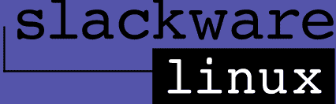
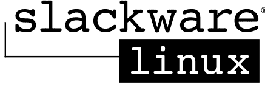
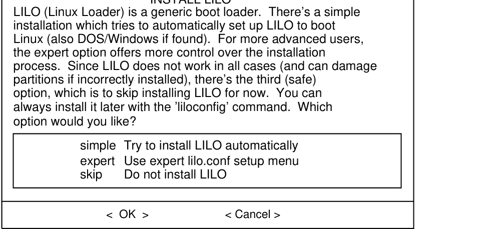
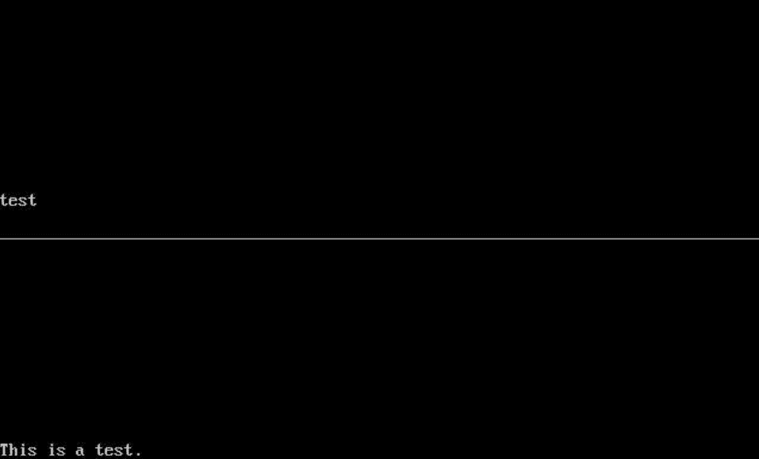
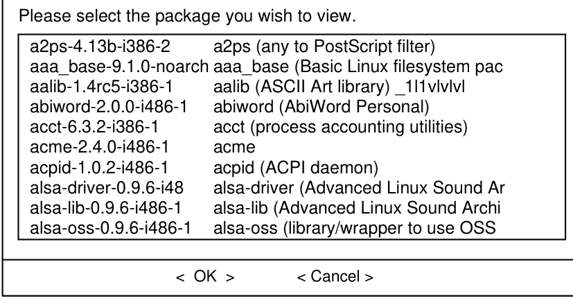

# Slackware Linux 入门指南，第2版








第二版主作者：Alan Hicks。

第二版编辑：Murray Stokely 和 Fu Kang Chen。

第一版作者：Chris Lumens, David Cantrell 和 Logan Johnson。


    - 10.2.3 most ... 125
    - 10.5.1 cp ... 128


- 19.2.1 安装................................................................................................ 226
- 19.3 启动 Slack............................................................................................... 227


# 前言

## 目标读者

Slack Linux 操作系统是一个基于英特尔计算机的强大平台。它的设计目标是作为高端服务器和强大的工作站，兼顾稳定性、安全性和功能性。

本书旨在帮助你上手 Slack Linux 操作系统。它并不是为了涵盖该发行版的每一个细节，而是为了展示它的功能，并让你对系统拥有基本的操作知识。

随着你对 Slack Linux 经验的增加，我们希望你会发现这本书是一份实用的参考资料。我们还希望，当你朋友向你请教运行的那个酷的 Slack Linux 操作系统时，你可以把这本书借给他们。

虽然这本书可能不像一部让你心跳加速的小说，但我们确实尝试让它尽可能风趣。如果运气的话，我们还能拿到电影授权。当然，我们也希望你能从中学习并发现它的用处。

现在，让我们开始吧。

## 与第一版的区别

这第二版是 Slack 文档项目（Slack Documentation Project）全体成员多年努力的结晶。以下是新版的主要变化：

- 第 3 章“安装”已根据安装程序的新截图进行了修改，并反映了磁盘集（disk-sets）和 CD 安装的变更。
- 第 4 章“系统配置”已更新了关于 Linux 2.6.x 内核的新信息。
- 第 5 章“网络配置”扩展了对 Samba、NFS 和 DHCP 的进一步解释。还增加了一个关于无线网络的章节。该章现在反映了 Slackware 处理网络设置的重大变化。
- 第 6 章“X Window 系统”针对基于 Xorg 的系统进行了大幅重写。该章现在涵盖了 xdm 图形化登录管理器。
- 第 13 章“基础网络命令”增强了其他网络工具的信息。
- 第 14 章“安全”是本版的新章节。它解释了如何保持 Slackware Linux 系统的安全。
- 第 17 章“Emacs”是本版的新章节。它描述了如何使用 Emacs，一个强大的 Unix 编辑器。
- 第 18 章“包管理”已更新了关于 SlackBuild 脚本的信息。
- 还有许多其他微小和巨大的变化，反映了 Slackware 随着成熟而发生的变化。

## 本书结构

第 1 章，引言
提供了关于 Linux、Slackware 以及开源和自由软件运动的介绍性材料。

第 2 章，帮助
描述了 Slackware Linux 系统及在线提供的可用帮助资源。

第 3 章，安装
分步骤描述安装过程，并提供截图作为直观的演示。

第 4 章，系统配置
描述了重要的配置文件，并涵盖了内核重新编译。

第 5 章，网络配置
描述了如何将 Slackware Linux 机器连接到网络。涵盖了 TCP/IP、PPP/拨号、无线网络等。

第 6 章，X Window 系统
描述了如何在 Slackware 中设置和使用图形化的 X Window 系统。

第 7 章，启动
描述了启动 Slackware 的过程。

第 8 章，Shell
描述了 Linux 的命令行界面。

第 9 章，文件系统结构
描述了文件系统结构、所有权和权限。

第 10 章，处理文件和目录
描述了用于操作文件和目录的命令。

第 11 章，进程控制
描述了用于管理运行应用程序的命令。

第 12 章，基础系统管理
描述了添加用户、关闭系统等基本管理任务。

第 13 章，基础网络命令
描述了 Slackwareset的网络客户端。

第 14 章，安全
描述了帮助保持 Slackware 系统安全的各种工具，包括 iptables 和 tcpwrappers。

第 15 章，归档文件
描述了用于 Linux 的压缩和归档工具。

第 16 章，vi
描述了强大的 vi 编辑器。

第 17 章，Emacs
描述了强大的 Emacs 编辑器。

第 18 章，Slackware 包管理
描述了创建自定义包的软件包工具。

第 19 章，ZipSlack
描述了可以在 Windows 下使用的 ZipSlack 版本。

附录 A，GNU 许可证
描述了 Slackware 和本书的复制和发行条款。

## 本书使用的规范

为了提供一致且易读的文本，本书遵循了若干规范。

## 排版规范

斜体
*斜体*用于命令、强调文本以及术语的首次出现。

等宽字体
*等宽字体*用于错误信息、命令、环境变量、端口名、主机名、用户名、组名、设备名、变量和代码片段。

粗体
**粗体**用于示例中的用户输入。

## 用户输入

按键以**粗体**显示以区别于其他文本。需要同时输入的按键组合使用 "+" 连接，例如：**Ctrl+Alt+Del**。

按顺序输入的按键将用逗号隔开，例如：Ctrl+X, Ctrl+S。这意味着用户预期先同时按下 Ctrl 和 X 键，然后同时按下 Ctrl 和 S 键。

## 示例

以 E:\ 开头的示例表示 MS-DOS® 命令。另有说明，这些命令可以在现代 Microsoft Windows® 环境的“命令提示符”窗口中执行。

```
D:\> rewrite a: bare.i
```

以 # 开头的示例表示必须以超级用户身份调用的命令。你可以登录 root 输入命令，或者以普通账户登录并使用 su(1) 获取超级用户权限。

```
# dd if=bare.i of=/dev/fd0
```

以 % 开头的示例表示应从普通用户账户调用。另有说明，使用 C-shell 语法设置环境变量和其他 Shell 命令。

```
% top
```

## 致谢

该项目是许多敬业人士数月工作的结晶。如果没有他们，我无法凭空完成这项工作。感谢许多人的无私付出：Keith Keller 在无线网络方面的工作；Joost Kremers 凭借一人之力完成了 Emacs章节的编写；Simon Williams 提供了安全章节；Jurgen Phillippaerts 提供了基础-
工作命令，感谢 Cibao Cu Ali G Colibri 提供的灵感和推我一一把的动力。无数其他人也提交了建议和修复。一个不完整的列表包括：Jacob Anhoej、John Yast、Sally Welch、Morgan Landry 和 Charlie Law。我还想感谢 Keith Keller 为此项目维护邮件列表，感谢 Carl Inglis 提供最初的网站托管。最后，我还要感谢 Patrick J. Volkerding 提供的 Slackware Linux，以及 David Cantrell、Logan Johnson 和 Chris Lumens 提供的 Slack Linux Essentials 第一版。没有他们的初始框架，这一切都不会发生。许多人也以不同大小的方式对这个项目做出了贡献，但并未列出。我希望他们能原谅我的记忆力不好。

Alan Hicks，2005年5月

# 第一章
# Slackware Linux 简介

## 1.1 什么是 Linux？

Linus Torvalds（林纳·托瓦兹）于1991年作为一个个人项目启动了 Linux——一个操作系统内核。他启动这个项目是因为想在不花费大量资金的情况下运行基于 Unix 的操作系统。此外，他还想学习 386 处理器的各种细节。Linux 免费向公众发布，以便任何人都可以根据通用公共许可证（GPL）对其研究和改进。（有关许可证的解释，请参见第1.3节和附录A。）今天，Linux 已成为操作系统市场中的主要力量。它被移植到各种系统架构上，包括 HP/Compaq 的 Alpha、Sun 的 SPARC 和 UltraSPARC，以及 Motorola 的 PowerPC 芯片（通过 Apple Macintosh 和 IBM RS/6000 计算机）。现在全球有成百上千的程序员在开发 Linux。它运行诸如 Sendmail、Apache 和 BIND 等非常流行的用于运行 服务器的程序。要记住，“Linux”这个术语实际上指的是内核——操作系统的核心。这个核心负责控制你电脑的处理器、内存、硬盘和外设。这就是 Linux 所做的全部：它控制你电脑的操作并确保其所有程序运行正常。不同的公司和个人将内核和各种程序打包在一起形成一个操作系统。我们将每个程序包称为 Linux 发行版。

# 第一章 Slackware Linux 简介

## 关于 GNU 的说明

Linux 内核项目是 Linus Torvalds 在1991年作为个人努力开始的，但正如艾萨克·牛顿曾说过的：“如果我看得更远，是因为我站在巨人的肩膀上。”当 Linus Torvalds 开始开发内核时，自由软件基金会已经建立了协作软件的概念。他们投入精力开发 GNU，这是一个递归缩写，简单来说就是“GNU's Not Unix”（GNU 不是 Unix）。GNU 软件从第一天起就运行 Linux 内核。他们的编译器 `gcc` 被用于编译内核。今天，从 `gcc` 到 `gnutar` 的许多 GNU 工具仍然是每个 Linux 发行的基础。由于这个原因，自由软件基金会的许多支持者认为，他们的工作应该获得与 Linux 内核同等的声誉。他们强烈建议所有 Linux 发行版都应该自称为 GNU/Linux。

这是一个引发许多争论的话题，仅次于古老的 vi 与 emacs 之间的“圣战”。本书的目的不是为了助长这场讨论的火，，而是为初学者澄清术语。当你看到 GNU/Linux 时，它意味着一个 Linux 发行版。它既可以指的是内核，也可以指的是一个发行版。这可能会相当困惑。通常不使用 GNU/Linux 这个术语是因为它太拗了。

## 1.2 什么是 Slackware？

Slackware 由 Patrick Volkerding 于1992年后期启动，并于1993年7月17日首次向世界发布，是第一个获得广泛使用的 Linux 发行版。Volkerding 在为一个项目需要一个廉价的 LISP 解释器时得知了 Linux。当时提供的发行版之一是来自 Soft Landing Systems 的 SLS Linux。Volkerding 使用 SLS Linux，并在发现漏洞时修复。最终，他决定将所有这些修复合并到自己的私有发行版中，供他和朋友使用。这个私有发行版获得了人气，因此 Volkerding 决定将其命名为 Slackware 并向公众开放。在此过程中，Patrick 为 Slackware 添加了新功能：一个基于 Unix 系统的用户友好安装程序，以及包管理概念，这允许用户在他们的系统中轻松地添加、删除或升级软件包。

有很多原因导致 Slackware 是 Linux 最古老的发行版。它并不试图模拟 Windows，而是试图尽可能像 Unix。它并不试图用花哨的、点点式的 GUI（图形用户界面）来掩盖进程。相反，它通过让用户看到确切发生的情况来让他们掌握控制权。它的开发并没有为了赶截止日期而仓忙——每个版本在准备就绪时就会发布。

Slackware 适合那些喜欢学习和调整自己的系统以完全按照自己的想法运行的人。Slackware 的稳定和简单是人们在未来几年内继续使用它的原因。Slackware 目前被誉为可靠的服务器和务实的工作站。你可以发现 Slackware 运行在任何窗口管理器或桌面环境中，或者完全没有。Slackware 服务器在任何可以使用的范围内运行。Slackware 用户是用户中最满意的。当然，我们可以说^)

## 1.3 开源与自由软件

在 Linux 社区内部，有两个主要的思想运动在运作。自由软件运动（我们稍后会介绍）正致力于使所有软件免受知识产权限制。该运动的支持者认为这些限制阻碍了技术改进。开源运动也致力于相同的目标，但采取了更务实的方法。开源运动的支持者倾向于基于代码免费提供的经济和技术优势来提出论点，而不是道德和伦理原则。在光谱的另一端是那些希望对软件保持更严格控制的团体。

自由软件运动由自由软件基金会领导，该基金会是 GNU 项目的筹款组织。自由软件更多地是一种意识形态。

经常使用的表达是“言论上的自由，而非金钱上的自由”（free in speech, not free in beer）。本质上，自由软件是尝试为用户和开发者保证某些权利。这些自由包括为了任何原因运行程序、研究和修改源代码、重新发布你做的任何修改。为了保证这些自由，创建了 GNU 通用许可证（GPL）。简而言之，GPL 提供分发许可的编译程序必须提供源代码，只要以源代码形式提供修改，就可以对程序进行修改。这保证了一旦程序向社区“开放”，除非每个部分代码的作者（包括修改部分）同意，否则无法“关闭”。大多数 Linux 程序都采用 GPL 许可。

注意的是，GPL 对价格没有做任何规定。尽管听起来可能很奇怪，你可以对自由软件收费。“免费”部分是指你对源代码的自由，而不是你为软件支付的价格。（然而，一旦有人卖给你或给你一个 GPL 许可的编译程序，他们就有义务提供源代码。）

另一个流行的许可证是 BSD 许可证。与 GPL 相比，BSD 许可证不要求发布程序的源代码。只要满足几个条件，根据 BSD 许可证发布的软件允许以源代码或二进制形式重新分发。作者的信誉不能作为该程序的某种广告。它还免除了作者因使用源代码可能产生的损害的责任。Linux 中包含的许多软件都是 BSD 许可的。

在年轻的开源运动的前沿，开源倡议（OSI）是一个纯粹为了获得开源软件支持的组织，即既提供源代码又提供现成程序的软件。他们不提供特定的许可证，而是支持各种类型的开源许可证。


# 第1章 Slackware Linux 简介

开源组织（Open Source Initiative）。许多公司想要发布源代码，但不想使用 GPL。由于他们无法从根本上改变 GPL，他们获得了提供自己的许可证并由该组织认证的机会。

自由软件基金会（Free Software Foundation）和开源组织（Open Source Initiative）致力于相互帮助，但它们并不是同一实体。自由软件基金会使用特定的许可证并根据该许可证提供软件。开源组织寻求对所有开源许可的支持，包括来自自由软件基金会的许可。双方各自主张使源代码免费可用的理由有时会导致这两个运动产生分歧，但这两个意识形态迥异的群体正朝着同一个目标努力，这一事实为双方的努力增添了可。

# 第2章

# 帮助

通常，你可能需要在使用特定命令、设置程序或让硬件正常工作所需的帮助。也许你只是想更好地理解某个命令，或者查看可以使用该命令的哪些其他选项。幸运的是，你有多种方法可以获取你寻找的帮助。在安装 Slack 时，你可以选择安装“F”系列软件包，其中包含了 FAQ（常见问题解答）和 HOWTO。程序还附带有关于其选项、配置文件和用法的帮助信息。

## 2.1 系统帮助

man

man（“manual”的缩写）是 Unix 和 Linux 操作系统中在线文档的传统形式。它由特殊格式的文件（即“man 页”）组成，为大多数命令编写，并随软件本身分发。执行 `man somecommand` 将显示指定命令（当然地）的 man 页，在我们的示例中，这将是虚拟的程序 `command`。

正如你所想象的，man 页的数量可能会迅速增加，变得极其混乱且非常复杂，即使对于高级用户也是如此。因此，man 页被分为若干编号的章节。这个系统已经存在了很久，久到你经常会看到命令、程序甚至编程库函数通过其 man 章节编号来被引用。

例如：

你可能会看到对 `man(1)` 的引用。编号告诉你“man”在第 1 节（用户命令）中有记录；你可以通过命令 `man 1 man` 指定你想要查看 'man' 的第 1 节 man 页。在多个项目具有相同名称的情况下，指定 man 查找的章节是有用的。

# 表 2-1. Man 页章节

| 章节 | 内容 |
| --- | --- |
| 章节 1 | 用户命令（仅限介绍） |
| 章节 2 | 系统调用 |
| 章节 3 | C 库调用 |
| 章节 4 | 设备（例如 hd, sd） |
| 章节 5 | 文件格式和协议（例如 wtmp, /etc/passwd, nfs） |
| 章节 6 | 游戏（仅限介绍） |
| 章节 7 | 惯例、宏包等（例如 nroff, ascii） |
| 章节 8 | 系统管理（仅限介绍） |

除了 `man(1)` 外，你还可以使用 `what(1)` 和 `apropos(1)` 命令，它们的共同目的是更容易在 man 系统中查找信息。

`whatis` 命令对系统命令提供非常简短的描述，类似于口袋命令参考书。

示例：

```
% whatis
whatis (1) - 在 whatis 数据库中的完整单词
```

# 第2章 帮助

`apropos` 命令用于搜索包含给定关键词的 man 页。

示例：

```
$ apropos wav - a sampling utility that dumps CD audio data into wav sound
cddawav (1) - Xirom Creditcard Netwave device driver
netwave_cs (4) - simple decoder, Ogg Vorbis file to PCM audio file (WAV or RAW)
goggdec (1) - (4)
awavelan (4) - AT&T GIS WaveLAN device driver
wavelan_cs (4) - AT&T GIS WaveLAN PCMCIA device driver
wlan_cs (4) - Lucent WaveLAN/IEEE 802.11 device driver
```

如果你想获得其中任何命令的更多信息，请阅读它们的 man 页获取详情； ;)

### /usr/doc 目录

我们构建的大多数软件包源码都带有某种文档。README 文件、使用说明、许可证文件等。随源码提供的任何文档都会包含并安装在你系统的 `/usr/doc` 目录下。每个程序（通常）会按照以下顺序安装自己的文档：

```
/usr/doc/$program-$version
```

其中 $Program 是你想要阅读的程序名称，$version 是（显然地）安装在你的系统上的软件包的相应版本。

例如，要读取命令 `man(1)` 的文档，你需要切换到：

```
$ cd /usr/doc/man-$version
```

如果阅读相应的 man 页（页）不能为你提供足够的信息，或者不能解决你特别寻找的内容，`/usr/doc` 目录应该是你的下一个停靠站。

# 第2章 帮助

### HOWTOs 和 mini-HOWTOs

正是开源社区真正的精神带我们来到了 HOWTO/mini-HOWTO 集合。这些文件正如其名所示——描述如何做某事的文档和指南。如果你安装了 HOWTO 集合，HOWTOs 将位于 `/usr/doc/HOWTOs`，mini-HOWTOs 将位于 `/usr/doc/mini-HOWTOs`。

同一系列中还包含一个 FAQ 集合，它是以下内容的缩写：

Frequently Asked Questions（常见问题解答）

这些文档以“问答”的形式编写，用于解决（惊喜的）常见问题。如果你在安装过程中安装了 FAQs，你将在 `/usr/doc/FAQs` 中找到它们。当你不确定如何继续时，这些文件非常值得阅读。好东西！

## 2.2 在线帮助

除了 Slack 操作系统提供并可安装的文档外，还有大量的在线资源供你学习。

### 官方网站和帮助论坛

官方网站¹

Slack 官方网站有时会过时，但仍然包含与最新版本相关的信息。曾经，那里存在过一个活跃的论坛，直到一群喷子、捣乱者和发牢者入侵了该论坛。维护论坛开始变成一项过量的工作，于是 Pat 将其关闭了。你可以在那里找到那个重新运行的旧论坛，带有旧数据的可搜索存档。

在论坛被关闭后，Pat 选择了 linuxquestions.org 作为 Slack Linux 的官方论坛。

### 电子邮件支持

每个购买了官方 CD 的人都有权通过开发者的电子邮件获得免费的安装支持。尽管如此，请记住，我们开发者（以及 Slack 的绝大多数用户）都是“老派”的。这意味着我们更倾向于帮助那些有诚意兴趣并在过程中愿意自力为之的人。我们会尽力帮助向我们发送支持问题邮件的人。然而，在发送电子邮件之前，请检查你的文档和网站（特别是 FAQs 以及下文列出的某些论坛）。这样你可能会获得更快的回答，而且我们需要回答的邮件越少，显然我们就能更快地为那些需要帮助的人提供援助。

技术支持的电子邮件地址是：support@slackware.com。其他电子邮件地址和联系方式列在网站上。

### Slack Linux 邮件列表

我们有邮件列表，提供摘要（digest）和普通格式。查看如何订阅的说明。

> 1 http://www.slackware.com


# 第 2 章 帮助

要订阅邮件列表，请发送邮件至：

majordomo@slack.com
在邮件正文中包含“subscribe [列表名称]”字样。列表选项描述如下（请使用下方的任意一个名称作为列表名称）。
邮件列表存档可以在 Slack 网站上找到：

http://slack.com/lists/archive/

slack-announce

- slack-announce 邮件列表用于发布新版本公告、重大更新和其他通用信息。

- slack-security
slack-security 邮件列表用于发布与安全问题相关的公告。任何与 Slack 直接相关的漏洞或其他漏洞都将立即发布到此列表。

这些列表还提供摘要（digest）格式。这意味着你每天只会收到一封大大的邮件，而不是在一天天中多次收到多条消息。由于 Slack 邮件列表不允许用户发布内容，且列表流量极低，大多数用户发现摘要列表并没有太大优势。尽管如此，如果你需要，可以通过订阅 slack-announce-digest 或 slack-security-digest 来获取。

### 非官方网站与帮助论坛

### 网站

Google (http://www.google.com)
搜索引擎中的“功夫宗师”。当你绝对、绝对必须找到某个主题的最后一点信息时：不接受任何替代品。

Google:Linux (http://www.google.com/linux)

针对 Linux 的特定搜索

Google:BSD (http://www.google.com/bsd)

针对 BSD 的特定搜索。Slack 作为一个类 Unix 操作系统，其通用性使得它往往能找到与 Slackware 几乎 100% 相关的详细信息。很多时候，BSD 搜索揭示的技术信息比通常与公关相关的 Linux 搜索多得多。

Google:Groups (http://groups.google.com)

在几十年的 Usenet 帖子中搜索你的智慧结晶。

http://userlocal.com

一个虚拟的知识宝库，里面有良好的建议、第一手经验和有趣的文章。这里通常是你第一次听闻 Slackware 世界新进展的地方。

### 网络资源

linuxquestions.org⁶

Slackware 用户官方认可的官方 Web 论坛。

LinuxISO.org Slackware 论坛⁷

> “一个下载和获取 Linux 帮助的地方。”

6 http://www.linuxquestions.org/questions/forumdisplay.php?forumid=14
7 http://forums.linuxiso.org/viewforum.php?f=25

# 第 2 章帮助

alt.os.linux.slackware FAQ⁸

另一个 FAQ

### Usenet 组 (NNTP)

Usenet 长期以来一直是极客们聚集和互相帮助的地方。虽然专门用于 Slack Linux 的新闻组很少，但这些小组通常只充满了极少数非常有学问的人。

```
alt.os.linux.slackware
```

alt.os.linux.slackware，广为人知的 aols（不要与 AOL® 混淆！），是寻找 Slack 问题技术帮助的最活跃地方之一。和每个 Usenet 新闻组一样，几个没有帮助忙的参与者（“喷子”）可能会通过持续的争论来破坏体验。学会忽略喷子并识别出真正有帮助的人，是充分利用这一资源的关键。

8 http://wombat.san-francisco.ca.us/perl/fom

14

# 第 3 章

# 安装

在使用 Slackware Linux 之前，你必须先获取并安装它。获取 Slackware 就像购买或在互联网上免费下载一样简单。只要你对电脑有一定的一些基础知识并愿意学习其他事情，安装它也同样。安装程序本身是一个一步步就班的过程。因此，你可以非常快速地启动并运行。事实上，Slackware 拥有所有全功能 Linux 发行版中安装时间最短的之一。

## 3.1 获取 Slackware

### 官方光盘和盒装套装

官方 Slackware Linux CD 组由 Slackware Linux, Inc. 提供。该 CD 包含 4 张光盘。第一张包含基础服务器安装所需的所有软件以及窗口系统。第二张 CD 是一张“现场”CD；即可以启动的 CD，它可以安装到 RAM 中，并提供一个临时安装供你玩玩玩，或者用于数据或机器救援。这张 CD 还包含了一些软件包，如 KDE 和 GNOME 桌面环境。第二张 CD 上还包含了一些小礼物，包括“extra”文件夹中的许多非核心软件包。第三张和第四张 CD 包含了所有 Slackware 的源代码，以及本书的原版。

你也可以购买一个盒装套装，其中包含 4 张光盘、本书，以及许多酷炫的 Slackware 装备来展示你的极客自豪感。CD 订阅

# 第 3 章 安装

也可以以优惠的价格提供。

购买 Slackware 商品品的首选方法是在 Slackware 商店在线购物。

```
http://store.slackware.com
```

你也可以电话或电子邮件你的订单。

# 表 3-1. Slackware Linux, Inc. 联系信息

| 方法 | 联系详情 |
| --- | --- |
| 电话 | 1-(925) 674-0783 |
| 网站 | http://store.slackware.com |
| 邮件 | orders@slackware.com |
| 邮寄 | 1164 Claremont Drive, Brentwood, CA 94513 |

### 通过互联网

Slackware Linux 也可以通过互联网免费获取。你可以通过邮件发送支持问题，但会给予购买官方 CD 组的用户更高的优先级。尽管如此，我们收到大量的邮件。在发送支持邮件之前考虑阅读第 2 章。

Slackware 官方网站位于：

```
http://www.slackware.com/
```

Slackware 的主要 FTP 位置位于：

```
ftp://slackware.com/
```

请记住，我们的 ftp 站点是对公众开放，带宽无限。在 http.slackware.com 处可以找到不完整的镜像列表。

```
http://slackware.com/getslack
```

## 3.2 系统要求

Slackware 安装最少需要以下内容：

# 表 3-2. 系统要求

| 硬件 | 要求 |
|---|---|
| 处理器 | 586 |
| 内存 | 32 MB |
| 磁盘空间 | 1GB |
| 介驱动器 | 4x CD-ROM |

如果你有可启动 CD，你可能不需要软盘驱动器。磁盘空间的要求有些复杂。1GB 的建议对于最小安装是安全的，但如果你进行完整安装，你需要大约两个字节的可用磁盘空间。Slackware 可以安装到内存更小、硬盘更小、CPU 更弱的系统上，但这需要一些努力。

### 软件系列

为了简单，Slackware 在历史上被分为软件系列。以前被称为“磁盘组”，是因为它们是为软盘安装设计的，现在软件系列主要用于分类 Slackware 中包含的软件包。今天，软盘安装已不再可能。

# 第三 章 安装

以下是每个软件系列的简要描述。

# 表 3-3. 软件系列

| 系列 | 内容 |
|---|---|
| A | 基础系统。包含启动所需的所有软件以及文本编辑器和基础通信程序。 |
| AP | 不需要 X 窗口系统的应用程序。 |
| D | 程序开发工具。编译器、调试器、解释器和手册页在这里。 |
| E | GNU Emacs。 |
| F | FAQ、教程以及其他杂杂文档。 |
| GNOME | GNOME 桌面环境。 |
| K | Linux 内核源代码。 |
| KDE | K Desktop 环境。一个与 MacOS 和 Windows 共享许多外观特征的 X 环境。KDE 需要 Qt 库在此系列中。 |
| KDEI | KDE 桌面的国际化软件包。 |
| L | 库。许多程序需要的动态链接库。 |
| N | 网络程序。守护进程、邮件程序、telnet、新闻阅读器等。 |
| T | LaTeX 文档格式系统。 |
| TCL | 工具命令语言。 |
| X | X 窗口系统。 |
| XAP | 不是主要桌面环境的 X 应用程序（例如 Ghostscript 和 Netscape）。 |
| Y | BSD 控制台游戏 |


### 安装方法

### 软盘 (Floppy)

虽然曾经可以通过软盘安装整个 Slack Linux，但软件包体积的不断增大（事实上，某些单独程序也是如此）迫使人们放弃了软盘安装。直到 Slack 7.1 版本，仍然可以使用软盘进行部分安装。A 系列和 N 系列几乎可以完全安装，提供一个基础系统，从该系统安装发行版的其余部分。如果你正在考虑使用软盘安装（通常是在旧款硬件上），通常建议找到一张基础 CD，或者使用旧版本。由于这个原因，Slack 4.0 仍然非常流行，7.0 也是如此。

请注意，如果你没有可启动 CD，那么在进行 CD-ROM 安装以及 NFS 安装时仍然需要软盘。

### 光盘 (CD-ROM)

如果你有可启动 CD（可在 Slack Linux, Inc. 出版的官方光盘集中获得，参见“获取 Slack”章节），那么基于 CD 的安装对你来说会简单一些。如果没有，你将需要从软盘启动。此外，如果你有特殊硬件，导致启动 CD 上的内核使用出现问题，你可能需要使用特殊的软盘。

从 Slack 8.1 版本开始，使用了一种新方法来创建启动 CD，这种方法在某些不稳定的 BIOS 芯片上运行不佳（值得注意的是，如今大多数 Linux CD 都受到此影响）。如果是如此，我们建议从软盘启动。

第 3.2.3 节和第 3.2.5 节提供了在必要时选择和创建用于启动软盘的信息。

# 第 3 章 安装

### NFS

NFS（网络文件系统）是让远程机器可以使用文件系统的一种方法。NFS 安装允许你从网络上的另一台计算机安装 Slack。你正在安装的机器需要配置为将 Slack 发行版树导出到你安装的机器。这显然涉及一些 NFS 知识，这些将在第 5.6 节中介绍。

可以通过 PLIP（通过并行口）、SLIP 和 PPP 等方法进行 NFS 安装（但不是通过调制解器连接）。然而，我们建议在条件允许的情况下使用网卡。毕竟通过打印机端口安装操作系统将是一个非常非常缓慢的过程。

### 启动盘 (Boot Disk)

启动盘是你实际启动以开始安装的软盘。它包含一个压缩的内核镜像，用于在安装期间控制硬件。因此，这是非常不可少的（除非你像“CD-ROM”章节讨论的那样从 CD 启动）。启动盘位于发行版树中的 `bootdisks/` 目录。

Slack 启动盘多到数不完（也就是说大约有 16 个）。启动盘的完整列表及其每个描述可以在 Slack 发行版树的 `bootdisks/README.TXT` 文件中找到。然而，大多数人可以使用 `bare.i`（用于 IDE 设备）或 `scsi.s`（用于 SCSI 设备）启动盘镜像。

请查看第 3.2.6 节有关如何从镜像制作磁盘的说明。

启动后，系统将提示你插入根盘。我们建议你只需配合启动盘的要求进行操作。

### 根盘 (Root Disk)

根盘包含安装程序和安装期间使用的文件系统。它们也是必须的。根盘镜像位于目录树中。你需要从 `install.1` 和 `install.2` 镜像制作两个根盘。在这里你也可以找到 `network.dsk`、`pcmcia.dsk`、`rescue.dsk` 和 `bootmgr.dsk` 磁盘。

### 辅助盘 (Supplemental Disk)

如果你正在执行 NFS 或安装到带有 PCMCIA 设备的系统，则需要辅助盘。辅助盘位于发行版树中的 `rootdisks` 目录，文件名 `network.dsk` 和 `pcmcia.dsk`。最近又添加了如 `rescue.dsk` 和 `bootmgr.dsk` 等其他辅助盘。救援盘是一个在 4MB RAM 驱动器中运行的小型软盘镜像。它包含了一些基础网络工具和 vi 编辑器，用于对故障机器进行快速修复。`bootmgr.dsk` 用于启动其他设备。如果你的 CD-ROM 驱动器无法启动 Slack CD，请使用它启动。它将提示你进行不同的启动项，并可能提供一种绕过缺陷 BIOS 的方便方法。

根盘加载后将指导你如何使用辅助盘。

### 制作磁盘 (Making the Disks)

一旦选择了启动盘镜像，就需要将其放入软盘中。根据你用于制作磁盘的操作系统，过程略有不同。如果你运行的是 Linux（或几乎任何 Unix 类的操作系统），你需要使用 `dd(1)` 命令。假设 `bare.i` 是你的磁盘镜像文件，且软盘驱动器是 `/dev/fd0`，制作 `bare.i` 软盘的命令为：

```
% dd if=bare.i of=/dev/fd0
```

如果你运行的是 Microsoft OS，你需要使用 `RAWRITE.EXE` 程序，它包含在发行树中与软盘镜像相同的目录下。同样假设 `bare.i` 是你的磁盘镜像文件，且软盘驱动器为 `A:`，打开 DOS 提示符并输入以下内容：

```
C:\write a: bare.i
```

## 3.3 分区 (Partitioning)

从你优的介质启动后，你需要对硬盘进行分区。磁盘分区是创建 Linux 文件系统以及安装 Slack 的地方。我们至少建议创建分区：一个用于根文件系统 (/)，另一个用于交换空间 (swap)。

根加载完成后，它将向你显示登录提示。以 root 身份登录（没有密码）。在 shell 提示符处运行 `cfdisk(8)` 或 `fdisk(8)`。`cfdisk` 程序提供了比 `fdisk` 更友好的界面，但缺少了一些功能。我们将在下文中简要介绍 `fdisk` 程序。

首先为你的硬盘运行 `fdisk`。在 Linux 中，硬盘没有驱动器号，而是用文件表示。第一个 IDE 硬盘（主）是 `/dev/hda`，从设备是 `/dev/hdb`，以此此类推。SCSI 磁盘遵循相同的系统，但格式为 `/dev/sdx`。你需要启动 `fdisk` 并传递你的硬盘：

```
### fdisk /dev/hda
```

像良好的 Unix 程序一样，`fdisk` 会给你一个提示符（你以为你会看到菜单吗？）。你应该做的第一件事是检查当前分区。在 fdisk 提示符处输入 `p` 执行：

```
Command (m for help): p
```

这将显示关于当前分区的所有信息。大多数人选择一个空硬盘进行安装，然后移除其上的现有分区以为 Linux 分区留出空间。

> **警告：在破坏信息所在的分区之前，务必备份任何想要保存的信息。**

删除分区没有简单的恢复方法，因此在操作之前请务必备份。

查看分区信息表，你应该看到分区编号、分区大小及其类型。还有其他信息，但现在无用担心。我们将删除此驱动器上的所有分区以创建 Linux 分区。我们运行 `d` 命令来删除它们：

```
Command (m for help): **d**
Partition number (1-4): **1**
```

此过程应对每个分区继续。删除分区后，我们准备好创建 Linux 分区了。我们决定创建一个用于根文件系统和交换空间的分区。


## 第 3 章 安装

现在我们使用 **n** 命令创建分区：

```
Command (m for help): **n**
Command action
  e extended
  p primary partition (1-4)
**p**nPartition number (1-4):**1**
First cylinder (0-1060, +size or +sizeM or +sizeK (0-1060, default 1060):**+64M
Last cylinder or +size or +sizeM or +sizeK (0-1060, default 1060):
```

你需要确保已经创建了分区。第一个分区将是我们的交换分区（swap partition）。我们告诉 fdisk 将编号为 1 的分区作为主分区。我们从扇道 0 开始，并在结束扇道处输入 `+64M`。这将为我们提供一个 64 兆的交换分区（你需要的交换分区的大小取决于你的 RAM 内存。通常的做法是创建一个比 RAM 大两倍的交换空间）。然后我们定义 2 号主分区，从第一个可用扇道开始一直到硬盘末尾。

```
Command (m for help):**n**
Command action
  e extended
  p primary partition (1-4)
**p**nPartition number (1-4):**2**
First cylinder (124-1060, default 124):**124**
Last cylinder or +size or +sizeM or +sizeK (124-1060, default 1060):**1060**
```

我们几乎就完成了。我们需要将第一个分区的类型更改为类型 82（Linux 交换）。输入 **t** 更改类型，选择第一个分区，然后输入 **82**。在将更改写入磁盘之前，你应该最后检查一次新的分区表。在 `fdisk` 中使用 **p** 显示分区表。如果一切看起来良好，输入 **w** 将更改写入磁盘并退出 `fdisk`。

## 3.4 setup 程序

一旦你创建了分区，就可以安装 Slackware 了。安装过程的下一步是运行 `setup(8)` 程序。要执行此操作，只需在 shell 提示符下输入 `setup`。`setup` 是一个菜单驱动的系统，用于实际安装 Slack 软件包并配置你的系统。

- Linux Setup (version 9.1.0)--欢迎来到 Slack Linux Setup。使用 UP/DOWN 键以及 SPACE 和 ENTER 键选择选项。也可以使用交替键：'+'、'-' 和 TAB。

| HELP | 读取 Slack Setup HELP 文件 |
| :--- | :--- |
| KEYMAP | 如果你没有使用美式布局，请重新映射你的键盘 |
| ADDSWAP | 设置你的交换分区 |
| TARGET | 设置目标分区 |
| SOURCE | 选择源媒体 |
| SELECT | 选择要安装的软件类别 |
| INSTALL | 安装所选软件 |
| CONFIGURE | 重新配置你的 Linux 系统 |
| EXIT | 退出 Slack Linux Setup |

setup 过程如下：你按照列出的顺序逐步执行 setup 程序中的每个选项。（当然，你可以自由地选择几乎任何顺序进行操作，但很可能结果并不理想。）使用向上和向下箭头键选择菜单项，并可以使用左右箭头键选择“确定（Okay）”和“取消（Cancel）”。或者，每个选项都有对应的键，该键在选项名称中高亮显示。选项是可以标记的（那些用 [x] 表示的），使用空格键进行切换。

当然，所有这些内容在 setup 的“help”（帮助）部分都有描述，但我们认为应该让读者物有所值。

### HELP

如果你是第一次安装 Slackware，你可能想查看一下帮助屏幕。它将为你提供 setup 每个部分的描述（类似于我们现在正在写的这些，但没那么复杂）以及导航安装其余部分的说明。

| Slackware Setup 帮助 |
| :--- |
| Slackware Linux Help |
| 首先，关于帮助的一点帮助。在安装过程中遇到这样的文本查看器时，可以使用这些命令进行移动： |
| PGDN/SPACE - 向下移动一页 |
| PGUP/b' - 向上移动一页 |
| ENTER/DOWN/j' - 向下一行 |
| UP/k' - 向上一行 |
| LEFT/h' - 向左滚动 |
| RIGHT/t' - 向右滚动 |
| 0 - 移动到文件开头 |
| HOME/g' - 移动到文件开头 |
| END/G' - 移动到文件末尾 |
| '/' - 向前搜索 |
| < OK > ( 6%) |

### KEYMAP

如果你需要美国“qwerty”布局以外的键位映射，你可能想看看这一节。它提供了许多备用布局供你键盘使用。

## 第 3 章 安装

### 键盘映射表选择
你可以选择以下键盘映射之一。
如果不选择键盘映射，'us.map'（美式键盘映射）是默认值。使用 UP/DOWN 箭头和 PageUp/PageDown 滚动整个选项列表。

```
qwerty/us.map
azerty/azerty.map
azerty/be-latin1.map
azerty/fr-latin1.map
azerty/fr-latin9.map
azerty/fr-pc.map
azerty/fr.map
azerty/wangbe.map
azerty/be2.map
dvorak/ansi-dvorak.map
dvorak/l.map

```

< OK >

### ADDSWAP

### 检测到交换空间
Slackware Setup 检测到分区：

| 设备 | 开始 | 结束 | 块 |
| :--- | :--- | :--- | :--- |
| /dev/da1 | | | |
| /dev/da2 | | | |
| /dev/da3 | | | |
| /dev/da4 | | | |

你希望将此作为交换分区吗？

< Yes > < No >

### TARGET

选择 Linux 安装分区：

| /dev/da1 | |
| :--- | :--- |
| /dev/da2 | |
| /dev/da3 | |
| /dev/da4 | |

< Select > < Continue >

### SOURCE

source 部分是你选择从何处安装的地方。有四种源可选：CD-ROM、NFS 或挂载目录。

| 来源选择 |
| :--- |
| 请选择用于安装的媒体 |
| 1 从 Slackware CD 或 DVD 安装 |
| 2 从硬盘安装 |
| 3 从 NFS 安装 |
| 4 从挂载目录安装 |
| < OK > < Cancel >

CD-ROM 选择启用基于 CD-ROM 的安装。它将提供扫描 CD-ROM 驱动器的选项。在允许扫描之前，确保你的驱动器中已放入 Slackware CD。

NFS 选择提示你的网络信息和服务器的网络信息。NFS 服务器必须提前设置好。请注意不能使用主机名，必须为你的机器和 NFS 服务器使用 IP 地址。

挂载目录提供了最大的灵活性。你可以使用此方法从 Jaz 磁盘、PLIP 挂载和 FAT 文件系统进行安装。在运行 setup 之前将文件系统挂载到指定位置，然后在这里指定该位置。

select 允许你选择想要安装的软件系列。这些系列在第 3.2 节中介绍。请注意，必须安装 A 系列才能拥有基础系统。所有其他系列都是可选的。

### 软件包系列选择 现在是选择要安装到系统中的软件类别的时间。使用空格键选择或取消你想安装的软件。你可以使用向上和向下箭头查看所有可能的选择。推荐选项已经预选。完成后按回车键。

- [X] A Base Linux 系统
- [X] AP 不需要 X 的各种应用程序
- [X] D 程序开发（C, C++, Lisp, Perl 等）
- [X] E FAQ 列表、HOWTO 文档
- [X] F 用于 X 的 GNOME 桌面
- [X] K 内核源码
- [X] KDE Qt 和用于 X 的 K 桌面环境
- [ ] KDE 国际支持

< OK | < Cancel

### INSTALL

假设你已经通过了 'target'、'source' 和 'select' 选项，install 允许你从选定的软件系列中选择软件包。如果不是，它将提示返回并完成 setup 程序的其他部分。此选项允许你从六种不同的安装方法中选择：全量、新手、菜单、专家、自定义和标签路径。


## 第 3 章 安装

| 选择提示模式 |
| :--- |
| 现在必须选择在安装过程中想要看到的提示类型。如果你有磁盘空间，'full'（完整）选项快速、简单，而且是目前最稳妥的选择。'newbie'（新手）模式提供的信息最多，但比基于菜单的选择要耗时得多（会逐个显示软件包）。否则，你可以使用 'expert'（专家）或 'menu'（菜单）模式从菜单中选择软件包。你想使用哪种类型的提示？ |
| full | 安装所有内容（近 2 GB 软件） |
| newbie | 使用详细提示（并遵循 tagfiles） |
| menu | 从交互式菜单中选择软件包组 |
| expert | 从交互式菜单中选择单个软件包 |
| custom | 使用软件包目录中的自定义 tagfiles |
| tagpath | 使用自定义路径子目录下的 tagfiles |
| help | 读取提示菜单帮助文件 |
| < OK | < 取消 > |

**full** 选项将安装你在“选择”部分选的所有软件系列中的每个包。不再有进一步的提示。这是最简单的安装方法，因为你不需要对实际安装的软件包做任何决定。当然，此选项也会占用最多的硬盘空间。

下一个选项是 **newbie**。此选项将安装所选系列中的所有必需软件包。对于所有其他软件包，它会提供一个提示，你可以选择 'Yes'（是）、'No'（否）或 'Skip'（跳过）。Yes 和 No 的显而易见，Skip 将进入下一个软件系列。此外，你将看到每个软件包的描述和大小要求，帮助你决定是否需要。我们建议新用户使用此选项，因为它能确保你安装了所有必需软件包。但是，由于有提示，速度有点慢。

Menu 是 newbie 选项更快速、更高级的版本。对于每个系列，都会显示一个菜单，你可以从中选择你想要安装的所有非必需软件包。必需软件包不会显示在此菜单中。

对于更高级的用户，安装提供了 **expert**（专家）选项。这允许你对安装哪些软件包进行完全控制。你可以取消勾选绝对必需的软件包，这将导致系统损坏。相反，你可以精确控制哪些内容进入你的系统。只需从每个系列中选择你想要安装的软件包。这不建议新用户使用，因为很容易自食其果。

custom 和 tag path 选项也是面向高级用户的。这些选项允许你根据在发行树中创建的自定义 tag 文件进行安装。这对于快速地安装大量机器非常有用。关于使用 tag 文件的更多信息，请参见第 18.4 节。

选择安装方法后，将发生几种情况之一。如果你选择了 full 或 menu，将出现菜单屏幕，允许你选择要安装的软件包。如果你选择了 full，软件包将立即安装到目标位置。如果你选择了 newbie，软件包将一直安装，直到遇到一个可选软件包。

注意，安装过程中可能会耗尽空间。如果你针对目标设备的可用空间选择了过多的软件包，你就会遇到问题。最安全的做法是先选择一些软件，如果需要，以后再添加。这可以使用 Slack 的软件包管理工具轻松完成。有关此信息，请参见第 18 章。

## 配置

软件包安装后，配置部分允许你进行一些基础系统配置。你在这里看到的内容很大程度上取决于你安装的软件包。然而，你始终会看到以下：

### 内核选择

在这里，将被要求选择一个要安装的内核。你可以从用于安装的启动盘、Slack CD-ROM，或另一张你（总是提前考虑）准备好的软盘中安装内核。你也可以选择跳过，在这种情况下，将安装默认内核并继续后续。

### 安装 Linux 内核

为了让你的系统正确启动，必须安装内核。如果你一直使用安装启动盘的内核 (/vmlinuz) 到这里，你应该将其安装为你的系统内核 (/boot/vmlinuz)。如果你确定自己在做什么，也可以从 Slack CD 安装你选择的内核，或从软盘安装内核。你也可以跳过此菜单，使用任何已安装的内核（例如 A 系列的通用内核）。你想选择哪种选项？

| bootdisk | 使用安装启动盘中的内核 |
| cdrom | 使用 Slackware CD 中的内核 |
| floppy | 从 DOS 软盘安装 zimage 或 bimage |
| skip | 跳过此菜单（使用默认的 /boot/vmlinuz） |

< OK > < 取消 >

### 制作启动盘

为以后以后制作一个启动盘可能是一个好主意。你可以选择格式化软盘然后创建两种类型启动盘之一。第一类型是简单的，它只是（你信吗）将内核写入软盘。更灵活（且非常推荐）的选项是 lilo，它无疑会创建一个 lilo 启动盘。更多信息请参见第 7.1 节中的 LILO。当然，你也可以选择直接继续，在这种情况下将不会制作启动盘。

### 制作启动盘

强烈建议为你的系统制作一个（或两个）启动盘。（此处由于原文存在大量重复文本，已按要求清理）


# 第 3 章 安装

### 字体

字体子章节允许你从自定义控制字体列表中进行选择。

| 选择屏幕字体 | 选择以下自定义字体之一。如果你觉得喜欢它，可以将其设置为新的默认屏幕字体。你可以尝试尽多你喜欢的字体。 |
| :--- | :--- |
| 161.cp.gz-16 | |
| 162.cp.gz-16 | |
| 163.cp.gz-16 | |
| 164.cp.gz-16 | |
| 165.cp.gz-16 | |
| 737.cp.gz-16 | |
| 880.cp.gz-16 | |
| 928.cp.gz-16 | |
| 972.cp.gz-16 | |
| Agafari-12.psfu.gz | |
| Agafari-14.psfu.gz | |
| Agafari-16.psfu.gz | |
| < 确定 > | < 取消 > |

### LILO

此处提示你安装 LILO（Linux 加载器；更多信息请参见第 7.1 节）。

### 安装 LILO

LILO (Linux Loader) 是一个通用的启动器。有一种简单的安装方法可以尝试自动设置 LILO 来启动 Linux（如果找到，也可以启动 DOS/Windows）。对于高级用户，专家选项提供了对安装过程的更多控制。由于 LILO 并非在所有情况下都能工作（如果安装不当可能会损坏分区），因此还有第三种（安全）选项，即暂时跳过安装 LILO。你可以使用 `liloconfig` 命令随时安装。你想选择哪种选项？

| 选项 | 描述 |
| :--- | :--- |
| simple (简单) | 尝试自动安装 LILO |
| expert (专家) | 使用专家 lilo.conf 设置菜单 |
| skip (跳过) | 不安装 LILO |

< 确定 > < 取消 >

如果 Slack 是你电脑上唯一的操作系统，那么简单模式对你来说就足够了。如果你正在进行双系统启动，专家选项是更好的选择。关于双启动的更多信息，请参见第 7.3 节。除非你清楚自己在做什么并且有不安装 LILO 的非常充分的，否则不建议选择第三种选项（不安装）。如果你正在执行专家级安装，将获得关于 LILO 放置位置的选择。你可以将 LILO 放置在硬盘的 MBR（主引导记录）、根 Linux 分区的超级块中，或在软磁盘上。

### 网络

网络配置子章节实际上是 `netconfig`。更多信息请参见第 5.1 节。

### X 窗口管理器

此子章节允许你为 X 选择默认窗口管理器。关于 X 和窗口管理器的更多细节，请参第 6 章。

| 为 X 选择默认窗口管理器 | |
| :--- | :--- |
| 请选择与 X 系统配合使用的默认窗口管理器。这将定义计算机所使用的图形用户界面样式。KDE 和 GNOME 提供了最多的功能。具有 Windows 或 MacOS 经验的人会发现其中任何一个很好用。其他窗口管理器更节省系统资源，或提供其他的独特功能。 | |
| xinitrc.kde | KDE: 桌面环境 |
| xinitrc.gnome | GNU 网络对象模型环境 |
| xinitrc.xfce | 无胆醇桌面环境 |
| xinitrc.blackbox | blackbox 窗口管理器 |
| xinitrc.fluxbox | fluxbox 窗口管理器 |
| xinitrc.wmaker | WindowMaker |
| xinitrc.fwwm2 | F(?) 虚拟窗口管理器（版本 2.xx） |
| xinitrc.fwwm95 | 具有 Windows 外观和感受的 FVWM2 |
| xinitrc.twm | 窗口管理器（非常基础） |
| < 确定 > | < 取消 > |

无论你安装了哪些包，configure 最后会做的一件事就是询问你是否想继续设置 root 密码。出于安全考虑，这可能是一个好主意；就像 Slackware 中的几乎所有其他东西一样，这由你决定。

# 第 4 章

## 系统配置

在配置系统更高级的部分之前，学习系统是如何组织的以及可以使用哪些命令来搜索文件和程序是一个好主意。了解你是否需要编译自定义内核以及执行该操作的步骤也是很好的。本章将让你熟悉系统结构和配置文件。然后，你就可以继续配置系统的更高级的部分了。

## 4.1 系统概述

在深入研究各种配置方面之前，理解 Linux 系统是如何组合在一起的。。Linux 系统与 DOS、Windows 或 Macintosh 系统有显著不同（基于 Unix 的 Mac OS X 除外），但这些章节将帮助你熟悉布局，以便你可以轻松配置系统以满足你的需求。

## 文件系统布局

Slack Linux 与 DOS 或 Windows 系统之间第一个明显的区别是文件系统。首先，我们不使用驱动器字母来表示不同的分区。在 Linux 下，有一个主目录。你可以将其比 DOS 下的 c: 盘。你系统上的每个分区都挂载在主目录下的一个目录。这就像是一个不断扩展的硬盘。

我们将主目录称为根目录（root）。这是文件系统层次结构的起点。每个文件和目录都在根之下。根目录由正斜杠 `/` 表示。


查找文件。我的意思是，你可以去遍历目录，但有更快的方法。Slackware 中提供了四种主要的文件搜索命令。

## which

第一个是 `which(1)` 命令。which` 通常用于快速定位程序。它只搜索你的 `PATH` 并返回找到的第一个实例及其所在的目录路径。看这个例子：

```bash
/bin/bash
```

从这里你可以看到 `bash` 在 `/bin` 目录中。这是一个非常有限的搜索命令，因为它只搜索你的 `PATH`。

## whereis

`whereis(1)` 命令的作用与 `which` ，但它还可以搜索手册（man pages）和源代码。对 `bash` 执行 whereis 应该返回：

```bash
- whereis bash
bash: /bin/bash /usr/bin/bash /usr/man/man1/bash.1.gz
```

这个命令不仅告诉你实际程序的位置，还告诉了在线文档存储的位置。尽管如此，这个命令仍然有局限。如果你想搜索特定的配置文件怎么办？你不能使用 `which` 或 `whereis` 来。

## find

`find(1)` 命令允许用户使用丰富的搜索谓词对文件系统进行搜索。用户可以指定带有文件名通配符、修改或创建时间范围或其他高级属性的搜索。例如，要搜索系统上的默认 `xinitrc` 文件，可以使用以下命令。

```bash
find -name xinitrc
/var/X11R6/lib/xinit/xinitrc own
```

`find` 运行需要一段时间，因为它必须遍历整个根目录树。如果以普通用户身份运行此命令，对于只有 root 用户可见的目录将会出现“权限拒绝”的错误信息。但 `find` 找到了我们的文件，所以这很好。如果它能再快一点就好了……

## slocate

`slocate(1)` 命令搜索整个文件系统的索引，而不是实际的文件系统。数据库被设置为每天早上自动更新，因此你可以获得系统上的一份较新的文件列表。你可以手动运行 `updatedb(1)` 来更新 slocate 数据库（在手动运行 `updatedb` 之前，你必须先 `su` 切换到 `root` 用户）。这里是 slocate 的运行示例：

```bash
slocate xinitrc # 我们不需要去根目录
/var/X11R6/lib/xinit/xinitrc
/var/X11R6/lib/xinit/xinitrc.fwwm2
/var/X11R6/lib/xinit/xinitrc.openwin
/var/X11R6/lib/xinit/xinitrc.twm
```

我们得到的比寻找的更多，而且速度很快。通过这些命令，你应该能够在你的 Linux 系统上找到你需要的任何东西。

## /etc/rc.d 目录

系统初始化文件存储在 `/etc/rc.d` 目录。Slackware 的初始化文件使用了 BSD 风格的布局，而不是 System V init 脚本，后者在不使用专门为该目的设计的程序，往往会使配置更改变得困难得多。在 BSD-init 脚本中，每个运行级别（runlevel）被分配一个 `rc` 文件。在 System V 中，每个运行级别都有自己的目录，每个目录包含许多 init 脚本。这提供了一个组织良好且易于维护的结构。

初始化文件有几类。这些是系统启动、运行级别、网络初始化和 System V 兼容性。按照传统，我们将其他所有内容归为另一类。

## 系统启动

除了 Linux 内核之外，Slack 下第一个运行的程序是 `init(8)`。该程序读取 `/etc/initab(5)` 文件来查看如何运行系统。它在进入所需的运行级别之前，运行 `/etc/rc.d/rc.s` 脚本来准备系统。`rc.s` 文件启用你的虚拟内存，挂载文件系统，清理系统。在 BSD-init 脚本中，每个运行级别被分配一个 `rc` 文件。在 System V 中，每个运行级别都有自己的目录，每个目录包含许多 init 脚本。这提供了一个组织良好且易于维护的结构。

```bash
rc.s
```

```bash
rc.modules
```

```bash
rc.pcmia
```

```bash
rc.serial
```

```bash
rc.sysinit
```

```bash
rc.net
```

```bash
rc.local
```

```bash
rc.font
```

```bash
rc.local
```

```bash
rc.S
```

```bash
rc.M
```

```bash
rc.K
```

```bash.0
```

```bash
rc.1
```

```bash
rc.2
```

```bash
rc.3
```

```bash
rc.4
```

```bash
rc.5
```

```bash
rc.6
```

```bash
rc.init
```

```bash
rc.inet1
```

```bash
rc.inet2
```

```bash
rc.atalk
```

```bash
rc.httpd
```

```bash
rc.news
```

运行级别脚本

网络初始化

System V 兼容性

其他文件


## 第 4 章 系统配置

用户。答案是肯定的可能。在少数情况下，你需要为特定系统编译特定的内核。大多数用户可以使用预编译的内核和可加载内核模块来实现完全运行的系统。如果你正在将内核版本升级到 Slackware 目前未提供的版本，或者你对内核进行了补丁以获取原生内核源码中包含的特殊设备支持，你可能需要为你的系统编译内核。任何拥有 SMP 系统的用户都会想要编译一个带有 SMP 支持的内核。此外，许多用户发现自定义内核在他们的机器上运行速度更快。你可能会发现，针对机器中的特定处理器进行优化并编译内核是有用的。

构建自己的内核并不难。第一步是确保你的系统上安装了内核源码。确保你在安装期间安装了来自 K 系列的软件包。你还希望确保安装了 D 系列软件包，特别是 C 编译器、GNU make 和 GNU binutils。通常情况下，如果你计划进行任何形式的开发，安装 D 系列软件包是个好主意。你也可以从 http://www.kernel.org/mirrors 下载最新的内核源码。

## Linux 内核版本 2.4 编译

```bash
% su -
Password:
### cd /usr/src/linux
```

第一步是将内核源码恢复到基础状态。我们执行此命令来完成此操作（注意，你可能希望备份 .config 文件，因为此命令会在不警告的情况下删除它）：

```bash
### make mrconfig
```

现在你可以为你的系统配置内核了。当前内核提供了三种方法。第一种是原始的基于文本的问答系统。它会提出一系列问题然后构建一个配置文件。这种方法的问题是，如果你搞砸了，必须重新开始。大多数人喜欢的方法是菜单驱动的方法。最后，有一个基于 X 的内核配置工具。选择你想要的一种并执行相应的命令：

```bash
### make config (基于文本问答版本)
### make menuconfig (菜单驱动，文本版本)
### make xconfig (基于 X 版本，确保你处于 X 环境中)
```

### 图 4-1. 内核配置菜单

Linux 内核 v2.2.16 配置

方向键导航菜单。<Enter> 选择子菜单 --->。
高亮的字母和热键。按 <Y> 包含，按 <N> 排除，
<M> 将功能模块化。按 <Esc><Esc> 退出，</?> 帮助
图例：[*] 内置 [ ] 排除 <M> 模块 < 可模块化能力

| 主菜单 |
| :--- |
| 代码成熟度选项 ---> |
| 处理器类型和特性 ---> |
| 可加载模块支持 ---> |
| 通用设置 ---> |
| 即插即用支持 ---> |
| 块设备 ---> |
| 网络选项 ---> |
| 电话支持 ---> |
| SCSI 支持 ---> |
| 网络设备支持 ---> |
| 业余无线电支持 ---> |
| | 选择 > 退出 > 帮助 > |

新用户可能会发现 menuconfig 最容易使用。它提供了帮助屏幕来解释内核的不同部分。配置好内核后，退出配置程序。它将写入必要的配置文件。现在你可以为构建准备源码树了：

```bash
### make dep
### make clean
```

下一步是编译内核。首先尝试执行下方的 bzImage 命令。

```bash
### make bzImage
```

这可能需要一段时间时间，取决于你的 CPU 速度。在构建过程中，你将看到编译器的信息。构建内核镜像后，你可能希望构建任何你标记为模块的内核部分。

```bash
### make modules
```

我们现在可以安装编译的内核和模块了。要在 Slack 系统上安装内核，应该执行这些命令：

- mv /boot/vmlinuz /boot/vmlinuz.old
- cat arch/i386/boot/bzImage > /vmlinuz
- mv /boot/System.map /boot/System.map.old
- cp System.map /boot/System.map
- make modules_install

你可能需要编辑 /etc/lilo.conf 并添加一个部分来启动旧内核，以防新内核无法工作。完成此后，运行 /sbin/lilo 安装新内核编译的引导块。你现在可以使用新内核重启系统了。

## Linux 内核版本 2.6.x

2.6 内核的编译与 2.4 或 2.2 内核相比略有不同，但在深入之前，了解这些差异是非常重要的。现在没有必要运行 `make dep` 和 `make clean`。此外，内核编译过程没有 2.6 系列内核那么详细。这导致构建过程更容易理解，但也有一些缺点。如果你在构建内核时遇到困难，强烈建议你恢复详细输出。你只需通过在构建时添加 `V=1` 来实现。这允许你获取更多信息，帮助内核开发者或其他友好的极客帮你解决问题。

```bash
### make bzImage V=1
```

## 使用内核模块

内核模块是插入运行内核的设备驱动程序的别名。它们允许你扩展内核支持的硬件，而无需选择另一个内核或自己编译。

模块也可以随时加载和卸载。它们存储在 /lib/modules 中。通常情况下，如果你计划进行任何形式的开发，安装 D 系列软件包是个好主意。你也可以从 http://www.kernel.org/mirrors 下载最新的内核源码。

要查看模块列表，使用 `lsmod`：

```text
lsmod
Module Size Used
parport 0 0
```

要删除模块，使用 `rmmod(1)` 命令。要加载模块，使用 `insmod(1)` 命令。对于更高级的管理，使用 `modprobe(1)`，它更安全并会自动处理依赖关系。


位于 `/etc/rc.d/` 下的 `rc.netdevice` 文件。如果在安装期间成功自动探测了你的网络设备，则会创建此脚本。

在该 `if` 块下方是网络设备列表和 `modprobe` 命令行，每个每行都被注释了。找到你的设备并取消相应 `modprobe` 行的注释，然后保存文件。现在以 root 身份运行 `rc.modules` 应该加载你的网络设备驱动程序（以及任何列出且取消注释的其他模块）。请注意，某些模块（如 ne2000 驱动）需要参数；请确保你选择了正确的行。

### 域网 (10/100/1000Base-T 和 Base-2) 网卡

此标题涵盖了所有的内部 PCI 和 ISA 网卡。这些网卡的驱动程序通过可加载内核模块提供，如上一个段所述。`/sbin/netconfig` 应该已经探测了你的网卡并成功设置了 `rc.netdevice` 文件。如果没有发生这种情况，最可能的问题是你尝试为特定网卡加载的模块是错误的（同一品牌的不同代网卡需要不同模块的情况并不少见）。如果你确定你尝试加载的模块是正确的，你最好的选择是参考该模块的文档，以尝试发现当模块初始化时是否需要特定的参数。

### 调制调器

像局网卡一样，调制调器可以通过各种支持选项进行连接。直到最近，大多数调制调器还是 8 位或 16 位的 ISA 卡。随着 Intel 和各地主板制造商努力彻底消灭 ISA 总线，现在通常发现大多数调制调器是连接到串口 USB 端口的外部调制调器，或者是内部 PCI 调制调器。如果你希望你的调制调器在 Linux 上工作，研究你打算购买的调制调器**至关重要**，特别是当你考虑购买 PCI 调制调器时。许多，如果不是大多数，

# 第 5 章 网络配置

如今市面上售的 PCI 调制调器是 WinModems。WinModems 调制调器卡本身缺少一些基础硬件；这些硬件执行的功能通常由调制调器驱动程序和 Windows 操作系统卸载到 CPU。这意味着它们没有 PPPD 在你尝试拨号到互联网服务提供商时所预期的标准串口接口。

如果你想绝对确定购买的调制调器能够与 Linux 工作，请购买一个连接到 PC 串口的外部硬件调制调器。这些保证工作得更好，且安装和维护的麻烦更少，尽管它们需要外部电源且成本更高。

有几个网站为基于 WinModem 的设备提供驱动程序和配置帮助。一些用户报告成功配置并安装了各种 winmodems 的驱动程序，包括 Lucent、Conex 和 Rockwell 芯片组。这些设备所需的软件不是 Slackware 的组成部分，且随驱动程序而异，我们不会对它们进行详细介绍。

### PCMCIA

作为 Slackware 安装的一部分，你有机会安装 `pcmcia` 包（在“A”系列包中）。该包包含在 Slackware 下与 PCMCIA 卡工作所需的应用程序和设置文件。需要注意的是，`pcmcia` 包只安装了在 Slackware 下与 PCMCIA 卡工作所需的通用软件。它**没有(NOT)** 安装任何驱动程序或模块。可用的模块和驱动将位于 `/lib/modules/uname-r/pcmcia` 目录下。你可能需要进行一些实验，以找到一个与你的网卡兼容的模块。

你需要编辑 `/etc/pcmcia/network.opts`（针对以太网卡）或 `/etc/pcmcia/wireless.opts`（如果你有无线网卡）。和大多数 Slackware 配置文件一样，这两个文件有非常详细的注释，应该很容易确定需要进行哪些修改。

# 第 5 章 网络配置

## 5.3 TCP/IP 配置

此时，你的网卡应该已经物理安装在计算机中，并且相关的内核模块应该已经加载。你将无法通过网卡进行通信，但可以通过 `ifconfig -a` 获取有关网络设备的信息。

```
### ifconfig -a
eth0 Link encap:Ethernet HWaddr 00:A0:CC:3C:60:A4
UP BROADCAST NOTRAILERS RUNNING MULTICAST MTU:1500 Metric:1
RX packets:110081 errors:1 dropped:0 overruns:0 frame:0
TX packets:84931 errors:0 dropped:0 overruns:0 carrier:0
collisions:0 txqueueen:100
RX bytes:114824506 (109.5 Mb) TX bytes:9337924 (8.9 Mb)
Interrupt:5 Base address:0x8400
```

```
lo Link encap:Local Loopback
inet addr:127.0.0.1 Mask:255.0.0.0
UP LOOPBACK RUNNING Metric:16436
RX packets:2234 errors:0 dropped:0 overruns:0 frame:0
TX packets:2234 errors:0 dropped:0 overruns:0 carrier:0
collisions:0 txqueueen:0
RX bytes:168758 (164.8 Kb) TX bytes:168758 (164.8 Kb)
```

如果你输入 `/sbin/ifconfig -a`，输出将类似于上面的内容。如果你输入 `/sbin/ifconfig eth0`，你只会看到 eth0 的信息。

如果你输入 `/sbin/ifconfig lo`，你将只会看到环回接口（loopback）的信息。

如果你输入 `/sbin/ifconfig -s`，你将看到所有接口的简要摘要。

如果你输入 `/sbin/ifconfig -h`，你将看到该命令的帮助信息。

DHCP（动态主机配置协议）是一种为计算机分配 IP 地址的方法。Linux 中的 DHCP 客户端 `/sbin/dhcpcd`。如果你用喜欢的编辑器加载 `/etc/rc.d/inet1`，你会发现在脚本中间部分调用了 `dhcpcd`。dhcpcd 还会跟踪租约的剩余时间，并在必要时自动联系 DHCP 服务器请求续租。DHCP 还可以控制相关信息，例如使用哪个 NTP 服务器、采取什么路由等。

在 Slack 上设置 DHCP 非常简单。只需运行 `netconfig` 并选择 DHCP即可。如果你有多个网卡且不希望 eth0 由 DHCP 配置，只需编辑 `/etc/rc.d/inet1.conf` 文件并将相关网卡的变量改为“YES”。

### 静态 IP

静态 IP 地址是固定地址，只有手动指示时才会更改。适用于管理员不希望 IP 信息发生变化的情况，例如局域网内部、连接到互联网的任何服务器以及网络路由器。通过静态 IP 划分，你分配一个地址并保持不变。其他机器知道你始终位于该 IP 地址，并且始终可以通过该地址与你联系。

`/etc/rc.d/inet1.conf`

如果你计划为你新的 Slackware 机器分配 IP 地址，可以通过 `netconfig` 脚本，也可以编辑 `/etc/rc.d/inet1.conf`。在 `/etc/rc.d/inet1.conf` 中，你会注意到：

```
IPADDR[0]=""
NETMASK[0]=""
USE_DHCP[0]=""
DHCP_HOSTNAME[0]=""
```

然后在文件的底部：

```
GATEWAY=""
```


## 第 5 章 网络配置

在这种情况下，我们的任务仅仅是在双引号之间填写正确的信息。这些变量在启动时会被 /etc/rc.d/rc.inet1 调用，用于设置网卡（nics）。对于每个网卡，只需输入正确的 IP 信息，或者为 USE_DHCP 输入“YES”。Slackware 会按照发现网卡的顺序，使用此处此处处的信息启动接口。

`DEFAULT_GW` 变量为 Slack 设置默认路由。在没有指定其他路由的情况下，你的计算机与互联网上其他计算机之间的通信必须通过该网关。如果你使用 DHCP，通常不需要输入任何内容，因为 DHCP 服务器会指定要使用的网关。

### /etc/resolv.conf

好了，你已经有了 IP 地址，有了默认网关，甚至可能还有一千万美元（分我们一点吧），但如果你无法将域名解析为 IP 地址，那这些又有什么用呢？没有人想在网络浏览器中输入 72.9.234.112 来访问 www.slackbook.org。毕竟，除了作者之外，谁能记住那个 IP 地址呢？我们需要设置 DNS，但如何设置呢？这就是 /etc/resolv.conf 发挥用场的地方。

你可能已经在 /etc/resolv.conf 中有了正确的选项。如果你使用 DHCP 设置网络连接，DHCP 服务器应该会为你更新此文件。（从技术上说，DHCP 服务器只是告诉 dhcpcd 写入什么，而它会照做。）但如果你需要手动更新 DNS 服务器列表，则编辑 /etc/resolv.conf。以下是一个示例：

```
### cat /etc/resolv.conf
nameserver 192.168.1.254
search lizella.net
```

第一行非常简单。`nameserver` 指令告诉我们查询哪些 DNS 服务器。必要时，这些总是 IP 地址。你可以列出任意数量的服务器。Slackware 会乐意地一个接一个地检查，直到有一个返回匹配项为止。

第二行稍微有点意思。`search` 指令为我们提供了一个在进行 DNS 请求时假设的域名列表。这允许我们仅通过 FQN（完全限定域名）的第一部分来连接到机器。例如，如果 ‘slack.com’在你的搜索路径中，你只需将网络浏览器指向 http://store 即可访问 http://store.slack.com。

```
### ping -c 1 store
PING store.slack.com (69.50.233.153) : 56 data bytes
64 bytes from 69.50.233.153 : icmp_seq=0 time=0.251 ms
1 packets transmitted, 1 packets received, 0 packet loss
round-trip min/avg/max = 0.251/0.251/0.251 ms
```

### /etc/hosts

现在 DNS 正常工作了，但如果我们想绕过 DNS 服务器，或者为不在 DNS 中的机器添加一个 DNS 条目怎么办？Slackware 包含了一个良好的 /etc/hosts 文件，它包含了 DNS 名称及其应匹配的 IP 地址本地列表。

```
### cat /etc/hosts
127.0.0.1 localhost localhost.localdomain
192.168.1.101 redtail
172.14.66.32 foobar.slack.com
```

在这里你可以看到 localhost 的 IP 地址为 127.0.0.1（始终保留给 localhost），redtail 可以 192.168.1.101 访问，而 foobar.slack.com 是 172.14.66.32。

## 5.4 PPP

许多人仍然通过某种拨号连接到互联网。最常见的方法是 PPP，尽管 SLIP 偶尔仍在使用。设置你的系统与远程服务器进行 PPP 通信非常简单。我们包含了一些工具来帮助你设置。

### pppsetup

Slackware 包含一个名为 pppsetup 的程序，用于配置你的系统使用你的拨号账户。它的外观和感觉与我们的 netconfig 程序相似。要运行该程序，请确保你已以 root 身份登录。然后输入 `pppsetup` 运行。你应该看到类似这样的屏幕：

程序将提出一系列问题，你需要为其提供相应的答案。例如你的设备、调制解器初始化字符串和 ISP 电话号码。某些项目会有默认值，在大多数情况下你可以接受它们。

程序运行后，它会创建一个 `ppp-go` 程序和一个 `ppp-off` 程序。这两个程序分别用于启动和停止 PPP 连接。这两个程序位于 /usr/sbin 中，需要 root 权限才能运行。

### /etc/ppp

对于大多数用户来说，运行 pppsetup 就足够了。然而，可能会出现你想调整 PPP 守护进程使用的某些值。所有的配置信息都保存在 /etc/ppp 中。以下是不同文件的用途：

- ip-down: 该脚本由 pppd 在 PPP 连接结束后运行。当 ppp 连接成功时，pppd 也会运行此脚本。请将任何你想在成功连接后运行的命令放在此文件中。
- options: pppd 的通用配置选项。


# 第5章 网络配置

## 5.6 网络文件系统

此时，你应该已经建立了与网络可以正常工作的 TCP/IP 连接。你应该能够 ping 内部网络上的其他计算机，如果你配置了适当的网关，还应该能够 ping 互联网上的计算机。正如我们所知，将计算机接入网络的主要目的就是访问信息。虽然有些人可能只是为了好玩而将计算机接入网络，但大多数人希望能够共享文件和打印机。他们希望能够访问互联网上的文档或玩在线游戏。在新的 Slack 系统上安装并运行 TCP/IP 是实现这一目的手段，但仅安装 TCP/IP，其功能将非常简陋。要共享文件，我们必须使用 FTP 或 SCP 来回传输文件。我们无法在 Windows 计算机的“网络邻居”或“我的网络位置”图标上浏览 Slack 计算机上的文件。我们希望能够无缝地访问其他 Unix 机器的文件。

理想情况下，我们希望能够使用网络文件系统来透明地访问其他计算机上的文件。我们用于与计算机存储的信息交互的程序实际上并不需要知道文件存储在哪台计算机上；它们只需要知道该文件存在以及如何获取它。此时，由操作系统负责通过可用的文件系统和网络文件系统管理对该文件的访问。最常用的两种网络文件系统是 SMB（由 Samba 实现）和 NFS。

### SMB/Samba/CIFS

SMB（Server Message Block）是旧版 NetBIOS 协议的后代，最初由 IBM 在其 LAN Manager 产品中使用。微软一直对 NetBIOS 及其继者（NetBEUI、SMB 和 CIFS）非常感兴趣。

Samba 项目自 1991 年以来一直存在，它最初是为了连接运行 NetBIOS 的 IBM PC 与 Unix 服务器而编写的。如今，由于 Windows 支持，SMB 已成为几乎整个文明世界通过网络共享文件和打印服务的选方法。

Samba 的配置文件是 `/etc/samba/smb.conf`；这是你随处能找到注释最详细、文档最完整的配置文件之一。它已经设置了示例共享，供你根据需要查看和修改。如果你需要更严格的控制，`smb.conf` 的 man 页面是不可或缺的。由于我在上面提到的地方对 Samba 的文档非常详尽，我们不会在这里重写这些文档。然而，我们将快速介绍基础知识。

`smb.conf` 分为多个部分：每个部分对应一个，还有一个用于设置全局生效选项的全局部分。某些选项仅在全局部分有效；某些仅在全局部分之外有效。记住，全局部分可以被任何其他部分覆盖。更多信息请参考 man 页面。

你很可能想要编辑 `smb.conf` 文件以反映你局域网的网络设置。我建议修改列出的项目：

```
[global]
### workgroup = NT-Domain-Name or Workgroup-Name, eg: LINUX2
workgroup = MYGROUP
```

更改工作组名称以反映你本地使用的工作组名或域名。

```
### server string 等同于 NT Description 字段
server string = Samba Server
```

这将是你的 Slackware 计算机在“网络邻居”（或“我的网络位置”）文件夹中显示的名称。

# 安全模式。大多数人想要用户级安全。
# 详情请查看 security_level.txt。注意：要获得
# Samba-1.9.18 的行为，你需要使用 "security = share"。

security = user

你几乎肯定会在你的 Slack 系统上实现用户级安全。

- # 你可能希望使用密码加密。请阅读 Samba
# 文档中的 ENCRYPTION.txt、Win95.txt 和 WinNT.txt，
# 在阅读这些文档之前不要启用此选项
encrypt passwords = yes

如果未启用 `encrypt passwords`，你将无法与 NT4.0、Win2k、WinXP 和 Win2003 使用 Samba。早期的 Windows 操作系统不需要加密即可共享文件。

SMB 是一个认证协议，这意味着必须提供正确的用户名和密码才能使用此服务。我们通过 `smbpasswd` 命令告诉 Samba 服务器用户名和密码是有效的。`smbpasswd` 带有几个常用开关，用于添加传统用户或添加机器用户（SMB 要求将计算机的 NETBIOS 名称作为机器用户添加，以限制哪些计算机可以进行验证）。

向 `/etc/samba/private/smbpasswd` 文件添加用户。
### smbpasswd -a user

向 `/etc/samba/private/smbpasswd` 文件添加机器名。
### smbpasswd -a -m machine

- adduser machine$

### 网络文件系统 (NFS)

NFS（或网络文件系统）最初由 Sun 为其 Solaris 版本的 Unix 编写。虽然与 SMB 相比，它更容易上手运行，但其安全性也明显低得多。NFS 的主要不安全性在于很容易从一台机器伪造用户 ID 和用户组 ID。NFS 是一个未认证的协议。未来的 NFS 协议版本旨在增强安全性，但在本文写作时这些并不常见。

NFS 配置由 `/etc/exports` 文件管理。（*此处由于重复内容已省略*）

NFS 配置由 `/etc/exports` 文件管理。（*此处由于重复内容已省略*）

# 第6章 X 配置

从 Slack-10.0 开始，Slack 中的 X 窗口环境由 Xorg 提供。X 负责提供图形界面。它独立于 Windows 或 macOS。两个主要组件是服务器和窗口管理器。服务器提供与视频硬件交互的低级函数，因此它是特定系统的。窗口管理器运行在服务器之上并提供用户界面。这种设计的优点是你可以通过切换使用的窗口管理器来获得图形界面。

配置 X 需要创建一个 `/etc/X11/xorg.conf` 文件。该文件包含了关于你的视频硬件、鼠标和显示器的大量详细信息。这是一个非常复杂的配置文件，但幸运的是有很多程序可以帮助创建。我们在这里提到其中几个。


## 6.1 xorgconfig

这是一个简单的菜单驱动的前端，其操作体验与 Slackware 安装程序相似。它仅仅是告诉 X Server 检查显卡，然后根据收集到的信息设置它能创建的最优初始配置文件。生成的 `/etc/X11/xorg.conf` 文件应该是大多数系统的良好起点（并且在不进行修改的情况下即可运行）。

这是一个基于文本的 X xorg 配置程序，专为高级系统管理员设计。以下是使用 xorgconfig 的示例操作步骤。首先，启动程序：

```bash
### xorgconfig
```

这将显示一满屏关于 xorgconfig 的信息。如需继续，请按 ENTER（回车）。xorgconfig 将要求你确认是否已正确设置了 PATH。这应该没问题，直接按 ENTER 键即可。

### 图 6-1. xorgconfig 鼠标配置

- 首次指定鼠标协议类型。请从以下列表中选择一个：
1. Auto
2. SysMouse
3. MouseSystems
4. PS/2
5. Microsoft
6. Busmouse
7. IMPS/2
8. ExplorerPS/2
9. GlidePointPS/2
10. MouseManPlusPS/2
11. NetMousePS/2
12. NetScrollPS/2
13. ThinkingMousePS/2
14. AceCad

推荐的协议是 Auto。如果你有一个非常老的鼠标，或者不想让操作系统支持或自动检测，且你有一个双键或三键的串口鼠标，那么它极可能是 Microsoft 类型。

输入协议号：

从显示的菜单中选择你的鼠标。如果你在列表中没有看到串口鼠标，请选择 Microsoft 协议——它是最常见的，可能会有效。接下来 xorgconfig 将询问你关于是否使用 ChordMiddle 和 Emulate3Buttons。你将在屏幕上看到这些选项的详细描述。如果鼠标中键在 X 下不起作用，或者你的鼠标只有两个键，请使用这些选项（EmulateE3Buttons 允许你通过同时按下两个键来模拟中键）。然后，输入你的鼠标设备名称。默认选项 `/dev/mouse` 应该可以工作，因为该链接在 Slack 安装期间已经配置好了。如果你在中继器模式下运行 NPM（Linux 鼠标服务器），你可以将鼠标类型设置为 `/dev/gpmdata`，以便通过 gpm 获取关于鼠标的 X 信息。在某些情况下（特别是总线鼠标）效果可能更好，但大多数用户不应这样做。

# 第 6 章 X 配置

xorgconfig 将询问你是否启用特殊键绑定。如果你需要，输入“y”。大多数用户可以输入“n”——如果不确定，请输入此项。

### 图 6-2. xorgconfig 水平同步

| 你必须指定显示器的水平同步范围。你可以选择下方与行业标准显示器类型对应的预定义范围之一，也可以提供一个特定范围。**非常重要**的是，不要指定超出显示器能力的水平同步范围显示器类型。如果有疑问，请选择保守的设置。 |
| 单位为 kHz 的 hnsync；带有特征的显示器类型 |
| :--- | :--- |
| 1 | 31.5: 标准 VGA, 640x480 @ 60 Hz |
| 2 | 31.5-35.1: Super VGA, 800x600 @ 1024x768 @ 87 Hz 隔行 (无 800x600) |
| 3 | 31.5,35.15: 兼容8514, 35.5: Super SVGA, 1024x768 @ 87 Hz 隔行, 800x600 @ 56 Hz |
| 4 | 31.5,35.15-37.9: 扩展 Super VGA, 800x600 @ 60 Hz, 640x480 @ 72 Hz |
| 5 | 31.5-37.9: 扩展 Super VGA, 800x600 @ 60 Hz |
| 6 | 31.5-48.5: 非隔行 SVGA, 1024x768 @ 60 Hz, 800x600 @ 72 Hz |
| 7 | 31.5-57.0: 高频 SVGA, 1024x768 @ 70 Hz |
| 8 | 31.5-64.3: 可支持 1280x1024 @ 60 Hz 的显示器 |
| 9 | 31.5-79.0: 可支持 1280x1024 @ 74 Hz 的显示器 |
| 10 | 31.5-82.0: 可支持 1280x1024 @ 76 Hz 的显示器 |
| 11 | 输入你的水平同步范围 |
| 输入你的选择 (1-11): |

在下一节中你将看到显示器的同步范围。开始配置显示器，按 ENTER。你会看到一个显示器类型列表——选择其中一个。注意不要超过显示器的规格。这样做可能会损坏你的硬件。

### 图 6-3. xorgconfig 垂直同步

| 你必须指定显示器的垂直同步范围。你可以选择下方与行业标准显示器类型对应的预定义范围之一，也可以提供一个特定范围。对于隔行模式，有效的数字是较高的那个（例如 87 Hz 而不是 43 Hz）。 |
| :--- | :--- |
| 1 | 50-70 |
| 2 | 50-90 |
| 3 | 50-100 |
| 4 | 40-150 |
| 5 | 输入你自己的同步范围 |
| 输入你的选择： |

为你的显示器指定垂直同步范围（你应该在手册中找到它）。xorgconfig 将要求你输入字符串以在 xorg.conf 文件中标识显示器类型。在这些行上输入你喜欢的任何（包括什么都不输入）。

# 第 6 章 X 配置

图 6-4. xorgconfig 显卡

| | |
| :--- | :--- |
| 0 * | 通用 VESA 兼容 |
| 1 * | 通用 VGA 兼容 |
| 2 * | 不支持 [glint] |
| 3 ** | Labs, TI (通用) [td] |
| 4 ** | (通用) |
| 5 ** | ATI (通用) |
| 6 ** | Radeon (通用) |
| 7 ** | (通用) |
| 8 ** | (通用) |
| 9 ** | (通用) |
| 10 ** | (通用) |
| 11 ** | Cirrus (通用) |
| 12 ** | Cyrix (通用) |
| 13 ** | DEC (通用) |
| 14 ** | Intel I40 (通用) |
| 15 ** | Intel I10 (通用) |
| 16 ** | framebuffer (通用) |
| 17 ** | Matrox Graphics (通用) |

输入一个协议号：

从显示的菜单中选择你的鼠标。如果你在列表中没有看到你的串口鼠标，请选择 Microsoft 协议——它是最常见的，可能可以工作。接下来 xorgconfig 将询问你关于使用 ChordMiddle 和 Emulate3Buttons。你将在屏幕上看到这些选项的详细描述。如果你的鼠标中键在 X 下不起作用，或者你的鼠标只有两个键，请使用这些选项（EmulateE3Buttons 允许你通过同时按下两个键来模拟中键）。然后，输入你的鼠标设备名称。默认选项 `/dev/mouse` 应该可以工作，因为该链接在 Slack 安装期间已经配置好了。如果你在中继器模式下运行 NPM（Linux 鼠标服务器），你可以将鼠标类型设置为 `/dev/gpmdata`，以便通过 gpm 获取关于鼠标的 X 信息。在某些情况下（特别是总线鼠标）效果可能更好，但大多数用户不应这样做。

xorgconfig 将询问你是否启用特殊键绑定。如果你需要，输入“y”。大多数用户可以输入“n”——如果不确定，请输入此项。


请注意，/var/X11R6/lib/xinit 下有多个 `xinitrc.*` 文件，它们分别对应不同的窗口管理器和图形界面。如果你喜欢的话，可以使用其中任何一个。

## 6.4 xwmconfig

多年来，Unix 几乎专门用作服务器操作系统，除了苹果专门为高性能专业工作站开发的程序外。只有具有技术倾向的人才可能可能使用类 Unix 操作系统，用户界面也反映了这一事实。图形界面（GUI）往往非常简陋，旨在运行少数必要的图形化应用程序，如 CAD 程序和图像渲染器。大多数文件和系统管理都是通过命令行完成的。不同的供应商（如 Sun Microsystems、Silicon Graphics 等）在销售工作站时，尝试提供统一的“外观和感受”，但开发者使用的 GUI 工具包极其多样化，不可避免地导致了桌面统一性的瓦解。滚动条在不同的应用程序中看起来可能不同。菜单可能出现在不同的位置。程序会有不同的按钮和复选框。颜色范围很大，且通常在每个工具包中都是硬编码的。由于用户主要是技术专业人员，这些细节并不重要。

随着自由 Unix 操作系统的出现以及图形化应用程序数量和种类的增加，X 最近获得了了广泛的桌面用户群。当然，大多数用户习惯了微软 Windows 或苹果 macOS 提供的一致的外观和感受；X 应用程序中缺乏这种一致性成为了它们被广泛接受的障碍。作为回应，启动了两个开源项目：K 桌面环境（简称 KDE）和 GNU 网络对象模型环境（称为 GNOME）。它们都包含各种应用程序，从任务栏到文件管理器和办公套件，这些程序都是用相同的 GUI 工具包编写，并紧密集成在一起，以提供一个统一、一致的桌面。

KDE 和 GNOME 之间的差异通常非常微妙。它们看起来不同，是因为它们各自使用了不同的 GUI 工具包。KDE 基于来自 Troll AS 的 Qt 库，而 GNOME 使用 GTK，GTK 是最初为“自由 GNU 图像处理程序”（或简称为 GIMP）开发的工具包。作为独立的项目，KDE 和 GNOME 各自拥有自己的设计师和程序员，具有不同的开发风格和哲学。然而，每种情况的结果在根本上都是相同的：一个一致、紧密集成的桌面环境和应用程序集合。KDE 和 GNOME 的功能性、易用性以及纯美感足以与任何其他操作系统上的可用产品媲美。

最棒的部分是，这些高级桌面是免费的。这意味着你可以选择其中一个或两者都要（是的，可以同时拥有）。选择权在于你。

除了 GNOME 和 KDE 桌面之外，Slack 还包含了大量的窗口管理器集合。有些是为了模拟其他操作系统设计的，有些是为了自定义，有些则是为了速度。种类非常多。当然，你可以安装尽可能多，尽情尝试它们，然后决定你最喜欢哪一个。

为了方便选择桌面，Slack 还包含一个名为 `xwmconfig` 的程序，用于选择桌面或窗口管理器。它的运行方式如下：

```
% xwmconfig
```

### 图 6-5. 使用 xwmconfig 配置桌面

-为为 X 选择默认窗口管理器 -
请选择与 X 窗口系统一起使用的默认窗口管理器。这将定义计算机使用的图形用户界面样式。KDE 和 GNOME 提供的功能最多。有 Windows 或 MacOS 经验的人会发现其中任何一个都很容易使用。其他的窗口管理器对系统资源的消耗较小，或者提供其他独特特性。

| | |
| :--- | :--- |
| xinitrc.kde | KDE: K 桌面环境 |
| xinitrc.gnome | GNU 网络对象模型环境 |
| xinitrc.xfce | 无胆固桌面环境 |
| xinitrc.lightbox | blackbox 窗口管理器 |
| xinitrc.fluxbox | fluxbox 窗口管理器 |
| xinitrc.wmaker | WindowMaker |
| xinitrc.fwwm2 | F(?) 虚拟窗口管理器 (版本 2.xx) |
| xinitrc.fwwm95 | 具有 Windows 外观和感受的 FVWM2 |
| xinitrc.twm | 窗口管理器 (非常基础) |

你将得到一个所有已安装桌面和窗口器的列表。只需从列表中选择你想要的一个即可。系统上的每个用户都需要运行此程序，因为不同的用户可以使用不同的桌面，而且并不是每个人都想用你安装时选择的默认桌面。

然后只需启动 X，你就可以使用了。

## 6.5 xdm

随着 Linux 作为桌面操作系统变得越来越有用，许多用户发现机器直接启动到图形环境是理想的。为了这一点，你需要告诉 Slack 直接启动到 X，并分配一个图形登录管理器。Slack 自带了三个图形化登录工具：xdm(1)、kdm 和 gdm(1)。

xdm 是随 X.org 系统一起分发的图形登录管理器。它无处不在，但功能没有替代品丰富。kdm 是随 KDE（K 桌面环境）一起分发的图形登录管理器。最后，gdm 是随 GNOME 分发的登录管理器。任何一种选择都允许你以任何用户身份登录，并选择你想使用的桌面。

遗憾的是，Slack 并没有包含一个像 `xwmconfig` 那样的漂亮程序来选择使用的登录管理器，所以如果三个都安装了，你可能需要进行一些编辑来选择你的喜好。但首先，我们将讨论如何启动到图形环境。

为了创建一个图形环境，我们只需将 3 改为 4。

现在 Slack 将启动到你选择的任何登录管理器。那么，我们如何选择管理器呢？有几种方法可以实现，我将在查看 rc.4 之后解释它们。

正如你所见，rc.4 首先检查 gdm 是否可执行。列表中的第二个是 kdm，最后是 xdm。选择登录管理器的方法之一是直接移除你不需要的（removepegkg）。你可以在第 18 章找到更多关于 removepegkg 的信息。

此外，你可以修改你不需要的文件的权限。我们在第 9 章讨论过 chmod。

最后，你可以注释掉你不需要的登录管理器行。

```
# 尝试使用 gnome 的 gdm 会话管理器：
# if [ -x /usr/bin/gdm ]; then
# exec /usr/bin/gdm -nodaemon
# fi
```

```
# 如果那里没有？好吧，尝试使用 KDE 的 kdm 会话管理器：
if [ -x /opt/kde/bin/kdm ]; then
exec /opt/kde/bin/kdm -nodaemon
fi
```

```
# 如果你只有 XDM，我想它只能用了：
if [ -x /usr/X1R6/bin/xdm ]; then
exec /usr/X1R6/bin/xdm -nodaemon
fi
```

```bash
if [ -x /usr/X11R6/bin/xddm ]; then
  exec /usr/X11R6/bin/xddm -nodaemon
fi
```

任何以井号（#）开头的行都被视为注释，shell 会静静地跳过它们。因此，即使 gdm 已安装且可执行，shell（在此例中为 bash）也不会去检查它。


## 第 7 章：启动

启动你的 Linux 系统过程有时很简单，有时则很困难。许多用户在电脑上安装了 Slackware 后就结束了。他们只需开机即可使用。而在其他情况下，仅仅启动机器可能是一项性任务。对于大多数用户来说，Slackware 包含了用于启动 Slack Linux 的 LILO 和 Loadlin。LILO 可以从硬盘分区、硬盘的主引导记录（MBR）或软盘运行，是一个非常通用的工具。Loadlin 则从 DOS 命令行工作，通过终止 DOS 并调用 Linux。

另一个流行的启动 Linux 的工具是 GRUB。Slackware 不包含也不官方支持 GRUB。Slackware 在发行版内部包含的内容方面遵循“经久考验”的标准。虽然 GRUB 运行良好且包含了 LILO 不具备的功能，但 LILO 凭借经过证明的记录，可靠地处理引导程序的所有基本任务。由于资历较短，GRUB 还没有完全达到那种地位。由于它没有包含在 Slackware 中，我们在这里不讨论它。如果你想使用 GRUB（可能它是随另一个 Linux 操作系统一起提供的，而你想用它进行双系统），请咨询 GRUB 的文档。

本节涵盖了 Slackware 包含的两个启动器 LILO 和 Loadlin。它还解释了一些典型的双系统场景以及你可以如何进行设置。

## 7.1 LILO

Linux 加载器（Linux Loader，简称 LILO）是 Linux 系统上常用的启动器。它具有很强的配置性，可以轻松用于启动其他操作系统。

Slack Linux 附带了一个名为 liloconfig 的菜单驱动型配置工具。该程序在安装过程中首次运行，但你也可以以后在提示符处输入 `liloconfig` 来调用它。

LILO 从 `/etc/lilo.conf(5)` 文件读取其设置。它并不是每次启动时都读取，而是在每次运行 LILO 时才被读取。每当你进行配置更改时，必须重新将 LILO 安装到引导扇区。许多 LILO 错误由于修改了 `.lilo.conf` 文件，但未能重新运行 LILO 来安装这些更改。liloconfig 会帮助你构建配置文件，以便你为系统安装 LILO。如果你更倾向于手动编辑 `/etc/lilo.conf`，那么重新安装 LILO 只需在提示符处输入 `/sbin/lilo`（以 root 身份）。

当你第一次调用 liloconfig 时，它看起来像这样：

**图 7-1. liloconfig**



如果这是你第一次设置 LILO，你应该选择 simple（简单）。否则，如果你熟悉 LILO 和 Linux，可能会发现选择 expert（专家）速度更快。选择 simple 将开始 LILO 配置。

如果内核帧缓冲区支持（frame buffer support）被编译到你的内核中，liloconfig 将询问你想要使用哪种视频的分辨率。这个分辨率也是 XFree86 帧缓冲区服务器使用的分辨率。如果你不想让控制台在特殊的视频模式下运行，选择 normal（普通）将保持标准的 80x25 文本模式。

LILO 配置的下一部分是选择你想安装的位置。这可能是最重要的一步。下面的列表解释了安装位置：

- **Root（根目录）**：此选项将 LILO 安装到你的 Linux 根分区的开头。如果你电脑上有其他操作系统，这是最安全的选项。它确保其他引导器不会被覆盖。缺点是，如果你的 Linux 硬盘是系统上的第一块硬盘，LILO 将只从这里加载。这就是为什么许多人选择创建一个非常小的 `/boot` 分区作为系统上的第一个分区。这允许内核和 LILO 安装在硬盘的开头，LILO 可以在那里找到它们。旧版本的 LILO 包含一个被称为“1024 柱限制限制”的缺陷。LILO 无法启动位于 1024 柱之后分区上的内核。最新版本的 LILO 已消除了这个问题。

- **Floppy（软盘）**：这种方法比前一种更安全。它会创建一个启动软盘，你可以用它启动你的 Linux 系统。这让引导器完全离开硬盘，因此只有在你想使用 Slackware 时才启动此软盘。这种方法的缺陷显而易见。软盘因极其不稳定而闻名，容易故障。其次，引导程序不再包含在计算机内部。如果你丢失了软盘，你必须再制作一个来启动系统。

- **MBR（主引导记录）**：如果 Slackware 是你电脑上唯一的操作系统，或者你将使用 LILO 在电脑上的多个操作系统之间进行选择，你将需要使用这种方法。这是安装 LILO 的最优方法，并适用于几乎任何计算机系统。

**警告：**此选项将覆盖你在 MBR 中的任何其他引导器。

在选择安装位置后，liloconfig 将写入配置文件并安装 LILO。就是这样。如果你选择 expert（专家）模式，你将收到一个特殊菜单。此菜单允许你调优 `/etc/lilo.conf` 文件，将其他操作系统添加到你的启动菜单中，并设置 LILO 在启动时传递特殊的内核参数。专家菜单看起来如下：

**图 7-2. liloconfig 专家菜单**

| 专家级 LILO 安装 |
| :--- |
| 此菜单引导配置文件并安装 LILO。如果你选择专家模式，你将收到一个特殊菜单。此菜单允许你调优 `/etc/lilo.conf` 文件，将其他操作系统添加到你的启动菜单中，并设置 LILO 在启动时传递特殊的内核参数。 |
| 向你的启动菜单中添加其他操作系统 |
| 设置 LILO 在启动时传递特殊的内核参数 |
| 跳过 LILO |
| 查看当前 lilo 配置 |

## 7.2 LOADLIN

Slackware 附带的另一个启动选项是 LOADLIN，LOADLIN 是一个 DOS 可执行文件，可以从 DOS 系统启动 Linux。它需要 DOS 分区。这种方法比前一种更安全。它会创建一个启动软盘，你可以用它启动你的 Linux 系统。这让引导器完全离开硬盘，因此只有在你想使用 Slackware 时才启动此软盘。这种方法的缺陷显而易见。软盘因极其不稳定而闻名，容易故障。其次，引导程序不再包含在计算机内部。如果你丢失了软盘，你必须再制作一个来启动系统。

## 7.3 双系统

许多用户将他们的电脑设置为同时启动 Slackware Linux 和另一个操作系统。我们在下方描述了若干种典型的双系统场景，以防你在设置系统时遇到困难。

### Windows

在电脑上同时安装 MS Windows 和 Linux 可能是最常见的双系统场景。你有许多方法可以设置启动，本节将涵盖其中。


### 使用 LILO

大多数人想要使用 LILO 在 Linux 和 Windows 之间进行选择。如上所述，你应该先安装 Windows，然后安装 Linux。

假设你的系统中有一个 40GB 的 IDE 硬盘作为唯一驱动器。假设你想要将该空间的一半给 Windows，另一半给 Linux。这在尝试启动 Lilo 时将会产生一个问题。

```
20GB Windows boot (C:)
1GB Linux root (/\)
19GB Linux /usr (/usr)
```


你还想为 Linux 交换分区留出足够的空间。一个不成文的规则是磁盘空间是你内存大小的两倍。64MB 的系统将拥有 128MB 的交换空间，以此此类推。足够的空间讨论是 IRC 和 Usenet 上许多争论的话题。虽然没有真正“紧凑”的方法，但遵循上述规则应该就足够了。

布局好分区后，你应该继续安装 Windows。在 Windows 安装并运行之后，你应该安装 Linux。LILO 的安装需要特别注意。你可能希望选择专家模式来安装 LILO。

开始一个新的 LILO 配置。你可能希望将其安装到主引导记录（Master Boot Record），以便可以用于在两个操作系统之间进行选择。从菜单中，添加你的 Linux 分区并添加你的 Windows（或 DOS）分区。完成后，你就可以安装 LILO。

重启电脑。LILO 应该加载并显示一个菜单，让你在已安装的操作系统之间进行选择。勾选择你想要加载的操作系统名称（这些名称是在设置 LILO 时选择的）。

LILO 是一个非常可配置的引导加载器。它不仅限于启动 Linux 或 DOS。它可以启动几乎任何系统。`lilo(8)` 和 `lilo.conf(5)` 的 man 页面提供了更详细的信息。

如果 LILO 不起作用怎么办？某些情况下 LILO 在特定机器上无法工作。幸运的是，还有另一种实现 Linux 和 Windows 双系统的方法。

# 第 7 章引导

### 使用 LOADLIN

如果 LILO 在你的系统上无法工作，或者你只是不想设置 LILO，可以使用这种方法。这种方法对于经常重新安装 Windows 的用户也是理想的。每次你重新安装 Windows，它都会覆盖主引导记录，破坏任何 LILO 安装。使用 LOADLIN，你不会受到这个问题的影响。最大的缺点是你只能使用 LOADLIN 启动 Linux。

使用 LOADLIN，你可以按照任何所需的顺序安装操作系统。在安装内容到主引导记录时要小心，你不想这样做。LOADLIN 依赖于 Windows 分区的引导性。因此在安装 Slackware 期间，确保跳过 LILO 设置。

安装操作系统后，将 root 家目录下的 loadlin.zip（X 是版本号，例如 16a）复制到你的 Windows 分区。同样复制内核镜像。需要在 Linux 环境下执行此工作。此示例显示了如何操作：

```
### mkdir /win
### mount -t vfat /dev/hdal /win
### mkdir /win/linux
### cd /root
# cp loadlin* /win/linux
### cp /boot/vmlinuz /win/linux
### cd /win/linux
# unzip loadlin16a.zip
```

这将在 Windows 分区上创建一个 C:LINUX 目录（假设是 /dev/sda1）并复制 LOADLIN 所需的内容。完成此操作后，你需要重启进入 Windows 以设置引导菜单。

进入 Windows 后，获取 DOS 提示符。首先，我们需要确保系统被设置为不进入图形界面。

```
C:\> cd \
C:\> attrib -r -a -s -h MSDOS.SYS
C:\> edit MSDOS.SYS
```

向文件中添加此行：

```
BootGUI=0
```

现在保存文件并退出编辑器。现在编辑 C:\AUTOEXEC.BAT，以便我们可以添加引导菜单。以下是 AUTOEXEC.BAT 中引导块菜单的示例：

```
cls
echo System Boot Menu
echo.
echo 1 - Linux
echo 2 - Windows
echo.
choice /c:12 "Selection? -> "nif errorlevel 2 goto WIN
if errorlevel 1 goto LINUX
:LINUX
cls
echo "Starting Windows..."
cd \linux
loadlin c:\linux\vmlinuz root=/dev/hda2 ro
goto END
:WIN
cls
echo "Starting Windows..."
win
goto END
:END
```

关键行是运行 LOADLIN 的那一行。我们告诉它要加载的内核、Linux 根分区，以及我们初始以只读模式挂载。

这两种方法的工具随 Slack Linux 一提供。市场上有许多引导程序，但这些应该适用于大多数双系统设置。

# 已弃用的 Windows NT 破解

这是最不常见的双系统情况。在过去，LILO 无法引导 Windows NT，要求 Linux 用户破解 NTLDR，这比在 Windows 9x 和 Linux 之间进行双系统带来了更严重的问题。请注意以下指令已弃用。LILO 已经能够引导 Windows NT/2000/XP/2003。

1. 安装 Windows
2. 安装 Linux，确保跳过 LILO 设置
3. 获取分区的第一个字节
4. 编辑 C:\INI 以添加条目


## 8.2 命令行

### 运行程序

如果不运行程序，很难取得什么成就；你可能可以用电脑来顶住某些东西，或者把门顶住，有些电脑在运行时甚至会发出非常悦听的嗡嗡声，但实际上仅此而已。我想我们大家都能认同，将其用作嗡嗡的门挡，并不是个人电脑获得如今如所拥有的普及的原因。

所以，还记得 Linux 中的几乎所有内容都是文件吗？没错，程序也是如此，你运行的每一个命令（不是 shell 内置的）都以文件的形式存在某处。你只需要指定完整路径即可运行程序。

例如，还记得上一节中的 `su` 命令吗？实际上，它实际上位于 `/bin` 目录中：运行 `/bin/su` 就能正常工作。

那么，为什么只要输入 `su` 就能用呢？毕竟，你并没有说它在 `/bin` 中。它完全可能在 `/user/local/shares/` 下，对吧？它是怎么知道的？答案在于 `PATH` 环境变量；大多数 shell 都有 PATH 或某种非常类似于 PATH 的东西。它基本上包含了一个目录列表，用于在你尝试运行程序时查找。当你运行 `su` 时，你的 shell 会遍历它的目录列表，检查每个目录中是否存在它可以运行的 `su` 可执行文件；一旦找到第一个，它就会运行它。每当你没有指定完整路径而运行程序时，这种情况就会发生；如果你收到“Command not found”（未找到命令）错误，那仅意味着你尝试运行的程序不在你的 PATH 中。（当然，如果程序根本不存在，情况也是如此……）我们将在第 8.3.1 节中更深入地讨论环境变量。

还要记住，`.` 是当前目录的缩写，所以如果你恰好在 `/bin` 中，`./su` 作为一个显式路径也可以。

### 通配符匹配

几乎每个 shell 都会将某些字符识别为替换符或缩写，意味着“这里可以是任何内容”。这些字符被恰切地称为通配符；最常见的是 `*` 和 `?`。按照惯例，`?` 通常匹配任意单个字符。例如，假设你在一个包含三个文件的目录中：`ex1.txt`、`ex2.txt` 和 `ex3.txt`。你想将它们全部（使用我们在第 10.5.1 节学到的 cp 命令）复制到另一个目录，比如 `/tmp`。输入 `cp ex1.txt ex2.txt ex3.txt /tmp` 太费事了。输入 `cp ex?.txt /tmp` 要简单得多；`?` 会匹配每个字符“1”、“2”和“3”，并逐一进行替换。

你怎么说？这还是工作量太大？你是对的。这简直太糟糕了；我们有劳动法来保护我们免受这类事情的影响。坦率地说，我们还有 `*`。正如提到的，`*` 匹配“任意数量的字符”，包括 0。所以，如果那三个文件是目录中的唯一文件，我们只需要说 `cp * /` 就能一气呵成把它们全部过去。但假设目录下还有一个名为 `ex.txt` 的文件和一个名为 `hello.txt` 的文件。我们复制 `ex.txt` 但 `hello.txt`；`cp ex* /tmp` 就能做到。当然，`cp ex?.txt /tmp` 只获取我们的三个文件；因为 `ex.txt` 中没有匹配 `?` 的字符，所以它会被跳过。

另一个通配符是括号对 `[]`。括号内的任何字符都将替换 `[]` 以寻找匹配项。这并不难。假设我们有一个包含以下文件的目录：`a1`、`a2`、`a3`、`a4`、`aB`、`aC`。我们要找以数字结尾的文件；`ls [0-9]` 就能为我们完成。但我们真正想要的只是 `a1`、`a2` 和 `a4`。在上一个例子中，我们使用 `[1-4]` 表示 1 到 4 之间的所有值。我们也可以用逗号分隔单独条目。我知道你现在在想什么，“那字母呢？”Linux 是区分大小敏感的，这意味着 `a` 和 `A` 是不同的字符，仅在你的脑海中相关。大写字母始终在小写字母之前，所以 `A` 在 `a` 之前。继续之前的例子，如果我们要找文件 a1 和 A1，我们可以通过 `[aA]` 快速找到它们。注意，如果我们包含了连字符而不是逗号，我们将得到错误的结果。我们还可以组合连字符和逗号字符串。

```
% ls [A,a]
a1 a2 a4
```
```bash
% ls [A-d]
a1 b1 d1
```

### 输入/输出重定向与管道

（这里有一个很酷的东西。）你知道那是什么吗？那是我运行 `ps` 来查看哪些进程正在运行；`ps` 在第 8.3 节中介绍过。那不是酷的地方。酷的地方是 `>`，它大致意味着获取 `ps` 的输出并将其写入名为 `output` 的文件。但等一下，更酷的在后面。

```
% ps | less
```
这个获取 `ps` 的输出并通过管道传递给 `less`，这样我可以从容地翻阅它。

```bash
$ ps >> output
```
这是第三种常用的重定向符；它的作用与 `>` 相同，在于如果 `output` 文件存在，`>>` 会将 `ps` 的输出追加到该文件末尾。如果不存在，像 `>` 一样（会创建它）。

bash
$ ps < output
```
这是重定向输入。它意味着从 `output` 文件读取输入到 `ps` 命令。

## 8.3 环境变量

环境变量是 shell 运行期间使用的变量。它们允许你向程序传递信息。例如，`PATH` 变量告诉 shell 去哪里寻找可执行文件。

你可以定义自己的变量，例如 `MY MYVAR=value`。如果你想让这个变量变为环境变量，你需要使用 `export` 命令：

```bash
$ export MYVAR=value
```
现在，任何子进程都会继承 `MYVAR`。你可以使用 `env` 命令查看所有的环境变量。

```bash
$ env | grep MYVAR
```


## 第 8 章 Shell

文件名已经足以唯一标识它了。然后按下 tab 键。`bash` 将识别出你想要的内容并为你完成输入！

举个例子。/usr/src 包含两个子目录：/usr/src/linux 和 /usr/src/sendmail。我想看 /usr/src/linux 里面包含什么。所以我只需输入 `ls /usr/src/src1`，按下 TAB 键，bash 就会给我全为 `ls /usr/src/linux`。

现在，假设有两个目录 `/usr/src/linux` 和 `/usr/src/linux-old`；如果我输入 `/usr/src/1` 并按下 TAB，bash 会尽可能地填充内容，我会得到 `/usr/src/linux`。我可以在那里停止，或者再次按下 TAB，bash 将列出与我目前输入的内容匹配的目录列表。

因此，减少了输入量（因此，人们会喜欢命令行界面）。我告诉过你这很酷了。

## 8.4 虚拟终端

你正在处理某项工作，突然决定需要做其他事情。你可以放下手头的工作并切换任务，但这是一个多用户系统，对吧？你可以同时登录你想要的任何次数，对吧？你为什么要一次只做一件事呢？

你不需要。我们无法为一台机器配备多个键盘、鼠标和显示器；大多数人希望按照自己的意愿进行。显然，硬件不是解决方案。剩下的就是软件了，Linux 在这方面表现出色，提供了“虚拟终端”，或“VTs”。

通过按下 `Alt` 和功能键，你可以在虚拟终端之间切换；每个功能键都对应一个。Slackware 默认登录在 6 个 VT 上。`Alt+F2` 将带你进入第二个，`Alt+F3` 带你进入第三个。

其余功能键留给了 X 会话。每个会话使用自己的 VT，从第七个（`Alt+F7`）开始递增。在 X 中，`Alt+Function` 键键组合被 `Ctrl+Alt+Function` 代替；所以如果你在 X 中并想回到文本登录（而不退出你的 X 会话），Ctrl+Alt+F3 将带你进入第三个。（假设你正在使用第一个 X 会话，Alt+F7 将带你回去。）

### Screen

但在没有虚拟终端的情况下该怎么办？幸运的是，slackware 包含一个非常漂亮的屏幕管理器，恰恰地命名为 screen。screen 是一个具有类似虚拟终端功能的终端模拟器。执行 screen 会显示一段简短的介绍，然后输出到终端。与标准的虚拟终端不同，screen 有它自己的命令。所有 screen 命令都以 Ctrl+A 键组合开头。例如，Ctrl+A+C 将创建一个新的终端会话。Ctrl+A+P 切换到上一个终端。

screen 还支持分离（detach）和重新连接（attach）screen 会话，这对于通过 ssh 和 telnet 进行远程会话特别有用（稍后详细介绍）。Ctrl+A+D 将分离当前运行的 screen。执行 `screen -r` 将列出所有可能重新连接的运行 screen 会话。

```
% screen -r
有几个可用的 screen：
1212.pts-1.redtail (Detached)
1195.pts-1.redtail (Detached)
1225.pts-1.redtail (Detached)
17146.pts-1.sanctuary (Dead ???)
使用 'screen -wipe' 删除无效会话。
输入 'screen [-d] -r [pid].tty.host' 来恢复其中一个。
```

运行 `screen -r 1212` 将重新连接到第一个会话。我之前提到过这对远程会话有多用。如果我通过 ssh 登录到远程 slackware 服务器，而连接由于意外情况（如本地断电）而中断，我当时正在做的任何操作都会立即持续，这对你的服务器来说可能是糟糕的。使用 screen 通过在连接掉线时分离会话来防止这种情况。一旦连接恢复，我就可以重新连接到我的 screen 会话并从离开的地方继续。

## 第 9 章 文件系统结构

我们已经讨论了 Slackware Linux 中的目录结构。到目前，你应该能够找到你所需的文件和目录。但文件系统不仅仅是目录结构。

Linux 是一个多用户操作系统。系统的每个方面都是多用户的，甚至文件系统也是。系统存储信息如谁拥有文件以及谁可以读取。文件系统还有其他独特部分，例如链接和 NFS 挂载。本节将解释这些内容，以及文件系统的多用户特性。

## 9.1 所有权

文件系统存储系统上每个文件和目录的所有权信息。这包括哪个用户和哪个组拥有特定文件。查看这些信息最简单的方法是使用 `ls` 命令：

```
% ls -l /usr/bin/wc
-rwxr-xr-x 1 root 7368 Jul 30 1999 /usr/bin/wc
```

我们对第三和第四列感兴趣。它们包含拥有此文件的用户名组组。我们看到用户“root”和组“bin”拥有此文件。

我们可以轻松通过 `chown(1)`（意思是“更改所有者”）和 `chgrp(1)`（意思是“更改组”）命令来更改文件所有者。（注：原文此处存在大量重复的 OCR 错误，已清理）。

## 9.2 权限

权限是文件系统的另一个重要部分。通过这些权限，你可以更改谁可以读取、写入和执行。权限信息以四个八进制数字存储，每个数字指定一个。有所有者权限、组权限和其他权限。第四位八进制数字用于存储特殊信息，如用户 ID、组 ID 和粘位（sticky bit）。

### 表 9-1. 八进制值

| 权限类型 | 八进制值 | 字母值 |
| :--- | :--- | :--- |
| 粘位 | 1 | t |
| 用户 ID | 4 | s |
| 组 ID | 2 | s |
| 读取 | 4 | r |
| 写入 | 2 | w |
| 执行 | 1 | x |


## 第 9 章文件系统结构

```bash
ls -l /tmp/example
-rwxr-xr-x 1 david  users  0 Apr 19 11:21 /tmp/example
```

现在你可能在想：“为什么它最初没有创建一个文件呢？”答案很简单，bash 包含一个名为 `umask` 的优用内置命令。这个命令也包含在 Unix shell 中，用于控制为新创建的文件分配什么权限。我们在第 8.3.1 节中某种程度上讨论过 bash 内置命令。`umask` 需要一点时间适应。它的用法与 `chmod` 非常相似，只是方向相反。你指定了你不希望出现在新创建文件中的八进制值。默认的 `umask` 是 0022。

```bash
umask
0022
umask 0077
touch tempfile
ls -l tempfile
-rw------- 1 david  users  0 Apr 19 11:21 tempfile
```

更多信息请参阅 bash 的 man页（帮助文档）。

要使用 `chmod` 设置特殊权限，请将数字相加并将它们放在第一列。例如，为了设置用户 ID（SUID）和设置组 ID（SGID），我们使用 6 作为第一列：

```bash
chmod 6755 /tmp/example
ls -l /tmp/example
-rws-sr-x 1 david  users  0 Apr 19 11:21 /tmp/example
```

如果你对八进制值感到困惑，可以使用 `chmod` 的字母。权限组表示为：

| 所有者 (Owner) | u |
| :--- | :--- |
| 组 (Group) | g |
| 其他 (World) | o |
| 所有 (All) | a |

要执行上述操作，我们需要使用几条命令：

```bash
% chmod a+rx /tmp/example
% chmod u+w /tmp/example
% chmod ug+s /tmp/example
```

有些人更喜欢使用字母而不是数字。无论哪种方式的结果都是相同的权限。

八进制格式更快，也是你在 shell 脚本中最常用的格式。有时字母更强大。例如，在使用八进制格式时，没有简单的方法可以在保留文件其他组权限的同时更改其中一组权限。而使用字母则轻而易举。

```bash
% ls -l /tmp/
--rw-xr-x 1 alan users 0 Apr 19 11:21 /tmp/example0
--rw-xr-x 1 alan users 0 Apr 19 11:21 /tmp/example1
---r--r-- 1 alan users 0 Apr 19 11:21 /tmp/example2
% chmod g-w /tmp/example?
--rw-r--x 1 alan users 0 Apr 19 11:21 /tmp/example0
--rw------ 1 alan users 0 Apr 19 11:21 /tmp/example1
---r--r-- 1 alan users 0 Apr 19 11:21 /tmp/example2
```

我们在上面的多个地方提到了用户 ID 和设置组 ID 权限。你可能好奇这是什么。通常情况下，当你运行一个程序时，它是在你的用户账户下运行的。也就是说，它拥有你作为用户的所有的所有权限。组也是如此。当你运行一个程序时，它在你的当前程序下执行。通过 set user ID，你可以强制程序始终以程序所有者（如‘root’）的身份运行。Set group ID 相同，但是针对组的。

请小心这一点，set user ID 和 set group ID 程序可能会你的系统上留下巨大的安全漏洞。如果你经常设置由 root 拥有的 user ID 程序，你就允许任何人运行该程序并以 root 身份运行。root 在系统上没有任何限制，你可以看到这将如何导致重大的安全问题。简而言之，使用 user ID 和 set group ID 权限并不是坏事，只要运用常识即可。

## 9.3 链接

链接是文件之间的指针。通过链接，你可以让文件存在于许多位置并通过许多名称访问。链接有两种类型：硬链接（hard links）和软链接（soft links）。

硬链接是特定文件的名称。它们只能存在于单个系统中，并且当真实名称从系统中删除时，它们才会被删除。这些在某些情况下很有用，但许多用户发现软链接更通用。

软链接也称为符号链接（symbolic link），可以指向文件系统之外的文件。它实际上是一个包含所需信息的小文件。你可以添加和删除软链接而不会影响实际文件。由于符号链接实际上是一个包含自身信息的小文件，它甚至可以指向目录。例如，`/var/tmp` 实际上是 `/tmp` 的符号链接，这很常见。

链接没有自己的权限集或所有权，而是反映它们指向的文件的权限。Slack 主要使用软链接。这里有一个常见的例子：

```bash
$ ls -l /bin/sh
rwxrxr-x 1 root 4 Apr 6 12:34 /bin/sh -> bash
```

Slack 下的 shell 实际上是 bash。删除链接使用 `rm` 完成。`ln` 命令用于创建链接。这些命令将在第 10 章中进行深入讨论。

对软链接（symlinks）特别小心很重要。一次，我在一台机器上工作，该机器每晚上备份磁带一直失败。有两个链接被创建在彼此下方的目录中。

## 9.4 挂载设备

在 Linux 中，文件系统通常是被挂载到目录树中的某个位置。这个位置被称为挂载点（mount point）。要挂载设备，你需要使用 `mount` 命令。

挂载设备通常可以是硬盘分区、光盘、USB 驱动器或网络文件系统。在挂载设备之前，你可能需要配置一个挂载表，通常是 `/etc/stab`。这个文件告诉系统在启动时应该挂载哪些设备。

### fstab

让我们看看 `/etc/stab` 的一个示例：

```bash
/dev/sda         /               ext2    defaults    0       0
/dev/sda2        /usr/local      ext2    defaults    0       0
/dev/sda3        /home           ext2    defaults    0       0
/dev/sda4        /swap           swap    defaults    0       0
/dev/sdb1        /export         ext2    defaults    0       0
/dev/sdb2        /pts            devpts  defaults    0       0
none             /proc           proc    defaults    0       0
/dev/fd0         /mnt            auto    0       0
/dev/cdrom       /mnt/cdrom      iso9600ro        0       0
```

第一列是设备名称。在这种情况下，文件系统是分区。第二列是挂载点。第三列是文件系统类型。第四列是选项。第五列和第六列是用于 `fsck` 检查的参数（对于交换 分区这些通常设为 0）。

### mount 和 umount

将另一个设备挂载到你的文件系统很容易。你只需要使用 `mount` 命令，以及一些选项。如果设备在 `/fstab` 文件中有条目，使用 `mount` 就会简化。例如，假设我想挂载我的光驱驱动器，并且我的 fstab 文件如前一节所示。我会这样挂载：

```bash
% mount -t iso9600 -o ro /dev/cdrom /mnt/cdrom
```

该命令包含了之前 fstab 示例中的相同信息，但我们将解释所有部分。`-t iso9600` 是要挂载设备的文件系统类型。在这种情况下，它是 iso9600 文件系统，这是光驱驱动器最常用的。`-o ro` 以只读模式挂载设备。`/dev/cdrom` 是要挂载设备名称，`/mnt/cdrom` 是文件系统中挂载该驱动器的位置。

在你需要移除当前挂载的软盘、光驱或其他可移动设备之前，你必须先卸载它。这是通过 `umount` 命令完成的。


不要问 'h' 去到哪里了，因为我们无法告诉你。你可以使用挂载的设备或挂载点作为 `umount` 的参数。例如，如果你想从上一个示例中卸载 CD-ROM，以下任一命令均有效：

```
# umount /dev/cdrom
# umount /cdrom
```

## 9.5 NFS 挂载

NFS 代表网络文件系统（Network Filesystem）。它实际上并不是真实文件系统的一部分，但可以用于向挂载的文件系统添加部分内容。

大型 Unix 环境通常共享相同的程序、一组家目录和邮件队列。在每台机器上获取相同副本的问题通过 NFS 解决。我们可以使用 NFS 在所有工作站之间共享一组家目录。工作站随后将 NFS 共享挂载，就像它在它们自己的机器上一样。

更多信息请参阅第 5.6.2 节以及 exports(5)、nfsd(8) 和 mount(8) 的帮助页。

## 第 10 章
处理文件和目录

Linux 的目标是尽可能变得类 Unix。传统上，Unix 操作系统是以命令行为导向的。虽然 Slackware 中有图形用户界面，但命令行仍然是系统的主要控制级别。因此，理解一些基础文件管理命令非常重要。

接下来的章节解释了常用的文件管理命令，并提供了它们的用法示例。还有许多其他命令，但这些将帮助你入门。此外，这里对命令进行了简要讨论。你将在每个命令附带的帮助页找到更详细的信息。

## 10.1 导航：ls, cd, 和 pwd

### ls
此命令列出目录中的文件。Windows 和 DOS 用户会注意到它与 `dir` 命令的相似性。单独使用 `ls(1)` 将列出当前目录下的文件。要查看根目录下的内容，可以使用以下命令：

```
% cd /
% ls
bin cdr dev home lost+found proc sbin tmp var
boot cdrom etc lib mnt root suncd usr vmlinux
```

许多人对该输出的一个问题是，你无法轻易判断什么是目录，什么是文件。有些用户更倾向于让 `ls` 在每个列项中添加类型标识符，如下：

```
$ ls -FC
bin/  cdr/  dev/  home/  lost+found/  proc/  sbin/  tmp/  var/
boot/  cdrom/  etc/  lib/  mnt/  root/  suncd/  usr/  vmlinux
```

目录名称末尾会有一个斜杠，可执行文件名称末尾会有一个星号，以此此类推。

`ls` 还可以用于获取文件的其他统计信息。例如，要查看创建日期、所有者和权限，你需要查看长列表：

```
$ ls -l
drwxr-xr-x 2 root root 4096 May 7 09:11 bin/
drwxr-xr-x 2 root root 4096 Feb 24 03:55 boot/
drwxr-xr-x 2 root root 4096 Feb 18 01:10 cdr/
drwxr-xr-x 14 root root 6144 Oct 23 18:37 dev/
drwxr-xr-x 4 root root 28672 Mar 5 18:01 dev/
drwxr-xr-x 10 root root 4096 Mar 8 03:31 etc/
drwxr-xr-x 8 root root 4096 Mar 8 03:31 home/
drwxr-xr-x 3 root root 4096 Jan 23 21:29 lib/
drwxr-xr-x 2 root root 16384 Nov 1 08:53 lost+found/
drwxr-xr-x 2 root root 4096 Oct 6 12:47 mnt/
dr-xr-xr-x 62 root root 0 Mar 4 15:32 proc/
drwxr-xr-x 12 root root 4096 Feb 26 02:06 root/
drwxr-xr-x 5 root root 4096 Feb 17 07:02 sbin/
drwxr-xr-x 1 root root 2048 Oct 25 10:51 suncd/
drwxr-xr-x 4 root root 8724 Mar 7 20:42 tmp/
drwxr-xr-x 21 root root 4096 Aug 24 03:34 usr/
drwxr-xr-x 18 root root 4096 Mar 8 03:32 var/
```

假设你想获取当前目录中隐藏文件的列表。以下命令可以实现此操作：

```
ls -a
  .. bin cdrom home mnt sbin usr
  . dev tmp vmlinux
```

以点开头的文件（称为点文件）在运行 `ls` 时是隐藏的。只有当你传递了 `-a` 选项时，才能看到它们。

在手册页中可以找到更多选项。`cd` 命令用于更改工作目录。你只需输入 `cd` 后跟路径名称即可进行更改。这里是一些示例：

```
~$ cd /bin
$ usr
No such file or directory
$ /
```
`cd` 命令与其他命令不同。它是一个内置命令。Shell 内置命令将在第 8.3 节中讨论。这在现在对你来说可能没有任何意义。基本上，这意味着该命令没有帮助页。相反，你必须使用 `help`。

### pwd
`pwd` 命令用于显示你的当前位置。使用 `pwd` 命令只需输入 `pwd`。例如：

```
% cd /bin
% pwd
/bin
```

## 10.2 分页器：more, less, and most

### more
`more(1)` 是我们所的分页器工具。通常，特定命令的输出太大，无法容纳在一个屏幕上。单个命令不知道如何将它们的输出适配到不同的屏幕。它们将这项工作留给了分页器工具。

`more` 命令将输出拆分为单独屏幕，并等待你按下空格键后再继续到下一页。按回车键将输出向下移动一行。这是一个很好的示例：

```
% cd /usr/bin
% ls -l
```
这应该会滚动一会儿。要将输出按屏幕滚动，你可以将其传递给 `more`：

```
% ls -l | more
```

### less
`more` 命令是非常实用的，但通常你需要发现它提供回溯的功能。`less(1)` 命令提供了这种功能。

### most
当 `more` 和 `less` 停止时，`most(1)` 会接管。由于其他分页器一次只能显示一个文件，但 `most` 能够查看任意数量的文件，只要每个文件至少有 2 行长。`most` 有许多选项，请查看帮助页。

## 10.3 简单输出：cat 和 echo

### cat
`cat(1)` 是“连接”的缩写。它最初设计用于合并文本文件，但也可许多许多用途。

要将两个或多个文件合并为一个，你只需在 `cat` 命令后列出文件，然后将新输出重定向到文件。`cat` 使用标准输入输出，因此你必须使用 shell 重定向字符。例如：

```
% cat file1 file2 > bigfile
```
此命令获取 file1、file2 和 file3 的内容并将它们合并。新输出发送到标准输出。

也可以使用 `cat` 显示文件。许多人将文本文件通过 `more` 或 `less` 命令，如下：

```
% cat file1 | more
```
这将显示 file1 文件并将其通过 `more` 命令，以便你一次查看一个屏幕。

另一个使用 `cat` 复制文件命令。你可以使用 `cat` 复制任何文件，如下：

```
% cat /bin/bash > ~/mybash
```
/bin/bash 程序被复制到你的家目录并命名为 mybash。
`cat` 有许多用途，这里讨论的只是其中几个。由于 `cat` 大量使用标准输入输出，它非常适合用于 shell 脚本或作为复杂命令的一部分。

### echo
`echo(1)` 命令在屏幕上显示指定的文本。你在 `echo` 命令后指定要显示的字符串。默认情况下，`echo` 会显示字符串并打印一个换行符。你可以传递 `-n` 选项来抑制打印换行符。`-e` 选项会让 `echo` 搜索字符串中的转义字符并执行它们。


# 第 10 章 处理文件和目录

## 10.4 创建：touch 和 mkdir

### touch

touch(1) 用于更改文件的时间戳。你可以使用此命令更改访问时间和修改时间戳。如果指定的文件不存在，touch 将创建一个指定名称的长度为 0 的文件。要用当前系统时间标记一个文件，可以执行此命令：

```
$ ls -al file
-rw-r--r-- 1 root 9779 Feb 7 21:41 file
$ touch file
$ ls -al file
-rw-r--r-- 1 root 9779 Feb 8 09:17 file
```

touch 有多个选项，包括指定要修改哪种时间戳、要使用的时间等许多其他选项。在线手册页详细讨论了这些内容。

### mkdir

mkdir(1) 将创建一个新目录。在运行 mkdir 时，只需指定要创建的目录即可。此示例在当前目录下创建 hejaz 目录：

```
$ mkdir hejaz
```

你也可以指定路径，例如：

```
$ mkdir /usr/local/hejaz
```

-p 选项会告诉 mkdir 创建任何父目录。如果 /usr/local 不存在，上面的示例将失败。-p 选项将创建 /usr/local 和 /usr/local/hejaz：

```
% mkdir -p /usr/local/hejaz
```

## 10.5 复制和移动

### cp

cp(1) 复制文件。DOS 用户会注意到它与 copy 命令的相似之处。cp 有许多选项，因此在使用之前你应该查看 man 手页。
常见的用法是使用 cp 将文件从一个位置复制到另一个位置。例如：

```
% cp hejaz /tmp
```

这会将当前目录下的 hejaz 文件复制到 /tmp 目录。

许多用户更倾向于保留时间戳，如示例所示：

```
% cp -a hejaz /tmp
```

这确保了时间戳在复制过程中不会被修改。

要递归地复制目录的内容到另一个目录，你需要执行此命令：

```
% cp -R mydir /tmp
```

这将把 mydir 目录复制到 /tmp 目录。

此外，如果你想复制目录或文件并保留其所有旧权限、时间戳并保持完全一致，请使用 cp -p。

```
% ls -l file
-rw-r-- 1 root vlad 4 Jan 1 15:27 file
% cp -p file /tmp
% ls -l /tmp/file
-rw-r-- 1 root vlad 4 Jan 1 15:27 file
```

cp 还有许多选项，在线手册页中进行了详细讨论。

### mv

mv(1) 将文件从一个地方移动到另一个地方。听起来很简单，不是吗？

```
% mv oldfile /tmp/newfile
```

mv 有几个命令行选项，在 man 手页中有详细说明。在实践中，mv 几乎从不配合命令行选项使用。

## 10.6 删除：rm 和 rmdir

### rm

rm(1) 文件和目录树。DOS 用户会注意到它与 del 和 deletree 命令的相似之处。如果不加小心，rm 可能会非常危险。虽然有时可以找回最近删除的文件，但这可能非常复杂（且可能代价高昂），超出了本书的讨论范围。

要删除单个文件，在运行 rm 时指定其名称：

```
% rm file1
```

如果文件被移除了写权限，可能会收到“拒绝访问”的错误信息。要强制删除文件，请传递 -f 选项，如下所示：

```
% rm -f file1
```

要删除整个目录，你需要同时使用 -r 和 -f 选项。这是一个删除整个硬盘内容的极佳示例。你真的不想这样做。但这里就是该命令：

```
### rm -rf /
```

使用 rm 时要非常小心；你可能会自掘坟墓。它有几个命令行选项，在在线手册页中进行了详细讨论。

### rmdir

rmdir(1) 从文件系统中删除目录。目录在删除之前必须是空的。语法简单如下：

```
# rmdir <directory>
```

此示例将删除当前工作目录下的 hejaz 子目录：

```
# rmdir hejaz
```

如果该目录不存在，rmdir 会提示你。你也可以指定一个要删除的目录的完整路径，如示例所示：

```

 rmdir /tmp/hejaz
```

该示例将尝试删除 /tmp 目录下的 hejaz 目录。

你还可以通过传递 -p 选项删除目录及其所有父目录。

```
# rmdir -p /tmp/hejaz
```

这会首先尝试删除 /tmp 内的 hejaz 目录。如果成功，将尝试删除 /tmp。rmdir 将继续执行，直到遇到错误或指定的整个树被删除。

## 10.7 使用 ln 为文件建立链接

ln(1) 用于创建文件之间的链接。这些链接可以是硬链接或软链接（符号链接）。两者之间的区别在第 9 章讨论过。

# 第 11 章进程控制

每个运行的程序都是进程。这些进程从系统（守护进程）到用户启动的程序不等。每个进程都有一个唯一的 ID，称为 PID。当进程启动时，它成为启动它的进程的子进程。启动它的进程被称为父进程。

可以通过信号对进程进行控制和监控。

## 11.1 后台

如果你不需要程序占用终端，这被称为后台运行，有几种方法可以实现。

后台运行的第一种方法是在启动程序时在命令行添加一个符号。例如，假设你想使用 player 播放一个包含 mp3 的目录，但你需要在同一个终端上执行其他操作。以下命令将在后台启动它：

```
$ player &
```

程序将正常运行，你并返回提示符。后台运行进程的另一种方法是在程序运行时这样做。首先，启动一个程序。在它运行时按下 Ctrl+Z。这会挂起该进程。挂起的进程基本上是暂停运行，但可以随时重新启动。一旦挂起进程，你就会返回提示符。你可以通过输入 bg 让进程后台运行：

```
$ bg
```

现在挂起的进程正在后台运行。

## 11.2 前台

如果你需要与后台进程交互，可以将其带回前台。如果你只有一个后台进程，可以通过输入 fg 带回来：

```
$ fg
```

如果程序尚未运行结束，程序将接管终端，你不会返回提示符。有时，程序会在后台运行期间结束。在这种情况下，你会收到这样的消息：

```
[1]+ Done    /bin/ls $LS_OPTIONS
```

这告诉你后台进程（在此例中为 ls）已完成。可能同时有多个进程在后台。这时，你需要知道想将哪个进程带回前台。只需输入 fg 就会将最后一个后台运行的进程带回前台。如果你在后台有一整个进程列表怎么办？幸运的是，bash 包含列出所有进程的命令。它叫 jobs，输出如下：


```
% jobs
[1] Stopped vim
[2]- Stopped amp
[3]+ Stopped man ps
```

这向你显示了所有后台进程的列表。如你所见，它们都已停止。这意味着这些进程处于挂起状态。数字是所有后台进程的一种标识符。旁边带有加号的 ID（man ps）是在当你直接输入 `fg` 时，将被调回前台运行的进程。

如果你想让 `vim` 回到前台，你会输入：

```
% fg 1
```

然后 `vim` 就会回到控制台。如果你在通过拨号连接时只打开了一个终端，那么将进程置于后台会非常有用。你可以在该终端上运行几个程序，并定期地在它们之间来回切换。

## 11.3 ps

现在你已经知道如何在从命令行启动的多个进程之间来回切换了。你还知道一直有很多进程在运行。那么，你会列出所有这些程序吗？嗯，你可以使用 `ps(1)` 命令。这个命令有很多选项，所以我们在这里只介绍最重要的几个。若要查看完整的列表，请参阅 ps 的 man 页面。ps 页面在 2.1.1 节中有详细介绍。

只需输入 `ps` 即可获取终端上运行的程序列表。这包括前台进程（包括你正在使用的任何 shell，当然还有 `ps` 本身）。列出的还有你可能正在运行的后台进程。很多时候，列表会非常短：

### 图 11-1. 基本 ps 输出

```
$ ps
PID TTY TIME CMD
7923 tty0 00:00:00 bash
8059 tty0 00:00:00 ps
```

即使是这些进程也不多，但信息是非常典型的。无论运行了多少进程，使用普通的 `ps` 你都会得到相同的列。这些都意味着什么？

嗯，PID 是进程 ID。所有运行中的进程都被赋予一个唯一的标识符，范围在 1 到 32767 之间。每个进程会被分配一个空闲的 PID。当进程退出（或被杀死，正如你在下一节中看到的）时，它会放弃 PID。当达到最大 PID 时，下一个空闲 PID 将绕回曾经出现过的最低值。

TTY 列指示进程在哪个终端上运行。执行简单的 ps 只列出运行在当前终端上的程序，因此所有进程在 TTY 列中都提供相同的信息。如你所见，两个进程都运行在 typ0 上。这表明它们要么是远程运行，要么是从某种 X 终端运行的。

TIME 列表示进程运行的 CPU 时间。这与进程运行的实际时间不同。请记住 Linux 是一个多任务操作系统。一直有很多进程在运行，这些进程每个获得进程时间的一小部分。因此，TIME 列显示的每个进程运行时间应该比它们实际运行的时间短得多。如果你在 TIME 列中看到超过几分钟的时间，可能意味着出了问题。

最后，CMD 列显示了程序实际上是什么。它只列出程序的基名，而不列出任何命令行选项或类似信息。要获取这些信息，你需要使用 ps 的许多选项之一。我们稍后会讨论这一点。

你可以使用正确的选项组合来获取系统上运行的进程的完整列表。这可能会导致一个很长的进程列表（在我写这句话时，我的笔记本电脑上有 55 个），所以我将输出进行缩写：

```
% ps -ax
PID TTY     STAT TIME COMMAND
1 ?       S    0:03 init [3]
2 ?       SW   0:13 [kflush]
3 ?       SW   0:14 [kupdate]
4 ?       SW   0:00 [kpiod]
5 ?       SW    0:17 [kswapd]
11 ?      S    0:00 /sbin/kernel
30 ?      SW   0:01 [cardmgr]
50 ?       S    0:00 /usr/rpc.portmap
54 ?       S    0:00 /usr/sbin/syslog -c 3
57 ?       S    0:00 /usr/sbin/klogd
59 ?       S    0:00 /usr/sbin/inetd
61 ?       S    0:04 /usr/local/sbin/sshd
63 ?       S    0:00 /usr/sbin/rpc.mount
65 ?       S    0:00 /usr/sbin/rpc.nfsd
67 ?       S    0:00 /usr/sbin/crond -110
69 ?       S    0:00 /usr/sbin/atd -b 15 -l 1
77 ?       S    0:00 /usr/sbin/apmd
79 ?       S    0:01 gpm -dev/mouse -t ps2
94 ?       S    0:00 /usr/sbin/automount /auto file /etc/auto.misc
106 tty1   S    0:00 -bash
108 tty3   SW   0:00 [agetty]
109 tty4   SW   0:00 [agetty]
110 tty5   SW   0:00 [agetty]
111 tty6   SW   0:00 [agetty]
```

这些进程大部分在我的系统启动时启动的。我对我的系统做了一些修改，所以你的系统可能会有所不同。如你所见，这些进程在 tty 上列出。这些是未附加到任何终端的守护进程。常见的守护进程有 sendmail、BIND 和 NFS。它们通常监听来自客户端的请求，并根据请求返回信息。现在有更多关于 STAT 的信息：它显示进程的状态。S 表示睡眠；等待某事的发生。Z 表示僵尸进程；一个父进程已经死亡的进程。这不是一个好现象。D 表示不可中断的睡眠。经常，这些进程会被标记为 X。R 表示进程是可运行的，或者通过了 SIGKILL。如果你想查看更多关于运行进程的信息，请尝试这个：

| USER | PID | %CPU | %MEM | VSZ | TTY | STAT | START | COMMAND |
|---|---|---|---|---|---|---|---|---|
| root | 1 | 0.0 | 0 | 344 | | S | Mar 02 | 0:03 | [init] |
| root | 2 | 0.0 | 0 | | SW | Mar 02 | 0:13 | [kflush] |
| root | 3 | 0.0 | 0 | | SW | Mar 02 | 0:14 | [kupdate] |
| root | 4 | 0.0 | 0 | | | S | Mar 02 | 0:00 | [upid] |
| root | 5 | 0.0 | 0 | | | S | Mar 02 | 0:17 | [kswapd] |
| root | 11 | 0.0 | 0 | 1044 | | S | Mar 02 | 0:00 | /sbin/kernel |
| bin | 30 | 0.0 | 0 | 1160 | | S | Mar 01 | 0:00 | [cardmgr] |
| bin | 50 | 0.0 | 0 | 1076 | | S | Mar 02 | 0:00 | /sbin/rpc.port |
| root | 54 | 0.1 | 0 | 1360 | | S | Mar 02 | 0:00 | /usr/bin/syslog |
| root | 57 | 0.0 | 0 | 1276 | | S | Mar 02 | 0:00 | /usr/bin/klog |
| root | 59 | 0.0 | 0 | 1332 | | S | Mar 02 | 0:00 | /usr/bin/inet |
| root | 61 | 0.0 | 0 | 1540 | | S | Mar 02 | 0:04 | /usr/local/sbin |
| root | 63 | 0.0 | 0 | 1796 | | S | Mar 02 | 0:00 | /usr/bin/rpc |
| root | 65 | 0.0 | 0 | 1812 | | S | Mar 02 | 0:00 | /usr/bin/rpc |
| root | 67 | 0.0 | 0 | 1172 | | S | Mar 02 | 0:00 | /usr/sbin/cron |
| root | 77 | 0.0 | 0 | 1048 | | S | Mar 02 | 0:00 | /usr/sbin/apmd |
| root | 79 | 0.0 | 0 | 1100 | | S | Mar 02 | 0:01 | gpm |
| root | 94 | 0.0 | 0 | 1396 | | S | Mar 02 | 0:00 | /usr/sbin/auto |
| chris | 105 | 0.0 | 0 | 1028 | tty | S | Mar 02 | 0:08 | --bash |
| root | 108 | 0.0 | 0 | | tty3 | SW | Mar 02 | 0:00 | [agetty] |
| root | 109 | 0.0 | 0 | | tty4 | SW | Mar 02 | 0:00 | [agetty] |
| root | 110 | 0.0 | 0 | | tty5 | SW | Mar 02 | 0:00 | [agetty] |
| root | 111 | 0.0 | 0 | | tty6 | SW | Mar 02 | 0:00 | [agetty] |

## 11.4 kill

偶尔，程序会表现不佳，你需要让它们重回正轨。用于此类管理的程序被称为 kill(1)，它可以用于多种方式来操作进程。kill 最明显的用途是杀死一个进程。如果一个进程失控并消耗大量的系统资源，或者你只是厌烦了它，你就需要这样做。

为了杀死一个进程，你需要知道它的 PID 或名称。要获取 PID，请如上一节所述使用 ps 命令。例如，要杀死进程 4747，你会执行以下：

```
$ kill 4747
```

kill 命令的另一种变体是 killall(1)。这个程序正如其名：它杀死所有具有特定名称的运行进程。如果你想杀死所有运行中的 vim 进程，你可以输入以下


# 第 11 章 进程控制

command:

```bash
% killall vim
```

你正在运行的所有 vim 进程都会终止。以 root 身份执行此操作会杀死所有用户运行的 vim 进程。这提供了一种将所有人（包括你自己）踢出系统的有趣方法：

```bash
### killall bash
```

有时候，普通的 `kill` 无法完成任务。某些进程无法通过 `kill` 杀死。你需要使用一种更强力的形式。如果烦人的 PID 4747 对你的 `kill` 请求没有响应，你可以执行以下操作：

```bash
% kill -9 4747
```

这几乎肯定会导致 4747 死亡。你也可以用 `killall` 执行相同的操作。这实际上是向进程发送了不同的信号。普通的 `kill` 向进程发送一个 `SIGTERM`（终止）信号，告诉它完成正在的工作、清理并退出。`kill -9` 向进程发送一个 `SIGKILL`（杀死）信号，本质上是直接丢掉它。进程不再被允许清理，有时使用 `SIGKILL` 杀死某些程序可能会导致数据损坏等不良后果。你有一整列表信号可供使用。你可以通过输入以下命令获取信号列表：

```bash
% kill -1
1) SIGHUP 2) SIGANT 3) SIGQUIT 4) SIGILL
5) SIGTRAP 6) SIGABRT 7) SIGBUS 8) SIGFPE
9) SIGKILL 10) SIGUSR1 11) SIGSEGV 12) SIGUSR2
13) SIGPIPE 14) SIGALRM 15) SIGTERM 17) SIGCHLD
18) SIGCONT 19) SIGSTOP 20) SIGTSTP 21) SIGTIN
22) SIGTOU 23) SIGURG 24) SIGCPU 25) SIGXFSZ
26) SIGVTALRM 27) SIGPROF 28) SIGWINCH 29) SIGIO
30) SIGPWR
```

`kill` 必须使用数字，而 `killall` 可以使用带减号的“SIG”名称。这里是另一个例子：

```bash
% killall -KILL vim
```

`kill` 的最后一种用法是重启进程。发送 `SIGHUP` 会导致大多数进程重新读取它们的配置文件。这对于编辑完配置文件后告诉系统进程重新读取它们非常有帮助。

## 11.5 top

最后，你可以使用一个命令来显示系统上运行进程的更新信息。这个命令 own `top(1)`，其启动方式如下：

```bash
% top
```

这将全屏显示系统上运行的所有进程，以及关于系统的一些概览信息。这包括平均负载、进程数、CPU 状态、空闲内存信息，以及进程的详细信息，包括 PID、用户、优先级、CPU 和内存使用情况、运行时间以及程序名称。

```
6:47pm up 1 day, 18:01, 1 user, load average: 0.02, 0.07, 0.02
61 processes: 59 sleeping, 2 running, 0 zombie, 0 stopped
CPU states: 2.8% user, 3.1% system, 0.0% nice, 93.9% idle
Mem: 25792K av, 24967K used, 8302K free, 51628K shrd, 78248K buff
Swap: 32764K av, 136K used, 32628K free, 82600K cached
PID USER NI SIZE RSS SHARE STAT LIB %CPU %MEM TIME COMMAND
112 root 12 0 19376 648 R 0 0.3 7.5 55:53 X
4947 david 15 0 2136 2136 1748 S 0 2.3 0.8 0:00 screenshot
3398 david 7 0 20544 20M 300 S 0 1.5 7.9 gimp
4946 root 12 0 10140 836 R 0 1.5 0.4 0:00 top
121 david 4 0 796 794 S 0 1.1 0.23 55:37 wsmmpron
115 david 3 0 2180 2180 1452 S 0 0.3 0.8 1:35 wmaker
4948 david 16 0 776 776 648 S 0 0.3 0.3 0:00 xrd
1 root 1 0 176 176 148 S 0 0.1 0.0 0:13 init
189 david 1 0 6256 6256 4352 S 0 0.1 2.4 3:16 licq
4734 david 0 0 1164 1164 916 S 0 0.1 0.4 0:00 rxvt
```

它之所以 own这个名字，是因为 CPU 密集程度最高的程序将列在最顶部。一个有趣的点是，由于其 CPU 利用率，`top` 会排在第一个（处于活动状态）。然而，`top` 对于判断哪个程序运行异常并需要杀死非常有用。假设你只想查看你自己的进程列表，或者某个其他用户的进程。你想查看的进程可能不在当前运行的 CPU 密集程序中。`-u` 选项允许你指定用户名并仅监控属于该 UID 的进程。

| PID | USER | NI | VIRT | RES | SHARE | STAT | %CPU | %MEM | TIME | COMMAND |
| :--- | :--- | :--- | :--- | :--- | :--- | :--- | :--- | :--- | :--- | :--- |
| 3622 | user | 13 | 0 | 1012 | 6956 | S | 1.0 | 2.1 | 03:06 | gnome-terminal |
| 3739 | user | 13 | 0 | 0 | 0 | S | 1.0 | 2.1 | 03:06 | gnome-terminal |
| 3718 | user | 13 | 0 | 0 | 0 | S | 1.0 | 2.1 | 03:06 | gnome-terminal |
| 3529 | user | 13 | 0 | 0 | 0 | S | 1.0 | 2.1 | 03:06 | gnome-terminal |
| 3544 | user | 13 | 0 | 0 | 0 | S | 1.0 | 2.1 | 03:06 | gnome-terminal |
| 3548 | user | 13 | 0 | 0 | 0 | S | 1.0 | 2.1 | 03:06 | gnome-terminal |
| 3551 | user | 13 | 0 | 0 | 0 | S | 1.0 | 2.1 | 03:06 | gnome-terminal |
| 3553 | user | 13 | 0 | 0 | 0 | S | 1.0 | 2.1 | 03:06 | gnome-terminal |
| 3555 | user | 13 | 0 | 0 | 0 | S | 1.0 | 2.1 | 03:06 | gnome-terminal |
| 3557 | user | 13 | 0 | 0 | 0 | S | 1.0 | 2.1 | 03:06 | gnome-terminal |
| 3559 | user | 13 | 0 | 0 | 0 | S | 1.0 | 2.1 | 03:06 | gnome-terminal |
| 3565 | user | 13 | 0 | 0 | 0 | S | 1.0 | 2.1 | 03:06 | gnome-terminal |
| 3568 | user | 13 | 0 | 0 | 0 | S | 1.0 | 2.1 | 03:06 | gnome-terminal |
| 3572 | user | 13 | 0 | 0 | 0 | S | 1.0 | 2.1 | 03:06 | gnome-terminal |
| 3574 | user | 13 | 0 | 0 | 0 | S | 1.0 | 2.1 | 03:06 | gnome-terminal |
| 3575 | user | 13 | 0 | 0 | 0 | S | 1.0 | 2.1 | 03:06 | gnome-terminal |
| 3576 | user | 13 | 0 | 0 | 0 | S | 1.0 | 2.1 | 03:06 | gnome-terminal |

*(注：由于原文表格数据在输入中显示不全或重复，此处保留了表格结构并翻译对应内容)*

它之所以叫这个名字，是因为 CPU 密集程度最高的程序将列在最顶部。一个有趣的点是，由于其 CPU 利用率，`top` 会排在第一个（处于活动状态）。然而，`top` 对于判断哪个程序运行异常并需要杀死非常有用。假设你只想查看你自己的进程列表，或者某个其他用户的进程。你想查看的进程可能不在当前运行的 CPU 密集程序中。`-u` 选项允许你指定用户名并仅监控属于该 UID 的进程。

## 第 12 章 基础系统管理

Whoa whoa whoa whoa.... 我知道你在想什么。“我不是系统管理员！我甚至不想当系统管理员！”

事实上，你就是任何你拥有 root 密码的计算机的管理员。这可能是你只有一两个用户的桌面电脑，也可能是一台有几百用户的服务器。无论如何，你都需要了解如何管理用户以及如何安全关闭系统。这些任务看起来简单，但也有一些需要注意的特性。

## 12.1 用户与组

正如第 8 章提到的，你通常不应该以 root 身份登录系统。相反，你应该创建一个普通用户账户用于日常使用，并将 root 账户仅用于系统管理任务。

### 提供的脚本

管理用户和组的最简单方法是使用提供的脚本和程序。Slack 包含了 `adduser`、`userdel(8)`、`chfn(1)`、`chsh(1)` 和 `passwd(1)` 来处理用户。`groupadd(8)`、`groupdel(8)` 和 `groupmod(8)` 命令用于处理组。除了 `chfn`、`chsh` 和 `passwd` 之外，这些程序通常只以 root 身份运行，因此位于 `/usr/bin`。


# 第12章 核心系统管理

此问题允许你将新用户添加到额外的组中。用户可以同时属于多个组。如果你已经为修改网站、玩游戏等等目的建立了组，这就会非常有用。例如，某些站点定义 `wheel` 组为可以使用 `su` 命令的唯一组。或者，默认的 Slack 安装使用 `sys` 组来授权允许通过内部声卡播放声音的用户。

```
Home directory [/home/jellyd]
```

主目录默认放置在 `/home` 下。如果你可能已经将主目录移动到了不同的位置（或多个位置），则此步骤允许你指定用户主目录的存放位置。

```
Shell [/bin/bash]
```

bash 是 Linux 的默认 shell，对大多数人来说都足够了。如果你的新用户有 Unix 背景，他们可能熟悉不同的 shell。你现在可以更改他们的 shell，或者他们以后也可以使用 `chsh` 命令自行更改。

到期日期 (YYYY-MM-DD) []:

账户可以设置在指定日期过期。默认情况下，没有过期日期。如果你愿意，可以更改它。此选项对于运行 ISP（互联网服务提供商）的人可能很有有用，他们可能希望账户在未收到明年付款的情况下于特定日期过期。

```
New account will be created as follows:

Login name:      jellyd
UID:             [ Next available ]
Initial group:   users
Additional groups:  [ None ]
Home directory:  /home/jellyd
Shell:           /bin/bash
Expiry date:     [ Never ]
```

就是这样……如果你想退出，请按 Control+C。否则，按 ENTER 继续创建账户。

你现在可以看到你输入的关于新账户的所有信息，如果某些内容输入错误，你应该按 Control+C 并重新开始。否则，你可以按回车即可创建账户。

正在创建新账户...

+ 更改用户 jellyd 的信息
输入新值，或按回车使用默认值
全名 []: Jeremy
房间号 []: 130
工作电话 []:
家庭电话 []:
其他 []:

所有这些信息都是可选的。如果你不想输入，就不需要输入任何内容，用户可以随时使用 `chfn` 进行更改。然而，你可能会发现输入全名和电话号码会有帮助，以防你以后需要联系此人。

正在为 jellyd 更改密码
输入新密码（最少5位，最多127位字符）
请使用大小写字母和数字的组合。
新密码:
重新输入新密码:
密码已更改。

账户设置完成。

你必须为新用户输入一个密码。通常，如果新用户此时不在现场，你只需选一个默认密码，并告诉用户将其更改为更安全的密码。

> 注意：选择密码：拥有安全的密码是防止被破解的第一道防线。你不希望拥有一个容易被猜到的密码，因为这会让别人更容易入侵你的系统。理想情况下，安全的密码应该是一个随机字符字符串，包括大小写字母、数字和随机字符。（取决于你登录的计算机类型，制表符字符可能不是一个明智的选择）。有很多软件包可以为你生成随机密码：请在互联网上搜索这些实用程序。

通常情况下，遵循常识即可：不要选择某人的生日、常用短语、办公桌上的物品或任何与你容易关联的内容作为密码。像 "secure1" 或任何你在打印版或在线上看到的密码都是坏的。

删除用户并不困难。只需运行 `userdel` 并加上要删除的账户名称即可。你应该验证用户未登录，且没有以该用户身份运行的进程。此外，记住，一旦你删除了用户，用户所有的密码信息将永久消失。

```
# userdel jellyd
```

此命令从你的系统中移除烦人的 jellyd 用户。谢天谢地！用户已从 `/etc/passwd`、`/etc/shadow` 和 `/etc/group` 文件中移除，但不会删除用户的主目录。

如果你也想删除主目录，应该使用此命令：

```
# userdel -r jellyd
```

临时禁用账户将在下一节密码部分介绍，因为临时更改涉及更改用户的密码。更改其他账户信息见 12.1.3 节。

添加和删除组的程序非常简单。`groupadd` 只会在 `/etc/group` 文件中添加具有唯一组 ID 的条目，而 `groupdel` 会删除指定的组。由你编辑 `/etc/group` 来将用户添加到特定组。例如，添加一个名为 `cvs` 的组：

```
# groupadd cvs
```

并删除它：

```
# groupdel cvs
```

# 更改密码

`passwd` 程序通过修改 `/etc/shadow` 文件来更改密码。该文件以加密格式保存了系统所有的密码。为了更改你自己的密码，你需要输入：

```
% passwd
Changing password for chris
旧密码:
输入新密码（最少5位，最多127位字符）
请使用大小写字母和数字的组合。
新密码:
```

如你所见，系统会提示你输入旧密码。在输入时它不会显示在屏幕上，就像登录时一样。然后，系统提示你输入新密码。`passwd`会对你的新密码进行许多检查，如果你的新密码没有通过检查，它会报错。如果你愿意，可以忽略它的警告。系统会提示你再次输入新密码以确认。

如果你是 root，你也可以更改另一个用户的密码：

```
# passwd ted
```

你将需要通过与上述相同的步骤，只不过不需要输入用户的旧密码。（这是 root 身份的许多好处之一……）

如果需要，你也可以临时禁用账户，并在以后需要时重新启用。禁用账户和重新启用都可以通过 `passwd` 完成。要禁用账户，请执行以下操作：

```
# passwd -l david
```

要重新启用账户，使用：

```
# passwd -u david
```

# 更改用户信息

用户可以随时更改两部分信息：他们的 shell 和 finger 信息（个人信息）。Slack 使用 `chsh`（更改 shell）和 `chfn`（更改 finger）来修改这些值。

finger 信息是可选信息，如你的全名、电话号码和房间号。可以使用 `chfn` 进行更改，并遵循创建账户期间的步骤。如既往，root 可以更改任何人的 finger 信息。

用户可以选取 `/etc/shells` 文件中列出的任何 shell。对于大多数人来说，`/bin/bash` 就足够了。其他人可能熟悉系统上的某个 shell 并想使用它。要更改你的 shell，使用 `chsh`：

```
# chsh
Changing the shell for chris
输入新值，或按回车使用默认值
登录 Shell [/bin/bash]:
```

输入密码后，输入新 shell 的完整路径。root 用户也可以通过运行用户名运行 `chsh` 来更改任何用户的 shell。


## 第12章 核心系统管理

```
chris:x:1000:Chris Lumens,Room 2,,/home/chris:/bin/bash
```

每一行都是一个用户的对应条目，每行中的字段由冒号分隔。这些字段是：登录名、Linux 系统中所有用户的加密密码（"x"——因为 Linux 使用影子密码 [shadow passwords]）、用户 ID（UID）、组 ID（GID）、可选的指纹信息（用逗号分隔）、家目录和 shell。若要通过这种方式添加新用户，只需在文件末尾添加新行并填写适当的信息即可。

你添加的信息需要满足某些要求，否则你的新用户可能会出现登录问题。首先，确保密码密码字段为 `x`，且用户名和用户 ID 都是唯一的。分配一个组，可以是 `100`（Linux 中的‘users’ 组）或你的默认组（使用其数字而非名称）。为用户分配一个有效的家目录（你将在稍后创建它）和 shell（记住，有效的 shell 列在 `/etc/shells` 中）。

接下来，我们需要向 `/etc/shadow` 文件添加一个条目，该文件存储加密密码。一个典型的条目如下：

```
chris:$1$w9bsw/N9$uwlr2bRER6yBS.CAEP7R::11055:09999:7:::
```

同样，每一行都是一个人的条目，每个字段由冒号分隔。字段（按顺序）为：登录名、加密密码、自 Unix （1970 年 1 月 1 日）以来最后更改密码的天数、可以更改密码的天数、必须更改密码的天数、过期前通知用户的天数、过期后禁用账户的天数、自 Unix 以来账户被禁用的天数以及一个预留字段。

如你所见，大部分内容是关于账户过期信息的。如果你不使用过期信息，只需用某些特殊值填充少数字段。否则，在填充这些字段之前，你需要进行一些计算和决策。对于新用户，只需在密码字段中放入一些随机乱码。现在不用担心密码是什么，因为你一分钟后就会更改它。密码字段中不能包含的唯一字符是冒号。同样将“密码更改以来的数”字段留空。像示例条目中那样填写 `0`、`9999` 和 `7`，并留空其他字段。

（对于那些认为看到了我上面的加密密码并认为自己有机会攻入我的系统的人，尽管去吧。如果你能破解那个密码，你就知道了防火墙系统的密码。那可有用了 : ))

在典型的 Linux 系统上，所有普通用户都是“users”组的成员。然而，如果你想创建一个新组或将新用户添加到额外的组，你需要修改 `/etc/group` 文件。这是一个典型的条目：

```
cvs::12:chris,logan,david,root
```

字段是组名、组密码、组 ID 和组成员，用逗号分隔。创建一个新组只需添加一行带有唯一组 ID 的新行，并列出所有想要在该组的用户。任何在该新组中的已登录用户都必须注销并重新登录更改才能生效。

此时，使用 `pwck` 和 `grpck` 命令来验证你所做的更改是否一致可能是好的。首先，使用 `pwck -r` 和 `grpck -r`：`-r` 不进行任何更改，但会列出如果你在不带该开关运行命令时会被要求执行的更改。你可以利用此输出来决定是否需要进一步修改任何内容、是否不带 `-r` 运行 `pwck` 或 `grpck`，或者保持原样。

此时，你应该使用 `passwd` 命令为用户创建一个正式的密码。然后，使用 `mkdir` 在你在 `/etc/passwd` 文件中输入的位置创建新用户的家目录，并使用 `chown` 将新目录的所有者更改为新用户。

删除用户只需删除所有针对该用户的条目即可。从 `/etc/passwd` 和 `/etc/shadow` 中删除该用户的条目，并从 `/etc/group` 文件中的任何组中删除该登录名。如果你愿意，还可以删除用户的家目录、邮件池文件和他们的 crontab 条目（如果存在的话）。

删除组也类似：从 `/etc/group` 中删除该组的条目即可。

## 12.3 正常关机

妥善关闭系统是非常重要的。仅仅通过电源开关关闭可能会导致严重的文件系统损坏。在系统运行时，即使你没有做任何事情，文件也处于被使用状态。记住，后台一直有许多进程在运行。这些进程正在管理系统并保持许多文件打开状态。当系统电源关闭时，这些文件没有被正常关闭并可能会损坏。取决于损坏哪些文件，系统可能会变得完全不可用！无论何情况下，你下次重启时都必须经过漫长的文件系统检查程序。

**注意：** 如果你的系统配置了日志文件系统（journaling filesystem），如 ext3 或 reiser，你将受到文件系统损坏的部分保护，且重启时的文件系统检查将比使用不带日志的文件系统（如 ext2）要短。然而，这种安全网不能作为不当关机的借口。


# 第 12 章 核心系统管理

运行级别 0 是停机模式。告诉 `init` 进入运行级别 0 将导致所有进程被杀死，文件系统被卸载，并且机器停止。这是一种关机系统完全可以接受的方法。在许多笔记本电脑和现代桌面级计算机上，这还会导致机器关闭。

### telinit 6

运行级别 6 是重启模式。所有进程将被杀死，文件系统将被卸载，机器将重启。这是一种重启系统完全可以接受的方法。

对于好奇的读者，当使用 `shutdown`、`halt` 或 `reboot` 切换到运行级别 0 或 6 时，会运行脚本 `/etc/rc.d/rc.6`。（脚本 `/etc/rc.d/rc.0` 是另一个指向 `/etc/rc.d/rc.6` 的符号链接）。你可以根据自己的喜好自定义此文件——但请务必仔细测试你的更改！

重启系统还有最后一种方法。除外，所有其他方法都需要你以 `root` 身份登录。然而，即使你不是 root，只要你有对键盘的物理访问权限，就可以重启机器。使用 **Control+Alt+Delete**（即“三指山”）会导致机器立即重启。（在后台，当你使用 **Control+Alt+Delete** 时会调用 `shutdown` 命令）在使用 X Windows 时，该快捷键无效——你可能需要在使用它之前使用 **Control+Alt+F1**（或其他功能键）切换到非 X 终端。

最后，最终控制启动和关机各个方面的文件是 `/etc/inittab`(5)。通常情况下，你不需要修改此文件，但它可能让你让你洞察到为什么某些功能会那样工作。一如既往，请参阅 man 页以获取更多详情。

# 第 13 章
# 基础网络命令

网络由几台连接的计算机组成。网络可以简单到只有家里或办公室连接的几台计算机，也可以复杂到如大型大学网络甚至是整个互联网。当你的计算机是网络的一部分时，你可以直接或通过邮件和网络等服务访问这些系统。

你有各种可以使用的网络程序。有些程序便于进行诊断，以检查一切是否运行正常。其他的程序（如邮件阅读器和网络浏览器）则有助于你完成工作并与他人保持联系。

## 13.1 ping

ping(8) 向指定的宿主机发送一个 ICMP ECHO_REQUEST 数据包。如果主机有响应，你就会收到一个 ICMP 数据包。听起来很奇怪？嗯，你可以“ping”一个 IP 地址来查看机器是否存活。如果没有响应，你就知道出问题了。这里是两个 Linux 用户之间的一个对话示例：

- 用户 A：Loki 又挂了。
- 用户 B：你确定吗？
- 用户 A：确定的，我试着 ping 了它，但没有响应。

正是这些时刻使得 ping 成为一个非常实用的日常命令。它提供了一种非常快速查看机器是否已上线并连接到网络的方法。基本语法为：

- * ping www.slackware.com*

当然，可以指定几个选项。查看 ping(1) 页面以获取更多信息。

## 13.2 traceroute

Slackware 的 traceroute(8) 命令是一个非常有用的网络诊断工具。traceroute 显示每个数据包在尝试到达目的地时经过的每一个路径。你可以通过此命令查看到达 Slackware 网站经过了多少次“跳”（hops）：

```
traceroute www.slackware.com
```

每个主机都将被显示，并带有每个主机上的响应时间。这里是一个示例：

```
traceroute to www.slackware.com (204.216.27.13), 30 hops max, 40 byte packets
| 1 zuul.tdn(192.168.1.1) 0.409 ms 1.032 ms 0.303 ms |
| 2 207.171.227.254 (207.171.227.254) 18.218 ms 32.473 ms 32.433 ms |
| 3 border-sf-2-0-4-arius(205.134.230.254) 15.662 ms 15.731 ms 16.142 ms |
| 4 pb-nap-cl.net(198.32.128.20) 20.741 ms 23.672 ms 21.378 ms |
| 5 E0CL-SFO-03-E0X0.US.CL.NET (165.113.55.3) 22.293 ms 21.532 ms 21.29 ms |
| 6 TI-CDROM-00-EX.US.CL.NET (165.113.118.2) 24.544 ms 42.955 ms 58.843 ms |
| 7 www.slackware.com (204.216.27.13) 38.115 ms 53.000 ms |
```

traceroute 类似于 ping，它使用 ICMP 数据包。

## 13.3 DNS 工具

域名系统（DNS）是一种协议，允许计算机将域名映射到 IP 地址。由于 DNS 的存在，我们不需要记住每个网站的 IP 地址。根 服务器（DNS root servers）可以解析查询。域名系统服务 (Domain Name Service) 允许你将域名解析为 IP 地址。

许多工具可用于 DNS 查询。最常用的工具包括 `nslookup`、`host` 和 `dig`。

`nslookup` 是一个老牌 DNS 查询工具。虽然它仍然可用，但许多现代系统推荐使用 `dig`。

`host` 是一个更简单、易用的 DNS 查询工具，适合快速查询基本信息。

`dig` 是最强大的 DNS 查询工具，它能提供最详细的响应信息，是网络管理员的首选。

使用 dig 查询的示例：

```
dig www.slackware.com
```


前四项可以通过 `chfn` 命令设置。它将这些值存储在 `/etc/passwd` 文件中。要更改你的 `.plan` 或 `.project` 文件中的信息，只需用你喜欢的编辑器编辑它们即可。它们必须位于你的家目录下，并且必须命名为 `.plan` 和 `.project`。

许多用户会从远程机器 `finger` 自己的账户，快速查看是否有新邮件。或者，你可以查看用户的计划或当前项目。

与许多命令一样，`finger` 也有选项。查看 man页（帮助文档）可以获得可以使用哪些特殊选项的更多信息。

## 13.5 telnet

曾有人说过，`telnet(1)` 是他在计算机上见过的最酷的东西。远程登录并在另一台计算机上进行操作的能力，是 Unix 和类 Unix 操作系统与其他操作系统的区别所在。

`telnet` 允许你登录一台计算机，就像坐在终端面前一样。一旦你的用户名和密码通过验证，你就会获得一个 shell 提示符。从这里，你可以执行任何需要文本控制台的操作：撰写邮件、阅读新闻组、移动文件等。如果你正在运行 X 并 `telnet` 到另一台机器，你可以在远程计算机上运行 X 程序并将它们显示在你的机器上。

要登录远程机器，请使用以下语法：

```
telnet <hostname>
```

如果主机响应，你将收到登录提示符。输入你的用户名和密码。就这样。你现在处于一个 shell 中。要退出 `telnet` 会话，请使用 `exit` 命令或 `logout` 命令。

> **警告：** `telnet` 不对发送的信息进行加密。所有内容都以明文形式发送，甚至是密码。不建议在互联网上使用 `telnet`。相反，请考虑 Secure Shell（ssh）。它会加密所有流量并且免费提供。

## telnet 的其他用途

既然我们已经说服你不再使用 `telnet` 协议来登录远程机器，我们将向你展示几种使用 `telnet` 的有用方法。

你也可以使用 `telnet` 命令连接到特定端口上的主机。

```
% telnet <hostname> [port]
```

当你需要快速测试某个特定服务，并且需要对命令有完全的控制权，且你需要看到发生了什么时，这非常方便。你可以通过这种方式交互式地测试或使用 SMTP 服务器、POP3 服务器或 HTTP 服务器等。

在接下来的图中，你将看到如何 `telnet` 到端口 80 的 HTTP 服务器，并从中获取一些基本信息。

## 图 13-1. 连接到网络服务器

```
% telnet store.slack.com 80
Trying 69.50.233.153...
Connected to store.slack.com.
Escape character is '^'
HEAD / HTTP/1.0

HTTP/1.1 200 OK
Date: Mon, 25 Apr 2005 24:07:01 GMT
Server: Apache/1.3.33 (Unix) mod_ssl/2.8.22 OpenSSL/0.9.7d
Last-Modified: Fri, 18 Apr 2003 10:58:54 GMT
ETag: "193424-c0-3e9fda66"
Accept-Ranges: bytes
Content-Length: 192
Connection: close
```

Content-Type: text/html

```
Connection closed by foreign host.
%
```

你可以对其他明文协议执行相同的操作，只要你知道要连接到哪个端口以及命令是什么。

## 13.6 Secure shell

如今，secure shell 享受着 `telnet` 曾经拥有的推崇地位。`ssh(1)` 允许人们连接到远程机器并执行程序，就像物理在场一样；然而，`ssh` 加密了两台计算机之间所有的传输，因此如果其他人拦截了对话，他们将无法理解。一个典型的 secure shell 连接如下。

```
$ ssh carrier.liza.net -l alan
The authenticity of host 'carrier.liza.net' (192.168.1.253)' can't be established.
RSA key fingerprint is Ob:e2:5d:43:c9:4f:c:85:db:fa:25:9d.
Are you sure you want to continue connecting (yes/no)? yes
Warning: Permanently added 'carrier.liza.net' (RSA) to the list of known hosts.
Password: 
Last login: Sat Nov 6 16:32:28 2004 from 192.168.1.102
alan@carrier:~ ls -l MANIFEST
-rw-r--r-- 1 users 2354276 2004-10-24 MANIFEST
alan@carrier:~$ exit
Connection to carrier.liza.net closed.
```

在这里你看到我正在向 carrier@liza.net 建立 ssh 连接，并检查 MANIFEST 文件的权限。

## 13.7 email

电子邮件是人们在互联网上可以做的最流行的事情之一。1998 年，据报道发送的电子邮件数量已超过了普通邮件。在 Slackware 下，我们提供了一个标准的邮件服务器和几个邮件客户端。以下所有客户端都是基于文本的。许多 Windows 用户可能反对此，但你会发现基于文本的客户端非常方便，特别是在远程检查邮件时。不要担心，有许多图形化邮件客户端，例如 KDE 的 Kmail。如果你想使用其中一个，请查看它的帮助菜单。

## pine

`pine(1)` 不是 elm。俗语所说。华盛顿大学为他们的学生创建了用于互联网新闻和邮件的程序。pine 是今天最流行的邮件客户端之一，几乎适用于每种 Unix 发行版，甚至是 Windows。

## 图 13-2. Pine 主菜单

| PINE 4.5 | MAIN MENU | Folder: INBOX 2 Messages |
|---|---|---|
| ? | | 使用 Pine 获取帮助 |
| C | COMPOSE MESSAGE | 撰写并发送消息 |
| I | MESSAGE INDEX | 查看当前文件夹中的消息 |
| L | FOLDER LIST | 选择文件夹进行查看 |
| A | ADDRESS BOOK | 更新地址簿 |
| S | SETUP | 配置 Pine 选项 |
| Q | QUIT | 退出 Pine 程序 |

你将看到一个命令菜单和底部的一行命令键。pine 确实是一个复杂的程序，因此我们不会讨论它的每一个功能。要查看收件箱中有什么内容，输入 `i`。你的消息将按日期、作者和主题列出。高亮你想要的消息并按回车查看。按 `r` 将开始回复该响应，输入 `Ctrl+X` 发送。你可以按 `i` 回到消息列表。如果你想删除消息，按 `d`。它将标记高亮的消息待删除。pine 在你退出程序时删除邮件。pine 还允许你的邮件位于文件夹中。你可以按 `l` 获取文件夹列表。在消息列表处，按 `s` 将其保存到另一个文件夹。它会询问要写入消息的文件夹名称。pine 提供了许多许多功能；你应该查看 man 页以获取更多信息。

## elm

`elm(1)` 是另一个流行的文本邮件客户端。虽然没有 pine 那么易用，但它存在的时间要长得多。

图 13-3. Elm 主界面

```
Mailbox is '/var/mail/root/' with 2 messages [ELM 2.5 PL6]
1 Sep 17 Patrick J. Volker (174) Welcome to Linux (Slackware 9.1)!
0 2 Sep 17 (45) Register with the Linux counter pr
```

通过按第一个字符可以使用以下任何命令；d)删除或 u)取消删除邮件，m)发邮件，r)回复或 f)转发邮件，q)退出阅读消息，按 <return>。j = 下移，k = 上移，? = 帮助 命令：

默认情况下，你位于收件箱。消息按消息编号、日期、发送者和主题列出。使用方向键高亮你想要的消息。按回车阅读消息。在主界面输入 m 撰写新消息。d 键将标记消息待删除。r 键将回复你正在阅读的消息。所有按键显示在屏幕底部并带有提示符。man 页详细说明了 elm，因此你可能想在使用之前查阅它。

## mutt

“所有邮件客户端都很糟糕。这一个只是没那么糟糕。” mutt 的原始界面基于 elm，并添加了其他流行邮件客户端的功能，形成了一个混合体。

mutt 的功能包括：

- 颜色支持
- 消息线程
- MIME 和 PGP/MIME 支持
- pop3 和 imap 支持
- 支持多种邮箱箱格式 (mbox, MMDF, MH, maildir)
- 高可自定义


# 第13章 基础网络命令

Mutt 主界面

```
q:退出
d:删除
u:保存
m:邮件
r:回复
g:分组
?:帮助
发送给 root (17) 注册 Linux Linux 项目 (23) Patrick J. Volk (153) 欢迎来到 Linux!
```


如果你正在寻找一个能让你完全控制一切的邮件客户端，那么你将会喜欢 mutt，所有的默认设置都可以自定义，按键绑定也可以更改。如果你想添加宏（macro），可以查看 `mutrc` 文件，它会告诉你是如何配置一切，或者查看其中包含的示例。

## mail

mail 是一个命令行驱动的客户端。它非常原始，在用户界面方面几乎一无所有。然而，当你需要快速编写某些脚本时，mail 非常方便。请注意，mail 在 `/usr/bin/mail` 处创建了指向 mailx 的符号链接。这三个命令中的任何一个执行的都是同一个程序。事实上，你可能会看到人们提到 mailx。

基本的命令行格式为：

```
mailx <subject> <addr>
```

mailx 从标准输入读取消息正文。因此，你可以输入文本并在完成消息后按 Ctrl+D。以下是一个向另一个人发送文件的示例：

```
cat random.c | mailx -s "Here’s function" df@example.net
```

man 页面（帮助手册）详细解释了更多 mail 能够做的事情，所以在使用之前，你可能想先看一眼它。

### 1.8 浏览器

人们在听到“互联网”这个词时首先想到的就是“上网”。或者使用网络浏览器查看网站。这对于普通用户来说可能是互联网最流行的用途。Slackware 在“X” 系列中提供了图形化网络浏览器，在“N” 系列中提供了文本模式浏览器。我们将在下面快速查看一些最常用的选项。

## lynx

lynx 是一个基于文本的网络浏览器。它是在互联网上查找信息的一种非常快速的方法。如果你确切知道自己在找什么，图形有时会成为障碍。要启动 lynx，只需在提示符处输入 `lynx` 即可：

你可以指定 lynx 打开的站点：

```
lynx http://www.slackware.com
```

lynx 在屏幕底部打印命令键及其作用。向上和向下方向键在文档中移动，Enter 键选择选中的链接，向左方向键返回上一页。输入 `d` 将下载当前选中的文件。`g` 命令调出 Go 提示符，你可以在那里给 lynx 一个 URL 供打开。

lynx 中还有许多其他命令。你可以查阅 man 页面，或者输入 `h` 获取帮助屏幕以更多信息。

图 13-5. Lynx 默认首页


命令：使用方向键移动，'?' 帮助，'q' 退出，'<' 返回。方向键：向上和向下移动。右向跟随链接；左向返回。
H: 帮助
P: 选项
G: 主菜单
Q: 退出
/search [delete]-历史列表

## links

与 lynx 一，links 是一个文本模式网络浏览器，你通过键盘进行所有的导航。然而，当你按下 Esc 键时，它会在屏幕顶部激活一个非常方便的菜单。这使得它非常易用，而无需学习所有的键盘快捷键。不每天使用文本浏览器的人会喜欢这个功能。与 lynx 相比，links 对帧（frames）和表格的支持似乎更好。

图 13-6. 打开了文件菜单的 Links

| 文件 | 查看 | 链接 | 下载 | 设置 | 帮助 |
|---|---|---|---|---|---|
| 转到 URL | g | | | | 修订版的 Slack Book 项目 |
| 返回 | z | | | | |
| 历史 | > | | | | |
| 重新加载 | Ctrl-R | | | | |
| 书签 | s | | | | |
| 新书签 | | | | | | |
| 另存为 | | | | | |
| 保存格式化后的文档 | | | | | |
| 杀死后台连接 | | | | | | 网站的更新。本版本的书籍 |
| 关闭所有连接 | | | | | 更改正在进入 DocBook |
| 刷新所有缓存 | | | | | | |
| 资源信息 | | | | | | 很快可用 Real Soon Now(tm)。 |
| 内存信息 | | | | | | |
| Shell | | | | | | |
| 退出 | q | | | | | |
| 在何处 | | | | | |

http://slackbook.lizella.net/images/slackmetal.jpg

### 1.9 FTP 客户端

FTP 代表文件传输协议（File Transfer Protocol）。它允许在两台计算机之间发送和接收文件。分为 FTP 服务器和 FTP 客户端。我们在本节讨论客户端。对于好奇的人来说，“客户端”就是你。“服务器”是响应你的请求并让你下载和上传文件到服务器的计算机。客户端不能接受连接，只能连接到服务器。要连接到 FTP 服务器，只需运行 `ftp <hostname> <port>`。如果主机运行 FTP 服务器，它会要求用户名和密码。你可以以自己的身份或以“anonymous”（匿名）身份登录。匿名站点对于软件存档非常流行。例如，通过 FTP 获取 Slackware，你必须使用匿名登录。一旦连接，你将处于 ftp 提示符。FTP 有一些特殊命令，但与标准命令相似。以下显示了一些基本命令及其作用：表 13-1. ftp 命令

| 命令 | 作用 |
|---|---|
| ls | 列出文件 |
| cd <dirname> | 目录 |
| bin | 设置二进制模式 |
| ascii | 设置 ASCII 模式 |
| get <filename> | 下载文件 |
| put <filename> | 上传文件 |
| hash | 切换统计 |
| tick | 切换计数器 |
| prom | 交互模式 |
| mget <mask> | 下载文件或组；允许通配符 |
| mput <mask> | 上传文件或组；允许通配符 |
| quit | 退出服务器 |

你还可以使用一些显而易见的命令：chmod, delete, rename。要查看命令列表及其含义，只需输入 `help` 并在屏幕上显示。FTP 是一个简单的程序，但缺乏我们现在习惯的用户界面。man 页面讨论了 ftp(1)的一些命令行选项。

## ncftp

ncftp（读作 "Nik-F-P"）是 Slackware 自带传统 ftp 客户端的替代品。它仍然是一个基于文本的程序，但比 ftp 有许多优势，包括：

- 制表符补全
- 书签文件
- 更宽松的通配符使用
- 命令历史

默认情况下，ncftp 会尝试匿名登录到指定的服务器。你可以使用 "-u" 选项强制 ncftp 显示登录提示符。一旦登录，你可以使用与 ftp 相同的命令，你会注意到一个更好的界面，一个更像 bash 的界面。

```
ncftp /pub/linux/slackware > cd slackware-current/
it last modified on Wed Jun 19 16:24:21 2002 - 258 days ago
CWD command successful.
cd .. ...ware/slackware-current > ls
BOOTING.TXT FAQ.TXT bootdisks/
CHECKSUMS FILELIST.TXT extra/
CHECKSUMS.asc GPG-KEY isolinux/
CHECKSUMS.md5 PACKAGES.TXT kernels/
CHECKSUMS.md5.asc PRERELEASE_NOTES pasture/
COPYING README81.TXT rootdisks/
COPYRIGHT.TXT SPEEK_DOCS.TXT slackware/
CURRENT.WARNING Slackware-HOWTO
ChangeLog.txt UPGRADE.TXT
cd .. ...ware/slackware-current > get README81.TXT
README81.TXT: 12.2 kB 307.07 kB/s
```


# 13.10 与其他人交谈

## wall

wall(1) 是向系统中的所有用户发送消息的快速方法。其基本语法如下：

```
% wall [file]
```

这会将 [file] 的内容显示在所有当前登录用户的终端上。如果你不指定文件，wall 将从标准输入读取，因此你只需要输入消息，并以 Ctrl+d 结束即可。

wall 并没有多少功能，它的作用是让你的用户知道你正准备对系统进行一些重大的维护，甚至是重启系统，这样他们就有时间保存工作并注销 :)

## talk

talk(1) 允许两个用户进行聊天。它将屏幕水平平分为两半。要请求与另一个用户聊天，请使用此命令：

```
% talk <person> [ttyname]
```

第 13 章 网络命令

### 图 13-7. talk 会话中的两个用户



如果你只指定了用户名，则假设聊天请求是本地的，因此只会查询本地用户。如果你想在特定的终端上呼叫用户（如果该用户登录了多次），则需要 ttyname。talk 所需的信息可以通过 w(1) 命令获取。

talk 也可以呼叫远程主机上的用户。对于用户名，你只需要指定一个邮箱地址。talk 将尝试联系该主机上的远程用户。
talk 的功能相当局限。它只支持两个用户并且是半双工的。

## ytalk

ytalk(1) 是 talk 的后兼容替代品。它随 Slackware 一起作为 ytalk 命令提供。语法相似，但有几处不同：

```
% ytalk <username>[#tttyname]
```

图 13-8. ytalk 会话中的两个用户

```
================ YTalk version 3.1.1 ==
test

n= root@192.168.1.132#tty1 =
this is a test
```

用户名和终端的指定方式与 talk 相同，但你必须用井号 (#) 将它们放在在一起。

ytalk 提供了几个优势：

- 它支持两个以上的用户。
- 一个可以随时通过 Esc 调出的选项菜单。
- 你可以在保持 talk 会话的同时调用 shell（shell out）。
- 更多更多……

如果你是服务器管理员，你需要确保在 /etc/inetd.conf 中启用了 ntalk 端口。ytalk 需要它才能正常工作。

# 安全

任何系统的安全性都至关重要；它可以防止人们从你的机器发起攻击，并保护敏感数据。本章将介绍如何开始保护你的 Slack 系统免受脚本小子、破解者和破坏份子的攻击。请记住，这只是系统安全的开始；安全是一个过程，而不是状态。

## 14.1 禁用服务

安装 Slackware 后第一步应该是禁用任何你不需要的服务。任何服务都可能带来安全风险，因此尽可能运行少的服务（即仅运行所需的））。服务从两个主要地方启动——inetd 和 init 脚本。

### 从 *inetd* 启动的服务

Slackware 自带的大多数守护进程从 *inetd(8)* 运行。inetd 是一个守护进程，它监听所有配置由它启动的服务所使用的端口，并在尝试建立连接时派生相关守护进程的实例。从 *inetd* 启动的守护进程可以通过注释掉 /etc/inetd.conf 中的相关行来禁用。要此操作，请用你喜欢的编辑器（例如 vi）打开此文件，你应该会看到类似下面的行：

```
telnet stream tcp nowait root /usr/sbin/tcpd in.telnetd
```

你可以通过注释掉这些行（即在行首添加 #（井号）符号）来禁用此服务以及任何你不需要的其他服务。执行操作后，上述行将变为：

```
#telnet stream tcp nowait root /usr/sbin/tcpd in.telnetd
```

在 inet 重启后，该服务将被禁用。你可以使用命令重启 inet：

```
# kill -HUP $ (cat /var/run/inetd.pid)
```

### 从 init 脚本启动的服务

机器启动时启动其余服务是从 /etc/rc.d/ 中的 init 脚本启动的。这些服务可以通过两种不同的方法禁用，第一种是移除相关 init 脚本的执行权限，第二种是注释掉 init 脚本中的相关行。

例如，SSH 由其位于 /etc/rc.d/rc.sshd 的 way 脚本启动。你可以使用以下命令禁用它：

```
# chmod -x /etc/rc.d/rc.sshd
```

对于没有自己独立 init 脚本的服务，你需要注释掉 init 脚本中的相关行来禁用它们。例如，portmap 守护进程是由 /etc/rc.d/rc.inet2 中的以下行启动的：

```
# This must be running in order to mount NFS volumes.
# Start the RPC portmapper:
if [ -x /sbin/rpcmap ]; then
echo "Starting RPC portmapper: /sbin/rpcmap"
/sbin/rpcmap
fi
# Done starting the portmapper.
```

可以通过在不以 # 开头的行开头添加 # 符号来禁用它，例如：

```
# This must be running in order to mount NFS volumes.
# Start the RPC portmapper:
# if [ -x /sbin/rpcmap ]; then
# echo "Starting RPC portmapper: /sbin/rpcmap"
# /sbin/rpcmap
# fi
```

这些更改只有在重启或从运行级别（runlevel） 3 或 4 切换后才会生效。你可以通过在控制台上输入以下内容来实现这一点（切换到运行级别 1 后你需要重新登录）：

- telinit 1
- telinit 3

## 14.2 主机访问控制

### iptables

iptables 是 Linux 2.4 及以上版本的包过滤程序。2.4 内核（准确地说）首次在 Slackware 8.0 版本中引入（作为可选方案），并在 Slackware 8.1 中成为默认。本节仅涵盖其用法，你应该检查 http://www.netfilter.org/ 获取更多详细信息。命令可以输入 /etc/rc.d/firewall。注意，为了让规则生效，iptables 必须被启动。为了防止人们从你的机器发起攻击并保护敏感数据，可以将默认策略设置为 DROP：

```
iptables -P INPUT DROP
iptables -P FORWARD DROP
iptables -P OUTPUT ACCEPT
```

在某些情况下，你需要允许已建立的（ESTABLISHED）和相关的（RELATED）的流量。你可以通过以下命令来实现：

```
iptables -m state --state ESTABLISHED,RELATED -j ACCEPT
```

允许回环接口

iptables -A INPUT -i lo -j ACCEPT
iptables -A OUTPUT -o lo -j ACCEPT
iptables -A FORWARD -i lo -o lo -j ACCEPT

允许 ICMP 流量对于诊断很有用。要此此，你可以使用如下规则：

```
iptables -A INPUT -p icmp -j ACCEPT
```

大多数人还想在网关机器上设置网络地址转换 (NAT)，以便网络上的其他机器可以通过它访问互联网。你会使用以下规则来实现：

```
iptables -t nat -A POSTROUTING -o ppp0 -j MASQUERADE
```

你还需要启用 IP 转发。你可以使用以下命令临时执行：

```
### echo 1 > /proc/sys/net/ipv4/ip_forward
```

永久启用 IP 转发（即重启后更改仍然有效），你需要打开 /etc/rc.d/rc.inet2 文件并修改以下行：

```
IPV4_FORWARD=0
```

...改为：

```
IPV4_FORWARD=1
```

有关 NAT 的更多信息，请参见 NAT HOWTO。

### tcpwrappers

tcpwrappers 在应用层控制对守护进程的访问，而不是在 IP 层。在 IP 级访问控制（例如 Netfilter）无法正常工作时，这可以提供额外的安全保障。例如，如果你重新编译内核但忘记包含 iptables 支持，你的 IP 级保护将失效，但 tcpwrappers 仍然有助于保护系统。

受 tcpwrappers 保护的服务访问可以通过 /etc/hosts.allow 和 /etc/hosts.deny 进行控制。

大多数人在 /etc/hosts.deny 文件中有一行，用于默认拒绝对所有守护进程的访问。该行是：

```
:: all
```


## 第 14 章 安全

ALL : ALL

完成此操作后，你可以允许特定主机、域名或 IP 范围访问服务。这可以在 /etc/hosts.allow 文件中完成，该文件的格式相同。

许多人会从接受来自 localhost 的所有连接开始。可以通过以下实现：

ALL : 127.0.0.1

要允许来自 192.168.0.0/24 的 SSHd ，可以使用以下规则之一：

- sshd : 192.168.0.0/24
- sshd : 192.168.0.

也可以限制对某些域名下主机的访问。可以使用以下规则（注意，这取决于连接主机的反向 DNS 条目是否可靠，因此我不建议在连接互联网的主机上使用）：

- sshd : .slack.com

## 14.3 保持更新

### slackware-security 邮件列表

每当安全问题影响 Slack 时，都会发送给 slackware-security@slackware.com 邮件列表的所有订阅者。除了 /extra 或 /pasture 中的软件外，Slack 的任何部分的漏洞报告都会发送出去。这些安全公告邮件包含了获取 Slack 软件包更新版本或变通方案的细节（如果有）。

订阅 Slack 邮件列表见第 2.2.2 节。

### /patches 目录

当为 Slackware 版本发布更新包时（对于已发布的 Slack 版本，通常是为了修复安全问题），它们将被放置在 /patches 目录中。通往这些补丁的完整路径取决于你使用的镜像，但其格式为 /path/to/slackware-x.x/patches/

在安装这些包之前，验证包的 md5sum 是一个好主意。md5sum(1) 是一个命令行实用，用于创建文件的“唯一”数学哈希值。如果文件发生了一个位的变化，它将生成一个不同的 md5sum 值。

```
$ md5sum package-<ver>--<arch>-<rev>.tgz
634117aa1c025448b53073a1fld287d package-<ver>--<arch>-<rev>.tgz
```

然后你应该检查 slackware-$VERSION 目录根下的 CHECKSUMS.md5 文件（也在 /patches 目录或 patches 中）或发送给 slackware-security 邮件列表的邮件进行对比。

如果你有一个包含 md5sum 值的文件，可以使用 md5sum 的 -c 选项来源它。

```
$ md5sum -c CHECKSUMS.md5
./ANNOUNCE.10_: OK
./BOOTING.TXT: OK
./COPYING: OK
./COPYRIGHT.TXT: OK
./CRYPTO_NOTICE.TXT: OK
./ChangeLog.txt: OK
./FAQ.TXT: FAILED
```

如你所示，任何 md5sum 评估为正确的文件列为“OK”，而失败的文件被标记为“FAILED”（是的，这是对你智力的侮辱。你为什么要忍受我？）

## 第 15 章

## 归档文件

## 15.1 gzip

gzip(1) 是 GNU 压缩程序。它接收单个文件并对其压缩。基本用法如下：

- gzip filename

生成的文件将命名为 filename.gz，并且通常比输入文件小。注意 filename.gz 将替换 filename。这意味着尽管存在压缩副本，但 filename 将不再存在。普通的文本文件压缩效果良好，而 jpeg 图像、mp3 以及其他此类文件压缩效果不好，因为它们已经压缩过了。这种基本用法是最终文件大小和压缩时间的平衡。可以通过以下方式实现最大压缩：

- gzip -9 filename

这将花费更长时间来压缩文件，但结果将是 gzip 能达到的最小尺寸。在命令行选项中使用较低的值将使其压缩速度更快，但文件不会被得充分压缩。

解压缩压缩包可以使用两个命令完成，它们实际上是同一个程序。gzip 会解压缩任何带有识别文件扩展名的文件。识别的扩展名可以是以下任何一个：.gz, -gz, .z, -z, 或 -Z。第一种方法是对调用 gunzip(1)，如下所示：

- gunzip filename.gz

这会在当前目录下留下 infile 的解压缩版本，并从文件名中剥离 .gz 扩展名。gzip 实际上是 gzip 的一部分，与 gzip -d 等同。因此，gzip 经常被读作 gunzip，因为那个名字听起来更酷。:^)

## 15.2 bzip2

bzip2(1) 是安装在 Slack Linux 上的另一种压缩程序。它使用与 gzip 不同的压缩算法，这带来了一些优势和缺点。bzip2 的主要优势是压缩后的文件。bzip2 的压缩效果几乎总是优 gzip。在某些情况下，这可能导致文件大幅缩小。对于使用慢调制调器连接的人来说，这是一个巨大的优势。还要记住，当从公共 ftp 服务器下载软件时，下载 .bz2 文件而不是 .gz 文件通常是良好的网络礼仪。bzip2 的缺点是压缩和解压缩所需比 gzip 更长。

解压缩压缩包可以使用两个命令完成，它们实际上是同一个程序。gzip 会解压缩任何带有识别文件扩展名的文件。识别的扩展名可以是以下任何一个：.gz, -gz, .z, -z, 或 -Z。第一种方法是对文件调用 gunzip(1)，如下所示：

- gunzip filename.gz

## 15.3 tar

tar(1) 是 GNU 归档器。它可以将多个文件和目录合并成单个文件，称为 tar 包（tarball）。这对于分发软件和备份数据非常有用。tar 有许多选项，但常用的包括：

- -c 创建新归档文件
- -x 提取归档文件
- -v 列出归档内容
- -f 指定归档文件
- -z 通过 gzip 过滤
- -j 通过 bzip2 过滤

例如，要创建一个目录的压缩 tar 归档，你可以使用：

```
tar -czvf archive.tar.gz directory/
```

要提取归档，你可以使用：

```
tar -xzvf archive.tar.gz
```


# 第15章 归档文件

上述所有语句都是等价的。在每情况下，归包都会解压到你的主目录下，而原始未压缩的归包保留在原地。

如果你无法创建这些归包，那么解压它们有什么用呢？其实 tar 也能处理这一点。在大多数情况下，只需移除“-x”选项并将其替换为“-c”选项即可。

```
$ tar -cvzf filename.tar.gz own
```

在此条命令中，-c 选项告诉 tar 创建一个归包，而 -z 选项则将生成的归包通过 gzip 运行压缩。`filename.tar.gz` 是你想要创建的文件。

指定“-f”选项并不总是必须的，但通常情况下这是一种良好的习惯。如果不指定它，tar 会将结果写入到标准输出，这通常用于将 tar 的输出通过管道传给另一个程序，如下：

```
$ tar -cv filename.tar | gpg --encrypt own
```

该命令创建了当前目录的非压缩归包，并将其通过管道传给 gpg，由 gpg 对 tar 包进行加密和压缩，使得除了知道密钥的人之外，其他人在现实中无法读取。

## 15.4 zip

最后，有两个可以用于 zip 文件的工具。这些工具在 Windows 世界非常常见，因此 Linux 也有程序来处理它们。压缩程序被称为 zip(1)，而解压缩程序被称为 unzip(1)。

```
$ zip foo * own
```

这将创建 `foo.zip` 文件，其中包含当前目录下的所有文件。zip 会自动添加 .zip 扩展名，因此不需要在文件名中包含它。你也可以递归处理当前目录，将任何存在的目录也一起压缩：

```
zip -r foo * own
```

解压文件同样简单。

```
unzip foo.zip own
```

这将会提取 `foo.zip` 文件中的所有文件，包括归包中的任何目录。

zip 工具具有多个高级选项，可用于创建自解压归包、排除文件、控制压缩文件大小、打印将要发生的操作等。请查看 zip 和 unzip 的手册页（man pages）以了解如何使用这些选项。

## 第16章

## Vi

vi(1) 是标准的 Unix 文本编辑程序，虽然精通它不再像以前那样必不可少，但仍然是一个非常有价值的目标。目前有多个版本的 vi（克隆版本）可用，包括 vi、elvis、vile 和 vim。其中一个版本适用于任何版本的 Unix，以及 Linux。所有这些版本都包含相同的 Basic功能集和命令，因此学习其中一个克隆版本会让学习另一个变得容易。鉴于如今 Linux 发行版和 Unix 变体中包含了各种文本编辑器，许多人不再使用 vi。尽管如此，它仍然是 Unix 及其 Unix 兼容系统中最通用的文本编辑器。精通 vi 意味着当你坐在 Unix 机器前时，至少不应该不熟悉一个强大的文本编辑器。

vi 包含了许多强大的功能，包括语法高亮、代码格式化、强大的搜索替换机制、宏等。这些功能使得它对程序员、Web 开发者等等人特别有吸引力。系统管理员也会欣赏其实现的自动化以及与 shell 的集成。

在 Slackware Linux 上，默认可用的 vi 版本是 elvis。如果你安装了适当的包，可以使用其他版本——包括 vim 和 gvim。gvim 是 vim 的 X Window 版本，包含了工具栏、可拆分菜单和对话框。

## 16.1 启动 vi

可以通过多种方式从命令行启动 vi。最简单的形式就是：

```
% vi
```

# 图 16-1. 一次 vi 会话。

```c
void TabReset(Tabs tabs)
{
  int i;
  for (i = 0; i < TAB_ARRAY_SIZE; i++)
    tabs[i] = 0;
  for (i = 0; i < MAX_TABS; i += 8)
    TabSet(tabs, i);
}
tabs.c
if (tmp == Typecalloc(Char, length) == 0)
  SysError(ERROR_SREALLOC);
*sbufaddr tmp = tmp;
for (i = k = 0; i < nrow; i++) {
  k += BUF_HEAD;
  for (j = BUF_HEAD; j < old_max_ptrs; j++) {
    memcpy(tmp, baset[k++], ncol);
  }
  tmp += ncol;
}
```

这将带一个空缓冲区启动 vi。此时，你将看到一个大部分空白的屏幕。它现在处于“命令模式”，等待你执行某些操作。关于各种 vi 模式的讨论，请参见第 16.2 节。要退出 vi，输入以下内容：

:q

假设文件没有更改，这将导致 vi 退出。如果发生了更改，它会警告你已经有更改并告诉你是如何忽略这些更改。忽略更改通常意味着在“q”后面添加一个感叹号，如下所示：

:q!

感叹号通常意味着强制执行某些操作。我们将在稍后详细讨论它和其他按键组合。

你也可以用已有的文件启动 vi。例如：

```
vi filename own
```

## 16.2 模式

vi 在各种模式下运行，这些模式用于完成任务。当你第一次启动 vi 时，你被置于命令模式。从此时点开始，你可以操作文本、搜索、退出、保存、加载文件等。这仅是对模式的介绍。各种命令的描述参见 16.7。

### 命令模式

你首先被置于命令模式。在此模式下，你无法直接输入文本或编辑现有内容。但是，你可以操作文本、移动文件。

也许命令模式中最常用的命令是切换到插入模式。这是通过按下 i 命令实现的。光标会变化，并在屏幕底部显示 INSERT（注意这并不是所有的 vi 克隆版本都会发生）。从那里开始，你的按键都会输入当前缓冲区并显示在屏幕上。要返回命令模式，按下 ESCAPE 键。

命令模式也是移动文件的地方。在某些系统上，可以使用方向键移动。在其他系统上，你可能需要使用传统的“hjkl”键。以下是使用这些键移动的简单列表：

- h 向左移动字符
- j 向下移动字符
- k 向上移动字符
- l 向右移动字符

只需按下键移动。正如我们之后将看到的，这些键可以与数字组合以更有效地移动。

你可以将数字与移动键组合以移动多个字符。

你在命令模式下使用的许多命令以冒号开头。例如，之前讨论过的通过 q 退出。冒号仅表示这是一个命令，而“q”告诉 vi 退出。命令是一个可选的数字，后跟一个字母。这些命令前面没有冒号，通常用于操作文本。

例如，从文件中删除一行是通过按下 dd 实现的。这将删除光标所在的行。执行命令 4dd 将告诉 vi 删除光标所在的行以及随后的三行。通常情况下，数字告诉我们执行命令的次数。


# 第 16 章 vi

一次移动若干行。例如，`10k` 会在屏幕上移动十行。

命令模式也可以用于剪切、粘贴、插入文本以及将其他文件读取到当前缓冲区（buffer）。复制文本通过 `y` 键完成（`y` 代表 yank，即用取）。复制当前行通过输入 `yy` 完成，可以在其前面加一个数字来用取更多几行。然后，移动到粘贴位置并按 `p`。文本将粘贴在当前行之后。

剪切文本通过输入 `dd` 完成，并可以使用 `p` 将文本粘贴回文件。从另一个文件读取内容是一个简单的过程。只需输入 `tr`，后跟一个空格和包含要插入文本的文件名。该文件的内容将粘贴到当前缓冲区中，位置在光标所在的下一行。更复杂的 vi 克隆版本甚至包含类似于 shell 的文件名补全功能。

最后将介绍的用法是搜索。命令模式允许简单的搜索，以及使用强大版本正则表达式的复杂搜索与替换的命令。对正则表达式的完整讨论超出了本章的范围，因此本节将仅涵盖简单的搜索方法。

简单的搜索通过按下 `/` 键并后跟你正在搜索的文本来实现。vi 会从光标开始向文件末尾搜索匹配项，并在找到一个时停止。注意，不精确匹配也会导致 vi 停止。例如，搜索 "the" 会导致 vi 停止在 "then"、therefore" 等单词上。这是因为所有这些单词都匹配。

在 vi 找到第一个匹配项后，只需再次按下 `/` 键并按回车键即可继续查找下一个匹配项。你也可以通过将斜杠替换为 `?` 键反向搜索文件。例如，反向搜索文件 "the" 可以通过输入 `?the` 完成。

# 插入模式

插入和替换文本在插入模式下完成。如前所述，你可以通过从命令模式下按下 `i` 进入插入模式。然后，你输入的所有文本都将进入当前缓冲区。按下 `ESCAPE` 键将你返回命令模式。

替换文本可以通过多种方式完成。在命令模式下，按下 `r` 将允许你替换光标下方的的一个字符。只需输入新字符，它就会替换光标下方的字符。随后你会被立即放回命令模式。按下 `R` 允许你替换任意数量的字符。要退出此替换模式，只需按下 `ESCAPE` 回到命令模式。

还有另一种方法可以在插入和替换之间切换。在命令模式下按下 `INSERT` 键将你进入插入模式。一旦你进入插入模式，键盘上的 `INSERT` 键就作为插入和替换之间的切换开关。按下一次将允许你替换。再次按下一次将再次允许你插入文本。

## 16.3 打开文件

vi 允许你从命令模式打开文件，也可以在命令行指定一个文件来打开。要打开文件 `/etc/lilo.conf`：

```
:e etc/lilo.conf
```

如果你对当前缓冲区进行了更改但没有保存，vi 会报错。你仍然可以通过输入 `:e!`，后跟一个空格和文件名，在不保存当前缓冲区的情况下打开文件。通常情况下，vi 的警告可以通过在命令后加一个感叹号 `!` 来抑制。

如果你想重新打开当前文件，只需输入 `:e!` 即可。这在你由于某种原因搞乱了文件并想重新打开它时特别有用。

某些 vi 克隆版本（例如 vim）允许同时打开多个缓冲区。例如，当另一个文件已打开时，要打开主目录下的 `09-vi.sgml` 文件，我会输入：

```
:split ~/09-vi.sgml
```

新文件显示在屏幕的上半，旧文件显示在屏幕的下半。有很多操作分屏的命令，其中许多命令开始看起来像 Emacs 的功能。查询这些命令的最佳地点是你的 vi 克隆版本的 man 手页（帮助文档）。注意，许多克隆版本不支持分屏功能，因此你可能完全无法使用它。

## 16.4 保存文件

vi 中有几种方法保存文件。如果你想将当前缓冲区保存到文件 `randomness`，你会输入：

```
:w randomness
```

一旦你保存过文件，再次保存只需输入 `:w` 那么简单。任何更改都将写入文件。保存文件后，你会被带回命令模式。如果你想保存文件并退出 vi（非常常见的操作），你会输入 `:wq`。这告诉 vi 保存当前文件并退出回到 shell。

有时，你想保存一个被标记为只读的文件。可以通过在写入命令后添加一个感叹号来实现，如下：

```
:w!
```

然而，仍然会出现你无法写入文件的情况（例如，你正尝试编辑一个属于另一个用户的文件）。当这种情况发生时，vi 会告诉你无法保存文件。如果你真的想编辑该文件，你必须回来以 root（最好）或该文件所有者的身份进行编辑。

## 16.5 退出 vi

退出 vi 的一种方法是通过 `:wq`，它会在退出前保存当前缓冲区。你也可以通过 `:q` 或（更常用的）`:q!` 在不保存的情况下退出。后者用于你修改了文件但不想保存的情况。

在这种情况下，vi 崩溃。


# 操作

# 键位

- 删除字符：x
- 删除十个字符：10x
- 撤销上一次操作：u
- 合并当前行和下一行：J
- 全局替换旧内容为新：%s’old’new’g

### 表 16-3 搜索

| 操作 | 键位 |
|---|---|
| 搜索 ‘asdf’ | /asdf |
| 反向搜索 ‘asdf’ | ?asdf |
| 正向重复上一次搜索 | / |
| 反向重复上一次搜索 | ? |
| 同方向重复上一次搜索 | n |
| 反向重复上一次搜索 | N |

### 表 16-4 保存与退出

| 操作 | 键位 |
|---|---|
| 退出 | :q |
| 不保存退出 | :q! |
| 保存并退出 | :wq |
| 写入但不退出 | :w |
| 重新加载当前打开的文件 | :e! |
| 将缓冲区写入文件 asdf | :w asdf |
| 打开文件 hejaz | :e hejaz |
| 将文件 asdf 读取到缓冲区 | :r asdf |
| 将 ls 的输出读取到缓冲区 | :r !ls |

# 第17 章
Emacs

虽然 *vi*（及其克隆版本）无疑是 Unix 类系统上最通用的编辑器，但 Emacs 紧随其后。Emacs并不像 vi 那样使用不同的“模式”，而是使用 **Control** 和 **Alt** 键组合来输入命令，这与你在文字处理器以及实际上许多其他应用程序中使用 **Control** 和 **Alt** 键组合来执行某些功能非常相似。（但需要注意的是，这些命令很少对应；因此虽然现代应用程序使用 Ctrl-C/X/V 进行复制、剪切和粘贴，但 Emacs 使用不同的键，并且实际上使用某种完全不同的机制。）

此外，与 *vi* 不同，vi 只是一个（优秀的）编辑器且仅此而已，而 Emacs 是一个功能几乎无限的程序。Emacs（大部分）是用 Lisp 编写的，Lisp 是一种非常强大的编程语言，它有一个奇属性：用它编写的每个程序都会自动成为自己的 Lisp 编译器。这意味着用户可以扩展 Emacs，事实上可以在“Emacs 内部”编写完全新的程序。

因此，Emacs 不仅仅是一个编辑器了。Emacs 有许多可用的扩展包（许多随程序源码提供），它们提供了各种功能。其中许多与文本编辑有关，这毕竟是 Emacs 的基本任务，但它并不局限于此。例如，Emacs 还有几个电子表格程序，有数据库、游戏和新闻客户端（其中一个是 Gnus）等。

Emacs 有两个主要版本：GNU Emacs（*Slackware* 附带的版本）和 XEmacs。后者**并不是**运行在 X 环境下的 Emacs 版本。事实上，Emacs 和 XEmacs 都可以都运行在控制台上，因为 XEmacs 曾是作为一个清理 Emacs 代码的项目启动的。目前，两个版本都在被积极开发，而且两个开发团队之间实际上有大量的互动。对于本章，使用 Emacs 还是 XEmacs 并不重要，它们之间的差异对普通用户来说并不相关。

## 17.1 启动 emacs

可以通过在 shell 中直接输入 emacs 来启动 Emacs。当你运行 X 时，Emacs 会（通常）弹出一个自己的 X 窗口，顶部通常有一个菜单栏，你可以在那里找到最重要的功能。启动时，Emacs 会首先显示欢迎信息，几秒后将你带 *scratch* 缓冲区。（参见第 17.2 节。）

```
File Edit Options Buffers Help
Welcome to GNU Linux operating system.
Get help         C-h (Hold down CTRL and press h)
Emacs manual     C-h r
Emacs tutorial    C-t           Undo changes C-x u
Buy manuals      C-h C-m             Exit Emacs
Browse manuals   C-h i               C-x C-c
Activate menubar  F10 or ESC or M-
(C-c) means use the CTRL key. 'M-' means the Meta (Alt) key。
如果你没有 Meta 键，可以先按 ESC 再按字符。
GNU Emacs 23.0.0.2 (1686-pc-linux-gnu), X toolkit, Xaw3 scroll bars
of 2005-03-25 on slackware
Copyright (C) 2004 Free Software Foundation, Inc.
```

Emacs 不提供任何保证：输入 C-h C 查看详细信息。
Emacs 是自由软件——意指自由——因此你可以分发 Emacs 的副本并对其进行修改；输入 C-h C-c 查看条件。
C-h C-d 获取最新版本的信息。

如果某个 Emacs 会话最近崩溃了，输入 M-x recover-session RET 来恢复你正在编辑的文件。

```
GNU EMACS
欲了解有关 GNU 项目及其目标的信息，请输入 C-h C-p.
```

你也可以通过输入以下命令在现有文件上启动 Emacs：

```
* emacs /etc/resolv.conf
```

这会导致 Emacs 在启动时加载指定的文件，并跳过欢迎信息。

# 命令键

如上所述，Emacs 使用 Control 和 Alt 组合作为命令。通常的惯例分别是 C-x 和 M-x。C-x 表示 Control+x，M-x 表示 Alt+x。许多命令由一系列按键组成。例如，当你打开文件时，Emacs 会在缓冲区中提示其名称。

从一个缓冲区切换到另一个缓冲区可以使用命令 C-x b。这会提示你输入缓冲区名称（缓冲区名称通常是你正在编辑的文件名），并会给出一个默认选择，按回车即可切换到该缓冲区。

如果你想切换到默认以外的缓冲区，只需输入其名称。注意，你可以使用 Tab 补全缓冲区名称的前几个字母。

## 17.2 缓冲区

在 Emacs 中，“缓冲区”（buffers）的概念至关重要。你打开的每个文件都会加载到自己的缓冲区中。此外，Emacs 还有几个特殊缓冲区，它们不包含文件用于其他用途。此类缓冲区通常以星号开头。例如，Emacs 启动时显示的缓冲区是所谓的 *scratch* 缓冲区。*scratch* 缓冲区可以正常地输入文本，但这些文本在 Emacs 关闭时不会被保存。

你还需要了解另一个特殊缓冲区，那就是命令行缓冲区。这个缓冲区只有一行，并且始终显示在屏幕上：它是 Emacs 窗口的最后一行，用于执行需要输入的命令。

你可以通过 C-x C-b 获取缓冲区列表。此命令通常会将屏幕分成二，上半部分显示你工作的缓冲区，下半部分显示一个名为 *Buffer List* 的新缓冲区。该缓冲区包含了所有的缓冲区及其大小、模式，以及这些缓冲区正在访问（Emacs 中是这样称的）的文件（如果有的话）。你可以通过 C-x l 消除这种分屏。

> 注意：在 X 环境下，缓冲区列表也可以通过菜单栏中的 Buffer 菜单获取。

## 17.3 模式

Emacs 中的每个缓冲区都有一个关联的模式。这种模式与 vi 中的模式概念完全不同：模式告诉你你处于哪种缓冲区中。例如，有用于文本文件的文本模式（text-mode），但还有如用于编辑 C 程序的 c-mode、用于编辑 Shell 脚本的 sh-mode、用于编辑 LaTeX 文件的 latex-mode、用于编辑电子邮件和新闻的 mail-mode 等。模式为你正在编辑的文件类型提供了特殊的定制和功能。模式甚至可以重新定义按键和按键命令。


# 第17 章 Emacs

在文本模式下，Tab 键仅仅是跳转到下一个制表位，但在许多编程语言模式下，**Tab** 键会根据当前所在的块深度对当前行进行缩进。

上述模式被称为主模式（major modes）。每个缓冲区（buffer）恰好有一个主模式。此外，一个缓冲区可以拥有一个或多个辅助模式（minor modes）。辅助模式提供了对某些编辑任务可能有用的额外功能。例如，如果你按下 INSERT 键，就会调用覆盖写模式（overwrite-mode），其行为符合你的预期。还有一个自动填充模式（auto-fill-mode），它与文本模式（text-mode）或 LaTeX 模式（latex-mode）结合使用非常方便：它可以让你输入的每行在达到特定字符数后自动换行。如果没有 auto-fill-mode，你必须使用 **M-q** 来填充一个段落。（你也可以用它在编辑完段落中的文本后重新格式化段落，如果它变得不再整齐的话的话。）

## 打开文件

要在 Emacs 中打开一个文件，

```
C-x C-f
```

Emacs 会询问你文件名，并为你填充一些默认路径（通常是 ~/）。在你输入文件名后（可以使用 **Tab** 补全并按 **ENTER**），Emacs 将在一个新缓冲区中打开该文件并在屏幕上显示该缓冲区。

> **注意：** Emacs 会自动创建一个新缓冲区，不会将文件加载到当前缓冲区。

要在 emacs 中创建一个新文件，你不能直接开始输入。你必须先为它创建一个缓冲区，并想好文件名。你通过输入 **C-x C-f** 并输入文件名来实现，就像打开一个已存在的文件一样。Emacs 会注意到你输入的文件不存在，并创建一个新缓冲区并在极型缓冲区（minibuffer）中报告“New file ...)”。

当你输入 C-x C-f 然后输入目录名而不是文件名时，Emacs 会创建一个缓冲区，你可以在其中找到该目录下所有文件的列表。你可以将光标移动到要查找的文件上并输入空格，Emacs 就会打开它。（实际上，你还可以在这里执行更多操作，如删除、重命名和移动文件等。此时 Emacs 处于 dired-mode，这本质上是一个简单的管理器。）

当你输入了 C-x C-f 但突然改变主意时，可以输入 C-g 取消操作。C-g 几乎适用于任何你想取消已开始但不想完成的操作或命令的地方。

## 17.4 基础编辑

当你打开一个文件后，你可以用光标在其中移动。光标键和 PgUp、PgDn 的行为符合你的预期。Home 和 End 键跳转到行首和行尾。（在较旧版本中，它们实际上会跳转到缓冲区的开头和结尾。）然而，还有 Control 和 Meta (Alt) 键组合可以移动光标。因为执行这些操作不需要将手移动到键盘的其他部分，一旦习惯，速度会快得多。最重要的并行命令列在表 17-1 中。

注意，许多 Meta 命令与 Control 命令是对应的，区别在于它们操作的单位更大：C-f 向前移动一个字符，M-f 向前移动整个单词等。

另外注意，M-< 和 M-> 分别需要你输入 Shift+Alt+逗号和 Shift+Alt+点，因为 < 和 > 分别在 Shift+逗号和 Shift+点上。（除非你的键盘布局与标准美式布局不同。）

注意 C-k 会删除光标到行尾的所有文本（通常称为“杀死”），但不会删除行本身（即不删除最后的换行符）。只有当光标后没有文本时，它才会删除该行。换句话说，为了删除整行，你必须将光标放在行首，然后按两次 C-k：第一次删除，第二次再次删除。

### 表 17-1. 基础 Emacs 编辑命令

| 命令 | 结果 |
|---|---|
| C-b | 向后移动一个字符 |
| C-f | 向前移动一个字符 |
| C-n | 向移动一行 |
| C-p | 向上移动一行 |
| C-a | 到行首 |
| C-e | 到行尾 |
| M-b | 向后移动一个单词 |
| M-f | 向前移动一个单词 |
| M-} | 向前移动一个段落 |
| M-{ | 向后移动一个段落 |
| M-a | 向后移动一个句子 |
| M-e |向前移动一个句子 |
| C-d | 删除光标下的字符 |
| M-d | 删除到当前单词末尾 |
| C-v | 向移动一屏（即 PgDn） |
| M-v | 向上移动一屏（即 PgUp） |
| M-> | 到缓冲区开头 |
| C-_ | 撤销上一次更改（可以重复）；注意你实际上需要输入 Shift+Control+连字符。 |
| C-k | 删除到行尾 |
| C-s | 向前搜索 |
| C-r | 向后搜索 |

## 17.5 保存文件

为了保存文件，你输入

```
C-x C-s
```

Emacs 会询问你文件名，并为你填充一些默认路径（通常是 ~/）。在你输入文件名后（可以使用 **Tab** 补全并按 **ENTER**），Emacs 将在一个新缓冲区中打开文件并在屏幕上显示该缓冲区。
[/content]

[content]
# 第18 章 Slack 软件包管理

软件包是一组准备好安装的程序程序。当你下载源码包时，你必须手动配置、编译并安装。而使用软件包，这些工作已经为你完成了。

自从 RedHat 推出红帽管理器（RPM）以来，Linux 社区流传着一种说法，认为 Slackware 没有软件包工具。这与事实完全不符。Slackware 在 RedHat 出现之前就已经包含了软件包管理器。

显然，Linux 社区的很多人认为软件包管理器定义上包含依赖检查。事实并非如此。这并不是说 Slackware 软件包没有依赖，而是它的管理器不进行检查。依赖管理留给了系统管理员。

## 18.1 软件包格式概述

在学习工具之前，你应该熟悉软件包的格式。在 Slack 中，软件包仅仅是经过 gzip 压缩的 tar 存档文件。软件包被设计为提取到根目录。

这是一个虚构程序及其示例软件包：

```
./usr/bin/
usr/bin/makehejaz
usr/doc/
usr/doc/makehejaz-1.0/COPYING
usr/doc/makehejaz-1.0/README
usr/man/
usr/man/manl
usr/man/manl/makehejaz.1.gz
install/
install/doinst.sh
```

软件包系统会将此文件提取到根目录以进行安装。软件包数据库中将创建一个条目，包含该软件包的内容，以便以后进行升级或删除。

注意 install/ 子目录。这是一个特殊的目录，可以包含一个安装后脚本 doinst.sh。如果软件包系统发现了此文件，将在安装软件包后执行它。

其他脚本也可以嵌入软件包中，但将在将在第 18.3.2 节进行详细讨论。

## 18.2 软件包工具

四个主要的软件包管理工具。它们执行软件包的安装、删除和升级。


# 第18章 Slackware 包管理

### pkgtool

pkgtool(8) 是一个菜单驱动的程序，允许安装和卸载软件包。主菜单如图 18-1 所示。

图 18-1 Pkgtool 主菜单

| Slackware 包工具 (pkgtool 版本 9.1.0) |
| :--- |
| 欢迎使用 Slackware 包工具。 |
| 您想选择哪个选项？ |
| Current | 从当前目录安装包 |
| Other | 从其他目录安装包 |
| Floppy | 从软磁盘安装包 |
| Remove | 卸载当前安装的包 |
| View | 查看包中包含的文件列表 |
| Setup | 选择重新运行 Slackware 安装脚本 |
| Exit | 退出 Pkgtool |
| < 确定 (OK) > | < 取消 (Cancel) > |

程序提供从当前目录、其他目录或软磁盘安装的服务。只需选择您想要的安装方法，pkgtool 就会搜索可安装的有效包的位置。

您还可以查看已安装包的列表，如图 18-2 所示。

图 18-2 Pkgtool 查看模式



如果您想卸载包，请选择 remove 选项，系统将向您显示所有已安装包的列表。勾选您想要删除的包并选择 OK。pkgtool 将删除它们。

某些用户倾向于使用此实用程序而非命令行工具。但需要注意的是，命令行工具提供了更多的选项。此外，升级软件包的功能只能通过命令行工具提供。

### installpkg

installpkg(8) 处理系统上新包的安装。其语法如下：

```
# installpkg option package_name
```

installpkg 提供了三个选项。每次只能使用一个选项。

表 18-1 installpkg 选项

| 选项 | 作用 |
| --- | --- |
| -m | 对当前目录执行 makepkg 操作。 |
| -warn | 显示安装指定包后会发生什么。这对于生产系统非常有用，因为您可以在安装某些东西之前确切地看到会发生什么。 |
| -r | 递归安装当前目录及其下方的所有包。包名可以使用通配符，在递归安装时将用搜索掩码。 |

如果您在 installpkg 之前传递 ROOT 环境变量，则该路径将作为根目录。这对于为根目录设置新驱动器非常有用。它们将挂载到 /mnt 或 / 的其他地方。

已安装包数据库条目存储在 /var/log/packages 中。该条目实际上是每个包的一个纯文本文件。如果该包有安装后脚本，它将被写入 /var/log/scripts/。

您可以指定多个包，或对包名使用通配符。请注意，installpkg 不会告诉您是否正在覆盖已安装的包。它将直接安装在旧包之上。如果您想确保安全地删除来自上一个包的旧文件，请使用 upgradepkg。

### removepkg

removepkg(8) 处理从系统中删除已安装的包。其语法如下：

```
# removepkg option package_name
```

removepkg 提供了四个选项。每次只能使用一个选项。

表 18-2 removepkg 选项

| 选项 | 作用 |
| --- | --- |
| -copy | 将包复制到保留包目录中。这会创建一个原始包的树结构而不会删除它。 |
| -keep | 保留卸载期间创建的临时文件。这实际上仅用于调试。 |
| -preserve | 删除包，同时将其复制到保留包目录。 |
| -warn | 显示卸载该包后会发生什么。 |

如果您在 removepkg 之前传递 `ROOT` 环境变量，则该路径将作为根目录。这对于为根目录设置新驱动器非常有用。它们通常会挂载到 `/mat` 或 `/` 的其他地方。

removepkg 会检查其他已安装的包，仅删除指定包唯一的。。它还会扫描指定包的安装后脚本，并删除其创建的任何符号链接。

在删除过程中，会显示状态报告。卸载后，包数据库条目将移动到 /var/log/removed_packages，安装后脚本将移动到 /var/log/removed_scripts。

与 upgradepkg 一样，您可以指定多个包，或对包名使用通配符。

### upgradepkg

`upgradepkg(8)` 将升级已安装的 Slack 包。其语法如下：

```
# upgradepkg package_name
```

或者

```
# upgradepkg old_package_name%new_package_name
```

upgradepkg 的工作原理是先安装新包，然后删除旧包，以便旧文件不再留在系统中。如果升级的包名发生了变化，请使用百分比符号语法指定包（已安装的包）和新包（您要升级到的包）。

如果您在 upgradepkg 之前传递 ROOT 环境变量，则该路径将作为根目录。这对于为根目录设置新驱动器非常有用。它们将挂载到 /mnt 或 / 的其他地方。

与 removepkg 一样，您可以指定多个包，或对包名使用通配符。

## 18.3 制作包

制作包可以是简单的，也可以是复杂的。并不是所有的软件包都是由程序员以相同的方式编写的。许多包具有编译选项，但这些选项并未全部包含。可能您需要其中的某些功能；那时您将需要自己编译包。幸运的是，对于许多 Slack 包，可以在源代码中找到 SlackBuild 脚本。

### SlackBuild 脚本

SlackBuild 脚本是可执行的 shell 脚本，您以 root 身份运行以配置、编译并创建 Slackware 包。您可以自由修改源目录中的这些脚本并运行它们来创建默认 Slackware 包的版本。

## 18.4 制作标签和标签文件（用于 setup）

Slack setup 程序处理系统中软件包的安装。某些文件告诉 setup 程序哪些包是必须的，哪些是可选的，以及哪些是 setup 程序默认选择的。

标签文件位于第一个软件系列目录，名为 tagfile。它列出了该特定磁盘集中的包，其状态可以是：

表 18-3 Tagfile 状态选项

| 选项 | 含义 |
| --- | --- |
| ADD | 该包对于系统的正常运行是的 |
| SKP | 该包将被自动跳过 |
| REC | 该包不是必需的，但推荐 |
| OPT | 该包是可选的 |


```
package_name: status
```

每行一个包。每个软件系列的原始 tagfile 存储在 tagfile.org 上。因此，如果你弄乱了自己的文件，可以恢复原始文件。

许多管理员倾向于编写自己的 tagfile，并在启动安装程序后选择“全安装（Full）”。安装程序将读取 tagfile 并根据其内容进行安装。如果你使用 REC 或 OPT，系统会向用户弹出对话框，询问他们是否需要特定的软件包。因此，在编写用于自动安装的 tagfile 时，建议你坚持使用 ADD 和 SKP。

只需确保你的 tagfile 被写入与原始文件相同的位置即可。或者，如果你有自定义的 tagfile，也可以指定自定义的 tagfile 路径。

## 第 19 章

## ZipSlack

## 19.1 什么是 ZipSlack？

ZipSlack 是 Slack Linux 的特殊版本。它是一个已经安装好的 Slack 副本，可以直接从你的 DOS 或 Windows 分区运行。它是一个基础安装版，你不会获得 Slackware 自带的所有内容。

ZipSlack 的名字源于它的分发形式——一个巨大的 .ZIP 文件。DOS 和 Windows 用户可能对这些文件并不陌生。它们是压缩包。ZipSlack 归包包含了让你启动并运行 Slackware 需要的所有内容。

需要注意的是，ZipSlack 与普通安装有显著不同。尽管它们的功能相同且包含相同的程序，但其目标受众和功能有所区别。下面将讨论 ZipSlack 的若干优缺点。

有一点很重要，你应该始终查阅实际 ZipSlack 目录中包含的文档。它包含了关于产品安装、启动和一般用途的最新信息。

## 优点

- 不需要对硬盘进行重新分区。
- 学习 Slackware Linux 的绝佳方法，无需在安装过程中磕磕绊绊。

## 缺点

- 使用 DOS 文件系统，比原生的 Linux 文件系统慢。
- 无法在 Windows NT 上运行。

## 19.2 获取 ZipSlack

获取 ZipSlack 非常简单。如果你购买了官方 Slackware Linux 光盘套装，你已经拥有 ZipSlack。只需找到包含 `zslack` 目录的 CD 并将其放入 CD-ROM 驱动器中。它通常是第三或第四张光盘，但请务必相信标签而不是本文档，因为其所在的磁盘可能会发生变化。

如果你想下载 ZipSlack，应该先访问我们的“获取 Slack (Get Slack)”网页获取最新的下载信息：

```
http://www.slackware.com/getslack/
```

ZipSlack 是每个 Slackware 版本的一部分。找到你需要的版本，并进入 FTP 站点对应的目录。最新版本的目录可以在此位置找到：

```
ftp://slackware.com/pub/slackware/slackware/
```

你将在 `/zipslack` 子目录中找到 ZipSlack。ZipSlack 以单个 .ZIP 文件或软磁盘大小的分块形式提供。分块位于 `/zipslack/split` 目录。

不要只停留在 .ZIP 文件。你还应该下载文档文件以及目录中出现的任何启动镜像。

## 安装

一旦下载了必要的组件，你就需要解压 .ZIP 文件。请务必使用 32 位解压程序。归包中的大小和文件名对于 16 位解压程序来说太大了。32 位解压程序的示例包括 Windows  WinZip 和 PKZIP。

ZipSlack 设计为直接解压到驱动器的根目录（例如 C: 或 D:）。这将创建一个 `LINUX` 目录，其中包含实际的 Slack 安装。你也会在该目录中找到启动系统所需的文件。

解压文件后，在你选择的驱动器上应该有一个 `\LINUX` 目录（我们从这里开始使用 c:）。

## 19.3 启动 ZipSlack

启动 ZipSlack 有几种方法。最常见的是使用内置的 LINUX.BAT 从 DOS（或从 Windows 9x 下的 DOS 模式）启动系统。该文件在运行之前必须编辑以匹配你的系统。

首先用你喜欢的文本编辑器打开 `C:\LINUX\LINUX.BAT` 文件。在文件顶部你会注意到一大段注释。它解释了你需要在该文件中编辑的内容（以及当从从外部 Zip 驱动器启动时该做什么）。如果你不理解 `root=` 设置，不要担心。那里有几个示例，可以随便选一个尝试一下。如果不起作用，你可以再次编辑文件，注释掉你刚才取消注释的那行，然后选择另一个。

在通过删除行开头的 'rem' 来取消你想要的那行的注释后，保存文件并退出编辑器。将你的电脑进入 DOS 模式。

Windows 9x 中的 DOS 提示符窗口将无法工作。

输入 `C:\LINUX\LINUX.BAT` 来启动系统。如果一切顺利，你应该会看到登录提示符。

以 root 身份登录，无需密码。你可能想为 root 设置一个密码，并为自己添加一个账户。此时，你可以参考书中的其他章节来了解通用的系统用法。

如果使用 LINUX.BAT 文件启动系统对你不起作用，你应该参考内置的 `c:\LINUX\README.1ST` 文件获取其他启动方法。

## 术语表

### 账户 (Account)
用户的所有信息，包括用户名、密码、主目录。

### 背景 (Background)
任何在没有用户干预的情况下运行的进程被称为后台。

### 启动磁盘 (Boot disk)
包含系统的软磁盘，计算机可以通过它启动。

### 编译 (Compile)
将源代码转换为机器可读的二进制文件。

### 守护进程 (Daemon)
一种设计在后台运行并在没有干预的情况下执行特定任务的程序。

### Dark星 (Darkstar)
如果你没有指定其他名称，Slackware 中的默认主机名。

### 桌面环境 (Desktop Environment)
运行在 X Window 系统之上的图形用户界面 (GUI)，提供如集成应用程序、窗口管理之间一致的外观和感受等功能。

### 设备驱动程序 (Device driver)
内核中直接控制硬件的段代码。

### 设备节点 (Device node)
`/dev` 中表示硬件的特殊类型文件。

### DNS
域名系统 (Domain Name Service)。在一个系统中，网络计算机被赋予名称，这些名称转换为数字地址。

### 域名 (Domain name)
计算机的 DNS 名称，不包括其主机名。

### 隐藏文件 (Dot file)
在 Linux 中，要隐藏的文件名以点（'.'）开头。

### 点分四部分 (Dotted quad)
IP 地址的格式，之所以这样命名是因为它由由点分隔的数字（十进制 0-255）组成。

### 动态加载器 (Dynamic loader)
当程序在 Linux 下编译时，它们通常使用来自外部库的代码段（函数）。当运行此类程序时，必须找到这些库并将所需的函数加载到内存中。这就是动态加载器的工作。

### 环境变量 (Environment variable)
设置在用户 Shell 中的变量，可以被该用户或在该 Shell 内运行的程序引用。环境变量通常用于存储偏好设置和默认参数。

### 纪元 (Epoch)
一段历史；在 Unix 中，“纪元”始于 1970 年 1 月 1 日 00:00:00。这被 Unix 和类 Unix 操作系统视为“黎明”，所有其他时间都相对于此日期计算。

### 文件系统 (Filesystem)
存储数据的表示形式，其中数据“文件”被组织在“目录”中。文件系统是存储在磁盘（固定和可移动）上几乎通用的表示形式。

### 前台 (Foreground)
正在接受或控制终端输入的程序被认为在前台运行。

### 帧缓冲区 (Framebuffer)
一种图形设备；在 Linux 中，这通常指的是软件帧缓冲区，它为程序提供标准接口，同时将特定的硬件驱动程序隐藏起来。这种抽象层使程序无需与各种硬件驱动程序通信。

### FTP
文件传输协议 (File Transfer Protocol)。FTP 是计算机之间传输数据的一种非常流行的方法。

### 网关 (Gateway)
数据从一个网络传输到另一个网络的计算机。


## GID
组标识符（Group Identifier）。GID 是分配给一组用户的唯一数字。

## Group
Unix 中的用户属于“组”（groups），组可以包含许多其他用户，并用于比单独存在用户时更通用的访问控制。

## GUI
图形用户界面（Graphical Interface）。一种使用渲染的图形元素（如按钮、滚动条、窗口等）的软件界面，而不是仅仅基于文本的输入和输出。

## Home directory
家目录。用户的“家目录”是用户登录后立即所在的目录。用户在其家目录内拥有完全权限，并在很大程度上可以自由主主。

## HOWTO
一种描述“如何”做某事的文档，例如配置防火墙或管理用户和组。Linux 文档项目（Linux Documentation Project）提供了大量的此类文档。

## HTTP
超文本传输协议（Hypertext Transfer Protocol）。HTTP 是万网运行的主要协议。

## ICMP
互联网控制消息协议（Internet Control Message Protocol）。一种非常基础的网络协议，主要用于 ping 操作。

## Kernel
内核。操作系统的核心。内核是提供基本进程控制并与计算机硬件交互接口的部分。

## Kernel module
内核模块。一段内核代码，通常是某种驱动程序，可以从内核主体独立从内存中加载和卸载。在升级驱动程序或测试内核设置时，模块非常有用，因为它们无需重启即可加载和卸载。

## Library
库。可以在程序之间共享的函数集合。

### LILO
Linux 加载器（Linux Loader）。LILO 是最广泛使用的 Linux 引导管理器。

## LOADLIN
LOADLIN 是一个在 MS DOS 或 Windows 下运行并启动 Linux 系统的程序。它最常用于具有多个操作系统的计算机（当然包括 Linux 和 DOS/Windows）。

## Man section
man 页章节。标准 Unix 在线手册（"man"）中的页面被分成不同的章节以便于参考。所有 C 语言页面都在第 3 节，系统管理页面在第 5 节，以此此类推。

## MBR
主引导记录（Master Boot Record）。硬盘上的一个预留空间，存储了启动时需要执行的信息。LILO 或其他引导管理器可以写入这里。

## Motif
一种流行的编程工具包，用于许多较旧的 X 程序。

## MOTD
当日消息（Message of the Day）。motd（存储在 Linux 的 /etc/motd）是一个在所有用户登录时显示的文本文件。传统上，系统管理员用它作为一种“公告板”来与用户进行通信。

## Mount point
挂载点。文件系统中的空目录，用于“挂载”或嫁接到另一个文件系统。

## Nameserver
名称服务器。一种 DNS 信息服务器。名称服务器将 DNS 名称转换为数值 IP 地址。

## Network interface
网络接口。由内核提供的网络设备的虚拟表示。网络接口允许用户和程序与网络设备进行通信。

### NFS
网络文件系统（Network Filesystem）。NFS 允许将远程文件系统挂载为本地本地文件，从而提供了一种透明的文件共享方法。

## Octal
八进制。基数为8，数字为 0-7。

## Pager
分页器。一种允许用户查看在多个“桌面”之间切换的 X 程序。

## Partition
硬盘的分区。文件系统存在于分区之上。

## PPP
点点协议（Point-to-Point Protocol）。PPP 主要用于通过调制解调器连接到互联网提供商。

## Process
进程。正在运行的程序。

## Root directory
根目录。表示为“”，根目录位于文件系统的顶端，所有其他目录以“文件树”的形式分支在其下方。

## Root disk
根磁盘。存储根目录的磁盘（通常是固定的）。

## Routing table
路由表。内核在“路由”网络数据时使用的信息集。包含了默认网关在哪里、哪个网络接口连接到哪个网络等信息。

## Runlevel
运行级别。由 init 定义的整体状态。运行级别 6 是重启，运行级别 1 是“单用户模式”；运行级别 4 是 X 登录等。Slackware 系统上有 6 个可用的运行级别。

## Secure shell
安全外壳。一种加密（因此是安全的）远程登录计算机的方法。有很多安全外壳程序可用；需要客户端和服务器。

## Service
服务。程序和计算机之间从单个“服务器”到多个“客户端”的信息或数据共享，HTTP、FTP、N 等都是服务。

## Shadow password suite
影子密码套件。影子密码套件允许将加密密码对用户隐藏，而 /etc/passwd 文件中的其余信息对所有用户可见。这有助于防止破解密码的暴力破解尝试。

## Shell
外壳。外壳为用户提供命令行界面。当你看到文本提示符时，你就在外壳中。

## Shell builtin
外壳内置。内置在外壳中的命令，而不是由外部程序提供。例如，`bash` 有一个内置命令 `cd`。

## Signal
信号。Unix 程序可以使用简单的“信号”进行相互通信，信号是经过枚举的且通常有特定的含义。`kill -l` 将列出可用信号。

## SLIP
串行接口协议（Serial Line Interface Protocol）。SLIP 与 PPP 类似，用于通过串行接口连接两台机器。

## Software package
软件包。一个程序及其相关文件，归档并压缩成单个文件，并带有任何有助于管理安装、升级和删除这些文件的脚本或信息。

## Software series
软件系列。Slackware 中相关软件包的集合。所有的 KDE 包都在 kde 中，网络包在 network 中。

## Source code
源代码。编写程序时（大致）人类可读的代码。源代码被编译成二进制文件。

## Standard Error (stderr)
Unix 标准错误输出。程序将任何错误消息写入 stderr，以便与正常输出分开。

## Standard Input (stdin)
Unix 标准输入流。数据可以从任何源重定向或管道到程序。

## Standard Output (stdout)
Unix 标准输出流。程序的正常输出写入 stdout，以便与错误消息分开。

## Subnet
子网。一个较大范围内的 IP 地址范围。例如，192.168.1.0 是一个子网，其中 0 表示“未定义”。

## Superblock
在 Linux 中分区是以块讨论的。一个块是 512 字节。超级块是分区的 512 字节。

## Supplemental disk
补充磁盘。Slackware 安装期间使用的软盘，其中不包含内核（在启动磁盘上）或根文件系统（在磁盘上），而是额外的文件，如网络模块或 PCMCIA 支持。

## Suspended process
挂起进程。被冻结直到杀死或恢复的进程。

## Swap space
内核作为“虚拟”内存使用的磁盘空间。它比内存慢，但因为磁盘空间便宜，交换空间通常更充足。交换空间用于存放较少的数据，并在物理内存耗尽时作为备用。

## Symbolic link
符号链接。指向另一个文件位置的特殊文件。当一个文件在多个位置需要时，使用符号链接可以避免数据重复。

## Tagfile
Slackware 安装程序期间使用的文件，描述了要安装的包集。

## Terminal
终端。一种人机界面，由屏幕（或虚拟屏幕）和某种输入方法（几乎总是键盘）组成。

## Toolkit, GUI
GUI 工具包是库集合，为程序员提供了代码来绘制滚动条、复选框等“小部件”并构建图形用户界面。程序使用的 GUI 工具包通常定义了它的“外观和感受”。

## UID
用户标识符。用于系统识别用户的唯一数字。大多数程序使用 UID 而不是用户名，因为数字更容易处理；用户名通常只在用户需要看到时使用。

## VESA
视频电子标准协会。术语“VESA”通常用于表示由该协会的标准。几乎所有的视频适配器都符合 VESA 标准。


## 虚拟终端

使用软件在仅使用一组输入输出设备（键盘、显示器、鼠标）的情况下模拟多个终端。通过特殊的按键可以在单个物理终端上的虚拟终端之间切换。

## 窗口管理器

一种目的是提供 X Window System 之外的简单矩形绘制的图形界面的程序。窗口管理器通常提供标题栏、运行程序的菜单等。

## 工作目录

程序在运行期间认为自己所处的的目录。

## 封装程序

其唯一目的是运行其他程序，但通过更改其环境或过滤其输入以某种方式改变它们的行为。

## X 服务器

X Window System 中与图形硬件建立接口并处理 X 程序实际运行的程序。

## X Window System

用于大多数类 Unix 操作系统（包括 Linux）的网络型图形界面系统。

## 附录 A.
GNU 通用公共许可证

GNU 通用公共许可证
第 2 版，1991年6月
版权所有 (C) 1989, 1991 Free Software Foundation, Inc.
59 Temple Place, Suite 330, Boston, MA 02111-1307 USA
每个人都被允许复制和分发本许可证文件的逐字副本，但不允许进行更改。

## 序言

大多数软件的许可证旨在剥夺你分享和更改它的自由。相比之下，GNU 通用公共许可证旨在保证你分享和更改自由软件的自由——确保软件对所有用户都是自由的。本通用公共许可证适用于自由软件基金的大多数软件，适用于任何其他作者承诺使用它的其他程序。（某些自由软件由 GNU 库通用公共许可证覆盖。）你也可以将其应用于你的程序。

当我们谈论自由软件时，指的不是价格。我们的通用公共许可证旨在确保你拥有分发自由软件副本的自由（如果你愿意，可以为此项服务收费），确保你能够获得

## 附录 A. 的 GNU 通用公共许可证

源代码或在你想获取时获取它，你可以更改软件或将其部分使用在新的自由程序中；并且你知晓你可以做这些事情。

为了保护你的权利，我们需要制定一些限制条件，禁止任何人剥夺你的权利或要求你放弃权利。如果你分发软件副本或对其进行修改，这些限制条件将转化为你必须承担的某些责任。

例如，如果你分发此类程序的副本（无论是免费还是付费），你必须赋予接收者你所拥的所有权利。你必须确保他们也能收到或获取源代码。你必须向他们展示这些条款，让他们知道自己的权利。

我们通过两个步骤保护你的权利：(1) 对软件进行版权保护，(2) 向你提供此许可证，授予你法律许可复制、分发和/或修改软件。

此外，为了保护每位作者以及我们自己，我们希望每个人都理解此自由软件不提供任何保证。如果软件被他人修改并传递，我们希望其接收者知道他们所拥有的不是原始，这样他人引入的任何问题将不会影响原作者的声誉。

最后，任何自由程序都受到软件专利的持续威胁。我们希望避免自由程序的重新分发者单独获得专利许可，从而实质上使该程序变为专有程序。为了防止这一点，我们明确规定，任何专利必须许可供所有人自由使用，或者根本不被许可。复制、分发和修改的精确条款和条件如下。

## 条款与条件

复制、分发和修改的条款与条件

## 附录 A. GNU 通用公共许可证

1. 本许可证适用于任何包含版权所有者所作通知的程序或其他作品，该通知说明其可能根据本通用公共许可证的条款分发。下文的“程序”是指任何此类程序工作而而基于程序的作品”是指根据版权法受保护的程序或任何衍生作品；即包含程序或其部分的作品，不论是逐字复制的还是经过修改和/或翻译成另一种语言的。（此后，“翻译”一词无限制地包含在“修改”术语中）。每位被许可者都被称为“你”。

复制、分发和修改之外的活动不受本许可证涵盖；它们超出了本许可证的范围。运行程序的行为不受限制，程序的输出仅当其内容构成基于程序的作品时（独立于是否通过运行程序制作完成）时才受本许可证涵盖。这是否真实取决于程序的功能。

2. 你可以按照接收到的方式，在任何介质上复制并分发程序源代码的逐字副本，前提是**必须在每份副本上显著且适当地发布适当的版权声明和免责声明；保留所有引用本许可证以及不提供任何保证的通知；向程序的任何其他接收者提供本许可证的副本以及程序本身。

你可以对传输副本的物理行为收费，并可以根据你的选择收取费用以提供保证保护。

3. 你可以修改你的程序副本或副本或程序的任何部分，从而形成基于程序的作品，并根据上述第 1 节的条款复制和分发此类修改或作品，前提是你符合以下所有条件：

- a. 你必须使修改后的文件带有醒目的通知，说明你更改了文件以及任何更改的日期。

## 附录 A. GNU 通用公共许可证

- b. 你必须使你分发或发布的任何全部或部分包含程序或源自程序或其任何部分的作品，根据本许可证作为一个整体向所有第三方免费许可。

- c. 如果修改后的程序在交互式运行时通常会打印此类公告，你必须使其在以交互方式启动运行时打印包含适当版权声明和关于不提供保证的公告，并告知用户可以根据本许可证重新分发该程序。（例外：如果程序本身是交互式的但通常不打印此类公告，你基于程序的作品不需要打印此类公告。）

这些要求适用于修改后的作品整体。如果作品中的可识别部分并非源自程序，并且本身可以被认为是独立的作品，那么本许可证及其条款在你不分发这些部分时并不适用。当你将这些部分作为基于程序的整体的一部分进行分发时，必须根据本许可证进行分发。因此，本节的意图并非主张权利或反对你的权利；相反，其目的是控制基于程序的作品的分发。

此外，在存储介质或分发介质上聚合另一个作品（带有基于程序的作品）不会将该作品引入本许可证的范围。

4. 你可以根据第 1 节和第 2 节的条款，以目标代码或可执行形式复制并分发程序（或基于它的作品），前提是你还必须执行以下操作之一：

## 附录 A. GNU 通用公共许可证

- a. 随程序附带完整的机器可读源代码，必须在通常用于软件分发的介质上分发；或

- b. 随程序附带一份书面报价，至少三年内，向任何第三方以不高于物理执行分发源码的费用的价格提供相应源代码的完整机器可读副本，在通常用于软件交换的介质上提供；或

- c. 随程序附带你收到的报价信息。（这种替代方案仅允许用于非商业分发，且仅在你以目标代码或可执行形式收到带有此类 b 项报价的程序时有效。）

作品的源代码是指修改该作品的首选形式。对于可执行作品，完整源代码意味着它包含的所有模块的源代码，加上任何相关的接口定义文件，以及控制编译和安装可执行程序的脚本。然而，作为一个特殊例外，分发的源代码不需要包含可执行程序运行的操作系统上通常（以源代码或二进制形式）提供的的主要组件（编译器、内核等），除非这些组件本身随可执行程序。

如果通过提供访问指定位置复制可执行或目标代码，则从相同位置提供等效访问被视为分发源代码，尽管第三方并不被强制与目标代码一起复制源代码。

5. 除本许可证明确规定外，你不复制、修改、转许可或分发程序。任何其他尝试复制、修改、


# 附录 A. GNU 通用公共许可证

分许可或分发程序将无效，并将自动终止您根据本许可的权利。然而，从您处根据本许可获得程序副本或权利的方，只要这些方继续保持完全遵守规定，其许可就不会被终止。

- 6. 您不被要求接受本许可，因为您尚未签署它。然而，没有任何规定允许您修改或分发程序或其衍生作品。如果您不接受本许可，这些行为将是法律禁止的。因此，通过修改或分发程序（或任何基于该程序的作品），您表示您接受根据本许可这样做，并接受其所有关于复制、分发或修改程序或基于该程序的程序的条款和条件。

- 7. 每当您重新分发程序（或任何基于该程序的作品），接收者都会自动从原始许可者处获得许可，允许根据这些条款和条件复制、分发或修改程序。您不能对接收者行使本许可授予的权利施加任何进一步限制。您不负责确保第三方遵守本许可。

- 8. 如果由于法院判决、专利侵权指控或任何其他原因（不限于专利问题），导致对您施加了（无论是通过法院命令、协议或其他方式）与本许可条件相矛盾的条件，这些条件并不能免除履行本许可的条件。如果您无法同时分发您根据本许可的义务以及任何其他相关义务，其结果您可能完全无法分发该程序。例如，如果专利许可不允许所有直接或间接通过您接收程序副本的人免版税地重新分发程序，那么您同时满足该许可和本许可的唯一方法就是完全停止分发该程序。

如果本节的任何部分在任何特定情况下被认为无效或不可执行，则该节的部分应适用，且整个节在其他情况下也适用。

# 附录 A. GNU 通用公共许可证

本节的目的不是为了诱导您侵犯专利或其他权利主张，或质疑任何此类主张的有效性；本节的唯一目的是保护自由软件分发系统的完整性，该系统是通过公共许可实践实现的。许多人依赖于该系统的一致应用，对通过该系统分发的广泛软件做出了慷慨贡献；作者/捐赠者决定是否愿意通过任何其他系统分发软件，被许可者不能施加这种限制。

本节旨在彻底阐明被认为是本许可其余部分的后果。

- 9. 如果程序的分发和/或使用在某些国家因专利或版权接口而受到限制，则根据本许可放置程序的原始版权所有者可以增加明确的地理分发限制，以排除那些国家，从而仅在未被排除的国家内或国家之间允许分发。在这种情况下，本许可包含了本许可正文所述的限制。

- 10. 自由软件基金可能会随时发布修订的/或新版本的通用公共许可证。此类新版本在精神上将与当前版本相似，但在细节上可能有所不同，以解决新的问题或担忧。

每个版本都有一个不同的版本号。如果程序指定了适用于它及“任何后续版本”的本许可版本号，您可以选择遵循该版本或由自由软件基金发布的任何后续版本的条款和条件。如果程序未指定本许可的版本号，您可以选择自由软件基金发布过的任何版本。

- 11. 如果您希望将程序的某些部分合并到分发条件不同的自由软件中，请写信给作者寻求许可。

对于由自由软件基金拥有版权的软件，请写信给自由软件基金；我们有时会对此破例。我们的决定将受两个目标的指导，即维护我们自由软件所有衍生品的自由状态，以及促进软件的的共享和重用。

# 免责声明

由于程序是免费许可的，在适用法律允许范围内，对程序不提供任何保证。除非另面另说明，版权所有者和/或其他方按“原样”提供程序，不提供任何形式的明示或暗示保证，包括但不限于对可售销性和特定用途适用性的暗示性保证。有关程序质量和性能的整个风险由您承担。如果程序有缺陷，您将承担所有必要的服务、维修或纠正费用。

13. 在任何情况下，除非适用法律要求或经书面同意，任何版权持有者或任何其他方在上述允许范围内修改和/或重新分发程序，均不对您的任何损害承担责任，包括因使用程序或无法使用程序而引起的任何一般、特殊、偶然或结果性质的损害（包括但不限于数据丢失、数据变得不准确、您或第三方遭受的损失，或程序无法与任何其他程序运行），即使该持有者或其他方已被告知可能发生此类损害。

条款和条件结束

# 附录 A. GNU 通用公共许可证

# 如何将这些术语应用于您的新程序

如果您开发了一个新程序，并希望它对公众产生最大的用，实现这一点的最佳方法是使其成为每个人都可以根据这些条款重新分发和更改的自由软件。这样做，请在程序中附加以下通知。最安全的方法是将它们附加到每个文件的开头，以最有效地传达免责声明；

```
<一行提供程序名称及其功能的简要描述>
版权所有 (C) <年份> <作者姓名>
```

本程序是自由软件，您可以根据自由软件基金发布的 GNU 许可证重新分发和/或修改它；版本 2 或根据您的选择的任何后续版本。

分发本程序的希望它是有用的，但不提供任何保证；即使没有对售销性和特定用途适用性的暗示保证。更多细节请参见 GNU 许可证。您应该随程序收到一份 GNU 许可证副本；如果没有，请写信自由软件基金：59 Temple Place, Suite 330, Boston, MA 02111-1307

还要添加如何电子邮件和纸质邮件与您联系的信息。如果程序是交互式的，让它在交互模式启动时输出简短通知：

```
Gnomision 版本 69，版权所有 (C) <年份> <作者姓名>
Gnomision 绝对没有任何保证；详情请输入‘show w’
这是自由软件，欢迎您在某些条件下重新分发；详情请输入‘show c’
```

假设的命令‘show w’和‘show c’应该显示通用公共许可证的相应部分。当然，您使用的命令可能不被称为‘show w’和‘show c’；它们可以是鼠标点击或菜单项——任何适合您程序的。

如有，您还应该让您的雇主（如果您作为程序员工作）或您的学校（如果有）对程序签署一份“版权声明”。这是一个示例：

> Yoyodyne, Inc. 特此放弃对 James Hacker 编写的“Gnomovision”程序（用于编译编译器）的所有版权权益。

> <Ty Coon 的签名>, 1989年4月1日
Ty Coon, Yoyodyne 总裁

本通用公共许可证不允许将您的程序合并到专有程序中。如果您的程序是一个子程序库，您可能认为允许专有应用程序与该库链接会更有用。如果这是您想做的，请使用 GNU 库通用公共许可证代替本许可证。


# 索引

## C
- cat, 125
- cd, 123
- CD-ROM, 117
- 校验和, 187
- chmod, 50, 113
- chown, 111
- CIFS, 70
- 压缩, 189

## 符号
- 3-D 硬件, 75
- 802.11, 67

## A
- 账户
  - (见 users)
  - 禁用, 148
- Apache, 1, 49
- AppleTalk, 49
- apropos, 8

## D
-守护进程, 133, 137, 181
- darkstar, 101
- Debian Linux, 215
- 解压, 189
- 默认网关, 64
- 默认路由, 64
- 设备
  - 挂载, 167
  - DHCP, 57, 61
  - 客户端, 62
- 目录, 122
  - 更改, 123
  - 复制, 128
  - 创建, 127
  - 当前, 124
  - 移动, 129
  - 移除, 129
- DNS, 64, 159, 186
- 诊断, 160

## B
- bash, 45, 101, 106, 114
- BIND, 1
- 启动盘, 33
- 启动, 89
- ZipSlack, 227
- BSD, 13, 46
- init, 49
- 许可证, 49
- bzip2, 190

## 域名系统服务
- fdisk, 22
  - (见 DNS)
- 文件系统, 28, 41, 111
- DOS, 41, 89, 225
- 日志记录, 153
- 双系统启动, 94
- 布局, 41
- 网络, 70
- SMB, 70

## E
- echo, 126
- 归档, 192
- 编辑器
  - 更改所有权, 111
  - (见 Emacs 或 vi)
  - 压缩, 189
- elvis, 2, 205
- 复制, 128
- 显示, 126
- + 基础命令, 210
- + 基础编辑, 210
- 编辑, 205
  - + 缓冲区, 207
  - 列列出, 121
  - + 模式, 208
  - 移动, 129
  - + 退出, 213
  - 所有权, 111
  - + 保存文件, 212
  - 权限, 112
  - + 开始, 206
  - 移除, 129
- 电子邮件, 165
  - 时间戳, 127
  - + 撰写, 167
- find, 45
- 邮件客户端
  - + elm, 165, 167
  - + mutt, 168
  - + nail, 169
  - + pine, 165
- 防火墙, 183
- 软盘, 99, 118
- 软磁盘
  - 复制, 21
- 字体, 38, 50
- 环境变量, 103, 107
- 自由软件, 3
  - + explodepkg, 222
- 自由软件基金, 2, 3
- FTP, 70
- 客户端, 174
- F
  - 常见问题解答 (FAQs), 10
- FTP 客户端
  - NcFTP, 176

## G
- + gcc, 2
- GIMP, 83
- GNOME, 15, 83
- GNU, 2, 3, 189
- GNU Emacs, 205
- GNU 归档器 (见 tar)
- GNU/Linux, 2
- GPL, 1, 4
- 组, 111
- 组
  - 添加, 152
  - 初始, 144
- GRUB, 89
- gzip, 189
  - + 空闲进程, 142
- ifconfig, 61
- inetd, 181
- init, 47, 48, 86, 154
- init 脚本, 181
- 输入重定向, 105
- 安装, 15
  - 启动盘, 20
  - CD-ROM, 19, 29
  - 软盘, 19
  - 低内存, 17
  - NFS, 17, 20, 29
  - PLIP.SLIP.PPP, 20
  - 根盘, 21
  - 辅助磁盘, 21
  - 系统要求, 17
- 安装方法, 30
- installpkg, 218, 222
- IP 地址, 61, 159
  - 静态, 63
  - IP 转发, 185
- iptables, 183
- ISA, 59
  - + 硬盘硬盘, 22
  - 硬件要求, 17
  - 主目录, 152
  - HOWTOs, 10
  - httpd (见 Apache)
  - + IBM, 70
  - ICMP, 157
  - IDE, 22
  - + 任务, 134
- 日志系统, 153

## K
- K 桌面环境 (KDE), 83
- KDE, 15
- 2.4.x 编译, 52
- 2.6.x 编译, 54
- 帧缓冲区, 90
- 内核, 1, 50
  - 模块, 54
  - 加载, 55
  - 模块, 58
- 内核模块, 47, 68
- 键盘, 26
- 键位, 26
- kill, 139

## L
- LILO, 38, 89
- 配置, 90
- 链接, 111, 116
- Linux 内核, 2
- Linux 加Loader (见 LILO)
  - 行, 89, 93
  - 登录, 101
  - 登录名, 144
- ls, 121

## M
- MacOS, 41, 83
- 邮件
  - 文件夹, 165
  - 页面, 7
  - 手册 (man pages)
- 主引导记录 (MBR), 94
- MD5 校验和, 187
- 微软, 70
- 调制解调器, 34
- 调制解调器, 59
- 挂载, 117
- 鼠标, 36, 50, 77
- 多任务处理, 136
- 多用户, 111

## N
- NetBEUI, 70
- NetBIOS, 70
- netconf, 39, 57, 57
- 诊断, 158
- 网络, 157
  - 地址转换 (NAT), 184
  - 选择, 146
  - 网卡, 58
  - 配置, 73
  - 文件系统, 70
  - 新闻, 49
  - 开源, 3
  - 设置, 66
- 软件包管理, 215
- 软件包安装, 217
- 数据包过滤, 183
- 分页器, 124
- 分页, 138
- 密码, 102
- more, 124
- 最, 125
- 分区, 222
- 重启, 153, 183
- 转换, 221
- removepkg, 219
- root, 102, 115, 143
- 根目录, 41
- 路由, 158
- 运行级别, 47, 48, 86
- 运行级别, 183

## R
- Red Hat Linux, 215
- Red Hat 管理器, 221
- 解析器, 64
- 反向 DNS, 186
- 软件系列, 17
- 存储, 16
- SLIP, 65
- slocate, 46
- SLS Linux, 2
- SMB, 70
- Solaris, 73
- 静态 IP, 57
- su, 102
- Sun Microsystems, 73, 83
- 超用户, 102

## S
- Samba, 70
- 配置, 71
- SCP, 70
- screen, 110
- SCSI, 22
- Secure Shell (SSH), 164, 182
- 安全, 12, 181
- 补丁, 187
- sendmail, 1
- 串口, 47
- 服务
  - 禁用, 181
  - 设置, 25
- shell, 101
- shells, 151
- 关机, 153
- Silicon Graphics, 83
- SlackBuild, 223
- Slackware Linux
  - 最低要求, 177
- 官方 CD, 15
- 邮件列表, 11, 186
- 交换分区, 23, 27
- 符号链接, 116
- 系统管理, 143
- 系统负载, 141
- 系统资源, 138
- System V, 46, 49

## T
- TCP/IP, 61, 70
- telinit, 154, 183
- telnet, 162
- 终端, 82
- 时区, 35
- touch, 127
- twm, 82

## U
- umask, 114
- upgradepkg, 220
- URL, 173
- USB, 59
- Usenet, 14
- 用户, 111
  - 添加, 143
  - 消息, 177
- 在线聊天, 177
- 用户, 102
  - 密码, 146
  - 查询, 161
  - 移除, 147

## W
-  浏览器, 170
- 链接, 172
- lynx, 170
- 文本模式, 170
- wget, 173
- Web 服务器, 184
- WEP, 68
- whatis, 8
- whereis, 45
- which, 45
- 通配符, 104
- 窗口管理器, 40, 75, 84
- Windows, 3, 41, 83, 94, 225
- Windows 2000, 72
- Windows NT, 72, 98
- Windows XP, 72
- WinModems, 59
- 无线网络硬件, 67
- 无线网络, 67
- 配置, 68

## V
- vi, 2, 195
- 配置, 292
- 模式, 197
- 打开文件, 200
- 退出, 202

## X
- X Window 系统, 40, 48, 75, 133
- 配置, 75
- 登录管理器, 85
- 监器配置, 79
- 远程客户端, 162
- 分辨率, 80
- 服务器, 75
- , 81
- 虚拟终端, 109
- XEmacs, 205
- Xorg, 75
- xterm, 82

## Z
- zip, 193, 225, 227
- ZipSlack, 225
- 僵进程进程, 138, 142

