# Slackware Linux 精要：Slackware Linux 官方指南


# 前言

Slackware Linux 操作系统是基于 Intel 架构计算机的强大平台。它的设计目标是在作为高端服务器和强大的工作站时，保持稳定、安全和功能性。

本书旨在引导您入门 Slackware Linux 操作系统。它并非旨在涵盖该发行版的每一个方面，而是展示其能力，并让您对系统有一个基本的、可操作的了解。

“当您对 Slackware Linux 获得更多经验时，我们希望您发现本书是一个方便的参考手册。我们也希望当您的朋友来询问‘你运行的那个很酷的 Slackware Linux 操作系统’时，您能把它借给他们。”

虽然本书可能不是一部让您爱不释手的小说，但我们肯定已经尽力让它尽可能有趣。如果运气好，我们可能会获得电影改编机会。当然，我们也希望您能从中学到东西并觉得它有用。

“现在，演出开始。”

# 本书使用的约定

本书使用 SGML 编写，采用 DocBook 4.0 DTD。因此，我们使用了 DocBook 内置的元素来引用文件名、命令和文件内容。这为本书的所有内容提供了统一的字体样式。在继续之前，您需要熟悉我们的一些约定。

每当我们提到需要运行的命令时，它看起来是这样的：

```
cmd
```

极少数情况下，命令可能比本书一行的空间更长。发生这种情况时，我们会将命令换行到下一行，并使用反斜杠（\）表示命令继续。以下是本书后面的一个例子：

```
ifconfig eth0 192.168.1.10 broadcast 192.168.1.255 \
netmask 255.255.255.0
```

文件名和目录在本书中随处可见。它们看起来是这样的：

```
filename
```

```
directory
```

命令输出的屏幕和配置文件的内容也在本书中使用。它们将以这种字体出现：

```
command output
```

有时，当我们列出需要运行的命令时，我们会将它们显示为从示例提示符运行。当命令旨在作为普通用户运行时，我们将把它显示在带有美元符号 ($) 的提示符上。当命令旨在作为 root 用户运行时，我们将把它显示在带有井号 (#) 的提示符上。


## I. 引言

## 第一章. Slackware Linux 简介

### 什么是 Linux？

Linux 由 Linus Torvalds 于 1991 年作为个人项目启动。他当时希望以一种不花费太多金钱的方式运行一个基于 Unix 的操作系统。此外，他还想深入了解 386 处理器的细节。Linux 在 GNU 通用公共许可证（见[*开放源码与自由软件*](#)一节和[*附录 A*](#)）下免费向公众发布，以便任何人都可以对其进行修改并加以改进。

如今，Linux 已在操作系统市场中成长为重要一员。它已被移植到多种架构上运行，包括康柏的 Alpha、Sun 的 SPARC 和 UltraSPARC，以及摩托罗拉的 PowerPC 芯片（例如通过苹果 Macintosh 和 IBM RS/6000 计算机）。Linux 目前正由来自世界各地的数百名（即使没有数千名）程序员共同开发。它运行着 Sendmail、Apache 和 BIND 等程序，这些都是互联网上最受欢迎的一些服务器软件。

“Linux”一词实际上仅指内核——操作系统的核心部分。这部分负责控制你的处理器、内存、硬盘驱动器和外围设备。这就是 Linux 真正所做的全部工作。它控制计算机的操作，并确保所有程序都表现良好。所有那些使 Linux 有用的程序，都是由独立的开发小组开发的。内核和程序被各种公司和个人捆绑在一起，构成一个操作系统。我们称之为 Linux 发行版。

### 什么是 Slackware？

Slackware 是首个获得广泛使用的 Linux 发行版。它由 Patrick Volkerding 于 1992 年底启动。当时，他因为一个项目需要一种廉价的 LISP 解释器而接触到了 Linux。那时发行版非常少，所以 Patrick 使用了 Soft Landing Systems (SLS Linux) 的发行版。

然而，SLS 存在一些问题，于是 Patrick 开始修复他发现的小错误。最终，他决定将所有这些修复合并到自己的发行版中，供自己和朋友使用。这个私有发行版迅速流行起来，Patrick 以 Slackware 的名称将其公开发布。

在此过程中，Patrick 为发行版添加了新功能，例如一个基于菜单系统的用户友好型安装程序，以及软件包管理的概念。这使用户可以轻松地从系统中添加、删除或升级软件包。

### 开放源码与自由软件

在 Linux 社区中，存在着两大主要的意识形态运动。自由软件运动（我们稍后将详细介绍）致力于实现所有软件都摆脱知识产权限制的目标，认为这些限制阻碍了技术进步并损害了社区的利益。开放源码运动致力于实现许多相同的目标，但采取了一种更“实用主义”的方法，倾向于基于使源代码自由可用在经济和技术上的优点来论证，而不是像自由软件运动那样基于道德和伦理原则。

自由软件运动由自由软件基金会领导，该基金会是 GNU 项目的筹款组织。自由软件更多地是一种意识形态。常被引用的表达是“自由 speech，而非 free beer”。本质上，自由软件旨在保障用户和开发者的某些权利。这些自由包括：为任何目的运行程序的自由、研究和修改源代码的自由、重新分发源代码的自由，以及分享你所做任何修改的自由。为了保障这些自由，创建了 GNU 通用公共许可证（GPL）。简而言之，GPL 规定，任何分发根据 GPL 许可的编译程序的人，也必须提供源代码，并且可以自由修改程序，只要这些修改也以源代码形式提供。这保证了一旦一个程序被“开放”给社区，除非得到其中每一段代码（包括所有修改）的每位作者的同意，否则它无法被“封闭”。大多数 Linux 程序都是根据 GPL 许可的。

需要注意的是，GPL 并未提及价格问题。这听起来可能很奇怪，但你可以为自由软件收费。这里的“自由”是指你对源代码拥有的自由，而不是你为软件支付的价格。（然而，一旦有人向你出售甚至免费提供了根据 GPL 许可的编译程序，他们*确实*有义务同时提供其源代码。）

在较年轻的开放源码运动的前沿，开放源码促进会是一个专门为开源软件争取支持而存在的组织。也就是说，该软件不仅提供可运行的程序，同时也提供源代码。他们不提供特定的许可证，而是支持现有的各种类型的开源许可证。

OSI 背后的理念是，通过允许公司编写自己的开源许可证，并由开放源码促进会对这些许可证进行认证，从而让更多公司支持开源。许多公司希望发布源代码，但不想使用 GPL。由于他们不能从根本上改变 GPL，因此有机会提供自己的许可证并由该组织进行认证。

虽然自由软件基金会和开放源码促进会互相帮助，但它们并非同一回事。自由软件基金会使用特定的许可证，并根据该许可证提供软件。开放源码促进会则寻求对所有开源许可证的支持，包括来自自由软件基金会的那个许可证。两者主张使源代码自由可用的理由有时会让这两个运动产生分歧，但这两个意识形态不同的群体致力于同一目标这一事实，恰恰印证了各自努力的价值。

## 第二章. 帮助

有时候，你可能需要对某个特定命令、设置程序或让某个硬件工作获取帮助。幸运的是，有多种方式可以获得帮助。如果你安装了 F 软件系列的软件包，那么你已经安装了丰富的帮助信息。程序本身也附带有关于其选项、配置文件和用法的帮助。最后，你可以查看 Slackware 官方网站寻求帮助。

### 系统帮助

#### man

**man**（“manual”的缩写）是 Unix 和 Linux 操作系统中传统的在线文档形式。大多数命令都附带有特殊格式的文件，即“man 手册页”，并与软件一起分发。运行 **man somecommand** 将显示（很自然）命令或程序 **somecommand** 的手册页。

由于手册页数量众多，它们被分组成编号的章节。这个系统存在已久，以至于你经常会看到命令、程序甚至编程库函数用它们的手册章节号来引用。例如，你可能会看到 **man(1)**。这告诉你 **man** 的文档在第 1 节（用户命令）；你可以用命令 **man 1 man** 来指定你想查看 'man' 的第 1 节手册页。在存在多个同名项目的情况下，指定 man 应该查找的章节很有用。

**表 2-1. Man 手册页章节**

| 章节 | 内容 |
|---|---|
| 第 1 节 | 用户命令（仅介绍） |
| 第 2 节 | 系统调用 |
| 第 3 节 | C 库函数调用 |
| 第 4 节 | 设备（例如，hd，sd） |
| 第 5 节 | 文件格式和协议（例如，wtmp，/etc/passwd，nfs） |
| 第 6 节 | 游戏（仅介绍） |
| 第 7 节 | 约定、宏包等（例如，nroff，ascii） |
| 第 8 节 | 系统管理（仅介绍） |

除了 **man**(1)，还有 **whatis**(1) 和 **apropos**(1) 命令，它们的共同目的是使在 man 系统中查找信息更容易。**whatis** 对系统命令提供非常简要的描述，类似于袖珍命令参考的风格。**apropos** 用于搜索包含给定关键词的手册页。

详情请参阅它们的手册页。;)

#### /usr/doc 目录

我们构建的大多数软件包的源代码都附带某种文档。README 文件、使用说明、许可证文件...任何随源代码一起提供的文档都会包含在内，并安装在你的系统的 `/usr/doc` 目录中。

如果 man 手册页没有提供足够的信息，`/usr/doc` 应该是你的下一站。

#### HOWTOs 和 mini-HOWTOs

正是社区的真正精神为你带来了 HOWTO/mini-HOWTO 集合。这些文件正如其名——描述如何做事的文档。如果你安装了 HOWTO 集合软件包，HOWTOs 将安装到 `/usr/doc/Linux-HOWTOs`，mini-HOWTOs 则安装到 `/usr/doc/Linux-mini-HOWTOs`。

同一软件包中还包含一组常见问题解答（FAQ 列表——附答案），它们也安装在同一位置。

当你不太确定如何进行某些操作时，这些文件非常值得一读。涵盖的主题范围惊人，有时细节也出乎意料地丰富。

#### 在线帮助

除了 Slackware Linux 操作系统提供和可安装的文档外，还有几种在线资源可用。

#### 网站和论坛

www.slackware.com

官方网站 Slackware Linux 充斥着丰富的 Slackware 文档。有入门帮助页面、安装指南、常见问题解答列表，以及各种其他对新用户（通常也包括有经验的用户）有用的内容。

Slackware 论坛也在网站上提供，这是一个用户可以讨论他们的 Slackware 经验并互相帮助解决问题的板块。事实证明，这是一个非常受欢迎且有用的资源，可能应该是你寻求支持的首选。（因为你的信息会触达广泛的受众，有时你更有可能获得快速解决方案；很可能有人已经克服了你可能遇到的几乎任何问题）。请在发帖前务必在论坛中搜索你的问题，看看是否已经有人提问并得到解答。

## 电子邮件支持

任何购买了官方 CD 套装的用户都有权通过电子邮件获得免费安装支持。话虽如此，我们是老派作风。我们会尽力帮助任何发送支持问题邮件给我们的人。请在发送电子邮件前查看你的文档和网站（特别是常见问题解答和论坛）；你可能会更快得到答案，而且显然，我们需要回复的邮件越少，我们就能越快帮助到每个人。

技术支持的电子邮件地址是：<support@slackware.com>。其他电子邮件地址和联系信息列在网站上。

## II. 安装

## 第 3 章. 安装

在使用 Slackware Linux 之前，你必须先获取并安装它。获取 Slackware 就像购买它或通过互联网免费下载它一样简单。安装也很容易，只要你对计算机有一些基本知识，并愿意学习一些其他东西。安装程序本身是一个非常循序渐进的过程。因此，你可以非常快速地启动并运行系统。

## 获取 Slackware

### 官方光盘和盒装套装

官方的 Slackware Linux CD 套装可从 Slackware, Inc. 获得。购买官方光盘套装，你将获得 CD 安装的便利、通过电子邮件获得的安装支持、一本 30 页的安装手册等。Slackware 盒装套装包括 CD 套装，以及官方的 Slackware Linux 手册。也许最重要的是，购买光盘套装是直接支持 Slackware Linux 项目（并帮助我们购买玉米片）的绝佳方式。

表 3-1. Slackware, Inc. 联系信息

| 方式 | 信息 |
|---|---|
| 电话 | 1-800-786-9907 |
| 网站 | [http://www.slackware.com](http://www.slackware.com) |
| 电子邮件 | <orders@slackware.com> |
| 普通邮件 | 4041 Pike Lane, Suite F Concord, CA 94520-1207 |

### 通过互联网

Slackware Linux 也可以在互联网上免费获取。你可以通过电子邮件发送支持问题，但购买了官方 CD 套装的用户将获得更高的优先级。

Slackware Linux 的主要 FTP 位置是：

ftp://ftp.slackware.com/pub/slackware/

## 系统要求

一个简单的 Slackware 安装至少需要以下条件：

**表 3-2. 系统要求**

| 硬件 | 要求 |
|---|---|
| 处理器 | 386 |
| 内存 | 16 MB |
| 磁盘空间 | 500MB |
| 软盘驱动器 | 1.44 MB |

如果你有可启动 CD，你可能不需要软盘驱动器。当然，如果你计划从 CD 安装，那么你需要一个 CD-ROM 驱动器是理所当然的。NFS 安装需要网卡。更多信息请参见 [名为 NFS 的部分](the section called NFS)。

磁盘空间要求有些微妙。500MB 的建议通常足够安全，但如果你进行完全安装，你将需要大约一 GB 的可用硬盘空间。大多数用户不会进行完全安装。事实上，许多人在少至 100MB 的硬盘空间上运行 Slackware。

Slackware 可以安装到内存更少、硬盘驱动器更小的系统上，但这需要一些额外的努力。如果你愿意付出一些努力，请查看发行版树中的 `LOWMEM.TXT` 文件，获取一些有用的提示。

## 软件系列

出于简化的原因，Slackware 历史上一直分为软件系列。这些系列曾被称为“磁盘集”，因为它们是为基于软盘的安装而设计的，现在主要用于对 Slackware 中包含的软件包进行分类。如今，对于 A 系列和大多数 N 系列（见下文），仍然可以进行软盘安装。

以下是每个软件系列的简要描述。

**表 3-3. 软件系列**

| 系列 | 内容 |
|---|---|
| A | 基础系统。包含启动和运行所需的足够软件，以及文本编辑器和基本的通信程序。 |
| AP | 各种不需要 X 窗口系统的应用程序。 |
| D | 程序开发工具。编译器、调试器、解释器和手册页都在这里。 |
| DES | 包含 GNU libc crypt() 函数。 |
| E | GNU emacs。 |
| F | 常见问题解答、操作指南和其他杂项文档。 |
| GTK | GNOME 桌面环境、GTK 控件库和 GIMP。 |
| K | Linux 内核源代码。 |
| KDE | K 桌面环境。一个在外观和感觉特性上与 MacOS 和 Windows 共享很多特点的 X 环境。KDE 所需的 Qt 库也在这个系列中。 |
| N | 网络程序。守护进程、邮件程序、telnet、新闻阅读器等。 |
| T | teTeX 文档格式化系统。 |
| TCL | 工具命令语言。Tk、TclX 和 TkDesk。 |
| X | 基础 X 窗口系统。 |
| XAP | 不属于主要桌面环境的 X 应用程序（例如，Ghostscript 和 Netscape）。 |
| XD | X11 程序开发。库、服务器链接套件和 PEX 支持。 |
| XV | XView 库、OpenLook 虚拟和非虚拟窗口管理器以及各种其他 XView 应用程序。 |
| Y | 游戏 |

## 安装方法

## 软盘

虽然以前可以从软盘安装所有 Slackware Linux，但软件包（实际上，其中一些是单个程序）的大小不断增加，迫使放弃对除两个系列之外的所有软件系列进行软盘安装。A 系列仍然可以完全从软盘安装，大多数 N 系列也可以。这将为你提供一个非常基础的系统，可用于通过网络安装发行版的其余部分。

请注意，如果你没有可启动 CD，则 CD-ROM 安装仍然需要软盘，NFS 安装也需要软盘。

### CD-ROM

如果你有可启动 CD（在 Slackware, Inc. 发布的官方光盘套装中提供，参见[名为 *获取 Slackware* 的部分](#)），基于 CD 的安装对你来说会更简单一些。如果没有，你需要从软盘启动。此外，如果你的特殊硬件使得使用可启动 CD 上的内核有问题，你可能需要使用专门的软盘。

有关选择和创建启动软盘的信息（如有必要），请参见[名为 *启动磁盘* 的部分](#)到[名为 *补充磁盘* 的部分](#)。

## NFS

NFS（网络文件系统）是一种使文件系统可供远程机器使用的方法。NFS 安装允许你从网络上的另一台计算机安装 Slackware。你需要将安装源机器配置为导出 Slackware 发行版树到你要安装到的机器。当然，这涉及到一些 NFS 知识，这在[第 5 章 *NFS（网络文件系统）* 部分](#)中有介绍。

可以通过 PLIP（通过并行端口）、SLIP 和 PPP（尽管不能通过调制解调器连接）等方法执行 NFS 安装。然而，如果可用，我们建议使用网卡。毕竟，通过打印机端口安装操作系统将是一个非常、非常慢的过程。

### 启动磁盘

启动磁盘是你实际从中启动以开始安装的软盘。它包含一个压缩的内核镜像，用于在安装过程中控制硬件。因此，它是非常必要的（除非你是从 CD 启动，正如[在名为 *CD-ROM* 的部分](#)中讨论的那样）。启动磁盘位于发行版树的 `bootdsks.144/` 目录中。

Slackware 启动磁盘多得数不清（大约有 60 个）。完整的启动磁盘列表及每个磁盘的描述可在 Slackware 发行版树的文件 `bootdsks.144/WHICH.ONE` 中找到。但是，大多数人可以使用 `bare.i`（用于 IDE 设备）或 `scsi.s`（用于 SCSI 设备）启动磁盘镜像。

有关如何从镜像制作磁盘的说明，请参见[名为 *制作磁盘* 的部分](#)。

启动后，系统将提示你插入根磁盘。我们建议你顺从启动磁盘，按其指示操作。


## 根盘

根盘包含安装程序和安装期间使用的文件系统。它是必需的。根盘映像位于发行目录树中的 `rootdsks` 目录下。

幸运的是，根盘映像比启动盘要少得多。实际上，只有三种。

- `color.gz` 是大多数人使用的。它是彩色的，看起来很不错。
- `text.gz` 和 `color.gz` 类似，只是不是彩色的。你懂的。
- `umsdos.gz` 用于安装到 FAT（Windows）分区，通常只建议用于实验目的。对于那些想在 Windows 分区上尝试 Slackware 的用户，我们建议使用 ZipSlack 或 BigSlack。

## 补充盘

如果你正在进行 NFS 安装，或者要安装到带有 PCMCIA 设备的系统，则需要补充盘。补充盘位于发行目录树的 `rootdsks` 目录中，文件名为 `network.dsk` 和 `pcmcia.dsk`。

根盘加载后会指导你如何使用补充盘。

## 制作磁盘

一旦你选择了启动盘映像，你需要将其写入软盘。根据你用来制作磁盘的操作系统不同，过程会略有不同。如果你在运行 Linux（或任何类 Unix 操作系统），你需要使用 `dd(1)` 命令。假设 `hejaz.dsk` 是你的磁盘映像文件，你的软驱是 `/dev/fd0`，那么制作 `hejaz.dsk` 软盘的命令是：

```
# dd if=hejaz.dsk of=/dev/fd0
```

如果你在运行微软操作系统，你需要使用 `RAWRITE.EXE` 程序，该程序包含在发行目录树中，与软盘映像在同一目录下。同样假设 `hejaz.dsk` 是你的磁盘映像文件，软驱是 A:，打开 DOS 命令提示符并输入以下内容：

```
c:\> rawwrite a: hejaz.dsk
```

## 分区

从你选择的介质启动后，你需要对硬盘进行分区。磁盘分区是将创建 Linux 文件系统并安装 Slackware 的地方。我们至少建议创建两个分区：一个用于根文件系统（/），一个用于交换空间。

根盘加载完成后，它会显示一个登录提示符。以 `root` 身份登录（没有密码）。在 shell 提示符下，运行 `cfdisk(8)` 或 `fdisk(8)`。`cfdisk` 程序提供了比常规 `fdisk` 程序更友好的用户界面，但确实缺少一些功能。我们将在下面简要介绍 `fdisk` 程序。

像所有优秀的 Unix 程序一样，**fdisk** 会给你一个提示符（你以为会是菜单界面，对吧？）。你应该做的第一件事是检查你当前的分区。我们可以在 **fdisk** 提示符下输入 **p** 来实现：

```
Command (m for help): **p**
```

这将显示有关你当前分区的各种信息。大多数人会选择一个空闲的驱动器来安装，然后删除其上所有现有的分区，为 Linux 分区腾出空间。

> ⚠️ 在删除包含你要保存信息的分区之前备份这些信息非常重要。

删除分区后很难恢复，因此在操作之前务必备份。

查看分区信息表，你应该能看到分区号、分区大小及其类型。还有更多信息，但现在不用担心。我们将删除此驱动器上的所有分区以创建 Linux 分区。我们运行 **d** 命令来删除它们：

```
Command (m for help): **d**

Partition number (1-4): **1**
```

此过程应针对每个分区重复执行。删除分区后，我们就可以创建 Linux 分区了。我们决定创建一个用于根文件系统的分区和一个用于交换的分区。值得注意的是，Unix 分区方案是许多激烈争论的话题，大多数用户会告诉你*最好*的方法。我们的建议是先创建两个分区，一个用于根文件系统，一个用于交换空间。随着时间的推移，你将学会适合你系统的分区方案。

现在我们用 **n** 命令创建分区：

```
Command (m for help): **n**

Command action
   e   extended
   p   primary partition (1-4)
**p**

Partition number (1-4): **1**

First cylinder (0-1060, default 0): **0**

Last cylinder or +size or +sizeM or +sizeK (0-1060, default 1060): **+64M**
```

你需要确保创建的是主分区。第一个分区将用作交换分区。我们告诉 **fdisk** 将分区号 1 设为主分区。我们从柱面 0 开始，对于结束柱面，我们输入 **+64M**。这将为我们提供一个 64 MB 的交换分区。（实际上你需要的交换分区大小取决于你拥有的 RAM 量。传统做法是创建一个大小为 RAM 两倍的交换空间。）然后我们定义主分区号 2，从第一个可用的柱面开始，一直到驱动器的末尾。

```
Command (m for help): **n**

Command action
   e   extended
   p   primary partition (1-4)

**p**

Partition number (1-4): **2**

First cylinder (124-1060, default 124): **124**

Last cylinder or +size or +sizeM or +sizeK (124-1060, default 1060): **1060**
```

我们快完成了。我们需要将第一个分区的类型更改为类型 82（Linux 交换空间）。输入 **t** 更改类型，选择第一个分区，然后输入 **82**。在将更改写入磁盘之前，你应该最后再看一眼新的分区表。使用 **fdisk** 中的 **p** 显示分区表。如果一切正常，输入 **w** 将更改写入磁盘并退出 **fdisk**。

## setup 程序

一旦你创建了分区，就可以安装 Slackware 了。安装过程的下一步是运行 **setup(8)** 程序。为此，只需在 shell 提示符下输入 **setup**。**setup** 是一个菜单驱动的系统，用于实际安装 Slackware 软件包和配置你的系统。

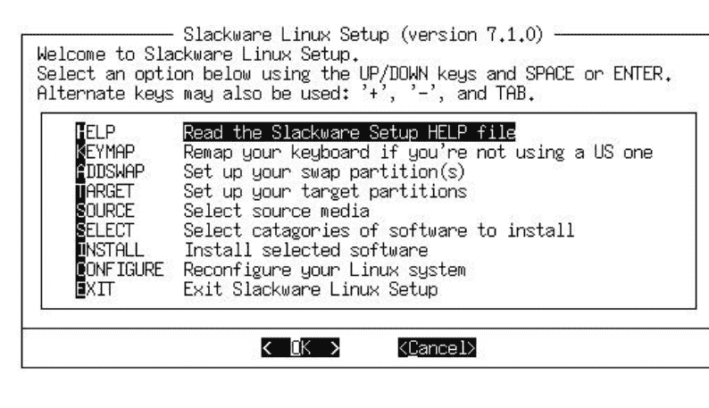

安装过程大致如下：你按照 **setup** 程序中列出的顺序逐步执行每个选项。（当然，你几乎可以自由选择任何顺序来操作，但这样效果可能不太好。）菜单项使用上下方向键选择，“确定”和“取消”按钮可以使用左右方向键选择。或者，每个选项都有一个对应的键，在选项名称中突出显示。可标记的选项（用 [X] 表示）使用空格键切换。

当然，所有这些都在 **setup** 的“帮助”部分有描述，但我们相信要给读者提供物有所值的内容。

### HELP

如果这是你第一次安装 Slackware，你可能需要查看帮助屏幕。它会描述 **setup** 的每个部分（就像我们现在写的这个，但没那么详细），并提供导航其余安装步骤的说明。

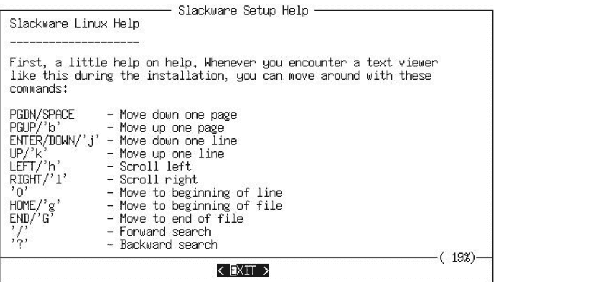

### KEYMAP

如果你需要的键盘布局不是美国的“qwerty”布局，你可能需要查看此部分。它提供了多种替代布局供你选择。

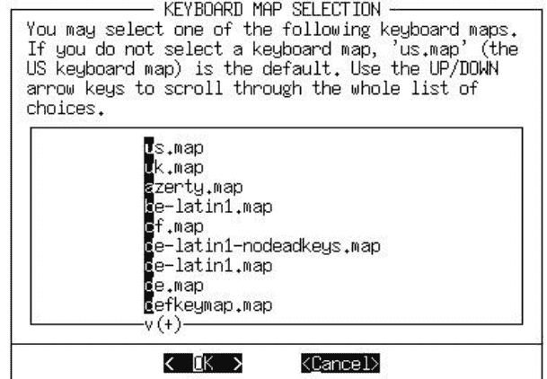

### ADDSWAP

如果你创建了交换分区（回到[称为分区的部分](#the-section-called-partitioning)），此部分将允许你启用它。它会自动检测并显示硬盘上的交换分区，允许你选择一个进行格式化和启用。

### TARGET

目标部分用于格式化你的其他（非交换）分区并将其映射到文件系统挂载点。将显示硬盘上的分区列表。对于每个分区，你将可以选择是否格式化（如果格式化，是否检查坏块），以及选择 inode 大小。对于正常使用，默认的 inode 大小就可以了。

目标部分的第一个选项是选择一个分区来安装你的根（/）文件系统。之后，你可以根据需要将其他分区映射到文件系统。（例如，你可能希望你的第三个分区，比如 /dev/hda3，作为你的主文件系统。这只是一个示例；请根据你的需要映射分区。）


## SOURCE（源）

SOURCE 部分用于选择安装 Slackware 的源介质。目前有四种来源可供选择，分别是软盘、CD-ROM、NFS 或已挂载的目录。

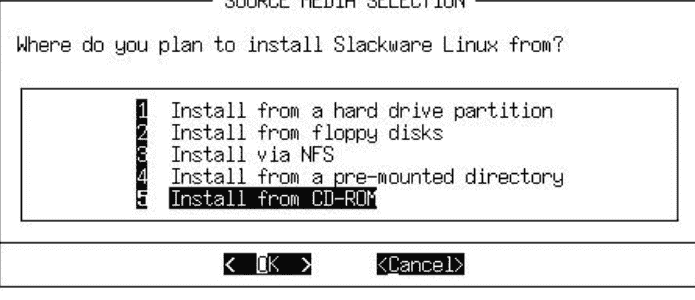

选择软盘后会提示你插入大量磁盘。此选项需要大量时间和耐心，但确实可行。请记住，你需要在启动安装程序之前先制作好软盘。

选择 CD-ROM 可进行基于光盘的安装。它会提供扫描 CD-ROM 驱动器或显示驱动器类型列表以供选择的选项。在允许扫描之前，请确保已将 Slackware 光盘放入驱动器。程序找到 CD-ROM 驱动器后，会询问你是否要执行"slakware"或"slaktest"安装。默认值为 slakware，即标准安装。slaktest 选项会将一小组软件安装到硬盘上，大部分软件保留在光盘上。你需要官方光盘套装中的"live"光盘才能使用此选项。

选择 NFS 会提示你输入网络信息以及 NFS 服务器的网络信息。NFS 服务器必须事先设置好。另请注意，你不能使用主机名，必须为本机和 NFS 服务器使用 IP 地址（安装盘上没有名称解析器）。

已挂载的目录提供了最大的灵活性。你可以使用此方法从 Jaz 磁盘、通过 PLIP 挂载的 NFS 以及 FAT 文件系统等来源进行安装。在运行安装程序之前，将文件系统挂载到你选择的位置，然后在此处指定该位置。

## SELECT（选择）

SELECT 选项允许你选择希望安装的软件系列。这些系列在[*软件系列*](link)一节中进行了描述。请注意，你必须安装 A 系列才能拥有一个可用的基础系统。所有其他系列均为可选。

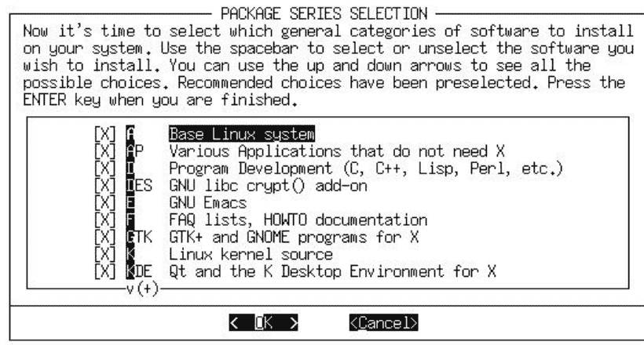

## INSTALL（安装）

假设你已经完成了"target"、"source"和"select"选项，INSTALL 选项将允许你从所选的软件系列中选择软件包。如果没有完成，它会提示你返回并完成安装程序的其他部分。此选项允许你从六种不同的安装方法中选择：*full*、*newbie*、*menu*、*expert*、*custom* 和 *tag path*。

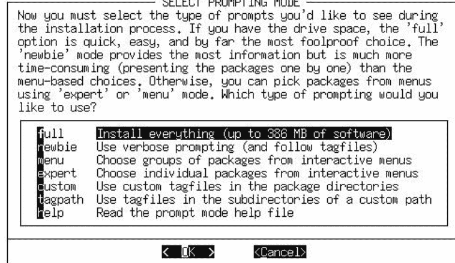

*full* 选项将安装你在"select"部分中选择的所有软件系列中的每个软件包。不会有进一步的提示。这是最简单的安装方法，因为你无需对实际安装的软件包做出任何决定。当然，此选项占用的硬盘空间也最多。

下一个选项是 *newbie*。此选项会安装所选系列中所有必需的软件包。对于所有其他软件包，它会提供一个提示，你可以选择"Yes"、"No"或"Skip"。Yes 和 No 的作用不言而喻，而 Skip 则会继续到下一个软件系列。此外，你还可以看到每个软件包的描述和所需空间，以帮助你决定是否需要它。我们建议新用户使用此选项，因为它确保你能安装所有必需的软件包。不过，由于频繁提示，速度会稍慢一些。

*Menu* 是 newbie 选项的更快速、更高级版本。对于每个系列，会显示一个菜单，你可以从中选择所有想要安装的非必需软件包。必需的软件包不会显示在此菜单上。

对于更高级的用户，安装程序提供了 *expert* 选项。这让你可以完全控制哪些软件包被安装。你可以取消选择绝对必需的软件包，但这会导致系统无法正常工作。另一方面，你可以精确控制安装到系统中的内容。只需从每个系列中选择你想要安装的软件包即可。不建议新用户使用此选项，因为很容易造成系统损坏。

*custom* 和 *tag path* 选项也适用于高级用户。这些选项允许你根据在发行版树中创建的自定义标签文件进行安装。这对于快速安装大量机器非常有用。有关使用标签文件的更多信息，请参阅第 16 章中的[制作标签和标签文件（用于安装）](Making Tags and Tagfiles (for setup) in Chapter 16)一节。

选择安装方法后，会出现以下几种情况之一。如果你选择了 full 或 menu，将出现一个菜单屏幕，允许你选择要安装的软件包。如果你选择了 full，软件包将立即开始安装到目标设备。如果你选择了 newbie，软件包将被安装，直到遇到可选软件包为止。

请注意，在安装过程中可能会出现空间不足的情况。如果你为目标设备的可用空间选择了过多的软件包，将会出现问题。最安全的做法是先选择一部分软件，以后需要时再添加。这可以使用 Slackware 的软件包管理工具轻松完成。有关信息，请参阅[第 16 章](Chapter 16)。

## CONFIGURE（配置）

CONFIGURE 部分允许你在软件包安装完成后进行一些基本的系统配置。你在此处看到的内容在很大程度上取决于你已安装的软件。不过，你始终会看到以下内容：

内核选择

此处将要求你选择要安装的内核。你可以从用于安装的启动盘、Slackware CD-ROM 或你自己准备的另一张软盘（总是未雨绸缪）安装内核。或者你可以选择跳过，在这种情况下将安装默认内核，然后继续进行后续步骤。

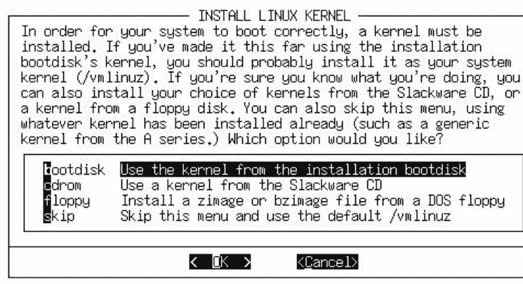

制作启动盘

制作一张启动盘以备将来使用可能是个好主意。你将可以选择格式化一张软盘，然后创建两种类型启动盘之一。第一种类型是 *simple*，顾名思义，就是简单地将内核写入软盘。一个更灵活（且强烈推荐）的选项是 *lilo*，它将创建一个 lilo 启动盘。有关 lilo 的信息，请参阅第 7 章中的 [LILO](LILO in Chapter 7) 一节。当然，你也可以选择直接**继续**，这样就不会制作启动盘。

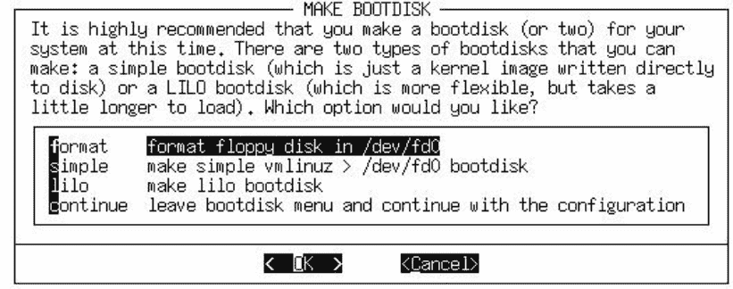

### Modem（调制解调器）

你将被要求提供调制解调器信息。更具体地说，你将被问及是否拥有调制解调器，如果有，它连接在哪个串口上。

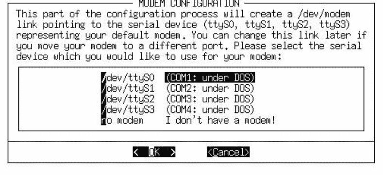

以下配置子部分可能会或不会出现，取决于你是否安装了相应的软件包。（**setup** 具有各种自适应功能，明白吧。）

### Timezone（时区）

这部分非常直接：你将被问及所在的时区。如果你使用格林尼治标准时间，我们非常抱歉；（极长的）列表按字母顺序排列，而你排在最后面。

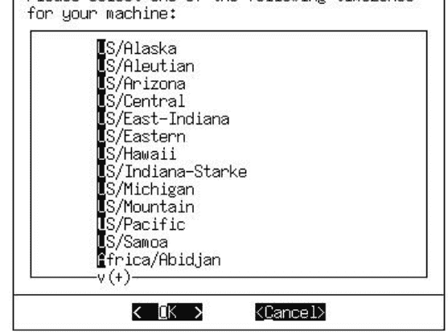

### Mouse（鼠标）

此子部分只是询问你使用什么类型的鼠标，以及是否希望在启动时启用 **gpm(8)**（控制台鼠标支持）。

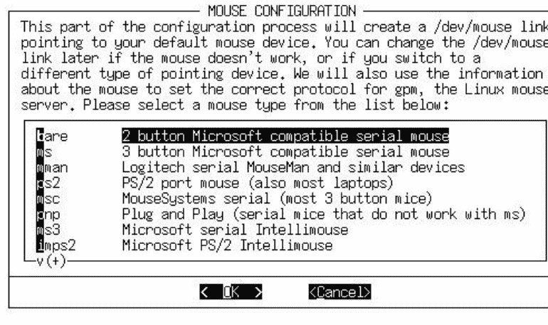

### Hardware clock（硬件时钟）

此子部分询问你的计算机硬件时钟是否设置为协调世界时（UTC 或 GMT）。大多数 PC 并非如此，所以你可能应该选择否。

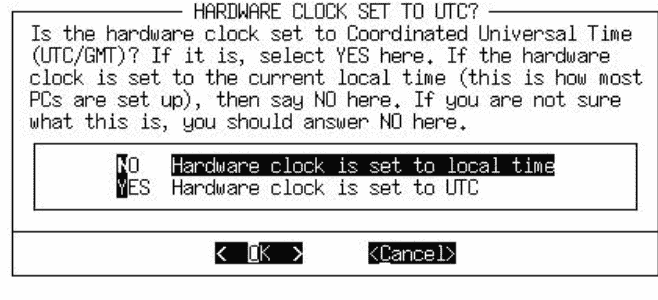

### Font（字体）

Font 子部分允许你从自定义控制台字体列表中进行选择。

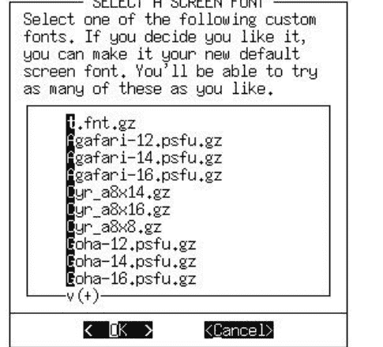

## LILO

此处会提示你安装 LILO（Linux 加载器；更多信息请参阅第 7 章中的 LILO 一节）。如果 Slackware 是你计算机上的唯一操作系统，*simple* 选项应该就能满足你的需求。如果你要配置双启动，*expert* 选项是更好的选择。有关双启动的更多信息，请参阅第 7 章中的双启动一节。第三个选项 *do not install* 不推荐使用，除非你清楚自己在做什么并且有充分的理由不安装 LILO。如果你执行的是 expert 安装，你将可以选择将 LILO 安装在何处。你可以将 LILO 放在硬盘的 MBR（主引导记录）中、根 Linux 分区的超级块中，或软盘上。

请注意，如果你目前正在使用其他操作系统的引导加载器，建议将 LILO 安装到根 Linux 分区的超级块或软盘上。在这种情况下安装到 MBR 会覆盖其他操作系统的引导加载器，可能导致系统无法正常启动。

### Network（网络）

网络配置子部分实际上就是 **netconfig**。更多信息请参阅第 5 章中的 netconfig 一节。

### CD-ROM

CD-ROM 子部分只是询问你是否希望系统自动扫描并将可用的 CD-ROM 光盘挂载到 `/cdrom`。

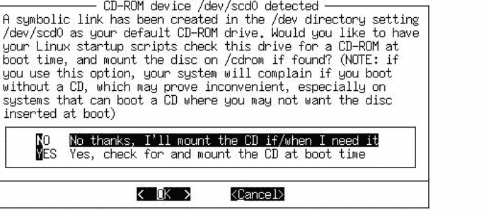

### X Window Manager（X 窗口管理器）

此子部分允许你选择 X 的默认窗口管理器。有关 X 和窗口管理器的更多详情，请参阅第 6 章。

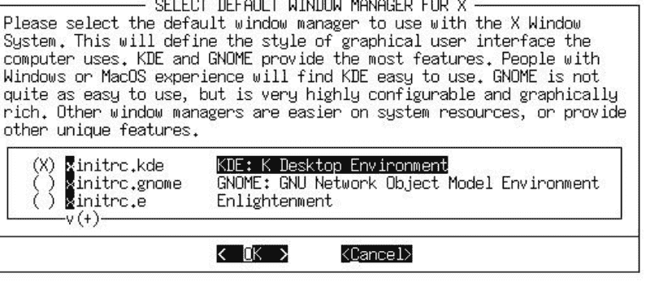


无论你安装了哪些软件包，配置程序最后会询问你是否要继续并设置 root 密码。出于安全考虑，这可能是个好主意；然而，就像 Slackware 中几乎其他所有事情一样，这由你自己决定。

## EXIT

本书中这一节的存在本身就是对你智商的侮辱。我们深表歉意并恳请你的原谅。

## Summary

现在，你应该已经在你的系统上安装了 Slackware Linux。此外，你应该已经对分区设备、软件包、**setup** 程序以及一些简单的配置选项有了一定的了解。有了这些知识，你应该准备好着手完成系统的配置工作了。

## III. 配置

## 第4章. 系统配置

在你能够配置系统的更高级部分之前，最好先了解系统的组织结构以及可以使用哪些命令来搜索文件和程序。同样，了解你是否需要编译自定义内核以及如何操作也是有益的。本章将使你熟悉系统组织和配置文件。然后，你就可以继续配置系统的更高级部分了。

## 系统概述

在深入了解各种配置方面之前，理解 Linux 系统是如何构建的是很重要的。Linux 系统与 DOS 或 Windows 系统（甚至 Macintosh）有显著的不同，但这些部分将帮助你熟悉其布局，以便你可以轻松地配置系统以满足你的需求。

## 文件系统布局

Slackware Linux 与 DOS 或 Windows 系统之间的第一个显著差异是文件系统。首先，我们不使用驱动器号来表示不同的分区。在 Linux 下，有一个主目录。你可以将这与 DOS 下的 C: 驱动器联系起来。你系统上的每个分区都挂载到主目录下的一个目录。这有点像一个不断扩展的硬盘。

我们将主目录称为根目录，它用一个单独的斜杠 (/) 表示。这个概念可能看起来很奇怪，但当你想要增加更多空间时，它实际上让你的生活变得轻松。例如，假设你存放 `/home` 的驱动器空间用完了。大多数人安装 Slackware 并创建一个大的根驱动器。好吧，由于一个分区可以挂载到任何目录，你可以直接去商店买一个新的硬盘并将其挂载到 `/home`。你现在就为系统“嫁接”了一些额外的空间。而且所有这些都不必移动太多东西。

下面，你将找到关于我们提供的软件包升级形式的 Slackware 下主要顶级目录的描述。

- `/boot`
  由 Linux Loader (LILO) 使用的文件。此目录在安装后也会很少修改。

- `/cdrom`
  还记得所有驱动器都必须挂载到主根目录上的一个目录吗？`/cdrom` 被提供作为你的 CD-ROM 驱动器的挂载点。

- `/dev`
  Linux 中的所有东西都被视为文件，甚至像串口、硬盘和扫描仪这样的硬件设备。为了访问这些设备，必须存在一个称为设备节点的特殊文件。所有设备节点都存储在 `/dev` 目录中。你会发现这在许多类 UNIX 操作系统中都是如此。

- `/etc`
  此目录存放系统配置文件。从 X Window 配置文件、用户数据库到系统启动脚本，一切都包含在此。系统管理员会随着时间的推移对这个目录变得相当熟悉。

- `/home`
  Linux 是一个多用户操作系统。系统上的每个用户都有一个账户和一个用于个人文件的唯一目录。此目录称为用户的“主”目录。`/home` 目录被提供作为用户主目录的默认位置。

- `/lib`
  基本操作所需的系统库存储在此处。C 库、动态加载器、ncurses 库以及内核模块等都是存储在此的内容。

- `/lost+found`
  当系统启动时，会对文件系统进行任何错误检查。如果检测到错误，将运行 **fsck** 程序以查看是否可以纠正。文件系统的已纠正部分将写入 `/lost+found` 目录。

- `/mnt`
  此目录被提供作为处理硬盘或可移动驱动器的临时挂载点。

- `/root`
  系统管理员在系统上称为 `root`。`root` 的主目录保存在 `/root` 而不是 `/home/root`。原因很简单。如果 `/home` 是一个与 `/` 不同的分区并且无法挂载怎么办？`root` 自然需要登录并修复问题。如果他的主目录位于损坏的文件系统上，这将使他难以登录。

- `/sbin`
  由 `root` 运行的、在系统启动过程中运行的基本程序保存在此处。普通用户不会运行此目录中的程序。

- `/tmp`
  临时存储位置。所有用户对此目录都有读写访问权限。

- `/usr`
  这是 Linux 系统上的一个大目录。其他所有东西几乎都放在这里，包括程序、文档、内核源代码和 X Window 系统。这是你最有可能安装程序的目录。

- `/var`
  系统日志文件、缓存数据和程序锁文件存储在此处。此目录用于频繁更改的数据。

现在你应该对文件系统上哪些目录包含什么有了很好的感觉。下一节将帮助你轻松地找到特定的文件，这样你就不用手动寻找了。

## 查找文件

你现在知道每个目录包含什么，但这实际上对你查找东西没有太大帮助。我的意思是，你可以逐个目录查找，但有更快的方法。Slackware 中有四个主要的文件搜索命令。

### which

第一个是 **which**(1) 命令。**which** 通常用于快速定位程序。它只是搜索你的 `PATH` 并返回它找到的第一个实例及其目录路径。看这个例子：

```
$ which bash
/bin/bash
```

从那里你看到 `bash` 在 `/bin` 目录中。这是一个非常有限的搜索命令，因为它只搜索你的 `PATH`。

### whereis

**whereis**(1) 命令的工作方式类似于 **which**，但也可以搜索手册页和源文件。**whereis** 对 bash 的搜索应返回如下：

### find

**find**(1) 命令将搜索任何东西。我想在系统上搜索默认的 `xinitrc` 文件。

```
$ find / -name xinitrc
./var/X11R6/lib/xinit/xinitrc
```

**find** 需要运行一段时间，因为它必须遍历整个根目录树。如果你以普通用户身份运行此命令，你可能会得到只有 root 才能看到的目录的权限拒绝错误消息。但 **find** 找到了我们的文件，这很好。要是它能快一点就好了...

### locate

**locate**(1) 命令搜索整个文件系统，就像 find 命令可以做的那样，但它搜索的是数据库而不是实际的文件系统。数据库设置为在凌晨 4:40 自动更新，因此你可以获得系统上文件的相当新的列表。你可以手动运行 **updatedb**(1) 来更新 locate 数据库（在手动运行 **updatedb** 之前，你必须先 **su** 到 **nobody** 用户）。以下是 **locate** 实际使用的示例：

```
$ locate xinitrc  # we don't have to go to the root
/var/X11R6/lib/xinit/xinitrc
/var/X11R6/lib/xinit/xinitrc.fvwm2
/var/X11R6/lib/xinit/xinitrc.openwin
/var/X11R6/lib/xinit/xinitrc.twm
```

我们得到了比我们寻找的更多的结果，而且速度很快。有了这些命令，你应该能够在你的 Linux 系统上找到任何你需要的东西。

## /etc/rc.d 目录

系统初始化文件存储在 `/etc/rc.d` 目录中。Slackware 使用 BSD 风格的布局来组织其初始化文件。每个任务或运行级别都有自己的 rc 文件。这提供了一种易于维护的组织结构。

有几类初始化文件。这些是系统启动、运行级别、网络初始化和 System V 兼容性。按照传统，我们将所有其他内容归入“其他”类别。

### 系统启动

除了 Linux 内核之外，在 Slackware 下运行的第一个程序是 **init**(8)。此程序读取 `/etc/inittab`(5) 文件以查看如何运行系统。它运行 `/etc/rc.d/rc.S` 脚本，在进入你所需的运行级别之前准备系统。`rc.S` 文件启用你的虚拟内存、挂载文件系统、清理某些日志目录、初始化即插即用设备、加载内核模块、配置 PCMCIA 设备、设置串口并运行 System V init 脚本（如果找到的话）。显然 `rc.S` 有很多事情要做，但以下是一些 `/etc/rc.d` 中 `rc.S` 将调用来完成其工作的脚本：

- `rc.S`
  这是实际的系统初始化脚本。

- `rc.modules`

加载内核模块。例如你的网卡、PPP支持和其他功能都在此处加载。若此脚本发现`rc.netdevice`，也会一并执行。

```
rc.pcmcia
```

探测并配置系统中可能存在的任何PCMCIA设备。这对笔记本电脑用户最为实用，因为他们通常配备PCMCIA调制解调器或网卡。

```
rc.serial
```

通过执行相应的**setserial**命令来配置串行端口。

```
rc.sysvinit
```

为指定的运行级别查找System V init脚本并执行它们。下文将对此进行更详细的讨论。

## 运行级别初始化脚本

系统初始化完成后，**init**将进入运行级别初始化阶段。运行级别描述了你的机器将处于的运行状态。听起来有点多余？实际上，运行级别会告知**init**你是接受多用户登录还是仅单用户、是否需要网络服务，以及是否使用X Window系统或`agetty(8)`来处理登录。以下是Slackware Linux中定义不同运行级别的文件：

```
rc.0
```

停止系统（运行级别0）。默认情况下，此文件是指向rc.6的符号链接。

```
rc.4
```

多用户启动（运行级别4），但在X11环境下使用KDM、GDM或XDM作为登录管理器。

```
rc.6
```

重启系统（运行级别6）。

```
rc.K
```

以单用户模式启动（运行级别1）。

```
rc.M
```

多用户模式（运行级别2和3），使用标准的基于文本的登录界面。这是Slackware的默认运行级别。

## 网络初始化

运行级别2、3和4将启动网络服务。以下文件负责网络初始化：

```
rc.inet1
```

由**netconfig**创建，此文件负责配置实际的网络接口。

```
rc.inet2
```

在`rc.inet1`之后运行，并启动基本的网络服务。

```
rc.atalk
```

启动AppleTalk服务。

```
rc.httpd
```

启动Apache网页服务器。

```
rc.samba
```

启动Windows文件和打印共享服务。

```
rc.news
```

启动新闻服务器。

## System V 兼容性

System V init兼容性功能在Slackware 7.0中引入。许多其他Linux发行版采用这种风格而非BSD风格。基本上，每个运行级别都有一个用于init脚本的子目录，而BSD风格则为每个运行级别分配一个init脚本。

`rc.sysvinit`脚本会在`/etc/rc.d`中查找任何System V init脚本，并在运行级别合适时执行它们。这对于安装System V init脚本和BSD风格init脚本的某些商业软件包非常有用。

## 其他文件

以下描述的脚本是其他系统初始化脚本。它们通常从上述主要脚本之一运行，因此你只需要编辑其内容。

```
rc.cdrom
```

如果启用，此脚本将扫描光驱中的CD-ROM，如果找到则将其挂载在`/cdrom`下。

```
rc.gpm
```

启动通用鼠标服务。允许你在Linux控制台进行复制和粘贴操作。

```
rc.ibcs2
```

启动Intel二进制兼容性支持。仅当你计划运行在SCO UNIX或其他商业Intel UNIX版本上编译的程序时才需要此支持。运行Linux程序则不需要它。

```
rc.font
```

加载控制台的自定义屏幕字体。

```
rc.local
```

包含针对你的系统的任何特定启动命令。全新安装后此文件为空，因为它保留给本地管理员使用。此脚本在所有其他初始化完成后运行。

要启用一个脚本，你只需用**chmod**命令为其添加执行权限。要禁用一个脚本，则移除其执行权限。有关**chmod**的更多信息，请参阅[第9章标题为*权限*的章节](http://slackbook.org/chap-perms.html)。

## 选择内核

内核是操作系统中提供硬件访问、进程控制和整体系统控制的部分。内核包含对你硬件设备的支持，因此为你的系统选择一个内核是重要的设置步骤。

Slackware提供了大约六十个预编译内核供你选择，每个内核都有一套标准驱动和额外的特定驱动。你可以运行其中一个预编译内核，也可以从源代码构建自己的内核。无论哪种方式，你都需要确保你的内核具有你的系统所需的硬件支持。

## Slackware CD-ROM 上的 /kernels 目录

预编译的Slackware内核可在Slackware CD-ROM的`/kernels`目录中或FTP站点的主Slackware目录中找到。随着新版本的发布，可用内核会有所变化，因此该目录中的文档始终是权威来源。`/kernels`目录为每个可用内核设有子目录。这些子目录的名称与其随附的启动盘相同。在每个子目录中，你会发现以下文件：

| 文件 | 用途 |
|---|---|
| System.map | 此内核的系统映射文件 |
| bzImage (或 zImage) | 实际的内核镜像 |
| config | 此内核的源代码配置文件 |

要使用一个内核，请将`System.map`和配置文件复制到你的`/boot`目录，并将内核镜像复制到`/vmlinuz`。运行`/sbin/lilo(8)`为新内核安装LILO，然后重启你的系统。安装新内核就是这么简单。

以".i"结尾的内核是IDE内核。也就是说，它们在基础内核中不包含SCSI支持。以".s"结尾的内核是SCSI内核。它们包含.i内核中的所有IDE支持，外加SCSI支持。

## 从源代码编译内核

新用户经常问“我应该为我的系统编译内核吗？”。答案是视情况而定。很少有情况需要你为系统专门编译内核。大多数用户可以使用预编译内核和可加载内核模块来获得一个完全工作的系统。如果你要升级到我们目前在Slackware中未提供的内核版本，或者如果你已经修补了内核源代码以获得原生内核源代码中没有的特殊设备支持，那么你可能需要为你的系统编译内核。

构建自己的内核并不那么困难。第一步是确保你的系统上安装了内核源代码。确保你在安装过程中安装了K系列的软件包。你还需要确保安装了D系列软件包，特别是C编译器、GNU make和GNU binutils。一般来说，如果你计划进行任何开发工作，安装整个D系列是个好主意。现在我们准备好构建内核了：

```
$ su -
Password:
# cd /usr/src/linux
```

第一步是将内核源代码恢复到其基本状态。我们执行此命令来完成：

```
# make mrproper
```

现在你可以为你的系统配置内核。当前内核提供了三种配置方式。第一种是原始的基于文本的问答系统。它会问一系列问题然后生成一个配置文件。这种方法的问题是，如果你搞错了，必须从头开始。大多数人更喜欢的是菜单驱动的方式。最后，还有一个基于X的内核配置工具。选择你想要的并执行相应的命令：

```
# make config (基于文本的问答版本)

# make menuconfig (菜单驱动，基于文本的版本)

# make xconfig (基于X的版本，确保你先进入X环境)
```

**图 4-1. 菜单驱动的内核配置程序。**

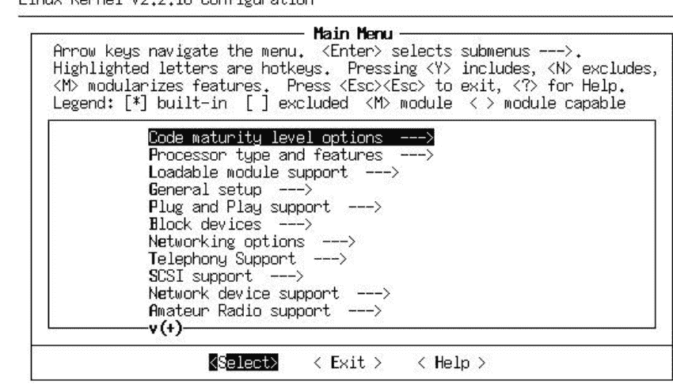

新用户可能会发现**menuconfig**是最容易使用的。提供了帮助屏幕来解释内核的各个部分。配置完内核后，退出配置程序。它将写入必要的配置文件。现在我们可以为构建准备源代码树：

```
# make dep

# make clean
```

下一步是编译内核。首先尝试执行下面的`zImage`命令。如果你的内核太大，该命令会失败。别担心，你仍然可以使用`bzImage`命令来构建它。

```
# make zImage (先尝试这个)

# make bzImage (如果 make zImage 失败，执行此命令)
```

这可能需要一些时间，具体取决于你的CPU速度。在构建过程中，你会看到编译器消息。构建内核镜像后，你需要构建你标记为模块化的内核部分。

```
# make modules
```

我们现在可以安装你编译的内核和模块。要在Slackware系统上安装内核，应执行以下命令：

```
# mv /vmlinuz /vmlinuz.old

# cat arch/i386/boot/zImage > /vmlinuz

# mv /boot/System.map /boot/System.map.old

# cp System.map /boot/System.map
```

如果你不得不构建一个大内核，请将zImage替换为bzImage。你将需要编辑

`/etc/lilo.conf`，并添加一个部分来引导你的旧内核，以防新内核无法工作。完成此操作后，运行 `/sbin/lilo` 来安装新的引导块。现在你可以用新内核重启了。

## 使用内核模块

内核模块是设备驱动的另一个名称，可以插入到运行中的内核。它们允许你扩展内核支持的硬件，而无需选择另一个内核或自行编译。

模块也可以在任何时候加载和卸载，即使在系统运行时也是如此。这使得系统管理员可以轻松升级特定驱动程序。可以编译一个新模块，移除旧模块，并加载新模块，所有这些都无需重启机器。

模块存储在你的系统中的 `/lib/modules/<kernel version>` 目录中。它们可以通过 `rc.modules` 文件在启动时加载。这个文件有非常详细的注释，并为大多数硬件组件提供了示例。要查看当前活动的模块列表，请使用 **lsmod(1)** 命令：

```
# lsmod

Module                Size  Used by
parport_pc            7220  0
parport               7844  0  [parport_pc]
```

你可以看到，我只加载了并口模块。要卸载模块，你可以使用 **rmmod(1)** 命令。模块可以通过 **modprobe(1)** 或 **insmod(1)** 命令加载。**modprobe** 通常更安全，因为它会加载你要加载的模块所依赖的所有模块。

许多用户从来不需要手动加载或卸载模块。他们使用内核自动加载器进行模块管理。你只需取消 `/etc/rc.d/rc.modules` 文件中 `/sbin/kerneld(8)` 行的注释，自动加载器就会启动。它会在你请求时负责加载和卸载模块。一个请求只涉及尝试访问该设备。

更多信息可以在这些命令的手册页以及 `rc.modules` 文件中找到。

## 总结

你现在应该熟悉用于搜索文件系统的命令、文件系统的组织以及 `/etc` 目录中的配置文件。当你更多地了解系统时，这些技能将非常有帮助。此外，你应该知道如何从源代码配置和编译内核。

# 第5章 网络配置

## 网络硬件

就像你能用计算机做的大多数有趣的事情一样，将其连接到网络需要一些专门的硬件。你需要一块网卡（NIC）来连接到局域网，可能还需要一个调制解调器来连接到互联网提供商，或者两者都需要（或每种多个，或都不需要）。

出于配置的目的，我们可以将所述硬件分为PCMCIA（用于笔记本电脑）和非PCMCIA两类。这种划分有点不平衡的原因是，目前PCMCIA硬件不受内核发行版支持，而是由一个单独的软件包支持，该软件包包含必要的驱动程序（作为内核模块）以及用于配置和管理PCMCIA设备的一些软件。当然，其他所有内容都由标准内核发行版处理。

## netmods

内核支持的网络设备驱动程序包含在 netmods 软件包中（`slackware/n3/netmods.tgz`）。如果你尚未安装 netmods，现在就需要安装它。（有关安装软件包的帮助，请参阅[第16章](第16章)。）

在启动时加载的内核模块是从 `/etc/rc.d` 中的 `rc.modules` 文件加载的。默认的 `rc.modules` 文件包含一个“网络设备支持”部分。如果你打开 `rc.modules` 并查找该部分，你会注意到它首先检查 `/etc/rc.d` 中是否存在可执行的 `rc.netdevice` 文件；如果安装过程中 **setup** 成功自动探测到你的网络设备，就会创建 `rc.netdevice`。如果它成功了，你可能就不会读到这里了（哦，悖论）；如果没有，请继续阅读。

在那个“if”块下面是网络设备列表和 modprobe 行，每行都被注释掉了。找到你的设备并取消相应 modprobe 行的注释，然后保存文件。现在以 root 身份运行 `rc.modules` 应该会加载你的网络设备驱动程序（以及任何其他已列出并取消注释的模块）。请注意，某些模块（如 ne2000 驱动程序）需要参数；确保选择正确的行。

## PCMCIA 网络设备

PCMCIA 网络设备应该比其他设备更容易设置。确保你已安装 pcmcia 软件包（`slackware/a11/pcmcia.tgz`）。（有关软件包安装的详细信息，请参阅[第16章](第16章)。）安装时，pcmcia 软件包会在 `/etc/rc.d` 中创建一个 `rc.pcmcia` 文件和一个 `/etc/pcmcia` 目录，并将驱动程序安装到 `/lib/modules/<kernel version>/pcmcia`。pcmcia 软件包的优点是它会尝试自动检测支持的 pcmcia 设备的插入和移除；你应该能够简单地插入你的 pcmcia 网络适配器，并在加载必要模块时听它发出的哔哔声。如果你移除该卡，其驱动程序模块应该会自动移除。

不幸的是，如果你编译了更新的内核版本，你可能必须重新编译 pcmcia-cs 才能使驱动程序更新。当然，源代码已包含在内；查看 `source/a/pcmcia` 目录以获取源代码、脚本以及我们为帮助你而提供的任何文档。

## 网络工具

## ifconfig

既然你的内核可以与网络硬件通信，现在需要的是一种让软件告诉内核传递一些信息，反之亦然的方法。我们需要配置一个接口。我们需要 `ifconfig(8)`。

`ifconfig` 可能最好通过示例来学习；你可能只想看看你的 `rc.inet1` 文件（在[名为 rc.inet1 的部分](名为 rc.inet1 的部分)中介绍）看看那里是如何做的。最简单和最常见的情况看起来像这样：

```
# ifconfig eth0 192.168.1.10 broadcast 192.168.1.255 \
  netmask 255.255.255.0
```

这一行启动 eth0（第一个以太网接口；令牌环使用 tr0，ppp 使用 ppp0 等），IP 为 192.168.1.10，广播地址为 192.168.1.255（整个 192.168.1 子网），子网掩码为 255.255.255.0（表示 IP 地址的“点分四元组”中前三部分指网络，而后一部分 .10 指主机）。除非你在做一些奇怪的事情，否则你几乎总是可以使用一个广播地址，它是你的 IP 地址的前三部分后跟 255。你几乎总是可以使用子网掩码 255.255.255.0。如果你*确实*在做一些奇怪的事情，你可能已经知道得足够多，以至于本书的这一部分对你没有太大用处。

**ifconfig** 也可以只用来查看当前有什么。不带任何选项或参数运行它，可以列出你所有当前网络接口及其设置的列表。

## route

为了知道将哪些数据发送到哪里，内核维护一个路由表。我不会在这里详细介绍它，但你可以通过运行 **/sbin/route(8)** 查看路由表。**route -n** 会给你一个使用 IP 地址而非名称的表格；如果你与域名服务器通信有问题，或者你只是对域名的虚幻世界不感兴趣，这很有用。幸运的是，如果你有一个简单的网络设置（大多数人都有），2.2 内核会自动为你创建必要的路由表条目。

### netconfig

**netconfig** 是 Slackware 安装程序的一部分，但就像 **setup** 的大多数组件一样，它可以独立运行。**netconfig** 非常直观，将引导你完成基本网络连接的设置。如果你对网络 rc 文件不熟悉或不习惯，它是一个特别好的程序。当你运行 **netconfig** 时，你会看到这个屏幕：

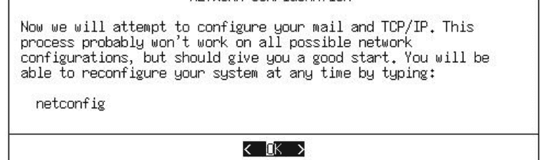

接下来，系统会提示你输入计算机的主机名和域名。除非你正在设置一台服务器或其他许多人将使用的机器，否则你可能可以为这两者都编造一些东西。然后，系统会询问你是使用静态 IP、DHCP 还是仅环回。

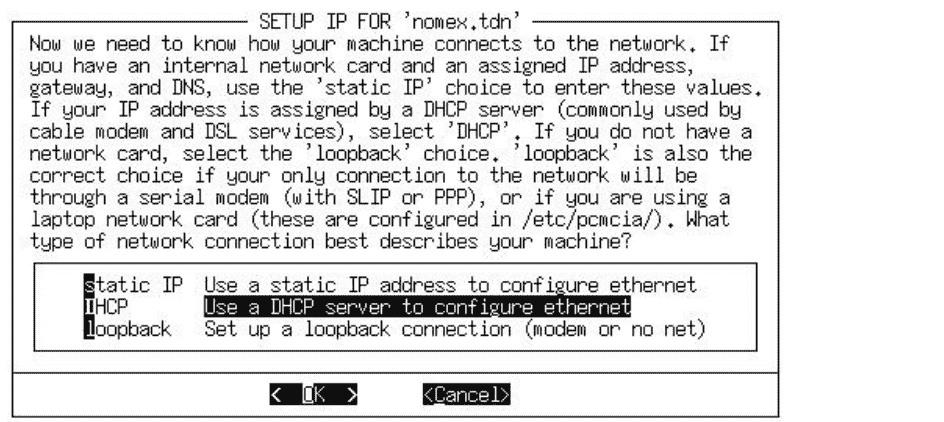

如果你不打算连接到网络，请选择环回。如果你正在设置一台将连接到大学或大型办公室网络的计算机，你很可能应该选择 DHCP。否则，选择静态 IP。除非你选择了静态 IP，否则你现在就完成了。如果你确实选择了静态 IP，你现在将需要输入计算机的 IP 地址、网络掩码、广播地址和域名服务器地址。**netconfig** 会告诉你如何计算所有这些数字。


## pppsetup

Slackware 包含用于配置拨号连接至 ISP 的 **pppsetup** 工具。它位于 N 软件系列的 ppp.tgz 软件包中。**pppsetup** 使用与 **setup** 程序相同的界面。如果你不记得如何使用此界面，请参考[第 3 章中的名为 The setup Program 的部分](https://example.com)获取说明。**pppsetup** 会询问你一系列问题，并在 `/etc/ppp` 中为你设置多个配置文件。以 root 身份运行 **pppsetup**；我们将在此处逐步讲解这些问题。

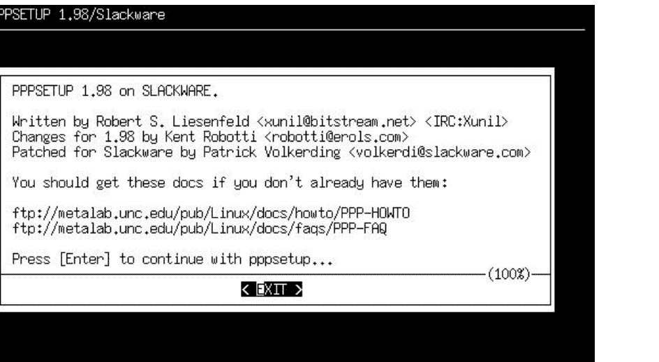

## 电话号码

第一个问题提示输入你的 ISP 电话号码，并以拨号类型作为前缀。对于大多数人，你将希望使用双音多频拨号。如果你的 ISP 电话号码是 555-1013 并且使用双音多频拨号，你应该在对话框中输入 **atdt5551013**。

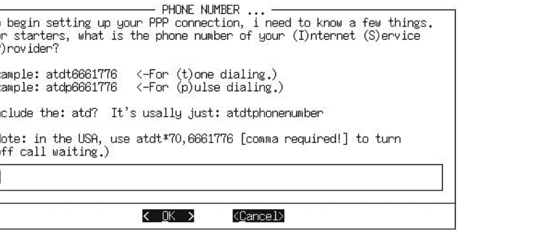

如果你的电话线有呼叫等待功能，并且希望在连接时禁用它（这可能是个好主意），请确保在对话框中输入类似这样的内容：**atdt*70,5551013**

逗号是必需的。它会在 *70（用于禁用呼叫等待）和 ISP 电话号码之间插入 1.5 秒的暂停。没有逗号将无法工作。

## 调制解调器设备

接下来，选择你的调制解调器的位置。如果你知道它在 Windows 下的 COM 设备，你可以选择列出的等效设备。否则，你可能需要进行一些试验。最好的方法是从 `ttyS0` 开始，然后沿着列表向下尝试。

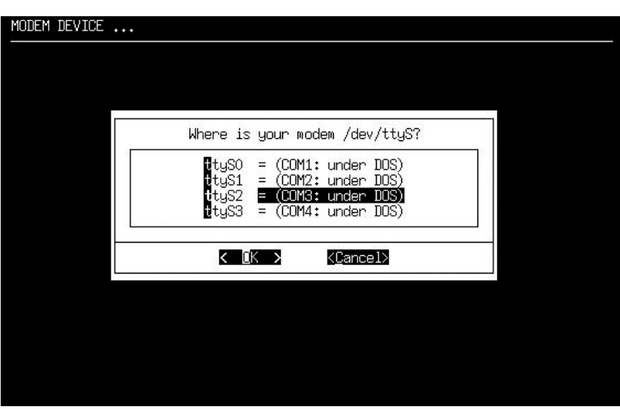

## 调制解调器波特率

接下来，选择最接近你的调制解调器波特率的选项。如果你不知道波特率，可以检查调制解调器的包装盒或随附的任何文档。每个选项都有几个示例，因此应该不难弄清楚。

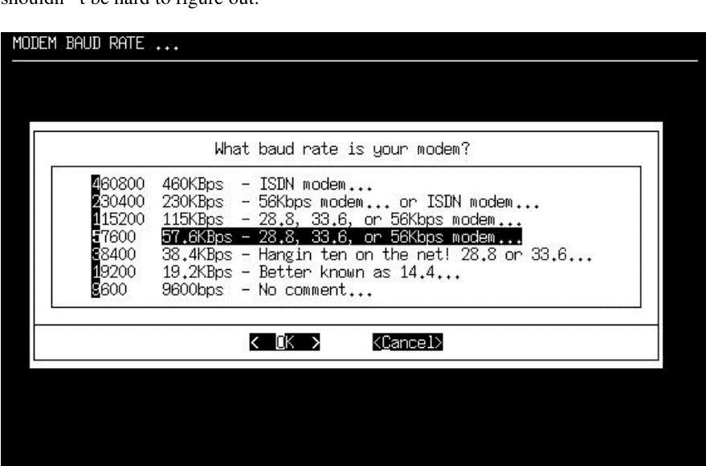

## 回拨

现在，你需要开始参考你的 ISP 提供给你的任何信息。很少有 ISP 使用回拨，因此你很可能可以安全地选择“NO”。回拨是指你拨号连接 ISP，然后他们回拨给你，以便你可以登录。

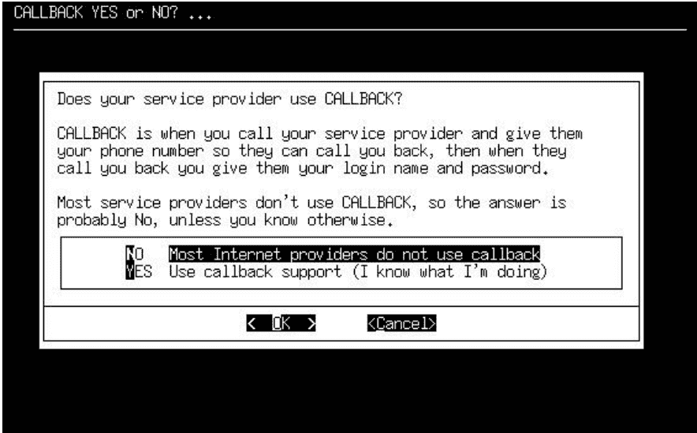

如果你必须使用回拨，请选择“YES”。然后，你将被提示输入你的电话号码、登录名和密码。你可能不需要输入初始登录名和密码。最后，你将被问及你的 ISP 使用何种认证方案。如果他们使用 CHAP 或 PAP，请选择“YES”。稍后，你需要设置此项。请参考下面的部分。如果他们不使用其中任何一种，请选择“NO”并参考下面的“聊天脚本”部分。

## 调制解调器初始化字符串

除非你有奇怪的调制解调器，否则你很可能只需按回车键选择默认的初始化字符串（"AT&FH0"）。否则，请参考随调制解调器附带的任何文档，了解使用什么作为初始化字符串。

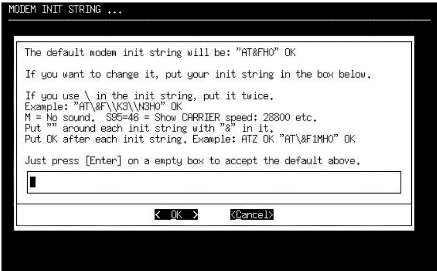

## 域名

现在，你需要输入你的 ISP 的域名。这将是类似 "example.net"、"slackware.com" 或类似的格式。（好吧，它绝对不会是 slackware.com :)）

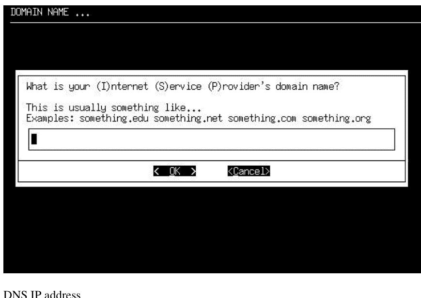

## DNS IP 地址

你的 ISP 应该已经为你提供了他们的域名服务器的 IP 地址。如果你有那个 IP 地址，请将其输入到方框中。否则，请与你的 ISP 联系以确认使用哪个号码。

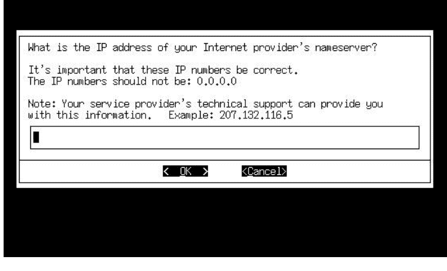

## 认证方法

这个问题可能也需要一些试错工作。你需要弄清楚你的 ISP 使用 CHAP、PAP 还是两者都不用于用户认证。弄清楚这一点最简单的方法是致电你的 ISP。但是，如果你在连接时看到登录和密码提示，你最有可能应该选择“SCRIPT”。否则，请咨询你的 ISP 以确定使用哪一个。

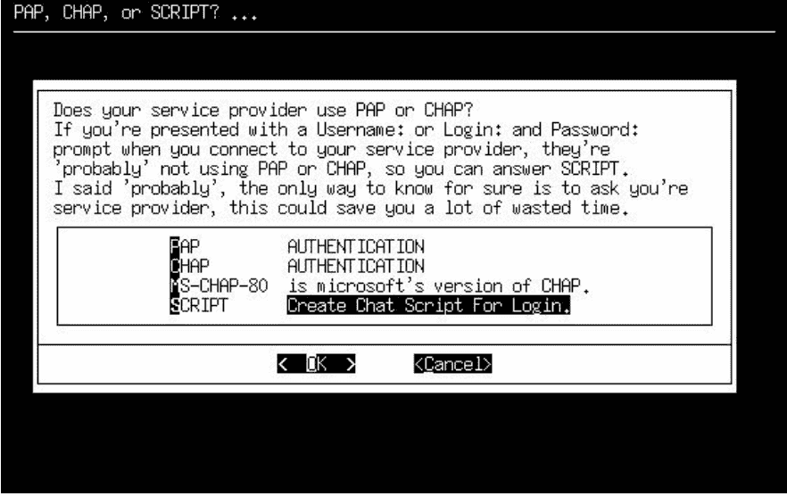

## PAP 或 CHAP

如果你在认证方法屏幕上选择了“PAP”或“CHAP”，你将被提示输入用户名。你的 ISP 应该已经为你分配了一个用户名。如果他们没有分配，那就出了大问题。你需要联系他们并获取一个用户名。

然后，你应该在下一个对话框中输入你的 ISP 分配给你的密码。

## 聊天脚本

如果你在认证方法屏幕上选择了“SCRIPT”，你将看到一个相当长的关于什么是聊天脚本的讨论。请务必阅读它，因为它描述得非常清楚。基本上，你想要告诉它你的 ISP 会发送什么样的信息，以及你的计算机应该发送什么作为回复来登录。

然后，你将进入一个循环，首先输入一些文本，说明你的计算机应该从 ISP 那里期望什么信息，接着是它应该发送回什么信息。你可以通过在空方框上按回车键来打破这个循环。

## 完成

最后，你将看到你完整的 PPP 配置文件。你实际上无法对它们做任何操作，但至少可以检查所有内容。按回车键保存所有内容并退出 **pppsetup**。

此屏幕还包含大量关于如何启动你的拨号连接以及完成使用后如何断开连接的信息。基本思路是：以 root 身份运行 **ppp-go** 来启动连接。一旦它给你一个本地和远程 IP，你就连接到互联网了。当你完成使用后，以 root 身份运行 **ppp-off**，它将断开连接。

```
────────────────── DONE ──────────────────
==================================================================
These are your PPP configuration files and instructions...
==================================================================

# This is your /etc/ppp/pppscript.

Look at /etc/ppp/pppscript.

# This is your /etc/ppp/options file.

# General configuration options for PPPD:
lock
defaultroute
noipdefault
modem
/dev/ttyS2
57600
crtscts

                                                  (  9%)
                              < EXIT >
```

## /etc 文件

## /etc/inetd.conf

在网络中心的操作系统中，运行许多服务并不罕见。通常，对于每个可用的服务，都需要一个程序在后台监听连接，这在运行大量此类服务器的系统上可能会有点负担。为了减少开销，创建了 inetd。inetd 是“互联网超级服务器”——它坐在那里监听许多套接字上的连接，当一个连接到来时，inetd 会启动相应的服务器来处理它。因此，许多等待的服务器被简化为一个。

`/etc/inetd.conf` 是 inetd 的配置文件。它指定哪些服务器为哪些连接运行。**inetd**(8) 手册页当然有更详细的信息，但让我们快速看一个基本的服务行：

```
ftp  stream  tcp  nowait  root  /usr/sbin/tcpd  wu.ftpd -l -i -a
```

这是 ftp 服务器的行。注意首先是协议名称（"ftp"），最后是响应时要运行的命令。在这种情况下，响应连接尝试而运行的程序是 `/usr/sbin/tcpd`；它是一个“包装器”程序，为其包装的服务器提供一些基本的安全选项。**wu.ftpd** 是我们实际的 ftp 服务器，但 tcpd 为我们运行它。有关 tcpd 的更多信息，请参阅[名为 tcp_wrappers 的部分](#tcp_wrappers)。

像许多系统文件一样，`inetd.conf` 中的行由 `#` 字符注释；你可以通过注释或取消注释它们的行并重启 **inetd** 来简单地从 inetd 中添加和移除服务。

## /etc/resolv.conf

此文件告诉系统的其余部分从何处获取其 DNS 信息。你使用的所有域名服务器都列在这里，以及你的主机域名。这是一个示例 resolv.conf（来自我正在输入此内容的笔记本电脑，ninja.tdn）：

```
domain tdn

nameserver 192.168.1.1

search tdn.slackware.com
```

第一行描述了 ninja 的域名；这是在我的地址中主机名之后的所有内容。第二行是我们家庭网络的 DNS 服务器。你可以根据需要拥有任意数量的这些；每当程序需要查找域名对应的

最后一行更有趣一些。它描述了我的系统应该*假定*哪些域名。例如，假设我有 `zuul.tdn` 和 `hejaz.slackware.com` 这两台机器。我可以简单地用 `ping zuul` 和 `ping hejaz` 分别来 ping 它们。这是因为 `ping` 会首先尝试在 `zuul` 的名称后加上 ".tdn"，并找到了匹配项，于是就采用了它。对于 "hejaz"，它会首先尝试 "hejaz.tdn"。没有匹配，然后它尝试 "hejaz.slackware.com" -- 搞定。请注意，`search` 行中列出的所有域名，除了最后一个，都需要以 '.' 结尾；如果只有一个，它就是最后一个，无需尾随 '.'。

## /etc/hosts

`hosts` 文件允许进行最简单的域名查找。它是一个主机名及其对应 IP 地址的列表。在 DNS 不值得部署的小型网络中、DNS 不可靠的实例中等情况下很有用，并且在系统启动时无法访问任何名称服务器的情况下，也会被机器使用。我的 `hosts` 文件可能看起来像这样：

```
127.0.0.1    localhost

192.168.1.32  ninja.tdn ninja
```

第一行应该是不言自明的。第二行可能不是。你可以为一个地址列出任意多个名称和别名，用空格分隔。所以，我有 "192.168.1.32" 被解析为 "ninja.tdn"（反之亦然），但别名 "ninja" 也可以在我懒得输入 ".tdn"（大多数时候都是如此）时使用。

## rc.inet1

`/etc/rc.d/rc.inet1` 是用于设置网络"基础设施"的文件——它初始化设备并设置地址和路由。Slackware 自带的 `rc.inet1` 已经有非常详尽的注释，如果我们在这里再全部过一遍，就显得多余了。

## rc.inet2

`/etc/rc.d/rc.inet2` 文件则负责网络的另一部分：设置服务和守护进程，并处理任何有趣的网络选项。让我们看一个示例块：

```
# Start the NAMED/BIND name server:

if [ -f ${NET}/named ]; then

    echo -n " named"

    ${NET}/named -u daemon -g daemon

fi
```

这里重要的行是第四行，它实际运行了 **named**(8)。其余部分是锦上添花：那个 "if" 语句检查在预期的位置是否确实存在 **named** 程序，而 **echo** 行则在系统启动时报告 **named** 正在被启动。你会发现大多数从 `rc.inet2` 启动的服务器都在类似这样的块中运行；进行简单的测试，看看是否有明显理由不应该运行它们，报告它们正在被启动，然后执行启动服务本身的命令。同样，`rc.inet2` 的注释也很详尽；花点时间研究一下它。

## NFS（网络文件系统）

网络文件系统，显然，用于在网络上机器之间共享文件。NFS 的妙处在于它的设计使得一台机器可以透明地挂载来自另一台机器的共享，并将它们视为本地文件。

不过，要实现这一点需要满足几个条件。首先是服务器机器上必须运行相应的服务：这些是 **portmap(8)**、**nfsd(8)** 和 **mountd(8)**。其次是服务器必须明确地将一个文件系统树"导出"给客户端，这通过 `/etc` 中的 `exports(5)` 文件来完成。

方程的第一部分通过安装 `tcplip1.tgz` 包（来自 N 系列）并让 `rc.inet2` 发挥其作用来处理。`/etc/exports` 则更有趣一些。

假设我在 `battlecat.tdn` 上有一个图像目录，我想将它挂载到 `ninja.tdn` 上。在 `battlecat` 上，我需要在 `/etc/exports` 中添加这样一行：

```
/var/media/images    ninja.tdn(ro)
```

然后在 `ninja` 上，我可以简单地

```
# mount -t nfs battlecat.tdn:/var/media/images /mnt
```

将 images 目录挂载到本地的 `/mnt`。不幸的是，我禁止了自己写入该共享目录——`battlecat` 的 `/etc/exports` 行中的那个 "(ro)" 是一个选项，意思是'只读'。任何此类选项都需要存在于客户端名称之后，括号内，以逗号分隔的列表形式。例如：

```
/var/media/images    ninja.tdn(rw,no_root_squash)
```

"rw" 显然是"读写"——受用户和组 ID 映射的约束（解释请参见 `exports(5)` 手册页），`ninja` 上的用户被允许写入共享目录。我不喜欢 `squash`，所以我把这个解释留给那本手册页；如果你计划大量使用 NFS，`exports(5)` 将是你最好的朋友。不妨熟悉一下，对吧？

## tcp_wrappers

`tcp_wrappers` 是一个用于防止（并明确允许）从指定主机访问服务的基本系统。简而言之，它的工作原理是这样的：

**inetd**（互联网超级服务器）运行着许多服务器，其中许多都被 **tcpd** "包装"。换句话说，**tcpd** 才是实际运行这些服务器的程序，但 **inetd** 并不知道（或者说，也不在乎）。**tcpd** 记录连接尝试，然后检查 `/etc/hosts.allow` 和 `/etc/hosts.deny` 文件，以确定是否应该允许该连接。

这些文件中包含的规则可能有些复杂，但假设 `pyramid.tdn` 真的很烦人，就是不肯放过可怜的 `mojo.tdn`。`mojo.tdn` 可能会在 `/etc/hosts.deny` 中加入这样一行：

```
ALL: pyramid.tdn
```

这一行应该很清楚：它阻止 `pyramid` 使用 `mojo` 上所有受 `tcpd` 保护的服务。如果除了 `pyramid` 之外，我还有一个整个域让我感到困扰，我可以将该行改为：

```
ALL: pyramid.tdn, .annoying.domain
```

## 总结

在本章中，你学习了如何配置系统以连接到网络，如何调整配置文件，以及一些基本的安全原则。此外，你还了解了什么是网络文件系统以及如何在系统上使其工作。将你的系统成为网络的一部分，使你能够访问各种资源，如邮件、新闻和网站。关于如何使用一些基本网络程序，请参见[第 13 章](#)。

# 第 6 章. X 窗口系统

X 窗口系统是所有 UNIX 平台的标准图形用户界面，这包括 Linux。与 Windows 和 MacOS 不同，在 Linux 和 Unix 中，图形用户界面与主要的操作系统内核是分离的。这增加了系统的稳定性：如果图形用户界面崩溃，它不会拖垮整个系统。

X 的一个问题是，它在传统上对系统进行配置非常困难。然而，Slackware 7 引入了一个无需配置的 X 设置，使用了帧缓冲驱动程序。这意味着你不必经历[名为 xf86config 的部分](#)和[名为 XF86Setup 的部分](#)中描述的过程。帧缓冲驱动程序也能在任何符合 VESA 2.0 标准的显卡上工作。这意味着几乎所有现代显卡都能在 X 下工作。不过，帧缓冲驱动程序明显比针对你的系统定制的 X 配置要慢。

如果你选择使用帧缓冲服务器，你应该从 X 软件系列中安装 `xxfb.tgz` 包。你还应该在安装程序的配置部分选择一个控制台分辨率。推荐的 X 选项可能最适合大多数人。

如果你选择为系统配置 X，你需要遵循[名为 xf86config 的部分](#)或[名为 XF86Setup 的部分](#)中的说明。第一部分描述了如何使用 `xf86config(1)`，这是一个基于命令行的 X 配置程序。第二部分描述了 `XF86Setup(1)`，它是配置程序的图形版本。

# xf86config

`xf86config` 是可用于在系统上配置 X 的两个程序之一。基本思想很简单：你会被问到一系列问题，并提供多个选择答案。选择最适合你系统的答案。在完成整个程序后，`/etc/XF86Config(5)` 文件将被写入，你就可以使用 X 了。如果在某个环节搞砸了，你将不得不使用 `control-c` 终止程序，然后从头开始。

在使用 `xf86config` 之前，尽可能多地了解你的显示器和显卡信息会很有帮助。你可以使用 **SuperProbe** 程序获取关于显卡的信息：

```
# SuperProbe
```

这会给你一个关于可能锁定系统的警告。如果这吓到了你，在五秒钟的时间限制内使用 `control-c` 退出。否则，你会得到一些关于你的视频设置的信息：


## 显卡信息

第一个视频：Super-VGA

芯片组：ATI 264GT3（3D Rage Pro）（端口探测）

内存：4096 Kbytes

RAMDAC：ATI Mach64 集成 15/16/24/32 位 DAC 及时钟（带有 8 位宽查找表）（可编程为 6/8 位宽查找表）

附加图形协处理器：
- 芯片组：ATI Mach64
- 内存：4096 Kbytes

以上就是 ATI Rage Pro 显卡的信息示例。记下你的显卡信息，或者切换到另一个虚拟终端（使用**Alt-功能键**组合）并在那里运行 **xf86config**。稍后你会需要你的显卡信息。**xf86config** 必须以 root 权限运行，因为它将在只有 root 才允许写入的地方创建文件和符号链接：

```
# xf86config
```

一旦你启动 **xf86config**，它将显示一个满是文本的屏幕，告诉你它将要做什么。记住，如果你犯了错误，没有办法返回到上一个屏幕，所以请仔细选择。否则，你可能不得不重复此过程几次。按照提示，按 **Enter** 键。

## 鼠标协议

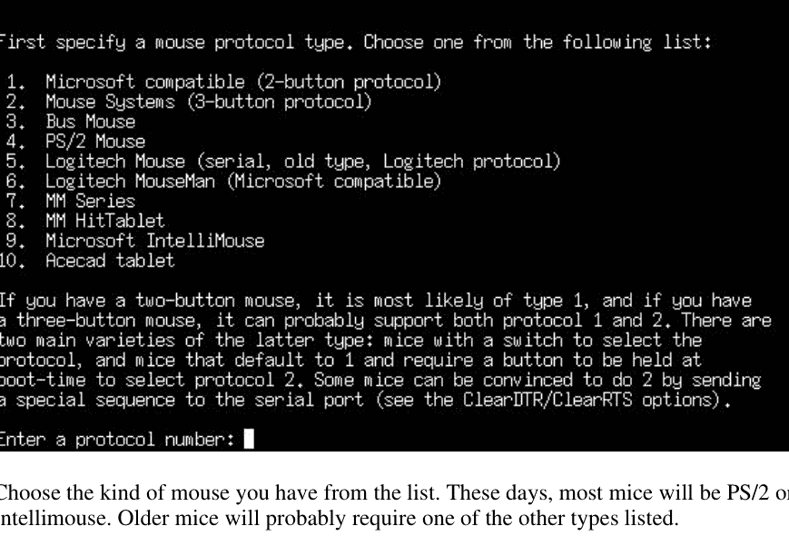

从列表中选择你拥有的鼠标类型。如今，大多数鼠标是 PS/2 或 Microsoft IntelliMouse。较老的鼠标可能需要列出的其他类型之一。

## 模拟三键

1. Microsoft 兼容（2 键协议）
2. Mouse Systems（3 键协议）
3. 总线鼠标
4. PS/2 鼠标
5. Logitech 鼠标（串行，旧类型，Logitech 协议）
6. Logitech MouseMan（Microsoft 兼容）
7. MM 系列
8. MM HitTablet
9. Microsoft IntelliMouse
10. Acecad 数位板

如果你有一个两键鼠标，它很可能是类型 1；如果你有一个三键鼠标，它可能同时支持协议 1 和 2。后一种类型主要有两种：带开关选择协议的鼠标，以及默认为协议 1 且需要在启动时按住按钮才能选择协议 2 的鼠标。某些鼠标可以通过向串行端口发送特殊序列来强制选择协议 2（参见 ClearDTR/ClearRTS 选项）。

输入协议编号：4

如果你的鼠标只有两个按钮，建议启用模拟三键功能。

请用 'y' 或 'n' 回答以下问题。
你想启用模拟三键吗？y

如果你的鼠标只有两个按钮，你可以选择模拟第三个按钮。同时点击鼠标左键和右键将被解释为点击第三个按钮。由于许多程序会使用第三个按钮，因此建议启用它。如果你有一个三键鼠标，此功能将不起任何作用。

## 鼠标设备名称

现在输入鼠标所连接的完整设备名称，例如 /dev/tty00。直接按回车将使用默认值 /dev/mouse。

鼠标设备：/dev/mouse

默认的 /dev/mouse 通常是可以接受的。但是，如果你的鼠标连接在某个奇怪的端口上，你可能需要更改此设置。对于大多数串行鼠标和 PS/2 鼠标，默认值没问题。

## XKEYBOARD 扩展

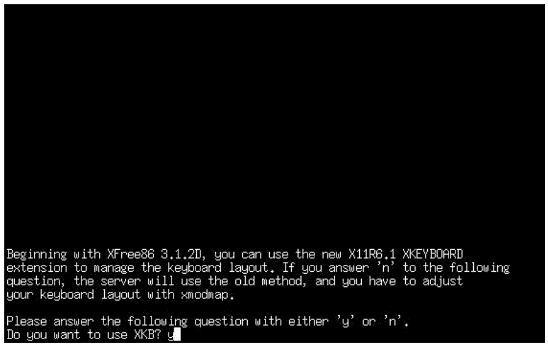

你可能想使用 X 键盘扩展。不选择此项将导致退格键和删除键出现一些奇怪的行为。选择键盘扩展将使按键按应有的方式工作。

## Alt 键绑定

如果你想输入不同语言的字符，你应该启用 Alt 键绑定。如果你只打算用英语打字，则不需要启用这些绑定。

## 水平同步范围

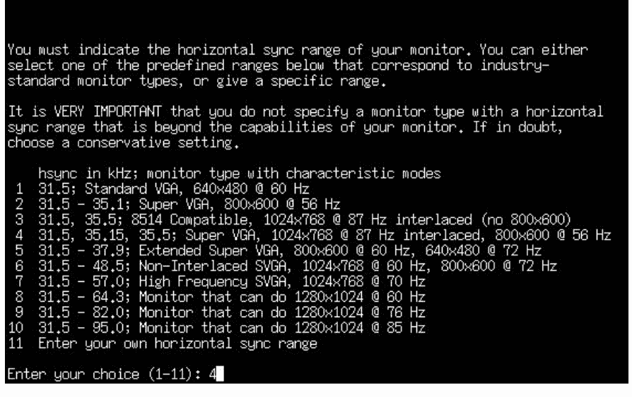

这是关于显示器的第一个问题。在这里做出明智的选择很重要。不要选择超出显示器规格的范围。这在较新的显示器上不太重要，因为它们不会尝试做超出其规格的事情。但是，较旧的显示器可能会损坏。如有疑问，请选择一个保守的范围。

拥有显示器的文档将是接下来几个问题的良好参考。对于大多数较新的显示器，你可能可以选择 31.5-48.5 或 31.5-57.0。拥有高端显示器的用户可以选择较大的范围之一。或者，如果你没有看到完全合适的选项，可以输入你自己的水平同步范围。

## 垂直同步范围

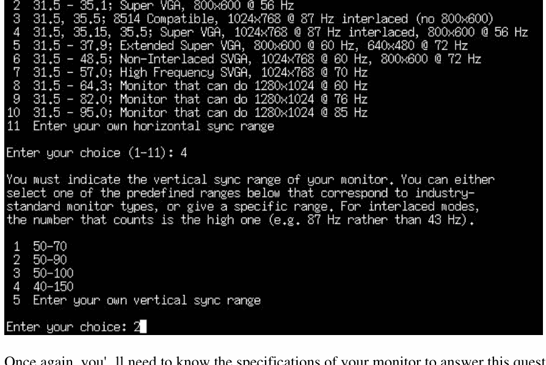

再次，你需要了解显示器的规格才能回答这个问题。如有疑问，请选择一个较窄的范围。安全的选择可能是 50-90 或 50-100。如果你没有看到适合你显示器的选项，可以选择输入你自己的范围。

### 标识字符串

你现在将看到三个询问显示器标识字符串的问题。这些不是特别重要。如果你想的话，对所有三个问题直接按回车即可。或者，你可以用任何你想要的名称来命名它们。这些字符串将用于配置文件中进行标识。

## 显卡数据库

| 编号 | 显卡名称                          | 芯片组         |
|--------|------------------------------------|-----------------|
| 0      | 2 the Max MAXColor S3 Trio64V+     | S3 Trio64V+     |
| 1      | 3DLabs Oxygen GMX                  | PERMEDIA 2      |
| 2      | 3DVision-i740 AGP                  | Intel 740       |
| 3      | 3DLabs Permedia2（通用）         | PERMEDIA 2      |
| 4      | 928Movie                           | S3 928          |
| 5      | ABIT G740 8MB SDRAM                | Intel 740       |
| 6      | AGP 2D/3D V. 1N, AGP-740D         | Intel 740       |
| 7      | AGX（通用）                      | AGX-014/15/16   |
| 8      | ALG-5434(E)                        | CL-GD5434       |
| 9      | AOpen AGP 2X 3D Navigator PA740    | Intel 740       |
| 10     | AOpen PA2010                       | Voodoo Banshee  |
| 11     | AOpen PA45                         | SiS6326         |
| 12     | AOpen PA50D                        | SiS6326         |
| 13     | AOpen PA50E                        | SiS6326         |
| 14     | AOpen PA50V                        | SiS6326         |
| 15     | AOpen PA80/DVD                     | SiS6326         |
| 16     | AOpen PG128                        | S3 Trio3D       |
| 17     | AOpen PG975                        | 3dimage975      |

输入一个数字以选择相应的显卡定义。
按回车查看下一页，按 q 继续配置。
_

配置 X 的下一个主要部分涉及你的显卡。你的显卡文档和来自 **SuperProbe** 的信息现在都会派上用场。你需要浏览显卡数据库以挑选你的显卡，因此对问题回答 'Y'。直接按回车将使你跳过显卡数据库并进入下一部分。

数据库中有超过 800 张显卡。左列包含每张显卡的编号和名称。右列包含该显卡的芯片组。不断按回车，直到你在列表中找到你的显卡。找到后，输入编号并按回车。如果你不知道你的显卡类型，有几个选项。首先，你可以查看 **SuperProbe** 输出的 "Chipset" 行，并在数据库中查找匹配该芯片组的显卡。或者，你可以使用通用的 SVGA 显卡类型。许多没有自己专用服务器的显卡都由 SVGA 服务器支持，因此这可能是一个安全的选择。

选择显卡后，它会给你更多信息。以上面的 ATI Rage Pro 为例，它会提供此类信息：

```
Your selected card definition:

Identifier: ATI Mach64

Chipset:     ATI-Mach64

Server:      XF86_Mach64

Do NOT probe clocks or use any Clocks line.
```

此时，你应该检查以确保已安装服务器包。XF86_Mach64 服务器在 `xma64.tgz` 包中。确保已安装正确的服务器包，否则 X 将无法运行。

运行哪个服务器？


现在你必须确定要运行哪个服务器。请查阅手册页和其他文档。以下服务器可用（它们可能并未全部安装在你的系统上）：

1.  `XF86_Mono` 服务器。这是一个单色服务器，应可在任何 VGA 兼容显卡上运行，分辨率为 640x480（在某些 SVGA 芯片组上可能更高）。
2.  `XF86_VGA16` 服务器。这是一个 16 色 VGA 服务器，应可在任何 VGA 兼容显卡上运行。
3.  `XF86_SVGA` 服务器。这是一个 256 色 SVGA 服务器，支持多种 SVGA 芯片组。在某些芯片组上，它具备加速功能或支持更高的颜色深度。
4.  加速服务器。这些包括 `XF86_S3`、`XF86_Mach32`、`XF86_Mach8`、`XF86_8514`、`XF86_P9000`、`XF86_AGX`、`XF86_W32`、`XF86_Mach64`、`XF86_I128` 和 `XF86_S3V`。

这四种服务器类型对应于 `XF86Config` 中四种不同的 "Screen" 部分（`vga2`、`vga16`、`svga`、`accel`）。

你打算默认运行哪种屏幕类型（1-4）？

接下来的问题提供了几种可供选择的服务器。如果你已正确选择了显卡，可以安全地直接按回车键。这将指示 X 使用显卡指定的服务器。否则，你可以选择使用 Mono 服务器、VGA16 服务器、SVGA 服务器或加速服务器。最佳选择是使用显卡指定的服务器。

## 设置符号链接

通过更改符号链接 `X` 来选择要运行的服务器。例如，`rm /usr/X11R6/bin/X; ln -s /usr/X11R6/bin/XF86_SVGA /usr/X11R6/bin/X` 会选择 SVGA 服务器。

目录 `/var/X11R6/bin` 存在。在许多 Linux 系统上，这是放置符号链接 `X` 的首选位置。设置符号链接时，你可以选择此位置。

请回答以下问题，输入 'y' 或 'n'。

你希望我设置符号链接吗？ y

选择 'y' 进行符号链接设置。这将设置一个指向适当 X 服务器的链接。

## 显存

选择你的显卡拥有的内存量。**SuperProbe** 也可用于提供此信息。如果你的内存量不在选项之列，可以选择 'Other' 并输入不同的量。请确保以千字节为单位指定内存量。

### 标识字符串

你将被提示输入另外三个标识字符串。这些适用于你的显卡。与显示器字符串一样，除非你想为你的显卡命名，否则对所有三个都按回车键是安全的。

### RAMDAC

只有在你使用 S3、AGX 或 W32 服务器时，才需要选择 RAMDAC 设置。**SuperProbe** 会告诉你你的显卡上安装的是哪种 RAMDAC 芯片。浏览列表直到找到正确的芯片，然后输入相应的数字。如果你不使用 S3、AGX 或 W32 服务器，输入 "q" 可在不选择 RAMDAC 的情况下继续。

### 时钟芯片设置

设备部分中的 `Clockchip` 行会强制检测可编程时钟设备。启用时钟芯片后，可以编程所需的时钟，而无需探测时钟或 `Clocks` 行。大多数显卡没有可编程时钟芯片。

从以下列表中选择：

| # | 芯片 | 标识符 |
|---|------|------------|
| 1 | Chrontel 8391 | ch8391 |
| 2 | ICD2061A 及兼容型号 (ICS9161A, DCS2824) | icd2061a |
| 3 | ICS2595 | ics2595 |
| 4 | ICS5342 (类似于 SDAC，但不完全兼容) | ics5342 |
| 5 | ICS5341 | ics5341 |
| 6 | S3 GenDAC (86C708) 和 ICS5300 (自动检测) | s3gendac |
| 7 | S3 SDAC (86C716) | s3_sdac |
| 8 | STG 1703 (自动检测) | stg1703 |
| 9 | Sierra SC11412 | sc11412 |
| 10 | TI 3025 (自动检测) | ti3025 |
| 11 | TI 3026 (自动检测) | ti3026 |
| 12 | IBM RGB 51x/52x (自动检测) | ibm_rgb5xx |

如果你不想设置时钟芯片，直接按回车键即可。

你想要哪个时钟芯片设置（1-12）？

如果你的显卡具有可编程时钟芯片，你需要从接下来的列表中选择一个。请记住，大多数显卡没有可编程时钟芯片，因此直接按回车键应该是安全的。**SuperProbe** 应该会报告你的显卡是否有时钟芯片。

### 时钟行

接下来的文本说明了什么是时钟行。如其解释，在大多数现代配置中，你不会需要它。然后它会提示你，询问是否应探测时钟。它还会告诉你显卡是否需要被探测。对于 ATI 显卡，**xf86config** 会说：

The card definition says to NOT probe clocks.

如果它说类似这样的话，对于探测显卡时钟的问题选择 "n"。非常老的显卡需要探测。**xf86config** 会告诉你需要做什么。

### 视频模式

对于每种颜色深度，定义了一系列模式（分辨率）。服务器启动时使用的默认分辨率将是显示器和显卡支持的、列表中第一个模式。

当前设置为：

```
"640x480" "800x600" "1024x768" "1280x1024" for 8bpp
"640x480" "800x600" "1024x768" "1280x1024" for 16bpp
"640x480" "800x600" "1024x768" "1280x1024" for 24bpp
"640x480" "800x600" "1024x768" for 32bpp
```

请注意，只有少数配置支持 16、24 和 32 位色深。由于显示器或时钟限制而无法支持的模式将被服务器自动跳过。

1.  更改 8 位色深（256 色）的模式
2.  更改 16 位色深（32K/64K 色）的模式
3.  更改 24 位色深（24 位色，打包像素）的模式
4.  更改 32 位色深（24 位色）的模式
5.  模式没问题，继续。

输入你的选择： 5

现在是时候选择你的 X 服务器将使用的视频模式了。你将看到四种不同的颜色深度——8bpp、16bpp、24bpp 和 32bpp。每种颜色深度下都有一个可以在该深度运行的各种视频模式列表。当你启动 X 时，它将进入默认颜色深度，并运行该颜色深度下列出的第一个分辨率。如果你希望 X 默认以不同的分辨率启动，现在就是时候了。

如果视频模式的顺序没问题，你可以选择 "OK"，这将继续配置过程。否则，选择你想要更改的颜色深度。例如，假设你看到了以下选择：

```
"640x480" "800x600" "1024x768" "1280x1024" for 8bpp

"640x480" "800x600" "1024x768" "1280x1024" for 16bpp

"640x480" "800x600" "1024x768" "1280x1024" for 24bpp

"640x480" "800x600" "1024x768" for 32bpp
```

如果你希望 X 默认以不同的分辨率启动，你首先需要选择一个要更改的颜色深度。然后按照 **xf86config** 给出的说明操作。它会提示你输入对应于分辨率顺序的数字。如果你只是想反转分辨率的顺序，你可以这样回答：

```
Which modes? 5432
```

这也允许你删除分辨率。如果你的显卡无法运行 1280x1024，就没有理由让它尝试。你可以通过回答以下数字来删除该行：

```
Which modes? 432
```

在为该颜色深度选择模式后，你会被问到是否想要一个比物理屏幕更大的虚拟屏幕。虚拟屏幕是比实际显示器更大的屏幕。当你在虚拟屏幕上移动鼠标时，在到达边缘之前它会滚动一点。这使你可以在显示器上容纳更多窗口。然而，因为你无法一次看到所有内容，虚拟屏幕可能会有点烦人。它仍然是一个有趣的东西，所以你可能想尝试一下。

然后你会被送回视频模式列表。在更改了 24 位色深的视频模式后，它会看起来像这样：

```
"640x480" "800x600" "1024x768" "1280x1024" for 8bpp

"640x480" "800x600" "1024x768" "1280x1024" for 16bpp

"1280x1024" "1024x768" "800x600" "640x480" for 24bpp

"640x480" "800x600" "1024x768" for 32bpp
```

继续更改视频模式，直到你满意为止。完成此部分后，选择 "OK" 继续。

## 写入配置文件

此时，X 的配置已完成。**xf86config** 会询问是否应将配置文件写入 */etc/XF86Config*。如果你希望能够运行 X，你应该对该问题回答 "y"，因为 X 会在此处查找其配置文件。

假设你正确回答了所有问题并已安装 X 服务器软件包，你现在应该能够按如下方式启动 X：

```
$ startx
```

如果你安装了 KDE 或 GNOME，此时应该会启动它们。否则，你可能想运行 **xwmconfig** 并选择你想要默认使用的窗口管理器。窗口管理器将在本章后面描述。**xwmconfig** 只为用户设置默认窗口管理器...


运行它。如果你的系统上有多个用户，每个人都需要选择他们自己的窗口管理器。

在使用 X 时，有几个特殊快捷键可能会派上用场。如果你需要在某个时候退出 X 却无法正常关闭它，有一个强制退出的组合键。`control-alt-backspace` 会杀死 X 并将你送回命令行。在运行 X 时，你可以通过按 `control-alt-功能键` 切换回命令行终端，这与在控制台切换虚拟终端类似。X 会话位于终端 7，因此你可以用 `alt-F7` 重新进入 X。最后，你可以在运行 X 时更改视频模式。`control-alt-数字键盘` + 将切换到下一个更高的分辨率，而 `control-alt-数字键盘` - 将切换到下一个更低的分辨率。

# XF86Setup

配置 X 的第二种方法是使用 **XF86Setup**，这是一个图形化配置程序，作为 `xset.tgz` 软件包的一部分提供。你还需要安装 `svg16.tgz` 软件包。

要运行 XF86Setup，以 root 身份登录并输入：

```
# XF86Setup
```

如果你已经有一个 `/etc/XF86Config` 文件（因为你已经配置过 X），它会询问你是否要使用现有的 `XF86Config` 文件作为默认值。否则，它会直接切换到图形模式。

**图 6-1. XF86Setup 初始屏幕。**

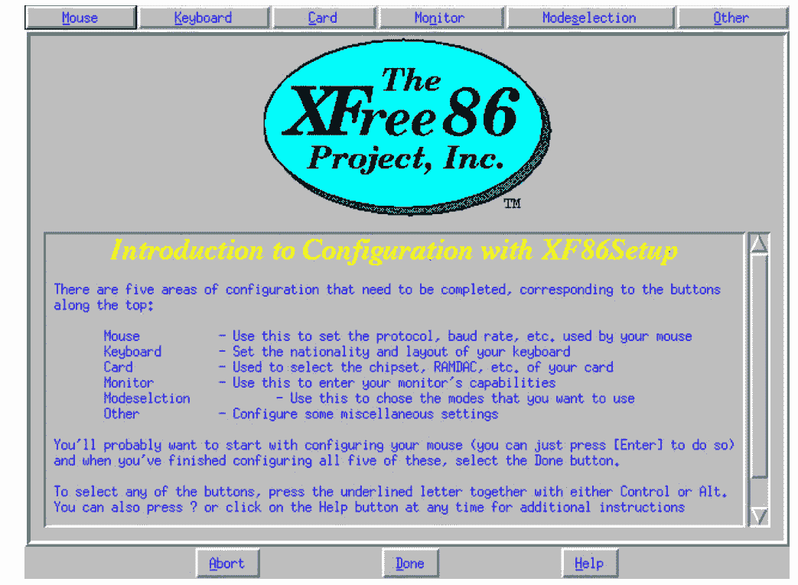

**XF86Setup** 与 **xf86config** 非常相似。它询问同样的问题类型，但在图形环境中呈现它们。如果你想知道某个问题的含义，请参考前一节获取信息。**XF86Setup** 也有很多帮助，所以你在弄清楚它时应该不会有任何困难。

## 会话配置文件

**xinitrc 和 ~/.xinitrc**

**xinit**(1) 是实际启动 X 的程序；它由 **startx**(1) 调用，所以你可能没有注意到它（并且可能真的不需要）。然而，它的配置文件决定了当 X 启动时运行哪些程序（包括尤其是窗口管理器）。**xinit** 首先检查你的主目录中是否有 `.xinitrc` 文件。如果找到该文件，它就会运行；否则，使用 `/var/X11R6/lib/xinit/xinitrc`（系统范围的默认值）。这是一个简单的 xinitrc 文件示例：

```
#!/bin/sh

# $XConsortium: xinitrc.cpp,v 1.4 91/08/22 11:41:34 rws Exp $

userresources=$HOME/.Xresources

usermodmap=$HOME/.Xmodmap

sysresources=/usr/X11R6/lib/X11/xinit/.Xresources

sysmodmap=/usr/X11R6/lib/X11/xinit/.Xmodmap

# merge in defaults and keymaps

if [ -f $sysresources ]; then

	xrdb -merge $sysresources

fi

if [ -f $sysmodmap ]; then

	xmodmap $sysmodmap

fi

if [ -f $userresources ]; then

	xrdb -merge $userresources

fi

if [ -f $usermodmap ]; then

	xmodmap $usermodmap

fi

# start some nice programs

twm &

xclock -geometry 50x50-1+1 &

xterm -geometry 80x50+494+51 &

xterm -geometry 80x20+494-0 &

exec xterm -geometry 80x66+0+0 -name login
```

所有这些 'if' 块都是为了从其他文件合并各种配置设置。我们马上就会讲到 `.Xresources`，但 `.Xmodmap` 我们将暂时不管。该文件的有趣部分在末尾，那里运行着各种程序。这个 X 会话将以 **twm**(1) 窗口管理器、一个时钟和三个终端开始。注意最后一个 xterm 前的 **exec**。它的作用是用那个 xterm(1) 命令替换当前正在运行的 shell（即执行这个 `xinitrc` 脚本的 shell）。当用户退出那个 xterm 时，X 会话就会结束。

要自定义你的 X 启动，将默认的 `/var/X11R6/lib/xinit/xinitrc` 复制到 `~/.xinitrc` 并编辑它，用你喜欢的任何内容替换那些程序行。我的文件末尾只是：

```
# Start the window manager:

exec startkde
```

注意 `/var/X11R6/lib/xinit` 中有几个 `xinitrc.*` 文件，它们对应于各种窗口管理器和图形用户界面。如果你愿意，可以使用其中任何一个。

## .Xresources 和 .Xdefaults

许多 X 程序使用一个称为 X 资源数据库的系统来获取各种用户偏好设置（字体、颜色等）。这个数据库通过 **xrdb(1)** 程序来维护，你可能永远不需要直接运行它。相反，在 Slackware 中它是由 `xinitrc` 运行的。`xinitrc` 告诉 **xrdb** 获取选项的文件是 `~/.Xresources`。**xrdb** 也会加载 `~/.Xdefaults`，所以这两个文件名中的任何一个都可以工作。一个最小的 `.Xresources` 文件看起来像这样：

```
xterm*background: black

xterm*foreground: gray

xterm*scrollBar: true

xterm*font: -*-lucidatypewriter-*-*-*-15-*-*-*-*-*-*-*
```

这四行指定了 **xterm** 程序的配置信息。一个 X 资源列出如下：

```
program*option: setting/value
```

因此，上面的示例 `.Xresources` 应该是不言自明的。不要被 "font" 行搞糊涂了；X 字体总是这样指定的。

## 服务器和窗口管理器

X 窗口系统最初设计为跨网络透明地工作。一个大型服务器实际上会运行 X 程序，但它们会显示在网络上的其他客户端机器上。远程显示程序的能力可能是一个巨大的优势。这种网络概念的主要缺点是它不如在本地机器上运行应用程序安全，而且需要大量的网络带宽。这将在后面的[导出显示部分](the section called Exporting displays)中讨论。

即使你在自己的机器上运行 X，你仍然在处理客户端-服务器模型。服务器是特定于显卡的部分。当你配置 X 并告诉它你拥有什么类型的显卡时，就是在告诉它使用哪个服务器程序。客户端部分是你在 X 下运行的所有其他程序。一个特殊的客户端，称为窗口管理器，负责你特定 X 会话的外观和感觉。窗口管理器将在后面详细讨论。

窗口管理器的工作是处理在屏幕上绘制带有程序的窗口，以及处理来自鼠标和键盘的输入。第一个窗口管理器只做这些，没有太多其他功能。今天的窗口管理器是复杂得多的程序，并且可以以几乎任何可以想象的方式进行定制。它们有各种各样的花哨选项，让你的桌面看起来与其他人的不同。

## 选择桌面

多年来，Unix 几乎只用作服务器的操作系统，除了高性能的专业工作站。只有技术倾向的人才可能使用类 Unix 操作系统，而用户界面也反映了这一事实。图形用户界面往往相当简陋，设计用于运行一些必须图形化的应用程序，如 CAD 程序和图像渲染器。大多数文件和系统管理是在命令行进行的。各种供应商（Sun Microsystems、Silicon Graphics 等）销售工作站安装，并尝试提供连贯的"外观和感觉"，但开发者使用的各种图形用户界面工具包不可避免地导致了桌面统一性的瓦解。滚动条在两个不同的应用程序中可能看起来不一样。菜单位置可能不同。程序会有不同的按钮和复选框。颜色范围广泛，并且通常在每个工具包中都是硬编码的。只要用户主要是技术专业人士，这些都不太重要。

随着免费类 Unix 操作系统的出现以及图形应用程序数量和种类的增长，X 最近获得了广泛的桌面用户群。当然，大多数用户习惯了 Microsoft Windows 或 Apple MacOS 提供的一致外观和感觉；X 应用程序中缺乏这种一致性成为了其广泛接受的障碍。作为回应，开展了两个开源项目：K 桌面环境，即 KDE，和 GNU 网络对象模型环境，称为 GNOME。每个项目都有各种各样的应用程序，从任务栏和文件管理器到游戏和办公套件，使用相同的图形用户界面工具包编写，并紧密集成以提供统一、一致的桌面。

KDE 和 GNOME 之间的差异通常相当微妙。它们彼此看起来不同，因为每个都使用不同的图形用户界面工具包。KDE 基于 Troll Tech AS 的 Qt 库，而 GNOME 使用 GTK，一个最初为 The GNU Image Manipulation Program（简称 The GIMP）开发的工具包。作为独立的项目，KDE 和 GNOME 各自有自己的设计师和程序员，具有不同的开发风格和理念。然而，两者的结果在根本上是相同的：一个一致、紧密集成的桌面环境和应用程序集合。KDE 和 GNOME 的功能、可用性和纯粹的美观性与任何其他操作系统上可用的东西相媲美。

不过，最好的部分是这些先进的桌面是免费的。这意味着你可以拥有其中一个或两个（是的，同时拥有）。选择权在你手中。

除了 GNOME 和 KDE 桌面外，Slackware 还包含大量的窗口管理器。有些旨在模仿其他操作系统，有些用于定制，还有些用于速度。种类相当多。当然，你可以安装任意多的数量，尝试全部，然后决定你最喜欢哪个。

为了使桌面选择变得简单，Slackware 还包含一个名为 **xwmconfig** 的程序，可用于选择桌面或窗口管理器。它这样运行：

```
$ xwmconfig
```

图 6-2. Slackware xwmconfig 程序。


## 为 X 选择默认窗口管理器

请选择要与 X 窗口系统一起使用的默认窗口管理器。这将定义计算机使用的图形用户界面风格。KDE 和 GNOME 提供的功能最多。有 Windows 或 MacOS 使用经验的人会觉得 KDE 易于使用。GNOME 不太容易上手，但可配置性极高且图形界面丰富。其他窗口管理器对系统资源的需求较低，或提供其他独特功能。

| (X) | initrc.kde | KDE：K 桌面环境 |
| ( ) | initrc.gnome | GNOME：GNU 网络对象模型环境 |
| ( ) | initrc.e | Enlightenment |

| < 确定 > | < 取消 > |

您将看到所有已安装桌面环境和窗口管理器的列表。只需从列表中选择您想要的即可。系统上的每个用户都需要运行此程序，因为不同的用户可以使用不同的桌面环境，并非所有人都会选择您在安装时选定的默认环境。

然后只需启动 X，即可开始使用：

```
$ startx
```

# 导出显示

如前所述，可以在一台计算机上运行 X 程序并在另一台计算机上显示。这极其耗费带宽，因此您可能不想通过调制解调器连接或在非常长的距离上这样做。此外，还有安全考虑：导出显示并不是很安全的做法，因为它会让整个网络都能看到您在做什么。尽管如此，在局域网上它仍然非常有用。

这里需要注意的一个重要事项是“客户端”和“服务器”这两个词的用法。在导出显示时，您可能会混淆什么是客户端、什么是服务器。我们把实际运行 X 程序并发送显示信息的机器称为“服务器”。您用来显示远程程序的机器称为“客户端”。在讨论 X 的设计时，这个定义是反过来的。显示内容的程序称为“服务器”，而运行的程序称为“客户端”。这不算太难理解，但值得指出。

在本例中，我们将使用两台计算机：golf 是一台性能相当强的服务器，位于拥挤房间一侧的桌子底下。它拥有大量 RAM 和一个不错的处理器。此外，它上面安装了许多 X 程序，但没有显示器。房间的另一侧是 couch，一台内存少、硬盘不大的老旧机器。它太弱了，无法运行像 Netscape 这样资源密集型的程序。然而，couch 有两个主要优势：它有一台显示器，而且它就放在沙发旁边，所以您甚至不需要站起来就能使用它。理想情况下，您希望不下沙发就能运行 Netscape。导出显示就是解决方案。

首先，登录 couch 并启动 X。然后打开您最喜欢的终端程序（xterm、rxvt、eterm、aterm 或众多其他程序之一）。远程显示 X 程序的第一步是设置客户端机器，允许其他机器向该机器显示。这使用 **xhost** 程序来控制访问。如果您在安全的内部网络上，可能不在乎谁可以远程显示程序。在这种情况下，您只需允许网络上的任何人显示：

```
couch$ xhost +
access control disabled, clients can connect from any host
```

另一方面，您可能想在不安全的网络（互联网、大学网络或任何您无法控制的网络）上使用机器这样做。您当然不希望任何人都能连接。xhost 允许您选择性地允许谁可以显示：

```
couch$ xhost + golf.foc

golf.foc being added to access control list
```

现在，只有 golf.foc（前面提到的服务器）可以向 couch 显示程序。您可以通过不带参数运行 xhost 来查看谁有权显示程序：

```
couch$ xhost

access control enabled, only authorized clients can connect

INET:golf.foc

INET:localhost

INET:couch.foc

LOCAL:
```

这就是设置客户端所需做的全部工作。下一步是设置服务器，使其知道将程序显示到显示器以外的其他地方。由于服务器没有连接显示器（因此没有运行 X），它需要知道在哪里显示。

设置服务器也不太困难。连接后，您需要修改 DISPLAY 环境变量。默认情况下，它可能没有设置任何值。您需要将 DISPLAY 设置为远程主机的值，加上一个数字，表示要显示到哪个 X 会话。您几乎总是只有一个 X 会话在运行，因此处理这个变量应该不是问题。

以下是在我们的示例服务器上使用 Bash 作为 shell 时设置 DISPLAY 变量的方法。其他 shell 会使用不同的语法，但值应该是相同的。

```
golf$ export DISPLAY=couch.foc:0.0
```

这就是设置服务器端所需的全部操作。现在您只需保持登录服务器，并从那里运行 X 程序。所有来自程序的屏幕输出都将通过网络发送到客户端机器，即使它运行在房间对面的计算机上。

```
golf$ netscape &
```

这将在服务器机器上运行 **netscape**，但由于 DISPLAY 变量设置为 couch，所有内容都将显示在那里。您甚至不需要站起来就可以在您的旧终端上运行那些大型 X 程序。关于这一点有一个重要说明：服务器机器必须拥有运行程序所需的所有 X 库和其他支持文件。但是，您将不需要 X 服务器或 /etc/XF86Config 文件，因为没有内容会显示到服务器上。

之后，您可能希望通过从客户端的访问控制列表中移除服务器来禁用显示导出：

```
couch$ xhost - golf.foc

golf.foc being removed from access control list

couch$
```

您可以看看这是共享计算资源的好方法。但要小心，您可能为许多远程计算机托管了多个 X 程序而自己却浑然不知。

## 总结

在本章中，您学习了如何使用 **xf86config** 和 **XF86Setup** 配置 X 窗口系统。您还应该了解什么是桌面环境和窗口管理器，以及如何在各种选项之间切换。您应该能够将您的 X 会话导出到另一台计算机。此时，您应该已经可以在图形环境中运行了。

# 第 7 章 启动

启动 Linux 系统的过程有时容易，有时困难。许多用户在计算机上安装了 Slackware 就完成了。他们只需打开电源就可以使用了。然而，其他用户需要为某些任务使用另一个操作系统，因此他们需要在机器上同时安装两个操作系统。

本节涵盖使用 Slackware 附带的两个启动器 LILO 和 Loadlin。它还解释了一些典型的双启动场景以及如何设置它们。

## LILO

Linux 加载器，即 LILO，是 Linux 系统上最流行的启动器。它可配置性很高，可以轻松用于启动其他操作系统。

Slackware Linux 附带一个名为 **liloconfig** 的菜单驱动配置实用程序。此程序在安装过程中首次运行，但您也可以稍后通过在提示符下输入 **liloconfig** 来调用它。

LILO 从 `/etc/lilo.conf(5)` 文件中读取其设置。它不是每次启动时都读取，而是在每次安装 LILO 时读取。每次进行配置更改时，都必须将 LILO 重新安装到引导扇区。**liloconfig** 将帮助您构建配置文件，以便您可以为系统安装 LILO。如果您更喜欢手动编辑 `/etc/lilo.conf`，那么重新安装 LILO 只需在提示符下输入 `/sbin/lilo`。

当您第一次调用 **liloconfig** 时，它看起来会像这样：

**图 7-1. 初始 liloconfig 屏幕。**

```
----------------------- INSTALL LILO -----------------------

LILO (Linux Loader) is a generic boot loader. There's a simple
installation which tries to automatically set up LILO to boot
Linux (also DOS, Windows, and OS/2 if found). For more advanced
users, the expert option offers more control over the
installation process. Since LILO does not work in all cases
(and can damage partitions if incorrectly installed), there's
the third (safe) option, which is to skip installing LILO for
now. You can always install it later with the 'liloconfig'
command. Which option would you like?

  [Simple] Try to install LILO automatically!
  [Expert] Use expert lilo.conf setup menu
  [Skip]   Do not install LILO

              <  OK  >    <Cancel>
```

如果这是您第一次设置 LILO，您应该选择“simple”。否则，如果您熟悉 LILO 和 Linux，可能会发现“expert”更快。选择“simple”将开始 LILO 配置。

如果内核编译了帧缓冲支持，**liloconfig** 将询问您希望使用哪个视频分辨率。这也是 XFree86 帧缓冲服务器使用的分辨率。如果您不希望控制台以特殊的视频模式运行，选择 normal 将保持标准的 80x25 文本模式。

**图 7-2. Liloconfig 询问为帧缓冲区使用哪种视频模式。**


## 根分区

此选项会将 LILO 安装到你的 Linux 根分区的起始位置。如果你的计算机上装有其他操作系统，这是最安全的选择。它确保不会覆盖其他任何引导程序。缺点是，只有当你的 Linux 驱动器是系统中的第一个驱动器时，LILO 才会从这里加载。

## 软盘

这种方法甚至比前一种更安全。它会创建一个引导软盘，你可以用它来引导你的 Linux 系统。这使得引导程序完全离开硬盘，因此你只需在需要使用 Slackware 时引导这张软盘即可。

## 主引导记录

如果你的计算机上 Slackware 是唯一的操作系统，或者你将使用 LILO 在计算机上的多个操作系统之间进行选择，你会想要使用此方法。

> ⚠️ 此选项会覆盖主引导记录中的任何其他引导程序。

选择安装位置后，`liloconfig` 将写入配置文件并安装 LILO。就是这样。如果你选择“专家”模式，你将看到一个特殊菜单。此菜单允许你调整 `/etc/lilo.conf` 文件，将其他操作系统添加到引导菜单，并设置 LILO 在引导时传递特殊的内核参数。专家菜单看起来像这样：

图 7-3. liloconfig “专家”模式。

无论你的系统配置如何，设置一个工作的引导加载程序都很简单。**liloconfig** 使其设置变得轻而易举。但是，在某些情况下，LILO 无法在系统上工作。幸运的是，还有其他选项。

## LOADLIN

Slackware Linux 附带的另一个引导选项是 LOADLIN。LOADLIN 是一个 DOS 可执行文件，可用于从正在运行的 DOS 系统启动 Linux。它要求 Linux 内核位于 DOS 分区上，以便 LOADLIN 可以加载它并正确引导系统。

在安装过程中，LOADLIN 将作为 .ZIP 文件复制到 root 的主目录。LOADLIN 没有自动设置过程。你需要将 Linux 内核 (`/vmlinuz`) 和 LOADLIN 文件从 root 的主目录复制到 DOS 分区。

如果你想在 DOS 分区上创建引导菜单，LOADLIN 非常有用。可以在你的 `AUTOEXEC.BAT` 文件中添加一个菜单，允许你在 Linux 或 DOS 之间进行选择。选择 Linux 将运行 LOADLIN，从而引导你的 Slackware 系统。Windows 95 下的这个 `AUTOEXEC.BAT` 文件将提供一个足够的引导菜单：

```
@ECHO OFF

SET PROMPT=$P$G

SET PATH=C:\WINDOWS;C:\WINDOWS\COMMAND;C:\

CLS

ECHO Please Select Your Operating System:

ECHO.

ECHO [1] Slackware Linux

ECHO [2] Windows 95

ECHO.

CHOICE /C:12 "Selection? -> "

IF ERRORLEVEL 2 GOTO WIN

IF ERRORLEVEL 1 GOTO LINUX

:WIN

CLS

ECHO Starting Windows 95...

WIN

GOTO END

:LINUX

ECHO Starting Slackware Linux...

CD \LINUX

LOADLIN C:\LINUX\VMLINUZ ROOT=<root partition device> RO

GOTO END

:END
```

你需要将根分区指定为 Linux 设备名称，例如 `/dev/hda2` 或其他名称。你始终可以在命令行使用 LOADLIN。你只需像上面示例中那样使用它。LOADLIN 文档包含许多关于如何使用的示例。

## 双重引导

许多用户将其计算机设置为同时引导 Slackware Linux 和另一个操作系统。我们在下面描述了几种典型的双重引导场景，以防你在设置系统时遇到困难。

### Windows 9x/DOS

设置同时拥有 Windows 9x 和 Linux 的计算机可能是最常见的情况。你可以通过多种方式设置引导，但本节将介绍其中两种。

在设置双重引导系统时，人们通常会设计一个完美的计划来决定所有内容的存放位置，但却搞乱了安装顺序。理解操作系统需要按照一定的顺序安装才能实现双重引导至关重要。Linux 始终提供控制，决定是否将任何内容写入主引导记录。因此，始终建议最后安装 Windows 应该先安装，因为它总是会将其引导程序写入主引导记录。

### 使用 LILO

大多数人会想使用 LILO 在 Linux 和 Windows 之间进行选择。如上所述，你应该先安装 Windows，然后再安装 Linux。

假设你有一个 47GB 的 IDE 硬盘作为系统中的唯一驱动器。再假设你希望将其中一半空间分配给 Windows，一半分配给 Linux。在尝试引导 Linux 时，这会带来一个问题。我不知道该驱动器的具体几何结构，但很可能驱动器上 23.5GB 的位置远远超过了第 1024 个柱面。该驱动器更好的布局将是：

```
1GB Windows 引导分区 (C:)
1GB Linux 根分区 (/)
22.5GB Windows 其他分区 (D:)
22.5GB Linux /usr 分区 (/usr)
```

你还应该为 Linux 交换分区预留足够的空间。不成文的规定是使用你拥有的内存量的两倍作为磁盘空间。一个 64MB 的系统将有 128MB 的交换空间，依此类推。

分区布局好后，你应该继续安装 Windows。设置并工作后，你应该安装 Linux。LILO 安装需要特别注意。你将需要选择“专家”模式来安装 LILO。

开始一个新的 LILO 配置。你希望将其安装到主引导记录，以便用于在两个操作系统之间进行选择。从菜单中，添加你的 Linux 分区和 Windows（或 DOS）分区。完成后，你可以安装 LILO。

重新启动计算机。LILO 应该会加载并等待用户交互。你可以按 Alt 键获得 `boot:` 提示符。输入你想要加载的操作系统的名称（这些名称是在设置 LILO 时选择的）。如果你忘记了名称，按 **Tab** 键获取可引导的操作系统列表。

你可以通过编辑 Linux 分区上的 `/etc/lilo.conf` 文件来进一步配置 LILO。你可以设置它显示文本菜单，并始终显示提示符。例如，如果我希望我的 LILO 显示内容如下：

```
System Boot Menu
================

1 - Linux

2 - Windows

LILO boot:
```

我的 `/etc/lilo.conf` 文件将如下所示：

```
# LILO configuration file

boot = /dev/hda

vga = normal

message = /boot/message

image = /vmlinuz

    root = /dev/hda2

    label = 1

    read-only

other = /dev/hda1

    label = 2

    table = /dev/hda
```

而我的 `/boot/message` 文件将如下所示：

```
System Boot Menu

==================

1 - Linux

2 - Windows
```

LILO 是一个相当可配置的引导加载程序。它不仅限于引导 Linux 或 DOS。它几乎可以引导任何东西。**lilo(8)** 和 **lilo.conf(5)** 的手册页提供了更详细的信息。

如果 LILO 不工作怎么办？在某些特定机器上，LILO 就是无法工作。幸运的是，还有另一种方法可以双重引导 Linux 和 Windows。

### 使用 LOADLIN

如果 LILO 在你的系统上不工作，或者你只是不想设置 LILO，可以使用此方法。此方法也适用于经常重新安装 Windows 的用户。每次重新安装 Windows 时，它都会覆盖主引导记录，从而破坏任何 LILO 安装。使用 LOADLIN，你就不会遇到这个问题。最大的缺点是，你只能使用 LOADLIN 来引导 Linux。

使用 LOADLIN，你可以按照任何想要的顺序安装操作系统。注意不要将内容安装到主引导记录，你不想那样做。LOADLIN 依赖于 Windows 分区可引导。因此，在 Slackware 安装过程中，请确保跳过 LILO 设置。

安装操作系统后，将 `lodlinX.zip`（其中 "X" 是版本号，例如 "16a"）文件从 root 的主目录复制到你的 Windows 分区。同时将你的内核映像复制到 Windows 分区。你需要在 Linux 中才能完成此操作。此示例展示了如何操作：


## 第8章. Shell

在图形化环境中，界面由创建窗口、滚动条、菜单等的程序提供。在命令行环境中，用户界面由“shell”提供，它解释命令并通常使事情变得可用。登录后（本章将介绍），用户会被放入shell中并可以处理自己的事务。本章作为shell的介绍，以及对Linux用户最常用的shell——Bourne Again Shell（bash）的介绍。有关本章任何内容的更详细信息，请查看**bash(1)**手册页。

## 用户

### 登录

所以你已经启动了系统，看到类似这样的内容：

```
Welcome to Linux 2.2.14
darkstar login:
```

嗯..没人提到登录的事。darkstar是什么？别担心；你可能没有意外地启动到帝国人造卫星的超空间通信链路。（恐怕超空间通信链路协议目前Linux内核不支持。）不，darkstar只是我们其中一台计算机的名字，它的名字作为默认值被印上去了。如果你在安装期间为计算机指定了名称，你应该看到它而不是darkstar。

至于登录...如果是第一次，你会想以**root**身份登录。系统会提示你输入密码；如果在安装过程中设置了密码，那就是它要的密码。如果没有，只需按回车键。就这样——你进去了！

### root：超级用户

好吧，谁或*什么*是'root'？它怎么在*你的*系统上有账户？

嗯，在Unix和类似操作系统（如Linux）的世界里，有用户，然后还有用户。我们稍后会更详细地介绍，但现在需要知道的重要事情是root是用户之上的用户；root是全能全知的，*没人*不服从root。这不被允许。Root就是我们所说的“超级用户”，而且名副其实。最棒的是，root就是*你*。

酷，是吧？

如果你不确定：是的，这很酷。不过，问题是root天生就被允许破坏它想要的任何东西。你可能想跳到[第12章](https://chatgpt.com/)看看如何添加用户；然后以该用户身份登录并从那里开始工作。传统智慧是只在绝对必要时才成为超级用户，以最小化意外破坏某些东西的可能性。

顺便说一句，如果你决定想在以其他用户身份登录时成为root，没问题。只需使用**su(1)**命令。你会被要求输入root的密码，然后它会让你成为root，直到**exit**或**logout**。你也可以使用**su**成为任何其他用户，只要你知道那个用户的密码。例如，**su logan**会让你成为我。

## 命令行

### 运行程序

不运行程序就很难完成多少事情；你也许可以用电脑支撑东西或让门开着，有些程序运行时会发出最可爱的嗡嗡声，但仅此而已。我想我们都同意它作为嗡嗡门挡的用途并不是个人电脑获得如今普及度的原因。

那么，还记得Linux中几乎所有东西都是文件吗？嗯，程序也是如此。你运行的每个命令（不是内置在shell中的）都作为文件存在于某处。你只需指定它的完整路径来运行程序。

那么，为什么只输入`su`就能工作呢？毕竟，你没有说它在`/bin`中。它也可能在`/usr/local/share`中，对吧？它怎么*知道*的？答案在于`PATH`环境变量；大多数shell都有`PATH`或非常类似`PATH`的东西。它基本上包含一个目录列表，用于查找你尝试运行的程序。所以当你运行`su`时，你的shell会遍历它的目录列表，检查每个目录中是否有名为`su`的可执行文件可以运行；它找到的第一个就会运行。每当你在没有指定完整路径的情况下运行程序时，就会发生这种情况；如果你得到`Command not found`错误，那只是意味着你尝试运行的程序不在你的`PATH`中。（当然，如果程序根本不存在，也会是这样...）我们将在[称为*Bourne Again Shell (bash)*的部分](http://tldp.org/LDP/Bash-Beginners-Guide/html/sect_01_05.html)更深入地讨论环境变量。

还要记住“`.`”是“我所在的目录”的简写，所以如果你碰巧在`/bin`中，`./su`作为显式完整路径也能工作。

### 通配符匹配

几乎每个shell都识别一些字符作为表示“这里任何东西都可以”的替代或缩写。这样的字符恰当地被称为“通配符”；最常见的是`*`和`?`。按照惯例，`?`通常匹配任何单个字符。例如，假设你在一个有三个文件的目录中：`ex1.txt`、`ex2.txt`和`ex3.txt`。你想复制所有这些文件（使用我们将在[第10章*cp*部分](http://tldp.org/LDP/Bash-Beginners-Guide/html/ch10s03.html)介绍的`cp`命令）到另一个目录，比如`/tmp`。嗯，输入`cp ex1.txt ex2.txt ex3.txt /tmp`工作量太大了。输入`cp ex?.txt /tmp`要容易得多；`?`将匹配字符“1”、“2”和“3”，每个将依次被替换进去。

你说什么？那*仍然*工作量太大？你是对的。这很糟糕：我们有劳动法来保护我们免受这种事情。幸运的是，我们也有`*`。如前所述，`*`匹配“任意数量的字符”，包括0。所以如果这三个文件是目录中唯一的文件，我们可以简单地说`cp * /tmp`，一次性全部复制。不过，假设还有一个名为`example.txt`和一个名为`hejaz.txt`的文件。我们想复制`example.txt`但不复制`hejaz.txt`；`cp example* /tmp`会为我们做到这一点。

当然，`cp example?.txt /tmp`只会得到我们原来的三个文件；`example.txt`中没有字符能匹配那个`?`，所以它会被排除。

### 输入/输出重定向和管道

（接下来是酷的部分。）

```
$ ps > blargh
```

知道那是什么吗？那是我运行`ps`查看哪些进程正在运行；`ps`在[第11章](http://tldp.org/LDP/Bash-Beginners-Guide/html/ch06s03.html)介绍。那不是酷的部分。酷的部分是`blargh`，大致意思是“获取`ps`的输出并写入名为`blargh`的文件”。但等等，还有更酷的。

```
$ ps | less
```

那个获取`ps`的输出并通过less“管道”传输，这样我就可以随意滚动查看。

```
$ ps >> blargh
```

这是第三个最常用的重定向器；它做与“>”相同的事情，除了如果文件存在，“>>”会将`ps`的输出附加到文件`blargh`。如果不存在，就像“>”一样，它会被创建。（“>”会抹去`blargh`的当前内容。）

还有一个“<”运算符，意思是“从以下内容获取输入”，但它使用得不那么频繁。

```
$ fromdos < dosfile.txt > unixfile.txt
```

当你开始堆叠重定向时，重定向变得非常有趣：

```
$ ps | tac >> blargh
```

---

# Windows NT

这是第二常见的双启动情况。Windows NT比在Windows 9x和Linux之间双启动带来更多的问题。我们最关心的问题是，如果主引导记录被LILO覆盖，NT将无法成功启动。因此，我们必须使用Windows NT自带的操作系统加载器。以下步骤展示了如何设置Windows NT和Linux双启动系统。

1.  安装Windows NT
2.  安装Linux，确保LILO安装到Linux分区的超级块
3.  获取Linux根分区的前512字节并存储在Windows NT分区上
4.  在Windows NT下编辑C:\BOOT.INI以添加Linux选项

安装Windows NT应该相当直接，安装Linux也一样。从那里开始，就变得有点棘手了。获取Linux分区的前512字节比听起来容易。你需要在Linux中完成此操作。假设你的Linux分区是/dev/hda2，发出以下命令：

```
# dd if=/dev/hda2 of=/tmp/bootsect.lnx bs=1 count=512
```

就这样。现在你需要将bootsect.lnx复制到Windows NT分区。这里我们遇到另一个问题。Linux对NTFS文件系统没有稳定的写支持。如果你安装了Windows NT并将驱动器格式化为NTFS，你需要将此文件复制到FAT软盘，然后在Windows NT下读取它。如果你将Windows NT驱动器格式化为FAT，你可以简单地在Linux下挂载它并复制文件。无论哪种方式，你都需要将/tmp/bootsect.lnx从Linux驱动器复制到Windows NT驱动器上的C:\BOOTSECT.LNX。

最后一步是在Windows NT引导菜单中添加菜单选项。在Windows NT下打开命令提示符。

```
C:\WINNT>cd \
C:\>attrib -r -a -s -h boot.ini
C:\>edit boot.ini
```

将此行添加到文件末尾：

```
C:\bootsect.lnx="Slackware Linux"
```

保存更改并退出编辑器。当你重新启动Windows NT时，菜单上会有一个Linux选项。选择它将启动进入Linux。

# Linux

是的，人们真的这样做。这绝对是最简单的双启动场景。你可以简单地使用LILO并向/etc/lilo.conf文件添加更多条目。仅此而已。

## 总结

本章讨论了使用LILO或Loadlin引导系统。还讨论了在Linux和其他操作系统之间引导。你应该能够正确配置引导方法，并与另一个操作系统进行双启动，如果你选择这样做的话。

# IV. 使用Slackware Linux

---

以下部分展示了使用Loadlin与Windows 9x设置双启动的示例。首先，从Linux中，准备必要的文件：

```
# mkdir /win
# mount -t vfat /dev/hda1 /win
# mkdir /win/linux
# cd /root
# cp loadlin* /win/linux
# cp /vmlinuz /win/linux
# cd /win/linux
# unzip loadlin16a.zip
```

这将在你的Windows分区上（假设是/dev/hda1）创建C:\LINUX目录，并复制LOADLIN所需的必要文件。完成此操作后，你需要重新启动进入Windows以设置启动菜单。

一旦进入Windows，获取DOS提示符。首先，我们需要确保系统设置为不进入图形界面。

```
C:\>cd \
C:\>attrib -r -a -s -h MSDOS.SYS
C:\>edit MSDOS.SYS
```

将此行添加到文件中：

```
BootGUI=0
```

现在保存文件并退出编辑器。然后编辑C:\AUTOEXEC.BAT，以便我们可以添加启动菜单。以下提供了AUTOEXEC.BAT中启动菜单块的示例：

```
cls
echo System Boot Menu
echo.
echo 1 - Linux
echo 2 - Windows
echo.
choice /c:12 "Selection? -> "
if errorlevel 2 goto WIN
if errorlevel 1 goto LINUX
:LINUX
cls
echo "Starting Linux..."
cd \linux
loadlin c:\linux\vmlinuz root=/dev/hda2 ro
goto END
:WIN
cls
echo "Starting Windows..."
win
goto END
:END
```

关键行是运行LOADLIN的那一行。我们告诉它要加载的内核、Linux根分区，以及我们希望它最初以只读方式挂载。

这两种方法的工具都随Slackware Linux提供。市场上还有许多其他引导器，但这些应该适用于大多数双启动设置。


那将运行 **ps**，将其输出的行反转，并将这些内容追加到文件 `blargh` 中。你可以随意叠加多个这样的操作；只需注意它们是从左到右依次解释执行的。

请参阅 **bash**(1) 手册页以获取关于重定向的更详细信息。

## The Bourne Again Shell (bash)

### 环境变量

Linux 系统是一个复杂的体系，有很多需要跟踪的内容，很多小细节会在你与各种程序的日常交互中发挥作用（其中一些你可能甚至不需要知道）。没有人希望在运行每个程序时都传递一堆选项，告诉它正在使用什么样的终端、计算机的主机名、提示符应该是什么样子……

因此，作为一种应对机制，用户拥有所谓的环境。环境定义了程序运行的条件，而其中一部分定义是可变的；用户可以修改和调整它，这在 Linux 系统中是理所当然的。几乎所有的 shell 都会有环境变量（如果没有，那它可能不是一个很好用的 shell）。在这里，我们将概述 bash 提供的用于操作其环境变量的命令。

```
$ set
```

**set** 单独使用会显示当前定义的所有环境变量及其值。像大多数 **bash** 内置命令一样，它还可以执行其他一些操作（通过参数）；不过我们将这部分内容留给 **bash**(1) 手册页来介绍。以下是从我某台计算机上执行 **set** 命令的输出摘录：

```
PATH=/usr/local/lib/qt/bin:/usr/local/bin:/usr/bin:/bin:/usr/X11R6/bin:
/usr/openwin/bin:/usr/games:.:/usr/local/ssh2/bin:/usr/local/ssh1/bin:
/usr/share/texmf/bin:/usr/local/sbin:/usr/sbin:/home/logan/bin
PIPESTATUS=([0]="0")
PPID=4978
PS1='\h:\w\$ '
PS2='> '
PS4='+ '
PWD=/home/logan
QTDIR=/usr/local/lib/qt
REMOTEHOST=ninja.tdn
SHELL=/bin/bash
```

注意我们之前讨论过的 `PATH` 变量；我只需输入基本文件名就能运行这些目录中的任何程序。

```
$ unset VARIABLE
```

**unset** 会移除你指定的变量，同时清除该变量及其值；**bash** 会忘记该变量曾经存在过。（别担心。除非它是你在该 shell 会话中明确定义的变量，否则它可能会在其他会话中被重新定义。）

```
$ export VARIABLE=some_value
```

那么，**export** 确实非常方便。使用它，你可以将环境变量 `VARIABLE` 设置为值 "some_value"；如果 `VARIABLE` 之前不存在，现在它就存在了。如果 `VARIABLE` 已经有了一个值，好吧，它会被覆盖。

如果你只是想将一个目录添加到 PATH 中，这就不太好了。在这种情况下，你可能需要这样做：

```
$ export PATH=$PATH:/some/new/directory
```

注意这里使用了 $PATH：当你希望 **bash** 解释一个变量（将其替换为其值）时，在变量名前面加上 $。例如 echo **$PATH** 会输出 `PATH` 的值，在我的情况下：

```
$ echo $PATH
/usr/local/lib/qt/bin:/usr/local/bin:/usr/bin:/bin:/usr/X11R6/bin:
/usr/openwin/bin:/usr/games:.:/usr/local/ssh2/bin:/usr/local/ssh1/bin:
/usr/share/texmf/bin:/usr/local/sbin:/usr/sbin:/home/logan/bin
```

### Tab 补全

（又一个很酷的功能来了。）

1.  命令行界面意味着大量的输入。
2.  输入是辛苦活。
3.  没人喜欢辛苦活。

由第 3 条和第 2 条，我们可以得出第 4 条：没人喜欢输入。幸运的是，**bash** 帮我们解决了第 5 条（没人喜欢命令行界面）。

你可能会问，**bash** 是如何实现这个奇妙功能的呢？除了我们之前讨论过的通配符扩展之外，**bash** 还具有"Tab 补全"功能。

Tab 补全的工作原理大致如下：你正在输入一个文件名。它可能在你的 PATH 中，也可能你是完整输入的。你只需输入足够多的文件名来唯一标识它。然后按下 Tab 键。**bash** 会弄清楚你想要什么，并帮你完成输入！

来看个例子。/usr/src 包含两个子目录：/usr/src/linux 和 /usr/src/sendmail。我想查看 /usr/src/linux 中的内容。所以我只需输入 `ls /usr/src/l`，按下 TAB 键，**bash** 就会给我 `ls /usr/src/linux`。

现在，假设有两个目录 /usr/src/linux 和 /usr/src/linux-old；如果我输入 `/usr/src/l` 并按下 TAB，**bash** 会尽可能多地填充，我得到 `usr/src/linux`。我可以到此为止，或者再按一次 TAB，**bash** 会显示与我已输入内容匹配的目录列表。

因此，输入量减少了（因此，人们可以喜欢命令行界面了）。我告诉过你这很酷。

## 虚拟终端

对应一个虚拟终端。Slackware 默认在 6 个虚拟终端上有登录。Alt+F2 会带你到第二个，Alt+F3 到第三个，以此类推。

其余的功能键保留给 X 会话使用。每个 X 会话使用自己的虚拟终端，从第七个（Alt+F7）开始递增。在 X 环境中，Alt+功能键组合被替换为 Ctrl+Alt+功能键；所以如果你在 X 环境中想返回文本登录（不退出 X 会话），Ctrl+Alt+F3 会带你到第三个虚拟终端。（Alt+F7 会带你回去，前提是你使用的是第一个 X 会话。）

## 总结

本章讨论了用户、shell、命令行和虚拟终端。你应该能够熟练地在命令行上工作、运行程序，以及使用管道和重定向操作符来组合命令。最后，你应该对 root 用户的权限有一定了解，以及为什么始终以 root 身份运行是一件坏事。

## 第 9 章. 文件系统结构

我们已经在 Slackware Linux 中讨论了目录结构。你能够找到所需的文件和目录。但文件系统远不止目录结构这么简单。

Linux 是一个多用户操作系统。系统的各个方面都是多用户的，文件系统也不例外。系统会存储诸如谁拥有某个文件以及谁可以读取该文件等信息。文件系统还有其他独特的部分，比如链接和 NFS 挂载。本节将解释这些内容，以及文件系统的多用户方面。

### 所有权

文件系统为系统上的每个文件和目录存储所有权信息。这包括某个文件的所有者和所属组。查看这些信息最简单的方法是使用 `ls` 命令：

```
$ ls -l /usr/bin/wc
-rwxr-xr-x 1 root bin 7368 Jul 30 1999 /usr/bin/wc
```

我们关注的是第三列和第四列。它们包含拥有该文件的用户名和组名。我们可以看到用户 'root' 和组 'bin' 拥有这个文件。

我们可以使用 `chown(1)`（意为"change owner"，更改所有者）和 `chgrp(1)`（意为"change group"，更改所属组）命令来轻松更改文件所有者。要将文件所有者更改为 'daemon'，我们使用 `chown`：

```
# chown daemon /usr/bin/wc
```

要将组所有者更改为 'root'，我们使用 `chgrp`：

```
# chgrp root /usr/bin/wc
```

我们还可以使用 `chown` 来同时指定文件的用户所有者和组所有者：

```
# chown daemon.root /usr/bin/wc
```

文件所有权是使用 Linux 系统非常重要的一部分，即使你是唯一的用户。你有时也需要修复文件和设备节点的所有权。

### 权限

权限是文件系统多用户方面的另一个重要部分。通过权限，你可以更改谁可以读取、写入和执行文件。

权限信息以四个八进制数字存储，每个数字指定一组不同的权限。有所有者权限、组权限和全局权限。第四个八进制数字用于存储特殊信息，如设置用户 ID、设置组 ID 和"粘滞"位。分配给各权限模式的八进制值如下（它们还有与之对应的字母，由 **ls** 等程序显示，也可被 **chmod** 使用）：

表 9-1. 八进制权限值

| 权限类型 | 八进制值 | 字母值 |
| :--- | :--- | :--- |
| "粘滞"位 | 1 | t |
| 设置用户 ID | 4 | s |
| 设置组 ID | 2 | s |
| 读取 | 4 | r |
| 写入 | 2 | w |
| 执行 | 1 | x |

你需要将每个权限组的八进制值相加。例如，如果你希望组权限为"读取"和"写入"，你会在权限信息的组部分使用"6"。

**bash** 的默认权限是：

```
$ ls -l /bin/bash

-rwxr-xr-x 1 root bin 477692 Mar 21 19:57 /bin/bash
```

如果这是一个目录，第一个破折号会被替换为"d"。接下来显示三个权限组（所有者、组和全局）。我们可以看到所有者具有读取、写入和执行权限（rwx）。组只有读取和执行权限（r-x）。而其他所有人都只有读取和执行权限（r-x）。

我们如何设置另一个文件的权限使其类似于 **bash** 的权限呢？首先，让我们创建一个示例文件：

```
$ touch /tmp/example

$ ls -l /tmp/example

-rw-rw-r--- 1 david users 0 Apr 19 11:21 /tmp/example
```

我们将使用 **chmod(1)**（意为"change mode"，更改模式）来设置示例文件的权限。将你想要的权限对应的八进制数相加。如果所有者需要读取、写入和执行权限，值就是 7。读取和执行权限是 5。将它们组合在一起，像这样传递给 **chmod**：

```
$ chmod 755 /tmp/example

$ ls -l /tmp/example

-rwxr-xr-x 1 david users 0 Apr 19 11:21 /tmp/example
```

要设置特殊权限，将数字相加并放在第一列中。例如，要设置用户 ID 和组 ID，我们使用 6 作为第一列：


## 第十章 处理文件和目录

Slackware Linux 旨在尽可能地接近 Unix。传统上，Unix 操作系统以命令行为主。虽然 Slackware 中确实提供了图形用户界面，但命令行仍然是系统的主要控制方式。因此，了解一些基本的文件管理命令非常重要。

以下各节介绍了常用的文件管理命令及其使用示例。还有许多其他命令，但这些命令将帮助你入门。此外，这里仅对命令进行简要讨论，你可以在每个命令的随附 man 手册页中找到更多详细信息。

我们在前面多处提到了设置用户 ID 和设置组 ID 权限。你可能想知道这是什么。通常，当你运行一个程序时，它是在你的用户账户下运行的。也就是说，它拥有你作为用户所具有的所有权限。组的情况也是如此。当你运行一个程序时，它在你当前的组下执行。通过设置用户 ID 权限，你可以强制程序始终以程序所有者（例如 'root'）的身份运行。设置组 ID 是同样的道理，只不过针对的是组。

请小心使用，设置用户 ID 和设置组 ID 的程序可能会在你的系统上造成严重的安全漏洞。如果你频繁设置属于 'root' 的设置用户 ID 程序，你就是在允许任何人运行该程序并以 root 身份运行它。由于 root 在系统上没有任何限制，你可以看出这会带来多大的安全问题。简而言之，使用设置用户 ID 和设置组 ID 权限本身没有问题，只需要运用常识即可。

如果八进制值让你感到困惑，你可以使用字母与 **chmod** 配合使用。权限组表示为：

- 所有者 u
- 组 g
- 其他用户 o
- 以上所有 a

要实现上述效果，我们需要使用多条命令行：

```
$ chmod a+rx /tmp/example
$ chmod u+w /tmp/example
$ chmod ug+s /tmp/example
```

有些人更喜欢使用字母而不是数字。两种方式的结果都是相同的权限集。

```
$ chmod 6755 /tmp/example
$ ls -l /tmp/example
-rwsr-sr-x 1 david users 0 Apr 19 11:21 /tmp/example
```

## 链接

链接是文件之间的指针。通过链接，你可以让文件存在于多个位置，并通过多个名称进行访问。链接有两种类型：硬链接和软链接。

硬链接是特定文件的名称。它们只能存在于单个目录中，只有当真实名称从系统中删除时才会被移除。这在某些情况下很有用，但许多用户发现软链接更加灵活。

软链接，也称为符号链接，可以指向其目录之外的文件。它实际上是一个包含所需信息的小文件。你可以添加和删除软链接，而不会影响实际文件。

链接没有自己的权限或所有权，而是反映它们所指向文件的权限和所有权。Slackware 主要使用软链接。下面是一个常见的示例：

```
$ ls -l /bin/sh
lrwxrwxrwx 1 root root 4 Apr 6 12:34 /bin/sh -> bash
```

Slackware 中的 **sh** shell 实际上是 **bash**。删除链接使用 **rm** 命令。**ln** 命令用于创建链接。这些命令将在第十章中更深入地讨论。

## 挂载设备

正如前面在第 4 章 *文件系统布局* 一节中所讨论的，你计算机中的所有驱动器和设备组成一个大的文件系统。各种硬盘分区、CD-ROM 和软盘都放置在同一棵树中。为了将这些驱动器附加到文件系统以便访问它们，你需要使用 `mount(1)` 和 `umount(1)` 命令。

一些设备在启动计算机时会自动挂载。这些设备列在 `/etc/fstab` 文件中。任何你希望自动挂载的内容都会在该文件中有一个条目。对于其他设备，每次使用时都需要发出命令。

## fstab

让我们看看 `/etc/fstab` 文件的示例：

```
/dev/sda1 / ext2 defaults 1 1
/dev/sda2 /usr/local ext2 defaults 1 1
/dev/sda4 /home ext2 defaults 1 1
/dev/sdb1 swap swap defaults 0 0
/dev/sdb3 /export ext2 defaults 1 1
none /dev/pts devpts gid=5,mode=620 0 0
none /proc proc defaults 0 0
/dev/fd0 /mnt ext2 defaults 0 0
/dev/cdrom /cdrom iso9660 ro 0 0
```

第一列是设备名称。在本例中，设备包括分布在两个 SCSI 硬盘上的五个分区、两个不需要设备的特殊文件系统、一个软盘和一个 CD-ROM 驱动器。第二列是设备的挂载位置。这需要是一个目录名称，交换分区除外。第三列是设备的文件系统类型。对于普通的 Linux 文件系统，这将是 `ext2`（第二扩展文件系统）。CD-ROM 驱动器是 `iso9660`，基于 Windows 的设备将是 `msdos` 或 `vfat`。

第四列是适用于已挂载文件系统的选项列表。"defaults" 对几乎所有情况都适用。但是，只读设备应指定 `ro` 标志。有很多可用的选项，更多信息请查看 `fstab(5)` man 手册页。最后两列由 `fsck` 和其他需要操作设备的命令使用，相关信息也请查看 man 手册页。

安装 Slackware Linux 时，安装程序会构建 `fstab` 文件的大部分内容。唯一需要编辑该文件的情况是你添加磁盘或希望设备在启动时自动挂载。

## mount 和 umount

将其他设备附加到文件系统很简单。你只需使用 `mount` 命令和一些选项即可。如果设备在 `/etc/fstab` 文件中有条目，使用 `mount` 也会变得更加简单。例如，假设我想挂载我的 CD-ROM 驱动器，而我的 `fstab` 文件如上一节的示例所示。我会这样调用 `mount`：

```
# mount /cdrom
```

由于 `fstab` 中有该挂载点的条目，**mount** 知道该使用什么选项。如果该设备没有条目，我需要为 **mount** 使用多个选项：

```
# mount -t iso9660 -o ro /dev/cdrom /cdrom
```

该命令行包含与示例 `fstab` 相同的信息，但我们还是逐一介绍。`-t iso9660` 是要挂载的设备的文件系统类型。在本例中，是 iso9660 文件系统，这是 CD-ROM 驱动器最常用的类型。`-o ro` 告诉 **mount** 以只读方式挂载设备。`/dev/cdrom` 是要挂载的设备名称，`/cdrom` 是文件系统上的挂载位置。

在移除当前已挂载的软盘、CD-ROM 或其他可移动设备之前，你需要先卸载它。这是使用 **umount** 命令完成的。别问那个 'n' 去哪了，因为我们也不知道。你可以使用已挂载的设备或挂载点作为 **umount** 的参数。例如，如果你想卸载上例中的 CD-ROM，以下任一命令都可以：

```
# umount /dev/cdrom
# umount /cdrom
```

## NFS 挂载

NFS 代表网络文件系统。它实际上不是真实文件系统的一部分，但可用于向已挂载的文件系统添加内容。

大型 Unix 环境通常共享相同的程序、主目录集和邮件池。NFS 解决了将相同的副本分发到每台机器的问题。我们可以使用 NFS 在所有工作站之间共享一组主目录。然后工作站可以像在本地机器上一样挂载该 NFS 共享。

更多信息请参见第 5 章中的 NFS（网络文件系统）一节以及 `exports(5)`、`nfsd(8)` 和 `mountd(8)` 的 man 手册页。

## 总结

在本章中，你应该已经了解了所有权和权限的知识。你应该知道它们为什么存在以及如何设置。你还应该了解文件之间的链接、挂载设备和 NFS 挂载。这三者是文件系统的重要方面。你应该对如何使用它们有基本的了解。


# ls

此命令用于列出目录中的文件。Windows 和 DOS 用户会注意到它与 **dir** 命令的相似之处。单独使用 `ls(1)` 会列出当前目录中的文件。要查看根目录中的内容，可以执行以下命令：

```
$ cd /

$ ls

bin   cdr   dev   home   lost+found   proc   sbin   tmp   var

boot   cdrom   etc   lib   mnt           root   sincd   usr   vmlinuxz
```

很多人对这种输出感到困惑，因为无法轻松区分哪些是目录，哪些是文件。一些用户更倾向于让 `ls` 为每个条目添加类型标识符，如下所示：

```
$ ls -FC

bin/   cdr/   dev/   home/   lost+found/   proc/   sbin/   tmp/   var/

boot/   cdrom/   etc/   lib/   mnt/           root/   sincd/   usr/   vmlinuxz
```

目录在名称末尾会有一个斜杠，可执行文件在名称末尾会有一个星号，依此类推。

`ls` 还可用于获取文件的其他统计信息。例如，要查看创建日期、所有者和权限，可以使用长格式列表：

```
$ ls -l

drwxr-xr-x   2 root     bin         4096 May  7  1994 bin/
drwxr-xr-x   2 root     root        4096 Feb 24 03:55 boot/
drwxr-xr-x   2 root     root        4096 Feb 18 01:10 cdr/
drwxr-xr-x  14 root     root        6144 Oct 23 18:37 cdrom/
drwxr-xr-x   4 root     root       28672 Mar  5 18:01 dev/
drwxr-xr-x  10 root     root        4096 Mar  8 03:32 etc/
drwxr-xr-x   8 root     root        4096 Mar  8 03:31 home/
drwxr-xr-x   3 root     root        4096 Jan 23 21:29 lib/
drwxr-xr-x   2 root     root       16384 Nov  1 08:53 lost+found/
drwxr-xr-x   2 root     root        4096 Oct  6  1997 mnt/
dr-xr-xr-x  62 root     root           0 Mar  4 15:32 proc/
drwxr-x---  12 root     root        4096 Feb 26 02:06 root/
drwxr-xr-x   2 root     bin         4096 Feb 17 02:02 sbin/
drwxr-xr-x   5 root     root        2048 Oct 25 10:51 suncd/
drwxrwxrwt   4 root     root      487424 Mar  7 20:42 tmp/
drwxr-xr-x  21 root     root        4096 Aug 24  1999 usr/
drwxr-xr-x  18 root     root        4096 Mar  8 03:32 var/
-rw-r-----   1 root     root      461907 Feb 22 20:04 vmlinuz
```

假设你想列出当前目录中的隐藏文件。这个命令就能做到：

```
$ ls -a

.              bin  cdrom  home        mnt  sbin  usr
..             boot dev    lib         proc suncd  var
.pwrchute_tmp  cdr  etc    lost+found  root tmp   vmlinuz
```

以句点开头的文件（称为“点文件”）在运行 **ls** 时是“隐藏”的。只有传递 -a 选项时才会显示它们。

在线手册页中可以找到更多选项。别忘了可以组合传递给 **ls** 的选项。

# cd

**cd** 命令用于更改工作目录。你只需输入 **cd**，后跟要切换到的路径名即可。以下是一些示例：

```
darkstar:~$ cd /bin

darkstar:/bin$ cd usr

bash: cd: usr: No such file or directory

darkstar:/bin$ cd /usr

darkstar:/usr$
```

注意，如果没有前导斜杠，它会尝试更改为当前目录中的目录。

**cd** 命令与其他命令不同。它是一个内建的 shell 命令。Shell 内建命令在 [第 8 章的环境变量部分](https://example.com) 中讨论。这对你来说可能没有意义。基本上，这意味着这个命令没有手册页。相反，你必须使用 shell 帮助。像这样：

```
$ help cd
```

它将显示 **cd** 的选项及其使用方法。

# more

**more(1)** 是我们所说的分页实用程序。通常，特定命令的输出太大，无法在一个屏幕上显示。各个命令不知道如何将其输出适配到不同的屏幕上。它们将这项工作留给分页实用程序。

**more** 命令将输出分成单个屏幕，并在继续到下一个屏幕之前等待你按空格键。按回车键将使输出前进一行。这里有一个很好的例子：

```
$ cd /usr/bin

$ ls -1
```

这应该会滚动一段时间。要逐屏分解输出，只需将其通过管道传递给 more：

```
$ ls -1 | more
```

这是管道字符（Shift 反斜杠）。管道是“获取 **ls** 的输出并将其馈送到 **more**”的简称。你几乎可以将任何东西通过管道传递给 more 命令，而不仅仅是 **ls**。管道也涵盖在 [第 8 章的输入/输出重定向和管道部分](https://example.com) 中。

# less

**more** 命令非常方便，但通常你会发现你已经前进到了超过你想要的屏幕。**more** 没有提供返回的方法。**less(1)** 命令提供了此功能。它的使用方式与 **more** 命令相同，因此前面的示例也适用。所以，**less** 比 **more** 更强大。

# cat

**cat(1)** 是“concatenate”的缩写。它最初设计用于将文本文件合并为一个文件，但也可用于许多其他用途。

要将两个或多个文件合并为一个，你只需在 **cat** 命令后列出文件，然后将新输出重定向到一个文件。**cat** 适用于标准输入和标准输出，因此你必须使用 shell 重定向字符。例如：

```
$ cat file1 file2 file3 > bigfile
```

此命令获取 `file1`、`file2` 和 `file3` 的内容并将其全部合并在一起。新输出被发送到标准输出。

人们也可以使用 **cat** 来显示文件。许多人通过 **more** 或 **less** 命令“cat”文本文件，像这样：

```
$ cat file1 | more
```

这将显示 `file1` 文件并通过 **more** 命令进行管道传输，以便一次只获得一个屏幕。

**cat** 的另一个常见用途是复制文件。你可以使用 **cat** 复制任何文件，像这样：

```
$ cat /bin/bash > ~/mybash
```

`/bin/bash` 程序被复制到你的主目录并命名为“mybash”。

**cat** 有许多用途，这里讨论的只是其中一些。由于 **cat** 广泛使用标准输入和标准输出，因此非常适合在 shell 脚本中使用或作为其他复杂命令的一部分。

# touch

**touch(1)** 用于更改文件的时间戳。你可以使用此命令更改访问时间戳和修改时间戳。如果指定的文件不存在，**touch** 将创建一个零长度的文件，其名称为指定的名称。要使用当前系统时间标记文件，你将执行此命令：

```
$ touch file1
```

**touch** 有多个选项，包括指定要修改的时间戳、要使用的时间等选项。在线手册页对此进行了详细讨论。

# echo

**echo(1)** 命令在屏幕上显示指定的文本。你在 **echo** 命令后指定要显示的字符串。默认情况下，**echo** 将显示字符串并在其后打印一个换行符。你可以传递 **-n** 选项来抑制换行符的打印。**-e** 选项将导致 **echo** 在字符串中搜索转义字符并执行它们。

# mkdir

**mkdir** 命令用于创建新目录。例如：

```
$ mkdir /usr/local/hejaz
```

`-p` 选项将告诉 **mkdir** 创建任何父目录。如果 `/usr/local` 不存在，上面的示例将失败。`-p` 选项将创建 `/usr/local` 和 `/usr/local/hejaz`：

```
$ mkdir -p /usr/local/hejaz
```

# ln

**ln(1)** 用于创建文件之间的链接。这些链接可以是硬链接或软（符号）链接。这两种链接的区别在 [第 9 章的链接部分](https://example.com) 中讨论。如果你想为目录 `/var/media/mp3` 创建一个符号链接，并将链接放在你的主目录中，你可以这样做：

```
$ ln -s /var/media/mp3 ~/mp3
```

`-s` 选项告诉 **ln** 创建一个符号链接。下一个选项是链接的目标，最后一个选项是链接的名称。在这种情况下，它只会在你的主目录中创建一个名为 `mp3` 的文件，该文件指向 `/var/media/mp3`。你可以通过更改最后一个选项来随意命名链接本身。

创建硬链接同样简单。你所要做的就是省略 `-s` 选项。使用前面的命令创建硬链接将如下所示：

```
$ ln /var/media/mp3 ~/mp3
```

# cp

**cp(1)** 复制文件。DOS 用户会注意到它与 copy 命令的相似之处。**cp** 有许多选项，因此在使用前应查看手册页。

一个常见的用途是使用 **cp** 将文件从一个位置复制到另一个位置。例如：

```
$ cp hejaz /tmp
```

这会将 hejaz 文件从当前目录复制到 `/tmp` 目录。

许多用户更倾向于保留时间戳，如本例所示：

```
$ cp -a hejaz /tmp
```

这确保时间戳在副本中不会被修改。

要递归地将目录的内容复制到另一个目录，你将执行此命令：

```
$ cp -R adirectory /tmp
```

这会将 `adirectory` 目录复制到 `/tmp` 目录。

**cp** 有更多选项，在在线手册页中进行了详细讨论。


## mv

**mv**(1) 用于将文件从一个位置移动到另一个位置。DOS 用户会注意到它与 move 命令的相似性。运行 **mv** 时，你需要指定源和目标位置。以下示例展示了 **mv** 的一个常见用法：

```
# mv myfile /usr/local/share/hejaz
```

**mv** 有几个命令行选项，其详细说明请参阅在线手册页。

## rm

**rm**(1) 用于删除文件和目录树。DOS 用户会注意到它与 del 和 deltree 命令的相似性。如果你不小心，**rm** 可能会非常危险。与 DOS 或 Windows 不同，Linux 不提供文件恢复（undelete）功能。

要删除单个文件，请在运行 **rm** 时指定其名称：

```
$ rm file1
```

如果文件被移除了写权限，你可能会收到“权限拒绝”的错误信息。要强制删除文件，无论其权限如何，请使用 `-f` 选项，如下所示：

```
$ rm -f file1
```

要删除整个目录，你需要同时使用 `-r` 和 `-f` 选项。这是一个很好的例子，展示了如何删除硬盘驱动器上的所有内容。你真的不应该这么做。但这里还是给出命令：

```
# rm -rf /
```

请非常小心地使用 **rm**；你可能会弄巧成拙。它有几个命令行选项，详细信息请参阅在线手册页。

## rmdir

**rmdir**(1) 用于从文件系统中删除目录。目录在删除前必须为空。语法很简单：

```
$ rmdir <directory>
```

以下示例将删除当前工作目录中的 `hejaz` 子目录：

```
$ rmdir hejaz
```

如果该目录不存在，**rmdir** 会告诉你。你也可以指定要删除目录的完整路径，如示例所示：

```
$ rmdir /tmp/hejaz
```

此示例将尝试删除 `/tmp` 目录内的 `hejaz` 目录。

你也可以通过传递 `-p` 选项来删除一个目录及其所有父目录。

```
rmdir -p /tmp/hejaz
```

这将首先尝试删除 /tmp 内的 hejaz 目录。如果成功，它将尝试删除 /tmp。rmdir 将持续此过程，直到遇到错误或删除了指定的整个目录树。

## 总结

本章介绍了许多用于操作文件和目录的程序。你应该知道如何在文件系统上创建、删除和移动几乎任何东西。你还应该知道如何列出和触碰（touch）文件（如果需要的话）。最后，你应该知道为什么 `rm -rf /` 是一个非常糟糕的主意。

## 第 11 章 进程控制

每个正在运行的程序都称为一个进程。这些进程的范围从 X 窗口系统到计算机启动时启动的系统程序（守护进程）。每个进程都以特定用户的身份运行。启动时启动的进程通常以 root 或 nobody 用户身份运行。你启动的进程将以你的用户身份运行。以其他用户身份启动的进程将以这些用户的身份运行。

你有权控制你启动的所有进程。此外，root 用户有权控制系统上的所有进程，包括其他用户启动的进程。可以通过几个程序以及一些 shell 命令来控制和监控进程。

## 后台运行

从命令行启动的程序会在前台启动。这允许你看到程序的所有输出并与之交互。然而，有些情况下，你希望程序在不占用终端的情况下运行。这就是在后台运行程序，有几种方法可以实现。

将进程置于后台的第一种方法是在启动程序时在命令行中添加一个 `&` 符号。例如，假设你想使用命令行 mp3 播放器 amp 来播放一个包含 mp3 文件的目录，但你需要在同一终端上做其他事情。以下命令行将在后台启动 amp：

```
amp *.mp3 &
```

程序将正常运行，并且你会返回到命令提示符。

将进程置于后台的另一种方法是在其运行时进行。首先，启动一个程序。在其运行时，按下 `Ctrl+z`。这将挂起该进程。被挂起的进程基本上处于暂停状态。它会暂时停止运行，但可以随时重新启动。一旦你挂起了一个进程，你就会返回到提示符。你可以通过输入以下命令将进程置于后台：

```
bg
```

现在，被挂起的进程正在后台运行。

## 前台运行

如果你需要与后台进程交互，可以将其重新带回前台。如果你只有一个后台进程，你可以通过输入以下命令将其带回：

```
fg
```

你将返回到提示符。有时，程序在后台运行时会完成。在这种情况下，你会收到类似这样的消息：

```
[1]+  Done                    /bin/ls $LS_OPTIONS
```

这告诉你后台进程（在这种情况下是 **ls**——并不十分有趣）已经完成。

可以同时有多个进程在后台运行。当这种情况发生时，你需要知道你想将哪个进程带回前台。只输入 `fg` 将会把最后置于后台的进程带到前台。如果你有一堆后台进程呢？幸运的是，bash 包含一个列出所有进程的命令。它叫做 `jobs`，输出如下：

```
$ jobs
[1]   Stopped                 vim
[2]-  Stopped                 amp
[3]+  Stopped                 man ps
```

这显示了你所有后台进程的列表。正如你所看到的，它们都处于停止（Stopped）状态。这意味着这些进程被挂起了。这个数字是所有后台进程的一种 ID。旁边带有加号（+）的 ID（man ps）是你只需输入 `fg` 就会带到前台的进程。

如果你想将 **vim** 带到前台，你可以输入：

```
$ fg 1
```

然后 **vim** 就会重新出现在控制台上。如果你只通过拨号连接打开了一个终端，后台运行进程会非常有用。你可以在那一个终端上运行多个程序，定期在它们之间来回切换。

## ps

那么，现在你知道如何在几个从命令行启动的进程之间来回切换了。并且你也知道一直有大量进程在运行。那么如何列出所有这些程序呢？你可以使用 **ps(1)** 命令。这个命令有很多选项，所以我们这里只介绍最重要的几个。完整的列表请参阅 **ps** 的手册页。手册页在[第 2 章的 man 小节](#)中有深入介绍。

只输入 **ps** 就可以得到在你终端上运行的程序列表。很多时候，这个列表会非常短：

```
$ ps
  PID TTY          TIME CMD
 7923 ttyp0    00:00:00 bash
 8059 ttyp0    00:00:00 ps
```

即使进程不多，这些信息也非常典型。无论有多少进程在运行，使用常规的 **ps** 你都会得到相同的列。那么，这些都意味着什么呢？

嗯，PID 是进程 ID。所有运行的进程都被赋予一个唯一标识符。在 2.2.x 内核上，这个进程 ID 可以在 1 到 32767 之间的任何位置。每个进程都会被分配下一个空闲的 PID。当一个进程退出（或被杀死，如下一节所示）时，它会释放其 PID。当达到最大 PID 时，下一个空闲的 PID 将循环回到最小的空闲 PID。这在即将到来的 2.4 内核系列和引入 32 位 PID 时很可能会改变。

TTY 列指示进程运行在哪个终端上。直接运行 `ps` 只会列出在当前终端上运行的程序，因此所有进程在 TTY 列显示的信息都相同。正如你所看到的，列出的两个进程都运行在 ttyp0 上。这表明它们要么是远程运行，要么是从某种 X 终端运行的。

TIME 列指示进程已运行的 CPU 时间。这与进程实际运行的时间不同。记住 Linux 是一个多任务操作系统。有许多进程一直在运行，这些进程各自获得处理器时间的一小部分。因此，TIME 列显示的每个进程的时间应该比实际运行时间少得多。如果你在 TIME 列看到超过几分钟的时间，可能意味着出了问题。

最后，CMD 列显示程序的实际名称。它只列出程序的基本名称，不列出任何命令行选项或类似信息。要获取这些信息，你需要使用 **ps** 的众多选项之一。我们稍后会讨论。

你可以使用合适的选项组合来获得系统上运行进程的完整列表。这可能会产生一个很长的进程列表（在我写这句话时，我的笔记本电脑上就有 55 个），所以我将缩写输出：


## 进程管理

首先，我们来看看如何查看系统上正在运行的进程。可以使用 `ps` 命令来列出当前系统中的进程。

```
$ ps -ax
PID TTY    STAT TIME COMMAND
  1 ?       S  0:03 init [3]
  2 ?      SW  0:13 [kflushd]
  3 ?      SW  0:14 [kupdate]
  4 ?      SW  0:00 [kpiod]
  5 ?      SW  0:17 [kswapd]
 11 ?       S  0:00 /sbin/kerneld
 30 ?      SW  0:01 [cardmgr]
 50 ?       S  0:00 /sbin/rpc.portmap
 54 ?       S  0:00 /usr/sbin/syslogd
 57 ?       S  0:00 /usr/sbin/klogd -c 3
 59 ?       S  0:00 /usr/sbin/inetd
 61 ?       S  0:04 /usr/local/sbin/sshd
 63 ?       S  0:00 /usr/sbin/rpc.mountd
 65 ?       S  0:00 /usr/sbin/rpc.nfsd
 67 ?       S  0:00 /usr/sbin/crond -l10
 69 ?       S  0:00 /usr/sbin/atd -b 15 -l 1
 77 ?       S  0:00 /usr/sbin/apmd
 79 ?       S  0:01 gpm -m /dev/mouse -t ps2
 94 ?       S  0:00 /usr/sbin/automount /auto file /etc/auto.misc
106 tty1    S  0:08 -bash
108 tty3   SW  0:00 [agetty]
109 tty4   SW  0:00 [agetty]
110 tty5   SW  0:00 [agetty]
111 tty6   SW  0:00 [agetty]
[output cut]
```

这些进程中大多数是在系统启动时启动的。我对我的系统做了一些修改，所以你的系统可能会有所不同。但是，你也会在你的系统上看到大多数这些进程。如你所见，这些选项显示了正在运行的进程的命令行选项。它还带来了更多的列和一些其他有趣的输出。

首先，你会注意到大多数进程被列为在 tty "?" 上运行。那些是从不再活动的终端启动的进程。因此，它们不再附属于任何特定的终端。

其次，有一个新的列：STAT。它显示了进程的状态。S 代表休眠：进程正在等待某些事情发生。Z 代表僵尸进程。僵尸进程是指其父进程已经死亡，留下子进程的进程。这不是一件好事。

如果你想查看关于运行进程的更多信息，可以试试这个：

```
$ ps -aux

USER       PID %CPU %MEM    VSZ   RSS TTY      STAT START   TIME COMMAND
root         1  0.0  0.0    344    80 ?        S    Mar02   0:03 init [3]
root         2  0.0  0.0      0     0 ?        SW   Mar02   0:13 [kflushd]
root         3  0.0  0.0      0     0 ?        SW   Mar02   0:14 [kupdate]
root         4  0.0  0.0      0     0 ?        SW   Mar02   0:00 [kpiod]
root         5  0.0  0.0      0     0 ?        SW   Mar02   0:17 [kswapd]
root        11  0.0  0.0   1044    44 ?        S    Mar02   0:00 /sbin/kerneld
root        30  0.0  0.0   1160     0 ?        SW   Mar02   0:01 [cardmgr]
bin         50  0.0  0.0   1076   120 ?        S    Mar02   0:00 /sbin/rpc.port
root        54  0.0  0.1   1360   192 ?        S    Mar02   0:00 /usr/sbin/syslogd
root        57  0.0  0.1   1276   152 ?        S    Mar02   0:00 /usr/sbin/klogd
root        59  0.0  0.0   1332    60 ?        S    Mar02   0:00 /usr/sbin/inetd
root        61  0.0  0.2   1540   312 ?        S    Mar02   0:04 /usr/local/sbin/sshd
root        63  0.0  0.0   1796    72 ?        S    Mar02   0:00 /usr/sbin/rpc.mountd
root        65  0.0  0.0   1812    68 ?        S    Mar02   0:00 /usr/sbin/rpc.nfsd
root        67  0.0  0.2   1172   260 ?        S    Mar02   0:00 /usr/sbin/crond
root        77  0.0  0.2   1048   316 ?        S    Mar02   0:00 /usr/sbin/apmd
root        79  0.0  0.1   1100   152 ?        S    Mar02   0:01 gpm
root        94  0.0  0.2   1396   280 ?        S    Mar02   0:00 /usr/sbin/automount
chris      106  0.0  0.5   1820   680 tty1     S    Mar02   0:08 -bash
root       108  0.0  0.0   1048     0 tty3     SW   Mar02   0:00 [agetty]
root       109  0.0  0.0   1048     0 tty4     SW   Mar02   0:00 [agetty]
root       110  0.0  0.0   1048     0 tty5     SW   Mar02   0:00 [agetty]
root       111  0.0  0.0   1048     0 tty6     SW   Mar02   0:00 [agetty]

[output cut]
```

这是大量的信息。基本上，它添加了信息，包括谁启动了该进程、该进程使用了多少系统资源（%CPU、%MEM、VSZ 和 RSS 列），以及该进程启动的日期。显然，这对于系统管理员来说是非常有用的信息。它还引出了另一个问题：信息现在超出了屏幕边缘，以至于你看不到全部。好吧，`-w` 选项可以解决这个问题。

它不是特别美观，但它完成了工作。你现在可以查看每个进程的完整列表。还有更多关于每个进程的信息可以显示。查看非常详细的 `ps` 手册页。然而，这里展示的选项是最常用的，也是你最常需要的。

## kill

有时，程序会行为异常，你需要将它们纠正过来。用于这种管理的程序称为 **kill**(1)，它可以通过多种方式操作进程。**kill** 最明显的用途是杀死一个进程。如果一个程序失控并占用大量系统资源，或者你只是厌倦了它运行，就需要这样做。

为了杀死一个进程，你需要知道它的 PID 或其名称。要获取 PID，请使用上一节中讨论的 **ps** 命令。例如，要杀死进程 4747，你可以输入以下命令：

```
$ kill 4747
```

注意，你必须是该进程的所有者才能杀死它。这是一个安全特性。如果允许你杀死其他用户启动的进程，就可能做各种恶意的事情。当然，root 可以杀死系统上的任何进程。

还有另一个版本的 kill 命令，称为 **killall**(1)。这个程序的作用正如其名：它杀死所有具有特定名称的正在运行的进程。如果你想杀死所有正在运行的 **vim** 进程，可以输入以下命令：

```
$ killall vim
```

你正在运行的所有 **vim** 进程都会被终止。以 root 身份这样做会杀死所有用户正在运行的所有 **vim** 进程。这引出了一种有趣的方式来踢出所有人（包括你自己）：

```
# killall bash
```

有时普通的 `kill` 不起作用。某些进程不会因 `kill` 而死亡。你需要使用更强大的形式。如果那个烦人的 PID 4747 没有响应你的 kill 请求，你可以这样做：

```
$ kill -9 4747
```

这几乎肯定会杀死进程 4747。你也可以对 **killall** 做同样的事情。这是向进程发送不同的信号。普通的 kill 会向进程发送 SIGTERM（终止）信号。**kill -9** 会向进程发送 SIGKILL（杀死）信号。有一整套信号供你使用。你可以通过输入以下命令获取信号列表：

```
$ kill -l

    1) SIGHUP       2) SIGINT       3) SIGQUIT      4) SIGILL
    5) SIGTRAP      6) SIGABRT      7) SIGBUS       8) SIGFPE
    9) SIGKILL     10) SIGUSR1     11) SIGSEGV     12) SIGUSR2
   13) SIGPIPE     14) SIGALRM     15) SIGTERM     17) SIGCHLD
   18) SIGCONT     19) SIGSTOP     20) SIGTSTP     21) SIGTTIN
   22) SIGTTOU     23) SIGURG      24) SIGXCPU     25) SIGXFSZ
   26) SIGVTALRM   27) SIGPROF     28) SIGWINCH    29) SIGIO
   30) SIGPWR
```

数字必须用于 **kill**，而名称（去掉前导“SIG”）可以用于 **killall**。这里还有另一个例子：

```
$ killall -KILL vim
```

**kill** 的最后一个用途是重启一个进程。发送 SIGHUP 会使大多数进程重新读取其配置文件。这对于告诉系统进程在编辑后重新读取其配置文件特别有用。

## top

最后，有一个命令可以用来显示系统上运行进程的更新信息。这个命令称为 **top**(1)，启动方法如下：

```
$ top
```

这将显示关于系统上运行进程的完整屏幕信息，以及关于系统的一些整体信息。这包括负载平均值、进程数、CPU 状态、空闲内存信息以及关于进程的详细信息，包括 PID、用户、优先级、CPU 和内存使用信息、运行时间和程序名称。

**图 11-1. top 程序的示例输出。**

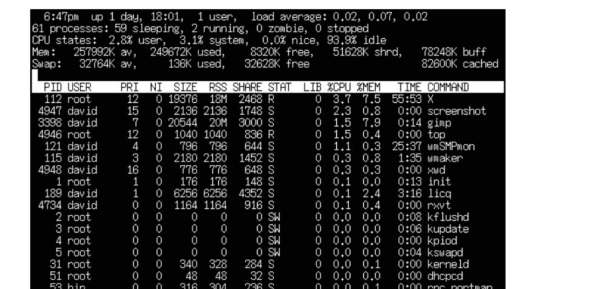

它被称为 **top** 是因为 CPU 占用最高的程序将列在最前面。一个有趣的注意事项是，在大多数不活跃（以及一些活跃）的系统上，由于其 CPU 利用率，**top** 会首先被列出。然而，**top** 对于确定哪个程序行为异常需要杀死非常有用。

## 小结

本章讨论了什么是进程以及如何控制进程。这包括后台运行和前台运行，以及使用 **ps**、**top** 和 **kill** 来管理它们。你应该能够确定你的系统上正在运行哪些进程，并知道如果它们停止运行该如何处理它们。

## 第 12 章. 基本系统管理

你是任何你拥有 root 权限的计算机的管理员。这可能是你的一两台用户台式机，也可能是有几百台用户的大服务器。无论如何，你都需要知道如何管理用户和安全地关闭系统。它们看似简单，但确实有一些怪癖需要适应。此外，你还需要处理密码系统工作背后的一些概念。


# 用户与组

## 附带脚本

管理用户和组最简单的方式是使用附带的脚本和程序。Slackware 包含用于管理用户的程序 **adduser**、**userdel(8)**、**chfn(1)**、**chsh(1)** 和 **passwd(1)**。Slackware 还包含用于管理组的 **groupadd(8)**、**groupdel(8)** 和 **groupmod(8)**。除了 **chfn**、**chsh** 和 **passwd** 之外，其余程序只能以 root 身份运行，因此位于 `/usr/sbin` 目录中。**chfn**、**chsh** 和 **passwd** 可由任何用户运行，位于 `/usr/bin` 目录中。

使用 **adduser** 程序可以添加用户。我们将逐步介绍整个过程，展示所有提问及其简要说明。括号内为默认答案，几乎所有问题都可以直接选择默认值，除非你确实需要更改某些设置。

```
# adduser

Login name for new user (8 characters or less) []: jellyd
```

这是用户登录时使用的名称。它需要不超过八个字符，因为所有登录工具都要求如此。通常情况下，你应该只使用小写字符，除非你想在不方便的位置输入大写字母。

```
User id for jellyd [ defaults to next available]:
```

用户 ID（UID）是 Linux 中真正确定文件所有权的方式。每个用户都有一个唯一的编号，在 Slackware 中从 1000 开始。你可以为新用户指定一个 UID，也可以让 **adduser** 自动分配下一个可用的 UID。

```
Initial group for jellyd [users]:
```

所有用户默认都属于 "users" 组。你可能想将新用户放入其他组，但不建议这样做。

```
Additional groups for jellyd (separated with commas, no spaces) []:
```

这个问题允许你将新用户添加到其他组中。一个用户可以同时属于多个组。如果你为修改网站文件、玩游戏等活动建立了专门的组，这就很有用。

```
jellyd's home directory [/home/jellyd]:
```

主目录默认位于 `/home` 下。如果你运行的是一个非常大的系统，可能已经将主目录迁移到了不同的目录结构。此选项允许你更改用户的主目录位置。你也可以通过将用户的主目录更改为类似 `/bin/false` 的路径来禁用账户，但这不是推荐的方法。

```
jellyd's shell [/bin/bash]:
```

**bash** 是 Slackware Linux 的默认 shell，对大多数人来说已经足够。如果你的新用户来自 Unix 环境，他们可能习惯使用不同的 shell。你现在可以更改他们的 shell，或者他们以后可以使用 **chsh** 命令自行更改。

```
jellyd's account expiry date (YYYY-MM-DD) []:
```

账户可以设置为在指定日期过期。默认情况下没有过期日期。如果需要，你可以更改此设置。对于运营 ISP 的人来说，这个选项可能很有用——例如希望账户在某个日期过期，除非用户支付了下一年的费用。

```
OK, I'm about to make a new account. Here's

what you entered so far:

New login name: jellyd

New UID: [Next available]

Initial group: users

Additional groups: [none]

Home directory: /home/jellyd

Shell: /bin/bash

Expiry date: [no expiration]

This is it... if you want to bail out, hit Control-C.

Otherwise, press ENTER to go ahead and make the account.
```

你现在可以看到关于新账户的所有已输入信息，并有机会中止操作。如果输入有误，你需要按 Control-C 重新开始。否则，按回车键即可创建账户。

```
Making new account...

Changing the user information for jellyd

Enter the new value, or press return for the default

    Full Name []: **Jeremy**

    Room Number []: **Smith 130**

    Work Phone []:

    Home Phone []:

    Other:
```

以上所有信息都是可选的。如果你不想填写，可以不填写任何内容，用户也可以随时使用 **chfn** 进行更改。不过，至少填写全名和电话号码可能会比较有用，以便在需要时联系到该用户。

```
Changing password for jellyd

Enter the new password (minimum of 5, maximum of 127 characters)

Please use a combination of upper and lower case letters and numbers.

New password:

Re-enter new password:

Password changed.

Done...
```

你需要为新用户设置密码。通常情况下，如果新用户不在场，你会先设置一个默认密码，然后告知用户将其更改为更安全的密码。

## 选择密码

拥有一个安全的密码是抵御入侵的第一道防线。你不希望使用容易被猜到的密码，因为那会使入侵者更容易攻破你的系统。理想情况下，安全密码应是由大小写字母、数字和特殊字符组成的随机字符串。但请记住，制表符字符可能不是一个明智的选择，具体取决于你将从什么样的计算机登录系统。

一般来说，请运用常识：不要选择某人的生日、常见短语、桌上能找到的东西或任何容易与你关联的密码。"secure1" 同样不安全。

删除用户并不困难。只需运行 **userdel** 并指定要删除的账户名称即可。你需要确保该用户没有登录，且没有以该用户身份运行的进程。另外，请记住一旦删除了用户，该用户就不存在了。

```
# userdel jellyd
```

执行此操作将从你的系统中移除那个恼人的 "jellyd" 家伙。终于清静了 :) 这会从 /etc/passwd 和 /etc/group 文件中删除该用户，但不会删除用户的主目录。如果想同时删除主目录，请执行以下操作：

```
# userdel -r jellyd
```

暂时禁用账户将在[称为"更改密码"的章节](http://example.com)中介绍，因为这涉及修改用户的密码。更改账户信息在[称为"更改密码"的章节](http://example.com)和[称为"更改用户信息"的章节](http://example.com)中介绍。

添加和删除组的程序非常简单。**groupadd** 只会在 /etc/group 文件中添加一个具有唯一组 ID 的新条目，而 **groupdel** 则会删除指定的组。你需要自行编辑 /etc/group 文件来将用户添加到特定组中。

你可以这样创建一个组：

```
# groupadd cvs
```

并这样删除它：

```
# groupdel cvs
```

## 手动操作

当然，你也可以手动添加、修改和删除用户与组。不过在浏览完这个过程之后，你可能会发现使用脚本方便得多。

首先，我们将在 /etc/passwd(5)、/etc/shadow(5) 和 /etc/group(5) 文件中添加一个新用户。passwd 文件保存了关于用户的一些信息，但（奇怪的是）并不包含他们的密码。passwd 文件需要对所有人可读，但你不会希望加密后的密码被所有人读取，因为这会给潜在的入侵者提供一个良好的突破口。因此，加密后的密码保存在 shadow 文件中，该文件只有 root 可读，而 passwd 文件中每个人的密码都被记录为 "x"。group 文件列出了所有组及每个组的成员。

让我们来查看 /etc/passwd 文件，了解如何添加用户。passwd 文件中的一个典型条目如下所示：

```
chris:x:1000:100:Chris Lumens,Room 2,,:/home/chris:/bin/bash
```

每一行是一个用户的条目，各字段之间以冒号分隔。这些字段依次是：登录名、加密密码（在 Slackware 系统中由于使用 shadow 密码套件，所有人都是 "x"）、用户 ID、组 ID、可选的 finger 信息（以逗号分隔）、主目录和 shell。你需要做的是在文件末尾添加一个新行，并填入相应的信息。

确保密码字段为 x，用户 ID 唯一，用户属于组 100（Slackware 中的 "users" 组），并且拥有一个有效的 shell。

接下来，我们需要在 /etc/shadow 文件中添加一个条目，该文件保存密码。一个典型的条目如下所示：

```
chris:$1$w9bsw/N9$UWLr2bRER6YyBS.CAEp7R.:11055:0:99999:7:::
```

同样，每一行是一个用户的条目，各字段以冒号分隔。这些字段依次是：登录名、加密密码、自纪元（1970年1月1日）以来密码最后更改的天数、密码更改前的最小间隔天数、密码必须更改的最大间隔天数、密码过期前的提醒天数、过期后账户被禁用的天数、自纪元以来账户被禁用的天数，以及一个保留字段。

如你所见，大部分字段用于账户过期信息。如果你不使用过期信息，只需用一些特殊值填写几个字段即可。否则，你需要进行一些计算和判断才能填写这些字段。对于我们新用户的条目，在密码字段中填入一些随机字符即可。不用担心现在的密码是什么，因为你马上就要更改它。密码字段中唯一不能包含的字符是冒号。"密码最后更改天数"字段也留空。按照示例条目填写 0、99999 和 7，其余字段留空。

如果你看到了我上面的加密密码，觉得可以以此为突破口入侵我的系统，那请便吧。如果你能破解那个密码，你将获得一个有防火墙保护的测试系统的密码。那可真有用 :)

由于每个人默认都是 "users" 组的成员，你不需要将新用户添加到该组。如果你想创建一个新组或将新用户添加到其他组，则需要修改 /etc/group 文件。以下是一个典型的条目：

```
cvs::102:chris,logan,david,root
```

字段依次为：组名、组密码、组 ID 和组成员。创建新组只需添加一个具有唯一组 ID 的新行，并列出你希望加入该组的所有人员。此新组中已登录的用户需要注销并重新登录才能使更改生效。

现在，返回并使用 **passwd** 命令为该用户创建新密码。然后，使用 **mkdir** 在你在 /etc/passwd 文件中输入的位置创建新用户的主目录。

如果你在系统上安装了 sendmail(8) 并且在使用邮件服务，你需要在 /var/spool/mail 中为这个新用户创建一个具有正确权限和所有权的新文件。以下是一个示例：


## 修改密码

**passwd** 程序通过修改 `/etc/shadow` 文件来更改密码。该文件以加密格式保存了系统中所有用户的密码。要修改你的密码，可以输入：

```
$ passwd
Changing password for chris
Old password:
Enter the new password (minimum of 5, maximum of 127 characters)
Please use a combination of upper and lower case letters and numbers.
New password:
```

如你所见，系统会提示你输入旧密码。输入时密码不会显示在屏幕上，就像登录时一样。然后，系统会提示你输入新密码。**passwd** 会对你的新密码进行多项检查，如果新密码未通过检查，它会发出警告。你可以选择忽略这些警告。最终，系统会要求你再次输入新密码以进行确认。

如果你是 root 用户，你还可以修改其他用户的密码：

```
# passwd ted
```

然后你需要执行与上面相同的步骤，只不过无需输入旧密码。（这是成为 root 用户的众多好处之一……）

如果你的系统上有一些捣乱的用户，你还可以临时禁用他们的账户。之后，你可以重新启用他们的账户。禁用和重新启用账户都可以通过 **passwd** 来完成。要禁用一个账户，请以 root 身份执行以下操作：

```
# passwd -l david
```

这会将 david 的密码更改为一个永远无法匹配任何加密值的字符串。之后，你可以通过输入以下命令将密码改回来：

```
# passwd -u david
```

现在，david 的账户恢复正常。如果用户不遵守你在系统上制定的规则，或者他们向你的 X 桌面导出了一个非常大的 xeyes(1) 副本，禁用账户可能会很有用。

## 修改用户信息

用户可以随时更改两项关于其账户的信息：shell 和 finger 信息。Slackware Linux 使用 **chsh**（change shell，更改 shell）和 **chfn**（change finger，更改 finger）来修改这些值。

用户可以选择 /etc/shells 文件中列出的任何 shell。对大多数人来说，**bash** 就足够了。其他人可能熟悉他们在工作或学校 Unix 系统上使用的 shell，希望继续使用已知的 shell。可以使用 **chsh** 来更改 shell：

```
$ chsh
Password:
Changing the login shell for chris
Enter the new value, or press return for the default
Login Shell [/bin/bash]:
```

输入密码后，输入新 shell 的完整路径。请确保它已列在 /etc/shells(5) 文件中。root 用户也可以通过以用户名作为参数运行 **chsh** 来更改用户的 shell。

finger 信息是可选信息，例如你的全名、电话号码和房间号。可以使用 **chfn** 来更改，操作步骤与创建账户时相同。照例，root 可以更改任何人的 finger 信息。

## 正确关机

正确关闭系统非常重要。直接关闭电源可能导致严重的文件系统损坏。在系统运行期间，即使你没有进行任何操作，文件也在使用中。请记住，后台始终运行着许多进程。这些进程在控制系统运行，并保持大量文件处于打开状态。如果直接关闭电源，这些文件无法正常关闭并可能损坏。根据哪些文件被损坏，系统可能会受到永久性损害。无论如何，在下次启动时你都必须经历漫长的文件系统检查过程。

因此，当你准备重启或关闭计算机时，正确操作非常重要。有几种方法可供选择；你可以挑选你觉得最有趣的方式。大多数关机方法同样适用于重启。

第一种方法是通过 **shutdown(8)** 程序，这可能是最常用的方式。**shutdown** 可以在指定时间重启或关闭系统，并可以向所有用户显示一条消息，告知他们系统即将关机。

**shutdown** 关闭计算机的基本用法如下：

```
# shutdown -h now
```

在这种情况下，我们不会向用户发送任何特殊消息；他们会看到 **shutdown** 的默认消息。"now" 是我们想要关机的时间，"-h" 表示停止系统。在多用户系统上这不是一种非常友好的方式，但在家用计算机上运行良好。在多用户系统上更好的方式是提前给大家一些警告：

```
# shutdown -h +60
```

这将在一小时（60 分钟）后关闭系统，这在普通的多用户系统上是完全可以的。非常重要的系统应该提前安排停机时间，并在 /etc/motd(5) 中发布相关警告。

重启系统使用相同的命令，但将 "-r" 替换为 "-h"：

```
# shutdown -r now
```

**shutdown -r** 可以使用与 **shutdown -h** 相同的时间表示法。使用 **shutdown** 还可以进行许多其他操作来控制何时停止或重启机器。更多详细信息请参阅 man 手册页。

第二种关闭或关闭计算机的方法是使用 **halt(8)** 和 **reboot(8)** 命令。顾名思义，**halt** 会立即停止操作系统，**reboot** 会重启系统。**reboot** 实际上是 **halt** 的一个符号链接。调用方式如下：

```
# halt
# reboot
```

一种更底层的重启或关闭系统的方法是直接与 **init** 通信。所有其他方法都只是与 **init** 通信的便捷方式，但你可以使用 **telinit(8)**（注意只有一个 'l'）直接告诉它该做什么。使用 **telinit** 会告诉 **init** 要进入哪个运行级别，这将触发运行一个特定的脚本。该脚本会根据该运行级别的需要终止或创建进程。这对重启和关闭都有效，因为两者都是特殊的运行级别。

```
# telinit 0
```

运行级别 0 是停止模式。告诉 init 进入运行级别 0 将导致所有进程被终止，文件系统被卸载，机器停止运行。这是一种完全可接受的关机方式。在许多笔记本电脑上，这还会导致机器自动关机。

```
# telinit 6
```

运行级别 6 是重启模式。所有进程将被终止，文件系统将被卸载，机器将重新启动。这是一种完全可接受的重启系统的方法。

还有一种最后的重启系统方法。所有其他方法都要求你是 root 用户。然而，如果你能物理接触到键盘，即使不是 root 用户也可以重启机器。按下三指组合键（control-alt-delete）将导致机器立即重启。其实际作用是运行程序 /usr/sbin/ctrlaltdel(8)。因此，如果该程序具有奇怪的权限或不存在，按下这些键将没有任何效果。

## 小结

本章讨论了添加和删除用户及组的操作步骤。你应该能够使用提供的脚本或手动完成这些任务（在需要时）。此外，你应该了解添加用户的各个步骤的作用、选择密码的技巧，以及如何修改用户信息。最后，你应该知道如何正确关闭计算机以及为什么正确关机很重要。无论是家用计算机还是大型网络服务器，这些都是系统管理的重要组成部分。

## 第 13 章 基本网络命令

网络由多台互连的计算机组成。网络可以简单到家庭或办公室中连接的几台计算机，也可以复杂到大型大学网络甚至整个互联网。当你的计算机是网络的一部分时，你可以直接或通过电子邮件和网页等服务访问这些系统。

你可以使用各种网络程序。有些程序便于进行诊断，以检查一切是否正常工作。另一些（如邮件客户端和网络浏览器）则有助于完成工作并保持与他人的联系。

## ping

**ping(8)** 向指定主机发送 ICMP ECHO_REQUEST 数据包。如果主机响应，你会收到一个 ICMP 数据包。听起来很奇怪？你可以"ping"一个 IP 地址来查看机器是否在线。如果没有响应，说明出了问题。以下是两个 Linux 系统之间的示例对话：

```
$ ping www.slackware.com
PING www.slackware.com (204.216.252.10): 56 data bytes
64 bytes from 204.216.252.10: icmp_seq=0 ttl=47 time=234.567 ms
64 bytes from 204.216.252.10: icmp_seq=1 ttl=47 time=212.345 ms
64 bytes from 204.216.252.10: icmp_seq=2 ttl=47 time=198.765 ms
--- www.slackware.com ping statistics ---
3 packets transmitted, 3 packets received, 0% packet loss
round-trip min/avg/max = 198.765/215.225/234.567 ms
```

我们 ping 了主机 `www.slackware.com`，在按下 **Ctrl-C** 停止进程之前，它响应了三次。如你所见，主机对每个数据包都回复了 64 字节的数据。`icmp_seq` 是数据包的序列号。`ttl` 是生存时间，表示数据包在被丢弃之前可以经过多少个路由器。`time` 是往返时间，表示数据包到达远程主机并返回所用的时间。如你所见，平均往返时间约为 215 毫秒。

一个有用的选项是 `-c`，它限制发送的数据包数量。例如，`ping -c 3 www.slackware.com` 只会发送三个数据包。

另一个有用的选项是 `-f`，它会用数据包淹没网络。这不是一件很好的事情，所以不要在不属于你的网络上尝试。

如果你试图 ping 一个主机但没有收到响应，可能是主机已宕机，或者网络问题导致数据包无法送达。你可以使用 `-v` 选项获取详细输出，这有助于诊断问题。

## traceroute

**traceroute** 是一个诊断工具，显示数据包到达远程主机所经过的路由。它对于诊断网络问题非常有用，例如当你无法访问远程主机时。

以下是一个示例：

```
$ traceroute www.slackware.com
traceroute to www.slackware.com (204.216.252.10), 30 hops max, 38 byte packets
1  router1.myisp.com (192.168.1.1)  2.345 ms  2.123 ms  2.001 ms
2  router2.myisp.com (192.168.1.2)  12.345 ms  12.123 ms  12.001 ms
3  core.myisp.com (10.0.0.1)  23.456 ms  23.123 ms  23.001 ms
4  border.myisp.com (10.0.0.2)  34.567 ms  34.123 ms  34.001 ms
5  ix1.slackware.com (204.216.252.1)  45.678 ms  45.123 ms  45.001 ms
6  www.slackware.com (204.216.252.10)  56.789 ms  56.123 ms  56.001 ms
```

如你所见，数据包经过了六个路由器到达目的地。每一行显示了跳数、路由器的主机名和 IP 地址，以及三个数据包的往返时间。

如果你看到 `*` 而不是时间，意味着路由器没有响应数据包。这可能是因为路由器被配置为忽略 traceroute 请求，或者是因为网络问题。

## netstat

**netstat** 是一个用于显示网络连接和统计信息的工具。它对于诊断网络问题和查看系统上的活动连接非常有用。

以下是一些常见用法：

- `netstat -a` 显示所有连接，包括监听套接字。
- `netstat -t` 仅显示 TCP 连接。
- `netstat -u` 仅显示 UDP 连接。
- `netstat -r` 显示路由表。
- `netstat -i` 显示网络接口统计信息。

例如，`netstat -t -a` 可能会显示类似以下内容：

```
Active Internet connections (servers and established)
Proto Recv-Q Send-Q Local Address           Foreign Address         State
tcp        0      0 0.0.0.0:23              0.0.0.0:*               LISTEN
tcp        0      0 127.0.0.1:25            0.0.0.0:*               LISTEN
tcp        0      0 192.168.1.100:23        192.168.1.200:1234      ESTABLISHED
```

这显示了三个 TCP 连接：两个监听套接字（端口 23 和 25）以及一个从 `192.168.1.200` 到本地机器 23 端口的已建立连接。

## ifconfig

**ifconfig** 是一个用于配置网络接口的工具。它可以用来显示当前配置或设置新配置。

以下是显示当前配置的示例：

```
$ ifconfig eth0
eth0      Link encap:Ethernet  HWaddr 00:11:22:33:44:55
          inet addr:192.168.1.100  Bcast:192.168.1.255  Mask:255.255.255.0
          UP BROADCAST RUNNING MULTICAST  MTU:1500  Metric:1
          RX packets:12345 errors:0 dropped:0 overruns:0 frame:0
          TX packets:6789 errors:0 dropped:0 overruns:0 carrier:0
          collisions:0 txqueuelen:1000
          RX bytes:1234567 (1.2 MB)  TX bytes:6789012 (6.7 MB)
          Interrupt:10 Base address:0x1000
```

这显示了 `eth0` 接口的配置，包括其 IP 地址、广播地址和子网掩码。它还显示了发送和接收数据包的统计信息。

要设置新的 IP 地址，可以使用：

```
# ifconfig eth0 192.168.1.101 netmask 255.255.255.0
```

你也可以使用 `ifconfig eth0 down` 或 `ifconfig eth0 up` 来关闭或启用接口。

## route

**route** 是一个用于显示和修改 IP 路由表的工具。路由表告诉内核如何将数据包转发到其他网络。

以下是显示路由表的示例：

```
$ route
Kernel IP routing table
Destination     Gateway         Genmask         Flags Metric Ref    Use Iface
192.168.1.0     *               255.255.255.0   U     0      0        0 eth0
loopback        *               255.0.0.0       U     0      0        0 lo
default         gateway         0.0.0.0         UG    0      0        0 eth0
```

这显示了发往本地网络（192.168.1.0）的数据包通过 `eth0` 接口出去，发往回环网络的数据包通过 `lo` 接口，其他所有数据包（默认路由）发送到网关。

要添加新路由，可以使用类似以下的命令：

```
# route add -net 10.0.0.0 netmask 255.0.0.0 gw 192.168.1.1
```

这告诉内核，所有发往 10.0.0.0/8 网络的数据包应该发送到网关 192.168.1.1。

## arp

**arp** 是一个用于显示和修改 ARP（地址解析协议）缓存的工具。ARP 缓存将 IP 地址映射到 MAC（硬件）地址。

以下是显示 ARP 缓存的示例：

```
$ arp -a
gateway (192.168.1.1) at 00:11:22:33:44:55 [ether] on eth0
server (192.168.1.100) at 00:11:22:33:44:66 [ether] on eth0
```

这显示了 IP 地址 192.168.1.1 映射到 MAC 地址 00:11:22:33:44:55，192.168.1.100 映射到 00:11:22:33:44:66。

你可以使用以下命令添加静态 ARP 条目：

```
# arp -s 192.168.1.200 00:11:22:33:44:77
```

这会将 192.168.1.200 到 00:11:22:33:44:77 的映射永久添加到 ARP 缓存中。

## 小结

本章介绍了 Linux 上一些最基本的网络命令。你现在应该能够使用 `ping` 测试到远程主机的连接，使用 `traceroute` 查看数据包的路径，使用 `netstat` 查看网络统计信息和连接，使用 `ifconfig` 配置网络接口，使用 `route` 管理路由表，以及使用 `arp` 管理 ARP 缓存。这些工具对于诊断和管理任何 Linux 系统上的网络连接至关重要。


用户对话：

用户A：Loki又挂了。

用户B：你确定吗？

用户A：是的，我尝试`ping`了一下，但没有任何响应。

正是这样的场景使得**ping**成为一个非常实用的日常命令。它提供了一种非常快速的方式来检查一台机器是否正常运行并连接到网络。基本语法是：

```
$ ping <ip address or hostname>
```

当然，可以指定多个选项。更多信息请查阅**ping**(1)的手册页。

## finger

**finger**(1)将检索关于指定用户的信息。你向**finger**提供一个用户名或电子邮件地址，它将尝试联系必要的服务器并检索用户名、办公室、电话号码等信息。以下是一个示例：

```
$ finger johnc@idsoftware.com
```

**finger**可以返回用户名、邮件状态、电话号码以及被称为“点计划”和“点项目”的文件。当然，返回的信息因每个**finger**服务器而异。Slackware附带的版本默认返回以下信息：

- 用户名
- 房间号码
- 家庭电话号码
- 工作电话号码
- 登录状态
- 邮件状态
- 用户主目录中`.plan`文件的内容
- 用户主目录中`.project`文件的内容

前四项可以通过**chfn**命令进行设置。它将这些值存储在`/etc/passwd`文件中。要更改你的`.plan`或`.project`文件中的信息，只需使用你喜爱的文本编辑器进行编辑。它们必须位于你的主目录中，并且必须命名为`.plan`和`.project`。

许多用户从远程机器**finger**他们自己的账户，以快速查看是否有新邮件。或者，你可以查看用户的计划或当前项目。id Software的John Carmack定期更新他的计划文件，以告知用户社区他当前的工作内容。

与许多命令一样，**finger**也有选项。关于你可以使用的特殊选项的更多信息，请查阅手册页。

## telnet

有人曾说过，**telnet**(1)是他所见过的计算机上最酷的东西。能够远程登录并在另一台计算机上执行操作，正是Unix和类Unix操作系统与其他操作系统区别开来的特点。

**telnet**允许你登录到一台计算机，就好像你坐在终端前一样。一旦你的用户名和密码得到验证，你将获得一个shell提示符。从这里，你可以执行任何需要文本控制台的操作。撰写电子邮件、阅读新闻组、移动文件等等。如果你正在运行X，并且从**xterm****telnet**到一台机器，你可以在远程计算机上运行X程序并将其显示在你的机器上。更多信息请参见[第6章中名为*导出显示*的部分](http://www.ssh.org/)。

要登录到远程机器，请使用以下语法：

```
$ telnet <hostname>
```

如果主机响应，你将收到一个登录提示。输入你的用户名和密码。就是这样。你现在处于shell中。要退出**telnet**会话，请使用**exit**命令或**logout**命令。

⚠️ 重要提示：**telnet**不会加密它发送的信息。所有内容都是以纯文本发送的，包括密码。不建议在互联网上使用**telnet**。相反，请考虑使用安全外壳（Secure Shell）。它加密所有流量并且可以免费获取。更多信息请参见 http://www.ssh.org/。

## FTP客户端

FTP代表文件传输协议。它允许你在两台计算机之间发送和接收文件。有FTP服务器和FTP客户端。我们在本节讨论客户端。

对于好奇的人，“客户端”就是你。“服务器”是响应你的FTP请求并让你登录的计算机。你将从服务器下载文件并向服务器上传文件。客户端无法接受FTP连接，它只能连接到服务器。

### ftp

要连接到FTP服务器，只需运行**ftp(1)**命令并指定主机：

```
$ ftp <hostname>
```

如果主机正在运行FTP服务器，它会要求提供用户名和密码。你可以使用你自己的账户登录，也可以使用“anonymous”登录。匿名FTP站点在软件归档中非常流行。例如，要通过FTP获取Slackware Linux，你必须使用匿名FTP。

一旦连接成功，你将处于ftp>提示符下。FTP有特殊的命令，但它们与其他标准命令类似。以下显示了一些基本命令及其功能：

### 表 13-1. ftp 命令

| 命令 | 用途 |
|---|---|
| **ls** | 列出文件 |
| **cd \<dirname\>** | 更改目录 |
| **get \<filename\>** | 下载文件 |
| **put \<filename\>** | 上传文件 |
| **hash** | 切换哈希标记统计指示器 |
| **prom** | 切换下载的交互模式 |
| **mget \<mask\>** | 下载一个或一组文件；允许使用通配符 |
| **mput \<mask\>** | 上传一个或一组文件；允许使用通配符 |
| **quit** | 退出FTP服务器 |

FTP是一个相当简单的程序，但缺乏我们许多人如今习惯的用户界面。手册页讨论了**ftp(1)**的一些命令行选项。

## ncftp

**ncftp(1)**（读作'Nik-F-T-P'）是传统**ftp**客户端的替代品，随Slackware一起提供。它仍然是一个基于文本的程序，但提供了许多优于**ftp**的优势，包括：

- Tab补全
- 书签文件
- 被动和非被动FTP传输模式
- 更灵活的通配符使用
- 命令历史

默认情况下，**ncftp**会尝试匿名登录到你指定的服务器。你可以使用"+u"选项强制**ncftp**显示登录提示。登录后，你可以使用与**ftp**中相同的命令，但你会注意到一个更友好的界面，一个更像**bash**的界面。

图 13-1. NcFTP屏幕示例。

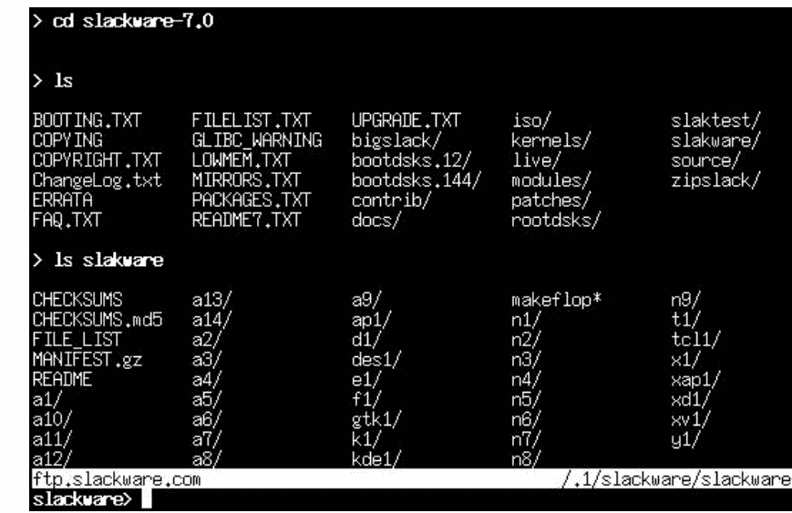

## email

电子邮件是互联网上最受欢迎的活动之一。据报道，1998年发送的电子邮件数量超过了普通邮件。它确实既普遍又实用。

在Slackware下，我们提供了一个标准的邮件服务器和几个邮件客户端。所有讨论的客户端都是基于文本的。许多Windows用户可能对此表示反对，但你会发现基于文本的客户端非常方便，尤其是在远程检查邮件时。

### pine

**pine(1)**不是**elm**。或者俗话说。华盛顿大学出于为学生提供简易邮件阅读器的需求，开发了他们的互联网新闻和电子邮件程序。**pine**是当今最流行的电子邮件客户端之一，几乎适用于所有类型的Unix，甚至Windows。

图 13-2. Pine主菜单。

```
PINE 4.21  MAIN MENU                         Folder: INBOX  No Messages

  ?  HELP            - Get help using Pine
  C  COMPOSE MESSAGE - Compose and send a message
  I  MESSAGE INDEX   - View messages in current folder
  L  FOLDER LIST     - Select a folder to view
  A  ADDRESS BOOK    - Update address book
  S  SETUP           - Configure Pine Options
  Q  QUIT            - Leave the Pine program


     Copyright 1989-1999.  PINE is a trademark of the University of Washington.
                          [Folder "INBOX" opened with 0 messages]
  ? Help        P PrevCmd      R RelNotes
  O OTHER CMDS  [ListFldrs] N NextCmd        K KBlock
```

你会在底部看到一个命令菜单和一排命令键。**pine**确实是一个复杂的程序，所以我们不会在这里讨论它的所有功能。

要查看收件箱中的内容，请输入**i**。你的邮件会列出日期、作者和主题。突出显示你想要的邮件，然后按**enter**键查看。按**r**键将开始回复该邮件。写完回复后，输入**ctrl+x**发送。你可以按**i**键返回到邮件列表。

如果你想删除邮件，按**d**键。它将标记突出显示的邮件以便删除。**pine**在退出程序时删除邮件。**pine**还允许你将邮件存储在文件夹中。你可以通过按**l**键获取文件夹列表。在邮件列表中，按**s**键将其保存到另一个文件夹。它会询问要将邮件写入的文件夹名称。

**pine**提供了非常非常多的功能；你绝对应该查阅手册页以获取更多信息。它将包含关于该程序的最新信息。

### elm

**elm(1)**是另一个流行的基于文本的电子邮件客户端。虽然不如**pine**用户友好，但它的历史肯定要长得多。

图 13-3. Elm主屏幕。


默认情况下，您会被置于收件箱中。邮件列表显示邮件编号、日期、发件人和主题。使用方向键高亮显示您想查看的邮件，按回车键阅读该邮件。

要在主屏幕撰写新消息，请输入 **m**。**d** 键可将当前邮件标记为删除。**r** 键则用于回复当前正在阅读的邮件。所有这些按键的提示都显示在屏幕底部。

关于 **elm** 的更详细说明，请参阅其手册页，因此在使用 **elm** 之前，您可能想查阅一下。

## mailx

**mailx**(1) 是一个命令行邮件客户端。它非常基础，几乎不提供任何用户界面。然而，在需要快速发送邮件、编写批量发送脚本或类似操作时，**mailx** 非常方便。

基本命令行格式如下：

```
$ mailx -s <subject> <to-addr>
```

**mailx** 从标准输入读取邮件正文。因此，您可以将文件内容通过管道输入到此命令来发送邮件，也可以直接输入文本，完成后按 **ctrl+D**。

这是一个将程序源文件通过邮件发送给其他人的示例：

```
$ cat randomfunc.c | mailx -s "Here's that function" \
asdf@example.net
```

**mailx** 的手册页解释了更多功能，因此在使用前，您可能需要查阅一下。

## lynx

**lynx**(1) 是一个基于文本的网页浏览器。如果您确切知道自己想要什么，图形界面有时反而会碍事，这时用 lynx 来快速查找网络信息是个非常快的方法。

要启动 **lynx**，只需在提示符下输入 **lynx**：

```
$ lynx
```

图 13-4. Lynx 的默认起始页。

您可能希望指定一个 **lynx** 启动时打开的网站：

```
$ lynx http://www.slackware.com
```

**lynx** 在屏幕底部显示命令键及其功能。上下方向键用于在文档中移动，回车键选择高亮显示的链接，左方向键返回上一页。输入 **d** 将下载当前选定的文件。**g** 命令会调出 **Go** 提示符，您可以在其中输入 **lynx** 要打开的 URL。

**lynx** 中还有许多其他命令。您可以查阅手册页，或者输入 **h** 查看帮助屏幕以获取更多信息。

## wget

**wget**(1) 是一个命令行工具，用于从指定的 URL 下载文件。它对于下载整个网站以供离线浏览，或者比使用 Netscape 从 HTTP 或 FTP 服务器更安全地下载文件非常有用。基本语法如下：

```
$ wget <url>
```

您也可以传递选项。例如，以下命令将下载 Slackware 网站：

```
$ wget --recursive http://www.slackware.com
```

**wget** 会创建一个 `www.slackware.com` 目录，并将文件存储在其中，就像网站本身的结构一样。

**wget** 也可以从 FTP 站点下载文件；只需指定 FTP URL 而不是 HTTP URL。

**wget** 有更多选项，这使其非常适合编写特定网站的脚本（如网站镜像等）。有关更多信息，请参阅手册页。

## traceroute

Slackware 包含 4.4BSD 版的 **traceroute**(8) 命令。它是一个有用的网络诊断工具。**traceroute** 显示数据包在到达目的地途中所经过的每个主机。使用此命令，您可以查看您距离 Slackware 网站有多少“跳”：

```
$ traceroute www.slackware.com
```

将显示每个主机以及每个主机的响应时间。以下是示例输出：

```
$ traceroute www.slackware.com

traceroute to www.slackware.com (204.216.27.13), 30 hops max, 40 byte packets

1  zuul.tdn (192.168.1.1)  0.409 ms  1.032 ms  0.303 ms
2  207.171.227.254 (207.171.227.254)  18.218 ms  32.873 ms  32.433 ms
3  border-sf-2-0-4.sirius.com (205.134.230.254) 15.662 ms 15.731 ms 16.142 ms
4  pb-nap.crl.net (198.32.128.20)  20.741 ms  23.672 ms  21.378 ms
5  E0-CRL-SFO-03-E0X0.US.CRL.NET (165.113.55.3) 22.293 ms 21.532 ms 21.29 ms
6  T1-CDROM-00-EX.US.CRL.NET (165.113.118.2)  24.544 ms  42.955 ms 58.443 ms
7  www.slackware.com (204.216.27.13)  38.115 ms  53.033 ms  48.328 ms
```

**traceroute** 与 **ping** 类似，因为它使用 ICMP 数据包。您可以通过 **traceroute** 指定几个选项。默认的最大“跳”数是 30，但可以通过 `-m` 选项更改。其他选项的详细信息在网页中有解释。

## 与其他人交流

### talk

**talk**(1) 允许两个用户聊天。它将屏幕水平分割。要请求与另一个用户聊天，请使用此命令：

```
$ talk <person> [ttyname]
```

图 13-5. 两个用户在 talk 会话中。

如果只指定用户名，聊天请求将被视为本地请求，因此只查询本地用户。如果您想在特定终端呼叫用户（如果用户登录了多次），则需要 ttyname。**talk** 所需的信息可以从 **w(1)** 命令获得。

**talk** 也可以呼叫远程主机上的用户。对于用户名，您只需指定一个电子邮件地址。**talk** 将尝试联系该主机上的远程用户。

**talk** 有一些限制。它仅支持两个用户，并且是半双工的。

### ytalk

**ytalk**(1) 是 talk 的向后兼容替代品。它作为 **ytalk** 命令随 Slackware 提供。语法类似，但有一些不同之处：

```
$ ytalk <username>[#ttyname]
```

图 13-6. 三个用户在 ytalk 会话中。

用户名和终端的指定方式与 **talk** 相同，只是您必须用井号 (#) 将它们连接起来。

**ytalk** 提供了几个优点：

- 它支持两个以上的用户。
- 可以随时通过 **Esc** 键调出选项菜单。
- 您可以在聊天会话中随时切换到 shell。
- 以及更多...

如果您是服务器管理员，您需要确保在 `/etc/inetd.conf` 中启用了 ntalk 端口。**ytalk** 需要该端口才能正常工作。

## 总结

您现在应该了解一些基本的网络诊断命令。使用这些命令，您可以确定您的系统与远程计算机之间的计算机或网络是否存在故障。此外，您还应该了解几种邮件阅读器、网页浏览器、ftp 客户端和通信程序。

# 第 14 章. 归档文件

在 Slackware Linux 下，有几个程序可用于压缩和归档文件。这些程序对于制作备份和通过网络连接在机器之间发送文件副本特别有用。有用于处理 Unix 格式归档的程序，也有用于处理 Windows 归档的程序。

## gzip

**gzip**(1) 是 GNU 压缩程序。它接受单个文件并对其进行压缩。基本用法如下：

```
$ gzip infile
```

生成的文件将被命名为 `infile.gz`，并且通常比输入文件小。请注意，`infile.gz` 将替换 `infile`。这意味着 `infile` 将不再存在，尽管会有一个压缩后的副本。常规文本文件压缩效果很好，而 jpeg 图像、mp3 文件和其他类似文件的压缩效果不会太好，因为它们已经被压缩过。这种基本用法在最终文件大小和压缩时间之间取得了平衡。要获得最大压缩率，可以这样做：

```
$ gzip -9 infile
```

这将花费更长的时间来压缩文件，但结果将是 **gzip** 能够实现的最小尺寸。使用较低的命令行选项值将使其压缩更快，但文件不会被充分压缩。

解压 gzipped 文件可以使用两个命令，它们实际上是同一个程序。**gzip** 会解压任何具有可识别文件扩展名的文件。可识别的扩展名可以是以下任何一种：`.gz`、`-gz`、`.z`、`-z`、`.Z` 或 `-Z`。第一种方法是在文件上调用 **gunzip**(1)，如下所示：

```
$ gunzip infile.gz
```

这将在当前目录中留下 `infile` 的解压版本，并且文件名中的 `.gz` 扩展名将被去除。

解压 gzipped 文件的另一种方法是调用 **gzip** 处理该文件：

```
$ gzip -d infile.gz
```

这将导致与调用 gunzip 完全相同的行为。原因很简单：**gunzip** 只是指向 `/bin/gzip` 的符号链接：

```
$ cd /usr/bin

$ ls -l gunzip

lrwxrwxrwx  1 root root  9 Feb  2 09:45 gunzip -> /bin/gzip
```

因此，运行 **gunzip** 实际上只是以不同的名称运行 **gzip**。程序可以确定它是如何被调用的，并相应地采取行动。在这种情况下，**gzip** 会知道它是被当作 **gunzip** 调用的，从而解压文件。因此，您可以使用 **gzip** 或 **gunzip** 来解压任何 gzipped 文件。

## bzip2

**bzip2**(1) 是安装在 Slackware Linux 上的另一个压缩程序。它使用与 **gzip** 不同的压缩算法，这带来了一些优势和劣势。**bzip2** 的主要优势是压缩文件的大小。**bzip2** 的压缩效果几乎总是优于 **gzip**。在某些情况下，这会导致文件显著变小。对于使用较慢调制解调器连接的人来说，这可能是一个巨大的优势。


通常，处理压缩文件会比直接压缩文件花费更长的时间，并消耗更多的 CPU 资源。在决定使用哪种压缩程序时，你必须权衡速度与压缩后的文件大小，以确定哪个因素更为重要。

**bzip2** 的用法与 **gzip** 非常相似，因此我们不会花太多时间讨论它。只需调用 **bzip2** 并指定文件名即可压缩该文件：

```
$ bzip2 infile
```

生成的输出文件通常会比输入文件小，且会被命名为 `infile.bz2`。与 **gzip** 一样，输入文件将不再存在，因为 **bzip2** 会用一个压缩副本替换原始输入文件。

你也可以像使用 **gzip** 一样，使用数字命令行参数来调整压缩率和速度。以下示例展示了如何使用 **bzip2** 实现最大压缩率，这会占用相当多的 CPU 资源：

```
$ bzip2 -9 infile
```

有两种命令可以解压以 `.bz2` 结尾的文件，这与 **gzip** 的情况类似。你可以使用 **bzip2** 或 **bunzip2(1)** 来解压经 bzip2 压缩的文件。使用 **bzip2** 需要指定一个命令行参数：

```
$ bzip2 -d infile.bz2
```

这将解压该 bzip2 文件，并用解压后的副本替换它。生成的文件也会被移除 `.bz2` 扩展名。同样，你也可以使用 **bunzip2** 来解压文件：

```
$ bunzip2 infile.bz2
```

无论使用哪种方式，你都会得到相同的行为，这同样得益于一个符号链接。查看 `/bin/bunzip2` 会发现它只是一个指向 `/bin/bzip2` 的符号链接。这使用了与 **gzip** 相同的技巧。你会发现，通过调用一个程序的不同名称来实现不同行为，是 Linux 程序员非常喜欢使用的一个技巧。

```
$ cd /bin

$ ls -l bunzip2

lrwxrwxrwx 1 root root 5 Feb 2 09:45 /bunzip2 -> bzip2
```

## tar

**tar(1)** 是 GNU 磁带归档工具。它接收多个文件或目录，并创建一个大的归档文件。这使得你可以压缩整个目录树，而仅使用 **gzip** 或 **bzip2** 是无法做到的。**tar** 有许多命令行选项，其详细说明可在它的手册页中找到。本节仅介绍 **tar** 最常见的用法。

**tar** 最常见的用途是解压并归档你从网站或 FTP 站点下载的软件包。大多数文件会带有 `.tar.gz` 扩展名。这通常被称为“tarball”。它意味着多个文件先使用 **tar** 归档，然后使用 **gzip** 压缩。你也可能会看到文件以 `.tar.z` 形式列出。其含义相同，但这通常在较旧的 Unix 系统上遇到。

`-x` 选项告诉 **tar** 如何处理输入文件。在这个例子中，我们将把它拆分成来源的所有文件。`-v` 表示详细输出。这将列出所有正在解归档的文件。完全可以省略此选项，尽管那样会有些乏味。或者，你可以使用 `-vv` 来获得非常详细的输出，并列出更多关于每个被解归档文件的信息。`-z` 选项告诉 **tar** 先将 `hejaz.tar.gz` 文件通过 **gunzip** 处理。最后，`-f` 选项告诉 **tar**，命令行上的下一个字符串是要操作的文件。

书写同一命令还有其他几种方式。在缺乏良好 GNU tar 版本的旧系统上，你可能会看到这样写：

```
$ gzip -dc hejaz.tar.gz | tar -xvf -
```

这个命令行将解压文件并将输出发送给 **tar**。因为 **gzip** 在被告知时会将输出写入标准输出，所以这个命令会将解压后的文件写入标准输出。然后管道将其发送给 **tar** 进行解归档。`-` 表示从标准输入进行操作。它将解归档从 **gzip** 接收到的数据流，并将其写入磁盘。

书写第一条命令的另一种方式是省略选项前的短横线，如下所示：

```
$ tar xvzf hejaz.tar.gz
```

你也可能会遇到一个经 bzip2 压缩的归档文件。Slackware Linux 附带的 **tar** 版本可以像处理 gzipped 归档文件一样处理它们。只需将 `-x` 命令行选项替换为 `-y`：

```
$ tar -xvyf foo.tar.bz2
```

需要注意的是，**tar** 会将解归档的文件放在当前目录中。所以，如果你有一个在 `/tmp` 中的归档文件，想将其解压到你的主目录中，有两个选择。首先，可以将归档文件移动到你的主目录，然后运行 **tar**。或者，你可以在命令行上指定归档文件的路径：

```
$ tar -xvzf /tmp/bar.tar.gz
```

归档文件的内容将被释放到你的主目录中，而原始的压缩归档文件仍会保留在 `/tmp` 中。

使用 **tar** 的第二常见操作是创建你自己的归档文件。创建归档文件并不比解归档文件复杂；只是需要一组不同的命令行选项。

要创建当前目录中所有文件（包括任何子目录及其文件）的压缩 tar 归档，你可以这样使用 **tar**：

```
$ tar -cvzf archive.tar.gz .
```

在这个命令行中，`-c` 选项告诉 **tar** 创建一个归档文件，而 `-z` 选项则让生成的归档文件通过 **gzip** 进行压缩。`archive.tar.gz` 是你想要创建的文件。你可以任意命名，如果包含完整路径名，它会将归档文件放在该目录中。这里有一个例子：

```
$ tar -cvzf /tmp/archive.tar.gz .
```

这样归档文件就会放入 `/tmp` 目录。你也可以通过在命令末尾列出所有要包含在归档中的文件和目录来指定它们。在这个例子中，`.` 是要包含在归档中的目录。这很容易替换成各种文件的列表，或者任何你想要归档的内容。

## zip

最后，有两个可用于处理 zip 文件的工具。这在 Windows 世界中非常普遍，因此 Linux 也有相应的程序来处理它们。压缩程序称为 **zip(1)**，解压程序称为 **unzip(1)**。

压缩一个文件很简单：

```
$ zip foo *
```

这将创建文件 `foo.zip`，其中包含当前目录中的所有文件。**zip** 会自动添加 .zip 扩展名，因此无需在文件名中包含它。你也可以递归遍历当前目录，将其中的任何子目录也一并压缩：

```
$ zip -r foo *
```

解压文件也同样简单。

```
$ unzip foo
```

这将解压文件 `foo.zip` 中的所有文件，包括归档中的任何目录。

**zip** 工具有许多高级选项，可用于创建自解压归档、排除文件、控制压缩文件大小、打印操作过程以及更多功能。请参阅 **zip** 和 **unzip** 的手册页，以了解如何使用这些选项。

## 总结

本章讨论了用于压缩和解压归档文件的程序。你应该知道什么是归档文件，如何使用 **tar** 和你选择的压缩程序创建归档文件，如何解压归档文件，以及如何处理基于 Windows 的归档文件。几乎所有你下载或上传的内容都会涉及归档文件，因此这些是需要掌握的重要技能。

## 第 15 章。vi

**vi(1)** 是标准的 Unix 文本编辑程序，掌握它对于系统管理员至关重要。有几种 **vi** 的版本（或克隆版本）可用，包括 **vi**、**elvis**、**vile** 和 **vim**。其中任何一个版本都几乎可以在任何版本的 Unix 以及 Linux 上找到。所有这些版本都包含相同的基本功能集和命令，因此学会一个克隆版本应该能让你轻松学会另一个。

**vi** 包含许多强大的功能，包括语法高亮、代码格式化、强大的搜索和替换机制、宏等等。这些功能使其对程序员、Web 开发人员等极具吸引力。系统管理员会欣赏其自动化以及与 shell 的集成能力。

在 Slackware Linux 上，默认可用的 **vi** 版本是 **elvis**。其他版本——包括 **vim** 和 **gvim**——在安装了相应软件包后也可用。**gvim** 是 **vim** 的 X Window 版本，包含工具栏、可分离菜单和对话框。

## 启动 vi

可以从命令行以多种方式启动 **vi**。最简单的形式是：

```
$ vi
```

**图 15-1.** 一个 vi 会话。


## Vi 编辑器入门

**vi** 是一个功能强大的文本编辑器，它通过不同的模式来完成各种任务。启动 **vi** 时，首先进入的是命令模式。在此模式下，你可以输入各种命令来操作文本、移动光标、保存、退出等。编辑文本则在插入模式下完成。你可以通过多种按键在不同模式间快速切换，下文将对此进行解释。

### 启动 Vi

输入以下命令，将启动 **vi** 并打开一个空缓冲区：

```
$ vi
```

这将启动一个 **vi** 的空缓冲区。此时你会看到一个几乎空白的屏幕，它处于"命令模式"，等待你进行操作。关于 **vi** 的各种模式，请参阅[模式](https://example.com)一节。要退出 **vi**，请输入以下内容：

```
:q
```

假设文件未被修改，这将使 **vi** 退出。如果文件已被修改，**vi** 会警告你文件已更改，并告诉你如何忽略更改。

你也可以通过指定现有文件来启动 **vi**。例如，打开 `/etc/resolv.conf` 文件的方式如下：

```
$ vi /etc/resolv.conf
```

最后，**vi** 可以从文件的特定行开始启动。例如，要从 `/usr/src/linux/init/main.c` 的第 47 行开始启动 **vi**，可以这样操作：

```
$ vi +47 /usr/src/linux/init/main.c
```

**vi** 将显示该文件并将光标置于指定行。如果你指定的行超出了文件末尾，**vi** 会将光标放在最后一行。这对于程序员特别有用，因为他们可以直接跳转到文件中发生错误的位置，而无需手动搜索。

### 模式

**vi** 以多种模式运行，用于完成不同的任务。首次启动 **vi** 时，你会进入命令模式。从这里，你可以发出各种命令来操作文本、在文件中移动、保存、退出等。编辑文本则在插入模式中完成。你可以通过多种按键在模式间快速切换，下文将对此进行解释。

### 命令模式

你首先进入的是命令模式。在此模式下，你不能直接输入文本或编辑已有内容。但是，你可以操作文本、搜索、退出、保存、加载新文件等。这仅仅是命令模式的一个介绍。关于各种命令的描述，请参阅 [vi 键位](https://example.com) 一节。

命令模式中最常用的命令可能是切换到插入模式。这通过按下 **i** 键来实现。光标形状会改变，并且屏幕底部会显示 `-- INSERT --`（请注意，并非所有 **vi** 的克隆版本都有此显示）。从那里开始，你输入的所有按键都会被输入到当前缓冲区并显示在屏幕上。要返回命令模式，请按转义键。

命令模式也是你在文件中移动的地方。在某些系统上，你可以使用方向键移动。在其他系统上，你可能需要使用更传统的键 'hjkl'。以下是这些键用于移动的简单说明：

- h：向左移动一个字符
- j：向下移动一行
- k：向上移动一行
- l：向右移动一个字符

只需按相应的键即可移动。正如你稍后将看到的，这些键可以与数字组合以实现更高效的移动。

许多你在命令模式下使用的命令以冒号开头。例如，退出是 `:q`，如前所述。冒号仅表示这是一个命令，而 'q' 告诉 **vi** 退出。其他命令则是一个可选的数字后跟一个字母。这些命令前没有冒号，通常用于操作文本。

例如，从文件中删除一行是通过按下 **dd** 实现的。这将删除光标所在的行。输入命令 **4dd** 会告诉 **vi** 删除光标所在的行及其后的三行。通常，数字告诉 **vi** 执行该命令的次数。

你可以将数字与移动键组合，一次移动多个字符/行。例如，**10k** 将在屏幕上向上移动十行。

命令模式还可用于剪切和粘贴、插入文本以及将其他文件读入当前缓冲区。复制文本使用 **y** 键（y 代表 yank）。复制当前行只需输入 **yy**，并且可以在前面加上数字以复制更多行。然后，移动到要粘贴的位置并按 **p**。文本将粘贴在当前行的下一行。

剪切文本通过输入 **dd** 完成，然后可以用 **p** 将剪切的文本粘贴回文件。从另一个文件读取文本是一个简单的过程。只需输入 `:r`，后跟一个空格和包含要插入文本的文件名。该文件的内容将粘贴到当前缓冲区光标所在行的下一行。更高级的 **vi** 克隆版本甚至包含类似 shell 的文件名补全功能。

最后要介绍的功能是搜索。命令模式允许简单的搜索，以及利用强大版本的正则表达式进行复杂的搜索和替换命令。关于正则表达式的完整讨论超出了本章的范围，因此本节将只涵盖简单的搜索方法。

简单的搜索是通过按下 / 键，后跟你要搜索的文本来完成的。**vi** 将从光标处向前搜索到文件末尾，直到找到匹配项为止。请注意，不完全匹配也会导致 **vi** 停止。例如，搜索 "the" 会导致 **vi** 在 "then"、"therefore" 等词处停止。这是因为所有这些词都匹配 "the"，但只是部分匹配。

在 **vi** 找到第一个匹配项后，你可以继续查找下一个匹配项，只需再次按下 / 键并按回车。你也可以通过用 ? 键替换斜杠来向后搜索文件。例如，要向后搜索文件中的 "the"，可以输入 **?the**。

### 插入模式

插入和替换文本在插入模式中完成。如前所述，你可以通过从命令模式按 i 键进入插入模式。然后，你输入的所有文本都会被输入到当前缓冲区。按转义键将返回命令模式。

替换文本可以通过多种方式完成。从命令模式，按下 r 将允许你替换光标下的单个字符。只需输入新字符，它就会替换光标下的字符。然后你会立即返回命令模式。按下 R 允许你替换任意多的字符。要退出此替换模式，只需按转义键返回命令模式。

还有另一种方式来切换插入和替换。从命令模式按插入键将进入插入模式。进入插入模式后，键盘的 Insert 键作为插入和替换的切换开关。按一次允许替换。再按一次则再次允许插入文本。

### 打开文件

**vi** 允许你从命令模式打开文件，也可以在命令行中指定文件来打开。要打开文件 `/etc/lilo.conf`：

```
:e /etc/lilo.conf
```

如果你对当前缓冲区进行了更改但未保存，**vi** 会提出警告。你仍然可以通过输入 `:e!`，后跟空格和文件名来打开文件而不保存当前缓冲区。通常，**vi** 的警告可以通过在命令后跟一个感叹号来取消。

如果你想重新打开当前文件，只需输入 `e!`。如果你不小心弄乱了文件并想重新打开它，这将很有用。

一些 **vi** 的克隆版本（例如 **vim**）允许同时打开多个缓冲区。例如，要在另一个文件打开时打开主目录中的文件 `09-vi.sgml`，我会输入：

```
:split ~/09-vi.sgml
```

新文件显示在屏幕的上半部分，旧文件显示在屏幕的下半部分。有许多命令可以操作分屏，其中许多命令开始类似于 EMACS 中的某些东西。查找这些命令的最佳位置是你使用的 vi 克隆版本的 man 手册页。请注意，许多克隆版本不支持分屏功能，因此你可能根本无法使用它。

### 保存文件

在 **vi** 中有几种保存文件的方法。如果你想将当前缓冲区保存到文件 `randomness`，你会输入：

```
:w randomness
```

一旦你保存过一次文件，再次保存只需输入 `w`。任何更改都会被写入文件。保存文件后，你会返回到命令模式。如果你想保存文件并退出 **vi**（一个非常常见的操作），你会输入 `:wq`。这告诉 **vi** 保存当前文件并退出回到 shell。

有时，你想保存一个标记为只读的文件。你可以通过在写命令后添加一个感叹号来完成，如下所示：

```
:w! /etc/lilo.conf
```


## vi 命令参考

不过，仍然会有些情况导致您无法写入文件（例如，您尝试编辑属于其他用户的文件）。此时，**vi** 会告知您无法保存文件。如果您确实想要编辑该文件，则需要以 root 身份返回并编辑它。

## 退出 vi

退出 **vi** 的一种方式是使用 `:wq`，这会在退出前保存当前缓冲区。您也可以使用 `:q` 或 `:q!` 不保存直接退出。后者用于您已修改文件但尚未进行任何更改的情况。

偶尔，您的机器可能会崩溃或 **vi** 可能会崩溃。但是，**elvis** 和 **vim** 都会采取措施以尽量减少对任何打开缓冲区的损害。两个编辑器都会偶尔将打开的缓冲区保存到临时文件。此临时文件通常命名为与打开文件类似的名称，但以点开头，使其成为隐藏文件。

此临时文件会在编辑器正常退出后被删除。这意味着如果发生崩溃，临时副本仍会保留。当您再次返回编辑文件时，系统会提示您采取何种操作。在大多数情况下，您大量的未保存工作可以被恢复。**elvis** 还会向您发送一封邮件（奇怪的是，来自 Graceland :)），告知您存在一个备份副本。

## vi 配置

您选择的 **vi** 克隆版本可以通过多种方式进行配置。

在命令模式下可以输入各种命令来设置 **vi**，使其符合您的喜好。根据您使用的编辑器，您可以启用使编程更轻松的功能（如语法高亮、自动缩进等），设置宏以自动执行任务，启用文本替换等等。

几乎所有这些命令都可以放入您主目录下的配置文件中。**elvis** 期望一个 `.exrc` 文件，而 **vim** 期望一个 `.vimrc` 文件。大多数可以在命令模式下输入的设置命令都可以放入配置文件中。这包括设置信息、文本替换、宏等等。

讨论所有这些选项以及编辑器之间的差异是一个相当复杂的主题。有关更多信息，请查阅您首选的 **vi** 编辑器的 man 页面或网站。一些编辑器（如 **vim**）在编辑器内部有广泛的帮助，可以通过 `:help` 命令或类似命令访问。您也可以查阅 O'Reilly 出版的由 Lamb 和 Robbins 合著的《学习 vi 编辑器》一书。

Linux 中许多常用程序默认会将文本文件加载到 **vi** 中。例如，编辑您的 crontabs（参阅 cron 部分）将默认启动 **vi**。如果您不喜欢 **vi** 并希望启动另一个编辑器，您只需要将 `VISUAL` 环境变量设置为您偏好的编辑器。有关设置环境变量的信息，请参见[第 8 章中名为环境变量的部分](https://example.com)。如果您想确保您的编辑器每次登录时都是默认值，请将 `VISUAL` 设置添加到您的 `.bash_profile` 或 `.bashrc` 文件中。

## vi 按键

本节是许多常用 vi 命令的快速参考。其中一些在前面的章节中已经讨论过，而许多将是新的。

### 表 15-1. 移动

| 操作 | 按键 |
| :--- | :--- |
| 左、下、上、右 | h, j, k, l |
| 移动到行尾 | $ |
| 移动到行首 | ^ |
| 移动到文件末尾 | G |
| 移动到文件开头 | :1 |
| 移动到第 47 行 | :47 |

### 表 15-2. 编辑

| 操作 | 按键 |
| :--- | :--- |
| 删除一行 | dd |
| 删除五行 | 5dd |
| 替换一个字符 | r |
| 删除一个字符 | x |
| 删除十个字符 | 10x |
| 撤销上一次操作 | u |
| 合并当前行和下一行 | J |

### 表 15-3. 搜索

| 操作 | 按键 |
| :--- | :--- |
| 向前搜索 'asdf' | /asdf |
| 向后搜索 'asdf' | ?asdf |
| 重复上一次向前搜索 | / |
| 重复上一次向后搜索 | ? |

### 表 15-4. 保存和退出

| 操作 | 按键 |
| :--- | :--- |
| 退出 | :q |
| 不保存退出 | :q! |
| 写入并退出 | :wq |
| 写入，不退出 | :w |
| 重新加载当前打开的文件 | :e! |
| 将缓冲区写入文件 asdf | :w asdf |
| 打开文件 hejaz | :e hejaz |
| 将文件 asdf 读入缓冲区 | :r asdf |
| 将 ls 的输出读入缓冲区 | :r !ls |

## 总结

您现在应该对 vi - 标准的 Unix 文本编辑器有了一些基本的了解。vi 是一个相当复杂的程序，拥有大量的命令和配置选项。但是，您应该能够打开文件、移动、编辑文件以及退出。对于大多数日常操作，这就是您需要做的全部。当您发现需要更强大的功能时，可以使用 vi 的广泛帮助来学习它。

# 第 16 章. Slackware 软件包管理

软件包是准备好供您安装的相关程序的捆绑包。当您下载源代码存档时，必须手动配置、编译和安装它。使用软件包，这一切都已为您完成。您所要做的就是安装软件包。使用软件包的另一个便利特性是，如果您愿意，非常容易卸载和升级它们。Slackware 附带了满足您所有软件包管理需求的程序。您可以非常轻松地安装、卸载、升级、制作和检查软件包。

## 软件包格式概述

在学习这些实用工具之前，您应该熟悉 Slackware 软件包的格式。软件包本质上是经过 **gzip** 压缩的 tar 归档文件。软件包的构建方式使其可以在根文件系统中提取。

这里是一个虚构的程序及其示例软件包：

```
./
usr/
usr/bin/
usr/bin/makehejaz
usr/doc/
usr/doc/makehejaz-1.0/
usr/doc/makehejaz-1.0/COPYING
usr/doc/makehejaz-1.0/README
usr/man/
usr/man/man1
usr/man/man1/makehejaz.1.gz
install/
install/doinst.sh
```

软件包系统会将此文件提取到根目录中进行安装。软件包数据库中会创建一个条目，其中包含此软件包的内容，以便以后可以升级或删除。

注意 `install/` 子目录。这是一个特殊目录，可以包含一个名为 `doinst.sh` 的安装后脚本。如果软件包系统找到此文件，它将在安装软件包后执行它。

其他脚本也可以嵌入到软件包中，但那些将在 [名为 makepkg 的部分](#) 中更详细地讨论。

## 软件包实用工具

有四个主要的软件包管理实用工具。它们执行软件包的安装、卸载和升级。

### pkgtool

**pkgtool**(8) 是一个菜单驱动的程序，允许安装和卸载软件包。主菜单如下所示：

**图 16-1. Pkgtool 的主菜单。**

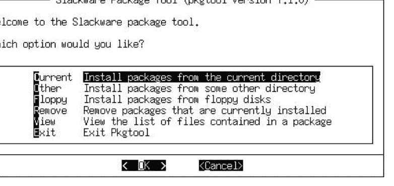

可以从当前目录、另一个目录或软盘提供安装。只需选择您想要的安装方法，**pkgtool** 就会在该位置搜索有效的软件包进行安装。

您还可以查看已安装软件包的列表，该列表如下所示：

**图 16-2. Pkgtool 查看模式。**

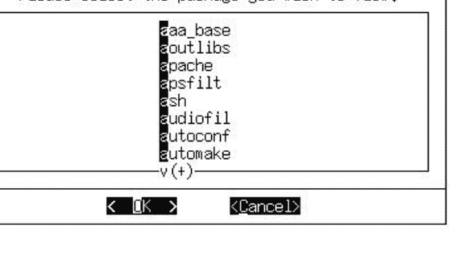

如果您想卸载软件包，选择卸载选项，您将看到所有已安装软件包的复选列表。标记您想要卸载的软件包，然后选择确定。**pkgtool** 将卸载它们。

一些用户更喜欢使用此实用工具而不是命令行实用工具。但是，应该注意的是，命令行实用工具提供了更多的选项。此外，升级软件包的功能仅通过命令行实用工具提供。

## installpkg

**installpkg**(8) 处理在系统上安装新软件包。语法如下：

```
# [ROOT=<path>] installpkg [option] <package name>...
```

**installpkg** 提供了三个选项。一次只能使用一个选项。

### 表 16-1. installpkg 选项

| 选项 | 效果 |
| :--- | :--- |
| -m | 对当前目录执行 **makepkg** 操作。 |
| -warn | 显示如果您安装了指定软件包将会发生什么。这对生产系统很有用，这样您可以在安装任何东西之前确切地知道会发生什么。 |


## installpkg

**installpkg(8)** 用于将 Slackware 软件包安装到系统中。其语法如下：

```
# [ROOT=<path>] installpkg [option] <package name>...
```

`-r` 选项会递归安装当前目录及其子目录下的所有软件包。`<package name>` 可以使用通配符，在递归安装时将作为搜索匹配条件。如果在 **installpkg** 之前传递 `ROOT` 环境变量，该路径将用作根目录。这在为根目录设置新驱动器时非常有用，这些驱动器通常会被挂载到 `/mnt` 或其他非 `/` 的路径。

已安装软件包的数据库条目存储在 `/var/log/packages` 中。这些"条目"实际上只是纯文本文件，每个软件包对应一个文件。如果软件包有安装后脚本，它会被写入 `/var/log/scripts/<packagename>`。

你可以指定多个软件包或对软件包名称使用通配符。请注意，**installpkg** 不会提示你是否正在覆盖已安装的软件包，它会直接覆盖旧软件包。如果你想确保旧软件包的文件被安全删除，请使用 **upgradepkg**。

## removepkg

**removepkg(8)** 用于从系统中删除已安装的软件包。其语法如下：

```
# [ROOT=<path>] removepkg [option] <package name>...
```

**removepkg** 提供四个选项，每次只能使用其中一个选项。

| 选项 | 效果 |
| :--- | :--- |
| -copy | 将软件包复制到保留软件包目录。这会创建原始软件包的目录树，但不删除它。 |
| -keep | 保存删除过程中创建的临时文件。实际上仅用于调试目的。 |
| -preserve | 删除软件包，但同时将其复制到保留软件包目录。 |
| -warn | 显示如果删除该软件包会发生什么。 |

如果在 **removepkg** 之前传递 `ROOT` 环境变量，该路径将用作根目录。这在为根目录设置新驱动器时非常有用，这些驱动器通常会被挂载到 `/mnt` 或其他非 `/` 的路径。

**removepkg** 会检查其他已安装的软件包，只删除仅属于你指定的软件包的文件。它还会扫描指定软件包的安装后脚本，并删除其中创建的所有符号链接。

在删除过程中，会显示状态报告。删除完成后，软件包数据库条目被移动到 `/var/log/removed_packages`，安装后脚本被移动到 `/var/log/removed_scripts`。

与 **installpkg** 一样，你可以指定多个软件包或对软件包名称使用通配符。

## upgradepkg

**upgradepkg(8)** 用于升级已安装的 Slackware 软件包。其语法如下：

```
# [ROOT=<path>] upgradepkg <package name>...
```

```
# [ROOT=<path>] upgradepkg \
<old package name>%<new package name>
```

**upgradepkg** 的工作原理是先安装新软件包，然后删除旧软件包，这样旧文件就不会继续留在系统中。如果升级后软件包的名称发生了变化，请使用百分号语法来指定旧软件包（已安装的那个）和新软件包（你要升级到的那个）。

如果在 **upgradepkg** 之前传递 `ROOT` 环境变量，该路径将用作根目录。这在为根目录设置新驱动器时非常有用，这些驱动器通常会被挂载到 `/mnt` 或其他非 `/` 的路径。

**upgradepkg** 并非完美无缺。你应该始终备份配置文件。如果它们被覆盖，你仍然会有原始文件的副本，以便进行必要的修复工作。

与 **installpkg** 和 **removepkg** 一样，你可以指定多个软件包或对软件包名称使用通配符。

## rpm2tgz/rpm2targz

Red Hat 软件包管理器是当今流行的软件包系统。许多软件分发商以 RPM 格式提供其产品。由于这不是我们的原生格式，我们不建议用户依赖它们。然而，某些内容只能以 RPM 形式获取（甚至包括源代码）。

我们提供了一个程序，可以将 RPM 软件包转换为我们的原生 .tgz 格式。这将允许你将软件包（也许使用 **explodepkg**）解压到临时目录并查看其内容。

**rpm2tgz** 程序会创建扩展名为 .tgz 的 Slackware 软件包，而 **rpm2targz** 则创建扩展名为 .tar.gz 的归档文件。

## 制作软件包

制作 Slackware 软件包既可以很简单也可以很困难。没有特定的构建软件包的方法。唯一的要求是软件包必须是 tar 压缩文件，并且如果有安装后脚本，它必须是 `/install/doinst.sh`。

如果你有兴趣为你的系统或你管理的网络制作软件包，你应该查看 Slackware 源代码树中的各种构建脚本。我们使用了多种方法来制作软件包。

## explodepkg

**explodepkg(8)** 的功能与 **installpkg** 的解压部分相同，但它不会实际安装软件包，也不会在软件包数据库中记录它。它只是将软件包解压到当前目录。它还会警告软件包目录树中的任何零长度文件。

此命令通常在你创建软件包目录树后运行。

## 制作标签和标签文件（用于安装程序）

Slackware 安装程序负责在你的系统上安装软件包。有一些文件会告诉安装程序哪些软件包必须安装，哪些是可选的，以及哪些默认被安装程序选中。

标签文件位于第一个软件系列目录中，名为 `tagfile`。它列出了该特定磁盘集中的软件包及其状态。状态可以是：

**表 16-3. tagfile 状态选项**

| 选项 | 含义 |
| :--- | :--- |
| ADD | 该软件包是系统正常运行所必需的 |
| SKP | 该软件包将被自动跳过 |
| REC | 该软件包不是必需的，但建议安装 |
| OPT | 该软件包是可选的 |

格式很简单：

```
<package name>: <status>
```

每行一个软件包。每个软件系列的原始标签文件以 `tagfile.org` 的形式保存。所以如果你搞乱了自己的标签文件，可以恢复原始文件。

许多管理员更喜欢编写自己的标签文件，然后启动安装程序并选择"完全安装"。安装程序会读取标签文件并根据其内容执行安装。如果你使用 REC 或 OPT，将会向用户显示一个对话框，询问是否要安装特定的软件包。因此，建议在为自动安装编写标签文件时，坚持使用 ADD 和 SKP。

确保你的标签文件写入与原始文件相同的位置。或者，如果你有自定义标签文件，可以指定自定义标签文件路径。

## 总结

你现在应该已经熟悉了软件包的概念以及它们在 Slackware 中的使用方式。你应该熟悉各种软件包管理工具以及如何使用它们。本章最重要的部分是如何安装、删除和升级软件包。这是软件包工具最常见的用途。不过，你也应该对制作和检查软件包有一定的了解。

## 第 17 章. ZipSlack 和 BigSlack

### 什么是 ZipSlack/BigSlack？

"ZipSlack"是 Slackware Linux 的一个特殊版本。它是一份已经安装好的 Slackware 副本，可以直接从你的 DOS 或 Windows 分区运行。这是一个基本安装，你不会获得 Slackware 附带的所有内容。如果你想体验 ZipSlack 的全部内容，那么你应该尝试"BigSlack"。

ZipSlack 的名字来源于它的发行形式——一个大的 .ZIP 文件。DOS 和 Windows 的用户可能对这些文件很熟悉。它们是压缩归档文件。ZipSlack 归档文件包含了使用 Slackware 启动和运行所需的一切。

需要注意的是，ZipSlack 和 BigSlack 与常规安装有显著不同。尽管它们功能相同并包含相同的程序，但它们的目标受众和功能有所不同。下面讨论了 ZipSlack 和 BigSlack 的一些优点和缺点。

最后一点，你应该始终查阅 ZipSlack 或 BigSlack 目录中包含的文档。它包含了有关该产品安装、启动和一般使用的最新信息。

### 优点

- 不需要重新分区硬盘。
- 是学习 Slackware Linux 的好方法，无需在安装过程中摸索。

### 缺点

- 使用 DOS 文件系统，比原生 Linux 文件系统慢。
- 不支持 Windows NT。

### 获取 ZipSlack/BigSlack

获取 ZipSlack 或 BigSlack 很简单。如果你已经购买了官方 Slackware Linux CD 套装，那么你已经有了 ZipSlack 和 BigSlack。只需找到包含你想要的内容的光盘并放入光驱。它通常是第三或第四张光盘，但请始终以光盘标签为准，而非本文档。

如果你想下载 ZipSlack 或 BigSlack，你应该首先访问我们的"Get Slack"网页以获取最新的下载信息：

http://www.slackware.com/getslack/

ZipSlack 和 BigSlack 是每个 Slackware 发行版的一部分。找到你想要的发行版，然后进入 FTP 站点上对应的目录。最新的发行版目录可以在以下位置找到：

ftp://ftp.slackware.com/pub/slackware/slackware/

你会在 `zipslack` 子目录中找到 ZipSlack，在 `/bigslack` 目录中找到 BigSlack。ZipSlack 以一个大的 .ZIP 文件或软盘大小的分卷形式提供。分卷位于 `/zipslack/split` 目录中。BigSlack 仅以分卷形式提供。

不要只下载 .ZIP 文件。你还应该下载目录中出现的文档文件和任何引导镜像。

### 安装

下载所需组件后，你需要解压 .ZIP 文件（如果你下载的是分卷，则需要解压多个文件）。请务必使用 32 位解压工具。归档文件的大小和文件名对于 16 位解压工具来说太多了。32 位解压工具的示例包括 WinZip 和 Windows 版 PKZIP。

ZipSlack 和 BigSlack 都设计为直接解压到驱动器的根目录（如 C: 或 D:）。会创建一个 `\LINUX` 目录，其中包含实际的 Slackware 安装。你还会

在该目录中也能找到启动系统所需的文件。

提取文件后，你应该会在所选驱动器上得到一个 LINUX 目录（以下我们以 C: 盘为例）。

## 启动 ZipSlack/BigSlack

有多种方式可以启动 ZipSlack 和 BigSlack。最常见的是使用随附的 LINUX.BAT 文件从 DOS（或 Windows 9x 的 DOS 模式）启动系统。在使用之前，必须先编辑此文件以匹配你的系统配置。

首先，用你喜欢的文本编辑器打开 `C:\LINUX\LINUX.BAT` 文件。在文件顶部你会注意到一段较长的注释。它说明了你需要在此文件中编辑的内容（以及从外置 Zip 驱动器启动时的操作方法）。如果一开始不理解 root= 设置的含义也不必担心。文件中有多个示例，你可以随意选择一个试试。如果不起作用，你可以再次编辑文件，将之前取消注释的行重新注释掉，然后选择另一个。

通过删除行首的 'rem ' 来取消注释你想要的行后，保存文件并退出编辑器。将你的机器切换到 DOS 模式。

> Windows 9x 中的 DOS 提示符窗口**不可**用于此操作。

输入 `C:\LINUX\LINUX.BAT` 来启动系统。如果一切正常，你应该会看到登录提示符。

以 **root** 身份登录，无需密码。你可能需要为 root 设置密码，并为自己添加一个账户。此时你可以参考本书中的其他章节了解一般系统用法。

如果使用 LINUX.BAT 文件启动系统对你不起作用，你应该参考随附的 `C:\LINUX\README.1ST` 文件，了解其他启动方式。

## 添加、移除和升级软件

ZipSlack 和 BigSlack 可以使用与常规 Slackware 安装相同的软件包。这意味着你可以使用标准的 Slackware 软件包工具来添加、移除和升级软件。你甚至可以直接从 Slackware 光盘添加软件包。

更多信息请参阅[第 16 章](Chapter 16)。

## 常见问题

以下是 ZipSlack 和 BigSlack 用户最常遇到的问题。如果你的问题未在此列出，我们还提供了其他几种帮助方式。下一节将详细介绍这些方法。

### Unable to open initial console

这通常是因为在 LINUX.BAT 文件的 root= 设置中指定了错误的设备分区。请再次编辑 LINUX.BAT 文件并选择另一个 root= 分区。如果你完全不明白这是什么意思，可以直接逐一尝试，直到找到可用的。

如果解压 .ZIP 文件时未将其解压到驱动器的根目录，也可能导致此问题。这些压缩包需要直接解压到驱动器根目录，而不是子目录中。

### Kernel panic: VFS : Unable to mount root fs

这表示你在 `LINUX.BAT` 文件的 root= 设置中指定了错误的设备。你需要再次编辑该文件并选择另一个 root= 设备。如果你不确定是哪个，只需全部尝试一遍，直到找到一个可用的。

## 获取帮助

在寻求帮助之前，你应该先阅读 `C:\LINUX` 目录中的文档，看看是否有你问题的答案。

如果你已经阅读了文档但仍有问题，以下方法希望能帮助你解决问题。

### ZipSlack 常见问题解答

常见问题及其解答可以在 `C:\LINUX` 目录中的 `FAQ.TXT` 文件中找到，也可以在网站上查看：

[http://www.slackware.com/faq/](http://www.slackware.com/faq/)

### ZipSlack 讨论论坛

ZipSlack 的在线讨论论坛让你可以与其他 ZipSlack 和 BigSlack 用户交流。你可以在那里发布问题，也可以为其他用户提供帮助。这是从其他用户那里获得直接帮助的好方式。

[http://www.slackware.com/forum/](http://www.slackware.com/forum/)

### 通过电子邮件获取支持

Slackware 支持团队会在你遇到 ZipSlack 或 BigSlack 相关问题时尽力提供帮助。请务必清楚地描述问题，并提供你认为解决该问题所需的任何信息。

[<support@slackware.com>](mailto:<support@slackware.com>)

## 总结

你应该已经了解了 ZipSlack 和 BigSlack 是什么。如果你决定使用其中之一，你应该知道如何安装、启动、排查故障和获取帮助。如果你只是想体验 Slackware 而不想删除现有的 Windows 分区，ZipSlack 和 BigSlack 可以说是非常方便的选择。

## 术语表

### 账户（Account）

关于用户的全部信息，包括用户名、密码、finger 信息、UID 和 GID 以及主目录。创建账户就是添加并定义一个用户。

### 启动盘（Boot disk）

包含操作系统（在我们的例子中是 Linux 内核）的软盘，计算机可以从该软盘启动。

### 编译（Compile）

将源代码转换为机器可读的"二进制"代码。

### 守护进程（Daemon）

设计为在后台运行并自行执行特定任务（通常是提供某种服务）的程序，无需用户干预。

### Darkstar

Slackware 中的默认主机名；如果你没有指定其他名称，你的计算机将被命名为 darkstar。

这是 Patrick Volkerding 的开发机器之一，以 Grateful Dead 乐队的歌曲"Dark Star"命名。

### 桌面环境（Desktop Environment）

运行在 X Window System 之上的图形用户界面（GUI），提供集成应用程序、程序与组件之间统一的外观和感觉、文件和窗口管理功能等特性。它是简单窗口管理器的进阶版本。

### 设备驱动程序（Device driver）

内核中直接控制特定硬件的代码模块。

### 设备节点（Device node）

`/dev` 文件系统中的一种特殊文件类型，用于向操作系统表示一个硬件组件。

### DNS

域名服务（Domain Name Service）。一种为联网计算机分配名称并将其转换为数字地址的系统。

### 域名（Domain name）

计算机的 DNS 名称，不含其主机名。

### 点文件（Dot file）

### 动态加载器（Dynamic loader）

在 Linux 下编译的程序通常会使用外部库中的代码（函数）。当此类程序运行时，必须找到这些库并将所需的函数加载到内存中。这就是动态加载器的工作。

### 环境变量（Environment variable）

在用户 shell 中设置的变量，可被该用户或在该 shell 中运行的程序引用。环境变量通常用于存储偏好设置和默认参数。

### 纪元（Epoch）

一段历史时期；在 Unix 中，"纪元"（The Epoch）始于 1970 年 1 月 1 日 UTC 00:00:00。这被 Unix 及类 Unix 操作系统视为"时间的起点"，所有其他时间都相对于此日期计算。

### 文件系统（Filesystem）

一种存储数据的表示方式，其中数据"文件"以"目录"形式有序存放。文件系统是磁盘（包括固定磁盘和可移动磁盘）上存储数据的通用表示形式。

### 前台（Foreground）

正在接收或控制终端输入的程序被称为在前台运行。

### 帧缓冲（Framebuffer）

一种图形设备类型；在 Linux 中，这通常指的是软件帧缓冲，它为程序提供标准的帧缓冲接口，同时将特定的硬件驱动程序对程序隐藏起来。这种抽象层使程序无需直接与各种硬件驱动程序通信。

### FTP

文件传输协议（File Transfer Protocol）。FTP 是一种在计算机之间传输数据的流行方法。

### 网关（Gateway）

数据通过其从一个网络传输到另一个网络的计算机。

### GID

组标识符（Group Identifier）。GID 是分配给用户组的唯一编号。

### 组（Group）

Unix 中的用户属于"组"，一个组可以包含多个用户，用于实现比仅靠用户身份所能提供的更灵活的访问控制。

### GUI

图形用户界面（Graphical User Interface）。一种使用图形化元素（如按钮、滚动条、窗口等）而非纯文本输入输出的软件界面。


用户的主目录是用户登录后立即进入的目录。用户在其主目录中拥有完全权限，并几乎可以自由支配。

## 操作指南

一份描述“如何做”某事的文档，例如配置防火墙或管理用户和组。Linux文档项目提供了大量此类文档。

## HTTP

超文本传输协议。HTTP是万维网运行所依据的主要协议。

## ICMP

互联网控制报文协议。一种非常基础的网络协议，主要用于ping操作。

## 内核

操作系统的核心。内核是提供基本进程控制并与计算机硬件交互的部分。

## 内核模块

一段内核代码，通常是某种驱动程序，可以从内核主体中单独加载到内存中或从内存中卸载。在升级驱动程序或测试内核设置时，模块非常方便，因为无需重启即可加载和卸载。

## 库

一组可以在程序之间共享的函数。

## LILO

Linux加载器。LILO是使用最广泛的Linux引导管理器。

## LOADLIN

LOADLIN是一个运行在MS DOS或Windows下并引导Linux系统的程序。它最常用于装有多个操作系统的计算机（当然包括Linux和DOS/Windows）。

## 手册页章节

标准Unix在线手册（“man”）中的页面被分组为不同的章节，便于参考。所有C编程页面都在第3章，系统管理页面在第5章，以此类推。

## MBR

主引导记录。硬盘上的一个保留空间，用于存储启动时应执行的操作信息。LILO或其他引导管理器可以写入此处。

## 每日消息

每日消息。motd（在Linux中存储在`/etc/motd`）是一个文本文件，在所有用户登录时显示。传统上，系统管理员将其用作与用户沟通的“公告板”。

## 挂载点

文件系统中的一个空目录，另一个文件系统将在此处“挂载”或嫁接。

## 名称服务器

DNS信息服务器。名称服务器将DNS名称转换为数字IP地址。

## 网络接口

内核提供的网络设备的虚拟表示。网络接口允许用户和程序与网络设备通信。

## NFS

网络文件系统。NFS允许将远程文件系统挂载为本地计算机的文件系统，从而提供透明的文件共享方法。

## 八进制

基数为8的数字系统，使用数字0-7。

## 分页器

一种X程序，允许用户查看并在多个“桌面”之间切换。

## 分区

硬盘的划分。文件系统存在于分区之上。

## PPP

点对点协议。PPP主要用于通过调制解调器连接到互联网服务提供商。

## 进程

一个正在运行的程序。

## 根目录

表示为‘/’，根目录位于文件系统的顶部，所有其他目录都像“文件树”一样在其下分支。

## 根磁盘

存储根目录的磁盘（通常是固定的）。

## 路由表

内核用于“路由”网络数据的一组信息。它包含诸如默认网关位置、哪个网络接口连接到哪个网络等细节。

## 运行级别

由init定义的整体系统状态。运行级别6是重启，运行级别1是“单用户模式”，运行级别4是X登录，等等。在Slackware系统上有6个可用的运行级别。

## 安全shell

一种加密（因此安全）的远程登录计算机的方法。有许多安全shell程序可用；需要客户端和服务器。

## 服务

信息和/或数据在程序和计算机之间从单个“服务器”到多个“客户端”的共享。HTTP、FTP、NFS等都是服务。

## 影子密码套件

影子密码套件允许将加密密码隐藏在用户不可见的地方，而`/etc/passwd`文件中的其余信息仍对所有人可见。这有助于防止暴力破解密码的尝试。

## Shell

Shell为用户提供命令行界面。当你看到文本提示符时，你就处于shell中。

## Shell内建命令

内置于shell中的命令，与由外部程序提供的命令相对。例如，**bash**有一个**cd**内建命令。

## 信号

Unix程序可以使用简单的“信号”相互通信，这些信号是枚举的，并且通常具有特定含义。**kill -l**将列出可用的信号。

## SLIP

串行线路接口协议。SLIP是一种类似于PPP的协议，用于通过串行接口连接两台机器。

## 软件包

一个程序及其相关文件，与任何必要的脚本或信息一起归档并压缩成一个单独的文件，以帮助管理这些文件的安装、升级和移除。

## 软件系列

Slackware中相关软件包的集合。所有KDE软件包都在“kde”系列中，网络软件包在“h”系列中，等等。

## 源代码

大多数程序编写的（大致）人类可读的代码。源代码被编译成“二进制”代码。

## 标准错误（stderr）

Unix标准错误输出流。程序将任何错误消息写入stderr，以便与正常输出分离。

## 标准输入（stdin）

Unix标准输入流。数据可以从任何源重定向或通过管道输入到程序的stdin。

## 标准输出（stdout）

Unix标准输出流。程序的正常文本输出写入stdout，这与stderr上报告的错误消息分开，并且可以通过管道或重定向到其他程序的stdin或文件。

## 子网

作为更大范围一部分的IP地址范围。例如，192.168.1.0是192.168.0.0（其中0是表示“未定义”的掩码）的子网；它实际上是“:1”子网。

## 超级块

在Linux中，分区以块为单位讨论。一个块是512字节。超级块是分区的前512个字节。

## 补充磁盘

在Slackware中，安装期间使用的软盘，它既不包含内核（在引导盘上），也不包含根文件系统（在根磁盘上），而是包含额外所需的文件，例如网络模块或PCMCIA支持。

## 挂起进程

已被冻结直到被终止或恢复的进程。

## 交换空间

内核用作“虚拟”RAM的磁盘空间。它比RAM慢，但由于磁盘空间更便宜，交换空间通常更充足。交换空间对内核很有用，可用于保存较少使用的数据，以及在物理RAM耗尽时作为后备。

## 符号链接

一个特殊文件，仅指向另一个文件的位置。当文件需要在多个位置使用时，使用符号链接可以避免数据重复。

## 标签文件

Slackware **setup**程序在安装期间使用的文件，描述要安装的一组软件包。

## 终端

人机界面，至少包含一个屏幕（或虚拟屏幕）和某种输入方法（几乎总是至少有一个键盘）。

## 工具包，GUI

GUI工具包是一组库，为程序员提供绘制“小部件”（如滚动条、复选框等）和构建图形界面的代码。程序使用的GUI工具包通常定义其“外观和感觉”。

## UID

用户标识符。一个向系统标识用户的唯一数字。大多数程序使用UID而不是用户名，因为数字更容易处理；用户名通常只在用户需要看到事情发生时使用。

## VESA

视频电子标准协会。“VESA”一词通常用于表示该协会指定的标准。几乎所有现代视频适配器都符合VESA标准。

## 虚拟终端

使用软件模拟多个终端，同时只使用单个输入/输出设备（键盘、显示器、鼠标）。特殊击键可在单个物理终端上的虚拟终端之间切换。

## 窗口管理器

一个X程序，其目的是在X Window System的简单矩形绘制之外提供图形界面。窗口管理器通常提供标题栏、用于运行程序的菜单等。

## 工作目录

程序在运行时认为自己所在的目录。

## 包装程序

一个唯一目的是运行其他程序的程序，但通过改变其环境或过滤其输入以某种方式改变其行为。

## X服务器

X Window System中与图形硬件交互并处理实际运行X程序的程序。

## X Window System

用于大多数类Unix操作系统（包括Linux）的面向网络的图形界面系统。

# 附录A. GNU通用公共许可证

## 目录

- [前言](https://www.google.com/search?q=Preamble)
- [复制、分发和修改的条款和条件](https://www.google.com/search?q=TERMS+AND+CONDITIONS+FOR+COPYING,+DISTRIBUTION+AND+MODIFICATION)
- [如何将这些条款应用于你的新程序](https://www.google.com/search?q=How+to+Apply+These+Terms+to+Your+New+Programs)


## GNU 通用公共许可证

第2版，1991年6月
版权所有 (C) 1989, 1991 自由软件基金会，公司。
地址：59 Temple Place, Suite 330, Boston, MA 02111-1307 USA

允许任何人复制和分发本许可证文档的逐字副本，但不允许对其进行修改。

## 序言

大多数软件的许可证旨在剥夺你共享和修改软件的自由。与此相反，GNU 通用公共许可证旨在保证你共享和修改自由软件的自由——确保软件对其所有用户都是自由的。本通用公共许可证适用于自由软件基金会的大多数软件，以及任何承诺使用它的其他程序。（自由软件基金会的其他一些软件由 GNU 库通用公共许可证覆盖。）你也可以将它应用于你的程序。

当我们谈论自由软件时，我们指的是自由，而不是价格。我们的通用公共许可证旨在确保你拥有分发自由软件副本的自由（如果你愿意，可以为此服务收费），确保你能够获得源代码或在需要时获得它，确保你能够修改软件或在新的自由程序中使用其片段；并且确保你知道你可以做到这些。

为了保护你的权利，我们需要施加限制，禁止任何人剥夺你的权利或要求你放弃这些权利。这些限制在你分发软件副本或修改软件时，为你带来某些责任。

例如，如果你分发此类程序的副本，无论是否免费，你必须给予接收者你拥有的所有权利。你必须确保他们也收到或能够获得源代码。并且你必须向他们展示这些条款，以便他们了解自己的权利。

我们通过两个步骤来保护你的权利：(1) 对软件进行版权保护，以及 (2) 向你提供本许可证，该许可证赋予你复制、分发和/或修改软件的法律许可。

此外，为了每位作者的保护以及我们自己，我们希望确保每个人都明白本自由软件没有担保。如果软件被他人修改并传递下去，我们希望其接收者知道他们拥有的不是原始版本，因此他人引入的任何问题不会影响原始作者的声誉。

最后，任何自由程序都不断受到软件专利的威胁。我们希望避免自由程序的重新分发者单独获得专利许可证，从而实际上使该程序专有的危险。为了防止这种情况，我们明确表示任何专利都必须获得许可，允许每个人自由使用，或者根本不获得许可。

有关复制、分发和修改的具体条款和条件如下。

## 复制、分发和修改的条款和条件

1. 本许可证适用于任何包含由版权所有者放置的通知的程序或其他作品，该通知表示其可以在本通用公共许可证的条款下分发。下文中的“程序”指任何此类程序或作品，“基于程序的作品”指在版权法下的程序或任何派生作品：即包含程序或其部分的作品，无论是逐字复制还是经过修改和/或翻译成另一种语言。（下文，“翻译”一词在不限制“修改”的含义的情况下包含在内。）每位被许可方均称为“你”。

    除复制、分发和修改之外的活动不受本许可证管辖；它们超出了本许可证的范围。运行程序的行为不受限制，并且程序的输出仅在其内容构成基于程序的作品时才被覆盖（无论其是否由运行程序产生）。这取决于程序的功能。

2. 你可以按照你收到时的原始形式，在任何介质上复制和分发程序的源代码副本，条件是你必须在每份副本上显著且适当地发布适当的版权声明和保证免责声明；保留所有引用本许可证和无任何保证的通知；并将本许可证的副本随程序一起提供给任何其他接收者。

    你可以为物理传输副本的行为收取费用，并且你可以自行选择提供保证保护以换取费用。

3. 你可以修改程序或其任何部分的副本，从而形成基于程序的作品，并根据上述第1款的条款复制和分发此类修改或作品，前提是你还必须满足以下所有条件：

    a. 你必须使修改后的文件携带显著的通知，说明你修改了文件以及任何更改的日期。
    b. 你必须使你分发或发布的任何作品（该作品全部或部分包含或源自程序或其任何部分），根据本许可证的条款向所有第三方免费整体许可。
    c. 如果修改后的程序在运行时通常交互式读取命令，你必须确保它在以最普通的方式开始运行以进行此类交互使用时，打印或显示一份公告，包括适当的版权声明和无保证的通知（或者，说明你提供了保证），以及用户可以根据这些条件重新分发程序，并告知用户如何查看本许可证的副本。（例外：如果程序本身是交互式的，但通常不打印此类公告，则不要求基于程序的作品打印公告。）

    这些要求适用于修改后的作品整体。如果该作品中可识别的部分不是源自程序，并且可以合理地被视为独立且分离的作品本身，那么当你将它们作为独立作品分发时，本许可证及其条款不适用于这些部分。但当你将相同的部分作为基于程序的作品整体的一部分分发时，整体的分发必须在本许可证的条款下进行，该许可证对其他被许可方的权限扩展到整个整体，因此扩展到每一部分，无论其作者是谁。

    因此，本条款的目的不是主张权利或质疑你完全自行编写的作品的权利；相反，其目的是行使控制基于程序的派生作品或集体作品分发的权利。

    此外，仅将另一个非基于程序的作品与程序（或基于程序的作品）聚合在存储或分发介质的卷上，并不会将另一个作品置于本许可证的范围内。

4. 你可以根据上述第1款和第2款的条款，以目标代码或可执行形式复制和分发程序（或基于程序的作品，根据第2款），前提是你还必须执行以下操作之一：

    a. 将其与完整的对应机器可读源代码一起提供，该源代码必须根据上述第1款和第2款的条款在通常用于软件交换的介质上分发；或者，
    b. 将其与一份书面要约一起提供，该要约至少三年有效，用于向任何第三方提供对应源代码的完整机器可读副本，且收费不超过你执行物理源代码分发的成本，并根据上述第1款和第2款的条款在通常用于软件交换的介质上分发；或者，
    c. 将其与你收到的关于提供对应源代码分发的要约信息一起提供。（此替代方案仅允许用于非商业分发，并且仅当你在收到程序的目标代码或可执行形式时附带了此类要约，符合上述b款。）

    作品的源代码指用于修改该作品的首选形式。对于可执行作品，完整的源代码指其包含的所有模块的源代码，加上任何关联的接口定义文件，加上用于控制可执行文件编译和安装的脚本。但是，作为特殊例外，分发的源代码不需要包括通常随可执行文件运行的操作系统的主要组件（编译器、内核等）一起分发的任何内容（无论是源代码还是二进制形式），除非该组件本身随可执行文件一起提供。

    如果可执行文件或目标代码的分发是通过提供从指定位置复制的访问权限进行的，那么提供从同一位置复制源代码的同等访问权限即视为源代码的分发，即使第三方没有被强制随目标代码一起复制源代码。

5. 除本许可证明确规定外，你不得复制、修改、再许可或分发程序。任何试图以其他方式复制、修改、再许可或分发程序的行为都是无效的，并将自动终止你根据本许可证享有的权利。但是，根据本许可证从你那里收到副本或权利的各方，只要这些方完全遵守规定，其许可证不会终止。

6. 你无需接受本许可证，因为你没有签署它。但是，没有任何其他内容授予你修改或分发程序或其派生作品的许可。如果你不接受本许可证，这些行为是被法律禁止的。因此，通过修改或分发程序（或任何基于程序的作品），你表示你接受本许可证以及有关复制、分发或修改程序或基于程序的作品的所有条款和条件。

7. 每当你重新分发程序（或任何基于程序的作品）时，接收者都会自动从原始许可方获得许可，根据这些条款和条件复制、分发或修改程序。你不得对接收者行使此处授予的权利施加任何进一步限制。你没有责任强制第三方遵守本许可证。

8. 如果由于法院判决、专利侵权指控或任何其他原因（不限于专利问题），对你施加了与本许可证条件相矛盾的条件（无论是通过法院命令、协议还是其他方式），这些条件并不能免除你遵守本许可证条件的责任。如果你无法分发以同时满足你根据本许可证和其他相关义务，那么你可能根本无法分发程序。例如，如果专利许可证不允许所有通过你直接或间接收到副本的人免版税重新分发程序，那么你同时满足该许可证和本许可证的唯一方法就是完全停止分发程序。

    如果本条款的任何部分在任何特定情况下被认定为无效或不可执行，则本条款的其余部分仍应适用，并且本条款整体在其他情况下仍应适用。

    本条款的目的不是诱导你侵犯任何专利或其他财产权主张，或质疑此类主张的有效性；本条款的唯一目的是保护通过公共许可实践实施的自由软件分发系统的完整性。许多人通过该系统对广泛的软件做出了慷慨的贡献，这依赖于该系统的一致应用；作者/捐赠者可以决定是否愿意通过任何其他系统分发软件，被许可方不得强加此选择。


## 9.  如果对本程序的使用或分发在某些国家因专利或受版权保护的接口而受到限制，则将本程序置于此许可证下的原始版权所有者可以添加明确的地域分发限制，排除这些国家，使得分发只能在未被排除的国家或地区内进行。在此情况下，本许可证将包含该限制，其效力等同于将其写入本许可证正文。

## 10. 自由软件基金会可能会不时发布通用公共许可证的修订版和/或新版本。此类新版本在精神上将与当前版本相似，但在细节上可能有所不同，以解决新的问题或关注点。

每个版本都有一个区分性的版本号。如果程序指定了适用于它的本许可证版本号以及“任何更高版本”，您可以选择遵循该版本或自由软件基金会发布的任何更高版本的条款和条件。如果程序未指定本许可证的版本号，您可以选择自由软件基金会发布的任何版本。

## 11. 如果您希望将本程序的部分内容纳入分发条件不同的其他自由程序中，请联系作者以寻求许可。对于由自由软件基金会拥有版权的软件，请写信给自由软件基金会；我们有时会为此做出例外决定。我们的决定将基于两个目标：维护我们所有自由软件衍生作品的自由状态，以及促进软件的共享和重用。

# 12. 免责声明

本程序免费提供，在适用法律允许的最大范围内，不提供任何担保。除非书面形式另有声明，版权所有者和/或其他方以“原样”方式提供本程序，不附带任何明示或暗示的担保，包括但不限于对适销性和特定用途适用性的暗示担保。本程序的质量和性能相关的全部风险由您承担。如果程序存在缺陷，您将承担所有必要的服务、修复或更正费用。

## 13. 除适用法律要求或书面同意的情况外，任何版权所有者，或任何其他方若按照上述允许修改和/或分发本程序，均不对您承担任何损害赔偿责任，包括因使用或无法使用本程序（包括但不限于数据丢失、数据不准确、您或第三方遭受的损失，或本程序无法与其他程序配合运行）而产生的任何一般性、特殊性、偶然性或间接性损害赔偿，即使该版权所有者或其他方已被告知此类损害的可能性。

# 条款与条件终止

# 如何将这些条款应用于您的新程序

如果您开发一个新程序，并希望它能对公众产生最大的可能用途，最好的方法是使其成为自由软件，让每个人都可以根据这些条款重新分发和修改。

为此，您必须在程序中附加以下通知。最安全的做法是将它们附加到每个源文件的开头，以最有效地传达担保的排除；每个文件应至少包含“版权”行和指向完整通知位置的指针。

```
<一行内容，说明程序名称及其基本功能。>
Copyright (C) <年份> <作者姓名>

本程序是自由软件；您可以在自由软件基金会发布的 GNU 通用公共许可证的条款下重新分发和/或修改它；可以选择该许可证的第2版，或（由您选择）任何更高版本。

分发本程序是希望它有用，但没有任何担保；甚至不附带对适销性或特定用途适用性的暗示担保。详情请参阅 GNU 通用公共许可证。

您应该已经收到本程序的 GNU 通用公共许可证副本；如果没有，请写信至自由软件基金会，地址：59 Temple Place, Suite 330, Boston, MA  02111-1307  USA
```

同时添加关于如何通过电子邮件和纸质邮件联系您的信息。

如果程序是交互式的，请让它在交互模式启动时输出如下简短通知：

```
Gnomovision 版本 69, Copyright (C) 年份 作者姓名

Gnomovision 绝对不附带任何担保；详情请输入 `show w'。

这是一个自由软件，欢迎您在特定条件下重新分发它；请输入 `show c' 查看详情。
```

假设的命令 `show w' 和 `show c' 应显示通用公共许可证的相应部分。当然，您使用的命令可以不叫 `show w' 和 `show c'；它们甚至可以是鼠标点击或菜单项——任何适合您程序的方式。

您还应该让您（如果您是程序员）的雇主或学校（如果有的话），在必要时为程序签署“版权免责声明”。以下是示例；请更改名称：

```
Yoyodyne, Inc., 兹此放弃对由 James Hacker 编写的程序 `Gnomovision'（它会对编译器进行“传递”）的所有版权利益。

<Ty Coon 的签名>, 1989年4月1日
Ty Coon, 总裁
```

本通用公共许可证不允许将您的程序纳入专有程序。如果您的程序是一个子例程库，您可能会考虑允许将专有应用程序与该库链接更为有用。如果您希望这样做，请使用 GNU 库通用公共许可证替代本许可证。
