# Solaris 2.6 管理员认证培训指南, 第1部分


## 警告与免责声明

本书旨在提供有关 Solaris 2.6 的信息。已尽一切努力使本书尽可能完整和准确，但不暗示任何保证或适用性。

信息按原样提供。作者和 Macmillan Technical Publishing 对因本书所含信息或随附光盘或程序的使用而产生的任何损失或损害不承担任何责任或义务。

## 反馈信息

在 Macmillan Technical Publishing，我们的目标是创建质量和价值最高的高深度技术书籍。每本书都经过精心制作，开发过程严格，涉及专业技术社区成员的独特专业知识。

读者的反馈是这一过程的自然延续。如果您对如何提高本书质量或以其他方式使其更符合您的需求有任何建议，您可以联系我们 at alewis@mcp.com。请确保在消息中包含图书标题和 ISBN。

## 作者简介

Bill Calkins 是 Pyramid Design, Inc. 的所有者和总裁，该公司是一家计算机咨询公司，专门从事在 UNIX 和 Windows NT 操作系统上实施客户端-服务器技术。Bill 在 75 多家不同公司拥有 15 年的系统管理和咨询经验。他曾在企业和大学环境中担任培训师。他经常在国际用户大会上发言，并撰写了关于 TCP/IP 网络以及 UNIX 系统管理和维护的白皮书。Bill 凭借其多年的系统管理和培训经验，提供了一种独特的计算机培训方法。

## 技术审校简介

Janice Winsor 是一名高级技术作家，拥有 13 年的 UNIX 系统文档编写经验。她在 Sun Microsystems 工作了七年。过去三年，她在 Filoli Information Systems Company 担任项目负责人和经理。她现在作为自由作者工作。Janice 已从技术传播协会获得 10 项写作奖。她的出版作品包括 UNIX Book of Games、Jumping JavaScript™，以及由 Sun Microsystems Press 出版的《Solaris 系统管理员指南》和《Solaris 高级系统管理员指南》第一版。

Janice 为 Solaris 2.6 管理员认证培训指南，第一部分 的整个开发过程贡献了大量的实践经验。在本书撰写期间，Janice 对所有材料的技术内容、组织和流程进行了审阅。她的反馈对于确保 Solaris 2.6 管理员认证培训指南，第一部分 满足读者对最高质量技术信息的需求至关重要。

## 致谢

致 Glenda，感谢你帮助我在过度工作和享受乐趣之间保持平衡。
致 William，感谢你在办公室玩电脑游戏时陪伴我。
致 Nicole，感谢美味的零食和好咖啡。
致 Neil，嗯……感谢你按时上床睡觉。

## 引言

欢迎阅读 *Solaris 2.6 管理员认证培训指南，第一部分*。我写这本书的目标是教授你 Solaris 系统管理，并具体帮助你获得认证。Sun 为 Solaris 系统管理员提供两项考试。本书帮助你准备 Solaris 管理员考试的第一部分；它是学习通过认证考试所需信息的最佳参考。每章都以具体的考试目标开头。此外，我还提供了你更好地理解每个主题所需的背景信息。

无论你的目标是获得认证还是只是想了解更多关于管理 Solaris 系统的知识，*Solaris 2.6 管理员认证培训指南，第一部分* 都提供了易于遵循的格式。本书从系统安装和启动开始。然后引导你完成安装补丁和额外软件包的任务；设置文件系统和用户账户；自定义 CDE 环境；设置打印机；以及配置网络。它甚至会向你介绍 shell 脚本。我描述每个主题时都假设你对系统管理是新手，并且我会慢慢带你了解高级主题。我唯一的假设是你具备一定的 UNIX 经验。我假设你知道如何登录和注销、复制和删除文件，以及使用 VI 编辑器执行简单任务。

我处于一个可以帮助你完成学习过程的有利位置。我已为企业开展 UNIX 培训超过七年。我自 20 世纪 80 年代初就开始使用 SunOS 和 Solaris，并在 Sun 系统的大型站点担任系统管理员长达 14 年。过去六年里，我作为系统管理顾问和培训师独立工作，涉及所有类型的 UNIX，帮助像你这样的用户进行系统管理。我花费了数百小时培训系统管理员，既有之前没有 UNIX 经验的管理员，也有拥有多年经验的管理员。

编写这本书是一次很棒的经历。每当我回顾基础知识时，我都会学到一些东西，就像每次教授入门课程时一样。我邀请即使是最有经验的系统管理员阅读这本书——我保证你会发现新的东西。我也敦促你，如果尚未参加，请参加认证考试。认证提供了衡量和验证你技术技能的手段，在工作中给你信誉，并且是提升职业生涯的绝佳方式。


以下准则适用于阅读本书。下面的列表概述了考试的测试目标，然后建议您应学习哪些章节以便牢牢掌握这些目标。

- **系统概念**
  学习附录 A 和 B 以及第 2 章和第 10 章
- **引导工作站**
  学习第 1 章
- **Solaris 安装**
  学习第 1、2、3、6 和 13 章
- **用户安全**
  学习第 4 章和第 5 章
- **使用 Admintool 添加用户和软件**
  学习第 5 章和第 6 章
- **软件包管理**
  学习第 6 章
- **维护补丁**
  学习第 6 章
- **初始化文件管理**
  学习第 1 章和第 5 章
- **文件权限**
  学习第 4 章
- **CDE 的管理和配置**
  学习第 7 章
- **文件系统**
  学习第 3 章
- **磁盘管理**
  学习第 2、3 和 11 章
- **脚本编写**
  学习第 8 章
- 网络
  学习第 13 章
- LP 打印服务和打印管理器
  学习第 9 章
- 进程控制
  学习第 10 章
- 备份和恢复
  学习第 11 章
- 设备管理
  学习第 12 章
- 服务访问设施
  学习第 12 章
- 添加终端和调制解调器
  学习第 12 章

当您感觉准备好参加考试时，您首先必须从 Sun 教育服务处购买一张凭证（电话 1-800-422-8020）。然后，携带您的凭证号码致电 Sylvan Prometric 1-800-792-3926 注册考试。考试费用为 150 美元，约有 72 道题，包括多项选择题和简答填空题。您将在当地的 Sylvan Prometric 考试中心参加考试，完成测试的时间为 90 分钟。您会立即知道是否通过或未通过。完成后，您将收到一份报告，显示您在每个部分正确回答的项目百分比。保留此报告，以便了解需要改进的领域。您必须正确回答至少 75% 的问题才能通过考试。如果需要重考考试，请不要感到难过——平均需要两次尝试才能通过考试。

您将被评分的部分以及本书涵盖这些部分的章节如下：

- 系统概念（附录 A 和 B 以及第 2 章和第 10 章）
- Solaris 安装（第 1、2、3、6、12 和 13 章）
- 文件系统（第 3 章和第 11 章）
- 浏览文件系统（第 3 章）
- 元字符和重定向（第 8 章）
- Shell 功能（第 8 章）
- 文件安全（第 4 章和第 11 章）
- 用户安全（第 4 章和第 5 章）
- 网络（第 13 章）
- LP 打印服务和打印管理器（第 9 章和第 12 章）
- 打印命令（第 9 章）
- 实用程序（本书各处均有介绍）

您还将被评定本书未涵盖的三个领域：文件命令（cp、mv、rm 等）、视觉文本编辑器（基本编辑任务）以及电子通信（使用 UNIX 电子邮件、talk 和 wall 命令）。这些是基本 UNIX 主题，您应在参加考试前熟悉它们。正如我之前所说，本书涵盖系统管理主题；基本 UNIX 主题不在其范围内。如果您不熟悉这三个领域，我建议您在参加考试前先学习它们。有许多优秀的书籍涵盖基本 UNIX 主题和命令。

另外，请关注我的网站 www.pdesigninc.com。我会及时更新 Sun 可能对考试或目标做出的任何最后时刻的更改。一旦您有信心，请获得认证并通过电子邮件 wwalkins@pdesigninc.com 向我发送您的评论。

## 本书使用的约定

**命令** 在步骤和示例中，您输入的命令为粗体且使用等宽字体。例如：`ls -l <return>`。`<return>` 表示按 Enter 键输入命令。仅在指示时才按 Enter。

**参数和选项** 在描述命令语法时，命令选项和参数以斜体等宽字体显示，并用尖括号（< >）括起来。例如，

```
lp -d<printer name> <filename> <return>
```

**使用鼠标** 使用菜单和窗口时，您将使用鼠标选择项目。以下是三键鼠标的默认映射：

|  |  |
|---|---|
| 左键 | 选择对象或激活控件 |
| 中键 | 移动或调整对象 |
| 右键 | 显示弹出菜单 |


## 第4章 系统安全


## 第5章 设置用户账户 90
- 使用 Admintool 添加用户账户 92
- 使用 Admintool 删除用户账户 95
- 使用 Admintool 修改用户账户 96
- 使用 Admintool 添加组 97
- 设置用户初始化文件 98
- 自定义用户初始化文件 98
- 目录 101

## 第6章 软件包管理 104
- 软件管理工具 105
- 添加和删除软件包 106
  - 添加软件包 107
  - 删除软件包 108
- 列出和验证已安装的软件包 110
- 软件补丁 111
  - 安装补丁 112
  - 删除补丁 113
- 一般准则 114

## 第7章 CDE 的管理和配置 116
- 登录管理器 117
  - 启动登录服务器 118
  - 停止登录服务器 118
  - 在本地显示器上显示登录屏幕 119
- 会话管理器 120
  - 加载 .dtprofile 脚本 121
  - 加载 Xsession.d 脚本 121
  - 欢迎消息 122
  - 设置桌面搜索路径 122
  - 修改搜索路径 123
  - 收集可用应用程序 123
  - 加载用户 .profile 或 .login 文件 123
  - 启动 ToolTalk 消息守护进程 123
  - 加载会话资源 124
  - 启动颜色服务器 124
  - 启动工作区管理器 124
    - 在系统范围内更改工作区数量 125
    - 提供系统范围的工作区名称 126
  - 启动会话应用程序 126
- 自定义前置面板 126
  - 自定义工作区 127
    - 自定义工作区控件 129
- 前置面板切换区域 129
- 向子面板添加应用程序或其他图标 129
- 删除所有用户自定义设置 130
- 操作和数据类型 130
- 应用程序管理器 133
- dtksh Shell 135
- 是否自定义 135

## 第8章 编写 Shell 脚本和程序 136
- 使用什么 Shell？ 137
- Bourne Shell 变量 138
- 内建命令 141
- Shell 条件语句 142
- && 和 || 142
- if 143
- Case 145
- 重复操作命令 146
  - For 循环 146
  - While 循环 147
  - Until 循环 147
- Shell 函数 148

## 第9章 LP 打印服务 150
- UNIX 打印服务 151
- 打印排队程序 151
- 打印守护进程 152
- 设置硬件 152
  - 以太网连接 153
  - 并行连接 153
  - 串行连接 153
- 设置软件 153
- BSD 与 SVR4 打印软件 154
- BSD 打印服务 154
- SystemV 打印服务 155
- 打印服务器与打印客户端 155
- 为 Solaris 打印机配置软件 157
- 使用打印机类型菜单中未列出的打印机 161
- 管理打印机 162
  - 删除打印机和打印机访问权限 162
  - 检查打印机状态 163
  - 重新启动打印调度程序 164
  - 设置用户的默认打印机 165
  - 使用 Admintool 修改打印机 165

## 第10章 进程控制 168
- 查看进程 169
- 信号 172
- 调度进程 175
  - 调度优先级 175
  - 使用 nice 更改分时进程的优先级 176
  - 使用 priocntl 更改进程的调度优先级 177
- Solaris 批处理设施 178
  - crontab 178
    - 如何创建或编辑 crontab 文件 179
    - 控制对 crontab 的访问 180
  - 安排单个系统事件（at） 180

## 第11章 备份和恢复 184
- Solaris 备份和恢复实用程序 185
  - tar 183
  - dd 187
  - cpio 188
    - 使用复制输出模式备份文件 189
    - 使用复制输入模式恢复文件 190
    - Pass-Mode 190
  - pax 191
  - ufsdump 193
  - 使用 ufsrestore 恢复文件系统 198
    - 关于恢复文件的其他说明 201

## 第12章 设备管理 204
- 硬件术语 205
  - 端口 205
  - 终端 205
  - 调制解调器 206
  - 电缆 206
- 软件术语 206
  - 服务访问控制器（SAC） 207
  - 端口监视器 207
    - ttymon 208
    - listen 208
    - 端口监视器标签（pmtag） 208
    - 服务标签（svtag） 209
  - 管理终端、调制解调器和端口 209
    - 通过 Admintool 添加调制解调器 209
  - 服务访问设施（SAF） 213
    - sacadm 214
    - pmadm 215
- ttyadm 217
- nlsadmin 219
- 使用 SAF 设置调制解调器和终端 219
- 使用调制解调器 220
- 通过 Admintool 添加终端 222

## 第13章 网络 224
网络基础 225
网络拓扑 225
LAN 225
WAN 225
网络协议 226
数据包 226
TCP/IP 226
Ethernet 226
FDDI 227
ISDN 227
网络硬件 228
NIC 228
主机 228
集线器 229
路由器 229
规划网络 229
设置网络 229
/etc/hostname.interface 230
/etc/nodename 230
/etc/defaultdomain 230
/etc/inet/hosts 230
网络安全文件 232
IP 地址 232
名称服务 233
TCP/IP 命令 234
telnet 234
rlogin 234
ftp 234
rcp 235
rsh 235
rexec 235
rwho 235
finger 236
网络维护 236

## 附录 A UNIX 的历史 238
一切的开始 239
1965–1969 239
1970 240
1970–1972 240
1973–1979 240
1982–1983 241
1984–1987 242
1988–1992 242
1993 243
1990 年代后期 244
Solaris 244
UNIX 开发里程碑 244
## 附录 B 客户端-服务器计算基础 246
第一个 UNIX 服务器 247
为速度而设计的 OS 247
工作站的诞生 247
分布式计算 248
大型机环境中的 UNIX 管理 249
## 附录 C SCSI 设备概述 250
## 附录 D 在网络上 254
邮件列表 255
新闻组 255
网站 256
网络上可用的 UNIX 相关出版物 257
索引 258

## 第1章 启动工作站


本章的测试目标如下：
- 启动系统
- 使用 OpenBoot PROM 命令记录基本系统配置信息
- 使用 OpenBoot PROM 命令更改系统启动设备
- 使用 OpenBoot PROM 命令执行基本硬件测试
- 从多个设备启动系统
- 系统运行状态和启动脚本
- 系统关闭

自举是计算机加载和执行可启动操作系统的过程。该名称源自短语 "pulling yourself up by your own bootstraps。" 自举程序的指令存储在 boot PROM（可编程只读存储器）中。

启动过程经历以下阶段：
1. **Boot PROM 阶段。** PROM 显示系统识别信息并运行自检诊断以验证系统的硬件和内存。然后 PROM 加载称为 bootblk 的主引导程序。
2. **引导程序阶段。** bootblk 程序从 ufs 文件系统找到并执行次要引导程序（称为 ufsboot）并将其加载到内存中。ufsboot 程序加载后，它会加载内核。
3. **内核初始化阶段。** 内核初始化自身并开始加载模块，使用 ufsboot 读取文件。当内核加载了足够多的模块以挂载根文件系统时，它会取消映射 ufsboot 程序并继续，使用自己的资源。内核启动 UNIX 操作系统，挂载必要的 file 系统，并运行 `/sbin/init` 将系统带到 "initdefault" 状态，该状态在 `/etc/inittab` 中指定。
4. **Init 阶段。** 内核创建用户进程并启动 `/sbin/init` 进程，该进程通过读取 `/etc/inittab` 文件来启动其他进程。

`/sbin/init` 进程启动运行控制（rc）脚本，这些脚本执行一系列其他脚本。这些脚本（`/sbin/rc*`）检查并挂载文件系统，启动各种进程，并执行系统维护任务。

### Boot PROM 和程序阶段

自举过程在开机后开始，当访问硬件 PROM 芯片中的信息时。Sun 将其称为 OpenBoot 固件，并在您打开系统后立即执行。OpenBoot 固件的主要任务是从大容量存储设备或网络启动操作系统。

OpenBoot 包含一个名为 monitor 的程序，该程序在内核可用之前控制系统的操作。当系统打开时，monitor 运行快速自检，检查系统上的硬件和内存等。如果未发现错误，系统将开始自动启动过程。OpenBoot 包含一组指令，用于定位并启动系统的引导程序，最终启动 UNIX 操作系统。引导程序存储在系统硬盘、CD-ROM 或其他可启动设备上的可预测区域中，被称为 bootblock。bootblock 是

负责将 UNIX 内核加载到内存中并将系统控制权传递给内核。内核是一个名为 /kernel/unix 的文件，位于可启动设备上。

OpenBoot 固件首次在 Sun SPARCstation 1 上引入。本章描述的是固件的第 2 版，该版本首次出现在 SPARCstation 2 系统上。OpenBoot 架构的第 2 版相比早期 Sun 系统中的引导 PROM 在功能上有了显著提升。OpenBoot 固件的一个显著特点是基于交互式编程语言 Forth 的可编程用户界面。在 Forth 中，用户命令序列可以组合成完整的程序。这种功能为调试硬件和软件提供了强大的工具。

您可以通过以下方式进入 OpenBoot 环境：

- 通过使用各种 UNIX 关闭命令停止操作系统。
- 通过使用键盘上的 Stop-A 键序列（同时按下 Stop 键和 A 键）。

> **CAUTION!** 使用 Stop-A 键序列会突然中断操作系统的执行，应仅在作为重启系统的最后手段时使用。

- 通过重置系统的电源。

> **NOTE.** 如果您的系统配置为自动引导，您可以在显示控制台横幅出现后但在系统开始引导操作系统之前按下 Stop-A 来进入 OpenBoot 环境。此过程与上述方法不同，后者是在系统已引导后按下 Stop-A 序列。如果未启用自动引导，系统将自行进入 OpenBoot 环境而不是引导操作系统。

- 当系统硬件检测到无法恢复的错误时。（系统会停止并将您置于 OpenBoot 提示符。此系统故障称为 Watchdog Reset。）

### OpenBoot 接口

OpenBoot 固件为用户在系统控制台提供命令行界面，该界面有两个模式：受限监视器和 Forth 监视器。

受限监视器提供一组简单的命令来启动系统引导、恢复系统执行或进入 Forth 监视器。受限监视器还用于实现系统安全性。

受限监视器提示符为 >。当您进入受限监视器时，将显示以下屏幕，显示您可以输入的命令：

```
Type b (boot), c (continue), or n (new command mode) >
```

受限监视器命令为：

- `b specifiers` 引导操作系统。
- `c` 恢复已停止程序的执行。
- `n` 进入 Forth 监视器（通常称为“新命令模式”）。

Forth 监视器是 OpenBoot 中的默认模式，是一个交互式命令解释器，可让您访问用于硬件和软件诊断的广泛功能集。这些功能可供任何有权访问系统控制台的人使用。

Forth 监视器提示符为 ok。当您进入 Forth 监视器模式时，将显示以下屏幕：

```
Type help for more information ok
```

如果您想离开 Forth 监视器模式并进入受限监视器模式，请键入：

```
ok old-mode
```

**NOTE.** 当系统被停止时，会显示 PROM 监视器提示符。提示符的类型取决于您的系统类型。较旧的 Sun 系统，例如 Sun4/mn 系列，使用大于号 (>) 作为 PROM 提示符。较新的 Sun 系统使用 ok 作为 PROM 提示符但支持 > 提示符。要在较新的 Sun 系统上从 > 提示符切换到 ok 提示符，请在 > 提示符下键入 n。

### 如何查找系统的 PROM 版本

为了使 Solaris 2.6 正常工作，您的 PROM 版本必须为 1.1 或更高版本。要获取系统上的 PROM 版本，请在 ok PROM 提示符下键入 banner 并按 Enter。硬件配置信息，包括 PROM 的版本号，将被显示：

```
ok banner
SPARCstation 2, Type 4 Keyboard
ROM Rev. 2.2, 16 MB memory installed, Serial #426751
Ethernet address 8:0:20:e:fd:7c HostID 55411df8
```

OpenBoot PROM 监视器支持三种安全模式（非安全、命令安全和完全安全）以及一个身份验证密码。监视器命令的访问由这些安全模式控制。在非安全模式下，允许所有监视器命令。在命令安全模式下，只有不带参数的 b（boot）命令和不带参数的 c（continue）命令可以在不提供身份验证密码的情况下输入。在完全安全模式下，只有不带参数的 c（continue）命令可以在不提供身份验证密码的情况下输入。请注意，在完全安全模式下系统不会自动重启。必须在引导之前输入身份验证密码。

### OpenBoot 参数

OpenBoot PROM 支持多个参数，可由用户定义（仅限超级用户）。以下列表提供了一些您应记住的常见参数。您需要修改这些参数的唯一时间是如果您想从除目标 3 以外的 SCSI 磁盘引导，在这种情况下您可能想要关闭自动引导（auto-boot）。您可能想要更改 OpenBoot 参数的另一个原因是设置安全性。除非绝对必要，否则不要更改 OpenBoot 参数。并非所有 OpenBoot 系统都支持所有参数，并且默认值可能因系统和 PROM 版本而异。

#### 第 2 版 OpenBoot 参数

表 1-1 描述了一些 OpenBoot 参数。如需更完整的列表，请参阅系统上 OpenBoot 版本的 OpenBoot 命令参考手册。

#### 表 1-1 OpenBoot 参数

| 参数 | 描述 |
|---|---|
| auto-boot? | 如果为 true，则在加电或复位后自动引导。默认值=true。 |
| boot-device | 引导设备。默认为 disk。注意：Disk 是一个可由用户定义的别名。 |
| input-device | 加电输入设备（通常为 keyboard、ttya 或 ttyb）。默认值=keyboard。 |
| output-device | 加电输出设备（通常为 screen、ttya 或 ttyb）。默认值=screen。 |
| security-#badlogins | 错误的安全密码尝试次数。 |
| security-mode | 固件安全级别（选项：none、command 或 full）。如果设置为 command 或 full，系统会提示输入 PROM 安全密码。默认值=none。 |
| security-password | 固件安全密码（永不显示）。只能在 security-mode 设置为 command 或 full 时设置。 |
| watchdog-reboot? | 如果为 true，则在 watchdog 复位后重启。默认值=false。 |

以下示例演示将 auto-boot? 参数设置为 false 的方法。在 ok 提示符下，键入 auto-boot?=false。

OpenBoot 参数也可以通过使用 eeprom 命令从 UNIX 命令行更改，而无需位于 openboot 提示符下。更改参数后，即使在重新启动后也会保持不变。要从命令行更改 OpenBoot 参数 security-password，请使用以下方法：

```
example# eeprom security-password=
Changing PROM password:
New password:
Retype new password:
```

**CAUTION!** 设置安全模式和密码可能会导致系统在忘记密码时无法引导。没有办法在不将 CPU 发送给 Sun 进行 PROM 重置的情况下破解。

### PROM 设备名称、地址和参数

Sun 的固件直接处理系统中的硬件设备。每个设备都有一个唯一的名称，表示设备类型以及该设备在硬件层次结构或系统寻址结构中的位置的路径。以下示例显示了一个完整的设备路径名：

/sbus1@f8000000/esp@,80000/sd@3,0:a

完整的设备路径名由信息或节点名称组成，以斜杠（/）分隔。树的根是机器节点，未明确命名但由前导斜杠（/）表示。每个节点名称的形式为

```
name@address:arguments
```

表 1-2 描述了节点名称中的参数。

#### 表 1-2 完整设备路径节点名称参数

| 节点名称参数 | 描述 |
|---|---|
| name | 一个文本字符串，理想情况下具有一定的助记价值（例如，sd 代表“SCSI 磁盘”）。许多名称，尤其是即插模块的名称，包括设备制造商的名称或股票代码（例如，SUNW 是 Sun Microsystems 的股票代码）。 |
| @ | 将名称与地址参数分隔开。 |
| address | 表示地址的文本字符串，通常形式为 hex_number,hex_number。（数字以十六进制格式给出。） |
| : | 必须位于参数的参数之前。 |
| arguments | 格式取决于特定设备的文本字符串。可用于向设备的软件传递信息。 |


OpenBoot 命令需要完整的设备路径名来定位并区分不同的设备。这意味着您可以毫无歧义地指定特定设备。

示例：

/sbus@1,f8000000/esp@0,40000/sd@3,0:a

1,f8000000 表示主系统总线上的地址，因为 SBus 接口直接连接到主系统总线。

0,40000 是 SBus 插槽号。esp 设备位于 SBus 插槽 0，偏移量为 40000。（在此示例中，该设备是 SCSI 主机适配器，尽管名称并未直接说明。）

3,0 是 SCSI 目标和逻辑单元号。sd 设备连接到 SCSI 总线，目标为 3，逻辑单元为 0。

有关 SCSI 主机适配器、目标和逻辑单元的更多信息，请参阅附录 C，“SCSI 设备概述”。

节点名称中的 :arguments 部分是可选的。在前面的示例中，sd 设备的参数是字符串 a。Solaris 软件驱动程序将 sd 的参数解释为磁盘分区，因此设备路径名指的是该磁盘上的分区 a。

### PROM 设备别名

OpenBoot 识别两种类型的设备路径名：

- 完整设备（在上一节中讨论过），例如 `/sbus@1,f8000000/esp@0,40000/sd@3,0:a`
- 设备别名，例如 `disk`

别名是长设备路径名的简写。别名代表整个设备路径名，而不是其组成部分。例如，别名 disk 可能代表设备路径名

`/sbus@1,f8000000/esp@0,40000/sd@3,0:a`

OpenBoot 为常用设备提供了以下预定义设备别名，因此您很少需要输入完整的设备路径名。

| 别名 | 设备路径名 |
|---|---|
| disk | /sbus@1,f8000000/esp@0,40000/sd@3,0:a |
| disk1 | /sbus@1,f8000000/esp@0,40000/sd@1,0:a |
| disk2 | /sbus@1,f8000000/esp@0,40000/sd@2,0:a |
| disk3 | /sbus@1,f8000000/esp@0,40000/sd@3,0:a |

表 1-3 描述了 devalias 命令，该命令用于在 OpenBoot 中检查、创建和更改别名。

#### 表 1-3 devalias 示例

| 命令 | 描述 |
|---|---|
| devalias | 显示所有当前设备别名。 |
| devalias alias | 显示与别名对应的设备路径名。 |
| devalias alias device-path | 定义代表设备路径的别名。 |

### 在 OpenBoot 中获取帮助

每当在显示屏上看到 ok 提示符时，您可以通过输入表 1-4 中描述的帮助命令之一向系统请求帮助。

#### 表 1-4 帮助命令

| 命令 | 描述 |
|---|---|
| help | 显示有关使用帮助系统的说明并列出可用的帮助类别。 |
| help category | 显示该类别中所有命令的帮助。仅使用类别描述的第一个词。 |
| help command | 显示单个命令的帮助。 |

由于命令数量众多，help 仅适用于经常使用的命令。

例如，如果您想查看类别 diag 中所有命令的帮助消息，请键入

```
ok help diag
```

Help 的响应为

```
ok help diag
Category: Diag
test device-specifier (...) run selftest method for specified device
examples:
test /memory -test memory
test /iommu/sbus/ledma@f,400010/le -test net
test floppy -test floppy disk drive
```

```
test net      - test net
test scsi     - test scsi
watch-clock (..)  show ticks of real-time clock
watch-net (..)    monitor broadcast packets using auto-selected interface
watch-aui (..)    monitor broadcast packets using AUI interface
watch-net-all (..) monitor broadcast packets on all net interfaces
probe-scsi (..)   show attached SCSI devices
probe-scsi-all (..) show attached SCSI devices for all host adapters
test-all (..)     execute test for all devices with selftest method
test-memory (..)  test all memory if diag-switch? is true, otherwise test memory specified by selftest-#mgs
ok
```

如果您想要特定命令的帮助，请键入

```
ok help test net
```

Help 响应如下：

```
Category: Diag
test device-specifier (..) run selftest method for specified device
examples:
test /memory          -test memory
test /iommu/sbus/ledma@f,400010/le -test net
test floppy           -test floppy disk drive
test net              -test net
test scsi             -test scsi
```

该消息还显示命令的格式。

### 测试和启动系统

OpenBoot 中最常用的命令是验证系统硬件的命令和启动操作系统的命令。系统电源打开后，会出现 ok 提示符，表示系统已准备好接收您的输入。

#### 测试硬件

用于检查系统所有主要组件的 OpenBoot 诊断命令是

```
ok testall
```

系统响应为

```
Target 1
  Unit 0    Disk    SEAGATE ST1120N    833400093849
            Copyright © 1992 Seagate
            All rights reserved 0000

Target 3
  Unit 0    Disk    MAXTOR LXT-213S SUN2074.20
```

probe-scsi 检查所有 SCSI 设备的连接性。如果设备未正确连接或共享相同的目标 ID，则设备将无法被识别。

> 提示。使用 probe-scsi 命令在添加磁带机、CD-ROM 驱动器、磁盘驱动器或任何其他 SCSI 外设之前获取一个空闲的 SCSI 目标 ID 号。在安装 SCSI 设备后使用此命令，以确保其已正确连接且系统可以识别它。如果怀疑电缆或连接有故障，也请使用此命令。

### 内核初始化阶段

如果 OpenBoot 参数 auto-boot 设置为 true（默认值）且 OpenBoot PROM 不处于完全安全模式，则 OpenBoot PROM 会自动发出 boot 命令。系统在电源打开后自动开始启动过程，您将看不到 ok 提示符的显示。要中断自动启动过程，请按 Stop-A。ok 提示符出现。表 1-5 列出了 boot 命令选项。

#### 表 1-5 boot 命令选项

| 选项 | 描述 |
|--------|-------------|
| -a | 交互式启动 |
| -s | 启动到单用户状态 |
| -r | 重新配置 |
| -v | 以详细模式启动 |

例如，ok boot -v 以详细模式启动系统，在启动阶段会显示系统消息的完整列表。

boot 程序负责将 UNIX 内核加载到内存中并将系统控制权传递给它。内核（本章后面会详细介绍）是操作系统的一部分，在系统关闭之前始终保持运行。

boot 命令必须访问 OpenBoot 参数 boot-device。分配给启动设备的别名（disk 或 disk#）告诉启动设备在哪里找到内核以及如何启动它。例如，别名 disk 提供的启动路径为 /sbus@1,f8000000/esp@0,40000/sd@3,0:a。

### boot 命令

非交互式启动（boot）使用启动路径的默认值自动启动系统。

```
ok boot
```

交互式启动（boot -a）在启动过程中会停止并请求输入。系统提供一个对话框，其中显示默认启动值并允许您更改它们。您可能希望交互式启动以对系统文件或内核进行临时更改。交互式启动使您能够测试更改，并在出现问题时轻松恢复。

以下是交互式启动过程的详细说明：

- 1. 在 ok PROM 提示符下，键入 boot -a 并按 Enter。boot 程序会交互式地提示您。
- 2. 按 Enter 使用提示的默认内核（/kernel/unix），或键入用于启动的内核名称并按 Enter。
- 3. 按 Enter 使用提示的默认 /etc/system 文件，或键入系统文件名并按 Enter。
- 4. 按 Enter 使用提示的默认模块目录路径，或键入模块目录的路径并按 Enter。
- 5. 按 Enter 使用提示的默认 /etc/path_to_inst 文件，或键入备用文件并按 Enter。
- 6. 按 Enter 使用提示的默认根文件系统类型——本地磁盘启动为 ufs，无盘客户端为 nfs。
- 7. 按 Enter 使用提示的默认根设备物理名称，或键入设备名称。

以下输出显示了交互式启动会话的示例：

```
ok boot -a
Enter filename [/kernel/unix]:
(Copyright notice)
Name of system file [/etc/system]:
Name of default directory for modules [/kernel /usr/kernel]:
```


```
Enter name of device instance number file [/etc/path_to_inst]:
root filesystem type [ufs]
Enter physical name of root device [/sbus@1,f8000000/esp@0,800000/sd@0,0:a]:
Configuring network interfaces: le0
Hostname: sol
(fsck messages)
The system is coming up. Please wait
(More messages)
sol login:
```

启动信息在系统启动时显示在系统控制台上。如果您不在系统控制台观看启动信息，可以使用 UNIX dmesg 命令重新显示启动过程中显示的信息，或查看 /var/adm/messages 文件中的信息。

要查看启动过程中显示的消息，请使用以下方法之一：

- 在 UNIX 提示符下，键入 /usr/sbin/dmesg 然后按 Enter。启动消息将被显示。
- 在 UNIX 提示符下，键入 more /var/adm/messages 然后按 Enter。

### 系统运行状态

启动命令启动内核后，它开始启动过程的几个阶段。第一个任务是 OpenBoot 加载内核。默认情况下，内核名为 /kernel/unix，位于磁盘上的 /root 分区中，其路径由 OpenBoot PROM 别名 disk 定义。内核由一个小型静态核心和许多可动态加载的内核模块组成。许多内核模块在启动时自动加载，但为了效率，其他模块（例如设备驱动程序）会根据内核需要从磁盘加载。当内核加载时，系统会读取名为 /etc/system 的文件。该文件中的参数会修改内核的加载方式。偶尔需要调整该文件中的内核参数。

**警告！** 除非您确信结果，否则请勿修改 /etc/system 文件。良好的做法是始终备份您修改的任何系统文件，以防需要恢复原始文件。不正确的条目可能会阻止系统启动。

系统控制权移交给内核后，系统开始初始化并进入八个运行状态之一——也称为 init 状态——如表 1-6 所描述。系统运行的 init 状态定义了用户可用的服务和资源。在准备执行系统管理任务时，您需要确定该任务适当的 init 状态。请使用表 1-7 确定特定任务应使用哪个 init 状态。系统一次只能运行一个 init 状态。

#### 表 1-6 系统运行状态

| 运行状态 | 描述 |
|---|---|
| 0 | 关机状态；已停止 |
| 1,S,s | 系统管理员状态，单用户状态 |
| 2 | 多用户状态，打印机和文件系统等资源未导出 |
| 3 | 多用户状态，资源已导出 |
| 4 | （当前未使用） |
| 5 | 重启并关闭计算机电源 |
| 6 | 重启 |

#### 表 1-7 系统运行状态定义

| Init 状态 | 何时使用它 |
|---|---|
| 0 | 为了安全地关闭电源而关闭系统。 |
| 1 | 当执行需要您成为系统唯一用户的管理任务时。/ 和 /usr 是唯一挂载的文件系统，您只能访问最少的内核实用程序。发出此命令的终端将成为控制台。没有其他用户登录。 |
| s or S | 以单用户模式运行，所有文件系统均已挂载并可访问。 |
| 2 | 用于正常操作。多个用户可以访问系统和整个文件系统。所有守护进程都在运行，除了 NFS 服务器和 syslog。 |
| 3 | 用于正常操作，NFS 资源共享可用。 |
| 4 | （当前未使用） |
| 5 | 当您希望被提示使用非默认启动设备的设备时。您也可以通过使用 boot -a 命令更改到此级别。 |
| 6 | 将系统关闭到运行级别 0，然后重新启动到多用户级别（或 inittab 文件中默认的级别）。 |

### 交换器

内核的第一个任务是启动 swapper 进程。swapper 进程是内核中调度所有其他进程的部分。swapper 的进程 ID 为零。其第一个工作是启动 init 进程。

### INIT 阶段

init 进程是所有其他进程的父进程。Init 检查 /etc/inittab 文件的内容，以确定启动其他进程的顺序以及当其中一个进程结束时该做什么。/etc/inittab 文件中的每个条目都有以下字段：

```
id:runlevel:action:process
```

#### 表 1-8 inittab 文件中的字段

| 字段 | 描述 |
|---|---|
| id | 唯一标识符 |
| runlevel | 运行级别 |
| action | 进程的运行方式 |
| process | 要执行的命令名称 |

以下示例显示默认的 /etc/inittab 文件：

```
ap::sysinit:/sbin/autopush -f /etc/iu.ap
fs::sysinit:/sbin/bcheckrc >/dev/console 2>&1 </dev/console
is:3:initdefault:
p3:s1234:powerfail:/sbin/shutdown -y -i0 -g0 >/dev/console 2>&1 </dev/console
s0:0:wait:/sbin/rc0 off >/dev/console 2>&1 </dev/console
s1:1:wait:/sbin/shutdown -y -iS -g0 >/dev/console 2>&1 </dev/console
s2:23:wait:/sbin/rc2 >/dev/console 2>&1 </dev/console
s3:3:wait:/sbin/rc3 >/dev/console 2>&1 </dev/console
s5:5:wait:/sbin/rc5 ask >/dev/console 2>&1 </dev/console
s6:6:wait:/sbin/rc6 reboot >/dev/console 2>&1 </dev/console
of:0:wait:/sbin/uadmin 2 0 >/dev/console 2>&1 </dev/console
fw:5:wait:/sbin/uadmin 2 2 >/dev/console 2>&1 </dev/console
RB:6:wait:/sbin/sh -c 'echo "\nThe system is being restarted."' >/dev/ \
console 2>&1
sc:234:respawn:/usr/lib/saf/sac -t 300
co:234:respawn:/usr/lib/ttymon -g h -p "uname -n" console login: -T \
sun -d /dev/console -l
console -m ldterm,ttcompat
```

系统首次启动时，init 启动 inittab 文件中标记为 sysinit 的所有进程。/etc/inittab 中的 initdefault 条目标识默认运行级别。在此示例中，默认值为运行级别 3（具有网络文件共享的多用户模式）。init 守护进程运行与此运行级别关联的每个进程（每个条目在运行级别字段中有 3）。每个进程都使用 action 字段中的条目运行。action 字段可以具有以下值之一：

- `powerfail` 系统已收到电源故障信号。
- `wait` 等待命令完成。
- `respawn` 重新启动命令。

### /etc/bcheckrc

由 /etc/inittab 文件设置的第一个脚本是 /etc/bcheckrc 脚本，它准备根文件系统和其他关键文件系统，例如 /usr。Solaris 使用存储在硬盘上的状态标志来记录文件系统的状况。该标志由 /etc/bcheckrc 脚本在启动期间检查，以确定文件系统的状态——干净或不干净。文件系统及其状态在第 3 章“文件系统简介”中讨论。

> 注。许多 Solaris 启动脚本可以通过其“rc”前缀或后缀来识别，这意味着“运行控制”。

### rc 脚本

对于每个 init 状态，都有相应的 rc 脚本系列，位于 /sbin 目录中，用于控制每个 init 状态：

- `rc0`
- `rc1`
- `rc2`
- `rc3`
- `rc5`
- `rc6`
- `rcS`

对于 /sbin 目录中的每个 rc 脚本，都有一个对应的目录名为 /etc/rcn.d，其中包含用于该运行级别执行各种操作的脚本。例如，/etc/rc2.d 包含用于启动和停止运行级别 2 进程的文件。rc 脚本按数字顺序运行，直到达到所需的运行级别；例如，要达到运行级别 3，将运行 /sbin/rc1、/sbin/rc2 和 /sbin/rc3。

所有运行控制脚本也位于 /etc/init.d 目录中。这些文件链接到 /etc/rc*.d 目录中的相应运行控制脚本。

> 注。在其他 UNIX 系统上，启动脚本有时位于 /sbin/rc*.d，有时位于 /etc/rc*.d 目录中。Solaris 中放置了链接，以便习惯于其他 UNIX 变体（HP-UX、SunOS 等）的用户可以轻松找到启动文件。此外，他们可能移植的任何引用这些启动文件的脚本都无需修改即可兼容。


以下是位于 /etc/rc2.d 中的脚本列表：

```
ls /etc/rc2.d

sun% ls /etc/rc2.d
K20lp          S21perf        S72netsvc      S99bdconfig
K60nfs.server  S30sysid.net   S73nfs.client  S90xtl
K65nfs.client  S47sspp        S74autofs      S91gsconfig
K92volmgt      S69inet        S74syslog      S91gtconfig
README         S70uucp        S75cron        S91leconfig
S01MOUNTSYS    S71rpc         S80PRESERVE    S92rtvc.config
S05RMTPFILES   S71sysid.sys   S80lp          S92volmgt
S18setuname    S72autoinstall S88sendmail    S99audit
S20sysetup
```

/etc/rcn.d 脚本始终按 ASCII 排序顺序运行。脚本名称的形式为 [K,S][0-9][0-9][A-Z]

以 K 开头的 文件用于终止（kill）某些系统进程。以 S 开头的 文件用于启动系统进程。每个运行控制级脚本的操作总结如下。

### /sbin/rc0 脚本

- 停止系统服务和守护进程
- 终止所有正在运行的进程
- 卸载所有文件系统

/sbin/rc1 脚本运行 /etc/rc1.d 脚本，并

- 停止系统服务和守护进程
- 终止所有正在运行的进程
- 卸载所有文件系统
- 将系统以单用户模式启动

> TIP. 使用 init 1 运行级别执行系统管理任务，以确保其他用户无法登录并访问系统。

/sbin/rc2 脚本设置 TIMEZONE 变量，运行 /etc/rc2.d 脚本，并

- 挂载所有文件系统
- 如果至少有一个文件系统使用 quota 选项挂载，则启用磁盘配额
- 在 `/usr/preserve` 中保存编辑器临时文件
- 删除 `/tmp` 目录中的任何文件
- 为新磁盘创建 `/dev` 中的设备条目（仅当以 boot `-r` 运行 时）
- 打印系统配置（默认不保存核心文件）
- 配置系统记账
- 配置默认路由器
- 设置 NIS 域
- 设置 ifconfig 网络掩码
- 启动 `inetd`
- 启动 `named`，如果适用
- 启动 `rpcbind`
- 启动 Kerberos 客户端守护进程，`kerbd`
- 启动 NIS 守护进程（`ypbind`）和 NIS+ 守护进程（`rpc.nisd`），如果适用
- 启动 `keyserv`
- 启动 `statd`、`lockd`
- 挂载所有 NFS 条目
- 启动 `automount`
- 启动 `cron`
- 启动 LP 守护进程
- 启动 `sendmail` 守护进程

`/sbin/rc3` 脚本运行 `/etc/rc3.d` 脚本，并

- 清理 sharetab
- 启动 `nfssd`
- 启动 `mountd`
- 如果是引导服务器，则启动 `rarpd` 和 `rpc.bootparamd`

`/sbin/rc5` 脚本运行 `/etc/rc0.d` 脚本，并

- 终止打印机守护进程
- 卸载本地文件系统
- 终止 syslog 守护进程
- 卸载远程文件系统
- 停止 NFS 服务
- 停止 NIS 服务
- 停止 RPC 服务
- 停止 cron 服务
- 停止 NFS 客户端服务
- 终止所有活动进程
- 启动交互式引导

/sbin/rc6 脚本运行 /etc/rc0.d/K* 并

- 终止所有活动进程
- 卸载文件系统
- 运行 /etc/inittab 中的 initdefault 条目

/sbin/rcS 脚本运行 /etc/rcS.d 脚本以将系统启动到单用户模式，并

- 建立最小网络
- 如有必要，挂载 /usr
- 设置系统名称
- 检查 / 和 /usr 文件系统
- 如有必要，检查并挂载 /usr/kvm 文件系统
- 挂载伪文件系统（/proc 和 /dev/fd）
- 对于重新配置引导，重建设备条目
- 检查并挂载在单用户模式下要挂载的其他文件系统

运行级别 init S 与运行级别 1 相似，只是所有文件系统都会被挂载并且可访问。

### 使用运行控制脚本停止或启动服务

拥有每个 init 的单独脚本的优势在于，您可以在不重新启动或更改 init 状态的情况下单独运行这些脚本来关闭 Solaris 中的进程。

例如，您可以通过键入 `/etc/init.d/nfs.server stop` 并按 Enter 来关闭 NFS 服务器功能。在更改系统配置后，您可以通过键入 `/etc/init.d/nfs.server start` 并按 Enter 来重新启动该功能。

### 向运行控制目录添加脚本

如果要添加脚本，请将脚本放在 `/etc/init.d` 目录中，并在适当的 rc*.d 目录中创建链接。为新脚本分配适当的编号和名称，以便按正确顺序运行。

*TIP.* 如果您不希望某个脚本在进入相应的 init 状态时运行，请将大写前缀（S 或 K）更改为小写（s 或 k）。只有具有大写前缀的文件才会被运行。例如，将 S99mount 更改为 s99mount 以禁用该脚本。

### 系统关机

Solaris 设计为每周 7 天、每天 24 小时连续运行。然而，有时您需要关闭系统以执行管理任务。另一些时候，应用程序可能会导致系统出现问题，操作系统必须停止以终止失控进程，然后重新启动。您可以使用各种 UNIX 命令以多种方式关闭系统。对于 Solaris 来说，有序地关闭操作系统非常重要。当系统启动时，启动了多个进程，必须在关闭系统电源之前关闭它们。此外，信息已缓存在内存中，尚未写入磁盘。关闭 Solaris 的过程涉及关闭进程并将数据从内存刷新到磁盘。请记住，不当关闭系统可能会导致数据丢失并有损坏文件系统的风险。

*TIP.* 为避免在停电期间系统被不当关闭，请使用能够在电源关闭前关闭系统的不间断电源（UPS）。

### 关闭系统的命令

准备关闭系统时，您需要确定以下哪个命令适合系统和手头的任务：

- `/usr/sbin/shutdown`
- `/sbin/init`
- `/usr/sbin/halt`
- `/usr/sbin/reboot`
- `Stop-a or L1-a (to be used as a last resort; see warning earlier in this chapter)`

前四个命令启动关机程序，终止所有正在运行的进程，将数据写入磁盘，并将系统软件关闭到适当的运行级别。最后一个命令实际上是一系列按键，会无条件停止系统。

### /usr/sbin/shutdown

使用 shutdown 命令当关闭多用户系统时。shutdown 命令向所有已登录用户发送警告消息，等待 60 秒（默认值），然后将系统关闭到单用户状态。命令选项（-g）可让您选择不同的默认等待时间。

shutdown 命令执行干净的系统关闭，这意味着所有系统进程和服务都正常终止，文件系统同步。您需要超级用户权限才能使用 shutdown 命令。

当 shutdown 命令启动时，所有已登录用户和所有挂载资源的所有系统都会收到即将关机的警告，然后是最终消息。因此，在服务器上，shutdown 命令比 init 命令更受推荐。

**TIP.** 使用任一命令时，您可能希望通过发送电子邮件消息关于任何计划的系统关闭来给用户更提前的通知。

以下是在关闭系统时推荐的步骤：

- 1. 作为超级用户，键入以下内容以查找是否有用户登录到系统。
  `# who`
- 2. 显示所有已登录用户的列表。您可能希望发送邮件或广播消息以让用户知道系统正在关闭。
- 3. 使用 shutdown 命令关闭系统。
  `# shutdown -i<init-state> -g<grace-period> -y`

以下是对 shutdown 命令的描述：

-i<init-state> 将系统带到不同于默认的 S 的 init 状态。选项为 0、1、2、5 和 6。

-g<grace-period> 表示系统关闭前的等待时间（以秒为单位）。默认值为 60 秒。

-y 继续关闭系统而无需干预；否则，在 60 秒后会提示您继续关机过程。如果您使用 shutdown -y 命令，则不会提示您继续；否则，会询问“Do you want to continue? (y or n).”

### /sbin/init

使用 init 命令关闭单用户系统或更改其运行级别。您可以使用 init 将系统置于关机状态（init 0）或单用户状态（init 1）。

### /usr/sbin/halt

使用 halt 命令当系统必须立即停止并且可以接受不警告任何当前用户时。halt 命令在没有任何延迟的情况下关闭系统。它不会警告系统上的其他任何用户。

### /usr/sbin/reboot

使用 reboot 命令关闭单用户系统并将其带入多用户状态。Reboot 不会警告系统上的其他用户。

Solaris 的 reboot 和 halt 命令会无条件关闭系统进程。这些命令比 shutdown 命令关闭系统更快，但不够优雅。不会向用户发送消息。Reboot 和 halt 不会通知所有已登录用户和挂载资源的系统即将关机；然而，这两个命令确实会同步文件系统。

> NOTE. init 和 shutdown 是关闭系统的最可靠方法，因为它们使用 rc 脚本终止正在运行的进程并以最小数据丢失的方式关闭系统。halt 和 reboot 命令不会正确运行 rc 脚本，不是关闭系统的首选方法。

### 如何为恢复目的停止系统

偶尔系统可能无法响应前面指定的 init 命令。无法响应任何操作的系统称为“crashed”或“hung”系统。在尝试上述命令无响应后，您可以按 Stop-A 或 L1-A 返回到引导

PROM（具体的停止键序列取决于您的键盘类型）。在终端上，按 Break 键。

1. 使用您系统的中止键序列（Stop-A 或 L1-A）。
   监视器显示 ok PROM 提示符。
2. 输入同步磁盘的 sync 命令。
   `ok sync`
3. 当您看到同步文件系统消息时，再次按您系统的中止键序列。
4. 输入适当的启动命令以开始启动过程。
   `ok boot`
5. 输入以下内容以验证系统是否已启动到指定的运行级别。
   `# who -r`
6. 系统响应为
   `run-level 3 Jun 9 09:19 3 0 0`

### 关闭电源

只有在关闭文件系统之后，才能关闭硬件电源。系统关闭后，关闭所有设备的电源。如有必要，还请拔下电源线。当电源可以恢复时，使用以下步骤打开系统和设备：

1. 插入电源线。
2. 打开显示器。
3. 打开磁盘驱动器、磁带驱动器和打印机。
4. 打开 CPU。

### 系统故障

本章回顾了 Solaris 启动和关闭程序。在接下来的章节中，您将了解更多关于 Solaris 操作系统以及——同样重要的是——计算机硬件。在能够充分排除系统问题之前，必须透彻了解这两个系统组件。

## 第 2 章 安装 Solaris 2.x 软件

本章的测试目标如下：

- 安装 Solaris 2.x 软件的要求
- 安装准备
- 磁盘存储系统
- 设备驱动程序
- 软件配置、集群和包
- 安装 Solaris 2.x 软件的方法

安装过程包括三个阶段：系统配置、系统安装以及诸如设置打印机、用户和网络等安装后任务。本章描述了各种系统配置以及 Solaris 操作系统的安装。后续章节将涵盖安装后主题。

安装的第一步是确定您的系统类型是否在 Solaris 2.6 下受支持。其次，您需要决定要安装的系统配置以及是否有足够的磁盘空间来支持该配置。

为在系统上安装 Solaris 2.6 做准备，请使用表 2-1 检查您的系统类型是否受支持。此外，请确保您有足够的磁盘空间用于 Solaris 以及计划安装的所有包。软件配置集群部分将帮助您估算容纳 Solaris 操作系统所需的磁盘空间量。

要确定您的系统类型，请使用 `uname -m` 命令。系统将以平台组和系统平台名称作为响应。将系统响应与表 2-1 中的平台组列进行比较。例如，要检查支持 Solaris 2.6 环境的 Sun 平台，请使用命令 `uname -m`。系统返回 `sun4m` 作为平台名称。

## 表 2-1 支持 Solaris 2.6 环境的 Sun 平台

| 系统 | 平台名称 | 平台组 |
|---|---|---|
| 基于 x86 | i86pc | i86pc |
| SPARCstation 1 | SUNW,Sun_4_60 | sun4c |
| SPARCstation 1+ | SUNW,Sun_4_65 | sun4c |
| SPARCstation SLC | SUNW,Sun_4_20 | sun4c |
| SPARCstation ELC | SUNW,Sun_4_25 | sun4c |
| SPARCstation IPC | SUNW,Sun_4_40 | sun4c |
| SPARCstation IPX | SUNW,Sun_4_50 | sun4c |
| SPARCstation 2 | SUNW,Sun_4_75 | sun4c |
| SPARCserver 1000 | SUNW,SPARCserver-1000 | sun4d |
| SPARCcenter 2000 | SUNW,SPARCcenter-2000 | sun4d |
| SPARCstation 5 | SUNW,SPARCstation-5 | sun4m |
| SPARCstation 10 | SUNW,SPARCstation-10 | sun4m |
| SPARCstation 10SX | SUNW,SPARCstation-10SX | sun4m |
| SPARCstation 20 | SUNW,SPARCstation-20 | sun4m |
| SPARCstation LX | SUNW,SPARCstation-LX | sun4m |
| SPARCstation LX+ | SUNW,SPARCstation-LX+ | sun4m |
| SPARCclassic | SUNW,SPARCclassic | sun4m |
| SPARCclassic X | SUNW,SPARCclassic-X | sun4m |
| SPARCstation Voyager | SUNW,S240 | sun4m |
| SPARCstation 4 | SUNW,SPARCstation-4 | sun4m |
| Ultra 1 系统 | SUNW,Ultra-1 | sun4u |
| Ultra Enterprise 1 系统 | SUNW,Ultra-1 | sun4u |
| Ultra 30 | SUNW,Ultra-30 | sun4u |
| Ultra 2 系统 | SUNW,Ultra-2 | sun4u |
| Ultra Enterprise 2 系统 | SUNW,Ultra-2 | sun4u |
| Ultra Enterprise 150 | SUNW,Ultra-1 | sun4u |
| Ultra 450 | SUNW,Ultra-4 | sun4u |
| Ultra Enterprise 450 | SUNW,Ultra-4 | sun4u |
| Ultra Enterprise 3000, 4000, 5000, 6000, 10000 | SUNW,Ultra-Enterprise | sun4u |

使用 format 命令检查分区 C 来确定磁盘驱动器的大小是否足以加载 Solaris。正如您可能回忆的那样，分区 C 代表整个磁盘。format 命令在第 3 章“文件系统简介”中进行了详细介绍。

## 最低系统要求

在安装 Solaris 2.6 之前，计算机必须满足以下要求：

- 系统必须至少有 16MB 的 RAM。
- 媒体仅以 CD-ROM 分发，因此本地或网络上需要 CD-ROM。
- 系统必须至少有 300MB 的可用磁盘空间；建议为 1GB。
- 可编程只读存储器（PROM）必须为 1.1 级或更高。

## 系统配置

在安装操作系统之前，您需要确定要安装的系统配置。系统配置或类型由其访问根（/）、/usr 文件系统和交换区的方式定义。五种系统配置为服务器、独立系统、无盘客户端、无数据客户端和 AutoClient。

## 服务器

服务器系统具有以下本地安装的文件系统：

- 根（/）和 /usr 文件系统，外加交换空间
- /export、/export/swap 和 /export/home 文件系统，用于支持客户端系统并为用户提供主目录
- 用于存储应用程序软件的 /opt 目录或文件系统

服务器还可以包含以下软件来支持其他系统：

- 用于无盘客户端和 AutoClient 系统的操作系统服务
- 用于网络系统执行远程安装的 Solaris CD 映像和启动软件
- 用于网络系统执行自定义 JumpStart 安装的 JumpStart 目录

## 独立系统

在独立系统上，操作系统加载在本地磁盘上，并且系统设置为在操作系统的某些部分独立于其他系统运行。它可能与其他独立系统联网。联网的独立系统可以与其他系统共享信息，但它可以自主运行，因为它有自己的硬盘，空间足以容纳根（/）、/usr 和 /home 文件系统以及交换空间。独立系统可以本地访问操作系统软件、可执行文件、虚拟内存空间和用户创建的文件。

## 无盘客户端

无盘客户端是没有本地磁盘的系统，完全依赖服务器提供软件和存储区。操作系统位于网络上的服务器上。无盘客户端从服务器启动，从服务器远程挂载其根（/）、/usr 和 /home 文件系统，并从服务器获取所有数据。创建的任何文件都存储在服务器上。

无盘客户端会产生大量的网络流量，因为它需要持续访问服务器以执行操作系统功能并通过网络访问虚拟内存空间。如果无盘客户端与网络断开或其服务器不可用，则无法运行。

## 无数据客户端

在无数据客户端系统中，根文件系统和交换位于本地磁盘上，而 /usr 和 /home 文件系统位于网络上另一系统的磁盘上。如果无数据客户端与网络断开，则无法运行，因为其可执行文件（/usr）和用户文件（/home）丢失。

> 注意。SunSoft 已开始计划取消对无数据客户端的支持；因此，建议使用 AutoClient 系统而不是无数据客户端。

## Solstice AutoClient

AutoClient 系统几乎与无盘客户端相同。它具有以下特征：

- 需要 100MB 或更大的本地磁盘用于交换。其根（/）文件系统和 /usr 文件系统位于网络上某处的服务器上。
- 可以设置在服务器不可用时继续访问其缓存的（/）根和 /usr 文件系统。
- 依赖服务器提供其他文件系统和软件应用程序。
- 不包含永久数据，使其成为现场可更换单元（FRU）。

AutoClient 系统具有本地磁盘。它缓存（在引用时在本地存储数据的副本）从服务器获取所需的所有系统软件。AutoClient 系统使用 Solaris 无盘和缓存文件系统（CacheFS）技术。CacheFS 是一种通用文件系统缓存机制，通过减少服务器和网络负载来提高性能和可扩展性。AutoClient 系统使用其本地磁盘作为交换空间，并缓存其单独的根（/）文件系统和来自服务器文件系统的 /usr 文件系统。使用 AutoClient 配置，管理得以简化，因为系统管理员可以从中央位置维护许多 AutoClient 系统。无需在各个系统上进行更改。

表 2-2 对每种系统配置进行了简要概述。它概述了哪些文件系统是本地的，哪些文件系统是通过网络访问的。


## 表 2-2 系统配置

| 系统类型 | 本地文件系统 | 本地交换空间 | 远程文件系统 |
|---|---|---|---|
| 服务器 | root (/), /usr, /home, /opt/export, /export/home | 是 | 可选 |
| 独立系统 | root (/), /usr, /export/home | 是 | 可选 |
| 无数据客户端 | root (/) | 是 | /usr, /home |
| 无盘客户端 | 无 | 否 | root (/), swap, /usr, /home |
| AutoClient 系统 | 缓存 root (/), 缓存 /usr | 是 | root (/), /usr, /home |

## 客户端相对于独立系统的性能

系统管理员根据可用硬件以及希望在多大程度上简化网络管理来决定使用哪种系统配置。例如，系统是否有足够大的本地磁盘来容纳整个操作系统？此外，AutoClient、无盘或无数据系统配置的功能是否能促进远程系统的管理？在大多数情况下，AutoClient 配置用于在大型系统网络中简化系统管理。因为操作系统在启动时从服务器下载，所以从集中位置维护工作站的操作系统很容易。另一方面，当工作站磁盘空间有限时使用无盘客户端。表 2-3 从性能和易于管理角度比较了各种系统配置。

## 表 2-3 系统配置性能

| 系统类型 | 集中化管理 | 性能 | 系统磁盘使用 | 网络使用 |
|---|---|---|---|---|
| AutoClient | 更好 | 相似 | 更好 | 相似 |
| 无盘客户端 | 更好 | 更差 | 更好 | 更差 |
| 无数据客户端 | 相似 | 更差 | 更好 | 更差 |

## 磁盘存储系统

在开始安装系统之前，您需要花一些时间考虑希望如何将数据存储在系统的磁盘上。只有一个磁盘时，决策很简单。安装多个磁盘时，您必须决定使用哪些磁盘用于操作系统、交换区和用户数据。Solaris 将磁盘分解为称为分区或切片的部分。Solaris 磁盘可分为一到七个分区。

为什么要将磁盘分成多个分区？有些管理员不这样做；他们使用整个磁盘而不分区。以下列表描述了您可能考虑对磁盘进行分区的理由：

- 分区允许对诸如创建备份之类的任务进行更精细的控制。UNIX 命令，例如 `ufsdump`，作用于整个文件系统。对于备份，您可能希望将数据和交换空间与应用程序软件分开，以便仅使用 `ufsdump` 备份数据。包含系统软件和交换的分区可以备份得不那么频繁。
- 如果一个文件系统损坏，其他文件系统仍然完好无损。如果需要执行恢复操作，恢复较小的文件系统可以更快地完成。此外，当数据与系统软件分离时，您可以在不关闭系统或重新加载操作系统软件的情况下修改文件系统。
- 分区使您能够控制分配给活动或使用类型的磁盘存储量。
- 如果文件系统从其他系统远程挂载，您只能共享需要访问的数据，而不是整个系统磁盘。

安装过程为您提供了创建分区的选项。从安装程序提供的默认分区方案开始。该方案设置所需的分区，并根据您选择安装的软件为您提供所需的尺寸。以下是一个具有单个磁盘驱动器的系统的典型分区方案：

- **root (/) 和 /usr**—Solaris 通常为自己创建两个分区，称为 root (/) 和 /usr。安装程序确定您需要的空间。这些两个分区中的大部分文件都是静态的。除非您以后添加额外的软件包，否则这些文件系统中的信息不会增加大小。如果您计划在安装 Solaris 后添加第三方软件，请确保增加此分区以容纳您计划加载的额外文件。如果 root (/) 文件系统已满，系统将无法正常运行。
- **swap**—磁盘上的这个区域没有任何文件。在 UNIX 中，您允许运行的程序多于可放入内存的程序。当前不需要在内存中的部分会被转移到 swap 中以释放物理内存供其他活动进程使用。将交换放到专用分区中是一个好主意，原因有两个。交换分区是隔离的，因此不会随日常备份一起放到磁带上，并且交换分区可以在磁盘上布局在可优化性能的区域。
- **home**—在单磁盘系统上，root、/usr 或 swap 中没有的所有内容都应进入单独的分区。第三方应用程序就是一个很好的例子。这里也是放置用户创建文件的地方。
- **/var (可选)**—此区域由 Solaris 用于系统日志文件、打印 spooler 和电子邮件。名称 /var 是 variable 的缩写，因为此文件系统包含系统文件，这些文件不是静态的而是大小可变的。有一天打印 spooler 目录可能为空；另一天它可能包含几个 1MB 文件。创建此单独文件系统是为了防止 root 和 /usr 目录被这些文件填满。如果 /var 文件系统不存在，请确保使 root (/) 更大。
- **/opt (可选)**—默认情况下，Solaris 安装程序在此处加载可选软件包。如果此文件系统不存在，安装会将可选软件放入 root 文件系统。如果 /opt 文件系统不存在，请确保使 root (/) 更大。

文件系统提供了一种隔离数据的方法，但当文件系统用完空间时，您无法增加它或从有未使用空间的文件系统“借用”。因此，最好的计划是创建最少数量的文件系统，并为扩展提供足够的空间。有关规划和创建文件系统的更多信息，请参阅第 3 章“文件系统简介”。

## 规划分区大小的基本考虑

规划磁盘和分区空间取决于许多因素：用户数量、应用程序要求以及文件和数据库的数量和大小。以下是确定磁盘空间需求的一些基本考虑：

- 为每个选定的语言分配额外的磁盘空间（例如，中文、日文、韩文）。
- 如果需要打印或邮件支持，请为 /var 文件系统创建分区并分配额外的磁盘空间。您需要估计电子邮件消息和打印文件的数量和大小，以便正确调整此分区的大小。
- 在将为用户提供主目录的服务器上分配额外的磁盘空间。同样，用户数量及其文件的大小将决定此文件系统的大小。默认情况下，主目录通常位于 /export 文件系统中。
- 为无盘客户端或 Solstice AutoClient 系统的 OS 服务器分配额外的磁盘空间。
- 确保分配足够的交换空间。决定交换空间量的因素是用户数量和应用程序要求。请咨询您的应用程序供应商以获取交换空间要求。通常供应商会为您提供确定每个应用程序所需交换空间量的公式。
- 确定您将安装的软件包并计算所需的总磁盘空间量。规划磁盘空间时，请记住 Solaris 交互式安装程序使您可以从所选的软件集群中添加或删除单个软件包。
- 创建最少数量的文件系统。默认情况下，Solaris 交互式安装程序仅创建 root (/)、/usr 和 swap，虽然在为 OS 服务分配空间时也会创建 /export。创建最少数量的文件系统有助于未来的升级和文件系统扩展，因为单独的文件系统受其切片边界限制。对文件系统的大小要慷慨，尤其是 root (/) 和 /usr。这些文件系统无法在不完全重新加载操作系统的情况下增加。
- 为捆绑软件或第三方软件计算额外的磁盘空间。

## 多磁盘上的分区安排

尽管单个大磁盘可以容纳所有分区及其对应的文件系统，但通常使用两个或多个磁盘来容纳系统的分区和文件系统。

> 注意。您不能将一个分区拆分到两个或多个磁盘上。

例如，单个磁盘可能容纳 root (/) 文件系统、交换区和 /usr 文件系统，而第二个磁盘可能用于 /export/home 文件系统和其他包含用户数据的<|message|>系统。在多磁盘安排中，包含 root (/)、/usr 文件系统和交换空间的磁盘称为系统磁盘。系统磁盘以外的磁盘称为次要磁盘或非系统磁盘。

将系统的文件系统定位在多个磁盘上使您能够在不关闭系统或重新加载操作系统软件的情况下修改次要磁盘上的文件系统和分区。此外，多个磁盘使您能够在不同的 I/O 系统和磁盘驱动器之间尽可能均匀地分配工作负载。它们还使您能够在磁盘之间均匀分布 /home 和 swap 目录。

拥有多个磁盘会增加输入/输出（I/O）量。通过在多个磁盘之间分配 I/O 负载，您可以避免 I/O 瓶颈。

## 设备驱动程序

计算机通常使用各种外围和大容量存储设备，例如 SCSI 磁盘驱动器、键盘、鼠标和某种磁备份介质。其他常用设备包括 CD-ROM 驱动器、打印机和绘图仪。Solaris

与外围设备通过称为设备文件的文件进行通信。在 Solaris 能够与设备通信之前，设备必须具有设备驱动程序，这是一种低级程序，使内核能够与特定硬件进行通信。驱动程序充当该硬件的操作系统“interpreter”。

当系统首次启动时，内核会创建一个设备层次结构来表示连接到系统的所有设备。在 Solaris 环境中，设备有三种描述方式，使用三种不同的命名约定：物理设备名、实例名和逻辑设备名。

系统管理员在使用命令管理磁盘、文件系统和其他设备时需要了解设备名称。

## Physical Device Name

物理设备名表示设备的完整设备路径名。物理设备文件位于 /devices 目录中，其命名约定如下：

```
/devices/sbus@1,f8000000/esp@0,400000/sd@3,0:a
```

您可以使用以下其中一个命令显示物理设备名：

- **prtconf**—显示系统配置信息，包括内存总量以及系统层次结构描述的设备配置。此命令显示的输出取决于系统类型。
- **sysdef**—显示设备配置信息，包括系统硬件、伪设备、可加载模块和选定的内核参数。
- **dmesg**—显示系统诊断消息以及自上次重新启动以来附加到系统的设备列表。

*提示。使用 prtconf 和 sysdef 命令的输出来识别连接到系统的磁盘、磁带和 CD-ROM 设备。这些命令的输出会在设备实例旁边显示驱动程序未附加消息。由于这些设备始终由某个系统进程监控，因此驱动程序未附加消息通常是该设备实例上没有设备的良好指示。*

如果您需要提醒自己物理设备名称各字段的含义，请参阅第 1 章，“Booting the Workstation”，以获取详细讨论。

## Instance Name

实例名表示内核对系统上每个可能设备的简写名称。例如，s0 和 s1 表示两个 SCSI 磁盘设备的实例名。

实例名在 /etc/path_to_inst 文件中映射，并可通过使用命令 dmesg、sysdef 和 prtconf 显示。

## Logical Device Name

逻辑设备名与 Solaris 大多数文件系统命令一起使用来引用设备。/dev 目录中的逻辑设备文件符号链接到 /devices 目录中的物理设备文件。

逻辑设备名在以下情况下用于访问磁盘设备：

- 将新磁盘添加到系统
- 将磁盘从一个系统移动到另一个系统
- 访问（或挂载）驻留在本地磁盘上的文件系统
- 备份本地文件系统
- 修复文件系统

逻辑设备按其设备类型组织在 /dev 目录下的子目录中：

| Path | Description |
|---|---|
| /dev/dsk | 磁盘设备的块接口 |
| /dev/rdsk | 原始或字符接口 |
| /dev/rmt | 磁带设备 |
| /dev/term | 串行线路设备 |
| /dev/cua | 外拨调制解调器 |
| /dev/pts | 伪终端 |
| /dev/fbs | 帧缓冲 |
| /dev/sad | STREAMS 管理驱动程序 |

逻辑设备文件具有主次号，表示设备驱动程序、硬件地址和其他特性。此外，设备文件名必须遵循特定的命名约定。磁盘驱动器的逻辑设备名格式如下：

```
/dev/[r]dsk/cxtxdxsx
```

where

| Symbol | Meaning |
|---|---|
| cx | 指控制器编号 |
| tx | 指 SCSI 总线目标编号 |
| dx | 指磁盘编号（存储阵列除外始终为 0） |
| sx | 指切片或分区编号 |

以下是磁盘驱动器逻辑设备文件名的几个示例：

- /dev/dsk/c0t3d0s0—指 SCSI 控制器 0 上目标 ID 为 3 的 SCSI 磁盘驱动器上的切片 0。缓冲设备。
- /dev/rdsk/c0t3d0s0—指 SCSI 控制器 0 上目标 ID 为 3 的 SCSI 磁盘驱动器上的切片 0。原始设备。

## Block and Character Device Files

一些设备，例如磁盘驱动器，在 /dev/dsk 目录和 /dev/rdsk 目录下都有条目。/dev/dsk 目录指的是块或缓冲设备文件，而 /dev/rdsk 目录指的是字符或原始设备文件。rdsk 中的“r”代表“raw”。

磁盘和文件管理命令需要使用原始设备接口或块设备接口。所使用的设备文件指定 I/O 是以块模式还是字符模式处理，通常称为 I/O 类型。

块设备文件使用系统缓冲区传输数据，以加快 I/O 传输速度。存储设备，例如磁带驱动器、磁盘驱动器和 CD-ROM，使用块设备文件。在大多数情况下，Solaris 通过块设备访问磁盘。数据在内存中缓冲或缓存，直到缓冲区满，然后写入磁盘。

字符设备接口一次只传输少量数据，一个字符一次。使用字符设备文件时，数据直接写入磁盘，绕过系统 I/O 缓冲区。缓冲由应用程序控制。终端、打印机、绘图仪和存储设备使用字符 I/O。

不同命令需要不同的设备文件接口。当命令需要字符设备接口时，指定 /dev/rdsk 子目录。当命令需要块设备接口时，指定 /dev/dsk 子目录。当您不确定命令是否需要使用 /dev/dsk 或 /dev/rdsk 时，请查看该命令的在线手册页。

## Software Terminology

Solaris 操作系统在 CD-ROM 上提供，并捆绑在软件包中。软件包被分组为集群。以下各节描述了 Solaris 捆绑方案。

### Software Package

软件包是一组文件和目录，用于描述软件应用程序，例如手册页和行式打印机支持。Solaris 2.6 包含大约 80 个软件包，总共约 300MB 磁盘空间。

Solaris 软件包是交付捆绑和非捆绑软件的标准方式。软件包通过软件包管理命令进行管理，通常以 SUNWxxx 命名约定标识。

### Software Clusters

软件包被分组为软件集群，即软件包的逻辑集合。例如，在线手册页集群包含一个软件包。一些集群包含多个软件包。

### Software Configuration Clusters

为了使软件安装过程更简单，集群被组合成四个配置集群。在安装过程中，您将被要求安装四个配置集群之一。这四个配置集群是 end-user support、developer system support、entire distribution 和 entire distribution plus OEM system support。

- **End-User System Support, 281MB.**
  - 窗口软件
  - 通用桌面环境 (CDE)
  - OpenWindows
  - Motif 运行时库
  - 节能软件（电源管理）
  - 基础网络支持（telnet、rlogin、ftp）
  - 基础语言和部分区域设置支持
  - 可移动媒体支持（卷管理）
  - 标准 UNIX 实用程序（sed、awk、nroff、troff、grep、pipes、ld、ldd、spell）
  - 基础打印机支持（lp、lpstat、lpr）
  - 音频播放和录制系统支持
  - Java VM（运行 Java 应用程序的能力）
  - 补丁实用程序
  - 额外硬件支持（PCMCIA）
- **Developer System Support, 537MB.** 包含终端用户软件外加以下内容：
  - 开发支持
  - CDE/Motif 开发人员软件、运行时和手册


- Java VM（具备开发 Java 应用的能力）
- OS 演示代码
- 电源管理 GUI 工具
- 在线手册页
- Solaris 1.x 兼容工具
- 内核探测支持（TNF）
- 扩展语言和部分区域设置支持
- 编程工具和库
- 扩展终端支持（terminfo）
- 扩展 X 支持（XGL、XIL、XCU4）
- 图形头文件（用于图形应用程序开发）
- ISO 8859 必需字体

完整发行版，608MB。包含终端用户和开发者软件，外加以下内容：

- AnswerBook2（在线文档）
- 完整音频工具和演示
- 增强安全性
- UUCP 网络（UNIX 到 UNIX 复制）
- DHCP 服务器（动态主机配置协议）
- 额外语言和部分区域设置支持（东欧）
- 额外硬件支持（Leo、SX/CG14、SunVideo、SunButtons、SunDials、TCX）
- 增强网络支持（NIS 服务器、点对点协议）
- Solstice Launcher
- 系统恢复工具
- 额外 X 功能（完整字体、PEX）
- ISO 8859 可选字体

完整发行版加 OEM 系统支持，616MB。包含终端用户、开发者和完整发行版软件，外加扩展硬件支持，其中包括以下内容：

- Voyager 驱动程序和模块
- sun4u（X 服务器模块、VIS/XIL）
- SunFastEthernet/FastWide SCSI 适配器驱动程序
- PCI 驱动程序
- M64 图形加速器
- A-10（PFU）和 Fujitsu 设备驱动程序及系统支持

## 安装 Solaris 软件的方法

您可以使用四种方法之一安装 Solaris 软件：交互式、自定义 JumpStart、Web Start 以及通过网络安装。

### 交互式

Solaris 交互式安装程序逐步指导您安装 Solaris 软件。Solaris 交互式安装程序无法一次性安装产品盒中所有软件（Solaris 软件和捆绑软件）；它仅安装 SunOS 软件。安装完 Solaris 软件后，您必须使用捆绑的安装程序安装其他捆绑软件。

### 自定义 JumpStart

此方法以前称为 Auto-Install，可让您自动且完全相同地安装具有相同配置的许多系统，而无需逐一配置。JumpStart 需要在系统安装前预先设置配置文件，但它是为大规模安装自动安装 Solaris 软件最具成本效益的方式。

所有新的基于 SPARC 的系统都已在其启动磁盘上预装了 JumpStart 软件（预装的启动映像）。JumpStart 只需将 Solaris CD 插入系统并开机，即可将 Solaris 软件安装到新的基于 SPARC 的系统上。您可以使用 `re-preinstall` 命令在现有系统上安装 JumpStart 软件。

> **NOTE.** Sun 提供的全新系统上，安装软件由基于系统型号及其磁盘大小的默认配置文件指定；您无法选择要安装的软件。请确保此 JumpStart 配置适合您的环境。系统加载终端用户发行版组并设置最小交换空间。分区及其大小使用默认参数设置，可能不适合您计划安装的应用程序。

何时可能想要使用 JumpStart？例如，假设您需要在 50 台系统上安装 Solaris 软件。这 50 台待安装系统中，25 台在工程部门作为独立系统使用完整发行版软件组，另外 25 台在信息系统组使用开发者发行版软件组。JumpStart 可让您为每个部门设置配置文件，并在所有系统上完全相同地安装操作系统。该过程通过自动化安装来简化安装，并确保系统之间的一致性。

### Web Start

Solaris Web Start 是 Sun 的基于浏览器的安装软件“虚拟助手”。使用 Solaris Web Start 和 Sun 的 Web 浏览器，您可以选择默认安装或自定义选项，仅安装您想要的软件，包括 Solaris 软件组、Solstice 实用程序和其他捆绑软件。从 Sun 的 Web 浏览器中，会创建安装配置文件，由 Solaris JumpStart 使用以最小干预安装 Solaris 软件和其他选定的软件产品。Web Start 简化了 JumpStart 配置文件的创建。

### 通过网络安装

由于 Solaris 软件分发在 CD 上，系统必须能够访问 CD-ROM 驱动器才能安装它。但是，如果您没有本地 CD-ROM，可以设置系统从远程 CD 或远程磁盘驱动器上的 CD 映像安装。远程 Solaris CD 映像必须由安装服务器提供，该服务器将 Solaris CD 复制到其硬盘或从其 CD-ROM 驱动器挂载 Solaris CD。当本地 CD-ROM 不可用时，通过网络安装操作系统非常方便。

### Solaris 安装过程

Solaris 使用 Solaris Install 工具安装——这是一个友好且易于使用的 GUI。安装会弹出各种菜单并要求您输入。工具允许您在犯错时返回到之前的屏幕，并且在安装程序到达最后并告知即将开始加载过程之前，它实际上不会对您的系统做任何操作。在安装期间，始终可以通过 Help 按钮获得帮助。

> **CAUTION!** 以下过程将重新安装您的操作系统。这意味着它会销毁目标文件系统上的所有数据。

如果您正在升级或在新系统上安装 Solaris，请关闭系统。然后使用以下步骤完成安装：

1. 成为 root 用户。
2. 执行 shutdown 命令。此命令通过停止窗口系统将系统带到单用户状态，并在控制台上只留下 root 提示符。大约需要一分钟。
3. 执行 halt 命令。此命令将您置于 PROM 中。当您收到 ok 或 > 提示符时，即表示您已进入 PROM。
4. 将 Solaris 安装 CD 放入 CD 播放器并从 CD 启动。正确的方法取决于您的系统类型。如果屏幕显示 > 提示符而不是 ok 提示符，请键入 n 并按 Enter。
5. 在 ok 提示符下，键入 boot cdrom。

> NOTE. 在具有较旧 EEPROM 的 Sun 系统上，从 CD 启动的过程不同。对于您的特定系统，请按如下方式启动到 CD-ROM：
For a Sun 4/1nu, 4/2nu, 4/3nu, or 4/4nu system, type b sd(0,0,0,1).
For a SPARCstation 1/4(60), 1+(4/65), SLC(4/20), or IPC(4/40) system, type boot sd(0,6,2).

系统从 CD-ROM 启动。过程较慢，但 CD 播放器上的闪烁灯显示活动。最终系统启动 GUI 并向您展示 Solaris 安装程序。按照屏幕上的说明在系统上安装软件。准备好以下信息；安装工具会要求提供：

- **Hostname**—系统的名称。主机名应简短、易拼写、小写，并且不超过 64 个字符。如果系统在网络上，主机名应唯一。
- **IP address**—此信息必须来自您站点的 IP 协调员。192.9.200 是 IP 地址的一个示例。网络上每台系统的 IP 地址必须唯一。对于大型站点或在互联网上存在的站点，您应向 NIC 申请唯一的 IP 地址，以确保没有其他网络共享您的地址。
- **NIS or NIS+**—您需要指定系统将使用哪一个。

安装程序收集完信息后，会询问您是否可以开始安装。安装完成后，会要求您提供 root 密码。请确保完成此步骤并提供安全的密码。

这完成了 Solaris 操作系统的安装。本书的其他章节将讨论安装后程序，例如设置打印队列、添加用户和设置备份程序。


## 第 3 章 文件系统简介

本章的测试目标如下：

-   定义并理解 Solaris 2.x 文件系统结构、参数和实用程序
-   识别用于创建、检查、挂载和显示文件系统的实用程序
-   将逻辑卷管理器与标准 Solaris 文件系统进行比较
-   理解磁盘几何结构和磁盘分片
-   管理和控制磁盘空间使用
-   定义卷管理器


所有基于磁盘的计算机系统都有文件系统。在 UNIX 中，文件系统有两个基本组成部分：文件和目录。文件是存储在磁盘上的实际信息，而目录是文件名的列表。除了跟踪文件名外，文件系统还必须跟踪文件的访问日期和文件所有权。管理 UNIX 文件系统是系统管理员最重要的任务之一。文件系统的管理涉及：

-   确保用户可以访问数据。这意味着系统处于运行和可用状态，文件权限设置正确，并且数据可访问。
-   保护文件系统免受文件损坏和硬件故障的影响。这是通过定期检查文件系统并维护适当的系统备份来实现的。
-   防止文件系统被未经授权访问。只有授权用户才应有权访问。数据必须受到入侵者的保护。
-   为用户提供足够的空间存放其文件。
-   保持文件系统整洁。换句话说，文件系统中的数据必须相关且不浪费磁盘空间。需要制定程序以确保用户遵循正确的命名约定并以有组织的方式存储数据。

本章讨论构成文件系统的基本结构、创建文件系统的实用程序以及 Solaris 如何访问文件系统。

### 文件系统的定义

文件系统是用于在磁盘上组织和存储文件的目录结构。它是以标准 UNIX 文件系统格式存储在磁盘上的文件和目录集合。您会以多种方式看到“文件系统”这一术语的使用。通常，文件系统描述的是一种特定类型的文件系统（基于磁盘、基于网络或伪文件系统）。它也可能描述从根目录向下整个文件树。在另一种上下文中，“文件系统”一词可能用于描述磁盘切片的结构，本章后面会对此进行描述。

Solaris 系统软件使用虚拟文件系统（VFS）架构，为不同类型的文件系统提供标准接口。VFS 架构使内核能够处理诸如读取、写入和列出文件等基本操作，而无需用户或程序了解底层文件系统类型。此外，Solaris 提供了文件系统管理命令，使您能够维护文件系统。

### 定义磁盘几何结构

在磁盘上创建文件系统之前，您需要了解磁盘驱动器的基本几何结构。磁盘有多种形状和尺寸。磁头、磁道和扇区的数量以及磁盘容量因型号而异。

硬盘由安装在公共主轴上的多个独立磁盘组成。存储在每个磁盘表面上的数据由磁盘磁头写入和读取。磁盘磁头在旋转磁盘上划出的圆形路径称为磁道。

每个磁道由多个首尾相连的扇区组成。扇区由头部、尾部和 512 字节数据组成。头部和尾部包含错误检查信息，有助于确保数据的准确性。对于磁头的单个位置，在所有单个磁盘表面上划出的磁道集合合称为柱面。

### 磁盘控制器

每个磁盘都关联着一个控制器，这是一个负责在磁盘上组织数据的智能设备。一些磁盘控制器位于单独的电路板上，而一些则嵌入在磁盘驱动器中。

### 缺陷列表

磁盘可能包含无法可靠写入和检索数据的区域。这些区域称为缺陷。控制器使用每个磁盘块尾部中的错误检查信息来确定该块是否存在缺陷。当发现某个块有缺陷时，可以指示控制器将其添加到缺陷列表中，并在将来避免使用该块。最后两个柱面保留用于诊断用途和存储磁盘缺陷列表。

### 磁盘标签

每个磁盘都预留一个特殊区域，用于存储有关磁盘控制器、几何结构和切片的信息。这些信息称为磁盘的标签或卷目录表（VTOC）。对磁盘进行标记意味着将切片信息写入磁盘。您通常在定义其切片后对磁盘进行标记。如果在创建切片后未能对磁盘进行标记，切片将无法使用，因为操作系统没有办法“知道”这些切片。

### 分区表

磁盘标签的重要组成部分是分区表，它标识磁盘的切片、切片边界（以柱面为单位）以及切片的总大小。磁盘的分区表可以使用 format 实用程序显示。

### Solaris 文件系统类型

Solaris 文件系统可分为三类：基于磁盘、基于网络和伪文件系统。

### 基于磁盘的文件系统

基于磁盘的文件系统驻留在系统的本地磁盘上。四种磁盘文件系统类型为

-   **UFS**—UNIX 文件系统，基于 BSD 快速文件系统（传统的 UNIX 文件系统）。UFS 文件系统是 Solaris 中使用的默认基于磁盘的文件系统。
-   **HSFS**—High Sierra 和 ISO 9660 文件系统。HSFS 文件系统用于 CD-ROM 且为只读文件系统。
-   **PCFS**—PC 文件系统，允许对为基于 DOS 的个人计算机编写的 DOS 格式磁盘上的数据和程序进行读写访问。
-   **SS**—System V 文件系统，很少使用。它仅为向后兼容目的而提供支持。

### 基于网络的文件系统

基于网络的文件系统是通过网络访问的文件系统。通常，基于网络的文件系统驻留在一个系统上，并由网络中的其他系统访问。

网络文件系统（NFS）或远程文件系统是由远程系统提供的系统。NFS 是唯一可用的基于网络的文件系统。

### 伪文件系统

伪文件系统是虚拟或基于内存的文件系统，提供对特殊内核信息和功能的访问。大多数伪文件系统不使用文件系统磁盘空间，尽管存在一些例外。例如，缓存文件系统使用文件系统来包含缓存。一些伪文件系统，如临时文件系统，可能会使用物理磁盘上的交换空间。

-   **SWAPFS**—内核用于交换的文件系统。
-   **PROCFS**—进程文件系统驻留在内存中。它在 /proc 目录中按进程号包含活动进程列表。/proc 目录中的信息由 ps 等命令使用。调试器和其他开发工具也可以通过使用文件系统调用访问进程的地址空间。
-   **LOFS**—回环文件系统使您能够创建新的虚拟文件系统。您可以使用替代路径名访问文件。整个文件系统层次结构看起来像是复制在 /tmp/newroot 下，包括从 NFS 服务器挂载的任何文件系统。所有文件都可以通过以 / 开头的路径名或以 /tmp/newroot 开头的路径名访问。
-   **CacheFS**—缓存文件系统使您能够使用本地工作站上的磁盘驱动器来存储来自远程文件系统或 CD-ROM 的常用数据。存储在本地磁盘上的数据即为缓存。
-   **TMPFS**—临时文件系统使用本地内存进行文件系统读写。由于 TMPFS 使用物理内存而不是磁盘，因此访问 TMPFS 文件系统中的文件通常比访问 UFS 文件系统中的文件快得多。临时文件系统中的文件不是永久的；它们在文件系统卸载时以及系统关闭或重新启动时会被删除。TMPFS 是 SunOS 系统软件中 /tmp 目录的默认文件系统类型。您可以像在 UFS /tmp 文件系统中一样复制或移动文件到 /tmp 目录或从中移动文件。只要有足够的交换空间，TMPFS 文件系统就会使用交换空间作为临时后备存储。

### 磁盘切片

磁盘被划分为称为磁盘切片或磁盘分区的区域。本书力求尽可能使用“切片”一词；然而，某些接口，如 format 实用程序，将切片称为分区。切片由单个连续块范围组成。它是磁盘的物理子集（slice 2 除外，slice 2 代表整个磁盘）。UNIX 文件系统构建在这些磁盘切片内。磁盘切片的边界是在使用 Solaris format 实用程序格式化磁盘时定义的。每个磁盘切片对操作系统（以及系统管理员）来说似乎都是一个独立的磁盘驱动器。

**NOTE.** Solaris 设备名称使用“slice”一词（以及设备名称中的字母“s”）来指代切片编号。在 SunOS 4.x 中，切片被称为“分区”。

物理磁盘由一叠圆形盘片组成。数据以圆柱形模式存储在这些盘片上。柱面可以分组并相互隔离。一组柱面称为切片。切片由起点和终点定义，从盘片堆栈的中心定义，该中心称为主轴。要定义一个切片，管理员需提供起始柱面和结束柱面。磁盘最多可有八个切片，命名为 0–7。有关磁盘存储系统和分区大小的讨论，请参阅第 2 章，“安装 Solaris 2.x 软件”。


When setting up slices, remember these rules:

- Each disk slice holds only one file system.
- No file system can span multiple slices.
- After a file system is created, its size cannot be increased or decreased without repartitioning the entire disk and restoring all data from a backup.
- Slices cannot span multiple disks; however, multiple swap slices on separate disks are allowed.

Also follow these guidelines when planning the layout of file systems:

- Distribute the workload as evenly as possible among different I/O systems and disk drives. Distribute /home and swap directories evenly across disks.
- Keep projects or groups within the same file system.
- Use as few file systems per disk as possible. On the system (or boot) disk, you usually have three slices: /, /usr, and a swap area. On other disks, create one or—at most—two slices. Fewer, roomier slices cause less file fragmentation than many small, overcrowded slices. Higher-capacity tape drives and the capability of ufsdump to handle multiple volumes facilitate backing up larger file systems.
- It is not important for most sites to be concerned about keeping similar types of user files in the same file system.
- Infrequently, you might have some users who consistently create very small or very large files. You might consider creating a separate file system with more inodes for users who consistently create very small files. See the sections on inodes and changing the number of bytes per inode later in this chapter.

## Displaying Disk Configuration Information

As described earlier, disk configuration information is stored in the disk label. If you know the disk and slice number, you can display information for a disk by using the prtvtoc (print volume table of contents) command. You can specify the volume by specifying any non-zero-size slice defined on the disk (for example, /dev/rdsk/c0t3d0s2 for all of disk 3 or /dev/rdsk/c0t3d0s5 for the sixth slice of disk 3). If you know the target number of the disk but do not know how it is divided into slices, you can show information for the entire disk by specifying either slice 2 or slice 0. The following steps show how you can examine information stored on a disk's label by using the prtvtoc command.

1. Become superuser.
2. Type prtvtoc /dev/rdsk/c0t3d0s2 and press Enter.

Information for the disk and slice you specify is displayed. In the following steps, information is displayed for all of disk 3:

1. Become superuser.
2. Type `prtvtoc /dev/rdsk/c0t3d0s2` and press Enter.

The system responds with:

```
* /dev/rdsk/c0t3d0s2 (volume "") partition map
*
* Dimensions:
* 512 bytes/sector
* 36 sectors/track
* 9 tracks/cylinder
* 324 sectors/cylinder
* 1272 cylinders
* 1254 accessible cylinders
*
* Flags:
* 1: unmountable
* 10: read-only
*
* PartitionTag  Flags First Sector Sector Count Last Sector Mount Directory
2          5      01     0    406296   406295
6          4      00     0    242352   242351
7          0      00 242352   163944   406295   /files7
```

The prtvtoc command shows the number of cylinders and heads, as well as how the disk's slices are arranged.

## Using the format Utility to Create Slices

Before you can create a file system on a disk, the disk must be formatted and you must divide it into slices by using the Solaris format utility. Formatting involves two separate processes:

- Formatting—Writing format information to the disk
- Surface analysis—Compiling an up-to-date list of disk defects

When a disk is formatted, header and trailer information is superimposed on the disk. When the format utility runs a surface analysis, the controller scans the disk for defects. It needs to be noted that defects and formatting information reduce the total disk space available for data. This is why a new disk usually holds only 90–95% of its capacity after formatting. This percentage varies according to disk geometry and decreases as the disk ages and develops more defects.

The need for performing a surface analysis on a disk drive has dropped as more manufacturers ship their disk drives formatted and partitioned. You should not need to use the format utility when adding a disk drive to an existing system unless you think disk defects are causing problems or you want to change the partitioning scheme.

> **CAUTION!** *Formatting and creating slices is a destructive process, so make sure user data is backed up before you start.*

The `format` utility searches your system for all attached disk drives and reports the following information about the disk drives it finds:

- Target location
- Disk geometry
- Whether the disk is formatted
- Whether the disk has mounted partitions

In addition, the `format` utility is used in disk repair operations to do the following:

- Retrieve disk labels
- Repair defective sectors
- Format and analyze disks
- Partition disks
- Label disks (write disk name and configuration information to the disk for future retrieval)

The Solaris installation program partitions and labels disk drives as part of installing the Solaris release. However, you might need to use the `format` utility when

- Displaying slice information
- Dividing a disk into slices
- Adding a disk drive to an existing system
- Formatting a disk drive
- Repairing a disk drive

The main reason a system administrator uses the `format` utility is to divide a disk into disk slices. The process of creating slices is as follows:

1. Become superuser.
2. Type format.

The system responds with

```
AVAILABLE DISK SELECTIONS:
0. c0t0d0 at scsi bus0 slave 24
sd0: <SUN0207 cyl 1254 alt 2 hd 9 sec 36>
1. c0t3d0 at scsi bus0 slave 0: test
sd3: <SUN0207 cyl 1254 alt 2 hd 9 sec 36>
```

3. Specify the disk (enter its number).

The system responds with

```
FORMAT MENU:
disk - select a disk
type - select (define) a disk type
partition - select (define) a partition table
current - describe the current disk
format - format and analyze the disk
repair - repair a defective sector
label - write label to the disk
analyze - surface analysis
defect - defect list management
backup - search for backup labels
verify - read and display labels
save - save new disk/partition definitions
inquiry - show vendor, product and revision
volname - set 8-character volume name
quit
```

4. Type partition at the format prompt and the partition menu is displayed.

```
format> partition

PARTITION MENU:
0 - change '0' partition
1 - change '1' partition
2 - change '2' partition
3 - change '3' partition
4 - change '4' partition
5 - change '5' partition
6 - change '6' partition
7 - change '7' partition
select - select a predefined partition table
modify - modify a predefined partition table
name - name the current table
print - display the current table
label - write partition map and label to the disk
quit
```

5. Type print to display the current partition map.

The system responds with

```
partition> print
Volume: test
Current partition table (original sd3):
```

| Part | Tag | Flag | Cylinders | Size | Blocks |
|------|-----|------|-----------|------|--------|
| 0 | root | wm | 0 - 39 | 14.06MB | (40/0/0) |
| 1 | swap | wu | 40 - 199 | 56.25MB | (160/0/0) |
| 2 | backup | wm | 0 - 1150 | 404.65MB | (1151/0/0) |
| 3 | unassigned | wm | 0 | 0 | (0/0/0) |
| 4 | unassigned | wm | 0 | 0 | (0/0/0) |
| 5 | - | wm | 0 | 10.20MB | (29/0/0) |
| 6 | usr | wm | 200 - 228 | 121.29MB | (345/0/0) |
| 7 | home | wm | 574 - 1150 | 202.85MB | (577/0/0) |

6. After partitioning the disk, it must be labeled by typing label at the partition prompt.

```
partition> label
```

7. After labeling the disk, type quit to exit the partition menu.

```
partition> quit
```

8. Type quit again to exit the format utility.

```
format> quit
```

## Logical Volumes

On a large server with many disk drives, standard methods of disk slicing are inadequate and inefficient. Limitations imposed by standard file systems include the inability to be larger than the size of the file system that holds them. Because file systems cannot span multiple disks, the size of the file system is limited to the size of the disk. Another problem with standard file systems is that they cannot be increased in size without destroying data on the file system. Sun has addressed these issues with two unbundled Sun packages: Solstice DiskSuite and Sun Enterprise Volume Manager. Both packages allow file systems to span multiple disks and provide for improved I/O and reliability compared to the standard Solaris file system. We refer to these types of file systems as logical volumes (LVMs). Both Sun packages are purchased separately and are not part of the standard Solaris operating system distribution. Typically, DiskSuite is used on Sun's multipacks and the Enterprise Volume Manager package is used on the SparcStorage arrays.


以下是逻辑卷主要元素的概述：

- **连接和条带化**
连接和条带的工作方式与 UNIX cat(1) 命令程序用于将两个或多个文件连接起来创建更大的文件的方式类似。当分区被连接时，组件块的寻址是按组件顺序进行的。文件系统可以使用整个连接。

条带化与连接类似，只是组件块的寻址是在切片上交错而不是顺序进行的。条带化用于提高性能。当数据在磁盘间条带化时，多个控制器可以同时访问数据。
- **镜像（镜像和子镜像）**
镜像会将对单个逻辑设备（镜像）的所有写入复制到多个设备（子镜像），并分发读操作。这在磁盘或硬件故障时提供了数据的冗余。
- **UFS 日志（日志文件系统）**
UFS 日志在更新应用于 UNIX 文件系统之前，会将 UNIX 文件系统（UFS）的更新记录在日志（日志设备）中。采用这种技术，由于断电或不安全关机导致文件系统损坏的风险大大降低。
- **热备池**
热备池是一组备用磁盘驱动器，可自动替换故障组件。
- **磁盘集**
磁盘集是两个主机（服务器）和一组磁盘驱动器的关联，其中所有驱动器都可被每个主机访问。如果一台主机故障，另一台将接管。此方案用于高可用性至关重要的场景。
- **RAID 设备**
RAID 是“廉价磁盘冗余阵列”的缩写。许多磁盘被放置在机柜中以提供大量的磁盘空间。
- **扩展已挂载文件系统的能力**
在需要高可用性的服务器上，可以在不关闭系统或卸载文件系统的情况下向文件系统添加磁盘空间。

逻辑卷可以由一个或多个组件切片组成。您可以配置单个磁盘的组件切片或使用来自多个磁盘的切片。在创建逻辑卷后，它们像物理磁盘切片一样使用。逻辑卷提供增加的容量、更高的可用性和更好的性能。为了获得增加的容量，您可以创建连接、条带或 RAID 设备的逻辑卷。磁盘连接和条带可以帮助性能并解决容量问题。镜像、UFS 日志和 RAID 设备提供更高的可用性。逻辑卷对应用程序软件和硬件是透明的。

## UFS 文件系统的部分

UFS 是 Solaris 系统软件中使用的默认基于磁盘的文件系统。它提供以下功能：

- **状态标志**—显示文件系统状态为干净、稳定、活动或未知。这些标志消除了不必要的文件系统检查。如果文件系统为“干净”或“稳定”，系统启动时不会运行 fsck（文件系统检查）。
- **扩展基本类型（EFT）**—32 位用户 ID（UID）、组 ID（GID）和设备号。
- **大文件系统**—UFS 文件系统可以大到 1 TB（1TB），并且可以具有最大 2 GB（2GB）的常规文件。默认情况下，Solaris 系统软件不提供条带化，而条带化是使逻辑切片足够大以容纳 1TB 文件系统所必需的。可选软件包，例如 Solstice DiskSuite，提供此功能。

在安装 Solaris 软件期间，系统磁盘上会创建多个 UFS 文件系统。这些默认文件系统及其内容在表 3–1 中描述。

### 表 3-1 Solaris 默认文件系统

| 分片 | 文件系统 | 描述 |
|-------|-------------|-------------|
| 0 | root | Root (/) 是分层文件树的顶端。Root 包含构成操作系统的文件和目录。根目录包含对系统操作至关重要的目录和文件，例如内核、设备驱动程序以及用于启动系统的程序。它还包含挂载点目录，本地和远程文件系统可以附加到文件树中。根 (/) 文件系统始终位于分片 0。 |
| 1 | swap | 提供虚拟内存或交换空间。交换空间用于运行太大而无法放入计算机内存的程序时。Solaris 操作环境随后会根据需要将程序从内存“交换”到磁盘并返回。交换切片始终位于分片 1，除非 /var 设置为文件系统。如果设置了 /var，/var 使用分片 1，交换放在分片 4。/var 文件系统用于在本地系统生命周期中可能更改或增长的文件和目录。这些包括系统日志、vi 和 ex 备份文件以及 uucp 文件。在服务器上，将这些文件放在单独的文件系统中是一个好主意。 |
| 2 |  | 指整个磁盘，并由 Sun 的 format 实用程序和 Solaris 安装程序自动定义。此切片的大小不应更改。 |

### 表 3–1 Solaris 默认文件系统（续）

| 分片 | 文件系统 | 描述 |
|---|---|---|
| 3 | /export | 保存操作系统的替代版本。这些替代版本由架构与服务器不同的客户端系统必需。与服务器架构类型相同的客户端从 /usr 文件系统，通常是分片 6，获取可执行文件。 |
| 4 | /export/swap | 如果系统设置为客户端支持，则为客户端系统提供虚拟内存空间。 |
| 5 | /opt | 保存添加到系统的可选第三方软件。如果在安装期间未为此文件系统分配切片，则 /opt 目录放在分片 0。 |
| 6 | /usr | 保存供用户运行的操作系统命令——也称为可执行文件。此切片还保存文档、系统程序（例如 init 和 syslogd）以及库例程。/usr 文件系统还包括可以与其他用户共享的系统文件和目录。可以在所有类型系统上使用的文件（如 man 页面）位于 /usr/share 中。 |
| 7 | /home | 保存用户创建的文件（也命名为 /export/home）。 |

您仅在以下情况下才需要创建（或重新创建）UFS 文件系统

- 添加或替换磁盘
- 更改现有磁盘的切片
- 对文件系统执行完全恢复
- 更改文件系统的参数，例如块大小或可用空间

当您创建 UFS 文件系统时，磁盘切片被划分为柱面组。然后切片被划分为块，以控制和组织柱面组内文件的结构。UFS 文件系统有以下四种类型的块，每种在文件系统中执行特定功能：

- Boot block—存储启动系统时使用信息
- Superblock—存储有关文件系统的许多信息
- Inode—存储有关文件的所有信息，除了其名称
- Storage or data block—存储每个文件的数据

### Boot Block

Boot block 存储启动系统时使用的过程。没有 boot block，系统无法启动。如果文件系统不用于启动，则 boot block 留空。Boot block 仅出现在第一个柱面组（柱面组 0）中，并且是切片中的前 8KB。

### Superblock

Superblock 存储有关文件系统的许多信息。Superblock 中包含的一些更重要的内容是

- 文件系统的大小和状态
- 标签（文件系统名称和卷名）
- 文件系统的逻辑块大小
- 最后更新的日期和时间
- 柱面组大小
- 柱面组中的数据块数
- 摘要数据块
- 文件系统状态：干净、稳定或活动
- 最后挂载点的路径名

没有 superblock，文件系统将变得无法读取。Superblock 位于磁盘切片的开头，并在每个柱面组中复制。因为 superblock 包含关键数据，所以在创建文件系统时会制作多个 superblock。每个文件系统的 superblock 副本在内存中保持最新。如果系统在磁盘副本的 superblock 更新之前被停止，最近对 superblock 的更改将丢失，文件系统变得不一致。sync 命令强制内存中的每个 superblock 将其数据写入磁盘。文件系统检查程序 fsck 可以修复在关闭前未使用 sync 命令而可能出现的问题。

Superblock 旁边保留一个摘要信息块。它不被复制，但与第一个 superblock 分组，通常在柱面组 0。摘要块记录文件系统使用时发生的更改，列出文件系统中的 inode、目录、片段和存储块的数量。

### Inodes

Inode 包含有关文件的除其名称之外的所有信息，该名称保存在目录中。Inode 为 128 字节。Inode 信息保存在柱面信息块中，包含以下内容：

- 文件的类型（常规、目录、块特殊、字符、链接等）
- 文件的模式（读/写/执行权限集）
- 文件的硬链接数
- 文件所有者的用户 ID


-   文件所属的组 ID
-   文件中的字节数
-   15 个磁盘块地址的数组
-   文件最后访问的日期和时间
-   文件最后修改的日期和时间
-   文件创建的日期和时间

UFS 文件系统每文件系统允许的最大文件数由为文件系统分配的 inode 数量决定。inode 的数量取决于为每个 inode 分配的磁盘空间量以及文件系统的总大小。默认情况下，每个 2KB 的数据空间分配一个 inode。您可以使用 newfs 命令的 -i 选项更改默认分配。

## 存储块

分配给文件系统的剩余空间由存储块占用，也称为数据块。这些存储块的大小是在创建文件系统时确定的。存储块默认按两种大小分配：8KB 逻辑块大小和 1KB 分片大小。

对于普通文件，存储块包含文件的内容。对于目录，存储块包含条目，给出目录中文件的 inode 编号和文件名。

## 空闲块

当前未用作 inode、间接地址块或存储块的块在柱面组映射中标记为空闲。该映射还跟踪片段，以防止碎片化降低磁盘性能。

## 如何创建 UFS 文件系统

使用 newfs 命令创建 UFS 文件系统。newfs 是 mkfs 命令的便捷前端，该程序在磁盘切片上创建新的文件系统。在 Solaris 2.x 系统上，用于设置某些参数默认值的信息，例如每个柱面的磁道数和每个磁道的扇区数，是从磁盘标签中读取的。newfs 根据您指定的选项和磁盘标签提供的信息确定要使用的文件系统参数。然后将参数传递给 mkfs（make file system）命令，该命令构建文件系统。尽管您可以直接使用 mkfs 命令，但使用起来更困难，您必须手动提供许多参数。本章后面将讨论 newfs 命令的使用。

在您可以在其上创建 UFS 文件系统之前，磁盘必须经过格式化并划分为切片。newfs 会删除磁盘切片上的任何数据并创建目录结构的骨架，包括名为 lost+found 的目录。成功运行 newfs 后，切片即可作为文件系统挂载。

要在已格式化并已划分为切片的磁盘上创建 UFS 文件系统，您需要知道将包含文件系统的切片的原始设备文件名。如果您重新创建或修改现有的 UFS 文件系统，请在执行以下步骤之前备份并卸载文件系统：

1.  成为超级用户。
2.  输入 newfs /dev/rdsk/device-name 并按 Enter。系统会询问您是否继续。newfs 命令要求使用原始设备名称而不是缓冲设备名称。

> **CAUTION!** *在执行下一步之前，请确保您已为切片指定了正确的设备名称。创建新文件系统时将擦除切片的内容，您不希望擦除错误的切片。*

3.  输入 y 以确认。

以下示例在 /dev/rdsk/c0t3d0s7 上创建文件系统：

1.  成为超级用户，输入 su 并输入 root 密码。
2.  输入 newfs /dev/rdsk/c0t3d0s7。

系统响应如下

```
newfs: construct a new file system /dev/rdsk/c0t3d0s7 (y/n)? y
/dev/rdsk/c0t3d0s7: 163944 sectors in 506 cylinders of 9 tracks, 36 sectors
83.9MB in 32 cyl groups (16 c/g, 2.6MB/g, 1216 i/g)
super-block backups (for fsck -b #) at:
32, 5264, 10496, 15728, 20960, 26192, 31424, 36656, 41888,
47120, 52352, 57584, 62816, 68048, 73280, 78512, 82976, 88208,
93440, 98672, 103904, 109136, 114388, 119600, 124832, 130064, 135296,
140528, 145760, 150992, 156224, 161456,
```

newfs 命令使用优化的默认值创建文件系统。newfs 命令使用的默认参数如下

-   文件系统块大小 = 8,192。
-   文件系统片段大小（磁盘空间最小可分配单元）= 1,024 字节。
-   空闲空间百分比 = 10%。
-   inode 数量或每个 inode 的字节数 = 2,048。这控制为文件系统创建的 inode 数量（每 2KB 磁盘空间一个 inode）。

## 了解自定义文件系统参数

在您选择更改 newfs 命令分配的默认文件系统参数之前，您需要了解它们。本节描述每个参数：

-   块大小
-   片段大小
-   最小空闲空间
-   旋转延迟
-   优化类型
-   inode 数量

### 逻辑块大小

逻辑块大小是 UNIX 内核用于读写文件的块的大小。逻辑块大小通常与物理块大小不同（通常为 512 字节），物理块大小是磁盘控制器可以读写的最小编块的大小。

您可以指定文件系统的逻辑块大小。文件系统创建后，如果不重建文件系统，则无法更改此参数。同一磁盘上可以有逻辑块大小不同的文件系统。

默认情况下，UFS 文件系统的逻辑块大小为 8,192 字节（8KB）。UFS 文件系统支持 4,096 或 8,192 字节的块大小（4 或 8KB，其中 8KB 为推荐的逻辑块大小）。

要为系统选择最佳逻辑块大小，请同时考虑期望的性能和可用空间。对于大多数 UFS 系统，8KB 文件系统提供最佳性能，在磁盘性能和主内存及磁盘上的空间使用之间取得良好平衡。

作为一般规则，更大的逻辑块大小会提高大多数文件非常大的文件系统的效率。对于大多数文件非常小的文件系统，使用较小的逻辑块大小。您可以使用 quot -e file system 命令在文件系统上显示按块大小划分的文件分布的完整报告。

### 片段大小

创建或扩展文件时，它们会被分配磁盘空间，分配单位为完整的逻辑块或称为片段的逻辑块的一部分。当需要磁盘空间来保存文件的数据时，首先分配完整块，然后为剩余部分分配一个或多个块片段。对于小文件，分配从片段开始。

能够将块的片段而不是整个块分配给文件，可以通过减少块中未使用空洞导致的磁盘空间碎片来节省空间。

您在创建 UFS 文件系统时定义片段大小。默认片段大小为 1KB。每个块可以分为 1、2、4 或 8 个片段，从而产生从 8,192 字节到 512 字节的片段大小（仅适用于 4KB 文件系统）。下限实际上与磁盘扇区大小相关，通常为 512 字节。

> NOTE. 上限可能等于完整的块大小，在这种情况下片段根本不是片段。此配置对于非常大的文件的文件系统可能是最佳的，当您更关心速度而不是空间时。

选择片段大小时，请查看时间和空间之间的权衡：较小的片段大小节省空间但需要更多时间分配。作为一般规则，更大的片段大小会提高大多数文件较大的文件系统的效率。对于大多数文件较小的文件系统，使用较小的片段大小。

### 最小空闲空间

最小空闲空间是在创建文件系统时保留的总磁盘空间百分比。默认保留为 10%。空闲空间很重要，因为随着文件系统变满，文件访问效率会越来越低。只要有足够的空闲空间，UFS 文件系统就能高效运行。当文件系统填满，使用完可用用户空间时，只有 root 才能访问保留的空闲空间。

df 等命令报告用户可用的空间百分比，不包括作为最小空闲空间分配的百分比。当命令报告文件系统中使用的磁盘空间超过 100% 时，部分保留空间已被 root 使用。

如果您对用户施加配额，则用户可用的空间不包括空闲空间保留。您可以使用 tunefs 命令更改现有文件系统的最小空闲空间值。

### 旋转延迟（间隙）

旋转延迟是 CPU 完成数据传输并在同一磁盘柱面上启动新的数据传输所需的最短时间（以毫秒为单位）。默认延迟取决于磁盘类型，通常针对每种磁盘类型进行优化。

写入文件时，UFS 分配例程会尝试将新块定位在同一文件中的前一个块所在的同一磁盘柱面上。分配例程还尝试在磁道内最优地定位新块，以最大限度地减少访问它们所需的磁盘旋转。


为了使文件块“旋转行为良好”，分配例程必须知道 CPU 处理传输的速度有多快以及磁盘跳过一个块需要多长时间。通过使用 mkfs 命令的选项，您可以指示磁盘旋转的速度有多快以及每条磁道有多少个磁盘块（扇区）。分配例程使用这些信息来计算磁盘跳过一个块需要多少毫秒。然后，通过使用预期传输时间（旋转延迟），分配例程可以定位或放置块，以便系统准备好读取时下一个块正好移至磁盘磁头下方。

注意：对于某些设备，不必指定旋转延迟（newfs 的 -a 选项）。

仅在系统足够快以在同一磁盘旋转中读取它们时才连续放置块。如果系统太慢，磁盘会越过文件中的下一个块的开头，并且必须完成一次完整旋转后才能读取该块，这会花费大量时间。您应尝试指定适当的间隙值，以便在下一次磁盘请求发生时磁头位于适当的块上方。

您可以使用 tunefs 命令更改现有文件系统的此参数值。此更改仅适用于后续块分配，不适用于已分配的块。

## 优化类型

优化类型为空间或时间。

当您选择空间优化时，磁盘块会被分配以最小化碎片并优化磁盘使用。当将最小空闲空间设置为小于 10% 时，空间为默认值。

当您选择时间优化时，磁盘块会尽可能快速地分配，对其放置的强调较少。当将最小空闲空间设置为 10% 或更大时，时间为默认值。有足够的空闲空间时，磁盘块可以有效地分配且碎片最少。

您可以使用 tunefs 命令更改现有文件系统的优化类型参数值。

## 每个 inode 的字节数

inode 的数量决定了文件系统可以拥有的文件数量：每个文件一个 inode。每个 inode 的字节数决定了文件系统创建时创建的总 inode 数量：文件系统的总大小除以每个 inode 的字节数。在分配 inode 之后，如果不重新创建文件系统，则无法更改其数量。

每个 inode 的字节数的默认值是 2,048 字节（2KB），这假设每个文件的平均大小为 2KB 或更大。大多数文件都大于 2KB。包含许多符号链接的文件系统平均文件大小会更低。如果您的文件系统将会有许多小文件，您可以为此参数指定较低的值。但是，请注意，拥有过多的 inode 远好于用完它们。如果 inode 太少，您可能会在磁盘切片几乎为空的情况下达到磁盘上的最大文件数。

## 文件系统操作

本节描述用于创建、检查、修复和挂载文件系统的 Solaris 实用程序。使用这些实用程序使文件系统可供用户使用并确保其可靠性。

## 同步文件系统

UFS 文件系统依赖于一组内部表来跟踪 inode 以及已用和可用块。当用户执行需要将数据写入磁盘的操作时，要写入的数据首先被复制到内核中的缓冲区中。通常，磁盘更新要等到写入操作返回很长时间后才处理。在任何给定时间，文件系统在磁盘上的状态可能落后于物理内存中缓冲区所表示的文件系统状态。内部表最终会在缓冲区需要用于其他用途时或内核自动运行 fsflush 守护进程（每 30 秒间隔）时更新。如果系统在未写入内存驻留信息的情况下停止，磁盘上的文件系统将处于不一致状态。如果内部表未与磁盘上的数据正确同步，就会产生不一致，文件系统需要修复。文件系统可能因以下原因而损坏或变得不一致：

- 断电
- 意外拔下系统
- 未按正确关机程序关闭系统
- 内核中的软件错误

为防止不干净的关机，在您停止 CPU 或将磁盘离线之前，必须将文件系统的当前状态写入磁盘（即“同步”）。

## 修复文件系统

在正常操作期间，文件会被创建、修改和删除。每次修改文件时，操作系统都会执行一系列文件系统更新。当系统启动时，会自动执行文件系统一致性检查。大多数情况下，此文件系统检查会修复遇到的任何问题。文件系统使用 fsck（文件系统检查）程序进行检查。

Solaris fsck 命令使用存储在超级块中的状态标志来记录文件系统的状况。此标志由 fsck 命令用来确定文件系统是否需要进行一致性检查。此标志在启动期间由 /etc/checkrc 脚本使用，并在从命令行使用 -m 选项运行 fsck 命令时使用。可能的状态值有

- **FSCLEAN**—如果文件系统已正确卸载，则状态标志设置为 FSCLEAN。任何具有 FSCLEAN 状态标志的文件系统在系统启动时都不会被检查。
- **FSSTABLE**—文件系统已（或曾）被挂载，但自上次检查点—sync 或 fsflush—以来未发生变化，这通常每 30 秒发生一次。例如，内核会定期检查文件系统是否空闲，如果是，则将超级块中的信息刷新回磁盘并标记为 FSSTABLE。如果系统崩溃，文件系统结构是稳定的，但用户可能会丢失少量数据。标记为 FSSTABLE 的文件系统可以在挂载前跳过检查。
- **FSACTIVE**—当文件系统被挂载然后被修改时，状态标志设置为 FSACTIVE，文件系统可能包含不一致。文件系统在任何修改数据写入磁盘之前被标记为 FSACTIVE。当文件系统正常卸载时，状态标志设置为 FSCLEAN。具有 FSACTIVE 标志的文件系统必须由 fsck 检查，因为它可能不一致。系统不会在文件系统状态为 FSCLEAN 或 FSSTABLE 以外时以读写方式挂载文件系统。
- **FSBAD**—如果根文件系统在状态不是 FSCLEAN 或 FSSTABLE 时被挂载，内核会将状态标志设置为 FSBAD。内核不会将此文件系统状态更改为 FSCLEAN 或 FSSTABLE。作为启动过程的一部分被标记为 FSBAD 的根文件系统以只读方式挂载。您可以在原始根设备上运行 fsck，然后以读写方式重新挂载根文件系统。

fsck 是一个多遍文件系统检查程序，它对每个文件系统执行连续的遍，检查块和大小、路径名、连接性、引用计数以及空闲块映射（可能重建它）并执行一些清理。UFS 版本的 fsck 执行的阶段（遍）为

| 阶段 | 描述 |
|---|---|
| 初始化 | |
| 阶段 1 | 检查块和大小。 |
| 阶段 2 | 检查路径名。 |
| 阶段 3 | 检查连接性。 |
| 阶段 4 | 检查引用计数。 |
| 阶段 5 | 检查柱面组。 |

通常，在系统启动时以非交互方式运行 fsck，以便在文件系统更改未写入磁盘的非正常系统停止后整理文件系统。整理会自动修复任何基本文件系统不一致，并且不会尝试修复更严重错误。在整理文件系统时，fsck 会修复它期望的此类非正常停止引起的不一致。对于更严重的情况，命令会报告错误并终止。然后它会向操作员发出消息，手动运行 fsck。

## 如何确定文件系统是否需要检查

文件系统必须定期检查不一致，以避免意外数据丢失。如前一节所述，检查文件系统状态在启动时自动完成；然而，不必重新启动系统即可检查文件系统是否稳定。以下过程概述了确定文件系统的当前状态以及是否需要修复的方法。

1. 成为超级用户。
2. 输入 fsck -m /dev/rdsk/c0t0d0sn 并按 Enter。您指定的文件系统的超级块中的状态标志将被检查，以查看文件系统是否干净或需要检查。如果省略设备参数，则会检查 /etc/fstab 中列出且 fsck 遍值大于 0 的所有 UFS 文件系统。

在此示例中，第一个文件系统需要检查：第二个文件系统不需要：

```
fsck -m /dev/rdsk/c0t0d0s6
** /dev/rdsk/c0t0d0s6
ufs fsck: sanity check: /dev/rdsk/c0t0d0s6 needs checking
fsck -m /dev/rdsk/c0t0d0s7
** /dev/rdsk/c0t0d0s7
ufs fsck: sanity check: /dev/rdsk/c0t0d0s7 okay
```

## 手动运行 fsck

当文件系统无法挂载或您已确定文件系统状态不干净时，您可能需要手动检查文件系统。文件系统可能需要检查的良好迹象是控制台窗口中显示的错误消息或无原因的系统崩溃。

当您手动运行 fsck 时，fsck 会报告找到的每个不一致并修复无害错误。对于更严重的错误，命令会报告不一致并提示您选择响应。有时 fsck 执行的纠正操作会导致一些数据丢失。数据丢失的数量和严重程度可以从 fsck 诊断输出中确定。


手动检查文件系统，请按以下步骤操作：

- 1. 成为超级用户。
- 2. 卸载文件系统。
- 3. 输入 `fsck` 并按 Enter。

/etc/vfstab 文件中 fsck 校验通过字段大于零的所有文件系统都会被检查。你也可以将挂载点目录或 /dev/rdsk/c0t0d0s... 作为参数指定给 fsck。fsck 命令需要原始设备文件名。

任何不一致的消息都会显示。唯一成功更改文件系统并纠正问题的方法是回答这些消息的 "yes"。

**NOTE.** `fsck` 命令有一个选项 `-y`，它会自动对每个问题回答 yes。但请注意：如果 `fsck` 要求删除一个文件，它会回答 yes，而你将无法控制它。如果它不删除文件，则文件系统仍然不干净，无法挂载。

- 4. 如果你已纠正任何错误，输入 `fsck` 并按 Enter。`fsck` 可能无法在一轮执行中修复所有错误。如果看到消息 FILE SYSTEM STATE NOT SET TO OKAY，请再次运行命令并继续运行 `fsck`，直到它干净运行且无错误。
- 5. 重命名并移动放入 lost+found 的任何文件。`fsck` 放入 lost+found 目录的单个文件会用其 inode 编号重命名，弄清它们原来的名称可能很困难。如果可能，请重命名文件并将其移至所属位置。你可能可以使用 `grep` 命令匹配单个文件中的短语，并使用 `file` 命令识别文件类型、所有权等。当整个目录被转储到 lost+found 时，更容易弄清它们所属的位置并将其移回。

## 挂载文件系统

创建文件系统后，你需要使其可用。通过挂载使其可用。使用 mount 命令，你将文件系统附加到系统目录树中的指定挂载点，它就可供系统使用。根文件系统在启动时挂载且无法卸载。任何其他文件系统都可以在任何时候从根文件系统挂载或卸载。

用于挂载文件系统的各种方法在下一节中描述。

## 在 /etc/vfstab 文件中创建条目以挂载文件系统

/etc/vfstab（虚拟文件系统表）文件包含在系统启动到多用户状态时要自动挂载的文件系统列表。系统管理员在文件中放置条目，指定启动时要挂载的文件系统。以下是 /etc/vfstab 文件的示例：

```
#device        device         mount  FS   fsck  mount  mount
#to mount      to fsck        point  type pass  at boot options
/dev/dsk/c0t0d0s0  /dev/rdsk/c0t0d0s0  /      ufs  1    no    -
/proc           -              /proc  -    -     no    -
/dev/dsk/c0t0d0s1  -              -      swap -    no    -
swap            -              /tmp   tmpfs -    yes   -
/dev/dsk/c0t0d0s6  /dev/rdsk/c0t0d0s6  /usr   ufs  2    no    -
/dev/dsk/c0t3d0s7  /dev/rdsk/c0t3d0s7  /data  ufs  2    no    -
```

每列信息格式如下：

- **device to fsck**—对应要挂载的文件系统的原始（字符）特殊设备。这决定了 fsck 使用的原始接口。当没有适用设备时，例如只读文件系统或基于网络的文件系统，使用破折号（–）。
- **mount point**—默认挂载点目录。
- **FS type**—文件系统类型。
- **fsck pass**—fsck 用于决定是否检查文件的通过编号。当字段包含破折号（–）时，文件系统不被检查。当字段包含值为 1 时，文件系统按顺序检查。当对多个具有 fsck 通过值大于一的 UFS 文件系统运行 fsck 时，fsck 会自动并行检查不同磁盘上的文件系统以最大化效率。否则，通过编号的值没有效果。

> **NOTE.** 在 SunOS 系统软件中，fsck pass 字段不指定要检查文件系统的顺序。在启动期间，使用启动脚本 /sbin/rcs 对要从硬盘挂载的每个文件系统进行初步检查，该脚本检查 /, /usr 和 /usr/km 文件系统。然后其他 rc shell 脚本使用 fsck 命令按顺序检查每个额外文件系统。它们不会并行检查文件系统。即使 fsck 通过编号大于 1，文件系统在启动期间也会按顺序检查。值可以是大于 1 的任意数字。

- **mount at boot**—指定文件系统是否应在系统启动时自动挂载。
- **mount options**—挂载文件系统时使用的以逗号分隔的选项列表（无空格）。使用破折号（–）表示无选项。

## 使用命令行挂载文件系统

可以使用 mount 命令从命令行挂载文件系统。以下命令用于从命令行挂载和卸载文件系统：

| mount | 挂载指定的文件系统和远程资源 |
| mountall | 挂载文件系统表（vfstab）中指定的所有文件系统 |
| umount | 卸载指定的文件系统和远程资源 |
| umountall | 卸载文件系统表（vfstab）中指定的所有文件系统 |

包含文件系统的 CD-ROM 在插入 CD-ROM 时会自动挂载。包含文件系统的磁盘通过运行 volcheck 命令进行挂载。

一般规则是，本地磁盘切片应包含在 /etc/vfstab 文件中，以便在启动时自动挂载。

卸载文件系统会将其从文件系统挂载点移除。某些文件系统管理任务无法在已挂载的文件系统上执行。你应该在以下情况下卸载文件系统

- 不再需要时
- 你使用 `fsck` 命令检查和修复它时
- 你即将对其进行完整备份时

> NOTE. 文件系统会在系统关机程序的一部分中自动卸载。

## 显示已挂载的文件系统

每当你挂载或卸载文件系统时，/etc/mnttab（挂载表）文件会被修改以显示当前已挂载文件系统的列表。你可以使用 cat 或 more 命令显示挂载表的内容，但不能像编辑 /etc/vfstab 文件那样编辑它。以下是挂载表文件的示例：

```
/dev/dsk/c0t3d0s0   /   ufs   rw,suid 693186371
/dev/dsk/c0t1d0s6   /usr   ufs   rw,suid 693186371
/proc   /proc   proc   rw,suid 693186371
swap   /tmp   tmpfs   ,dev=0 693186373
```

你也可以通过从命令行键入 /etc/mount 来查看已挂载的文件系统。系统显示如下：

```
/ on /dev/dsk/c0t3d0s0 read/write/setuid/largefiles on ...
/usr on /dev/dsk/c0t3d0s6 read/write/setuid/largefiles on ...
/proc on /proc read/write/setuid on Fri May 16 11:39:05 1997
/dev/fd on fd read/write/setuid on Fri May 16 11:39:05 1997
/export on /dev/dsk/c0t3d0s3 setuid/read/write/largefiles on ...
/export/home on /dev/dsk/c0t3d0s7 setuid/read/write/largefiles on ...
/export/swap on /dev/dsk/c0t3d0s4 setuid/read/write/largefiles on ...
/opt on /dev/dsk/c0t3d0s5 setuid/read/write/largefiles on ...
/tmp on swap read/write on Fri May 16 11:39:07 1997
```

## 如何挂载包含大文件的系统

新的 largefiles 挂载选项使用户能够挂载包含大于 2GB 的文件的文件系统。largefiles 挂载选项是 Solaris 2.6 环境的默认状态。largefiles 选项意味着使用此选项挂载的文件系统可能包含一个或多个大于 2GB 的文件。

你必须显式使用 nolargefiles 挂载选项来禁用此行为。nolargefiles 选项提供与之前文件系统行为的完全兼容性，强制执行 2GB 的最大文件大小限制。

## 显示文件系统的磁盘空间使用情况

使用 df 命令及其选项可查看系统中每个已挂载磁盘的容量、可用量以及已使用的空间百分比。使用 du（目录使用）命令报告空闲磁盘块和文件数。

> **NOTE.** 容量达到或超过 90% 的文件系统应清除不必要的文件。你可以通过将其移动到磁盘来做到这一点，或在获得用户许可后将其删除。

以下是使用 df 命令显示磁盘空间信息的示例。命令语法是

```
$ df directory -F ftype -g -k -t
```

以下是 df 命令及其选项的说明：

| Option | Description |
|---|---|
| df | df 命令不带选项时列出所有已挂载文件系统及其设备名。它还列出使用的总 512 字节块数和文件数。 |
| directory | 你要检查的文件系统的目录。显示设备名、使用的块数和文件数。 |
| -F ftype | 显示未挂载文件系统的列表、其设备名、使用的 512 字节块数以及类型为 ftype 的文件系统上的文件数。 |
| -g | 显示所有已挂载文件系统的 statvfs 结构。 |
| -k | 显示文件系统列表、使用的千字节、空闲千字节、已用容量百分比和挂载点。 |
| -t | 显示所有已挂载文件系统的总块数以及已用块数。 |


## 显示目录大小信息

使用 df 命令，您已显示文件系统磁盘使用情况。您可以使用 du 命令以 512 字节块为单位显示目录及其所有子目录的磁盘使用情况。

du 命令会显示每个子目录的磁盘使用情况。要获取文件系统中的子目录列表，请 cd 到该文件系统关联的路径名并运行以下管道：

```
$ du | sort -r -n
```

该管道使用 sort 命令的反向和数字选项，可精确定位大型目录。使用 ls -l 查看每个目录中文件的大小（以字节为单位）和修改时间。旧文件或超过 100KB 的文本文件通常需要离线存储。

## 控制用户磁盘空间使用

配额使系统管理员能够通过限制单个用户可获取的磁盘空间量来控制 UFS 文件系统的大小。配额在用户主目录所在的文件系统上尤其有用。在设置配额后，可以更改配额以调整用户可消耗的磁盘空间量或 inode 数量。此外，随着系统需求的变化，可以添加或删除配额。此外，还可以监控配额状态。配额命令使管理员能够显示文件系统上配额的信息或搜索超出配额的用户。

在设置并启用磁盘和 inode 配额后，您可以检查超出配额的用户。您还可以使用以下命令检查整个文件系统的配额信息：

| Command | Description |
|---|---|
| quota | 显示已激活配额的单个用户在文件系统内的配额和磁盘使用情况。 |
| repquota | 显示一个或多个文件系统中所有用户的配额和磁盘使用情况。 |

如今您很少会看到配额被使用，因为磁盘空间的成本持续下降。在大多数情况下，系统管理员只需监控磁盘空间，以识别可能使用超出其公平份额的用户。正如本节所述，您可以使用 du 命令轻松完成此操作。在拥有大量用户的大型系统中，磁盘配额可以有效控制磁盘空间使用。

本章介绍了磁盘文件系统及其管理方法。系统管理员将花费大量时间管理和微调文件系统以提高系统效率。

## 章节

## 4

## 系统安全

本章的测试目标如下：

- 理解超级用户账户及其对系统管理的重要性
- 理解 /etc/passwd、/etc/shadow 和 /etc/group 文件的格式及其对系统安全的重要性
- 更改文件和目录的所有权和访问权限
- 显示和更改默认权限（umask）
- 为文件设置访问控制列表（ACL）
- 监控系统和用户活动
- 修改系统默认值以控制和监控超级用户对系统的访问
- 监控和限制 root 账户的访问
- 理解 setuid 和 setgid 权限与系统安全的关系
- 理解粘滞位权限如何保护文件和目录


保持系统信息安全是系统管理员的主要任务之一。系统安全涉及保护数据免受灾难或系统故障导致的损失。此外，系统管理员有责任保护系统免受未经授权的入侵者的威胁，并保护系统上的数据免受未经授权用户的访问。我见过的一些最严重的灾难是由授权人员——甚至系统管理员——无意中破坏数据造成的。因此，系统管理员面临两层安全：防止数据意外丢失以及防止系统被入侵或未经授权访问。

第一种情况，防止数据意外丢失，可以通过定期运行的完整系统备份方案轻松实现。定期备份可在灾难发生时提供保护。如果用户意外销毁数据、硬件出现故障或计算机程序损坏数据，系统管理员可以从备份介质中恢复文件。

第二种安全形式，防止系统被入侵或未经授权访问，更加复杂。本章无法涵盖每一个安全漏洞或威胁，但它确实讨论了 UNIX 安全基础。防御入侵者涉及

- 物理安全——限制对计算机设备的物理访问
- 数据访问——通过密码和权限限制用户访问
- 网络安全——防止通过电话线、串行线或网络访问
- 超级用户访问——仅将超级用户访问保留用于系统管理用途

## 物理安全

物理安全很简单：锁上门。限制对计算机设备具有物理访问权限的人员，以防止盗窃或破坏。此外，限制对系统控制台的访问。任何有权访问控制台的人最终都可以访问数据。如果计算机包含敏感数据，请将其锁在受控环境中，确保电源清洁，并对火灾、雷电、洪水或其他建筑灾难有足够的保护。限制访问以防止系统及其备份被篡改。任何有权访问备份介质的人都可能窃取它并访问数据。此外，如果系统已登录且无人看管，任何可以使用该系统的人都可以访问操作系统和网络。确保用户在离开前注销或“锁定”屏幕。总之，您需要了解用户的计算机环境，并需要对其进行物理保护以防止未经授权的访问。

## 控制系统访问

控制对系统的访问涉及使用密码和适当的权限。为了控制访问，所有登录都必须有密码，并且密码必须经常更改。密码老化是系统管理员设置的一个系统参数，要求用户在特定天数后更改密码。密码老化使您能够强制用户定期更改密码，或防止用户在指定间隔之前更改密码。为密码设置过期日期，以防止入侵者通过旧的且不活跃的账户未被检测地访问系统。为了获得高水平的安全性，您应要求用户每六周更改一次密码。每三个月一次对于较低的安全级别来说是足够的。每月更改系统管理登录（如 root 和 sys），或在知道 root 密码的人员离职或重新分配时更改。

控制默认系统访问的多个文件存储在 /etc/default 目录中。这些文件限制对网络上特定系统的访问。表 4-1 总结了 /etc/default 目录中的文件。

**表 4-1 /etc/default 目录中的文件**

| File | Description |
|---|---|
| /etc/default/login | 控制系统登录策略，包括 root 访问。默认情况下限制 root 访问控制台。 |
| /etc/default/passwd | 控制密码老化的默认策略。 |
| /etc/default/su | 指定尝试 su 到 root 的操作记录位置以及这些日志文件的位置。该文件还指定尝试 su 到 root 是否在命名设备（如系统控制台）上显示。 |

您可以在 /etc/default/passwd 文件中设置默认值以控制用户密码。请参阅表 4-2，了解可通过 /etc/default/passwd 文件控制的选项列表。

**表 4-2 /etc/default/passwd 中的标志**

| Flag | Description |
|---|---|
| MAXWEEKS | 密码有效的最大时间段 |
| MINWEEKS | 更改密码前的最短时间段 |
| PASSLENGTH | 密码的最小长度（字符数） |
| WARNWEEKS | 密码即将过期警告前的时段 |

系统管理员的职责是确保所有用户都有安全的密码。不当的密码可能被系统破解者破解，并可能使整个系统面临风险。


强制执行以下密码准则：

- 六至八个字母、数字或特殊字符的组合
- 短语（beammeup）
- 由短语中每个单词的首字母组成的无意义词（swotrb for SomeWhere Over The RainBow）
- 用数字或符号替换字母的单词（sn00py for snoopy）

另一方面，不良的密码选择包括：

- 专有名词、姓名、登录名以及仅凭了解你的情况（用户）就能猜到的其他密码
- 你的名字正向、反向或打乱顺序
- 家人或宠物的名字
- 汽车牌照号码
- 电话号码
- 社会安全号码
- 员工编号
- 与爱好或兴趣相关的名称
- 季节性主题，例如十二月的圣诞老人
- 字典中的任何单词
- 简单的键盘模式（asdfgh）
- 你以前使用过的密码

## 用户账户信息存储位置

用户账户和组信息存储在位于 /etc 目录的文件中。

大部分用户账户信息存储在 /etc/passwd 文件中；然而，密码加密和密码老化存储在 /etc/shadow 文件中。组信息存储在 /etc/group 文件中。用户根据其文件访问需求被组织到组中；例如，“acctng”组可能是会计部门的用户。

/etc/passwd 文件中的字段由冒号分隔，包含以下信息：

```
username:password:uid:gid:comment:home-directory:login-shell
```

/etc/passwd 文件中的每一行包含多个字段，由冒号（:）分隔，并在表 4-3 中定义。

### 表 4-3 /etc/passwd 文件中的字段

| 字段名称 | 描述 |
|---|---|
| username | 包含用户或登录名信息。用户名应唯一，由 1-8 个字母（A-Z、a-z）和数字（0-9）组成，但不能包含下划线或空格。第一个字符必须是字母，且至少有一个字符必须是小写字母。 |
| password | 包含一个 x，它是存储在 /etc/shadow 文件中的加密密码的占位符。 |
| uid | 包含用户标识（UID）号码，用于系统识别用户。普通用户的 UID 号码应介于 100 到 2147483647 之间。所有 UID 号码应唯一。UID 小于 100 为保留。为最大限度降低安全风险，避免重用已删除账户的 UID。 |
| gid | 包含组标识（GID）号码，用于标识用户的主要组。每个 GID 号码必须是 0 到 2147483647 之间的整数（60001 和 60002 分别分配给 nobody 和 noaccess）。 |
| comment | 通常包含用户的全名。 |
| home-directory | 包含用户的主目录路径名。 |
| login-shell | 包含用户的默认登录 shell。 |

/etc/shadow 文件中的字段由冒号分隔，包含以下信息：

```
username:password:lastchg:min:max:warn:inactive:expire
```

/etc/shadow 文件中的每一行包含多个字段，由冒号（:）分隔，并在表 4-4 中定义。

### 表 4-4 /etc/shadow 文件中的字段

| 字段名称 | 描述 |
|---|---|
| username | 包含用户或登录名。 |
| password | 可能包含以下条目：13 个字符的加密用户密码；字符串 *LK*，表示无法访问的账户；或字符串 NP，表示账户无密码。 |
| lastchg | 表示从 1970 年 1 月 1 日到上次密码修改日期之间的天数。 |
| min | 包含密码更改之间所需的最小天数。 |
| max | 包含密码在用户被提示指定新密码之前有效的最大天数。 |
| inactive | 包含用户账户在被锁定之前可以非活动的天数。 |
| expire | 包含用户账户过期的绝对日期。超过此日期后，用户无法登录系统。 |

组文件中的字段由冒号分隔，包含以下信息：

group-name:group-password:gid:user-list

/etc/group 文件中的每一行包含多个字段，由冒号（:）分隔，并在表 4-5 中定义。

### 表 4-5 /etc/group 文件中的字段

| 字段名称 | 描述 |
|---|---|
| group-name | 包含分配给组的名称。例如，会计部门的成员可能被称为 acct。组名最多可有九个字符。 |
| group-password | 通常包含一个星号或为空。group-password 字段是早期 UNIX 版本的遗留物。 |
| gid | 包含组的 GID 号码。它在本地系统上必须是唯一的，并且应在整个组织中唯一。每个 GID 号码必须是 0 到 60002 之间的整数。100 以下的号码保留用于系统默认组账户。用户定义的组范围为 100 到 60000（60001 和 60002 为保留，分别分配给 nobody 和 noaccess）。 |
| user-list | 包含以逗号分隔的用户名列表，表示用户的次要组成员身份。每个用户最多可属于 16 个次要组。 |

默认情况下，所有 Solaris 2.x 系统在 /etc/group 文件中已定义以下组。请勿将以下组用于用户，也不要删除它们。

```
root::0:root
other::1:
bin::2:root,bin,daemon
sys::3:root,bin,sys,adm
adm::4:root,adm,daemon
uucp::5:root,uucp
mail::6:root
tty::7:root,tty,adm
lp::8:root,lp,adm
nuucp::9:root,nuucp
staff::10:
daemon::12:root,daemon
sysadmin::14:
nobody::60001:
noaccess::60002:
nogroup::65534:
```

> 注意。sysadmin 组（组 14）的成员允许使用 Solstice AdminSuite 软件。系统管理员可以将此组分配给备份系统管理员或高级用户。除非你是 UNIX sysadmin 组的成员，否则你必须在系统上成为超级用户才能使用 Admintool。

## 控制文件访问

在建立登录限制后，你需要控制对系统数据的访问。某些用户只需要查看文件；其他用户需要更改或删除文件的能力。你可能有不想让其他人看到的数据。数据访问通过为文件分配权限级别来控制。UNIX 文件分配了三个级别的访问权限，以控制所有者、组和其他人的访问。使用 ls -la 命令显示权限。以下示例显示了使用 ls -la 命令显示 /public 目录中文件权限的方法：

```
ls -la /users
```

系统响应如下

```
drwxr-xr-x  2 bill  staff  512 Sep 23 07:02 .
drwxr-xr-x  3 root  other  512 Sep 23 07:02 ..
-rw-r--r--  1 bill  staff  124 Sep 23 07:02 .cshrc
-rw-r--r--  1 bill  staff  575 Sep 23 07:02 .login
```

信息的第一列显示文件类型及其对用户、组和其他人的访问权限。r、w 和 x 在表 4-6 中描述。第三列显示文件的所有者——通常是创建文件的用户。文件所有者可以决定谁有权读取它、写入它，或——如果是命令——执行它。第四列显示文件所属的组。

### 表 4-6 文件访问权限

| 符号 | 权限 | 表示指定用户... |
|---|---|---|
| r | 读取 | 可以打开并读取文件的内容 |
| w | 写入 | 可以写入文件（修改其内容）、向其添加内容或删除它 |
| x | 执行 | 可以执行文件（如果是程序或 shell 脚本） |
| - | 被拒绝 | 不能读取、写入或执行文件 |

列出目录权限时，除一处例外外，所有信息列与文件相同。第一列中的 r、w 和 x 与文件处理略有不同，并在表 4-7 中描述。

### 表 4-7 目录访问权限

| 符号 | 权限 | 表示指定用户... |
|---|---|---|
| r | 读取 | 可以列出目录中的文件。 |
| w | 写入 | 可以在目录中添加或删除文件或链接。 |
| x | 执行 | 可以打开或执行目录中的文件。也可以使该目录及其下属目录成为当前目录。 |
| - | 被拒绝 | 未分配读取、写入或执行权限。 |

使用以下命令修改文件访问权限和所有权，但请记住只有文件所有者或 root 才能分配或修改这些值。

- **chmod** 更改文件的访问权限。你可以使用符号模式（字母和符号）或绝对模式（八进制数）来更改文件的权限。
- **chown** 更改文件的所有权。
- **chgrp** 更改文件组的归属。

### 默认 umask

当用户创建文件或目录时，分配给文件或目录的默认文件权限由用户掩码控制。用户掩码应由 umask 命令在用户初始化文件（如 /etc/profile 或 .cshrc）中设置。你可以通过键入 umask 并按 Enter 来显示用户掩码的当前值。

用户掩码使用三位八进制值设置，例如 022。第一位设置用户权限；第二位设置组权限；第三位设置其他人权限。要将 umask 设置为 022，请输入：

```
umask 022
```

默认情况下，系统将文件的权限设置为 666，授予用户、组和其他人读取和写入权限。系统将目录或可执行文件的默认权限设置为 777，即 rwx。umask 分配的值从默认值中减去。要确定要设置的 umask 值，从 666（文件）或 777（目录）中减去你想要的权限值。余数是与 umask 命令一起使用的值。例如，假设你想将文件的默认模式更改为 644（rw-r--r--）。666 与 644 之间的差值为 022，这就是你将用作 umask 命令参数的值。

设置 umask 值的效果与 chmod 授予权限的方式相同地拒绝权限。例如，命令 chmod 022 授予组和其他人写入权限，而 umask 022 拒绝组和其他人的写入权限。


## 粘滞位

粘滞位是一种权限位，用于保护目录中的文件。如果目录设置了粘滞位，则文件只能由文件所有者、目录所有者或 root 删除。这可以防止用户从公共目录中删除其他用户的文件。文件列表的访问权限列中出现 t 或 T 表示已设置粘滞位。

```
drwxrwxrwt  2 uucp  uucp  512 Feb 12 07:32 /var/spool/uucppublic
```

使用 chmod 命令设置粘滞位。使用 chmod 命令的符号模式设置粘滞位的符号为

- t  粘滞位已开启；其他用户的执行位已开启。
- T  粘滞位已开启；其他用户的执行位已关闭。

## Access Control Lists (ACLs)

ACL（读作“ackls”）可以在 Solaris 操作系统中传统的 UNIX 文件保护不足时提供更大的文件权限控制。传统的 UNIX 文件保护为三个用户类别提供读、写和执行权限：所有者、组和其他。ACL 通过允许您为所有者、所有者组、其他用户、特定用户和组定义文件权限，以及为每个类别定义默认权限，从而提供更好的文件安全性。

例如，假设您有一个文件希望组中的每个人都可以读取。要让每个人都有访问权限，您可以为该文件授予“group”读取权限。现在，假设您只希望组中的一个人能够写入该文件。标准 UNIX 不允许您这样设置；但是，您可以设置 ACL 只为组中的一个人授予该文件的写入权限。ACL 条目是定义文件 ACL 的方式，并且通过 ACL 命令进行设置。ACL 条目由以下字段组成，以冒号分隔，并在表 4-8 中定义：

```
entry_type:uid:gid:perms
```

**表 4-8 ACL 条目**

| 字段 | 描述 |
|-------|-------------|
| *entry_type* | 用于设置文件权限的 ACL 条目类型。例如，entry_type 可以是 user（文件所有者）或 mask（ACL 掩码）。 |
| *uid* | 用户名或识别号。 |
| *gid* | 组名或识别号。 |
| *perms* | 表示在 entry_type 上设置的权限。权限由符号字符 rwx 或 chmod 命令中使用的八进制数字表示。 |

ACL 掩码条目表示除所有者外的用户和组的允许最大权限。掩码是快速更改所有用户和组权限的一种方法。例如，mask:r-- 掩码条目表示用户和组不能拥有超过读取权限，即使它们可能具有写入/执行权限。

使用 setfacl 命令在文件上设置 ACL 条目。

```
$ setfacl -s user::perms,group::perms,other:perms,mask:perms,acl_entry_list
filename ...
```

-s 选项如果文件上已存在 ACL，则用新的 ACL 条目替换整个 ACL。

以下示例将 txt1.doc 文件的用户权限设置为读/写，组权限设置为只读，其他权限设置为无。此外，用户 Bill 被授予该文件的读/写权限，并且 ACL 掩码权限设置为读/写，这意味着没有任何用户或组可以拥有执行权限。

```
$ setfacl -s user::rw,group::r--,other:---,mask:rw, user:bill:rw- txt1.doc
```

使用 ls -l 命令检查新的文件权限。模式字段右侧的加号 (+) 表示文件具有 ACL：

```
$ ls -l
total 210
-rw-r--...+ 1 mike sysadmin 32100 Sep 11 13:11 txt1.doc
-rw-r--r-- 1 mike sysadmin 1410 Sep 11 13:11 txt2.doc
-rw-r--r-- 1 mike sysadmin 1700 Sep 11 13:11 labnotes
```

要验证在文件上设置了哪些 ACL 条目，请使用 getfacl 命令：

```
$ getfacl txt1.doc
```

系统响应为

```
# file: txt1.doc
# owner: mike
# group: sysadmin
user::rw-
user:bill:rw-      #effective:rw-
group::r--        #effective:r--
mask:rw-
other:---
```

除了文件的 ACL 条目外，您还可以在目录上设置默认 ACL 条目，该条目适用于目录内创建的文件。

## Setting the Correct Path

正确设置您的路径变量很重要：否则，您可能会意外运行他人引入的程序，从而损害数据或系统。这种会造成安全隐患的程序被称为“特洛伊木马”。例如，替代的 su 程序可以放在公共目录中，作为系统管理员的您可能会运行它。这样的脚本看起来就像普通的 su 命令。脚本在执行后会自行删除，您很难知道自己实际上运行了特洛伊木马。

路径变量在登录时通过启动文件自动设置：.login、.profile 和 .cshrc。将用户搜索路径设置成使当前目录 (.) 置于最后，可以防止您或您的用户运行此类特洛伊木马。超级用户的路径变量根本不应包含当前目录 (.)。Solaris 提供了一个名为 ASET（自动化安全增强工具）的实用程序，用于检查启动文件，以确保路径变量设置正确，并且不包含当前目录的点 (.) 条目。本章后面将讨论 ASET。

## setuid and setgid Programs

当在可执行文件上设置 set-user identification（setuid）权限时，运行该文件的进程的访问权限基于文件所有者（通常是 root），而不是创建该进程的用户。这允许用户访问通常只有所有者才能访问的文件和目录。例如，passwd 命令上的 setuid 权限使用户能够编辑 /etc/passwd 文件以更改密码。当用户执行 passwd 命令时，该用户将获得 root ID 的权限，即 UID 0。可以使用 ls -l 命令识别 setuid 权限。以下示例中权限字段中的 -s 表示使用了 setuid。

```
ls -l /etc/passwd
-r-sr-sr-x 1 root sys 10332 May 3 08:23 /usr/bin/passwd
```

许多可执行程序必须作为 root（即超级用户）运行才能正常工作。这些可执行程序以用户 ID 设置为 0（setuid=0）运行。运行这些程序的任何人都会以 root ID 运行它们，如果程序未考虑安全性，这会造成潜在的安全问题。

另一方面，在可执行程序上使用 setuid 会带来安全风险。有决心的用户通常可以找到一种方法来维持 setuid 进程授予他的权限，即使进程执行完毕后也是如此。例如，某个特定命令可能通过 setuid 授予 root 权限。如果用户能够突破此命令，该用户仍可能拥有该文件 setuid 授予的 root 权限。任何访问系统的入侵者权限都会查找具有 setuid 的文件。

除了随 Solaris 一起提供且 setuid 为 root 的可执行文件外，您应禁止使用 setuid 程序——或者至少限制并将其保持在最低限度。

**TIP.** *要查找具有 setuid 权限的文件，请成为超级用户。然后使用 find 命令查找已设置 setuid 权限的文件：*

```
# find [directory] -user root -perm -4000 -exec ls -ldb {} \; > /tmp/filename
```

set-group identification（setgid）权限与 setuid 类似，只是进程的有效组 ID（GID）更改为文件的所有组，并且用户基于授予该组的权限获得访问权限。使用 ls -l 命令，您可以看到文件 /usr/bin/mail 具有 setgid 权限：

```
-r-xr-s--x 1 bin mail 64376 Jul 16 1997 /usr/bin/mail
```

## Restricted Shells

系统管理员可以使用 Korn shell（rksh）和 Bourne shell（rsh）的受限版本来限制特定用户帐户允许的操作。受限 shell 对于确保分时用户或系统上的用户访客在登录会话期间具有受限权限特别有用。当帐户使用受限 shell 设置时，用户不得：

- 更改目录
- 设置 $PATH 变量
- 指定以 "/" 开头的路径或命令名称
- 重定向输出

您还可以为用户提供具有标准 shell 全部功能访问权限的 shell 过程，但施加有限的命令菜单。

**NOTE.** *不要将受限 shell 与远程 shell 混淆：*

```
/usr/lib/rsh - restricted shell
/usr/bin/rsh - remote shell
```

*指定受限 shell 时，不应包含用户的路径 /bin、/sbin 或 /usr/bin。这样做允许用户启动另一个 shell（非受限 shell）。*

## Monitoring Users and System Usage

作为系统管理员，您需要监视系统资源并注意异常活动。拥有监控系统的方法在出现时非常有用

疑似安全遭到破坏。例如，您可能想要监视特定用户的登录状态。

- 1. 成为超级用户。
- 2. 使用 logins 命令显示用户的登录状态：

```
# logins -x -l username
```

例如，要监视用户 calkins 的登录状态，请输入

```
# logins -x -l calkins
```

系统显示以下信息：

```
calkins 200 staff 10 Bill S. Calkins
/export/home/calkins
/bin/sh
PS 030195 10 7 -1
```

表 4-8 描述了 logins 命令的输出信息。

表 4-8 logins 命令的输出

|  |  |
|---|---|
| Calkins | 登录名 |
| 200 | UID |
| staff | 主组 |
| 10 | 组 ID |
| Bill S. Calkins | /etc/passwd 文件的注释字段 |
| /export/home/calkins | 用户的主目录 |
| /bin/sh | 用户的默认登录 shell |
| PS 030195 10 7 -1 | 指定密码老化信息：上次更改密码的日期、更改之间所需的天数、要求更改前允许的天数以及警告期 |

您需要监视用户登录以确保其密码安全。潜在的安全问题是存在没有密码的用户（换句话说，用户使用回车作为密码）。定期使用以下方法检查用户登录：

- 1. 成为超级用户。
- 2. 使用 logins 命令显示没有密码的用户：

```
# logins -p
```

系统会列出没有密码的用户列表。

另一个好主意是监视任何尝试访问系统但失败的人。您可以通过创建仅 root 可读写权限的 /var/adm/loginlog 文件来保存失败的登录尝试。在创建 loginlog 文件后，所有失败的登录活动会在五次失败尝试后自动写入此文件。

loginlog 文件包含每次失败尝试的一个条目。每个条目包含用户的登录名、tty 设备以及失败尝试的时间。如果某人失败尝试少于五次，则不会记录任何尝试。

loginlog 文件可能会快速增长。为了使用此文件中的信息并防止文件过大，您必须偶尔检查并清除其内容。如果此文件显示大量活动，有人可能正在尝试入侵计算机系统。

## 检查谁已登录

使用 Solaris who 命令查找谁已登录系统。对于每个已登录用户，who 命令列出用户的名称、她使用的终端、她登录的时间、终端上发生活动以来的经过时间以及她使用的 shell 的进程 ID。为了获得此信息，who 命令检查 /var/adm/utmpx 文件，其中包含自文件上次创建以来所有登录的历史记录。

Solaris last 命令在 /var/adm/wtmp 文件中查找有关已登录系统用户的的信息。last 命令按时间顺序显示指定用户和终端的会话。对于每个用户，last 显示会话开始的时间、会话的持续时间以及会话发生的终端。last 命令还指示会话是否仍处于活动状态或是否因重新启动而终止。

例如，命令 last root console 列出 root 的所有会话以及控制台终端上的所有会话。

## 网络安全

最难管理的系统管理问题是网络安全。当您通过网络将计算机连接到外部世界时，有人可能会找到一个入口。保护网络免受未经授权用户访问网络上的主机的一种方法是使用防火墙或安全网关系统。防火墙是分隔两个网络的专用系统，每个网络都将另一个视为不可信——一个充当内部网络与外部网络之间屏障的安全主机。防火墙有两个主要功能。它充当网关在网络之间传递数据，并充当屏障阻止数据进出网络。此外，防火墙系统接收所有传入电子邮件并将其分发到内部网络上的主机。

## 调制解调器

调制解调器始终是入侵者的潜在入口点。任何发现电话号码的人都可以尝试登录。低成本计算机可以变成自动呼叫设备，搜索调制解调器线路然后无休止地尝试猜测密码并入侵。如果您必须使用调制解调器，仅用于外拨呼叫。外拨调制解调器不会接听电话。如果您允许呼入，请实施回调系统。回调系统保证只有授权的电话号码才能连接到系统。另一个选择是使用两个调制解调器在两者之间建立安全密钥。这样，只有具有安全密钥的调制解调器才能与系统调制解调器连接并访问计算机。

## 受信任的主机

除了保护密码之外，您还需要保护系统免受来自网络另一端的 root 用户入侵。例如，systemA 是一个受信任的主机，用户可以从该主机登录而无需输入密码。请注意，如果 systemA 在 systemB 上设置为受信任主机，则在 systemA 上具有 root 访问权限的用户只需通过网络登录即可访问 systemB 上的 root 登录。当 systemB 尝试从 systemA 对 root 进行身份验证时，它依赖于本地文件中的信息；具体为 /etc/hosts.equiv 和 /.rhosts。

## /etc/hosts.equiv 文件

/etc/hosts.equiv 文件包含远程系统的受信任主机列表，每行一个。

hosts.equiv 文件具有以下结构：

```
system1
system2 user_a
```

如果用户（root）尝试使用 rlogin 从此文件中列出的主机之一远程登录，并且如果远程系统可以访问用户的密码条目，则远程系统允许用户无需密码登录。

当在 hosts.equiv 中为主机创建条目时，例如 system1 的示例条目，这意味着该主机受信任，因此该机器上的任何用户也受信任。如果还提及用户名，如同一文件中的第二个条目，则只有在指定用户尝试访问时主机才受信任。/etc/hosts.equiv 文件中单行 + 表示所有已知主机均受信任。

/etc/hosts.equiv 文件存在安全风险。如果您在系统上维护 /etc/hosts.equiv 文件，此文件应仅包含您网络中的受信任主机。该文件不应包含属于不同网络的任何主机或公共区域中的任何机器。

提示。 将 root 登录名更改为除 "root" 之外的名称，并且永远不要在 /etc/hosts.equiv 文件中仅放置系统名称而不跟其后的名称或多个名称。

## .rhosts 文件

.rhosts 文件是 /etc/hosts.equiv 文件的用户等价物。它包含主机和用户的列表。如果此文件中列出了主机-用户组合，则指定用户将被授予权限可从指定主机远程登录而无需提供密码。请注意，.rhosts 文件必须位于用户主目录的顶层，因为位于子目录中的 .rhosts 文件不会被咨询。用户可以在其主目录中创建 .rhosts 文件——另一种允许在不同系统上其自己的帐户之间进行受信任访问的方式，而无需使用 /etc/hosts.equiv 文件。

.rhosts 文件存在重大安全问题。尽管 /etc/hosts.equiv 文件受系统管理员控制并且可以有效管理，但任何用户都可以创建 .rhosts 文件授予其选择的任何人访问权限——而系统管理员并不知情。

当所有用户的主目录都在单个服务器上，并且只有某些人拥有该服务器上的超级用户访问权限时，防止用户使用 .rhosts 文件的一个好方法是（作为超级用户）在用户主目录中创建一个空文件。然后将此文件的权限更改为 000，这样即使作为超级用户也难以更改它。这将有效地防止用户通过不负责任地使用 .rhosts 文件而危及系统安全。

管理 .rhosts 文件的唯一安全方法是完全禁止它们。此策略的一个可能例外是 root 帐户，该帐户可能需要 .rhosts 文件来执行网络备份和其他远程服务。

## 保护超级用户访问

UNIX 超级用户身份不受对系统其他用户施加的限制的约束。任何 UID 为零（0）的 UNIX 帐户都是超级用户。所有 UNIX 系统都有一个名为 root 的默认超级用户登录。此帐户的用户可以访问任何文件并运行任何命令。此登录很有价值，因为任何可能因删除访问权限或忘记密码而陷入困境的用户，或只是需要从其无权访问的区域获取文件，都可以由 root 帮助。然而，root 访问可能非常危险。Root 可以删除任何东西，包括操作系统（大多数系统管理员记得曾经删除过整个 root 文件系统）。root 登录既危险又必要。系统管理员不得将此密码交给任何人，并且应仅在需要时自己使用。

注意。 将默认 root 登录名更改为其他名称。任何系统破解者进行的第一次登录尝试都是尝试以 "root" 登录。如果此登录名在系统上，破解者就已经成功了一半，只需猜出密码即可获得访问权限。


## 限制 root 访问

root 访问需要防止未经授权的使用。假设任何入侵者都在寻找 root 访问权限。你可以通过 /etc/default/login 文件将访问限制到特定设备，从而保护系统上的超级用户账户。例如，如果超级用户访问被限制到控制台，则超级用户只能在控制台登录，而控制台应位于上锁的房间中。任何远程登录系统执行管理功能的人必须先使用其用户登录名登录，然后使用 su 命令成为超级用户。

要限制超级用户（root）从远程系统登录到系统控制台：
- 1. 成为超级用户。
- 2. 编辑 /etc/default/login 文件。
- 3. 取消注释以下行。

```
CONSOLE=/dev/console
```

## 监控超级用户访问

Solaris 提供了一个用于监控所有成为超级用户尝试的实用程序。这些日志在你试图追踪未经授权的活动时非常有用。每当有人发出 su 命令从用户切换并成为 root 时，此活动会记录在名为 /var/adm/sulog 的文件中。sulog 文件列出了 su 命令的所有使用情况，而不仅仅是用于将用户切换为超级用户的那些。条目显示命令输入的日期和时间、是否成功、命令发出的端口，以及用户名称和切换后的身份。

要监控谁在使用 su 命令，你必须先打开此日志实用程序。要打开 su 命令的日志记录：
- 1. 成为超级用户。
- 2. 编辑 /etc/default/su 文件。
- 3. 取消注释以下行。

```
SULOG=/var/adm/sulog
```

通过 /etc/default/su 文件，你还可以设置系统在每次尝试从远程系统使用 su 命令获取超级用户访问权限时在控制台上显示一条消息。这是在你正在工作的系统上立即检测有人试图获取超级用户访问权限的好方法。

要将超级用户（root）访问尝试显示到控制台：
- 1. 成为超级用户。
- 2. 编辑 /etc/default/su 文件。
- 3. 取消注释以下行：
- 4. 使用 su 命令成为 root，并验证系统控制台上是否打印了消息。

```
CONSOLE=/dev/console
```

## 自动化安全增强工具（ASET）

SunOS 5.x 系统软件包含自动化安全增强工具（ASET）。ASET 通过自动执行你原本需要手动完成的任务来帮助你监控和控制系统安全。ASET 执行以下七项任务，每项任务都对系统文件和权限进行特定的检查和调整以确保系统安全。

- 验证适当的系统文件权限
- 验证系统文件内容
- 检查 /etc/passwd 和 /etc/group 条目的<|message|>一致性和完整性
- 检查系统配置文件的内容
- 检查环境文件（.profile、.login、.cshrc）
- 验证适当的 eeprom 设置
- 在路由器上构建防火墙

ASET 安全包提供自动化管理工具，使你能够控制和监控系统的安全。你指定 ASET 运行时的低、中或高安全级别。在每个更高级别，ASET 的文件控制功能会增加以减少文件访问并加强系统安全。

ASET 任务占用磁盘资源较多，可能干扰常规活动。为了最大限度地减少对系统性能的影响，请在系统活动水平最低时安排 ASET 运行——例如，每 24 或 48 小时午夜运行一次。

## 常识性安全技术

系统管理员可以实施最好的系统安全措施，但如果没有用户的配合，系统安全仍会被破坏。系统管理员必须教授有关系统安全的常识性规则，例如：

- 使用适当的密码。无数站点为其 root 账户使用诸如 "admin" 或 "supervisor" 之类的密码。
- 不要把你的密码告诉任何人，无论他们自称是谁。我们这个时代最优秀的系统破解者只需冒充系统支持人员，向用户索要密码，就能自由控制系统。
- 如果你离开系统，请注销或锁定屏幕。想想如果有人走到你的工作站并发送一封尖锐的电子邮件给你的公司总裁——署上你的名字！会造成什么损害！
- 未经系统管理员批准，不要将调制解调器连接到你的系统。

我们在本章讨论了系统安全的基本概念。尽管系统破解者似乎总能找到新的入侵方式，但本章所述的概念为抵御攻击提供了强有力的防御。第 5 章“设置用户账户”将在你设置和管理用户账户时将这些概念付诸实践。

## 章节
## 5
## 设置用户账户

以下是本章的测试目标：
- 使用 Admintool 创建和管理组和用户账户
- 在用户账户上设置密码老化
- 锁定或删除用户账户
- 使用 /etc/skel 中的默认环境文件设置用户环境
- 自定义和管理初始化文件

仅通过系统管理员设置的用户登录账户才能访问系统。用户账户包括用户登录和使用系统所需的信息——用户登录名、密码、用户主目录和登录初始化文件。用户账户范围从偶尔需要只读访问少数文件的访客到需要在多个部门之间共享信息的常规用户。表 5-1 列出了 Solaris 中用于向系统添加新用户账户的方法和工具。

## 表 5-1 添加新用户账户

| 环境 | 推荐工具 | 可用性 |
|---|---|---|
| 在网络化、名称服务（NIS、NIS+）环境中的远程和/或本地系统 | 来自 Solstice AdminSuite 的用户和组管理器（图形用户界面） | 作为单独产品提供。参考 Solstice AdminSuite 2.3 管理指南。 |
| 本地系统 | Admintool（图形用户界面） | 随 Solaris 2.6 提供。 |
| 命令行 | 终端窗口（CDE 环境）或 shell 工具或命令工具（OpenWindows 环境） | 随 Solaris 2.6 提供。 |

一种添加用户账户的方法是通过命令行。Solaris 提供了以下用于设置用户账户的命令：
- `useradd` 添加新用户账户
- `userdel` 删除用户账户
- `usermod` 修改用户账户
- `groupadd` 添加新组
- `groupmod` 修改组（例如更改组 ID 或名称）
- `groupdel` 删除组

与许多 UNIX 命令一样，通过命令行添加用户账户的方法繁琐且令人困惑。因此，Sun 已将用户账户管理添加到 Solaris Admintool。Admintool 是一个图形用户界面，旨在简化多个常规系统管理任务。使用 Admintool，系统管理员会看到一个类似菜单的界面，比命令行提示符提供的 ASCII 界面更容易使用。当使用 NIS 或 NIS+ 时，Admintool 不会更改名称服务映射或表；此任务由名为 Solstice AdminSuite 的未捆绑产品完成。有关使用 AdminSuite 的说明，请参考 Solstice AdminSuite 2.3 管理指南。

本章描述如何使用 Solaris Admintool 向系统添加用户账户。当你添加或修改用户账户时，Admintool 会编辑文件 /etc/passwd、/etc/shadow 和 /etc/group。作为 root，你可以直接编辑这些文件，但不建议这样做。任何文件中的错误都可能对系统造成不利影响。

## 使用 Admintool 添加用户账户

要执行添加用户账户等管理任务，管理员必须以超级用户身份登录或为 GID 14 的成员。设置新用户账户的第一步是让用户提供你管理此账户所需的信息。你还需要设置适当的权限，以便用户可以与其他部门成员共享信息。开始时，你需要知道用户的全名、部门以及用户将要工作的任何组。我喜欢与用户坐下来填写类似表 5-2 中的信息表，以便我在设置账户时拥有所需的所有信息。

**表 5-2 用户信息数据表**

| 项目 | 描述 |
|---|---|
| 用户名： |  |
| UID： |  |
| 主组： |  |
| 次要组： |  |
| 注释： |  |
| 默认 Shell： |  |
| 密码状态和老化： |  |
| 主目录服务器名称： |  |
| 主目录路径名称： |  |
| 邮件服务器： |  |
| 部门名称： |  |
| 部门管理员： |  |
| 经理： |  |
| 员工姓名： |  |
| 员工职称： |  |
| 员工状态： |  |
| 员工编号： |  |
| 开始日期： |  |
| 桌面系统名称： |  |


添加新的用户登录账户，请按以下步骤操作：

- 1. 以 root 用户身份启动 Admintool，在命令提示符下键入 `admintool`。

用户主菜单出现，如图 5-1 所示。
- 2. 选择 Edit、Add 以显示添加用户窗口，如图 5-2 所示。

### 图 5-1
用户主菜单。

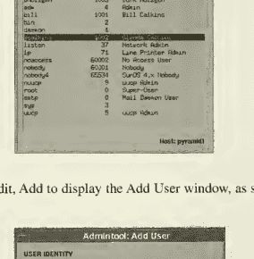

### 图 5-2
添加用户窗口。

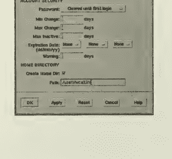

- 3. 填写添加用户窗口中的文本框。表 5-3 描述了所需的信息。如果不确定如何完成某个字段，请单击 Help 按钮查看该窗口的字段定义。

- 4. 输入信息后，单击 OK。用户主窗口中将显示当前的用户账户列表。

### 表 5-3 添加用户字段

| 项目 | 描述 |
|---|---|
| 用户名 | 输入将在 Solaris 登录提示符下输入的登录名。选择一个对组织唯一的名称。名称可包含 2 到 8 个字母和数字，但不能包含下划线。第一个字符必须是字母，并且至少有一个字符必须是小写字母。 |
| 用户 ID | 输入唯一的 user ID（在第 4 章“系统安全”中讨论）。Admintool 会自动分配下一个可用的 UID；但是，在网络环境中，请确保该号码不会被另一系统上的其他用户重复。所有 UID 在网络上必须保持一致。 |
| 主组 | 输入用户所属组的主组名称或 GID（组 ID）号码。操作系统会将此组分配给用户创建的文件。 |
| 次要组 | （可选）输入用户所属的任何附加组的名称或 GID，以空格分隔。用户最多可属于 16 个次要组。 |
| 注释 | （可选）输入任何注释，例如完整用户名或电话号码。 |
| 登录 Shell | 单击此按钮以选择用户将使用的 shell；例如，/bin/csh。如果未选择任何内容，则默认 shell 为 Bourne shell（/bin/sh）。 |
| 密码 | 单击此按钮以指定密码状态。可选选项如下：首次登录前清除。[默认] 账户未分配密码。用户在首次登录时会被提示输入密码，除非在 /etc/default/login 中设置了 passreq=no。账户已锁定。账户因无效密码而被禁用，可通过分配新密码来解锁。此类账户允许用户拥有文件但不能登录。无密码；仅 setuid。账户不能直接登录。这允许诸如 lp 或 uucp 之类的程序在账户下运行，而不允许用户登录。正常密码。账户将具有您在出现的弹出窗口中设置的密码。 |

### 表 5-3 添加用户字段（续）

| 项目 | 描述 |
|---|---|
| 最小更改 | （可选）允许在密码更改之间间隔的最小天数。这是为了防止用户更改密码后几秒钟内又改回，从而破坏密码老化的概念。默认值为 0。 |
| 最大更改 | （可选）密码在必须更改之前有效的最大天数；否则账户将被锁定。留空表示密码永远不需要更改。 |
| 最大非活动 | （可选）账户在自动锁定之前可不被访问的最大天数。空白字段表示无论闲置多久，账户仍保持活动。 |
| 到期日期 | （可选）用户账户到期的日期。无表示不过期。 |
| 警告 | （可选）在密码到期前开始警告用户的天数。空白表示不给出警告。 |
| 创建主目录复选框 | 选择此框以自动创建用户的主目录。 |
| 路径 | 使用路径字段指向现有目录或指定要创建的新目录。 |

> 注。用户可以在命令提示符下键入 UNIX 命令 passwd 来更改其密码。

## 使用 Admintool 删除用户账户

使用 Admintool 删除现有用户账户。删除用户账户的步骤如下：

- 1. 如果 Admintool 尚未运行，请启动它并选择 Browse、Users。
- 2. 从 Users 窗口中选择要删除的用户账户条目。
- 3. 选择 Edit、Delete。
- 4. 显示确认删除用户账户的消息（见图 5-3）。

### 图 5-3
确认您要删除用户账户。


- 5. （可选）单击 Delete Home Directory 复选框以删除用户的主目录及其内容。如果不勾选该框，用户账户将被删除，但用户主目录的内容将保留。

- 6. 准备好删除用户账户时单击 OK。用户账户条目将从 Users 主窗口中删除。

## 使用 Admintool 修改用户账户

如果需要修改登录，例如更改密码或禁用账户，请使用 Admintool 修改这些用户账户设置。过程如下：

- 1. 如果 Admintool 尚未运行，请启动它并选择 Browse、Users。
- 2. 选择要禁用的用户账户条目。
- 3. 选择 Edit、Modify。
- 4. 显示 Modify Users 窗口，其中包含所选的用户账户条目。
- 5. 以下是允许的部分修改说明：
  - 锁定登录

选择 Password: Account Is Locked，如图 5-4 所示。

### 图 5-4
Modify User 窗口。

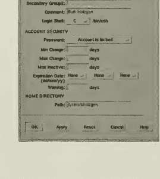

- 更改用户的密码

通过将密码状态更改为 Normal Password 或 Cleared Until First Login 来启用用户账户。

- 6. 单击 OK，修改即完成。

## 使用 Admintool 添加组

您可能需要添加系统中尚不存在的组。例如，可能需要添加一个名为“engrg”（来自工程部门）的新用户组。以下步骤说明如何添加新的“engrg”组。

- 1. 如果 Admintool 尚未运行，请启动它并选择 Browse、Groups。
- 2. 显示 Groups 窗口，如图 5-5 所示。

### 图 5-5
Groups 窗口。

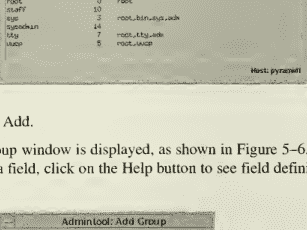

- 3. 选择 Edit、Add。
- 4. 显示 Add Group 窗口，如图 5-6 所示。如果不确定如何完成某个字段，请单击 Help 按钮查看该窗口的字段定义。

### 图 5-6
Add Group 窗口。

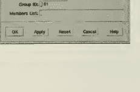

- 5. 在 Group Name 文本框中输入新组的名称。
- 6. 在 Group ID 文本框中输入新组的组 ID 号。这应为唯一号码。
- 7. （可选）在 Members List 文本框中输入用户名。这些是属于新组的用户。用户名必须以逗号分隔。用户列表将被添加到组中。
- 8. 单击 OK。Groups 窗口中显示的组列表将更新为包含新组。

## 设置用户初始化文件

设置用户主目录的一部分是为用户的登录 shell 提供用户初始化文件。用户初始化文件是 shell 脚本，在用户登录系统后为用户设置工作环境。您可以在用户初始化文件中执行 shell 脚本中可以执行的任何任务，但其主要工作是定义用户工作环境的特征，例如搜索路径、环境变量和窗口环境。每个登录 shell 都有自己的用户初始化文件（或文件），位于用户的主目录中。这些文件在用户登录时自动运行。

当添加新用户账户时，默认用户初始化文件，例如 .cshrc、.profile 和 .login，会自动创建在用户的主目录中。系统管理员可以预定义这些文件的内容，也可以选择使用系统默认文件。Solaris 2.x 系统软件在每个系统的 /etc/skel 目录中为每个 shell 提供默认用户初始化文件。这些文件命名如下：

| 文件 | 描述 |
|---|---|
| local.cshrc | C shell 的默认 .cshrc 文件。 |
| local.login | C shell 的默认 .login 文件。 |
| local.profile | Bourne 和 K shell 的默认 .profile 文件。 |

您可以使用这些初始化文件作为起点并修改它们，以创建一套标准文件，为所有用户提供共同的工作环境。您也可以修改它们以提供不同类型用户的 working 环境。

## 自定义用户初始化文件

当用户登录系统时，用户的工作环境由 shell 初始化文件决定。Shell 启动脚本可以被修改以设置特定用户所需的环境变量和目录路径。这些启动脚本位于用户的主目录中。

在设置用户初始化文件时，可能需要允许用户自定义自己的初始化文件。这可以通过集中放置并全局分发的用户初始化文件来实现，称为站点初始化文件。站点初始化文件

使你能够通过编辑一个初始化文件，持续地为所有用户工作环境引入新功能。本地初始化文件使用户能够进一步自定义自己的工作环境。站点初始化文件位于 /etc 目录中，只能由 root 编辑。站点初始化文件旨在将站点范围的更改分发到所有用户工作环境。个人用户初始化文件位于每个用户的家目录中，可以由该目录的所有者自定义。当用户登录时，首先运行站点初始化文件，然后运行位于用户主目录中的初始化文件。

**注意。** 不要使用位于 /etc 目录中的系统初始化文件（/etc/profile、/etc/login）来管理单个用户的工作环境。这些是站点初始化文件，被视为全局文件，旨在通用并用于为所有用户设置工作环境。系统将首先运行此启动文件，然后运行位于主目录中的用户启动文件。

对 shell 启动脚本最常见的自定义是环境变量。表 5-4 描述了您可能想在用户初始化文件中自定义的环境和 shell 变量。

## 表 5-4 Shell 和环境变量说明

| Variable | Description |
|---|---|
| ARCH | 设置用户系统架构（例如，sun4、i386）。此变量可以用 ARCH = `uname -p` 设置（在 Bourne 或 Korn shell 中）或 setenv ARCH `uname -p`（在 C shell 中）。shell 没有依赖此变量的内置行为；它只是 shell 脚本中分支的实用变量。 |
| history | 设置 C shell 的历史记录。 |
| HOME | 设置用户主目录的路径。 |
| LPDEST | 设置用户的默认打印机。 |
| PATH (or path in the C shell) | 按顺序列出 shell 在用户键入命令时搜索以找到要运行的程序的目录。如果目录不在搜索路径中，用户必须键入命令的完整路径名。 |

默认 PATH 在登录过程中在 .profile（Bourne 或 Korn shell）或 .cshrc（C shell）中自动定义。

搜索路径的顺序很重要。当相同命令存在于不同位置时，使用找到的第一个同名命令。例如，假设 PATH 定义为（Bourne 和 Korn shell 语法）PATH=/bin:/usr/bin:/usr/sbin:$HOME/bin 并且名为 sample 的文件同时存在于 /usr/bin 和 /home/glenda/bin 中。如果用户键入命令 sample 而不指定其完整路径名，则使用在 /usr/bin 中找到的版本。

## 表 5-4 Shell 和环境变量说明（续）

| Variable | Description |
|---|---|
| prompt | 定义 C shell 的 shell 提示符。 |
| TERM (or term in the C shell) | 定义终端。此变量应在 /etc/profile 或 /etc/.login 中重置。当用户调用编辑器时，系统会查找与此环境变量定义同名的文件。系统搜索目录 /usr/share/lib/terminfo 以确定终端特性。 |
| MAIL | 设置用户邮箱的路径。 |
| MANPATH | 设置系统手册页的搜索路径。 |
| umask | 设置默认用户掩码。 |

以下示例说明如何验证用户的环境设置以及如何更改它们。

1. 以用户身份登录。此步骤使您能够以用户将看到的方式查看用户的环境。
2. 编辑用户的初始化文件。以下步骤建议一些更改并显示应使用的 shell 特定语法。
3. 设置用户的默认路径以包含主目录以及用户窗口环境和应用程序的目录或挂载点。要更改路径设置，请按如下方式添加或修改 PATH 行：

对于 Bourne 或 Korn shell，语法为：

```
PATH=/dirname1:/dirname2:/dirname3:; export PATH
```

例如，在用户的 $HOME/.profile 文件中输入以下行：

```
PATH=$PATH:/usr/bin:$HOME/bin:/net/glrr/files1/bin:.;export PATH
```

> 注意。 在 $PATH（Korn shell）或 $path（C shell）前加上前缀会将更改附加到已由站点初始化文件设置的用户的路径设置中。使用此过程设置路径变量时，初始路径设置不会被覆盖和丢失。另请注意列表末尾的“点”（.）以表示当前工作目录。正如第 4 章所述，点应始终位于路径的末尾。

4. 检查环境变量是否设置为用户窗口环境和第三方应用程序的正确目录。键入 env 并按 Enter。

```
$ env
HOME=/home/ncalkins
HZ=100
LOGNAME=ncalkins
MAIL=/var/mail/ncalkins
MANSECTS=1:1m:1t:1f:1s:1b:2:\3:3c:3i:3n:3n:3k:3g:3e:3x11:3
xt:3w:3b:9:4:5:7:8
PATH=/usr/bin
SHELL=/bin/sh
TERM=sun
TZ=EST5EDT
$
```

5. 通过输入以下任一行来添加或更改环境变量的设置。

对于 Bourne 或 Korn shell，语法为：

```
VARIABLE=value;export VARIABLE
```

以下示例设置用户的默认邮件目录：

```
MAIL=/var/mail/ncalkins;export MAIL
```

对于 C shell，语法为：

```
setenv VARIABLE value
```

以下示例设置历史记录以记录最后 100 个命令：

```
setenv HISTORY 100
```

## 目录

主目录是为用户存储私有文件而分配的文件系统的部分。您为家庭目录分配的空间量取决于用户创建的文件类型和执行的工作类型。通常整个文件系统专门分配给家庭目录，用户共享此空间。系统管理员需要监控用户主目录，以防止一个用户使用超过其公平份额的空间。磁盘配额用于控制用户可以占用的磁盘空间量，并在第 3 章“Introduction to File Systems”中讨论。

主目录可以位于用户的本地系统上，也可以位于远程文件服务器上。虽然可以使用任何目录名，但在任一情况下，主目录按惯例为 /export/home/username。当您将主目录放在 /export/home 中时，主目录可在网络上访问，以防用户从多个不同的工作站登录。对于大型站点，您应将主目录存储在服务器上。

无论主目录位于何处，用户通常通过名为 /home/username 的挂载点访问它们。当使用 AutoFS 挂载主目录时，您不允许在任何系统上在 /home 挂载点下创建任何目录。当 AutoFS 处于活动状态时，系统会识别 /home 的特殊状态。有关 AutoFS 和自动挂载主目录的更多信息，请参阅 NFS Administration Guide。

为了在网络上的任何位置访问主目录，您应始终将其引用为 $HOME，而不是 /export/home/username。后者是特定于机器的，应避免使用。此外，在用户主目录中创建的任何符号链接都应使用相对路径（例如，../../x/y/x），以便无论主目录挂载在何处，链接都有效。用户主目录的位置可能会更改。通过不使用特定于机器的名称，您可以保持一致性并减少系统管理。

本文结束了有关如何向系统添加用户登录帐户的讨论。默认情况下，当用户首次登录时，他们会看到一个名为 CDE（Common Desktop Environment，通用桌面环境）的默认桌面窗口环境。CDE 的设置和自定义在第 7 章“Administration and Configuration of the CDE”中描述。

## 第 6 章

## 软件包管理

本章的测试目标如下：

- 了解软件包以及如何显示软件包信息
- 添加软件包
- 移除软件包
- 安装和移除软件补丁


系统管理员负责管理系统中安装的所有软件。安装和删除软件是一项经常执行的常规任务。在第 2 章“安装 Solaris 2.x 软件”中，我描述了 Solaris 操作系统的安装过程。在本章中，我将说明在操作系统已经安装之后如何添加和删除额外的应用程序。

Sun 及其第三方厂商以软件包的形式交付软件产品。“package”一词指的是将软件产品分发和安装到产品将被使用的系统上的一种方法。软件包是在定义格式的、符合应用程序二进制接口（ABI）的集合文件和目录，ABI 是 System V 接口定义的补充。Solaris 操作环境提供了一组实用程序来解释 ABI 格式，并提供安装或删除软件包或验证其安装的方法。

## 软件管理工具

Solaris 提供两种用于向系统添加和删除软件的工具。两者均显示在表 6-1 中。

表 6-1 软件管理工具

| Command | Description |
|---|---|
| *从命令行管理软件* | |
| pkgadd | 添加软件包到系统 |
| pkgrm | 从系统移除软件包 |
| pkgchk | 检查软件包安装的准确性 |
| pkginfo | 显示软件包信息 |
| pkgask | 将答案存储在响应文件中，以便在安装期间自动提供 |
| *从图形用户界面管理软件* | |
| Admintool™ | 可从 CDE 或 OpenWindows 中调用的 GUI |

直接从命令行使用 pkgadd 或 pkgrm 命令来加载或删除软件。pkgadd 和 pkgrm 命令可以纳入脚本以自动化软件安装过程。许多第三方厂商在脚本中使用 pkgadd 作为安装其软件的手段。

Admintool 另一方面提供了易于使用的界面用于安装或删除软件。它只是 pkgadd 和 pkgrm 的图形用户界面。使用 Admintool 图形界面是一种方便的方式来查看系统中已安装的软件或查看安装介质上驻留的软件。如果您不熟悉软件包命名约定或不习惯使用命令行选项，或者如果您一次只管理一个系统的软件，您会发现 Admintool 是添加和删除软件的简便方法。

## 添加和删除软件包

当您添加软件包时，pkgadd 命令会从安装介质，例如 CD-ROM，解压缩并复制文件到本地系统的磁盘上。当您使用软件包时，文件以软件包格式交付，按交付方式使用不可用。pkgadd 命令解释软件包的控制文件，然后解压缩产品文件并将其安装到系统的本地磁盘上。

在安装额外应用程序软件之前，您应该了解以下几点：

- Sun 软件包始终以前缀 SUNW 开头，如 SUNWvolr、SUNWadmap 和 SUNWab2m。第三方软件包通常以对应公司股票代码的前缀开头。
- 您可以使用 pkginfo 命令或 Admintool 查看系统中已安装的软件。
- 客户端可能有部分驻留在服务器上、部分驻留在客户端上的软件。如果是这种情况，为客户端添加软件需要向服务器和客户端都添加软件包。
- 您需要知道软件将被安装的位置，并确保您拥有足够磁盘空间的文件系统来存储应用程序软件。使用 pkgparam 命令确定软件包将被加载的位置。例如，键入

```
pkgparam -d /cdrom/cdrom0/s0/Solaris_2.6 /Product SUNWvolr SUNW_PKGTYPE
```

系统会响应应用程序将被存储的位置：

```
root
```

当您删除软件包时，pkgrm 命令会删除与该软件包关联的所有文件，除非这些文件也与其他软件包共享。务必不要在不使用 pkgrm 的情况下删除应用程序软件。例如，一些系统管理员只是通过删除包含应用程序软件的目录来删除应用程序。以这种方法，应用程序可能驻留在其他目录中的文件会被遗漏。使用 pkgrm，您可以确保删除与应用程序关联的所有文件。

尽管 pkgadd 和 pkgrm 命令不会将输出记录到标准位置，但它们确实会跟踪已安装或删除的产品。pkgadd 和 pkgrm 命令将有关已安装或删除的软件包的信息存储在软件产品数据库中。通过更新此数据库，pkgadd 和 pkgrm 命令会保留系统中安装的所有软件产品的记录。

## 添加软件包

使用 Admintool 安装额外应用程序软件的步骤如下：

1. 以 root 用户身份启动 Admintool，方法是在命令提示符下键入 admintool。
2. 用户主菜单出现，如图 6-1 所示。

图 6-1
用户主菜单。

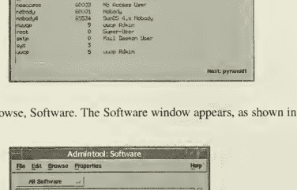

3. 选择 Browse、Software。软件窗口出现，如图 6-2 所示。

图 6-2
软件窗口。

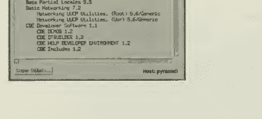

4. 选择 Edit、Add。设置源介质窗口出现，如图 6-3 所示。

图 6-3
设置源介质窗口。

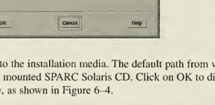

5. 指定安装介质的路径。安装应用程序的默认路径是已挂载的 SPARC Solaris CD。单击 OK 以显示添加软件窗口，如图 6-4 所示。

图 6-4
添加软件窗口。

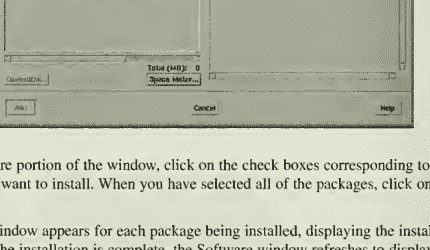

6. 在窗口的软件部分，单击对应于您想要安装的软件的复选框。选择所有软件包后，单击添加按钮。

每个正在安装的软件包都会出现一个命令工具窗口，显示安装输出。安装完成后，软件窗口会刷新以显示刚刚添加的软件包。

## 删除软件包

删除应用程序软件的步骤如下：

1. 如果 Admintool 尚未运行，请启动它，然后选择 Browse、Users 打开如图 6-5 所示的用户主菜单。

图 6-5
用户主菜单。

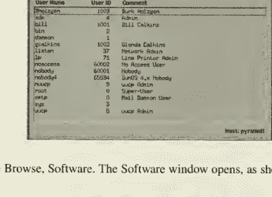

2. 选择 Browse、Software。软件窗口打开，如图 6-6 所示。

图 6-6
软件窗口。

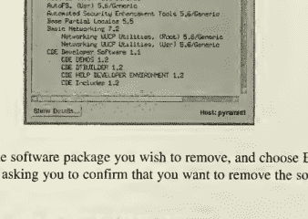

3. 选择您想要删除的软件包，然后选择 Edit、Delete。会出现一条消息，询问您是否确认要删除软件（见图 6-7）。

图 6-7
确认软件删除。

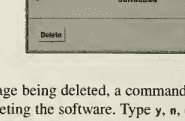

对于每个正在删除的软件包，都会显示一个命令工具窗口，在删除软件之前要求确认。键入 y、n 或 q。如果您选择删除软件，则删除过程的输出会显示在命令工具窗口中。

## 列出和验证已安装的软件包

随时您都可以使用 Admintool 或从命令行发出 pkginfo 命令，以获取系统中已安装软件的完整列表。当您从 Browse 菜单中选择 Software 时，Admintool 中的软件窗口会显示所有已安装的软件（见图 6-8）。

图 6-8
软件窗口。

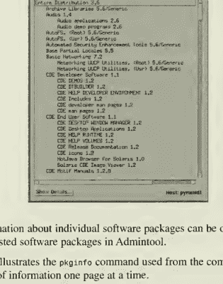

可以通过在 Admintool 中双击任何列出的软件包来获取有关单个软件包的更多信息。

图 6-9 说明了从命令行使用的 pkginfo 命令，并使用 more 逐页停止信息显示。


### 图 6-9

pkginfo 输出。

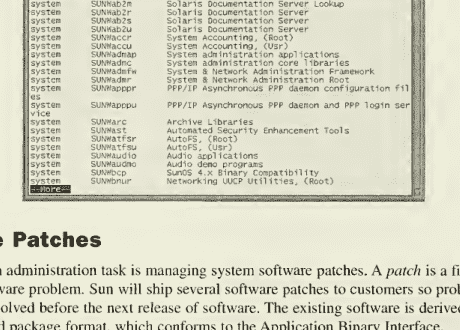

## 软件补丁

另一个系统管理任务是管理系统软件补丁。补丁是对报告的软件问题的修复。Sun 会向客户提供多个软件补丁，以便在下一次软件发布之前解决问题。现有软件源自指定的软件包格式，该格式符合应用程序二进制接口。

补丁由唯一的字母数字字符串标识，首先是补丁基本代码，然后是连字符，最后是表示补丁修订号的数字。例如，补丁 101977-04 是用于修正 lockd 守护进程的 Solaris 2.x 补丁。

您可能想了解更多有关以前安装的补丁的信息。表 6-2 显示了提供有关系统上已安装补丁的有用信息的命令。

### 表 6-2 用于补丁管理的有用的命令

| 命令 | 功能 |
|---|---|
| showrev -p | 显示系统上应用的所有补丁。 |
| pkgparam pkgid PATCHLIST | 显示由 pkgid 标识的软件包上应用的所有补丁。 |
| pkgparam pkgid PATCH_INFO_patch-number | 显示补丁的应用日期和主机名称。pkgid 是软件包的名称；例如，SUNWadmap。 |
| patchadd -R client_root_path -p | 从服务器控制台显示应用于客户端的所有补丁。 |
| patchadd -p | 显示系统上应用的所有补丁。 |
| patchrm patchname | 删除指定的补丁。 |

## 安装补丁

所有 Sun 客户均可通过万维网或匿名 FTP 访问安全补丁和其他推荐补丁。购买了服务合同的 Sun 客户可以访问扩展的补丁集和完整的补丁信息数据库。这些信息可通过万维网或匿名 FTP 获得，并定期在 CD-ROM 上分发。请参阅附录 D，“On the Web”，以获取有用的网站列表以及通过网络访问补丁的位置。

每个补丁中都包含的 Install.info 文件提供了有关如何安装和删除补丁的详细信息。每个补丁还包含一个 README 文件，其中包含有关该补丁的特定信息。

patchadd 命令用于向 Solaris 2.x 系统安装目录格式的补丁，并且必须以 root 身份运行。语法是

```
patchadd [ -d ] [ -u ] [ -B backout_dir ]
```

patchadd 命令在表 6-3 中有描述。

### 表 6-3 patchadd 命令选项

| 常用选项 | 描述 |
|---|---|
| -d | 不创建要修补的文件的备份。使用此选项安装补丁后，补丁无法被移除。默认情况下，patchadd 会保存所有正在更新文件的副本，以便在必要时可以移除补丁。除非您确信补丁已通过测试，否则请勿使用 -d 选项。 |
| -p | 显示当前应用的补丁列表。 |
| -u | 无条件安装补丁，并关闭文件验证。即使自文件最初安装以来要修补的一些文件已被修改，补丁也会被安装。 |
| -B backout_dir | 将回滚数据保存到软件包数据库以外的目录。将 backout_dir 指定为绝对路径名。 |

patchadd 命令的附加选项可在 Solaris 系统手册页中在线找到。

以下示例将补丁安装到独立机器上。

```
patchadd /var/spool/patch/104945-02
```

以下示例安装多个补丁。patchlist 文件指定包含要安装的补丁列表的文件。

```
patchadd -M /var/spool/patch patchlist
```

以下示例显示系统上安装的补丁。

```
patchadd -R /export/root/client1 -p
```

当您安装补丁时，patchadd 命令会将文件从补丁目录复制到本地系统的磁盘。更具体地说，patchadd 执行两项操作：

- 确定管理主机和目标主机的 Solaris 版本号。
- 使用有关被安装补丁使之过时的补丁、此补丁所需的其他补丁以及与此补丁不兼容的补丁的信息更新补丁软件包的 pkginfo 文件。

在以下条件下，patchadd 命令不会安装补丁：

- 软件包未在主机上完全安装。
- 补丁架构与系统架构不同。
- 补丁版本与已安装的软件包版本不匹配。
- 已存在具有相同基本代码且版本号更高的已安装补丁。
- 补丁与另一个已安装的补丁不兼容。（每个已安装的补丁都将其信息保存在其 pkginfo 文件中。）
- 要安装的补丁需要另一个未安装的补丁。

## 移除补丁

有时补丁未按计划工作，需要从系统中移除。用于移除或“回滚”补丁的实用程序是表 6-4 中描述的 patchrm 命令。其语法是

```
patchrm [ -f ] [ -B backout_dir ]
```

patchrm 命令删除 Solaris 2.x 补丁软件包并恢复先前保存的文件，从而将文件系统恢复到应用补丁之前的状态，除非

- 使用 patchadd -d 安装了补丁。-d 选项指示 patchadd 不要保存正在更新或替换的文件的副本。
- 该补丁已被后续补丁使之过时。
- 该补丁被另一个补丁所需要。

patchrm 命令调用 pkgadd 以恢复从初始补丁安装保存的软件包。

### 表 6-4 patchrm 命令选项

| 常用选项 | 描述 |
|---|---|
| -f | 强制移除补丁，而不管补丁是否已被另一个补丁取代。 |
| -B backout_dir | 移除其回滚数据已保存到软件包数据库以外的目录的补丁。此选项仅在原始回滚目录在安装时被移动时才需要。将 backout_dir 指定为绝对路径名。 |

以下示例从独立系统移除补丁：

```
patchrm 104945-02
```

## 一般准则

一些软件包不符合 ABI，因此无法使用 AdminTool 或 pkgadd 命令安装。对于不符合 ABI 的产品的安装，请遵循供应商特定的安装说明。在系统上安装新软件时，请遵循以下几个附加准则：

- 对第三方或公共领域软件始终保持谨慎。确保软件已通过测试并且没有病毒，然后再将其安装在生产系统上。
- 确保软件包在 Solaris 2.6 下受支持。
- 始终阅读供应商的发行说明以获取特殊加载说明。它们可能包含需要修改的内核参数或建议需要应用的软件补丁。
- 除非 Sun 或您的软件提供商之一指示，否则不要安装补丁。一些补丁尚未经过彻底测试，尤其是在与其他软件补丁一起使用时。可能会导致系统性能出现不利问题。

添加和删除软件包是您在系统管理中会遇到的较简单任务之一。与所有计算机软件一样，您应首先在非生产系统上加载新的软件包以进行测试。只有在软件经过彻底测试后，才应将其安装在生产系统上。

本章介绍了安装软件、创建文件系统和设置用户帐户。现在是开始自定义系统上已安装内容的时候了。第 7 章“Administration and Configuration of the CDE”描述了用户工作环境的自定义。展望未来，第 11 章“Backup and Recovery”描述了如何创建已安装所有内容的磁带备份。良好的备份可以在硬件故障时为您节省时间。有了良好的备份，您就不需要重新追踪重新安装软件包或补丁以及设置用户的步骤。


## 第 7 章 CDE 的管理和配置

本章的测试目标如下：

- 了解并配置登录管理器、会话管理器和前台面板
- 配置 CDE 环境变量
- 了解操作和数据类型
- 使用应用程序管理器添加和管理应用程序

Solaris 通用桌面环境（CDE）是一种易于使用的界面，可在 UNIX 环境中提供一致的外观和感觉。SunSoft, Inc.、Hewlett-Packard Company、IBM Corporation 和 Novell, Inc. 各自贡献了“best-of-breed”技术，以建立基于 X Window System 和 MOTIF 的用户和应用程序接口新标准。在保持符合 CDE 标准的同时，Solaris CDE 为其用户和开发人员提供了额外的好处。例如，您可以使用图像查看器显示、旋转、缩放和转换图像和 PostScript 文件。

如果您使用过 Sun 旧的窗口环境 OpenWindows，您会看到熟悉的背景、颜色调色板和弹出式工作区菜单。在 CDE 中，用户也可以在不修改的情况下运行 OpenWindows 应用程序。例如，CDE 支持 OpenWindows 应用程序与 CDE 应用程序之间的拖放交互。

CDE 中可供您使用的关键功能是 CDE 环境、桌面工具和 CDE 开发环境。本章讨论 CDE 环境的定制，其包括

- **Login Manager**—系统启动后出现的图形登录窗口
- **Session Manager**—在登录时启动用户桌面应用程序的服务，并在下次登录时“记住”桌面状态
- **Front Panel**—出现在 CDE 屏幕底部的弹出窗口和图标集合
- **Resetting User Customizations**—将 CDE 恢复到其默认环境
- **Actions and Data Types**—将命令与图标关联
- **Application Manager**—显示用户可用应用程序的桌面容器
- `dtksh shell`—桌面内的 ksh11 脚本

### The Login Manager

Login Manager 是一个负责显示登录屏幕、验证用户身份并启动用户会话的服务器。由登录服务器管理的显示器可以直接连接到登录服务器，也可以连接到网络上的 X 终端或工作站。

由登录服务器显示的登录屏幕是传统字符模式登录屏幕的有吸引力的替代方案，并提供了字符模式登录所不具备的功能。然而，与字符模式登录一样，用户输入用户名，然后输入密码。如果用户通过身份验证，登录服务器将为用户启动桌面会话。当用户退出桌面会话时，登录服务器会显示新的登录屏幕，过程重新开始。

您可以按以下方式自定义登录屏幕：

- 更改登录屏幕外观
- 配置 X 服务器权限
- 更改默认语言
- 在显示登录屏幕之前发出命令
- 更改登录屏幕语言菜单的内容
- 指定启动用户会话的命令
- 在用户桌面会话启动之前发出命令
- 在用户会话结束后发出命令

这些自定义可以针对所有显示器进行，也可以按显示器分别进行。有关进行这些修改的详细说明，请参阅 Solaris CDE 高级用户和系统管理员指南。

### Starting the Login Server

登录服务器通常在系统启动时启动 CDE 环境。它也可以从命令行启动。例如，要从命令行启动登录服务器，请键入以下内容：

/usr/dt/bin/dtlogin -daemon; exit

> NOTE. 尽管您可以从命令行启动登录服务器进行临时配置测试，但通常应将其设置为在系统启动时启动。

要设置登录服务器 CDE 在系统下次启动时启动，请键入以下内容：

/usr/dt/bin/dtconfig -e

然后在用户重新启动系统后，登录服务器将自动启动。

### Stopping the Login Server

要禁用登录服务器 CDE 在系统下次启动时的启动，请键入以下内容：

/usr/dt/bin/dtconfig -d

此命令告诉系统在下次重新启动时不要启动登录服务器。

您可以通过终止其进程 ID 立即停止登录服务器。键入命令 `/usr/dt/bin/dtconfig -kill`

此命令发出命令 `kill login_server_process_ID`。

**NOTE.** *如果在您终止登录服务器时用户已登录到桌面，则桌面会话会立即终止。*

### Displaying a Login Screen on a Local Display

在启动时，登录服务器检查 Xservers 文件以确定是否需要启动 Xserver，以及登录屏幕应如何以及在本地或网络显示上显示。Xservers 文件中一行的格式为：

```
display_name display_class display_type X_server_command
```

Xservers 文件中的每个字段在表 7-1 中描述。

### Table 7-1 Fields in the Xservers File

| Field | Description |
|---|---|
| display_name | 告诉登录服务器在连接到 Xserver 时使用的名称（以下示例中的 :0）。*（星号）的值会扩展为 hostname:0。指定的号码必须与 X_server_command 连接号码中指定的号码相匹配。 |
| display_class | 标识此显示特定的资源（以下示例中的 Local）。 |
| display_type | 告诉登录服务器显示是本地还是网络，以及如何在登录屏幕上管理命令行登录选项（以下示例中的 local@console）。 |
| x_server_command | 标识登录服务器将用于启动 Xserver 的命令行、连接号码和其他选项（以下示例中的 /usr/bin/X11/X :0）。指定的连接号码必须与 display_name 字段中指定的号码相匹配。 |

Xservers 文件中的默认行类似于

```
:0 Local local@console /usr/bin/X11/X :0
```

要修改 Xservers，请将 Xservers 从 `/usr/dt/config` 复制到 `/etc/dt/config`。`/etc/dt` 目录包含自定义的工作站特定配置文件。如果 `/etc/dt` 不存在，您可能需要创建它。系统管理员可以通过创建 `/etc/dt/config/` 目录来修改系统默认资源。在此目录中，您可以创建配置文件以覆盖默认资源或为所有桌面用户指定额外资源。此文件在会话启动期间合并到桌面默认资源中。

此文件中指定的资源优先于桌面默认资源文件中指定的资源。修改 /etc/dt/config/Xservers 后，通过键入以下命令告诉登录服务器重新读取 Xservers

```
/usr/dt/bin/dtconfig -reset
```

dtconfig -reset 发出命令 kill -HUP login_server_process_ID。

如果您的登录服务器系统具有字符显示而不是位图显示，您需要在 Xservers 文件中将 `display_terminal_device` 设置为 none 以禁用登录屏幕并启用字符模式登录屏幕。

### The Session Manager

会话是用户桌面上存在的应用程序、设置和资源的集合。会话管理是一组约定和协议，使会话管理器能够保存和恢复用户的会话。当用户首次登录桌面时，会加载默认初始会话。此后，用户能够登录系统并看到与上次注销时相同的正在运行的应用程序、设置和资源集合。

会话管理器负责启动桌面并自动保存和恢复正在运行的应用程序、颜色、字体、鼠标行为、音频音量和键盘点击。使用会话管理器，您可以

- 为所有桌面用户自定义初始会话
- 为所有桌面用户自定义环境和资源
- 更改会话启动消息
- 更改会话启动工具和守护进程的参数
- 为所有用户自定义桌面颜色使用

会话管理器通过 `/usr/dt/bin/Xsession` 启动。当用户使用登录管理器登录时，默认情况下会启动 Xsession。当会话管理器启动时，它会按以下步骤启动用户会话：

1. 来源 HomeDirectory/.dtprofile 脚本。
2. 来源 Xsession.d 脚本。
3. 显示欢迎消息。
4. 设置桌面搜索路径。
5. 收集可用应用程序。
6. 可选地来源 HomeDirectory/.profile 或 HomeDirectory/.login。


- 7. 启动 ToolTalk 消息守护进程。
- 8. 加载会话资源。
- 9. 启动颜色服务器。
- 10. 启动工作区管理器。
- 11. 启动会话应用程序。

## 载入 .dtprofile 脚本

会话启动时，xsession 脚本载入用户 HomeDirectory/.dtprofile 脚本——一个用于使用户能够为其会话设置环境变量的 /bin/sh 或 /bin/ksh 脚本。.dtprofile 仅接受 sh 或 ksh 语法。桌面默认文件为 /usr/dt/config/sys.dtprofile。如果 HomeDirectory/.dtprofile 脚本不存在（例如用户首次登录时），xsession 会将桌面默认的 sys.dtprofile 复制到 HomeDirectory/.dtprofile。

您可以通过将其从 /usr/dt/config 复制到 /etc/dt/config 并编辑新文件来自定义 sys.dtprofile 脚本。您可以在 HomeDirectory/.dtprofile 中设置个人环境变量。例如，

```
export MYVARIABLE="value"
```

在下次登录时设置用户环境中的变量 MYVARIABLE。

要设置系统范围的环境变量，请在 /etc/dt/config/Xsession.d 目录中创建一个设置并导出该变量的文件。例如，如果您创建一个可执行 ksh 脚本 /etc/dt/config/Xsession.d/sitevars，其中包含

```
export SITEVARIABLE="value"
```

该变量 SITEVARIABLE 将在下次登录时设置在每个用户的环境中。

> 注意。虽然会话管理器不会自动读取 .profile 或 .login 文件，但可以配置为使用这些文件。要指示 xsession 载入 .profile 或 .login 脚本，请在 HomeDirectory/.dtprofile 中将变量 DTSOURCEPROFILE 设置为 True。

## 载入 Xsession.d 脚本

载入 HomeDirectory/.dtprofile 脚本后，xsession 脚本载入 xsession.d 脚本。这些脚本设置额外的环境变量并为用户会话启动可选守护进程。

**CAUTION!** 任何会话启动文件中的错误都可能阻止用户登录。要排查会话启动问题，请检查文件 HomeDirectory/.dt/startlog。会话管理器在此文件中记录每个用户的会话启动进度。

## 欢迎消息

载入 HomeDirectory/.dtprofile 和 Xsession.d 脚本后，Xsession 会显示覆盖屏幕的欢迎消息。您可以自定义欢迎消息或完全关闭该消息。

使用 dtHello 客户端显示欢迎消息。要更改消息文本，请通过修改 dtstart_hello[] 变量来更改 dtHello 选项。要更改 dtstart_hello[]，请创建一个设置新值的 /usr/dt/config/Xsession.d 脚本。例如，要为所有用户显示每日消息，请创建一个名为 /usr/dt/config/Xsession.d/myvars 的可执行 sh 或 ksh 脚本并按如下方式设置 dtstart_hello[]：

```
dtstart_hello[]="/usr/dt/bin/dthello -file /etc/motd &"
```

用户还可以通过在 HomeDirectory/.dtprofile 中设置 dtstart_hello[] 来更改其会话的欢迎消息。要关闭欢迎消息，请将 dtstart_hello[]=" "。

## 设置桌面搜索路径

桌面使用在登录时创建的搜索路径来定位应用程序及其关联的桌面文件。桌面提供四个搜索路径，见表 7-2。

### 表 7-2 桌面搜索路径

| Search Path | Description |
|---|---|
| Applications | 用于定位应用程序。应用程序管理器使用应用程序搜索路径在用户登录时动态填充其顶层。 |
| Database | 用于指定操作和数据类型定义文件 (*.dt 文件) 以及前置面板文件 (*.fp 文件) 的额外位置。 |
| Icons | 用于指定图标的额外位置。 |
| Help data | 用于指定桌面帮助数据的额外位置。 |

## 修改搜索路径

要为特定用户修改搜索路径，请按以下步骤操作：

- 1. 打开 HomeDirectory/.dtprofile 进行编辑。
- 2. 添加或编辑定义并导出个人输入变量的行。
  例如，以下行将位置添加到用户的个人应用程序搜索路径：
  `export DTSUSERAPPPATHS=:/projects1/editors`
- 3. 要使更改生效，请注销然后重新登录。

## 收集可用应用程序

设置桌面搜索路径后，下一步是通过使用 dtappgather 收集可用应用程序。这些是将在应用程序管理器窗口中显示的应用程序。dtappgather 实用程序收集应用程序文件以供应用程序管理器展示，并负责创建和刷新用户的应用程序管理器子目录。

要更改 dtappgather 的命令行选项，请在所有用户的 /etc/dt/config/Xsession.d/sitevars 文件中或单个用户的 HomeDirectory/.dtprofile 中修改 dtstart_appgather 变量。按如下方式设置 dtstart_appgather：

```
dtstart_appgather="/usr/dt/bin/dtappgather &"
```

## 载入用户 .profile 或 .login 文件

Xsession 能够载入用户的传统 $HOME/.profile 或 $HOME/.login 脚本，但默认情况下此功能被禁用。要指示 Xsession 载入 .profile 或 .login 脚本，请在 $HOME/.dtprofile 中将 DTSOURCEPROFILE 设置为 true。

## 启动 ToolTalk 消息守护进程

Xsession 的下一个任务是启动 ToolTalk 消息守护进程。ToolTalk 服务使独立的应用程序能够在彼此之间没有直接了解的情况下进行通信。应用程序创建并发送 ToolTalk 消息以相互通信。ToolTalk 服务接收这些消息，确定接收者，然后将消息传递给适当的应用程序。用户可以通过按如下方式在 $HOME/.dtprofile 中设置 dtstart_ttsession 变量来更改其会话的 tt 会话选项：

```
dtstart_ttsession="/usr/dt/bin/ttsession -s"
```

## 加载会话资源

资源用于应用程序设置某些外观和行为方面。例如，样式管理器 (dtstyle) 提供资源，使您能够指定系统查找包含调色板信息的文件的位置：

```
dtstyle*paletteDirectories: /usr/dt/palettes/C \ HomeDirectory/.dt/palettes
```

资源在会话启动时由会话管理器加载。桌面默认资源可在 /usr/dt/config/language/sys.resources 中找到。这些资源通过 RESOURCE_MANAGER 属性提供给每个用户的会话。此文件不应被编辑，因为在后续桌面安装中会被覆盖。系统管理员可以通过创建 /etc/dt/config/language/sys.resources 来修改系统默认资源。在此文件中，您可以覆盖默认资源或为所有桌面用户指定额外资源。

用户可以通过其 HOME/.Xdefaults 文件修改桌面默认和系统范围的资源。此文件中指定的资源优先于桌面默认或系统管理员资源文件中指定的资源。

## 启动颜色服务器

您可以使用样式管理器（如图 7-1 所示）或通过自定义样式管理器用于控制桌面颜色使用的颜色资源来为显示器选择各种颜色。

Figure 7-1
The Style Manager.

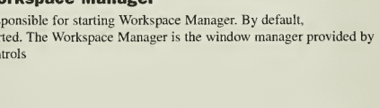

通过创建 /etc/dt/config/language/sys.resources 并在该文件中指定颜色服务器资源，为所有用户设置颜色服务器资源。用户也可以通过在 $HOME/.Xdefaults 中指定颜色服务器资源来为其会话设置颜色服务器资源。

## 启动工作区管理器

会话管理器负责启动工作区管理器。默认情况下，会启动 /usr/dt/bin/dtwm。工作区管理器是桌面提供的窗口管理器，控制

- 窗口框架组件的外观
- 窗口的行为，包括其堆叠顺序和焦点行为
- 键绑定和按钮绑定
- 最小化窗口的外观
- 工作区和窗口菜单

此外，工作区管理器控制表 7–3 中概述的桌面组件。

### 表 7–3 桌面组件

| Component | Description |
|---|---|
| Workspaces | 工作区管理器控制工作区的数量并跟踪每个工作区中打开的窗口。 |
| Workspace backdrops | 用户可以使用样式管理器更改背景图像。然而，背景管理是工作区管理器的功能。 |
| The Front Panel | 尽管前置面板使用自己的配置文件，但它由工作区管理器创建和管理。 |

可以对工作区管理器进行的额外修改包括更改工作区的数量并提供系统范围的工作区名称。

## 在系统范围内更改工作区数量

默认桌面配置提供四个工作区。用户可以使用与工作区切换关联的弹出菜单添加和删除工作区。

在 /usr/dt/app-defaults/C/Dtwm 文件中，workspaceCount 资源被设置为以下默认工作区数量：

```
Dtwm*0*workspaceCount: 4
Dtwm*workspaceCount: 1
```

在屏幕 0 上指定多个工作区；在任何其他屏幕上指定单个工作区。您可以创建（或如果存在则修改）/etc/dt/config/C/sys.resources 文件，以更改工作站上所有新用户的默认工作区数量。

使用 0*workspaceCount 资源在主屏幕上设置系统范围的默认值：

```
Dtwm*0*workspaceCount: number
```

例如，以下资源将主屏幕上系统范围的工作区数量设置为六：

```
Dtwm*0*workspaceCount: 6
```


## 提供系统范围的工作区名称

内部，工作区按编号约定 ws n 进行编号，其中 n 为 0、1、2，等等。例如，默认的四个工作区内部编号为 ws0 到 ws3。

使用 title 资源更改指定工作区的名称：

```
Dtwm*wsn: name
```

例如，以下资源将默认的四个工作区设置为指定的名称：

```
Dtwm*ws0*title: Glenda
Dtwm*ws1*title: Neil
Dtwm*ws2*title: Nicole
Dtwm*ws3*title: William
```

## 启动会话应用程序

在会话启动时，会话管理器会重新启动上一次会话中保存的任何应用程序。用户初始会话中作为恢复的一部分的系统默认应用程序集可在 /usr/dt/config/language/sys.session 中找到。请勿编辑此文件。

系统管理员可以通过将 /usr/dt/config/language/sys.session 复制到 /etc/dt/config/language/sys.session 并修改后者文件来替换用户初始会话中启动的应用程序集。与资源文件不同，此文件用作桌面默认文件的完整替换。

## 自定义前置面板

前置面板包含一组图标和弹出菜单（更像是卷起菜单），出现在屏幕底部。前置面板的两个主要元素是主面板和子面板。主面板包括图 7–2 所示的工作区切换，其中包含用于在工作区之间切换的按钮。

图 7-2
前置面板工作区切换。


如果主面板中的某个控件顶部有一个箭头按钮，则该控件具有子面板，如图 7-3 所示。

### 图 7-3

子面板。

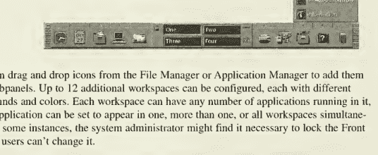

用户可以从文件管理器或应用程序管理器拖放图标以将其添加到子面板。最多可以配置 12 个额外的工作区，每个工作区具有不同的背景和颜色。每个工作区可以运行任意数量的应用程序，并且可以设置应用程序同时出现在一个、多个或所有工作区中。在某些情况下，系统管理员可能需要锁定前置面板以防止用户更改它。

使用桌面的界面，前置面板可以轻松地以以下方式进行自定义：

- 自定义工作区
- 添加和删除工作区
- 重命名工作区
- 向子面板添加控件

系统管理员还可以通过直接从 UNIX 命令行编辑 CDE 配置文件，在 CDE 环境之外进行更高级的自定义。有关高级前置面板自定义的更多信息，请参阅 CDE 高级用户和系统管理员指南。

## 自定义工作区

用户可以使用前置面板工作区切换来重命名或更改工作区的数量。单击工作区按钮以更改工作区。当光标位于工作区按钮上时，按下第三个鼠标按钮会显示其弹出菜单，如图 7-4 所示。

图 7-4
工作区按钮弹出菜单。

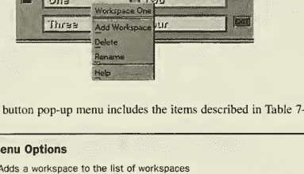

工作区按钮弹出菜单包括表 7-4 中描述的项目。

### 表 7-4 弹出菜单选项

| 选项 | 描述 |
|---|---|
| 添加工作区 | 将工作区添加到工作区列表中 |
| 删除 | 删除工作区 |
| 重命名 | 将按钮更改为用于编辑名称的文本字段 |
| 帮助 | 显示工作区切换的帮助 |

使用弹出菜单修改工作区按钮参数。例如，要重命名工作区，请执行以下步骤：

1. 将指针指向要重命名的那个工作区的工作区按钮。
2. 从按钮的弹出菜单（通过按下第三个鼠标按钮显示）中选择“重命名”。工作区按钮变为文本字段。
3. 编辑文本字段。
4. 按 Enter。

要添加工作区，请执行以下操作：

1. 将指针指向工作区切换中的任何区域并按下第三个鼠标按钮以显示弹出菜单。
2. 从弹出菜单中选择“添加工作区”。新工作区，名为 New，被放置在工作区集的末尾。
3. 按上述描述重命名工作区。

要删除工作区，请执行以下操作：

1. 将指针指向要删除的工作区的工作区按钮。
2. 从按钮的弹出菜单（通过按下第三个鼠标按钮显示）中选择“删除”。

## 自定义工作区控件

自定义工作区切换中的控件是一项高级任务，需要系统管理员创建前置面板配置文件。本节描述了一些可以从桌面执行的简单自定义。高级自定义在 CDE 高级用户和系统管理员指南中介绍。

### 前置面板切换区域

图 7-5 所示的切换区域是工作区切换中未被其他控件或工作区按钮占据的部分。

图 7-5
切换区域。

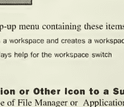

切换区域具有包含以下项目的弹出菜单：

- 添加工作区：添加工作区并在工作区切换中创建工作区按钮
- 帮助：显示工作区切换的帮助

## 向子面板添加应用程序或其他图标

用户可以将任何类型的文件管理器或应用程序管理器图标添加到前置面板。此功能最方便的用途是添加应用程序图标。要向子面板添加应用程序图标，请执行以下操作：

1. 在文件管理器或应用程序管理器中显示对象的图标。
2. 显示要添加对象的子面板。
3. 使用第一个鼠标按钮将对象拖到“安装图标”控件上并将其放置在该控件上。

使用“安装图标”控件添加到前置面板的控件的行为取决于所放置图标的类型。表 7-5 描述了每种图标类型的控件行为。

### 表 7-5 图标控件行为

| 图标类型 | 行为 |
|---|---|
| 文件 | 与文件管理器中文件图标相同的行为。当用户单击文件图标时，文本编辑器会显示文件内容以便编辑。 |
| 文件夹 | 打开文件夹的文件管理器视图。 |
| 应用程序组 | 打开应用程序组的应用程序管理器视图。 |
| 应用程序图标 | 与文件管理器或应用程序管理器中应用程序图标相同的行为。当用户单击图标时，应用程序会自动启动。 |

## 删除所有用户自定义

要重置前置面板并删除所有用户自定义，请按照以下步骤操作：

1. 打开应用程序管理器并双击 Desktop_Tools 应用程序组图标。
2. 双击“恢复前置面板”。

屏幕在几秒钟内变为空白，同时工作区管理器正在重新启动。恢复前置面板操作会删除使用“安装图标”控件或前置面板的弹出菜单所做的所有自定义。

注意。此过程不影响通过手动编辑前置面板配置文件所做的高级自定义。

## 操作和数据类型

可以将操作分配给图标，以便在单击图标时调用相关命令。操作是自动化桌面任务的指令，例如运行应用程序和打开数据文件。操作的工作方式与应用程序宏或编程函数非常相似。

可以使用“创建操作”菜单创建操作。此菜单通过首先调出图 7–6 所示的“应用程序”弹出菜单来访问。

### 图 7–6

应用程序弹出菜单。

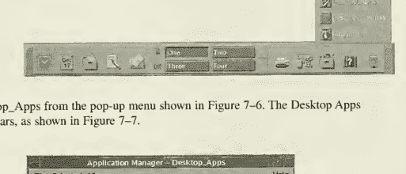

从图 7–6 所示的弹出菜单中选择 Desktop_Apps。桌面应用程序窗口出现，如图 7–7 所示。

### 图 7–7

桌面应用程序窗口。

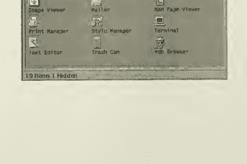

当桌面应用程序窗口出现时，单击“创建操作”图标。创建操作窗口出现，如图 7–8 所示。

图 7-8
创建操作窗口。

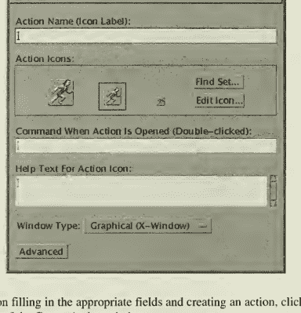

有关填写适当字段和创建操作的详细信息，请单击创建操作窗口顶部位置的“帮助”。

在您定义操作后，您可以在桌面用户界面中使用该操作来简化任务。桌面提供将图标、前置面板控件和菜单项等用户界面组件附加到操作的功能。每个图标在双击时都会运行一个操作。

操作的另一个常见用途是在菜单中。数据文件通常在文件管理器中的所选菜单中有操作。例如，XWD 文件（文件名以 .xwd 或 .wd 结尾的文件）具有“打开”操作，当您运行 Xwud 操作时，它会显示屏幕图像。

操作和数据类型是集成应用程序到桌面的强大组件。它们提供了一种创建用于启动应用程序和操作数据文件的用户界面的方法。有关创建操作的更多信息，请参阅 Solaris CDE 高级用户和系统管理员指南。


## 应用管理器

应用管理器是显示用户可用应用程序的桌面容器。它可从位于前置面板上的“应用程序”弹出菜单中选择，如图 7-6 所示。

初始打开时，窗口显示应用管理器的顶层目录。用户与应用管理器的交互方式与文件管理器类似，只是应用管理器包含可执行模块。用户从前置面板上的图标启动应用管理器，打开如图 7-9 所示的窗口。

图 7-9
应用管理器窗口。

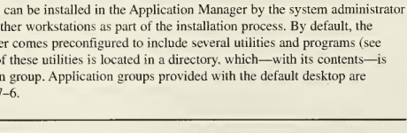

程序和图标可以由系统管理员安装到应用管理器中，并在安装过程中推送到其他工作站。默认情况下，应用管理器预配置为包含多个实用程序和程序（参见图 7-9）。这些实用程序中的每个都位于一个目录中，该目录连同其内容称为一个应用程序组。默认桌面提供的应用程序组在表 7-6 中描述。

### 表 7-6 应用程序组

| 组 | 描述 |
|---|---|
| Desktop_Apps | 桌面应用程序，如文件管理器、样式管理器和计算器 |
| Desktop_Tools | 桌面管理和操作系统工具，如用户注册、重新加载应用程序、vi 文本编辑器和拼写检查 |
| Information | 代表常用帮助主题的图标 |
| System_Admin | 系统管理员使用的工具 |
| Desktop Controls | 用于设置 CDE 环境的工具，如鼠标行为、桌面字体、屏幕保护程序和窗口行为 |
| OpenWindows | 包含多个 OpenWindows 风格的操作，如 OpenWindows 风格的邮件工具和 OpenWindows 风格的文件管理器 |

应用管理器的顶层目录是 /var/dt/appconfig/appmanager/login-hostname-display，每次用户登录时都会动态创建该目录。例如，如果用户 bcal... 从显示器 sparc1:0 登录，则会创建以下应用管理器目录：

```
/var/dt/appconfig/appmanager/bcal...-sparc1-0
```

应用管理器是通过从应用程序搜索路径上的目录收集应用程序组构建的。默认应用程序搜索路径由表 7-7 所示的位置组成。

### 表 7-7 默认应用程序搜索路径位置

| 范围 | 位置 |
|---|---|
| Built-in | /usr/dt/appconfig/appmanager/language |
| System-wide | /etc/dt/appconfig/appmanager/language |
| Personal | HomeDirectory/.dt/appmanager |

为了创建应用管理器的顶层目录，在登录时从应用程序组目录创建链接到应用管理器目录，即 /var/dt/appconfig/appmanager/login-hostname-display。收集操作由桌面实用程序 dtappgather 执行，该程序在用户成功登录后由登录管理器自动运行。例如，桌面提供内置应用程序组 /usr/dt/appconfig/appmanager/language/Desktop_Tools。登录时，会创建指向 /var/dt/appconfig/appmanager/login-hostname-display/Desktop_Tools 的符号链接。

可以通过将其他应用程序组的图标复制到个人应用程序组来向应用管理器添加应用程序。要创建个人应用程序组，请执行以下步骤：

- 1. 从您的主文件夹更改到 .dt/appmanager 子文件夹。
- 2. 创建一个新文件夹。文件夹名称将成为新应用程序组的名称。
- 3. 在 Desktop_Apps 应用程序组中双击“重新加载应用程序”。
- 4. 您的新应用程序组将在应用管理器的顶层注册。

个人应用程序组是用户可以更改的应用程序组，因为他们对其具有写权限。例如，用户可以通过按住 Ctrl 键拖动的方式，将 Desktop_Tools 应用程序组中的计算器图标复制到新的个人应用程序组。另一种方法是为应用程序创建操作，然后将应用程序（操作）图标放置在个人应用程序组中。

## dtksh Shell

CDE 中提供 Desktop KornShell (dtksh)，它提供 ksh11 脚本功能，能够轻松访问大多数现有的 Xt 和 MOTIF 函数。Desktop KornShell 基于 ksh-93，它为 shell 程序员提供了一套强大的工具和命令，并支持标准的 ksh11 编程命令集。dtksh 由开发人员和程序员用于为 CDE 环境创建 MOTIF 应用程序。

## 是否自定义

这个问题总是会出现：是否应该允许用户自行自定义 CDE 环境？大多数大型机构不赞成让用户自定义自己的环境。通常，系统管理员提供适用于所有用户的默认设置。这种默认设置促进了一致性，并防止用户错误修改系统文件时可能出现的“自找麻烦”问题。答案还取决于您愿意为用户社区的利益承受多少痛苦。用户喜欢允许他们灵活安排自己桌面的管理员；然而，如果用户没有接受适当的自定义实用程序使用培训，您可能会很快遇到噩梦般的问题。

CDE 中提供的图形用户界面是对 UNIX 的欢迎增强。有了 CDE，用户不再需要接触晦涩的 UNIX shell。用户执行的绝大多数例行任务现在都可以通过 CDE 提供的菜单和图标来完成。作为系统管理员，您的任务是使用提供的工具自定义 CDE，以促进任务并在特定环境中保持生产力。

CDE 环境的自定义是一个庞大的主题。虽然本章向您介绍了一些基本的自定义主题，但有关该主题的出版物中可以找到更多信息。

## 第 8 章

### 编写 Shell 脚本和程序

本章的测试目标如下：

- 了解 shell 脚本类型的传统用途
- 学习如何设置 shell 变量
- 了解各种引用技术
- 了解如何重定向输出并使用管道串联多个命令
- 了解退出状态的目的和正确使用方法
- 了解如何使用 if 条件语句
- 学习如何使用 for、while 和 until 语句创建循环
- 了解如何使用 case 语句控制程序执行流程
- 了解 shell 函数

对 shell 编程的透彻理解是任何系统管理员必备的。系统管理员必须能够阅读和编写 shell 程序，因为许多任务可以通过使用 shell 程序进行自动化。使用脚本或 shell 程序执行特定任务的一个优点是确保一致性——换句话说，每次任务都以完全相同的方式执行。此外，许多软件产品都附带安装脚本，在它们在您的系统上工作之前必须对其进行修改。

UNIX 脚本是一系列 UNIX 命令，无论是在文件中还是在命令行中输入，都执行多个操作。在某些系统中，这样的文件也称为批处理文件。您可能熟悉的脚本的另一个术语是宏。通常脚本或宏指的是简单的命令序列，而 shell 程序指的是包含更复杂命令排列的文件。shell 程序使用 shell 的控制和条件命令，称为内置命令，这些将在本章后面讨论。

要将文件作为脚本运行，必须设置文件的执行位。这意味着在列出文件时，它看起来像这样：

```
% ls -l
-rwxr-xr-x 1 bcal... 425 Jul 10 11:10 program.1
```

如果设置了执行位，接下来的操作取决于文件的第一行。如果第一行的前两个字符不是 #!，则文件被解释为 Bourne shell 脚本。如果字符 #! 后跟显式的程序位置，例如 /bin/csh，则该程序将作为文件内容的解释器运行。换句话说，程序在 #! 字符后指定的 shell 中运行。例如，要创建 C shell 脚本，在文件的第一行输入以下内容：

```
#!/bin/csh
```

> 注意。最好将脚本和 shell 程序放在自己的目录中，以将其与标准 UNIX 程序分开。它们通常放在名为 /usr/local/bin 的目录中。

## 使用什么 Shell？

编写脚本时，您可以选择使用 Bourne shell、C shell 或 Korn shell。其他 shell，例如 bash 和 tcsh，也可用。选择特定 shell 使用是个人偏好。我发现大多数 BSD UNIX 用户使用 C shell，因为它源自伯克利。我们许多老 SunOS 用户仍然更喜欢使用 C shell，因为

我们已经使用了它多年。另一方面，我发现 SystemV 用户更喜欢 Korn shell。这些偏好可以追溯到 UNIX 的早期开发时期，并在附录 A. “UNIX 的历史。” 中进行了讨论。对于系统管理，Bourne shell 最适合编写脚本。Bourne shell 是 Solaris 中的默认 shell，也是所有 UNIX 系统中唯一存在的 shell。Bourne shell 从一开始就被设计为编程语言之用，这解释了其编程功能的广度。使用 Bourne shell 的另一个原因是其条件语句和控制结构与所有其他 shell 兼容，包括在 CDE 环境中使用并在第 7 章，“CDE 的管理和配置。” 中讨论的 dt*ksh shell。本章使用的所有示例都将使用 Bourne shell。

## Bourne Shell 变量

变量是一个名称，引用内存中的临时存储区域。文本字符串或数字等值被赋给变量，并且可以随时更改。Bourne shell 使用两种类型的变量来存储值：local 和 environment。本章将分别介绍它们。

变量要么被设置为某个特定值，要么被称为 “unset”，这意味着它作为变量不存在。Shell 变量是 shell 编程不可或缺的一部分。Shell 变量提供了在 shell 程序中存储和操作信息的能力。你使用的变量完全在你的控制之下，你可以根据需要设置或取消设置任意数量的变量以执行特定任务。

变量名必须以字母开头，可以包含字母、数字和下划线，但不能包含特殊字符。在 Bourne shell 中，环境变量通过 NAME=value 的赋值来设置。在下面的示例中，ME 和 BC 变量通过在命令提示符下输入以下内容来设置：

```
ME=bill
BC="bill calkins"
```

请确保在等号 (=) 前后不要有空白字符。双引号，如第二个示例中使用，是在要赋给变量的文本字符串中存在空白时使用的。每当 shell 看到一个 $variable，例如 $ME 时，它会将该变量存储的值替换到命令行中。

不幸的是，shell 使用的许多特殊字符也被其他程序使用——字符实在不够用。当表 8–2 中显示的特殊字符在 shell 中使用时，必须加引号。引号用于当赋予的值包含特殊字符、空格、制表符或换行符时。如果没有引号，特殊符号将被解释为 shell 元字符，而不是作为参数传递给程序。Bourne shell 中使用的三种引号方法在表 8–1 中描述。

### 表 8-1 引号

| 符号 | 名称 | 描述 |
|---|---|---|
| \ | backslash | 引用下一个字符。 |
| ' | single quote marks | 不进行任何解释。 |
| " | double quotes | 用双引号括起来的所有字符都被引用，除了反斜杠、重音符、双引号和货币符号。 |

命令从两个反引号 (`) 之间的字符串读取，这些命令的标准输出可用于设置变量。在读取字符串之前不对字符串进行解释，除了删除用于转义其他字符的反斜杠 (\ )。转义反引号允许嵌套命令替换，如下所示：

```
font=`grep font \`cat filelist\``
```

嵌入命令中的反斜杠保护反引号不被立即解释，因此 cat 前面的反引号无法与 grep 前面的初始反引号匹配。

一些字符在 Bourne shell 中自然充当分隔符，遇到时，它们会将一个逻辑词与下一个逻辑词分隔开。表 8-2 中列出的字符对 shell 有特殊含义，除非加引号，否则会导致终止。

### 表 8-2 分隔符

| 符号 | 描述 |
|---|---|
| ; | 命令分隔符。充当一个 <return> 并按顺序执行命令。 |
| & | 异步运行命令。 |
| () | 将命令组合成一个逻辑词。 |
| newlines | 分隔记录（默认值）。 |
| spaces, tabs | 分隔字段（默认值）。 |

要显示变量的值，请在命令提示符下输入以下内容（美元符号告知 shell 以下名称引用的是一个变量）：

```
echo $BC
```

显示如下：

```
bill calkins
```

你设置的变量对当前 shell 是局部的，除非你将其标记为导出。被标记为导出的变量称为环境变量，将对 shell 创建的任何命令可用。以下命令将变量 bc 标记为导出：

```
export BC
```

局部变量可以通过输入 set 命令列出。已标记为导出的变量可以通过输入 env 命令列出。Bourne shell 有几个预定义变量，其中一些在表 8-3 中描述。这些变量在用户登录时自动分配，并由登录程序、系统初始化文件和用户的初始化文件定义。

### 表 8-3 默认 Bourne Shell 变量

| 变量 | 描述 |
|---|---|
| ARCH | 设置为用户的系统架构（例如，sun4、sun4c）。 |
| CDPATH | 设置 cd 命令的搜索路径。 |
| HOME | 设置用户主目录的值 |
| LANG | 设置区域设置。 |
| LOGNAME | 定义当前登录用户的名称。LOGNAME 的默认值由登录程序自动设置为 /etc/passwd 文件中指定的用户名。你只需要引用（而不是重置）此变量。 |
| LPDEST | 设置用户的默认打印机。 |
| MAIL | 如果此参数设置为邮件文件的名称且 MAILPATH 参数未设置，shell 会通知用户指定文件中邮件的到达。 |
| MAILCHECK | 指定 shell 检查 MAILPATH 或 MAIL 参数指定的文件中邮件到达的频率（以秒为单位）。默认值是 600 秒（10 分钟）。如果设置为 0，shell 将在每次提示符前检查。 |
| MAILPATH | 通过定义以冒号分隔的文件名列表来设置邮件路径。如果此参数已设置，shell 会通知用户在任何指定文件中邮件的到达。每个文件名后可以跟 % 和一条消息，当修改时间更改时该消息将被打印。默认消息是 "you have mail." |
| MANPATH | 设置可用手册页的层次结构。 |
| OPENWINHOME | 设置 OpenWindows 子系统的路径。 |
| PATH | 按顺序列出 shell 在用户输入命令时搜索以找到要运行的程序的目录。如果目录不在搜索路径中，用户必须输入命令的完整路径名。默认 PATH 在登录过程中作为 .profile（Bourne 或 Korn shell）或 .cshrc（C shell）中指定的那样自动定义和设置。搜索路径的顺序很重要。当相同命令存在于不同位置时，首先找到的同名命令将被使用。例如，假设 PATH 定义为（Bourne 和 Korn shell 语法）PATH=/bin:/usr/bin:/usr/sbin:$HOME/bin 并且名为 sample 的文件同时存在于 /usr/bin 和 /home/jean/bin 中。如果用户在不指定其完整路径名的情况下输入命令 sample，则在 /usr/bin 中找到的版本将被使用。 |
| PS1 | 设置主提示符字符串，默认为 "$ "。 |
| PS2 | 设置次要提示符字符串，默认为 "> "。 |

### 表 8-3 默认 Bourne Shell 变量（续）

| 变量 | 描述 |
|---|---|
| SHELL | 设置 make、vi 和其他工具使用的默认 shell。当 shell 被调用时，它会在环境中扫描此名称。 |
| TERMINFO | 指定已添加到 terminfo 数据库中但不受支持的终端的路径名。在 /etc/profile 或 /etc/.login 中使用 TERMINFO 变量。当 TERMINFO 环境变量设置时，系统首先检查用户定义的 TERMINFO 路径。如果它在用户定义的 TERMINFO 目录中找不到终端的定义，它会在默认目录 /usr/share/lib/terminfo 中搜索定义。如果在任一位置都找不到定义，终端将被标识为 "dumb." |
| TERM | 定义终端。此变量应在 /etc/profile 或 /etc/.login 中重置。当用户调用编辑器时，系统会查找与此环境变量定义同名的文件。系统搜索 TERMINFO 引用的目录以确定终端特性。 |
| TZ | 设置用于显示日期的时区（例如，在 ls -l 命令中）。如果 TZ 未在用户环境中设置，则使用系统设置；否则，使用格林威治标准时间。 |

## 内建命令

内建命令用于在 shell 程序中做出决策并为要执行的任务增加智能。Bourne shell 的内建命令列在表 8-4 和 8-5 中。有关表 8-4 中描述的内建命令的更多信息可在 Solaris 在线手册页中找到。表 8-5 中列出的 shell 条件语句在本章中描述。每个 shell 都有自己的内建命令集，其中 Bourne shell 的最少。因此，它是三个 shell 中最小、最快的。

### 表 8-4 Bourne Shell 内建命令

| 内建 | 描述 |
|---|---|
| break | 退出 For 或 While 循环 |
| continue | 继续 For 或 While 循环的下一次迭代 |
| echo | 在标准输出上写入参数 |
| eval | 评估并执行参数 |
| exec | 执行参数 |
| exit | 退出 shell 程序 |
| export | 创建全局变量 |
| priv | 设置或显示权限 |


## 表 8-4 Bourne Shell 内建命令（续）
| 内建命令 | 描述 |
|---|---|
| read | 从标准输入读取一行 |
| readonly | 将变量改为只读 |
| set | 设置 shell 选项 |
| test | 评估条件表达式 |
| times | 显示执行时间 |
| trap | 管理执行信号 |
| umask | 设置文件和目录的默认安全属性 |
| unset | 取消设置局部变量 |
| wait | 等待后台进程完成 |

## 表 8-5 Bourne Shell 条件语句
| 条件 | 描述 |
|---|---|
| if-then-else-if | 测试条件并根据测试结果选择操作 |
| case-esac | 根据变量的值选择操作 |
| for-do-done | 重复执行一系列命令，直到满足预定条件 |
| while-do-done | 重复执行一系列命令，直到测试条件不再为真 |
| until-do-done | 重复执行一系列命令，直到测试条件导致成功状态 |

## Shell 条件语句
除表 8-4 和 8-5 中列出的内建命令外，Bourne shell 还包含一些简单的条件语句。条件命令根据某些条件的结果做出选择。条件语句的例子有 &&、||、if 和 case。

### && 和 ||
Bourne shell 中最简单的条件语句是双与号（&&）。当两个命令由双与号分隔时，只有当第一个命令返回零退出状态（表示成功完成）时，第二个命令才执行。

```
Example:
ls -ld /usr/bin > /dev/null && echo "Directory Found"
```

如果目录 /usr/bin 存在，则会显示消息 Directory Found。

&& 的相反操作是双竖线（||）。当两个命令由 || 分隔时，只有当第一个命令返回非零退出状态（表示失败）时，第二个命令才执行。

Example:

```
ls -d /usr/foo || echo "No directory found"
```

如果目录不存在，则会显示以下消息：

/usr/foo: No such file or directory
No directory found

Bourne shell 包含特殊的程序 true 和 false。true 程序的唯一功能是返回 true（零）退出状态。同样，false 程序的功能是返回 false（非零）退出状态。

Example:

```
True && echo True
```

系统响应为 True

```
False || echo False
```

系统响应为 False

True 和 false 测试将在后面讨论 if 和 while 条件语句时进行说明。

&& 和 || 对于创建非常简单的脚本很有用，但有时需要额外的功能。Bourne shell 提供了另外两个条件命令 if 和 case。

### if
Bourne shell 中更重要的内建命令之一是 if 条件语句。if 条件语句的语法是

```
if condition-list
    then list
    elif condition-list
        then list
    else list
fi
```

if 之后列出的列表被执行；如果它返回零退出状态，则执行第一个 then 之后的列表。否则执行 elif 之后的列表；如果其值为零，则执行下一个 then 之后的列表。否则执行 else 列表。如果没有列表被执行，if 命令返回零退出状态。下一个例子说明了 if 条件语句的使用：

```
if [ -f /tmp/errlog ]
then
  rm /tmp/errlog
  echo "Error log has been removed"
else
  echo "No errorlog has been found"
fi
```

在前面的例子中，程序会检查名为 /tmp/errlog 的文件是否存在。如果文件存在，程序会删除它。如果不存在，则会打印出一条消息。

前面的例子使用 if test -f 来评估条件表达式。每个控制结构的中心都是条件测试。test 命令通常在 shell 程序中使用来执行各种测试并确定某些文件和目录是否存在。test 程序执行三种类型的测试：

- 它可以测试文件的某些特征，如文件类型和权限。
- 它可以执行字符串比较。
- 它可以进行数值比较。

Test 通过其退出状态指示测试的成功或失败。Test 评估表达式，如果其值为真，则设置零（真）退出状态；否则设置非零（假）退出状态。所有 shell 命令在成功完成时返回 true（0）值，在失败时返回 false（1）值。最后一条 shell 命令的退出状态可以通过使用 echo 命令查看 $? 变量来显示。表 8-6 列出了一些可以评估的常见条件。

### 表 8-6 内建测试函数
| 测试 | 描述 |
|---|---|
| -r filename | 如果文件名存在且可读，则为真。 |
| -w filename | 如果文件名存在且可写，则为真。 |
| -x filename | 如果文件名存在且可执行，则为真。 |
| -f filename | 如果文件名存在且为普通文件，则为真。 |
| -d filename | 如果文件名存在且为目录，则为真。 |
| -h filename | 如果文件名存在且为符号链接，则为真。默认情况下，除 -L filename 外，其他所有原语都会跟随符号链接。 |
| -c filename | 如果文件名存在且为字符特殊文件，则为真。 |
| -b filename | 如果文件名存在且为块特殊文件，则为真。 |

### 表 8-6 内建测试函数（续）
| 测试 | 描述 |
|---|---|
| -u filename | 如果文件名存在且其 set-user-ID 位已设置，则为真。 |
| -g filename | 如果文件名存在且其 set-group-ID 位已设置，则为真。 |
| -k filename | 如果文件名存在且其 sticky 位已设置，则为真。 |
| -s filename | 如果文件名存在且大小大于零，则为真。 |
| s1 = s2 | 如果字符串 s1 和 s2 相同，则为真。 |
| s1 != s2 | 如果字符串 s1 和 s2 不相同，则为真。 |
| n1 -eq n2 | 如果整数 n1 和 n2 在代数上相等，则为真。可以使用 -ne、-gt、-ge、-lt 和 -le 中的任意比较来代替 -eq。 |
| -l filename | 如果文件名存在且为符号链接，则为真。默认情况下，除 -h filename 外，其他所有原语都会跟随符号链接。 |

运算符：这些测试函数可以用以下运算符组合：

- ! 一元否定运算符。
- -a 二元与运算符。
- -o 二元或运算符（-a 的优先级高于 -o）。
- (expression) 用于分组的括号。请注意，括号对 shell 也有意义，因此必须加引号。

以下是您可能使用一元运算符的示例：

```
if [ ! -f /tmp/errlog ]
then
    echo "No error log has been found"
fi
```

在示例中，语句 [ ! -f /tmp/errlog ] 测试文件 /tmp/errlog 是否不存在。

### Case
许多程序是菜单驱动的；也就是说，它们为用户提供一个可供选择的菜单。case 语句使设置选择菜单变得容易。case 语句的一般语法如下：

```
case value in
choice1) commands;;
choice2) commands;;
...
esac
```

case 命令执行与第一个匹配选择的模式相关联的列表。以下示例描述了 case 语句的工作原理：

```
echo Please enter the letter next to the command that you want to select:
echo 'a date'
echo 'b ls'
echo 'c who'
read choice
case $choice in
date;;
ls;;
who;;
*) echo Invalid choice - Bye.
esac
```

选项列表会被扫描以找到与用户输入的值匹配的选项。选择 *) 匹配任何值，因此通常作为最后一个选项添加——作为兜底。

## 重复动作命令
Bourne shell 提供了三个重复动作命令，每一个都对应于您可能在其他编程语言中遇到过的结构：

- for
- while
- until

这些命令使程序循环或重复，下文将对其进行描述。

### For 循环
一个有用的 shell 命令是 for 循环，它是在 shell 脚本中设置重复的最简单方法。for 循环的语法如下：

```
for name [ in word . . . ]
do list
done
```

每次执行 for 命令时，name 被设置为从 in word 列表中取出的下一个单词。如果省略 in word ...，则 for 命令对每个已设置的 positional 参数执行一次 do 列表。当列表中没有更多单词时，执行结束。以下示例说明了一个简单的 for 循环：

```
for i in eat run jump play
do
    echo See spot $i
done
```


当程序执行时，系统会响应

- 看见 spot 吃
- 看见 spot 跑
- 看见 spot 跳
- 看见 spot 玩

如果你想交互式输入数据，可以添加 shell 特殊命令 read：

```
echo Hello- What\'s your name\?
read name
for i in $name
do
  echo $i
done
```

执行程序时，用户会被要求输入单词列表。注意反斜杠 (\) 的使用，这样 ' 和 ? 就会被原样处理，而不是用作特殊字符。

## While 循环

另一种循环是 while 循环。while 循环会持续重复执行一组命令，直到满足某个条件。while 循环的语法是

```
while condition-list
do commands
done
```

首先执行 condition-list。如果它返回 true 的退出状态，则执行 do 列表并从头开始重新操作。如果 condition-list 返回 false 的退出状态，则条件完成。以下示例说明了 while 循环。程序检查文件 /tmp/errlog 是否存在。如果文件不存在，程序退出循环。如果文件存在，程序打印一条消息并每 5 秒再次运行，直到文件被删除。

```
while [ -f /tmp/errlog ]
  do echo The file is still there ; sleep 5
done
```

注。特殊命令 sleep 5 指示系统在再次运行前等待 5 秒。

## Until 循环

until 循环是 while 语句的变体。正如 while 语句只要 condition-list 返回 true 值就重复执行，until 语句则重复执行直到 condition-list 返回 false 值。以下示例每 5 秒继续显示一条消息，直到文件被创建。

```
until [ -f /tmp/errlog ]
do echo the file is missing; sleep 5
done
```

while 和 until 等条件结构由 shell 执行，就像它们是一个单一命令一样。整个结构在执行任何部分之前都会被 shell 扫描。

## Shell 函数

任何好的编程语言都提供对函数的支持。函数是一组语句的集合，作为一个整体执行。这些集合的执行方式与“regular”命令一样，用于执行经常需要的任务。函数的一个优点是它存储在计算机的主内存中，因此执行速度比必须从磁盘检索的脚本快得多。当前版本的 Bourne shell 支持 shell 函数；旧版本的 Bourne shell 不支持。shell 函数的语法如下：

```
name()
{
command-list
}
```

上述命令语法定义了一个名为“name”的函数。函数体是 { 和 } 之间的 command-list。每当 name 被指定为命令的名称时，就会执行此列表。例如，在命令提示符下，输入

```
hello()
{
echo hello there
}
```

该函数名为“hello”，可以通过输入 hello 执行。函数的输出是 hello there。函数的退出状态是其主体中执行的最后一个命令的退出状态。

使用脚本和 shell 程序构建自己的命令是协助系统管理的强大而灵活的工具。常规任务可以简化并自动化，以节省您的时间，让您处理更 demanding 的任务。Shell 编程是所有 UNIX 系统管理员必须具备的技能，也是成为熟练 UNIX 用户的关键之一。

## 章节

## 9

## LP 打印服务

本章的测试目标如下：

- 了解 BSD 和 SystemV 打印系统之间的区别
- 了解 Solaris LP 打印服务
- 描述打印客户端和打印服务器
- 了解本地打印和远程打印之间的区别
- 描述 terminfo 数据库
- 了解如何使用 Admintool 创建、配置和修改打印机

打印机是任何计算机系统的标准外设。添加到新系统的第一个设备之一将是打印机。Solaris 操作系统的多用户特性意味着 Solaris 打印机软件比单用户操作系统的更复杂。这意味着向 Solaris 系统添加打印机不仅仅是即插即用。本章描述了将打印机连接到 Solaris 系统的所有方面。它描述了如何在操作系统中设置打印机以及安装后如何管理打印队列。

## UNIX 打印服务

设置 Solaris 打印机涉及设置硬件：打印机和打印机端口。此外，系统管理员需要验证是否有至少 8MB 的磁盘空间可用于 /var/spool/lp。打印文件将被发送到此位置以准备打印。其他配置文件将被创建，但 Solaris 操作系统会为您处理这一部分。当设置打印机时，Solaris 操作系统会根据需要对系统中的 /etc/printers.conf 和 /etc/lp 目录进行适当的更改。

## 打印排队程序

Spool 是 simultaneous peripheral operations online 的缩写。排队程序也称为队列。用户在想要打印某物时执行打印排队程序 lp。然后打印排队程序将用户想要打印的内容放入预定义的 /var/spool/lp 打印排队目录中。

排队空间是用于存储和处理打印队列中请求所占用的磁盘空间。/var 目录的大小取决于磁盘的大小和磁盘的分区方式。如果 /var 没有作为单独分区创建，/var 目录将使用部分根分区空间，而根分区空间可能相当小。一个大的排队目录可能消耗 600MB 的磁盘空间。查看可指定为打印服务器的系统上可用磁盘的大小和分区情况。

连接打印机时，首先仔细评估用户的打印需求和使用模式。如果用户通常只打印不需要复杂格式要求的简短 ASCII 文件，则分配给 /var 20 到 25MB 磁盘空间的打印服务器可能就足够了。然而，如果许多用户正在打印冗长的 PostScript 文件，他们会相当频繁地填满排队空间。当 /var 填满且用户无法将作业排队打印时，工作流程会被中断。/var 的大小在操作系统加载和磁盘分区时设置。

对于 SunOS 用户，SVR4 lp 程序等同于 BSD lpr 打印程序。在 SunOS 中，打印排队程序位于 /usr/spool。当 Sun 从 SunOS（基于 BSD UNIX）切换到 Solaris（基于 SVR4 UNIX）时，BSD 和 SVR4 之间的打印系统差异很大。在本章中，我将对可能熟悉该打印系统的系统管理员提及 BSD 打印系统。BSD 打印协议是行业标准。它被广泛使用并在不同制造商的各种系统之间提供兼容性。对于同时使用 BSD 和 SVR4 UNIX 的站点，Sun 在 Solaris 中为两种打印系统提供了兼容性。

## 打印守护进程

lp 进程是 SVR4 UNIX 中负责打印的 UNIX 实用程序。lp 打印守护进程由 lpsched 启动，是负责从排队目录获取输出并将其发送到正确打印机的 UNIX 进程。再次说明，对于 SunOS 用户，lp 等同于 BSD UNIX 中的 lpd。

可以使用多种方法在 Solaris 系统上定义打印机。表 9-1 描述了 Solaris 用于添加打印机的工具。

**表 9-1 Solaris 打印机实用程序**

| 实用程序 | 描述 |
|---|---|
| SunSoft Print Client Software | 一个接口，以前仅在 Solstice AdminSuite 管理工具集中可用，现在作为标准 Solaris 分发软件的一部分提供，用于设置打印客户端。 |
| Admintool | 用于在本地系统上创建、修改和删除打印机的图形用户界面。这是为新手用户添加打印机的推荐方法。 |
| Solstice AdminSuite | 用于在名称服务环境中管理打印机的图形用户界面 Print Manager 界面，仅在 Solaris 2.6 服务器软件发行版中可用。 |
| LP Print Service Commands | 用于设置和管理打印机的命令行实用程序。这些命令提供完整功能；Admintool 和 AdminSuite 包在高级任务方面 somewhat 受限。 |

本章描述了如何使用 Admintool GUI 或从命令行设置本地打印机、设置对远程打印机的访问以及执行一些打印机管理任务。系统管理员设置打印服务、向服务器添加打印机或从打印客户端添加对打印服务器上远程打印机的访问的大多数需求应由 Admintool 满足。从命令行设置打印机可能是一项非常复杂的任务。在继续研究该过程的更复杂部分——配置软件之前，我们将研究将打印机连接到 Solaris 系统所涉及的硬件问题。

## 设置硬件

将打印机连接到 UNIX 系统不是任何人的最爱活动，因为它可能很快变得耗时。市场上有许多打印机，每种都有略微不同的接口。将打印机本地连接到 Sun 系统时，您有三种选择之一：

- 以太网连接
- 并行连接
- 串行连接

连接类型取决于打印机本身可用的连接选项。如果打印机支持该选项，以太网连接将是最好的。如果以太网连接不是选项，则并行连接是首选方法。大多数，如果不是全部，打印机都有并行端口。如果没有并行选项，最终选择是串行连接。串行连接的困难在于建立计算机和打印机之间的正确握手。"Handshaking" 是在两个设备之间通信简单信息的方法。

## 以太网连接

许多新打印机标配以太网接口。具有自身以太网连接的打印机被称为网络打印机。网络打印机是一种硬件设备，它无需直接通过电缆连接到打印服务器即可为打印客户端提供打印服务。它是一个具有自己的系统名称和 IP 地址的打印服务器，并直接连接到网络。以太网接口可以是打印机内部的，也可以是外部的。由于其速度快，使用以太网接口安装打印机是推荐的。

## 并行连接

大多数打印机，除少数例外外，都有并行接口。并行接口相比串行接口具有巨大优势，尤其是使用 Centronics 接口时。Centronics 接口完全定义了打印机和计算机之间并行连接使用的所有线路。只需使用 Centronics 并行电缆将打印机连接到 Sun 系统的后面即可。一些 Sun 系统没有 DB25 并行连接器，需要 Sun 提供的特殊电缆。其他较旧的 Sun 系统没有并行接口，因此您必须通过从 Sun 购买 SBUS 并行接口来添加一个。

## 串行连接

一些打印机同时支持并行和串行连接。有时打印机通过串行接口连接，因为 Sun 工作站没有可用的并行接口。使用串行接口连接设备需要对串行传输有透彻的理解。这种连接打印机的方法是最困难的，因为建立计算机和打印机之间正确握手的复杂性。

## 设置软件

对于网络打印机，您使用厂商软件来配置操作系统。完成厂商软件安装后，不需要进一步的软件配置。您必须从打印机制造商处获取软件以在系统上安装打印机。大多数配置起来非常容易。HP Jetdirect 打印服务器是最受欢迎的，但并非唯一可用的打印服务器。

第一步是将打印服务器连接到网络并设置 IP 地址。此过程因打印服务器而异，因此请遵循制造商关于如何操作的指南。接下来，安装打印服务器软件并遵循制造商关于配置打印机的指南。厂商软件配置了所有内容——不需要额外的软件配置。

对于具有并行或串行连接的打印机，您必须使用 Solaris 工具来配置操作系统以识别打印机。

## BSD 与 SVR4 打印软件

驱动 UNIX 打印过程的软件是 BSD 和 SystemV 这两个 UNIX 版本既相似又非常不同的领域。这两个打印系统相似之处在于两者都基于 spooling 概念。SystemV 和 BSD 打印服务都支持接口程序的概念，该程序充当过滤器，所有发送到打印机的输出都通过它传递。接口程序的示例用途包括

- 添加横幅页——大多数 UNIX 系统会自动在打印作业前面添加横幅页。该页面的目的是标识打印机输出的所有者。
- 添加或删除换行字符——UNIX 仅使用换行字符来分隔行。测试打印机时您可能遇到的第一个问题是文本以阶梯状输出。大多数打印机具有控制打印机使用情况的回车/换行和自动换行拨码开关。阶梯问题可以通过修改对发送到打印机的所有输出执行必要转换的接口程序，或将打印机的拨码开关设置为硬件制造商推荐的设置来修复。

BSD 和 SystemV 之间的差异在于配置文件和 spooling 目录，这些都由 Solaris 操作系统自动配置。BSD 中 lpd 守护进程处理打印作业的方式与 lp 守护进程也有差异。

## BSD 打印服务

连接到 BSD 系统的每台打印机都必须有自己的 spooling 目录，由一个 lpd 守护进程提供服务。spool 目录位于 /var/spool/lpd 目录中。每台打印机都有自己的 lpd 守护进程。在 BSD 中，lpd 访问文件 /etc/printcap 以获取其所需有关打印机的任何信息。/etc/printcap 文件是系统的打印机数据库文件，存储有关连接到系统所有打印机的必要信息。要使用打印机，该打印机必须在 /etc/printcap 文件中有条目。lpr 函数是 BSD 中 SystemV 下 lp 的等价物。如果用户想打印某些内容，他们使用 lpr 命令，该命令将必要信息发送到指定的 spooling 目录。

## SystemV 打印服务

在 SystemV 中，一个 lp 守护进程为所有打印机提供服务。lp 守护进程持续运行并为打印服务提供“power”。任何时候都应只有一个 lp 副本在运行。大多数配置文件位于 /var/spool/lp 目录中。例外是接口文件，它们位于 /etc/interface 中。/var/spool/lp 中应有一个 SCHEDLOCK 文件，负责确保只有一个副本运行。您使用 lpadmin 命令向系统添加、配置和删除打印机。有关打印机的信息可以在 /etc/printers.conf 和 /etc/lp 文件中找到。Solaris Admintool 为表 9-2 中列出的许多 lp 命令提供图形界面。

表 9-2 Solaris lp 命令

| 命令 | 用途 |
|---|---|
| accept/reject | 启用或禁用对进入 spooling 区域的打印机或类的任何进一步请求。 |
| cancel | 使用户能够停止打印信息。 |
| enable/disable | 启用或禁用从 spooler 到打印机的任何更多输出。 |
| lpmove | 在目的地之间移动打印请求。 |
| lp | 用户的打印命令；将要打印的信息放入 spooler。 |
| lpadmin | 允许配置打印服务。 |
| lpsched | 启动打印服务。 |
| lpshut | 停止打印服务。 |
| lpstat | 显示打印服务的状态。 |

尽管 Solaris 使用 SystemV 打印模型，但它仍支持 BSD 风格的打印以提供互操作性。广泛使用的 BSD 打印协议在不同制造商的各种系统之间提供兼容性。

## 打印服务器与打印客户端

打印服务器是具有连接到其上的本地打印机并使打印机可供网络上其他系统使用的系统。打印客户端是可以向打印服务器发送打印请求的远程系统。当您安装打印客户端软件并在系统上启用对远程打印机的访问时，系统就成为打印客户端。请参阅表 9-3，了解需要安装的 Solaris 软件包列表以支持打印服务器和打印客户端安装。如果您使用过早期版本的 Solaris，请注意 Solaris 2.6 打印软件已被重新设计以提供更集中的打印管理。如果您安装的是早期版本的 Solaris，打印包配置是不同的。


## 表 9-3 Solaris 2.6 打印软件包

| 包实例 | 包名 |
|---|---|
| SUNWpcr | SunSoft Print - 客户端 |
| SUNWpcu | SunSoft Print - 客户端 |
| SUNWpsr | SunSoft Print - LP 服务器 |
| SUNWpsu | SunSoft Print - LP 服务器 |
| SUNWpsf | PostScript 过滤器 |
| SUNWscplp | SunSoft Print - 源兼容性 |

Solaris 2.5 软件包不再在软件分发中找到：

| 包实例 | 包名 |
|---|---|
| SUNWlpr | LP 打印服务 |
| SUNWlpu | LP 打印服务 - 客户端 |
| SUNWlps | LP 打印服务 - 服务器 |

打印客户端发出打印命令，使打印客户端能够发起打印请求。打印命令定位打印机和打印机配置信息。

当打印作业从打印客户端发送时，用户发出 SystemV 风格的 lp 命令或 BSD 风格的 lpr 命令。表 9-4 中显示的任何一种样式都可以使用。

## 表 9-4 有效打印样式

| 样式 | 描述 |
|---|---|
| 原子样式 | 打印命令和选项后跟打印机名称或类；例如：`lp -d neptune filename` |
| POSIX 样式 | 打印命令和选项后跟 server:printer；例如：`lpr -P galaxy:neptune filename` |
| 上下文样式 | 在《联邦命名服务编程指南》中定义；例如：`lpr -d thisdept/service/printer/printer-name filename` |

如果用户在有效样式中未指定打印机名称或类，命令会检查用户的 PRINTER 或 LPDEST 环境变量以获取默认打印机名称。这些变量可以在用户的启动文件中设置以指定要使用的默认打印机。如果未定义默认打印机的任一环境变量，命令会检查用户主目录中的 .printers 文件中的 _default 打印机别名。如果命令在 .printers 文件中找不到 _default 打印机别名，则会检查打印客户端的 /etc/printers.conf 文件以获取配置信息。如果在 /etc/printers.conf 文件中找不到打印机，命令会检查名称服务（NIS 或 NIS+），如果有的话。

## 为 Solaris 打印机配置软件

打印客户端软件和 Solstice AdminSuite 中的打印机管理器应用程序为在网络上设置和管理打印机提供了一种图形化解决方案。打印客户端软件的优点是它支持名称服务（NIS 或 NIS+），使您能够为网络集中管理打印。您还可以在命令行上使用 lpadmin 命令来配置单个系统上的打印机。Admintool 提供了在 Solaris 环境中安装打印机的替代方法。Admintool 为表 9-2 中列出的 lp 命令提供图形界面。本节介绍如何使用 Admintool 设置打印机软件。

您必须在已连接打印机的系统上运行 Admintool，因为 Admintool 不允许您对远程系统进行更改。

设置打印机时，Admintool 会在系统的 /etc/printers.conf 和 /etc/lp 目录中进行适当的更改。

> **注意。** 如果您坐在 systemA 上并且想要将打印机连接到 systemB，您不需要开车到该位置在 systemB 上运行 Admintool。从 systemA， simply rlogin 到 systemB 并输入

```
admintool -display local_systemA:0.0
```

SystemB 的 Admintool 现在应该在 systemA 上显示，就好像您坐在 systemB 一样。

使用以下步骤通过 Admintool 配置打印机。

- 1. 输入 admintool 以调出 Admintool 菜单。Admintool 窗口出现。
- 2. 单击工具栏中位于的 Browse 按钮并从弹出菜单中选择 Printers，如图 9-1 所示。

### 图 9-1

使用 Admin 工具选择打印机。

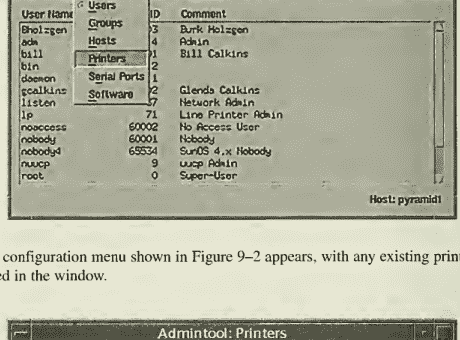

图 9-2 所示的打印机配置菜单出现，窗口中显示任何现有打印机。

### 图 9-2

打印机配置窗口。

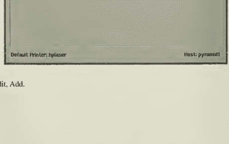

- 3. 单击 Edit，Add。

- 4. 如果您正在配置打印客户端并且打印服务器位于网络另一侧，物理连接到另一系统，请从弹出菜单中选择 Access to Printer（参见图 9–3）。

### 图 9–3

Printers 窗口弹出菜单。

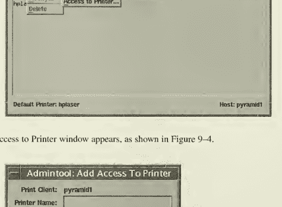

Add Access to Printer 窗口出现，如图 9–4 所示。

### 图 9–4

Add Access to Printer 窗口。

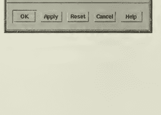

- 5. 按如下方式填写窗口中的信息：

  - **打印机名称**—输入您想要访问的远程系统上打印机的名称。
  - **打印服务器**—输入打印机所连接的系统的名称。
  - **描述**—如果愿意，输入打印机的简要描述。
  - **选项**—如果您想将此设为系统默认打印机，请选中此选项。

- 6. 单击 OK 按钮。窗口关闭，信息被添加到适当的 LP 打印系统文件中。

- 7. 如果您正在配置打印服务器，并且打印机将连接到本地系统，请从图 9-3 所示的弹出菜单中选择 Local Printer。显示图 9-5 所示的窗口。

- 8. 按如下方式填写字段：

  - **打印机名称**—输入您想要为此打印机指定的名称。
  - **描述**—如果愿意，输入打印机的简要描述。
  - **打印机端口**—单击按钮并选择打印机所连接的端口。
    - `/dev/term/a` 是串行端口 A。
    - `/dev/term/b` 是串行端口 B。
    - `/dev/bpp0` 是并行端口。
    - 如果您已连接具有其他设备名称的 SBUS 卡，请选择 Other。
  - **打印机类型**—单击按钮以选择与打印机匹配的打印机类型。

这里的打印机类型对应于 `/usr/share/lib/terminfo` 目录中列出的打印机。您选择的打印机类型必须对应于 terminfo 数据库中的一个条目。UNIX 与 PostScript 打印机配合效果最佳，因为从 CDE 内部的文本和图形分页格式是针对 PostScript 打印机的。如果您想选择 PostScript 打印机，您的打印机必须能够支持 PostScript。如果您使用的是 HP LaserJet 打印机，请选择 hplaserjet 作为打印类型，除非 LaserJet 打印机支持 PostScript。

  - **文件内容**—单击按钮以选择将发送到打印机的文件的格式。
  - **故障通知**—单击按钮以选择在打印机错误情况下如何通知超级用户。
  - **选项**—选择打印横幅或将此设为默认打印机。

> 注意。系统可以识别一个默认打印机。如果用户在打印时未指定特定打印机，作业将发送到默认打印机。

### 图 9-5

Add Local Printer 窗口。

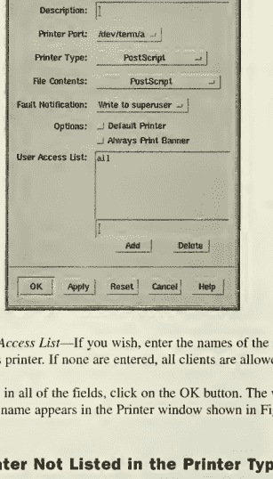

用户访问列表—如果愿意，输入允许打印到此打印机的系统的名称。如果未输入任何名称，则所有客户端都允许访问。

- 9. 填写所有字段后，单击 OK 按钮。窗口关闭，新的打印机名称出现在图 9-2 所示的 Printer 窗口中。

## 使用打印机类型菜单中未列出的打印机

Print Manager 窗口中列出的打印机类型对应于 /usr/share/lib/terminfo 目录中列出的打印机。如果您要添加的打印机类型不可用，您可能需要在 /usr/share/lib/terminfo 数据库中添加一个条目。每个打印机在 terminfo 数据库中都由一个简短名称标识；例如，HP LaserJet 打印机在 /usr/share/lib/terminfo/h 目录下列为 hplaserjet。PostScript 打印机的条目位于 /usr/share/lib/terminfo/P 中。目录中找到的名称是在设置打印机时您指定的打印机类型。

如果您找不到打印机的 terminfo 条目，您可以尝试选择类似类型的打印机；但是，您可能难以在每次打印请求时保持打印机处于正确的模式。如果您的打印机类型没有 terminfo 条目并且您希望保持打印机处于正确的模式，您可以自定义与打印机一起使用的接口程序或向 terminfo 数据库添加条目。您将在 /etc/lp/interfaces 目录下找到打印机接口程序。编辑接口文件或在 terminfo 数据库中添加条目超出了本培训指南的范围。terminfo 数据库中的打印机条目包含并定义了数百个项目。请参阅《Solaris 系统管理员指南》以获取执行此任务的信息。

## 管理打印机

管理打印系统涉及监控 lp 系统并找出系统可能无法正常工作的原因。其他常规任务包括取消打印作业以及在打印机维护期间启用或禁用打印机。本节提供有关您将执行的日常任务的说明，以管理打印机和打印调度程序。以下所有命令都需要超级用户访问权限。

### 删除打印机和打印机访问

使用 Admintool 从系统中删除打印机。在 Admintool 的打印管理器窗口中，突出显示您要删除的打印机并选择 Edit，Delete，如图 9-6 所示。打印机队列将从系统中删除。

### 图 9-6

删除打印机。

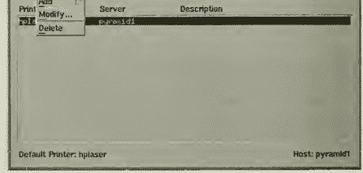


在命令行删除打印机时，在打印机连接的系统上执行以下命令：

```
lpadmin -x <printer-name>
```

打印机将被从系统中删除。

也许你不想从打印服务器中移除打印机，但希望阻止特定系统向打印服务器打印。在要删除打印机的打印客户端上执行以下命令：

```
lpsystem -r <print-server>
```

打印服务器将被从打印客户端的 /etc/lp/Systems 文件中删除。

也许打印机将因维修而离线。要停止接受特定打印机的打印请求，在打印机物理连接的系统上键入以下命令：

```
reject <printer-name>
```

此步骤可在您移除打印机的过程中防止任何新请求进入打印机的队列。

要允许打印机继续接收请求但停止打印机打印请求，在打印机物理连接的系统上键入以下命令：

```
disable <printer-name>
```

## 检查打印机状态

lpstat 命令用于验证打印机的状态。你可以使用此命令确定哪些打印机可供使用，或检查特定打印机的特性。lpstat 命令语法和选项在表 9-5 中描述。

表 9-5 lpstat 命令语法和选项

lpstat [-d] [-p printer-name [-D] [-l]] [-t]

- **-d**：显示系统的默认打印机。
- **-p <printer-name>**：显示打印机是活动还是空闲、启用或禁用的时间，以及是否接受打印请求。你可以使用此命令指定多个打印机名称。用空格或逗号分隔打印机名称。如果使用空格，请用引号将打印机名称列表括起来。如果未指定打印机名称，则会显示所有打印机的状态。
- **-D**：显示指定打印机的描述。

### 表 9-5 lpstat 命令语法和选项（续）

| 选项 | 描述 |
|---|---|
| lpstat [-d] [-p printer-name [-D] [-l] [-t]] |  |
| -l | 显示指定打印机的特性。 |
| -t | 显示 LP 打印服务的状态信息，包括所有打印机的状态——它们是否处于活动状态以及是否接受打印请求。 |

以下是 lpstat 命令的几个示例：

```
lpstat -p hplaser
```

系统响应如下

```
printer hplaser is idle. enabled since Jun 16 10:09 1998. available.
```

在以下示例中，命令请求打印机 hplaser1 和 hplaser2 的描述。

```
lpstat -p "hplaser1 hplaser2" -D
printer hplaser1 faulted. enabled since Jun 16 10:00 1998. available.
unable to print: paper misfeed jam

Description: Printer by finance.
printer hplaser2 is idle. enabled since Jun 16 10:09 1998. available.
Description: Printer in computer room.
```

在以下示例中，命令请求打印机 hplaser 的特性。

```
lpstat -p hplaser -l
printer hplaser is idle. enabled since Jun 16 10:11 1998.
available.
Content types: any
Printer types: unknown
Description: Printer by computer room.
Users allowed:
(all)
Forms allowed:
(none)
Banner not required
Character sets:
(none)
Default is pitch:
Default page size:
```

## 重新启动打印调度程序

打印调度程序 lpsched 处理打印服务器上的打印请求。如果打印机没有输出打印件，你可能需要重新启动打印调度程序。要重新启动打印调度程序，

你使用 lpsched 命令。如果打印调度程序停止运行时某个打印请求正在打印，重新启动打印调度程序后该请求将完整打印。

首先，通过键入以下内容停止调度程序

```
/usr/lib/lp/lpshut
```

要重新启动调度程序，键入

```
/usr/lib/lp/lpsched
```

## 设置用户的默认打印机

当你添加打印机时，你可以选择将其设为该特定系统的默认打印机。你可能希望在用户级别设置默认打印机，以便在特定系统上用户可以指定自己的默认打印机。如果用户在发送打印作业时未提供打印机名称，print 命令会按以下顺序搜索默认打印机：

| 顺序 | 项目 |
|---|---|
| First | LPDEST variable |
| Second | PRINTER variable |
| Third | System's default printer |

这些变量可以在用户的 .profile 文件中设置。

## 使用 Admintool 修改打印机

Solaris Admintool 可用于在打印机添加到系统后修改打印机。通过 Admintool 可以对打印机进行的修改包括：

- 给打印机添加描述。
- 指定打印机端口。
- 列出文件内容。
- 提供故障通知。
- 选择默认打印机。
- 打印横幅。
- 接受并处理打印请求。
- 提供用户访问列表。

要通过 Admintool 修改打印机，请从图 9-7 所示的 Printers 窗口中选择 Edit、Modify。

### 图 9-7

Printers 窗口。

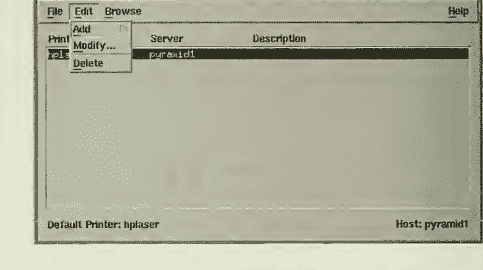

选择 Modify 下拉菜单后，Modify Printer 窗口会出现，如图 9-8 所示。

### 图 9-8

Modify Printer 窗口。

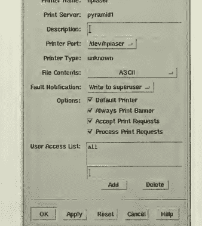

通过在 Modify Printer 窗口中选择或填写适当的字段来修改所选打印机。

我处理的系统问题大部分与打印机相关。本章向你介绍了 Solaris 打印系统和 lpsched 守护进程。第 10 章“Process Control”将探讨所有 Solaris 进程；有关 lpsched 守护进程的更详细讨论，请参阅 Solaris System Administrator’s Guide。

## CHAPTER

## 10

## 进程控制

本章的测试目标如下：

- 描述 UNIX 进程
- 理解如何向 UNIX 进程发送信号
- 理解 UNIX 如何调度进程
- 理解如何使用 UNIX 批处理设施


Solaris 是一个多任务环境，其中多个程序同时运行。每个 Solaris 程序称为一个进程。进程是在其自己的地址空间中运行的单个程序。在 Solaris 下，进程由一个地址空间和内核中用于跟踪该进程的一组数据结构组成。地址空间是包含执行任务代码的内存部分。内核必须跟踪系统上每个进程的以下数据：

- 地址空间
- 进程的当前状态
- 进程的执行优先级
- 进程的资源使用情况
- 当前信号掩码
- 进程的所有权

## 查看进程

进程与作业或命令不同，后者可能由多个进程协同工作以执行特定任务组成。每个进程都有一个与其关联的进程 ID，称为 pid。你可以使用 ps 命令查看当前正在执行的进程。进程具有某些直接影响执行的属性。它们列在表 10-1 中。

表 10-1 进程属性

| 属性 | 描述 |
|---|---|
| PID | 进程标识，是内核中定义进程的唯一编号 |
| PPID | 父 PID（进程的创建者） |
| UID | 拥有此进程的用户的用户 ID 编号 |
| EUID | 进程的有效用户 ID |
| GID | 拥有此进程的用户的组 ID |
| EGID | 拥有此进程的有效组 ID |
| Priority | 此进程运行的优先级 |

使用 ps 命令查看系统上当前正在运行的进程。在 ps 命令中添加 -l 选项会显示有关当前正在运行的进程的其他各种信息，包括每个进程的状态（列在 S 下）。用于显示各种进程状态的代码在表 10-2 中显示。


## 表 10-2 进程状态

| Code | Name | Description |
|---|---|---|
| O |  | 进程在处理器上运行。 |
| S | Sleeping | 进程正在等待事件完成。 |
| R | Runnable | 进程在运行队列上。 |
| I | Idle | 进程正在创建中。 |
| Z | Zombie state | 进程已终止且父进程未等待。 |
| T | Traced | 进程因父进程正在跟踪它而被信号停止。 |

要查看系统上运行的所有进程，输入

```
ps -el
```

系统响应以下输出：

```
F S UID PID PPID C PRI NI ADDR SZ WCHAN TTY TIME CMD
19 T 0 0 0 0 0 SY f627a638 0 ? 0:01 sched
8 S 0 1 0 0 41 20 f5af4888 162 f5af4a80 ? 0:01 init
19 S 0 2 0 0 0 SY f5af41c8 0 f028b64 ? 0:00 pageout
19 S 0 3 0 1 0 SY f5af3b08 0 f0288a4 ? 9:57 fsflush
8 S 0 299 1 0 65 20 f5af26c8 368 f5970ec console 0:00 ttymon
8 S 0 101 1 0 41 20 f5af3448 340 f5d5bfae ? 0:00 in.route
8 S 0 298 1 0 41 20 f5af2d88 350 f5982c78 ? 0:00 sac
8 S 0 111 1 0 41 20 f5af2b08 455 f5d5bf5e ? 0:01 rpcbind
8 S 0 164 1 0 41 20 f5d5e9e0 691 f5d5ef3 ? 0:01 syslogd
8 S 0 138 1 0 41 20 f5d5e1d0 450 f5d5be96 ? 0:00 inetsd
8 S 0 113 1 0 79 20 f5d5b1d0 462 f5d5bee ? 0:00 keyserv
8 S 0 160 1 0 41 20 f5d5d450 650 f5d5bc6b ? 0:00 automount
8 S 0 143 1 0 74 20 f5d5c9d0 502 f5d5bee ? 0:00 statd
8 S 0 145 1 0 77 20 f5d5c8d0 469 f5d5be1e ? 0:00 lockd
8 S 0 242 1 0 41 20 f5d5c010 514 f5d5b8a6 ? 0:01 vold
8 S 0 184 1 0 46 20 f5e4a898 480 f5e4aa90 ? 0:01 nscd
8 S 0 178 1 0 51 20 f5e4a1d8 360 f5982eb ? 0:01 cron
```

man page for the ps command 描述了使用 ps 命令显示的所有字段以及所有命令选项。表 10-3 列出了一些重要字段。

## 表 10-3 进程字段

| Field | Description |
|---|---|
| F | 与进程关联的标志。 |
| S | 进程的状态；两个最常见的值是 S 表示睡眠，R 表示运行。需要关注的一个重要值是 X，表示进程正在等待内存可用。当你在系统上频繁看到这种情况时，说明内存不足。有关进程状态的完整列表，请参阅表 10-2。 |
| UID | 进程所有者的用户 ID。对许多进程而言此值为 0，因为它们以 setuid 运行。 |
| PID | 每个进程的进程 ID。此值应唯一。通常 PID 按从低到高的顺序分配，但在某一点会回绕。此值对于向进程发送信号（如 kill 信号）是必要的。 |
| PPID | 父进程 ID。它标识启动该进程的父进程。使用 PPID 可以追踪发生的进程创建序列。 |
| PRI | 进程的优先级。不使用 -c 选项时，数值越大优先级越低。使用 -c 选项时，数值越大优先级越高。 |
| NI | nice 值，用于优先级计算。使用 -c 选项时不打印。进程的 nice 数值会影响其调度优先级。使进程更 nice 意味着降低其优先级。 |
| ADDR | 进程的内存地址。 |
| SZ | SIZE 字段。这是进程中的总页数。每页为 4,096 字节。 |
| WCHAN | 进程正在睡眠的事件的地址（如果为 -，则进程正在运行）。 |
| STIME | 进程的启动时间（以小时、分钟和秒为单位）。 |
| TTY | 分配给你的进程的终端。 |
| TIME | 进程累计使用的 CPU 时间（以分钟和秒为单位）。 |
| CMD | 生成该进程的命令。 |

你经常想要查看所有进程，可以使用命令 ps -el 来完成。ps 命令提供了许多选项来控制打印哪些信息。其中一些列在表 10-4 中。

## 表 10-4 ps 命令选项

| Option | Description |
|---|---|
| -A | 列出所有进程的信息。与 -e 相同。 |
| -a | 列出最常请求的所有进程的信息。未关联终端的进程将不会列出。 |
| -f | 生成完整列表。 |
| -P | 在额外的列标题 PSR 下打印进程绑定的处理器编号（如果有）。在多处理器系统上这是一个有用的选项。 |
| -u <username> | 仅列出特定用户进程数据。在列表中，除非使用 -f 选项打印登录名，否则将打印数字用户 ID。 |

有关 ps 命令选项的完整列表，请参阅 Solaris 在线手册页。

注意。UNIX sort 命令在查看系统进程时很有用。将 sort 命令用作管道输出以按大小或 PID 排序。例如，要按 SZ 字段排序，使用命令 ps -el | sort +9（记住，sort 从零开始编号字段）。

## 信号

Solaris 支持向进程发送软件信号的概念。这些信号是其他进程在硬件上下文之外与正在运行的进程交互的方式。kill 命令用于向进程发送信号。系统管理员最常使用信号 SIGHUP、SIGKILL 和 SIGSTOP。SIGHUP 信号由一些实用程序用作通知进程执行某项操作的方式。例如，如果电话连接丢失或挂断，则会向进程发送 SIGHUP 信号。SIGKILL 信号用于中止进程，而 SIGSTOP 信号用于暂停进程。表 10-5 描述了所使用的许多信号。

## 表 10-5 Solaris 下可用的信号

| Signal | Number | Description |
|---|---|---|
| SIGHUP | 1 | 挂断；通常表示控制终端已断开连接。 |
| SIGINT | 2 | 中断；用户可以通过按 Ctrl-C 或 Delete 生成此信号。 |
| SIGQUIT | 3 | 退出进程并生成核心转储。 |
| SIGILL | 4 | 非法指令。 |
| SIGTRAP | 5 | 跟踪或断点陷阱。 |
| SIGABRT | 6 | 中止。 |
| SIGEMT | 7 | 仿真陷阱。 |
| SIGFPE | 8 | 算术异常；通知进程浮点错误。 |
| SIGKILL | 9 | 被杀；强制进程终止。这是确保终止。 |
| SIGBUS | 10 | 总线错误。 |
| SIGSEGV | 11 | 段错误。 |
| SIGSYS | 12 | 错误的系统调用。 |
| SIGPIPE | 13 | 破管。 |
| SIGALRM | 14 | 闹钟。 |
| SIGTERM | 15 | 终止；温和的终止，给进程清理的机会。 |
| SIGUSR1 | 16 | 用户信号 1。 |
| SIGUSR2 | 17 | 用户信号 2。 |
| SIGCHLD | 18 | 子进程状态改变。 |
| SIGPWR | 19 | 断电或重启。 |
| SIGWINCH | 20 | 窗口大小改变。 |
| SIGURG | 21 | 紧急套接字条件。 |
| SIGPOLL | 22 | 可轮询事件。 |
| SIGSTOP | 23 | 停止（信号）；暂停进程。 |
| SIGTSTP | 24 | 停止（用户）。 |
| SIGCONT | 25 | 继续。 |
| SIGTTIN | 26 | 停止（tty 输入）。 |
| SIGTTOU | 27 | 停止（tty 输出）。 |
| SIGVTALRM | 28 | 虚拟计时器到期。 |
| SIGPROF | 29 | 配置文件计时器到期。 |
| SIGXCPU | 30 | CPU 时间限制超出。 |
| SIGXFSZ | 31 | 文件大小限制超出。 |
| SIGWAITING | 32 | 线程库保留的并发信号。 |
| SIGLWP | 33 | 线程库保留的进程间 LWP 信号。 |
| SIGFREEZE | 34 | 检查点冻结。 |
| SIGTHAW | 35 | 检查点解冻。 |
| SIGCANCEL | 36 | 线程库保留的取消信号。 |

此外，你可以在程序中编写信号处理程序以响应发送的信号。例如，许多系统管理实用程序，如名称服务器，通过重新读取其配置文件来响应 SIGHUP 信号。然后此信号可用于在运行时更新进程，而无需终止并重新启动进程。对于许多信号而言，除了打印适当的错误消息并终止进程之外，无法做其他事情。

kill 命令向进程发送终止信号（信号 15）并且进程被终止。信号 15 是在使用 kill 命令时未使用选项时的默认值，是一种温和的终止，允许进程在终止前执行清理工作。另一方面，信号 9 被称为确保的、无条件的终止，因为它不能被进程捕获或忽略。如果在 kill -9 之后进程仍然存在，则它要么在 UNIX 内核中挂起等待诸如磁盘 I/O 之类的事件完成，要么你不是该进程的所有者。kill 命令通常用于向进程发送信号。你可以终止你拥有的任何进程，而超级用户可以终止系统中的所有进程，除了进程 ID 为 0、1、2、3 和 4 的进程。kill 命令命名不当，因为并非它发送的所有信号都用于终止进程。该命令得名于其最常见的用途——使用 kill -15 信号终止进程。

一个常见问题是当进程不断启动自己的新副本时——称为分叉或生成。用户在可以分叉的新进程数量上有限制。此限制在内核中用 MAXUP（最大用户进程数）值设置。有时，由于用户错误，进程不断分叉自己的新副本，直到用户达到 MAXUP 限制。当用户达到 MAXUP 限制时，系统似乎在等待。如果你终止用户的一部分进程，系统将恢复代表用户创建新进程。这可能是一个无赢局面。处理这些失控进程的最佳方法是发送 STOP 信号暂停所有进程，然后发送 KILL 信号终止进程。因为进程首先被暂停，所以在你终止它们时它们不能创建新进程。

你可以使用 kill 命令向你拥有的进程发送信号。许多信号可用，但现在你只需要担心两个——9 和 15。要向进程发送信号，首先使用 ps 命令找到进程 ID（PID）号码。例如，输入 ps -ef 列出所有进程并找到你希望终止的进程。

| UID | PID | PPID | C | STIME | TTY | TIME | CMD |
|---|---|---|---|---|---|---|---|
| root | 0 | 0 | 0 | Nov 27 | ? | 0:01 | sched |
| root | 1 | 0 | 0 | Nov 27 | ? | 0:01 | /etc/init - |
| root | 2 | 0 | 0 | Nov 27 | ? | 0:00 | pageout |
| root | 3 | 0 | 0 | Nov 27 | ? | 12:52 | fsflush |
| root | 101 | 1 | 0 | Nov 27 | ? | 0:00 | /usr/sbin/in.routed -q |
| root | 298 | 1 | 0 | Nov 27 | ? | 0:00 | /usr/lib/saf/sac -t 300 |
| root | 111 | 1 | 0 | Nov 27 | ? | 0:02 | /usr/sbin/rpcbind |
| root | 164 | 1 | 0 | Nov 27 | ? | 0:01 | /usr/sbin/syslogd -n -z 12 |
| root | 138 | 1 | 0 | Nov 27 | ? | 0:00 | /usr/sbin/inetd -s |
| root | 113 | 1 | 0 | Nov 27 | ? | 0:00 | /usr/sbin/keyserv |
| root | 160 | 1 | 0 | Nov 27 | ? | 0:01 | /usr/lib/autofs/automountd |
| . | . | . | . | . | . | . | . |
| root | 439 | 424 | 0 | Nov 27 | ? | 0:00 | /bin/cat /tmp/.removable/notify0 |
| root | 5497 | 433 | 1 | 09:58:02 | pts/4 | 0:00 | script ps ef |

要终止 PID 号为 5497 的进程，输入

```
kill -15 5497
```

## 调度进程

进程竞争执行时间。调度是分时系统中的关键要素之一，决定接下来哪个进程将被执行。尽管系统上可能存在数百个进程，但任何给定时刻只有一个进程实际使用 CPU。CPU 上的分时涉及挂起一个进程，然后在稍后某个时间重新启动它。由于活动进程的挂起和恢复每秒发生多次，用户看起来系统正在同时执行许多任务。

UNIX 通过给使用 CPU 时间最少的进程赋予更高优先级来尝试管理进程的优先级。此外，等待事件（如键盘按下）的用户获得的优先级高于纯 CPU 驱动的进程。在任何拥有多个竞争用户组的庞大系统中，管理资源的工作落在系统管理员身上。这项任务既有技术性也有政治性。作为系统管理员，你必须了解公司的目标才能管理好这项任务。

当你理解了关于谁应获得优先级的政治含义时，你就可以管理技术细节了。作为 root，你可以使用 nice 或 priocntl 命令更改系统上任何进程的优先级。在这样做之前，你必须了解优先级的工作原理。

### 调度优先级

所有进程都被分配了一个执行优先级——一个整数值，该值根据多个不同因素动态计算并更新。每当 CPU 空闲时，调度程序就会选择最受青睐的进程以恢复执行。所选进程是优先级数字最低的进程，因为较低的数字被定义为比较高的数字更受青睐。同一优先级级别的多个进程被放入该优先级级别的运行队列中。每当 CPU 空闲时，调度程序启动最低编号的非空运行队列头部处的进程。当运行队列顶部的进程停止执行时，它会移到队列末尾，下一个进程移到前面。进程开始运行后，会一直执行，直到它需要等待 I/O 操作完成、收到中断信号或耗尽该系统定义的最多执行时间片。典型的时间片为 10 毫秒。

UNIX 进程与其关联着两个优先级数字。其中一个优先级数字是相对于其他进程的请求执行优先级。该值（其 nice 数）由进程所有者和 root 设置；在 ps -l 列表中显示在 NI 列。分配给进程的另一个优先级是执行优先级。该优先级由操作系统计算并动态更新，考虑的因素包括进程的 nice 数、最近获得的 CPU 时间以及正在运行的其他进程及其优先级。执行优先级值在 ps -l 列表的 PRI 列中显示。

尽管 CPU 是系统中最受关注的资源，但它并不是唯一资源。内存使用、磁盘使用、I/O 活动和进程数量共同决定了计算机的吞吐量。例如，假设你有两个组 A 和 B。这两个组都需要大量内存——当两者同时运行时，超过可用内存。如果组 B 没有完全释放其使用的内存，则提高组 A 相对于组 B 的优先级可能无济于事。尽管分页系统会随着时间推移完成此操作，但将进程换出到磁盘的过程可能很密集，并可能大大降低性能。更好的替代方案可能是用信号完全停止组 B，然后在组 A 完成后稍后再继续它。

### 使用 nice 更改分时进程的优先级

nice 命令仅为向后兼容之前的 Solaris 版本而提供支持。priocntl 命令在管理进程方面提供了更大的灵活性。进程的优先级由其调度类的策略和 nice 数决定。每个分时进程都有一个全局优先级，该优先级通过将用户提供的优先级（可受 nice 或 priocntl 命令影响）和系统计算的优先级相加来计算。

进程的执行优先级数字由操作系统分配，并由多个因素决定，包括其调度类、已使用的 CPU 时间以及 nice 数。每个分时进程都以默认的 nice 数启动，该数值继承自其父进程。nice 数显示在 ps 报告的 NI 列中。

用户可以通过增加其用户提供的优先级数字来降低进程的优先级。只有超级用户才能通过降低其 nice 值来提高进程的优先级。这可以防止用户提高自己进程的优先级，从而垄断更大的 CPU 份额。

在 UNIX 中，nice 数范围从 0 到 +19。最高优先级为 0。有两个版本的命令可用——标准版本 /usr/bin/nice，以及 C shell 的一部分的版本。提交程序或命令时，请按照表 10-6 中所述使用 nice 命令。

**表 10-6 使用 nice 设置优先级**

*降低进程的优先级*

| 命令 | 描述 |
|---|---|
| nice command_name | 将 nice 数增加四个单位（默认值）。 |
| nice +4 command_name | 将 nice 数增加四个单位。 |
| nice +10 command_name | 将 nice 数增加 10 个单位。 |

*提高进程的优先级*

| 命令 | 描述 |
|---|---|
| nice -10 command_name | 通过降低 nice 数提高命令的优先级。 |
| nice - -10 command_name | 通过降低 nice 数提高命令的优先级。需要两个减号。第一个减号是选项符号，第二个减号表示负数。 |

作为系统管理员，你可以在进程提交后使用 renice 命令更改其优先级。renice 命令的形式如下：

```
renice -n <value> -p <pid>
```

使用 ps -el 命令查找要更改优先级的进程的 PID。以下示例中要更改的进程名为 "largejob"：

```
F S UID PID PPID C PRI NI ADDR SZ WCHAN TTY TIME CMD
9 S 0 8200 4100 0 84 20 f0274e38 193 ? 0:00 largejob
```

发出以下命令以提高 PID 8200 的优先级：

```
renice -n -4 -p 8200
```

再次发出 ps -el 命令显示该进程具有更高的优先级：

```
F S UID PID PPID C PRI NI ADDR SZ WCHAN TTY TIME CMD
9 S 0 8200 4100 0 60 12 f0274e38 193 ? 0:00 largejob
```

### 使用 priocntl 更改进程的调度优先级

作为对实时进程的支持，Solaris 下的标准优先级方案已得到改进。实时进程设计用于需要几乎立即响应事件的应用领域。这些进程在运行时几乎可以完全访问所有系统资源。Solaris 使用范围从 -20 到 20 的分时优先级数字。Solaris 使用 priocntl 命令（旨在改进 nice 命令）来修改进程优先级。要使用 priocntl 更改进程的优先级，请输入

```
priocntl -s -p <new-priority> -i pid <process-id>
```

其中 new-priority 是进程的新优先级，process-id 是你要更改的进程的 PID。以下示例将进程 8200 的优先级级别设置为 -5：

```
priocntl -s -p -5 -i pid 8200
```

以下示例用于为给定父进程创建的每个进程设置优先级（nice 值）：

```
priocntl -s -p -5 -I ppid 8200
```

执行此命令后，从进程 8200 分叉的所有进程的优先级都将为 -5。

有关 priocntl 命令的更多信息，请参阅在线手册页。


## Solaris 批处理设施

在繁忙的系统上划分进程的一种方式是安排作业在不同时间运行。例如，一个大型作业可以安排在凌晨2点运行，此时系统通常处于空闲状态。Solaris 支持两种批处理方法——crontab 和 at 命令。crontab 命令按固定间隔安排多个系统事件，而 at 命令安排单个系统事件。

### crontab

cron 守护进程根据每个 crontab 文件中包含的命令安排系统事件。crontab 文件由按固定间隔执行的命令组成，每行一条。每行的开头包含五个日期和时间字段，告诉 cron 守护进程何时执行命令。第六个字段是要运行的程序的完整路径名。这些字段在表 10-7 中有描述，由空格分隔。

表 10-7 crontab 文件

| 字段 | 描述 | 值 |
|---|---|---|
| 1 | 分钟 | 0-59 此字段中的 * 表示每分钟。 |
| 2 | 小时 | 0-23 此字段中的 * 表示每小时。 |
| 3 | 月中的日期 | 1-31 此字段中的 * 表示每月的每一天。 |
| 4 | 月份 | 1-12 此字段中的 * 表示每个月。 |
| 5 | 星期几 | 0-6（0=星期日）此字段中的 * 表示每周每一天。 |
| 6 | 命令 |  |

在 crontab 中添加条目时请遵循以下准则：

- 用空格分隔字段。
- 用逗号分隔时间字段中的多个值。
- 使用连字符指定时间字段中的值范围。
- 使用星号作为通配符以包含时间字段中的所有可能值。例如，星号 (*) 可用于时间字段中表示所有合法值。
- 在行开头使用注释标记 (#) 表示注释或空行。
- crontab 文件中的每个命令必须占一行，即使非常长，因为 crontab 不识别额外的回车符。

以下示例 crontab 命令条目会在每个月的 1 日和 15 日下午 5 点在用户控制台窗口中显示提醒。

```
0 17 1,15 * * echo Handing Timesheet > /dev/console
```

crontab 文件位于 /var/spool/cron/crontabs 目录中。除了 root 之外，SunOS 软件安装期间还提供了多个 crontab 文件，也位于此目录中。其他 crontab 文件以创建它们的账户命名，例如 bill、glenda、miguel 或 nicole。它们也位于 /var/spool/cron/crontabs 目录中。例如，名为 root 的 crontab 文件在软件安装期间提供。其内容包括以下命令行：

```
10 3 * * 0,4 /etc/cron.d/logchecker
10 3 * * 0 /usr/lib/newsyslog
15 3 * * /usr/lib/fs/nfs/nfssfind
1 2 * * * [ -x /usr/sbin/rtc ] && /usr/sbin/rtc -c > /dev/null 2>&1
```

第一行命令指示系统在星期日和星期四晚上 3:10 运行 logchecker。第二行命令安排系统在每个星期日早上 3:10 运行 newsyslog。第三行命令指示系统每天早上 3:15 执行 nfssfind。第四行命令指示系统检查夏令时并在必要时进行修正。如果没有 RTC 时区或没有 /etc/rtc_config 文件，此条目将不执行任何操作。

cron 守护进程处理 crontab 命令的自动调度。其功能是每 15 分钟检查一次 /var/spool/cron/crontabs 目录是否存在 crontab 文件。它检查新的 crontab 文件或现有文件的更改，读取文件中的执行时间，并在适当的时间提交命令执行。

### 如何创建或编辑 crontab 文件

在 crontab 文件中创建条目与使用您喜欢的编辑器编辑文本文件一样简单。步骤如下：

1. （可选）要创建或编辑属于 root 或其他用户的 crontab 文件，请成为超级用户。
2. 通过输入创建新的 crontab 文件或编辑现有文件
   `crontab -e`
3. 按照表 10-7 中描述的语法向文件添加命令行。
4. 保存更改并退出文件。crontab 文件放置在 /var/spool/cron/crontabs 中。
5. 通过输入验证 crontab 文件
   `crontab -l`

系统会通过列出 crontab 文件的内容做出响应。

### 控制对 crontab 的访问

您可以通过修改 /etc/cron.d 目录中的两个文件来控制对 crontab 的访问：cron.deny 和 cron.allow。这些文件仅允许指定用户执行 crontab 任务，例如创建、编辑、显示或删除自己的 crontab 文件。cron.deny 和 cron.allow 文件由用户名列表组成，每行一个。这些访问控制文件按以下方式协同工作：

- 如果存在 cron.allow，则只有列在此文件中的用户可以创建、编辑、显示或删除 crontab 文件。
- 如果不存在 cron.allow，则所有用户都可以提交 crontab 文件，除 cron.deny 中列出的用户外。
- 如果 cron.allow 和 cron.deny 都不存在，则需要超级用户权限才能运行 crontab。

编辑或创建 cron.deny 和 cron.allow 需要超级用户权限。

在 Solaris 软件安装期间，会提供默认的 /etc/cron.d/cron.deny 文件，其中包含以下条目：

- daemon
- bin
- smtp
- nuucp
- listen
- nobody
- noaccess

cron.deny 文件中列出的用户均无法访问 crontab 命令。系统管理员可以编辑此文件以添加将被拒绝访问 crontab 命令的其他用户。未提供默认的 cron.allow 文件。这意味着在 Solaris 软件安装后，所有用户（除默认 cron.deny 文件中列出的用户外）都可以访问 crontab。如果您创建 cron.allow 文件，则只有这些用户可以访问 crontab 命令。

### 安排单个系统事件（at）

at 命令用于安排作业在稍后时间执行。与按固定间隔安排作业的 crontab 不同，使用 at 提交的作业将在指定时间执行一次。

要提交 at 作业，输入 at。然后指定执行时间和要运行的程序，如以下示例所示：

```
at 07:45am today
at> who > /tmp/log
at> <Press Control-d>
job 912687240.a at Thu Dec 3 07:14:00 1998
```

当您提交 at 作业时，会分配一个作业标识号，连同 .a 扩展名一起成为其文件名。该文件存储在 /var/spool/cron/atjobs 目录中。cron 守护进程以与调度 crontab 作业类似的方式控制 at 文件的调度。

at 命令语法列在表 10-8 中。

### 表 10-8 at 命令语法

|  |  |
|---|---|
| at -m <time> <date> |  |
| -m | 作业完成后向您发送邮件。 |
| time | 您希望安排作业的小时。如果不按 24 小时制指定小时，请添加 am 或 pm。"Midnight"、"noon" 和 "now" 是可接受的关键字。分钟是可选的。 |
| date | 月份、星期几的前三个或更多字母，或关键字 "today" 或 "tomorrow"。 |

您可以设置一个文件来控制对 at 命令的访问，仅允许指定用户创建、删除或显示其 at 作业的队列信息。控制对 at 访问的文件是 /etc/cron.d/at.deny，由用户名列表组成，每行一个。此文件中列出的用户无法访问 at 命令。at.deny 文件在 SunOS 软件安装期间创建，包含以下用户名：

- daemon
- bin
- smtp
- nuucp
- listen
- nobody
- noaccess

拥有超级用户权限，您可以编辑此文件以添加您想要限制其 at 访问的其他用户名。

要检查等待在 at 队列中的作业，请使用 atq 命令。此命令显示您创建的 at 作业的状态信息。使用 atq 命令验证您是否已创建 at 作业。atq 命令确认 at 作业已提交到队列，如以下示例所示：

```
atq
Rank Execution Date Owner Job Queue Job Name
1st Dec 3, 1998 08:00 root 912690000.a a stdin
2nd Dec 3, 1998 08:05 root 912690300.a a stdin
```


另一种检查 at 作业的方法是发出 at -l 命令。此命令显示用户提交的所有作业的状态信息，如以下示例所示：

```
at -l
user = root  912690000.a  Thu Dec  3 08:00:00 1998
user = root  912690300.a  Thu Dec  3 08:05:00 1998
```

若要在作业执行前将其从队列中移除，请键入

```
at -r [job-id]
```

其中 job-id 是你要移除的作业的识别号码。

通过使用 at -l（或 atq）命令显示 at 队列中剩余的作业来验证 at 作业是否已移除。你指定的识别号码对应的作业不应出现。在下面的示例中，我们将移除一个计划于 12 月 3 日上午 08:00 执行的 at 作业。首先，检查 at 队列以定位作业识别号码。

```
at -l
user = root  912690000.a  Thu Dec  3 08:00:00 1998
user = root  912690300.a  Thu Dec  3 08:05:00 1998
```

接下来，从 at 队列中移除该作业：

```
at -r 912690000.a
```

最后，验证该作业是否已从队列中移除。

```
at -l
user = root  912690300.a  Thu Dec  3 08:05:00 1998
```

综上所述，系统管理员需要了解每个应用程序所属的进程。当用户报告问题时，系统管理员可以快速定位正在使用的进程并查找异常。通过密切关注系统进程，你将熟悉什么是正常、什么是异常。不要等到问题发生才处理——每天监控系统进程。创建 shell 脚本来替你监控进程。通过采取主动的系统管理方法，你可以在问题影响用户之前发现问题。在第 11 章“Backup and Recovery”中，我们将从系统设置和进程转移，来看系统管理员最重要的预防性维护任务——系统备份。

## 第 11 章 备份和恢复


本章的测试目标如下：

- 使用 Solaris 实用程序 tar、dd、cpio 和 pax 复制数据
- 使用 ufsdump 和 ufsrestore 备份和恢复数据

## Solaris 备份和恢复实用程序

备份系统涉及将数据从系统的硬盘复制到可安全保存在安全区域的可移动媒体上。如果文件损坏或系统故障或建筑物灾难导致数据被破坏，则使用备份来恢复数据。仅拥有容错磁盘阵列是不够的。磁盘镜像和 RAID 5 可在硬件故障时保护您的数据，但它们无法防止文件损坏、自然灾害或意外删除文件。备份系统数据——你将执行的最重要的任务——必须定期进行。即使是全面的备份方案也无法保证不会丢失信息，但你可以确保损失将最小。本章描述了执行备份的方法、备份类型、制定可靠备份策略的开发以及在遇到损失时恢复数据的方法。首先你会找到 tar、dd、cpio 和 pax 命令的解释，这些命令用于将数据从磁盘复制到磁盘或从磁盘复制到磁带。然后描述 ufsdump 和 ufsrestore 实用程序，作为定期将 Solaris 系统数据备份到磁带的首选方法。

Solaris 提供了以下可用于将数据从磁盘复制到可移动媒体并恢复的实用程序：

| 实用程序 | 描述 |
|---|---|
| tar | 用于将数据归档到另一个目录、系统或媒体。 |
| dd | 用于快速复制数据。 |
| cpio | 用于将数据从一个位置复制到另一个位置。 |
| pax | 使用 pax 将文件和目录子树复制到单个磁带。此命令比 tar 或 cpio 具有更好的可移植性，因此可用于将文件传输到其他类型的 UNIX 系统。 |
| ufsdump | 用于备份文件系统中的所有文件。 |
| ufsrestore | 用于恢复使用 ufsdump 命令归档的一些或全部文件。 |

## tar

tar（tape archiver，磁带归档器）命令的主要用途是从硬盘复制文件系统或单个文件到磁带，或从磁带复制到硬盘。你也可以用它在硬盘或软盘上创建 tar 归档，并在硬盘或软盘上的 tar 归档中提取文件。tar 命令很受欢迎，因为它在大多数 UNIX 系统上都可用；然而，它仅限于单个磁带。如果你要备份的数据需要多个磁带，请使用 cpio、pax 或 ufsdump 命令。

tar 命令具有以下语法：

```
tar <options> <tar filename> <file list>
```

其中 options 是表 11-1 中列出的命令选项列表。有关选项的更完整列表，请参阅 Solaris 在线手册页。tar filename 与 f 选项一起使用，可以是你想要使用的任何名称。tar filename 也可以是设备的名称，例如 /dev/rmt/0 或 /dev/rfd0。file list 是你要包含在归档中的文件列表。

### 表 11-1 tar 的命令选项

| 选项 | 描述 |
|---|---|
| c | 创建 tar 文件。 |
| t | 目录表。每次在 tar 文件名中出现时列出指定文件的文件名。如果未给出文件参数，则列出 tar 文件名中所有文件的文件名。与 v 函数修饰符一起使用时，它会显示指定文件的附加信息。 |
| x | 从 tar 文件名中提取或恢复文件。 |
| v | 详细。tar 读取或写入归档时将信息输出到屏幕。 |
| f | 使用 tar filename 参数作为 tar 归档的名称。如果省略 f，tar 使用 TAPE 环境变量指示的设备（如果设置）。如果未设置 TAPE 变量，tar 使用 /etc/default/tar 中定义默认值。如果 tar 文件的名称为 '-'，tar 将写入标准输出。 |

要在磁带设备 /dev/rmt/0 上创建 /home/bcalkins 目录中所有内容的磁带归档，请键入以下内容：

```
tar cvf /dev/rmt/0 /home/bcalkins
```

要列出归档中的文件，请键入：

```
tar tvf /dev/rmt/0
```

要从归档中恢复文件 /home/bcalkins/.profile，请键入：

```
tar xvf /dev/rmt/0 /home/bcalkins/.profile
```

使用相对于当前工作目录的路径名而不是绝对路径名（以正斜杠开头）将其放入归档中。然后文件可以恢复到任何目录。

## dd

dd 命令的主要优点是它可以快速转换和复制具有不同数据格式的文件，例如块大小或记录长度的差异。

此命令最常见的用途是从硬盘将完整的文件系统或分区传输到磁带。你也可以用它将文件从一个硬盘复制到另一个硬盘。当你复制数据时，dd 命令会创建任何媒体的映像副本（精确的字节对字节副本），该媒体可以是磁带或磁盘。以下 dd 命令的语法在表 11-2 中描述。

```
dd if=<input-file> of=<output-file> <option=value>
```

### 表 11-2 dd 命令语法

|  |  |
|---|---|
| if | 用于指定输入文件。输入文件可以是文件名或设备名，例如 /dev/rmt/0。如果未指定输入文件，dd 的输入取自 UNIX 标准输入。 |
| of | 用于指定输出文件。输出文件可以是文件名或设备名，例如 /dev/rmt/0。如果省略输出文件，dd 的输出将发送到 UNIX 标准输出。 |

在命令行上可以跟随其他选项来指定缓冲区大小、块大小和数据转换。有关这些选项的列表，请参阅 Solaris 在线手册页。

下面几个示例说明了使用 dd 命令复制数据的用法。第一个示例展示了如何使用 dd 命令复制磁带。此过程需要两个磁带驱动器：源磁带和目标磁带。

```
dd if=/dev/rmt/0 of=/dev/rmt/1
```

下一个示例使用 dd 将整个硬盘复制到另一个硬盘。在示例中，我们需要两个磁盘，并且两者必须具有相同的几何结构。

```
dd if=/dev/rdsk/c0t0d0s2 of=/dev/rdsk/c0t4d0s4 bs=128
```

在此示例中，选项 bs=128 指定块大小。较大的块大小，例如 128KB 或 256KB，会通过缓冲大量数据来减少复制时间。还请注意指定了原始设备。为了使此技术正常工作，你必须使用原始（字符）设备以避免缓冲（块）I/O 系统。

dd 命令可与 tar 结合使用，在远程磁带驱动器上创建归档。在下一个示例中，tar 用于通过将输出通过管道传输到名为 xena 的远程系统上的名为 /dev/rmt/0 的磁带驱动器来在远程系统上创建归档。

```
tar cf - files | rsh xena dd of=/dev/rmt/0 obs=128
```


另一个示例是读取来自另一台 UNIX 系统（如 Silicon Graphics）的 tar 数据。Silicon Graphics 会交换每对字节，使 tar 磁带在 Solaris 系统上无法读取。要读取来自 SGI 系统的 tar 磁带，请输入

```
dd if=/dev/nrst0 conv=swab | tar xvf -
```

类似地，Solaris 系统可以创建可被 SGI 系统读取的 tar 磁带：

```
tar cvf - | dd of=/dev/nrst0 conv=swab
```

## cpio

cpio 命令用于将数据从一个位置复制到另一个位置。cpio 代表“copy input to output”。使用 cpio 复制文件时，您向其标准输入提供文件列表，并将文件归档写入其标准输出。cpio 的主要优点是其灵活的语法。该命令充当过滤器程序，从标准输入文件获取输入信息并将其输出传递到标准输出文件。输入和输出可以通过使用 shell 指定重定向和管道来操作。cpio 相对于其他 UNIX 实用程序的优点是

- cpio 可以备份和恢复单个文件，而不仅仅是整个文件系统。
- cpio 创建的备份比 tar 创建的备份更小，因为其头文件更小。
- cpio 可以跨多个磁带；tar 仅限于单个磁带。

由于其灵活性，cpio 具有更多选项，被认为比 tar 更复杂的命令。

cpio 程序运行于三种模式之一：copy-out（cpio -o）、copy-in（cpio -i）和 pass（cpio -p）。创建备份磁带时使用 copy-out，从磁带恢复或列出文件时使用 copy-in。pass 模式通常用于在磁盘上将文件从一个位置复制到另一个位置。您必须始终指定这三种模式之一。cpio 命令的语法为

```
cpio <mode> <option>
```

其中 mode 为 -i、-o 或 -p，option 为表 11-3 中的一个选项。

### 表 11-3 cpio 命令选项

| 选项 | 描述 |
|---|---|
| c | 以 ASCII 格式写入头信息以便移植。 |
| d | 按需创建尽可能多的目录。 |
| B | 指定输入的记录阻塞因子为 5,120 字节，而不是默认的 512 字节记录。检索或从磁带复制文件到硬盘时，必须使用与从硬盘复制文件到磁带时相同的阻塞因子。只要将文件或文件系统复制到磁带驱动器或从磁带驱动器复制，就必须使用此选项。 |

### 表 11-3 cpio 命令选项（续）

| 选项 | 描述 |
|---|---|
| v | 详细。报告正在处理的文件名。 |
| u | 无条件复制。没有此选项，较旧的文件不会替换具有相同名称的新文件。 |
| m | 保留先前的文件修改时间。此选项对正在复制的目录无效。 |

以下示例显示如何将目录 /work 及其子目录复制到设备名为 /dev/rmt/0 的磁带驱动器。

```
cd /work
ls -R | cpio -ocB > /dev/rmt/0
```

下一个示例显示如何将磁带上的文件复制回硬盘上的名为 /work 的目录：

```
cd /work
cpio -icdB < /dev/rmt/0
```

## 使用 Copy-Out 模式备份文件

要使用 copy-out 模式进行备份，您通过 cpio 的标准输入向 cpio 命令发送文件列表。实际上，您将使用 UNIX find 命令生成要备份的文件列表。copy-out 模式通过在 cpio 命令行上使用 -o 选项指定。在下一个示例中，名为 list 的文件包含要备份到磁带的简短文件列表。

```
cpio -ovB list > /dev/rmt/1
```

通常，如表 11-3 所示，cpio 以 512 字节记录将文件写入标准输出。通过指定 -B 选项，您可以将记录大小增加到 5,120 字节，从而显著提高传输速率，如前例所示。

您可以使用 UNIX 命令以多种其他方式生成 cpio 要备份的文件列表，如以下示例所示。

可以通过键盘输入文件名来备份文件。输入完文件名后按 Ctrl-D。

```
cpio -o > /dev/rmt/1
File1.txt
File2.txt
<Ctrl-D>
```

ls 命令可用于生成 cpio 要备份的文件列表。

```
cd /home/bcalkins
ls * | cpio -o > /dev/rmt/1
```

使用 find 命令生成由用户 bcalkins 创建并在最近五天内修改过的文件列表。这是要备份的文件列表。

```
find . -user bcalkins -mtime -5 -print | cpio -o > /dev/rmt/1
```

如果当前磁带已满，cpio 程序会提示您更换另一盘磁带。您会看到一条消息：

> > "If you want to go on, type device/file name when ready"

然后您应更换磁带并输入备份设备的名称（例如，/dev/rmt/1）。

## 使用 Copy-In 模式恢复文件

使用 cpio 的 copy-in 模式从磁带恢复文件到磁盘。以下示例描述了从 cpio 归档恢复文件的方法。

第一个示例将磁带上的所有文件和目录恢复到磁盘。指定的 cpio 选项将无条件（-u）将文件恢复到 /users 目录并保留先前的文件修改时间（-m）：

```
cd /users
cpio -icvumB < /dev/rmt/1
```

下一个示例有选择地恢复以 database 开头的文件。-d 选项将按需创建目录。

```
cpio -icvdmB 'database*' < /dev/rmt/1
```

注意。必须使用单引号将通配符参数 (*) 传递给 cpio。

## Pass 模式

Pass 模式通常不用于备份。目标必须是挂载文件系统上的目录，这意味着 pass 模式不能用于将文件传输到磁带。但是，您可以在 cpio 中使用 pass 模式将文件从一个目录复制到另一个目录。使用 cpio 而非 cp 的优点是原始修改时间和所有权得以保留。通过在 cpio 中使用 -p 选项指定 pass 模式。以下示例将 /users 中的所有文件复制到 /bkup。

```
cd /users
mkdir /bkup
ls * | cpio -pduv bkup
```

文件在复制时将被列出到屏幕上。

## pax

Solaris 2.5 中新增了 pax 命令，这是一种符合 POSIX 的归档实用程序，可读取和写入 tar 和 cpio 归档。它可在大多数符合 POSIX 的 UNIX 系统上使用。

pax 可以读取、写入和列出归档文件中的成员并复制目录层次结构。pax 实用程序支持多种归档格式，包括 tar 和 cpio。

这里有一个不错的功能：如果 pax 在处理过程中发现归档已损坏或损坏，pax 会尝试从媒体缺陷中恢复。它会搜索归档以定位并处理尽可能多的归档成员。

所采取的操作取决于 -r 和 -w 选项的存在，这些选项被称为四种操作模式：list、read、write 和 copy（在表 11-4 中描述）。pax 命令的语法为

```
pax <mode> <options>
```

表 11-4 pax——四种操作模式

| 模式 | 描述 |
|------|-------------|
| -r | 读取模式（当指定 -r 但未指定 -w 时），pax 提取归档文件中找到的文件名和目录。归档文件从磁盘或磁带读取。如果提取的文件是目录，则文件层次结构也会被提取。提取的文件相对于当前文件层次结构创建。 |
| (none) | 列表模式（当既未指定 -r 也未指定 -w 时），pax 写入归档文件中找到的文件名或目录。归档文件从磁盘、磁带或标准输入读取。列表写入标准输出。 |
| -w | 写入模式（当指定 -w 但未指定 -r 时），pax 以归档格式将文件内容写入标准输出。如果未指定文件，则从标准输入读取要复制的文件列表（每行一个）。目录包括以该文件为根的文件层次结构中的所有文件。 |
| -rw | 复制模式（当同时指定 -r 和 -w 时），pax 将指定文件复制到目标目录。 |

除了选择操作模式外，您还可以从表 11-5 中选择一个或多个选项。有关 pax 命令的更多选项，请参阅 Solaris 在线手册页。


## 表 11-5 pax 命令选项

| Option | Description |
|---|---|
| -r | 从标准输入读取归档文件并提取指定的文件。如果提取归档成员需要任何中间目录，则创建这些目录。 |
| -w | 以指定的归档格式将文件写入标准输出。当未指定文件操作数时，标准输入被读取为路径名列表——每行一个，不带任何前导或尾随空白。 |
| -a | 将文件追加到先前写入的归档末尾。 |
| -b | 块大小。块大小必须是 512 字节的倍数，最大为 32,256 字节。块大小可以以 k 或 b 结尾，分别指定乘以 1,024（1K）或 512。 |
| -c | 匹配除模式和文件操作数指定的那些之外的所有文件或归档成员。 |
| -f <archive> | 指定归档为输入或输出归档的路径名。单个归档可能跨多个文件和不同的归档设备。必要时，pax 会提示下一个卷在归档中的文件或设备的路径名。 |
| -n | 选择与每个模式操作数匹配的第一个归档成员。对每个模式最多匹配一个归档成员。 |
| -p <string> | 指定一个或多个文件特征选项（权限）。字符串选项参数是一个字符串，指定在提取时要保留或丢弃的文件特征。该字符串由指定字符 a、e、m、o 和 p 组成。多个特征可以在同一字符串内连接，并且可以指定多个 -p 选项。指定字符的含义如下：

 a—不保留文件访问时间。
 e—保留所有内容：用户 ID、组 ID、文件模式位、文件访问时间和文件修改时间。
 m—不保留文件修改时间。
 o—保留用户 ID 和组 ID。
 p—保留文件模式位。 |
| -v | 详细模式。 |
| -x <format> | 指定输出归档格式，默认格式为 ustar。pax 目前支持 cpio、tar、bcpio、ustar、sv4crc 和 sv4cpio。 |

使用 pax 时，您还可以指定文件操作数以及表 11-5 中的选项。操作数指定目标目录或文件路径名。如果您指定目录操作数但目录操作数不存在、用户无法写入或不是目录类型，则 pax 以非零退出状态退出。

文件操作数指定要复制或归档的文件的路径名。当文件操作数未选择至少一个归档成员时，pax 将这些文件操作数路径名写入标准错误中的诊断消息，然后以非零退出状态退出。

另一个操作数是模式操作数，用于选择一个或多个归档成员的路径名。归档成员是通过使用文件名模式匹配表示法来选择的，该表示法由 fnmatch(3) 描述。模式操作数的示例是

- ? 问号是匹配任意字符的模式。
- * 星号是匹配多个字符的模式。
- [ 左方括号将引入模式括号表达式。

当未提供模式操作数时，选择归档的所有成员。当模式匹配目录时，选择以该目录为根的整个文件层次结构。当模式操作数未选择至少一个归档成员时，pax 将这些模式操作数写入标准错误中的诊断消息，然后以非零退出状态退出。

以下示例说明 pax 命令的使用。例如，要将文件复制到磁带，请发出此 pax 命令，使用 -w 将当前目录内容复制到磁带并使用 -f 指定磁带设备：

```
pax -w -f /dev/rmt/0
```

要列出存储在磁带设备 /dev/rmt/0 上的归档的详细目录表，请发出以下命令：

```
pax -v -f /dev/rmt/0
```

前两个示例中的磁带设备本可以是文件名以指定磁盘上的归档。

以下命令可用于交互式选择要从当前目录复制到目标目录的文件：

```
pax -rw -i . <dest_dir>
```

随着您对 pax 实用程序的熟悉程度提高，您将开始用它代替 tar 和 cpio，因为它对其他 UNIX 系统的可移植性、恢复损坏归档的能力以及跨多个卷的能力。

## ufs 转储

尽管本章讨论的其他 Solaris 实用程序可用于将文件从磁盘复制到磁带，但 ufsdump 专为备份而设计，是备份 Solaris 文件系统的推荐方法。ufsdump 命令将文件、目录或整个文件系统从硬盘复制到磁带。使用 ufsdump 的唯一缺点是，在进行完整备份之前，文件系统必须处于非活动状态。如果文件系统仍处于活动状态，内存缓冲区中的任何内容都不会复制到磁带。

您应备份对用户至关重要的任何文件系统，包括经常更改的文件系统。请参阅表 11-6，了解应备份哪些文件系统以及备份频率的建议。

## 表 11-6 应备份的文件系统

| File System | Frequency |
|---|---|
| root (/) | 如果您经常在网络上添加和删除客户端和硬件，或必须更改 root (/) 中的重要文件，则应备份此文件系统。您应在每周一次到每月一次之间对 root (/) 文件系统进行完整备份。如果 /var 在 root (/) 文件系统中，并且您的站点在邮件服务器的 /var/mail 目录中保存用户邮件，您可能希望每天备份 root (/)。 |
| /usr | 此文件系统的内容相当静态，只需每周一次到每月一次备份即可。 |
| /export/home | /export/home 文件系统包含系统上所有用户的 home 目录和子目录；其文件易变，需要每天备份。 |
| Data | 所有数据目录应每天备份。 |

ufsdump 命令具有其他归档实用程序所没有的许多内置功能。这些功能在此描述：

- ufsdump 命令可用于将完整或单个文件系统备份到本地或远程磁带设备。磁带设备可以在网络中的任何系统上。此命令运行速度快，因为它了解 UFS 文件系统类型的结构，并且直接通过原始设备文件工作。
- ufsdump 具有内置选项，可创建增量备份，仅备份自上次备份以来更改的文件。此选项可节省磁带空间和时间。
- ufsdump 具有从单个系统通过网络备份系统组的能力。您可以通过远程 shell 或远程登录在每个远程系统上运行 ufsdump，将输出定向到驱动器所在的系统。
- 系统管理员可以限制用户访问备份表。
- ufsdump 命令具有内置选项，可将磁带上的数据与源文件系统进行验证。

使用 ufsdump 备份文件系统称为“转储”文件系统。当文件系统被转储时，会指定 0 到 9 之间的级别。级别 0 转储是完整备份，包含文件系统上的所有内容。级别 1 到 9 转储是增量备份，仅包含自上次较低级别转储以来更改的文件。

良好的备份计划涉及推荐的三级转储策略：月初（手动）进行级别 0 转储、自动每周级别 5 转储和自动每日级别 9 转储。自动转储在凌晨 4:30 执行，此时大多数系统通常处于空闲状态。自动每日转储在周日至周五早上执行。自动每周转储在周六早上执行。备份通过创建 shell 脚本并使用 cron 定期执行脚本来实现自动化。

表 11-7 显示了典型月份每一天执行的转储级别。请注意，月初的级别 0 转储是手动执行的，因为在备份根文件系统之前整个系统必须处于空闲状态。确保系统未被使用的一种方法是进入单用户模式。级别 9 和 5 转储使用 cron 自动化，但也必须在文件系统未使用时进行。

## 表 11-7 文件系统转储计划

| | Floating | Monday | Tuesday | Wednesday | Thursday | Friday |
|---|---|---|---|---|---|---|
| 1st of month | 0 | | | | | |
| Week 1 | | 9 | 9 | 9 | 9 | 5 |
| Week 2 | | 9 | 9 | 9 | 9 | 5 |
| Week 3 | | 9 | 9 | 9 | 9 | 5 |
| Week 4 | | 9 | 9 | 9 | 9 | 5 |

表 11-7 中的备份计划执行以下操作：

- 每个工作日磁带累积自上周结束或第一周初始级别 0 以来更改的所有文件。自上周末较低级别备份以来更改的所有文件每天都会保存。
- 每个星期五的磁带包含自上次级别 0 以来更改的所有文件。

此转储计划至少需要四套五盘磁带，一套用于每周，一盘用于级别 0 转储。每套每月轮换一次。级别 0 磁带不应被覆盖，应保存至少一年。

请注意，即使使用表 11-7 中概述的备份计划，数据仍可能丢失。如果硬盘在下午 3 点故障，自凌晨 4:30 备份以来的所有修改都将丢失。此外，周中删除的文件不会出现在级别 5 磁带上。有时用户会意外删除文件，并且几周后才意识到。当用户想要使用该文件时，它已不存在。如果他要求您从备份中恢复它，它出现的唯一磁带是级别 0 磁带，并且可能已过时而无法使用。如果您不经常覆盖每日级别 9 磁带，可以最大程度地减少此问题。


The syntax for the ufsdump command is

```
/usr/sbin/ufsdump options arguments file systems to backup
```

where

| 术语 | 描述 |
|------|-------------|
| 选项 | 是一个由单字母选项名称组成的单个字符串。 |
| 参数 | 标识选项参数，可以是多个字符串。选项字母及其对应的参数必须保持相同的顺序。 |
| 要备份的文件系统 | 标识要备份的文件。此参数必须始终放在最后，指定备份的源或内容。它通常标识一个文件系统，但也可以标识单个文件或目录。 |

对于文件系统，请指定文件系统所在磁盘分片的原始设备文件。

表 11-8 描述了 ufsdump 命令的选项和参数。

## 表 11-8 ufsdump 命令的选项

| 选项 | 描述 |
|--------|-------------|
| 0-9 | 备份级别。指定级别 0 对由要备份的文件系统指定的整个文件系统进行完整备份。级别 1-9 用于自上次较低级别备份以来已更改的文件的增量备份。 |
| a archive-file | 指示 ufsdump 创建一个归档文件。将磁带内容的备份表存储在磁盘上的指定文件中。该文件只能被 ufsrestore 理解。ufsrestore 使用该表来确定要恢复的文件是否存在于备份文件中，如果存在，则位于介质的哪个卷上。 |
| b factor | 阻塞因子。指定每次操作写入磁带的 512 字节块数。 |
| c | 指示 ufsdump 备份到盒式磁带。当应用介质末端检测时，此选项将块大小设置为 126。 |
| d bpi | 磁带密度。仅当 ufsdump 无法检测到介质末端时才使用此选项。 |
| D | 磁盘。备份到软盘。 |
| f dump-file | 转储文件。指定备份的目的地。dump-file 参数可以是以下之一： |

- 本地磁带驱动器或磁盘驱动器
- 远程磁带驱动器或磁盘驱动器
- 标准输出

当目标不是默认的本地磁带驱动器 /dev/rmt/0 时使用此参数。如果使用 f 选项，则必须指定 dump-file 的值。

## 表 11-8 ufsdump 命令的选项（续）

| 选项 | 描述 |
|---|---|
| l | 自动装载。如果您有自动装载（堆栈装载器）磁带驱动器，请使用此选项。当磁带末端到达时，此选项将驱动器离线并等待最多两分钟以使磁带驱动器再次准备就绪。如果驱动器在两分钟内准备就绪，则继续。如果驱动器在两分钟后仍未准备就绪，自动装载会提示操作员装载另一盘磁带。 |
| n | 通知。需要干预时，向 sys 组中所有用户的所有终端发送消息。 |
| o | 离线。完成磁带或磁盘后，将驱动器离线，回卷（如果是磁带），并尽可能移除介质（例如弹出磁盘或移除 8 毫米自动装载磁带）。 |
| s size | 大小。指定磁带长度（以英尺为单位）或磁盘大小（以 1024 字节块数为单位）。仅当 ufsdump 无法检测到介质末端时才需要使用此选项。 |
| S | 估算备份大小。确定执行备份所需的空间量（而不实际执行备份），并输出一个数字表示备份的估计大小（以字节为单位）。 |
| t tracks | 轨道。指定 1/4 英寸盒式磁带的轨道数。仅当 ufsdump 无法检测到介质末端时才需要使用此选项。 |
| u | 更新转储记录。对于已完成的文件系统备份，将条目添加到文件 /etc/dumpdates。该条目指示文件系统磁盘分片的设备名称、备份级别（0-9）和日期。当不使用 u 选项或备份单个文件或目录时，不会写入记录。如果已存在同一级别备份的记录，则会被替换。 |
| v | 验证。写入每盘磁带或磁盘后，验证介质内容与源文件系统是否一致。如果出现任何差异，则提示操作员装载新介质，然后重复该过程。仅在未挂载的文件系统上使用此选项，因为文件系统中的任何活动都会导致报告差异。 |
| w | 警告。列出在 /etc/dumpdates 中出现且一天内未备份的文件系统。使用此选项时，所有其他选项将被忽略。 |
| W | 高亮警告。显示出现在 /etc/dumpdates 中的所有文件系统，并突出显示一天内未备份的文件系统。使用此选项时，所有其他选项将被忽略。 |

dump 命令默认使用以下选项：

```
ufsdump 9uf /dev/rmt/0 files-to-back-up
```

以下是 /users 文件系统完整备份的示例：

```
ufsdump 0ucf /dev/rmt/0 /users
DUMP: Writing 63 Kilobyte records
DUMP: Date of this level 0 dump: Sat Dec 12 13:13:22 1998
DUMP: Date of last level 0 dump: the epoch
DUMP: Dumping /dev/rdsk/c0t1d0s0 (pyramid1:) to /dev/rmt/0.
```

```
DUMP: Mapping (Pass I) [regular files]
DUMP: Mapping (Pass II) [directories]
DUMP: Estimated 10168 blocks (4.96MB)
DUMP: Dumping (Pass III) [directories]
DUMP: Dumping (Pass IV) [regular files]
DUMP: Tape rewinding
DUMP: 10078 blocks (4.92MB) on 1 volume at 107 KB/sec
DUMP: DUMP IS DONE
```

在以下示例中，Solaris 2.6 系统上的本地 /export/home 文件系统被备份到名为 sparc1 的远程 Solaris 2.x 系统上的磁带设备。

```
ufsdump 0ucf sparc1:/dev/rmt/0 /export/home
DUMP: Date of this level 0 dump: Sat Dec 12 11:50:01 1998
DUMP: Date of last level 0 dump: the epoch
DUMP: Dumping /dev/rdsk/c0t3d0s7 (/export/home) to /dev/rmt/0 on host sparc1
DUMP: mapping (Pass I) [regular files]
DUMP: mapping (Pass II) [directories]
DUMP: estimated 19574 blocks (9.56MB)
DUMP: Writing 63 Kilobyte records
DUMP: dumping (Pass III) [directories]
DUMP: dumping (Pass IV) [regular files]
DUMP: level 0 dump on Tue Oct 25 10:30:53 1994
DUMP: Tape rewinding
DUMP: 19574 blocks (9.56MB) on 1 volume
DUMP: DUMP IS DONE
```

## 使用 ufsrestore 恢复文件系统

使用 ufsrestore 将数据从磁带恢复到磁盘。ufsrestore 命令从使用 ufsdump 命令创建的备份中复制文件。您可以使用 ufsrestore 从级别 0 转储及其后的增量转储中重新加载整个文件系统，或从任何转储磁带中恢复一个或多个单个文件。如果由 root 运行 ufsrestore，文件将以其原始所有者、最后修改时间和模式（权限）恢复。

ufsrestore 命令的语法是

```
ufsrestore options arguments filename(s)
```

其中

| 术语 | 描述 |
|---|---|
| 选项 | 您必须选择且只能选择以下其中一个选项：i、r、R、t 或 x。 |
| 参数 | 后跟与选项匹配的参数。 |
| 文件名(s) | 指定作为 x 或 t 选项参数的要恢复的文件，并且必须始终放在最后。 |

表 11-9 描述了 ufsrestore 命令的一些更常见的选项和参数。有关完整列表，请参阅 Solaris 在线手册页。

## 表 11-9 ufsrestore 命令选项

| 选项 | 描述 |
|---|---|
| i | 交互式。以交互模式运行 ufsrestore。在此模式下，您可以使用有限的 shell 命令集浏览介质内容并选择要恢复的单个文件或目录。有关可用命令列表，请参阅表 11-10。 |
| r | 递归。将介质的全部内容恢复到当前工作目录，该目录应为文件系统的顶层。用于在完整转储之上恢复增量转储的信息也包含在内。要完全恢复文件系统，请使用此选项恢复完整（级别 0）转储，然后对每个增量转储执行。这适用于刚刚使用 newfs 命令创建的新文件系统。 |
| x filename(s) | 提取。选择性地恢复 filename(s) 参数指定的文件。Filename(s) 可以是文件和目录的列表。除非您还使用 h 选项，否则指定目录下的所有文件都会被恢复。如果省略 filename(s) 或为根目录输入“.”，则会恢复介质（或来自标准输入）上所有卷上的所有文件。现有文件将被覆盖并显示警告。 |
| t filename(s) | 目录表。检查 filename(s) 参数指定的文件与介质是否匹配。对于每个文件，都会列出完整文件名和 inode 编号（如果找到文件）。如果未找到文件名，ufsrestore 会指示该文件不在“卷”上，即多卷转储中的任何卷。如果未输入 filename(s) 参数，则列出介质上所有卷上的所有文件，而不区分文件位于哪个卷上。当使用 h 选项时，仅检查并列出 filename(s) 中指定的目录文件，而不包括其内容。目录表从介质的第一卷读取，或（如果使用 a 选项）从指定的归档文件读取。此选项与 x 和 r 选项互斥。 |
| b factor | 阻塞因子。指定每次操作写入磁带的 512 字节块数。默认情况下，ufsrestore 会尝试确定写入磁带时使用的块大小。 |
| m | 将指定文件恢复到磁盘上的当前目录，而不考虑它们在备份层次结构中的位置，并使用其 inode 编号重命名它们。例如，如果当前工作目录是 /files，备份中名为 ./database/test 且 inode 编号为 156 的文件将被恢复为 /files/156。此选项在仅提取少数文件时很有用。 |
| s n | 跳转到介质上的第 n 个备份文件。当您将多个备份放在同一盘磁带上时，此选项很有用。 |
| v | 详细。显示每个文件在恢复时的名称和 inode 编号。 |


表 11-10 列出了在选择交互模式时可与 ufsrestore 一起使用的命令（ufsrestore -i）。

## 表 11-10 交互式恢复的命令

| Command | Description |
|---|---|
| ls directory-name | 列出当前目录或指定目录的内容。目录以 / 结尾。要恢复（提取）的当前列表中的条目以 * 前缀标记。如果启用了 verbose 选项，还会列出 inode 编号。 |
| cd directory-name | 切换到备份层次结构中的指定目录。 |
| add filename | 将当前目录或指定的文件或目录添加到要提取（恢复）的文件列表中。如果未使用 h 选项，则指定目录及其子目录中的所有文件都会被添加到列表中。请注意，您要恢复到某个目录的所有文件可能不在同一备份磁带或磁盘上。您可能需要从不同级别的多个备份中恢复才能获取所有文件。 |
| delete filename | 从要提取（恢复）的文件列表中删除当前目录或指定的文件或目录。如果未使用 h 选项，则指定目录及其子目录中的所有文件都会从列表中删除。请注意，文件和目录仅从您正在构建的提取列表中删除。它们不会从介质中删除。 |
| extract | 提取列表中的文件并将其恢复到磁盘上的当前工作目录。系统提示输入卷号时指定 1。如果执行多磁带或多磁盘恢复并且只恢复少量文件，请从最后一盘磁带或磁盘开始。 |
| help | 显示交互模式下可使用的命令列表。 |
| pwd | 显示备份层次结构中当前工作目录的路径名。 |
| q | 在不恢复任何额外文件的情况下退出交互模式。 |
| verbose | 打开或关闭 verbose 选项。Verbose 模式也可以在交互模式之外通过命令行以 v 的形式进入。当 verbose 打开时，交互式 ls 命令会列出 inode 编号，并且 ufsrestore 命令在提取每个文件时显示有关该文件的信息。 |

以下示例说明了如何使用 ufsrestore 从磁带恢复数据。

使用 ufsrestore 命令显示磁带的内容。

```
ufsrestore tf /dev/rmt/0
2
4249 .
12400 ./users/bill
12401 ./users/bill/.login
12402 ./users/bill/.cshrc
12458 ./users/bill/admin
12459 ./users/bill/junk
```

使用以下命令从使用 ufsdump 创建的备份中恢复文件：

```
ufsrestore f /dev/rmt/0 filename
```

您可以通过在磁带设备名称前加上 remote-host: 来从名为 sparc1 的系统上的远程驱动器恢复整个目录，如下例所示。

```
ufsrestore rf sparc1:/dev/rmt/0 filename
```

有时文件系统损坏到必须从备份中完全恢复的地步。如果您忠实地备份了文件系统，则可以将其恢复到上次备份时的状态。恢复文件系统的第一步是删除损坏文件系统中的所有内容并使用 newfs 命令重新创建文件系统。要恢复损坏的文件系统，请执行以下步骤：

- 1. 首先，按如下方式卸载文件系统：

    umount /filesystem

    where filesystem is the name of the corrupted file system.
- 2. 卸载文件系统后，按如下方式发出 newfs 命令以创建新文件系统：

    newfs /dev/rdsk/disk-partition-name

    where disk-partition-name is the name of the disk partition containing the corrupted file system.
- 3. 挂载要恢复的文件系统并切换到该目录：

    mount /dev/dsk/disk-partition-name
    cd /filesystem
- 4. 装入磁带并发出以下命令：

    ufsrestore rf /dev/rmt/0

磁带上的全部内容将被恢复到文件系统。所有权限、所有权和日期将保持为上次增量磁带创建时的状态。

## 恢复文件时的附加说明

当您在文件系统的根目录以外的目录中恢复文件时，ufsrestore 会在当前目录中重新创建文件层次结构。例如，如果您将从 /users/bcalkins/files 备份的文件恢复到 /home，则文件将被恢复到 /home/bcalkins/files 目录。

恢复单个文件和目录时，最好将它们恢复到临时目录，例如 /var/tmp。在验证文件后，您可以将它们移动到正确的位置。您可以将单个文件和目录恢复到其原始位置；但是，如果这样做，请确保不会用备份磁带上的旧版本覆盖更新的文件。

不要忘记定期备份操作系统。鉴于您所做的所有自定义，例如添加用户帐户、设置打印机和安装应用程序软件，丢失这些信息将是灾难性的。每当您对根目录 (/)、/usr、/opt 和其他操作系统目录进行影响的修改时，请将系统切换到单用户模式并执行 0 级转储。

本章介绍了 Solaris 中可用的标准复制和备份实用程序。虽然这些实用程序在备份数据方面做得很好，但如果您的公司拥有多台服务器和大型存储池，您可能需要调查第三方提供的更强大的备份软件包。大多数软件包提供了一套全面的实用程序，用于在复杂的计算环境中进行备份和管理。在大多数情况下，它们允许单点备份，不仅适用于 Solaris，还适用于其他操作系统。

## 第 12 章 设备管理

本章的测试目标如下：

- 了解 Solaris 端口监视器、服务访问设施（SAF）以及相关的配置文件
- 了解如何使用 AdminTool 和服务访问设施（SAF）命令管理串行端口
- 向系统添加终端和调制解调器并使用 SAF 和 AdminTool


本章描述了 Solaris 中终端和调制解调器的管理。在此上下文中，我们将探讨终端、调制解调器、端口监视器和服务。

终端和调制解调器提供对本地和远程系统资源的访问；因此，设置终端和调制解调器访问是系统管理员的重要职责。大多数经验丰富的系统管理员一致认为，在 UNIX 中管理终端和调制解调器是他们最复杂的任务之一。Solaris 支持几乎所有型号的字母数字终端和调制解调器，但这种灵活性带来了复杂性。由于这种复杂性，Sun 已将这些任务添加到 Admintool 中以使其更易于执行。然而，与大多数 Admintool 功能一样，它们并不提供在命令行上获得的完整功能。有时，您会遇到只能从命令行执行的任务。因此，本章不仅涵盖 Admintool，还涵盖特定的 SAF 命令。我将在描述如何管理它们之前先描述硬件和软件术语。

## 硬件术语

本节简要描述了涉及的硬件组件——端口、终端、调制解调器和电缆。

### 端口

端口是设备与操作系统通信的通道。端口是可插入终端或调制解调器电缆的“插座”。端口由操作系统中的软件控制，称为设备驱动程序。常见的端口类型包括串行、并行、小型计算机系统接口（SCSI）和以太网。串行端口软件必须设置好以为连接到端口的设备提供特定的“服务”。例如，您可以设置串行端口以提供调制解调器的双向服务。

串行端口使用标准通信协议，通过单线逐位传输一个字节的信息。按照 RS-232-C 或 RS-423 标准设计的设备——例如调制解调器、字母数字终端、绘图仪和一些打印机——可以插入串行端口。大多数系统有一个或两个串行端口。当必须将许多串行端口设备连接到一台计算机时，有时需要向系统添加适配器板。适配器板及其驱动软件提供额外的串行端口，以连接比原本可容纳的更多设备。

### 终端

Solaris 支持两种类型的显示：字母数字显示和位图图形显示。字母数字终端和键盘称为 tty 设备，连接到串行端口并且仅显示文本。因为字母数字终端是通过

一个串行端口。系统可以支持与串行端口数量一样多的字符显示终端。如果端口用完，可以再添加更多。字母数字显示的缺点是它无法显示窗口或图形，也不支持鼠标。

位图图形显示器通过某种图形适配器连接到系统。只需将显示器插入系统即可使其运行。在位图图形显示器上，您无需执行任何特殊步骤即可管理它。然而缺点是大多数计算机仅支持一个图形显示器。

## Modems

调制解调器也通过串行端口连接到系统，用于通过电话线路进行远程访问。调制解调器可以设置在三种基本配置中：

- 拨出
- 拨入
- 双向

连接到本地计算机的调制解调器可以设置为提供拨出服务，这意味着您可以访问其他计算机，但外部人员无法访问此计算机。拨入服务正好相反。它允许用户从远程站点访问系统，但不允许拨打外部电话。双向访问同时提供拨入和拨出功能。

## Cabling

最后，关于布线说几句话。RS-232 标准定义了两种类型的设备：数据终端设备 Data Terminal Equipment (DTE) 和数据通信设备 Data Communications Equipment (DCE)。大多数计算机是 DTE；调制解调器始终是 DCE。DTE 使用引脚 2 发送数据，引脚 3 接收数据；DCE 则相反。要将计算机连接到调制解调器或打印机 DTE to DCE，您需要直通的电缆连接。要在两台计算机之间 DTE to DTE 建立连接，或在计算机和终端之间建立连接，您需要一根引脚 2 和 3 交叉的电缆。这通常称为空调制解调器或调制解调器消除电缆。为了避免大量挫折，请确保在配置端口监视器和服务之前正确配置了电缆。

## Software Terminology

现在我已经描述了硬件部件，我将简要描述操作系统中为端口、终端和调制解调器添加功能的组件。

## Service Access Controller (SAC)

服务访问控制器 Service Access Controller (SAC) 监督整个服务访问设施 Service Access Facility (SAF)。

SAC 守护进程在 /etc/inittab 中通过如下条目启动：

```
sc:234:respawn:/usr/lib/saf/sac -t 300
```

-t 选项指定 SAC 守护进程轮询端口监视器的频率。

SAC 守护进程启动并控制各种端口监视器。SAC 启动其配置文件 /etc/saf/_sactab 中列出的所有端口监视器。

## Port Monitors

通过端口监视器获得对服务的访问。端口监视器是一个程序，它持续监视端口是否有登录请求或访问打印机或文件的请求。

当端口监视器检测到请求时，它会设置建立操作系统与请求服务的设备之间通信所需的参数。然后端口监视器将控制权转移到提供所需服务的其他进程。

端口可以是网络上的地址、硬连线终端线路或 incoming 电话线路。构成端口的内容严格取决于端口监视器本身。端口监视器有两个主要功能：管理端口和监视端口的活动指示。

端口监视器的第一个功能是管理端口。定义端口监视器的人定义了端口的管理方式。端口监视器不限于处理单个端口；它可以同时处理多个端口。端口管理的示例是在 incoming 电话连接上设置线路速度、在服务终止时重新初始化端口以及输出登录提示。

端口监视器的第二个功能是监视端口的活动指示。可能会检测到两种类型的活动。第一种是向端口监视器发出执行特定端口监视器操作的指示；例如，按下中断键以指示应循环线路速度。并非所有端口监视器都需要识别和响应相同的指示；定义端口监视器的人定义了用于吸引端口监视器注意的指示。第二种端口监视器检测到的活动是 incoming 服务请求。当收到服务请求时，端口监视器必须能够确定从该端口请求的是哪项服务。请注意，同一服务可能在多个端口上可用。

Solaris 有两种类型的端口监视器：ttymon 和 listen。ttymon 将串行线路上的 incoming 请求连接到登录服务和登录程序，将是处理调制解调器和终端的端口监视器。listen 将 incoming 打印作业连接到 lp 设施。您可能熟悉一种较旧的端口监视器 getty。在 Solaris 中，getty 已被 ttymon 取代。这两个程序功能相同，但单个 ttymon 可以取代多个 getty 实例。

## ttymon

每当您尝试通过直接连接的调制解调器或字母数字终端登录时，TTY 端口监视器 TTY Port Monitor (ttymon) 就会开始工作。ttymon 为 Solaris 用户提供了 SunOS 4.1 软件早期版本中 getty 所提供的相同服务。当有人尝试通过字母数字终端或调制解调器登录时，串行端口驱动程序会将操作传递给操作系统。ttymon 端口监视器确认串行端口活动并尝试建立通信链路。ttymon 确定与连接到串行端口的设备通信所需的数据传输速率、线路规程和握手协议。在与调制解调器或终端建立正确的握手后，ttymon 将这些参数传递给登录程序。

当 SAC 调用 ttymon 的一个实例时，ttymon 开始监视其端口。每个 ttymon 实例可以监视多个端口，这些端口在端口监视器的管理文件中指定。用于初始化端口的值取自 /etc/ttydefs 文件中的相应条目。然后 ttymon 端口监视器写入提示并等待用户输入。当从用户收到有效输入时，ttymon 解释端口的配置文件并在 /etc/utmp 中创建条目。/etc/utmp 文件保存有关用户的信息，供 who 等命令进行记账。ttymon 然后建立服务环境并调用与该端口关联的服务。

服务终止后，ttymon 清理 /etc/utmp 条目并将端口恢复到初始状态。

## listen

网络监听服务 network listener service listen 是在 SAC 下运行的端口监视器。它监视网络上的服务请求，在请求到达时接受请求，并响应这些服务请求调用服务器。

## Port Monitor Tag (pmtag)

端口监视器标签 Port Monitor Tag (pmtag) 是分配给端口监视器实例的名称。pmtag 用于定义一个或多个实际端口监视器进程的组。您可以为端口监视器命名任何您想要的名称，只要名称唯一且不超过 14 个字符即可。默认情况下，Solaris 为串行端口分配诸如 zsmon 之类的名称。除非您有充分的理由这样做，否则最好使用系统定义的名称。

## Service Tag (svctag)

分配给端口监视器的每个端口都有自己的服务标签。服务标签使用的名称是 tty 后跟在 /dev/term 目录中创建的端口的名称。例如，/dev/term/a 的 svctag 为 ttya。

## Administering Terminals, Modems, and Ports

有三种工具可用于管理终端和调制解调器：AdminTool、服务访问设施 Service Access Facility (SAF) 命令和 Solstice AdminSuite 的 Serial Port Manager。
下一节描述如何使用 AdminTool 将调制解调器添加到系统，这是首选方法。其次是描述如何从命令行添加调制解调器。本手册未涵盖 Solstice AdminSuite 的 Serial Port Manager。AdminSuite 与 AdminTool 类似，但用于在网络化、名称服务环境中配置系统。

## Adding a Modem Through the AdminTool

使用 AdminTool 设置调制解调器的串行端口要容易得多。这是推荐的方法，因为它消除了输入错误的可能性。
以下是使用 AdminTool 设置串行端口的步骤：

- 1. 启动 AdminTool，如果它尚未运行。
- 2. 选择 Browse、Serial Ports，如图 12-1 所示。

图 12-1
AdminTool 浏览菜单。

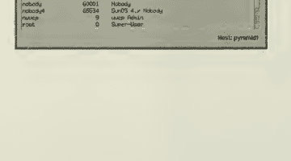


3. 在“串行端口”窗口中，选择将与调制解调器一起使用的端口，如图 12-2 所示。

### Figure 12-2
串行端口窗口。

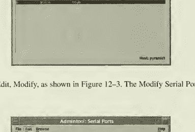

4. 选择“编辑”，“修改”，如图 12-3 所示。修改串行端口窗口出现。

### Figure 12-3
串行端口编辑菜单。

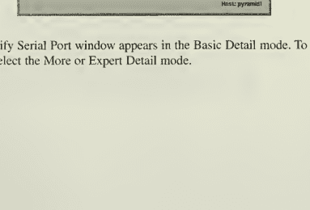

修改串行端口窗口以“基本详细信息”模式出现。要输入更多详细信息，请选择“更多”或“专家详细信息”模式。

5. 从下拉“模板”列表中，选择满足或最接近您调制解调器服务的调制解调器配置模板（见图 12-4）。

### Figure 12-4
修改串行端口模板列表。

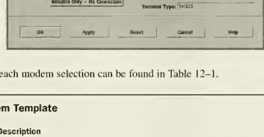

每个调制解调器选择的描述可在表 12-1 中找到。

### Table 12-1 The Modem Template
| 调制解调器配置 | 描述 |
|---|---|
| 仅拨入 | 用户可以拨入调制解调器，但不能拨出。 |
| 仅拨出 | 用户可以从调制解调器拨出，但不能拨入。 |
| 双向 | 用户可以从调制解调器拨入或拨出。 |

6. 从“波特率”下拉列表中选择正确的波特率，如图 12-5 所示。

### Figure 12-5
波特率下拉列表。


图 12-6 显示了一个已完成的修改串行端口窗口。已选择专家详细信息模式以显示所有可配置的选项。

### Figure 12-6
已完成的修改串行端口窗口。

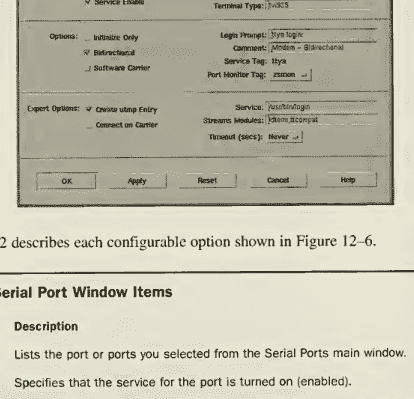

表 12-2 描述了图 12-6 中显示的每个可配置选项。

### Table 12-2 Modify Serial Port Window Items
| 项目 | 描述 |
|---|---|
| 端口 | 列出您从串行端口主窗口中选择的端口或端口。 |
| 服务 | 指定端口的服务已打开（启用）。 |
| 波特率 | 指定用于与终端通信的线路速度。线路速度代表 /etc/ttydefs 文件中的一个条目。 |
| 终端类型 | 显示终端类型的缩写——例如 ansi 或 vt100。类似的缩写可在 /etc/termcap 中找到。此值在 $TERM 环境变量中设置。 |
| 选项：仅初始化 | 指定端口软件已初始化但未配置。 |
| 选项：双向 | 指定端口线路在两个方向上使用。 |
| 选项：软件载波 | 指定使用软件载波检测功能。如果未选中该选项，则使用硬件载波检测信号。 |
| 登录提示 | 显示连接建立后向用户显示的提示。 |
| 注释 | 显示服务的注释字段。 |
| 服务标签 | 列出与此端口关联的服务标签——通常是 /dev/term 目录中的一个条目。 |

### Table 12-2 Modify Serial Port Window Items (continued)
| 项目 | 描述 |
|---|---|
| 端口监视器标签 | 指定对此端口使用的端口监视器的名称。默认监视器通常是正确的。 |
| 创建 utmp 条目 | 指定在登录时在记账文件中创建 utmp 条目。 |
| 载波连接 | 指定在收到连接指示时立即调用端口的关联服务。 |
| 服务 | 显示连接时运行的程序。 |
| 流模块 | 显示在调用服务之前推送的流模块。 |
| 超时（秒） | 指定如果端口上的打开进程成功且未接收到输入数据，则在关闭端口之前的秒数。 |

7. 单击“确定”以配置端口。

8. 使用 pmadm 命令验证调制解调器服务是否已配置为使用。
为此，输入

```
pmadm -l -s ttya
```

串行端口现已配置完成并可使用。

## Service Access Facility (SAF)
服务访问设施（SAF）

SAF 是用于管理终端、调制解调器和其他网络设备的工具。SAF 是一种开放系统解决方案，通过 tty 设备和局域网（LAN）控制对系统和网络资源的访问。SAF 不是一个程序；它是一组后台进程和管理命令的层次结构，其中包括 sacadm、pmadm、ttyadm 和 nisadmin。有关这些命令的描述，请参阅表 12-3。

### Table 12-3 SAF Commands
| 命令 | 描述 |
|---|---|
| sacadm | 用于添加、删除、启用、禁用、启动和停止端口监视器。 |
| pmadm | 配置端口监视器服务以及各个端口的关联进程。 |
| ttyadm | 为串行端口格式化输入到 pmadm。 |
| sttydefs | 在 /etc/sttydefs 文件中创建和修改条目以描述终端线路特性。 |
| nisadmin | 为远程打印格式化输入到 pmadm。 |

具体来说，SAF 使您能够

- 设置 ttymon 和侦听端口监视器（使用 sacadm 命令）
- 设置 ttymon 端口监视器服务（使用 pmadm 和 ttyadm 命令）
- 设置侦听端口监视器服务（使用 pmadm 和 nisadmin 命令）
- 排除 tty 设备故障
- 排除打印服务传入网络请求的故障
- 排除服务访问控制器故障（使用 sacadm 命令）

与 SAF 关联的配置文件在表 12-4 中描述。

### Table 12-4 Files Associated with SAF
| 文件 | 描述 |
|---|---|
| /etc/saf/_sysconfig | 每系统配置脚本 |
| /etc/saf/_sactab | SAC 的管理文件；包含 SAC 控制的端口监视器的配置数据 |
| /etc/saf/pmtag | 端口监视器 pmtag 的主目录 |
| /etc/saf/pmtag/_config | 如果存在，则为端口监视器 pmtag 的每个端口监视器配置脚本 |
| /etc/saf/pmtag/_pmtab | 端口监视器 pmtag 的管理文件；包含 pmtag 提供的服务的端口监视器特定配置数据 |
| /etc/saf/pmtag/svctag | 服务 svctag 的每个服务配置脚本 |
| /var/saf/log | SAC 的日志文件 |
| /var/saf/pmtag | 由 pmtag 创建的文件的目录，例如日志文件 |

### sacadm
使用 sacadm 命令添加、列出、删除、终止、启动、启用或禁用 ttymon 或侦听端口监视器。您必须以超级用户身份登录才能使用此命令。例如，用于添加 ttymon 端口监视器的命令语法是

```
sacadm -a -p mbmon -t ttymon -c /usr/lib/saf/ttymon -v 'ttyadm -V' -y "TTY Ports a & b"
```

注意 ttyadm 命令的使用。

要查看新添加的端口监视器，输入：

```
sacadm -l -p mbmon
```

系统响应如下：

```
PMTAG   PMTYPE   FLGS   RCNT   STATUS   COMMAND
mbmon   ttymon   -      0      STARTING /usr/lib/saf/ttymon #TTY Ports a & b
```

用于添加和查看端口监视器的 sacadm 命令选项列在表 12-5 中。

### Table 12-5 sacadm Command Options
| 命令选项 | 描述 |
|---|---|
| -a | 添加端口监视器选项 |
| -c | 定义用于启动端口监视器的命令字符串 |
| -k | 终止端口监视器状态选项 |
| -l | 列出端口监视器状态选项 |
| -p | 指定 pmtag mbmon 作为端口监视器标签 |
| -r | 移除端口监视器状态选项 |
| -s | 启动端口监视器状态选项 |
| -t | 指定端口监视器类型为 ttymon |
| -v | 指定端口监视器的版本号 |
| -y | 定义注释以描述此端口监视器实例 |

要终止 ttymon 端口监视器，输入

```
sacadm -k -p mbmon
```

要重新启动已终止的端口监视器，输入

```
sacadm -s -p mbmon
```

要删除端口监视器，输入

```
sacadm -r -p mbmon
```

### pmadm
端口监视器服务管理员（pmadm）命令使您能够管理端口监视器的服务。使用 pmadm 添加服务、列出与端口监视器关联的一个或多个端口的服务，以及启用或禁用服务。一个例子是终端服务。您还可以安装或替换每个服务的配置脚本或打印有关服务的信息。

当您使用 pmadm 命令管理服务时，您通过 pm 标签参数指定特定的端口监视器，并通过 svctag 参数指定特定的端口。对于每种端口监视器类型，SAF 需要一个专用命令来格式化端口监视器特定的配置数据。此数据由 pmadm 命令使用。

要向 mbmon 端口监视器添加标准终端服务，输入

```
pmadm -a -p mbmon -s a -i root -v 'ttyadm -V' -m '"ttyadm -i 'Terminal disabled' -l \ contty -m ldterm,ttcompat -S y -d /dev/term/a -s /usr/bin/login"'
```

pmadm 命令中使用的选项在表 12-6 中描述。请注意，上面的 pmadm 命令包含一个嵌入的 ttyadm 命令。

### Table 12-6 pmadm Command Options
| 命令选项 | 描述 |
|---|---|
| -a | 添加端口监视器状态选项 |
| -d | 禁用端口监视器服务 |
| -e | 启用端口监视器服务 |
| -l | 列出端口监视器服务信息 |
| -p | 指定 pm 标签 mbmon 作为端口监视器标签 |
| -s | 指定 svctag a 作为端口监视器服务标签 |
| -i | 指定 svctag 运行时的身份 |
| -v | 指定端口监视器的版本号 |
| -m | 指定由 ttyadm 格式化的 ttymon 特定配置数据 |

下一个示例使用 pmadm 命令列出 TTY 端口的状态，或与端口监视器关联的所有端口的状态。输入

```
pmadm -l -p mbmon
```

系统输出以下信息：

```
PMTAG PMTYPE SVCTAG FLAGS ID <PMSPECIFIC>
mbmon ttymon a . root /dev/term/a - - /usr/bin/login \
- contty ldterm,ttcompat login: Terminal disabled - y #Comment
```


报告的信息在表 12-7 中描述。

### 表 12-7 端口监视器信息

| 服务 | 描述 |
|---|---|
| mbmon | 端口监视器名称，mbmon。 |
| ttymon | 端口监视器类型，ttymon。 |
| a | 服务标签值。 |
| - | 使用 pmadm -f 命令设置其后的标志。 |
| root | 启动服务时分配给服务的 ID。 |
| <PMSPECIFIC> 信息： |  |
| /dev/term/a | TTY 端口路径名。 |
| /usr/bin/login | 接收到连接时要调用的服务的完整路径名。 |
| contty | /etc/ttydefs 文件中的 TTY 标签。 |
| ldterm,ttcompat | 要推送的流模块。 |
| login: Terminal disabled | 端口被禁用时要显示的非活动消息。 |
| y | 软件载波值；n 表示软件载波关闭，y 表示软件载波开启。本示例中软件载波已开启。 |
| # | 任意注释。本示例中没有注释。 |

要禁用端口监视器服务，输入

```
pmadm -d -p mbmon -s a
```

要启用已禁用的端口监视器服务，输入

```
pmadm -e -p mbmon -s a
```

## ttyadm

ttyadm 命令是一个管理命令，用于格式化 ttymon 信息并将其写入标准输出。ttyadm 提供了向 sacadm 和 pmadm 命令呈现格式化的端口监视器特定（ttymon 特定）数据的方法，这些命令将在本章后面描述。例如，ttyadm 用于通知用户端口已禁用。输入以下命令即可

```
ttyadm -i
```

-i 选项指定当用户尝试登录到已禁用的端口时发送到终端或调制解调器的非活动（禁用）响应消息。

要在用户从主机注销时保持调制解调器连接，输入

```
ttyadm -h
```

系统在设置或重置为默认值或指定值之前不会挂断调制解调器。如果未使用 ttyadm -h，主机将在用户从主机注销时挂断调制解调器。

使用 ttyadm 的 -r 选项要求用户在系统显示提示之前输入一个字符：

```
ttyadm -r
```

-r 选项指定 ttymon 应要求用户在登录提示出现之前输入一个字符或按 Return 指定次数。此选项可防止终端服务器发出欢迎消息，而 Solaris 主机可能会将其误解为用户尝试登录。如果不使用 -r 选项，主机和终端服务器可能会开始循环并相互打印提示。

ttyadm 命令的选项在表 12-8 中描述。

### 表 12-8 ttyadm 命令选项

| 命令选项 | 描述 |
|---|---|
| -b | 双向端口标志。设置此标志时，线路可双向使用。 |
| -h | 设置端口的挂断标志。 |
| -i | 指定非活动（禁用）响应消息。 |
| -l | 指定在 /etc/ttydefs 中使用的 TTY 标签。 |
| -m | 指定在调用此服务之前要推送的流模块。 |
| -p | 指定提示消息，例如 login:。 |
| -d | 指定用于 TTY 端口的设备的完整路径名。 |
| -r count | 当调用 -r 选项时，ttymon 会等待从端口接收数据后才显示提示。 |
| -s | 指定在接收到连接请求时要调用的服务的完整路径名。如果需要参数，请用引号 ("") 将命令及其参数括起来。 |
| -T | 设置终端类型。 |

## nlsadmin

正如 ttyadm 用于 ttymon，nlsadmin 命令用于 listen。listen 端口监视器的管理文件由 sacadm 和 pmadm 以及 nlsadmin 命令更新。nlsadmin 命令格式化 listen 特定信息并将其写入标准输出，提供向 sacadm 和 pmadm 命令呈现格式化的 listen 特定数据的方法。nlsadmin 不直接管理 listen；相反，它补充了通用管理命令 sacadm 和 pmadm。

每个网络可以与其关联至少一个网络监听器进程实例，但每个网络都是单独配置的。nlsadmin 命令控制 listen 端口监视器的操作状态。nlsadmin 命令可以为给定网络建立 listen 端口监视器，配置该端口监视器的特定属性，并启动和终止监视器。nlsadmin 命令还可以报告机器上的 listen 端口监视器。

## 使用 SAF 设置调制解调器和终端

现在您已经了解了 sacadm 和 pmadm，以下是如何将它们组合起来添加调制解调器和终端。要从命令行设置双向调制解调器服务，请按照以下步骤操作：

- 1. 检查 SAC 下是否正在运行 zsmon 进程。为此，输入以下命令：
```
sacadm -l
```
系统响应如下
```
PMTAG    PMTYPE   FLAGS   RCNT    STATUS   COMMAND
tcp      listen   -       0       ENABLED  /usr/lib/saf/listen tcp #
zsmon    ttymon   -       0       ENABLED  /usr/lib/saf/ttymon #
```
- 2. 如果在 PMTAG 下看不到 zsmon 条目，请执行以下命令：
```
sacadm -a -p zsmon -t ttymon -c /usr/lib/saf/ttymon -v `ttyadm -V`
```
再次检查 zsmon 条目是否存在（状态将为 STARTING——这是正常的）。
- 3. 检查是否存在 zsmon 端口监视器。为此，输入以下命令：
```
pmadm -p zsmon -l
```
系统响应如下
```
PMTAG PMTYPE SVCTAG FLGS ID <PMSPECIFIC>
zsmon ttymon ttyb u root /dev/term/b b - /usr/bin/login \
- 9600m ldterm,ttcompat login: - - n #Modem - Bidirectional
```
- 4. 如果存在 zsmon 的端口监视器，请通过执行以下命令将其删除：
```
pmadm -r -p zsmon -s <svctag>
```
其中 <svctag> 的值可通过使用上一个命令的输出找到。在上面的示例中，此值将为 ttyb。
- 5. 现在配置您的端口监视器。为此，输入
```
pmadm -a -p zsmon -s ttyb -i root -fu -v 'ttyadm -V' -m 'ttyadm -Sn -d /dev/term/b -b -m ldterm,ttcompat -l 9600m -s /usr/bin/login' -y "Modem - Bidirectional"
```
ttyb 和 /dev/term/b 指定串行端口 B；9600m 指定 9600 波特率。这两者都可以修改以反映不同的串行端口或波特率设置。
- 6. 通过输入以下命令验证端口监视器是否存在
```
pmadm -p zsmon -l
```
系统应响应如下所示的输出，但波特率和服务标签可能不同：
```
PMTAG PMTYPE SVCTAG FLGS ID <PMSPECIFIC>
zsmon ttymon ttyb u root /dev/term/b b .
/usr/bin/login - 9600m ldterm,ttcompat login: - - n #Modem \
-Bidirectional
```
串行端口 B 现在已配置为 9600 波特、双向调制解调器。步骤很复杂，因此您需要小心不要输入错误的命令字符串。由于从命令行添加调制解调器的复杂性，Sun 已将此任务添加到 Admin 工具中。

## 使用调制解调器

以下步骤概述了在 Solaris 系统上连接和使用调制解调器所需遵循的过程。

- 1. 通过将 RS-232 电缆插入 ttya 或 ttyb，将调制解调器连接到 Sun 系统上的正确串行端口。确保 RS-232 电缆是“直通”电缆，提供 1–8 号引脚和 20 号引脚。不要使用空调制解调器（交叉）电缆或空调制解调器性别适配器电缆。
- 2. 在 /etc/remote 文件中查找以下行。如果没有，请在 hardware:\ 条目之后添加。对于 ttyb 端口，添加以下行：
```
hardware:\ :dv=/dev/term/b:br#9600:e1="C'S'Q'U'D:ie=%$ioe=D:
modem1:\ :dv=/dev/cua/b:br#9600:
```
确保波特率与设置串行端口时选择的波特率匹配。
- 3. 检查调制解调器端口的权限和所有者。文件 /dev/cua/b 应为 rw-rw-rw-，所有者应为 uucp。如果不是，请使用 chmod 命令更改权限并使用 chown 命令更改所有者。
- 4. 修改 /etc/remote 文件并检查端口权限后，发出以下命令：
```
tip modem1
```
您应该收到“connected”消息。如果收到其他内容——例如“all ports busy”——请按步骤 2 中所述检查 /etc/remote 设备条目。
- 5. 验证调制解调器是否响应命令。输入以下命令即可
```
at <cr>
```
您应该看到显示 OK。
- 6. 检查调制解调器寄存器和初始化字符串。参考表 12-9 中的常见调制解调器初始化字符串，查看是否引用了调制解调器类型。如果是，请按照制造商的说明使用该字符串初始化调制解调器。例如，US Robotic Courier Modem 字符串为
```
AT&F1&B1&C1&D2X50=18W
```
如果您不知道初始化字符串，请参考随调制解调器提供的手册。如果仍无法确定初始化字符串，请联系调制解调器制造商的技术支持。
- 7. 设置调制解调器后，通过输入以下序列退出“tip”实用程序：
```
<cr>~.
```
上述序列为“回车”后跟“~”字符和“.”字符。


表 12-9 显示了用于在 Sun Solaris 系统上作为拨入和拨出使用的特定调制解调器的初始化字符串。

## 表 12-9 调制解调器初始化字符串

| 调制解调器 | 初始化字符串 |
|---|---|
| US Robotics 调制解调器 | AT&F1&B1&C1&D2X0S0=1&W |
| Black Box Corporation | AT&N0S37=0S0=1Q1&C1&D2&K3&W |
| 其他所有调制解调器 | AT&FNOQ2X0&C1&D2S0=1&W |

## 通过 Admintool 添加终端

本节描述如何使用 Solaris Admintool 添加终端。使用 Admintool 是向系统添加终端的最简单方法。步骤如下：

- 1. 按照“通过 Admintool 添加调制解调器”一节中概述的步骤 1–4 进行操作。当“修改串行端口”窗口出现时，如图 12-7 所示，从模板菜单中选择 Terminal-Hardwired。

图 12-7
修改串行端口
窗口：

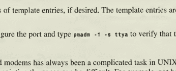

- 2. 如需更改模板条目的值。模板条目在表 12-1 中描述。

- 3. 单击 OK 配置端口并输入 pmadm -l -s ttya 以验证服务是否已添加。

设置终端和调制解调器在 UNIX 中一直是一项复杂任务。当遇到问题时，确定原因可能很困难。例如，无法访问调制解调器可能意味着串行端口设置不正确、电缆配置问题或调制解调器上的初始化字符串不正确。这就是经验和实践可以带来巨大差异的领域之一。在 UNIX 的早期岁月里，几乎所有外设都连接到串行端口。现在，许多设备——例如打印机和终端——通过网络连接。第 13 章“Networking”将描述如何设置网络并向您介绍一些网络基础知识。

## CHAPTER

## 13

## Networking

本章的测试目标如下：

- 定义网络术语
- 识别并理解各种网络配置文件
- 理解 IP 地址和各种网络类别
- 理解名称服务
- 理解用于复制文件和在远程系统上执行命令的网络命令
- 理解用于监视和故障排除网络的网络命令

一章内容不足以涵盖网络管理；事实上，Sun 专门为此领域开发了一项认证考试。基础考试包括一些网络基础知识，而本章为您提供这些基础信息。主题包括设计和规划网络、设置网络以及维护网络。作为系统管理员，您可能负责所有这些任务，也可能专门从事某一特定领域。

## Network Fundamentals

首先，我们需要定义网络中使用的一些术语。您会发现一堆缩写，我会尽量为您理清一些。首先，我将描述可用的网络类型，然后描述各种网络协议。最后，我将确定网络硬件的物理组件，包括网络接口和布线。

## Network Topologies

当我们谈论 *network topology* 时，我们描述的是网络的整体图景。拓扑描述大大小小的网络为 LANs 和 WANs。

### LAN

*local area network (LAN)* 是一组主机，通常位于同一建筑物和同一楼层，通过以太网等高速介质连接。LAN 可能是单个 IP 网络，也可能是通过高速路由器连接的网络或子网集合。

用于计算机网络的布线或布线称为网络媒体。Solaris 局域网通过某种类型的粗同轴电缆、细同轴电缆、双绞电话线或光纤电缆连接。在 Solaris LAN 环境中，双绞线是最常用的网络媒体。Solaris LAN 中使用的其他类型的网络媒体包括 Fiber Distributed Data Interface (FDDI) 或 Token Ring。

### WAN

*wide area network (WAN)* 是一种覆盖潜在广阔地理区域的网络。WAN 的一个例子是 Internet。WAN 的其他例子是企业网络，将单个公司的不同办公室链接成跨越整个国家甚至整个大陆的单一网络。

## Network Protocols

网络协议是您配置但看不到的网络部分。它是网络的软件部分，控制系统之间跨网络的数据传输。

### Packet

数据包是传输到网络上的基本信息单元。数据包的组织方式类似于普通信件。每个数据包都有一个对应于信封的报头。报头包含收件人和发件人的地址，以及数据包在协议套件的每一层中传输时如何处理的有关信息。

数据包的消息部分对应于信件本身。数据包只能包含有限数量的字节数据，具体取决于所使用的网络媒体。因此，典型的通信，例如电子邮件消息，有时会被拆分为数据包片段。

### TCP/IP

Transmission Control Protocol/Internet Protocol (TCP/IP) 是一种网络通信协议，由一组正式规则组成，描述软件和硬件在网络内应如何交互。为了使网络正常运行，信息必须以可理解的形式传递到预期目的地。由于不同类型的网络软件和硬件需要交互以执行网络功能，因此设计人员开发了 TCP/IP 通信协议，现在已被主要国际标准组织认可为标准，并在全球范围内使用。因为它是一组标准，TCP/IP 运行在许多不同类型的计算机上，使您能够轻松设置运行任何支持 TCP/IP 的操作系统的异构网络。Solaris 操作系统包括用于实现 TCP/IP 通信协议套件的网络软件。

TCP/IP 提供了一系列命令和功能，这些命令和功能在 Solaris 上受支持，并在本章后面描述。

### Ethernet

Ethernet 是一个标准，定义了机器用于访问网络的物理组件以及网络运行的速度。它包括布线、连接器和计算机接口组件的规范。Ethernet 是一种 LAN 技术，以每秒高达 1000 万比特 (Mbps) 的速度在计算机之间传输信息。Fast Ethernet 将速度提高到 100Mbps。Ethernet 可以在四种类型的物理媒体上运行：

| Media | Type |
|---|---|
| Thick Ethernet | Type 10BASE5 |
| Thin Ethernet | Type 10BASE2 |
| Twisted-pair Ethernet | Type 10BASE-T |
| Fiber-optic Ethernet | Types FOIRL and 10BASE-F |

10Base-T 型 Ethernet 是目前使用最广泛的媒体。

Ethernet 使用一种名为 CSMA/CD 的协议，即“Carrier Sense, Multiple Access, Collision Detect”。“Multiple Access” 部分意味着每个站点都连接到单根电缆。“Carrier Sense” 部分意味着在传输数据之前，站点会检查电缆以确定是否已有其他站点正在发送某些内容。如果 LAN 看起来处于空闲状态，站点就可以开始发送数据。当连接到同一网络的几台计算机需要发送数据时，两台计算机可能会同时尝试发送，从而导致数据冲突。以太网协议会检测到这种冲突并通知计算机重新发送数据。两台计算机怎么会同时发送数据呢？以太网不是应该在发送数据到网络之前检查网络是否有其他系统正在传输吗？事情是这样的：以太网站点以每秒 10 兆比特的速度发送数据。这意味着它每传输一位信息允许 100 纳秒。信号以每纳秒约一英尺的速度传播。第一个比特的电信号在电线下游行约 100 英尺后，站点开始发送第二个比特。以太网电缆可以运行数百英尺。如果两台站点位于同一电缆上相距 250 英尺，并且同时开始传输，它们将在信号从每个站点到达另一个站点之前处于第三个比特的中间。这解释了 CSMA/CD 中“Collision Detect” 部分的必要性。两个站点可以同时开始发送数据，它们的信号将在几纳秒后“碰撞”。当发生此类碰撞时，两个站点都会停止传输，并在随机选择的延迟期后重试。

尽管以太网网络可以使用一根公共信号线构建，但这种安排不足以布线大多数建筑物。与普通电话线路不同，以太网线不能通过将一根铜线连接到另一根铜线来拼接。相反，以太网需要中继器，即连接到两根电线的简单站点。当中继器在一根电线上接收到数据时，它会逐位在另一根电线上重复数据。当发生冲突时，中继器也会重复冲突。在具有两种或更多种以太网电缆的建筑物中，常见的做法是使用中继器将以太网信号从一种电线转换为另一种电线。

### FDDI

Fiber Distributed Data Interface (FDDI) 是在可延伸至 200KM（124 英里）范围的局域网的光纤线路上进行数据传输的标准。FDDI 协议基于令牌环协议。除了地理上庞大之外，FDDI 局域网还可以支持数千名用户。FDDI 还允许比使用以太网的低速 LAN 更大的数据包大小。

FDDI 网络可以包含两个令牌环：主令牌环和在主环发生故障时可能的备份的次令牌环。主环提供高达 100Mbps 的容量。如果次环不需要备份，它也可以传输数据，将容量加倍至 200Mbps。

### ISDN

Integrated Services Digital Network (ISDN) 是一种高质量的数字通信产品，使单根电话线能够同时传输语音和分组数据。


传输速度可以是 64Kbps（使用一个通道）或 128Kbps（将两个 64Kbps 通道连接起来）。一些 ISDN 适配器提供压缩，使其到互联网和拨号网络的速度接近 512Kbps。

## 网络硬件
网络硬件是网络中你实际可以看到的物理部分。物理组件将系统连接在一起，包括 NIC、主机、布线、连接器、集线器和路由器。

## NIC
使计算机能够连接到网络的计算机硬件称为网络接口（NIC）或网络适配器。网络接口可以支持一个或多个通信协议，以指定计算机如何使用物理介质——网络电缆——来交换数据。许多计算机自带预装的网络接口；其他则需要单独购买网络接口。

每种局域网介质类型都有其对应的网络接口。例如，如果你想使用以太网作为网络介质，则必须在网络中的每个主机上安装以太网接口。连接以太网电缆的板上连接器称为以太网端口。如果计划使用 FDDI 等，也同样如此。

## 主机
如果你是有经验的 Solaris 用户，你一定熟悉术语 host，它常被用作“计算机”或“机器”的同义词。从 TCP/IP 的角度来看，网络上只存在两种类型的实体：路由器和主机。当主机发起通信时，它被称为发送主机或发送方。例如，当用户输入 ping 或向另一用户发送电子邮件时，主机就会发起通信。通信的目标主机称为接收主机或接收方。

每个主机都有以下三个特征，有助于其在网络上的对等方识别它：

|  |  |
|---|---|
| Hostname | 网络上的每个系统都有一个唯一的主机名。主机名使用户能够使用简短、易于记忆的名称而不是主机的网络 IP 地址来引用网络上的任何计算机。 |
| Internet address or IP address | TCP/IP 网络上的每台机器都有一个互联网地址，用于将其标识给网络上的对等方。 |
| Hardware address | 网络上的每个主机都有一个硬件地址，也用于将其标识给对等方。该地址由制造商物理分配给机器的 CPU 或网络接口。每个硬件地址都是唯一的。 |

## 集线器
以太网布线从 *hub* 铺设到每个系统。集线器将所有以太网电缆连接在一起。集线器可支持从两台到数百台系统。

## 路由器
*router* 是一种将以太网数据包从一个网络转发到另一个网络的机器。为此，路由器必须至少有两个网络接口。只有一个网络接口的机器无法转发数据包；它被视为主机。你在网络上设置的机器大多是主机。

## 网络规划
在设置网络之前，你需要做大量的规划。作为规划过程的一部分，你必须完成以下步骤：

- 1. 获取网络号码，并在适用情况下向 InterNIC 注册你的网络域。
- 2. 在收到你的 IP 网络号码后，为你的主机设计一个 IP 地址分配方案。
- 3. 创建一份包含构成网络的所有机器的 IP 地址和主机名的列表。你将在构建网络数据库时使用此列表。
- 4. 确定在网络上使用哪种名称服务：NIS、NIS+、DNS 或本地 /etc 目录中的网络数据库。名称服务将在本章后面讨论。
- 5. 如有必要，为你的网络建立管理分区。
- 6. 确定你的网络是否大到需要路由器。如有必要，创建支持路由器的网络拓扑。
- 7. 如有必要，为你的网络设置子网。

只有在仔细规划网络后，你才准备好开始设置它。

## 设置网络
在操作系统安装期间，你将使用 Solaris 软件安装程序来配置网络。Solaris 安装程序设置的网络配置文件是

- `/etc/hostname.interface`
- `/etc/nodename`
- `/etc/defaultdomain`
- `/etc/inet/hosts`

### /etc/hostname.interface
此文件定义本地主机的网络接口。本地机器上应至少存在一个 /etc/hostname.interface 文件。Solaris 安装程序会为你创建此文件。在文件名中，interface 被主网络接口的设备名称替换。

该文件只包含一个条目：与网络接口关联的主机名或 IP 地址。例如，假设 le0 是名为 system1 的机器的主网络接口。文件名将称为 /etc/hostname.le0，文件将包含条目 system1。

### /etc/nodename
此文件应包含一个条目：本地机器的主机名。例如，在名为 xena 的计算机上，文件 /etc/nodename 将包含条目 xena。

### /etc/defaultdomain
只有当你的网络使用名称服务（本章后面描述）时，此文件才存在。此文件应包含一个条目：本地主机网络所属的管理域的完全限定域名。你可以向 Solaris 安装程序提供此名称，也可以在稍后编辑文件。

例如，如果主机是 pyramid 域的一部分，该域被归类为 .com 域，则 /etc/defaultdomain 应包含条目 pyramid.com。

### /etc/inet/hosts
主机数据库包含网络上机器的 IP 地址和主机名。此文件包含主网络接口的主机名和 IP 地址以及机器必须知道的任何其他网络地址。当用户输入 ping xena 等命令时，系统需要知道如何访问名为 xena 的主机。/etc/hosts 文件为系统提供交叉引用，以便查找 xena 并找到 xena 的网络 IP 地址。为了与基于 BSD 的操作系统兼容，文件 /etc/hosts 是指向 /etc/inet/hosts 的符号链接。

/etc/inet/hosts 文件使用表 13-1 中描述的格式。

### 表 13-1 /etc/inet/hosts 文件格式
address hostname <nickname> [#comment]

| Field | Description |
|---|---|
| address | 本地主机必须知道的每个接口的 IP 地址。 |
| hostname | 设置时分配给机器的主机名以及本地主机必须知道的附加网络接口分配的主机名。 |
| [nickname] | 一个可选字段，包含主机的昵称或别名。 |
| [# comment] | 一个可选字段，可在此包含注释。 |

当你在系统上运行 Solaris 安装程序时，它会设置初始的 /etc/inet/hosts 文件。此文件包含本地主机所需的最小条目：其环回地址、其 IP 地址和其主机名。

例如，Solaris 安装程序可能会为名为 xena 的系统在 /etc/inet/hosts 文件中创建以下条目：

```
127.0.0.1 localhost loghost #loopback address
192.9.200.3 ahaggar #host name
```

在机器 xena 的 /etc/inet/hosts 文件中，IP 地址 127.0.0.1 是环回地址，是本地机器保留的网络接口，用于允许进程间通信，使其将数据包发送给自己。操作系统通过 ifconfig 命令使用环回地址进行配置和测试。TCP/IP 网络上的每台机器都必须为 localhost 有一个条目，并且必须使用 IP 地址 127.0.0.1。

如果你已经安装了操作系统并回答不想安装网络，你可以手动编辑网络配置文件，也可以重新运行安装程序的网络配置部分。

要重新运行程序部分，你必须首先是超级用户。然后在命令行键入 sys-unconfig 以将系统的配置恢复到“as-manufactured”状态。运行该命令后，系统会重新启动并提示你输入以下信息：

| Item | Description |
|---|---|
| Hostname | 输入计算机的唯一名称。 |
| The name service you will use | 选择 NIS、NIS+、DNS 或本地文件。 |
| Time zone | 输入你的本地时区。 |
| IP address | 输入此主机的唯一 IP 地址。 |
| IP subnet mask | 如果你的网络使用子网，输入子网掩码。 |
| Root password | 输入 root 密码。 |


当系统完成输入提示后，它会继续启动过程。系统启动时，网络已配置完成。

## 网络安全文件

第 4 章“系统安全”包含了网络安全方面的内容。如有必要，请参阅该部分以回顾有关配置网络安全文件 /etc/hosts.equiv 和 ~/.rhosts 的讨论。

## IP 地址分配

TCP/IP 网络上的每个主机都有一个网络地址——称为 IP 地址——该地址在网络上的每个主机中都是唯一的。如果主机将参与互联网，则该地址在互联网上也必须是唯一的。因此，互联网 IP 地址由管理机构控制，例如 InterNIC。

IP 地址是一串四个字节，以四个用点分隔的十进制整数的形式书写（例如，0.0.0.0）。每个整数长 8 位，范围从 0 到 255。IP 地址由两部分组成：由 InterNIC 管理机构分配的网络 ID 和由本地管理员分配的主机 ID。地址的第一个整数（0.0.0.0）决定了地址类型，被称为其类。IP 地址共有五类：A、B、C、D 和 E。以下是对每一类的简要描述，不涉及过多细节。

A 类网络用于拥有数百万主机的非常大的网络，例如互联网。A 类网络号使用 IP 地址的前八位作为其网络 ID。剩余的 24 位构成 IP 地址的主机部分。A 类网络号第一个字节的取值范围为 0–127。例如，考虑 IP 地址 75.4.10.4。第一个字节中的值 75 表示主机位于 A 类网络上。剩余字节 4.10.4 确定了主机地址。InterNIC 仅分配 A 类号码的第一个字节。剩余三个字节的使用由网络号码所有者自行决定。最多只能存在 127 个 A 类网络；每个网络最多可容纳 16,777,214 个主机。

B 类网络是中等规模的网络，例如拥有众多主机的大学和大型企业。B 类网络号使用 16 位作为网络号，16 位作为主机号。B 类网络号的第一个字节范围为 128–191。在号码 129.144.50.56 中，前两个字节 129.144 由 InterNIC 分配，构成网络地址。后两个字节 50.56 构成主机地址，由网络所有者自行分配。

C 类网络用于包含少于 254 个主机的小型网络。C 类网络号使用 24 位作为网络号，8 位作为主机号。C 类网络号占用 IP 地址的前三个字节，只有第四个字节由网络所有者自行分配。C 类网络号的第一个字节范围为 192–223。第二和第三个字节各自范围为 1–255。典型的 C 类地址可能是 192.5.2.5，其中前三个字节 192.5.2 构成网络号。此示例中的最后一个字节 5 为主机号。

D 类地址用于 RFC 988 中定义的 IP 多播，E 类地址保留用于实验用途。

在网络上规划 IP 地址分配的第一步是确定适合您网络的网络类别。确定后，您可以从 InterNIC 地址管理机构获取网络号码。收到网络号码后，您可以规划如何分配 IP 地址的主机部分。您可以通过多种方式联系 InterNIC 注册服务。

美国邮寄地址为

Network Solutions
Attn: InterNIC Registration Services
505 Huntmar Park Drive
Herndon, Virginia 22070

您可以通过电子邮件向 hostmaster@rs.internic.net 发送有关网络注册的邮件。

InterNIC 电话号码为 703-742-4777。电话服务时间为上午 7 点至下午 7 点（东部标准时间）。

> 注。请勿随意为您的网络分配网络号码，即使您不打算将其连接到其他现有的 TCP/IP 网络。随着网络的增长，您可能会决定将其连接到其他网络。此时更改 IP 地址可能是一项大量工作，并可能导致停机。

## 名称服务

当用户输入 ping xena 之类的命令时，必须发生的第一件事之一是将主机名 xena 翻译为 IP 地址。这可以通过两种方式之一实现。

IP 地址可以从 /etc/inet/hosts 文件中确定，也可以通过域名服务（DNS）解析。对于小型网络，仅使用 /etc/hosts 并不是问题。对于大型网络，尝试在所有主机上保持 /etc/inet/hosts 文件同步可能会导致大量工作，因为这些文件在每个主机上必须完全相同。如果同一地址被用于两个不同的系统，网络可能会失败。

DNS 依赖 named 服务器提供主机名到 IP 地址的转换。named 服务器是永久存储特定域的主机名和 IP 地址信息的主机。域名是主机名的网络等价物。主机名指的是网络上的特定系统，而域名指的是特定网络。站点和机构会被分配一个用于其网络的域名；它们进而为其域内的系统分配主机名。互联网域名系统提供了一种方案，使得全球每个站点都有唯一名称。

## TCP/IP 命令

TCP/IP 提供了多个命令和功能，这些命令和功能在 Solaris 操作系统上得到支持。这些命令是 TCP/IP 网络软件包的一部分，可在大多数 UNIX 系统上使用。

### telnet

telnet 用于登录网络上的另一系统。以下是一个示例会话：

```
# telnet pyramid1
Trying 192.9.200.4...
Connected to pyramid1.
Escape character is '^]'.

SunOS 5.6
login: bill
Password:
Last login: Sat Jan 16 07:55:03 from 192.9.200.1
Sun Microsystems Inc. SunOS 5.6 Generic August 1997
pyramid1%
```

### rlogin

rlogin 也是用于登录网络上另一系统的命令。与 telnet 不同，rlogin 具有一种机制，无需输入登录名和密码。

### ftp

文件传输协议（FTP）用于在网络上的两个系统之间传输一个或多个文件。以下是一个示例 ftp 会话：

```
pyramid1% ftp pyramid1
Connected to pyramid1.
220 pyramid1 FTP server (SunOS 5.6) ready.
Name (pyramid1:bill): <cr>
331 Password required for bill.
Password: <enter password>
230 User bill logged in.
ftp> pwd
257 "/users/bill" is current directory.
ftp> ls
200 PORT command successful.
150 ASCII data connection for /bin/ls (192.9.200.4,47131) (0 bytes).
admin
file1
data
226 ASCII Transfer complete.
19 bytes received in 0.049 seconds (0.38 Kbytes/s)
ftp> get file1 /tmp/file1
200 PORT command successful.
150 ASCII data connection for file1 (192.9.200.4,47132) (31311 bytes).
226 ASCII Transfer complete.
local: /tmp/file1 remote: file1
31441 bytes received in 0.12 seconds (266.82 Kbytes/s)
ftp> bye
221 Goodbye.
pyramid%
```

### rcp

您还可以使用 rcp（远程复制）命令在网络上的两个主机之间传输一个或多个文件。另一系统必须信任您在当前主机上的 ID。这种信任关系在第 4 章中进行了讨论。

rcp 命令比 ftp 更方便。首先，如果系统之间存在适当的信任关系，rcp 不需要登录或密码，这使其适合脚本使用。其次，rcp 允许将完整的目录树从一个系统复制到另一个系统。然而，ftp 具有更多选项，被认为更安全。rcp 的示例用法是

```
rcp /etc/hosts systemB:/etc/hosts
```

该示例使用 rcp 将文件 /etc/hosts 从本地系统复制到 systemB。

### rsh

您使用 rsh（远程 shell）命令在网络上的另一系统上执行 shell。另一系统必须信任您在当前系统上的 ID。以下示例使用 rsh 获取 systemB 上目录 /etc 的长列表：

```
rsh systemB ls -la /etc
```

### rexec

rexec 命令也用于在远程系统上执行 shell。该命令与 rsh 的不同之处在于您必须输入密码。在许多站点，出于安全原因 rsh 被禁用，rexec 被用作替代方案。

### rwho

rwho 命令产生的输出类似于 who 命令，但适用于网络上的所有系统。


## finger

finger 命令显示本地或其他系统上已登录用户的信息。如果不带参数使用 finger，它会提供当前已登录用户的信息。如果 finger 带参数使用（例如用户名 glenda），它会显示与该参数匹配的所有用户的信息。您还可以通过指定用户为 username@host 的形式，使用 finger 命令查找远程系统上的用户。为了保护用户隐私，许多远程系统不允许远程 finger 操作。

## 网络维护

除了 TCP/IP 命令集之外，Solaris 还提供了若干网络命令，系统管理员可用于检查和排除网络故障。要验证网络是否运行正常，请按以下步骤操作：

- 1. 通过输入以下命令检查到另一系统的网络连接：
- 2. 通过输入以下命令检查网络流量：

```
ping <options> <ip address>
```

例如，要检查 systemA 与 systemB 之间的网络，请从 systemA 输入 ping systemB。如果检查成功，远程系统会回复 systemB is alive。如果网络未激活，您会收到此消息：no answer from systemB。如果得到此响应，请检查您的电缆并确保远程系统已正确配置。

```
netstat -i 5
```

系统会回复：

```
input le0 output input (Total) output
packets errs packets errs colls packets errs packets errs colls
95218 49983 189 1 0 218706 49983 123677 1 0
0 0 0 0 0 3 0 3 0 0
0 0 0 0 0 4 0 4 0 0
1 1 0 0 0 144 1 143 0 0
0 0 0 0 0 256 0 256 0 0
0 0 0 0 0 95 0 95 0 0
0 0 0 0 0 1171 0 1171 0 0
```

netstat 命令用于监视系统的 TCP/IP 网络活动，并在第 2 卷中有更详细的描述。netstat 可以提供有关网络活动量和类型的一些基本数据。-i 选项显示用于 TCP/IP 流量的网络接口的状态。最后一个选项 -5 每五秒重新发出 netstat 命令，以获得良好的网络活动采样。输入 Ctrl-C 可退出 netstat 命令。

- 4. 查看 colls 列中的冲突数量是否很高。要计算网络冲突率，请将输出冲突数（Output Colls）除以输出数据包数。网络范围内的冲突率大于 10% 可能表明网络过载、网络配置不当或硬件问题。

- 5. 查看 errs 列中的错误数量是否很高。要计算输入数据包错误率，请将输入错误数除以输入数据包总数。如果输入错误率很高——超过 25%——主机可能由于传输问题而丢弃数据包。传输问题可能是由网络上的其他硬件以及重负载和低级硬件问题引起的。路由器可能会丢弃数据包，迫使重新传输并导致性能下降。

- 6. 从客户端输入 ping -srv <hostname> 以确定数据包在网络上往返所需的时间。如果往返时间超过几毫秒，则网络上存在慢速路由器或网络非常繁忙。两次发出 ping 命令并忽略第一次结果。ping -srv 命令还会显示数据包丢失情况。如果怀疑存在物理问题，请使用 ping -srv 查找网络上多个主机的响应时间。如果某个主机的响应时间（ms）与预期不符，请调查该主机。

在网络环境中，系统性能取决于您维护网络的好坏。过载的网络会伪装成慢速系统，甚至可能导致停机。持续监控您的网络；您需要了解网络在正常运行时是什么样子，以便在网络性能不佳时知道该寻找什么。本章中描述的网络命令只报告数字。您来决定这些数字是否可接受于您的环境。如前所述，就系统管理而言，实践和经验会使您成为一名出色的系统管理员。管理网络也同样如此。

## 附录

### A

## UNIX 的历史

UNIX 是复数。它不是一个操作系统，而是 1965 年起源的一个思想的许多实现。作为系统管理员，您需要了解 UNIX 操作系统的历史——它来自何处、如何构建以及现在处于何种状态。了解 UNIX 的各种版本及其起源，可以清楚地说明为什么 UNIX 被认为是一种有些敌对的操作系统。例如，UNIX 并不是由一家拥有庞大营销组织来推动用户界面的公司开发的。（换句话说，它没有遵循微软 Windows 之类的开发路径。）另一方面，UNIX 并不是由瞎折腾的黑客发明的；它源于强大的学术根基。UNIX 的主要贡献者是受过高等教育的数学家和计算机科学家，他们受雇于许多人认为的世界顶级工业研究中心贝尔实验室。虽然这些开发人员本身具有知识和经验，但他们与学术界的研究人员保持专业联系，导致思想交流对双方都有益。了解 UNIX 与学术界之间的共生关系意味着了解该系统发明者的背景以及大学与贝尔实验室之间互动的历史。

### 一切的开始

一切都始于贝尔实验室，AT&T 的研究实验室，AT&T 是我们这个时代最大、最强大的公司之一。具有讽刺意味的是，AT&T 对开发和销售计算机或操作系统不感兴趣。事实上，美国司法部不允许 AT&T 出售软件。然而，AT&T 由人员和纸张组成的现有系统在 1960 年代的繁荣中面临被压垮的危险。到 1970 年代，电话业务岌岌可危。出于绝望和需要，AT&T 的 Ken Thompson 着手开发没有任何计算机公司准备提供的东西——一种多用户、多处理操作系统，供其内部信息处理部门使用。具体目标是支持多个程序员同时在一个更友好的环境中工作的操作系统。

下面是对 UNIX 操作系统开发周期中的主要日期和事件的描述。

### 1965-1969

1965 年，贝尔实验室与麻省理工学院和通用电气合作开发 Multics，这是一种运行在 GE 645 大型机上的多用户交互式操作系统。然而，对一个进展缓慢、成本高昂的系统感到不满，贝尔实验室于 1969 年退出 Multics 的开发。

### 1970

Ken Thompson 在贝尔实验室接触到 Multics 后，与 Dennis Ritchie 相识，Ritchie 提供了一台数字设备公司 PDP-7 小型机，以继续开发能够在研究环境中支持团队程序员的操作系统。在他们创建原型后，Thompson 返回贝尔实验室，建议将这个新操作系统用作贝尔实验室专利部门的文档准备工具。这个新操作系统被命名为 UNIX，以区别于 MULTICS 的复杂性。继续开发 UNIX 的工作，UNIX 于 1971 年在贝尔实验室投入运行。

UNIX 的第一个版本是在 PDP-11/20 上用汇编语言编写的。它包括文件系统、fork()、roff 和 ed，并用作专利准备的文本处理工具。

### 1970-1972

在 1970 年代初期，UNIX 开始在整个贝尔实验室流行起来，随着新操作系统的消息传播，大学也接受了它。然而，虽然学术界和高端技术部门对其持赞赏态度，但商业界对其持怀疑态度。为了提高 UNIX 的普及度，AT&T 开始以极低的成本向大学授权 UNIX 源代码。AT&T 为许多被许可方提供软件代码和手册，但不提供技术支持。到 1970 年代末，70% 的学院和大学使用 UNIX。计算机科学毕业生正在使用它，甚至修改代码使其更健壮。到目前为止，UNIX 用汇编语言编写，主要在 DEC 硬件上运行——首先是 PDP-7，然后是 PDP-11/40、11/45，最后是 11/70，在那里获得了广泛的流行。

### 1973-1979

这一时期将成为 UNIX 开发中最重要的时期。Ritchie 和 Thompson 在 1969 年至 1973 年间开发了 C 编程语言，现在用高级 C 语言重写了 UNIX 内核。现在操作系统可以编译在不同的计算机上运行，几个月内 UNIX 就可以移植到新硬件上。对操作系统的修改变得容易。再次，Thompson 与已经在许多系统设计课程中使用 UNIX 的学术界产生共鸣。UNIX 现在用一种通用语言编写，具有现代命令，开始在文字处理和编程领域蓬勃发展。

到现在，UNIX 已达到第 6 版，这是第一个被商业公司 Whitesmiths, Inc. 采用的 UNIX 版本，他们创建了名为 Idris 的第 6 版商业副本。1973 年，Ken Thompson 在休假期间访问伯克利，并在 PDP-11/70 上安装了第 6 版。两位研究生 Bill Joy 和 Chuck Haley 开始参与第 6 版

后来在伯克利 UNIX 系统的开发中发挥了重要作用。他们合作的第一个项目是 UNIX ex 编辑器的开发。

Joy 和 Haley 开始对 UNIX 的内部运行感兴趣，特别是内核。Bill Joy 整理了一个名为“伯克利软件发行版”（Berkeley Software Distribution）的 UNIX 发行版，简称 BSD。他加入了诸如 C shell（UNIX 的类 C 接口）和 VI 编辑器等增强功能。1BSD 于 1975 年发布。到 BSD 的第二个发行版（1978 年）时，Joy 添加了虚拟内存支持，这使得程序即使需要的物理内存超过当时可用内存也能运行。BSD 的这一第二版对贝尔实验室 UNIX 第 7 版的发布产生了强烈影响，该版本于 1979 年发布，是“干净”版本的 UNIX 的最后一个。

20 世纪 70 年代后期，美国国防部高级研究计划局（DARPA）决定以伯克利版本的 UNIX 为其通用计算环境的基础。在 BSD 4.1 版中，DARPA 提供了一些重要的性能调优。快速文件系统，它提供了一种提高文件系统性能和防止文件碎片化的方法，于 4.2 版中加入。

## 1982–1983

AT&T 于 1982 年正式向商业领域发布了 UNIX 的 beta 版本，但在 1983 年，AT&T 发布了第一个真正的 UNIX 生产版本，命名为 System III（Systems I 和 II 从未存在）。尽管基于 UNIX 第 7 版，因此包含了一些 BSD 实用程序，System III 的发布不包括 VI 编辑器或 C shell。相反，AT&T 包含了程序员工作台。

随着 System III 的发布，AT&T 看到了 UNIX 的未来，很快发布了 System V。（System IV 从未在 AT&T 之外出现。）System V 包含编辑器、curses（面向屏幕的软件库）以及 init 程序，该程序用于在 UNIX 启动时启动进程。

20 世纪 80 年代初，Bill Joy 带着电气工程硕士学位离开伯克利，成为 Sun Microsystems 的联合创始人（Sun 代表斯坦福大学网络）。Sun 对 BSD 的实现称为 SunOS。Sun 将操作系统的网络工具扩展到包括网络文件系统（NFS），该系统将成为行业标准。Sun 还在为 UNIX 开发窗口软件方面做了一些早期工作。SunOS 最早于 1983 年发布。随着 Sun 现在提供工作站产品，UNIX 开始在高科技领域获得认可，尤其是在计算机辅助设计和工程（CAD/CAE）环境中。20 世纪 80 年代初，CAD/CAE 变得流行。诸如 HP 和 Apollo 等其他工作站厂商开始利用 CAD/CAE 功能，并相对于当时流行的个人电脑获得性能提升。这些 UNIX 工作站可以超越 PC 的性能，并且以 UNIX 作为操作系统，可以提供多用户环境。

然而在其他商业计算环境中，UNIX 仍然被视为一种敌对环境，并不构成当时大型机的威胁。UNIX 尚未确立自己为用户友好、经受考验的操作系统。然而，它在多任务和网络方面正在取得进展。更重要的是，UNIX 被宣传为在不同硬件架构之间提供可移植性的操作系统，因此软件开发人员对 UNIX 感到兴奋。理论上，用 C 为 UNIX 编写的程序可以移植到运行 UNIX 操作系统的任何硬件平台上。

## 1984–1987

1984 年，AT&T 发布 System V 第 2 版，1987 年发布第 3 版。第 2 版引入了终端功能数据库 termcap，现为 terminfo，它为连接到 UNIX 系统的各种 CRT 终端提供支持。其他更改包括添加 streams 和远程文件系统。

## 1988–1992

1988 年，AT&T 通过收购 Sun Microsystems 的一部分股权震惊了 UNIX 社区，而 Sun 已是业界的领导者。其他硬件厂商认为这是 Sun 的不公平优势，因此他们迅速组建了一个名为开放软件基金会（OSF）的财团。他们共同筹集数百万美元以开发新的 UNIX 标准来与 Sun 竞争。

作为反击，AT&T、Sun、Data General 和 Unisys 联合起来成立自己的组织以对抗 OSF。这个名为 UNIX International（UI）的公司财团成立是为了监督 System V 标准的开发。

OSF 和 UI 最终成为 UNIX 的两个主要竞争商业标准。

到 20 世纪 80 年代末，AT&T 认为 UNIX 分散了公司对生产硬件的关注。因此，AT&T 成立了 UNIX 软件实验室（USL），最终于 1992 年被 Novell 收购。

1992 年，在夏季 Usenix 大会上，伯克利宣布将以 BSD 4.4 结束其开发活动。一些参与 BSD 的人成立了小型公司试图继续 BSD 的开发，但没有伯克利和 DARPA，就不再一样了。

在 20 世纪 90 年代，BSD 和 System V 主导了行业，多家厂商提供其中一种操作系统的版本。很快，UNIX——一种旨在在多个硬件平台之间提供应用程序可移植性的操作系统——变得失控。UNIX System V 第 3 版和 BSD 之间的应用程序不可移植。为了制造更多混乱，硬件厂商正在增强他们版本的 BSD 和 System V。

## 1993

Sun 宣布 SunOS 第 4 版将是基于 BSD 的操作系统的最后一个版本。Sun 看到了大势所趋，正在转向 System V 第 4 版，并将其命名为 Solaris。System V 第 4 版（SRV4）将是 System V 和 BSD 的合并，融合了 SunOS 中发现的重要特性。

随着 Sun 等更多硬件厂商的加入，UNIX 版本大量 proliferate。尽管这些硬件厂商必须从 AT&T 购买源代码并将 UNIX 移植到其硬件平台，但 AT&T 对 UNIX 品牌名称的许可政策允许几乎任何愿意支付许可费的硬件厂商使用 UNIX。由于 UNIX 是商标，硬件厂商必须为其操作系统提供独特名称。历年来幸存下来的一些更受欢迎的 UNIX 版本有

- **SCO UNIX**—来自 Santa Cruz Operation 面向 Intel 平台的 SCO Open Desktop 和 SCO Open Server。
- **SunOS**—Sun 的早期操作系统，也是最知名的 BSD 操作系统。
- **Solaris**—Sun 的 SRV4 实现，也称为 SunOS 5.x。
- **HP-UX**—Hewlett-Packard 的 UNIX 版本。HP-UX 9.x 为 System V 第 3 版，HP-UX 10 基于 System V 第 4 版操作系统。
- **Digital UNIX**—Digital Equipment 的 OSF/1 版本。
- **IRIX**—Silicon Graphics 的 UNIX 版本。早期版本基于 BSD；第 6 版为 System V 第 4 版。
- **AIX**—IBM 基于 System V 的 UNIX。
- **Linux**—面向 Intel 平台的免费 UNIX 操作系统。

随着 UNIX 版本的失控 proliferate，标准成为一个主要问题。1993 年，Sun 宣布转向 System V，以促进 UNIX 社区的标准化。有两种主要 UNIX 风格，标准就无法成为现实。没有标准，UNIX 永远不会被认真视为商业计算系统。因此，Sun 放弃了 BSD，但为其用户提供了直接从 AT&T 包装的 System V 第 4 版。此外，Sun 开发以添加到 UNIX 的任何应用程序都必须是 SRV4 兼容的。Sun 挑战其竞争对手为用户社区提供真正的可移植性。

图形用户界面（GUI）是 UNIX 操作系统发展的下一个浪潮。随着每个硬件厂商试图超越其他厂商，易用性成为一个问题。再次，在这一领域尤其如此，标准很重要。可移植的应用程序需要 GUI 标准。因此，Sun 和 AT&T 开始推广他们共同开发的 OPEN LOOK。他们的目标是为所有 UNIX 风格创建一致的外观和感觉，但不幸的是，OSF 有自己的 GUI 称为 OSF/MOTIF。因此，标准之争的第二轮开始，MOTIF 战胜了 OPEN LOOK。


MOTIF 基于 MIT 开发的图形用户界面 X-Windows，该界面使坐在某一台机器上的用户能够在远程机器上运行程序，同时仍可在本地与程序交互。X 实际上是一种使不同系统相互接口的方式。X-Windows 允许程序在一台计算机上运行并将输出显示在另一台计算机上，即使另一台计算机的操作系统和硬件架构不同。程序在本地机器上显示输出，接受来自本地机器的键盘和鼠标输入，但却在远程机器的 CPU 上执行。

本地机器通常是工作站或终端，称为专用 X 终端，专门为运行 X-Windows 而构建。远程机器可能是小型计算机或服务器、大型机，甚至是超级计算机。在某些情况下，本地机器和远程机器实际上可能是同一台机器。总之，X 是一个分布式、智能的、设备无关的、操作系统无关的窗口系统。

如前所述，MOTIF 在标准之战中击败了 OPEN LOOK。Sun 让步并开始提供包含 OPEN LOOK 和 MOTIF 的软件包——称为通用桌面环境（Common Desktop Environment，CDE）——作为 Solaris 操作系统的标准配置。

## Late 1990s

如今，许多硬件厂商已“化干戈为玉帛”，为了用户利益，正将他们的 UNIX 实现迁移为符合 SVR4 标准。SVR4 显然将在大多数主要平台上成为 UNIX 的主流版本。随着所有厂商开始实施 SVR4 并配合通用桌面环境，用户将开始看到更一致的 UNIX 实现。此外，软件提供商可以确信，编写为符合 SVR4 标准的应用程序将在许多硬件平台上实现可移植性。

## Solaris

我们已讨论了 UNIX 的历史并做出了预测。没有其他版本的 UNIX 比 Sun Microsystems 的 Solaris 更受欢迎，也没有拥有更广泛的用户基础和文化影响力。Sun Microsystems 自 1982 年成立以来，重点一直是 UNIX，似乎没有意愿脱离 UNIX 操作系统。Sun 的用户群对公司以及操作系统都具有强烈的忠诚度。Sun 最新版本是基于 System V 第 4 版的 Solaris 2.6。Solaris 操作系统适用于 SPARC 架构——Sun 自有处理器——以及 Intel 平台。

## Milestones in the Development of UNIX

| Year | Milestone |
|------|-----------|
| 1965 | 贝尔实验室与 MIT 和通用电气合作开发 Multics。 |
| 1970 | Ken Thompson 和 Dennis Ritchie 开发了 UNIX。 |
| 1971 | 操作系统的 B 语言版本在 PDP-11 上运行。 |
| 1973 | UNIX 用 C 语言重写。 |

- 1974 年 Thompson 和 Ritchie 发表论文，在学术界引起热烈反响。伯克利启动了 BSD 项目。
- 1975 年，首个授权版本的 BSD UNIX 发布。
- 1979 年 Bill Joy 以 BSD 4.1 的形式推出“伯克利增强”。
- 1982 年 AT&T 首次将 UNIX 商用。Sun Microsystems 成立。
- 1983 年 Sun Microsystems 推出 SunOS。
- 1984 年，全球约有 10 万个 UNIX 站点。
- 1988 年 AT&T 和 Sun 开始着手 SVR4，即 UNIX 的统一版本。
- 1988 年 OSF 和 UI 成立。
- 1989 年 AT&T 发布 System V 第 4 版。
- 1990 年 OSF 发布 OSF/1。
- 1993 年 Novell 从 AT&T 收购 UNIX。
- 1993 年 Sun 推出基于 System V 第 4 版的 Solaris。基于 BSD UNIX 的 SunOS 将逐步淘汰。
- 1995 年 Santa Cruz Operation 从 Novell 收购 UNIXware。SCO 和 HP 宣布合作开发 64 位 UNIX 版本。
- 1997 年，国际数据公司估计全球将出货约三百万台 UNIX 系统。

## APPENDIX

### B

### The Fundamentals of Client-Server Computing


当谈到客户端-服务器、开放系统和分布式计算环境时，UNIX 总是被提及。UNIX 提供了支持这些环境所需的基础。本节描述了 UNIX 在客户端-服务器计算世界中的作用。

### The First UNIX Server

在 1990 年之前，UNIX 仅由科学家、数学家、工程师和研究生专属使用。在此期间，UNIX 仅在小型计算机上运行，小型计算机比大型机小但比个人电脑大。典型的小型机配备 300MB 磁盘空间和 2-4MB RAM。小型计算机通常支持一至十二名用户，并通过哑的字母数字终端访问。

### An OS Designed for Speed

磁盘以毫秒为单位运行，而 RAM 以纳秒为单位运行。UNIX 的设计充分利用 RAM；因此，RAM 越多，性能越好。当 RAM 受限时，磁盘空间被用作物理 RAM 的替代。随着服务器上的用户数量增加，性能下降，于是又添加了一台服务器。随着用户迁移到新服务器，数据通过网络共享。不久，图形终端问世并取代了基于字符的终端；不久之后，这些图形终端拥有了自己的 CPU 和 RAM。由于它们没有磁盘驱动器并依赖小型计算机或“服务器”进行存储，因此这些终端被称为“无盘客户端”。凭借自身的处理能力，终端可以将处理任务从服务器卸载，而此时服务器仅用于存储应用程序和数据。在开机时，客户端将 UNIX 下载到本地内存中，并除检索数据外，以独立模式运行。

### The Birth of the Workstation

随着磁盘驱动器价格下降，磁盘被添加到客户端，UNIX 可以在本地加载。“磁盘满”客户端（diskfull client）一词由此产生，但很快它们被称为“工作站”，以区别于价格更低的个人电脑。运行 UNIX 操作系统的工作站是多任务、多用户系统，而 PC 仍然是单任务、单用户环境。工作站得益于更便宜的内存和更快的 CPU。服务器和工作站配备了 16-32MB RAM，应用程序可以直接加载到工作站上以进一步提高性能。工作站可以跨多个服务器访问数据，并与其他工作站共享处理任务，从而使处理负载可在计算机网络中分配。工作站成本平均在 35,000 美元至 55,000 美元之间，服务器在 10 万美元左右。这些系统的使用主要集中在高科技和工程环境中。这些系统是独立单元，系统管理对这一用户群体来说不是大问题；然而，寻求新机会的工作站厂商知道他们必须走出技术领域。他们将目光投向通用商业应用，如会计、金融和商业信息系统——这些环境需要更大系统，支持数百名用户和庞大的数据池。这些环境要求每天 24 小时、每周 7 天不间断运行，系统故障和数据丢失对这些环境是灾难性的。

### Distributed Computing

计算机世界中还有另一件事改变了 UNIX 的发展方向：由于用户数量庞大以及支持的应用程序日益复杂，大型机已不堪重负。用户越多，数据越多，也越需要及时访问这些数据。更复杂的是，企业不再集中化，许多用户需要通过电话线路连接到大型机。当大型机故障时，所有用户都会受到影响。UNIX 完美地适应了这种环境。它已具备计算机通信的网络功能，同时作为单一系统提供分布式计算环境。本地系统可以在其他负载较轻的系统上运行进程，数据访问在多个网络间是透明的。随着性能下降，可以添加另一台服务器来减轻负载。UNIX 系统现在有机会渗透到大型机世界。典型场景是在网络上部署多台 UNIX 服务器。工作站，即客户端，被放置在用户办公桌上。应用程序在用户桌面上运行，访问服务器上的数据。简而言之，这就是客户端-服务器计算，UNIX 利用这一优势开拓新市场。

近年来，个人电脑和工作站变得更加强大且价格更低。起初，成本和性能构成了工作站与个人电脑之间的差异。今天，工作站与 PC 之间的区别已不那么明显。无论我们如何称呼桌面系统，只要桌面计算机具有高性能和足够的存储，用户就不再需要依赖大型机。应用程序开发人员正将应用程序移植到这些高性能桌面，使用大型机进行存储和大型数据库事务。通过将应用程序移至本地桌面，用户及其应用程序的负载被分散到网络上并从大型机上卸下。不幸的是，这意味着网络承受巨大压力，很快成为性能瓶颈。

许多网络技术进步正在解决这一网络瓶颈。支持 100 兆比特至 1 千兆比特传输速率的以太网交换机和网络接口正在部署，这增加了系统管理员工作的复杂性。网络管理是

与管理 UNIX 系统同等重要。系统管理员不仅需要了解 UNIX 操作系统和硬件，还必须精通网络设计和管理。

## 大型机环境下的 UNIX 管理

今天，许多企业正用几台价格更低、性能更强大的 UNIX 服务器取代大型机。然而大型机世界要求一致性和强大的系统管理实用程序。凭借 25 年的开发积累，UNIX 提供了用户所期望的大部分功能。事实上，SVR4 的最近几个版本在此方面并没有太多新的发展，除了图形用户界面和窗口系统的开发。提供操作系统内通用功能的<|message|> 用户增强功能已经开发并测试过，其稳定性堪比任何现存的操作系统。现在的发展重点在于性能、高可用性和系统管理。与大型机竞争的硬件厂商正在迅速开发应用程序和实用程序以在这个领域竞争。为了显得开放且符合 SVR4 标准，厂商通常将功能称为扩展或增强。此外，第三方软件开发商每天都在为满足服务器社区的需求而创建新的应用程序作为 UNIX 的额外“扩展”。这一领域对 UNIX 系统管理员来说变化迅速。

不幸的是，即使系统符合 SVR4 标准，系统管理在不同硬件厂商之间也不一致。随着 UNIX 操作系统的标准制定，系统管理领域往往被忽视。尽管每个人都在向 SVR4 迈进，对普通用户来说 UNIX 就是 UNIX，但请注意，在 HP、IBM、DEC 等厂商上的系统管理非常不同，而且很可能永远如此。

## 附录

### C

### SCSI 设备概述

SCSI（读作“scuzzy”）是 Small Computer Systems Interface 的缩写。该接口是美国国家标准学会 ANSI 制定的计算机与其外围设备之间高速并行数据通信的标准。SCSI 标准可分为 SCSI-1、SCSI-2 和 SCSI-3。SCSI-3 是 SCSI 命令规范的最新版本，也称为 Fast/Wide SCSI。SCSI-2 和 SCSI-3 允许扫描仪、硬盘驱动器、CD-ROM 播放器、磁带机和许多其他设备连接到计算机。

你可能熟悉 IDE 磁盘驱动器，但不熟悉 SCSI 驱动器。IDE 驱动器在 PC 上更为普遍。IDE/ATAPI 也是一种数据接口，通常由 PC 制造商提供，并在购买新个人电脑时一般包含在内。通常，计算机主板带有主 IDE 总线和从 IDE 总线。每条总线最多可连接两个 IDE/ATAPI 设备，一个为主设备一个为从设备。由于该接口比 SCSI 更不复杂，ATAPI 设备通常价格更实惠。需要注意的是，IDE/ATAPI 设备通常速度较慢——尤其是 CD-ROM 读盘器——准确性也较低。SCSI 的好处最好通过列出任何人为何会使用 SCSI 的原因来识别：

- SCSI 使向计算机系统添加新的外围设备变得容易。
- 由于 SCSI 设备的开发周期非常短，最新一代的 SCSI 外设能够跟上最新一代计算机系统的步伐。SCSI 硬盘通常性能优于 IDE 硬盘。
- SCSI 保持高性能标准，这也是 SCSI 至今仍是中型和大型系统的主导接口的原因。
- SCSI 比 IDE 更智能。在允许多任务的操作系统上，SCSI 驱动器是更好的选择，因为 SCSI 总线的额外智能会被利用。IDE 也在每个设备上使用控制器，但它们不能同时运行，也不支持命令队列。SCSI 相对于 IDE 的性能优势来自总线的结构，而非驱动器本身。SCSI 总线的特性在进行数据密集型任务例如多任务处理时提供了更好的性能。SCSI 总线控制器能够在不占用处理器资源的情况下控制驱动器。此外，SCSI 链上的所有驱动器都能够同时运行。而 IDE 最多只能在一条链上连接两个驱动器，且这些驱动器不能同时工作（本质上必须“轮流”）。
- SCSI 是一种智能接口，这意味着 I/O 操作的智能从主机 CPU 移到了外围设备。数据可以在设备之间以高速传输，而不占用任何 CPU 功率。此外，计算机系统可以使用一组标准命令来完成主机与设备之间的数据移动。SCSI 接口的简单性还体现在，你可以在不进行任何硬件更改或添加额外硬件部件的情况下，将新的外围设备连接到现有系统。
- SCSI 已证明能够跟上桌面和服务器系统不断增长和演变的需求。
- 使用 SCSI 既能保留已安装环境的基础设施投资，又能为 SCSI 系统的未来增强提供平台。

以下是你会遇到的一些 SCSI 术语的定义：

- **主机适配器** 主机适配器，或 SCSI 控制器，是将你的计算机连接到 SCSI 总线的卡。
- **SCSI 设备** 任何连接到 SCSI 主机适配器的设备，例如磁带驱动器或磁盘驱动器。
- **SCSI ID** 也称为目标 ID，这是分配给每个 SCSI 设备的唯一 ID。它通常可以在设备的后部选择。同一条 SCSI 链上的两个设备不能共享相同的 ID。
- **SCSI 链** 诸如磁盘驱动器和磁带驱动器之类的设备从主机适配器菊花链连接。这一串设备被称为 SCSI 链。
- **SCSI 终结器** SCSI 链上的最后一个设备必须进行终结。终结只能存在于 SCSI 总线的两个位置——开头和结尾。SCSI 总线开头的终结在主板上自动完成。系统管理员通常需要在最后一个 SCSI 设备上安装终结器。总线上必须有两个终结器——不多也不少。终结器是无源或有源的，通常会这样标注；一些有源终结器还带有小 LED 灯。无源终结器是单端 SCSI 总线物理末端的一组电阻，用于抑制总线末端反射的信号。无源终结器不使用电压调节器，可能不完全是 +5 伏。有源终结器使用电压调节器以确保电压恰好为 +5 伏。你需要确定使用何种类型的终结，因此请遵循随设备附带的硬件安装指南中的说明。一些外设是自动终结的；对这些设备进行二次终结可能会产生不良后果。
- **单端 SCSI** 一种早期的 SCSI-1 设备类型。SCSI-1 SCSI 链的最大长度为 6 米，最大设备数为八个。
- **差分 SCSI** 下一代 SCSI 类型。允许最大电缆长度为 25 米，且在电气上与单端设备不兼容。差分 SCSI 支持最多 16 个设备。
- **异步 SCSI** 在 SCSI 总线上发送数据的一种方式。发起方在总线上发送命令或数据，然后等待接收回复。
- **同步 SCSI** 与其等待回复，支持同步 SCSI 的连接设备可以一次在总线上发送多个字节。这提高了吞吐量，尤其是在使用长电缆时。
- **快速 SCSI (SCSI-2)** 快速 SCSI 允许总线上的更快时序；10MHz 而非 5MHz。在 8 位 SCSI 总线上，这将最大速度从 5MBps 提高到 10MBps。
- **Ultra SCSI** 允许总线上高达 20MHz 的信号，以实现高达 20MBps 的速度。
- **宽 SCSI (SCSI-3)** 使用额外的电缆（或 68 针 P 电缆）以 16 或 32 位宽的方式发送数据。这相对于 SCSI-1 总线可实现双倍或四倍速度。目前，没有单个驱动器能达到这些速度，但多台驱动器组合可以。

以下是 SCSI 连接器的视觉指南。

大多数 SCSI 慢速（5MBps）计算机和主机适配器使用图 C-1 所示的 Centronics 型 50 针连接器。


许多 8 位 SCSI 快速（最高 10MBps）计算机和主机适配器使用图 C-2 所示的 50 针高密度连接器。

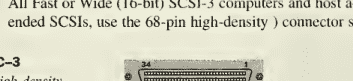

所有快速或宽（16 位）SCSI-3 计算机和主机适配器，以及旧的 DEC 单端 SCSI，都使用图 C-3 所示的 68 针高密度连接器。


一种较少见的 SCSI 连接器，新 SCA 80 针连接器如图 C-4 所示。


与向系统添加任何其他外围设备或设备一样，请先咨询制造商。当向你的 Sun 系统添加设备时，请先致电 Sun，并确保该设备在 Solaris 下受支持，并且你可以获得连接设备的说明。再次强调，几分钟的规划将节省数小时的麻烦和停机时间。大多数系统管理员更愿意让他们的硬件维护人员安装设备。


## 附录 D
### 在网络上


互联网是信息的重要来源，尤其对系统管理员而言。你可能对以下网站和新闻组感兴趣，以进一步提升你在 UNIX 方面的知识。这些站点在你搜索有关 Solaris 和 Sun Microsystems 的信息时非常有价值。所有这些链接也都可以在我的网站 www.pdesigninc.com 上找到。

### Mailing Lists
```
sun-managers-request@era.mcs.anl.gov
```
Sun 管理员邮件列表。

```
sun-nets-requests@umicas.umd.edu
```
专注于 Sun 系统网络的邮件列表。

```
sun-spots-request@rice.edu
```
讨论 Sun 工作站的邮件列表。

```
suns-at-home-request@ea.ucn.purdue.edu
```
专门面向在家中拥有 Sun 系统的用户邮件列表。

### Newsgroups
```
comp.sys.sun.admin
```
用于 Sun 系统管理问题和疑问的新闻组。

```
comp.sys.sun.announce
```
用于 Sun 公告和 Sunergy 邮件的新闻组。

```
comp.sys.sun.apps
```
涵盖 Sun 计算机系统软件应用的新闻组。

```
comp.sys.sun.hardware
```
Sun Microsystems 硬件的新闻组。

```
comp.sys.sun.misc
```
关于 Sun 产品杂项讨论的新闻组。

```
comp.sys.sun.wanted
```
为寻找 Sun 产品和支持的人提供的新闻组。

comp.unix.admin

一个通用的 UNIX 系统管理新闻组。

comp.unix.solaris

关于 Solaris 操作系统的讨论。

### Web Sites
www.pdesigninc.com

我的网页。该站点提供本书中提及的所有站点的链接，以及随着可用而出现的其他站点。

www.sun.com

Sun 的官方网站。

www.netline.com/sunex

SunExpert。免费杂志，提供 UNIX 技巧以及来自 Sun 世界的新闻和技术。

www.sun.com/sunworldonline

SunWorld。Sun 社区的在线杂志。

www.ugu.com

The UNIX Guru Universe。UNIX 系统管理员的优秀主页，提供几乎所有版本 UNIX 的有用站点链接。

sunsolve.sun.com

免费和推荐的安全支持信息来源。该网站包含信息文档集合、补丁说明、症状/解决方案数据库，以及下载最新系统补丁的访问权限。

http://docs.sun.com

该网站包含所有 Sun 产品文档，包括手册、指南和 AnswerBooks。

http://sun.icsnet.com

提供 Solaris 常见问题解答、软件和手册页链接的站点。

www.latech.edu/sunman.html

Sun 管理员邮件列表中发布问题的摘要存档。

www.sunfreeware.com

大量免费软件，以包格式预编译，供在 SPARCs 和 x86 上运行的 Solaris 使用。

http://www.net-kitchen.com/~sah/

Suns-at-Home 是一个专门面向在家中拥有 Sun 工作站的人的邮件列表。

### UNIX-Related Publications Available on the Web
www.zdjournals.com/sun

*Inside Solaris*

http://sun.expert.com

*SunExpert Magazine*

www.samag.com

*SysAdmin Magazine*

www.performance-computing.com

*Performance Computing*. UNIX Review 杂志现为 *Performance Computing*。

你可以在此站点找到 UNIX Review 的过刊。

www.networkcomputing.com/unixworld

*UNIX World*

## INDEX
### Symbols
+   -a 选项（boot 命令），11
-r 选项（boot 命令），11
-s 选项（boot 命令），11
-v 选项（boot 命令），11
/dsk 目录（块设备文件），35
/etc/bcheckrc 脚本（initab 文件），16
/etc/default 目录，访问控制，72
/etc/defaultdomain 文件，网络配置，230
/etc/group 文件，组账户安全，75-76
/etc/hostname.interface 文件，网络配置，230
/etc/hosts.equiv 文件，受信任主机，查看，84
/etc/inet/hosts 文件，网络配置，230-232
/etc/nodename 文件，网络配置，230
/etc/passwd 文件，用户账户，73-74
/etc/shadow 文件，用户账户，74
/etc/vfstab 文件，文件系统，挂载，64-65
/opt 文件，分区，31
/rdsk 目录（字符设备文件），35
/usr/Solaris 文件，分区，30
/usr/sbin/halt 命令，22
/usr/sbin/init 命令，22
/usr/sbin/reboot 命令，22
/usr/sbin/shutdown 命令，21
/var 文件，分区，31
50-pin 连接器（SCSI），253
50-pin 高密度连接器（SCSI），253
68-pin 连接器（SCSI），253
80-pin 连接器（SCSI），253

+   **A**
**accept/reject lp 命令，155**
**访问控制**
  /etc/default 目录，72
  文件权限，72
  显示，76
  修改，77
  密码，72
**访问**
  文件内容，crontab 命令，180
  用户账户的主目录，101-102
**ACLs（访问控制列表）**
  条目，78-79
  文件权限，78-79
  getfacl 命令，79
  ls-l 命令，79
  mask 条目，79
  setfacl 命令，79
**操作，与图标关联，130-132**
**活动终结器（SCSI），252**
**添加命令（Edit 菜单-AdminTool），93**
**添加**
  将应用程序添加到 Front Panel 子面板，129
  组（AdminTool），97-98
  将图标添加到 Front Panel 子面板，129-130
  将调制解调器添加到串行端口（AdminTool），209-213
  打印机，152
  将脚本添加到 run-control 目录，20
  软件包，105-107
  AdminTool，107-108
  终端（AdminTool），222
  用户账户，91-92
  AdminTool，91-95
  作为超级用户，92
  命令行界面，91
  工作区（Front Panel），128
**ADDR 字段（进程），171**
**管理端口监视服务，215-217**
**管理员**
  文件系统职责，43
  安全常识规则，88

+   **AdminSuite**
  Serial Port Manager，209
  User and Group Manager，用户账户添加，91
  与 AdminTool 对比，91
**AdminTool，152**
**命令**
  Add（Edit 菜单），93
  Delete（Edit 菜单），95
  Modify（Edit 菜单），96
  Software（Browse 菜单），110
  组，添加，97-98
  启动，93，107
  本地系统环境，91
**lp 命令**
  accept/reject，155
  cancel，155
  enable/disable，155
  lpadmin，155
  lpmove，155
  lpsched，155
  lpshut，155
  lpstat，155
**调制解调器**
  添加，209-213
  串行端口配置，210-213
  模板，211
  概述，209
**打印机**
  访问限制，163
  删除，162-163
  属性修改，165-167
  软件配置，157-161
**软件**
  添加，106
  移除，106
**软件包**
  添加，107-108
  安装验证，110
  移除，108-109
**终端，添加，222**
**用户账户**
  添加字段，94-95
  添加，91-95
删除，95-96
修改，96-97
usrs 菜单，93
与 AdminSuite 对比，91
密码的 aging 参数，72
别名
devalias 命令，9
PROM 设备
路径名，8-9
预定义路径名，8
字母数字终端，205-206
应用程序二进制接口（ABI）
软件包，105
不合规，114
软件补丁，111
Application Manager（CDE），133-134
应用程序组，133-134
dtappgather 实用程序，123
启动，133-134
应用程序
CDE，运行，117
dtappgather 实用程序，123
Front Panel，添加到子面板，129
收集（Session Manager），123
组，创建（Application Manager），134
启动（Session Manager），126
OpenWindows，运行，117
ARCH 变量（Bourne shell），140
自定义，99
ASET（自动化安全增强工具），80
功能，87
安全级别，87
调度，87
异步 SCSI，252
at 命令
批处理功能，180-181
作业
移除，182
提交，180-181
语法，181
用户限制，181

AT&T（美国电话电报公司）
UNIX 的商业发布，241
与开放软件基金会（OSF）对比，242
原子打印样式，156-157
auto-boot 参数（OpenBoot），6
AutoClient
CacheFS 技术，28
本地交换，28
与无数据客户端对比，28
与无盘客户端对比，28
AutoFS，主目录，101-102
自动化安全增强工具，参见 ASET
自动引导（OpenBoot 固件），4
B
b（boot）命令（Restricted Monitor），4
备份（数据）实用程序，185
cpio 命令，188-189
dd 命令，187-188
pax 命令，191-192
tar 命令，185-186
ufsdump 命令，193-198
bash shell，137-138
批处理文件，137
批处理
at 命令，180-181
作业移除，182
作业状态，181-182
crontab 命令，178-179
字段，178
文件内容，访问限制，180
文件内容，创建，179
文件内容，编辑，179
Bell 实验室，UNIX 开发，239-240
伯克利软件发行版（BSD），UNIX 开发，240
双向调制解调器，206
配置（SAF），219-220
位图显示终端，205-206


- **块设备文件**
  - /dsk 目录，35
  - CD-ROMs，35
  - 磁盘驱动器，35
  - 磁带驱动器，35
- **引导块，UFS 文件系统，54**
- **引导命令 (OpenBoot)**
  - -a 选项，11
  - -r 选项，11
  - -s 选项，11
  - -v 选项，11
  - 交互式，12-13
  - 非交互式，12-13
- **引导程序阶段 (引导)，3**
- **引导 PROM 阶段 (引导)，3**
- **引导 PROM 阶段 (引导加载)，3**
- **boot-device 参数 (OpenBoot)，6**
- **bootblock (OpenBoot 固件)，3**
- **引导**
  - 前置 CD，40
  - 初始化阶段，15
  - 交互式，12-13
  - 消息，查看，13
  - 非交互式，12-13
  - 过程阶段
    - 引导程序阶段，3
    - 引导 PROM 阶段，3
    - 初始化阶段，3
    - 内核初始化阶段，3
    - OpenBoot 固件，3
  - 系统运行状态，13-14
- **引导加载，3**
- **Bourne shell，81，137-138**
  - 内建命令，141
  - 条件语句
    - &&，142-143
    - ||，142-143
  - case 语句，145-146
  - case-esac，142
  - if，144-145
  - if 语句，143-144
  - if-then-else-fi，142
  - until-do-done，142
- **默认变量**
  - ARCH，140
  - CDPATH，140
  - HOME，140
  - LANG，140
  - LOGNAME，140
  - LPDEST，140
  - MAIL，140
  - MAILCHECK，140
  - MAILPATH，140
  - MANPATH，140
  - OPENWINHOME，140
  - PATH，140
  - PS1，140
  - PS2，140
  - SHELL，141
  - TERM，141
  - TERMINFO，141
  - TZ，141
- 分隔符，139
- for-do-done，142
- **函数**
  - 定义，148
  - 语法，148
- 局部变量，列出，140
- 重复动作命令
  - for 循环，146-147
  - until 循环，147-148
  - while 循环，147
- 特殊字符，引用，138
- **变量**
  - 显示值，139
  - 环境，138
  - 导出，139
  - 局部，138
  - 设置，138
- while-do-done，142
- **浏览菜单命令，串行端口，209**
- **BSD lpd 程序 (打印机)，151**
  - spool 目录，154
  - 与 SystemV 打印服务对比，154
- **内建测试函数，if 条件语句 (Bourne shell)，144-145**
- 内建命令 (Bourne shell)
  - break，141
  - continue，141
  - echo，141
  - eval，141
  - exec，141
  - exit，141
  - global，141
  - priv，141
  - read，142
  - readonly，142
  - set，142
  - test，142
  - times，142
  - trap，142
  - umask，142
  - unset，142
  - wait，142
- 字节，每 inode，设置，60

## C
- c (continue) 命令 (受限监视器)，4
- C 编程语言，在 UNIX 开发中的作用，240
- C shell，137-138
- 电缆布线
  - 设备
    - 数据通信设备 (DCE)，206
    - 数据终端设备 (DTE)，206
    - 调制解调器消除电缆，206
    - 空调制解调器电缆，206
    - RS-232 标准，206
- CacheFS 技术，28，46
- CAD/CAE，UNIX 工作站，241
- cancel lp 命令，155
- case 语句，条件语句 (Bourne shell)，145-146
- case-esac 条件 (Bourne shell)，142
- cat 命令，已挂载文件系统，显示，66
- CD-ROM
  - 分发要求，26-27
  - Solaris 网络安装，39
- CDE (通用桌面环境)，117
  - 应用程序管理器，133-134
  - 桌面 KornShell (dksh)，135
  - 开发，117
  - 前面板，126
  - 登录管理器，117-118
  - OpenWindows 应用程序，执行，117
  - 会话管理器，120
  - 服务摘要，117
- CDPATH 变量 (Bourne shell)，140
- 链 (SCSI)，252
- 字符设备文件
  - 绘图仪，35
  - 打印机，35
  - 终端，35
- 字符模式登录屏幕与登录屏幕对比 (CDE)，117-118
- 检查
  - 批处理，作业状态 (at 命令)，181-182
  - 文件系统
    - 当前修复状态，63
    - 手动使用 fsck 命令，63-64
  - 硬盘空间，26
- chgrp 命令，组文件所有权，77
- chmod 命令
  - 文件访问权限，77
  - 粘滞位，78
- chown 命令，文件所有权，77
- Class A 网络 (IP 地址)，232
- Class B 网络 (IP 地址)，232
- Class C 网络 (IP 地址)，232
- Class D 网络 (IP 地址)，233
- 客户端/服务器计算，UNIX 演进，247-248
- 客户端
  - 无盘，247
  - 系统配置，性能比较，29
- 集群 (软件包)
  - 开发人员系统支持，36-37
  - 终端用户系统支持，36
  - 完整发行版，37
  - 完整发行版加 OEM，38
- CMD 字段 (进程)，171
- 网络冲突，237
- 彩色显示，样式管理器设置，124
- 命令行，文件系统，挂载，66
- 命令行界面 (OpenBoot 固件)
  - Forth 监视器，5
  - 受限监视器，4
- 软件
  - 添加，105
  - 移除，105
- 用户账户，添加，91
- 命令
  - 浏览菜单，串行端口，209
  - 浏览器菜单 (AdminTool)，软件，110
  - cat，66
  - chgrp，77
  - chmod，77
  - chown，77
  - devalias，9
  - devalias 别名，9
  - df，59，67
  - 诊断，10-11
  - dmesg，33
  - du，68
  - 编辑菜单 (AdminTool)
    - 添加，93
    - 删除，95
    - 修改，96
  - format，26
  - getfacl，79
  - groupadd，91
  - groupdel，91
  - groupmod，91
  - halt，40
  - 图标，分配给，130-132
  - last，83
  - 登录，81-82
  - ls-l，79
  - ls-la，文件权限视图，76
  - mount，64-66
  - mountall，66
  - newfs，56-57
  - OpenBoot 固件
    - b (boot)，4
    - c (continue)，4
    - diagnostics 命令，10-11
    - help，9-10
    - n (新命令模式)，4
  - patchadd，112-113
  - patchadd -p，111
  - patchadd -R，111
  - patchrm，113-114
  - pkgadd，105-106
  - pkgask，105
  - pkgchk，105
  - pkginfo，105
  - pkgparam，111
  - pkgrm，105-106
  - pkinfo，110
  - prtconf，33
  - prtvtoc，47-48
  - quota，68
  - re-preinstall，38
  - repquota，68
  - SAF
    - nlsadmin，213，219
    - pmadm，213，215-217
    - sacadm，213-215
    - sttydefs，213
    - ttyadm，213，217-218
  - setfacl，79
  - showrev -p，111
  - shutdown，40
  - su，86
  - sync，55
  - sysdef，33
  - 系统关机，21
  - /usr/sbin/halt，22
  - /usr/sbin/init，22
  - /usr/sbin/reboot，22
  - /usr/sbin/shutdown，21
  - TCP/IP
    - finger，236
    - ftp，234-235
    - rcp，235
    - rexec，235
    - rlogin，234
    - rsh，235
    - rwho，235
    - telnet，234
  - tunefs，59
  - umask，77
  - umount，66
  - umountall，66
  - uname -m，25-26
  - useradd，91
  - userdel，91
  - usermod，91
  - volcheck，66
  - who，83
- 通用桌面环境，参见 CDE
- 串联，逻辑卷，52
- 条件语句 (Bourne shell)
  - &&，142-143
  - ||，142-143
  - case 语句，145-146
  - case-esac，142
  - for-do-done，142
  - if，144-145
  - if 语句，143-144
  - if-then-else-fi，142
  - until-do-done，142
  - while-do-done，142
- 配置
  - 磁盘切片，47
  - 文件系统，布局指南，47
  - 初始化文件，用户账户，98
  - 调制解调器
    - 双向 (SAF)，219-220
    - 到串行端口 (AdminTool)，210-213
  - 网络，229
    - /etc/defaultdomain，230
    - /etc/hostname.interface，230
    - /etc/inet/hosts，230-232
    - /etc/nodename，230
  - 分区
    - 多个磁盘，32
    - 单个磁盘驱动器，30-31
  - 打印机
    - 网络 (AdminTool)，157-161
    - 概述，151
    - 用户需求，151
  - 系统
    - 性能比较，29
    - 摘要比较，29
- 连接
  - 调制解调器，220-222
  - 打印机
    - 以太网，152-153
    - 并行接口，152-153
    - 串行接口，152-153
- 连接器 (SCSI)
  - 50 针，253
  - 50 针高密度，253
  - 68 针，253
  - 80 针，253
- 上下文打印样式，156
- 控制
  - 磁盘空间，用户限制，68
  - 文件访问，76
- copy-in 模式 (cpio 命令)，190
- copy-out 模式 (cpio 命令)，189-190
- cpio 命令
  - 数据备份功能，188-189
  - 模式，188-189
    - copy-in，190
    - copy-out，189-190
    - pass，190-191
  - 选项，188-189
  - 语法，188-189
  - 与其他数据备份实用程序对比，188
- 崩溃系统，恢复，22-23
- 创建
  - 应用程序组 (应用程序管理器)，134
  - 磁盘切片 (format 实用程序)，48-51
  - 文件内容 (crontab 命令)，179
  - 组 (AdminTool)，97-98
  - UFS 文件系统，54-57
- crontab 命令
  - 批处理功能，178-179
  - 字段，178
- 文件内容
  - 访问限制，180
  - 创建，179
  - 编辑，179
  - 示例，179
  - 语法指南，178
- CSMA/CD (载波侦听多路访问/冲突检测)，227
- 自定义 JumpStart
  - 推荐用于大型安装，39
  - 基于 SPARC 的系统，39
- 自定义
  - 桌面，会话管理器 (CDE)，120
  - 前面板，126
  - 初始化文件，用户账户，98-99
  - 登录管理器 (CDE) 的登录屏幕，117-118
  - 工作区控件 (前面板)，127-129
- 柱面
  - 磁盘切片，46
  - 硬盘，44
  - inode 存储，55-56

## D
- DARPA (国防部高级研究计划局)，UNIX 采用，241
- 数据备份实用程序，185
  - cpio 命令，188-189
  - dd 命令，187-188
  - pax 命令，191-192
  - tar 命令，185-186
  - ufsdump，193-198
- 数据块，UFS 文件系统，54-56
- 数据通信设备 (DCE)，206
- 数据恢复实用程序，ufsrestore 命令，198-201
- 数据终端设备 (DTE)，206
- 无日期客户端
  - 所需目录，28
  - Solaris，安装，28
- dd 命令
  - 数据备份功能，187-188
  - 语法，187-188
- 默认组账户，75-76
- 默认打印机设置，157
- 默认系统资源，会话管理器 (CDE)，124
- 缺陷列表 (磁盘)，44
- Delete 命令 (编辑菜单-AdminTool)，95
- 删除
  - 打印机 (AdminTool)，162-163
  - 用户账户，91-92
    - AdminTool，95-96
- 分隔符 (Bourne shell)，139
- 桌面
  - 颜色显示设置 (样式管理器)，124
  - 组件控件 (工作区管理器)，124-125
  - 环境变量，设置 (会话管理器)，121
  - 搜索路径配置，会话管理器 (CDE)，122
  - 搜索路径修改，会话管理器 (CDE)，123
- 桌面 KornShell (CDE)，135
- devalias 别名命令，9
- devalias 命令，9
- 开发人员系统支持 (软件集群)，36-37
- 设备
  - 块设备文件，/dsk 目录，35
  - 字符设备文件，/rdsk 目录，35
  - 握手方法，152
  - 硬件，电源关机，23
  - 命名约定
    - 实例名称，33
    - 逻辑设备名称，33-34
    - 物理设备名称，33
  - 路径名称 (PROM)，7-8
  - SCSI 标准，251
- df 命令
  - 磁盘使用统计，67
  - 最小可用空间，UFS 文件系统，59


## D
- diagnostics 命令 (OpenBoot)，10-11
- dial-in 调制解调器，206
- dial-out 调制解调器，206
- differential SCSI，252
- directories，大小信息，68
- directory access permissions
  - denial，76
  - sticky bits，78
- disk blocks
  - rotational delays，指定，59-60
  - space optimization，选取，60
  - time optimization，选取，60
- disk controllers，44
- disk heads，44
- disk slices
  - boundaries，定义，46
  - composition of，46
  - configuration guidelines，47
  - creating (format utility)，48-51
  - cylinder groups，46
  - logical volumes，52
  - maximum number per disk，46
  - ufsdump utility，47
- disk space
  - home directories for user accounts，101-102
  - minimum requirements，26-27
  - partition size，32
  - planning considerations，31-32
  - usage statistics，显示 (df command)，67
  - user limits，强制，68
- diskfull clients，247
- diskless clients，247
  - required directories，27
  - similarity to AutoClient，28
  - Solaris，安装，27
- disks
  - configuration information，显示，47-48
  - defect lists，44
  - formatting process，48-49
  - geometry of，44
  - labels，44
  - partition table，44
- partitions
  - administrator considerations，30
  - multiple，30
  - slices，最大数量，46
- disksets，logical volumes，52
- displaying
  - disk configuration information (prtvtoc command)，47-48
  - file permissions，group accounts，76
  - file systems，disk space usage (df command)，67
  - instance names，33
  - logical block size (quot -c command)，58
  - logical device names，34
  - login screen，Login Manager (CDE)，119-120
  - minimum free space，df command，59
  - mounted file systems，66
  - partition table (format utility)，44
  - physical device names，33
  - trusted hosts on networks，84
  - variable values (Bourne shell)，139
  - welcome message，Session Manager (CDE)，122
- dmesg command，33
- domain name service (DNS)，address translations，233
- double ampersand (&&)，Bourne shell conditional，142-143
- double bar (||)，Bourne shell conditional，142-143
- drivers
  - mass-storage devices，32
  - peripheral devices，32
- dtappgather utility，123
- dthello client，Session Manager (CDE)，122
- du command，directory size information，68
- dumping files
  - example (ufs command)，198
  - schedule of (ufs command)，194-195

## E
- **编辑菜单命令 (AdminTool)**
  - Add，93
  - Delete，95
  - Modify，96
- editing file contents (crontab command)，179
- enable/disable lp command，155
- **终端用户系统支持 (software cluster)**，36
- entire distribution (software cluster)，37
- entire distribution plus OEM (software cluster)，38
- **环境变量 (Bourne shell)**，138
  - exporting，139
- **Ethernet**
  - CSMA/CD，227
  - physical media
    - fiber-optic Ethernet，226
    - Thick Ethernet，226
    - Thin Ethernet，226
    - twisted-pair Ethernet，226
  - ports，205
  - printers，连接，152-153
  - transmission speed ranges，226
- execution bits in scripts，137
- exiting Forth Monitor，5
- export file system (UFS)，54
- export/swap file system (UFS)，54
- exporting variables (Bourne shell)，139
- extended fundamental type (EFT)，53

## F
- **F field (processes)**，170
- Fast SCSI，253
- Fast/Wide SCSI，251
- **FDDI (Fiber Distributed Data Interface)**
  - primary，227
  - secondary，227
- fiber-optic Ethernet，226
- file operands，pax command，192-193
- **file permissions**，72
  - displaying，76
  - modifying，77
  - r (read)，76
  - sticky bit，78
- **file systems**
  - /etc/vfstab file，entry mounts，64-65
  - administrator responsibilities，43
  - command line，mounting，66
  - current state of repair，evaluating，63
  - directories，size information (du command)，68
  - disk space usage，displaying (df command)，67
  - disk-based，43
  - HSFS，45
  - PCFS，45
  - S5，45
  - UFS，45
  - fsck command，running manually，63-64
  - largefiles mount option，67
  - limitations，51
  - mounting (mount command)，64-66
  - network-based，43-45
  - planning guidelines，47
  - pseudo，45-46
  - pseudo system，43
  - textual contexts，43
  - unmounting，66
- **files**
  - access controls，72
  - ACLs，78-79
  - backing up，copy-out mode (cpio command)，189-190
  - copying，pass mode (cpio command)，190-191
  - crontab command
    - access restrictions，180
    - creating，179
    - editing，179
  - dumping
    - example (ufs command)，198
    - ufs command，194-195

## G - H
- system shutdowns，20
- user accounts，directory location，73-74
- finger command (TCP/IP)，236
- firewalls，83
- for loop (Bourne shell)
  - executing，146-147
  - syntax，146-147
- for-do-done conditional (Bourne shell)，142
- forking processes，174
- format command，26
- format utility
  - disk slices
    - boundary definitions，46
    - creating，48-51
  - features
    - disk reports，49
    - disk slice creation，49-51
    - upgrades，49
  - partition table，displaying，44
  - surface analysis，48-49
- formatting disks，processes，48-49
- Forth Monitor
  - exiting，5
  - hardware/software diagnosis，5
- Forth programming language，4
- fragments
  - lower bound，58-59
  - upper bound，58-59
  - versus logical blocks，58-59
- free blocks，UFS file system，56
- Front Panel (CDE)，126
  - applications，adding to subpanel，129
  - custom options，126
  - icons，adding to subpanel，129-130
  - locking，127
  - pop-up menu options，127-128
  - subpanels，127
  - switch area，129
  - user customizations，removing，130
  - workspace switch，126
  - workspaces
    - adding，128
    - control customization，129
    - customizing，127-128
    - modifications，127
    - removing，128
    - renaming，128
- FSACTIVE state flag (fsck command)，62
- FSBAD state flag (fsck command)，62
- fsck command
  - phases，62
  - running manually，63-64
  - state flags，62
  - UFS command，repairing，61-63
- FSCLEAN state flag (fsck command)，62
- FSSTABLE state flag (fsck command)，62
- ftp command (TCP/IP)，234-235
- getfacl command，79
- group accounts
  - adding via AdminTool，97-98
  - default，75-76
  - file permissions，displaying，76
  - security information，73-76
- groupadd command，91
- groupdel command，91
- groupmod command，91
- halt command，40
- handlers (signals)，173
- handshaking，device communication，152
- hard disks
  - cylinders，44
  - defect lists，44
  - disk controllers，44
  - disk heads，44
  - labels，44
  - sectors，44
  - space，checking，26
  - tracks，44
- hardware
  - cabling，RS-232 standard，206
  - device aliases，8-9

## I - J - K
- device path names (PROM)，7-8
- modem configurations，206
- networking
  - hubs，229
  - NIC (network interface card)，228
  - routers，229
- ports
  - Ethernet，205
  - parallel，205
  - SCSI，205
  - serial，205
- power
  - reactivating，23
  - turning off，23
- PROM release versions，locating，5
- terminals
  - alphanumeric，205-206
  - bit-mapped display，205-206
  - testing，10-11
- help category command (OpenBoot)，9-10
- help command (OpenBoot)，9-10
- history variable，customizing，99
- home directories
  - AutoFS，101-102
  - user accounts，space allocations，101-102
- home file system (UFS)，54
- HOME variable (Bourne shell)，140
  - customizing，99
- host
  - identification characteristics
    - hardware address，228
    - hostname，228
    - IP address，228
    - networking hardware，228
    - ping command，228
    - receiving，228
    - sender，228
- host adapters (SCSI)，252
- hot spare pools，logical volumes，52
- HSFS (High Sierra) file system，45
- hubs (networking)，229
- icons
  - actions，associating，130-132
  - Front Panel
    - adding to subpanels，129-130
    - types，130
- IDE versus SCSI devices，251
- identifying
  - software patches，111
  - user accounts by logins，83
- idle state，processes (ps command)，170
- if conditional statement (Bourne shell)
  - built-in test functions，144-145
  - unary operators，145
- if-then-else-fi conditional (Bourne shell)，142
- init phase
  - initab file
    - action field，15
    - id field，15
    - process field，15
    - runlevel field，15
- Init Phase (booting)，3
- init states
  - listing of，13-14
  - rc scripts，16
  - service starts/stops，20
- initialization files，user accounts
  - configuring，98
  - customizing，98-99
- initialization strings (modems)，222
- initab file (init phase)
  - action field，15
  - default contents，15
  - id field，15
  - process field，15
  - runlevel field，15
- inodes
  - byte size，55-56
  - disk space allocations，56
  - information contents，55-56
  - newfs command，56
  - number of bytes，setting，60
  - UFS file system，54-56


输入设备参数（OpenBoot），6
Inside Solaris Magazine 网站内，257
安装
  软件包，114
  软件补丁，112-113
  Solaris
    从 CD 启动，40
    Custom JumpStart，39
    无数据客户端，28
    无盘客户端，27
    交互式安装程序，38
    通过网络，39
    准备工作，25-26
    服务器，27
    独立系统，27
    逐步过程，39-40
    Web Start，39
实例名称（设备），显示，33
交互式启动，12-13
Internet
  Solaris 邮件列表，255
  Solaris 新闻组，255-256
InterNIC
  联系，233
  IP 地址管理，233
  网站，233
IP 地址
  InterNIC 管理，233
  字节顺序，232
  Class A 网络，232
  Class B 网络，232
  Class C 网络，232
  Class D 网络，233
  类别，232
  组件，232
  DNS 翻译，233
ISDN（综合业务数字网），传输速度，227
内核初始化阶段，3
  boot 命令选项，11
  系统运行状态，13-14
kill 命令，信号，174
kill 选项，端口监视器，214-215
Korn shell，81，137-138

## L
标签（磁盘）
  分区表，44
  VTOC（卷内容表），44
LANG 变量（Bourne shell），140
LANs（局域网），225
largefiles 挂载选项，67
启动
  AdminTool，93，107
  Application Manager，133-134
  应用程序（Session Manager），126
  服务器，Login Manager（CDE），118
  ToolTalk，123
  Workspace Manager，124-125
限制用户磁盘空间，68
监听端口监视器，208
列出
  本地变量（Bourne shell），140
  软件包，110
加载会话资源，Session Manager（CDE），124
本地磁盘交换（AutoClient），28
本地变量（Bourne shell），138-140
定位
  打印机，terminfo 数据库，161-162
  PROM 发布版本，5
锁定前面板，127
LOFS（回环）文件系统，46
逻辑块大小，58
逻辑设备名称（设备）
  磁盘访问，34
  示例，35
  名称格式，34
  子目录，34
逻辑卷（LVMs），51
  磁盘切片组件，52
  包
    Solstice DiskSuite，51
    Sun Enterprise Volume Manager，51
  主要元素
    串联，52
    磁盘集，52
    挂载文件系统的扩展，52
  热备池，52
镜像，52
RAID 设备，52
条带化，52
UFS 日志记录，52
透明质量，52
Login Manager（CDE），117-118
  登录屏幕，Xservers 文件，119-120
  服务器
    启动，118
    停止，118-119
logins 命令，用户状态，81-82
LOGNAME 变量（Bourne shell），140
循环
  for（Bourne shell），146-147
  until（Bourne shell），147-148
  while（Bourne shell），147
lp 命令
  accept/reject，155
  cancel，155
  enable/disable，155
  lpadmin，155
  lpmove，155
  lpsched，155
  lpshut，155
  lpstat，155
LP 打印服务命令，152
lpadmin lp 命令，155
LPDEST 变量（Bourne shell），99，140
lpmove lp 命令，155
lpsched 命令，打印调度程序，164-165
lpsched lp 命令，155
lpshut lp 命令，155
lpstat 命令
  打印机状态，163-164
  语法选项，163-164
lpstat lp 命令，155
ls -l 命令，79
ls -la 命令，文件权限，显示，76

## M
MAIL 变量（Bourne shell），100，140
MAILCHECK 变量（Bourne shell），140
邮件列表，Solaris 资源，255
MAILPATH 变量（Bourne shell），140
大型机，向客户端/服务器计算的演变，248
维护，网络，236
  碰撞，237
  连接（ping 命令），236
  错误，237
  数据包速度，237
  流量活动（netstat 命令），236
MANPATH 变量（Bourne shell），100，140
大容量存储设备
  启动，3
  驱动程序，32
消息，启动过程，查看，13
最小空闲空间
  df 命令，显示，59
  UFS 文件系统，修改，59
镜像逻辑卷，52
调制解调器
  配置
    双向，206，219-220
    拨入，206
    拨出，206
  连接，220-222
  初始化字符串，222
  调制解调器消除电缆，206
  串行端口
    添加（AdminTool），209-213
    配置（AdminTool），210-213
    模板（AdminTool），211
Modify 命令（Edit 菜单-AdminTool），96
修改
  桌面搜索路径，Session Manager（CDE），123
  环境设置，用户账户，100-101
  文件权限，77
  最小空闲空间（UFS），59
  打印机属性（AdminTool），165，167
  进程
    优先级（nice 命令），176
    优先级（priocntl 命令），177
    优先级（renice 命令），177
  用户账户（AdminTool），96-97
  工作区，数量（Workspace Manager），125
监视器程序（OpenBoot 固件），3
监控
  文件系统，当前修复状态，63
  打印机状态，lpstat 命令，163-164
  超级用户，日志活动，86
  系统使用情况，81-82
  用户账户
    失败登录，82-83
    登录次数，82-83
    用户状态，81-82
MOTIF，界面开发，117
mount 命令，64-66
mountall 命令，66
挂载文件系统，64-66
Multics，UNIX 的前身，239
多个分区，管理员注意事项，30
多个超级块（UFS），55

## N
n（新命令模式）命令（Restricted Monitor），4
命名
  设备，约定，33-34
  端口监视器，208
  工作区（Workspace Manager），126
netstat 命令，网络流量活动，236
基于网络的文件系统，45
网络
  配置文件，229
    /etc/defaultdomain，230
    /etc/hostname.interface，230
    /etc/inet/hosts，230-232
    /etc/nodename，230
  域名服务（DNS），233
  防火墙，83
  硬件
  主机，228
  集线器，229
  NIC（网络接口卡），228
  路由器，229
  IP 地址
    管理，233
    字节顺序，232
    Class A 网络，232
    Class B 网络，232
    Class C 网络，232
    Class D 网络，233
  维护操作
    碰撞，237
    连接（ping 命令），236
    错误，237
    数据包速度，237
    流量活动（netstat 命令），236
  数据包头，226
  规划过程，229
  打印机，软件配置（AdminTool），157-161
  协议
    Ethernet，226
    FDDI，227
    ISDN，227
    TCP/IP，226
  安全网关，83
  Solaris 安装，39
  TCP/IP
    finger 命令，236
    ftp 命令，234-235
    rcp 命令，235
    rexec 命令，235
    rlogin 命令，234
    rsh 命令，235
    rwho 命令，235
    telnet 命令，234
  拓扑结构
    LANs，225
    WANs，225
  受信任主机，84
newfs 命令，56-57
新闻组，Solaris 资源，255-256
NI 字段（进程），171
NIC（网络接口卡），228
nice 命令，进程优先级，176
nice 数值
  进程优先级，175
  范围，176
nsadmin 命令（SAF），213，219
非交互式启动，12-13
Novell，收购 UNIX Software LAB（USL），242

## O
OPEN LOOK，243
OpenBoot 固件
  自动启动，4
  boot 命令
    -a 选项，11
    -s 选项，11
  bootblock，3
  命令行界面
    Forth Monitor，5
    Restricted Monitor，4
  命令参考手册，6
  进入环境，4
  硬件，测试，10-11
  help 类别命令，9-10
  Sun SPARCstation 1 上的介绍，4
  从大容量存储设备启动，3
  监视器程序，3
  从网络启动，3
  output-device，6
  参数，6
  可编程用户界面，4
  PROM 监视器
    命令安全模式，5
    完全安全模式，5
    非安全模式，5
  Watchdog Reset，4
  watchdog-reboot，6
OpenWindows 应用程序，在 CDE 下运行，117
OPENWINHOME 变量（Bourne shell），140
操作系统关闭，20
OSF-MOTIF，243
output-device 参数（OpenBoot），6

## P
包（打印机）
  Solaris 2.5，156
  Solaris 2.6，156
数据包（网络）
  片段，226
  头，226
  网络
    错误，237
    速度，237
并行连接，打印机，152-153
并行端口，205
分区表，磁盘标签，44
分区
  管理员注意事项，30
  最大数量，30
  多个，30
  单磁盘驱动器
    /opt，31
    /usr-Solaris，30
    /var，31
  配置，30-31
  主目录文件，31
  root（/），30
  大小，31-32
  交换，30
pass 模式（cpio 命令），190-191
被动终结器（SCSI），252
密码
  管理员指南，73
  老化参数，72
  用户账户
    /etc/passwd 文件，73-74
    /etc/shadow 文件，74


patchadd -p 命令, 111
patchadd -R 命令, 111
patchrm 命令, 113-114
PATH 变量 (Bourne shell), 99, 140
pax 命令
  命令选项, 192
  数据备份功能, 191-192
  文件操作数, 192-193
  模式
    复制, 191
    列表, 191
    读取, 191
    写入, 191
  选项, 191
  模式操作数, 192-193
  语法, 191
PCFS 文件系统, 45
Performance Computing Magazine 网站, 257
外围设备, 32
物理设备名称 (devices), 显示, 33
物理安全方法, 71
PID 字段 (processes), 171
ping 命令, 网络维护, 236
pkgadd 命令, 105-106
pkgask 命令, 105
pkgchk 命令, 105
pkginfo 命令, 105
pkgparam 命令, 111
pkgrm 命令, 105-106
pkinfo 命令, 110
规划
  磁盘空间考虑, 31-32
  文件系统布局, 47
  网络, 229
  分区大小, 31-32
平台, Solaris 支持列表, 25-26
pmadm 命令 (SAF), 213-217
  命令选项, 216
  监视器信息, 查看, 217
  端口监视器服务, 管理, 215-217
pmtag (Port Monitor 标签), 208
弹出菜单, Front Panel 选项, 127-128
端口监视器
  功能
    活动监控, 207
    管理, 207
    命名, 208
  Port Monitor 标签 (pmtag), 208
  端口类型
    硬连线终端线路, 207
    入站电话线路, 207
    网络地址, 207
    请求, 检测, 207
sacadm 命令 (SAF)
  kill, 214-215
  删除, 215
  重新启动, 215
Service Tag (svctag), 209
服务, 管理 (pmadm 命令), 215-217
类型
  getty, 208
  listen, 208
  ttymon, 208
端口
  Ethernet, 205
  并行, 205
  SCSI, 205
  串行, 205
POSIX 打印样式, 156
电源
  重新激活, 23
  关闭, 23
PPID 字段 (processes), 171
PRI 字段 (processes), 171
打印客户端与打印服务器, 155-157
打印守护进程, 152
Print Manager, terminfo 数据库, 161-162
打印调度程序, 重新启动 (lpsched 命令), 164-165
打印服务器与打印客户端, 155-157
打印排队程序, 151
打印机
  访问限制 (Admintool), 163
  添加, 152
- 客户端与服务器, 155-157
- 配置, 用户需求, 151
- 连接选项
  - Ethernet, 152-153
  - 并行接口, 152-153
  - 串行接口, 152-153
- 默认设置, 157
- 删除 (Admintool), 162-163
- 网络, 软件配置 (Admintool), 157-161
- 打印守护进程, 152
- 打印包
  - Solaris 2.5, 156
  - Solaris 2.6, 156
- 打印调度程序, 重新启动 (lpsched 命令), 164-165
- 打印样式
  - 原子样式, 156-157
  - 上下文样式, 156
  - POSIX 样式, 156
- 属性, 修改 (Admintool), 165, 167
- 服务器与客户端, 155-157
- 软件
  - BSD 打印服务, 154
  - 网络连接, 153
  - 并行接口, 154
  - 串行接口, 154
  - SystemV 打印服务, 154-155
- 排队程序, 151
- 状态, 检查 (lpstat 命令), 163-164
- SVR4 lp 程序, 151
- terminfo 数据库, 定位, 161-162
- 用户默认值, 设置, 165
- 实用程序
  - Admintool, 152
  - LP Print Service Commands, 152
  - Solstice AdminSuite, 152
  - SunSoft Print Client Software, 152
- priocntl 命令
  - 优先级, 176
  - 按优先级调度, 175-176
- 优先级, 进程
  - 修改 (nice 命令), 176-177
  - 修改 (priocntl 命令), 177
  - nice 数值, 175
  - 政治影响, 175-176
  - 调度, 175-176
- 进程
  - 属性, 169
  - 字段
    - ADDR, 171
    - CMD, 171
    - F, 170
    - NI, 171
    - PID, 171
    - PPID, 171
    - PRI, 171
    - S, 170
    - STIME, 171
    - SZ, 171
    - TIME, 171
    - TTY, 171
    - UID, 171
    - WCHAN, 171
  - 分叉, 防止, 174
  - 内核, 信息跟踪, 169
  - 优先级
    - 修改 (nice 命令), 176
    - 修改 (priocntl 命令), 177
    - 修改 (renice 命令), 177
    - nice 数值, 175
    - 调度, 175-176
  - 信号, 172-173
  - 生成, 防止, 174
  - 状态
    - 空闲 (ps 命令), 170
    - 可运行 (ps 命令), 170
    - 睡眠 (ps 命令), 170
    - 跟踪 (ps 命令), 170
    - 僵尸 (ps 命令), 170
    - 查看 (ps -el 命令), 170
- PROCFS (Process File) 文件系统, 45
- PROM (programmable read-only memory), 3
  - 设备, 别名, 8-9
  - 最低要求, 26-27

## Q · R
- 路径名, 7-8
- 地址, 7
- 参数, 7
- 拆分, 8
- 名称, 7
- 版本, 定位, 5
- 安全模式
  - 命令安全, 5
  - 完全安全, 5
  - 非安全, 5
- 保护级别 (security)
  - 访问控制, 72
  - 意外数据丢失, 71
  - 物理屏障, 71
  - 系统入侵, 71
- 协议 (networking)
  - Ethernet, 226
  - FDDI, 227
  - ISDN, 227
  - TCP/IP, 226
- prconf 命令, 33
- prtvtoc 命令, 磁盘配置信息, 47-48
- ps -el 命令, 进程, 查看, 170
- ps 命令
  - 选项, 171
  - 进程
    - 属性, 169
    - 状态, 170
- PS1 变量 (Bourne shell), 140
- PS2 变量 (Bourne shell), 140
- 伪文件系统, 45
  - CacheFS, 46
  - LOFS, 46
  - PROCFS, 45
  - SWAPFS, 45
  - TMPFS, 46
- 公共领域软件包, 114
- 队列, 参见 spoolers
- quota 命令, 68
- 引号特殊字符 (Bourne shell), 138
- RAID 设备, 逻辑卷, 52
- RAM (random access memory)
  - 最低要求, 26-27
  - UNIX 性能, 247
- rc 脚本 (run-control), 20
  - 目录位置, 16
  - K (kill) 前缀, 17
  - level 0 功能, 17
  - level 1 功能, 17
  - level 2 功能, 17-18
  - level 3 功能, 18
  - level 5 功能, 18-19
  - level 6 功能, 19
  - 级别, 16
  - 前缀/后缀, 16
  - S (start-up) 前缀, 17
  - 服务
    - 启动, 20
    - 停止, 20
  - 单用户模式, 19
- rcp 命令 (TCP/IP), 235
- re-preinstall 命令, 38
- 从系统崩溃中恢复, 22-23
- 远程 shell 与受限 shell, 81
- remove 选项, 端口监视器, sacadm 命令 (SAF), 215
- 删除
  - 作业从批处理中删除 (at 命令), 182
  - 软件包, 106-107
    - AdminTool, 108-109
  - 软件补丁, 113-114
  - 用户自定义 (Front Panel), 130
  - 工作区 (Front Panel), 128
- 重命名工作区 (Front Panel), 128
- renice 命令, 进程优先级, 177
- 修复 UFS 文件系统 (fsck 命令), 61-63
重复操作命令 (Bourne shell)
  for 循环, 146-147
  until 循环, 147-148
  while 循环, 147
repquota 命令, 68
资源
  Internet
    邮件列表, 255
    新闻组, 255-256
    网站, 256-257
  Session Manager (CDE)
    默认系统, 124
    加载, 124
restart 选项, 端口监视器, sacadm 命令 (SAF), 215
重新启动打印调度程序 (lpsched 命令), 164-165
恢复实用程序, 185
  ufsrestore 命令, 198-201
恢复文件
  copy-in 模式 (cpio 命令), 190
  指南, 201-202
  ufsrestore 命令, 198-201
Restricted Monitor (OpenBoot firmware)
  命令
    b (boot), 4
    c (continue), 4
    n (new command mode), 4
受限 shell
  用户账户, 实现, 81
  与远程 shell 对比, 81
限制打印机访问 (AdminTool), 163
rexec 命令 (TCP/IP), 235
.rhosts 文件, 安全风险, 85
rlogin 命令 (TCP/IP), 234
root 访问
  超级用户, 危险, 85
  使用限制, 86
磁盘块旋转延迟, 59-60
路由器 (networking), 229
RS-232-C 标准, 串行端口, 205
RS-423 标准, 串行端口, 205
rsh 命令 (TCP/IP), 235
run-control 目录, 添加, 20
可运行状态, 进程 (ps 命令), 170
rwho 命令 (TCP/IP), 235

## S
S 字段 (processes), 170
S5 (Saturn 5) 文件系统, 45
SAC (Service Access Controller), 207
  守护进程, 207
  端口监视器, 管理, 207
sacadm 命令 (SAF), 213-215
  命令选项, 215
  端口监视器
    kill, 214-215
    删除, 215
    重新启动, 215
SAF (Service Access Facility), 213
  管理功能, 213-214
  命令
    nlsadmin, 213, 219
    pmadm, 213, 215-217
    sacadm, 213-215
    sttydefs, 213
    ttyadm, 213, 217-218
  配置文件, 214
  调制解调器, 双向配置, 219-220
调度
  ASET, 87
  文件转储, 194-195
  大型处理作业
    at 命令, 180-181
    crontab 命令, 178-179
    进程优先级, 175-176
脚本
  /etc/bcheckrc, 16
  目录位置, 137
  文件, 执行位, 137
  概述, 137
  前缀, 大写与小写, 20
  run-control 目录, 添加, 20


SCSI (小型计算机系统接口), 251
异步，252
优点概述，251-252
链，252
连接器
  50针，253
  50针高密度，253
  68针，253
  80针，253
差分，252
主机适配器，252
端口，205
单端链，252
标准版本
  Fast/Wide SCSI，251
  SCSI-1，251
  SCSI-2，251
  SCSI-3，251
同步，252
目标 ID，252
终结器，252
Ultra SCSI，253
与 IDE 设备对比，251
Wide SCSI，253
搜索路径（桌面），修改，Session Manager（CDE），122-123
扇区，硬盘，44
网络上的安全网关，83
安全
  访问控制，72
  ACL，78-79
  ASET（自动化安全增强工具），80
    调度，87
  常识规则，88
  目录访问权限，76
  文件权限
    显示，76
    修改，77
  组账户
    /etc/group 文件，75-76
    目录位置，73-74
网络
  防火墙，83
  安全网关，83
  受信任主机，84
密码
  管理员指南，73
  老化参数，72
  物理保护，71
保护级别
  意外数据丢失，71
  系统入侵，71
root 访问，危险，85
setuid 程序，80
超级用户
  日志实用程序，86
  登录限制，86
  系统使用，监控，81-82
  特洛伊木马，防护，80
用户账户
  目录位置，73-74
  登录失败，82-83
  识别，83
  登录次数，82-83
  shell 限制，81
  用户，监控，81-82
security-badlogins 参数（OpenBoot），6
security-mode 参数（OpenBoot），6
security-password 参数（OpenBoot），6
串行连接，打印机，152-153
串行端口
  调制解调器
    添加（AdminTool），209-213
    配置（AdminTool），210-213
  RS-232-C 标准，205
  RS-423 标准，205
Serial Ports 命令（Browse 菜单），209
服务器
  逻辑卷，51
  Login Manager（CDE）
    启动，118
    停止，118-119
  所需目录，27
  支持软件，27
Service Access Controller，参见 SAC
Service Access Facility，参见 SAF
Service Tag（svtag），端口监视器，209
Session Manager（CDE），120
  应用程序
    收集，123
    启动，126
  桌面
    自定义，120
    搜索路径配置，122-123
  dtappgather 实用程序，123
  dthello 客户端，122
  登录过程，120-121
  会话资源，加载，124
  Style Manager，显示颜色，124
  sys.dtprofile 脚本，自定义，121
  ToolTalk 消息守护进程，123
  欢迎消息，显示，122
  Workspace Manager，桌面控制，124-125
  工作区
    命名约定，126
    数量，125
  Xsession 脚本，source 函数，121
setfacl 命令，79
setgid 程序，权限，查看，81
设置
  ACL 条目，79
  默认打印机，165
  桌面搜索路径，Session Manager（CDE），122
  显示颜色（Style Manager），124
  环境变量，Session Manager（CDE），121
  inodes，字节数，60
  path 变量，正确路径，80
  变量（Bourne shell），138
setuid 程序
  文件访问能力，80
  安全风险，80
shell 程序
  目录位置，137
  概述，137
  限制，81
类型
  bash shell，137-138
  Bourne shell，81，137-138
  C shell，137-138
  Korn shell，81，137-138
  tcsh shell，137-138
SHELL 变量（Bourne shell），141
showrev -p 命令，111
关闭
  崩溃恢复，22-23
  系统命令
    /usr/sbin/halt，22
    /usr/sbin/init，22
    /usr/sbin/reboot，22
    /usr/sbin/shutdown，21
SIGABRT 信号（进程），172
SIGALRM 信号（进程），172
SIGBUS 信号（进程），172
SIGCANCEL 信号（进程），173
SIGCHLD 信号（进程），173
SIGCONT 信号（进程），173
SIGEMT 信号（进程），172
SIGFPE 信号（进程），172
SIGHUP 信号（进程），172
SIGILL 信号（进程），172
SIGKILL 信号（进程），172
SIGLWP 信号（进程），173
信号
  处理程序，173
  kill 命令，174
SIGINT 信号（进程），172
SIGPIPE 信号（进程），172
SIGPOLL 信号（进程），173
SIGPWR 信号（进程），173
SIGQUIT 信号（进程），172
SIGREEZE 信号（进程），173
SIGSEGV 信号（进程），172
SIGSTOP 信号（进程），173
SIGSTP 信号（进程），173
SIGSYS 信号（进程），172
SIGTERM 信号（进程），173
SIGTHAW 信号（进程），173
SIGTRAP 信号（进程），172
SIGTTIN 信号（进程），173
SIGTTOU 信号（进程），173
SIGURG 信号（进程），173
SIGUSR1 信号（进程），173
SIGUSR2 信号（进程），173
SIGVTALRM 信号（进程），173
SIGWAITING 信号（进程），173
SIGWINCH 信号（进程），173
SIGXCPU 信号（进程），173
SIGXFSZ 信号（进程），173
单磁盘驱动器，分区
/opt，31
/usr-Solaris，30
/var，31
home 文件，31
root（/），30
大小，31-32
swap，30
单端 SCSI，252
休眠状态，进程（ps 命令），170
小型计算机系统接口，参见 SCSI
软件
添加，105-106
端口监视器，207
打印机
BSD 打印服务，154
在网络上，153
并行接口，154
串行接口，154
SystemV 打印服务，154-155
移除，105-106
Service Access Controller（SAC），207
Software 命令（Browse 菜单-AdminTool），110
软件包
添加，106-107
通过 AdminTool，107-108
Application Binary Interface（ABI），105
配置集群
Developer System Support，36-37
End-User System Support，36
完整发行版，37
完整发行版加 OEM，38
定义，105
磁盘空间需求，35
安装，验证，110
安装指南，114
公共领域，114
移除，106-107
通过 AdminTool，108-109
Sun Microsystems 前缀，106
第三方，114
软件补丁
可访问性，112
命令管理，111
安装，112-113
管理，111
移除，113-114
唯一字母数字字符串，111
SIGPROF 信号（进程），173
Solaris
文件系统
基于磁盘，45
基于网络，45
伪，45-46
安装
从 CD 启动，40
所需信息，40
逐步过程，39-40
安装方法
Custom JumpStart，39
Interactive Installation 程序，38
网络，39
Web Start，39
安装准备，25-26
最低系统要求，26-27
服务器，所需目录，27
软件包
配置集群，36-38
内容，35
磁盘空间需求，35
独立系统，安装在，27
支持平台，25-26
系统配置
性能比较，29
摘要比较，29
- 系统关闭
  - 命令，21-22
  - 数据丢失，20
- UNIX 演变，244
- VFS（虚拟文件系统）架构，43
- **Solstice AdminSuite, 152**
- **Solstice DiskSuite, 51**
- 载入
  - dt.profile 脚本，Session Manager（CDE），121
  - Xsession.d 脚本，Session Manager（CDE），121
- 磁盘块空间优化，60
- 基于 SPARC 的系统
  - bootstrap 过程，3
  - JumpStart 安装软件，39
  - 生成进程，预防，174
- 特殊字符，引用（Bourne shell），138
- 打印假脱机程序，151
- SRV4 合规性，244
- 独立系统，安装在，27
- 启动，参见 launching
- 启动文件，path 变量，80
- 状态标志，UFS 文件系统，53
- sticky 位，文件权限，设置，78
- STIME 字段（进程），171
- Stop-A 键序列（操作系统停止），4
- 条带化逻辑卷，52
- stydefs 命令（SAF），213
- Style Manager，显示颜色，设置，124
- 样式（打印机），156-157
  - atomic，156-157
  - context，156
  - POSIX，156
- su 命令，超级用户识别，86
- 子面板
  - 应用程序，添加（Front Panel），129
  - FrontPanel，127
  - 图标，添加（Front Panel），129-130
- sulog 文件，86
- **Sun Enterprise Volume Manager, 51**
- **Sun Expert Magazine 网站，256**
- **Sun Microsystems**
  - 软件包，前缀，106
  - 软件补丁，可访问性，112
  - 网站，256
- *Sun World Magazine 网站，256*
- *SunSoft Print Client Software，152*
- 超级块
  - sync 命令，55
  - UFS 文件系统，54-55
- 超级用户
  - 登录限制，86
  - root 访问，85
  - 安全能力，81-82
  - su 命令，86
  - sulog 文件，86
  - UID 号码，85
  - 用户账户，添加，92
- 表面分析（磁盘），48-49
- svctag（Service Tag），端口监视器，209
- SVR4 lp 程序（打印机），151
- 交换分区，单磁盘驱动器，30
- SWAPFS 文件系统，45
- swapper 进程，内核初始化，14
- 同步 UFS 文件系统，61
- 同步 SCSI，252
- *SysAdmin Magazine 网站，257*
- sysdef 命令，33
- 系统运行状态
  - 内核初始化，13-14
  - 列表，13-14
- *System V Interface Definition，105*
- 系统
  - 配置元素
  - 无数据客户端，28
  - 无盘客户端，27
  - 性能比较，29
  - 服务器，27
  - 独立系统，27
  - 摘要比较，29
- 最低 Solaris 要求，26-27
- 重新激活电源，23
- 安全
  - 访问控制，72
  - 物理保护，71
  - 关闭，崩溃恢复，22-23
  - 支持的 Solaris 平台，25-26
- 关闭电源，23


SystemV 打印服务，155
与 BSD 打印服务对比，154
SZ 字段（进程），171

## T

tar (tape archiver) 命令
  数据备份功能，185-186
  选项，186
  语法，185
target IDs (SCSI)，252
TCP/IP (Transmission Control Protocol/Internet Protocol) 命令
  finger，236
  ftp，234-235
  rcp，235
  rexec，235
  rlogin，234
  rsh，235
  rwho，235
  telnet，234
tcsh shell，137-138
telnet 命令 (TCP/IP)，234
TERM 变量 (Bourne shell)，100，141
terminals
  添加 (Admintool)，222
  字母数字型，205-206
  位图显示，205-206
terminators (SCSI)
  活动，252
  被动，252
terminfo 数据库，打印机，定位，161-162
TERMINFO 变量 (Bourne shell)，141
测试硬件，OpenBoot 诊断命令，10-11
粗缆以太网，226
细缆以太网，226
第三方软件包，114
Thompson，Ken，UNIX 开发，239-240
TIME 字段（进程），171
时间优化，磁盘块，60
TMPFS (temporary) 文件系统，46
令牌环 (FDDI)，227
ToolTalk
  应用程序消息，123
  启动，123
topologies (networks)
  LANs，225
  WANs，225
traced state，进程 (ps 命令)，170
tracks
  柱面，44
  磁盘头，44
特洛伊木马，80
受信任主机，查看，84
TTY 字段（进程），171
ttyadm 命令 (SAF)，213，217-218
ttymon (TTY Port Monitor)
  管理文件，208
  实例，208
  请求，208
  取代 getty 端口监视器，208
tunefs 命令，最小可用空间，59
双绞线以太网，226
TZ 变量 (Bourne shell)，141

## U - V

UFS 文件系统，45
  块类型
    boot，54
    data，54，56
    free，56
    inodes，54-56
    super，54-55
  创建 (newfs 命令)，54-57
  默认文件
    /export，54
    /export/swap，54
    /home，54
    /opt，54
    /usr，54
  root，53
  交换空间，53
extended fundamental types (EFT)，53
fragment size，定义，58-59
logging，52
logical block size，58
minimum free space，修改，59
number of bytes per inode，设置，60
repair checks，fsck 命令，61-63
rotational delay，指定，59-60
space optimization，选择，60
state flags，53
synchronizing，61
terabyte capabilities，53
time optimization，选择，60
unclean halts，61
ufs dump 命令
arguments，196-197
data backup functions，193-194
example，198
file dumps
level 0，194-195
level 5，194-195
level 9，194-195
file systems
data，194
export，194
root，193-194
user，194
syntax，196
ufsrestore 命令
command options，199
example，200-201
interactive commands，200
restoration functions，198-201
syntax，198
UID 字段（进程），171
Ultra SCSI，253
umask 命令
default file permissions，77
octal value，77
umount 命令，66
umountall 命令，66
uname -m 命令，25-26
unary operators，145
unclean halts，UFS 文件系统，61
UNIX
BSD 版本，242
competing versions，242
Department of Defense Advanced Research Projects Agency (DARPA)，241
evolution to client server computing，247-248
file systems
administrator responsibilities，43
directory component，43
file component，43
GUI development
OPEN LOOK，243
OSF/MOTIF，243
historical development
Bell Laboratories，239-240
Berkeley Software Distribution (BSD)，240
C programming language，240
CAD/CAE applications through Sun Microsystems，241
commercial availability through AT&T，241
Novell purchase of UNIX Software LAB (USL)，242
Open Software Foundation (OSF)，242
OpenBoot firmware，3
proliferation of versions，243
RAM performance，247
resources，Web sites，257
Solaris v2.6，244
SRV4 compliance，244
System V 版本，242
workstations，development，247
UNIX Guru Universe Web site，256
UNIX World Magazine Web site，257
unmounting file systems，66
until loop (Bourne shell)
executing，147-148
syntax，147-148
until-do-done conditional (Bourne shell)，142
UPSs (uninterruptible power supplies)，20
user accounts
/etc/passwd 文件，73-74
/etc/shadow 文件，74
adding，91-92
via AdminTool，91-95
via command-line interface，91
deleting，91-92
via AdminTool，95-96
environment settings，修改，100-101
failed logins，监控，82-83
groups，创建，97-98
home directories，space allocations，101-102
information data sheet，92-95
initialization files
configuring，98
customizing，98-99
logins，识别，83
modifying via AdminTool，96-97
number of logins，监控，82-83
required information，91
restricted shells，81
security information，73-74
superusers，92
User and Group Manager (AdminSuite)，91
user initialization files
custom，98-99
default，98
user accounts
configuring，98
customizing，98-99
user initialization files
environment/shell variables
ARCH，99
history，99
HOME，99
LPDEST，99
MAIL，100
MANPATH，100
PATH，99
TERM，100
useradd 命令，91
userdel 命令，91
usermod 命令，91
users
crontab 文件，access restrictions，180
customizations，removing from Front Panel，130
desktop customization，Session Manager (CDE)，120
disk space limits，UFS 文件系统，68
password guidelines，73
setuid 程序，security risks，80
utilities
data backup，185
cpio 命令，188-189
dd 命令，187-188
pax 命令，191-192
tar 命令，185-186
ufsdump 命令，193-194，196-198
data restoration，185
ufsrestore 命令，198-201
format，44-51
printers
adding，152
admintool，152
LP Print Service Commands，152
Solstice AdminSuite，152
SunSoft Print Client Software，152
ufsdump，47
variables，default
ARCH (Bourne shell)，140
CDPATH (Bourne shell)，140
HOME (Bourne shell)，140
LANG (Bourne shell)，140
LOGNAME (Bourne shell)，140
LPDEST (Bourne shell)，140
MAIL (Bourne shell)，140
MAILCHECK (Bourne shell)，140
MAILPATH (Bourne shell)，140
MANPATH (Bourne shell)，140
OPENWINHOME (Bourne shell)，140
PATH (Bourne shell)，140
PS1 (Bourne shell)，140
PS2 (Bourne shell)，140
SHELL (Bourne shell)，141
TERM (Bourne shell)，141
TERMINFO (Bourne shell)，141
TZ (Bourne shell)，141
VFS (virtual file system)，43
viewing
ACL 条目，79
messages during booting process，13
port monitor information，217
setgid 权限，81
volcheck 命令，66
VTOC (Volume Table of Contents)，
disk labels，44

## W - X - Y - Z

WANs (wide area networks)，225
Watchdog-reboot 参数 (OpenBoot)，6
WCHAN 字段（进程），171
Web sites
Inside Solaris Magazine，257
InterNIC，233
Performance Computing，257
Sun Expert Magazine，256
Sun Microsystems，256
Sun World Magazine，256
SysAdmin Magazine，257
UNIX Guru Universe，256
UNIX World，257
Web Start，virtual assistant features，39
while loop (Bourne shell)
executing，147
syntax，147
while-do-done conditional (Bourne shell)，142
who 命令，user login identification，83
Wide SCSI，253
Workspace Manager
desktop components，control of，124-125
launching，124-125
workspaces
naming conventions，126
number of，125
workspaces
adding (Front Panel)，128
control customization (Front Panel)，127-129
naming conventions (Workspace Manager)，126
number of，modifying (Workspace Manager)，125
removing (Front Panel)，128
renaming (Front Panel)，128
workstations，development，247
X-Window System，243
interface development，117
Xservers 文件，display fields (Login Manager)，119-120
Xsession 脚本，Session Manager (CDE)，121
Xsession.d 脚本，Session Manager (CDE)，121
zombie state，进程 (ps 命令)，170

## Technical Support:

如果您无法正确安装 CD，或需要本书中特定情况的帮助，请随时查看我们网站上的知识库，网址为 http://www.superlibrary.com/general/support。我们在那里列出了最常见问题的答案。如果您没有找到特定问题的答案，请联系 Macmillan 技术支持，电话为 (317) 581-3833。我们也可以通过电子邮件 support@mcp.com 联系。


## Solaris™ 2.6

## 管理员认证培训指南，第一部分

*专为满足成为 Solaris 认证系统管理员所需的目标而设计*

《Solaris 2.6 管理员认证培训指南，第一部分》非常适合需要了解 Solaris 认证考试信息和深入见解的新手和经验丰富的系统管理员。本指南为管理员提供考试当天成功的关键知识，并提供可作为日常系统管理参考的信息。

根据考试目标结构化，《Solaris 2.6 管理员认证培训指南，第一部分》通过集中讲解系统设置和定制、用户安全、软件管理、脚本编写和网络等主题来培养网络专业人员；所有这些都适用于考试和系统管理任务。专家作者 Bill Calkins 汇集了丰富的实战经验和应试技巧，将使所有管理员触手可及 Solaris 2.6 认证。

- 通过实际案例和分步操作学习如何应用关键概念。
- 从系统实习生开始，逐步完成 Solaris 安装和系统管理任务。
- 研究汇总关键命令行选项的有用表格。
- 了解管理大型或小型系统的所有基本程序。
- 通过分析错误和致命警告有效进行故障排除。

Bill Calkins 拥有超过 15 年的 UNIX® 系统管理员经验，涉及 Solaris 以及其他 UNIX 操作系统、Windows NT® 和 Windows® 98。在过去五年中，Bill 担任独立顾问，帮助公司实施客户端/服务器技术，并向系统管理员展示如何提高工作效率。Bill 教授 UNIX 和系统管理课程，包括提高系统和网络性能的研讨会。当他不举办研讨会时，他在现实世界中处理问题，以帮助说明他所教授的各种实践的重要性。


我们的 Top Score 软件套件是一套定制开发的软件应用程序，与培训指南配合使用，为您提供以下内容：

- 模拟考试包含超过 160 道题目，模拟实际的 Solaris 2.6 管理员认证第一部分考试
- 电子学习卡以可自定义的格式测试您对目标的掌握程度
- 电子闪卡以经时间检验的方法帮助您记忆事实，让您能够集中精力攻克最困难的目标

$40.00 USA / $59.95 CAN / £36.99 Net UK (inc. of VAT)
ISBN 1-57870-085-X

Covers: Solaris Version 2.6
Category: Certification—UNIX/Operating Systems


