# Solaris 8 系统管理员考试速成 2（考试 CX-310-011 和 CX-310-012）

## 来自系列编辑 Ed Tittel 的说明


你很清楚，不应该把自己的认证备考交给随便什么人。这正是你，以及另外两百多万人，购买 Exam Cram 图书的原因。作为全新升级的 Exam Cram 2 系列的系列编辑，我与 Que Certification 的员工一起努力，确保你不会失望。因此，我们把这个全球最畅销的认证备考产品——延续了 2002 年 CertCities 读者投票中“最佳学习指南”的传统——打造得更加出色。

作为 2002 年 CertCities 读者投票中“最受欢迎学习指南作者”的入围者，我深知好书的价值。Que Certification 严格的审校流程会让你印象深刻，它确保图书高质量、贴合需求且技术准确。请放心，至少有十几位行业专家——包括 CramSession 的认证专家小组——已审阅过这些材料，帮助我们为你的备考需求提供出色的解决方案。


我们还加入了 PrepLogic 功能强大、特性完备的测试引擎的预览版，该引擎深受全球认证学生的信赖。

作为拥有 20 多年经验的计算机行业资深人士，同时也是 Exam Cram 系列的创始人和编辑，我将自己的 IT 经验倾注到这些书中。1989 年至 1994 年我在 Novell 任职期间，曾在其出色的教育和认证部门工作并与之合作。这段经历极大地推动了我的写作和教学活动转向认证方向。此后，我参与了 70 多本认证相关图书的编写，并持续为众多网站和《认证》杂志撰写认证主题的文章。

1996 年，在备考多门 MCP 考试时，我对当时仅有的备考工具——那些庞大笨重的学习指南——感到沮丧。作为一名经验丰富的 IT 专业人士和前讲师，我只想要备考所必需的“事实真相”。正是在这种推动下，Exam Cram 于 1997 年诞生。它很快成为自《...For Dummies》以来最畅销的计算机图书系列，也是有史以来最畅销的认证备考图书系列。通过对主题的专注、快速追踪勘误与更新，以及紧跟认证市场，Exam Cram 得以在认证备考图书领域占据主导地位。

你购买这本书的决定不会让你失望。如果确实让你失望了，请通过 `ettittel@jump.net` 联系我。我们欢迎所有建议、想法、意见或建设性批评！


## 带你冲刺 Solaris 8 系统管理员认证的终点线！

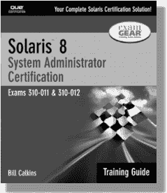

### Solaris 8 系统管理员培训指南（考试 CX-310-011、CX-310-012）

Bill Calkins

ISBN `1578702593`

$49.99 US/$77.99 CAN/£36.50 Net UK

在走进当地考试中心之前，请务必确认自己已准备好通过考试。除了 Exam Cram 2 系列之外，还可以考虑我们的培训指南系列。Que Certification 的培训指南正好提供了你通过考试所需的一切：

- 每章重点突出的考试目标
- 注释、提示、警告和考试提示会提醒你需要注意什么
- 分步练习，供你“动手”实践
- 章末练习和考试问题
- 最终复习包含快速事实、学习与考试提示以及另一套模拟考试
- 附带一张 CD，内含 PrepLogic 模拟测试，可全面评估你的知识水平
- 我们的作者是业内公认的专家。在大多数情况下，他们是现任或前任讲师、培训师或顾问——他们完全知道你需要掌握什么！

## 献辞

谨以此书献给我的父母、我的兄弟及其家人、我的妻子和孩子们。

并以此纪念 Alfred Chabarek（1920–2000）。

## 关于作者

Darrell L. Ambro 自 1977 年以来一直使用各种形式的 Unix。在他的职业生涯中，他参与了多个支持美国政府军事和文职机构的项目。这些项目涉及局域网（LAN）设计、操作、实施和故障排除、应用程序开发和系统集成、系统安全和入侵检测、数据库设计、系统管理、系统测试、方案制定、验收测试/销售支持、软件维护、二级支持以及企业计算机基础设施支持。

除了是 Solaris 2.6、Solaris 7 和 Solaris 8 的 Sun 认证系统管理员外，Darrell 还是 Solaris 8 的 Sun 认证网络管理员、认证 Novell 工程师（CNE）和微软认证系统工程师（MCSE）。

Darrell 是弗吉尼亚州里士满的 Grand Master Seung-Gyu Doong 指导下的跆拳道黑带三段。

## 致谢

感谢 Que Publishing 的 Carol Ackerman、Sheila Schroeder、Lisa Lord 以及其他为我的第二本书再版提供指导和帮助的人。

感谢我的妻子 Lilli 和我的孩子们 Shane 和 Eva，给我时间完成这本书。我爱你们。

感谢我的同事和朋友们给予我的鼓励。

## 我们期待您的反馈！

作为本书的读者，您是我们最重要的批评者和评论者。我们重视您的意见，想知道我们做对了什么、哪些地方可以做得更好、您希望我们出版哪些领域的内容，以及您愿意分享的任何其他真知灼见。

作为 Que 的执行编辑，我欢迎您的评论。您可以通过电子邮件或直接写信告诉我您喜欢或不喜欢这本书的哪些方面，以及我们如何能把书做得更好。

请注意，我无法帮助您解决与本书*主题*相关的技术问题。不过，我们有一个用户服务小组，我会将与本书相关的具体技术问题转交给他们。

写信时，请务必附上本书的书名和作者，以及您的姓名、电子邮件地址和电话号码。我会仔细审阅您的意见，并与参与本书编写的作者和编辑分享。

| | |
|---|---|
| 电子邮件： | `feedback@quepublishing.com` |
| 邮寄： | Jeff Riley<br>Que Certification<br>201 West 103rd Street<br>Indianapolis, IN 46290 USA |

如需了解更多关于本书或其他 Que 图书的信息，请访问我们的网站 `www.quepublishing.com`。在搜索字段中输入 ISBN（不含连字符）或书名，即可找到您要查找的页面。

## 引言

欢迎阅读 *Solaris 8 系统管理员考试速成*。本书将帮助您准备并通过获得 Sun 认证的 Solaris 8 系统管理员认证所需的两门考试。在本引言中，我将总体介绍 Sun 的认证计划，以及*考试速成*系列如何帮助您准备 Solaris 8 认证考试。

*考试速成*系列书籍帮助您理解和掌握通过 Solaris 认证考试所需的主题和材料。这些书严格针对考试准备和复习。它们不会教您关于某个主题的所有知识。相反，我会介绍并剖析您在考试中可能遇到的问题和难题。

然而，为了完全准备好任何 Solaris 考试，我建议您首先进行本引言之后的自我评估。该工具将帮助您在理想和现实情况下，根据 Solaris 8 系统管理员的要求评估您的知识基础。

根据您从该练习中学到的内容，您可能会决定通过课堂培训或阅读 Sun 和第三方供应商提供的众多系统管理指南之一来开始学习。我还强烈建议您安装、配置并试用 Solaris 8 和其他您将接受测试的软件，因为在理解认证考试中可能遇到的问题时，没有什么比动手经验和熟悉度更重要。书本学习至关重要，但动手经验是最好的老师！

### Sun 认证的 Solaris 8 系统管理员

认证计划目前包括两门独立的考试。以下是对每门考试的简要描述：

- **Sun 认证的 Solaris 8 操作环境系统管理员，第 1 部分（考试 `CX-310-011`）**——第一门考试（第 1 部分）涵盖基本系统管理。测试的知识包括操作系统安装、软件包管理、修补程序、启动过程、系统安全和文件权限、帐户管理、磁盘和文件系统管理、备份和恢复。
- **Sun 认证的 Solaris 8 操作环境系统管理员，第 2 部分（考试 `CX-310-012`）**——第二门考试（第 2 部分）涵盖高级主题和用于增强系统管理能力的几个附加软件包。测试的知识包括 Solaris 8 网络环境和网络客户端；设备管理；虚拟磁盘管理系统；网络文件系统（NFS），以及自动挂载和缓存；命名服务，如 DNS、NIS 和 NIS+；以及使用 JumpStart 进行自动安装。

要成为 Sun 认证的系统管理员，您必须通过两门考试，并且必须先通过第 1 部分考试，才能参加第 2 部分考试。无论如何，这种顺序是首选的，因为测试的知识是从第一门考试到第二门考试逐步建立的。

整个过程通常需要一年左右的时间，而且许多人发现他们必须多次参加考试才能通过。*考试速成*系列的主要目标是，在适当学习和准备的情况下，让您第一次尝试就能通过两门考试。


由于认证与 Solaris 操作系统的特定版本相关联，因此没有要求重新认证。但是，当某个 Solaris 版本过时后，获得该版本的认证价值不大。对您最有利的做法是争取获得下一个 Solaris 版本的认证。

过去，Sun 一直使用前一版本的认证要求和测试目标作为下一版本的起点。因此，一旦您获得了某个 Solaris 版本的认证，您就应该熟悉下一个 Solaris 版本认证的大部分测试目标。我估计从 Solaris 7 到 Solaris 8，大约有 25% 的测试目标发生了变化。

了解 Sun 认证计划的最佳地点是 Sun 教育网站 `http://suned.sun.com`。

## 参加认证考试

唉，考试不是免费的。每次考试无论通过与否，都需要支付 150 美元。在美国和加拿大，考试由 Prometric 管理。

首先，您必须从 Sun 教育服务处购买考试券。在美国，可以拨打 1-800-422-8020 联系他们。购买考试券需要使用信用卡。考试券自购买之日起一年内有效。

接下来，联系 Prometric 注册考试。在美国，电话号码是 1-800-795-3926。您也可以使用网站（`http://www.2test.com`）。

要安排考试，请至少提前一天致电。要取消或重新安排考试，您必须至少在预定考试时间前一天致电（否则可能需要支付 150 美元的费用）。致电 Prometric 时，请准备好以下信息：

- 您的姓名、组织、邮寄地址和社会安全号码。
- 您要参加的考试名称。
- Sun 考试券的编号。（此信息可能不需要，因为 Prometric 工作人员可能已经拥有它。）

如果您在考试前五天以上注册，预约确认将通过邮件发送给您；如果少于五天，则通过传真发送给您。还会提供一份候选人协议信函，您必须签署才能参加考试。

考试当天，请尽量在预定时间段前至少 15 分钟到达。您必须提供两种身份证明，其中一种必须带有照片。

所有考试完全闭卷。事实上，您不允许携带任何东西进入考试区域。我建议您在考试前复习您要参加的考试的最关键信息。（*考试速成*系列书籍提供了一份简短的参考——位于本书开头的“速成表”——以浓缩形式列出了书中的基本信息。）在开始正式考试之前，您将有时间整理思绪、在脑中回顾这些关键信息，甚至可以参加一次模拟导向考试。我建议您在第一次考试前参加导向测试；它们在布局、行为和控件上或多或少都是相同的，因此您可能不需要多次参加。

完成 Solaris 8 认证考试后，测试软件会告诉你是否通过。结果按几个主题领域划分。无论你通过与否，我都建议你索取并保留考试管理员为你打印的详细报告。如有必要，你可以利用这份报告为下一次考试做准备；即使你通过了，报告也会显示你可能需要复习以保持优势的领域。如果你需要重考，你必须致电 Prometric，安排新的考试日期，并再支付 150 美元。

## 跟踪认证状态

Sun 维护着一个数据库，其中记录了你已通过的考试和相应的分数。你可以通过 `http://www.galton.com/~sun` 访问该数据库。通过两项考试后，你将获得 Solaris 8 系统管理员认证。官方认证通常需要四到六周（一般在 30 天内），所以不要指望证书一夜之间就能到手。获得认证后，你将收到一个包含欢迎套件的包裹，内含以下物品：

- 一张适合装裱的 Solaris 8 系统管理员认证证书
- 一枚 Sun 认证系统管理员领章

许多人认为，认证的好处远不止 Sun 提供给这一精英群体新晋成员的额外福利。我开始看到越来越多的招聘信息要求或规定应聘者持有 Solaris 认证，许多完成该计划的人有资格获得加薪和/或职责提升。作为对勤奋工作和广博知识的官方认可，Solaris 认证在许多 IT 组织中是一枚荣誉徽章。

## 如何准备考试

备考 Solaris 8 考试至少需要获取并学习以下材料：

- Solaris 8 文档，可以是印刷版、随 Solaris 8 附带的 CD-ROM（AnswerBook2），或通过 `http://docs.sun.com` 在线获取。
- Sun 认证页面（`http://suned.sun.com/US/certification/solaris/sysadmin.html`）上的考试目标和样题。另请参阅第 1 章的“测试目标”一节。其中包含一个表格，提供章节与测试目标的交叉参照。
- **这本 Exam Cram 书。**它是你参加考试前最应该通读的一本书。

此外，在你寻求 Solaris 8 系统管理专业知识的过程中，你可能会发现以下材料很有用：

- **动手实践**——从 Sun Microsystems 获取一份 Solaris 8。当你阅读本书时，尝试这些命令并探索细节。经验是学习和记住通过考试所需细节的最佳途径。Solaris 8 操作系统可以免费下载，或从 `http://www.sun.com` 以媒体和运输成本价获得 CD-ROM。
- **课堂培训**——Sun 提供课堂和计算机辅助培训，你会发现这些培训对备考很有帮助。不过要提醒一句：这些课程相当昂贵（每培训日约 440 美元）。然而，它们确实提供了一种浓缩的学习形式，帮助你“复习”你的 Solaris 知识。这些考试与 Sun 提供的课堂培训密切相关，因此我建议你参加这些课程，以掌握 Solaris 专用（以及课堂专用）术语。
- **其他出版物**——你会在本书中找到其他出版物和资源的直接参考，而且关于 Solaris 的资料并不匮乏；然而，许多并不是专门针对 Solaris 8 编写的。因此，我没有引用很多这类出版物。为了帮助你筛选一些可用的出版物，我在每章末尾都设置了“需要了解更多？”一节，提供指向覆盖该章主题的更完整、更详尽资源的指引。这一节会告诉你去哪里寻找更多细节。

这些必备和推荐材料代表了 Solaris 8 系统管理员主题和软件方面无与伦比的来源和资源集合。在下一节中，我将解释本书的结构，并给你一些很好的理由，说明本书也应当列入你的必备和推荐材料清单。

## 关于本书

每个主题性的 *Exam Cram* 章节都遵循固定的结构，并配有关于特别重要或有价值材料的图形提示。以下是典型章节的结构：

- **开篇速查清单**——每章开头会列出一些术语、工具和技术，你需要先学习和理解这些内容，才能完全熟悉该章主题。在速查清单之后，我会用一两段引言为本章其余内容做铺垫。
- **主题覆盖**——在开篇速查清单之后，每章会涵盖与该章主题相关的一系列主题。在这些章节中，我会使用一种特殊的“考试提醒”版式来突出最有可能出现在考试中的材料，如下所示：

    

    这就是“考试提醒”的样子。通常，“考试提醒”强调的概念、术语、软件或活动最有可能出现在一个或多个认证考试题目中。因此，任何以“考试提醒”格式单独呈现的信息都值得你格外留意。事实上，Cram Sheet（考前速记表）中的大多数事实在正文中都是以“考试提醒”的形式出现的。

    即使某些材料没有被标记为“考试提醒”，本书*所有*内容也都与考试相关。本书高度聚焦于快速备考，因此你会发现每章正文部分的内容都是关键知识。

    我还提供了一些提示，帮助你打下更扎实的系统管理知识基础。虽然这些信息可能不会出现在考试中，但相关性很强，能帮助你成为更好的应试者。

    

    提示的格式就是这样。留意这些提示，你很快就会成为考试高手！

    书中还包含注释，提供考试未涵盖的补充信息。

    

    注释的格式就是这样。它们提供实用或历史信息，这些信息可能引起你的兴趣，但不会出现在考试中。
- **练习题**——本节提供一系列模拟测试题，并解释正确答案和错误答案。
- **详细信息和资源**——每章末尾都有一个“需要了解更多？”一节，直接指向 Sun 和第三方资源，这些资源提供关于本章主题的更多细节。此外，这一节还会尝试评价每个主题内容的覆盖质量和详尽程度。如果你在这个集合中找到喜欢的资源，可以使用它，但不必觉得必须使用所有这些资源。另一方面，我只推荐我经常使用的资源，因此我的任何推荐都不会浪费你的时间或金钱。

本书的大部分内容严格遵循这一章节结构，但我想指出其他几个元素。第 11 章和第 22 章包含模拟测试，可以很好地回顾全书所介绍的材料，确保你为考试做好准备。第 12 章和第 23 章提供模拟测试的答案。最后，请留意位于这本 *Exam Cram* 书开头的 Cram Sheet（考前速记表）。它是一个非常有价值的工具，收录了我认为你应在考前记住的事实、数字和技巧的浓缩集合。因为你可以先把这些信息从脑海中默写到纸上，再回答任何考试问题，所以你可以通过死记硬背来掌握这些信息——你只需要记住足够长的时间，走进考场时把它写下来即可。你甚至可能希望在走进考场之前，在车里或在考试中心大厅里再看一眼。

## 如何使用本书


如果你正在为第一次考试做准备，我把本书的主题设计成相互关联、层层递进的。因此，有些后面章节的主题在读过前面章节后会更容易理解。这就是为什么我建议你在初次备考时从头到尾阅读本书。

如果你需要复习某个主题，或者不得不为第二次尝试临时突击，可以使用索引或目录直接跳到你需要学习的主题和问题。除了考试之外，我认为你会发现本书作为一本高度聚焦的参考书很有用，涵盖了与 Solaris 8 系统管理员相关主题中一些最重要的方面。

鉴于本书的所有要素及其专业重点，我努力创造了一个工具，供你用来准备——并通过——Solaris 8 系统管理员的两项认证考试。

系统管理员考试。请与我分享您对这本书的反馈，特别是如果您有关于我如何改进它以帮助未来考生的想法。我会仔细考虑您说的一切，并尽量回复所有建议。您可以通过电子邮件联系我：solaris@unixtext.net，或者您可以将问题或意见发送至feedback@que-publishing.com。请记得在您的消息中包含本书的标题。

谢谢，并请尽情享受这本书！

## 自我评估

我在本*考试速成*中加入了自我评估，以帮助您评估自己是否准备好迎接Sun认证Solaris 8系统管理员认证。它还应该帮助您理解您需要掌握本书主题的哪些内容——即考试CX-310-011“Sun认证的Solaris 8操作环境系统管理员，第1部分”和考试CX-310-012“Sun认证的Solaris 8操作环境系统管理员，第2部分”。然而，在您深入这项自我评估之前，我将谈谈您在追求Solaris 8系统管理员认证时可能面临的问题，以及一个理想候选人应该是什么样子。

### 现实世界中的 Solaris 8 系统管理员

在下一节中，我将描述一个理想的Solaris 8系统管理员候选人，我很清楚只有少数实际候选人符合这个理想。事实上，我对那个理想候选人的描述可能看起来相当吓人。但请放心；虽然获得Solaris 8系统管理员认证的要求可能看起来令人生畏，但它们绝非无法满足。然而，您应该敏锐地意识到，这需要时间，需要一些费用，并且需要付出大量努力。

您可以从知道许多前人已经走过这条路中获得您所需要的所有现实动力。您可以追随他们的脚步。如果您愿意认真对待这个过程，并付出必要的努力来获得所需的经验和知识，您就可以参加并通过认证考试。事实上，*考试速成*和配套的*考试准备*正是为了让您的备考尽可能轻松而设计的，但您必须做好准备！

当然，对于其他Solaris认证也是如此，包括：

- Solaris 8 网络管理员，专注于网络方面，但只需一门考试。Solaris 8 系统管理员认证是前提条件。
- Solaris 7 系统管理员，与 Solaris 8 类似，但针对的是前一版本的 Solaris，需要两门考试。
- Solaris 7 网络管理员，专注于 Solaris 7 环境的网络方面，只需一门考试。

### 理想的 Solaris 8 系统管理员候选人

为了让您大致了解理想的Solaris 8系统管理员候选人是什么样子，以下是一些关于这类人可能具有的背景和经历的相关统计数据。如果您不具备这些资格（或者，实际上，如果您连边都不沾），不用担心，因为这个世界远非理想，而您不足之处正是您需要更加努力的地方。理想的候选人将具备以下条件：

- 接受过Unix操作系统方面的学术或专业培训，更具体地说，是Solaris所基于的AT&T System V Release 4 (SVR4) Unix操作系统。
- 三年以上的专业系统管理经验，包括安装和升级操作系统、性能调优、故障排除、创建用户以及管理备份和恢复场景的经验。

我相信在所有认证候选人中，远不到一半的人能满足这些要求。事实上，大多数人可能只满足不到一半的要求（也就是说，至少在他们开始认证过程时是这样）。然而，因为所有已经获得认证的人都经历了这一考验，您也能挺过去——尤其是如果您能认真对待这份自我评估告诉您的，关于您已经知道什么以及您需要学习什么。

### 测试你自己

下面的一系列问题和观察旨在帮助您弄清楚在追求Solaris认证的过程中您将面临多少工作，以及您可以在这段旅程中查阅哪些资源。回答时一定要绝对诚实，否则您最终会在尚未准备好的考试上浪费钱。答案没有对错之分，只是在通往认证的道路上迈出的步伐。只有您自己才能决定，在众多有抱负的候选人中，您真正属于哪个位置。

然而，从一开始有两件事应该明确：

- 即使是适度的计算机科学背景也会有所帮助。
- 对Solaris操作系统和技术的实际操作经验是认证成功的关键要素。

#### 教育背景

1. 您是否上过任何与计算机相关的课程？（是或否）

如果是，请继续回答问题2；如果否，请继续回答问题4。

2. 您是否上过任何关于Unix操作系统的课程？（是或否）

如果是，您可能能够处理与Solaris操作系统和系统管理相关的讨论。如果您生疏了，请重温Unix基础概念和网络知识。如果答案是否定的，请考虑在这个领域做一些基础阅读。我强烈推荐一本好的Solaris系统管理书，例如Mark Sobell的*Solaris实用指南*（1999年）。如果您不喜欢这本书，请查看您喜欢的在线书店中其他类似书目的评论。然而，不要期望有很长的列表。Solaris 8在可用书目方面仍然很新。

3. 您是否上过任何网络概念或技术课程？（是或否）

如果是，您可能能够处理网络术语、概念和技术（但请做好准备，它们会经常偏离常规用法）。如果您生疏了，请重温基础网络概念和术语。如果您的答案是否定的，您可能需要查看一些关于传输控制协议/互联网协议（TCP/IP）的书目。

4. 您是否阅读过关于Unix或网络的内容？（是或否）

如果是，请回顾问题2和3的要求。如果您满足这些要求，请进入下一节“实际操作经验”。如果您的答案是否定的，请考虑针对这两个主题的推荐阅读。这种扎实的背景将对备考Solaris考试大有帮助。

#### 实际操作经验

在所有Solaris测试中取得成功的另一个关键因素是实际操作经验。如果完成这份自我评估后，我只留给您一个认识，那应该是：没有东西可以替代您花时间安装、配置和使用各种Solaris命令和工具，而这些正是您将在考试中被反复和深入测试的内容。

5. 您是否安装、配置并使用过Solaris 8？（是或否）

如果是，请确保您理解考试CX-310-011中所涵盖的基本概念。

如果您没有使用过Solaris 8，您必须获得一份适用于SPARC或Intel x86兼容平台的副本。然后了解其安装和管理。


在您想参加任何Solaris考试之前，请确保您已经花了足够多的时间与Solaris 8相处，以了解它如何安装和配置，如何维护这样的安装，以及当软件出问题时如何排除故障。这将帮助您在考试中——以及在现实生活中。


#### 检验你的应试准备

无论您是参加特定主题的正式课程来备考，还是使用书面材料自学，为Solaris认证考试做一定的准备是必不可少的。每次考试150美元，无论通过还是失败，您都会想尽一切办法一次通过。这就是学习用武之地。

我在本书中为每章包含了几道模拟考试题和一个样题测试，因此如果您在章节问题中得分不高，您可以多学习，然后进行每部分末尾的样题测试。如果您

如果第一部分考试没有达到至少66%的分数，且第二部分考试没有达到70%，那么你需要查找网上提供的其他模拟考试资源。（使用你常用的搜索引擎即可找到。）

对于任何特定科目，如果你已经自学过相关材料、参加过考试但还是没通过，那么请考虑参加一门课程。如果你负担得起这项费用，与讲师和同学互动的机会可能会带来天壤之别。关于 Sun 课程的信息，请访问认证计划页面：http://suned.sun.com。

如果你负担不起课程，也请访问认证计划页面，因为它还包含免费的样题。即使你几乎没什么预算，也应该投资购买一些商业供应商提供的低成本模拟考试，因为它们比其他任何工具都更能帮助你评估自己是否准备好通过考试。请访问 http://www.unix-cert.net 网站，查看其他可用资源。

- 6. 你是否针对所选考试科目参加过模拟考试？（是或否）

如果是——并且你在第一部分取得了66%或更高的分数，在第二部分取得了70%或更高的分数——那么你可能已经准备好应对真正的考试了。如果你的分数没有超过这个关键门槛，请继续努力，直到突破这一关。如果你回答了“否”，请获取你能找到（或负担得起）的所有免费和低预算的模拟考试，然后开始练习。坚持练习，直到你能轻松超过通过分数线。


### 评估你对 CX-310-011 和 CX-310-012 考试的准备情况


除了上一节中的通用考试准备信息外，还有其他资源可以帮助你备考。我想到两个网站：`http://www.solarisguide.com` 和 `http://www.solariscentral.org`。此外，comp 新闻组 **comp.unix.solaris** 和 **comp.sys.sun.admin** 可通过新闻服务或 `http://google.com` 访问。`http://groups.google.com` 上的群组是就你不理解的话题提问并获得好答案的好地方，或者也可以仅仅观察别人提出的问题（当然还有答案）。位于 `http://www.sun.com/blueprints` 的 Sun Blueprints 计划提供了关于各种 Solaris 主题的深入文章。

我还想建议你在准备考试时，不妨浏览以下书籍中的一本或几本：

- Mulligan, John P. *《Solaris 8 必备参考手册》*。New Riders，2001年。
- Sun Microsystems。三卷本 *《Solaris 8 系统管理指南》*（Sun Microsystems，2000年）。

最后一点：我希望在考试背景下强调动手经验的重要性是合理的。当你复习考试材料时，你会意识到，亲手操作 Solaris 8 命令、工具和实用程序的经验是无价的。

## 向前迈进，穿过迷雾！

在评估好你的准备情况、完成应有的背景学习、获得有助于你理解相关产品和技术实际运作的动手经验，并查阅了大量备考信息来源之后，你就可以进行一轮模拟考试了。当你的成绩足够好，能够通过考试时，你就可以去参加真正的考试了。如果你遵循我的评估方法，你不仅会知道需要学习什么，还会知道什么时候可以在 Prometric 预约考试日期。祝你好运！

## 第一部分

### 考试 CX-310-011

- 1. Solaris 8 认证考试
- 2. 系统概念
- 3. 安装和维护 Solaris 8
- 4. 启动和关闭系统
- 5. 系统安全与文件权限
- 6. 用户环境
- 7. 控制进程
- 8. 磁盘管理
- 9. 文件系统管理
- 10. 系统基础
- 11. 模拟测试 I
- 12. 答案 I


#### Solaris 8 认证考试

##### 需要理解的术语：

- 选择题格式
- 单选按钮
- 复选框
- 图示
- 拖放
- 填空题（自由作答）
- 仔细阅读
- 排除法

##### 需要掌握的技巧：

- 评估你的考试准备情况
- 准备参加认证考试
- 勤加练习（以求完美）
- 充分利用考试软件
- 合理分配时间
- 把最难的题目留到最后
- 猜测（作为最后的手段）

就经验而言，无论准备得多充分，大多数人都不会热切期待考试。在大多数情况下，熟悉程度有助于缓解考试焦虑。通俗地说，这意味着你参加第四次或第五次认证考试时，可能不会像第一次那样紧张。

无论是第一次还是第十次考试，了解考试细节（每道题该花多少时间、你将身处何种环境等）以及熟悉考试软件，都会帮助你专注于考试内容而不是环境。同样，掌握一些基本的考试技巧，应该能帮助你识别——甚至可能避开——某些考题中必然会出现的陷阱和难题。

在本章中，我将解释考试环境和软件，并介绍一些经过验证的考试策略，你应该能够利用这些策略为自己争取优势。

##### 评估考试准备情况

在参加任何 Solaris 考试之前，我强烈建议你通读并完成本书附带的自我评估（见引言部分）。它将帮助你把自己的知识基础与获得 Solaris 8 系统管理员认证的要求进行比较，并帮助你找出背景或经验中可能需要改进、提升或进一步学习的部分。如果你掌握了正确的基础知识，获得 Solaris 认证就会容易得多。

完成自我评估后，你可以针对那些与理想认证候选人相比背景或经验不足的领域进行补救。你还可以同时处理个别考试的科目，这样可以在追赶某些领域的同时继续取得进展。

在完成这本*《考前冲刺》*、阅读补充材料并参加了第11章和第22章的模拟考试之后，你就会清楚地知道什么时候该准备参加真正的考试。虽然我强烈建议你继续练习，直到第一部分成绩超过66%、第二部分成绩超过70%，但以第一部分71%、第二部分75%为目标，能让你在真实考试环境中（压力比练习中更大）留有一些容错空间。当你达到这个水平时，就应该准备好了。然而，如果你做完本书中的模拟考试后仍未达到这个分数，你应该继续参加模拟考试并学习材料，直到达到目标。

关于其他模拟考试提供商的更多信息，请参阅自我评估部分，那里还有更多关于如何学习和备考的建议。但现在，让我们进入考试本身！

##### 考试目标

两场考试的目标都发布在 Sun 的网站上：`http://suned.sun.com/US/certification/solaris/sysadmin.html`。表1.1和表1.2提供了章节与考试目标之间的快速对照。

**表1.1 章节与考试 CX-310-011（第一部分）考试目标对照表**

| 章节 | 考试目标 |
| --- | --- |
| 2 | 系统概念 |
| 3 | 安装 |
| 4 | 引导 PROM、初始化和关闭 |
| 5 | 安全 |
| 6 | 用户管理 |
| 7 | 进程控制 |
| 8 | 磁盘配置与格式化 |
| 9 | 文件系统、文件和目录、备份与恢复 |
| 10 | 基本命令语法、编辑器、远程连接 |

**表1.2 章节与考试 CX-310-012（第二部分）考试目标对照表**

| 章节 | 考试目标 |
| --- | --- |
| 13 | 客户端/服务器关系与 Solaris 网络环境 |
| 14 | Solaris 系统日志 |
| 15 | 磁盘管理 |
| 16 | Solaris 伪文件系统与交换空间 |
| 17 | 基于角色的访问控制（RBAC） |
| 18 | 网络文件系统（NFS） |
| 19 | 命名服务 |
| 20 | Solaris 管理控制台与 Solstice AdminSuite |
| 21 | JumpStart——自动安装 |

##### 考试环境

当你到达预约考试的 Prometric 考试中心时，你需要向考试协调员签到。他/她会要求你出示两种身份证明，其中一种必须为带照片的身份证件。签到完成后，当你的预约时段到来时，你将被要求把随身携带的书籍、包袋或其他物品放在外面，然后会有人带你进入一个封闭的房间。通常，这个房间内会配备 1 到 6 台计算机，每个工位之间都用隔板隔开，以防止你看到别人计算机上的内容。

考场会为你提供一支钢笔或铅笔和一张空白纸；在某些情况下，也会提供可擦写塑料板和可擦写毡头笔。你可以在这张纸上写下任何你想要的信息，纸张的正反两面都可以书写。我建议你尽量记住“考试速查表”（见本书封底内侧）上的内容，然后在考试机前坐下后，立即把这些信息写在空白纸上。考试期间你可以随时查看这张纸，但离开房间时必须交还。

大多数考场都有一面墙带有大窗户，考试协调员可以透过窗户监控考场、防止考生互相交谈，并观察可能发生的任何异常情况。考试协调员会预先加载你报名参加的 Solaris 认证考试；你一旦在考试机前坐下，就可以开始考试。

每场 Solaris 认证考试允许你最多用 90 分钟完成。考试软件本身会在屏幕上显示计数/计时器，方便你随时查看剩余时间。第一部分包含 57 道题，第二部分包含 61 道题，题目均从题库中随机抽取。


所有 Solaris 认证考试均由计算机生成，采用选择题、拖放题或填空题的形式。虽然这听起来可能很容易，但题目的设计不仅是为了检验你对 Solaris 系统管理基础知识的掌握，还要求你评估一组或多组情境或需求。通常，一道题会要求你给出多个答案；同样，你也可能被要求从一系列选项中选出某个问题的最佳或最有效的解决方案，而这些选项从技术上说可能都是正确的。这些考试相当考验人，需要真正的思考。本书将让你了解考试中会遇到什么，以及如何应对考试中可能出现的难题、困惑和困境。

##### 考试布局与设计

问题 1 展示了一道典型考题。这是一道要求你选择唯一正确答案的选择题。题目后面附有对每个备选答案的简要说明，以及其正确或错误的原因。

### 问题 1

以下哪一项是 Solaris 启动过程的最后一个阶段？

- a. init
- b. Boot PROM
- c. BIOS
- d. 内核初始化
- e. 启动程序

答案 a 正确。以上所有选项都是 SPARC 或 Intel x86 启动过程的阶段。Boot PROM 和 BIOS 阶段用于测试硬件，因此答案 b 和 c 不正确。启动程序阶段负责定位并加载启动程序，随后内核初始化阶段加载内核，因此答案 d 和 e 不正确。只有在此之后，才会进入 init 阶段来初始化操作系统服务。


这道例题与你在 Solaris 认证考试中看到的题目非常接近。在考试中要选择正确答案，你需要将光标移到答案 a 旁边的单选按钮上，并点击鼠标选中该选项。认证考试中的题目与这类题目的唯一区别在于，真实考试中的题目后面不会紧跟着答案。

在下面的题目中，可能有一个或多个答案。这种题型提供复选框而不是单选按钮，用于标记所有正确的选项。

## 问题 2

以下哪些命令可用于列出所有已安装的补丁？

（选择所有适用项。）

- [ ] a. `showrev -p`
- [ ] b. `patchinfo`
- [ ] c. `patchlist all`
- [ ] d. `patchadd -p`

答案 a 和 d 正确。答案 b 和 c 对应的命令不存在。

对于这种题型，必须选择一个或多个答案才能正确作答。对于问题 2，你需要将光标移到 a 和 d 旁边的复选框上，并同时勾选两者，才能获得该题的分数。

以上两种题型可以以多种形式出现，构成了大多数 Solaris 认证考试题目的基础。更复杂的题目可能包含所谓的附图（exhibit），它们通常是某种形式的表格或数据/内容布局。你需要利用附图中显示的信息来作答。

其他涉及附图的题目可能会使用图表或示意图来描述一个工作场景，并要求你对其进行故障排除或配置。仔细留意附图是成功的关键——作答时，要准备好随时在图片和题目之间切换。通常，图片和题目都足够复杂，你可能无法将二者中任意一个的内容全部记住。

拖放题是 Solaris 考试新增的题型。它们提供一个包含两列数据的表格，例如技术术语及其定义。所有术语都必须（使用鼠标）放到各自对应定义的前面才算正确。要拖动术语，请将鼠标移到该术语上，按住鼠标左键；然后移动鼠标，将术语拖到正确位置；松开鼠标左键，将该术语放到其定义前面。

其余题目为填空题。这种题型需要输入命令名、文件名、命令行参数或 Solaris 相关术语。问题 3 展示了一道典型的填空题，该题提供了一个输入答案的方框。

## 问题 3

输入用于修改内核配置的文件的完整路径名。

正确答案是 `/etc/system`。

一定要非常仔细地阅读这类题目。由于你面前没有任何答案选项，没有什么能唤起你的记忆，因此猜测几乎不可能。由于这道题明确要求输入完整路径名，像 *system* 这样虽然在技术上可能被视为正确的答案也会被判定为错误。请尽量让答案尽可能具体。

### 高效使用考试软件

一个众所周知的应试原则是：先把整套试题从头到尾读一遍，但在第一遍时只回答那些你绝对有把握的题目。在后续几遍中，你可以深入处理更复杂的题目，同时清楚自己需要应对多少道这样的题目。

幸运的是，考试软件让这种方法很容易实现。在每个题目的底部，你都会看到一个复选框，可以标记该题目，以便稍后返回查看。（请注意，标记题目能让复查更加方便，但你也可以通过反复单击“前进”和“返回”按钮回到任意一道题目。）在阅读每道题时，如果你只回答有把握的题目，并把没有把握的题目标记为待复查，那么随着你按顺序解决那些更棘手的题目，未答题目的列表会不断缩小。


> 在回答更棘手的问题之前，先将整套试题完整读一遍，至少有一个潜在的好处：有时你会在后面的题目中发现某些信息，能让前面的题目变得更加清晰；另一些时候，你在后面题目中读到的信息可能会唤起你对某些事实、数据或行为的记忆，而这些记忆对前面的题目同样有帮助。无论哪种情况，只要你暂时跳过那些没有绝对把握的题目，你最终都会更有优势。

继续答题，直到你对自己所有的答案都绝对有把握，或直到你知道时间即将耗尽。如果还有未回答的题目，你应该快速浏览一遍并猜测答案。不作答意味着这道题肯定无法得分，而猜测至少还有答对的机会。（空白答案和错误答案按照同样的方式计为错误。）


### 认真对待考试

关于参加任何考试，我能给你的最重要建议是：仔细阅读每一个问题。有些问题故意含糊其辞，有些使用双重否定，还有一些以令人难以置信的精确方式使用术语。我参加过许多模拟考试并阅读过相关资料，几乎每次考试我都会因为读题不够仔细而至少答错一道题。

以下是一些关于如何克服急于作答倾向的建议：

- 确保你读到了问题中的每一个字。如果你发现自己不耐烦地往前跳读，请回到开头重新开始。
- 阅读时，试着用自己的话复述问题。如果你能做到这一点，你就能更容易地选出正确答案。
- 当你通读一遍后再次回到某个问题时，请重新逐字阅读——否则，你的思维很容易陷入固定模式。有时，在注意力转移到别处之后重新审视一个问题，能让你看到之前遗漏的东西，但强烈的倾向是你会看到自己之前已经看过的东西。务必尽力避免这种倾向。
- 如果你返回某个问题超过两次，试着对自己说明你究竟不理解什么、为什么答案看起来不合理，或者似乎缺少了什么。如果你在这上面思考一段时间，你的潜意识可能会提供缺失的细节，或者你可能会注意到指向正确答案的“陷阱”。

最重要的是，试着通过思考你所了解的 Solaris 系统管理员相关内容——命令、特性、行为、事实和数字——来处理每个问题。通过回顾你所知道的（以及你在信息表上写下的内容），你往往能够回忆或理解足够的信息，从而确定问题的答案。

### 应对问题的策略

根据我参加过的考试，答案中出现了一些有趣的趋势。对于那些只有一个正确答案的问题，通常有两三个答案明显错误，另外两个答案看似合理。当然，只有一个可能是正确的。除非答案一下子跳入你眼前（如果真的如此，请重读问题以检查是否有陷阱；有时这些恰恰是最容易答错的题），否则就开始通过排除明显错误的答案来作答。

在“明显错误”的类别中，要找的东西包括伪造的命令选项或文件名、不存在的软件或命令选项，以及你从未见过的术语。如果你为考试做好了准备，那么不会有任何有效信息是完全陌生的。在这种情况下，不熟悉或古怪的术语很可能表明答案是完全编造的。只要你确定什么是对的，就很容易排除什么是错的。

许多问题假设某个 Solaris 命令的默认行为生效。了解和理解各种命令的默认设置至关重要。如果你知道这些默认值并理解其含义，这将帮助你解开许多棘手的难题。

同样，在处理需要多个答案的问题时，你必须知道并选择所有正确的选项才能得分。这也是为什么仔细阅读如此重要的又一个例证。

在作答过程中，考试提供的另一个计数器也会派上用场：已完成的问题数和未完成的问题数。合理安排时间，确保在考试时间过四分之一时完成四分之一的问题。在时间过了四分之三时再检查一次。对于有 57 道题的 Exam CX-310-011 和有 61 道题的 Exam CX-310-012，这意味着 30 分钟后大约要做完 20 道题，60 分钟后大约要做完 40 道题（还剩 30 分钟）。

如果 80 分钟后你还没做完，请利用最后 10 分钟猜完剩余的问题。记住，猜测可能比空白答案更有价值，因为空白答案永远是错的，而猜测有可能猜对。如果你对剩余的问题毫无头绪，随机选择答案，或者全部选 A、全部选 B 等等。重要的是提交一份每个问题都有答案的试卷去评分。

### 掌握内在博弈

归根结底，知识带来信心，信心带来成功。如果你认真学习了本书中的材料，并复习了每章末尾的所有问题，你就应该清楚哪些领域需要额外学习。

接下来，按照每章末尾“需要了解更多？”部分推荐的材料进行阅读。其理念是让你充分熟悉样题中的概念和情境，从而能够在真实考试中通过推理应对类似的情境。如果你掌握了材料，你完全有理由相信自己能通过考试。

当你完成第一部分的学习后，做第 11 章的模拟测试。同样，学习完第二部分后，做第 22 章的模拟测试。这些测试能提供现实的检验，并帮助你确定需要进一步学习的领域。在安排真实考试之前，务必跟进并复习与答错问题相关的材料。只有当你覆盖了所有内容并对模拟测试的整体范围感到得心应手时，才应该参加真正的考试。

> **提示** 如果你在第 11 章的模拟测试中得分低于 66%，或在第 22 章的模拟测试中得分低于 70%，那么你需要进一步练习。

有了本书中的信息和提高知识的决心，你应该能够通过认证考试。然而，如果不努力，你可能会多交几次考试费才能最终通过。如果你认真准备，考试应该会顺利进行。祝你好运！

### 其他资源

到目前为止，关于 Solaris 认证考试的最佳信息来源是 Sun 公司本身。因为其产品和技术——以及与之配套的考试——经常变化，获取考试相关信息的最佳途径是在线获取。

如果你还没有访问过 Solaris 认证页面，现在就去做吧。在我撰写本章时，认证主页位于 **http://suned.sun.com/SUN/certification/solaris/sysadmin.html**。


当你读到这本书时，认证主页可能不在同一个 URL 上，或者可能因为 Sun 网站经常更新而被新内容所取代。如果发生这种情况，请阅读本章后面的侧边栏“应对网络变化”。

这个网页指向认证页面上的更多信息。以下是你需要查看的内容：

- **概述**——认证过程和考试的概述。
- **配套课件**——Sun 提供的课堂课程和自定进度的计算机培训，涵盖考试目标中列出的信息。


- **考试目标**——考试将涵盖的主题的详细列表。

- **样题**——有限数量的样题和答案。

- **注册**——关于购买 Sun 考试券以及向 Prometric 注册以安排考试的信息。

- **常见问题解答**——常见问题；你的问题可能会在这里得到解答。

在你浏览认证页面时——我强烈建议你这样做——你可能会发现其他我没有提到的内容，它们同样有趣且引人入胜。

### 应对网络变化

迟早，我与你分享的关于 Solaris 认证页面的所有细节，以及我在本书其余部分提到的所有其他基于网络的资源，都会过时或被更新的信息所取代。在某些情况下，你在这里找到的 URL 可能会带你到其替代页面；在其他情况下，这些 URL 将无法打开，只会留下可怕的“404 找不到文件”错误信息。

当这种情况发生时，请不要放弃。在网络上总有办法找到你想要的东西——只要你愿意投入一些时间和精力。首先，大多数大型或复杂的网站——Sun 的网站两者兼备——都提供搜索引擎。只要你能访问 Sun 的主页（我相信它还会在 `http://www.sun.com` 上保持很长时间），你就可以使用这个工具来帮助你找到所需的内容。

你的搜索请求越精准，结果中就越有可能包含可用的信息。例如，你可以搜索字符串“training and certification”来获取大量关于该主题的总体数据，但如果你要查找 Sun 认证系统管理员考试的详细信息，使用这样的搜索字符串可能会更快地到达目标：

```
"Administrator" AND "certification"
```

同样地，如果你想查找培训和认证下载内容，可以尝试使用如下搜索字符串：

```
"training and certification" AND "download page"
```

最后，不要害怕使用通用搜索工具，如 `http://www.search.com`、`http://www.altavista.com` 或 `http://www.excite.com` 来搜索相关信息。尽管 Sun 公司在线提供其认证考试的相关信息，但这一领域还有很多第三方信息、培训和帮助来源，它们不必像 Sun 那样遵循官方口径。底线是：如果你在书中标明的位置找不到某样东西，就开始四处查找。如果实在找不到，你随时可以给我发电子邮件！我或许会有一些线索。我的电子邮件地址是 `solaris@unixcert.net`。


## 系统概念

### 需要理解的术语：

- 内核

- Shell

- 文件系统

- 守护进程

- *Solaris 8 参考手册*

### 需要掌握的技巧：

- 区分操作系统的各个部分

- 区分三种 Shell

- 使用 `man` 命令查看联机手册页

本章介绍 Solaris 8 操作系统的一些基本概念。第一节简要总结 Solaris 8 的新特性。第二节阐述操作系统的结构和组件。下一节总结三种 Shell，最后一节概述联机参考手册。本章涵盖 *系统概念* 测试目标。

### Solaris 8 的新特性

Solaris 的最新版本中添加了以下增强功能：

- **互联网协议第 6 版（IPv6）**——下一代 IP，克服了当前 IP（第 4 版）的许多限制。主要优点是更大的地址空间和地址的自动配置。在 Solaris 8 中，网络接口可以同时配置为支持 IPv4 和 IPv6。

- **Java 2 软件开发工具包（SDK）**——最新版本的 Java SDK 使 Solaris 成为独立于机器的软件开发的强大平台。

- **通用磁盘格式（UDF）文件系统**——允许轻松交换存储在 CD-ROM、DVD、硬盘和软盘上的数据。

- **图形向导**——添加了几个新的图形向导以改善系统可用性。最引人注目的是安装向导和 DHCP 管理器。此外，支持 X 应用程序的 X 服务器已升级到 X11R6.4 行业标准。

### 操作系统的三个组成部分

与 Unix 操作系统的所有变体一样，Solaris 8 由三个部分组成：内核、Shell 和文件系统。接下来的几节将分别讨论它们。

#### 内核

*内核*是管理计算机物理和逻辑资源的软件集合。这些管理服务包括控制内存和其他存储设备的分配、控制对外围设备（输入/输出）的访问，以及控制进程或任务的调度和执行。在大多数情况下，这些服务对用户是透明的。用户发出执行任务的请求，内核处理底层硬件的复杂性，并分配逻辑资源来完成该任务。

物理资源通过称为*设备驱动程序*的软件模块进行控制，这些模块了解如何与硬件设备通信并控制其操作。通常，每个设备都有一个唯一的驱动程序，该驱动程序随硬件提供，并以硬件制造商、型号，有时还有硬件版本来标识。

逻辑资源包括进程和内存。*进程*是任务或程序。内核维护定义和控制进程的内部数据结构；它还控制进程的调度、执行和终止。其他重要的内核服务是内存管理和进程间通信。内存管理涉及跟踪可用内存，根据需要将其分配给进程，并在进程释放或终止时回收内存。*进程间通信*涉及处理进程之间的协作通信。

Solaris 8 内核支持多个用户，每个用户都可以执行一个或多个进程或任务。因此，Solaris 8 既是*多用户*系统，也是*多任务*系统。Solaris 8 内核通过允许任务在很短的时间片内访问系统资源来实现这种支持级别。一个任务被允许执行一个或多个时间片，然后被挂起，以便另一个任务可以访问这些资源。这种方法在所有活动任务之间提供时间共享，并使所有任务看起来同时在运行。一个看起来一直在执行（并且通常按需提供服务）的任务称为*守护进程*。

#### Shell

*Shell*是一个软件模块，提供用户与内核之间的接口。它接受用户请求并将其提交给内核。它还接受来自内核的状态信息和数据，并将其呈现给用户。通常，Shell 接受来自终端或网络连接的用户输入；但是，输入可以来自文件、设备，甚至另一个进程。此外，来自内核的输出通常会发送到用户的终端或网络连接。同样，这个输出可以被重定向到文件、设备或另一个进程。

Shell 还提供了一种内置编程语言，可用于自动化重复性任务。这种自动化包括流程控制以及处理数值和字符串数据的能力。

Solaris 8 提供了几种不同的 Shell，每种都有独特的优势。有些 Shell 提供历史/回忆机制，使用户只需输入几个控制序列即可重新执行以前的命令，而无需重新输入命令。其他 Shell 提供内置的数学处理功能。

#### 文件系统

*文件*是一组作为存储、检索和操作单位的字节。*文件系统*是以分层结构存储在磁盘驱动器上的文件集合。一种特殊类型的文件称为*目录*，它充当文件夹并用于组织文件。文件系统可以被看作一棵倒置的树，目录是树枝，文件是树叶。Unix 系统顶层目录的名称 *root*（根目录）就来自这个类比。

Unix 操作系统通过提供实用工具来创建、挂载（使其可访问）、检查、修复、复制和备份文件系统，从而支持文件系统概念。Unix 系统上可访问的存储空间通常划分为多个文件系统。这种划分使维护更容易并提高性能。

### 三种最常见的 Shell

Solaris 8 环境提供了几种 Shell。最常见的三种是 Bourne Shell（`sh`）、C Shell（`csh`）和 Korn Shell（`ksh`）。

Bourne Shell 由 AT&T 贝尔实验室的 Steven Bourne 开发，是最初的 Unix 操作系统附带的 Shell。Ken Thompson 和 Dennis Ritchie 在 20 世纪 70 年代于贝尔实验室设计并开发了 Unix 操作系统。


Bourne Shell 是 Solaris 8 操作系统的默认 Shell。

C Shell 由加州大学伯克利分校的 Bill Joy 开发，随该大学开发的一个 Unix 操作系统版本提供，该版本被称为伯克利软件发行版（Berkeley Software Distribution，BSD）Unix。

Korn Shell 由 AT&T 贝尔实验室的 David G. Korn 设计和开发，源自 Bourne Shell，添加了 C Shell 的许多功能以及自身的新功能。表 2.1 比较了这三种 Shell 的功能。


使用每个 Shell 的初始化文件是一个重要概念，在 Solaris 8 系统上设置用户帐户时非常有用。请务必理解它们的用法，并将文件名正确关联到相应的 Shell。

**表 2.1  Solaris 8 Shell 的功能**

| 特性 | `sh` | `csh` | `ksh` | 功能 |

|---|---|---|---|---|

| 别名 | 否 | 是 | 是 | 允许您为复杂的字符串分配一个简短、简单的名称，然后在命令中使用该名称代替该字符串。这样做看起来就像能够向 Shell 添加自定义命令。 |


| Bourne Shell 兼容语法 | 是 | 否 | 是 | 由于 Korn Shell 是 Bourne Shell 的增强版本，它们使用相同的语法。C Shell 是单独开发的，其语法基于 C 编程语言。 |

| 默认提示符 | $ | % | $ | Bourne Shell 和 Korn Shell 的默认提示符都是美元符号（$），而 C Shell 的默认提示符是系统主机名后跟百分号（%）。 |

| 历史记录功能 | 否 | 是 | 是 | C Shell 和 Korn Shell 的历史记录功能会跟踪用户自定义数量的先前命令。您不必重新输入命令，而是可以从历史记录中复制并执行。 |

| 历史编辑 | 否 | 是 | 否 | 允许您修改并再次使用先前的命令。 |

*(续)*

### 表2.1 Solaris 8 Shell 的特性

| 特性 | sh | csh | ksh | 功能 |
|---|---|---|---|---|

| **历史执行** | 无 | `!n` | `fc` | 使用少量按键即可重复上一条命令。对于csh，*n*是历史列表中命令的编号。 |

| **初始化文件：登录时** | `.profile` | `.login` | `.profile` | 存储用户登录系统时应执行一次的命令。 |

| **初始化文件：shell启动时** | 无 | `.cshrc` | 用户自定义 | 存储用户每次启动shell执行命令时都会执行的命令。对于Korn shell，用户可以通过**ENV**参数指定shell启动初始化文件的名称。 |

| **内联编辑** | 无 | 无 | 有 | 允许你编辑已输入但尚未执行的命令，这样你可以纠正输入错误，而无需重新输入整个命令。纠正错误时可以使用**emacs**或**vi**编辑命令。 |

| **注销文件** | 无 | `.logout` | 无 | 存储用户注销时应执行的命令。 |

| **覆盖保护** | 无 | 有 | 有 | 防止文件被意外覆盖；可以通过**noclobber**参数设置。 |

| **重复上一条命令** | 无 | `!!` | 无 | 只需少量按键即可重新执行上一条命令的便捷快捷键。 |

| **受限版本** | rsh | 无 | rksh | 适用于只需要对Unix系统进行有限访问的用户。通过将用户限制在单个目录中并防止shell输出重定向来增强安全性。注意不要将受限Bourne shell（/usr/lib/rsh）与用于在远程系统上执行命令的远程shell（/usr/bin/rsh）混淆。Korn shell的受限版本是/usr/bin/rksh。 |

| **来源** | AT&T | Berkeley | AT&T | Bourne和Korn shell均起源于AT&T贝尔实验室，而C shell来自加州大学伯克利分校。 |

#### 在线参考手册

*《Solaris 8参考手册》*（印刷版）是一套多卷手册，记录了Solaris 8操作系统可用的命令、系统调用、库函数、特殊文件等。这种格式起源于AT&T贝尔实验室开发的Unix操作系统初始版本，并已被几乎所有可用的Unix操作系统版本采纳为权威文档。

为方便起见，Solaris 8系统和大多数其他版本的Unix操作系统都提供了*《参考手册》*的在线版本。你可以使用**man(1)**命令在终端/监视器屏幕上查看在线*《参考手册》*的页面或主题。*《参考手册》*还包含在Solaris 8 AnswerBook2在线文档中，该文档允许你使用HTML Web浏览器（如Netscape Navigator）搜索、显示和打印*《参考手册》*的页面。*《参考手册》*的页面被称为*手册页*。

*《参考手册》*分为多个部分。每个部分涉及一组相关的命令或操作系统的不同方面。表2.2描述了*《参考手册》*的各部分。

| 部分 | 描述 |
|---|---|

| 1 | 所有用户可用的命令。包括BSD兼容包（1B）中的命令、用于系统间通信的命令（1C）、与*表单和菜单语言解释器*（1F）相关的命令，以及SunOS系统专用的命令（1S）。 |

| 1M | 用于系统维护和管理的命令。有些仅限于系统管理登录账户（如root）。 |

| 2 | C语言程序可用于访问和控制系统资源的低级操作系统调用。 |

| 3 | C语言程序可用于访问和控制系统资源的系统库函数。本部分根据库函数（基本、网络、线程、curses等）进一步细分。 |

| 4 | 各种系统配置文件的格式。还包括C语言数据结构声明的描述，这些声明可用于通过C语言程序访问某些系统文件。 |

| 5 | 其他主题，如标准、环境和宏。 |

| 6 | 任何可用的游戏或演示程序。 |

| 7 | 与特定硬件、设备驱动程序和STREAMS I/O子系统组件相关的特殊文件。 |

| 9 | 两个内核级设备驱动程序规范：设备驱动程序接口（DDI）和驱动程序/内核接口（DKI）。本部分根据主题（入口点、函数、数据结构等）进一步细分。 |

请注意，不使用第8节。在最初的AT&T Unix System V操作系统中，第8节用于描述特殊的系统维护程序。对于Solaris，这些程序在*《系统管理指南》*和其他指南与手册中描述。

通常，*《参考手册》*的每一节都作为单独的一卷印刷。当在文本中引用手册页时，部分编号可能会在命令名称后的括号中指定。这个编号在在线手册中可能并不重要，但如果你试图在一堆超过一英尺高的印刷手册中查找某个手册页，知道部分编号（即哪一卷）会节省大量时间和精力。因此，man(1)表示**man**命令位于第1节：“用户命令”。

#### 使用man命令

尽管印刷版*《参考手册》*和AnswerBook2都可用，但第一部分（Part I）的测试目标包括使用在线手册页作为要求。**man(1)**命令用于显示作为命令行参数指定的一个或多个手册页。表2.3列出了**man**命令可用的命令行参数。

### 表2.3 man命令的命令行参数

| 参数 | 描述 |
|---|---|

| *name* | Solaris命令、文件等的名称，由同名手册页描述。除**-f**、**-k**和**-M**参数外，所有参数至少需要一个*name*。可以指定多个*name*（以空格分隔）。 |

| **-** | 不自动通过**more(1)**命令发送输出（该命令提供分页、下划线等功能）。 |

| **-a** | 显示所有与指定*name*匹配的手册页（无论部分）。 |

| **-d** | 显示用于定位*name*手册页的调试信息（使用的搜索方法、搜索的部分等）。 |

| **-f file ...** | 列出引用指定*file*的手册页（需要预先格式化的手册页）。可以指定多个*file*（以空格分隔）。注意，此参数用于定位手册页中引用的文件，而不是手册页本身（因此，它不需要手册页的*name*参数）。 |

| **-F** | 强制搜索所有man部分以查找*name*，而不是使用windex数据库定位手册页（windex与预先格式化的手册页关联）。 |

| **-k keyword ...** | 打印包含指定*keyword*的所有windex数据库条目的摘要（仅限预先格式化的手册页）。可以指定多个*keyword*（以空格分隔）。注意，此参数用于在数据库中定位关键字，而不是手册页（因此，它不需要*name*参数）。 |

| **-l** | 列出所有与指定*name*匹配的手册页（无论部分）。 |

| **-M path** | 为手册页文件指定替代目录*path*。此参数可以与其他任何参数一起使用。 |

| **-r** | 重新格式化指定的*name*手册页。输出不是显示，而是捕获到文件中，供后续**man**命令使用。 |

| **-s section ...** | 仅搜索指定的*section*或部分（以空格分隔）。 |

| **-t** | 使用**troff(1)**排版指定的*name*手册页。如果**-t**与**-a**参数一起使用，则输出不会显示，而是捕获到文件中，供**man**命令后续使用。 |

| **-T macro** | 使用指定的**nroff(1)** *macro*包，而不是标准手册页（**-man**）宏包。 |

以下示例演示了如何使用 **man** 命令显示 **man(1)** 手册页。请注意，超过一屏的手册页会使用 **more(1)** 命令一次显示一屏内容：


# man man
Reformatting Page. Please wait... Done

User Commands                                      `man(1)`

## NAME
`man` - find and display reference manual pages

## SYNOPSIS
`man [-] [-adFlrt] [-M path] [-T macro-package]`
    `[-s section] name ...`

`man [-M path] -k keyword ...`

`man [-M path] -f file ...`

## DESCRIPTION
The `man` command displays information from the reference manuals. It displays complete manual pages that you select by name, or one-line summaries selected either by keyword (`-k`), or by the name of an associated file (`-f`). If no manual page is located, `man` prints an error message.

### Source Format
Reference Manual pages are marked up with either `nroff(1)` or `sgml(5)` (Standard Generalized Markup Language) tags. The `man` command recognizes the type of markup and processes the file accordingly. The various source files are kept in separate directories depending on the type of markup.

### Location of Manual Pages
The online Reference Manual page directories are conventionally located in `/usr/share/man`. The `nroff` sources are located in the `/usr/share/man/man*` directories. The SGML sources are located in the `/usr/share/man/sman*` directories. Each directory corresponds to a section of the manual. Since

.
.
.

`*passwd*` 主题展示了 `man` 命令的不同命令行参数，因为 `passwd(1)` 是一个命令，而 `passwd(4)` 是一个系统文件。以下示例列出了所有名为 `passwd` 的手册页：

```text
# man -l passwd
passwd (1)       -M /usr/share/man
passwd (4)       -M /usr/share/man
#
```

请注意，两个手册页都被列出。此外，还会显示相应的 `-M` 命令行参数，以指明手册页的位置。手册页的默认路径名为 `/usr/share/man`。

以下示例显示了 `passwd(1)` 手册页：

```text
# man passwd
Reformatting Page. Please wait... Done

User Commands                                      passwd(1)

NAME
        passwd - change login password and password attributes

SYNOPSIS
        passwd [ -r files ] [ -r ldap ] [ -r nis ] [ -r nisplus ]
                [ name ]

        passwd [ -r files ] [ -egh ] [ name ]

        passwd [ -r files ] -s [ -a ]

        passwd [ -r files ] -s [ name ]

        passwd [ -r files ] [ -d | -l ] [ -f ] [ -n min ]
                [ -w warn ] [ -x max ] name

        passwd -r ldap [ -egh ] [ name ]

        passwd -r nis [ -egh ] [ name ]

        passwd -r nisplus [ -egh ] [ -D domainname ] [ name ]

        passwd -r nisplus -s [ -a ]

        passwd -r nisplus [ -D domainname ] -s [ name ]

        passwd -r nisplus [ -l ] [ -f ] [ -n min ] [ -w warn ]
                [ -x max ] [ -D domainname ] name

DESCRIPTION
        The passwd command changes the password or lists password
.
.
.
```

请注意，`man -s 1 passwd` 会提供相同的结果。在未指定章节的情况下，手册页会按章节进行搜索，并打印第一个找到的条目。要显示 `passwd(4)` 手册页，必须指定章节，如下例所示：

```text
# man -s 4 passwd
Reformatting Page. Please wait... Done

File Formats                                      passwd(4)

NAME
        passwd - password file

SYNOPSIS
        /etc/passwd

DESCRIPTION
        /etc/passwd is a local source of information about users'
        accounts. The password file can be used with
        other password sources, including the NIS maps
        passwd.byname and passwd.byuid and the NIS+ table passwd.
        Programs that use the getpwnam(3C) routines to access this information.

        Each passwd entry is a single line of the form:

            username:password:uid:
            gid:gcos-field:home-dir:
            login-shell

        where

        username
            is the user's login name. It is recommended that this
            field conform to the check performed by pwck(1M).

        password
            is an empty field. The encrypted password for the user
            is in the corresponding entry in the /etc/shadow file.
            pwconv(1M) relies on a special value of 'x' in the
            password field of /etc/passwd. If this value of 'x'
.
.
.
```


# Solaris 8 手册页使用说明

由于难以记住所有 Solaris 8 命令（尤其是所有命令行参数），`man` 命令提供了一种快速获取详细信息的方法。请记住，多个手册页可能具有相同的名称，因此了解哪个部分可能包含所需信息，并理解使用 `-s` 命令行参数来指定相应部分非常重要。如果您记不住 `man` 命令行参数，可以使用 `man` 命令来显示它们，即运行 `man man`。

## 显示所有手册页示例

以下示例使用 `-a` 命令行参数显示所有 `passwd` 手册页：

```text
# man -a passwd
Reformatting Page. Please wait... Done

::::::::::::::
/usr/share/man/cat1/passwd.1
::::::::::::::

User Commands                                      passwd(1)

NAME

       passwd - change login password and password attributes

SYNOPSIS
       passwd [ -r files | -r ldap | -r nis | -r nisplus ]
          [ name ]

       passwd [ -r files ] [ -egh ] [ name ]

       passwd [ -r files ] -s [ -a ]

       passwd [ -r files ] -s [ name ]

       passwd [ -r files ] [ -d | -l ] [ -f ] [ -n min ]
          [ -w warn ] [ -x max ] name

       passwd -r ldap [ -egh ] [ name ]

       passwd -r nis [ -egh ] [ name ]

       passwd -r nisplus [ -egh ] [ -D domainname ] [ name ]

       passwd -r nisplus -s [ -a ]

       passwd -r nisplus [ -D domainname ] -s [ name ]

       passwd -r nisplus [ -l ] [ -f ] [ -n min ] [ -w warn ]
          [ -x max ] [ -D domainname ] name
.
.
.
::::::::::::
/usr/share/man/cat4/passwd.4
::::::::::::

File Formats                                      passwd(4)

NAME
       passwd - password file

SYNOPSIS
       /etc/passwd

DESCRIPTION
       /etc/passwd is a local source of information about users'
       accounts. The password file can be used with
       other password sources, including the NIS maps
       passwd.byname and passwd.byuid and the NIS+ table passwd.
       Programs that use the getpwnam(3C) routines to access this information.

       Each passwd entry is a single line of the form:

           username:password:uid:
           gid:gcos-field:home-dir:
           login-shell

       where

       username
           is the user's login name. It is recommended that this
           field conform to the checks performed by pwck(1M).

       password
           is an empty field. The encrypted password for the user
           is in the corresponding entry in the /etc/shadow file.
           pwconv(1M) relies on a special value of 'x' in the
.
.
.
```

## 手册页格式与预格式化

请注意，前面的示例（显示手册页）都以 *正在重新分页。请稍候...完成。* 这一短语开头。手册页以 `nroff(1)` 源文件或 `sgml(5)` 源文件形式存储。`sgml` 格式的手册页在由 `nroff` 命令格式化之前，会先经过 SGML 预处理器处理。

任何对手册页的搜索基本上都是暴力搜索——也就是说，系统会逐一搜索包含手册页的每个目录，直到找到指定的手册页。为了加快显示和搜索速度，您可以生成并存储手册页的预格式化版本。系统会尽可能使用预格式化版本。在预格式化过程中，还会生成手册页关键字索引。该索引称为 `windex` 数据库。`catman(1M)` 命令负责格式化手册页并生成 `windex` 数据库。请注意，根据系统 CPU 的速度和当前负载，`catman` 命令可能需要相当长的时间来格式化所有手册页。

## 关键字搜索

此外，拥有 `windex` 数据库后，您可以在手册页中搜索关键字和文件。以下示例演示了使用 `-f` 命令行参数搜索手册页中与 `/etc/passwd` 文件相关的内容，以及使用 `-k` 命令行参数搜索关键字 `passwd`：


```text
# man -f /etc/passwd
passwd          passwd (1)          - change login password and
                                      password attributes
passwd          passwd (4)          - password file

# man -k passwd
dpasswd         dpasswd (4)         - dial-up password file
getpw           getpw (3C)          - get passwd entry from UID
kpasswd         kpasswd (1)         - change a user's Kerberos
                                      password
nispasswd       nispasswd (1)       - change NIS+ password information
nispasswd       rpc.nispasswd (1M) - NIS+ password update daemon
passwd          passwd (1)          - change login password and
                                      password attributes
passwd          passwd (4)          - password file
pwconv          pwconv (1M)         - installs and updates
                                      /etc/shadow file information
                                      from /etc/passwd
rpc.nispasswd   rpc.nispasswd (1M) - NIS+ password update daemon
rpc.ypasswdd    rpc.ypasswdd (1M)  - server for modifying NIS
                                      password file
yppasswd        yppasswd (1)      - change your network password
                                      in the NIS database
yppasswdd       rpc.yppasswdd (1M) - server for modifying
                                      NIS password file
#
```

您可以使用 `-d` 命令行参数查看 `man` 命令在尝试定位指定的手册页时的搜索过程。以下示例搜索 `windex` 数据库。所有可用的章节在 `/usr/share/man/man.cf` 文件中以章节标识符列表的形式标识，该列表被定义为 `MANSECTS` 变量的内容。每个章节标识符都会被附加

定位到指定的手册页，并用于搜索 `windex` 数据库。请注意，为简化示例，部分调试输出已被删除：

```text
# man -d -l passwd
/usr/share/man: from man.cf, MANSECTS=1,1m,1s,2,3,3c,3m,3malloc,3d1,3ns1,
3socket,3l,3p,3x,3c,3n,3nisdb,3rac,3resolv,3rpc,3slp,3xfn,3proc,3rt,3thr,3elf,3kvm,
3kstat,3m,3mp,3pam,3sched,3aio,3bsm,3cpc,3sec,3secd,3cfdadm,
3crypt,3dev,3d1,3lib,3lib,3lib,3lib,3l,7,7p,7s,7i,
7m,7p,9e,9f,9s,4,5,4b,3gen,3exec,3es,3print,3volmgr,
3mail,3layout,3ext,1b,1c,1f,3ucb,3xnet,3sources,3plot,3xcurses,
3gss,6,1,n

mandir path = /usr/share/man
  search in = /usr/share/man/windex file
    search an entry to match passwd.1
passwd (1) - M /usr/share/man
    search an entry to match passwd.1m
    search an entry to match passwd.1s
    search an entry to match passwd.2
    search an entry to match passwd.3
    search an entry to match passwd.3c
    .
    .
    .
    search an entry to match passwd.9f
    search an entry to match passwd.9s
    search an entry to match passwd.4
passwd (4) - M /usr/share/man
    search an entry to match passwd.5
    search an entry to match passwd.4b
    search an entry to match passwd.3gen
    .
    .
    .
```

如果更新了一个或多个手册页的 `nroff` 或 `sgml` 源文件，也可以使用 `-r` 命令行参数更新预格式化的手册页。以下示例为 `man` 命令创建格式化手册页：

```text
# man -r man
Reformatting page.  Please wait... done
#
```

### 练习题

#### 问题 1

Solaris 8 操作系统的三个组成部分是什么？（选择所有适用项。）

- ☐ a. 磁盘驱动器
- ☐ b. 内核
- ☐ c. 文件系统
- ☐ d. 系统控制台
- ☐ e. 内存管理
- ☐ f. Shell
- ☐ g. 进程控制

答案 b、c 和 f 正确。Solaris 8 操作系统的三个组成部分是内核、文件系统和 shell。磁盘驱动器和系统控制台是硬件设备。因此，答案 a 和 d 不正确。内存管理和进程控制是内核的功能。因此，答案 e 和 g 不正确。

#### 问题 2

Solaris 8 系统提供的常用 shell 是什么？

- ○ a. Corn shell
- ○ b. Sea shell
- ○ c. Bourne shell
- ○ d. Berkeley shell

答案 c 正确。Solaris 8 提供 Bourne shell。答案 a 和 b 不正确，因为它们听起来与 Korn 和 C shell 相似，但拼写不同。答案 d，即 Berkeley shell，不存在。

#### 问题 3

以下哪个文件用于存储在用户登录系统时要执行的命令？

- a. `.cshrc` 文件
- b. `.Profile` 文件
- c. `.startuprc` 文件
- d. `profile` 文件
- e. `.login` 文件

答案 e 正确。`.login` 文件是 C shell 的登录初始化文件。`.cshrc` 文件是 C shell 的 shell 启动初始化文件。因此，答案 a 不正确。答案 b 与 Bourne 和 Korn 登录初始化文件的名称相似，但正确的文件名使用小写 p。在 Unix 中，文件名区分大小写，因此答案 b 不正确。`.startuprc` 文件不是标准的初始化文件。因此，答案 c 不正确。如果答案 d 以句点开头，则正确。

#### 问题 4

系统维护命令记录在 *参考手册* 的哪个部分？

- a. 1
- b. 1M
- c. 2
- d. 4

答案 b 正确。系统维护命令记录在第 1M 节。用户命令记录在第 1 节，系统调用记录在第 2 节，文件格式记录在第 4 节。因此，答案 a、c 和 d 不正确。

#### 问题 5

某账户被设置为使用 Bourne shell。哪个文件用于存储在用户登录系统时要执行的命令？

- ○ a. `.cshrc` 文件
- ○ b. `.profile` 文件
- ○ c. `.startup` 文件
- ○ d. `.logon` 文件
- ○ e. `.login` 文件


答案 `b` 正确。`.profile` 文件用于存储在用户登录系统时执行的命令。C shell 的 shell 启动初始化文件是 `.cshrc`。因此，答案 `a` 不正确。答案 `c` 和 `d` 不正确，因为它们不是登录初始化文件的标准名称。答案 `e` 是 C shell 的登录初始化文件。

### 问题 6

以下哪些是内核的功能？（选择所有适用项。）

- □ a. 进程控制
- □ b. 硬件接口和控制
- □ c. 内存管理
- □ d. 进程间通信

答案 `a`、`b`、`c` 和 `d` 正确。它们都是内核的功能。

### 问题 7

以下哪些 shell 提供受限版本？（选择所有适用项。）

- □ a. C shell
- □ b. Korn shell
- □ c. Bourne shell

答案 `b` 和 `c` 正确。Korn 和 Bourne shell 提供受限版本。C shell 不提供受限版本；因此，答案 `a` 不正确。

### 问题 8

哪些命令可用于显示 `passwd(4)` 手册页？（选择所有适用项。）

- a. `man -s 4 passwd`
- b. `man -a passwd`
- c. `man passwd`
- d. `man passwd -s 4`

答案 `a` 和 `b` 正确。答案 `a` 仅显示 `passwd(4)`，而答案 `b` 同时显示 `passwd(1)` 和 `passwd(4)`。`man passwd` 仅显示 `passwd(1)`；因此，答案 `c` 不正确。`man passwd -s 4` 显示 `passwd(1)`，并生成错误消息，因为 `-s 4` 被误认为是手册页的名称（命令行参数必须在手册页名称之前指定）。因此，答案 `d` 不正确。

#### 需要了解更多？

- Bach, Maurice J., *Unix 操作系统设计*（Prentice-Hall, Englewood Cliffs, NJ: 1987），ISBN 0-13-201799-7。
- Kernighan, Brian W. 和 Rob Pike, *Unix 编程环境*（Prentice-Hall, Englewood Cliffs, NJ: 1984），ISBN 0-13-937681-X。
- Rosenblatt, Bill 和 Mike Loukides（编辑），*学习 Korn Shell*（O'Reilly & Associates, Englewood Cliffs, NJ: 1993），ISBN 1-56592-054-6。
- Sobell, Mark G., *Solaris 实用指南*（Addison-Wesley, Reading, MA: 1999），ISBN 0-201-89548-X。
- Sun Microsystems, *系统参考手册，第 1 节——用户命令*。提供印刷版（部件号 806-0624-10），也可在 `http://docs.sun.com` 上获取，或从 Solaris 8 操作系统随附的在线文档 AnswerBook2 中获取。


### 安装和维护 Solaris 8

**你需要理解的术语：**

- 软件簇
- 软件组
- 软件包
- 补丁

**你需要掌握的技术：**

- 安装 Solaris 8
- 添加和删除软件包
- 列出已安装的软件包
- 添加和删除补丁
- 列出已安装的补丁

本章第一部分介绍 Solaris 8 发行版。接下来，详细介绍操作系统的安装。最后两个部分总结了执行软件包管理和补丁管理的命令。本章涵盖 *安装* 考试目标。

#### Solaris 8 发行版

Solaris 8 系统和应用软件以文件和目录集合的形式提供，称为 *软件包*。您可以将这些软件包作为单个压缩文件从 CD-ROM 或磁带复制到系统上，然后解压缩以进行安装。

软件包中包含有关软件包的信息，例如其标题、存储要求和版本。此外，还包含正确安装软件所需的任何自定义脚本。

有时，系统软件分布在多个软件包中，但您需要将软件包作为一个整体进行分发和安装。两个或多个相关软件包的集合称为 *软件簇*，即软件包的逻辑分组。

Solaris 8 操作系统预配置为 *软件组*，由不同的软件簇和软件包集合组成。五个软件组如表 3.1 所示。

| 软件组 | 内容 |
|---|---|
| 核心 | 必需的操作系统文件 |
| 最终用户系统支持 | 核心加窗口环境 |
| 开发者系统支持 | 最终用户加开发环境 |
| 完整发行版 | 开发者系统加增强功能 |
| 完整发行版加 OEM | 完整发行版加第三方硬件驱动程序 |

> **注意**
>
> 某些 Solaris 8 文档将操作系统预配置的软件组称为 *软件配置簇*，或简称为簇。术语 *软件簇* 也指软件包的集合，因此这种引用可能会造成混淆。本书使用术语 *软件组*，因为这是 *Solaris 8 高级安装指南* 中使用的术语。

完整发行版加 OEM 组仅适用于 SPARC 平台。

#### 安装 Solaris 8

安装 Solaris 8 有四种方式。其中两种是交互式的：本章涵盖 Solaris 交互式安装程序（`SunInstall`）和 Solaris Web Start。另外两种是自动化的：`JumpStart` 和自定义 `JumpStart`。这些方法是考试 CX-310-012 的目标，将在第 21 章“网络安装与 JumpStart”中介绍。

`SunInstall` 是一个交互式 OpenWindows 安装程序，可用于安装 Solaris 8 软件，但不支持安装随附软件。完成 Solaris 8 软件安装后，您可以使用随附软件自带的安装程序来安装它们。

Web Start 允许您使用类似 Web 浏览器的界面来安装 Solaris 8，而不是 `SunInstall` 使用的 OpenWindows 交互式界面。默认情况下，会安装所有 Solaris 软件和随附软件；不过，可以更改此默认设置，以便您选择特定的软件。

默认情况下，Web Start 会设置系统磁盘，包括根分区和交换分区。它还允许您更改系统分区的大小，并提供对“布局文件系统”（Layout File Systems）工具的访问，以设置其他磁盘。对于随附软件，系统会自动创建 `/opt` 分区。使用 Web Start，您还可以创建额外的分区和文件系统。

#### 硬件要求

Solaris 8 可以安装在 Sun SPARC 平台以及 Intel x86 或兼容平台上。两者的硬件要求相似。

##### 在 SPARC 硬件上安装 Solaris 8

Solaris 8 可以安装在大多数 sun4c、sun4u 和 sun4m 平台组上。请查阅*《Solaris 8 Sun 硬件平台指南》*，以确定特定平台以及其他设备和外围设备（如磁盘驱动器、CD-ROM 驱动器、磁带驱动器、软盘驱动器、小型计算机系统接口（SCSI）/外围组件互连（PCI）主机适配器、图形加速器、网络接口以及键盘/鼠标组件）是否受支持。


> 您可以使用 Solaris 8 安装程序来安装 32 位或 64 位版本的 Solaris 操作系统。在 Sun UltraSPARC 系统上安装时，默认会选择 64 位版本，但您也可以选择 32 位版本。不过，在某些 UltraSPARC sun4u 平台上，您可能需要升级 Flash PROM 以提供 64 位支持。*《Solaris 8 Sun 硬件平台指南》*提供了如何确定特定系统是否需要升级 Flash PROM 的信息，并提供了更新 Flash PROM 的步骤。

Solaris 8 至少需要 64MB 内存。最终用户系统（End-User System）建议预留 1.6GB 硬盘空间。对于最大的软件组（含 64 位支持的完整发行版加 OEM，即 Entire Distribution Plus OEM with 64-bit support），需要 2.4GB 硬盘空间。还需要 CD-ROM 驱动器或适合进行网络安装的环境。

##### 在 Intel 硬件上安装 Solaris 8

Solaris 8 可以安装在大多数 Pentium 或更高版本的 Intel 兼容 CPU 上，包括 AMD 和 Cyrix 处理器。请查阅*《Solaris 8（Intel 平台版）硬件兼容性列表》*，以确定特定 CPU 以及其他设备和外围设备（如系统总线、磁盘驱动器、CD-ROM 驱动器、磁带驱动器、软盘驱动器、SCSI/PCI 主机适配器、图形加速器、网络接口以及键盘/鼠标组件）是否受支持。如果系统没有 CD-ROM 驱动器或无法从 CD-ROM 驱动器启动，则需要软盘驱动器。

Intel 硬件的内存和存储要求与 SPARC 硬件相同：至少 64MB 内存；支持 32 位的最终用户系统需要 1.6GB 硬盘空间；完整发行版需要 2.4GB 硬盘空间。还需要 CD-ROM 驱动器或适合进行网络安装的环境。


## 使用 Web Start 在新系统上安装 Solaris 8

如果您要在单个新系统上安装 Solaris 8，首选的安装方法是使用 Web Start 从本地 CD-ROM 驱动器进行安装。（本章后面会简要介绍网络安装，第 21 章“网络安装与 JumpStart”中会进行更详细的介绍。）Solaris Web Start 可以通过命令行界面或图形用户界面（GUI）访问。

安装过程在逻辑上分为三个阶段：

- 准备
- 配置
- 软件安装

### 准备

以下列表总结了在 SPARC 或 Intel 兼容平台上从本地 CD-ROM 驱动器安装 Solaris 8 的准备步骤：

- 1. 验证系统硬件是否受支持。对于 SPARC 系统，请参阅*《Solaris 8 Sun 平台指南》*。对于 Intel 兼容系统，请参阅*《Solaris 8（Intel 平台版）硬件兼容性列表》*。
- 2. 如果系统已联网（将连接到网络），请决定是否使用动态主机配置协议（DHCP）。如果不使用，请确定主机名、IP 地址和子网掩码信息。
- 3. 确定域名。如果使用名称服务，请确定服务器主机名和 IP 地址。名称服务选项包括域名系统（DNS）、网络信息服务（NIS）或网络信息服务增强版（NIS+）。
- 4. 通过选择软件组（最终用户、开发者、完整发行版或完整发行版加 OEM）并确定其他软件和主目录所需的空间，来确定所需的磁盘空间。
- 5. 确定用于安装 Solaris 的语言。
- 6. 将相应的 Solaris 8 安装 CD-ROM（英文版或多语言版）插入 CD-ROM 驱动器。对于无法从 CD-ROM 驱动器启动的 Intel 兼容系统，请将 Solaris 8 设备配置助手软盘插入软盘驱动器。
- 7. 打开电源启动系统。
- 8. 对于 Intel 兼容系统，设备配置助手会运行以识别硬件配置。
- 9. 如果您使用的是多语言 CD-ROM，Web Start 安装程序会提示您选择安装期间使用的语言。请选择适当的语言。
- 10. 对于 SPARC 平台，安装程序会提示您选择“初始安装”或“升级”。请选择“初始安装”。
- 11. 对于 Intel 兼容平台，如果未找到适合 Solaris 的分区，则会执行一个类似于 MS-DOS `FDISK` 程序的实用工具来定义分区。
- 12. 安装程序会提示您确认对默认磁盘进行重新格式化，请求指定交换空间的大小，并确认交换空间可以位于磁盘开头（如果无法定位交换空间，则会提示指定起始位置）。安装程序会将迷你根目录（miniroot）和特定于平台的文件复制到磁盘，然后重新引导系统。
- 13. 对于 SPARC 平台，系统引导后 Web Start GUI 会自动启动。
- 14. 对于 Intel 兼容平台，安装程序会提示您进行窗口配置（显卡和显示器），并对其进行测试以确保配置正确。如果配置不当，GUI 和 Solaris 桌面将无法显示。几秒钟后，Web Start GUI 启动。

安装过程继续进行到配置阶段。

### 配置

请按照以下步骤在 Web Start GUI 中收集必要的配置信息。在此窗口序列中，通常会在当前窗口中提供所需信息并单击“下一步”（Next）按钮后显示下一个窗口：

- 1. 显示欢迎窗口。
- 2. 在“网络连接”窗口中，选择“已联网”（Networked）。（如果您不知道网络配置，请联系网络管理员。）
- 3. 在 DHCP 窗口中，选择“是”（Yes）以启用 DHCP；否则选择“否”（No）。如果未使用 DHCP，请执行以下操作：
  - 在“主机名”（Host Name）屏幕中，在对话框里输入主机名称。
  - 在“IP 地址”（IP Address）屏幕中，在对话框里输入系统名称的 IP 地址。
  - 在“子网掩码”（Netmask）屏幕中，在对话框里输入子网掩码。
- 4. 在 IPv6 屏幕中，选择“是”（Yes）以启用 IPv6；否则选择“否”（No）。
- 5. 在“名称服务”（Name Service）屏幕中，选择 NIS+、NIS、DNS 或“无”（None）。如果您选择了名称服务，请执行以下操作：
  - 在“域名”（Domain Name）屏幕中，在对话框里输入域名。
  - 如果您选择了 NIS 或 NIS+，请在“名称服务器”（Name Server）屏幕中选择“查找一个”（Find One）或“指定一个”（Specify One）。如果您选择“指定一个”，将打开“名称服务器信息”（Name Server Information）屏幕，您可以在其中指定服务器主机名和 IP 地址。
- 如果选择 DNS，请在“DNS 服务器地址”屏幕的对话框中输入最多三个 DNS 服务器的 IP 地址。在“DNS 搜索列表”屏幕的对话框中，输入最多六个要搜索的域，以解析 DNS 查询。如果未标识任何域，则仅搜索为系统指定的域。
- 6. 在“时区”屏幕中，选择指定时区的方式：“地理区域”、“GMT 偏移”或“时区文件”。根据所做的选择，执行以下操作：
  - 如果选择“地理区域”，将打开“地理区域”屏幕。选择一个区域或国家/地区以及相关的时区。
  - 如果选择“GMT 偏移”，将打开“GMT 偏移”窗口。拖动滑块，直到窗口显示时区与 GMT 相差的正确小时数（正或负）。
  - 如果选择“时区文件”，将打开“时区文件”窗口。输入时区文件的名称（通常为 `/usr/share/lib/zoneinfo`）。
- 7. 在“日期和时间”窗口中，在相应的对话框中输入年、月、日、时和分。
- 8. 在“根密码”窗口中，输入根帐户的密码。
- 9. 在“电源管理”窗口中，选择电源管理是启用还是关闭，以及是否在每次重新引导时提示该选择。
- 10. 在“代理服务器配置”窗口中，选择“直接连接到 Internet”或“使用代理配置”，然后输入代理服务器的主机名和端口号。
- 11. “确认信息”窗口汇总您的选择。单击“确认”继续软件安装阶段，或单击“上一步”更改一个或多个选择。

安装过程将继续进入软件安装阶段。

### 软件安装

在 Web Start GUI 中，使用以下步骤在带有本地 CD-ROM 驱动器的联网 SPARC 或 Intel 兼容系统上安装 Solaris 8 软件。在此窗口序列中，通常在您在当前窗口中提供所需信息并单击“下一步”按钮后，将显示下一个窗口：

- 1. 在“欢迎”窗口中，单击“下一步”。安装 CD 将弹出。
- 2. 在“插入 CD”窗口中，将 Solaris 8 Software 1 of 2 CD-ROM 插入 CD-ROM 驱动器后，单击“确定”。
- 3. 在“选择安装类型”窗口中，选择“默认安装”或“自定义安装”。*如果选择“默认安装”，请跳过步骤 4 到 10；安装将继续执行步骤 11。*
- 4. 在“选择软件本地化”窗口中，根据地理区域选择软件本地化。
- 5. 在“选择系统区域设置”窗口中，选择初始区域设置。
- 6. 在“选择产品”窗口中，选择应安装的任何附加产品（如 AnswerBook2）。
- 7. 在“附加产品”窗口中，如果此时不安装其他产品，请选择“无”，或选择以下选项之一：
  - 如果选择“产品 CD”，系统将弹出 Solaris 8 软件 CD-ROM，并显示“插入 CD”对话框。插入要扫描的产品 CD-ROM 后，单击“确定”。将显示“正在扫描 CD”窗口。扫描完 CD-ROM 后，将显示“选择产品”窗口，其中列出在 CD-ROM 上找到的软件产品。选择要安装的产品。弹出产品 CD-ROM，插入 Solaris 8 软件 CD-ROM，然后单击“确定”。
  - 如果选择“Kiosk 下载”，将显示“正在扫描下载”窗口。Web Start 扫描 Kiosk 下载目录（`/webstart/kiosk/download`）后，将显示“选择产品”窗口，其中列出在下载目录中找到的软件产品。选择要安装的产品并单击“确定”。
  - 如果选择“本地或网络文件系统”，将显示“指定网络文件系统路径”窗口。输入应安装的附加产品的正确路径。Web Start 扫描指定路径后，将显示“选择产品”窗口，其中列出找到的软件产品。选择要安装的产品并单击“确定”。
- 8. 在“选择 Solaris 集群配置”窗口中，选择软件组。
- 9. 在“磁盘选择”窗口中，选择一个或多个用于 Solaris 8 软件的磁盘。
- 10. “布局文件系统”窗口显示默认的文件系统布局。要修改布局，请突出显示列出的磁盘/文件系统条目并单击“修改”。将打开“磁盘”对话框，您可以在其中将磁盘上的文件系统分配到不同的分区和/或修改每个文件系统的大小。单击“应用”保存配置并返回“布局文件系统”窗口。完成布局修改后，单击“下一步”。
- 11. “准备安装”窗口汇总您的选择。单击“立即安装”开始安装，或单击“上一步”更改一个或多个选择。
- 12. “正在安装”窗口显示消息和进度条，以显示软件安装的状态。当 Solaris 8 Software 1 of 2 CD-ROM 的安装完成时，CD-ROM 将弹出。
- 13. “安装摘要”窗口显示安装状态。要查看其他信息，请单击“详细信息”。


### 14. 如果选择附加产品，将打开“指定介质”窗口，您可以在其中选择 CD 或网络文件系统作为源：

- 如果选择 CD，将显示“插入 CD”对话框。插入产品 CD-ROM 后，单击“确定”。将显示“正在读取 CD”、“正在启动安装程序”、“正在解压”和“正在安装”窗口。
- 如果选择“网络文件系统”，将显示“指定网络文件系统路径”窗口。输入应安装的附加产品的正确路径。将显示“正在启动安装程序”、“正在解压”和“正在安装”窗口。

### 15. 在“重新引导”窗口中，单击“立即重新引导”以重新引导系统。

系统重新引导后，以根帐户身份登录，并为该帐户选择 OpenWindows 或 CDE 作为桌面。至此，您已使用 Web Start 完成了联网独立系统的 Solaris 8 安装。

#### 升级现有 Solaris 系统

升级系统可以将现有系统配置与新 Solaris 8 操作系统合并。但是，要成功升级，需要进行规划，并且偶尔需要手动干预。

SunInstall 和自定义 JumpStart（参见第 21 章）可用于升级系统。Web Start 和标准 JumpStart 不能用于升级使用早期 Solaris 版本（Solaris 7 或更早版本）的现有系统。

##### 升级之前

在升级系统之前，您应该完成以下多项任务：

1. 查看最新的 Solaris 8 发行说明，以确定 Solaris 8 的任何更改或增强功能是否会影响当前操作。此信息包括 Solaris 不再提供的软件或需要安装的修补程序。
2. 按照 Web Start 安装准备阶段中的描述，验证硬件是否受支持。
3. 使用 CD-ROM 或通过网络安装 Solaris。根据所用方法，验证 CD-ROM 驱动器或网络连接是否正常运行。
4. 某些 Sun 应用程序（如 DiskSuite）无法自动升级。在使用该软件之前，需要手动更改配置。请查看应用程序附带的文档。
5. 如果系统上安装了任何第三方软件，请与软件制造商核实该软件是否可在 Solaris 8 上运行。您可能需要购买新版本的第三方软件。
6. 备份现有系统。如果升级失败，您可能需要还原现有系统，直到确定并解决失败原因。
7. 收集升级过程中可能提示您提供的任何配置信息，例如主机名、网络接口、IP 地址、子网掩码和域名。您可以通过预配置系统配置信息来避免在安装过程中响应提示（如本章后面的“预配置系统配置信息”一节所述）。
8. 设置备份介质，以备升级过程中使用。如果需要重新分配磁盘空间，您需要将文件系统复制到备份介质，然后在系统磁盘上的空间调整后重新加载这些文件系统。本地设备（如未使用的系统磁盘、磁带或软盘）以及远程文件系统都可用作备份介质。
9. 如果您使用的是 Solaris 8 发行版 CD，请将其插入系统的 CD-ROM 驱动器。对于无法从...引导的 x86 平台 CD-ROM 驱动器，将设备配置助手软盘插入 A: 驱动器。如果通过网络安装，请设置安装服务器，可能还需要设置引导服务器。
10. 重新引导系统。

##### 升级期间

如果系统磁盘的当前布局无法为升级提供足够的空间，SunInstall 将使用自动布局功能根据需要重新分配磁盘空间。如果自动布局失败，或者您想使用不同的布局，则必须手动指定磁盘布局。

如果未预先配置系统配置信息，则在系统提示时，您需要提供正确的信息。

##### 升级之后

将现有系统配置与 Solaris 8 操作系统合并可能不完全成功，您可能需要执行一些手动清理工作。检查 `/a/var/sadm/system/data/upgrade_clean` 文件，以确定在重新引导系统之前需要检查并可能需要修改的任何配置问题。

解决所有清理问题后，重新引导系统。

#### 预配置系统配置信息

您可以通过两种方式预配置安装所需的系统配置信息：

- `名称服务方法`—此方法将系统信息添加到可用的名称服务（NIS 或 NIS+）中。安装期间，将从名称服务检索该信息并用于配置系统。这是 SPARC 安装的推荐方法。
- `Sysidcfg 文件方法`—此方法创建一个名为 `sysidcfg` 的文件，该文件包含配置信息。该文件必须符合定义的格式（关键字和语法）。该文件必须位于本地驱动器上，并且本地软盘驱动器或远程驱动器必须能够通过网络访问。

#### 网络安装

通常，使用本地 CD-ROM 驱动器通过 Solaris 8 发行版 CD 安装系统。但是，如果设置了以下系统，则可以通过网络安装软件：

- `安装服务器`—通过将 Solaris 8 发行版 CD 的内容复制到其磁盘驱动器而创建的服务器，或者其 CD-ROM 驱动器中装有发行版 CD 的服务器。
- `引导服务器`—用于引导位于与安装服务器不同子网上的客户机的服务器。引导服务器应与客户机位于同一子网上。

您可以通过使用 Solstice Host Manager 将有关系统的信息添加（预配置）到 NIS/NIS+，或者将信息添加到安装服务器或引导服务器的配置文件，来设置要通过网络安装的系统。

#### 软件包管理

Sun Microsystems 和第三方供应商都以便于操作的文件的集合以及可执行的安装/删除过程的形式提供软件，这些软件被称为*包*。由于根文件系统和 `/usr` 文件系统都是本地的，因此可以相当直接地在独立系统或服务器上安装或删除软件包。

#### 软件包工具

Solaris 8 软件包工具提供了用于安装和删除打包软件的便捷机制。这些软件包工具是标准 Unix 命令，可通过 shell 命令行界面访问。此外，系统管理工具 `admintool`(1M) 提供了 GUI，用于安装和删除软件包。

以下是最常用的命令行软件包工具：

- `pkgadd`(1M)—安装软件包
- `pkginfo`(1) *和* `pkgparam`(1)—显示有关软件包的信息
- `pkgrm`(1M)—删除软件包
- `pkgchk`(1M)—检查软件包是否已正确安装

#### 使用 pkgadd 命令安装软件包

`pkgadd` 命令可以从磁盘或 CD-ROM 安装软件包。通常，通过网络或磁带或软盘获取的软件会在安装之前复制到系统上的暂存目录中。默认的软件包暂存目录是 `/var/spool/pkg`，但您可以使用任何具有足够可用空间的位置。

要使用 `pkgadd` 命令安装位于默认暂存目录中的一个或多个软件包，只需将软件包名称指定为命令行参数即可。例如，要安装 `SUNWast` 软件包，请使用以下命令：

```text
# pkgadd SUNWast

Processing package instance <SUNWast> from </var/spool/pkg>

Automated Security Enhancement Tools
(i386) 11.8.0,REV=2000.01.08.18.17
Copyright 2000 Sun Microsystems, Inc. All rights reserved.
Using </> as the package base directory.
## Processing package information.
## Processing system information.
   1 package pathname is already properly installed.
## Verifying package dependencies.
## Verifying disk space requirements.
## Checking for conflicts with packages already installed.
## Checking for setuid/setgid programs.

This package contains scripts which will be executed with
super-user permission during the process of installing this package.

Do you want to continue with the installation of <SUNWast> [y,n,?] y

Installing Automated Security Enhancement Tools as <SUNWast>
## Installing part 1 of 1.
Installation of <SUNWast> was successful.
#
```

如果软件包被暂存到系统上的其他目录中，请使用 `-d` 命令行参数指定备用的暂存目录。例如，如果使用 `/tmp` 目录将 `SUNWast` 软件包暂存到系统上，请使用以下命令安装该软件包：

```text
pkgadd -d /tmp SUNWast
```


要安装位于 CD-ROM 上的软件包，请使用 `-d` 命令行参数指定 CD-ROM 驱动器的路径名。例如，您可以使用 `pkgadd` 命令从挂载于 `/cdrom/cdrom0` 的 CD-ROM 安装 `SUNWast` 软件包：

```text
pkgadd -d /cdrom/cdrom0 SUNWast
```

实际上，`pkgadd` 命令不要求提供软件包名称。如果未指定软件包名称，`pkgadd` 命令将提示您从指定的暂存目录或 CD-ROM 上可用的软件包列表中进行选择。

您可以使用 `-s` 命令行参数将软件包暂存到暂存目录中，而不是安装它。以下命令将 `SUNWast` 软件包从 Solaris 发行版的第二张 CD-ROM 暂存到 `/var/spool/pkg` 目录（长行已换行）：

```text
# pkgadd -s /var/spool/pkg
  -d /cdrom/sol_8_600_ia_2/Solaris_8/Product SUNWast
Transferring <SUNWast> package instance
#
```

当您使用默认暂存目录时，只需将 `spool` 一词与 `-s` 命令行参数一起指定即可。

### 使用 admintool 安装软件包

启动 `admintool` 命令后，从菜单中选择“浏览，软件”以打开“软件”对话框（参见图 3.1）。

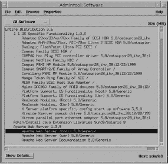

**图 3.1** Admintool：软件对话框。

要安装软件包，请从菜单中选择“编辑，添加”。将打开“设置源介质”对话框，您可以在其中选择 CD-ROM 或硬盘。图 3.2 显示了“软件位置”设置为带有卷管理的 CD。其他选择是不带卷管理的 CD 和硬盘。如果您使用 CD-ROM，请在“CD 路径”文本框中填写路径名。

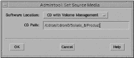

**图 3.2** 在 AdminTool：“设置源介质”对话框中选择源介质设置。

如果软件包已暂存到磁盘上，请将“软件位置”选择更改为“硬盘”（如图 3.3 所示），并在必要时指定暂存目录。

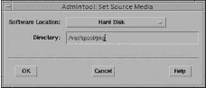

**图 3.3** 在 AdminTool：“设置源介质”对话框中选择“硬盘”设置。

选择源介质后，单击“确定”。将打开“添加软件”对话框（参见图 3.4）。

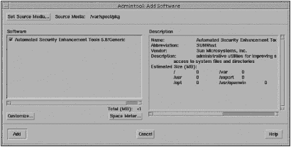

**图 3.4** AdminTool：“添加软件”对话框。

将列出 CD-ROM 或暂存目录中可用的软件包。图 3.4 显示了 `/var/spool/pkg` 目录中的一个软件包，即 Automated Security Enhancement Tools 软件包。要安装该软件包，请选中软件包标题左侧的复选框，然后单击“添加”按钮。`admintool` 命令调用 `pkgadd` 命令，并打开一个窗口以显示结果。

### 使用 `pkginfo` 命令获取软件包信息

不带任何命令行参数的 `pkginfo` 命令会显示已安装软件包的列表。以下示例显示了已安装软件包的部分列表：

```text
# pkginfo
system      AMImega      MEGA Family SCSI Host Bus Adapter
system      CPQcnft      Compaq NetFlex Family NIC
system      CPQnor       Compaq Family SCSI HBA
system      CPQsmii      Compaq SMART-2/E Array Controller
system      MADGfnt      Madge Token Ring Family of NIC
system      MYLXflp      Buslogic FlashPoint Ultra PCI SCSI
.
.
system      SUNWapchu    Apache Web Server (usr)
system      SUNWarc      Archive Libraries
system      SUNWarrf     X11 Arabic required fonts
system      SUNWast      Automated Security Enhancement Tools
system      SUNWatfsr    AutoFS, (Root)
system      SUNWatfsu    AutoFS, (Usr)
system      SUNWauddd    Audio Drivers
system      SUNWaudh     Audio Header Files
system      SUNWaudmo    Audio applications
.
.
#
```

每个软件包都包含一个名为 `pkginfo` 的文件，其中包含有关该软件包的各种信息。该文件还用于存储安装期间和安装后生成的信息，例如安装日期以及应用于该软件包的任何补丁的列表。要查看特定软件包的 pkginfo 文件的内容，请使用 `pkginfo` 命令并指定 `-l` 命令行参数和软件包名称。例如，要显示 `SUNWast` 软件包的 pkginfo 文件，请使用以下 `pkginfo` 命令：

```text
# pkginfo -l SUNWast
   PKGINST:  SUNWast
      NAME:  Automated Security Enhancement Tools
   CATEGORY:  system
```

```text
ARCH:   i386
VERSION:        11.8.0,REV=2000.01.08.18.17
BASEDIR:        /
VENDOR: Sun Microsystems, Inc.
DESC:   administrative utilities for improving system
        security by monitoring or restricting access to
        system files and directories

PSTAMP: catsup20000108183522
INSTDATE:       Jan 13 2001 21:31
HOTLINE: Please contact your local service provider
STATUS: completely installed
FILES:  41 installed pathnames
        1 shared pathname
        8 directories
        29 executables
        232 blocks used (approx)
#
```

### 使用 admintool 获取软件包信息

您也可以使用 `admintool` 命令获取与 `pkginfo` 命令相同的信息。要显示已安装软件包的列表，请从菜单中选择“浏览、软件”，此时将显示一个类似于图 3.1 的列表。

要查看特定软件包的 pkginfo 文件的选定内容，请在列表中高亮显示软件包名称，并单击“显示详细信息”按钮。此时会打开“软件详细信息”对话框（参见图 3.5）。

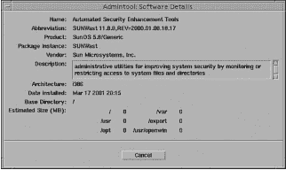

**图 3.5** Admintool：“软件详细信息”对话框。


### 使用 pkgrm 命令删除软件包

`pkgrm` 命令用于删除已安装的软件包。要删除一个或多个软件包，只需将软件包名称作为命令行参数指定。例如，要删除 `SUNWast` 软件包，可使用以下命令：


# pkgrm SUNWast

The following package is currently installed:
    `SUNWast`                 Automated Security Enhancement Tools
                            (i386) 11.8.0,REV=2000.01.08.18.17

Do you want to remove this package? y
## Removing installed package instance <SUNWast>
## Verifying package dependencies.
## Processing package information.
## Removing pathnames in class <none>
`/usr/asset/util/taskstat`
`/usr/asset/util/str_to_mode`
.
.
/usr/asset/masters/uid_aliases
/usr/asset/masters/tune.med
/usr/asset/masters/tune.low
/usr/asset/masters/tune.high
/usr/asset/masters
/usr/asset/assetenv
/usr/asset/asset.restore
/usr/asset/asset
/usr/asset/archives
/usr/asset
/usr <shared pathname not removed>
## Updating system information.

Removal of <SUNWast> was successful.
#

### 使用 admintool 删除软件包

您也可以使用 `admintool` 命令删除已安装的软件包。首先，要显示已安装软件包列表，请从菜单中选择“浏览、软件”。要删除某个软件包，请在列表中高亮显示其名称，然后从菜单中选择“编辑、删除”。此时会打开一个警告对话框，以确认删除该软件包（参见图 3.6）。单击“删除”即可删除该软件包。`admintool` 命令会调用 `pkgrm` 命令，并打开一个对话框来显示结果。

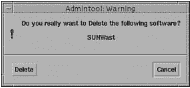

**图 3.6** Admintool：“警告”对话框。

### 补丁管理

*补丁* 是一组文件的集合，用于更新已安装软件或修复其问题。例如，可能需要补丁来修复系统命令的问题或解决安全问题。由于大多数系统和应用软件都是以软件包形式安装的，因此补丁是针对一个或多个软件包应用的。实际上，补丁是用于更新其他软件包的特殊软件包。与软件包一样，一组补丁可以集中到一个*补丁集群*中。

获取和安装补丁、跟踪已安装的补丁以及偶尔删除补丁的能力，是称职的系统管理员的关键技能。

#### 获取补丁和补丁信息

您可以通过多种方式从 Sun Microsystems 获取补丁。最常见的两种方法是购买 Sun 的服务合同，或者自己从 Sun 的 Web 或 FTP 站点下载补丁。

Sun 服务客户可以访问在线补丁数据库和一组扩展补丁。这些补丁可以从 Sun 的 Web 站点或 FTP 站点下载。此外，Sun 服务客户每六到八周会收到一张包含补丁的 CD-ROM。

其他人可以通过 Web 站点 `http://sunsolve.sun.com` 获取受支持系统的推荐补丁和安全补丁，或通过匿名 FTP 从 `ftp://sunsolve1.sun.com/pubs/patches` 获取。另一个 Solaris 补丁站点是 `http://www.ibiblio.org/pub/sun-info/sun-patches`。

> **提示**
>
> Sun 提供一份双月报告，汇总每个受支持系统的推荐补丁和安全补丁。与补丁一样，该信息可在 `http://sunsolve.sun.com` 以及 Sun 的其他系统支持信息中找到。

补丁用八位数字标识。前六位标识基础补丁，后两位标识修订版本。例如，补丁编号 `110906-01` 是 Solaris 8 的 x86 版 `find(1)` 命令的更新。

#### 安装补丁

您可以使用 `patchadd` 命令安装补丁。必须使用 `patchadd` 命令行参数指定适当的系统配置类型。您可能还需要指定目标目录。此外，您可以使用一条 `patchadd` 命令安装多个补丁。

无论要打补丁的系统配置类型如何，`patchadd` 命令通常都在要打补丁的软件所在系统上本地执行（*目标目录*）。但是，如果目标目录可以通过网络文件系统（NFS）服务访问，您也可以在网络上远程安装补丁。

如果补丁在 CD-ROM 上，您可以直接从 CD-ROM 安装。从 Sun Web 或 FTP 站点下载的补丁必须位于系统硬盘上。补丁在安装之前存储的区域称为*暂存目录*。

> **提示**
>
> 虽然补丁没有强制要求的暂存目录，但最常用的位置是 `/var/spool/patch` 目录。但是，您可以使用系统上任何具有足够可用空间的位置。

如果补丁是通过下载获得的，那么它很可能经过了*压缩*（zipped）处理，以便更容易、更快速地下载。某些补丁（主要是 SPARC 平台）使用 `gzip(1)` 命令压缩，文件名以 `.gz` 后缀结尾。其他补丁使用 `zip(1)` 命令压缩，文件名以 `.zip` 后缀结尾。`zip` 命令同时用于 SPARC 和 Intel x86 平台。要解压缩位于当前目录中的 x86 find 补丁（`110906-01`），可以使用 `unzip(1)` 命令，如下例所示：

```text
# unzip 110906-01.zip
Archive:  110906-01.zip
  creating: 110906-01/
  inflating: 110906-01/diPatch
  creating: 110906-01/SUNWcsu/
  inflating: 110906-01/SUNWcsu/pkgmap
  inflating: 110906-01/SUNWcsu/pkginfo
  creating: 110906-01/SUNWcsu/install/
  inflating: 110906-01/SUNWcsu/install/checkinstall
  inflating: 110906-01/SUNWcsu/install/copyright
  inflating: 110906-01/SUNWcsu/install/i.none
  inflating: 110906-01/SUNWcsu/install/patch_checkinstall
  inflating: 110906-01/SUNWcsu/install/patch_postinstall
  inflating: 110906-01/SUNWcsu/install/postinstall
  inflating: 110906-01/SUNWcsu/install/preinstall
  creating: 110906-01/SUNWcsu/reloc/
  creating: 110906-01/SUNWcsu/reloc/usr/
  creating: 110906-01/SUNWcsu/reloc/usr/bin/
  inflating: 110906-01/SUNWcsu/reloc/usr/bin/find
  inflating: 110906-01/README.110906-01
#
```

当前目录下将创建一个与补丁同名的子目录，解压缩后的文件将放在该子目录中。

然后使用 `patchadd` 命令安装补丁。由于补丁没有默认的暂存目录，您必须将补丁的完整路径名作为命令行参数指定。以下示例演示了在独立系统上安装 x86 find 命令补丁：

```text
# patchadd 110906-01

Checking installed patches...
Verifying sufficient filesystem capacity (dry run method)...
Installing patch packages...

Patch number 110906-01 has been successfully installed.
See /var/sadm/patch/110906-01/log for details

Patch packages installed:
  SUNWcsu

#
```

请注意，该补丁修改了 `SUNWcsu` 软件包（Solaris 核心软件）。`patchadd` 命令实际上是一个 ksh 脚本，它调用 `pkgadd` 命令来安装补丁。


要将补丁应用到无盘客户端或 AutoClient 的可引导根映像，请使用 `-R` 命令行参数并指定客户端根映像的路径。例如，要将 Solaris 8 x86 `find` 命令补丁应用到使用当前系统上 `/export/root/client` 目录下根映像的无盘客户端，需要执行以下命令：

```text
patchadd -R /export/root/client /var/spool/patch/110906-01
```

要对操作系统（OS）服务应用补丁，请使用 `-S` 命令行参数并指定该服务。（有关 OS 服务器的信息，请参阅第 13 章“Solaris 网络环境”。）例如，在 OS 服务器上，要将 Solaris 8 find 命令补丁应用于名为 Solaris_8x86 的 x86 Solaris 8 OS 服务，需要执行以下命令：

```
patchadd -S Solaris_8x86 /var/spool/patch/110906-01
```

要对网络安装映像的迷你根（miniroot，即用于通过网络安装系统的映像）应用补丁，请使用 `-C` 命令行参数并指定该网络安装映像的路径名。例如，在 Solaris_8x86 网络安装服务器上，要将 Solaris 8 find 命令补丁应用于 x86 Solaris 8 映像，需要执行以下命令：

```
patchadd -C /export/Solaris_8x86/Tools/Boot /var/spool/patch/110906-01
```

可以使用 `patchadd` 命令结合 `-M` 命令行参数，并指定包含所有补丁的目录和补丁编号列表，来安装多个补丁。例如，要安装均位于 `/var/spool/patch` 目录中的补丁 `108529-05`、`108653-23` 和 `108876-07`，可以使用以下命令：

```
patchadd -M /var/spool/patch 108529-05 108653-23 108876-07
```

不必在命令行中列出多个补丁，而是可以创建一个包含补丁列表的文本文件。然后在命令行中指定该文本文件的名称，以代替所有单个补丁名称。

例如，要安装位于 `/var/spool/patch` 目录中的补丁 `108529-05`、`108653-23` 和 `108876-07`，请创建一个名为 `/var/spool/patch/patchlist` 的文本文件，其中包含这三个补丁的名称（以空格或换行符分隔）。然后使用以下命令安装补丁：

```
patchadd -M /var/spool/patch /var/spool/patch/patchlist
```

通过指定前面介绍的 `-R`、`-S` 或 `-C` 命令行参数，可以使用 `-M` 命令行参数为客户端、服务或安装服务器安装多个补丁。该参数应指定在 `-M` 补丁暂存目录以及补丁名称或补丁列表命令行参数之后。有关这些参数的使用方法，请参阅前面的 `patchadd` 命令示例。

默认情况下，因安装补丁而会发生更改的所有文件都会被复制到一个或多个备份目录。如有必要，您可以随后移除该补丁并将系统恢复到安装补丁之前的状态。但是，如果在 `patchadd` 命令中指定了 `-d` 命令行参数，则不会备份这些文件，并且无法移除该补丁。

默认备份目录位于 `/var/sadm/pkg` 下，具体取决于该补丁所修改的已安装软件包以及补丁编号。例如，x86 find 命令补丁（`110906-01`）修改了 `SUNWcsu` 软件包。安装此补丁所更改的任何文件都将保存在 `/var/sadm/pkg/SUNWcsu/110906-01` 目录下。您可以使用 `-B` 命令行参数指定其他备份目录。

如果出现以下任一情况，`patchadd` 命令将失败：

- 要应用补丁的软件包未安装或仅部分安装。
- 该补丁需要另一个尚未安装的补丁。
- 该补丁与已安装的另一补丁不兼容。
- 该补丁的当前版本或更高版本已经安装。
- 补丁的体系结构与系统不匹配。


### 确定已安装的补丁

对于独立系统，可以使用两个命令生成已安装补丁的列表：

- `showrev -p`
- `patchadd -p`

这两个命令生成的列表几乎完全相同。下面的示例演示了 `showrev(1M)` 命令的用法（为便于阅读，输出已格式化）：

```text
$ showrev -p
Patch: 110906-01
Obsoletes:
Requires:
Incompatibles:
Packages: SUNWcsu
Patch: 108632-06
Obsoletes:
Requires: 109000-01, 109038-01, 109067-02, 108994-01, 108969-01
Incompatibles:
Packages: SUNWcsr, SUNWnisr, SUNWncar
$
```

安装补丁时，有关该补丁的信息会添加到该补丁所更新的每个软件包的 `pkginfo` 文件中。`pkginfo` 文件位于 `/var/sadm/pkg` 目录下的子目录中。`showrev` 和 `patchadd` 命令从 `pkginfo` 文件中提取信息并设置其格式。除了补丁编号和该补丁所更新的软件包之外，这两个命令还会列出任何依赖信息，例如所需的其他补丁或不兼容的补丁。

如前所述，您可以使用 `patchadd` 命令并通过 `-C`、`-R` 和 `-S` 命令行参数来显示其他系统配置的已安装补丁列表。例如，要显示应用于名为 Solaris8x86 的 OS 服务的补丁，可以使用以下 `patchadd` 命令：

```
patchadd -S solaris8x86 -p
```

要显示应用于特定软件包的补丁列表，请使用 `pkgparam` 命令。以下示例列出了应用于 `SUNWcsr` 软件包的补丁：

```
$ pkgparam SUNWcsr PATCHLIST
108529-01 108286-01 108980-01 108980-04 108986-01 108990-02
109010-01 109020-01 109028-01 109044-02 109046-02 109092-01
109138-01 109146-01 109148-01 109150-01 109278-01 109565-02
109876-02 109004-01 109006-01 109008-01 109012-01 109016-01
109018-01 109022-01 109024-01 109032-01
109304-01 109036-01
109306-01
$
```

### 移除补丁

`patchrm` 命令通过将补丁编号指定为命令行参数来移除或回退补丁。该命令还支持 `patchadd` 命令所支持的系统配置。与前面介绍的一样，您可以使用相同的 `-C`、`-R` 和 `-S` 命令行参数。例如，要从名为 client5 的无盘客户端的可引导根映像中移除补丁 `110906-01`，可以使用以下 `patchrm` 命令：

```
patchrm -R /export/root/client5 110906-01
```

由于在安装期间可以使用 `patchadd` 命令的 `-B` 命令行参数更改默认备份目录，因此 `patchrm` 命令也支持 `-B` 参数。此外，您可以使用 `-f` 命令行参数强制 `patchrm` 命令移除已被其他补丁取代的补丁。

只要满足以下条件，您就可以移除已安装的补丁并将系统恢复到安装补丁之前的状态：

- 该补丁不是另一个补丁所必需的，或者已被后来的补丁取代。
- 该补丁不是通过 `patchadd -d` 安装的；`patchadd -d` 会指示 `patchadd` 在文件被更新或替换之前不保存副本。

### 练习题

#### 问题 1

以下哪些选项可用于安装多个补丁？（请选择所有适用的选项。）

- [ ] a. `patchadd -M /var/spool/patch 104567-03 106583-10 103276-04`
- [ ] b. 使用 `patchadd` 分别安装每个补丁。
- [ ] c. `patchadd -M /var/spool/patch patchlist`

答案 a、b 和 c 均正确。所有答案都可以用来安装多个补丁。答案 a 中的命令安装位于 `/var/spool/patch` 目录中的三个补丁。答案 c 中的命令使用名为 `patchlist` 的文件，该文件包含要安装的补丁列表。当然，也可以使用 `pkgadd` 命令逐一安装多个补丁（答案 b）。

#### 问题 2

以下哪些选项可用于安装软件包？（请选择所有适用的选项。）

- [ ] a. `admintool`
- [ ] b. `pkgtool`
- [ ] c. `pkgadd`


- [ ] d. `pkgrm`

- [ ] e. `pkginfo`

答案 a 和 c 正确。您可以使用 `admintool` 和 `pkgadd` 安装软件包。`pkgtool` 不存在。因此，答案 b 不正确。`pkgrm` 用于移除软件包，`pkginfo` 用于显示软件包的信息。因此，答案 d 和 e 不正确。

## 问题 3

安装 Solaris 8 最常用的两种方法是什么？（选择所有适用的选项。）

- ☐ a. 磁带

- ☐ b. 光盘（CD-ROM）

- ☐ c. 通过网络

- ☐ d. 软盘

- ☐ e. Web（万维网）

答案 b 和 c 正确。Solaris 8 最常通过 CD-ROM 或网络安装。磁带和软盘是有效的引导设备，但不用于安装。因此，答案 a 和 d 不正确。答案 e（Web）不可行。

## 问题 4

下列哪项是软件包的默认暂存目录？

- ○ a. `/var/spool`

- ○ b. `/var/sadm/pkg`

- ○ c. `/tmp`

- ○ d. `/var/spool/pkg`

答案 d 正确。`/var/spool/pkg` 是软件包的默认暂存目录。系统暂存目录是 `/var/spool`。因此，答案 a 不正确。包含已安装软件包信息的目录是 `/var/sadm/pkg`。因此，答案 b 不正确。临时目录是 `/tmp`。因此，答案 c 不正确。

## 问题 5

Solaris 8 不能安装在下列哪项上？

- ○ a. Macintosh 系统

- ○ b. Sun SPARC

- ○ c. Intel Pentium

- ○ d. AMD 或 Cyrix（Intel 兼容处理器）

答案 `a` 正确。Solaris 8 不能安装在 Macintosh 系统上。Solaris 8 可以安装在 Sun SPARC、Intel Pentium 或 Intel 兼容处理器（AMD 和 Cyrix）上。因此，答案 `b`、`c` 和 `d` 不正确。

## 问题 6

下列哪条命令显示 SUNWast pkginfo 文件中的选定信息？（选择所有适用的选项。）

- [ ] a. `pkginfo SUNWast`

- [ ] b. `pkginfo -l SUNWast`

- [ ] c. `display pkginfo SUNWast`

- [ ] d. 在 Admintool 的“软件”对话框中突出显示 SUNWast，并单击“显示详细信息”。

答案 `a`、`b` 和 `d` 正确。您可以使用 `pkginfo SUNWast` 或 `pkginfo -l SUNWast` 命令，或者在 Admintool 的“软件”对话框中突出显示 SUNWast 并单击“显示详细信息”，来显示 SUNWast pkginfo 文件中的选定信息。虽然答案 `a` 中的命令只提供软件包的标题和软件类型，但 pkginfo 文件是唯一可以获得此信息的地方。答案 `c` 中的命令不存在。

## 问题 7

下列哪条命令可用于移除补丁？

- ( ) a. `rmpatch`

- ( ) b. `patchrm`

- ( ) c. `pkgrm -p`

- ( ) d. `patchadd -d`

答案 `b` 正确。您可以使用 `patchrm` 命令来移除补丁。答案 `a`（`rmpatch`）不是有效的命令。`pkgrm` 命令用于移除软件包，并且不存在 `-p` 命令行参数。因此，答案 `c` 不正确。`patchadd -d` 命令用于添加补丁，但不会在更新或替换文件之前保存这些文件。因此，答案 `d` 不正确。

## 问题 8

**下列哪条命令可用于列出所有已安装的补丁？**

*（选择所有适用的选项。）*

- [ ] a. `showrev -p`

- [ ] b. `patchinfo`

- [ ] c. `patchlist all`

- [ ] d. `patchadd -p`

答案 a 和 d 正确。您可以使用 `showrev -p` 和 `patchadd -p` 命令来列出所有已安装的补丁。答案 b 和 c 中的命令不存在。

## 问题 9

**在升级期间，需要重新分配磁盘空间。以下哪项可用作备份介质？**

*（选择所有适用的选项。）*

- [ ] a. 未使用的系统磁盘

- [ ] b. 磁带

- [ ] c. 软盘

- [ ] d. CD-ROM

- [ ] e. 远程文件系统

答案 a、b、c 和 e 正确。未使用的系统磁盘、磁带、软盘或远程文件系统都可用作升级期间的备份介质，前提是它们提供足够的存储空间。CD-ROM，顾名思义，是只读的（光盘 - 只读介质）。只读介质不能用于备份。因此，答案 d 不正确。可写 CD 或许可以使用，但该选项并未提供。

## 问题 10

在使用 Web Start 进行自定义安装时，可以选择下列哪些项目？（选择所有适用的选项。）

- [ ] a. 文件系统布局

- [ ] b. 软件本地化

- [ ] c. 附加软件产品

- [ ] d. 系统区域设置

- [ ] e. 软件组或集群

答案 a、b、c、d 和 e 正确。文件系统布局使您能够添加文件系统和/或调整文件系统的大小。软件本地化可用于选择地理区域（如北美），系统区域设置进一步定义默认系统语言。（例如，对于北美，您可以选择几种英语变体之一。）还可以选择软件组和附加产品。只有在选择“自定义安装”时，这些项目才可用。

### 需要了解更多信息？

-  Mulligan, John P., *Solaris 8 基本参考手册*（New Riders，印第安纳波利斯，印第安纳州：2001），ISBN 0-7357-1007-4。

-  Sun Microsystems，*Solaris 8（Intel 平台版）硬件兼容性列表*。提供印刷版（部件号 806-1054-11）、Web 上的 `http://docs.sun.com`，以及 Solaris 8 操作系统随附的在线文档 AnswerBook2。

-  Sun Microsystems，*Solaris 8（Intel 平台版）安装指南*。提供印刷版（部件号 806-0956-10）、Web 上的 `http://docs.sun.com`，以及 Solaris 8 操作系统随附的在线文档 AnswerBook2。

-  Sun Microsystems，*Solaris 8（SPARC 平台版）安装指南*。提供印刷版（部件号 806-0955-10）、Web 上的 `http://docs.sun.com`，以及 Solaris 8 操作系统随附的在线文档 AnswerBook2。

-  Sun Microsystems，*Solaris 8 1/01 Sun 硬件平台指南*。提供印刷版（部件号 806-6513-10）、Web 上的 `http://docs.sun.com`，以及 Solaris 8 操作系统随附的在线文档 AnswerBook2。

-  Sun Microsystems，*系统管理指南，第 1 卷*。提供印刷版（部件号 805-7228-10）、Web 上的 `http://docs.sun.com`，以及 Solaris 8 操作系统随附的在线文档 AnswerBook2。

-  Sun Microsystems，*系统参考手册，第 1 部分——用户命令*。提供印刷版（部件号 806-0624-10）、Web 上的 `http://docs.sun.com`，以及 Solaris 8 操作系统随附的在线文档 AnswerBook2。

-  Sun Microsystems，*系统参考手册，第 1M 部分——系统管理命令*。提供印刷版（部件号 806-0625-10）、Web 上的 `http://docs.sun.com`，以及 Solaris 8 操作系统随附的在线文档 AnswerBook2。


### 引导和关闭系统

#### 需要理解的术语：

- OpenBoot


- 非易失性随机存取存储器（NVRAM）
- 设备别名
- 引导过程
- 内核模块
- init 程序
- 系统运行级别
- rc 脚本

## 需要掌握的技术：

- 创建和删除设备别名
- 排除引导故障
- 更改系统运行级别
- 使用 rc 脚本添加系统服务

本章介绍与引导和关闭系统相关的主题。第一部分涵盖 Sun SPARC 平台上系统固件的关键方面，包括 *引导 PROM* 测试目标。第二部分概述 SPARC 和 Intel x86 平台的引导过程，并涵盖 *引导过程* 测试目标。第三部分介绍系统运行级别、不同运行级别下可用的服务，以及如何在运行级别之间切换。它还介绍如何在选定的运行级别添加自定义服务，并包括 *初始化和关闭* 测试目标。

## 引导 PROM 固件（OpenBoot）

系统的引导可编程只读存储器（PROM）存储系统硬件完成加电自检（POST）后立即执行的固件。这种固件称为 OpenBoot，是 Sun 系统的标准固件。OpenBoot 固件仅适用于 SPARC 平台，但 Intel x86 平台也提供一些有限的兼容功能。

OpenBoot 用于引导操作系统、运行诊断程序、修改存储在非易失性随机存取存储器（NVRAM）中的与引导相关的参数，并提供用于执行 Forth 监控器的 Forth 解释器。

目前，有两种受支持的 OpenBoot 版本：2.x 和 3.x。OpenBoot 2.x 随 SPARCstation 2 和 SPARCstation IPX 系统一起推出。OpenBoot 3.x 是 OpenBoot 2.x 的增强版本，基于电气和电子工程师协会（IEEE）标准 1275-1994“引导固件标准”。OpenBoot 3.x 用于 Sun Ultra 系列和更新的 SPARC 平台。

OpenBoot 为系统控制台提供命令行界面。命令行界面有两种模式：

- **受限监控器** — 允许管理员引导操作系统、继续被暂停的操作或启动 Forth 监控器。受限监控器的提示符是 `>` 符号。
- **Forth 监控器** — 允许管理员引导操作系统、运行诊断程序并修改系统配置参数。Forth 监控器的提示符是单词 *ok*，通常称为 *OpenBoot 提示符*。

系统配置参数存储在系统 NVRAM 中。这些参数决定系统的初始配置和相关的通信特性，并且即使系统断电也会保持其值。

您可以使用 OpenBoot `printenv` 命令查看这些参数的值。要设置和修改它们，请使用 OpenBoot `setenv` 命令。

### 重要的 OpenBoot 命令

一些较重要的 OpenBoot 命令用于显示系统配置信息、执行硬件测试以及控制系统引导。所有这些命令都在 Forth 监视器或 OpenBoot `ok` 提示符下输入。

表 4.1 列出了显示系统配置数据的 OpenBoot 命令，表 4.2 列出了用于执行基本硬件测试的 OpenBoot 命令。表 4.3 列出了可用于选择不同引导设备的 OpenBoot `boot` 命令变体。

**表 4.1 用于显示系统配置数据的 OpenBoot 命令**

| 命令 | 说明 |
|---|---|
| `banner` | 显示开机横幅 |
| `devalias` | 列出所有设备别名 |
| `.enet-addr` | 显示以太网地址 |
| `.idprom` | 显示格式化后的 ID PROM 内容 |
| `module-info` | 显示 CPU 速度（仅 2.x） |
| `printenv` | 列出所有 NVRAM 参数及默认值 |
| `show-devs` | 列出所有已安装设备 |
| `.speed` | 显示 CPU 和总线速度（仅 3.x） |
| `.traps` | 列出 SPARC 陷阱类型 |
| `.version` | 显示引导 PROM 的版本和数据 |

**表 4.2 用于执行硬件测试的 OpenBoot 命令**

| 命令 | 说明 |
|---|---|
| `pcia-probe-list` | 测试外围组件互连（PCI）总线 |
| `probe-scsi` | 测试内置小型计算机系统接口（SCSI）总线以检测连接的设备 |
| `probe-scsi-all` | 测试所有 SCSI 总线 |
| `test-all` | 测试一组已安装的设备 |
| `test floppy` | 测试软盘驱动器 |
| `test /memory` | 测试系统内存 |
| `test net` | 测试板载以太网接口 |
| `watch-clock` | 监视系统时钟 |
| `watch-net` | 监视网络连接 |

**表 4.3 用于选择不同引导设备的 OpenBoot 命令**

| 命令 | 说明 |
|---|---|
| `boot cdrom` | 从本地 CD-ROM 引导 |
| `boot disk` | 从默认硬盘引导 |
| `boot floppy` | 从软盘驱动器引导 |
| `boot net` | 从网络引导 |
| `boot tape` | 从 SCSI 磁带驱动器引导 |

引导命令支持几个您可能会觉得有用的选项。`-a` 选项请求交互式引导，这样 OpenBoot 在需要时会提示输入信息。此外，`-s` 选项使 OpenBoot 引导到单用户模式，而不是默认的系统运行级别。当从硬盘引导时，默认设备由 `boot-device` NVRAM 配置参数指定。在 OpenBoot `ok` 提示符下，使用以下命令显示默认设备：

```
ok printenv boot-device
boot-device = disk
ok
```

默认设备可以根据需要更改。例如，要将 **默认** 引导设备更改为别名 `disk2` 的设备，请使用以下命令。然后使用 `reset` 保存新值并重新引导：

```
ok setenv boot-device disk2
ok reset
```

### 设备别名

OpenBoot 使用完整的设备路径名来标识系统硬件，该路径名表示设备的类型及其在系统中的位置。设备路径名由系统总线、地址以及可能的驱动程序名称组成。以下是 SCSI 磁盘驱动器某个分区的完整设备名称示例：

```
/bus@1f,0/SUNW,fas@e,8800000/sd@3,0:a
```

有关设备名称的更多详细信息，请参阅第 8 章“磁盘管理”。由于设备名称通常较长、复杂且难以输入，OpenBoot 允许您为完整设备名称分配一个设备别名；该别名是一个简短、容易记住和输入的名称。

#### 创建设备别名

您可以通过两种方式创建设备别名。第一种方法使用 `devalias` 命令。使用此命令创建的别名在系统重新引导后会丢失。第二种方法使用 `nvalias` 命令创建的别名存储在非易失性存储器中，并一直保留在那里，直到您使用其他 OpenBoot 命令将其删除。两个命令使用相同的语法。

例如，以下两个命令都在 OpenBoot `ok` 提示符下输入，将别名 `disk2` 分配给名为 `/sbus/esp/sd@2,0`（一个 SCSI 磁盘）的设备：

```
ok devalias disk2 /sbus/esp/sd@2,0
ok nvalias disk2 /sbus/esp/sd@2,0
ok
```

在 OpenBoot 环境中需要设备名称时，您可以使用别名代替。当您输入 `nvalias` 命令时，它会存储在非易失性存储器中。这部分内存被视为一个名为 `nvramrc` 的 OpenBoot 参数。`nvramrc` 参数的内容称为 *脚本*。除了存储用户自定义命令外，该参数还用于设备驱动程序保存启动配置变量、修补设备驱动程序代码，以及存储错误修补程序或其他特定于安装的设备配置信息。

如果 OpenBoot `use-nvramrc` 参数设置为 `true`，则在系统引导期间执行脚本。使用 `nvalias` 命令在 `nvramrc` 中定义的任何别名都将被设置，然后这些别名可以在脚本的后面部分使用，或作为其他一个或多个 OpenBoot 参数的值。

#### 显示设备别名

您还可以使用 `devalias` 命令显示已定义的设备别名。如果在不带任何命令行参数的情况下输入该命令，将列出所有已定义的设备别名。如果将某个设备别名作为命令行参数列出，则 `devalias` 命令仅显示该指定的设备别名。以下示例展示了在 SPARCstation 20 工作站的 OpenBoot `ok` 提示符下使用 `devalias` 命令的情况：


```
ok devalias
screen        /iommu@f,e0000000/sbus@f,e0010000/cgsix@2,0
ttyb          /obio/zs@0,100000:b
ttya          /obio/zs@0,100000:a
keyboard      /obio/zs@0,0
floppy        /obio/SUNW,fdtwo
scsi          /iommu/sbus/espdma@f,4000000/esp@f,800000
net-aui       /iommu/sbus/ledma@f,4000100/aui@f,0c000
net-tpe       /iommu/sbus/ledma@f,4000100/le@f,c000
net           /iommu/sbus/ledma@f,4000100/le@f,c000
disk          /iommu/sbus/espdma@f,4000000/esp@f,800000/sd@3,0
cdrom         /iommu/sbus/espdma@f,4000000/esp@f,800000/sd@6,0:d
tape          /iommu/sbus/espdma@f,4000000/esp@f,800000/st@4,0
tape1         /iommu/sbus/espdma@f,4000000/esp@f,800000/st@5,0
tape0         /iommu/sbus/espdma@f,4000000/esp@f,800000/st@4,0
disk3         /iommu/sbus/espdma@f,4000000/esp@f,800000/sd@3,0
disk2         /iommu/sbus/espdma@f,4000000/esp@f,800000/sd@2,0
disk1         /iommu/sbus/espdma@f,4000000/esp@f,800000/sd@1,0
disk0         /iommu/sbus/espdma@f,4000000/esp@f,800000/sd@0,0

ok devalias disk
disk          /iommu/sbus/espdma@f,4000000/esp@f,800000/sd@3,0
ok
```

### 删除设备别名

由`nvalias`命令定义的别名存储在脚本中，并一直保留在那里，直到您使用`nvunalias`命令将其删除，或使用`set-defaults`命令将系统配置恢复为原始默认值。请注意，使用`devalias`命令定义的别名*不*存储在脚本中，系统重新引导时会丢失。

要删除非易失性设备别名（存储在脚本中的别名）`disk2`，请在OpenBoot `ok`提示符下输入以下命令：

```
ok nvunalias disk2
ok
```


### 从Solaris查看和修改NVRAM参数

通常，您使用OpenBoot命令查看和修改NVRAM参数。也可以使用`eeprom`(1M)命令从Solaris 8环境中查看和修改NVRAM参数。但是，只有超级用户才能使用`eeprom`命令修改NVRAM参数。

要查看`auto-boot?` NVRAM参数的值，请在系统提示符下输入以下`eeprom`命令：

```
$ /usr/sbin/eeprom 'auto-boot?'
auto-boot?=true
$
```

要查看所有NVRAM参数，请在无任何命令行参数的情况下输入`eeprom`命令。

您还可以使用`eeprom`命令修改NVRAM参数。要将`auto-boot?`的值设置为`false`，请在系统提示符下输入以下命令：

```
# eeprom auto-boot?=false
#
```

### 引导问题排查

当复位或加电时，SPARC系统通常会运行POST。之后，系统自动引导（如果`auto-boot?`为`true`）或进入Forth监视器。

引导过程或OpenBoot初始化序列会执行各种检查并加载相应的模块。系统成功加载并启动操作系统后，您可以在`/var/adm/messages`文件中查看有关此初始化序列的状态消息。

但是，如果出现引导问题，Solaris 8系统将无法启动，您也就无法查看这些消息。为了解决这种情况，OpenBoot具有将初始化序列消息发送到tty串行端口A（TTYA）的功能。您可以通过在启动系统引导之前将`diag-switch?` OpenBoot参数设置为true并使用`setenv`命令来实现，如下例所示：

```
ok setenv diag-switch? true
ok
```

通过将终端或PC连接到TTYA，您可以观察OpenBoot初始化序列生成的消息，并识别引导问题。

### 紧急命令（仅适用于SPARC）

有时您需要控制系统，无论其处于何种状态。在SPARC系统的键盘上，您可以立即进入Forth监视器。表4.4列出了OpenBoot支持的紧急键盘命令。所有这些命令都使用SPARC键盘上的stop功能键。


当需要恢复已停止响应的系统时，在 `stop+a` 组合键序列之后，请务必先输入 OpenBoot `sync` 命令，以同步系统磁盘并写入崩溃转储，然后再发出适当的引导命令。

| 序列 | 系统响应 |
|---|---|
| stop | 绕过 POST |
| stop+a | 中止操作系统或引导进程（返回到 OpenBoot `ok` 提示符） |
| stop+d | 进入诊断模式 |
| stop+f | 在 TTYA 上进入 Forth 监视器（而不是系统控制台） |
| stop+n | 将 NVRAM 内容重置为默认值 |

可以使用 `kbd`(1) 命令启用或禁用 `stop+a` 组合键序列。也可以通过修改 `/etc/default/kbd` 文件，然后执行 `kbd -i` 命令来设置键盘特性。例如，以下 `kbd` 命令禁用键盘中止序列：

```sh
# kbd -a disable
```

要完成相同的任务，请在 `/etc/default/kbd` 中放置 `KEYBOARD_ABORT=disable` 条目，然后执行以下命令：

```sh
# kbd -i
```

### 引导过程

引导 PROM 中存储着负责引导操作系统的固件。由于 SPARC 引导过程与 Intel x86 引导过程略有不同，因此此处分别介绍。

#### SPARC 引导过程

SPARC 引导过程包含以下阶段：

- 1. `引导 PROM` — 此阶段显示系统信息，然后运行 POST 诊断。诊断完成后，将加载主引导程序 `bootblk`。其功能是在引导设备上定位辅助引导程序 `ufsboot`。
- 2. `引导程序` — 在此阶段，`bootblk` 将 `ufsboot` 程序加载到内存中并执行它。
- 3. `内核初始化` — 在此阶段，`ufsboot` 程序将核心内核加载到内存中并使其执行。内核初始化其数据结构，并开始使用 `ufsboot` 程序根据 `/etc/system` 文件加载其他内核模块。在所有必要模块加载并初始化完成后，内核启动 `/sbin/init` 程序。
- 4. `init` — 在此阶段，`init` 程序根据 `/etc/inittab` 文件中的信息启动其他进程。这些进程包括一个调用运行控制（rc）脚本的程序，这些脚本用于设置各种系统服务。

#### Intel x86 引导过程

Intel x86 引导过程包含以下阶段：

- 1. `BIOS` — 在此阶段，运行 POST 诊断。然后从磁盘读取主引导记录 `mboot`，以定位包含 `pboot` 程序的活动分区。
- 2. `引导程序` — 在此阶段，加载 `pboot` 程序，然后定位并加载主引导程序 `bootblk`。接着在根文件系统中找到并加载辅助引导程序 `boot.bin` 或 `ufsboot`。
- 3. `内核初始化` — 在此阶段，`boot.bin` 或 `ufsboot` 程序将核心内核加载到内存中并使其执行。内核初始化其数据结构，并开始加载其他内核模块。在所有必要模块加载并初始化完成后，内核启动 `/sbin/init` 程序。
- 4. `init` — 在此阶段，`init` 程序根据 `/etc/inittab` 文件中的信息启动其他进程。这些进程包括一个调用 rc 脚本的程序，这些脚本用于设置各种系统服务。

### 内核模块

内核软件被划分为称为*模块*的相关功能组。有些模块是操作系统小型公共核心的一部分。有些模块提供特定于平台的操作，其他模块则是设备驱动程序。这种架构允许根据需要实现的功能包含或排除内核的某些部分，也允许在不更换整个内核的情况下更新内核的某些部分。设备驱动程序是动态内核模块，在访问设备时加载。


内核模块存储在三个目录中——两个位于根文件系统下，一个位于 `/usr` 文件系统下：

- `/platform/sparc/kernel`（对于 SPARC 平台）或 `/platform/i86pc/kernel`（对于 x86 平台） — 特定于平台的模块
- `/kernel` — 引导所需的通用内核模块
- `/usr/kernel` — 具有特定指令集的平台使用的通用内核模块

`/etc/system` 文件用于确定加载哪些内核模块并定义内核参数。该文件由一个或多个关键字后跟一个或多个参数组成。以下是受支持的关键字：

- `exclude` — 防止模块加载
- `forceload` — 强制加载模块
- `moddir` — 更改通用内核模块目录
- `rootdev` — 设置根设备的物理路径名
- `rootfs` — 定义根文件系统的类型
- `set` — 设置内核或模块变量

### init 程序

引导过程的最后一个阶段是 `init` 程序，它用于控制系统进程和服务。其主要目的是根据系统当前状态创建或停止进程。系统状态称为*系统运行级别*。根据系统在特定运行级别应支持的活动类型（如维护、单用户、多用户等），定义了多个运行级别。关于在特定运行级别应运行哪些进程和服务的信息存储在 `/etc/inittab` 文件中。

默认运行级别由 `/etc/inittab` 中的 `initdefault` 条目定义。以下示例显示运行级别 3 为默认运行级别：

```
id:3:initdefault:
```

除运行级别 4 外，每个运行级别在 `/etc/inittab` 文件中都有一个条目，用于指定要执行的 rc 程序。此外，每个运行级别都有一个关联目录，其中包含 rc 脚本；当该运行级别成为当前运行级别时，rc 程序应执行这些脚本，以启动或停止进程和服务。

`init` 程序还会设置 `/etc/default/init` 中定义的默认环境变量。这些变量包括基于位置的本地变量和系统参数，例如时区。

### 系统运行级别

为了方便系统管理员关闭或重新引导系统并控制系统服务和资源，定义了八个系统运行级别（也称为 *init 状态*），并为每个级别指定了特定功能。表 4.5 描述了这八个运行级别。

**表 4.5  八个系统运行级别**

| 运行级别 | init 状态 | 功能 |
|---|---|---|
| 0 | 关闭电源 | 系统正在关闭。所有用户均被强制退出系统。所有操作系统服务按顺序停止。此过程完成后，系统处于固件模式。对于 SPARC 平台，固件模式是 `ok` OpenBoot 提示符。此时可以安全地关闭系统和外围设备的电源。 |
| S 或 s | 单用户 | 系统为维护做好准备。任何用户均从系统注销。除最基本的操作系统服务外，所有服务均按顺序停止。任何已挂载的文件系统保持挂载。将启动一个具有超级用户权限的命令行界面，并将其关联到系统控制台，以便系统管理员可以在不受用户或应用程序干扰的情况下执行维护（如系统备份）。 |
| 1 | 管理 | 任何已登录用户均不受影响。多个用户可以登录并使用可用的系统资源。除最基本的操作系统服务外，所有服务均按顺序停止。任何已挂载的文件系统保持挂载。将启动一个具有超级用户权限的命令行界面，并将其关联到系统控制台，以便系统管理员可以在允许用户访问系统的同时执行维护。 |
| 2 | 多用户 | 系统为正常操作而设置。多个用户可以登录并使用系统资源。除网络文件系统（NFS）服务器外，所有服务均已启动。所有默认文件系统均已挂载。 |
| 3 | 多用户（带 NFS） | 系统为正常操作而设置。此系统状态通常为默认状态。多个用户可以访问并使用系统资源。包括资源共享（NFS 服务器）在内的所有服务均已启动。所有默认文件系统均已挂载。 |
| 4 | 备用多用户 | 当前未使用此状态，且不可用。 |
| 5 | 关闭电源 | 系统已关闭。所有用户均从系统注销。所有操作系统服务按顺序停止。此过程完成后，可以安全地关闭系统和外围设备的电源。如果系统硬件支持，系统电源会自动关闭。 |
| 6 | 重新引导 | 系统先关闭（运行级别 0），然后重新启动并恢复到默认运行级别（如 `/etc/inittab` 文件中所定义，通常为 3）。 |


> Solaris 有八个运行级别，其中七个会被使用。尽管未为运行级别 4 定义任何功能，它仍被视为有效的运行级别。另请注意，NFS 客户端在运行级别 2 启动，而 NFS 服务器在运行级别 3 启动。

### 更改系统运行级别

有时，您需要更改系统运行级别——例如，当您关闭系统以添加或移除硬件、执行备份、为预期断电做好准备，或准备将系统物理移动到其他位置时。表 4.6 列出了可用于从命令行更改系统运行级别的命令。

**表 4.6 — 用于更改系统运行级别的命令**

| 命令 | 路径 | 运行级别 | 描述 |
|---|---|---|---|
| `halt` | `/usr/sbin` | `0` | 停止处理器 |
| `init` | `/sbin` | `0, 1, 2, 3, 4, 5, 6, s` | 处理控制初始化 |
| `poweroff` | `/usr/sbin` | `5` | 停止处理器并关闭系统电源（如果可能） |
| `reboot` | `/usr/sbin` | `6` | 重新启动系统 |
| `shutdown` | `/etc` | `0, 1, 5, 6, s` | 用于兼容性（符号链接到 `/usr/sbin/shutdown`） |
| `shutdown` | `/usr/sbin` | `0, 1, 5, 6, s` | 更改系统运行级别 |
| `telinit` | `/etc` | `0, 1, 2, 3, 4, 5, 6, s` | 用于兼容性（符号链接到 `/usr/sbin/init`） |
| `uadmin` | `/sbin` | `0, 5, 6` | 用于管理控制 |

`halt(1M)` 命令通常会将关机记录到系统日志，将关机记录写入系统记账文件，调用 `sync(1M)` 命令将任何待处理的信息写入磁盘，然后停止处理器。您可以使用命令行参数来阻止系统日志记录和记账记录，以及磁盘同步。`halt` 命令会更改到运行级别 0，但不会像 `shutdown(1M)` 和 `init(1M)` 命令那样执行与运行级别 0 关联的 rc 脚本。

您可以使用 `init(1M)` 和 `telinit(1M)` 命令更改到八个运行级别中的任意一个。系统会执行 `/etc/inittab` 文件中为每个运行级别标识的命令，并且所有不在 `/etc/inittab` 中的运行中进程都会收到 `SIGTERM` 信号，或可能收到 `SIGKILL` 信号（参见第 7 章“控制进程”）以使其终止。对于每个运行级别，`/etc/inittab` 中的一条记录会运行相应的 rc 脚本来启动和停止进程。


> `init` 命令是独一无二的，因为它是唯一可用于更改到任何系统运行级别的命令。尽管表 4.6 中列出的所有命令都可以关闭/重新启动系统（运行级别 0、1、5、6、s），但只有 `init` 命令可以将系统从运行级别 s 或 1 提升到运行级别 2 或 3。

`poweroff(1M)` 命令将系统更改到运行级别 5。通常，它会让系统将关机记录到系统日志，将关机记录写入系统记账文件，调用 `sync(1M)` 将任何待处理的信息写入磁盘，停止处理器，并在可能的情况下关闭电源。`poweroff` 命令等同于 `init` 5 命令。


> `reboot` 命令是独一无二的，因为它可以使用 `--` 参数向 OpenBoot 的 `boot` 命令传递参数。例如，`reboot -- -rv` 命令会将 `-rv` 命令行参数传递给 OpenBoot 的 `boot` 命令；然后这些参数再传递给内核。在这种情况下，`r` 会导致重新配置（探测所有设备并构建节点），而 `v` 会启用详细模式。

`shutdown` 命令（位于 `/usr/sbin` 和 `/etc` 目录下）提供宽限期和警告消息功能，并且还会执行相应的 rc 脚本。您可以使用 `shutdown` 命令更改到运行级别 0、1、5、6 和 s。

不带任何命令行参数的 `shutdown` 命令会产生一分钟的宽限期，并在 1 分钟、30 秒和现在时发出警告消息。在广播 *shutdown now* 消息并继续更改运行级别之前，`shutdown` 命令会提示确认是否继续。然后系统更改为运行级别 s。

`uadmin(1M)` 命令提供基本的管理功能，例如关闭或重新启动系统。通常，它由各种系统管理过程调用，不用于一般用途。


您可以使用 `who -r` 命令来确定系统的当前运行级别以及更改为该运行级别的日期。

### 运行控制（rc）脚本

如前所述，每个运行级别（除 4 之外）在 `/etc/inittab` 文件中都有一个条目，用于标识要执行的 rc 程序。此外，每个运行级别都有一个与之关联的目录。

该目录包含 rc 脚本，当该运行级别成为当前运行级别时，rc 程序应执行这些脚本来启动或停止进程和服务。这些 rc 程序和 rc 脚本目录使用基于运行级别的标准命名约定。对于运行级别 0，rc 程序是 `/etc/rc0`，`/etc/rc0.d` 是 rc 脚本目录。同样，对于运行级别 1，rc 程序是 `/etc/rc1`，`/etc/rc1.d` 是 rc 脚本目录。对于运行级别 2、3 和 5，也采用相同的命名约定。运行级别 5 和 6 没有单独的 rc 目录，而是使用运行级别 0 的 rc 目录。

通常，rc 程序和 rc 脚本目录下的脚本都被称为 rc 脚本。将从 `/etc/inittab` 直接调用的脚本称为 rc 程序有助于避免混淆。

rc 脚本是为启动和停止各种进程和服务而编写的 shell 脚本（通常是 Bourne shell）。rc 脚本通常分为两部分编写：启动部分和停止部分。顾名思义，启动部分用于启动服务，停止部分用于停止服务。因此，单个脚本就可以控制服务。当 rc 程序调用 rc 脚本时，该程序会根据服务在特定运行级别上应启动还是停止，向 rc 脚本提供 `start` 或 `stop` 命令行参数。启动还是停止服务的决定基于相应 rc 目录中 rc 脚本的名称。

例如，自动执行维护命令的标准 Unix 实用程序是 cron 程序。它通常在运行级别 2 启动，在运行级别 0、1、5、6 和 s 停止。要在运行级别 2 启动 cron，您可以将 cron 的 rc 脚本复制（或链接）到 `/etc/rc2.d`，并将其命名为 `S75cron`。rc 脚本开头的 `S` 会使 rc 程序通过使用 `start` 参数调用 rc 脚本，在特定运行级别（在此示例中为运行级别 2）启动该服务。

同样，您可以将相同的 cron rc 脚本复制（或链接）到 `/etc/rc0.d`、`/etc/rc1.d` 和 `/etc/rcS.d` 目录，并将其命名为 `K40cron`。rc 脚本开头的 `K` 会使 rc 程序通过使用 `stop` 参数调用 rc 脚本，在特定运行级别停止该服务。

请注意，cron 的 rc 脚本文件名中包含的数字是不同的。这些数字为 rc 程序以特定、一致的顺序启动或停止服务提供了一种方法。数字较小的 rc 脚本先于数字较大的 rc 脚本执行。这种顺序是必需的，因为某些服务需要其他服务的存在才能正常运行。

例如，网络应用程序要求网络服务可用，因此用于启动应用程序的 rc 脚本的数字应高于用于启动网络服务的 rc 脚本。此外，服务应按相反顺序停止。对于网络应用程序，用于停止应用程序的 rc 脚本的数字应低于用于停止网络服务的 rc 脚本。

所有 rc 脚本的副本都放置在 `/etc/init.d` 目录中。要启动或停止特定服务，系统管理员只需在单个目录中找到相应的 rc 脚本。

#### 添加 rc 脚本

使用以下过程为新服务添加 rc 脚本：

1. 编写一个接受命令行参数 `start` 和 `stop` 的 shell 脚本，并执行这些功能的相应操作。
2. 以超级用户身份，将新的 rc 脚本复制到 `/etc/init.d` 目录。
3. 确定启动服务的运行级别（通常为 2）。
4. 确定控制启动序列的两位数字（00 到 99）。查看相应 rc 目录中的其他启动 rc 脚本，并选择一个未使用的数字：该数字应高于任何所需服务，但低于任何将使用新服务的服务。
5. 将新脚本从 `/etc/init.d` 目录复制或链接到相应的 rc 目录，名称以 `S` 开头，后跟选定的两位数字，然后是服务名称。
6. 确定服务应停止的运行级别（通常为 0、1 和 6），这意味着脚本需要链接到一个或多个 rc 目录。
7. 确定控制停止序列的两位数字（00 到 99）。查看相应 rc 目录中的其他停止 rc 脚本，并选择一个未使用的数字：该数字应低于任何所需服务，但高于任何正在使用该服务的服务。
8. 将新脚本从 `/etc/init.d` 目录复制或链接到相应的 rc 目录，名称以 `K` 开头，后跟选定的两位数字，然后是服务名称。

### 练习题

#### 问题1

以下哪些 OpenBoot 版本目前受 Sun Microsystems 支持？（选择所有适用项。）

- [ ] a. 1.x
- [ ] b. 2.x
- [ ] c. 3.x
- [ ] d. 4.x

答案 b 和 c 正确。OpenBoot 2.x 和 3.x 版本目前受 Sun Microsystems 支持。版本 1.x 已不再受支持。因此，答案 a 不正确。版本 4.x 不存在。因此，答案 d 不正确。

#### 问题2

哪个 OpenBoot 命令可用于查看系统配置信息？

- ( ) a. `env`
- ( ) b. `display`
- ( ) c. `banner`
- ( ) d. `list`
- ( ) e. `show`

答案 c 正确。你可以使用 `banner` 命令查看系统配置信息。Solaris 8 的 `env` 命令列出当前环境中的 shell 变量。因此，答案 a 不正确。答案 b、d 和 e 中的命令不存在，尽管确实存在 `show-dev` OpenBoot 命令。

#### 问题3

以下哪些 OpenBoot 命令用于测试硬件？（选择所有适用项。）

- [ ] a. `probe-scsi`
- [ ] b. `test floppy`
- [ ] c. `test net`
- [ ] d. `watch-clock`
- [ ] e. `test memory`

答案 a、b、c 和 d 正确。`probe-scsi`、`test floppy`、`test net` 和 `watch-clock` 命令分别测试 SCSI 控制器、软盘驱动器、网络接口和系统时钟。测试内存的正确命令是 `test /memory`（注意 memory 前的 `/`）。因此，答案 e 不正确。

#### 问题4

说出用于删除非易失性设备别名的 OpenBoot 命令。

正确答案是 `nvunalias` 或 `set-defaults`。

#### 问题5

哪个紧急键盘命令用于中止引导过程？

- ( ) a. stop
- ( ) b. stop+a
- ( ) c. stop+b
- ( ) d. stop+s
- ( ) e. stop+!

答案 b 正确。`stop+a` 紧急键盘命令会中止引导过程。`stop` 键盘命令会绕过 POST。因此，答案 a 不正确。答案 c、d 和 e 中的键盘命令不存在。

#### 问题6

说出用于从 CD-ROM 引导系统的 OpenBoot 命令。

正确答案是 `boot cdrom`。

#### 问题7

以下哪个是 Solaris 引导过程中的最后一个阶段？

- ( ) a. init
- ( ) b. Boot PROM
- ( ) c. BIOS
- ( ) d. 内核初始化
- ( ) e. 引导程序

答案 a 正确。`init` 阶段是 Solaris 引导过程中的最后一个阶段。所有答案都是 SPARC 或 Intel x86 引导过程的阶段。Boot PROM 和 BIOS 阶段测试硬件，引导程序阶段定位并加载引导程序，内核初始化阶段加载内核。只有在这之后才能进入 init 阶段，以初始化操作系统服务。因此，答案 b、c、d 和 e 不正确。

#### 问题8

给出决定键盘中止序列是启用还是禁用的文件的完整路径名。

正确答案是 `/etc/default/kbd`。

#### 问题9

以下哪些默认目录用于存储内核模块？（选择所有适用项。）

- [ ] a. /kernel
- [ ] b. /usr/kernel
- [ ] c. /var/kernel
- [ ] d. /etc/system
- [ ] e. /etc/kernel


答案 a 和 b 正确。默认目录 `/kernel` 和 `/usr/kernel` 用于存储内核模块。答案 c 和 e 中的目录不存在。答案 d 中的 `/etc/system` 目录用于配置系统内核。因此，答案 d 不正确。

#### 问题10

以下哪个命令可用于更改到系统运行级别 2 或 3？

- ( ) a. `init`
- ( ) b. `reboot`
- ( ) c. `shutdown`
- ( ) d. `poweroff`
- ( ) e. `uadmin`
- ( ) f. `halt`


答案 `a` 正确。`init` 命令可用于更改到系统运行级别 2 或 3。`reboot` 命令只能用于更改到系统运行级别 6。因此，答案 `b` 不正确。`shutdown` 命令只能用于更改到系统运行级别 0、1、5、6 和 S。因此，答案 `c` 不正确。`poweroff` 命令只能用于更改到系统运行级别 5。因此，答案 `d` 不正确。`uadmin` 命令只能用于更改到运行级别 0、5 和 6。此外，此命令不适用于直接使用。因此，答案 `e` 不正确。`halt` 命令只能用于更改到系统运行级别 0。因此，答案 `f` 不正确。

### 问题11

Solaris 8 中有多少个运行级别？

- ( ) a. 6

- ( ) b. 7

- ( ) c. 8

- ( ) d. 9

答案 `c` 正确。Solaris 8 有八个运行级别。答案 `a` 和 `d` 不可行。你可能会认为 Solaris 8 有七个级别，因为运行级别 4 未被使用，但运行级别 4 仍会被计入。因此，答案 `b` 不正确。

### 问题12

说出用于列出或创建设备别名的 OpenBoot 命令。

正确答案是 `devalias`。

#### 需要了解更多？

- Mulligan, John P., *Solaris 8 必备参考手册*（New Riders，印第安纳波利斯，IN：2001年），ISBN 0-7357-1007-4。

- Sun Microsystems，*OpenBoot 2.x 命令参考手册*。可获取印刷版（部件号 806-2906-10）、网站 `http://docs.sun.com`，以及 Solaris 8 操作系统随附的在线文档 AnswerBook2。

- Sun Microsystems，*OpenBoot 3.x 命令参考手册*。可获取印刷版（部件号 806-1377-10）、网站 `http://docs.sun.com`，以及 Solaris 8 操作系统随附的在线文档 AnswerBook2。

- Sun Microsystems，*系统管理指南，第 1 卷*。可获取印刷版（部件号 805-7228-10）、网站 `http://docs.sun.com`，以及 Solaris 8 操作系统随附的在线文档 AnswerBook2。

- Sun Microsystems，*系统参考手册，第 1M 节——系统管理命令*。可获取印刷版（部件号 806-0625-10）、网站 `http://docs.sun.com`，以及 Solaris 8 操作系统随附的在线文档 AnswerBook2。


### 系统安全与文件权限

**你需要理解的术语：**

- ✓ 超级用户账户

- ✓ 用户和组账户

- ✓ `/etc/passwd`、`/etc/shadow` 和 `/etc/group` 文件格式

- ✓ 绝对和符号访问模式

- ✓ 访问控制列表（ACL）

**你需要掌握的技术：**

- ✓ 限制和监控超级用户账户

- ✓ 更改默认和现有的文件权限

- ✓ 设置和显示访问控制列表

- ✓ 更改文件所有权

本章涵盖系统安全和文件权限。特别是，系统安全涉及通过使用密码控制对系统的访问，以及限制/监控管理用户账户的使用。本章中的文件权限部分介绍了使用基本和扩展访问控制来控制对文件中数据的访问。本章涵盖了 *Security* 考试目标的大部分内容。

#### 系统安全

Unix 系统安全基于控制对文件（程序和数据）的访问。你通过定义用户和组账户，并授予这些账户不同级别的文件访问权限来控制访问。用户账户受密码保护。

管理账户被授予对系统数据和工具的访问权限，使它们能够执行系统维护。这些账户包括 `root`、`sys`、`bin` 和 `adm`。

使用多个账户管理文件来存储与用户和组账户关联的信息，例如账户名和密码。

#### 超级用户（root）账户

`root` 或超级用户账户是一个特殊的管理账户，它提供了对数据和服务的最高访问权限，因为它可以覆盖系统上的任何文件权限。为了加强系统安全，你必须限制对超级用户账户的访问，并尽可能密切地监控它。Solaris 8 提供了多种限制和监控超级用户账户的方式，将在以下各节中讨论。

#### 限制和监控超级用户账户

你可以限制 `root` 账户，使其无法远程登录系统；相反，它必须从系统控制台登录。可以通过 `/etc/default/login` 文件中的以下条目来执行此限制：

```text
CONSOLE=/dev/console
```

默认情况下，`root` 账户受到限制。要禁用此功能，请编辑 `/etc/default/login` 文件，并在该条目的开头加上 shell 注释字符（`#`）。

将 `root` 登录限制为控制台会强制任何远程访问超级用户账户的人先使用常规系统账户登录，然后使用

`su(1M)` 命令用于成为超级用户。可以通过多种方式监视和记录 `su` 命令的使用。`/etc/default/su` 文件控制此监视和记录。

要在系统控制台上显示 `su` 命令的使用情况，请将以下条目添加到 `/etc/default/su` 文件中：

```
CONSOLE=/dev/console
```

使用 `su` 命令的成功和失败尝试都会显示在控制台上。默认情况下，`su` 命令的使用不会显示在控制台上。要启用此功能，请编辑 `/etc/default/su` 文件，并删除条目开头的外壳注释字符（`#`）。请注意，此条目与 `/etc/default/login` 文件中用于限制 `root` 登录到系统控制台的条目相同。

以下示例显示了两次使用 `su` 命令时控制台上显示的消息。第一个示例显示从登录账户 `dla` 在名为 `solaris8` 的系统上尝试成为 `root` 但未成功。第二个示例显示成功成为 `root`。无论 `/etc/default/su` 文件中的 `CONSOLE` 条目如何，都会显示以日期开头的消息。由于 `/etc/default/su` 文件中的 `CONSOLE` 条目未被注释，因此会显示以 `SU` 开头的消息：

```
Mar 29 02:46:01 solaris8 su: 'su root' failed for dla
on /dev/pts/5

SU 03/29 02:49 + pts/5 dla-root
Mar 29 02:49:16 solaris8 su: 'su root' succeeded for dla
on /dev/pts/5
```

可以通过在 `/etc/default/su` 文件中添加以下条目，将 `su` 命令的使用记录到专用于 `su` 日志的文件中（尽管此处显示的是默认文件，您可以使用任何文件作为 `sulog`）：

```
SULOG=/var/adm/sulog
```

使用 `su` 命令的成功和失败尝试都会被记录。默认情况下，`su` 命令的使用会记录到 `sulog`。要禁用此功能，请编辑 `/etc/default/su` 文件，并在条目开头添加外壳注释字符（`#`）。

以下行显示了 `/var/adm/sulog` 文件的内容：

```
SU 03/18 01:46 + console root-daemon
SU 03/22 00:58 + pts/5 dla-root
SU 03/29 02:42 + pts/5 dla-guest
SU 03/29 02:43 + pts/5 dla-root
SU 03/29 02:46 - pts/5 dla-root
SU 03/29 02:49 + pts/5 dla-root
```

日期和时间后的加号（`+`）或减号（`-`）分别表示成功或失败。下一个字段指示输入命令的位置，最后一个字段列出源用户账户和目标用户账户。

还可以使用系统日志（`syslog`）功能记录 `su` 命令的使用。要启用此功能，请将以下条目添加到 `/etc/default/su` 文件中：

```
SYSLOG=YES
```

必须正确配置 `syslog` 功能，才能捕获并记录这些消息。`syslog` 功能是第二部分（考试 CX-310-012）的一个考核目标，将在第 14 章“Syslog 和审计实用程序”中介绍。

默认情况下，`su` 命令的使用会记录到 `syslog` 功能。要禁用此功能，请编辑 `/etc/default/su` 文件，并在 `SYSLOG` 条目的开头添加外壳注释字符（`#`）。

#### 系统管理员组

作为 `sysadmin` 组（数字组 14）成员的用户账户可以使用 `admintool(1M)` 执行某些选定的系统管理活动，而无需被授予完全超级用户权限。因此，多个人可以执行基本的系统管理（添加和删除用户、打印机、软件等），而不会危及系统安全。要启用此功能，请为 `admintool` 配置 `setuid` `root` 权限，并将 `sysadmin` 组成员身份指定为使用 `admintool` 的要求。有关组的更多信息将在“`/etc/group`”一节中介绍，有关 `setuid` 权限的更多详细信息将在本章后面的“特殊权限”一节中介绍。

#### 用户和组账户管理文件

三个管理文件用于定义和管理用户和组账户：


- `/etc/passwd`
- `/etc/shadow`
- `/etc/group`

### `/etc/passwd`

`/etc/passwd` 文件是一个 ASCII 文件，用于定义本地系统上的用户账户。文件中的每一行代表一个用户账户，由七个冒号分隔的字段组成。表 5.1 列出了 `/etc/passwd` 文件中条目的字段。

**表 5.1 `/etc/passwd` 字段**

| 字段 | 用途 |
|---|---|
| 用户名 | 分配给用户账户的唯一名称。 |
| 密码 | 在早期版本的 Unix 中，密码字段包含加密的账户密码。出于安全原因，密码已移至 `/etc/shadow` 文件。通常在此字段中放置字母 x，表示密码在 `/etc/shadow` 中。 |
| UID | 分配给用户账户的唯一数字标识。用户账户创建的任何进程或文件都将由该 UID 所有。系统管理员账户 root 分配到的 UID 为 0，这是超级用户账户的 UID。系统维护账户通常分配到的 UID 小于 100，而用户账户通常从 1001 开始。 |
| GID | 用户账户作为成员被分配到的默认组的数字标识。组在 `/etc/group` 文件中定义。 |
| 注释 | 有关用户账户所有者的信息，例如真实姓名、电话号码、邮寄地址等。此字段中的与号（&）会被解释为用户名字段的内容。 |
| 主目录 | 用户登录后初始所在目录的完整路径。 |
| 登录外壳 | 用作命令解释器的初始外壳的完整路径名。如果此字段为空，则默认为 `/usr/bin/sh`。 |

以下示例显示了 Solaris 8 的 `/etc/passwd` 文件的默认内容：

```text
root:x:0:1:Super-User:/:/sbin/sh
daemon:x:1:1::/:
bin:x:2:2::/usr/bin:
sys:x:3:3::/:
adm:x:4:4:Admin:/var/adm:
lp:x:7:8:Line Printer Admin:/usr/spool/lp:
uucp:x:5:5:uucp Admin:/usr/lib/uucp:
nuucp:x:9:9:uucp Admin:/var/spool/uucppublic:/usr/lib/uucp/uucico
listen:x:37:4:Network Admin:/var/adm:/usr/net/nls:
nobody:x:60001:60001:Nobody:/:
noaccess:x:60002:60002:No Access User:/:
nobody4:x:65534:65534:SunOS 4.x Nobody:/:
```

### `/etc/shadow`

`/etc/shadow` 文件是一个 ASCII 文件，存储本地用户账户的加密密码以及任何密码限制或期限。为了保护这些密码，访问权限仅限于超级用户。每一行代表一个用户账户的密码，由九个冒号分隔的字段组成。表 5.2 列出了 `/etc/shadow` 文件中条目的字段。

| 字段 | 用途 |
|---|---|
| 用户账户 | 将 `/etc/shadow` 条目关联到 `/etc/passwd` 文件中定义的用户账户。 |
| 密码 | 关联用户账户的 13 字符加密密码。如果字段包含 NP，则此账户仅用于拥有进程或文件（setuid），不能用于登录系统。如果字段包含 *LK*，则账户被锁定，无法用于访问系统。如果字段为空，则不存在密码，用户首次使用该账户时将被强制输入密码。 |
| 上次更改 | 从 1970 年 1 月 1 日到密码最后一次更改日期的天数。 |
| 最小 | 允许用户更改密码之前必须经过的最少天数。 |
| 最大 | 密码有效的最大天数。 |
| 警告 | 密码过期前向用户发出警告的天数。 |
| 不活动 | 在必须更改密码之前账户可以不活动的天数。 |
| 过期 | 从 1970 年 1 月 1 日到账户过期日期的天数。 |
| 标志 | 保留供将来使用。 |

以下行显示了 Solaris 8 `/etc/shadow` 文件中的 guest 条目，该条目使用了除 flag 字段之外的所有字段：

```
guest:on7GbE18yYAk:10688:5:30:5:20:10844:
```

### `/etc/group`

`/etc/group` 文件是一个 ASCII 文件，存储有关本地系统上组的信息。每一行代表一个组，由四个冒号分隔的字段组成。表 5.3 列出了 `/etc/group` 文件中条目的字段。

**表 5.3 `/etc/group` 字段**

| 字段 | 用途 |
|---|---|
| 组名 | 组的唯一名称。 |
| 密码 | 与该组关联的密码。如果存在密码，`newgrp(1)` 命令会提示用户输入密码。 |
| GID | 唯一的数字组标识。 |
| 用户 | 属于该组的用户账户的逗号分隔列表。 |

以下示例显示了 Solaris 8 `/etc/group` 文件的部分默认内容：

```text
root::0:root
other::1:
bin::2:root,bin,daemon
sys::3:root,bin,sys,adm
adm::4:root,adm,daemon
uucp::5:root,uucp
mail::6:root
```

## 文件权限与所有权

文件权限决定了可以对文件和目录执行哪些操作，以及谁可以执行这些操作。Solaris 8 提供了两种类型的文件权限：标准权限，提供基本安全性；扩展权限，扩展标准权限。

### 标准文件权限

文件和目录可以具有读取、写入和执行权限。您可以将权限分配给三类系统账户：拥有文件的用户账户、拥有组权限的组账户，以及其他所有人。这三类权限分别称为*用户*、*组*和*其他*。用户、组和其他账户的读取、写入和执行权限可以彼此独立设置。

您可以使用两种表示法来指定文件权限（也称为*文件访问模式*）：绝对模式和符号模式。*绝对模式*（也称为*八进制模式*）是为每个账户类别中的每个权限分配的数字值。表 5.4 列出了绝对模式。

**表 5.4 绝对文件权限模式**

| 绝对模式 | 描述 |
|---|---|
| 001 | 其他执行 |
| 002 | 其他写入 |
| 004 | 其他读取 |
| 010 | 组执行 |
| 020 | 组写入 |
| 040 | 组读取 |
| 100 | 用户执行 |
| 200 | 用户写入 |
| 400 | 用户读取 |

文件的访问模式由这些绝对模式相加确定（用户权限 + 组权限 + 其他权限）。例如，一个文件具有用户读取（400）和用户写入（200）权限，但组和其他没有其他权限，则其访问模式为 400 + 200，即 600。为该文件添加组读取（040）和组写入（020）后，访问模式为 600 + 060，即 660。添加其他读取（004）和其他写入（002）后，结果为 666。添加用户执行（100）后，文件访问模式为 766。

另一种表示法是符号模式。使用此模式时，读取访问用字母 r 表示，写入用字母 w 表示，执行用字母 x 表示。字母 u、g 和 o 分别表示用户、组和其他权限。符号模式支持添加权限（+）、删除权限（-），以及仅设置指定权限（=）。

使用 `u+x` 可为用户添加执行权限，`g-w` 可删除组的写入权限，`o=r` 则仅设置其他的读取访问权限（即删除任何其他权限）。

`ls(1)` 命令使用类似于符号模式的方式来表示文件访问模式。以下示例显示了 `ls` 命令的输出：

```text
# ls -l
total 2
-rw-rw-rw-  1 sarah   other      384 Jan 24 11:53 file1
-rwxrw-rw-  1 sarah   other     1237 Jan 24 11:53 file2
-rw-r--r--  1 sarah   other    23678 Jan 24 11:53 file3
#
```

`ls` 命令列出三组 rwx 权限：一组用于用户，一组用于组，一组用于其他。如果没有相应权限，则显示连字符（-）。在前面的示例中，名为 file1 的文件对用户、组和其他具有读/写访问权限（绝对模式为 666）。名为 file2 的文件对用户具有读/写/执行权限，对组和其他具有读/写权限（绝对模式为 766）。名为 file3 的文件对用户具有读/写权限，对组和其他只具有读取权限（绝对模式为 644）。本章稍后的“显示文件权限和所有权”一节将详细讨论使用 `ls` 命令列出文件权限。

### 默认文件权限

创建文件时，会为其分配一组默认权限。默认权限通过 `umask(1)` 命令定义。`umask` 命令设置一个掩码，用于指定默认情况下不应包含在文件访问模式中的权限。

例如，要允许所有者拥有完全权限并删除组和其他账户的写入权限，umask 值应为 022。也就是说，以访问模式 666 创建的文件会从访问模式中减去 umask 022（666 − 022 = 644），从而删除组和其他账户的写入权限。您应将 `umask` 命令添加到用户的登录初始化文件内容中，以提供一致的权限掩码。


以下示例显示了 `umask` 命令对已创建文件和目录的影响：

```text
# umask 022
# >file1
# mkdir dir1
# ls -l
total 2
drwxr-xr-x  2 root   other       512 Mar 30 02:28 dir1
-rw-r--r--  1 root   other         0 Mar 30 02:28 file1
```

`umask` 为 `022` 会删除新建目录和文件的组和其他写入权限。在前面的示例中，`file1` 以默认模式 `666` 创建。减去 `umask` `022` 得到 `644`，即 `rw-r--r--`。目录 `dir1` 以默认模式 `777` 创建。减去 `umask` `022` 得到 `755`，即 `rwxr-xr-x`。


> 请记住，目录以执行权限 `777` 创建，而文件不会以执行权限 `666` 创建。指定包含执行权限 `1`、`3`、`5` 或 `7` 的 `umask` 只影响目录。

以下示例显示了使用 `umask` 命令修改默认 `umask`：

```text
# umask 111
# >file2
# mkdir dir2
# ls -l
total 2
drw-rw-rw-  2 root     other          512 Mar 30 02:29 dir2
-rw-rw-rw-  1 root     other            0 Mar 30 02:29 file2
#
# umask 027
# mkdir dir3
# ls -l
total 2
drwxr-x---  2 root     other          512 Mar 30 02:48 dir3
-rw-r-----  1 root     other            0 Mar 30 02:48 file3
#
```

##### 更改文件权限

您可以使用 `chmod`(1) 命令修改现有文件和目录的访问模式，该命令可以使用绝对模式或符号模式。

绝对模式非常直接，如以下示例所示：

```text
# ls -l file1
-rwxrwxr-x  1 dla      other          636 Jan 24 12:39 file1
# chmod 645 file1
# ls -l file1
-rw-r--r-x   1 dla      other          636 Jan 24 12:39 file1
#
```

使用符号模式时，系统账户类别 `用户`、`组` 或 `其他` 使用字母 `u`、`g` 和 `o` 定义。使用加号 `+` 添加权限，使用减号 `-` 删除权限。要指定多项更改，请用逗号分隔。以下示例显示将 `chmod` 命令与符号模式一起使用：

```text
# ls -l file1
-rwxrwxr-x  1 dla      other          636 Jan 24 12:40 file1
# chmod u-w,g-w,o-x,+w file1
# ls -l file1
-rw-r--r-x   1 dla      other          636 Jan 24 12:40 file1
#
```

##### 特殊权限

可以对文件和目录设置几种特殊权限：

- `setuid` — 执行时将有效 UID 设置为所有者
- `setgid` — 执行时将有效 GID 设置为组
- 强制锁定 — 防止程序在文件打开时读取或写入文件
- 粘滞位 — 只允许所有者在特定目录下删除文件或目录

`setuid` 和 `setgid` 权限会影响安全性，并允许用户账户或组账户在程序执行期间临时成为另一个用户账户或组账户。您可以像设置文件读、写和执行权限一样，使用 `chmod` 命令控制这些权限。

与 `chmod` 命令一起使用时，`setuid` 权限的绝对模式为 `4000`，符号模式为 `s`。


> 必须设置用户执行权限，`setuid` 才能生效。该权限在 `ls` 命令输出的用户账户执行权限字段中显示为 `s`。如果 `setuid` 添加到没有执行权限的文件上，则会处于未定义状态。此状态在 `ls` 命令的用户执行权限字段中显示为 `S`。

以下示例显示 `chmod` 命令使用绝对模式向文件添加 `setuid` 权限，以及使用符号模式从文件删除 `setuid` 权限：

```text
# ls -l file1
-rwxr--r--  1 dla      other        636 Jan 24 12:41 file1
# chmod 4744 file1
# ls -l
-rwsr--r--  1 dla      other        636 Jan 24 12:41 file1
# chmod u-s file1
# ls -l
-rwxr--r--  1 dla      other        636 Jan 24 12:41 file1
#
```

与 `chmod` 命令一起使用时，`setgid` 权限的绝对模式为 `2000`，符号模式为 `s`。


> 必须设置组执行权限，`setgid` 才能生效。该权限在 `ls` 命令输出的组账户执行权限字段中显示为 `s`。如果 `setgid` 添加到没有组执行权限的文件上，则会启用强制锁定。此锁定在 `ls` 命令的组执行权限字段中显示为 `S`。

以下示例显示使用 `chmod` 命令在文件上添加和删除 `setgid` 权限。请注意，在第三个 `chmod` 示例中，如果将 `setgid` `g+s` 添加到没有组执行权限的文件上，则会启用强制锁定权限，而不是 `setgid`：

```text
# ls -l file1
-rwxr--r--  1 dla      other        636 Jan 24 12:42 file1
# chmod g+s file1
# ls -l
-rwxr-Sr--  1 dla      other        636 Jan 24 12:42 file1
# chmod 764 file1
```

```text
# ls -l
-rwxrw-r--  1 dla      other       636 Jan 24 12:42 file1
# chmod g+s file1
# ls -l
-rwxrwsr--  1 dla      other       636 Jan 24 12:42 file1
#
```

另一种特殊的文件权限是粘滞位 `sticky bit`。最初，它用于指示执行后应留在内存中的程序。当为频繁使用的程序设置粘滞位后，通过使用留在内存中的映像而不是再次从磁盘加载，可以节省时间和 CPU 周期。

当粘滞位设置在允许所有人写入的目录上时，只有在该目录下创建文件和子目录的用户账户才能删除这些文件和子目录。这一限制对于 `/tmp` 目录尤其有用，因为任何用户账户都可以使用该目录。

粘滞位权限在使用 `chmod` 命令时，绝对模式为 `1000`，符号模式为 `t`。在 `ls` 命令的输出中，此权限显示在其他账户执行权限字段中，但被视为用户账户 `所有者` 权限。下面的示例演示如何使用 `chmod` 命令删除粘滞位权限，然后将其添加到一个目录：

```text
# ls -ld /tmp
drwxrwxrwt  7 sys      sys         410 Jan 28 03:30 /tmp
# chmod u-t /tmp
# ls -ld /tmp
drwxrwxrwx  7 sys      sys         410 Jan 28 03:30 /tmp
# chmod 1777 /tmp
# ls -ld /tmp
drwxrwxrwt  7 sys      sys         410 Jan 28 03:30 /tmp
#
```

#### 扩展文件权限：访问控制列表

Solaris 8 通过添加访问控制列表 `ACL` 功能扩展了标准 Unix 文件权限。`ACL` 使你可以为特定用户和组添加权限，并带有默认权限 `掩码`。

除了支持标准文件用户账户 `所有者` 的标准读/写/执行权限外，`ACL` 还可用于为其他用户账户设置读/写/执行权限。同样，`ACL` 支持标准文件组账户的读/写/执行权限，并允许为其他组账户设置读/写/执行权限。此外，`ACL` 还支持标准其他 `所有其他用户` 的读/写/执行权限。

`ACL` 还包含掩码功能，用于控制授予除标准文件用户账户和标准文件组账户之外的用户和组账户的最大允许权限。

例如，假设 `root` 拥有一个文件，并将其 `ACL` 掩码设置为读/执行。随后，`root` 为 `guest` 用户账户的该文件 `ACL` 添加了读/写/执行权限。由于掩码的存在，写权限被覆盖，`guest` 账户的有效权限为读/执行。


目录的 ACL 包含默认条目，这些条目决定在该目录下创建的文件和子目录所分配的权限。可以为标准 Unix 用户、组和其他用户定义默认权限，同时还可以定义默认掩码以及特定用户或组的默认权限。

管理 ACL 使用两个命令：`setfacl` 命令用于设置 ACL，`getfacl` 命令用于显示 ACL。


> 使用 `setfacl` 命令在文件和目录上添加、修改和删除 ACL 是一项指定的测试目标。

### 使用 setfacl 设置 ACL

使用 `setfacl(1)` 命令设置和修改 ACL。它支持三个命令行参数：

- `-d`—删除指定的 ACL 条目
- `-m`—添加/更改指定的 ACL 条目
- `-s`—用指定的条目替换整个 ACL

标准用户和组权限的 ACL 条目使用格式 `entry::permissions`（注意有两个冒号）指定；`entry` 是关键字 `user` 或 `group`（或单字母缩写 `u` 或 `g`），而 `permissions` 是定义权限所需的 `r`、`w`、`x` 和 `-` 的适当组合。

标准 other 权限以及用于最大权限的掩码的 ACL 条目使用略有不同的语法。格式为 `entry:permissions`（注意只有一个冒号）；`entry` 是关键字 `other` 或 `mask`（或单字母缩写 `o` 或 `m`），而 `permissions` 是定义权限所需的 `r`、`w`、`x` 和 `-` 的适当组合。

下面一行显示使用 `setfacl` 命令将用户权限设置为读/写，并将组和其他权限设置为只读：

```text
# setfacl -s u::rw-,g::r--,o::r-- file1
```

其他用户和组的 ACL 条目使用格式 `entry:id:permissions` 指定。*条目* 是关键字 `user` 或 `group`（或单字母缩写 `u` 或 `g`）；*id* 是用户名、UID、组名或 GID；而 *权限* 是定义权限所需的 `r`、`w`、`x` 和 `-` 的适当组合。

下面一行显示使用 `setfacl` 命令为用户账户 guest 添加读/写权限，并为组账户 staff 添加只读权限：

```text
# setfacl -m u:guest:rw-,g:staff:r-- file1
```

除了前面描述的 ACL 条目外，还可以为目录定义额外条目。这些条目指定在该目录下创建的文件和子目录的默认 ACL 条目。要建立默认值，请使用前面描述的格式，并在 *条目* 字段的开头添加 `d:`。所有标准的 user、group 和 other 默认项以及默认掩码必须在初始时同时定义。

例如，要为目录 shlog 定义默认 ACL 条目，可以使用以下 `setfacl` 命令：

```text
# setfacl -m d:u::rw-,d:g::r--,d:o::r--,d:m::r-- shlog
```

`-d` 命令行参数用于删除 ACL 条目。其余的命令行参数（掩码和文件）与使用 `-s` 和 `-m` 命令行参数时的参数相同。

### 使用 getfacl 显示 ACL

要显示文件或目录的 ACL，请使用 `getfacl` 命令。以下示例使用 `getfacl` 命令显示 shlog 目录的 ACL：

```text
# getfacl shlog
# file: shlog
# owner: shlog
# group: staff
user::rwx
group::r-x              #effective:r-x
mask::r-x
other::r-x
default:user::rw-
default:group::rw-
default:mask:r--
default:other:r--
#
```

使用 `ls` 命令时，带有 ACL 的文件会在文件条目前面显示一个 `+`。

## 更改文件所有权

控制文件所有权使用两个命令：

- `chown(1M)`—更改文件用户账户所有权
- `chgrp(1M)`—更改文件组账户所有权

### 更改文件用户账户

`chown` 命令用于更改文件或目录的所有者用户账户。你需要指定用户账户名或关联的 UID，以及应由指定用户账户拥有的一个或多个文件的名称。以下示例使用 `chown` 命令将多个文件的所有权更改为 guest 用户账户，该账户的 UID 为 1001。每个 `chown` 命令的前后都有 `ls` 命令，用于列出文件的所有权和权限：

```text
# ls -l
total 18
-rw-rw-rw-  1 root   other       120 Feb 28 07:38 data
-rw-rw-rw-  1 root   other      6528 Feb 28 07:38 junk
-rw-r--r--  1 root   other       636 Feb 28 07:39 list
# chown guest junk
# ls -l
total 18
-rw-rw-rw-  1 root   other       120 Feb 28 07:38 data
-rw-rw-rw-  1 guest  other      6528 Feb 28 07:38 junk
-rw-r--r--  1 root   other       636 Feb 28 07:39 list
# chown 1001 data
# ls -l
total 18
-rw-rw-rw-  1 guest  other       120 Feb 28 07:38 data
-rw-rw-rw-  1 guest  other      6528 Feb 28 07:38 junk
-rw-r--r--  1 guest  other       636 Feb 28 07:39 list
#
```

`chown` 命令支持一个递归命令行参数 `-R`。当使用它更改目录的所有者时，该目录下的任何文件或子目录的所有权也会改变。

尽管存在单独的命令用于更改文件组账户所有权，但你可以使用 `chown` 命令在同时，只需在用户账户名或 UID 后面加上冒号和组账户名或 GID。以下示例使用 `chown` 命令同时更改用户账户所有者和组账户所有者：

```text
# ls -l
total 18
-rw-rw-rw-  1 guest    other       120 Feb 28 07:38 data
-rw-rw-rw-  1 guest    other      6528 Feb 28 07:38 junk
-rw-r--r--  1 guest    other       636 Feb 28 07:39 list
# chown sys:staff data junk list
# ls -l
total 18
-rw-rw-rw-  1 sys      staff       120 Feb 28 07:38 data
-rw-rw-rw-  1 sys      staff      6528 Feb 28 07:38 junk
-rw-r--r--  1 sys      staff       636 Feb 28 07:39 list
#
```

如果 `root` 以外的任何用户使用 `chown` 命令更改具有 setuid 特殊权限的文件的所有者，setuid 将被清除。此操作可防止用户创建 setuid 文件、将所有者更改为其他人，然后利用该文件访问另一个用户账户。

作为 Solaris 8 的一项增强安全功能，`chown` 命令的使用仅限于超级用户账户。您可以通过清除 `/etc/system` 文件中的以下内核参数并重新引导系统来移除这一限制：

```text
set rstchown = 0
```

将 `rstchown` 设置为 1 并重新引导系统将重新强制实施该限制。

### 更改文件组账户

`chgrp` 命令更改与文件或目录关联的文件组账户。只有当前拥有该文件的用户账户或超级用户账户（root）才能更改文件所有者。默认情况下，文件所有者只能将组账户更改为该用户所属的组账户。

您可以指定组账户名称或关联的 GID，以及应归指定组账户拥有的一个或多个文件的名称。以下示例展示了使用 `chgrp` 命令将多个文件的所有者更改为 other 组账户（其 GID 为 1）的过程。每条 `chgrp` 命令的前后都有 `ls` 命令，用于列出文件所有者和权限：


```
# ls -l
total 18
-rw-rw-rw-  1 sys      staff       120 Feb 28 07:38 data
-rw-rw-rw-  1 sys      staff      6528 Feb 28 07:38 junk
-rw-r--r--  1 sys      staff       636 Feb 28 07:39 list
# chgrp other junk
# ls -l
total 18
-rw-rw-rw-  1 sys      staff       120 Feb 28 07:38 data
-rw-rw-rw-  1 sys      other       6528 Feb 28 07:38 junk
-rw-r--r--  1 sys      staff       636 Feb 28 07:39 list
# chgrp other data list
# ls -l
total 18
-rw-rw-rw-  1 sys      other       120 Feb 28 07:38 data
-rw-rw-rw-  1 sys      other       6528 Feb 28 07:38 junk
-rw-r--r--  1 sys      other       636 Feb 28 07:39 list
#
```

与 `chown` 命令一样，`chgrp` 命令支持递归命令行参数 `-R`。当您使用它更改目录的组所有者时，该目录下的任何文件或子目录的组所有者也会随之更改。

如果 `chgrp` 命令由不具有适当权限的 root 之外的账户使用，并且文件设置了 setuid 特殊权限和/或 setgid 特殊权限，则 setuid 和/或 setgid 特殊权限将被清除。此操作可防止用户创建 setuid 和/或 setgid 文件、将所有者更改为其他人，然后利用该文件访问另一个用户和/或组账户。

作为 Solaris 8 的一项增强安全功能，`chgrp` 命令的使用受到限制，要求尝试更改组所有者的用户账户必须是新组的成员。您可以通过清除 `/etc/system` 文件中的以下内核参数并重新引导系统来移除这一限制：

```
set rstchown = 0
```

将 `rstchown` 设置为 1 并重新引导系统将重新强制实施该限制。

### 显示文件权限和所有者

`ls(1)` 命令显示文件权限和所有者。它支持表 5.5 中描述的各种命令行参数，用于显示和排序人们想知道的关于目录和文件的几乎所有信息。

**表 5.5 ls 命令的命令行参数**

| 参数 | 说明 |
|---|---|
| `name` | 要显示其信息的目录或文件的名称。要指定多个名称，请用空格分隔和/或使用元字符（参见第 10 章“系统基础”）。如果有一个或多个 `name` 是目录，则列出这些目录的内容。如果未指定 `name`，则列出当前目录中的所有目录/文件。 |
| `-a` | 列出所有目录和文件，包括以点开头的目录和文件（通常不显示）。 |
| `-A` | 列出所有目录和文件，包括以点开头的目录和文件，但不包括当前目录（`.`）和父目录（`..`）。 |
| `-b` | 使用八进制 `\\ddd` 表示法显示文件/目录名称中的不可打印字符。 |
| `-c` | 使用最后一次链接修改的时间进行排序或列出。 |
| `-C` | 生成按列向下排序的多列输出（默认）。 |
| `-d` | 列出目录的名称，而不是目录内容。 |
| `-f` | 将所有 `name` 解释为目录。 |
| `-F` | 通过给文件添加尾部字符来指示文件类型。用正斜杠（`/`）标记目录，用大于号（`>`）标记门（door），用星号（`*`）标记可执行文件，用竖线（`|`）标记 FIFO，用与号（`@`）标记符号链接，用等号（`=`）标记套接字。 |
| `-g` | 列出文件权限、ACL 指示、链接数、组、字节大小和最后修改时间戳。与 `-l` 相同，但不列出所有者。 |
| `-i` | 列出 i 节点编号，这些编号是文件系统内分配给每个文件和目录的唯一编号。 |
| `-l` | 列出文件权限、ACL 指示、链接数、所有者、组、字节大小和最后修改时间戳。 |
| `-L` | 对于符号链接，列出被引用的目录/文件，而不是链接本身。 |
| `-m` | 跨页面列出信息，以列分隔。 |
| `-n` | 列出文件权限、ACL 指示、链接数、所有者的 UID、组的 GID、字节大小和最后修改时间戳。与 `-l` 相同，但列出 UID 和 GID，而不是所有者和组。 |
| `-o` | 列出文件权限、ACL 指示、链接数、所有者、字节大小和最后修改时间戳。与 `-l` 相同，但不列出组。 |
| `-p` | 用尾部正斜杠（`/`）标记目录。 |
| `-q` | 对目录/文件名称中的任何非打印字符使用问号（`?`）。 |
| `-r` | 反转排序顺序（zyx... 而不是 abc...，或最旧而不是最新）。 |
| `-R` | 递归列出子目录的内容。 |
| `-s` | 以块为单位列出大小（包括间接块）。 |
| `-t` | 按修改时间排序，而不是按目录/文件的字母顺序排序。与 `-u` 结合使用时，按访问时间排序；与 `-c` 结合使用时，按链接修改时间排序。 |
| `-u` | 使用最后访问时间进行排序和显示。 |
| `-x` | 显示跨页面排序的多列，而不是向下排序。 |
| `-1` | 每行显示一个目录/文件。 |


更重要的命令行选项是 `-a`、`-d`、`-F`、`-l`、`-r`、`-R`、`-t` 和 `-1`。请务必理解这些命令行参数对 `ls` 命令显示信息的影响。

当您使用长列表格式之一（`-g`、`-l`、`-n` 或 `-o`）时，文件权限和其他信息将显示在每个目录/文件的前 11 个字符中。表 5.6 列出了此文件权限字段第一个字符中使用的字符。表 5.7 列出了文件权限字段第 2 到第 10 个位置使用的字符。

**表 5.6 ls 命令显示的文件权限字段中使用的第一个字符**

| 字符 | 说明 |
|---|---|
| b | 块特殊文件 |
| c | 字符特殊文件 |
| d | 目录 |
| D | 门（door） |
| l | 符号链接 |
| p | FIFO 或命名管道 |
| s | 套接字 |
| - | 普通文件 |

**表 5.7 `ls` 命令显示的文件权限字段中第 2 位到第 10 位的字符**

| 字符 | 说明 |
| --- | --- |
| `l` | 强制锁定 |
| `r` | 读权限 |
| `s` | 设置 UID（位于第 4 位时）或设置 GID（位于第 7 位时） |
| `S` | 未定义状态 |
| `t` | 粘滞位 |
| `T` | 未定义状态 |
| `w` | 写权限 |
| `x` | 执行权限 |
| `-` | 未授予任何权限 |

第 11 位通常是一个空格，除非目录/文件上已定义 ACL。在这种情况下，第 11 位会出现加号（`+`）。下面的示例显示了此命令生成输出中的权限字段部分：

```
# ls -l
total 2
drwxrwxrwt  2 sarah  other       512 Jan 24 13:49 dir1
-rwsr-xr-x  1 sarah  other      1112 Jan 24 13:53 file1
lrwxrwsr-x  1 sarah  other      1112 Jan 24 13:53 file2
-rwxrwxr-x+ 1 sarah  other      1112 Jan 24 13:53 file3
```

`dir1` 的列表显示它是一个目录，模式为 1777（粘滞位加上所有者、组和其他用户的读、写、执行权限）。`file1` 的列表显示它是一个文件，模式为 4775（setuid；所有者、组和其他用户均具有读、写、执行权限）。`file2` 的列表显示它是一个符号链接，模式为 2775（setgid；所有者具有读、写、执行权限；组具有读、写、执行权限；其他用户具有读、执行权限）。`file3` 的列表显示它是一个文件，模式为 2777（强制锁定；所有者具有读、写、执行权限；组具有读、写权限；其他用户具有读、写、执行权限）。`+` 表示已为 `file3` 定义了 ACL。

### 练习题

#### 问题 1

在创建文件时，哪个命令用于确定文件的默认访问模式？

- a. `setfacl`
- b. `chmod`
- c. `umask`
- d. `getfacl`
- e. `ls`


答案 `c` 正确。`umask` 命令用于确定创建文件时文件的默认访问模式。`setfacl` 和 `chmod` 命令用于设置现有文件的访问模式。因此，答案 `a` 和 `b` 不正确。`getfacl` 和 `ls` 命令用于显示现有文件的访问模式。因此，答案 `d` 和 `e` 不正确。

### 问题 2

关于执行 `ls -F` 命令所产生的列表，以下哪些说法是正确的？（选择所有适用项。）

- [ ] a. 目录名称后跟正斜杠（`/`）。
- [ ] b. 符号链接名称后跟星号（`*`）。
- [ ] c. 目录名称后跟加号（`+`）。
- [ ] d. 可执行文件名称后跟星号（`*`）。
- [ ] e. 符号链接名称后跟与号（`@`）。

答案 `a`、`d` 和 `e` 正确。在执行 `ls -F` 命令所产生的列表中，目录名称后跟正斜杠，可执行文件名后跟星号，符号链接名称后跟与号。符号链接名称后不跟星号。因此，答案 `b` 不正确。目录名称后不跟加号。因此，答案 `c` 不正确。

### 问题 3

请给出命令（不含命令行参数），用于为 `fred` 用户账户添加对 `george` 用户账户所拥有文件的读/写权限。

正确答案是 `setfacl`。

### 问题 4

要限制直接以 `root` 身份登录系统控制台，需要修改哪个文件？

- a. `/dev/console`
- b. `/etc/passwd`
- c. `/etc/default/login`
- d. `/etc/default/su`

答案 `c` 正确。要限制 `root` 登录到系统控制台，必须修改 `/etc/default/login` 文件。`/dev/console` 是控制台的路径名。因此，答案 `a` 不正确。`/etc/passwd` 是密码文件。因此，答案 `b` 不正确。`/etc/default/su` 是控制 `su` 命令行为的文件。因此，答案 `d` 不正确。

### 问题 5

用户账户密码存储在哪里？

正确答案是 `/etc/shadow`。

### 问题 6

文件 `test` 当前的访问模式为 `644`。以下哪些命令会添加强制锁定？（选择所有适用项。）

- a. `chmod 2664 test`
- b. `chmod 2674 test`
- c. `chmod g+s test`
- d. `chmod g-x test`
- e. `setfacl -s u::rw-,g::rw-,o::r-- test`

答案 `a`、`c` 和 `d` 正确。这些答案中的 `chmod` 命令会添加强制锁定。命令 `chmod 2674 test` 还会添加组执行权限，结果是 `setgid` 权限，而不是强制锁定。因此，答案 `b` 不正确。`setfacl` 命令不能用于添加或删除强制锁定。因此，答案 `e` 不正确。

### 问题 7

文件 `/etc/default/su` 控制 `su` 命令的行为，这包括以下哪些功能？（选择所有适用项。）

- [ ] a. 在系统控制台上显示 `su` 命令的使用情况
- [ ] b. 将超级用户的使用限制在系统控制台
- [ ] c. 记录失败的 `su` 尝试
- [ ] d. 启用通过 `syslog` 记录 `su` 命令的使用情况
- [ ] e. 记录成功的 `su` 尝试

答案 `a`、`c`、`d` 和 `e` 正确。可以使用 `/etc/default/su` 控制 `su` 命令的行为，包括：在系统控制台上显示 `su` 命令的使用情况、记录失败的 `su` 尝试、启用通过 `syslog` 记录 `su` 命令的使用情况，以及记录成功的 `su` 尝试。要将超级用户的使用限制在系统控制台，需要编辑 `/etc/default/login` 文件。因此，答案 `b` 不正确。

### 问题 8

以下哪一项显示已启用 `setuid` 的文件的访问模式？

- ○ a. `srwxrwxrwx`
- ○ b. `-rwsrwxrwx`
- ○ c. `-rwxrwsrwx`
- ○ d. `-rwxrwxrws`
- ○ e. `-rwxrwxrwt`

答案 `b` 正确。文件访问模式 `-rwsrwxrwx` 表示该文件已启用 `setuid`。`srwxrwxrwx` 和 `-rwxrwxrws` 不是有效的文件访问模式。因此，答案 `a` 和 `d` 不正确。`-rwxrwsrwx` 表示 `setgid`，`-rwxrwxrwt` 表示设置了粘滞位。因此，答案 `c` 和 `e` 不正确。

### 问题 9

文件 `test` 当前的访问模式为 `644`。以下哪些命令会为组所有者添加写权限？（选择所有适用项。）

- [ ] a. `chmod test 664`
- [ ] b. `chmod 664 test`
- [ ] c. `chmod test g+w`
- [ ] d. `chmod g+w test`
- [ ] e. `setfacl -s u::rw-,g::rw-,o::r-- test`

答案 `b`、`d` 和 `e` 正确。这些命令都会为组所有者添加写权限。尽管 `setfacl -s` 命令会替换现有 ACL，但原有访问模式会连同新增的组写权限一起恢复。使用 `setfacl -m` 也同样有效，但该命令未被列为选项。命令 `chmod test 664` 和 `chmod test g+w` 的语法不正确。因此，答案 `a` 和 `c` 不正确。

### 问题 10

将下列 `ls` 命令行参数与其功能进行匹配。

| 参数 | 功能 |
| --- | --- |
| a. `-R` | 1. 显示目录名称而非目录内容 |
| b. `-l` | 2. 使用 `/`、`*`、`@` 等字符标识文件类型 |
| c. `-a` | 3. 递归列出子目录的内容 |
| d. `-F` | 4. 列出文件权限、所有者、组、大小等信息 |
| e. `-d` | 5. 列出以点号（`.`）开头的目录/文件名称 |

答案 `a-3`、`b-4`、`c-5`、`d-2`、`e-1` 正确。`-R` 递归列出目录内容；`-l` 列出权限、所有者等信息；`-a` 列出以点号开头的名称；`-F` 标识文件类型；`-d` 列出目录名称。

#### 需要了解更多？


Mulligan, John P. 著，*Solaris 8 必备参考手册*（New Riders，印第安纳波利斯，2001），ISBN 0-7357-1007-4。


Sun Microsystems，*系统管理指南，第 2 卷*。提供印刷版本（部件号 805-7229-10），也可在网站 `http://docs.sun.com` 和 Solaris 8 操作系统随附的在线文档 AnswerBook2 中获取。


Sun Microsystems，*系统参考手册，第 1 节——用户命令*。提供印刷版本（部件号 806-0624-10），也可在网站 `http://docs.sun.com` 和 Solaris 8 操作系统随附的在线文档 AnswerBook2 中获取。


Sun Microsystems，*系统参考手册，第 1M 节——系统管理命令*。提供印刷版本（部件号 806-0625-10），也可在网站 `http://docs.sun.com` 和 Solaris 8 操作系统随附的在线文档 AnswerBook2 中获取。


Sun Microsystems，*系统参考手册，第 4 节——文件格式*。提供印刷版本（部件号 806-0633-10），也可在网站 `http://docs.sun.com` 和 Solaris 8 操作系统随附的在线文档 AnswerBook2 中获取。


### 用户环境

**你需理解的术语：**

- 用户和组账户
- `admintool` 命令
- 密码有效期
- 初始化文件和模板
- 系统配置文件

**你需掌握的技巧：**

- 创建和删除用户账户
- 管理密码
- 创建和删除组账户
- 使用 `admintool` 命令
- 定制初始化文件和模板
- 登录和注销系统
- 识别和监控用户

本章涵盖第一部分考试中涉及*用户管理*的考试目标。我将讨论如何管理用户和组账户、与用户账户关联的初始化文件、登录和注销系统，以及识别当前登录到系统的用户。

#### 账户管理

Solaris 8 系统通过用户和组账户来控制对数据和资源的访问。一项关键的系统管理活动是管理用户账户、组账户以及与此类账户关联的密码。


# 用户账户

您可以使用命令行工具或 `admintool`(1M) 命令来添加、修改或删除用户账户。使用 `admintool` 命令可以减少或消除可能影响所有用户账户的键入错误及其他错误的引入。

但是，`admintool` 命令需要图形用户界面（GUI），而且使用它比手动使用命令行工具更耗时。以下是命令行工具：

- `useradd`(1M)
- `usermod`(1M)
- `userdel`(1M)

以下各节将介绍 `admintool` 命令和命令行工具。

## 使用 admintool 命令创建账户

启动 `admintool` 命令时，将显示“用户”对话框（参见图6.1）。要显示“添加用户”对话框，请从菜单中选择“编辑”→“添加”。“添加用户”对话框（如图6.2所示）由三个部分组成：用户标识、账户安全和主目录。

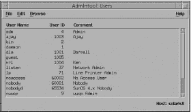

**图6.1** Admintool：“用户”对话框。

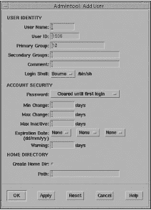

**图6.2** Admintool：“添加用户”对话框。

“用户标识”部分显示添加用户账户时必须定义的信息。除次要组信息存储在 `/etc/group` 文件中外，所有这些信息都存储在 `/etc/passwd` 文件中。表6.1列出了“用户标识”部分中的字段。

“账户安全”部分包含用于确定密码定义方式以及设置密码有效期的信息。这些信息存储在 `/etc/shadow` 文件中。表6.2列出了“账户安全”部分中的字段。

“主目录”部分用于定义（并在必要时创建）账户的主目录。该路径存储在 `/etc/passwd` 文件中。系统会根据所选登录 Shell 的类型，在主目录中创建相应的初始化文件。

**表6.1 用户标识字段**

| 字段 | 说明 |
|---|---|
| 用户名 | 唯一的用户账户名，最多由八个大写和小写字母和/或数字组成。 |
| 用户ID | 与用户账户关联的 UID。它是一个唯一编号，通常在 1,000 到 60,000 之间。从 1,000 开始的下一个可用编号会自动提供。 |
| 主组 | 用户应被分配到的组。默认值为 10（staff）。必须先存在指定的组，然后才能添加成员。 |
| 次要组 | 用户应被分配到的其他组（用逗号分隔）。必须先存在指定的组，然后才能添加成员。 |
| 注释 | 应放在 `/etc/passwd` 字段中的任何文本。 |
| 登录Shell | 可以选择 Bourne Shell（默认）、C Shell 或 Korn Shell。若要指定其他 Shell，请从下拉菜单中选择“其他”，然后在字段中输入该 Shell 的名称。 |

**表6.2 账户安全字段**

| 字段 | 说明 |
|---|---|
| 密码 | 选择项包括“首次登录前清除”、“账户已锁定”、“无密码—仅限 Setuid”或“正常密码”。 |
| 最短更改 | 两次密码更改之间所需的最少天数。 |
| 最长有效 | 密码有效的最大天数。 |
| 最长不活动 | 在必须更改密码之前，账户可以处于不活动状态的最大天数。 |
| 到期日期 | 账户到期的日期。 |
| 警告 | 在密码到期之前，对用户发出警告的天数。 |

## 使用 admintool 命令修改账户

要修改用户账户，请启动 `admintool` 命令（如果它尚未处于活动状态）。从菜单中选择“浏览”→“用户”（如前图6.1所示），打开“用户”对话框。

单击账户条目以将其突出显示，然后从菜单中选择“编辑”→“修改”，打开“修改用户”对话框，该对话框与“添加用户”对话框类似（如前图6.2所示）。此对话框中的字段会填入所选用户的信息。根据需要更改字段，并单击“应用”保存更改。

## 使用 admintool 命令删除账户

要删除用户账户，请启动 `admintool` 命令（如果它尚未处于活动状态），并从菜单中选择“浏览”→“用户”。在“用户”对话框中，单击账户条目以将其突出显示，然后从菜单中选择“编辑”→“删除”，打开“警告”对话框（参见图6.3）。单击“删除”以删除该用户账户。

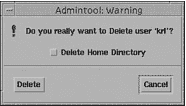

**图6.3** Admintool：“警告”对话框。


> 因为使用 `admintool` 命令可以轻松创建、修改和删除用户账户，所以 CX-310-011 考试侧重于使用 `useradd`、`usermod` 和 `userdel` 命令来管理用户账户。

## 使用 useradd 命令创建账户

`useradd`(1M) 命令提供了一种添加新用户账户的快捷方法。您至少必须将账户名作为命令行参数来指定。表6.3列出了 `useradd` 命令支持的命令行参数。

**表6.3 useradd 命令的命令行参数**

| 参数 | 说明 |
|---|---|
| `account` | 指定新用户账户的名称（必填）。 |
| `-A authorizations` | 指定一个或多个授权。 |
| `-b base` | 定义基目录。如果未指定主目录（`-d`），则将 `account`（账户名）添加到 `base`（基目录）后用作主目录。 |
| `-c comment` | 指定一条注释，该注释将放在 `/etc/passwd` 文件的注释字段中。 |
| `-d directory` | 定义账户的主目录。 |
| `-e date` | 指定账户的到期日期。超过指定日期后，账户将被禁用。 |
| `-f days` | 指定账户在被禁用之前可以处于不活动状态的最大天数。 |
| `-g group` | 定义将作为用户账户主组的现有组的 GID 或名称。 |
| `-G group` | 定义将作为用户账户次要组的现有组的 GID 或名称。 |
| `-k template_dir` | 指定包含用于用户账户的模板（默认）`.profile` 文件的目录。 |
| `-m` | 如果主目录不存在，则创建该目录。主目录由 `-b` 和 `account`（账户名）或由 `-d` 定义。 |
| `-o` | 允许您指定现有的 UID。也就是说，您可以创建具有重复 UID 的账户（参见 `-u`）。 |
| `-p profiles` | 指定一个或多个执行配置文件。 |
| `-R roles` | 指定一个或多个用户角色。 |
| `-s shell` | 指定登录 Shell；默认为 Bourne Shell（`/bin/sh`）。 |
| `-u uid` | 指定用户账户的 UID。它必须是十进制整数。如果未指定 `uid`，则分配下一个最大的可用 UID。 |

以下示例使用 `useradd` 命令创建用户账户：

```sh
# useradd -d /export/home/user1 -m -g other -u 1050 user1
6 blocks
#
```

此命令创建 `user1` 用户账户，为其分配 UID 1050，使其成为 `other` 组的成员，并创建其主目录（`/export/home/user1`）。

为了让生活更轻松一些，`useradd` 命令还支持 `-D` 命令行参数，它允许你为授权（`-A`）、基本目录（`-b`）、组（`-g`）、到期日期（`-e`）、最长不活动时间（`-f`）、执行配置文件（`-P`）和角色（`-R`）分配默认值。之后使用 `useradd` 命令时，如果未指定这些值，将使用这些默认值，如下例所示：

```
# useradd -D -b /export/home -g other
 group=other, proj=3  basedir=/export/home
 skel=/etc/skel  shell=/bin/sh  inactive=0
 expire=  auths=  profiles=  roles=
#
# useradd -m -u 1051 user2
6 blocks
#
```

由于定义了默认的基本目录和组，`user2` 帐户是组 `other` 的成员，其主目录为 `/export/home/user2`。


> 使用 `useradd` 命令创建的用户帐户没有密码。这些帐户处于锁定状态，无法使用，直到通过 `passwd`(1) 命令为该帐户定义密码为止。

## 使用 usermod 命令修改帐户

`usermod`(1M) 命令用于修改现有用户帐户。其命令行参数与 `useradd` 命令的参数相同，但以下情况除外：

- 基本目录（`-b`）不可用。请使用 `-d` 指定新目录。如果指定目录不存在，切勿忘记加上 `-m`。


- 设置默认值（`-D`）不可用。

- 模板目录（`-k`）不可用。

- 如果正在修改帐户名，请使用 `-l account` 指定新的用户帐户名。

请记住，如果更改了帐户名，主目录的名称不会改变，除非你使用 `-d` 和 `-m` 命令行参数。以下示例使用 `usermod` 命令将 `user1` 帐户的名称更改为 `user3`：

```
# ls -l
total 22
drwx------  2 root   root     8192 Jan 13 21:05 lost+found
drwxr-x---  2 user1  other     512 Mar 31 13:23 user1
drwxr-x--  2 user2  other     512 Mar 31 13:45 user2
#
# usermod -l user3 -d /export/home/user3 -m user1
6 blocks
#
# ls -l
 total 22
drwxr-x--x  2 user2 other 512 Mar 31 13:45 user2
drwxr-x--x  2 user3 other 512 Mar 31 13:23 user3
#
```

### 使用 userdel 命令删除帐户

`userdel(1M)` 命令用于删除用户帐户。你将用户帐户指定为命令行参数。仅支持另一个命令行参数 `-r`，它用于删除主目录：

```
# userdel -r user3
#
```

### 组帐户

你可以使用命令行实用程序或 `admintool(1M)` 命令添加、修改或删除组帐户。使用 `admintool` 命令可以减少或消除可能影响所有组帐户的输入错误和其他错误的引入。

这些是命令行实用程序：

- `groupadd(1M)`

- `groupmod(1M)`

- `groupdel(1M)`

`admintool` 命令和命令行实用程序都将在以下各节中介绍。

#### 使用 admintool 命令创建组

要创建组帐户，请启动 `admintool` 命令（如果尚未激活），然后从菜单中选择 Browse，Groups 以打开 Groups 对话框（参见图 6.4）。

然后通过从菜单中选择 Edit，Add 打开 Add Group 对话框，如图 6.5 所示。

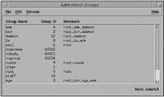

**图 6.4** Admintool：Groups 对话框。

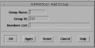

**图 6.5** Admintool：Add Group 对话框。

在 Group Name 字段中输入唯一的组名。使用下一个可用的 GID 编号或在 Group ID 字段中输入唯一的 GID。在 Members List 字段中，输入一个或多个以逗号分隔的用户帐户名。单击 OK，新组将显示在 Groups 对话框中。

#### 使用 `admintool` 命令修改组

要修改组帐户，请启动 `admintool` 命令（如果尚未激活），并从菜单中选择 Browse，Groups。单击帐户条目以将其突出显示，然后从菜单中选择 Edit，Modify 以打开 Modify Group 对话框，该对话框与 Add Group 对话框类似（如前图 6.5 所示）。字段中填入有关所选组的信息。根据需要更改字段，然后单击 Apply 保存更改。

#### 使用 `admintool` 命令删除组

要删除组帐户，请启动 `admintool` 命令（如果尚未激活），并从菜单中选择 Browse，Groups。单击帐户条目以将其突出显示，然后从菜单中选择 Edit，Delete。将打开一个 Warning 对话框，类似于前面图 6.3 所示的对话框，但它列出的是组而不是用户。单击 Delete 删除组帐户。


由于使用 `admintool` 命令可以轻松创建、修改和删除组帐户，因此考试 CX-310-011 重点考察使用 `groupadd`、`groupmod` 和 `groupdel` 命令来管理组帐户。

#### 使用 groupadd 命令创建组

`groupadd(1M)` 命令提供了一种快速添加新组帐户的方法。至少，你必须将组帐户名指定为命令行参数。`groupadd` 命令支持另外两个命令行参数。第一个是 `-g gid`，用于指定应与该组关联的唯一 GID。它必须是十进制整数。如果你未指定 GID，则会分配下一个最高可用 GID。另一个命令行参数是 `-o`，它允许你为组分配重复的 GID。

以下示例使用 `groupadd` 命令创建一个组：

```
# groupadd -g 1000 newgroup
#
```

#### 使用 groupmod 命令修改组

`groupmod(1M)` 命令用于修改现有组帐户。其命令行参数与 `groupadd` 命令的参数相同，不同之处在于，如果正在修改组帐户名，请使用 `-n name` 指定新的组帐户名。以下示例使用 `groupmod` 将组 `newgroup` 更改为 `group`：

```
# groupmod -n group newgroup
#
```

#### 使用 groupdel 命令删除组

`groupdel(1M)` 命令用于删除组帐户。组帐户指定为命令行参数：

```
# groupdel group
#
```

## 密码管理

密码管理涉及设置参数以控制密码时效、根据需要更改用户密码，以及可能锁定用户帐户以防止其使用。

### 密码时效

`/etc/shadow` 文件的参数决定了密码时效策略，你可以通过 `admintool` 命令的 Add 或 Modify User 对话框中的 Account Security 字段设置这些参数。这些参数包括密码的有效期（Max Change）、密码可以更改的频率（Min Change），以及密码必须更改之前帐户可以不活动的最长时间（Max Inactive）。它们强制执行保护密码完整性的策略。

请注意，只有 Max Inactive 可以通过 `useradd` 命令指定，并通过 `usermod` 命令修改。

### 密码要求

除非由超级用户帐户（如 `root`）指定，否则密码必须满足以下要求：

- 密码必须至少包含 `/etc/default/passwd` 文件中 `PASSLENGTH` 参数指定的字符数。默认值为 6；建议为 8 或以上。

- 密码必须至少包含两个字母字符和至少一个数字字符（在前 `PASSLENGTH` 个字符内）。

- 密码不能与用户帐户名相同、不能是用户帐户名的反转或循环移位。任何大写字母都会映射为小写字母以进行要求检查。因此，`guest` 用户帐户的密码不能是 `guest`、`tseug`、`uestg`、`estgu`、`GUEST1` 等。

- 新密码必须与旧密码至少有 3 个字符不同。同样，大写和小写字母在要求检查中是等价的。


密码可以是任意长度，但只有前八个字符是有效的。例如，如果密码定义为 `25administration`，则可以使用 `25admini` 登录系统。

请记住，当 `root` 或其他超级用户帐户定义自己的密码或其他用户帐户的密码时，这些要求不适用。

### 使用 admintool 命令更改密码

要更改用户帐户的密码，请启动 `admintool` 命令（如果尚未激活）。从菜单中选择“浏览，用户”以打开“用户”对话框。

可以通过两种方式选择用户帐户：双击帐户条目，或单击帐户条目以将其高亮显示，然后从菜单中选择“编辑，修改”。无论采用哪种方法，都会打开“修改用户”对话框（参见图 6.6）。请注意，用户帐户的当前密码设置显示在“密码”字段中。在图 6.6 中，该用户帐户的当前设置为“普通密码”。

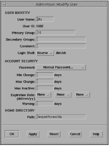

**图 6.6** Admintool：“修改用户”对话框，已选择“普通密码”设置。

要修改帐户密码，请将鼠标光标置于“密码”字段上并按住鼠标左键。然后将鼠标光标移到“普通密码”项上并释放鼠标按钮，以显示“设置用户密码”对话框（参见图 6.7）。

在“输入密码”和“验证密码”字段中输入相同的密码。输入的每个字符都会显示为星号。单击“确定”。要保存密码，请在“修改用户”对话框中单击“确定”。

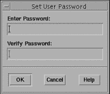

**图 6.7** “设置用户密码”对话框。

### 使用 passwd 命令更改密码


除了 `admintool` 命令之外，`passwd(1)` 命令是更改用户帐户密码的唯一方法。当不带任何命令行参数使用时，`passwd` 命令会更改当前用户帐户的密码，如下例所示：

```text
$ passwd
passwd: Changing password for dla
Enter login password:
New password:
Re-enter new password:
passwd (SYSTEM): passwd successfully changed for dla
$
```

请注意，必须先输入当前密码，然后才能指定新密码。当超级用户帐户（例如 `root`）使用 `passwd` 命令时，无需输入当前密码。

提供了多种命令行参数来支持更改密码。表 6.4 列出了其中最重要的参数。

**表 6.4** — `passwd` 命令的部分命令行参数

| 参数 | 描述 |
|---|---|
| `帐户` | 指定要更改密码的用户帐户的名称 |
| `-a` | 列出所有用户帐户的密码属性（显示 `LK` 表示已锁定，`PS` 表示有密码，等等） |
| `-d` | 删除指定帐户的密码 |
| `-l` | 锁定指定帐户，使其无法访问 |

超级用户帐户可以更改另一个用户帐户的密码。用户帐户通过命令行参数指定，如下例所示：

```text
# passwd dla
New password:
Re-enter new password:
passwd (SYSTEM): password successfully changed for dla
#
```

### 使用 admintool 命令锁定用户帐户

可以对帐户进行锁定以防止其被使用。要执行此操作，请启动 `admintool` 命令（如果尚未激活），然后从菜单中选择“浏览，用户”。

可以通过两种方式选择用户帐户：双击帐户条目，或单击帐户条目以将其高亮显示，然后从菜单中选择“编辑，修改”。无论采用哪种方法，都会打开“修改用户”对话框。

要锁定帐户，请将鼠标光标置于“密码”字段上并按住鼠标左键。然后将鼠标光标移到“帐户已锁定”项上并释放鼠标按钮。“帐户已锁定”项会显示在“密码”字段中（参见图 6.8）。要保存更改，请在“修改用户”对话框中单击“确定”。

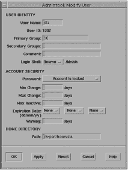

**图 6.8** Admintool：“修改用户”对话框中的“帐户已锁定”设置。

### 初始化文件

每个用户帐户的主目录（由 `$HOME` 环境参数标识）都关联着若干个初始化（或启动）文件。这些文件指定了在关联事件发生时需要执行的命令。根据所使用的登录 shell，可能存在登录初始化文件、shell 启动文件或注销文件。表 6.5 列出了各种初始化文件。

| 文件 | sh | csh | ksh |
|---|---|---|---|
| 登录初始化文件 | `$HOME/.profile` | `$HOME/.login` | `$HOME/.profile` |
| Shell 启动文件 | N/A | `$HOME/.cshrc` | 用户自定义 |
| 注销文件 | N/A | `$HOME/.logout` | N/A |

登录初始化文件中的命令在用户登录时执行。三种常见的 shell 都提供登录初始化文件。Shell 启动文件中的命令在已登录用户启动 shell 时执行。`csh` 和 `ksh` 都提供此功能。`ENV` 参数用于定义 `ksh` shell 启动初始化文件的名称。只有 `csh` 提供在用户注销时自动执行命令的文件。


了解 Bourne shell、`C shell` 和 Korn shell 的初始化文件的名称及其用途非常重要。

#### 系统配置文件

对于使用 Bourne (`sh`) 或 Korn (`ksh`) shell 作为登录 shell 的用户帐户，系统配置文件中的命令会在用户的登录初始化文件之前执行。该文件名为 `/etc/profile`，执行时会设置默认终端类型 (`TERM`)，然后调用 `umask(1)` 将默认文件权限掩码设置为 `022`。如果用户的主目录中不包含名为 `.hushlogin` 的文件，则会使用 `quota(1M)` 显示用户的存储配额，显示当日消息（如果有），并在用户有新邮件到达时显示通知消息。

以下示例显示了 Solaris 8 系统上 `/etc/profile` 的默认内容：

```
# The profile that all logins get before using their own .profile.
trap "" 2 3
export LOGNAME PATH
if [ "$TERM" = "" ]
then
    if /bin/i386
    then
        TERM=sun-color
    else
        TERM=sun
    fi
    export TERM
fi
# Login and -su shells get /etc/profile services.
# -rsh is given its environment in its .profile.
case "$0" in
-sh | -ksh | -jsh)
    if [ ! -f .hushlogin ]
    then
        /usr/sbin/quota
        # Allow the user to break the Message-Of-The-Day only.
        trap "" 2
        /bin/cat -s /etc/motd
        trap "" 2
        /bin/mail -E
        case $? in
        0)
            echo "You have new mail."
            ;;
        2)
            echo "You have mail."
            ;;
        esac
    fi
esac
umask 022
trap 2 3
```

#### 初始化文件模板

当您创建用户帐户并指定主目录时，设置用户帐户会包括将相应的默认初始化文件复制到用户的主目录中。这些初始文件或模板存储在 `/etc/skel` 目录中。

对于使用 `sh` 或 `ksh` 作为登录 shell 的用户帐户，`/etc/skel/local.profile` 文件会被复制到用户主目录中的 `.profile` 文件。以下示例显示了 `/etc/skel/local.profile` 文件的默认内容：

```sh
stty istrip
PATH=/usr/bin:/usr/ucb:/etc:.
export PATH
#
# If possible, start the windows system
#
if [ `tty` = "/dev/console" ] ; then
        if [ "$TERM" = "sun" -o "$TERM" = "sun-color"
        -o "$TERM" = "AT386" ]
        then
                if [ ${OPENWINHOME:-""} = "" ] ; then
                        OPENWINHOME=/usr/openwin
                        export OPENWINHOME
                fi
                echo ""
                echo "Starting OpenWindows in 5 seconds"
                sleep 5
                echo ""
                $OPENWINHOME/bin/openwin
                clear # get rid of annoying cursor rectangle
                exit # logout after leaving windows system
        fi
fi
```

对于使用 `csh` 作为登录 shell 的用户帐户，`/etc/skel/local.login` 文件会被复制到用户主目录中的 `.login` 文件。以下示例显示了 `/etc/skel/local.login` 文件的默认内容：


```csh
stty -istrip
# setenv TERM 'tset -Q .'
#
# if possible, start the windows system.
#
if ( `tty` == "/dev/console" ) then
        if ( "$TERM" == "sun" || "$TERM" == "sun-color"
             || "$TERM" == "AT386" ) then
                if ( $?OPENWINHOME == 0 ) then
                        setenv OPENWINHOME /usr/openwin
                endif
                echo ""
                echo -n "Starting OpenWindows in 5 seconds"
                sleep 5
                echo ""
                $OPENWINHOME/bin/openwin
                clear # get rid of annoying cursor rectangle
                logout # logout after leaving windows system
        endif
endif
```

此外，对于使用 `csh` 作为登录 shell 的用户帐户，`/etc/skel/.cshrc` 文件会被复制到用户主目录中的 `.cshrc` 文件。以下示例显示了 `/etc/skel/.cshrc` 文件的默认内容：

```csh
umask 022
set path=(/bin /usr/bin /usr/ucb /etc .)
if ( $?prompt ) then
        set history=32
endif
```

`/etc/skel` 目录还包含一个简单的 `.profile` 文件，可用作默认配置。

```sh
# This is the default standard profile provided to users.
# They are expected to edit it to meet their own needs.
MAIL=/usr/mail/${LOGNAME:?}
```

当您使用 `admintool` 命令创建帐户时，系统会根据所选的登录 Shell 将相应的 `/etc/skel` 文件复制到用户帐户的主目录中。当您使用 `useradd` 命令时，所有 `/etc/skel` 文件（`.profile`、 `local.cshrc`、 `local.login` 和 `local.profile`）都会被复制到主目录。相应的文件必须手动设置。

#### 定制用户环境

您可以修改初始化文件模板，为新用户帐户创建定制环境。此外，您还可以修改系统配置文件（`/etc/profile`），以便在登录初始化期间为所有用户定制环境。


请记住，系统配置文件 `/etc/profile` 会在用户配置文件之前执行。这种执行顺序使得在用户有机会进行任何修改之前，就可以控制和限制用户环境。

要定制单个用户帐户，您可以修改用户主目录中的初始化文件。在大多数情况下，这种修改包括添加要自动执行的命令或定义 Shell 参数。

##### 在 `$HOME/.profile` 中定义 Shell 变量

在 `$HOME/.profile` 中定义并导出的变量会成为用户环境的一部分。这些变量可用于用户执行的程序和 Shell。

在 `$HOME/.profile` 中定义的一个常见 Shell 变量是 `LPDEST`，它用于指定默认打印机。要将 HPLaser 定义为默认打印机，请在用户帐户的 `$HOME/.profile` 中包含以下内容：

```sh
LPDEST=HPLaser
export LPDEST
```

或者，您也可以将两条命令放在同一行，并用分号分隔：

```sh
LPDEST=HPLaser; export LPDEST
```

对于使用 `ksh` 作为登录 Shell 的用户帐户，可以使用类似的语法：

```sh
export LPDEST=HPLaser
```

尽管为 `csh` 用户帐户定义变量并非认证要求，但此处仍给出两种 `csh` 变量定义方法的语法：

```sh
set LPDEST=HPLaser
setenv LPDEST HPLaser
```


对用户登录初始化文件所做的更改，在用户重新登录或通过在 `$HOME/.profile` 前面加上一个点和一个空格来执行之前，不会生效。这种技术会执行 `$HOME/.profile`，并使其成为当前环境的一部分。

##### 加载 `$HOME/.profile`

对于使用 Solaris 通用桌面环境（CDE）的用户帐户，您可以配置启动桌面的 `/usr/dt/bin/Xsession` 命令，使其在启动过程中读取并处理用户主目录中的 `.login`（`csh`）或 `.profile`（`sh` 和 `ksh`）登录初始化文件。

`Xsession` 调用的第一个用户特定文件是位于用户主目录中的 `.dtprofile` 文件。以下是默认 `.dtprofile` 文件的最后一行：

```text
DTSOURCEPROFILE=true
```

此行使 `.login` 或 `.profile` 文件自动执行（或加载）。要更改此默认行为并阻止登录初始化文件被加载，请将 `true` 改为 `false`。

#### 登录和注销流程

以下各节介绍命令行登录和注销流程。请记住，在系统控制台上，可以使用图形用户界面（GUI）登录 Solaris CDE。

##### 登录 Solaris 8 系统

`login(1)` 命令用于登录（或登入）系统。当通过网络或终端建立与系统的连接时，通常使用 `login` 命令与用户交互，提示并获取用户帐户名和密码。然后将此信息与 `/etc/passwd` 和 `/etc/shadow` 文件中的条目进行比较，以确定是否应允许该用户访问系统。如果允许，则启动 `/etc/passwd` 文件中指定的登录 Shell，为用户提供系统界面。如果不允许，`login` 命令会再尝试几次以获取有效的用户帐户和密码。如果所有这些尝试均失败，则与系统的连接将被断开。

##### 登录失败尝试

连续五次登录失败后，失败的登录尝试会保存到 `/var/adm/loginlog` 文件中。通过创建 `loginlog` 文件可启用此日志记录，删除该文件则会禁用。该文件应以仅限 root 读取/写入的权限创建。默认情况下该文件不存在，需要由系统管理员创建。

##### 注销 Solaris 8 系统

在大多数情况下，您可以使用 `exit(1)` 命令注销（在某些用法中也称为退出）系统。所有三种 Shell 都能识别此命令。对于 `csh`，也可以使用 `logout(1)` 命令注销系统。

#### 识别和监控用户

您可以使用多个命令来识别和监控用户：

- `id(1M)`—显示真实和有效的 UID 和 GID
- `finger(1)`—显示本地和远程用户的信息
- `last(1)`—显示登录和注销信息
- `who(1)`—显示当前登录到系统的用户
- `whodo(1M)`—显示谁在做什么

##### id 命令

`id` 命令显示调用进程或指定用户帐户的真实和有效 UID 和 GID。如果在调用 `id` 时使用 `-a` 选项，则会返回该用户 ID 所属的所有组。以下各行显示了执行 `id` 命令的结果：

```text
# id -a
uid=0(root) gid=1(other) groups=1(other),0(root),2(bin),
3(sys),4(adm),5(uucp),6(mail),7(tty),8(lp),9(nuucp),12(daemon)
#
```

##### finger 命令

`finger` 命令显示已登录到本地系统或指定远程系统的用户的信息。使用 `-l` 命令行参数可显示详细信息。您还可以将已登录用户的帐户名指定为命令行参数，以将显示的信息限制为单个用户。以下示例显示了 `finger` 命令的结果：


## `finger` 命令

```text
$ finger
Login       Name             TTY       Idle     When       Where
root        Super-User       console   36       Sun 01:47
dla         Darrell          pts/7     1:35     Sat 20:37  winnt40
$
$ finger -l
Login name: root                         In real life: Super-User
Directory: /                              Shell: /sbin/sh
On since Mar 18 01:47:03 on console from :0
36 minutes Idle Time
No unread mail
No Plan.

Login name: dla                         In real life: Darrell
Directory: /export/home/dla              Shell: /bin/sh
On since Mar 31 20:37:53 on pts/7 from winnt40
1 hour 36 minutes Idle Time
Unread mail since Fri Feb 9 13:53:42 2001
No Plan.
$
$ finger dla
Login name: dla                         In real life: Darrell
Directory: /export/home/dla              Shell: /bin/sh
On since Mar 31 22:14:03 on pts/5 from winnt40
Unread mail since Fri Feb 9 13:53:42 2001
No Plan.

Login name: dla                         In real life: Darrell
Directory: /export/home/dla              Shell: /bin/sh
On since Mar 31 20:37:53 on pts/7 from winnt40
1 hour 43 minutes Idle Time
$
```

您还可以使用 `finger` 命令，通过指定前面带有 `at`（`@`）字符的主机名，来显示登录到远程系统的用户的信息。例如，要显示登录到 `sparc20` 系统的用户的信息，请使用以下命令：

```text
$ finger @sparc20
[sparc20]
Login       Name       TTY       Idle      When      Where
root        Super-User console   7d        Tue 21:25  :0
$
```

## `last` 命令

`last` 命令显示登录和注销活动。此命令很有用，因为它可以识别当前在系统上的用户以及最近在系统上的用户。以下示例显示了 `last` 命令的结果：

```text
$ last
root     console       :0       Sun Mar 18 01:47   still logged in
reboot   system boot             Sun Mar 18 01:45
```

```text
root     console    :0        Sun Mar 18 01:02 - 01:44  (00:41)
reboot   system boot           Sun Mar 18 00:55
dla      ftp        winnt40   Sat Mar 17 21:14 - 21:16  (00:02)
root     console    :0        Sat Mar 17 20:53 - 00:43  (03:49)
reboot   system boot           Sun Mar 5 01:54
dla      ftp        winnt40   Sun Feb 18 20:23 - 00:05  (01+03:42)
root     console    :0        Sat Feb 10 12:17 - down   (22+13:36)
reboot   system boot           Fri Feb 9 13:51
dla      pts/8      solaris8  Sun Feb 4 21:29 - 23:38  (01+02:08)
dla      pts/7      winnt40   Fri Feb 2 23:50 - down   (6+14:00)
root     console    :0        Sat Jan 27 18:41 - down   (12+19:10)
reboot   system boot           Sat Jan 27 18:34
dla      ftp        solaris8  Fri Jan 19 01:46 - 01:59  (00:13)
root     console    :0        Sat Jan 13 21:44 - down   (13+20:50)
reboot   system boot           Sat Jan 13 21:42

wtmp begins Sat Jan 13 21:42
$ 
```

## `who` 命令

`who` 命令显示当前登录到系统的用户，并可选择地显示有关进程、系统重新启动等信息。以下示例显示了两个 `who` 命令的结果。第二个命令使用了 `-a` 命令行参数，该参数提供了额外信息，如上次重新启动、当前运行级别以及其他详细信息：

```text
# who
root       console       Mar 18 01:47   (:0)
root       pts/4         Mar 18 01:49   (:0.0)
dla        pts/5         Mar 20 03:34   (winnt40)
root       pts/6         Mar 29 02:42   (:0.0)
# who -a
                       .        system boot  Mar 18 01:45
                       .        run-level 3  Mar 18 01:46       3       0 s
rc2        .        Mar 18 01:46  old   78  id=s2 term=0    exit=0
rc3        .        Mar 18 01:46  old  279  id=s3 term=0    exit=0
sac        .        Mar 18 01:46  old  306  id=sc
LOGIN      console     Mar 18 01:46  015  307
zsmon      .           Mar 18 01:46  old  309
root       + console   Mar 18 01:47  0:15  330        (:0)
root       + pts/4     Mar 18 01:49  old  428        (:0.0)
dla        + pts/5     Mar 20 03:34  .    1712       (winnt40)
root       + pts/6     Mar 29 02:42  0:14  7099       (:0.0)
#
```

## `whodo` 命令

`whodo` 命令使系统管理员能够将 `who` 的信息与进程信息结合起来，生成用户正在执行操作的列表。以下示例显示了 `whodo` 命令的结果：

```text
# whodo
Thu Mar 29 04:15:13 EST 2001
solaris8
console    root       1:47
?             330     0:00 Xsession
pts/3       374     0:00 dt_shell
pts/3       390     0:06 dtsession
pts/6      7099     0:00 sh
pts/6       428     0:00 sh
pts/5       dla       3:34
pts/5      1712     0:00 sh
pts/5      7124     0:00 sh
pts/5      7179     0:00 whodo
```


### 练习题

#### 问题 1
- 用户帐户初始化文件模板存放于何处？
  - ○ a. 用户帐户主目录下
  - ○ b. `/etc/skel` 目录中
  - ○ c. `/usr/skel` 目录中
  - ○ d. `/skel` 目录中

答案 b 正确。用户帐户初始化文件模板存储在 `/etc/skel` 目录中。模板的用户副本（而非模板本身）存储在主目录下。因此，答案 a 不正确。`/usr/skel` 和 `/skel` 目录不存在。因此，答案 c 和 d 不正确。

#### 问题 2
- 对于 `admintool` 命令的 Password 字段，以下哪些是有效设置？（选择所有适用项。）
  - ☐ a. 普通密码
  - ☐ b. 帐户已锁定
  - ☐ c. 首次登录前清除
  - ☐ d. 无密码——仅限 Setuid
  - ☐ e. 一次性密码

答案 a、b、c 和 d 正确。“普通密码”、“帐户已锁定”、“首次登录前清除”和“无密码——仅限 Setuid”是 `admintool` 命令的 Password 字段的有效设置。Solaris 8 不提供一次性密码功能。因此，答案 e 不正确。

#### 问题 3
输入用于将用户定义的 Bourne shell 变量添加到用户环境中以便其他程序可以使用该变量的命令。

正确答案是 `export`。

#### 问题 4
- 使用 `useradd` 或 `usermod` 命令时，可以指定以下哪些命令行参数？（选择所有适用项。）
  - ☐ a. `-u uid`
  - ☐ b. `-g gid`
  - ☐ c. `-d home_directory`
  - ☐ d. `-l account`

答案 a、b 和 c 正确。UID、GID 和主目录可以通过使用指定的 `useradd` 命令行参数来定义，并可通过使用相同的 `usermod` 命令行参数进行修改。`-l` 命令行参数仅用于 `usermod` 命令，以指定新的帐户名。`useradd` 命令的帐户名不使用 `-l` 命令行参数。因此，答案 d 不正确。

#### 问题 5
- 哪个命令可用于更改分配给现有组的成员（即用户帐户）？
  - ○ a. `usermod`
  - ○ b. `groupmod`
  - ○ c. `groupadd`
  - ○ d. `groupmem`

答案 a 正确。`usermod` 命令用于逐个添加或删除组中的每个用户帐户。`groupmod` 命令和 `groupadd` 命令不影响组成员身份。因此，答案 b 和 c 不正确。`groupmem` 命令不存在。因此，答案 d 不正确。

#### 问题 6
输入系统级 Bourne 和 Korn shell 配置文件的完整路径名。

正确答案是 `/etc/profile`。

#### 问题 7
- `useradd` 命令的 `-P` 命令行参数指定什么？
  - a. 帐户密码
  - b. 执行配置文件
  - c. 初始化文件（配置文件）模板
  - d. 主要组

答案 b 正确。`useradd` 命令的 `-P` 命令行参数指定执行配置文件。无法通过 `useradd` 命令指定密码；使用 `useradd` 创建的所有帐户都会被锁定，直到使用 `passwd` 或 `admintool` 命令定义密码。因此，答案 a 不正确。无法指定模板；但可以使用 `-k` 命令行参数指定配置文件模板目录。因此，答案 c 不正确。主要组由 `-g` 命令行参数指定。因此，答案 d 不正确。

#### 问题 8
- `/var/adm/loginlog` 文件用于记录什么？
  - a. 登录
  - b. 注销
  - c. 失败的登录
  - d. 成功的登录
  - e. 所有登录和注销

答案 c 正确。`/var/adm/loginlog` 文件记录失败的登录尝试。`last` 命令用于确定登录、注销以及登录和注销两种情况。因此，答案 a、b、d 和 e 不正确。此外，`who` 命令可用于识别当前登录到系统的用户。

#### 问题 9
- 当与 `usermod` 命令一起使用时，`-o` 命令行选项有什么作用？
  - a. 覆盖现有用户信息。
  - b. 可以指定重复的 UID。
  - c. 显示指定用户的信息。
  - d. 可以指定重复的 GID。
  - e. 删除用户帐户。

答案 b 正确。`usermod` 命令的 `-o` 命令行选项允许指定重复的 UID。其他答案中列出的操作不受 `usermod` 命令支持。因此，答案 a、c、d 和 e 不正确。

#### 问题 10
- 使用 `admintool` 命令创建用户帐户时，以下哪些可以指定为登录 shell？（选择所有适用项。）
  - a. Bourne（`/bin/sh`）
  - b. C（`/bin/csh`）
  - c. Korn（`/bin/ksh`）
  - d. 其他（指定路径）

答案 a、b、c 和 d 正确。使用 `admintool` 命令创建用户帐户时，可以选择 Bourne、C 或 Korn 作为登录 shell，也可以指定其他登录 shell。

#### 问题 11
- root 可以使用哪些命令更改密码？（选择所有适用项。）
  - a. `admintool`
  - b. `passmgmt`
  - c. `usermod`
  - d. `passwd`

答案 a 和 d 是正确的。root 用户可以使用 `admintool` 和 `passwd` 命令来更改密码。`passmgmt` 和 `usermod` 命令不提供任何指定密码的功能。因此，答案 b 和 c 是错误的。

#### 问题 12
哪个命令会显示当前登录到系统的所有用户？（请选择所有适用的选项。）
- [ ] a. `who`
- [ ] b. `last`
- [ ] c. `whodo`
- [ ] d. `id`

答案 a、b 和 c 是正确的。`who`、`last` 和 `whodo` 命令会显示当前登录到系统的所有用户。`id` 命令显示指定用户账户的真实和有效 UID、GID 及所属组。因此，答案 d 是错误的。

### 需要了解更多信息？

- Mulligan, John P. 著，*Solaris 与必备参考*（New Riders，印第安纳波利斯，印第安纳州：2001），ISBN 0-7357-1007-4。
- Sobell, Mark G. 著，*Solaris 实用指南*（Addison-Wesley，雷丁，马萨诸塞州：1999），ISBN 0-201-89548-X。
- Sun Microsystems 公司，*系统管理指南，第 1 卷*。提供印刷版本（部件号 805-7228-10），也可在 `http://docs.sun.com` 网站上获取，还可从 Solaris 8 操作系统附带的在线文档 AnswerBook2 中获取。
- Sun Microsystems 公司，*系统管理指南，第 2 卷*。提供印刷版本（部件号 805-7229-10），也可在 `http://docs.sun.com` 网站上获取，还可从 Solaris 8 操作系统附带的在线文档 AnswerBook2 中获取。
- Sun Microsystems 公司，*系统参考手册，第 1 部分——用户命令*。提供印刷版本（部件号 806-0624-10），也可在 `http://docs.sun.com` 网站上获取，还可从 Solaris 8 操作系统附带的在线文档 AnswerBook2 中获取。
- Sun Microsystems 公司，*系统参考手册，第 1M 部分——系统管理命令*。提供印刷版本（部件号 806-0625-10），也可在 `http://docs.sun.com` 网站上获取，还可从 Solaris 8 操作系统附带的在线文档 AnswerBook2 中获取。


### 控制进程

**你需要理解的术语：**
- ✓ 进程属性
- ✓ `ps`、`prstat` 和 `pgrep` 命令
- ✓ 信号
- ✓ `kill` 和 `pkill` 命令
- ✓ `cron` 和 `crontab` 命令
- ✓ Crontab 文件

**你需要掌握的技巧：**
- ✓ 使用 `ps`、`prstat` 和 `pgrep` 命令查看进程属性
- ✓ 使用 `kill` 和 `pkill` 命令终止进程
- ✓ 使用 `cron` 和 `at` 命令调度进程
- ✓ 控制 `cron` 和 `at` 命令的使用


本章介绍如何控制系统上运行的程序或进程。这种控制包括查看进程状态、按需终止进程，以及调度进程的自动启动。本章涵盖*进程控制*的考试目标。

## 查看和终止进程

`ps(1)`、`prstat(1M)` 和 `pgrep(1)` 命令用于查看进程属性，而 `kill(1)` 和 `pkill(1)` 命令用于终止进程。

### ps 命令

`ps` 命令用于显示活动进程的信息。不带任何命令行参数时，`ps` 命令显示与执行该命令的用户账户具有相同有效用户 ID（UID）的进程。表 7.1 列出了 `ps` 命令支持的命令行参数。

通过 `ps` 命令及其多种显示格式，可以获取大量关于进程的信息。


进程默认显示的信息包括进程 ID（PID）、关联的终端设备（TTY）、累计执行时间（TIME）以及程序或命令名称（CMD）。除非特别省略，否则这些信息会包含在所有显示格式中。

| 参数 | 说明 |
|---|---|
| `-a` | 显示所有进程，但进程组组长和与终端无关联的进程除外 |
| `-A` | 显示所有进程（等同于 `-e`） |
| `-c` | 显示备用列 |
| `-d` | 显示所有进程，但进程会话首脑除外 |
| `-e` | 显示所有进程 |
| `-f` | 使用完整列表显示格式 |
| `-g` *进程组 ID* | 显示具有指定进程组 ID 的进程 |
| `-G` *组 ID* | 显示具有指定进程组 ID（GID）的进程 |
| `-j` | 显示会话 ID 和进程组 ID |
| `-l` | 使用长列表显示格式 |
| `-L` | 显示每个轻量进程（LWP）的信息 |
| `-n` *名称* | 使用备用的名称列表文件（已忽略） |
| `-o` *格式* | 使用备用显示格式 |
| `-p` *进程 ID* | 显示具有指定进程 ID（PID）的进程 |
| `-P` | 显示执行该进程的处理器编号（仅在多处理器系统上有意义） |
| `-s` *进程会话 ID* | 显示具有指定进程会话 ID 的进程 |
| `-t` *终端设备路径* | 显示与指定终端设备路径关联的进程 |
| `-u` *有效用户 ID* | 显示具有指定有效用户 ID 的进程 |
| `-U` *真实用户 ID* | 显示具有指定真实用户 ID 的进程 |
| `-Y` | 在长列表中显示备用列 |

所有用于指定 ID 的命令行参数——例如进程组 ID、真实组 ID、PID、进程会话 ID、有效 UID 和真实 UID——都接受多个 ID（用逗号分隔）。对于真实和有效用户 ID 以及真实组 ID，可以指定数字 ID 或账户名称。

以下输出示例使用了带有几个不同命令行参数的 `ps` 命令：

```text
$ ps -udla
   PID TTY      TIME CMD
   781 pts/5    0:19 xterm
   782 pts/5    0:00 sh
   910 pts/5    0:10 telnet
   913 pts/6    0:01 sh
$ ps -t pts/6
   PID TTY      TIME CMD
   782 pts/5    0:00 sh
   910 pts/5    0:10 telnet
$ ps -f -udla
   UID  PID PPID  C  STIME TTY      TIME CMD
   dla  781    0  0  Aug 28 ?        0:19 xterm -display
   dla  782  781  0  Aug 28 pts/5    0:00 sh
   dla  910  782  0  Aug 28 pts/5    0:10 telnet solaris
   dla  913  911  0  Aug 28 pts/6    0:01 -sh
$
```

PPID 列列出进程的父 PID，C 列列出处理器利用率（已过时），STIME 显示开始日期。

### prstat 命令

`prstat(1M)` 命令生成活动进程的统计报告。如果使用时不带任何命令行参数，则会显示所有活动进程的信息，并按 CPU 使用率排序。报告大约每三秒更新一次，直到被终止。以下输出示例展示了 `prstat` 命令的用法：

```text
$ prstat
 PID USER  SIZE  RSS STATE   PRI NICE      TIME  CPU PROCESS/NLWP
7793 dla   1032K 844K cpu0     58    0  0:00:00 0.1% prstat/1
 789 dla   2960K 2132K sleep    58    0  0:00:00 0.1% xterm/1
 217 root  1908K 1100K sleep    53    0  0:00:00 0.1% mscd/7
 312 root  1936K  660K sleep    48    0  0:00:00 0.1% nfsiod/12
 397 root   64M   47M sleep     59    0  0:00:07 0.0% perimeter/1
 790 dla    808K  628K sleep    41    0  0:00:00 0.0% sh/1
 177 root  1576K  0K   sleep    30    0  0:00:00 0.0% lockd/1
 229 root  2692K  0K   sleep    48    0  0:00:00 0.0% lpsched/1
 165 root  1940K  696K sleep    58    0  0:00:00 0.0% in.named/1
 250 root   804K  480K sleep    58    0  0:00:00 0.0% utmpd/1
 188 root  2720K  664K sleep    58    0  0:00:00 0.0% automount/5
 143 root  2144K  672K sleep    58    0  0:00:00 0.0% rpcbind/1
 129 root  1552K  300K sleep    59    0  0:00:00 0.0% in.ndpd/1
 122 root  1304K  220K sleep    58    0  0:00:00 0.0% routed/1
Total: 64 processes, 146 lwps, load averages: 0.11, 0.04, 0.05
$
```

`prstat` 的命令行参数允许你根据 PID、所有者的 UID、所使用的 CPU 等来选择要监控的进程。表 7.2 列出了 `prstat` 的命令行参数。

| 参数 | 说明 |
|---|---|
| `-a` | 分别显示进程和用户的报告。 |
| `-c` | 打印新的报告，而不是覆盖初始报告。 |
| `-C` *集合* | 仅报告绑定到指定处理器集的进程。 |
| `-L` | 报告每个 LWP。 |
| `-m` | 报告微状态信息。 |
| `-n` *数量* | 将报告限制为窗口或终端中的 **数量** 行。默认使用整个显示区域。 |
| `-p` *PID 列表* | 仅报告其 PID 由 **PID 列表** 列出的进程。 |
| `-P` *CPU 列表* | 仅报告在 **CPU 列表** 所列 CPU 上执行的进程。 |
| `-R` | 在实时模式下执行 **prstat**。 |
| 参数 | 说明 |
|---|---|
| `-s key` | 根据 key（cpu、time、size、rss 或 pri）按降序对报告进行排序。 |
| `-S key` | 根据 key（cpu、time、size、rss 或 pri）按升序对报告进行排序。 |
| `-t` | 报告每个用户的总用量摘要。 |
| `-u euids` | 仅报告有效 UID 列在 *euids* 中的进程。 |
| `-U uids` | 仅报告真实 UID 列在 *uids* 中的进程。 |
| `-v` | 使用详细模式报告，包括用户模式和系统模式下的时间百分比。 |

以下示例使用 `prstat` 命令列出与 dla 用户帐户关联的进程：


```text
$ prstat -c -u dla
PID USER  SIZE RSS STATE PRI NICE TIME       CPU PROCESS/NLWP
9830 dla   812K 696K cpu0  48  0    0:00:00.0 2%  prstat/1
9789 dla   2960K 2136K sleep 59 0    0:00:00.0 1%  xterm/1
9790 dla   808K 628K sleep 48 0    0:00:00.0 0%  sh/1
Total: 3 processes, 3 lwps, 1 load averages: 0.00, 0.00, 0.01
$
```


请务必理解，`ps` 和 `prstat` 都提供活动进程的相关信息。`ps` 命令提供更多面向用户的信息（父 PID、TTY、开始日期等），而 `prstat` 命令则提供更多面向系统的信息（进程大小、优先级、CPU 利用率等）。

### kill 命令

`kill(1)` 命令通过向进程发送信号使其退出，从而终止进程。存在多种不同类型的信号。用于终止进程的典型信号列于表 7.3，完整的基础信号列表可参见 `signal(3HEAD)`。

接收这些信号的进程的默认响应是终止，但此行为可以针对每个进程单独更改。

**表 7.3 用于终止进程的信号**

| 符号名称 | 值 | 说明 |

|---|---:|---|

| SIGHUP | 1 | 挂断 |

| SIGINT | 2 | 中断 |

| SIGKILL | 9 | 终止 |

| SIGTERM | 15 | 终止（`kill` 和 `pkill` 命令的默认信号） |

| SIGUSR1 | 16 | 用户信号 1 |

| SIGUSR2 | 17 | 用户信号 2 |

您可以使用其符号名称（不包括 SIG 前缀）或数值来指定信号。如果未指定信号，默认发送 SIGTERM (15)。必须知道要终止的进程的 PID。以下列表使用 `kill` 命令向多个进程发送 KILL 信号 (9)：

```text
# kill -KILL 4220 4224 4229
#
4229 Killed
4224 Killed
4220 Killed
# kill -9 4247
#
4247 Killed
```

PID 前面带有减号时，该 PID 将被解释为进程组 ID，并且信号会发送到该进程组中的所有进程。

### pgrep 和 pkill 命令

`pgrep(1)` 和 `pkill(1)` 命令支持按名称或其他属性（如 UID、GID 等）查看和终止进程。表 7.4 列出了 `pgrep` 和 `pkill` 命令都支持的命令行参数。

**表 7.4 常用的 pgrep 和 pkill 命令行参数**

| 参数 | 说明 |

|---|---|

| *pattern* | 与程序名称和/或参数匹配的正则表达式 |

| `-f` | 将模式与完整参数进行匹配，而不是与程序名称进行匹配 |

| `-g 进程组 ID` | 匹配具有指定进程组 ID 的进程 |

| `-G 真实组 ID` | 匹配具有指定真实组 ID 的进程 |

| `-n` | 仅匹配符合指定条件的最新进程 |

| `-P 父进程 ID` | 匹配具有指定父进程 ID 的进程 |

| `-s 进程会话 ID` | 匹配具有指定进程会话 ID 的进程 |

| `-t 终端设备路径` | 匹配与指定终端设备路径关联的进程 |

| `-u 有效用户 ID` | 匹配具有指定有效用户 ID 的进程 |

| `-U 真实用户 ID` | 匹配具有指定真实用户 ID 的进程 |

| `-v` | 匹配除符合指定条件之外的进程 |

| `-x` | 仅匹配与模式完全一致的进程 |

`pattern` 是一个正则表达式，用于根据程序名称选择进程。以下几行展示了使用 `ps` 和 `grep` 命令与使用 `pgrep` 命令获取 `admintool` 命令的 PID 之间的区别：

```
$ ps -eaf|grep admintool
root  2898  1096  0  Sep 04 pts/7  0:02 admintool
$ pgrep adm*
2898
$
```

当您同时指定 `-f` 命令行参数和 `pattern` 时，会将 `pattern` 与程序参数进行比较，而不是与程序名称进行比较。

此外，如果指定 `-x` 命令行参数，则对 `pattern` 的正则表达式解释会被禁用，`pattern` 必须与程序名称或程序参数完全匹配。

所有 ID 类型的命令行参数都接受多个 ID（以逗号分隔）。对于真实和有效用户 ID 以及真实组 ID（`-G`），可以指定数字 ID 或帐户名称。

`pgrep` 命令支持两个额外的命令行参数。`-d` 命令参数指定一个分隔符，用于在指定的 `pgrep` 条件匹配多个 PID 时解析 PID。默认情况下，此分隔符是换行符。以下列表展示了使用 `pgrep` 命令列出由 `dla` 用户帐户拥有的进程，以及将空格字符指定为分隔符的效果：

```
$ pgrep -u dla
781
782
910
913
```

```sh
$ pgrep -d' ' -u dla
781 782 910 913
$
```

分隔符命令行参数允许将 `pgrep` 命令的输出用作其他命令或 shell 脚本的输入。

另一个命令行参数是 `-l`，它会在匹配进程的 PID 之外还包括程序名称。以下列表展示了 `-l` 命令行参数的用法：

```sh
$ pgrep -l -u dla
  781 xterm
  782 sh
  910 telnet
  913 ssh
$
```

`pkill` 命令与 `pgrep` 命令类似，但不是显示匹配进程的信息，而是使用 SIGTERM (15) 信号终止匹配的进程。

表 7.4 中列出的所有命令行参数均受支持，从而允许基于正则表达式模式匹配和/或各种 ID 选择进程。此外，`pkill` 命令支持一个命令行参数来指定要使用的信号，以替代 SIGTERM。此命令行参数是减号后跟符号名称（不包括 `SIG` 前缀）或信号编号。以下行使用 SIGKILL 信号终止所有与 `dla` 用户帐户关联的进程：

```sh
# pkill -KILL -u dla
#
```


请熟悉用于终止进程的信号。您应该知道如何使用信号编号和名称来指定它们，以及 `kill` 和 `pkill` 命令使用的默认信号（SIGTERM）。

## 调度进程

有两个命令可用于调度进程的自动执行：`cron(1M)` 和 `at(1)`。

### cron 命令

`cron` 命令是在系统引导时启动的守护进程。它负责在将来的某个时间执行命令，也可能按计划定期执行。要执行的命令以标准化的表格格式指定，并存储在称为 `crontab 文件` 的文件中。这些文件位于 `/var/spool/cron/crontabs` 目录下。

通过放入 crontab 文件而自动执行的命令称为 `cron 作业`。如果命令只需在将来的某个时间执行一次，则可以使用 `at` 命令提交，而不必修改 crontabs。`at` 命令将在本章后面的“at 命令”一节中介绍。

crontab 的两大类是 `系统 crontab`（由 root、lp 等系统帐户拥有）和 `用户 crontab`（由非管理用户帐户创建和维护）。

### 默认 cron 设置

与其他系统实用程序一样，您可以设置参数来控制 `cron` 命令的行为。这些设置列在 `/etc/default/cron` 文件中。

如果 `/etc/default/cron` 文件中包含以下条目，`cron` 命令会将其活动记录在 `/var/cron/log` 文件中：

```
CRONLOG=YES
```

这是默认设置。要禁用日志记录，请将 `YES` 更改为 `NO`，然后重新引导系统或使用 `/etc/init.d/cron` 运行控制（rc）脚本重新启动 cron。

您可以向 `/etc/default/cron` 添加另外两个条目：`PATH`（为用户 cron 作业设置 `PATH` shell 环境参数）和 `SUPATH`（为 root cron 作业设置 `PATH` shell 环境变量）。以下行显示了 `PATH` 和 `SUPATH` 设置：

```
PATH=/usr/bin:/usr/ucb:
SUPATH=/usr/sbin:/usr/bin:
```

### crontab 文件


`/var/spool/cron/crontabs` 目录包含系统 crontab 和用户 crontab 文件。这些文件的名称与所有者帐户名称相同。例如，guest 用户帐户的 crontab 文件名为 guest。

crontab 文件包含用于指定要执行的命令及其执行时间和频率的条目。命令可以每天、每周或每月在一天中的任何时间执行。

crontab 条目由六个字段组成，字段之间用空格或制表符分隔。星号（`*`）用作未使用字段的占位符。表 7.5 列出了 crontab 条目的各个字段。

### 表 7.5 crontab 条目的字段

| 字段 | 取值 | 描述 |
|---|---|---|
| 分钟 | 0 到 59 | 一小时中的第几分钟 |
| 小时 | 0 到 23 | 一天中的第几个小时 |
| 日期 | 1 到 31 | 一个月中的第几天 |
| 月份 | 1 到 12 | 一年中的第几个月 |
| 星期 | 0 到 6 | 一周中的第几天（0 = 星期日） |
| 命令 | N/A | 要执行的命令 |

下面列出的是一个典型的 root crontab 文件的内容：

```
10 3 * * 0,4 /etc/cron.d/logchecker
10 3 * * 0 /usr/lib/newsyslog
15 3 * * 0 /usr/lib/fs/nfs/nfsfind
1 2 * * * /usr/bin/rtc && /usr/sbin/rtc -c
30 3 * * * [ -x /usr/lib/clean ] && /usr/lib/clean
```

请注意，你可以在一个字段中通过逗号分隔来指定多个值，如 logchecker 的 crontab 条目中 weekday 字段所示。在此例中，logchecker 将在每个星期日和星期四凌晨 3:10 执行。


> 系统管理员的一项关键技能是能够理解并使用 crontab 来安排日志维护、系统备份和其他日常维护工作。

## 管理 Crontab

你可以使用 `crontab(1)` 命令来创建、列出、编辑和删除 crontab。`crontab` 命令的一项功能（编辑其他用户的 crontab 文件）仅对超级用户可用。

当 `crontab` 在没有任何命令行参数的情况下执行时，它会读取标准输入（通常是键盘）。当命令以 Ctrl-D 终止时，输入的数据将用于为执行 `crontab` 命令的用户账户创建 crontab（或覆盖现有的 crontab）。当指定文件名作为命令行参数时，将使用该指定文件的内容来创建/覆盖该用户的 crontab。

当你使用 `-e` 命令行参数执行 `crontab` 时，shell 环境参数 `EDITOR` 指定的编辑器将对用户的 crontab 进行编辑。如果未设置 `EDITOR` 参数，则使用 `ed(1)` 文本编辑器。这种机制允许编辑与调用该命令的用户账户相关联的 crontab。

`crontab -l` 命令显示用户 crontab 的内容，`crontab -r` 命令删除用户的 crontab。


> 当 cron 守护进程启动时，它会读取所有现有的 crontab。由于它通常不会重新读取这些 crontab，因此除非通过 `crontab` 命令进行更改，否则它不会察觉到任何变化。`crontab` 命令会通知 `cron` 守护进程某个 crontab 已更改或新增。`cron` 守护进程随后会更新其信息。

超级用户可以指定一个用户账户名来控制另一个用户账户的 crontab。该账户名可以与 `-l` 或 `-r` 命令行参数一起使用，以列出或删除另一个用户账户的 crontab；但是，不要将用户账户名与 `-e` 命令行参数一起使用。


> 如果超级用户试图通过 `crontab -e` 命令并将用户账户名指定为命令行参数来修改另一个用户账户的 crontab，结果将不可预测。相反，应使用 `su(1)` 命令切换到另一个用户账户，然后使用 `crontab -e` 命令。

### 访问控制

对 `crontab` 命令的访问由两个文件控制：`cron.allow` 和 `cron.deny`，它们都位于 `/etc/cron.d` 目录下。这些文本文件包含允许或拒绝访问该命令的用户账户名列表（每行一个）。

如果用户的账户名列在 `/etc/cron.d/cron.allow` 文件中，则允许其访问 `crontab` 命令。如果 `cron.allow` 文件不存在，则只要用户账户名未列在 `/etc/cron.d/cron.deny` 文件中，就允许其访问。此外，如果两个文件都不存在，则拒绝所有用户访问。

如果存在 `cron.allow` 或 `cron.deny` 文件，这些访问规则也适用于 root 账户。默认情况下，系统会创建 `/etc/cron.d/cron.deny` 文件，其中包含所有初始的非管理用户账户。如果两个文件都不存在，则只有超级用户可以提交作业。

请注意，`/usr/lib/cron` 目录会符号链接到 `/etc/cron.d` 目录。因此，可以使用任一路径名访问 crontab 控制文件——即 `/etc/cron.d/cron.allow` 或 `/usr/lib/cron/cron.allow`，以及 `/etc/cron.d/cron.deny` 或 `/usr/lib/cron/cron.deny`。

### at 命令

在不修改 crontab 的情况下一次性执行一个或多个命令的一种简单方法是使用 `at(1)` 命令。提交供以后执行的命令会组合在一起构成一个 at 作业，并被分配一个 at 作业 ID。

`at` 命令的基本格式是 `at time`；`time` 指定应执行命令的时间。你可以使用上午/下午（a.m./p.m.）或 24 小时格式的任意组合，再加上月份和日期以及 `now`、`today`、`tomorrow` 等关键字来指定时间。下面列出了几种时间规格：

```
at now
at 10am
at 2pm
at noon
at 3pm + 1 week
at 3pm next week
at 2am jan 24
at 1400 tomorrow
```

你可以从标准输入输入要执行的命令并以 Ctrl-D 结束，也可以使用 `-f file` 命令行参数指定一个文件，从中读取这些命令。at 作业存储在 `/var/spool/cron/atjobs` 目录下。

`at` 命令支持其他命令行参数，用于指定应使用 Bourne shell（`-b`）、C shell（`-c`）或 Korn shell（`-k`）执行命令，并指定是否应在命令执行时通过邮件通知用户（`-m`）。与 `crontab` 命令一样，`at` 命令也支持 `-l` 和 `-r` 命令行参数，并允许按 at 作业 ID 列出和删除 at 作业。

`batch(1)` 命令等同于 `at -m now`，允许通过标准输入输入批处理作业。

`/etc/cron.d/at.allow` 和 `/etc/cron.d/at.deny` 文件控制 `at` 和 `batch` 命令的使用。除了空的 `at.deny` 文件允许所有人访问之外，这些文件的功能与 cron 访问控制文件类似。

请注意，`/usr/lib/cron` 目录会符号链接到 `/etc/cron.d` 目录。因此，可以使用任一路径名访问 at 控制文件——即 `/etc/cron.d/at.allow` 或 `/usr/lib/cron/at.allow`，以及 `/etc/cron.d/at.deny` 或 `/usr/lib/cron/at.deny`。

## 练习题

### 问题 1

使用 `pkill` 命令选择进程时，可以指定以下哪些条件？（请选择所有适用项。）

- a. 程序名
- b. 启动时间
- c. 真实或有效 UID
- d. 关联的终端设备

答案 a、c 和 d 是正确的。可以使用程序名、真实或有效 UID 以及关联的终端设备，通过 `pkill` 命令选择进程。`pkill` 或 `pgrep` 命令不支持将启动时间作为条件。因此，答案 b 不正确。

### 问题 2

输入可用于列出、编辑和删除 crontab 文件的命令。

正确答案是 `crontab`。

### 问题 3

使用 `kill` 命令时，如果未指定信号，默认会向指定进程发送哪个信号？

- a. SIGHUP
- b. SIGINT
- c. SIGKILL
- d. SIGTERM

答案 d 是正确的。通常情况下，所有这些信号都可用于终止进程，但 SIGTERM 是 `kill` 和 `pkill` 命令使用的默认信号。因此，答案 a、b 和 c 不正确。

### 问题 4

crontab 文件中字段的顺序是什么？


- a. 月份、日期、小时、分钟、星期、命令

- b. 命令、星期、分钟、小时、日期、月份

- c. 分钟、小时、日期、月份、星期、命令

- d. 秒、分钟、小时、日期、月份、星期、命令

答案 c 是正确的。`crontab` 文件中的字段顺序是分钟、小时、日期、月份、星期、命令。答案 a 和 b 包含所有正确的字段，但字段顺序不正确。因此，答案 a 和 b 不正确。答案 d 列出了 `crontab` 文件中无效的额外字段（秒）。因此，答案 d 不正确。

### 问题 5

哪个命令可以使用上午/下午（a.m./p.m.）时间表示法来安排命令执行？

正确答案是 `at`。

### 问题 6

使用 `pgrep` 命令选择进程时，可以指定以下哪些条件？（请选择所有适用项。）

- a. 程序名

- b. 进程 ID（PID）

- c. 真实或有效 UID

- d. 关联的终端设备

答案 a、c 和 d 是正确的。你可以指定程序名、真实或有效 UID 以及关联的终端设备，使用 `pgrep` 选择进程。不能将 PID 指定为条件，因为 `pgrep` 命令用于确定进程 ID。因此，答案 b 不正确。

## 问题 7

`/etc/cron.d/cron.deny` 文件存在，但 `/etc/cron.d/cron.allow` 文件不存在。以下关于 cron 功能访问权限的陈述中，哪些是正确的？（请选择所有适用项。）

- a. 如果没有 `cron.allow` 文件，则任何人（包括 root）都不允许创建、编辑或删除 `crontab` 文件。

- b. 如果没有 `cron.allow` 文件，则只有 root 被允许创建、编辑或删除 `crontab` 文件。

- c. 任何未列在 `cron.deny` 文件中的用户账户都可以创建、编辑或删除其 `crontab` 文件。

- d. 任何列在 `cron.deny` 文件中的用户账户都不能创建、编辑或删除其 `crontab` 文件。

答案 c 和 d 是正确的。未列在 `cron.deny` 文件中的用户账户可以创建、编辑或删除其 `crontab` 文件，而列在 `cron.deny` 文件中的用户账户则不能创建、编辑或删除其 `crontab` 文件。如果存在 `cron.deny` 而 `cron.allow` 不存在，则任何未列在 `cron.deny` 文件中的账户都可以使用 cron 功能。因此，答案 a 和 b 是错误的。

## 问题 8

除了 `ps` 命令之外，还可以使用什么命令查看活动进程的信息？

正确答案是 `prstat`。

#### 需要了解更多？


- Mulligan, John P., *Solaris 8 基本参考*（New Riders，印第安纳波利斯，印第安纳州：2001），ISBN 0-7357-1007-4。


- Sun Microsystems，*系统管理指南，第 2 卷*。可在 Web 上获取印刷版（部件号 805-7229-10），网址为 `http://docs.sun.com`，也可从 Solaris 8 操作系统附带的在线文档 AnswerBook2 中获取。


- Sun Microsystems，*系统参考手册，第 1 节——用户命令*。可在 Web 上获取印刷版（部件号 806-0624-10），网址为 `http://docs.sun.com`，也可从 Solaris 8 操作系统附带的在线文档 AnswerBook2 中获取。


- Sun Microsystems，*系统参考手册，第 1M 节——管理命令*。可在 Web 上获取印刷版（部件号 806-0625-10），网址为 `http://docs.sun.com`，也可从 Solaris 8 操作系统附带的在线文档 AnswerBook2 中获取。


- Sun Microsystems，*系统参考手册，第 3 节——库接口和头文件*。可在 Web 上获取印刷版（部件号 806-0632-10），网址为 `http://docs.sun.com`，也可从 Solaris 8 操作系统附带的在线文档 AnswerBook2 中获取。


### 磁盘管理

#### 需要理解的术语：

- 物理设备名称

- 逻辑设备名称（原始磁盘设备和块磁盘设备）

- 原始和块逻辑设备名称

- 实例名称

- `/etc/path_to_inst` 文件

- `devfsadm`、`df`、`dmesg`、`format`、`mount`、`prtconf`、`prtvtoc` 和 `sysdef` 命令

- 热插拔设备

- 磁盘标签（卷目录表）

- 分区和分区表

#### 需要掌握的技术：

- 显示物理、逻辑和实例名称

- 分区磁盘

- 显示分区表

- 使用原始和块逻辑设备名称

- 管理热插拔设备

- 使用 `format` 命令

本章的第一部分描述了用于标识系统设备的三种命名约定。然后重点介绍与磁盘关联的设备名称以及用于显示这些名称的命令。本章的第二部分简要介绍了热插拔设备及其管理。第三部分定义了磁盘的逻辑结构，称为 *分区*，并描述了如何创建和显示与分区相关的数据。最后一节描述了 `format` 命令的使用。本章涵盖 *磁盘配置* 和 *格式化* 测试目标。

#### 磁盘设备名称

与 Solaris 8 操作系统的其他设备一样，磁盘可以通过三种命名约定来引用：

- 物理设备名称

- 逻辑设备名称

- 实例名称

##### 物理设备名称

系统启动时，内核构建一个设备层次结构，称为 *设备树*，用于表示连接到系统的设备。这棵树是一个相互连接的总线层次结构；连接到总线上的设备是节点。根节点是主物理地址总线。

每个设备节点都可以具有属性，例如属性、方法和数据。此外，每个节点通常有一个父节点，并且可能有子节点。有子节点的节点通常是另一条总线，而没有子节点的节点则是连接到总线上的设备。

*完整设备路径名* 通过列出由斜杠分隔的一系列 *节点名称* 来标识设备在设备树中的位置；根由前导斜杠表示。完整设备路径名中的每个节点名称具有以下形式：

```
driver-name@unit-address:device arguments
```

`driver-name` 标识设备名称，`@unit-address` 是设备在父地址空间中的物理地址，`:device arguments` 定义了有关设备软件的附加信息。例如，以下完整设备地址表示 SPARC 系统上小型计算机系统接口（SCSI）磁盘驱动器的一个切片（或分区）：

```
/sbus@1f,0/esp@0,4000/sd@3,0:a
```

该地址标识了一个连接到 SBus 的设备，其主系统总线地址为 1f,0；一个 esp 设备（SCSI 总线）连接到 SBus 插槽 0，偏移量 4000；以及一个 sd 设备（SCSI 磁盘），其 SCSI 总线目标为 3，逻辑单元为 0，参数为 a，表示磁盘的切片 a。

设备也可以通过使用 *物理设备名称* 来引用，这些名称位于 `/devices` 目录下。尽管这些物理名称定义了设备在系统内的确切位置，但它们很长且难以记住和使用。

##### 逻辑设备名称

*逻辑设备名称* 更易于使用。它们标识磁盘、磁带和 CD-ROM 设备，并提供 *原始（字符）访问*（一次一个字符）或 *块访问*（通过缓冲区访问大块数据）。

SPARC 系统上 SCSI 磁盘设备的逻辑名称标识了 SCSI 控制器（总线）、SCSI 目标（总线上的位置）、驱动器（几乎总是 0）和切片（分区），如以下逻辑设备名称所示：

```
/dev/dsk/c0t3d0s0
```

所有逻辑设备名称都位于 `/dev` 目录下，而 disk 子目录将该设备标识为块磁盘设备。（rdsk 子目录表示原始磁盘设备。）此块磁盘设备的地址为 SCSI 控制器 0、SCSI 总线目标 3、驱动器 0 和切片（分区）0。请注意此逻辑设备名称与其物理设备名称之间的相似之处（和不同之处），如前一节所述。与面向总线的控制器（如 IDE 驱动器）相比，具有直接控制器的设备不包含逻辑设备名称的 t#（总线目标）部分。


某些命令，例如用于格式化磁盘的 `format(1M)` 命令、用于创建文件系统的 `newfs(1M)` 命令以及用于检查文件系统的 `fsck(1M)` 命令，期望使用原始（字符）设备名称（`/dev/rdsk`）。其他命令，例如用于使文件系统可供使用的 `mount(1M)` 命令和用于显示文件系统空闲空间的 `df(1M)` 命令，期望使用块设备名称（`/dev/dsk`）。少数命令（如 `prvtoc(1M)`）接受原始或块逻辑设备名称。


在 Solaris 环境中使用的三种磁盘设备名称中，逻辑设备名称使用最为频繁。

### 实例名称

实例名称是映射到或关联到设备物理设备名称的缩写名称。这些名称使得无需使用长且通常复杂的物理设备名称即可快速轻松地识别设备。实例名称通常由一个简短的驱动程序绑定名称（如 `sd`）和一个实例编号组成。例如，`sd0` 可以是第一个 SCSI 磁盘的实例名称，或者 `fd0` 可以是第一个软盘驱动器的实例名称。

使用 `/etc/path_to_inst` 文件可以将物理设备名称（也称为完整设备路径名）与实例名称进行映射。当你使用 `touch /reconfigure` 命令或 `boot -r` 命令重新配置系统时，此文件会自动重建。`/etc/path_to_inst` 文件的格式由三个以制表符分隔的字段组成。这些字段在表 8.1 中进行了描述。

| 字段 | 描述 |
|---|---|
| 物理名称 | 完整的物理设备名称或完整路径设备名称 |
| 实例编号 | 唯一编号（通常从 0 开始） |
| 驱动程序绑定名称 | 分配给设备驱动程序的名称 |

以下示例显示了 x86 Solaris 8 操作系统的 `/etc/path_to_inst` 文件。每个字段之间的制表符已替换为适当数量的空格，以提高可读性：

```text
"/pci@0,0"                                      0   "pci"
"/pci@0,0/pci-ide@0,1"                            0   "pci-ide"
"/pci@0,0/pci-ide@0,1/ide@1"                      1   "ata"
"/pci@0,0/pci-ide@0,1/ide@1/sd@0,0"               0   "sd"
"/pci@0,0/pci-ide@0,1/ide@1/st@0,1"               0   "st"
"/pci@0,0/pci-ide@0,1/ide@0"                      0   "ata"
"/pci@0,0/pci-ide@0,1/ide@0/cmdk@0,0"             1   "cmdk"
"/pci@0,0/pci-ide@0,1/ide@0/cmdk@0,0,0"           0   "cmdk"
"/pci@0,0/pci@10,3"                                0   "pci"
"/pci@0,0/pci@10,3,1/02/display@0"                1   "vgatext"
"/pci@0,0/display@0"                               0   "vgatext"
"/isa"                                             0   "isa"
"/isa/pnp1,0"                                      0   "lp"
"/isa/i8042@1,60"                                  0   "i8042"
"/isa/i8042@1,60/keyboard@0"                       0   "kb8042"
"/isa/i8042@1,60/mouse@1"                          0   "mouse8042"
"/isa/asy@1,3f8,0/asy@1,3f8,0,240c3297"            0   "asy"
"/isa/asy@1,3f8"                                   0   "asy"
"/isa/fdc@1,3f0"                                   0   "fdc"
"/isa/fdc@1,3f0/fd@0,1"                             1   "fd"
"/isa/fdc@1,3f0/fd@0,0"                             0   "fd"
"/options"                                          0   "options"
```

```text
"/objmgr"                         0    "objmgr"
"/pseudo"                         0    "pseudo"
```

### devfsadm 与 devfsadmd 命令

`devfsadm(1M)` 命令及其守护进程版本 `devfsadmd(1M)` 用于维护 `/dev/` 和 `/devices` 目录。当设备驱动程序加载到内核时，`devfsadm` 程序会创建相应的 `/devices` 特殊文件和 `/dev` 链接，以提供对设备的访问。`devfsadmd` 程序在系统启动的后期阶段启动，并处理为支持重新配置和热插拔（动态重新配置）活动而需要的 `/devices` 和 `/dev` 修改。`devfsadm` 还维护 `path_to_inst` 文件。`devfsadm` 命令可用于按需手动管理 `/dev` 和 `/devices` 文件。

### 确定磁盘设备名称

您可以使用多个命令来识别磁盘设备名称，包括以下命令：

- `df(1M)`
- `dmesg(1M)`
- `format(1M)`
- `mount(1M)`
- `prtconf(1M)`
- `sysdef(1M)`

有关详细信息，请参阅每个命令相应的 *系统参考手册* 页面。

#### df 命令

`df` 命令按文件系统列出可用块（可用存储空间）和文件（还可以创建的文件数）。文件系统通过使用逻辑块磁盘设备名称来标识，如下例所示：

```text
# df
/                 (/dev/dsk/c0d0s0  ): 28658862 blocks 1862425 files
/boot             (/dev/dsk/c0d0p0:boot): 17722 blocks       1 files
/proc             (/proc             ):        0 blocks    1868 files
/dev/fd           (fd                ):        0 blocks       0 files
/etc/mnttab       (mnttab            ):        0 blocks       0 files
/var/run          (swap              ):  1135576 blocks   21076 files
/tmp        (swap          ): 1135576 blocks   21076 files
/export/home (/dev/dsk/c0d0s7 ): 384784 blocks   98147 files
```

#### dmesg 命令

`dmesg` 命令从 syslog（通常是 `/var/adm/messages`）收集并显示诊断消息。这些消息在系统启动期间生成，并使用实例名称（和物理名称）来标识设备。以下示例显示了 `dmesg` 命令的部分输出：


# dmesg
```
Apr  3 21:39:05 solaris8 genunix:
SunOS Release 5.8 Version Generic_108529-01 32-bit
Apr  3 21:39:05 solaris8 genunix:
Copyright 1983-2000 Sun Microsystems, Inc. All rights reserved.
Apr  3 21:39:05 solaris8 unix: ACPI detected: -1 0 0
Apr  3 21:39:05 solaris8 unix: mem = 130620K (0x7f8f000)
Apr  3 21:39:05 solaris8 unix: avail mem = 117542912
Apr  3 21:39:05 solaris8 rootnex: root nexus = i86pc
Apr  3 21:39:05 solaris8 rootnex: pci0 at root: space 0 offset 0
Apr  3 21:39:05 solaris8 genunix: pci0 is /pci@0,0
Apr  3 21:39:05 solaris8 ata: IDE device at targ 0, lun 0
Apr  3 21:39:05 solaris8 ata: model WDC WD200BB-00AUA1, stat 50
```

## format 命令

`format` 命令支持磁盘设备的菜单选择。同时显示逻辑设备名称（不含 `/dev/rdsk` 前缀）和物理设备名称：

```
# format
Searching for disks...done
AVAILABLE DISK SELECTIONS:
       0. c0d0 <DEFAULT cyl 38767 alt 2 hd 16 sec 63>
          /pci@0,0/pci-ide@0,1/ide@0/cmdk@0,0
       1. c0d1 <DEFAULT cyl 1019 alt 2 hd 255 sec 63>
          /pci@0,0/pci-ide@0,1/ide@0/cmdk@1,0
Specify disk (enter its number):
```

请注意，对于 `format` 命令，逻辑设备名称不包含切片/分区部分，因为识别磁盘驱动器不需要此信息。

## mount 命令

`mount` 命令列出已挂载的文件系统。文件系统通过使用逻辑块磁盘设备名称来标识，如下例所示：

```
# mount
/ on /dev/dsk/c0d0s0 read/write on Tue Apr 3 21:39:11 2001
/boot on /dev/dsk/c0d0p0 read/write on
      Tue Apr 3 21:39:09 2001
/proc on /proc read/write on Tue Apr 3 21:39:10 2001
/dev/fd on fd read/write on Tue Apr 3 21:39:12 2001
/etc/mnttab on mnttab read/write on Tue Apr 3 21:39:17 2001
/var/run on swap read/write on Tue Apr 3 21:39:17 2001
/tmp on swap read/write on Tue Apr 3 21:39:19 2001
/export/home on /dev/dsk/c0d0s7 read/write on
    Tue Apr 3 21:39:19 2001

#
```

## prtconf 命令

`prtconf` 命令显示系统配置信息。设备通过使用驱动程序绑定名称和实例编号来标识，这两者共同构成实例名称。以下示例显示了在 x86 Solaris 8 系统上执行 `prtconf` 命令的输出：

```
# prtconf
System Configuration:  Sun Microsystems  i86pc
Memory size: 128 Megabytes
System Peripherals (Software Nodes):

i86pc
    +boot (driver not attached)
        memory (driver not attached)
    aliases (driver not attached)
    chosen (driver not attached)
    i86pc-memory (driver not attached)
    i86pc-mmu (driver not attached)
    openprom (driver not attached)
    options, instance #0
    packages (driver not attached)
    delayed-writes (driver not attached)
    itu-props (driver not attached)
    isa, instance #0
        motherboard (driver not attached)
            asy, instance #0
            lp, instance #0 (driver not attached)
        fdc, instance #0
            fd, instance #0
            fd, instance #1 (driver not attached)
    i8042, instance #0
        keyboard, instance #0
        mouse, instance #0
    bios (driver not attached)
    bios (driver not attached)
    pnpTCM,5090, instance #0
```

## sysdef 命令

`sysdef` 命令显示系统配置或定义，其中列出所有硬件设备，包括伪设备和系统设备、可加载模块以及可调内核参数。与 `prtconf` 命令一样，`sysdef` 通过使用驱动程序绑定名称和实例编号来标识设备，这两者共同构成实例名称。以下示例显示了 `sysdef` 命令的部分输出：

```
# sysdef
*
* Hostid
*
3093740b
*
* i86pc Configuration
*
*
* Devices
*
+boot (driver not attached)
    memory (driver not attached)
aliases (driver not attached)
chosen (driver not attached)
i86pc-memory (driver not attached)
i86pc-cpu (driver not attached)
openprom (driver not attached)
options, instance #0
packages (driver not attached)
delayed-writes (driver not attached)
itu-props (driver not attached)
isa, instance #0
```

## 热插拔与动态重新配置

通常，添加、移除或更换系统组件（如 SCSI 驱动器和 PCI 适配卡）需要关闭系统、更换组件，然后在下次系统启动时重新配置系统。*热插拔* 使您能够在不关闭系统的情况下更换这些类型的硬件系统组件。*动态重新配置* 通过允许系统识别新硬件（甚至软件）配置来支持热插拔。

并非所有 SCSI 和 PCI 设备都支持热插拔。这是最新一代系统组件及支持高可用性计算机配置的相关设备驱动程序的特性。另请注意，并非所有支持热插拔的设备都受 Solaris 环境支持。请参阅 Solaris 8 Sun 平台指南或 Solaris 8（Intel 平台版）硬件兼容性列表，以了解 Solaris 8 操作系统支持的热插拔设备列表。

`cfgadm(1M)` 命令在 Solaris 8 环境中提供动态系统重新配置功能。您可以使用此命令更改系统组件配置、测试系统组件以及显示系统组件状态。`cfgadm` 命令支持在 SPARC 和 Intel 兼容平台上的 SCSI 设备热插拔，以及在 Intel 兼容平台上的 PCI 适配卡热插拔。

系统中支持热插拔且需要动态重新配置的组件称为 *连接点*。一个连接点由 *占用者*（可以添加到系统或从系统中移除的设备）和 *插座*（接受占用者的位置，如插槽或连接器）组成。插座有三种状态：

- **空**——无占用者。
- **断开**——占用者与系统隔离（通常用于测试占用者或占用者未配置时）。


- `已连接`——占用者已配置且系统可访问。（这是正常状态。）

占用者通常处于未配置状态或已配置状态。已配置是正常的操作状态。

连接点（插座和占用者）的整体状态条件可以是正常、故障、失败、不可用或未知。连接点的状态条件是操作期间发生的错误或为识别和隔离故障组件而运行的诊断测试的结果。

### 热插拔 SCSI 控制器和设备

`cfgadm`命令显示有关热插拔配置的信息，连接和断开 SCSI 控制器，并配置或取消配置 SCSI 设备。

连接点使用`连接点 ID`（`AP_Id`）来表示。例如，SCSI 控制器使用`c0`和`c1`等 ID 来表示。连接到控制器`c1`的 SCSI 设备（如磁盘`/dev/dsk/c1t3d0`）的`AP_Id`为`c1::dsk/c1t3d0`，而连接到控制器`c0`的磁带机（如`/dev/rmt/0`）的`AP_Id`为`c0::rmt/0`。有关连接点 ID 的更多信息，请参阅`cfgadm(1M)`手册页。

您可以使用`-al`命令行参数显示有关 SCSI 控制器和设备的信息。以下`cfgadm`命令显示此信息：

```text
# cfgadm -al
AP_Id             Type       Receptacle   Occupant   Condition
```

```text
c0          scsi-bus   connected   configured   unknown
c0::rmt/0   tape       connected   configured   unknown
c1          scsi-bus   connected   configured   unknown
c1::dsk/c1t3d0  disk   connected   configured   unknown
#
```

您可以使用`cfgadm -c disconnect _AP_Id_`命令断开 SCSI 控制器。例如，要断开`c1`控制器，请使用以下命令：

```text
# cfgadm -c disconnect c1
#
```

同样，要连接`c1`控制器，请使用以下命令：

```text
# cfgadm -c connect c1
#
```

添加 SCSI 设备（如磁盘）需要使用`cfgadm -x insert_device _AP_Id_`命令。例如，要在 SPARC 系统上向`c0`控制器添加磁盘，请使用以下命令：

```text
# cfgadm -x insert_device c0
Adding device to SCSI HBA: /devices/sbus@f1,0/SUNW,fas@0,8800000
This operation will suspend activity on SCSI bus: c0
Continue (yes/no)? y
SCSI bus quiesced successfully.
It is now safe to proceed with hotplug operation.
Enter y if operation is complete or n to abort (yes/no)? y
#
```

您可以使用类似的`cfgadm`命令根据需要替换（`cfgadm -x replace_device _AP_Id_`）、移除（`cfgadm -x remove_device _AP_Id_`）、配置（`cfgadm -c configure _AP_Id_`）或取消配置（`cfgadm -c unconfigure _AP_Id_`）SCSI 设备。此外，您可以使用`cfgadm -t _AP_Id_`命令对连接点执行诊断测试。

### 热插拔 PCI 适配卡

`cfgadm`命令显示有关热插拔配置的信息，并可连接、断开、配置和取消配置 PCI 适配卡。

PCI 设备的连接点 ID（`AP_Id`）基于 PCI 总线和插槽。例如，PCI 总线 1 的插槽 0 的`AP_Id`为`pci1:hp0_slot0`。

`cfgadm`命令（不带任何命令行参数）会显示有关 PCI 设备的信息。您可以使用以下`cfgadm`命令来显示此信息：

```text
# cfgadm
Ap_Id             Type       Receptacle   Occupant     Condition
pci1:hpc0:slot0   unknown    empty        unconfigured unknown
pci1:hpc0:slot1   ethernet   connected    configured   ok
pci1:hpc0:slot2   unknown    empty        unconfigured unknown
pci1:hpc0:slot3   unknown    empty        unconfigured unknown
```

可以根据需要断开（`cfgadm -c disconnect _AP_Id_`）、连接（`cfgadm -c connect _AP_Id_`）、配置（`cfgadm -c configure _AP_Id_`）或取消配置（`cfgadm -c unconfigure _AP_Id_`）PCI 设备。此外，您可以使用`cfgadm -t _AP_Id_`命令对连接点执行诊断测试。

## 磁盘分区

Solaris 8 操作系统要求磁盘驱动器支持某种逻辑结构，才能使用其存储空间。该逻辑结构由一个小型`磁盘标签`（也称为`卷目录表（VTOC）`）组成，磁盘的其余部分划分为`片`或`分区`。定义分区后，即可在该分区内创建文件系统。与文件系统关联的物理和逻辑设备名实际上就是该文件系统所在分区的名称。

### 磁盘标签（VTOC）

磁盘标签（VTOC）包含有关磁盘的各种几何数据，如每磁道扇区数、每柱面磁道数、可用柱面数等。此外，磁盘标签还包含`分区表`。

### 分区

分区（或磁盘片）是分区表所定义的一组连续磁盘扇区。在分区表中定义分区后，即可在该分区内创建文件系统。分区表包含磁盘上每个分区的条目。表 8.2 描述了分区表的字段。

**表 8.2 分区表的字段**

| 字段 | 描述 |

| --- | --- |

| 分区名称 | 用作分区名称的单个十六进制字符（0 到 f）。 |

| 标签 | 分区的预期用途（已过时；请参见表 8.3）。 |

| 标志 | 如果分区不可挂载则为 1；如果分区为只读则为 10（已过时）。 |

| 起始扇区 | 分区中第一个扇区的编号。 |

| 扇区数 | 分区中的扇区数。 |

| 结束扇区 | 分配给分区的最后一个扇区的编号。 |

| 挂载目录 | 分区（实际上为文件系统）上次挂载时所在的目录。 |

定义分区时，您可以为其分配一个十六进制标签，用于标识分区的预期用途。这些分区标签可在系统维护期间用于快速识别和选择分区。表 8.3 中列出的标签存储在分区表的标签字段中。

**表 8.3 分区标签**

| 分区类型 | 标签值 |

| --- | ---: |

| 未分配 | 0 |

| 引导 | 1 |

| 根 | 2 |

| 交换 | 3 |

| usr | 4 |

| 备份 | 5 |

| stand | 6 |

| var | 7 |

| home | 8 |

| altsctr | 9 |

| cache | a |

您可以使用`format`命令或`fmthard(1M)`命令创建分区表。要显示分区表，请使用`format`命令或`prtvtoc(1M)`命令。

在分区表中填入适当信息（即已定义磁盘分区）后，您可以在分区内创建文件系统；但并非所有分区都用于容纳文件系统。

### 使用 format 命令对磁盘进行分区

您可以使用`format`命令创建或修改分区表。选择磁盘后，将显示 Format 菜单。从该菜单中选择 Partition，即可显示 Partition 菜单，如下例所示：


```text
PARTITION MENU:
      0    - change '0' partition
      1    - change '1' partition
      2    - change '2' partition
      3    - change '3' partition
      4    - change '4' partition
      5    - change '5' partition
      6    - change '6' partition
      7    - change '7' partition
select   - select a predefined partition table
modify   - modify a predefined partition table
name     - name the current table
print    - display the current table
label    - write partition map and label to the disk
!<cmd>   - execute <cmd>, then return
quit
```

要修改现有分区，请选择分区编号（0 到 7），然后输入标签、标志、起始柱面以及以字节或柱面为单位的分区大小。可以选择并使用预定义表。或者，您也可以使用现有分区表作为起点来创建自定义表。要保存自定义表，请从菜单中选择 `Format`，然后选择 `Save`。

### 使用 `prtvtoc` 命令显示 VTOC

`prtvtoc` 命令显示物理磁盘驱动器的 VTOC。除了显示分区表之外，它还显示磁盘几何信息。以下示例显示了 x86 IDE 磁盘驱动器的 `prtvtoc` 命令输出：

```text
# prtvtoc /dev/rdsk/c0d0s0
* /dev/rdsk/c0d0s0 partition map

* Dimensions:
*     512 bytes/sector
*      63 sectors/track
*      16 tracks/cylinder
*   10080 sectors/cylinder
*   38769 cylinders
*   38767 accessible cylinders

* Flags:
*     1: unmountable
*    10: read-only
*
* Unallocated space:
*        First      Sector      Last
*        Sector      Count      Sector
* 32183424    6899712    39077335
*
*                         First    Sector     Last
* Partition  Tag Flags    Sector   Count      Sector   Mount Directory
*     0       2   00      1052352  30720816   31773167 /
*     1       3   01      8024     1049328    1052851
*     2       5   00      39078144 39078144   39078143
*     7       8   00      31778368 4102560    32183423 /export/home
*     8       1   01      0        1008       1007
*     9       9   01      1008     2016       3023
#
```

### `format` 命令

`format(1M)` 命令支持对磁盘驱动器进行格式化、分析、修复、标记和分区。`format` 命令提供一个交互式菜单，可以从中选择子命令和子菜单。表 8.4 描述了这些 `format` 子命令和子菜单。

**表 8.4 `format` 命令的子命令和子菜单**

| 子命令或子菜单 | 描述 |
| --- | --- |
| disk | 选择磁盘 |
| type | 定义磁盘类型 |
| partition | 为所选磁盘创建/修改分区表（子菜单） |
| current | 显示所选磁盘的信息 |
| format | 格式化并分析所选磁盘 |
| fdisk | 为所选磁盘运行 `fdisk(1M)` 程序（仅限 Intel 兼容系统） |
| repair | 修复所选磁盘上的缺陷扇区 |
| show | 转换磁盘地址（仅限 Intel 兼容系统） |
| label | 向所选磁盘写入标签 |
| analyze | 对所选磁盘执行表面分析（子菜单） |
| defect | 显示所选磁盘的缺陷列表（子菜单） |
| backup | 搜索备份标签 |
| verify | 显示所选磁盘的标签 |
| save | 保存新的磁盘/分区定义 |
| inquiry | 显示所选磁盘的供应商、型号和修订版本（仅限 SPARC） |

**表 8.4 `format` 命令的子命令和子菜单（续）**

| 子命令或子菜单 | 说明 |
|---|---|
| `volname` | 为所选磁盘定义八字符卷名 |
| `!cmd` | 使用用户的 shell 执行 `cmd`，然后返回到 `format` 命令 |
| `quit` | 退出 `format` 命令 |

当 `format` 命令启动时，它会列出可用的磁盘驱动器，然后由你选择一个。字符串 `format>` 用作命令提示符。

以下示例演示了启动 `format` 命令：

```text
# format
Searching for disks...done

AVAILABLE DISK SELECTIONS:
        0.  c0t0d0 <DEFAULT cyl 38767 alt 2 hd 16 sec 63>
            /pci@0,0/pci-ide@0,1/ide@0/cmdk@0,0
        1.  c0t1d0 <DEFAULT cyl 1019 alt 2 hd 255 sec 63>
            /pci@0,0/pci-ide@0,1/ide@0/cmdk@1,0
Specify disk (enter its number): 0
selecting c0t0d0
Controller working list found
[disk formatted, defect list found]
Warning: Current Disk has mounted partitions.

FORMAT MENU:
        disk        - select a disk
        type        - select (define) a disk type
        partition   - select (define) a partition table
        current     - describe the current disk
        format      - format and analyze the disk
        fdisk       - run the fdisk program
        repair      - repair a defective sector
        show        - translate a disk address
        label       - write label to the disk
        analyze     - surface analysis
        defect      - defect list management
        backup      - search for backup labels
        verify      - read and display labels
        save        - save new disk/partition definitions
        volname     - set 8-character volume name
        !<cmd>      - execute <cmd>, then return
        quit
format>
```


对 `format` 命令的基本理解和一般使用是考试目标。请熟悉 `format` 子命令和子菜单及其用法。


以下示例使用了几个 `format` 子命令：`disk`、`volname`、`verify` 和 `current`。更多信息请参阅 `format(1M)` 手册页：

```text
format> disk

AVAILABLE DISK SELECTIONS:
       0. c0d0 <DEFAULT cyl 38767 alt 2 hd 16 sec 63>
          /pci@0,0/pci-ide@0,1/ide@0/cmdk@0,0
       1. c0d1 <DEFAULT cyl 1019 alt 2 hd 255 sec 63> solaris7
          /pci@0,0/pci-ide@0,1/ide@0/cmdk@1,0
Specify disk (enter its number) [0]: 0
selecting c0d0
Controller working list found
[disk formatted, defect list found]
Warning: Current Disk has mounted partitions.

format> volname
Enter 8-character volume name (remember quotes)[" "]: "solaris8"
Ready to label disk, continue? y

format> verify

Primary label contents:

Volume name = <solaris8>
ascii name  = <DEFAULT cyl 38767 alt 2 hd 16 sec 63>
pcyl        = 38769
ncyl        = 38767
acyl        = 2
bcyl        = 0
nhead       = 16
nsect       = 63
Part      Tag  Flag     Cylinders        Size            Blocks
  0      root  wm       1044 - 31520    14.65GB (31047/0/0) 30720816
  1      swap  wu          3 - 1043    512.37MB (1041/0/0)   1049328
  2      backup wm          0 - 38767   18.63GB (38768/0/0) 39078144
  3 unassigned wm          0               0  (0/0/0)              0
  4 unassigned wm          0               0  (0/0/0)              0
  5 unassigned wm          0               0  (0/0/0)              0
  6 unassigned wm          0               0  (0/0/0)              0
  7       home wm      31521 - 31927  200.32MB (407/0/0)      410256
  8       boot wu          0               0  (1/0/0)           1008
  9 alternates wm          0 -     2    0.98MB (2/0/0)          2016

format> current
Current Disk = c0d0: solaris8
<DEFAULT cyl 38767 alt 2 hd 16 sec 63>
/pci@0,0/pci-ide@0,1/ide@0/cmdk@0,0

format>
```

### 分区子菜单

在 `format` 的三个子菜单（分区、分析和缺陷）中，分区子菜单最常用。你不仅可以使用“分区”子菜单查看和修改所选磁盘的分区表，还可以创建新的分区表。


对 `format` “分区”子菜单的基本理解和一般使用是考试目标。请熟悉“分区”子菜单命令及其预期用途。

表 8.5 描述了“分区”子菜单上可用的子命令。

| 子命令 | 描述 |
|---|---|
| `0` 到 `7` | 修改与分区 0 到 7 关联的标记、标志、起始柱面和大小。 |
| `select` | 选择一个分区表。 |
| `modify` | 修改分区表。从当前分区表或未分配分区中的所有磁盘空间开始。（大的未分配分区称为“free hog”。） |
| `name` | 为当前分区表指定名称。 |
| `print` | 显示当前分区表。 |
| `label` | 将当前分区表和标签写入磁盘。 |
| `!cmd` | 使用用户的 shell 执行 `cmd`，然后返回到 `format` 命令。 |
| `quit` | 返回到 `format` 菜单。 |

以下示例使用“分区”子菜单来命名分区表、选择分区表，并显示当前选定的表：

```text
format> partition

PARTITION MENU:
      0       - change '0' partition
      1       - change '1' partition
      2       - change '2' partition
      3       - change '3' partition
      4       - change '4' partition
      5       - change '5' partition
      6       - change '6' partition
      7       - change '7' partition
select - select a predefined table
modify - modify a predefined partition table
name   - name the current table
print  - display the current table
label  - write partition map and label to the disk
!<cmd> - execute <cmd>, then return
quit   - quit
```

```text
partition> name
Enter table name (remember quotes): 'solaris 8'
```

```text
partition> select
        0. solaris 8
Specify table (enter its number)[0]: 0
```

```text
partition> print
Volume: solaris8
Current partition table (solaris 8):
Total disk cylinders available: 1019 + 2 (reserved cylinders)
```

| 分区 | 标记 | 标志 | 柱面 | 大小 | 块 |
|---:|---|---|---|---|---:|
| 0 | root | wm | 3 - 283 | 2.15GB (281/0/0) | 4514265 |
| 1 | usr | wm | 284 - 326 | 337.30MB (43/0/0) | 690795 |
| 2 | backup | wm | 0 - 1018 | 7.81GB (1019/0/0) | 16370235 |
| 3 | var | wm | 327 - 454 | 1004.06MB (128/0/0) | 2056320 |
| 4 | swap | wm | 455 - 474 | 156.88MB (20/0/0) | 321300 |
| 5 | unassigned | wm | 475 - 755 | 2.15GB (281/0/0) | 4514265 |
| 6 | usr | wm | 756 - 890 | 1.03GB (135/0/0) | 2168775 |
| 7 | home | wm | 891 - 1018 | 1004.06MB (128/0/0) | 2056320 |
| 8 | boot | wu | 0 - 0 | 7.84MB (1/0/0) | 16065 |
| 9 | alternates | wu | 1 - 2 | 15.69MB (2/0/0) | 32130 |

```text
partition>
```

## 练习题

### 问题 1


以下哪些活动可以使用 `format` 命令执行？（请选择所有适用项。）

- ☐ a. 显示分区表。
- ☐ b. 修改分区表中的单个分区。
- ☐ c. 替换整个分区表。
- ☐ d. 将分区表从一个磁盘复制到另一个磁盘。

答案 a、b 和 c 正确。使用 `format` 命令，你可以显示分区表、修改分区表中的单个分区，以及替换整个分区表。虽然可以创建、保存分区表并在另一张磁盘上使用，但 `format` 命令不提供将表从一张磁盘复制到另一张磁盘的方法。因此，答案 d 不正确。

### 问题 2

输入可用于显示文件系统挂载日期和时间的命令。

正确答案是 `mount`。

### 问题 3

哪个命令支持热插拔的动态重新配置？

- ○ a. `reconfig`
- ○ b. `configadm`
- ○ c. `cfgadm`

答案 c 正确。`cfgadm` 命令支持热插拔的动态重新配置。答案 a 和 b 中的命令不存在。


## 问题 4

输入用于在物理设备名称和实例名称（驱动程序绑定名称和实例编号）之间映射的文件的完整路径名。

正确答案是 `/etc/path_to_inst`。

## 问题 5

哪个命令可用于显示磁盘的物理设备名称和（部分）逻辑设备名称？

正确答案是 `format`。

## 问题 6

设备可以使用物理设备名称来寻址。它们位于哪个目录下？

- a. `/dev`
- b. `/etc`
- c. `/devices`
- d. `/phy`

答案 c 正确。物理设备名称列在 `/devices` 目录下。`/dev` 目录用于逻辑设备名称。因此，答案 a 不正确。`/etc` 目录不用于设备。因此，答案 b 不正确。`/phy` 目录不存在。因此，答案 d 不正确。

## 问题 7

以下哪些使用逻辑设备名称？（选择所有适用项。）

- [ ] a. `format`
- [ ] b. `newfs`
- [ ] c. `fsck`
- [ ] d. `mount`
- [ ] e. `df`
- [ ] f. `prtvtoc`

答案 a、b、c、d、e 和 f 正确。所有这些命令要么显示逻辑设备名称，要么期望接收逻辑设备名称。

## 问题 8

`/dev` 和 `/devices` 目录下的文件由以下哪个程序维护？

- a. `devadm`
- b. `devfsadm`
- c. `devfsadmin`
- d. `devicesadm`

答案 b 正确。`devfsadm` 程序维护 `/dev` 和 `/devices` 目录下的文件。答案 a、c 和 d 中的命令不存在。

## 问题 9

输入用于按文件系统显示空闲块列表和文件数量的命令。

正确答案是 `df`。

## 问题 10

以下哪些是分区表的字段？（选择所有适用项。）

- a. 分区名称
- b. 分区标记
- c. 磁盘标签
- d. 卷目录表
- e. 分区中的扇区数

答案 a、b 和 e 正确。分区名称、分区标记和分区中的扇区数是分区表的字段。磁盘标签是磁盘上包含分区表的部分。因此，答案 c 不正确。卷目录表是磁盘标签的另一个名称。因此，答案 d 不正确。

## 问题 11

以下哪些信息由 `prtvtoc` 命令显示？（选择所有适用项。）

- [ ] a. 磁盘尺寸（几何结构）
- [ ] b. 分区表
- [ ] c. 磁盘标签
- [ ] d. 卷目录表

答案 a、b、c 和 d 正确。`prtvtoc` 命令显示磁盘标签（也称为卷目录表），它由磁盘几何结构和分区表组成。

## 问题 12

以下哪些操作可以由 `cfgadm` 命令执行？（选择所有适用项。）

- [ ] a. 显示插座状态、占用者状态和连接点状况
- [ ] b. 配置和取消配置 IDE 磁盘驱动器
- [ ] c. 连接和断开 SCSI 控制器
- [ ] d. 测试连接点

答案 a、c 和 d 正确。`cfgadm` 命令可以显示插座状态、占用者状态和连接点状况；连接和断开 SCSI 控制器；以及测试连接点。只有 SCSI 设备和 PCI 适配卡受 `cfgadm` 命令支持。因此，答案 b 不正确。

## 问题 13

以下哪项是 format 的分区子菜单中用于显示当前分区表的命令？

- ( ) a. `display`
- ( ) b. `verify`
- ( ) c. `print`
- ( ) d. `select`
- ( ) e. `show`

答案 c 正确。分区子菜单中的 `print` 命令显示当前分区表。`display` 命令不存在。因此，答案 a 不正确。`verify` 命令从 format 主菜单显示分区表，而不是从分区子菜单。因此，答案 b 不正确。`select` 命令允许你从分区表列表中选择一个新的分区表，但该子菜单命令不会显示任何分区表。因此，答案 d 不正确。`show` 命令是 `format` 菜单中用于转换磁盘地址的命令。因此，答案 e 不正确。

#### 需要了解更多？

-  Mulligan, John P.，*Solaris 8 基本参考手册*（New Riders，印第安纳波利斯，2001），ISBN 0-7357-1007-4。
- Sobell, Mark G.，*Solaris 实用指南*（Addison-Wesley，马萨诸塞州雷丁：1999），ISBN 0-201-89548-X。
-  Sun Microsystems，*系统管理指南，第 1 卷*。可获取印刷版（部件号 805-7228-10），网址为 `http://docs.sun.com`，也可从 Solaris 8 操作系统附带的在线文档 AnswerBook2 中获取。
-  Sun Microsystems，*系统参考手册，第 1 节——用户命令*。可获取印刷版（部件号 806-0624-10），网址为 `http://docs.sun.com`，也可从 Solaris 8 操作系统附带的在线文档 AnswerBook2 中获取。
-  Sun Microsystems，*系统参考手册，第 1M 节——管理命令*。可获取印刷版（部件号 806-0625-10），网址为 `http://docs.sun.com`，也可从 Solaris 8 操作系统附带的在线文档 AnswerBook2 中获取。
-  Sun Microsystems，*系统参考手册，第 4 节——文件格式*。可获取印刷版（部件号 806-0633-10），网址为 `http://docs.sun.com`，也可从 Solaris 8 操作系统附带的在线文档 AnswerBook2 中获取。


### 文件系统管理

**你需要理解的术语：**

- 文件系统和类型
- `mkfs`、`mkfs_ufs`、`newfs` 和 `fsck` 命令
- `/etc/mnttab` 和 `/etc/vfstab` 文件
- `mount` 和 `umount` 命令
- `mountall` 和 `umountall` 命令
- `df`、`du` 和 `quot` 命令
- 文件类型（常规文件、目录文件和特殊文件）
- 链接类型（符号链接和硬链接）
- `compress`、`gzip` 和 `zip` 命令
- `mt` 命令
- `ufsdump` 和 `ufsrestore` 命令
- `tar`、`cpio` 和 `find` 命令

**你需要掌握的技巧：**

- 创建（制作）文件系统
- 检查和修复文件系统
- 挂载和卸载文件系统
- 监控文件系统使用情况
- 备份和恢复文件系统、目录和文件
- 恢复根文件系统或 `/usr` 文件系统
- 识别不同类型的文件和链接
- 压缩文件和目录


本章的第一部分回顾了有关文件系统的一些基本信息，包括创建、检查、修复、挂载、卸载和监控使用情况。第二部分概述了重要的文件和目录概念以及可用于节省存储空间的命令。第三部分描述了用于备份和恢复文件、目录和文件系统的命令。本章涵盖了*文件系统*、*文件和目录*以及*备份和恢复*的测试目标。

## 文件系统基础

*文件系统*是分区中包含的文件和目录的逻辑集合。当你使其可供使用（挂载）、检查和修复时，可以将其视为一个单一实体。

Solaris 8 环境支持三种类型的文件系统：基于磁盘的、基于内存的（伪）和基于网络的。第一部分考试侧重于基于磁盘的文件系统。第二部分考试涵盖伪文件系统（第 16 章“伪文件系统和交换空间”）和基于网络的文件系统（第 18 章“网络文件系统”）。

基于磁盘的文件系统存储在本系统的物理磁盘、CD-ROM、DVD 和软盘上。表 9.1 列出了基于磁盘的文件系统格式。

**表 9.1 基于磁盘的文件系统**

| 格式 | 描述 |
|---|---|
| High Sierra 文件系统 (HSFS) | CD-ROM 文件系统的默认格式 |
| PC 文件系统 (PCFS) | 软盘文件系统的默认格式；与 DOS 磁盘格式相同 |
| 通用磁盘格式 (UDF) | 被称为数字多功能光盘（DVD）的光学介质格式 |
| Unix 文件系统 (UFS) | 硬盘文件系统的默认格式 |

伪文件系统基于内存，并提供对特殊系统信息（如进程）的访问。使用了多种伪文件系统格式，包括用于系统缓存的 CacheFS、用于提供替代路径名的回环文件系统（LOFS）、临时文件系统（TMPFS）和进程文件系统（PROCFS）。

## 默认的 Solaris 8 文件系统

Solaris 8 操作系统可用的磁盘空间是一组已挂载的文件系统。顶层目录是根文件系统的挂载位置。其他文件系统挂载的位置称为*挂载点*，它们是根文件系统的子目录，通常用于指代文件系统本身。例如，挂载在 `/usr` 的文件系统通常被称为 `/usr` 文件系统。表 9.2 列出了 Solaris 8 操作系统的默认文件系统。

**表 9.2 默认文件系统**

| 文件系统 | 用途 |
|---|---|
| root (`/`) | 分层文件系统树的顶部。包含关键系统文件，如内核和设备驱动程序。 |
| `/usr` | 系统文件，如用于管理和使用系统的命令和程序。 |
| `/home` | 用户主目录。在某些系统上，可能是 `/export/home` 或基于网络的文件系统。 |
| `/var` | 会变化或增长的系统文件，如日志、队列和假脱机区域。 |
| `/opt` | 第三方软件和应用程序。 |
| `/tmp` | 每次系统启动时清除的临时文件。 |
| `/proc` | 有关活动进程的信息。 |

这些文件系统是 UFS 文件系统。两个基于内存的文件系统（`/tmp` 和 `/proc`）分别是 TMPFS 和 PROCFS 类型。


由于内核文件位于根文件系统中，系统文件位于 `/usr` 文件系统中，因此启动可用系统需要这两个文件系统。

### 创建 UFS 文件系统

您可以使用 `mkfs(1M)`、`mkfs_ufs(1M)` 和 `newfs(1M)` 命令创建 UFS 文件系统。`mkfs_ufs` 命令通常不直接使用。当 `mkfs` 用于创建 UFS 文件系统时，`mkfs` 命令会调用它。`newfs` 命令是创建 UFS 文件系统的首选方法，因为它为 `mkfs` 命令提供了用户友好的界面。

`newfs` 命令计算适当的参数并调用 `mkfs` 命令来创建文件系统。您可以指定命令行参数来覆盖计算出的参数。唯一必需的命令行参数是要在其中创建文件系统的分区的原始逻辑设备名称。以下示例使用 `newfs` 命令在 1GB 分区中创建 UFS。`-v` 命令行参数指定*详细模式*，这会使 `newfs` 命令显示其操作：

```text
# newfs -v /dev/rdsk/c0d1s7
newfs: construct a new file system /dev/rdsk/c0d1s7: (y/n)? y
mkfs -F ufs /dev/rdsk/c0d1s7 2104515 63 240 8192 1024 ... 8 7
Warning: 12286 sectors (5) in last cylinder unallocated
/dev/rdsk/c0d1s7: 2104514 sectors in 140 cylinders of 240 tracks,
    63 sectors
 1027.6MB in 24 cyl groups (6 cg, 44.30MB/g, 10688 i/g)
super-block backups (for fsck -F ufs -o b=#) at:
  32, 90816, 181600, 272384, 363168, 454352, 545136, 635920,
  726304, 817088, 907872, 998656, 1089440, 1180224, 1271008,
  1361792, 1452576, 1543360, 1634144, 1724928, 1815712,
  1906496, 1997280, 2088064,
#
```

另一个有用的 `newfs` 命令行选项是 `-N`，它使 `newfs` 命令计算将用于调用 `mkfs` 命令的参数；但是，实际上并不会调用 `mkfs` 命令，也不会创建文件系统。`-v` 命令行参数用于预览文件系统参数。此外，大多数 `mkfs` 命令行参数都可以指定为 `newfs` 命令行参数。如果指定了其中任何一个，它们将覆盖任何计算出的参数，并传递给 `mkfs` 命令。有关详细信息，请参见 `newfs(1M)` 和 `mkfs(1M)` 手册页。

如果您直接使用 `mkfs` 命令，则应包含 `-F` 命令行参数来标识要创建的文件系统类型。如果未指定文件系统类型，则默认使用 `/etc/default/fs` 文件中列出的类型。本地（基于磁盘的）文件系统的默认类型是 UFS。还可以指定其他参数，例如块大小和磁盘几何结构（每磁道扇区数、每柱面磁道数等）。


用于创建文件系统的命令期望使用原始（字符）逻辑设备名称。此外，在标准 Solaris 8 操作系统上唯一可以创建的基于磁盘的文件系统类型是 UFS。但是，当软盘被格式化时，PCFS 会自动在软盘上创建。

### 检查和修复文件系统

当定义文件系统的数据损坏时，文件系统就会受损。这种损坏可能是由软件错误或底层物理磁盘硬件故障引起的。`fsck(1M)` 命令检查（审计）文件系统的逻辑一致性，并尝试进行必要的修复以消除任何不一致。`fsck` 命令检查超级块、索引节点、间接块和目录数据块。

`fsck` 命令通常在文件系统作为系统引导的一部分自动挂载时执行。也可以手动对一个或多个文件系统执行。只应检查和修复未挂载的文件系统，因为更改可能会影响访问该文件系统的程序，进而导致更多损坏。可以将一个或多个原始逻辑设备名称（分区）指定为命令行参数。与 `mkfs` 命令一样，应使用 `-F` 命令行参数来指定要检查的文件系统类型。以下示例显示使用 `fsck` 命令检查先前创建的 1GB 文件系统：

```text
    # fsck -F ufs /dev/rdsk/c0d1s7
    ** /dev/rdsk/c0d1s7
    ** Last Mounted on
    ** Phase 1 - Check Blocks and Sizes
    ** Phase 2 - Check Pathnames
    ** Phase 3 - Check Connectivity
    ** Phase 4 - Check Reference Counts
    ** Phase 5 - Check Cyl groups
    2 files, 9 used, 1019783 free
    #
```

如果未指定 `-F` 命令行参数，则默认使用 `/etc/default/fs` 文件中定义的文件系统类型（UFS）。此外，如果未指定分区（原始逻辑设备名称），则检查 `/etc/vfstab` 文件中列出的所有文件系统。


与用于创建文件系统的命令一样，`fsck` 命令期望使用原始逻辑设备名称。您可以使用 `fsck` 命令检查和修复 CacheFS、UDF 和 UFS 文件系统。请记住首先卸载文件系统。

### 挂载和卸载文件系统

使用 `mount(1M)` 命令使文件系统可访问。该命令将文件系统与当前已挂载文件系统的子目录关联（挂载）。


`mount` 命令通常使用两个命令行参数调用：与文件系统关联的逻辑块设备名称（分区）以及文件系统应挂载到的挂载点。如果只指定一个命令行参数（设备名称或挂载点），则会在 `/etc/vfstab` 文件中搜索与该参数匹配的条目；如果找到，则使用 `/etc/vfstab` 文件条目中的信息挂载文件系统。此外，`-F` 命令行参数可以标识正在挂载的文件系统类型。已挂载的文件系统列在 `/etc/mnttab` 文件中（除非指定了 `-m` 命令行参数）。如果 `mount` 命令不带任何命令行参数使用，则显示 `/etc/mnttab` 文件中列出的所有已挂载的文件系统。

`mount` 命令支持多个作为命令行参数指定的选项。一个重要的选项是 UFS 大文件支持。默认情况下，UFS 文件系统支持大文件（超过 2GB）。此默认值与指定 `-o largefiles` 作为命令行参数相同。要禁用大文件支持，请将 `-o nolargefiles` 作为命令行参数指定给 `mount` 命令。如果指定了此选项且文件系统上存在大文件，则挂载将失败。

表 9.3 列出了 `mount` 命令常用的命令行参数。

**表 9.3 选定的 mount 命令行参数**

| 参数 | 用途 |
|---|---|
| `-F type` | 指定文件系统类型（NFS、UFS 等） |
| `-m` | 挂载文件系统而不在 `/etc/mnttab` 中创建条目 |
| `-o` | 指定文件系统特定的选项 |
| `-p` | 列出已挂载的文件系统（简略列表） |
| `-r` | 将文件系统挂载为只读 |
| `-v` | 列出已挂载的文件系统（详细列表） |

可以指定多个文件系统特定的选项（`-o`），用逗号分隔。以下是一些常用的 UFS 选项：

- `atime`——使用正常的访问时间记录（默认）。
- `intr`——允许键盘中断终止等待文件系统 I/O 的进程（默认）。
- `largefiles`——允许大于 2GB 的文件（默认）。
- `noatime`——通过不更新文件访问时间来减少文件系统活动。
- `nointr`——不允许键盘中断终止等待文件系统 I/O 的进程。
- `nolargefiles`——不允许大于 2GB 的文件。如果文件系统中存在任何此类文件，挂载将失败。
- `nosuid`—禁止对文件执行 setuid。
- `suid`—允许对文件执行 setuid（默认）。

以下（简化的）示例演示了 `mount` 命令的用法：

```
# mount
/proc on /proc read/write
/ on /dev/dsk/c0d0s0 read/write/largefiles
/usr on /dev/dsk/c0d0s0 read/write/largefiles
/var on /dev/dsk/c0d0s3 read/write/largefiles
/opt on /dev/dsk/c0d0s5 read/write/largefiles
/tmp on swap read/write
# mount -F ufs -o nolargefiles,noatime /dev/dsk/c0d1s7 /usr2
# mount
/proc on /proc read/write
/ on /dev/dsk/c0d0s0 read/write/largefiles
/usr on /dev/dsk/c0d0s0 read/write/largefiles
/var on /dev/dsk/c0d0s3 read/write/largefiles
/opt on /dev/dsk/c0d0s5 read/write/largefiles
/tmp on swap read/write
/usr2 on /dev/dsk/c0d1s7 read/write/nolargefiles/noatime
#
```


您可以使用 `mount` 命令挂载 CacheFS、HSFS、NFS、PCFS、TMPFS、UDF 和 UFS 文件系统。与其他文件系统命令不同，`mount` 命令需要文件系统所在分区的逻辑块设备名称。

`umount`(1M) 命令用于卸载文件系统。如果文件系统正忙，则无法卸载（例如，正在执行驻留在该文件系统上的程序，或登录用户帐户的当前目录位于该文件系统中）。可以将逻辑块设备名称或挂载点指定为命令行参数。

`mountall`(1M) 命令挂载 `/etc/vfstab` 文件中列出的所有文件系统。该文件还用于确定系统引导期间自动挂载的文件系统。您可以使用任何标准文本编辑器在 `/etc/vfstab` 文件中添加或删除文件系统。表 9.4 列出了 `/etc/vfstab` 文件中条目（以制表符分隔）的字段。连字符表示该字段中没有条目。

**表 9.4 /etc/vfstab 文件的字段**

| 字段 | 描述 |
|---|---|
| 要挂载的设备 | 要挂载的文件系统分区的逻辑块设备名称 |
| 要 fsck 的设备 | 用于 `fsck` 命令的逻辑块设备名称 |
| 挂载点 | 应挂载文件系统的子目录 |
| 文件系统类型 | 文件系统类型 |
| fsck 遍次 | 用于指示是否应自动执行 `fsck` 命令的标志（非零数值表示是） |
| 引导时挂载 | “yes”表示应在引导时或执行 `mountall` 命令时挂载文件系统；否则为“no” |
| 挂载选项 | 适用于文件系统的任何挂载选项 |

`umountall`(1M) 命令卸载 `/etc/mnttab` 文件中列出的所有文件系统，但 root、`/proc`、`/var` 和 `/usr` 除外。


请记住 `/etc/mnttab` 和 `/etc/vfstab` 文件的用途。`/etc/mnttab` 文件列出当前已挂载的文件系统（除非将 `-m` 命令行参数与 `mount` 命令一起使用）。`/etc/vfstab` 文件提供应在系统引导时或使用 `mountall` 命令时自动挂载的文件系统列表。

### 访问 CD-ROM 和软盘上的数据

格式正确的软盘和 CD-ROM 可以使用 `mount` 命令挂载，然后像访问任何其他文件系统一样进行访问。`umount` 命令也用于卸载软盘或 CD-ROM。但在 Solaris 环境中，通过使用*卷管理*，这些类型介质的挂载变得更加容易，卷管理可自动挂载可移动卷（软盘和 CD-ROM）。该服务由卷管理守护进程 `vold`(1M) 提供。默认情况下，`vold` 已启用。

#### 使用 CD-ROM

当将 CD-ROM 插入 CD-ROM 驱动器时，`vold` 程序会识别格式正确的 CD-ROM，并自动将其挂载到 `/cdrom` 目录下。第一个 CD-ROM 挂载在 `/cdrom/cdrom0`，第二个挂载在 `/cdrom/cdrom1`，依此类推。如果 CD-ROM 已分区（很可能如此），则每个片或分区都会被挂载。例如，如果 CD-ROM 卷包含六个片（s0 到 s5），则每个片都会被挂载（`/cdrom/cdrom0/s0` 到 `/cdrom/cdrom0/s5`）。挂载后，这些分区可以像任何其他只读磁盘驱动器一样使用。

当不再需要 CD-ROM 时，可以使用 `eject cdrom` 命令自动卸载与之关联的所有分区并将 CD-ROM 从 CD-ROM 驱动器中弹出。如果挂载了多个 CD-ROM，请指定挂载点，例如 `eject cdrom0`。有关更多详细信息，请参阅 `eject`(1) 手册页。

#### 使用软盘

与 CD-ROM 不同，软盘不会由 `vold` 程序自动挂载。相反，您可以使用 `volcheck`(1) 命令指示 `vold` 扫描所有软盘驱动器，并将任何软盘挂载到 `/floppy` 目录下。第一个软盘挂载在 `/floppy/floppy0`，第二个挂载在 `/floppy/floppy1`，依此类推。挂载后，软盘可以像任何（小型）读/写磁盘驱动器一样使用。

当不再需要软盘时，可以使用不带任何命令行参数的 `eject` 命令卸载它。或者，如果挂载了多个软盘，请将挂载点的名称作为命令行参数提供，例如 `eject floppy0`。

### 监视文件系统使用情况

可以使用多个命令来监视文件系统使用情况：`df`(1)、`du`(1) 和 `quot`(1M)。

`df` 命令（不带命令行参数）显示每个文件系统的挂载点、逻辑块设备名称、可用 512 字节块数以及可创建的文件数。（`-k` 命令行参数以 1,024 字节块或千字节而不是 512 字节块列出大小。）该命令还可用于显示文件系统使用的磁盘空间。以下示例演示了 df 命令的用法：


# df

```
/proc            (/proc          ):       0 blocks     948 files
/                (/dev/dsk/c0d0s0 ):    56098 blocks    35834 files
/usr              (/dev/dsk/c0d0s3 ):   181578 blocks    168053 files
/var              (/dev/dsk/c0d0s3 ):   307080 blocks    147835 files
/export/home      (/dev/dsk/c0d0s7 ):  1854626 blocks    488882 files
/opt              (/dev/dsk/c0d0s5 ):    15272 blocks    109653 files
/tmp              (swap           ):   311360 blocks       9985 files
/usr2             (/dev/dsk/c0d1s7 ):  2039566 blocks    256508 files
#
```

`du`命令列出分配给每个子目录的512字节块数以及当前目录的总数。几个常用的命令行参数包括：`-a`列出所有非目录文件，`-k`以1,024字节块（千字节）而不是512字节块列出大小，`-s`仅报告指定文件的总和。以下示例使用`du`命令确定分配给`/etc/openwin`目录及其内容的存储空间量：

```
# cd /etc/openwin
# du
4        ./etc/devdata/SUNWaccel/monitors/pnp
6        ./etc/devdata/SUNWaccel/monitors
8        ./etc/devdata/SUNWaccel
10       ./etc/devdata
12       ./etc
10       ./server/etc
12       ./server
2        ./devdata/profiles
4        ./devdata
30       .
#
```

`quot`命令列出文件系统中每个用户拥有的1,024字节块数。必须将文件系统（挂载点）或`-a`（所有已挂载的文件系统）指定为命令行参数。另一个有用的命令行参数是`-f`，它除了显示可用空间量之外，还显示文件数。以下示例演示了`quot`命令：

```
# quot /export/home
/dev/rdsk/c0d0s7:
17627    root
  133    dla
    2    guest
    1    sys
#
```

## 文件和目录概念

存储在文件系统上的数据由目录和文件组成。目录充当文件夹，将文件组织成某种有组织的、用户定义的结构。实际上，所有文件和目录或多或少都随机存储在磁盘上。然后，文件和（其他）目录通过引用或*链接*到目录中来提供这种组织结构。此外，还会使用几种特殊类型的文件。

有时文件和目录并不经常需要，或者占用的空间超出预期。为解决此问题，Solaris 8提供了多个实用程序来*压缩*文件和目录，使其占用更少的空间；可以根据需要*解压缩*它们。

以下各节概述了这些文件/目录概念以及文件/目录压缩。

### 文件类型

文件系统上分配的空间以目录或文件的形式存在。目录只有一种类型。然而，文件有几种类型。用于存储数据或可执行文件的文件被称为*普通*或*常规*文件。其他文件则用于特殊用途。表9.5列出了所有支持的文件类型。你可以通过`ls -l`命令产生的单字符标识来识别文件的类型。


请熟悉Solaris环境中支持的文件类型以及`ls`命令用于识别文件类型的字符标识。

**表9.5 文件类型**

| 类型 | `ls -l`标识 | 描述 |
| --- | --- | --- |
| 普通文件 | `-` | 普通或常规文件。用于存储数据和可执行文件。 |
| 目录 | `d` | 目录。用于组织文件和其他目录。 |
| 链接 | `l` | 符号链接。用于提供文件或目录的替代路径（参见下一节“链接类型”）。 |
| 块特殊文件 | `b` | 提供面向块的外设接口的文件。这些文件通常位于`/dev`或`/device`目录下。也称作*设备文件*。 |
| 字符特殊文件 | `c` | 提供面向字符的外设接口的文件。这些文件通常位于`/dev`或`/device`目录下。也称作*设备文件*。 |
| 门（Door） | `D` | 提供程序之间以及内核与用户空间进程之间远程过程调用（RPC）机制接口的文件。 |
| FIFO | `p` | 先进先出或命名管道数据结构，为两个协作程序提供通信机制。 |
| 套接字 | `s` | 用于通过网络接口通信的网络（AF_UNIX）套接字数据结构。 |

### 链接类型

如前所述，文件和目录通过*链接*连接到目录中。该链接作为目录中的一条条目存储，为定位和访问文件或目录提供引用。

目录条目实际上是指向文件系统内文件或目录位置的指针，被称为*硬链接*。由于链接基于文件或目录在文件系统中的位置来指向它们，因此链接不能用于指向不同文件系统中的文件或目录。因此，硬链接意味着文件或目录位于当前文件系统中。

*软链接*或*符号链接*提供了一种引用另一文件系统上文件或目录的机制。目录条目不是指向文件系统中的位置，而是包含另一个文件或目录的完整路径名。使用符号链接，你可以创建不同文件系统上的多个路径名和文件名，这些路径名和文件名都指向同一个文件或目录。

你可以使用`link(1M)`和`ln(1)`命令创建硬链接。然而，只有`ln`命令可用于创建符号链接（通过使用`-s`命令行参数）。`unlink(1M)`命令用于删除硬链接或软链接。当指向文件或目录的所有硬链接都被删除时，该文件或目录即被移除。你也可以使用`rm(1)`和`rmdir(1)`命令删除硬链接或软链接。

### 文件和目录压缩

目录和文件可以被压缩，以使用更少的磁盘驱动器空间，更重要的是，减少备份设备（如磁带和光盘介质）上的空间。Solaris支持三种用于压缩和解压缩（即展开）数据的实用程序：

- `compress(1)`和`uncompress(1)`
- `gzip(1)`和`gunzip(1)`
- `zip(1)`和`unzip(1)`

#### compress和uncompress命令

`compress`命令使用自适应Lempel-Ziv编码算法来压缩一个或多个通过命令行参数（以空格分隔）指定的文件。使用`compress`命令压缩的文件会被赋予`.Z`扩展名。你可以使用`uncompress`命令解压缩文件，将文件名作为命令行参数（以空格分隔）指定。请注意，`compress`命令只能用于普通文件，并且每个文件被单独压缩。以下示例展示了这些命令的使用：

```
# ls -l
total 3
-rw-r--r--  1 root     other    103306 Apr  6 02:27 file4

# compress file4

# ls -l
total 3
-rw-r--r--  1 root     other     41280 Apr  6 02:27 file4.Z

# uncompress file4

# ls -l
total 3
-rw-r--r--  1 root     other    103306 Apr  6 02:27 file4
#
```

你可以使用`zcat(1)`命令查看使用`compress`命令压缩的文件内容。然而，`zcat`命令不像`uncompress`命令那样生成未压缩的文件或删除压缩文件。

#### gzip和gunzip命令

`gzip`命令使用自适应Lempel-Ziv编码（LZ77）算法来压缩一个或多个通过命令行参数（以空格分隔）指定的文件。使用`gzip`命令压缩的文件会被赋予`.gz`扩展名。你可以使用`gunzip`命令解压缩文件，将文件名作为命令行参数（以空格分隔）指定。请注意，`gzip`命令只能用于普通文件，并且每个文件被单独压缩。以下示例展示了这些命令的使用：


```text
# ls -l
total 3
-rw-r--r--  1 root     other    103306 Apr  6 02:27 file4

# gzip file4

# ls -l
total 7
-rw-r--r--  1 root     other     32757 Apr  6 02:27 file4.gz

# gunzip file4

# ls -l
total 3
-rw-r--r--  1 root     other    103306 Apr  6 02:27 file4
#
```

你可以使用`gzcat(1)`命令查看由`gzip`命令压缩的文件内容。然而，`gzcat`命令不像`gunzip`命令那样生成未压缩的文件或删除压缩文件。

### zip和unzip命令

`zip`命令将命令行参数指定的一个或多个文件和/或目录压缩到单个归档文件中。由`zip`命令创建的归档文件会被赋予`.zip`扩展名。你可以使用`unzip`命令解压缩该归档文件，将归档文件作为命令行参数指定。以下示例展示了这些命令的使用：

```text
# ls -lR
total 2
drwxr-xr-x  2 root     other         512 Apr  6 03:15 dir1

./dir1:
total 296
-rw-r--r--  1 root     other          27 Apr  6 03:04 file1
-rw-r--r--  1 root     other         389 Apr  6 03:04 file2
-rw-r--r--  1 root     other       34341 Apr  6 03:04 file3
-rw-r--r--  1 root     other      103306 Apr  6 03:04 file4

# zip dir1.zip dir1/
  adding: dir1/file1 (deflated 33%)
  adding: dir1/file2 (deflated 59%)
  adding: dir1/file3 (deflated 68%)
  adding: dir1/file4 (deflated 68%)

# rm -r dir1

# ls -l
total 88
-rw-r--r--  1 root     other       44284 Apr  6 03:15 dir1.zip

# unzip dir1.zip
Archive:  dir1.zip
  inflating: dir1/file1
  inflating: dir1/file2
  inflating: dir1/file3
  inflating: dir1/file4

# ls -lR
total 90
drwxr-xr-x  2 root     other         512 Apr  6 03:16 dir1
-rw-r--r--  1 root     other       44284 Apr  6 03:15 dir1.zip

./dir1:
total 296
-rw-r--r--  1 root     other          27 Apr  6 03:04 file1
-rw-r--r--  1 root     other         389 Apr  6 03:04 file2
-rw-r--r--  1 root     other       34341 Apr  6 03:04 file3
-rw-r--r--  1 root     other      103306 Apr  6 03:04 file4
#
```

#### 备份与恢复

Solaris 8提供了不仅能够备份和恢复整个文件系统，还能备份和恢复目录甚至所选文件的实用程序。通常使用磁带备份数据，但也可以使用其他介质，如硬盘、可写光盘，甚至软盘。

一盘磁带可以包含多组数据，或*数据集*。在某些情况下，数据集可能是一个单一文件。通常，数据集是作为单个单元写入磁带的文件集合。数据集之间由文件结束（EOF）标记分隔，并由任意数量的记录或块组成。用于在磁带上存储数据的命令决定了块大小。

##### mt命令

`mt(1)`命令用于控制磁带操作，包括将磁带定位到数据集的开始、倒带，甚至擦除磁带。表9.6列出了可以作为命令行参数指定的mt操作。大多数操作期望另一个命令行参数提供一个值，指定操作应重复的次数（在表中显示为*计数*）。如果未指定*计数*，则操作执行一次。

| 命令 | 描述 |
| --- | --- |
| `asf count` | 将磁带定位到第*count*-1个EOF标记之后 |
| `bsf count` | 向后跳过*count*个EOF标记 |
| `bsr count` | 向后跳过*count*条记录 |
| `eof count` | 写入*count*个EOF标记 |
| `eom` | 向前跳转到最后一个数据集之后的位置 |
| `erase` | 擦除整盘磁带 |
| `fsf count` | 向前跳过*count*个EOF标记 |
| `fsr count` | 向前跳过*count*条记录 |
| `rewind` | 倒带 |
| `status` | 显示磁带驱动器的状态 |

如果在`-f`命令行参数后未指定原始磁带设备，则假定使用默认磁带设备`/dev/rmt/0n`。以下示例将磁带定位到第五个数据集（即跳过四个EOF标记）：

```sh
# mt -f /dev/rmt/0n fsf 4
#
```

#### ufsdump 和 ufsrestore 命令

`ufsdump(1M)`和`ufsrestore(1M)`命令用于备份和恢复 UFS 文件系统或指定文件/目录。这些命令可以执行增量备份和恢复，以文件修改日期作为选择标准。

##### 使用 ufsdump 命令转储文件系统

`ufsdump`命令提供了多个命令行参数。其中大多数与更改备份介质的默认特性有关。表 9.7 列出了`ufsdump`命令中较为重要的命令行参数。

| 参数 | 说明 |
|---|---|
| 0 到 9 | 转储级别（0 表示整个文件系统） |
| *a archive_file* | 使用*archive_file*存储内容的转储表 |
| c | 使用盒式磁带代替标准的半英寸卷盘磁带 |
| f *dump_file* | 使用*dump_file*代替`/dev/rmt/0` |
| u | 将转储级别和日期记录在`/etc/dumptdates`中 |
| v | 备份后验证转储介质 |

您可以将这些单字符参数组合在一起作为一个整体，后面按单字符参数的顺序依次跟上文件（*archive_file*、*dump_file*等）。除了相应的命令行参数外，还必须指定要转储的文件（通常是文件系统的逻辑原始设备名称）。


> 为了确保备份可用，应在备份前卸载文件系统，或将系统置于单用户运行级别。

如果除文件外未指定其他命令行参数，则默认值为`9uf /dev/rmt/0`。此命令使用`/dev/rmt/0`作为转储文件创建级别为 9 的转储备份，并将该备份记录在`/etc/dumptdates`文件中。

转储级别确定备份哪些文件。如果指定了`0`，则备份整个文件系统；否则，备份自使用较低编号转储级别进行备份以来所有已更改的文件。下面一行使用`ufsdump`将由其逻辑原始设备名称`/dev/rdsk/c0t1d0s5`标识的整个文件系统备份到默认磁带设备（`/dev/rmt/0`）。该备份经过验证：

```
# ufsdump 0uv /dev/rdsk/c0t1d0s5
```

##### 使用 ufsrestore 命令恢复文件系统

`ufsrestore`命令用于恢复由`ufsdump`命令备份的文件系统。与`ufsdump`命令一样，`ufsrestore`命令支持使用*f dump file*命令行参数来标识包含备份的介质。如果未指定此参数，则默认使用`/dev/rmt/0`设备。下面一行使用`ufsrestore`命令将文件系统备份从`/dev/rmt/1`设备恢复到当前目录：

```
# ufsrestore rf /dev/rmt/1
```

`ufsrestore`命令还支持通过使用*i*命令行参数启用的交互式恢复功能。

##### 使用 ufsrestore 命令恢复所选文件

您可以使用`ufsrestore`命令的提取（`x`）命令行参数来从备份中恢复所选文件，而不是恢复整个文件系统。要从备份中恢复的文件或目录也作为命令行参数列在`ufsrestore`命令中。下面一行从`/dev/rmt/1`设备上的根文件系统备份中提取`/etc/passwd`文件和`/etc/default`目录（及其内容），并将它们恢复到`/etc`目录：


```
# ufsrestore xf /dev/rmt/1 /etc/passwd /etc/default
```

#### tar 命令

`tar(1)` 命令用于创建磁带存档，并向存档中添加或从存档中提取文件。表 9.8 列出了 `tar` 命令的五个基本功能。

**表 9.8 tar 命令的功能**

| 功能 | 说明 |
|---|---|
| c | 创建（覆盖）一个磁带存档 |
| r | 替换磁带存档中指定的文件 |
| t | 列出磁带存档中的文件 |
| u | 更新磁带存档中指定的文件 |
| x | 从磁带存档中提取所有指定的文件 |

除了这些功能外，`-f tar file` 命令行参数用于指定备份设备。如果未使用此命令行参数，则使用由 `TAPE` 环境变量指定的备份设备，或使用 `/etc/default/tar` 文件中标识的备份设备。要备份的文件或目录作为功能与参数之后的命令行参数列出。您可以使用 `v` 选项来显示文件在添加到存档或从存档中提取时的名称。

在某些情况下，使用 `tar` 命令创建目录和文件的单个存档会得到一个比所有原始文件和目录占用空间更小的存档。因此，使用 `tar` 命令可以减少存储空间需求。

##### 使用 tar 命令备份目录

下面一行使用 `tar` 命令将 `/export/home` 目录备份到 `/dev/rmt/0` 磁带机：

```sh
# tar cf /dev/rmt/0 /export/home
```

##### 使用 tar 命令恢复目录

下面一行使用 `tar` 命令从 `/dev/rmt/0` 磁带机恢复 `/export/home` 目录：

```sh
# tar xf /dev/rmt/0 /export/home
```

#### cpio 命令

您也可以使用 `cpio(1)` 命令来创建目录和文件的存档。`cpio` 命令以三种模式运行：

- **复制输出（`-o` 命令行参数）** — 读取目录名和文件名列表，然后将其内容和控制信息复制为存档格式。
- **复制输入（`-i` 命令行参数）** — 读取存档以提取目录和文件，并在系统上的指定位置重新创建它们。
- **传递（`-p` 命令行参数）** — 读取目录/文件（连同其内容）列表，并在系统上的指定位置重现它们。

表 9.9 列出了最常用的 `cpio` 命令行参数。更多详细信息请参见 `cpio(1)` 手册页。

**表 9.9 — 选定的 cpio 命令行参数**

| 参数 | 说明 |
|---|---|
| `-a` | 重置文件访问时间（与 `-i` 一起使用） |
| `-A` | 追加到存档（与 `-o` 一起使用） |
| `-d` | 根据需要创建目录（与 `-i` 和 `-p` 一起使用） |
| `-i` | 复制输入（从存档中提取） |
| `-I file` | 将 *file* 的内容作为输入存档读取（与 `-i` 一起使用） |
| `-L` | 跟随符号链接（与 `-o` 和 `-p` 一起使用） |
| `-m` | 保留修改时间（与 `-i` 和 `-p` 一起使用） |
| `-o` | 创建输出（创建存档） |
| `-O file` | 使用 *file* 作为输出存档（与 `-o` 一起使用） |
| `-p` | 将输入传递到输出 |
| `-t` | 打印存档目录表；不创建任何文件（与 `-i` 一起使用） |
| `-u` | 无条件复制文件；较旧的文件覆盖较新的文件（与 `-i` 和 `-p` 一起使用） |
| `-v` | 打印文件名（详细模式） |

以下示例展示了 `cpio` 命令的一些典型用法。第一个 `cpio` 命令使用 `ls` 命令的输出来生成一个文件列表，以放入名为 “archive” 的文件中。第二个 `cpio` 命令列出 `archive` 的内容。第三个 `cpio` 命令从 `archive` 中提取文件：

```text
# ls
file1  file2  file3  file4

# ls | cpio -ov -O archive
file1
file2
file3
file4
272 blocks

# cpio -ivt -I archive
-rw-r--r--   1 root     other          27 Apr  6 03:04 2001 file1
-rw-r--r--   1 root     other         389 Apr  6 03:04 2001 file2
-rw-r--r--   1 root     other       34341 Apr  6 03:04 2001 file3
-rw-r--r--   1 root     other      103306 Apr  6 03:04 2001 file4
272 blocks

# cpio -ivum -I archive
file1
file2
file3
file4
272 blocks
#
```

#### find 命令

您可以使用 `find(1)` 命令来生成特定目录下的文件（即文件名）列表，或生成符合指定条件的文件名列表。`find` 命令与 `cpio` 命令结合使用时特别有用。

至少需要一个命令行参数：目录名。默认情况下，该目录及其下的所有文件和目录也会被列出。`find` 命令提供了多种命令行参数。表 9.10 列出了其中一些更有用的参数。

| 参数 | 说明 |
|---|---|
| `-atime n` | 仅列出访问时间为 `-n`（少于 *n* 天前）或 `+n`（多于 *n* 天前）的文件。 |
| `-ctime n` | 仅列出状态更改时间为 `-n`（少于 *n* 天前）或 `+n`（多于 *n* 天前）的文件。 |
| `-exec cmd` | 对每个列出的文件执行 `cmd`。 |
| `-group grp` | 仅列出属于组名或 GID `grp` 的文件。 |
| `-mtime n` | 仅列出修改时间为 `-n`（少于 *n* 天前）或 `+n`（多于 *n* 天前）的文件。 |
| `-name pattern` | 仅列出名称与 *pattern* 匹配的文件。 |
| `-newer file` | 仅列出比 *file* 更新的文件。 |
| `-print` | 打印所选文件（即使未指定也始终为真）。 |
| `-type c` | 仅列出指定类型的文件（块、字符、目录、FIFO、链接、普通或套接字）。 |
| `-user usr` | 仅列出由用户名或 UID *usr* 拥有的文件。 |

为了使 `find` 命令更加强大（也更难理解），这些命令行参数可以通过 `and`（`-a`）和 `or`（`-o`）运算符组合成复杂表达式。例如，表达式 `-type f -a -user dla` 会使 `find` 仅列出由用户帐户 `dla` 拥有的普通（一般）文件。

以下示例使用 `find` 命令生成文件列表。第一个 `find` 命令列出 `/export/home/sarah` 目录下的所有文件。此文件列表用于生成 `sarah.cpio` 存档。第二个 `find` 命令列出 `/etc` 下在过去两天内修改过的文件。重复相同的命令并将其用作 `cpio` 命令的输入以创建 `etc.cpio` 存档：

```sh
# find /export/home/sarah | cpio -o -O sarah.cpio
544 blocks

# find /etc -mtime -2
/etc/saf/zsmon/_pmpipe
/etc/saf/_sapipe
/etc/mnttab
/etc/utmpipe

# find /etc/ -mtime -2 | cpio -o -O etc.cpio
16 blocks
#
```

#### 恢复根或 /usr 文件系统

有时，需要恢复根或 `/usr` 文件系统。假设文件系统已备份且备份可用，可以使用以下步骤：

- 1. 选择一个可用的分区；如果需要额外硬件，则在系统中安装新磁盘，然后格式化并创建大小合适的分区。
- 2. 使用 `newfs` 命令或其他命令（如 `mkfs` 命令）创建文件系统。
- 3. 将新文件系统挂载到临时挂载点。将目录更改到临时挂载点。
- 4. 使用 `ufsrestore` 命令将根或 `/usr` 备份恢复到新文件系统。
- 5. 删除由 `ufsrestore` 命令创建的 `restoresymtable` 文件。
- 6. 卸载新文件系统。
- 7. 使用 `fsck` 命令检查新文件系统。修改 `/etc/vfstab` 以指定新的根或 `/usr` 分区。
- 8. 如果要恢复根文件系统，请使用 `installboot(1M)` 命令在新文件系统上创建引导块。
- 9. 重新引导系统。

#### 练习题

### 问题 1

以下哪些内容可以使用 `ufsdump` 命令进行备份？（选择所有适用的选项。）

- [ ] a. 硬盘上的文件系统
- [ ] b. 硬盘上的文件
- [ ] c. CD-ROM 上的文件系统
- [ ] d. 硬盘上的目录


答案 a、b 和 d 正确。可以使用 `ufsdump` 命令备份硬盘上的文件系统、文件和目录。CD-ROM 上的文件系统不是 UFS 文件系统，无法使用 `ufsdump` 命令备份。因此，答案 c 不正确。

### 问题 2

输入可用于指示卷管理器守护进程挂载软盘的命令。

正确答案是 `volcheck`。

### 问题 3

哪个命令行参数用于禁用对大于 2GB 的文件的支持？

- a. `-o no2gfiles`

- b. `-o nobigfiles`

- c. `-o largefiles`

- d. `-o nolargefiles`

答案 d 正确。`-o nolargefiles` 命令行参数禁用对大于 2GB 的文件的支持。`-o no2gfiles` 和 `-o nobigfiles` 不是有效的命令行参数。因此，答案 a 和 b 不正确。`-o largefiles` 将启用（而非禁用）大文件支持。因此，答案 c 不正确。

### 问题 4

以下哪个文件系统通常用于存放用户可访问的命令？

- a. `root`

- b. `/usr`

- c. `/var`

- d. `/home`

答案 b 正确。`/usr` 文件系统通常用于系统命令。根文件系统用于内核和设备驱动程序。因此，答案 a 不正确。`/var` 文件系统用于日志记录和假脱机。因此，答案 c 不正确。`/home` 文件系统用于用户主目录。因此，答案 d 不正确。

### 问题 5

以下哪个命令可用于创建 UFS 文件系统？

- a. `newfs /dev/rdsk/c0d1s7`

- b. `mkfs -t UFS /dev/rdsk/c0d1s7`

- c. `newfs /dev/dsk/c0d1s7`

- d. `newfs /dev/dsk/c0t1d1s7`

答案 a 正确。`newfs /dev/rdsk/c0d1s7` 命令创建 UFS 文件系统。指定 UFS 文件系统的正确命令行参数是 `-F`。因此，答案 b 不正确。`newfs /dev/dsk/c0d1s7` 和 `newfs /dev/dsk/c0t1d1s7` 使用逻辑块设备名称，但 `newfs` 命令需要逻辑原始设备名称。因此，答案 c 和 d 不正确。

### 问题 6

以下哪些命令使用逻辑块设备名称？（选择所有适用的选项。）

- ☐ a. `mount`

- ☐ b. `umount`

- ☐ c. `fsck`

- ☐ d. `newfs`


答案 a 和 b 正确。`mount` 和 `umount` 命令使用逻辑块设备名称。`umount` 也可以使用挂载点。`fsck` 和 `newfs` 都使用逻辑原始设备名称。因此，答案 c 和 d 不正确。

### 问题 7

以下哪些类型的文件系统可以使用 `mount` 命令挂载？（选择所有适用的选项。）

- ☐ a. UDF

- ☐ b. UFS

- ☐ c. TMPFS

- ☐ d. HSFS

答案 a、b、c 和 d 正确。UDF、UFS、TMPFS 和 HSFS 文件系统都可以使用 `mount` 命令挂载。

### 问题 8

以下哪个 `tar` 命令可用于备份 `/etc` 目录？

- ○ a. `tar cvf /dev/rmt/0 /etc`

- ○ b. `tar cvf /etc /dev/rmt/0`

- ○ c. `tar -cvf /dev/rmt/0 /etc`

- ○ d. `tar -cvf /etc/ dev/rmt/0`

答案 a 正确。`tar cvf /dev/rmt/0 /etc` 可用于备份 `/etc` 目录。命令行参数的正确顺序是功能、备份设备、要备份的文件。因此，答案 b 不正确。c 前不需要连字符。因此，答案 c 和 d 不正确。

### 问题 9

以下哪些功能可以由 `fsck` 命令执行？（选择所有适用的选项。）

- ☐ a. 挂载文件系统

- ☐ b. 修复损坏的文件系统

- ☐ c. 检查文件系统是否损坏

- ☐ d. 显示每个用户使用的空间量

答案 b 和 c 正确。`fsck` 命令可以修复损坏的文件系统并检查文件系统是否损坏。挂载文件系统是 `mount` 和 `mountall` 命令的功能。因此，答案 a 不正确。显示每个用户使用的空间量是 `quot` 命令的功能。因此，答案 d 不正确。

### 问题 10

**关于命令 `find / -mtime +7 -print | cpio -o -O 7days.cpio`，以下哪个说法是正确的？**

- a. `/` 目录下所有修改时间在七天或更早之前的文件和目录都将用于创建 `7days.cpio` 归档文件。

- b. `/` 目录下仅修改时间在七天或更早之前的文件将用于创建 `7days.cpio` 归档文件。

- c. 该命令将失败，因为 `find` 命令行参数不正确。

- d. `/` 目录下所有修改时间在七天或更短时间内的文件和目录都将用于创建 `7days.cpio` 归档文件。

- e. 该命令将失败，因为 `cpio` 命令行参数不正确。

答案 a 正确。`/` 目录下所有修改时间在七天或更早之前的文件和目录都将用于创建 `7days.cpio` 归档文件。指定的 `find` 命令也会列出目录。因此，答案 b 不正确。`find` 或 `cpio` 命令行参数都没有问题。因此，答案 c 和 e 不正确。与 `-mtime` 命令行参数关联的天数前的加号 `+` 表示*或更多*；减号 `-` 则表示*或更少*。因此，答案 d 不正确。

### 问题 11

**以下哪些命令可用于创建一个或多个目录和文件的单个归档？（选择所有适用的选项。）**

- a. `compress`

- b. `tar`

- c. `gzip`

- d. `zip`

答案 b 和 d 正确。`tar` 和 `zip` 都可以用于创建多个文件和目录的归档。`zip` 命令通常通过使用数据压缩算法来减小文件大小，而 `tar` 命令可能会也可能不会减少存储需求。`compress` 和 `gzip` 命令一次只能压缩单个文件（不能压缩目录）。因此，答案 a 和 c 不正确。

### 问题 12

哪个文件包含在系统引导期间或使用 `mountall` 命令时要挂载的文件系统列表？

- a. `/etc/vfstab`

- b. `/etc/default/fs`

- c. `/etc/mnttab`

- d. `/etc/autofs`

答案 a 正确。`/etc/vfstab` 文件包含在系统引导期间或使用 `mountall` 时要挂载的文件系统列表。`/etc/default/fs` 包含默认文件系统类型。因此，答案 b 不正确。`/etc/mnttab` 包含当前已挂载的文件系统列表。因此，答案 c 不正确。`/etc/autofs` 文件不存在。因此，答案 d 不正确。

### 问题 13

以下哪些命令可用于将设备 `/dev/rmt/0n` 中装载的磁带在倒带后定位到第三个数据集？（选择所有适用的选项。）

- a. `mt -f /dev/rmt/0n fsf 2`

- b. `mt fsf 2`

- c. `mt -f /dev/rmt/0n fsf 3`

- d. `mt fsf 3`

- e. `mt asf 3`

答案 a、b 和 e 正确。`mt -f /dev/rmt/0n fsf 2`、`mt fsf 2` 和 `mt asf 3` 命令可用于将设备 `/dev/rmt/0n` 中装载的磁带在倒带后定位到第三个数据集。`mt -f /dev/rmt/0n fsf 3` 和 `mt fsf 3` 命令会将磁带定位到第四个数据集的起始位置。因此，答案 c 和 d 不正确。

### 问题 14

以下哪项可用于跨文件系统链接文件？

- a. 硬链接

- b. 符号链接

- c. 字符特殊文件

- d. 门（Door）

答案 b 正确。符号链接可用于跨文件系统链接文件。硬链接基于文件在当前磁盘上的位置来引用文件，因此无法引用另一磁盘上的文件，所以答案 a 不正确。字符特殊文件和门（Door）都是文件类型，而不是链接，所以答案 c 和 d 不正确。

#### 需要了解更多？


- Mulligan, John P. 著，*Solaris 与必备参考*（New Riders，印第安纳波利斯，印第安纳州：2001），ISBN 0-7357-1007-4。


- Sun Microsystems 著，*系统管理指南，第 1 卷*。有印刷版（部件号 805-7228-10），可在 http://docs.sun.com 网站上获取，也可以通过 Solaris 8 操作系统附带的联机文档 AnswerBook2 获取。


- Sun Microsystems 著，*系统参考手册，第 1 部分——用户命令*。有印刷版（部件号 806-0624-10），可在 http://docs.sun.com 网站上获取，也可以通过 Solaris 8 操作系统附带的联机文档 AnswerBook2 获取。


- Sun Microsystems 著，*系统参考手册，第 1M 部分——管理命令*。有印刷版（部件号 806-0625-10），可在 http://docs.sun.com 网站上获取，也可以通过 Solaris 8 操作系统附带的联机文档 AnswerBook2 获取。


### 系统基础

**你需要理解的术语：**

- 目录树
- 元字符
- 绝对路径名和相对路径名

**你需要掌握的技术：**

- 使用绝对路径名和相对路径名浏览目录树
- 使用元字符选择目录和文件
- 创建和删除目录
- 创建、复制、重命名和删除文件
- 使用 vi 文本编辑器
- 在系统之间传输数据
- 在远程系统上执行程序

本章介绍一些系统基础知识，包括浏览 Unix 目录树、使用 `vi` 编辑器以及访问远程系统。本章涵盖*基本命令语法*、*编辑器*和*远程连接*的测试目标。

#### Unix 目录树

Unix 数据存储设施是一个包含文件和其它目录的目录集合。这些文件和目录以层级结构组织，并以根（`/`）目录为起点。因此，Unix 数据存储采用倒置树的形式，目录是树枝，文件是树叶。

##### 元字符

*元字符* 是可以表示目录名或文件名全部或部分的字符或字符组合。借助元字符，你可以用简短的短语表示较长的目录/文件名，甚至可以表示一系列目录/文件名。三种标准 shell（Bourne、C 和 Korn）都支持表 10.1 中列出的元字符。

**表 10.1 目录/文件名元字符**

| 元字符 | 描述 |
|---|---|
| `?` | 匹配任意单个字符。 |
| `*` | 匹配任意字符的零次或多次出现。 |
| `[...]` | 表示一个字符集，其中任意一个字符都可以匹配。常用字符集可以用范围表示。例如，小写字母（`[a-z]`）、大写字母（`[A-Z]`）和数字（`[0-9]`）经常使用。 |

下面的示例最能说明元字符的用法。给定一组文件——filea、fileb 一直到 filez——你可以将以下元字符表达式作为 `ls` 命令的参数，以表示全部 26 个文件：

```shell
ls file[abcdefghijklmnopqrstuvwxyz]
ls file[a-e f-j k-o p-t u-z]
ls file[a-mn-z]
ls file[a-z]
ls file*
ls file?
```

因此，元字符可用于引用具有公共前缀或后缀的文件。例如，给定一组以 .c 扩展名结尾的 C 语言源代码文件，你可以使用 `*.c` 元字符表达式引用所有这些文件。

##### 目录树导航

用户登录系统后，会被定位在 Unix 目录树中的某个位置——通常是用户帐户的主目录。当前目录也称为*当前工作目录*，可以使用 `pwd(1)` 命令显示。

用户可以使用 `cd(1)` 命令在目录树中移动。不带任何命令行参数使用时，`cd` 会将用户重新定位到 `HOME` 环境变量指定的目录（通常是用户帐户的主目录）。可以将新目录指定为命令行参数。如果该目录存在且用户对该目录拥有执行权限，则用户将被重新定位到该目录。新目录可以通过完整目录名、部分目录名加元字符，或（在少数情况下）仅用元字符来指定。

新目录也可以指定为从根（`/`）目录开始的*完整或绝对路径名*，或从当前工作目录开始的*部分或相对路径名*。你可以使用单个点（`.`）引用当前目录，使用两个点（`..`）引用当前目录上方的目录（*父目录*），如下例所示：

```sh
$ pwd
/export/home/dla
$ cd ..
$ pwd
/export/home
$ cd .
$ pwd
/export/home
$ cd /export/home
$ pwd
/export/home
$ cd dla
$ pwd
/export/home/dla
$
```

你还可以在同一路径中使用（`..`）引用多个父目录，如下例所示：

```sh
$ pwd
/export/home/dla
$ cd ../../..
$ pwd
/export
$
```

元字符 `?` 和 `*` 也可以用来指定目录名。请记住，`?` 可表示任意单个字符，`*` 可表示任意数量的任意字符。假设主目录 dla 是 `/export/home` 下唯一与所有这些元字符表达式匹配的目录，那么以下所有命令都会将当前工作目录更改为 `/export/home/dla`：

```bash
cd /export/home/dla
cd /export/home/dl?
cd /export/home/d?a
cd /export/home/???
cd /export/home/?la
cd /export/home/?l?
cd /export/home/??a
cd /export/home/???
cd /export/home/*
cd /export/home/d*
cd /export/home/*a
cd /export/home/*l*
cd /export/home/?l*
```


请务必理解用于构造目录路径和文件名的 `?`、`*` 和 `[]` 元字符的含义和用法。无论是单独使用还是组合使用，它们都可以简化对冗长、复杂的路径名或大量文件的指定。

##### 目录

有几个命令可以让你创建、移动和删除目录：

- `mkdir(1)`——创建目录。
- `mv(1)`——移动文件或目录。
- `rmdir(1)` 或 `rm(1)`——删除目录。

###### 使用 mkdir 命令创建目录

`mkdir(1)` 命令创建以命令行参数形式指定的目录。该命令行参数可以是绝对（从 `/` 开始）路径名，也可以是相对于当前目录的路径名。该目录的所有者将是用于创建目录的用户帐户以及该用户所属的组。创建时会根据当前 `umask` 或 `-m mode` 命令行参数指定的访问权限来设置访问权限；`mode` 是一组使用绝对模式格式定义的权限。要创建多个目录，请将它们作为命令行参数（以空格分隔）指定。通常情况下，要在其中创建新目录的父目录必须已经存在。但是，如果指定 `-p` 命令行参数，则会首先创建任何必要的父目录。以下示例展示了 `mkdir` 命令的几种用法。第一个示例使用 `umask` 权限创建目录。第二个示例以指定的权限创建目录。第三个示例失败，因为必需的父目录不存在。第四个 `mkdir` 命令使用 `-p` 命令行参数创建父目录：

```text
# mkdir exam

# ls -l exam
total 0

# ls -ld exam
drwxr-xr-x  2 root     other       512 Apr 13 17:32 exam

# mkdir -m 777 test2

# ls -ld test*
drwxr-xr-x  2 root     other       512 Apr 13 17:32 exam
drwxrwxrwx  2 root     other       512 Apr 13 17:33 test2

# mkdir /exam/Solaris/8
mkdir: Failed to make directory "/exam/Solaris/8":
No such file or directory

# mkdir -p /exam/Solaris/8

# ls -lR /exam
/exam:
total 2
drwxr-xr-x  3 root     other       512 Apr 13 17:33 Solaris

/exam/Solaris:
total 2
drwxr-xr-x  2 root     other       512 Apr 13 17:33 8

/exam/Solaris/8:
total 0
#
```

###### 使用 mv 命令移动目录

`mv(1)` 命令可以像移动普通文件一样移动目录及其内容：


```text
# mv /exam /test

# ls -lR /test
/test:
total 2
drwxr-xr-x  3 root     other       512 Apr 13 17:33 Solaris

/test/Solaris:
total 2
drwxr-xr-x  2 root     other       512 Apr 13 17:33 8
```

```text
/test/Solaris/8:
total 0
```

### 使用 rmdir 或 rm 命令删除目录

可以使用 `rmdir(1)` 或 `rm(1)` 命令来删除目录。`rmdir` 命令会删除以一个或多个命令行参数（以空格分隔）形式指定的目录。如果目录中包含文件或其他目录，则删除操作会失败。如果指定了 `-p` 命令行参数，则所有为空的父目录也会一并删除。`-s` 命令行参数用于抑制错误消息，如下例所示：

```text
# rmdir /test/Solaris/8
# ls -lR /test
/test:
total 2
drwxr-xr-x 2 root     other      512 Apr 13 19:15 Solaris

/test/Solaris:
total 0

# rmdir -p /test/Solaris

# ls -lR /test
/test: No such file or directory
#
```

`rm(1)` 命令同样可以删除一个或多个以命令行参数（以空格分隔）形式指定的目录。只有在指定了 `-R` 或 `-r` 命令行参数时，才能删除目录。这两个命令行参数都会递归地删除被删除目录*下*的所有文件和子目录。请注意，你可以使用 `rmdir` 命令删除父目录（即位于被删除目录*之上*的目录），如下例所示：

```text
# mkdir -p /test/Solaris/8

# rm /test
rm: /test is a directory

# rm -r /test

# ls -lR /test
/test: No such file or directory
#
```

`-i` 命令行参数可为删除命令提供交互式控制：

```text
# mkdir -p /test/Solaris/8

# rm -r -i /test
rm: examine files in directory /test (yes/no)? y
rm: examine files in directory /test/Solaris (yes/no)? y
rm: examine files in directory /test/Solaris/8 (yes/no)? y
rm: remove /test/Solaris/8/ (yes/no)? y
rm: remove /test/Solaris (yes/no)? y
rm: remove /test/ (yes/no)? y
#
```

通常情况下，如果 `rm` 命令遇到写保护的文件，它会提示确认是否删除该文件。但是，如果指定了 `-f` 命令行参数，则写保护的文件会在不确认的情况下被删除。`-f` 命令行参数不能与 `-i` 命令行参数同时指定。

### 文件

通常，系统程序和应用程序会创建文件。这些文件可以根据需要复制、移动（或重命名）和删除。这些操作由以下命令执行：

- `cp(1)` — 复制一个或多个文件。
- `mv(1)` — 移动或重命名文件。
- `rm(1)` — 删除一个或多个文件。

### 使用 cp 命令复制文件

`cp(1)` 命令将一个或多个文件复制到另一个目录，或以不同的名称创建现有文件的副本。请注意，当复制多个文件时，不能对它们进行重命名。

将一个或多个文件复制到另一个目录时，最后一个命令行参数是目标目录，前面所有的命令行参数是要复制的文件。要复制的文件可以是完整的文件名、使用元字符选择的多个文件，或它们的任意组合。多个文件名以空格分隔。在以下示例中，前两个 `cp` 命令将一个文件复制为不同的文件名。第三个命令将多个文件复制到另一个目录中：

```text
# ls -l
total 224
-rw-r--r--   1 root     other      103306 Apr 13 20:48 file1

# cp file1 file2

# ls -l
total 448
-rw-r--r--   1 root     other      103306 Apr 13 20:48 file1
-rw-r--r--   1 root     other      103306 Apr 13 20:48 file2

# cp file2 xfile

# ls -l
total 672
-rw-r--r-- 1 root other 103306 Apr 13 20:48 file1
-rw-r--r-- 1 root other 103306 Apr 13 20:48 file2
-rw-r--r-- 1 root other 103306 Apr 13 20:48 xfile

# cp xfile /tmp

# ls -l /tmp
total 1496
-rw------- 1 daemon other 19521 Apr 6 00:52 ab2.socat.cache
-rw-r--r-- 1 root other 103306 Apr 6 02:10 comp
-rw-r--r-- 1 root other 307892 Apr 4 18:57 dtdbcache_0
-rw-r--r-- 1 root other 103306 Apr 13 20:49 file1
-rw-r--r-- 1 root other 103306 Apr 13 20:49 file2
-rw-r--r-- 1 root other 5032 Apr 4 18:56 fs_data
-rw-r--r-- 1 root other 200 Apr 9 00:45 svsdtouchck390
-rw-r--r-- 1 root other 103306 Apr 13 20:49 xfile
#
```

### 使用 mv 命令移动和重命名文件

`mv(1)` 命令可用于：

- 将一个或多个文件移动到另一个目录。
- 在当前目录中重命名文件。
- 将文件移动到另一个目录并同时对其进行重命名。

在移动一个或多个文件时，最后一个命令行参数是目标目录，前面所有的命令行参数是要移动的文件。要移动的文件可以是完整的文件名、使用元字符选择的多个文件，或它们的任意组合。文件名必须以空格分隔，如下例所示：

```text
# ls -R /test
/test:
Solaris

/test/Solaris:
8

/test/Solaris/8:
310-011  310-012  sysadmin

# mv /test/Solaris/8/310-* /test/Solaris/8/sysadmin

# ls -R /test
/test:
Solaris

/test/Solaris:
8

/test/Solaris/8:
sysadmin

/test/Solaris/8/sysadmin:
310-011 310-012
```

单个文件可以在当前目录中重命名，也可以移动到另一个目录并同时重命名。在以下示例中，第一个 `mv` 命令将 310-011 文件重命名。第二个命令将其移动到另一个目录（父目录或 `..` 目录）。第三个命令将 310-012 文件移动到父目录并同时重命名：

```text
# ls
310-011  310-012

# mv 310-011 part1

# mv part1 ..

# mv 310-012 ../part2
#
```

### 使用 rm 命令删除文件

`rm(1)` 命令删除一个或多个以命令行参数形式指定的文件。要删除的文件可以是完整的文件名、使用元字符选择的多个文件，或它们的任意组合。多个文件名必须以空格分隔。`-i` 命令行参数可为删除命令提供交互式控制。通常情况下，如果 `rm` 命令遇到写保护的文件，它会提示确认是否删除该文件。但是，如果指定了 `-f` 命令行参数，则写保护的文件会在不确认的情况下被删除。`-f` 命令行参数不能与 `-i` 命令行参数同时指定，如下例所示：

```text
# ls
file1  file2  xfile

# rm xfile file*

# ls
#
```


以点字符开头（如 `.profile`）的文件和目录名，不会包含在使用元字符的多个文件/目录规范中。例如，`profile` 并不包含 `.profile`。以点开头的文件必须单独指定，并且需要在其前面加上一个点，如 `.*`。

## vi 编辑器


# `vi(1)` 命令是一个面向屏幕的文本编辑器

以下各节介绍三种操作模式、控制光标位置、操作文本（添加、删除、复制和移动）以及搜索/替换功能。


在本章对 `vi` 文本编辑器的描述中，我使用符号 `<` 和 `>` 来定义你应在键盘上按下的键。例如，`<a>` 表示你应按下标有“a”的键，而 `<Enter>` 表示你应按下标有“Enter”或“Return”的键。

## 操作模式

`vi` 编辑器有三种操作模式：

- 命令模式
- 输入模式
- 末行模式

命令模式是初始模式，也是默认的操作模式。在此模式下，支持文件导航，以便你可以查看文件的不同部分。你可以通过使用命令向前或向后滚动文件（在屏幕上垂直方向），以及在显示区域的左右两侧之间移动来控制视图。在命令模式下，还支持字符、单词和行的删除。

输入模式允许添加、删除或修改文本。此模式提供了多种命令来操作文件的文本内容。

末行模式支持输入命令以保存更改、执行搜索以及执行其他 `ex(1)` 和 `ed(1)` 命令。

## 命令模式

命令模式的主要功能是导航和删除。导航使你可以将光标定位到文件中的某个位置。然后你可以对文件内容执行删除或输入模式操作（添加或修改）。

### 光标定位

表 10.2 列出了常用的光标定位键盘序列。其他命令请参阅 `vi(1)` 手册页。

**表10.2 vi编辑器的光标定位（命令模式）键盘序列**

| 序列 | 描述 |
|---|---|
| `<up arrow>` | 将光标上移一行 |
| `<down arrow>` | 将光标下移一行 |
| `<left arrow>` | 将光标左移一个字符 |
| `<right arrow>` | 将光标右移一个字符 |
| `<h>` | 将光标左移一个字符 |
| `<j>` | 将光标下移一行 |
| `<k>` | 将光标上移一行 |
| `<l>` | 将光标右移一个字符 |
| `<Ctrl><f>` | 向前移动一个整屏 |
| `<Ctrl><b>` | 向后移动一个整屏 |
| `<Ctrl><d>` | 向前移动半屏 |
| `<Ctrl><u>` | 向后移动半屏 |

请注意，有两组单字符/单行光标定位命令。一组使用专用光标（方向）键，另一组使用小写字母键。这种双命令设计使得`vi`文本编辑器可以在没有光标键，或由于某种原因光标键不被`vi`文本编辑器识别的键盘上使用。另外请注意，你可以在每个光标定位命令前输入一个数字，一次将光标移动多行或多个字符。例如，`20j`将光标下移20行，`10<right arrow>`将光标右移10个字符。

### 文本删除

命令模式也支持删除操作。表10.3列出了常用的文本删除键盘序列。

**表10.3 vi编辑器的文本删除（命令模式）键盘序列**

| 序列 | 描述 |
|---|---|
| `<x>` | 删除当前字符 |
| `<dw>` | 删除当前单词 |
| `<dd>` | 删除当前行 |

与光标定位命令类似，你可以在每条文本删除命令前输入一个数字，一次删除多个字符、单词或行。例如，`5x`删除接下来的5个字符，`10dd`删除接下来的10行。

> 了解命令模式的作用以及光标定位和文本删除的键盘序列。还要记住，命令模式是默认模式。

## 输入模式

输入模式允许在光标前插入、在光标后追加、修改和替换文本。表10.4列出了用于处理文本的输入模式键盘序列。你可以从命令模式进入输入模式，该模式一直保持有效，直到你按`<Esc>`键终止它（`r`除外，它只对当前字符有效）。随后`vi`编辑器返回到命令模式。

**表10.4 vi编辑器的文本处理（输入模式）键盘序列**

| 键 | 描述 |
|---|---|
| `<a>` | 在光标后追加 |
| `<A>` | 在文件末尾追加 |
| `<i>` | 在光标前插入 |
| `<I>` | 在第一个非空字符前插入 |
| `<c>` | 修改该行 |
| `<C>` | 修改该行的其余部分 |
| `<o>` | 在当前行下方插入新的一行 |
| `<O>` | 在当前行上方插入新的一行 |
| `<r>` | 替换一个字符 |
| `<R>` | 替换文本 |
| `<s>` | 替换一个字符 |
| `<S>` | 替换一行 |

你可以将`<c>`按键与`<w>`组合使用来修改当前单词（`cw`），或者与`<C>`组合使用来修改当前行的其余部分（`c$`）。

> 了解输入模式的作用以及文本处理键盘序列。同时记住，`<Esc>`会终止输入模式并使`vi`编辑器返回到命令模式。

## 最后行模式

最后行模式用于执行搜索并输入与`**ed**`和`**ex**`行式文本编辑器相关的命令。你可以从命令模式按以下三个键盘字符之一进入最后行模式：

- `:`——指定`**ed**`或`**ex**`命令，这些命令主要是文件控制命令（如写入文件）或执行shell命令。
- `/`——在文件中搜索文本模式，从当前位置开始向文件末尾搜索。
- `?`——在文件中搜索文本模式，从当前位置开始向文件开头搜索。

在最后行模式中，你可以指定所需的操作。按`<Enter>`后，将执行指定操作，`**vi**`编辑器返回到命令模式。

### 文件控制与执行

表10.5列出了一些常用的最后行模式键盘序列，用于文件控制和命令执行。更多信息请参见`vi(1)`手册页。

| 序列 | 描述 |
|---|---|
| `:e name` | 编辑指定文件 |
| `:e!` | 放弃更改并重新编辑 |
| `:w` | 将更改写入文件 |
| `:w!` | 无论文件权限如何都写入更改 |
| `:q` | 退出 |
| `:q!` | 放弃更改并退出 |
| `:cmd` | 执行由`*cmd*`指定的`**ed**`或`**ex**`命令 |

### 文本搜索

表10.6列出了一些常用的最后行模式文本搜索键盘序列。更多信息请参见`vi(1)`手册页。

| 序列 | 描述 |
|---|---|
| `/text/` | 向前搜索`*text*`（末尾斜杠可选） |
| `?text?` | 向后搜索`*text*`（末尾问号可选） |

如果找到文本，光标将定位在指定文本的开头。当遇到文件末尾（或开头）时，搜索会在文件内容的开头（或末尾）继续。按`</>`或`<?>`，再按`<Enter>`，可重复上一次搜索。

### 文本搜索与替换

`vi`编辑器支持文本搜索与替换功能。它们将搜索文本和替换定位到的文本合并为一个操作。表10.7列出了文本搜索与替换的键盘序列。

| 序列 | 描述 |
|---|---|
| `:s/<old>/<new>/` | 在当前行搜索第一次出现的`*old*`并将其替换为`*new*`（末尾斜杠可选） |
| `:s/<old>/<new>/g` | 在当前行搜索所有出现的`*old*`并将它们替换为`*new*` |
| `:1,$s/<old>/<new>/` | 在所有行上搜索第一次出现的`*old*`并将它们替换为`*new*`（末尾斜杠可选） |
| `:1,$s/<old>/<new>/g` | 在所有行上搜索所有出现的`*old*`并将它们替换为`*new*` |
| `:g/old/s//new/` | 在所有行上搜索第一次出现的`*old*`并将它们替换为`*new*`（末尾斜杠可选） |
| `:g/old/s//new/g` | 在所有行上搜索所有出现的`*old*`并将它们替换为`*new*` |

请注意，`g`表示全局搜索，而“全局”有两种含义。第一种含义指当前行，即全局替换会影响当前行上的所有匹配项，而不仅仅是第一个匹配项。因此，键盘序列末尾的`g`指的是当前行上的所有匹配项。第二种“全局”含义指的是所有行。

有两种机制可以处理所有行。第一种使用`**1,$**`序列表示所有行。当此序列与`**s///**`序列一起使用时，`vi`会在文件的所有行上尝试搜索与替换。第二种机制使用`**g/old/**`序列来定位所有包含`**old**`短语的行。当此序列与`**s///**`序列一起执行替换时，无需在`**s///**`序列的第一个字段中指定`**old**`文本。虽然`**1,$s/old/new/**`和`**g/old/s//new/**`使用了不同的方法，但结果相同。也就是说，每一行中第一次出现的`**old**`都会被替换为`**new**`。请注意，你可以在这两条命令的末尾添加一个**`<g>`**，以影响所有出现的`**old**`。


> 了解最后行模式的作用以及文件控制、搜索和搜索与替换键盘序列。同时记住，`<Enter>`会终止最后行模式并使`vi`编辑器返回到命令模式。

## 访问远程系统

Solaris 8提供了几个命令来执行远程登录、远程复制和远程命令执行：

- `telnet(1)`——远程网络终端实用工具
- `ftp(1)`——文件传输协议实用工具
- `rlogin(1)`——远程登录
- `rcp(1)`——远程复制


# `rsh(1)`——远程shell执行

`ftp`和`telnet`命令要求用户使用在远程系统上设置的有效用户账户名和密码登录远程系统。`rlogin`、`rcp`和`rsh`命令统称为“r命令”，它们都可以使用远程认证数据库来验证用户，而不需要用户账户名和密码。

## 远程登录

有两个命令可以让你通过网络以本地用户身份登录远程系统：`telnet`命令和`rlogin`命令。

### `telnet`命令

`telnet`命令用于通过网络远程登录到系统。用户必须提供在远程系统上定义的有效用户账户名和密码。

远程系统，因为 `telnet` 命令使用标准的 Unix 登录/密码认证。

远程系统的主机名或 IP 地址通常作为命令行参数指定。如果未指定此地址，`telnet` 命令将进入交互模式。远程系统会提示输入用户帐户名和密码。以下示例使用 `telnet` 命令以 dla 用户帐户名登录远程系统 solaris8：

```text
$ telnet solaris8
Trying 192.168.99.8...
Connected to solaris8.
Escape character is '^]'.


SunOS 5.8

login: dla
Password:
Last login: Sat Feb  3 22:34:56 from wint40
Sun Microsystems Inc.   SunOS 5.8   Generic February 2000
$
```

### `rlogin`命令

`rlogin` 命令也可用于通过网络远程登录系统。如果远程认证数据库已正确设置，用户可能无需提供有效的用户帐户名和密码即可登录。此功能将在本章后面的“远程认证数据库”一节中介绍。

如果该数据库未正确设置，用户必须像使用 `telnet` 命令一样，提供远程系统上定义的有效用户帐户名和密码。如果本地系统上执行 `rlogin` 命令的用户帐户名在远程系统上存在，则无需提供用户帐户名。（假定与本地系统的用户帐户名相同。）如果要在远程系统上使用其他用户帐户，则必须使用 `-l` 命令行参数在 `rlogin` 命令行中指定该用户帐户名。

以下列表展示了使用 `rlogin` 命令登录远程系统 solaris8 的三个示例。在第一个示例中，数据库已设置为允许本地用户帐户（dla）登录远程系统上的相同用户帐户。在第二个示例中，数据库未设置。假定用户帐户名为 dla，并提示输入密码。在第三个示例中，使用了不同的用户帐户（sarah），并通过 `rlogin -l` 命令行参数指定了用户帐户名：

```text
$ rlogin solaris8
Last login: Sun Feb  4 21:32:12 from solaris8
Sun Microsystems Inc.   SunOS 5.8      Generic February 2000
$

$ rlogin solaris8
Password:
Last login: Sun Feb  4 21:33:45 from solaris8
Sun Microsystems Inc.   SunOS 5.8      Generic February 2000
$

$ rlogin -l sarah solaris8
Password:
Last login: Sun Feb  4 21:28:44 from solaris8
Sun Microsystems Inc.   SunOS 5.8      Generic February 2000
$
```

## 远程复制

有两个命令可用于在系统之间复制文件：`ftp(1)` 命令和 `rcp(1)` 命令。

### `ftp`命令

`ftp` 命令通过网络在本地系统和远程系统之间复制一个或多个文件。由于 `ftp` 命令使用标准的 Unix 登录/密码认证，用户必须提供远程系统上定义的有效用户帐户名和密码。

远程系统的主机名或 IP 地址通常作为命令行参数指定。如果未指定此地址，`ftp` 命令将进入交互模式。远程系统将提示输入用户帐户名和密码。

登录到远程系统后，您可以通过发出适当的 `ftp` 子命令在系统之间传输文件。要将文件从本地系统复制到远程系统，请使用 `put` 子命令。要将文件从远程系统复制到本地系统，请使用 `get` 子命令。表 10.8 列出了常用的 `ftp` 子命令。

**表 10.8  常用的 ftp 子命令**

| 子命令 | 描述 |
|---|---|
| `?` | 列出 ftp 子命令。 |
| `ascii` | 将传输模式设置为 ASCII（执行行尾字符映射）。ASCII 是默认模式。 |
| `binary` | 将传输设置为二进制（不执行行尾字符映射）。 |
| `cd path` | 将远程当前目录更改为 `path`。 |
| `get remote local` | 将远程系统中的文件 `remote` 复制到本地系统中的文件 `local`。如果未指定 `local`，则文件在本地系统上使用相同的名称。 |
| `hash` | 每发送或接收 8,912 字节打印一个井号（#）字符。 |
| `help subcommand` | 显示 `subcommand` 的简短描述。 |
| `lcd path` | 将本地当前目录更改为 `path`。 |
| `ls` | 列出远程目录的内容。 |
| `mget meta` | 将多个文件从远程系统复制到本地系统。文件集由 `meta` 指定，`meta` 是包含一个或多个元字符的表达式。 |
| `mput meta` | 将多个文件从本地系统复制到远程系统。文件集由 `meta` 指定，`meta` 是包含一个或多个元字符的表达式。 |
| `put local remote` | 将本地系统中的文件 `local` 复制到远程系统中的文件 `remote`。如果未指定 `remote`，则文件在远程系统上使用相同的名称。 |
| `quit` | 退出 ftp 命令。 |

以下示例使用 `ftp` 命令以 dla 用户帐户名访问远程系统 solaris8。使用各种子命令（以斜体显示）在系统之间传输文件：

```text
$ ftp solaris8
Connected to solaris8.
220 solaris8 FTP server (SunOS 5.8) ready.
Name (solaris8:dla): dla
331 Password required for dla.
Password:
230 User dla logged in.
ftp> cd /tmp
250 CWD command successful.
ftp> ls
200 PORT command successful.
150 ASCII data connection for /bin/ls (0 bytes).
ab2.socat.cache
dtdbcache_0
file.txt
mp5eaaNc
mpfnaofNc
mpjAwMc
mpqvoaMc
ps_data
sdtvolcheck388
226 ASCII Transfer complete.
100 bytes received in 0.0032 seconds (30.14 Kbytes/s)
ftp> lcd /export/home/dla
Local directory now /export/home/dla
ftp> get file.txt
200 PORT command successful.
150 ASCII data connection for xx  (3448 bytes).
226 ASCII Transfer complete.
local: file.txt remote: file.txt
3529 bytes received in 0.0044 seconds (776.02 Kbytes/s)
ftp> binary
200 Type set to I.
ftp> mget mp*
mget m5eaaNc? n
mget mpfnaOfC? y
200 PORT command successful.
150 ASCII data connection for mpfnaOfC  (16198 bytes).
226 ASCII Transfer complete.
local: mpfnaOfC remote: mpfnaOfC
16726 bytes received in 0.0074 seconds (2219.89 Kbytes/s)
mget mpjAaWMc? y
200 PORT command successful.
150 ASCII data connection for mpjAaWMc  (0 bytes).
226 ASCII Transfer complete.
mget mpqvaOMc? n
ftp> quit
221 Goodbye.
```

### `rcp`命令


您也可以使用 `rcp(1)` 命令将指定文件从本地系统复制到指定的远程系统。目标位置通过使用 `host:path` 语法形式的命令行参数指定；`host` 是远程系统的名称，`path` 以冒号分隔是目录或文件的完整路径。如果在远程系统上使用不同的用户帐户，则应在 `host` 之前以 `@` 符号分隔指定。`rcp` 命令使用远程认证数据库。

以下列表展示了本地系统上的 `dla` 用户帐户尝试将文件复制到名为 `solaris8` 的远程系统上两个不同用户帐户的主目录。请注意，第二次尝试失败，因为远程系统上的远程认证数据库不允许本地 `dla` 用户帐户访问名为 `sarah` 的远程用户帐户：

```text
$ rcp /tmp/file.txt solaris8:/export/home/dla/file.txt
$ rcp /tmp/file.txt sarah@solaris8:/export/home/sarah/file.txt
permission denied
$
```

### 远程 Shell 执行

`rsh(1)` 命令可用于在远程系统上执行命令。`remsh` 命令是 `rsh` 命令的符号链接。

#### rsh 命令

`rsh` 命令在远程系统上执行命令。至少需要两个命令行参数：远程主机名和要执行的命令。与其他 `r` 命令一样，使用远程认证数据库。如果所需的远程用户帐户与本地用户帐户不同，则使用 `-l` 命令行参数进行标识。在以下示例中，对远程系统 `solaris8` 上的 `/tmp` 目录执行了 `ls` 命令：

```text
$ rsh solaris8 "ls /tmp"
ab2.socat.cache
dtdbcache_0
file.txt
mp5eanNc
mpfnaoNc
mpjAwMwc
mpqvoOMc
ps_data
sdtvolcheck388
$
```

#### 远程认证数据库

远程认证数据库用于确定哪些远程主机和用户被视为“受信任的”。`rlogin`、`rsh` 和 `rcp` 命令使用远程认证数据库。该数据库由两种类型的文件组成：适用于整个系统的 `/etc/hosts.equiv` 文件，以及适用于单个用户帐户并位于用户帐户主目录中的 `.rhosts` 文件。

您可以使用远程认证数据库来确定远程系统上的用户是否可以使用相同的用户帐户访问本地系统。例如，如果远程系统上的 `guest` 帐户被授权访问本地系统，然后使用 `rlogin` 命令进行访问，则用户将自动以 `guest` 身份登录本地系统，而无需提供用户帐户名和密码。

远程认证过程首先检查远程系统的主机名是否列在 `/etc/hosts.equiv` 文件中。如果已列出，则远程认证成功，用户被授予访问权限。

如果远程系统的主机名未列出，则远程认证继续。检查本地用户帐户名与远程用户的用户帐户名匹配的主目录，以确定远程系统的主机名是否列在 `.rhosts` 文件中。如果已列出，则远程认证成功，用户被授予访问本地系统的权限。如果它未被列出，远程身份验证将失败，并提示用户输入本地用户账户名和密码。

两个文件都包含一份主机名列表，每行一个。主机名单独出现或前面带有加号 `+` 时，被视为受信任主机并允许访问。如果主机名前面带有减号 `-`，则该主机被视为不受信任并被拒绝访问。

可选地，主机名后面可以跟一个用户账户名。如果这种形式用于 `/etc/hosts.equiv` 文件，且远程用户账户与指定的用户账户名匹配，则该用户可以以任何用户的身份访问系统。如果用户被允许使用任意用户账户访问系统，用户要么在 `rlogin` 命令中通过命令行选项提供用户账户，要么被提示输入该账户。如果这种可选形式用于 `.rhosts` 文件，则远程用户将被授予指定用户账户的访问权限。

### 练习题

#### 问题 1

以下哪些命令使用远程身份验证数据库来验证用户？（请选择所有适用的选项。）

- [ ] a. `telnet`
- [ ] b. `rlogin`
- [ ] c. `rcp`
- [ ] d. `ftp`
- [ ] e. `rsh`

答案 `b`、`c` 和 `e` 正确。`r` 命令（`rlogin`、`rcp` 和 `rsh`）使用远程身份验证数据库。`telnet` 和 `ftp` 命令仅使用 Unix 账户名和密码进行身份验证。因此，答案 `a` 和 `d` 不正确。

#### 问题 2

哪个 `mkdir` 命令行参数会按需创建所有父目录？

- ( ) a. `-P`
- ( ) b. `-c`
- ( ) c. `-p`
- ( ) d. `-m`

答案 `c` 正确。`mkdir` 的 `-p` 命令行参数会按需创建所有父目录。`-P`、`-c` 和 `-m` 不是 `mkdir` 命令的有效命令行参数。因此，答案 `a`、`b` 和 `d` 不正确。

#### 问题 3

以下哪个 `vi` 命令将文本字符串 `old` 的所有出现替换为文本字符串 `new`？

- a. `:g/old/s/new/`
- b. `:!old/new/g`
- c. `:s/old/new/g`
- d. `:1,$s/old/new/`
- e. `:1,$s/old/new/g`

答案 `e` 正确。`:1,$s/old/new/g` 命令将文本字符串 `old` 的所有出现替换为文本字符串 `new`。`:g/old/s/new/` 和 `:1,$s/old/new/` 命令将每行中 `old` 的首次出现替换为 `new`。因此，答案 `a` 和 `d` 不正确。`:!old/new/g` 不起作用，因为 `!` 用于执行 shell 命令。因此，答案 `b` 不正确。`:s/old/new/g` 会将 `old` 的所有出现替换为 `new`，但仅限于当前行。因此，答案 `c` 不正确。

#### 问题 4

将下列每个 `ftp` 子命令与其描述进行匹配。

| 子命令 | 描述 |
|---|---|
| a. `binary` | 1. 将多个文件传输到远程系统 |
| b. `hash` | 2. 将多个文件传输到本地系统 |
| c. `ascii` | 3. 传输期间不映射换行符 |
| d. `mput` | 4. 传输期间映射换行符 |
| e. `mget` | 5. 更改本地系统上的工作目录 |
| f. `lcd` | 6. 每传输 8,192 个字符打印一个 # 字符 |

答案 `a-3`、`b-6`、`c-4`、`d-1`、`e-2` 和 `f-5` 正确。`binary` 模式不映射传输数据中的换行符。`hash` 子命令每传输 8,192 个字符标记一个 `#` 字符。`ascii` 模式映射传输数据中的换行符。`mput` 子命令将多个文件传输到远程系统。`mget` 子命令将多个文件传输到本地系统。`lcd` 子命令更改本地工作目录。

#### 问题 5

以下哪个是 `rsh` 命令的正确语法？

- a. `rsh -c command -s system`
- b. `rsh -s system -c command`
- c. `rsh system command`
- d. `rsh command system`
- e. `rsh system:command`

答案 `c` 正确。系统名应在命令之前指定。系统名和命令之间用空格分隔。其他语法选项无效。因此，答案 `a`、`b`、`d` 和 `e` 不正确。

#### 问题 6

给定文件列表 `abc`、`abc123` 和 `123abc`，以下哪些元字符表达式会选择其中一个或多个文件？（请选择所有适用的选项。）

- [ ] a. `abc*`
- [ ] b. `???123`
- [ ] c. `*2*`
- [ ] d. `??2*`

答案 `a`、`b` 和 `c` 正确。`abc*` 会选择 `abc` 和 `abc123`。`???123` 会选择 `abc123`。`*2*` 会选择 `abc123` 和 `123abc`。`??2*` 不会选择任何指定文件，因为 `2` 不作为第三个字符出现。因此，答案 `d` 不正确。

#### 问题 7

以下哪些 `vi` 模式在终止时返回命令模式？（请选择所有适用的选项。）

- [ ] a. 输入
- [ ] b. 最后一行
- [ ] c. 搜索
- [ ] d. 替换
- [ ] e. 文件控制

答案 `a` 和 `b` 正确。输入和最后一行 `vi` 模式在终止时返回命令模式。尽管搜索、替换和文件控制是功能，但它们不是 `vi` 模式。因此，答案 `c`、`d` 和 `e` 不正确。

#### 问题 8

以下哪个是 `rcp` 命令目标文件的正确格式？

- a. `system:file`
- b. `system@file`
- c. `system!file`
- d. `file@system`

答案 `a` 正确。`system:file` 是 `rcp` 命令目标文件的正确格式。另一种格式是 `user@system:file`；`user` 指定应为文件所有者的用户。其他格式无效。因此，答案 `b`、`c` 和 `d` 不正确。

#### 需要了解更多？


- Lamb, Linda, *学习 vi*（O’Reilly & Associates, Englewood Cliffs, NJ: 1994），ISBN 0-937175-67-6。

- Mulligan, John P., *Solaris 8 基本参考*（New Riders, Indianapolis, IN: 2001），ISBN 0-7357-1007-4。

- Peek, Jerry, Grace Todino, and John Strang, *学习 UNIX 操作系统*（O’Reilly & Associates, Englewood Cliffs, NJ: 1998），ISBN 1-56592-390-1。

- Sobell, Mark G., *Solaris 实用指南*（Addison-Wesley, Reading, MA: 1999），ISBN 0-201-89548-X。

- Sun Microsystems, *系统参考手册，第 1 节——用户命令*。提供印刷版（部件号 806-0624-10）、Web 版本 `http://docs.sun.com` 以及随 Solaris 8 操作系统提供的在线文档 AnswerBook2。

### 示例测试 I


本章提供了有助于你制定成功应试策略的指导，包括如何选择正确答案、如何解读歧义、如何在 Solaris 测试框架内作答、如何确定需要记忆的内容，以及如何准备考试。本章末尾有 57 道与考试 CX-310-011“Sun 认证的 Solaris 8 系统管理员，第一部分”相关的主题问题。

请记住，要获得认证，你必须通过本次考试和第二次考试（CX-310-012）。第二次考试的示例测试在第 22 章。

#### 问题，问题，问题

你心中应该毫无疑问，你面对的是一场充满具体而尖锐问题的考试。第一部分考试是固定长度考试；包括 57 道题，你有 90 分钟的时间完成。你必须达到 66% 或更高的分数才能通过考试。

本次考试的问题属于以下四种类型之一：

- 多项选择（含单一答案）
- 多项选择（含多个答案）
- 多项匹配（拖放）
- 填空（自由选择）

在选择题答案之前，一定要至少阅读两遍问题，并且检查每道题时始终寻找“Exhibit”按钮。Exhibit 包括与问题相关的图形信息。Exhibit 通常是程序输出或 GUI 信息的屏幕截图，你必须检查它来分析问题的内容并形成答案。Exhibit 按钮会显示用于帮助解释问题、提供额外数据或说明程序行为的图形和图表。

并非每个问题只有一个答案；许多问题需要多个答案。如果你没有选择所有正确答案，则无法获得正确回答该问题的分数。因此，你需要仔细阅读每道题，以确定需要或可能有多少个答案，并在选择答案时寻找额外的提示或说明。这类说明通常出现在问题后面的方括号中（所有多项选择和多项匹配问题都是如此）。不幸的是，有些问题没有任何直接明了的正确答案，因此你只能被迫寻找“最正确”的选择。

多项匹配（拖放）问题在 Solaris 考试中是新增的题型，要求你进行匹配，例如将术语与定义匹配。在实际考试中，你会使用鼠标拖放某一部分（如术语），使其放到对应定义的前面。如果你知道所有匹配项，或只知道除一个以外的所有匹配项，这类问题会很简单。但如果你不知道两个或更多匹配项，这类问题就可能成为难题。我在本书中收录了多个多项匹配问题（比你在考试中看到的要多）。由于你在本书的题目中无法使用鼠标，你需要将 a、b、c 项目与 1、2、3 项目进行匹配。

#### 选择正确答案

显然，要通过任何考试，唯一的方法就是选出足够多的正确答案以获得及格分数。然而，Solaris 考试并不像 SAT 和 GRE 考试那样标准化；在某些情况下，题目的措辞很奇怪，解读它们可能是一项真正的挑战。在这种情况下，你可能需要依靠排除错误答案的技巧。对于一道题，你几乎总是能立即排除至少一个可能的选项，因为它符合以下条件之一：

- 答案不适用于所述情境。
- 答案描述了一个不存在的问题、无效的选项或虚构的状态。
- 答案可以因问题本身而被排除。

在排除了所有明显错误的答案之后，你可以运用你掌握的知识来排除更多答案。寻找那些听起来正确但所指的操作、命令或功能在问题描述的情境中不存在或不可用的选项。

如果你仍然面临在两个或更多可能正确的答案中盲目猜测的情况，请重新阅读问题。试着想象每个剩余的可能答案会如何改变情境。要特别注意术语；有时用词的选择（*打印*而非*显示*）可能决定答案的对错。

只有当你已经用尽了排除答案的能力，但仍然不清楚剩余选项中哪一个是正确的时，才应该猜测一个答案。未回答的问题不会给你任何分数，但猜测至少给了你答对问题的一些机会；只是不要盲目猜测时过于仓促。


由于你参加的是固定长度的考试，你可以等到最后一轮复查已标记的问题（就在你即将用完时间或即将没有未回答的问题时）再开始猜测。猜测应该是你最后的手段！

#### 解读歧义

你会发现，许多考试题目测试的是与问题所提出的议题没有直接关系的知识。这意味着你必须选择的答案——即使是错误的答案——与问题本身一样都是技能评估的一部分。如果你对系统管理的各个主题不了解，你可能无法排除明显错误的答案，因为它们涉及的是与当前问题所针对的系统管理领域不同的领域。换句话说，你对 Solaris 系统管理了解得越多，就越容易区分正确答案和错误答案。

问题往往会泄露答案，但你必须保持警觉才能发现线索。通常，微妙的提示会以几乎与情境无关的方式出现在问题文本中。你必须认识到，每道题本身就是一次测试，你需要仔细检查并成功应对每道题才能通过考试。寻找小的线索，例如提到裸设备而不是块设备名称，以及无效命令。如果你正确理解了问题，这样的小线索可以指向正确答案；如果错过了，它们可能会让你面临盲目猜测。

认证考试另一个常见的困难是词汇。一定要复习每章开头给出的关键术语。

#### 在考试框架内作答

考试题目随机顺序出现，一道题中提到的许多元素或问题也可能出现在其他题目中。你常常会发现，一道题的错误答案恰好是另一道题的正确答案，反之亦然。花时间阅读每道题的每个答案，即使你立即认出了一道题的正确答案。那额外的阅读可能会激发你的记忆，或提醒你某个函数或命令，从而帮助你在考试中其他地方的另一道题上作答。

由于你参加的是固定长度的考试，你可以随意多次重新访问任何问题。如果你对某道题的答案不确定，可以勾选提供的复选框将其标记，以便稍后轻松返回。你还应该标记那些你认为提供了可用于回答其他问题的信息的题目。测试软件的设计允许你根据需要标记每一道题；请充分利用这一框架。所有你想再看一次的内容都应该被标记；然后测试软件可以帮助你快速轻松地返回到已标记的问题。

#### 决定需要记忆的内容

你必须为考试付出的记忆量取决于你对自己所读内容的记忆程度，以及你对 Solaris 系统管理的掌握程度。考试将考验你对系统管理命令和功能的记忆。

对于第一部分，你至少需要记忆以下类型的信息：

- 文件系统管理和维护（创建、挂载、备份和恢复）
- 与文件访问控制列表（ACL）和标准访问权限相关的命令
- 与用户管理相关的命令（创建、修改和删除用户/组账户）
- 基本命令语法和元字符的使用

对于第二部分考试，一定要记住以下信息：

- 网络文件系统（NFS）
- 网络信息服务（NIS）
- JumpStart

如果你以 `root` 身份登录到 Solaris 8 系统，并随着本书的讨论尝试操作该环境的功能和特性，你应该不会有太大困难来掌握这些内容。此外，别忘了封底内侧的“速记卡”旨在概括最需要记忆的内容；也可以用它来指导你的学习。

#### 备考

学习之后，备考的最佳方式是至少参加一次模拟考试。出于这个原因，本章包含了一套模拟考试题；考试题目位于接下来的页面中（与本书前面章节不同，答案不会紧跟在题目之后；你需要翻到第 12 章“答案 I”来单独查看答案）。

给自己 90 分钟来完成考试，遵守诚信规则，不要回看书中内容，也不要提前翻到答案。当时间用完或你完成了所有题目后，可以在第 12 章中核对你的答案。要特别注意错误答案的解析；它们也有助于巩固你对知识的理解。知道如何识别正确答案固然好，但理解错误答案为什么错同样有价值。

此外，还要复习每章末尾的所有练习题。它们从与本章模拟测试不同的角度涵盖了这些主题。这样的复习应该有助于你更好地理解相关主题之间的异同。

#### 参加考试

放松。当你坐在考试电脑前时，你已无法再做任何事来增加知识或准备。深呼吸，伸展一下身体，然后开始阅读第一道题。

没有必要匆忙；你有充足的时间完成每道题，并返回你跳过或标记的题目。如果你把一道题读了两遍仍然毫无头绪，可以标记它。简单和困难的问题在整个考试中以随机顺序混合出现。不要因为在一道难题上花费太多时间而欺骗自己，从而剥夺你回答考试末尾题目所需的时间。

在固定长度的考试中，你可以通读整个试卷，在返回已标记的问题进行第二次查看之前，算一算你每道题有多少时间。当你回答完每道题后，取消其标记。继续复查剩余的已标记问题，直到时间用完或完成考试。

提示就到这里。下面是一些题目供你练习。

### 示例测试

#### 问题 1


输入存储组帐户成员身份的文件名。

### 问题 2

以下哪些项可以使用 `ufsdump` 命令进行备份？（选择所有适用项。）

- [ ] a. 文件系统
- [ ] b. 文件
- [ ] c. 卷目录表
- [ ] d. 目录

### 问题 3

将 `format` 命令的 Partition 子菜单中的项目与其功能进行匹配。

| 项目 | 功能 |
| --- | --- |
| a. `select` | 1. 将当前分区表写入磁盘 |
| b. `label` | 2. 显示当前分区表 |
| c. `name` | 3. 为当前分区表指定标签 |
| d. `print` | 4. 选择分区表 |

### 问题 4

输入一种文件链接类型，这种链接类型根据文件在本地文件系统中的位置引用文件，并且不能用于指向另一个文件系统上的文件。

### 问题 5

以下哪个命令用于管理热插拔设备的动态配置？

- a. `hpadmin`
- b. `cfgadm`
- c. `attach`

### 问题 6

输入用于根据其程序名称终止进程的命令。

### 问题 7

将以下默认文件系统与其预期用途进行匹配：

| 默认文件系统 | 预期用途 |
| --- | --- |
| a. `/` (根) | 1. 会更改或增长的系统文件，如日志或假脱机区域 |
| b. `/usr` | 2. 用户主目录 |
| c. `/home` | 3. 内核和设备文件 |
| d. `/var` | 4. 第三方软件和应用程序 |
| e. `/opt` | 5. 用户可访问的系统命令和程序 |

### 问题 8

以下哪些是 `mount` 命令的 `-o` 命令行参数？（选择所有适用项。）

- a. `nosuid`
- b. `atime`
- c. `nogrfiles`
- d. `nomnttab`

### 问题 9

标识 shell 用于匹配任意单个字符的元字符。

### 问题 10

以下哪些命令可用于压缩文件和目录？

- a. `compress`
- b. `zip`
- c. `gzip`
- d. `shrink`

### 问题 11

以下哪些命令可用于卸载 CD-ROM 并将其从 CD-ROM 驱动器中弹出？

- a. `eject cdrom`
- b. `eject cd-rom`
- c. `eject -m cd`
- d. `eject cd`
- e. `eject /cdrom/cdrom0`

### 问题 12

根据光标移动方向匹配 vi 光标定位键。

| vi 键 | 光标移动方向 |
| --- | --- |
| a. `h` | 1. `<向上箭头>` |
| b. `j` | 2. `<向右箭头>` |
| c. `k` | 3. `<向左箭头>` |
| d. `l` | 4. `<向下箭头>` |

### 问题 13

以下哪些文件匹配元字符表达式 `[abc][123]`？

- ○ a. `abc123`
- ○ b. `b2`
- ○ c. `ab2`
- ○ d. `a23`
- ○ e. `ab3`

### 问题 14

使用 `kill` 命令终止进程时必须指定什么？

- ○ a. 要发送给进程的信号
- ○ b. 进程的进程 ID（PID）
- ○ c. 进程的所有者（UID）
- ○ d. 进程的名称

### 问题 15

以下哪些命令可用于创建 UFS 文件系统？

*（选择所有适用项。）*

- ○ a. `mkfs`
- ○ b. `mkfs -t ufs`
- ○ c. `mkfs_ufs`
- ○ d. `newfs`

### 问题 16

在未输入任何命令行参数的情况下输入 `mount` 命令时，会发生什么情况？（假设当前已挂载的文件系统中没有一个是使用 `-m` 挂载命令行参数挂载的。）

*（选择所有适用项。）*

- □ a. 挂载 `/etc/vfstab` 中的所有文件系统。
- □ b. 显示所有已挂载的文件系统。
- □ c. 显示 `/etc/vfstab` 中的所有文件系统。
- □ d. 显示 `/etc/mnttab` 中列出的所有文件系统。

### 问题 17

`/dev/rdsk/c0t3d0s6` 标识什么？

- a. 逻辑原始设备，地址为控制器 0、目标 3、磁盘 0、分区 6
- b. 逻辑块设备，地址为控制器 0、目标 3、磁盘 0、分区 6
- c. 物理原始设备，地址为控制器 0、目标 3、磁盘 0、分区 6
- d. 物理块设备，地址为控制器 0、目标 3、磁盘 0、分区 6

### 问题 18

有三个不同的字符可用于进入 vi 的最后一行模式。其中两个是冒号（:）和斜杠（/）。第三个字符是什么？

- a. %
- b. $
- c. #
- d. ?

### 问题 19

将以下每种文件系统类型与其关联的硬件设备进行匹配。

| 文件系统 | 硬件设备 |
| --- | --- |
| a. PCFS | 1. DVD |
| b. UFS | 2. CD-ROM |
| c. UDF | 3. 软盘 |
| d. HSFS | 4. 磁盘驱动器 |

### 问题 20

以下哪些命令显示逻辑原始设备名称，或可以使用逻辑原始设备名称？（选择所有适用项。）

- [ ] a. `format`
- [ ] b. `newfs`
- [ ] c. `fsck`
- [ ] d. `mount`
- [ ] e. `df`
- [ ] f. `prtvtoc`

### 问题 21

以下哪些功能可以通过 OpenBoot 命令执行？（选择所有适用项。）

- [ ] a. 启动操作系统。
- [ ] b. 更改 root 密码。
- [ ] c. 查看和修改 NVRAM 参数。
- [ ] d. 设置系统时间。
- [ ] e. 运行诊断程序。

### 问题 22

输入在只知道程序名称的情况下仅显示进程 PID 的命令。

### 问题 23

以下哪些命令可用于登录远程系统？（选择所有适用项。）

- [ ] a. `rlogin`
- [ ] b. `login`
- [ ] c. `telnet`
- [ ] d. `rsh`

### 问题 24

`ps` 命令生成的所有进程列表中会提供哪些信息？（选择所有适用项。）

- [ ] a. 程序或命令名称
- [ ] b. 父进程 ID
- [ ] c. 进程 ID
- [ ] d. 关联的终端设备

### 问题 25

磁盘的逻辑结构由磁盘标签（卷目录表）和什么组成？

### 问题 26

输入用于更改文件访问模式的命令。

### 问题 27

网络文件系统（NFS）服务器通常在哪个运行级别启动？

- ○ a. 2
- ○ b. 3
- ○ c. 4
- ○ d. 5

### 问题 28

输入用于识别进程的父进程 ID 的命令。

### 问题 29

guest 帐户可以使用哪个命令更改其密码？

- a. `admintool`
- b. `passmgmt`
- c. `usermod`
- d. `passwd`

### 问题 30

以下哪些文件与远程认证数据库相关联？（选择所有适用项。）

- a. `/etc/hosts`
- b. `/etc/hosts.equiv`
- c. `$HOME/.rhosts`
- d. `/etc/system`

### 问题 31

创建用户帐户时，`.profile` 是从哪个文件复制的？

- a. `/etc/skel/default.profile`
- b. `/etc/profile`
- c. `/etc/skel/local.profile`
- d. `./profile`

### 问题 32

哪种方法是暂时阻止用户帐户被使用的首选方法？

- a. 删除用户帐户以及该用户帐户主目录中的所有文件。
- b. 使用 `admintool` 锁定该帐户。
- c. 修改用户帐户的 .profile 以更改用户环境。
- d. 使用 `admintool` 更改与该用户帐户关联的 UID 和 GID。

### 问题 33

当 umask 设置为 123 时，创建的文件访问模式是什么？

- ○ a. `321`
- ○ b. `-rwxrwxrwx`
- ○ c. `345`
- ○ d. `rw-r--r--`

### 问题 34

以下哪些可用于删除软件包？（选择所有适用项。）

- ☐ a. `admintool`
- ☐ b. `pkgtool`
- ☐ c. `pkgadd`
- ☐ d. `pkgrm`
- ☐ e. `pkginfo`

### 问题 35

以下哪项显示启用了 setgid 的文件的访问模式？

- ○ a. `srwxrwxrwx`
- ○ b. `-rwsrwxrwx`


- ○ c. `-rwxrwsrwx`
- ○ d. `-rwxrwxrws`
- ○ e. `-rwxrwxrwt`

### 问题 36

输入用于修改内核配置的文件的完整路径名。

### 问题 37

以下哪些命令可用于从 CD-ROM 安装软件包？（选择所有适用项。）

- [ ] a. `admintool`，并将源介质设置为使用卷管理的 CD
- [ ] b. `pkgadd -d /cdrom/cdrom0`
- [ ] c. `admintool`，并将源介质设置为不使用卷管理的 CD
- [ ] d. `pkgadd -s /cdrom/cdrom0`

### 问题 38

哪个命令显示已从系统注销的用户？

- ( ) a. `who`
- ( ) b. `last`
- ( ) c. `whodo`
- ( ) d. `id`

### 问题 39

以下哪些情况允许用户帐户使用 `admintool` 修改系统配置？（选择所有适用项。）

- [ ] a. 该帐户是 `sysadmin` 组的成员。
- [ ] b. 该帐户是 `root`。
- [ ] c. 该帐户在控制台上登录。
- [ ] d. 该帐户是 `sys` 组的成员。
- [ ] e. 该帐户是 `adm` 组的成员。

### 问题 40

输入用于倒带磁带的命令。

## 问题 41

哪条命令用于更改系统引导设备？

- a. `use disk2 as boot-device`
- b. `set boot-device disk2`
- c. `setenv boot-device disk2`
- d. `set boot-device disk2`
- e. `setdev boot disk2`

## 问题 42

输入用于删除现有组账户的命令。

## 问题 43

输入可用于生成已安装软件包列表的命令。

## 问题 44

以下命令的结果是什么？

```bash
setfacl -s u::rw-,g::r--,o:r-- file1
```

- a. 访问模式 644 被添加到 `file1` 的现有 ACL 中。
- b. 访问模式 644 被从 `file1` 的现有 ACL 中删除。
- c. 访问模式 644 替换 `file1` 的现有 ACL。
- d. 访问模式 622 被添加到 `file1` 的现有 ACL 中。
- e. 访问模式 622 替换 `file1` 的现有 ACL。

## 问题 45

以下哪个 Solaris 8 命令可用于修改 NVRAM 参数？

- a. `setenv`
- b. `set`
- c. `setnvram`
- d. `eeprom`
- e. `setprom`

## 问题 46

以下哪项可用于移除多个补丁？

- a. `patchrm -M /var/spool/patch 104567-03 106583-10 103276-04`
- b. 使用 `patchrm` 分别移除每个补丁。
- c. `patchrm -M /var/spool/patch patchlist`

## 问题 47

输入一条命令，使其能够在系统运行级别更改前发出警告消息。

## 问题 48

如何配置系统以允许使用键盘序列中止系统操作？

- a. 将 `KEYBOARD_ABORT=enable` 添加到 `/etc/default/kbd` 文件中。
- b. 执行 `no_abort` 命令。
- c. 创建 `/etc/default/kbd_abort` 文件。
- d. 执行 `kbd abort enable` 命令。

## 问题 49

输入可用于移除已安装软件包的命令。

## 问题 50

你输入了 `patchrm 108577-03` 命令，但它失败了。以下哪些情况会导致该命令失败？（选择所有适用项。）

- [ ] a. 你不是以 `root` 身份登录的。
- [ ] b. 补丁 `108577-03` 未安装在系统中。
- [ ] c. 系统中安装了补丁 `108577-04`。
- [ ] d. 该补丁是使用 `patchadd -d` 安装的。

## 问题 51

从 Sun Microsystems 获取的补丁可以使用以下哪些命令安装？（选择所有适用项。）

- [ ] a. `pkgadd -patch 107588-01`
- [ ] b. `patchadd 107588-01`
- [ ] c. `patchadd /var/spool/patch/107588-01`
- [ ] d. `patch SUNWaccu 107588-01`

## 问题 52

系统配置文件在何时执行？

- ( ) a. 在用户账户主目录中的 `.profile` 之后
- ( ) b. 在用户账户主目录中的 `.profile` 之前
- ( ) c. 代替用户账户主目录中的 `.profile`

## 问题 53

以下哪项是 Solaris 引导过程的第一阶段？

- ( ) a. `init`
- ( ) b. 引导 PROM 或 BIOS
- ( ) c. 引导程序
- ( ) d. 内核初始化

## 问题 54

关于命令 `newfs -v /dev/dsk/c0t1d0s7`，以下哪些说法是正确的？（选择所有适用项。）

- [ ] a. 已启用详细模式。
- [ ] b. 它将创建一个新的 S5 类型的文件系统。
- [ ] c. 它将失败——必须改用原始（字符）设备。
- [ ] d. 它将计算所有必要的 `mkfs` 命令行参数。

## 问题 55

输入配合 `man` 命令使用、用于显示第 4 节手册页的命令行参数。

## 问题 56

以下哪个命令可用于备份位于由 `c0t1d0s5` 标识的磁盘驱动器上的整个文件系统？

- ( ) a. `ufsdump 0u /dev/dsk/c0t1d0s5`
- ( ) b. `ufsdump 0u /dev/rdsk/c0t1d0s5`
- ( ) c. `ufsdump 9u /dev/rdsk/c0t1d0s5`
- ( ) d. `ufsdump 9u /dev/dsk/c0t1d0s5`

## 问题 57

有三种命名约定可用于引用磁盘。其中两种约定是物理设备名和逻辑设备名。输入第三种命名约定。

#### 答案 I


1. `/etc/group`
2. a, b, d
3. a-4, b-1, c-3, d-2
4. `硬链接`
5. b
6. `pkill`
7. a-3, b-5, c-2, d-1, e-4
8. a, b, c
9. ?
10. b
11. a
12. a-3, b-4, c-1, d-2
13. b
14. b
15. a, b, c, d
16. b, d
17. b
18. d
19. a-3, b-4, c-1, d-2
20. a, b, c, f
21. a, c, e
22. `pgrep`
23. a, c
24. a, c, d
25. 切片或分区
26. `setfacl` or `chmod`
27. b
28. `ps`
29. d
30. b, c
31. c
32. b
33. d
34. a, d
35. c
36. `/etc/system`
37. a, b, c
38. b
39. a, b
40. `mt`
41. c
42. `groupdel` 或 `admintool`
43. `admintool` 或 `pkginfo`
44. c
45. d
46. b
47. `shutdown`
48. a
49. `admintool` 或 `pkgrm`
50. a, b, c, d
51. b, c
52. b
53. b
54. a, c, d
55. `-s 4`
56. b
57. `实例`

## 问题 1

正确答案是 `/etc/group`。

## 问题 2

答案 a、b 和 d 正确。`ufsdump` 命令可以备份 UFS 文件系统或整个文件系统中的文件和目录。卷目录表是磁盘布局的一部分，并不实际驻留在文件系统中。因此，答案 c 不正确。

## 问题 3

答案 a-4、b-1、c-3 和 d-2 正确。这道题故意具有误导性。`Select` 用于选择分区表。`Print` 显示当前分区表。选项 2 和 3 的措辞模糊——请记住，`label` 会向磁盘写入分区表和标签，而 `name` 只是为分区表分配标签或名称。

## 问题 4

正确答案是 `硬链接`。另一种类型的链接（软链接或符号链接）按名称引用，可用于指向另一个文件系统上的文件。

## 问题 5

答案 b 正确。`cfgadm` 命令用于管理热插拔设备的动态配置。`hpadmin` 和 `attach` 不是有效命令。因此，答案 a 和 c 不正确。


## 问题 6

正确答案是 `pkill`。

## 问题 7

答案 a-3、b-5、c-2、d-1 和 e-4 正确。根目录 `/` 用于存放内核和设备驱动程序等必需的系统文件，`/usr` 用于存放用户可访问的系统命令和程序，`/home` 通常用于存放用户主目录，`/var` 用于存放日志和假脱机区域，`/opt` 用于存放可选应用程序。

## 问题 8

答案 a、b 和 c 正确。`nosuid`、`atime` 和 `nolargefiles` 都是 `-o` 命令行参数。`-o nosuid` 会禁用任何文件上的 setuid 权限（`-o suid` 允许）。`-o atime` 允许更新文件的访问时间（`-o noatime` 禁止更新）。`-o nolargefiles` 会使 mount 命令在文件系统上有任何文件达到 2GB 或更大时失败（`-o largefiles` 允许大文件）。`nomntab` 不存在。因此，答案 d 不正确。要防止已挂载的文件被添加到 `/etc/mnttab` 文件中，请使用 `-m` 命令行参数。

## 问题 9

正确答案是问号（`?`）。

## 问题 10

答案 b 正确。`zip` 命令可用于压缩文件和目录。`compress` 和 `gzip` 只能压缩文件，不能压缩目录。因此，答案 a 和 c 不正确。`shrink` 不存在。因此，答案 d 不正确。

## 问题 11

答案 a 正确。`eject cdrom` 命令可用于卸载 CD-ROM 并将其从 CD-ROM 驱动器中弹出。答案 b、c、d 和 e 都使用了错误的命令行参数。

## 问题 12

答案 a-3、b-4、c-1 和 d-2 正确。h 和左箭头键都将光标向左移动。j 和下箭头键都将光标向下移动。k 和上箭头键都将光标向上移动。l 和右箭头键都将光标向右移动。

## 问题 13

答案 b 正确。文件 b2 与元字符表达式 `[abc][123]` 匹配。该元字符表达式仅匹配两个字符的文件名。第一个字符必须是 *a*、*b* 或 *c*，第二个字符必须是 *1*、*2* 或 *3*。答案 a、c、d 和 e 由三个或更多字符组成，因此它们不正确。

## 问题 14

答案 b 正确。使用 `kill` 命令终止进程时，必须指定进程的 PID。系统使用 PID 来标识特定进程。不需要指定要发送给进程的信号，因为如果未指定信号，默认使用 SIGTERM 信号。因此，答案 a 不正确。UID 和名称可能引用多个进程；标识特定进程需要更唯一的内容。因此，答案 c 和 d 不正确。

## 问题 15

答案 a、b、c 和 d 正确。由于未通过 `mkfs` 指定文件系统类型，因此将采用 `/etc/default/fs` 文件中指定的默认文件系统类型，即 UFS。所有其他命令都指定了 UFS 文件系统类型，或用于 UFS 文件系统。

## 问题 16

答案 b 和 d 是正确的。因为未使用 `-m` 命令行参数，所有已挂载的文件系统都列在 `/etc/mnttab` 文件中。不带命令行参数的 `mount` 命令会显示 `/etc/mnttab` 文件中列出的所有文件系统。答案 a 描述的是 `mountall` 命令，而不是 `mount` 命令。`mountall` 命令会挂载 `/etc/vfstab` 中的所有文件系统。因此，答案 a 不正确。`mount` 命令显示 `/etc/mnttab` 的内容，而不是 `/etc/vfstab` 文件。因此，答案 c 不正确。

## 问题 17

答案 b 是正确的。路径是 `/dev/dsk`，而不是 `/dev/rdsk`，后者标识的是裸设备。因此，答案 a 不正确。物理设备名称位于 `/devices` 目录下，而不是 `/dev` 目录。因此，答案 c 和 d 不正确。

## 问题 18

答案 d 是正确的。问号（`?`）可用于进入 vi 末行模式。`%`、`$` 和 `#` 字符不用于更改 vi 模式。因此，答案 a、b 和 c 不正确。

## 问题 19

答案 a-3、b-4、c-1 和 d-2 是正确的。PCFS 用于软盘（MS-DOS），UFS 用于磁盘驱动器；UDF 用于 DVD，HSFS 用于 CD-ROM。

## 问题 20

答案 a、b、c 和 f 是正确的。`format`、`newfs`、`fsck` 和 `prtvtoc` 命令要么显示逻辑裸设备名，要么可以使用逻辑裸设备名。`mount` 和 `df` 命令显示或期望逻辑块设备名。因此，答案 d 和 e 不正确。

## 问题 21

答案 a、c 和 e 是正确的。你可以使用 OpenBoot 命令引导操作系统、查看和修改 NVRAM 参数，以及运行诊断程序。你只能在 Solaris 8 操作系统中更改 root 密码和设置系统时间。因此，答案 b 和 d 不正确。

## 问题 22

正确答案是 `pgrep`。虽然也可以使用 `ps` 命令，但它会列出不仅仅是进程 PID 的内容。

## 问题 23

答案 a 和 c 是正确的。你可以使用 `rlogin` 和 `telnet` 登录远程系统。`login` 用于登录本地系统。因此，答案 b 不正确。`rsh` 用于在远程系统上执行命令而无需登录该系统。因此，答案 d 不正确。

## 问题 24

答案 a、c 和 d 是正确的。`ps` 命令的用途是识别进程以及拥有这些进程的用户。程序/命令名称使用户能够确定需要关注的进程的 `PID`（例如使用 `kill` 命令终止进程）。进程 ID（PID）唯一标识该进程。可能会列出多个同名进程。为了唯一标识哪个用户拥有某个进程，需要用户名（不是选项）或与该进程关联的终端设备。父进程 ID 仅在选定的格式中显示，例如由 `-l` 命令行参数生成的格式。

## 问题 25

*切片* 或 *分区* 均可。

## 问题 26

`setfacl` 或 `chmod` 均可。

## 问题 27

答案 b 是正确的。NFS 服务器服务通常在运行级别 3 启动。运行级别 2 是多用户模式，但未启用服务器功能。因此，答案 a 不正确。不使用运行级别 4。因此，答案 c 不正确。运行级别 5 用于关闭系统。因此，答案 d 不正确。

## 问题 28

正确答案是 `ps`。

## 问题 29

答案 d 是正确的。guest 账户可以使用 `passwd` 命令更改其密码。guest 账户不是也不应该是 sysadmin 组的成员。因此，答案 a 不正确。`useradd` 和 `usermod` 命令不支持更改密码。因此，答案 b 和 c 不正确。

## 问题 30

答案 b 和 c 是正确的。`/etc/hosts.equiv` 和 `$HOME/.rhosts` 与远程认证数据库相关。`/etc/hosts` 用于将主机名解析为 IP 地址，不属于远程认证数据库。因此，答案 a 不正确。`/etc/system` 用于配置 Solaris 内核。因此，答案 d 不正确。

## 问题 31

答案 c 是正确的。.profile 文件从 `/etc/skel/local.profile` 复制而来。`/etc/skel/default.profile` 不存在。因此，答案 a 不正确。`/etc/profile` 是系统配置文件。因此，答案 b 不正确。`/.profile` 是 root 账户的配置文件。因此，答案 d 不正确。

## 问题 32

答案 b 是正确的。使用 `admintool` 锁定账户是暂时阻止用户账户被使用的首选方法。所有其他选项都会导致问题或无法阻止用户账户被使用。因此，答案 a、c 和 d 不正确。

## 问题 33

答案 d 是正确的。umask 中的执行权限不影响文件（只影响目录）。对于文件，umask 123 等效于 022。这产生 666 − 022 = 644，即用户为 rw-，组为 r--，其他人为 r--。答案 a、b 和 c 不正确。

## 问题 34

答案 a 和 d 是正确的。`admintool` 和 `pkgrm` 可用于删除软件包。`pkgtool` 不存在。因此，答案 b 不正确。`pkgadd` 命令用于安装软件包。因此，答案 c 不正确。`pkginfo` 命令用于显示软件包信息。因此，答案 e 不正确。

## 问题 35

答案 c 是正确的。`-rwxrwsrwx` 显示的是启用了 setgid 的文件的访问模式。`rwxrwxrwx` 和 `-rwxrwxrwx` 不是有效的文件访问模式。因此，答案 a 和 d 不正确。`-rwsrwxrwx` 显示启用了 setuid，而 `-rwxrwxrwt` 显示设置了粘滞位。因此，答案 b 和 e 不正确。

## 问题 36

正确答案是 `/etc/system`。

## 问题 37


答案 a、b 和 c 是正确的。要从 CD-ROM 安装软件包，可以使用源介质设置为“带卷管理的 CD”的 `admintool`、`pkgadd -d /cdrom/cdrom0`，或源介质设置为“不带卷管理的 CD”的 `admintool`。`-s` 命令行参数用于暂存软件包，而不是安装它。因此，答案 d 不正确。

## 问题 38

答案 b 是正确的。`last` 命令显示已从系统注销的用户。`who` 和 `whodo` 命令显示当前登录到系统的用户。因此，答案 a 和 c 不正确。它显示用户账户的真实和有效 UID、GID 及组。因此，答案 d 不正确。

## 问题 39

答案 a 和 b 是正确的。要执行 `admintool`，账户必须是 root 或 sysadmin 组的成员。登录系统所使用的设备不影响访问权限。因此，答案 c 不正确。sys 组和 adm 组不授予 `admintool` 的访问权限。因此，答案 d 和 e 不正确。

## 问题 40

正确答案是 `mnt`。

## 问题 41

答案 c 是正确的。你可以使用 `setenv boot-device disk2` 命令更改系统启动设备。其他给出的选项中没有一个列出有效的 OpenBoot 命令。

## 问题 42

正确答案是 `groupdel` 或 `admintool`。

## 问题 43

`admintool` 或 `pkginfo` 均可。

## 问题 44

答案 c 是正确的。`setfacl` 的 `-s` 命令行参数会使 ACL 被替换，而不是添加（`-m`）或删除（`-d`）。因此，答案 a、b 和 d 不正确。指定的访问模式 `rw-r--r--` 是 644，不是 622。因此，答案 e 不正确。

## 问题 45

答案 d 是正确的。`eeprom` 命令可用于修改 NVRAM 参数。`setenv` 和 `set` 命令用于设置 shell 参数。因此，答案 a 和 b 不正确。答案 c 和 e 中的命令不存在。

## 问题 46

答案 b 是正确的。你必须使用 `patchrm` 分别删除每个补丁。`patchrm` 命令不像 `patchadd` 命令那样支持 `-M` 命令行参数。因此，答案 a 和 c 不正确。

### 问题 47

正确答案是 `shutdown`。

### 问题 48

答案 a 正确。将 `KEYBOARD_ABORT=enable` 添加到 `/etc/default/kbd` 文件中，系统就会配置为允许你使用键盘组合键来中止系统操作。答案 b、c 和 d 中的选项不会产生有意义的结果。

### 问题 49

`admintool` 或 `pkgrm` 都正确。

### 问题 50

答案 a、b、c 和 d 均正确。这些情况中的任何一种都会导致 `patchrm` 命令失败。

### 问题 51

答案 b 和 c 正确。如果你当前的工作目录是 `/var/spool/patch`，则无需使用完整路径名。`pkgadd` 命令只能用于安装软件包，不能安装补丁。因此，答案 a 不正确。`patch` 命令是用于更新文本文件的用户命令，与系统补丁无关。因此，答案 d 不正确。

### 问题 52

答案 b 正确。系统配置文件 `/etc/profile` 在用户主目录中的 `.profile` 之前执行。答案 a 和 c 不正确。

### 问题 53

答案 b 正确。所有其他阶段都发生在启动 PROM（SPARC）或 BIOS（x86）阶段之后。因此，答案 a、c 和 d 不正确。

### 问题 54

答案 a、c 和 d 正确。`-v` 启用详细模式。指定的设备必须是原始设备。使用 `newfs` 命令的主要优点是它会计算所有必需的 `mkfs` 命令行参数。`newfs` 命令只能用于创建 UFS 文件系统。因此，答案 b 不正确。

### 问题 55

正确答案是 `-s 4`。

### 问题 56

答案 b 正确。命令 `ufsdump 0u /dev/rdsk/c0t1d0s5` 备份磁盘驱动器 c0t1d0s5 上的整个文件系统。`ufsdump 0u /dev/dsk/c0t1d0s5` 使用了块设备名称（`/dev/dsk`）而不是原始设备名称（`/dev/rdsk`）。因此，答案 a 不正确。`ufsdump 9u /dev/rdsk/c0t1d0s5` 使用了转储级别 9 而不是转储级别 0。因此，答案 c 不正确。在命令 `ufsdump 9u /dev/dsk/c0t1d0s5` 中，转储级别和设备名称都不正确。因此，答案 d 不正确。

### 问题 57

正确答案是*实例*。

## 第二部分

### 考试 CX-310-012

- 13. Solaris 网络环境
- 14. Syslog 与审计工具
- 15. 高级磁盘管理
- 16. 伪文件系统与交换空间
- 17. 基于角色的访问控制（RBAC）
- 18. 网络文件系统
- 19. 名称服务
- 20. Solaris 管理控制台与 Solstice AdminSuite
- 21. 网络安装与 Jumpstart
- 22. 模拟测试 II
- 23. 答案 II


#### Solaris 网络环境

#### 你需要理解的术语：

- ✓ OSI 网络模型
- ✓ TCP/IP 网络模型
- ✓ 以太网地址
- ✓ 网络类别
- ✓ TCP/IP 配置文件
- ✓ 服务器与客户端
- ✓ 独立工作站
- ✓ 文件服务器
- ✓ 无盘客户端
- ✓ AutoClient

#### 你需要掌握的技巧：

- ✓ 在 Solaris 8 系统上配置 TCP/IP
- ✓ 检查远程系统的状态
- ✓ 检查网络接口的状态
- ✓ 区分独立、无盘和 AutoClient 配置

本章第一部分介绍基本网络概念，如 OSI 和 TCP/IP 网络模型，以及 TCP/IP 实现的详细信息，并涉及 *Solaris 网络环境*测试目标。

本章第二部分介绍不同 Solaris 8 配置类型的 TCP/IP 概念和组件，包括独立系统、无盘客户端和 AutoClient。本章这部分涉及 *客户端-服务器关系*测试目标。

#### 网络模型

尽管多年来开发出了各种各样的网络模型，但大多数商用网络都使用以下模型之一：

- 开放系统互连（OSI）模型
- 传输控制协议/网际协议（TCP/IP）模型

##### 开放系统互连模型

国际标准化组织（ISO）制定的 OSI 网络模型由七个服务层组成。每一层负责处理网络通信的不同方面。

发送数据时，每一层对数据执行其处理，然后将数据传递给下一层。接收数据时，每一层对数据执行其处理，然后将数据传递给上一层。

这种分层方法允许开发不同类型的处理（服务），而无需开发模型的所有层。新服务会在适当的层被链接到层栈，即*协议栈*中。

以下是七个 OSI 层（从最低层到最高层）：

- **物理层**——第一层关注设备之间的物理接口。它控制比特流在物理介质上的传输，并处理物理介质的机械和电气特性。
- **数据链路层**——第二层提供错误检测和控制。它通过将比特分组为帧并提供同步、错误控制和流量控制，为物理层增加了可靠性。基本上，它控制数据在网络介质上的传输。
- **网络层**——第三层负责确定需要通信的系统之间通过网络的路由。它了解用于互连系统的数据通信和交换技术。
- **传输层**——第四层提供端到端的错误恢复和流量控制。这些服务通常为层提供可靠性，确保数据无差错、按顺序且不重复地传送。
- **会话层**——第五层为应用之间的通信提供控制结构。它负责建立、维护和终止连接。
- **表示层**——第六层处理数据表示或语法上的差异。该层在格式之间映射数据，以便应用程序能够理解数据。
- **应用层**——第七层提供用户实用程序，如远程登录、文件传输等。

##### 传输控制协议/网际协议（TCP/IP）模型

与 OSI 网络模型一样，TCP/IP 网络模型也由一组服务层组成，但它使用五层而不是七层来提供相同的功能。在大多数情况下，OSI 和 TCP/IP 网络的最低四层提供类似的功能；OSI 的最高三层（会话层、表示层和应用层）被合并为单个 TCP/IP 应用层。

以下是五个 TCP/IP 层（从最低层到最高层）：

- **物理层**——第一层关注设备之间的物理接口。它控制比特流在物理介质上的传输，并处理物理介质的机械和电气特性。
- **数据链路层**——第二层提供错误检测和控制。它通过将比特分组为*帧*并提供同步、错误控制和流量控制，为物理层增加了可靠性。该层使用介质或硬件地址（如以太网或媒体访问控制（MAC）地址）在系统之间提供数据传送。


### 网络层或网际层
第三层负责确定需要通信的系统之间跨网际网络的路径。它了解用于互连系统的数据通信和交换技术。该层管理网络寻址和数据路由，根据分配到的 IP 地址定位远程主机，并确定通过网络的数据传送路径（路由）。此层的数据通常被称为*数据报*或*数据包*。

### 传输层
第四层提供端到端的错误恢复和流量控制。这些服务为层提供可靠性，确保数据无差错、按顺序且不重复地传送。该层控制数据交换和流量。此层的数据通常被称为*数据包*。

### 应用层
第五层提供用户实用程序，如远程登录、文件传输等。此层的数据通常被称为*消息*或*流*。

图 13.1 并排比较了 OSI 和 TCP/IP 网络模型。

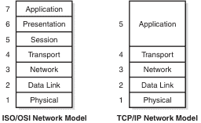

**图 13.1** OSI 和 TCP/IP 网络模型。

## TCP/IP 网络

Solaris 操作系统支持 TCP/IP 网络模型。尽管 Solaris 可以使用多种类型的网络硬件架构（如以太网、令牌环网和光纤分布式数据接口（FDDI））与其他系统通信，但以太网是事实上的网络架构。

### 以太网的特性和功能

TCP/IP模型中的数据链路层负责控制通过网络介质的数据传输。在以太网局域网（LAN）中，以太网帧在数据链路层用于封装和传输数据。

以太网局域网上的主机被分配了与数据链路层关联的唯一地址。这些地址被称为*以太网地址*、*硬件地址*、*物理地址*或*MAC地址*。

通常，制造网络接口卡（NIC）的厂商会分配这些地址，每个NIC都与一个唯一地址相关联。因此，以太网地址与NIC相关联，而不是与系统相关联。具有两个NIC的系统（例如连接到两个网络的路由器）拥有两个以太网地址。

以太网地址由48位（6字节数据）组成。通常，以太网地址显示为六个由冒号分隔的两位十六进制数。例如，00:40:05:37:9d:db 是用于生成本书中大多数代码示例的系统的以太网地址。

在局域网（LAN）上传输的以太网帧包含应接收并响应该帧的NIC的以太网地址。任何接收到的、其以太网地址与NIC以太网地址匹配的帧都会被读取和处理。

以太网地址仅在局域网（LAN）内使用，不会经过路由器传输。因此，任何发送到非当前局域网主机的以太网帧，都会使用路由器的以太网地址作为目的地址。同样地，从路由器发送到主机的以太网帧，其源地址为路由器的以太网地址。

所有TCP/IP应用都使用IP地址。然而，要在局域网上通信，需要根据系统的IP地址找到其以太网（或MAC）地址。由于每个主机都有唯一的IP地址和唯一的以太网地址，因此需要一种过程来在这两种地址之间进行映射。

### 地址解析协议和逆ARP

在以太网地址和IP地址之间进行映射的过程称为*地址解析*。将IP地址映射到以太网地址的协议称为地址解析协议（ARP）。该过程的细节在征求意见稿（RFC）826“以太网地址解析协议”中规定。

在某些情况下，以太网地址已知，但需要确定IP地址。这个过程称为逆地址解析协议（RARP）。该过程的细节在RFC 903“逆地址解析协议”中规定。

需要解析以太网地址的主机会广播一个ARP请求，其中包含IP地址作为数据。该消息基本上是询问“拥有此IP地址的主机的以太网地址是什么？”。请注意，ARP请求是以太网广播。也就是说，以太网帧的目的以太网地址全为1（FF:FF:FF:FF:FF:FF）。匹配指定IP地址的主机会以包含其以太网地址的ARP应答进行响应。

当以太网地址已知时，使用相同的过程来解析IP地址。RARP请求会被广播（目的以太网地址为 FF:FF:FF:FF:FF:FF），其数据中包含一个以太网地址。相应的主机会以包含所请求IP地址的RARP应答进行响应。

有时系统可能需要代表另一台系统响应ARP或RARP请求。此过程称为*代理ARP*；某些协议栈（通常在路由器上）被设计为具有此功能。

### IP网络的类别

在TCP/IP网络模型中，传输层的IP地址用于将网络划分为不同的类别。最常用的三种IP网络类别是A、B和C类。表13.1总结了这些IP网络类别的特性。

**表13.1 IP网络类别**

| 类别 | 第一个八位组 | 默认子网掩码 | 理论最大主机数 |
|---|---|---|---|
| A | 1 到 126 | 255.0.0.0 | 16,777,216 |
| B | 128 到 191 | 255.255.0.0 | 65,536 |
| C | 192 到 223 | 255.255.255.0 | 256 |

第一个八位组为127的地址不被视为A类或B类的一部分。该八位组专门用于称为“回环”的特殊用途。子网掩码将IP地址的网络部分与主机部分分隔开。

### TCP/IP配置文件

Solaris 8 使用多个文件来配置TCP/IP环境。这些文件用于标识系统的主机名和IP地址。以下章节中描述的三个文件用于配置TCP/IP：

- `/etc/inet/hosts`
- `/etc/nodename`
- `/etc/hostname.interface`

#### /etc/inet/hosts 文件

`/etc/hosts` 文件（它是指向 `/etc/inet/hosts` 的符号链接）包含主机名及其关联IP地址的列表。此文件用于将主机名转换为IP地址。表13.2总结了 `/etc/inet/hosts` 文件的格式。

**表13.2 — /etc/inet/hosts 文件格式**

| 列 | 说明 |
|---|---|
| IP地址 | 使用点分十进制表示法的IP地址 |
| 主机名 | 系统的主机名或节点名 |
| 别名 | 系统的备用主机名 |

各列由一个或多个制表符或空格字符分隔。如果定义了多个别名，应使用空格或制表符将它们分隔开。


/etc/inet/hosts 文件至少应包含一个 localhost 条目（IP地址 127.0.0.1）以及一个为系统上安装的每个网络接口准备的条目。

其他系统的条目可以添加到 `/etc/inet/hosts` 文件中。如果未使用名称服务，这样做可以通过使用主机名而不是IP地址来访问远程系统。

#### /etc/nodename 文件

`/etc/nodename` 文件仅包含一个条目：本地系统的默认主机名。应根据RFC 952“DOD互联网主机表规范”来分配主机名或节点名。

#### /etc/hostname.interface 文件

系统上安装的每个网络接口都有一个对应的 `/etc/hostname.interface` 文件。文件名的 *interface* 部分反映了网络接口的制造商和类型。例如，如果基于Intel x86的系统安装了单个3COM Etherlink III NIC，则文件名为 `/etc/hostname.le0`。对于具有两个网络接口的SPARC 5平台，文件名分别为 `/etc/hostname.le0` 和 `/etc/hostname.le1`。

`/etc/hostname.interface` 文件应仅包含一个条目：分配给该接口的主机名或IP地址。


> 如果使用主机名，则它也必须列在 `/etc/inet/hosts` 文件中。另请注意，如果系统上安装了多个网络接口，则 `/etc/hostname.interface` 文件将包含不同的主机名。只有与 `/etc/nodename` 文件中定义的主机名相匹配的主机名（或IP地址）才被认为是系统的默认主机名。

### 检查网络连通性

Solaris 8 提供了两个命令，用于检查系统之间的网络连通性以及两个系统上网络接口的正确运行：`ping(1M)` 命令和 `spray(1M)` 命令。

#### ping 命令

`/usr/sbin/ping` 命令使用互联网控制消息协议（ICMP）向另一台主机发送 ECHO_REQUEST 数据报。当主机收到 ECHO_REQUEST 数据报时，它会以 ECHO_REPLY 数据报作为响应。这种基本的回显机制用于验证两台主机之间的连通性，以及验证两台主机上直至网络层或互联网层（包括互联网协议（IP））的网络接口和协议栈的正确运行。以下示例使用 ping 命令发送一个 ICMP ECHO_REQUEST 数据报：

```text
$ /usr/sbin/ping solaris8
solaris8 is alive
$
```

表13.3列出了 `ping` 命令支持的一些较常用的命令行参数。有关更多详细信息，请参阅 `ping(1M)` 手册页。

**表13.3 ping命令行参数**

| 参数 | 说明 |
|---|---|
| `-i interface` | 使用指定的接口地址 |
| `-I interval` | 指定传输之间的间隔时间（默认值为1秒） |
| `-n` | 显示地址而非主机名 |
| `-r` | 绕过路由表（远程主机在本地网络上） |
| `-R` | 在IP头中记录路由 |


| `-s` | 发送ICMP数据包直到中断 |

| `-t time` | 指定IP数据包的生存时间（以秒为单位） |

| `-v` | 显示详细信息（详细模式） |

至少必须指定一个主机名或IP地址。所有命令行参数都在主机名或IP地址之前指定。当你使用`ping`命令而不带任何命令行参数（仅指定主机名）时，可以在主机名之后指定超时时间。默认超时时间为20秒，这在大多数情况下是合适的。

当你将`ping`与`-s`命令行参数一起使用时，可以在主机名后指定数据包大小和计数。以下示例使用`ping`命令向`sparc20`主机发送五个数据包（每个包含60字节数据）：

```sh
$ /usr/sbin/ping -s sparc20 60 5
PING sparc20 60 data bytes
68 bytes from sparc20 (192.168.99.208): icmp_seq=0. time=1. ms
68 bytes from sparc20 (192.168.99.208): icmp_seq=1. time=0. ms
68 bytes from sparc20 (192.168.99.208): icmp_seq=2. time=0. ms
68 bytes from sparc20 (192.168.99.208): icmp_seq=3. time=0. ms
68 bytes from sparc20 (192.168.99.208): icmp_seq=4. time=0. ms

---sparc20 PING Statistics---
5 packets transmitted, 5 packets received, 0% packet loss
round-trip (ms)  min/avg/max = 0/0/1
$
```

### Spray命令

`/usr/sbin/spray`命令通过远程过程调用（RPC）机制向主机发送用户数据报协议（UDP）数据包流。在远程端，spray守护进程`sprayd(1M)`接受这些数据包并确认接收。`spray`命令与`sprayd`程序一起，验证两台主机之间的连通性以及网络接口和协议栈（两台主机的）直至应用层的正确运行。

以下示例使用`spray`命令测试网络连通性：

```text
$ /usr/sbin/spray sparc20
sending 1162 packets of length 86 to sparc20 ...
       706 packets (60.75%) dropped by sparc20
       1801 packets/sec, 154924 bytes/sec

$
```

表13.4列出了`spray`命令支持的命令行参数。更多详细信息请参见`spray(1M)`手册页。

| 参数 | 说明 |

|---|---|

| `-c count` | 要发送的数据包数量（默认值为发送总计100KB所需的包数） |

| `-d delay` | 数据包之间的暂停微秒数（默认值为0） |

| `-l length` | 以太网数据包长度（默认值为86） |

| `-t type` | 传输类别（默认值为UDP） |

至少必须指定一个主机名或IP地址。所有命令行参数应在主机名或IP地址之前指定。

> **注意**  
> 远程系统上必须运行`sprayd`守护进程，`spray`命令才能正常工作。

### 查看网络接口配置和统计信息

有两个命令可用于查看网络接口的配置和网络统计信息：

- `ifconfig(1M)`——配置网络接口
- `netstat(1M)`——显示网络统计信息

`ifconfig(1M)`命令用于配置网络接口的参数。尽管配置网络接口超出了考试范围，但你可以使用此命令查看网络接口的配置。可以通过指定`-a`命令行参数列出所有网络接口的信息，或指定特定接口的名称作为命令行参数。以下示例使用了两种方法：

```text
# ifconfig -a
lo0: flags=1000849<UP,LOOPBACK,RUNNING,MULTICAST,IPv4> mtu 8232
        inet 127.0.0.1 netmask ff000000
en0: flags=1000841<UP,BROADCAST,RUNNING,MULTICAST,IPv4> mtu 1500
        inet 192.168.99.8 netmask ffffff00 broadcast 192.168.99.255
        ether 0:a0:24:c:32:97
lo0: flags=1000849<UP,LOOPBACK,RUNNING,MULTICAST,IPv6> mtu 8252
        inet6 ::1/128
en0: flags=1000841<UP,RUNNING,MULTICAST,IPv6> mtu 1500
        ether 0:a0:24:c:32:97
        inet6 fe80::2a0:24ff:fe0c:3297/10

# ifconfig en0
en0: flags=1000843<UP,BROADCAST,RUNNING,MULTICAST,IPv4> mtu 1500
        inet 192.168.99.8 netmask ffffff00 broadcast 192.168.99.255
        ether 0:a0:24:c:32:97
#
```

`netstat(1M)`命令用于显示网络统计信息和配置信息。表13.5列出了`netstat`命令支持的命令行参数。

**表13.5 netstat命令行参数**

| 参数 | 说明 |

|---|---|

| `-a` | 列出所有套接字、路由表条目和网络接口的状态。 |

| `-D` | 列出动态主机配置协议（DHCP）配置的网络接口的状态。 |

| `-f family` | 仅列出指定协议族的信息。可能的值为`inet`（IP版本4）、`inet6`（IP版本6）或`unix`（Unix）。 |

| `-g` | 列出每个接口的多播成员关系。 |

| `-i` | 列出所有网络接口的统计信息。 |

| `-I interface` | 仅列出指定网络接口的统计信息。 |

| `-m` | 列出STREAMS统计信息。 |

| `-M` | 显示多播路由表。 |

| `-n` | 显示网络地址而非网络名称。 |

| `-p` | 显示每个接口的硬件（以太网）地址。 |

| `-P protocol` | 仅列出指定协议的统计信息。 |

| `-r` | 显示路由表。 |

| `-s` | 列出每个协议的统计信息。 |

| `-v` | 列出额外的套接字和路由表信息。 |


请注意，你可以使用`ifconfig`或`netstat -p`命令来显示与网络接口关联的以太网地址。

### 开放网络计算（ONC）与远程过程调用机制

Sun Microsystems开发了一个支持分布式服务的环境。该环境被称为Sun的开放网络计算增强版（ONC+）技术。ONC+技术是一个技术、服务和工具的家族，主要包括以下组件：

- **应用程序**——网络文件系统（NFS）和网络信息服务增强版（NIS+）服务。它们使用RPC来实现客户端/服务器交互。
- **远程过程调用（RPC）**——一种使客户端能够请求远程服务器执行过程或处理的机制。
- **外部数据表示（XDR）**——一种与机器无关的数据表示。客户端和服务器都将数据转换进和转换出XDR格式。该机制为所有数据提供标准化的格式，以克服不同硬件架构之间数据字节顺序、数据类型大小和字节对齐的差异。
- **传输层接口（TLI）**——一个面向TCP/IP的接口，使RPC机制与协议无关。你可以在不更改客户端或服务器代码的情况下选择面向连接的协议（如TCP）或无连接协议（如UDP）。
- **套接字（Sockets）**——另一种与TCP/IP接口的机制，支持与协议无关的客户端和服务器编程。

在TCP/IP模型中，所有ONC+组件都位于应用层。就OSI模型而言，这些组件分布在会话层（RPC）、表示层（XDR）和应用层（NFS和NIS+）。请注意，应用程序调用XDR例程来转换数据。转换后，数据要么在本地处理，要么传递给RPC例程，由RPC例程将数据发送到远程系统。

### 注册RPC服务


要使系统能够使用构建在 RPC 之上的分布式服务，提供服务程序必须在特定系统上进行标识（注册）。`rpcbind(1M)`守护进程管理系统上的 RPC 服务。每个 RPC 程序都被分配一个唯一的编号。当 RPC 程序启动时，它会联系本地的`rpcbind`守护进程，并提供其 RPC 程序编号、版本等信息。当远程客户端尝试使用本地 RPC 服务时，它会联系本地的`rpcbind`守护进程获取有关该服务的信息（基于 RPC 程序编号），并请求连接到该服务。因此，`rpcbind`守护进程提供了一种方法，使本地服务能够注册其可用性，远程客户端能够识别服务并与服务器建立连接。

你可以使用`rpcinfo(1)`命令联系本地或远程的`rpcbind`守护进程，并请求其列出当前注册的 RPC 服务。以下示例使用`rpcinfo`命令列出本地服务，并且由于在命令行参数中指定了远程主机名，因此也列出了远程系统上的服务：

```text
# rpcinfo
program version netid   address       service  owner
100000  4       ticots   solaris8.rpc   rpcbind  superuser
100000  3       ticots   solaris8.rpc   rpcbind  superuser
100000  4       ticotsord solaris8.rpc  rpcbind  superuser
100000  3       ticotsord solaris8.rpc  rpcbind  superuser
100000  4       ticots   solaris8.rpc   rpcbind  superuser
100000  3       ticots   solaris8.rpc   rpcbind  superuser
100000  4       tcp      0.0.0.0.111    rpcbind  superuser
100000  3       tcp      0.0.0.0.111    rpcbind  superuser
100000  2       tcp      0.0.0.0.111    rpcbind  superuser
100000  4       udp      0.0.0.0.111    rpcbind  superuser
.
.
.
# rpcinfo sparc20
program version netid   address       service  owner
100000  4       ticots   sparc8.rpc    rpcbind  superuser
100000  3       ticots   sparc8.rpc    rpcbind  superuser
100000  4       ticotsord sparc8.rpc   rpcbind  superuser
100000  3       ticotsord sparc8.rpc   rpcbind  superuser
100000  4       ticots   sparc8.rpc    rpcbind  superuser
100000  3       ticots   sparc8.rpc    rpcbind  superuser
100000  4       tcp      0.0.0.0.0.111  rpcbind  superuser
100000  3       tcp      0.0.0.0.0.111  rpcbind  superuser
100000  2       tcp      0.0.0.0.0.111  rpcbind  superuser
100000  4       udp      0.0.0.0.0.111  rpcbind  superuser
.
.
.
```

RPC 服务通常列在`/etc/rpc`文件中，该文件包含常见的 RPC 服务名称、其 RPC 程序编号以及任何别名。更多信息请参见`rpc(4)`手册页。

### 控制网络服务

大多数 Internet 和 RPC 服务在需要时由`inetd(1M)` Internet 服务守护进程自动启动。这些服务在`/etc/inet/inetd.conf`文件（或`/etc/inetd.conf`，它通过符号链接指向`/etc/inet/inetd.conf`）中以条目形式指定。

`inetd`守护进程在系统引导时自动启动，或者您可以通过执行`/etc/init.d/inetd`启动命令手动启动它。

同样，由`inetd`守护进程控制的所有 Internet 和 RPC 服务在系统关闭时自动停止，或者您可以通过执行`/etc/init.d/inetd`停止命令手动停止它们。

您可以使用`kill`命令向提供服务的进程发送信号，从而停止单个 Internet 和 RPC 服务。但是，应该重新配置`inetd`守护进程，以免其重试重新启动该服务。

要重新配置`inetd`守护进程，请编辑`/etc/inet/inetd.conf`文件。然后使用`kill`命令向`inetd`守护进程发送挂断信号 (`SIGHUP`)。此信号会使`inetd`守护进程重新读取`/etc/inetd.conf`文件。您也可以使用`/etc/init.d/inetd`脚本（如前所述）来停止并重新启动`inetd`守护进程，或者您可以重新引导系统。

### Solaris 网络环境

Solaris 8 网络环境支持多种不同类型的系统配置，包括独立、无盘和 AutoClient。这些配置提供不同的功能，并影响部署和支持成本。

#### 独立配置

*独立*系统具有本地磁盘空间，用于存储所有操作系统文件、应用程序和用户数据，其中包括根 (`/`)、`/usr`、`/export/home`和`/var`文件系统。同样，它为系统的虚拟内存提供本地交换空间。独立系统可以自主运行，并且可以联网或非联网。您可以将联网的独立系统用作服务器（例如文件服务器），以提供对共享或公共数据的远程访问。

#### 文件服务器概念

*文件服务器*是充当服务器的独立系统，使客户端能够通过网络访问文件。文件服务器有几种类型。

Solaris 环境中一种重要的文件服务器类型是*操作系统 (OS) 服务器*。OS 服务器向那些无法通过本地硬盘上的本地文件系统获得全部或部分操作系统文件的客户端系统提供访问。

OS 服务器一次可以支持多个版本的操作系统。这种支持不仅包括操作系统的不同版本，例如 Solaris 8、Solaris 7 和 Solaris 2.5，还包括不同的硬件平台，例如 SPARC 和 Intel x86 兼容机。

#### 无盘配置

*无盘客户端*，顾名思义，没有用于在本地存储操作系统或应用程序的硬盘。存储由可通过网络访问的*无盘客户端服务器*提供。无盘客户端要引导和运行，必须从 OS 服务器远程挂载其根 (`/`) 和`/usr`文件系统。

除了通过网络为所有（相同版本的）无盘客户端提供一组通用的操作系统文件外，OS 服务器还为每个客户端提供分配的硬盘空间。该磁盘空间用作无盘客户端虚拟内存系统的交换空间，并用于存储每个无盘客户端独有的用户帐户的`/home`文件系统。

与独立配置相比，无盘配置更便宜且更易于维护，因为只有少数系统（OS 服务器）需要硬盘。公共文件只需要一份副本，并且该副本在众多客户端之间共享。此外，每个客户端的所有独有数据都存储在 OS 服务器上，从而简化了备份和恢复过程。由于客户端上不存储任何数据，因此可以轻松更换或升级客户端硬件。

无盘配置的主要缺点是依赖网络以及给网络带来的负载。如果无盘客户端无法通过网络访问 OS 服务器，它将根本无法运行。此外，由于所有数据（包括交换空间中的数据）都是远程访问的，因此即使在正常运行条件下，网络也负载极重。

#### AutoClient 配置

*AutoClient* 与无盘客户端类似，不同之处在于它拥有有限数量的本地存储空间（至少 100MB），用于特定目的。与无盘客户端一样，AutoClient 必须从配置为 AutoClient 服务器的 OS 服务器远程访问其根 (`/`) 和`/usr`文件系统。与无盘客户端不同，AutoClient 使用本地磁盘空间来存储或缓存根 (`/`) 和`/usr`文件系统。

此外，本地硬盘还用作交换空间。与无盘配置一样，OS 服务器为每个 AutoClient 独有的`/home`和`/var`文件系统提供硬盘空间。

与无盘配置相比，AutoClient 配置的成本略高，因为其客户端需要硬盘；但是，该硬盘很小。与无盘配置一样，公共文件只需要一份副本，并且该副本在客户端之间共享。此外，每个客户端的所有独有数据都存储在 OS 服务器上，从而简化了备份和恢复过程。因此，就客户端硬件而言，AutoClient 与无盘客户端一样，可以轻松更换或升级。

AutoClient 配置减轻了无盘配置的缺点，或者在某些情况下完全消除了这些缺点。在 AutoClient 缓存了操作系统之后，它不再需要访问 OS 服务器来获取这些文件。此外，本地交换空间消除了大部分网络负载。


### 配置比较

表 13.6 比较了 Solaris 8 网络环境所支持的系统配置之间的重大差异。

**表 13.6 系统配置比较**

| 系统类型 | 本地交换空间 | 本地文件系统 | 远程文件系统 |
|---|---|---|---|
| 独立系统 | 是 | 根、/usr、/var、/export/home | 无或可选 |
| 无盘客户端 | 否 | 无 | 根、/usr、/var、/home |
| AutoClient | 是 | 根、/usr | /var、/home |

充当服务器的独立系统通常提供文件系统——例如 `/export/root`、`/export/home` 和 `/export/swap`——用于存储由无盘客户端和 AutoClient 远程访问的文件。此外，服务器和独立系统还提供 `/opt` 文件系统，用于存储应用软件。

#### 练习题

### 问题 1

**以下哪项可以用作文件服务器？**

- ○ a. AutoClient
- ○ b. 无盘客户端
- ○ c. 非联网独立系统
- ○ d. 联网独立系统

答案 d 正确。联网独立系统满足文件服务器的两个基本要求：它已联网，并且具有存储空间。AutoClient 只有极少量的本地存储空间。因此，答案 a 不正确。无盘客户端没有任何本地存储空间。因此，答案 b 不正确。非联网独立系统未联网，无法将其存储空间提供给其他系统使用。因此，答案 c 不正确。

### 问题 2

**TCP/IP 网络模型有多少层？**

- ○ a. 4
- ○ b. 5
- ○ c. 6
- ○ d. 7

答案 b 正确。TCP/IP 网络模型有五层。这些层（自下而上）分别是物理层、数据链路层、网络层或网际层、传输层和应用层。OSI 网络模型有七层。

### 问题 3

输入用于显示网络统计信息的命令名称。

正确答案是 `netstat`。

### 问题 4

- [ ] a. 非联网独立系统
- [ ] b. AutoClient
- [ ] c. OS 服务器
- [ ] d. 无盘客户端
- [ ] e. 联网独立系统

答案 a、b、c 和 e 均正确。非联网独立系统、AutoClient、OS 服务器和联网独立系统都具有用于交换空间的本地硬盘。只有无盘客户端没有本地磁盘，因此不能拥有本地交换空间。所以，答案 d 不正确。

### 问题 5

- [ ] a. `ifconfig -a`
- [ ] b. `netstat -a`
- [ ] c. `netstat -p`
- [ ] d. `netstat -r`
- [ ] e. `netstat -e`

答案 a 和 c 正确。`ifconfig -a` 和 `netstat -p` 命令可用于确定网络接口的以太网地址。`netstat -a` 显示有关套接字和连接的信息。因此，答案 b 不正确。`netstat -r` 显示路由表。因此，答案 d 不正确。`netstat -e` 不存在。因此，答案 e 不正确。

### 问题6

在OSI网络模型中，以下哪些层位于传输层和应用层之间？（选择所有适用项。）

- ☐ a. 会话层
- ☐ b. 数据链路层
- ☐ c. 表示层
- ☐ d. 网络层

答案 a 和 c 是正确的。会话层提供连接管理，表示层提供数据格式映射。数据链路层和网络层位于传输层之下。因此，答案 b 和 d 不正确。

### 问题7

以下哪项陈述最准确地描述了RARP？

- ○ a. 使用IP地址来确定以太网地址。
- ○ b. 使用以太网地址来确定IP地址。
- ○ c. 使用IP地址来确定网络掩码。
- ○ d. 使用IP地址来确定硬件地址。
- ○ e. 使用以太网地址来确定网络掩码。

答案 b 是正确的。RARP使用以太网地址来确定IP地址。ARP使用IP地址来确定以太网地址或硬件地址。因此，答案 a 和 d 不正确。两者都不用于确定网络掩码。因此，答案 c 和 e 不正确。

### 问题8

输入与 `/etc/hosts` 文件符号链接的文件名。

正确答案是 `/etc/inet/hosts`。

#### 需要了解更多？

- Finlayson、Mann、Mogul 和 Theimer，RFC 903，“一种反向地址解析协议”（1984年6月）。可在 http://www.nic.mil/ftp/rfc/rfc903.txt 获取。
- Plummer, David，RFC 826，“一种以太网地址解析协议”（1982年11月）。可在 http://www.nic.mil/ftp/rfc/rfc826.txt 获取。
- Sun Microsystems，*系统管理指南，第2卷*。提供印刷版（部件号 805-7229-10），也可在 http://docs.sun.com 上以及随 Solaris 8 操作系统提供的在线文档 AnswerBook2 中获取。
- Sun Microsystems，*系统管理指南，第3卷*。提供印刷版（部件号 806-0916-10），也可在 http://docs.sun.com 上以及随 Solaris 8 操作系统提供的在线文档 AnswerBook2 中获取。
- Sun Microsystems，*系统参考手册，第1节——用户命令*。提供印刷版（部件号 806-0624-10），也可在 http://docs.sun.com 上以及随 Solaris 8 操作系统提供的在线文档 AnswerBook2 中获取。
- Sun Microsystems，*系统参考手册，第1M节——管理命令*。提供印刷版（部件号 806-0625-10），也可在 http://docs.sun.com 上以及随 Solaris 8 操作系统提供的在线文档 AnswerBook2 中获取。


## Syslog 与审计工具

**你需要理解的术语：**

- syslog 设施
- syslog 源设施
- syslog 严重级别
- `m4` 宏
- `logger` 命令
- `who`、`whodo` 和 `lastlogins` 命令

**你需要掌握的技术：**

- 配置 syslog 设施
- 启用 syslog 消息以跟踪 root 登录账户的使用情况
- 使用 `who`、`whodo` 和 `last` 命令审计登录账户的使用情况

本章的第一部分介绍 Solaris 8 syslog 设施。该机制提供了在本地或远程系统上的一个或多个文件中记录用户和系统消息的能力。本章涵盖 Solaris Syslog 测试目标。

本章的第二部分介绍用于审计登录账户使用情况的三个命令（`who`、`whodo` 和 `last`）。

### syslog 设施

`syslogd(1M)` 守护进程接受系统（内核和设备驱动程序）及用户程序发送给它的消息，并根据 `/etc/syslog.conf` 文件中的条目对它们进行处理。这些消息可以报告从紧急情况到调试细节的各种内容。常见用途包括监控登录和记录黑客入侵尝试。通常，`syslogd` 命令会将这些消息写入指定的日志文件，但也支持其他处理选项。syslog 消息按来源（即_源设施_）和优先级（即_严重级别_）进行分类。

### 源设施

为了更好地控制日志消息的处理，可以使用生成消息的设施来决定消息发送或存储的位置。因此，您可以根据来源为不同类型的消息维护单独的日志文件。表 14.1 列出了 `/etc/syslog.conf` 文件中用于标识消息来源和控制处理的关键字。

| 关键字 | 描述 |
|---|---|
| auth | 登录认证 |
| cron | `at(1)` 和 `cron(1M)` 命令 |
| daemon | 系统守护进程 |
| kern | 内核 |
| lpr | 行式打印机假脱机系统 |
| local0 到 local7 | 由本地定义 |
| mail | 系统邮件 |
| mark | 由 `syslogd(1M)` 产生的时间戳 |
| news | Usenet 网络新闻系统 |
| user | 用户程序 |
| uucp | Unix-to-Unix Copy（UUCP）系统 |
| * | 除 mark 之外的所有设施 |

如果源在 syslog 消息中未指定设施关键字，则使用 user 设施（默认）。

### 优先级（严重级别）

除了源设施之外，syslog 消息还可以通过优先级或严重级别来标识。这种标识提供了第二种（更细粒度的）基于重要性处理消息的机制。表 14.2 列出了 `/etc/syslog.conf` 文件中用于标识消息严重级别和控制处理的关键字。这些关键字按严重程度排序（从最严重到最不严重）。

| 关键字 | 描述 |
|---|---|
| emerg | 恐慌状况 |
| alert | 需要立即关注的情况 |
| crit | 严重状况 |
| err | 其他错误 |
| warning | 警告消息 |


| notice | 可能需要特殊处理的情况 |

| info | 非紧急信息 |

| debug | 通常由程序中的调试消息生成 |

| none | 特殊关键字，用于阻止记录由指定源生成的消息 |

### 自定义系统消息处理

为了控制 syslog 消息的处理，您需要向 `/etc/syslog.conf` 文件添加条目。这些条目的形式是一个或多个设施/严重级别关键字组合，后跟一个制表符和一个操作。设施和严重级别标识特定的源设施和消息严重级别，而操作决定如何处理消息。您还可以使用 `m4(1)` 宏选择性地定义设施/关键字和/或操作，以确定当前系统是否配置为 syslog 主机。

### 设施/严重级别关键字组合

设施和严重级别关键字用句点 (`.`) 分隔，并标识特定的源设施和消息严重级别。例如，`kern.emerg` 标识来自内核的紧急错误消息。

- 仅指定设施关键字，而不后跟句点和严重级别关键字。此关键字用于标识所有严重级别。例如，如果仅指定设施关键字 `mail`，则处理邮件消息的所有严重级别。
- 设施关键字后跟句点和 `none` 严重级别关键字。此组合指定不应处理来自指定设施的任何消息。例如，`mail.none` 表示不应处理任何邮件消息。
- 使用星号 (`*`) 设施。该设施指定应处理所有源设施（`mark` 设施除外）。例如，`*.notice` 表示应处理从所有源（`mark` 除外）发送到 syslog 的所有 notice 级别消息。

您可以在 `/etc/syslog.conf` 条目中通过分号 (`;`) 分隔多个设施/严重级别组合。

### 操作

每个条目都有一个与之关联的操作。表 14.3 列出了四种操作形式。

**表 14.3 syslog 操作**

| 操作 | 描述 |
|---|---|
| */文件名* | 被识别的 syslog 消息将追加到指定文件（必须以斜杠 (`/`) 字符开头）。 |
| **@主机** | 被识别的 syslog 消息将转发到指定远程主机上的 `syslogd` 守护进程（必须以 at (`@`) 字符开头）。 |
| *登录账户* | 如果指定登录账户当前已登录到系统，则被识别的 syslog 消息将写入与该账户关联的标准输出（通常是监视器）。可以指定多个登录账户（用逗号分隔）。 |
| * | 被识别的 syslog 消息将写入当前已登录到系统的所有登录账户的标准输出。 |

## 由 m4 宏控制的可选条目

您可以在 `/etc/syslog.conf` 文件中使用 `m4` 宏（在“设备/关键字”列或“操作”列中指定）来定义可选条目，如下所示：

```text
ifdef(condition, define_if_true, define_if_false)
```

`ifdef()` 宏提供了一条条件控制语句。如果 *条件* 为真，则生效的是 `define_if_true` 表达式。如果条件不为真，则生效的是 `define_if_false` 表达式。

对于 `/etc/syslog.conf` 文件而言，唯一相关的 **条件** 是 ‘`LOGHOST`’ 关键字。此关键字用于判断本地系统在 `/etc/hosts` 文件中是否具有 `loghost` 别名。该别名表明，关联的主机被配置为存储本地 syslog 消息，并可能存储来自远程主机的 syslog 消息。以下 `/etc/hosts` 条目显示了 `solaris8` 系统被标识为 `loghost` 的情况：

```text
192.168.99.8    solaris8    loghost
```

下面一行显示了在 `/etc/syslog.conf` 文件的操作列中使用 m4 `ifdef` 宏的典型示例：

```text
auth.notice   ifdef('LOGHOST', /var/log/authlog, @loghost)
```

该条目规定，对于 `auth.notice` 消息，如果本地系统在 `/etc/hosts` 文件中被标识为 `loghost`，则消息应添加到 `/var/log/authlog` 文件中。或者，如果本地系统未被标识为 `loghost`，则消息应转发到被标识为 `loghost` 的系统。

以下列表显示了如何使用 m4 `ifdef` 宏，根据本地系统*不是* `loghost` 的情况，有条件地定义整个 `/etc/syslog.conf` 文件条目：

```text
ifdef('LOGHOST',
user.err        /dev/sysmsg
user.err        /var/adm/messages
user.alert      'root, operator'
user.emerg      *
)
```

此宏规定，如果本地系统被定义为 `loghost`，则不应执行任何操作（也就是说，`define_if_true` 表达式为空白）。如果本地系统不是 `loghost`，则 `user.err`、`user.alert` 和 `user.emerg` 消息应在本地处理。

## /etc/syslog.conf 文件

`/etc/syslog.conf` 文件中的条目决定了 syslog 消息的处理方式。`syslogd` 守护进程在启动时或收到 `SIGHUP(1)` 信号时会读取 `/etc/syslog.conf` 文件。表 14.4 总结了在本地记录消息的系统上默认的 syslog 消息处理方式（`/etc/syslog.conf` 内容）。前面描述的用于 `user` 消息的 `m4` 宏也已包含在内。

**表 14.4 默认的 /etc/syslog.conf 文件**

| 设备/严重级别 | 操作 | 描述 |
|---|---|---|
| `*.err,kern.notice; auth.notice` | `/dev/sysmsg` | 所有错误、`kern.notice` 和 `auth.notice` 消息都写入 `/dev/sysmsg` 文件。 |
| `*.err;kern.debug; daemon.notice; mail.crit` | `/var/adm/messages` | 所有错误、`kern.debug`、`daemon.notice` 和 `mail.crit` 消息都写入 `/var/adm/messages` 文件。 |
| `*.alert;kern.err; daemon.err` | `operator` | 所有 `alert`、`kern.err` 和 `daemon.err` 消息都写入 `operator` 登录账户（如果当前已登录）。 |
| `*.alert` | `root` | 所有 `alert` 消息都写入 `root` 账户（如果当前已登录）。 |
| `*.emerg` | `*` | 所有 `emerg` 消息都写入当前已登录的所有登录账户。 |


除非存在针对特定设备/严重级别组合的条目，否则使用该组合生成的消息将被丢弃。请注意不要删除任何现有条目，除非这些消息正由新条目处理。最常用的默认日志文件是 `/var/adm/messages`。

## 由 logger 命令生成的消息

用户、shell 脚本或程序可以使用 `logger(1)` 命令生成 syslog 消息。表 14.5 列出了 `logger` 命令的命令行参数。

**表 14.5 logger 命令的命令行参数**

| 参数 | 描述 |
|---|---|
| *message* | 指定消息的文本。 |
| *-f file* | 使用 *file* 的内容作为消息。 |
| *-i* | 在每条消息中包含 `logger` 命令的进程 ID（PID）。 |
| *-p priority* | 指定消息的优先级，指定为 *facility.level* 或数字。默认为 *user.notice*。 |
| *-t tag* | 在每条消息中包含 *tag*。 |

以下示例使用 `logger` 命令记录一条具有 `user.err` 优先级的消息：

```text
$ logger -p user.err "This is a user error"

$ tail /var/adm/messages

Mar 31 20:09:38 solaris8 su: [ID 810491 auth.crit]
    'su root' failed for dla on /dev/pts/5
Mar 31 20:20:31 solaris8 su: [ID 810491 auth.crit]
    'su root' failed for dla on /dev/pts/7
Apr 19 00:41:02 solaris8 dla: [ID 702911 user.error]
    This is a user error

#
```

## 由 login 命令生成的消息


用于登录系统的 `login(1)` 命令，可以配置为在 root 账户登录系统时生成 `auth.notice` syslog 消息。此外，多次以 root 身份登录失败的尝试也会被记录为 `auth.crit` syslog 消息。如果 `/etc/default/login` 文件中包含以下条目，则这些消息会由 `login` 命令生成：

```text
SYSLOG=YES
```

## 由 Internet 服务生成的消息

用于启动标准 Internet 服务的 Internet 服务守护进程 `inetd(1M)`，可以配置为跟踪传入的 TCP 连接，方法是将客户端 IP 地址、TCP 端口号和服务名称作为 `daemon.notice` syslog 消息进行记录。要启用此日志记录，请在 `/etc/init.d/inetsvc` 文件末尾的 `inetd` 命令中添加 `-t` 命令行参数。

## 审计登录账户和进程

有几条命令可用于监视系统和用户登录账户的使用情况。此外，您还可以使用几条命令来识别系统上当前正在运行的进程以及相关的登录账户。

### who 命令

您可以使用 `who(1)` 命令来确定当前登录到本地系统的系统账户和用户账户。不带参数时，`who` 命令会列出登录账户名称、终端设备、登录日期/时间，以及可选的 X Window 系统终端（:0.0）指示：

```text
$ who
root        console      Apr  4 18:57   (:0)
root        pts/5        Apr  8 22:13   (:0.0)
dla         pts/6        Apr 11 21:06   (winnt40)
$
```

当指定 `-q` 命令行参数时，仅显示登录账户名称和当前登录的用户数量，如下例所示：

```text
$ who -q
root    root    dla
# users=3
$
```

### whodo 命令

`whodo(1M)` 命令用于确定每个登录账户正在执行的进程。以下示例显示了（除其他内容外）用户 dla 正在使用 `vi(1)` 命令：

```text
# whodo
Thu Apr 19 02:22:25 EDT 2001
solaris8

    console       root    16:16
        ?         423    0:00 xsession
      pts/2       467    0:00 sdt_shell
      pts/2       483    0:00 ttsession
      pts/2       484    0:01 dtsession
        ?        1091    0:00 dtcscreen
        ?         491    0:04 dtwm
        ?         507    0:00 dtaction
        ?         492    0:01 sdtperf-meter
      pts/2       470    0:00 sh
?       433    0:00 fbconsole
?       468    0:00 dsdm

pts/3   root    16:17
pts/3   515     0:00 sh

pts/4   dla     11:02
pts/4   1051    0:00 sh
pts/4   1097    0:00 vi
```

当指定 `-l` 命令行参数时，会显示附加详细信息：

```text
# whodo -l
2:23am  up 14 day(s), 7 hr(s), 27 min(s)  3 user(s)
User  tty      login@    idle    JCPU  PCPU what
root  console  4Apr01    4days
root  pts/5    4Apr01    2days   1      /usr/bin/sdt_shell -c
                                                -sh
 dla  pts/6    11Apr01   8       8     whodo -l
#
```

此外，如果在 `-l` 命令行参数后指定登录账户名称，则仅显示该登录账户的信息。

`w(1)` 命令（未列为测试目标）可用于列出当前登录到系统的用户。其输出与 `whodo` 命令的输出类似。

### last 命令

`last(1)` 命令显示登录和注销信息。您可以使用此命令确定哪些账户登录到系统，并显示账户上次使用的时间（从最近开始）。以下示例显示了 `last` 命令的部分输出：

```text
# last
dla       ftp       winnt40 Fri Apr  6 02:10 - 02:33 (5+00:22)
root      console   :0      Wed Apr  4 18:57  still logged in
reboot    system boot         Wed Apr  4 18:56
root      console   :0      Wed Apr  4 18:52 - 18:53 (00:01)
reboot    system boot         Wed Apr  4 18:51
root      console   :0      Tue Apr  3 21:46 - 18:49 (21:02)
```

dla 账户于 4 月 6 日 2:10 从 “winnt40” 系统登录，并于当天 2:33 注销。该示例还显示 root 账户仍然从控制台登录到系统。要仅列出特定登录账户的信息，请将账户名称指定为命令行参数：

```text
# last dla
dla       ftp       winnt40 Fri Apr  6 02:10 - 02:33 (5+00:22)
#
```

### 练习题

#### 问题 1

以下哪条命令用于确定某个特定登录账户最后一次使用的时间？

- ○ a. `logins`
- ○ b. `last`
- ○ c. `whodo`
- ○ d. `ps`

答案 b 正确。`logins` 命令显示登录账户的属性，而不是这些登录账户的使用情况。因此，答案 a 不正确。`whodo` 和 `ps` 命令列出的是进程相关信息。因此，答案 c 和 d 不正确。

#### 问题 2

`/etc/syslog.conf` 文件被修改，以捕获来自某个用户应用程序的消息，但日志文件仍然不包含这些消息。以下哪些原因可以解释这种情况？（选择所有适用项。）

- □ a. 添加的 `/etc/syslog.conf` 条目中存在拼写错误。
- □ b. `syslogd` 程序未重新启动。
- □ c. 用户应用程序未生成预期的设施和/或消息严重级别。
- □ d. `syslogd` 程序未运行。
- □ e. 检查了错误的日志。

答案 a、b、c、d 和 e 均正确。它们都是 syslog 设施无法按预期工作的原因。存在拼写错误的条目会被忽略，或导致其他条目被误解。`syslogd` 命令仅在启动时或收到 `SIGHUP` 信号时读取 `/etc/syslog.conf` 文件。`/etc/syslog.conf` 条目必须与用户应用程序提交消息时使用的预期设施/严重级别匹配。如果 `syslogd` 命令未运行，则无法接收和处理消息。请确保消息被发送到预期的日志文件。

#### 问题 3

指出将 `who` 命令与 `ps` 命令结合起来的命令名称。

正确答案是 `whodo`。

#### 问题 4

以下哪些是 syslog 消息的源设施？（选择所有适用项。）

- [ ] a. `login`
- [ ] b. `news`
- [ ] c. `local8`
- [ ] d. `kern`

答案 `b` 和 `d` 正确。`news` 和 `kern` 是 syslog 消息的源设施。与登录系统相关的源设施是 `auth`（而不是 `login`）。因此，答案 `a` 不正确。八个本地定义的源设施为 `local0` 到 `local7`。因此，答案 `c` 不正确。

#### 问题 5

以下哪些是 `logger` 命令的有效命令行参数？（选择所有适用项。）

- [ ] a. `-p`（指定优先级）
- [ ] b. `-l`（改为将消息发送到 `loghost` 系统）
- [ ] c. `-t`（指定随消息包含的标签）
- [ ] d. `-L`（指定应使用的日志文件）


答案 `a` 和 `c` 正确。`-p` 和 `-t` 命令行参数对 `logger` 命令有效。`-l` 和 `-L` 命令行参数不存在。因此，答案 `b` 和 `d` 不正确。消息是在本地处理，还是发送到 `loghost` 和日志文件，由 `/etc/syslog.conf` 文件中的条目指定。


### 问题 6

以下哪些是 `/etc/syslog.conf` 文件中星号（`*`）的有效用法？（选择所有适用项。）

- [ ] a. 表示所有源设施
- [ ] b. 表示所有严重级别
- [ ] c. 表示所有消息
- [ ] d. 将消息写入所有已登录用户

答案 `d` 正确。可以使用星号将消息写入所有已登录用户。星号可用于表示除 mark 之外的所有源设施。因此，答案 `a` 不正确。没有任何符号或关键字可以表示所有严重级别或所有消息。因此，答案 `b` 和 `c` 不正确。

### 问题 7

指出用于列出当前登录到系统的登录账户的命令。

正确答案是 `last` 命令或 `who` 命令。

### 问题 8

以下哪些是严重级别？（选择所有适用项。）

- [ ] a. `alert`
- [ ] b. `notice`
- [ ] c. `none`
- [ ] d. `mail`

答案 `a`、`b` 和 `c` 正确。`alert`、`notice` 和 `none` 是严重级别。`mail` 是源设施，而不是严重级别。因此，答案 `d` 不正确。

### 问题 9

输入用于大多数 syslog 消息的默认日志文件的名称。

正确答案是 `/var/adm/messages`。

### 问题 10

以下哪条 `/etc/syslog.conf` 条目会将用户警报消息发送到 `loghost`？

- a. `user.alert ifdef('LOGHOST', /var/adm/alerts,@loghost)`
- b. `usr.alert ifdef('LOGHOST', /var/adm/alerts,@loghost)`
- c. `usr.alert ifdef('LOGHOST', /var/adm/alerts)`
- d. `user.alt ifdef(@loghost,/var/adm/alerts.LOGHOST)`

答案 `a` 正确。下面一行中显示的 `/etc/syslog.conf` 条目会将用户警报消息发送到 `loghost`：

```
user.alert ifdef('LOGHOST', /var/adm/alerts,@loghost)
```

其他答案包含无效的设施（`usr`）、严重级别（`alrt`）或 `m4` 宏定义。因此，答案 `b`、`c` 和 `d` 不正确。

#### 需要了解更多？


- Sun Microsystems，*系统管理指南，第 2 卷*。提供印刷版（部件号 805-7229-10），可在 `http://docs.sun.com` 网站上获取，也可从 Solaris 8 操作系统随附的在线文档 AnswerBook2 中获取。


- Sun Microsystems，*系统参考手册，第 1 部分——用户命令*。提供印刷版（部件号 806-0624-10），可在 `http://docs.sun.com` 网站上获取，也可从 Solaris 8 操作系统随附的在线文档 AnswerBook2 中获取。


- Sun Microsystems，*系统参考手册，第 1M 部分——管理命令*。提供印刷版（部件号 806-0625-10），可在 `http://docs.sun.com` 网站上获取，也可从 Solaris 8 操作系统随附的在线文档 AnswerBook2 中获取。

## 高级磁盘管理


**你需要了解的术语：**

- 虚拟文件系统
- 连接和条带化
- 镜像
- 独立磁盘冗余阵列（RAID）
- DiskSuite 虚拟磁盘管理器
- Sun StorEdge Volume Manager

**你需要掌握的技术：**

- 识别 RAID 级别
- 识别虚拟文件系统路径名
- 区分 DiskSuite 和 Volume Manager

本章涵盖*磁盘管理*测试目标。本章第一部分回顾基本磁盘管理命令。第二部分介绍并描述虚拟文件系统的特性，并定义一些基本术语。

最后两节简要介绍可用于 Solaris 8 操作系统的两个磁盘管理软件产品的特性和功能：Solstice DiskSuite 和 Sun StorEdge Volume Manager。

### 基本磁盘管理

本节简要回顾 Solaris 8 操作系统提供的基本磁盘管理命令。第 9 章“文件系统管理”将更详细地介绍这些命令。

> 注意：复习第 9 章应被视为你备考第二部分考试的一部分。

在磁盘上创建文件系统之前，必须使用 `format` 命令对磁盘进行格式化。接下来，必须使用 `fmthard` 或 `format` 命令定义卷目录表（VTOC）。VTOC 包含分区表，用于确定分区或磁盘分片的数量和大小。可以使用 `prtvtoc` 命令显示 VTOC。对于 x86 平台，可使用 `fdisk` 命令创建或修改分区表。

可以使用 `mkfs` 或 `newfs` 命令在分区上创建 Unix 文件系统（UFS）。文件系统必须位于分区之内，并且一个分区内只能驻留一个文件系统。

`fsck` 命令检查并修复文件系统。通常，文件系统在可供使用之前应进行检查。

可以使用 `mount` 或 `mountall` 命令挂载文件系统，使其可供使用。

### 虚拟文件系统

虚拟磁盘管理系统允许你以标准 Solaris 文件系统不支持的不同方式使用物理磁盘。以下各节总结了这些优点，并介绍了提供虚拟文件系统的几种技术。

## 虚拟磁盘管理系统的优势

虚拟磁盘管理系统可以克服磁盘容量和架构限制，提高性能和可靠性。此外，通过使用图形管理工具，可管理性也得到增强。

### 克服磁盘限制

虚拟磁盘管理系统允许将多个磁盘上的分区组合起来，并作为一个单独的分区来使用。这样，文件系统不仅可以大于可用的最大物理磁盘，而且物理磁盘上可用的整个存储区域都可以得到利用。

### 提升性能

通常，使用多个磁盘替代单个磁盘，可以通过将负载分散到多个物理磁盘上来提高性能。

### 提升可靠性

虚拟磁盘管理系统通常支持数据冗余或高可用性功能，例如镜像和独立磁盘冗余阵列（RAID）配置。此外，热备（hot sparing）和文件系统日志等功能可缩短恢复时间。

### 增强可管理性

虚拟磁盘管理系统通常为磁盘管理和维护提供一个简单的图形用户界面（GUI）。该界面能对复杂的磁盘配置和文件系统进行简单、几乎无差错的管理。

该 GUI 通常包含物理磁盘和虚拟磁盘文件系统的可视化表示。此外，它通常还支持拖放功能，以便快速更改配置。

## 串联虚拟设备

与由单个分区（slice）组成的标准 Solaris 文件系统不同，*串联虚拟文件系统*由两个或多个 slice 组成。这些 slice 可以位于同一物理磁盘上，也可以位于多个物理磁盘上。slice 的大小也可以不同。

“串联（concatenation）”意味着这些 slice 按顺序寻址。也就是说，当需要空间时，会从串联中的第一个 slice 开始分配。当该空间被完全使用后，再从第二个 slice 分配空间，依此类推。

串联虚拟设备的主要优势在于，它提供了一种利用原本可能太小而无法使用的 slice 的方法。此外，使用多个物理磁盘进行串联可以在磁盘之间实现一定的负载均衡，并可能带来磁头移动优化。

然而，使用多个磁盘会增加出现以下情况的风险：任一磁盘发生故障都可能导致整个虚拟设备发生故障，而该虚拟设备可能保存着 GB 级甚至 TB 级的数据。

## 条带化虚拟设备

*条带化虚拟设备*与串联虚拟设备类似，可以由两个或多个 slice 组成。这些 slice 可以位于同一物理磁盘上，也可以位于多个物理磁盘上。slice 的大小也可以不同。

与串联设备不同，条带化设备中的 slice 以交错方式寻址。也就是说，当需要空间时，先从第一个 slice 分配一个块，再从第二个 slice 分配一个块，依此类推。


条带化设备的主要优势在于，当 slice 位于多个物理磁盘上时，它允许同时执行多个读写操作，从而提高性能。这种并发活动是可行的，因为条带化虚拟设备中的每个物理磁盘都可以同时被访问。此外，与串联虚拟设备一样，条带化设备也提供了一种利用原本可能太小而无法使用的 slice 的方法。

与串联虚拟设备一样，使用多个磁盘会增加任一磁盘故障导致整个虚拟设备发生故障的风险。

> **注意**
>
> 串联条带化虚拟设备是指通过在该设备末尾串联附加 slice 而扩展而成的条带化虚拟设备。

## 镜像和双工

*镜像*是一种将写入联机设备的数据复制到另一个脱机设备的技术。该技术提供数据的实时备份；如果原始设备发生故障，可以将备份数据联机以替代原始设备。通常，两个磁盘共享同一个控制器。但是，如果控制器发生故障，则两个磁盘都无法访问。

双工与镜像类似，区别在于每个磁盘都有自己的控制器。这种方法提供了更多的冗余，即使在单个磁盘或单个控制器发生故障时，也仍然可以访问数据。

## RAID 配置

提高数据可用性的一种方法是将磁盘配置为各种称为 RAID 的配置。表 15.1 列出了 RAID 的级别。

**表 15.1 — RAID 级别**

| 级别 | 说明 |
|---|---|
| 0 | 条带化或串联 |
| 1 | 镜像和双工 |
| 2 | 汉明纠错码（ECC），用于检测和纠正错误 |
| 3 | 带奇偶校验信息的位交错条带化（奇偶校验使用独立磁盘） |
| 4 | 带奇偶校验信息的块交错条带化（奇偶校验使用独立磁盘） |
| 5 | 带分布式奇偶校验信息的块交错条带化 |
| 6 | 带两种独立分布式奇偶校验方案的块交错条带化 |
| 7 | 带异步 I/O 传输和分布式奇偶校验信息的块交错条带化 |
| 10 | 镜像条带化或条带镜像（RAID 0 和 RAID 1 的组合） |
| 53 | 与 RAID 5 类似，但数据取自 RAID 3 磁盘（使用 RAID 5 方法将一组 RAID 3 磁盘上的数据复制到另一组磁盘） |

虚拟磁盘管理系统会实现上述 RAID 级别中的一种或多种，但通常不会全部实现。常见的受支持 RAID 级别是 0、1 和 5。

## UFS 文件系统日志

使用 UFS 文件系统日志时，对 UFS 文件系统的更新会在应用之前先记录到日志中。如果系统发生故障，可以重新启动系统，并使用日志而不是 `fsck` 命令来快速恢复 UFS 文件系统的一致性。

`fsck` 命令是一种耗时且并非总是 100% 准确的恢复文件系统的方法。它会读取并验证定义文件系统的信息。如果系统在更新过程中崩溃，更新可能只部分完成。`fsck` 命令必须通过移除这些部分更新来修正信息。

使用 UFS 文件系统日志时，只有已记录到日志的更新才会被应用到文件系统。如果系统崩溃，日志中记录了应已完成的操作；可以利用该日志快速使文件系统保持一致。

## Solstice DiskSuite

Solstice DiskSuite 是一种软件产品，可用于增加存储容量和数据可用性，在某些情况下还可提高性能。DiskSuite 使用称为*元设备*的虚拟磁盘来管理物理磁盘。元设备是一个或多个物理磁盘 slice 或分区的集合。可以对元设备使用基本的磁盘管理命令，但 `format` 命令除外。一般来说，可以将元设备视为 slice 或分区。


与可通过原始（`/dev/rdsk`）和块（`/dev/dsk`）逻辑设备名称访问的标准 Solaris 文件系统一样，DiskSuite 下的虚拟文件系统通过 `/dev/md/rdsk` 或 `/dev/md/dsk` 下的原始或块设备名称进行访问。元设备（即分区名称）以字母 **d** 开头，后跟一个数字。例如，`/dev/md/dsk/d0` 是块元设备 *d0*。

由于可以构建包含来自多个物理磁盘的 slice 的元设备，因此可以使用元设备创建比可用最大物理磁盘更大的文件系统。对于 SPARC 平台，元设备可以包含小型计算机系统接口（SCSI）和 SPARCStorage Array 驱动器。对于 x86 平台，元设备可以包含 SCSI 和 IDE 设备。此外，太小而无法使用的 slice 也可以组合起来创建可用的存储空间。

DiskSuite 支持四种类型的元设备，如表 15.2 所列。

| 元设备 | 说明 |
|---|---|
| Simple | 直接使用，或作为镜像元设备和事务元设备（用于事务日志记录）的构建块。（三种类型的 Simple 元设备是条带、串联和串联条带。） |
| Mirror | 用于在 Simple 元设备之间复制数据以提供冗余。 |
| RAID 5 | 用于通过奇偶校验复制数据，从而允许数据重建。 |
| Trans | 用于 UFS 文件系统日志记录。 |

DiskSuite 允许你通过添加更多 slice 来动态扩展元设备。然后，该元设备上的 UFS 文件系统也可以随之扩展。

## 热备池

热备池是分片的集合，这些分片会在有分片发生故障时自动用于替换故障分片。当发生磁盘错误时，DiskSuite 会在热备池中查找一个至少与故障分片大小相同的热备（分片），并将该热备分片分配为故障分片的替代。假设采用镜像或 RAID 5 配置，则故障分片中的数据会从镜像数据复制到其替代分片，或使用奇偶校验信息重建。

## 管理

有两种方法可用于管理 DiskSuite 对象。第一种是 DiskSuite 工具，它提供图形用户界面（GUI）。第二种是统称为 DiskSuite 命令行接口的一组命令。

### DiskSuite 工具

DiskSuite 工具也称 `metatool` 命令，用于设置和管理 DiskSuite 配置。它提供 DiskSuite 对象及底层物理磁盘的图形视图。您可以通过拖放操作快速修改 DiskSuite 配置。但是，DiskSuite 工具并不支持所有 DiskSuite 操作。这些操作必须通过命令行接口执行。

### DiskSuite 命令行接口

命令行接口提供一组用于创建和管理 DiskSuite 对象的命令。这些命令大多以 `*meta*` 前缀开头，例如用于初始化元设备的 `metainit` 命令。有关更多信息，请参阅 DiskSuite 手册。

## Sun StorEdge 卷管理器

Sun StorEdge 卷管理器是一款软件产品，与 DiskSuite 类似，可用于提高存储容量和数据可用性。与 DiskSuite 不同的是，卷管理器包含性能分析工具和动态联机调优功能，以实现存储的最佳利用。

> **注意**
>
> Sun StorEdge 卷管理器也称为 Solaris Enterprise 卷管理器和 Veritas 卷管理器。自 1997 年以来，Sun Microsystems 一直以自有品牌转销 Veritas 产品。卷管理器支持称为 Veritas 文件系统（VxFS）的虚拟文件系统。


与可通过原始（`/dev/rdsk`）和块（`/dev/dsk`）逻辑设备名访问的标准 Solaris 文件系统一样，卷管理器中的虚拟文件系统可通过 `/dev/vx/rdsk` 或 `/dev/vx/dsk` 下的原始或块设备名访问。通常，磁盘组和卷在这些路径下指定，例如销售组织使用的存储空间为 `/dev/vx/dsk/salesdg/salesvol`。诸如 `c0t0d0s3` 和 `disk01` 之类的名称也用于标识 `/dev/vx` 目录结构下的设备。

StorEdge 卷管理器使用 *VM 磁盘* 来管理存储。VM 磁盘是已分配给卷管理器的物理磁盘分区。每个 VM 磁盘由公共区域和私有区域组成：公共区域用于分配存储，私有区域用于存储配置信息。*磁盘组* 是共享同一配置的 VM 磁盘的集合。最初使用默认磁盘组；不过，可以定义其他磁盘组以实现更好的管理。

VM 磁盘的公共区域可细分为 *子磁盘*；子磁盘是卷管理器用来分配存储的基本单元。*plex* 是子磁盘的集合，可以组织起来支持以下数据可用性方法：

- 串联虚拟设备
- RAID 0（条带化）
- RAID 1（镜像）
- RAID 5（带分布式奇偶校验信息的块交错条带化）
- RAID 10（RAID 1 + RAID 0）

*卷* 是由最多 32 个 plex 组成的虚拟磁盘设备。卷是操作系统和应用程序所查看和操作的虚拟对象。

### 热重定位

当子磁盘发生故障时，卷管理器会自动做出反应：在备用磁盘或磁盘组中的空闲空间上重建发生故障的卷管理器对象，然后用重建的子磁盘替换出现故障的子磁盘。

### 管理

卷管理器提供了三种管理磁盘组的方法：图形用户界面（可视化管理员，Visual Administrator）、一组命令行实用程序以及面向菜单的 `vxdiskadm` 接口。

#### 可视化管理员

可视化管理员（也称 `vxva` 命令）用于设置和管理卷管理器配置。它提供卷管理器对象及底层物理磁盘的图形视图。您可以通过拖放操作快速修改卷管理器配置。


可视化管理员使您能够显示有关卷管理器对象性能和活动级别的统计信息，既可以使用彩色图标以图形方式显示，也可以使用弹出表单以数字方式显示。可监控的统计信息包括读取和写入、块读取和写入、总 I/O 以及平均读取和写入时间。

### 命令行实用程序

命令行实用程序提供一组用于创建和管理卷管理器对象的命令。这些命令大多以 `vx` 前缀开头，例如用于将物理磁盘添加到卷管理器配置中的 `vxdiskadd` 命令。有关更多信息，请参阅卷管理器手册。

### `vxdiskadm` 菜单接口

`vxdiskadm` 命令为命令行实用程序提供菜单驱动的接口。这样，用户无需熟悉 `vx` 命令及其命令行参数。

### 练习题

#### 问题 1

卷管理器支持以下哪些虚拟设备或 RAID 级别？（选择所有适用项。）

- [ ] a. 串联虚拟设备
- [ ] b. RAID 0
- [ ] c. RAID 1
- [ ] d. RAID 5
- [ ] e. RAID 10

答案 a、b、c、d 和 e 均正确。卷管理器支持串联虚拟设备以及 RAID 0、1、5 和 10。

#### 问题 2

以下哪些是虚拟文件系统的类型？（选择所有适用项。）

- [ ] a. 串联式
- [ ] b. 聚合式
- [ ] c. 分片式
- [ ] d. 整体式
- [ ] e. 条带式

答案 a 和 e 正确。串联式和条带式是虚拟文件系统的两种类型。聚合式、分片式和整体式与虚拟文件系统无关；它们只是听起来合适的词。因此，答案 b、c 和 d 不正确。

#### 问题 3

指出与 DiskSuite 命令行接口相关的大多数命令使用的前缀。

正确答案是 `meta`。

#### 问题 4

以下哪些是虚拟磁盘管理系统的功能？（选择所有适用项。）

- [ ] a. 图形管理工具
- [ ] b. 更高的可靠性
- [ ] c. 更高的性能
- [ ] d. 克服物理磁盘限制的能力

答案 a、b、c 和 d 均正确。虚拟磁盘管理系统提供了所有这些功能。

#### 问题 5

输入用于提高数据可靠性的多级系统存储配置的缩写。

正确答案是 RAID。

#### 问题 6

以下哪项是由多个分区组成的虚拟文件系统的名称？在该文件系统中，一次只分配和使用一个分区。

- [ ] a. RAID 5
- [ ] b. 条带式
- [ ] c. 串联式
- [ ] d. 热备

答案 c 正确。串联虚拟文件系统由多个分区组成，这些分区一次分配并使用一个。RAID 5 是使用条带化文件系统的配置。因此，答案 a 不正确。条带化虚拟文件系统以交错方式使用所有分片。因此，答案 b 不正确。热备不是一种文件系统类型。因此，答案 d 不正确。


#### 问题 7

输入用于描述以下技术的术语：将数据同时写入联机磁盘和脱机磁盘，以便在需要时提供实时替换磁盘。

正确答案是 mirroring。

#### 问题 8

指出与 DiskSuite 磁盘管理器关联的虚拟文件系统的路径名。

- a. `/dev/dsk/c0d0s0`
- b. `/dev/vx/dsk/mkdtg/mktvol`
- c. `/dev/md/dsk/d0`
- d. `/dev/dsk/d3`

答案 c 正确。与 DiskSuite 磁盘管理器关联的虚拟文件系统的路径名是 `/dev/md/dsk/d0`。`/dev/dsk/c0d0s0` 路径名与标准文件系统关联。因此，答案 a 不正确。`/dev/vx/dsk/mkdtg/mktvol` 与卷管理器虚拟文件系统关联。因此，答案 b 不正确。`/dev/dsk/d3` 不存在。因此，答案 d 不正确。

#### 问题 9

以下哪项是准备新磁盘以供使用时首先使用的命令？

- a. `mount`
- b. `newfs`
- c. `fsck`
- d. `format`

答案 d 正确。首先使用 `format` 命令准备新磁盘以供使用。`mount` 命令用于挂载文件系统。因此，答案 a 不正确。`newfs` 命令用于在磁盘格式化后创建文件系统。因此，答案 b 不正确。`fsck` 命令用于检查文件系统。因此，答案 c 不正确。

#### 问题 10

以下哪些管理方法可用于卷管理器？（请选择所有适用项。）

- [ ] a. 图形化管理工具
- [ ] b. 命令行实用程序
- [ ] c. 菜单驱动命令界面
- [ ] d. 客户端/服务器远程实用程序

答案 a、b 和 c 正确。你可以使用图形化管理工具、命令行实用程序和菜单驱动命令界面来操作卷管理器。客户端/服务器远程实用程序并不存在。因此，答案 d 不正确。

### 需要了解更多？

-  Sun Microsystems，*Solstice DiskSuite 4.2.1 参考指南*。提供印刷版（部件号 806-3204-10），也可在 `http://docs.sun.com` 网站上获取。
-  Sun Microsystems，*Solstice DiskSuite 4.2.1 用户指南*。提供印刷版（部件号 806-3205-10），也可在 `http://docs.sun.com` 网站上获取。
-  Sun Microsystems，*Sun StorEdge Volume Manager 2.6 管理员指南*。提供印刷版（部件号 805-5706-10），也可在 `http://docs.sun.com` 网站上获取。
-  Sun Microsystems，*Sun StorEdge Volume Manager 2.6 用户指南*。提供印刷版（部件号 805-5705-10），也可在 `http://docs.sun.com` 网站上获取。
-  Sun Microsystems，*Sun StorEdge Volume Manager 存储管理员 1.0 用户指南*。提供印刷版（部件号 805-5709-10），可在 `http://docs.sun.com` 网站上获取，也可通过随 Solaris 8 操作系统提供的联机文档 AnswerBook2 获取。


## 伪文件系统与交换空间

**你需要理解的术语：**

- 伪文件系统
- Proc 工具
- 交换空间

**你需要掌握的技术：**

- 识别伪文件系统
- 使用 proc 工具监控进程状态
- 创建、添加和删除交换空间

本章涵盖 *Solaris 伪文件系统与交换空间* 测试目标。第一部分描述 Solaris 伪文件系统，并提供更重要的伪文件系统的相关信息。第二部分涵盖交换空间的管理。

### Solaris 伪文件系统

Solaris 支持多种基于内存的文件系统，统称为 *伪文件系统*。由于它们基于内存，这些文件系统对存储于其中的数据提供更快的访问速度。然而，它们不是永久性的。此外，伪文件系统中的任何目录或文件在文件系统被卸载或系统重启/关闭时都会丢失。表 16.1 描述了 Solaris 8 支持的伪文件系统。

**表 16.1  Solaris 8 伪文件系统**

| 名称 | 缩写 | 用途 |
|---|---|---|
| 缓存文件系统 | CacheFS | 对慢速（CD-ROM）或远程（NFS）文件系统进行本地缓存 |
| 文件描述符文件系统 | FDFS | 使用带有显式名称的文件描述符打开文件 |
| 先进先出文件系统 | FIFOS | 访问数据（命名管道） |
| 回环文件系统 | LOFS | 为现有数据提供替代路径 |
| 名称文件系统 | NAMEFS | 由 STREAMS 模块动态挂载文件描述符 |
| 进程文件系统 | PROCFS | 访问进程状态和信息 |
| 特殊设备文件系统 | SPECFS | 访问特殊字符或块设备 |
| 交换文件系统 | SWAPFS | 访问系统交换空间 |
| 临时文件系统 | TMPFS | 提供对临时文件的快速访问 |

在这九个伪文件系统中，以下五个不需要任何管理：FDFS、FIFOS、NAMEFS、SPECFS 和 SWAPFS。其他四个伪文件系统——CacheFS、LOFS、PROCFS 和 TMPFS——将在以下各节中描述。


在某些 Solaris 文档中，伪文件系统或基于内存的文件系统被称为“虚拟文件系统”。然而，这个术语也用于由虚拟磁盘管理系统（参见第 15 章“高级磁盘管理”）创建和管理的文件系统。为避免混淆，我只将基于内存的文件系统称为“伪文件系统”。

### 进程文件系统（PROCFS）

进程文件系统是一种基于内存的文件系统，用于提供进程状态和信息。系统上默认存在一个 `PROCFS` 实例；可通过 `/proc` 目录访问它。该目录包含系统中每个活动进程对应的一个目录。目录名是进程的进程 ID（`PID`）。每个 `PID` 目录下的文件提供有关该进程的各种状态和其他信息。`/proc` 目录由 `root` 账户拥有，访问模式为 555（所有者/组/其他 具有读/执行权限），因为任何用户账户（即使是 `root`）都不应尝试修改这些文件。这些文件由内核直接管理。

### Proc 工具

你可以通过 `proc` 工具从 `/proc` `PROCFS` 实例中提取进程状态和其他信息，`proc` 工具是一组命令行实用程序。这些工具还提供停止/启动功能。

要检查的进程 `PID` 作为命令行参数指定。如果要检查多个进程，`PID` 之间应以空格分隔。表 16.2 提供了 `proc` 工具的列表。


请熟悉 `proc` 工具的名称和用途。记住表 16.2 应该就足够了。

**表 16.2 — Proc 工具**

| 命令 | 用途 |
|---|---|
| `pcred` | 列出进程凭据（有效和真实 `UID` 和 `GID`） |
| `pflags` | 显示跟踪标志以及挂起和保持的信号，以及其他信息 |
| `pfiles` | 列出所有打开文件的信息 |
| `pldd` | 列出所使用的动态链接库 |
| `pmap` | 显示内存地址空间映射 |
| `prun` | 重新启动进程 |
| `psig` | 列出信号操作 |
| `pstack` | 显示堆栈跟踪 |
| `pstop` | 停止进程 |
| `ptime` | 显示进程执行时间 |
| `ptree` | 显示进程树（进程及其任何子进程） |
| `pwait` | 等待进程终止 |
| `pwdx` | 显示当前工作目录 |

以下清单显示了一些 `proc` 工具的示例用法。它们用于检查由 `d1a` 用户账户（`UID` = 1001，`GID` = 10）执行的 `vi /etc/passwd` 命令所创建的进程（`PID` = 763）。系统是从“wint40”系统通过 X 窗口终端远程访问的。用户当前位于 `d1a` 主目录（`/export/home/d1a`）下：

```text
$ pflags 763
763:    vi /etc/passwd
        data model = ILP32  flags = PR_ORPHAN
    /1:    flags = PR_PRCINVAL,PR_ASLEEP [ read(0x0,0x8045d47,0x1) ]

$ pcred 763
763:    e/r/suid=1001  e/r/sgid=10

$ pfiles 763
763:   vi /etc/passwd
    Current rlimit: 256 file descriptors
        0: S_IFCHR mode:0620 dev:102,0 ino:429381 uid:1001 gid:7
           O_RDWR
        1: S_IFCHR mode:0620 dev:102,0 ino:429381 uid:1001 gid:7
           O_RDWR
        2: S_IFCHR mode:0620 dev:102,0 ino:429381 uid:1001 gid:7
           O_RDWR
        3: S_IFCHR mode:0666 dev:102,0 ino:429338 uid:0 gid:3
           O_RDWR
        4: S_IFREG mode:0600 dev:102,0 ino:880803 uid:1001 gid:10
           O_RDWR
        6: S_IFCHR mode:0620 dev:102,0 ino:429381 uid:1001 gid:7
           O_RDWR

$ ptree 763
  759   /usr/openwin/bin/xterm -display wint40:0
  760     sh
    763   vi /etc/passwd
  $

$ pwdx 763
763:    /export/home/d1a
$ 
```

### 临时文件系统（TMPFS）

临时文件系统是一种基于内存的文件系统，用于提高文件系统读写性能（因为内存输入/输出比基于磁盘的 `UFS` 输入/输出快得多）。`TMPFS` 实例中的文件不是永久性的，当文件系统被卸载或系统重启时它们会丢失。通常，`TMPFS` 用于临时文件（例如程序编译时创建的中间文件）。它可以显著加快需要创建、读取、写入和删除临时文件的活动。

Solaris 8 操作系统提供两个 `TMPFS` 实例。第一个是 `/tmp`，任何需要临时文件的用户账户或进程都可以使用它。`/tmp` 目录由 `root` 账户拥有，访问模式为 1777（所有者/组/其他 具有读/写/执行权限，并设置了粘滞位；参见第 5 章“系统安全与文件权限”）。另一个 `TMPFS` 实例是 `/var/run` 目录，用于存放系统重启后不需要保留的临时系统文件。该目录由 `root` 账户拥有，访问模式为 755（所有者具有读/写/执行权限，组/其他 具有读/执行权限）。


请确保你理解 `TMPFS` 及其用途。同时熟悉 Solaris 8 操作系统自动提供的两个实例。

### 回环文件系统（LOFS）

回环文件系统是一种基于内存的文件系统，用于为现有数据提供替代路径名。也就是说，可以通过两个不同的路径名访问同一份数据副本。随后挂载到原始文件系统中的任何文件系统也会出现在 `LOFS` 中。然而，随后挂载到 `LOFS` 中的任何文件系统不会出现在原始文件系统中。

### 缓存文件系统（CacheFS）

缓存文件系统是一种基于内存的文件系统，用于提高远程文件系统和慢速设备（如 CD-ROM 驱动器）的性能。它将先前从远程文件系统或慢速设备读取的数据存储在本地的 `CacheFS` 中。当再次读取该数据时，会使用本地 `CacheFS` 中的副本，而不是远程文件系统或慢速设备上的数据。

`CacheFS` 通常与网络文件系统（`NFS`）一起使用。有关更详细的说明，请参阅第 18 章“网络文件系统”。

## 交换空间

Solaris 8 通过使用硬盘上的空间来临时存储当前未使用的内存内容，从而支持虚拟内存的概念。当需要这些内容时，系统会将内存中的某些其他区域交换到交换文件中，然后将请求的内容换入。

只要有足够的内存可用，就不会使用交换空间。当系统负载增加且资源（主要是内存）需求较高时，可能会开始发生交换。

请记住，伪文件系统（例如 `/tmp` 的 `TMPFS` 实例）会使用内存。随着 `/tmp` 空间使用量的增加，系统将被迫更多地使用交换空间。大量使用 `/tmp` 的 `TMPFS` 实例可能会导致系统耗尽交换空间。

### 默认交换空间

当初始安装 Solaris 8 时，硬盘上的一个分区被定义为默认交换空间。其大小基于物理内存的数量。表 16.3 列出了推荐的交换空间大小。Solaris 安装程序使用这些建议来确定默认交换空间的大小。

**表 16.3 推荐的交换空间大小**

| 配备的内存 | 推荐的交换空间大小 |
| --- | --- |
| 低于 64MB | 32MB |
| 64 到 127MB | 64MB |
| 128 到 511MB | 128MB |
| 512MB 或更高 | 256MB |

如果由于增加了更多内存或系统负载过高而需要更多交换空间，则在不重新安装 Solaris 8 并调整交换空间分区大小的情况下，无法增加交换空间分区的大小。但是，您可以使用其他文件系统分区中的可用空间来添加交换空间。

### 添加更多交换空间

`mkfile(1M)` 命令可以使用已挂载分区中的可用空间来配置额外的交换空间。该命令会创建一个指定大小的文件，该文件在内部具有适当的布局。然后，您可以使用 `swap(1M)` 命令将该文件添加到系统交换空间中。


`mkfile` 命令至少需要两个命令行参数。第一个参数是指定文件大小的数字。大小后面应跟 `k` 或 `K` 表示千字节，`b` 或 `B` 表示块，`m` 或 `M` 表示兆字节，以标识大小的相应比例。请确保不要在大小和比例之间放置空格。如果未指定比例，则假定大小以字节为单位。第二个命令行参数是文件名。您可以通过在命令行参数中列出多个文件名（用空格分隔）来创建多个指定大小的文件。还支持另外两个命令行参数：`-n`，表示磁盘空间应按需分配到指定大小，而不是在创建文件时全部分配；`-v`，指定详细报告模式（将列出文件名和大小）。

您可以使用 `swap -a` 命令将交换空间文件（或交换文件）添加到系统交换空间中。至少必须将文件名指定为命令行参数。请确保使用该文件的完整（绝对）路径名。要在系统重新引导时激活交换空间文件，请将它们列在 `/etc/vfstab` 文件中。`/etc/vfstab` 条目应包含交换文件的完整路径名，并将其标识为交换文件系统。在系统重新引导期间，将为 `/etc/vfstab` 文件中列出的每个交换文件系统执行 `/sbin/swapadd` 脚本。


了解用于添加、删除和列出交换空间的过程和命令。

### 管理交换空间

除了用于添加交换空间之外，`swap` 命令还支持用于列出交换空间（`-l`）、列出交换统计信息（`-s`）和删除交换文件（`-d`）的命令行参数。以下示例创建了一个 32MB 的交换文件，将其添加到系统交换空间中，并使用 `swap` 命令管理交换空间：

```sh
# swap -l
swapfile             dev  swaplo blocks   free
/dev/dsk/c0d0s1      102,1      8 1049320 1049320

# pwd
/

# mkfile 32m swapfile

# swap -a /swapfile

# swap -l
swapfile             dev   swaplo  blocks   free
/dev/dsk/c0d0s1      102,1     8   1049320  1049320
/swapfile               -      8     65528    65528

# swap -s
total: 50732k bytes allocated + 12040k reserved = 62772k used,
585196k available

# swap -d /swapfile

# swap -l
swapfile             dev   swaplo  blocks   free
/dev/dsk/c0d0s1      102,1     8   1049320  1049320
#
```

#### 练习题

### 问题 1

将每个伪文件系统与其用途进行匹配。

| 选项 | 伪文件系统 | 用途 |
| --- | --- | --- |
| a. | CacheFS | 4. 数据的本地缓存 |
| b. | PROCFS | 3. 进程信息 |
| c. | TMPFS | 1. 临时文件 |
| d. | LOFS | 2. 备选路径名 |

答案 a-4、b-3、c-1 和 d-2 正确。`CacheFS` 用于对来自远程文件系统的数据进行本地缓存。`PROCFS` 提供活动进程的状态和其他信息。`TMPFS` 提供用于快速访问临时文件的存储区域。`LOFS` 使用备选路径名提供对现有数据的访问。

### 问题 2

哪个 `swap` 命令行参数会将交换文件添加到系统交换空间中？

- a. `-a`
- b. `-d`
- c. `-l`
- d. `-s`

答案 a 正确。`swap` 命令的 `-a` 命令行参数会将交换文件添加到系统交换空间中。`-d` 从系统交换空间中删除交换文件。因此，答案 b 不正确。`-l` 列出交换空间分区和所有交换文件。因此，答案 c 不正确。`-s` 列出关于交换空间使用情况的统计信息。因此，答案 d 不正确。

### 问题 3

`/tmp` 目录是 Solaris 8 系统上通常找到的两个 TMPFS 实例之一。以下哪项是另一个？

- a. `/etc/run`
- b. `/var/run`
- c. `/etc`
- d. `/var/tmp`
- e. `/`（根目录）

答案 b 正确。`/var/run` 是 Solaris 8 系统上通常找到的另一个 TMPFS 实例。`/etc/run` 和 `/var/tmp` 不存在。因此，答案 a 和 d 不正确。`/etc` 和 `/`（根目录）不可能是正确的，因为存储在 TMPFS 实例中的文件在系统重新引导时会丢失。如果 `/etc` 或根目录是 TMPFS 实例，则系统在关闭后将无法引导。

### 问题 4

以下哪些命令是进程工具？（请选择所有适用的选项。）

- [ ] a. `pstop`
- [ ] b. `pfiles`
- [ ] c. `pstart`
- [ ] d. `pwdx`
- [ ] e. `psig`
- [ ] f. `pmem`

答案 a、b、d 和 e 正确。`pstop` 命令停止指定的进程。`pfiles` 命令列出指定进程打开的文件。`pwdx` 命令显示指定进程的当前工作目录。`psig` 命令列出与指定进程关联的待处理信号。`prun` 命令（而非 `pstart` 命令）重新启动指定的进程。因此，答案 c 不正确。`pmap` 命令（而非 `pmem` 命令）显示指定进程的内存使用情况。因此，答案 f 不正确。

### 问题 5

以下哪项是 `mkfile` 命令的正确语法？

- a. `mkfile -s 32m /swapfile`
- b. `mkfile 32 M swapfile`
- c. `mkfile 32m /swapfile`
- d. `mkfile 32m -f /swapfile`

答案 c 正确。`mkfile` 命令的正确语法是 `mkfile 32m /swapfile`。`mkfile` 命令不使用诸如 `-s` 或 `-f` 之类的命令行参数。因此，答案 a 和 d 不正确。大小比例（`m` 或 `M`）不应与大小分开。因此，答案 b 不正确。

### 问题 6

以下哪些情况可能需要额外的交换空间？（请选择所有适用的选项。）

- [ ] a. 增加了物理内存。
- [ ] b. `/tmp` 文件系统被大量使用。
- [ ] c. 系统负载增加。
- [ ] d. 系统上添加了多个内存密集型应用程序。

答案 a、b、c 和 d 正确。所有这些情况都可能需要额外的交换空间。

### 问题 7

以下哪些伪文件系统用于提供对文件和目录的快速本地访问？（请选择所有适用的选项。）

- [ ] a. TMPFS
- [ ] b. LOFS
- [ ] c. SWAPFS
- [ ] d. PROCFS
- [ ] e. CacheFS

答案 a 和 e 是正确的。`TMPFS` 和 `CacheFS` 为数据提供本地缓存。`TMPFS` 实例用于临时数据，这些数据在系统关闭或重新启动时会丢失；`CacheFS` 实例用于来自远程文件系统或慢速设备的数据。`LOFS` 提供替代路径名。因此，答案 b 不正确。`SWAPFS` 提供用于存储内存内容的系统交换空间。因此，答案 c 不正确。`PROCFS` 提供有关活动进程的信息。因此，答案 d 不正确。

#### 需要了解更多信息？

- Mulligan, John P.，*《Solaris 8 必备参考手册》*（New Riders，印第安纳州印第安纳波利斯：2001），ISBN 0-7357-1007-4。
- Sobell, Mark G.，*《Solaris 实用指南》*（Addison-Wesley，马萨诸塞州雷丁：1999），ISBN 0-201-89548-X。
- Sun Microsystems，*《系统管理指南（第 1 卷）》*。有印刷版（部件编号 805-7228-10），也可在 `http://docs.sun.com` 上获取，或通过 Solaris 8 操作系统随附的联机文档 AnswerBook2 获取。
- Sun Microsystems，*《系统参考手册，第 1 部分——用户命令》*。有印刷版（部件编号 806-0624-10），也可在 `http://docs.sun.com` 上获取，或通过 Solaris 8 操作系统随附的联机文档 AnswerBook2 获取。
- Sun Microsystems，*《系统参考手册，第 1M 部分——系统管理命令》*。有印刷版（部件编号 806-0625-10），也可在 `http://docs.sun.com` 上获取，或通过 Solaris 8 操作系统随附的联机文档 AnswerBook2 获取。


## 基于角色的访问控制（RBAC）

**你需要理解的术语：**

- 角色
- 权限配置文件
- 授权
- 特权操作

**你需要掌握的技能：**

- 创建和分配角色
- 显示 RBAC 分配

本章涵盖*基于角色的访问控制*考试目标。第一部分描述基于角色的访问控制的目的。第二部分详细介绍用于实现基于角色的访问控制（RBAC）的配置文件。最后一部分总结可用于管理 RBAC 的命令。

### 基于角色的访问控制的目的

过去，Solaris 系统管理是通过 `root` 超级用户账户或被授予超级用户特权的用户账户来执行的。即使某个用户账户只需要访问少数特权操作或命令来执行任务，该账户也会被授予对系统的完全控制权。这种要么全有、要么全无的系统管理方式一直是一个安全问题。Solaris 8 中的一项新功能——基于角色的访问控制（RBAC）——解决了这个问题。

RBAC 子系统支持一种称为角色的特殊类型用户账户。角色被授予一组超级用户特权，以执行选定的管理任务，例如打印机管理。尽管角色是一种用户账户，但只能通过使用 `su(1)` 命令来访问它们。也就是说，角色不能像普通用户账户那样通过常规登录过程（如 `login(1)` 或 `telnet(1)`）直接访问。通过向角色（和普通用户账户）分配权限配置文件和/或授权，你可以授予它们超级用户特权。

*权限配置文件*是授权和特权操作的集合。你可以将权限配置文件视为一种分组机制，用于简化相关超级用户特权集合的分配。例如，“设备管理”权限配置文件包含管理系统设备所需的全部授权。

*授权*是执行受限功能（如关闭系统）的权利。一项授权可能不对应于单个 Solaris 命令。例如，可以使用多个命令来关闭系统。如果用户账户已被分配授权 `solaris.system.shutdown`，则该用户账户可以使用任何适当的命令来执行关闭操作。Sun Microsystems 已定义与 Solaris 系统关联的授权集合，这些授权无法修改。

另一方面，*特权操作*是以 UID 和/或 GID 设置为允许正常操作的值来执行的 Solaris 命令。总之，授权和特权操作可以分配给普通用户账户和角色，以实现对超级用户特权的受控委派。权限配置文件可用于分配授权和特权操作集合。

### RBAC 数据库

RBAC 数据库由四个属性数据库或文件组成。这些文件共同定义了 RBAC 属性（角色、权限配置文件、授权和特权操作）。RBAC 数据库还提供了一种机制，用于将权限配置文件、授权和特权操作与普通用户账户和角色关联起来。这四个 RBAC 数据库文件是：

- **用户属性数据库（user_attr）**——定义角色，并向角色和普通用户账户分配授权和权限配置文件。也称为扩展用户属性数据库。
- **权限配置文件属性数据库（prof_attr）**——定义权限配置文件。
- **授权属性数据库（auth_attr）**——定义授权。
- **执行属性数据库（exec_attr）**——定义特权操作。也称为权限配置文件执行属性数据库。


用户属性数据库（`user_attr`）位于 `/etc` 目录下。其他三个数据库位于 `/etc/security` 目录下。

图 17.1 显示了四个数据库文件之间的关系。用户属性数据库通过引用权限配置文件属性数据库中的条目，将权限配置文件分配给用户账户和角色。同样，用户属性数据库通过引用授权属性数据库中的条目，将授权分配给用户账户和角色。

权限配置文件属性数据库通过引用授权属性数据库中的条目，将授权分配给权限配置文件。执行属性数据库中定义的特权操作通过在该数据库中包含权限配置文件的名称而与权限配置文件关联。

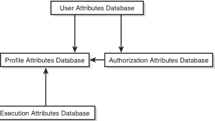

**图 17.1** RBAC 数据库文件之间的关系。

### 用户属性数据库（user_attr）

`/etc/user_attr` 文件是 RBAC 的关键数据库。它将权限配置文件和/或授权分配给用户账户。它还定义角色（作为一个或多个授权和/或权限配置文件）。表 17.1 列出了 `user_attr` 文件中以冒号分隔的字段。

**表 17.1 用户属性数据库的字段**

| 字段 | 用途 |
|---|---|
| 名称（Name） | 用户账户（在 `/etc/passwd` 文件中定义）或角色的名称。 |
| 限定符（Qualifier） | 保留供将来使用（空字段）。 |
| Res1 | 保留供将来使用（空字段）。 |
| Res2 | 保留供将来使用（空字段）。 |
| 属性（Attributes） | 以分号分隔的 `key=value` 对列表；它确定分配给用户账户或角色的属性。有效键为 `auths`（一个或多个授权名称，以逗号分隔）、`profiles`（一个或多个权限配置文件名称，以逗号分隔）、`roles`（一个或多个角色，以逗号分隔）和 `type`（如果 name 字段是普通用户账户，则设置为 `normal`；如果 name 是角色，则设置为 `role`）。 |

以下示例显示了 `/etc/user_attr` 文件中的几个示例条目（为使可读性更强，折行的行已缩进）：

```text
prt_adm::::type=role;profiles=Printer Management;
        auths=solaris.system.date
prof_adm::::type=role;auths=solaris.profmgr.*
role_adm::::type=role;auths=solaris.role.*
amber::::type=normal;roles=prt_adm
morgan::::type=normal;roles=prof_adm,role_adm
dana::::type=normal;auths=solaris.jobs.*;
        profiles=Printer Management;roles=prof_adm,role_adm
```

第一个条目定义了 `prt_adm` 角色，该角色被分配了 `Printer Management` 配置文件。此外，该角色还被授予 `solaris.system.date` 授权，允许该角色设置系统日期。

第二个条目定义了 `prof_adm` 角色，该角色被分配了与 RBAC 配置文件管理相关的所有授权。请注意，星号（`*`）元字符可用于表示*任意*（类似于 shell 元字符）。

第三个条目定义了 `role_adm` 角色，该角色被分配了与 RBAC 角色管理相关的所有授权。

第四个条目将 `prt_adm` 角色分配给普通用户帐户 *amber*。登录后，*amber* 可以使用 `su(1)` 命令切换到 `prt_adm`，并执行分配给该角色的任何任务。

第五个条目将 `prof_adm` 和 `role_adm` 角色分配给普通用户帐户 *morgan*。登录后，*morgan* 可以使用 `su(1)` 命令切换到 `prof_adm` 和 `role_adm`，然后执行分配给这些角色的任何任务。

第六个条目为普通用户帐户 *dana* 分配了相当多的访问控制。这些控制包括与 Solaris 作业（cron 和 at 作业管理）相关的所有授权、`Printer Management` 配置文件、`prof_adm` 角色以及 `role_adm` 角色。

以下示例显示了 `user_attr` 文件中唯一的默认条目。该条目用于 `root` 超级用户帐户。基本上，它分配了所有授权和配置文件：

```
root::::type=normal;auths=solaris.*,solaris.grant;profiles=All
```

## 执行配置文件属性数据库 (prof_attr)

`/etc/security/prof_attr` 文件用于将授权属性数据库 (`auth_attr`) 中的授权以及执行属性数据库 (`exec_attr`) 中的特权操作分配给一个名为“执行配置文件”或简称为“配置文件”的单个命名实体。然后，您可以在 `user_attr` 文件中引用这些配置文件，以将其分配给角色或直接分配给用户帐户。表 17.2 列出了 `prof_attr` 文件的冒号分隔字段。

**表 17.2 配置文件属性数据库的字段**

| 字段 | 用途 |
| --- | --- |
| Name | 配置文件名称（区分大小写）。 |
| Res1 | 保留供将来使用（空字段）。 |
| Res2 | 保留供将来使用（空字段）。 |
| Description | 配置文件的描述。 |


| Attributes | `key=value` 对的列表（以分号分隔），用于确定配置文件中包含的授权和操作。有效的键为 `auth` 和 `help`。 |

以下示例显示了 `/etc/security/prof_attr` 文件中的两个条目。为了改善可读性，这些行被断开并换行。

```
Audit Review::View the audit trail:auths=solaris.audit.read;
    help=AuditReview.html
Printer Management::Control Access to Printer:
    help=PrinterMgmt.html
```

第一个条目定义了 Audit Review 配置文件。短语“View the audit trail”（查看审计跟踪）虽然略显简洁，但描述准确。`Attributes` 字段引用了 `solaris.audit.read` 授权，并标识了帮助文件（位于 `/usr/lib/help/profiles/locale/C` 目录下）。`exec_attr` 文件中标识为与 Audit Review 配置文件关联的任何特权操作也都会被允许。

第二个条目定义了 Printer Management 配置文件。`Attributes` 字段中仅标识了帮助文件。但是，该配置文件允许 `exec_attr` 文件中与 Printer Management 关联的任何操作。表 17.3 列出了由 `prof_attr` 文件定义的默认配置文件。请注意，Device Management 配置文件的 `Attributes` 字段使用了短语 `solaris.device.*`；此元字符表达式表示包含所有 `solaris.device` 授权。

### 表 17.3 默认 RBAC 配置文件

| 名称 | 描述 | 授权 | 帮助 |
| --- | --- | --- | --- |
| All | 标准 Solaris | N/A | All.html |
| Audit Control | 管理审计子系统 | `solaris.audit.config`, `solaris.jobs.admin` | AuditControl.html |
| Audit Review | 查看审计跟踪 | `solaris.audit.read` | AuditReview.html |
| Device Management | 控制对可移动介质的访问 | `solaris.device.*` | DevMgmt.html |
| Printer Management | 控制对打印机的访问 | N/A | PrinterMgmt.html |

## 授权属性数据库 (auth_attr)

`/etc/security/auth_attr` 文件用于定义可以按单个用户帐户授予的授权（使用受限函数的权利）。然后，您可以在 `user_attr` 文件中引用这些授权，以将其分配给角色或直接分配给用户帐户。表 17.4 列出了 `auth_attr` 文件的冒号分隔字段。

以下示例显示了 `/etc/security/auth_attr` 文件中的三个条目：

```
solaris.grant:::Grant All Rights::help=PriAdmin.html
solaris.audit:::Audit Management::help=AuditHeader.html
solaris.audit.config:::Configure Auditing::help=AuditConfig.html
```

### 表 17.4 授权属性数据库的字段

| 字段 | 用途 |
| --- | --- |
| Name | 授权的名称，由一个或多个以句点分隔的关键字组成，用于标识系统、子系统和功能。如果名称以句点结尾，则此条目只是一个描述一组相关授权的标题。 |
| Res1 | 保留供将来使用（空字段）。 |
| Res2 | 保留供将来使用（空字段）。 |
| Short Description | 授权的简短描述。 |
| Long Description | 授权的详细描述。 |
| Attributes | 零个或多个 `key=value` 对的列表（以分号分隔），用于描述授权。目前，唯一有效的键是 `help`；它定义与该授权关联的帮助文件。 |

第一个条目定义了 `solaris.grant` 授权。`Short Description` 字段将此授权标识为 Grant All Rights（授予所有权限）。`Attributes` 字段标识了帮助文件（位于 `/usr/lib/help/auths/locale/C` 目录下）。

第二个条目为审计管理授权集定义了 `Short Description` 字段。（请注意 `Name` 字段末尾的句点。）第三个条目定义了 `solaris.audit.config` 授权，该授权允许配置系统审计。（帮助文件定义为 `AuditConfig.html`。）

表 17.5 列出了由 `auth_attr` 文件定义的默认授权。

### 表 17.5 默认 RBAC 授权

| 名称 | 描述 | 帮助 |
| --- | --- | --- |
| All | 标准 Solaris | All.html |
| `solaris.*` | 主要管理员 | PriAdmin.html |
| `solaris.grant` | 授予所有权限 | PriAdmin.html |
| `solaris.audit.config` | 配置审计 | AuditConfig.html |
| `solaris.audit.read` | 读取审计跟踪 | AuditRead.html |
| `solaris.device.allocate` | 分配设备 | DevAllocate.html |
| `solaris.device.config` | 配置设备属性 | DevConfig.html |
| `solaris.device.grant` | 委派设备管理 | DevGrant.html |
| `solaris.device.revoke` | 撤销或收回设备 | DevRevoke.html |
| `solaris.jobs.admin` | `cron` 和 `at` 管理 | JobsAdmin.html |
| `solaris.jobs.grant` | 委派 `cron` 和 `at` 管理 | JobsGrant.html |
| `solaris.jobs.user` | 创建 `cron` 或 `at` 作业 | JobsUser.html |
| `solaris.login.enable` | 启用登录 | LoginEnable.html |
| `solaris.login.remote` | 远程登录 | LoginRemote.html |
| `solaris.pfmgmr.assign` | 将配置文件分配给用户或角色 | ProfmgrAssign.html |
| `solaris.pfmgmr.write` | 创建、修改和删除配置文件 | ProfmgrWrite.html |
| `solaris.role.assign` | 将角色分配给用户 | RoleAssign.html |
| `solaris.role.write` | 添加、修改和删除角色 | RoleWrite.html |
| `solaris.system` | 机器管理 | SysHeader.html |
| `solaris.system.date` | 设置日期和时间 | SysDate.html |
| `solaris.system.shutdown` | 关闭系统 | SysShutdown.html |

请注意，所有这些授权都是针对 Solaris 系统（由 Sun Microsystems 开发）的。如果其他组织添加了新的授权，则应使用创建该授权的组织的反向 Internet 域名来标识。例如，由 `unixcert.net` 组织创建的授权将以 `net.unixcert` 前缀开头。

## 执行属性数据库（exec_attr）

`/etc/security/exec_attr` 文件用于将特权操作（以指定 UID 和/或 GID 执行的命令）与配置文件相关联。然后您可以将这些配置文件分配给用户帐户或角色。表 17.6 列出了 `exec_attr` 文件的冒号分隔字段。

### 表 17.6 执行属性数据库的字段

| 字段 | 用途 |
|---|---|
| `名称` | 关联配置文件的名称（必须与 `prof_attr` 文件条目中的配置文件名称完全匹配）。 |
| `策略` | 安全策略。目前，超级用户策略 `suser` 是唯一有效的条目。 |
| `类型` | 实体类型。目前，命令类型 `cmd` 是唯一有效的条目。 |
| `保留1` | 保留供将来使用（空字段）。 |
| `保留2` | 保留供将来使用（空字段）。 |


| `ID` | 要执行的命令（使用完整路径名或带有元字符的部分路径指定）。 |

| `属性` | 由 key=value 对组成的列表（以分号分隔），用于确定执行期间应用于命令的属性。有效键为 `euid`（设置有效 UID）、`uid`（设置真实 UID）、`egid`（设置有效 GID）和 `gid`（设置真实 GID）。有效值为 UID、用户帐户名、GID 和组帐户名。 |

以下示例显示了与打印机管理配置文件关联的 `/etc/security/exec_attr` 文件中的两个条目。

```
Printer Management:suser:cmd:::/usr/bin/enable:euid=lp
Printer Management:suser:cmd:::/usr/bin/disable:euid=lp
```

第一个条目将 `enable(1)` 命令的执行定义为特权操作。该命令将以有效 UID 为 `lp` 的身份执行。第二个条目将 `disable(1)` 命令的执行定义为特权操作。该命令同样将以有效 UID 为 `lp` 的身份执行。

表 17.7 列出了 `exec_attr` 文件定义的默认特权操作。所有条目的 `策略` 字段均设置为 `suser`，`类型` 字段均设置为 `cmd`。

| 配置文件名称 | 命令 | 属性 |

|---|---|---|

| All | * | |

| Audit Control | `/etc/init.d/audit` | `euid=0;egid=3` |

| Audit Control | `/etc/security/bsmconv` | `uid=0` |

| Audit Control | `/etc/security/bsmunconv` | `uid=0` |

| Audit Control | `/usr/sbin/audit` | `euid=0` |

| Audit Control | `/usr/sbin/auditconfig` | `euid=0` |

| Audit Control | `/usr/sbin/auditd` | `uid=0` |

| Audit Review | `/usr/sbin/auditreduce` | `euid=0` |

| Audit Review | `/usr/sbin/praudit` | `euid=0` |

| Audit Review | `/usr/sbin/auditstat` | `euid=0` |

| Printer Management | `/etc/init.d/lp` | `euid=0` |

| Printer Management | `/usr/bin/cancel` | `euid=0` |

| Printer Management | `/usr/bin/lpstat` | `egid=14` |

| Printer Management | `/usr/bin/enable` | `euid=lp` |

| Printer Management | `/usr/bin/disable` | `euid=lp` |

| Printer Management | `/usr/sbin/accept` | `euid=lp` |

| Printer Management | `/usr/sbin/reject` | `euid=lp` |

| Printer Management | `/usr/sbin/lpadmin` | `egid=14` |

| Printer Management | `/usr/sbin/lpfilter` | `euid=lp` |

| Printer Management | `/usr/sbin/lpforms` | `euid=lp` |

| Printer Management | `/usr/sbin/lpmove` | `euid=lp` |

| Printer Management | `/usr/sbin/lpshut` | `euid=lp` |

| Printer Management | `/usr/sbin/lpusers` | `euid=lp` |


请熟悉所有四个 RBAC 数据库文件的格式以及每个字段的用途。

## 管理 RBAC

您可以使用以下命令来管理 RBAC：

- `auths(1)` — 显示分配给用户帐户的授权
- `profiles(1)` — 显示分配给用户帐户的配置文件
- `roles(1)` — 显示分配给用户帐户的角色
- `roleadd(1M)` — 添加角色定义
- `roledel(1M)` — 删除角色定义
- `rolemod(1M)` — 修改角色定义

### 显示 RBAC 分配

如果您使用 `auths`、`profiles` 和 `roles` 命令时不带命令行参数，则会列出分配给当前用户帐户的授权、配置文件和角色。要列出分配给其他用户帐户的授权、配置文件和角色，请将用户帐户指定为命令行参数，如下例所示：

```sh
$ auths root
solaris.*,solaris.grant

$ profiles root
All

$ roles root
roles: root : No roles
$
```

### 角色管理

`roleadd`、`rolemod` 和 `roledel` 命令用于管理 RBAC 角色。

#### 使用 roleadd 命令创建角色

`roleadd(1M)` 命令提供了一种快速添加新角色的方法。至少必须将角色名称指定为命令行参数。表 17.8 列出了 `roleadd` 命令支持的命令行参数。


> `roleadd` 命令支持与 `useradd` 命令完全相同的命令行参数，但 `roleadd` 不支持 `-R` 命令行参数，因为角色不能包含其他角色。

**表 17.8 roleadd 命令的命令行参数**

| 参数 | 说明 |

|---|---|

| `role` | 指定新角色的名称（必填）。 |

| `-A authorizations` | 指定一个或多个授权（以逗号分隔）。 |

| `-b base` | 定义基本目录。如果未指定主目录（`-d`），则会将角色名称添加到 `base` 中并用作主目录。 |

| `-c comment` | 指定放置在 `/etc/passwd` 文件的注释（`gcos`）字段中的注释。 |

| `-d directory` | 定义角色的主目录。 |

| `-e date` | 指定角色的过期日期。在指定日期之后，该角色将被禁用。 |

| `-f days` | 指定角色在被禁用之前可以处于非活动状态的最大天数。 |

| `-g group` | 定义将成为角色主组的现有组的 GID 或名称。 |

| `-G group` | 定义将成为角色辅助组的现有组的 GID 或名称。 |

| `-k template_dir` | 指定包含用于用户配置文件的模板（默认）`.profile` 的目录。 |

| `-m` | 如果主目录不存在，则创建该主目录。主目录由 `-b` 和角色名称或 `-d` 定义。 |

| `-o` | 允许指定现有 UID——即允许使用重复的 UID 创建角色（参见 `-u`）。 |

| `-p profiles` | 指定一个或多个执行配置文件（以逗号分隔）。 |

| `-s shell` | 指定登录 shell；默认为 Bourne shell（`/bin/sh`）。 |

| `-u uid` | 指定角色的 UID。它必须是十进制整数。如果未指定，则分配下一个可用的最高 UID。 |

以下示例使用 `roleadd` 命令创建一个角色：

```
# roleadd -A solaris.system.date -P "Printer Management" prt_adm
#
```

此命令创建 `prt_adm` 角色。它将 `solaris.system.date` 授权和 `Printer Management` 配置文件分配给该角色。

为方便起见，`roleadd` 命令还支持 `-D` 命令行参数，该参数允许为授权（`-A`）、基本目录（`-b`）、组（`-g`）、过期日期（`-e`）、最大非活动天数（`-f`）和执行配置文件（`-P`）分配默认值。后续使用 `roleadd` 命令时，如果未指定这些值，将使用这些默认值。


> 使用 `roleadd` 命令创建的角色没有密码。这些角色处于锁定状态，无法使用，直到通过 `passwd(1)` 命令为该角色定义密码。

#### 使用 rolemod 命令修改角色

`rolemod(1M)` 命令用于修改现有角色。其命令行参数与 `roleadd` 命令的参数相同，但以下情况除外：


- 基本目录（`-b`）不可用。请使用 `-d` 指定新目录。如果主目录不存在，请不要忘记包含 `-m`。
- 设置默认值（`-D`）不可用。
- 模板目录（`-k`）不可用。
- 如果角色名称被修改，则使用 `-l role` 指定新的角色名称。

请记住，如果角色被更改，主目录的名称不会更改，除非使用了 `-d` 和 `-m` 命令行参数。

#### 使用 `roledel` 命令删除角色

`roledel`(1M) 命令用于删除角色。不仅会从 `user_attr` 文件中删除角色定义，其他 `user_attr` 条目中的所有角色分配也会被修改。角色被指定为命令行参数。仅支持另一个命令行参数：`-r` 用于删除与该角色关联的主目录。

#### 练习题

### 问题 1

以下哪个 RBAC 数据文件不在 `/etc/security` 目录下？

- a. `auth_attr`
- b. `exec_attr`
- c. `prof_attr`
- d. `user_attr`

答案 d 正确。`user_attr` 文件位于 `/etc` 目录下。其他所有文件都位于 `/etc/security` 目录下。因此，答案 a、b 和 c 不正确。

### 问题 2

以下哪项不能分配给角色？

- a. 配置文件
- b. 授权
- c. 另一个角色
- d. 多个配置文件

答案 c 正确。角色不能分配给另一个角色。可以将一个或多个授权和/或一个或多个配置文件分配给角色。因此，答案 a、b 和 d 不正确。

### 问题 3

执行属性数据库文件与哪个其他 RBAC 属性数据库文件相关联？

- a. 授权属性数据库文件
- b. 配置文件属性数据库文件
- c. 用户属性数据库文件

答案 b 正确。执行属性数据库文件中列出的特权操作与配置文件属性数据库文件中列出的配置文件相关联。授权属性数据库定义了与配置文件相关联的特权操作，与命令执行无直接关系。因此，答案 a 不正确。用户属性数据库将用户和角色与授权及配置文件相关联，这些也与命令执行没有直接关系。因此，答案 c 不正确。

### 问题 4

以下哪些键允许出现在用户属性数据库文件的 `attribute` 字段中？（选择所有适用项。）

- [ ] a. `auths`
- [ ] b. `help`
- [ ] c. `profiles`
- [ ] d. `roles`
- [ ] e. `type`

答案 a、c、d 和 e 正确。用户属性数据库文件的 `attribute` 字段可用于分配授权、配置文件和角色。`type` 键将条目标识为普通用户帐户或角色。`help` 键仅在授权和配置文件属性数据库文件中受支持。因此，答案 b 不正确。

### 问题 5

以下哪项是角色的定义？

- a. 分配了授权和配置文件的特殊用户帐户。
- b. 用于授予受限功能访问权限的权利。
- c. 用于对授权和配置文件分配进行分组的机制。
- d. 不需要密码的用户帐户。
- e. 可通过 `login` 命令访问的用户帐户。

答案 a 正确。**用于授予受限功能访问权限的权利**是授权的定义。因此，答案 b 不正确。**用于对授权和配置文件分配进行分组的机制**是配置文件的定义。因此，答案 c 不正确。角色与其他用户帐户一样，需要密码，并且只能通过 `su`(1) 命令访问。因此，答案 d 和 e 不正确。

### 问题 6

以下哪些键可用于 RBAC 执行属性数据库文件的 `attribute` 字段？（选择所有适用项。）

- [ ] a. `auths`
- [ ] b. `gid`
- [ ] c. `help`
- [ ] d. `profiles`
- [ ] e. `uid`

答案 b 和 e 正确。执行属性数据库文件的 `attribute` 字段唯一有效的键是 `gid`、`euid`、`egid` 和 `uid`。`auths` 键只能在用户和配置文件属性数据库文件中指定。因此，答案 a 不正确。`help` 键仅在授权和配置文件属性数据库文件中受支持。因此，答案 c 不正确。`profiles` 键只能在用户属性数据库文件中指定。因此，答案 d 不正确。

### 问题 7

以下哪项描述了 RBAC 用户属性数据库文件的格式？

- a. `name:qualifier:res1:res2:attributes`
- b. `name:res1:res2:description:attributes`
- c. `name:res1:res2:short description:long description:attributes`
- d. `name:policy:type:res1:res2:ID:attributes`

答案 a 正确。RBAC 用户属性数据库文件使用格式 `name:qualifier:res1:res2:attributes`。`name:res1:res2:description:attributes` 是配置文件属性数据库文件的格式。因此，答案 b 不正确。`name:res1:res2:short description:long description:attributes` 是授权属性数据库文件的格式。因此，答案 c 不正确。`name:policy:type:res1:res2:ID:attributes` 是执行属性数据库文件的格式。因此，答案 d 不正确。

#### 需要了解更多？

Mulligan, John P.，*Solaris 8 基本参考手册*（New Riders，印第安纳波利斯，印第安纳州：2001），ISBN 0-7357-1007-4。

Sun Microsystems，*系统管理指南，第 2 卷*。提供印刷版（部件号 805-7229-10），也可在 Web 上访问 `http://docs.sun.com`，还可从 Solaris 8 操作系统附带的在线文档 AnswerBook2 中获取。

Sun Microsystems，*系统参考手册，第 1 节——用户命令*。提供印刷版（部件号 806-0624-10），也可在 Web 上访问 `http://docs.sun.com`，还可从 Solaris 8 操作系统附带的在线文档 AnswerBook2 中获取。

Sun Microsystems，*系统参考手册，第 1M 节——系统管理命令*。提供印刷版（部件号 806-0625-10），也可在 Web 上访问 `http://docs.sun.com`，还可从 Solaris 8 操作系统附带的在线文档 AnswerBook2 中获取。


## 网络文件系统

#### 需要理解的术语：

- 网络文件系统（NFS）
- 资源共享与挂载
- WebNFS
- 自动文件系统（AutoFS）服务
- 缓存文件系统（CacheFS）服务

#### 需要掌握的技术：

- 共享和取消共享 NFS 资源
- 挂载和卸载 NFS 资源
- 确定已共享或已挂载的 NFS 资源
- 配置 AutoFS 映射
- 管理 CacheFS 缓存

本章涵盖与文件系统相关的一些其他主题。第一部分介绍网络文件系统（NFS）及用于管理 NFS 的命令。下一部分介绍支持 NFS 的 AutoFS 和 CacheFS 服务。本章涵盖 NFS、AutoFS 和 CacheFS 的考试目标。

### NFS 环境

NFS 服务使用服务器/客户端模型，允许系统远程访问其他系统的存储空间。NFS 协议由 RFC（Request For Comment）1813“NFS 版本 3 协议规范”定义。

NFS 服务器允许不同架构、运行不同操作系统的计算机通过网络访问其存储空间。NFS 服务还允许多个系统访问相同的信息，从而消除冗余、提高一致性并减少管理工作。

NFS 客户端以某种透明模式访问这些信息。也就是说，对于大多数操作和应用程序而言，远程资源看起来并可以被视为本地存储空间。

### NFS 管理

在文件系统或目录能够被客户端通过 NFS 访问（即挂载）之前，必须先共享它们，或者用旧术语来说，通告（advertise）它们。一旦资源被共享，经授权的 NFS 客户端就可以挂载它们。


共享 NFS 资源的另一个术语是导出（exporting）。这个术语偶尔出现在 Solaris 文档中，但最常见的是作为 NFS 资源的目录名称，例如 `/export/home` 或 `/export/swap`。

### 共享 NFS 资源


NFS 资源可以使用 `share`(1M) 命令共享，并使用 `unshare`(1M) 命令取消共享。此外，`/etc/dfs/dfstab` 文件中标识的任何资源都会在系统启动或使用 `shareall`(1M) 命令时自动共享。共享资源会自动记录在 `/etc/dfs/sharetab` 文件中。当 `unshareall`(1M)

当使用命令时，`/etc/dfs/sharetab` 文件中列出的所有资源都会自动取消共享。


实际上，当系统因启动或管理员操作而进入系统运行级 3 时，NFS 服务器会启动，已标识的资源会被共享。当系统运行级变为除 3 以外的任何级别时，资源会被取消共享，NFS 服务器也会停止。请记住，NFS 客户端在运行级 2 时启动。

## share 命令

`share` 命令用于共享 NFS 资源，以便 NFS 客户端可以挂载并访问这些资源。至少，您必须将待共享目录（或文件系统的挂载点）的完整路径名指定为命令行参数。

此外，还支持其他三个命令行参数。`-d` 命令行参数后跟要共享数据的说明。`-F nfs` 命令行参数指定文件系统类型。如果未指定，则默认为 `/etc/dfs/fstypes` 文件（NFS）中列出的默认文件系统类型。`-o` 命令行参数后跟一个或多个 NFS 特定选项（用逗号分隔）。NFS 的 `share` 命令选项列于表 18.1 中。有关这些选项相关设置的详细信息，请参阅*系统参考手册*中的 `share`(1M) 说明。

### 表 18.1 share 命令的 NFS 特定选项

| 选项 | 说明 |
|---|---|
| `aclok` | 允许对 NFS 版本 2 客户端进行访问控制。 |
| `anon=uid` | 将指定的 *uid* 分配给匿名用户。 |
| `index=file` | 为 WebNFS 客户端显示 *file* 的内容，而不是列目录。 |
| `nosub` | 防止客户端挂载共享资源的子目录。 |
| `nosuid` | 防止客户端在文件上设置 setuid 或 setgid 访问模式。 |
| `public` | 指定公共文件句柄。 |
| `ro` | 允许只读访问。 |
| `ro=list` | 允许 *list* 指定的客户端进行只读访问。 |
| `root=list` | 允许 *list* 指定的客户端上的 root 用户进行 root 访问。 |
| `rw` | 允许读/写访问。 |
| `rw=list` | 仅允许 *list* 指定的客户端进行读/写访问。 |
| `sec=mode` | 使用 `mode` 指定的一个或多个安全模式对客户端进行身份验证。模式包括用户 ID（sys）、Diffie-Hellman 公钥系统（dh）、Kerberos 版本 4（krb4）或无。 |
| `window=value` | 将客户端凭据的最大生存时间设置为 `value` 秒。 |

以下示例使用 `share` 命令允许 NFS 客户端挂载 `/export/home` 文件系统，包括 WebNFS 客户端。所有客户端将具有只读访问权限：

```sh
# share -F nfs -o public,ro /export/home
#
```

如果不带任何命令行参数使用 `share` 命令，将列出当前已共享的资源。

## unshare 命令

`unshare` 命令用于停止共享 NFS 资源，使 NFS 客户端无法再挂载和访问这些资源。至少，您必须将当前已共享目录（或文件系统挂载点）的完整路径名指定为命令行参数。

只支持另一个命令行参数：`-F nfs`，它指定文件系统类型。如果未指定，则默认为 `/etc/dfs/fstypes` 文件中列出的默认文件系统类型（NFS）。由于 NFS 是随 Solaris 提供的唯一网络文件系统，因此您无需使用此参数。

以下示例使用 `unshare` 命令停止共享 `/export/home` 文件系统：

```sh
# unshare -F nfs /export/home
#
```

## /etc/dfs/dfstab 文件

`/etc/dfs/dfstab` 文件指定在系统切换至运行级 3 或使用 `shareall` 命令时应自动共享的资源。

可以使用任何文本编辑器修改此文件。要自动共享某个资源，请在 `/etc/dfs/dfstab` 文件中添加一行，其中包含 `share` 命令以及原本需要手动输入的命令行参数和选项。要删除某个资源的自动共享，请从 `/etc/dfs/dfstab` 中删除相应的 `share` 命令。有关示例，请参阅前面介绍的 `share` 命令。


您可能想知道为什么与 NFS 关联的某些目录、文件甚至命令会使用 *dfs* 或 *df* 这样的词。这种用法源自 UNIX 操作系统的 System V (5) 版本。最初，分布式文件系统（DFS）有两种变体：NFS 和远程文件系统（RFS）。包含 *dfs* 这个词的目录、文件和命令用于管理和配置这两种类型的文件系统。此后，RFS 消失了，只留下了 DFS 的遗留。

## shareall 和 unshareall 命令

`shareall` 命令用于共享一个或多个资源。如果未指定 `-F nfs` 命令行参数，则默认为默认文件系统类型（NFS）。如果未将包含一个或多个 `share` 命令的文件名指定为命令行参数，则默认使用 `/etc/dfs/dfstab` 文件。

`unshareall` 命令用于取消共享所有当前已共享的资源。如果未指定 `-F nfs` 命令行参数，则默认为默认文件系统类型（NFS）。

## dfshares 命令

`dfshares`(1M) 命令列出本地或远程系统上的共享资源。如果将远程系统的主机名（或 IP 地址）指定为命令行参数，则会列出该系统上共享的资源。

此外，还支持其他两个命令行参数。第一个是 `-F nfs`（如前所述），另一个是 `-h`。如果指定了 `-h`，则不显示描述资源列表各列的标题。

此外，您可以从 `/etc/dfs/sharetab` 文件获取本地共享资源的信息。`share`、`shareall`、`unshare` 和 `unshareall` 命令会更新此文件，以反映当前共享的资源。

## 挂载 NFS 资源

NFS 服务器共享的 NFS 资源可以由 NFS 客户端使用 `mount`(1M) 命令挂载，并使用 `umount`(1M) 命令卸载。此外，`/etc/vfstab` 文件中标识的任何 NFS 资源都会在系统启动时或使用 `mountall`(1M) 命令时自动挂载。类似地，使用 `umountall`(1M) 命令可以卸载 `/etc/mnttab` 文件中列出的 NFS 资源。

### mount 命令

`mount` 命令用于像挂载其他标准 Solaris 文件系统一样挂载 NFS 资源，以便 NFS 客户端能够挂载并访问这些资源。对于 NFS，您需要将当前共享目录的主机名（或 IP 地址）和路径名指定为命令行参数，后跟挂载点。主机名和路径名之间用冒号（:）分隔。

表 18.2 列出了通用的 `mount` 命令行参数。表 18.3 列出了与 `-o` 命令行参数一起使用的一些更重要的 NFS 特定选项。（多个 NFS 特定选项之间用逗号分隔。）有关更多信息，请参阅*系统参考手册*中的 `mount_nfs`(1M) 页面。

### 表 18.2 mount 命令行参数

| 参数 | 说明 |
|---|---|
| `-F fstype` | 指定文件系统类型 |
| `-m` | 挂载文件系统时不创建 `/etc/mnttab` 条目 |
| `-o` | 指定 NFS 特定选项（参见表 18.3） |
| `-O` | 覆盖现有的挂载点 |
| `-r` | 以只读方式挂载文件系统 |

### 表 18.3 mount 命令的 NFS 特定选项

| 选项 | 说明 |
|---|---|
| `hard` | 如果服务器无响应，继续尝试挂载资源 |
| `intr` | 在等待 `hard` 挂载时，允许键盘中断终止进程 |
| `nointr` | 在等待 `hard` 挂载时，不允许键盘中断终止进程 |
| `public` | 指定公共文件句柄 |
| `retrans=n` | 重传 NFS 请求 *n* 次 |
| `retry=n` | 重试挂载操作 *n* 次 |
| `ro` | 以只读方式挂载资源 |
| `rw` | 以读/写方式挂载资源 |
| `soft` | 如果服务器无响应，返回错误并退出 |
| `timeo=n` | 将 NFS 超时设置为 *n* 个十分之一秒 |


以下示例使用 `mount` 命令将来自“sun”系统的 `/export/home` 文件挂载到 `/sun_home` 挂载点。该资源以只读访问权限进行软挂载（1,000 次尝试）：

```sh
# mount -F nfs -o soft,retry=1000,ro sun:/export/home /sun_home
#
```

如果在使用 `mount` 命令时不带任何命令行参数，将显示所有当前已挂载的文件系统（标准 Solaris 文件系统和 NFS 资源）。

## umount 命令

`umount` 命令用于卸载本地文件系统和远程 NFS 资源，使本地用户无法再访问它们。对于 NFS，你可以将一个或多个当前已挂载的 *系统:路径名* 对（或文件系统挂载点）指定为命令行参数。

该命令还支持另外两个命令行参数。第一个是 `-V`，它显示用于执行卸载的命令行而不执行（用于验证命令行）。第二个是 `-a`，它尽可能执行并行卸载操作。

以下示例使用 `umount` 命令卸载从 *solaris* 主机共享的 `/export/home` 文件系统：

```shell
# umount solaris:/export/home
#
```

## /etc/vfstab 文件

`/etc/vfstab` 文件，也称为 *文件系统表*，指定了在系统启动时或使用 `mountall` 命令时应自动挂载的资源。

你可以使用任何文本编辑器修改此文件。要自动挂载 NFS 资源，请在 `/etc/vfstab` 文件中添加一行，其中包含使用 `mount -F nfs` 命令手动输入时所需的相应选项。要移除 NFS 资源的自动挂载，请从 `/etc/vfstab` 文件中删除相应的行。

表 18.4 列出了 `/etc/vfstab` 文件中与挂载 NFS 资源相关的条目字段（以制表符分隔）及其相应的值。连字符 `-` 表示字段中没有条目。

表 18.4 — NFS 资源 `/etc/vfstab` 条目的字段

| **字段** | **说明** |

| --- | --- |

| **要挂载的设备** | 使用 `system:resource` 格式；`system` 是主机名或 IP 地址，`resource` 是共享 NFS 资源的完整路径名 |

| **要 fsck 的设备** | 使用连字符 `-` 表示没有条目，因为 NFS 客户端不应使用 `fsck` 命令检查远程 NFS 资源 |

| **挂载点** | 指定 NFS 资源应挂载到的子目录 |

| **FS 类型** | 使用 `nfs` 表示 NFS 资源 |

| **fsck 遍数** | 使用连字符 `-` 表示没有条目 |

| **启动时挂载** | 使用 `yes` 表示资源应在启动时或执行 `mountall` 命令时挂载；否则为 `no` |

| **挂载选项** | 指定所需的任何 NFS 挂载选项；参见表 18.3 或 `mount` 命令的手册页 |

NFS 支持*客户端故障转移*。也就是说，如果某个 NFS 资源变得不可用，客户端可以切换到提供该资源“副本”的另一台 NFS 服务器。通过在 `/etc/vfstab` 文件中为该资源添加条目，可以启用此故障转移功能。在 **要挂载的设备** 字段中，列出提供复制资源的系统，用逗号分隔。还应在 **挂载选项** 字段中指定只读选项（`-o ro`）。例如，要为 `/export/local` 资源提供客户端故障转移，该资源可从 `alpha` 或 `beta` NFS 服务器获得，并挂载在 `/usr/local`，请在 `/etc/vfstab` 文件中添加以下条目：

```text
alpha,beta:/export/local - /usr/local nfs - no -o ro
```


只读资源（`-o ro` 挂载选项）应配置为进行客户端故障转移。同时请确保系统主机名或 IP 地址有效，并用逗号分隔。

## mountall 和 umountall 命令

`mountall` 命令用于挂载一个或多个本地文件系统和/或远程（NFS）共享文件系统或目录。如果未将包含一个或多个资源信息的文件名指定为命令行参数，则默认使用 `/etc/vfstab`。`mountall` 命令将仅挂载文件系统表（或指定文件）中 **启动时挂载** 列设置为 `yes` 的资源。

如果使用 `-F` 命令行选项指定了文件系统类型，则仅挂载该类型的文件系统。如果指定了 `-l` 命令行参数，则仅挂载本地文件系统或目录。如果指定了 `-r` 命令行参数，则仅挂载远程共享文件系统或目录。

`umountall` 命令用于卸载所有当前已挂载的资源。它也支持 `mountall` 命令所支持的 `-F`、`-l` 和 `-r` 命令行参数。此外，它还支持 `-h host` 命令行参数，用于指定仅卸载从该主机挂载的资源。`-k` 命令行参数可用于使用 `fuser(1M)` 命令终止进程，以便允许卸载。另外，`-s` 命令行参数可防止并行执行卸载操作。当前已挂载的文件资源通常列在 `/etc/mnttab` 文件中。

## dfmounts 命令

`dfmounts(1M)` 命令列出本地或远程系统（及其客户端）上当前已挂载的资源。如果将远程系统的主机名（或 IP 地址）指定为命令行参数，则会列出该系统（及其客户端）上挂载的资源。

此外，还支持另外两个命令行参数。`-F nfs` 命令行参数指定文件系统的类型。如果未指定，则假定为 `/etc/dfstab` 文件中列出的默认文件系统类型（NFS）。如果指定了 `-h` 命令行参数，则不显示描述列表各列的标题。以下示例使用 `dfmounts` 命令列出名为 `solaris` 的本地系统上的 NFS 资源：

```text
# dfmounts
RESOURCE   SERVER PATHNAME          CLIENTS
.          -      solaris /export/home   uxsys2.amb.org
```

## WebNFS

WebNFS 扩展了 NFS 协议，允许 Web 浏览器或 Java 小程序访问 NFS 共享资源。它使客户端系统无需成为 NFS 客户端即可访问 NFS 资源。浏览器可以通过采用 `nfs://server/path` 形式的 NFS 统一资源定位符（URL）来访问 NFS 资源。RFC 2054 和 RFC 2055 定义了 WebNFS 服务器和客户端规范。

`share` 命令支持两个与 WebNFS 访问相关的 NFS 专用选项。第一个是 `public` 选项。每个服务器都有一个与服务器根文件系统关联的公共文件句柄。NFS URL 相对于公共文件句柄。例如，访问主机服务器上 `/usr/data` 共享资源下的目标目录，需要使用 `nfs://server/data` 目标 NFS URL。但是，如果在共享 `/usr/data` 目录时指定了 `public` 选项，则公共文件句柄将与 `/usr/data` 目录关联；这种关联允许使用 `nfs://server/target` NFS URL 访问相同的数据。

第二个选项是 `index`，它指定一个包含信息的文件，该文件应显示而不是显示目录列表。以下示例使用 `share` 命令启用相对于 `/export/home` 目录的读写 NFS 和 WebNFS 访问：

```sh
# share -F nfs -o rw,public,index=index.html /export/home
#
```

## 自动文件系统服务

自动文件系统（AutoFS）服务是一种客户端服务，用于按需自动挂载和卸载 NFS 资源。此服务简化了手动跟踪资源的工作，并可减少网络流量。此外，AutoFS 消除了在 `/etc/vfstab` 文件中添加 NFS 挂载项的需要。它允许更快的启动和关闭，并且用户无需知道 root 密码即可挂载/卸载 NFS 资源。

`automount(1M)` 命令在系统启动（系统运行级别 2）时运行，并初始化 AutoFS 服务。此外，此时还会启动 `automountd(1M)` 命令。`automountd` 命令是一个持续运行的守护进程，提供自动挂载和卸载功能。

默认情况下，如果资源在 10 分钟内未被访问，则会被卸载。你可以使用 `automount` 命令并包含 `-t` 命令行参数（后跟一个表示时间（以秒为单位）的数字）来修改此默认时间。

AutoFS 服务的配置由 **AutoFS 映射** 控制，这些映射定义本地挂载点，并将远程 NFS 资源与挂载点关联。`automount` 命令在初始化期间读取这些映射。

### AutoFS 映射

AutoFS（或 automount）映射有三种类型：auto_master、direct 和 indirect。所有这些映射都位于 `/etc` 目录下。

## /etc/auto_master 文件


`auto_master` 文件将目录与间接映射关联起来。此外，`auto_master` 文件还引用一个或多个直接映射。`auto_master` 文件中的条目由三个字段组成：

- `挂载点`——NFS 资源应挂载到的本地目录的完整路径名的最初部分。
- `映射名称`——映射（直接或间接）的文件名，或者特殊的内置映射。可通过名称的第一个字符（连字符 `-`）来识别内置映射。
- `映射选项`——零个或多个（以逗号分隔）NFS 专用挂载选项，如前文表 18.3 所述。

使用 `/-` 表示法的特殊挂载点表示：映射名称字段中列出的映射是一个直接映射，其中实际包含挂载点。此外，仅由关键字 `+auto_master` 组成的特殊条目用于包含属于网络信息服务（NIS）或 NIS+ 一部分的 AutoFS 映射。

以下示例显示了 `/etc/auto_master` 文件的内容：

```
# Master map for automounter
#
+auto_master
/net            -hosts          -nosuid,nobrowse
/home           auto_home       -nobrowse
/xfn            -xfn
/               auto_direct
```

如前所述，`/net` 和 `/xfn` 条目引用内置映射。`/home` 条目引用间接映射 `/etc/auto_home`，而 `/` 条目引用直接映射 `/etc/auto_direct`。

`-hosts` 内置映射使用主机数据库。`-xfn` 内置映射使用通过联合命名服务（FNS）共享的资源。

## 直接映射

直接映射同时提供挂载点和 NFS 资源。直接映射中的条目由三个字段组成：

- `键`——通常是用作挂载点的完整路径名。
- `挂载选项`——零个或多个（以逗号分隔）NFS 专用挂载选项，如前文表 18.3 所述。
- `NFS 资源`——采用 *服务器:文件系统* 形式的文件，用于标识由系统服务器共享的文件系统。由于多个 NFS 服务器可能提供同一资源，因此可以指定多个资源（以空格分隔）。将使用第一个可用的资源。

以下示例显示了 `/etc/auto_master` 文件中引用的 `/etc/auto_direct` 文件的内容：

```text
/usr/local/bin              nfsserver:/usr/local/bin
/usr/games       -ro        nfsserver:/usr/games
```

在此示例中，由名为 `nfsserver` 的主机共享的 `/usr/local/bin` 和 `/usr/games` 目录，被挂载到本地系统上使用相同名称的挂载点下。


初始直接映射的默认名称为 `auto_direct`。

## 间接映射

间接映射提供 `/etc/auto_master` 挂载点的其余部分，并标识应挂载到客户端上的 NFS 资源。间接映射中的条目由三个字段组成：

- `键`——通常是提供挂载点其余部分的目录。
- `挂载选项`——零个或多个（以逗号分隔）NFS 专用挂载选项，如前文表 18.3 所述。
- `NFS 资源`——采用 *服务器:文件系统* 形式的文件，用于标识由系统服务器共享的文件系统。

以下示例显示了 `/etc/auto_home` 文件的内容：

```text
dla       solaris:/export/home/dla
guest     -rw,nosuid       nfsserver:/export/home/guest
```

在此示例中，`auto_master` 文件中的 `/home` 条目引用了该间接映射。它包含两个条目。第一个条目标识 `/home/dla` 挂载点，用于挂载来自名为 `solaris` 的主机上的 `/export/home/dla` 目录。第二个条目标识 `/home/guest` 挂载点，用于挂载来自名为 `nfsserver` 的主机上的 `/export/home/guest` 目录。


初始间接映射的默认名称为 `auto_home`。

## 运行 automount 命令

当 AutoFS 映射发生更改时，您可能需要手动执行 `automount` 命令。对 `/etc/auto_master` 文件的任何更改都需要执行 `automount` 命令才能使更改生效。当对直接映射进行添加或删除操作时，也必须执行此命令。

## 缓存文件系统服务

缓存文件系统（CacheFS）是一种客户端服务，它提供在 NFS 客户端本地缓存远程访问的 NFS 资源的能力。这样做不仅加快了客户端对数据的访问速度，还减少了网络流量和 NFS 服务器的负载。

创建缓存后，可以将远程 NFS 资源挂载到缓存“中”。首次访问 NFS 资源时，数据会从远程 NFS 服务器复制到本地缓存。后续访问将直接从本地缓存进行，而不再访问远程 NFS 服务器。与其他类型的文件系统一样，远程 NFS 资源可以通过使用 `mount` 命令手动挂载、在系统启动时挂载（通过将其添加到 `/etc/vfstab` 文件）、或根据需要挂载（通过 AutoFS 机制，如本章前面“自动文件系统服务”一节所述）。


> 不能使用 CacheFS 机制缓存根 (`/`) 和 `/usr` 文件系统。但是，可以通过 AutoClient 配置缓存这两个文件系统，有关 AutoClient 配置的简要说明，请参阅第 13 章“Solaris 网络环境”。

## 配置缓存

`cfsadmin`(1M) 命令用于创建、检查、调整和删除缓存。`cachefsstat`(1M) 命令也可用于显示缓存统计信息。

要创建缓存，请指定 `-c` 命令行参数，并在其后跟上用作缓存的目录的完整路径名。此外，可以使用 `-o` 命令行参数指定多个选项（以逗号分隔）。以下示例使用 `cfsadmin` 命令在 `/cache` 目录下创建缓存。可缓存的最大文件大小设置为 10MB：

```text
# cfsadmin -c -o maxfilesize=10 /cache
#
```

要列出挂载在缓存中的文件系统和缓存状态，请使用 `-l` 命令行参数。其他命令行参数包括 `-s`（执行一致性检查）、`-u`（更新缓存参数）和 `-d`（删除缓存）。所有这些命令行参数后面都应跟缓存目录的完整路径名。

使用 `mount` 命令将远程 NFS 资源挂载到缓存中，需要指定远程文件系统、本地缓存和本地挂载点。

应使用 `-F` 命令行参数将文件系统类型标识为 CacheFS。此外，需要使用 `-o` 命令行参数指定至少两个缓存专用的挂载选项：`backfstype`（标识所挂载的文件系统的类型，通常为 NFS）和 `cachedir`（标识缓存目录）。以下示例使用 `mount` 命令，将主机 `sparc20` 上的 `/export/home` 文件系统挂载到 `/home` 挂载点（称为*前端文件系统*），并使用 `/cache` 作为缓存目录。为了便于阅读，该行进行了换行：

```text
# mount -F cachefs -o backfstype=nfs,cachedir=/cache
  sparc20:/export/home /home
#
```

## 检查缓存状态

要显示缓存文件系统的状态，请使用 `cfsadmin` 命令，并指定 `-l` 命令行参数，后跟缓存名称。将显示有关缓存的以下信息：

- `maxblocks`——缓存可以使用的最大存储空间量（以前端文件系统中的块数的百分比表示）。
- `minblocks`——缓存可以使用的最小存储空间量（以前端文件系统中的块数的百分比表示）。
- `threshblocks`——达到 `minblocks` 后无法再获取额外资源的阈值（以前端文件系统中的块数的百分比表示）。
- `maxfiles` — 缓存可以使用的最大文件数（以前端文件系统中的块数百分比表示）。
- `minfiles` — 缓存可以使用的最小文件数（以前端文件系统中的块数百分比表示）。
- `threshfiles` — 达到 minfiles 后无法再占用额外 inode 的阈值（以前端文件系统中的 inode 百分比表示）。
- `maxfilesize` — 缓存中允许的最大文件大小。
- `挂载信息` — 正在挂载的资源及其本地挂载点。斜杠 (`/`) 字符显示为下划线 (`_`) 字符。

可以使用 `cfsadmin -u` 命令修改最大值、最小值和阈值参数。以下示例使用 `cfsadmin -l` 命令显示缓存状态：


```text
# cfsadmin -l /cache
cfsadmin: list cache FS information
    maxblocks       90%
    minblocks        0%
    threshblocks    85%
    maxfiles        90%
    minfiles         0%
    threshfiles     85%
    maxfilesize      3MB
# sparc20:_export_home:_home
```

## 显示缓存统计信息

要显示有关缓存文件系统性能的统计信息，请使用 `cachestat(1M)` 命令并指定缓存文件系统的挂载点。将显示以下有关缓存文件的统计信息：

- `缓存命中率` — 在缓存文件系统中成功定位文件或目录的尝试百分比，后跟实际命中数和未命中数的计数

- `一致性检查` — 执行的一致性检查次数，后跟通过和失败的检查计数

- `修改次数` — 修改操作的数量

- `垃圾回收` — 尝试回收不再使用的资源的次数

以下示例使用 `cachefsstat` 命令显示缓存文件系统的统计信息：

```shell
# cachefsstat /home

    /home

              cache hit rate:    57% (8 hits, 6 misses)
              consistency check: 14 (14 pass, 0 fail)
                      modifies:   0
               garbage collection: 0

#
```


> 请注意，`cfsadmin -l` 命令报告缓存的配置状态（可调参数），而 `cachefsstat` 报告缓存的内容（缓存文件系统统计信息）。

## 检查缓存的一致性

为了确保缓存中的信息是最新的，系统会自动执行定期一致性检查。但是，这些检查可能会增加网络活动。为了减少网络流量，您可以禁用自动一致性检查并手动（按需）检查一致性。

要禁用自动一致性检查（即请求按需一致性检查），请在挂载文件系统时指定 `demandconst` 选项。为便于阅读，该行已换行：

```shell
# mount -F cachefs -o backfstype=nfs,cachedir=/cache,demandconst
sparc20:/export/home /home
#
```

要按需执行一致性检查，请使用 `cfsadmin -s`，后跟缓存文件系统的挂载点作为命令行参数：

```shell
# cfsadmin -s /home
#
```

## 管理缓存日志

`cachefslog(1M)` 命令用于设置、验证和停止 CacheFS 日志记录。`cachefswssize(1M)` 命令用于分析日志，以确定为缓存推荐的工作集大小。缓存太小会导致访问延迟和更高的网络流量（缓存命中率低）。缓存太大则会浪费文件系统空间。

要设置 CacheFS 日志，请使用 `cachefslog` 命令，带 `-f` 命令行参数，后跟用于日志的文件名以及缓存文件系统挂载的目录名称（不是缓存本身的名称）。例如，要在挂载于 `/home` 的缓存文件系统上设置名为 `/var/tmp/home_log` 的日志，请使用以下 `cachefslog` 命令：

```bash
# cachefslog -f /var/tmp/home_log /home
/var/tmp/home_log: /home
#
```

要验证缓存日志记录，请使用 `cachefslog` 命令，并仅将缓存文件系统的挂载点指定为命令行参数：

```bash
# cachefslog /home
/var/tmp/home_log: /home
#
```

要停止日志记录，请使用 `cachefslog` 命令，带 `-h` 命令行参数，后跟缓存文件系统的挂载点：

```bash
# cachefslog -h /home
not logged: /home
#
```

要确定最佳缓存大小，请设置 CacheFS 日志记录，并让其运行适当的时间段（例如一天或一周），以提供代表性工作负载的快照。然后停止日志记录，并使用 `cachefswssize`，将日志文件名作为命令行参数：

```text
# cachefswssize /var/tmp/home_log

        /home                 end size:                 72k
              high water size:                          72k

        total for cache
              initial size:                              53888k
                    end size:                            72k
              high water size:                          72k
#
```

`结束大小`（停止日志记录时的缓存工作集大小）和`高水位大小`（最大缓存工作集大小）会针对缓存中挂载的每个文件系统显示。在此示例中，仅挂载了一个文件系统（`/home`）。

`缓存总计`摘要包含缓存的`初始大小`。如果`高水位大小`与`初始大小`相同，则缓存可能太小。如果`高水位大小`远小于`初始大小`，则缓存可能太大。

### 练习题

#### 问题 1

以下哪个命令可用于将 “solaris” 系统（IP 地址为 `192.168.39.7`）上的 `/export/home` 文件系统挂载到 `/mnt` 挂载点？

- a. `mount -F nfs -h solaris /export/home /mnt`

- b. `mount -F nfs 192.168.39.7:/export/home /mnt`

- c. `mount -F nfs /mnt solaris:/export/home`

- d. `mount -F nfs /export/home@solaris /mnt`

答案 b 正确。`-F` 文件系统类型之后的第一个参数应为共享资源的系统的主机名或 IP 地址。其他答案均未使用正确的语法或命令行参数。因此，答案 a、c 和 d 不正确。

#### 问题 2

输入用于将远程 NFS 资源临时存储到本地磁盘的文件系统类型的名称。

正确答案是 `CacheFS`。

#### 问题 3

以下哪些是 AutoFS 映射的类型？（选择所有适用项。）

- a. `direct`

- b. `indirect`

- c. `linked`

- d. `auto_master`

- e. `auto_home`

答案 a、b 和 d 正确。`direct`、`indirect` 和 `auto_master` 是 AutoFS 映射的类型。名称 `linked` 与 AutoFS 功能无关。因此，答案 c 不正确。`auto_home` 是 `indirect` 映射的常用名称。因此，答案 e 不正确。

#### 问题 4

以下哪些情况需要手动执行 `automount` 命令？（选择所有适用项。）

- [ ] a. 添加到 `auto_master`

- [ ] b. 添加到 `direct` 映射

- [ ] c. 添加到 `indirect` 映射

- [ ] d. 从 `auto_master` 中删除

- [ ] e. 从 `direct` 映射中删除

- [ ] f. 从 `indirect` 映射中删除

答案 a、b、d 和 e 正确。在添加或删除 `auto_master` 或 `direct` 映射后，您必须手动执行 `automount`。对 `indirect` 映射的更改不需要运行 `automount` 命令。因此，答案 c 和 f 不正确。

#### 问题 5

以下哪个命令用于创建 CacheFS 配置？

- ( ) a. `cfsadm`

- ( ) b. `cachefsinit`

- ( ) c. `cfsadmin`

- ( ) d. `newcache`

- ( ) e. `cfscreate`

答案 c 正确。`cfsadmin` 命令创建 CacheFS 配置。其他命令均不存在。因此，答案 a、b、d 和 e 不正确。

#### 问题 6

指出用于使 NFS 资源可供挂载或列出已经可用资源的命令。

正确答案是 `share`。

#### 问题 7

将每个命令与其操作匹配：

| 命令 | 操作 |
|---|---|
| a. `cachefswssize` | 1. 显示缓存文件系统统计信息 |
| b. `cachefslog -h` | 2. 显示缓存状态 |


| c. `cachefslog -f` | 3. 显示缓存工作集大小 |
| d. `cachefsstat` | 4. 启动缓存日志记录 |
| e. `cfsadmin -l` | 5. 停止缓存日志记录 |

答案 a-3、b-5、c-4、d-1 和 e-2 是正确的。`cachefswssize` 命令显示缓存工作集的大小。对于 `cachefslog` 命令，`-h` 停止日志记录，`-f` 启动日志记录。`cachefsstat` 命令显示与缓存内容相关的统计信息，`cfsadmin -l` 显示缓存本身的状态。

## 问题 8

以下哪些命令可用于确定已挂载的 NFS 资源？（选择所有适用项。）

- [ ] a. `share`
- [ ] b. `dfmounts`
- [ ] c. `nfsmounts`
- [ ] d. `mountall`
- [ ] e. `mount`

答案 b 和 e 是正确的。您可以使用 `dfmounts` 和 `mount` 命令来确定任何已挂载的 NFS 资源。`share` 用于共享 NFS 资源。因此，答案 a 不正确。`nfsmounts` 不存在。因此，答案 c 不正确。`mountall` 用于挂载资源，而不是列出 NFS 资源。因此，答案 d 不正确。

## 问题 9

使用 NFS 时，以下哪些结果是正确的？（选择所有适用项。）

- [ ] a. 引入冗余
- [ ] b. 提高一致性
- [ ] c. 减少管理
- [ ] d. 减少网络流量

答案 b 和 c 是正确的。使用 NFS 可以提高一致性并减少管理。NFS 通过将数据的单个副本提供给多个客户端来消除冗余。因此，答案 a 不正确。NFS 是一种网络应用程序，使用它会增加网络流量。因此，答案 d 不正确。

## 问题 10

确定与 `share` 命令的 `-o` 命令行参数一起使用以更改公共文件句柄的 NFS 特定选项。

正确答案是 `public`。

## 问题 11

哪个文件包含与 `shareall` 命令一起使用的一个或多个 share 命令？

- a. `/etc/nfs/nfstab`
- b. `/etc/nfs/shares`
- c. `/etc/dfs/dfstab`
- d. `/etc/dfs/sharetab`

答案 c 是正确的。`/etc/dfs/dfstab` 文件包含与 `shareall` 命令一起使用的一个或多个 `share` 命令。`/etc/nfs/nfstab` 和 `/etc/nfs/shares` 文件不存在。因此，答案 a 和 b 不正确。`/etc/dfs/sharetab` 是包含共享资源信息的文件。因此，答案 d 不正确。

## 问题 12

命令 `cfsadmin -s xyz` 失败。以下哪项可能是原因？

- a. `xyz` 是一个挂载点。它应该是缓存的名称。
- b. 挂载 xyz 时未指定 `demandconst` 选项。
- c. 缓存日志记录尚未启动。
- d. 缓存的大小太小。

答案 b 是正确的。`cfsadmin -s xyz` 命令可能失败，因为在挂载 `xyz` 时未指定 `demandconst` 选项。`xyz` 必须是挂载点，而不是缓存名称。因此，答案 a 不正确。`-s` 命令行参数执行一致性检查；它与日志记录或缓存大小无关。因此，答案 c 和 d 不正确。

#### 需要了解更多？

- Callaghan, B. J., RFC 2054, “WebNFS 客户端规范”（1996 年 10 月）。可在 http://www.nic.mil/ftp/rfc/rfc2054.txt 获取。
- Callaghan, B. J., RFC 2055, “WebNFS 服务器规范”（1996 年 10 月）。可在 http://www.nic.mil/ftp/rfc/rfc2055.txt 获取。
- Callaghan, B. J., “WebNFS”（1997 年 4 月）。可在 http://www.sun.com/webnfs 获取。
- Callaghan, B. J., B. Pawlowski 和 P. Staubach, RFC 1813, “NFS 版本 3 协议规范”（1995 年 6 月）。可在 http://www.nic.mil/ftp/rfc/rfc1813.txt 获取。
- Stern, Hal, *管理 NFS 和 NIS*（O’Reilly & Associates, Sebastopol, CA: 1991），ISBN 0-937175-75-7。
- Sun Microsystems, *系统管理指南，第 1 卷*。可获取印刷版（部件号 805-7228-10），也可在 Web 上 http://docs.sun.com 获取，以及从 Solaris 8 操作系统随附的在线文档 AnswerBook2 中获取。
- Sun Microsystems, *系统管理指南，第 3 卷*。可获取印刷版（部件号 806-0916-10），也可在 Web 上 http://docs.sun.com 获取，以及从 Solaris 8 操作系统随附的在线文档 AnswerBook2 中获取。
- Sun Microsystems, *系统参考手册，第 1M 节——管理命令*。可获取印刷版（部件号 806-06253-10），也可在 Web 上 http://docs.sun.com 获取，以及从 Solaris 8 操作系统随附的在线文档 AnswerBook2 中获取。
- Sun Microsystems, *系统参考手册，第 4 节——文件格式*。可获取印刷版（部件号 806-0633-10），也可在 Web 上 http://docs.sun.com 获取，以及从 Solaris 8 操作系统随附的在线文档 AnswerBook2 中获取。


## 名称服务

**你需要理解的术语：**

- 名称服务
- /etc 文件配置
- 域名系统（DNS）
- 网络信息服务（NIS）
- 网络信息服务升级版（NIS+）
- 轻量级目录访问协议（LDAP）
- 身份验证和授权
- 名称服务切换

**你需要掌握的技术：**

- 配置名称服务切换
- 配置 NIS 主服务器和从服务器
- 配置 NIS 客户端
- 更新和添加 NIS 映射

本章介绍 Solaris 8 操作系统支持的名称服务。第一部分提供概述。第二部分更详细地介绍网络信息服务（NIS）。第三部分总结网络信息服务升级版（NIS+）。本章涵盖*命名服务*和 NIS 测试目标。

### Solaris 名称服务

*名称服务*或*命名服务*为用户和系统提供跨网络相互通信所需信息的集中位置。名称服务不仅存储信息，还提供管理和访问信息的机制。

这些信息被称为*命名空间*，通常包括以下内容：

- 主机名及其 IP 地址
- 用户帐户及其密码
- 访问权限

如果没有集中的名称服务，每个系统都必须维护自己的信息副本。例如，默认情况下，Solaris 8 系统使用 `/etc/inet/hosts`（`/etc/hosts`）文件将主机名解析为 IP 地址。这种方法适用于少数系统，但对于许多系统来说，它成为维护的噩梦。集中的名称服务消除了冗余，提高了一致性，并减少了管理。

### 支持的命名服务

Solaris 8 操作系统支持五种命名服务：

- 原始的 Unix 名称服务机制，称为 `/etc 文件`
- 域名系统（DNS）
- 网络信息服务（NIS）
- 网络信息服务升级版（NIS+）
- 联合命名服务（FNS），它符合 X/Open 联合命名规范（XFN）

NIS 和 NIS+ 被视为企业级命名服务。也就是说，它们可以在 intranet 环境中正常工作，但不能扩展到全球级别（互联网环境）。为了解决这种扩展问题，可以使用 FNS 将 NIS 或 NIS+ *联合*或链接到全球级命名服务，例如通过轻量级目录访问协议（LDAP）或 DNS 访问的 X.500。通过链接这些命名服务，企业级名称服务管理的信息可以在全球范围内访问。

Sun Microsystems 并未完全将 X.500/LDAP 作为一种命名服务来支持，也没有在 Solaris 8 发行版中提供 LDAP 服务器。但是，它确实提供了 LDAP 客户端和 LDAP 数据缓存机制。


在这些命名服务中，NIS 和 NIS+ 在考试中涉及最多。/etc 文件和 DNS 简要涉及。FNS 可能不会提及。但是，请务必理解企业级（NIS 和 NIS+）与全球级（DNS 和 LDAP）命名服务之间的区别。

### 域名系统（DNS）


DNS 是 TCP/IP 协议套件的一部分，是 Internet 使用的名称服务。它提供主机名到 IP 地址的解析以及 IP 地址到主机名的解析。DNS 命名空间被划分为域，而域又被划分为子域（或区域）。一个或多个 DNS 服务器可以负责（授权）一个区域。所有 DNS 服务器协同工作，在整个命名空间内提供名称解析服务。Solaris 8 附带的 DNS 服务器是 Berkeley Internet Name Domain（BIND）程序的 8.1.2 版本，称为 Internet 名称守护进程（`in.named`）。

命名空间的信息以使用预定义语法（称为记录）的文本文件存储。`named` 程序使用以下数据文件：

- `/etc/named.conf`——BIND 配置文件，标识 DNS 服务器具有权威性的区域以及关联的数据文件
- `/etc/resolv.conf`——当配置为 DNS 客户端时，该文件标识应用于名称解析的 DNS 服务器
- `named.ca`——Internet 根 DNS 服务器的名称和 IP 地址
- `hosts`——用于将主机名解析为 IP 地址的 DNS 地址（A 类型）记录（不要与 `/etc/hosts` 文件混淆）
- `hosts.rev`——用于将 IP 地址解析为主机名的 DNS 指针（PTR 类型）记录
- `named.local`——用于 localhost 或回环接口的 DNS 记录

`named.ca`、`hosts`、`hosts.rev` 和 `named.local` 文件通常位于 `/var/named` 目录下，但也可以放在 `/etc/named.conf` 文件指定的任何目录中。

## 网络信息服务（NIS）

NIS 是一种分布式名称服务，用于标识和定位网络对象与资源。它以与平台无关的方式，为全网信息提供统一的存储和检索方法。数据文件（称为映射）可以分布在多台 NIS 服务器之间以提高可用性，但仍可从中心位置进行管理和更新。本章后面的“网络信息服务（NIS）”一节提供了有关 NIS 的更多详细信息。

## 网络信息服务增强版（NIS+）

NIS+ 与 NIS 类似，但包含更多功能。与 NIS 不同，NIS+ 命名空间是动态的，因为任何授权用户都可以随时进行更新并使其生效。

NIS+ 命名空间是分层的，类似于 Unix 文件系统。这种结构使命名空间能够符合组织的层级结构，并且可以划分为多个域以进行单独管理。

NIS 的安全性较弱，但 NIS+ 包含一个安全系统，该系统同时使用身份验证和授权来维护其命名空间的完整性。身份验证是一种在访问远程系统时，将访问权限限制为特定用户的方法。身份验证可以在系统级和网络级设置。凭据用于验证用户的身份。对于 NIS+，每次访问请求都会通过检查用户的凭据进行身份验证。授权是一种在用户获得访问权（通过身份验证）后，限制其可对远程系统执行的操作的方法。对于 NIS+，命名空间中的每个组件都会指定它接受来自每个用户的操作类型。

## 名称服务切换

由于 Solaris 8 支持五种不同的命名服务，您需要一种方法来选择应使用哪些名称服务以及使用顺序。这一功能由名称服务切换提供，它由 `/etc/nsswitch.conf` 文件和五个可用于简化 `nsswitch.conf` 文件设置的模板组成。

应用程序使用标准例程来获取名称解析以及其他系统和网络信息。这些例程会查阅 `/etc/nsswitch.conf` 文件，以确定应查询哪些名称服务。

`/etc/nsswitch.conf` 文件包含名称服务所支持的每种数据类型对应的条目。一个条目由一个标识信息类型的关键字后跟一个或多个信息源组成。源关键字与信息关键字以及其他源关键字之间用一个或多个空格字符分隔。表 19.1 列出了 17 种信息关键字。除了 Solaris 支持的五种名称服务外，名称服务切换的信息源字段还支持三种额外的名称解析方法。它们分别是 `compat`（用于口令和组信息）、`ldap`（用于使用外部 LDAP 服务）和 `users`（用于打印机）。表 19.2 列出了八种信息源关键字。

**表 19.1 — `/etc/nsswitch.conf` 信息关键字**

| 信息关键字 | 说明 |
|---|---|
| aliases | 邮件别名 |
| automount | 自动文件系统（AutoFS）配置信息 |
| bootparams | 无盘工作站的根分区、交换分区和转储分区的位置 |
| ethers | 系统的以太网地址 |
| group | 组名和成员信息 |
| hosts | 主机名和网络（IP 版本 4）地址 |
| ipnodes | 主机名和网络（IP 版本 6）地址 |
| netgroup | 域中定义的网络组及其成员 |
| netmasks | 与已知网络关联的网络掩码 |
| networks | 网络及其关联名称 |
| passwd | 用户账户的口令信息 |
| printers | 打印机别名数据库 |
| protocols | 域内使用的 IP 协议 |
| publickey | 用于身份验证的公钥 |
| rpc | 域内使用的 RPC 服务的远程过程调用（RPC）程序号 |
| sendmailvars | `sendmail`(1M) 程序中使用的变量 |
| services | IP 服务的名称及其端口号 |

**表 19.2 — `/etc/nsswitch.conf` 源关键字**

| 源关键字 | 说明 |
|---|---|
| `compat` | 对口令和组信息使用旧式语法 |
| `dns` | 使用 DNS 解析查询 |
| `files` | 使用 /etc 下的文件解析查询 |
| `ldap` | 使用 LDAP 解析查询 |
| `nis` | 使用 NIS 解析查询 |
| `nisplus` | 使用 NIS+ 解析查询 |
| `users` | 仅对打印机有效 |
| `xfn` | 仅对打印机有效 |

当查询或搜索这些名称服务（DNS、/etc 文件、LDAP 以及 NIS 或 NIS+）时，它们会返回四种搜索状态消息之一：

- **SUCCESS** — 已找到请求的信息。
- **UNAVAIL** — 服务未响应。
- **NOTFOUND** — 请求的数据不存在。
- **TRYAGAIN** — 服务正忙；请稍后重试。

对于每种搜索状态消息，可以为每个源关联一个操作。该操作可以是 **return**（停止查找）或 **continue**（尝试下一个源）。例如，下面的示例显示了 `/etc/nsswitch.conf` 文件中的 hosts 条目：

```
hosts:    nisplus dns files
```

对于 SUCCESS 状态消息，默认操作是返回信息。对于其他状态消息（NOTFOUND、TRYAGAIN 和 UNAVAIL），默认操作是：如果存在下一个源，则继续；如果不存在，则返回。

当应用程序尝试将主机名解析为 IP 地址时，首先搜索 NIS+。如果找到信息，则将其返回给应用程序。如果未找到，则搜索 DNS。如果找到信息，则将其返回给应用程序。如果仍未找到，则搜索 /etc 文件配置（`/etc/hosts` 文件）。如果找到信息，则将其返回给应用程序；否则，返回错误。


请注意，名称服务搜索顺序是从左到右进行的。也就是说，搜索从最左侧的服务开始，如有必要，会一直继续到查询到最右侧的服务。

Solaris 8 发行版附带了五个模板，以简化 `/etc/nsswitch.conf` 文件的设置。这些模板为 Solaris 8 环境中最常用的名称服务提供了标准化设置：

- DNS（`/etc/nsswitch.dns`）
- LDAP（`/etc/nsswitch.ldap`）
- NIS（`/etc/nsswitch.nis`）
- NIS+（`/etc/nsswitch.nisplus`）
- 原始 Unix /etc 文件配置（`/etc/nsswitch.files`）

在系统安装期间，会根据所选名称服务（如果有）将其中一个文件的内容复制到 `/etc/nsswitch.conf` 文件中。清单 19.1 显示了 `/etc/nsswitch.nisplus` 文件的默认内容。要使用此配置，请将此文件复制到 `/etc/nsswitch.conf` 文件。注释以井号（`#`）字符开头。可以使用方括号（[]）中的 `message=action` 语句，在源关键字之后为状态消息定义操作。

### 清单 19.1 — /etc/nsswitch.nisplus 文件的内容


```
#
# /etc/nsswitch.nisplus:
#
# An example file that could be copied over to /etc/nsswitch.conf; it
# uses NIS+ (NIS version 3) in conjunction with files.
#
# "hosts:" and "services:" in this file are used only if the
# /etc/netconfig file has a "-" for netmgt_libs of "inet" transports.
#
# the following two lines obviate the "+" entry in /etc/passwd
# and /etc/group.
passwd:     files nisplus
group:       files nisplus

# consult /etc "files" only if nisplus is down.
hosts:       nisplus [NOTFOUND=return] files
ipnodes:     files
# Uncomment the following line, and comment out the above, to use both DNS
# and NIS+. You must also set up the /etc/resolv.conf file for DNS name
# server lookup. See resolv.conf(4).
#hosts:      nisplus dns [NOTFOUND=return] files
```

```text
Listing 19.1  The Contents of the /etc/nsswitch.nisplus File (continued)

services:   nisplus [NOTFOUND=return] files
networks:   nisplus [NOTFOUND=return] files
protocols:  nisplus [NOTFOUND=return] files
rpc:        nisplus [NOTFOUND=return] files
ethers:     nisplus [NOTFOUND=return] files
netmasks:   nisplus [NOTFOUND=return] files
bootparams: nisplus [NOTFOUND=return] files

publickey:

netgroup:   nisplus

automount:  files nisplus
aliases:    files nisplus
sendmailvars:   files nisplus

printers:   user nisplus files xfn

auth_attr:  files nisplus
prof_attr:  files nisplus
project:    files
```

## 网络信息服务（NIS）

NIS 与其他网络应用一样，采用客户端/服务器架构模型。以下各节介绍 NIS 的组件、如何配置这些组件，以及如何添加和更新 NIS 映射表。

### NIS 组件

NIS 由一个主服务器、可能的从服务器以及一个或多个客户端组成。服务器存储 NIS 映射表，并根据请求向客户端提供映射表中所包含的信息。

### NIS 映射表

NIS 将信息存储在一组称为 *映射表* 的文件中，这些文件是双列表格。第一列用作键，第二列是与该键关联的信息。由于映射表按键组织，同一信息可能出现在多个映射表中。例如，主机及其关联的 IP 地址出现在两个映射表中：`hosts.byname`（主机名是键，IP 地址是信息）和 `hosts.byaddr`（IP 地址是键，主机名是信息）。表 19.3 列出了 NIS 映射表，这些映射表与其他几个 NIS 文件一起实际位于 `/var/yp` 目录下。

| 关键字 | 映射表 | 描述 |

|---|---|---|

| aliases | mail.aliases, mail.byaddr | 邮件地址和别名 |

| bootparams | bootparams | 无盘工作站的根分区、交换分区和转储分区的位置 |

| ethers | ethers.byaddr, ethers.byname | 系统的以太网地址 |

| group | group.bygid, group.byname | 组名、组 ID（GID）和成员信息 |

| hosts | hosts.byaddr, hosts.byname | 主机名和网络（IPv4）地址 |

| ipnodes | ipnodes.byaddr, ipnodes.byname | 主机名和网络（IPv6）地址 |

| netgroup | netgroup, netgroup.byhost, netgroup.byuser | 域中定义的网络组和成员 |

| netmasks | netmasks.byaddr | 与已知网络关联的子网掩码 |

| networks | networks.byaddr, networks.byname | 网络及其关联名称 |

| passwd | netid.byname, passwd.adjunct.byname, passwd.byname, passwd.byuid | 用户帐户的密码信息 |

| protocols | protocols.byname, protocols.bynumber | 域内使用的 IP 协议 |

| rpc | rpc.bynumber | 域内使用的 RPC 服务的 RPC 程序号 |

| services | services.byname, services.byservice | IP 服务及其端口号 |


NIS 以前称为“黄页”（Yellow Pages）。因此，许多 NIS 文件和命令都包含 `yp` 前缀。

### NIS 主服务器和从服务器

每个 NIS 环境（或域）只能有一个 NIS 主服务器。NIS 映射表驻留在主服务器上。为了提供负载分布和冗余，可以配置一个或多个从服务器。每当我们更新主服务器上的 NIS 映射表时，这些映射表都会传播到从服务器。

### NIS 客户端

NIS 客户端向 NIS 服务器请求映射表中包含的信息。客户端不区分主服务器和从服务器。


NIS 服务器也可以是 NIS 客户端，具体取决于 `/etc/nsswitch.conf` 文件的配置。请记住，NIS 服务器也需要自行解析主机名、网络地址等。

### 配置 NIS 服务器和客户端

配置 NIS 主服务器、从服务器和客户端的过程有些相似。以下各节给出了每个过程的步骤。

每个系统都应标识为域的一个成员。为此，请使用 `domainname`(1M) 命令，并将域名指定为参数。例如，如果系统将成为 `sun.com` 域的一部分，则使用以下命令设置域：

```sh
# domainname sun.com
#
```

另一种方法是在 `/etc/defaultdomain` 文件中输入域名。

#### NIS 主服务器

在配置 NIS 主服务器之前，必须准备用于构建映射表的数据。默认情况下，将根据 `/etc` 文件构建映射表。但是，建议您将 `/etc` 文件复制到另一个目录，以便对这些源文件进行任何必要的更改，而不会影响本地系统。使用以下过程准备数据：

1. 确保 `/etc` 文件是最新的。这些文件是 `auto_home`、`auto_master`、`bootparams`、`ethers`、`group`、`hosts`、`netgroup`、`netmasks`、`networks`、`passwd`、`protocols`、`rpc`、`services` 和 `shadow`。

2. 选择一个目录用于构建大多数映射表（`DIR` 目录），再选择另一个目录用于构建 `passwd` 映射表（`PWDIR` 目录）。

3. 将所有文件（`/etc/passwd` 除外）复制到 `DIR` 目录，并将 `/etc/passwd` 文件复制到 `PWDIR` 目录。

4. 确保 `/etc/mail/aliases` 文件是最新的，但不要将其复制到 `DIR` 目录。

5. 从复制的源文件中删除注释和其他不必要的信息。验证文件格式是否正确。

6. 修改 `/var/yp/Makefile` 以指明所选的 `DIR` 和 `PWDIR` 目录。

使用以下过程配置 NIS 主服务器。在此过程中，将自动构建映射表：

1. 为确保系统将 `/etc` 文件配置用于名称服务切换，请将 `/etc/nsswitch.files` 文件复制到 `/etc/nsswitch.conf` 文件。

2. 在 `/etc/hosts` 中为每个 NIS 从服务器添加条目。


### NIS 主服务器配置

3. 如有必要，使用 `domainname`(1M) 命令设置域名。

4. 运行 `ypinit`(1M) 命令以初始化 NIS 主服务器并构建映射表，如下所示。

5. 响应 `ypinit` 命令的提示提供信息。这些信息包括 NIS 从服务器列表，以及在遇到错误时 `ypinit` 命令是否应退出。

6. 通过将 `/etc/nsswitch.nis` 文件复制到 `/etc/nsswitch.conf` 文件来启用 NIS。

```
ypinit -m
```

要启动 NIS 主服务器，请重新引导系统或运行 `ypstart`(1M) 命令，如下所示：

```
/usr/lib/netsvc/yp/ypstart
```

#### NIS 从服务器

可以使用以下过程将系统配置为 NIS 从服务器：

1. 将系统配置为 NIS 客户端。如有必要，使用 `domainname` 命令设置域名。

2. 通过将 `/etc/nsswitch.nis` 模板文件复制到 `/etc/nsswitch.conf` 文件，或手动编辑相应的配置，更新 `/etc/nsswitch.conf` 文件以使用 NIS。

3. 以 root 帐户登录系统，并运行 `ypinit` 命令，如下所示：

```
ypinit -c
```

4. `ypinit` 命令将提示输入一个或多个 NIS 服务器。输入最近的 NIS 服务器的主机名。此步骤完成客户端设置。

5. 在 `/etc/hosts` 文件中为 NIS 主服务器添加一个条目。

6. 如果 `ypbind`(1M) 命令正在运行，请使用以下命令停止它：

```
/usr/lib/netsvc/yp/ypstop
```

7. 使用以下命令重新启动 `ypbind` 命令：

```
/usr/lib/netsvc/yp/ypstart
```

8. 从 `/var/yp` 目录运行 `ypinit` 命令，如下所示（`master` 是 NIS 主服务器的主机名）：

```
# cd /var/yp
# ypinit -s master
```

要启动 NIS 从服务器，请重新引导系统或重复步骤 6 和 7。

只有主服务器上生成的映射表才会复制到从服务器。用于生成映射表的原始文件仅驻留在主服务器上。

#### NIS 客户端

可以使用以下过程将系统配置为 NIS 客户端：

1. 如有必要，使用 `domainname` 命令设置域名。

2. 通过将 `/etc/nsswitch.nis` 模板文件复制到 `/etc/nsswitch.conf` 文件，或手动编辑相应的配置，更新 `/etc/nsswitch.conf` 文件以使用 NIS。

3. 以 root 帐户登录系统，并运行 `ypinit` 命令，如下所示：

```
ypinit -c
```

4. `ypinit` 命令将提示输入一个或多个 NIS 服务器。输入最近的 NIS 服务器的主机名。

## 更新和审计 NIS 映射

更新默认映射之一（配置主服务器时自动生成的映射）相当简单。编辑相应的源文件，然后从 `/var/yp` 目录中执行 `make`(1) 命令。要更新的映射名称必须作为命令行参数指定给 `make` 命令。`make` 命令会更新映射，并自动将更新后的映射传播到任何从服务器。以下示例显示了用于更新 hosts 映射并将其传播到从服务器的命令：

```sh
# cd /var/yp
# make hosts
```

要添加新映射（称为*非默认映射*），请在主服务器的 `/var/yp` 目录中创建包含相应信息的文本文件。然后运行 `makedbm`(1M) 命令来添加该映射。`makedbm` 命令需要两个命令行参数：源文件的名称和要创建的映射的名称。`ypxfr`(1M) 命令用于分发当前在从服务器上不存在的新映射。新映射的名称作为命令行参数指定。以下几行从 `apps.txt` 源文件创建新映射 `apps`：

```sh
# cd /var/yp
# makedbm apps.txt apps
# /usr/lib/netsvc/yp/ypxfr apps
```

要更新并传播非默认映射，请编辑源文件，然后运行 `makedbm` 命令重新构建该映射。要传播更新后的映射，请使用 `yppush`(1M) 命令并将映射名称指定为命令行参数。以下几行从 `apps.txt` 源文件重新构建 `apps` 映射，并将其传播到从服务器：

```sh
# cd /var/yp
# makedbm apps.txt apps
# /usr/lib/netsvc/yp/yppush apps
```

## 验证 NIS 配置

有多种命令可以访问 NIS 配置信息。您可以使用这些命令来验证客户端配置并检查映射的内容。有关更多详细信息，请参阅*系统参考手册*：

- `ypcat`(1) — 列出指定映射的内容。
- `ypmatch`(1) — 从指定映射中返回与指定键匹配的数据。
- `ypwhich`(1) — 返回 NIS 服务器或映射主服务器的名称。当与 `-m` 命令行参数一起使用时，`ypwhich` 命令将返回所有可用映射的列表。

## 网络信息服务增强版（NIS+）

NIS+ 与 NIS 相似，但提供了更多功能。除了提供集中化管理和域数据访问之外，它还支持分层域命名空间，可配置为反映组织的结构；而 NIS 仅提供平面域。NIS 不提供认证，但 NIS+ 提供基于数据加密标准（DES）的认证。此外，NIS 以批量模式传播更新信息，而 NIS+ 会立即传播增量更新。与 NIS 一样，NIS+ 支持可选使用冗余服务器（称为副本服务器）。这些副本服务器提供负载均衡，并在主 NIS+ 服务器发生故障时提供备用服务器。

NIS 将其数据存储在称为映射的文件中；NIS+ 将其数据存储在称为表的文件中。NIS+ 为 NIS 映射中存储的所有数据提供了表，并额外提供了一些用于凭据、时区和自动挂载信息的表。表 19.4 列出了 NIS+ 表。

这些表存储在按域名命名的目录下。该目录包含另外三个目录：`ctx_dir.domain`（用于 XFN (FNS) 数据）、`org_dir.domain`（用于存储表）和 `groups_dir.domain`（用于组信息）。

**表 19.4 NIS+ 表**

| 表 | 描述 |
|---|---|
| auto_home | 用户主目录的位置 |
| auto_master | AutoFS 映射信息 |
| bootparams | 无盘工作站的根分区、交换分区和转储分区的位置 |
| cred | NIS+ 主体的凭据 |
| ethers | 系统的以太网地址 |
| group | 组名、GID 和成员信息 |
| hosts | 主机名和网络（IP）地址 |
| mail_aliases | 邮件地址和别名 |
| netgroup | 域中定义的网络组和成员 |
| netmasks | 与已知网络关联的网络掩码 |
| networks | 网络及其关联名称 |
| passwd | 用户账户的密码信息 |
| protocols | 域中使用的 IP 协议 |
| rpc | 域中使用的 RPC 服务的 RPC 程序号 |
| services | IP 服务及其端口号 |
| timezone | 域中工作站的时区 |

#### 练习题

### 问题 1

以下哪种命名服务要求在其使用的每个系统上手动配置数据？

- a. NIS
- b. NIS+
- c. DNS
- d. /etc 文件

答案 d 正确。`/etc` 文件要求在其使用的每个系统上手动配置数据。所有其他命名服务都提供了更新一个主数据库并将更改传播到需要它们的每个系统的方法。因此，答案 a、b 和 c 不正确。虽然对于少数系统来说，使用 `/etc` 文件简单快捷，但使用 NIS、NIS+ 或 DNS 可以降低许多系统的维护成本。

### 问题 2

输入一种方法的名称，该方法基于用户凭据限制对 NIS+ 资源的访问。

正确答案是 authentication（认证）。

### 问题 3

以下哪些是 NIS+ 提供的功能？（选择所有适用的选项。）

- a. 认证
- b. 时区支持
- c. 批量传播更新
- d. 分层域体系结构
- e. 平面域体系结构

答案 a、b 和 d 正确。NIS+ 提供认证、时区支持和分层域体系结构。批量传播更新和平面域体系结构是 NIS 的特征。因此，答案 c 和 e 不正确。

### 问题 4

以下哪些命名服务受 Solaris 8 操作系统支持？（选择所有适用的选项。）

- [ ] a. NIS
- [ ] b. NIS+
- [ ] c. FNS
- [ ] d. DNS
- [ ] e. /etc 文件配置

答案 a、b、c、d 和 e 正确。Solaris 8 操作系统支持 NIS、NIS+、FNS、DNS 和 `/etc` 文件配置。

### 问题 5


以下哪个命令用于配置 NIS 客户端？

- ( ) a. `ypinit -m`
- ( ) b. `ypinit -c`
- ( ) c. `ypinit -s`
- ( ) d. `nisclient`
- ( ) e. `nisinit -c`

答案 b 正确。`ypinit -c` 命令用于配置 NIS 客户端。`ypinit -m` 用于配置主服务器。因此，答案 a 不正确。`ypinit -s` 用于配置从服务器。因此，答案 c 不正确。答案 d 和 e 中的命令不存在。

### 问题 6

以下哪一项*不是*有效的搜索状态消息类型？

- ( ) a. SUCCESS
- ( ) b. NOTFOUND
- ( ) c. TRYLATER
- ( ) d. UNAVAIL

答案 c 正确。TRYLATER 不存在；正确的关键字是 TRYAGAIN。SUCCESS、NOTFOUND 和 UNAVAIL 是有效的搜索状态消息。因此，答案 a、b 和 d 不正确。

### 问题 7

请指出用于提供 DNS 服务的 BIND 程序的名称。

正确答案是 `in.named` 程序。

### 问题 8

以下哪些是可在 `/etc/nsswitch.conf` 文件中使用的信息类型关键字？（选择所有适用的选项。）

- [ ] a. `hosts`
- [ ] b. `ipaddr`
- [ ] c. `protocols`
- [ ] d. `services`

答案 a、c 和 d 正确。`hosts`、`protocols` 和 `services` 关键字可用于 `/etc/nsswitch.conf` 文件。`ipaddr` 不是有效关键字。IP 地址是 hosts 信息的一部分。因此，答案 b 不正确。

### 问题 9

NIS 用来存储 NIS 客户端请求的信息的文件统称为什么？

正确答案是映射（maps）。

### 问题 10

以下哪个命令用于将新的 NIS 映射传播到 NIS 从服务器？

- ( ) a. `yppush`
- ( ) b. `ypupdate`
- ( ) c. `ypprogate`
- ( ) d. `ypxfr`
- ( ) e. `ypmaps`

答案 d 是正确的。`ypxfr` 命令用于将新的 NIS 映射传播到 NIS 从属服务器。`yppush` 用于传播已更新的现有映射。因此，答案 a 不正确。答案 b、c 和 e 中的命令不存在。

### 问题 11

以下哪些命名服务可以在 Internet 环境中运行，并且被视为全局命名服务？（选择所有适用项。）

- ☐ a. NIS+
- ☐ b. DNS
- ☐ c. NIS
- ☐ d. X.500/LDAP

答案 b 和 d 是正确的。DNS 和 X.500/LDAP 被视为全局命名服务。NIS 和 NIS+ 是企业级命名服务，无法在全球范围内扩展。因此，答案 a 和 c 不正确。


#### 需要了解更多信息？


Albitz, Paul 和 Cricket Liu，*DNS 和 BIND*（O’Reilly & Associates, Sebastopol, CA: 1998），ISBN 1565925122。


Howard, L.，RFC 2307，“使用 LDAP 作为网络信息服务的一种方法”（1998 年 3 月）。可从 `ftp.isi.edu/in-notes/rfc2307.txt` 获取。


Stern, Hal，*管理 NFS 和 NIS*（O’Reilly & Associates, Sebastopol, CA: 1991），ISBN 0-937175-75-7。


Sun Microsystems，*Solaris 命名管理指南*。提供印刷版（部件号 806-1387-10），网址为 `http://docs.sun.com`，也可从 Solaris 8 操作系统附带的在线文档 AnswerBook2 中获取。


Sun Microsystems，*Solaris 命名设置与配置指南*。提供印刷版（部件号 806-1386-10），网址为 `http://docs.sun.com`，也可从 Solaris 8 操作系统附带的在线文档 AnswerBook2 中获取。


Wahl, M. 等人，RFC 2251，“轻量级目录访问协议（v3）”（1997 年 12 月）。可从 `ftp.isi.edu/in-notes/rfc2251.txt` 获取。


## Solaris 管理控制台和 Solstice AdminSuite

**你需要理解的术语：**

- Solaris 管理控制台
- Solstice AdminSuite
- 主机管理器
- 存储管理器
- 数据库管理器
- 串行端口管理器
- 用户管理器
- 组管理器
- 打印机管理器

**你需要掌握的技能：**

- 识别管理控制台的功能和特性
- 识别 AdminSuite 的功能和能力
- 识别主机管理器支持的系统类型
- 识别存储管理器两个工具的功能
- 识别数据库管理器管理的数据

本章通过简要介绍这些工具的功能和特性，涵盖 *Solaris 管理控制台* 和 *Solstice AdminSuite* 的测试目标。

### Solaris 管理控制台

Solaris 管理控制台是一种管理工具，用于远程管理由 Solaris 系统组成的多个域。一组图形用户界面（GUI）管理工具被集成到一个单一的界面框架中。在管理控制台中注册的 Solaris 系统以图标树的形式显示，表示主机和服务。这些工具包括：

- `用户管理器`—用户账户管理
- `进程管理器`—活动进程管理
- `日志查看器`—查看控制台日志的内容
- `作业调度器`—查看和管理任务调度
- `挂载和共享管理器`—查看和修改网络文件系统（NFS）挂载和共享
- `磁盘/分区管理器`—查看和修改磁盘和分区配置
- `串行端口管理器`—查看和修改串行端口配置

### 其他功能

管理控制台提供*单次登录*功能。通过登录管理控制台，您可以访问由控制台管理的所有主机和服务。这种单次登录无需分别登录每个主机。

新的基于角色的访问控制（RBAC）功能可以通过管理控制台进行管理，允许您将特定权限委派给多个管理员，同时保持集中控制。

管理控制台支持在远程主机上执行应用程序，并使用本地 GUI 进行监控。它无需在本地系统上安装应用程序。

### Solstice AdminSuite

图形管理工具 AdminSuite 包含以下工具：

- `主机管理器`—管理 AutoClient 服务器、独立服务器和无盘客户端
- `存储管理器`—管理分区和文件系统
- `数据库管理器`—管理与网络相关的数据
- `串行端口管理器`—管理串行端口的配置
- `用户管理器`—管理用户账户
- `组管理器`—管理组账户
- `打印机管理器`—管理打印机和打印服务器

AdminSuite 执行的许多功能也可以通过 `admintool` 命令执行。这些功能包括串行端口管理、用户和组账户管理以及打印机管理。在这些情况下，AdminSuite 的 GUI（窗口）与 `admintool` 命令提供的窗口非常相似。

> 考试第二部分不会详细介绍 Solstice AdminSuite。但是，您应该熟悉七个 AdminSuite 管理器工具的功能以及组成存储管理器的两个工具。

### 主机管理器

主机管理器提供添加和维护服务器及客户端支持的功能。您可以使用它执行以下任务：

- 为所有类型的系统配置（AutoClient、无盘客户端、操作系统 [OS] 服务器和独立系统）添加和修改系统支持，包括转换系统类型
- 为 AutoClient 或无盘客户端设置 root 密码


系统支持包括提供软件服务。这些服务包括用于安装的启动服务和安装服务，以及为磁盘空间有限的系统提供操作系统服务。主机管理器支持将独立系统转换为 OS 服务器、将 AutoClient 转换为独立系统等。此外，您可以使用主机管理器向 OS 服务器添加 OS 服务（例如，添加对另一种操作系统的支持），或删除不再需要的 OS 服务。主机管理器的另一个功能是设置、安装、引导和配置服务器，以执行通过网络进行的安装。

AdminSuite 为以下主机管理器操作提供了命令行等效命令：

- `admhostadd`—为新系统或 OS 服务器添加支持
- `admhostdel`—删除现有系统或 OS 服务器的支持
- `admhostmod`—修改现有系统
- `admhosts`—列出现有主机

### 存储管理器

存储管理器由两个工具组成：磁盘管理器和文件系统管理器。磁盘管理器允许您查看和编辑与分区相关的信息。您可以使用它执行以下操作：

- 查看和修改 x86 和 SPARC 分片参数（即更改分片的起始和结束地址）
- 指定磁盘标签
- 查看和修改 x86 磁盘分区
- 将一个磁盘的特性复制到一个或多个类似的磁盘

文件系统管理器支持创建和修改文件系统。您可以使用它执行以下操作：

- 创建文件系统
- 创建挂载点
- 挂载和卸载文件系统
- 共享和取消共享 NFS 资源
- 修改一个或多个系统上的 `/etc/vfstab` 文件
- 向现有的自动文件系统（AutoFS）映射中添加条目

文件系统管理器还提供选择挂载和共享选项的功能，例如特定于 NFS 的挂载选项。

AdminSuite 不提供任何与存储管理器等效的命令行工具，因为你可以使用标准的 Solaris 命令来执行磁盘和文件系统任务。

## 数据库管理器

数据库管理器用于查看和修改与网络相关的系统信息。这些信息可以存储在选定的主机上（在 `/etc` 文件中）、网络信息服务（NIS）中或网络信息服务增强版（NIS+）中。你可以使用数据库管理器来查看和修改包含以下类型信息的文件、映射或表（取决于名称服务）：

- 系统别名
- AutoFS 映射内容
- 引导参数
- 以太网地址
- 组
- 主机名和 IP 地址
- 区域设置信息
- 网络组
- 网络掩码
- 网络名称
- 用户账户信息
- 网络协议
- 远程过程调用（RPC）配置
- 网络服务
- 时区信息

AdminSuite 不提供任何与数据库管理器等效的命令行工具。对于 `/etc` 文件名称服务，你可以使用任何文本编辑器来修改信息。对于 NIS 和 NIS+，请使用相应的流程按需修改映射和表。

## 串行端口管理器

串行端口管理器为 AdminSuite 提供了一个图形界面，用于查看和修改选定主机上的串行端口设置。使用串行端口管理器，你可以执行以下操作：

- 查看串行端口设置
- 添加终端
- 添加调制解调器
- 禁用端口服务
- 删除端口服务

AdminSuite 为串行端口管理器的以下操作提供了等效的命令行工具：

- `admserialdel` — 删除端口服务
- `admserialls` — 列出端口服务
- `admserialmod` — 修改端口服务

## 用户管理器

用户管理器用于查看和修改用户账户信息。这些信息可以存储在选定的主机上（在 `/etc` 文件中）、NIS 中或 NIS+ 中。你可以使用用户管理器来查看和修改包含以下类型信息的文件、映射或表（取决于名称服务）：

- 系统别名
- 主目录的 AutoFS 映射内容
- 用户凭据信息
- 组账户信息
- 用户账户信息
- 密码信息

AdminSuite 为用户管理器提供了以下等效的命令行工具：

- `admuseradd` — 添加用户账户
- `admuserdel` — 删除用户账户
- `admusers` — 列出用户账户
- `admusermod` — 修改用户账户

## 组管理器

组管理器用于查看和修改组账户信息。这些信息存储在选定的主机上（在 `/etc/group` 文件中）、NIS 映射中或 NIS+ 表中。AdminSuite 为组管理器提供了以下等效的命令行工具：

- `admgroupadd` — 添加组账户
- `admgroupdel` — 删除组账户
- `admgroups` — 列出组账户
- `admgroupmod` — 修改组账户

## 打印机管理器

打印机管理器为 AdminSuite 提供了一个图形界面，用于执行以下操作：

- 在打印服务器上安装打印机
- 安装网络打印机
- 允许打印客户端访问打印机
- 修改打印机的现有信息
- 删除对打印机的访问权限
- 从打印服务器中删除打印机

AdminSuite 不提供任何与打印机管理器等效的命令行工具。你可以在相应的系统上使用 Solaris LP 服务命令来管理打印机。

### 练习题

#### 问题 1

输入存储管理器中包含的两个工具之一的名称。

正确答案是磁盘管理器或文件系统管理器。

#### 问题 2

AdminSuite 由七个工具组成。其中六个是打印机管理器、主机管理器、用户管理器、数据库管理器、存储管理器和串行端口管理器。请说出第七个工具的名称。

正确答案是组管理器。

#### 问题 3

以下哪个 AdminSuite 管理器用于挂载文件系统？

- a. 卷管理器
- b. 磁盘管理器
- c. 文件系统管理器
- d. 挂载管理器
- e. 分区管理器

答案 c 正确。文件系统管理器用于挂载文件系统。磁盘管理器用于管理磁盘分区。因此，答案 b 不正确。答案 a、d 和 e 中的管理器不存在。

#### 问题 4

以下哪些是管理控制台工具？（选择所有适用项。）

- [ ] a. 用户管理器
- [ ] b. 挂载和共享管理器
- [ ] c. USB 端口管理器
- [ ] d. 作业调度器
- [ ] e. 串行端口管理器

答案 a、b、d 和 e 正确。用户管理器、挂载和共享管理器、作业调度器和串行端口管理器都是管理控制台工具。管理控制台不提供管理 USB 端口的功能。因此，答案 c 不正确。

#### 问题 5

指出可用于修改 `/etc/profiles` 文件的 AdminSuite 管理器的名称。

正确答案是数据库管理器。

#### 问题 6

以下哪项不是 AdminSuite 提供的工具？

- a. 数据库管理器
- b. 存储管理器
- c. 并行端口管理器
- d. 打印机管理器

答案 c 正确。AdminSuite 包含串行端口管理器，而不是并行端口管理器。数据库管理器、存储管理器和打印机管理器都包含在 AdminSuite 中。因此，答案 a、b 和 d 不正确。

#### 问题 7

以下哪些任务可以使用主机管理器执行？（选择所有适用项。）

- [ ] a. 添加操作系统服务
- [ ] b. 删除操作系统服务
- [ ] c. 将 AutoClient 转换为独立系统
- [ ] d. 设置引导服务器
- [ ] e. 设置 AutoClient 系统的 root 密码

答案 a、b、c、d 和 e 正确。你可以使用主机管理器执行所有这些任务。

#### 问题 8

指出管理控制台的一项功能，该功能无需登录控制台所管理的每一台主机。

正确答案是单点登录。

#### 问题 9

以下哪个命令是 AdminSuite 提供的？

- a. `admsliceadd`
- b. `admfilesysdel`
- c. `admhdb`
- d. `admserialmod`
- e. `admprinteradd`

答案 d 正确。AdminSuite 包含 `admserialmod` 命令。答案 a、b、c 和 e 中列出的命令不存在。

#### 需要了解更多信息？


Sun Microsystems，*Solstice AdminSuite 2.3 管理指南。* 提供印刷版（部件号 802-7048），也可在 `http://docs.sun.com` 上在线获取。


Sun Microsystems，*Solstice AdminSuite 2.3 安装和版本说明。* 提供印刷版（部件号 805-3027），也可在 `http://docs.sun.com` 上在线获取。

## 网络安装和 JumpStart

#### 你需要理解的术语：

- 安装阶段
- 安装方法
- 软件包、软件簇和软件组
- 网络安装
- 安装服务器
- 引导服务器
- 自定义 JumpStart
- JumpStart 规则文件和配置文件

#### 你需要掌握的技巧：

- 安装系统
- 预配置系统安装信息
- 设置和使用网络安装
- 设置 JumpStart 配置目录


本章第一部分介绍与系统安装相关的概念和术语，特别是网络安装。其中一些信息已在第 3 章“安装和维护 Solaris 8”中介绍过，涉及第一部分考试目标。第 3 章中的部分信息在这里以略有不同的侧重点重复出现。

本章第二部分介绍如何使用 JumpStart 功能自动执行网络安装。*JumpStart – 自动安装*考试目标将在本章中介绍。

### 服务器安装

本节包括安装的阶段、可以安装到系统上的软件配置以及网络安装。

#### 安装阶段

安装由三个阶段组成：*系统配置*阶段识别必要的系统信息，*系统安装*阶段将软件复制到系统上，*安装后*阶段根据需要更新系统软件。

##### 系统配置阶段

在系统配置阶段，会识别有关系统的基本信息，例如主机名和域。可选地，这些信息可以提前设置，即*预配置*。你可以使用两种方法来预配置系统信息。第一种使用 `sysidcfg` 文件，第二种使用名称服务。

如果系统未进行预配置，则在安装期间会执行 `sysidtool`(1M) 来提示输入信息。`sysidtool` 命令由五个程序组成：`sysidnet`、`sysidnis`、`sysidns`、`sysidroot` 和 `sysidpm`。

##### 系统安装阶段

在系统安装阶段，使用以下四种安装方法之一来安装选定的 Solaris 8 软件组（参见本章后面的“软件组”）：

- SunInstall（标准交互式安装）
- Web Start
- JumpStart
- 自定义 JumpStart

两种交互式安装方法（SunInstall 和 Web Start）是 Part I 考试目标，已在第 3 章中讨论。两种自动安装方法（JumpStart 和自定义 JumpStart）是 Part II 考试目标，将在本章后面的“使用 JumpStart 自动化安装”中介绍。


所有四种安装方法都可以使用网络安装，如本章后面所述。不过，考试 CX-310-012 仅在与 JumpStart 配合使用时才涉及网络安装。

### 安装后阶段

在安装后阶段，将安装所有适用的补丁程序以及任何单独捆绑的应用程序。此外，任何自定义配置（例如用户帐户和环境）也会应用到系统中。通常，系统安全更改也在安装后阶段执行。

### 预配置系统信息

如前所述，在系统配置阶段，会确定系统的基本信息（例如主机名和域名）。这些信息可以在 `sysidcfg` 文件中定义，可以在所使用的名称服务（网络信息服务 [NIS] 或网络信息服务增强版 [NIS+]）中定义，也可以在交互式对话框中手动定义。

#### 使用 sysidcfg 文件

要使用 `sysidcfg` 文件方法，请为每个系统创建一个文件，其中包含一组 `keyword=value` 形式的行，例如 `timezone=US/CENTRAL`。该文件可以通过网络（通过网络文件系统 [NFS]）获取，也可以放在挂载于本地软盘驱动器中的软盘上。以下信息可以在 `sysidcfg` 文件中定义：

- 名称服务（NIS、NIS+、DNS 或无），以及服务器的主机名和 IP 地址
- 域名
- 网络接口（启用 DHCP 使用或指定 IP 地址和网络掩码；启用 IPv6）
- 根密码
- 系统区域设置
- 终端（键盘、鼠标、显示器和显卡类型）
- 时区（`timezone` 和 `timeserver`）

#### 使用 NIS

对于名称服务方法，每个系统的条目都会被添加到 NIS 或 NIS+ 数据库中。名称服务将在第 19 章“名称服务”中介绍。

以下系统定义信息可以通过使用 NIS/NIS+ 来定义：

- 名称服务（隐含）
- 主机名和 IP 地址
- 系统区域设置
- 时区（`timezone` 和 `timeserver`）


> 在 `sysidcfg` 文件中可以定义大量无法在名称服务中定义的信息，包括域名、大多数网络接口参数（网络掩码、DHCP 使用情况和 IPv6 使用情况）、根密码以及终端信息（显示器、键盘、鼠标等）。

系统区域设置（特定的语言和地区）存储在 `/etc/locale` 文件中，并且可以为系统名称或域名指定。对于 NIS，您可以通过修改并执行 NIS makefile 来构建 `locale.byname` 映射。`/etc/locale` 文件用作 `locale.byname` 映射的信息来源。对于 NIS+，您可以使用 `nistbladm`(1M) 命令来构建 `locale` 表并添加条目。

### 软件配置

Solaris 8 系统软件以几种不同的配置形式分发，如下列各节所述。

#### 软件包

Solaris 8 系统和应用软件以文件和目录集合的形式交付，这些集合称为*软件包*。这些软件包可以作为单个压缩文件从 CD-ROM 或磁带复制到系统中，然后解压缩以进行安装。

软件包中包含附加信息，例如标题、存储需求和版本。其中还包括正确安装软件所需的所有自定义脚本。

#### 软件群集

有时系统软件会以多个软件包的形式分发，但这些软件包需要作为一个整体来分发和安装。两个或更多相关软件包的集合称为*软件群集*，即软件包的逻辑分组。

#### 软件组

*软件组*（也称为*软件配置群集*）是软件群集的集合。根据系统的预期用途，应选择最合适的软件组来安装操作系统。表 21.1 描述了这五个软件组。

**表 21.1 — Solaris 8 软件组**

| 软件组 | 内容 |
|---|---|
| 核心 | 操作系统所需的最少文件。 |
| 最终用户系统支持 | 支持一般用户的系统的典型配置。由核心软件组加上以下内容组成：<br>窗口软件：通用桌面环境（CDE）和 Open Windows<br>基本网络和打印机支持<br>标准 Unix 和补丁程序实用程序<br>Java 虚拟机 |
| 开发人员系统支持 | 旨在作为软件开发环境。由最终用户系统支持软件组加上以下内容组成：<br>编程工具和库<br>扩展终端、X 和内核探测支持<br>CDE/Motif 开发人员软件和运行时<br>在线手册页 |
| 完整分发 | Solaris 8 分发版中包含的所有文件。由开发人员系统支持软件组加上以下内容组成：<br>AnswerBook2（基于 Web 的在线文档）<br>增强的安全功能，包括磁盘配额和系统记帐<br>增强的网络支持，包括 Unix 到 Unix 复制协议（UUCP）、动态主机配置协议（DHCP）服务器、点对点协议（PPP）和 NIS |
| 完整分发加 OEM 系统支持 | 包括用于可选硬件组件的模块和驱动程序。由完整分发软件组加上以下内容组成：<br>PCI 驱动程序<br>SunFastEthernet 和 FastWide SCSI 适配器驱动程序 |

#### 网络安装

通常，Solaris 直接从 Solaris 分发 CD 安装，这要求每台系统都配备 CD-ROM 驱动器。但是，还有另一种方法可供使用：Solaris 可以通过网络安装，方法是使用一台远程服务器，该服务器的 CD-ROM 驱动器中装有 Solaris 分发 CD，或者其硬盘上存有 Solaris 分发 CD 中的文件副本。

网络安装可以与两种交互式安装方法（SunInstall 或 Web Start，请参阅第 3 章）或两种自动安装方法（JumpStart 和自定义 JumpStart）配合使用。

要执行网络安装，您必须设置一台或多台网络服务器，包括一台安装服务器，可能还包括一台引导服务器。此外，您还必须在本地 NIS 或 NIS+ 名称服务中，或者在相应安装服务器的 `/etc` 文件中，添加有关安装客户端的信息。

##### 安装服务器

*安装服务器*是在网络安装期间为安装客户端安装 Solaris 操作系统提供所需分发文件的系统。这些文件可以直接从本地 CD-ROM 驱动器中挂载的 Solaris 分发 CD 提供，也可以从本地硬盘提供。

如果将分发文件复制到本地硬盘，则一台安装服务器可用于为多个发行版（Solaris 8、Solaris 7、Solaris 2.6 等）和/或多个平台（SPARC 和 Intel x86）提供文件。此外，与本地 CD-ROM 驱动器相比，本地硬盘通常能更快地访问分发文件。

要将系统设置为安装服务器，请将 Solaris 8 Software（1 of 2）分发 CD 挂载到本地 CD-ROM 驱动器中。然后使用 Solaris 分发 CD 上 `Solaris_8/Tools` 目录下的 `setup_install_server` 命令，将分发文件复制到安装服务器的本地硬盘。需要提供一个命令行参数：要将分发文件复制到的目标目录的完整路径名。虽然您可以使用任何目录，但按照惯例，该目录命名为 `/export/install`。以下命令行从分发 CD 的 `Solaris_8/Tools` 目录执行 `setup_install_server` 命令来设置安装服务器：

```
# ./setup_install_server /export/install
```


`setup_install_server` 命令会将软件的 CD 映像复制到指定目录。Product 和 Tools 目录都会被复制。此外，还会在 Tools 目录中创建一个包含服务器网络子网掩码的 `netmask(4)` 文件。

设置好安装服务器后，您可以将其它 Solaris 分发 CD 中的产品（例如 Solaris 8 Software（2 of 2）或 Solaris 8 Languages）添加到安装服务器。必须将安装服务器相关文件的目录指定为命令行参数。要添加到安装服务器，请将补充 CD 插入本地 CD-ROM 驱动器，然后执行 CD 上的 `add_to_install_server(1M)` 命令。以下命令行从分发 CD 的 `Solaris_8/Tools` 目录执行 `add_to_install_server` 命令来添加到安装服务器：

```
# ./add_to_install_server /export/install
```

`add_to_install_server` 命令支持两个额外的命令行参数。第一个是 `-s`，允许选择要安装的产品。默认情况下，会安装所有产品。第二个是 `-p product_path`；`product_path` 是产品要安装到的替代目录。

默认情况下，安装服务器支持 SunInstall 安装程序（请参阅第 3 章）。不过，可以修改安装服务器以改用 Solaris Web Start 程序。您可以使用 `modify_install_server(1M)` 命令（位于 Solaris 8 Installation CD 上）将支持 Web Start 的 miniroot 从 CD 复制到安装服务器配置中。

要修改安装服务器，请将 Solaris 8 Installation CD 插入本地 CD-ROM 驱动器，然后执行 CD 上的 `modify_install_server` 命令。以下命令行从分发 CD 的挂载点执行 `modify_install_server` 命令来修改安装服务器：

```
# ./modify_install_server /export/install
```

`modify_install_server` 命令支持 `-p` 命令行参数，该参数通过在 CD miniroot 安装之前将现有 miniroot 复制到安装服务器配置下的 `/Solaris_8/Tools/Boot.orig` 位置，从而保留现有 miniroot。

## 引导服务器

**引导服务器**是一种包含通过网络安装期间引导 SPARC 安装客户端所需文件的系统。安装客户端引导后，引导服务器即完成其功能。安装的其余部分由安装服务器支持。由于 Intel 兼容的安装客户端从本地软盘或本地 CD-ROM 引导，因此它们不使用引导服务器进行安装。

通常，安装服务器和引导服务器位于同一系统上。实际上，当系统设置为安装服务器时，它也会被设置为引导服务器。但是，如果安装客户端与安装服务器位于不同子网，则必须在与安装客户端相同的子网上设置引导服务器。


> 引导服务器必须与 SPARC 安装客户端位于同一子网，因为客户端使用引导协议（BOOTP）从引导服务器获取引导信息。通常，路由器（用于互连子网）不会传递此协议。

要将系统仅设置为引导服务器，该系统必须能够通过本地 CD-ROM 驱动器或远程共享的 CD-ROM 驱动器访问 Solaris 软件发行版 CD。

Solaris 软件发行版 CD 上的 `Solaris_8/Tools` 目录下的 `setup_install_server` 命令会将引导软件复制到引导服务器。需要两个命令行参数：`-b`，指定正在设置引导服务器，以及一个空目录的完整路径名，引导文件将复制到该目录。虽然可以使用任何目录，但按惯例，该目录命名为 `boot`，位于 `/export/install` 目录下。以下行从发行版 CD 的 `Solaris_8/Tools` 目录执行 `setup_install_server` 命令来设置引导服务器：

```sh
# ./setup_install_server -b /export/install/boot
```

## 添加安装客户端

当系统或安装客户端通过网络安装时，有关安装客户端的基本信息需要通过名称服务（NIS/NIS+）或在安装服务器或引导服务器上的 `/etc` 目录下的文件中提供。

您可以使用 Solstice Host Manager 程序添加此信息，或者，如果 Host Manager 不可用，则使用 `add_install_client` 命令。


`add_install_client` 命令只能用于更新安装服务器或引导服务器上的 `/etc` 文件。使用相应的 NIS 或 NIS+ 过程将客户端信息添加到这些名称服务中。至少，您必须添加客户端的主机名、IP 地址和以太网地址。

根据环境的不同，您可以修改以下 `/etc` 文件以支持网络安装：

- `/etc/bootparams(4)`——每个客户端的一个条目，用于定义引导客户端所需的路径名和参数

- `/etc/dfs/dfstab(4)`——任何应共享的 NFS 资源的条目

- `/etc/ethers(4)`——将以太网地址映射到系统主机名的条目

- `/etc/exports(4)`——任何应共享的 NFS 资源的条目

- `/etc/hosts(4)`——将主机名映射到 IP 地址的条目

- `/etc/inetd.conf(4)`——启用简单文件传输协议（TFTP）守护进程的条目

以下行使用 `add_install_client` 命令为网络安装设置系统。此命令从 Solaris 8 软件（2 of 2）发行版 CD 的 `Solaris_8/Tools` 目录或 Solaris 8 安装 CD 的挂载点执行。要安装的系统的名称由 `host` 命令行参数后跟系统的平台组标识。

在此示例中，命令行参数 `sun4m` 用于将要安装的系统标识为 SPARC5 平台：

```sh
# add_install_client host sun4m
```

表 21.2 列出了 `add_install_client` 命令支持的命令行参数。

**表 21.2 add_install_client 命令的命令行参数**

| 参数 | 说明 |
| --- | --- |
| `-c server:path` | 指定 JumpStart 目录的配置文件**服务器**和**路径**。 |
| `-d` | 将客户端定义为 DHCP 客户端。 |
| `-e address` | 指定以太网地址。 |
| `-i address` | 指定 IP 地址。 |
| `-n server:service netmask` | 指定名称**服务**和名称服务**服务器**。还可以定义**网络掩码**。 |
| `-p server:path` | 指定 sysidcfg 文件所在的**服务器**以及该文件的绝对**路径**。 |
| `-s server:path` | 指定安装**服务器**和 CD 映像的**路径**（仅当将客户端添加到引导服务器时需要）。 |

## 安装/引导服务器守护进程

安装和引导服务器使用多个网络守护进程来支持网络安装：

- `in.rarpd(1M)`——反向地址解析协议（RARP）守护进程提供以太网地址到 IP 地址的解析。客户端使用此服务根据分配到的以太网地址确定其 IP 地址。

- `in.tftpd(1M)`——简单文件传输协议（TFTP）守护进程为 SPARC 安装客户端提供了一种无需登录服务器即可从服务器获取可引导映像的方法。

- `nfsd(1M)`——NFS 守护进程使客户端能够通过网络远程访问文件系统。

- `rpc.bootparamd(1M)`——引导协议（BOOTP）守护进程从 `/etc/bootparams` 文件向客户端提供引导信息。

### RARP 守护进程（in.rarpd）

`/usr/sbin/in.rarpd` 守护进程提供以太网地址到 IP 地址的解析。当收到 RARP 请求时，`in.rarpd` 程序会尝试确定分配给指定以太网地址的 IP 地址。查找过程包括：先查找以太网地址以获取系统的主机名，然后查找主机名以确定其 IP 地址。

查找主机名（基于以太网地址）的过程由名称服务切换（`/etc/nsswitch.conf`）文件中的 `ethers` 关键字的配置决定。可以从 NIS（`ethers.byaddr` 映射）、NIS+（`ethers` 表）或 `/etc/ethers` 文件中获取。有关 `/etc/ethers` 文件的格式，请参见 `ethers(4)`。


查找 IP 地址（基于获取的主机名）的过程由名称服务切换（`/etc/nsswitch.conf`）文件中的 `hosts` 关键字的配置决定。可以从 DNS、NIS（hosts.byname 映射）、NIS+（hosts 表）或 `/etc/hosts` 文件中获取。有关 `/etc/hosts` 文件的格式，请参见 `hosts(4)`。

### TFTP 守护进程（in.tftpd）

`/usr/sbin/in.tftpd` 守护进程为 SPARC 安装客户端提供了一种使用 TFTP 从安装/引导服务器获取引导映像的简单方法。与标准 FTP 不同，TFTP 不需要用户身份验证（账户名和密码）即可访问文件。引导映像通常存储在 `/tftpboot` 目录下。

### NFS 服务器守护进程（nfsd）

`/usr/lib/nfs/nfsd` 守护进程通过 NFS 提供对 Solaris 8 发行版文件的网络访问。这些文件由 `rpc.bootparamd` 守护进程提供的引导参数标识。

### 引导参数服务器守护进程（rpc.bootparamd）

`/usr/sbin/rpc.bootparamd` 守护进程提供引导安装客户端所需的 NFS 共享名称和其他信息。信息的来源由名称服务切换（`/etc/nsswitch.conf`）文件中的 `bootparams` 关键字的配置决定。可以从 NIS（bootparams 映射）、NIS+（bootparams 表）或 `/etc/bootparams` 文件中获取。有关 `/etc/bootparams` 文件的格式，请参见 `bootparams(4)`。


由于支持网络安装（无论是否使用 JumpStart）需要这四个守护进程，因此 `add_install_client` 命令在配置网络安装客户端时，会根据需要在安装/引导服务器上配置并启动它们。

## 使用 JumpStart 自动化安装

JumpStart 功能提供了一种自动安装 Solaris 操作系统的机制。两种 JumpStart 方法分别是 JumpStart 和 Custom JumpStart。


JumpStart 不仅能够自动化安装，还可以用于自动化安装大量配置相同的系统。例如，如果需要使用相同配置安装 100 个系统，JumpStart 提供了一种简化此任务的方法。

JumpStart 使您能够通过将 Solaris 发行版 CD 插入本地 CD-ROM 驱动器并给系统加电或通过网络引导，自动在新 SPARC 平台上安装 Solaris 操作系统。安装的软件由默认配置文件决定，该文件基于硬件型号和硬盘大小选择。无法手动选择安装的软件。

所有新 SPARC 平台都预装了 JumpStart 引导映像。可以使用 `re-preinstall(1M)` 命令将此引导映像复制到现有 SPARC 平台。

自定义 JumpStart 使您能够通过将 Solaris 发行版 CD 插入本地 CD-ROM 驱动器并给系统加电或通过网络引导，自动在新 SPARC 或 Intel x86 平台上安装 Solaris 操作系统。安装的软件由自定义配置文件决定。使用此方法，您可以以相同方式自动安装多组系统。自定义配置文件以及其他 JumpStart 配置文件位于 JumpStart 配置目录中。

## JumpStart 配置目录

JumpStart 配置目录包含用于自定义 JumpStart 安装的文件。它为相似系统组的安装提供了一种自动化系统配置阶段的方法。该目录可以位于软盘上，称为 *配置文件软盘*，或位于网络服务器上，称为 *配置文件服务器*。配置文件服务器通过网络提供对自定义 JumpStart 配置文件的访问，并消除了在安装大量系统时创建和分发多个配置文件软盘的需要。JumpStart 目录中的两种基本文件类型是规则文件和一个或多个配置文件。


第二部分考试 (CX-310-012) 继续将 *配置文件* 称为 *类文件*，尽管它在 Solaris 2.6 系统文档中早已更名。当您看到引用类文件的 JumpStart 问题时，请牢记这一点。

### 规则文件

规则文件是一个文本文件，其中包含一个条目或规则，用于描述要自动安装的每个系统或系统组。每个规则基于一个或多个属性标识系统（或系统组），并标识一个唯一的配置文件，该文件为该系统或系统组提供配置详细信息。

每条规则由一个或多个关键字和值组成，后面跟着 begin 脚本的名称、配置文件和 finish 脚本（全部以制表符或空格分隔）。关键字（及关联值）包括以下内容：

- `any`
- `arch` (后跟处理器类型值)
- `disksize` (后跟磁盘名称值)
- `hostaddress` (后跟 IP 地址值)
- `hostname` (后跟主机名值)
- `memsize` (后跟物理内存值)
- `model` (后跟平台名称值)

每条规则指定一个或多个这些关键字及关联值，以唯一标识一个系统或系统组。

在关键字和值之后是 begin 脚本的名称。这是一个在安装开始之前执行的 Bourne shell 脚本。如果不需要 begin 脚本，则应使用连字符代替。接下来是 JumpStart 配置目录中配置文件的名称，该文件为该系统或系统组提供配置详细信息。在配置文件之后是 finish 脚本的名称，这是一个在安装完成后执行的 Bourne shell 脚本。如果不需要 finish 脚本，则应使用连字符代替。

以下示例显示了规则文件中的几个条目：

```
hostname sample_host    -          host_class   set_root_pw
network 192.22.43.0 \
        karch sun4c    -          net192_sun4c  -
arch i386              x86-begin  x86-class     -
any  -                 -          any_machine   -
```

第一个条目列出了名为 sample_host 的主机的 JumpStart 安装。没有指定 begin 脚本，使用 host_class 文件作为配置文件或类文件，安装后调用 finish 脚本 set_root_pw 来设置 root 账户的密码。

第二个条目实际上列在两行上。第一行末尾的反斜杠 (`\`) 字符将该条目续到下一行。对于位于网络 192.22.43.0 上且为 SPARC sun4c 平台的系统，使用 net192_sun4c 配置文件或类文件。未指定 begin 或 finish 脚本。

第三个条目适用于所有 i386 或 Intel 兼容平台。首先执行 x86-begin 脚本，然后使用 x86-class 配置文件或类文件来指导安装。未指定 finish 脚本。

第四个条目提供了默认设置。其他规则未涵盖的任何系统都使用 any_machine 配置文件安装。未指定 begin 或 finish 脚本。

### 配置文件

配置文件（或类文件）是一个文本文件，定义如何在系统上安装 Solaris 8 软件。与规则文件一样，配置文件包含指导安装的关键字和关联值，例如：

- `boot_device` (后跟用作引导设备的分区)
- `cluster` (后跟要安装、添加或删除的软件组名称)
- `filesys` (后跟要挂载的远程文件系统的路径名和挂载点)
- `install_type` (后跟安装类型：initial_install 或 upgrade)
- `package` (后跟要添加或删除的软件包名称)
- `partitioning` (后跟磁盘分区类型：default、existing 或 explicit)
- `root_device` (后跟用作根设备的分区)
- `system_type` (后跟系统类型：standalone 或 server)

以下列出了 Solaris 8 发行版 CD 上作为 JumpStart 示例提供的 any_machine 配置文件的内容：

```
install_type   initial_install
system_type    standalone
partitioning   default
cluster        SUNWCuser
cluster        SUNWCXgl delete
package        SUNWaudio add
filesys        any 40 swap
filesys        any 50 /opt
```


`install_type` 条目必须指定为配置文件中的第一个条目。此示例将安装标识为初始安装而不是升级。系统类型为独立系统，采用默认磁盘分区。将安装最终用户支持软件组或群集，但将删除 `SUNWCXgl` 群集，并添加音频软件包。对于文件系统布局，任何分区都可用于交换空间（40MB），任何分区都可用于 `/opt` 文件系统（50MB）。

### 验证

在使用规则文件和配置文件之前，必须使用 `check(1M)` 命令（位于 Solaris 8 发行版 CD 的 Tools 目录下）验证它们。如果规则文件和所有配置文件都设置正确，则会在 JumpStart 配置目录中创建 `rules.ok` 文件。

### 引导 JumpStart 客户端

引导时，JumpStart 客户端会尝试找到与系统关联的规则和配置文件。如果软盘驱动器中有包含 JumpStart 配置目录的软盘，客户端将使用它。

否则，客户端将使用 RARP 广播来联系在安装/引导服务器上运行的 `in.rarpd` 守护进程，并根据其以太网地址获取其客户端名称或 IP 地址。然后，客户端将使用 BOOTP 联系在安装/引导服务器上运行的 `in.bootparamd` 守护进程。该请求包括客户端名称或 IP 地址。基于此信息，`in.bootparamd` 守护进程从 `/etc/bootparams`、`NIS` 或 `NIS+` 提供引导参数。其中一个参数是 `install_config`，它定义了配置文件服务器和 JumpStart 配置目录的路径。包括将提供引导映像的 TFTP 服务器（仅限 SPARC）和将通过网络提供 Solaris 8 软件分发的 NFS 服务器在内的其他参数也通过相同的过程获取。找到 JumpStart 目录后，规则文件确定要使用的适当配置文件或类文件。配置文件中的详细信息用于指导安装。

安装文件将从本地 CD-ROM 驱动器中挂载的发行版 CD 获取，或从安装服务器以及由安装引导参数标识的路径获取。

#### 练习题

### 问题 1

以下哪条命令用于设置安装服务器？

- a. `setup_install_server`
- b. `setup_install_server -b`
- c. `install_server setup`
- d. `server_setup -i`

答案 a 正确。`setup_install_server` 命令用于设置安装服务器。`-b` 命令行参数用于安装引导服务器。因此，答案 b 不正确。答案 c 和 d 中的命令不存在。

### 问题 2

以下哪项是在与安装服务器分离的系统上设置引导服务器的原因？

- a. 引导服务器不能驻留在安装服务器上。
- b. 一个或多个安装客户端与安装服务器不在同一子网上。
- c. 并非所有安装客户端都在同一子网上。
- d. `NIS` 或 `NIS+` 无法定位驻留在安装服务器上的引导服务器。

答案 b 正确。如果一个或多个安装客户端与安装服务器不在同一子网上，则应在与安装服务器分离的系统上设置引导服务器。引导服务器可以驻留在安装服务器上。因此，答案 a 不正确。客户端相对于其他客户端的位置不决定是否需要引导服务器；客户端相对于安装服务器的位置决定是否需要单独的引导服务器。因此，答案 c 不正确。`NIS` 和 `NIS+` 不定位任何内容；它们仅用作信息数据库。因此，答案 d 不正确。

### 问题 3

输入用于将安装客户端信息添加到安装服务器或引导服务器的命令名称（不带命令行参数）。

正确答案是 `add_install_client`。

### 问题 4

以下哪些安装方法可以使用网络安装资源？（选择所有适用项。）

- [ ] a. 自定义 JumpStart
- [ ] b. Web Start
- [ ] c. JumpStart
- [ ] d. 交互式安装

答案 a、b、c 和 d 均正确。所有四种安装方法都可以使用网络安装资源。

### 问题 5

以下哪些是自动安装方法？（选择所有适用项。）

- [ ] a. SunInstall
- [ ] b. 自定义 JumpStart
- [ ] c. Web Start
- [ ] d. JumpStart

答案 b 和 d 正确。自定义 JumpStart 和 JumpStart 是自动安装方法。SunInstall 和 Web Start 是交互式安装方法。因此，答案 a 和 c 不正确。

### 问题 6

输入用于将 Solaris 8 软件（第 2 张，共 2 张）CD 或 Solaris 8 语言分发 CD 的内容添加到安装服务器的命令名称。

正确答案是 `add_to_install`。

### 问题 7

以下哪些文件应位于 JumpStart 配置目录中？（选择所有适用项。）

- [ ] a. 一个或多个 JumpStart 配置文件
- [ ] b. `check`
- [ ] c. `rules` 文件
- [ ] d. `rules.ok` 文件

答案 a、c 和 d 正确。配置文件和 `rules` 文件是必须在 JumpStart 配置目录中创建的两种文件。如果它们设置正确，则会在 JumpStart 配置目录中创建 `rules.ok` 文件。必须执行位于 Solaris 8 分发 CD 上的 `check` 命令来验证 `rules` 和配置文件。因此，答案 b 不正确。

### 问题 8

将每个 `add_install_client` 命令行参数与其用途匹配。

| 参数 | 用途 |
| --- | --- |
| a. `-c` | 1. 指定安装服务器和路径 |
| b. `-d` | 2. 指定配置服务器和 JumpStart 配置目录路径 |
| c. `-p` | 3. 指定客户端为 DHCP 客户端 |
| d. `-s` | 4. 指定 sysidcfg 文件的服务器和路径 |

答案 a-2、b-3、c-4 和 d-1 正确。`-c server:path` 命令行参数指定配置服务器以及 `rules` 和 `profile`（类）文件所在的 JumpStart 配置目录。`-d` 命令行参数指定客户端将使用 DHCP 来确定 IP 地址、网络掩码等。`-p server:path` 命令行参数指定服务器和 `sysidcfg` 文件的完整路径名。`-s server:path` 命令行参数指定安装服务器和安装映像的路径。

### 问题 9

输入自定义 JumpStart 安装用于定义系统安装方式的文件。

正确答案是 `profile`。

### 问题 10

以下哪些是 Solaris 8 软件组？（选择所有适用项。）

- [ ] a. 完整发行版
- [ ] b. 基本
- [ ] c. 最终用户支持
- [ ] d. Java 开发环境

答案 a 和 c 正确。完整发行版和最终用户支持是 Solaris 8 软件组。答案 b 和 d 中的组不存在。

### 问题 11

输入包含引导参数并由 `add_install_client` 命令更新的文件名。

正确答案是 `/etc/bootparams`。

#### 需要了解更多信息？


Becker, George, Mary E. S. Morris 和 Kathy Slattery，*Solaris Implementation*（Prentice Hall, Englewood Cliffs, NJ, 1995），ISBN 0-13-353350-6。


Sun Microsystems，*Solaris 高级安装指南*。提供印刷版（部件编号 806-0957-10），可通过 **http://docs.sun.com** 获取，也可从 Solaris 8 操作系统随附的在线文档 AnswerBook2 中获取。


Sun Microsystems，*系统参考手册，第 1 节——用户命令*。提供印刷版（部件编号 806-0624-10），可通过 **http://docs.sun.com** 获取，也可从 Solaris 8 操作系统随附的在线文档 AnswerBook2 中获取。


Sun Microsystems，*系统参考手册，第 1M 节——管理命令*。提供印刷版（部件编号 806-0625-10），可通过 **http://docs.sun.com** 获取，也可从 Solaris 8 操作系统随附的在线文档 AnswerBook2 中获取。


Sun Microsystems，*系统参考手册，第 4 节——文件格式*。提供印刷版（部件编号 806-0633-10），可通过 `http://docs.sun.com` 获取，也可从 Solaris 8 操作系统随附的在线文档 AnswerBook2 中获取。

## 模拟测试 II


本章提供 61 道与考试 CX-310-012（“Solaris 8 操作环境认证 Solaris 管理员考试，第二部分”）相关的题目。本次考试必须在 90 分钟内完成。

请记住，要通过认证，您必须同时通过 CX-310-011 考试和本次考试。CX-310-011 考试的模拟测试见第 11 章。应试技巧也可参阅该章。

## 模拟测试

### 问题 1

输入用于将 Solaris 8 软件（第 2 张，共 2 张）分发 CD 的内容添加到安装服务器的命令名称。

### 问题 2

DiskSuite 支持以下哪些虚拟设备或 RAID 级别？（选择所有适用项。）

- [ ] a. 串联虚拟设备
- [ ] b. RAID 级别 0
- [ ] c. RAID 级别 1
- [ ] d. RAID 级别 5
- [ ] e. RAID 级别 10

### 问题 3

以下哪条命令用于设置系统以通过网络进行安装？

- ( ) a. `setup_network_client`
- ( ) b. `network_install`
- ( ) c. `add_install_client`
- ( ) d. `install_network_client`

### 问题 4

在尝试解析主机名时，以下哪个 `/etc/nsswitch.conf` 文件条目会导致依次搜索 DNS、NIS+，然后是 `/etc` 文件？

- ( ) a. `hosts: dns nisplus files`
- ( ) b. `hosts: files nisplus dns`
- ( ) c. `ipaddress: files nisplus dns`
- ( ) d. `ipaddress: dns nisplus files`

### 问题 5

以下哪些命令可用于将 Solaris 系统（IP 地址为 192.168.39.7）上的 `/export/home` 文件系统挂载到 `/mnt` 挂载点？（请选择所有适用的选项。）

- ☐ a. `mount solarias:/export/home /mnt`
- ☐ b. `mount 192.168.39.7:/export/home /mnt`
- ☐ c. `mount -F nfs solarias:/export/home /mnt`
- ☐ d. `mount -F nfs -o soft,retry=1000,ro 192.168.39.7:/export/home /mnt`

### 问题 6

以下哪项是在与安装服务器不同的系统上设置引导服务器的原因？

- ◯ a. 引导服务器不能位于安装服务器上。
- ◯ b. 一个或多个安装客户端与安装服务器不在同一子网中。
- ◯ c. 所有安装客户端不在同一子网中。
- ◯ d. NIS 或 NIS+ 无法定位位于安装服务器上的引导服务器。

### 问题 7

以下哪些是 proc 工具？（请选择所有适用的选项。）

- ☐ a. `ptree`
- ☐ b. `pwd`
- ☐ c. `ptime`
- ☐ d. `psignal`

### 问题 8

以下哪条命令用于将更新的 NIS 映射传播到 NIS 从属服务器？

- a. `yppush`
- b. `yupdate`
- c. `yppropagate`
- d. `ypxfr`
- e. `ypmaps`

### 问题 9

CacheFS 在何处使用——在 NFS 服务器上还是在 NFS 客户端上？

### 问题 10

按从高到低的顺序排列 OSI 网络模型的七层。

- a. 1. 网络或因特网层
- b. 2. 会话层
- c. 3. 物理层
- d. 4. 表示层
- e. 5. 传输层
- f. 6. 数据链路层
- g. 7. 应用层

### 问题 11

以下哪些步骤不用于添加新的 NIS 映射？（请选择所有适用的选项。）

- ☐ a. 使用相应信息创建一个文本文件。
- ☐ b. 使用 `make` 命令。
- ☐ c. 使用 `makedbm` 命令。
- ☐ d. 使用 `yppush` 命令。

### 问题 12

以下哪些是 AutoFS 直接映射的有效条目？（请选择所有适用的选项。）

- [ ] a. `/usr/local/bin nfsserver:/usr/local/bin`
- [ ] b. `/usr/games -ro nfsserver:/usr/games`
- [ ] c. `/usr/bin nfsserver1:/usr/bin nfsserver2:/usr/bin`
- [ ] d. `/ -rw nfsserver:/usr/data`
- [ ] e. `/usr/data nfsserver:/usr/data -ro`

### 问题 13

以下哪些是虚拟磁盘管理系统的特性？（请选择所有适用的选项。）

- [ ] a. 图形化管理工具
- [ ] b. 提高可靠性
- [ ] c. 提高性能
- [ ] d. 克服物理磁盘的限制

### 问题 14

以下哪些是自定义 JumpStart 规则文件中的字段？（请选择所有适用的选项。）

- [ ] a. 规则关键字
- [ ] b. 规则值
- [ ] c. 开始脚本
- [ ] d. 配置文件脚本
- [ ] e. 结束脚本

### 问题 15

以下哪些功能可以通过使用 AdminSuite 主机管理器来执行？

- a. 挂载本地硬盘
- b. 编辑任意 NIS+ 表
- c. 添加对网络客户端的支持
- d. 引导网络客户端

### 问题 16

以下哪些情况不需要手动执行 automount 命令？（请选择所有适用的选项。）

- [ ] a. 添加到 `auto_master`
- [ ] b. 添加到直接映射
- [ ] c. 添加到间接映射
- [ ] d. 从 `auto_master` 中删除
- [ ] e. 从直接映射中删除
- [ ] f. 从间接映射中删除

### 问题 17

以下哪些客户端信息必须添加到 NIS/NIS+ 中才能支持 JumpStart 安装？（请选择所有适用的选项。）

- [ ] a. 主机名
- [ ] b. IP 地址
- [ ] c. 系统语言环境
- [ ] d. 以太网地址
- [ ] e. 名称服务

### 问题 18

以下哪条命令用于启动 `ypbind` 程序？

- a. `ypinit`
- b. `ypstop`
- c. `ypstart`
- d. `ypcrank`
- e. `ypwhich`

### 问题 19

如果未指定来源，以下哪项是 syslog 消息的默认来源设施？

- a. mail
- b. auth
- c. user
- d. kern

### 问题 20

NIS+ 用来存储 NIS+ 客户端请求的信息的文件的统称是什么？

### 问题 21

以下哪些 `cfsadmin` 命令行参数是创建 CacheFS 配置所必需的？（请选择所有适用的选项。）

- a. NFS 服务器名称
- b. `-c`
- c. `-o`
- d. 缓存目录的完整路径名
- e. 本地主机的名称

### 问题 22

关于与网络接口关联的以太网地址，以下哪种说法是正确的？

- a. 使用 `ifconfig` 命令以 `xx:xx:xx:xx:xx:xx` 格式（六个 8 位字节）显示。
- b. 使用 `ping` 命令以 `xx:xx:xx:xx:xx:xx` 格式（六个 8 位字节）显示。
- c. 使用 `ping` 命令以 `xx:xx:xx:xx:xx` 格式（五个 8 位字节）显示。
- d. 使用 `ifconfig` 命令以 `xx:xx:xx:xx:xx:xx` 格式（六个 8 位字节）显示。

### 问题 23

以下哪些是交互式安装方法？（请选择所有适用的选项。）

- ☐ a. SunInstall
- ☐ b. Custom JumpStart
- ☐ c. Web Start
- ☐ d. JumpStart

### 问题 24

以下哪些是 `cfsadmin` 命令的有效命令行参数？（请选择所有适用的选项。）

- ☐ a. `-c`（创建缓存）
- ☐ b. `-C`（对缓存执行一致性检查）
- ☐ c. `-d`（删除缓存）
- ☐ d. `-o`（设置缓存选项）

### 问题 25

以下哪种名称服务使用 ASCII 文本文件，支持主机名到 IP 地址的解析和 IP 地址到主机名的解析，并在因特网上使用？

- a. NIS
- b. NIS+
- c. DNS


- d. `/etc` 文件

## 问题 26

以下哪项是虚拟文件系统的名称，该文件系统由多个以交错方式分配和使用的分区组成？

- a. RAID 1
- b. 条带化
- c. 串联
- d. 热备用

## 问题 27

以下哪些是可以在 `/etc/syslog.conf` 文件中指定的有效操作？（请选择所有适用的选项。）

- ☐ a. 文件名
- ☐ b. 感叹号（`!`）
- ☐ c. 主机名
- ☐ d. 用户帐户名

## 问题 28

以下哪些命令可用于确定共享的 NFS 资源？（请选择所有适用的选项。）

- ☐ a. `share`
- ☐ b. `dfmounts`
- ☐ c. `dfshares`
- ☐ d. `mountall`
- ☐ e. `mount`

## 问题 29

以下哪项是生成用于创建 NIS 映射的数据文件的最佳过程？

- ○ a. 编辑 `/etc` 文件以删除 NIS 不需要的任何信息。
- ○ b. 将 `/etc` 文件复制到某个目录，并清理该副本以用于构建 NIS 映射。
- ○ c. 使用 `makedbm` 命令创建一组新的数据文件。
- ○ d. 对每个映射运行 `buildmap` 命令，并在提示时输入相应的数据。

## 问题 30

指出 Custom JumpStart 安装用来定义系统或系统组在安装时应使用哪个配置文件的文件。

## 问题 31

输入用于描述将数据写入多个磁盘以提高性能并克服磁盘限制这一技术的术语。

## 问题 32

指出用于创建 CacheFS 日志的命令。

## 问题 33

指出用于使 NFS 资源无法挂载的命令。

## 问题 34

输入用于向 RBAC 数据库添加角色的命令的名称。

## 问题 35

Solaris 8 操作系统支持五种类型的名称服务。其中四种是 `/etc` 文件、DNS、NIS 和 NIS+。请输入第五种名称服务的名称。

## 问题 36

以下哪项是 syslog 消息最严重的级别？

- a. alert
- b. notice
- c. emerg
- d. crit

## 问题 37

以下哪条命令用于配置 NIS 主服务器？

- a. `ypinit -m`
- b. `ypinit -c`
- c. `ypinit -s`
- d. `nisclient`
- e. `nisinit -c`

## 问题 38

在系统引导期间或使用 `mountall` 命令时，哪个文件用于自动挂载 NFS 资源？

- a. `/etc/dfs/dfstab`
- b. `/etc/vfstab`
- c. `/etc/mnttab`
- d. `/etc/dfs/sharetab`

## 问题 39

以下哪个路径名与卷管理器相关联？

- a. `/dev/dsk`
- b. `/dev/vx/dsk`
- c. `/dev/md/dsk`
- d. `/dev/ds/dsk`

## 问题 40

指出包含域中系统以太网地址的 NIS+ 表的名称。

## 问题 41

说出用于添加新 NIS 映射的命令的名称。

## 第 42 题

你使用 `domainname` 命令通过 `/etc` 文件为系统设置域名，但系统重启后域名丢失。为什么？

- a. 域名必须在每次重启后重新输入。
- b. 你没有使用 `-p` 命令行参数使域名永久生效。
- c. 你忘了编辑 `/etc/defaultdomain` 文件并输入域名。

## 第 43 题

哪个 `/etc` 文件包含一份服务器（及路径）列表，这些服务器为网络/安装客户端提供引导、根和交换区域？

- a. bootparams
- b. ethers
- c. timezone
- d. hosts
- e. vfstab

## 第 44 题

指出可以使用 Web 浏览器访问 NFS 资源的与 NFS 相关的协议。

## 第 45 题

下列哪个命令用于检查和修复文件系统？

- a. `mount`
- b. `newfs`
- c. `fsck`
- d. `format`

## 第 46 题

在下列哪个系统运行级别下会启动 NFS 服务器程序？（选择所有适用的项）

- [ ] a. 0
- [ ] b. s
- [ ] c. 2
- [ ] d. 3
- [ ] e. 6

## 第 47 题

下列哪些是 Solaris 8 软件组？（选择所有适用的项）

- [ ] a. 完整发行版
- [ ] b. 完整发行版加 OEM 系统支持
- [ ] c. 最终用户支持
- [ ] d. 开发人员系统支持

## 第 48 题

说出支持单点登录的图形化管理工具的名称。

## 第 49 题

下列哪些功能包含在 Volume Manager 中但不包含在 DiskSuite 中？（选择所有适用的项）

- [ ] a. 图形化管理工具
- [ ] b. 命令行实用程序
- [ ] c. 性能分析工具
- [ ] d. 动态在线调整

## 第 50 题

输入与 `setup_install_server` 命令一起用来设置引导服务器的命令行参数。

## 第 51 题

输入用于配置 syslog 设施的文件名。

## 第 52 题

下列哪项不是 AdminSuite 提供的工具？

- a. 数据库管理器
- b. 存储管理器
- c. 网络客户端管理器
- d. 串行端口管理器

## 第 53 题

哪个文件应始终包含当前共享的 NFS 资源？

- a. `/etc/nfs/nfstab`
- b. `/etc/nfs/shares`
- c. `/etc/dfs/dfstab`
- d. `/etc/dfs/sharetab`

## 第 54 题

下列哪个路径名与标准 Solaris 文件系统相关联？

- a. `/dev/dsk`
- b. `/dev/vx/dsk`
- c. `/dev/md/dsk`
- d. `/dev/ds/dsk`

## 第 55 题

指出用于捕获并记录来自系统组件和用户程序的消息的设施。

## 第 56 题

下列哪些是可以在 profile 或 class 文件中定义的关键字？（选择所有适用的项）

- [ ] a. `install_type`
- [ ] b. `cluster`
- [ ] c. `package`
- [ ] d. `system_type`

## 第 57 题

下列哪些安装客户端使用简单文件传输协议（Trivial FTP）通过网络获取可引导映像？（选择所有适用的项）

- [ ] a. 仅 Intel 客户端
- [ ] b. 仅 SPARC 客户端
- [ ] c. Intel 和 SPARC 客户端均可
- [ ] d. 与安装服务器不在同一子网上的任何客户端

## 第 58 题

按从高到低的顺序排列 TCP/IP 网络模型的五层。

- a. 1. 网络层或网际层
- b. 2. 数据链路层
- c. 3. 物理层
- d. 4. 应用层
- e. 5. 传输层

## 第 59 题

为了支持故障转移，应在 `/etc/fstab` 文件中指定下列哪些 NFS 挂载选项？（选择所有适用的项）

- [ ] a. 只读（`ro`）
- [ ] b. 读写（`rw`）
- [ ] c. 不允许中断（`nointr`）
- [ ] d. 公布为公共资源（`public`）

## 第 60 题

指出 `share` 命令中用于允许远程 root 访问 NFS 共享资源的命令行参数。

## 第 61 题

下列哪些与交换空间相关的操作可以由 `swap` 命令执行？（选择所有适用的项）

- [ ] a. 创建交换空间
- [ ] b. 添加交换空间
- [ ] c. 列出交换空间
- [ ] d. 删除交换空间

## 参考答案 II


1. `add_to_install_server`
2. a, b, c, d
3. c
4. a
5. a, b, c, d
6. b
7. a, c
8. a
9. NFS 客户端
10. a-7, b-4, c-2, d-5, e-1, f-6, g-3
11. b, d
12. a, b, c
13. a, b, c, d
14. a, b, c, d, e
15. c
16. c, f
17. a, b, d
18. c
19. c
20. 表
21. b, d
22. d
23. a, c
24. a, c, d
25. c
26. b
27. a, c, d
28. a, c
29. b
30. 规则
31. 条带化
32. cachefslog
33. unshare
34. roleadd
35. FNS
36. c
37. a
38. b
39. b
40. ethers
41. makedbm
42. c
43. a


44. WebNFS

45. c

46. d

47. a, b, c, d

48. Solaris 管理控制台

49. c, d

50. -b

51. `/etc/syslog.conf`

52. c

53. d

54. a

55. syslog 或 syslogd

56. a, b, c, d

57. b

58. a-4, b-5, c-1, d-2, e-3

59. a

60. root

61. b, c, d

## 第 1 题

正确答案是 `add_to_install_server`。

## 第 2 题

答案 a、b、c 和 d 是正确的。DiskSuite 支持串联虚拟设备以及 RAID 级别 0、1 和 5。DiskSuite 不支持 RAID 级别 10。因此，答案 e 不正确。

## 第 3 题

答案 c 是正确的。`add_install_client` 命令用于设置要通过网络安装的系统。其他答案中的命令不存在。

## 第 4 题

答案 a 是正确的。`hosts: dns nisplus files` 条目在尝试解析主机名时会依次搜索 DNS、NIS+，然后搜索 /etc 文件。`hosts: files dns` 条目包含所有名称服务，但顺序不正确；搜索顺序是从左到右。因此，答案 b 不正确。答案 c 和 d 使用了无效的关键字（`ipaddress`），因此不正确。

## 第 5 题

答案 a、b、c 和 d 是正确的。共享 NFS 资源的系统可以通过主机名或 IP 地址来标识。如果未使用 `-F` 命令行参数指定文件系统类型，则假定为 NFS。可以使用 `-o` 命令行参数指定 NFS 特有的选项。

## 第 6 题

答案 b 是正确的。引导服务器可以位于安装服务器上。因此，答案 a 不正确。客户端相对于其他客户端的位置并不决定是否需要引导服务器。决定是否需要单独的引导服务器的是客户端相对于安装服务器的位置。因此，答案 c 不正确。NIS 和 NIS+ 不定位内容，仅作为信息数据库使用。因此，答案 d 不正确。

## 第 7 题

答案 a 和 c 是正确的。`ptree` 和 `ptime` 是 proc 工具。`pwd` 用于显示当前工作目录。proc 工具的对应命令是 `pwdx`。因此，答案 b 不正确。proc 工具中用于列出信号操作的命令是 `psig`，而不是 `psignal`。因此，答案 d 不正确。

## 第 8 题

答案 a 是正确的。`yppush` 用于将更新后的 NIS 映射传播到 NIS 从属服务器。`ypxfr` 用于传播新映射。因此，答案 d 不正确。答案 b、c 和 e 中的命令不存在。

## 第 9 题

正确答案是 *NFS 客户端*。

## 第 10 题

答案 a-7、b-4、c-2、d-5、e-1、f-6 和 g-3 是正确的。OSI 网络模型从高到低的层次依次为：应用层、表示层、会话层、传输层、网络层或网际层、数据链路层和物理层。

## 第 11 题

答案 b 和 d 是正确的。`make` 命令用于更新默认映射。`yppush` 命令用于传播更新后的非默认映射。文本文件用于添加新映射。因此，答案 a 不正确。同样，`makedbm` 命令用于新映射。因此，答案 c 不正确。

## 第 12 题

答案 a、b 和 c 是正确的。如果有多个 NFS 服务器提供同一资源（如答案 c 所述），则可以列出多个服务器（用空格分隔）。将使用第一个可用的资源。`/- nfsserver:/usr/data` 未提供有效的挂载点。因此，答案 d 不正确。直接映射条目的格式是挂载点、选项、然后是资源。答案 e 的格式是挂载点、资源、然后是选项。因此，答案 e 不正确。

## 第 13 题

答案 a、b、c 和 d 是正确的。虚拟磁盘管理系统提供所有这些功能。

## 第 14 题

答案 a、b、c、d 和 e 是正确的。规则条目由一个或多个规则关键字和规则值组成，后面依次是 begin 脚本名称、profile 脚本和 end 脚本。begin 和 end 脚本是可选的。如果两者中的任何一个未指定，则使用连字符（-）代替脚本名称。

## 第 15 题

答案 c 是正确的。AdminSuite 主机管理器（Host Manager）可以添加对网络客户端的支持。主机管理器不能用于挂载磁盘。因此，答案 a 不正确。它也不能编辑任何 NIS+ 表或引导网络客户端。因此，答案 b 和 d 不正确。

## 问题 16

答案 c 和 f 正确。对间接映射的更改无需运行 `automount` 命令。对 auto_master 和直接映射的更改需要手动执行 `automount` 命令。因此，答案 a、b、d 和 e 不正确。

## 问题 17

答案 a、b 和 d 正确。客户机的主机名、IP 地址和以太网地址需要添加到 NIS/NIS+ 中，以支持 JumpStart 安装。安装客户机不需要系统区域设置。因此，答案 c 不正确。由于客户机信息已添加到相应的名称服务中，因此无需标识名称服务。因此，答案 e 不正确。

## 问题 18

答案 c 正确。`ypstart` 命令用于启动 `ypbind` 程序。`ypinit` 用于初始化 NIS 服务器和客户机。因此，答案 a 不正确。`ypstop` 用于停止 `ypbind` 程序。因此，答案 b 不正确。`ypcrank` 不存在。因此，答案 d 不正确。`ypwhich` 用于标识 NIS 服务器。因此，答案 e 不正确。

## 问题 19

答案 c 正确。用户源功能用于来自用户程序的消息。如果未指定来源，则假定为 user。邮件源用于与邮件相关的消息。因此，答案 a 不正确。认证源用于与登录认证相关的消息。因此，答案 b 不正确。内核源用于与内核相关的消息。因此，答案 d 不正确。

## 问题 20

正确答案是 *表*。

## 问题 21

答案 b 和 d 正确。创建 CacheFS 配置需要 `-c` 命令行参数和缓存目录的完整路径名。NFS 服务器名称和资源以及本地主机名称不能通过命令行参数指定。因此，答案 a 和 e 不正确。`-o` 命令行参数可用于指定选项，但并非必需。因此，答案 c 不正确。

## 问题 22

答案 d 正确。以太网地址由 6 个 8 位字节（即 48 位）组成。可以使用 `ifconfig` 命令显示。以太网地址由 6 个（而非 5 个）8 位字节组成，并且不能使用 `ping` 命令显示网络接口的以太网地址。因此，答案 a、b 和 c 不正确。

## 问题 23

答案 a 和 c 正确。SunInstall 和 Web Start 是交互式安装方法。Custom JumpStart 和 JumpStart 是自动安装方法。因此，答案 b 和 d 不正确。

## 问题 24

答案 a、c 和 d 正确。`-c`、`-d` 和 `-o` 是 `cfsadmin` 的有效命令行参数。用于执行一致性检查的是 `-s` 命令行参数，而不是 `-C`。因此，答案 b 不正确。

## 问题 25

答案 c 正确。尽管某些名称服务使用 ASCII 文件和/或提供主机名和 IP 地址解析，但 DNS 是唯一用于 Internet 的名称服务。因此，答案 a、b 和 d 不正确。

## 问题 26

答案 b 正确。条带化虚拟文件系统由多个分区组成，这些分区以交错方式分配和使用。RAID 1 是一种以相同（而非交错）方式使用镜像的配置。因此，答案 a 不正确。串联虚拟文件系统一次使用一个分区。因此，答案 c 不正确。热备不是一种虚拟文件系统类型。因此，答案 d 不正确。

## 问题 27

答案 a、c 和 d 正确。如果指定文件名，则消息将附加到该文件。如果指定主机名，则消息将发送到该主机。如果指定用户帐户名，则消息将显示在已登录用户的标准输出上。唯一其他有效操作是星号 (*)，它会使消息显示在所有已登录用户帐户的标准输出设备上。因此，答案 b 不正确。

## 问题 28

答案 a 和 c 正确。不带参数使用的 `share` 命令列出所有本地共享的 NFS 资源。`dfshares` 命令可用于列出本地或远程共享的资源。`dfmounts` 命令可用于列出本地或远程挂载的资源。因此，答案 b 不正确。`mountall` 命令用于挂载本地文件系统。因此，答案 d 不正确。`mount` 命令用于挂载或列出当前挂载的本地文件系统和 NFS 资源。因此，答案 e 不正确。

## 问题 29

答案 b 正确。要生成用于创建 NIS 映射的数据文件，应将 /etc 文件复制到另一个目录并清理副本。可以修改 /etc 文件，但编辑可能会对系统产生不利影响，并且不是最佳方法。因此，答案 a 不正确。`makedbm` 和 `buildm` 命令不存在。因此，答案 c 和 d 不正确。

## 问题 30

正确答案是 *规则*。

## 问题 31

正确答案是 *条带化*。

## 问题 32

正确答案是 `cachefslog`。

## 问题 33

正确答案是 `unshare`。

## 问题 34


正确答案是 `roleadd`。

## 问题 35

正确答案是 `FNS`。

## 问题 36

答案 c 正确。严重性级别的排列顺序为 emerg、alert、crit、err、warning、notice、info、debug 和 none。

## 问题 37

答案 a 正确。`ypinit -m` 命令用于配置 NIS 主服务器。`ypinit -c` 用于配置 NIS 客户机，`ypinit -s` 用于配置 NIS 从服务器。因此，答案 b 和 c 不正确。答案 d 和 e 中的命令不存在。

## 问题 38

答案 b 正确。`/etc/vfstab` 文件用于在系统引导期间或使用 `mountall` 命令时自动挂载 NFS 资源。`/etc/dfs/dfstab` 文件用于自动共享 NFS 资源。因此，答案 a 不正确。`/etc/mnttab` 文件列出当前挂载的文件系统和 NFS 资源。因此，答案 c 不正确。`/etc/dfs/sharetab` 文件列出当前共享的 NFS 资源。因此，答案 d 不正确。

## 问题 39

答案 b 正确。`/dev/vx/dsk` 路径名与 Volume Manager 相关联。`/dev/dsk` 与标准文件系统相关联。因此，答案 a 不正确。`/dev/md/dsk` 与 DiskSuite 虚拟文件系统相关联。因此，答案 c 不正确。答案 d 中的路径名不存在。

## 问题 40

正确答案是 `ethers`。

## 问题 41

正确答案是 `makedbm`。

## 问题 42

答案 c 正确。`/etc/defaultdomain` 文件用于存储系统默认域。如果使用此文件，则无需在每次重新引导后定义域名。因此，答案 a 不正确。`domainname` 命令不支持 `-p` 命令行参数。因此，答案 b 不正确。

## 问题 43

答案 a 正确。`bootparams` 文件包含为网络/安装客户机提供引导、根和交换区域的服务器（及路径）列表。`ethers` 文件包含网络客户机的以太网地址和关联的主机名。因此，答案 b 不正确。`timezone` 包含网络客户机的时区信息。因此，答案 c 不正确。`hosts` 包含系统主机名和 IP 地址。因此，答案 d 不正确。`vfstab` 包含要自动挂载的文件系统列表。因此，答案 e 不正确。

## 问题 44

正确答案是 `WebNFS`。

## 问题 45

答案 c 正确。`fsck` 命令用于检查和修复文件系统。`mount` 命令用于挂载文件系统。因此，答案 a 不正确。`newfs` 命令用于在磁盘格式化后创建文件系统。因此，答案 b 不正确。`format` 命令用于格式化文件系统。因此，答案 d 不正确。

## 问题 46

答案 d 正确。NFS 服务器程序在运行级别 3 启动。运行级别 0 是停机状态；在此状态下服务正在关闭。因此，答案 a 不正确。运行级别 1 用于管理，不允许用户访问系统。因此，答案 b 不正确。除 NFS 服务器外的所有网络服务均在运行级别 2 启动。因此，答案 c 不正确。运行级别 6 是重新引导状态，系统正在重新启动。因此，答案 e 不正确。

## 问题 47

答案 a、b、c 和 d 都是正确的。按照从小到大的顺序，软件组分别是：最终用户支持、开发人员系统支持、完整发行版和完整发行版加 OEM 系统支持。

## 问题 48

正确答案是 `Solaris 管理控制台`。

## 问题 49

答案 c 和 d 是正确的。Volume Manager 包含性能分析工具和动态在线调优功能，而 DiskSuite 没有。Volume Manager 和 DiskSuite 都提供了图形化管理工具和命令行实用程序。因此，答案 a 和 b 是错误的。

## 问题 50

正确答案是 `-b`。

## 问题 51

正确答案是 `/etc/syslog.conf`。

## 问题 52

答案 c 是正确的。AdminSuite 包含一个用于管理网络客户端的主机管理器（Host Manager），而不是网络客户端管理器（Network Client Manager）。数据库管理器、存储管理器和串行端口管理器都包含在 AdminSuite 中。因此，答案 a、b 和 d 是错误的。

## 问题 53

答案 d 是正确的。`/etc/dfs/sharetab` 文件应始终包含当前共享的 NFS 资源。答案 a 和 b 中的文件不存在。`/etc/dfs/dfstab` 文件包含应在系统启动时或使用 `shareall` 命令时自动共享的资源。因此，答案 c 是错误的。

## 问题 54

答案 a 是正确的。路径名 `/dev/dsk` 与标准 Solaris 文件系统相关联。`/dev/vx/dsk` 与 Volume Manager 虚拟文件系统相关联。因此，答案 b 是错误的。`/dev/md/dsk` 与 DiskSuite 虚拟文件系统相关联。因此，答案 c 是错误的。答案 d 中的路径名不存在。

## 问题 55

正确答案是 `syslog` 或 `syslogd`。

## 问题 56

答案 a、b、c 和 d 都是正确的。所有这些关键字都可以在配置文件中定义。`install_type` 关键字必须定义，并且必须是配置文件中的第一个条目。

## 问题 57

答案 b 是正确的。Intel 客户端通常从本地磁盘或本地 CD-ROM 获取可引导映像。只有 SPARC 客户端才使用 TFTP 获取可引导映像。因此，答案 a 和 c 是错误的。Intel 客户端可以配置为使用远程程序加载（RPL）。子网对 TFTP 的使用没有影响。因此，答案 d 是错误的。

## 问题 58

答案 a-4、b-5、c-1、d-2 和 e-3 都是正确的。TCP/IP 网络模型从高到低的层次依次为：应用层、传输层、网络层（或网际层）、数据链路层和物理层。

## 问题 59

答案 a 是正确的。要设置故障转移，只需指定只读（ro）NFS 挂载选项。因此，答案 b、c 和 d 是错误的。

## 问题 60

正确答案是 `root`。`root-list` 命令行参数用于指定具有 root 访问权限的客户端列表。

## 问题 61

答案 b、c 和 d 都是正确的。`swap` 命令用于添加、列出和删除交换空间。`mkfile` 命令用于创建交换空间。因此，答案 a 是错误的。

## 第三部分

## 附录

- A 光盘内容
- B 使用 `PrepLogic 模拟测试（预览版）` 软件
- 术语表

### 光盘内容


本附录简要介绍了随书附带的光盘上的内容。有关 `PrepLogic 模拟测试（预览版）` 考试模拟软件的更详细说明，请参阅附录 B“使用 `PrepLogic 模拟测试（预览版）` 软件”。除 `PrepLogic 模拟测试（预览版）` 外，光盘还包含便携式文档格式（PDF）的电子版图书、若干实用程序和应用程序，以及测试目标的完整列表及其在书中的对应位置。最后，这张光盘还添加了指向在线资源和参考资料的链接列表。要使用此功能，你需要一台能够访问 Internet 且安装了相对较新浏览器的计算机。

#### PrepLogic 模拟测试（预览版）

PrepLogic 是认证培训工具的领先提供商。PrepLogic 受到全球认证学生的信赖，我们相信它是目前最好的模拟考试软件。除了提供一种评估你对 Exam Cram 材料掌握程度的方法外，`PrepLogic 模拟测试（预览版）` 还具有多项创新功能，可帮助你提高对主题内容的掌握程度。

例如，模拟测试允许你按考试领域或主题域检查自己的分数，以确定哪些主题需要更多学习。另一项功能允许你以正确和错误答案解释的形式获得对自己回答的即时反馈。

`PrepLogic 模拟测试（预览版）` 展示了 `高级版` 的大部分功能，但只提供了总题目的一小部分。要获得完整的练习题库和考试功能，请访问 `PrepLogic.com`，并订购适用于本考试及其他高难度考试科目的 `高级版`。

另外，有关 `PrepLogic 模拟测试（预览版）` 功能的更详细说明，请参阅附录 B。

#### 独家电子版文本

光盘还包含本书的便携式文档格式（PDF）电子版。电子版包含书中出现的所有图表。你会发现，阅读器的搜索功能在学习与复习时非常有用。

#### 轻松访问在线资源与参考资料

本 Exam Cram 每章末尾的“建议阅读”部分包含大量指向网站、新闻组、邮件列表和其他在线资源的链接。为了尽可能方便你使用这些资料，我们将所有这些信息以 HTML 文档的形式收录在光盘中，该文档名为“在线链接”。在你常用的 Web 浏览器中打开此文档，即可找到可通过任何 Internet 连接访问的链接，从而直接访问这些资源。

## 使用 `PrepLogic 模拟测试（预览版）` 软件


本 Exam Cram 包含一个特殊版本的 PrepLogic 模拟测试——这是一个革命性的测试引擎，旨在为你提供最佳的认证考试准备。PrepLogic 为当今许多最热门且最具挑战性的技术认证提供模拟和实践考试。本书附带这个特殊的 `预览版`，作为评估你对 Exam Cram 材料掌握程度的工具，同时让你体验电子化考试。

本附录详细介绍了 `PrepLogic 模拟测试（预览版）` 是什么、如何工作，以及它如何帮助你备考。请注意，虽然 `预览版` 包含完整零售版的所有考试模拟功能，但只包含一套练习测试。在 `PrepLogic.com` 上提供的 `高级版` 包含完整的一套高难度练习考试，旨在优化你的学习体验。

### 考试模拟

`PrepLogic 模拟测试（预览版）` 的主要功能之一是考试模拟。为了让你为参加实际的厂商认证考试做好准备，PrepLogic 旨在提供最有效的考试模拟。

### 题目质量

`PrepLogic 模拟测试（预览版）` 中的题目均按照最高的技术准确性标准编写。这些题目涉及 Exam Cram 各章节的内容，帮助你在参加实际考试前复习和评估自己的知识。

### 界面设计

`PrepLogic 模拟测试（预览版）` 的考试模拟界面为你提供参加电子化考试的体验。这通过让考试体验变得熟悉，帮助你有效准备实际考试。使用此考试模拟可以帮助消除你在考试中心可能会遇到的意外或焦虑感，因为你已经熟悉了计算机化考试。

### 有效的学习环境

`PrepLogic 模拟测试（预览版）` 界面提供了一个学习环境，它不仅通过计算机对你进行测试，还教授你通过认证考试所需掌握的材料。每道题附带正确答案的详细解释，并通常会说明其他选项错误的原因。这些信息有助于巩固你已有的知识，并提供可在工作中使用的实用信息。

## 软件要求

运行 PrepLogic Practice Tests 需要一台满足以下条件的计算机：

- Microsoft Windows 98、Windows Me、Windows NT 4.0、Windows 2000 或 Windows XP
- 建议使用 166MHz 或更快的处理器
- 至少 32MB 内存
- 与任何 Windows 应用程序一样，内存越大，性能越好
- 10MB 硬盘空间

## 安装 `PrepLogic Practice Tests（预览版）`

运行 `PrepLogic Practice Tests（预览版）` CD 上的安装程序即可安装该软件。请按照以下说明在你的计算机上安装软件：

1. 将 CD 插入 CD-ROM 驱动器。Windows 的自动运行功能应启动该软件。如果禁用了自动运行，请单击“开始”按钮并选择“运行”。转到 CD 的根目录并选择 `setup.exe`。单击“打开”，再单击“确定”。
2. 安装向导将 `PrepLogic Practice Tests（预览版）` 文件复制到你的硬盘；将 `PrepLogic Practice Tests（预览版）` 添加到你的桌面和“程序”菜单；并将测试引擎组件安装到相应的系统文件夹。

## 从计算机中移除 `PrepLogic Practice Tests（预览版）`

如果你选择从计算机中移除 `PrepLogic Practice Tests（预览版）` 产品，系统已包含卸载进程，以确保安全、完整地将其从系统中移除。请按照以下说明从计算机中移除 `PrepLogic Practice Tests（预览版）`：

1. 选择“开始 → 设置 → 控制面板”。
2. 双击“添加/删除程序”图标。
3. 屏幕上会显示当前安装在计算机上的软件列表。选择你要移除的相应 `PrepLogic Practice Tests（预览版）` 项目。单击“添加/删除”按钮。然后该软件将从你的计算机中移除。

## 使用 `PrepLogic Practice Tests（预览版）`

PrepLogic 设计为易于使用且直观。由于该软件学习曲线平缓，你的时间将得到充分利用，几乎可以立即开始练习。`PrepLogic Practice Tests（预览版）` 有两种主要学习模式：实践考试和快速复习。

使用实践考试模式，你可以通过“显示答案”选项来培养应试能力并扩充知识。在考试过程中，你可以查看答案以及为什么这些答案正确或错误的详细解释。这使你能更好地理解所呈现的材料。

快速复习旨在强化考试主题，而不是测验你。在此模式下，你会看到一系列问题，但没有答案选项。取而代之的是一个按钮，用于显示问题的正确答案以及该答案的完整解释。

## 开始实践考试模式会话

实践考试模式使你能够以真实认证考试不允许的方式控制考试体验：

- `启用“显示答案”按钮` — 激活“显示答案”按钮，允许你在考试期间查看每道题的正确选项和完整解释。未启用时，你必须等到考试评分完成后才能查看正确答案和解释。
- `启用“项目复查”按钮` — 激活“项目复查”按钮，允许你查看答案选择、标记的问题，并便于在问题之间导航。
- `随机化选项` — 在每次考试会话之间随机排列答案选项；这使得记忆问题选项更加困难，因此能让问题更长时间保持新鲜感和挑战性。

要在实践考试模式下开始学习，请在主考试定制屏幕上单击“实践考试”单选按钮。这将启用上述选项。

在你的左侧，可以选择预配置的实践考试，或创建自己的自定义考试。预配置的考试具有固定的时间限制和题目数量。自定义考试允许你配置考试的时间限制和题目数量。

随本书附带的 `预览版` 包含一个预配置的实践考试。请获取完整的、富有挑战性的 PrepLogic Practice Tests 套件，请访问 `PrepLogic.com`，确保你为重要考试做好准备。

单击“开始考试”按钮开始考试。

## 开始快速复习模式会话

快速复习模式为你提供了一种简单的方法来强化练习题中涉及的主题。要在快速复习模式下开始学习，请在主考试定制屏幕上单击“快速复习”单选按钮。选择预配置的实践考试或创建自己的自定义考试。

单击“开始考试”按钮开始对考试题目进行快速复习。

## 标准 `PrepLogic Practice Tests（预览版）` 选项

以下列表描述了你看到的每个按钮的功能。根据选项的不同，某些按钮会变灰且无法访问，或完全缺失。可访问的按钮处于活动状态。按钮如下：

- `图表` — 如果提供支持问题的图表，此按钮可见。图表是提供回答问题所需的补充信息的图像。
- `项目复查` — 此按钮离开问题窗口并打开“项目复查”屏幕。在该屏幕上，你将看到所有问题、你的答案以及你标记的项目。在适当情况下，你还会在此处看到列出的正确答案。
- `显示答案` — 此选项显示正确答案以及为何正确的解释。如果你选择此选项，当前问题将不计分。
- `标记项目` — 勾选此框可标记需要进一步复查的问题。你可以通过单击“项目复查”按钮（如果已启用）查看并导航到已标记的项目。考试评分时，如果有剩余标记项目，系统会通知你。
- `上一题` — 此选项允许你查看上一题。
- `下一题` — 此选项允许你查看下一题。
- `评分考试` — 完成考试后，单击此按钮结束考试并查看详细分数报告。如果还有未回答或标记的项目，系统会询问你是想继续考试还是查看考试报告。

## 剩余时间

如果考试有时间限制，剩余时间会显示在应用程序屏幕的右上角。它会倒计时完成考试所剩的分钟数和秒数。如果时间用完，系统会询问你是想继续考试还是结束考试。

## 考试分数报告

当实践考试模式结束时（因时间到期、完成所有问题或你决定提前终止），会出现“考试分数报告”屏幕。

此屏幕以图形方式显示你的考试成绩，并按主题领域细分分数。屏幕顶部的图形显示会对比你的总分与 PrepLogic 考试能力分数。

PrepLogic 考试能力分数反映了通过该厂商考试所需达到的科目能力水平。虽然此分数并不直接转化为及格分数，但持续达到或超过此分数确实表明你拥有通过实际厂商考试的知识。

## 复查你的考试

在“分数报告”屏幕上，你可以通过单击“查看项目”按钮复查刚完成的考试。浏览各项内容，查看问题、你的答案、正确答案以及这些答案的说明。通过单击“查看项目”按钮，可返回分数报告。

## 获取更多考试

随每本 `Exam Cram` 附带的 `PrepLogic Practice Tests（预览版）` 都包含一个 PrepLogic Practice Tests 考试。全球的认证学生都信赖 PrepLogic Practice Tests，以帮助他们第一次就通过 IT 认证考试。购买 `Premium Edition`（高级版）的 PrepLogic Practice Tests，即可获得本次考试全部全新且富有挑战性的练习测试。PrepLogic Practice Tests——因为你希望第一次就通过。

## 联系 PrepLogic

如果您因任何原因想联系 PrepLogic，包括了解我们广泛的认证练习测试产品线，欢迎您与我们联系。请在线访问我们：`http://www.preplogic.com`。

## 客户服务

如果您收到损坏的产品需要更换或退款，请拨打以下电话号码：

800-858-7674

## 产品建议与意见


我们非常重视您的意见！请将您的建议和意见通过电子邮件发送至以下地址：

`feedback@preplogic.com`

## 许可协议

您必须同意在安装过程中向您呈现的最终用户许可协议（“EULA”）中概述的条款和条件。如果您不同意这些条款，请勿安装本软件。

## 术语表

### 访问控制列表（ACL）

Solaris 8 通过增加访问控制列表功能扩展了标准 Unix 文件权限。ACL 允许为特定用户和组添加权限，并附带默认权限（掩码）。除了支持所有者、组和其他人的标准读/写/执行权限外，ACL 还可用于为其他用户帐户和组帐户设置读/写/执行权限，并定义掩码功能，以控制授予用户和组帐户的最大允许权限。目录的 ACL 包含默认条目，这些条目决定在该目录下创建的文件和子目录所分配的权限。使用 `setfacl(1M)` 命令设置 ACL，使用 `getfacl(1M)` 命令显示 ACL。

### 地址解析协议（ARP）

一种用于将 IP 地址映射到以太网地址的协议。

### 体系结构

平台的不同变体。对于 SPARC 平台，体系结构类型包括 `sun4c` 和 `sun4m`。

### 授权（用于基于角色的访问控制）

执行受限管理功能（例如关闭系统）的权利。

### AutoClient

一种网络客户端类型，使用小型本地磁盘作为交换空间，并缓存根文件系统和用户文件系统的副本。

### AutoFS

一种网络服务和文件系统类型。AutoFS 资源在尝试访问时自动挂载，并在空闲一段时间后自动卸载。

### AutoFS 映射

用于配置 AutoFS 服务的文件。AutoFS 映射有三种类型：标识其他映射的 `/etc/auto_master` 文件、标识挂载点及相关 NFS 资源完整路径名的直接映射，以及标识挂载点及相关 NFS 资源部分路径名的间接映射。

### 引导服务器

一种网络服务器，在网络安装过程中提供通过网络引导安装客户端所需的文件。安装客户端完成引导后，引导服务器的任务即已完成。安装的其余部分由安装服务器支持。通常，安装服务器和引导服务器位于同一系统上。但是，如果安装客户端与安装服务器不在同一子网，则必须在安装客户端所在的子网上设置引导服务器。

### Bourne shell

Unix shell 的一个版本，由 AT&T 贝尔实验室的 Steven Bourne 开发。它被称为 `sh`。Bourne shell 是 Solaris 操作系统的默认 shell。

### C shell

Unix shell 的一个版本，由加州大学伯克利分校开发。它被称为 `csh`。

### CacheFS

一种存储服务和文件系统类型。CacheFS 用于在本地存储远程 NFS 资源的副本，这样可以加快访问速度并减少网络流量。

### 客户端

使用服务器提供的服务的联网计算机系统。

### 客户端/服务器

计算机系统使用的一种操作模型，其中服务集中在一个或多个服务器上，并由一个或多个客户端通过网络访问。

### 客户端故障转移

当原始 NFS 服务器不可用时，自动切换到提供资源“副本”的另一台 NFS 服务器。

### 通用桌面环境（CDE）

基于 X Window 系统（也称为 X Window）的图形用户界面。

### 串联条带虚拟设备

通过在设备末尾串联其他分片而扩展的条带虚拟设备。

### 串联虚拟设备

由两个或多个分片组成的设备。这些分片可以位于同一物理磁盘或多个物理磁盘上，大小也可以不同。分片按顺序寻址；也就是说，当需要空间时，会从串联中的第一个分片开始分配。当这部分空间完全用完后，再从第二个分片分配空间，依此类推。

### csh

参见 C shell。

### 自定义 JumpStart

一种自动安装方法，使用预定义的规则文件和一个或多个配置文件来确定要安装的系统配置，具体取决于体系结构、配备的硬件或其他已定义的特征。这些文件位于 JumpStart 配置目录中。

### 守护进程

一种任务或进程，运行后常驻内存并在后台执行（通常按需提供服务）。

### 无数据客户端

一种网络客户端类型，使用小型本地磁盘作为交换空间和根文件系统。其他文件系统通过远程访问。

### 设备别名

一种 OpenBoot 功能，允许您为完整的物理设备路径名指定一个简短易用的名称。

### 设备驱动程序

与物理资源交互并了解如何与硬件设备通信和控制其操作的软件模块。通常，每个设备都有一个随硬件提供的唯一驱动程序，并通过硬件制造商、型号，有时还有硬件版本来标识。

### 直接映射

一种 AutoFS 配置文件类型，用于标识挂载点及相关 NFS 资源的完整路径。

### 目录

用于组织文件的文件夹。

### 磁盘组

共享同一配置的卷管理器（VM）磁盘的集合。

### 磁盘标签

参见卷目录表。

### 无盘客户端

一种没有任何本地存储的网络客户端。所有文件系统及交换空间均通过远程访问。

### 域

使用名称服务（如 DNS、NIS 或 NIS+）作为单一实体进行管理的一组系统。

### 域名系统（DNS）

Internet 和其他 TCP/IP 网络上使用的名称服务，用于将主机名解析为 IP 地址，以及将 IP 地址解析为主机名。

### 双工

将写入一个联机设备的数据复制到另一个脱机设备的技术。双工提供数据的实时备份，如果原始设备发生故障，可以将备份联机以替换原始设备。每个磁盘都有自己的控制器。

### 动态主机配置协议（DHCP）

DHCP 客户端用来向 DHCP 服务器请求主机配置信息的协议。所请求的信息包括 IP 地址、子网掩码、默认路由器等。

### 动态重新配置

一种系统功能，支持热插拔，允许系统无需重新引导即可识别新的硬件（甚至软件）配置。

### 企业卷管理器

一种虚拟磁盘管理系统。除了支持磁盘镜像和多种 RAID 配置外，它还提供统计信息和动态调优功能。

### /etc 文件

Unix 操作系统随附的原始名称服务。在这种情况下，信息存储在 `/etc` 目录下的文件中（例如 `/etc/hosts`）。

### 以太网地址

网络接口的唯一 48 位数据链路层地址，也称为硬件地址、物理地址或介质访问控制（MAC）地址。

### 联合命名服务（FNS）

符合 X/Open 联合命名规范（XFN）的名称服务。

### 文件

作为存储、检索和操作单元的一组字节。

### 文件服务器

用于提供对共享或公共数据的远程访问的联网独立系统。

### 文件系统

分区中包含的文件和目录的逻辑集合。在使其可供使用（挂载）、检查和修复时，可以将文件系统视为一个整体。

### 组帐户

用于管理一组用户帐户的唯一名称和关联的组 ID。

### 组 ID（GID）

分配给组帐户的唯一数字 ID，用于组所有权和权限。

### 主机

向本地和/或远程登录用户提供资源的计算机系统。

### 热插拔

一种硬件功能，允许在无需关闭系统的情况下更换系统组件。

#### 热重定位

卷管理器用来在备用磁盘或磁盘组中的空闲空间上重建故障子磁盘，然后用重建后的子磁盘替换故障子磁盘的过程。

#### 热备用

DiskSuite 自动用来替换已故障磁盘分片的磁盘分片。

#### 热备用池

由 DiskSuite 管理的一组热备用。

#### 间接映射

一种 AutoFS 配置文件类型，用于标识指向挂载点及相关 NFS 资源的局部路径名。这些局部路径名是相对于 `/etc/auto_master` 文件中标识的目录。

##### 初始化文件模板

当创建用户帐户的主目录时，每个用户帐户的登录和 shell 启动初始化文件都是从 `/etc/skel` 目录下的模板复制的。

##### 初始化文件

每个用户帐户的主目录都与若干初始化文件关联。这些文件用于指定关联事件发生时所要执行的命令。根据所使用的登录 shell 的不同，可能存在登录初始化文件、shell 启动文件或注销文件。用户登录时，执行登录初始化文件中的命令。三种常见的 shell 都提供登录初始化文件。登录用户启动 shell 时，执行 shell 启动文件中的命令。`csh` 和 `ksh` 都提供了这一功能。`ENV` 参数用于定义 `ksh` shell 启动初始化文件。只有 `csh` 提供了在用户注销时自动执行命令的文件。

### 安装客户端

通过网络进行安装的系统。安装客户端的基本信息需要通过名称服务（NIS/NIS+）或安装服务器或引导服务器上 `/etc` 目录下的文件提供。

### 安装服务器

一种网络服务器，在通过网络安装期间，为安装客户端安装 Solaris 操作系统提供所需的发行文件。这些文件可以直接从本地 CD-ROM 驱动器中的 Solaris 发行版 CD 提供，也可以从本地硬盘提供。

### 安装

四种安装方法分别是 SunInstall、Web Start、JumpStart 和 Custom JumpStart。这四种方法都可以使用本地 CD-ROM 或通过网络安装资源来获取发行文件。安装过程分为三个阶段：系统配置、系统安装和安装后。

### JumpStart

一种自动化安装过程，使用基于系统体系结构和硬件的标准化配置来确定要安装的系统配置。

### JumpStart 配置目录


一个包含用于定制 JumpStart 安装的文件的目录。它提供了一种为相似系统组自动执行安装的系统配置阶段的方法。该目录可以位于软盘上（称为配置文件磁盘）或网络服务器上（称为配置文件服务器）。JumpStart 目录中两种基本类型的文件是规则文件和一个或多个配置文件。

### 内核

管理计算机物理和逻辑资源的软件集合。这些管理服务包括控制内存和其他存储设备的分配，控制对外围设备（输入/输出）的访问，以及控制进程或任务的调度和执行。内核是操作系统的三个组成部分之一。（其他两个部分是 shell 和文件系统。）

### 内核模块

划分为相关功能组的内核软件。有些模块是操作系统小型通用核心的一部分，有些模块提供特定于平台的操作，其他模块是设备驱动程序。这种体系结构允许根据所需功能来包含或排除内核的某些部分，也允许更新内核的某些部分而无需替换整个内核。设备驱动程序在访问设备时加载。

### Korn shell

由 AT&T 贝尔实验室的 David Korn 开发的 Unix shell 的一个版本，简称为 `ksh`。它结合了 Bourne shell 和 C shell 的最佳特性。

### ksh

参见 Korn shell。

### 轻量级目录访问协议 (LDAP)

许多供应商用来提供对目录服务访问的通用协议。

### 本地主机

本地系统的回环 IP 地址；通常为 `127.0.0.1`，但可以是任何以 127 开头的地址。

### 逻辑设备名

用于标识磁盘、磁带和 CD-ROM 设备，并提供原始访问（一次一个字符）或块访问（通过缓冲区访问大数据块）的命名约定。所有逻辑设备名称都位于 `/dev` 目录下，其中 `/dev/dsk` 子目录将设备标识为块磁盘设备。（`/dev/rdsk` 子目录表示原始磁盘。）

### m4 宏

一种解释命令语法，用于控制条件语句的执行。

### 手册页

来自 *《Solaris 8 系统参考手册》* 的一页，描述命令、系统调用、库例程、文件格式等。

### 强制锁定

一种特殊文件权限，当一个程序打开文件时，阻止其他程序读取或写入该文件。

### 内存管理

跟踪可用内存、根据需要将其分配给进程，并在进程释放或终止时回收内存的一种手段。

### 元设备

DiskSuite 用来管理物理磁盘的基本虚拟磁盘。

### 镜像

将写入一个在线设备的数据复制到另一个离线设备的技术。镜像提供数据的实时备份，如果原始设备发生故障，可以将备份数据上线以替换原始设备。通常，这两个磁盘共享同一个控制器。

### 挂载点

已挂载文件系统中的一个目录，用作另一个文件系统的访问点。

### 挂载

将文件系统或 NFS 资源与一个目录（挂载点）关联起来，以便用户和程序可以访问它的过程。

### 多任务

同时执行多个进程或任务的能力。

### 多用户

系统支持多个用户同时使用的能力。

### 名称服务

一种网络服务，为用户和系统通过网络相互通信所使用的信息提供集中位置。名称服务不仅存储信息，还提供管理和访问这些信息的机制。

### 名称服务切换

用于选择要使用哪些名称服务以及使用顺序的配置文件。

### 命名空间

名称服务域内有关系统信息的集合。

### 网络客户端

几乎没有本地存储空间的系统。启动和运行所需的某些或全部必要文件通过网络远程访问。

### 网络文件系统 (NFS)

一种网络服务，也是一种文件系统类型。该服务允许其他系统通过网络访问本地存储（如文件系统）。RFC 1813 定义了 NFS 协议的第 3 版。

### 网络信息服务 (NIS)

一种名称服务，将信息存储在映射中，并将其提供给请求信息的 NIS 客户端。

### 网络信息服务增强版 (NIS+)

NIS 的增强版本，将信息存储在表中。通过使用身份验证和授权来提供安全性。

### 非易失性随机存取存储器 (NVRAM)

用于存储 OpenBoot 参数的内存区域，不受系统断电或重启的影响。

### 开放系统互连 (OSI) 网络模型

由国际标准化组织（ISO）开发的网络模型，由七个服务层组成。每一层负责处理网络通信的一个不同方面。

### OpenWindows

基于 X Window System 的图形用户界面。

### OpenBoot

Sun 系统的标准固件。OpenBoot 用于引导操作系统、运行诊断程序以及修改存储在非易失性 RAM（NVRAM）中的引导相关参数，并且它提供了一个 Forth 解释器。OpenBoot 固件仅适用于 SPARC 平台，但在 Intel x86 平台上也可以使用一些有限的功能。

### 操作系统版本

操作系统的版本，例如 Solaris 的 7 或 8。

### 操作系统 (OS) 服务器

一种网络服务器，它按需为网络客户端提供对操作系统文件的访问。

### 操作系统 (OS) 服务

支持特定网络客户端所需的一组文件。OS 服务是针对平台、系统体系结构和操作系统版本的组合来标识和配置的。

### 网络安装

Solaris 可以通过网络安装，使用一个在其 CD-ROM 驱动器中有 Solaris 发行版 CD，或其硬盘上有 Solaris 发行版 CD 文件副本的安装服务器。可能还需要引导服务器。

#### 分区

由分区表定义的连续磁盘扇区集合。在分区表中定义分区后，可以在该分区内创建文件系统。

### 分区表

`VTOC` 中的一种表，包含磁盘上每个分区的条目。

### 密码时效

`/etc/shadow` 文件的参数决定密码时效策略。这些参数强制执行保护密码完整性的策略。

### 外设组件互连（PCI）

一种基于插槽和插卡的总线机制，用于将视频适配器、网卡、声卡和其他设备连接到计算机系统。

### 平台

特定类型的硬件——对于 Solaris，可以是 SPARC 或兼容 Intel x86 的硬件。

### 丛（plex）

卷管理器子磁盘的集合，经过组织以支持各种级别的 RAID。

### 安装后阶段

在此安装阶段中，安装所有适用的修补程序和应用程序，并设置自定义配置（如用户帐户和环境）。

### 预配置系统信息

有两种方法可用于预配置系统信息：使用 `sysidcfg` 文件和使用名称服务。

### 特权操作

一种 Solaris 命令，在 UID 和/或 GID 设置为正确值的情况下执行，以便正常运行。

### 进程

计算机系统当前正在执行的任务或程序。

### 配置文件（基于角色的访问控制）

用于向角色分配授权和/或特权操作的机制。

### 配置文件磁盘

包含 JumpStart 配置目录（即 rules 文件和一个或多个配置文件）的磁盘。

### 配置文件

定义如何在系统上安装 Solaris 8 软件的文本文件。与 rules 文件一样，配置文件包含指导安装的关键字和关联值。

### 配置文件服务器

一种通过网络提供对自定义 JumpStart 配置目录访问的服务器，从而免除了在大量系统安装期间创建和分发多个配置文件磁盘的需要。

### 伪文件系统

基于内存的文件系统。

### RAID

独立磁盘冗余阵列。

### 远程认证数据库

用于确定哪些远程主机和用户被视为受信任。`rlogin`、`rsh` 和 `rcp` 命令使用远程认证数据库。该数据库由两类文件组成：适用于整个系统的 `/etc/hosts.equiv` 文件，以及适用于单个用户帐户并位于用户帐户主目录中的 `$HOME/.rhosts` 文件。

### 远程过程调用（RPC）

允许客户端请求远程服务器执行过程或进程的机制。

### 请求注释（RFC）

用于发布与网络相关的策略和协议，以便相关方可以提交注释并建议更改的文档。经过一段时间后，RFC 可以被美国政府和企业界采纳为标准。RFC 定义了 TCP/IP 和 NFS 等协议。有关详细信息，请参见 `http://www.rfc-editor.org`。

### 反向地址解析协议（RARP）

用于将以太网地址映射到 IP 地址的协议。

### 角色

由基于角色的访问控制机制提供的一种特殊类型的用户帐户，用于授予一组超级用户特权，以执行某些管理任务。

### 基于角色的访问控制（RBAC）

用于根据需要授予帐户访问特权操作或命令的权限以执行任务的机制。

### rules 文件

一个文本文件，为每个要自动安装的系统或系统组包含一个条目或规则。每条规则基于一个或多个属性标识系统（或系统组），并标识一个唯一的配置文件，该配置文件提供该系统或系统组的配置详细信息。每条规则由一个或多个关键字和值以及配置文件名称组成。

### 运行控制（rc）脚本

为启动和停止进程和服务而编写的 shell 脚本（通常是 Bourne shell）。rc 脚本通常分为两部分编写：启动部分和停止部分。系统启动或关闭时执行相应的部分。

### 服务器

向远程客户端提供资源的计算机系统。

### setgid

一种特殊的文件访问模式，将执行程序的用户帐户的有效 GID 设置为程序组所有者的 GID。setgid 权限的绝对模式为 2000，符号模式为 s。

### setuid

一种特殊的文件访问模式，将执行程序的用户帐户的有效 UID 设置为程序所有者的 UID。setuid 权限的绝对模式为 4000，符号模式为 `s`。

### SGML


# 术语表

### 标准通用标记语言
用于提供一种对文档内容进行编码的通用方法，而无需将其与特定格式关联。

### sh
请参见 `Bourne shell`。

### 共享
使 `NFS` 资源可供远程 `NFS` 客户端挂载的过程。

### shell
提供用户与内核之间接口的软件模块。操作系统的三个组成部分之一。（其他两个部分是内核和文件系统。）

### 信号
发送到进程以指示应执行的事件或操作的通知。信号可用于终止进程。

### 片（slice）
请参见分区。

### 小型计算机系统接口（SCSI）
一种基于总线的外围设备连接机制，通常用于磁盘驱动器和磁带驱动器。

### 软件簇
软件包的逻辑分组。簇是必需的，因为某些软件分布在多个包中，但所有包都需要作为一个单元进行分发和安装。

### 软件配置簇
请参见软件组。

### 软件组
软件簇的集合。根据系统的预期用途，应选择最合适的软件组来安装操作系统。

### 软件包
易于安装的 `Solaris 8` 系统和应用软件集合。这些包由文件和目录组成，可从 `CD-ROM` 或磁带作为单个压缩文件复制到系统上，然后解压缩以进行安装。包中包含有关包的信息，如标题、存储要求和版本。还包括为正确安装软件所需的任何自定义脚本。

### 软件修补程序
易于安装的文件和目录集合，用于更新已安装的软件或修复已安装软件的问题。

### SPARC
由 `Sun Microsystems` 开发的计算机体系结构。它使用精简指令集处理器，与使用标准指令集运行的处理器相比，可提供卓越的性能。

### 独立系统
使用本地磁盘空间存储所有操作系统文件、应用程序和用户数据（包括根（`/`）、`/usr`、`/export/home` 和 `/var` 文件系统）的系统。同样，独立系统为系统的虚拟内存提供本地交换空间。独立系统可以自主运行，并且可以联网或非联网。

### 粘滞位
一种特殊的文件权限，当在允许所有人写入的目录上设置时，仅允许在该目录下创建了文件和子目录的用户帐户删除这些文件和子目录。粘滞位对 `/tmp` 目录特别有用，该目录可供任何用户帐户使用。粘滞位权限的绝对模式为 `1000`，符号模式为 `t`。

### 条带化虚拟设备
由两个或多个片组成的设备。这些片可以位于同一物理磁盘或几个物理磁盘上。这些片的大小也可以不同。它们以交错方式寻址。也就是说，当需要空间时，先从第一个片分配一个块，然后从第二个片分配一个块，依此类推。

### 子磁盘
卷管理器用于分配存储的基本单元。子磁盘是 `VM` 磁盘公共区域的一部分。

### SunInstall
一个交互式 `OpenWindows` 安装程序，可用于安装 `Solaris 8` 软件，但不支持安装随附打包的软件。

### 超级用户
一种特殊的管理帐户（`root`），提供最高级别的数据和服务访问权限，因为它可以覆盖系统上的任何文件权限。

### 交换空间
用作虚拟内存的磁盘空间。交换空间可以位于本地磁盘上，也可以位于通过网络访问的远程磁盘上。

### syslog
一种用于从系统程序和应用程序收集消息的工具。这些消息通过来源和优先级级别进行标识。`/etc/syslog.conf` 文件为每个来源和优先级级别的组合分配一个操作。

### syslog 操作
当 `syslogd` 守护进程收到标识为 `source.priority` 的 `syslog` 消息时应执行的操作。

### syslog 优先级级别
`syslog` 消息可以通过优先级级别或严重性进行标识。这种标识提供了另一种（粒度更细的）机制，用于按重要性处理消息。

### syslog 源设施
生成 `syslog` 消息的设施可用于确定消息的发送或存储位置。这样即可根据来源为不同类型的消息建立单独的日志文件。

### 系统配置阶段
安装阶段，在该阶段确定系统的基本信息，例如主机名和域名。这些信息可以提前设置（预配置）。

### 系统安装阶段
安装阶段，在该阶段安装系统软件。系统软件是 `Solaris 8` 软件组之一。

### 系统配置文件
对于使用 `sh`（`Bourne shell`）或 `ksh`（`Korn shell`）作为登录 `shell` 的用户帐户，系统配置文件（`/etc/profile`）中的命令会在用户登录初始化文件之前执行。

### 系统运行级别
八个已定义级别，每个级别与用于关闭或重启系统以及控制系统服务和资源的特定功能相关联。

### 传输控制协议/网际协议（TCP/IP）网络模型
一种由五层服务组成的网络模型。每一层负责处理网络通信的不同方面。

### UFS 文件系统日志记录
对 `UFS` 文件系统的更新在应用之前会记录到日志中。如果系统发生故障，可以重新启动系统，`UFS` 文件系统可以快速使用日志，而不必使用 `fsck` 命令。

### 用户帐户
控制个人对计算机及其资源访问的唯一名称和用户 `ID`。

### 用户 ID（UID）
分配给用户帐户的唯一数字 `ID`，用于文件和进程所有权以及访问权限。

### Veritas 文件系统（vxfs）
`Enterprise Volume Manager` 支持的虚拟文件系统类型。

### 虚拟磁盘管理系统
一种软件包，允许以标准 `Solaris` 文件系统不支持的方式使用物理磁盘。它可以克服磁盘容量和体系结构限制，并提高性能和可靠性。此外，图形管理工具的使用增强了可管理性。

### 虚拟文件系统
一种增强型文件系统，可提供更高的性能和数据的可靠性。

### 卷
一种 `Enterprise Volume Manager` 虚拟磁盘设备，最多由 `32` 个 `plex` 组成。卷是操作系统和应用程序查看和操作的虚拟对象。

### Volume Manager（VM）磁盘
分配给 `Enterprise Volume Manager` 的物理磁盘分区或分片。

### 卷目录表（VTOC）
包含磁盘的分区表和几何数据，例如每磁道扇区数、每柱面磁道数、可用柱面数等。

### WebNFS
一种允许 `Web` 浏览器访问 `NFS` 资源的协议。`RFC 2054` 和 `2055` 定义了该协议。

### Web Start
一种使用 `Web` 浏览器界面的交互式安装方法。

### x86 Intel 兼容
一种基于最初由 `Intel` 公司设计的微处理器的计算机体系结构，该处理器使用 `286`、`386`、`486` 系列编号表示版本。

### X/Open 联合命名规范（XFN）
`X/Open` 联盟定义的联合命名服务（`FNS`）规范。

### 区域
委派给 `DNS` 服务器的域的一部分。

# 索引

## 符号

- `.`（点），包含点的文件名和目录名，221
- `/etc/auto_master` 文件，365
- `/etc/dfs/dfstab` 文件，358–359
- `/etc/group` 文件，94–95
- `/etc/hostname` 文件，282
- `/etc/inet/hosts` 文件，281
- `/etc/mnttab` 文件，192
- `/etc/nodename` 文件，281
- `/etc/nsswitch.conf` 文件（名称服务切换），382–386
- `/etc/nsswitch.nisplus` 文件（列表 19.1），385–386
- `/etc/passwd` 文件，92–93
- `/etc/shadow` 文件，94
- `/etc/syslog.conf` 文件，300
- `/etc/vfstab` 文件，191–192，361–362
- `$HOME/.profile`
    - 在其中定义 `shell` 变量，132–133
    - 加载（`sourcing`），133
- `/usr` 文件系统，恢复，205

## A

- 帐户
    - 管理帐户（超级用户），90
        - 限制，90–92
        - `sysadmin` 组，92
    - 组帐户，122
        - 管理文件，92–95
        - 更改文件所有权，104–105
        - 创建，122–124
        - 删除，123–124
        - 修改，123–124
    - 用户帐户，90, 116
        - 管理文件，92–95
        - 更改文件所有权，103–104
        - 创建，116–121
        - 删除，119, 122
        - 标识和监视，134–137
        - 初始化文件，129–133
        - 使用 `admintool` 命令锁定，128
        - 登录过程，133–134
        - 注销过程，134
        - 修改，119, 121–122
        - 密码，121
        - 远程认证数据库，232–233
        - `sysadmin` 组，92
- `ACL`（访问控制列表），100–101
    - 使用 `getfacl` 命令显示，102–103


- 使用 `setfacl` 命令设置，101–102
- 操作（`syslog` 设施），298
- 地址解析协议（ARP），279–280
- 地址
    - 以太网，279
    - IP，279
        - 将主机名转换为 IP，281
- `add_install_client` 命令，418-421
    - 命令行参数，419-420
- `add_to_install_server` 命令，417
- 用户和组帐户的管理文件，92
    - `/etc/group` 文件，94–95
    - `/etc/passwd` 文件，92–93
    - `/etc/shadow` 文件，94
- 管理帐户，90
    - 超级用户，90
        - 限制，90–92
        - `sysadmin` 组，92
- AdminSuite（管理套件），401
    - 数据库管理器，403
    - 组管理器，405
    - 主机管理器，401–402
    - 打印机管理器，405
    - 串行端口管理器，404
    - 存储管理器，402–403
    - 用户管理器，404–405
- `admintool` 命令，46, 116, 119, 122–124, 401
    - 组帐户
        - 创建，122–123
        - 删除，123
        - 修改，123
    - 更改密码，126–127
    - 软件包
        - 删除，52–53
        - 显示信息，51
        - 安装，48–50
    - `sysadmin` 组，92
    - 用户帐户
        - 创建，116–118
        - 删除，119
        - 锁定，128
        - 修改，119
- 发布（advertising）。*另请参见* 共享（sharing）
- 别名（OpenBoot），70
    - 创建，71
    - 删除，72
    - 显示，71–72
- 模拟考试答案，260–272, 450–463
- 答题技巧，11, 241–244
- OSI 应用层，277
- TCP/IP 应用层，278
- 归档（archiving）。*另请参见* 备份（backing up）

## A

- 使用 JumpStart 自动安装，421-422
    - 引导 JumpStart 客户端，425
    - 配置目录，422
    - 配置文件，424-425
    - 规则文件，423-424
    - 验证，425
- `automount` 命令，364, 367
- `automountd` 守护进程，364

## B

- 备份文件系统，198
    - `cpio` 命令，202-203
    - `find` 命令，204-205
    - `mt` 命令，199
    - 恢复根文件系统或 `/usr` 文件系统，205
    - `tar` 命令，201-202
    - `ufsdump` 命令，200-201
    - `ufsrestore` 命令，201
- `batch` 命令，156
- `begin` 脚本，423
- 块访问（逻辑设备名），163
- `boot` 命令，70, 80
- 引导过程。*另请参阅* OpenBoot
    - 所需的文件系统，187
    - `init` 程序，76-77
    - Intel x86，75
    - JumpStart 客户端，425
    - 内核模块，75-76
    - SPARC，74-75
- `boot PROM` 固件。*参见* OpenBoot
- 引导协议（BOOTP），418
    - 守护进程，420-421
- 引导服务器（网络安装），46, 418
- BOOTP（引导协议），418
    - 守护进程，420-421
- Bourne shell，18

## C

- C shell，18
- Cache 文件系统。*参见* CacheFS
- CacheFS（Cache 文件系统），327-328, 367
    - 缓存日志，370-371
    - 缓存统计，369-370
    - 检查缓存状态，368-369
    - 配置缓存，367-368
    - 一致性检查，370
- `cachefslog` 命令，370-371
- `cachefsstat` 命令，367-370
- `cachefswssize` 命令，370-371
- `catman` 命令，28
- `cd` 命令，215
- 挂载和卸载 CD-ROM，192-193
- 认证考试。*参见* 考试
- `cfgadm` 命令，168-171
- `cfsadmin` 命令，367-370
- `chgrp` 命令，104-105
- `chmod` 命令，98-100
- `chown` 命令，103-104
- `class` 文件（JumpStart），422-425
- 客户端故障转移（NFS），362
- 客户端（NFS），356
    - 客户端（UNIX），388
        - 配置，390
- 软件集群，36, 415
- 命令模式（vi 文本编辑器），222
    - 光标定位，222-223
    - 删除文本，223-224
- 命令行参数
    - `add_install_client` 命令，419-420
    - `cpio` 命令，203
    - `find` 命令，204
    - `logger` 命令，301
    - `ls` 命令，106-107
    - `man` 命令，23
    - `mount` 命令，190, 360
    - `netstat` 命令，285
    - `passwd` 命令，127
    - `pgrep` 命令，150-151
    - `ping` 命令，283
    - `pkill` 命令，150-151
    - `prstat` 命令，148-149
    - `ps` 命令，146-147
    - `reload` 命令，348
    - `spray` 命令，284
    - `ufsdump` 命令，200
    - `useradd` 命令，120
- 命令行界面（Solstice DiskSuite），315
- 命令行实用程序（Sun StorEdge Volume Manager），317
- 命令
    - `add_install_client`，418-421
    - `add_to_install_server`，417
    - `admintool`，46, 116, 119, 124, 401
        - 更改密码，126-127
        - 创建组帐户，122-123
        - 创建用户帐户，116-118
        - 删除组帐户，123
        - 删除软件包，52-53
        - 删除用户帐户，119
        - 显示软件包信息，51
        - 安装软件包，48-50
        - 锁定用户帐户，128
        - 修改组帐户，123
        - 修改用户帐户，119
    - `at`，156
    - `auths`，346-347
    - `automount`，364, 367
    - `batch`，156
    - `boot`，70, 80
    - `cachefslog`，370-371
    - `cachefsstat`，367-370
    - `cachefswssize`，370-371
    - `catman`，28
    - `cd`，215
    - `cfgadm`，168-171
    - `cfsadmin`，367-370
    - 更改系统运行级别，79-80
    - `chgrp`，104-105
    - `chmod`，98-100
    - `chown`，103-104
    - `compress`，196-197
    - `cp`，219-220
    - `cpio`，202-203
    - `cron`，153
        - 访问控制，155-156
        - `crontab` 文件，153-154
        - 默认设置，153
        - 编辑 `crontab` 文件，154-155
    - `crontab`，154-155
        - 访问控制，155-156
    - `devalias`，71
    - `devfsadm`，165
    - `devfsadmd`，165
    - `df`，165-166, 193
    - `dfmounts`，363
    - `dfshares`，359
    - `dmesg`，166
    - `domainname`，388
    - `du`，193-194
    - `eeprom`，72-73
    - `eject`，193
    - `eject cdrom`，192
    - `exit`，134
    - `fdisk`，310
    - `find`，204-205
    - `finger`，134-135
    - `fmthard`，172, 310
    - `format`，166, 172-176, 310
        - 分区子菜单，176-178


- `fsck`，188-189, 310, 313

- `ftp`，229-231

- `getfacl`，102-103

- `groupadd`，124

- `groupdel`，124

- `groupmod`，124

- `gunzip`，197

- `gzcat`，197

- `gzip`，54, 197

- `halt`，79

- `id`，134

- `ifconfig`，284-286

- `init`，76-80

- `kbd`，74

- `kill`，149-150, 288

- `last`，135-136, 303

- `link`，196

- `ln`，196

- `logger`，300-301

- `login`，133-134, 301

- `logout`，134

- `ls`，96-97, 105-108, 195

- `make`，391

- `makedbm`，391

- `man`，22-29

- `metatool`，315

- `mkdir`，216-217

- `mkfile`，329

- `mkfs`，187-188, 310

- `mkfs_ufs`，187-188

- `modify_install_server`，417

- `more`，24

- `mount`，166-167, 189-192, 310, 359-361

- `mountall`，191, 310, 359, 362

- `mt`，199

- `mv`，217-221

- `netstat`，284-286

- `newfs`，187-188, 310

- `nisbladm`，414

- `nroff`，27

- `nvalias`，71

- `nvunalias`，72

- `OpenBoot`，69-70

  - 紧急命令（SPARC），73-74

- `passwd`，24-25, 127-128, 349

- `patchadd`，54-58

- `patchrm`，58-59

- `pgrep`，150-152

- `ping`，282-283

- `pkgadd`，46-48

- `pkgchk`，46

- `pkginfo`，46, 50-51

- `pkgparam`，46, 58

- `pkgrm`，46, 52

- `pkill`，150-152

- `poweroff`，80

- `printenv`，69

- `profiles`，346-347

- `prstat`，148-149

- `prtconf`，167

- `prtvtoc`，172-174, 310

- `ps`，146-148

- `pwd`，215

- `quot`，194

- `quota`，129

- `rcp`，231

- `re-preinstall`，422

- `reboot`，80

- `remsh`，231

- `rlogin`，228-229

- `rm`，196, 218-221

- `rmdir`，196, 218-219

- `roleadd`，347-349

- `roledel`，347-349

- `rolemod`，347-349

- `roles`，347

- `rpcinfo`，287

- `rsh`，231-232

- `set-defaults`，72

- `setenv`，69

- `setfacl`，101-102

- `setup_install_server`，416-418

- `share`，356-358, 363

- `shareall`，356, 359

- `showrev`，57-58

- `shutdown`，80

- `spray`，283-284

- `su`，91-92, 338

- `swap`，329-330

- `sync`，74

- `sysdef`，167-168

- `sysidtool`，412

- `syslogd`，296

- `tar`，201-202

- `telinit`，79

- `telnet`，227-228

- `uadmin`，80

- `ufsdump`，200-201

- `ufsrestore`，201

- `umask`，97, 129

- `umount`，191-192, 359-361

- `unmountall`，192, 359, 363

- `uncompress`，196-197

- `unlink`，196

- `unshare`，356-358

- `unshareall`，356, 359

- `unzip`，54, 197-198

- `useradd`，119-121

- `userdel`，122

- `usermod`，121-122

- `vi`。参见 `vi` 文本编辑器

- `volcheck`，193

- `vxdiskadm`，317

- `vxva`，317

- `w`，303

- `who`，80, 136, 302

- `whodo`，136-137, 302-303

- `ypbind`，390

- `ypcat`，391

- `ypinit`，389-390

- `ypmatch`，391

- `yppush`，391

- `ypstart`，389

- `ypwhich`，392

- `ypxfr`，391

- `zcat`，197

- `zip`，54, 197-198

- `compress` 命令，196-197

- 压缩目录和文件，196

  - `compress` 和 `uncompress` 命令，196-197

  - `gzip` 和 `gunzip` 命令，197

  - `zip` 和 `unzip` 命令，197-198

- 拼接条带虚拟设备，312

- 拼接虚拟设备，311-312

- 配置目录（JumpStart），422

  - 配置文件，424-425

  - 规则文件，423-424

- 配置文件（TCP/IP 网络模型），281

  - `/etc/hostname.interface`，282

  - `/etc/inet/hosts`，281

  - `/etc/nodename`，281

- 配置阶段（Web Start 安装），40-41

- 配置

  - 缓存（CacheFS），367-368

  - 客户端（NIS），390

  - 主服务器（NIS），388-389

  - 从服务器（NIS），389-390

- 一致性检查（CacheFS），370

- 将主机名转换为 IP 地址，281

- 复制文件，219-220

  - 远程复制过程，229-231

- `cp` 命令，219-220

- `cpio` 命令，202–203

  - 命令行参数，203

- `cron` 命令，153

  - 访问控制，155–156

  - `crontab` 文件，153–154

    - 编辑，154–155

  - 默认设置，153

- `cron` 作业，153

- `crontab` 命令，154–155

  - 访问控制，155–156

  - `crontab` 文件，153–154

    - 访问控制，155–156

    - 编辑，154–155

- 当前工作目录，215

- 光标定位（`vi` 文本编辑器），222–223

- 自定义 JumpStart，422

- 自定义

  - 消息处理（`syslog` 设施），297

    - `/etc/syslog.conf` 文件，300

    - 操作，298

    - 设施/严重性关键字组合，298

    - Internet 服务消息，301

    - `logger` 命令，300–301

    - `login` 命令，301

    - `m4` 宏，299

  - 用户环境，132

    - 在 `$HOME/.profile` 中定义 shell 变量，132–133

    - 获取 shell 变量，133

## D

- 守护进程，17

- 数据链路 OSI 层，276

- 数据链路 TCP/IP 层，277

- 数据集，199

- 数据库（RBAC），339–340

  - 授权属性数据库，339, 343–344

  - 执行属性数据库，339, 345–346

  - 配置文件属性数据库，339–342

  - 用户属性数据库，339–341

- 数据库管理器，403

- 数据报（TCP/IP），278

- 默认文件权限，97–98

- 默认文件系统，187

- 默认 RBAC 授权，344

- 默认 RBAC 执行属性，346

- 默认 RBAC 配置文件，342

- 默认设置，`cron` 命令，153

- 默认交换空间，328

- 删除

  - `/etc/syslog.conf` 文件条目，300

  - 设备别名（OpenBoot），72

  - 目录，218–219

  - 文件，221

  - 组帐户


- 使用 `admintool` 命令，123

- 使用 `groupdel` 命令，124

- 链接，196

- 补丁，58–59

- 角色（RBAC），349

- 软件包，52–53

- 使用 `vi` 文本编辑器删除文本，223–224

- 用户帐户

  - 使用 `admintool` 命令，119

  - 使用 `userdel` 命令，122

- `devalias` 命令，71

- `devfsadm` 命令，165

- `devfsadmd` 命令，165

- 设备别名（OpenBoot），70

  - 创建，71

  - 删除，72

  - 显示，71–72

- 设备驱动程序，17

- 设备名称（磁盘管理），162

- `devfsadm` 和 `devfsadmd`

  - 命令，165

  - `df` 命令，165–166

  - `dmesg` 命令，166

  - `format` 命令，166

  - 实例名称，164–165

  - 逻辑设备名称，163

  - `mount` 命令，166–167

  - 物理设备名称，162–163

  - `prtconf` 命令，167

  - `sysdef` 命令，167–168

- 设备树，162

- `df` 命令，165–166, 193

- `dfmounts` 命令，363

- DFS（分布式文件系统），359

- `dfshares` 命令，359

- `dfstab` 文件，358–359

- 直接映射（AutoFS），365–366

- 目录，18, 194, 216

  - 备份，`tar` 命令，202

  - 压缩和解压缩

    - `compress` 和 `uncompress` 命令，196–197

    - `gzip` 和 `gunzip` 命令，197

    - `zip` 和 `unzip` 命令，197–198

  - 创建，216–217

  - 删除，218–219

  - 执行权限，97

  - 链接，195–196

  - 移动，217–218

  - 恢复，`tar` 命令，202

- 目录树（Unix），214

  - 目录，216

    - 创建，216–217

    - 删除，218–219

    - 移动，217–218

  - 文件，219

    - 复制，219–220

    - 删除，221

    - 移动和重命名，220–221

  - 元字符，214–215

  - 导航，215–216

- 磁盘管理

  - 设备名称，162

    - `devfsadm` 和 `devfsadmd`

      - 命令，165

      - `df` 命令，165–166

      - `dmesg` 命令，166

      - `format` 命令，166

      - 实例名称，164–165

      - 逻辑设备名称，163

      - `mount` 命令，166–167

      - 物理设备名称，162–163

      - `prtconf` 命令，167

      - `sysdef` 命令，167–168

    - 动态重新配置，168–169

    - `format` 命令，174–176

      - 分区子菜单，176–178

    - 热插拔，168–169

      - PCI 适配卡，170–171

      - SCSI 控制器和设备，169–170

  - 命令概述，310

  - 磁盘分区，171

    - `format` 命令，173

    - 分区，171–173

    - `prtvtoc` 命令，173–174

    - VTOC（卷目录表），171

  - Solstice DiskSuite，314

    - 命令行界面，315

    - DiskSuite 工具，315

    - 热备用池，315

  - Sun StorEdge Volume Manager，315–316

    - 命令行实用程序，317

    - 热重定位，316

    - 可视化管理器，317

    - `vxdiskadm` 菜单界面，317

  - 虚拟磁盘管理系统，310

    - 优点，311

    - 串联虚拟设备，311–312

    - 双工，313

    - 镜像，312

    - RAID 配置，313

    - 条带化虚拟设备，312

    - UFS 文件系统日志，313–314

- 磁盘组，316

- 磁盘标签，171

- 磁盘管理。*参见* 磁盘管理

- 磁盘管理器，402

- 磁盘片（分区），171–173

  - 虚拟磁盘管理系统，311

- 基于磁盘的文件系统，186

- 无盘网络配置，289

- DiskSuite，314

  - 命令行界面，315

  - DiskSuite 工具，315

  - 热备用池，315

- 分布式文件系统（DFS），359

- `dmesg` 命令，166

- DNS（域名系统），381–382

- `domainname` 命令，388

- 点（.），包含点的文件和目录名，221

- 下载补丁，53–54

- 拖放式问题，8, 241

- 驱动程序，17

- `du` 命令，193–194

- 转储。*参见* 备份

- 双工，313

- 动态重新配置，168–169

## E

- 编辑 `crontab` 文件，154–155

- 编辑器。*参见* `vi` 文本编辑器

- `eeprom` 命令，72–73

- `eject cdrom` 命令，192

- `eject` 命令，193

- 紧急 OpenBoot 命令（SPARC），73–74

- 企业级命名服务，380

- `/etc/auto_master` 文件，365

- `/etc/dfs/dfstab` 文件，358–359

- `/etc/group` 文件，94–95

- `/etc/hostname.interface` 文件，282

- `/etc/inet/hosts` 文件，281

- `/etc/mnttab` 文件，192

- `/etc/nodename` 文件，281

- `/etc/nsswitch.conf` 文件

- `/etc/nsswitch.conf` 文件（名称服务切换），382–386

- `/etc/nsswitch.nisplus` 文件（清单 19.1），385–386

- `/etc/passwd` 文件，92–93

- `/etc/shadow` 文件，94

- `/etc/syslog.conf` 文件，300

- `/etc/vfstab` 文件，191–192, 361–362

- 以太网，279

  - 地址解析，279–280

- 考试。*另请参阅* 示例考试

  - 评估准备情况，4–5

  - 记忆材料，243

  - 目标列表，5

  - 及格分数，6

  - 准备示例考试，244

  - 问题格式，7–9, 240–241

  - 信息资源，12–13

  - 软件技巧，9, 244–245

  - 学习备考，12

  - 测试环境，6–7

  - 答题技巧，11, 241–244

  - 阅读问题技巧，10

- 执行属性数据库，339, 345–346

- 执行权限，文件与目录的区别，97

- 附图（问题中的），8

- `exit` 命令，134

- 导出。*参见* 共享

- 扩展文件权限。*参见* ACL（访问控制列表）

- 外部数据表示（XDR），286

## F

- 设施/严重性关键字组合（syslog 设施），298

- 失败的登录尝试，134

- `fdisk` 命令，310

- 联合命名服务（FNS），380

- 文件控制（`vi` 文本编辑器），225

- 文件权限，95–96

  - ACL（访问控制列表），100–101

    - 使用 `getfacl` 命令显示，102–103

    - 使用 `setfacl` 命令设置，101–102

  - 更改文件所有权，103

  - 组帐户，104–105

  - 用户帐户，103–104

  - 显示，105–108

  - 特殊文件权限，98–100

  - 标准文件权限，95–97

    - 更改，98

    - 默认，97–98

- 文件服务器，289

- 文件系统名称管理

  - 设备名称，162

  - `devfsadm` 和 `devfsadmd` 命令，165

  - `df` 命令，165–166

  - `dmesg` 命令，166

  - `format` 命令，166

  - 实例名称，164–165

  - 逻辑设备名称，163

  - `mount` 命令，166–167

  - 物理设备名称，162–163

  - `prtconf` 命令，167

  - `sysdef` 命令，167–168

  - 动态重新配置，168–169

  - `format` 命令，174–176

    - 分区子菜单，176–178


# F

- 热插拔，168–169
  - PCI 适配卡，170–171
  - SCSI 控制器和设备，169–170
- 命令概述，310
- 磁盘分区，171
  - `format` 命令，173
  - 分区，171–173
  - `prtvtoc` 命令，173–174
  - VTOC（卷目录表），171
- Solstice DiskSuite，314
  - 命令行界面，315
  - DiskSuite 工具，315
  - 热备用池，315
- Sun StorEdge Volume Manager，315–316
  - 命令行实用程序，317
  - 热重定位，316
  - 可视化管理器，317
  - `vxdiskadm` 菜单界面，317
- 虚拟磁盘管理系统，310
  - 优点，311
  - 串联虚拟设备，311–312
  - 双工，313
  - 镜像，312
  - RAID 配置，313
  - 条带化虚拟设备，312
- UFS 文件系统日志，313–314
- 文件系统管理器，402

# F

- 文件系统表，361–362
- 文件系统，18, 186。*另请参阅*文件
  - 备份和恢复，198
    - `cpio` 命令，202–203
    - `find` 命令，204–205
    - `mt` 命令，199
    - root 或 `/usr` 文件系统，205
    - `tar` 命令，201–202
    - `ufsdump` 命令，200–201
    - `ufsrestore` 命令，201
  - 检查和修复，188–189
  - 创建 UFS 文件系统，187–188
  - 默认，187
  - 目录，194
  - 基于磁盘的文件系统，186
  - 监控使用情况，193–194
  - 挂载和卸载，189–192
  - 网络文件系统。*参见* NFS（网络文件系统）
  - 伪文件系统。*参见*伪文件系统
  - 引导过程所需，187
  - 类型，186
- 文件，18, 219。*另请参阅*文件系统
  - 压缩和解压缩，196
    - `compress` 和 `uncompress` 命令，196–197
    - `gzip` 和 `gunzip` 命令，197
    - `zip` 和 `unzip` 命令，197–198
  - 复制，219–220
    - 远程复制过程，229–231
  - 删除，221
  - 执行权限，97
  - 链接，195–196
  - 移动和重命名，220–221
  - 恢复，`ufsrestore` 命令，201
  - 类型，195
- 填空题示例，9
- `find` 命令，204–205
  - 命令行参数，204
- 查找已迁移的 Web 站点，13–14
- `finger` 命令，134–135
- `finish` 脚本，423
- 软盘，挂载和卸载，192–193
- `format` 命令，172, 310
- FNS（联合命名服务），380
- 文件夹。*参见*目录
- `format` 命令，166, 172–176, 310
  - Partition 子菜单，176–178
- Forth 监视器（OpenBoot），68
- 帧（TCP/IP），277
- `fsck` 命令，188–189, 310, 313
- `ftp` 命令，229–231
- 完整设备路径名，162
- 完整路径名，215

# G

- `getfacl` 命令，102–103
- 全局级命名服务，381
- 图形用户界面（GUI），虚拟磁盘管理系统，311
- 组帐户，122
  - 管理文件，92
    - `/etc/group` 文件，94–95
    - `/etc/passwd` 文件，92–93
    - `/etc/shadow` 文件，94
  - 更改文件所有权，104–105
  - 创建
    - 使用 `admintool` 命令，122–123
    - 使用 `groupadd` 命令，124
  - 删除
    - 使用 `admintool` 命令，123
    - 使用 `groupdel` 命令，124
  - 修改
    - 使用 `admintool` 命令，123
    - 使用 `groupmod` 命令，124
- `group` 文件，94–95
- Group Manager（组管理器），405
- `groupadd` 命令，124
- `groupdel` 命令，124
- `groupmod` 命令，124
- 组（软件），36, 415–416
- GUI（图形用户界面），虚拟磁盘管理系统，311
- `gunzip` 命令，197
- `gzcat` 命令，197
- `gzip` 命令，54, 197

# H

- `halt` 命令，79
- 硬链接，196
- 硬件地址（以太网），279
- 安装的硬件要求，37
  - 在 Intel 平台上，38
  - 在 SPARC 平台上，37–38
- High Sierra 文件系统（HSFS），186
- 主页。*参见* Web 站点
- `$HOME/.profile`
  - 在其中定义 shell 变量，132–133
  - 引用（source），133
- Host Manager（主机管理器），401–402
- `hostname.interface` 文件，282
- 主机名，转换为 IP 地址，281
- `hosts` 文件，281
- 热重定位，316
- 热备用池，315
- 热插拔，168–169
  - PCI 适配器卡，170–171
  - SCSI 控制器和设备，169–170
- HSFS（High Sierra 文件系统），186

# I

- `id` 命令，134
- `ifconfig` 命令，284–286
- `ifdef()` 宏（syslog 功能），299
- `in.named` 守护进程，381
- `in.rarpd` 守护进程，420–421
- `in.tftpd` 守护进程，420–421
- 增加交换空间，329
- 间接映射（AutoFS），366
- `inetd` 守护进程，288
  - 由其生成的消息，301
- `init` 命令，76–80
- `init` 状态
  - 更改，79–80
  - `init` 程序，76–77
  - 列表，77–78
  - `rc` 脚本，81–82
    - 添加，82
- 初始化文件，129
  - 自定义用户环境，132
  - 在 `$HOME/.profile` 中定义 shell 变量，132–133
  - 引用（source）`$HOME/.profile`，133
- 用于 shell，19
- 系统配置文件，129–130
- 模板，130–132
- 输入模式（vi 文本编辑器），222–224
- 安装客户端（网络安装），418–420
- 安装服务器（网络安装），46, 416–417
- 安装
  - 硬件要求，37
  - 在 JumpStart 上，38
  - 在 SPARC 平台上，37–38
  - 使用 JumpStart，421–422
    - 引导 JumpStart 客户端，425
    - 配置目录，422–425
    - 验证，425
  - 网络安装，46, 416
    - 引导服务器，46, 418
    - `in.rarpd` 守护进程，420–421
    - `in.tftpd` 守护进程，420–421
    - 安装客户端，418–420
    - 安装服务器，46, 416–417
    - `rpc.bootparamd` 守护进程，420–421
  - 补丁安装，54–57
  - 阶段，412
    - 安装后阶段，413
    - 系统配置阶段，412
    - 系统安装阶段，412–413
  - 预配置系统信息，45, 413
    - NIS，45, 414
    - `sysidcfg` 文件，45, 413–414
  - 软件群集，36, 415
  - 软件组，36, 415–416
  - 软件包，36, 46, 414–415
    - 使用 `admintool` 命令，48–50
    - 使用 `pkgadd` 命令，47–48
  - 使用 SunInstall，37
  - 升级，43–45
    - 准备工作，44–45
    - 使用 Web Start，37–38
      - 配置阶段，40–41
      - 准备阶段，38–40
      - 软件安装阶段，41–43
- 实例名称（磁盘管理），164–165
- Intel 平台
  - 引导过程，75
  - 安装的硬件要求，38
  - 交互式安装


- 使用 `SunInstall`，37
- 使用 Web Start，37–38
  - 配置阶段，40–41
  - 准备阶段，38–40
  - 软件安装阶段，41–43
- Internet 名称守护进程，381
- 互联网协议第 6 版（IPv6），16
- Internet 服务，由其生成的消息，301
- 进程间通信，17
- IP 地址，279
  - 地址解析，279–280
  - 将主机名转换为 IP 地址，281
- IP 网络类别，280
- IPv6（互联网协议第 6 版），16

# J-K

- Java 2 软件开发工具包（SDK），16
- JumpStart，421–422
  - 引导 JumpStart 客户端，425
  - 配置目录，422
  - `profile` 文件，424–425
  - `rules` 文件，423–424
  - 验证，425
- `kbd` 命令，74
- 内核，16–17
  - 模块，引导过程，75–76
- 键盘 OpenBoot 命令（SPARC），73–74
- `kill` 命令，149–150, 288
- Korn shell，19

# L

- `last` 命令，135–136, 303
- 末行模式（vi 文本编辑器），222, 225
  - 文件控制，225
  - 文本搜索，225–226
  - 文本搜索和替换，226–227
- LDAP（轻量级目录访问协议），381
- `link` 命令，196
- 链接，195–196
- 列表，`/etc/nsswitch.nisplus` 文件，385–386
- `ln` 命令，196
- 使用 `admintool` 命令锁定用户帐户，128
- LOFS（回环文件系统），327
- 日志消息（syslog 功能），296
  - 自定义消息处理，297–301
  - 优先级（严重性）级别，297
  - 源功能，296–297
- `logger` 命令，300–301
  - 命令行参数，301
- 逻辑设备名称（磁盘管理），163
- 逻辑资源，17
- 登录帐户，审计，302
  - `last` 命令，303
  - `who` 命令，302
  - `whodo` 命令，302–303
- `login` 命令，133–134, 301
- 登录过程，133–134
  - 远程身份验证数据库，232–233
  - 远程登录，227
  - `rlogin` 命令，228–229
  - `telnet` 命令，227–228
- `logout` 命令，134
- 注销过程，134
- 日志（CacheFS），370–371
- 回环地址，280
- 回环文件系统（LOFS），327
- `ls` 命令，96–97, 105–108, 195
  - 回环文件系统，106–107

# M

- `m4` 宏（syslog 功能），299
- MAC 地址（以太网），279
- 磁带，备份文件系统，198
  - `cpio` 命令，202–203
  - `find` 命令，204–205
  - `mt` 命令，199
  - `tar` 命令，201–202
  - `ufsdump` 命令，200–201
  - `ufsrestore` 命令，201
- `make` 命令，391
- `makebd` 命令，391
- `man` 命令，22–29
  - 命令行参数，23
- `man` 手册页，21
  - 预格式化的，28
  - 搜索，28
  - 章节编号，22
- Management Console（管理控制台），400
- 操作。*参见*编辑
- 映射（AutoFS），364
  - `/etc/auto_master` 文件，365
  - `automount` 命令，367
  - 直接映射，365–366
  - 间接映射，366
- 映射（NIS），386–387
  - 更新，391
- 用于标记问题的标签，242–243
- 主服务器（NIS），387
  - 配置，388–389
- 记忆考试材料，243
- 内存管理，17
- 基于内存的文件系统，186, 324
  - CacheFS（缓存文件系统），327–328
  - LOFS（回环文件系统），327
- PROCFS（进程文件系统），325
  - `proc` 工具，325-326
- TMPFS（临时文件系统），327
- 消息（syslog 功能），296
  - 自定义消息处理，297-301
  - 优先级（严重性）级别，297
  - 来源功能，296-297
- 消息（TCP/IP），278
- 元字符，214-216
- 元设备，314
- `metatool` 命令，315
- 镜像，312
- `mkdir` 命令，216-217
- `mkfile` 命令，329
- `mkfs` 命令，187-188，310
- `mkfs_ufs` 命令，187-188
- `mnttab` 文件，192
- 修改。*见*编辑
- `modify_install_server` 命令，417
- 模块（内核），75-76
- 监视用户帐户，134。*另见*
  - 审计
    - `finger` 命令，134-135
    - `id` 命令，134
    - `last` 命令，135-136
    - `who` 命令，136
    - `whodo` 命令，136-137
- `more` 命令，24
- `mount` 命令，166-167，189-192，310，359-361
  - 命令行参数，190，360
- 挂载点，187
- `mountall` 命令，191，310，359，362
- 挂载
  - CD-ROM，192-193
  - 文件系统，189-192
  - 软盘，192-193
  - NFS 资源，359
    - `/etc/vfstab` 文件，361-362
    - `dfmounts` 命令，363
    - `mount` 命令，359-361
    - `mountall` 命令，362
    - `umount` 命令，361
    - `umountall` 命令，363
- 移动
  - 目录，217-218
  - 文件，220-221
- `mt` 命令，199
- 选择题示例，7-8
- 多匹配题，8，241
- 多任务系统，17
- 多用户系统，17
- `mv` 命令，217-221
- 名称服务切换，382-386
- 名称服务，380
- DNS（域名系统），381-382
  - 支持的服务列表，380-381
  - 名称服务切换，382-386
  - NIS（网络信息服务），382，386
    - 客户端，388
    - 客户端，配置，390
    - 映射，386-387
    - 映射，更新，391
    - 主服务器和从服务器，387
    - 主服务器，配置，388-389
    - 从服务器，配置，389-390
    - 验证配置，391-392
- NIS+（网络信息服务增强版），382，392-393
- 命名空间，380
- 导航
  - Unix 目录树导航，215-216
  - vi 文本编辑器，222-223
- `netstat` 命令，284-286
  - 命令行参数，285
- 网络文件系统。*见*NFS
- 网络信息服务。*见*NIS
- 网络 OSI 层，277
- 网络 TCP/IP 层，278
- 网络
  - 网络安装，46，416
    - 引导服务器，46，418
    - `in.rarpd` 守护进程，420-421
    - `in.tftpd` 守护进程，420-421
    - 安装客户端，418-420
    - 安装服务器，46，416-417
    - `nfsd` 守护进程，420-421
    - `rpc.bootparamd` 守护进程，420-421
- Solaris 8 网络配置，288
  - AutoClient，290
  - 比较，290
  - 无盘，289
  - 独立，288-289
- 网络模型，276
- OSI（开放系统互连），276-277
- TCP/IP，277-278
  - 地址解析，279-280
  - 检查网络连接，282-284
  - 配置文件，281-282
- 控制网络服务，288
- 以太网，279
- IP 网络类别，280
- ONC+（开放网络计算增强版），286
- 注册 RPC 服务，287
  - 查看网络配置和统计信息，284-286
- Solaris 8 的新功能，16
- `news` 命令，187-188，310
- NFS（网络文件系统），356
  - AutoFS，364
    - `/etc/auto_master` 文件，365
    - `automount` 命令，367


- 直接映射，365-366
- 间接映射，366
- 映射，364
- CacheFS，367
  - 缓存日志，370-371
  - 缓存统计信息，369-370
  - 检查缓存状态，368-369
  - 配置缓存，367-368
  - 一致性检查，370
- 客户端，356
- 挂载资源，359
  - `/etc/vfstab` 文件，361-362
  - `dfmounts` 命令，363
  - `mount` 命令，359-361
  - `mountall` 命令，362
  - `umount` 命令，361
  - `umountall` 命令，363
- 服务器，356
  - 共享资源，356-357
    - `/etc/dfs/dfstab` 文件，358-359
    - `dfshares` 命令，359
    - `share` 命令，357-358
    - `shareall` 命令，359
    - `unshare` 命令，358
    - `unshareall` 命令，359
- WebNFS，363-364
- NIS（网络信息服务），382，386
  - 客户端，388
    - 配置，390
  - 映射，386-387
    - 更新，391
  - 主服务器，387
    - 配置，388-389
  - 预配置系统信息，45，414
  - 从服务器，387
    - 配置，389-390
  - 验证配置，391-392
- NIS+（网络信息服务增强版），382，392-393
- `nistbladm` 命令，414
- 节点名，162
- `nodename` 文件，281
- 非默认映射（NIS），添加和更新，391
- `nroff` 命令，27
- `nfsd` 守护进程，420-421
- `nsswitch.conf` 文件（名称服务切换），382-386
- `nv alias` 命令，71
- NVRAM 参数（OpenBoot），查看和修改，72-73
- `nvramrc` 参数（OpenBoot），71
- `nvunalias` 命令，72

## O

- 考试目标列表，5
- 占用者，169
- 八进制模式（文件权限），95
- ONC+（开放网络计算增强版），286
- 在线参考手册，21-22
- 开放网络计算增强版（ONC+），286
- 开放系统互连（OSI）网络模型，276-277
- OpenBoot，68-69。另见引导过程
  - 命令，69-70
  - 设备别名，70
    - 创建，71
    - 删除，72
    - 显示，71-72
  - 应急命令（SPARC），73-74
  - Forth 监视器，68
  - NVRAM 参数，查看和修改，72-73
  - 提示符，68
  - 受限监视器，68
  - 故障排除，73
- 操作系统（OS）服务器，289
- 可选 syslog 条目，定义，299
- 普通文件，195
- OS（操作系统）服务器，289
- OSI（开放系统互连）网络模型，276-277
- 网络安装，46，416
  - 引导服务器，46，418
  - `in.rarpd` 守护进程，420-421
  - `in.tftpd` 守护进程，420-421
  - 安装客户端，418-420
  - 安装服务器，46，416-417
  - `nfsd` 守护进程，420-421
  - `rpc.bootparamd` 守护进程，420-421
- 文件的所有权
  - 更改，103
    - 组帐户，104-105
    - 用户帐户，103-104
  - 显示，105-108
- 软件包（软件），36，46，414-415
  - 删除，52-53
  - 显示信息，50-51
  - 安装，47-50
  - 软件包工具，46
- 数据包（TCP/IP），278
- 父目录，215
- 部分路径名，215
- 分区子菜单（`format` 命令），176-178
- 分区表，171
  - 创建和修改，173
  - 字段，172
- 磁盘分区，171
  - `format` 命令，173
  - 分区，171-173
- `prtvtoc` 命令，173-174
- VTOC（卷目录表），171
- 分区，171-173
  - 虚拟磁盘管理系统，311
- 考试及格分数，6
- `passwd` 命令，24-25，127-128，349
  - 命令行参数，127
- `passwd` 文件，92-93
- 密码，124
  - 密码时效，125
  - 更改
    - 使用 `admintool` 命令，126-127
    - 使用 `passwd` 命令，127-128
  - 要求，125
  - 用于用户帐户，121
- `patchadd` 命令，54-58
  - 补丁，53
    - 删除，58-59
    - 显示列表，57-58
    - 下载，53-54
    - 安装，54-57
- `patchrm` 命令，58-59

## P

- PCFS（PC 文件系统），186
- PCI 适配卡，热插拔，170-171
- 虚拟磁盘管理系统的性能，311
- 权限，95
  - ACL（访问控制列表），100-101
    - 使用 `getfacl` 命令显示，102-103
    - 使用 `setfacl` 命令设置，101-102
  - 更改文件所有权，103
    - 组帐户，104-105
    - 用户帐户，103-104
  - 显示，105-108
  - 特殊文件权限，98-100
  - 标准文件权限，95-97
    - 更改，98
    - 默认，97-98
- `pgrep` 命令，150-152
  - 命令行参数，150-151
- 安装阶段，412
  - 安装后阶段，413
  - 系统配置阶段，412
  - 系统安装阶段，412-413
  - 使用 Web Start
    - 配置阶段，40-41
    - 准备阶段，38-40
    - 软件安装阶段，41-43
- 物理地址（以太网），279
- 物理设备名（磁盘管理），162-163
- 物理 OSI 层，276
- 物理资源，17
- 物理 TCP/IP 层，277
- `ping` 命令，282-283
  - 命令行参数，283
- `pkgadd` 命令，46-48
- `pkgchk` 命令，46
- `pkginfo` 命令，46，50-51
- `pkgparam` 命令，46，58
- `pkgrm` 命令，46，52
- `pkill` 命令，150-152
  - 命令行参数，150-151
- `plex`，316
- 安装后阶段（安装），413
- `poweroff` 命令，80
- 预配置系统信息，45，412-413
  - NIS，45，414
  - `sysidcfg` 文件，45，413-414
- 预格式化手册页，28
- 准备
  - 示例考试的准备，244
  - 升级的准备，44-45
- 准备阶段（Web Start 安装），38-40
- OSI 表示层，277
- 打印机命令，69
- 打印机管理器，405
- 优先级级别（syslog 设施），297
- 特权操作（RBAC），338
- `proc` 工具，325-326
- 进程文件系统（PROCFS），325
  - `proc` 工具，325-326
- 进程，17
  - 审计
    - `last` 命令，303
    - `who` 命令，302
    - `whodo` 命令，302-303
  - 调度
    - `at` 命令，156
    - `cron` 命令，153-156
- 使用 rc 脚本启动和停止，81-82
- 终止
  - `kill` 命令，149-150
  - `pkill` 命令，150-152
- 查看属性
  - `pgrep` 命令，150-152
  - `prstat` 命令，148-149
  - `ps` 命令，146-148
- PROCFS（进程文件系统），325
  - `proc` 工具，325-326
- 配置文件属性数据库，339, 342
- 配置文件软盘，422
- 配置文件（JumpStart），422-425
- 配置文件服务器，422
- 权限配置文件（RBAC），338
  - 默认，342
- `profiles` 命令，346-347
- PROM（可编程只读存储器）固件。参见 OpenBoot
- 提示符（OpenBoot），68
- 协议栈，276
- 代理 ARP，280
- `prstat` 命令，148-149
  - 命令行参数，148-149
- `prtconf` 命令，167


## P
- `prtvtoc` 命令，172-174, 310
- `ps` 命令，146-148
  - 命令行参数，146-147
- 伪文件系统，186, 324
  - `CacheFS`（缓存文件系统），327-328
  - `LOFS`（回环文件系统），327
  - `PROCFS`（进程文件系统），325
    - `proc` 工具，325-326
  - `TMPFS`（临时文件系统），327
- `pwd` 命令，215

## Q
- 考试的问题格式，7-9
- 考试中的问题
  - 回答技巧，11, 241-244
  - 标记技巧，242-243
  - 阅读技巧，10
  - 类型，240-241
- `quot` 命令，194
- `quota` 命令，129

## R
- `r` 命令
  - `rcp` 命令，231
  - `rlogin` 命令，228-229
  - `rsh` 命令，231-232
- `RAID` 配置，313
- `RARP`（反向地址解析协议），280
  - 守护进程，420-421
- 原始访问（逻辑设备名），163
- `RBAC`（基于角色的访问控制），338-339
  - 显示分配，347
  - 管理命令，346-347
  - 角色
    - 创建，347-349
    - 删除，349
    - 修改，349
- `RBAC` 数据库，339-340
  - 授权属性数据库，339, 343-344
  - 执行属性数据库，339, 345-346
  - 配置文件属性数据库，339-342
  - 用户属性数据库，339-341
- `rc` 脚本，81-82
  - 添加，82
- `rcp` 命令，231
- `re-preinstall` 命令，422
- 评估考试准备情况，4-5
- 阅读问题的技巧，10
- `reboot` 命令，80
- 插座，169
- 记录（DNS），381
- 恢复。参见 restoring
- 参考手册。参见联机参考手册；*《Solaris 8 参考手册》*
- 注册 RPC 服务，287
- 常规文件，195
- 相对路径名，215
- 虚拟磁盘管理系统的可靠性，311
- 远程身份验证数据库，232-233
- 远程复制过程，229
  - `ftp` 命令，229-230
  - `rcp` 命令，231
- 远程登录，227
  - `rlogin` 命令，228-229
  - `telnet` 命令，227-228
- 远程过程调用（RPC），286
- 远程 shell 执行，231-232
- 删除。参见 deleting
- `remsh` 命令，231
- 重命名文件，220-221
- 修复文件系统，188-189
- 使用 `vi` 文本编辑器替换文本，226-227
- 要求
  - 安装的硬件要求，37
    - 在 Intel 平台上，38
    - 在 SPARC 平台上，37-38
  - 密码要求，125
- 考试信息来源，12-13
- 恢复文件系统，198
  - `cpio` 命令，202-203
  - `find` 命令，204-205
  - `mount` 命令，199
  - `root` 或 `/usr` 文件系统，205
  - `tar` 命令，201-202
  - `ufsdump` 命令，200-201
  - `ufsrestore` 命令，201
- 受限监视器（OpenBoot），68
- 限制超级用户账户，90-92
- 反向地址解析协议（RARP），280
  - 守护进程，420-421
- 权限。参见授权（RBAC）
- `rlogin` 命令，228-229
- `rm` 命令，196, 218-221
- `rmdir` 命令，196, 218-219
- 基于角色的访问控制。参见 `RBAC`
- `roleadd` 命令，347-349
  - 命令行参数，348
- `roledel` 命令，347-349
- 角色（RBAC），338
  - 创建，347-349
  - 删除，349
  - 修改，349
- `roles` 命令，347
- `root` 账户，90
  - 编辑 `crontab` 文件，155
  - 限制，90-92
  - `sysadmin` 组，92
- 根目录，18
- `root` 文件系统的恢复，205
- `RPC`（远程过程调用），286
- `RPC` 服务的注册，287
- `rpc.bootparamd` 守护进程，420-421
- `rpcbind` 守护进程，287
- `rpcinfo` 命令，287
- `rsh` 命令，231-232
- 规则文件（JumpStart），423-424
- 运行控制（rc）脚本。参见 `rc` 脚本
- 运行级别。参见系统运行级别

## S
- 示例考试，245-258, 432-448
  - 答案，260-272, 450-463
  - 准备，244
- 调度进程
  - `at` 命令，156
  - `cron` 命令，153-156
- 脚本（OpenBoot），71
- 脚本。参见 `rc` 脚本
- `SCSI` 控制器和设备的热插拔，169-170
- 搜索引擎示例，14
- 搜索
  - `man` 页面，28
  - 使用 `vi` 文本编辑器搜索文本，225-227
- 安全，90
  - 文件权限，95
    - `ACL`（访问控制列表），100-103
    - 更改文件所有者，103-105
    - 显示，105-108
    - 特殊文件权限，98-100
    - 标准文件权限，95-98
  - 密码。参见 passwords
  - 远程身份验证数据库，232-233
  - 超级用户账户，90
    - 限制，90-92
    - `sysadmin` 组，92
  - 用户和组账户管理文件，92
    - `/etc/group` 文件，94-95
    - `/etc/passwd` 文件，92-93
    - `/etc/shadow` 文件，94
- 串行端口管理器，404
- 服务器安装
  - 硬件要求，37
    - 在 Intel 平台上，38
    - 在 SPARC 平台上，37-38
  - 使用 JumpStart，421-422
    - 引导 JumpStart 客户端，425
    - 配置目录，422-425
    - 验证，425
  - 网络安装，46, 416
    - 引导服务器，46, 418
    - `in.rarpd` 守护进程，420-421
    - `in.tftpd` 守护进程，420-421
    - 安装客户端，418-420
    - 安装服务器，46, 416-417
    - `nfsd` 守护进程，420-421
    - `rpc.bootparamd` 守护进程，420-421
  - 阶段，412
    - 安装后阶段，413
    - 系统配置阶段，412
    - 系统安装阶段，412-413
  - 预配置系统信息，45, 413
    - `NIS`，45, 414
    - `sysidcfg` 文件，45, 413-414
  - 软件簇，36, 415
  - 软件组，36, 415-416
  - 软件包，36, 46, 414-415
    - 使用 `admininstall` 命令，48-50
    - 使用 `pkgadd` 命令，47-48
    - 使用 SunInstall，37
  - 升级，43-45
    - 准备，44-45
    - 使用 Web Start，37-38
      - 配置阶段，40-41
      - 准备阶段，38-40
      - 软件安装阶段，41-43
- 服务器
  - 文件服务器，289
  - `NFS`，356
  - 操作系统（OS）服务器，289
- 服务器（NIS），387
  - 配置，388-389
    - 主服务器，388-389
    - 从服务器，389-390
- 服务，使用以下方式启动和停止：
  - `rc` 脚本，81-82
- `OSI` 会话层，277
- `set-defaults` 命令，72
- `setenv` 命令，69
- `setfacl` 命令，101-102
- `setgid` 权限，99-100
- `setuid` 权限，99-100
- `setup_install_server` 命令，416-418
- 严重性级别（syslog 设施），297
- `shadow` 文件，94
- `share` 命令，356-358, 363
- `shareall` 命令，356, 359
- 共享 `NFS` 资源，356-357
  - `/etc/dfs/dfstab` 文件，358-359
  - `dfshares` 命令，359
  - `share` 命令，357-358
  - `shareall` 命令，359
  - `unshare` 命令，358


- `unshareall` 命令，359

- `shell` 变量，在 `$HOME/.profile` 中定义，132-133

- `shell`，17-18

  - 功能，19-21

    - 初始化文件，19

    - 远程执行，231-232

    - 类型，18-19

- `showrev` 命令，57-58

- `shutdown` 命令，80

- 信号，终止进程，149-152

- 从服务器（NIS），387

  - 配置，389-390

- 片（分区），171-173

  - 虚拟磁盘管理系统，311

- 套接字，286

- 软链接，196

- 软件簇，36, 415

- 软件组，36, 415-416

- 软件安装阶段（Web Start 安装），41-43

- 软件包，36, 46, 414-415

  - 删除，52-53

  - 显示信息，50-51

  - 安装，47-50

  - 软件包工具，46

- 软件考试提示，9, 242-243

- Solaris 8

  - 网络配置，288

    - AutoClient，290

    - 比较，290

    - 无盘，289

    - 独立，288-289

  - 新增功能，16

## S

- Solaris 8 参考手册，21-22

- Solaris 认证主页，12

- Solaris 管理控制台，400

- Solaris 服务器安装

  - 硬件要求，37

  - 在 Intel 平台上，38

  - 在 SPARC 平台上，37-38

  - 使用 JumpStart，421-422

    - 引导 JumpStart 客户端，425

    - 配置目录，422-425

    - 验证，425

  - 网络安装，46, 416

    - 引导服务器，46, 418

    - `in.rarpd` 守护进程，420-421

    - `in.tftpd` 守护进程，420-421

    - 安装客户端，418-420

    - 安装服务器，46, 416-417

    - `nfsd` 守护进程，420-421

    - `rpc.bootparamd` 守护进程，420-421

  - 安装阶段，412

    - 安装后阶段，413

    - 系统配置阶段，412

    - 系统安装阶段，412-413

  - 预配置系统信息，45, 413

    - NIS，45, 414

    - `sysidcfg` 文件，45, 413-414

  - 软件簇，36, 415

  - 软件组，36, 415-416

  - 软件包，36, 46, 414-415

    - 使用 `admintool` 命令，48-50

    - 使用 `pkgadd` 命令，47-48

  - 使用 SunInstall，37

  - 升级，43-45

    - 准备工作，44-45

  - 使用 Web Start，37-38

    - 配置阶段，40-41

    - 准备阶段，38-40

    - 软件安装阶段，41-43

- Solstice AdminSuite，401

  - 数据库管理器，403

  - 组管理器，405

  - 主机管理器，401-402

  - 打印机管理器，405

  - 串行端口管理器，404

  - 存储管理器，402-403

  - 用户管理器，404-405

- Solstice DiskSuite，314

  - 命令行界面，315

  - DiskSuite 工具，315

  - 热备用池，315

- 源设施（syslog），296-297

- 加载 `$HOME/.profile`，133

- SPARC 平台

  - 引导过程，74-75

  - OpenBoot 紧急命令，73-74

  - 安装的硬件要求，37-38

- 特殊文件权限，98-100

- 假脱机目录（补丁），54

- `spray` 命令，283-284

  - 命令行参数，284

- `sprayd` 守护进程，283-284

- 独立网络配置，288-289

- 标准文件权限，95-97

  - 更改，98

  - 默认，97-98

- 使用 rc 脚本启动进程和服务，81-82

- 启动文件，129；用于 `shell`，19

  - 自定义用户环境，132

  - 在 `$HOME/.profile` 中定义 `shell` 变量，132-133

  - 加载 `$HOME/.profile`，133

- 系统配置文件，129-130

  - 模板，130-132

- 进程统计信息，使用 `prstat` 命令查看，148-149

- 粘滞位（文件权限），100

- 使用 rc 脚本停止进程和服务，81-82

- 存储管理器，402-403

- 流（TCP/IP），278

- 条带化虚拟设备，312

- 备考，12

- `su` 命令，91-92, 338

- 子磁盘，316

- 子网掩码，280

- Sun 主页，13

- Sun StorEdge 卷管理器，315-316

  - 命令行实用程序，317

  - 热重定位，316

  - Visual Administrator，317

  - `vxdiskadm` 菜单界面，317

- SunInstall，37

- 超级用户帐户，90

  - 编辑 `crontab` 文件，155

  - 限制，90-92

  - `sysadmin` 组，92

- `swap` 命令，329-330

- 交换空间，328

  - 管理，329-330

  - 默认大小，328

  - 增加，329

- 符号链接，196

- 符号索引节点（文件权限），96

- `sync` 命令，74

- `sysadmin` 组，92

- `sysdef` 命令，167-168

- `sysidcfg` 文件，45, 413-414

- `sysidtool` 命令，412

- `syslog` 设施，296

  - 自定义消息处理，297

    - `/etc/syslog.conf` 文件，300

      - 操作，298

      - 设施/严重性关键字组合，298

  - Internet 服务消息，301

  - `logger` 命令，300-301

  - `login` 命令，301

  - m4 宏，299

  - 优先级（严重性）级别，297

  - 源设施，296-297

  - `syslog.conf` 文件，300

  - `syslogd` 命令，296

- 系统配置阶段（安装），412

- 系统 `crontab` 文件，153

- 系统信息，预配置，45, 413

  - NIS，45, 414

  - `sysidcfg` 文件，45, 413-414

- 系统安装阶段（安装），412-413

- 系统配置文件，129-130

- 系统运行级别

  - 更改，79-80

  - `init` 程序，76-77

  - 列表，77-78

  - rc 脚本，81-82

    - 添加，82

- 系统安全，90

  - 文件权限，95

    - ACL（访问控制列表），100-103

    - 更改文件所有权，103-105

    - 显示，105-108

    - 特殊文件权限，98-100

    - 标准文件权限，95-98

      - 密码。参见密码

  - 远程认证数据库，232-233

  - 超级用户帐户，90

    - 限制，90-92

    - `sysadmin` 组，92

  - 用户和组帐户管理文件，92

    - `/etc/group` 文件，94-95

    - `/etc/passwd` 文件，92-93

    - `/etc/shadow` 文件，94

## T

- 表（NIS+），392-393

- `tar` 命令，201-202

- 目标目录（补丁），54

- 任务。参见进程

- TCP/IP 网络模型，277-278

  - 检查网络连接，282

    - `ping` 命令，282-283

    - `spray` 命令，283-284

  - 配置文件，281

    - `/etc/hostname.interface`，282

    - `/etc/inet/hosts`，281

    - `/etc/inet/netmasks`，281

  - 控制网络服务，288

  - 以太网，279

    - 地址解析，279-280

  - IP 网络类别，280

  - ONC+（开放网络计算增强版），286

  - 注册 RPC 服务，287

  - 查看网络配置和统计信息，284-286

- `telinit` 命令，79

- `telnet` 命令，227-228

- 初始化文件模板，130-132

- 临时文件系统（TMPFS），327

  - `kill` 命令，149-150

  - `spell` 命令，150-152


## U
- `uadmin` 命令，80
- `UDF`（通用磁盘格式），16, 186
- `UFS`（Unix 文件系统），186, 310
  - 创建，187-188
  - 日志记录，313-314
- `ufsdump` 命令，200-201
  - 命令行参数，200
- `ufsrestore` 命令，201
- `umask` 命令，97, 129
- `umount` 命令，191-192, 359, 361
- `umountall` 命令，192, 359, 363
- `uncompress` 命令，196-197
  - 解压目录和文件，196
    - 文件与 `uncompress` 命令，196-197
    - `gzip` 和 `gunzip` 命令，197
    - `zip` 和 `unzip` 命令，197-198
- 通用磁盘格式（`UDF`），16, 186
- Unix 目录树，214
  - 目录，216
    - 创建，216-217
    - 删除，218-219
    - 移动，217-218
  - 文件，219
    - 复制，219-220
    - 删除，221
    - 移动和重命名，220-221
  - 元字符，214-215
  - 导航，215-216
- Unix 文件系统（`UFS`），186, 310
  - 创建，187-188
  - 日志记录，313-314
- `unlink` 命令，196
- 卸载
  - CD-ROM，192-193
  - 文件系统，189-192
  - 软盘，192-193
- `unshare` 命令，356-358
- `unshar` 命令，356, 359
- `unzip` 命令，54, 197-198
- 更新映射（NIS），391
- 升级，43-45
  - 准备工作，44-45
- `upxfr` 命令，391
- URL。参见网站
- 用户帐户，90, 116
  - 管理文件，92
    - `/etc/group` 文件，94-95
    - `/etc/passwd` 文件，92-93
    - `/etc/shadow` 文件，94
  - 更改文件所有权，103-104
  - 创建
    - 使用 `admintool` 命令，116-118
    - 使用 `useradd` 命令，119-121
  - 删除
    - 使用 `admintool` 命令，119
    - 使用 `userdel` 命令，122
  - 标识和监视，134
    - `finger` 命令，134-135
    - `id` 命令，134
    - `last` 命令，135-136
    - `who` 命令，136
    - `whodo` 命令，136-137
  - 初始化文件，129
    - 自定义用户环境，132-133
    - 系统配置文件，129-130
    - 模板，130-132
  - 使用 `admintool` 命令锁定，128
  - 登录过程，133-134
  - 注销过程，134
  - 修改
    - 使用 `admintool` 命令，119
    - 使用 `usermod` 命令，121-122
  - 密码，121
  - 远程认证数据库，232-233
  - `sysadmin` 组，92
- 用户属性数据库，339-341
- 用户 `crontab` 文件，153
- 用户管理器，404-405
- `useradd` 命令，119-121
  - 命令行参数，120
- `userdel` 命令，122
- `usermod` 命令，121-122
- `/usr` 文件系统，还原，205

## V
- 验证（JumpStart），425
- 验证 NIS 配置，391-392
- `vfstab` 文件，191-192, 361-362
- `vi` 文本编辑器，222
  - 命令模式，222
    - 光标定位，222-223
    - 文本删除，223-224
  - 输入模式，222-224
- 末行模式，222, 225
  - 文件控制，225
  - 文本搜索，225–226
  - 文本搜索与替换，226–227
- 查看进程属性
  - `pgrep` 命令，150–152
  - `prstat` 命令，148–149
  - `ps` 命令，146–148
- 虚拟磁盘管理系统，310.
  - 另请参阅 伪文件系统
    - 优势，311
    - 串联虚拟设备，311–312
    - 复制，313
    - 镜像，312
    - RAID 配置，313
    - 条带虚拟设备，312
    - `UFS` 文件系统日志，313–314
- 虚拟内存，328
  - 管理，329–330
  - 默认大小，328
  - 增加，329
- Visual Administrator，317
- VM 磁盘，316
- `volcheck` 命令，193
- `vold` 守护进程，192–193
- 卷管理，192
- 卷管理器，315–316
  - 命令行实用工具，317
  - 热重定位，316
  - Visual Administrator，317
  - `vxdiskadm` 菜单界面，317
- 卷目录表（VTOC），171, 310
  - 显示，173–174
- 卷，316
- VTOC（卷目录表），171, 310
  - 显示，173–174
- `vxdiskadm` 命令，317
- `vxva` 命令，317

## W
- `w` 命令，303
- 网站
  - 查找，13–14
  - 搜索引擎，14
  - Solaris 认证主页，12
  - Sun 主页，13
- Web Start，37–38
  - 配置阶段，40–41
  - 准备阶段，38–40
  - 软件安装阶段，41–43
- WebNFS，363–364
- `who` 命令，80, 136, 302
- `whodo` 命令，136–137, 302–303
- `windex` 数据库，28

## X
- X.500 命名服务，381
- X/Open 联合命名规范（XFN），380
- XDR（外部数据表示），286
- XFN（X/Open 联合命名规范），380

## Y
- 黄页。请参阅 NIS
- `ypbind` 命令，390
- `ypcat` 命令，391
- `ypinit` 命令，389–390
- `ypmatch` 命令，391
- `ypwhich` 命令，391
- `ypstart` 命令，389
- `ypxfr` 命令，392

## Z
- `zcat` 命令，197
- `zip` 命令，54, 197–198
- 压缩的补丁，54
