# Solaris 8 培训指南 (310-011 和 310-012)：系统管理员认证，第一部分 & 第二部分


## 第 1 部分：第 1 部分

### 1 系统启动和关闭 13

+   - 引言 ...........................................................15
- 启动系统 ......................................................15
  - 上电 ...............................................................16
  - Boot PROM 和程序阶段 ...........................................16
  - 内核初始化阶段 ............................................17
  - INIT 阶段 ............................................................24
- 使用运行控制脚本停止或启动服务 ....................30
  - 向运行控制目录添加脚本 ...........................31
- 系统关闭 ..........................................................35
  - 关闭系统的命令 .......................................36
  - 为恢复目的停止系统 ...............................39
  - 关闭电源 ..................................................40
  - 练习 .............................................................42
  - 复习问题 ......................................................43
  - 复习问题答案 ............................................45

### 2 OpenBoot 47

+   - 引言 ...........................................................50
- OpenBoot 环境 ....................................................50
  - 单 CPU 与多 CPU 系统 ....................................51
  - 访问 OpenBoot 环境 ....................................51
  - OpenBoot 固件任务 ...............................................52
- OpenBoot 架构 ...................................................53
- OpenBoot 接口 ......................................................54
  - 受限监视器 ................................................54
  - Forth 监视器 .....................................................55
- 在 OpenBoot 中获取帮助 ................................................55
- PROM 完整设备名称 ..................................................57
  - OpenBoot 设备别名 ...............................................61

### 3 安装 Solaris 8 软件

+   OpenBoot 非易失性 RAM (NVRAM) ...........................................63
  nvedit ...................................................................68
OpenBoot 安全 ...........................................................69
OpenBoot 诊断 .......................................................71
  输入和输出控制 ..................................................74
boot ...................................................................76
Kernel ...................................................................82
  练习 ...............................................................91
  复习问题 .......................................................92
  复习问题答案 .............................................95
引言 ..............................................................102
安装 Solaris 8 软件的要求和准备 ...........102
  不受支持的 Sun4c 架构 .......................................104
  最低系统要求 ...........................................105
软件术语 .....................................................105
  软件包 .......................................................105
  软件集群和配置集群 ...........................106
  Solaris 介质 ...........................................................107
  要安装的系统配置 ..................................108
磁盘存储系统 .....................................................112
  规划分区大小的基本考虑 .....................115
  多磁盘上的分区安排 ..............................116
设备驱动程序 ............................................................117
  物理设备名称 ...................................................117
  实例名称 ..........................................................118
  逻辑设备名称 ....................................................118
  块设备和字符设备文件 ......................................120
安装 Solaris 8 软件的方法 ..............................121
  交互式 ............................................................121
  JumpStart ..............................................................121
  自定义 JumpStart ......................................................122
  Web Start ..............................................................122
  通过网络安装 ...........................................123
Solaris 安装过程 .........................................123
  练习 ..............................................................127
  复习问题 ......................................................128
  复习问题答案 ...........................................131


### 4 软件包管理 133
- 介绍 ................................................... 135
- 管理软件的工具 ................................................... 135
- 添加和删除软件包 ................................................... 136
- 使用 Spool 目录 ................................................... 138
  - 使用 Admintool 添加软件包 ................................................... 139
  - 使用 Admintool 删除软件包 ................................................... 141
- Solaris 产品注册表 ................................................... 142
- 列出和验证已安装的软件包 ................................................... 145
- 软件补丁 ................................................... 146
  - 安装补丁 ................................................... 147
  - 删除补丁 ................................................... 151
- 一般准则 ................................................... 152
  - 练习 ................................................... 154
  - 复习问题 ................................................... 154
  - 复习问题的答案 ................................................... 156

### 5 设置用户账户 157
- 介绍 ................................................... 159
- 使用 Admintool 添加用户账户 ................................................... 160
- 使用 Admintool 删除用户账户 ................................................... 165
- 使用 Admintool 修改用户账户 ................................................... 166
- 使用 Admintool 添加组 ................................................... 167
- 从命令行管理用户和组账户 ................................................... 169
  - 从命令行添加用户账户 ................................................... 169
  - 从命令行修改用户账户 ................................................... 171
  - 从命令行删除用户账户 ................................................... 172
  - 从命令行添加组账户 ................................................... 172
  - 从命令行修改组账户 ................................................... 173
  - 从命令行删除组账户 ................................................... 173
- 设置用户初始化文件 ................................................... 174
- 自定义用户初始化文件 ................................................... 175
- 主目录 ................................................... 178
- 名称服务 ................................................... 179
  - 练习 ................................................... 181
  - 复习问题 ................................................... 182
  - 复习问题的答案 ................................................... 184

### 6 文件系统简介 185
- 介绍 ...................................................187
- 文件系统的定义 ...........................................187
- 定义磁盘几何结构 ......................................188
  - 磁盘控制器 ...............................................189
  - 缺陷列表 ...................................................189
  - 磁盘标签 ....................................................189
  - 分区表 ...............................................189
- Solaris 文件系统类型 .......................................190
  - 基于磁盘的文件系统 .......................................190
  - 基于网络的文件系统 ....................................190
  - 虚拟文件系统 ..........................................191
- 磁盘切片 .....................................................192
  - 显示磁盘配置信息 ......................194
  - 使用 format 实用程序创建切片 ......................195
  - Free Hog 切片 ............................................199
  - 使用 Format 实用程序修改分区 ..................200
  - 恢复磁盘分区信息 ..........................202
  - 逻辑卷 ...............................................203
- UFS 文件系统的组成部分 ......................................204
  - 启动块 ...............................................207
  - 超级块 ...............................................207
  - 索引节点 ....................................................208
  - 存储块 ............................................209
  - 空闲块 ..................................................209
- 创建 UFS 文件系统 ......................................209
- 了解自定义文件系统参数 ......................211
  - 逻辑块大小 ...........................................212
  - 碎片大小 ................................................212
  - 最小可用空间 ...........................................213
  - 旋转延迟（间隙） .......................................214
  - 优化类型 ............................................214
  - 索引节点数和每个索引节点的字节数 ...........................215
- 文件系统操作 ..........................................215
- 同步文件系统 .....................................215
- 修复文件系统 ..........................................216
- 挂载文件系统 ...........................................221
- 显示已挂载的文件系统 .................................223
- 挂载具有大文件的文件系统 ................................................224
- 挂载启用 UFS 日志的文件系统 .....................................224
- 显示文件系统的磁盘空间使用情况 ...........................................225
- 显示目录大小信息 ..................................................226
- 控制用户磁盘空间使用 ......................................................227
- 练习 .......................................................................229
- 复习问题 ...............................................................230
- 复习问题的答案 ......................................................233

### 7 Solaris 文件系统：高级主题 235
- 介绍 ...................................................................238
- 构建文件系统 .......................................................238
  - labelit 命令 ...........................................................241
  - volcopy 命令 ...........................................................242
- 调优文件系统 ..............................................................244
  - fstyp 命令 .............................................................246
- 大文件与小文件 .........................................................247
- 挂载文件系统 ...........................................................248
  - /etc/mnttab ...................................................................251
- 卸载文件系统 .........................................................252
  - fuser 命令 .............................................................253
- 卷管理器 ................................................................255
  - 故障排除卷管理器 ................................................264
- 文件系统信息 ......................................................268
  - 练习 ....................................................................271
  - 复习问题 ..............................................................272
  - 复习问题的答案 ...................................................276

### 8 系统安全 279
- 介绍 ...................................................................282
- 物理安全 ...............................................................283
- 控制系统访问 .......................................................283
  - 用户账户信息存储位置 .......................................286
  - 受限 Shell .............................................................289
- 控制文件访问 ..........................................................290
  - 有效用户 ID 和组 ID ................................................292
  - 默认 umask ................................................................293
  - 粘滞位 ....................................................................294


### 9 进程控制 331
- 访问控制列表 (ACLs) 294
- 设置正确的路径 299
- setuid 和 setgid 程序 299
- 审计用户 301
  - 监控用户和系统使用情况 301
  - 检查谁已登录 303
- 网络安全 307
  - 防火墙 307
  - 保护网络服务 307
  - TCP Wrappers 309
  - /etc/default/login 文件 309
  - 调制解调器 310
  - 受信任的主机 310
  - /etc/hosts.equiv 文件 310
  - .rhosts 文件 311
  - 限制 FTP 312
- 保护超级用户访问 313
  - 限制 root 访问 314
  - 监控超级用户访问 315
  - SUDO 316
- 自动化安全增强工具 (ASET) 318
- 常识性安全技术 320
  - 练习 322
  - 复习问题 324
  - 复习问题答案 328
- 引言 333
- 查看进程 333
  - pgrep 338
  - prstat 340
  - CDE 进程管理器 344
- 使用信号 347
- 调度进程 351
- 调度优先级 352
  - 使用 nice 更改分时进程的优先级 353
  - 使用 priocntl 更改进程的调度优先级 355

### 10 LP 打印服务 375
- 使用 Solaris 批处理设施 356
- 配置 Crontab 356
- 调度单个系统事件 (at) 360
- Syslog 362
- 记录信息的重要文件 366
- 练习 369
- 复习问题 370
- 复习问题答案 372
- 引言 378
- Solaris 打印服务 378
- LP 打印服务目录 379
- 打印 Spooler 380
- LP 打印守护进程 381
- 设置硬件 382
- 以太网连接 383
- 并行连接 383
- 串行连接 383
- 设置软件 384
- BSD 与 SVR4 打印软件 384
- 打印服务器与打印客户端 387
- 为 Solaris 打印机配置软件 388
- 使用打印机类型菜单中未列出的打印机 392
- 管理打印机 393
- 删除打印机和管理打印机访问 393
- 创建打印机类 395
- 检查打印机状态 397
- 管理打印队列 398
- 重新启动打印调度程序 405
- 设置用户的默认打印机 406
- 使用 Admintool 修改打印机 407
- 练习 409
- 复习问题 412
- 复习问题答案 415

### 11 备份和恢复 417
- 引言 419
- 备份介质 419
- Solaris 备份和恢复实用程序 420
  - tar 421
  - dd 423
  - cpio 424
  - pax 428
  - ufsdump 432
  - ufsrestore 438
- 恢复根或 /usr 文件系统 443
- 关于恢复文件的附加说明 446
- 练习 447
- 复习问题 448
- 复习问题答案 450

### 12 编写 Shell 脚本和程序 451
- 引言 453
- Shell 脚本基础 453
- 选择要使用的 Shell 454
- Bourne Shell 变量 456
  - 引用 457
  - 定界符 458
  - Shell 变量 458
- 内置命令 460
- Shell 条件语句 462
  - && 和 || 462
  - true 和 false 程序 463
  - if 463
  - Test 程序 464
  - case 466
- 重复操作命令 467
  - for 循环 467
  - while 循环 468
  - until 循环 469
- Shell 函数 469
- 练习 471
- 复习问题 473
- 复习问题答案 474

## 第 2 部分：第二部分

### 13 Solaris 网络环境 479
- 引言 482
- 网络基础 482
  - 网络拓扑 482
  - 网络模型 483
  - 网络协议 483
  - 网络硬件 491
- 规划网络 494
- 设置网络 494
  - /etc/hostname.interface 495
  - /etc/nodename 495
  - /etc/defaultdomain 495
  - /etc/inet/hosts 495
  - /etc/defaultrouter 497
- IP 地址 (IPv4) 498
  - A 类网络 498
  - B 类网络 499
  - C 类网络 499
  - D 类和 E 类网络 499
  - IP 地址规划 500
- 网络服务 500
- 名称服务 502
- TCP/IP 命令 503
  - telnet 503
  - rlogin 503
  - ftp 503
  - rcp 504
  - rsh 505
  - rexec 505
  - rwho 505
  - finger 505
  - rup 506
  - ping 506
  - spray 507


网络维护 508
练习 512
复习问题 513
复习问题答案 515

### 14 Solaris 伪文件系统和交换空间 517
#### 引言 519
#### 进程文件系统 (procfs) 520
#### 临时文件系统 (TMPFS) 521
#### 文件描述符文件系统 (fdffs) 523
#### 交换文件系统 (swapfs) 524
#### 练习 537
#### 复习问题 537
#### 复习问题答案 539

### 15 安装服务器 541
#### 引言 543
#### 服务器 543
#### 服务器的前提条件 545
#### 在服务器上安装 Solaris 8 545
#### 使用交互式安装程序安装软件 547
#### 练习 561
#### 复习问题 561
#### 复习问题答案 562

### 16 设备管理与磁盘管理 565
### 引言 567
### 设备驱动程序 567
### 物理设备名称 568
### 设备自动配置 573
### 实例名称 575
### 主次设备号 578
### 逻辑设备名称 580
### 块设备和原始设备 581
### 虚拟卷管理 582
### Solstice DiskSuite 583
### StorEdge 卷管理器 586
### 练习 589
### 复习问题 590
### 复习问题答案 593

### 17 NFS 环境 597
### 引言 600
### 服务器和客户端 601
### Solaris 上的 NFS 601
### NFS 守护进程 604
### 设置 NFS 604
### NFS 安全 608
### 挂载远程文件系统 609
### WebNFS 615
### 如何启用 WebNFS 访问 617
### 使用浏览器访问 NFS URL 618
### CacheFS 619
### 创建缓存 620
### 监控缓存 624
### 删除缓存 626
### 检查一致性 627
### Autofs 628
### Autofs 映射 631
### 直接映射 635
### 间接映射 639
### 何时使用自动挂载 644
### 练习 646
### 复习问题 648
### 复习问题答案 652

### 18 名称服务 655
### 引言 657
### 名称服务概述 657
### /etc 文件 658
### NIS 659
### NIS 网络结构 659
### 确定需要多少个 NIS 服务器 661
### 确定哪些主机将成为 NIS 服务器 661
### NIS 管理的信息 662
### 规划您的 NIS 域 665
### 配置 NIS 主服务器 667
### 设置 NIS 客户端 681
### 设置 NIS 从服务器 682
### NIS+ 684
### 层次化命名空间 684
### NIS+ 表 685
### NIS+ 安全 687
### 身份验证 687
### 授权 687
### DES 身份验证 689
### DNS 690
### 轻型目录访问协议 (LDAP) 691
### 练习 694
### 复习问题 695
### 复习问题答案 698

### 19 Solaris 管理控制台和 Solaris AdminSuite 701
### 引言 703
### Solaris 管理控制台 703
### 使用 SMC 705
### Solaris AdminSuite 715
### 使用 Solaris AdminSuite 716
### 练习 724
### 复习问题 725
### 复习问题答案 726

### 20 基于角色的访问控制 (RBAC) 729
### 引言 731
### 使用 RBAC 731
### RBAC 组件 737
### 扩展用户属性 (user_attr) 数据库 738
### 授权 (auth_attr) 数据库 740
### 权限配置文件 (prof_attr) 数据库 742
### 执行属性 (exec_attr) 数据库 745
### 练习 749
### 复习问题 750
### 复习问题答案 751


### 21 JumpStart 753
- 介绍 ........................................................... 756
- 概述 .............................................................. 756
- 为自定义 JumpStart 安装做准备 ................................ 758
- 自定义 JumpStart 安装过程中发生了什么？ ....................... 759
  - 启动服务器 .......................................................... 760
  - 安装服务器 .................................................. 764
  - 配置服务器 ................................................ 767
- 规则文件 ......................................................... 769
  - 验证规则文件 ............................................ 776
  - 开始和结束脚本 ............................................. 778
- 创建类文件 .................................................. 779
  - backup_media ......................................................... 780
  - boot_device .......................................................... 781
  - client_arch .......................................................... 782
  - client_root .......................................................... 783
  - client_swap .......................................................... 783
  - cluster .............................................................. 784
  - dontuse .............................................................. 785
  - filesys .............................................................. 785
  - install_type ......................................................... 788
  - geo ................................................................ 789
  - isa_bits ............................................................. 790
  - layout_constraint .................................................... 790
  - locale .............................................................. 792
  - num_clients .......................................................... 792
  - package .............................................................. 793
  - partitioning ......................................................... 793
  - root_device .......................................................... 794
  - system_type .......................................................... 794
  - usedisk .............................................................. 795
- 测试类文件 ................................................... 795
- sysidcfg 文件 .......................................................... 798
- 名称服务、域名和名称服务器关键字 ...................... 799
- 与网络相关的关键字 ............................................... 800
- 设置 Root 密码 .............................................. 801
- 设置系统区域设置、终端、时区和时间服务器 ........... 802

## 第 3 节：第 III 部分
### 快速事实 821
- 在名称服务环境中设置 JumpStart .................... 803
- 设置客户端 .................................................... 803
- 一个 JumpStart 安装示例 ....................................... 806
  - 设置安装服务器 ....................................... 806
  - 创建 JumpStart 目录 .................................... 807
  - 设置配置服务器 ................................... 808
  - 设置客户端 ................................................... 809
  - 启动客户端 .............................................. 809
  - 练习 ............................................................ 813
  - 复习问题 ..................................................... 814
  - 复习问题的答案 ........................................... 817
- 系统启动 ........................................................ 821
- 关闭系统的命令 ...................................... 822
- OpenBoot .............................................................. 823
- 安装 Solaris 8 软件 ...................................... 823
- 软件包管理 ....................................... 825
- 设置用户账户 ............................................... 826
- 文件系统介绍 ........................................... 828
  - 显示文件系统的磁盘空间使用情况 ........................... 829
- Solaris 文件系统：高级主题 .................................. 829
- 系统安全 ....................................................... 830
- 进程控制 ....................................................... 832
  - 使用 kill 命令 ............................................... 833
- 安排单个系统事件 (at) .................................. 834
- LP 打印服务 ................................................... 834
- 备份和恢复 .................................................... 835
- 编写 Shell 脚本和程序 ..................................... 835
  - 网络定义 .................................................. 836
  - 网络硬件 ..................................................... 837
  - TCP/IP 命令 ...................................................... 837
- 类网络 ...........................................................838
  - A 类网络 ...........................................................838
  - B 类网络 ...........................................................838
  - C 类网络 ...........................................................838
  - D 类和 E 类网络 ...........................................................838
- Solaris 伪文件系统和交换空间 ...........................................................838
- 安装服务器 ...........................................................839
- 设备管理与磁盘管理 ...........................................................839
- NFS 环境 ...........................................................841
  - WebNFS ...........................................................842
  - CacheFS ...........................................................842
  - Autofs ...........................................................842
- 名称服务 ...........................................................842
  - NIS ...........................................................842
  - NIS+ ...........................................................843
  - DES 身份验证 ...........................................................844
  - DNS ...........................................................844
  - 轻量级目录访问协议 (LDAP) ...........................................................844
  - Solaris 管理控制台 ...........................................................844
  - Solaris AdminSuite ...........................................................844
- 基于角色的访问控制 (RBAC) ...........................................................845
- JumpStart ...........................................................845

### 学习与考试准备技巧 847
- 学习作为一个过程 ...........................................................847
- 学习技巧 ...........................................................848
  - 学习策略 ...........................................................848
  - 自我预测试 ...........................................................849
- 考试准备技巧 ...........................................................849
  - 综合运用 ...........................................................850

### 练习考试 853
- 练习考试问题 ...........................................................854
- 练习考试答案 ...........................................................859

## 第 4 节 第 IV 部分
### **A Web Start** 867
- Solaris Web Start 的最低系统要求 ...........................................867
- 使用 Web Start 安装 Solaris ...................................................867
- 摘要 .......................................................................877
### **B CDE 的管理和配置** 879
- 登录管理器 ...............................................................879
- 启动登录服务器 .....................................................880
- 停止登录服务器 .....................................................880
- 在本地显示器上显示登录屏幕 ...........................................881
- 会话管理器 ...............................................................881
- 加载 $HOME/.dtprofile 脚本 ...................................................882
- 加载 Xsession.d 脚本 ...................................................883
- 自定义欢迎消息 ...................................................883
- 设置桌面搜索路径 ...................................................883
- 收集可用应用程序 ...................................................884
- 加载用户 .profile 或 .login 文件 ...................................................884
- 启动 ToolTalk 消息守护进程 ...................................................884
- 加载会话资源 ...................................................884
- 启动颜色服务器 ...................................................885
- 启动工作区管理器 ...................................................885
- 启动会话应用程序 ...................................................886
- 前面板 ...............................................................886
- 自定义工作区 ...................................................887
- 重置所有用户自定义设置 ...................................................889
- 操作和数据类型 ...............................................................890
- 应用程序管理器 ...............................................................891
- dtksh Shell ...............................................................892
- 摘要 .......................................................................893
### **C Solaris 的历史** 895
- 一切如何开始 ...............................................................895
- 1965–1969 ...............................................................896
- 1970–1972 ...............................................................896
- 1973–1979 ...............................................................896


1982–1983 ............................................................897
1984–1987 ............................................................898
1988–1992 ............................................................898
1993 ............................................................898
2001 及以后 ............................................................900
    Solaris ............................................................900
Solaris 发展里程碑 ............................................................900

### D 认证流程概述 903

- 认证路径说明 ............................................................903
- 关于 Solaris 8 认证计划 ............................................................903
- Solaris 8 Sun 认证系统管理员 ............................................................903
- Solaris 8 Sun 认证网络管理员 ............................................................904
- 如何预约考试 ............................................................904

### E CD-ROM 内容 905

- ExamGear ............................................................905
- 文本独家电子版 ............................................................905
- 版权信息和免责声明 ............................................................905

### F 使用 ExamGear 培训指南版软件 907

- 考试模拟 ............................................................907
  - 问题质量 ............................................................907
  - 界面设计 ............................................................907
- 学习工具 ............................................................907
  - 有效学习环境 ............................................................908
  - 自动进度跟踪 ............................................................908
- ExamGear 培训指南版的工作原理 ............................................................908
  - 界面 ............................................................908
  - 数据库 ............................................................909
- 安装和注册 ExamGear 培训指南版 ............................................................909
  - 系统要求 ............................................................909
  - 安装 ExamGear 培训指南版 ............................................................909
  - 注册 ExamGear 培训指南版 ............................................................910
  - 从计算机中删除 ExamGear 培训指南版 ............................................................910

使用 ExamGear 培训指南版 ............................................................911
软件工作原理概述 ........................................911
菜单选项 ............................................................911
开始学习模式会话 ............................................................912
开始练习考试和自适应考试 ........................................914
问题类型及回答方法 ............................................915
标记问题和剩余时间 ................................................917
项目回顾 ............................................................917
考试成绩报告屏幕 ....................................................921
检查网站 ............................................................921
常见问题 ....................................................922
获取更新 ............................................................922
更新目录网站 ....................................................922
联系 New Riders Publishing ....................................................922
技术支持 ............................................................923
客户服务 ............................................................923
产品更新 ............................................................923
产品建议和评论 ....................................................923
许可协议 ............................................................923
许可 ............................................................923
软件和文档 ............................................................923
许可期限和费用 ............................................................924
标题 ............................................................924
更新 ............................................................924
有限保证和免责声明 ............................................................924
责任限制 ............................................................925
杂项 ............................................................925
美国政府使用限制权利 ............................................................926

## 关于作者

Bill Calkins 是 Pyramid Consulting 的所有者和总裁，该公司是一家位于密歇根州大急流城附近的计算机培训和咨询公司，专注于开放系统的实施和管理。他也是 www.UnixEd.com 的所有者，该网站提供在线 UNIX 培训材料。他在超过 100 家不同公司拥有超过 18 年的 UNIX 系统管理、咨询和培训经验。Bill 已撰写了多本 UNIX 教科书，目前是畅销书，并被世界各地的大学和培训机构使用：

- *Solaris 2.6 管理员认证培训指南，第一部分*, (出版社: New Riders Publishing, ISBN: 157870085X)
- *Solaris 2.6 管理员认证培训指南，第二部分*, (出版社: New Riders Publishing, ISBN: 1578700868)
- *Solaris 7 管理员认证培训指南，第一部分和第二部分*, (出版社: New Riders Publishing, ISBN: 1578702496)

此外，他曾与 Sun Press 合作担任技术编辑，并是以下近期出版的技术手册的主要贡献者：

- *Solaris 7 参考手册* (作者: Janice Winsor; 出版社: Prentice Hall PTR, ISBN: 0130200484)
- *Solaris 8 系统管理员参考指南* (作者: Janice Winsor; 出版社: Prentice Hall PTR, ISBN: 0130277010)

Bill 的专业兴趣包括咨询、写作、教学以及开发基于网络的培训材料。

Bill 曾在企业和大学环境中担任讲师，并帮助数千名管理员获得认证。他的经验涵盖所有类型的 UNIX，包括 Solaris、HP-UX、AIX、IRIX、Linux 和 SCO。当他不在现场工作时，他撰写 UNIX 书籍并举办各种系统管理主题的培训和教育研讨会。他利用自己在系统管理和培训方面的多年经验，为 UNIX 培训提供独特的方法。

## 关于技术编辑

**Grant Carstensen** 从准备 Solaris 8 系统管理认证考试的终端用户角度提供了技术见解。他是 Computer Sciences Corporation (CSC) 的高级系统管理员，CSC 是一家总部位于加利福尼亚州埃尔塞贡多的主要信息技术服务提供商。他在 IT 领域拥有超过 17 年的经验，其中八年涉及不同类型的 UNIX。在过去五年中，他主要专注于 SunOS 和 Solaris 环境的系统和网络管理。最近，他担任新设施项目中的技术团队负责人和助理项目经理，该项目部署了混合环境，包括基于 Solaris 8 的 Sun 服务器、基于 Windows NT 4.0 的 Compaq 服务器以及基于 Windows 2000 Professional 的 Dell Precision 工作站，使用 18 个独立的 TCP/IP 局域网 (LAN)，运行在光纤和铜缆的以太网和千兆以太网上。Grant 拥有工商管理/信息系统学士学位，并对他 16 年前的函授课程认证——微型计算机维修和计算机编程（COBOL）——感到十分有趣。

**John Philcox** 是 Mobile Ventures Limited 的所有者和董事，该公司是一家总部位于英国格洛斯特郡切尔滕纳姆的计算机咨询公司，专注于 UNIX 系统和网络。他在 IT 领域拥有超过 20 年的经验，其中 14 年涉及 SunOS 和 Solaris 环境。John 是认证的 Solaris 系统管理员，也是分析师和程序员协会以及信息系统管理学院的成员。他曾在公共和私营部门的多个大型多厂商网络中工作。John 是 *Solaris 系统管理* 的作者，并担任技术编辑，负责 *Solaris 2.6 管理员认证指南，第二部分*；*Solaris 7 管理员认证指南，第一部分和第二部分*；以及 *Solaris 8 安全*，均由 New Riders 出版。


## 致谢词

我再次想感谢我的家人在这次项目期间给予的支持。就像过去的版本一样，这本书似乎总是让假期一再推迟，而在努力赶截止日期时，家庭时间也随之流失。

Glenda，（我的妻子），感谢你在撰写本书期间担任我的个人秘书。如果我依赖自己的打字技能，这本书就无法按时完成。我保证在下一个版本出来之前会尝试学会打字。感谢 Will（我的长子）照看孩子们，让妈妈能够打字。

## 致谢

再次，我想感谢过去几年一直陪伴我的技术编辑。John Philcox 和 Grant Cartenson，我非常珍视你们的意见。这是一次伟大的团队合作，没有你们的帮助，这本书不会如此完整。

Ginny Munroe，我的开发编辑，感谢你对我手下留情的红笔、你的辛勤工作，以及长时间帮助我赶上截止日期。

还要感谢 Jeff Riley，我的收购编辑。每当我请求时，你都为我挺身而出。此外，你还对我扭曲的幽默感发笑，这在项目的最后阶段帮助我坚持了下来。有一天，我们真的会一起打高尔夫，而不是只谈论它。保持联系。

致你，读者。为购买我的书籍并在每次新版本中提供评论以改进内容。没有你多年来的宝贵意见，这本书不会成为现在的样子。愿本书中的内容帮助你提升技能、增强职业生涯，并实现成为认证专业人士的目标。祝好运！

很多幕后人员促成了这样一本书的诞生。我完全不知道这一切是如何运作的，但这一定是伟大的团队合作。非常感谢所有编辑文本、排版、印刷页面并运送书籍的人。如果没有你们的辛勤工作，我的努力就会在某个角落的衣柜里丢失。

## 来自 Que 的信息
### 访问我们的网站

www.quepublishing.com

作为本书的读者，你是我们最重要的批评者和评论者。我们重视你的意见，并希望了解我们做得对的地方、可以做得更好的地方、你希望我们出版的领域，以及你愿意传达给我们的任何其他智慧之言。

在我们的网站上，你可以找到有关我们其他书籍、我们合作的作者、书籍更新和文件下载、促销活动以及与技术专家相关的信息，还有我们将参与的贸易展览和其他专业活动的日历。我们希望在那里见到你。

作为 Que 的收购编辑，我欢迎你的评论。你可以通过传真、电子邮件或直接写信给我，让我知道你喜欢或不喜欢这本书的内容——以及我们可以如何改进我们的书籍。写信时，请务必包括本书的标题、ISBN 和作者，以及你的姓名和电话或传真号码。我会仔细审阅你的评论并与参与本书的作者和编辑分享。

如果您：请访问 www.quepublishing.com 并点击联系链接

请注意，我无法帮助你解决与本书主题相关的技术问题，并且由于我收到的电子邮件数量很大，我可能无法回复每一条信息。

- 对本书有评论或问题。
- 想报告你在本书中发现的错误。
- 有书稿提案或对为 Que 撰稿感兴趣。
- 希望我们寄送一份作者资料包给你。
- 是计算机主题或技术的专家，有兴趣担任评审或技术编辑。
- 想在你的地区寻找我们书籍的分销商。
- 是教育工作者/讲师，想预览 Que 的书籍用于课堂教学。在正文/评论区域中，请包括你的姓名、学校、部门、地址、电话号码、办公日/时间、目前使用的教材、你所在部门的招生人数，以及你对桌面/审查副本或其他信息的请求。

传真：317-581-4666
电子邮件：jeff.riley@quepublishing.com
邮寄：Jeff Riley
Que Publishing
201 West 103rd Street
Indianapolis, IN 46290 USA

### 致电或传真我们

你可以通过免费电话 1-800-571-5840 ext 3500 联系我们（请询问 Que）。如果在美国境外，请拨打 1-317-581-3500 并询问 Que。如果你愿意，也可以传真至 1-317-581-4666，收件人：Que。

**本书技术支持** 尽管我们鼓励初级用户尽可能多地从我们的书籍中获取信息，但请记住，我们的书籍是假设用户对该技术具有非初学者水平的知识而编写的。这种假设反映在某些教程的简洁和简写性质上。

Que 将不断努力创建清晰撰写、彻底测试并经过评审的教育水平最高且创意设计的科技书籍。我们比任何事情都更重视我们的客户——这就是我们从事这项业务的原因——但我们无法向购买和使用我们书籍的数千名读者保证，我们能够在教程或内容方面与你们每个人单独合作，以解决你们可能遇到的问题。我们敦促需要在练习或书籍中其他材料方面获得帮助并且需要立即获得帮助的读者，利用技术和技术社区提供的尽可能多的资源，特别是许多在线用户组和邮件列表。

## 如何使用本书

New Riders 在其 Training Guide 系列中努力使信息尽可能易于获取，以便学习认证材料。在这里，你有机会查看已纳入书籍以实现该目标的许多教学功能。

### 章节开头

每个章节都以一组功能开始，旨在让你最大化该材料的学习时间。

**List of Objectives:** 每个章节都以目标列表开始。


**Objective Explanations:** 紧随每个目标之后的是对其的解释，提供上下文，使其与考试相关时更具意义。因为目标列表有时可能很模糊，目标解释旨在通过依赖作者的应试经验来澄清任何模糊之处。

### 大纲

引言 378
管理打印机 393
Solaris 打印服务 378
  LP 打印服务目录 379
  打印后台处理程序 380
  LP 打印守护进程 381
  删除打印机和管理打印机访问 393
  创建打印机类 395
  检查打印机状态 397
  管理打印队列 398
  重新启动打印调度程序 405
  设置用户的默认打印机 406
  使用 Admintool 修改打印机 407
硬件设置 382
  以太网连接 383
  并行连接 383
  串行连接 383
摘要 408
软件设置 384
  BSD 与 SVR4 打印软件 384
  打印服务器与打印客户端 387
  为 Solaris 打印机配置软件 388
  使用打印机类型菜单中未列出的打印机 392
应用你的知识 409

章节大纲：当你既能看到森林又能看到树木时，学习总会得到提升。为了让你直观地了解章节中主题如何相互关联，你会在每个章节开头找到章节大纲。你也可以在查找特定主题时将其用作快速参考。

### 学习策略

以下学习策略将帮助你为考试做准备：
- 就像本书的每一章一样，你需要一台 Solaris 8 系统来进行练习。练习所呈现的每一步骤示例，直到你能从记忆中执行这些步骤。此外，在练习创建文件系统时，你需要一些未使用的磁盘空间来进行练习。我建议为此目的使用一个空的、次要的磁盘驱动器。
- 熟悉本章末尾介绍的所有术语。你会在考试中看到它们的使用。此外，熟悉本章描述的各种文件系统类型，但具体来说，请特别注意 UFS 文件系统类型和 UFS 文件系统参数。考试中的大部分问题都围绕 UFS 文件系统展开。此外，确保你了解逻辑卷管理器。你不需要知道如何使用它——只需了解它做什么以及为什么会使用它。
- 确保你练习磁盘切片。了解如何创建和删除磁盘切片，并特别注意标准磁盘切片固有的限制。练习使用 format 实用程序对磁盘进行分区，直到你记住该过程。
- 最后，了解如何挂载和卸载文件系统以及如何配置 /etc/vfstab 文件。确保你了解本章中描述的所有用于管理文件系统和显示文件系统信息的命令，例如 df、fstab 和 prtvtoc。

学习策略：每个主题都带来自己的学习挑战。为了支持你，New Riders 包含了如何最好地学习以便在章节中保留材料的方法，特别是它在考试中出现的方式。


## 本章中的教学特性

这些书籍包含大量且种类不同的信息。许多不同的元素旨在帮助你根据其目的和对考试的重要性来识别信息，同时为你提供多样化的学习材料方式。你可以根据自己的目标确定应投入多少注意力在某些元素上。通过熟悉信息的不同呈现方式，你将知道作为应试者哪些信息对你很重要，以及作为从业者哪些信息对你很重要。

> 使用 probe-scsi 命令在添加磁带机、CD-ROM 驱动器、磁盘驱动器或任何其他 SCSI 外设之前获取一个空闲的开放 SCSI 目标 ID 号。只有已通电的设备才会被找到，因此请确保所有设备都已打开。安装 SCSI 设备后使用此命令，以确保其已正确连接且系统可以识别到它。另请在怀疑电缆或连接有故障时使用此命令。如果您有多个 SCSI 总线，请使用 probe-scsi-all 命令。

提示：提示出现在页边，以提供具体的考试相关建议。此类提示可能涉及考试中涵盖（或未涵盖）的材料、涵盖方式、记忆技巧，或该考试的特定怪癖。

注意：注释包含各种有用的信息，例如关于技术或管理实践的提示、术语和技术的历史背景，或对行业问题的旁注。

警告：在使用复杂的资讯技术时，始终存在因技术不当应用而导致错误甚至灾难的潜在风险。警告会出现在页边，以提醒您此类潜在问题。


## 逐步操作

### 1.4 脱离挂起的系统

- 1. 使用您系统的中止键序列（Stop+A 或 L1+A）。

监视器显示 ok PROM 提示符。

- 2. 输入 sync 命令以同步磁盘：

`ok sync`

- 3. 当您看到同步文件系统消息时，再次按下您系统的中止键序列。

- 4. 输入适当的 reset 命令以重置硬件并启动引导过程：

`ok reset`

- 5. 在收到 login: 消息后，登录并输入以下内容以验证系统是否已引导到指定的运行级别：

`# who -r`

- 6. 系统会以下列内容响应：

`run-level 3 Jun 9 09:19 3 0 S`

逐步操作：逐步操作是实践性教程说明，引导您完成与考试目标相关的特定任务或功能。

图示：详细的图示有助于阐明您对文本的理解。


FIGURE 19.22
计算机/网络窗口

如 Figure 19.22 上的弹出菜单所示，您可以向网络添加一台计算机。

双击 Computers 图标，您的域中的所有计算机都会显示出来，如 Figure 19.23 所示。


FIGURE 19.23
您域中的计算机。

双击特定计算机的图标，Computers Properties 窗口会出现，如 Figure 19.24 所示。


FIGURE 19.24
计算机属性窗口。

## 深入复习与自测选项

在每章末尾，除了一些总结性元素外，您会找到一个名为“应用您的知识”的部分，它提供了几种不同的方法来测试您对材料的理解并复习所学内容。

## 章节摘要

**关键词**
- OpenBoot
- Bootblock
- ufsboot
- OBP
- NVRAM
- PROM
- POST
- Device Tree
- Full Device Name
- Device Alias

本章提供了 OpenBoot 环境的完整描述；PROM、NVRAM 和内核。

在本章中，我描述了如何访问 OpenBoot 以及用于测试和提供硬件信息的各种命令。

我描述了 OpenBoot 架构。我解释了 OpenBoot 如何控制许多硬件设备。利用 OpenBoot 中可用的可编程用户界面，系统管理员可以设置多个控制系统硬件和外设的参数。

本章还解释了设备名称。在整本书中，我将引用 Solaris 中使用的各种设备名称。了解它们每一个都很重要。我将在第 16 章重新讨论此主题，在那里将深入介绍设备和设备驱动程序。除了设备名称外，我还解释了如何设置临时和永久设备别名。

**关键词：** 每个章节末尾都会出现一个关键词列表。这些是你应该确保了解并能够在参加考试时自如定义和理解的术语。

**章节摘要：** 在“应用您的知识”部分之前，您会找到一个章节摘要，总结本章内容并回顾您应该学到的知识。

**练习：** 这些活动为您提供了掌握特定实践任务的机会。我们的目标是提高您对产品或技术的熟练程度。您必须能够执行这些任务才能通过考试。

**复习问题：** 这些简答题可让您快速评估您对刚阅读的章节内容的理解程度。

## 应用您的知识

### 练习

### 4.1 软件包管理

此练习将引导您完成使用命令行在 Solaris 系统上安装、验证和删除软件的任务。

预计时间：20 分钟

- 1. 通过输入以下内容列出当前安装在系统上的软件包：
  `pkginfo`
- 2. 显示系统上安装的 SUNWman 软件包的长格式信息列表。
  `pkginfo -l SUNWman`
  该软件包的状态、安装日期、文件数和使用的块数列出了什么？
- 3. 使用以下命令从系统中删除 SUNWdoc 软件包：
  `pkgrm SUNWdoc`
- 4. 使用以下命令验证 SUNWdoc 在默认 spool 区域的存在：
- 5. 观察显示的消息，并验证软件包是否安装在 /var/spool/pkg 中。
- 6. 按如下方式从 spool 区域重新安装 SUNWdoc 软件包：
  `pkgadd`
- 7. 在提示时选择 SUNWdoc 软件包，软件包将被重新安装。
- 8. 要从 spool 区域删除 SUNWdoc 软件包，请输入以下内容：
  `pkgrm -s /var/spool/pkg`
- 9. 现在您可以使用 pkgchk 命令检查 SUNWdoc 软件包的完整性、路径名、文件内容和文件属性：
  `pkgchk SUNWdoc`

### 复习问题

- 1. 以下哪个命令用于显示软件包信息？
  A. pkgadd
  B. pkgchk
  C. pkgparam
  D. pkginfo
- 2. 以下哪个命令验证软件包安装的准确性？
  A. pkgadd
  B. pkgchk

## 应用您的知识

### 复习问题答案

1. D. 在标准的 Solaris 文件系统中，文件系统不能跨多个磁盘或切片。只有在使用虚拟文件系统（即 DiskSuite）时才有可能。

2. A. 磁盘配置信息存储在磁盘标签上。

3. A. 引导块存储用于引导系统的程序。没有引导块，系统无法引导。

4. A. 特定磁盘的切片信息可以使用 prtvtoc 命令查看。

5. A. 以下为虚拟文件系统：swapfs、procfs、lofs、cachefs、tmpfs、/var/run 和 mntrfs。

6. D. format 实用程序用于检索损坏的磁盘标签、修复缺陷扇区、格式化和分析磁盘、分区磁盘和标记磁盘。

7. D. 以下是超级块中包含的一些更重要的内容：
- 文件系统的大小和状态
- 标签（文件系统名称和卷名称）
- 文件系统逻辑块的大小
- 最后更新的日期和时间
- 柱面组大小
- 柱面组中的数据块数
- 摘要数据块
- 文件系统状态（干净、稳定或活动）
- 上次挂载点的路径名

8. A.、C. inode 包含有关文件的全部信息，除了其名称，该名称保存在目录中。inode 信息保存在柱面信息块中，包含以下内容：
- 文件的类型（普通、目录、块特殊、字符特殊、链接等）
- 文件的模式（读/写/执行权限集）
- 指向该文件的硬链接数
- 文件所有者的 user-id
- 文件所属的 group-id
- 文件的字节数
- 15 个磁盘块地址的数组
- 文件最后访问的日期和时间
- 文件最后修改的日期和时间
- 文件创建的日期和时间

9. B. newfs 是创建文件系统的推荐命令。

10. D. 一般来说，更大的逻辑块大小会提高大多数文件较大的文件系统的效率。对于大多数文件较小的文件系统，请使用较小的逻辑块大小。

11. A. 每个 inode 的默认字节数为 2048（2KB），这假设每个文件的平均大小为 2KB 或更大。

12. A. 文件系统片段大小是可分配的最小磁盘空间单元，为 1,024 字节。

答案和解释：对于每个复习和考试问题，您将在本节末尾找到详细的解释。


## 介绍

我从事 Solaris 系统管理员培训已超过 12 年。本书收录了我在使用基础和高级 Solaris 管理课程中的培训材料，多年来这些课程帮助数千名 Solaris 管理员获得认证。这是《Solaris 培训指南：系统管理员认证》的第三版。它始于 Solaris 2.6，随后是 7 版，现在是 8 版。当 Sun 培训中心的课程不可用或超出预算时，世界各地的管理员都使用过本书。许多读者向我写信分享成功案例、建议和评论。正是你们的建议让本指南不断变得更有价值。

本书为任何有意成为 Solaris 8 Sun 认证系统管理员的人提供培训材料。作为学习指南使用时，本书将为您节省大量时间和精力，避免在参加考试时搜索所需信息。本书以足够的细节涵盖考试目标，使缺乏经验的管理员能够学习目标并将其应用到实际场景中。有经验的读者会发现本书内容完整且简洁，使其成为宝贵的学习指南。本书不是考试的作弊表或突击复习资料；它是一本培训手册。换句话说，它不仅仅给出考试中会被问到的问题的答案。我已确保本书从头到尾详细阐述考试目标。如果您对考试目标不确定，本书将教您所需了解的内容。阅读完每章后，请使用每章末尾的复习问题评估您对所涵盖材料的掌握情况。阅读完某一节后，请使用 ExamGear CD-ROM 评估您对每项考试所涵盖目标的掌握情况。该 CD-ROM 包含您在真实考试中很可能遇到的样题。www.unixed.com 上提供更多样题，请务必访问该网站以查找额外的培训和学习材料。

## 本书如何帮助您

本书教您如何管理 Solaris 8 操作系统。通过安装、配置和管理 Solaris 8 操作环境，本书为您提供涵盖认证考试所有领域的自学培训课程。您将学习管理系统的所有具体技能，特别是成为 Solaris 8 Sun 认证系统管理员。

在全书中，我提供了作为系统管理员所遇到的实用提示和真实案例。此外，我还提供实用的真实练习，帮助您练习所学材料。本书的设置在以下各节中讨论。

- **组织：** 本书按照单个考试目标组织。每安装、配置和管理 Solaris 8 系统所需了解的目标都在本书中。我已尝试以尽可能接近 Sun 列出顺序的方式呈现目标。然而，为使材料尽可能易于学习，我毫不犹豫地根据需要重新组织它们。我还尝试以以下方式使信息更易获取：
- 本介绍包含考试主题和目标的完整列表。
- 每章都以待涵盖的目标列表开始。
- 每章还以大纲开始，为您提供材料的概览以及特定主题所在页码。

## 教学特色。

本书旨在为您提供多种学习和强化考试材料的方式。以下是一些有用的方法：

- 目标解释。如前所述，每章都以本章涵盖的目标列表开始。此外，每个目标后面立即给出解释，以更具意义的上下文对其进行定义。
- 学习策略。每章开头还包括学习和记忆本章材料的策略，特别是考试中涉及的方式。
- 复习间歇和总结。书中各处以列表或表格形式总结关键信息。每章末尾也有总结。
- 关键术语。每章末尾附近列出关键术语。
- 注释。这些出现在页边，包含各种有用信息，如技术或管理实践的提示、术语和技术的历史背景，或对行业问题的旁注。

警告。使用复杂的资讯技术时，由于技术应用不当，错误甚至灾难随时可能发生。警告出现在页边，以提醒您此类潜在问题。

- 提示。这些出现在页边，包含各种有用信息，如技术或管理实践的提示、术语和技术的历史背景，或对行业问题的旁注。
- 分步指南。这些是动手教程式说明，引导您完成与考试目标相关的特定任务或功能。
- 练习。练习位于各章末尾的“应用你的知识”部分，是基于绩效的学习和评估知识的机会。

## 丰富的练习测试选项。

本书为您提供了大量评估知识和为考试做准备的机会。练习选项包括以下内容：

- 复习问题。这些问题出现在每章末尾的“应用你的知识”部分。它们可让您快速评估对刚阅读章节内容的理解程度。问题答案在稍后单独的“复习问题答案”部分提供。
- 模拟考试。模拟考试包含在每项考试的“最终复习”部分（稍后讨论）。
- ExamGear。CD-ROM 中包含的 ExamGear 软件的 Training Guide 特定版本提供更多您在真实考试中可能遇到的练习题。这些问题已在随书附带的 CD 上，只需“解锁”即可访问。

## 本书使用的惯例

### 注意
有关 New Riders ExamGear、Training Guide 软件的描述，请参阅附录 F，“使用 ExamGear、Training Guide 版软件。”

### 最终复习。
本书的这一部分为您提供以下三种宝贵的考试准备工具：

- *快速事实。* 书中信息的精简版将证明对临场复习极其有用。
- *学习和考试准备技巧。* 请尽早阅读本节以帮助您制定学习策略。本节为您提供宝贵的考试当天提示以及有关考试/问题格式的信息，如自适应测试和基于案例研究的问题。
- *模拟考试。* 包含一套完整的模拟考试，题目风格与实际考试相似。使用模拟考试评估您对真实考试的准备情况。

### 附录。
本书还包括有价值的附录，包括 Solaris 历史（附录 C）、Solaris 认证流程概述（附录 D）、CD-ROM 内容说明（附录 E）以及使用 ExamGear 的说明（附录 F）。

这些以及前面提到的所有其他书籍功能将使您能够彻底准备考试。

### 命令。
在步骤和示例中，您输入的命令以特殊等宽字体显示。

### 参数和选项。
在命令语法中，命令选项和参数用 < > 括起来。（< > 符号内的斜体字代表您实际输入的内容。不要输入 < >。）

```
lp -d<printer name> <filename> <return>
```

### 使用鼠标。
使用菜单和窗口时，您将使用鼠标选择项目。以下是三键鼠标的默认映射：

|  |  |
|---|---|
| 左键 | 选择 |
| 中键 | 传输/调整 |
| 右键 | 菜单 |

选择按钮用于选择对象和激活控件。中键鼠标按钮配置为传输或调整。默认情况下，它设置为传输，这意味着该按钮用于拖放列表或文本项目。您使用鼠标左键突出显示文本，然后使用中键将文本移动到另一个窗口或重新发出命令。中键还可用于在屏幕上移动窗口。右键鼠标按钮，即菜单按钮，用于显示并从弹出菜单中选择选项。


-   **菜单选项。** 菜单名称及其上出现的选项之间用逗号分隔。例如，“选择 File, 打开” 表示下拉 File 菜单并选择 打开 选项。
-   **代码续行字符。** 当一行代码太长无法在一页上容纳时，它会被拆分并继续到下一行。续行前以反斜杠开头。

## 读者对象

本书专为任何具备 UNIX 基础知识并希望了解更多 Solaris 系统管理内容的人而设计。无论你是否计划获得认证，本书都是成为 Solaris 系统管理员的起点。它是我在 Solaris 系统管理课程中使用的相同培训材料。本书涵盖了在开始管理 Solaris 操作系统之前你需要了解的基础以及高级系统管理主题。我的目标是以易于遵循的格式呈现材料，文字易于阅读和理解。唯一的先决条件是你使用过 UNIX，你参加过面向用户的 UNIX 基础课程，或你学习过同等材料以便理解基本的 UNIX 命令和语法。在开始管理 Solaris 之前，重要的是你实际上使用过 UNIX。

本书也适用于希望获得认证的有经验的系统管理员。要通过认证考试，你需要对管理 Solaris 的基础有扎实的理解。本书将帮助你复习通过认证考试所需的基础知识。

## Sun 认证系统管理员考试

要成为 Sun 认证系统管理员，你需要通过两门考试：310-011（第一部分）和 310-012（第二部分）。第一部分是第二部分的先决条件。在你通过两项考试之前，你将不会获得证书。此外，如果你已经获得 Solaris 2.6 或 7 的认证，你仍需通过考试 310-011 和 310-012 才能获得 Solaris 8 的认证。

谨防假冒。我见过一些网站宣传他们自己的认证项目，因此请务必仔细评估它们。这些网站宣传的认证项目与 Sun 认证项目不同，除非你通过 Sun 认证测试中心参加 Sun 的考试，否则你将不会从 Sun 获得证书。如有疑问，请访问我的网站（www.unixed.com）获取真实考试的链接以及有关 Sun 认证项目的信息。

## 考试 310-011

考试 310-011 的目标在以下各节中介绍。

### 系统概念

将选定的系统管理术语与其各自的定义匹配。你还需要识别各种 man 手册页命令选项。

### 启动 PROM

了解如何中断无响应的系统。了解用于操作自定义设备别名的方法。

### 安装

描述在联网的独立系统上执行 Solaris 8 操作环境软件安装所需的步骤序列。识别软件包管理命令的功能。了解如何安装、验证和删除操作系统补丁。

### 初始化和关闭

将 Solaris 运行级别与其预期功能匹配。了解在启动过程中访问的文件或目录的功能。了解用于将系统运行级别更改为指定状态的命令。

### 用户管理

了解管理用户和组的所有方面。

### 安全

了解如何设置和验证文件和目录权限。你还需要了解用于在文件上创建、修改和删除访问控制列表（ACLs）的命令。

### 进程控制

了解显示系统中所有活动进程信息的命令。了解向进程发送指定信号的效果。了解终止活动进程的各种方法。

### 文件系统

列出 Solaris 操作环境中的不同类型的文件系统。了解与在各种介质上挂载和访问文件系统相关的配置文件。

### 文件和目录

了解用于管理文件和目录的方法和命令。了解各种类型的文件、目录、链接和设备文件。

### 启动过程

了解整个启动过程，并了解各种配置文件和启动脚本。

### 磁盘配置

了解如何向系统添加磁盘设备。你还需要了解与磁盘驱动器关联的设备文件。

### 格式化

了解如何使用 format 实用程序。

### 备份和恢复

了解 Solaris 8 中各种备份、归档和恢复实用程序的功能。识别备份和恢复文件系统所需的命令和步骤。

### 基本命令语法

了解如何在 Solaris 8 目录结构中导航。

了解各种元字符以及它们如何用于在目录树中访问文件和目录。了解列出目录内容并确定目录中文件类型的命令。了解用于操作文件和目录的命令。

### 编辑器

了解如何使用 vi 编辑器。你需要知道三种操作模式，如何定位和移动光标，创建和删除文本，以及复制或移动文本。你还需要知道如何在 vi 编辑器中使用搜索和替换功能。

### 远程连接

了解如何执行远程系统操作和远程 shell 命令。了解 ftp 实用程序用于在本地系统和远程系统之间传输文件时使用的子命令。

## 考试 310-012

考试 310-012 的目标在以下各节中介绍。

### 客户端-服务器关系

了解 Solaris 8 网络环境中使用的所有类型的服务器和客户端。

### Solaris 网络环境

定义七层 OSI 模型和 TCP/IP 模型中每一层的功能。列出以太网的特性和功能。描述 RARP 和 ARP 的特征。识别显示本地网络接口信息的命令。描述 RPC 服务与 rpcbind 进程之间的关系以及如何列出已注册的 RPC 服务。识别通过命令行启动和停止网络服务所需的步骤。

### Solaris Syslog

了解 syslog 以及如何配置它。了解 syslog 配置文件的语法及其对 syslog 行为的影响。

### 磁盘管理

了解用于创建、检查和挂载文件系统的实用程序。了解物理磁盘和虚拟磁盘之间的差异。列出虚拟磁盘管理应用程序的优点。识别 Solstice DiskSuite 和 Sun StorEdge Volume Manager 的特性和功能。

### Solaris 伪文件系统和交换空间

了解 Solaris 伪文件系统。了解交换以及创建和向系统添加交换所需的所有步骤。

### NFS

了解 NFS 服务器和 NFS 客户端的功能。了解如何使资源可用和不可用以作为共享资源进行挂载。了解如何在 NFS 客户端上启用资源的自动挂载。

### AutoFS

了解使用 automount 实用程序的好处以及每种类型的 automount 映射。了解如何配置、启动和停止 automounter。

### CacheFS

了解如何配置缓存文件系统。了解用于监视和管理缓存文件系统的命令。

### 命名服务

了解 Solaris 8 中每种命名服务的用途，并能够比较和对比其功能。了解如何为每种命名服务配置名称服务切换文件。

### NIS

了解 NIS 主服务器、NIS 从服务器和 NIS 客户端的进程和组件。了解配置 NIS 主服务器、从服务器和客户端所需的步骤。了解添加、更新和传播 NIS 映射所需的步骤。

### 基于角色的访问控制 (RBAC)

了解 Solaris 8 中的基于角色的访问控制 (RBAC) 设施。

### Solaris 管理控制台和 Solstice AdminSuite

了解 Solaris 管理控制台和 Solaris AdminSuite 的功能。

### JumpStart 自动安装

了解三个 JumpStart 服务器的用途。你需要知道在服务器与其客户端之间设置和修改 JumpStart 会话时使用的所有命令。简而言之，你需要知道有关配置 Solaris JumpStart 会话的一切。考试目标并不少见地会发生变化或被转移。我强烈建议在开始阅读本书之前，访问我的网站 www.unixed.com 以获取最新的考试目标列表、本书的勘误表、最新的模拟考试问题以及有关这些考试的任何最后时刻的注意事项。我将提供你通过考试所需的所有信息——你需要做的只是投入时间。学习目标是第一步；下一步是练习。你需要访问运行 Solaris 8 的系统，以便练习你所学的内容。除非你有超自然的记忆力，否则在没有练习的情况下通过考试将很困难。虽然最好拥有 Sun Sparc 或 Ultra 系统，但下载免费的 Solaris 8 副本供你使用

基于 Intel 的 PC 很适合练习。我将在 www.unixed.com 上提供获取此软件的最新链接。

本书的第四部分包含附录。它们提供了一些额外的阅读材料，我将在全书中引用。虽然附录中的内容不会出现在考试中，但这些部分提供了有关您将遇到的主题的有用背景和补充信息。

本书后面附有 ExamGear 测试 CD，可帮助您准备考试中可能出现的题目。它将全面测试您对所有考试目标的了解。如果您在某个领域较弱，示例问题将帮助您识别该领域，以便您可以返回相应的章节学习该主题。

## Solaris 8 的新特性

本节介绍 Solaris 8 中在 Solaris 7 中不可用的一些新功能。虽然大多数更改都是次要的，但需要注意适用于系统管理的区别。核心操作系统的名称是 SunOS 5.8。本次发布中的增强功能包括以下内容：

- Solaris 产品注册表，它是用于管理使用 Solaris Web Start 3.0 或 Solaris 管理命令（如 pkgadd）安装的软件的工具。
- devfsadm 提供了管理 /dev 和 /devices 目录中特殊设备文件的一种改进机制。devfsadm 命令取代了 drvconfig、devlinks、disks、tapes、ports 和 audlink 命令。

CDE 通用桌面环境版本 1.4 提供了以下功能：

- 热键编辑器，允许用户自动化重复任务
- sdtimage 工具，用于捕获屏幕截图
- 工具提示，只需将光标放在图标上即可提供图标的简短描述
- 扩展的控制面板，用于桌面自定义
- 个人数字助理（PDA）同步软件，用于将桌面日历、邮件、备忘录和地址的数据与 Palm Pilot 等 PDA 同步
- 音频混音器

PERL 5 现已包含在 Solaris 8 操作环境中。

Intel 系统上的通用串行总线（USB）支持。

一张包含大量 Freeware 工具和库的 CD，例如以下内容：

- bash。Shell 兼容的命令语言解释器
- gzip。GNU zip 压缩实用程序
- zip。压缩和文件打包实用程序
- 还有更多实用程序和程序

强制 umount，允许 umount 命令无论文件系统是否正在使用都强制卸载文件系统。

用于在 CD-ROM 和 DVD-ROM 上交换数据的通用磁盘格式（UDF）文件系统。

- UFS 文件系统上的延迟访问时间更新。
- Apache Web 服务器和模块现已随 Solaris 8 捆绑。
- sendmail 8.9.3。
- IPv6 新一代互联网协议。
- NFS 服务器日志记录。
- DHCP 管理器 GUI，提供基于 Java 的图形界面，用于配置和管理 Solaris DHCP 服务器和 DHCP 数据库。
- 远程控制台，提供改进的控制台功能以排查远程系统问题。
- 管理多 CPU 和监控进程的新命令，例如 cpustat、cputrack 和 prstat。
- 基于角色的访问控制（RBAC），以便管理员可将有限的管理员功能分配给普通非 root 用户。
- Solaris 管理控制台 2.0（SMC），是一组 GUI 工具，可让服务器管理更轻松。
- Web Start Flash 安装功能，可让您在一台机器上创建 Solaris 操作环境的单个参考安装，然后在多台机器上复制该安装。

这些是与系统管理相关的重大增强功能。要获取 Solaris 8 更改和增强功能的完整列表，请参阅 http://docs.sun.com 上的“What's New”文档集。

## 考试建议

更详细的提示可在《学习和考试准备技巧》以及全书中找到，但在为考试学习时请牢记以下建议：

- **阅读所有材料。** 本书包含考试目标中未反映的信息，以更好地帮助您为考试和实际工作做好准备。请阅读所有材料以从中受益。
- **做分步练习并完成每章的练习。** 这将帮助您获得经验。
- **使用问题来评估您的知识。** 每章都包含复习题和考试题。利用这些题目评估您的知识并确定需要重新复习的材料。
- **复习考试目标。** 为每个列出的主题制定自己的问题和示例。如果您能为每个主题制定并回答几个问题，就不难通过考试。
- **在考试前放松并保证睡眠。** 考试时间有限。然而，如果您已做好准备并了解 Solaris 网络管理，您将有足够的时间回答所有问题。请确保休息好，以应对考试时时间限制带来的压力。
- **如果您不知道问题的答案，就跳过它，不要浪费太多时间。** 考试期间不要偷懒，尽快回答所有问题。

访问我的网站 www.unixed.com。它包含以下内容：

- Sun 可能对考试或目标做出的最后更改。您可预期 Sun 会经常更改考试。请务必在参加考试前在此处查看。
- 一个常见问题解答页面，其中包含有关本书或考试的常见问题和勘误。
- 链接到其他信息网站。
- 额外的练习题和样题。
- 一个在线论坛，您可以在其中与其他系统管理员讨论与认证相关的问题。
- 与 Solaris 认证相关的额外学习材料、培训项目和研讨会。
- 您也可以通过此网站直接通过电子邮件向我发送有关本书的问题或评论。我总是尽力亲自回复每一个。

当您感到有信心时，请参加真正的考试并获得认证。别忘了给我发电子邮件让我知道您的成绩：wcalkins@unixed.com。

## 第 1 部分

### I

- 1. 系统启动和关闭
- 2. OpenBoot
- 3. 安装 Solaris 8 软件
- 4. 软件包管理
- 5. 设置用户账户
- 6. 文件系统简介
- 7. Solaris 文件系统：高级主题
- 8. 系统安全
- 9. 进程控制
- 10. LP 打印服务
- 11. 备份和恢复
- 12. 编写 Shell 脚本和程序

## 目标

以下目标在本科章中涵盖。

### 了解启动过程

► 系统管理员必须了解整个启动过程，从正确的开机顺序到将系统带入多用户模式时执行的步骤。

### 执行内核初始化

► 内核初始化涉及多个步骤。了解 Solaris 内核如何配置、定位并加载到内存中对系统管理至关重要。

### 了解和控制运行级别

► 系统运行级别定义在启动过程的各个阶段启动哪些进程和服务。您需要了解 Solaris 中所有可用的运行级别。

### 使用运行控制脚本停止或启动服务

► 系统管理员添加和修改运行控制脚本以自定义 Solaris 系统上进程和服务的启动。需要详细了解各个运行级别涉及的程序和配置文件。

### 执行系统关闭

► 正确的系统关闭至关重要。了解正确的系统关闭技术可确保系统数据的完整性。有多种关闭系统的方法；系统管理员需要了解每种方法的利弊。

### 了解中断无响应系统所需的措施。

► 有时，常规关闭方法可能无法在无响应系统或崩溃的系统上工作。本章介绍何时以及如何使用这些替代关闭方法安全地关闭系统。

## 第 1 章

### 系统启动和关闭


以下策略将帮助你为考试做准备：

- 在学习本章时，我建议你在 Sun 系统上练习我所概述的每个逐步过程。不幸的是，运行 Solaris 8 的基于 Intel 的系统无法提供练习本章所述每个主题所需的 OpenBoot 环境。除了练习这些过程外，还要练习我描述的用于启动系统的各种选项。
- 在启动过程中，观察系统消息，并熟悉启动过程的每个阶段。注意启动时显示的系统消息。你应该理解从系统上电到将系统带入多用户模式期间启动过程中显示的每条消息。
- 确保你彻底理解所有系统运行状态，包括何时以及在何处使用它们。此外，你必须理解运行控制脚本以及它们如何影响系统服务。练习添加自己的运行控制脚本。
- 最后，练习关闭系统。确保你理解所介绍的每种方法的优点和缺点。

引言 15
启动系统 15
  开机 16
  Boot PROM 和程序阶段 16
  内核初始化阶段 17
  INIT 阶段 24
使用运行控制脚本停止或启动服务 30
  向运行控制目录添加脚本 31
系统关机 35
  关闭系统的命令 36
  为恢复目的停止系统 39
  关闭电源 40
摘要 41
应用你的知识 42

## 引言

系统启动需要了解将系统带到运行状态所需的硬件和操作系统功能。本章讨论了系统从你打开电源到收到系统登录提示符时必须执行的操作。此外，它还涵盖了正确关闭系统的步骤。阅读本章后，你将了解如何从 OpenBoot PROM（可编程只读存储器）启动系统，以及启动内核和 UNIX 系统进程必须执行的操作。

## 启动系统

自举是计算机加载和执行可启动操作系统的过程。该名称源自短语“提着靴带把自己拉起来”。自举程序的指令存储在 boot PROM 中。

启动过程经历以下阶段：

1. **Boot PROM 阶段。** 在你打开系统电源后，PROM 显示系统识别信息并运行自检诊断以验证系统的硬件和内存。然后它加载称为 bootblk 的主引导程序。
2. **引导程序阶段。** bootblk 程序从 ufs 文件系统找到并执行次要引导程序（称为 ufsboot）并将其加载到内存中。ufsboot 程序加载后，它会加载内核。
3. **内核初始化阶段。** 内核初始化自身并开始加载模块，使用 ufsboot 读取文件。当内核加载了足够多的模块以挂载根文件系统时，它会取消映射 ufsboot 程序并继续，使用自己的资源。内核启动 UNIX 操作系统，挂载必要的文件系统，并运行 /sbin/init 以将系统带到 /etc/inittab 中指定的“initdefault”状态。
4. Init 阶段。内核创建一个用户进程并启动 /sbin/init 进程，该进程通过读取 /etc/inittab 文件来启动其他进程。

/sbin/init 进程启动运行控制（rc）脚本，这些脚本执行一系列其他脚本。这些脚本（/sbin/rc*）检查并挂载文件系统，启动各种进程，并执行系统维护任务。

### 开机

> 注意
始终在打开硬件之前连接电缆，否则可能会损坏系统。

在打开系统电源之前，请确保所有连接都安全。检查连接外部磁盘驱动器、磁带驱动器和 CD-ROM 到系统的 SCSI 电缆，以确保它们已正确连接。检查网络连接。此外，确保键盘和显示器已正确连接。松动的电缆可能导致系统启动过程失败。

为设备供电的正确顺序是首先打开任何外围设备（即外部磁盘驱动器或磁带驱动器）；然后打开系统的电源。

### Boot PROM 和程序阶段

自举过程在上电后开始，当访问硬件 PROM 芯片中的信息时。Sun 将其称为 OpenBoot 固件，并在你打开系统后立即执行。我在第 2 章“OpenBoot”中详细介绍了 OpenBoot，但由于它是启动过程的一部分，我在此也简要介绍一下。

OpenBoot 固件的主要任务是从大容量存储设备或网络启动操作系统。OpenBoot 包含一个称为监视器的程序，它在内核可用之前控制系统的操作。当系统打开时，监视器运行上电自检（POST），检查系统上的硬件和内存等项目。如果未发现错误，自动启动过程开始。OpenBoot 包含一组指令，用于定位并启动系统的引导程序，并最终启动 UNIX 操作系统。

引导程序存储在系统硬盘、CD-ROM 或其他可引导设备上的可预测区域（扇区 1–15）中，被称为引导块（bootblk）。引导块负责将次要引导程序（ufsboot）加载到内存中，该程序位于引导设备上的 ufs 文件系统中。ufsboot 的路径记录在引导块中，该引导块由 Solaris installboot 实用程序安装。

ufsboot 定位并加载两部分内核。内核由称为 genunix 和 unix 的两件式静态核心组成。genunix 是平台无关的通用内核文件；unix 是平台特定的内核文件。当系统启动时，ufsboot 将这两个文件合并到内存中形成运行中的内核。

内核（本章后面详细介绍）是操作系统的一部分，在系统关闭之前始终保持运行。

### 内核初始化阶段

如果 OpenBoot 参数 auto-boot 设置为 true（默认值）并且 OpenBoot PROM 不处于完全安全模式，则 OpenBoot PROM 会自动发出 boot 命令。（有关如何设置此项的详细信息，请参阅第 2 章。）系统在打开电源后自动开始启动过程，你不会看到 ok 提示符。要中断自动启动过程，请按 Stop+A。ok 提示符出现。表 1.1 列出了 boot 命令选项。

表 1.1
启动命令选项

| 选项 | 描述 |
|---|---|
| -a | 交互式启动 |
| -r | 重新配置启动 |
| -s | 启动到单用户状态 |
| -v | 以详细模式启动 |

例如，ok boot -v 以详细模式启动系统，在启动阶段显示系统消息的完整列表。-v 选项可与其他启动选项一起使用以获取详细输出。

引导程序负责将 UNIX 内核加载到内存中并将系统控制权传递给它。boot 命令必须访问 OpenBoot 参数 boot-device。分配给引导设备的别名（disk 或 disk#）告诉引导设备在哪里找到内核以及如何启动它。例如，别名 disk 提供的引导路径为 /sb us@1,f8000000/esp@0,40000/sd@3,0:a。

### boot 命令

非交互式启动（boot）使用引导路径的默认值自动启动系统。从 OpenBoot 提示符输入以下命令以启动非交互式启动：

```
ok boot
```

系统将在无需更多交互的情况下启动。

交互式启动（boot -a）在启动过程中停止并请求输入。系统提供一个对话框，其中显示默认启动值并让你有机会更改它们。你可能希望交互式启动以对系统文件或内核进行临时更改。交互式启动允许你测试更改，并在出现问题时轻松恢复。

## 逐步操作

### 1.1 交互式启动过程

1. 在 ok 提示符下，输入 boot -a 并按 Enter。引导程序会交互式地提示你。
2. 按 Enter 使用提示的默认内核（/kernel/unix），或输入用于启动的内核名称并按 Enter。
3. 按 Enter 使用提示的默认模块目录路径，或输入模块目录的路径并按 Enter。


4. 按 Enter 使用提示的默认 /etc/system 文件，或输入系统文件名然后按 Enter。
5. 按 Enter 使用提示的默认根文件系统类型（本地磁盘启动为 ufs，或无盘客户端为 nfs）。
6. 按 Enter 使用提示的根设备的默认物理名称，或输入设备名称。

以下输出显示了交互式启动会话的示例：

```
ok
ok boot -a
Boot device: /pci@1f,0/pci@1,1/ide@3/disk@0,0:a  File and args: -a
Enter filename [kernel/sparcv9/unix]:
Enter default directory for modules [/platform/SUNW,Ultra-5_10/kernel /platform/sun4u/kernel /kernel /usr/kernel]:
Name of system file [etc/system]:

SunOS Release 5.8 Version Generic_108621-04 64-bit
Copyright 1983-2000 Sun Microsystems, Inc.  All rights reserved.
root filesystem type [ufs]:
Enter physical name of root device
[/pci@1f,0/pci@1,1/ide@3/disk@0,0:a]:
configuring IPv4 interfaces: hme0.
configuring IPv6 interfaces: hme0.
Hostname: unknown
metainit: unknown: there are no existing databases

The system is coming up.  Please wait.
checking ufs filesystems
/dev/rdsk/c0t0d0s5: is clean.
/dev/rdsk/c0t0d0s7: is clean.
/dev/rdsk/c0t0d0s6: is clean.
Starting IPv6 neighbor discovery.
Setting default IPv6 interface for multicast: add net ff00::/8: gateway fe80::a00:20ff:fea2:6382
starting rpc services: rpcbind done.
Setting default IPv4 interface for multicast: add net 224.0/4:
syslog service starting.
syslogd: line 24: WARNING: loghost could not be resolved
Print services started.
volume management starting.
Mar 13 09:21:48
The system is ready.
ultra5 console login:
```

要在启动过程中查看更详细的信息，请使用 -v 选项：

```
ok boot -v
```

系统响应提供更详细的信息：

```
ok boot -v
Resetting ...

Sun Ultra 5/10 UPA/PCI (UltraSPARC-IIi 270MHz), No Keyboard
OpenBoot 3.15, 128 MB memory installed, Serial #10642306.
Ethernet address 8:0:20:a2:63:82, Host ID: 80a26382.

Initializing Memory

Rebooting with command: boot -v
Boot device: /pci@1f,0/pci@1,1/ide@3/disk@0,0:a  File and args: -v

SunOS Release 5.8 Version Generic_108621-04 64-bit
Copyright 1983-2000 Sun Microsystems, Inc.  All rights reserved.
Ethernet address = 8:0:20:a2:63:82
mem = 131072K (0x8000000)
avail mem = 122306560
root nexus = Sun Ultra 5/10 UPA/PCI (UltraSPARC-IIi 270MHz)
pcipsy0 at root: UPA 0x1f 0x0
pcipsy0 is /pci@1f,0
PCI-device: pci@1,1, simba0
simba0 is /pci@1f,0/pci@1,1
PCI-device: pci@1, simba1
simba1 is /pci@1f,0/pci@1
PCI-device: ide@3, uata0
uata0 is /pci@1f,0/pci@1,1/ide@3
dad0 at pci1095,6460 target 0 lun 0
dad0 is /pci@1f,0/pci@1,1/ide@3/dad@0,0
    <ST34321A cyl 8892 alt 2 hd 15 sec 63>
root on /pci@1f,0/pci@1,1/ide@3/disk@0,0:a fstype ufs
PCI-device: ebus@1, ebus0
power0 at ebus0: offset 14,724000
power0 is /pci@1f,0/pci@1,1/ebus@1/power@14,724000
su0 at ebus0: offset 14,3083f8
su0 is /pci@1f,0/pci@1,1/ebus@1/su@14,3083f8
su1 at ebus0: offset 14,3062f8
su1 is /pci@1f,0/pci@1,1/ebus@1/su@14,3062f8
se0 at ebus0: offset 14,400000
se0 is /pci@1f,0/pci@1,1/ebus@1/se@14,400000
cpu0: SUNW,UltraSPARC-IIi (upaid 0 impl 0x12 ver 0x13 clock 270 MHz)
configuring IPv4 interfaces: SUNW,hme0 : PCI IO 2.0 (Rev Id = c1) Found
PCI-device: network@1,1, hme0
hme0 is /pci@1f,0/pci@1,1/network@1,1
hme0.
configuring IPv6 interfaces: hme0.
Hostname: unknown
metainit: unknown: there are no existing databases

dump on /dev/dsk/c0t0d0s1 size 420 MB
SUNW,hme0 : Internal Transceiver Selected.
SUNW,hme0 : Auto-Negotiated 100 Mbps Half-Duplex Link Up
The system is coming up. Please wait.
checking ufs filesystems
/dev/rdsk/c0t0d0s5: is clean.
/dev/rdsk/c0t0d0s7: is clean.
/dev/rdsk/c0t0d0s6: is clean.
Starting IPv6 neighbor discovery.
Setting default IPv6 interface for multicast: add net ff00::/8: gateway fe80::a00:20ff:fea2:6382
starting rpc services: rpcbind done.
Setting default IPv4 interface for multicast: add net 224.0/4:
syslog service starting.
syslogd: line 24: WARNING: loghost could not be resolved
Print services started.
Mar 13 11:04:03 unknown pseudo: pseudo-device: tod0
Mar 13 11:04:03 unknown genunix: tod0 is /pseudo/tod@0
Mar 13 11:04:03 unknown pseudo: pseudo-device: pm0
Mar 13 11:04:03 unknown genunix: pm0 is /pseudo/pm@0
Mar 13 11:04:04 unknown simba: PCI-device: SUNW,m64B@2, m640
Mar 13 11:04:04 unknown genunix: m640 is /pci@1f,0/pci@1,1/SUNW,m64B@2
Mar 13 11:04:04 unknown m64: m64#0: 1152x900, 4M mappable, rev 4750.7c
volume management starting.
Mar 13 11:04:06 unknown pseudo: pseudo-device: vol0
Mar 13 11:04:06 unknown genunix: vol0 is /pseudo/vol@0
Mar 13 11:04:07 unknown scsi: sd0 at uata0: target 2 lun 0
Mar 13 11:04:07 unknown genunix: sd0 is /pci@1f,0/pci@1,1/ide@3/sd@2,0
Mar 13 11:04:09 unknown ebus: fd0 at ebus0: offset 14,3023f0
Mar 13 11:04:09 unknown genunix: fd0 is /pci@1f,0/pci@1,1/ebus@1/fdthree@14,3023f0

Mar 13 11:04:15 unknown snmpdx:
The system is ready.

ultra5 console login:
```

**注意**
将显示数页信息，因此我建议将 dmesg 命令通过管道传递给 more，如下所示： `/usr/sbin/dmesg|more`。

如果您不在系统控制台观看启动信息，可以使用 UNIX dmesg 命令重新显示启动过程中显示的信息，或在 /var/adm/messages 文件中查看信息。

要查看启动过程中显示的消息，请使用以下方法之一：
- 在 UNIX 提示符下，键入 `/usr/sbin/dmesg` 并按 Enter。启动消息将被显示。
- 在 UNIX 提示符下，键入 `more /var/adm/messages` 并按 Enter。

**警告**
除非您确定结果，否则请勿修改 /etc/system 文件。良好的做法是始终对您修改的任何系统文件制作备份副本，以防需要恢复原始文件。不正确的条目可能会阻止系统启动。如果由于无法使用的 /etc/system 文件导致启动过程失败，请使用交互选项 boot -a 启动系统。系统要求输入系统文件名时，输入备份文件的文件名。

## 系统运行状态

启动命令启动内核后，它开始启动过程的几个阶段。第一个任务是 OpenBoot 加载内核。如所述，默认情况下，内核名为 /kernel/unix，位于磁盘的根 (/) 分区上，其路径在名为 disk 的 OpenBoot PROM 别名中定义。

内核由一个小型静态核心和许多可动态加载的内核模块组成。许多内核模块在启动时自动加载，但为了效率，其他模块（例如设备驱动程序）会根据内核需要从磁盘加载。当内核加载时，系统会读取名为 /etc/system 的文件。该文件中的参数控制内核在启动时要加载哪些模块和参数。有时需要调整该文件中的内核参数以进行性能调优。

将系统的控制权交给内核后，系统开始初始化并进入八个运行状态之一——也称为 init 状态——如表 1.2 所述。由于运行状态 4 目前未使用，因此只有七个可用的运行状态。

### 表 1.2
### 八种系统运行状态

| 运行状态 | 描述 |
|---|---|
| 0 | 停止系统服务和守护进程。终止所有正在运行的进程。卸载所有文件系统。 |
| S,s | 单用户（系统管理员）状态。仅允许 root 在控制台登录，并且进入此运行级别时已登录的任何用户都会被注销。之前挂载的所有文件系统仍保持挂载并可访问。除了最基本的操作系统服务外，所有服务都会有序关闭。 |
| 1 | 单用户（系统管理员）状态。所有文件系统仍然可用。除了最基本的操作系统服务外，所有服务都会有序关闭。 |
| 2 | 不共享 NFS 文件系统的正常多用户操作。设置时区变量。挂载 /usr 文件系统。清理 /tmp 和 /var/tmp 目录。加载网络接口并启动进程。启动 cron 守护进程。清理 uucp tmp 文件。启动 lp 系统。启动 sendmail 守护进程。 |
| 3 | 共享 NFS 系统的文件服务器的正常多用户操作。完成运行级别 2 中的所有任务。启动 NFS 系统守护进程。 |
| 4 | 替代多用户状态（当前未使用）。 |
| 5 | 关机状态。关闭系统以便安全地切断系统电源。如果可能，在支持此功能的系统上自动关闭系统电源。 |
| 6 | 重启。 |

**注意**
运行级别 1 与运行级别 S,s 之间的区别在于，在运行级别 1 中，用户仍可登录。如果发出 init S，用户会话将被终止。如果发出 init 1，当前已登录的用户不会被注销。运行级别 1 允许系统管理员在用户保持登录状态的同时执行系统维护。然而，除了最基本的操作系统服务外，所有服务都已停止。运行级别 S 允许进行系统维护，例如系统备份，此时所有用户必须退出系统。

系统运行的 init 状态定义了用户可用的服务和资源。在准备执行系统管理任务时，您需要确定该任务适当的 init 状态。请使用表 1.3 来确定特定任务应使用哪个 init 状态。系统一次只能运行在一个 init 状态下。

### 表 1.3
### 八种系统运行状态定义

| 初始化状态 | 何时使用 |
|---|---|
| 0 | 将系统关闭以便安全地切断电源（系统管理员状态）。 |
| S,s | 单用户（系统管理员）状态。当系统管理员执行需要所有用户退出系统的管理任务时使用此运行级别，例如执行 0 级备份或修复文件系统时。任何需要系统管理员处于单用户模式的功能都应在此运行级别下运行。 |


## 表 1.3 继续
### 定义的八种系统运行状态

| 初始化状态 | 使用时机 |
|---|---|
| 1 | 单用户（系统管理员）状态。此运行级别用于系统管理员执行管理任务且不希望其他用户登录系统时，例如在执行备份和对当前未被登录用户使用的文件系统进行文件系统检查时。 |
| 2 | 用于正常操作，当不需要共享本地文件系统时。多个用户可以访问系统和整个文件系统。所有守护进程都在运行，除了 NFS 服务器和 syslog。使用此运行级别以确保远程主机无法挂载本地文件系统（有关 NFS 的更多信息，请阅读第 17 章“ NFS 环境”）或当您希望 syslogd 守护进程处于非活动状态时。 |
| 3 | 用于正常操作，NFS 资源共享可用。这是大多数系统上的正常运行级别。 |
| 4 | 替代多用户状态（当前未使用）。 |
| 5 | 关机状态。为关闭操作系统以便安全地关闭系统电源。所有用户都已从系统注销，并且操作系统服务以有序的方式停止。完成后，可以安全地关闭系统和所有外设的电源。如果系统硬件支持，系统电源将自动关闭。 |
| 6 | 将系统关闭到运行级别 0，然后重新启动到多用户级别（或 inittab 文件中默认的任何级别）。 |

> 注意
在 Solaris 的早期版本中，此进程称为 swapper，并在 Solaris 8 中重命名为 sched。

## Swapper

内核的第一个任务是启动 swapper 进程。swapper 进程是内核中调度所有其他进程的部分。swapper 的进程 ID 为 0，名为 sched。它的第一个工作是启动 init 进程。

## INIT 阶段

/sbin/init 命令根据 /etc/inittab 中的指示生成进程以设置系统。init 进程是所有其他进程的父进程。它检查 /etc/inittab 文件的内容以确定启动其他进程的顺序以及当其中一个进程结束时该做什么。/etc/inittab 文件中的每个条目都有以下字段：

```
id:runlevel:action:process
```

表 1.4 提供了每个字段的更详细描述。

## 表 1.4
### INITTAB 文件中的字段

| 字段 | 描述 |
| --- | --- |
| id | 唯一标识符 |
| runlevel | 运行级别 |
| action | 进程的运行方式 |
| process | 要执行的命令名称 |

以下示例显示默认的 /etc/inittab 文件：

```
ap::sysinit:/sbin/autopush -f /etc/iu.ap
ap::sysinit:/sbin/soconfig -f /etc/sock2path
fs::sysinit:/sbin/rcS sysinit >/dev/msglog 2>/dev/msglog </dev/console
is:3:initdefault:
p3:s1234:powerfail:/usr/sbin/shutdown -y -i5 -g0 >/dev/msglog 2>/dev/msglog
sS:s:wait:/sbin/rcS >/dev/msglog 2>/dev/msglog </dev/console
s0:0:wait:/sbin/rc0 >/dev/msglog 2>/dev/msglog </dev/console
s1:1:respawn:/sbin/rc1 >/dev/msglog 2>/dev/msglog </dev/console
s2:23:wait:/sbin/rc2 >/dev/msglog 2>/dev/msglog </dev/console
s3:3:wait:/sbin/rc3 >/dev/msglog 2>/dev/msglog </dev/console
s5:5:wait:/sbin/rc5 >/dev/msglog 2>/dev/msglog </dev/console
s6:6:wait:/sbin/rc6 >/dev/msglog 2>/dev/msglog </dev/console
fw:0:wait:/sbin/uadmin 2 0 >/dev/msglog 2>/dev/msglog </dev/console
of:5:wait:/sbin/uadmin 2 6 >/dev/msglog 2>/dev/msglog </dev/console
rb:6:wait:/sbin/uadmin 2 1 >/dev/msglog 2>/dev/msglog </dev/console
sc:234:respawn:/usr/lib/saf/sac -t 300
co:234:respawn:/usr/lib/saf/ttymon -g -h -p "`uname -n` console login: " -T sun -d /dev/console -l console -m ldterm,ttcompat
```

系统首次启动时，init 会启动 inittab 文件中标记为 sysinit 的所有进程。/etc/inittab 中的 initdefault 条目标识默认运行级别。在此示例中，默认值为运行级别 3（具有网络文件共享的多用户模式）。init 守护进程运行与此运行级别关联的每个进程（即，其运行级别字段中包含 3 的每个条目）。每个进程都使用 action 字段中的条目运行。action 字段可以具有表 1.5 中列出的值之一。

## 表 1.5
### INITTAB 操作字段

| 字段 | 描述 |
|---|---|
| sysinit | 此字段在 init 尝试通过控制台提示访问控制台之前执行进程。init 在继续读取 inittab 文件之前等待其完成。 |
| powerfail | 系统已收到 powerfail 信号。 |
| wait | 此字段等待命令完成后再移动到包含相同运行级别的下一个条目。 |
| respawn | 如果进程死亡，init 将重新启动该进程。 |

注意 许多 Solaris 启动脚本可以通过其“rc”前缀或后缀来识别，这意味着“运行控制”。

## rc 脚本

每个 init 状态都有相应的运行控制脚本系列，称为 rc 脚本，位于 /sbin 目录中，用于控制每个 init 状态。这些 rc 脚本如下：

- rc0
- rc1
- rc2
- rc3
- rc5
- rc6
- rcS

init 进程执行 /sbin/rc<n> 脚本，这些脚本反过来执行位于 /etc 目录中的一系列其他脚本。对于 /sbin 目录中的每个 rc 脚本，相应的目录名为 /etc/rc<n>.d，其中包含用于该运行级别执行各种操作的脚本。例如，/etc/rc2.d 包含用于启动和停止运行级别 2 进程的文件。在启动时，rc 脚本按数字顺序运行，直到达到默认运行级别；例如，要达到运行级别 3，将运行 /sbin/rc1、/sbin/rc2 和 /sbin/rc3。

所有运行控制脚本也位于 /etc/init.d 目录中。这些文件链接到 /etc/rc<n>.d 目录中的相应运行控制脚本。

以下是安装操作系统时放置在 /etc/rc2.d 中的默认脚本列表。如后所述，系统管理员将向此目录添加自定义脚本：

```
ls /etc/rc2.d
K06mipagent
K07dmi
K07snmpdx
K16apache
K28nfs.server
README
S01MOUNTFSYS
S05RMTTMPFILES
S10lu
S20syssetup
S21perf
S30sysid.net
S40llc2
S47asppp
S69inet
S70uucp
S71ldap.client
S71rpc
S71sysid.sys
S72autoinstall
S72inetsvc
S72slpd
S73cachefs.daemon
S73nfs.client
S74autofs
S74syslog
```

尽管脚本在每个目录中显示为文件，但 rc<n>.d 目录包含指向 /etc/init.d 目录的硬链接。在其他 UNIX 系统上，启动脚本有时可以在 /sbin/rc<n>.d 和 /etc/rc<n>.d 目录中找到。Solaris 中放置了链接，以便习惯于其他类型的 UNIX（HP-UX、SunOS 等）的用户可以轻松找到启动文件。此外，他们可能移植的引用这些启动文件的任何脚本都可以在不修改的情况下兼容。此外，通过将所有脚本放在一个位置 /etc/init.d，可以方便地找到启动或停止特定功能所需的脚本，而无需搜索所有 /etc/rc<n>.d 目录。

- S74xntpd
- S75cron
- S75savecore
- S76nscd
- S80lp
- S80PRESERVE
- S80spc
- S85power
- S88sendmail
- S88utmpd
- S89bdconfig
- S90wbem
- S92volmgt
- S93cacheos.finish
- S94ncalogd
- S95lvm.sync
- S96ab2mgr
- S99audit
- S99dtlogin

/etc/rc<n>.d 脚本始终按 ASCII 排序顺序运行。第一个字母（S 或 K）后面的数字指定脚本运行的顺序，可以是任何数值。数字后面的名称与运行顺序无关。脚本的名称形式如下：

```
[K,S][#][A-Z]
```

以 K 开头的文件用于终止系统进程。以 S 开头的文件用于启动系统进程。每个运行控制级别脚本的操作总结如下：

/sbin/rc0 脚本运行 /etc/rc0.d 脚本，执行以下操作：

- 停止系统服务和守护进程
- 终止所有正在运行的进程
- 卸载所有文件系统

/sbin/rcS 脚本运行 /etc/rcS.d 脚本以将系统提升到单用户模式并执行以下操作：

- 建立最小网络
- 如有必要，挂载 /usr


- 设置系统名称
- 检查 / 和 /usr 文件系统
- 挂载伪文件系统（/proc 和 /dev/fd）
- 重建设备条目（用于重新配置启动）
- 检查并挂载在单用户模式下需要挂载的其他文件系统

运行级别 init S 与运行级别 1 相似，只是所有文件系统都会被挂载并且可访问。

/sbin/rc1 脚本运行 /etc/rc1.d 脚本并执行以下操作：

- 停止系统服务和守护进程，除了最基本的 OS 服务
- 使所有文件系统可用，并允许已登录的任何用户保持登录状态
- 将系统以单用户模式启动

> TIP
使用 init S 运行级别执行系统管理任务，以确保其他用户无法登录并访问系统。

/sbin/rc2 脚本设置 TIMEZONE 变量，运行 /etc/rc2.d 脚本，并执行以下操作：

- 挂载所有文件系统
- 如果至少有一个文件系统使用 quota 选项挂载，则启用磁盘配额
- 将编辑器临时文件保存到 /usr/preserve
- 删除 /tmp 目录中的任何文件
- 配置系统记账
- 配置默认路由器
- 设置 NIS 域
- 设置 ifconfig 网络掩码
- 如果 /.PREINSTALL 或 /AUTOINSTALL 存在，则从安装介质或启动服务器重新启动系统
- 如适用，启动 inetd、rpcbind 和 named
- 启动 Kerberos 客户端守护进程（kerbd）
- 如适用，启动 NIS 守护进程（ypbind）和 NIS+ 守护进程（rpc.nisd）
- 启动 keyserv
- 启动 statd、lockd、xntpd、vold 和 utmpd
- 挂载所有 NFS 条目
- 启动 automount
- 启动 cron
- 启动 lp 守护进程
- 启动 sendmail 守护进程

/sbin/rc3 脚本运行 /etc/rc3.d 脚本并执行以下操作：

- 清理 sharetab
- 启动 nfsd
- 启动 mountd
- 如果是启动服务器，则启动 rarpd、rpld 和 rpc.bootparamd

/sbin/rc5 和 /sbin/rc6 脚本运行 /etc/rc0.d 脚本并执行以下操作：

- 终止所有活动进程
- 卸载所有文件系统

## 使用运行控制脚本停止或启动服务

每个运行级别都有单独脚本的优点是，您可以在不重新启动或更改 init 状态的情况下单独运行这些脚本来关闭 Solaris 中的进程。

例如，您可以通过键入 /etc/init.d/nfs.server stop 并按 Enter 来关闭 NFS 服务器功能。在更改系统配置后，您可以通过键入 /etc/init.d/nfs.server start 并按 Enter 来重新启动该功能。

使用 pgrep 命令验证服务是否已停止或启动：

```
pgrep -f <service>
```

pgrep 实用程序检查系统上的活动进程并报告进程的进程 ID。有关此命令的详细信息，请参阅第 9 章“进程控制”。

## 向运行控制目录添加脚本

如果添加脚本，请将其放入 /etc/init.d 目录，并创建指向适当的 rc<n>.d 目录的链接。为新脚本分配适当的编号和名称，以便按正确顺序运行。

## 逐步操作

### 1.2 添加运行控制脚本

1. 成为超级用户。
2. 将脚本添加到 /etc/init.d 目录：
   # cp <filename> /etc/init.d
   # chmod 0744 /etc/init.d/<filename>
   # chown root:sys /etc/init.d/<filename>
3. 创建指向适当的 rc<n>.d 目录的链接：
   # cd /etc/init.d
   # ln <filename> /etc/rc2.d/S<nn>filename
   # ln <filename> /etc/rc<n>.d/K<nn>filename
4. 使用 ls 命令验证脚本是否在指定目录中具有链接：
   # ls -l /etc/init.d/ /etc/rc2.d/ /etc/rc<n>.d/

以下示例创建一个名为“program”的 rc 脚本，该脚本将在运行级别 2 启动，并在运行级别 0 停止：

```
# cp program /etc/init.d
# cd /etc/init.d
# ln /etc/init.d/program /etc/rc2.d/S100program
# ln /etc/init.d/program /etc/rc0.d/K100program
# ls -l /etc/init.d /etc/rc2.d /etc/rc0.d
```

continued

系统将显示以下内容：

/etc/init.d:
total 250
-rwxr--r-- 3 root sys 171 Jan 5 2000 ANNOUNCE
-rwxr--r-- 3 root sys 1881 Jan 5 2000 MOUNTFSYS
-rwxr--r-- 2 root sys 256 Jan 5 2000 PRESERVE
-rw-r--r-- 1 root sys 681 Jan 5 2000 README
-rwxr--r-- 2 root sys 2004 Jan 5 2000 RMTMPFILES
-rwxr--r-- 1 root sys 833 Jan 5 2000 acct
-rwxr--r-- 1 root sys 392 Mar 16 2000 acctadm
-rwxr--r-- 6 root sys 572 Dec 14 2000 apache
-rwxr--r-- 5 root sys 365 Jan 5 2000 asppp
-rwxr--r-- 5 root sys 447 Jan 5 2000 audit
-rwxr--r-- 5 root sys 364 Jan 5 2000 autofs
-rwxr--r-- 2 root other 1558 Dec 16 1999 autoinstall
-rwxr--r-- 2 root sys 1153 Jan 5 2000 buildmnttab
-rwxr--r-- 2 root sys 1101 Jan 5 2000 cachefs.daemon
-rwxr--r-- 2 root sys 392 Jan 5 2000 cachefs.root
-rwxr--r-- 2 root sys 5705 Jan 5 2000 cacheos
-rwxr--r-- 2 root sys 364 Jan 5 2000 cacheos.finish
-rwxr--r-- 2 root sys 517 Jan 5 2000 coreadm
-rwxr--r-- 5 root sys 504 Jan 5 2000 cron
-rwxr--r-- 3 root sys 1426 Feb 26 09:40 devfsadm
-rwxr--r-- 1 root sys 904 Jan 5 2000 devlinks
-rwxr--r-- 1 root sys 413 Jan 5 2000 dhcp
-rwxr--r-- 2 root sys 494 Jan 5 2000 dhcpagent
-rwxr--r-- 1 root sys 469 Jan 5 2000 drvconfig
-rwxr--r-- 5 root sys 2804 Dec 2 1999 dtlogin
-rwxr--r-- 5 root sys 1201 Jan 5 2000 inetinit
-rwxr--r-- 5 root sys 7134 Jan 5 2000 inetsvc
-rwxr--r-- 6 root sys 861 Jan 5 2000 init.dmi
-rwxr--r-- 6 root sys 404 Jan 5 2000 init.snmpdx
-rwxr--r-- 5 root sys 1131 Feb 23 09:29 init.wbem
-rwxr--r-- 2 root sys 382 Feb 26 09:40 initpcihpc
-rwxr--r-- 2 root sys 441 Jan 5 2000 initpcmcia
-rwxr--r-- 2 root sys 761 Jan 5 2000 keymap
-rwxr--r-- 5 root sys 413 Jan 5 2000 ldap.client
-rwxr--r-- 5 root sys 359 Jan 5 2000 llc2
-rwxr--r-- 5 root sys 460 Jan 5 2000 lp
-rwxr--r-- 6 root sys 344 Mar 20 2000 mipagent
-rwxr--r-- 1 root sys 491 Jan 5 2000 mkdtab
-rwxr--r-- 5 root sys 522 Dec 14 2000 ncad
```
-rwxr--r-- 2 root sys 2445 Jan 5 2000 ncakmod
-rwxr--r-- 5 root sys 1181 Jan 5 2000 ncalogd
-rwxr--r-- 2 root sys 8972 Jul 10 2000 network
-rwxr--r-- 3 root sys 836 Jan 5 2000 nfs.client
-rwxr--r-- 6 root sys 800 Jan 5 2000 nfs.server
-rwxr--r-- 5 root sys 514 Jan 5 2000 nscd
-rwxr--r-- 1 root sys 398 Jan 5 2000 pcmcia
-rwxr--r-- 2 root sys 989 Jan 5 2000 perf
-rwxr--r-- 5 root sys 1787 Jan 5 2000 power
-rw-r--r-- 3 root other 0 Jul 19 08:59 program
-rwxr--r-- 2 root sys 3193 Jan 5 2000 rootusr
-rwxr--r-- 5 root sys 2839 Jan 5 2000 rpc
-rwxr--r-- 2 root sys 2519 Jan 5 2000 savecore
-rwxr--r-- 5 root sys 1471 Jan 5 2000 sendmail
-rwxr--r-- 5 root sys 525 Jan 5 2000 slpd
-rwxr--r-- 5 root sys 610 Jan 5 2000 spc
-rwxr--r-- 2 root sys 2405 Jan 5 2000 standardmounts
-rwxr--r-- 2 root sys 611 Jan 5 2000 sysetup
-rwxr-xr-x 2 root other 1995 Dec 16 1999 sysid.net
-rwxr-xr-x 2 root other 1498 Dec 16 1999 sysid.sys
-rwxr--r-- 5 root sys 911 Jan 5 2000 syslog
-rwxr--r-- 1 root sys 304 Jan 5 2000 ufs_quota
-rwxr--r-- 5 root sys 597 Jan 5 2000 utmpd
-rwxr--r-- 2 root sys 327 Jan 5 2000 uucp
-rwxr--r-- 5 root sys 391 Jan 5 2000 volmgt
-rwxr--r-- 5 root sys 945 Jan 5 2000 xntpd

/etc/rc0.d:
total 122
-rwxr--r-- 3 root sys 171 Jan 5 2000 K00ANNOUNCE
-rwxr--r-- 6 root sys 344 Mar 20 2000 K06mipagent
-rwxr--r-- 6 root sys 861 Jan 5 2000 K07dmi
-rwxr--r-- 6 root sys 404 Jan 5 2000 K07snmpdx
-rw-r--r-- 3 root other 0 Jul 19 08:59 K100program
-rwxr--r-- 5 root sys 2804 Dec 2 1999 K10dtlogin
-rwxr--r-- 6 root sys 572 Dec 14 2000 K16apache
-rwxr--r-- 6 root sys 3080 Jan 5 2000 K28nfs.server
-rwxr--r-- 5 root sys 447 Jan 5 2000 K33audit
-rwxr--r-- 5 root sys 522 Dec 14 2000 K34ncad
-rwxr--r-- 5 root sys 1181 Jan 5 2000 K34ncalogd
-rwxr--r-- 5 root sys 391 Jan 5 2000 K35volmgt
-rwxr--r-- 5 root sys 1471 Jan 5 2000 K36sendmail
-rwxr--r-- 5 root sys 597 Jan 5 2000 K36utmpd
-rwxr--r-- 5 root sys 1131 Feb 23 09:29 K36wbem
-rwxr--r-- 5 root sys 1787 Jan 5 2000 K37power
```

continued

```
-rwxr--r-- 5 root sys 460 Jan 5 2000 K39lp
-rwxr--r-- 5 root sys 610 Jan 5 2000 K39spc
-rwxr--r-- 5 root sys 504 Jan 5 2000 K40cron
-rwxr--r-- 5 root sys 514 Jan 5 2000 K40nscd
-rwxr--r-- 5 root sys 911 Jan 5 2000 K40syslog
-rwxr--r-- 5 root sys 945 Jan 5 2000 K40xntpd
-rwxr--r-- 5 root sys 364 Jan 5 2000 K41autofs
-rwxr--r-- 5 root sys 413 Jan 5 2000 K41ldap.client
-rwxr--r-- 3 root sys 836 Jan 5 2000 K41nfs.client
-rwxr--r-- 5 root sys 2839 Jan 5 2000 K41rpc
-rwxr--r-- 5 root sys 525 Jan 5 2000 K41slpd
-rwxr--r-- 5 root sys 7134 Jan 5 2000 K42inetsvc
-rwxr--r-- 5 root sys 11201 Jan 5 2000 K43inet
-rwxr--r-- 5 root sys 1365 Jan 5 2000 K50asppp
-rwxr--r-- 5 root sys 359 Jan 5 2000 K52llc2
-rwxr--r-- 3 root sys 1426 Feb 26 09:40 K83devfsadm
-rwxr--r-- 2 root sys 494 Jan 5 2000 K90dhcpagent
```

```
/etc/rc2.d:
total 160
-rwxr--r-- 6 root sys 344 Mar 20 2000 K06mipagent
-rwxr--r-- 6 root sys 861 Jan 5 2000 K07dmi
-rwxr--r-- 6 root sys 404 Jan 5 2000 K07snmpdx
-rwxr--r-- 6 root sys 572 Dec 14 2000 K16apache
-rwxr--r-- 6 root sys 3080 Jan 5 2000 K28nfs.server
-rw-r--r-- 1 root sys 1369 Jan 5 2000 README
-rwxr--r-- 3 root sys 1881 Jan 5 2000 S01MOUNTFSYS
-rwxr--r-- 2 root sys 2004 Jan 5 2000 S05RMTMPFILES
-rw-r--r-- 3 root other 0 Jul 19 08:59 S100program
-rwxr--r-- 2 root sys 611 Jan 5 2000 S20syssetup
-rwxr--r-- 2 root sys 989 Jan 5 2000 S21perf
-rwxr-xr-x 2 root other 1995 Dec 16 1999 S30sysid.net
-rwxr--r-- 5 root sys 359 Jan 5 2000 S40llc2
-rwxr--r-- 5 root sys 1365 Jan 5 2000 S47asppp
-rwxr--r-- 5 root sys 11201 Jan 5 2000 S69inet
-rwxr--r-- 2 root sys 327 Jan 5 2000 S70uucp
-rwxr--r-- 5 root sys 413 Jan 5 2000 S71ldap.client
-rwxr--r-- 5 root sys 2839 Jan 5 2000 S71rpc
-rwxr-xr-x 2 root other 1498 Dec 16 1999 S71sysid.sys
-rwxr-xr-x 2 root other 1558 Dec 16 1999 S72autoinstall
-rwxr--r-- 5 root sys 7134 Jan 5 2000 S72inetsvc
-rwxr--r-- 5 root sys 525 Jan 5 2000 S72slpd
-rwxr--r-- 2 root sys 1101 Jan 5 2000 S73cachefs.daemon
-rwxr--r-- 3 root sys 836 Jan 5 2000 S73nfs.client
```

-rwxr-xr-- 5 root sys 364 Jan 5 2000 S74autofs
-rwxr-xr-- 5 root sys 911 Jan 5 2000 S74syslog
-rwxr-xr-- 5 root sys 945 Jan 5 2000 S74xntpd
-rwxr-xr-- 5 root sys 504 Jan 5 2000 S75cron
-rwxr-xr-- 2 root sys 2519 Jan 5 2000 S75savecore
-rwxr-xr-- 5 root sys 514 Jan 5 2000 S76nscd
-rwxr-xr-- 2 root sys 256 Jan 5 2000 S80PRESERVE
-rwxr-xr-- 5 root sys 460 Jan 5 2000 S801p
-rwxr-xr-- 5 root sys 610 Jan 5 2000 S80spc
-rwxr-xr-- 5 root sys 1787 Jan 5 2000 S85power
-rwxr-xr-- 5 root sys 1471 Jan 5 2000 S88sendmail
-rwxr-xr-- 5 root sys 597 Jan 5 2000 S88utmpd
lrwxrwxrwx 1 root other 31 Jun 25 15:57 S89bdconfig -> ../init.d/buttons_n_dials-setup
-rwxr-xr-- 5 root sys 1131 Feb 23 09:29 S90wbem
-rwxr-xr-- 5 root sys 391 Jan 5 2000 S92volmgt
-rwxr-xr-- 2 root sys 364 Jan 5 2000 S93cacheos.finish
-rwxr-xr-- 5 root sys 1181 Jan 5 2000 S94ncalogd
-rwxr-xr-- 5 root sys 522 Dec 14 2000 S95ncad
-rwxr-xr-- 5 root sys 447 Jan 5 2000 S99audit
-rwxr-xr-- 5 root sys 28 Oct 2 1995 S99dtlogin

> 提示
如果您不希望在进入相应的 init 状态时运行某个特定脚本，请将大写前缀（S 或 K）更改为其他字符；我更喜欢小写（s 或 k）。只有具有大写前缀 S 或 K 的文件才会被运行。例如，将 S99mount 改为 s99mount 以禁用该脚本。

## 系统关机

Solaris 设计为连续运行，每周七天，每天 24 小时。 然而，有时您需要关闭系统以执行管理任务。 另一些时候，某个应用程序可能会导致系统出现故障，此时必须停止操作系统以终止失控的进程，然后重新启动。

您可以使用各种 UNIX 命令以多种方式关闭系统。 对于 Solaris 来说，有序地关闭操作系统非常重要。 系统启动时，会启动多个进程。在关机前必须先关闭这些进程。 此外，信息已被缓存到内存中，尚未写入磁盘。 关闭 Solaris 的过程涉及关闭进程、将数据从内存刷新到磁盘以及卸载文件系统。

> 警告
不当关闭系统可能导致数据丢失并有损坏文件系统的风险。

> 提示
为避免在停电期间系统被不当关闭，请使用能够在断电前干净地关闭系统的不间断电源（UPS）。

## 关机系统命令

在准备关闭系统时，您需要确定以下哪个命令适合系统和当前任务：

- `/usr/sbin/shutdown`
- `/sbin/init`
- `/usr/sbin/halt`
- `/usr/sbin/reboot`
- `/usr/sbin/poweroff`

Stop+A 或 L1+A（作为最后的手段使用；请参阅以下警告）

前三个命令启动关机程序，终止所有正在运行的进程，将数据写入磁盘，并将系统软件关闭到适当的运行级别。 The /usr/sbin/reboot command does all of these tasks, but it then boots the system back to the state defined as initdefault in /etc/inittab. The /usr/sbin/poweroff command is equivalent to init 5. 最后一条命令实际上是一系列按键，会无条件停止系统。

> 警告
使用 Stop+A 键序列（或 L1+A）会突然中断操作系统的执行，仅应在重启系统的最后手段时使用。

### /usr/sbin/shutdown

在关闭有多用户的系统时使用 shutdown 命令。 shutdown 命令向所有已登录用户发送警告消息，等待 60 秒（默认值），然后将系统关闭到单用户状态。 命令选项 (-g) 可让您选择不同的默认等待时间。 -i 选项可让您定义系统将被关闭到的 init 状态。默认值为运行级别 S。

shutdown 命令执行干净的系统关机，这意味着所有系统进程和服务都正常终止，文件系统已同步。 使用 shutdown 命令需要超级用户权限。

当启动 shutdown 命令时，所有已登录用户和所有挂载资源系统都会收到即将关机的警告，然后收到最终消息。 因此，在多用户服务器上，建议使用 shutdown 命令而不是 init 命令。

## 逐步操作

### 1.3 关闭系统

1. 以超级用户身份，输入以下命令以查看是否有用户登录到系统：
2. 将显示所有已登录用户的列表。您可能希望发送邮件或广播消息通知用户系统即将关闭。
3. 使用 shutdown 命令关闭系统：

```
# who
```

```
# shutdown -i<init-state> -g<grace-period> -y
```

提示
使用 shutdown 或 init 时，您可能希望通过发送电子邮件通知用户任何计划中的系统关机，以便提前通知。

以下是 shutdown 命令选项的说明：

-i<init-state>    将系统带到与默认 S 不同的 init 状态。可选值为 0、1、2、5 和 6。

-g<grace-period>  表示系统关闭前的等待时间（以秒为单位）。默认值为 60 秒。

-y                继续关闭系统而无需干预；否则，在 60 秒后会提示您继续关机过程。如果您使用了 shutdown -y 命令，则不会提示继续；否则会询问“Do you want to continue? (y or n)”。

### /sbin/init

使用 init 命令关闭单用户系统或更改其运行级别。 语法如下：

```
init <run level>
```

<run level> 是表 1.2 中描述的任何运行级别。 此外，<run level> 可以是 a、b 或 c，这会指示系统仅处理具有 a、b 或 c 运行级别设置的 /etc/inittab 条目。 这些是伪状态，可以定义为运行某些命令，但
不会改变当前运行级别。 <run level> 也可以是关键字 q 或 q，这会指示系统重新检查 /etc/inittab 文件。

您可以使用 init 将系统置于关电状态（init 0）或单用户状态（init 1）。 例如，要从当前运行级别将系统降至运行级别 1，请输入以下内容：

```
init 1
```

系统响应如下：

```
INIT: New run level: 1
Changing to state 1.
Unmounting remote filesystems: /vol nfs done.
System services are now being stopped.
Mar 14 13:13:22 unknown /usr/sbin/vold[475]: problem unmounting /vol;
Interrupted system call
Mar 14 13:13:22 unknown pseudo: pseudo-device: tod0
Mar 14 13:13:22 unknown genunix: tod0 is /pseudo/tod@0
Mar 14 13:13:22 unknown pseudo: pseudo-device: pm0
Mar 14 13:13:22 unknown genunix: pm0 is /pseudo/pm@0
Print services stopped.
Mar 14 13:13:22 unknown syslogd: going down on signal 15
Killing user processes: done.
Change to state 1 has been completed.
Type control-d to proceed with normal startup,
(or give root password for system maintenance):
```

注意
telinit 命令可用于兼容性。它只是指向 /usr/sbin/init 命令的链接。

另一个例子，假设您对 /etc/inittab 文件做了更改，并希望系统重新读取 inittab 并实施更改。请输入以下内容：

```
init q
```

不会显示系统消息，且 inittab 文件将被重新检查。

### /usr/sbin/halt

当系统必须立即停止且不警告当前用户是可以接受时，使用 halt 命令。 halt 命令会立即关闭系统，且不会警告系统上其他用户的关机。

### /usr/sbin/reboot

使用 reboot 命令关闭单用户系统并将其带入多用户状态。 reboot 不会警告系统上其他用户的关机。

Solaris 的 reboot 和 halt 命令执行系统进程的无条件关闭。 这些命令与 shutdown 命令相比关闭系统速度更快，但不够优雅，因为它们不运行位于 /etc/rc<n>.d 中的 kill 脚本。 不会向用户发送消息。 reboot 和 halt 不会通知所有已登录用户和挂载资源系统即将关机，但它们会同步文件系统。

在某些情况下，这种快速重启在特定情况下很有用，例如从单用户运行状态重启时。 此外，通过 reboot 命令向 OpenBoot 传递参数的能力也很实用；例如：

```
reboot -- -rs
```

将以运行级别 s 重启系统。

### /usr/sbin/poweroff

poweroff 命令等同于 init 5 命令。

## 为恢复目的停止系统

有时，系统可能无法响应前面指定的 init 命令。 一个对任何操作都不响应的系统，包括 reboot 或 halt，被称为“崩溃”或“挂起”系统。 如果您尝试刚才讨论的命令但没有响应，您可以按 Stop+A 或 L1+A 返回到引导 PROM（具体的 Stop 键序列取决于键盘类型）。 在连接到串行端口的终端上，按 Break 键。

> 注意
init 和 shutdown 是关闭系统的最可靠方法，因为它们使用 rc 脚本终止正在运行的进程并在最小数据丢失的情况下关闭系统。 halt 和 reboot 命令不会正确运行 rc 脚本，不是关闭系统的首选方法。


Solaris 8 引入了一项新功能，能够强制挂起的系统停止。停止系统的新的序列是 <RETURN> <TILDE> <CONTROL B>，等同于 Stop+A。字符之间必须间隔超过 0.5 秒，并且整个字符串必须在五秒内输入完毕。这仅适用于用作控制台的串行设备，而不适用于自带键盘的系统。如果你的控制台通过调制解调器连接到串行端口，你可以通过在 tip 窗口中输入 ~#（波浪号加井号）发送中断（Stop+A 或 L1+A）。

以下是如何从挂起的系统中脱出的示例：

## 逐步操作
### 1.4 脱离挂起的系统
- 1. 使用你系统的中止键序列（Stop+A 或 L1+A）。
监视器显示 ok PROM 提示符。
- 2. 输入 sync 命令以同步磁盘：
`ok sync`
- 3. 当你看到同步文件系统消息时，再次按下你系统的中止键序列。
- 4. 输入适当的 reset 命令以重置硬件并启动引导过程：
`ok reset`
- 5. 在收到 login: 消息后，登录并输入以下内容以验证系统是否已引导到指定的运行级别：
`# who -r`
- 6. 系统会以下列内容响应：
`run-level 3 Jun 9 09:19 3 0 S`

## 关闭电源

只有在关闭文件系统之后才应关闭硬件电源。系统关闭后，关闭所有设备的电源。如有必要，还请拔掉电源线。当可以恢复供电时，请使用以下步骤打开系统和设备。

## 逐步操作
### 1.5 关闭电源
- 1. 插入电源线。
- 2. 打开所有外围设备，如磁盘驱动器、磁带驱动器和打印机。
- 3. 打开 CPU 和显示器。

## 章节摘要

本章回顾了 Solaris 的启动和关闭程序。按正确顺序为系统供电、进入 OpenBoot PROM、引导系统以及加载内核进行了讨论。

接下来，描述了各种系统 init 状态，详细说明了 Solaris 进程和服务如何从引导开始启动并继续到多用户模式。系统管理员可以通过添加和删除运行控制脚本进一步控制这些服务。

最后，我描述了正确关闭系统的重要性，因为如果未执行正确的关闭步骤，数据完整性可能会受到损害。列出了用于有序关闭系统的各种命令。

在下一章中，我将更详细地描述 OpenBoot。在接下来的章节中，你将更多地了解 Solaris 操作环境以及——同样重要——计算机硬件。在能够充分排除系统启动问题之前，必须透彻了解这两个系统组件。

## 关键术语
- 自举
- 引导块
- 运行状态
- Init 状态
- 单用户模式
- 多用户模式
- 运行控制脚本
- 交互式引导
- 重新配置引导

## 应用你的知识
### 练习

警告：由于以下练习中涉及的一些步骤如果操作不当可能会导致系统无法引导，请勿在生产系统上执行这些练习。

### 1.1 引导系统

本练习引导你完成为系统供电和引导系统的步骤。

预计时间：5 分钟

- 1. 打开所有外围设备的电源（如果有）。
- 2. 如果 OpenBoot 参数 auto-boot 设置为 false，系统通电后不久你会看到 ok 提示符。如果系统设置为 auto-boot，你将在屏幕上看到类似以下的消息：
- 3. 在 ok 提示符下，输入 boot 以引导系统。

```
SunOS Release 5.8 Version Generic_108621-04 64-bit
```

```
Copyright 1983-2000 Sun Microsystems, Inc. All rights reserved.
```

你会看到系统开始引导过程。通过按下 Stop+A 键中断引导过程。ok 提示符将会出现。

### 1.2 引导备用内核

在本练习中，你将练习从备份的 /etc/system 文件引导。如果你的 /etc/system 文件损坏或无法引导，请使用此过程。

预计时间：15 分钟

- 1. 以 root 身份登录。
- 2. 通过输入以下命令创建 /etc/system 文件的备份副本：
- 3. 现在通过输入以下命令删除 /etc/system 文件：
- 4. 通过输入以下命令停止系统：
- 5. 在 ok 提示符下，使用交互选项引导系统以提供 /etc/system 文件的备份名称。这是通过输入以下命令完成的：
- 6. 系统会提示你输入内核的文件名和模块的默认目录。对每个问题输入 <return>。当提示使用默认的 /etc/system 文件时：
- 7. 稍后系统会要求你输入根文件系统类型和根设备的物理名称。对这两个问题都输入 <return>。
- 8. 系统准备就绪后，以 root 身份登录，并将原始的 /etc/system 文件放回原处。

```
cp /etc/system /etc/system.orig
```

```
rm /etc/system
```

```
/usr/sbin/shutdown -y -g0 -i0
```

```
boot -a
```

```
Name of system file [etc/system]:
```

输入以下内容：

```
/etc/system.orig
```

```
cp /etc/system.orig /etc/system
```

### 1.3 使用运行控制脚本

在本练习中，练习创建运行控制脚本并关闭系统。

预计时间：10 分钟

- 1. 以 root 身份登录，并切换到 /etc/init.d 目录。将名为 lp 的文件复制为 test。

```
cd /etc/init.d
```

```
cp lp test
```

- 2. 使用 vi 编辑器编辑名为 test 的文件。将第 16 行内容替换

```
[ -f /usr/lib/lpsched ] && /usr/lib/lpsched
```
为以下内容

```
echo ""; /usr/bin/banner "Ready"; echo ""
```
现在将第 20 行当前内容替换

```
[ -f /usr/lib/lpshut ] && /usr/lib/lpshut
```
为以下行：

```
echo ""; /usr/bin/banner "System going down"; echo ""
```

- 3. 验证 test 脚本是否能正确使用 start 和 stop 参数运行。

```
./test start
./test stop
```

- 4. 切换到 /etc/rc2.d 目录，并为你刚创建的 test 脚本创建一个硬链接。

```
cd /etc/rc2.d
ln /etc/init.d/test S22test
```

- 5. 切换到 /etc/rcS.d 目录，并创建另一个链接到 test 脚本，该脚本将在系统进入运行级别 S 时运行。

```
cd /etc/rcS.d
ln /etc/init.d/test K99test
```

- 6. 将系统关闭到单用户模式，并观察控制台输出。K99test 脚本的关闭消息是否出现？

```
init S
```

- 7. 现在停止系统。

```
/usr/sbin/shutdown -y -g0 -i0
```

- 8. 在 ok 提示符下，再次引导系统，并观察控制台上的系统消息。S22test 脚本的启动消息是否出现？

```
boot
```

## 复习问题

1. 选择最能描述引导过程的事件顺序。
A. Boot PROM 阶段、引导程序阶段、内核初始化阶段、init 阶段
B. 引导程序阶段、Boot PROM 阶段、内核初始化阶段、init 阶段
C. 引导程序阶段、Boot PROM 阶段、init 阶段、内核初始化阶段
D. Boot PROM 阶段、引导程序阶段、init 阶段、内核初始化阶段

2. 由一个小型静态核心和许多动态可加载模块组成的是什么？
A. kernel
B. ufsboot
C. shell
D. bootblock

3. 默认情况下，Solaris 8 有多少个可用的系统运行状态？
A. 3
B. 7
C. 6
D. 8

4. 在此运行状态下，所有文件系统仍然可用，任何已登录用户都可以保持登录状态。除了最基本的操作系统服务外，所有服务都已有序关闭。
- A. S
- B. 1
- C. 2
- D. 0

5. 内核启动的第一个任务是什么？
- A. sched
- B. init
- C. ufsboot
- D. 加载可加载模块

6. 如何在稍后查看引导时显示的系统消息？
- A. 通过发出 dmesg 命令
- B. 通过查看 /var/messages 文件
- C. 通过发出 sysdef 命令
- D. 通过查看 /etc/boot.log 文件

7. 要将系统引导到单用户状态，在 ok 提示符下输入什么命令？
- A. boot
- B. boot -s
- C. boot -a
- D. boot -n

8. 在 ok 提示符下输入的哪个命令会在引导过程中停止并请求输入？
- A. boot -i
- B. boot -a
- C. boot -v
- D. boot -s

9. 以下哪个程序检查 /etc/inittab 文件的内容以确定启动其他进程的顺序以及当其中一个进程结束时该做什么？
- A. init
- B. boot
- C. kernel
- D. swapper

10. 在挂起的系统上，如果系统无响应，正确的操作顺序是什么？
- A. Stop+A, sync, reset
- B. Stop+A, boot
- C. Stop+A, reset
- D. Stop+A, reset, sync, boot

11. 以下哪个命令等同于 init 5 命令？
- A. poweroff
- B. halt
- C. reboot
- D. boot -s


## 应用你的知识

12. 以下哪个程序负责执行 ufsboot？
A. bootblock
B. Kernel
C. init
D. boot

13. 用于更改运行级别的命令是什么？
A. run
B. init
C. kill
D. su

14. /etc/inittab 文件中的 respawn 操作执行以下操作：
A. Restarts the command
B. Reboots the system
C. Restarts all system processes
D. Waits for a command to be completed

15. 运行状态 3 的启动脚本位于何处？
A. /etc/rc.boot
B. /etc/rc3
C. /etc/rc3.d
D. /sbin/rc3

16. 为运行状态 3 添加运行控制脚本的最佳方法是什么？
A. Add the script to /usr/local/bin
B. Add the script to /etc/init.d, and link it to the /etc/rc3.d directory
C. Add the script to /etc/rc3.d, and make a link to /etc/init.d
D. Add the script to /sbin/rc3

## 复习问题的答案

1. A. 启动过程经历以下四个阶段：Boot PROM 阶段、启动程序阶段、内核初始化阶段和 init 阶段。

2. A. 内核由名为 genunix 和 unix 的两部分静态核心组成。genunix 是平台无关的通用内核文件，而 unix 是平台特定的内核文件。系统启动时，ufsboot 将这两个文件和许多动态可加载模块组合到内存中形成运行中的内核。

3. B. Solaris 8 有八个运行状态，但由于运行状态 4 目前未使用，因此只有七个可用运行状态。

4. B. 运行级别 1 是单用户（系统管理员）状态，其中所有文件系统仍然可用，已登录的任何用户都可以保持登录状态。除了最基本的操作系统服务外，所有服务都会有序关闭。

## 应用你的知识

5. A. 内核的第一个任务是启动 swapper 进程。swapper 进程是内核中调度所有其他进程的部分。swapper 的进程 ID 为 0，名为 sched。它的第一个工作是启动 init 进程。

6. A. 使用 dmesg 命令查看启动过程中显示的系统消息。

7. B. 在 OpenBoot ok 提示符下发出 boot -s 命令以将系统启动到单用户模式。

8. B. boot -a 命令执行交互式启动。使用此选项时，您将被提示输入内核名称、默认模块目录、系统文件名、根文件系统类型以及根设备的设备名称。

9. A. /sbin/init 命令根据 /etc/inittab 中的指示生成进程来设置系统。init 进程是所有其他进程的父进程。它检查 /etc/inittab 文件的内容以确定启动其他进程的顺序以及当其中一个进程结束时该怎么做。

10. A. 使用 Stop+A 中断键序列停止操作系统。键入 sync 命令以同步磁盘。在 ok 提示符下，键入 reset 命令以重置硬件并启动启动过程。

11. A. poweroff 命令等同于 init 5 命令，该命令将系统带入运行状态 5，即关电状态。

12. A. bootblk 程序从 ufs 文件系统找到并执行称为 ufsboot 的次要启动程序，并将其加载到内存中。

13. B. 使用 init 命令更改运行级别。

14. A. 在 /etc/inittab 文件中，如果进程死亡，respawn 语句将重新启动该进程。

15. C. 对应的名为 /etc/rc<n>.d 的目录包含用于该运行级别执行各种操作的脚本。例如，运行级别 3 的启动脚本位于 /etc/rc3.d 目录中。

16. B. 要为运行状态 3 添加运行控制脚本，请将脚本添加到 /etc/init.d 目录，并通过硬链接将其链接到 /etc/rc3.d 目录。

## 目标

本章涵盖以下测试目标：

## 理解 OpenBoot 环境、架构和接口
- 系统管理员必须熟悉以下 OpenBoot 主题：

## 在 OpenBoot 中获取帮助
- 您应该了解 OpenBoot 中可用的所有命令。此外，了解 OpenBoot 中的帮助设施以获取有关命令和参数的附加信息是有帮助的。

## 使用 OpenBoot PROM 命令查看系统配置信息
- 系统管理员需要了解如何通过 OpenBoot PROM 识别硬件组件。您需要完全了解如何使用 OpenBoot 命令设置和修改控制系统启动和硬件行为的配置参数。

## 设置和显示 PROM 完整设备名称
- 设备具有唯一名称，表示设备类型和设备在称为设备树的系统寻址结构中的位置。了解设备名称的组件、用于检查设备树的命令以及设备别名非常重要。

## 操作自定义设备别名
- 在 OpenBoot 中，您需要了解如何设置和显示永久和临时设备别名。

## 设置 OpenBoot 安全
- 本章将描述如何设置安全措施，以便只有授权人员才能访问 OpenBoot 接口和命令。

- **使用 OpenBoot PROM 命令执行基本硬件测试**
- 您将学习如何从 OpenBoot PROM 对系统硬件进行诊断，以验证与外设的连接。
**使用 boot 命令**
- 您将学习用于将系统启动到单用户和多用户模式的各种方法。
**加载内核**
- 作为系统管理员，您需要了解加载内核所需的所有步骤，以便能够排除启动问题。
- 系统管理员需要了解 OpenBoot 环境的主要功能，其中包括可编程只读存储器（PROM）。需要完全了解如何使用许多 OpenBoot 命令以及如何设置和修改控制系统启动和硬件行为的所有配置参数。

- 引言 50
OpenBoot 环境 50
  单 CPU 与多 CPU 系统 51
  访问 OpenBoot 环境 51
  OpenBoot 固件任务 52
OpenBoot 架构 53
OpenBoot 接口 54
  受限监视器 54
  Forth 监视器 55
获取 OpenBoot 中的帮助 55
  PROM 完整设备名称 57
  OpenBoot 设备别名 61
OpenBoot 非易失性 RAM（NVRAM） 63
  nvedit 68
OpenBoot 安全 69
OpenBoot 诊断 71
  输入和输出控制 74
BOOT 76
Kernel 82
摘要 90
应用你的知识 91

## 学习策略

以下策略将帮助您为考试做准备：

- 在学习本章时，我建议您在 Sun 系统上练习我概述的每个逐步过程。不幸的是，运行 Solaris 8 的基于 Intel 的系统不提供练习本章所述每个主题所需的 OpenBoot 环境。练习使用本章介绍的各种 OpenBoot 命令在 OpenBoot 环境中工作。

- 使用本章介绍的各种 OpenBoot 命令检查您的 Sun 系统的硬件配置。熟悉与您的系统关联的所有设备。您应该能够通过其设备路径名识别每个硬件组件。

- 练习创建临时和永久设备别名。此外，练习设置本章中所述的各种 OpenBoot 系统参数。

- 最后，使用所述的各种方法练习启动系统。了解如何启动到备用内核或系统文件。

## 引言

第 1 章“系统启动和关闭”提供了启动过程的总体概述；介绍了 OpenBoot，并详细介绍了 /sbin/init、运行级别和运行控制脚本。本章对 OpenBoot 固件和内核加载提供了更多详细信息。

## OPENBOOT 环境

在操作系统启动之前您看到的硬件级用户界面称为 OpenBoot PROM（OBP）。OpenBoot 基于交互式命令解释器，可让您访问用于硬件和软件开发、故障隔离和调试的广泛功能集。OBP 固件存储在插座式启动 PROM（可编程只读存储器）中。OpenBoot PROM 由系统板上的两个 8KB 芯片组成：启动 PROM 本身，其中包含允许访问用户编写的启动驱动程序和扩展诊断的广泛固件，以及一个 NVRAM（非易失性随机访问存储器）芯片。

NVRAM 芯片具有用户可定义系统参数和用于用户控制诊断、宏和设备别名的可写区域。NVRAM 是存储系统识别信息的地方，例如 hostid、Ethernet 地址和时间（TOD）时钟。单个锂电池备份为 NVRAM 和时钟提供备份。许多软件包使用此 hostid 用于许可目的；因此，该芯片能够被移除并放置到任何更换系统板上非常重要。

OpenBoot 目前为版本 3，即本章所述的版本。根据系统的年代，您可能安装了 PROM 版本 1、2 或 3。原始启动 PROM 固件版本 1 最初在 Sun SPARCstation 1 上推出。OpenBoot PROM 的第一个版本是版本 2，最初出现在 SPARCstation 2 系统上。OpenBoot 版本 3 是目前在 Ultra 系列系统上可用的版本。版本 3 的 OpenBoot 架构相对于早期 Sun 系统中的启动 PROM 提供了显著的功能增强。OpenBoot 固件的一个显著特点是可编程用户界面，

基于交互式编程语言 Forth。在 Forth 中，用户命令序列可以组合形成完整程序。这种功能为调试硬件和软件提供了强大的工具。版本 3 的另一个优点是闪存更新功能。您可以更新版本 3 的固件而无需更换 PROM 芯片。

> NOTE
英特尔环境没有 OpenBoot PROM 或 NVRAM。在英特尔系统上，在内核启动之前，系统由只读存储器（ROM）基本输入/输出系统（BIOS）控制，这是 PC 上的固件接口。

## Single Versus Multiple CPU Systems
单 CPU 与多 CPU 系统

The following system types have only one system board, and hold only one boot PROM and NVRAM chip:
以下系统类型只有一个系统板，并且只有一个引导 PROM 和 NVRAM 芯片：

- SPARCstation 4, 5, 10, and 20
- ULTRA 1, 2, 5, 10, 30, 60, 80, 220, 250, 240, 420, and 450

All other systems can be configured with multiple system boards, and have a special boot PROM and NVRAM arrangement. The following list provides some things of which you should be aware on multiple CPU systems:
所有其他系统可以配置多个系统板，并具有特殊的引导 PROM 和 NVRAM 排列。以下列表提供了在多 CPU 系统上应注意的一些事项：

- These systems have a clock board to oversee the backplane communications.
这些系统具有时钟板来监督背板通信。
- The HOSTID and Ethernet address are on the clock board, and are automatically downloaded to the NVRAM on all CPU boards when the Power-On Self-Test (POST) is complete.
HOSTID 和以太网地址位于时钟板上，并在加电自检（POST）完成后自动下载到所有 CPU 板的 NVRAM 上。
- PROM contents on each CPU are compared and verified by checksums.
每个 CPU 上的 PROM 内容通过校验和进行比较和验证。
- The CPU located in the lower most card cage slot is the master CPU board.
位于最下方卡笼插槽中的 CPU 是主 CPU 板。
- Each CPU runs its own individual POST.
每个 CPU 运行自己的独立 POST。

## Accessing the OpenBoot Environment
访问 OpenBoot 环境

You can get to the OpenBoot environment by using any one of the following commands previously discussed in Chapter 1:
您可以通过以下在第 1 章中讨论过的任何一个命令进入 OpenBoot 环境：

- By halting the operating system.
通过停止操作系统。
- By pressing the Stop and A keys simultaneously (Stop+A). On terminals connected to the serial port, press the Break key.
同时按下 Stop 和 A 键（Stop+A）。连接到串行端口的终端上，按 Break 键。

NOTE
Solaris 8 introduced a new feature, which gives the ability to force a hanging system to halt. The new sequence to stop the system is Enter+~+Ctrl+B, which is equivalent to the Stop+A. There must be an interval of more than 0.5 seconds between characters, and the entire string must be entered in less than five seconds. This is true only with serial devices acting as consoles, and not for systems with keyboards of their own. If your console is connected to the serial port via a modem, you can send a break (Stop+A or L1+A) through the tip window by typing ~# (tilde+pound sign).
Solaris 8 引入了一个新功能，可强制挂起的系统停止。停止系统的新的序列是 Enter+~+Ctrl+B，这相当于 Stop+A。字符之间必须间隔超过 0.5 秒，并且整个字符串必须在五秒内输入。这仅适用于作为控制台的串行设备，而不适用于自带键盘的系统。如果您的控制台通过调制解调器连接到串行端口，您可以通过输入 ~#（波浪号+井号）在 tip 窗口发送中断（Stop+A 或 L1+A）。

- When the system is initially powered on. If your system is not configured to start up automatically, it will stop at the user interface. If automatic startup is configured, you can make the system stop at the user interface by pressing the Stop+A keys after the display console banner is displayed, but before the system begins starting the operating system.
系统初始加电时。如果系统未配置为自动启动，它将停在用户界面。如果配置了自动启动，您可以在显示控制台横幅后但在系统开始启动操作系统之前按下 Stop+A 键，使系统停在用户界面。
- If the system hardware detects an error from which it cannot recover. (This is known as a Watchdog Reset.)
如果系统硬件检测到无法恢复的错误。（这称为看门狗复位。）

## OpenBoot Firmware Tasks
OpenBoot 固件任务

The primary tasks of the OpenBoot firmware are as follows:
OpenBoot 固件的主要任务如下：

- Test and initialize the system hardware.
测试并初始化系统硬件。
- Determine the hardware configuration.
确定硬件配置。
- Start the operating system from either a mass storage device or a network.
从大容量存储设备或网络启动操作系统。
- Provide interactive debugging facilities for testing hardware and software.
提供用于测试硬件和软件的交互式调试功能。
- Allow modification and management of system startup configuration, such as NVRAM parameters.
允许修改和管理系统启动配置，例如 NVRAM 参数。

CAUTION
Forcing the system into the OpenBoot PROM using STOP+A or BREAK abruptly breaks execution of the operating system. It should be used only as a last effort to restart the system.
使用 STOP+A 或 BREAK 强制系统进入 OpenBoot PROM 会突然中断操作系统的执行。它应仅作为重启系统的最后手段使用。

Specifically, OpenBoot will perform the following tasks necessary to initialize the operating system kernel:
具体来说，OpenBoot 将执行以下任务以初始化操作系统内核：

1. Display system identification information and then run self-test diagnostics to verify the system’s hardware and memory. These checks are known as POST (Power-On Self-Test).
显示系统识别信息，然后运行自检诊断以验证系统的硬件和内存。这些检查称为 POST（加电自检）。
2. Load the primary startup program, bootblk, from the default startup device.
从默认启动设备加载主启动程序 bootblk。
3. The bootblk program finds and executes the secondary startup program, ufsboot, and loads it into memory.
bootblk 程序找到并执行次要启动程序 ufsboot，并将其加载到内存中。

The ufsboot program loads the operating system kernel.
ufsboot 程序加载操作系统内核。

## OpenBoot Architecture
OpenBoot 架构

The OpenBoot architecture provides an increase in functionality and portability when compared to the proprietary systems of some other hardware vendors. Although this architecture was first implemented by Sun Microsystems as OpenBoot on SPARC (Scaleable Processor Architecture) systems, its design is processor-independent. Following are some notable features of OpenBoot firmware:
OpenBoot 架构与某些其他硬件厂商的专有系统相比提供了功能和可移植性的提升。虽然该架构最初由 Sun Microsystems 在 SPARC（可扩展处理器架构）系统上作为 OpenBoot 实现，但其设计是处理器无关的。以下是 OpenBoot 固件的一些显著特性：

- Plug-in device drivers. A device driver that can be loaded from a plug-in device, such as an SBus card. The plug-in device driver can be used to boot the operating system from that device or to display text on the device before the operating system has activated its own software device drivers. This feature lets the input and output devices evolve without changing the system PROM.
即插设备驱动程序。可从即插设备（如 SBus 卡）加载的设备驱动程序。即插设备驱动程序可用于从该设备启动操作系统，或在操作系统激活其自己的软件设备驱动程序之前在设备上显示文本。此功能使输入和输出设备能够演进而无需更改系统 PROM。
- FCode interpreter. Plug-in drivers are written in a machine-independent interpreted language called FCode. Each OpenBoot system PROM contains an FCode interpreter. This allows the same device and driver to be used on machines with different CPU instruction sets.
FCode 解释器。即插驱动程序是用一种称为 FCode 的机器无关解释语言编写的。每个 OpenBoot 系统 PROM 都包含一个 FCode 解释器。这允许相同的设备和驱动程序在具有不同 CPU 指令集的机器上使用。
- Device tree. Devices called nodes are attached to a host computer through a hierarchy of interconnected buses on the device tree. A node representing the host computer's main physical address bus forms the tree's root node. Both the user and the operating system can determine the system's hardware configuration by viewing the device tree.
设备树。称为节点的设备通过设备树上互连总线的层次结构连接到主机计算机。代表主机计算机主物理地址总线的节点构成树的根节点。用户和操作系统都可以通过查看设备树来确定系统的硬件配置。

Nodes with children usually represent buses and their associated controllers, if any. Each such node defines a physical address space that distinguishes the devices connected to the node from one another. Each child of that node is assigned a physical address in the parent's address space. The physical address generally represents a physical characteristic unique to the device (such as the bus address or the slot number where the device is installed). The use of physical addresses to identify devices prevents device addresses from changing when other devices are installed or removed.
具有子节点的节点通常代表总线及其相关控制器（如有）。每个此类节点定义一个物理地址空间，用于区分连接到该节点的设备。每个子节点在父节点的地址空间中分配一个物理地址。物理地址通常代表设备特有的物理特征（如总线地址或设备安装的插槽号）。使用物理地址标识设备可防止在安装或移除其他设备时设备地址发生变化。

NOTE
Refer to ANSI X3.215-1994 (American National Standards Institute) if you're interested in more information on Forth.
如果您有兴趣了解有关 Forth 的更多信息，请参阅 ANSI X3.215-1994（美国国家标准学会）。

Programmable user interface. The OpenBoot user interface is based on the programming language Forth, which provides an interactive programming environment. It is a language that is used for direct communication between humans and machines. It can be quickly expanded and adapted to special needs and different hardware systems. You'll see Forth used not only by Sun, but also by other hardware vendors, such as Hewlett-Packard.
可编程用户界面。OpenBoot 用户界面基于编程语言 Forth，后者提供交互式编程环境。它是一种用于人类与机器直接通信的语言。它可以快速扩展并适应特殊需求和不同的硬件系统。您会看到 Forth 不仅被 Sun 使用，也被其他硬件厂商使用，例如 Hewlett-Packard。

## OpenBoot Interface
OpenBoot 接口

The OpenBoot firmware provides a command-line interface for the user at the system console. On older Sun systems, such as the SPARCstation10 and SPARCstation20, this command-line interface had two modes: the Restricted Monitor and the Forth Monitor.
OpenBoot 固件在系统控制台为用户提供命令行界面。在旧的 Sun 系统上，例如 SPARCstation10 和 SPARCstation20，该命令行界面有两种模式：受限监视器和 Forth 监视器。

## The Restricted Monitor
受限监视器

The Restricted Monitor provides a simple set of commands to initiate booting of the system, resume system execution, or enter the Forth Monitor. The Restricted Monitor is also used to implement system security.
受限监视器提供了一组简单的命令，用于启动系统、恢复系统执行或进入 Forth 监视器。受限监视器还用于实现系统安全。

The Restricted Monitor prompt is >. When you enter the Restricted Monitor, the following screen is displayed, showing the commands you can enter:
受限监视器的提示符是 >。当您进入受限监视器时，会显示以下屏幕，显示您可以输入的命令：

```
Type b (boot), c (continue), or n (new command mode) >
```

The Restricted Monitor commands are listed in Table 2.1.
受限监视器命令列在表 2.1 中。

TABLE 2.1
Restricted Monitor Commands
表 2.1
受限监视器命令

| Command | Description |
|---|---|
| b | Boots the operating system. |
| c | Resumes the execution of a halted program. |
| n | Enters the Forth Monitor (commonly referred to as “new command mode”). |
| 命令 | 描述 |
|---|---|
| b | 启动操作系统。 |
| c | 恢复已停止程序的执行。 |
| n | 进入 Forth 监视器（通常称为“新命令模式”）。 |

## The Forth Monitor
Forth 监视器

The Forth Monitor, the default mode in OpenBoot, is an interactive command interpreter that gives you access to an extensive set of functions for hardware and software diagnosis. These functions are available to anyone who has access to the system console.
Forth 监视器是 OpenBoot 中的默认模式，是一个交互式命令解释器，可让您访问用于硬件和软件诊断的大量功能。任何有权访问系统控制台的人都可以使用这些功能。

The Forth Monitor prompt is ok. When you enter the Forth Monitor mode, the following line is displayed:
Forth 监视器的提示符是 ok。进入 Forth 监视器模式时，会显示以下行：

```
Type help for more information ok
```

On older SPARCstations, if you want to leave the Forth Monitor mode and get into the Restricted Monitor mode, type the following:
在旧的 SPARCstation 上，如果您想离开 Forth 监视器模式并进入受限监视器模式，请键入以下内容：

```
ok old-mode
```

Old mode is not available on UltraSparc systems.
UltraSparc 系统上不可用旧模式。

## GETTING HELP IN OPENBOOT
在 OPENBOOT 中获取帮助

You can obtain help at any time on the various Forth commands supported in OpenBoot by using the help command. The syntax for using help from the ok prompt is any of the choices listed in Table 2.2.
您可以使用 help 命令随时获取 OpenBoot 支持的各种 Forth 命令的帮助。从 ok 提示符使用 help 的语法是表 2.2 中列出的任何选项。

NOTE When the system is halted, the PROM monitor prompt is displayed. The type of prompt depends on your system type. Older Sun systems, such as the Sun4/nnn series, use the greater-than sign (>) as the PROM prompt. Newer Sun systems use ok as the PROM prompt but support the > prompt. To switch from the > prompt to the ok prompt on newer Sun systems, type n at the > prompt.
NOTE 当系统停止时，会显示 PROM 监视器提示符。提示符的类型取决于您的系统类型。旧的 Sun 系统，例如 Sun4/nnn 系列，使用大于号（>）作为 PROM 提示符。较新的 Sun 系统使用 ok 作为 PROM 提示符，但支持 > 提示符。要在较新的 Sun 系统上从 > 提示符切换到 ok 提示符，请在 > 提示符下键入 n。

## TABLE 2.2
## 表 2.2

## OpenBoot Help
OpenBoot 帮助

| Command | Description |
|---|---|
| help | Displays instructions about using the help system, and lists the available help categories. |
| help <category> | Shows help for all commands in the category. Use only the first word of the category description. |
| help <command> | Shows help for the individual command. |
| 命令 | 描述 |
|---|---|
| help | 显示有关使用帮助系统的说明，并列出可用的帮助类别。 |
| help <category> | 显示该类别中所有命令的帮助。仅使用类别描述的第一个词。 |
| help <command> | 显示单个命令的帮助。 |

Because of the large number of commands, help is available only for commands that are used frequently.
由于命令数量众多，help 仅适用于经常使用的命令。


下面的示例展示了不带参数的 help 命令：

```
ok help
```

系统作出如下响应：

```
Enter 'help command-name' or 'help category-name' for more help
(Use ONLY the first word of a category description)
Examples:  help select -or- help line
    Main categories are:
Repeated loops
Defining new commands
Numeric output
Radix (number base conversions)
Arithmetic
Memory access
Line editor
System and boot configuration parameters
Select I/O devices
Floppy eject
Power on reset
Diag (diagnostic routines)
Resume execution
File download and boot
nvramrc (making new commands permanent)
ok
```

如果你想查看类别 diag 中所有命令的帮助信息，例如，输入以下内容：

```
ok help diag
```

系统作出如下响应：

```
test <device-specifier>  Run selftest method for specified device
    Examples:
        test floppy  - test floppy disk drive
        test net     - test net
        test scsi    - test scsi
test-all        Execute test for all devices with selftest method
watch-clock     Show ticks of real-time clock
watch-net       Monitor network broadcast packets
watch-net-all   Monitor broadcast packets on all net interfaces
probe-scsi      Show attached SCSI devices
probe-scsi-all  Show attached SCSI devices for all host adapters
ok
```

如果你想要某个特定命令的帮助，输入以下内容：

```
ok help test
```

帮助作出如下响应：

```
test <device-specifier>  Run selftest method for specified device
  Examples:
    test floppy  - test floppy disk drive
    test net     - test net
    test scsi    - test scsi
test-all      Execute test for all devices with selftest method
watch-clock   Show ticks of real-time clock
watch-net     Monitor network broadcast packets
watch-net-all Monitor broadcast packets on all net interfaces
probe-scsi    Show attached SCSI devices
probe-scsi-all Show attached SCSI devices for all host adapters
ok
```

## PROM 完整设备名称

OpenBoot 直接处理系统中的硬件设备。每个设备都有一个唯一名称，表示该设备的类型以及该设备在称为设备树的系统寻址结构中的位置。OpenBoot 固件根据 POST 收集的信息为所有设备构建设备树。设备树被加载到内存中，以便内核在启动期间使用以识别所有已配置的设备。下面的示例展示了具有 SBus 架构的系统（如 SPARCstation20）的完整设备路径名：

/sbus@1f,0/esp@0,40000/sd@3,0:a

此示例展示了 PCI 总线系统（如 Ultra5）的完整设备路径名：

/pci@1f,0/pci@1,1/ide@3/disk

下一个示例展示了具有 PCI-SCSI 总线的 Ultra 系统上的磁盘设备：

/pci@1f,0/pci@1/isptwo@4/sd@3,0

完整的设备路径名是一系列由斜杠（/）分隔的节点名称。树的根是机器节点，其名称未明确给出，但由前导斜杠（/）表示。每个设备路径名具有以下形式：

```
driver-name@unit-address:device-arguments
```

设备路径名的各个组成部分在表 2.3 中进行了描述。

## 表 2.3
### 设备路径名参数

| Parameter | Description |
|---|---|
| driver-name | 一个由 1 到 31 个字母、数字以及以下标点字符组成的易读字符串：. , _ + -。大写和小写字符是不同的。在某些情况下，驱动程序名称包含设备的制造商名称和设备的型号名称，以逗号分隔。通常，使用制造商的大写、公开上市的股票代码作为制造商名称（例如，SUNW,hme0）。对于内置设备，通常省略制造商名称（例如，sbus 或 pci）。@ 必须位于地址参数之前，并用作驱动程序名称与单元地址之间的分隔符。 |
| unit-address | 表示设备在其父级地址空间中的物理地址的文本字符串。特定地址的确切含义取决于设备所连接的总线。在此示例中：`/sbus@1f,0/esp@0,40000/sd@3,0:a` 1f,0 表示主系统总线上的地址，因为在此示例中 SBus 直接连接到主系统总线。0,40000 是 SBus 插槽号。示例显示设备位于 SBus 插槽 0，偏移量为 40000。3,0 是 SCSI 目标和逻辑单元号。在示例中，磁盘设备连接到 SCSI 总线，目标为 3，逻辑单元为 0。 |
| device-arguments | 格式取决于特定设备的文本字符串。可用于向设备的软件传递附加信息。在此示例中：`/sbus@1f,0/scsi@2,1/sd@3,0:a` 磁盘设备的参数为“a”。该设备的软件驱动程序将其参数解释为磁盘分区，因此设备路径名指的是该磁盘上的分区“a”。 |

OpenBoot 命令 show-devs 用于获取设备信息并显示设备路径名。该命令显示系统中在设备层次结构中直接位于给定设备之下的所有已知设备。单独使用 show-devs 会显示整个设备树。语法如下：

```
show-devs [device path]
```

示例如下：

```
ok show-devs
```

系统输出以下信息：

/TI,TMS390Z50@f,f8fffffc
/eccmemctl@f,0
/virtual-memory@0,0
/memory@0,0
/obio
/iommu@f,e0000000
/openprom
/aliases
/options
/packages
/obio/power@0,a01000
/obio/auxio@0,800000
/obio/SUNW,fdtwo@0,700000
/obio/interrupt@0,400000
/obio/counter@0,300000
/obio/eeprom@0,200000
/obio/zs@0,0
/obio/zs@0,100000
/iommu@f,e0000000/sbus@f,e0001000
/iommu@f,e0000000/sbus@f,e0001000/cgsix@2,0
/iommu@f,e0000000/sbus@f,e0001000/SUNW,DBRIe@f,8010000
/iommu@f,e0000000/sbus@f,e0001000/SUNW,bpp@f,4800000
/iommu@f,e0000000/sbus@f,e0001000/ledma@f,400010
/iommu@f,e0000000/sbus@f,e0001000/espdma@f,400000
/iommu@f,e0000000/sbus@f,e0001000/SUNW,DBRIe@f,8010000/mmcodec
/iommu@f,e0000000/sbus@f,e0001000/ledma@f,400010/le@f,c00000
/iommu@f,e0000000/sbus@f,e0001000/espdma@f,400000/esp@f,800000
/iommu@f,e0000000/sbus@f,e0001000/espdma@f,400000/esp@f,800000/st
/iommu@f,e0000000/sbus@f,e0001000/espdma@f,400000/esp@f,800000/sd
/packages/obp-tftp
/packages/deblocker
/packages/disk-label

用于检查设备树的命令列在表 2.4 中。

## 表 2.4
### 浏览设备树的命令

| Command | Description |
|---|---|
| .properties | 显示当前节点属性的名称和值。 |
| dev device-path | 选择指定的设备节点，使其成为当前节点。 |
| dev node-name | 在当前节点下方的子树中搜索具有指定名称的节点，并选择找到的第一个此类节点。 |
| dev .. | 选择当前节点的父设备节点。 |
| dev / | 选择根机器节点。 |
| device-end | 离开设备树。 |
| "device-path" find-device | 选择指定的设备节点，与 dev 类似。 |
| ls | 显示当前节点的子节点名称。 |
| pwd | 显示命名当前节点的设备路径名。 |
| see wordname | 反编译指定的词。 |
| show-devs [device-path] | 显示系统中在设备层次结构中直接位于给定设备之下的所有已知设备。单独使用 show-devs 会显示整个设备树。 |
| words | 显示当前节点的方法名称。 |
| "device-path" select-dev | 选择指定的设备并使其成为活动节点。 |

## OpenBoot 设备别名

设备路径名可能很长且复杂，难以输入。设备别名的概念类似于 UNIX 别名，允许用简短名称替换长名称。别名代表整个设备路径名，而不是其组成部分。例如，别名 disk0 可能代表以下设备路径名：

/sbus@1,f8000000/esp@0,40000/sd@3,0:a

OpenBoot 为常用设备提供了表 2.5 中列出的预定义设备别名，因此你很少需要输入完整的设备路径名。

## 表 2.5
### 预定义设备别名

| Alias | Device Pathname |
|-------|-----------------|
| disk | /pci@1f,0/pci@1,1/ide@3/disk@0,0 |
| disk0 | /pci@1f,0/pci@1,1/ide@3/disk@0,0 |
| disk1 | /pci@1f,0/pci@1,1/ide@3/disk@1,0 |
| disk2 | /pci@1f,0/pci@1,1/ide@3/disk@2,0 |
| disk3 | /pci@1f,0/pci@1,1/ide@3/disk@3,0 |
| cdrom | /pci@1f,0/pci@1,1/ide@3/cdrom@2,0:f |

> 注意 设备路径名在每个平台上可能有所不同。表 2.5 中显示的设备别名来自 Sun Ultra5 系统。

如果你添加磁盘驱动器或更改启动驱动器的目标，可能需要修改这些设备别名。表 2.6 描述了 devalias 命令，该命令用于检查、创建和更改 OpenBoot 别名。

## 表 2.6
### devalias

| Command | Description |
|---------|-------------|
| devalias | 显示所有当前设备别名。 |
| devalias_alias | 显示别名对应的设备路径名。 |
| devalias_alias device-path | 定义代表 device-path 的别名。 |

> 注意 如果已存在同名别名，则新值会覆盖旧值。


以下示例创建了一个名为 disk3 的设备别名，该别名代表 SPARCstation10 系统上目标 ID 为 3 的 SCSI 磁盘：

```
devalias disk3 /iommu/sbus/espdma@f,400000/esp@f,800000/sd@3,0
```

确认别名，输入 devalias，系统将打印所有别名：

```
ok devalias
screen          /iommu@f,e0000000/sbus@f,e0001000/cgsix@2,0
disk5           /iommu/sbus/espdma@f,400000/esp@f,800000/sd@0,0
floppy          /obio/SUNW,fdtwo
scsi            /iommu/sbus/espdma@f,400000/esp@f,800000
net-aui         /iommu/sbus/ledma@f,400010:aui/le@f,c00000
net-tpe         /iommu/sbus/ledma@f,400010:tpe/le@f,c00000
net             /iommu/sbus/ledma@f,400010/le@f,c00000
disk            /iommu/sbus/espdma@f,400000/esp@f,800000/sd@3,0
cdrom           /iommu/sbus/espdma@f,400000/esp@f,800000/sd@6,0:d
tape            /iommu/sbus/espdma@f,400000/esp@f,800000/st@4,0
tape0           /iommu/sbus/espdma@f,400000/esp@f,800000/st@4,0
tape1           /iommu/sbus/espdma@f,400000/esp@f,800000/st@5,0
disk3           /iommu/sbus/espdma@f,400000/esp@f,800000/sd@3,0
disk2           /iommu/sbus/espdma@f,400000/esp@f,800000/sd@2,0
disk1           /iommu/sbus/espdma@f,400000/esp@f,800000/sd@1,0
disk0           /iommu/sbus/espdma@f,400000/esp@f,800000/sd@3,0
ttyb            /obio/zs@0,100000:b
ttya            /obio/zs@0,100000:a
keyboard!       /obio/zs@0,0:forcemode
keyboard        /obio/zs@0,0
```

用户定义的别名在系统复位或断电后会丢失，除非创建永久别名。如果要创建永久别名，可以将 devalias 命令手动存储在名为 nvramrc 的非易失性 RAM (NVRAM) 部分中，或使用 nvalias 和 nvunalias 命令。以下部分描述了如何在 Sun 系统上配置 NVRAM 中的永久设置。

## OpenBoot 非易失性 RAM (NVRAM)

系统配置变量存储在系统 NVRAM 中。这些 OpenBoot 变量决定启动机器配置和相关的通信特性。您可以修改配置变量的值，并且所做的任何更改即使在断电后仍然有效。然而，配置变量应谨慎调整。

表 2.7 描述了 OpenBoot 的 NVRAM 配置变量、其默认值和功能。

表 2.7
NVRAM 变量

| 变量 | 默认值 | 描述 |
|---|---|---|
| auto-boot? | true | 如果为 true，则在加电或复位后自动启动。 |
| boot-command | boot | 如果 auto-boot? 为 true，则执行的命令。 |
| boot-device | disk or net | 启动设备。 |
| boot-file | Empty string | 传递给启动程序的参数。 |
| diag-device | net | 诊断启动源设备。 |
| diag-file | Empty string | 诊断模式下传递给启动程序的参数。 |
| diag-switch? | false | 如果为 true，则以诊断模式运行。 |
| fcode-debug? | false | 如果为 true，则包含插件设备 FCodes 的名称字段。 |
| input-device | keyboard | 控制台输入设备（通常为 keyboard、ttya 或 ttyb）。 |
| nvramrc | Empty | NVRAMRC 的内容。 |
| oem-banner | Empty string | 自定义 OEM 横幅（由 oem-banner? true 启用）。 |
| oem-banner? | false | 如果为 true，则使用自定义 OEM 横幅。 |
| oem-logo | No default | 字节数组自定义 OEM 标志（由 oem-logo? true 启用）。以十六进制显示。 |
| oem-logo? | false | 如果为 true，则使用自定义 OEM 标志；否则使用 Sun 标志。 |
| output-device | screen | 控制台输出设备（通常为 screen、ttya 或 ttyb）。 |
| sbus-probe-list | 0123 | 要探测的 SBus 插槽及其顺序。 |
| screen-#columns | 80 | 屏幕列数（字符/行）。 |
| screen-#rows | 34 | 屏幕行数（行）。 |
| security-#badlogins | No default | 错误的安全密码尝试次数。 |
| security-mode | none | 固件安全级别（选项：none、command 或 full）。 |
| security-password | No default | 固件安全密码（从不显示）。 |
| use-nvramrc? | false | 如果为 true，则在系统启动期间执行 NVRAMRC 中的命令。 |

注意
较旧的 SPARC 系统由于使用较旧版本的 OpenBoot，可能使用不同的默认值或不同的配置变量。如前所述，本文档描述的是 OpenBoot 版本 3。

NVRAM 配置变量可以使用表 2.8 中列出的命令进行查看和更改。

## 表 2.8

## 查看或修改配置变量

| 命令 | 描述 |
|---|---|
| password | 设置安全密码。 |
| printenv | 显示每个变量的当前值和默认值。要显示命名变量的当前值，输入 printenv <parameter name>。 |
| setenv variable value | 将变量设置为给定的十进制或文本值。更改是永久的，但通常只有在复位后才生效。 |
| set-default variable | 将变量值重置为出厂默认值。 |
| set-defaults | 将变量值重置为出厂默认值。 |

以下示例说明了表 2.8 中描述的命令的使用方法。

所有命令均在 ok OpenBoot 提示符下输入。

```
ok printenv
```

系统响应如下：

| 变量名 | 值 | 默认值 |
|---|---|---|
| tpe-link-test? | true | true |
| scsi-initiator-id | 7 | 7 |
| keyboard-click? | false | false |
| keymap |  |  |
| ttyb-rts-dtr-off | false | false |
| ttyb-ignore-cd | true | true |
| ttya-rts-dtr-off | false | false |
| ttya-ignore-cd | true | true |
| ttyb-mode | 9600,8,n,1,- | 9600,8,n,1,- |
| ttya-mode | 9600,8,n,1,- | 9600,8,n,1,- |
| pcia-probe-list | 1,2,3,4 | 1,2,3,4 |
| pcib-probe-list | 1,2,3 | 1,2,3 |
| mfg-mode | off | off |
| diag-level | max | max |
| #power-cycles | 89 |  |
| system-board-serial# |  |  |
| system-board-date |  |  |
| fcode-debug? | false | false |
| output-device | screen | screen |
| input-device | keyboard | keyboard |
| load-base | 16384 | 16384 |
| boot-command | boot | boot |
| auto-boot? | false | true |
| watchdog-reboot? | false | false |
| diag-file |  |  |
| diag-device | net | net |
| boot-file |  |  |
| boot-device | disk:a disk net | disk net |
| local-mac-address? | false | false |
| ansi-terminal? | true | true |

注意
根据系统上 OpenBoot 的版本，printenv 命令可能会显示略有不同的结果。对于此示例，我使用了运行 OpenBoot 版本 3.15 的系统。

```
screen-#columns      80                  80
screen-#rows         34                  34
silent-mode?         false               false
use-nvramrc?         false               false
nvramrc              .
security-mode        none
security-password
security-#badlogins  0
oem-logo
oem-logo?            false               false
oem-banner
oem-banner?          false               false
hardware-revision
last-hardware-update
diag-switch?         false               false
```

将 auto-boot? 变量设置为 false，请输入以下内容：

```
ok setenv auto-boot? false
```

通过输入以下内容验证设置：

```
ok printenv auto-boot?
```

系统将响应如下：

```
auto-boot?   false   true
```

将变量重置为其默认设置，请输入以下内容：

```
ok set-default auto-boot?
```

通过输入以下内容验证设置：

```
ok printenv auto-boot?
```

系统将响应如下：

```
auto-boot?   true   true
```

将所有变量重置为其默认设置，请输入以下内容：

```
ok set-defaults
```

也可以通过发出 eeprom 命令从 UNIX 命令行设置这些变量。您必须以 root 身份登录才能发出这些命令，并且虽然任何人都可以查看参数，但只有 root 才能更改参数的值。例如，要将 auto-boot? 变量设置为 true，请在 UNIX 提示符下输入以下内容：

```
eeprom auto-boot?=true
```

任何用户都可以通过在 UNIX 提示符下输入以下命令来查看 OpenBoot 配置变量：

```
/usr/sbin/eeprom
```

例如，要从命令行更改 OpenBoot 参数 security-password，必须以 root 身份登录并发出以下命令：

```
example# eeprom security-password=
Changing PROM password:
New password:
Retype new password:
```

您分配的安全密码必须在零到八个字符之间。第八个字符之后的任何字符都会被忽略。您无需重置系统；安全功能在您键入命令后立即生效。

如果不带参数，eeprom 命令将显示所有 OpenBoot 配置设置，类似于 OpenBoot printenv 命令。

表 2.9 中列出的 NVRAM 命令可用于修改 devalias，使其在重新启动后仍然保持永久有效。

## NVRAM 命令

表 2.9

| 命令 | 描述 |
|---|---|
| nvalias alias device-path | 在 NVRAMRC 中存储命令 devalias alias device-path。（别名会一直保留，直到执行 nvunalias 或 set-defaults 命令为止。）打开 use-nvramrc？ |
| nvunalias alias | 从 NVRAMRC 中删除相应的别名。 |

例如，要永久创建一个名为 disk3 的 devalias，该别名将代表 SPARCstation10 系统上目标 ID 为 3 的 SCSI 磁盘，请键入以下内容：

```
nvalias disk3/iommu/sbus/espdma@f,400000/esp@f,800000/sd@3,0
```

> 警告
设置安全模式和密码可能会导致系统在忘记密码时无法启动。无法在不将 CPU 送往 Sun 进行 PROM 重置的情况下入侵。OpenBoot 安全将在下一节中详细介绍。

> 注
如果您在 SPARC 系统上更改了 NVRAM 设置并且系统不再启动，可以通过在机器加电时同时按住 Stop+N 键将 NVRAM 变量重置为其默认设置。发出此命令时，请在打开 SPARC 系统电源后立即按住 Stop+N；保持这些键按下几秒钟或直到看到横幅（如果显示可用）。这是一种将系统的 NVRAM 变量强制为已知状态的好方法。

## nvedit

在 PROM 版本为 1.x 或 2.x 的系统上，nvalias 命令可能不可用。在这些系统上，您需要使用 nvedit 命令创建自定义设备别名。nvedit 是一个行编辑器，直接编辑 NVRAMRC，具有一组编辑命令，并在临时缓冲区中操作。以下是一个 nvedit 会话示例：

```
ok setenv use-nvramrc? true
```

系统作出如下响应：

```
use-nvramrc? =    true
ok nvedit
0: devalias pgx24 /pci@1f,0/pci@1,1/SUNW,m64B
1: devalias disk0 /pci@1f,0/pci@1,1/ide@3/disk@0,0
2: <Control-C>
ok nvstore
ok reset
  Resetting .....
ok boot disk0
```

在之前的会话中，我使用 nvedit 创建了一个名为 disk0 的永久设备别名。我使用 <control-C> 退出编辑器。我使用 nvstore 命令使更改在 NVRAMRC 中永久生效。我发出 reset 命令重置系统，然后使用 boot disk0 命令从 disk0 启动系统。

表 2.10 列出了在 nvedit 行编辑器中可以使用的一组基本命令。

### nvedit 命令

表 2.10

| 命令 | 含义 |
|---|---|
| control+c | 退出编辑器 |
| control+u | 删除当前行 |
| delete | 删除前一个字符 |
| return | 关闭当前行并打开新行 |
| control+b | 向后移动一个字符 |
| control+f | 向前移动一个字符 |
| control+p | 向上移动一行 |
| control+n | 向下移动一行 |

## OpenBoot 安全

任何有权访问计算机键盘的人都可以访问 OpenBoot 并修改参数，除非您设置了安全变量。这些变量列在表 2.11 中。

### OpenBoot 安全变量

表 2.11

| 变量 | 描述 |
|---|---|
| security-mode | 限制用户在 OpenBoot 提示符下允许执行的操作集。 |
| security-password | 固件安全密码。（它永远不会显示。）请勿直接设置此变量。此变量使用 password 设置。 |
| security-#badlogins | 错误的安全密码尝试次数。 |

> 警告
记住您的安全密码非常重要，并且在设置安全模式之前先设置安全密码。如果您忘记此密码，则无法使用系统；您必须联系供应商的客户支持服务以使机器重新可启动。

要在 ok 提示符下设置安全密码，请键入以下内容：

```
ok password
ok New password (only first 8 chars are used): <enter password>
ok Retype new password: <enter password>
```

之前，我展示了如何从命令行更改 OpenBoot 参数 security-password。

分配密码后，您可以设置最适合您环境的安全变量。

security-mode 用于限制 OpenBoot 命令的使用。当您分配表 2.12 中显示的三个值之一时，对命令的访问会受到密码保护。设置 security-mode 的语法如下：

```
setenv security-mode <value>
```

您为 security-mode 输入的值是表 2.12 中列出的三个值之一。

### OpenBoot 安全值

表 2.12

| 值 | 描述 |
|-------|-------------|
| full | 除 go 之外的所有 OpenBoot 命令都需要密码。此安全模式是最严格的。 |
| command | 除 boot 和 go 之外的所有 OpenBoot 命令都需要密码。 |
| none | 不需要密码（默认）。 |

以下示例将 OpenBoot 环境设置为除 boot 和 go 之外的所有命令都需要密码：

```
setenv security-mode command
```

将 security-mode 设置为 command 时，如果单独键入 boot 命令或键入 go 命令，则不需要密码。任何其他命令都需要密码，包括带参数的 boot 命令。

以下是 security-mode 设置为 command 时可能需要密码的示例：

- `ok boot`  不需要密码。
- `ok go`  不需要密码。
- `ok boot vmunix`  需要密码。

系统按如下方式显示密码提示：

- `Password`  密码在键入时不会回显。
- `ok reset-all`  需要密码。

系统按如下方式显示密码提示：

| 密码 | 输入密码。 |
|---|---|
| 注 | 密码在键入时不会回显。 |

如果您输入了错误的安全密码，在下一个启动提示出现之前大约会有 10 秒的延迟。错误的安全密码可以输入的次数存储在 security-#badlogins 变量中。语法如下：

```
setenv security-#badlogins <variable>
```

例如，您可以使用以下命令将尝试次数设置为四次：

```
setenv security-#badlogins 4
```

## OpenBoot 诊断

可以在 OpenBoot 中运行各种硬件诊断。这些可用于排除硬件和网络问题的故障。这些诊断命令列在表 2.13 中。

### OpenBoot 诊断

表 2.13

| 命令 | 描述 |
|---|---|
| probe-scsi | 识别连接到 SCSI 总线的设备。 |
| probe-ide | 识别连接到 PCI 总线的 IDE 设备。 |
| test device-specifier | 执行指定设备的自检方法。例如：test floppy 测试软盘驱动器（如果已安装）。test net 测试网络连接。 |
| test-all [device-specifier] | 测试指定设备树节点下具有内置自检方法的所有设备。如果未指定 device-specifier，则从根节点开始测试所有设备。 |
| watch-clock | 测试时钟功能。 |
| watch-net | 监视网络连接。 |

使用 probe-scsi 命令在添加磁带机、CD-ROM 驱动器、磁盘驱动器或任何其他 SCSI 外设之前获取空闲的开放 SCSI 目标 ID 号。只有已通电的设备才会被找到，因此请确保所有设备都已打开。在安装 SCSI 设备后使用此命令，以确保其已正确连接并且系统可以看到它。如果怀疑电缆或连接有故障，也请使用此命令。如果有多个 SCSI 总线，请使用 probe-scsi-all 命令。

以下示例使用 OpenBoot 的一些诊断功能。第一个示例使用 probe-scsi 识别连接到特定 SCSI 总线的所有 SCSI 设备。此命令对于识别已使用的 SCSI 目标 ID 或检查所有设备是否已连接并被系统识别很有用。

```
ok probe-scsi
```

系统将作出如下响应：

```
Target 1
    Unit 0  Disk      SEAGATE ST1120N 833400093849
    Copyright   1992 Seagate
    All rights reserved 0000
Target 3
    Unit 0  Disk  MAXTOR LXT-213S SUN2074.20
```

此示例使用 probe-ide 命令识别连接到 PCI 总线的所有 IDE 设备：

```
ok probe-ide
    Device 0 ( Primary Master )
        ATA Model: ST34321A
    Device 1 ( Primary Slave )
        Not Present
    Device 2 ( Secondary Master )
        Removable ATAPI Model: CRD-8322B
    Device 3 ( Secondary Slave )
        Not Present
```

下一个示例测试系统视频并执行其他各种测试：

```
ok test all
```

要测试磁盘驱动器是否正常工作，请将一张已格式化的高密度磁盘放入驱动器中并键入以下内容：

```
ok test floppy
```

系统应作出如下响应：

```
Testing floppy disk system. A formatted disk should be in the drive.
Test succeeded.
```

Type eject-floppy to remove the disk.

Table 2.14 describes other OpenBoot commands that you can use to gather information about the system.

## 表 2.14
### 系统信息命令

| 命令 | 描述 |
|---|---|
| banner | 显示加电横幅。 |
| show-sbus | 显示已安装和探测到的 SBus 设备列表。 |
| .enet-addr | 显示当前以太网地址。 |
| .idprom | 以格式化方式显示 ID PROM 内容。 |
| .traps | 显示 SPARC 陷阱类型列表。 |
| .version | 显示启动 PROM 的版本和日期。 |
| .speed | 显示 CPU 和总线速度。 |
| show-devs | 显示所有已安装和探测到的设备。 |

以下示例使用 banner 命令显示 CPU 类型、已安装的 RAM、以太网地址、主机 ID 以及启动 PROM 的版本和日期：

```
ok banner
```

系统响应如下：

```
Sun Ultra 5/10 UPA/PCI (UltraSPARC-IIIi 270MHz), No Keyboard
OpenBoot 3.15, 128 MB memory installed, Serial #10642306.
Ethernet address 8:0:20:a2:63:82, Host ID: 80a26382.
```

下一个示例使用 .version 命令显示 OpenBoot 版本和启动 PROM 的日期。

输入以下内容：

```
ok .version
```

系统响应如下：

```
Release 3.15 Version 2 created 1998/11/10 10:35
OBP 3.15.2 1998/11/10 10:35
POST 2.3.1 1998/08/07 16:33
```

> 注意 要使 Solaris 8 正常工作，您的 PROM 版本必须为 1.1 或更高。 使用 banner 命令查找系统的 PROM 版本。

下一个示例展示如何使用 .enet-addr 命令显示以太网地址。

输入以下内容：

```
ok .enet-addr
```

系统响应如下：

```
8:0:20:1a:c7:e3
```

要显示 CPU 信息，输入

```
.speed
```

系统响应如下：

```
CPU  Speed : 270.00MHz
UPA  Speed : 090.00MHz
PCI  Bus A : 33MHz
PCI  Bus B : 33MHz
```

## 输入和输出控制

控制台用作 OpenBoot 与用户之间通信的主要方式。控制台由用于接收用户提供信息的输入设备和用于向用户发送信息的输出设备组成。通常，控制台要么是文本/图形显示设备和键盘的组合，要么是连接到串行端口的 ASCII 终端。

与控制台控制相关的配置变量列在表 2.15 中。

## 表 2.15
### 控制台配置变量

| 变量 | 描述 |
|---|---|
| input-device | 控制台输入设备（通常为 keyboard、ttya 或 ttyb）。 |
| output-device | 控制台输出设备（通常为 screen、ttya 或 ttyb）。 |
| screen-#columns | 屏幕列数（默认每行为 80 个字符）。 |
| screen-#rows | 屏幕行数（默认 34 行）。 |

您可以使用这些变量为控制台分配加电默认值。这些值在下一次电源循环或系统重置后才会生效。

如果您为 input-device 选择 keyboard 而设备未插入，则输入将从 ttya 端口作为后备设备接受。如果系统加电且未检测到键盘，系统将查找 ttya——串行端口——作为系统控制台，并使用该端口进行所有输入和输出。

串行端口上的通信参数可以通过设置该端口的配置变量来定义。这些变量显示在表 2.16 中。

## 表 2.16
### 端口配置变量

| 变量 | 当前值 | 默认值 |
|---|---|---|
| ttyb-rts-dtr-off | false | false |
| ttyb-ignore-cd | true | true |
| ttya-rts-dtr-off | false | false |
| ttya-ignore-cd | true | true |
| ttyb-mode | 9600,8,n,1,- | 9600,8,n,1,- |
| ttya-mode | 9600,8,n,1,- | 9600,8,n,1,- |

ttya-mode 从左到右的值如下：

- 波特率：110、300、1200、4800、9600、19200
- 数据位：5、6、7、8
- 奇偶校验：n（无）、e（偶）、o（奇）、m（标记）、s（空格）
- 停止位：1、1.5、2
- 握手：-（无）、h（硬件：rts/cts）、s（软件：xon/xoff）

## 启动

OpenBoot 固件的主要功能是启动系统。启动是加载并执行独立程序的过程。独立程序的示例是操作系统或诊断监视器。在此讨论中，独立程序是操作系统内核。内核加载后，它启动 UNIX 系统，挂载必要的[content]
输入 eject-floppy 以弹出磁盘。

表 2.14 描述了其他可用于收集系统信息的 OpenBoot 命令。

## 表 2.14
### 系统信息命令

| 命令 | 描述 |
|---|---|
| banner | 显示加电横幅。 |
| show-sbus | 显示已安装和探测到的 SBus 设备列表。 |
| .enet-addr | 显示当前以太网地址。 |
| .idprom | 以格式化方式显示 ID PROM 内容。 |
| .traps | 显示 SPARC 陷阱类型列表。 |
| .version | 显示启动 PROM 的版本和日期。 |
| .speed | 显示 CPU 和总线速度。 |
| show-devs | 显示所有已安装和探测到的设备。 |

以下示例使用 banner 命令显示 CPU 类型、已安装的 RAM、以太网地址、主机 ID 以及启动 PROM 的版本和日期：

```
ok banner
```

系统响应如下：

```
Sun Ultra 5/10 UPA/PCI (UltraSPARC-IIIi 270MHz), No Keyboard
OpenBoot 3.15, 128 MB memory installed, Serial #10642306.
Ethernet address 8:0:20:a2:63:82, Host ID: 80a26382.
```

下一个示例使用 .version 命令显示 OpenBoot 版本和启动 PROM 的日期。

输入以下内容：

```
ok .version
```

系统响应如下：

```
Release 3.15 Version 2 created 1998/11/10 10:35
OBP 3.15.2 1998/11/10 10:35
POST 2.3.1 1998/08/07 16:33
```

> 注意 要使 Solaris 8 正常工作，您的 PROM 版本必须为 1.1 或更高。 使用 banner 命令查找系统的 PROM 版本。

下一个示例展示如何使用 .enet-addr 命令显示以太网地址。

输入以下内容：

```
ok .enet-addr
```

系统响应如下：

```
8:0:20:1a:c7:e3
```

要显示 CPU 信息，输入

```
.speed
```

系统响应如下：

```
CPU  Speed : 270.00MHz
UPA  Speed : 090.00MHz
PCI  Bus A : 33MHz
PCI  Bus B : 33MHz
```

## 输入和输出控制

控制台用作 OpenBoot 与用户之间通信的主要方式。控制台由用于接收用户提供信息的输入设备和用于向用户发送信息的输出设备组成。通常，控制台要么是文本/图形显示设备和键盘的组合，要么是连接到串行端口的 ASCII 终端。

与控制台控制相关的配置变量列在表 2.15 中。

## 表 2.15
### 控制台配置变量

| 变量 | 描述 |
|---|---|
| input-device | 控制台输入设备（通常为 keyboard、ttya 或 ttyb）。 |
| output-device | 控制台输出设备（通常为 screen、ttya 或 ttyb）。 |
| screen-#columns | 屏幕列数（默认每行为 80 个字符）。 |
| screen-#rows | 屏幕行数（默认 34 行）。 |

您可以使用这些变量为控制台分配加电默认值。这些值在下一次电源循环或系统重置后才会生效。

如果您为 input-device 选择 keyboard 而设备未插入，则输入将从 ttya 端口作为后备设备接受。如果系统加电且未检测到键盘，系统将查找 ttya——串行端口——作为系统控制台，并使用该端口进行所有输入和输出。

串行端口上的通信参数可以通过设置该端口的配置变量来定义。这些变量显示在表 2.16 中。

## 表 2.16
### 端口配置变量

| 变量 | 当前值 | 默认值 |
|---|---|---|
| ttyb-rts-dtr-off | false | false |
| ttyb-ignore-cd | true | true |
| ttya-rts-dtr-off | false | false |
| ttya-ignore-cd | true | true |
| ttyb-mode | 9600,8,n,1,- | 9600,8,n,1,- |
| ttya-mode | 9600,8,n,1,- | 9600,8,n,1,- |

ttya-mode 从左到右的值如下：

- 波特率：110、300、1200、4800、9600、19200
- 数据位：5、6、7、8
- 奇偶校验：n（无）、e（偶）、o（奇）、m（标记）、s（空格）
- 停止位：1、1.5、2
- 握手：-（无）、h（硬件：rts/cts）、s（软件：xon/xoff）

## 启动

OpenBoot 固件的主要功能是启动系统。启动是加载并执行独立程序的过程。独立程序的示例是操作系统或诊断监视器。在此讨论中，独立程序是操作系统内核。内核加载后，它启动 UNIX 系统，挂载必要的[content]
输入 eject-floppy 以弹出磁盘。

表 2.14 描述了其他可用于收集系统信息的 OpenBoot 命令。

## 表 2.14
### 系统信息命令

| 命令 | 描述 |
|---|---|
| banner | 显示加电横幅。 |
| show-sbus | 显示已安装和探测到的 SBus 设备列表。 |
| .enet-addr | 显示当前以太网地址。 |
| .idprom | 以格式化方式显示 ID PROM 内容。 |
| .traps | 显示 SPARC 陷阱类型列表。 |
| .version | 显示启动 PROM 的版本和日期。 |
| .speed | 显示 CPU 和总线速度。 |
| show-devs | 显示所有已安装和探测到的设备。 |

以下示例使用 banner 命令显示 CPU 类型、已安装的 RAM、以太网地址、主机 ID 以及启动 PROM 的版本和日期：

```
ok banner
```

系统响应如下：

```
Sun Ultra 5/10 UPA/PCI (UltraSPARC-IIIi 270MHz), No Keyboard
OpenBoot 3.15, 128 MB memory installed, Serial #10642306.
Ethernet address 8:0:20:a2:63:82, Host ID: 80a26382.
```

下一个示例使用 .version 命令显示 OpenBoot 版本和启动 PROM 的日期。

输入以下内容：

```
ok .version
```

系统响应如下：

```
Release 3.15 Version 2 created 1998/11/10 10:35
OBP 3.15.2 1998/11/10 10:35
POST 2.3.1 1998/08/07 16:33
```

> 注意 要使 Solaris 8 正常工作，您的 PROM 版本必须为 1.1 或更高。 使用 banner 命令查找系统的 PROM 版本。

下一个示例展示如何使用 .enet-addr 命令显示以太网地址。

输入以下内容：

```
ok .enet-addr
```

系统响应如下：

```
8:0:20:1a:c7:e3
```

要显示 CPU 信息，输入

```
.speed
```

系统响应如下：

```
CPU  Speed : 270.00MHz
UPA  Speed : 090.00MHz
PCI  Bus A : 33MHz
PCI  Bus B : 33MHz
```

## 输入和输出控制

控制台用作 OpenBoot 与用户之间通信的主要方式。控制台由用于接收用户提供信息的输入设备和用于向用户发送信息的输出设备组成。通常，控制台要么是文本/图形显示设备和键盘的组合，要么是连接到串行端口的 ASCII 终端。

与控制台控制相关的配置变量列在表 2.15 中。

## 表 2.15
### 控制台配置变量

| 变量 | 描述 |
|---|---|
| input-device | 控制台输入设备（通常为 keyboard、ttya 或 ttyb）。 |
| output-device | 控制台输出设备（通常为 screen、ttya 或 ttyb）。 |
| screen-#columns | 屏幕列数（默认每行为 80 个字符）。 |
| screen-#rows | 屏幕行数（默认 34 行）。 |

您可以使用这些变量为控制台分配加电默认值。这些值在下一次电源循环或系统重置后才会生效。

如果您为 input-device 选择 keyboard 而设备未插入，则输入将从 ttya 端口作为后备设备接受。如果系统加电且未检测到键盘，系统将查找 ttya——串行端口——作为系统控制台，并使用该端口进行所有输入和输出。

串行端口上的通信参数可以通过设置该端口的配置变量来定义。这些变量显示在表 2.16 中。

## 表 2.16
### 端口配置变量

| 变量 | 当前值 | 默认值 |
|---|---|---|
| ttyb-rts-dtr-off | false | false |
| ttyb-ignore-cd | true | true |
| ttya-rts-dtr-off | false | false |
| ttya-ignore-cd | true | true |
| ttyb-mode | 9600,8,n,1,- | 9600,8,n,1,- |
| ttya-mode | 9600,8,n,1,- | 9600,8,n,1,- |

ttya-mode 从左到右的值如下：

- 波特率：110、300、1200、4800、9600、19200
- 数据位：5、6、7、8
- 奇偶校验：n（无）、e（偶）、o（奇）、m（标记）、s（空格）
- 停止位：1、1.5、2
- 握手：-（无）、h（硬件：rts/cts）、s（软件：xon/xoff）

## 启动

OpenBoot 固件的主要功能是启动系统。启动是加载并执行独立程序的过程。独立程序的示例是操作系统或诊断监视器。在此讨论中，独立程序是操作系统内核。内核加载后，它启动 UNIX 系统，挂载必要的[content]
输入 eject-floppy 以弹出磁盘。

表 2.14 描述了其他可用于收集系统信息的 OpenBoot 命令。

## 表 2.14
### 系统信息命令

| 命令 | 描述 |
|---|---|
| banner | 显示加电横幅。 |
| show-sbus | 显示已安装和探测到的 SBus 设备列表。 |
| .enet-addr | 显示当前以太网地址。 |
| .idprom | 以格式化方式显示 ID PROM 内容。 |
| .traps | 显示 SPARC 陷阱类型列表。 |
| .version | 显示启动 PROM 的版本和日期。 |
| .speed | 显示 CPU 和总线速度。 |
| show-devs | 显示所有已安装和探测到的设备。 |

以下示例使用 banner 命令显示 CPU 类型、已安装的 RAM、以太网地址、主机 ID 以及启动 PROM 的版本和日期：

```
ok banner
```

系统响应如下：

```
Sun Ultra 5/10 UPA/PCI (UltraSPARC-IIIi 270MHz), No Keyboard
OpenBoot 3.15, 128 MB memory installed, Serial #10642306.
Ethernet address 8:0:20:a2:63:82, Host ID: 80a26382.
```

下一个示例使用 .version 命令显示 OpenBoot 版本和启动 PROM 的日期。

输入以下内容：

```
ok .version
```

系统响应如下：

```
Release 3.15 Version 2 created 1998/11/10 10:35
OBP 3.15.2 1998/11/10 10:35
POST 2.3.1 1998/08/07 16:33
```

> 注意 要使 Solaris 8 正常工作，您的 PROM 版本必须为 1.1 或更高。 使用 banner 命令查找系统的 PROM 版本。

下一个示例展示如何使用 .enet-addr 命令显示以太网地址。

输入以下内容：

```
ok .enet-addr
```

系统响应如下：

```
8:0:20:1a:c7:e3
```

要显示 CPU 信息，输入

```
.speed
```

系统响应如下：

```
CPU  Speed : 270.00MHz
UPA  Speed : 090.00MHz
PCI  Bus A : 33MHz
PCI  Bus B : 33MHz
```

## 输入和输出控制

控制台用作 OpenBoot 与用户之间通信的主要方式。控制台由用于接收用户提供信息的输入设备和用于向用户发送信息的输出设备组成。通常，控制台要么是文本/图形显示设备和键盘的组合，要么是连接到串行端口的 ASCII 终端。

与控制台控制相关的配置变量列在表 2.15 中。

## 表 2.15
### 控制台配置变量

| 变量 | 描述 |
|---|---|
| input-device | 控制台输入设备（通常为 keyboard、ttya 或 ttyb）。 |
| output-device | 控制台输出设备（通常为 screen、ttya 或 ttyb）。 |
| screen-#columns | 屏幕列数（默认每行为 80 个字符）。 |
| screen-#rows | 屏幕行数（默认 34 行）。 |

您可以使用这些变量为控制台分配加电默认值。这些值在下一次电源循环或系统重置后才会生效。

如果您为 input-device 选择 keyboard 而设备未插入，则输入将从 ttya 端口作为后备设备接受。如果系统加电且未检测到键盘，系统将查找 ttya——串行端口——作为系统控制台，并使用该端口进行所有输入和输出。

串行端口上的通信参数可以通过设置该端口的配置变量来定义。这些变量显示在表 2.16 中。

## 表 2.16
### 端口配置变量

| 变量 | 当前值 | 默认值 |
|---|---|---|
| ttyb-rts-dtr-off | false | false |
| ttyb-ignore-cd | true | true |
| ttya-rts-dtr-off | false | false |
| ttya-ignore-cd | true | true |
| ttyb-mode | 9600,8,n,1,- | 9600,8,n,1,- |
| ttya-mode | 9600,8,n,1,- | 9600,8,n,1,- |

ttya-mode 从左到右的值如下：

- 波特率：110、300、1200、4800、9600、19200
- 数据位：5、6、7、8
- 奇偶校验：n（无）、e（偶）、o（奇）、m（标记）、s（空格）
- 停止位：1、1.5、2
- 握手：-（无）、h（硬件：rts/cts）、s（软件：xon/xoff）

## 启动

OpenBoot 固件的主要功能是启动系统。启动是加载并执行独立程序的过程。独立程序的示例是操作系统或诊断监视器。在此讨论中，独立程序是操作系统内核。内核加载后，它启动 UNIX 系统，挂载必要的文件系统，并运行 /sbin/init 以将系统带到 /etc/inittab 中指定的 “initdefault” 状态。此过程在第 1 章中讨论过。

启动可以自动启动或通过在用户界面输入命令来启动。通常称为引导程序。在大多数基于 SPARC 的系统上，引导程序包括以下基本阶段：

- 1. 系统硬件加电。
- 2. 系统固件（PROM）执行 POST。（这些测试的形式和范围取决于系统中的固件版本。）
- 3. 测试成功完成后，如果设置了适当的 OpenBoot 配置变量（auto-boot?），固件将尝试自动引导。

OpenBoot 启动过程如下所示：

```
Sun Ultra 5/10 UPA/PCI (UltraSPARC-IIIi 270MHz), No Keyboard
OpenBoot 3.15, 128 MB memory installed, Serial #10642306.
Ethernet address 8:0:20:a2:63:82, Host ID: 80a26382.
Rebooting with command: boot
Boot device: disk:a  File and args:
SunOS Release 5.8 Version Generic_108621-04 64-bit
Copyright 1983-2000 Sun Microsystems, Inc.  All rights reserved.
configuring IPv4 interfaces: hme0.
configuring IPv6 interfaces: hme0.
Hostname: ultra
metainit: unknown: there are no existing databases
The system is coming up.  Please wait.
checking ufs filesystems
/dev/rdsk/c0t0d0s5: is clean.
/dev/rdsk/c0t0d0s7: is clean.
/dev/rdsk/c0t0d0s6: is clean.
Starting IPv6 neighbor discovery. Setting default IPv6 interface for
multicast: add net ff00::/8: gateway fe80::a0:20ff:fea2:6382
starting rpc services: rpcbind done.
Setting default IPv4 interface for multicast: add net 224.0/4: gateway unknown
syslog service starting.
syslogd: line 24: WARNING:loghost could not be resolved
Print services started.
volume management starting.
Mar 23 13:19:33 unknown snmpdx:
The system is ready.
ultra console login:
```

启动过程由多个配置变量控制。影响启动过程的变量在表 2.17 中描述。

## 表 2.17
### 启动配置变量

| 变量 | 描述 |
|---|---|
| auto-boot? | 控制系统在系统重置后或电源打开时是否自动启动。该变量的默认值为 true。系统加电时，系统将自动启动到默认运行级别。 |
| boot-command | 指定在 auto-boot? 为 true 时执行的命令。boot-command 的默认值为 boot 且不带命令行参数。 |
| diag-switch? | 如果值为 true，则以诊断模式运行。该变量默认为 false。 |
| boot-device | 包含在 OpenBoot 不处于诊断模式时使用的默认启动设备名称。 |
| boot-file | 包含在 OpenBoot 不处于诊断模式时使用的默认启动参数。默认无参数。（请参阅表 2.18 了解此变量的使用详情。） |
| diag-device | 包含默认诊断模式启动设备名称。默认值为 net。（请参阅表 2.18 了解此变量的使用详情。） |

continues

## 表 2.17 继续
### 启动配置变量

| 变量 | 描述 |
|---|---|
| diag-file | 包含默认诊断模式启动参数。默认无参数。（请参阅表 2.18 了解此变量的使用详情。） |

通常，auto-boot? 将为 true，boot-command 将为 boot，且 OpenBoot 不处于诊断模式。因此，系统将在首次打开电源或系统重置后自动从 boot-device 描述的设备加载并执行由 boot-file 描述的程序和参数。boot 命令及其选项在表 2.18 中描述。

boot 的语法如下：

```
boot [OBP name] [filename] [options] [flags]
```

[OBP name]、[filename]、[options] 和 [flags] 都是可选的。

## 表 2.18
### boot 命令

| 选项 | 描述 |
|---|---|
| OBP name | 指定 OpenBoot PROM 命名。例如，在基于 SPARC 的桌面系统上，命名 /sbus/esp@0,800000/sd@3,0:a 表示 SCSI 总线上的目标 3、lun0 处的 SCSI 磁盘（sd），esp 主机适配器插入槽 0。此 OBP 名称可以是 devalias，例如 disk0（3 1/2 英寸软盘驱动器）、net（以太网）或 tape（SCSI 磁带）。如果未指定 OBP name 且 diagnostic-mode? 返回 true，则 boot 使用 diag-device 配置变量指定的设备。 |
| filename | 要启动的独立程序的名称（例如 kernel/unix）。默认是从根分区启动 /platform/platform-name/kernel/unix。如果指定，filename 相对于所选设备和分区的根目录。如果未指定，boot 程序将根据 diag-switch? 参数使用 boot-file 或 diag-file 的值。 |


| 选项 | 描述 |
|---|---|
| -a | 启动程序将此标志解释为“询问我”，因此会提示输入要加载的独立程序的名称。 |
| -f | 在启动 Autoclient 系统时，此选项强制引导程序绕过客户端的本地缓存，并从客户端的文件服务器通过网络读取所有文件。此选项对所有非 Autoclient 系统均被忽略。-f 选项随后会传递给独立程序。 |
| -r | 在启动期间触发设备重新配置。（此选项在第 16 章“设备管理与磁盘管理”中介绍。） |
| flags | 引导程序将所有启动标志传递给 filename。它不会被 boot 解释。（请参阅下一节，了解默认独立程序 kernel/unix 可用的选项信息。） |

如果 auto-boot? 为 false 时想要启动默认程序，则在 ok 提示符下有几种启动系统的选项。

当你输入以下内容时：

```
boot
```

机器将使用默认启动设备启动，且不使用启动参数。这在 boot-device 变量中设置。

输入以下内容：

```
boot [OBP name]
```

当指定明确的 OBP 名称时，例如 disk3，机器将使用指定的启动设备启动，且不使用启动参数。

这里有一个示例：

```
boot disk3
```

系统将从由 devalias 命名为 disk3 的磁盘驱动器启动。然后它将加载 kernel/unix 作为默认的独立启动程序。

输入

```
boot [options]
```

当使用 boot 命令指定明确的选项时，机器将使用指定的参数从默认启动设备启动。

这里有一个示例：

```
boot -a
```

系统随后会询问要加载的独立程序的名称。如果指定 kernel/unix，即默认值，你将被提示输入包含内核模块的目录。（有关内核模块的详细信息，请参阅下一节。）

输入

```
boot [OBP name] [options]
```

当使用 boot 命令指定明确的启动设备和明确的参数时，机器将使用指定的参数从指定的设备启动。

这里有一个示例：

```
boot disk3 -a
```

此示例将给出与前一个示例相同的提示，只是现在指定了不同的启动设备。系统将从由 devalias 命名为 disk3 的磁盘驱动器启动 bootblock。

在启动过程中，OpenBoot 执行以下任务：

- 1. 固件如果在上次重置后已执行客户端程序，则可以重置机器。客户端程序通常是操作系统或操作系统的加载程序，但 boot 也可用于加载和执行其他类型的程序，例如诊断程序。例如，如果你刚刚发出 test net 命令，下次键入 boot 时，系统将在启动前重置。
- 2. 引导程序使用取决于所选设备类型的协议加载到内存中。你可以从磁盘、磁带、软盘或网络启动。磁盘启动可能从磁盘开头读取固定数量的块，而磁带启动可能读取特定的磁带文件。
- 3. 加载的引导程序被执行。如果在命令行上将参数字符串传递给 boot 命令，则可以进一步控制引导程序的行为。

启动过程中加载并执行的程序是二级引导程序，其目的是加载独立程序。第二级程序在从磁盘启动时为 ufsboot，在通过网络启动时为 inetboot。

如果从磁盘启动，自举过程包含两个概念上不同的阶段：主启动和次启动。PROM 假定主启动程序（bootblk）位于主引导块中，主引导块位于启动设备的扇区 1–15 中。引导块使用 installboot 命令创建。软件安装过程通常会为你安装引导块，因此除非你正在恢复损坏的引导块，否则无需发出此命令。

要将引导块安装到磁盘 c0t3d0s0 上，输入以下内容：

```
installboot /usr/platform/'uname -i'/lib/fs/ufs/bootblk \
/dev/rdsk/c0t3d0s0
```

你无法查看引导块。它位于磁盘中无法查看的受保护区域。引导块区域中的程序将加载名为 ufsboot 的次级启动程序。

执行 boot 命令时，如果指定了 filename，则该 filename 是要加载的独立启动程序的名称。如果路径名是相对路径（不以斜杠开头），ufsboot 将在依赖于平台的搜索路径中查找程序。换句话说，独立程序的相对路径将加上 /platform/<platform-name> 前缀。<platform-name> 将特定于你的硬件。

注意
使用 uname -i 命令确定系统的平台名称。例如，在 SPARCstation10 上，路径将为 /platform/SUNW,SPARCstation-10。使用命令 uname -m 查找系统的硬件类名称；对于 SPARCstation10，硬件类名称将为 sun4m。如果查看 /platform 目录，你会看到 /platform/SUNW,SPARCstation-10 只是指向 /platform/sun4m 的链接。

另一方面，如果 filename 的路径是绝对路径，boot 将使用指定的路径。然后启动程序加载独立程序并将控制权转移给它。

以下示例显示了如何从 OpenBoot ok 提示符指定独立启动程序：

```
ok boot disk5 kernel/unix -s
```

在示例中，PROM 将在 disk5（/iommu/sbus/espdma@f,400000/esp@f,800000/sd@0,0）上查找主引导程序（bootblk）。主启动程序随后将加载 ufsboot。这将使用 -s 标志加载名为 /platform/SUNW,SPARCstation-10/kernel/unix 的独立启动程序。典型的二级启动程序，例如 kernel/unix，接受形如 filename -flags 的参数，其中 filename 是独立程序的路径，-flags 是要传递给独立程序的选项列表。示例将启动操作系统内核，其在下一节中描述。-s 标志将指示内核以单用户模式启动。

## 内核

前一节中描述的二级启动程序 ufsboot 加载操作系统内核。ufsboot 使用的特定于平台的内核名为 /platform/`uname -m`/kernel/unix。

内核初始化自身并开始加载模块，使用 ufsboot 读取文件。在内核加载足够模块以挂载根文件系统后，它会取消映射 ufsboot 程序并继续，使用自己的资源。内核创建一个用户进程并启动 /sbin/init 进程，该进程通过读取 /etc/inittab 文件启动其他进程。（/sbin/init 进程在第 1 章中描述。）

在 Solaris 8 中，内核是动态配置的。它由一个小的静态核心和许多可动态加载的内核模块组成。内核模块是用于在系统上执行特定任务的硬件或软件组件。可加载内核模块的一个示例是设备驱动程序，在访问设备时加载。驱动程序、文件系统、STREAMS 模块和其他模块在需要时自动加载，要么在启动时，要么在运行时。在这些模块不再使用后，可以卸载它们。模块保留在内存中，直到需要该内存为止。modinfo 命令提供有关系统上当前加载的模块的信息。

内核加载时，它会读取存储系统配置信息的 /etc/system 文件。该文件修改内核的参数和对可加载模块的处理。它具体控制以下内容：

- 启动时要加载的默认模块的搜索路径，以及启动时不加载的模块
- 在首次访问前强制在启动时加载的模块
- 根类型和设备
- 用于覆盖默认内核参数值的新的值

以下是默认 /etc/system 文件的示例：

```
*ident      "@(#)system      1.18    97/06/27 SMI" /* SVR4 1.5 */
*
* SYSTEM SPECIFICATION FILE
*
* moddir:
*
*Set the search path for modules. This has a format similar to the
*csh path variable. If the module isn't found in the first directory
*it tries the second and so on. The default is /kernel /usr/kernel
*
*Example:
*moddir: /kernel /usr/kernel /other/modules
* root device and root filesystem configuration:
*
*The following may be used to override the defaults provided by
*the boot program:
*
*rootfs:          Set the filesystem type of the root.
*
*rootdev:         Set the root device. This should be a fully
                  expanded physical pathname. The default is the
                  physical pathname of the device where the boot
                  program resides. The physical pathname is
                  highly platform and configuration dependent.
```

*示例:
*
        rootfs:ufs
*
        rootdev:/sbus@1,f8000000/esp@0,800000/sd@3,0:a
*
*(应将交换设备配置指定在 /etc/vfstab 中。)*
* 排除:
*
*moddir 路径中出现的模块将不会被加载，
*即使被引用。注意 'exclude' 接受模块名称，
*或包含目录的文件名。
*
*示例:
*
        exclude: win
*
        exclude: sys/shmsys
* 强制加载:
*
*导致这些模块在启动时被加载，（在挂载
*根文件系统）之前，而不是在首次引用时。注意
*forceload 期望一个包含目录的文件名。另请注意
*加载模块并不一定意味着它将被
*安装。
*
*示例:
*
        forceload: drv/foo
* 设置:
*
*将内核或模块中的整数变量设置为新值。
*此功能应谨慎使用。参见 system(4)。
*
*示例:
*
*设置 'unix' 中的变量：
*
        set nautopush=32
* set maxusers=40
*
*在名为 'test_module' 的模块中设置名为 'debug' 的变量
*
        set test_module:debug = 0x13

/etc/system 文件包含以下形式的命令：

```
set parameter=value
```

例如，内核参数 MAXUSERS 的设置在 /etc/system 文件中用以下行设置：

```
set maxusers = 40
```

影响可加载模块的命令形式如下：

```
set module:variable=value
```

如果系统管理员需要在 /etc/system 文件中更改可调参数，可以使用 sysdef 命令来验证更改。sysdef 列出所有硬件设备、系统设备、可加载模块以及所选内核可调参数的值。以下是 sysdef 命令产生的输出：

```
*
* Hostid
*
80a26382
*
sun4m Configuration
*
*
* Devices
*
packages (driver not attached)
    terminal-emulator (driver not attached)
    deblocker (driver not attached)
    obp-tftp (driver not attached)
    disk-label (driver not attached)
    SUNW,builtin-drivers (driver not attached)
    sun-keyboard (driver not attached)
    ufs-file-system (driver not attached)
chosen (driver not attached)
openprom (driver not attached)
    client-services (driver not attached)
options, instance #0
memory (driver not attached)
virtual-memory (driver not attached)
```

> 注意
命令长度必须在 80 个字符或更少，注释行必须以星号 (*) 开始并以换行符结束。

```
pci, instance #0
    pci, instance #0
        ebus, instance #0
            auxio (driver not attached)
            power, instance #0
            SUNW,pll (driver not attached)
            se, instance #0
            su, instance #0
            su, instance #1
            ecpp (driver not attached)
            fdthree, instance #0
            eeprom (driver not attached)
            flashprom (driver not attached)
            SUNW,CS4231 (driver not attached)
        network, instance #0
        SUNW,m64B, instance #0
        ide, instance #0
            disk (driver not attached)
            cdrom (driver not attached)
            dad, instance #0
            sd, instance #0
    pci, instance #1
        pci (driver not attached)
            pci108e,1000 (driver not attached)
            SUNW,qfe (driver not attached)
            pci108e,1000 (driver not attached)
            SUNW,qfe (driver not attached)
            pci108e,1000 (driver not attached)
            SUNW,qfe (driver not attached)
            pci108e,1000 (driver not attached)
            SUNW,qfe (driver not attached)
    SUNW,UltraSPARC-IIi (driver not attached)
    pseudo, instance #0
        clone, instance #0
        ip, instance #0
        ip6, instance #0
        tcp, instance #0
        tcp6, instance #0
        udp, instance #0
        udp6, instance #0
    <Truncated output>
    *
    * Loadable Objects
    *
```

```
* Loadable Object Path = /platform/SUNW,Ultra-5_10/kernel
*
misc/platmod
misc/sparcv9/platmod
*
* Loadable Object Path = /platform/sun4u/kernel
*
dacf/sparcv9/consconfig_dacf
drv/db21554
drv/dma
drv/ebus
drv/fd
drv/ledma
drv/pci_pci
drv/pcipsy
drv/power
.....
<List of devices truncated>
*
* System Configuration
*
    swap files
| swapfile | dev | swaplo | blocks | free |
|---|---|---|---|---|
| /dev/dsk/c0t0d0s1 | 136,1 | 16 | 1048928 | 976384 |
*
* Tunable Parameters
*
2482176         maximum memory allowed in buffer cache (bufhwm)
1898            maximum number of processes (v.v_proc)
99              maximum global priority in sys class (MAXCLSYSPRI)
1893            maximum processes per user id (v.v_maxup)
30              auto update time limit in seconds (NAUTOUP)
25              page stealing low water mark (GPGSLO)
5               fsflush run rate (FSFLUSHR)
25              minimum resident memory for avoiding deadlock (MINARMEM)
25              minimum swappable memory for avoiding deadlock (MINASMEM)
*
* Utsname Tunables
*
    5.8  release (REL)
unknown  node name (NODE)
SunOS    system name (SYS)
Generic_108528-07  version (VER)
*
```

```
* Process Resource Limit Tunables (Current:Maximum)
*
Infinity:Infinity cpu time
Infinity:Infinity file size
Infinity:Infinity heap size
0x00000000080000:Infinity stack size
Infinity:Infinity core file size
0x0000000000000100:0x0000000000000400 file descriptors
Infinity:Infinity mapped memory
*
* Streams Tunables
*
9 maximum number of pushes allowed (NSTRPUSH)
65536 maximum stream message size (STRMSGSZ)
1024 max size of ctl part of message (STRCTLSZ)
*
* IPC Messages module is not loaded
*
*
* IPC Semaphores
*
10 semaphore identifiers (SEMMNI)
60 semaphores in system (SEMMNS)
30 undo structures in system (SEMMNU)
25 max semaphores per id (SEMMSL)
10 max operations per semop call (SEMOPM)
10 max undo entries per process (SEMUME)
32767 semaphore maximum value (SEMVMX)
16384 adjust on exit max value (SEMAEM)
*
* IPC Shared Memory
*
1048576 max shared memory segment size (SHMMAX)
1 min shared memory segment size (SHMMIN)
100 shared memory identifiers (SHMMNI)
6 max attached shm segments per process (SHMSEG)
*
* Time Sharing Scheduler Tunables
*
60 maximum time sharing user priority (TSMAXUPRI)
SYS system class name (SYS_NAME)
```

adb（绝对调试器）命令也可以在系统启动后用于验证是否已实际进行更改，但使用时请谨慎。

如果您要查找的内核参数未在 sysdef 中显示（例如，MAXUSERS），请使用 adb。在 UNIX 命令提示符下，以 root 身份登录时，执行以下命令：

```
adb -k /dev/ksyms /dev/mem
```

/dev/ksyms 是一个特殊驱动程序，提供内核符号表的映像。这可用于检查内存中的信息。adb 将回复物理内存量（十六进制，以 4KB 页面为单位），如下所示：

```
physmem 3dec
```

在此之后您不会收到提示，但 adb 正在运行并准备接收命令。要在 adb 中检查可调参数，请使用以下语法：

- `<parameter>/D` 显示整数参数的十进制值
- `<parameter>/X` 显示整数参数的十六进制值

<parameter> 用正在检查的内核符号替换。例如：

```
maxusers/D
```

将以十进制格式显示 MAXUSERS 参数，如下所示：

```
maxusers:      40
```

键入 shminfo_shmmax/D 以显示最大共享内存段大小。系统响应如下：

```
shminfo_shmmax: 1048576
```

通过键入 $q 并按 Enter 退出 adb。

MDB，模块化调试器，是 Solaris 操作环境的一个新的通用调试工具，与 adb 向后兼容。有关更多信息，请参阅 Solaris 模块化调试器指南。

> **CAUTION** adb 可以在运行的系统上更改内核参数，如果使用不当可能会导致系统崩溃。请谨慎执行以下操作。/etc/system 文件中的不当条目或 adb 的不当使用可能导致系统损坏，导致系统崩溃或无法重新启动。


## 章节摘要

## 关键术语
- OpenBoot
- Bootblock
- ufsboot
- OBP
- NVRAM
- PROM
- POST
- Device tree
- Full device name
- Device Alias
- Boot
- Kernel

本章提供了 OpenBoot 环境的完整描述；PROM、NVRAM 和内核。

在本章中，我描述了如何访问 OpenBoot 以及可用于测试硬件并提供硬件信息的各种命令。

我描述了 OpenBoot 架构。我解释了 OpenBoot 如何控制许多硬件设备。利用 OpenBoot 中可用的可编程用户界面，系统管理员可以设置多个控制系统硬件和外设的参数。

本章还解释了设备名称。在整本书中，我将引用 Solaris 中使用的各种设备名称。了解它们每一个都很重要。我将在第 16 章重新讨论此主题，其中深入介绍了设备和设备驱动程序。除了设备名称外，我还解释了如何设置临时和永久设备别名。

最后，我描述了如何防止未经授权访问而保护 OpenBoot 环境，并更深入地探讨了我们在上一章讨论的话题——引导和加载内核。

本章和第 1 章涵盖了系统启动，假设操作系统已安装并配置。在下一章中，我将描述如何从 OpenBoot PROM 安装 Solaris 操作系统。

## 应用你的知识
### 练习
### 2.1 使用 OpenBoot 命令

在以下练习中，您将停止系统并使用以下 OpenBoot 命令设置参数并收集有关系统的基本信息。

预计时间：15 分钟

1. 发出正确的 OpenBoot 命令以显示横幅，如下所示：
   `banner`
2. 将参数设置为默认值，如下所示：
   `reset-all`
3. 显示 OpenBoot 帮助主题列表，如下所示：
   `help`
4. 使用 banner 命令获取系统中的以下信息：
   - ROM 修订版：
   - 已安装内存 MB：
   - 系统类型：
   - 系统序列号：
   - 以太网地址：
   - 主机 ID：
5. 使用 printenv 命令显示以下 OBP 参数列表：
   - `output-device`
   - `input-device`
   - `auto-boot?`
   - `boot-device`
6. 将 auto-boot? 参数设置为 false，以防止系统在重置后自动引导。
从 OpenBoot ok 提示符输入以下内容：
`setenv auto-boot? false`
通过输入以下内容验证其是否已设置：
`printenv auto-boot?`
现在，从 UNIX 提示符将 auto-boot? 参数设置回 true，如下所示：
`eeprom auto-boot?=true`
将系统降回 init 级别 0，并验证 auto-boot? 参数是否设置为 true。
7. 使用以下命令显示连接到系统的磁盘设备列表：
- `probe-scsi`
- `probe-scsi-all`
- `probe-ide`
解释这些命令之间的主要区别。

> 注意
如果这些命令中的任何一个返回警告消息，提示如果继续系统将挂起，请输入 n 以避免运行该命令。在再次运行 probe 之前运行 reset-all，然后对该消息响应 y。

8. 使用步骤 7 中的 OpenBoot 命令列出连接到系统的每个 SCSI 设备的目标编号和设备类型。

9. 从 OpenBoot 提示符按如下方式识别默认引导设备：

```
printenv boot-device
```

10. 使用 show-disks OpenBoot 命令按如下方式获取系统上磁盘驱动器的列表：

```
show-disks
```

按如下方式显示 disk4 devalias 的完整设备路径：

```
devalias disk4
```

按如下方式创建指向 SCSI 目标 4 的名为 disk4 的永久设备别名。

```
nvalias disk4 /iommu/sbus/espdma@f,400000/esp@f,800000/sd@4,0
```

重置系统，并通过输入以下内容验证 devalias 是否仍然设置：

```
reset
devalias disk4
```

11. 引导系统，以 root 身份登录，并使用 eeprom 命令列出所有 NVRAM 参数。

12. 使用 eeprom 命令仅列出 boot-device 参数的设置，如下所示：

```
eeprom boot-device
```

13. 从 OpenBoot 提示符按如下方式将 boot-device 重置为其默认参数：

```
set-default boot-device
```

14. 从 OpenBoot 提示符按如下方式删除别名 disk4：

```
nvunalias disk4
```

15. 重置系统，并按如下方式验证 disk4 不再设置：

```
reset
printenv
```

16. 按如下方式将所有 OpenBoot 参数恢复为默认值：

```
set-defaults
```

## 复习问题

1. 在操作系统启动之前看到的硬件级用户界面称为：

A. OpenBoot
B. EEPROM
C. Firmware
D. Boot PROM

2. 以下哪一项存储系统标识信息，例如 hostid？

A. Firmware
B. OpenBoot
C. NVRAM
D. Kernel

3. OpenBoot 执行哪些任务？（选择两项。）

A. 执行 POST
B. 加载 bootblk
C. 执行 ufsboot
D. 加载操作系统内核

4. 以下哪一项不是 OpenBoot 固件的任务？

A. 测试和初始化系统硬件
B. 加载内核
C. 从大容量存储设备或网络启动操作系统
D. 允许修改和管理系统启动配置，例如 NVRAM 参数

5. 以下哪一项通过设备树上互连总线的层次结构连接到主机计算机。

A. SBUS cards
B. SCSI peripherals
C. Plug-in device drivers
D. Nodes

6. /pci@1f,0/pci@1,1/ide@3/disk 是什么类型的设备？

A. Full device pathname
B. Physical device
C. Logical device
D. Instance

7. 以下哪一项用于在 OpenBoot 中获取设备信息并显示设备路径名？

A. show-devs
B. dmesg
C. pwd
D. sysdef

8. 哪个命令创建名为 disk3 的临时设备别名？

A. setenv disk3 /iommu/sbus/espdma@f,400000/esp@f,800000/sd@3,0
B. set disk3 /iommu/sbus/espdma@f,400000/esp@f,800000/sd@3,0
C. nvalias disk3 /iommu/sbus/espdma@f,400000/esp@f,800000/sd@3,0
D. devalias disk3 /iommu/sbus/espdma@f,400000/esp@f,800000/sd@3,0

9. 如果您想在 NVRAM 中创建永久别名（重新启动后显示），应使用以下哪个命令？

A. devalias
B. nvalias
C. setenv
D. eeprom

10. 哪个 NVRAM 变量指定要从其启动的设备？

A. boot-device
B. boot-file
C. output-device
D. input-device

11. 哪个命令不能用于修改 NVRAM 变量？

A. set-defaults
B. setenv
C. nvalias
D. set-default

12. 如果系统由于错误的 NVRAM 变量而无法启动，以下哪一项在 OpenBoot 提示符下执行可将 NVRAM 变量重置为默认设置？

A. `set-default <variable>`
B. Stop-N
C. `set-defaults`
D. Ctrl-N

13. 以下哪一项可以限制用户在 OpenBoot 提示符下允许执行的操作集？

A. `security-password`
B. `security-mode`
C. `set-secure`
D. `set-security`

14. OpenBoot 中使用以下哪一项来测试指定设备树节点下具有内置自检方法的全部设备？

A. `diag`
B. `probe-scsi`
C. `test-all`
D. `test`

15. 使用 OpenBoot boot 命令时使用哪个选项，以便提示您输入要加载的独立程序的名称？

A. `-v`
B. `-f`
C. `-s`
D. `-a`

16. 启动设备的 1–15 块中驻留什么？

A. `bootblk`
B. `superblock`
C. `kernel`
D. `ufsboot`

17. 以下哪一项加载操作系统内核？

A. `ufsboot`
B. `openBoot`
C. `bootblk`
D. `init`

18. 以下哪个命令列出所有硬件设备、系统设备、可加载模块以及所选内核可调参数的值？

A. `more /var/adm/messages`
B. `adb`
C. `dmesg`
D. `sysdef`

19. 哪个目录存储物理设备名称？

A. `/var`
B. `/dev`
C. `/kernel`
D. `/devices`
E. `/etc`


## 应用你的知识

20. 如果系统无响应，你会输入什么键组合来中断系统？
A. Ctrl+B
B. Ctrl+C
C. Stop+A
D. Ctrl+Alt+Delete
E. Ctrl+Break

21. ufsboot 程序做什么？
A. 从默认启动设备加载 bootblock
B. 加载内核
C. 查找并执行次要启动程序
D. 运行自检诊断（POST）以验证系统的硬件和内存

22. OpenBoot PROM 中设置的 auto-boot? 参数的功能是什么？
A. 上电或复位后自动启动
B. 设置默认启动设备
C. 看门狗复位后重启
D. 当生成系统核心文件时自动执行系统重启

23. 以下哪个命令用于设置 auto-boot 参数？
A. setenv auto-boot?=false
B. set auto-boot=false
C. eeprom auto-boot?=false
D. nvset

24. 要显示所有 OpenBoot 参数设置，例如 boot-device 和 ttya-mode，应该输入什么？
A. nvalias
B. devalias
C. printenv
D. show all

25. 要检查连接到所有 SCSI 控制器的所有 SCSI 设备上的目标 ID，应该输入什么？
A. test-all
B. probe-scsi
C. probe-scsi-all
D. test-scsi

26. 内核在加载时读取以下哪个文件？（系统配置信息存储在其中。）
A. /etc/system
B. /platform/<arch>/kernel/unix
C. /etc/inittab
D. /kernel/unix

## 复习问题的答案

1. A. 在操作系统启动之前看到的硬件级用户界面称为 OpenBoot PROM（OBP）。

2. C. NVRAM 是存储系统识别信息的地方，例如 hostid、Ethernet 地址和时间（TOD）时钟。

## 应用你的知识

3. A, B. OpenBoot 固件的两个主要任务是运行 POST 并加载 boot-block。

4. B. OpenBoot 运行 POST 以初始化系统硬件。它还从默认启动设备加载主启动程序 bootblk。bootblk 程序查找并执行次要启动程序 ufsboot，并将其加载到内存中。从那时起，ufsboot 程序加载操作系统内核。

5. D. 称为节点的设备通过设备树上互连总线的层次结构连接到主机计算机。代表主机计算机主物理地址总线的节点构成树的根节点。

6. A. 完整的设备路径名是一系列由斜杠（/）分隔的节点名称。树的根是机器节点，它没有明确命名，但由前导斜杠（/）表示。每个设备路径名具有以下形式：
`driver-name@unit-address:device-arguments`

7. A. OpenBoot 命令 show-devs 用于获取设备信息并显示设备路径名。

8. D. 使用 devalias 命令按如下方式创建名为 disk3 的临时设备别名：
`devalias disk3 /iommu/sbus/espdma@f,400000/esp@f,800000/sd@3,0`

9. B. 使用 OpenBoot PROM 中的 nvalias 命令或 Unix 提示符中的 eeprom 命令在 NVRAM 中创建永久别名，即使在重新启动后仍然有效。

10. A. 名称为 boot-device 的 NVRAM 变量包含默认启动设备的名称。

11. C. 使用以下命令之一修改 NVRAM 参数：setenv、set-default 或 set-defaults。

12. B. 要将 NVRAM 变量重置为其默认设置，请在机器启动时同时按住 Stop+N 键。

13. B. OpenBoot 命令 security-mode 限制用户在 OpenBoot 提示符下允许执行的操作集。

14. C. OpenBoot 命令 test-all 测试指定设备树节点下具有内置自检方法的全部设备。

15. D. 使用 -a 选项发出 OpenBoot boot 命令，以便提示输入要加载的独立程序的名称。

16. A. bootblk 位于启动设备的 1–15 块中。

17. A. 次要启动程序 ufsboot 加载操作系统内核。

18. D. 使用 sysdef 命令列出所有硬件设备、系统设备、可加载模块以及所选内核可调参数的值。

19. D. 物理设备名称存储在 /devices 目录中。

20. C. 通过同时按下 Stop+A 键（Stop+A）中断无响应的系统。

21. B. ufsboot 程序加载操作系统内核。

## 应用你的知识

22. A. auto-boot? 控制系统在系统复位后或上电时是否自动启动。此变量的默认值是 true。当系统上电时，系统会自动启动到默认运行级别。

23. C. eeprom auto-boot?=false 用于设置 auto-boot? 参数。

24. C. 在 OpenBoot 提示符下，使用 printenv 命令显示所有 OpenBoot 参数设置。

25. C. 使用 probe-scsi-all 命令检查连接到所有 SCSI 控制器的所有 SCSI 设备上的目标 ID。

26. A. 内核加载时，它读取存储系统配置信息的文件 /etc/system。该文件修改内核的参数和对可加载模块的处理。

## 目标

本章描述了系统管理员必须遵循的步骤，以在网络独立系统上安装 Solaris 8 操作系统。这些步骤包括以下内容：

## 准备安装 Solaris 8 软件

安装操作系统时，系统会提示您提供一份项目清单。在开始安装之前，收集这些信息非常重要。

## 验证 Solaris 8 软件的最低系统要求

要在系统上安装和运行 Solaris 8，您必须验证硬件是否满足最低要求。

## 了解 Solaris 软件术语

要理解安装程序将呈现的对话框，您需要了解 Sun 的术语以及它如何捆绑其软件模块。

## 选择要安装的系统配置

您需要选择要安装的系统配置类型。本章将描述每种可用的配置类型。

## 了解磁盘存储系统和分区

在安装过程中，您需要设置磁盘和磁盘分区。为了正确设置，您首先需要了解磁盘存储和分区的概念。然后您需要考虑希望如何将数据存储在系统的磁盘上。

## 第 3 章

## 安装 Solaris 8 软件

## 了解设备驱动程序

设备驱动程序控制连接到系统的每个设备，有些设备使用多个设备驱动程序。在安装操作系统之前，您必须验证所有设备是否已连接并正常运行。本章解释设备驱动程序，以便您可以识别和验证连接到系统的所有设备。

## 了解安装 Solaris 8 软件的方法

本章确定了可用于安装操作系统的五种方法。它们被描述出来，以便您可以确定哪种方法最适合您的安装。

## 安装 Solaris 8

本章概述了安装操作系统的过程。

## 引言 102

## 安装 Solaris 8 软件的要求和准备 102

不受支持的 Sun4c 架构 104

最低系统要求 105

## 软件术语 105

软件包 105

软件集群和配置集群 106

Solaris 媒体 107

要安装的系统配置 108

## 磁盘存储系统 112

规划分区大小的基本考虑 115

多磁盘上的分区安排 116

## 设备驱动程序 117

物理设备名称 117

实例名称 118

逻辑设备名称 118

块和字符设备文件 120

## 安装 Solaris 8 软件的方法 121

交互式 121

JumpStart 121

自定义 JumpStart 122

Web Start 122

通过网络安装 123

Solaris 安装过程 123

## 摘要 126

## 应用你的知识 127

以下策略将帮助您为考试做准备：

- 了解用于安装操作系统的每一种方法。主要需要知道每种方法之间的区别，以及何时在何处使用每种方法。
- 了解安装 Solaris 8 操作环境的所有要求。
- 了解本章描述的所有术语和概念，以及本章末尾列出的术语。每个术语和概念很可能出现在考试中。
- 了解我在“磁盘存储系统”部分描述的所有内容。了解各种设备驱动程序和各种设备名称。确保您了解与磁盘分区相关的问题。
- 最后，练习本章介绍的所有命令，直到您可以从记忆中执行它们并描述它们。此外，在 Sun 或 Intel 系统上练习安装 Solaris 8 操作环境不少于三次，或直到您可以从记忆中执行所有任务。


## 引言

Solaris 安装过程包括三个阶段：系统配置、系统安装，以及诸如设置打印机、用户和网络等安装后任务。本章描述了各种系统配置以及在工作站上安装 Solaris 操作系统的过程。第 15 章“安装服务器”更详细地描述了安装过程，尤其是在服务器上。

## 安装 Solaris 8 软件的要求和准备工作

安装的第一步是确定您的系统类型是否在 Solaris 8 下受支持。其次，您需要决定要安装哪种系统配置，以及是否拥有足够的磁盘空间来支持该配置。

在对系统安装 Solaris 8 之前，请使用表 3.1 检查您的系统类型是否受支持。同时，确保您拥有足够的磁盘空间用于 Solaris 以及计划安装的所有软件包。 （本章后面的“软件术语”部分将帮助您估算容纳 Solaris 操作系统所需的磁盘空间量。）

要确定您的系统类型，请使用 `uname -m` 命令。系统将以平台组和平台名称的形式响应您的系统。将系统响应与表 3.1 中的平台组列进行比较。例如，要检查支持 Solaris 8 环境的 Sun 平台，请使用命令 `uname -m`。在 Sun Ultra5 上，系统返回 sun4u 作为平台名称。

### 表 3.1

### 支持 Solaris 8 环境的 Sun 平台

| 系统 | 平台名称 | 平台组 |
|---|---|---|
| x86-based | i86pc | i86pc |
| SPARCserver 1000/1000E | SUNW, SPARCserver-1000 | sun4d |
| SPARCcenter 2000/2000E | SUNW, SPARCcenter-2000 | sun4d |
| SPARCstation 4 | SUNW, SPARCstation-4 | sun4m |
| SPARCstation 5 | SUNW, SPARCstation-5 | sun4m |
| SPARCstation 10 | SUNW, SPARCstation-10 | sun4m |
| SPARCstation 10SX | SUNW, SPARCstation-10SX | sun4m |
| SPARCstation 20 | SUNW, SPARCstation-20 | sun4m |
| SPARCstation LX | SUNW, SPARCstation-LX | sun4m |
| SPARCclassic | SUNW, SPARCclassic | sun4m |
| Ultra 1 systems | SUNW, Ultra-1 | sun4u |
| Ultra Enterprise 1 systems | SUNW, Ultra-1 | sun4u |
| Ultra 2 systems | SUNW, Ultra-2 | sun4u |
| Ultra Enterprise 2 systems | SUNW, Ultra-2 | sun4u |
| Ultra Enterprise 150 | SUNW, Ultra-1 | sun4u |
| Ultra Enterprise 250 | SUNW, Ultra-2 | sun4u |
| Ultra 450 | SUNW, Ultra-4 | sun4u |
| Ultra Enterprise 450 | SUNW, Ultra-4 | sun4u |
| Ultra Enterprise 3000, 3500,4000, 4500, 5000, 5500, 6000, 6500, 10000 | SUNW, Ultra-Enterprise | sun4u |
| Ultra 5 | SUNW, Ultra-5/10 | sun4u |
| Ultra 10 | SUNW, Ultra-5/10 | sun4u |
| Ultra 30 | SUNW, Ultra-30 | sun4u |
| Ultra 60 | SUNW, Ultra-60 | sun4u |
| Ultra 80 | SUNW, Ultra-60 | sun4u |

Sun 声明本章列出的并非所有平台和外围设备都兼容。请联系您授权的 Sun 支持提供商获取支持信息。

### 表 3.1 继续

### 支持 Solaris 8 环境的 Sun 平台

| 系统 | 平台名称 | 平台组 |
|---|---|---|
| Sun Blade 100, 1000 | SUNW, Blade-100 | sun4u |
| Sun Blade 1000 | SUNW, Blade-1000 | sun4u |
| Sun Fire 280R, 880, 6800, 4810, 4800, 3800 | SUNW, Sun-Fire | sun4u |

### 不受支持的 Sun4c 架构

以下 sun4c 架构系统不再受支持：

- SPARCstation SLC
- SPARCstation ELC
- SPARCstation IPC
- SPARCstation IPX
- SPARCstation 1
- SPARCstation 1+
- SPARCstation 2
- SPARCstation Voyager
- SPARC Xterminal 1

使用 format 命令检查分区 2，以确定您的磁盘驱动器是否足够大以加载 Solaris。请参阅第 6 章“文件系统简介”，了解此命令的正确用法。如第 6 章所述，分区 2 代表整个磁盘。

### 最低系统要求

在使用交互式安装方法安装 Solaris 8 之前，计算机必须满足以下要求：

- 系统必须至少有 64MB 的 RAM。足够的内存需求由多个因素决定，包括您计划运行的活动用户和应用程序数量。
- 媒体仅以 CD-ROM 分发，因此需要本地或网络上的 CD-ROM。
- 至少需要 2.3GB 的磁盘空间。请参阅下一节，了解您计划安装的特定 Solaris 软件的磁盘空间要求。此外，增加磁盘空间以支持您环境的交换空间需求。
- 系统必须是基于 SPARC 的系统或基于 INTEL 的系统。

## 软件术语

Solaris 操作系统在 CD-ROM 上提供，并捆绑在软件包中。软件包被分组为集群。以下各节描述了 Solaris 捆绑方案。

### 软件包

软件包是一组以定义格式收集的文件和目录。它描述了一个软件应用程序，例如手册页和行式打印机支持。Solaris 8 包含大约 80 个软件包，总计约 900MB 的磁盘空间。

Solaris 软件包是交付捆绑和非捆绑软件的标准方式。软件包由软件包管理命令管理，通常以 SUNWxxx 命名约定标识。

### 软件集群和配置集群

软件包被分组为软件集群，即软件包的逻辑集合。例如，在线手册页集群包含一个软件包。某些集群包含多个软件包，例如 JavaVM 1.0 集群，其中包含 Java JIT 编译器、JavaVM 演示程序、JavaVM 开发者包、JavaVM 手册页和 JavaVM 运行时环境。

对于 SPARC 系统，集群被分组为五个配置集群，以使软件安装过程更简单。在安装过程中，您将被要求安装五个配置集群之一。这五个配置集群是核心系统支持、终端用户支持、开发者系统支持、整个发行版以及整个发行版加 OEM 系统支持。以下列表描述了每个配置集群：

- 核心系统支持。仅软件需要 258MB 的磁盘空间。然而，Sun 建议 718MB 以支持软件、交换和支持该集群所需的磁盘开销。此配置集群包含启动和运行 Solaris 系统所需的最小软件。它包括一些网络软件和运行 OpenWindows 环境所需的驱动程序，但不包括 OpenWindows 软件。
- 终端用户系统支持。仅软件需要 767MB 的磁盘空间。然而，Sun 建议 1.6GB 以支持软件、交换和支持该集群所需的磁盘开销。此配置集群包含核心系统支持软件加上终端用户软件，其中包括 OpenWindows 和通用桌面环境软件。
- 开发者系统支持。仅软件需要 1.8GB 的磁盘空间。然而，Sun 建议 1.9GB 以支持软件、交换和支持该集群所需的磁盘开销。此配置集群包含终端用户软件加上用于开发软件的库、包含文件、手册页和编程工具。编译器和调试器需单独购买，不包含在内。
- 整个发行版。仅软件需要 1.9GB 的磁盘空间。然而，Sun 建议 2.3GB 以支持软件、交换和支持该集群所需的磁盘开销。此配置集群包含整个 Solaris 8 发行版。
- 整个发行版加 OEM 系统支持。仅软件需要 1.6GB 的磁盘空间。然而，Sun 建议 2.4GB 以支持软件、交换和支持该集群所需的磁盘开销。此配置集群包含整个 Solaris 8 发行版软件加上扩展硬件支持。

此集群仅在 Sun 系统上可用，而不在 Solaris 的 Intel 版本上可用。

> 注意
交换空间和必要的<|message|> 文件系统开销已包含在每个配置集群的磁盘空间建议中。交换空间至少需要 320MB，但可能需要更多空间。默认情况下，Solaris Web Start 为交换空间分配 512MB。

### Solaris 媒体

Solaris 8 操作系统软件在 CD-ROM 上分发，被称为“安装媒体套件”。媒体套件有两种版本：Intel 版本和 SPARC 版本。如果您拥有 Sun 系统，请安装 SPARC 版本。如果您计划在个人计算机上安装 Solaris，请使用 Intel 版本。此外，每个平台类型都有媒体套件的国内版本和国际版本。SPARC 媒体套件的国内版本有四张 CD，标签如下：

- Solaris 8 安装 English SPARC 平台版
- Solaris 8 软件 CD 1 of 2 SPARC 平台版
- Solaris 8 软件 CD 2 of 2 SPARC 平台版
- Solaris 8 文档 CD（English SPARC / Intel 平台版）

还提供国际版本的媒体套件供美国境外使用。此国际版本包含国内版本中的所有内容，并额外包含以下 CD：

- Solaris 8 文档 European SPARC / Intel 平台版
- Solaris 8 文档 Asian SPARC / Intel 平台版


Solaris 8 媒体包的 Intel 版本包含与 SPARC 版本相同的 CD，外加一张标有“ Solaris 8 Device Configuration Assistant Intel Platform Edition ”的磁盘。要在 Intel 系统上开始安装，首先需要从设备配置软盘启动。在 Sun 系统上此步骤是不必要的。设备配置助手将配置 PC 上的设备并指示您何时安装 Solaris 8 安装 CD。

## 待安装的系统配置

在安装操作系统之前，您需要确定要安装的系统配置。配置的定义取决于它们访问根 (/) 和 /usr 文件系统以及交换区的方式。系统配置如下：

- 服务器
- 客户端，其中包括以下内容：
  - 无盘客户端
  - JavaStation 客户端
  - Solstice AutoClients
  - 独立系统

## 服务器

服务器系统具有以下本地安装的文件系统：

- 根 (/) 和 /usr 文件系统，外加交换空间
- /export、/export/swap 和 /export/home 文件系统，用于支持客户端系统并为用户提供主目录
- 用于存储应用程序软件的 /opt 目录或文件系统

服务器还可以包含以下软件来支持其他系统：

- 用于无盘客户端和 AutoClient 系统的操作系统服务
- 用于网络系统执行远程安装的 Solaris CD 映像和启动软件
- 用于网络系统执行自定义 JumpStart 安装的 JumpStart 目录

## 客户端

客户端是使用服务器远程服务的系统。某些客户端的磁盘存储容量有限，甚至可能根本没有，因此必须依赖服务器的远程文件系统才能运行。无盘客户端、JavaStation 客户端和 AutoClients 就是此类客户端的示例。

其他客户端可能使用服务器的远程服务（如安装软件），但它们不依赖服务器运行。独立系统就是此类客户端的一个很好的例子，它拥有自己的硬盘，包含根 (/)、/usr 和 /export/home 文件系统以及交换空间。

## 无盘客户端

无盘客户端是一个没有本地磁盘的系统。它依赖服务器提供所有软件和存储空间。操作系统位于网络上的服务器上。无盘客户端从服务器启动，从服务器远程挂载其根 (/)、/usr 和 /export/home 文件系统，在服务器上分配交换空间，并从服务器获取所有数据。创建的任何文件都存储在服务器上。

由于无盘客户端需要不断访问服务器以执行操作系统功能并通过网络访问虚拟内存空间，因此会产生大量网络流量。如果无盘客户端与网络断开或其服务器不可用，则无法运行。

## JavaStation 客户端

JavaStation 是一款为零管理而设计的客户端。此客户端优化 Java。JavaStation 客户端充分利用网络，从 Java 应用程序和服务到完整的集成系统和网络管理都能提供。此类

> NOTE
> 许多系统管理员质疑 Solaris 8 中是否提供对 AutoClient 和无盘客户端的支持。Sun 自身的文档让很多人感到困惑。在我撰写本章时，“Solaris 8 System Administration Guide Volume 1”说如下内容：“AutoClient and diskless systems are not supported in the Solaris 8 release.” 然而，在 Solaris 8 July 2001 Release Notes 中，Sun 表示，“Solstice AdminSuite 2.3 software is no longer supported. Any attempt to run Solstice AdminSuite 2.3 to configure a Solstice AutoClient or diskless client will result in a failure for which no patch is available or planned. Solaris 8 July 2001 includes new commands for diskless client management. See smosservice(1M) and smdiskless(1M) for more information.” 因此，即使 Solaris 8 System Administration Guide Volume 1 声称不支持，AutoClient 和无盘客户端支持在 Solaris 8 中仍然可用。AutoClients 和无盘客户端只是不在 Solstice AdminSuite 包中受支持。

客户端会产生大量网络流量，因此请确保您的网络具有所需容量。JavaStation 没有本地管理；启动、管理 and 数据存储均由服务器通过网络处理。

## AutoClient

AutoClient 系统几乎与无盘客户端相同，只是它会从服务器缓存所有需要的系统软件。AutoClient 系统使用 Solaris 无盘和 CacheFS 技术。CacheFS 是一种通用文件系统缓存机制，通过减少服务器和网络负载来提高性能和可扩展性。（请参阅第 17 章，“The NFS Environment”，了解 CacheFS 工作原理的完整描述。）AutoClient 系统具有以下特征：

- 它需要 100MB 或更大的本地磁盘用于交换和缓存。其根 (/) 文件系统和 /usr 文件系统位于网络上的某个服务器上，但会本地缓存。
- 可以设置使其在服务器不可用时仍能访问其缓存的根 (/) 和 /usr 文件系统。
- 它依赖服务器提供其他文件系统和软件应用程序。
- 它不包含永久数据，使其成为现场可更换单元（FRU）。

AutoClient 系统使用其本地磁盘作为交换空间，并缓存其单独的根 (/) 文件系统和来自服务器文件系统的 /usr 文件系统。采用 AutoClient 配置后，管理得以简化，因为系统管理员可以从中央位置维护许多 AutoClient 系统。无需在各个系统上进行更改。您必须为想要添加到网络中的每个 AutoClient 系统获取许可证。

表 3.2 简要概述了每种系统配置。它说明了哪些文件系统是本地的，哪些是通过网络访问的。

## 表 3.2

### 系统配置

| 系统类型 | 本地文件系统 | 本地交换 | 远程文件系统 |
|---|---|---|---|
| 服务器 | root (/), /usr, /home, /opt/export, /export/home | 是 | 可选 |
| JavaStation | 无 | 否 | /home |
| 无盘客户端 | 无 | 否 | root (/), swap, /usr, /home |
| AutoClient | cached root (/), cached/usr | 是 | /var |
| 独立 | root (/), /usr, /export/home | 是 | 可选 |

## 独立

在独立系统上，操作系统加载到本地磁盘上，系统设置为在操作系统的一部分中独立于其他系统运行。操作系统可能与其他独立系统联网。联网的独立系统可以与其他系统共享信息，但由于它拥有自己的硬盘，足以容纳根 (/)、/usr 和 /home 文件系统以及交换空间，因此可以自主运行。独立系统可以本地访问操作系统软件、可执行文件、虚拟内存空间和用户创建的文件。有时，独立系统会从服务器访问数据，或在本地不可用时从服务器访问 CD-ROM 或磁带驱动器。

## 相对于独立系统的客户端性能

系统管理员根据可用硬件以及简化网络管理的程度来决定使用哪种系统配置。例如，系统是否有足够大的本地磁盘来容纳整个操作系统？此外，AutoClient、无盘或 JavaStation 系统配置的功能是否便于远程系统的管理？在大多数情况下，AutoClient 配置用于简化大型系统网络的系统管理。由于操作系统在启动时从服务器下载，因此可以轻松地从集中位置维护工作站的操作系统。另一方面，无盘客户端用于工作站磁盘空间有限的情况，但由于交换是在网络上进行的，因此需要考虑网络带宽。

从性能和易于管理角度来看，每个系统类型，独立系统具有最佳性能，但也是最难管理的。无盘客户端易于管理，但性能是最差的。

AutoClient 系统也易于管理，且性能优于无盘客户端。随着磁盘驱动器成本的下降，而网络带宽如今变得昂贵，这通常比无盘客户端甚至 JavaStation 更好的替代方案。

JavaStation 是最易于管理的，但需要的网络带宽比 AutoClient 更多。此外，您计划运行的应用程序和服务必须是基于 Java 的。

## 磁盘存储系统

在开始安装系统之前，您需要考虑希望如何将数据存储在系统的磁盘上。使用一块磁盘时，决策很简单。当安装多块磁盘时，您必须决定使用哪些磁盘用于操作系统、交换区和用户数据。


Solaris 将磁盘分割成称为分区或切片的片段。Solaris 磁盘最多可分为七个分区。

为什么要将磁盘分成多个分区？有些管理员不这样做；他们使用一个分区使用整个磁盘。通过使用一个分区，磁盘上的所有空间都可供任何人使用。当系统管理员创建分区时，该分区中的空间仅对挂载在其上的文件系统可用。如果同一磁盘上的另一个文件系统用完空间，则在重新分区磁盘之前，它无法从其他分区借用空间。然而，分区可以提供一些优势。以下列表描述了您可能考虑对磁盘进行分区的一些原因：

- 分区允许对诸如创建备份等任务进行更精细的控制。UNIX 命令，例如 `ufsdump`，作用于整个文件系统。对于备份，您可能希望将数据和交换空间与应用程序软件分开，以便使用 `ufsdump` 更快地完成备份。例如，您可能只想每天备份数据。另一方面，您需要将系统降至单用户模式才能备份 / 和 /usr，因此将数据分开会使备份更快完成并减少停机时间。
- 如果一个文件系统损坏，其他文件系统仍然完好无损。如果需要执行恢复操作，您可以更快地恢复较小的文件系统。此外，当数据与系统软件分离时，您可以在不关闭系统或重新加载操作系统软件的情况下修改文件系统。
- 分区允许您控制分配给某项活动或使用类型的磁盘存储量。
- 如果文件系统从其他系统远程挂载，您只能共享需要访问的数据，而不是整个系统磁盘。

安装过程为您提供了创建分区的选项。从安装程序提供的默认分区方案开始，即为 root (/)、/usr 和 swap 设置文件系统。该方案设置了所需的分区，并根据您选择的安装软件集群为您提供所需的尺寸。以下是一个单磁盘驱动器系统的典型分区方案：

- **root (/) and /usr.** Solaris 通常为自己创建两个分区：root (/) 和 /usr。安装程序会确定您需要的空间。这些两个分区中的大多数文件都是静态的。除非您以后添加软件包，否则这些文件系统中的信息不会增加大小。如果您计划在安装 Solaris 后添加第三方软件，请确保增加此分区以容纳您计划加载的额外文件。如果 root (/) 文件系统填满，系统将无法正常运行。
- **swap.** 磁盘上的这个区域中没有文件。在 UNIX 中，您可以运行的程序数量超过内存容量。当前不需要在内存中的部分会被转移到 swap 中以释放物理内存供其他活动进程使用。将交换放到专用分区中是一个好主意，原因有两个：swap 分区是隔离的，因此不会与日常备份一起放到磁带上，并且 swap 分区可以布置在磁盘上的某个区域以优化性能。
- **/home.** 在单磁盘系统中，所有不在 root (/)、/usr 或 swap 中的内容都应放入单独的分区。/home 是放置用户创建文件的位置。
- **/var (optional).** Solaris 使用此区域用于系统日志文件、打印 spooler 和电子邮件。名称 /var 是 variable 的缩写，因为此文件系统包含系统文件，这些文件不是静态的，而是大小可变。一天中，打印 spooler 目录可能为空；另一天，它可能包含几个 1MB 的文件。此单独文件系统是为了防止 root (/) 和 /usr 文件系统被这些文件填满。如果 /var 文件系统不存在，请确保使 root (/) 更大。

- **/opt (optional).** 默认情况下，Solaris 安装程序在此加载可选软件包。此外，第三方应用程序通常也加载到 /opt。如果此文件系统不存在，安装程序会将可选软件放入根文件系统。如果 /opt 文件系统不存在，请确保使 root (/) 更大。

文件系统提供了一种隔离数据的方法，但当文件系统用完空间时，您无法增加它或从有未使用空间的文件系统“借用”。因此，最佳计划是创建最少数量的文件系统，并为扩展提供足够的空间。请参阅第 6 章和第 7 章“ Solaris File Systems: Advanced Topics”，以获取有关规划和创建文件系统的更多信息。

## Basic Considerations for Planning Partition Sizes

规划磁盘和分区空间取决于许多因素：用户数量、应用程序要求以及文件和数据库的数量和大小。以下是确定磁盘空间需求的一些基本考虑因素：

- 为每个选定的语言分配额外的磁盘空间（例如，中文、日文、韩文）。
- 如果需要打印或邮件支持，请为单独的 /var 文件系统创建分区并分配额外的磁盘空间。您需要估计电子邮件消息和打印文件的数量和大小，以便正确调整此分区的大小。
- 在将为用户提供主目录文件系统的服务器上分配额外的磁盘空间。同样，用户数量及其文件的大小将决定此文件系统的大小。默认情况下，主目录通常位于 /export 文件系统中。
- 在为无盘客户端或 Solstice AutoClient 系统提供服务的服务器上分配额外的磁盘空间。
- 确保分配足够的交换空间。决定交换空间量的因素是用户数量和应用程序要求。请咨询您的应用程序供应商以获取交换空间要求。供应商通常会为您提供确定每个应用程序所需交换空间量的公式。
- 确定您将要安装的软件包，并计算所需的总磁盘空间。在规划磁盘空间时，请记住 Solaris Interactive Installation 程序允许您从选择的软件集群中添加或删除单个软件包。
- 创建最少数量的文件系统。默认情况下，Solaris Interactive Installation 程序仅创建 root (/)、/usr 和 swap，尽管在为操作系统服务分配空间时也会创建 /export。创建最少数量的文件系统有助于未来的升级和文件系统扩展，因为单独的文件系统受其切片边界限制。请慷慨地为文件系统分配大小，尤其是 root (/) 和 /usr。这些文件系统无法在不完全重新加载操作系统的情况下增加。
- 为捆绑软件或第三方软件计算额外的磁盘空间。

## Partition Arrangements on Multiple Disks

尽管单个大磁盘可以容纳所有分区及其对应的文件系统，但通常使用两个或多个磁盘来容纳系统的分区和文件系统。

例如，单个磁盘可能包含 root (/) 文件系统、交换区和 /usr 文件系统；而第二个磁盘可能用于 /export/home 文件系统和其他包含用户数据的[content]
Solaris 将磁盘分割成称为分区或切片的片段。Solaris 磁盘最多可分为七个分区。

为什么要将磁盘分成多个分区？有些管理员不这样做；他们使用一个分区使用整个磁盘。通过使用一个分区，磁盘上的所有空间都可供任何人使用。当系统管理员创建分区时，该分区中的空间仅对挂载在其上的文件系统可用。如果同一磁盘上的另一个文件系统用完空间，则在重新分区磁盘之前，它无法从其他分区借用空间。然而，分区可以提供一些优势。以下列表描述了您可能考虑对磁盘进行分区的一些原因：

- 分区允许对诸如创建备份等任务进行更精细的控制。UNIX 命令，例如 `ufsdump`，作用于整个文件系统。对于备份，您可能希望将数据和交换空间与应用程序软件分开，以便使用 `ufsdump` 更快地完成备份。例如，您可能只想每天备份数据。另一方面，您需要将系统降至单用户模式才能备份 / 和 /usr，因此将数据分开会使备份更快完成并减少停机时间。
- 如果一个文件系统损坏，其他文件系统仍然完好无损。如果需要执行恢复操作，您可以更快地恢复较小的文件系统。此外，当数据与系统软件分离时，您可以在不关闭系统或重新加载操作系统软件的情况下修改文件系统。
- 分区允许您控制分配给某项活动或使用类型的磁盘存储量。
- 如果文件系统从其他系统远程挂载，您只能共享需要访问的数据，而不是整个系统磁盘。

安装过程为您提供了创建分区的选项。从安装程序提供的默认分区方案开始，即为 root (/)、/usr 和 swap 设置文件系统。该方案设置了所需的分区，并根据您选择的安装软件集群为您提供所需的尺寸。以下是一个单磁盘驱动器系统的典型分区方案：

- **root (/) and /usr.** Solaris 通常为自己创建两个分区：root (/) 和 /usr。安装程序会确定您需要的空间。这些两个分区中的大多数文件都是静态的。除非您以后添加软件包，否则这些文件系统中的信息不会增加大小。如果您计划在安装 Solaris 后添加第三方软件，请确保增加此分区以容纳您计划加载的额外文件。如果 root (/) 文件系统填满，系统将无法正常运行。
- **swap.** 磁盘上的这个区域中没有文件。在 UNIX 中，您可以运行的程序数量超过内存容量。当前不需要在内存中的部分会被转移到 swap 中以释放物理内存供其他活动进程使用。将交换放到专用分区中是一个好主意，原因有两个：swap 分区是隔离的，因此不会与日常备份一起放到磁带上，并且 swap 分区可以布置在磁盘上的某个区域以优化性能。
- **/home.** 在单磁盘系统中，所有不在 root (/)、/usr 或 swap 中的内容都应放入单独的分区。/home 是放置用户创建文件的位置。
- **/var (optional).** Solaris 使用此区域用于系统日志文件、打印 spooler 和电子邮件。名称 /var 是 variable 的缩写，因为此文件系统包含系统文件，这些文件不是静态的，而是大小可变。一天中，打印 spooler 目录可能为空；另一天，它可能包含几个 1MB 的文件。此单独文件系统是为了防止 root (/) 和 /usr 文件系统被这些文件填满。如果 /var 文件系统不存在，请确保使 root (/) 更大。

- **/opt (optional).** 默认情况下，Solaris 安装程序在此加载可选软件包。此外，第三方应用程序通常也加载到 /opt。如果此文件系统不存在，安装程序会将可选软件放入根文件系统。如果 /opt 文件系统不存在，请确保使 root (/) 更大。

文件系统提供了一种隔离数据的方法，但当文件系统用完空间时，您无法增加它或从有未使用空间的文件系统“借用”。因此，最佳计划是创建最少数量的文件系统，并为扩展提供足够的空间。请参阅第 6 章和第 7 章“ Solaris File Systems: Advanced Topics”，以获取有关规划和创建文件系统的更多信息。

## Basic Considerations for Planning Partition Sizes

规划磁盘和分区空间取决于许多因素：用户数量、应用程序要求以及文件和数据库的数量和大小。以下是确定磁盘空间需求的一些基本考虑因素：

- 为每个选定的语言分配额外的磁盘空间（例如，中文、日文、韩文）。
- 如果需要打印或邮件支持，请为单独的 /var 文件系统创建分区并分配额外的磁盘空间。您需要估计电子邮件消息和打印文件的数量和大小，以便正确调整此分区的大小。
- 在将为用户提供主目录文件系统的服务器上分配额外的磁盘空间。同样，用户数量及其文件的大小将决定此文件系统的大小。默认情况下，主目录通常位于 /export 文件系统中。
- 在为无盘客户端或 Solstice AutoClient 系统提供服务的服务器上分配额外的磁盘空间。
- 确保分配足够的交换空间。决定交换空间量的因素是用户数量和应用程序要求。请咨询您的应用程序供应商以获取交换空间要求。供应商通常会为您提供确定每个应用程序所需交换空间量的公式。
- 确定您将要安装的软件包，并计算所需的总磁盘空间。在规划磁盘空间时，请记住 Solaris Interactive Installation 程序允许您从选择的软件集群中添加或删除单个软件包。
- 创建最少数量的文件系统。默认情况下，Solaris Interactive Installation 程序仅创建 root (/)、/usr 和 swap，尽管在为操作系统服务分配空间时也会创建 /export。创建最少数量的文件系统有助于未来的升级和文件系统扩展，因为单独的文件系统受其切片边界限制。请慷慨地为文件系统分配大小，尤其是 root (/) 和 /usr。这些文件系统无法在不完全重新加载操作系统的情况下增加。
- 为捆绑软件或第三方软件计算额外的磁盘空间。

## Partition Arrangements on Multiple Disks

尽管单个大磁盘可以容纳所有分区及其对应的文件系统，但通常使用两个或多个磁盘来容纳系统的分区和文件系统。

例如，单个磁盘可能包含 root (/) 文件系统、交换区和 /usr 文件系统；而第二个磁盘可能用于 /export/home 文件系统和其他包含用户数据的[content]
Solaris 将磁盘分割成称为分区或切片的片段。Solaris 磁盘最多可分为七个分区。

为什么要将磁盘分成多个分区？有些管理员不这样做；他们使用一个分区使用整个磁盘。通过使用一个分区，磁盘上的所有空间都可供任何人使用。当系统管理员创建分区时，该分区中的空间仅对挂载在其上的文件系统可用。如果同一磁盘上的另一个文件系统用完空间，则在重新分区磁盘之前，它无法从其他分区借用空间。然而，分区可以提供一些优势。以下列表描述了您可能考虑对磁盘进行分区的一些原因：

- 分区允许对诸如创建备份等任务进行更精细的控制。UNIX 命令，例如 `ufsdump`，作用于整个文件系统。对于备份，您可能希望将数据和交换空间与应用程序软件分开，以便使用 `ufsdump` 更快地完成备份。例如，您可能只想每天备份数据。另一方面，您需要将系统降至单用户模式才能备份 / 和 /usr，因此将数据分开会使备份更快完成并减少停机时间。
- 如果一个文件系统损坏，其他文件系统仍然完好无损。如果需要执行恢复操作，您可以更快地恢复较小的文件系统。此外，当数据与系统软件分离时，您可以在不关闭系统或重新加载操作系统软件的情况下修改文件系统。
- 分区允许您控制分配给某项活动或使用类型的磁盘存储量。
- 如果文件系统从其他系统远程挂载，您只能共享需要访问的数据，而不是整个系统磁盘。

安装过程为您提供了创建分区的选项。从安装程序提供的默认分区方案开始，即为 root (/)、/usr 和 swap 设置文件系统。该方案设置了所需的分区，并根据您选择的安装软件集群为您提供所需的尺寸。以下是一个单磁盘驱动器系统的典型分区方案：

- **root (/) and /usr.** Solaris 通常为自己创建两个分区：root (/) 和 /usr。安装程序会确定您需要的空间。这些两个分区中的大多数文件都是静态的。除非您以后添加软件包，否则这些文件系统中的信息不会增加大小。如果您计划在安装 Solaris 后添加第三方软件，请确保增加此分区以容纳您计划加载的额外文件。如果 root (/) 文件系统填满，系统将无法正常运行。
- **swap.** 磁盘上的这个区域中没有文件。在 UNIX 中，您可以运行的程序数量超过内存容量。当前不需要在内存中的部分会被转移到 swap 中以释放物理内存供其他活动进程使用。将交换放到专用分区中是一个好主意，原因有两个：swap 分区是隔离的，因此不会与日常备份一起放到磁带上，并且 swap 分区可以布置在磁盘上的某个区域以优化性能。
- **/home.** 在单磁盘系统中，所有不在 root (/)、/usr 或 swap 中的内容都应放入单独的分区。/home 是放置用户创建文件的位置。
- **/var (optional).** Solaris 使用此区域用于系统日志文件、打印 spooler 和电子邮件。名称 /var 是 variable 的缩写，因为此文件系统包含系统文件，这些文件不是静态的，而是大小可变。一天中，打印 spooler 目录可能为空；另一天，它可能包含几个 1MB 的文件。此单独文件系统是为了防止 root (/) 和 /usr 文件系统被这些文件填满。如果 /var 文件系统不存在，请确保使 root (/) 更大。

- **/opt (optional).** 默认情况下，Solaris 安装程序在此加载可选软件包。此外，第三方应用程序通常也加载到 /opt。如果此文件系统不存在，安装程序会将可选软件放入根文件系统。如果 /opt 文件系统不存在，请确保使 root (/) 更大。

文件系统提供了一种隔离数据的方法，但当文件系统用完空间时，您无法增加它或从有未使用空间的文件系统“借用”。因此，最佳计划是创建最少数量的文件系统，并为扩展提供足够的空间。请参阅第 6 章和第 7 章“ Solaris File Systems: Advanced Topics”，以获取有关规划和创建文件系统的更多信息。

## Basic Considerations for Planning Partition Sizes

规划磁盘和分区空间取决于许多因素：用户数量、应用程序要求以及文件和数据库的数量和大小。以下是确定磁盘空间需求的一些基本考虑因素：

- 为每个选定的语言分配额外的磁盘空间（例如，中文、日文、韩文）。
- 如果需要打印或邮件支持，请为单独的 /var 文件系统创建分区并分配额外的磁盘空间。您需要估计电子邮件消息和打印文件的数量和大小，以便正确调整此分区的大小。
- 在将为用户提供主目录文件系统的服务器上分配额外的磁盘空间。同样，用户数量及其文件的大小将决定此文件系统的大小。默认情况下，主目录通常位于 /export 文件系统中。
- 在为无盘客户端或 Solstice AutoClient 系统提供服务的服务器上分配额外的磁盘空间。
- 确保分配足够的交换空间。决定交换空间量的因素是用户数量和应用程序要求。请咨询您的应用程序供应商以获取交换空间要求。供应商通常会为您提供确定每个应用程序所需交换空间量的公式。
- 确定您将要安装的软件包，并计算所需的总磁盘空间。在规划磁盘空间时，请记住 Solaris Interactive Installation 程序允许您从选择的软件集群中添加或删除单个软件包。
- 创建最少数量的文件系统。默认情况下，Solaris Interactive Installation 程序仅创建 root (/)、/usr 和 swap，尽管在为操作系统服务分配空间时也会创建 /export。创建最少数量的文件系统有助于未来的升级和文件系统扩展，因为单独的文件系统受其切片边界限制。请慷慨地为文件系统分配大小，尤其是 root (/) 和 /usr。这些文件系统无法在不完全重新加载操作系统的情况下增加。
- 为捆绑软件或第三方软件计算额外的磁盘空间。

## Partition Arrangements on Multiple Disks

尽管单个大磁盘可以容纳所有分区及其对应的文件系统，但通常使用两个或多个磁盘来容纳系统的分区和文件系统。

例如，单个磁盘可能包含 root (/) 文件系统、交换区和 /usr 文件系统；而第二个磁盘可能用于 /export/home 文件系统和其他包含用户数据的[content]
Solaris 将磁盘分割成称为分区或切片的片段。Solaris 磁盘最多可分为七个分区。

为什么要将磁盘分成多个分区？有些管理员不这样做；他们使用一个分区使用整个磁盘。通过使用一个分区，磁盘上的所有空间都可供任何人使用。当系统管理员创建分区时，该分区中的空间仅对挂载在其上的文件系统可用。如果同一磁盘上的另一个文件系统用完空间，则在重新分区磁盘之前，它无法从其他分区借用空间。然而，分区可以提供一些优势。以下列表描述了您可能考虑对磁盘进行分区的一些原因：

- 分区允许对诸如创建备份等任务进行更精细的控制。UNIX 命令，例如 `ufsdump`，作用于整个文件系统。对于备份，您可能希望将数据和交换空间与应用程序软件分开，以便使用 `ufsdump` 更快地完成备份。例如，您可能只想每天备份数据。另一方面，您需要将系统降至单用户模式才能备份 / 和 /usr，因此将数据分开会使备份更快完成并减少停机时间。
- 如果一个文件系统损坏，其他文件系统仍然完好无损。如果需要执行恢复操作，您可以更快地恢复较小的文件系统。此外，当数据与系统软件分离时，您可以在不关闭系统或重新加载操作系统软件的情况下修改文件系统。
- 分区允许您控制分配给某项活动或使用类型的磁盘存储量。
- 如果文件系统从其他系统远程挂载，您只能共享需要访问的数据，而不是整个系统磁盘。

安装过程为您提供了创建分区的选项。从安装程序提供的默认分区方案开始，即为 root (/)、/usr 和 swap 设置文件系统。该方案设置了所需的分区，并根据您选择的安装软件集群为您提供所需的尺寸。以下是一个单磁盘驱动器系统的典型分区方案：

- **root (/) and /usr.** Solaris 通常为自己创建两个分区：root (/) 和 /usr。安装程序会确定您需要的空间。这些两个分区中的大多数文件都是静态的。除非您以后添加软件包，否则这些文件系统中的信息不会增加大小。如果您计划在安装 Solaris 后添加第三方软件，请确保增加此分区以容纳您计划加载的额外文件。如果 root (/) 文件系统填满，系统将无法正常运行。
- **swap.** 磁盘上的这个区域中没有文件。在 UNIX 中，您可以运行的程序数量超过内存容量。当前不需要在内存中的部分会被转移到 swap 中以释放物理内存供其他活动进程使用。将交换放到专用分区中是一个好主意，原因有两个：swap 分区是隔离的，因此不会与日常备份一起放到磁带上，并且 swap 分区可以布置在磁盘上的某个区域以优化性能。
- **/home.** 在单磁盘系统中，所有不在 root (/)、/usr 或 swap 中的内容都应放入单独的分区。/home 是放置用户创建文件的位置。
- **/var (optional).** Solaris 使用此区域用于系统日志文件、打印 spooler 和电子邮件。名称 /var 是 variable 的缩写，因为此文件系统包含系统文件，这些文件不是静态的，而是大小可变。一天中，打印 spooler 目录可能为空；另一天，它可能包含几个 1MB 的文件。此单独文件系统是为了防止 root (/) 和 /usr 文件系统被这些文件填满。如果 /var 文件系统不存在，请确保使 root (/) 更大。

- **/opt (optional).** 默认情况下，Solaris 安装程序在此加载可选软件包。此外，第三方应用程序通常也加载到 /opt。如果此文件系统不存在，安装程序会将可选软件放入根文件系统。如果 /opt 文件系统不存在，请确保使 root (/) 更大。

文件系统提供了一种隔离数据的方法，但当文件系统用完空间时，您无法增加它或从有未使用空间的文件系统“借用”。因此，最佳计划是创建最少数量的文件系统，并为扩展提供足够的空间。请参阅第 6 章和第 7 章“ Solaris File Systems: Advanced Topics”，以获取有关规划和创建文件系统的更多信息。

## Basic Considerations for Planning Partition Sizes

规划磁盘和分区空间取决于许多因素：用户数量、应用程序要求以及文件和数据库的数量和大小。以下是确定磁盘空间需求的一些基本考虑因素：

- 为每个选定的语言分配额外的磁盘空间（例如，中文、日文、韩文）。
- 如果需要打印或邮件支持，请为单独的 /var 文件系统创建分区并分配额外的磁盘空间。您需要估计电子邮件消息和打印文件的数量和大小，以便正确调整此分区的大小。
- 在将为用户提供主目录文件系统的服务器上分配额外的磁盘空间。同样，用户数量及其文件的大小将决定此文件系统的大小。默认情况下，主目录通常位于 /export 文件系统中。
- 在为无盘客户端或 Solstice AutoClient 系统提供服务的服务器上分配额外的磁盘空间。
- 确保分配足够的交换空间。决定交换空间量的因素是用户数量和应用程序要求。请咨询您的应用程序供应商以获取交换空间要求。供应商通常会为您提供确定每个应用程序所需交换空间量的公式。
- 确定您将要安装的软件包，并计算所需的总磁盘空间。在规划磁盘空间时，请记住 Solaris Interactive Installation 程序允许您从选择的软件集群中添加或删除单个软件包。
- 创建最少数量的文件系统。默认情况下，Solaris Interactive Installation 程序仅创建 root (/)、/usr 和 swap，尽管在为操作系统服务分配空间时也会创建 /export。创建最少数量的文件系统有助于未来的升级和文件系统扩展，因为单独的文件系统受其切片边界限制。请慷慨地为文件系统分配大小，尤其是 root (/) 和 /usr。这些文件系统无法在不完全重新加载操作系统的情况下增加。
- 为捆绑软件或第三方软件计算额外的磁盘空间。

## Partition Arrangements on Multiple Disks

尽管单个大磁盘可以容纳所有分区及其对应的文件系统，但通常使用两个或多个磁盘来容纳系统的分区和文件系统。

例如，单个磁盘可能包含 root (/) 文件系统、交换区和 /usr 文件系统；而第二个磁盘可能用于 /export/home 文件系统和其他包含用户数据的[content]
Solaris 将磁盘分割成称为分区或切片的片段。Solaris 磁盘最多可分为七个分区。

为什么要将磁盘分成多个分区？有些管理员不这样做；他们使用一个分区使用整个磁盘。通过使用一个分区，磁盘上的所有空间都可供任何人使用。当系统管理员创建分区时，该分区中的空间仅对挂载在其上的文件系统可用。如果同一磁盘上的另一个文件系统用完空间，则在重新分区磁盘之前，它无法从其他分区借用空间。然而，分区可以提供一些优势。以下列表描述了您可能考虑对磁盘进行分区的一些原因：

- 分区允许对诸如创建备份等任务进行更精细的控制。UNIX 命令，例如 `ufsdump`，作用于整个文件系统。对于备份，您可能希望将数据和交换空间与应用程序软件分开，以便使用 `ufsdump` 更快地完成备份。例如，您可能只想每天备份数据。另一方面，您需要将系统降至单用户模式才能备份 / 和 /usr，因此将数据分开会使备份更快完成并减少停机时间。
- 如果一个文件系统损坏，其他文件系统仍然完好无损。如果需要执行恢复操作，您可以更快地恢复较小的文件系统。此外，当数据与系统软件分离时，您可以在不关闭系统或重新加载操作系统软件的情况下修改文件系统。
- 分区允许您控制分配给某项活动或使用类型的磁盘存储量。
- 如果文件系统从其他系统远程挂载，您只能共享需要访问的数据，而不是整个系统磁盘。

安装过程为您提供了创建分区的选项。从安装程序提供的默认分区方案开始，即为 root (/)、/usr 和 swap 设置文件系统。该方案设置了所需的分区，并根据您选择的安装软件集群为您提供所需的尺寸。以下是一个单磁盘驱动器系统的典型分区方案：

- **root (/) and /usr.** Solaris 通常为自己创建两个分区：root (/) 和 /usr。安装程序会确定您需要的空间。这些两个分区中的大多数文件都是静态的。除非您以后添加软件包，否则这些文件系统中的信息不会增加大小。如果您计划在安装 Solaris 后添加第三方软件，请确保增加此分区以容纳您计划加载的额外文件。如果 root (/) 文件系统填满，系统将无法正常运行。
- **swap.** 磁盘上的这个区域中没有文件。在 UNIX 中，您可以运行的程序数量超过内存容量。当前不需要在内存中的部分会被转移到 swap 中以释放物理内存供其他活动进程使用。将交换放到专用分区中是一个好主意，原因有两个：swap 分区是隔离的，因此不会与日常备份一起放到磁带上，并且 swap 分区可以布置在磁盘上的某个区域以优化性能。
- **/home.** 在单磁盘系统中，所有不在 root (/)、/usr 或 swap 中的内容都应放入单独的分区。/home 是放置用户创建文件的位置。
- **/var (optional).** Solaris 使用此区域用于系统日志文件、打印 spooler 和电子邮件。名称 /var 是 variable 的缩写，因为此文件系统包含系统文件，这些文件不是静态的，而是大小可变。一天中，打印 spooler 目录可能为空；另一天，它可能包含几个 1MB 的文件。此单独文件系统是为了防止 root (/) 和 /usr 文件系统被这些文件填满。如果 /var 文件系统不存在，请确保使 root (/) 更大。

- **/opt (optional).** 默认情况下，Solaris 安装程序在此加载可选软件包。此外，第三方应用程序通常也加载到 /opt。如果此文件系统不存在，安装程序会将可选软件放入根文件系统。如果 /opt 文件系统不存在，请确保使 root (/) 更大。

文件系统提供了一种隔离数据的方法，但当文件系统用完空间时，您无法增加它或从有未使用空间的文件系统“借用”。因此，最佳计划是创建最少数量的文件系统，并为扩展提供足够的空间。请参阅第 6 章和第 7 章“ Solaris File Systems: Advanced Topics”，以获取有关规划和创建文件系统的更多信息。

## 规划分区大小的基本考虑

规划磁盘和分区空间取决于许多因素：用户数量、应用程序要求以及文件和数据库的数量和大小。以下是确定磁盘空间需求的一些基本考虑因素：

- 为每个选定的语言分配额外的磁盘空间（例如，中文、日文、韩文）。
- 如果需要打印或邮件支持，请为单独的 /var 文件系统创建分区并分配额外的磁盘空间。您需要估计电子邮件消息和打印文件的数量和大小，以便正确调整此分区的大小。
- 在将为用户提供主目录文件系统的服务器上分配额外的磁盘空间。同样，用户数量及其文件的大小将决定此文件系统的大小。默认情况下，主目录通常位于 /export 文件系统中。
- 在为无盘客户端或 Solstice AutoClient 系统提供服务的服务器上分配额外的磁盘空间。
- 确保分配足够的交换空间。决定交换空间量的因素是用户数量和应用程序要求。请咨询您的应用程序供应商以获取交换空间要求。供应商通常会为您提供确定每个应用程序所需交换空间量的公式。
- 确定您将要安装的软件包，并计算所需的总磁盘空间。在规划磁盘空间时，请记住 Solaris Interactive Installation 程序允许您从选择的软件集群中添加或删除单个软件包。
- 创建最少数量的文件系统。默认情况下，Solaris Interactive Installation 程序仅创建 root (/)、/usr 和 swap，尽管在为操作系统服务分配空间时也会创建 /export。创建最少数量的文件系统有助于未来的升级和文件系统扩展，因为单独的文件系统受其切片边界限制。请慷慨地为文件系统分配大小，尤其是 root (/) 和 /usr。这些文件系统无法在不完全重新加载操作系统的情况下增加。
- 为捆绑软件或第三方软件计算额外的磁盘空间。

## 多磁盘上的分区安排

尽管单个大磁盘可以容纳所有分区及其对应的文件系统，但通常使用两个或多个磁盘来容纳系统的分区和文件系统。

例如，单个磁盘可能包含 root (/) 文件系统、交换区和 /usr 文件系统；而第二个磁盘可能用于 /export/home 文件系统和其他包含用户数据的[content]
Solaris 将磁盘分割成称为分区或切片的片段。Solaris 磁盘最多可分为七个分区。

为什么要将磁盘分成多个分区？有些管理员不这样做；他们使用一个分区使用整个磁盘。通过使用一个分区，磁盘上的所有空间都可供任何人使用。当系统管理员创建分区时，该分区中的空间仅对挂载在其上的文件系统可用。如果同一磁盘上的另一个文件系统用完空间，则在重新分区磁盘之前，它无法从其他分区借用空间。然而，分区可以提供一些优势。以下列表描述了您可能考虑对磁盘进行分区的一些原因：

- 分区允许对诸如创建备份等任务进行更精细的控制。UNIX 命令，例如 `ufsdump`，作用于整个文件系统。对于备份，您可能希望将数据和交换空间与应用程序软件分开，以便使用 `ufsdump` 更快地完成备份。例如，您可能只想每天备份数据。另一方面，您需要将系统降至单用户模式才能备份 / 和 /usr，因此将数据分开会使备份更快完成并减少停机时间。
- 如果一个文件系统损坏，其他文件系统仍然完好无损。如果需要执行恢复操作，您可以更快地恢复较小的文件系统。此外，当数据与系统软件分离时，您可以在不关闭系统或重新加载操作系统软件的情况下修改文件系统。
- 分区允许您控制分配给某项活动或使用类型的磁盘存储量。
- 如果文件系统从其他系统远程挂载，您只能共享需要访问的数据，而不是整个系统磁盘。

安装过程为您提供了创建分区的选项。从安装程序提供的默认分区方案开始，即为 root (/)、/usr 和 swap 设置文件系统。该方案设置了所需的分区，并根据您选择的安装软件集群为您提供所需的尺寸。以下是一个单磁盘驱动器系统的典型分区方案：

- **root (/) and /usr.** Solaris 通常为自己创建两个分区：root (/) 和 /usr。安装程序会确定您需要的空间。这些两个分区中的大多数文件都是静态的。除非您以后添加软件包，否则这些文件系统中的信息不会增加大小。如果您计划在安装 Solaris 后添加第三方软件，请确保增加此分区以容纳您计划加载的额外文件。如果 root (/) 文件系统填满，系统将无法正常运行。
- **swap.** 磁盘上的这个区域中没有文件。在 UNIX 中，您可以运行的程序数量超过内存容量。当前不需要在内存中的部分会被转移到 swap 中以释放物理内存供其他活动进程使用。将交换放到专用分区中是一个好主意，原因有两个：swap 分区是隔离的，因此不会与日常备份一起放到磁带上，并且 swap 分区可以布置在磁盘上的某个区域以优化性能。
- **/home.** 在单磁盘系统中，所有不在 root (/)、/usr 或 swap 中的内容都应放入单独的分区。/home 是放置用户创建文件的位置。
- **/var (optional).** Solaris 使用此区域用于系统日志文件、打印 spooler 和电子邮件。名称 /var 是 variable 的缩写，因为此文件系统包含系统文件，这些文件不是静态的，而是大小可变。一天中，打印 spooler 目录可能为空；另一天，它可能包含几个 1MB 的文件。此单独文件系统是为了防止 root (/) 和 /usr 文件系统被这些文件填满。如果 /var 文件系统不存在，请确保使 root (/) 更大。

- **/opt (optional).** 默认情况下，Solaris 安装程序在此加载可选软件包。此外，第三方应用程序通常也加载到 /opt。如果此文件系统不存在，安装程序会将可选软件放入根文件系统。如果 /opt 文件系统不存在，请确保使 root (/) 更大。

文件系统提供了一种隔离数据的方法，但当文件系统用完空间时，您无法增加它或从有未使用空间的文件系统“借用”。因此，最佳计划是创建最少数量的文件系统，并为扩展提供足够的空间。请参阅第 6 章和第 7 章“ Solaris File Systems: Advanced Topics”，以获取有关规划和创建文件系统的更多信息。

## 规划分区大小的基本考虑

规划磁盘和分区空间取决于许多因素：用户数量、应用程序要求以及文件和数据库的数量和大小。以下是确定磁盘空间需求的一些基本考虑因素：

- 为每个选定的语言分配额外的磁盘空间（例如，中文、日文、韩文）。
- 如果需要打印或邮件支持，请为单独的 /var 文件系统创建分区并分配额外的磁盘空间。您需要估计电子邮件消息和打印文件的数量和大小，以便正确调整此分区的大小。
- 在将为用户提供主目录文件系统的服务器上分配额外的磁盘空间。同样，用户数量及其文件的大小将决定此文件系统的大小。默认情况下，主目录通常位于 /export 文件系统中。
- 在为无盘客户端或 Solstice AutoClient 系统提供服务的服务器上分配额外的磁盘空间。
- 确保分配足够的交换空间。决定交换空间量的因素是用户数量和应用程序要求。请咨询您的应用程序供应商以获取交换空间要求。供应商通常会为您提供确定每个应用程序所需交换空间量的公式。
- 确定您将要安装的软件包，并计算所需的总磁盘空间。在规划磁盘空间时，请记住 Solaris Interactive Installation 程序允许您从选择的软件集群中添加或删除单个软件包。
- 创建最少数量的文件系统。默认情况下，Solaris Interactive Installation 程序仅创建 root (/)、/usr 和 swap，尽管在为操作系统服务分配空间时也会创建 /export。创建最少数量的文件系统有助于未来的升级和文件系统扩展，因为单独的文件系统受其切片边界限制。请慷慨地为文件系统分配大小，尤其是 root (/) 和 /usr。这些文件系统无法在不完全重新加载操作系统的情况下增加。
- 为捆绑软件或第三方软件计算额外的磁盘空间。

## 多磁盘上的分区安排

尽管单个大磁盘可以容纳所有分区及其对应的文件系统，但通常使用两个或多个磁盘来容纳系统的分区和文件系统。

例如，单个磁盘可能包含 root (/) 文件系统、交换区和 /usr 文件系统；而第二个磁盘可能用于 /export/home 文件系统和其他包含用户数据的[content]
Solaris 将磁盘分割成称为分区或切片的片段。Solaris 磁盘最多可分为七个分区。

为什么要将磁盘分成多个分区？有些管理员不这样做；他们使用一个分区使用整个磁盘。通过使用一个分区，磁盘上的所有空间都可供任何人使用。当系统管理员创建分区时，该分区中的空间仅对挂载在其上的文件系统可用。如果同一磁盘上的另一个文件系统用完空间，则在重新分区磁盘之前，它无法从其他分区借用空间。然而，分区可以提供一些优势。以下列表描述了您可能考虑对磁盘进行分区的一些原因：

- 分区允许对诸如创建备份等任务进行更精细的控制。UNIX 命令，例如 `ufsdump`，作用于整个文件系统。对于备份，您可能希望将数据和交换空间与应用程序软件分开，以便使用 `ufsdump` 更快地完成备份。例如，您可能只想每天备份数据。另一方面，您需要将系统降至单用户模式才能备份 / 和 /usr，因此将数据分开会使备份更快完成并减少停机时间。
- 如果一个文件系统损坏，其他文件系统仍然完好无损。如果需要执行恢复操作，您可以更快地恢复较小的文件系统。此外，当数据与系统软件分离时，您可以在不关闭系统或重新加载操作系统软件的情况下修改文件系统。
- 分区允许您控制分配给某项活动或使用类型的磁盘存储量。
- 如果文件系统从其他系统远程挂载，您只能共享需要访问的数据，而不是整个系统磁盘。

安装过程为您提供了创建分区的选项。从安装程序提供的默认分区方案开始，即为 root (/)、/usr 和 swap 设置文件系统。该方案设置了所需的分区，并根据您选择的安装软件集群为您提供所需的尺寸。以下是一个单磁盘驱动器系统的典型分区方案：

- **root (/) and /usr.** Solaris 通常为自己创建两个分区：root (/) 和 /usr。安装程序会确定您需要的空间。这些两个分区中的大多数文件都是静态的。除非您以后添加软件包，否则这些文件系统中的信息不会增加大小。如果您计划在安装 Solaris 后添加第三方软件，请确保增加此分区以容纳您计划加载的额外文件。如果 root (/) 文件系统填满，系统将无法正常运行。
- **swap.** 磁盘上的这个区域中没有文件。在 UNIX 中，您可以运行的程序数量超过内存容量。当前不需要在内存中的部分会被转移到 swap 中以释放物理内存供其他活动进程使用。将交换放到专用分区中是一个好主意，原因有两个：swap 分区是隔离的，因此不会与日常备份一起放到磁带上，并且 swap 分区可以布置在磁盘上的某个区域以优化性能。
- **/home.** 在单磁盘系统中，所有不在 root (/)、/usr 或 swap 中的内容都应放入单独的分区。/home 是放置用户创建文件的位置。
- **/var (optional).** Solaris 使用此区域用于系统日志文件、打印 spooler 和电子邮件。名称 /var 是 variable 的缩写，因为此文件系统包含系统文件，这些文件不是静态的，而是大小可变。一天中，打印 spooler 目录可能为空；另一天，它可能包含几个 1MB 的文件。此单独文件系统是为了防止 root (/) 和 /usr 文件系统被这些文件填满。如果 /var 文件系统不存在，请确保使 root (/) 更大。

- **/opt (optional).** 默认情况下，Solaris 安装程序在此加载可选软件包。此外，第三方应用程序通常也加载到 /opt。如果此文件系统不存在，安装程序会将可选软件放入根文件系统。如果 /opt 文件系统不存在，请确保使 root (/) 更大。

文件系统提供了一种隔离数据的方法，但当文件系统用完空间时，您无法增加它或从有未使用空间的文件系统“借用”。因此，最佳计划是创建最少数量的文件系统，并为扩展提供足够的空间。请参阅第 6 章和第 7 章“ Solaris File Systems: Advanced Topics”，以获取有关规划和创建文件系统的更多信息。

## 规划分区大小的基本考虑

规划磁盘和分区空间取决于许多因素：用户数量、应用程序要求以及文件和数据库的数量和大小。以下是确定磁盘空间需求的一些基本考虑因素：

- 为每个选定的语言分配额外的磁盘空间（例如，中文、日文、韩文）。
- 如果需要打印或邮件支持，请为单独的 /var 文件系统创建分区并分配额外的磁盘空间。您需要估计电子邮件消息和打印文件的数量和大小，以便正确调整此分区的大小。
- 在将为用户提供主目录文件系统的服务器上分配额外的磁盘空间。同样，用户数量及其文件的大小将决定此文件系统的大小。默认情况下，主目录通常位于 /export 文件系统中。
- 在为无盘客户端或 Solstice AutoClient 系统提供服务的服务器上分配额外的磁盘空间。
- 确保分配足够的交换空间。决定交换空间量的因素是用户数量和应用程序要求。请咨询您的应用程序供应商以获取交换空间要求。供应商通常会为您提供确定每个应用程序所需交换空间量的公式。
- 确定您将要安装的软件包，并计算所需的总磁盘空间。在规划磁盘空间时，请记住 Solaris Interactive Installation 程序允许您从选择的软件集群中添加或删除单个软件包。
- 创建最少数量的文件系统。默认情况下，Solaris Interactive Installation 程序仅创建 root (/)、/usr 和 swap，尽管在为操作系统服务分配空间时也会创建 /export。创建最少数量的文件系统有助于未来的升级和文件系统扩展，因为单独的文件系统受其切片边界限制。请慷慨地为文件系统分配大小，尤其是 root (/) 和 /usr。这些文件系统无法在不完全重新加载操作系统的情况下增加。
- 为捆绑软件或第三方软件计算额外的磁盘空间。

## 多磁盘上的分区安排

尽管单个大磁盘可以容纳所有分区及其对应的文件系统，但通常使用两个或多个磁盘来容纳系统的分区和文件系统。

例如，单个磁盘可能包含 root (/) 文件系统、交换区和 /usr 文件系统；而第二个磁盘可能用于 /export/home 文件系统和其他包含用户数据的[content]
Solaris 将磁盘分割成称为分区或切片的片段。Solaris 磁盘最多可分为七个分区。

为什么要将磁盘分成多个分区？有些管理员不这样做；他们使用一个分区使用整个磁盘。通过使用一个分区，磁盘上的所有空间都可供任何人使用。当系统管理员创建分区时，该分区中的空间仅对挂载在其上的文件系统可用。如果同一磁盘上的另一个文件系统用完空间，则在重新分区磁盘之前，它无法从其他分区借用空间。然而，分区可以提供一些优势。以下列表描述了您可能考虑对磁盘进行分区的一些原因：

- 分区允许对诸如创建备份等任务进行更精细的控制。UNIX 命令，例如 `ufsdump`，作用于整个文件系统。对于备份，您可能希望将数据和交换空间与应用程序软件分开，以便使用 `ufsdump` 更快地完成备份。例如，您可能只想每天备份数据。另一方面，您需要将系统降至单用户模式才能备份 / 和 /usr，因此将数据分开会使备份更快完成并减少停机时间。
- 如果一个文件系统损坏，其他文件系统仍然完好无损。如果需要执行恢复操作，您可以更快地恢复较小的文件系统。此外，当数据与系统软件分离时，您可以在不关闭系统或重新加载操作系统软件的情况下修改文件系统。
- 分区允许您控制分配给某项活动或使用类型的磁盘存储量。
- 如果文件系统从其他系统远程挂载，您只能共享需要访问的数据，而不是整个系统磁盘。

安装过程为您提供了创建分区的选项。从安装程序提供的默认分区方案开始，即为 root (/)、/usr 和 swap 设置文件系统。该方案设置了所需的分区，并根据您选择的安装软件集群为您提供所需的尺寸。以下是一个单磁盘驱动器系统的典型分区方案：

- **root (/) and /usr.** Solaris 通常为自己创建两个分区：root (/) 和 /usr。安装程序会确定您需要的空间。这些两个分区中的大多数文件都是静态的。除非您以后添加软件包，否则这些文件系统中的信息不会增加大小。如果您计划在安装 Solaris 后添加第三方软件，请确保增加此分区以容纳您计划加载的额外文件。如果 root (/) 文件系统填满，系统将无法正常运行。
- **swap.** 磁盘上的这个区域中没有文件。在 UNIX 中，您可以运行的程序数量超过内存容量。当前不需要在内存中的部分会被转移到 swap 中以释放物理内存供其他活动进程使用。将交换放到专用分区中是一个好主意，原因有两个：swap 分区是隔离的，因此不会与日常备份一起放到磁带上，并且 swap 分区可以布置在磁盘上的某个区域以优化性能。
- **/home.** 在单磁盘系统中，所有不在 root (/)、/usr 或 swap 中的内容都应放入单独的分区。/home 是放置用户创建文件的位置。
- **/var (optional).** Solaris 使用此区域用于系统日志文件、打印 spooler 和电子邮件。名称 /var 是 variable 的缩写，因为此文件系统包含系统文件，这些文件不是静态的，而是大小可变。一天中，打印 spooler 目录可能为空；另一天，它可能包含几个 1MB 的文件。此单独文件系统是为了防止 root (/) 和 /usr 文件系统被这些文件填满。如果 /var 文件系统不存在，请确保使 root (/) 更大。

- **/opt (optional).** 默认情况下，Solaris 安装程序在此加载可选软件包。此外，第三方应用程序通常也加载到 /opt。如果此文件系统不存在，安装程序会将可选软件放入根文件系统。如果 /opt 文件系统不存在，请确保使 root (/) 更大。

文件系统提供了一种隔离数据的方法，但当文件系统用完空间时，您无法增加它或从有未使用空间的文件系统“借用”。因此，最佳计划是创建最少数量的文件系统，并为扩展提供足够的空间。请参阅第 6 章和第 7 章“ Solaris File Systems: Advanced Topics”，以获取有关规划和创建文件系统的更多信息。

## 规划分区大小的基本考虑

规划磁盘和分区空间取决于许多因素：用户数量、应用程序要求以及文件和数据库的数量和大小。以下是确定磁盘空间需求的一些基本考虑因素：

- 为每个选定的语言分配额外的磁盘空间（例如，中文、日文、韩文）。
- 如果需要打印或邮件支持，请为单独的 /var 文件系统创建分区并分配额外的磁盘空间。您需要估计电子邮件消息和打印文件的数量和大小，以便正确调整此分区的大小。
- 在将为用户提供主目录文件系统的服务器上分配额外的磁盘空间。同样，用户数量及其文件的大小将决定此文件系统的大小。默认情况下，主目录通常位于 /export 文件系统中。
- 在为无盘客户端或 Solstice AutoClient 系统提供服务的服务器上分配额外的磁盘空间。
- 确保分配足够的交换空间。决定交换空间量的因素是用户数量和应用程序要求。请咨询您的应用程序供应商以获取交换空间要求。供应商通常会为您提供确定每个应用程序所需交换空间量的公式。
- 确定您将要安装的软件包，并计算所需的总磁盘空间。在规划磁盘空间时，请记住 Solaris Interactive Installation 程序允许您从选择的软件集群中添加或删除单个软件包。
- 创建最少数量的文件系统。默认情况下，Solaris Interactive Installation 程序仅创建 root (/)、/usr 和 swap，尽管在为操作系统服务分配空间时也会创建 /export。创建最少数量的文件系统有助于未来的升级和文件系统扩展，因为单独的文件系统受其切片边界限制。请慷慨地为文件系统分配大小，尤其是 root (/) 和 /usr。这些文件系统无法在不完全重新加载操作系统的情况下增加。
- 为捆绑软件或第三方软件计算额外的磁盘空间。

## 多磁盘上的分区安排

尽管单个大磁盘可以容纳所有分区及其对应的文件系统，但通常使用两个或多个磁盘来容纳系统的分区和文件系统。

例如，单个磁盘可能包含 root (/) 文件系统、交换区和 /usr 文件系统；而第二个磁盘可能用于 /export/home 文件系统和其他包含用户数据的[content]
Solaris 将磁盘分割成称为分区或切片的片段。Solaris 磁盘最多可分为七个分区。

为什么要将磁盘分成多个分区？有些管理员不这样做；他们使用一个分区使用整个磁盘。通过使用一个分区，磁盘上的所有空间都可供任何人使用。当系统管理员创建分区时，该分区中的空间仅对挂载在其上的文件系统可用。如果同一磁盘上的另一个文件系统用完空间，则在重新分区磁盘之前，它无法从其他分区借用空间。然而，分区可以提供一些优势。以下列表描述了您可能考虑对磁盘进行分区的一些原因：

- 分区允许对诸如创建备份等任务进行更精细的控制。UNIX 命令，例如 `ufsdump`，作用于整个文件系统。对于备份，您可能希望将数据和交换空间与应用程序软件分开，以便使用 `ufsdump` 更快地完成备份。例如，您可能只想每天备份数据。另一方面，您需要将系统降至单用户模式才能备份 / 和 /usr，因此将数据分开会使备份更快完成并减少停机时间。
- 如果一个文件系统损坏，其他文件系统仍然完好无损。如果需要执行恢复操作，您可以更快地恢复较小的文件系统。此外，当数据与系统软件分离时，您可以在不关闭系统或重新加载操作系统软件的情况下修改文件系统。
- 分区允许您控制分配给某项活动或使用类型的磁盘存储量。
- 如果文件系统从其他系统远程挂载，您只能共享需要访问的数据，而不是整个系统磁盘。

安装过程为您提供了创建分区的选项。从安装程序提供的默认分区方案开始，即为 root (/)、/usr 和 swap 设置文件系统。该方案设置了所需的分区，并根据您选择的安装软件集群为您提供所需的尺寸。以下是一个单磁盘驱动器系统的典型分区方案：

- **root (/) and /usr.** Solaris 通常为自己创建两个分区：root (/) 和 /usr。安装程序会确定您需要的空间。这些两个分区中的大多数文件都是静态的。除非您以后添加软件包，否则这些文件系统中的信息不会增加大小。如果您计划在安装 Solaris 后添加第三方软件，请确保增加此分区以容纳您计划加载的额外文件。如果 root (/) 文件系统填满，系统将无法正常运行。
- **swap.** 磁盘上的这个区域中没有文件。在 UNIX 中，您可以运行的程序数量超过内存容量。当前不需要在内存中的部分会被转移到 swap 中以释放物理内存供其他活动进程使用。将交换放到专用分区中是一个好主意，原因有两个：swap 分区是隔离的，因此不会与日常备份一起放到磁带上，并且 swap 分区可以布置在磁盘上的某个区域以优化性能。
- **/home.** 在单磁盘系统中，所有不在 root (/)、/usr 或 swap 中的内容都应放入单独的分区。/home 是放置用户创建文件的位置。
- **/var (optional).** Solaris 使用此区域用于系统日志文件、打印 spooler 和电子邮件。名称 /var 是 variable 的缩写，因为此文件系统包含系统文件，这些文件不是静态的，而是大小可变。一天中，打印 spooler 目录可能为空；另一天，它可能包含几个 1MB 的文件。此单独文件系统是为了防止 root (/) 和 /usr 文件系统被这些文件填满。如果 /var 文件系统不存在，请确保使 root (/) 更大。

- **/opt (optional).** 默认情况下，Solaris 安装程序在此加载可选软件包。此外，第三方应用程序通常也加载到 /opt。如果此文件系统不存在，安装程序会将可选软件放入根文件系统。如果 /opt 文件系统不存在，请确保使 root (/) 更大。

文件系统提供了一种隔离数据的方法，但当文件系统用完空间时，您无法增加它或从有未使用空间的文件系统“借用”。因此，最佳计划是创建最少数量的文件系统，并为扩展提供足够的空间。请参阅第 6 章和第 7 章“ Solaris File Systems: Advanced Topics”，以获取有关规划和创建文件系统的更多信息。

## 规划分区大小的基本考虑

规划磁盘和分区空间取决于许多因素：用户数量、应用程序要求以及文件和数据库的数量和大小。以下是确定磁盘空间需求的一些基本考虑因素：

- 为每个选定的语言分配额外的磁盘空间（例如，中文、日文、韩文）。
- 如果需要打印或邮件支持，请为单独的 /var 文件系统创建分区并分配额外的磁盘空间。您需要估计电子邮件消息和打印文件的数量和大小，以便正确调整此分区的大小。
- 在将为用户提供主目录文件系统的服务器上分配额外的磁盘空间。同样，用户数量及其文件的大小将决定此文件系统的大小。默认情况下，主目录通常位于 /export 文件系统中。
- 在为无盘客户端或 Solstice AutoClient 系统提供服务的服务器上分配额外的磁盘空间。
- 确保分配足够的交换空间。决定交换空间量的因素是用户数量和应用程序要求。请咨询您的应用程序供应商以获取交换空间要求。供应商通常会为您提供确定每个应用程序所需交换空间量的公式。
- 确定您将要安装的软件包，并计算所需的总磁盘空间。在规划磁盘空间时，请记住 Solaris Interactive Installation 程序允许您从选择的软件集群中添加或删除单个软件包。
- 创建最少数量的文件系统。默认情况下，Solaris Interactive Installation 程序仅创建 root (/)、/usr 和 swap，尽管在为操作系统服务分配空间时也会创建 /export。创建最少数量的文件系统有助于未来的升级和文件系统扩展，因为单独的文件系统受其切片边界限制。请慷慨地为文件系统分配大小，尤其是 root (/) 和 /usr。这些文件系统无法在不完全重新加载操作系统的情况下增加。
- 为捆绑软件或第三方软件计算额外的磁盘空间。

## 多磁盘上的分区安排

尽管单个大磁盘可以容纳所有分区及其对应的文件系统，但通常使用两个或多个磁盘来容纳系统的分区和文件系统。

例如，单个磁盘可能包含 root (/) 文件系统、交换区和 /usr 文件系统；而第二个磁盘可能用于 /export/home 文件系统和其他包含用户数据的[content]
Solaris 将磁盘分割成称为分区或切片的片段。Solaris 磁盘最多可分为七个分区。

为什么要将磁盘分成多个分区？有些管理员不这样做；他们使用一个分区使用整个磁盘。通过使用一个分区，磁盘上的所有空间都可供任何人使用。当系统管理员创建分区时，该分区中的空间仅对挂载在其上的文件系统可用。如果同一磁盘上的另一个文件系统用完空间，则在重新分区磁盘之前，它无法从其他分区借用空间。然而，分区可以提供一些优势。以下列表描述了您可能考虑对磁盘进行分区的一些原因：

- 分区允许对诸如创建备份等任务进行更精细的控制。UNIX 命令，例如 `ufsdump`，作用于整个文件系统。对于备份，您可能希望将数据和交换空间与应用程序软件分开，以便使用 `ufsdump` 更快地完成备份。例如，您可能只想每天备份数据。另一方面，您需要将系统降至单用户模式才能备份 / 和 /usr，因此将数据分开会使备份更快完成并减少停机时间。
- 如果一个文件系统损坏，其他文件系统仍然完好无损。如果需要执行恢复操作，您可以更快地恢复较小的文件系统。此外，当数据与系统软件分离时，您可以在不关闭系统或重新加载操作系统软件的情况下修改文件系统。
- 分区允许您控制分配给某项活动或使用类型的磁盘存储量。
- 如果文件系统从其他系统远程挂载，您只能共享需要访问的数据，而不是整个系统磁盘。

安装过程为您提供了创建分区的选项。从安装程序提供的默认分区方案开始，即为 root (/)、/usr 和 swap 设置文件系统。该方案设置了所需的分区，并根据您选择的安装软件集群为您提供所需的尺寸。以下是一个单磁盘驱动器系统的典型分区方案：

- **root (/) and /usr.** Solaris 通常为自己创建两个分区：root (/) 和 /usr。安装程序会确定您需要的空间。这些两个分区中的大多数文件都是静态的。除非您以后添加软件包，否则这些文件系统中的信息不会增加大小。如果您计划在安装 Solaris 后添加第三方软件，请确保增加此分区以容纳您计划加载的额外文件。如果 root (/) 文件系统填满，系统将无法正常运行。
- **swap.** 磁盘上的这个区域中没有文件。在 UNIX 中，您可以运行的程序数量超过内存容量。当前不需要在内存中的部分会被转移到 swap 中以释放物理内存供其他活动进程使用。将交换放到专用分区中是一个好主意，原因有两个：swap 分区是隔离的，因此不会与日常备份一起放到磁带上，并且 swap 分区可以布置在磁盘上的某个区域以优化性能。
- **/home.** 在单磁盘系统中，所有不在 root (/)、/usr 或 swap 中的内容都应放入单独的分区。/home 是放置用户创建文件的位置。
- **/var (optional).** Solaris 使用此区域用于系统日志文件、打印 spooler 和电子邮件。名称 /var 是 variable 的缩写，因为此文件系统包含系统文件，这些文件不是静态的，而是大小可变。一天中，打印 spooler 目录可能为空；另一天，它可能包含几个 1MB 的文件。此单独文件系统是为了防止 root (/) 和 /usr 文件系统被这些文件填满。如果 /var 文件系统不存在，请确保使 root (/) 更大。

- **/opt (optional).** 默认情况下，Solaris 安装程序在此加载可选软件包。此外，第三方应用程序通常也加载到 /opt。如果此文件系统不存在，安装程序会将可选软件放入根文件系统。如果 /opt 文件系统不存在，请确保使 root (/) 更大。

文件系统提供了一种隔离数据的方法，但当文件系统用完空间时，您无法增加它或从有未使用空间的文件系统“借用”。因此，最佳计划是创建最少数量的文件系统，并为扩展提供足够的空间。请参阅第 6 章和第 7 章“ Solaris File Systems: Advanced Topics”，以获取有关规划和创建文件系统的更多信息。

## 规划分区大小的基本考虑

规划磁盘和分区空间取决于许多因素：用户数量、应用程序要求以及文件和数据库的数量和大小。以下是确定磁盘空间需求的一些基本考虑因素：

- 为每个选定的语言分配额外的磁盘空间（例如，中文、日文、韩文）。
- 如果需要打印或邮件支持，请为单独的 /var 文件系统创建分区并分配额外的磁盘空间。您需要估计电子邮件消息和打印文件的数量和大小，以便正确调整此分区的大小。
- 在将为用户提供主目录文件系统的服务器上分配额外的磁盘空间。同样，用户数量及其文件的大小将决定此文件系统的大小。默认情况下，主目录通常位于 /export 文件系统中。
- 在为无盘客户端或 Solstice AutoClient 系统提供服务的服务器上分配额外的磁盘空间。
- 确保分配足够的交换空间。决定交换空间量的因素是用户数量和应用程序要求。请咨询您的应用程序供应商以获取交换空间要求。供应商通常会为您提供确定每个应用程序所需交换空间量的公式。
- 确定您将要安装的软件包，并计算所需的总磁盘空间。在规划磁盘空间时，请记住 Solaris Interactive Installation 程序允许您从选择的软件集群中添加或删除单个软件包。
- 创建最少数量的文件系统。默认情况下，Solaris Interactive Installation 程序仅创建 root (/)、/usr 和 swap，尽管在为操作系统服务分配空间时也会创建 /export。创建最少数量的文件系统有助于未来的升级和文件系统扩展，因为单独的文件系统受其切片边界限制。请慷慨地为文件系统分配大小，尤其是 root (/) 和 /usr。这些文件系统无法在不完全重新加载操作系统的情况下增加。
- 为捆绑软件或第三方软件计算额外的磁盘空间。

## 多磁盘上的分区安排

尽管单个大磁盘可以容纳所有分区及其对应的文件系统，但通常使用两个或多个磁盘来容纳系统的分区和文件系统。

例如，单个磁盘可能包含 root (/) 文件系统、交换区和 /usr 文件系统；而第二个磁盘可能用于 /export/home 文件系统和其他包含用户数据的[content]
Solaris 将磁盘分割成称为分区或切片的片段。Solaris 磁盘最多可分为七个分区。

为什么要将磁盘分成多个分区？有些管理员不这样做；他们使用一个分区使用整个磁盘。通过使用一个分区，磁盘上的所有空间都可供任何人使用。当系统管理员创建分区时，该分区中的空间仅对挂载在其上的文件系统可用。如果同一磁盘上的另一个文件系统用完空间，则在重新分区磁盘之前，它无法从其他分区借用空间。然而，分区可以提供一些优势。以下列表描述了您可能考虑对磁盘进行分区的一些原因：

- 分区允许对诸如创建备份等任务进行更精细的控制。UNIX 命令，例如 `ufsdump`，作用于整个文件系统。对于备份，您可能希望将数据和交换空间与应用程序软件分开，以便使用 `ufsdump` 更快地完成备份。例如，您可能只想每天备份数据。另一方面，您需要将系统降至单用户模式才能备份 / 和 /usr，因此将数据分开会使备份更快完成并减少停机时间。
- 如果一个文件系统损坏，其他文件系统仍然完好无损。如果需要执行恢复操作，您可以更快地恢复较小的文件系统。此外，当数据与系统软件分离时，您可以在不关闭系统或重新加载操作系统软件的情况下修改文件系统。
- 分区允许您控制分配给某项活动或使用类型的磁盘存储量。
- 如果文件系统从其他系统远程挂载，您只能共享需要访问的数据，而不是整个系统磁盘。

安装过程为您提供了创建分区的选项。从安装程序提供的默认分区方案开始，即为 root (/)、/usr 和 swap 设置文件系统。该方案设置了所需的分区，并根据您选择的安装软件集群为您提供所需的尺寸。以下是一个单磁盘驱动器系统的典型分区方案：

- **root (/) and /usr.** Solaris 通常为自己创建两个分区：root (/) 和 /usr。安装程序会确定您需要的空间。这些两个分区中的大多数文件都是静态的。除非您以后添加软件包，否则这些文件系统中的信息不会增加大小。如果您计划在安装 Solaris 后添加第三方软件，请确保增加此分区以容纳您计划加载的额外文件。如果 root (/) 文件系统填满，系统将无法正常运行。
- **swap.** 磁盘上的这个区域中没有文件。在 UNIX 中，您可以运行的程序数量超过内存容量。当前不需要在内存中的部分会被转移到 swap 中以释放物理内存供其他活动进程使用。将交换放到专用分区中是一个好主意，原因有两个：swap 分区是隔离的，因此不会与日常备份一起放到磁带上，并且 swap 分区可以布置在磁盘上的某个区域以优化性能。
- **/home.** 在单磁盘系统中，所有不在 root (/)、/usr 或 swap 中的内容都应放入单独的分区。/home 是放置用户创建文件的位置。
- **/var (optional).** Solaris 使用此区域用于系统日志文件、打印 spooler 和电子邮件。名称 /var 是 variable 的缩写，因为此文件系统包含系统文件，这些文件不是静态的，而是大小可变。一天中，打印 spooler 目录可能为空；另一天，它可能包含几个 1MB 的文件。此单独文件系统是为了防止 root (/) 和 /usr 文件系统被这些文件填满。如果 /var 文件系统不存在，请确保使 root (/) 更大。

- **/opt (optional).** 默认情况下，Solaris 安装程序在此加载可选软件包。此外，第三方应用程序通常也加载到 /opt。如果此文件系统不存在，安装程序会将可选软件放入根文件系统。如果 /opt 文件系统不存在，请确保使 root (/) 更大。

文件系统提供了一种隔离数据的方法，但当文件系统用完空间时，您无法增加它或从有未使用空间的文件系统“借用”。因此，最佳计划是创建最少数量的文件系统，并为扩展提供足够的空间。请参阅第 6 章和第 7 章“ Solaris File Systems: Advanced Topics”，以获取有关规划和创建文件系统的更多信息。

## 规划分区大小的基本考虑

规划磁盘和分区空间取决于许多因素：用户数量、应用程序要求以及文件和数据库的数量和大小。以下是确定磁盘空间需求的一些基本考虑因素：

- 为每个选定的语言分配额外的磁盘空间（例如，中文、日文、韩文）。
- 如果需要打印或邮件支持，请为单独的 /var 文件系统创建分区并分配额外的磁盘空间。您需要估计电子邮件消息和打印文件的数量和大小，以便正确调整此分区的大小。
- 在将为用户提供主目录文件系统的服务器上分配额外的磁盘空间。同样，用户数量及其文件的大小将决定此文件系统的大小。默认情况下，主目录通常位于 /export 文件系统中。
- 在为无盘客户端或 Solstice AutoClient 系统提供服务的服务器上分配额外的磁盘空间。
- 确保分配足够的交换空间。决定交换空间量的因素是用户数量和应用程序要求。请咨询您的应用程序供应商以获取交换空间要求。供应商通常会为您提供确定每个应用程序所需交换空间量的公式。
- 确定您将要安装的软件包，并计算所需的总磁盘空间。在规划磁盘空间时，请记住 Solaris Interactive Installation 程序允许您从选择的软件集群中添加或删除单个软件包。
- 创建最少数量的文件系统。默认情况下，Solaris Interactive Installation 程序仅创建 root (/)、/usr 和 swap，尽管在为操作系统服务分配空间时也会创建 /export。创建最少数量的文件系统有助于未来的升级和文件系统扩展，因为单独的文件系统受其切片边界限制。请慷慨地为文件系统分配大小，尤其是 root (/) 和 /usr。这些文件系统无法在不完全重新加载操作系统的情况下增加。
- 为捆绑软件或第三方软件计算额外的磁盘空间。

## 多磁盘上的分区安排

尽管单个大磁盘可以容纳所有分区及其对应的文件系统，但通常使用两个或多个磁盘来容纳系统的分区和文件系统。

例如，单个磁盘可能包含 root (/) 文件系统、交换区和 /usr 文件系统；而第二个磁盘可能用于 /export/home 文件系统和其他包含用户数据的[content]
Solaris 将磁盘分割成称为分区或切片的片段。Solaris 磁盘最多可分为七个分区。

为什么要将磁盘分成多个分区？有些管理员不这样做；他们用一个分区使用整个磁盘。这样磁盘上的所有空间都可供任何人使用。当系统管理员创建分区时，该分区空间仅对挂载在其上的文件系统可用。如果同一磁盘上的另一个文件系统用完空间，在重新分区前无法从其他分区借用空间。然而分区也有优势。以下列出考虑分区磁盘的一些原因：

- 分区可对创建备份等任务进行更精细控制。UNIX 命令如 `ufsdump` 作用于整个文件系统。备份时可将数据和交换空间与应用软件分离，使 `ufsdump` 备份更快。例如可只每天备份数据。另一方面备份 / 和 /usr 需要将系统降至单用户模式，分离数据可使备份更快完成并减少停机。
- 一个文件系统损坏时，其他文件系统仍完好。需要恢复时可更快恢复较小的文件系统。数据与系统软件分离时，可在不关机或重装操作系统的情况下修改文件系统。
- 分区可控制分配给某项活动或用途的磁盘存储量。
- 文件系统从其他系统远程挂载时，只可共享需要访问的数据，而非整个系统磁盘。

安装过程提供创建分区的选项。可从安装程序提供的默认分区方案开始，即为 root (/)、/usr 和 swap 设置文件系统。该方案设置所需分区，并根据选择的软件集群提供所需大小。以下为单磁盘驱动器系统的典型分区方案：

- **root (/) and /usr.** Solaris 通常为自己创建两个分区：root (/) 和 /usr。安装程序确定所需空间。这两个分区的大多数文件是静态的。除非以后添加软件包，否则这些文件系统信息不会增大。若计划在安装 Solaris 后添加第三方软件，请增大此分区以容纳额外文件。若 root (/) 文件系统填满，系统将无法正常运行。
- **swap.** 该磁盘区域内无文件。在 UNIX 中，可运行的程序数可超过内存容量。当前不需要在内存中的部分会转入 swap 以释放物理内存供其他活动进程使用。将交换置于专用分区有两个好处：swap 分区隔离，不会被日常备份带到磁带上；swap 分区可布置在磁盘的优化性能区域。
- **/home.** 在单磁盘系统上，除 root (/)、/usr 或 swap 外的内容应放入单独分区。/home 用于存放用户创建的文件。
- **/var (optional).** Solaris 用此区域存放系统日志、打印 spooler 和邮件。/var 为 variable 的缩写，因该文件系统包含非静态、大小可变的文件。一天中打印 spooler 目录可能为空，另一天可能包含数个 1MB 文件。此单独文件系统用于防止 root (/) 和 /usr 被这些文件填满。若 /var 文件系统不存在，请增大 root (/)。

- **/opt (optional).** 默认情况下 Solaris 安装程序在此加载可选软件包。第三方应用通常也加载到 /opt。若此文件系统不存在，安装程序会将可选软件放入根文件系统。若 /opt 文件系统不存在，请增大 root (/)。

文件系统提供隔离数据的方式，但文件系统用完空间后无法增大或从有空闲空间的文件系统“借用”。因此最佳方案是创建最少数量的文件系统并为扩展预留足够空间。参见第 6 章和第 7 章“ Solaris File Systems: Advanced Topics”了解规划和创建文件系统的更多信息。

## 规划分区大小的基本考虑

规划磁盘和分区空间取决于用户数、应用要求以及文件和数据库的数量和大小。确定磁盘空间需求的基本考虑如下：

- 为每种选定语言分配额外磁盘空间，例如中文、日文、韩文。
- 若需打印或邮件支持，为单独的 /var 文件系统创建分区并分配额外磁盘空间。需估算邮件和打印文件的数量和大小以正确定尺寸。
- 为提供用户主目录文件系统的服务器分配额外磁盘空间。用户数及其文件大小决定该文件系统大小。默认主目录通常位于 /export 文件系统。
- 为提供无盘客户端或 Solstice AutoClient 系统的操作系统服务器分配额外磁盘空间。
- 确保分配足够交换空间。交换空间量取决于用户数和应用要求。请咨询应用厂商的交换空间要求。厂商通常提供确定每应用所需交换空间的公式。
- 确定将安装的软件包并计算总磁盘需求。规划时注意 Solaris Interactive Installation 程序允许从所选软件集群中添加或删除单个软件包。
- 创建最少数量的文件系统。默认情况下 Solaris Interactive Installation 程序仅创建 root (/)、/usr 和 swap，分配操作系统服务空间时也会创建 /export。最少文件系统有助于未来升级和扩展，因单独文件系统受切片边界限制。请慷慨分配文件系统大小，尤其是 root (/) 和 /usr。这些文件系统无法在不完全重装操作系统的情况下增大。
- 为捆绑或第三方软件计算额外磁盘空间。

## 多磁盘上的分区安排

单个大磁盘可容纳所有分区及对应文件系统，但通常使用两个或多个磁盘容纳系统分区和文件系统。

例如，单个磁盘可包含 root (/) 文件系统、交换区和 /usr 文件系统；第二个磁盘可用于 /export/home 文件系统和其他包含用户数据的[content]
Solaris 将磁盘分割成称为分区或切片的片段。Solaris 磁盘最多可分为七个分区。

为什么要将磁盘分成多个分区？有些管理员不这样做；他们用一个分区使用整个磁盘。这样磁盘上的所有空间都可供任何人使用。当系统管理员创建分区时，该分区空间仅对挂载在其上的文件系统可用。如果同一磁盘上的另一个文件系统用完空间，在重新分区前无法从其他分区借用空间。然而分区也有优势。以下列出考虑分区磁盘的一些原因：

- 分区可对创建备份等任务进行更精细控制。UNIX 命令如 `ufsdump` 作用于整个文件系统。备份时可将数据和交换空间与应用软件分离，使 `ufsdump` 备份更快。例如可只每天备份数据。另一方面备份 / 和 /usr 需要将系统降至单用户模式，分离数据可使备份更快完成并减少停机。
- 一个文件系统损坏时，其他文件系统仍完好。需要恢复时可更快恢复较小的文件系统。数据与系统软件分离时，可在不关机或重装操作系统的情况下修改文件系统。
- 分区可控制分配给某项活动或用途的磁盘存储量。
- 文件系统从其他系统远程挂载时，只可共享需要访问的数据，而非整个系统磁盘。

安装过程提供创建分区的选项。可从安装程序提供的默认分区方案开始，即为 root (/)、/usr 和 swap 设置文件系统。该方案设置所需分区，并根据选择的软件集群提供所需大小。以下为单磁盘驱动器系统的典型分区方案：

- **root (/) and /usr.** Solaris 通常为自己创建两个分区：root (/) 和 /usr。安装程序确定所需空间。这两个分区的大多数文件是静态的。除非以后添加软件包，否则这些文件系统信息不会增大。若计划在安装 Solaris 后添加第三方软件，请增大此分区以容纳额外文件。若 root (/) 文件系统填满，系统将无法正常运行。
- **swap.** 该磁盘区域内无文件。在 UNIX 中，可运行的程序数可超过内存容量。当前不需要在内存中的部分会转入 swap 以释放物理内存供其他活动进程使用。将交换置于专用分区有两个好处：swap 分区隔离，不会被日常备份带到磁带上；swap 分区可布置在磁盘的优化性能区域。
- **/home.** 在单磁盘系统上，除 root (/)、/usr 或 swap 外的内容应放入单独分区。/home 用于存放用户创建的文件。
- **/var (optional).** Solaris 用此区域存放系统日志、打印 spooler 和邮件。/var 为 variable 的缩写，因该文件系统包含非静态、大小可变的文件。一天中打印 spooler 目录可能为空，另一天可能包含数个 1MB 文件。此单独文件系统用于防止 root (/) 和 /usr 被这些文件填满。若 /var 文件系统不存在，请增大 root (/)。

- **/opt (optional).** 默认情况下 Solaris 安装程序在此加载可选软件包。第三方应用通常也加载到 /opt。若此文件系统不存在，安装程序会将可选软件放入根文件系统。若 /opt 文件系统不存在，请增大 root (/)。

文件系统提供隔离数据的方式，但文件系统用完空间后无法增大或从有空闲空间的文件系统“借用”。因此最佳方案是创建最少数量的文件系统并为扩展预留足够空间。参见第 6 章和第 7 章“ Solaris File Systems: Advanced Topics”了解规划和创建文件系统的更多信息。

## 规划分区大小的基本考虑

规划磁盘和分区空间取决于用户数、应用要求以及文件和数据库的数量和大小。确定磁盘空间需求的基本考虑如下：

- 为每种选定语言分配额外磁盘空间，例如中文、日文、韩文。
- 若需打印或邮件支持，为单独的 /var 文件系统创建分区并分配额外磁盘空间。需估算邮件和打印文件的数量和大小以正确定尺寸。
- 为提供用户主目录文件系统的服务器分配额外磁盘空间。用户数及其文件大小决定该文件系统大小。默认主目录通常位于 /export 文件系统。
- 为提供无盘客户端或 Solstice AutoClient 系统的操作系统服务器分配额外磁盘空间。
- 确保分配足够交换空间。交换空间量取决于用户数和应用要求。请咨询应用厂商的交换空间要求。厂商通常提供确定每应用所需交换空间的公式。
- 确定将安装的软件包并计算总磁盘需求。规划时注意 Solaris Interactive Installation 程序允许从所选软件集群中添加或删除单个软件包。
- 创建最少数量的文件系统。默认情况下 Solaris Interactive Installation 程序仅创建 root (/)、/usr 和 swap，分配操作系统服务空间时也会创建 /export。最少文件系统有助于未来升级和扩展，因单独文件系统受切片边界限制。请慷慨分配文件系统大小，尤其是 root (/) 和 /usr。这些文件系统无法在不完全重装操作系统的情况下增大。
- 为捆绑或第三方软件计算额外磁盘空间。

## 多磁盘上的分区安排

单个大磁盘可容纳所有分区及对应文件系统，但通常使用两个或多个磁盘容纳系统分区和文件系统。

例如，单个磁盘可包含 root (/) 文件系统、交换区和 /usr 文件系统；第二个磁盘可用于 /export/home 文件系统和其他包含用户数据的[content]
Solaris 将磁盘分割为分区或切片，最多七个分区。

为何要分多个分区？部分管理员不用，只用一个分区占满整盘。单分区时整盘空间皆可使用。创建分区后该分区空间仅供其上挂载的文件系统使用。同盘另一文件系统无空间时，重新分区前无法借用其他分区空间。但分区也有优点。以下为考虑分区的原因：

- 分区可更精细控制备份等任务。UNIX 命令如 `ufsdump` 作用于整个文件系统。备份时可将数据和 swap 与应用软件分离，使 `ufsdump` 更快。例如可仅每日备份数据。备份 / 和 /usr 需进入单用户模式，分离数据可加快备份并减少停机。
- 一文件系统损坏，其他仍完好。恢复时可更快恢复较小文件系统。数据与系统软件分离时，可不关机或重装系统修改文件系统。
- 分区可控制分配给某活动或用途的磁盘存储量。
- 文件系统远程挂载时，仅可共享需访问的数据，而非整系统盘。

安装过程可创建分区。可从安装程序默认方案开始，即为 root (/)、/usr 和 swap 建立文件系统。该方案按所选软件集群设置所需分区和大小。单磁盘系统的典型方案如下：

- **root (/) and /usr.** Solaris 通常自建两个分区：root (/) 和 /usr。安装程序确定所需空间。两分区大部分文件为静态。除非后续添加软件包，否则文件系统信息不增。若计划安装后添加第三方软件，请增大分区以容纳额外文件。root (/) 填满则系统无法正常运行。
- **swap.** 该区无文件。UNIX 可运行的程序数可超内存容量。当前不需要在内存中的部分转入 swap 以释放物理内存。将交换置于专用分区有两个好处：swap 分区隔离，不随日常备份上磁带；swap 分区可布置于磁盘优化性能区。
- **/home.** 单磁盘系统上，除 root (/)、/usr 或 swap 外的内容应放入单独分区。/home 用于存放用户创建文件。
- **/var (optional).** Solaris 用此区存放系统日志、打印 spooler 和邮件。/var 为 variable 缩写，因该文件系统包含非静态、大小可变文件。打印 spooler 目录一天可能为空，另一天可能含数个 1MB 文件。此单独文件系统用于防止 root (/) 和 /usr 被填满。若 /var 不存在，请增大 root (/)。

- **/opt (optional).** 默认 Solaris 安装程序在此加载可选软件包。第三方应用通常也加载到 /opt。若此文件系统不存在，安装程序会将可选软件放入根文件系统。若 /opt 不存在，请增大 root (/)。

文件系统可隔离数据，但文件系统无空间后无法增大或从有空闲空间的文件系统借用。因此最佳方案是创建最少数量的文件系统并预留扩展空间。参见第 6 章和第 7 章“ Solaris File Systems: Advanced Topics”了解更多规划和创建信息。

## 规划分区大小的基本考虑

规划磁盘和分区空间取决于用户数、应用要求及文件和数据库数量和大小。确定磁盘空间需求的基本考虑如下：

- 为每种选定语言分配额外磁盘空间，如中文、日文、韩文。
- 若需打印或邮件支持，为单独 /var 文件系统创建分区并分配额外空间。需估算邮件和打印文件数量和大小以正确定尺寸。
- 为提供用户主目录文件系统的服务器分配额外磁盘空间。用户数及其文件大小决定该文件系统大小。默认主目录通常位于 /export 文件系统。
- 为提供无盘客户端或 Solstice AutoClient 系统的操作系统服务器分配额外磁盘空间。
- 确保分配足够交换空间。交换空间量取决于用户数和应用要求。请咨询应用厂商的交换空间要求。厂商通常提供确定每应用所需交换空间的公式。
- 确定将安装的软件包并计算总磁盘需求。规划时注意 Solaris Interactive Installation 程序允许从所选软件集群添加或删除单个软件包。
- 创建最少数量的文件系统。默认 Solaris Interactive Installation 程序仅创建 root (/)、/usr 和 swap，分配操作系统服务空间时也会创建 /export。最少文件系统有助于未来升级和扩展，因单独文件系统受切片边界限制。请慷慨分配文件系统大小，尤其是 root (/) 和 /usr。这些文件系统无法在不完全重装操作系统的情况下增大。
- 为捆绑或第三方软件计算额外磁盘空间。

## 多磁盘上的分区安排

单个大磁盘可容纳所有分区及对应文件系统，但通常使用两个或多个磁盘容纳系统分区和文件系统。

例如，单个磁盘可包含 root (/) 文件系统、交换区和 /usr 文件系统；第二个磁盘可用于 /export/home 文件系统和其他包含用户数据的[content]
Solaris 将磁盘分为分区或切片，最多七个分区。

为何分多个分区？部分管理员不用，只用一个分区。单分区时整盘空间皆可使用。分区后空间仅供其上挂载的文件系统使用。同盘另一文件系统无空间时，重新分区前无法借用。但分区有优点。原因如下：

- 分区可精细控制备份等。UNIX 命令如 `ufsdump` 作用于整个文件系统。备份时可将数据和 swap 与应用分离，使 `ufsdump` 更快。例如仅每日备份数据。备份 / 和 /usr 需单用户模式，分离数据可加快备份并减少停机。
- 一文件系统损坏，其他仍完好。恢复时可更快恢复较小文件系统。数据与系统软件分离时，可不关机或重装系统修改文件系统。
- 分区可控制分配给某活动或用途的磁盘量。
- 文件系统远程挂载时，仅可共享需访问的数据，而非整系统盘。

安装过程可创建分区。可从安装程序默认方案开始，即为 root (/)、/usr 和 swap 建立文件系统。该方案按所选软件集群设置分区和大小。单磁盘典型方案：

- **root (/) and /usr.** Solaris 通常自建 root (/) 和 /usr 两个分区。安装程序确定所需空间。两分区大部分文件为静态。除非后续添加软件包，否则信息不增。若计划添加第三方软件，请增大分区。若 root (/) 填满，系统无法正常运行。
- **swap.** 该区无文件。UNIX 可运行程序数可超内存。当前不需要在内存中的部分转入 swap 以释放物理内存。专用 swap 分区可隔离，不随日常备份上磁带，且可布置于优化性能区。
- **/home.** 单磁盘系统上，除 root (/)、/usr 或 swap 外的内容应放入单独分区。/home 用于用户创建文件。
- **/var (optional).** Solaris 用此区存放系统日志、打印 spooler 和邮件。/var 为 variable 缩写，文件大小可变。打印 spooler 目录一天可能为空，另一天可能含数个 1MB 文件。此单独文件系统用于防止 root (/) 和 /usr 被填满。若 /var 不存在，请增大 root (/)。

- **/opt (optional).** 默认 Solaris 安装程序在此加载可选软件包。第三方应用通常也加载到 /opt。若此文件系统不存在，安装程序会将可选软件放入根文件系统。若 /opt 不存在，请增大 root (/)。

文件系统可隔离数据，但无空间后无法增大或借用。因此最佳方案是创建最少数量的文件系统并预留扩展空间。参见第 6 章和第 7 章“ Solaris File Systems: Advanced Topics”。

## 规划分区大小的基本考虑

规划取决于用户数、应用要求及文件和数据库数量和大小。基本考虑：

- 为每种选定语言分配额外磁盘空间，如中文、日文、韩文。
- 若需打印或邮件支持，为单独 /var 文件系统创建分区并分配额外空间。需估算邮件和打印文件数量和大小。
- 为提供用户主目录文件系统的服务器分配额外磁盘空间。用户数及其文件大小决定该文件系统大小。默认主目录通常位于 /export 文件系统。
- 为提供无盘客户端或 Solstice AutoClient 系统的操作系统服务器分配额外磁盘空间。
- 确保分配足够交换空间。交换空间量取决于用户数和应用要求。请咨询应用厂商。厂商通常提供确定每应用所需交换空间的公式。
- 确定将安装的软件包并计算总磁盘需求。Solaris Interactive Installation 程序允许从所选软件集群添加或删除单个软件包。
- 创建最少数量的文件系统。默认仅创建 root (/)、/usr 和 swap，分配操作系统服务空间时也会创建 /export。最少文件系统有助于未来升级和扩展，因单独文件系统受切片边界限制。请慷慨分配文件系统大小，尤其是 root (/) 和 /usr。这些文件系统无法在不完全重装操作系统的情况下增大。
- 为捆绑或第三方软件计算额外磁盘空间。

## 多磁盘上的分区安排

单个大磁盘可容纳所有分区及对应文件系统，但通常使用两个或多个磁盘。

例如，单个磁盘可包含 root (/) 文件系统、交换区和 /usr 文件系统；第二个磁盘可用于 /export/home 文件系统和其他包含用户数据的[content]
Solaris 将磁盘分割成分区或切片，最多七个分区。

为何要分多个分区？部分管理员不用，只用一个分区占满整盘。单分区时整盘空间皆可使用。分区后空间仅供其上挂载的文件系统使用。同盘另一文件系统无空间时，重新分区前无法借用。但分区有优点。原因如下：

- 分区可精细控制备份等。UNIX 命令如 `ufsdump` 作用于整个文件系统。备份时可将数据和 swap 与应用分离，使 `ufsdump` 更快。例如仅每日备份数据。备份 / 和 /usr 需单用户模式，分离数据可加快备份并减少停机。
- 一文件系统损坏，其他仍完好。恢复时可更快恢复较小文件系统。数据与系统软件分离时，可不关机或重装系统修改文件系统。
- 分区可控制分配给某活动或用途的磁盘量。
- 文件系统远程挂载时，仅可共享需访问的数据，而非整系统盘。

安装过程可创建分区。可从安装程序默认方案开始，即为 root (/)、/usr 和 swap 建立文件系统。该方案按所选软件集群设置分区和大小。单磁盘典型方案：

- **root (/) and /usr.** Solaris 通常自建 root (/) 和 /usr 两个分区。安装程序确定所需空间。两分区大部分文件为静态。除非后续添加软件包，否则信息不增。若计划添加第三方软件，请增大分区。若 root (/) 填满，系统无法正常运行。
- **swap.** 该区无文件。UNIX 可运行程序数可超内存。当前不需要在内存中的部分转入 swap 以释放物理内存。专用 swap 分区可隔离，不随日常备份上磁带，且可布置于优化性能区。
- **/home.** 单磁盘系统上，除 root (/)、/usr 或 swap 外的内容应放入单独分区。/home 用于用户创建文件。
- **/var (optional).** Solaris 用此区存放系统日志、打印 spooler 和邮件。/var 为 variable 缩写，文件大小可变。打印 spooler 目录一天可能为空，另一天可能含数个 1MB 文件。此单独文件系统用于防止 root (/) 和 /usr 被填满。若 /var 不存在，请增大 root (/)。

- **/opt (optional).** 默认 Solaris 安装程序在此加载可选软件包。第三方应用通常也加载到 /opt。若此文件系统不存在，安装程序会将可选软件放入根文件系统。若 /opt 不存在，请增大 root (/)。

文件系统可隔离数据，但无空间后无法增大或借用。因此最佳方案是创建最少数量的文件系统并预留扩展空间。参见第 6 章和第 7 章“ Solaris File Systems: Advanced Topics”。

## Basic Considerations for Planning Partition Sizes
规划取决于用户数、应用要求及文件和数据库数量和大小。基本考虑：

- 为每种选定语言分配额外磁盘空间，如中文、日文、韩文。
- 若需打印或邮件支持，为单独 /var 文件系统创建分区并分配额外空间。需估算邮件和打印文件数量和大小。
- 为提供用户主目录文件系统的服务器分配额外磁盘空间。用户数及其文件大小决定该文件系统大小。默认主目录通常位于 /export 文件系统。
- 为提供无盘客户端或 Solstice AutoClient 系统的操作系统服务器分配额外磁盘空间。
- 确保分配足够交换空间。交换空间量取决于用户数和应用要求。请咨询应用厂商。厂商通常提供确定每应用所需交换空间的公式。
- 确定将安装的软件包并计算总磁盘需求。Solaris Interactive Installation 程序允许从所选软件集群添加或删除单个软件包。
- 创建最少数量的文件系统。默认仅创建 root (/)、/usr 和 swap，分配操作系统服务空间时也会创建 /export。最少文件系统有助于未来升级和扩展，因单独文件系统受切片边界限制。请慷慨分配文件系统大小，尤其是 root (/) 和 /usr。这些文件系统无法在不完全重装操作系统的情况下增大。
- 为捆绑或第三方软件计算额外磁盘空间。

## Partition Arrangements on Multiple Disks
单个大磁盘可容纳所有分区及对应文件系统，但通常使用两个或多个磁盘。

例如，单个磁盘可包含 root (/) 文件系统、交换区和 /usr 文件系统；第二个磁盘可用于 /export/home 文件系统和其他包含用户数据的[content]
Solaris 将磁盘分为分区或切片，最多七个分区。

为何分多个分区？部分管理员不用，只用一个分区。单分区时整盘空间皆可使用。分区后空间仅供其上挂载的文件系统使用。同盘另一文件系统无空间时，重新分区前无法借用。但分区有优点。原因如下：

- 分区可精细控制备份等。UNIX 命令如 `ufsdump` 作用于整个文件系统。备份时可将数据和 swap 与应用分离，使 `ufsdump` 更快。例如仅每日备份数据。备份 / 和 /usr 需单用户模式，分离数据可加快备份并减少停机。
- 一文件系统损坏，其他仍完好。恢复时可更快恢复较小文件系统。数据与系统软件分离时，可不关机或重装系统修改文件系统。
- 分区可控制分配给某活动或用途的磁盘量。
- 文件系统远程挂载时，仅可共享需访问的数据，而非整系统盘。

安装过程可创建分区。可从安装程序默认方案开始，即为 root (/)、/usr 和 swap 建立文件系统。该方案按所选软件集群设置分区和大小。单磁盘典型方案：

- **root (/) and /usr.** Solaris 通常自建 root (/) 和 /usr 两个分区。安装程序确定所需空间。两分区大部分文件为静态。除非后续添加软件包，否则信息不增。若计划添加第三方软件，请增大分区。若 root (/) 填满，系统无法正常运行。
- **swap.** 该区无文件。UNIX 可运行程序数可超内存。当前不需要在内存中的部分转入 swap 以释放物理内存。专用 swap 分区可隔离，不随日常备份上磁带，且可布置于优化性能区。
- **/home.** 单磁盘系统上，除 root (/)、/usr 或 swap 外的内容应放入单独分区。/home 用于用户创建文件。
- **/var (optional).** Solaris 用此区存放系统日志、打印 spooler 和邮件。/var 为 variable 缩写，文件大小可变。打印 spooler 目录一天可能为空，另一天可能含数个 1MB 文件。此单独文件系统用于防止 root (/) 和 /usr 被填满。若 /var 不存在，请增大 root (/)。

- **/opt (optional).** 默认 Solaris 安装程序在此加载可选软件包。第三方应用通常也加载到 /opt。若此文件系统不存在，安装程序会将可选软件放入根文件系统。若 /opt 不存在，请增大 root (/)。

文件系统可隔离数据，但无空间后无法增大或借用。因此最佳方案是创建最少数量的文件系统并预留扩展空间。参见第 6 章和第 7 章“ Solaris File Systems: Advanced Topics”。

## Basic Considerations for Planning Partition Sizes
规划取决于用户数、应用要求及文件和数据库数量和大小。基本考虑：

- 为每种选定语言分配额外磁盘空间，如中文、日文、韩文。
- 若需打印或邮件支持，为单独 /var 文件系统创建分区并分配额外空间。需估算邮件和打印文件数量和大小。
- 为提供用户主目录文件系统的服务器分配额外磁盘空间。用户数及其文件大小决定该文件系统大小。默认主目录通常位于 /export 文件系统。
- 为提供无盘客户端或 Solstice AutoClient 系统的操作系统服务器分配额外磁盘空间。
- 确保分配足够交换空间。交换空间量取决于用户数和应用要求。请咨询应用厂商。厂商通常提供确定每应用所需交换空间的公式。
- 确定将安装的软件包并计算总磁盘需求。Solaris Interactive Installation 程序允许从所选软件集群添加或删除单个软件包。
- 创建最少数量的文件系统。默认仅创建 root (/)、/usr 和 swap，分配操作系统服务空间时也会创建 /export。最少文件系统有助于未来升级和扩展，因单独文件系统受切片边界限制。请慷慨分配文件系统大小，尤其是 root (/) 和 /usr。这些文件系统无法在不完全重装操作系统的情况下增大。
- 为捆绑或第三方软件计算额外磁盘空间。

## Partition Arrangements on Multiple Disks
单个大磁盘可容纳所有分区及对应文件系统，但通常使用两个或多个磁盘。

例如，单个磁盘可包含 root (/) 文件系统、交换区和 /usr 文件系统；第二个磁盘可用于 /export/home 文件系统和其他包含用户数据的[content]
Solaris 将磁盘分为分区或切片，最多七个分区。

为何分多个分区？部分管理员不用，只用一个分区。单分区时整盘空间皆可使用。分区后空间仅供其上挂载的文件系统使用。同盘另一文件系统无空间时，重新分区前无法借用。但分区有优点。原因如下：

- 分区可精细控制备份等。UNIX 命令如 `ufsdump` 作用于整个文件系统。备份时可将数据和 swap 与应用分离，使 `ufsdump` 更快。例如仅每日备份数据。备份 / 和 /usr 需单用户模式，分离数据可加快备份并减少停机。
- 一文件系统损坏，其他仍完好。恢复时可更快恢复较小文件系统。数据与系统软件分离时，可不关机或重装系统修改文件系统。
- 分区可控制分配给某活动或用途的磁盘量。
- 文件系统远程挂载时，仅可共享需访问的数据，而非整系统盘。

安装过程可创建分区。可从安装程序默认方案开始，即为 root (/)、/usr 和 swap 建立文件系统。该方案按所选软件集群设置分区和大小。单磁盘典型方案：

- **root (/) and /usr.** Solaris 通常自建 root (/) 和 /usr 两个分区。安装程序确定所需空间。两分区大部分文件为静态。除非后续添加软件包，否则信息不增。若计划添加第三方软件，请增大分区。若 root (/) 填满，系统无法正常运行。
- **swap.** 该区无文件。UNIX 可运行程序数可超内存。当前不需要在内存中的部分转入 swap 以释放物理内存。专用 swap 分区可隔离，不随日常备份上磁带，且可布置于优化性能区。
- **/home.** 单磁盘系统上，除 root (/)、/usr 或 swap 外的内容应放入单独分区。/home 用于用户创建文件。
- **/var (optional).** Solaris 用此区存放系统日志、打印 spooler 和邮件。/var 为 variable 缩写，文件大小可变。打印 spooler 目录一天可能为空，另一天可能含数个 1MB 文件。此单独文件系统用于防止 root (/) 和 /usr 被填满。若 /var 不存在，请增大 root (/)。

- **/opt (optional).** 默认 Solaris 安装程序在此加载可选软件包。第三方应用通常也加载到 /opt。若此文件系统不存在，安装程序会将可选软件放入根文件系统。若 /opt 不存在，请增大 root (/)。

文件系统可隔离数据，但无空间后无法增大或借用。因此最佳方案是创建最少数量的文件系统并预留扩展空间。参见第 6 章和第 7 章“ Solaris File Systems: Advanced Topics”。

## Basic Considerations for Planning Partition Sizes
规划取决于用户数、应用要求及文件和数据库数量和大小。基本考虑：

- 为每种选定语言分配额外磁盘空间，如中文、日文、韩文。
- 若需打印或邮件支持，为单独 /var 文件系统创建分区并分配额外空间。需估算邮件和打印文件数量和大小。
- 为提供用户主目录文件系统的服务器分配额外磁盘空间。用户数及其文件大小决定该文件系统大小。默认主目录通常位于 /export 文件系统。
- 为提供无盘客户端或 Solstice AutoClient 系统的操作系统服务器分配额外磁盘空间。
- 确保分配足够交换空间。交换空间量取决于用户数和应用要求。请咨询应用厂商。厂商通常提供确定每应用所需交换空间的公式。
- 确定将安装的软件包并计算总磁盘需求。Solaris Interactive Installation 程序允许从所选软件集群添加或删除单个软件包。
- 创建最少数量的文件系统。默认仅创建 root (/)、/usr 和 swap，分配操作系统服务空间时也会创建 /export。最少文件系统有助于未来升级和扩展，因单独文件系统受切片边界限制。请慷慨分配文件系统大小，尤其是 root (/) 和 /usr。这些文件系统无法在不完全重装操作系统的情况下增大。
- 为捆绑或第三方软件计算额外磁盘空间。

## Partition Arrangements on Multiple Disks
单个大磁盘可容纳所有分区及对应文件系统，但通常使用两个或多个磁盘。

例如，单个磁盘可包含 root (/) 文件系统、交换区和 /usr 文件系统；第二个磁盘可用于 /export/home 文件系统和其他包含用户数据的[content]
Solaris 将磁盘分割成称为分区或切片的片段。Solaris 磁盘最多可分为七个分区。


您可以使用表 3.3 中列出的一项命令来显示物理设备名称。

使用 prtconf 和 sysdef 命令的输出来识别连接到系统的磁盘、磁带和 CD-ROM 设备。这些命令的输出会在设备实例旁边显示 driver not attached 消息。由于某些系统进程始终监视这些设备，因此 driver not attached 消息通常是该设备实例上没有物理设备的良好指示。

表 3.3
显示物理设备名称

| 命令 | 描述 |
|---|---|
| prtconf | 显示系统配置信息，包括内存总量以及系统层次结构描述的设备配置。此命令显示的输出取决于系统类型。 |
| sysdef | 显示设备配置信息，包括系统硬件、伪设备、可加载模块和选定的内核参数。 |
| dmesg | 显示系统诊断消息以及自上次重启以来附加到系统的设备列表。 |

如果您需要提醒自己物理设备名称各字段的含义，请参阅第 1 章“系统启动和关闭”，以获取详细讨论。此外，第 16 章“设备管理与磁盘管理”包含有关设备的其他信息。

## 实例名称

实例名称代表内核为系统中每种可能设备提供的简写名称。例如，sd0 和 sd1 代表两个 SCSI 磁盘设备的实例名称。实例名称映射在 /etc/path_to_inst 文件中，并可通过使用 dmesg、sysdef 和 prtconf 命令显示。

## 逻辑设备名称

逻辑设备名称与大多数 Solaris 文件系统命令一起使用以引用设备。/dev 目录中的逻辑设备文件符号链接到 /devices 目录中的物理设备文件。逻辑设备名称在以下情况下用于访问磁盘设备：

- 向系统添加新磁盘
- 将磁盘从一个系统移动到另一个系统
- 访问（或挂载）驻留在本地磁盘上的文件系统
- 备份本地文件系统
- 修复文件系统

逻辑设备按其设备类型在 /dev 目录下的子目录中组织，如表 3.4 所示。

表 3.4
设备位置

| 目录 | 设备类型 |
|---|---|
| /dev/dsk | 磁盘设备的块接口 |
| /dev/rdsk | 磁盘设备的原始或字符接口 |
| /dev/rmt | 磁带设备 |
| /dev/term | 串行线路设备 |
| /dev/cua | 外拨调制解调器 |
| /dev/pts | 伪终端 |
| /dev/fbs | 帧缓冲 |
| /dev/sad | STREAMS 管理驱动程序 |

逻辑设备文件具有主次号，用于指示设备驱动程序、硬件地址和其他特征。此外，设备文件名必须遵循特定的命名约定。磁盘驱动器的逻辑设备名称格式如下：

/dev/[r]dsk/cxtxdxsx

逻辑设备名称的字段在表 3.5 中描述。

表 3.5
### 磁盘驱动器逻辑设备名称

| 字段 | 描述 |
|---|---|
| c x | 指 SCSI 控制器编号 |
| t x | 指 SCSI 总线目标编号 |
| d x | 指磁盘编号（存储阵列除外，始终为 0） |
| s x | 指切片或分区编号 |

以下是磁盘驱动器逻辑设备文件名的两个示例：

- `/dev/dsk/c0t3d0s0`。指 SCSI 控制器 0 上目标 ID 为 3 的 SCSI 磁盘驱动器上的切片 0。缓冲设备。
- `/dev/rdsk/c0t3d0s0`。指 SCSI 控制器 0 上目标 ID 为 3 的 SCSI 磁盘驱动器上的切片 0。原始设备。

## 块设备和字符设备文件

一些设备，例如磁盘驱动器，在 /dev/dsk 目录和 /dev/rdsk 目录下都有条目。/dev/dsk 目录指的是块或缓冲设备文件，而 /dev/rdsk 目录指的是字符或原始设备文件。rdsk 中的“r”代表“raw”。磁盘和文件管理命令需要使用原始设备接口或块设备接口。所使用的设备文件指定 I/O 是以块模式还是字符模式处理，通常称为 I/O 类型。

块设备文件使用系统缓冲区传输数据以加快 I/O 传输。存储设备——例如磁带驱动器、磁盘驱动器和 CD-ROM——使用块设备文件。在大多数情况下，Solaris 通过块设备访问磁盘。数据在内存中缓冲或缓存，直到缓冲区满，然后写入磁盘。

字符设备接口一次只传输少量数据，一个字符一个字符地传输。使用字符设备文件时，数据直接写入磁盘，绕过系统 I/O 缓冲区。应用程序控制缓冲。终端、打印机、绘图仪和存储设备使用字符 I/O。

不同命令需要不同的设备文件接口。当命令需要字符设备接口时，请指定 /dev/rdsk 子目录。当命令需要块设备接口时，请指定 /dev/dsk 子目录。当您不确定命令是否需要使用 /dev/dsk 或 /dev/rdsk 时，请查看该命令的在线手册页。

## 安装 Solaris 8 软件的方法

您可以使用五种方法之一安装 Solaris 软件：交互式、JumpStart、自定义 JumpStart、Web Start 或通过网络安装。

### 交互式

Solaris 交互式安装程序逐步指导您安装 Solaris 软件。交互式程序不允许您一次安装产品盒中的所有软件（Solaris 软件和捆绑软件）；它只安装 SunOS 软件。安装 Solaris 软件后，您必须使用捆绑安装程序安装其他捆绑软件。

### JumpStart

JumpStart 提供通过将 CD 插入 CD-ROM 并打开系统电源来在新系统上安装 Solaris 的功能。无需交互。安装的软件组件由默认配置文件指定，该配置文件基于系统的型号和磁盘大小选择。

所有新的基于 SPARC 的系统都在引导磁盘上预装了 JumpStart 软件（预装引导映像）。您可以使用 re-preinstall 命令在现有系统上安装 JumpStart 软件。

注意

Sun 发货的新系统上，安装软件由基于系统型号和磁盘大小的默认配置文件指定；您无法选择要安装的软件。请确保此 JumpStart 配置适合您的环境。系统加载最终用户发行版组并设置最小交换空间。分区及其大小使用默认参数设置，可能不适合您计划安装的应用程序。

### 自定义 JumpStart

此方法以前称为 Auto-Install，允许您在无需单独配置每个系统的情况下自动且完全相同地安装具有相同配置的许多系统。自定义 JumpStart 需要在系统安装前预先设置配置文件，但它是为大规模安装自动安装 Solaris 软件最具成本效益的方式。

您可能何时想要使用 JumpStart？例如，假设您需要在 50 个系统上安装 Solaris 软件。在这 50 个待安装系统中，25 个位于工程部门作为具有完整发行版配置集群的独立系统，25 个位于 IS 部门具有开发人员发行版配置集群。JumpStart 允许您为每个部门设置配置文件，并在所有系统上完全相同地安装操作系统。此过程通过自动化安装来促进安装，确保系统之间的一致性。

JumpStart 是第二场考试的目标之一，在第 21 章“JumpStart”中有详细介绍。

### Web Start

Solaris Web Start 是 Sun 用于安装软件的基于浏览器的“虚拟助手”。使用 Solaris Web Start 和 Sun 的网络浏览器，您可以选择默认安装或自定义选项，仅安装您想要的软件，包括 Solaris 配置集群、Solstice 实用程序和其他捆绑软件。从 Sun 的网络浏览器创建安装配置文件，由 Solaris JumpStart 使用以最小干预安装 Solaris 软件和其他选定的软件产品。Web Start 简化了 JumpStart 配置文件的创建。

Solaris 8 中的新功能是 Web Start Flash 安装功能，它使您能够在一台机器上创建 Solaris 操作环境的单个参考安装，该机器称为主机器。安装完主机器上的操作系统后，您可以根据需要添加或删除软件并修改系统配置信息。然后，您可以将该安装复制到多台系统，这些系统称为克隆机器。


Web Start，第二场考试的一个目标，包含在附录 A“Web Start”中。

## Installing Over the Network

因为 Solaris 软件分发在 CD 上，系统必须能够访问 CD-ROM 驱动器才能安装它。然而，如果你没有本地 CD-ROM，你可以设置系统从远程 CD 或远程磁盘驱动器上的 CD 映像进行安装。远程 Solaris CD 映像必须由安装服务器提供，该服务器要么将 Solaris CD 复制到其硬盘上，要么从其 CD-ROM 驱动器挂载 Solaris CD。当本地 CD-ROM 不可用时，通过网络安装操作系统非常方便。

## THE SOLARIS INSTALLATION PROCESS

Solaris 是使用 Solaris Install 工具安装的，这是一个友好且易于使用的 GUI。本节提供了在 Sun 系统上使用交互式安装程序进行安装过程的概述。有关 Solaris 8 交互式安装程序的更详细概述，请参阅第 15 章。

> CAUTION
以下过程将重新安装你的操作系统。这意味着它会销毁目标文件系统上的所有数据。

交互式安装程序会弹出各种菜单，并要求你输入。Install 工具允许你在犯错时返回到之前的屏幕，并且在安装程序到达最后并告诉你它即将开始加载过程之前，它实际上不会对你的系统做任何事情。在安装过程中，始终可以通过 Help 按钮获得帮助。

如果你正在升级或在运行的系统上安装 Solaris，请使用以下步骤关闭系统然后执行安装。

> NOTE
此安装适用于 Sun 系统。
要在基于 Intel 的 PC 上开始安装，请插入 Device Configuration Assistant 软盘，并从软盘启动。设备配置完成后，你将被指示安装 Solaris 介质。

## STEP BY STEP

### 3.1 Shutting Down and Starting a Solaris 8 Installation

- 1. 成为 root 用户。
- 2. 执行 shutdown 命令。此命令通过停止窗口系统将系统带到单用户状态，并在控制台上只留下 root 提示符。大约需要一分钟。
- 3. 执行 halt 命令。此命令将你置于 PROM 中。当你收到 ok 或 > 提示符时，你就知道自己处于 PROM 中。
- 4. 将 Solaris 8 Software CD 1 of 2 放入 CD 播放器并从 CD 启动。
- 5. 在 ok 提示符下，输入 boot cdrom。

系统从 CD-ROM 启动。过程很慢，但 CD 播放器上的闪烁指示灯显示活动。最终，系统启动 GUI 并向你展示 Solaris 安装程序。按照屏幕上的说明在系统上安装软件。请准备以下信息，因为安装工具会询问它：

- 主机名。系统的名称。主机名应简短、易拼写且为小写；并且不应超过 64 个字符。如果系统在网络上，主机名应是唯一的。
- IP 地址。此信息必须来自你的站点 IP 协调员。192.9.200.1 是 IP 地址的一个示例。IP 地址必须在网络上的每个系统上都是唯一的。对于大型站点或在互联网上具有存在感的站点，你应向 NIC 申请唯一的 IP 地址，以确保没有其他网络共享你的地址。在工作站上，一些站点使用第 18 章“Name Services”中描述的 DHCP 来自动设置 IP 地址。
- 子网掩码。除了 IP 地址外，请确保你也获取了站点使用的子网掩码。在现有系统上，此信息可以从 /etc/netmasks 文件中获得。
- IPv6。你将被问及是否应安装 IPv6，即下一代互联网协议的支持。
- NIS、NIS+、DNS、LDAP 或 NONE。你需要指定系统将使用的名称服务，或在不使用时指定 NONE。有关更多信息，请参阅第 18 章。
- 安全。你将被问及是否应配置 Kerberos 安全。Kerberos 提供基于对称密钥加密的可选强用户或服务器级身份验证。请咨询内部安全人员是否需要 Kerberos 安全。
- 时区。你需要知道该系统将运行的地理区域和时区。
- root 密码。在安装过程中，你将被要求为 root 用户账户分配密码。
- 语言。确定用于安装 Solaris 8 操作环境的语言。

当安装程序完成收集信息后，它会询问你是否可以开始安装。当安装完成后，你将被要求提供 root 密码。请确保完成此步骤并提供一个安全的密码。

这完成了 Solaris 操作系统的安装。

## CHAPTER SUMMARY

### KEY TERMS

- 平台组
- 平台名称
- 安装介质
- 软件包
- 软件集群
- 配置集群
- 交换空间
- 服务器
- 客户端
- 无盘客户端
- AutoClient
- 独立的
- 磁盘分区
- 设备驱动程序
- 物理设备名称
- 实例名称
- 逻辑设备名称
- 块设备
- 字符设备
- 主机名
- IP 地址
- IPv6

本章描述了安装系统的基础知识。它描述了系统管理员在安装 Solaris 8 之前必须执行的准备步骤。本章还介绍了你在参加第一场 Solaris 认证系统管理员考试时需要了解的主题和术语。

本书的其他章节更详细地讨论了各种安装程序——例如 JumpStart、Web Start，以及使用交互式安装程序安装服务器——以帮助你准备参加第二场考试。后续章节还讨论了安装后程序，例如设置打印队列、添加用户和设置备份程序。

## APPLY YOUR KNOWLEDGE

### Exercises

### 3.1 Preparing to Install the Solaris 8 Operating Environment

在此练习中，你将执行为网络化的独立系统准备 Solaris 8 操作系统安装所需的步骤。

预计时间：15 分钟

- 1. 使用以下命令识别你的系统类型：
  `uname -m`
  它是表 3.1 中列出的受支持平台类型吗，你是否有该平台的 Solaris 8 安装介质套件？

```
uname -m
```

- 2. 识别连接到你的系统的外设，并确定 CD-ROM 和将用作启动设备的磁盘驱动器的设备名称。使用本章中描述的 prtconf、sysdef 和 dmesg 命令来识别这些设备。

确保你的系统满足 Solaris 8 的最低系统要求。如果它不满足最低要求，你将无法安装 Solaris 8。按如下方式检查 RAM 数量：

```
prtconf|grep Memory
```

系统是否有 CD-ROM？

使用 format 命令检查磁盘空间并列出分区 2 的大小，确保你为启动磁盘选择了正确的设备名称。

> NOTE
第 7 章描述了 format 命令的使用。

- 3. 确定你想要安装的软件集群，并确定它将需要的磁盘空间量。将此值与上一 步中确定的磁盘总大小进行比较。例如，如果磁盘切片 2 的大小为 1.3GB，而我想安装 Entire Distribution 集群，我没有足够的磁盘空间来完成安装。

- 4. 按照“Disk Storage Systems”部分所述规划你的存储需求。确定你希望安装程序创建的文件系统和分区大小。

- 5. 获取 Solaris 8 安装程序所需的信息：

  - 系统的主机名是什么？使用 hostname 命令确定现有系统的主机名，或请你的网络管理员分配主机名。
  - 它有静态 IP 地址还是 DHCP？使用 ifconfig 命令确定现有系统的 IP 地址，或请你的 IP 协调员分配 IP 地址。有关使用 ifconfig 命令确定系统 IP 地址的更多信息，请参阅第 13 章“The Solaris Network Environment。”
  - 是否需要启用 IPv6，即下一代互联网协议？


## 应用你的知识

> 注记
启用 IPv6 如果此机器不在提供 IPv6 服务的网络上则不会产生任何效果。如果启用 IPv6，IPv4 服务不会受到影响。

- 是否使用名称服务，例如 NIS、NIS+、DNS 或 LDAP？有关名称服务的更多信息，请参阅第 18 章。
- 是否应配置 Kerberos 安全？如果需要，请咨询内部安全人员。
- 您时区的地理区域是什么（东部、中部、阿拉斯加）？
- 在安装过程中，您将被要求为 root 用户账户分配密码。
- 确定用于安装 Solaris 8 操作环境所使用的语言。

## 复习问题

1. Solaris 8 安装所需的最小 RAM 容量是多少？
A. 16MB
B. 32MB
C. 64MB
D. 128MB

2. 用于查明硬件平台组和名称的最佳命令是什么？
A. uname -a
B. sysdef
C. arch
D. uname -m

3. 什么是软件集群？
A. 描述软件应用程序的文件和目录组
B. 软件包的逻辑集合
C. 任何可以安装在 Solaris 上的软件
D. 构成软件应用程序的文件集合

4. 什么是软件包？
A. 描述软件应用程序的文件和目录组
B. 软件包的逻辑集合
C. 构成软件应用程序的文件集合
D. 文件和目录的集合

5. 以下哪项是 AutoClient 系统具有的？
A. 本地磁盘和本地交换；(/) 和 /usr 从网络服务器缓存
B. 没有本地磁盘；(/) 和 /usr 从远程服务器缓存到 RAM
C. 本地磁盘和本地根 (/)，但 /usr 从远程服务器缓存
D. 本地磁盘、本地根 (/) 和本地 /usr，但交换在远程服务器上

6. 以下哪项不是 Solaris 8 中的五个配置集群之一？
A. 整个系统支持
B. 终端用户支持
C. 开发人员系统支持
D. 完整发行版加 OEM 系统支持

7. Solaris 安装程序创建的默认文件系统是什么？
A. /, /opt, /usr, /var, 和 swap
B. /, /usr, /var, 和 swap
C. /, /usr, /var, /usr/openwin, /opt, 和 swap
D. /, /usr, 和 swap

8. 以下哪项最能描述物理设备名称？
A. 它表示设备的完整设备路径名。
B. 它等同于设备的 SCSI 目标 ID。
C. 它表示设备的实际名称，例如磁盘、磁带等。
D. 它表示系统上设备的内核缩写名称。

9. 以下哪项是用于显示设备配置信息（例如系统硬件、伪设备、可加载模块和内核参数）的命令？
A. dmesg
B. sysdef
C. prtconf
D. uname

10. 在标准设备文件名约定“cXtYdZ”中，文件名中的“tY”部分标识什么？
A. 该设备所连接的控制器卡
B. 设备的 SCSI 目标地址
C. 设备的 LUN
D. “Core I/O”板上包含的功能号

11. 以下哪项是字符设备名称？
A. /dev/dsk/c0t3d0s0
B. /dev/rdsk/c0t3d0s0
C. /dev/cua
D. /devices/sbus@1,f8000000/esp@0,40000/sd@3,0:a

12. 实例名称最准确的描述是什么？
A. 内核对系统中每个可能设备的缩写名称
B. 指向物理设备文件的符号链接
C. 设备的完整设备路径名
D. 磁盘驱动器的 SCSI 地址

13. 逻辑设备是在哪个目录下的子目录中组织的？
A. /dev
B. /devices
C. /kernel
D. /

14. 以下哪项不是安装 Solaris 8 的有效方法？
A. 通过子网安装
B. 交互式
C. 从同一子网上的系统上的远程 CD-ROM 安装
D. Web Start

15. 逻辑设备名称最准确的描述是什么？
A. 它是物理设备文件的符号链接。
B. 它表示内核对系统中每个可能设备的缩写名称。
C. 它表示设备的完整设备路径名。
D. 它定义了磁盘驱动器的 SCSI 地址。

16. 以下哪些是字符设备的特征？
A. 字符设备接口一次只传输少量数据，一次一个字符。
B. 使用字符设备文件时，数据直接写入磁盘，绕过系统 I/O 缓冲区。
C. 应用程序程序控制缓冲。
D. 以上全部。

17. 以下关于软件包的陈述哪项不为真？
A. 软件包是描述软件应用程序的文件和目录组，例如手册页和行式打印机支持。
B. 软件包是交付捆绑和非捆绑软件的标准方式。
C. 软件包被分组为软件集群。
D. 软件包使用 installf 命令进行管理。

18. 在 UNIX 工作站上，安装新操作系统的第一步是什么？
A. 通知用户
B. 重新分区硬盘
C. 找到源分发媒体
D. 执行完整备份

19. 在安装 Solaris 8 操作环境期间，以下哪项不是可选择的有效的软件配置集群？
A. Core
B. Client
C. End User
D. Developer

20. Custom JumpStart 用于以下哪项？
A. 在 50 台相同系统上安装 Solaris 软件
B. 启动拒绝启动的系统
C. 在服务器上设置 AutoClient 系统
D. 逐步交互式指导您安装 Solaris 软件

21. Web Start 用于以下哪项？
A. 将服务器设置为 Web 服务器
B. 启动默认的 Internet 浏览器，例如 Netscape
C. 简化 JumpStart 配置文件的创建
D. 通过 Web 在远程系统上设置软件

22. 以下哪个命令是关闭系统的最佳方式？
A. shutdown
B. halt
C. reboot
D. Stop+A

## 复习问题的答案

1. C. 您将安装 Solaris 8 的系统必须至少具有 64MB 的 RAM。

2. D. 要确定系统类型，请使用 uname -m 命令。系统将以平台组和系统平台名称作为响应。

3. B. 软件包被分组为软件集群，软件集群是软件包的逻辑集合。

4. A. 软件包是以定义格式的集合文件和目录。它是描述软件应用程序的文件和目录组。

5. A. AutoClient 系统使用其本地磁盘作为交换空间，并从服务器的文件系统缓存其单独的根 (/) 文件系统和 /usr 文件系统。

6. A. 五个配置集群是核心系统支持、终端用户支持、开发人员系统支持、完整发行版，以及完整发行版加 OEM 系统支持。

7. D. 安装程序提供的默认分区方案，即设置文件系统，包括根 (/)、/usr 和 swap。

8. A. 物理设备名称表示设备的完整设备路径名。物理设备文件位于 /devices 目录中，其命名约定如下：
/devices/sbus@1,f8000000/esp@0,40000/sd@3,0:a

9. B. sysdef 命令显示设备配置信息，包括系统硬件、伪设备、可加载模块和选定的内核参数。

10. B. 逻辑设备名称 cXtYdZ 的字段如下：
cX 指 SCSI 控制器编号
tY 指 SCSI 总线目标编号
dZ 指磁盘编号（始终为 0，除存储阵列外）

11. B. 在以下字符设备名称 /dev/rdsk/c0t3d0s0 中，/rdsk 目录指的是字符或原始设备文件。rdsk 中的 r 代表 raw。

12. A. 实例名称表示内核对系统中每个可能设备的简写名称。例如，sd0 和 sd1 表示两个 SCSI 磁盘设备的实例名称。

13. A. 逻辑设备名称与大多数 Solaris 文件系统命令一起使用以引用设备。/dev 目录中的逻辑设备文件符号链接到 /devices 目录中的物理设备文件。

14. A. Solaris 8 操作环境无法通过子网安装。

15. A. /dev 目录中的逻辑设备文件符号链接到 /devices 目录中的物理设备文件。

16. D. 字符设备接口一次只传输少量数据，一个字符一次。使用字符设备文件时，数据直接写入磁盘，绕过系统 I/O 缓冲区。应用程序控制缓冲。终端、打印机、绘图仪和存储设备使用字符 I/O。

17. D. installf 命令用于将文件添加到软件安装数据库，而不是管理软件包。

18. D. 安装操作系统的第一步是运行完整备份到磁带，因为安装过程会破坏磁盘上的所有数据。

19. B. 五个配置集群是核心系统支持、终端用户支持、开发人员系统支持、完整发行版，以及完整发行版加 OEM 系统支持。

20. A. Custom JumpStart 允许您自动且相同地安装许多具有相同配置的系统，而无需单独配置每个系统。

21. C. Web Start 简化了 JumpStart 配置文件的创建。

22. A. 使用 shutdown 命令关闭 Solaris 系统是关闭系统的推荐且最佳方法。


## 目标

本章的测试目标如下：

### 了解用于管理软件的工具

Sun 提供了用于在 Solaris 上管理软件的多个标准工具。本章描述了所有这些工具，用于执行以下任务：

- 添加和删除软件包
- 列出并验证已安装的软件包
- 安装和删除软件补丁

系统管理员的主要职责之一是添加和删除 Solaris 软件包，包括软件补丁。完全理解用于完成这些任务的方法和命令至关重要。

## 软件包管理

- 简介 135
- 用于管理软件的工具 135
- 添加和删除软件包 136
- 使用 spool 目录 138
  - 使用 Admintool 添加软件包 139
  - 使用 Admintool 删除软件包 141
  - Solaris 产品注册表 142
- 列出和验证已安装的软件包 145
- 软件补丁 146
  - 安装补丁 147
  - 删除补丁 151
  - 一般准则 152
- 摘要 153
- 应用你的知识 154

以下策略将帮助你备考：

- 在学习本章时，我建议你在 Sun 系统或运行 Solaris 8 操作系统的基于 Intel 的系统上练习我概述的逐步示例。练习所有逐步示例，直到你能从记忆中执行它们。
- 熟悉在 Solaris 系统上用于管理软件的所有工具。了解哪种工具最适合特定情况。
- 了解本章中用于描述 Sun 如何打包其软件的术语。为了方便你，重要术语列在本章末尾。许多这些术语会出现在实际考试中。
- 最后，确保你了解操作系统补丁过程。特别注意如何获取补丁、如何安装它们以及如何在系统上验证补丁。

## 简介

系统管理员负责管理系统上安装的所有软件。安装和删除软件是经常执行的常规任务。第 3 章“安装 Solaris 8 软件”描述了 Solaris 操作系统的安装。本章解释了在操作系统已安装后如何添加和删除额外的应用程序。

Sun 及其第三方供应商以称为软件包的形式提供软件产品。术语 *软件包* 指将软件分发和安装到产品将被使用的系统的方法。软件包是符合 Application Binary Interface (ABI) 的定义格式的文件和目录集合，ABI 是 System V 接口定义的补充。Solaris 操作环境提供了一组解释 ABI 格式的实用程序，并提供了安装或删除软件包或验证其安装的手段。

## 用于管理软件的工具

Solaris 提供了用于向系统添加和删除软件的工具。这些工具在表 4.1 中描述。

**表 4.1**

**用于管理软件的工具**

| Command | Description |
|---|---|
| *从命令行管理软件* | |
| `pkgadd` | 向系统添加软件包 |
| `pkgrm` | 从系统删除软件包 |
| `pkgchk` | 检查软件包安装的准确性 |
| `pkginfo` | 显示软件包信息 |
| `pkgask` | 将答案存储在响应文件中，以便在安装期间自动提供 |
| `pkgparam` | 显示软件包参数值 |

**表 4.1 继续**

**用于管理软件的工具**

| Command | Description |
|---|---|
| *从图形用户界面管理软件* | |
| admintool | 从 CDE 或 Openwindows 中调用 |
| Solaris Product Registry | 管理你的所有 Solaris 软件。 |

直接从命令行使用 pkgadd 或 pkgrm 命令来加载或删除软件包。pkgadd 和 pkgrm 命令可以合并到脚本中以自动化软件安装过程。许多第三方供应商在脚本中使用 pkgadd 作为安装其软件的手段。

Admintool，另一方面，提供了易于使用的界面用于安装和删除软件包。它只是 pkgadd 和 pkgrm 命令的图形用户界面。使用 Admintool 图形界面是查看系统上已安装的软件或查看安装介质上软件的便捷方式。如果你不熟悉软件包命名约定，如果你不习惯使用命令行选项，或者如果你一次只管理一个系统的软件，你会发现 Admintool 是添加和删除软件包的简便方法。

Solaris 8 中的新功能是 Solaris 产品注册表，它是用于维护 Solaris 系统上已安装软件产品记录的系统。产品注册表包含一个 GUI 工具，使管理你的 Solaris 软件更轻松。产品注册表允许你安装、列出或卸载 Solaris 软件包或集群。

## 添加和删除软件包

当你添加软件包时，pkgadd 命令会从安装介质（如 CD-ROM）解压缩并复制文件到本地系统的磁盘上。当你使用软件包时，文件以软件包格式交付，按原样交付时无法使用。

pkgadd 命令解释软件包的控制文件，然后解压缩产品文件并将其安装到系统的本地磁盘上。

在安装额外的应用程序软件之前，你应该知道以下事项：

- Sun 软件包始终以前缀 SUNW 开头，如 SUNWvolr、SUNWadmap 和 SUNWab2m。第三方软件包通常以与公司股票代码相对应的前缀开头。
- 你可以使用 pkginfo 命令或 Admintool 查看系统上已安装的软件。
- 客户端可能有部分驻留在服务器上、部分驻留在客户端的软件。如果是这种情况，为客户端添加软件需要向服务器和客户端都添加软件包。
- 你需要知道软件将被安装的位置，并且需要确保你有一个具有足够磁盘空间来存储应用程序软件的文件系统。如果你知道软件包的名称，可以使用 pkgparam 命令确定软件包将被加载的位置。例如，要查找有关 SUNWvolr 软件包的信息，请输入以下内容：

```
pkgparam -d /cdrom/cdrom0/s0/Solaris_2.8/Product SUNWvolr SUNW_PKGTYPE
```

SUNW_PKGTYPE 是一个特殊参数，报告 Solaris 软件包将被安装的位置。如果软件包未设置 SUNW_PKGTYPE 参数，pkgparam 命令将返回空字符串。对于 Sun 软件包，这通常意味着软件包将被安装在 /opt 中。

系统会响应应用程序将被存储的位置：

```
root
```

> 注意 某个特定软件包或应用程序的 pkgid 在实际安装之前并不总是清楚。有时随软件包提供的发行文档会告诉你 pkgid 的名称。其他时候你可能需要联系供应商获取 pkgid 信息。

警告
当你删除软件包时，pkgrm 命令会删除与该软件包关联的所有文件，除非这些文件也与其他软件包共享。如果文件与其他软件包共享，系统消息会警告你其他软件包使用这些文件，并且会提示你是否仍要删除它们。确保不要在不使用 pkgrm 的情况下删除应用程序软件。例如，一些系统管理员只是通过删除包含应用程序软件的目录来删除应用程序。通过这种方法，可能驻留在其他目录中的应用程序文件会被遗漏。使用 pkgrm，你可以确保删除与应用程序关联的所有文件。

注意
将软件包复制到 spool 目录与在系统上安装软件包不同。

尽管 pkgadd 和 pkgrm 命令不会将其输出记录到标准位置，但它们确实会跟踪已安装或删除的产品。pkgadd 和 pkgrm 命令会在软件产品数据库中存储有关已安装或已删除软件包的信息。通过更新此数据库，pkgadd 和 pkgrm 命令会保留系统上所有已安装软件产品的记录。

## 使用 spool 目录

为了方便，你可以将经常安装的软件包复制到 spool 目录。如果你将软件包复制到默认 spool 目录 /var/spool/pkg，使用 pkgadd 命令时就不需要指定软件包的源位置。pkgadd 命令默认会在 /var/spool/pkg 目录中查找命令行上指定的任何软件包。

## 逐步操作

### 4.1 将软件包添加到 spool 目录

要将软件包添加到名为 /var/spool/pkg 的 spool 目录，请执行以下步骤：

1. 以 root 身份登录。
2. 确保 spool 目录存在。
3. 使用 pkgadd 命令按如下方式将软件包添加到 spool 目录：

```
pkgadd -d <device-name> -s <spool directory> <pkgid>
```

其中

- `-d <device-name>` 指定软件包的绝对路径。`<device-name>` 可以是设备、目录或 spool 目录的路径。
- `-s <spool dir>`。指定软件包将被 spool 的 spool 目录的名称。你必须指定一个 `<spool dir>`，即软件将被放入的目录。


- <pkgid>（可选）。这是要添加到 spool 目录的一个或多个软件包的名称，以空格分隔。如果省略，pkgadd 会复制所有可用的软件包。

- 4. 使用 pkginfo 命令验证软件包是否已复制到 spool 目录，如下所示：

```
pkginfo -d <spooldir> | grep <pkgid>
```

pkginfo 命令如果软件包已正确复制到 spool 目录，将返回有关该软件包的信息行。如果返回空命令行，则表示软件包未成功复制到 spool 目录。

以下是复制软件包的示例：

```
# pkgadd -d /cdrom/sol_8_sparc/s0/Solaris_8/Product -s /var/spool/pkg SUNWaudi
Transferring <SUNWaudi> package instance
# pkginfo -d /var/spool/pkg system SUNWaudi Audio/ applications
```

## 使用 Admintool 添加软件包

本节介绍如何使用 Admintool 添加软件包。

### 逐步操作

### 4.2 使用 Admintool 安装附加应用程序软件

使用 Admintool 安装附加应用程序软件的步骤如下：

- 1. 以 root 用户身份启动 Admintool，在命令提示符下键入 admintool。

- 2. 用户主菜单出现，如图 4.1 所示。

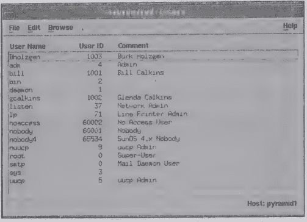

### 图 4.1

用户主菜单。

- 3. 选择 Browse、Software。软件窗口出现，如图 4.2 所示。

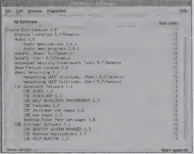

### 图 4.2

软件窗口。

- 4. 选择 Edit、Add。设置源介质窗口出现，如图 4.3 所示。

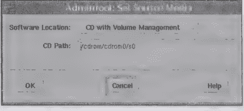

### 图 4.3

设置源介质窗口。

- 5. 指定安装介质的路径。安装应用程序的默认路径是已挂载的 SPARC Solaris CD。单击 OK 以显示添加软件窗口，如图 4.4 所示。

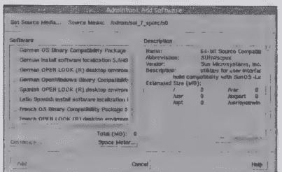

### 图 4.4

添加软件窗口。

- 6. 在窗口的软件部分，单击要安装的软件对应的复选框。选择完所有软件包后，单击添加按钮。

正在安装的每个软件包都会出现一个命令工具窗口，显示安装输出。安装完成后，软件窗口将刷新以显示刚刚添加的软件包。

## 使用 Admintool 删除软件包

要使用 Admintool 删除软件包，请按照以下步骤中的操作进行。

### 逐步操作

### 4.3 删除应用程序软件

删除应用程序软件的步骤如下：

- 1. 如果 Admintool 尚未运行，请启动它并选择 Browse、Software。软件窗口打开，如图 4.5 所示。

### 图 4.5

软件窗口。

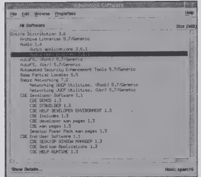

- 2. 选择要删除的软件包，然后选择 Edit、Delete。会出现一条消息，询问您是否确认要删除软件（见图 4.6）。


### 图 4.6

确认软件删除。

对于每个正在删除的软件包，都会显示一个命令工具窗口，在删除软件前要求确认。键入 y、n 或 q。如果选择删除软件，则删除过程的输出会显示在命令工具窗口中。

## Solaris 产品注册表

Solaris 产品注册表使您能够执行以下操作：

- 查看已安装和注册的软件列表以及一些软件属性
- 查找并启动安装程序
- 安装额外的软件产品
- 卸载软件

产品注册表与其他工具的主要区别在于，产品注册表设计为与更多较新的安装向导和 Web Start 3.0 兼容。

要启动 Solaris 产品注册表，请输入以下内容：

```
/usr/bin/prodreg
```

如图 4.7 所示的产品注册表窗口将会出现。

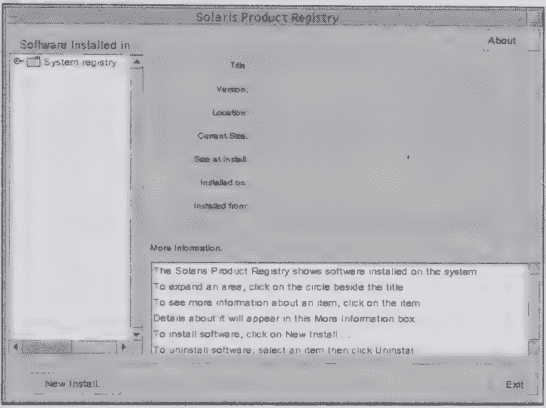

### 图 4.7

产品注册表窗口。

要查看系统注册表的内容，请使用鼠标左键双击系统注册表旁边的[content]
- <pkgid>（可选）。这是要添加到 spool 目录的一个或多个软件包的名称，以空格分隔。如果省略，pkgadd 会复制所有可用的软件包。

- 4. 使用 pkginfo 命令验证软件包是否已复制到 spool 目录，如下所示：

```
pkginfo -d <spooldir> | grep <pkgid>
```

pkginfo 命令如果软件包已正确复制到 spool 目录，将返回有关该软件包的信息行。如果返回空命令行，则表示软件包未成功复制到 spool 目录。

以下是复制软件包的示例：

```
# pkgadd -d /cdrom/sol_8_sparc/s0/Solaris_8/Product -s /var/spool/pkg SUNWaudi
Transferring <SUNWaudi> package instance
# pkginfo -d /var/spool/pkg system SUNWaudi Audio/ applications
```

## 使用 Admintool 添加软件包

本节介绍如何使用 Admintool 添加软件包。

### 逐步操作

### 4.2 使用 Admintool 安装附加应用程序软件

使用 Admintool 安装附加应用程序软件的步骤如下：

- 1. 以 root 用户身份启动 Admintool，在命令提示符下键入 admintool。

- 2. 用户主菜单出现，如图 4.1 所示。


### 图 4.1

用户主菜单。

- 3. 选择 Browse、Software。软件窗口出现，如图 4.2 所示。


### 图 4.2

软件窗口。

- 4. 选择 Edit、Add。设置源介质窗口出现，如图 4.3 所示。


### 图 4.3

设置源介质窗口。

- 5. 指定安装介质的路径。安装应用程序的默认路径是已挂载的 SPARC Solaris CD。单击 OK 以显示添加软件窗口，如图 4.4 所示。


### 图 4.4

添加软件窗口。

- 6. 在窗口的软件部分，单击要安装的软件对应的复选框。选择完所有软件包后，单击添加按钮。

正在安装的每个软件包都会出现一个命令工具窗口，显示安装输出。安装完成后，软件窗口将刷新以显示刚刚添加的软件包。

## 使用 Admintool 删除软件包

要使用 Admintool 删除软件包，请按照以下步骤中的操作进行。

### 逐步操作

### 4.3 删除应用程序软件

删除应用程序软件的步骤如下：

- 1. 如果 Admintool 尚未运行，请启动它并选择 Browse、Software。软件窗口打开，如图 4.5 所示。

### 图 4.5

软件窗口。


- 2. 选择要删除的软件包，然后选择 Edit、Delete。会出现一条消息，询问您是否确认要删除软件（见图 4.6）。


### 图 4.6

确认软件删除。

对于每个正在删除的软件包，都会显示一个命令工具窗口，在删除软件前要求确认。键入 y、n 或 q。如果选择删除软件，则删除过程的输出会显示在命令工具窗口中。

## Solaris 产品注册表

Solaris 产品注册表使您能够执行以下操作：

- 查看已安装和注册的软件列表以及一些软件属性
- 查找并启动安装程序
- 安装额外的软件产品
- 卸载软件

产品注册表与其他工具的主要区别在于，产品注册表设计为与更多较新的安装向导和 Web Start 3.0 兼容。

要启动 Solaris 产品注册表，请输入以下内容：

```
/usr/bin/prodreg
```

如图 4.7 所示的产品注册表窗口将会出现。


### 图 4.7

产品注册表窗口。

要查看系统注册表的内容，请使用鼠标左键双击系统注册表旁边的[content]
- <pkgid>（可选）。这是要添加到 spool 目录的一个或多个软件包的名称，以空格分隔。如果省略，pkgadd 会复制所有可用的软件包。

- 4. 使用 pkginfo 命令验证软件包是否已复制到 spool 目录，如下所示：

```
pkginfo -d <spooldir> | grep <pkgid>
```

pkginfo 命令如果软件包已正确复制到 spool 目录，将返回有关该软件包的信息行。如果返回空命令行，则表示软件包未成功复制到 spool 目录。

以下是复制软件包的示例：

```
# pkgadd -d /cdrom/sol_8_sparc/s0/Solaris_8/Product -s /var/spool/pkg SUNWaudi
Transferring <SUNWaudi> package instance
# pkginfo -d /var/spool/pkg system SUNWaudi Audio/ applications
```

## 使用 Admintool 添加软件包

本节介绍如何使用 Admintool 添加软件包。

### 逐步操作

### 4.2 使用 Admintool 安装附加应用程序软件

使用 Admintool 安装附加应用程序软件的步骤如下：

- 1. 以 root 用户身份启动 Admintool，在命令提示符下键入 admintool。

- 2. 用户主菜单出现，如图 4.1 所示。


### 图 4.1

用户主菜单。

- 3. 选择 Browse、Software。软件窗口出现，如图 4.2 所示。


### 图 4.2

软件窗口。

- 4. 选择 Edit、Add。设置源介质窗口出现，如图 4.3 所示。


### 图 4.3

设置源介质窗口。

- 5. 指定安装介质的路径。安装应用程序的默认路径是已挂载的 SPARC Solaris CD。单击 OK 以显示添加软件窗口，如图 4.4 所示。


### 图 4.4

添加软件窗口。

- 6. 在窗口的软件部分，单击要安装的软件对应的复选框。选择完所有软件包后，单击添加按钮。

正在安装的每个软件包都会出现一个命令工具窗口，显示安装输出。安装完成后，软件窗口将刷新以显示刚刚添加的软件包。

## 使用 Admintool 删除软件包

要使用 Admintool 删除软件包，请按照以下步骤中的操作进行。

### 逐步操作

### 4.3 删除应用程序软件

删除应用程序软件的步骤如下：

- 1. 如果 Admintool 尚未运行，请启动它并选择 Browse、Software。软件窗口打开，如图 4.5 所示。

### 图 4.5

软件窗口。


- 2. 选择要删除的软件包，然后选择 Edit、Delete。会出现一条消息，询问您是否确认要删除软件（见图 4.6）。


### 图 4.6

确认软件删除。

对于每个正在删除的软件包，都会显示一个命令工具窗口，在删除软件前要求确认。键入 y、n 或 q。如果选择删除软件，则删除过程的输出会显示在命令工具窗口中。

## Solaris 产品注册表

Solaris 产品注册表使您能够执行以下操作：

- 查看已安装和注册的软件列表以及一些软件属性
- 查找并启动安装程序
- 安装额外的软件产品
- 卸载软件

产品注册表与其他工具的主要区别在于，产品注册表设计为与更多较新的安装向导和 Web Start 3.0 兼容。

要启动 Solaris 产品注册表，请输入以下内容：

```
/usr/bin/prodreg
```

如图 4.7 所示的产品注册表窗口将会出现。


### 图 4.7

产品注册表窗口。

要查看系统注册表的内容，请使用鼠标左键双击系统注册表旁边的

补丁由唯一的字母数字字符串标识。补丁基本代码在前，其后是连字符，然后是表示补丁修订号的数字。例如，补丁 110453-01 是用于修正 Admintool 问题的 Solaris 8 补丁。

您可能想了解更多有关先前已安装的补丁的信息。表 4.3 显示了提供有关系统上已安装补丁的有用信息的命令。

## 表 4.3
### 用于补丁管理的有帮助命令

| 命令 | 功能 |
|---|---|
| showrev -p | 显示系统上应用的所有补丁。 |
| pkgparam <pkgid> PATCHLIST | 显示应用于由 pkgid 标识的软件包的所有补丁。 |
| pkgparam <pkgid> PATCH INFO <patch-number> | 显示补丁应用的安装日期和主机名称。 <pkgid> 是软件包的名称（例如，SUNWadmap），而 <patch-number> 是特定的补丁编号。 |
| patchadd -R client_root_path -p | 从服务器控制台显示应用于客户端的所有补丁。 |
| patchadd -p | 显示系统上应用的所有补丁。 |
| patchrm <patchname> | 删除指定的补丁。 <patchname> 是要删除的补丁的名称。 |

## 安装补丁

Sun 客户可通过万维网或匿名 FTP 访问安全补丁和其他推荐补丁。购买了服务合同的 Sun 客户可以访问扩展的补丁集和完整的补丁信息数据库。（此信息也可通过万维网或匿名 FTP 获得，并定期在 CD-ROM 上分发。）

有关如何安装和删除补丁的详细信息在每个补丁中包含的 Install.info 文件中提供。每个补丁还包含一个 README 文件，其中包含有关该补丁的特定信息。

补丁有三种不同的格式。Solaris 8 补丁采用 zip 格式，例如 104945-02.zip。对于 Solaris 8 补丁，请使用 unzip 命令按如下方式提取补丁文件：

/usr/bin/unzip 104945-02.zip

对于 Solaris 2.6 及更早的操作环境，补丁可能采用压缩 tar 格式，例如 104945-02.tar.Z。使用 zcat 命令解压缩此类补丁文件，并使用 tar 命令创建补丁目录，如下所示：

/usr/bin/zcat 104945-02.tar.Z | tar xvf -

其他 Solaris 补丁可能作为 gzip 压缩的 tar 文件提供，例如 102945-02.tar.gz。要提取 gzip 压缩的 tar 文件，请使用 gzcat 命令解压缩并按如下方式创建补丁目录：

/usr/bin/gzcat 104945-02.tar.gz | tar xvf -

patchadd 命令用于将目录格式的补丁安装到 Solaris 8 系统。它必须以 root 身份运行。语法如下：

```
patchadd [ -d ] [ -u ] [ -B backout_dir ]
```

patchadd 命令在表 4.4 中描述。

## 表 4.4
### patchadd 命令选项

| 常用选项 | 描述 |
|---|---|
| -d | 不创建要修补的文件的备份。使用此选项安装补丁后，补丁无法被移除。默认情况下，patchadd 会保存所有正在更新的文件的副本，以便在必要时可以移除补丁。除非您确信补丁已通过测试，否则请勿使用 -d 选项。 |
| -p | 显示当前应用的补丁列表。 |
| -u | 无条件安装补丁，并关闭文件验证。即使自文件最初安装以来某些待修补文件已被修改，补丁仍会被安装。 |
| -B <backout_dir> | 将回滚数据保存到软件包数据库以外的目录。指定 <backout_dir> 为绝对路径名。 |
| -M <patch_dir> <patch_id> | 指定要安装的补丁。通过目录位置和补丁号指定 -M 选项的补丁 |
| or |  |
| -M <patch_dir> <patch_file list> | 通过目录位置和补丁号。要使用目录位置和补丁号，请将 <patch_dir> 指定为包含已 spool 的补丁的目录的绝对路径名。将 <patch_id > 指定为给定补丁的补丁号。您还可以指定多个 patch_ids。通过目录位置和包含补丁列表的文件的名称。要使用目录位置和包含补丁列表的文件，请将 <patch_dir > 指定为包含要安装的补丁列表的文件的目录的绝对路径名。将 <patch_list > 指定为包含要安装的补丁的文件的名称。见本节后面的示例。 |
| -R <client_root_path> | 在目录 <client_root_path> 下定位 patchadd 生成的所有补丁文件。 <client_root_path> 是从服务器的角度来看包含客户端可引导根目录的目录。将 <client_root_path > 指定为所有由 patchadd 生成的补丁文件将被定位的目录树的开头的绝对路径名。见本节后面的示例。 |

以下示例描述如何向系统添加补丁。然而，在安装补丁之前需要谨慎。根据我的个人经验，墨菲定律你可能会这么说，事情可能会出错。因为您正在用补丁修改操作系统，我强烈建议您在加载补丁之前备份文件系统。虽然这可能是一项耗时且看似不必要的任务，但我曾在补丁安装期间遇到过电源故障，导致我的系统完全损坏。另一次，补丁安装脚本有缺陷，补丁未能正确加载。如果没有备份，我就必须重新安装整个操作系统。

注
patchadd 命令的附加选项可在 Solaris 系统手册页中在线找到。

以下示例将补丁安装到独立机器：

```
patchadd /var/spool/patch/104945-02
```

以下示例安装多个补丁。patchlist 文件指定包含要安装的补丁列表的文件：

```
patchadd -M /var/spool/patch patchlist
```

以下示例显示名为 client1 的客户端系统上安装的补丁：

```
patchadd -R /export/root/client1 -p
```

当您安装补丁时，patchadd 命令会将文件从补丁目录复制到本地系统的磁盘。更具体地说，patchadd 执行两项操作：

- 它确定管理主机和目标主机的 Solaris 版本号。
- 它使用有关被安装补丁所淘汰的补丁、该补丁所需的其他补丁以及与该补丁不兼容的补丁的信息来更新补丁软件包的 pkginfo 文件。

patchadd 命令在以下条件下不会安装补丁：

- 软件包未在主机上完全安装。
- 补丁架构与系统架构不同。
- 补丁版本与已安装的软件包版本不匹配。
- 已安装的补丁已存在于具有相同基本代码且版本号更高的补丁。
- 补丁与另一个已安装的补丁不兼容。（每个已安装的补丁在其 pkginfo 文件中保留此信息。）
- 要安装的补丁需要另一个未安装的补丁。

## 删除补丁

有时，补丁未按计划工作，需要从系统中删除。用于删除或“回滚”补丁的实用程序是 patchrm 命令，在表 4.5 中描述。其语法如下：

```
patchrm [ -f ] [ -B backout_dir ]
```

## 表 4.5
### patchrm 命令选项

| 常用选项 | 描述 |
|---|---|
| -f | 强制删除补丁，而不管补丁是否已被另一个补丁取代。 |
| -B backout_dir | 删除其回滚数据已保存到软件包数据库以外的目录的补丁。此选项仅在原始回滚目录（在安装时提供给 patchadd 命令）被移动时才需要。将 backout_dir 指定为绝对路径名。 |

以下示例从独立系统删除补丁：

```
patchrm 104945-02
```

patchrm 命令删除 Solaris 8 补丁软件包，并恢复先前保存的文件，将文件系统恢复到应用补丁之前的状态，除非存在以下四种条件中的任何一种：

- 补丁是使用 patchadd -d 安装的。（-d 选项

指示 patchadd 不要保存正在更新或替换的文件的副本。）

- 该补丁已被后续补丁所淘汰。
- 该补丁被系统上已安装的另一个补丁所必需。
- patchrm 命令调用 pkgadd 来恢复从初始补丁安装中保存的软件包。

## 通用指南

某些软件包不符合 ABI；因此，不能使用 Admintool 或 pkgadd 命令安装它们。对于不符合 ABI 的产品安装，请遵循厂商特定的安装说明。以下是安装新软件到系统时应遵循的几个额外指南：

- 始终对第三方或公共领域软件保持谨慎。确保在生产系统上安装之前，该软件经过测试且无病毒。
- 确保软件包在 Solaris 8 下受支持。
- 始终阅读厂商的发行说明以获取特殊加载说明。它们可能包含需要修改的内核参数或建议需要应用的软件补丁。
- 除非 Sun 或您的软件提供商指示，否则不要安装补丁。某些补丁尚未经过充分测试，尤其是在与其他软件补丁一起使用时。可能会导致系统性能出现不良问题。

添加和删除软件包是您在系统管理中会遇到的较为简单的任务之一。与所有计算机软件一样，您应首先在非生产系统上加载新的软件包或补丁以进行测试。只有在软件经过彻底测试后，才应将其安装到生产系统上。

注意
对于每个软件版本，Sun 通常都有一个预打包的补丁集，称为“推荐和安全补丁”。这些补丁经过了彻底测试，Sun 建议在初始软件安装完成后将这些补丁添加到每个系统。

本章介绍了软件包管理。它首先描述了 Sun 用于打包其捆绑和非捆绑操作系统软件的方法。然后描述了在 Solaris 系统上安装、验证和删除这些软件包所使用的工具和方法。

## 章节摘要

它还解释了有时会发现软件缺陷并需要修复。您学习了如何获取、安装以及在必要时卸载软件补丁。

第 11 章“备份和恢复”描述了如何创建已安装内容的磁带备份。良好的备份可以在硬件故障时为您节省时间。有了良好的备份，您无需重新追溯安装软件包或补丁以及设置用户的步骤。

后续的一些章节描述了如何配置您已安装的某些软件包，例如 LP 打印服务（第 10 章“The LP Print Service”）、NFS（第 17 章“The NFS Environment”）、NIS（第 18 章“Name Services”）、Solstice AdminSuite（第 19 章“Solaris Management Console and Solstice AdminSuite”）以及通用桌面环境（附录 B，“Administration and Configuration of the CDE”）。

- 软件 spool 目录
- 捆绑软件包
- 非捆绑软件包
- 压缩 tar 文件
- 补丁列表文件

## 练习

## 关键术语

- 软件包
- 软件补丁

## 应用你的知识

## 练习

### 4.1 软件包管理

本练习将引导您使用命令行在 Solaris 系统上安装、验证和删除软件的任务。

预计时间：20 分钟

1. 通过输入以下内容列出当前安装在系统上的软件包：
   `pkginfo`
2. 显示系统上安装的 SUNWman 软件包的长格式信息列表。
   `pkginfo -l SUNWman`
   该软件包的状态、安装日期、文件数和使用的块数分别列出了什么？
3. 使用以下命令从系统删除 SUNWdoc 软件包：
   `pkgrm SUNWdoc`
   通过重复步骤 1 验证软件包是否已删除。
   现在，我们将重新安装软件包。以 root 身份登录，并将 Solaris 8 安装 CD 插入 CD-ROM 驱动器。使用 pkgadd 将 SUNWdoc 软件包 spool 到默认 spool 区域，如下所示：
   `pkgadd -d \
   /cdrom/sol_8_u3_sparc/s0/Solaris_8/Product \
   -s /var/spool/pkg SUNWdoc`
4. 使用以下命令验证 SUNWdoc 是否存在于默认 spool 区域：
   `pkginfo -d /var/spool/pkg`

5. 观察显示的消息，并验证软件包是否已安装在 /var/spool/pkg 中。
6. 按如下方式从 spool 区域重新安装 SUNWdoc 软件包：
   `pkgadd`
7. 在提示时选择 SUNWdoc 软件包，软件包将被重新安装。
8. 要从 spool 区域删除 SUNWdoc 软件包，输入以下内容：
   `pkgrm -s /var/spool/pkg`
   选择 SUNWdoc 软件包，它将被从 spool 目录中删除。
9. 现在您可以使用 pkgchk 命令检查 SUNWdoc 软件包的完整性、路径名、文件内容和文件属性：
   `pkgchk SUNWdoc`

## 复习问题

1. 以下哪个命令用于显示软件包信息？
   A. pkgadd
   B. pkgchk
   C. pkgparam
   D. pkginfo
2. 以下哪个命令验证软件包安装的准确性？
   A. pkgadd
   B. pkgchk
   C. pkgask
   D. pkginfo

## 应用你的知识

3. 以下哪些方法用于从系统删除软件包？
   - A. pkg rm
   - B. rm -r
   - C. Admintool
   - D. 以上全部
4. 软件包通常以什么开头？
   - A. 软件包的缩写
   - B. 公司的股票代码
   - C. SUNW
   - D. 厂商选择的任何内容
5. 以下哪个命令为安装准备压缩的 tar 补丁文件（带“Z”扩展名）并节省约 25% 的临时磁盘空间使用？
   - A. installpatch -u 104945-02.tar.Z
   - B. installpatch -f 104945-02.tar.Z
   - C. /usr/bin/zcat 104945-02.tar.Z | tar xvf -
   - D. unzip 104945-02.tar.Z | tar xvf -
6. 以下哪个命令显示系统上应用的所有补丁？选择所有适用项。
   - A. patchadd -p
   - B. pkginfo
   - C. showrev -p
   - D. 以上全部
7. 以下哪个命令用于从系统删除补丁？
   - A. uninstall
   - B. pkgrm -s
   - C. patchrm
   - D. rm -r
8. Sun 以以下哪些形式分发软件补丁？选择所有适用项。
   - A. Sun FTP 站点
   - B. 电子邮件
   - C. CD-ROM
   - D. 磁带
9. Solaris 产品注册表使您能够执行以下哪些操作？选择所有适用项。
   - A. 查看已安装软件列表
   - B. 卸载软件
   - C. 启动安装程序
   - D. 使用注册表编辑器直接编辑软件包
10. 使用 patchadd 命令安装补丁时，以下哪个选项不会创建要修补文件的备份？
   - A. -f
   - B. -p
   - C. -B
   - D. -d

## 应用你的知识

11. 以下哪些情况会阻止补丁被安装？
   - A. 要安装的补丁需要另一个未安装的补丁。
   - B. 该补丁与另一个已安装的补丁不兼容。
   - C. 该补丁已被删除。
   - D. 补丁版本不是最新版本。
   - E. 以上全部

## 复习问题答案

1. D. pkginfo 命令显示软件包信息。
2. B. pkgchk 命令检查软件包安装的准确性。
3. A. pkgrm 命令从系统删除软件包。
4. B. 软件包名称通常以公司的股票代码开头。

5. C. 补丁可能以压缩 tar 格式提供，例如 104945-02.tar.Z。使用 zcat 命令解压缩此类补丁文件。
6. A.、C. 使用 patchadd -p 命令或 showrev -p 命令显示系统上已应用的所有补丁。
7. C. 使用 patchrm 命令从系统删除补丁。
8. A.、B.、C. 软件补丁通过以下方式交付给客户：来自 Sun 的 FTP 站点、通过电子邮件或 CD-ROM。
9. A.、B.、C. Solaris 产品注册表使您能够查看所有已安装软件、卸载软件或启动安装程序以安装额外软件。
10. D. patchadd 命令的 -d 选项不会创建要修补文件的备份。
11. A.、B. 以下情况可能阻止补丁被安装：
   - 要安装的补丁需要另一个未安装的补丁。
   - 该补丁与另一个已安装的补丁不兼容。


## 目标

以下为本章的测试目标：

### 使用 Admintool 或命令行添加、删除和修改用户帐户

使用 Admintool 管理用户帐户是一种高效地添加、修改和删除用户帐户信息的方式。这是对系统管理员而言的常规活动，因此必须完全理解 Admintool 中的此功能。

### 设置、自定义和管理初始化文件

用户会话使用每次用户登录时引用的初始化文件进行自定义。每个初始化文件的管理将被描述。

### 管理用户主目录

管理系统涉及对用户个人目录的密切监控和管理。保护这些目录中的公共和个人数据是系统管理员的责任。

## 第 5 章

## 设置用户帐户

- 引言 159
- 使用 Admintool 添加用户帐户 160
- 使用 Admintool 删除用户帐户 165
- 使用 Admintool 修改用户帐户 166
- 使用 Admintool 添加组 167
- 从命令行管理用户和组帐户 169
  - 从命令行添加用户帐户 169
  - 从命令行修改用户帐户 171
  - 从命令行删除用户帐户 172
  - 从命令行添加组帐户 172
  - 从命令行修改组帐户 173
  - 从命令行删除组帐户 173
- 设置用户初始化文件 174
- 自定义用户初始化文件 175
- 主目录 178
- 名称服务 179
- 摘要 180
- 应用你的知识 181

以下策略将帮助你为考试做准备：

- 阅读本章时，请在运行 Solaris 8 的 Sun 或基于 Intel 的系统上练习我提供的逐步示例。一直练习到你能从记忆中执行这些步骤。
- 确保你理解与用户帐户相关的每个属性（在表 5.3 中描述），例如 UID、主组、默认 shell 等。
- 使用 Admintool 向你的系统添加几个用户并设置本章中描述的初始化文件。修改帐户属性，例如默认 shell、组和 UID 值。为每个用户修改初始化文件中的变量以查看结果。
- 练习使用命令行工具添加、修改和删除用户帐户。这些命令会出现在 Sun 考试中，因此确保你彻底理解它们。继续练习这些命令，直到你能从记忆中执行它们。

## 引言

系统访问仅通过系统管理员设置的用户登录帐户允许。用户帐户包括用户登录和使用系统所需的信息——用户登录名、密码、用户的主目录和登录初始化文件。用户帐户范围从偶尔需要只读访问少数文件的访客，到需要在多个部门之间共享信息的常规用户。

表 5.1 列出了 Solaris 中用于向系统添加新用户帐户的方法和工具。

### 表 5.1

添加新用户帐户

| 环境 | 推荐工具 | 可用性 |
|---|---|---|
| 在网络名称服务（NIS、NIS+）中的远程和/或本地系统 | 来自 Solstice AdminSuite 的用户和组管理器（图形用户界面） | 作为单独产品提供 |
| 本地系统 | Admintool（图形用户界面） | 随 Solaris 8 提供 |
| 命令行 | 终端窗口（CDE 环境）或 shell 工具或命令工具（OpenWindows 环境） | 随 Solaris 8 提供 |

与许多 UNIX 命令一样，添加用户帐户的命令行方法繁琐且令人困惑。因此，Sun 已将用户帐户管理添加到 Solaris Admintool。Admintool 是一种图形用户界面，旨在简化多个常规系统管理任务。使用 Admintool 时，系统管理员会看到一个类似菜单的界面，使用起来比在命令提示符下提供的 ASCII 界面容易得多。当使用 NIS 或 NIS+ 时，Admintool 不会更改名称服务映射或表；此任务由一个名为 Solstice AdminSuite 的未捆绑产品完成。有关使用 AdminSuite 的说明，请参阅第 19 章“ Solaris Management Console 和 Solstice AdminSuite”。本章描述了如何使用 Solaris Admintool 和命令行在系统上管理用户帐户。

## 使用 ADMINTOOL 添加用户帐户

> 注意
当你添加或修改用户帐户时，Admintool 会编辑文件 /etc/passwd、/etc/shadow 和 /etc/group。作为 root，你可以直接编辑这些文件，但不建议这样做。任何文件中的错误都可能对系统造成不利影响。请参阅第 8 章“系统安全”，以获取这些文件的完整描述。

要执行添加用户帐户等管理任务，管理员必须以超级用户（root）身份登录或为 GID 14（sysadmin）的成员。

设置新用户帐户的第一步是让用户提供你管理此帐户所需的信息。你还需要设置适当的权限，以便用户可以与其他部门成员共享信息。首先，你需要知道用户的全名、部门以及用户将要工作的任何组。我喜欢与用户坐下来填写类似表 5.2 所示的信息表，以便我在设置帐户时拥有所需的所有信息。

### 表 5.2
用户信息数据表

| 项目 | 描述 |
|------|-------------|
| 用户名： |  |
| UID： |  |
| 主组： |  |
| 次要组： |  |
| 注释： |  |
| 默认 Shell： |  |
| 密码状态和老化： |  |
| 主目录服务器名称： |  |
| 主目录路径名称： |  |
| 邮件服务器： |  |
| 部门名称： |  |
| 部门管理员： | |
| 管理员： | |
| 员工姓名： | |
| 职务： | |
| 员工状态： | |
| 员工编号： | |
| 开始日期： | |
| 桌面系统名称： | |

## 逐步操作

### 5.1 添加新的登录用户

要添加新的用户登录帐户，请按以下步骤操作：

1. 以 sysadmin 组成员身份通过在命令提示符下键入 admintool 启动 Admintool。

用户主菜单出现，如图 5.1 所示。

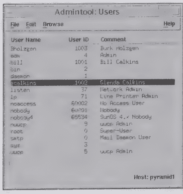

### 图 5.1
用户主菜单。

继续

2. 选择 编辑、添加 以显示添加用户窗口，如图 5.2 所示。

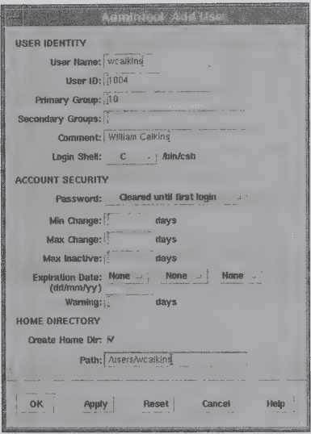

### 图 5.2

添加用户窗口。

3. 填写添加用户窗口中的文本框。表 5.3 描述了所需的信息。如果你不确定如何完成某个字段，请单击帮助按钮以查看此窗口的字段定义。

4. 输入信息后，单击确定。用户主窗口中显示当前用户帐户列表。

### 表 5.3

### 添加用户字段

| 项目 | 描述 |
|------|-------------|
| 用户名 | 输入将在 Solaris 登录提示符下输入的唯一登录名。选择对你的组织唯一的名称。名称可以包含 2–8 个大写字符（A–Z）、小写字符（a–z）或数字（0–9），但不能包含下划线或空格。第一个字符必须是字母，并且至少有一个字符必须是小写字母。 |
| 用户 ID | 输入唯一的 user ID（第 8 章中讨论）。Admintool 自动分配下一个可用的 UID；然而，在网络环境中，请确保此号码不会被另一系统上的另一用户重复。所有 UID 必须在网络中保持一致。UID 通常是 100 到 60002 之间的数字，但最高可达 2147483647。请参阅“主组”描述中关于 UID 大于 60000 的注释。 |
| 主组 | 输入用户所属组的名称或 GID（组 ID）号码。操作系统将把此组分配给用户创建的文件。组 10（staff）是预定义组，对大多数用户而言已足够。GID 的范围为 0 到 60002，但最高可达 2147483647。注意：之前的 Solaris 软件版本使用 32 位数据类型来包含用户 ID（UID）和组 ID（GID），但 UID 和 GID 被限制为最大可用值 60000。从 Solaris 2.5.1 版本及兼容版本开始，UID 和 GID 值的限制已提高到有符号整数的最大值，即 2147483647。超过 60000 的 UID 和 GID 没有完整功能且与许多 Solaris 功能不兼容，因此避免使用超过 60000 的 UID 或 GID。 |
| 次要组 | （可选）输入用户所属的任何附加组的名称或 GID，以空格分隔。用户最多可以属于 16 个次要组。 |
| 注释 | （可选）输入任何注释，例如全用户名或电话号码。 |
| 登录 Shell | 单击此按钮以选择用户将使用的 shell，例如 /bin/csh。如果未选择任何内容，默认 shell 为 Bourne shell（/bin/sh）。 |
| 密码 | 单击此按钮以指定密码状态。可选选项如下：
- 直到首次登录前清除。这是默认值。帐户未分配密码。用户在首次登录时会被提示输入密码，除非在 /etc/default/login 中设置了 passreq=no。
- 帐户已锁定。帐户使用无效密码被禁用，可通过分配新密码来解锁。此类帐户允许用户拥有文件，但不能登录。 |


## 表 5.3 继续
### 添加用户字段

| 项目 | 描述 |
|------|-------------|
|  | - 无密码；仅 setuid。账户不能直接登录。这允许诸如 lp 和 uucp 之类的程序在账户下运行，而不允许用户登录。<br>- 普通密码。账户将具有你在出现的弹出窗口中设置的密码。 |
| 最小更改 | （可选）输入密码更改之间允许的最小天数。这旨在防止用户更改密码后几秒钟内再改回，从而破坏密码老化的概念。默认值为 0。 |
| 最大更改 | （可选）输入密码在必须更改之前有效的最大天数；否则，账户将被锁定。留空该字段表示密码永远不需要更改。 |
| 最大非活动 | （可选）输入账户在自动锁定之前可以不被访问的最大天数。空白字段表示账户保持活动状态，无论闲置多久。 |
| 到期日期 | （可选）输入用户账户到期的日期。无表示不过期。 |
| 警告 | （可选）输入在密码到期前开始警告用户的天数。空白表示不给出警告。 |
| 创建主目录复选框 | 选中此框以自动创建用户的主目录。 |
| 路径 | 使用路径字段指向现有目录或指定要创建的新目录。 |

> 注意
用户可以在命令提示符下输入 UNIX 命令 passwd 来更改其密码。有关设置密码的更多信息，请参阅第 8 章。

## 使用 Admintool 删除用户账户

当系统上不再需要用户账户时，从系统中删除它。以下过程描述了如何执行此任务。

### 逐步操作
## 5.2 使用 Admintool 删除现有用户账户

使用 Admintool 删除现有用户账户。删除用户账户的步骤如下：

- 1. 如果 Admintool 尚未运行，请启动它，然后选择 浏览、用户。
- 2. 在“用户”窗口中，选择要删除的用户账户条目。
- 3. 选择 编辑、删除。
- 4. 将显示一条消息以确认用户账户的删除（见图 5.3）。
- 5. （可选）单击“删除主目录”复选框以删除用户的主目录及其内容。如果不选中该框，用户账户将被删除，但用户主目录的内容将保留。
- 6. 准备好删除用户账户时单击“确定”。用户账户条目将从“用户”主窗口中删除。


### 图 5.3
确认要删除用户账户。

## 使用 Admintool 修改用户账户

如果需要修改登录名——例如更改密码或禁用账户——请使用 Admintool 修改这些用户账户设置。

### 逐步操作
## 5.3 使用 Admintool 修改用户账户

修改用户账户的过程如下：

- 1. 如果 Admintool 尚未运行，请启动它，然后选择 浏览、用户。
- 2. 选择要修改的用户账户条目。
- 3. 选择 编辑、修改。
- 4. 将显示“修改用户”窗口，其中包含所选的用户账户条目（见图 5.4）。

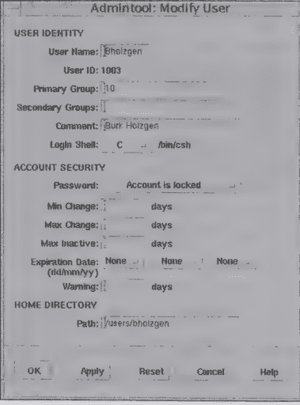

### 图 5.4
修改用户窗口。

- 5. 以下是允许的部分修改的说明：
- 锁定登录
  选择 密码：账户已锁定。
- 更改用户的密码
  通过将密码状态更改为普通密码或首次登录前清除来启用用户账户。
- 6. 单击“确定”，修改完成。

## 使用 Admintool 添加组

你可能需要添加一个系统上尚不存在的组。也许需要添加一个名为“engrg”（来自工程部门）的新用户组。

### 逐步操作
## 5.4 使用 Admintool 添加组

以下步骤描述如何添加新的“engrg”组：

- 1. 如果 Admintool 尚未运行，请启动它，然后选择 浏览、组。
- 2. 将显示“组”窗口，如图 5.5 所示。

### 图 5.5
组窗口。

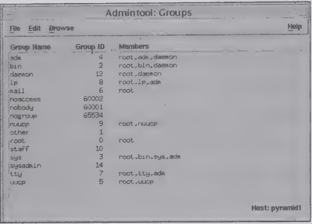

- 3. 选择 编辑、添加。
- 4. 将显示“添加组”窗口，如图 5.6 所示。如果不确定如何完成某个字段，请单击“帮助”按钮以查看此窗口的字段定义。

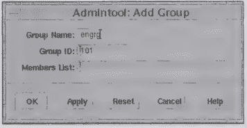

### 图 5.6
添加组窗口。

- 5. 在“组名”文本框中输入新组的名称。
- 6. 在“组 ID”文本框中输入新组的组 ID 号。这应为唯一的数字。
- 7. （可选）在“成员列表”文本框中输入用户名。这些是属于新组的用户。用户名必须用逗号分隔。用户列表将被添加到组中。
- 8. 单击“确定”。“组”窗口中显示的组列表将更新为包含新组。

## 从命令行管理用户和组账户

管理用户账户的另一种方式是从命令行进行。虽然使用命令行比使用 Admintool GUI 界面更复杂，但命令行提供了更大的灵活性。Solaris 提供了表 5.4 中描述的用户管理命令，用于设置和管理用户账户。

## 表 5.4
### 账户管理命令

| 命令 | 描述 |
|---|---|
| useradd | 添加新的用户账户 |
| userdel | 删除用户账户 |
| usermod | 修改用户账户 |
| groupadd | 添加新组 |
| groupmod | 修改组（例如更改组 ID 或名称） |
| groupdel | 删除组 |

### 从命令行添加用户账户

你可以使用 useradd 命令在本地系统上添加新的用户账户。此命令将新用户的条目添加到 /etc/passwd 和 /etc/shadow 文件中，这些文件在第 8 章中进行了描述。

就像 Admintool 一样，useradd 命令也会将 /etc/skel 目录中找到的所有用户初始化文件复制到新用户的主目录中。用户初始化文件在下一节中介绍。

我将开始描述 useradd 命令。useradd 命令的语法如下：

```
useradd [-u <uid>] [-g <gid>] [-G <gid,gid,...>] [-d <dir>] -m [-s <shell>] [-c <comment>][-f <inactive>] \
[-e <expiration>] <loginname>
```

表 5.5 描述了这些选项：

## 表 5.5
### useradd 命令选项

| 选项 | 描述 |
|---|---|
| `-u <uid>` | 设置用户的唯一 UID。 |
| `-g <gid>` | 指定用户的预定义 GID 或名称。这将是用户的主要组。 |
| `-G <gid>` | 定义新用户的次要组成员身份。可以输入多个组，但必须用逗号分隔。 |
| `-m` | 如果不存在，则创建新的主目录。 |
| `-s <shell>` | 定义用作用户登录 shell 的 shell 程序的完整路径名。如果未指定 shell，则默认为 `/bin/sh`。 |
| `-c <comment>` | 这仅是注释，通常用于指定用户的全名、位置和电话号码。 |
| `-d <directory>` | 新用户的主目录。默认为 `<base_dir>/<account_name>`，其中 `<base_dir>` 是新登录主目录的基目录，`<account_name>` 是新的登录名。 |
| `-e <expire>` | 为用户账户设置到期日期。指定用户不能再登录和访问账户的日期。指定日期后，账户将被锁定。使用以下格式指定日期：`mm/dd/yy`。 |
| `-f <inactive>` | 设置用户账户允许的非活动天数。如果在指定天数内未登录账户，则账户将被锁定。 |
| `-k <skeldir>` | 指定用户初始化模板文件的替代位置。此目录中的文件将被复制到用户的主目录中。默认位置为 `/etc/skel`。 |


还有许多其他选项可用，尽管大多数并不经常使用。请参阅在线手册页以获取 useradd 命令所有选项的列表。

以下示例为 Bill Calkins 创建一个新的登录账户。登录名将为“bcalkins”，UID 为 3000，组为“other”。我将指示系统创建一个名为 /export/home/bcalkins 的主目录。默认 shell 将为 /bin/ksh，并且初始化文件将从 /etc/skel 目录复制：

```
useradd -u 3000 -g other -d /export/home/bcalkins -m -s /bin/ksh -c "Bill Calkins, ext. 1111" bcalkins
```

## 从命令行修改用户账户

使用 usermod 命令可从命令行修改现有用户账户。usermod 可用于修改账户最初创建时使用的大多数选项。

usermod 命令的语法如下：

```
usermod [-u <uid>] [-o] [-g <gid>] [-G <gid,gid,...>] [-d <dir>] [-m] [-s <shell>] [-c <comment>] \
[-l <newloginname>] [-f <inactive>] [-e <expiration>] <loginname>
```

使用 usermod 命令的选项与为 useradd 命令描述的选项相同，除了表 5.6 中列出的那些。

### usermod 命令选项
表 5.6

| Option | Description |
|---|---|
| -l <newloginname> | 在指定账户上更改用户的登录名。 |
| -m | 将用户的主目录移动到 -d 选项指定的新位置。 |

> 注意
> 尽管主目录已更改，但仍必须手动将现有文件从旧主目录移动到新主目录。

以下示例将用户 bcalkins 的登录名更改为 wcalkins。它还将主目录更改为 /export/home/wcalkins，默认 shell 更改为 /bin/ksh。

```
usermod -d /export/home/wcalkins -m -s /bin/ksh -l wcalkins bcalkins
```

## 从命令行删除用户账户

使用 userdel 命令可从系统中删除用户的登录账户。可以指定选项以保留或删除用户的主目录。userdel 命令的语法如下：

```
userdel [-r] <loginname>
```

其中 -r 会从本地文件系统中删除用户的主目录。如果未指定此选项，则仅删除登录；主目录保持完整。

以下示例删除 bcalkins 的登录账户，但不删除主目录：

```
userdel bcalkins
```

## 从命令行添加组账户

使用 groupadd 命令可在本地系统上添加新的组账户。此命令会在 /etc/group 文件中添加一个条目。groupadd 命令的语法如下：

```
groupadd [-g <gid>] [-o] <groupname>
```

其中
- -g <gid> 为新组分配组 ID <gid>。
- -o 允许 gid 重复。换句话说，多个 groupname 可以共享相同的 GID。

以下示例向系统添加一个名为 acct、GID 为 1000 的新组：

```
groupadd -g 1000 acct
```

## 从命令行修改组账户

使用 groupmod 命令可修改指定组的定义。groupmod 命令的语法如下：

```
groupmod [-g <gid>] [-o] [-n <name>] <groupname>
```

其中
- -g <gid> 为组分配新的组 ID <gid>。
- -o 允许 gid 重复。换句话说，多个 groupname 可以共享相同的 GID。
- -n <name> 指定组的新名称。

以下示例将 acct 组 GID 更改为 2000：

```
groupmod -g 2000 acct
```

## 从命令行删除组账户

使用 groupdel 命令可从本地系统删除组账户。groupdel 命令的语法如下：

```
groupdel <groupname>
```

以下示例从本地系统删除名为“acct”的组：

```
groupdel acct
```

## 设置用户初始化文件

设置用户主目录的一部分是为用户的登录 shell 提供用户初始化文件。用户初始化文件是一个 shell 脚本，在用户登录系统后为用户设置工作环境。您可以在用户初始化文件中执行 shell 脚本中可以执行的任何任务，但其主要工作是定义用户的工作环境特征，例如搜索路径、环境变量和窗口环境。每个登录 shell 都有自己的用户初始化文件（或文件），位于用户的主目录中。这些文件在用户登录时自动运行。

当添加新用户账户时，默认用户初始化文件（如 .cshrc、.profile 和 .login）会自动创建在用户的主目录中。系统管理员可以预定义这些文件的内容，也可以选择使用系统默认文件。Solaris 8 系统软件在每个系统的 /etc/skel 目录中为每个 shell 提供默认用户初始化文件。这些文件列在表 5.7 中。

### 默认初始化文件
**表 5.7**

| Name | Description |
|---|---|
| local.cshrc | C shell 的默认 .cshrc 文件 |
| local.login | C shell 的默认 .login 文件 |
| local.profile | Bourne 和 Korn shell 的默认 .profile 文件 |

您可以使用这些初始化文件作为起点，并对其进行修改以创建一套标准文件，为所有用户提供共同的工作环境。您也可以对其进行修改以为不同类型的用户提供工作环境。

## 自定义用户初始化文件

当用户登录系统时，shell 初始化文件决定工作环境。shell 启动脚本可以被修改以设置特定用户所需的环境变量和目录路径。这些启动脚本位于用户的主目录中。

在设置用户初始化文件时，允许用户自定义自己的初始化文件可能很重要。这可以通过集中放置并全局分发的用户初始化文件（称为站点初始化文件）来实现。这些文件让您只需编辑一个初始化文件即可不断向所有用户工作环境引入新功能。位于用户主目录中的本地初始化文件允许进行用户特定的配置。

本地初始化文件让用户进一步自定义自己的工作环境。站点初始化文件位于 /etc 目录中，只能由 root 编辑。它们旨在将全站更改分发到所有用户工作环境。个人用户初始化文件位于每个用户的主目录中，可以由该目录的所有者自定义。当用户登录时，首先运行站点初始化文件，然后运行位于用户主目录中的初始化文件。

对 shell 启动脚本最常见的自定义是环境变量。表 5.8 描述了您可能想要在用户初始化文件中自定义的环境和 shell 变量。

> 注意
> 不要使用位于 /etc 目录中的系统初始化文件（/etc/profile、/etc/.login）来管理单个用户的工作环境。这些是站点初始化文件，被视为全局文件，旨在通用并用于为所有用户设置工作环境。系统将首先运行此启动文件，然后运行位于主目录中的用户启动文件。

### Shell 和环境变量描述
表 5.8

| Variable | Description |
|---|---|
| ARCH | 设置用户的系统架构（例如，sun4、i386）。此变量可以用 ARCH = `uname -p`（在 Bourne 或 Korn shell 中）或 setenv ARCH `uname -p`（在 C shell 中）设置。shell 没有依赖此变量的内置行为；它只是 shell 脚本中分支的有用变量。 |
| history | 设置 C shell 的历史记录。 |
| HOME | 设置用户主目录的路径。 |
| LPDEST | 设置用户的默认打印机。 |
| PATH (or path in the C shell) | 按顺序列出 shell 在用户键入命令时搜索以找到要运行的程序的目录。如果目录不在搜索路径中，用户必须键入命令的完整路径名。<br><br>默认 PATH 在登录过程中在 .profile（Bourne 或 Korn shell）或 .cshrc（C shell）中自动定义。<br><br>搜索路径的顺序很重要。当相同命令存在于不同位置时，将使用找到的第一个同名命令。例如，假设 PATH 按 Bourne 和 Korn shell 语法定义为 PATH=/bin:/usr/bin:/usr/sbin:$HOME/bin，并且名为“sample”的文件同时存在于 /usr/bin 和 /home/glenda/bin 中。如果用户键入命令 sample 而不指定其完整路径名，则将使用在 /usr/bin 中找到的版本。 |
| prompt | 定义 C shell 的 shell 提示符。 |
| TERM (or term in the C shell) | 定义终端。此变量应在 /etc/profile 或 /etc/.login 中重置。当用户调用编辑器时，系统会查找与此环境变量定义同名文件。系统搜索目录 /usr/share/lib/terminfo 以确定终端特性。 |
| MAIL | 设置用户邮箱的路径。 |
| MANPATH | 设置系统手册页的搜索路径。 |
| umask | 设置默认用户掩码。 |


## STEP BY STEP

## 5.5 验证和更改用户环境

以下示例说明如何验证用户环境设置以及如何更改它们：

1. 以用户身份登录。此步骤可让您以用户所见的方式查看用户环境。

2. 编辑用户的初始化文件。以下步骤建议了一些更改并显示应使用的 shell 特定语法。

3. 将用户的默认路径设置为包含主目录以及用户窗口环境和应用程序的目录或挂载点。要更改路径设置，请按如下方式添加或修改 PATH 行：

对于 Bourne 或 Korn shell，语法如下：

```
PATH=/dirname1:/dirname2:/dirname3:.; export PATH
```

例如，在用户 $HOME/.profile 文件中输入以下行：

```
PATH=$PATH:/usr/bin:$HOME/bin:/net/glrr/files1/bin:.;export PATH
```

对于 C shell，语法如下：

```
set path =(/dirname1 /dirname2 /dirname3 .)
```

例如，在用户 $HOME/.cshrc 文件中输入以下行：

```
set path=($path /usr/bin $HOME/bin /net/glrr/files1/bin .)
```

4. 检查环境变量是否设置为用户窗口环境和第三方应用程序的正确目录。输入 env 并按 Enter：

```
$ env
```

```
HOME=/home/ncalkins
HZ=100
LOGNAME=ncalkins
MAIL=/var/mail/ncalkins
PATH=/usr/bin
SHELL=/bin/sh
TERM=sun
TZ=EST5EDT
$
```

### NOTE
在 $PATH（Korn shell）或 $path（C shell）前加上前缀会将更改附加到站点初始化文件已设置的用户路径设置。当您使用此过程设置 PATH 变量时，初始路径设置不会被覆盖和丢失。另请注意列表末尾的“点” (.) 以表示当前工作目录。正如第 8 章所述，点应始终位于路径的末尾。

5. 通过输入以下任一行来添加或更改环境变量的设置：

对于 Bourne 或 Korn shell，语法如下：

```
VARIABLE=value;export VARIABLE
```

以下示例设置用户的默认邮件目录：

```
MAIL=/var/mail/ncalkins;export MAIL
```

对于 C shell，语法如下：

```
setenv VARIABLE value
```

以下示例将历史记录设置为记录最后 100 个命令：

```
setenv HISTORY 100
```

## 主目录

主目录是分配给用户用于存储私有文件的文件系统的一部分。您为家庭目录分配的空间量取决于用户创建的文件类型和执行的工作类型。通常会专门分配整个文件系统用于家庭目录，并且用户共享此空间。系统管理员需要监控用户主目录，以防止一个用户使用超过其公平份额的空间。磁盘配额用于控制用户可以占用的磁盘空间量。它们在第 6 章“文件系统简介”中进行了讨论。

主目录可以位于用户的本地系统上，也可以位于远程文件服务器上。虽然可以使用任何目录名，但无论哪种情况，主目录按惯例都是 /export/home/<username>。当您将主目录放在 /export/home 中时，如果用户从多个不同的工作站登录，它将在网络上可用。对于大型站点，您应该将主目录存储在服务器上。

无论主目录位于何处，用户通常都通过名为 /home/<username> 的挂载点访问它。当使用 Autofs 挂载主目录时，您不允许在任何系统上在 /home 挂载点下创建任何目录。当 Autofs 处于活动状态时，系统会识别 /home 的特殊状态。有关 Autofs 和自动挂载主目录的更多信息，请参阅第 17 章“ NFS 环境”。

要在网络上的任何位置访问主目录，您应始终将其引用为 $HOME，而不是 /export/home/<username>。后者是特定于机器的，应予以避免。此外，在用户主目录中创建的任何符号链接都应使用相对路径（例如 ../../x/y/x），以便无论主目录挂载在何处，链接都有效。用户主目录的位置可能会发生变化。通过不使用特定于机器的名称，您可以保持一致性并减少系统管理。

## 名称服务

如果您为大型站点管理用户帐户，您可能需要考虑使用名称服务，例如 NIS 或 NIS+。名称服务可让您以集中方式存储用户帐户信息，而不是在每个系统的 /etc 文件中存储。当使用名称服务进行用户帐户时，用户可以使用相同的用户帐户在系统之间移动，而无需在每个系统的 /etc 文件中重复站点范围的用户帐户信息。使用名称服务还有助于促进集中和一致的用户帐户信息。NIS 和 NIS+ 在第 18 章“名称服务”中进行了讨论。

## 章节摘要

### 关键术语

- Admintool
- 用户 ID (UID)
- 组
- 组 ID (GID)
- 主组
- 次要组
- 登录 Shell
- 密码老化
- 主目录
- 用户初始化文件
- Shell 变量

这结束了有关如何向系统添加用户登录帐户的讨论。我描述了如何使用 Admintool 和命令行添加、修改和删除用户帐户。Admintool 的图形用户界面使管理用户帐户比命令行方法容易得多。

其次，我描述了用户 shell 初始化文件。我描述了如何使用这些文件来自定义用户工作环境。此外，还描述了许多控制用户 shell 环境的默认 shell 环境变量。

最后，我描述了主目录——分配给用户用于存储私有文件的文件系统的一部分。

本章描述了管理用户帐户相关的任务。由于大多数用户将使用 Common Desktop Environment (CDE) 窗口界面，作为系统管理员，您还需要熟悉 CDE 的设置和定制。截至本文撰写时，这是一个在任一考试中均未涵盖的主题，但在附录 B“ CDE 的管理和配置”中稍后进行了描述。

下一章将稍微转换一下思路，向您介绍 Solaris 文件系统。

## 应用你的知识

### 练习

## 5.1 管理用户帐户

在以下练习中，您将使用 Admintool 向系统添加新用户、锁定用户帐户并设置密码老化。

预计时间：20 分钟

1. Admintool GUI 出现后，使用 Admintool 添加以下用户列表：

| login | password | shell | UID | Pri GID | Secondary GID |
|---|---|---|---|---|---|
| user3 | trng | Korn | 1003 | 10 | 14 |
| user4 | trng | C | 1004 | 10 | 14 |
| user5 | trng | Bourne | 1005 | 10 |  |
| locked1 | (lock accnt) | Korn | 1006 | 10 |  |
| cleared1 | (cleared until 1st login) | Bourne | 1007 | 10 |  |
| nopass1 | (no password) | Korn | 1008 | 10 |  |

2. 注销。
3. 您能否以用户 locked1 登录？
尝试以 cleared1 登录——会发生什么？
root 能否 su 成为用户 cleared1？

## 5.2 用户初始化文件

在以下练习中，您将使用用户初始化文件。

预计时间：20 分钟

1. 使用 vi 编辑器编辑 /etc/skel/local.profile，并添加以下条目以设置以下变量：

```
EDITOR=/usr/bin/vi; export EDITOR
PATH=$PATH:/usr/lib/lp; export EDITOR
```

2. 使用 Admintool 创建一个名为 user9 的新用户，该用户使用 Korn shell。以 user9 登录，并通过输入以下内容验证 /etc/skel/local.profile 中设置的变量是否已正确设置在用户的环境中：
env

3. 为 user9 创建一个 .profile 文件，其中包含两个别名并将主提示设置为显示当前工作目录。使用 vi 编辑器将以下三行添加到位于 user9 主目录中的 .profile 文件中：

```
alias del='rm -i'
alias hi='echo hello'
PS1='\$PWD' '$'
```

4. 注销并以同一用户重新登录以验证 .profile 是否有效。您是否有新的 shell 提示？


## 应用你的知识

5. 通过键入以下内容验证你的新别名是否已定义：

```
alias
```

6. 再次以 root 身份注销并重新登录。

7. 使用 useradd 创建一个名为 user10 的新用户，指定 korn shell 为默认 shell，并分配密码 trng。

示例：

```
# useradd -u 1010 -g 10 -d \
/export/home/user10 -m -s /bin/ksh -c \
"Solaris Student" user10
# passwd user10
New Passwd:
Re-enter new passwd:
```

8. 以 user10 身份注销并重新登录。使用 ls -la 命令记录你主目录中的初始化文件列表。

这些文件中的哪一个与 /etc/skel/local.profile 相同？

将 /etc/skel/local.profile 复制到 .profile。

9. 以 user10 身份注销并重新登录。验证为 user9 设置的 .profile 中的变量是否也在此登录中设置（PATH 和 EDITOR）。

它们正确吗？

## 复习问题

1. 用户名的最大长度是多少？

+   A. 1 到 8 个字符
B. 2 到 8 个字符
C. 1 到 7 个字符
D. 无限制

2. UID 0 通常是以下哪一项？

+   A. root
B. daemon
C. adm
D. lpr

3. 一个用户可以属于多少个次要组？

+   A. 1
B. 32
C. 无限制
D. 16

4. 在添加新用户 ID 时，Admintool 中的 Max Change 字段有什么作用？

+   A. 设置用户可以使用新登录前的最少天数
B. 设置密码更改之间允许的最大天数
C. 设置帐户在自动锁定前可以不被访问的最大天数
D. 设置帐户在变为非活动状态前的最大非活动天数

5. 在 AdminTool 中添加新用户帐户时，以下哪些选项不可用于设置密码？

+   A. 密码在首次登录前被清除
B. 帐户被锁定
C. 未分配密码
D. 让系统生成密码

## 应用你的知识

6. 删除登录但保留用户文件最好的方法是什么？

A. 删除登录，但取消选择“删除主目录”复选框。
B. 更改登录密码。
C. 更改登录的 UID。
D. 删除登录，但不要使用 rm 命令删除文件。

7. 以下哪些不是默认用户初始化文件？

A. .cshrc
B. .login
C. .profile
D. .exrc

8. 哪个目录包含 Solaris 默认初始化文件？

A. /etc/default
B. /etc/skel
C. /etc/dfs
D. /home

9. 在 Korn shell 中设置默认路径的正确语法是什么？

A. PATH=/dirname1:/dirname2:/dirname3:.; export PATH
B. setenv path =(/dirname1 /dirname2 /dirname3 .)
C. set path =(/dirname1 /dirname2 /dirname3 .)
D. setenv PATH /dirname1:/dirname2:/dirname3

10. 在 C shell 中设置默认路径的正确语法是什么？

A. set path = (/dirname1 /dirname2 / \ dirname3 .)
B. PATH=/dirname1:/dirname2:/dirname3:.; export PATH
C. setenv path =(/dirname1 /dirname2 /dirname3 .)
D. setenv PATH /dirname1:/dirname2:/dirname3

11. 以下哪个文件包含加密的密码信息？

A. /etc/shadow
B. /etc/passwd
C. /etc/default/password
D. /etc/password

12. Korn shell 的站点范围初始化文件叫什么？

A. /etc/profile
B. $HOME/.profile
C. /etc/.profile
D. /etc/skel/local.profile

13. C shell 的站点范围初始化文件叫什么？

A. /etc/.login
B. /etc/login
C. $HOME/.login
D. /etc/skel/local.login

## 复习问题的答案

+   1. **B.** 用户登录名可以包含两个到八个大写字母（A–Z）或小写字母（a–z）或数字（0–9），但不能包含下划线或空格。第一个字符必须是字母，并且至少有一个字符必须是小写字母。
2. **A.** root 登录的 UID 始终为 0。
3. **D.** 一个用户最多可以属于 16 个次要组。
4. **B.** Max Change 字段设置密码更改之间允许的最大天数。
5. **D.** Admintool 不能自动为用户帐户生成密码。
6. **A.** 在 Admintool 中删除用户帐户时，取消选择“删除主目录”复选框以保留用户的所有文件。

+   7. **D.** 以下是在创建帐户时放入用户主目录的默认用户初始化文件：.cshrc、.login、.profile。
8. **B.** /etc/skel 目录包含 Solaris 默认初始化文件。
9. **A.** 要在 Korn shell 中设置默认路径，请发出以下命令：
10. **A.** 要在 C-shell 中设置默认路径，请发出以下命令：set path = (/dirname1 \ /dirname2 /dirname3.)
11. **A.** /etc/shadow 文件包含每个用户帐户的加密密码信息。
12. **A.** Korn shell 的站点范围初始化文件是 /etc/profile。
13. **A.** C shell 的站点范围初始化文件是 /etc/.login。

```
PATH=/dirname1:/dirname2:/dirname3:. \
export PATH
```

```
set path = (/dirname1 \
/dirname2 /dirname3.)
```

## 目标

以下为本章的测试目标：

### 定义并理解 Solaris 8 文件系统
► 这是对 Solaris 中可用的各种文件系统类型的介绍。Solaris 有多个用于创建文件系统的实用程序和选项。系统管理员需要知道如何使用这些实用程序并了解各种选项对性能和功能的影响。

### 理解磁盘几何结构
► 为了正确配置磁盘存储系统，系统管理员需要了解磁盘存储设备的物理几何结构。

### 理解磁盘切片
► 除了安装磁盘存储系统外，系统管理员还需要了解分配磁盘空间的概念。

### 将逻辑卷管理器与标准 Solaris 文件系统进行比较
► 除了在小型系统上分配磁盘空间的传统方法外，您还将了解服务器上的高级磁盘分配方法。

### 管理和控制磁盘空间使用
► 在存储系统就位并配置后，系统管理员需要定期监控此磁盘空间，以便高效地分配和利用。

### 理解自定义文件系统参数
► 在安装并分区存储硬件后，您需要了解要使用的文件系统类型以及如何管理它。Solaris 提供了许多用于创建、检查、挂载和显示文件系统信息的实用程序。

- **介绍** 187
**定义文件系统** 187
**定义磁盘的几何结构** 188
  磁盘控制器 189
  缺陷列表 189
  磁盘标签 189
  分区表 189
**Solaris 文件系统类型** 190
  基于磁盘的文件系统 190
  基于网络的文件系统 190
  虚拟文件系统 191
**磁盘切片** 192
  显示磁盘配置信息 194
  使用 format 实用程序创建切片 195
  The Free Hog Slice 199
  使用 Format 实用程序修改分区 200
  恢复磁盘分区信息 202
  逻辑卷 203
**UFS 文件系统的组成部分** 204
  启动块 207
  超级块 207
  索引节点 208
  存储块 209
  空闲块 209
**创建 UFS 文件系统** 209
**理解自定义文件系统参数** 211
  逻辑块大小 212
  片段大小 212
  最小空闲空间 213
  旋转延迟（间隙） 214
  优化类型 214
  索引节点数和每个索引节点的字节数 215
**文件系统操作** 215
  同步文件系统 215
  修复文件系统 216
  挂载文件系统 221
  显示已挂载文件系统 223
  挂载具有大文件的文件系统 224
  挂载启用 UFS 日志的文件系统 224
显示文件系统的磁盘空间使用情况 225
显示目录大小信息 226
控制用户磁盘空间使用 227
**摘要** 228
**应用你的知识** 229

以下学习策略将帮助你准备考试：

- 如本书每一章一样，你需要一个 Solaris 8 系统来进行练习。练习所呈现的每一步示例，直到你能从记忆中执行这些步骤。此外，在练习创建文件系统时，你需要一些未使用的磁盘空间来进行练习。我建议为此目的使用一个空的、次要的磁盘驱动器。
- 熟悉本章末尾介绍的所有术语。你将在整个考试中看到它们的使用。此外，熟悉本章所述的各种文件系统类型，但具体来说，请特别注意 UFS 文件系统类型和 UFS 文件系统参数。考试中的大多数问题都围绕 UFS 文件系统。此外，确保你了解逻辑卷管理器。你不需要知道如何使用它——只需了解它做什么以及为什么会使用它。
- 确保你练习磁盘切片。了解如何创建和删除磁盘切片，并特别注意标准磁盘切片固有的限制。练习使用 format 实用程序对磁盘进行分区，直到你记住该过程。
- 最后，了解如何挂载和卸载文件系统以及如何配置 /etc/vfstab 文件。确保你了解本章所述用于管理和显示文件系统信息的所有命令，例如 df、fsck 和 prtvtoc。


## 引言

本章向您介绍 Solaris 文件系统，并提供您在第一次考试中所需的某些基本概念。阅读本章后，您将了解磁盘驱动器及其几何结构的基础知识。您还将了解 Solaris 如何通过其文件系统使用磁盘进行文件存储。最后，您将了解如何管理 Solaris 文件系统并控制磁盘空间使用。第 7 章“ Solaris 文件系统：高级主题”提供了有关构建和调整 Solaris 文件系统的更多详细信息。

> NOTE
> 本章涵盖的少数主题是第二次考试的必修内容，但更适合放在本章中。当某个特定主题是第二次考试的目标时，将会做出说明。

## 文件系统的定义

文件系统是用于在磁盘上组织和存储文件的目录结构。文件系统是以标准 UNIX 文件系统格式存储在磁盘上的文件和目录的集合。所有基于磁盘的计算机系统都有文件系统。在 UNIX 中，文件系统有两个基本组件：文件和目录。文件是存储在磁盘上的实际信息，而目录是文件名的列表。除了跟踪文件名外，文件系统还必须跟踪文件的访问日期和所有权。管理 UNIX 文件系统是系统管理员最重要的任务之一。文件系统的管理涉及以下内容：

- 确保用户可以访问数据。这意味着系统处于正常运行状态，文件权限设置正确，并且数据可访问。
- 保护文件系统免受文件损坏和硬件故障的影响。这是通过定期检查文件系统并维护适当的系统备份来实现的。
- 防止文件系统被未经授权访问。只有授权用户应有权访问文件。数据必须受到入侵者的保护。
- 为用户提供足够的文件存储空间。
- 保持文件系统整洁。换句话说，文件系统中的数据必须相关且不会浪费磁盘空间。需要制定程序以确保用户遵循正确的命名约定并且数据以有组织的方式存储。

您会看到“文件系统”一词以多种方式使用。通常，“文件系统”描述的是一种特定的文件系统类型（基于磁盘、基于网络或虚拟文件系统）。它也可能描述从根目录向下整个文件树。在另一种情况下，“文件系统”一词可能用于描述磁盘分片的结构，本章后面会对此进行描述。

Solaris 系统软件使用虚拟文件系统（VFS）架构，为不同类型的文件系统提供标准接口。VFS 架构允许内核处理诸如读取、写入和列出文件等基本操作，而无需用户或程序了解底层文件系统类型。此外，Solaris 提供了文件系统管理命令，允许您维护文件系统。

## 定义磁盘的几何结构

在磁盘上创建文件系统之前，您需要了解磁盘驱动器的基本几何结构。磁盘有各种形状和大小。磁头、磁道、扇区数量以及磁盘容量因型号而异。

一个 *硬盘* 由安装在公共主轴上的多个独立磁盘盘片组成。每个盘片表面存储的数据由 *磁盘磁头* 写入和读取。磁盘磁头在旋转的磁盘盘片上描绘的圆形路径称为 *磁道*。

每个磁道由多个首尾相连的扇区组成。扇区由头、尾和 512 字节数据组成。 *头* 和 *尾* 包含错误检查信息，有助于确保数据的准确性。综合起来，磁头处于单一位置时在所有单个磁盘盘片表面上描绘的磁道集合称为 *柱面*。

### 磁盘控制器

每个磁盘都关联着一个 *控制器*，这是一个负责在磁盘上组织数据的智能设备。一些磁盘控制器位于单独的电路板上（如 SCSI），而另一些则与磁盘驱动器集成（如 IDE/EIDE）。

### 缺陷列表

磁盘可能包含无法可靠写入和检索数据的区域。这些区域称为 *缺陷*。控制器使用每个磁盘块尾部中的错误检查信息来确定该块是否存在缺陷。当发现某个块有缺陷时，可以指示控制器将其添加到缺陷列表中并在将来避免使用该块。磁盘的最后两个柱面被保留用于诊断用途和存储磁盘缺陷列表。

### 磁盘标签

每个磁盘都预留了一个特殊区域，用于存储有关磁盘控制器、几何结构和分片的信息。这些信息称为磁盘的 *标签*，或 *卷目录*（VTOC）。

为磁盘贴标签意味着将分片信息写入磁盘。您通常在定义其分片后为磁盘贴标签。如果在创建分片后未能为磁盘贴标签，分片将无法使用，因为操作系统无法获知它们。

### 分区表

磁盘标签的重要组成部分是 *分区表*，它标识磁盘的分片、分片边界（以柱面为单位）以及分片的总大小。磁盘的分区表可以使用 format 实用程序显示。

## Solaris 文件系统类型

Solaris 文件系统可分为三类：基于磁盘、基于网络和虚拟：

### 基于磁盘的文件系统

基于磁盘的文件系统驻留在系统的本地磁盘上。以下是四种基于磁盘的文件系统类型：

- UFS。UNIX 文件系统，基于 BSD Fast File System（传统的 UNIX 文件系统）。UFS 文件系统是 Solaris 中使用的默认基于磁盘的文件系统。
- HSFS。高 Sierra 和 ISO 9660 文件系统。HSFS 文件系统用于 CD-ROM，且为只读文件系统。
- PCFS。PC 文件系统，允许对为基于 DOS 的个人计算机编写的 DOS 格式磁盘上的数据和程序进行读写访问。
- UDF。Solaris 8 中新增了 UDF（通用磁盘格式）文件系统。UDF 是用于存储在名为 DVD（数字通用光盘或数字视频光盘）的光学媒体技术上的新行业标准格式。

### 基于网络的文件系统

基于网络的文件系统是通过网络访问的文件系统。通常，它们驻留在一个系统上，并由网络中的其他系统访问。

网络文件系统（NFS）或远程文件系统是由远程系统提供的文件系统。NFS 是唯一可用的基于网络的文件系统。（NFS 在第 17 章“ NFS 环境”中进行了详细讨论，并在第二次考试中涵盖。）

### 虚拟文件系统

*虚拟文件系统*，以前称为 *伪文件系统*，是虚拟或基于内存的文件系统，可创建指向其他基于磁盘的文件系统的重复路径，或提供对特殊内核信息和功能的访问。大多数虚拟文件系统不使用文件系统磁盘空间，尽管存在一些例外。例如，缓存文件系统使用文件系统来包含缓存。

一些虚拟文件系统，例如临时文件系统，可能会使用物理磁盘上的交换空间。以下是一些更常见的虚拟文件系统类型的列表：

- **SWAPFS。** 内核用于交换的文件系统。当系统没有足够的物理内存来处理当前进程时，交换空间用作虚拟内存存储区。
- **PROCFS。** 进程文件系统驻留在内存中。它在 /proc 目录中按进程号包含活动进程列表。诸如 ps 之类的命令使用 /proc 目录中的信息。调试器和其他开发工具也可以通过使用文件系统调用访问进程的地址空间。
- **LOFS。** 回环文件系统允许您创建新的虚拟文件系统。您可以使用替代路径名访问文件。整个文件系统层次结构看起来像是复制在 /tmp/newroot 下，包括从 NFS 服务器挂载的任何文件系统。所有文件都可以通过以 / 或 /tmp/newroot 开头的路径名访问。
- **CacheFS。** 缓存文件系统允许您在本地工作站上使用磁盘驱动器存储来自远程文件系统或 CD-ROM 的常用数据。存储在本地磁盘上的数据是缓存。
- **TMPFS。** 临时文件系统使用本地内存进行文件系统读写。由于 TMPFS 使用物理内存而不是磁盘，因此访问 TMPFS 文件系统中的文件通常比访问 UFS 文件系统中的文件快得多。临时文件系统中的文件不是永久的；它们在文件系统卸载时以及系统关闭或重新启动时会被删除。TMPFS 是 SunOS 系统软件中 /tmp 目录的默认文件系统类型。您可

像在 UFS /tmp 文件系统一样复制或移动文件进出 /tmp 目录。当内存不足以容纳临时文件系统中的所有内容时，只要有足够的交换空间，TMPFS 文件系统就会使用交换空间作为临时的后端存储。

♦ /var/run。/var/run 是 Solaris 8 中的一个新临时文件系统。/var/run 是不需要跨系统保留的临时系统文件的存储库。/tmp 目录继续作为非系统临时文件的存储库。

因为 /var/run 以基于内存的文件系统而非基于磁盘的文件系统形式挂载，因此对该目录的更新不会产生不必要的磁盘流量，从而干扰运行电源管理软件的系统。

/var/run 目录无需管理，且不能使用 umount -a 或 umountall 命令卸载。

出于安全原因，root 拥有 /var/run。

♦ MNTFS。Solaris 8 中的新功能，此文件系统类型维护当前已挂载文件系统的信息。MNTFS 在本章后面描述。

## 磁盘切片

NOTE
注意
Solaris 设备名称使用术语“slice”（以及设备名称中的字母‘s’）来指代切片编号。在 SunOS 4.x 中，切片被称为“分区”。本书力求尽可能使用“slice”一词；然而，某些接口，例如 format 和 prtvtoc 命令，将切片称为分区。

磁盘被划分为称为磁盘切片或磁盘分区的区域。切片由一个连续块的单一范围组成。它是磁盘的物理子集（slice 2 除外，它代表整个磁盘）。UNIX 文件系统构建在这些磁盘切片内。磁盘切片的边界是在使用 Solaris format 实用程序格式化磁盘时定义的，并且特定磁盘的切片信息可以使用 prtvtoc 命令查看。每个磁盘切片对操作系统（以及系统管理员）来说似乎都是一个单独的磁盘驱动器。

物理磁盘由一叠圆形盘片组成。数据以圆柱形模式存储在这些盘片上。圆柱可以分组并相互隔离。一组圆柱被称为切片。切片由起点和终点定义，从盘片堆栈的中心定义，该中心称为主轴。

要定义切片，管理员提供起始柱面和结束柱面。磁盘最多可有八个切片，命名为 0 到 7，但将分区 2 用作文件系统并不常见。（请参阅第 3 章“安装 Solaris 8 软件”，了解磁盘存储系统和分区大小的讨论。）

设置切片时，请记住以下规则：

- 每个磁盘切片只包含一个文件系统。
- 没有文件系统可以跨多个切片。
- 文件系统创建后，其大小不能在不重新分区整个磁盘并从备份恢复所有数据的情况下增加或减少。
- 切片不能跨多个磁盘；但是，在单独的磁盘上允许使用多个交换切片。

当我在下一章讨论逻辑卷时，我将描述如何绕过文件系统中的一些这些限制。

此外，在规划文件系统布局时，请遵循以下准则：

- 尽可能均匀地在不同的 I/O 系统和磁盘驱动器之间分配工作负载。将 /home 和 swap 目录均匀分布在各磁盘上。单个磁盘在数据传输速度方面存在限制。通过将此负载分散到多个磁盘上，可以成倍提高性能。此概念在第 16 章“设备管理与磁盘管理”中描述，其中我使用 DiskSuite 描述了条带化。
- 将项目或组保留在同一文件系统中。这可以让你更好地跟踪用于备份、恢复和安全原因的数据。某些磁盘可能比其他磁盘性能更好。
- 对于需要快速访问的文件系统使用更快的驱动器，对于可能不需要尽快检索的数据使用较慢的驱动器。

> NOTE
> 注意
有时关系数据库使用整个磁盘并需要一个单一的原始分区。在这种情况下使用 slice 2 很方便，因为它代表整个磁盘。

- 尽可能少地使用每个磁盘上的文件系统。在系统（或启动）磁盘上，你通常有三个切片：/、/usr 和交换区。在其他磁盘上，创建一个或（最多）两个切片。较少、更宽敞的切片比许多小而拥挤的切片导致更少的碎片化。更高容量的磁带驱动器和 ufsdump 处理多个卷的能力有助于备份更大的文件系统。
- 对于大多数站点来说，关心将相似类型的用户文件保存在同一文件系统中并不重要。
- 偶尔，你可能会有一些用户持续创建小文件或大文件。你可以考虑为持续创建小文件的用户创建一个具有更多索引节点的单独文件系统。（请参阅本章后面关于索引节点和更改每个索引节点字节数的部分。）

## 显示磁盘配置信息

如前所述，磁盘配置信息存储在磁盘标签中。如果知道磁盘和切片编号，可以使用打印卷目录表（prtvtoc）命令显示磁盘信息。可以通过指定磁盘上定义的任何非零大小切片来指定卷（例如，/dev/rdsk/c0t3d0s2 表示磁盘 3 的全部，或 /dev/rdsk/c0t3d0s5 仅表示第六个切片）。如果知道磁盘的目标编号，但不知道它是如何划分为切片的，可以通过指定切片 2 或切片 0 来显示整个磁盘的信息。下面的逐步说明展示了如何使用 prtvtoc 命令检查存储在磁盘标签上的信息。

## 逐步操作

### 6.1 使用 prtvtoc 命令检查磁盘标签

1. 成为超级用户。
2. 输入 `prtvtoc /dev/rdsk/c0t0d0s0` 并按 Enter。

你指定的磁盘和切片的信息将被显示。
在以下步骤中，将显示磁盘 3 的全部信息：

3. 输入 prtvtoc /dev/rdsk/c0t3d0s2 并按 Enter。

系统响应如下：

* /dev/rdsk/c0t3d0s2 (volume "") 分区表

* 尺寸：
*     512 字节/扇区
*     36 扇区/磁道
*     9 磁道/柱面
*     324 扇区/柱面
*     1272 柱面
*     1254 可访问柱面

* 标志：
*   1：不可挂载
*  10：只读

* 起始扇区 末尾
* 分区 标签 标志 扇区数 扇区 挂载目录

| 分区 | 标签 | 标志 | 起始扇区 | 扇区计数 | 末尾扇区 | 挂载目录 |
|-----------|-----|-------|--------------|--------------|-------------|-----------------|
| 2 | 5 | 01 | 0 | 406296 | 406295 |  |
| 6 | 4 | 00 | 0 | 242352 | 242351 |  |
| 7 | 0 | 00 | 242352 | 163944 | 406295 | /files7 |

prtvtoc 命令显示柱面数和磁头数，以及磁盘切片的排列方式。

## 使用 format 实用程序创建切片

在磁盘上创建文件系统之前，必须格式化磁盘，并使用 Solaris format 实用程序将其划分为切片。格式化涉及两个独立的过程：

- 将格式信息写入磁盘
- 完成表面分析，编制最新的磁盘缺陷列表

> **CAUTION**
> **警告**
格式化和创建切片是破坏性过程，因此开始前请确保用户数据已备份。

当磁盘被格式化时，头信息和尾信息会叠加到磁盘上。当 format 实用程序运行表面分析时，控制器会扫描磁盘是否存在缺陷。需要注意的是，缺陷和格式化信息会减少可用于数据的总磁盘空间。这就是为什么新磁盘在格式化后通常只能容纳其容量的 90–95%。此百分比根据磁盘几何结构而变化，并且随着磁盘老化和产生更多缺陷而下降。

随着越来越多的制造商出厂时已格式化和分区的磁盘驱动器，对磁盘驱动器执行表面分析的需求已下降。除非你认为磁盘缺陷导致问题，否则在向现有系统添加磁盘驱动器时不应需要使用 format 实用程序。你需要使用 format 的唯一其他原因是如果你想更改分区方案。

format 实用程序搜索系统中所有已连接的磁盘驱动器，并报告其找到的磁盘驱动器的以下信息：

- 目标位置
- 磁盘几何结构
- 磁盘是否已格式化
- 磁盘是否具有已挂载的分区

此外，format 实用程序在磁盘修复操作中用于执行以下操作：

- 检索磁盘标签
- 修复有缺陷的扇区
- 格式化和分析磁盘
- 分区磁盘
- 为磁盘贴标签（将磁盘名称和配置信息写入磁盘以供将来检索）

Solaris 安装程序在安装 Solaris 版本时对磁盘驱动器进行分区和贴标签。然而，在执行以下操作时你可能需要使用 format 实用程序：

- 显示切片信息
- 将磁盘划分为切片


- 当你认为磁盘缺陷导致问题时格式化磁盘驱动器
- 修复磁盘驱动器

系统管理员使用 format 工具的主要原因是将磁盘划分为磁盘切片。

## 逐步操作

### 6.2 格式化磁盘

创建切片的过程如下：

1. 成为超级用户。
2. 输入 format。
3. 指定磁盘（输入其编号）。

系统会响应如下：

```
AVAILABLE DISK SELECTIONS:
0. c0t0d0 at scsibus0 slave 24
sd0: <SUN0207 cyl 1254 alt 2 hd 9 sec 36>
1. c0t3d0 at scsibus0 slave 0: test
sd3: <SUN0207 cyl 1254 alt 2 hd 9 sec 36>
```

系统会响应如下：

```
FORMAT MENU:
    disk - select a disk
    type - select (define) a disk type
    partition - select (define) a partition table
    current - describe the current disk
    format - format and analyze the disk
    repair - repair a defective sector
    label - write label to the disk
    analyze - surface analysis
    defect - defect list management
    backup - search for backup labels
    verify - read and display labels
    save - save new disk/partition definitions
    inquiry - show vendor, product and revision
    volname - set 8-character volume name
    l<cmd> - execute <cmd>, then return
    quit
```

> 注意
无需输入完整的命令。在输入命令的前两个字符后，format 工具会识别整个命令。

4. 在 format 提示符下输入 partition。分区菜单将被显示。

```
format> partition
PARTITION MENU:
  0 - change '0' partition
  1 - change '1' partition
  2 - change '2' partition
  3 - change '3' partition
  4 - change '4' partition
  5 - change '5' partition
  6 - change '6' partition
  7 - change '7' partition
  select - select a predefined table
  modify - modify a predefined partition table
  name - name the current table
  print - display the current table
  label - write partition map and label to the disk
  !<cmd> - execute <cmd>, then return
  quit
```

5. 输入 print 以显示当前分区映射。

系统会响应如下：

```
partition> print
Current partition table (original):
Total disk cylinders available: 2733 + 2 (reserved cylinders)
```

| 分区 | 标签 | 标志 | 柱面 | 大小 | 块数 |
|---|---|---|---|---|---|
| 0 | root | wm | 0 - 202 | 150.66MB (203/0/0) | 308560 |
| 1 | swap | wu | 203 - 332 | 96.48MB (130/0/0) | 197600 |
| 2 | backup | wm | 0 - 2732 | 1.98GB (2733/0/0) | 4154160 |
| 3 | unassigned | wm | 333 - 390 | 43.05MB (58/0/0) | 88160 |
| 4 | unassigned | wm | 391 - 443 | 39.34MB (53/0/0) | 80560 |
| 5 | unassigned | wm | 444 - 801 | 265.70MB (358/0/0) | 544160 |
| 6 | usr | wm | 802 - 2182 | 1.00GB (1381/0/0) | 2099120 |
| 7 | home | wm | 2183 - 2732 | 408.20MB (550/0/0) | 836000 |

> 注意
如果不为驱动器标记，分区更改将不会被保留。

6. 分区磁盘后，你必须在分区提示符下输入 label 来标记它：

```
partition> label
```

7. 标记磁盘后，输入 quit 退出分区菜单：

`partition> quit`

8. 再次输入 quit 退出 format 工具：

`format> quit`

> 警告
更改分区大小时将丢失所有数据。请确保在继续之前将数据复制到另一块磁盘或磁带上。

重要的是指出，如果使用 format 工具定义磁盘分区时不够小心，可能会发生一些不理想的情况。首先，小心不要浪费磁盘空间。当你减小一个切片的大小而不调整下一个相邻磁盘切片的起始柱面号时，可能会浪费磁盘空间。

其次，不要让磁盘切片重叠。重叠发生在同一个或多个柱面被分配给多个磁盘切片时。例如，在不减小相邻切片大小的情况下增加一个切片的大小会创建重叠的分区。format 工具不会警告你磁盘空间浪费或分区重叠的情况。

再提一点：在标准 UFS 文件系统上，不要更改当前正在使用的磁盘切片的大小。当带有现有切片的磁盘被重新分区并重新标记时，任何现有数据都将丢失。在重新分区磁盘之前，先将所有数据复制到磁带或另一块磁盘。

## Free Hog 切片

使用 format 工具更改磁盘切片大小时，会自动指定一个临时切片，该切片会扩展和收缩以适应切片调整大小操作。这个临时切片被称为“free hog”，它代表磁盘驱动器上的未使用磁盘空间。如果一个切片减小，free hog 就会扩展。然后 free hog 用于为已增加的切片分配空间。但是，它并不能防止上一节所述的磁盘切片重叠。

free hog 切片仅在运行 format 工具时存在。它不会被保存为永久切片。

## 使用 Format 工具修改分区

如果你需要更改特定磁盘上切片的大小，可以按照上一节所述重新创建磁盘切片，或使用 format 工具的 modify 选项。

modify 选项允许 root 通过指定每个切片的大小来创建切片，而无需跟踪起始柱面边界。它还会跟踪临时 free hog 切片中的任何多余磁盘空间。

> 注意
如果你尝试修改已挂载的分区，会收到错误信息，提示 Cannot modify disk partitions while it has mounted partitions。

## 逐步操作

### 6.3 修改磁盘切片

要修改磁盘切片，请按以下步骤操作：

1. 备份你的数据。此过程将销毁该磁盘上的数据。
2. 以 root 身份进入 format 工具的分区菜单，如 6.2 逐步操作所述。
3. 打印现有分区方案后，输入 modify 并按 Enter。

输入 modify 时，在没有挂载分区的磁盘上会看到以下输出：

```
Select partitioning base:
    0. Current partition table (original)
    1. All Free Hog
Choose base (enter number) [0]?
```

4. 按 Enter 选择默认选项。显示如下：

| 分区 | 标签 | 标志 | 柱面 | 大小 | 块数 |
|------|-----|------|-----------|------|--------|
| 0 | usr | wm | 0 - 194 | 100.26MB | (195/0/0) 205335 |
| 1 | unassigned | wu | 195 - 1167 | 500.28MB | (973/0/0) 1024569 |
| 2 | backup | wm | 0 - 3983 | 2.00GB | (3984/0/0) 4195152 |
| 3 | unassigned | wm | 0 | 0 | (0/0/0) 0 |
| 4 | unassigned | wm | 0 | 0 | (0/0/0) 0 |
| 5 | unassigned | wm | 0 | 0 | (0/0/0) 0 |
| 6 | unassigned | wm | 0 | 0 | (0/0/0) 0 |
| 7 | unassigned | wm | 0 | 0 | (0/0/0) 0 |

是否希望基于上表继续创建新的分区表[yes]？

5. 按 Enter 选择默认选项。以下消息将被显示：

```
Free Hog partition[6]?
```

6. 按 Enter 选择默认选项。如果所有磁盘空间都已使用，将显示以下消息：

```
Warning: No space available from Free Hog partition.
Continue[no]?
```

> 注意
切片 6 未显示，因为那是临时的 free hog。

7. 输入 yes。你将被提示输入每个分区的新的大小：

```
Enter size of partition '0' [205335b,195c,100.26mb,0.10gb]: 90m
Enter size of partition '1' [1024569b,973c,500.28mb 0.49gb]:450m
Enter size of partition '3' [0b, 0c, 0.00mb, 0.00gb]: <cr>
Enter size of partition '4' [0b, 0c, 0.00mb, 0.00gb]: <cr>
Enter size of partition '5' [0b, 0c, 0.00mb, 0.00gb]: <cr>
Enter size of partition '7' [0b, 0c, 0.00mb, 0.00gb]: <cr>
```

> 注意
切片 6，即 free hog，表示未使用的磁盘空间。你可能希望将此空间分配给另一个分区，以免它未被使用，或者你可以保存它并在另一时间分配给未使用的分区。

当你完成调整最后一个分区的大小后，将显示以下内容，显示修订后的分区映射：

| 分区 | 标签 | 标志 | 柱面 | 大小 | 块数 |
|------|-----|------|-----------|------|--------|
| 0 | usr | wm | 0 - 175 | 90.49MB | (176/0/0) 185328 |
| 1 | unassigned | wu | 176 - 1051 | 450.40MB | (876/0/0) 922428 |
| 2 | backup | wm | 0 - 3983 | 2.00GB | (3984/0/0) 4195152 |
| 3 | unassigned | wm | 0 | 0 | (0/0/0) 0 |
| 4 | unassigned | wm | 0 | 0 | (0/0/0) 0 |
| 5 | unassigned | wm | 0 | 0 | (0/0/0) 0 |
| 6 | unassigned | wm | 1052 - 3983 | 1.47GB | (2932/0/0) 3087396 |
| 7 | unassigned | wm | 0 | 0 | (0/0/0) 0 |

```
Okay to make this the current partition table[yes]?
```


- 8. 按 Enter 确认您修改的分区表。您将看到以下消息显示：
  `Enter table name (remember quotes):`
- 9. 为修改后的分区表命名并按 Enter：
  `Enter table name (remember quotes): c0t3d0.2gb`
- 10. 输入名称后，将显示以下消息：
  `Ready to label disk, continue?`
- 11. 输入 yes 并按 Enter 继续。
- 12. 输入 quit（或 q）并按 Enter 退出分区菜单。主菜单将被显示。
- 13. 输入 quit 并按 Enter 退出格式化实用程序。

## 恢复磁盘分区信息

使用前面描述的 prtvtoc 命令将磁盘的 VTOC（卷目录表）保存到文件中始终是一个好主意。此信息随后可用于在当前 VTOC 损坏或意外更改或需要更换磁盘驱动器时恢复磁盘标签。

通过将 prtvtoc 命令的输出保存到另一磁盘上的文件中，您可以在运行 fmthard 命令时引用它。fmthard 命令会更新硬盘上的 VTOC。

## 逐步操作

### 6.4 恢复 VTOC（卷目录表）

要恢复 VTOC，请按照以下步骤操作：

- 1. 在磁盘上运行 format 实用程序，并使用默认分区表对其进行标记。
- 2. 使用 fmthard 命令将备份的 VTOC 信息写回磁盘驱动器。以下示例使用 fmthard 命令恢复名为 /dev/rdsk/c0t3d0s2 的磁盘上的损坏标签。备份的 VTOC 信息位于 /vtoc 目录中名为 c0t3d0 的文件中：

```
fmthard -s /vtoc/c0t3d0s0 /dev/rdsk/c0t3d0s2
```

fmthard 命令的另一个用途是，如果您需要使用相同的分区方案对多个磁盘进行分区。从要复制的磁盘（c0t0d0）获取 VTOC 信息，并按如下方式将其写入新磁盘（c1t0d0）：

```
prtvtoc /dev/rdsk/c0t0d0s0 | fmthard -s - /dev/rdsk/c1t0d0s2
```

## 逻辑卷

对于具有许多磁盘驱动器的大型服务器，标准的磁盘切片方法是不够的且效率低下。标准磁盘切片的限制包括切片无法大于包含它们的的文件系统。因为文件系统不能跨越多个磁盘，所以文件系统的大小受限于磁盘的大小。标准文件系统的另一个问题是，如果不破坏文件系统上的数据，就无法增加其大小。

Sun 已通过两个软件包解决了这些问题：Solstice DiskSuite 和 Sun Enterprise Volume Manager。两个软件包都允许文件系统跨越多个磁盘，并与标准 Solaris 文件系统相比提供改进的 I/O 和可靠性。我们将这些类型的文件系统称为逻辑卷（LVMs）。

Solstice DiskSuite 现在是 Solaris 8 的一部分。Enterprise Volume Manager 单独购买，并不是标准 Solaris 操作系统发行版的一部分。通常，DiskSuite 用于 Sun 的多包，而 Enterprise Volume Manager 软件包用于 Sparc StorEdge 阵列。（LVMs、DiskSuite 和 Enterprise Volume Manager 在第 16 章“设备管理与磁盘管理”中进行了详细讨论，并在第二次考试中涉及。）

使用 Web Start 安装操作系统时，交换分区放置在磁盘的开头，但仍称为分区 1，其后是根分区，仍称为分区 0。有点令人困惑，但磁盘切片不一定需要在磁盘上连续布局。换句话说，切片 1 可以从柱面 0 开始并在柱面 1271 结束，而切片 0 可以从柱面 1272 开始并在柱面 1495 结束。由于磁盘外周的旋转速度更快，将交换分区放在起始柱面上可实现轻微的性能提升。Web Start 在附录 A“Web Start”中进行了描述。

## UFS 文件系统的组成部分

UFS 是 Solaris 系统软件中使用的默认基于磁盘的文件系统。它提供以下功能：

- 状态标志。显示文件系统的状态为干净、稳定、活动或未知。这些标志消除了不必要的文件系统检查。如果文件系统是干净或稳定的，则系统启动时不会运行 fsck（文件系统检查）。
- 扩展基本类型（EFT）。32 位用户 ID（UID）、组 ID（GID）和设备号。
- 大型文件系统。UFS 文件系统可以大到 1 TB，并且常规文件可达 2 GB。默认情况下，Solaris 系统软件不提供条带化，而条带化是使逻辑切片足够大以容纳 1 TB 文件系统所必需的。可选软件包（如 Solstice DiskSuite）提供此功能。

在安装 Solaris 软件期间，系统磁盘上会创建多个 UFS 文件系统。这些是 Sun 的默认文件系统。它们的内容在表 6.1 中描述。

## 表 6.1

### Solaris 默认文件系统

| 分区片 | 文件系统 | 描述 |
|---|---|---|
| 0 | root | Root (/) 是层级文件树的顶端。它包含构成操作系统的文件和目录。根目录包含对系统操作至关重要的目录和文件，例如内核、设备驱动程序以及用于启动系统的程序。它还包含挂载点目录，本地和远程文件系统可以附加到文件树中。根 (/) 文件系统始终位于 slice 0。 |
| 1 | swap | 提供虚拟内存或交换空间。当运行的程序太大而无法放入计算机内存中时，会使用交换空间。然后 Solaris 操作环境会根据需要将程序从内存“交换”到磁盘并返回。虽然在技术上不是必需的，但除非 /var 设置为文件系统，否则交换切片通常位于切片 1。如果设置了 /var，它会使用切片 1，而交换通常放在切片 4 上。/var 文件系统用于在本地系统生命周期中可能更改或增长的文件和目录。这些包括系统日志、vi 和 ex 备份文件、打印机 spool 文件和 uucp 文件。在服务器上，将这些文件放在单独的文件系统中是一个好主意。 |
| 2 | Entire Disk | 指整个磁盘，并由 Sun 的 format 实用程序和 Solaris 安装程序自动定义。此切片的大小不应更改。 |
| 3 | /export | 存放操作系统的替代版本。这些替代版本由架构与服务器不同的客户端系统需要。与服务器架构类型相同的客户端从 /usr 文件系统，通常是切片 6，获取可执行文件。/export 也是用户主目录或将在网络上共享的文件系统所在的位置。这在第 17 章“The NFS Environment”中进行了更详细的讨论。 |
| 4 | /export/swap | 为客户端系统提供虚拟内存空间。 |
| 5 | /opt | 存放 Sun 的额外软件包，如 AdminSuite，以及已添加到系统的可选第三方软件。如果在安装期间未为此文件系统分配切片，则 /opt 目录将放在切片 0，即根 (/) 文件系统中。 |
| 6 | /usr | 存放供用户运行的操作系统命令——也称为可执行文件。此切片还存放文档、系统程序（例如 init 和 syslogd）以及库例程。/usr 文件系统还包括可与其他用户共享的系统文件和目录。可用于所有类型系统的文件（如 man 页面）位于 /usr/share 中。 |
| 7 | /home | 存放用户创建的文件（也命名为 /export/home）。在标准系统上，/home 是一个由 AutoFS 管理的挂载点。有关更多信息，请参阅第 17 章。 |

您只有在执行以下操作时才需要创建（或重新创建）UFS 文件系统：

- 添加或更换磁盘
- 更改现有磁盘的切片
- 对文件系统进行完全恢复
- 更改文件系统的参数，例如块大小或可用空间

创建 UFS 文件系统时，磁盘切片被划分为柱面组。然后切片被划分为块，以控制和组织柱面组内文件的结构。每个块在文件系统中执行特定功能。UFS 文件系统具有以下四种类型的块：

- Boot block。存储启动系统时使用信息。
- Superblock。存储有关文件系统的许多信息。
- Inode。存储有关文件的所有信息，除了其名称。
- Storage or data block。存储每个文件的数据。


## 启动块

启动块存储用于启动系统所使用的程序。没有启动块，系统将无法启动。如果文件系统不用于启动，则启动块保持空白。启动块仅出现在第一个柱面组（柱面组 0）中，并且是切片中的前 8KB。

## 超级块

超级块存储有关文件系统的许多信息。以下是超级块中包含的较为重要的几项内容：

- 文件系统的大小和状态
- 标签（文件系统名称和卷名称）
- 文件系统的逻辑块大小
- 最后更新的日期和时间
- 柱面组大小
- 柱面组中的数据块数
- 摘要数据块
- 文件系统状态（干净、稳定或活动）
- 最后挂载点的路径名

没有超级块，文件系统将变得无法读取。超级块位于磁盘切片的开头，并在每个柱面组中复制。因为它包含关键数据，所以在创建文件系统时会制作多个超级块。

每个文件系统的超级块副本在内存中保持最新。如果系统在超级块的磁盘副本更新之前被停止，最近的更改将丢失，文件系统变得不一致。sync 命令强制内存中的每个超级块将其数据写入磁盘。文件系统检查程序 fsck 可以修复在关机前未使用 sync 命令时出现的问题。

摘要信息块与超级块一起保存。它不被复制，但与第一个超级块分组，通常在柱面组 0 中。摘要块记录文件系统使用过程中发生的更改，列出文件系统内的索引节点、目录、碎片和存储块的数量。

## 索引节点

一个 *索引节点* 包含有关文件的全部信息，除了其名称，该名称保存在目录中。索引节点为 128 字节。索引节点信息保存在柱面组中，包含以下内容：

- 文件的类型（普通文件、目录、块特殊文件、字符特殊文件、链接等）
- 文件的模式（读/写/执行权限集合）
- 指向该文件的硬链接数
- 文件所有者的用户 ID
- 文件所属的组 ID
- 文件中的字节数
- 15 个磁盘块地址的数组
- 文件最后访问的日期和时间
- 文件最后修改的日期和时间
- 文件创建的日期和时间

每个 UFS 文件系统允许的最大文件数由为文件系统分配的索引节点数决定。索引节点数取决于为每个索引节点分配的磁盘空间量以及文件系统的总大小。默认情况下，每个 2KB 数据空间分配一个索引节点。您可以使用 newfs 命令的 -i 选项更改默认分配。有关此内容的讨论见第 7 章“ Solaris 文件系统：高级主题”。

## 存储块

存储块，也称为数据块，占据文件系统分配的剩余空间。这些存储块的大小在创建文件系统时确定。存储块默认按两种大小分配：8KB 逻辑块大小和 1KB 碎片大小。

对于普通文件，存储块包含文件的内容。对于目录，存储块包含条目，给出目录中文件的索引节点号和文件名。

## 空闲块

未用作索引节点、间接地址块或存储块的块在柱面组映射中标记为空闲。该映射还跟踪碎片，以防止碎片化降低磁盘性能。

## 创建 UFS 文件系统

使用 newfs 命令创建 UFS 文件系统。newfs 是 mkfs 命令的便捷前端，该程序在磁盘切片上创建新的文件系统。（请注意，newfs 是第二场考试涵盖的主题。）

在 Solaris 8 系统上，用于设置某些参数默认值的信息，例如每个柱面的磁道数和每个磁道的扇区数，是从磁盘标签读取的。newfs 根据您指定的选项和磁盘标签提供的信息确定要使用的文件系统参数。然后参数传递给 mkfs（make file system）命令，该命令构建文件系统。尽管您可以直接使用 mkfs 命令，但使用起来更困难，并且必须手动提供许多参数。（newfs 命令的使用在下一节中有更详细的讨论。）

您必须先格式化磁盘并将其划分为切片，然后才能在其上创建 UFS 文件系统。newfs 删除磁盘切片上的任何数据并创建目录结构的骨架，包括名为 lost+found 的目录。成功运行 newfs 后，在首次挂载之前，运行 fsck 命令检查文件系统的完整性至关重要。（fsck 命令在本章后面描述。）运行 fsck 后，切片即可作为文件系统挂载。

要在已格式化并已划分为切片的磁盘上创建 UFS 文件系统，您需要知道将包含文件系统的切片的原始设备文件名。

警告
在执行下一步之前，请确保您已为切片指定了正确的设备名称。创建新文件系统时，切片的内容将被擦除，您不希望擦除错误的切片。

### 逐步操作

### 6.5 创建 UFS 文件系统

如果您正在重新创建或修改现有的 UFS 文件系统，请在执行这些步骤之前备份并卸载文件系统。

1. 成为超级用户。
2. 输入 newfs `/dev/rdsk/<device-name>`，然后按 Enter。系统会询问您是否要继续。newfs 命令需要使用原始设备名称而不是缓冲设备名称。有关原始设备和缓冲设备的更多信息，请参阅第 16 章“设备管理与磁盘管理”。
3. 输入 y 以确认。

以下示例在 /dev/rdsk/c0t3d0s7 上创建文件系统：

1. 通过输入 su 成为超级用户，并输入 root 密码。
2. 输入 newfs `/dev/rdsk/c0t3d0s7`。

系统响应如下：

```
newfs: construct a new file system /dev/rdsk/c0t3d0s7 (y/n)? y
/dev/rdsk/c0t3d0s7: 163944 sectors in 506 cylinders of 9 tracks, 36 sectors
83.9MB in 32 cyl groups (16 c/g, 2.65MB/g, 1216 i/g)
super-block backups (for fsck -b #) at:
32, 5264, 10496, 15728, 20960, 26192, 31424, 36656, 41888,
47120, 52352, 57584, 62816, 68048, 73280, 78512, 82976, 88208,
93440, 98672, 103904, 109136, 114368, 119600, 124832, 130064, 135296,
140528, 145760, 150992, 156224, 161456,
```

newfs 命令使用保守且安全的默认值创建文件系统。我将在下一章描述如何修改这些值。以下是 newfs 命令使用的默认参数：

- 文件系统块大小为 8,192。
- 文件系统碎片大小（磁盘空间最小可分配单元）为 1,024 字节。
- 空闲空间百分比现在按如下方式计算：（64MB/分区大小）* 100，四舍五入到最接近的整数，并限制在 1% 到 10% 之间（含）。
- 索引节点数或每个索引节点的字节数为 2,048。这控制为文件系统创建的索引节点数（每个 2KB 磁盘空间一个索引节点）。

## 了解自定义文件系统参数

在选择更改 newfs 命令分配的默认文件系统参数之前，您需要了解它们。本节描述这些参数中的每一个：

- 逻辑块大小
- 碎片大小
- 最小空闲空间
- 旋转延迟（间隙）
- 优化类型
- 索引节点数和每个索引节点的字节数

### 逻辑块大小

逻辑块大小是 UNIX 内核用于读写文件的块的大小。逻辑块大小通常与物理块大小（通常为 512 字节）不同，后者是磁盘控制器可以读取或写入的最小块的大小。

您可以指定文件系统的逻辑块大小。文件系统创建后，如果不重建文件系统，则无法更改此参数。同一磁盘上可以有逻辑块大小不同的文件系统。

默认情况下，UFS 文件系统的逻辑块大小为 8192 字节（8KB）。UFS 文件系统支持 4096 或 8192 字节（4KB 或 8KB）的块大小，其中 8KB 是推荐的逻辑块大小。

选择系统最佳逻辑块大小时，请同时考虑期望的性能和可用空间。对于大多数 UFS 系统，8KB 文件系统提供最佳性能，在磁盘性能和主内存及磁盘上的空间使用之间取得良好平衡。

作为一般规则，更大的逻辑块大小会提高大多数文件较大的文件系统的效率。对于大多数文件较小的文件系统，使用较小的逻辑块大小。您可以在文件系统上使用 quot -c file system 命令显示按块大小分布的文件的完整报告。

### 碎片大小

随着文件的创建或扩展，磁盘空间以完整的逻辑块或称为碎片的逻辑块的一部分进行分配。当需要磁盘空间来保存文件的数据时，首先分配完整的块，然后为剩余部分分配一个或多个块的碎片。对于小文件，分配从碎片开始。

将块的碎片而不是整个块分配给文件的能力通过减少块中未使用空洞导致的磁盘空间碎片化来节省空间。


你创建 UFS 文件系统时定义片段大小。默认片段大小为 1KB。每个块可分为一个、两个、四个或八个片段，从而使片段大小从 512 字节到 8192 字节不等（仅适用于 4KB 文件系统）。下限实际上与磁盘扇区大小相关，通常为 512 字节。

选择片段大小时，请权衡时间和空间：较小的片段大小可节省空间，但分配所需时间更长。一般来说，对于大多数文件都很大的文件系统，更大的片段大小会提高效率。对于大多数文件都很小的文件系统，请使用较小的片段大小。

> 注
上限可能等于完整的块大小，在这种情况下片段根本不是片段。这种配置对于大文件文件系统可能是最佳的，当您更关心速度而不是空间时。

## 最小空闲空间

最小空闲空间是在创建文件系统时预留的总磁盘空间百分比。在 Solaris 7 之前，默认保留空间始终为 10%。在 Solaris 7 以及现在的 Solaris 8 中，最小空闲空间是自动确定的。这种新的计算空闲空间的方法可在大型文件系统上减少浪费的磁盘空间。

空闲空间很重要，因为随着文件系统变得更满，文件访问效率会越来越低。只要空闲空间充足，UFS 文件系统就能高效运行。当文件系统已满，使用完可用的用户空间时，只有 root 才能访问保留的空闲空间。

例如 df 等命令报告用户可用的空间百分比，不包括分配为最小空闲空间的百分比。当命令报告文件系统中使用的磁盘空间超过 100% 时，部分保留空间已被 root 使用。

如果您对用户实施配额，则用户可用的空间不包括空闲空间保留。您可以使用 tunefs 命令更改现有文件系统的最小空闲空间值。

## 旋转延迟（间隙）

*旋转延迟* 是 CPU 完成一次数据传输并在同一磁盘磁柱上启动新的数据传输所需的预期最短时间（以毫秒为单位）。默认延迟取决于磁盘类型，通常针对每种磁盘类型进行优化。

写入文件时，UFS 分配例程会尝试将新块定位在与同一文件中的前一个块相同的磁盘磁柱上。分配例程还尝试在磁道内最优地定位新块，以最小化访问它们所需的磁盘旋转。

为了使文件块“旋转行为良好”，分配例程必须知道 CPU 处理传输的速度以及磁盘跳过一个块所需的时间。通过使用 `mkfs` 命令的选项，您可以指示磁盘旋转的速度以及每个磁道拥有的磁盘块（扇区）数量。分配例程使用此信息来计算磁盘跳过一个块需要多少毫秒。然后，通过使用预期传输时间（旋转延迟），分配例程可以定位或放置块，以便系统准备好读取时下一个块正好移动到磁盘磁头下方。

只有当系统足够快以在同一磁盘旋转中读取它们时，才连续放置块。如果系统太慢，磁盘会转过文件中下一个块的开头，并且必须完成一次完整旋转后才能读取该块，这需要很长时间。您应尝试指定适当的间隙值，以便在下一次磁盘请求发生时磁头位于适当的块上方。

您可以使用 `tunefs` 命令更改现有文件系统的此参数值。该更改仅适用于后续块分配，不适用于已分配的块。(`tunefs` 在下一章中进行了详细描述。)

## 优化类型

*优化类型* 为空间或时间。当您选择空间优化时，磁盘块会被分配以最小化碎片并优化磁盘使用。空间优化是默认值。

当您选择时间优化时，磁盘块会尽可能快速地分配，对其放置的重视程度较低。当您将最小空闲空间设置为 10% 或更大时，默认值为时间。有足够的空闲空间时，磁盘块可以有效地分配且碎片最少。

您可以使用 tunefs 命令更改现有文件系统的优化类型参数值。

## Inode 数量和每个 Inode 的字节数

Inode 数量决定了文件系统中可以拥有的文件数量，因为每个文件都有一个 inode。每个 inode 的字节数决定了创建文件系统时创建的 inode 总数：文件系统的总大小除以每个 inode 的字节数。在分配 inode 后，您无法在不重新创建文件系统的情况下更改数量。

> 注
拥有过多的 inode 远好于用完它们。如果 inode 太少，您可能会在磁盘片几乎为空的情况下达到最大文件数。

每个 inode 的默认字节数为 2048（2KB），这假设每个文件的平均大小为 2KB 或更大。大多数文件大于 2KB。包含许多符号链接的文件系统平均文件大小会更低。如果您的文件系统将包含许多小文件，您可以为此参数指定较低的值。

## 文件系统操作

本节描述了用于创建、检查、修复和挂载文件系统的 Solaris 实用程序。使用这些实用程序使文件系统可供用户使用并确保其可靠性。

## 同步文件系统

UFS 文件系统依赖于一组内部表来跟踪 inode 以及已用和可用块。当用户执行需要将数据写入磁盘的操作时，要写入的数据首先被复制到内核中的缓冲区。通常，磁盘更新要等到写入操作返回很长时间后才会处理。在任何给定时间，文件系统在磁盘上的状态可能落后于物理内存中缓冲区所表示的文件系统状态。内部表最终会在缓冲区需要用于其他用途时或内核自动运行 fsflush 守护进程时（每 30 秒一次）更新。

如果系统在未写入内存驻留信息的情况下停止，磁盘上的文件系统将处于不一致状态。如果内部表未正确与磁盘上的数据同步，就会产生不一致，文件系统需要修复。文件系统可能会因操作系统突然终止而损坏或变得不一致，原因如下：
- 断电
- 意外拔掉系统电源
- 未按正确关机程序关闭系统
- 执行 Stop+A（L1+A）
- 内核中的软件错误
- 硬件故障导致系统意外停止

为了防止不干净的停止，必须在停止 CPU 或将磁盘离线之前将文件系统的当前状态写入磁盘（即同步）。

## 修复文件系统

在正常操作期间，文件会被创建、修改和删除。每次文件被修改时，操作系统都会执行一系列文件系统更新。当系统启动时，会自动执行文件系统一致性检查。大多数情况下，此文件系统检查会修复遇到的任何问题。文件系统使用 fsck（文件系统检查）命令进行检查。

Solaris fsck 命令使用存储在超级块中的状态标志来记录文件系统的状况。该标志由 fsck 命令用于确定文件系统是否需要进行一致性检查。该标志由 /etc/bcheckrc 使用

启动期间的脚本，以及通过命令行使用 -m 选项运行 fsck 命令时。以下是可能的 状态值：

- **FSCLEAN.** 如果文件系统已正确卸载，则状态标志设置为 FSCLEAN。任何具有 FSCLEAN 状态标志的文件系统在系统启动时都不会被检查。
- **FSSTABLE.** 文件系统已挂载（或曾经挂载），但自上次检查点——sync 或 fsflush——以来未发生变化，该检查点通常每 30 秒发生一次。例如，内核会定期检查文件系统是否空闲，如果是，则将超级块中的信息刷新回磁盘并将其标记为 FSSTABLE。如果系统崩溃，文件系统结构是稳定的，但用户可能会丢失少量数据。标记为 FSSTABLE 的文件系统可以在挂载前跳过检查。
- **FSACTIVE.** 当文件系统被挂载然后修改时，状态标志设置为 FSACTIVE，并且文件系统可能包含不一致。文件系统在任何修改数据写入磁盘之前被标记为 FSACTIVE。当文件系统被优雅卸载时，状态标志设置为 FSCLEAN。带有 FSACTIVE 标志的文件系统必须由 fsck 检查，因为它可能不一致。系统不会以读写方式挂载文件系统，除非其状态为 FSCLEAN 或 FSSTABLE。
- **FSBAD.** 如果根文件系统在状态不是 FSCLEAN 或 FSSTABLE 时被挂载，则状态标志设置为 FSBAD。内核不会将此文件系统状态更改为 FSCLEAN 或 FSSTABLE。作为启动过程一部分被标记为 FSBAD 的根文件系统将以只读方式挂载。您可以在原始根设备上运行 fsck，然后重新挂载根文件系统为读写。
- **FSLOG.** 如果文件系统使用 UFS 日志挂载，则状态标志设置为 FSLOG。任何具有 FSLOG 状态标志的文件系统在系统启动时都不会被检查。参见标题为“启用 UFS 日志挂载文件系统”的部分，其中我描述了从命令行挂载文件系统。

fsck 是一个多遍文件系统检查程序，它对每个文件系统进行连续的遍检查，检查块和大小、路径名、连通性、引用计数以及空闲块映射（可能重建它）。fsck 还执行清理。UFS 版本的 fsck 执行的阶段（遍）描述在表 6.2 中。

表 6.2
fsck 阶段

| fsck 阶段 | 执行的任务 |
|------------|----------------|
| 阶段 1 | 检查块和大小 |
| 阶段 2 | 检查路径名 |
| 阶段 3 | 检查连通性 |
| 阶段 4 | 检查引用计数 |
| 阶段 5 | 检查柱面组 |

通常，在启动时以非交互方式运行 fsck，以在系统非正常停止、最新的文件系统更改未写入磁盘后预检文件系统。预检会自动修复任何基本的文件系统不一致，但不会尝试修复更严重错误。在预检文件系统时，fsck 会修复其预期来自此类非正常停止的不一致。对于更严重的情况，命令会报告错误并终止。然后它会告诉操作员手动运行 fsck。

## 确定文件系统是否需要检查

文件系统必须定期检查不一致，以避免意外数据丢失。如前所述，检查文件系统状态在启动时自动完成；然而，不需要重新启动系统来检查文件系统是否稳定。

## 逐步操作

### 6.6 确定文件系统的当前状态

以下过程概述了确定文件系统的当前状态以及是否需要修复的方法：

1. 成为超级用户。
2. 输入 fsck -m /dev/rdsk/c?t?d?s? 并按 Enter。您指定的文件系统的超级块中的状态标志将被检查，以查看文件系统是否干净或需要检查。如果省略设备参数，则会检查 /etc/vfstab 中列出的所有 UFS 文件系统，其 fsck 遍值大于 0。

在以下示例中，第一个文件系统需要检查，但第二个文件系统不需要：

```
fsck -m /dev/rdsk/c0t0d0s6

** /dev/rdsk/c0t0d0s6
ufs fsck: sanity check: /dev/rdsk/c0t0d0s6 needs checking
fsck -m /dev/rdsk/c0t0d0s7
** /dev/rdsk/c0t0d0s7
ufs fsck: sanity check: /dev/rdsk/c0t0d0s7 okay
```

## 手动运行 fsck

当文件系统无法挂载或您已确定文件系统状态不干净时，可能需要手动检查文件系统。文件系统可能需要检查的良好迹象是在控制台窗口中显示的错误消息或无缘无故发生的系统崩溃。

当您手动运行 fsck 时，它会报告找到的每个不一致并修复无害错误。对于更严重的错误，命令会报告不一致并提示您选择响应。有时 fsck 执行的纠正操作会导致一些数据丢失。数据丢失的数量和严重程度可以从 fsck 诊断输出中确定。

注意

fsck 命令有一个 -y 选项，可自动对每个问题回答“是”。但请注意：如果 fsck 询问是否删除文件，它将回答是，您将无法控制它。如果它不删除文件，则文件系统仍不干净，无法挂载。

注意

偶尔，文件系统的超级块可能会损坏，fsck 会要求您提供备用超级块的位置。此信息可以通过输入以下命令获得：

`newfs -Nv <raw device name>`

## 逐步操作

### 6.7 手动检查文件系统

要手动检查所有文件系统，请按照以下步骤操作：

1. 成为超级用户。
2. 卸载文件系统。
3. 输入 fsck 并按 Enter。

/etc/vfstab 文件中 fsck 遍字段条目大于 0 的所有文件系统都会被检查。您也可以将挂载点目录或 /dev/rdsk/c?t?d?s? 指定为 fsck 的参数。fsck 命令需要原始设备文件名。

任何不一致消息都会显示。成功更改文件系统并纠正问题的唯一方法是回答这些消息的“是”。

4. 如果您纠正了任何错误，请输入 fsck 并按 Enter。fsck 可能无法在一执行中修复所有错误。如果您看到消息 FILE SYSTEM STATE NOT SET TO OKAY，请再次运行命令并继续运行 fsck，直到它干净运行且没有错误。

5. 重命名并移动放入 lost+found 的任何文件。fsck 放入 lost+found 目录的单个文件会使用其 inode 编号重命名，因此弄清楚它们原来的名称可能很困难。如果可能，请重命名文件并将它们移回它们所属的位置。您可能可以使用 grep 命令匹配短语与单个文件，并使用 file 命令识别文件类型、所有权等。当整个目录被转储到 lost+found 时，更容易弄清楚它们属于哪里并将它们移回。

## 挂载文件系统

创建文件系统后，您需要使其可用。您通过挂载它们使文件系统可用。使用 mount 命令，您将文件系统附加到系统目录树中的指定挂载点，它就可供系统使用。根文件系统在启动时挂载，并且不能卸载。任何其他文件系统都可以随时从根文件系统挂载或卸载。

用于挂载文件系统的各种方法在下一节中描述。

## 在 /etc/vfstab 文件中创建条目以挂载文件系统

/etc/vfstab（虚拟文件系统表）文件包含在系统启动到多用户状态时要自动挂载的文件系统列表。系统管理员在文件中放置条目，指定启动时要挂载的文件系统。以下是 /etc/vfstab 文件的示例：

```
#device           device           mount  FS   fsck  mount  mount
#to mount          to fsck           point  type pass  at boot options
/dev/dsk/c0t0d0s0  /dev/rdsk/c0t0d0s0  /      ufs  1     no     -
/proc              -                 /proc  proc        no     -
/dev/dsk/c0t0d0s1  -                 -      swap        no     -
swap               -                 /tmp   tmpfs -      yes    -
/dev/dsk/c0t0d0s6  /dev/rdsk/c0t0d0s6  /usr   ufs  2     no     -
/dev/dsk/c0t3d0s7  /dev/rdsk/c0t3d0s7  /data  ufs  2     no     -
```

每个信息列的格式如下：

- 要挂载的设备。与要挂载的文件系统相对应的缓冲设备。
- 要 fsck 的设备。与要挂载的文件系统相对应的原始（字符）特殊设备。这决定了 fsck 使用的原始接口。对于没有适用设备的 swap、/proc、tmp 或基于网络的文件系统，使用破折号（-）。
- 挂载点。默认挂载点目录。
- FS 类型。文件系统的类型。


注意
一个常见的误解是 fsck 传递字段指定了文件系统应被检查的顺序。在 SunOS 系统软件中，fsck 传递字段并不指定文件系统应被检查的顺序。在启动过程中，使用引导脚本 /sbin/rcS 对从硬盘挂载的每个文件系统进行初步检查，该脚本检查 / 和 /usr 文件系统。然后其他 rc shell 脚本使用 fsck 命令依次检查每个额外的文件系统。它们不会并行检查文件系统。即使 fsck 传递编号大于 1，文件系统在启动期间仍按顺序检查。值可以是大于 1 的任意数字。

- **fsck pass.** fsck 用于决定是否检查文件的传递编号。当字段包含破折号 (-) 时，文件系统不被检查。当字段包含 1 或更大的值时，文件系统按顺序检查。文件系统按其在 /etc/vfstab 文件中出现的顺序依次检查。传递编号的值对文件系统检查的顺序没有影响。
- **mount at boot.** 指定系统启动时文件系统是否应自动挂载。位于 /etc 目录中的 rc 脚本指定在每个运行级别挂载哪个文件系统。
- **mount options.** 挂载文件系统时使用的以逗号分隔的选项列表（无空格）。使用破折号 (-) 表示无选项。

## 使用命令行挂载文件系统

文件系统可以通过使用 mount 命令从命令行挂载。表 6.3 中的命令用于从命令行挂载和卸载文件系统。

表 6.3
文件系统命令

| 命令 | 描述 |
|---|---|
| mount | 挂载指定的文件系统和远程资源。 |
| mountall | 挂载文件系统表 (vfstab) 中指定的所有文件系统。 |
| umount | 卸载指定的文件系统和远程资源。 |
| umountall | 卸载文件系统表中指定的所有文件系统。 |

注意
文件系统会在系统关机程序的一部分中自动卸载。

包含文件系统的 CD-ROM 在插入时如果 Volume Manager 正在运行则应自动挂载。尚未自动挂载的文件系统磁盘可以通过运行 volcheck 命令手动挂载。

作为一般规则，本地磁盘切片应包含在 /etc/vfstab 文件中，以便在启动时自动挂载。

卸载文件系统会将其从文件系统挂载点移除。某些文件系统管理任务无法在已挂载的文件系统上执行。你应在以下情况下卸载文件系统：

- 它不再需要。
- 你使用 fsck 命令检查并修复它。
- 你即将对其进行完整备份。

## 显示已挂载的文件系统

每当你挂载或卸载文件系统时，/etc/mnttab（挂载表）文件会被修改以显示当前已挂载文件系统的列表。

在之前的 Solaris 版本中，/etc/mnttab 是一个存储已挂载文件系统信息的基于文本的文件。文件的一个缺点是它可能与已挂载文件系统的实际状态不同步。随着 /etc/mnttab 作为文件系统实现，已挂载文件系统和挂载选项的信息可以更准确地保存在内核中。因此，该文件现在将始终反映内核中的挂载表。/etc/mnttab 现在是一个 MNTFS 文件系统，它为本地系统提供直接来自内核的关于已挂载文件系统的只读信息。内核按挂载时间顺序维护列表。即第一个挂载的文件系统在列表中排第一，最近挂载的文件系统排在最后。

你可以使用 cat 或 more 命令显示挂载表的内容，但不能像编辑 /etc/vfstab 文件那样编辑它们。下面是一个挂载表文件的示例：

```
/dev/dsk/c0t3d0s0          ufs   rw,suid  693186371
/dev/dsk/c0t1d0s6  /usr   ufs   rw,suid  693186371
/proc           /proc  -proc rw,suid  693186371
swap            /tmp   tmpfs rw,dev=0  693186373
```

注意
是否需要在启用了 UFS 日志的文件系统上运行 fsck？答案是肯定的。通常不需要在启用了 UFS 日志的文件系统上运行 fsck。唯一的例外是日志损坏时。一个例子是当媒体故障导致日志变得不可用时。在这种情况下，日志记录会使文件系统进入“错误状态”，并且在运行 fsck 之前你将无法挂载和使用它。最安全的做法是始终运行 fsck。如果存在日志并且文件系统未处于错误状态，它会立即退出。

你也可以通过在命令行键入 /etc/mount 来查看已挂载的文件系统。系统显示如下内容：

```
/ on /dev/dsk/c0t3d0s0 read/write/setuid/largefiles on ...
/usr on /dev/dsk/c0t3d0s6 read/write/setuid/largefiles on ...
/proc on /proc read/write/setuid on Fri May 16 11:39:05 1997
/dev/fd on fd read/write/setuid on Fri May 16 11:39:05 1997
/export on /dev/dsk/c0t3d0s3 setuid/read/write/largefiles on ...
/export/home on /dev/dsk/c0t3d0s7 setuid/read/write/largefiles on ...
/export/swap on /dev/dsk/c0t3d0s4 setuid/read/write/largefiles on ...
/opt on /dev/dsk/c0t3d0s5 setuid/read/write/largefiles on ...
/tmp on swap read/write on Fri May 16 11:39:07 1997
```

## 使用大文件挂载文件系统

largefiles 挂载选项允许用户挂载包含大于 2GB 文件的文件系统。largefiles 挂载选项是 Solaris 8 环境的默认状态。largefiles 选项意味着使用此选项挂载的文件系统可能包含一个或多个大于 2GB 的文件。

你必须显式使用 nolargefiles 挂载选项来禁用此行为。nolargefiles 选项提供与之前文件系统行为的完全兼容性，强制执行 2GB 的最大文件大小限制。

## 启用 UFS 日志挂载文件系统

新的 UFS 日志功能消除了文件系统不一致，这可以显著减少系统重启时间。使用 /etc/vfstab 文件中的 -o logging 选项或作为 mount 命令的选项来在文件系统上启用 UFS 日志。

UFS 日志记录是在事务应用于文件系统之前将文件系统操作存储到日志中的过程。因为文件系统永远不会变得不一致，所以通常可以绕过 fsck，这减少了系统崩溃或非正常停止后重启系统的时间。

注意
容量达到或超过 90% 的文件系统应清除不必要的文件。你可以通过将其移动到磁盘来做到这一点，或在获得用户许可后将其删除。

UFS 日志从文件系统上的空闲块分配。它大小约为每 1GB 文件系统 1MB，上限为 64MB。默认情况下不启用日志。

## 显示文件系统的磁盘空间使用情况

使用 df 命令及其选项查看系统中每个已挂载文件系统的容量、可用空间量以及已使用的空间百分比。使用 du（目录使用）命令报告空闲磁盘块和文件的数量。

以下是如何使用 df 命令显示磁盘空间信息的示例。命令语法如下：

```
df -F fstype -g -k -t <directory>
```

表 6.4 解释了 df 命令及其选项。

表 6.4
df 命令

| 命令 | 描述 |
|---|---|
| df | 不带选项的 df 命令列出所有已挂载的文件系统及其设备名称。它还列出使用的 512 字节块总数和文件数。 |
| <directory> | 你要检查其文件系统的目录。显示设备名称、使用的块数和文件数。 |
| -F fstype | 显示未挂载的文件系统、其设备名称、使用的 512 字节块数以及类型为 fstype 的文件系统上的文件数。 |
| -k | 显示文件系统列表、使用的千字节、空闲千字节、已用容量百分比和挂载点。 |
| -t | 显示所有已挂载文件系统的总块数以及已用块数。 |

以下示例说明如何使用 df 命令显示磁盘空间信息。键入以下内容：

```
df -k
```

| 文件系统 | kbytes | 已用 | 可用 | 使用率 | 挂载点 |
|---|---|---|---|---|---|
| /proc | 0 | 0 | 0 | 0% | /proc |
| /dev/dsk/c0t3d0s0 | 144799 | 23880 | 106440 | 19% | / |
| /dev/dsk/c0t3d0s6 | 1016455 | 496362 | 459106 | 52% | /usr |
| fd | 0 | 0 | 0 | 0% | /dev/fd |
| /dev/dsk/c0t3d0s3 | 41151 | 11 | 37025 | 1% | /export |
| /dev/dsk/c0t3d0s7 | 392503 | 9 | 353244 | 1% | /export/home |
| /dev/dsk/c0t3d0s4 | 37351 | 9 | 33607 | 1% | /export/swap |
| /dev/dsk/c0t3d0s5 | 255319 | 187031 | 42757 | 82% | /opt |
| swap | 107584 | 272 | 107312 | 1% | /tmp |

您将看到每个当前已挂载文件系统的磁盘使用信息显示。

## 显示目录大小信息

使用 df 命令，您可以显示文件系统磁盘使用情况。您可以使用 du 命令以 512 字节块为单位显示目录及其所有子目录的磁盘使用情况。

du 命令会显示文件系统中每个子目录中每个文件的磁盘使用情况。要获取文件系统中每个子目录的大小列表，请 cd 到与该文件系统关联的路径名，然后运行以下管道：

```
du -s * | sort -r -n
```

该管道使用 sort 命令的反向和数字选项，可精确定位大型目录。使用 ls -l 来检查每个目录中文件的大小（以字节为单位）和修改时间。旧文件或超过 100KB 的文本文件通常值得离线存储。

以下示例说明如何使用 du 命令显示 /var/adm 目录消耗的磁盘空间量。最大的文件最先显示，-k 选项以 1024 字节为单位显示文件大小。输入以下内容：

```
du -k /var/adm | sort -r -n
```

系统响应如下：

```
92  /var/adm
4   /var/adm/acct
1   /var/adm/sa
1   /var/adm/passwd
1   /var/adm/log
1   /var/adm/acct/sum
1   /var/adm/acct/nite
1   /var/adm/acct/fiscal
```

## 控制用户磁盘空间使用

配额允许系统管理员通过限制单个用户可以获取的磁盘空间量来控制 UFS 文件系统的大小。配额在用户主目录所在的文件系统上尤其有用。配额设置后，可以更改以调整用户可以消耗的磁盘空间量或 inode 数量。此外，随着系统需求的变化，可以添加或删除配额。配额状态也可以被监控。配额命令允许管理员显示文件系统上配额的信息或搜索超出配额的用户。

在设置并启用磁盘和 inode 配额后，您可以检查超出配额的用户。您还可以使用表 6.5 中列出的命令检查整个文件系统的配额信息。

## 表 6.5

### 检查配额的命令

| Command | Description |
|---|---|
| quota | 显示已激活配额的单个用户在文件系统内的配额和磁盘使用情况。 |
| repquota | 显示一个或多个文件系统上所有用户的配额和磁盘使用情况。 |

由于磁盘空间成本持续下降，今天您不会经常看到配额的使用。在大多数情况下，系统管理员只需监视磁盘空间以识别可能使用超过其公平份额的用户。正如本节所述，您可以使用 du 命令轻松完成此操作。然而，在拥有许多用户的大型系统上，磁盘配额可以有效控制磁盘空间使用。

## 章节摘要

本章描述了磁盘文件系统的基础知识以及如何管理它们。我描述了与磁盘几何相关的重要术语，您在创建文件系统之前需要理解这些术语。

本章还介绍了 Solaris 上可用的所有文件系统类型。您应该了解在可能遇到的各种情况下应使用哪种文件系统。

使用 format 实用程序将磁盘分区为磁盘切片以准备文件系统磁盘的过程已描述。用于显示和恢复此磁盘信息的 Solaris 命令也进行了讨论。

创建磁盘分区上的文件系统的过程已描述。介绍了许多影响性能的文件系统创建参数。本节还详细介绍了文件系统的所有部分，以便在您创建文件系统时熟悉您会遇到的术语。

最后，系统管理员必须定期监控所有文件系统。用于完成此任务的命令和实用程序已详细描述。

第 7 章将介绍文件系统管理的一些高级主题，包括管理可移动媒体、创建和调整文件系统的高级主题、DiskSuite 和 Solstice Volume Manager。系统管理员花费大量时间管理和微调文件系统以提高系统效率。因此，了解这些主题对系统管理员至关重要。

## 关键术语

- 文件系统
- 磁盘标签
- 分区表
- 基于磁盘的文件系统
- 基于网络的文件系统
- 虚拟文件系统
- 磁盘切片
- Free hog 切片
- 交换空间
- 逻辑卷
- 超级块
- 索引节点
- 存储块
- 空闲块
- UFS 日志
- 磁盘配额

## 应用你的知识

### 练习

### 6.1 显示磁盘配置信息

在本练习中，您确定磁盘驱动器的磁盘几何形状和切片信息。

预计时间：20 分钟

1. 以 root 身份登录。
2. 使用 prtvtoc 命令显示并记录当前磁盘配置信息，如下所示：
   `prtvtoc <raw disk device name>`
   磁盘切片是如何排列的？它显示什么磁盘几何形状？
3. 现在，按照以下步骤使用 format 实用程序查看磁盘信息：
   A. 输入 format。主菜单出现，显示您的磁盘驱动器。您将选择编号为 0 的磁盘，因此请注意该行上的所有信息。
   B. 输入 0。这将选择列出的第一个磁盘。格式菜单将出现。
   C. 输入 partition。分区菜单将出现。
   D. 输入 print。所有磁盘分区信息将被显示。
   E. 按 Ctrl+D。您将退出 format 实用程序。

### 6.2 创建文件系统

以下练习要求您的系统上连接有备用磁盘驱动器或磁盘上有一个备用、未使用的切片。您将练习创建磁盘切片和创建文件系统。

预计时间：30 分钟

1. 使用前面标题为“使用 format 实用程序创建切片”的部分中概述的步骤练习在备用磁盘驱动器上创建切片。
2. 使用 newfs 命令在新的或未使用的切片上创建文件系统，如下所示：
   `newfs <raw device name>`
3. 在根分区中创建一个名为 /test 的目录，如下所示：
   `mkdir /test`
4. 使用以下命令挂载新的文件系统：
   `mount <block device name> /test`
5. 卸载文件系统，如下所示：
   `umount /test`
6. 通过输入 cat /etc/vfstab 查看系统上 /etc/vfstab 文件的内容。
7. 将以下行添加到您刚刚创建的文件系统的 /etc/vfstab 文件中，以便在启动时自动挂载：
   `<Raw device name>   <block device name> \
   /test   ufs   2   yes`
8. 重启系统：
   `/usr/sbin/shutdown -y -g0 -i6`
9. 验证文件系统是否已自动挂载：
   `mount`

## 应用你的知识

### 复习问题

1. 关于标准 Solaris 上的磁盘切片，以下哪项陈述不为真？
A. 每个切片只能容纳一个文件系统。
B. 文件系统不能跨多个磁盘切片。
C. 文件系统不能增大或减小。
D. 切片可以跨多个磁盘。

2. 磁盘配置信息存储在哪里？
A. 在磁盘标签上
B. 在磁盘的多个位置
C. 在超级块中
D. 在分区表中

3. 以下哪一项存储用于启动系统的程序？
A. Bootblock
B. 超级块
C. 索引节点
D. 磁盘标签

4. 以下哪个命令将显示磁盘的分区信息？
A. prtvtoc
B. sysdef
C. df -k
D. sysinfo

5. 以下哪一项不是虚拟文件系统？
A. /export/home
B. Tmpfs
C. Cachefs
D. Procfs

6. 使用 format 实用程序无法执行以下哪个任务？
A. 修复缺陷扇区
B. 分区
C. 检索损坏的磁盘标签
D. 显示磁盘使用情况

7. 超级块不包含以下哪一项？
A. 文件系统的大小和状态
B. 柱面组大小
C. 上次挂载点的路径名
D. 启动信息

8. inode 包含什么信息？
A. 文件类型
B. 文件目录信息
C. 文件中的字节数
D. 逻辑卷信息

9. 用于创建文件系统的推荐命令是什么？
A. AdminTool
B. newfs


## 应用知识

C. mkfs

D. format

10. 关于逻辑块大小，下列哪项不为真？
A. 逻辑块大小是 Unix 内核用于读写文件的块的大小。
B. 默认情况下，逻辑块大小为 8192 字节。
C. 更大的逻辑块大小会提高大多数文件较大的文件系统的效率。
D. 小的逻辑块大小会提高大多数文件较大的文件系统的效率。

11. 每个 inode 的默认字节数是多少？
A. 2048
B. 1024
C. 8192
D. 64

12. 在 Solaris 中，以下哪一项被称为磁盘空间的最小可分配单元？
A. Fragment
B. Data block
C. Logical block
D. Byte

13. 交换空间的另一个名称是什么？
A. Virtual memory
B. Random Access Memory
C. Partition C or Slice 2
D. Static memory

14. 何时应使用 fsck 检查文件系统？
A. 如果文件系统已正确卸载
B. 停电后
C. 每当文件系统无法挂载时
D. 当数据被意外删除时

15. fsck 在整理文件系统时做什么？
A. 强制检查文件系统
B. 非交互地检查并修复文件系统
C. 仅检查可写文件系统
D. 仅检查以确定文件系统是否需要检查

16. 以下哪个文件包含在启动时自动挂载的文件系统列表？
A. /etc/fstab
B. /etc/dfs/dfstab
C. /etc/vfstab
D. /etc/rc2.d/S74autofs

17. mountall 命令做什么？
A. 自动挂载 CD-ROM 和软盘
B. 挂载文件系统表中指定的所有文件系统
C. 共享所有文件系统以便它们可以被挂载
D. 挂载磁带驱动器中的磁带

## 应用知识

18. 用于显示磁盘空间信息的命令(们)是什么？
- A. du
- B. df
- C. quota
- D. repquota
- E. All of the above

19. 以下哪个挂载选项用于挂载包含大于 2GB 文件的文件系统？
- A. largefiles
- B. nolargefiles
- C. lf
- D. nlf

20. 如何在文件系统上启用 UFS 日志记录？
- A. 使用 mount 命令的 -o logging 选项。
- B. 使用 mount 命令的 -l 选项。
- C. 使用 mount 命令的 ufslog 选项。
- D. 在创建文件系统时使用 newfs 命令的日志功能。

21. 以下哪一项表示 /etc/vfstab 文件中条目的正确格式？
- A. device to mount, device to fsck, mount point, FS type, fsck pass, mount at boot, mount options.
- B. device to fsck , device to mount, mount point, FS type, fsck pass, mount at boot, mount point
- C. mount point, device to mount, device to fsck, mount point, FS type, fsck pass, mount at boot
- D. mount point, device to fsck, device to mount, mount point, FS type, fsck pass, mount at boot

22. 以下哪个命令显示文件系统中每个子目录中每个文件的磁盘使用情况？
- A. du
- B. df
- C. ls
- D. printenv

23. 以下哪个命令显示已挂载文件系统占用的磁盘空间？
- A. df
- B. du
- C. ls
- D. printenv

## 应用知识

## 复习问题的答案

1. D. 在标准的 Solaris 文件系统中，文件系统不能跨多个磁盘或切片。只有在使用虚拟文件系统（即 DiskSuite）时才有可能。

2. A. 磁盘配置信息存储在磁盘标签上。

3. A. 启动块存储用于启动系统的过程。没有启动块，系统无法启动。

4. A. 特定磁盘的切片信息可以通过使用 prtvtoc 命令查看。

5. A. 以下为虚拟文件系统：swapfs、procfs、lofs、cachefs、tmpfs、/var/run 和 mnttfs。

6. D. format 实用程序用于检索损坏的磁盘标签、修复缺陷扇区、格式化和分析磁盘、分区磁盘以及标记磁盘。

7. D. 以下是超级块中包含的一些更重要的内容：
- 文件系统的大小和状态
- 标签（文件系统名称和卷名称）
- 文件系统的逻辑块大小
- 最后更新的日期和时间
- 柱面组大小
- 柱面组中的数据块数
- 摘要数据块
- 文件系统状态（干净、稳定或活动）
- 上次挂载点的路径名

8. A.、C. inode 包含有关文件的全部信息，除了其名称，该名称保存在目录中。inode 信息保存在柱面信息块中，包含以下内容：
- 文件的类型（普通、目录、块特殊、字符特殊、链接等）
- 文件的模式（读/写/执行权限集合）
- 指向该文件的硬链接数
- 文件所有者的 user-id
- 文件所属的 group-id
- 文件中的字节数
- 15 个磁盘块地址的数组
- 文件最后访问的日期和时间
- 文件最后修改的日期和时间
- 文件创建的日期和时间

9. B. newfs 是创建文件系统的推荐命令。

10. D. 一般来说，更大的逻辑块大小会提高大多数文件较大的文件系统的效率。对于大多数文件较小的文件系统，使用较小的逻辑块大小。

11. A. 每个 inode 的默认字节数为 2048（2KB），这假设每个文件的平均大小为 2KB 或更大。

12. A. 文件系统碎片大小是磁盘空间的最小可分配单元，为 1,024 字节。

## 应用知识

13. A. 交换空间也称为虚拟内存。

14. A.、B.、C. 在停电后、文件系统未正确卸载时，或每当文件系统无法挂载时都应运行 fsck。

15. B. 通常，在启动时非交互地运行 fsck 以在系统异常终止后整理文件系统。整理会自动修复任何基本的文件系统不一致性，而不会尝试修复更严重的错误。在整理文件系统时，fsck 会修复其预期因此类异常停止而产生的不一致性。对于更严重的情况，命令会报告错误并终止。

16. C. /etc/vfstab 文件包含在系统启动到多用户状态时要自动挂载的文件系统列表。

17. B. mountall 命令挂载文件系统表（vfstab）中指定的所有文件系统。

18. E. 以下命令可用于显示磁盘空间使用情况：du、df、quota、repquota

19. A. largefiles 挂载选项允许用户挂载包含大于 2GB 文件的文件系统。

20. A. 使用 mount 命令的 -o logging 选项可在文件系统上启用 UFS 日志记录。

21. A. /etc/vfstab 文件的正确格式如下：
要挂载的设备、要 fsck 的设备、挂载点、FS 类型、fsck 遍数、启动时挂载、挂载选项

22. A. 使用 du（目录使用）命令报告空闲磁盘块和文件的数量。

23. A. 不带选项的 df 命令列出所有已挂载文件系统及其设备名称。它还列出使用的 512 字节块总数和文件数。

## 目标

本章涵盖以下测试目标：

### 构建文件系统
构建文件系统是系统管理员的常规任务。需要完全理解何时使用以及如何构建 Solaris 8 中找到的每种类型的文件系统。

### 调优文件系统
Solaris 提供了微调分配给文件系统的许多参数的方法。系统管理员需要了解这些参数并调整它们以实现最佳性能。

### 使用大型文件系统
Solaris 可以容纳支持大于 2GB 的大文件的应用程序。但是，必须设置适当的文件系统参数以容纳这些大文件。

### 挂载和卸载文件系统时使用其他选项
每种文件系统类型都支持许多控制文件系统如何运行和性能的选项。系统管理员在挂载和卸载文件系统时需要熟悉所有这些选项。

### 使用可移动媒体和卷管理器
Solaris 通过卷管理器提供管理可移动媒体（例如可移动磁盘和 CD-ROM）的支持。系统管理员需要知道如何启用和禁用此功能以及了解相关的配置文件。


## 目标

## 大纲

### 获取文件系统信息

系统管理员必须定期监控和管理文件系统，并需要熟悉完成此任务所使用的各种工具。

- 引言 238
- 构建文件系统 238
- labelit 命令 241
- volcopy 命令 242
- 调整文件系统 244
- fstyp 命令 246
- 大文件与小文件 247
- 挂载文件系统 248
- /etc/mnttab 251
- 卸载文件系统 252
- fuser 命令 253
- 卷管理器 255
- 故障排除卷管理器 264
- 文件系统信息 268
- 摘要 270
- 应用你的知识 271

## 学习策略

以下是帮助你准备考试的策略：

- 在学习本章时，请确保在运行 Solaris 8 的 Sun 或 Intel 系统上练习本章介绍的所有命令。练习命令和我描述的每个选项。练习示例和逐步操作，直到你能从记忆中执行它们。这些是你很可能在考试中遇到的场景。
- 了解本章末尾列出的所有术语。在考试中，你会遇到其中一些术语，并需要将它们与描述相匹配。
- 特别注意 `newfs` 和 `mount/umount` 命令。了解所有选项和示例。这些主题在考试中覆盖很重。

## 引言

注意
本章涵盖考试 Part I 和 Part II 的目标；然而，大多数信息与第一次考试相关。 （第二次考试与文件系统相关的题目有限。）我会在材料与 Part II 考试相关时做出说明。

在第 6 章“文件系统简介”中，我描述了如何使用 Solaris 8 创建、检查、挂载和显示文件系统。我解释了文件系统结构、磁盘几何结构、磁盘切片和 format 实用程序。在第 16 章“设备管理与磁盘管理”中，磁盘设备和设备名称进行了详细说明。 （尽管第 16 章涵盖 Part II 考试的目标，但我建议阅读该章节以回答阅读本章后可能出现的问题。文件系统和设备紧密相关但不在同一考试中覆盖；因此，设备配置和命名在本书的第 II 部分中介绍。）

在本章中，我继续讨论文件系统。具体来说，我涵盖本章开头概述的目标。

## 构建文件系统

构建文件系统是两项考试都涵盖的主题。在第 6 章中，我描述了 newfs 是 mkfs 命令的友好前端。newfs 命令会自动确定传递给 mkfs 以构建新文件系统所需的所有必要参数。newfs 在 Solaris 中添加是为了使创建新文件系统更容易。强烈建议使用 newfs 命令创建文件系统，但了解 mkfs 实用程序“幕后”发生的情况也很重要。mkfs 的语法如下：

```
/usr/sbin/mkfs [options] <character device name>
```

其选项在表 7.1 中描述。

### 表 7.1
mkfs 命令

| 选项 | 描述 |
|---|---|
| -F | 用于指定文件系统类型。如果省略此选项，则会检查 /etc/vfstab 和 /etc/default/fs 文件以确定文件系统类型。 |
| -m | 显示用于创建指定文件系统的命令行。不会对文件系统进行任何更改。 |
| -v | 详细。显示命令行，但不执行任何操作。 |
| -o <specific options> | 文件系统类型特定的选项列表。列表必须具有以下格式：-o 后跟一个空格，然后是一系列由逗号分隔的关键字 [=值] 对，中间没有空格。 |
| apc=<n> | SCSI 设备上用于坏块替换的保留空间。默认值为 0。 |
| N | 在不实际创建文件系统的情况下打印文件系统参数。 |
| nsect=<n> | 磁盘每磁道扇区数。默认值为 32。 |
| ntrack=<n> | 磁盘每柱面磁道数。默认值为 16。 |
| bsize=<n> | 逻辑块大小，为 4096（4KB）或 8192（8KB）之一。默认值为 8192。sun4u 架构不支持 4096 块大小。 |
| fragsize=<bytes> | 分配给文件磁盘空间的最小量，以字节为单位。值必须是 512 到逻辑块大小范围内 2 的幂。如果逻辑块大小为 4096，合法值为 512、1024、2048 和 4096。如果逻辑块大小为 8192，8192 也是合法值。默认值为 1024。 |
| cgsize=<cyls> | 每个柱面组的柱面数。默认值为 16。 |
| free=<n> | 在文件系统中保持的最小可用空间百分比。此空间对普通用户不可用。文件系统填满至此阈值后，只有超级用户可以继续写入文件系统。此参数随后可使用 tunefs 命令更改。默认值为 10%，然而在大型文件系统上；minfree 值会自动确定。 |
| rps=<rps> | 磁盘旋转速度，以每秒转数为单位指定。默认值为 60。 |
| nbpi=<value> | 指定值是每个 inode 的字节数，指定文件系统中 inode 的密度。该数字除以文件系统的总大小以确定要创建的固定 inode 数。它应反映文件系统中文件的预期平均大小。如果需要更少的 inode，应使用更大的数字。要创建更多 inode，应给出较小的数字。默认值为 2048。 |
| opt=<value> | 空间或时间优化偏好。值可以是 s 或 t。指定 s 以优化磁盘空间。指定 t 以优化速度（时间）。默认值为 t。通常，除非文件系统已超过 90% 满，否则应优化时间。 |
| gap=<milliseconds> | 旋转延迟，以毫秒为单位指定。表示为服务传输完成中断并在同一磁盘上启动新传输所需的预期时间（以毫秒为单位）。该值用于决定文件中的连续块之间应放置多少旋转间隔。实际使用的磁盘决定默认值。 |
| nrpos=<n> | 将柱面组划分为的不同旋转位置数。默认值为 8。 |
| maxcontig=<blocks> | 在插入旋转延迟之前，属于一个文件且连续分配的最大块数。对于 4KB 文件系统，默认值为 14；对于 8KB 文件系统，默认值为 7。此参数随后可使用 tunefs 命令更改。 |

mkfs 在 /dev/rdsk 目录中找到的字符（或原始）设备上构建文件系统。再次强调，强烈建议不要直接运行 mkfs 命令，而是使用更友好的 newfs 命令，后者会自动确定 mkfs 构建文件系统所需的所有必要参数。在以下示例中，newfs 命令的 -v 选项将输出传递给 mkfs 实用程序的所有参数。输入以下内容：

```
newfs -v /dev/rdsk/c0t0d0s0
```

系统输出以下信息并在 /dev/rdsk/c0t0d0s0 上创建新的文件系统：

```
newfs: construct a new file system /dev/rdsk/c0t0d0s0: (y/n)? y
mkfs -F ufs /dev/rdsk/c0t0d0s0 2097576 117 9 8192 1024 32 6 90 4096 t 0 -1 8 15
/dev/rdsk/c0t0d0s0: 2097576 sectors in 1992 cylinders of 9 tracks, 117 sectors
1024.2MB in 63 cyl groups (32 c/g, 16.45MB/g, 4096 i/g)
super-block backups (for fsck -F ufs -o b=#) at:
32, 33856, 67680, 101504, 135328, 169152, 202976, 236800, 270624, 304448,
338272, 372096, 405920, 439744, 473568, 507392, 539168, 572992, 606816,
640640, 674464, 708288, 742112, 775936, 809760, 843584, 877408, 911232,
945056, 978880, 1012704, 1046528, 1078304, 1111128, 1145952, 1179776, 1213600,
1247424, 1281248, 1315072, 1348896, 1382720, 1416544, 1450368, 1484192,
1518016, 1551840, 1585664, 1617440, 1651264, 1685088, 1718912, 1752736,
1786560, 1820384, 1854208, 1888032, 1921856, 1955680, 1989504, 2023328,
2057152, 2090976,
```

你会在输出中看到用于创建文件系统的所有 mkfs 参数，以及每个超级块备份副本的位置。

## labelit 命令

使用 newfs 创建文件系统后，你可以使用 labelit 实用程序在未挂载的磁盘文件系统上写入或显示标签。labelit 的语法如下：

```
labelit [-F ufs] [-V] <special> [ fsname volume ]
```

对文件系统进行标记是可选的。只有在使用 volcopy 等程序时才需要，后者很快就会介绍。labelit 命令在表 7.2 中描述。


> 注意
如果未指定 fsname 和 volume，labelit 会打印这些标签的当前值。fsname 和 volume 都限制为六个字符或更少。

## 表 7.2
### labelit 命令

| 参数 | 描述 |
|---|---|
| special | 此名称应为物理磁盘分区（例如，/dev/dsk/c0t0d0s6）。 |
| fsname | 此表示文件系统的挂载点（例如，root (/)、/home 等）。 |
| volume | 可用于表示物理卷名。 |
| -F | 这指定要操作的文... |
| -v | 打印命令行但不执行操作。 |

以下是使用 labelit 命令标记磁盘分区的示例。输入以下内容：

```
labelit -F ufs /dev/rdsk/c0t0d0s6 disk1 vol1
```

系统响应如下：

```
fsname:  disk1
volume:  vol1
```

## volcopy 命令

管理员（root）可以使用 volcopy 命令复制已标记的文件系统。此命令适用于 ufs 文件系统，但必须先使用 labelit 实用程序标记文件系统，然后才能发出 volcopy 命令。要确定文件系统是否为 ufs 文件系统，请发出以下命令：

```
fstyp  /dev/rdsk/c0t0d0s6
```

系统响应如下：

```
ufs
```

volcopy 命令可用于将文件系统从一个磁盘复制到另一个磁盘。

volcopy 的语法如下：

```
volcopy [options] <fsname> <srcdevice> <volname1> <destdevice> <volname2>
```

volcopy 在表 7.3 中有描述。

## 表 7.3
### volcopy 命令

| 选项 | 描述 |
|---|---|
| -F | 这指定要操作的文... |
| -V | 打印命令行，但不执行操作。 |
| -a | 要求操作员响应“yes”或“no”。如果未指定 -a 选项，volcopy 会在复制前暂停 10 秒。 |
| -o <options> | 这是特定于文件系统类型的选项列表。列表必须具有以下格式：-o 后跟一个空格，然后是一系列以逗号分隔的 keyword [=value] 对，中间没有空格。 |
| <fsname> | 这表示被复制的文件系统的挂载点（例如，/、u1 等）。 |
| <srcdevice> / <destdevice> | 这是使用原始设备指定的磁盘分区（例如，/dev/rdsk/c0t0d0s7、/dev/rdsk/c0t0d1s7 等）。 |
| <srcdevice> / <volname1> | 这是从中提取文件系统副本的设备和物理卷。 |
| <destdevice> / <volname2> | 这是目标设备和物理卷。 |

注意 fsname 和 volname 限制为六个字符或更少，并记录在超级块中。volname 可以是连字符（—）以使用现有的卷名。

以下示例将 /home1 (/dev/rdsk/c0t0d0s6) 的内容复制到 /home2 (/dev/rdsk/c0t1d0s6)：

```
volcopy -F ufs disk1 /dev/rdsk/c0t0d0s6 vol1 /dev/rdsk/c0t1d0s6 vol2
```

其他命令也可以用于复制文件系统——ufsdump、cpio、tar 和 dd 等。这些命令在第 11 章“备份和恢复”中讨论。

## 调整文件系统

可能出现需要更改创建文件系统时设置的一些参数的情况。也许你想更改 minfree 值以在大型磁盘驱动器上释放更多磁盘空间。使用 tunefs 命令，可以修改以下文件系统参数：

- maxcontig
- rotdelay
- maxbpg
- minfree
- optimization

> 警告 tunefs 可能在几秒钟内破坏文件系统。使用 tunefs 之前请务必备份整个文件系统。

请参阅表 7.1 以了解这些选项的描述。

tunefs 的语法如下：

```
tunefs [ -a <maxcontig> ] [ -d <rotdelay> ] [ -e <maxbpg> ] [ -m <minfree> ] [ -o [ <value> ] ] \
special/filesystem
```

tunefs 命令在表 7.4 中有描述。

## 表 7.4
### tunefs 命令

| 选项 | 描述 |
|---|---|
| -a <maxcontig> | 指定在强制旋转延迟之前布局的连续块的最大数量（参见 -d 选项）。默认值是 1，因为大多数设备驱动程序每次磁盘传输都需要一次中断。对于可以将多个缓冲区链接到一次传输的设备驱动程序，将其设置为最大链长度。 |
| -d <rotdelay> | 指定为服务传输完成中断并在同一磁盘上启动新的传输而预期的时间（以毫秒为单位）。它用于决定在文件中的连续块之间放置多少旋转间距。 |
| -e <maxbpg> | 设置任何单个文件在被强制开始从另一个柱面组分配块之前可以从一个柱面组分配的最大块数。通常，此值设置为柱面组总块数的约四分之一。其目的是防止任何单个文件使用完单个柱面组中的所有块。此限制的效果是导致大文件比允许它们在寻求其他位置之前分配柱面组中的所有块时更频繁地进行长寻道。对于仅包含大文件的文件系统，应将此参数设置得更高。 |
| -m <minfree> | 指定从普通用户手中保留的空间百分比（最小空闲空间阈值）。默认值是 10%；然而，在大型文件系统上，minfree 值会自动确定。 |
| -o <value> | 更改文件系统的优化策略。值是 space 或 time。使用 space 以节省空间；使用 time 以组织文件布局并最小化访问时间。通常将文件系统优化为时间，除非其已超过 90% 满。 |
| <special>/<filesystem> | 输入特殊设备名称（如 /dev/rdsk/c0t0d0s6）或文件系统名称（如 /home）。 |

使用 tunefs 之前必须卸载文件系统。

要将文件系统的最小空闲空间（minfree）从 10% 更改为 5%，请输入以下内容：

```
tunefs -m5 /dev/rdsk/c0t0d0s6
minimum percentage of free space changes from 10% to 5%
```

tunefs 手册页建议将 minfree 设置为 10%，并且如果将值设置在该值以下，会损失性能。这意味着磁盘的 10% 无法使用。在磁盘大小只有几百兆字节的时代，这可能不是太糟糕，但对于 9GB 的磁盘，你将损失 900MB 的磁盘空间。手册中关于性能损失的提及

> 注意
在大型文件系统上，minfree 会自动确定以免浪费磁盘空间。如果要查看 newfs 使用的实际 minfree 值，请使用下面描述的 mkfs -m 命令。

页是误导性的。对于如此大的磁盘驱动器，你可以承受将 minfree 降低到 1%。这被证明是一个实用且负担得起的限制。此外，性能不会成为问题，因为即使在 90MB 区域内定位空闲块也很有效。一个经验法则是对于最大 1GB 的文件系统使用默认的 10% minfree 值，并调整 minfree 值，使你的 minfree 区域不超过 100MB。至于性能，应用程序不会抱怨较低的 minfree 值。唯一的例外是 root (/) 文件系统，在这种情况下，系统管理员可以使用他的判断来允许更多空闲空间，只是为了保守起见，以防 root (/) 达到 100% 满。

稍后，如果你想查看创建文件系统时使用的参数，请发出 mkfs 命令：

```
mkfs -m /dev/rdsk/c0t0d0s6
```

系统响应如下：

```
mkfs -F ufs -o nsect=117,ntrack=9,bsize=8192,fragsize=1024,cgsize=16,free=5,rps=90,nbpi=2062,opt=t,\
apc=0,gap=0,nrpos=8,maxcontig=15 /dev/rdsk/c0t0d0s6 205334
```

## fstyp 命令

查看文件系统参数的另一个好命令是 fstyp 命令。使用 -v 选项获取文件系统参数的完整列表：

```
fstyp -v /dev/rdsk/c0t0d0s6
```

系统响应如下：

```
ufs
  magic 11954  format dynamic      time  Sat Oct      2 10:11:06 1999
  sblkno 16    cblkno 24    iblkno 32    dblkn o 528
  sbsize 3072  cgsize 2048  cgoffset     64      cgmask 0xffffffff0
  ncg 13       size 102667 blocks 95994
  bsize 8192   shift 13     mask 0xffffe000
  fsize 1024   shift 10     mask 0xfffffc00
  frag 8       shift 3      fsbtodb      1
  minfree 5%   maxbpg 2048  optim time
  maxcontig 15 rot delay 0ms rps 90
  csaddr 528   cssize 1024  shift 9      mask 0xfffffe00
  ntrak 9      nsect 117    spc 1053     ncyl 195
  cpg 16       bpg 1053     fpg 8424      ipg 3968
  nindir 2048  inopb 64     nspf 2
  nbfree 11995 ndir 2       nifree 51577 nffree 1
  cgrotor 0    fmod 0        ronly 0
  fs_reclaim is not set
```

文件系统状态有效，fsclean 为 1
每个旋转位置的可用块
柱面编号 0:
  position 0:  0   8  15  22  30  37  44  52  59
  position 1:  1   9  16  23  31  38  45  53  60
  position 2:  2  10  17  24  39  46  61
  position 3:  3  18  25  32  40  47  54  62
  position 4:  4  11  19  26  33  41  48  55  63
  position 5:  5  12  20  27  34  42  49  56
  position 6:  6  13  21  28  35  50  57  64
  position 7:  7  14  29  36  43  51  58  65
柱面编号 1:
  position 0:  66  74  81  88 103 110 117 125
  position 1:  67  82  89  96 104 111 118 126
  position 2:  68  75  83  90  97 105 112 119 127
  position 3:  69  76  84  91  98 106 113 120
  position 4:  70  77  85  92  99 114 121 128
  position 5:  71  78  93 100 107 115 122 129
  position 6:  72  79  86  94 101 108 116 123 130
  position 7:  73  80  87  95 102 109 124 131
...
...

> 注意
最好将用于文件系统的 mkfs 选项与 prtvtoc 命令提供的信息一起打印出来。将打印内容放入系统日志中，这样如果由于硬盘故障需要重建文件系统，您就可以完全按原样重新创建它。

## 大文件与小文件

在 32 位系统上，大文件是指大小大于或等于 2.31GB 的普通文件。小文件是指大小小于 2GB 的普通文件。一些实用程序可以处理大文件，而另一些则不能。如果一个实用程序能够以处理小文件相同的方式处理大文件，则称其为大文件感知。 大文件感知的实用程序可以处理大文件作为输入，也可以生成大文件作为输出。 newfs、mkfs、mount、umount、tunefs、labelit 和 quota 实用程序对于 ufs 文件系统都是大文件感知的。

另一方面，如果一个实用程序在遇到大文件时不会导致数据丢失或损坏，则称其为大文件安全。 大文件安全的实用程序无法正确处理大文件，因此会返回适当的错误。一些不是大文件感知但却是大文件安全的实用程序示例包括 vi 编辑器以及 mailx 和 lp 命令。

## 挂载文件系统

在第 6 章中，我描述了挂载文件系统的基础知识。 （我故意没有在您有更多时间使用它之前提及 mount 命令中可用的所有众多选项。）mount 的语法如下：

```
mount -F <fstype> [generic_options] [ -o specific_options ] [ -O ]
```

表 7.5 描述了这些选项。

## 表 7.5
### mount 命令

| 选项 | 描述 |
|---|---|
| -F <fstype> | 用于指定要操作的<|message|> 文件系统类型。如果未指定 fstype，则必须从 /etc/vfstab 文件中确定，或通过查阅 /etc/default/fs 或 /etc/dfs/fstypes。 |
| generic_options | 可以是以下任一项： |
| -m | 挂载文件系统而不向 /etc/mnttab 中添加条目。 |
| -r | 以只读方式挂载文件系统。 |
| -O | 覆盖挂载。允许文件系统挂载到现有的挂载点之上，使底层文件系统无法访问。如果在未设置此标志的情况下尝试在预先存在的挂载点上挂载，则挂载失败，并产生设备繁忙的错误。 |
| -p | 以 /etc/vfstab 格式打印已挂载文件系统的列表。这必须是指定的唯一选项。 |
| -v | 以详细格式打印已挂载文件系统的列表。这必须是指定的唯一选项。 |
| -V | 回显完整的命令行，但不执行命令。 umount 使用用户提供的选项和参数生成命令行，并添加从 /etc/mnttab 派生的信息。此选项应用于验证和确认命令行。 |
| -o | 指定 fstype 特定选项。这些选项可以用 -o 选项指定。如果指定多个选项，请用逗号分隔（无空格）——例如，-o ro,nosuid。 |
| -rw|ro | 指定读写或只读。默认值为读写。 |
| -nosuid | 禁止 setuid 执行，并防止文件系统上的设备被打开。默认情况下启用 setuid 执行并允许打开设备。 |
| -remount | 与 rw 一起使用时，以读写访问重新挂载文件系统。 |
| -f | 在 /etc/mnttab 中伪造一个条目，但实际上不挂载任何文件系统。 |
| -n | 挂载文件系统而不向 /etc/mnttab 中添加条目。 |
| -largefiles | 指定文件系统可能包含一个或多个大于 2GB 的文件。使用此选项挂载的文件系统不一定包含大于 2GB 的文件，但此选项允许文件系统内存在此类文件。 |
| -nolargefiles | 提供与以前文件系统行为的完全兼容性，强制执行 2GB 最大文件大小限制。 |

以下示例说明了表 7.5 中描述的选项。

已在磁盘 c0t0d0 的切片 s0 上创建了一个文件系统。要挂载此磁盘切片的目录为 /home2。要挂载文件系统，首先创建名为 /home2 的目录，然后键入以下内容：

```
mount /dev/dsk/c0t0d0s0 /home2
```

如果文件系统已挂载，您将返回到命令提示符。不会显示其他消息。

在下一个示例中，使用 -v 选项与 mount 命令一起显示所有已挂载文件系统的列表：

```
mount -v
```

系统响应如下：

/dev/dsk/c0t3d0s0 on / type ufs read/write/setuid/largefiles on Fri Oct  1 13:04:06 1999
/dev/dsk/c0t3d0s6 on /usr type ufs read/write/setuid/largefiles on Fri Oct  1 13:04:06 1999
/proc on /proc type proc read/write/setuid on Fri Oct  1 13:04:06 1999
fd on /dev/fd type fd read/write/setuid on Fri Oct  1 13:04:06 1999
/dev/dsk/c0t3d0s1 on /var type ufs read/write/setuid/largefiles on Fri Oct  1 13:04:06 1999
/dev/dsk/c0t3d0s3 on /export type ufs setuid/read/write/largefiles on Fri Oct  1 13:04:08 1999
/dev/dsk/c0t3d0s5 on /opt type ufs setuid/read/write/largefiles on Fri Oct  1 13:04:08 1999
swap on /tmp type tmpfs read/write on Fri Oct  1 13:04:08 1999
sparc4:/usr on /net/sparc4/usr type nfs nosuid/remote on Fri Oct  1 13:39:00 1999

键入带 -p 选项的 mount 命令以以 /etc/vfstab 格式显示已挂载文件系统的列表：

```
mount -p
```

系统响应如下：

/dev/dsk/c0t3d0s0 - / ufs - no rw,suid,largefiles
/dev/dsk/c0t3d0s6 - /usr ufs - no rw,suid,largefiles
/proc - /proc proc - no rw,suid
fd - /dev/fd fd - no rw,suid
/dev/dsk/c0t3d0s1 - /var ufs - no rw,suid,largefiles
/dev/dsk/c0t3d0s3 - /export ufs - no suid,rw,largefiles
/dev/dsk/c0t3d0s5 - /opt ufs - no suid,rw,largefiles
swap - /tmp tmpfs - no
sparc4:/usr - /net/sparc4/usr nfs - no nosuid
/dev/dsk/c0t0d0s0 - /home2 ufs - no suid,rw,largefiles

-p 选项对于在 /etc/vfstab 文件中添加条目时获取正确的设置非常有用。

以下示例以只读方式挂载文件系统：

```
mount -o ro /dev/dsk/c0t0d0s0 /home2
```

下一个示例使用 mount 命令以读写方式挂载目录到文件系统，禁止 setuid 执行并允许创建大文件：

```
mount -o rw,nosuid,largefiles /dev/dsk/c0t0d0s0 /home2
```

键入不带任何选项的 mount 以验证文件系统是否已挂载并查看使用的挂载选项：

```
mount
```

系统响应包含有关所有已挂载文件系统的信息，包括 /home2：

/home2 on /dev/dsk/c0t0d0s0 read/write/nosuid/largefiles \
on Tue Oct 5 06:56:33 1999

> 注意
在默认 largefiles 选项下挂载文件系统后，并且已创建大文件，则在删除任何大文件并运行 fsck 将状态重置为 nolargefiles 之前，您无法使用 nolargefiles 选项重新挂载文件系统。

## /etc/mnttab

当文件系统被挂载时，会在已挂载文件系统表中维护一个条目，称为 /etc/mnttab。文件 /etc/mnttab 实际上是一个文件系统，它为当前主机的已挂载文件系统表提供只读访问。 mount 命令向此表添加条目，而 umount 从此表删除条目。内核按挂载时间顺序维护列表。例如，第一个挂载的文件系统在列表中排第一，最近挂载的文件系统排在最后。当挂载到挂载点时，文件系统会作为一个常规文件出现，其中包含当前的 mnttab 信息。此表中的每个条目都是由空格分隔的字段行，形式如下：

```
<special> <mount_point> <fstype> <options> <time>
```

表 7.6 描述了每个字段。

## 表 7.6
### /ETC/MNTTAB 字段

| 字段 | 描述 |
|---|---|
| `<special>` | 要挂载的资源（即 /dev/dsk/c0t0d0s0） |
| `<mount_point>` | 文件系统被挂载到的目录的路径名 |
| `<fstype>` | 文件系统类型 |
| `<options>` | 用于挂载文件系统的挂载选项列表 |
| `<time>` | 文件系统被挂载的时间 |


以下是 /etc/mnttab 文件的示例：

```
more /etc/mnttab
/dev/dsk/c0t0d0s0   /   ufs   rw,intr,largefiles,onerror=panic,suid,dev=2200000   985708256
/dev/dsk/c0t0d0s3   /usr  ufs   rw,intr,largefiles,onerror=panic,suid,dev=2200003   985708257
/proc   /proc proc dev=2dc0000   985708254
fd   /dev/fd fd   rw,suid,dev=2e80000   985708258
mnttab /etc/mnttab mnttfs dev=2f80000   985708260
/dev/dsk/c0t0d0s4   /var  ufs   rw,intr,largefiles,onerror=panic,suid,dev=2200004   985708260
swap   /var/run   tmpfs dev=1   985708260
swap   /tmp   tmpfs dev=2   985708263
/dev/dsk/c0t0d0s6   /data ufs   rw,intr,largefiles,onerror=panic,suid,dev=2200006   985708263
/dev/dsk/c0t0d0s5   /opt  ufs   rw,intr,largefiles,onerror=panic,suid,dev=2200005   985708263
/dev/dsk/c0t0d0s7   /export/home   ufs   rw,intr,largefiles,onerror=panic,suid,dev=2200007   985708263
-hosts /net   autofs indirect,nosuid,ignore,nobrowse,dev=3040001   985708269
auto_home /home autofs indirect,ignore,nobrowse,dev=3040002   985708269
-xfn /xfn autofs indirect,ignore,dev=3040003   985708269
```

在 Solaris 的早期版本中，/etc/mnttab 文件是一个文本文件。作为文本文件的缺点是它可能与已挂载文件系统的实际状态不同步，或者可以被手动编辑。在 Solaris 8 中，该文件是一个 mnttfs 文件系统，它直接从内核提供有关本地主机上已挂载文件系统的只读信息。

## 卸载文件系统

卸载文件系统时，使用 umount 命令：

```
umount <mount-point>
```

<mount-point> 是你要卸载的文件系统的名称。这可以是文件系统所挂载的目录名，也可以是文件系统的设备名称路径。例如，要卸载 /home2 文件系统，输入以下内容：

```
umount /home2
```

或者，你可以指定文件系统的设备名称路径：

```
umount /dev/dsk/c0t0d0s0
```

卸载文件系统会将其从文件系统挂载点移除，并从 /etc/mnttab 中删除条目。某些文件系统管理任务无法在已挂载的文件系统上执行，例如 labelit、fsck 和 tunefs。如果存在以下三种情况之一，你应该卸载文件系统：

- 文件系统不再需要或已被包含更新软件的文件系统取代。
- 你需要使用 fsck 命令检查和修复文件系统。
- 你计划进行完整备份。

> NOTE
文件系统会在系统关机过程中自动卸载。

## fuser 命令

在卸载文件系统之前，你必须以管理员（root）身份登录，并且文件系统不能忙。如果用户位于文件系统中的目录中或程序在该文件系统中打开了文件，则认为文件系统忙。你可以通过切换到不同文件系统中的目录或注销系统来使文件系统可供卸载。如果有某物导致文件系统忙，你可以使用表 7.7 中描述的 fuser 命令列出所有访问文件系统的进程，并在必要时停止它们。

> NOTE
卸载文件系统前请务必通知用户。

fuser 的语法如下：

/usr/sbin/fuser [options] <file>|<filesystem>

将 <file> 替换为你要检查的文件名，或将 <filesystem> 替换为你要检查的文件系统名称。

### 表 7.7

### fuser 命令

| Option | Description |
| --- | --- |
| -c | 报告文件系统挂载点上的文件以及该已挂载文件系统内的任何文件。 |
| -f | 打印指定文件的报告，但不打印已挂载文件系统内的文件。 |
| -k | 向每个进程发送 SIGKILL 信号。由于此选项为每个进程生成 kill，因此 kill 消息可能不会立即显示。 |
| -u | 在进程 ID 后用括号显示用户登录名。 |

以下示例使用 fuser 命令查找 /home2 为何忙：

```
fuser -u /home2
```

系统显示使用此文件系统的每个进程和用户登录名：

/home2:      8448c(root)    8396c(root)

以下命令通过向每个进程发送 SIGKILL 来停止所有使用 /home2 文件系统的进程。不要在未先警告用户的情况下使用它。

```
fuser -c -k /home2
```

使用 fuser 命令如上所述是卸载文件系统前确定谁在使用文件系统的首选方法。Solaris 8 中新增的另一种不太理想的方法是使用带有 -f 选项的 umount 命令卸载文件系统，如下所示：

```
umount -f /home2
```

-f 选项将强制卸载文件系统。使用此选项可能导致数据丢失，因为在文件系统卸载后，打开的文件和访问文件的程序会返回错误（EIO）。-f 选项应仅作为最后手段使用。

## 卷管理器

卷管理器（不要与第 18 章“名称服务”中描述的企业卷管理器混淆），与 vold 守护进程一起，是管理可移动媒体（如 CD-ROM 和软盘驱动器）的机制。挂载和卸载文件系统需要 root 权限。如何让用户在不作为管理员（root）的情况下插入、挂载和卸载 CD-ROM 和软盘？在文件系统已挂载且你移除介质后，挂载会发生什么？通常，当在挂载时断开磁盘驱动器时，系统开始显示错误和消息。如果在挂载时移除软盘或 CD-ROM 也会发生同样的情况。

卷管理器及其 vold 守护进程提供了克服这些问题的帮助。vold 守护进程通过自动挂载来简化磁盘和 CD 的使用。卷管理器提供三大主要好处：

- 通过自动挂载软盘和 CD，卷管理器简化了它们的使用。
- 卷管理器允许用户在无需以 root 登录的情况下访问软盘和 CD。
- 卷管理器允许管理员（root）让网络上的其他系统自动访问用户插入到你的系统中的任何软盘和 CD。

首先，让我们来看系统管理员需要管理的两个设备：软盘驱动器和 CD-ROM。卷管理器通过 /vol/dev 目录提供对这两个设备的访问。此外，卷管理器通过各种目录创建指向软盘和 CD-ROM 设备的链接，如表 7.8 所示。

### 表 7.8

### 卷管理器目录和链接

| Link | Description |
|---|---|
| /vol/dev/diskette0 | 提供对软盘驱动器 0 中介质的块设备访问的目录 |
| /vol/dev/rdiskette0 | 提供对软盘驱动器 0 中介质的字符设备访问的目录 |
| /vol/dev/aliases/floppy0 | 指向软盘驱动器 0 中介质的字符设备的符号链接 |
| /dev/rdiskette | 提供对主软盘驱动器（通常为驱动器 0）中介质的字符设备访问的目录 |
| /vol/dev/aliases/cdrom0 | 提供对主 CD-ROM 驱动器中介质的字符设备访问的目录 |
| /vol/dev/dsk/ | 提供对 CD-ROM 缓冲或块设备的访问的目录 |
| /vol/dev/rdsk/ | 提供对 CD-ROM 字符或原始设备访问的目录 |
| /cdrom/cdrom0 | 指向 CD-ROM 驱动器 0 中介质的缓冲设备的符号链接 |
| /floppy/floppy0 | 指向软盘驱动器 0 中介质的缓冲设备的符号链接 |

vold 守护进程在可识别文件系统的可移动媒体插入设备时自动挂载 CD-ROM 和文件系统。当插入 CD 时，vold 会自动将 CD-ROM 文件系统挂载到刚才描述的 /vol/dev 目录中。然而，对于软盘，软盘的文件系统在发出 volcheck 命令之前不会自动挂载。volcheck 命令指示 vold 检查每个设备并确定是否已将新媒体插入驱动器。对于软盘，不要让 vold 不断轮询磁盘驱动器，如同对 CD 所做的那样，因为软盘驱动器存在硬件限制。对软盘媒体的持续轮询会导致软盘驱动器产生机械动作并导致驱动器过早磨损。

vold 守护进程是卷管理器背后的主力。它由 /etc/init.d/volmgt 脚本自动启动。vold 在启动时读取 /etc/vold.conf 配置文件。vold.conf 文件包含 vold 使用的卷管理器配置信息。


这些信息包括要使用的数据库、支持的标签、要使用的设备、特定媒体事件发生时要采取的操作，以及在不卸载的情况下不安全弹出的文件系统列表。vold.conf 文件如下所示：

```
# @(#)vold.conf 1.25      99/11/11 SMI
#
# Volume Daemon Configuration file
#
# Database to use (must be first)
db db_mem.so
# Labels supported
label cdrom label_cdrom.so cdrom
label dos label_dos.so floppy rmdisk pcmem
label sun label_sun.so floppy rmdisk pcmem
# Devices to use
use cdrom drive /dev/rdsk/c*s2 dev_cdrom.so cdrom%d
use floppy drive /dev/rdiskette[0-9] dev_floppy.so floppy%d
use pcmem drive /dev/rdsk/c*s2 dev_pcmem.so pcmem%d forceload=true
use rmdisk drive /dev/rdsk/c*s2 dev_rmdisk.so rmdisk%d
# Actions
eject dev/diskette[0-9]/* user=root /usr/sbin/rmmount
eject dev/dsk/* user=root /usr/sbin/rmmount
insert dev/diskette[0-9]/* user=root /usr/sbin/rmmount
insert dev/dsk/* user=root /usr/sbin/rmmount
notify rdsk/* group=tty user=root /usr/lib/vold/volmissing -p
remount dev/diskette[0-9]/* user=root /usr/sbin/rmmount
remount dev/dsk/* user=root /usr/sbin/rmmount
# List of file system types unsafe to eject
unsafe ufs hsfs pcfs udfs
```

vold.conf 文件中的每个部分都用其功能进行了标记。在这些部分中，您可以安全地修改“要使用的设备”，其描述见表 7.9，以及“操作”，其描述见表 7.10。

“要使用的设备”部分描述了 vold 要管理的设备。vold 的语法如下：

```
use <device> <type> <special> <shared_object> <symname> [ options ]
```

## 表 7.9
### VOLD.CONF 要使用的设备

| 参数字段 | 描述 |
|---|---|
| device | 要使用的可移动媒体设备类型。合法值是 cdrom 和 floppy。 |
| type | 设备的特定功能。合法值是 drive。 |
| special | 指定要使用的设备或设备。路径通常以 /dev 开头。 |
| shared_object | 管理此设备的程序的名称。vold 预计在 /usr/lib/vold 中找到此程序。 |
| symname | 引用此设备的符号名称。symname 放在设备目录中。 |
| options | 插入介质的用户、组和模式权限（可选）。 |

special 和 symname 参数相关。如果 special 包含任何 shell 通配符（即其中有一个或多个星号或问号），则 symname 必须以 %d 结尾。在这种情况下，找到匹配正则表达式的设备会被排序然后编号。第一个设备用 0 填充 %d，第二个找到的设备用 1，以此类推。

如果 special 规范不包含 shell 通配符，则 symname 参数必须在其末尾明确指定一个数字。

“操作”部分指定如果发生特定事件（操作）应调用哪个程序。Actions 字段的语法如下：

```
insert regex [ options ] <program> <program_args>
eject regex [ options ] <program> <program_args>
notify regex [ options ] <program> <program_args>
```

不同操作列在表 7.10 中。

## 表 7.10
### VOLD.CONF 操作

| 参数 | 描述 |
|---|---|
| insert|eject|notify | 触发事件的媒体操作。 |
| regex | 此 Bourne shell 正则表达式与受此事件影响的 /vol 文件系统中的每个条目进行匹配。 |
| [options] | 指定此事件要运行的用户或组名（可选）。 |
| <program> | 如果 regex 匹配，则要运行的可执行程序的完整路径名。 |
| program_args | 程序的参数。 |

在默认的 vold.conf 文件中，您会在“要使用的设备”和“操作”部分下看到以下条目：

```
# Devices to use
use cdrom drive /dev/rdsk/c*s2 dev_cdrom.so cdrom%d
use floppy drive /dev/rdiskette[0-9] dev_floppy.so floppy%d
use pcmem drive /dev/rdsk/c*s2 dev_pcmem.so pcmem%d forceload=true
use rmdisk drive /dev/rdsk/c*s2 dev_rmdisk.so rmdisk%d
# Actions
eject dev/diskette[0-9]/* user=root /usr/sbin/rmmount
eject dev/dsk/* user=root /usr/sbin/rmmount
insert dev/diskette[0-9]/* user=root /usr/sbin/rmmount
insert dev/dsk/* user=root /usr/sbin/rmmount
notify rdsk/* group=tty user=root /usr/lib/vold/volmissing -p
remount dev/diskette[0-9]/* user=root /usr/sbin/rmmount
remount dev/dsk/* user=root /usr/sbin/rmmount
```

当 CD 插入到名为 /dev/dsk/c0t6d0 的 CD-ROM 时，会发生以下情况：

- 1. vold 检测到 CD 已插入，并运行 /usr/sbin/rmmount 命令。rmmount 是自动在 CD-ROM 和软盘上挂载文件系统的实用程序。它确定介质上是否存在的文件系统类型（如果有）。如果存在文件系统，rmmount 会挂载文件系统（对于 CD-ROM，在 /cdrom0 中）。

如果介质是只读的（CD-ROM 或写保护标签已设置的软盘），则文件系统以只读方式挂载。如果未识别出文件系统，rmmount 不会挂载文件系统。

- 2. 挂载完成后，将执行与媒体类型关联的操作。该操作允许其他程序被通知有新的介质可用。例如，挂载 CD-ROM 或软盘的默认操作是启动文件管理器。

这些操作在配置文件 `/etc/rmmount.conf` 中有描述。以下是默认 `/etc/rmmount.conf` 文件的示例：

```
# @(#)rmmount.conf 1.10      00/02/14 SMI
#
# Removable Media Mounter configuration file.
#
# File system identification
ident udfs ident_udfs.so cdrom floppy rmdisk
ident hsfs ident_hsfs.so cdrom
ident ufs ident_ufs.so cdrom floppy rmdisk pcmem
ident pcfs ident_pcfs.so floppy rmdisk pcmem
# Actions
action cdrom action_filemgr.so
action floppy action_filemgr.so
action rmdisk action_filemgr.so
# Mount
mount * hsfs udfs ufs -o nosuid
```

- 3. 如果用户发出 eject 命令，vold 会看到媒体事件，并执行与该事件关联的操作。在这种情况下，它运行 `/usr/sbin/rmmount`。rmmount 卸载已挂载的文件系统，并执行 `/etc/rmmount.conf` 文件中指出的与媒体类型关联的操作。如果文件系统“忙”（即它包含活动进程的当前工作目录），则 eject 操作失败。

系统管理员可以修改 vold.conf 以指定在发生媒体事件（如 eject 或 insert）时应调用哪个程序。如果修改了 vold.conf 配置文件，必须通知 vold 重新读取 `/etc/vold.conf` 文件。按如下方式停止并启动 vold 即可完成此操作。输入以下内容：

/etc/init.d/volmgt stop

然后输入以下内容：

/etc/init.d/volmgt start

还有一些其他命令可以帮助您在系统上管理卷管理器。它们在表 7.11 中有描述。

## 表 7.11
### 卷管理器命令

| 命令 | 描述 |
|---|---|
| rmmount | 可移动媒体挂载器。vold 在安装 CD 或软盘时用于自动挂载 /cdrom 和 /floppy。 |
| volcancel | 取消用户访问特定 CD-ROM 或软盘文件系统的请求。此命令由系统管理员发出，如果包含文件系统的可移动介质当前不在驱动器中，则很有用。 |
| volcheck | 系统管理员发出此命令以检查驱动器中是否安装了介质。默认情况下，它检查由 /dev/diskette 指向的驱动器。 |
| volmissing | 此操作在 vold.conf 中指定，如果尝试访问已不在驱动器中的 CD 或软盘，则会通知用户。 |
| vold | 卷管理器守护进程，由 /etc/vold.conf 控制。 |

对某些人来说，卷管理可能弊大于利。要禁用卷管理，请删除（或重命名）名为 /etc/rc2.d/S92volmgt 的文件。然后发出命令 /etc/init.d/volmgt stop。如果您希望 CD 上有卷管理但软盘上没有，请在 vold.conf 文件的“要使用的设备”和“操作”部分中用 # 注释掉条目，如下所示：

```
# Devices to use
use cdrom drive /dev/rdsk/c*s2 dev_cdrom.so cdrom%d
#use floppy drive /dev/rdiskette[0-9] dev_floppy.so floppy%d
use pcmmem drive /dev/rdsk/c*s2 dev_pcmmem.so pcmmem%d forceload=true
# use rmscsi drive /dev/rdsk/c*s2 dev_rmscsi.so rmscsi%d

# Actions
#insert dev/diskette[0-9]/* user=root /usr/sbin/rmmount
insert dev/dsk/* user=root /usr/sbin/rmmount
#eject dev/diskette[0-9]/* user=root /usr/sbin/rmmount
eject dev/dsk/* user=root /usr/sbin/rmmount
notify rdsk/* group=tty user=root /usr/lib/vold/volmissing -p
```


对 `/etc/vold.conf` 所做的更改后，`vold` 守护进程启动时，仅管理 CD-ROM，而不管理软盘。

`vold` 很挑剔。了解这一点是防止 `vold` 因某种原因崩溃或无法工作的关键。与其他计算机，例如 PC 相比，可以毫无问题地弹出 CD-ROM。在 Solaris 中，`vold` 并非那么健壮，因此系统管理员在使用卷管理器时需要遵循一些基本规则：

- 始终对与 CD-ROM 和软盘相关的所有操作使用 `vold` 命令。使用表 5.11 中列出的命令来完成任务。
- 在按下机箱外部的按钮弹出 CD-ROM 磁盘之前，请务必键入 `eject cdrom`。这是为了确保读取器中没有已有的 CD。
- 切勿在机器中已有 CD 时按下按钮弹出 CD。这可能会导致 `vold` 停止工作。同样，请改用 `eject cdrom` 命令。
- 如果无法使用 `/etc/init.d/volmgt` 脚本停止或启动 `vold`，则需要重新启动系统以使 `vold` 正常工作。

## 逐步操作

### 7.1 使用可移动媒体管理器 GUI

我发现使用软盘最可靠的方法是通过 CDE（Common Desktop Environment）中的可移动媒体管理器 GUI。使用软盘时，如果通过媒体管理器 GUI 而不是命令行操作，问题似乎会减少。要使用可移动媒体管理器，请按照以下步骤操作：

1. 从位于屏幕底部 CDE 前控制面板打开文件管理器 GUI，如图 7.1 所示。


### 图 7.1
前控制面板。

文件管理器将出现。

2. 单击菜单栏中位于的 File 菜单，如图 7.2 所示。

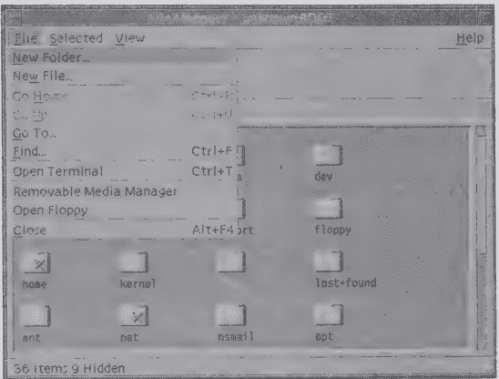

### 图 7.2
文件管理器。

将出现下拉菜单。

3. 从下拉菜单中选择 Removable Media Manager，可移动媒体管理器将出现，如图 7.3 所示。

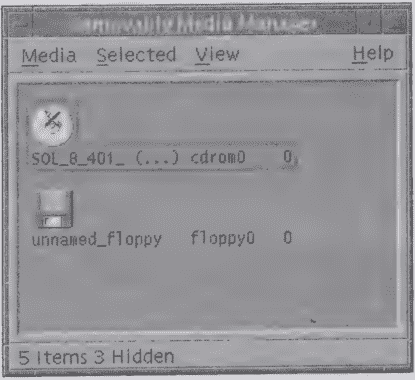

### 图 7.3
可移动媒体管理器。

## 故障排除卷管理器

有时您可能会遇到挂载软盘或 CD-ROM 的问题。首先，检查卷管理器是否知道该设备。最好的方法是查看 /vol/dev/rdiskette0，看看里面是否有东西。如果没有，则未运行 volcheck 命令或存在硬件问题。如果对 /vol 的引用导致系统锁定，则表示守护进程已死亡，您需要按前面所述重新启动 vold 守护进程。

如果 vold 正常工作，请插入已格式化的软盘，然后键入以下内容：

```
ls -l /vol/dev/rdiskette0
```

系统响应如下：

```
total 0
crw-rw-rw- 1 nobody nobody 91, 7 Oct 13 14:56 unlabeled
```

检查 /floppy 中是否存在指向 /vol/dev/rdiskette0 中字符设备的链接。键入以下内容：

```
ls -l /floppy0
```

系统响应如下：

```
total 18
lrwxrwxrwx 1 root nobody 11 Oct 13 14:56 \
floppy0 -> ./unlabeled
```

如果 /vol/dev/rdiskette0 中存在名称，如前所述，而 /floppy/<name_of_media> 中没有挂载任何内容，则很可能介质上的数据是未识别的文件系统。例如，它可能是 tar 归档、cpio 备份或 Macintosh 文件系统。请勿使用卷管理器访问这些文件类型。相反，通过 /vol/dev/rdiskette0 或 /vol/dev/diskette0 中的块或字符设备访问它们，并使用 tar、dd 或 cpio 等用户工具来解释它们上的数据。例如，如果您要访问软盘上的 tar 归档，请使用以下命令：

```
tar tvf /vol/dev/rdiskette0/unlabeled
```

软盘上的所有 tar 文件将被列出。

> 注
卷未标记；因此，/vol/dev/rdiskette0 中的文件称为 unlabeled。

要在软盘上创建 tar 文件，磁盘必须包含 SunOS 卷标。使用 fdformat 命令格式化软盘并添加卷标。fdformat 命令的语法如下：

```
fdformat [options] [<devname>]
```

该命令在表 7.12 中描述。

## 表 7.12

### fdformat 命令

| Option | Description |
|---|---|
| -b <label> | 为介质添加卷标。SunOS 卷标限制为八个字符。DOS 卷标限制为全部大写字符。 |
| -B <filename> | 在 MS-DOS 磁盘的 <filename> 中安装特殊的启动加载器。此选项只有在同时指定 -d 选项（或 -t dos）时才有意义。 |
| -d | 格式化 MS-DOS 介质。 |
| -D | 格式化 720KB（3 1/2 英寸）或 360KB（5 1/4 英寸）双密度磁盘。这是双密度型驱动器的默认值。如果驱动器为高密度或扩展密度类型，则需要此选项。 |
| -e | 完成时弹出磁盘。 |
| -E | 格式化 2.88MB（3 1/2 英寸）扩展密度磁盘。这是扩展密度型驱动器的默认值。 |
| -f | 强制。开始格式化前不提示确认。 |
| -H | 格式化 1.44MB（3 1/2 英寸）或 1.2MB（5 1/4 英寸）高密度磁盘。这是高密度型驱动器的默认值；如果驱动器为扩展密度类型，则需要此选项。 |
| -l | 格式化 720KB（3 1/2 英寸）或 360KB（5 1/4 英寸）双密度磁盘。 |
| -L | 格式化 720KB（3 1/2 英寸）或 360KB（5 1/4 英寸）双密度磁盘。 |
| -m | 格式化 1.2MB（3 1/2 英寸）中密度磁盘。 |
| -M | 在高密度磁盘上写入 1.2MB（3 1/2 英寸）中密度格式（仅与 -t nec 选项一起使用）。 |
| -U | 卸载任何文件系统然后格式化磁盘。 |
| -q | 静默；不打印状态消息。 |
| -v | 格式化后验证磁盘的每个块。 |
| -x | 跳过格式化，仅写入 SunOS 标签或 MS-DOS 文件系统。 |
| -t dos | 安装 MS-DOS 文件系统和启动扇区格式化。这等同于 DOS format 命令或 -d 选项。 |
| -t nec | 格式化后在磁盘上安装 NEC-DOS 文件系统和启动扇区。应仅与 -M 选项一起使用。 |

在表 7.12 中，<devname> 指定的设备取决于是否使用卷管理器。在使用卷管理器的系统上，将 <devname> 替换为 floppy0。如果未使用卷管理器，将 <devname> 替换为 rdiskette0。

如果省略 <devname>，则使用默认磁盘驱动器（/vol/dev/rdiskette0/unlabeled），如果存在的话。

默认情况下，fdformat 使用驱动器的配置容量来格式化磁盘。例如，3 1/2 英寸高密度驱动器使用格式化容量为 1.44MB 的磁盘。格式化并验证后，fdformat 在块 0 上写入操作系统标签。使用 -t dos 选项（与 -d 选项相同）在格式化后将 MS-DOS 文件系统放在磁盘上。否则，fdformat 在块 0 中写入 SunOS 标签。

要使用 SunOS 标签格式化默认磁盘设备以便创建 tar 归档，请插入软盘并发出以下命令：

```
fdformat <cr>
```

系统响应如下：

```
Formatting 1.44 MB in /vol/dev/rdiskette0/unlabeled
Press return to start formatting floppy
```

按 Enter 键。系统显示一系列点，如下所示，直到格式化完成：

```
................................
```

然后您可以在磁盘上创建 tar 归档。键入以下内容：

```
tar cvf /vol/dev/rdiskette0/unlabeled /etc/hosts
```

/etc/hosts 文件以 tar 格式写入磁盘。

如果您仍在使用卷管理器时遇到问题，一种收集调试信息的方法是使用 debug（-D）标志运行 rmmount 命令。为此，编辑 /etc/vold.conf 并更改具有 /usr/sbin/rmmount 的行以包含 -D 标志。例如：

```
insert /vol*/dev/diskette[0-9]/* user=root \
/usr/sbin/rmmount -D
```

这会导致各种调试消息出现在控制台上。

要查看卷管理器守护进程的调试消息，请使用 -v -L 10 标志运行守护进程 /usr/sbin/vold。它将数据记录到 /var/adm/vold.log。此文件可能包含有助于故障排除的信息。

您可能还想使用卷管理将 CD-ROM 挂载到不同的挂载点。vold 默认将 CD-ROM 挂载到挂载点 /cdrom/cdrom0，但用户可以通过以下说明将其挂载到不同的挂载点。

## 逐步操作

### 7.2 在不同挂载点上挂载 CD-ROM

1. 如果卷管理器正在运行，请调出文件管理器，并通过发出以下命令弹出 CD-ROM：

```
eject cdrom
```
2. 通过键入以下内容停止卷管理守护进程：

```
/etc/init.d/volmgt stop
```
3. 创建名为 /test 的目录：

```
mkdir /test
```
4. 将 CD-ROM 插入 CD 驱动器，并发出此命令：

```
/usr/sbin/vold -d /test &
```

现在，不再使用 /vol 目录，vold 将使用 /test 作为起始目录。

## 文件系统信息

在第 6 章中，我介绍了 df 和 fsck 命令。df 命令提供每个已挂载文件系统的容量信息。df 和 fsck 的输出经常被误解。本节更详细地介绍这两个命令，并描述其输出，以便您更好地理解显示的信息。我先从 fsck 命令开始。请记住，仅在未挂载的文件系统上运行 fsck，如以下示例所示。输入以下内容：

```
umount /home2
fsck /dev/rdsk/c0t0d0s6
```

系统响应如下：

```
** /dev/rdsk/c0t0d0s6
** Last Mounted on /home2
** Phase 1 - Check Blocks and Sizes
** Phase 2 - Check Pathnames
** Phase 3 - Check Connectivity
** Phase 4 - Check Reference Counts
** Phase 5 - Check Cyl groups
5 files, 19 used, 95975 free (15 frags, 11995 blocks, 0.0% \
fragmentation)
```

fsck 首先报告一些与使用相关的信息，如表 7.13 所示。

> 注
> 一个片段的大小为一个数据块，而一个块由多个数据块组成，通常为八个。

### 表 7.13

**fsck 输出**

| 字段 | 描述 |
|-------|-------------|
| files | 文件系统中文件的数量。 |
| used | 使用的数据块数量。 |
| free | 空闲的数据块数量（片段和整个块）。 |

然后 fsck 报告有关空闲空间的更多详细信息，如表 7.14 所示。

### 表 7.14

**fsck 输出**

| 字段 | 描述 |
|---|---|
| frags | 空闲片段的数量（来自已分片的块）。 |
| blocks | 空闲块的数量（整个未分片的块）。 |
| % fragmentation | 空闲片段占整个磁盘大小的百分比。 |

分片在这里并不指文件的数据块在整个文件系统中被低效分散的情况，如在 DOS 文件系统中所见。

在 Solaris 中，分片百分比较高意味着大量空闲空间被占用在片段中。在前面的示例中，分片为 0%。高分片会影响新文件的创建——尤其是那些大于几个数据块的文件。通常，高分片是由创建大量小文件引起的。解决方案是创建更大的文件系统或减小块大小（更细的粒度）。

例如，在一个主要创建 5KB 文件且块大小为 8KB 的文件系统中，许多 3KB 片段是空闲的且从未被使用。在极端情况下，这会导致文件系统实际上已满，尽管只有 5/8 的文件系统被使用。如果块大小减小到 4KB，即 Solaris 8 中可用的最小块大小，则文件系统会得到改善。解决方案在表 7.15 中进行了总结。

### 表 7.15

**块大小**

| 块大小 | 典型模式 |
|---|---|
| 8KB blocks | 许多 5KB 分片块和 3KB 片段被浪费。 |
| 4KB blocks | 许多完整块加上每四个完整块一个完整的片段块，这要好得多。 |

现在，让我们回顾 df 命令的输出：

```
mount /dev/dsk/c0t0d0s6 /home2
df -k /home2
```

系统响应如下：

```
Filesystem    Kbytes  used  avail \
capacity      Mounted on
/dev/dsk/c0t0d0s6  95994.  19  91176  1% \
/home2
```

输出中的 95994 值表示文件系统的总大小（以 KB 为单位）。它包括您先前使用 tunefs 命令指定的 5% minfree。解决方案在表 7.16 中进行了总结。

### 表 7.16

**df 的输出**

| 字段 | 描述 |
|---|---|
| 19KB used | 文件系统使用的空间量。 |
| 91176KB available | 文件系统中可用的空间。此值等于文件系统大小减去 minfree%，再减去已使用的空间（95994-5%-19）。 |
| 1% capacity | 按百分比使用的空间，计算方法如下：已使用的千字节/(可用千字节 - minfree%) |

## 章节摘要

这结束了对本地文件系统的讨论。本章介绍了使用 mkfs 和 newfs 命令构建文件系统时可用的许多选项。还介绍了用于标记、复制和调整文件系统的其他 Solaris 实用程序。

描述了 mount 命令的高级选项。本章还解释了如何显示特定文件系统当前使用的挂载选项。此外，本章向您展示了在卸载文件系统之前如何确定正在使用该文件系统的进程或用户。

除了手动挂载文件系统外，本章还介绍了 Volume Manager，用于自动挂载 CD-ROM 和软盘上的文件系统。所有 Volume Manager 命令和相关配置文件都已介绍并解释。

第 16 章“设备管理与磁盘管理”详细讨论了磁盘设备。尽管该主题在第二部分考试中有所涉及，但您可能希望复习该章节，以详细了解构成文件系统的各种设备配置。第 13 章“ Solaris 网络环境”和第 17 章“ NFS 环境”讨论了如何与网络上的其他主机共享文件系统。下一章讨论系统安全并描述如何保护系统及其上的数据。

## 关键术语

- 块大小
- 文件系统 minfree 空间
- 卷名
- 文件系统类型
- 大文件
- 大文件感知
- 大文件安全
- 已挂载文件系统表 (mnttab)
- 卷管理器
- 片段

## 应用你的知识

### 练习

在上一章中，您创建了一个新的文件系统。在以下练习中，我们将继续进行，通过在此文件系统上执行更复杂的任务。

### 7.1 调整文件系统

在此练习中，您将修改使用 newfs 命令最初创建文件系统时指定的一些文件系统参数。

预计时间：15 分钟

1. 以 root 身份登录。
2. 通过输入以下内容列出文件系统当前使用的所有参数：
   `newfs -v <raw device name>`
3. 打开另一个窗口。保留步骤 2 中刚显示的信息以供以后参考。在新窗口中，输入 tunefs 命令将文件系统的 minfree 值更改为 5% 如下：
   `tunefs -m5 <raw device name>`
4. 查看新的文件系统参数，但这次您将使用 mkfs 命令如下：
   `mkfs -m <raw device name>`
   将显示的参数与之前在另一个窗口中显示的参数进行比较。
5. 尝试使用 fstyp 命令查看文件系统参数如下：
   `fstyp -v <raw device name>`

### 7.2 挂载和卸载文件系统

在此练习中，您将挂载一个支持大于 2GB 文件的文件系统。

预计时间：5 分钟

1. 以 root 身份登录。
2. 如果文件系统已挂载，请使用 `umount` 命令卸载它。您可以通过不带选项输入 `mount` 来检查哪些文件系统已挂载。
3. 按如下方式挂载文件系统以支持大文件：
```
mount -o largefiles <block device name> /test
```
4. 通过不带选项输入 `mount` 并检查输出来验证是否成功。

7. 将 CD 插入 CD-ROM 播放器。它是否挂载了 CD？
8. 通过输入以下内容重新启动 Volume Manager 守护进程：
```
/etc/init.d/volmgt start
```
9. 输入不带选项的 `mount` 命令列出所有已挂载的文件系统。CD 现在是否已挂载？

### 7.3 使用 Volume Manager

在此练习中，您将利用 Volume Manager 自动挂载 CD-ROM。

预计时间：10 分钟

1. 将 CD-ROM 光盘插入 CD-ROM 播放器。
2. 输入不带选项的 `mount` 命令以验证设备是否已挂载。使用了哪个挂载点？
3. 按如下方式弹出 CD-ROM：
```
eject cdrom
```
4. 输入以下命令查找名为 vold 的 Volume Manager 进程：
```
pgrep -l vold
```
5. 通过输入以下内容关闭 Volume Manager：
```
/etc/init.d/volmgt stop
```
6. 输入以下命令查找名为 vold 的 Volume Manager 进程：
```
pgrep -l vold
```

## 复习问题

1. 以下哪一项会导致高分片？
   A. 创建大量小文件
   B. 创建大量大文件
   C. 磁盘空间不足
   D. 文件的磁盘块在整个文件系统中被低效分散
2. `df` 的输出不包含以下哪个字段？
   A. 总大小（千字节）
   B. 分片
   C. 容量
   D. 可用千字节
3. 以下哪一项是创建文件系统的推荐方法？
   A. `mkfs`
   B. `format`
   C. `tunefs`
   D. `newfs`


## 应用你的知识

4. 以下哪个命令用于在未挂载的磁盘文件系统上写入或显示标签？
+   - A. format
- B. prtvtoc
- C. newfs
- D. labelit

5. 管理员（root）使用以下哪个命令将带标签的文件系统从一个磁盘复制到另一个磁盘？
+   - A. volcopy
- B. ufsdump
- C. tar
- D. 以上全部

6. 以下哪个命令用于确定文件系统是否为 UFS 文件系统？
+   - A. fstyp
- B. prtvtoc
- C. format
- D. newfs -v

7. 以下哪个命令用于更改文件系统的 minfree 值？
+   - A. mkfs
- B. tunefs
- C. newfs
- D. format

8. 以下哪个命令用于查看文件系统参数的完整列表？
+   - A. fstyp
- B. mkfs
- C. newfs
- D. prtvtoc

9. 大文件是指大小大于或等于以下哪个值的普通文件：
+   - A. 100MB
- B. 1GB
- C. 5GB
- D. 2GB

10. 以下哪个不是大文件感知的？
+   - A. labelit
- B. vi
- C. mkfs
- D. mount

11. 以下哪种类型的实用程序能够处理大文件作为输入并生成大文件作为输出？
+   - A. 大文件兼容
- B. 大文件安全
- C. 大文件感知
- D. 大文件功能

## 应用你的知识

12. mount 命令的以下哪个选项提供与之前文件系统行为的完全兼容性，强制执行 2GB 的最大文件大小限制？
A. -o compat
B. -largefiles
C. -nolargefiles
D. -o large

13. 以下哪个选项与 mount 命令一起使用以以 /etc/vfstab 格式显示已挂载文件系统的列表？
A. -p
B. -v
C. -f
D. -a

14. 以下哪个示例使用 mount 命令将目录映射为可读写的文件系统，禁止 setuid 执行，并启用大文件的创建：
A. mount -o rw,nosuid,large
   /dev/dsk/c0t0d0s0 /home2
B. mount -o rw,nosuid,largefiles
   /dev/dsk/c0t0d0s0 /home2
C. mount -o rw,nosuid,largefiles
   /dev/rdsk/c0t0d0s0 /home2
D. mount -o rw,suid,largefiles
   /dev/dsk/c0t0d0s0 /home2

15. 当文件系统被挂载时，条目维护在哪里？
A. /etc/mnttab
B. /etc/vfstab
C. /etc/fstab
D. /mnt

16. 以下哪些任务可以在已挂载的文件系统上执行？
A. labelit
B. fsck
C. tunefs
D. shutdown

17. 如果有东西导致文件系统繁忙，以下哪个命令可用于列出访问文件系统的所有进程？
A. fuser
B. mount
C. ps
D. finger

18. 以下哪个命令会停止所有使用 /home2 文件系统的进程？
A. fuser -c -k /home2
B. fuser -k /home2
C. kill -9 /home2
D. umount /home2

## 应用你的知识

19. 以下哪个是管理可移动媒体（如 CD-ROM 和软盘驱动器）的机制？
A. autofs
B. NFS
C. vold
D. init

20. vold 执行以下所有操作，除了什么？
A. 为网络上的其他系统提供对用户插入系统中的任何磁盘和 CD 的自动访问
B. 自动挂载磁盘和 CD
C. 使用户能够在无需以 root 登录的情况下访问磁盘和 CD
D. 当访问该文件系统时自动挂载位于另一系统上的文件系统

21. 以下哪个目录为主要软盘驱动器中的媒体提供字符设备访问？
A. /vol/dev/diskette0
B. /dev/rdiskette
C. /vol/dev/aliases/floppy0
D. /floppy/floppy0

22. 以下哪个包含 vold 使用的卷管理配置信息？
A. /etc/init.d/volmgt
B. /etc/vfstab
C. /etc/vold.conf
D. /etc/inittab

23. 系统管理员可以修改以下哪个文件来指定如果发生媒体事件（如弹出或插入）应调用哪个程序？
A. /etc/vold.conf
B. /etc/rmmount.conf
C. /etc/inittab
D. /etc/mnttab

24. 如果尝试访问已不在驱动器中的 CD 或磁盘，以下哪个操作会通知用户？
A. vold
B. volcheck
C. volmissing
D. rmmount

25. 以下哪个命令用于格式化软盘并添加卷标？
A. format -d
B. labelit
C. format
D. fdformat

26. 以下哪个命令用于停止卷管理守护进程？
A. vold stop
B. /etc/init.d/volmgt stop
C. ps -ef|grep vold, then kill the process ID for vold
D. volcancel

## 应用你的知识

27. 以下哪个命令显示每个已挂载文件系统的容量信息？
A. du
B. format
C. prtvtoc
D. df

28. 以下哪个命令用于使系统自动挂载软盘？
A. volcheck
B. vold
C. mount
D. automount

29. 如果存在以下哪个条件，您可以在命令行键入 mount /opt 而不会收到错误消息？
A. /opt 列在 /etc/rmtab 中。
B. /opt 列在 /etc/mnttab 中。
C. /opt 列在 /etc/vfstab 中。
D. /opt 列在 /etc/dfs/dfstab 中。

30. 卷管理器通过以下哪个目录提供对 CD-ROM 和软盘设备的访问？
A. /vol/dev
B. /dev/vol
C. /dev
D. /vold

31. 以下关于卷管理器的说法哪个是不正确的？
A. 卷管理器通过 /etc/init.d/volmgt 脚本启动。
B. 卷管理器自动挂载 CD 和软盘。
C. 卷管理器在启动时读取 /etc/vold.conf 配置文件。
D. 卷管理器在启动时自动挂载文件系统。

## 复习问题的答案

1. A. 通常，创建大量小文件会导致高度碎片化。解决方案是创建更大的文件系统或减小块大小（更细的粒度）。

2. B. df 命令不显示碎片化的百分比。

3. D. newfs 是 mkfs 命令的友好前端。newfs 命令会自动确定传递给 mkfs 以构建新文件系统所需的所有参数。newfs 在 Solaris 中添加是为了使创建新文件系统更容易。强烈建议使用 newfs 命令创建文件系统。

4. D. 使用 newfs 创建文件系统后，您可以使用 labelit 实用程序在未挂载的磁盘文件系统上写入或显示标签。

## 应用你的知识

5. D. 使用 volcopy、ufsdump、cpio、pax 或 tar 将带标签的文件系统从一个磁盘复制到另一个磁盘。

6. A. 使用 fstyp 命令确定文件系统类型。例如，使用它来检查文件系统是否为 ufs 文件系统。

7. B. 使用 tunefs 命令更改文件系统的 min-free 值。

8. A. 使用 fstyp 命令查看文件系统参数。使用 -v 选项获取文件系统参数的完整列表。

9. D. 大文件是指大小大于或等于 2GB 的普通文件。

10. B. 如果实用程序能够以处理小文件相同的方式处理大文件，则称为大文件感知。大文件感知实用程序可以处理大文件作为输入，并可以生成大文件作为输出。vi 命令不是大文件感知的。

11. C. 如前一问题和答案所述，如果实用程序能够以处理小文件相同的方式处理大文件，则称为大文件感知。大文件感知实用程序可以处理大文件作为输入并可以生成大文件作为输出。

12. C. mount 命令的 -nolargefiles 选项提供与之前文件系统行为的完全兼容性，强制执行 2GB 的最大文件大小限制。

13. A. 使用 -p 选项键入 mount 命令以以 /etc/vfstab 格式显示已挂载文件系统的列表。

14. B. 以下命令：
```
mount -o rw,nosuid,largefiles \
/dev/dsk/c0t0d0s0 /home2
```
使用 mount 命令将目录映射为可读写的文件系统，禁止 setuid 执行，并启用创建大于 2GB 的大文件。

15. A. 当文件系统被挂载时，会在名为 /etc/mnttab 的已挂载文件系统表中维护一个条目。该文件实际上是一个只读文件系统，其中包含当前已挂载设备的有关信息。

16. D. 不要在已挂载的文件系统上执行以下命令：fsck、tunefs 和 labelit。

17. A. 如果有东西导致文件系统繁忙，您可以使用 fuser 命令列出访问文件系统的所有进程，并在必要时停止它们。

18. A. 以下命令通过向每个进程发送 SIGKILL 来停止所有使用 /home2 文件系统的进程：fuser -c -k /home2

19. C. vold 守护进程是管理可移动媒体（如 CD-ROM 和软盘驱动器）的机制。

20. D. vold 不会在访问该文件系统时自动挂载位于另一系统上的文件系统。负责该任务的设施是 AutoFS。

21. B. /dev/rdiskette 和 /vol/dev/rdiskette0 是为主要软盘驱动器中的介质提供字符设备访问的目录，通常为驱动器 0。

22. C. vold 在启动时读取 /etc/vold.conf 配置文件。vold.conf 文件包含 vold 使用的卷管理器配置信息。


## 应用你的知识

23. A. vold.conf 文件的“Actions”部分指定如果发生特定事件（操作），例如弹出或插入，应调用哪个程序。

24. C. vold.conf 文件中的 volmissing 操作会在尝试访问已不在驱动器中的 CD 或软盘时通知用户。

25. D. 使用 fdformat 命令格式化软盘，然后添加卷标。

26. B. 运行以下运行控制脚本以停止卷管理守护进程：
`/etc/init.d/volmgt stop`

27. D. df 命令可提供每个已挂载文件系统的容量信息。

28. A. volcheck 命令指示 vold 检查每个设备并确定是否已将新介质插入驱动器。系统管理员发出此命令以检查驱动器中是否已安装介质。默认情况下，它检查 /dev/diskette 指向的驱动器。

29. C. 如果 /opt 列在 /etc/vfstab 文件中，你可以在命令行键入 mount /opt 而不会收到错误消息。

30. A. 卷管理器通过 /vol/dev 目录提供对软盘和 CD-ROM 设备的访问。

31. D. 卷管理器在启动时不会自动挂载文件系统。但是，当可移动介质插入设备且包含可识别的文件系统时，它会自动挂载 CD-ROM 和文件系统。

## 目标

描述保持 Solaris 系统安全的流程和程序涉及讨论以下测试目标：

## 了解物理安全
- 许多流程侧重于保持数据和操作系统安全。系统管理员不能忽视保持硬件安全并限制对设备的物理访问。

## 控制系统访问
- 系统管理员将通过用户登录控制对操作系统的访问。只有具有活动登录的用户才能访问系统和数据。系统管理员将控制每个用户拥有的访问级别。

## 控制文件访问
- 系统管理员将使用标准的 Solaris 权限方案为目录和文件分配访问权限。理解此权限方案并将其应用于用户和组 ID 对于控制对关键系统数据的访问是必要的。

## 了解网络安全
- 大多数 Solaris 系统都在网络上，连接到本地场所以外的系统，并且可供来自其他站点的众多用户访问。在这种环境中保持系统安全可能很困难，但这是系统管理员工作的重要组成部分。

## 保护超级用户访问
- 仅为有权使用它们并理解使用超级用户权限执行系统任务风险的系统管理员保留超级用户权限。

## 目标

## 大纲

## 了解自动化安全增强工具 (ASET)
Solaris 提供自动化安全增强工具 (ASET) 来保持操作系统安全。ASET 是在 Solaris 系统上设置和监控安全的工具。系统管理员将使用它对系统文件和权限进行特定检查和调整以确保系统安全。

## 采用常识性安全技术
如果忽视常识性安全措施，所描述的许多概念和提供的 Solaris 工具都是无用的。

除了本章列出的目标外，我们还将讨论审计用户。虽然该主题出现在第二场考试中，但我已将其包含在本章中，因为该材料与所讨论的主题非常契合，且不值得单独成章。

- **引言** 282
- **物理安全** 283
- **控制系统访问** 283
  - 用户帐户信息存储位置 286
  - 受限 Shell 289
- **控制文件访问** 290
  - 有效用户 ID 和组 ID 292
  - 默认 umask 293
  - 粘滞位 294
  - 访问控制列表 (ACLs) 294
  - 设置正确的路径 299
  - setuid 和 setgid 程序 299
- **审计用户** 301
  - 监控用户和系统使用情况 301
  - 检查谁已登录 303
- **网络安全** 307
  - 防火墙 307
  - 保护网络服务 307
  - TCP Wrappers 309
  - /etc/default/login 文件 309
  - 调制解调器 310
  - 受信任主机 310
  - /etc/hosts.equiv 文件 310
  - .rhosts 文件 311
  - 限制 FTP 312

## 保护超级用户访问
313

限制 Root 访问 314

监控超级用户访问 315

SUDO 316

## 自动化安全增强工具 (ASET)
318

## 常识性安全技术
320

## 摘要
321

## 应用你的知识
322

以下策略将帮助你为考试做准备：

- 考试中会出现多个关于 Solaris 安全的问题。我建议你仔细学习本章，注意细节。逐步练习并记住每个命令。重要的是，你需要在 Solaris 8 系统上练习所学内容，直到能从记忆中执行任务。
- 特别注意“控制文件访问”部分。确保你理解所讨论的所有内容，因为考试将重点测试本节的主题。了解所描述的命令并理解文件或目录上设置的权限值。
- 记住本章描述的所有配置文件。你不需要理解它们的结构——只需了解它们用于什么以及如何用于监控和控制系统上的安全。
- 在“审计用户”部分描述了各种命令和文件。确保你理解所描述的命令和日志文件。此外，在阅读“网络安全”部分时，特别注意受信任主机的概念和对超级用户访问的限制。
- 最后，学习本章末尾的术语。这些术语可能会出现在问题中，因此你需要理解它们的含义。

## 引言
保持系统信息安全是系统管理员的主要任务之一。系统安全涉及保护数据免受灾难或系统故障造成的损失。此外，系统管理员有责任保护系统免受未经授权的入侵者的威胁，并保护系统上的数据免受未经授权的用户访问。我见过的一些最严重的灾难来自授权人员——甚至系统管理员——无意中破坏数据。因此，系统管理员面临两个层面的安全：保护数据免于意外丢失，以及保护系统免受入侵或未经授权的访问。

第一个场景——保护数据免于意外丢失——通过定期运行的完整系统备份方案很容易实现。定期备份可在灾难发生时提供保护。如果用户意外破坏数据，如果硬件出现故障，或者如果计算机程序只是损坏数据，系统管理员可以从备份介质中恢复文件。（备份和恢复技术在第 11 章“备份和恢复”中介绍。）

第二种安全形式——保护系统免受入侵或未经授权的访问——更为复杂。本书无法涵盖每一个安全漏洞或威胁，但它确实讨论了 UNIX 安全基础。保护免受入侵者涉及以下内容：

- 物理安全。限制对计算机设备的物理访问。
- 控制系统访问。通过密码和权限限制用户访问。
- 控制文件访问。通过分配文件访问权限来限制对数据的访问。
- 审计用户。监控用户活动以在造成损害之前检测威胁。
- 网络安全。防止通过电话线、串行线或网络进行访问。
- 保护超级用户访问。仅将超级用户访问保留用于系统管理使用。

## 物理安全
物理安全很简单：锁上门。限制对计算机设备的物理访问，以防止盗窃或破坏。此外，限制对系统控制台的访问。任何有权访问控制台的人最终都可访问数据。如果计算机包含敏感数据，请将其锁定在受控环境中，并提供清洁的电力和充足的防火、防雷、防洪以及其他建筑灾难的保护。限制访问以防止对系统及其备份进行篡改。任何有权访问备份介质的人都可能窃取它并访问数据。此外，如果系统已登录且无人看管，任何可以使用该系统的人都可以获得对操作系统和网络的访问。确保你的用户在离开前注销或“锁定”屏幕。简而言之，你需要了解用户的计算机环境，并需要从未经授权的访问中对其进行物理保护。

## 控制系统访问
控制对系统的访问涉及使用密码和适当的权限。为了控制访问，所有登录必须有密码，并且密码必须经常更改。密码老化是系统管理员设置的一个系统参数，要求用户在一定天数后更改密码。密码老化让你可以强制用户定期更改密码，或防止用户在指定间隔之前更改密码。为密码设置到期日期，以防止入侵者通过旧的和不活跃的帐户在未被察觉的情况下获得对系统的访问。对于高水平的安全性，要求用户每六周更改一次密码。每三个月更改一次密码对于较低水平的安全性是足够的。每月更改系统管理员登录（如 root 和 sys），或在知道 root 密码的人员离开公司或被重新分配时更改。


控制默认系统访问的多个文件存储在 /etc/default 目录中。这些文件限制网络上特定系统的访问。表 8.1 总结了 /etc/default 目录中的文件。

## 表 8.1
### /ETC/DEFAULT 目录中的文件

| 文件名 | 描述 |
|---|---|
| /etc/default/passwd | 控制密码老化的默认策略。 |
| /etc/default/login | 控制系统登录策略，包括 root 访问。默认情况下将 root 访问限制在控制台。 |
| /etc/default/su | 指定 su 到 root 的尝试记录位置以及这些日志文件的位置。该文件还指定 su 到 root 的尝试是否显示在命名设备（如系统控制台）上。 |

你可以在 /etc/default/passwd 文件中设置默认值以控制用户密码。表 8.2 列出了可通过 /etc/default/passwd 文件控制的选项。

## 表 8.2
### /ETC/DEFAULT/PASSWD 中的标志

| 标志 | 描述 |
|---|---|
| MAXWEEKS | 指定密码有效的最长时间段。 |
| MINWEEKS | 指定在密码可以更改之前的最短时间段。 |
| PASSLENGTH | 指定所有普通用户的最小密码长度。值可以为 6、7 或 8。 |
| WARNWEEKS | 指定密码即将到期日期的警告时间段。 |

系统管理员的职责是确保所有用户都有安全的密码。系统破解者可以破解不当的密码并使整个系统面临风险。请执行以下密码准则：

- 密码应包含六到八个字母、数字或特殊字符的组合。
- 例如 “beammeup” 这样的短语作为密码效果很好。
- 由短语中每个音节的首字母组成的无意义单词，例如 “Somewhere Over the Rainbow” 的 “swotrb”，作为密码效果很好。
- 用数字或符号替换字母的单词，例如 “snoopy” 的 “sn00py”，也能成为好的密码。

另一方面，以下是密码的糟糕选择：

- 专有名词、姓名、登录名以及仅凭了解你的一些信息（用户）就能猜到的其他密码
- 你的名字正向、反向或打乱
- 家人或宠物的名字
- 汽车车牌号码
- 电话号码
- 社会安全号码
- 员工编号
- 与爱好或兴趣相关的名称
- 季节性主题，例如十二月的圣诞老人
- 字典中的任何单词
- 简单的键盘模式（asdfgh）
- 你之前使用过的密码

## 用户账户信息存储位置

用户账户和组信息存储在位于 /etc 目录的文件中。

大部分用户账户信息存储在 /etc/passwd 文件中；然而，密码加密和密码老化详情存储在 /etc/shadow 文件中。组信息存储在 /etc/group 文件中。用户根据其文件访问需求被组织成组；例如，“acctng” 组可能是会计部门的用户。

/etc/passwd 文件中的每一行包含多个字段，以冒号 (:) 分隔，格式如下：

```
username:password:uid:gid:comment:home-directory:login-shell
```

表 8.3 定义了 /etc/passwd 文件中的每个字段。

## 表 8.3
### /ETC/PASSWD 文件中的字段

| 字段名称 | 描述 |
|------------|-------------|
| username | 包含用户或登录名。用户名应唯一，由一到八个字母（A–Z、a–z）和数字（0–9）组成，但不能包含下划线或空格。第一个字符必须是字母，且至少有一个字符必须是小写字母。 |
| password | 包含一个 x，它是存储在 /etc/shadow 文件中的加密密码的占位符，并由本节后面描述的 pwconv 命令使用。 |
| uid | 包含用于标识系统用户的用户标识（UID）号码。普通用户的 UID 号码应范围为 100–60000，但最高可达 2147483647（见以下说明）。所有 UID 号码应唯一。UID 小于 100 为保留。为最大限度降低安全风险，避免重用已删除账户的 UID。 |
| gid | 包含标识用户主组的组标识（GID）号码。每个 GID 号码必须是 0–60000 之间的整数（60001 和 60002 分别分配给 nobody 和 noaccess）。GID 最高可达 2147483647（见以下说明）。GID 号码小于 100 保留给系统默认组账户。 |
| comment | 通常包含用户的全名。 |
| home-directory | 包含用户主目录路径名。 |
| login-shell | 包含用户的默认登录 shell。 |

/etc/shadow 文件中的每一行包含多个以冒号 (:) 分隔的字段。该行格式如下：

```
username:password:lastchg:min:max:warn:inactive:expire
```

表 8.4 定义了 /etc/shadow 文件中的每个字段。

## 表 8.4
### /ETC/SHADOW 文件中的字段

| 字段名称 | 描述 |
|------------|-------------|
| username | 包含用户或登录名。 |
| password | 可能包含以下条目：13 个字符的加密用户密码；字符串 *LK*，表示无法访问的账户；或字符串 NP，表示账户无密码。 |
| lastchg | 表示从 1970 年 1 月 1 日到上次密码修改日期的天数。 |
| min | 包含密码更改之间所需的最少天数。 |
| max | 包含密码在用户被提示指定新密码之前有效的最大天数。 |
| inactive | 包含用户账户在被锁定之前可以非活动的天数。 |
| expire | 包含用户账户过期的绝对日期。超过此日期后，用户无法登录系统。 |

一些经验丰富的系统管理员出于各种原因会直接编辑 /etc/passwd 文件，但仅在创建原始 /etc/passwd 文件的备份副本后。在第 18 章“名称服务”中，我描述了此过程。一个例子是当你可能想要从备份中恢复 /etc/passwd 文件时——也许原始文件已损坏或被错误修改。修改 /etc/passwd 文件后，运行 pwconv 命令。此命令使用 /etc/passwd 文件中的信息更新 /etc/shadow 文件。

> 注意
之前的 Solaris 软件版本使用 32 位数据类型来包含 UID 和 GID，但 UID 和 GID 被限制为最大可用值 60000。从 Solaris 2.5.1 版本及兼容版本开始，UID 和 GID 值的限制已提高到有符号整数的最大值，即 2147483647。超过 60000 的 UID 和 GID 不具备完整功能且与许多 Solaris 功能不兼容，因此避免使用大于 60000 的 UID 或 GID。

> 注意
请勿直接编辑 /etc/passwd 文件，并且永远不要直接编辑 /etc/shadow 文件。任何错误条目都可能阻止你登录系统。这些文件使用 Solaris 账户管理命令之一或 Admintool 自动更新，这些内容在第 5 章“设置用户账户”中描述。

pwconv 命令依赖于 /etc/passwd 文件密码字段中的特殊值“x”。“x”表示用户的密码已存在于 /etc/shadow 文件中。如果 /etc/shadow 文件不存在，pwconv 将根据 /etc/passwd 文件中的信息重新创建其中的所有内容。如果 /etc/shadow 文件存在，则执行以下操作：

- 存在于 /etc/passwd 文件中但不存在于 /etc/shadow 文件中的条目将被添加到 shadow 文件中。
- 存在于 /etc/shadow 文件中但不存在于 /etc/passwd 文件中的条目将从 shadow 文件中删除。

/etc/group 文件中的每一行包含多个以冒号 (:) 分隔的字段。该行格式如下：

```
group-name:group-password:gid:user-list
```

表 8.5 定义了 /etc/group 文件中的每个字段。

## 表 8.5
### /ETC/GROUP 文件中的字段

| 字段名称 | 描述 |
|------------|-------------|
| group-name | 包含分配给组的名称。例如，会计部门的成员可能称为 acct。组名最多可有九个字符。 |
| group-password | 通常包含星号或为空。group-password 字段是早期 UNIX 版本的遗留物。 |
| gid | 包含组的 GID 号码。它在本地系统上必须是唯一的，并且应在整个组织中唯一。每个 GID 号码必须是 0–60002 之间的整数，但最高可达 2147483647。小于 100 的号码保留给系统默认组账户。用户定义的组范围为 100–60000（60001 和 60002 为保留，分别分配给 nobody 和 noaccess）。请参阅之前的说明，了解使用大于 60000 的 UID 和 GID 的情况。 |
| user-list | 包含组的列表和用户名的逗号分隔列表，表示用户的次要组成员资格。每个用户最多可属于 16 个次要组。 |


默认情况下，所有 Solaris 8 系统在 /etc/group 文件中已定义了以下组。请勿将以下组用于用户。此外，一些系统进程和应用程序可能依赖于这些组，因此除非您完全确定对系统的影响，否则请勿更改 GID 或从 /etc/group 文件中删除这些组。

```
root::0:root
other::1:
bin::2:root,bin,daemon
sys::3:root,bin,sys,adm
adm::4:root,adm,daemon
uucp::5:root,uucp
mail::6:root
tty::7:root,tty,adm
lp::8:root,lp,adm
nuucp::9:root,nuucp
staff::10:
daemon::12:root,daemon
sysadmin::14:
nobody::60001:
noaccess::60002:
nogroup::65534:
```

> NOTE
sysadmin 组（第 14 组）的成员允许使用 Admintool 实用程序和 Solstice AdminSuite 软件来添加和删除用户账户、组、软件、打印机和串行设备。系统管理员可能会将此组分配给备份系统管理员或高级用户。除非您是 UNIX sysadmin 组的成员，否则您必须在系统上成为超级用户才能使用 Admintool 或 AdminSuite。

## 受限 Shell

系统管理员可以使用 Korn shell（rksh）和 Bourne shell（rsh）的受限版本来限制特定用户账户允许的操作。受限 shell 对于确保分时用户或系统上的用户访客在登录会话期间具有受限权限特别有用。当账户设置为使用受限 shell 时，用户不能执行以下操作：

- 更改目录
- 设置 $PATH 变量

> NOTE
请勿将受限 shell /usr/lib/rsh 与远程 shell /usr/bin/rsh 混淆。指定受限 shell 时，不应包含用户的路径——/bin、/sbin 或 /usr/bin。这样做会允许用户启动另一个 shell（非受限 shell）。

- 指定以 / 开头的路径或命令名称
- 重定向输出

您还可以为用户提供 shell 过程，这些过程可以访问标准 shell 的全部功能，但提供有限的命令菜单。

## 控制文件访问

在建立登录限制后，您需要控制对系统数据的访问。有些用户只需要查看文件；其他用户需要更改或删除文件的能力。您可能有不想让其他人看到的数据。您通过为文件或目录分配权限级别来控制数据访问。

为 UNIX 文件分配三个级别的访问权限，以控制所有者、组和其他人的访问。使用 ls -la 命令显示权限。以下示例显示了使用 ls -la 命令显示 /users 目录中文件权限的情况：

```
ls -la  /users
```

系统响应如下：

```
drwxr-xr-x  2 bill  staff  512 Sep 23 07:02 .
drwxr-xr-x  3 root  other  512 Sep 23 07:02 ..
-rw-r--r--  1 bill  staff  124 Sep 23 07:02 .cshrc
-rw-r--r--  1 bill  staff  575 Sep 23 07:02 .login
```

第一列信息显示文件的类型及其对用户、组和其他人的访问权限。r、w 和 x 在表 8.6 中有描述。第三列显示文件的所有者——通常是创建该文件的用户。文件的所有者（和超级用户）可以决定谁有权读取它、写入它，或——如果是命令——执行它。第四列显示此文件所属的组——通常是所有者的主组。

## 表 8.6
### 文件访问权限

| Symbol | Permission | Means that Designated Users... |
|---|---|---|
| r | Read | Can open and read the contents of a file |
| w | Write | Can write to the file (modify its contents), add to it, or delete it |
| x | Execute | Can execute the file (if it is a program or shell script) |
| - | Denied | Cannot read, write to, or execute the file |

列出目录的权限时，除一处例外外，所有信息列与文件相同。第一列中的 r、w 和 x 与文件相比处理略有不同。它们在表 8.7 中有描述。

## 表 8.7
### 目录访问权限

| Symbol | Permission | Means that Designated Users... |
|---|---|---|
| r | Read | Can list files in the directory. |
| w | Write | Can add or remove files or links in the directory. |
| x | Execute | Can open or execute files in the directory. Also can make the directory and the directories beneath it current. |
| - | Denied | Cannot read, write, or execute. |

使用表 8.8 中列出的命令来修改文件访问权限和所有权，但请记住只有文件所有者或 root 才能分配或修改这些值。

## 表 8.8
### 文件访问命令

| Command | Description |
|---|---|
| chmod | Changes access permissions on a file. You can use either symbolic mode (letters and symbols) or absolute mode (octal numbers) to change permissions on a file. |
| chown | Changes the ownership of a file. |
| chgrp | Changes the group ownership of a file. |

## 有效用户 ID 和组 ID

su（切换用户）命令允许用户在不注销系统的情况下成为另一个用户。要使用 su 命令，您必须提供您尝试登录为的用户的密码，除非您已以 root 登录。root 用户可以在不提示输入密码的情况下运行 su。

系统管理员经常使用 su 命令。例如，作为安全预防措施，系统管理员在不执行管理功能时可能会使用常规的非 root 登录，而不是将超级用户密码用作常规登录。当需要 root 访问时，系统管理员会使用 su 命令快速切换到超级用户。当管理员完成任务后，他退出超级用户账户并继续使用其正常的非 root 账户工作。

如果用户输入正确的密码，su 会根据该特定用户 /etc/passwd 文件中的 shell 字段指定的方式创建一个新的 shell 进程。在以下示例中，user1 将运行 su 命令成为 user2：

```
su user2
```

su 命令的一个选项是 –（连字符）。此选项指定完整登录。指定用户的 .profile 将被运行，并且环境将被更改为如果用户实际以指定用户登录时应有的环境。

如果没有 -，环境将从原始登录传递下来，$PATH 除外，$PATH 由本章后面描述的 /etc/default/su 文件中的 PATH 和 SUPATH 控制。

## 默认 umask

当用户创建文件或目录时，用户掩码控制分配给文件或目录的默认文件权限。umask 命令应在用户初始化文件（如 /etc/profile 或 .cshrc）中设置用户掩码。您可以通过键入 umask 并按 Enter 来显示用户掩码的当前值。

用户掩码使用三位八进制值设置，例如 022。第一位设置用户权限，第二位设置组权限，第三位设置其他人权限。要将 umask 设置为 022，请键入以下内容：

```
umask 022
```

默认情况下，系统将文件的权限设置为 666，授予用户、组和其他人读和写权限。系统将目录或可执行文件的默认权限设置为 777，即 rwxrwxrwx。umask 分配的值从默认值中减去。要确定要设置的 umask 值，请从 666（文件）或 777（目录）中减去您想要的权限值。余数是与 umask 命令一起使用的值。例如，假设您想将文件的默认模式更改为 644（rw-r--r--）。666 与 644 之间的差值为 022，这就是您将用作 umask 命令参数的值。

设置 umask 值的作用是以与 chmod 授予权限相同的方式授予或拒绝权限。例如，命令 chmod 022 授予组和其他人写权限，而 umask 022 拒绝组和其他人的写权限。


## 粘滞位

粘滞位是一个权限位，用于保护目录中的文件。如果目录已设置粘滞位，则文件只能由文件所有者、目录所有者或 root 删除。这可以防止用户从公共目录中删除其他用户的文件。文件列表的访问权限列中出现 t 或 T 表示已设置粘滞位：

```
drwxrwxrwt  2 uucp  uucp  512 Feb 12 07:32 \
/var/spool/uucppublic
```

使用 chmod 命令设置粘滞位。使用 chmod 命令以符号模式设置粘滞位的符号列于表 8.9。

### 表 8.9
### 粘滞位模式

| Symbol | Description |
| --- | --- |
| t | 粘滞位已开启；其他用户的执行位已开启。 |
| T | 粘滞位已开启；其他用户的执行位已关闭。 |

## 访问控制列表 (ACLs)

ACLs（读作 acls）可以在 Solaris 操作系统中的传统 UNIX 文件保护不足时提供对文件权限的更大控制。传统 UNIX 文件保护为三个用户类别提供读、写和执行权限：所有者、组和其他。ACL 通过允许您为所有者、所有者组、其他用户、特定用户和组以及这些类别的每个默认权限定义文件权限，从而提供更好的文件安全性。

例如，假设您有一个文件希望组中的每个人都可以读取。要授予每个人访问权限，您将在该文件上为“group”授予读权限。现在，假设您只希望组中的一个人能够写入该文件。标准 UNIX 不允许您设置此项；但是，您可以设置 ACL 以仅为组中的一个人授予对该文件的写权限。将 ACL 条目视为常规 UNIX 权限的扩展。

ACL 条目是定义文件上 ACL 的方式，并且通过 ACL 命令设置。ACL 条目由冒号分隔的以下字段组成：

```
entry_type:uid:gid:perms
```

ACL 条目在表 8.10 中定义。

### 表 8.10
### ACL 条目

| ACL Field | Description |
|---|---|
| entry_type | 设置文件权限的 ACL 条目类型。例如，entry_type 可以是 user（文件所有者）或 mask（ACL 掩码）。 |
| uid | 用户名或识别号。 |
| gid | 组名或识别号。 |
| perms | 对 entry_type 设置的权限。权限由符号字符 rwx 或与 chmod 命令一起使用的八进制数表示。 |

ACL 掩码条目表示除所有者之外用户和组允许的最大权限。掩码是快速更改所有用户和组权限的方法。例如，mask:r-- 掩码条目表示用户和组不能拥有超过读权限，即使它们可能具有写/执行权限。

## 设置 ACL 条目

使用 setfacl 命令在文件上设置 ACL 条目：

```
$ setfacl -s \
user::perms,group::perms,other::perms,mask:perms, \
acl_entry_list filename ...
```

-s 选项用新的 ACL 条目替换整个 ACL（如果文件上已存在 ACL）。

以下示例将 txt1.doc 文件的用户权限设置为读/写，组权限设置为只读，其他权限设置为无。此外，用户 bill 被授予对该文件的读/写权限，并且 ACL 掩码权限设置为读/写，这意味着没有用户或组可以具有执行权限。

```
$ setfacl -s user::rw-,group::r--,other:---,mask: \
 rw-,user:bill:rw- txt1.doc
```

除了文件的 ACL 条目之外，您还可以设置应用于目录内创建的文件的目录的默认 ACL 条目。例如，我将使用 setfacl 命令为用户 bcalinks 在 /home/bholzgen 目录上设置执行权限。目录上的执行权限允许用户更改到该目录并使用 ls -l 命令对该目录执行长列表。在我在此目录上设置 ACL 之前，让我们查看该目录当前存在的默认权限：

```
drwxr-xr-x  2 bholzgen  staff  512 Jul 30 12:41 \
 bholzgen
```

> 注
当您首次为目录上的特定用户和组设置默认 ACL 条目时，您还必须为文件所有者、文件组、其他用户和 ACL 掩码设置默认 ACL 条目。

现在，发出设置 ACL 权限的命令：

```
setfacl -s user::rwx,g::r--,o:---,m:rwx,user:bcalinks:rwx \
 /export/home/bholzgen
```

使用 getfacl 命令按如下方式显示 /export/home/bholzgen 目录的 ACL 条目：

```
getfacl /export/home/bholzgen
```

系统响应如下：

```
# file: /export/home/bholzgen
# owner: bholzgen
# group: staff
user::rwx
user:bcalinks:rwx                #effective:rwx
group:r--                        #effective:r--
mask:rwx
other:---
```

现在，唯一允许更改到 /export/home/bholzgen 目录的人员是 bholzgen 和 bcalinks。除了 root 之外，没有其他成员能够访问此目录——甚至同一组的成员也不能。

## 检查新的文件权限

使用 ls -l 命令检查新的文件权限。模式字段右侧的加号 (+) 表示文件具有 ACL：

```
$ ls -l
 total 210
```

```
-rw-r-----+	1 mike sysadmin 32100 Sep 11 13:11 txt1.doc
-rw-r--r--	1 mike sysadmin 1410 Sep 11 13:11 txt2.doc
-rw-r--r--	1 mike sysadmin 1700 Sep 11 13:11 labnotes
```

## 验证 ACL 条目

要验证在文件上设置了哪些 ACL 条目，请使用 getfacl 命令：

```
$ getfacl txt1.doc
```

系统响应如下：

```
# file: txt1.doc
# owner: mike
# group: sysadmin
user::rw-
user:bill:rw-	#effective:rw-
group::r--	#effective:r--
mask:rw-
other:---
```

## 将文件 ACL 复制到另一个文件

通过重定向 getfacl 输出按如下方式将文件 ACL 复制到另一个文件：

```
getfacl <filename1> | setfacl -f - <filename2>
```

在以下示例中，我将 file1 的 ACL 复制到 file2：

```
getfacl file1 | setfacl -f - file2
```

发出 getfacl 命令，我可以验证更改已完成：

```
getfacl file*
```

```
# file: file1
# owner: root
# group: other
user::rw-
user:bcalkins:rw-	#effective:rw-
group::r--	#effective:r--
mask:rw-
other:---

# file: file2
# owner: root
# group: other
user::rw-
user:bcalkins:rw-	#effective:rw-
group::r--	#effective:r--
mask:rw-
other:---
```

## 修改文件上的 ACL 条目

使用 setfacl 命令修改文件上的 ACL 条目：

```
setfacl -m <acl_entry_list> <filename1> [filename2 ...]
```

setfacl 命令的参数在表 8.11 中描述。

### 表 8.11
### setfacl 参数

| Argument | Description |
|---|---|
| -m | 修改现有的 ACL 条目。 |
| <acl_entry_list> | 指定要修改的文件或目录上的一个或多个 ACL 条目列表。您还可以修改目录上的默认 ACL 条目。（请参阅表 8.12 获取 ACL 条目列表。） |
| <filename> | 指定文件或目录。 |

可以使用 setfacl 命令指定的 ACL 条目在表 8.12 中描述。

### 表 8.12
### 文件的 ACL 条目

| ACL Entry | Description |
|---|---|
| u[ser]:: <perms> | 文件所有者权限。 |
| g[roup]:: <perms> | 文件组权限。 |
| o[ther]:<perms> | 除文件所有者或文件组成员之外的用户的权限。 |
| m[ask]:<perms> | ACL 掩码。掩码条目表示除所有者之外用户和组允许的最大权限。掩码是快速更改所有用户和组权限的方法。例如，mask:r-- 掩码条目表示用户和组不能拥有超过读权限，即使它们可能具有写/执行权限。 |
| u[ser]:uid:<perms> | 特定用户的权限。对于 uid，您可以指定用户名或数字 UID。 |
| g[roup]:gid:<perms> | 特定组的权限。对于 gid，您可以指定组名或数字 GID。 |


## 从文件中删除 ACL 条目

要从文件中删除 ACL 条目，请使用 setfacl -d <acl_entry_list> 命令。以下示例说明如何从 file1 和 file2 上删除用户 bcalkins 的 ACL 条目：

```
setfacl -d u:bcalkins file1 file2
```

使用前面描述的 getfacl 命令来验证条目是否已删除。

## 设置正确的路径

正确设置路径变量很重要；否则，您可能会意外运行他人引入的程序，从而损害数据或系统。这种会造成安全隐患的程序称为“特洛伊木马”。例如，一个替代的 su 程序可能会被放置在公共目录中，您作为系统管理员可能会运行它。这样的脚本看起来与常规 su 命令完全一样。脚本在执行后会自行删除，您将难以知道自己实际上运行了特洛伊木马。

路径变量在登录时通过启动文件 .login、.profile 和 .cshrc 自动设置。将用户搜索路径设置为使当前目录 (.) 置于最后，可以防止您和您的用户运行此类特洛伊木马。超级用户的路径变量不应包含当前目录 (.)。

> NOTE
> Solaris 提供了一个名为 ASET（Automated Security Enhancement Tool，自动化安全增强工具）的实用程序，它检查启动文件以确保路径变量设置正确，并且不包含当前目录的点 (.) 条目。ASET 将在本章后面讨论。

## setuid 和 setgid 程序

当在可执行文件上设置 set-user identification（setuid）权限时，运行该文件的进程的访问权限是基于文件的所有者（通常是 root），而不是创建该进程的用户。这允许用户访问通常仅所有者可用的文件和目录。例如，passwd 命令上的 setuid 权限使用户能够编辑 /etc/passwd 文件以更改密码。当用户执行 passwd 命令时，该用户将获得 root ID 的权限，即 UID 0。可以使用 ls -l 命令识别 setuid 权限。以下示例中权限字段中的 s 表示使用了 setuid：

```
ls -l /usr/bin/passwd
-r-sr-sr-x 1 root sys 10332 May 3 08:23 /usr/bin/passwd
```

许多可执行程序必须以 root（即超级用户）身份运行才能正常工作。这些可执行程序以用户 ID 设置为 0（setuid=0）运行。任何运行这些程序的人都将以 root ID 运行，这如果程序未考虑安全编写，就会造成潜在的安全问题。

另一方面，在可执行程序上使用 setuid 会带来安全风险。一个有决心的用户通常可以找到一种方法来维持 setuid 进程授予他的权限，即使在进程执行完毕后也是如此。例如，某个特定命令可能通过 setuid 授予 root 权限。如果用户能够突破此命令，他仍然可能拥有该文件 setuid 授予的 root 权限。访问系统的入侵者会寻找任何具有 setuid 的文件。

除了随 Solaris 发行且 setuid 为 root 的可执行文件外，您应禁止使用 setuid 程序——或者至少限制并将其保持在最低限度。

set-group identification（setgid）权限与 setuid 类似，只是进程的有效 GID 会更改为文件的所有者组，并且用户基于授予该组的权限获得访问权限。使用 ls -l 命令，您可以看到文件 /usr/bin/mail 具有 setgid 权限：

```
-r-x--s--x 1 bin mail 64376 Jul 16 1997 /usr/bin/mail
```

以下示例说明如何为名为 myprog1 的可执行文件设置 UID：

```
chmod 4744 myprog1
```

通过键入以下内容验证更改：

```
ls -l myprog1
```

系统响应如下：

```
-rwsr--r-- 1 root other 25 Mar 6 11:52 myprog1
```

> TIP
> 要查找具有 setuid 权限的文件，请成为超级用户。然后使用 find 命令查找已设置 setuid 权限的文件：

```
find [directory] -user root \
-perm -4000 -exec ls -ldb {} \
; >/tmp/filename
```

以下示例说明如何为名为 myprog1 的可执行文件设置 GID：

```
chmod 2070 myprog1
```

通过键入以下内容验证更改：

```
ls -l myprog1
```

系统响应如下：

```
-...rws--- 1 root other 25 Mar 6 11:58 myprog1
```

用户可以为其拥有的任何文件设置 UID 或 GID 权限。

## 审计用户

下两节描述了用于查看已登录系统的用户信息的一些命令。（请注意，审计内容涵盖在第二部分考试中。）

### 监控用户和系统使用情况

作为系统管理员，您需要监控系统资源并注意异常活动。拥有监控系统的方法在您怀疑存在安全漏洞时很有用。例如，您可能想要监控特定用户的登录状态。使用 logins 命令按如下方式监控特定用户的活动：

### 逐步操作

### 8.1 监控用户活动

- 1. 成为超级用户。
- 2. 使用 logins 命令显示用户的登录状态：
  `# logins -x -l username`

  例如，要监控用户 calkins 的登录状态，请输入以下内容：
  `# logins -x -l calkins`

系统显示以下信息：

```
calkins  200  staff  10  Bill S. Calkins
        /export/home/calkins
        /bin/sh
        PS.030195 10 7 -1
```

表 8.13 描述了 logins 命令的输出信息。

### 表 8.13

### logins 命令的输出

| 字段 | 描述 |
|---|---|
| calkins | 登录名。 |
| 200 | UID。 |
| staff | 主组。 |
| 10 | GID。 |
| Bill S. Calkins | /etc/passwd 文件的注释字段。 |
| /export/home/calkins | 用户的主目录。 |
| /bin/sh | 用户的默认登录 shell。 |
| PS.030195 10 7 -1 | 指定密码老化信息：密码上次更改的日期、更改之间所需的天数、更改前允许的天数以及警告期。 |

您需要监控用户登录以确保其密码安全。一个潜在的安全问题是存在没有密码的用户（换句话说，使用回车作为密码的用户）。定期使用以下方法检查用户登录：

### 逐步操作

### 8.2 检查具有空白密码的用户

- 1. 成为超级用户。
- 2. 使用 logins 命令显示没有密码的用户：
  ```
  # logins -p
  ```

系统响应为没有密码的用户列表。

另一个好主意是监视任何尝试访问系统但失败的人。您可以通过创建仅 root 可读写权限的 /var/adm/loginlog 文件来保存失败的登录尝试。创建 loginlog 文件后，所有失败的登录活动在五次失败尝试后会自动写入此文件。此文件默认不存在；系统管理员必须创建它。要以 root 身份启用对此文件的日志记录，请按如下方式创建文件：

```
touch /var/adm/loginlog
```

loginlog 文件包含每次失败尝试的一个条目。每个条目包含用户的登录名、tty 设备以及失败尝试的时间。如果某人失败尝试少于五次，则不会记录任何尝试。

以下是某人尝试以 root 身份登录但失败的条目示例：

```
# more /var/adm/loginlog
root:/dev/pts/5:Wed Apr 11 11:36:40 2001
root:/dev/pts/5:Wed Apr 11 11:36:47 2001
root:/dev/pts/5:Wed Apr 11 11:36:54 2001
root:/dev/pts/5:Wed Apr 11 11:37:02 2001
```

loginlog 文件可能会迅速增长。为了使用此文件中的信息并防止文件过大，您必须定期检查并清除其内容。如果此文件显示大量活动，则可能有人试图入侵计算机系统。

### 检查谁已登录

使用 Solaris who 命令查找谁已登录到系统。为了获取此信息，who 命令检查 /var/adm/utmpx 文件，其中包含自文件上次创建以来所有登录的历史记录。


无参数时，who 命令列出登录账户名、终端设备、登录日期和时间，以及用户登录的来源。以下是示例：

```
# who
root      pts/3      May 11 14:47    (10.64.178.2)
root      pts/1      May 10 15:42    (sparc1.PDESIGNINC.COM)
root      pts/2      May 10 15:53    (sparc1.PDESIGNINC.COM)
root      pts/4      May 11 14:48    (pluto)
```

以下是与 who 命令一起使用的一些更常见的选项：

-a 处理 /var/adm/utmpx 或使用 -b、-d、-l、-p、-r、-t、-T 和 -u 选项打开的指定文件。以下示例显示使用 -a 选项时看到的输出：

```
who -a
NAME      LINE      TIME    IDLE  PID COMMENTS
.         system boot          May 10 09:56
.         run-level 3          May 10 09:56 3       0 S
rc2       .       May 10 09:56 old   70  id=  s2 term=0 \
exit=0
rc3       .       May 10 09:57 old   270 id=  s3 term=0 \
exit=0
sac       .       May 10 09:57 old   294 id=  sc
LOGIN     console May 10 09:57 0:13 295
zsmon     .       May 10 09:57 old   297
LOGIN     console May 10 09:57 0:13 299  (:0)
root      + pts/3  May 11 14:47        505  (10.64.178.2)
root      + pts/1  May 10 15:42 0:13 366 \
(sparc1.PDESIGNINC.COM)
root      + pts/2  May 10 15:53 22:02 378 \
(sparc1.PDESIGNINC.COM)
root      + pts/4  May 11 14:48 0:13 518  (holl300s)
```

-b 表示最后一次重启的时间和日期，如以下示例所示：

```
who -b
The system responds with:
.         system boot  May 10 09:56
```

-m 仅输出有关当前终端的信息：

```
who -m
The system responds with:
root      pts/3      May 11 14:47    (10.64.178.2)
```

-n <x> 接受一个数字参数 <x>，指定每行显示的用户数。<x> 必须至少为 1。-n 选项只能与 -q 选项（接下来描述）一起使用。

-q（快速 who）仅显示当前登录用户的姓名和数量。使用此选项时，所有其他选项将被忽略。以下是 -q 和 -n 选项的示例：

```
who -q -n2
The system responds with:
root    root
root    root
# users=4
```

-r 表示 init 进程的当前运行级别：

```
who -r
The system responds with:
.       run-level 3 May 10 09:56   3   0 S
```

-s 仅列出名称、行和时间字段。当未指定选项时，这是默认值。

## whodo 命令

whodo 命令从 /var/adm/utmpx、/tmp/ps_data 和 /proc/pid 文件中的信息生成格式化和带日期的输出。它显示每个已登录用户以及该用户拥有的活动进程。输出显示日期、时间和机器名称。对于每个已登录用户，系统显示设备名称、UID 和登录时间，然后列出与该 UID 关联的活动进程列表。进程列表包括设备名称、进程 ID、使用 CPU 的分钟数和秒数以及进程名称。以下是 whodo 命令的示例：

```
whodo
```

系统响应为：

```
Thu May 11 15:16:56 EDT 2000
holl300s

pts/3      root      14:47
    pts/3      505    0:00 sh
    pts/3      536    0:00 whodo

pts/1      root      15:42
    pts/1      366    0:00 sh
    pts/1      514    0:00 rlogin
    pts/1      516    0:00 rlogin

pts/2      root      15:53
    pts/2      378    0:00 sh

pts/4      root      14:48
    pts/4      518    0:00 sh
```

使用 -l 选项与 whodo 命令一起使用以获取长列表：

```
whodo -l
```

系统响应为：

```
3:23pm  up 1 day(s), 5 hr(s), 27 min(s)  4 user(s)
User     tty      login@  idle  JC PU  PCPU      what
root     pts/3    2:47pm    6     whodo -l
root     pts/1    Wed 3pm   35          rlogin holl300s
root     pts/2    Wed 3pm 22:24          -sh
root     pts/4    2:48pm   35           -sh
```

显示的字段为用户的登录名；用户所在的 tty 名称；用户登录的当天时间（以小时：分钟为单位）；空闲时间，即用户最后一次键入任何内容以来的时间（以小时：分钟为单位）；该终端上所有进程及其子进程使用的 CPU 时间（以分钟：秒为单位）；当前活动进程使用的 CPU 时间（以分钟：秒为单位）；以及当前进程的名称和参数。

## last 命令

Solaris last 命令在 /var/adm/wtmpx 文件中查找有关已登录系统的用户的信息。last 命令按时间顺序显示指定用户和终端的会话。对于每个用户，last 显示会话开始的时间、会话的持续时间以及会话发生的终端。last 命令还指示会话是否仍处于活动状态或是否因重启而终止。

例如，命令 last root console 列出 root 的所有会话以及控制台终端上的所有会话：

```
# last root console |more
```

系统响应如下：

```
root  pts/2  10.64.178.2        Tue May 30 11:24  still logged in
root  pts/1  10.64.178.2        Fri May 26 14:26 - 15:47  (01:20)
root  pts/1  10.64.178.2        Fri May 26 11:07 - 13:37  (02:29)
root  pts/1  10.64.178.2        Fri May 26 10:12 - 10:23  (00:11)
root  pts/1  10.64.178.2        Fri May 26 09:40 - 09:42  (00:02)
root  console :0  Wed May 24 16:36 - 16:38  (00:01)
root  console :0  Wed May 24 16:20 - 16:36  (00:15)
root  pts/3  10.64.178.2  Wed May 24 13:52 - 14:22  (1+00:30)
root  pts/1  ultra5.PDESIGNINC  Mon May 22 15:14 - 15:15  (00:00)
root  pts/2  sparc21.PDESIGNINC  Wed May 10 15:53 - 15:47  (23:53)
```

## 网络安全

最难解决的系统管理问题是网络安全。当您通过 Internet 等网络将计算机连接到外部世界时，有人可能会找到一个入口。

## 防火墙

保护网络免受未经授权用户访问网络主机的一种方法是使用防火墙，或安全网关系统。防火墙是分隔两个网络的专用系统，每个网络都将另一个视为不可信——一个充当内部网络与外部网络之间屏障的安全主机。防火墙有两个主要功能：它充当网关在网络之间传递数据，并充当屏障阻止数据进出网络。此外，防火墙系统接收所有传入电子邮件并将其分发到内部网络上的主机。

## 保护网络服务

Solaris 是一款功能强大的操作系统，执行许多有用的服务。然而，其中一些服务并不需要并且可能带来潜在的安全风险，尤其对于连接到 Internet 的系统而言。第一个需要开始的地方是 /etc/inetd.conf。此文件指定 /usr/sbin/inetd 守护进程将监听哪些服务。inetd 是提供许多 Internet 相关服务的守护进程。默认情况下，/etc/inetd.conf 配置了 30 多项服务，但您可能只需要两项：ftp 和 telnet。您通过将其注释掉来消除剩余不必要的服务。例如，要禁止 telnet 登录，您需要在 /etc/inetd.conf 文件中禁用以下服务：

```
#telnet stream tcp nowait root /usr/sbin/in.telnetd \
in.telnetd
```

ftpd、tftpd、fingerd 以及许多其他 Internet 服务都可以以类似方式禁用。此后，您必须按如下方式重启 inetd 守护进程：

```
# kill -HUP <inetd pid>
```

关闭所有不需要的网络服务至关重要，因为 inetd 运行的许多服务，例如 rexecd，会带来严重的安全威胁。rexecd 是负责远程程序执行的守护进程。在通过 Internet 连接到外部世界的系统上，这可能为黑客提供潜在的入口点。如果您没有使用它的无盘客户端，则应绝对禁用 TFTP。许多站点也会禁用 finger，以便外部用户无法查明内部用户的用户名。其他一切基本上都取决于您站点的需求。

下一步需要禁用不必要的进程是在 /etc/rc2.d 和 /etc/rc3.d 启动目录中。如第 1 章“系统启动”所述，您在这里会找到由 init 进程启动的启动脚本。同样，其中一些进程可能不需要。要防止脚本在引导过程中启动，请将大写字母 S 替换为小写字母 s。表 8.14 列出了可能不需要并且可能对系统构成安全威胁的一些启动脚本。

## 表 8.14

### 启动脚本

| 启动脚本 | 描述 |
|---|---|
| `/etc/rc2.d/S73nfs.client` | 用于 NFS 挂载系统。防火墙绝不应挂载另一个文件系统。 |
| `/etc/rc2.d/S74autofs` | 用于自动挂载。同样，防火墙绝不应挂载另一个文件系统。 |
| `/etc/rc2.d/S80lpr` | 用于打印。（您的防火墙永远不需要打印。） |
| `/etc/rc2.d/S88sendmail` | 监听传入邮件。禁用此项后，您的系统仍可发送邮件（如警报）。 |
| `/etc/rc2.d/S71rpc` | Portmapper 守护进程。高度不安全的服务。如果运行 CDE 则需要。 |
| `/etc/rc2.d/S99dtlogin` | CDE 守护进程。默认启动 CDE。 |
| `/etc/rc3.d/S15nfs.server` | 用于共享文件系统。（对防火墙来说是个坏主意。） |
| `/etc/rc3.d/S76snmpdx` | snmp 守护进程。 |


防火墙是信息安全领域增长最快的技术工具之一。然而，防火墙的安全性仅取决于其所驻留的操作系统的安全性。

## TCP Wrappers

另一个问题是 TCP Wrappers。TCP Wrappers 是在 UNIX 系统上常用的一种工具，用于监控和过滤对网络服务的连接。虽然它不进行加密，但 TCP Wrappers 会记录日志并控制谁可以访问你的系统。它是一个二进制程序，会包裹在 inetd 服务周围，例如 telnet 或 ftp。使用 TCP Wrappers 时，系统会为 inetd 连接启动包装器，记录所有尝试，然后将尝试与 ACL 进行核对。如果连接被允许，TCP Wrappers 会将连接交给适当的二进制程序，例如 telnet。如果访问控制列表拒绝连接，则连接将被丢弃。

防火墙为什么需要 TCP Wrappers？防火墙难道不已经为你完成所有这些工作了吗？首先，以防防火墙被攻破或崩溃，TCP Wrappers 提供了一层额外的防御。没有防火墙是百分之百安全的。其次，TCP Wrappers 可防止防火墙配置错误，从而可能为黑客提供入口点。第三，TCP Wrappers 增加了一层日志记录——验证其他系统日志。

> NOTE
> 请务必使用防火墙以外的系统来检索和编译 TCP Wrappers。你不应在防火墙上保留编译器。

## The /etc/default/login File

通过 /etc/default/login 文件，无论系统是否在互联网上，都可以防止未经授权的访问的最后一种方法。确保以下行未被注释：

```
CONSOLE=/dev/console
```

有了此条目，root 只能从安全的系统控制台登录，而不能通过网络使用 telnet 或 rlogin 登录。但是，此条目并不会禁止用户在以普通用户身份登录后使用 su 命令切换到 root。

## Modems

调制解调器始终是入侵者的潜在入口点。任何发现电话号码的人都可以尝试登录。低成本计算机可以被改造成自动拨号设备，搜索调制解调器线路，然后无休止地尝试猜测密码并入侵。如果必须使用调制解调器，只能用于外拨呼叫。外拨调制解调器不会接听电话。如果允许来电，请实施回调系统。回调系统可保证只有授权的电话号码才能连接到系统。另一种选择是使用两个调制解调器，在两者之间建立安全密钥。这样，只有具有安全密钥的调制解调器才能与系统调制解调器连接并访问计算机。

## The Trusted Host

除了保护密码之外，你还需要保护系统免受来自网络另一端的 root 用户入侵。例如，systemA 是一个可信主机，用户可以从该主机登录而无需输入密码。请注意，如果 systemA 设置为 systemB 上的可信主机，则在 systemA 上具有 root 访问权限的用户只需通过网络登录即可访问 systemB 上的 root 登录。当 systemB 尝试从 systemA 对 root 进行身份验证时，它依赖于本地文件中的信息——具体来说是 /etc/hosts.equiv 和 ~/.rhosts。

## The /etc/hosts.equiv File

/etc/hosts.equiv 文件包含远程系统的可信主机列表，每行一个。/etc/hosts.equiv 文件的结构如下：

```
system1
system2 user_a
```

如果用户（root）尝试从此文件中列出的主机之一使用 rlogin 远程登录，并且如果远程系统可以访问用户的密码条目，则远程系统允许用户无需密码登录。

当在 /etc/hosts.equiv 中为主机创建条目时，例如 system1 的示例条目，这意味着该主机受信任，该机器上的任何用户也受信任。如果同时提及用户名，如同一文件中的第二个条目，则只有在指定用户尝试访问时主机才受信任。/etc/hosts.equiv 文件中单行 + 表示所有已知主机均受信任。

/etc/hosts.equiv 文件存在安全风险。如果你在系统上维护 /etc/hosts.equiv 文件，该文件应仅包含网络中的可信主机。该文件不应包含属于不同网络的任何主机或位于公共区域的任何机器。

## The .rhosts File

.rhosts 文件是 /etc/hosts.equiv 文件的用户等价物。它包含主机和用户的列表。如果此文件中列出了主机-用户组合，则指定用户将被授予权限，可从指定主机远程登录而无需提供密码。请注意，.rhosts 文件必须位于用户主目录的顶层，因为位于子目录中的 .rhosts 文件不会被查阅。用户可以在其主目录中创建 .rhosts 文件——这是允许在不同系统上其自己的账户之间进行可信访问的另一种方式，而无需使用 /etc/hosts.equiv 文件。

.rhosts 文件存在重大的安全问题。虽然 /etc/hosts.equiv 文件由系统管理员控制，可以有效管理，但任何用户都可以创建 .rhosts 文件授予其选择的任何人访问权限——而系统管理员并不知情。

当所有用户的主目录都在一台服务器上，并且只有某些人拥有该服务器的超级用户访问权限时，防止用户使用 .rhosts 文件的一个好方法是（以超级用户身份）在用户主目录中创建一个空的 .rhosts 文件。然后，将此文件的权限更改为 000，以便即使以超级用户身份更改它也很困难。这将有效地防止用户通过不负责任地使用 .rhosts 文件而危及系统安全。

> TIP
> 将 root 登录更改为“root”以外的名称，并且永远不要在 /etc/hosts.equiv 文件中仅放置系统名称而不跟用户名或多个名称。

管理 .rhosts 文件的唯一安全方法是完全禁止它们。此策略的一个可能例外是 root 账户，该账户可能需要 .rhosts 文件来执行网络备份和其他远程服务。

## Restricting FTP

Solaris 8 的文件传输协议（FTP）是跨网络传输文件的常用工具。虽然大多数站点都保留 FTP 启用状态，但你需要限制谁可以使用它。Solaris 8 包含一个名为 /etc/ftpusers 的文件，用于限制通过 FTP 的访问。/etc/ftpusers 文件包含禁止在系统上运行 FTP 登录的登录名列表。以下是默认 /etc/ftpusers 文件的示例：

```
# more /etc/ftpusers
root
daemon
bin
sys
adm
lp
uucp
nuucp
listen
nobody
noaccess
nobody4
```

> NOTE
> Solaris 8 的默认设置是不允许 root 通过 FTP 登录。如果你选择允许 root 通过 FTP 登录，请从 /etc/ftpusers 文件中删除“root”。此外，请确保 /etc/default/login 文件允许远程 root 登录权限。此过程在后面标题为“Restricting Root Access”的部分中进行了描述。

此文件中的名称必须与你的 /etc/passwd 文件中的登录名匹配。

名为 in.ftpd 的 FTP 服务器守护进程在每次调用 FTP 会话时都会读取 /etc/ftpusers 文件。如果尝试获得访问权限的用户的登录名与 /etc/ftpusers 文件中的名称匹配，则访问将被拒绝。

另一个名为 /etc/shells 的文件包含系统上的 shell 列表。而 /etc/ftpusers 文件包含不允许使用 FTP 的用户列表，/etc/shells 文件将只允许运行在此文件中定义的 shell 的用户进行 FTP 连接。如果此文件存在，并且 shell 的条目不存在于此文件中，则运行未定义 shell 的任何用户都不会被允许连接到此系统的 FTP。

/etc/shells 文件默认不存在。如果文件不存在，系统将使用系统默认 shell。系统默认 shell 如下：

|  |  |
|---|---|
| /bin/bash | /sbin/sh |
| /bin/csh | /usr/bin/bash |
| /bin/jsh | /usr/bin/csh |
| /bin/ksh | /usr/bin/jsh |
| /bin/pfcsh | /usr/bin/ksh |
| /bin/pfksh | /usr/bin/pfcsh |
| /bin/pfsh | /usr/bin/pfksh |
| /bin/sh | /usr/bin/pfsh |
| /bin/tcsh | /usr/bin/sh |
| /bin/zsh | /usr/bin/tcsh |
| /sbin/jsh | /usr/bin/zsh |

你可以使用 vi 编辑器创建此文件并列出你希望系统识别的每个 shell。以下是 /etc/shells 文件的示例：

```
# more /etc/shells
    /sbin/sh
    /bin/sh
    /bin/ksh
```

> NOTE
> 如果你没有在 /etc/shells 文件中列出所有默认 shell，如我在前一个示例中所做的那样，使用这些 shell 的用户将不被允许访问。

## Securing Superuser Access

UNIX 超级用户身份不受对系统其他用户施加的限制的约束。任何 UID 为零（0）的 UNIX 账户都是超级用户。所有 UNIX 系统都有一个名为 root 的默认超级用户登录。此账户的用户可以访问任何文件并运行任何命令。此登录很有价值，因为任何可能因删除访问权限、忘记密码或只是需要从其无权访问的区域获取文件而陷入困境的用户都可以由 root 帮助。


然而，root 访问可能很危险。root 可以删除任何东西，包括操作系统（大多数系统管理员在某个时候都删除过整个 root 文件系统）。root 登录既危险又必要。系统管理员不得将此密码交给任何人，并且只有在需要时才应自行使用。

## 限制 root 访问

root 访问需要防止未经授权的使用。假设任何入侵者都在寻找 root 访问权限。您可以通过 /etc/default/login 文件将访问限制到特定设备来保护系统上的超级用户账户。例如，如果超级用户访问被限制到控制台，则超级用户只能在控制台登录，而控制台应位于上锁的房间中。任何远程登录系统执行管理功能的人必须先使用自己的登录名登录，然后使用 su 命令成为超级用户。

### 逐步操作

### 8.3 限制 root 访问

执行以下操作以限制超级用户（root）从远程系统登录到系统控制台：

- 1. 成为超级用户。
- 2. 编辑 /etc/default/login 文件。
- 3. 取消注释以下行：
  CONSOLE=/dev/console

前面的示例将变量 CONSOLE 设置为 /dev/console。如果将变量 CONSOLE 设置如下：

```
CONSOLE=
```

如果未定义值，则 root 将无法从任何地方登录，甚至控制台也不行。进入系统的唯一方式是先以普通用户登录，然后通过发出 su 命令成为 root。如果系统控制台不在受控环境中，此选项可能有用。

## 监控超级用户访问

Solaris 提供了一个用于监控所有成为超级用户尝试的实用程序。当您尝试追踪未经授权的活动时，这些日志很有用。每当有人发出 su 命令从用户切换并成为 root 时，此活动将被记录在名为 /var/adm/sulog 的文件中。sulog 文件列出了 su 命令的所有使用情况，而不仅仅是用于切换用户到超级用户的操作。条目显示命令输入的日期和时间、是否成功、命令发出的端口，以及用户名称和切换后的身份。

### 逐步操作

### 8.4 监控超级用户访问

要监控谁在使用 su 命令，您必须先打开此日志实用程序。要打开 su 命令的日志记录，请执行以下步骤：

- 1. 成为超级用户。
- 2. 编辑 /etc/default/su 文件。
- 3. 取消注释以下行：
  `SULOG=/var/adm/sulog`

通过 /etc/default/su 文件，您还可以设置系统在每次尝试从远程系统使用 su 命令获得超级用户访问权限时在控制台上显示一条消息。这是一种立即检测有人试图获得您正在工作的系统超级用户访问权限的好方法。

### 逐步操作

### 8.5 监控超级用户（root）访问尝试

执行以下操作以将超级用户（root）访问尝试显示到控制台：

- 1. 成为超级用户。
- 2. 编辑 /etc/default/su 文件。
- 3. 取消注释以下行：
  CONSOLE=/dev/console
- 4. 使用 su 命令成为 root，并验证系统控制台上是否打印了消息。

## SUDO

SUDO 是“superuser do”的缩写，是一种公共领域软件包，允许系统管理员授予某些用户（或用户组）以 root 或其他用户身份运行某些（或全部）命令的能力，同时将命令和参数记录到日志文件以供审计。SUDO 允许系统管理员授予特定 root 命令的访问权限并进行跟踪，而无需实际提供 root 密码。要授予用户访问需要 root 权限的命令的权限，系统管理员会配置访问列表或 sudoers 文件。下面是一个 sudoers 文件示例：

```
# sample sudoers file.
# This file MUST be edited with the 'visudo' command as root.
# See the man page for the details on how to write a sudoers file.

# Host alias specification
# User alias specification
User_Alias      DBA=oracle
User_Alias      APPLMGR=applmgr
User_Alias      SA=tej1,wbc4,wck2,wbp9
User_Alias \
OPER=tbw1,tdk1,tss1,wcs6,wjsh,yhq1,yjsd,ylb7

# Cmnd alias specification
Cmnd_Alias      MOUNT=/sbin/mount,/sbin/umount
Cmnd_Alias      BACKUP=/usr/sbin/ufsdump
Cmnd_Alias      RESTORE=/usr/sbin/ufsrestore
Cmnd_Alias      SHUTDOWN=/sbin/shutdown
Cmnd_Alias      KILL=/usr/bin/kill
Cmnd_Alias      CRONTAB=/usr/bin/crontab
# User privilege specification
root    ALL=(ALL) ALL
DBA     ALL=MOUNT,KILL,BACKUP
APPLMGR ALL=MOUNT,KILL
OPER    ALL=SHUTDOWN
```

要运行命令，只需按如下方式在命令前添加 sudo：

```
sudo shutdown
```

系统会提示您输入个人密码，而不是 root 密码。SUDO 会确认您有权执行该命令，并将您所做操作记录到 SUDO 日志文件。

以下是 SUDO 的优点：

- 您不必向每个人透露 root 密码。这是一种方便的方式，为用户提供受控访问权限，以便他们完成工作所需的命令。
- 这是让初级系统管理员入门而无需授予其完全访问权限的好工具。
- 审计日志非常便于追踪 root 活动。如果发生更改，您可以查看日志以了解何时发生以及由谁执行。
- 它运行良好，是一种简单但有效的点解决方案。

> 注意
SUDO 会缓存您的密码，因此您无需为连续的 sudo 命令反复输入密码。密码缓存的默认时间是五分钟。

SUDO 不是 Solaris 8 操作系统的一部分，但它在互联网上免费分发。请访问我的网站 www.pdesigninc.com，获取可下载 SUDO 的最新站点。

Solaris 8 的新功能中，与 SUDO 提供的功能类似的是基于角色的访问控制（RBAC）设施。RBAC 是第二部分考试的考核目标，因此在第二部分第 20 章“基于角色的访问控制”中进行了详细描述。

## 自动安全增强工具（ASET）

Solaris 8 系统软件包含自动安全增强工具（ASET），它通过自动执行您原本需要手动完成的任务来帮助您监控和控制系统安全。ASET 执行以下七项任务，每项任务都对系统文件和权限进行特定检查和调整以确保系统安全：

- 验证适当的系统文件权限
- 验证系统文件内容
- 检查 /etc/passwd 和 /etc/group 条目的一致性和完整性
- 检查系统配置文件的内容
- 检查环境文件（.profile、.login、.cshrc）
- 验证适当的 eeprom 设置
- 在路由器上构建防火墙

ASET 安全包提供自动化的管理工具，让您控制和监控系统的安全。您可以指定 ASET 运行的低、中或高安全级别。随着级别升高，ASET 的文件控制功能会增加，以减少文件访问并加强系统安全。

ASET 任务占用磁盘资源较多，可能干扰常规活动。为了最大限度地减少对系统性能的影响，请在系统活动水平最低时安排 ASET 运行，例如每 24 或 48 小时午夜运行一次。

aset 命令的语法如下：

/usr/aset/aset -l <level> -d <pathname>

aset 命令的选项在表 8.15 中描述。

### 表 8.15

### aset 命令选项

| 选项 | 描述 |
|---|---|
| `<level>` | 指定安全级别。有效值为 low、medium 和 high。 |
|  | **低安全** 此级别确保系统文件的属性设置为标准发行版值。ASET 执行若干检查并报告潜在的安全弱点。在此级别，ASET 不采取任何行动且不影响系统服务。 |
|  | **中等安全** 此级别为大多数环境提供足够的安全控制。ASET 修改部分系统文件和参数的设置，限制系统访问以降低安全攻击风险。ASET 报告安全弱点以及为限制访问所做的任何修改。在此级别，ASET 不影响系统服务。 |
|  | **高安全** 此级别使系统高度安全。ASET 将许多系统文件和参数设置调整为最小访问权限。大多数系统应用程序和命令仍能正常运行，但在该级别，安全考虑优先于其他系统行为。 |
| `<pathname>` | 指定 ASET 的工作目录。默认值为 `/usr/aset`。 |

以下示例以低安全级别运行 ASET，使用默认工作目录 /usr/aset：

```
# /usr/aset/aset -l low
====== ASET Execution Log ======
ASET running at security level low
Machine = holl300s; Current time = 0530_14:03
aset: Using /usr/aset as working directory
Executing task list ...
    firewall
    env
    sysconf
    usrgrp
    tune
```

检查清单
eeprom
所有任务已执行。某些后台任务可能仍在运行。
运行 /usr/aset/util/taskstat 以检查其状态：
    /usr/aset/util/taskstat      [aset_dir]
其中 aset_dir 是 ASET 的操作目录，当前为=/usr/aset。
任务完成后，报告可在以下位置找到：
    /usr/aset/reports/latest/*.rpt
您可以通过以下方式查看它们：
    more /usr/aset/reports/latest/*.rpt
#

## 常识性安全技术

系统管理员可以实施最佳的系统安全措施，但如果没有用户的配合，系统安全就会受到损害。系统管理员必须教授有关系统安全的常识性规则，例如以下内容：

- 使用适当的密码。无数站点为其 root 账户使用诸如“admin”或“supervisor”之类的密码。
- 不要把你的密码告诉任何人，无论他自称是谁。我们这个时代最优秀的系统破解者之一说，他只需冒充系统支持人员，向用户索要密码，就能自由访问系统。
- 如果你离开系统，请注销或锁定屏幕。想想如果有人走到你的工作站并发送一封尖锐的电子邮件给你的公司总裁——署上你的名字！会造成什么损害！
- 未经系统管理员批准，不要将调制解调器连接到你的系统。

## 章节摘要

本章讨论了系统安全中的基本概念。在考虑安全时，首先要将硬件安全地放置在安全的位置。请记住：任何拥有对计算机的物理访问权限的人都可以访问操作系统和数据，无论你对其他方面做得多么安全。

通过控制系统上的用户登录来保护你的数据安全。确保用户拥有安全的密码，并且不会公开他们的登录名和密码。在合适的地方实施密码老化和受限 shell。

设置文件和目录权限，以确保用户只能访问他们被授权查看的数据。利用安全的 umask 值，并在必要时使用 ACL。利用本章所述的 Solaris 实用程序监控所有用户活动。最后，除非绝对必要，否则不要设置 setuid 和 setgid 权限。

如果你的系统在网络上，请实施本章所述的网络安全措施。关闭不需要的服务。使用“先拒绝，后允许”的规则。换句话说，关闭尽可能多的服务和应用程序，然后有选择地打开那些必不可少的服务。谨慎使用受信任的系统。此外，保持你的操作系统安全补丁为最新状态。随着新威胁的发现，它们会通过安全补丁迅速得到修复。第 4 章，“Software Package Administration，”描述了获取和加载系统补丁的过程。

最后，保护超级用户密码。将其严格控制，并确保它永远不会提供给除授权人员之外的任何人。限制使用超级用户登录，除非要执行的任务需要 root 权限。

尽管系统破解者似乎总能找到新的入侵方式，但本章所述的概念为抵御攻击提供了强有力的防御。此外，请参阅第 5 章，了解在设置和管理用户账户时如何将这些概念付诸实践。

在下一章中，我们将稍微转换一下思路，我将描述系统进程背后的所有细节。作为系统管理员，你的主要职责是管理系统上运行的所有进程。

## 关键术语

- Password aging
- Password encryption
- Default shells
- Restricted shell
- File access permissions
- User mask
- Sticky bit
- Access control list
- Trojan horse
- Set-user identification permission
- Set-group identification permission
- Firewall
- Network service
- Trusted host
- Automated Security Enhancement Tool
- Low security (as it pertains to ASET)
- Medium security (as it pertains to ASET)
- High security (as it pertains to ASET)

## 应用你的知识

### 练习

### 8.1 监控用户

在此练习中，你将使用各种实用程序来监控访问系统的用户。

预计时间：5 分钟

1. 以 root 身份登录。
2. 在 /var/adm 目录中创建一个名为 loginlog 的文件：
```
cd /var/adm
touch loginlog
```
3. 注销并重新登录。不要使用 CDE 登录；使用命令行登录。
4. 在登录提示后输入 root，并提供错误的密码。重复此操作五次。第五次尝试后，使用正确的密码以 root 身份登录并按如下方式检查 /var/adm/loginlog 文件：
```
more /var/adm/loginlog
```
5. 使用 finger 命令按如下方式显示名为 user9 的用户的信息：
```
finger user9
finger -m user9
```
6. 使用 finger 命令按如下方式显示另一系统上用户的信息：
```
finger user9@<hostname>
finger -m user9@<hostname>
```
7. 使用 last 命令显示用户和重启活动。
8. 使用 logins 命令按如下方式获取有关 user9 登录账户的信息：
```
logins -x -l user9
```

### 8.2 文件访问

在此练习中，你将使用 UNIX 权限通过允许/禁止访问文件和目录来控制文件访问。

预计时间：20 分钟

1. 以 user9 身份登录。
2. 输入 umask 命令以确定当前的 umask 值：
```
umask
```
如果 umask 不是 002，请通过输入以下内容更改它：
```
umask 002
```
3. 按如下方式在你的主目录中创建一个文件：
```
cd $HOME
touch file1
```
4. 输入 ls -l 以查看分配给此文件的默认权限。
5. 按如下方式将你的 umask 设置为 022：
```
umask 022
```
6. 创建一个名为 file2 的文件，并查看默认权限值。
```
touch file2
ls -l
```
7. 按如下方式创建一个名为 newuser 的新用户：
```
useradd -u 3001 -g 10 -d /export/home/ user20 -m -s /bin/ksh -c "Temporary User" user20
```
将密码设置为 user20 如下：
```
passwd user20
```
8. 以 user9 身份注销并重新登录。你将被放置在你的主目录 /export/home/user9 中。

9. 创建一个名为 file10 的新文件，并列出权限：
```
touch file10
ls -l
```

10. 使用 chmod 在 file10 上设置 setuid 权限，并列出权限：
```
chmod 4555 file10
ls -l
```

11. 使用 chmod 在 file10 上设置 setuid 和 setgid 权限，然后显示权限：
```
chmod 6555 file10
ls -l
```
发生了什么变化？

12. 使用 chmod 删除 file10 的所有执行权限，然后显示新的权限：
```
chmod 6444 file10
ls -l
```

13. 按如下方式列出 /tmp 的目录权限：
```
ls -ld /tmp
```
注意 /tmp 上设置了粘滞位。

14. 以 user9 身份更改到 /tmp 目录并创建一个名为 file1 的文件。
```
cd /tmp
touch file1
ls -l
```
注意文件的权限。它们应为 644 (rw-r--r--)。

15. 切换到 user20。在 /tmp 目录中，删除名为 file1 的文件：
```
su user20
cd /tmp
rm file1
```
你收到了什么消息？

16. 退出当前 shell 以返回到 user9 ID。更改到 user9 主目录并设置 file10 上的 ACL，以便 user20 对文件具有读和写权限：
```
exit
cd $HOME
setfacl -m user:user20:6 file10
```

17. 现在，使用 ls -l 列出 file10 的文件权限。注意 + 号，表示文件上已设置 ACL。

18. 按如下方式列出 file10 上的 ACL 条目：
```
getfacl file10
```

19. 按如下方式删除 file10 上的 ACL：
```
setfacl -d u:user20 file10
```

### 8.3 限制 root 访问

在此练习中，你将对系统进行更改以限制 root 登录。

预计时间：10 分钟

1. 尝试从远程系统以 root 身份登录你的系统。如果 /etc/default/login 文件未从其默认设置中修改，你不应能够登录。

2. 从控制台以 root 身份登录你的系统。

3. 使用 vi 编辑名为 /etc/default/login 的文件，并在以下行的开头添加井号（#）：
```
#CONSOLE=/dev/console
```

4. 尝试从远程系统以 root 身份登录你的系统。它能工作吗？

5. 现在，尝试按如下方式从远程系统打开 FTP 连接：
```
ftp <hostname>
```


## 应用你的知识

6. 在提示输入登录名时，尝试以 root 身份登录。如果 /etc/ftpusers 文件未从其默认设置中修改，你将收到“Login Incorrect”消息并且无法登录。

7. 从 /etc/ftpusers 文件中删除 root。现在 FTP 会话是否可以工作？

8. 通过在 /etc/inetd.conf 文件中注释掉以下行来禁止所有 FTP 连接：
```
#ftp  stream  tcp6  nowait  root \
/usr/sbin/in.ftpd  in.ftpd
```

9. 之后，你必须重启 inetd 守护进程。使用以下命令获取 inetd 守护进程的进程 ID：
```
pgrep inetd
```

10. 按如下方式重启进程：
```
kill -HUP <inetd pid>
```

11. 尝试从远程系统使用 FTP 连接。

## 复习题

1. Solaris 8 中的最大 UID 编号是多少？
A. 2147483647
B. 60000
C. 120000
D. Unlimited

2. 如果 /etc/default/login 文件中包含 CONSOLE= 可以做什么？
A. 从网络和控制台以 root 登录。
B. 以普通用户登录然后 su 到 root。
C. 从控制台以 root 登录，但不能从网络登录。
D. 从网络以 root 登录，但不能从控制台登录。

3. /etc/group 文件的功能有哪些？
A. 将用户分配到次要组
B. 为组 ID 编号分配名称
C. 为 su 权限提供特殊组
D. 指定哪些用户可以访问网络资源，例如打印机

4. 你是一名系统管理员，怀疑其中一名用户反复尝试使用 su 获取 root 权限。你会查看以下哪个文件来确认你的怀疑是否正确？
A. /usr/adm/syslog
B. /usr/adm/lastlog
C. /usr/adm/utmpx
D. /usr/adm/sulog

5. 如果在 /tmp 目录上设置了 sticky 位为 drwxrwxrwt 2 sys sys 512 May 26 11:02 /tmp，会有什么效果？
A. 它只允许超级用户访问。
B. 它禁止所有读/写权限。
C. 它仅限制所有者删除和重命名自己的文件。
D. 它是一个安全风险，因为任何用户都可以删除其他用户的文件。

6. 以下哪个文件控制密码老化的默认策略？
A. /etc/default/login
B. /etc/default/passwd
C. /etc/shadow
D. /etc/passwd

7. 以下哪些不构成安全的密码？
A. 短语
B. 无意义的词
C. 带有数字或符号的词
D. 员工编号

8. 以下哪项构成安全的密码？
A. 六个或更多字母的组合
B. 你的名字正向、反向或打乱
C. 键盘模式（asdfgh）
D. 字典中的任何单词

9. 密码老化和加密存储在以下哪个文件中？
A. /etc/passwd
B. /etc/shadow
C. /etc/default/passwd
D. /etc/default/login

10. 哪个/哪些组有权运行 Solstice AdminSuite？
A. root
B. sysadmin
C. staff
D. sys

11. 在文件权限中，示例 -rwxr-xr-x 中的 w 表示什么？
A. 所有者的写权限
B. 所有者和组的写权限
C. 所有人的写权限
D. 仅 root 的写权限

12. 用于更改文件读、写和执行权限的命令是什么？
A. chgrp
B. chown
C. chmod
D. passwd

13. 当用户创建文件或目录时，以下哪项控制分配给文件或目录的默认文件权限？
A. chmod
B. permissions assigned
C. umask
D. chown

14. umask 值为 022 时，目录的默认权限设置为多少？
A. 644
B. 755
C. 022
D. 533

15. umask 值为 022 时，文件的默认权限设置为多少？
A. 644
B. 755
C. 022
D. 533

16. 目录权限 dr-xr---r-- 表示什么？
A. 只有所有者和组成员可以列出此目录中的文件。
B. 只有所有者可以打开此目录中的文件。
C. 未分配读、写或执行权限。
D. 只有所有者可以删除此目录中的文件。

17. 权限字段中的 “s” 表示什么？
```
-r-sr--r--  2 bcalkins staff 512 May 26 \
11:57 script.1
```
A. 当用户执行此脚本时，该用户将假设 root ID 的权限。
B. 该文件的访问权限列指示已设置 sticky 位。
C. 只有 bcalkins 有权限运行此命令。
D. 当用户执行此脚本时，该用户将假设 bcalkins 的权限。

18. chmod 和 umask 有什么区别？
A. chmod 值可以由单个用户设置，而 umask 在系统级别运行。
B. chmod 使用 sticky 位而 umask 不使用。
C. umask 权限存储在目录中而不是文件中。
D. umask 更改将来创建的每个文件和目录的默认权限，而 chmod 作用于已存在的特定目录或文件。

19. 受限 shell 不允许用户做什么？
A. 更改目录
B. 重定向输出
C. 删除文件
D. 执行脚本

20. rsh 可以指什么？
A. 默认系统 shell 或远程 shell 命令
B. Bourne 和 C shell 的组合或受限 shell
C. 用于限制登录尝试次数的变量或受限 shell
D. 受限 shell 或远程 shell 命令

21. 以下哪个命令显示没有密码的用户？
A. 对 /etc/passwd 文件执行 more
B. logins -p
C. passwd
D. attributes

22. 以下哪个文件包含远程系统的受信任主机列表？
A. /.rhosts
B. /etc/hosts.equiv
C. /etc/default/login
D. /etc/hosts

23. 以下哪个文件允许指定用户无需提供密码即可从指定主机远程登录？
A. .rhosts
B. /etc/hosts.equiv
C. /etc/default/login
D. /etc/hosts

24. 你可以通过什么文件通过限制对特定设备的访问来保护系统上的超级用户账户？
A. /etc/hosts.equiv
B. /etc/default/login
C. /etc/default/passwd
D. /etc/default/su

25. 以下哪个文件列出 su 命令的所有使用情况？
A. /var/adm/wtmpx
B. /var/adm/messages
C. /var/adm/lastlog
D. /var/adm/sulog

26. 以下哪项对系统文件和权限进行特定检查和调整以确保系统安全？
A. chmod
B. ASET
C. ACL
D. 在 /etc/default/login 文件中做出适当的条目

27. 运行 SUID 或 SGID 的 shell 脚本可以足够安全。
A. 真
B. 假

28. 以下哪个命令用于在文件上设置 ACL 条目？
A. setfacl
B. chmod
C. chown
D. getfacl

29. 权限模式字段右侧的加号 (+) 表示什么 (-rw-r-----+ )？
A. 文件具有 ACL。
B. 已设置 sticky 位。
C. 当用户执行此脚本时，该用户假设所有者权限（setuid）。
D. 它在执行时设置组 ID。

30. 以下哪个命令用于删除 ACL？
A. setfacl -d <acl_entry_list>
B. delfacl
C. chown -acl
D. setfacl -m

31. 以下哪个命令显示每个已登录用户以及该用户拥有的活动进程？
A. whodo
B. who
C. w
D. who -a

32. 以下哪个命令显示最后一次重启的时间和日期？
A. who -b
B. who -i
C. uptime
D. uname

## 复习题答案

1. A. 普通用户的 UID 编号应范围为 100–60000，但最高可达 2147483647。

2. B. 在 /etc/default/login 文件中，如果变量 CONSOLE 未定义值，root 无法从任何地方登录——甚至控制台也无法登录。唯一进入系统作为 root 的方法是先以普通用户登录，然后通过发出 su 命令成为 root。

3. A.、B. /etc/group 文件将用户分配到次要组并为组 ID 编号分配名称。

4. D. 每当有人发出 su 命令从用户切换并成为 root 时，此活动会记录在名为 /var/adm/sulog 的文件中。sulog 文件列出 su 命令的所有使用情况，而不仅仅是用于将用户切换为超级用户的使用情况。条目显示命令输入的日期和时间、是否成功、命令发出的端口以及用户名称和切换的身份。

5. C. 如果在 /tmp 目录上设置 sticky 位为 rwxrwxrwx，它仅限制所有者删除和重命名自己的文件。

6. B. /etc/default/passwd 文件控制密码老化的默认策略。

7. D. 员工编号不是安全的密码。

8. A. 确保密码包含 6–8 个字母、数字或特殊字符的组合。

9. B. 密码加密和密码老化详细信息存储在 /etc/shadow 文件中。


## 应用您的知识

10. A., B. Root 在 AdminSuite 下拥有完全权限。sysadmin 组（组 14）的成员允许使用 Admintool 实用程序和 Solstice AdminSuite 软件用于添加和删除用户账户、组、软件、打印机和串行设备。

11. A. 对于文件，权限列表第一字段中的“w”表示所有者的写权限。

12. C. chmod 命令更改文件上的访问权限。您可以使用符号模式（字母和符号）或绝对模式（八进制数字）来更改文件的权限。

13. C. 当用户创建文件或目录时，umask 值控制分配给该文件或目录的默认文件权限。

14. B. umask 值为 022 将目录的默认权限设置为 755 (rwxr-xr-x)。

15. A. umask 值为 022 将文件的默认权限设置为 644 (rw-r--r--)。

16. B. 目录上的以下权限 (r-xr--r--) 仅允许所有者在此目录中打开文件。

17. D. 文件上的以下权限 (-r-sr--r--) 表示当用户执行此脚本时，该用户将假定 bcal kins 的权限。

18. D. umask 更改将来创建的每个文件和目录的默认权限，而 chmod 作用于已存在的特定目录或文件。

19. A., B. 受限 shell 不允许用户更改目录或重定向输出。

20. D. rsh 是指受限 shell 或远程 shell 命令的缩写。请勿将受限 shell /usr/lib/rsh 与远程 shell /usr/bin/rsh 混淆。当指定受限 shell 时，不应包含用户的路径——/bin、/sbin 或 /usr/bin。这样做会允许用户启动另一个 shell（非受限 shell）。

21. B. 使用 logins -p 命令显示没有关联密码的用户名。

22. B. /etc/hosts.equiv 文件包含远程系统的受信任主机列表，每行一个。

23. A. .rhosts 文件是 /etc/hosts.equiv 文件的用户等价物。它包含远程系统的受信任主机列表以及用户列表。如果主机-用户组合列在此文件中，则指定用户将被授予从指定主机远程登录的权限而无需提供密码。

24. B. 您可以通过 /etc/default/login 文件中位于 CONSOLE 变量的特定设备限制访问来保护系统上的超级用户账户。

25. D. sulog 文件列出 su 命令的所有使用情况，而不仅仅是用于切换用户到超级用户的操作。条目显示命令输入的日期和时间、是否成功、命令发出的端口以及用户名和切换后的身份。

26. B. Solaris 8 系统软件包含自动化安全增强工具 (ASET)，它通过自动执行您原本需要手动完成的任务来帮助您监控和控制系统安全。ASET 执行七项任务，每项任务都对系统文件和权限进行特定的检查和调整以确保系统安全。

27. A. 运行 SUID 或 SGID 的 shell 脚本可以足够安全。然而必须极其谨慎，因为如果用户能够突破具有这些权限级别的程序，他仍可能拥有 root 权限。

28. A. 使用 setfacl 命令在文件或目录上设置 ACL 条目。

29. A. 权限模式字段右侧的加号 (+) (-rw-r----- + ) 表示文件具有 ACL。

30. A. 使用 setacl -f 命令删除文件或目录上的 ACL。

31. A., D. 使用 whodo 命令和 who -a 命令显示每个已登录用户以及该用户拥有的活动进程。

32. A. who -b 命令显示上次重启的时间和日期。

## 目标

本章涵盖以下测试目标：

### 管理 Solaris 进程

管理系统进程是任何系统管理员的常见任务。您应该知道如何列出显示系统中所有活动进程信息的命令，并且应该能够列出终止活动进程的命令。您还应该能够说明向进程发送指定信号的效果。

### 查看 Solaris 进程

Solaris 系统每小时运行数百个进程。系统管理员必须了解如何查看系统中所有活动进程的信息。

### 了解进程如何响应信号

进程通过信号相互交互。系统管理员需要了解各种信号，如何将它们发送到进程，以及进程对每个信号的反应。

### 了解 Solaris 如何调度进程

数百个进程将竞争系统的执行时间。调度是有效管理 Solaris 系统的关键要素之一。

### 使用 Solaris 批处理设施

许多进程竞争执行时间，因此将作业安排在非高峰时段运行可以显著提高系统性能。系统管理员需要了解如何使用 Solaris 批处理器来调度进程。

## 大纲

### 学习策略

以下策略将帮助您准备测试：

- 充分理解本章中我介绍的每个命令，以便您可以将命令和选项与描述相匹配。我建议您在 Solaris 系统上练习它们，以便熟悉它们产生的输出。
- 了解所有用于显示进程信息的命令。在查看进程时，了解输出中显示的每个字段。
- 最后，了解信号是什么，如何将其发送到进程，以及对进程的影响。特别注意用于终止或重启进程的命令和信号。

- 引言 333
- 查看进程 333
  - pgrep 338
  - prstat 340
  - CDE Process Manager 344
- 使用信号 347
- 调度进程 351
- 调度优先级 352
  - 使用 nice 更改时间共享进程的优先级 353
  - 使用 priocntl 更改进程的调度优先级 355
- 使用 Solaris 批处理设施 356
  - 配置 Crontab 356
  - 安排单个系统事件 (at) 360
- Syslog 362
- 记录信息的重要文件 366
- 摘要 368
- 应用您的知识 369

## 引言

本章涵盖 Solaris 进程——如何查看进程、了解信号对进程的影响以及如何管理进程。

除了本章开头概述的测试目标外，我还加入了关于 syslog 的部分。虽然 syslog 是第二部分考试中涵盖的目标，但它与本章内容非常契合，不足以单独成章。

## 查看进程

Solaris 是一个多任务环境，其中多个程序同时运行。每个 Solaris 程序在运行时可以启动和停止多个进程。父进程 fork 一个子进程，而子进程又可以 fork 其他进程。

进程是在其自己的地址空间中运行的单个程序。Solaris 下的进程由一个地址空间和内核中用于跟踪该进程的一组数据结构组成。地址空间是包含执行任务代码的内存区域。内核必须跟踪系统中每个进程的以下数据：

- 地址空间
- 进程的当前状态
- 进程的执行优先级
- 进程的资源使用情况
- 当前信号掩码
- 进程的所有权

> 注意
“fork” 一词用于描述从另一个进程启动的进程。正如道路上的岔路，一个进程变成两个。您还会看到“spawn”一词——这两个词可以互换使用。

进程与作业、命令或程序不同，后者可能由许多协同工作以执行特定任务的进程组成。例如，计算机辅助设计应用程序是一个单一程序。当此程序启动时，它在运行时会生成其他进程。当用户登录到程序时，它会生成更多进程。每个进程都有一个与其关联的进程 ID，称为 pid。您可以使用表 9.1 中列出的其中一个命令来监控当前正在执行的进程。


## 表 9.1
### 显示进程的命令
| 命令 | 描述 |
|---|---|
| ps | 从命令行执行以显示活动进程的信息。 |
| pgrep | 从命令行执行以按特定名称或属性查找进程。 |
| prstat | 从命令行执行以显示系统上活动进程的信息。 |
| CDE Process Manager | 用于显示和控制系统上进程的 GUI。此实用程序需要能够显示图形的终端。 |

在深入了解用于监视进程的命令之前，你首先需要熟悉进程属性。进程具有某些直接影响执行的属性。这些列在表 9.2 中。

## 表 9.2
### 进程属性
| 属性 | 描述 |
|---|---|
| PID | 进程标识（在内核中定义进程的唯一编号）。 |
| PPID | 父进程 PID（进程的创建者）。 |
| UID | 拥有该进程的用户的用户 ID 编号。 |
| EUID | 进程的有效用户 ID。 |
| GID | 拥有该进程的用户的组 ID。 |
| EGID | 拥有该进程的有效组 ID。 |
| Priority | 进程运行的优先级。 |

使用 ps 命令查看系统上当前正在运行的进程。当你在使用基于字符的终端并且无法访问图形显示时，使用 ps 命令。向 ps 命令添加 -l 选项会显示有关当前正在运行的进程的其他各种信息，包括每个进程的状态（列在 S 下）。用于显示各种进程状态的代码列在表 9.3 中。

## 表 9.3
### 进程状态
| 代码 | 进程状态 | 描述 |
|------|---------------|-------------|
| O | 运行 | 进程正在处理器上运行。 |
| S | 睡眠 | 进程正在等待事件完成。 |
| R | 可运行 | 进程在运行队列上。 |
| Z | 僵尸状态 | 进程已被终止，且父进程未等待。 |
| T | 被跟踪 | 进程因父进程正在跟踪它而被信号停止。 |

要查看系统上运行的所有进程，输入

```
ps -el
```

系统会以下列输出进行响应：

```
F S UID PID PPID C PRI NI ADDR SZ WCHAN TTY TIME CMD
19 T 0 0 0 0 0 SY f0274e38 0 ? 0:01 sched
8 S 0 1 0 0 41 20 f5af4888 162 f5af4a80 ? 0:01 init
19 S 0 2 0 0 0 SY f5af41c8 0 f02886a4 ? 0:00 pageout
19 S 0 3 0 1 0 SY f5af3b08 0 f028aeb4 ? 9:57 fsflush
8 S 0 299 1 0 65 20 f5af26c8 368 f5970ce console 0:00 ttymon
8 S 0 101 1 0 41 20 f5af3448 340 f5d5bfae ? 0:00 in.routed
8 S 0 298 1 0 41 20 f5af2d88 350 f5982c78 ? 0:00 sac
8 S 0 111 1 0 41 20 f5af2008 455 f5d5bf5e ? 0:01 rpcbind
8 S 0 164 1 0 41 20 f5d5e890 691 f5d5ef38 ? 0:01 syslogd
8 S 0 138 1 0 41 20 f5d5e1d0 450 f5d5be96 ? 0:00 inetd
8 S 0 113 1 0 79 20 f5d5db10 462 f5d5bee6 ? 0:00 keyserv
8 S 0 160 1 0 41 20 f5d5d450 650 f5d5bcb6 ? 0:00 automount
8 S 0 143 1 0 74 20 f5d5cd9 502 f5d5bebe ? 0:00 statd
8 S 0 145 1 0 77 20 f5d5c6d0 409 f5d5be1e ? 0:00 lockd
8 S 0 242 1 0 41 20 f5d5c010 514 f5d5b8a6 ? 0:01 vold
8 S 0 184 1 0 46 20 f5e4a898 480 f5e4aa90 ? 0:01 nscd
8 S 0 178 1 0 51 20 f5e4a1d8 360 f5982eb8 ? 0:01 cron
```

ps 命令的手册页描述了使用 ps 命令显示的所有字段以及所有命令选项。表 9.4 列出了一些重要字段。

## 表 9.4
### 进程字段
| 字段 | 描述 |
|-------|-------------|
| F | 与进程关联的标志。 |
| S | 进程的状态。两个最常见的值是 S 表示睡眠和 R 表示运行。需要留意的一个重要值是 X，表示进程正在等待内存可用。当你在系统上频繁看到这种情况时，说明内存不足。有关进程状态的完整列表，请参阅表 9.3。 |
| UID | 进程所有者的用户 ID。对许多进程而言，此值为 0，因为它们以 setuid 运行。 |
| PID | 每个进程的进程 ID。此值应唯一。通常 PID 按从低到高的顺序分配，但在某一点会回绕。此值对于向进程发送信号（如 kill 信号）是必要的。 |
| PPID | 父进程 ID。它标识启动该进程的父进程。使用 PPID 可追踪发生的进程创建序列。 |
| PRI | 进程的优先级。不使用 -c 选项时，数值越大优先级越低。使用 -c 选项时，数值越大优先级越高。 |
| NI | nice 值，用于优先级计算。使用 -c 选项时不打印。进程的 nice 数值会影响其调度优先级。使进程更 nice 意味着降低其优先级。 |
| ADDR | 进程的内存地址。 |
| SZ | SIZE 字段。这是进程中的总页数。每页为 4096 字节。 |
| WCHAN | 进程正在睡眠的事件的地址（如果为 –，则进程正在运行）。 |
| STIME | 进程的启动时间（以小时、分钟和秒为单位）。 |
| TTY | 分配给你的进程的终端。 |
| TIME | 进程使用的累计 CPU 时间（以分钟和秒为单位）。 |
| CMD | 生成该进程的命令。 |

你经常想要查看所有进程。你可以使用命令 ps -el 来做到这一点。ps 命令提供的许多选项控制打印哪些信息。其中一些列在表 9.5 中。

## 表 9.5
### ps 命令选项
| 选项 | 描述 |
|--------|-------------|
| -A | 列出所有进程的信息。与 -e 相同。 |
| -a | 列出最常请求的所有进程的信息。未关联终端的进程将不会列出。 |
| -f | 生成完整列表。 |
| -P | 在额外的列标题 PSR 下打印进程所绑定的处理器编号（如果有）。在具有多个处理器的系统上，这是一个有用的选项。 |
| -u <username> | 仅列出特定用户进程数据。在列表中，除非使用 -f 选项打印登录名，否则将打印数字用户 ID。 |

> 注记
> UNIX sort 命令在查看系统进程时很有用。将 sort 命令用作管道输出以按大小或 PID 排序。例如，要按 SZ 字段排序，请使用命令 ps -el | sort +9（请记住，sort 从 0 开始编号字段）。

有关 ps 命令选项的完整列表，请参阅 Solaris 在线手册页。

## pgrep
Solaris 8 提供了 pgrep 命令，该命令取代了在 Solaris 7 之前版本中用于管理进程的 ps、grep、egrep 和 awk 命令的组合。pgrep 命令检查系统上的活动进程，并报告其属性与你在命令行上指定的条件匹配的进程的进程 ID。pgrep 命令的语法为

```
pgrep <options> <pattern>
```

pgrep 选项在表 9.6 中描述。

## 表 9.6
### pgrep 选项
| 选项 | 描述 |
|---|---|
| -d <delim> | 指定在每个匹配的进程 ID 之间打印的输出分隔符字符串。如果未指定 -d 选项，则默认为换行符。 |
| -f | 正则表达式模式应与完整的进程参数字符串匹配。如果未指定 -f 选项，则表达式仅与可执行文件的名称匹配。 |
| -g <pgrplist> | 仅匹配进程组 ID 在给定列表中的进程。 |
| -G <gidlist> | 仅匹配真实组 ID 在给定列表中的进程。每个组 ID 可以指定为组名或数字组 ID。 |
| -l | 长输出格式。打印每个匹配进程的进程名称以及进程 ID。 |
| -n | 仅匹配满足所有其他指定匹配条件的最新（最近创建的）进程。 |
| -P <ppidlist> | 仅匹配父进程 ID 在给定列表中的进程。 |
| -s <sidlist> | 仅匹配进程会话 ID 在给定列表中的进程。 |
| -t <termlist> | 仅匹配与给定列表中的终端关联的进程。每个终端指定为 /dev 中终端设备路径名 /dev/ 之后的后缀（例如 term/a 或 pts/0）。 |


| 选项 | 描述 |
|---|---|
| -u <euidlist> | 仅匹配有效用户 ID 在给定列表中的进程。每个用户 ID 可以指定为登录名或数字用户 ID。 |
| -U <uidlist> | 仅匹配真实用户 ID 在给定列表中的进程。每个用户 ID 可以指定为登录名或数字用户 ID。 |
| -v | 匹配所有不满足指定匹配条件的进程。 |
| -x | 仅考虑其参数字符串或可执行文件名与指定模式完全匹配的进程。 |
| <pattern> | 与可执行文件名或完整进程参数字符串匹配的模式。 |

例如，以下 pgrep 示例查找进程参数字符串中包含 "dt" 的所有进程：

```
pgrep -l -f "dt"
```

系统响应如下：

```
258 /usr/openwin/bin/Xsun :0 -nobanner -auth /var/dt/A:0-3YaaGa
256 /usr/dt/bin/dtlogin -daemon
280 /bin/ksh /usr/dt/bin/Xsession
259 /usr/dt/bin/dtlogin -daemon
327 /usr/dt/bin/dsdm
342 /usr/dt/bin/dtsession
3067 /usr/dt/bin/dtterm -C -ls -name Console
325 /usr/dt/bin/sdt_shell -c unset DT; DISPLAY=:0; /usr/dt/bin/dt
328 -sh -c unset DT; DISPLAY=:0; /usr/dt/bin/dtsession_res -merge
341 /usr/dt/bin/ttsession
349 dtwm
351 /usr/dt/bin/sdtperfmeter -f -H -t cpu -t disk -s 1 -name fpperfmeter
353 /bin/ksh /usr/dt/bin/sdtvolcheck -d -z 5 cdrom
730 /usr/dt/bin/dtterm -C -ls -name Console
1312 /bin/sh -c dtfile -noview
1313 dtfile -noview
1316 dtfile -noview
6886 /usr/dt/bin/dtscreen -mode blank
```

要查找 lpsched 进程的进程 ID，请执行以下命令：

```
pgrep -l lpsched
```

系统响应如下：

```
6899 lpsched
```

## prstat

使用 prstat 命令从命令行监视系统进程。与 ps 命令类似，它提供有关活动进程的信息。不同之处在于，您可以指定是否需要有关特定进程、UID、CPU ID 或处理器集的信息。默认情况下，prstat 按 CPU 使用情况对所有进程的信息进行排序。prstat 的另一个优点是信息会保留在屏幕上，并定期更新。prstat 命令显示的信息在表 9.7 中描述。

## 表 9.7
### prstat 命令的列标题

| 列标题 | 描述 |
|---|---|
| PID | 进程标识（在内核内定义进程的唯一编号）。 |
| USERNAME | 进程所有者的登录 ID 名称 |
| SIZE | 进程的虚拟内存总大小，以千字节（K）、兆字节（M）或吉字节（G）为单位。 |
| RSS | 进程的常驻集大小，以千字节、兆字节或吉字节为单位。 |
| STATE | 进程的状态：
 cpu<n> – 进程在 CPU <n> 上运行
 sleep – 进程正在等待事件完成。
 run – 进程在运行队列中
 zombie – 进程已终止且父进程未等待
 stop – 进程已停止 |
| PRI | 进程的优先级 |
| NICE | 用于优先级计算的值。 |
| TIME | 进程的累计执行时间。 |
| CPU | 进程使用的最近 CPU 时间百分比。 |
| PROCESS | 进程的名称。 |
| NLWP | 进程中的轻量级进程（LWPs）数量。 |

我在本节中引入了一些新术语，因此表 9.8 定义了一些与处理相关的术语。

## 表 9.8
### 进程术语

| 术语 | 描述 |
|------|-------------|
| 多任务处理 | 操作系统用于在多个独立作业之间共享单个处理器的技术。多任务处理会产生开销，因为处理器花费一些时间来选择下一个要运行的作业以及保存和恢复任务的状态，但与每个作业必须在下一个作业开始前完成才能开始的简单批处理系统相比，它减少了从作业提交到完成的最坏情况时间。多任务处理还意味着当一个任务正在等待某个外部事件时，CPU 可以在其他任务上做有用的工作。多任务操作系统应提供一定程度的任务保护，以防止任务以意外方式相互作用，例如意外修改彼此内存区域的内容。多任务系统中的作业可能属于一个或多个用户。这与并行处理不同，在并行处理中，一个用户在多个处理器上运行多个任务。时间共享几乎与多任务处理同义，但意味着有不止一个用户。 |
| 并行处理 | 同时使用一台以上计算机来解决一个问题。处理器可能相互通信以合作解决问题，或者它们可能完全独立运行，可能在另一个处理器的控制下，该处理器将工作分配给其他处理器并从中收集结果。 |
| 多线程 | 以旨在最小化线程切换所需时间的方式在多个任务（或“线程”）之间共享单个 CPU。多线程与多任务处理的不同之处在于，线程与其环境共享更多内容，而多任务处理下的任务则共享较少。 |
| 轻量级进程 (LWP) | 单线程子进程。LWPs 由内核根据其调度类和优先级安排以使用可用的 CPU 资源。LWPs 包括内核线程，其中包含必须始终驻留在内存中的信息，以及包含可交换信息的 LWP。一个进程可以由多个 LWPs 和多个应用程序线程组成。轻量级进程介于线程和完整进程之间。 |

## 表 9.8 继续
### 进程术语

| 术语 | 描述 |
|---|---|
| 应用程序线程 | 具有独立栈的指令序列，可在用户地址空间中独立执行。线程可以复用到 LWPs 之上。 |
| 地址空间 | 处理器或进程可以访问的地址范围，或设备可以被访问的地址。该术语可能指物理地址或虚拟地址。处理器地址空间的大小取决于处理器地址总线和地址寄存器的宽度。 |
| 共享内存 | 通常指 RAM，在具有内存保护的多任务操作系统中可被多个进程访问。 |

prstat 命令的语法如下：

```
prstat [options] <count> <interval>
```

表 9.9 描述了 prstat 命令选项和参数。

注
psrinfo 命令显示系统中安装的所有处理器信息。psrinfo 为每个配置的处理器显示一行，显示其是否在线、不可中断、离线或已断电，以及该状态最后更改的时间。

## 表 9.9
### prstat 选项和参数

| 选项 | 描述 |
|---|---|
| -a | 同时显示有关进程和用户的单独报告。 |
| -c | 连续在先前报告下方打印新报告，而不是覆盖它们。 |
| -n <nproc> | 限制输出行的数量。<nproc> 参数指定报告多少行进程或 LWP 统计信息。 |
| -p <pidlist> | 仅报告具有给定列表中 PID 的进程。 |
| -P <cpulist> | 仅报告最近在给定列表中 CPU 上执行的进程或 LWPs。<cpulist> 参数通过 psrinfo 报告的整数标识每个 CPU。 |

## prstat 选项

| 选项 | 描述 |
|---|---|
| -S <key> | 按 <key> 以降序对输出行进行排序。<key> 的值可以是
cpu – 按进程 CPU 使用情况排序 – 这是默认值。
time – 按进程执行时间排序。
size – 按进程映像大小排序。
rss – 按常驻集大小排序。
pri – 按进程优先级排序。 |
| -s <key> | 按 <key> 以升序对输出行进行排序。有关可使用有效键的列表，请参阅 -S 选项。 |
| -t | 报告每个用户的总使用情况摘要。 |
| -u <euidlist> | 仅报告有效用户 ID 在给定列表中的进程。<euidlist> 的值可以指定为登录名或数字用户 ID。 |
| -U <euidlist> | 仅报告真实用户 ID 在给定列表中的进程。<euidlist> 的值可以指定为登录名或数字用户 ID。 |

## prstat 参数

| 参数 | 描述 |
|---|---|
| <count> | 指定重复统计信息的次数。默认情况下，prstat 在收到终止信号之前报告统计信息。 |
| <interval> | 指定采样间隔（秒）；默认间隔为五秒。 |

以下示例使用 prstat 命令查看运行的四个最活跃的 root 进程：

```
prstat -u root -n 4 1 1
```

系统显示以下输出：

```
PID USERNAME SIZE RSS STATE PRI NICE TIME CPU
PROCESS/NLWP 3998 root 1464K 1088K cpu0
48 0 0:00.00 0.2% prstat/1
763 root 6864K 4464K sleep 58 0 0:00.01
0.2% dtterm/1
3299 root 1504K 1208K sleep 48 0 0:00.12
0.1% prstat/1
602 root 7208K 4816K sleep 49 0 0:00.03
0.1% dtterm/1
Total: 51 processes, 114 lwps, load averages: 0.00, 0.01, 0.02
```


## CDE 进程管理器

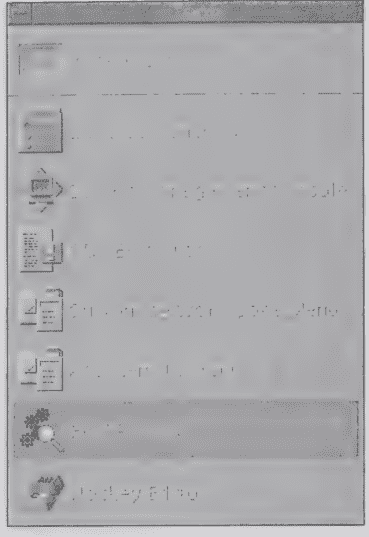

图 9.1
前面板。

Solaris 8 中新增了 CDE 进程管理器 sdtprocess，这是一个图形化的通用桌面环境（CDE）工具，提供进程管理器窗口用于监视和控制系统进程。

使用进程管理器的优点在于，你可以在不知道 ps 和 kill 命令相关所有复杂选项的情况下查看和控制进程。例如，你可以显示包含特定字符字符串的进程，并且可以按字母或数字对进程列表进行排序。你可以使用 find 命令发起搜索，或者只需突出显示进程并单击 kill 即可终止进程。

要打开进程管理器，你需要登录到 CDE 窗口环境。你可以通过执行以下命令启动 GUI：

```
sdtprocess &
```

或单击前面板 Tools 子面板上的 Find Process，如图 9.1 所示。

进程管理器窗口如图所示 9.2 所示。

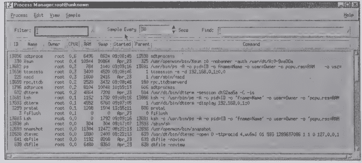

图 9.2
进程管理器窗口。

进程管理器窗口标题中的每个进程属性都提供了有关进程的详细信息，并在表 9.10 中进行了描述。

### 表 9.10

### 进程管理器窗口

| 列标题 | 描述 |
|---|---|
| ID | 进程 ID |
| Name | 进程名称 |
| Owner | 进程所有者的登录 ID 名称 |
| CPU% | 在同一时期可用的 CPU 时间比率，以百分比表示 |
| RAM | 该进程当前占用的 RAM 量 |
| Swap | 虚拟内存中的总大小 |
| Started | 实际启动时间（如果不是当前则为日期） |
| Parent | 父进程的进程 ID，或 PPID |
| Command | 正在执行的实际 UNIX 命令（已截断） |

单击任意列标题即可按该属性对进程进行排序。例如，单击 CPU 标题即可按其 CPU 使用情况对所有进程进行排序。列表每 30 秒更新一次，但你可以在 Sampling 字段中输入值以尽可能频繁地更新列表。最后，你可以在 Find 下拉菜单中输入一个文本字符串，该字符串是你要显示的所有进程条目共有的。在图 9.3 中，我在 Find 字段中输入了 root 以显示 root 拥有的所有进程。我还将采样更改为每 5 秒一次，并单击了 CPU 标题以按其 CPU 使用情况对进程进行排序。

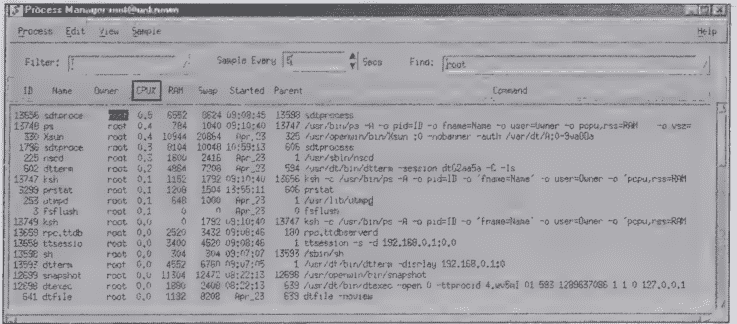

### 图 9.3

排序的进程管理器窗口。

进程管理器的另一个不错功能是能够显示进程的祖先。当 UNIX 进程启动一个或多个进程时，我们称它们为子进程或子进程。子进程和父进程具有相同的用户 ID。要查看父进程及其所属的所有子进程，请在进程管理器窗口中突出显示该进程。单击窗口顶部工具栏中的 Process，然后选择 Show Ancestry，如图 9.4 所示。

### 图 9.4

选择显示祖先。

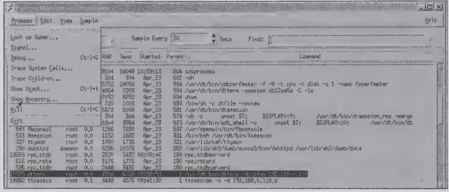

图 9.5 所示的窗口显示了属于父进程的所有进程。

### 图 9.5

显示祖先窗口。

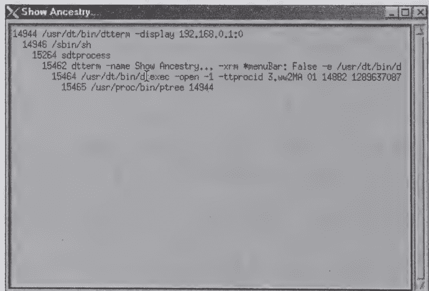

进程管理器中 Ancestry 选择的命令行等效项是 ptree 命令。使用此命令时你没有图形显示终端。ptree 命令显示包含指定 PID 或用户的进程祖先树。子进程从各自的父进程缩进显示。例如，这里是 PID 为 331 的 dtlogin 进程的进程树：

```
ptree 331
```

系统响应如下：

```
331  /usr/dt/bin/dtlogin -daemon
    533  /bin/ksh /usr/dt/bin/Xsession
      543  /usr/openwin/bin/fbconsole
      578  /usr/dt/bin/sdt_shell -c unset DT;  DISPLAY=:0;  /usr/d
        581  -sh -c unset DT;  DISPLAY=:0;  /usr/dt/bin/dtsession_
          594  /usr/dt/bin/dtsession
            601  dtwm
            602  /usr/dt/bin/dtterm -session dtG2aa5a -C -ls
              606  -sh
                1796  sdtprocess
                3299  prstat
      603  /usr/dt/bin/sdtperfmeter -f -H -t cpu -t disk -s 1 -name fpperfme
      16461 /usr/dt/bin/dtexec -open 0 -ttpprocid 1.wv5MI 01 593 1289637086 1
        16462 /usr/dt/bin/dtscreen -mode blank
```

## 使用信号

Solaris 支持向进程发送软件信号的概念。这些信号是其他进程在硬件上下文之外与正在运行的进程交互的方式。kill 命令用于向进程发送信号。系统管理员最常使用信号 SIGHUP、SIGKILL 和 SIGSTOP。SIGHUP 信号被一些实用程序用作通知进程执行某些操作的方式，例如重新读取其配置文件。如果电话连接丢失或挂断，也会向进程发送 SIGHUP 信号。SIGKILL 信号用于中止进程，而 SIGSTOP 信号用于暂停进程。表 9.11 描述了管理员可能使用的最常见信号。

### 表 9.11

### Solaris 下可用的信号

| 信号 | 编号 | 描述 |
|---|---|---|
| SIGHUP | 1 | 挂断。通常表示控制终端已断开连接。 |
| SIGINT | 2 | 中断。用户可以通过按 Ctrl+C 或 Delete 生成此信号。 |
| SIGQUIT | 3 | 退出进程并产生核心转储。 |
| SIGILL | 4 | 非法指令。 |
| SIGTRAP | 5 | 跟踪或断点陷阱。 |
| SIGABRT | 6 | 中止。 |
| SIGEMT | 7 | 仿真陷阱。 |
| SIGFPE | 8 | 算术异常。通知进程浮点错误。 |
| SIGKILL | 9 | 已杀死。强制进程终止。这是确保杀死。 |
| SIGBUS | 10 | 总线错误。 |
| SIGSEGV | 11 | 段错误。 |
| SIGSYS | 12 | 错误的系统调用。 |
| SIGPIPE | 13 | 破管。 |
| SIGALRM | 14 | 闹钟。 |
| SIGTERM | 15 | 已终止。温和的杀死，给进程清理的机会。 |
| SIGUSR1 | 16 | 用户信号 1。 |
| SIGUSR2 | 17 | 用户信号 2。 |
| SIGCHLD | 18 | 子进程状态已更改。 |
| SIGPWR | 19 | 断电或重启。 |
| SIGWINCH | 20 | 窗口大小更改。 |
| SIGURG | 21 | 紧急套接字条件。 |
| SIGPOLL | 22 | 可轮询事件。 |
| SIGSTOP | 23 | 已停止（信号）。暂停进程。 |
| SIGTSTP | 24 | 已停止（用户）。 |
| SIGCONT | 25 | 已继续。 |
| SIGTTIN | 26 | 已停止（tty 输入）。 |

| 信号 | 编号 | 描述 |
|---|---|---|
| SIGTTOU | 27 | 已停止（tty 输出）。 |
| SIGVTALRM | 28 | 虚拟计时器到期。 |
| SIGPROF | 29 | 配置文件计时器到期。 |
| SIGXCPU | 30 | CPU 时间限制超出。 |
| SIGXFSZ | 31 | 文件大小限制超出。 |
| SIGWAITING | 32 | 线程库保留的并发信号。 |
| SIGLWP | 33 | 线程库保留的进程间 LWP 信号。 |
| SIGFREEZE | 34 | 检查点冻结。 |
| SIGTHAW | 35 | 检查点解冻。 |
| SIGCANCEL | 36 | 线程库保留的取消信号。 |

此外，你可以在程序中编写信号处理程序以响应发送的信号。例如，许多系统程序，如名称服务器守护进程，响应 SIGHUP 信号时会重新读取其配置文件。然后此信号可用于在运行时更新进程，而无需终止并重新启动进程。对于许多信号而言，除了打印适当的错误消息并终止进程之外，无法执行其他操作。

kill 命令向进程发送终止信号（信号 15），进程即被终止。信号 15，即使用 kill 命令时未使用选项时的默认值，是一种温和的杀死，允许进程在终止前执行清理工作。另一方面，信号 9 被称为确保的、无条件的杀死，因为进程无法捕获或忽略它。如果在执行 kill -9 后进程仍然存在，则它要么在 UNIX 内核中挂起，等待磁盘 I/O 等事件完成，要么你不是该进程的所有者。

kill 命令通常用于向进程发送信号。你可以杀死你拥有的任何进程，而超级用户可以杀死系统中的所有进程，除了进程 ID 为 0、1、2、3 和 4 的进程。kill 命令命名不当，因为并非它发送的所有信号都用于杀死进程。此命令因其最常见的用途而得名——使用 kill -15 信号终止进程。


## 注释

常见问题是当一个进程不断启动自己的新副本时发生——称为 forking 或 spawning。用户对可以 fork 的新进程数量有限制。该限制在内核中通过 MAXUP（最大用户进程数）值设置。有时，由于用户错误，进程不断 fork 自己的新副本，直到用户达到 MAXUP 限制。当用户达到此限制时，系统似乎在等待。如果您终止用户某些进程，系统会代表用户恢复创建新进程。这可能是一个无法取胜的局面。处理这些失控进程的最佳方法是发送 STOP 信号暂停所有进程，然后发送 KILL 信号终止进程。因为进程首先被挂起，所以在您终止它们时它们无法创建新的进程。

您可以使用 kill 命令向您拥有的进程发送信号。许多信号可用，但现在您只需关心两个：9 和 15。要向进程发送信号，首先使用 ps 命令查找进程 ID（PID）号码。例如，键入 ps -ef 列出所有进程并找到要终止的进程的 PID：

```
ps -ef
```

| UID | PID | PPID | C | STIME | TTY | TIME | CMD |
|---|---|---|---|---|---|---|---|
| root | 0 | 0 | 0 | Nov 27 | ? | 0:01 | sched |
| root | 1 | 0 | 0 | Nov 27 | ? | 0:01 | /etc/init - |
| root | 2 | 0 | 0 | Nov 27 | ? | 0:00 | pageout |
| root | 3 | 0 | 0 | Nov 27 | ? | 12:52 | fsflush |
| root | 101 | 1 | 0 | Nov 27 | ? | 0:00 | /usr/sbin/in.routed -q |
| root | 298 | 1 | 0 | Nov 27 | ? | 0:00 | /usr/lib/saf/sac -t 300 |
| root | 111 | 1 | 0 | Nov 27 | ? | 0:02 | /usr/sbin/rpcbind |
| root | 164 | 1 | 0 | Nov 27 | ? | 0:01 | /usr/sbin/syslogd -n -z 12 |
| root | 138 | 1 | 0 | Nov 27 | ? | 0:00 | /usr/sbin/inetd -s |
| root | 113 | 1 | 0 | Nov 27 | ? | 0:00 | /usr/sbin/keyserv |
| root | 160 | 1 | 0 | Nov 27 | ? | 0:01 | /usr/lib/autofs/automountd |
| . | . | . | . | . | . | . | . |
| root | 439 | 424 | 0 | Nov 27 | ? | 0:00 | /bin/cat /tmp/.removable/notify0 |
| root | 5497 | 433 | 1 | 09:58:02 | pts/4 | 0:00 | script ps -ef |

要终止 PID 为 5497 的进程，键入

```
kill -15 5497
```

另一种终止进程的方法是使用 pkill 命令。pkill 的功能与之前描述的 pgrep 完全相同，只是它不会显示每个进程的信息，而是终止该进程。可以将信号名称或编号指定为 pkill 的第一个命令行选项。信号的值可以是表 9.11 中描述的任何值。例如，要终止名为 test 的进程，请发出以下命令：

```
pkill -9 test
```

如果未指定信号，则默认发送 SIGTERM（15）。

此外，还可以使用之前描述的 CDE 进程管理器来终止进程。在进程管理器窗口中，突出显示要终止的进程，单击窗口顶部工具栏中的 Process，然后从下拉菜单中选择 Kill，如图 9.6 所示。

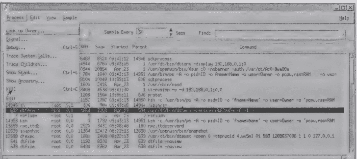

图 9.6
终止进程

进程管理器用于终止进程的等效 UNIX 命令是

```
kill -9 <PID>
```

其中 <PID> 是所选进程的进程 ID。

## 进程调度

进程竞争执行时间。调度是分时系统中的关键要素之一，决定接下来执行哪个进程。虽然系统上可能存在数百个进程，但任何给定时间只有一个实际使用 CPU。CPU 上的分时涉及挂起进程然后稍后重新启动它。由于活动进程的挂起和恢复每秒发生多次，因此用户看起来系统正在同时执行许多任务。

UNIX 尝试通过给予使用 CPU 最少量的进程更高优先级来管理进程优先级。此外，等待事件（如键盘按下）而休眠的进程比纯 CPU 驱动的进程获得更高优先级。

> 注释
您可以通过在文件 /usr/dt/appconfig/types/C/sdtprocess.dt 中重新定义标记为“Kill”的操作，来将 Kill 菜单项执行的命令重新定义为不同的命令。

有关配置 CDE 的详细信息，请参阅附录 B“Administration and Configuration of the CDE”。

在任何拥有多个竞争用户组的大型系统上，资源管理的任务都落在系统管理员身上。这项任务既有技术性也有政治性。作为系统管理员，您必须了解公司的目标才能成功管理这项任务。当您了解谁应获得优先级的政治含义时，您就可以管理技术细节。作为 root，您可以使用 nice 或 priocntl 命令更改系统上任何进程的优先级。在执行此操作之前，您必须了解优先级的工作原理。

## 调度优先级

所有进程都分配有一个执行优先级——一个整数值，根据多个不同因素动态计算和更新。每当 CPU 空闲时，调度程序会选择最受青睐的进程以恢复执行。所选进程是优先级数字最低的进程，因为较低的数字被定义为比较高的数字更受青睐。同一优先级级别的多个进程被放置在该优先级级别的运行队列中。每当 CPU 空闲时，调度程序就会启动最低编号的非空运行队列的队首进程。当运行队列顶部的进程停止执行时，它会移到队尾，下一个进程移到前面。进程开始运行后，它会一直执行，直到需要等待 I/O 操作完成、收到中断信号或耗尽该系统定义的最高执行时间片为止。典型的时片为 10 毫秒。

UNIX 进程有两个相关的优先级数字。其中一个是相对于其他进程的请求的执行优先级。此值（其 nice 值）由进程的所有者和 root 设置；在 ps -l 列表中显示在 NI 列中。分配给进程的另一个优先级是执行优先级。该优先级由操作系统动态计算和更新，考虑的因素包括进程的 nice 值、最近使用多少 CPU 时间以及正在运行的其他进程及其优先级。执行优先级值在 ps -l 列表的 PRI 列中显示。

尽管 CPU 是系统上最受关注的资源，但它并不是唯一的资源。内存使用、磁盘使用、I/O 活动和进程数量共同决定了计算机的吞吐量。例如，假设您有两个组 A 和 B。两个组都需要大量内存——当两者同时运行时超过可用量。将组 A 的优先级提高到组 B 之上可能没有帮助，如果组 B 没有完全释放其使用的内存。虽然分页系统会随着时间的推移做到这一点，但将进程交换到磁盘的过程可能很密集，并可能大大降低性能。更好的替代方案可能是使用信号完全停止组 B，然后在组 A 完成后稍后继续。

### 使用 nice 更改分时进程的优先级

nice 命令仅支持与以前的 Solaris 版本向后兼容。priocntl 命令在管理进程方面提供更大的灵活性。进程的优先级由其调度类的策略和其 nice 值决定。每个分时进程都有一个全局优先级，该优先级通过将用户提供的优先级（可受 nice 或 priocntl 命令影响）和系统计算的优先级相加来计算。

进程的执行优先级数字由操作系统分配，并由多个因素决定，包括其调度类、使用多少 CPU 时间以及其 nice 值。每个分时进程都以默认的 nice 值开始，该值从其父进程继承。nice 值显示在 ps 报告的 NI 列中。

用户可以通过增加其用户提供的优先级数字来降低进程的优先级。只有超级用户可以通过降低其 nice 值来提高进程的优先级。这可以防止用户提高其自身进程的优先级，从而垄断更大的 CPU 份额。


在 UNIX 中，nice 数值的范围为 0 到 +19。最高优先级为 0。可用的命令有两个版本：标准版本 /usr/bin/nice，以及集成到 C shell 中作为 C shell 内建命令的版本。

使用提交程序或命令时，请按照表 9.12 中所述使用 nice 命令。

## 表 9.12
### 使用 NICE 设置优先级

| 命令 | 描述 |
|---|---|
| *降低进程的优先级* | |
| `nice <command_name>` | 默认情况下将 nice 数值增加四个单位。 |
| `nice +4 <command_name>` | 将 nice 数值增加四个单位。 |
| `nice +10 <command_name>` | 将 nice 数值增加 10 个单位。 |
| *提高进程的优先级* | |
| `nice -10 <command_name>` | 通过降低 nice 数值来提高命令的优先级。 |

作为系统管理员，您可以在进程提交后使用 renice 命令更改其优先级。renice 命令的格式如下：

```
renice -n <value> -p <pid>
```

使用 ps -el 命令查找您想要更改优先级的进程的 PID。以下示例中要更改的进程名为“largejob”：

```
F S UID PID PPID C PRI NI ADDR SZ WCHAN TTY TIME CMD
9 S 0 8200 4100 0 84 20 f0274e38 193 ? 0:00 largejob
```

发出以下命令以提高 PID 8200 的优先级：

```
renice -n -4 -p 8200
```

再次发出 ps -el 命令后，进程显示为更高优先级：

```
F S  UID  PID PPID C PRI NI       ADDR SZ  WCHAN TTY   TIME CMD
9 S  0   8200 4100 0 60 16  f0274e38 193      ?     0:00  largejob
```

## 使用 priocntl 更改进程的调度优先级

标准优先级方案从 Solaris 2 开始得到改进，作为其对实时进程的支持的一部分。实时进程设计用于需要几乎立即响应事件的应用领域。当这些进程运行时，它们几乎可以完全访问所有系统资源。Solaris 使用范围为 −20 到 20 的时间共享优先级数字。Solaris 使用 priocntl 命令（旨在改进 nice 命令）来修改进程优先级。要使用 priocntl 更改进程的优先级，请键入

```
priocntl -s -p <new-priority> -i pid <process-id>
```

其中 new-priority 是进程的新优先级，process-id 是您想要更改的进程的 PID。

以下示例将进程 8200 的优先级级别设置为 −5：

```
priocntl -s -p -5 -i pid 8200
```

以下示例用于为给定父进程创建的每个进程设置优先级（nice 值）：

```
priocntl -s -p -5 -I ppid 8200
```

因此，此命令的结果是，从进程 8200 fork 出来的所有进程的优先级都将为 −5。

分配给进程的优先级值可以使用本章前面描述过的 ps 命令显示。

priocntl 命令的功能远不止本节所述的内容，但为了认证考试，我已描述了您需要了解的内容。请查阅在线手册页以获取有关 priocntl 命令的更多信息。

## 使用 Solaris 批处理设施

在繁忙的系统上划分进程的一种方法是安排作业在不同时间运行。例如，大型作业可以安排在凌晨 2 点运行，此时系统通常处于空闲状态。Solaris 支持两种批处理方法：crontab 和 at 命令。crontab 命令按固定间隔安排多个系统事件，而 at 命令安排单个系统事件。

### 配置 Crontab

cron 守护进程根据每个 crontab 文件中的命令安排系统事件。crontab 文件由一行一个命令组成，这些命令将按固定间隔执行。每行的开头包含五个日期和时间字段，告诉 cron 守护进程何时执行命令。第六个字段是要运行的程序的完整路径名。这些字段在表 9.13 中描述，由空格分隔。

## 表 9.13
### CRONTAB 文件

| 字段 | 描述 | 值 |
|---|---|---|
| 1 | 分钟 | 0 到 59。此字段中的 * 表示每分钟。 |
| 2 | 小时 | 0 到 23。此字段中的 * 表示每小时。 |
| 3 | 月中的日期 | 1 到 31。此字段中的 * 表示每月每天。 |
| 4 | 月份 | 1 到 12。此字段中的 * 表示每月。 |
| 5 | 星期几 | 0 到 6（0 = 星期日）。此字段中的 * 表示每周每天。 |
| 6 | 命令 | 输入要运行的命令。 |

在 crontab 文件中输入条目时，请遵循以下准则：

- 使用空格分隔字段。
- 使用逗号分隔日期或时间字段中的多个值。
- 使用连字符指定日期或时间字段中的值范围。
- 使用星号作为通配符以包含日期或时间字段中的所有可能值。例如，星号 (*) 可用于时间字段表示所有合法值。
- 在行首使用注释标记 (#) 表示注释或空白行。
- crontab 文件中的每个命令必须占一行，即使它很长，因为 crontab 不识别额外的回车符。

以下示例 crontab 命令条目在每个月的 1 日和 15 日下午 5 点在用户控制台窗口中显示提醒：

```
0 17 1,15 * * echo Hand in Timesheet > /dev/console
```

Crontab 文件位于 /var/spool/cron/crontabs 目录中。除了 root 之外，SunOS 软件安装过程中还提供了多个 crontab 文件；它们也位于此目录中。其他 crontab 文件以创建它们的 user 账户命名，例如 bill、glenda、miguel 或 nicole。它们也位于 /var/spool/cron/crontabs 目录中。例如，名为 root 的 crontab 文件在软件安装期间提供。其内容包括以下命令行：

```
10 3 * * 0,4 /etc/cron.d/logchecker
10 3 * * 0 /usr/lib/newsyslog
15 3 * * 0 /usr/lib/fs/nfs/nfsfind
1 2 * * * [ -x /usr/sbin/rtc ] && /usr/sbin/rtc -c
> /dev/null 2>&1
```

第一条命令行指示系统在星期日和星期四凌晨 3:10 运行 logchecker。第二条命令行安排系统在每个星期日凌晨 3:10 运行 newsyslog。第三条命令行命令系统在星期日凌晨 3:15 执行 nfsfind。第四条命令行指示系统检查夏令时并在必要时进行修正。如果没有 RTC 时区或没有 /etc/rtc_config 文件，此条目将不执行任何操作。

cron 守护进程处理 crontab 命令的自动调度。其功能是每 15 分钟检查一次 /var/spool/cron/crontabs 目录是否存在 crontab 文件。它检查新的 crontab 文件或现有文件的更改，读取文件内列出的执行时间，并在适当的时间提交命令执行。

### 创建和编辑 Crontab 文件

在 crontab 文件中创建条目与使用您喜欢的编辑器编辑文本文件一样简单。请使用下面描述的步骤编辑此文件；否则，您的更改要到 cron 守护进程下次启动时才会被识别。cron 仅在其自身进程初始化阶段或运行 crontab 命令时检查 crontab 配置文件。这减少了在定期安排的间隔内检查新文件或更改文件的开销。

> 注意
crontab 命令选择系统默认编辑器，即 ed，除非您已将 EDITOR 变量设置为 /usr/bin/vi 如下：

```
EDITOR=vi;export EDITOR
```

## 逐步操作
### 9.1 创建或编辑 Crontab 文件

1. （可选）要创建或编辑属于 root 或其他用户的 crontab 文件，请成为超级用户。
2. 通过键入 `crontab -e` 创建新的 crontab 文件或编辑现有文件
3. 按照表 9.13 中描述的语法向文件添加命令行。
4. 保存更改并退出文件。crontab 文件放置在 `/var/spool/cron/crontabs` 中。
5. 通过键入 `crontab -l` 验证 crontab 文件
系统会通过列出 crontab 文件的内容作出响应。


## 控制对 Crontab 的访问

您可以通过修改 /etc/cron.d 目录中的两个文件来控制对 crontab 的访问：cron.deny 和 cron.allow。这些文件仅允许指定的用户执行 crontab 任务，例如创建、编辑、显示和删除他们自己的 crontab 文件。cron.deny 和 cron.allow 文件由用户名列表组成，每行一个。这些访问控制文件以以下方式协同工作：

- 如果存在 cron.allow，则只有列在此文件中的用户才能创建、编辑、显示和删除 crontab 文件。
- 如果不存在 cron.allow，则所有用户都可提交 crontab 文件，除 cron.deny 中列出的用户外。
- 如果 cron.allow 和 cron.deny 都不存在，则需要超级用户权限才能运行 crontab。

需要超级用户权限才能编辑或创建 cron.deny 和 cron.allow。

在 Solaris 软件安装过程中，会提供默认的 /etc/cron.d/cron.deny 文件。它包含以下条目：

- daemon
- bin
- smtp
- nuucp
- listen
- nobody
- noaccess

cron.deny 文件中列出的用户均无法访问 crontab 命令。系统管理员可以编辑此文件以添加其他将被拒绝访问 crontab 命令的用户。未提供默认的 cron.allow 文件。这意味着，在 Solaris 软件安装后，所有用户（除默认 cron.deny 文件中列出的用户外）都可以访问 crontab。如果您创建了 cron.allow 文件，则只有这些用户可以访问 crontab 命令。

## 安排单个系统事件（at）

at 命令用于在稍后时间安排作业执行。与 crontab 不同，crontab 将作业安排为定期发生，而使用 at 提交的作业仅执行一次，在指定时间执行。

要提交 at 作业，请输入 at。然后指定执行时间和要运行的程序，如以下示例所示：

```
at 07:45am today
at> who > /tmp/log
at> <Press Control-d>
job 912687240.a at Thu Jun 1 07:14:00 2000
```

当您提交 at 作业时，它会被分配一个作业标识号，该标识号连同 .a 扩展名成为其文件名。文件存储在 /var/spool/cron/atjobs 目录中。与其安排 crontab 作业的方式类似，cron 守护进程控制 at 文件的调度。

at 的命令语法为

```
at -m <time> <date>
```

at 命令在表 9.14 中描述。

### 表 9.14 at 命令语法

| 选项 | 描述 |
|---|---|
| `-m` | 在作业完成后向您发送邮件。 |
| `<time>` | 您希望安排作业的小时。如果不按 24 小时制指定小时，请添加 am 或 pm。midnight、noon 和 now 是可接受的关键字。分钟是可选的。 |
| `<date>` | 月份、星期几的前三个或更多字母，或关键字 today 或 tomorrow。 |

您可以设置一个文件来控制对 at 命令的访问，仅允许指定的用户创建、删除或显示其 at 作业的队列信息。控制对 at 的访问的文件是 /etc/cron.d/at.deny。它由用户名列表组成，每行一个。此文件中列出的用户无法访问 at 命令。默认的 at.deny 文件在 SunOS 软件安装期间创建，包含以下用户名：

- daemon
- bin
- smtp
- nuucp
- listen
- nobody
- noaccess

使用超级用户权限，您可以编辑此文件以添加其他您希望限制其 at 访问的用户名。

## 检查队列中的作业（atq 和 at -l）

要检查等待在 at 队列中的作业，请使用 atq 命令。此命令显示您创建的 at 作业的状态信息。使用 atq 命令验证您是否已创建 at 作业。atq 命令确认 at 作业已提交到队列，如以下示例所示：

```
atq
Rank Execution Date Owner Job Queue Job Name
1st Jun 1, 2000 08:00 root 912690000.a a stdin
2nd Jun 1, 2000 08:05 root 912690300.a a stdin
```

另一种检查 at 作业的方法是发出 at -l 命令。此命令显示用户提交的所有作业的状态信息，如此示例所示：

```
at -l
user = root 912690000.a Thu Jun 1 08:00:00 2000
user = root 912690300.a Thu Jun 1 08:05:00 2000
```

## 移除并验证 at 作业的移除

要在执行前从队列中移除 at 作业，请输入

```
at -r [job-id]
```

其中 job-id 是您要移除的作业的标识号。

使用 at -l（或 atq）命令显示 at 队列中剩余的作业，以验证 at 作业是否已移除。您指定的标识号的作业不应再出现。在以下示例中，我们将移除一个计划于 6 月 1 日 08:00 a.m. 执行的 at 作业。首先，检查 at 队列以找到作业标识号：

```
at -l
user = root  912690000.a  Thu Jun  1 08:00:00 2000
user = root  912690300.a  Thu Jun  1 08:05:00 2000
```

接下来，从 at 队列中移除作业：

```
at -r 912690000.a
```

最后，验证该作业是否已从队列中移除：

```
at -l
user = root  912690300.a  Thu Jun  1 08:05:00 2000
```

注意
Syslog 在第二部分考试中有所涉及。

## 系统日志

系统管理员工作的重要部分是监控系统。Solaris 使用 syslog 消息设施来实现这一点。syslogd 是负责捕获系统消息的守护进程。消息可以是警告、警报或简单的信息性消息。作为系统管理员，您将自定义 syslog 以指定系统消息的保存位置和方式。

syslogd 守护进程从本地主机或远程主机上的应用程序接收消息，并将消息定向到指定的日志文件。对 syslog 捕获的每条消息，它都会添加时间戳、消息开头的消息类型关键字，并在消息末尾添加换行符。例如，以下消息已记录在 /var/adm/messages 文件中：

```
May 12 06:50:36 ultra5 unix: NOTICE: alloc: /opt: file
system full
```

Syslog 允许您按设施（生成消息的系统部分）和重要级别捕获消息。设施被认为是生成消息或错误的服务区域（例如打印、电子邮件或网络），而级别可以被认为是严重级别（例如 notice、warning、error 或 emergency）。Syslog 还允许您将消息转发到另一台机器，以便所有消息都记录在一个位置。syslogd 守护进程读取并将消息记录到由配置文件 /etc/syslog.conf 描述的一组文件中。/etc/syslog.conf 文件中的条目由两个字段组成：

```
selector    action
```

selector 字段包含以下形式的优先级规范的分号分隔列表：

```
facility.level [ ; facility.level ]
```

action 字段指示将消息转发到何处。

有许多定义的设施；它们在表 9.15 中描述。

### 表 9.15
### 设施的认可值

| 值 | 描述 |
|---|---|
| user | 由用户进程生成的消息。这是未在此文件中列出的程序或设施消息的默认优先级。 |
| kern | 由内核生成的消息。 |
| mail | 邮件系统。 |
| daemon | 系统守护进程，例如 in.ftpd。 |
| auth | 授权系统，例如 login、su、getty 等。 |
| lpr | 行式打印机 spooling 系统，例如 lpr、lpc 等。 |
| news | 保留给 USENET 网络新闻系统。 |
| uucp | 保留给 UUCP 系统。它目前不使用 syslog 机制。 |
| cron | cron/at 设施，例如 crontab、at、cron 等。 |
| local0-7 | 保留供本地使用。 |
| mark | 用于 syslogd 内部产生的带时间戳的消息。 |
| * | 星号表示除 mark 设施外的所有设施。 |

表 9.16 列出了 syslog level 字段的认可值。它们按严重程度降序排列。

### 表 9.16
### level 的认可值

| 值 | 描述 |
|-------|-------------|
| emerg | 用于通常会广播给所有用户的恐慌情况。 |
| alert | 用于应立即纠正的情况，例如损坏的系统数据库。 |
| crit | 用于关于关键情况的警告，例如硬件设备错误。 |
| err | 用于其他错误。 |
| warning | 用于警告消息。 |
| notice | 用于非错误情况，但可能需要特殊处理。 |
| info | 通知性消息。 |
| debug | 用于调试程序时通常使用的消息。 |
| none | 不将指示设施的消息发送到所选文件。例如，/etc/syslog.conf 中的条目 *.debug;mail.none 将发送除邮件消息外的所有消息到所选文件。 |

action 字段的值可以有四种形式之一：

- 一个以斜杠开头的<|message|>

适当的 host 表项。如果本地机器被指定为“loghost”，则 syslogd 消息写入适当的文件。否则，它们会发送到网络上的机器“loghost”。

- 以逗号分隔的用户名列表，表示由选择器指定的消息如果这些用户已登录则写入到指定的用户。
- 一个星号，表示由选择器指定的消息写入到所有已登录用户。

空行将被忽略。第一個非空白字符为 # 的行被视为注释。

查看 /etc/syslog.conf 文件中的示例条目后，所有这些会变得清晰得多：

```
*.err      /dev/console
*.err;daemon,auth.notice;mail.crit   /var/adm/messages
mail.debug   /var/spool/mqueue/syslog
*.alert   root
*.emerg   *
kern.err   @server
*.alert;auth.warning   /var/log/auth
```

在此示例中，第一行将所有错误打印到控制台。

第二行将所有错误、守护进程和身份验证系统通知，以及邮件系统中的所有严重错误发送到文件 /var/adm/messages。

第三行将邮件系统调试消息发送到 /var/spool/mqueue/syslog。

第四行将所有警报消息发送给用户 root。

第五行将所有紧急消息发送给所有用户。

第六行将内核消息中严重级别为 err（错误）或更高的消息转发到名为 server 的机器。

最后一行将授权系统级别为 alert 或更高的所有消息记录到文件 /var/log/auth。

级别 none 可用于禁用一个设施。这通常是在消除消息的上下文中完成的。例如：

```
*.debug;mail.none /var/adm/messages
```

选择来自所有设施的调试消息，但不包括来自 mail 的消息。换句话说，邮件消息被禁用。邮件系统 sendmail 会记录大量消息。此信息可能非常庞大，因此一些系统管理员会禁用邮件消息或将它们发送到另一个经常清理的文件。在禁用邮件消息之前，请记住，当您诊断邮件问题或追踪邮件伪造时，sendmail 消息非常有用。

syslogd 在多用户启动的早期阶段从 /etc/rc2.d 目录使用名为 S74syslog 的脚本启动。要重新启动 syslog 设施，请执行以下操作：

```
/etc/rc2.d/S74syslog stop
/etc/rc2.d/S74syslog start
```

syslog 设施在收到 HUP 信号（例如 kill -HUP）时，会从 /etc/syslog.conf 读取其配置信息。syslog 守护进程本身在对守护进程启动时间加上时间戳时记录的第一条消息始终会被记录。

## 记录信息的重要文件

Solaris 有许多保存日志信息的文件。这些文件大多存储在 /var/adm 目录中。以下日志文件列表简要描述了它们包含的信息：

- /var/adm/messages。messages 文件保存打印到控制台的信息。这些可能包括 root 登录和 su 尝试。
- /var/adm/lastlog。该文件保存系统中每个用户的最近登录时间。
- /var/adm/utmpx。utmpx 数据库文件包含 who、write 和 login 等命令的用户访问和记账信息。utmpx 文件存储终端线路和登录时间等信息，供 who 命令访问。
- /var/adm/wtmpx。wtmpx 文件包含 utmpx 数据库的用户访问和记账信息历史。wtmpx 文件跟踪自重启以来的登录和注销。last 命令在第 8 章“系统安全”中描述，读取该文件并处理信息。
- /var/adm/acct。这是一个系统记账文件。如果启用，记账文件会为每个进程记录一条记录，列出以下信息：运行命令的用户名称、命令名称、使用的 CPU 时间、进程完成的时间戳以及指示完成状态的标志。记账信息在监控系统上谁在做什么方面非常有用。
- /var/adm/sulog。sulog 文件保存系统中所有使用过 su 命令的人员的记录。示例如下：

```
SU 04/29 09:39 + console root-daemon
SU 04/29 15:29 + console root-daemon
SU 05/02 05:38 + console root-daemon
SU 05/12 06:20 + console root-daemon
SU 05/12 07:59 + pts/1 root-bcalkins
```

- /var/cron/log。记录所有 cron 活动。

良好的系统管理要求您经常查看系统日志并控制其大小。其中一些文件可能会变得非常庞大并迅速填满文件系统。

## 章节摘要

## 关键术语

- 进程
- ps 命令
- pgrep 命令
- Syslog
- crontab 文件
- priocntl 命令
- nice 命令
- prstat 命令
- ps 命令
- CDE 进程管理器

本章描述了 Solaris 进程以及用于监控它们的各种 Solaris 实用程序。使用 ps、prstat 和 sdtprocess 等命令，您可以查看与进程关联的所有属性。

描述了向进程发送信号的概念。信号是发送给进程以中断它并引起响应的消息。您还学习了如何向进程发送信号以引起响应，例如终止进程。

描述了设置进程优先级。描述了用于设置和更改进程优先级的各种命令，例如 nice 和 priocntl。此外，我描述了如何使用 crontab 和 at 设施。使用这些设施提交批处理作业并安排进程在系统较不繁忙时运行，以减少对 CPU 和磁盘等资源的压力。

最后，我描述了 syslog 消息设施。syslogd 是负责捕获系统消息（例如警告、警报或信息性消息）的守护进程。您将主动监控这些消息以解决系统上可能出现的问题。

系统管理员需要了解每个应用程序所属的进程。当用户报告问题时，系统管理员可以快速找到正在使用的进程并查找异常。通过密切关注系统消息和进程，您将熟悉什么是正常和什么是异常。不要等到问题发生——每天查看系统消息和进程。创建 shell 脚本来为您监视进程并查找系统日志文件中的异常。通过采取主动的系统管理方法，您会在问题影响用户之前找到问题。

在第 10 章“LP 打印服务”中，我们将探讨另一个您需要非常熟悉的主题——LP 打印服务，即负责 Solaris 环境中所有打印的设施。

## 应用你的知识

### 练习

### 9.1 显示进程信息

在此练习中，您将使用本章中描述的各种实用程序来显示活动进程的信息。

预计时间：10 分钟

1. 以 root 身份登录到通用桌面环境（CDE）。
2. 打开一个新窗口，并使用 ps 命令显示活动进程：
   ```
   ps -ef <cr>
   ```
3. 打开另一个新窗口，并使用 prstat 命令显示活动进程：
   ```
   prstat <cr>
   ```
4. 输入 q 以退出 prstat。
5. 显示 dtlogin 进程及其所有子进程。首先使用 pgrep 命令获取 dtlogin 进程的 PID：
   ```
   pgrep dtlogin
   ```
   现在使用 dtlogin 进程的 PID 使用 ptree 命令显示祖先树：
   ```
   ptree 331
   ```
6. 现在启动进程管理器。
   ```
   sdtprocess &
   ```
   注意窗口会定期更新。
7. 在窗口顶部的 sample 字段中，将采样周期从 30 秒更改为 5 秒。
8. 通过单击标题中的 ID 按钮按 ID 对进程进行排序。

### 9.2 使用信号

在此练习中，您将使用信号终止进程。

预计时间：10 分钟

1. 以 root 身份登录。
2. 查找 sdtprocess 的进程 ID。
   ```
   pgrep sdtprocess
   ```
3. 终止该进程。
   ```
   kill -9 <PID of sdtprocess>
   ```
4. 重新启动进程管理器。
   ```
   sdtprocess &
   ```
5. 从进程管理器中终止 vold 进程。
6. 通过在进程管理器窗口顶部的 Filter 字段中输入 vold 来查找 vold 进程。
7. 突出显示 vold 进程。
8. 从屏幕顶部的工具栏中选择 Process。
9. 从下拉菜单中选择 Kill。

### 9.3 使用批处理进程

在此练习中，您将使用 crontab 配置进程每天在指定时间执行。

预计时间：10 分钟

1. 以 root 身份登录到 CDE 会话。
2. 打开一个新窗口并编辑 crontab 条目：
   ```
   crontab -e
   ```


## 应用你的知识

3. 在文件末尾的最后一行之后输入以下内容：

```
0 11 * * * echo Hand in Timesheet > \
/dev/console
```

4. 保存并关闭文件。

打开一个控制台窗口，在上午11:00，你将看到消息“Hand in Timesheet”显示。

## 复习问题

1. 以下哪个命令可以找到进程参数字符串中包含“dt”的所有进程？请选择所有适用项。

+   A. pgrep -l -f "dt"
B. ps -ef "dt"
C. ps -el "dt"
D. ps -ef|grep dt

2. 可以用来监视系统进程的命令有哪些：

+   A. prstat
B. psrset
C. ptree
D. sdtprocess

3. 以下哪个命令可以杀死名为 test 的进程？

+   A. pkill -9 test
B. kill -9 test
C. ps -ef|grep kill| kill -9
D. kill test

4. 哪些命令可以显示活动系统进程并按指定间隔更新？请选择所有适用项。

+   A. ps
B. prstat
C. sdtprocess
D. ptree

5. 在 ps 命令的输出中，S 字段中的“R”代表什么：

+   A. 进程在运行队列上。
B. 进程正在接收输入。
C. 它是一个普通进程。
D. 进程正在休眠，因此必须重新启动。

6. 在 ps 命令的输出中，UID 字段显示以下哪一项？

+   A. 父进程
B. 进程 ID
C. 进程所有者
D. 进程的优先级

7. 以下哪个 ps 命令的选项只列出特定用户的进程？

+   A. -P
B. -f
C. -l
D. -u

8. 以下哪个 ps 命令的选项只列出与本地终端关联的进程？
A. -l
B. -a
C. -f
D. -t

9. 以下哪个命令向 PID 为 2930 的进程发送终止信号（信号 15）？
A. kill 2930
B. stop 2930
C. Ctrl+C
D. cancel 2930

10. 以下哪个信号无条件停止一个进程？
A. 9
B. 0
C. 15
D. 1

11. 以下哪个命令用于更改进程的优先级？
A. nice
B. priocntl
C. ps
D. hup

12. 以下哪个命令用于提高 PID 8200 的优先级？
A. renice -n -4 -p 8200
B. nice -n -4 -p 8200
C. nice -i 8200
D. renice -I -p 8200

13. 哪些实用程序可用于显示进程祖先树？请选择所有适用项。
A. ps
B. ptree
C. sdtprocess
D. prstat

15. 以下哪个两个命令可安排命令在给定时间运行一次？
A. crontab
B. priocntl
C. at
D. cron

16. 以下哪个命令显示由 at 命令排队的作业？
A. atq
B. at -l
C. ps
D. crontab

17. 以下哪个 crontab 条目指示系统在星期日和星期四晚上 3:10 运行 logchecker？
A. 0 4 * * 10,3 /etc/cron.d/logchecker
B. 10 3 * * 0,4 /etc/cron.d/logchecker
C. * 10 3 0,4 /etc/cron.d/logchecker
D. 10 3 * * 0-4 /etc/cron.d/logchecker

18. 以下哪个是负责捕获系统消息的守护进程？
A. syslogd
B. messaged
C. init
D. msgd

19. 以下哪一行在 /etc/syslog.conf 文件中将所有 alert 消息发送给用户 root？
A. *.alert  root
B. alert root
C. root *.alert
D. *.emerg root

20. 以下哪个日志记录所有 cron 活动？
A. /var/cron/log
B. /var/spool/cron/log
C. /var/adm/cron
D. /var/adm/messages

21. syslog 守护进程在哪个运行级别启动？
A. 2
B. 1
C. 3
D. 它在所有运行级别运行。

22. 以下哪个文件保存系统中每个用户的最近登录时间？
A. /var/adm/lastlog
B. /var/adm/messages
C. /var/adm/acct
D. /var/adm/utmpx

23. 用户希望在今天下班后执行一个命令。以下哪个命令可以让他做到这一点？
A. runat
B. at
C. submit
D. 以上都不是

## 复习问题答案

1. A.、D. 使用 pgrep 和 ps 命令查看系统上运行的进程。命令 pgrep -l -f "dt" 和 ps -ef | grep dt 会找到进程参数字符串中包含“dt”的所有进程并显示它们。

2. D. Solaris 8 中的新功能是 CDE 进程管理器 sdtprocess，这是一个图形化的 Common Desktop Environment（CDE）工具，提供进程管理器窗口用于监视和控制系统进程。

3. A. 命令 pkill -9 test 会杀死名为 test 的进程。

4. B.、C. prstat 和 sdtprocess 命令显示活动系统进程，并且可以配置为按指定间隔更新。

5. A. 在 ps 命令的输出中，S 字段中的“R”表示进程在运行队列上。

6. C. 在 ps 命令的输出中，UID 字段显示进程所有者。

7. D. ps 命令的 -u 选项只列出特定用户的进程。

8. B. ps 命令的 -a 选项只列出与本地终端关联的进程。

9. A. 命令 kill 2930 向 PID 为 2930 的进程发送终止信号（信号 15）。

10. A. 信号 9 无条件停止进程。

11. A.、B. nice 和 priocntl 命令用于更改进程的优先级。

12. A. renice -n -4 -p 8200 命令用于提高 PID 为 8200 的进程的优先级。

13. B.、C. ptree 和 sdtprocess 实用程序用于显示进程祖先树。

14. C. at 命令安排命令在给定时间运行一次。

15. A.、B. atq 和 at -l 命令显示由 at 命令排队的作业。

16. B. crontab 条目 10 3 * * 0,4 /etc/cron.d/logchecker 指示系统在星期日和星期四晚上 3:10 运行 logchecker。

17. A. syslogd 是负责捕获系统消息的守护进程。

18. A. /etc/syslog.conf 文件中的条目 *.alert root 告诉 syslogd 将所有 alert 消息发送给用户 root。

19. A. 名为 /var/cron/log 的日志文件记录所有 cron 活动。

20. A. syslog 守护进程在运行级别 2 启动。

21. A. 文件 /var/adm/lastlog 保存系统中每个用户的最近登录时间。

22. B. 使用 at 命令在稍后时间执行命令或脚本。

## 目标

以下为本章的测试目标。

## 了解 Solaris LP 打印服务

- 在 Solaris 中设置和管理打印机需要了解打印 spooler、打印守护进程和打印机配置文件。本章将描述这些内容。

## 管理打印机

- 在 Solaris 8 中管理打印机涉及使用多个实用程序和命令。本章将描述这些常用的实用程序和命令。

## 第 10 章

## LP 打印服务

## 大纲

介绍 378

管理打印机 393

Solaris 打印服务 378

删除打印机和管理打印机访问 393

LP 打印服务目录 379

创建打印机类 395

打印 Spooler 380

检查打印机状态 397

LP 打印守护进程 381

管理打印机队列 398

设置硬件 382

重新启动打印调度程序 405

以太网连接 383

设置用户的默认打印机 406

并行连接 383

使用 Admintool 修改打印机 407

串行连接 383

摘要 408

设置软件 384

应用你的知识 409

BSD 与 SVR4 打印软件 384

打印服务器与打印客户端 387

为 Solaris 打印机配置软件 388

使用打印机类型菜单上未列出的打印机 392

## 学习策略

以下策略将帮助你准备测试：

- 在本章中，你会注意到我没有展示很多冗长的逐步操作，但我确实介绍了用于管理打印机的多个命令，以及如何使用这些命令的示例。练习逐步操作以及命令，并确保你理解何时以及在何处使用它们。
- 密切注意 SVR4 和 BSD 风格打印服务之间的差异。
- 确保你理解打印服务器和打印客户端之间的区别。了解本地打印机和网络打印机之间的差异，并密切注意用于定义打印机的各种配置文件。


## 引言

打印机是任何计算机系统的标准外设。添加到任何新系统的第一个设备之一就是打印机。Solaris 操作环境的多用户特性意味着 Solaris 打印机软件比单用户操作系统的复杂得多。这意味着向 Solaris 系统添加打印机不仅仅是即插即用。

本章描述如何使用 Admintool GUI 或命令行设置本地打印机、设置对远程打印机的访问以及执行一些打印机管理任务。系统管理员在设置打印服务、向服务器添加打印机或从打印客户端向打印服务器上的远程打印机添加访问权限方面的大多数需求都应由 Admintool 满足。从命令行设置打印机可能是一项复杂任务。本章首先探讨将打印机连接到 Solaris 系统涉及的硬件问题，然后再研究该过程更复杂的部分——配置软件。

## Solaris 打印服务

Solaris 打印服务是在操作系统初始安装时安装的默认集群。要验证该软件包是否已安装，请通过发出在第 4 章“软件包管理”中描述的 pkginfo 命令查找以下软件包。

| 软件包 | 说明 |
|---|---|
| SUNWlpmsg | ToolTalk 程序用于传递打印机警报。 |
| SUNWfdl | 用于 Adobe PostScript 打印机的 Solaris 桌面字体下载器。 |
| SUNWsclp | SunSoft 打印源兼容性，(Usr)。用于与 SunOS 4.x 用户界面和源构建兼容的打印实用程序。 |
| SUNWslpr | 服务定位协议（SLP）框架的 root (/) 文件系统部分；包括 SLP 配置文件和 SLP 守护进程的启动脚本。 |
| SUNWslpu | 服务定位协议（SLP）框架的 usr 文件系统部分。 |
| SUNWslpx | 服务定位协议（SLP）64 位开发人员库。 |
| SUNWmp | MP (make pretty) 打印过滤器。 |
| SUNWpcr | 打印服务的客户端配置文件和实用程序。 |
| SUNWpcu | 打印服务的客户端配置文件和实用程序。 |

> NOTE 服务定位协议（SLP）是互联网工程任务组（IETF）用于在企业网络中发现共享资源（如打印机、文件服务器、网络摄像机等）的协议。Solaris 8 操作环境包含 SLP 的完整实现，其中包括使开发人员能够编写 SLP 启用应用程序的 API；它还为系统管理员提供了一个便于网络扩展的框架。

设置 Solaris 打印机涉及设置 spooler、打印守护进程以及硬件（打印机和打印机端口）。系统管理员需要验证计算机是否至少有 8MB 的磁盘空间可用于 /var/spool/lp。打印文件将被发送到此位置以准备打印。其他配置文件将被创建，但 Solaris 会为你处理这部分。当设置打印机时，Solaris 会根据需要对系统的 /etc/printers.conf 文件和 /etc/lp 目录进行适当的更改。

## LP 打印服务目录

LP 打印服务包括以下目录结构、文件和日志：

- `/usr/bin`。该目录包含 LP 打印服务用户命令。
- `/usr/sbin`。该目录包含 LP 打印服务管理命令。
- `/usr/share/lib/terminfo`。该目录包含 terminfo 数据库，其中描述了设备（如打印机和终端）的功能。terminfo 数据库将在本章后面讨论。
- `/usr/lib/lp`。该目录包含 LP 打印服务守护进程、打印服务使用的二进制文件、PostScript 过滤器和默认打印机接口程序。
- **/usr/lib/lp/postscript**。该目录包含 Solaris LP 打印服务提供的所有 PostScript 过滤器程序。打印过滤器用于将打印请求的内容转换为目标打印机接受的格式。
- **/etc/lp**。该目录包含 LP 服务配置文件。这些文件使用本章后面描述的打印服务配置工具进行编辑。
- **/etc/lp/interfaces**。该目录包含每个打印机接口程序文件。此目录中的条目特定于系统上安装的每台打印机。
- **/etc/lp/printers**。此目录中为连接到系统的每台本地打印机设有子目录。每个子目录包含每台打印机的配置信息和警报文件。
- **/var/spool/lp**。所有当前打印请求都存储在此处，直到打印完成。
- **/var/lp/logs**。该目录包含打印请求的历史日志。

## 打印 Spooler

Spool 的全称是 Simultaneous Peripheral Operations OnLine。spooler 也称为队列。用户在想要打印某物时执行打印 spooler lp 程序。然后打印 spooler 将用户想要打印的内容放入预定义的 /var/spool/lp 打印 spooling 目录中。

Spooling 空间是用于存储和处理打印队列中请求所占用的磁盘空间量。/var 目录的大小取决于磁盘的大小和磁盘的分区方式。如果 /var 未作为单独分区创建，/var 目录将使用部分根分区空间，而根分区空间可能相当小。一个大的 spool 目录可能消耗 600MB 的磁盘空间。查看可指定为打印服务器的系统上可用磁盘的大小和分区情况。

连接打印机时，首先仔细评估用户的打印需求和使用模式。如果用户通常只打印不需要复杂格式要求的简短 ASCII 文件，则分配给 /var 20–25MB 磁盘空间的打印服务器可能就足够了。然而，如果许多用户正在打印冗长的 PostScript 文件，他们很可能会经常填满 spooling 空间。当 /var 填满且用户无法将作业排队打印时，工作流程会被中断。/var 的大小在操作系统加载和磁盘分区时设定。

对于 SunOS 用户，SVR4 lp 程序等同于 BSD lpr 打印程序。在 SunOS 中，打印 spooler 位于 /usr/spool。当 Sun 从基于 BSD UNIX 的 SunOS 4.x 切换到基于 SVR4 UNIX 的 SunOS 5.x 时，BSD 和 SVR4 之间的打印系统差异很大。在本章中，我将对可能熟悉它的系统管理员提及 BSD 打印系统。BSD 打印协议是行业标准。它被广泛使用并在不同制造商的各种系统之间提供兼容性。对于同时使用 BSD 和 SVR4 UNIX 的站点，Sun 在 Solaris 中为两种打印系统提供了兼容性。

> **CAUTION**
>
> 一些打印作业会消耗大量磁盘空间。事实上，我的一位客户有一份报告在 spool 到打印机时消耗了超过 800MB。当 /var 用完磁盘空间时，许多系统功能无法继续，例如打印、消息日志记录和邮件。设置系统时请确保为 /var 提供足够的空间。

## LP 打印守护进程

/usr/lib/lp/lpsched 守护进程是负责 Solaris 8 中调度和打印的 UNIX 实用程序。有时它被称为 lp 守护进程。lpsched 打印守护进程是负责从 spooling 目录获取输出并将其发送到正确打印机的 UNIX 进程。lpsched 还跟踪打印服务器上打印机和过滤器的状态。再次说明，对于 SunOS 用户，lpsched 等同于 BSD UNIX 中的 lpd。

> **NOTE**
>
> /usr/lp/lpsched 实际上是到名为 /usr/lib/lp/lpsched 的二进制文件的软链接。

/usr/sbin/inetd 守护进程在启动时启动，并侦听其配置文件 /etc/inetd.conf 中列出的每个服务的端口上的服务请求，该文件在第 8 章“系统安全”中进行了描述。当请求到达时，inetd 执行与该服务关联的服务器程序。

/usr/lib/lp/in.lpd 守护进程由 inetd 启动并实现打印协议的网络侦听服务。当 inetd 收到打印请求时，in.lpd 会启动以提供连接服务。in.lpd 守护进程在请求得到服务后退出。


在 Solaris 系统上可以使用多种方法定义打印机。表 10.1 描述了 Solaris 用于添加打印机的工具。

## 表 10.1
### Solaris 打印机实用程序

| 实用程序 | 描述 |
|---|---|
| SunSoft Print Client Software | 此接口此前仅随 Solstice AdminSuite 管理工具集提供。现在它作为标准 Solaris 发行版软件的一部分提供，并用于设置打印客户端。 |
| Admintool | 用于在本地系统上创建、修改和删除打印机的图形用户界面。这是初学者添加打印机的推荐方式。 |
| Solstice Print Manager | 用于在名称服务环境中管理打印机的图形用户界面打印管理器。仅随 Solaris 8 服务器软件发行版提供。 |
| LP Print Service Commands | 用于设置和管理打印机的命令行实用程序。这些命令提供完整功能；Admintool 和 AdminSuite 软件包在高级任务方面有所局限。 |

## 硬件设置

将打印机连接到 UNIX 系统不是任何人的最爱活动，因为它很快就会变成耗时的工作。市场上有很多打印机，每种都有略微不同的接口。将打印机本地连接到 Sun 系统时，您有三种选择之一：

- 以太网连接
- 并行连接
- 串行连接

连接类型取决于打印机可用的连接选项。如果打印机支持该选项，以太网连接将是最好的。如果无法使用以太网连接，则并行连接是首选方法。大多数，如果不是全部，打印机都有并行端口。如果没有并行选项，最终选择是串行连接。

### 以太网连接

许多新打印机提供添加以太网接口的选项。具有以太网连接的打印机称为网络打印机。网络打印机是一种硬件设备，可在不直接通过电缆连接到打印服务器的情况下为打印客户端提供打印服务。它是一个具有自己的系统名称和 IP 地址的打印服务器，并直接连接到网络。以太网接口可能位于打印机内部或外部。由于其速度，使用以太网接口安装打印机是推荐的。

### 并行连接

大多数打印机，除了少数例外，都具有并行接口。并行接口相对于串行接口具有巨大优势，尤其是在使用 Centronics 接口时。Centronics 接口完全定义了打印机和计算机之间并行连接使用的所有线路。只需使用 Centronics 并行电缆将打印机连接到 Sun 系统的背面即可。一些 Sun 系统没有 DB25 并行连接器，需要 Sun 的专用电缆。其他较旧的 Sun 系统没有并行接口，因此您必须通过从 Sun 购买 SBUS 并行接口来添加一个。

### 串行连接

有些打印机同时支持并行和串行连接。有时，打印机通过串行接口连接，因为 Sun 工作站没有可用的并行接口。使用串行接口连接设备需要对串行传输有透彻的理解。这种连接打印机的方法最困难，因为在计算机和打印机之间建立适当的“握手”或通信方式的复杂性。

## 软件设置

对于网络打印机，请使用厂商的软件来配置操作系统。完成厂商软件安装后，您不需要进一步的软件配置。您必须从打印机制造商处获取软件才能在系统上安装打印机。大多数都易于配置。HP Jetdirect 打印服务器是最受欢迎的，但它绝不是唯一可用的打印服务器。

> 注意

不要使用 Admintool 或 Print Manager 添加、修改或删除直接通过自己的网络接口卡连接到以太网的基于网络的打印机。您不会损坏任何东西，但系统将无法识别您的打印机，即使打印机可能出现在打印机工具窗口中。始终使用制造商提供的软件来管理打印机。

第一步是将打印服务器连接到网络并设置 IP 地址。此过程因打印服务器而异，因此请按照制造商的指南操作。接下来，安装打印服务器软件并按照制造商的指南配置打印机。厂商软件配置了所有内容；不需要额外的软件配置。

对于具有并行或串行连接的打印机，您必须使用 Solaris 工具来配置操作系统以识别打印机。

## BSD 与 SVR4 打印软件

驱动 UNIX 打印过程的软件是 BSD 和 SVR4 这两个 UNIX 版本既相似又不同的领域。两个打印系统相似之处在于两者都基于 spooling 概念。SVR4 和 BSD 打印服务都支持接口程序的概念，该程序充当过滤器，所有发送到打印机的输出都通过它传递。以下是接口程序的一些示例用途：

- 添加横幅页。大多数 UNIX 系统会自动在打印作业前面添加横幅页。该页面的目的是标识打印机输出的所有者。
- 添加或删除换行字符。UNIX 仅使用换行字符来分隔行。测试打印机时您可能遇到的第一个问题是文本以阶梯状输出。大多数打印机具有回车/换行和自动换行拨码开关，可控制打印机使用什么。通过修改对发送到打印机的所有输出执行必要转换的接口程序，或将打印机的拨码开关设置为硬件制造商推荐的设置，可以修复阶梯问题。

BSD 和 SVR4 之间的差异在于配置文件和 spooling 目录，而 Solaris 操作环境会自动配置这些。lpsched 守护进程处理打印作业的方式与 BSD 中的 lpd 守护进程也存在差异。

### BSD 打印服务

连接到 BSD 系统的每台打印机都必须有自己的 spooling 目录，由一个 lpd 守护进程提供服务。spool 目录位于 /var/spool/lpd 目录中。每台打印机都有自己的 lpd 守护进程。在 BSD 中，lpd 访问 /etc/printcap 文件以获取有关打印机的任何所需信息。printcap 文件是系统的打印机数据库文件，存储有关连接到系统所有打印机的必要信息。要使用打印机，该打印机必须在 /etc/printcap 文件中有一个条目。lpr 函数是 BSD 中 lp 在 SVR4 下的等效项。如果用户想打印某些内容，他们使用 lpr 命令，该命令将必要信息发送到指定的 spooling 目录。

### SVR4 打印服务

在 SVR4 中，一个 lpsched 守护进程为所有打印机提供服务。lpsched 守护进程持续运行并为打印服务提供“动力”。任何时候都应只有一个 lpsched 实例在运行。

LP 打印服务执行以下功能：

- 管理文件并调度本地打印请求
- 接收并调度网络请求
- 过滤文件（如有必要），以便正确打印
- 启动与打印机交互的程序
- 跟踪作业状态
- 跟踪安装在打印机上的表单
- 跟踪当前安装的打印轮
- 发送安装新表单或不同打印轮的警报
- 发送有关打印问题的警报

大多数 LP 配置文件位于 /var/spool/lp 目录中，除了接口文件位于 /etc/lp/interfaces 目录。/var/spool/lp 中应有一个 SCHEDLOCK 文件，负责确保只有一个 lpsched 实例运行。您使用 lpadmin 命令从系统中添加、配置和删除打印机。

有关打印机的信息可以在 /etc/printers.conf 文件和位于 /etc/lp 目录的文件中找到。Solaris Admin 工具为表 10.2 中列出的许多 lp 命令提供图形界面。

## 表 10.2
### Solaris lp 命令

| 命令 | 描述 |
|---|---|
| accept/reject | 启用或禁用进入 spooling 区域的打印机或类的任何进一步请求。 |
| cancel | 允许用户停止打印信息 |
| enable/disable | 启用或禁用从 spooler 到打印机的更多输出 |
| lp | 用户的打印命令。将要打印的信息放入 spooler |
| lpadmin | 允许配置打印服务 |
| lpmove | 在目的地之间移动打印请求 |
| lpsched | 启动打印服务 |
| lpshut | 停止打印服务 |
| lpstat | 显示打印服务的状态 |


虽然 Solaris 使用 SVR4 打印模型，但它仍然支持 BSD 风格的打印以提供互操作性。广泛使用的 BSD 打印协议可在不同制造商的各种系统之间提供兼容性。

## 打印服务器与打印客户端

打印服务器是连接有本地打印机的系统，并使其可供网络上的其他系统使用。打印客户端是可向打印服务器发送打印请求的远程系统。当你在系统上安装打印客户端软件并启用对远程打印机的访问时，该系统就成为打印客户端。只要系统有足够的资源来管理打印负载，任何具有打印机的网络系统都可以作为打印服务器。

打印客户端发出允许其发起打印请求的打印命令。打印命令定位打印机和打印机配置信息。

当打印作业从打印客户端发送时，用户发出 SVR4 风格的 lp 命令或 BSD 风格的 lpr 命令。表 10.3 中显示的任何一种样式都可以使用。

表 10.3
有效打印样式

| 样式 | 描述 |
|-------|-------------|
| 标准 | 打印命令和选项后跟打印机名称或类。例如：`lp -d neptune filename` |
| POSIX | 打印命令和选项后跟 server:printer。例如：`lpr -P galaxy:neptune filename` |
| 上下文 | 定义在《Federated Naming Service 编程指南》中。例如：`lpr -d thisdept/service/printer/printer-name filename` |

如果用户在有效样式中未指定打印机名称或类，命令会检查用户的 PRINTER 或 LPDEST 环境变量以获取默认打印机名称。这些变量可以在用户的启动文件中设置以指定要使用的默认打印机。如果未定义默认打印机的任一环境变量，命令会检查用户主目录中的 .printers 文件以获取默认打印机别名。如果命令在 .printers 文件中找不到默认打印机别名，它然后会检查打印客户端的 /etc/printers.conf 文件以获取配置信息。如果在 /etc/printers.conf 文件中找不到打印机，命令会检查名称服务（NIS 或 NIS+），如果有的话。

## 为 Solaris 打印机配置软件

打印客户端软件和 Printer Manager 应用程序为在网络环境中设置和管理打印机提供了一种图形化解决方案。Printer Manager 软件的优点是它支持名称服务（NIS 或 NIS+），让你可以为网络集中管理打印。 如果你使用名称服务，Solaris Printer Manager 是管理打印机配置信息的首选方法。使用名称服务来存储打印机配置信息是可取的，因为它使打印机信息可供网络上的所有系统使用，从而使打印管理更容易。你也可以在命令行上使用 lpadmin 命令来配置单个系统上的打印机。Admintool 为 Solaris 环境中安装打印机提供了一种替代方法。它提供了对表 10.2 中列出的 lp 命令的图形界面。本节描述如何使用 Admintool 设置打印机软件。

你必须在已连接打印机的系统上运行 Admintool，因为它不允许你对远程系统进行更改。在设置打印机时，Admintool 会在系统的 /etc/printers.conf 文件和 /etc/lp 目录中进行适当的更改。

> 注意

如果你坐在 systemA 并想将打印机连接到 systemB，你不需要开车到该位置在 systemB 上运行 Admintool。从 systemA，简单地 rlogin 到 systemB 并输入以下内容：

SystemB 的 Admintool 现在应该在 systemA 上显示，就像你坐在 systemB 一样。

```
admintool -display systemA:0.0
```

## 逐步操作

### 10.1 使用 Admintool 配置打印机

按以下步骤使用 Admintool 配置打印机：

1. 输入 admintool 以调出 Admintool 菜单。Admintool 窗口出现。

2. 选择 Browse、Printers，如图 10.1 所示。

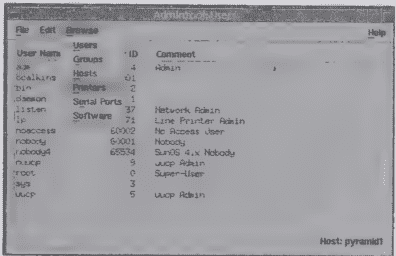

图 10.1
使用 Admintool 选择打印机。

打印机配置窗口，如图 10.2 所示，出现。现有打印机显示出来。

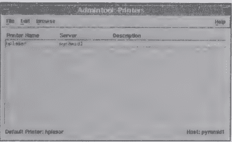

图 10.2
打印机配置窗口。

3. 选择 Edit、Add。

4. 如果你正在配置打印客户端并且打印服务器位于网络另一侧，物理连接到另一系统，请从下拉菜单中选择 Access to Printer。Add Access to Printer 窗口出现，如图 10.3 所示。

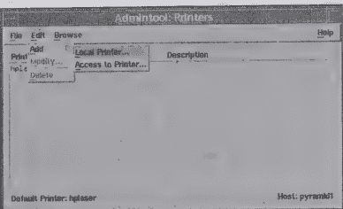

图 10.3
打印机窗口弹出菜单。

Add Access to Printer 窗口出现，如图 10.4 所示。

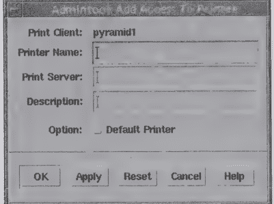

图 10.4
Add Access to Printer 窗口。

5. 按如下方式填写窗口中的信息：
- 打印机名称。输入你想访问的远程系统上的打印机名称。
- 打印服务器。输入打印机所连接的系统名称。
- 描述。如果愿意，输入打印机的简要描述。
- 选项。如果想将此设为系统默认打印机，请选中此选项。

6. 单击 OK 按钮。窗口关闭，信息被添加到适当的 LP 打印系统文件中。

7. 如果你正在配置打印服务器并且打印机将连接到本地系统，请从图 10.3 所示的弹出菜单中选择 Local Printer。显示图 10.5 所示的窗口。

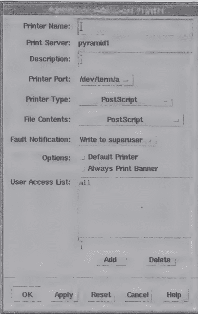

图 10.5
Add Local Printer 窗口。

8. 按如下方式填写字段：
- 打印机名称。输入你想为此打印机指定的名称。
- 描述。如果愿意，输入打印机的简要描述。
- 打印机端口。单击按钮并选择打印机所连接的端口：
  /dev/term/a 是串行端口 A。
  /dev/term/b 是串行端口 B。
  /dev/bpp0 是并行端口。
  如果你连接了带有其他设备名称的 SBUS 卡，请选择 Other。
- 打印机类型。单击按钮选择与打印机匹配的打印机类型。这里的打印机类型对应于 /usr/share/lib/terminfo 目录中列出的打印机。你选择的打印机类型必须对应于 terminfo 数据库中的一个条目。UNIX 在

> 注意
可以把一台打印机标识为系统的默认打印机。如果用户打印时未指定打印机，作业将发送到默认打印机。

PostScript 打印机上工作最佳，因为从 CDE 内部的文本和图形的页面格式是针对 PostScript 打印机。如果想选择 PostScript 打印机，你的打印机必须能够支持 PostScript。如果你使用 HP LaserJet 打印机，请选择 HPLaserJet 作为打印类型，除非你的 LaserJet 打印机支持 PostScript。
- 文件内容。单击按钮选择将发送到打印机的文件的格式。
- 故障通知。单击按钮选择在打印机出错时如何通知超级用户。
- 选项。选择是否打印横幅，或将此设为默认打印机。
- 用户访问列表。如果愿意，输入允许打印到此打印机的系统名称。如果未输入任何内容，则允许所有客户端访问。

9. 填写所有字段后，单击 OK 按钮。窗口关闭，新的打印机名称出现在图 10.2 所示的 Printers 窗口中。

## 使用打印机类型菜单上未列出的打印机

Print Manager 窗口中列出的打印机类型对应于 /usr/share/lib/terminfo 目录中列出的打印机。如果要添加的打印机类型不可用，你可能需要在 /usr/share/lib/terminfo 数据库中添加一个条目。每个打印机在 terminfo 数据库中都由一个简短名称标识；例如，HP LaserJet 打印机在 /usr/share/lib/terminfo/h 目录下列为 HPLaserJet。PostScript 打印机的条目位于 /usr/share/lib/terminfo/P 中。目录中找到的名称是在设置打印机时指定的打印机类型。


如果找不到打印机对应的 terminfo 条目，您可以尝试选择类似类型的打印机；不过，您可能难以在每次打印请求时保持打印机处于正确的模式。如果您的打印机类型没有 terminfo 条目，并且您希望保持打印机处于正确的模式，您可以自定义与打印机一起使用的接口程序，或向 terminfo 数据库添加条目。打印机接口程序位于 /etc/lp/interfaces 目录下。编辑接口文件或向 terminfo 数据库添加条目超出了本《培训指南》的范围。terminfo 数据库中的打印机条目包含并定义了数百项。请参阅 Answerbook2 在线手册中的《Solaris 8 系统管理指南，第二卷》，以获取执行此任务的信息。关于此主题的另一个良好参考是 John Strang 和 Tim O'Reilly 所著、O'Reilly & Associates, Inc. 出版的书籍“termcap & terminfo”（ISBN：0937175226）。

## 管理打印机
管理打印系统涉及监控 lp 系统并找出其可能无法正常工作的原因。其他常规任务包括取消打印作业以及在打印机维护期间启用或禁用打印机。本节提供了您为管理打印机和打印调度程序而执行的日常任务的说明。以下所有命令都需要超级用户权限。

## 删除打印机和管理打印机访问
使用 Admintool 从系统中删除打印机。在 Admintool 的打印管理器窗口中，突出显示要删除的打印机并选择 编辑、删除，如图 10.6 所示。打印机队列将被从系统中删除。

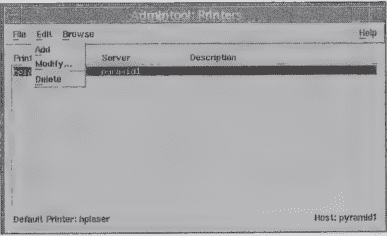

图 10.6
删除打印机。

要通过命令行删除打印机，请在打印机连接的系统上发出以下命令：

```
lpadmin -x <printer-name>
```

打印机已从系统中删除。

也许您不想从打印服务器中移除打印机，但您希望阻止特定系统向打印服务器打印。在您想要删除打印机的打印客户端上发出以下命令：

```
lpsystem -r <print-server>
```

打印服务器已从打印客户端的 /etc/lp/Systems 文件中删除。

也许打印机将因维修而离线。要停止接受特定打印机的打印请求，请在打印机物理连接的系统上键入以下命令：

```
reject <printer-name>
```

此步骤可防止在您移除打印机的过程中有新的请求进入打印机的队列。

要允许打印机继续接收请求，但停止打印机打印请求，请在打印机物理连接的系统上键入以下命令：

```
disable <printer-name>
```

停止或禁用打印机时，您可能需要移动已排队到该打印机的现有作业。要将打印作业从一台打印机移动到另一台打印机，请按如下方式使用 lpmove 命令：

```
lpmove <printer1> <printer2>
```

lpmove 命令的参数在表 10.4 中描述。

## 表 10.4

### lpmove 参数

| 参数 | 描述 |
|---|---|
| `<printer1>` | 将所有打印请求移出的打印机的名称。 |
| `<printer2>` | 将所有打印请求移入的打印机的名称。 |

如果您将所有打印请求移动到另一台打印机，lpmove 命令会自动停止接受 printer1 的打印请求。如果您想开始再次接受该打印机的新打印请求，则需要以下步骤：

```
accept printer1
```

在以下示例中，lpmove 命令将打印机 eps1 的打印请求移动到打印机 eps2，例如当 eps1 因维护而停用时。打印机准备好再次开始接受打印作业后，使用 accept 命令恢复在 eps1 上接受打印请求：

```
lpmove eps1 eps2
accept eps1
```

## 创建打印机类
您可以将几台本地连接的打印机放入一个称为打印机类的组中。如果您有几台打印机并排放置，并且不关心作业发送到哪台打印机，这可能会有所帮助。设置打印机类后，用户就可以指定该类（而不是单个打印机）作为打印请求的发送目标。类中第一个可用于打印的打印机将被使用。结果是周转更快，因为所有打印机都得到利用。您可以使用 lpadmin 命令按如下方式创建打印机类：

```
lpadmin -c
```

打印服务不了解默认打印机类；打印机类仅在您定义它们时存在。以下是您可以定义打印机类的三种方式：

- 按打印机类型（例如，PostScript）
- 按位置（例如，5 楼）
- 按工作组或部门（例如，会计）

或者，类可能包含按特定顺序使用的打印机。LP 打印服务始终按打印机添加到类的顺序检查可用打印机。因此，如果您希望高速打印机优先访问，您将在添加低速打印机之前将其添加到类中。结果是高速打印机将处理尽可能多的打印请求。低速打印机将被保留为高速打印机使用时的备份打印机。

打印机类名称必须唯一，并且最多可包含 14 个字母数字字符和下划线。您没有义务定义打印机类。只有在确定使用打印机类有利于网络上的用户时才应添加它们。

## 逐步操作

## 10.2 定义打印机类
要定义打印机类，请按照以下步骤操作：

- 1. 以超级用户或 lp 身份登录打印服务器。
- 2. 使用 lpadmin 命令定义打印机类：
  `lpadmin -p <printer-name> -c <printer-class>`

lpadmin 的参数在表 10.5 中描述。

## 表 10.5

### lpadmin 参数

| 参数 | 描述 |
|---|---|
| `-p <printer-name>` | 您要添加到打印机类的打印机的名称 |
| `-c <printer-class>` | 打印机类的名称 |

指定的打印机将被添加到打印服务器的 /etc/lp/classes/<printer-class> 文件中类的列表末尾。如果打印机类不存在，则会创建它。使用 lpstat 命令验证打印机类中的打印机：

```
lpstat -c printer-class
```

在以下示例中，该命令将打印机 luna 添加到类 roughdrafts：

```
lpadmin -p luna -c roughdrafts
```

## 检查打印机状态
lpstat 命令用于验证打印机的状态。您可以使用此命令确定哪些打印机可供使用或检查特定打印机的特性。lpstat 命令语法如下：

```
lpstat [-d] [-p <printer-name> [-D] [-l]] [-t]
```

lpstat 命令选项在表 10.6 中描述。

## 表 10.6

### lpstat 命令语法和选项

| 选项 | 描述 |
|---|---|
| -a | 报告打印机是否接受请求。您还可以指定特定的打印机列表，如示例 `lpstat -a eps1 eps2 eps3` 所示。 |
| -d | 显示系统的默认打印机。 |
| -p <printer-name> | 显示打印机是否处于活动或空闲状态、何时启用或禁用，以及是否接受打印请求。您可以使用此命令指定多个打印机名称。用空格或逗号分隔打印机名称。如果使用空格，请将打印机名称列表用引号括起来。如果未指定打印机名称，则显示所有打印机的状态。 |
| -D | 显示指定打印机的描述。 |
| -l | 显示指定打印机的特性。 |
| -t | 显示 LP 打印服务的状态信息，包括所有打印机的状态——是否处于活动状态以及是否接受打印请求。 |
| -u <logon-IDs> | 打印用户输出请求的状态，其中 <logon-IDs> 可以是以下一项或全部：
  - `<user>` 本地系统上的用户，如示例 `lpstat -u bcal...` 所示
  - `<host!user>` 系统上的用户，如示例 `lpstat -u systema!bcal...` 所示
  - `<host!all>` 特定系统上的所有用户，如示例 `lpstat -u systema!all` 所示
  - `<all!user>` 所有系统上的特定用户，如示例 `lpstat -u all!bcal...` 所示
  - `all` 所有系统上的所有用户，指定如下：`lpstat -u all` |


以下是 lpstat 命令的几个示例：

```
lpstat -p hplaser
```

系统响应如下：

```
printer hplaser is idle. enabled since Jun 16 10:09 1998.
available.
```

在以下示例中，命令请求打印机 hplaser1 和 hplaser2 的描述：

```
lpstat -p "hplaser1 hplaser2" -D
printer hplaser1 faulted. enabled since Jun 16 10:09 1998.
available.
unable to print: paper misfeed jam
Description: Printer by finance.
printer hplaser2 is idle. enabled since Jun 16 10:09 1998.
available.
Description: Printer in computer room.
```

在以下示例中，命令请求打印机 hplaser 的特性：

```
lpstat -p hplaser -l
printer hplaser is idle. enabled since Jun 16 10:11 1998.
available.
Content types: any
Printer types: unknown
Description: Printer by computer room.
Users allowed:
(all)
Forms allowed:
(none)
Banner not required
Character sets:
(none)
Default pitch:
Default page size:
```

## 管理打印机队列

管理打印机的常规任务的一部分是管理其队列。有时，会提交不需要的大型作业，可以将其中止。其他时候，您可能希望将高优先级作业置于等待打印的其他作业之前。以下概述了您可能想要在打印机队列上执行的某些常规任务。

### 删除打印作业

要从打印队列中删除他人的打印作业，您首先需要成为 root。然后，使用 lpstat 命令按如下方式确定要取消的打印请求的请求 ID：

```
lpstat -u bcalkins
eps1-1  bcalkins  1261  Mar 16 17:34
```

在此示例中，用户 bcalkins 在队列中有一次请求。请求 ID 为 eps1-1。

### 取消打印请求

使用 cancel 命令取消打印请求。命令语法如下：

```
cancel <request-id> | <printer-name>
```

cancel 命令的参数在表 10.7 中描述。

### 表 10.7 cancel 参数

| 参数 | 描述 |
|---|---|
| <request-id> | 要取消的打印请求的请求 ID。您可以指定多个请求 ID。使用空格或逗号分隔请求 ID。如果使用空格，请将请求 ID 列表用引号括起来。 |
| <printer-name> | 指定要取消当前正在打印的打印请求的打印机。您可以使用此命令指定多个打印机名称。使用空格或逗号分隔打印机名称。 |

在以下示例中，命令取消 eps1-3 和 eps1-4 打印请求：

```
cancel eps1-3 eps1-4
request "eps1-3" cancelled
request "eps1-4" cancelled
```

在下一个示例中，命令取消打印机 eps1 上当前正在打印的打印请求：

```
cancel eps1
request "eps1-9" cancelled
```

### 以更高优先级发送打印作业

带 -q 选项的 lp 命令为打印队列中的打印请求分配优先级。将优先级级别指定为 0–39 之间的整数。使用 0 表示最高优先级，使用 39 表示最低优先级。如果未指定优先级，LP 管理员将为打印服务分配默认优先级。

以下示例说明如何以最高优先级将打印作业发送到打印机 eps1：

```
lp -deps1 -q0 file1
```

### 限制用户对打印机的访问

使用 lpadmin 命令允许或拒绝用户访问打印机。命令语法如下：

```
lpadmin -p <printer-name> -u allow:<user-list> \
[ deny:<user-list>]
```

lpadmin 命令的参数在表 10.8 中描述。

### 表 10.8 lpadmin 参数

| 参数 | 描述 |
|---|---|
| `-p <printer-name>` | 该允许或拒绝用户访问列表适用的打印机名称。 |
| `-u allow:<user-list>` | 要添加到允许用户访问列表中的用户名。您可以使用此命令指定多个用户名。使用空格或逗号分隔名称。如果使用空格，请将名称列表用引号括起来。 |
| `-u deny:<user-list>` | 要添加到拒绝用户访问列表中的用户名。您可以使用此命令指定多个用户名。使用空格或逗号分隔名称。如果使用空格，请将名称列表用引号括起来。表 10.9 提供了 user-list 的有效值。 |

指定的用户将添加到打印服务器上以下文件之一中的打印机允许或拒绝用户访问列表中：

/etc/lp/printers/printer-name/users.allow
/etc/lp/printers/printer-name/users.deny

### 表 10.9 允许和拒绝列表的值

| user-list 的值 | 描述 |
|---|---|
| user | 任意系统上的用户。 |
| all | 所有系统上的所有用户 |
| none | 任意系统上的无用户 |
| system!user | 仅指定系统上的用户 |
| !user | 仅本地系统上的用户 |
| all!user | 任意系统上的用户 |
| all!all | 所有系统上的所有用户 |
| system!all | 系统上的所有用户 |
| !all | 本地系统上的所有用户 |

> 注意 如果您在允许用户访问列表中将 user-list 的值指定为 none，则不会为打印服务器创建以下文件：

/etc/lp/printers/printer-name/alert.sh
/etc/lp/printers/printer-name/alert.var
/etc/lp/printers/printer-name/users.allow
/etc/lp/printers/printer-name/users.deny

在以下示例中，命令仅允许用户 bcalkins 和 bholzgen 访问打印机 eps1：

```
lpadmin -p eps1 -u allow:bcalkins,bholzgen
```

在下一个示例中，命令拒绝用户 bcalkins 和 bholzgen 访问打印机 eps2：

```
lpadmin -p eps2 -u deny:"bcalkins bholzgen"
```

使用 lpstat 命令查看特定打印机的访问信息。以下命令显示名为 eps1 的打印机的访问信息：

```
lpstat -p eps1 -l
```

系统响应如下：

```
printer eps1 is idle. enabled since Mon Mar 20 14:39:48 EST 2000. available.

Form mounted:
Content types: postscript
Printer types: PS
Description: epson
Connection: direct
Interface: /usr/lib/lp/model/standard
On fault: write to root once
After fault: continue
Users allowed:
bcalkins
bholzgen
Forms allowed:
    (none)
Banner not required
Character sets:

Default pitch:
Default page size: 80 wide 66 long
Default port settings:
```

### 接受或拒绝打印机的打印请求

作为 root，您可以使用 reject 命令停止接受打印机的打印请求。命令语法如下：

```
reject [ -r "reason" ] <printer-name>
```

reject 命令的参数在表 10.10 中描述。

### 表 10.10 reject 参数

| 参数 | 描述 |
|---|---|
| -r "reason" | 告知用户打印机为何拒绝打印请求。原因会被存储，并在用户使用 lpstat -p 检查打印机状态时显示。 |
| <printer-name> | 将停止接受打印请求的打印机名称。 |

以下示例阻止打印机 eps1 接受打印请求：

```
reject -r "eps1 is down for repairs" eps1
destination "eps1" will no longer accept requests
```

只要打印机启用，已排队的请求将继续打印。在以下示例中，命令将打印机 eps1 设置为再次接受打印请求：

```
accept eps1
destination "eps1" now accepting requests
```

### 取消特定用户的打印请求

如果您想取消其他用户的打印请求，请切换到 root 或 lp 用户。使用 cancel 命令取消特定用户的打印请求。命令语法如下：

```
cancel -u <user-list> <printer-name>
```

cancel 命令的参数在表 10.11 中描述。

### 表 10.11 cancel 参数

| 参数 | 描述 |
|---|---|
| -u <user-list> | 取消指定用户的打印请求。<user-list>可以是一个或多个用户名。使用空格或逗号分隔用户名。如果使用空格，请将名称列表用引号括起来。 |
| <printer-name> | 指定要取消指定用户打印请求的打印机。<printer-name>可以是一个或多个打印机名称。使用空格或逗号分隔打印机名称。如果使用空格，请将打印机名称列表用引号括起来。如果未指定 <printer-name>，则该用户的打印请求将在所有打印机上被取消。 |

在以下示例中，命令取消用户 bcalkins 在打印机 luna 上提交的所有打印请求：

```
cancel -u bcalkins luna
request "luna-23" cancelled
```


在下面的示例中，该命令取消用户 bcal... 在所有打印机上提交的所有打印请求：

```
cancel -u bcal... 
request "asteroid-3" cancelled
request "luna-8" cancelled
```

## 更改打印请求的优先级

使用以下 lp 命令更改打印请求的优先级：

```
lp -i <request-id> -H <change-priority>
```

lp 命令的选项在表 10.12 中描述。

表 10.12
lp 选项

| 选项 | 描述 |
|---|---|
| -i <request-id> | 您想要更改的打印请求的请求 ID。您可以使用此命令指定多个请求 ID。用空格或逗号分隔请求 ID。如果使用空格，请用引号将请求 ID 列表括起来。 |
| -H <change-priority> | 更改打印请求优先级的三种方式之一：hold、resume 或 immediate：hold 将打印请求置于保留状态，直到您取消它或指示 LP 打印服务恢复打印该请求。resume 将已在队列中保留的打印请求放入队列。它将根据其优先级和在队列中的位置进行打印。如果您对正在打印的打印作业设置了保留，resume 会将打印请求置于队列头部，使其成为下一个打印的请求。immediate 将打印请求置于队列头部。如果请求正在打印，您可以将其置于保留以允许下一个请求立即打印。 |
| -q < priority-level > | 为打印请求分配打印队列中的优先级。将 <priority-level> 指定为 0–39 的整数。使用 0 表示最高优先级，使用 39 表示最低优先级。 |

在下面的示例中，命令将请求 ID 为 eps1-29 的打印请求更改为优先级级别 1：

```
lp -i eps1-29 -q 1
```

## 重新启动打印调度程序

打印调度程序 lpsched 处理打印服务器上的打印请求。如果打印机没有输出，则可能需要重新启动打印调度程序。要重新启动打印调度程序，请使用 lpsched 命令。如果打印调度程序停止运行时正在打印打印请求，则在重新启动打印调度程序时，该请求将完整打印。

首先，通过键入以下内容停止调度程序：

/usr/lib/lp/lpshut

要重新启动调度程序，请键入以下内容：

/usr/lib/lp/lpsched

lp 系统由名为 lp 的 /etc/init.d 脚本启动。此文件到 /etc/rc2.d 目录的链接可确保 lp 服务在系统每次启动时自动启动。可以使用以下命令使用同一脚本重置整个 lp 服务：

/etc/init.d/lp stop

lp 服务将被停止。您可以使用以下命令重新启动 lp 服务：

/etc/init.d/lp start

> NOTE
/etc/init.d/lp 脚本启动和停止整个打印服务，而不仅仅是调度程序。使用 lpshut 和 lpsched 仅停止和重新启动调度程序。

## 设置用户的默认打印机

当您添加打印机时，您可以选择将该打印机设为该特定系统的默认打印机。您可能希望在用户级别设置默认打印机，以便在特定系统上，用户可以指定自己的默认打印机。如果用户在发送打印作业时未提供打印机名称，打印命令将按以下顺序搜索默认打印机：

1. LPDEST 变量
2. PRINTER 变量
3. 系统的默认打印机

这些变量可以在用户的 .profile 文件中设置。lp 命令检查 LPDEST，然后检查 PRINTER。如果未设置任何变量，则将在以下文件中检查名为 _default 的变量：

$HOME/.printers

在此文件中将 printer1 命名为默认打印机的条目如下所示：

```
default printer1
```

如果 $HOME/.printers 文件不存在，则会检查 /etc/printers.conf 文件。此文件中的条目如下所示：

```
_default|lp:
:use=system1:
:bsdaddr=system1,printer1
```

如果在 /etc/printers.conf 文件中未设置 _default 变量，则如果您正在运行名称服务，则会检查名称服务数据库，如第 18 章“名称服务”所述。如果无法在这些文件中找到目标打印机名称，则无法处理打印请求。

## 使用 Admintool 修改打印机

在将打印机添加到系统后，可以使用 Solaris Admintool 修改打印机。可以通过 Admintool 对打印机进行的修改包括以下内容：

- 给打印机描述
- 指示打印机端口
- 列出文件内容
- 提供故障通知
- 选择默认打印机
- 打印横幅
- 接受和处理打印请求
- 提供用户访问列表

要通过 Admintool 修改打印机，请从 Printers 窗口中选择 Edit、Modify，如图 10.7 所示。

Modify Printer 窗口出现，如图 10.8 所示。

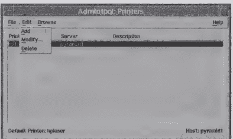

图 10.7
Printers 窗口。

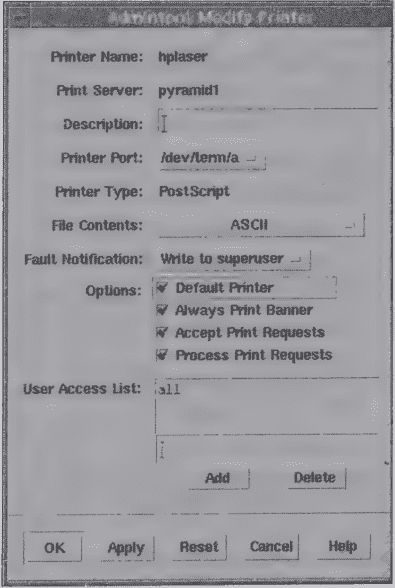

图 10.8
Modify Printer 窗口。

通过在 Modify Printer 窗口中选择或填写适当的字段来修改所选打印机。

## 章节摘要

### 关键术语

- Spool
- Print daemon
- Network printer
- Print queue
- Local printer
- Lpsched
- Lpd
- Print server
- Print client
- Default printer
- Terminfo database
- Printer class
- Print scheduler

我们可以用大量时间描述 LP 打印服务。我们可以更深入地讨论配置打印机过滤器、创建 terminfo 数据库和排除打印问题，但这超出了本培训指南的范围。为了准备认证考试和基本系统管理，您需要了解 LP 打印服务的基础知识。这包括打印 spooler、打印守护进程和打印机配置文件。此外，您还需要知道这些文件和程序在 Solaris 8 目录结构中的存储位置。

除了了解 LP 打印服务之外，您还需要知道如何使用所有用于管理 LP 打印服务的实用程序和程序。

我响应的大多数系统问题都与打印机有关。您还应该熟悉第三方应用程序以及它们如何准备打印作业以发送到 spooler。我遇到的许多问题并非 Solaris 打印服务的问题，而是在应用程序格式化打印作业的方式。本章向您介绍了 Solaris 打印系统和 lpsched 守护进程。打印机也可以在网络环境中使用 Solstice AdminSuite 进行管理，见第 19 章“ Solaris Management Console 和 Solstice AdminSuite”。第 9 章“进程控制”探讨了所有 Solaris 进程。有关 lpsched 守护进程的更详细讨论，请参阅 Answerbook2 在线手册中的 Solaris 8 System Administration Guide, Volume II。

## 应用你的知识

### 练习

#### 10.1 使用 lpadmin 配置打印机（命令行）

本练习将向您展示如何在打印服务器上添加和删除本地 LaserJet 5M 打印机。此示例中的命令必须在打印机连接的打印服务器上执行。安装可用的信息如下：

- Printer name: hp1
- Port device: /dev/ecpp0
- System type: Ultra5
- Printer type: HP LaserJet5M
- File content type: PostScript/PCL

预计时间：10 分钟

1. 以 root 身份，使用 lpadmin 命令将名为 hp1 的打印机添加到并行端口（在 ultra 系统上为 /dev/ecpp0，在 sparc 系统上为 /dev/bpp0），将打印机类型设为 hplaser，并将文件内容类型指定为 any：

```
lpadmin -p hp1 -v /dev/ecpp0 -T hplaser -I \
any
```

现在，开始接受打印机的打印请求并启用打印机。

```
enable hp1
accept hp1
```

2. 验证打印机是否已设置并准备就绪：

```
lpstat -p hp1 -l
```

3. 现在发送打印作业到打印机以测试它：

```
lp -d hp1 /etc/hosts
```

4. 删除打印机：

```
lpadmin -x hp1
```

5. 验证是否已删除：

```
lpstat -t
```

#### 10.2 使用 AdminTool 配置打印机（GUI）

在本练习中，使用 Admintool 将 LaserJet 5M 打印机添加到打印服务器。

预计时间：5 分钟

1. 以 root 身份启动 Admintool。

```
admintool &
```

2. 从 Admintool 窗口顶部的 Browse 按钮中，从下拉菜单中选择 Printers。

3. 从 Admintool 窗口顶部的 Edit 按钮中，选择 Add，然后从下拉菜单中选择 Local Printer。按如下方式填写字段：

- Printer Name: hp1
- Description: Hplaser 5M
- Printer Port: /dev/ecpp0 (/dev/bpp0 on a Sparc system)
- Printer Type: HP Printer
- File Contents: Any

完成后单击 OK，然后退出 Admintool。

4. 通过键入以下内容验证打印机是否已设置并准备就绪：

```
lpstat -p hp1 -l
```


## 应用你的知识

### 10.3 停止和启动 LP 打印服务

在本练习中，使用 lpshut 和 lpsched 命令停止和启动 LP 打印服务。

预计时间：5 分钟

- 1. 停止 LP 打印服务。当调用该命令时，正在打印的任何打印机都将被停止。

`/usr/lib/lpshut`

- 2. 使用 lpsched 命令启动 LP 打印服务。使用此命令重新启动的打印机将重新打印整个作业，这些作业曾因 lpshut 命令而中断。

`/usr/lib/lpsched`

### 10.4 设置基于网络的打印机

以下练习说明如何配置通过其自身的网络接口卡直接连接到网络的打印机。在示例中，打印机使用 HP JetDirect 接口，我将使用惠普的 JetAdmin 软件来配置打印机。

预计时间：15 分钟

- 1. 从惠普的网站 (www.hp.com) 获取 JetAdmin 软件，并使用第 5 章“设置用户帐户”中描述的 pkgadd 命令进行安装。确保获取正确的 JetAdmin 版本。截至本文撰写时，当前版本名为 SOLd621.PKG。将下载的文件放入 /tmp 目录。

- 2. 使用 pkgadd 命令将 JetAdmin 包安装到 /opt/hpnp 目录：

`pkgadd -d /tmp/SOLd621.PKG`

您将看到以下输出：

```
The following packages are available:
 1 HPNP JetAdmin for Unix
   (sparc) D.06.21
Select package(s) you wish to process (or 'all' to process all packages).
(default: all) [?,??,q]: 1
```

- 3. 输入以下内容：

`1 <return>`
`Processing package instance <HPNP> from </var/spool/pkg/SOLd621.PKG>`

`JetAdmin for Unix
(sparc) D.06.21
(c)Copyright Hewlett-Packard Company 1991,
1992, 1993. All Rights Reserved.
(c)Copyright 1983 Regents of the University
of California
(c)Copyright 1988, 1989 by Carnegie Mellon
University
RESTRICTED RIGHTS LEGEND
Use, duplication, or disclosure by the U.S.
Government is subject to restrictions as set
forth in sub-paragraph (c)(1)(ii) of the
Rights in Technical Data and Computer
Software clause in DFARS 252.227-7013.
Hewlett-Packard
Company
3000 Hanover Street
Palo Alto, CA 94304
U.S.A.`

HPNP 应安装在何处？
(<return> for /opt/hpnp) [?,q] <enter>

- 4. 输入 <return> 将其安装到 /opt/hpnp 目录。

`HPNP will be installed in /opt/hpnp.
Please configure the sub-packages you would like to install.
..........................................
................................
Done altering installation configuration
 1. [ N/A ] JetPrint
 2. [ On ] JobMonitor
 3. [ On ] HPNPF
 4. [ On ] HPNPD
 5. [ On ] CONVERT
 ?. Help
..........................................
........`

选择一个数字以切换安装选项。
完成后选择 0。选择 ? 获取帮助信息：0

- 5. 输入：0 <return>

选择一个数字以切换安装选项。
完成后选择 0。选择 ? 获取帮助信息：0
使用 </> 作为软件包基本目录。
## 处理软件包信息。
## 处理系统信息。
## 验证磁盘空间需求。
## 检查与已安装软件包的冲突。
以下文件已安装在系统上并被另一个软件包使用：
/etc <attribute change only>
/etc/init.d <attribute change only>
/etc/rc1.d <attribute change only>
/etc/rc2.d <attribute change only>
/usr <attribute change only>
/usr/bin <attribute change only>
是否要安装这些冲突文件 [y,n,?,q] y

- 6. 输入：y <return>

此软件包包含在安装此软件包过程中将以超级用户权限执行的脚本。
是否要继续安装 <HPNP> [y,n,?] y

- 7. 输入：y <return>

您将看到正在安装的文件列表，随后显示消息：

```
Installation of <HPNP> was successful.
```

有关即将安装的打印机，有以下信息可用：

打印机名称：hplaser
IP地址：192.168.1.10

- 8. 使用刚刚安装的 JetAdmin 实用程序配置 HP LaserJet 打印机：

```
/opt/hpnp/jetadmin
```

将显示以下对话框：

```
***********************************************
*                 MAIN MENU                    *
*      * HP JetAdmin Utility for UNIX
(Rev. D.06.21)  *
***********************************************
1) Configuration (super-user only):
   - configure printer, add printer to spooler
2) Diagnostics:
   - diagnose printing problems
3) Administration (super-user only):
   - manage HP printer, JetDirect
4) Administration (super-user only):
   - manage JetAdmin
5) Printer Status:
   - show printer status, location, and contact
?) Help          q) Quit
Please enter a selection (q - quit):1
```

输入：1 <return>

```
Printer Network Interface:
    1) Create printer configuration in BOOTP/TFTP database
    2) Remove printer configuration from BOOTP/TFTP
Spooler:
    2) Add printer to local spooler
    3) Delete printer from local spooler
    4) Modify existing spooler queue(s)
?) Help          q) Quit
Please enter a selection: 3
```

输入：3 <return>
输入网络打印机名称或 IP 地址
(q - quit)：192.168.1.10

输入：<IP 地址>

以下是该队列的建议参数值列表。您可以通过选择对应的非零数字来更改任何设置。当选择 '0' 时，这些值将用于配置该队列。要中止操作，请按 'q'。
Configurable Parameters:               Current
Settings
---------------------------------   ---------
1) Lp destination (queue) name      [192_1]
2) Status log                       [(No
log)]
3) Queue class                      [(not
assigned)]
4) JobMonitor                       [OFF]
5) Default queue                    [NO]
6) Additional printer configuration...
Select an item for change, or '0' to configure (q-quit):1

输入：1 <return>

当前使用的名称：
hp1
输入 lp 目标名称（默认=192_1，
q - quit）：hplaser

输入：hplaser <return>

以下是该队列的建议参数值列表。您可以通过选择对应的非零数字来更改任何设置。当选择 '0' 时，这些值将用于配置该队列。要中止操作，请按 'q'。
Configurable Parameters:               Current
Settings
---------------------------------   ---------
1) Lp destination (queue) name      [hplaser]
2) Status log                       [(No log)]
3) Queue class                      [(not
assigned)]

4) JobMonitor                       [OFF]
5) Default queue                    [NO]
6) Additional printer configuration...
Select an item for change, or '0' to configure (q-quit):0

输入：0 <return>

准备配置 hplaser。
是否继续？(y/n/q, default=y)y

输入：y <return>

系统将显示以下内容：
Finished adding "hplaser" to the spooler.
Press the return key to continue ...

输入 <return>，然后输入 "q"，再输入另一个 "q" 以退出 JetAdmin 实用程序。

- 9. 验证打印机是否已启用并且准备就绪：
lpstat -p hplaser -l

## 复习问题

- 1. 以下哪个是 SRV4 UNIX 中负责打印的 UNIX 实用程序？
A. lpr
B. lp
C. lpd
D. spool

- 2. Solaris 中 spool 目录位于何处？
A. /var/spool/lpd
B. /var/spool/lp
C. /usr/spool/lp
D. /usr/spool/lpd

- 3. 以下哪个命令可防止打印请求排队？
A. disable
B. cancel
C. reject
D. lpshut

- 4. 以下哪个可用于将本地打印机添加到打印服务器：
A. Admintool
B. Printer Manager
C. lpadmin
D. lp

- 5. 以下哪个命令停止打印服务？
A. lpsched
B. lpshut
C. cancel
D. disable

- 6. 以下哪个命令将要打印的信息放入 spooler？
A. lpr
B. print
C. lpsched
D. lp

- 7. 以下关于打印服务器的说法哪个是正确的？
A. 它是连接有本地打印机的系统。
B. 它是可向另一系统发送打印请求的远程系统。
C. 它是使打印机可供网络上其他系统使用的系统。
D. 可以从它发起打印。

- 8. 如果用户未指定打印机名称，以下哪个环境变量告诉它在哪里打印？
A. $HOME
B. $LPDEST
C. $PRINTER
D. $DEFAULT_DEST

- 9. 在 AdminTool 中添加打印机时，Print Server 字段用于什么？
A. 它定义打印机所连接的系统的名称。
B. 它将系统定义为打印服务器。
C. 它选择用于下载打印软件的系统。
D. 它定义可向本地打印机 spool 的系统。

- 10. 以下哪个是串行端口设备？
A. /dev/bpp0
B. /dev/ttya
C. /dev/term/a
D. /dev/fd


## 应用你的知识

11. 以下哪些是有效的打印机端口？
- A. /dev/term a
- B. /dev/term/a
- C. /dev/ecpp0
- D. /dev/term/ttya

12. 以下哪个命令会取消用户 bcalkins 在打印机 jetprint 上的所有打印请求？
- A. lprm -u bcalkins jetprint
- B. cancel -P jetprint bcalkins
- C. cancel -u bcalkins jetprint
- D. lpremove -P jetprint bcalkins

13. 以下哪种方法可用于删除打印机？
- A. lpadmin -x <printername>
- B. lpshut <printername>
- C. Admintool
- D. lpadmin -D <printername>

14. 以下哪个命令可从打印队列中移除作业？
- A. lpmove
- B. cancel
- C. lprm
- D. reject

15. 以下哪个守护进程为所有打印机提供服务？
- A. lpsched
- B. lpd
- C. lpr
- D. spool d

16. 打印机信息在哪里可以找到？
- A. /etc/printers.conf
- B. /etc/lp
- C. /var/spool/lp
- D. /etc/print

17. 以下哪种系统连接到本地打印机并使其可供网络上的其他系统使用？
- A. Print server
- B. Print client
- C. Client
- D. Server

18. 如果用户在打印时未指定打印机名称或类别，以下哪个变量会被检查以使用默认打印机？
- A. PRINTER and LPDEST
- B. LPDEST
- C. PRINT
- D. DEFAULT_DEST

19. PostScript 打印机的 terminfo 条目位于哪个目录？
- A. /usr/share/lib/terminfo/P
- B. /var/spool/lp/postscript
- C. /etc/lp/interfaces
- D. /etc/lp/printers

## 应用你的知识

20. 以下哪个命令将打印机 luna 添加到类别 roughdrafts？
- A. lpadmin -p luna -c roughdrafts
- B. lpadmin -class roughdrafts -p luna
- C. lpadmin luna -c roughdrafts
- D. lpadmin -cp roughdrafts luna

21. 以下哪个命令显示打印机 hplaser 的特性？
- A. lpstat -p hplaser -l
- B. lpstat -p hplaser
- C. lpadmin -p hplaser -l
- D. lpstat -a -p hplaser -l

22. 以下哪个命令将请求 ID 为 eps1-29 的打印请求更改为优先级级别 1？
- A. lp -i eps1-29 -q 1
- B. lpadmin -i eps1 -q 0
- C. lp -i eps1-29 -q 39
- D. lpadmin -i eps1 -q 39

## 答案回顾问题

1. B. 在 SRV4 UNIX 中负责打印的 UNIX 实用程序称为 lp。

2. B. 对于 Solaris，spool 目录位于 /var/lp/spool。

3. C. reject 命令会禁用对进入 spooling 区域的打印机或类别的任何进一步请求。

4. A.、B.、C. 使用以下工具之一将本地打印机添加到打印服务器：Admintool、Printer Manager 或 lpadmin。

5. B. lpshut 命令停止打印服务。

6. D. lp 命令将要打印的信息放入 spooler。

7. A.、C. 打印服务器是连接有本地打印机的系统。打印服务器使打印机可供网络上的其他系统使用。

8. B.、C. 如果用户未以有效样式指定打印机名称或类别，命令会检查用户的 PRINTER 或 LPDEST 环境变量以获取默认打印机名称。

9. A. 使用 Admintool 添加打印机时，Print Server 字段定义打印机所连接的系统名称。

10. C. /dev/term/a 是串行端口设备。

11. B.、C. Solaris 系统上的有效打印机端口包括 /dev/term/a、/dev/term/b 和 /dev/ecpp0。

12. C. 以下命令会取消用户 bcalkins 在名为 jetprint 的打印机上的所有打印请求：
`cancel -u bcalkins jetprint`

13. A.、C. 要从系统中删除打印机，可以使用 lpadmin -x 命令或 Admintool 界面。

14. B. 使用 cancel 命令从打印队列中移除作业。

15. A. 打印调度程序 lpsched 处理打印服务器上的打印请求。

## 应用你的知识

16. A.、B. 使用 Admintool 或 lpadmin 设置打印机时，Solaris 会在系统的 /etc/printers.conf 文件和 /etc/lp 目录中根据需要进行相应的更改。

17. A. 打印服务器是连接有本地打印机的系统，并使其可供网络上的其他系统使用。

18. A. 如果用户未以有效样式指定打印机名称或类别，lp 命令会检查用户的 PRINTER 或 LPDEST 环境变量以获取默认打印机名称。

19. A. PostScript 打印机的 terminfo 条目存储在 /usr/share/lib/terminfo/P 目录中。

20. A. 要将打印机添加到类别中，请使用以下命令语法：lpadmin -p <printer-name> -c <printer-class>。

21. A. 使用 lpstat 命令显示特定打印机的特性，如下所示：lpstat -p <printername> -l

22. A. 使用 lp 命令将打印作业的优先级更改为优先级级别 1：lp -i <job name> -q 1。

## 目标

以下为本章的测试目标：

### 将备份、归档和恢复实用程序与其各自的功能能力匹配。

Solaris 8 提供了多种用于在磁盘、磁带或其他类型介质之间复制数据的实用程序。系统管理员需要了解每个实用程序的功能，并确定哪一个最适合特定情况。本章将描述用于在 Solaris 系统上备份和恢复数据的所有实用程序和命令。

### 识别备份文件系统到磁带所需的命令和步骤。

您需要了解为各种 Solaris 备份实用程序中的每一个备份文件或文件系统到磁带所需的所有步骤。

### 识别从磁带恢复文件系统所需的命令和步骤。

您需要了解为各种 Solaris 备份实用程序中的每一个从磁带恢复文件或文件系统所需的所有步骤。

## 第 11 章

## 备份和恢复

以下策略将帮助您为测试做准备：

- 在学习本章时，请确保您彻底了解 Solaris 中可用的各种备份工具。在考试中，您需要将正确的工具与它可以执行的任务或正确的描述相匹配。
- 在实际的 Solaris 8 系统（Sun 或 Intel）上练习命令和所有选项。尝试记住我提供的示例。示例说明了考试中最可能出现的命令和选项。如果您有磁带驱动器进行练习最好，但如果没有，请练习使用命令在磁盘的两个分区之间移动文件。
- 熟悉本章中的逐步说明。记住它们——它们在考试中会出现。

- 引言 419
- 备份介质 419
- Solaris 备份和恢复实用程序 420
  - tar 421
  - tar 示例 422
  - dd 423
  - dd 示例 423
  - cpio 424
  - cpio 示例 426
  - 使用复制出模式备份文件 426
  - 使用复制入模式恢复文件 427
  - Pass 模式 428
  - pax 428
  - pax 示例 431
  - ufsdump 432
  - ufsdump 示例 437
  - ufsrestore 438
  - ufsrestore 示例 442
- 恢复根或 /usr 文件系统 443
- 关于恢复文件的其他说明 446
- 摘要 446
- 应用你的知识 447

## 引言

备份系统涉及将数据从系统的硬盘复制到可移除介质上，以便在安全区域保存。备份系统数据是系统管理中最关键的功能之一，应定期执行。备份用于在文件损坏或系统故障或建筑物灾难导致数据丢失时恢复数据。拥有容错磁盘阵列是不够的。磁盘镜像和 RAID 5 可在硬件故障时保护您的数据，但它们无法防止文件损坏、自然灾害或文件意外删除。换句话说，磁盘镜像无法防止洪水损坏或火灾。此外，如果程序损坏了某个特定文件，它在镜像副本上也会同样损坏。因此，必须建立某种类型的异地备份。备份系统数据——您将执行的最重要的任务——必须定期进行。尽管即使是全面的备份方案也无法保证不会丢失信息，但您可以确保损失最小化。

本章描述了执行备份的方法、备份类型、制定可靠备份策略的方法，以及在遇到数据丢失时恢复数据的方法。首先，您将找到 tar、dd、cpio 和 pax 命令的解释，这些命令用于将数据从磁盘复制到磁盘或从磁盘复制到磁带。然后您将了解到 ufsdump 和 ufsrestore 实用程序是定期将 Solaris 系统数据备份到磁带的首选方法。

## 备份介质

选择备份介质与选择执行备份的程序一样重要。您的备份介质应可移除，以便在发生火灾、洪水或其他自然灾害时可将信息带到另一个站点安全存储。在某些情况下，备份介质只是位于另一栋建筑中的网络上的另一系统。然而，大多数备份系统使用磁带介质。磁带仍然为存储数据提供每兆字节最低的成本。表 11.1 显示了一些用于存储备份数据的典型磁带设备。


## 磁带设备类型
### 表 11.1
| 介质类型 | 容量 |
|---|---|
| 1/2 英寸盘式磁带 | 140MB (6250 BPI) |
| 1/4 英寸盒式磁带 (QIC) | 8GB |
| 8mm 盒式磁带 | 40–70GB |
| 4mm DAT 盒式磁带 (DDS-DDS4) | 1–40GB |
| DLT 1/2 英寸盒式磁带 (DLT2000-DLT7000) | 20–80GB |

为了实现更高容量，一个或多个这些磁带驱动器被组合到机柜中，称为磁带库或磁带仓，能够在数十甚至数百盘磁带上存储数太字节的数据。借助机械臂，磁带会被自动定位、检索并装入磁带驱动器，以消除人工干预。

## Solaris 备份和恢复实用程序
Solaris 提供了表 11.2 中列出的实用程序。备份实用程序可用于将数据从磁盘复制到可移动介质并恢复它。

### 表 11.2 备份实用程序
| 实用程序 | 描述 |
|---|---|
| tar | 归档数据到另一个目录、系统或介质。 |
| dd | 快速复制数据。 |
| cpio | 将数据从一个位置复制到另一个位置。 |
| pax | 将文件和目录子树复制到单个磁带。此实用程序比 tar 或 cpio 具有更好的可移植性，因此可用于将文件传输到其他类型的 UNIX 系统。 |
| ufsdump | 备份文件系统中的所有文件。 |
| ufsrestore | 恢复使用 ufsdump 命令归档的一些或全部文件。 |

## tar
tar（磁带归档）命令的主要用途是从硬盘复制文件系统或单个文件到磁带，或从磁带复制到硬盘。你也可以使用 tar 在硬盘或软盘上创建 tar 归档，并在硬盘或软盘上的 tar 归档中提取文件。tar 命令很受欢迎，因为它在大多数 UNIX 系统上都可用；然而，它仅限于单个磁带。如果备份的数据需要多于一盘磁带，请使用 cpio、pax 或 ufsdump 命令，我稍后会描述这些命令。

tar 命令的语法如下：

```
tar <options> <tar filename> <file list>
```

其中 options 是表 11.3 中列出的命令选项列表。

### 表 11.3 tar 的命令选项
| 选项 | 描述 |
|---|---|
| c | 创建 tar 文件。 |
| t | 目录表。每次在 tar 文件名中出现时列出指定文件的文件名。如果没有给出文件参数，则列出 tar 文件名中的所有文件的文件名。与 v 函数修饰符一起使用时，它会显示指定文件的附加信息。 |
| x | 从 tar 文件名中提取或恢复文件。 |
| v | 详细。tar 读取或写入归档时将信息输出到屏幕。 |
| f | 使用 tar 文件名参数作为 tar 归档的名称。如果 f 被省略，tar 使用 TAPE 环境变量指示的设备（如果设置）。如果 TAPE 变量未设置，tar 使用 /etc/default/tar 中定义的值。如果 tar 文件的名称为 -，tar 写入标准输出或从标准输入读取。 |

有关命令选项的更完整列表，请参阅 Solaris 在线手册页。

The <tar filename> is used with the f option, and can be any name you want. The filename can also be the name of a device, such as /dev/rmt/0 or /dev/rfd0. The <file list> is a list of files you want to include in the archive.

### tar 示例
以下示例说明了 tar 命令的使用。

要将 /home/bcalkins 目录中的所有内容创建为磁带归档到磁带设备 /dev/rmt/0，请键入以下内容：

```
tar cvf /dev/rmt/0 /home/bcalkins
```

要列出归档中的文件，请键入以下内容：

```
tar tvf /dev/rmt/0
```

要从归档中恢复文件 /home/bcalkins/.profile，请键入以下内容：

```
tar xvf /dev/rmt/0 /home/bcalkins/.profile
```

使用 tar 在磁盘上而不是磁带上创建归档文件。tar 文件名将为 files.tar，如下所示：

```
tar cvf files.tar /home/bcalkins
```

要提取使用前一个示例创建的文件，请键入以下内容：

```
tar xvf files.tar
```

注意完整路径名的使用。使用完整路径名创建归档可确保文件将被恢复到目录层次结构中的原始位置。你将无法在其他位置恢复它们。

如果你想能够使用相对路径名恢复前一个示例中的文件，可以更改到 /home/bcalkins 目录并指定要归档的文件为 ./*。这会使用相对于当前工作目录的路径名而不是绝对路径名（以正斜杠开头）将文件放入归档中。然后文件可以恢复到任何目录。

## dd
dd 命令的主要优点是它可以快速转换和复制具有不同数据格式的文件，例如块大小或记录长度的差异。

dd 最常见的用途是将完整的磁盘或分区从硬盘传输到磁带。你也可以用它将文件从一个硬盘复制到另一个硬盘。当复制数据时，dd 命令会创建映像副本（任何介质的逐字节精确副本），该介质可以是磁带或磁盘。命令参数在表 11.4 中描述。dd 命令的语法如下：

```
dd if=<input-file> of=<output-file> <option=value>
```

### 表 11.4 dd 命令参数
| 参数 | 描述 |
|---|---|
| if | 用于指定输入文件。输入文件可以是文件名或设备名称，例如 /dev/rmt/0。如果未指定输入文件，dd 的输入取自 UNIX 标准输入。 |
| of | 用于指定输出文件。输出文件可以是文件名或设备名称，例如 /dev/rmt/0。如果未指定输出文件，dd 的输出发送到 UNIX 标准输出。 |

命令行上可以跟随其他选项来指定缓冲区大小、块大小和数据转换。有关这些选项的列表，请参阅 Solaris 在线手册页。

### dd 示例
接下来的几个示例说明了使用 dd 命令复制数据。第一个示例展示了如何使用 dd 命令复制磁带。此过程需要两个磁带驱动器——源磁带和目标磁带：

```
dd if=/dev/rmt/0 of=/dev/rmt/1
```

下一个示例使用 dd 将整个硬盘复制到另一个硬盘。在示例中，你需要两块磁盘，并且两者必须具有相同的几何结构。磁盘几何结构在第 6 章“文件系统简介”中讨论过。

```
dd if=/dev/rdsk/c0t1d0s2 of=/dev/rdsk/c0t4d0s2 bs=128
```

在此示例中，选项 bs=128 指定块大小。较大的块大小，例如 128KB 或 256KB，会通过缓冲大量数据来减少复制时间。还请注意指定了原始设备。为了使此技术正常工作，你必须使用原始（字符）设备以避免缓冲（块）I/O 系统。

你可以使用 dd 命令与 tar 一起在远程磁带驱动器上创建归档。在下一个示例中，tar 用于通过将输出通过管道传输到名为 xena 的远程系统上的名为 /dev/rmt/0 的磁带驱动器来在远程系统上创建归档：

```
tar cvf . <files> | rsh xena dd of=/dev/rmt/0 obs=128
```

另一个示例是从另一个 UNIX 系统（如 Silicon Graphics）读取 tar 数据。Silicon Graphics 交换每对字节，使 tar 磁带在 Solaris 系统上无法读取。要读取来自 SGI 系统的 tar 磁带，请键入以下内容：

```
dd if=/dev/nrst0 conv=swab | tar xvf -
```

以类似的方式，Solaris 系统可以创建 SGI 系统可以读取的 tar 磁带：

```
tar cvf . <files> | dd of=/dev/nrst0 conv=swab
```

## cpio
cpio 命令用于将数据从一个地方复制到另一个地方。cpio 代表“copy input to output”。使用 cpio 复制文件时，你向其标准输入提供文件列表，并将文件归档写入其标准输出。cpio 的主要优点是其灵活的语法。该命令充当过滤器程序，从标准输入文件获取输入信息并将其输出传递到标准输出文件。输入和输出可以通过使用 shell 指定重定向和管道来操作。以下是 cpio 相对于其他 UNIX 实用程序的优点：

- cpio 可以备份和恢复单个文件，而不仅仅是整个文件系统。（tar 和 pax 也有此功能。）


-   使用 cpio 创建的备份比使用 tar 创建的备份更小，因为其头部更小。
-   cpio 可以跨多个磁带；tar 仅限于单个磁带。

由于其灵活性，cpio 具有更多选项，被视为比 tar 更复杂的命令。

cpio 程序运行于三种模式之一：copy-out（cpio -o）、copy-in（cpio -i）或 pass（cpio -p）。创建备份磁带时使用 copy-out，从磁带恢复或列出文件时使用 copy-in。pass 模式通常用于在磁盘上将文件从一个位置复制到另一个位置。你必须始终指定这三种模式之一。cpio 命令的语法如下：

```
cpio <mode> <option>
```

其中 mode 为 -i、-o 或 -p，option 为表 11.5 中的一个选项。

## 表 11.5

### cpio 的命令选项

| Option | Description |
| --- | --- |
| -c | 以 ASCII 格式写入头部信息以便移植。 |
| -d | 按需创建尽可能多的目录。 |
| -B | 指定输入的阻塞因子为 5120 字节记录，而不是默认的 512 字节记录。从磁带检索或复制文件到硬盘时，必须使用与从硬盘复制文件到磁带时相同的阻塞因子。只要将文件或文件系统复制到磁带驱动器或从磁带驱动器复制，就必须使用此选项。 |
| -v | 详细。报告正在处理的文件名。 |
| -u | 无条件复制。没有此选项，较旧的文件不会替换具有相同名称的新文件。 |
| -m | 保留先前的 file 修改时间。此选项对正在复制的目录无效。 |

## cpio 示例

以下示例展示了如何将目录 /work 及其子目录复制到设备名为 /dev/rmt/0 的磁带驱动器。-o 选项指定 copy-out 模式，-c 将以 ASCII 格式输出头部信息，我使用 -B 选项将阻塞因子增加到 5120 字节以提高速度。

```
cd /work
ls -R | cpio -ocB > /dev/rmt/0
```

下一个示例展示了如何将磁带上的文件复制回硬盘上的名为 /work 的目录：

```
cd /work
cpio -icvdB < /dev/rmt/0
```

-i 选项指定 copy-in 模式，-d 将按需创建目录以将数据恢复到原始位置，-v 将显示所有输出。

## 使用 Copy-Out 模式备份文件

要使用 copy-out 模式进行备份，你通过 cpio 的标准输入将文件列表发送给 cpio 命令。实际上，你会使用 UNIX find 命令生成要备份的文件列表。copy-out 模式通过在 cpio 命令行上使用 -o 选项指定。在下一个示例中，名为 "list" 的文件包含要备份到磁带的简短文件列表：

```
cpio -ovB list > /dev/rmt/1
```

通常，如表 11.5 所示，cpio 以 512 字节记录将文件写入标准输出。通过指定 -B 选项，你可以将记录大小增加到 5120 字节，从而显著加快传输速率，如前例所示。你可以使用 UNIX 命令以多种其他方式生成 cpio 备份的文件列表，如以下示例所示。

你可以通过键盘输入文件名来备份文件。输入完文件名后按 Ctrl+D。输入以下内容：

```
cpio -o > /dev/rmt/1
File1.txt
File2.txt
```

你可以使用 ls 命令生成 cpio 要备份的文件列表。输入以下内容：

```
cd /home/bcalkins
ls * | cpio -o >/dev/rmt/1
```

使用 find 命令生成用户 bcalkins 在过去五天内创建并修改的文件列表。这是要备份的文件列表：

```
find . -user bcalkins -mtime -5 -print | cpio -o > /dev/rmt/1
```

如果当前磁带已满，cpio 程序会提示你更换磁带。你会看到以下消息：

```
If you want to go on, type device/file name when ready
```

然后你应更换磁带并输入备份设备的名称（例如，/dev/rmt/1）。

## 使用 Copy-In 模式恢复文件

使用 cpio 的 copy-in 模式从磁带恢复文件到磁盘。以下示例描述了从 cpio 归档恢复文件的方法。

第一个示例将磁带上的所有文件和目录恢复到磁盘。指定的 cpio 选项将无条件（-u）将文件恢复到 /users 目录，并保留先前的 file 修改时间（-m）。输入以下内容：

```
cd /users
cpio -icvumB < /dev/rmt/1
```

下一个示例选择性地恢复以“database.”开头的文件。-d 选项将按需创建目录。输入以下内容：

```
cpio -icvdumB 'database*' < /dev/rmt/1
```

> 注 单引号必须用于将通配符参数 (*) 传递给 cpio。

要获取磁带上的文件列表，请按照下一个示例操作：

```
cpio -ictB < /dev/rmt/1
```

/dev/rmt/1 上的文件列表将显示在屏幕上。

## Pass 模式

Pass 模式通常不用于备份。目标必须是挂载文件系统上的目录，这意味着 pass 模式不能用于将文件传输到磁带。然而，你可以在 cpio 中使用 pass 模式将文件从一个目录复制到另一个目录。使用 cpio 而非 cp 的优点是原始修改时间和所有权得以保留。通过在 cpio 中使用 -p 选项指定 pass 模式。以下示例将 /users 中的所有文件复制到 /bkup：

```
cd /users
mkdir /bkup
ls * | cpio -pdu bkup
```

文件在复制时将被列出到屏幕上。

## pax

自 Solaris 2.5 起包含 pax 命令，这是一个符合 POSIX 的归档实用程序，可以读取和写入 tar 和 cpio 归档。它可在所有符合 POSIX 的 UNIX 系统上使用，包括 IBM 的 AIX、Hewlett-Packard 的 HP-UX 和 Linux。

pax 可以读取、写入和列出归档文件中的成员，并复制目录层次结构。pax 实用程序支持多种归档格式，包括 tar 和 cpio。

如果 pax 在处理过程中发现归档已损坏或损坏，pax 会尝试从媒体缺陷中恢复。它搜索归档以定位并处理尽可能多的归档成员。

所采取的操作取决于 -r 和 -w 选项的存在，这些选项被称为四种操作模式：list、read、write 和 copy（在表 11.6 中描述）。pax 命令的语法如下：

```
pax <mode> <options>
```

## 表 11.6

### pax 的四种操作模式

| Option | Operation Mode | Description |
|---|---|---|
| -r | Read mode | 当指定 -r 但未指定 -w 时。pax 提取归档文件中找到的文件名和目录。归档文件从磁盘或磁带读取。如果提取的文件是目录，则文件层次结构也会被提取。提取的文件相对于当前文件层次结构创建。 |
| None | List mode | 当既未指定 -r 也未指定 -w 时。pax 显示归档文件中找到的文件名或目录。归档文件从磁盘、磁带或标准输入读取。列表写入标准输出。 |
| -w | Write mode | 当指定 -w 但未指定 -r 时。pax 以 -x 选项指定的归档格式将文件内容写入标准输出。如果未指定文件，则从标准输入读取要复制的文件列表（一行一个）。目录包括以该文件为根的文件层次结构中的所有文件。 |
| -rw | Copy mode | 当同时指定 -r 和 -w 时。pax 将指定文件复制到目标目录。 |

除了选择操作模式外，你还可以从表 11.7 中选择一个或多个选项。

## 表 11.7

### pax 的命令选项

| Option | Description |
|---|---|
| -r | 从标准输入读取归档文件并提取指定文件。如果提取归档成员需要任何中间目录，这些目录将被创建。 |
| -w | 以指定的归档格式将文件写入标准输出。当未指定文件操作数时，标准输入将被读取以获取路径名列表——每行一个，不带前导或尾随空格。 |


## 表 11.7 继续
### pax 命令选项

| Option | Description |
|---|---|
| -a | 将文件追加到先前写入的归档文件末尾。 |
| -b | 块大小。块大小必须是 512 字节的倍数，最大为 32256 字节。块大小可以以 k 或 b 结尾，分别表示乘以 1024（1K）或 512 字节。 |
| -c | 匹配除模式和文件操作数指定的文件或归档成员之外的所有文件或归档成员。 |
| -f <archive> | 指定 <archive> 为输入或输出归档的路径名。单个归档可以跨多个文件和不同的归档设备。必要时，pax 会提示下一个卷在归档中的文件或设备的路径名。 |
| -i | 交互式重命名文件或归档成员。对于匹配模式操作数或文件操作数的每个归档成员，将提示写入终端。 |
| -n | 选择与每个模式操作数匹配的第一个归档成员。每个模式最多匹配一个归档成员。 |
| -p <string> | 指定一个或多个文件特性选项（权限）。字符串选项参数是指定在提取时要保留或丢弃的文件特性的字符串。该字符串由指定字符 a、e、m、o 和 p 组成。多个特性可以在同一字符串中连接，并且可以指定多个 -p 选项。指定字符的含义如下： |
| -x <format> | 指定输出归档格式，默认格式为 ustar。pax 目前支持 cpio、tar、bcpio、ustar、sv4crc 和 sv4cpio。 |

- a 不保留文件访问时间
- e 保留所有内容：用户 ID、组 ID、文件模式位、文件访问时间和文件修改时间
- m 不保留文件修改时间
- o 保留用户 ID 和组 ID
- p 保留文件模式位
- -v 详细模式

有关 pax 命令的更多选项，请参阅 Solaris 在线手册页。

使用 pax 时，您还可以指定来自表 11.6 的选项以及文件操作数。操作数指定目标目录或文件路径名。如果您指定一个不存在的目录操作数、用户无法写入的目录操作数或不是目录类型的目录操作数，pax 将以非零退出状态退出。

文件操作数指定要复制或归档的文件的路径名。当文件操作数未选择至少一个归档成员时，pax 会将这些文件操作数路径名写入标准错误中的诊断消息，然后以非零退出状态退出。

另一个操作数是模式操作数，用于选择一个或多个归档成员的路径名。归档成员是通过使用 fnmatch 描述的文件名模式匹配表示法来选择的。以下是模式操作数的示例：

- `?` 问号匹配任意字符。
- `*` 星号匹配多个字符。
- `[` 左方括号引入模式括号表达式。

当未提供模式操作数时，将选择归档中的所有成员。当模式匹配目录时，以该目录为根的整个文件层次结构将被选中。当模式操作数未选择至少一个归档成员时，pax 会将这些模式操作数写入标准错误中的诊断消息，然后以非零退出状态退出。

## pax 示例

以下示例说明了 pax 命令的使用。例如，要将文件复制到磁带，请发出此 pax 命令，使用 -w 将当前目录内容复制到磁带，-f 指定磁带设备：

```
pax -w -f /dev/rmt/0
```

要列出存储在磁带设备 /dev/rmt/0 上的归档的详细目录表，请发出以下命令：

```
pax -v -f /dev/rmt/0
```

这两个示例中的磁带设备也可以是文件名以指定磁盘上的归档。

以下命令可用于交互式选择要从当前目录复制到目标目录的文件：

```
pax -rw -i . <dest_dir>
```

随着您对 pax 实用程序的熟悉程度提高，您将开始用它代替 tar 和 cpio，原因如下：

- 其对其他 UNIX 系统的可移植性
- 其恢复损坏归档的能力
- 其跨多个卷的能力

## ufsdump

尽管本章讨论的其他 Solaris 实用程序可用于将文件从磁盘复制到磁带，但 ufsdump 专为备份而设计，是备份 Solaris 文件系统的推荐方法。ufsdump 命令将文件、目录或整个文件系统从硬盘复制到磁带或从磁盘复制到磁盘。使用 ufsdump 的唯一缺点是，在进行完整备份之前，文件系统必须处于非活动状态。如果文件系统仍处于活动状态，内存缓冲区中的任何内容都不会被复制到磁带。

您应备份对用户至关重要的任何文件系统，包括经常更改的文件系统。请参阅表 11.8，了解应备份的文件系统的建议和建议频率。

## 表 11.8
### 应备份的文件系统

| File System | Frequency |
|---|---|
| root (/) | 如果您经常在网络上添加和删除客户端和硬件，或需要在 root (/) 中更改重要文件，则应备份此文件系统。您应每周一次到每月一次对 root (/) 文件系统进行完整备份。如果 /var 在 root (/) 文件系统中，并且您的站点在邮件服务器的 /var/mail 目录中保存用户邮件，您可能希望每天备份 root (/)。 |
| /usr | 该文件系统的内容相当静态，只需每周一次到每月一次备份即可。 |
| /export/home | /export/home 文件系统包含系统上所有用户的 home 目录和子目录；其文件是易变的，应每天备份。 |
| Data | 所有数据目录应每天备份。 |

ufsdump 命令具有许多内置功能，其他归档实用程序没有：

- ufsdump 命令可用于将单个文件系统备份到本地或远程磁带设备或磁盘驱动器。设备可以在网络中的任何系统上。此命令运行速度很快，因为它了解 UFS 文件系统的结构，并且直接通过原始设备文件工作。
- ufsdump 具有内置选项，可创建增量备份，仅备份自上次备份以来更改的文件，从而节省磁带空间和时间。
- ufsdump 具有从单个系统通过网络备份系统组的能力。您可以通过远程 shell 或远程登录在每个远程系统上运行 ufsdump，将输出定向到驱动器所在的系统。
- 系统管理员可以限制用户访问备份表。
- ufsdump 命令具有内置选项，可将磁带上的数据与源文件系统进行验证。

使用 ufsdump 备份文件系统称为“转储”文件系统。当文件系统被转储时，会指定 0 到 9 之间的级别。0 级转储是完整备份，包含文件系统上的所有内容。1-9 级转储是增量备份，仅包含自上次在较低级别进行的转储以来更改的文件。

一个良好的备份计划涉及推荐的三级转储策略：月初进行 0 级转储（手动），每周自动进行 5 级转储，每天自动进行 9 级转储。自动转储在 4:30 a.m. 执行，此时

> 注
> 请参阅第 9 章，“进程控制”，了解有关 cron 的更多信息。

大多数系统通常处于空闲状态。自动每日转储在周日到周五早上进行。自动每周转储在周六早上进行。通过创建 shell 脚本并使用 cron 定期执行脚本来自动化备份。

表 11.9 显示了典型月份每天执行的转储级别。请注意，月初的 0 级转储是手动执行的，因为在备份根文件系统之前整个系统必须处于空闲状态。确保系统未被使用的一种方法是使系统进入单用户模式。9 级和 5 级转储使用 cron 自动化，但也必须在文件系统未被使用时进行。

## 表 11.9
### 文件系统转储计划

| Floating | Sun | Mon | Tues | Wed | Thur | Fri | Sat |
|---|---|---|---|---|---|---|---|
| 1st of month | 0 |  |  |  |  |  |  |
| Week 1 | 9 | 9 | 9 | 9 | 9 | 9 | 5 |
| Week 2 | 9 | 9 | 9 | 9 | 9 | 9 | 5 |
| Week 3 | 9 | 9 | 9 | 9 | 9 | 9 | 5 |
| Week 4 | 9 | 9 | 9 | 9 | 9 | 9 | 5 |

表 11.9 中的备份计划实现了以下目的：

- 每个工作日磁带都会累积自上周结束或第一周初始 0 级以来更改的所有文件。每天都会保存自上周结束时较低级别备份以来更改的所有文件。
- 每个星期六磁带包含自上次 0 级以来更改的所有文件。

此转储计划至少需要四套七盘磁带——每周一套，外加一个 0 级转储磁带。每套每月轮换一次。0 级磁带不应被覆盖，应保存至少一年。


请注意，即使按照表 11.9 中概述的备份计划，数据仍可能丢失。如果硬盘在下午 3 点发生故障，自凌晨 4:30 备份以来所做的所有修改都将丢失。此外，工作日中途删除的文件不会出现在 level 5 磁带上。有时，用户会意外删除文件，并且数周后才意识到。当用户想要使用该文件时，它已不存在。如果他要求您从备份中恢复它，它出现的唯一磁带是 level 0，并且可能已过时到无法使用的程度。通过不频繁覆盖每日 level 9 磁带，可以最大程度地减少此问题。

ufsdump 命令的语法如下：

/usr/sbin/ufsdump <options> <arguments> <files to dump>

ufsdump 命令的选项在表 11.10 中描述。

## 表 11.10
### ufsdump 选项
| 选项 | 描述 |
|---|---|
| <options> | 单个由单字母选项名组成的字符串。 |
| <arguments> | 选项参数可以是多个字符串。选项字母及其对应的参数必须保持相同的顺序。 |
| <files to dump> | 要备份的文件。此参数必须始终放在最后。它指定备份的源或内容。它通常标识一个文件系统，但也可以标识单个文件或目录。对于文件系统，请指定文件系统的名称或文件系统所在磁盘切片的原始设备文件。 |

表 11.11 描述了 ufsdump 命令的选项和参数。

## 表 11.11
### ufsdump 命令的选项
| 选项 | 描述 |
|---|---|
| 0 to 9 | 备份级别。指定级别 0 对整个文件系统进行完整备份。级别 1–9 用于自上次较低级别备份以来发生更改的文件的增量备份。 |
| a `<archive-file>` | 指示 ufsdump 创建归档文件。将磁带内容的备份表存储在磁盘上的指定文件中。该文件只能被 ufsrestore 理解，ufsr restore 使用该表来确定要恢复的文件是否在备份文件中存在，如果存在，则位于介质的哪个卷上。 |
| b `<factor>` | 阻塞因子。指定每次操作写入磁带的 512 字节块数。 |
| c | 指示 ufsdump 备份到盒式磁带。当应用介质末端检测时，此选项将块大小设置为 126。 |
| d `<bpi>` | 磁带密度。仅当 ufsdump 无法检测到介质末端时才使用此选项。 |
| D | 磁盘软盘。备份到软盘。 |
| f `<dump-file>` | 转储文件。指定备份的目的地。dump-file 参数可以是以下之一：
- 本地磁带驱动器或磁盘驱动器
- 远程磁带驱动器或磁盘驱动器
- 标准输出
当目标不是默认的本地磁带驱动器 /dev/rmt/0 时使用此参数。如果使用 f 选项，必须为 dump-file 指定值。 |
| l | 自动加载。如果您有自动加载（堆栈加载器）磁带驱动器，请使用此选项。当磁带末端到达时，此选项将驱动器离线并等待最多两分钟以使磁带驱动器再次准备就绪。如果驱动器在两分钟内准备就绪，则继续。如果驱动器在两分钟后仍未准备就绪，自动加载会提示操作员加载另一盘磁带。 |
| n | 通知。当需要干预时，此选项向 sys 组所有用户的所有终端发送消息。 |
| o | 离线。当 ufsdump 完成对磁带或磁盘的操作后，它会将驱动器离线，倒带（如果是磁带），并在可能的情况下移除介质（例如，它弹出磁盘或移除 8mm 自动加载磁带）。 |
| s `<size>` | 大小。指定磁带的长度（以英尺为单位）或磁盘的大小（以 1024 字节块数为单位）。仅当 ufsdump 无法检测到介质末端时才需要使用此选项。 |
| s | 估算备份大小。确定执行备份所需的空间量（而不实际执行备份）并输出一个数字，表示备份估计大小（以字节为单位）。 |
| t <tracks> | 轨道。指定 1/4 英寸盒式磁带的轨道数。仅当 ufsdump 无法检测到介质末端时才需要使用此选项。 |
| u | 更新转储记录。对于已完成的文件系统备份，将条目添加到文件 /etc/dumpdates。该条目指示文件系统磁盘切片的设备名称、备份级别（0 到 9）以及日期。当不使用 u 选项或备份单个文件或目录时，不会写入记录。如果已存在同一级别备份的记录，则会被替换。 |
| v | 验证。每次写入磁带或磁盘后，验证介质的内容是否与源文件系统一致。如果出现任何差异，提示操作员装载新介质然后重复该过程。仅在未挂载的文件系统上使用此选项；文件系统中的任何活动都会导致其报告差异。 |
| w | 警告。列出 /etc/dumpdates 中出现且一天内未备份的文件系统。使用此选项时，所有其他选项将被忽略。 |
| W | 带高亮的警告。显示 /etc/dumpdates 中出现的所有文件系统，并突出显示一天内未备份的文件系统。使用此选项时，所有其他选项将被忽略。 |

ufsdump 命令默认使用以下选项：

```
ufsdump 9uf /dev/rmt/0 <files-to-back-up>
```

## ufsdump 示例

以下示例说明了 ufsdump 命令的使用。

以下是 /users 文件系统的完整备份示例：

```
ufsdump 0ucf /dev/rmt/0 /users
DUMP: Writing 63 Kilobyte records
DUMP: Date of this level 0 dump: Sat Dec 12 13:13:22 1998
DUMP: Date of last level 0 dump: the epoch
DUMP: Dumping /dev/rdsk/c0t1d0s0 (pyramid1:/users) to /dev/rmt/0.
DUMP: Mapping (Pass I) [regular files]
DUMP: Mapping (Pass II) [directories]
DUMP: Estimated 10168 blocks (4.96MB).
DUMP: Dumping (Pass III) [directories]
DUMP: Dumping (Pass IV) [regular files]
DUMP: Tape rewinding
DUMP: 10078 blocks (4.92MB) on 1 volume at 107 KB/sec
DUMP: DUMP IS DONE
```

在以下示例中，Solaris 8 系统上的本地 /export/home 文件系统备份到名为 sparc1 的远程 Solaris 8 系统上的磁带设备：

```
ufsdump 0ucf sparc1:/dev/rmt/0 /export/home
DUMP: Date of this level 0 dump: Sat Dec 12 11:50:13 1998
DUMP: Date of last level 0 dump: the epoch
DUMP: Dumping /dev/rdsk/c0t3d0s7 (/export/home) to \
/dev/rmt/0 on host sparc1
DUMP: mapping (Pass I) [regular files]
DUMP: mapping (Pass II) [directories]
DUMP: estimated 19574 blocks (9.56MB)
DUMP: Writing 63 Kilobyte records
DUMP: dumping (Pass III) [directories]
DUMP: dumping (Pass IV) [regular files]
DUMP: level 0 dump on Tue Oct 25 10:30:53 1994
DUMP: Tape rewinding
DUMP: 19574 blocks (9.56MB) on 1 volume
DUMP: DUMP IS DONE
```

如果您想查看备份将需要多少空间，请发出以下命令：

```
ufsdump 0s <filesystem>
```

执行 level 0 备份所需的磁带上估计的字节数将被显示。

## ufsrestore

ufsr restore 命令从使用 ufsdump 命令创建的备份中复制文件。您可以使用 ufsrestore 从 level 0 转储及其后的增量转储重新加载整个文件系统，或从任何转储磁带恢复一个或多个单个文件。如果由 root 运行 ufsrestore，文件将以其原始所有者、最后修改时间和模式（权限）恢复。

ufsr restore 命令的语法如下：

```
ufsrestore <options> <arguments> <filename(s)>
```

ufsr restore 命令的选项在表 11.12 中描述。

## 表 11.12
### ufsrestore 选项
| 选项 | 描述 |
|---|---|
| <options> | 为您提供以下选项中仅一个的选择：i、r、R、t 或 x。 |
| <arguments> | 随后是与选项匹配的参数。 |
| <filename(s)> | 指定作为 x 或 t 选项参数要恢复的文件，并且必须始终放在最后。 |

表 11.13 描述了 ufsrestore 命令的一些更常见的选项和参数。

## 表 11.13
### ufsrestore 的命令选项
| 选项 | 描述 |
|---|---|
| i | 交互式。以交互模式运行 ufsrestore。在此模式下，您可以使用有限的 shell 命令集浏览介质的内容并选择要恢复的单个文件或目录。有关可用命令列表，请参阅表 11.14。 |
| r | 递归。将介质的全部内容恢复到当前工作目录，该目录应为文件系统的顶层。用于在完整转储之上恢复增量转储的信息也包含在内。要完全恢复文件系统，请使用此选项恢复完整（level 0）转储，然后恢复每个增量转储。这适用于刚刚使用 newfs 命令创建的新文件系统。 |
| x <filename(s)> | 提取。选择性地恢复您使用 filename(s) 参数指定的文件。filename(s) 可以是文件和目录的列表。除非您还使用 h 选项，否则指定目录下的所有文件都会被恢复。如果省略 filename(s) 或为根目录输入 .，则介质（或来自标准输入）的所有卷上的所有文件都会被恢复。现有文件将被覆盖，并显示警告。 |

继续


## 表 11.13 继续
### ufsrestore 的命令选项

| 选项 | 描述 |
|---|---|
| t <filename(s)> | 目录表。检查介质中指定的 <filename(s)> 参数中的文件。对每个文件，列出完整文件名和 inode 编号（如果找到文件）。如果未找到文件名，ufsrestore 会指示该文件不在“卷”上，指多卷转储中的任何卷。如果未输入 <filename(s)> 参数，则列出介质上所有卷中的所有文件，而不区分文件位于哪个卷上。当使用 h 选项时，仅检查并列出 <filename(s)> 中指定的目录文件——而不是其内容。目录表从介质的第一卷读取，或（如果使用 a 选项）从指定的归档文件读取。此选项与 x 和 r 选项互斥。 |
| b <factor> | 阻塞因子。指定每次操作从磁带读取的 512 字节块数。默认情况下，ufsrestore 会尝试确定写入磁带时使用的块大小。 |
| m | 将指定的文件恢复到磁盘上的当前目录，而不考虑它们在备份层次结构中的位置，并使用其 inode 编号重命名它们。例如，如果当前工作目录是 /files，备份中名为 ./database/test 且 inode 编号为 156 的文件将被恢复为 /files/156。此选项在仅提取少数文件时很有用。 |
| s<n> | 跳转到介质上的第 n 个备份文件。当将多个备份放在单个磁带上时，此选项很有用。 |
| v | 详细。显示每个文件在恢复时的名称和 inode 编号。 |

有关完整列表，请参阅 Solaris 在线手册页。

表 11.14 列出了使用交互模式（ufsrestore -i）时可与 ufsrestore 一起使用的命令。

## 表 11.14
### 交互式恢复的命令

| 命令 | 描述 |
|---|---|
| ls <directory-name> | 列出当前目录或指定目录的内容。目录以 / 后缀。当前要恢复（提取）的列表中的条目以 * 前缀标记。如果 verbose 选项生效，则还列出 inode 编号。 |
| cd <directory-name> | 更改为备份层次结构中的指定目录。 |
| add <filename> | 将当前目录或指定的文件或目录添加到要提取（恢复）的文件列表中。如果未使用 h 选项，则指定目录及其子目录中的所有文件都将添加到列表中。请注意，您要恢复到目录中的并非所有文件都可能位于单个备份磁带或磁盘上。您可能需要从不同级别的多个备份中恢复才能获取所有文件。 |
| delete <filename> | 从要提取（恢复）的文件列表中删除当前目录或指定的文件或目录。如果未使用 h 选项，则指定目录及其子目录中的所有文件都将从列表中删除。请注意，文件和目录仅从您正在构建的提取列表中删除。它们不会从介质中删除。 |
| extract | 提取列表中的文件并将它们恢复到磁盘上的当前工作目录。系统提示输入卷号时指定 1。如果您执行多磁带或多磁盘恢复并且仅恢复少量文件，请从最后一盘磁带或磁盘开始。 |
| help | 显示交互模式下可使用的命令列表。 |
| pwd | 显示备份层次结构中当前工作目录的路径名。 |
| q | 在不恢复额外文件的情况下退出交互模式。 |
| verbose | 打开或关闭 verbose 选项。Verbose 模式也可以在交互模式之外在命令行中作为 v 输入。当 verbose 打开时，交互式 ls 命令列出 inode 编号，并且 ufsrestore 命令在提取每个文件时显示信息。 |

## ufsrestore 示例

以下示例说明如何使用 ufsrestore 从磁带恢复数据。

使用 ufsrestore 命令显示磁带的内容：

```
ufsrestore tf /dev/rmt/0
2 .
4249 ./users
12400 ./users/bill
12401 ./users/bill/.login
12402 ./users/bill/.cshrc
12458 ./users/bill/admin
12459 ./users/bill/junk
```

使用 ufsrestore 从使用 ufsdump 创建的备份中恢复文件：

```
ufsrestore f /dev/rmt/0 filename
```

您可以通过在磁带设备名称前添加 remote-host: 来从名为 sparc1 的系统上的远程驱动器恢复整个目录，如下一个示例所示：

```
ufsrestore rf sparc1:/dev/rmt/0 filename
```

有时，文件系统损坏严重，必须从备份中完全恢复。如果您忠实地备份了文件系统，则可以将其恢复到上次备份的状态。恢复文件系统的第一步是删除损坏文件系统中的所有内容并使用 newfs 命令重新创建文件系统。要恢复损坏的文件系统，请执行以下步骤：

## 逐步操作
### 11.1 恢复和还原损坏的文件系统

1. 按如下方式卸载文件系统：

`umount /filesystem`

其中 filesystem 是损坏文件系统的名称。

2. 卸载文件系统后，发出 newfs 命令以创建新文件系统，如下所示：

`newfs /dev/rdsk/<disk-partition-name>`

其中 <disk-partition-name> 是包含损坏文件系统的原始磁盘分区的名称。

3. 使用 fsck 按如下方式检查新文件系统：

```
fsck /dev/rdsk/c?t?d?s?
```

4. 挂载要恢复的文件系统，并更改到该目录：

```
mount /dev/dsk/c?t?d?s? <directory>
cd /<directory>
```

5. 装入磁带，并发出以下命令：

```
ufsrestore rf /dev/rmt/0
```

磁带上的全部内容将被恢复到文件系统。所有权限、所有权和日期将保持为上次增量磁带创建时的状态。

接下来的两个步骤是可选的。

6. 删除由 ufsrestore 命令创建的 restoresymtable 文件。这是一个临时文件，在文件系统成功恢复后不需要。

7. 卸载文件系统并再次运行 fsck 以检查修复后的文件系统也是一个好主意。

## 恢复根或 /usr 文件系统

有时，具有 root 访问权限的粗心管理员会意外删除 root (/) 或 /usr 文件系统的部分或全部。其他时候，由于磁盘驱动器故障或文件系统损坏，文件系统可能变得无法使用。如果您需要恢复 root (/) 或 /usr 文件系统，请遵循此程序：

## 逐步操作
### 11.2 恢复根或 /usr 文件系统

1. 如果磁盘已损坏，请更换并分区。

2. 通过发出 newfs 命令重新创建文件系统，如下所示：

```
newfs /dev/rdsk/<disk-partition-name>
```

其中 <disk-partition-name> 是包含损坏文件系统的原始磁盘分区的名称。

3. 使用 fsck 按如下方式检查新文件系统：
`fsck /dev/rdsk/<disk-partition-name>`

4. 将新文件系统挂载到临时挂载点：
`mount /dev/dsk/<disk-partition-name> /mnt`

5. 更改到 /mnt 目录：
`cd /mnt`

6. 写保护磁带，以免意外覆盖它们。

7. 装入磁带，并发出以下命令：
`ufsrestore rf /dev/rmt/0`

磁带上的全部内容将被恢复到文件系统。所有权限、所有权和日期将保持为上次增量磁带创建时的状态。

8. 验证文件系统是否已恢复：
`ls`

9. 删除由 ufsrestore 创建并用于检查点恢复的 restoresymtable 文件：
`rm restoresymtable`

10. 更改到 root (/) 目录：
`cd /`

11. 卸载新创建的文件系统：
`umount /mnt`

12. 使用 fsck 检查新文件系统：
`fsck /dev/rdsk/<disk-partition-name>`

恢复的文件系统会检查一致性。

13. 如果您正在恢复 root (/) 文件系统，请使用 installboot 命令在根分区上创建引导块：
`installboot /usr/platform/`uname -i`/lib/fs/ufs/bootblk /dev/rdsk/<disk-partition-name>`


installboot 命令将引导块安装到引导磁盘上。没有引导块，磁盘无法启动。（installboot 在本书的第二部分中再次介绍。）

14. 将新磁带插入磁带驱动器，并备份新的文件系统：

```
ufsdump 0uf /dev/rmt/0 /dev/rdsk/device-name
```

执行一次 0 级备份。务必立即备份新创建的文件系统，因为 ufsrestore 会重新定位文件并更改 inode 分配。

15. 重新启动系统：

```
init 6
```

系统已重新启动。

以下示例是实际会话，将根（/）文件系统从磁带设备 /dev/rmt/0 恢复到控制器 0 上的 SCSI 磁盘目标 3 slice 0：

```
# mount /dev/dsk/c0t3d0s0 /mnt
# cd /mnt
# tapes
# ufsrestore rf /dev/rmt/0
```

文件从磁带恢复：

```
# rm restoresymtable
# cd /
# umount /mnt
# fsck /dev/rdsk/c0t3d0s0
```

系统在检查文件系统时显示 fsck 遍数：

```
# installboot \
/usr/platform/sun4m/lib/fs/ufs/bootblk /dev/rdsk/c0t3d0s0
# ufsdump 0uf /dev/rmt/0 /dev/rdsk/c0t3d0s0
# shutdown -y -g0 -i0
```

系统已停止。在 ok 提示符下，按如下方式执行重新配置启动：

```
boot -r
```

这将确保连接到系统的所有设备在内核以及 /dev 和 /devices 目录中都已正确配置。

注意 tapes 命令为磁带驱动器创建 /dev 条目。它在 /dev/rmt 中创建指向实际磁带设备特殊文件的链接。tapes 命令在第 16 章“设备管理与磁盘管理”中介绍。

## 关于恢复文件的附加说明

当您在文件系统的根目录以外的目录中恢复文件时，ufsrestore 会在当前目录中重新创建文件层次结构。例如，如果您将从 /users/bcalkins/files 备份的文件恢复到 /home，则文件会恢复到 /home/users/bcalkins/files 目录中。

恢复单个文件和目录时，最好将它们恢复到临时目录，例如 /var/tmp。验证文件后，您可以将它们移动到正确的位置。您可以将单个文件和目录恢复到其原始位置；但是，如果这样做，请确保不会用备份磁带上的旧版本覆盖更新的文件。

不要忘记定期备份操作系统。鉴于您所做的所有自定义，例如添加用户帐户、设置打印机和安装应用程序软件，丢失这些信息将是灾难性的。每当您对根（/）、/usr、/opt 或其他操作系统目录进行影响其的修改时，请将系统切换到单用户模式并执行 0 级转储。

## 章节摘要

### 关键术语

- 块大小
- 磁带归档
- 文件系统转储
- 增量备份
- 完全备份

本章介绍了 Solaris 中可用的标准复制和备份实用程序。它介绍了可用的各种备份媒体类型。它讨论了 tar、dd、cpio 和 pax，并介绍了如何使用它们复制和恢复文件、目录以及整个文件系统。

本章还介绍了如何使用 ufsdump 和 ufsrestore 在系统上执行常规备份。此外，它还描述了一种推荐的备份计划，可用于保护任何系统免受故意或意外的数据丢失。

最后，本章介绍了如何从备份媒体中恢复数据。它描述了恢复单个文件或整个文件系统的过程。

虽然这些实用程序在备份数据方面做得很好，但如果您的公司拥有多个服务器和大型存储池，您可能需要调查 Veritas 或 Legato 等第三方提供的更强大的备份软件包。大多数这些软件包提供了一套全面的实用程序，用于在复杂的计算环境中执行和管理备份。在大多数情况下，它们允许单点备份——不仅适用于 Solaris，也适用于其他操作系统。

## 应用知识

### 练习

请注意，这些练习使用连接到 /dev/rmt/0 的磁带驱动器。如果您的系统未连接磁带驱动器，请将设备 /dev/rmt/0 替换为 /tmp/foo 等文件名。

### 11.1 使用 tar

在此练习中，您将使用 tar 命令将文件从磁盘复制到磁带。

预计时间：15 分钟（取决于 /export/home 的大小）

1. 在磁带设备 /dev/rmt/0 上创建 /export/home 目录中所有内容的磁带归档：
```
tar cvf /dev/rmt/0 /export/home
```
2. 列出归档的内容：
```
tar tvf /dev/rmt/0
```
3. 现在，将另一个磁带归档添加到同一磁带。这被称为“堆叠”磁带。首先，您需要使用 mt 命令将磁带向前移动超过第一个归档：
```
mt -f /dev/rmt/0 fsf 1
```
4. 现在添加 /var/adm 目录的下一个归档：
```
tar cvf /dev/rmt/0 /var/adm
```
5. 现在倒带：
```
mt -f /dev/rmt/0 rew
```
6. 列出磁带上的第一个归档。请注意“不倒带”设备的使用：
```
tar tvf /dev/rmt/0n
```
7. 现在列出堆叠磁带上第二个磁带归档的内容：
```
tar tvf /dev/rmt/0
```

注意：重要的是在磁带标签上注明这是一个堆叠磁带，并记录磁带上每个归档的顺序。

### 11.2 使用 cpio 和 pax

该练习演示了如何将过去 30 天内修改过的用户文件复制到设备名为 /dev/rmt/0 的磁带驱动器。指定大于默认的块因子以提高传输速度。

预计时间：15 分钟（取决于 /export/home 的大小）

1. cd /export/home
2. 使用 find 命令查找所有文件，并使用 cpio 将它们传输到磁带：
```
find . -mtime -30 -print | cpio -oB > \
/dev/rmt/0
```
3. 列出步骤 2 中备份的所有文件：
```
cpio -ict < /dev/rmt/0
```
4. 使用 pax 实用程序列出使用 cpio 创建的磁带的内容：
```
pax -v -f /dev/rmt/0
```

### 11.3 使用 ufsdump 和 ufsrestore

在此练习中，您将使用 ufsdump 命令备份整个文件系统。然后您将使用 ufsrestore 命令恢复文件。

警告：不要在生产系统上执行此练习。

预计时间：20 分钟

1. 以 root 身份登录。
2. 按如下方式将整个 /var 文件系统备份到磁带：
```
ufsdump 0ucf /dev/rmt/0 /var
```
3. 删除 /var/adm/messages 文件：
```
rm /var/adm/messages
```
4. 使用 ufsrestore 恢复 /var/adm/messages 文件：
```
cd /var
ufsrestore -ivf /dev/rmt/0
```
5. 在 ufsrestore> 提示符下，验证 messages 文件是否在磁带上：
```
ls adm/messages
```
6. 标记文件以便提取，然后提取文件：
```
add adm/messages
extract
```
当系统提示您“Specify the next volume”时，输入 1。
当被问到“set owner/mode for ‘.’?[yn]”时，输入 y
输入 q 退出 ufsrestore 实用程序。

7. 使用 ls -l 命令验证文件是否已恢复到其正确位置。

### 复习题

1. 以下命令序列会做什么？
```
#cd /home/my junk
#tar cvf /dev/rmt/0 .
```
A. 将 /home/my junk 中的所有文件打包成 /dev/rmt/0 上的单个 tar 归档，并打印出过程的注释。
B. 将 /dev/rmt/0 磁带的内容提取到 /home/my junk。
C. 将 /dev/rmt/0 中的所有文件打包到 /home/my junk，创建目录表并忽略校验和错误。
D. 将当前目录中的所有文件打包到两个单独的归档中，一个用于 my junk 的内容，一个用于 /home 的其余部分。

2. 根据以下备份计划，如果系统在星期六出现故障，需要哪些磁带才能完全恢复系统？
- 当月第一个星期一——0 级（磁带 1）
- 其他星期一——1 级（磁带 2）
- 星期三——2 级（磁带 3）
- 星期五——4 级（磁带 4）

A. 四个全部
B. 磁带 2–4
C. 磁带 1、2 和 4
D. 磁带 1、3 和 4

3. 以下哪个命令可以与 tar 和 cpio 结合使用以执行增量归档？

A. sort
B. find
C. grep
D. diff

4. 以下哪个实用程序具有内置的增量备份功能？

A. tar
B. cpio
C. ufsdump
D. dd

5. 以下哪个命令列出 tar 文件的内容？

A. tar -cvf
B. tar -xvf
C. tar -tvf
D. tar -txf

6. 以下关于 dd 的说法哪个是错误的？

A. 它能快速转换和复制具有不同数据格式的文件。
B. 它是一个很好的备份工具。
C. 它用于将完整的文件系统或分区从硬盘传输到磁带。
D. 它用于将一个磁盘上的所有数据复制到另一个磁盘。

7. 以下关于 cpio 命令的说法哪个是错误的？

A. 它用于将数据从一个位置复制到另一个位置。
B. 它不是备份的好工具。
C. 它可以备份和恢复单个文件，而不仅仅是整个文件系统。
D. cpio 创建的备份比 tar 创建的备份更小。

8. 从磁带恢复根文件系统后，以下哪个步骤是不必要的？

A. fsck
B. installboot
C. init 6
D. ufsdump 0uf

9. 以下关于 pax 实用程序的说法哪个是错误的？

A. 它支持多种归档格式，包括 tar 和 cpio。
B. 它是一个符合 POSIX 的归档实用程序。


## 应用你的知识

C. 它没有内置函数来执行增量备份。

D. 它很旧且不是推荐的备份实用程序。

## 复习题答案

1. A. 第一个命令更改工作目录，第二个命令创建 tar 文件。示例中显示的命令将 /home/myjunk 目录中的所有文件取出，打包成单个存储在 /dev/rmt/0 上的 tar 归档，并打印出该过程的说明。

2. A. 要从备份中恢复数据，您将首先加载当月第一个星期一创建的 1 级磁带，然后是 2 级磁带，然后是 3 级磁带，最后是 4 级磁带。

3. B. 使用 find 命令结合 tar 和 cpio 来执行增量归档。

4. C. ufsdump 具有内置选项可创建增量备份，只备份自上次备份以来更改的文件，从而节省磁带空间和时间。

5. C. tar 命令的 -t 选项列出 tar 文件的内容。

6. B. dd 命令的主要优点是它能快速转换和复制具有不同数据格式的文件，例如块大小或记录长度的差异。该命令最常见的用途是从硬盘将完整的文件系统或分区传输到磁带。您也可以用它将文件从一个硬盘复制到另一个硬盘。然而，dd 并不是一个好的备份工具。

7. B. cpio 可用作备份和恢复单个文件的优秀工具，而不仅仅是整个文件系统。

8. D. 从磁带恢复根文件系统后，您必须使用 installboot 命令安装引导块，对文件系统运行 fsck，然后使用 init 6 或 shutdown 命令重新启动。

9. D. pax 是本章所述的备份实用程序中最新的。它作为备份实用程序工作良好。

## 目标

以下是本章的测试目标：

## 理解 Solaris Shell

理解 shell 编程的基础知识是成为一名有效系统管理员的关键。shell 是您与 Solaris 8 操作系统的接口；因此，它是您需要熟练使用的工具之一。具体来说，您需要了解与 Solaris shell 相关的以下主题：
- 选择使用哪个 shell。Solaris 环境提供了多种可供选择的 shell。作为系统管理员，您需要做出明智的决定，确定系统的用户将使用哪些 shell。
- 设置 shell 变量。您工作的许多方面都需要了解 shell 变量。您将设置 shell 变量来自定义用户环境，并在创建脚本以自动化常规任务时使用 shell 变量。
- 理解 shell 内建命令、shell 条件语句、重复动作语句和 shell 函数。要编写 shell 脚本，您必须了解 shell 中可用于执行当前任务的工具。本章将介绍并描述有助于您构建 shell 脚本来自动化任务并提高生产力的工具。

## 第 12 章

## 编写 Shell 脚本和程序

## 大纲

## 学习策略

以下策略将帮助您为测试做准备：
- 在学习 shell 和 shell 脚本时，没有什么能替代实践和经验。我介绍了与 shell 脚本相关的一些关键主题。您只有在 Solaris 系统上练习本章介绍的所有主题后，才能熟练使用 shell 或编写 shell 脚本。
- 确保您了解 Solaris 中所有各种默认 shell 之间的差异，例如如何在每个 shell 中设置本地和环境变量。此外，了解每个 shell 中提供的所有默认变量。

## 引言 453

## Shell 脚本基础 453

## 选择要使用的 Shell 454

## Bourne Shell 变量 456

引用 457

分隔符 458

Shell 变量 458

## 内建命令 460

## Shell 条件语句 462

&& 和 || 462

true 和 false 程序 463

if 463

测试程序 464

case 466

## 重复动作命令 467

for 循环 467

while 循环 468

until 循环 469

## Shell 函数 469

## 总结 470

## 应用你的知识 471

## 引言

对 shell 编程的透彻理解是任何系统管理员必备的。系统管理员必须能够阅读和编写 shell 程序，因为许多任务可以通过使用此类脚本进行自动化。 使用脚本或 shell 程序执行特定任务的一个优点是它确保了一致性——换句话说，每次任务都是以相同的方式执行的。此外，许多软件产品都附带安装脚本，在它们在您的系统上工作之前必须对其进行修改。本章首先介绍一些 shell 基础知识，然后描述创建 shell 脚本的一些基本原理。

## SHELL 脚本基础

UNIX 脚本是一系列 UNIX 命令，要么在文件中，要么在命令行输入，用于执行多个操作。此类文件在某些系统中也称为批处理文件。您可能熟悉的脚本的另一个术语是宏。通常，脚本或宏指的是简单的命令序列，但 shell 程序标识包含更复杂命令排列的文件。Shell 程序使用 shell 的控制和条件命令，称为内建命令，这些将在本章后面讨论。

要将文件作为脚本运行，您必须设置文件执行位，如第 8 章“系统安全”中所述。在以下示例中，您可以看到执行位已为用户、组和其他人设置：

```
% ls -l
-rwxr-xr-x 1 bcalkins 425 Jul 10 11:10 program.1
```

如果设置了执行位，接下来的操作取决于文件的第一行。如果第一行的前两个字符不是 #! 以外的任何字符，则文件被解释为 Bourne shell 脚本。如果字符 #! 后跟显式的程序位置，例如 /bin/csh，则该程序将作为文件内容的解释器运行。换句话说，程序在 #! 字符后指定的 shell 中运行。

注意
最好将脚本和 shell 程序放入自己的目录中，以将其与标准 UNIX 程序分开。它们通常放在名为 /usr/local/bin 的目录中。给程序名称加上 .sh、.csh 或 .ksh 后缀也是一个好习惯，以便轻松识别为 shell 脚本。

例如，要创建 C shell 脚本，在文件的第一行输入以下内容：

```
#!/bin/csh
```

## 选择要使用的 Shell

登录 shell 是登录时运行的命令解释器。Solaris 8 操作环境提供三种常用的 shell：
- Bourne shell (/sbin/sh)。默认 shell。它是一个命令解释器，执行从终端或文件读取的命令。
- C shell (/bin/csh)。具有类似 C 的语法的命令解释器。C shell 为交互式使用提供了许多 Bourne shell 不具备的便捷功能，包括文件名补全、命令别名和历史记录替换。
- Korn shell (/bin/ksh)。一个命令解释器，执行从终端或文件读取的命令。

编写脚本时，您可以使用这三种 shell 中的任何一种。每个 shell 的基本功能在表 12.1 中描述。

## 表 12.1

## BOURNE、C 和 KORN SHELL 的基本功能

| 功能 | Bourne | C | Korn |
|---|---|---|---|
| 与 sh 语法兼容 | Yes | No | Yes |
| 作业控制 | Yes | Yes | Yes |
| 历史记录列表 | No | Yes | Yes |
| 命令行编辑 | No | Yes | Yes |
| 别名 | No | Yes | Yes |
| 登录目录的单字符缩写 | No | Yes | Yes |
| 防止文件被覆盖 | No | Yes | Yes (noclobber) |
| 忽略 Ctrl+D (ignoreeof) | No | Yes | Yes |
| 增强的 cd | No | Yes | Yes |
| 初始化文件与配置文件分离 | No | Yes | Yes |
| 注销文件 | No | Yes | No |

除了上述常用的 shell 外，Solaris 8 还提供另外五个 shell：
- J-shell (/sbin/jsh)。提供 Bourne shell 的所有功能，但启用作业控制。当调用 J-shell 时，除了所有其他 Bourne shell 功能外，还启用作业控制。
- 受限 Korn shell。Korn shell 的受限版本，用于设置登录名和执行环境，其功能需要比标准 shell 更受控制。
- T-shell (/usr/bin/tcsh)。增强但兼容的 C-shell 版本，具有文件名补全和命令行编辑。输入 man tcsh 以查看增强功能的完整在线列表。
- GNU Bourne-Again shell (/usr/bin/bash)。Bash 结合了 Korn 和 C shell 的有用功能。
- Z-shell (/usr/bin/zsh)。可作为交互式登录 shell 和 shell 脚本命令处理器使用的命令解释器（shell）。

注意

除了三个标准 shell 外，附录 B“Administration and Configuration of the CDE”中描述的通用桌面环境（CDE）还提供桌面 Korn shell（dtksh）。该 shell 使 Korn shell 脚本能够轻松访问 CDE 图形界面中使用的大多数现有 Xt 和 Motif 函数。要成功使用 dtksh，您应具有 Xlib、Xt Intrinsics、Motif 小部件和 Korn Shell 编程方面的经验。了解 C 编程语言也有帮助。

此外，Solaris 8 还包含 PERL，即用于创建程序的 Practical Extraction Report Language。

选择特定 shell 使用是个人偏好。我发现大多数 BSD UNIX 用户使用 C shell，因为它源于伯克利。许多我们这些老 SunOS 用户仍然更喜欢使用 C shell，因为我们使用它已经很多年了。另一方面，我发现 SystemV 用户更喜欢 Korn shell。这些偏好源于 UNIX 的早期开发时期。对于系统管理，Bourne shell 最适合编写脚本。它是 Solaris 中的默认 shell，也是所有 UNIX 系统上唯一找到的 shell。所有随 Solaris 提供的脚本（即运行控制脚本

位于 /etc/init.d) 且大多数第三方软件也使用 Bourne shell 编写。此外，由于 Bourne shell 位于 /sbin，因此在 /usr 未挂载时（即单用户模式下），它是唯一可用的 shell。Bourne shell 从一开始就是为用作编程语言而设计的，这解释了其编程功能的广泛性。使用 Bourne shell 的另一个原因是其条件语句和控制结构与所有其他 shell 兼容，包括 CDE 环境中使用的 dt ksh shell。dt ksh 在附录 B 中讨论。

本章中的所有示例均使用 Bourne shell。

## BOURNE SHELL 变量

变量是一个名称，引用内存中的临时存储区域。值例如文本字符串或数字被赋给变量，并且可以随时更改。Bourne shell 使用两种类型的变量来存储值：本地变量和环境变量。本章将对每种变量进行描述。

变量要么被设置为某个特定值，要么被称为“unset”，这意味着它作为变量并不存在。Shell 变量是 shell 编程不可或缺的一部分。Shell 变量提供了在 shell 程序中存储和操作信息的能力。你使用的变量完全由你控制，你可以根据需要设置或取消设置任意数量的变量以执行特定任务。

变量名必须以字母开头，可以包含字母、数字和下划线，但不能包含特殊字符。在 Bourne shell 中，环境变量通过 NAME=value 的赋值来设置。在以下示例中，ME 和 BC 变量通过在命令提示符下输入以下内容来设置：

```
ME=bill
BC="bill calkins"
```

请确保在等号（=）之前或之后不要有空白字符。第二个示例中使用的双引号在要赋给变量的文本字符串中存在空白时使用。每当 shell 看到 $variable，例如 $ME 时，它会将存储在该变量中的值替换到命令行中。

## 引用

不幸的是，其他程序也使用了 shell 使用的许多特殊字符——字符实在不够用。当表 12.2 中显示的特殊字符在 shell 中使用时，必须进行引用。引用用于在分配的值包含特殊字符、空格、制表符或换行符时。Bourne shell 中使用的三种引用方法在表 12.2 中描述。

表 12.2
引用

| 字符 | 描述 | 功能 |
|---|---|---|
| \ | 反斜杠 | 引用下一个字符（也称为“转义”）。 |
| ' | 单引号 | 不进行任何解释。 |
| " | 双引号 | 双引号内的所有字符都被引用，除了反斜杠、重音符、双引号和货币符号。 |

命令从两个反引号（` `）之间的字符串中读取。这些命令的标准输出可用于设置变量。

使用反引号时，在读取字符串之前不对字符串进行解释，除了删除用于转义其他字符的反斜杠（\）。转义反引号允许嵌套命令替换，如下所示：

```
font=`grep font \`cat filelist\``
```

嵌入命令中的反斜杠（\`cat filelist\`）保护反引号不被 shell 立即解释。使用反斜杠（\），cat 前面的反引号无法与 grep 前面的反引号匹配。两个“转义”的反引号将在第二次处理时被解释，命令将正确执行。

注意
不要将反引号与单引号字符混淆。反引号是与 ~（波浪号）位于同一键盘键上的符号。单引号字符位于与 “（双引号）字符相同的键上。

换句话说，因为此示例有两个反引号集，我们需要告诉 shell 哪个反引号与另一个配对。我们使用反斜杠（\）来做到这一点。shell 将两次查看命令字符串——一次用于配对反引号，第二次用于运行命令。

## 分隔符

某些字符在 Bourne shell 中自然充当分隔符。遇到时，这些字符会将一个逻辑词与下一个逻辑词分隔开。表 12.3 中概述的字符对 shell 具有特殊含义，除非被引用，否则会导致终止。

表 12.3

分隔符

| 字符 | 描述 |
|---|---|
| ; | 命令分隔符。充当 <return>，并按顺序执行命令。 |
| & | 异步运行命令。 |
| ( ) | 将命令分组为单个逻辑词。 |
| Newline | 分隔记录（默认值）。 |
| Spaces, tabs | 分隔字段（默认值）。 |

## Shell 变量

要显示变量的值，在命令提示符下输入以下内容（美元符号告知 shell 以下名称引用的是变量）：

```
echo $BC
```

显示如下内容：

```
bill calkins
```

你设置的变量默认为当前 shell 的本地变量，除非你将其标记为导出。标记为导出的变量称为环境变量，将对 shell 创建的任何命令可用。以下命令将变量 BC 标记为导出：

```
export BC
```

你可以通过输入 set 命令列出本地变量。你可以通过输入 env 命令列出已标记为导出的变量。Bourne shell 有几个预定义变量，其中一些在表 12.4 中描述。这些变量在用户登录时自动分配，并由登录程序、系统初始化文件和用户的初始化文件定义。

## 表 12.4

## 默认 Bourne Shell 变量

| 变量 | 描述 |
|---|---|
| ARCH | 设置用户的系统架构（例如，sun4、sun4c、sun4u）。 |
| CDPATH | 设置 cd 命令的搜索路径。 |
| HOME | 设置用户主目录的值。 |
| LANG | 设置区域设置。 |
| LOGNAME | 定义当前登录用户的名称。LOGNAME 的默认值由登录程序自动设置为 /etc/passwd 文件中指定的用户名。你只需要引用（而不是重置）此变量。 |
| LPDEST | 设置用户的默认打印机。 |
| MAIL | 如果将此参数设置为邮件文件的名称且未设置 MAILPATH 参数，则 shell 会通知用户指定文件中邮件的到达。 |
| MAILCHECK | 指定 shell 检查 MAILPATH 或 MAIL 参数指定的文件中邮件到达的频率（以秒为单位）。默认值是 600 秒（10 分钟）。如果设置为 0，shell 将在每次提示后检查。 |
| MAILPATH | 通过定义以冒号分隔的文件名列表来设置邮件路径。如果设置此参数，shell 会通知用户在任何指定文件中邮件的到达。每个文件名后可以跟 %，以及在修改时间更改时打印的消息。默认消息是 You have mail。 |

注意
搜索路径的顺序很重要。当不同位置存在相同命令时，找到的第一个同名命令将被使用。例如，假设用户 jean 的 PATH（Bourne 和 Korn shell 语法）定义为 PATH=/bin:/usr/bin:/usr/sbin:$HOME/bin，并且文件名为“sample”的文件同时存在于 /usr/bin 和 /home/jean/bin 中。如果用户在不指定完整路径名的情况下输入命令 sample，则使用在 /usr/bin 中找到的版本。

## 表 12.4 继续

## 默认 Bourne Shell 变量

| 变量 | 描述 |
|---|---|
| MANPATH | 设置可用手册页的层次结构。 |
| OPENWINHOME | 设置 OpenWindows 子系统的路径。 |
| PATH | 按顺序列出 shell 搜索以在用户键入命令时找到要运行的程序的目录。如果目录不在搜索路径中，用户必须键入命令的完整路径名。默认 PATH 在登录过程中作为 .profile（Bourne 或 Korn shell）或 .cshrc（C shell）的一部分自动定义和设置。 |
| PS1 | 设置主提示符字符串，默认为 "$ "。 |
| PS2 | 设置次提示符字符串，默认为 "> "。 |
| SHELL | 设置 make、vi 和其他工具使用的默认 shell。当 shell 被调用时，它会扫描环境以查找此名称。 |
| TERM | 定义终端。此变量应在 /etc/profile 或 /etc/.login 中重置。当用户调用编辑器时，系统会查找与此环境变量定义同名的文件。系统搜索 TERMINFO 引用的目录以确定终端特性。 |
| TERMINFO | 指定已添加到 terminfo 数据库中的不支持终端的路径名。在 $HOME/.profile 或 /$HOME/.login 中使用 TERMINFO 变量。当设置 TERMINFO 环境变量时，系统首先检查用户定义的 TERMINFO 路径。如果在用户定义的 TERMINFO 目录中找不到终端的定义，它会搜索默认目录 /usr/share/lib/terminfo 中的定义。如果在任一位置都找不到定义，则终端被标识为“dumb”。 |
| TZ | 设置用于显示日期的时区（例如，在 ls -l 命令中）。如果 TZ 未在用户环境中设置，则使用系统设置；否则使用格林威治标准时间。 |

## 内建命令

内建命令用于在 shell 程序中做出决策并为要执行的任务增加智能。Bourne shell 的内建命令列在表 12.5 和 12.6 中。有关表 12.5 中描述的内建命令的更多信息可在 Solaris 在线

手册页。表 12.6 中列出的 shell 条件在本章中进行了描述。每个 shell 都有自己的一组内置命令，其中 Bourne shell 的最少。因此，它是三个 shell 中最小且最快的。

## 表 12.5
### Bourne Shell 内置命令

| 内置命令 | 描述 |
|---|---|
| break | 退出 for 或 while 循环。 |
| continue | 继续执行 for 或 while 循环的下一迭代。 |
| echo | 在标准输出上写入参数。 |
| eval | 评估并执行参数。 |
| exec | 执行程序。以当前进程替代执行，因此 exec 不会创建新进程。 |
| exit | 退出 shell 程序。 |
| export | 创建全局变量。 |
| priv | 设置或显示权限。 |
| read | 从标准输入读取一行。 |
| readonly | 将变量更改为只读。 |
| set | 设置 shell 选项。 |
| test | 评估条件表达式。 |
| times | 显示执行时间。 |
| trap | 管理执行信号。 |
| umask | 设置文件和目录的默认安全属性。 |
| unset | 取消设置局部变量。 |
| wait | 等待后台进程完成。 |

## 表 12.6
### Bourne Shell 条件

| 条件 | 描述 |
|---|---|
| if-then-else-fi | 测试条件并根据测试结果选择操作。 |
| case-esac | 根据变量的值选择操作。 |
| for-do-done | 重复执行一系列命令，直到满足预定条件。 |
| while-do-done | 重复执行一系列命令，直到测试条件不再为真。 |
| until-do-done | 重复执行一系列命令，直到测试条件导致成功状态。 |

## SHELL 条件

除了表 12.5 和 12.6 中列出的内置命令外，Bourne shell 还包含一些简单的条件。条件命令根据条件的 outcome 做出选择。简单条件的例子是 && 和 ||，我将在本节中与 if 和 case 条件一起讨论它们。

## && and ||

Bourne shell 中最简单的条件是双与号 (&&)。当两个命令由双与号分隔时，只有当第一个命令返回零退出状态（成功完成的指示）时，第二个命令才执行。

以下是一个示例：

```
ls -ld /usr/bin > /dev/null && echo "Directory Found"
```

如果目录 /usr/bin 存在，则会显示消息 Directory Found。

&& 的相反是双竖线 (||)。当两个命令由 || 分隔时，只有当第一个命令返回非零退出状态（表示失败）时，第二个命令才执行。

以下是一个示例：

```
ls -d /usr/foo || echo "No directory found"
```

如果目录不存在，则会显示以下消息：

/usr/foo: No such file or directory
No directory found

## true 和 false 程序

Bourne shell 包含特殊的程序 true 和 false。true 程序的唯一功能是返回 true（零）退出状态。同样，false 程序的功能是返回 false（非零）退出状态。

以下是一个示例：

```
true && echo True
```

系统响应为 True。

以下又是一个示例：

```
False || echo False
```

系统响应为 False。

True 和 false 测试将在后面讨论 if 和 while 条件时进行讨论。

注
&& 和 || 是创建简单脚本的有用条件，但有时需要额外的功能。因此，Bourne shell 提供了 if 和 case 条件。

## if

Bourne shell 中更重要的内置命令之一是 if 条件。if 条件的语法如下：

```
if condition-list
    then list
elif condition-list
    then list
else list
fi
```

if 之后列出的列表被执行。如果它返回零退出状态，则第一个 then 之后的列表被执行。否则，elif 之后的列表被执行。如果其值为零，则下一个 then 之后的列表被执行。否则，执行 else 列表。如果没有列表被执行，if 命令返回零退出状态。

下一个示例说明了 if 条件语句的使用：

```
if [ -f  /tmp/errlog ]
    then
        rm /tmp/errlog
        echo "Error log has been removed"
    else
        echo "No errorlog  has been found"
fi
```

在此示例中，程序检查名为 /tmp/errlog 的文件是否存在。如果文件存在且为普通文件，程序会将其删除。如果文件不存在，程序会打印一条消息。

## 测试程序

前一个示例使用了 if test [ -f  /tmp/errlog] 来评估条件表达式。每个控制结构的核心都是条件测试。test 命令通常在 shell 程序中用于执行各种测试并确定某些文件和目录是否存在。test 程序执行三种类型的测试：

- 它可以测试文件是否具有某些特征，例如文件类型和权限。
- 它可以执行字符串比较。
- 它可以进行数值比较。

test 通过其退出状态指示测试的成功或失败。test 评估表达式，如果其值为真，则设置零（真）退出状态。否则，设置非零（假）退出状态。所有 shell 命令在成功完成时返回真（0）值，在失败时返回假（1）值。您可以通过使用 echo 命令查看 $? 变量来显示最后一个 shell 命令的退出状态。表 12.7 列出了可以评估的一些常见条件。

## 表 12.7
### 内置测试函数

| 测试条件 | 描述 |
|---|---|
| -r <filename> | 如果文件名存在且可读，则为真。 |
| -w <filename> | 如果文件名存在且可写，则为真。 |
| -x <filename> | 如果文件名存在且可执行，则为真。 |
| -f <filename> | 如果文件名存在且为普通文件，则为真。 |
| -d <filename> | 如果文件名存在且为目录，则为真。 |
| -h <filename> | 如果文件名存在且为符号链接，则为真。对于所有其他原语（除 -L filename 外），默认情况下会跟随符号链接。 |
| -c <filename> | 如果文件名存在且为字符特殊文件，则为真。 |
| -b <filename> | 如果文件名存在且为块特殊文件，则为真。 |
| -u <filename> | 如果文件名存在且其 set-user-ID 位已设置，则为真。 |
| -g <filename> | 如果文件名存在且其 set-group-ID 位已设置，则为真。 |
| -k <filename> | 如果文件名存在且其粘滞位已设置，则为真。 |
| -n <filename> | 如果字符串长度非零，则为真。 |
| -s <filename> | 如果文件名存在且大小大于零，则为真。 |
| -z <filename> | 如果字符串长度为零，则为真。 |
| <s1> = <s2> | 如果字符串 s1 和 s2 相同，则为真。 |
| <s1> != <s2> | 如果字符串 s1 和 s2 不相同，则为真。 |
| <n1> -eq <n2> | 如果整数 n1 和 n2 在代数上相等，则为真。-ne、-gt、-ge、-lt 和 -le 中的任何比较都可以用作 -eq 的替代。 |
| -L <filename> | 如果文件名存在且为符号链接，则为真。对于所有其他原语（除 -h <filename> 外），默认情况下会跟随符号链接。 |

### 这些测试函数可以与以下运算符组合

| 运算符 | 描述 |
|---|---|
| ! | 一元否定运算符。 |
| -a | 二元与运算符。 |
| -o | 二元或运算符（-a 的优先级高于 -o）。 |
| (expression) | 用于分组的括号。另请注意，括号对 shell 有意义，因此必须加引号。 |

以下是一个可能使用一元运算符的示例：

```
if [ ! -f /tmp/errlog ]
    then
        echo "No error log has been found"
fi
```

在此示例中，语句 [ ! -f /tmp/errlog ] 测试文件 /tmp/errlog 是否不存在。

## case

许多程序是菜单驱动的；也就是说，它们为用户提供一个可供选择的菜单。case 语句使设置选择菜单变得容易。case 语句的一般语法如下：

```
case value in
choice1) commands;;
choice2) commands;;
...
esac
```

case 命令执行与第一个匹配选择的模式关联的列表。以下是一个示例来描述 case 语句的工作原理：

```
echo Please enter the letter next to the command that you \
want to select:
echo 'a date'
echo 'b ls'
echo 'c who'
read choice
case $choice in
a) date;;
b) ls;;
c) who;;
*) echo Invalid choice - Bye.
esac
```

选择列表被扫描以找到与用户输入的值匹配的一个。选择 *) 匹配任何值，因此通常作为最后一个选项添加——作为捕获所有。


## 重复操作命令

Bourne shell 提供了三种重复操作命令，每种都对应于你在其他编程语言中可能见过的结构：

- `for`
- `while`
- `until`

这些命令使程序循环或重复执行。接下来将对其进行描述。

### The for Loop

一个有用的 shell 命令是 for 循环，它是在 shell 脚本中设置重复的最简单方法。for 循环的语法如下：

```
for name [ in wordlist . . . ]
do list
done
```

每次执行 for 命令时，name 会被设置为从 in 单词列表中取出的下一个单词。如果省略 in word ...，则 for 命令对每个已设置的定位参数执行一次 do 列表。执行在列表中没有更多单词时结束。下面的示例说明了一个简单的 for 循环：

```
for i in eat run jump play
do
    echo See spot $i
done
```

当程序执行时，系统会响应如下：

```
See spot eat
See spot run
See spot jump
See spot play
```

如果你想交互式地输入数据，可以添加 shell 特殊命令 read：

```
echo Hello- What\'s your name\?
read name
for i in $name
do
    echo $i
done
```

执行程序时，会提示用户输入单词列表。请注意反斜杠 (\ ) 的使用，这样 ' 和 ? 就会被原样处理，而不会被用作特殊字符。

### The while Loop

while 循环会持续重复执行一组命令，直到满足条件为止。while 循环的语法如下：

```
while condition-list
do commands
done
```

首先，执行 condition-list。如果它返回 true 的退出状态，则执行 do 列表，并且操作从头开始重启。如果 condition-list 返回 false 的退出状态，则条件结构完成。

下文说明了 while 循环。该程序检查文件 /tmp/errlog 是否存在。如果文件不存在，程序将退出循环。如果文件存在，程序将打印一条消息并每五秒重新运行一次，直到文件被删除。

```
while [ -f /tmp/errlog ]
do echo The file is still there ; sleep 5
done
```

NOTE
特殊命令 sleep 5 指示系统在再次运行前等待五秒钟。

### The until Loop

until 循环是 while 语句的变体。就像 while 语句只要 condition-list 返回 true 值就重复执行一样，until 语句会重复执行直到 condition-list 返回 false 值。以下示例会每五秒显示一条消息，直到文件被创建为止：

```
until [ -f /tmp/errlog ]
  do echo the file is missing; sleep 5
  done
```

while 和 until 等条件结构由 shell 执行，就像它们是单个命令一样。shell 会在执行其任何部分之前扫描整个结构。

## SHELL FUNCTIONS

任何好的编程语言都提供对函数的支持。函数是一组语句的集合，作为一个整体执行。这些集合的执行方式就像“常规”命令一样，用于执行经常需要的任务。函数的一个优点是它存储在计算机的主内存中，因此执行速度比必须从磁盘检索的脚本快得多。当前版本的 Bourne shell 支持 shell 函数；旧版本的 Bourne shell 不支持。shell 函数的语法如下：

```
name()
{
command-list
}
```

此命令语法定义了一个名为 name 的函数。函数体是 { 和 } 之间的 command-list。每当 name 被指定为命令的名称时，就会执行此列表。作为示例，在命令提示符下，输入以下内容：

```
hello()
{
echo hello there
}
```

该函数名为 hello，可以通过输入 hello 来执行。函数的输出是 hello there。函数的退出状态是主体中执行的最后一个命令的退出状态。

## CHAPTER SUMMARY

### KEY TERMS

- Shell script
- Execution bit
- Restricted shell
- J-shell
- C-shell
- Korn shell
- Bourne shell
- Shell variable
- Quoting
- Shell built-ins
- Shell conditional
- Exit status
- Loop
- Shell function

使用脚本和 shell 程序构建自己的命令是协助系统管理的一种强大而灵活的工具。首先，你需要选择最适合你使用的 shell。可以从 Bourne shell、bash、C-shell、tcsh 或 Korn shell 中选择。然而需要注意的是，大多数系统管理员选择 Bourne shell，因为它使用广泛且可用性高。

本章描述了 Shell 变量。作为系统管理员，你会定期设置和使用变量。你大多数的 Solaris 和第三方程序都依赖于这些变量。如果设置不正确，程序将出错，系统可能无法正常运行。

最后，描述了 shell 内建命令和条件。你将在脚本中使用这些内建命令来设置变量、获取输入，并执行重复任务以及自动化常规任务所需的其他操作。

使用所有这些工具，可以简化并自动化常规任务，节省你的时间，让你能够处理更 demanding 的任务。Shell 编程是所有 UNIX 系统管理员必须具备的技能，也是成为熟练 UNIX 用户的关键之一。

这结束了第一部分以及第一部分考试所涵盖的材料。下一部分涵盖你为第二次考试需要了解的主题。在许多情况下，第二部分提供了本节中介绍但不是第一次考试目标的主题的更多细节。

## Apply Your Knowledge

### Exercises

### 12.1 Using Bourne Shell Variables

在本练习中，你将显示和设置 Bourne shell 变量。

Estimated Time: 10 minutes

- 1. 通过输入 `/sbin/sh` 确保你处于 Bourne shell。通过显示 `$SHELL` 变量的值来验证你是否处于 Bourne shell：
```
echo $SHELL
```
- 2. 打印环境中环境变量的值：
```
env
```
- 3. 打印环境中本地变量的值：
```
set
```
- 4. 更改到你的主目录：
```
cd $HOME
```
- 5. 创建一个名为 ME 的环境变量。分配给该变量的值应为你的姓名。
```
ME='Bill Calkins'
export ME
echo $ME
```
- 6. 删除该变量：
```
unset ME
```

### 12.2 Creating a Bourne Shell Script

编写一个名为 search1 的 Bourne shell 脚本，提示用户输入要在其目录中所有文件中搜索的字符串。显示包含该字符串的所有文件的文件名。

Estimated Time: 15 minutes

- 1. 在你的主目录中，使用 vi 创建一个名为 search1 的文本文件，包含以下条目：
```
#!/bin/sh
echo "Please enter a string to search for: "
read string
echo The following files contain the string \
$string:
grep -l $string *
```
- 2. 设置文件可执行权限：
```
chmod 744 search1
```
- 3. 按如下方式执行文件：
```
./search1
```

确保你的主目录中有一个包含你计划搜索的字符串的文本文件。如果需要，使用 vi 创建几个临时文件。

使用 vi 编辑器编写以下名为 reverse 的 shell 脚本，该脚本将接收最多 10 个参数并按相反顺序列出参数。

- 4. 在你的主目录中，使用 vi 编辑器创建以下名为 mylist 的脚本：
```
#!/sbin/sh
echo $10 $9 $8 $7 $6 $5 $4 $3 $2 $1
```
- 5. 设置文件可执行权限：
```
chmod 744 mylist
```
- 6. 按如下方式执行脚本，并查看结果：
```
./mylist 1 2 3 4 5 6 7
```

## APPLY YOUR KNOWLEDGE

### 12.3 Using the case Conditional in a Script

本练习演示了在脚本中使用 case 条件语句。脚本将为用户显示一个选项列表。会根据所选选项运行特定命令。

Estimated Time: 15 minutes

- 1. 在你的主目录中，使用 vi 编辑器创建一个名为 *options* 的文件，包含以下条目：
- 2. 设置名为 *options* 的文件可执行权限：
- 3. 执行脚本并输入 a、b 或 c 并观察结果：

```
#!/bin/sh
echo Please enter the letter next to the \
command that you want to select:
echo 'a  date'
echo 'b  ls'
echo 'c  who'
read choice
case $choice in
  a) date;;
  b) ls;;
  c) who;;
  *)  echo Invalid choice - Bye.
esac
```

```
chmod 744 options
```

```
./options
```

### 12.4 Creating an Interactive for Loop

本练习将演示如何使用 for 循环在脚本中设置重复。此脚本将提示用户输入姓名，并为每个输入的姓名生成问候语。

Estimated Time: 15 minutes

- 1. 在你的主目录中，使用 vi 编辑器创建一个名为 *users* 的文件，包含以下条目：

```
#!/bin/sh
echo "Hello- Please enter a list of names \
(ie. Bill Tom Mike)"
read LIST
for file in $LIST
do
echo Greetings $LIST
done
```
- 2. 设置名为 *users* 的文件可执行权限：
- 3. 执行脚本：

```
chmod 744 users
```

```
./users
```

### 12.5 Using the while Conditional

本练习将演示如何在脚本中使用 while 循环。你将创建一个名为 *msg* 的程序，该程序每五秒向活动窗口显示一条消息，持续一分钟。

Estimated Time: 15 minutes

- 1. 在你的主目录中，使用 vi 编辑器创建一个名为 *msg* 的文件，内容如下：
- 2. 设置名为 *msg* 的文件可执行权限：
- 3. 执行脚本：

```
#!/bin/sh
count=1
while
  [ count -lt 12 ]
do
  echo "Hello, I'm glad you're here"
  sleep 5
  let count=count+1
done
```

```
chmod 744 msg
```

```
./msg
```

```
#!/bin/sh
echo "Hello- Please enter a list of names \
```


## 应用你的知识

## 复习问题

1. 以下哪一个是 Solaris 系统的默认 shell？
A. Korn shell
B. C shell
C. Bourne shell
D. dtksh

2. 以下哪一种是在 Bourne shell 中设置全局变量的正确方法？
A. X=1; export X
B. X=1; export $X
C. export X=1
D. setenv x 1

3. 以下哪一种是在 Bourne shell 中设置变量的正确方法？
A. x=1
B. set x = 1
C. setenv x 1
D. export x=1

4. 以下哪一个 shell 条件会在测试条件不再为真时重复执行一系列命令？
A. if-then-else-fi
B. for-do-done
C. while-do-done
D. until-do-done

5. && 有什么作用？
A. 只有当第一个命令返回零退出状态时，第二个命令才执行。
B. 它在后台运行脚本或程序。
C. 只有当第一个命令返回非零退出状态时，第二个命令才执行。
D. 它执行命令两次。

6. 以下哪一个 shell 条件返回退出状态 0 或 1？
A. set
B. test
C. echo $?
D. case

7. 以下哪些是 Bourne shell 中找到的重复操作命令？
A. if
B. for
C. while
D. case

8. 函数的主要优点是什么？
A. 与别名相比，它们更容易创建。
B. 它们存储在计算机的主内存中，因此执行速度比脚本快得多。
C. 它们是一组作为整体执行的语句。
D. 它们比脚本更安全。

## 应用你的知识

9. 如何查看变量的内容？
A. echo variable
B. ls $variable
C. set $variable
D. echo $variable

10. 以下哪一个不是进入 Bourne shell 时自动设置的默认 shell 变量？
A. NAME
B. CDPATH
C. HOME
D. LPDEST

11. test 程序不执行以下哪种测试？
A. 测试变量是否设置正确
B. 测试文件是否具有某些特征，例如文件类型和权限
C. 执行字符串比较
D. 进行数值比较

## 复习问题的答案

1. C. Solaris 系统的默认 shell 是 Bourne shell。

2. A. 在 Bourne shell 中设置全局变量的正确方法是 x=1; export x。

3. A. 在 Bourne shell 中设置变量的正确方法是 x=1。

4. C. shell 条件 while-do-done 会重复执行一系列命令，直到测试条件不再为真。

5. A. 当两个命令由双与号分隔时，只有当第一个命令返回零退出状态（表示成功完成）时，第二个命令才执行。

6. B.、C. test 通过其退出状态指示测试的成功或失败。test 评估一个表达式，如果其值为真，则设置零（真）退出状态。否则，设置非零（假）退出状态。所有 shell 命令在成功完成时返回真（0）值，在失败时返回假（1）值。您可以通过使用 echo 命令查看 $? 变量来显示最后一个 shell 命令的退出状态。

7. B.、C. Bourne shell 提供了三个重复操作命令：for、while 和 until。

8. B.、C. 函数是一组作为整体执行的语句。它们像“常规”命令一样执行，并用于执行经常需要的任务。函数的一个优点是它存储在计算机的主内存中；因此，执行速度比必须从磁盘检索的脚本快得多。

9. D. 命令 echo $variable 将显示变量的内容。

10. A. NAME 不是进入 Bourne shell 时自动设置的默认 shell 变量。LPDEST 设置用户默认打印机，CDPATH 设置 cd 命令的搜索路径，HOME 设置用户主目录的值。

## 应用你的知识

11. A. test 程序执行三种类型的测试：
- 测试文件是否具有某些特征，例如文件类型和权限
- 执行字符串比较
- 进行数值比较

## 第 2 部分

- 13 Solaris 网络环境
- 14 Solaris 伪文件系统和交换空间
- 15 安装服务器
- 16 设备管理与磁盘管理
- 17 NFS 环境
- 18 名称服务
- 19 Solaris 管理控制台和 Solstice AdminSuite
- 20 基于角色的访问控制 (RBAC)
- 21 JumpStart

## 目标

本章涵盖以下测试目标：

## 定义基本网络术语

本章将定义系统管理员在尝试网络安装之前必须熟悉的一些基本网络术语。描述了七层 OSI 模型和五层 TCP/IP 模型中每一层的概念。

## 规划和配置网络

在实施网络之前，系统管理员必须从组织的各个领域收集信息以制定实施计划。各种网络配置文件必须根据特定环境进行自定义。

## 理解 IP 地址和名称服务

在规划网络时，系统管理员必须决定使用哪种 IP 地址方案和名称服务。此信息是网络配置的必要部分；因此，需要理解这两个主题。

## 理解用于在远程系统上复制文件和执行命令的网络命令

网络运行后，您将希望利用许多 Solaris 命令和实用程序来充分利用您的网络。过去需要磁带或软盘才能完成的任务现在可以在网络上在很短的时间内完成。

## 第 13 章

## Solaris 网络环境

## 执行网络维护

就像系统的其他部分一样，网络需要定期监控和定期维护。启动和停止网络服务、监控性能统计以及排除问题都是系统管理员日常工作的一部分。

- 引言 482
网络基础 482
  网络拓扑 482
  网络模型 483
  网络协议 483
  网络硬件 491
规划网络 494
设置网络 494
  /etc/hostname.interface 495
  /etc/nodename 495
  /etc/defaultdomain 495
  /etc/inet/hosts 495
  /etc/defaultrouter 497
IP 地址 (IPv4) 498
  A 类网络 498
  B 类网络 499
  C 类网络 499
  D 类和 E 类网络 499
  IP 地址规划 500
网络服务 500
名称服务 502

## TCP/IP 命令

- telnet 503
- rlogin 503
- ftp 503
- rcp 504
- rsh 505
- rexec 505
- rwho 505
- finger 505
- rup 506
- ping 506
- spray 507

## 网络维护

## 摘要

## 应用你的知识

以下策略将帮助您为考试做准备：
- 要练习逐步操作、命令和练习，您需要两台联网的 Solaris 系统。我强烈建议您练习本章中我介绍的每个命令和逐步操作，直到您能从记忆中执行它们。
- 确保您理解本节中的每个命令，并准备将命令与正确的描述相匹配。
- 本章引入的术语比任何其他章节都多。确保您知道本章末尾“关键术语”部分列出的所有术语。准备好将术语与正确的描述相匹配。

## 引言

一个章节不足以涵盖网络管理；事实上，Sun 已为此领域专门开发了一项认证考试。然而，Solaris 8 管理员考试包含一些关于网络基础的问题，本章为您提供这些基本信息。主题包括设计和规划、设置和维护网络。

## 网络基础

在开始之前，您需要了解网络中使用的一些术语的定义。您会发现许多缩写，我将在这里尝试整理一下。我将首先描述 Solaris 8 中标准提供的网络模型。我将描述可用的网络类型，然后描述各种网络协议。最后，我将确定网络硬件的物理组件，包括网络接口和布线。

## 网络拓扑

*网络拓扑*一词指的是网络的整体图景。拓扑描述了小型和大型网络，包括 LANs 和 WANs。

## 局域网

*局域网 (LAN)* 是一组主机，通常位于同一建筑物和同一楼层，通过以太网等高速介质连接。LAN 可能是单个 IP 网络，也可能是通过高速路由器连接的网络或子网集合。

用于计算机网络的网络接口和布线或线路被称为*网络介质*。某种厚或薄同轴电缆、双绞电话线或光纤电缆连接 Solaris LAN。在 Solaris LAN 环境中，双绞线是最常用的网络介质，尽管光纤电缆也变得越来越常见。


## 广域网

一个 *广域网* (WAN) 是一种覆盖潜在广阔地理区域的网络。WAN 的一个例子是 Internet。其他 WAN 的例子是企业网络，将单一公司的各个办公室连接成一个网络，跨越数层楼、数栋建筑、整个国家，或许甚至整个大陆。

## 网络模型

一个 *网络模型* 指的是用于实现系统间通信的通用结构或协议。提供网络通信框架并且在 Solaris 中使用的两个网络模型标准是 ISO/OSI 参考模型和 TCP/IP 套件。

这些模型由不同的层组成。可以把它们看作必须完成的步骤，在此之前才能进入下一步，最终实现系统间的通信。

## 网络协议

*网络协议* 是你配置但看不到的网络部分。它是控制网络中系统间数据传输的网络软件部分。要理解协议，你首先需要理解网络模型。

## ISO/OSI 模型

我们首先需要描述七层国际标准化组织（ISO）/开放系统互连（OSI）模型，该模型诞生于 20 世纪 80 年代初。虽然该模型代表了一个理想世界，在当今的网络环境中有些意义不大，但它对于识别网络通信所需的不同功能非常有帮助。

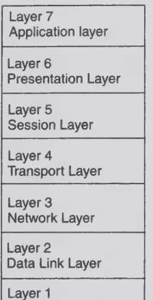

### 图 13.1

七层 ISO/OSI 模型。

在 ISO/OSI 模型中，通信所需的各个服务被安排在七个层中，层层构建。每个层描述了图 13.1 中描述的具体网络功能。

表 13.1 描述了每个单独层的功能。

### 表 13.1

### ISO/OSI 层

| ISO/OSI 层 | 功能 |
|---|---|
| 物理 | 第 1 层描述网络硬件，包括到网络的电气和机械连接。 |
| 数据链路 | 第 2 层将数据拆分为帧以在物理层发送，并接收确认帧。它执行错误检查，并重传未正确接收的帧。 |
| 网络 | 第 3 层通过数据链路层管理数据的传输，并被传输层使用。最常见的网络层协议是 IP。 |
| 传输 | 第 4 层确定如何使用网络层以提供几乎无错误的点对点连接，以便主机 A 可以向主机 B 发送消息，并且它们将以未损坏且正确的顺序到达。 |
| 会话 | 第 5 层使用传输层在不同主机上的进程之间建立连接。它处理安全性和会话的创建。 |
| 表示 | 第 6 层执行诸如文本压缩、代码或格式转换等功能，以尝试平滑主机之间的差异。它允许应用层中不兼容的进程通过会话层进行通信。 |
| 应用 | 第 7 层关注用户对网络的视图（即格式化电子邮件消息）。表示层为应用层提供与网络上使用格式无关的数据的熟悉的本地表示。 |

## TCP/IP 模型

传输控制协议/互联网协议（TCP/IP）模型是一种网络通信协议，由一组正式规则组成，描述软件和硬件在网络内应如何交互。TCP/IP 在 OSI 参考模型中使用五层：

- 硬件层
- 网络接口层
- 互联网层
- 传输层
- 应用层

### 硬件层

硬件层对应于 ISO/OSI 物理层，并描述网络硬件，包括到网络的电气和机械连接。该层调节通过传输介质的非结构化比特流的传输，介质可能是以下之一：

- Ethernet IEEE802.3
- Token passing bus IEEE802.4
- Token ring IEEE802.5
- Metropolitan area networks IEEE802.6

每个介质后面都有其相关的标准，该标准由电气和电子工程师学会（IEEE）在 802 项目下实施，该项目以其开始的月份（February）和年份（1980）命名。每个介质都分为自己的子标准。

### 网络接口层

网络接口层对应于 ISO/OSI 数据链路层，并管理通过物理网络的数据传输。该层提供错误检测和数据包帧。帧是把位组装成可管理的数据单元的过程。帧是一系列具有明确开始和结束的位。

网络接口层协议包括以下内容：

- Ethernet
- Fiber Distributed Data Interface (FDDI)
- Point-to-Point Protocol (PPP)
- Token ring

这些协议将在本节后面描述。

### 互联网层

互联网层对应于 ISO/OSI 网络层，并管理网络之间的数据寻址和传输，以及为数据链路层分片数据。互联网层使用以下内容：

- Internet Protocol (IP)。根据目标主机的 IP 地址确定数据包必须采取的路径。Solaris 8 支持 IPv4 和 IPv6。
- Internet Control Message Protocol (ICMP)。IP 的扩展，允许生成与 IP 相关的错误消息、测试数据包和信息消息。
- Address Resolution Protocol (ARP)。定义将 32 位 IP 地址映射到 48 位以太网地址的方法。
- Reverse Address Resolution Protocol (RARP)。ARP 的反向。它将 48 位以太网地址映射到 32 位 IP 地址。

### 传输层

传输层对应于 ISO/OSI 传输层，并确保使用 TCP 和 UDP 使消息到达正确的应用进程。

传输控制协议（TCP）使用可靠的面向连接的电路连接到应用进程。面向连接的电路允许主机以连续流的方式向另一主机发送数据。它保证所有数据都以发送时的相同顺序交付到另一端且不重复。通信通过三个明确定义的阶段进行：连接建立、数据传输和连接释放。

用户数据报协议（UDP）是一种无连接协议。它比 TCP 更快，因为它不需要建立连接和处理确认。因此，它不保证交付。它轻量且高效，但应用程序必须处理所有错误处理和重传。

### 应用层

应用层对应于 ISO/OSI 模型的会话层、表示层和应用层。应用层管理用户访问的应用程式和网络服务。该层负责定义协作网络表示数据的方式。应用层协议包括以下内容：

- Network File System (NFS)。客户端服务器应用程序，描述于第 17 章，“The NFS Environment。”
- Network Information System (NIS), Network Information System Plus (NIS+), and Domain Name System (DNS)。网络服务描述于第 18 章，“Name Services。”
- rlogin, telnet, and FTP。网络服务在“Network Services”部分后面描述。
- Hypertext Transfer Protocol (HTTP)。由万维网使用，通过网络浏览器显示文本、图片和声音。
- Simple Mail Transport Protocol (SMTP)。提供电子邮件消息的传输。
- Remote Procedure Call (RPC)。一种协议，一个程序可使用它从网络上的另一系统请求服务。RPC 在“Network Services”部分后面描述。
- Routing Information Protocol (RIP)。提供系统之间路由信息的自动分发。
- Simple Network Management Protocol (SNMP)。用于管理和监控所有类型的网络设备，包括计算机、集线器和路由器。

为了使网络正常运行，信息必须以可理解的形式传递到预期目的地。由于不同类型的网络软件和硬件需要交互以执行网络功能，设计人员开发了 TCP/IP 通信协议套件（它是一组协议），现已被主要国际标准组织认可为标准，并在全球范围内使用。由于它是一组标准，TCP/IP 运行在许多不同类型的计算机上，使其易于

让你能够搭建一个运行任何支持 TCP/IP 的操作系统的异构网络。Solaris 操作系统包含用于实现 TCP/IP 通信协议套件的网络软件。

## 封装与解封装

当系统通过网络通信时，可将数据想象为从应用层向下经过每一层到硬件层，跨越网络，然后再从硬件层向上流回应用层。在向下经过各层时（封装），会在每个段上添加一个头部；在向上经过各层时（解封装），会从每个段上移除一个头部。每个头部都包含特定的地址信息，以便远程系统上的各层知道如何转发通信。

例如，在 TCP/IP 中，一个数据包会包含物理层的头部，其后是网络层（IP）的头部，其后是传输层（TCP）的头部，最后是应用协议数据。

## 数据包

数据包是网络上传输信息的基本单位。数据包的组织方式类似于普通信件。每个数据包都有一个头部，对应信封。头部包含收件人和发件人的地址，以及数据包在协议套件各层传输过程中如何处理的有关信息。数据包的消息部分对应信件本身。数据包只能包含有限数量的字节数据，具体取决于所使用的网络介质。因此，像电子邮件这样的典型通信有时会被拆分为数据包片段。

## 以太网

以太网是一种标准，定义了机器用于访问网络的物理组件以及网络运行的速度。它包括布线、连接器和计算机接口组件的规范。以太网是一种局域网技术，以每秒高达 1000 万比特（Mbps）的速度在计算机之间传输信息。一种更新的以太网版本称为 100Base-T，或快速以太网，将速度提高到 100Mbps，而千兆以太网支持每秒 1 千兆比特（1,000 兆比特）的数据传输速率。以太网可以在四种类型的物理介质上运行，如表 13.2 所描述。

## 表 13.2

## 以太网介质

| 介质 | 名称 |
|---|---|
| 粗缆以太网 | Type 10Base5 |
| 细缆以太网 | Type 10Base2 |
| 双绞线以太网 | Type 10Base-T |
| 光纤以太网 | Types FOIRL and 10Base-F |

10Base-T 类型的以太网多年来一直是最流行的介质，但最近已被 100Base-T 取代。

以太网使用一种称为 CSMA/CD 的协议，其全称是 Carrier Sense, Multiple Access, Collision Detect（载波监听，多路访问，碰撞检测）。“Multiple Access” 部分意味着每个站点在逻辑上连接到同一根电缆。“Carrier Sense” 部分意味着在传输数据之前，站点会检查电缆以确定是否已有其他站点正在发送数据。如果局域网似乎空闲，站点就可以开始发送数据。当连接到同一网络的几台计算机需要发送数据时，两台计算机可能会同时尝试发送，从而导致数据碰撞。以太网协议会检测到这种碰撞并通知计算机重新发送数据。

两台计算机怎么会同时发送数据？以太网不是应该在发送数据之前检查网络上是否有其他系统正在传输吗？

事情是这样的：以太网站点以 10Mbps 的速率发送数据。这意味着每传输一位信息允许 100 纳秒。信号在纳秒内大约传播一英尺。第一位电信号沿导线传播约 100 英尺后，站点开始发送第二位。以太网电缆可长达数百英尺。如果两台站点位于同一电缆上相距 250 英尺，并且同时开始传输，那么在各自的信号到达对方站点之前，它们将处于第三位的中间。

这解释了 CSMA/CD 中“Collision Detect” 部分的必要性。如果两台站点同时开始发送数据，它们的信号将在数纳秒后“碰撞”。当发生此类碰撞时，两台站点会停止传输，并在随机选择的延迟时间后重试。

尽管以太网网络可以使用一根公共信号线构建，但这种布置不足以灵活地布线大多数建筑物。与普通电话线路不同，以太网线不能通过拼接将一根铜线连接到另一根铜线。相反，以太网需要中继器，即连接到两根导线的简单站点。当中继器在一根导线上接收到数据时，它会逐位在另一根导线上重复该数据。当发生碰撞时，中继器也会重复该碰撞。在具有两种或更多类型以太网电缆的建筑物中，常见的做法是使用媒体转换器、交换机或中继器将以太网信号从一种导线类型转换为另一种。

## FDDI

Fiber Distributed Data Interface（FDDI）是一种标准，用于在可延伸至 200 公里（124 英里）的局域网中的光纤线路上传输数据。FDDI 协议基于令牌环协议。在令牌环网络中，所有计算机在示意上排列成一个圆圈。令牌是一种特殊的位模式，在圆圈中传输。要发送消息，计算机捕获令牌，将消息附加到其上，然后让其继续在网络中传输以进行投递。除了地理范围大之外，FDDI 局域网还可以支持数千用户。FDDI 还允许比使用以太网的低速局域网更大的数据包大小。

FDDI 网络通常包含两个双连接的逆向旋转令牌环：主令牌环和在主环失效时可能用作备份的次令牌环。主环提供高达 100Mbps 的容量。如果次环不需要备份，它也可以承载数据，使容量翻倍至 200Mbps。通常，一个环用于传输，一个环用于接收。如果任一环失效，FDDI 将回退到另一个环用于传输和接收。

## 网络硬件

网络硬件是你实际可以看到的网络的物理部分。物理组件连接系统，包括 NIC、主机、布线、连接器、集线器和路由器——其中一些我将在此处讨论。

## NIC

允许你将计算机连接到网络的计算机硬件称为网络接口卡（NIC）或网络适配器。网络接口可以支持一个或多个通信协议，以指定计算机如何使用物理介质——网络电缆——交换数据。许多计算机自带预装的网络接口（如 Sun 工作站）；其他计算机则需要你单独购买（如大多数 PC）。

每种局域网介质类型都有其各自关联的网络接口。例如，如果你想使用以太网作为网络介质，则必须在网络中的每个主机上安装以太网接口。连接以太网电缆的板上的连接器称为以太网端口。如果计划使用 FDDI，也是如此，等等。

## 主机

如果你是有经验的 Solaris 用户，你无疑熟悉术语 host，通常用作“计算机”或“机器”的同义词。从 TCP/IP 的角度来看，网络上只存在两种类型的实体：路由器和主机。当主机发起通信时，它被称为发送主机或发送方。例如，当用户键入 ping 或向另一用户发送电子邮件时，主机就会发起通信。通信的目标主机称为接收主机或接收方。

每个主机都有一个主机名、Internet 地址和硬件地址，有助于在网络上将其识别给对等方。这些内容在表 13.3 中进行了描述。


## 表 13.3

### 主机信息

| 身份 | 描述 |
|---|---|
| 主机名 | 网络上的每个系统都有一个唯一的主机名。主机名让用户可以使用简短、易于记忆的名称而不是主机的网络 IP 地址来引用网络上的任何计算机。 |
| Internet 地址 | TCP/IP 网络上的每台机器都有一个 Internet 地址（或 IP 地址），用于将其标识给网络上的对等方。 |
| 硬件地址 | 网络上的每个主机都将有一个唯一的以太网地址，也称为媒体访问控制（MAC）地址。制造商会将此地址物理分配给机器的 CPU 或网络接口。 |

以 root 身份，您可以使用 ifconfig -a 命令按如下方式显示系统的 IP 和 MAC 地址：

```
ifconfig -a
lo0: flags=1000849<UP,LOOPBACK,RUNNING,MULTICAST,IPv4> mtu 8232 index 1 \
inet 127.0.0.1 netmask ff000000
hme0: flags=1004843<UP,BROADCAST,RUNNING,MULTICAST,DHCP,IPv4> mtu 1500 index 2 \
inet 192.168.1.106 netmask ffffff00 broadcast 192.168.1.255
ether 8:0:20:a2:63:82
```

您还可以使用 banner 命令在 OpenBoot 提示符下从系统检索 MAC 地址，如第 2 章“OpenBoot”所述。

## 集线器

以太网电缆从集线器连接到每个系统。集线器除了将所有以太网电缆连接起来以使计算机能够相互连接之外，没有其他作用。它不会增强信号或在网络之间路由数据包。当数据包到达一个端口时，它会被复制到其他端口，以便 LAN 上的所有计算机都能看到所有数据包。集线器可以支持从两台到数百台系统。

一个 *无源集线器* 用作数据的通道，允许数据从一个设备或段传输到另一个设备。 *智能集线器* 包括额外的功能，让管理员监控通过集线器传输的流量并配置集线器中的每个端口。智能集线器也称为 *可管理集线器*。

第三类集线器称为 *分组交换集线器*（或交换机），是一种特殊的集线器，根据数据包的地址将数据包转发到适当的端口。常规集线器只是将每个数据包广播到每个端口。由于交换式集线器仅将每个数据包转发到所需的端口，因此提供了更好的性能。大多数交换式集线器还支持负载平衡，以便根据流量模式动态地将端口重新分配到不同的 LAN 段。

一些较新的交换式集线器同时支持传统以太网（10Mbps）和快速以太网（100Mbps）端口。这使管理员能够为高流量设备（如服务器）建立专用快速以太网通道。

## 路由器

一个 *路由器* 是转发以太网数据包从一个网络到另一个网络的机器。换句话说，路由器连接 LAN，而集线器连接计算机。为此，路由器必须至少有两个网络接口。只有一个网络接口的机器不能转发数据包；它被视为主机。您在网络上设置的机器大多数将是主机。

路由器使用报头和转发表来确定数据包的去向，并使用 ICMP（Internet 控制消息协议）相互通信并配置任意两个主机之间的最佳路由。通过路由器进行的数据过滤很少。路由器不关心其处理的数据类型。

## 网络规划

在设置网络之前，您需要进行大量的规划。作为规划过程的一部分，您必须执行以下步骤，这些步骤在本节中进行了描述：

- 1. 获取网络号码，并在适用时，使用 InterNIC 地址管理机构注册您的网络域，如本章后面“IP 地址规划”部分所述。
- 2. 在收到您的 IP 网络号码后，设计主机 IP 地址方案，如本章后面“IP 地址（IPv4）”部分所述。
- 3. 创建包含构成您网络的所有机器的 IP 地址和主机名的列表。您将在构建网络数据库时使用此列表。
- 4. 确定网络上要使用的名称服务：NIS、NIS+、DNS 或本地 /etc 目录中的网络数据库。名称服务将在本章后面讨论。

只有在仔细规划网络后，您才准备好开始设置它。

## 设置网络

在操作系统安装期间，您将使用 Solaris 软件安装程序来配置网络。以下是 Solaris 安装程序设置的网络配置文件：

- /etc/hostname.interface
- /etc/nodename
- /etc/defaultdomain
- /etc/inet/hosts
- /etc/defaultrouter

### /etc/hostname.interface

此文件定义本地主机上的网络接口。本地机器上应至少存在一个 /etc/hostname.interface 文件。Solaris 安装程序会为您创建此文件。在文件名中，interface 由主网络接口的设备名称替换。

该文件只包含一个条目：与网络接口关联的主机名或 IP 地址。例如，假设 le0 是名为 system1 的机器的主网络接口。文件将命名为 /etc/hostname.le0，并且文件将包含条目 system1。

### /etc/nodename

此文件应包含一个条目：本地机器的主机名。例如，在名为 xena 的计算机上，文件 /etc/nodename 将包含条目 xena。

### /etc/defaultdomain

只有当网络使用名称服务（本章后面描述）时，此文件才存在。此文件应包含一个条目：本地主机网络所属的管理域的完全限定域名。您可以将此名称提供给 Solaris 安装程序或在以后编辑文件。

例如，如果主机是属于 .com 域的 pyramid 域的一部分，/etc/defaultdomain 应包含条目 pyramid.com。

### /etc/inet/hosts

hosts 数据库包含您网络上机器的详细信息。此文件包含主网络接口的主机名和 IP 地址以及机器必须了解的任何其他网络地址。当用户输入 ping xena 等命令时，系统需要知道如何访问名为 xena 的主机。/etc/hosts 文件提供交叉引用以查找并

找到 xena 的网络 IP 地址。为兼容基于 BSD 的操作系统，文件 /etc/hosts 是 /etc/inet/hosts 的符号链接。

/etc/inet/hosts 文件中的每一行使用以下格式：

```
address hostname <nickname> [#comment]
```

此语法中的每个字段在表 13.4 中描述。

## 表 13.4

### /ETC/INET/HOSTS 文件格式

| 字段 | 描述 |
|-------|-------------|
| address | 本地主机必须了解的每个接口的 IP 地址。 |
| hostname | 在设置时分配给机器的主机名以及本地主机必须了解的附加网络接口分配的主机名。 |
| <nickname> | 一个可选字段，包含主机的昵称或别名。可以存在多个昵称。 |
| [# comment] | 一个可选字段，您可以在其中包含注释。 |

当您在系统上运行 Solaris 安装程序时，它会设置初始 /etc/inet/hosts 文件。此文件包含本地主机所需的最小条目：其环回地址、其 IP 地址和其主机名。

例如，Solaris 安装程序可能会为名为 xena 的系统在 /etc/inet/hosts 文件中创建以下条目：

```
127.0.0.1      localhost      loghost      #loopback address
192.9.200.3    xena                         #host name
```

在机器 xena 的 /etc/inet/hosts 文件中，IP 地址 127.0.0.1 是环回地址，是本地机器用于允许进程间通信以便向自身发送数据包的保留网络接口。操作系统通过 ifconfig 命令使用环回地址进行配置和测试。TCP/IP 网络上的每台机器都必须为 localhost 有一个条目，并且必须使用 IP 地址 127.0.0.1。


如果您已安装操作系统并对安装网络回答“否”，则可以手动编辑网络配置文件，或重新执行安装程序的网络配置部分。

要重新执行程序部分，您必须首先成为超级用户。然后在命令行输入 sys-unconfig 以将系统的配置恢复到“出厂”状态。运行该命令后，系统会重新启动并提示您输入表 13.5 中描述的系统信息。

## 表 13.5
### 系统信息

| 信息 | 操作 |
|---|---|
| 主机名 | 输入计算机的唯一名称。 |
| 名称服务 | 选择 NIS、NIS+、DNS 或 NONE（在这种情况下，将使用本地文件）。 |
| 时区 | 输入您本地的时区。 |
| IP 地址 | 输入此主机的唯一 IP 地址。 |
| IP 子网掩码 | 如果您的网络使用子网掩码，则输入子网掩码。 |
| Root 密码 | 输入 root 密码。 |

系统完成提示输入后，将继续启动过程。系统启动后，网络已配置完成。

## /etc/defaultrouter

此文件仅在需要为主机定义路由器时存在。/etc/defaultrouter 文件应包含连接到网络的每个路由器的条目。该条目应为充当网络间路由器的网络接口的名称。

> 注意
第 8 章“系统安全”介绍了网络安全。如有必要，请参阅有关配置网络安全文件 /etc/hosts.equiv 和 /.rhosts 的讨论。

## IP 地址分配（IPv4）

在 IP 版本 4 中，TCP/IP 网络上的每个主机都有一个唯一的 32 位网络地址——称为 IP 地址——该地址在网络上的每个主机中都是唯一的。如果主机将参与互联网，则该地址也必须在互联网上唯一。因此，互联网 IP 地址由 InterNIC 等管理机构控制。

IP 地址是一串四个字节，以四个用点分隔的十进制整数的形式书写（例如，0.0.0.0）。每个整数长 8 位，范围为 0 到 255。IP 地址由两部分组成：由 InterNIC 管理机构分配的网络 ID 和由本地管理员分配的主机 ID。地址的第一个整数（0.0.0.0）决定地址类型，称为其类。存在五类 IP 地址：A、B、C、D 和 E。以下是对每个类的简要描述，不涉及过多细节。

### A 类网络

A 类网络用于拥有数百万主机的非常大的网络，例如互联网。A 类网络号使用 IP 地址的前 8 位作为其网络 ID。剩余的 24 位构成 IP 地址的主机部分。A 类网络号第一个字节的取值范围为 0–127。例如，考虑 IP 地址 75.4.10.4。第一个字节中的值 75 表示主机位于 A 类网络上。剩余字节 4.10.4 确定主机地址。InterNIC 仅分配 A 类号码的第一个字节。剩余 3 个字节的使用由网络号码所有者自行决定。只能存在 126 个 A 类网络，因为 0 保留用于网络，127 保留用于回环设备，留下 001–126 作为可用地址。每个网络最多可容纳 16,777,214 个主机。

> 注意
由于 IPv4 方案设计上的缺陷，将逐步引入修订后的协议。该协议名为 IPv6（IP 版本 6），旨在克服当前方法的重大限制。IPv6 与 IPv4 兼容，但 IPv6 使分配更多唯一的互联网地址成为可能，并提供改进的安全性和性能支持。

### B 类网络

B 类网络是中等规模的网络，例如拥有众多主机的大学和大型企业。B 类网络号使用 16 位表示网络号和 16 位表示主机号。B 类网络号的第一个字节范围为 128–191。在号码 129.144.50.56 中，前 2 个字节 129.144 由 InterNIC 分配，构成网络地址。后 2 个字节 50.56 构成主机地址，由网络所有者自行分配。B 类网络最多可容纳 65,534 个主机。同样，网络上的第一个和最后一个地址是保留的。0 主机地址保留用于网络，255 地址保留为 IP 广播地址；因此，B 类网络上实际可分配的主机数为 65,534，而不是 65,536。

### C 类网络

C 类网络用于包含少于 254 个主机的小型网络。C 类网络号使用 24 位表示网络号和 8 位表示主机号。C 类网络号占用 IP 地址的前 3 个字节；只有第四个字节由网络所有者自行分配。C 类网络号的第一个字节范围为 192–223。第二和第三个字节各自范围为 1–255。典型的 C 类地址可能是 192.5.2.5，其中前 3 个字节 192.5.2 构成网络号。此示例中的最后一个字节 5 为主机号。C 类网络最多可容纳 254 个主机，共 256 个地址；同样，这是因为第一个和最后一个值是保留的。

### D 类和 E 类网络

D 类地址范围为 224–239，用于 RFC 988 中定义的 IP 组播。E 类地址范围为 240–255，保留用于实验用途。

> 注意
即使您不打算将其连接到其他现有的 TCP/IP 网络，也不要随意为您的网络分配网络号。随着网络的增长，您可能会决定将其连接到其他网络。那时更改 IP 地址可能是一项大量工作，并可能导致停机。

## IP 地址规划

在网络上规划 IP 地址的第一步是确定哪种网络类适合您的网络。确定后，您可以从 InterNIC 地址管理机构获取网络号。收到网络号后，您可以规划如何分配 IP 地址的主机部分。您可以通过以下几种方式联系 InterNIC 注册服务：

- 网站：`internic.net`
  在此网站上阅读常见问题解答，了解有关域名注册的更多信息。
- 美国邮寄地址：
  Network Solutions 收件人：InterNIC Registration Services 505 Huntmar Park Drive
  Herndon, VA 22070
- 电子邮件：`hostmaster@rs.internic.net`。
- 电话：703-742-4777。电话服务时间为上午 7 点至晚上 7 点（东部标准时间）。
- 您还可以访问互联网名称与数字地址分配机构（ICANN）。ICANN 是新成立的非营利性公司，正在从美国政府接管协调某些互联网技术职能的责任，包括互联网域名系统的管理。有关 ICANN 的更多信息可在 `www.icann.org` 找到。

## 网络服务

网络服务已在第 8 章中讨论。inetd 是在系统上运行的网络守护进程，代表许多在启动时未启动的服务器进程进行监听。inetd 守护进程在收到对该服务的请求时启动适当的服务器进程。/etc/inetd.conf 文件包含 inetd 应提供的服务列表。以下是 /etc/inetd.conf 文件中的一个条目：

```
ftp stream tcp6 nowait root /usr/sbin/in.ftpd in.ftpd
```

条目的语法如下：

```
<service_name> tli <proto> <flags> <user> <server_pathname> <args>
```

每个网络服务使用一个端口来表示为该服务保留的地址空间。系统通过这些端口相互通信。众所周知的端口列在 /etc/services 文件中。以下是 /etc/services 文件中的几个条目：

```
ftp-data      20/tcp
ftp           21/tcp
telnet        23/tcp
```

从这些条目可以看出，ftp 服务将通过端口 21 通信并使用 TCP 协议。

每个网络服务必须有一个唯一的端口号，该端口号在网络上的所有主机上使用。跟踪这些端口可能很困难，尤其是在支持多个网络服务的网络上。

Solaris 使用一种称为远程过程调用（RPC）的客户端-服务器模型。使用 RPC 服务时，客户端连接到一个特殊的服务器进程 rpcbind，这是一个众所周知的注册互联网服务。rpcbind 注册 /etc/rpc 文件中列出的每个 RPC 服务相关联的端口号。rpcbind 进程接收所有基于 RPC 的客户端应用程序连接请求，并向客户端发送适当的服务器端口号。例如，mountd 在第 17 章中进行了描述，在 /etc/rpc 文件中列出如下：

```
mountd        100005  mount showmount
```

mountd 守护进程的程序号为 100005，也称为 mount 和 showmount。

使用 -p 选项使用 rpcinfo 实用程序列出系统上运行的已注册 RPC 程序。例如，我可以按如下方式检查另一系统上的进程：

```
rpcinfo -p 192.168.1.21
```

系统会响应列出该系统上找到的所有已注册 RPC 服务的列表。该列表显示程序号、版本、协议、端口和服务名称。其中之一是 mountd 服务：

| 程序 | 版本 | 协议 | 端口 | 服务 |
|---|---|---|---|---|
| 100005 | 1 | udp | 32784 | mountd |


你也可以使用 rpcinfo 来注销 RPC 程序。 使用 -d 选项时，可以删除服务的注册。 例如，sprayd 在本地系统上运行。 我可以按如下方式注销它：

```
rpcinfo -d sprayd 1
```

sprayd 服务将被停止。 在第 9 章“进程控制”中，我描述了如何向进程发送信号。 我可以通过向 inetd 守护进程发送 HUP（挂断）信号来重新启动 sprayd，如下所示：

```
pkill -HUP inetd
```

## 名称服务

当用户输入 ping xena 之类的命令时，必须发生的第一件事之一是将主机名 xena 翻译为 IP 地址。 这可以通过两种方式之一实现。

IP 地址可以从 /etc/hosts 文件中确定，也可以通过域名服务解析。 对于小型网络，仅使用 /etc/hosts 不是问题。 对于大型网络，尝试在所有主机上保持 /etc/hosts 文件同步可能会导致大量工作，因为这些文件在每个主机上必须完全相同。 如果同一地址被用于两个不同的系统，网络可能会失败。

DNS 依赖于 named（读作 name d）服务器提供主机名到 IP 地址的转换。 named 服务器是永久存储特定域的主机名和 IP 地址信息的主机。 域名是主机名的网络等价物。 主机名指的是网络上的特定系统，而域名指的是特定网络。 站点和机构会被分配一个用于其网络的域名。 反过来，他们为域内的系统分配主机名。 Internet 域名系统提供了一种方案，使世界上的每个站点都有一个唯一名称。

名称服务和 DNS 在第 18 章中会再次更详细地讨论。

## TCP/IP 命令

TCP/IP 提供了多个命令和功能，这些命令和功能在 Solaris 操作环境中得到支持。 这些命令是 TCP/IP 网络包的一部分，可在所有实现 TCP/IP 的 UNIX 系统上使用，除非管理员专门禁用。

### telnet

telnet 用于登录网络上的另一系统。 以下是一个示例会话：

```
# telnet pyramid1
Trying 192.9.200.4...
Connected to pyramid1.
Escape character is '^]'.

SunOS 5.8
login: bill
Password:
Last login: Mon Jul 30 15:12:59 from 192.9.200.1
Sun Microsystems Inc.  SunOS 5.8  Generic February 2000
pyramid1%
```

### rlogin

rlogin 也是用于登录网络上另一系统的命令。 与 telnet 不同，rlogin 具有一种机制，如果 ~/.rhosts 和 /etc/hosts.equiv 文件已就位，则无需输入登录名和密码。 这些文件在第 9 章中讨论。

### ftp

文件传输协议（FTP）用于在网络上的两个系统之间传输一个或多个文件。 以下是一个示例 ftp 会话：

```
pyramid1% ftp pyramid1
Connected to pyramid1.
220 pyramid1 FTP server (SunOS 5.8) ready.
Name (pyramid1:bill): <cr>
331 Password required for bill.
Password: <enter password>
230 User bill logged in.
ftp> pwd
257 "/users/bill" is current directory.
ftp> ls
200 PORT command successful.
150 ASCII data connection for /bin/ls (192.9.200.4,47131) \
(0 bytes).
admin
file1
data
226 ASCII Transfer complete.
19 bytes received in 0.049 seconds (0.38 Kbytes/s)
ftp> get file1 /tmp/file1
200 PORT command successful.
150 ASCII data connection for file1 (192.9.200.4,47132) \
(31311 bytes).
226 ASCII Transfer complete.
local: /tmp/file1 remote: file1
31441 bytes received in 0.12 seconds (266.82 Kbytes/s)
ftp> bye
221 Goodbye.
pyramid1%
```

### rcp

你也可以使用 rcp（远程复制）命令在网络上的两个主机之间传输一个或多个文件。 另一系统必须信任你在当前主机上的 ID。 这种信任关系在第 8 章中讨论过。

rcp 命令比 ftp 更方便。 首先，如果系统之间存在适当的信任关系，rcp 不需要登录或密码，这使其适合脚本使用。 其次，rcp 允许将完整的目录树从一个系统复制到另一个系统。 然而，ftp 具有更多选项，被认为更安全。 以下是 rcp 的示例用法：

```
rcp /etc/hosts systemB:/etc/hosts
```

此示例使用 rcp 将文件 /etc/hosts 从本地系统复制到 systemB。

### rsh

你使用 rsh（远程 shell）命令在网络上的另一系统上执行 shell。 另一系统必须信任你在当前系统上的 ID。 以下示例使用 rsh 获取 systemB 上目录 /etc 的长列表：

```
rsh systemB ls -la /etc
```

### rexec

rexec 命令也用于在远程系统上执行 shell。 该命令与 rsh 的不同之处在于你必须输入密码。 在许多站点，出于安全原因 rsh 被禁用，而 rexec 被用作替代。

### rwho

rwho 命令产生的输出类似于 who 命令（在第 9 章中描述），但适用于网络上的所有系统。

### finger

finger 命令显示登录到本地系统或其他系统的用户的信息。 如果不带参数使用 finger，它会提供当前登录用户的相关信息。 如果 finger 带参数使用（例如用户名 glenda），它会显示与参数匹配的所有用户的信息。 你也可以通过将用户指定为 username@host 来使用 finger 命令查找远程系统上的用户。 为了保护用户隐私，许多远程系统不允许远程 finger 其系统。

### rup

rup 命令显示远程系统的主机状态，类似于 uptime 命令。 例如，要获取名为 sparc14 的远程主机的正常运行时间信息，请输入以下内容：

```
rup sparc14
```

系统会以下列方式响应：

```
sparc14  up  2 days, 41 mins,  load average: 0.00, 0.00, 0.01
```

### ping

使用 ping 命令测试到特定主机的网络连通性。 ping 命令的语法如下：

/usr/sbin/ping <options> <host> [timeout]

<host> 是相关机器的主机名，而 [timeout] 是可选参数，用于指定 ping 尝试访问机器的时间（以秒为单位）。 默认值为 20 秒。

ping 命令的一些更常见选项在表 13.6 中描述。

表 13.6
ping 选项

| 选项 | 描述 |
|---|---|
| -v | 详细输出。列出收到的除 ECHO_RESPONSE 之外的任何 ICMP 数据包。 |
| -I <interval> | 指定连续传输之间的间隔。默认值为 1 秒。 |
| -s | 指定 -s 标志时，ping 每秒发送一个数据报（可使用 -I 调整），并为收到的每个 ECHO_RESPONSE 打印一行输出。 |

当你运行 ping 时，ICMP 协议会向你指定的主机发送一个数据报，请求响应。 ICMP 是负责 TCP/IP 网络上错误处理的协议。

要测试 ultra5 和 sparc14 之间的网络连通性，请输入以下内容：

```
ping sparc14
```

如果主机 sparc14 处于运行状态，将显示以下消息：

```
sparc14 is alive
```

该消息表明 sparc14 对 ICMP 请求做出了响应。 然而，如果 sparc14 已关闭或无法接收 ICMP 数据包，你会收到以下响应：

```
no answer from sparc14
```

如果你怀疑某台机器即使处于运行状态也可能丢失数据包，可以使用 ping 的 -s 选项尝试检测问题。 例如，请输入以下内容：

```
ping -s sparc14
```

ping 会持续向 sparc14 发送数据包，直到你发送中断字符或发生超时。 你屏幕上的响应将类似于以下内容：

```
PING sparc14: 56 data bytes
64 bytes from sparc14 (192.9.200.14): icmp_seq=0. time=1. ms
64 bytes from sparc14 (192.9.200.14): icmp_seq=1. time=0. ms
64 bytes from sparc14 (192.9.200.14): icmp_seq=2. time=0. ms
64 bytes from sparc14 (192.9.200.14): icmp_seq=3. time=0. ms
64 bytes from sparc14 (192.9.200.14): icmp_seq=4. time=0. ms
...
...
---sparc14 PING Statistics---
8 packets transmitted, 8 packets received, 0% packet loss
round-trip (ms)  min/avg/max = 0/0/1
```

输出末尾的数据包丢失统计信息指示主机是否丢弃了数据包，这可能表明存在网络问题。

### spray

spray 命令测试网络的可靠性。 它可以告诉你数据包是否被延迟或丢弃。 spray 使用远程过程调用（RPC）向主机发送单向数据包流。 它报告接收到的数量以及传输速率。

语法如下：

```
spray [ -c <count> -d <interval> -l <packet_size>] <hostname>
```


语法中的每个选项都在表 13.7 中描述。

表 13.7
spray 选项

| 字段 | 描述 |
|---|---|
| `-c <count>` | 指定要发送的数据包数量。 |
| `-d <interval>` | 指定发送数据包之间暂停的微秒数。如果不使用延迟，可能耗尽缓冲区。 |
| `-l <packet_size>` | 指定数据包大小。 |
| `<hostname>` | 指定要发送数据包到的系统。主机名参数可以是名称或 Internet 地址。 |

spray 不能用作网络基准，因为它使用不可靠的无连接传输，例如用户数据报协议（UDP）。spray 可以报告大量数据包丢失，当丢失是由 spray 发送数据包的速度快于本地缓冲能力时（在数据包到达网络介质之前）。然而，spray 用于验证两个主机之间的连接并测试网络操作。

以下示例说明了使用 spray 向 sparc14 发送 100 个数据包（-c 100）的用法。每个数据包为 2048 字节（-l 2048）。数据包以每次突发之间 20 微秒的延迟时间发送（-d 20）：

```
spray -c100 -d20 -l2048 sparc14
```

系统会响应如下：

```
sending 100 packets of length 2048 to sparc14 ...
2 packets (2.000%) dropped by sparc14
567 packets/sec, 1161394 bytes/sec
```

## 网络维护

除了 TCP/IP 命令集之外，Solaris 还提供了系统管理员可用于检查和排除网络故障的几个网络命令。

## 逐步操作

### 13.1 验证网络是否运行

1. 通过输入以下内容检查到另一系统的网络连接：

```
ping <options> <ip address>
```

例如，要检查 systemA 和 systemB 之间的网络，请从 systemA 输入 ping systemB。如果检查成功，远程系统会回复如下：

```
systemB is alive
```

如果网络未激活，您会收到以下消息：

```
no answer from systemB
```

如果这是响应，请检查您的布线并确保远程系统配置正确。

2. 使用 snoop 实用程序确定系统之间流动的信息。snoop 实用程序可以显示当一个系统 ping 另一个系统时实际发生的情况如下：

```
snoop 192.168.1.106 192.168.1.21
```

系统会响应如下：

```
Using device /dev/hme (promiscuous mode)
192.168.1.106 -> 192.168.1.21 ICMP Echo request \
(ID: 2677 Sequence number: 0)
192.168.1.21 -> 192.168.1.106 ICMP Echo reply \
(ID: 2677 Sequence number: 0)
```

3. 通过输入以下内容检查网络流量：

```
netstat -i 5
```

系统会响应如下：

输入 le0 输出 输入（总计）输出
数据包 错误 数据包 错误 冲突 数据包 错误 数据包 错误 冲突
95218 49983 189 1 0 218706 49983 123677 1 0
0 0 0 0 0 3 0 3 0 0
0 0 0 0 0 4 0 4 0 0
1 1 0 0 0 144 1 143 0 0
0 0 0 0 0 256 0 256 0 0
0 0 0 0 0 95 0 95 0 0
0 0 0 0 0 1171 0 1171 0 0

netstat 命令用于监控系统的 TCP/IP 网络活动。netstat 可以提供有关网络活动量和类型的一些基本数据。-i 选项显示用于 TCP/IP 流量的网络接口状态。最后一个选项 5 每 5 秒重新发出 netstat 命令以获得良好的网络活动采样。按 Ctrl+C 退出 netstat 命令。

4. 查看 colls 列中的高冲突数。要计算网络冲突率，将输出冲突数（输出 colls）除以输出数据包数。网络范围内的冲突率大于 10% 可能表示网络过载、网络配置不当或硬件问题。

5. 检查 errs 列中的高错误数。要计算输入数据包错误率，将输入错误数除以输入数据包总数。如果输入错误率很高——超过 25%——主机可能由于传输问题而丢弃数据包。传输问题可能是由网络上的其他硬件、重负载和低级硬件问题引起的。路由器可以丢弃数据包，迫使重传并导致性能下降。

6. 从客户端输入 ping -sRv <hostname> 以确定数据包在网络上往返所需的时间。如果往返时间超过几毫秒，网络上的路由器很慢，或者网络非常繁忙。两次发出 ping 命令，并忽略第一次结果。ping -sRv 命令还显示数据包丢失。如果您怀疑物理问题，请使用 ping -sRv 查找网络上多个主机的响应时间。如果来自某个主机的响应时间（以毫秒为单位）与您期望的不符，请调查该主机。

## 章节摘要

尽管网络是一个可能占用本书许多章节的主题，但我描述了您在网络上设置 Solaris 系统所需了解的基础知识。Sun Certified System Administrator for the Solaris 8 Operating Environment 考试（310-012）所需了解的所有概念都已描述。

阅读本章后，您应该了解两种网络模型：ISO/OSI 和 TCP/IP。本章描述了这两种模型的全部组件层。

网络硬件和软件组件以及您可能需要自定义以使网络服务运行的所有配置文件都已描述。

最后，本章讨论了您将用于监控和维护网络的网络相关命令和实用程序。在网络环境中，系统性能取决于您维护网络的程度。一个过载的网络会伪装成慢速系统，甚至可能导致停机。持续监控您的网络。您需要了解网络在正常运行时是什么样子，以便在网络性能不佳时知道要寻找什么。本章中描述的网络命令只报告数字。您来决定这些数字是否可接受。 正如前面所述，就系统管理而言，实践和经验将帮助您成为一名出色的系统管理员。管理网络也同样如此。

下一章将描述一些额外的磁盘管理主题，以便稍后在本节中，我可以描述如何使用 NFS 在网络上访问这些驱动器。

## 关键术语

- LAN
- WAN
- 网络模型
- 网络协议
- ISO/OSI 模型（了解每一层七层）
- TCP/IP
- UDP
- SMTP
- RPC
- 封装
- 解封装
- 数据包
- 以太网
- FDDI
- 主机
- 集线器
- 主机名
- Internet 地址
- 路由器
- IP 地址
- 网络类别（描述每个类别）
- 网络服务

## 应用你的知识

### 练习

以下练习需要通过以太网连接的两个主机。您应该通过网络连接两个主机，一个名为 hostA，另一个名为 hostB。

### 13.1 获取网络信息

在此练习中，您将使用各种网络命令和实用程序获取有关系统和网络的信息。

预计时间：15 分钟

1. 以 root 身份登录 hostA。确保您的 /etc/inet/hosts 文件中为 hostB 有一个条目。

2. 以 root 身份使用 ifconfig 命令显示有关网络接口的信息：

```
ifconfig -a
lo0: \
flags=1000849<UP,LOOPBACK,RUNNING,MULTICAST,\
IPv4> mtu 8232 index 1
inet 127.0.0.1 netmask ff000000
hme0: \
flags=1004843<UP,BROADCAST,RUNNING,MULTICAST,\
DHCP,IPv4> mtu 1500 index 2 \
inet 192.168.1.106 netmask ffffff00 broadcast\
192.168.1.255 \
ether 8:0:20:a2:63:82
```

ifconfig 实用程序显示 hme0 接口的以太网地址为 8:0:20:a2:63:82。地址的前半部分通常特定于制造商。在这种情况下，8:0:20 是 Sun Microsystems。地址的后半部分 a2:63:82 对每个系统都是唯一的。

3. 使用 ping 从 hostA 向 hostB 发送 ICMP 回显请求。

```
ping hostB
```

在 hostA 上，使用 -p 选项使用 rpcinfo 实用程序列出已注册的 RPC 程序：

```
rpcinfo
```

4. 查找系统上的 sprayd 服务：

```
rpcinfo | grep sprayd
```

5. 按如下方式停止本地系统的 sprayd 服务：

```
rpcinfo -d sprayd 1
```

6. 验证 sprayd 服务已消失：

```
rpcinfo | grep sprayd
```

7. 通过向 inetd 守护进程发送 HUP（挂断）信号重新启动 sprayd 服务，如下所示：

```
pkill -HUP inetd
```

8. 验证 sprayd 服务正在运行：

```
rpcinfo | grep sprayd
```

### 13.2 使用 snoop 显示网络信息

在此练习中，您将使用 snoop、spray 和 ping 命令获取网络信息。

预计时间：10 分钟

1. 在 hostA 上，以 root 身份登录到 CDE 会话。在一个窗口中，按如下方式启动 snoop 实用程序：

```
snoop hostA hostB
```

2. snoop 将显示当 hostA 使用 ping 命令与 hostB 通信时实际发生的情况。在 hostA 上的第二个窗口中，输入以下内容：

```
ping hostB
```

3. 查看正在运行 snoop 的第一个窗口中显示的信息。

4. 现在发出 spray 命令发送单向


## 应用你的知识

发送数据包流到 hostB：

```
spray hostB
```

5. 观察正在运行 snoop 的第一个窗口中显示的信息。

## 复习问题

1. 命名并简要描述七层 OSI 模型中每一层。

2. 命名并简要描述五层 TCP/IP 模型中每一层。

3. 在 TCP/IP 中，一个包含物理层头部、随后是网络层（IP）头部、随后是传输层（TCP）头部、随后是应用协议数据的包被称为什么？
A. 解封装
B. 封装
C. 加密
D. 解密

4. 主机唯一的以太网地址还被称为什么？
A. IP 地址
B. MAC 地址
C. Internet 地址
D. 主机名

5. 以下哪些网络配置文件是 Solaris 安装程序总是设置的？全部选择适用项。
A. /etc/hostname.interface
+   B. /etc/nodename
C. /etc/inet/hosts
D. /etc/defaultdomain

6. 哪个守护进程在收到该服务的请求时启动相应的服务器进程？
A. inetd
B. init
C. mountd
D. nfsd

7. TCP/IP 是什么？
A. 一组允许计算机在网络间共享资源的协议的通用名称
B. 在互联网上广泛使用的网络安全规范
C. 域名服务提供的其中一项服务
D. 传输控制协议/信息协议

8. 以下关于 IP 地址的哪些陈述是正确的？全部选择适用项。
A. IP 地址写成用句点分隔的四个数字组。
B. IP 地址提供识别和定位网络资源的方式。
C. IP 地址分为三个唯一数字：网络、类和主机。
D. IP 地址将机器标识给网络上的对等方。

9. 关于 /etc/hostname.xxy 文件，以下哪个陈述是正确的？
A. 它是一个系统脚本文件。
B. 它是一个 SPARC 可执行文件。
C. 它包含本地主机的主机名。
D. 它标识本地主机的网络接口。

10. 以下哪项是转发以太网数据包从一个网络到另一个网络的网络组件？
A. 集线器
B. 交换机
C. 网络接口
D. 路由器

11. 以下哪项包含您网络上机器的 IP 地址和主机名？
A. /etc/inet/hosts
B. /etc/hostname.xxy
C. /etc/defaultdomain
D. /etc/nodename

12. 以下哪种网络类别适用于校园和拥有众多主机的企业等中型网络？
A. A 类
B. B 类
C. C 类
D. D 类

13. 以下哪些命令用于在网络上的两个系统之间传输一个或多个文件？全部选择适用项。
A. rexec
B. telnet
C. ftp
D. rcp
E. rsh

14. 以下哪个命令在远程系统上执行 shell？
A. rlogin
B. rexec
C. telnet
D. rcp
E. rsh

15. 以下哪个命令显示本地或其他系统上已登录用户的信息？
A. who
B. logins
C. finger
D. rexec

16. 以下哪个命令可以告诉您网络上的数据包是否被延迟或丢弃？
A. spray
B. ping
C. netstat
D. iostat

17. 以下哪个命令用于监视系统的 TCP/IP 网络活动？
+   A. iostat
B. vmstat
C. netstat
D. ping

18. 哪个命令用于确定系统之间网络上传输的信息？
+   A. netstat
B. snoop
C. iostat
D. ping

## 复习问题的答案

1. 物理层。第 1 层描述网络硬件，包括到网络的电气和机械连接。

数据链路层。第 2 层将数据分割成帧以便在物理层发送并接收确认帧。它执行错误检查并重传未正确接收的帧。

网络层。第 3 层通过数据链路层管理数据的交付，并被传输层使用。IP 是最常见的网络层协议。

传输层。第 4 层确定如何使用网络层提供几乎无错误的点对点连接，以便主机 A 可以向主机 B 发送消息，并且它们将不会损坏并且按正确顺序到达。

会话层。第 5 层使用传输层在不同主机上的进程之间建立连接。它处理安全性和会话的创建。

表示层。第 6 层执行诸如文本压缩、代码或格式转换等功能，以尝试平滑主机之间的差异。允许应用层中不兼容的进程通过会话层进行通信。

应用层。第 7 层关注用户对网络的视图（即格式化电子邮件消息）。表示层为应用层提供熟悉的本地数据表示，与网络上使用的格式无关。

2. 硬件层对应于 ISO/OSI 物理层并描述网络硬件，包括到网络的电气和机械连接。该层调节通过传输介质传输非结构化比特流。

网络接口层对应于 ISO/OSI 数据链路层并管理通过物理网络的数据交付。该层提供错误检测和数据包帧。

互联网层对应于 ISO/OSI 网络层并管理网络之间的数据寻址和交付，以及为数据链路层分片数据。

传输层对应于 ISO/OSI 传输层并确保使用 TCP 和 UDP 消息到达正确的应用程序进程。

应用层对应于 ISO/OSI 模型的会话层、表示层和应用层。应用层管理用户访问的应用程序和网络服务。该层负责定义协作网络表示数据的方式。

3. B. 当系统通过网络通信时，想象数据从应用层向下经过每一层到硬件层，跨越网络，然后从硬件层向上流回应用层。在向下经过各层时，每个段都会添加一个头部。这被称为封装。

4. B. 主机的唯一以太网地址也称为 MAC 地址。

5. A.、B.、C. 以下网络配置文件，/etc/hostname.interface、/etc/nodename 和 /etc/inet/hosts，最初由 Solaris 安装程序设置。

6. A. 当收到该服务的请求时，inetd 守护进程启动适当的服务器进程。

7. A. TCP/IP 是一组允许计算机在网络间共享资源的协议的通用名称。

8. A.、B.、D. 以下关于 IP 地址的说法是正确的：IP 地址写成用句点分隔的四个数字组，IP 地址提供识别和定位网络资源的方式，IP 地址将机器标识给网络上的对等方。

9. D. /etc/hostname.xxy 文件标识本地主机的网络接口。

10. D. 路由器是转发以太网数据包从一个网络到另一个网络的网络组件。

11. A. /etc/inet/hosts 文件包含您网络上机器的 IP 地址和主机名。

12. B. B 类网络适用于校园和拥有众多主机的企业等中型网络。B 类网络最多可容纳 65,534 台主机。

13. C.、D. 命令 ftp 和 rcp 用于在网络上的两个系统之间传输一个或多个文件。

14. E. rsh 命令在远程系统上执行 shell。

15. C. finger 命令显示本地或其他系统上已登录用户的信息。

16. A. spray 命令测试您网络的可靠性。它可以告诉您数据包是否被延迟或丢弃。spray 使用远程过程调用（RPC）向主机发送单向数据包流。它报告接收到的数量以及传输速率。

17. C. netstat 命令用于监视系统的 TCP/IP 网络活动。netstat 可以提供有关网络活动量和类型的基本数据。

18. B. snoop 命令用于确定系统之间网络上传输的信息。


## 目标

本章涵盖以下测试目标：

### 利用 Solaris 伪文件系统
- 除前几章中描述的基于磁盘的文件系统外，Solaris 还使用驻留在物理内存中的称为伪文件系统 的文件系统。系统管理员利用这些文件系统来提高性能。在本章中，您将学习如何管理 Solaris 8 中可用的各种伪文件系统。

### 了解交换文件系统 (swapfs)
- Solaris 操作环境可以在系统物理内存不足以处理当前运行进程时，使用称为 *交换区域* 的磁盘空间进行临时内存存储。系统的内存需求会发生变化，系统管理员必须熟悉交换空间管理，以便监控这些资源并根据需要进行持续调整。

## 第 14 章 Solaris 伪文件系统和交换空间

## 大纲

引言 519

进程文件系统 (procfs) 520

临时文件系统 (TMPFS) 521

文件描述符文件系统 (fdfs) 523

交换文件系统 (swapfs) 524

摘要 536

应用您的知识 537

## 学习策略

以下策略将帮助您准备测试：

- 在学习本章时，重要的是您要在 Solaris 系统上练习每个逐步示例和每个命令。这些主题上的练习非常重要，因此请练习直到您能从记忆中重复该过程。
- 确保您理解本节中的每个命令，并准备将命令与正确的描述匹配。
- 确保您知道本章末尾“关键术语”部分列出的所有术语。请特别注意我描述的文件系统类型，并了解每个文件的特征。准备好将本章中介绍的所有术语与正确的描述匹配。
- 最后，您必须理解虚拟内存的概念。了解其工作原理、如何配置它，并学习用于监控它的工具。

## 引言

在第 6 章“文件系统简介”和第 7 章“Solaris 文件系统：高级主题”中，我描述了基于磁盘的文件系统；在第 18 章“名称服务”中，我描述了基于网络的文件系统。在本章中，我将描述另一种文件系统，即伪文件系统。有时被称为基于 RAM 或虚拟文件系统，其区别特征是伪文件系统不驻留在硬物理介质上。伪文件系统仅在操作系统运行时驻留在物理内存中。

伪文件系统通过提供对物理内存中数据的访问而不是从磁盘访问来提高性能。到目前为止，您应该知道访问物理内存比访问磁盘快得多。

考虑一下，在平均系统中，CPU 访问 RAM 大约需要 200ns（纳秒），而访问硬盘则需要 12,000,000ns。为了说明这一点，这相当于通常 3 1/2 分钟的任务需要 4 1/2 个月才能完成！因此，只要您能从 RAM 而不是磁盘访问某物，就越好。Solaris 8 操作环境中支持的伪文件系统列在表 14.1 中，并在下一节中描述。

**表 14.1**

**SOLARIS 伪文件系统**

| 文件系统 | 描述 |
|---|---|
| procfs | 进程文件系统在 /proc 目录中包含按进程号命名的活动进程列表。活动进程的映像按其进程 ID 号存储在此处。进程工具（如 ptree）可在 /usr/proc/bin 目录中使用，可显示 /proc 目录中列出的进程的高度详细信息。 |
| TMPFS | 这是用于在内存中存储文件而无需写入基于磁盘的文件系统的开销的临时文件系统。此文件系统中的数据在每次卸载文件系统或系统重新启动时都会被销毁。 |
| fdfs | 文件描述符文件系统为使用文件描述符打开文件提供显式名称。 |
| Swapfs | 交换文件系统由内核用于管理磁盘上的交换空间。 |

**注意**
进程从启动到结束的时间称为进程生命周期。

## 进程文件系统 (PROCFS)

 /proc 文件系统包含有关活动进程的详细信息。许多应用程序已编写用于访问此类状态信息，例如 ps 命令。

存储在 /proc 文件系统中的进程信息会随着进程在其生命周期中移动而变化。

以下是运行系统中在 /proc 中找到的一些目录和文件的列表：

```
# cd /proc
# ls
0 225 262 327 365 3986 4037 4054 4200 4515 4785 4845 5169
1 230 275 330 3955 3990 4043 4056 4201 4516 4786 4860 5167
```

/proc 目录中的每个条目都是对应进程 ID 的十进制数字。/proc 中的每个目录都有包含有关该进程更详细信息的文件。/proc 目录及其下每个文件的拥有者由进程的用户 ID 确定。

例如，ps 命令显示 root 有一个名为 dtterm 的进程，PID 为 5167。该进程在我以 root 身份登录并在 CDE 中打开 dtterm 窗口时启动。在 /proc 文件系统中，我在名为 5167 的目录中定位到该本地进程的映像：

```
# ls -ld /proc/5167
dr-x--x--x  5 root  other  736 Jun 11 10:49 /proc/5167
```

在该目录中，我找到了几个由 root 拥有并包含与该进程相关的各种信息的文件和子目录：

```
# ls -l /proc/5167
total 13819
-rw-------  1 root  other  7036928 Jun 11 10:49 as
-r--------  1 root  other     152 Jun 11 10:49 auxv
-r--------  1 root  other      72 Jun 11 10:49 cred
-w-------  1 root  other       0 Jun 11 10:49 ctl
lr-x------  1 root  other       0 Jun 11 10:49 cwd ->
dr-x------  2 root  other    1040 Jun 11 10:49 fd
-r--r--r--  1 root  other     120 Jun 11 10:49 lpsinfo
-r--------  1 root  other     912 Jun 11 10:49 lstatus
-r--r--r--  1 root  other     536 Jun 11 10:49 lusage
dr-xr-xr-x  3 root  other      48 Jun 11 10:49 lwp
-r--------  1 root  other    5376 Jun 11 10:49 map
dr-x------  2 root  other    1056 Jun 11 10:49 object
-r-------- 1 root other 6552 Jun 11 10:49 pagedata
-r--r--r-- 1 root other 336 Jun 11 10:49 psinfo
-r-------- 1 root other 5760 Jun 11 10:49 rmap
lr-x------ 1 root other 0 Jun 11 10:49 root ->
-r-------- 1 root other 1440 Jun 11 10:49 sigact
-r-------- 1 root other 1232 Jun 11 10:49 status
-r--r--r-- 1 root other 256 Jun 11 10:49 usage
-r-------- 1 root other 0 Jun 11 10:49 watch
-r-------- 1 root other 8512 Jun 11 10:49 xmap
```

使用 /proc 文件系统的进程工具与 ps 命令的一些选项类似，只是工具提供的输出更详细。有关管理进程的更多信息，请参阅第 9 章“进程控制”。

/proc 目录在系统启动时由从 /sbin/rcS 脚本调用的脚本挂载。/etc/vfstab 文件中的以下条目显示了 proc 文件系统在 /proc 挂载点上的挂载：

/proc     /proc   proc   -   no   -

## 临时文件系统 (TMPFS)

TMPFS 是 Solaris 操作环境中 /tmp 目录的默认文件系统类型——在操作系统安装时自动设置。您可以像在 UFS 文件系统中一样将文件复制或移动到 /tmp 目录或从中复制或移动。此外，系统管理员可以创建额外的 TMPFS 文件系统，我将在本节后面描述。

临时文件系统 (TMPFS) 使用本地内存进行文件系统读写，这通常比基于磁盘的 (UFS) 文件系统快得多。使用 TMPFS 可以通过节省将临时文件读写的成本来提高系统性能，例如写入本地磁盘或跨网络。例如，在编译程序时创建临时文件，操作系统在操作这些文件时会产生大量磁盘或网络活动。使用 TMPFS 保存这些临时文件可以显著加快其创建、操作和删除速度。

TMPFS 文件系统中的文件不是永久的。它们在文件系统卸载时以及系统关闭或重新启动时会被删除。


TMPFS 文件系统使用交换空间作为临时存储区域。如果装有 TMPFS 文件系统的系统没有足够的交换空间，可能会出现两个问题：

- TMPFS 文件系统可能耗尽空间，就像常规文件系统可能填满一样。
- 因为 TMPFS 会分配交换空间来保存文件数据（如果需要），某些程序可能因交换空间不足而无法执行。参见本章后面描述交换空间的部分。

## 逐步操作

### 14.1 创建临时文件系统

要创建临时文件系统，请按以下步骤操作：

- 1. 以 root 身份登录。
- 2. 创建一个目录，该目录将作为 TMPFS 文件系统的挂载点。

在挂载之前，没有像 newfs 这样的命令来创建 TMPFS 文件系统。TMPFS 文件系统实际上是在执行 mount 命令并指定文件系统类型为 TMPFS 时在 RAM 中创建的。以下示例创建一个新目录 /export/data，并挂载一个限制为 25MB 的 TMPFS 文件系统：

```
mount -F tmpfs -o size=25m swap /export/data
```

> 注意
如果创建多个 TMPFS 文件系统，请注意它们都使用相同的系统资源。在一个 TMPFS 文件系统下创建的文件会占用可用于任何其他 TMPFS 的物理内存空间，除非您使用 mount 命令的 -o size=<size> 选项限制 TMPFS 大小。

必须指定 swap 参数，但会被忽略并假定为系统内的虚拟内存资源。

执行 df -k 命令时，会显示挂载的 25MB TMPFS 文件系统：

```
# df -k
```

| 文件系统 | kbytes | 已用 | 可用 | 使用率 | 挂载点 |
|---|---|---|---|---|---|
| /dev/dsk/c0t0d0s0 | 115417 | 44458 | 59418 | 43% | / |
| /dev/dsk/c0t0d0s6 | 1148982 | 700587 | 390946 | 65% | /usr |
| /proc | 0 | 0 | 0 | 0% | /proc |
| fd | 0 | 0 | 0 | 0% | /dev/fd |
| mnttab | 0 | 0 | 0 | 0% | /etc/mnttab |
| /dev/dsk/c0t0d0s1 | 288556 | 26134 | 233567 | 11% | /var |
| swap | 62816 | 0 | 62816 | 0% | /var/run |
| swap | 64408 | 1592 | 62816 | 3% | /tmp |
| /dev/dsk/c0t0d0s4 | 961257 | 9 | 903573 | 1% | /data |
| /dev/dsk/c0t0d0s5 | 192056 | 7598 | 165253 | 5% | /opt |
| /dev/dsk/c0t0d0s7 | 1164094 | 234689 | 871201 | 22% | /export/home |
| swap | 25600 | 0 | 25600 | 0% | /export/data |

以下示例取自本地 /etc/vfstab 文件，显示了一个条目，用于在启动时启用在虚拟内存子系统上挂载 /tmpfs：

```
swap  -  /tmp  tmpfs  -  yes  -
```

因为未指定 size=<number> 选项，/tmp 上的 TMPFS 文件系统的大小仅受可用系统资源（物理内存和交换空间）的限制。

## 文件描述符文件系统 (fd fs)

fdfs 文件系统是一个伪文件系统，在操作系统安装时自动配置，用于维护打开文件的描述符存储库。

> 注
文件描述符是一个整数，用于标识打开文件的表。该数字是在打开文件时获得的。读取、写入或关闭文件的操作会将文件描述符作为输入参数。

活动进程通过使用文件描述符访问文件。以下示例显示了运行系统中 /dev/fd 目录中的文件描述符列表：

```
# ls /dev/fd
0  12 16 2  23 27 30 34 38 41 45 49 52 56 6  7
1  13 17 20 24 28 31 35 39 42 46 5 53 57 60  8
10 14 18 21 25 29 32 36 4 43 47 50 54 58 61 9
11 15 19 22 26 3  33 37 40 44 48 51 55 59 62
```

您可能熟悉的一些文件描述符如下

/dev/fd/0  标准输入 (stdin)
/dev/fd/1  标准输出 (stdout)
/dev/fd/2  标准错误 (stderr)
/dev/fd/3  文件名 (file)

以下示例取自本地 /etc/vfstab 文件，显示了一个条目，用于在系统启动时启用在 /dev/fd 挂载点上挂载 fdfs 文件系统：

```
fd  -  /dev/fd fd  -  no  -
```

## 交换文件系统 (swapfs)

物理内存是安装在计算机中的随机存取存储器 (RAM)。要查看计算机中安装的物理内存量，请键入以下内容：

```
prtconf | grep "Memory size"
```

系统显示类似以下的消息：

```
Memory size: 128 Megabytes
```

并非所有物理内存都可供 Solaris 进程使用。部分内存保留用于内核代码和数据结构。剩余的内存称为可用内存。系统上的进程和应用程序可能会使用可用内存。

物理内存由物理磁盘上特别配置的空间补充，该空间称为交换或虚拟内存。交换空间配置在称为交换分区的特殊磁盘分区上，或配置在交换文件系统上。除了交换分区外，还可以在现有的 UFS 文件系统中配置称为交换文件的特殊文件，以在需要时提供额外的交换空间。

在 Solaris 系统上运行的每个进程都需要内存空间。为进程分配的空间以称为页的单位进行分配。进程的某些页用于存储进程可执行文件，而其他页用于存储进程的数据。

任何计算机上的物理内存都是有限资源，通常物理内存中的页数不足以满足系统所有进程的需求。当出现物理内存短缺时，虚拟内存系统会开始将数据从物理内存移出到系统配置的交换区域。当进程请求已发送到交换的数据时，虚拟内存系统会将该数据带回物理内存。此过程称为分页。

Solaris 虚拟内存系统将磁盘上的文件映射到内存中的虚拟地址——这被称为虚拟交换空间。当需要这些文件中的数据时，虚拟内存系统会将内存中的虚拟地址映射到内存中的实际物理地址。这种映射过程大大减少了在可用内存充足的系统上对大量物理交换的需求。方法如下：

当内核运行进程时，必须为进程使用的任何私有数据或堆栈空间保留交换空间。这种保留是为了以防私有数据或堆栈信息需要从物理内存分页到交换空间。例如，在高负载下，多个进程争夺有限的 RAM。如果不使用虚拟交换，则系统只需为这些保留配置大量物理交换空间。即使您的系统拥有大量 RAM 且从不分页，您仍需要为这些保留配置大块交换区域以防万一。许多程序如果在启动时无法保留适当的交换空间，则甚至无法启动。

在 swapfs 文件系统提供的虚拟交换空间概念下，在物理内存充足的系统上配置大量基于磁盘的交换的需求可以减少。这是因为 swapfs 在响应保留交换空间的请求时提供虚拟交换空间地址，而不是实际物理交换空间地址。

在 swapfs 提供的虚拟交换空间下，只有在由于进程争夺内存而开始分页时才需要实际的基于磁盘的交换空间。在这种情况下，swapfs 必须将虚拟交换空间地址转换为物理交换空间地址，以便分页到实际的基于磁盘的交换空间发生。

## 交换空间和 TMPFS 文件系统

TMPFS 文件系统将文件及其相关信息存储在内存中（在 /tmp 目录中）而不是磁盘上，从而加快了对这些文件的访问。这对使用 /tmp 的编译器和 DBMS 产品等应用程序带来了重大的性能提升。

TMPFS 文件系统从系统的交换资源中分配 /tmp 目录的空间。这意味着当您使用 /tmp 中的空间时，您也在使用交换空间。因此，如果您的应用程序大量使用 /tmp 而您不监控交换空间使用情况，系统可能会耗尽交换空间。

如果您想在交换空间有限的系统上使用 TMPFS，请遵循以下指南：

- 如本章前面所述，使用 size 选项 (-o size) 挂载 TMPFS 文件系统，以控制 TMPFS 可使用的交换资源量。
- 如果您接近耗尽交换空间，可以使用编译器的 TMPDIR 环境变量指向更大的真实目录。
- 使用编译器的 TMPDIR 变量仅控制编译器是否使用 /tmp。它对其他程序使用 /tmp 没有影响。

## 调整交换空间大小

系统所需的交换空间量基于以下标准：

- 应用程序需要最少的交换空间才能正常运行。此信息通常包含在随应用程序提供的文档中。请遵循制造商对交换空间要求的建议。
- 确定大型应用程序（如编译器）是否会使用 /tmp 目录。然后分配额外的交换空间供 TMPFS 使用。
- 为了保存因致命系统故障而产生的任何可能的 panic 转储，必须有足够的交换空间来保存故障时 RAM 中的必要内存页。因此，如果您有 1GB 物理内存，您至少需要 1GB 基于磁盘的空间用于最坏情况下的崩溃转储。

基于磁盘的交换空间量必须至少等于物理内存总量 + 同时运行的任何进程（包括第三方应用程序和编译器）的要求。许多其他因素也会影响您需要配置的交换空间量，例如并发用户数和 NIS+ 等。

如果您准备跟踪交换空间并定期管理它，那么您可以运行“仅

“enough” 交换空间。我将在接下来的几节中描述如何监控交换空间以及如何在运行的系统上添加额外的空间。如果您不想麻烦，并且愿意用一些磁盘空间换取更轻松的生活，那么您应该使用“大量” 的交换空间。

## 监控交换资源

如果由于内存需求过高而出现交换空间不足，您将在系统控制台上看到错误信息。错误可能如下所示：

```
<application> is out of memory
malloc error 0
messages.1:Sep 21 20:52:11 mars genunix: [ID 470503 kern.warning]
WARNING: Sorry, no swap space to grow stack for pid 100295 (myprog)
```

此错误意味着应用程序试图获取更多内存，但没有可用的交换空间来支持它。

由于缺乏可用的交换空间，您可能会填满 TMPFS 文件系统并收到以下错误：

```
<directory>: File system full, swap space limit exceeded
```

或

```
<directory>: File system full, memory allocation failed
```

如果在写入文件时无法分配页面，则会显示此消息。这可能发生在 TMPFS 尝试写入超过允许量的情况，或在尝试创建新文件或目录时 TMPFS 用尽了物理内存。

定期监控您的交换空间。这将帮助您确定是否处于临界状态并需要增加资源，或者可能已分配过多的交换空间而浪费磁盘空间。大多数商业性能监控工具会跟踪交换空间，或可配置为在交换空间变低时生成警告。对于没有访问这些工具的用户，Solaris 提供了一些有用的工具，简要描述在表 14.2 中。然而，系统性能监控不是管理员认证考试的主题，因此本章我只描述 /usr/sbin/swap 命令。

### 表 14.2 交换监控工具

| 命令 | 描述 |
|---|---|
| `/usr/sbin/swap` | `/usr/sbin/swap` 实用程序提供了一种添加、删除和监控内存管理器使用的系统交换区域的方法。 |
| `/usr/bin/ps` | 使用 `/usr/bin/ps` 命令的 -a1 选项来报告当前在虚拟内存中的进程的总大小。该值包括所有映射的文件和设备，并以页为单位报告。这些设备映射不使用交换空间。 |
| `/usr/ucb/ps` | 使用带有 -a1x 选项的此 Berkeley 版本的 ps 命令来报告当前在虚拟内存中的进程的总大小。该值包括所有映射的文件和设备，并以千字节而非页为单位报告。 |
| `/usr/bin/vmstat` | 报告虚拟内存统计信息。 |
| `/usr/bin/sar` | 系统活动报告程序。 |

/usr/sbin/swap 命令有两个选项可用于监控交换空间。-l 选项可用于列出交换空间。例如：

```
swap -l
```

系统显示以下信息，列出系统物理交换空间的详细信息，并在表 14.3 中描述：

```
swapfile dev swaplo blocks free
/dev/dsk/c0t0d0s3 136,3 16 302384 302384
```

### 表 14.3 swap -l 命令的输出

| 关键字 | 描述 |
|---|---|
| `<path>` | 交换区域的路径名。在前面的示例中，路径名为 swapfile。 |
| dev | 如果是块特殊设备，则主/次设备号为十进制；否则为零。 |
| swaplo | 区域的 swaplo 值以 512 字节块为单位。swaplo 是可由系统管理员修改的内核参数，表示可用交换空间开始处的偏移量，以 512 字节块为单位。 |
| blocks | 区域的 swaplen 值以 512 字节块为单位。swaplen 是可由系统管理员修改的内核参数，定义交换区域的大小，以 512 字节块为单位。 |
| free | 此区域中当前未分配的 512 字节块的数量。 |

> **NOTE** 列表不包括以物理内存形式存在的交换空间，因为该空间与特定的交换区域无关。

使用 -l 选项确定系统交换区域的位置。

使用 -s 选项列出系统虚拟交换空间的摘要。例如：

```
swap -s
```

系统显示以下信息，列出系统物理交换空间的详细信息，并在表 14.4 中描述：

```
total: 31760k bytes allocated + 5952k reserved = 37712k \
used, 202928k available
```

### 表 14.4 swap -s 命令的输出

| 关键字 | 描述 |
|---|---|
| bytes allocated | 当前作为后备存储（磁盘支持的交换空间）分配的交换空间总量，以 1024 字节块为单位。 |
| reserved | 未当前分配但被内存为可能将来使用而占用的交换空间总量，以 1024 字节块为单位。 |
| used | 当前已分配或已保留的交换空间总量，以 1024 字节块为单位。 |
| available | 当前可用于将来保留和分配的交换空间总量，以 1024 字节块为单位。 |

您可以使用 swap -s 输出中的可用和已使用的交换空间量来随时间监控交换空间使用情况。如果系统的性能良好，使用 swap -s 查看有多少交换空间可用。当系统性能变慢时，检查可用交换空间是否减少。

> NOTE
swap -l 命令以 512 字节块显示交换空间，而 swap -s 命令以 1024 字节块显示交换空间。如果将 swap -l 中的块加起来并转换为千字节，其值将小于 swap -s 输出中的 used + available，因为 swap -l 在计算交换空间时不包括物理内存。

> NOTE
崩溃转储是计算机在致命系统错误发生时物理内存的磁盘副本。当发生致命操作系统错误时，描述错误的<|message|> 消息会打印到控制台。然后操作系统通过将物理内存的内容写入预定的转储设备（通常是本地磁盘分区）来生成崩溃转储。然后可以分析此崩溃转储以确定系统错误的根本原因。默认情况下，转储设备配置为适当的交换分区。因此，有必要确保您的交换区域至少与物理 RAM 一样大；否则，系统将没有足够的空间来存储崩溃转储。

然后您可以识别可能导致交换空间使用量增加的系统更改。

请注意，使用此命令时，可用于交换使用的物理内存量会随着内核和用户进程锁定和释放物理内存而动态变化。

## 设置交换空间

如第 15 章“安装服务器”所述，交换空间在软件安装过程中通过安装程序进行配置。如果您使用安装程序的磁盘切片自动布局并且未手动更改交换切片的大小，Solaris 安装程序会根据系统中安装的物理内存量分配默认交换切片，如表 14.5 所示。

### 表 14.5 默认交换空间分配

| 已安装的物理 RAM | 分配的默认交换空间 |
|---|---|
| 64–127 | 64MB |
| 128–511 | 128MB |
| Greater than 512 | 256MB |

软件安装程序在 /etc/vfstab 文件中添加交换切片和文件的条目。这些交换区域每次系统启动时由 /sbin/swapadd 脚本激活。

随着系统配置的变化，更多用户被添加，以及新软件包的安装，您可能需要添加更多交换空间。有两种方法可用于向系统添加更多交换：

- 创建辅助交换分区。
- 在现有的 UFS 文件系统中创建交换文件。

创建辅助交换分区需要额外的未使用磁盘空间。您将使用 format 命令，如第 6 章所述，在磁盘上创建新的分区和文件系统。创建后

交换分区， 在 /etc/vfstab 文件中添加一个条目，以便在启动时激活交换空间。过程如下所述。

## 逐步操作
### 14.2 创建辅助交换文件

1. 你需要为系统添加额外的 175MB 交换空间。你磁盘上没有更多空间用于交换，但 /data 目录（当前挂载在 slice 5 上）大小为 200MB。将 /data 中的所有数据移动到另一台服务器以释放分区，以便将其用作交换分区。你可以使用第 11 章“备份和恢复”中描述的任何一种方法来执行此操作。

2. 在释放 /data 目录并卸载 /dev/dsk/c0t0d0s5 后，使用 format 实用程序将标签名设置为 swap 并将权限标志设置为 wu（可写且不可挂载）如下所示：

```
partition> 5
```

```
Part    Tag        Flag  Cylinders  Size     Block
5    unassigned  wm    3400 - 3833  200.26MB \
(434/0/0)  410130
```

```
Enter partition id tag[unassigned]: swap
Enter partition permission flags[wm]: wu
Enter new starting cyl[3400]: <return>
Enter partition size[410130b, 434c, 200.26mb, \
0.20gb]: <return>
```

我随后按如下方式标记磁盘：

```
Partition> la
Ready to label disk? y
```

3. 在该分区上运行 newfs 命令以删除所有数据并在 slice 5 上创建新的文件系统如下所示：

```
newfs /dev/rdsk/c0t0d0s5
```

4. 在 /etc/vfstab 文件中添加一个条目，字段如下：
挂载设备：<交换块设备或交换文件的名称>
fsck 设备：–
挂载点：–
FS 类型：swap
fsck 遍数：–
启动时挂载：no
挂载选项：–
这是刚添加的交换分区的示例条目：

```
/dev/dsk/c0t0d0s5      -      -      swap - no      -
```

5. 运行 swapadd 脚本来将交换空间添加到系统如下所示：

```
/sbin/swapadd
```

6. 按如下方式验证交换空间是否已添加：

```
swap -l
```

系统响应如下：

| 交换文件 | 设备 | swaplo | 块 | 空闲 |
|---|---|---|---|---|
| /dev/dsk/c0t0d0s3 | 136,3 | 16 | 302384 | 302384 |
| /dev/dsk/c0t0d0s5 | 136,5 | 16 | 410112 | 410112 |

/dev/dsk/c0t0d0s5 已添加到可用交换区域列表中。

关于添加交换分区的一些额外说明如下：

- ♦ 在运行 Solaris 32 位版本的系统上，交换区域不得超过 2GB。如果你想将 9GB 磁盘添加到交换区域，你应该将其切片为 2GB 的块。然后在 /etc/vfstab 中为每个切片放置单独的条目。在运行 Solaris 8 64 位版本的系统上，大于 2GB 的块设备可以完全利用。
- ♦ 将交换分区分布在单独磁盘上可获得很大的性能提升。交换空间以轮询方式从一个交换分区分配到另一个交换分区，并且无法优先使用各种交换区域。交换空间一次从每个交换分区按 1MB 的顺序分配，除非其中一个已满。

创建条带化 metadevice 用于交换是不值得的，它只会增加开销并减慢分页速度。

添加更多交换空间最简单的方法是使用 mkfile 和 swap 命令将现有 UFS 文件系统的一部分指定为补充交换区域。其目的是作为交换空间不足时的临时或半临时解决方案。尽管也可以用于更长时间，但它有几个缺点，如下所示：

- 交换文件被视为文件系统中的一个文件，因此，在备份文件系统时，如果你没有特别排除它，一个相当大的交换文件（空文件）也会被备份。
- 因为交换文件只是在某个文件系统中的一个文件，所以在交换文件使用期间你永远无法卸载该文件系统。

## 逐步操作
### 14.3 添加额外交换空间

以下步骤可在不重新分区磁盘的情况下添加更多交换空间。

1. 以 root 身份，使用 df -k 命令查找有足够空间支持要添加的交换文件大小的文件系统：

```
# df -k
```

| 文件系统 | kbytes | 已用 | 可用 | 使用率 | 挂载点 |
|---|---|---|---|---|---|
| /dev/dsk/c0t0d0s0 | 115417 | 44452 | 59424 | 43% | / |
| /dev/dsk/c0t0d0s6 | 1148982 | 700587 | 390946 | 65% | /usr |
| /proc | 0 | 0 | 0 | 0% | /proc |
| fd | 0 | 0 | 0 | 0% | /dev/fd |
| mnttab | 0 | 0 | 0 | 0% | /etc/mnttab |
| /dev/dsk/c0t0d0s1 | 288556 | 26121 | 233580 | 11% | /var |
| swap | 200928 | 0 | 200928 | 0% | /var/run |
| swap | 201632 | 704 | 200928 | 1% | /tmp |
| /dev/dsk/c0t0d0s5 | 192056 | 7593 | 165258 | 5% | /opt |
| /dev/dsk/c0t0d0s7 | 1164094 | 234689 | 871201 | 22% | /export/home |
| /dev/dsk/c0t0d0s4 | 961257 | 9 | 903573 | 1% | /data |

注意
你可以在没有 root 权限的情况下创建交换文件，但最好让 root 成为交换文件的拥有者，以避免有人意外覆盖它。

2. 使用 `mkfile` 命令按如下方式在 `/data` 分区中添加一个名为 swapfile 的 50MB 交换文件：

```
mkfile 50m /data/swapfile
```

使用 `ls -l /data` 命令验证文件是否已创建：

```
ls -l /data/swapfile
-rw----T 1 root other 52428800 Jun 13 13:28 \
/data/swapfile
```

系统显示名为 swapfile 的文件以及文件大小。请注意，正如第 8 章“系统安全”中所述，粘滞位已自动设置。

3. 按如下方式使用 swap 命令激活交换区域：

/usr/sbin/swap -a /data/swapfile

你必须使用绝对路径名指定交换文件。交换文件被添加并可用，直到文件系统被卸载、系统重新启动或交换文件被删除。请记住，在某个进程或程序正在向交换文件交换时，不能卸载文件系统。

4. 按如下方式验证新的交换区域是否已添加：

```
swap -l
```

系统应响应一条显示交换文件的消息：

| 交换文件 | 设备 | swaplo | 块 | 空闲 |
|---|---|---|---|---|
| /dev/dsk/c0t0d0s3 | 136,3 | 16 | 302384 | 302384 |
| /data/swapfile | - | 16 | 102384 | 102384 |

5. 如果这将是永久交换区域，请在 `/etc/vfstab` 文件中为交换文件添加一个条目，指定交换文件的完整路径名，并将文件系统类型指定为 SWAP 如下所示：

/data/swapfile - - swap - no -

关于哪种类型的交换区域提供最佳性能存在一些分歧：交换分区还是交换文件。我见过支持两种情况的理由；然而，我见过的支持交换分区的两个最佳理由如下：

- ♦ 分区提供连续空间，并且可以放置在特定柱面之间以提供最佳性能。
- ♦ 当进行更新时，交换文件必须通过文件系统工作，而交换分区则在更低的级别写入数据，绕过了与文件系统的交互，使其稍快一些。

Sun 的官方声明以及用户社区的普遍共识是，与分区方案相比使用交换文件会带来性能影响，并建议仅将交换文件用作临时解决方案，直到可以添加交换分区为止。

> 注意
在紧急情况下，当没有其他本地空间可用时，可以使用 NFS 将交换文件添加到网络文件系统中，这在第 17 章“ NFS 环境”中有所描述。然而，不建议使用 NFS 在另一台主机上访问交换，因为它会增加网络负载，并且性能不可接受。

## 逐步操作
### 14.4 删除交换文件

要从系统中删除交换，请按照以下步骤操作：

1. 以 root 身份，使用 swap -d 命令按如下方式删除交换区域：
```
swap -d /dev/dsk/c0t0d0s5 for a swap partition or,
swap -d /data/swapfile for a swap file.
```
2. 发出 swap -l 命令显示交换区域已消失。
```
swap -l
```
| 交换文件 | 设备 | swaplo | 块 | 空闲 |
|---|---|---|---|---|
| /dev/dsk/c0t0d0s3 | 136,3 | 16 | 302384 | 302384 |

交换文件名已从列表中删除，因此不再可用于交换。文件本身并未被删除。
3. 编辑 /etc/vfstab 文件并删除交换文件的条目。


4. 按如下方式删除文件以恢复磁盘空间：
```
rm /data/swapfile
```
如果交换区位于分区中，此磁盘空间现在可以分配为普通文件系统。

## 章节摘要

## 关键术语
- 伪文件系统
- swapfs
- procfs
- TMPFS
- fdfs
- 进程生命周期
- swap
- 文件描述符
- 物理内存
- 虚拟内存
- 虚拟交换空间
- 基于磁盘的交换
- 文件系统交换
- 崩溃转储
- 次要交换

本章介绍了 Solaris 中可用的四种伪文件系统。我介绍了 procfs 文件系统以及系统进程与 /proc 目录之间的关系。我还介绍了 TMPFS 文件系统，以及它如何通过将临时文件读写入内存而不是本地磁盘来提高应用程序的性能。您了解到 fdfs 文件系统维护打开文件的文件描述符存储库。最后，您了解了当系统没有足够的物理内存来处理当前运行进程的需求时，操作系统如何利用 swapfs 文件系统作为虚拟内存存储。我演示了如何添加、监控和删除交换文件和分区。

在下一章中，我将描述使用交互式安装程序安装 Solaris 操作系统的过程。本章中学到的信息在安装过程中创建 TMPFS 和 swapfs 文件系统时将很有用。

## 应用你的知识

## 练习

## 14.1 创建 TMPFS 文件系统

在本练习中，您将创建一个 TMPFS 文件系统并将其挂载到名为 /training 的目录。

预计时间：5 分钟

1. 以 root 身份登录。
2. 创建一个名为 /training 的目录，它将作为 TMPFS 文件系统的挂载点：
```
mkdir /training
```
3. 按如下方式挂载 TMPFS 文件系统，将其限制为 20MB：
```
mount -F tmpfs -o size=20m /training
```
4. 通过发出 df -k 命令验证新文件系统是否存在。

## 14.2 添加临时交换空间

在本练习中，您将创建一个交换文件以在系统上添加额外的临时交换空间。

预计时间：15 分钟

1. 以 root 身份，使用 df -k 命令查找有足够空间支持 20MB 交换文件的文件系统。
2. 使用 mkfile 命令按如下方式在目录中添加一个名为“swapfile”的 20MB 交换文件：
```
mkfile 20m /<directory>/swapfile
```
3. 使用 ls -l /<directory> 命令验证文件是否已创建。
4. 按如下方式使用 swap 命令激活交换区：
```
/usr/sbin/swap -a /<directory>/swapfile
```
5. 使用 swap -l 命令验证新的交换区是否已添加。
6. 使用 swap -d 命令删除交换区：
```
swap -d /<directory>/swapfile
```
7. 发出 swap -l 命令以验证交换区已消失。

## 复习问题

1. 每次系统启动时哪个文件系统会被销毁并重新创建？
A. fdfs
B. TMPFS
C. procfs
D. swapfs

2. 在创建并添加额外的交换空间后，如何确保在后续重启后交换空间可用？
A. 您可以将一行条目编辑到 /etc/vfstab 文件中。
B. 您可以修改启动脚本以包含 swapadd 命令。
C. 无法添加交换；因此，您必须调整交换分区的大小。
D. 需要额外的步骤，因为在添加交换空间时会对启动文件进行必要的更改。

## 应用你的知识

3. 哪个文件描述符用于标识标准错误 stderr？
A. /dev/fd/0
B. /dev/fd/1
C. /dev/fd/2
D. /dev/fd/3

4. 应使用哪个命令创建交换文件？
A. cat
B. touch
C. mkfile
D. swapadd
E. newfs

5. 哪个文件系统包含按进程号命名的活动进程列表？
A. TMPFS
B. swapfs
C. procfs
D. fdfs

6. 为什么在创建额外的交换文件之前应成为超级用户？
A. 除非您具有 root 访问权限，否则无法创建交换文件。
B. 具有 root 权限的交换文件使其更难被覆盖。
C. 在交换分区中扩展文件系统的操作需要 root 访问。
D. 所有交换空间都位于根磁盘上的交换分区中，因此需要 root 访问。

7. 这种类型的文件系统使用本地内存进行文件系统读写：
A. TMPFS
B. swapfs
C. nfs
D. cachefs

8. mount 命令的哪个选项限制 TMPFS 文件系统的大小？
A. -o limit
B. -o size
C. -o <size>m
D. -o nolargefiles

9. 使用哪个命令显示可用的交换空间？
A. prtconf
B. swap -l
C. swap -s
D. vmstat
E. /usr/bin/ps

10. 每次系统启动时交换区是如何激活的？
A. /etc/vfstab 文件中的条目执行此操作。
B. /sbin/swapadd 脚本执行此操作。
C. /usr/sbin/swap -a 命令执行此操作。
D. swapon 命令执行此操作。

## 应用你的知识

11. 使用哪个命令创建 TMPFS 文件系统？
A. mount
B. swap -a
C. /sbin/swapadd
D. newfs

12. 关于交换区的哪些陈述是正确的？（选择所有适用项。）
A. NFS 文件系统可用于交换区。
B. 交换文件是永久添加交换的首选方法。
C. 交换文件是在任何普通文件系统中创建的。
D. 在使用交换文件时无法卸载文件系统。
E. Solaris 8 系统上的交换区不得超过 2GB。
F. 使用条带化 metadevice 作为交换空间非常有利并提高性能。

## 复习问题的答案

1. B. TMPFS 文件系统在每次系统启动时都会被销毁并重新创建。
2. A. 在创建并添加额外的交换空间后，您可以在 /etc/vfstab 文件中为该交换空间添加一个条目，以确保在后续重启后交换空间可用。
3. C. /dev/fd/2 文件描述符用于标识标准错误 stderr。
4. C. 使用 mkfile 和 swap 命令将现有 UFS 文件系统的一部分指定为补充交换区。
5. C. 进程文件系统 procfs 在 /proc 目录中包含按进程号命名的活动进程列表。活动进程的映像按其进程 ID 号存储在此处。
6. B. 您应在创建额外的交换文件之前成为超级用户，因为具有 root 权限的交换文件使其更难意外覆盖。
7. A. 临时文件系统（TMPFS）使用本地内存进行文件系统读写，这通常比基于磁盘的（UFS）文件系统快得多。使用 TMPFS 可以提高系统性能。
8. B. mount 命令的 -o 选项允许您指定 <size> 值以限制 TMPFS 文件系统的最大大小。
9. C. swap -s 命令用于显示系统上的可用交换空间。
10. B. 交换区在每次系统启动时由 /sbin/swapadd 脚本激活。
11. A. mount 命令用于创建 TMPFS 文件系统。没有像 newfs 这样的命令在挂载之前创建 TMPFS 文件系统。TMPFS 文件系统实际上是在您执行 mount 命令并指定文件系统类型为 TMPFS 时在 RAM 中创建的。
12. A.、C.、D. 这些陈述都适用于交换区：NFS 文件系统可用于交换区；交换文件是在任何普通文件系统中创建的；并且在使用交换文件时您永远无法卸载文件系统。

## 目标

以下测试目标在本章中涵盖：

## 了解客户端-服务器环境

在考试中，您将被要求定义 Solaris 网络环境中使用的服务器和客户端类型。本章描述了 Solaris 8 中可用的各种服务器和客户端类型。

## 使用交互式安装程序安装软件

系统管理员负责所有服务器和客户端的安装和设置。本章描述了安装和配置服务器的过程。

## 第 15 章

## 安装服务器


## 介绍 543
#### 服务器 543
#### 服务器的前提条件 545
#### 在服务器上安装 Solaris 8 545
#### 使用交互式安装程序安装软件 547
## 摘要 560
## 应用你的知识 561

以下策略将帮助你为考试做准备：

- 本章需要大量的练习。真正理解软件安装程序的唯一方法就是反复操作，直到你能从记忆中执行我所介绍的分步任务。了解如何设置文件系统后，你会发现这并不困难。（你可能需要参考第 6 章“文件系统简介”和第 7 章“Solaris 文件系统：高级主题”来复习记忆。我建议你在 Sun 系统上练习，但如果你只能使用基于 Intel 的系统，也足够了。）
- 理解本章中与客户端-服务器关系相关的术语。确保你了解 Solaris 中可用的各种服务器和客户端类型。
- 了解安装操作系统的要求。给定特定的硬件配置，你需要确定它是否支持 Solaris 8 环境。
- 最后，我在章节末尾列出了你需要熟悉的术语列表。学习这些术语，并在考试中准备将每个术语与其描述进行匹配。

## 介绍

第 3 章“安装 Solaris 8 软件”讨论了设置单个独立系统。在本章中，重点是安装和配置服务器。我首先描述服务器、其角色以及它与其他网络系统之间的关系。然后，我描述如何安装操作系统。

## 服务器

服务器是向网络上的其他系统提供服务或文件系统（如主目录或邮件文件）的系统。操作系统（OS）服务器是向网络上的其他系统提供 Solaris 软件的服务器。对于无盘客户端，操作系统服务器提供 /usr、根目录（/）和交换文件系统。对于 AutoClient 系统，操作系统服务器提供设置单个根目录（/）和 /usr 文件系统所需的所有系统软件，这些文件系统用于本地交换和缓存。存在文件服务器、启动服务器、数据库服务器、许可证服务器、打印服务器、安装服务器，甚至特定应用程序的服务器。每种类型的服务器都有不同的要求，具体取决于其将承担的功能。例如，数据库服务器将是磁盘和内存密集型的，但可能不会有太多登录用户。因此，在配置此系统时，需要特别考虑设置文件系统并微调与磁盘 I/O 和内存使用相关的内核参数，以优化系统性能。

依赖服务器的系统称为客户端。换句话说，客户端是使用服务器远程服务的系统。一些客户端的磁盘存储容量有限，甚至可能根本没有；这些客户端必须依赖服务器的远程文件系统才能运行。无盘客户端和 AutoClient 客户端就是这种类型的客户端示例。其他客户端可能会使用服务器的远程服务，例如安装软件。这些客户端不依赖服务器运行，被称为独立系统。

系统类型由其访问根目录（/）和 /usr 文件系统的方式定义，包括交换区。独立系统和服务器系统从本地磁盘挂载这些文件系统，而无盘客户端和 AutoClient 客户端则远程挂载文件系统，依赖服务器提供这些服务。独立系统在其本地磁盘上拥有所有 Solaris 软件，并且不需要操作系统服务器的服务。在 Solaris 操作环境中，联网和非联网系统都可以是独立系统。

以下是你在 Solaris 8 环境中会找到的各种客户端的简要描述：

- Diskless client. A client that has no local disk or file systems. The diskless client boots from the server; remotely mounts its root (/), /usr, and /export/home file systems from a server; allocates swap space on the server; and obtains all its data from the server. Any files created are stored on the server.
- 无盘客户端。没有本地磁盘或文件系统的客户端。无盘客户端从服务器启动；从服务器远程挂载其根目录（/）、/usr 和 /export/home 文件系统；在服务器上分配交换空间；并从服务器获取所有数据。创建的任何文件都存储在服务器上。
- JavaStation. Also known as a zero-administration client, this client has no local file system and its /home is accessed from a server across the network. The JavaStation runs only applications that are 100% pure Java. All data, applications, and configuration information reside on a centralized server that is running Netra J software, a Solaris operating environment. Java applications are downloaded on demand and are executed locally.
- JavaStation。也称为零管理客户端，此客户端没有本地文件系统，其 /home 通过网络从服务器访问。JavaStation 仅运行 100% 纯 Java 应用程序。所有数据、应用程序和配置信息都驻留在运行 Netra J 软件的集中式服务器上，这是一个 Solaris 操作环境。Java 应用程序按需下载并在本地执行。
- AutoClient. A client system type that caches (locally stores copies of data as it is referenced) all its needed system software from a server. The AutoClient system has a local disk, but the root (/) and /usr file systems are accessed across the network from a server and are loaded in a local disk cache. Files in the / and /usr file systems are copied to the cache disk as they are referenced. If a Solstice AutoClient client accesses an application that is not already in its disk cache, that application is downloaded. If the application already resides in the client’s disk cache, the application is accessed locally. AutoClient replaced the dataless client in Solaris 2.6.
- AutoClient。一种客户端系统类型，它从服务器缓存（在数据被引用时在本地存储数据的副本）其所需的所有系统软件。AutoClient 系统具有本地磁盘，但根目录（/）和 /usr 文件系统通过网络从服务器访问，并加载到本地磁盘缓存中。/ 和 /usr 文件系统中的文件在被引用时会被复制到缓存磁盘。如果 Solstice AutoClient 客户端访问的应用程序尚未在其磁盘缓存中，则该应用程序将被下载。如果应用程序已存在于客户端的磁盘缓存中，则应用程序将在本地访问。AutoClient 在 Solaris 2.6 中取代了无数据客户端。

## 服务器的前提条件

在安装 Solaris 8 之前，服务器必须满足一些最低要求：

- The Solaris 8 release supports all sun4d, sun4u, and sun4m platforms. Some sun4c systems might not be supported in future releases of Solaris 8 beyond the 11/99 release. Check with your hardware vendor if you have a sun4c system to make sure it is supported before proceeding.
- Solaris 8 版本支持所有 sun4d、sun4u 和 sun4m 平台。某些 sun4c 系统可能在 11/99 版本之后的 Solaris 8 的未来版本中不受支持。如果你有 sun4c 系统，请在继续之前与硬件供应商确认其是否受支持。
- To run a graphical user interface (GUI) installation, the system must have a minimum of 32MB of RAM. As a server, however, it is typical to have 256MB of RAM or more.
- 要运行图形用户界面（GUI）安装，系统必须至少有 32MB RAM。然而，作为服务器，通常会有 256MB RAM 或更多。
- The disk needs to be large enough to hold the Solaris operating system, swap space, and additional software, such as Solstice AdminSuite and AutoClient. You'll also need to allocate additional disk space on an operating system server in the /export file system for diskless clients or Solstice AutoClient systems. Plan on a minimum of 1GB of disk space, but realistically you should have 2GB or more.
- 磁盘需要足够大以容纳 Solaris 操作系统、交换空间以及额外的软件，例如 Solstice AdminSuite 和 AutoClient。你还需要在操作系统服务器的 /export 文件系统上为无盘客户端或 Solstice AutoClient 系统分配额外的磁盘空间。计划至少 1GB 的磁盘空间，但实际上你应该有 2GB 或更多。

## 在服务器上安装 Solaris 8

在开始安装之前，让我们回顾一下安装前检查清单。

首先，收集有关服务器的系统识别信息。如果系统正在运行，你可以使用表 15.1 中列出的命令收集所有这些信息。

## 表 15.1
## 系统识别信息

| 所需信息 | 用于收集信息的命令 |
|---|---|
| 系统名称 | /usr/bin/uname -u |
| 主网络接口 | ifconfig -a |
| IP 地址 | ypmatch <system_name> hosts<br>nismatch <system_name> hosts<br>more /etc/inet/hosts |
| 域名 | /usr/bin/domainname |
| 是否属于子网 | more /etc/netmasks |
| 使用什么名称服务 | more /etc/nsswitch.conf |

接下来，验证你是否有足够的磁盘空间用于 Solaris 8 以及你计划添加的所有捆绑和第三方软件。（请参考第 3 章，了解每个软件配置集群的总大小。）通常，服务器会有数 GB 的磁盘空间可用于操作系统，因此你将安装完整的发行版集群。此外，你还需要与软件供应商核实任何第三方软件包以及交换空间要求的空间需求。

此外，如果你计划运行以下软件，请确保有足够的磁盘空间：

- AnswerBook2
- Desktop Power Pack
- Internet Mail Service
- ODBC Driver Manager
- OpenGL
- Solstice AdminSuite
- Solstice Backup
- Solstice DiskSuite
- Solaris 8 Documentation
- Sun Hardware AnswerBook


- Sun MediaCenter One
- Sun WebServer
- Sun Management Console

这些软件包在更新时大小偶尔会发生变化，因此请联系 Sun 以获取每个软件包当前的磁盘空间需求。

> 您可以通过本地 CD 或通过连接到网络的系统上的 CD-ROM 安装软件。但是，为了提高速度，我建议从本地 CD-ROM 驱动器加载软件。

## 使用交互式安装程序安装软件

您现在可以安装软件了。我建议使用两种方法之一安装操作系统：交互式或 Web Start。本章描述了交互式安装过程。此选项在安装操作系统时为您提供最大的灵活性。Web Start 在附录 A“Web Start”中描述。

## 逐步操作

### 15.1 安装交互式软件

以下步骤概述了交互式软件安装过程：

1. 将 Solaris 8 安装 CD 插入 CD-ROM 驱动器。
2. 在 OpenBoot ok 提示符下，输入以下内容：

```
boot cdrom
```

系统将从 CD-ROM 启动，并开始配置设备。几分钟后，您将进入安装的系统识别部分。安装程序将开始对话，询问您有关系统的各种问题。最好提前收集这些信息。请参阅第 3 章“安装 Solaris 8 软件”中的“ Solaris 安装过程”部分，以获取需要收集的信息列表。按照系统提示输入信息：系统会要求您选择语言和区域设置。您还需要输入系统的主机名、IP地址和网络信息，因此请准备好这些信息。

3. 系统识别部分之后，您将看到以下对话：

Solaris 交互式安装：

```
This system is upgradable, so there are two ways to install the Solaris software.

The Upgrade option updates the Solaris software to the new release, saving as many modifications to the previous version of Solaris software as possible. Back up the system before using the Upgrade option.

The Initial option overwrites the system disks with the new version of Solaris software. This option allows you to preserve any existing file systems. Back up any modifications made to the previous version of Solaris software before starting the Initial option.
```

选择选项并完成后续任务后，将显示您的操作摘要。

```
F2_Upgrade    F4_Initial    F5_Exit    F6_Help
```

4. 按 F4 选择完整重新安装软件。您将看到以下对话框：

```
You'll be using the initial option for installing Solaris software on the system. The initial option overwrites the system disks when the new Solaris software is installed.
```

在以下屏幕上，您可以接受默认值，也可以自定义 Solaris 软件的安装方式：

- 选择要安装的 Solaris 软件类型
- 选择用于存放已选软件的磁盘
- 指定磁盘上文件系统的布局

完成这些任务后，将显示您的选择摘要（称为配置文件）。

5. 按 F2 继续。

> 警告
操作系统分区上的所有数据都将丢失。这些分区包括 /（根）、/usr、/opt 和 /var。

> 注释
由于您想要完整重新安装软件，您将选择 F4。如果您当前正在运行 Solaris 7 并希望升级到 Solaris 8，则可以使用升级选项。使用升级选项，您在 Solaris 7 中所做的所有自定义设置都将被保存。

系统会要求您选择要安装支持的地理区域，例如亚洲、东欧等。如果您想选择英语以外的语言，请在此处选择，然后按 F2 继续。

6. 系统会询问您是否要在该系统上安装 Solaris 64 位软件包。如果您的系统是 UltraSparc（sun4u）系统并且支持 64 位架构，请选择此选项以在该系统上安装 Solaris 64 位软件包，然后按 F2 继续。您将看到以下对话框：

```
Select Software

Select the Solaris software to install on the system.

NOTE: After selecting a software group, you can add or remove software by customizing it. However, this requires understanding of software dependencies and how Solaris software is packaged. The software groups displaying 64-bit contain 64-bit support.

[ ] Entire Distribution plus OEM support 64-bit 1158.00 MB
[ ] Entire Distribution 64-bit ............... 1218.00 MB
[ ] Developer System Support 64-bit ........... 1169.00 MB
[X] End User System Support 64-bit ............ 855.00 MB
(F4 to Customize)
[ ] Core System Support 64-bit ............... 269.00 MB

F2_Continue  F3_Go Back  F4_Allocate  F5_Exit  F6_Help
```

7. 选择要安装的软件集群，然后按 F2。对于服务器，我建议选择 Entire Distribution 集群，以便加载所有内容。

按 F2 后，您将看到以下对话：

选择磁盘：

在此屏幕上，您必须选择用于安装 Solaris 软件的磁盘。首先查看“建议最小值”字段；该值是安装您所选软件所需的近似空间。继续选择磁盘，直到“已选总计”值超过“建议最小值”。

> 注释
默认情况下选择 End User System Support 集群。在前面的示例中，我选择了 Entire Distribution 集群，这在服务器上很常见。选择要安装的软件集群后，如果按 F4，您将看到一个交互式菜单，允许您在特定集群中选择和取消选择软件包。

> 注释
我总是选择服务器上的整个发行版，因为稍后不得不返回安装另一个软件包很烦人，尤其是在支持许多用户的服务器上。有时，由于磁盘空间不足，整个发行版集群未被安装。随着今天磁盘空间变得如此便宜，请添加更大的磁盘并安装整个发行版。

磁盘设备（大小） | 可用空间
---|---
[X] c0t0d0 (4102 MB) 启动磁盘 | 4102 MB (F4 to edit)

已选总计：4102 MB
建议最小值：851 MB

```
F2_Continue  F3_Go Back  F4_Edit  F5_Exit  F6_Help
```

8. 选择您的磁盘，然后按 F2。您将看到以下对话：

```
Preserve Data?
Do you want to preserve existing data? At least one of the disks you've selected for installing Solaris software has file systems or unnamed slices that you may want to save.
```

```
F2_Continue  F3_Go Back  F4_Preserve  F5_Exit  F6_Help
```

9. 按 F2，所有文件系统上的数据将被擦除。您将看到以下对话：

```
Automatically Layout File Systems?
Do you want to use auto-layout to automatically layout file systems? Manually laying out file systems requires advanced system administration skills.
```

```
F2_Auto Layout  F3_Go Back  F4_Manual Layout  F5_Exit
F6_Help
```

10. 按 F2。系统会自动布局文件系统。大小由您选择的软件包决定。如果您计划添加其他软件，可以在后面的步骤中修改文件系统大小。您将看到以下对话：

自动布局文件系统

在此屏幕上，您必须选择所有希望自动布局创建的文件系统，或接受显示的默认文件系统。

注释：对于小型磁盘，自动布局可能需要将您请求的一些文件系统拆分为更小的文件系统以适应可用磁盘空间。因此，自动布局完成后，您可能会在布局中找到未从下面列表中选择的文件系统。

```
File Systems for Auto-layout
================================
[X]  /
[ ]  /opt
[ ]  /usr
```

```
[ ] /usr/openwin
[ ] /var
[X] swap
F2_Continue   F5_Cancel   F6_Help
```

## 11. 进行选择，然后按 F2。

例如，我选择了这些额外的文件系统。你将看到以下对话框：

```
File System and Disk Layout

The summary below is your current file system and disk layout, based on the information you've supplied.

NOTE: If you choose to customize, you should understand file systems, their intended purpose on the disk, and how changing them may affect the operation of the system.
```

| 文件系统/挂载点 | 磁盘/切片 | 大小 |
|---|---|---|
| / | c0t0d0s0 | 80 MB |
| /var | c0t0d0s1 | 34 MB |
| overlap | c0t0d0s2 | 4102 MB |
| swap | c0t0d0s3 | 147 MB |
| /opt | c0t0d0s5 | 25 MB |
| /usr | c0t0d0s6 | 1159 MB |
| /export/home | c0t0d0s7 | 2655 MB |

```
F2_Continue   F3_Go Back   F4_Customize   F5_Exit   F6_Help
```

## 12. 此时，你可以通过按 F4 来进一步自定义切片大小。然后会提供一个菜单让你为每个分区选择新的大小。我将更改几个分区大小，所以我将按 F4。以下菜单将被显示：

```
Customize Disk: c0t0d0
Boot Device: c0t0d0s0
===================================
Slice  Mount Point      Size (MB)
0      /               80
1      /var            34
2      overlap         4102
3      swap            147
4                     0
5      /opt            25
6      /usr            1159
/export/home          2655
===================================
                Capacity:   4102 MB
                Allocated:  4100 MB
                Rounding Error:  2 MB
                Free:       0 MB
```

> 注意
我建议将 /usr、/var 和 /opt 作为单独的文件系统添加。/usr 为大多数 Solaris 二进制文件提供单独的文件系统。/var 为系统日志文件、已排队的软件包以及可能占用大量磁盘空间的其他内容提供空间。不建议将 /var 作为根文件系统的一部分。/usr 和 /opt 将为以后添加的额外软件包提供空间。同样，不建议将 /opt 和 /usr 作为根文件系统的一部分。

## 13. 我首先将 /export/home 的大小减小到 1174MB。我将 / 增加到 120MB。我将为 /var 分配 300MB，为 /opt 分配 200MB。然后我将添加另一个名为 /data 的分区，并将其设为 1000MB。当你对切片大小满意时，按 F2 继续。以下对话框将被显示：

文件系统和磁盘布局

下面的摘要是您当前的文件系统和磁盘布局，基于您提供的信息。

注意：如果您选择自定义，您应该了解文件系统、它们在磁盘上的预期用途，以及更改它们可能如何影响系统的运行。

| 文件系统/挂载点 | 磁盘/切片 | 大小 |
|---|---|---|
| / | c0t0d0s0 | 120 MB |
| /var | c0t0d0s1 | 300 MB |
| overlap | c0t0d0s2 | 4102 MB |
| swap | c0t0d0s3 | 147 MB |
| /data | c0t0d0s4 | 1000 MB |
| /opt | c0t0d0s5 | 200 MB |
| /usr | c0t0d0s6 | 1159 MB |
| /export/home | c0t0d0s7 | 1174 MB |

## 14. 仔细检查你的选择，并在准备进入下一步时按 F2。这是一个验证所有选择的良好时机。确保 swap 对于你要安装的服务器类型是足够的。似乎在 swap 空间；或 /var、/opt、/usr 文件系统上永远不会太大。换句话说，宁可过大，不要过小。

今天的许多服务器都配备了 18GB 的磁盘驱动器。我将整个驱动器用于操作系统。我的大多数服务器还运行第三方性能监控软件包，该软件包可在 /var 中创建巨大的日志文件。操作系统补丁也可能占用 /var 中的大量空间。由于你支持的各种应用程序和硬件组件，你会发现自己不断地向服务器添加补丁。我通常会疯狂地为每个文件系统分配几个千兆字节。

此外，很难估计服务器的 swap 需求。这些服务器可能数月不重启，并且可能支持多个数据库应用程序或用户。再次，分配充足的 swap——不少于 RAM 的两倍。如果分配过多的 swap 空间，系统性能不会下降。过多的 swap 空间只会浪费磁盘空间。然而，磁盘空间是便宜的，与

在高峰生产期间用完 swap 并导致应用程序崩溃的成本相比。当你对选择满意时，按 F2，然后将显示以下对话框：

```
Mount Remote File Systems?
Do you want to mount software from a remote file server? This may be necessary if you had to remove software because of disk space problems.

F2_Continue  F3_Go Back  F4_Remote Mounts  F5_Exit  F6_Help
```

## 15. 按 F2 继续，除非你想设置远程挂载。

你将看到以下对话框：

```
Profile
The information shown below is your profile for installing Solaris software.
It reflects the choices you've made on previous screens.

================================================================================

    Installation Option: Initial
        Boot Device: c0t0d0
        Client Services: None

        Software: Solaris 8, Entire Distribution 64-bit

File System and Disk Layout: /               c0t0d0s0   120 MB
                            /var            c0t0d0s1   300 MB
                            swap            c0t0d0s3   147 MB
                            /data           c0t0d0s4  1000 MB
                            /opt            c0t0d0s5   200 MB
                            /usr            c0t0d0s6  1159 MB
                            /export/home    c0t0d0s7  1174 MB

F2_Continue    F4_Change    F5_Exit    F6_Help
```

## 16. 验证信息，如果同意则按 F2。

你将看到以下对话框：

```
Reboot After Installation?

After Solaris software is installed, the system must be rebooted. You can choose to have the system automatically reboot, or you can choose to manually reboot the system if you want to run scripts or do other customizations before the reboot. You can manually reboot a system by using the reboot(1M) command.

    [X] Auto Reboot
    [ ] Manual Reboot

F2_Begin Installation    F5_Cancel
```

> 注意
我通常在初始软件安装后才设置这些挂载。很多时候，此时系统尚未连接到生产网络，因此挂载点不可用。也是个人偏好将此任务保存到安装后阶段，当我设置用户、打印机等时。我有一份安装软件后需要完成的所有事情的清单，设置挂载点是其中之一。

> 注意
分区大小和磁盘空间需求已在第 3 章中讨论。如果您不确定安装程序设置的分区和大小，请查看该章节。

## 17. 做出选择，然后按 F2 开始安装。这完成了交互式安装。软件正在安装时，你将看到以下对话框：

```
Preparing system for Solaris install
Configuring disk (c0t0d0)
  - Creating Solaris disk label (VTOC)
Creating and checking UFS file systems
  - Creating / (c0t0d0s0)
  - Creating /var (c0t0d0s1)
  - Creating /data (c0t0d0s4)
  - Creating /opt (c0t0d0s5)
  - Creating /usr (c0t0d0s6)
  - Creating /export/home (c0t0d0s7)
Beginning Solaris software installation
Solaris Initial Install
    MBytes Installed:    0.00
    MBytes Remaining:  711.51
```

屏幕底部会出现一个计量表，显示安装的进度。当它达到 100% 时，系统将提示你输入密码，显示以下消息：

```
On this screen you can create a root password.
A root password can contain any number of characters, but only the first eight characters in the password are significant. (For example, if you create `a1b2c3d4e5f6` as your root password, you can use `a1b2c3d4` to gain root access.)
You will be prompted to type the root password twice; for security, the password will not be displayed on the screen as you type it.
> If you do not want a root password, press Enter twice.
Root password:
Press Enter to continue.
```

## 18. 输入你的 root 密码。

你将看到以下另一条消息显示如下：

```
System identification is completed.
================================================
This system is configured to conserve energy.
================================================
After 30 minutes of idle time on this system, your system state will automatically be saved to disk, and the system will power-off. Later, when you want to use the system again, and you turn the power back on, your system will be restored to its previous state, including all the programs that you were running. Do you want this automatic power-saving shutdown? (If this system is used as a server, answer n) [y,n,?]
```

19. 对此问题回答“n”。然后会提示以下内容：

```
Autoshutdown has been disabled.
Do you want the system to ask about this again, when you next reboot? (This gives you the chance to try it before deciding whether to keep it.) [y,n,?]
```

注意
请参阅本节末尾关于 Autoshutdown 功能的评论。

20. 对此问题回答“n”。按下 Enter 后，将显示以下消息：

```
Please specify the media from which you will install Solaris 8 (SPARC) Software.
Alternatively, choose the selection for "Skip" to skip this CD and go on to the next one.

Media:
1. CD
2. Network File System
3. Skip
```

在本例中，我将从 CD 安装，因此我回答 1 并按下 Enter。

当前位于 CD-ROM 驱动器中的光盘将被弹出，并出现以下消息：

```
Please insert the CD for Solaris 8 (SPARC) Software.
After you insert the CD, please press Enter. Enter S to skip this CD and go on to the next one. To select a different media, enter B to go Back. []
```

21. 插入 Solaris 8 软件 CD 第 1 张，共 2 张，然后按 Enter 键继续。安装将继续从该 CD 提取软件。当文件复制过程完成后，将显示以下消息：

```
Installation details:
    Product          Result      More Info
1. Solaris 8 Software 2 Installed Available
2. Done

Enter the number corresponding to the desired selection for more information, or enter 2 to continue [2]:
```

按 2 然后按 Enter 键继续。你会看到以下消息：

```
End of Solaris 8 Software installation.
<Press Enter to continue>
```

按 Enter，系统将重新启动。

交互式安装完成后，您可以安装 Solstice Admin Pack 和 AdminSuite 软件包，相关说明见第 19 章。

Sun Ultra 系统提供两种电源管理方法：设备电源管理和挂起-恢复。两者都旨在降低功耗。

设备电源管理会在单个设备不被需要执行某些功能时自动减少其功耗。磁盘驱动器、显示器、适配器甚至 CPU 都可以提供此节能功能。设备电源管理对计算机用户来说是透明的。整个系统仍在运行，能够响应设备的服务请求。必要时，这些设备可在数秒内恢复全功率运行。系统进入的节能模式的具体情况取决于硬件及其对 Energy Star 规范的符合程度。

挂起-恢复是一种节省时间的特性，允许您在不丢失当前活动状态的情况下关闭系统电源。使用此功能时，工作区和文件在系统关电时得以保留，并在系统通电时恢复到相同状态。

挂起-恢复功能可在安装过程中设置。如果您还记得，您会被问到以下问题：

```
Do you want this automatic power-saving shutdown? (If this system is used as a server, answer n) [y,n,?]
```

在服务器上，我们始终回答否。在工作站上，使用挂起-恢复功能是可以的；在服务器上则不推荐。用户会在 24 小时内的任何时间访问这些服务器。如果系统处于挂起模式，用户将无法在不实际按下服务器上的电源按钮的情况下访问服务器。如果您不小心回答“是”并配置了节能选项，您可以通过执行以下步骤将其禁用：

## 逐步操作
## 15.2 在 Solaris 中禁用电源管理功能

1. 禁用电源管理的最简单方法是使用电源管理工具 dtpower。Dtpower 是 Common Desktop Environment 中可用的 GUI 工具。点击位于前面板弹出菜单中的桌面控制图标即可打开电源管理器工具，如图 15.1 所示。

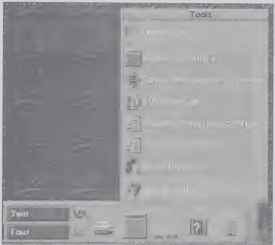

图 15.1
前面板弹出菜单。

2. 在应用程序管理器窗口中，点击如图 15.2 所示的电源管理器图标。

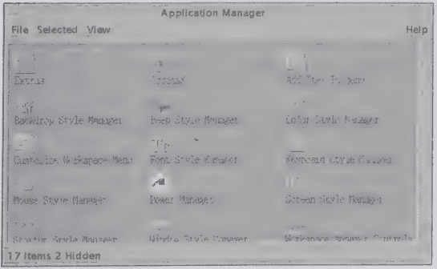

图 15.2
电源管理器图标。

电源管理器工具将出现，如图 15.3 所示。

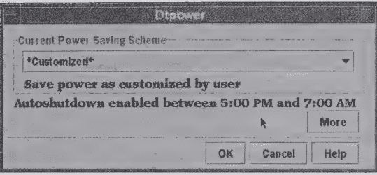

3. 在电源管理器工具中点击“自定义”按钮，将出现一个下拉菜单，如图 15.4 所示。

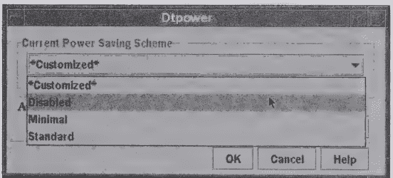

4. 点击“已禁用”选项以禁用电源管理。完成后，点击“确定”按钮退出。

另一种禁用电源管理的方法是通过命令行，如下所示：

按如下方式从 /etc/rc2.d 目录永久禁用启动脚本：

```
mv /etc/rc2.d/S85power /etc/rc2.d/s85power
```

图 15.3
电源管理器工具。

图 15.4
电源管理下拉菜单。

第三种禁用电源管理的方法是通过更改 /etc/power.conf 文件，将 Behavior 字段从 shutdown 改为 noshutdown。以下是在已配置电源管理的系统上 /etc/power.conf 文件的示例：

```
more /etc/power.conf
#
# Copyright (c) 1996 - 1999 by Sun Microsystems, Inc.
# All rights reserved.
#
#pragma ident "@(#)power.conf 1.14    99/10/18 SMI"
#
# Power Management Configuration File
#
# NOTE: The entry below is only used when no windowing \
environment
# is running.  When running windowing environment, monitor \
power
# management is controlled by the window system.
# Statefile    Path
statefile        /usr/.CPR
# Auto-Shutdown Idle(min)    Start/Finish(hh:mm)  Behavior \
autoshutdown     60           17:00 7:00          shutdown \
device-dependency /dev/fb /dev/kbd
device-dependency-property removable-media /dev/fb \
autopm    disable
```

在前面的示例中，电源管理配置为在系统在 17:00 至 7:00 之间空闲 60 分钟时自动关机。

要禁用自动关机，请按如下方式更改 /etc/power.conf 文件中的以下行：

```
# Auto-Shutdown Idle(min)    Start/Finish(hh:mm)  Behavior \
autoshutdown     60           17:00 7:00          noshutdown
```

shutdown 已更改为 noshutdown。

## 章节摘要
### 关键术语
- Client-server（了解本章所述的每种服务器和客户端类型）
- Interactive installation
- Web Start
- Initial installation
- Upgrade
- Power management

本章描述了 Solaris 8 环境中可用的各种服务器类型。在设置服务器时，系统管理员必须确定要安装的服务器类型。服务器将提供的所有服务必须提前确定，以便操作系统能够正确设置以提供这些服务。同样，每台服务器都不同，因此要求会因站点而异。

本章讨论了在安装 Solaris 8 之前系统必须满足的所有先决条件。此外，还讨论了在开始安装前必须收集的信息列表。

最后，我描述了使用交互式安装程序将 Solaris 8 操作环境安装到服务器上的过程。交互式安装程序提供了一个对话框，允许系统管理员选择软件包并在新服务器上创建文件系统。另一种使用 Web Start 安装操作系统的安装方法将在附录 A 中介绍。

在操作系统安装后会进行许多额外的任务，例如设置 NIS 和网络环境。这些主题在第 13 章“ Solaris 网络环境”和第 17 章“ NFS 环境”中介绍。此外，在完成服务器设置后，请不要忘记备份您的分区（请参阅第 11 章“备份和恢复”）。

下一章描述了设备配置和命名约定。现在您已安装操作系统，您将看到内核如何与系统的外围设备（如磁盘和磁带驱动器）通信。


## 应用你的知识
### 练习
### 15.1 使用交互式安装程序安装 Solaris 8

对于本练习，您将使用交互式安装程序将 Solaris 8 操作环境安装到您的系统上。

**预计时间：** 1–2 小时，具体取决于您的系统和 CD-ROM 的速度

**注意：** 本练习将销毁硬盘上的所有数据。

- 1. 将 Solaris 8 安装 CD 插入 CD-ROM 驱动器。
- 2. 如果系统当前正在运行，请以 root 身份登录并关闭系统，或通过按 Stop+A 中止操作系统。
- 3. 从 CD 按如下方式启动操作系统：
- 4. 交互式安装程序将开始。参考标题为“使用交互式安装程序安装软件”的章节，并按照该章节中概述的步骤安装操作系统。

```
boot cdrom <return>
```

## 复习问题
- 1. 以下哪一项是在其网络环境中为其他系统提供服务的系统？
  A. 服务器
  B. 客户端
  C. 文件服务器
  D. 自动客户端服务器

- 2. 以下哪一项是使用服务器的远程服务、磁盘空间有限且需要服务器才能运行的系统？
  A. 自动客户端服务器
  B. 文件服务器
  C. 客户端
  D. 独立的

- 3. 哪种类型的安装会保留数据？
  A. 初始
  B. 升级
  C. 保留
  D. Web Start

- 4. 安装过程的三个阶段是什么？
  A. 系统配置、安装和安装后
  B. 开机、从 CD 启动、执行安装程序
  C. 从 CD 启动、启动安装程序、安装后
  D. 从 CD 启动、系统配置、软件安装

- 5. 以下哪一项不是软件配置集群？
  A. 开发人员系统支持
  B. 终端用户系统支持
  C. 基础系统支持
  D. 完整发行版加 OEM 系统支持

## 应用你的知识
- 6. 以下哪一项是 Sun 的基于 Java 的安装程序？
  A. WebNFS
  B. JumpStart
  C. 交互式安装
  D. Web Start

- 7. 在交互式软件安装程序中，以下哪些文件系统会自动为您设置？
  A. /, swap, /usr, /opt, /var
  B. /, swap, /export/home
  C. /, swap, /usr, /export/home
  D. /, swap, /usr, /opt, /var, /export/home

- 8. 哪种类型的客户端被称为“零管理”客户端？
  A. 无数据客户端
  B. JavaStation
  C. 无盘客户端
  D. 自动客户端

- 9. 安装期间，默认的软件集群配置是什么？
  A. 终端用户发行版
  B. 核心发行版
  C. 开发人员发行版
  D. 完整发行版

- 10. ultra 1 的内核架构是什么？
  A. sun4m
  B. sun4c
  C. sun4u
  D. sun4

- 11. 安装服务器系统不需要哪些信息？
  A. 服务器的以太网地址
  B. 服务器的主机名
  C. 服务器的 IP 地址
  D. 服务器的地理区域

## 复习问题的答案
1. A. 服务器是一个系统，它为网络上的其他系统提供服务或文件系统，例如主目录或邮件文件。
2. C. 客户端是一个使用服务器远程服务的系统。一些客户端的磁盘存储容量有限，或者根本没有；这些客户端必须依赖服务器的远程文件系统才能运行。
3. B. 升级选项将 Solaris 软件更新到新版本，保留数据并尽可能保存对 Solaris 软件先前版本的修改。
4. A. 安装过程的三个阶段是系统配置、安装和安装后。
5. C. Solaris 8 软件配置集群包括完整发行版加 OEM 支持（仅 SPARC 平台）、完整发行版、开发人员系统支持、用户系统支持和核心系统支持。

## 应用你的知识
- 6. **D.** Web Start 是 Sun 的基于 Java 的安装程序。
- 7. **B.** 在交互式软件安装程序中，/、swap 和 /export/home 文件系统默认设置。
- 8. **B.** JavaStation 也被称为零管理客户端。此客户端没有本地文件系统，其 /home 从网络上的服务器访问。
- 9. **A.** 在交互式安装期间，默认选择终端用户系统支持集群。
- 10. **C.** sun4u 是所有 Sun Ultra 系统的内核架构。
- 11. **A.** 服务器的以太网地址不是安装服务器系统所必需的。在安装期间，您将被提示输入 IP 地址、主机名和地理区域。

## 目标
本章涵盖以下测试目标：
### 理解设备和驱动程序命名约定
Solaris 操作系统通过设备路径名访问设备，例如磁盘和磁带驱动器。系统管理员必须熟悉指向系统上连接的每个硬件部件的各种路径名。
### 显示设备和驱动程序配置信息
Solaris 提供了多种显示设备驱动程序信息的方法。这些命令和技术将被描述，以帮助您识别哪些设备指向哪些外设，以及哪些驱动程序已加载到内核中。
### 配置新设备
系统管理员负责在系统上添加和配置新硬件。本章描述了如何将新设备配置到 Solaris 操作环境中。

## 第 16 章
## 设备管理与磁盘管理

## 大纲

## 学习策略

| 项目 | 页码 |
|---|---|
| 引言 | 567 |
| 设备驱动程序 | 567 |
| 物理设备名称 | 568 |
| 设备自动配置 | 573 |
| 实例名称 | 575 |
| 主次设备号 | 578 |
| 逻辑设备名称 | 580 |
| 块设备和原始设备 | 581 |
| 虚拟卷管理 | 582 |
| Solstice DiskSuite | 583 |
| StorEdge Volume Manager | 586 |
| 章节摘要 | 588 |
| 应用你的知识 | 589 |

以下策略将帮助您为考试做准备：
- 与第 13 章“ Solaris 网络环境”一起，本章介绍了许多新术语，您必须足够熟悉这些术语，以便在考试中出现时能够将其与描述相匹配。了解我在本章末尾“关键术语”部分提供的术语。
- 了解设备驱动程序是什么以及各种设备驱动程序名称。它们相当难以记住，但请不断复习，直到您能从记忆中描述它们。考试中的许多问题都涉及各种类型的设备名称。
- 练习所有命令和逐步操作，直到您能从记忆中描述并执行它们。记忆它们的最佳方法是反复在 Solaris 系统上练习它们。
- 最后，了解虚拟卷的概念。您不一定需要知道如何创建和配置它们，但您需要知道它们是什么以及其特征。准备好列出虚拟卷的优点并识别 Solstice DiskSuite 和 StorEdge Volume Manager 的特征和功能。

## 引言
Solaris 8 环境中的设备管理包括向系统添加和移除外围设备，例如磁带驱动器、磁盘驱动器、打印机和调制解调器。它还可能涉及添加第三方设备驱动程序以支持设备。系统管理员需要知道如何指定设备名称，如果使用命令管理磁盘、文件系统和其他设备。

本章详细描述了磁盘设备管理。它还描述了磁盘设备命名约定以及添加、配置和显示有关连接到系统的磁盘设备的信息。

## 设备驱动程序
Sun 计算机通常使用各种外围设备和大容量存储设备，例如 SCSI 磁盘驱动器、键盘和鼠标，以及某种磁备份介质。其他常用设备包括 CD-ROM 驱动器、打印机和绘图仪。Solaris 通过称为设备文件或驱动程序的文件与外围设备通信。设备驱动程序是一个低级程序，允许内核与特定硬件部件通信。驱动程序充当操作系统对该硬件部件的“解释器”。在 Solaris 能够与设备通信之前，设备必须具有设备驱动程序。

当系统首次启动时，内核会创建一个设备层次结构来表示连接到系统的所有设备。这是自动配置过程，本章后面会描述。如果未为特定外设加载驱动程序，则该设备无法运行。在 Solaris 中，每个磁盘设备以三种方式描述，使用三种不同的命名约定：
- 物理设备名称。表示设备信息层次结构中的完整设备路径名。
- 实例名称。表示内核对系统上每个可能设备的缩写名称。
- 逻辑设备名称。系统管理员使用大多数文件系统命令来引用设备。


系统管理员在使用管理磁盘和文件系统的命令时需要了解这些设备名称。我们将在本章中贯穿讨论这些设备名称。

## 物理设备名称

在操作系统（OS）加载之前，系统通过完整设备路径名定位特定设备。完整设备路径名在第 2 章“OpenBoot”中进行了描述。然而，在内核加载后，设备通过其物理设备路径名定位。物理设备名称代表设备的完整设备路径名。请注意，这两个名称具有相同的结构。例如，让我们通过在 OpenBoot 提示符下输入 show-devs 来查看目标 0 处的 SCSI 磁盘的完整设备路径名。完整设备路径名显示为

```
/iommu@f,e0000000/sbus@f,e0001000/espdma@f,400000/esp@f, \
800000/sd
```

> 此相同信息也可在 /var/adm/messages 文件中找到。

现在，让我们从操作系统级别查看相应的物理设备名称。使用本节后面描述的 dmesg 命令来获取有关连接到系统的设备的信息。通过在命令提示符下输入 dmesg，您将收到有关 SCSI 磁盘 0 的以下信息：

```
iommu0 at root: obio 0xe0000000
sbus0 at iommu0: obio 0xe0001000
espdma0 at sbus0: SBus slot f 0x400000
esp0: esp-options=0x46
esp0 at espdma0: SBus slot f 0x800000 sparc ipl 4
sd0 at esp0: target 0 lun 0
sd0 is /iommu@f,e0000000/sbus@f,e0001000/espdma@f,400000/esp@f,800000/sd0,0
<SEAGATE-ST32550N-0014 cyl 3495 alt 2 hd 11 sec 109>
```

磁盘 0 的物理设备路径名为

```
/iommu@f,e0000000/sbus@f,e0001000/espdma@f,400000/esp@f,800000/sd@0,0
```

如您所见，物理设备名称和完整设备名称是相同的。区别在于，完整设备路径名只是指向特定设备的路径。物理设备是 Solaris 用于从操作系统访问该设备的实际驱动程序。

物理设备文件位于 /devices 目录中；因此，SCSI 磁盘 0 的物理设备文件将为

```
/devices/iommu@f,e0000000/sbus@f,e0001000/espdma@f,400000/
esp@f,800000/sd@0,0:<#>
```

其中 <# > 代表磁盘分片的字母。

用于提供有关物理设备信息的系统命令在表 16.1 中进行了描述。

## 表 16.1

### 设备信息命令

| 命令 | 描述 |
|---|---|
| prtconf | 显示系统配置信息，包括内存总量以及按系统层次结构描述的设备配置。此实用工具可验证系统是否已检测到设备。 |
| sysdef | 显示设备配置信息，包括系统硬件、伪设备、可加载模块和选定的内核参数。 |
| dmesg | 显示系统诊断消息，以及自最近一次重启以来附加到系统的设备列表。 |

以下是 prtconf 命令呈现的输出示例：

```
# prtconf
System Configuration: Sun Microsystems sun4u
Memory size: 128 Megabytes
System Peripherals (Software Nodes):

SUNW,Ultra-5_10
    packages (driver not attached)
        terminal-emulator (driver not attached)
        deblocker (driver not attached)
        obp-tftp (driver not attached)
        disk-label (driver not attached)
        SUNW,builtin-drivers (driver not attached)
        sun-keyboard (driver not attached)
        ufs-file-system (driver not attached)
    chosen (driver not attached)
    openprom (driver not attached)
client-services (driver not attached)
options, instance #0
aliases (driver not attached)
memory (driver not attached)
virtual-memory (driver not attached)
pci, instance #0
    pci, instance #0
        ebus, instance #0
            auxio (driver not attached)
            power, instance #0
            SUNW,pll (driver not attached)
            se, instance #0
... <output truncated>
```

以下是 sysdef 命令显示的输出示例：

```
# sysdef
*
* Hostid
*
  80a26382
*
* sun4u Configuration
*
*
* Devices
*
packages (driver not attached)
    terminal-emulator (driver not attached)
    deblocker (driver not attached)
    obp-tftp (driver not attached)
    disk-label (driver not attached)
    SUNW,builtin-drivers (driver not attached)
    sun-keyboard (driver not attached)
    ufs-file-system (driver not attached)
chosen (driver not attached)
openprom (driver not attached)
    client-services (driver not attached)
options, instance #0
aliases (driver not attached)
memory (driver not attached)
virtual-memory (driver not attached)
pci, instance #0
    pci, instance #0
        ebus, instance #0
            auxio (driver not attached)
            power, instance #0
            SUNW,pll (driver not attached)
            se, instance #0 . . . <output has \
been truncated>
* System Configuration
*
swap files
swapfile dev swaplo blocks free
/dev/dsk/c0t0d0s1 136,1 16 1048928 1023008
*
* Tunable Parameters
*
2482176 maximum memory allowed in buffer cache (bufhwm)
1898 maximum number of processes (v.v_proc)
99 maximum global priority in sys class \
(MAXCLSPRI)
1893 maximum processes per user id (v.v_maxup)
30 auto update time limit in seconds (NAUTOUP)
25 page stealing low water mark (GPGSL0)
5 fsflush run rate (FSFLUSHR)
25 minimum resident memory for avoiding deadlock \
(MINARMEM)
25 minimum swapable memory for avoiding \
deadlock (MINASMEM)
*
* Utsname Tunables
*
5.8 release (REL)
unknown node name (NODE)
SunOS system name (SYS)
Generic_108528-07 version (VER)
*
* Process Resource Limit Tunables (Current:Maximum)
*
Infinity:Infinity cpu time
Infinity:Infinity file size
Infinity:Infinity heap size
0x0000000000000000:Infinity stack size
Infinity:Infinity core file size
0x0000000000000100:0x0000000000000400 file descriptors
Infinity:Infinity mapped memory
*
* Streams Tunables
*
9 maximum number of pushes allowed (NSTRPUSH)
65536 maximum stream message size (STRMSGSZ)
1024 max size of ctl part of message (STRCTLSZ)
*
* IPC Messages module is not loaded
*
*
* IPC Semaphores module is not loaded
*
*
* IPC Shared Memory
*
1048576 max shared memory segment size (SHMMAX)
1 min shared memory segment size (SHMMIN). . . \
<Output has been truncated>
```

最后，以下是使用 dmesg 命令显示的 Ultra 系统设备信息的示例：

```
# dmesg
Aug  1 12:08:04 ultra5 genunix: [ID 540533 kern.notice]: \
SunOS Release 5.8 Version Generic_108528-07 64-bit
Aug  1 12:08:04 ultra5 genunix: [ID 913631 kern.notice] \
Copyright 1983-2001 Sun Microsystems, Inc.  All rights reserved.
Aug  1 12:08:04 ultra5 genunix: [ID 678236 kern.info] \
Ethernet address = 8:0:20:a2:63:82
Aug  1 12:08:04 ultra5 unix: [ID 389951 kern.info] mem = 131072K (0x8000000)
Aug  1 12:08:04 ultra5 unix: [ID 930857 kern.info] avail mem = 122142720
Aug  1 12:08:04 ultra5 rootnex: [ID 466748 kern.info] root nexus = Sun Ultra 5/10 UPA/PCI \
(UltraSPARC-IIi 270MHz)
Aug  1 12:08:04 ultra5 rootnex: [ID 349649 kern.info] pcipsy0 at root: UPA 0x1f 0x0
Aug  1 12:08:04 ultra5 genunix: [ID 936769 kern.info] pcipsy0 is /pci@1f,0
Aug  1 12:08:04 ultra5 pcipsy: [ID 370704 kern.info] PCI-device: pci@1,1, simba0
Aug  1 12:08:04 ultra5 genunix: [ID 936769 kern.info] simba0 is /pci@1f,0/pci@1,1
Aug  1 12:08:04 ultra5 pcipsy: [ID 370704 kern.info] PCI-device: pci@1, simba1
Aug  1 12:08:04 ultra5 genunix: [ID 936769 kern.info] simba1 is /pci@1f,0/pci@1
Aug  1 12:08:20 ultra5 simba: [ID 370704 kern.info] PCI-device: ide@3, uata0
..... <the output has been truncated>
```

使用 prtconf 和 sysdef 命令的输出来识别连接到系统的磁盘、磁带和 CD-ROM 设备。如前例所示，一些设备在其设备实例旁边显示 driver not attached 消息。此消息并不总是意味着该设备不可用驱动程序。它意味着当前没有驱动程序附加到该设备实例，因为该节点上没有设备，或者设备未在使用中。操作系统在访问设备时自动加载驱动程序，并在未使用时卸载它们。

系统在启动时确定已连接的设备。这就是为什么即使当前未使用，也要在启动时打开所有外设电源很重要。在启动期间，内核动态配置自身，将所需的模块加载到内存中。当首次访问设备（如磁盘和磁带设备）时，会加载设备驱动程序。此过程称为自动配置，因为如果需要，所有内核模块都会自动加载。如第 2 章所述，系统管理员可以通过修改 /etc/system 文件来自定义内核模块的加载方式。


## 设备自动配置

自动配置相比于早期 UNIX 版本中使用的手动配置方法具有许多优势，在手动配置方法中，设备驱动程序需手动添加到内核，内核需重新编译，并且系统必须重新启动。现在，有了自动配置，管理员只需将新设备连接到系统并执行重新配置启动即可。

## 逐步操作

### 16.1 执行重新配置启动

- 1. 使用以下命令创建 /reconfigure 文件：
  `touch /reconfigure`

  /reconfigure 文件会导致 Solaris 软件在下次打开或启动系统时检查是否存在任何新安装的设备。

- 2. 使用第 1 章“系统启动和关闭”中描述的关闭程序关闭系统。

  如果需要连接设备，请在 Solaris 正确关闭后关闭系统和所有外设的电源。

  在新设备连接后，先恢复外设的电源，然后再恢复系统的电源。通过尝试访问来验证外设是否已添加。

> NOTE
> 文件名为 /reconfigure 的文件会在启动过程中自动被删除。

执行重新配置启动的可选方法是中断启动过程，并在 OpenBoot 提示符下键入 boot -r。

我更喜欢前面描述的第一种方法，因为系统管理员可以通过创建 /reconfigure 文件随时指示系统执行重新配置启动。现在，在下一次重新启动时，无论管理员是否在场，系统都会执行重新配置启动。如果您喜欢，这可能发生在凌晨 3 点。

> NOTE
> 作为 root，您也可以从 UNIX shell 中发出 reboot -- -r 命令。-- -r 会将 -r 传递给 boot 命令。

在重新配置重启期间，会在 /devices 目录中创建一个设备层次结构，以表示连接到系统的设备。内核使用它将驱动程序与其适当的设备关联起来。此外，对 /etc/system 文件所做的任何内核参数更改都会在此由内核解析。

自动配置提供以下好处：

- 由于模块按需加载，主内存使用效率更高。
- 如果向系统添加新设备，则无需重新配置内核。但是，当您添加磁盘或磁带驱动器等设备时，系统需要在连接硬件之前关闭，以防止对电气组件造成损坏。
- 可以在无需重建内核和重新启动系统的情况下加载和测试驱动程序。

偶尔，您可能会安装 Solaris 没有支持的设备驱动程序的新设备。务必与制造商核实，以确保您计划添加到系统中的任何设备都有受支持的设备驱动程序。如果驱动程序未包含在标准 Solaris 版本中，制造商应提供设备正确安装、维护和管理所需的软件。

第三方设备驱动程序使用 pkgadd 命令作为软件包安装。至少，此软件包括设备驱动程序及其关联的配置（.conf）文件。.conf 文件位于 /kernel/drv 目录中。表 16.2 描述了位于 /kernel 目录中的子目录的内容。

## 表 16.2

### /KERNEL 目录

| 目录 | 描述 |
|---|---|
| drv | 包含可加载设备驱动程序和伪设备驱动程序。 |
| exec | 包含用于运行不同类型可执行文件或 shell 脚本的模块。 |
| fs | 包含文件系统模块，例如 ufs、nfs、proc 等。 |
| misc | 包含各种系统相关模块，例如 swap-generic 和 ipc。 |
| sched | 包含操作系统调度程序。 |
| strmod | 包含 System V STREAMS 可加载模块。 |
| sys | 包含可加载系统调用，例如系统信号量和系统记账操作。 |

## 实例名称

实例名称代表内核对系统中每种可能设备的简写名称。例如，在 Ultra 系统上，dad0 代表 IDE 磁盘驱动器的实例名称，而 hme0 是网络接口的实例名称。实例名称在 /etc/path_to_inst 文件中映射到物理设备名称。下面显示了 path_to_inst 文件的内容：

```
more /etc/path_to_inst
#
#       Caution! This file contains critical kernel state
"/pci@1f,0" 0 "pci"
"/pci@1f,0/pci@1,1" 0 "simba"
"/pci@1f,0/pci@1,1/ide@3" 0 "uata"
"/pci@1f,0/pci@1,1/ide@3/sd@2,0" 2 "sd"
"/pci@1f,0/pci@1,1/ide@3/dad@0,0" 0 "dad"
"/pci@1f,0/pci@1,1/ebus@1" 0 "ebus"
"/pci@1f,0/pci@1,1/ebus@1/fdthree@14,3023f0" 0 "fd"
"/pci@1f,0/pci@1,1/ebus@1/su@14,3062f8" 1 "su"
"/pci@1f,0/pci@1,1/ebus@1/se@14,400000" 0 "se"
"/pci@1f,0/pci@1,1/ebus@1/su@14,3083f8" 0 "su"
"/pci@1f,0/pci@1,1/ebus@1/ecpp@14,3043bc" 0 "ecpp"
"/pci@1f,0/pci@1,1/ebus@1/SUNW,CS4231@14,200000" 0 "audiocs"
"/pci@1f,0/pci@1,1/ebus@1/power@14,724000" 0 "power"
"/pci@1f,0/pci@1,1/network@1,1" 0 "hme"
"/pci@1f,0/pci@1,1/SUNW,m64B@2" 0 "m64"
"/pci@1f,0/pci@1" 1 "simba"
"/pci@1f,0/pci@1/pci@1" 0 "pci_pci"
"/pci@1f,0/pci@1/pci@1/SUNW,qfe@1,1" 1 "qfe"
"/pci@1f,0/pci@1/pci@1/SUNW,qfe@0,1" 0 "qfe"
"/pci@1f,0/pci@1/pci@1/SUNW,qfe@3,1" 3 "qfe"
"/pci@1f,0/pci@1/pci@1/SUNW,qfe@2,1" 2 "qfe"
"/options" 0 "options"
"/pseudo" 0 "pseudo"
#
```

实例名称也可以使用 dmesg、sysdef 和 prtconf 命令显示，唯一显示实例名称与物理设备映射的命令是 dmesg 命令，它显示以下信息：

```
dad0 at pci1095,6460 target 0 lun 0
dad0 is /pci@1f,0/pci@1,1/ide@3/dad@0,0
```

如果您有一台较旧的带 SBus 和 SCSI 磁盘驱动器的 SPARCstation，则 SCSI 磁盘驱动器的输出类似如下：

```
sd3 at esp0: target 3 lun 0
sd3 is /iommu@f,e0000000/sbus@f,e0001000,espdma@f,400000/esp@f,800000/sd@3,0
```

在第一个示例中，dad0 是实例名称，/pci@1f,0/pci@1,1/ide@3/dad@0,0 是物理设备名称。实例名称分配给设备后，它将保持映射到该设备。为了在重启之间保持实例号一致，系统会将它们记录在 /etc/path_to_inst 文件中。该文件仅在启动时读取，并由本节后面描述的 devfsadm 守护进程更新。

当添加新设备时，系统上已存在的设备不会被重新排列，即使新设备被添加到编号低于现有设备所占用的 sbus 插槽中也是如此。换句话说，当添加新设备时，/etc/path_to_inst 文件会被追加，而不是重写。

通常系统管理员无需更改 path_to_inst 文件，因为系统会维护它。但是，系统管理员可以通过编辑此文件并执行重新配置启动来更改实例号的分配。但是，如果在系统重新启动前运行 devfsadm 命令，则在此文件中所做的任何更改都会丢失。

> CAUTION
> 不要删除 path_to_inst 文件；系统在没有它就无法启动。系统依赖此文件中找到的信息来找到 root、usr 和 swap 设备。仅在仔细考虑后才对该文件进行更改。

在 Solaris 8 中，您可以在无需重新启动的情况下向系统添加新设备。所有操作都由 devfsadmd 守护进程处理，它会透明地构建必要的配置条目。在 Solaris 7 1999 年 11 月版之前，您需要运行多个 devfs 管理工具，例如 drvconfig、disks、tapes、ports 和 devlinks，以添加新设备并创建 Solaris 操作环境访问新设备所需的 /dev 和 /devices 条目。这些工具仍然可用，但出于兼容性目的，drvconfig 和其他链接生成器是 devfsadm 实用程序的符号链接。此外，这些旧命令不知道热插拔设备，也不够灵活，无法处理具有多个实例的设备。devfsadm 命令现在应替代所有这些命令使用；然而，由于 devfsadmd，即 devfsadm 守护进程，会自动检测设备配置更改，因此通常无需交互式运行此命令。

使用 devfsadm 命令的示例是，如果系统已启动，但 CD-ROM 或磁带驱动器的电源未打开。在启动期间，系统未检测到该设备；因此，其驱动程序未被安装。可以通过发出 sysdef 命令并检查输出中 sd6 的情况来验证这一点，sd6 通常用于外部 CD-ROM 的 SCSI 目标 ID：

```
sd, instance #6 (driver not attached)
```

要获得对 CD-ROM 的访问权限，您可以停止系统，打开 CD-ROM 的电源，然后重新启动系统，或者您可以简单地打开 CD-ROM 的电源并在命令提示符下发出以下命令：

```
devfsadm
```

现在如果您发出 sysdef 命令，您将看到 CD-ROM 的以下输出：

```
sd, instance #6
```

> NOTE
> 如果由于 /etc/path_to_inst 文件问题无法从启动磁盘启动，您应该从 CD-ROM 启动（boot -sw cdrom）并将 CD-ROM 上包含的 /etc/path_to_inst 文件复制到启动磁盘上的 /etc/path_to_inst。为此，请使用 OpenBoot 提示符下的 boot -sw cdrom 从 CD-ROM 启动。然后将启动磁盘挂载到 /a。将 /etc/path_to_inst 文件复制到 /a/etc/path_to_inst。如果仍然无法启动，则问题比仅 /etc/path_to_inst 文件更深。

> NOTE
> 两个经常互换使用（且混淆）的术语是热插拔和热插拔。热插拔允许在不重新启动操作系统的情况下连接和断开外设或其他组件。动态重新配置可在某些 SPARC 服务器上使用，允许服务提供商在运行的系统上移除和更换热插拔系统 I/O 板，从而消除重新启动所花费的时间。此外，如果没有可用的替换板，系统管理员可以使用动态重新配置关闭故障板，同时允许系统继续运行。热插拔允许在不关闭硬件的情况下连接和断开外设或其他组件，但通常需要系统重新启动。


## 主设备号和次设备号

每个设备都被分配了主设备号和次设备号。这些数字标识正确的设备位置和设备驱动程序给内核。当打开由其管理的设备之一对应的物理设备文件时，操作系统使用该号码来定位到正确的设备驱动程序。主设备号表示通用设备类别，例如磁盘、磁带或串行线路。次设备号表示该类别中的特定成员。由给定设备驱动程序管理的每个设备都包含唯一的次要编号。某些伪设备（设置为看起来像设备的软件实体）的驱动程序会按需创建新的次要设备。主设备号和次设备号一起唯一定义设备及其设备驱动程序。

物理设备文件在使用 ls -l 命令列出时具有唯一的输出，如以下示例所示：

```
cd /devices/iommu@f,e0000000/sbus@f,e0001000/espdma@f,400000/esp@f,800000
ls -l sd@0
```

系统响应如下：

```
brw-r----- 1 root sys 32, 0 Jul 21 07:44 sd@0,0:a
crw-r----- 1 root sys 32, 0 Jul 21 07:44 sd@0,0:a,raw
brw-r----- 1 root sys 32, 1 Jul 21 07:44 sd@0,0:b
crw-r----- 1 root sys 32, 1 Aug 16 06:15 sd@0,0:b,raw
brw-r----- 1 root sys 32, 2 Jul 21 07:44 sd@0,0:c
crw-r----- 1 root sys 32, 2 Jul 21 07:44 sd@0,0:c,raw
brw-r----- 1 root sys 32, 3 Jul 21 07:44 sd@0,0:d
crw-r----- 1 root sys 32, 3 Jul 21 07:44 sd@0,0:d,raw
brw-r----- 1 root sys 32, 4 Jul 21 07:44 sd@0,0:e
crw-r----- 1 root sys 32, 4 Jul 21 07:44 sd@0,0:e,raw
brw-r----- 1 root sys 32, 5 Jul 21 07:44 sd@0,0:f
crw-r----- 1 root sys 32, 5 Jul 21 07:44 sd@0,0:f,raw
brw-r----- 1 root sys 32, 6 Jul 21 07:44 sd@0,0:g
crw-r----- 1 root sys 32, 6 Aug 16 06:13 sd@0,0:g,raw
brw-r----- 1 root sys 32, 7 Jul 21 07:44 sd@0,0:h
crw-r----- 1 root sys 32, 7 Jul 21 07:44 sd@0,0:h,raw
```

这个长列表包含显示每个设备主设备号和次设备号的列。本示例中列出的所有设备均由 sd 驱动程序管理，在本示例中主设备号为 32。次设备号列在逗号之后。

在构建 /devices 目录的过程中，devfsadmd 守护进程通过使用 /etc/name_to_major 文件中保存的名称到数字映射为每个设备分配主设备号。该文件由系统维护且未记录。以下是 /etc/name_to_major 文件的示例：

```
more /etc/name_to_major
cn 0
rootnex 1
pseudo 2
ip 3
logindmux 4
icmp 5
fas 6
hme 7
p9000 8
p9100 9
sp 10
clone 11
sad 12
mm 13
iwscn 14
wc 15
conskbd 16
consms 17
ipdcm 18
dump 19
se 20
log 21
sy 22
ptm 23
pts 24
ptc 25
pts1 26
bwtwo 27
audio 28
zs 29
cgthree 30
cgtwo 31
sd 32
st 33
...
...
envctrl 131
cvc 132
cvcredir 133
eide 134
hd 135
tadbat 136
ts102 137
simba 138
uata 139
dad 140
atapicd 141
```

要创建次设备条目，devfsadmd 守护进程使用设备驱动程序放置在 dev_info 节点中的信息。权限和所有权信息保存在 /etc/minor_perm 文件中。

## 逻辑设备名

自动配置过程的最后阶段涉及创建逻辑设备名，以反映系统上新的一组设备。逻辑设备名是从 /dev 目录到位于 /devices 目录中的物理设备名的链接。要查看连接到系统的磁盘的逻辑设备名列表，请按如下方式对 /dev/dsk 目录执行长列表：

```
ls -l /dev/dsk
total 48
lrwxrwxrwx 1 root root 84 Jul 21 07:45 c0t0d0s0 -> ../../devices/iommu@f,e0000000/sbus@f,e0001000/espdma@f,400000/esp@f,800000/sd@0,0:a
lrwxrwxrwx 1 root root 84 Jul 21 07:45 c0t0d0s1 -> ../../devices/iommu@f,e0000000/sbus@f,e0001000/espdma@f,400000/esp@f,800000/sd@0,0:b
lrwxrwxrwx 1 root root 84 Jul 21 07:45 c0t0d0s2 -> ../../devices/iommu@f,e0000000/sbus@f,e0001000/espdma@f,400000/esp@f,800000/sd@0,0:c
lrwxrwxrwx 1 root root 84 Jul 21 07:45 c0t0d0s3 -> ../../devices/iommu@f,e0000000/sbus@f,e0001000/espdma@f,400000/esp@f,800000/sd@0,0:d
lrwxrwxrwx 1 root root 84 Jul 21 07:45 c0t0d0s4 -> ../../devices/iommu@f,e0000000/sbus@f,e0001000/espdma@f,400000/esp@f,800000/sd@0,0:e
lrwxrwxrwx 1 root root 84 Jul 21 07:45 c0t0d0s5 -> ../../devices/iommu@f,e0000000/sbus@f,e0001000/espdma@f,400000/esp@f,800000/sd@0,0:f
...
```

在 ls -l 命令的输出第二行，注意逻辑设备名 c0t0d0s0 链接到物理设备名：

```
../../devices/iommu@f,e0000000/sbus \
@f,e0001000/espdma@f,400000/esp@f,800000/sd@0,0:a
```

逻辑设备名是系统管理员在运行各种 Solaris 文件系统命令时用来引用特定设备的名称。例如，如果运行 mount 命令，请使用逻辑设备名 /dev/dsk/c0t0d0s7 来挂载文件系统 /home：

```
mount /dev/dsk/c0t0d0s7 /home
```

/dev 目录中的逻辑设备文件符号链接到 /devices 目录中的物理设备文件。逻辑设备名用于访问磁盘设备，如果你

- 向系统添加新磁盘。
- 将磁盘从一个系统移动到另一个系统。
- 访问（或挂载）驻留在本地磁盘上的文件系统。
- 备份本地文件系统。
- 修复文件系统。

逻辑设备按其设备类型组织在 /dev 目录下的子目录中，如表 16.3 所示。

表 16.3
设备目录

| 目录 | 内容描述 |
|---|---|
| /dev/dsk | 磁盘设备的块接口 |
| /dev/rdsk | 磁盘设备的原始或字符接口 |
| /dev/rmt | 磁带设备 |
| /dev/term | 串行线路设备 |
| /dev/cua | 拨出调制解调器 |
| /dev/pts | 伪终端 |
| /dev/fbs | 帧缓冲 |
| /dev/sad | STREAMS 管理驱动程序 |

### 块设备和原始设备

磁盘驱动器在 /dev/dsk 和 /dev/rdsk 目录下各有一个条目。/dev/dsk 目录引用块或缓冲设备文件，而 /dev/rdsk 目录引用字符或原始设备文件。rdsk 中的“r”代表“raw”。如果你不熟悉这些设备，请参阅第 3 章“安装 Solaris 8 软件”，其中描述了块设备和字符设备。

/dev/dsk 目录包含 /devices 中块设备节点的磁盘条目，如以下命令所示：

```
ls -l /dev/dsk
total 48
lrwxrwxrwx 1 root root 84 Jul 21 07:45 c0t0d0s0 ->
/devices/iommu@f,e0000000/sbus@f,e0001000/espdma@f,400000/esp@f,800000/sd@0,0:a
lrwxrwxrwx 1 root root 84 Jul 21 07:45 c0t0d0s1 ->
/devices/iommu@f,e0000000/sbus@f,e0001000/espdma@f,400000/esp@f,800000/sd@0,0:b
lrwxrwxrwx 1 root root 84 Jul 21 07:45 c0t0d0s2 ->
/devices/iommu@f,e0000000/sbus@f,e0001000/espdma@f,400000/esp@f,800000/sd@0,0:c
...
...
```

/dev/rdsk 目录包含 /devices 中字符设备节点的磁盘条目，如以下命令所示：

```
ls -l /dev/rdsk
lrwxrwxrwx 1 root root 88 Jul 21 07:45 c0t0d0s0 ->
/devices/iommu@f,e0000000/sbus@f,e0001000/espdma@f,400000/esp@f,800000/sd@0,0:a,raw
lrwxrwxrwx 1 root root 88 Jul 21 07:45 c0t0d0s1 ->
/devices/iommu@f,e0000000/sbus@f,e0001000/espdma@f,400000/esp@f,800000/sd@0,0:b,raw
lrwxrwxrwx 1 root root 88 Jul 21 07:45 c0t0d0s2 ->
/devices/iommu@f,e0000000/sbus@f,e0001000/espdma@f,400000/esp@f,800000/sd@0,0:c,raw
...
...
```

## 虚拟卷管理

对于标准磁盘设备，每个磁盘切片都有自己的物理设备和逻辑设备。回顾第 6 章“文件系统简介”，文件系统不能跨越一个以上的磁盘切片。换句话说，文件系统的最大大小受限于单个磁盘的大小。在具有许多磁盘驱动器的大型服务器上，标准的磁盘切片方法是不够的且效率低下。这一直是所有 UNIX 系统的限制，直到虚拟磁盘（也称为虚拟卷）的引入为止。为了消除一个文件系统一个切片的限制，有虚拟卷管理包，它们能够创建虚拟卷结构，其中单个文件系统可以由几乎无限数量的磁盘或分区组成。这些虚拟卷管理包的关键特性是它们透明地提供一个虚拟卷，该卷可以由许多物理磁盘分区组成。换句话说，磁盘分区在多个磁盘上分组，以向操作系统显示为一个单一卷。


每个 UNIX 版本都有各自创建虚拟卷的方法，而 Sun 通过两个软件包解决了虚拟卷管理问题：Solstice DiskSuite 和 Sun StorEdge Volume Manager。DiskSuite 主要用于较小的服务器和工作站，而 StorEdge 产品则用于管理 Sun StorEdge 磁盘阵列的大型企业服务器。

## Solstice DiskSuite

Solstice DiskSuite 与 Solaris 8 操作系统捆绑提供，并使用称为元设备的虚拟磁盘来管理物理磁盘及其相关数据。从应用程序的角度来看，元设备在功能上与物理磁盘相同。DiskSuite 使用一种特殊的驱动程序，称为 metadisk 驱动程序，来协调物理设备与元设备之间 I/O 的传输，使应用程序能够像对待物理设备一样对待元设备。这种类型的驱动程序也称为逻辑驱动程序或伪驱动程序。

DiskSuite 的元设备由使用 format 实用程序创建的标准磁盘切片构建。通过 DiskSuite 命令行实用程序或图形用户界面 DiskSuite Tool，系统管理员通过将切片拖放到三种类型的元设备对象之一上来创建每个设备：元设备、状态数据库副本和热备池。这些对象在表 16.4 中进行了描述。

### Table 16.4
DiskSuite 对象

| 对象 | 描述 |
|---|---|
| 元设备 | 元设备是一组物理切片，对系统而言表现为单个逻辑设备。元设备用于增加存储容量并提高数据可用性。 |
| 元设备状态数据库 | 存储 DiskSuite 配置状态信息的数据库。在创建元设备状态数据库副本之前，DiskSuite 无法运行。 |
| 热备池 | 一组切片（热备）的集合，预留用于在子镜像或 RAID5 元设备中的切片发生故障时自动替换。热备用于提高数据可用性。 |

你可以创建的元设备类型有串联、条带、串联条带、镜像、RAID5 元设备和 trans 元设备，均在表 16.5 中描述。

### Table 16.5
元设备类型

| 元设备 | 描述 |
|---|---|
| 简单 | 可直接使用，或作为镜像和 trans 设备的[content]
每个 UNIX 版本都有各自创建虚拟卷的方法，而 Sun 通过两个软件包解决了虚拟卷管理问题：Solstice DiskSuite 和 Sun StorEdge Volume Manager。DiskSuite 主要用于较小的服务器和工作站，而 StorEdge 产品则用于管理 Sun StorEdge 磁盘阵列的大型企业服务器。

## Solstice DiskSuite

Solstice DiskSuite 与 Solaris 8 操作系统捆绑提供，并使用称为元设备的虚拟磁盘来管理物理磁盘及其相关数据。从应用程序的角度来看，元设备在功能上与物理磁盘相同。DiskSuite 使用一种特殊的驱动程序，称为 metadisk 驱动程序，来协调物理设备与元设备之间 I/O 的传输，使应用程序能够像对待物理设备一样对待元设备。这种类型的驱动程序也称为逻辑驱动程序或伪驱动程序。

DiskSuite 的元设备由使用 format 实用程序创建的标准磁盘切片构建。通过 DiskSuite 命令行实用程序或图形用户界面 DiskSuite Tool，系统管理员通过将切片拖放到三种类型的元设备对象之一上来创建每个设备：元设备、状态数据库副本和热备池。这些对象在表 16.4 中进行了描述。

### Table 16.4
DiskSuite 对象

| 对象 | 描述 |
|---|---|
| 元设备 | 元设备是一组物理切片，对系统而言表现为单个逻辑设备。元设备用于增加存储容量并提高数据可用性。 |
| 元设备状态数据库 | 存储 DiskSuite 配置状态信息的数据库。在创建元设备状态数据库副本之前，DiskSuite 无法运行。 |
| 热备池 | 一组切片（热备）的集合，预留用于在子镜像或 RAID5 元设备中的切片发生故障时自动替换。热备用于提高数据可用性。 |

你可以创建的元设备类型有串联、条带、串联条带、镜像、RAID5 元设备和 trans 元设备，均在表 16.5 中描述。

### Table 16.5
元设备类型

| 元设备 | 描述 |
|---|---|
| 简单 | 可直接使用，或作为镜像和 trans 设备的[content]
每个 UNIX 版本都有各自创建虚拟卷的方法，而 Sun 通过两个软件包解决了虚拟卷管理问题：Solstice DiskSuite 和 Sun StorEdge Volume Manager。DiskSuite 主要用于较小的服务器和工作站，而 StorEdge 产品则用于管理 Sun StorEdge 磁盘阵列的大型企业服务器。

## Solstice DiskSuite

Solstice DiskSuite 与 Solaris 8 操作系统捆绑提供，并使用称为元设备的虚拟磁盘来管理物理磁盘及其相关数据。从应用程序的角度来看，元设备在功能上与物理磁盘相同。DiskSuite 使用一种特殊的驱动程序，称为 metadisk 驱动程序，来协调物理设备与元设备之间 I/O 的传输，使应用程序能够像对待物理设备一样对待元设备。这种类型的驱动程序也称为逻辑驱动程序或伪驱动程序。

DiskSuite 的元设备由使用 format 实用程序创建的标准磁盘切片构建。通过 DiskSuite 命令行实用程序或图形用户界面 DiskSuite Tool，系统管理员通过将切片拖放到三种类型的元设备对象之一上来创建每个设备：元设备、状态数据库副本和热备池。这些对象在表 16.4 中进行了描述。

### Table 16.4
DiskSuite 对象

| 对象 | 描述 |
|---|---|
| 元设备 | 元设备是一组物理切片，对系统而言表现为单个逻辑设备。元设备用于增加存储容量并提高数据可用性。 |
| 元设备状态数据库 | 存储 DiskSuite 配置状态信息的数据库。在创建元设备状态数据库副本之前，DiskSuite 无法运行。 |
| 热备池 | 一组切片（热备）的集合，预留用于在子镜像或 RAID5 元设备中的切片发生故障时自动替换。热备用于提高数据可用性。 |

你可以创建的元设备类型有串联、条带、串联条带、镜像、RAID5 元设备和 trans 元设备，均在表 16.5 中描述。

### Table 16.5
元设备类型

| 元设备 | 描述 |
|---|---|
| 简单 | 可直接使用，或作为镜像和 trans 设备的[content]
每个 UNIX 版本都有各自创建虚拟卷的方法，而 Sun 通过两个软件包解决了虚拟卷管理问题：Solstice DiskSuite 和 Sun StorEdge Volume Manager。DiskSuite 主要用于较小的服务器和工作站，而 StorEdge 产品则用于管理 Sun StorEdge 磁盘阵列的大型企业服务器。

## Solstice DiskSuite

Solstice DiskSuite 与 Solaris 8 操作系统捆绑提供，并使用称为元设备的虚拟磁盘来管理物理磁盘及其相关数据。从应用程序的角度来看，元设备在功能上与物理磁盘相同。DiskSuite 使用一种特殊的驱动程序，称为 metadisk 驱动程序，来协调物理设备与元设备之间 I/O 的传输，使应用程序能够像对待物理设备一样对待元设备。这种类型的驱动程序也称为逻辑驱动程序或伪驱动程序。

DiskSuite 的元设备由使用 format 实用程序创建的标准磁盘切片构建。通过 DiskSuite 命令行实用程序或图形用户界面 DiskSuite Tool，系统管理员通过将切片拖放到三种类型的元设备对象之一上来创建每个设备：元设备、状态数据库副本和热备池。这些对象在表 16.4 中进行了描述。

### Table 16.4
DiskSuite 对象

| 对象 | 描述 |
|---|---|
| 元设备 | 元设备是一组物理切片，对系统而言表现为单个逻辑设备。元设备用于增加存储容量并提高数据可用性。 |
| 元设备状态数据库 | 存储 DiskSuite 配置状态信息的数据库。在创建元设备状态数据库副本之前，DiskSuite 无法运行。 |
| 热备池 | 一组切片（热备）的集合，预留用于在子镜像或 RAID5 元设备中的切片发生故障时自动替换。热备用于提高数据可用性。 |

你可以创建的元设备类型有串联、条带、串联条带、镜像、RAID5 元设备和 trans 元设备，均在表 16.5 中描述。

### Table 16.5
元设备类型

| 元设备 | 描述 |
|---|---|
| 简单 | 可直接使用，或作为镜像和 trans 设备的[content]
每个 UNIX 版本都有各自创建虚拟卷的方法，而 Sun 通过两个软件包解决了虚拟卷管理问题：Solstice DiskSuite 和 Sun StorEdge Volume Manager。DiskSuite 主要用于较小的服务器和工作站，而 StorEdge 产品则用于管理 Sun StorEdge 磁盘阵列的大型企业服务器。

## Solstice DiskSuite

Solstice DiskSuite 与 Solaris 8 操作系统捆绑提供，并使用称为元设备的虚拟磁盘来管理物理磁盘及其相关数据。从应用程序的角度来看，元设备在功能上与物理磁盘相同。DiskSuite 使用一种特殊的驱动程序，称为 metadisk 驱动程序，来协调物理设备与元设备之间 I/O 的传输，使应用程序能够像对待物理设备一样对待元设备。这种类型的驱动程序也称为逻辑驱动程序或伪驱动程序。

DiskSuite 的元设备由使用 format 实用程序创建的标准磁盘切片构建。通过 DiskSuite 命令行实用程序或图形用户界面 DiskSuite Tool，系统管理员通过将切片拖放到三种类型的元设备对象之一上来创建每个设备：元设备、状态数据库副本和热备池。这些对象在表 16.4 中进行了描述。

### Table 16.4
DiskSuite 对象

| 对象 | 描述 |
|---|---|
| 元设备 | 元设备是一组物理切片，对系统而言表现为单个逻辑设备。元设备用于增加存储容量并提高数据可用性。 |
| 元设备状态数据库 | 存储 DiskSuite 配置状态信息的数据库。在创建元设备状态数据库副本之前，DiskSuite 无法运行。 |
| 热备池 | 一组切片（热备）的集合，预留用于在子镜像或 RAID5 元设备中的切片发生故障时自动替换。热备用于提高数据可用性。 |

你可以创建的元设备类型有串联、条带、串联条带、镜像、RAID5 元设备和 trans 元设备，均在表 16.5 中描述。

### Table 16.5
元设备类型

| 元设备 | 描述 |
|---|---|
| 简单 | 可直接使用，或作为镜像和 trans 设备的[content]
每个 UNIX 版本都有各自创建虚拟卷的方法，而 Sun 通过两个软件包解决了虚拟卷管理问题：Solstice DiskSuite 和 Sun StorEdge Volume Manager。DiskSuite 主要用于较小的服务器和工作站，而 StorEdge 产品则用于管理 Sun StorEdge 磁盘阵列的大型企业服务器。

## Solstice DiskSuite

Solstice DiskSuite 与 Solaris 8 操作系统捆绑提供，并使用称为元设备的虚拟磁盘来管理物理磁盘及其相关数据。从应用程序的角度来看，元设备在功能上与物理磁盘相同。DiskSuite 使用一种特殊的驱动程序，称为 metadisk 驱动程序，来协调物理设备与元设备之间 I/O 的传输，使应用程序能够像对待物理设备一样对待元设备。这种类型的驱动程序也称为逻辑驱动程序或伪驱动程序。

DiskSuite 的元设备由使用 format 实用程序创建的标准磁盘切片构建。通过 DiskSuite 命令行实用程序或图形用户界面 DiskSuite Tool，系统管理员通过将切片拖放到三种类型的元设备对象之一上来创建每个设备：元设备、状态数据库副本和热备池。这些对象在表 16.4 中进行了描述。

### Table 16.4
DiskSuite 对象

| 对象 | 描述 |
|---|---|
| 元设备 | 元设备是一组物理切片，对系统而言表现为单个逻辑设备。元设备用于增加存储容量并提高数据可用性。 |
| 元设备状态数据库 | 存储 DiskSuite 配置状态信息的数据库。在创建元设备状态数据库副本之前，DiskSuite 无法运行。 |
| 热备池 | 一组切片（热备）的集合，预留用于在子镜像或 RAID5 元设备中的切片发生故障时自动替换。热备用于提高数据可用性。 |

你可以创建的元设备类型有串联、条带、串联条带、镜像、RAID5 元设备和 trans 元设备，均在表 16.5 中描述。

### Table 16.5
元设备类型

| 元设备 | 描述 |
|---|---|
| 简单 | 可直接使用，或作为镜像和 trans 设备的[content]
每个 UNIX 版本都有各自创建虚拟卷的方法，Sun 通过 Solstice DiskSuite 和 Sun StorEdge Volume Manager 两个软件包解决虚拟卷管理。DiskSuite 主要用于小型服务器和工作站，StorEdge 产品用于管理大型企业服务器上的 Sun StorEdge 磁盘阵列。

## Solstice DiskSuite

Solstice DiskSuite 随 Solaris 8 操作系统捆绑，使用称为元设备的虚拟磁盘管理物理磁盘及其数据。对应用程序而言元设备在功能上等同于物理磁盘。DiskSuite 使用特殊的 metadisk 驱动程序协调物理设备与元设备之间的 I/O，使应用程序可像对待物理设备一样对待元设备。此类驱动程序也称为逻辑或伪驱动程序。

DiskSuite 的元设备由 format 实用程序创建的标准磁盘切片构建。系统管理员可通过 DiskSuite 命令行实用程序或图形界面 DiskSuite Tool，将切片拖放到三种元设备对象之一创建设备：元设备、状态数据库副本和热备池。这些对象见表 16.4。

### Table 16.4
DiskSuite 对象

| 对象 | 描述 |
|---|---|
| 元设备 | 一组物理切片对系统表现为单个逻辑设备，用于增加存储容量和数据可用性。 |
| 元设备状态数据库 | 存储 DiskSuite 配置状态信息的数据库，未创建副本前 DiskSuite 无法运行。 |
| 热备池 | 预留用于子镜像或 RAID5 元设备切片故障时自动替换的切片集合，用于提高数据可用性。 |

可创建的元设备类型有串联、条带、串联条带、镜像、RAID5 元设备和 trans 元设备，详见表 16.5。

### Table 16.5
元设备类型

| 元设备 | 描述 |
|---|---|
| 简单 | 可直接使用或作为镜像和 trans 设备的[content]
每个 UNIX 版本都有各自创建虚拟卷的方法，Sun 通过 Solstice DiskSuite 和 Sun StorEdge Volume Manager 两个软件包解决虚拟卷管理。DiskSuite 主要用于小型服务器和工作站，StorEdge 产品用于管理大型企业服务器上的 Sun StorEdge 磁盘阵列。

## Solstice DiskSuite

Solstice DiskSuite 随 Solaris 8 操作系统捆绑，使用称为元设备的虚拟磁盘管理物理磁盘及其数据。对应用程序而言元设备在功能上等同于物理磁盘。DiskSuite 使用特殊的 metadisk 驱动程序协调物理设备与元设备之间的 I/O，使应用程序可像对待物理设备一样对待元设备。此类驱动程序也称为逻辑或伪驱动程序。

DiskSuite 的元设备由 format 实用程序创建的标准磁盘切片构建。系统管理员可通过 DiskSuite 命令行实用程序或图形界面 DiskSuite Tool，将切片拖放到三种元设备对象之一创建设备：元设备、状态数据库副本和热备池。这些对象见表 16.4。

### Table 16.4
DiskSuite 对象

| 对象 | 描述 |
|---|---|
| 元设备 | 一组物理切片对系统表现为单个逻辑设备，用于增加存储容量和数据可用性。 |
| 元设备状态数据库 | 存储 DiskSuite 配置状态信息的数据库，未创建副本前 DiskSuite 无法运行。 |
| 热备池 | 预留用于子镜像或 RAID5 元设备切片故障时自动替换的切片集合，用于提高数据可用性。 |

可创建的元设备类型有串联、条带、串联条带、镜像、RAID5 元设备和 trans 元设备，详见表 16.5。

### Table 16.5
元设备类型

| 元设备 | 描述 |
|---|---|
| 简单型 | 可直接使用或作为镜像和 trans 设备的[content]
每个 UNIX 版本都有各自创建虚拟卷的方法，Sun 通过 Solstice DiskSuite 和 Sun StorEdge Volume Manager 解决虚拟卷管理。DiskSuite 主要用于小型服务器和工作站，StorEdge 用于管理大型企业服务器上的 Sun StorEdge 磁盘阵列。

## Solstice DiskSuite

Solstice DiskSuite 随 Solaris 8 捆绑，使用称为元设备的虚拟磁盘管理物理磁盘及其数据。对应用程序而言元设备功能等同于物理磁盘。DiskSuite 使用 metadisk 驱动程序协调物理设备与元设备间的 I/O，使应用程序可像对待物理设备一样使用元设备。此类驱动程序也称逻辑或伪驱动程序。

DiskSuite 的元设备由 format 实用程序创建的标准磁盘切片构建。管理员可通过命令行实用程序或图形界面 DiskSuite Tool，将切片拖放到三种元设备对象之一创建设备：元设备、状态数据库副本和热备池。见表 16.4。

### Table 16.4
DiskSuite 对象

| 对象 | 描述 |
|---|---|
| 元设备 | 一组物理切片对系统表现为单个逻辑设备，用于扩容和提高可用性。 |
| 元设备状态数据库 | 存储 DiskSuite 配置状态的数据库，未创建副本前无法运行。 |
| 热备池 | 预留用于子镜像或 RAID5 元设备切片故障时自动替换的切片集合，提高可用性。 |

可创建的元设备类型有串联、条带、串联条带、镜像、RAID5 和 trans，见表 16.5。

### Table 16.5
元设备类型

| 元设备 | 描述 |
|---|---|
| 简单 | 可直接使用或作为镜像和 trans 的基础。包括条带、串联、串联条带三种。 |
| 串联 | 类似 UNIX cat 将多个文件拼接成大文件。分区串联后按顺序寻址，文件系统可使用全部空间。 |
| 条带 | 与串联类似，但组件块寻址在切片间交错。用于提升性能，数据条带化后多控制器可同时访问。 |
| 串联条带 | 通过串联额外条带切片扩展的条带元设备。 |
| 镜像 | 由一个或多个子镜像组成。镜像将写操作复制到逻辑设备再复制到多个子镜像，同时分发读操作，提供磁盘或硬件故障时的冗余。 |
| RAID5 | 跨多磁盘条带化以提升性能，并用奇偶信息复制数据。缺失数据可通过可用数据和奇偶信息恢复。由多个切片组成，部分空间用于分布的奇偶信息。条带性能优于 RAID5 但无数据保护。 |
| Trans | 用于日志 UFS 文件系统。由主设备和日志设备组成，两者可为切片、简单元设备、镜像或 RAID5。主设备包含 UFS 文件系统。 |

元设备可提供更大容量、更高可用性和更好性能。DiskSuite 的热备还可为镜像和 RAID5 提供另一层可用性。热备池是 DiskSuite 预留的切片集合，用于在子镜像或 RAID5 元设备切片故障时自动替换。

配置完成后可用 DiskSuite Tool 报告运行情况。也可使用 DiskSuite 的 SNMP trap 生成守护进程与网络监控控制台配合自动接收错误信息。

元设备驱动以可加载伪设备驱动集合实现，使用其他物理设备驱动在底层设备间传递 I/O 请求。元设备驱动位于文件系统接口与设备驱动接口之间，解释两者间信息。经过元设备驱动后，文件系统和设备驱动均以预期形式接收信息。元设备是可加载设备驱动，具有与任何其他磁盘设备驱动相同的特性。

标准元设备名以“d”开头后跟数字。默认有 0 到 127 共 128 个唯一元设备。可通过编辑 /kernel/drv/md.conf 文件向内核添加更多元设备。元块设备使用系统正常缓冲机制访问磁盘。另有字符或原始设备提供磁盘与用户读写缓冲区间的直接传输。块设备名在 /dev/md/dsk 目录，原始设备名在 /dev/md/rdsk 目录。元设备 d0 的块和原始逻辑设备名示例如下：

```
/dev/md/dsk/d0  - block metadevice d0
/dev/md/rdsk/d0  - raw metadevice d0
```

## StorEdge Volume Manager

Sun StorEdge Volume Manager 又称 Veritas Volume Manager，是从 Sun 单独购买的未捆绑软件包，不随 Solaris 8 标准提供。StorEdge 产品用于管理 Sun 更大的 StorEdge 磁盘阵列，也称为 Veritas Volume Manager。Veritas Volume Manager 是 Sun 许可的第三方软件包，广泛用于 Sun、Sequent 和 HP 等大型系统上的虚拟卷管理功能。Veritas Volume Manager 比 DiskSuite 更健壮，提供识别和分析存储访问模式的工具以在复杂磁盘配置间平衡 I/O 负载。此外，Volume Manager 软件包创建 Veritas 文件系统，该文件系统正成为使用虚拟卷系统的行业标准，并为存储区域网络、集群和故障转移、自动化管理、备份和基于浏览器的远程管理等增值技术奠定基础。

StorEdge Volume Manager 是一个复杂产品，本章无法详述。我将介绍 StorEdge Volume Manager 及需了解的一些术语。

Volume Manager 在物理磁盘之上构建称为卷的虚拟设备。物理磁盘是底层存储介质，可能受 Volume Manager 控制，也可能不受控制。物理磁盘可通过如 /dev/rdsk/c#t#d 的设备名访问。如第 3 章“安装 Solaris 8 软件”所述，物理磁盘可分为一个或多个切片。

卷由 Solaris 文件系统、数据库或其他应用程序以与物理磁盘分区相同的方式访问。卷及其虚拟组件称为 Volume Manager 对象。

Volume Manager 使用若干对象执行磁盘管理任务，见表 16.6。


## 表 16.6
### 卷管理器对象

| 对象名称 | 描述 |
|---|---|
| VM 磁盘 | 从中卷管理器分配存储的连续磁盘空间区域。每个 VM 磁盘对应至少一个分区。VM 磁盘通常指阵列中的物理磁盘。 |
| 磁盘组 | 共享通用配置的 VM 磁盘集合。默认磁盘组是 rootdg（根磁盘组）。根据需要可以创建额外的磁盘组。卷是在磁盘组内创建的；给定卷必须从属于同一磁盘组的磁盘配置。磁盘组允许管理员将磁盘分组为逻辑集合以便于管理。 |
| 子磁盘 | 一组连续的磁盘块；子磁盘是卷管理器分配磁盘空间的基本单元。VM 磁盘可以划分为一个或多个子磁盘。 |
| 镜像体 | 也称为镜像，由位于一个或多个磁盘上的一个或多个子磁盘组成。 |
| 卷 | 对应用程序、数据库和文件系统显示为虚拟磁盘设备的设备。它类似于物理磁盘分区，但没有物理磁盘分区的物理限制。卷是在磁盘组内创建的；给定卷必须从属于同一磁盘组的磁盘配置。 |

> 注意
一个卷关联多个镜像体（通常为 2 个）以形成工作镜像。此外，通常在创建镜像体时实现条带化和连接。

卷管理器对象可以以多种方式操作以优化性能、提供数据冗余，并在不中断应用程序的情况下对一个或多个物理磁盘执行备份或其他管理任务。因此，数据可用性和磁盘子系统吞吐量得到改善。

StorEdge Volume Manager 通过使用连续扇区来管理磁盘空间。应用程序将磁盘格式化为仅两个切片：Slice 3 和 Slice 4。Slice 3 称为私有区域，Slice 4 为公共区域。Slice 3 维护虚拟到物理设备映射的信息，而 Slice 4 提供构建虚拟设备的空间。这种方法的优点是可以在一个驱动器上创建的子磁盘数量几乎没有限制。在标准的 Solaris 磁盘分区环境中，每个磁盘的分区限制为八个。

使用 StorEdge Volume Manager 创建的虚拟卷的块设备的名称可在 /dev/vx/dsk/<disk_group>/<volume_name> 目录中找到，而原始设备的名称可在 /dev/vx/rdsk/<disk_group>/<volume_name> 目录中找到。以下是块和原始逻辑设备名称的示例：

```
/dev/vx/dsk/apps/vol01  - block device
/dev/vx/rdsk/apps/vol01  - raw device
```

## 章节摘要
### 关键术语

- 设备驱动程序
- 设备层次结构
- 设备自动配置
- 重新配置启动
- 物理设备
- 实例名称
- 逻辑设备
- 主设备号
- 次设备号
- 块设备
- 字符设备
- 虚拟卷
- 元设备（了解所有类型的元设备）
- 元磁盘
- 元状态数据库
- 热备池
- 卷管理器对象（了解所有对象类型）
- 热插拔
- 热交换

本章讨论了 Solaris 8 中使用的各种设备驱动程序和设备名称。我描述了用于获取有关这些设备和驱动程序的信息的 Solaris 命令和实用程序。除了 Solaris 标准附带的设备外，本章还描述了虚拟卷管理及其提供的附加功能。

设备驱动程序在本书的多个章节中讨论，因为它们在系统管理员的工作的许多方面中使用。设备在安装和启动操作系统时（参见第 2 章“OpenBoot”和第 3 章“安装 Solaris 8 软件”）、创建和挂载文件系统时（参见第 6 章“文件系统简介”）、设置打印机时（参见第 10 章“LP 打印服务”）以及一般系统问题的故障排除时都会被引用。您必须非常了解 Solaris 操作系统中设备驱动程序如何配置和命名。

下一章描述了网络文件系统（NFS）。正如我之前所说，Solaris 设计为在网络环境中运行。Sun 用其口号概括了这一点：“The network is the computer.”大多数管理员同意，没有网络的 Solaris 就像离水的鱼。

## 应用你的知识
### 练习

### 16.1 设备自动配置

本练习演示了三种可用于执行重新配置启动以使内核识别附加到系统的新的设备的方法。

预计时间：15 分钟

1. 在 OpenBoot 提示符下，输入以下内容：
   `boot -r`
   系统执行重新配置启动并出现登录提示。
2. 以 root 身份登录，并按如下方式创建名为 /reconfigure 的空文件：
   `touch /reconfigure`
   现在按如下方式重新启动系统：
   `/usr/sbin/shutdown -y -g0 -i6`
   系统执行重新配置启动，并出现登录提示。
3. 以 root 身份登录，并发出以下命令：
   `reboot -- -r`
   系统执行重新配置启动，并出现登录提示。

### 16.2 显示有关设备的的信息

在本练习中，您将使用一些 Solaris 命令来显示连接到系统的设备的信息。

预计时间：5 分钟

1. 使用 dmesg 命令确定实例名称到物理设备名称的映射。输入：dmesg

在输出中，识别分配给系统上每个磁盘驱动器和外设的实例名称。在具有 IDE 磁盘的系统上，您会看到类似以下条目：

```
sd0 is /pci@1f,0/pci@1,1/ide@3/sd@2,0
```

或在具有 SCSI 磁盘的系统上，您会看到类似以下内容：
```
sd0 is /iommu@f,e0000000 \
/sbus@f,e0001000/espdma@f,400000/ \
esp@f,800000/sd@0,0
```

2. 使用 prtconf 命令查看在上一步中确定的实例名称上附加了哪些驱动程序。
例如，您应该会看到类似以下条目的内容：
`sd, instance #0`

### 16.3 添加新设备

在本练习中，您将使用 devfsadm 命令在不重新启动系统的情况下添加新设备。

预计时间：15 分钟

1. 将磁带驱动器、磁盘驱动器或 CD-ROM 连接到系统并执行重新配置重启。
2. 登录并发出 dmesg 命令以验证设备是否已安装。如果您添加的是 SCSI 磁盘驱动器，您应该会看到类似以下条目：

```
sd0 is /iommu@f,e0000000 \
/sbus@f,e0001000/espdma@f,400000/esp@f,800000 \
/sd@0,0
```

通过发出 prtconf 命令检查驱动程序是否已附加。
3. 停止系统，关闭新设备，并使用 boot 命令重新启动系统。不要执行重新配置重启。
4. 发出 dmesg 命令。设备仍应列在输出中。
5. 发出 prtconf 命令。它应在该设备的实例设备名称旁边显示（driver not attached）。
6. 发出 devfsadm 命令。
7. 再次发出 prtconf 命令。实例设备名称旁边的消息（driver not attached）应该消失，设备现在可供使用。

3. 以下哪一项显示设备配置信息，包括系统硬件、伪设备、可加载模块和选定的内核参数？
A. messages
B. prtconf
C. dmesg
D. sysdef
4. 当您看到 driver not attached 消息时，这意味着：
A. 该驱动程序的设备未附加。
B. 该设备的驱动程序不可用。
C. 没有驱动程序当前附加到设备实例，因为该节点上没有设备或设备未使用。
D. 内核需要重新配置以附加设备。

## 复习问题

1. 以下哪一项代表内核对系统上每个可能设备的简写名称？
A. 实例名称
B. 逻辑设备
C. 物理设备名称
D. 伪设备名称
2. 物理设备文件位于：
A. /kernel/drv
B. /dev
C. /platform
D. /devices

5. conf 文件位于：
A. /kernel/drv
B. /dev
C. /devices
D. /platform
6. 以下哪一项在 /etc/path_to_inst 文件中映射到物理设备名称？
A. 逻辑设备
B. 实例名称
C. 物理设备
D. 伪设备


## 应用你的知识

7. 你可以通过什么方法确定实例名称到物理设备名称的映射？请选择所有适用项。
+   - A. 查看 dmesg 命令的输出。
- B. 查看 /var/adm/messages 文件。
- C. 查看 sysdef 命令的输出。
- D. 查看 prtconf 命令的输出。

8. 系统依赖于以下哪个文件中的信息来查找 root、usr 或 swap 设备？
+   - A. /etc/vfstab
- B. path_to_inst
- C. kernel
- D. /kernel/drv/
- E. /etc/driver

9. 以下哪个命令向系统添加新的设备驱动程序？
+   - A. boot -r
- B. drvconfig
- C. devfsadm
- D. devlinks

10. 以下哪个命令用于通知系统有关新安装的设备驱动程序？
+   - A. devlinks
- B. drvconfig
- C. add_drv
- D. devfsadm

11. 以下哪个实用程序负责配置 /devices 目录以反映内核中保存的 dev_info 树？
+   - A. drvconfig
- B. add_drv
- C. devfsadm
- D. devlinks

12. 要访问 CD-ROM，你可以停止系统，打开 CD-ROM 的电源，然后重新启动系统，或者在命令提示符下发出以下哪个命令？
+   - A. drvconfig cdrom
- B. add_drv cdrom
- C. devfsadm
- D. drvconfig -d

13. 以下哪个指示设备驱动程序的通用设备类别，例如磁盘、磁带或串行线路？
+   - A. 次要设备号
- B. 主要设备号
- C. 设备树
- D. 伪设备

14. 次要设备号：
+   - A. 指示通用设备类别，例如磁盘、磁带或串行线路
- B. 指示该类别中的特定成员。
- C. 唯一定义设备及其设备驱动程序。
- D. 向内核标识正确的设备位置和设备驱动程序。

## 应用你的知识

15. /dev 目录中的逻辑设备文件在 devices 目录中符号链接到以下哪个？
+   - A. 实例名称
- B. 伪设备文件
- C. 完整设备路径名
- D. 物理设备文件

16. 以下哪个是从 /dev 目录到位于 /devices 目录中的物理设备名称的链接？
+   - A. 完整设备路径名
- B. 伪设备名称
- C. 逻辑设备名称
- D. 实例名称

17. /dev/dsk/c0t0d0s7 是什么类型的设备？
+   - A. 逻辑设备名称
- B. 伪设备名称
- C. 完整设备路径名
- D. 实例名称

18. 以下哪个命令为连接到系统的磁盘驱动器在 /dev 目录中创建条目？
+   - A. devfsadm
- B. add_drv
- C. drvconfig
- D. boot -r

19. 哪个目录包含指向 /devices 中块设备节点的磁盘条目？
+   - A. /kernel/drv
- B. /dev/rdsk
- C. /dev
- D. /dev/dsk

20. 以下哪个是代表多个磁盘或磁盘分区的设备？
+   - A. 逻辑设备
- B. 元设备
- C. 伪设备
- D. 实例

21. 以下哪个在磁盘或硬件故障时提供数据冗余？
+   - A. 镜像
- B. 串联条带
- C. 条带
- D. 元设备

22. 以下哪种寻址类型在分区之间交错组件块？
+   - A. 元设备
- B. 串联条带
- C. 镜像
- D. 条带

## 应用你的知识

23. 以下哪种寻址类型是在分区之间顺序进行的？
A. 镜像
B. 条带
C. 串联
D. 元设备

24. 以下哪个设备是使用 StorEdge Volume Manager 创建的？
A. /dev/vx/dsk/apps/vol01
B. /dev/md/dsk/d0
C. /dev/dsk/vx/apps/vol01
D. /dev/dsk/md/d0

25. 在 StorEdge Volume Manager 中，这是一组物理分区，对系统表现为单个逻辑设备。
A. 元设备
B. 卷
C. 虚拟磁盘
D. 阵列

26. 一组预留的分区，在子镜像或 RAID5 元设备中分区故障时自动替换。
A. 热备池
B. 子磁盘
C. 阵列
D. 磁盘组

27. 一组连续的磁盘块；这些是 Volume Manager 分配磁盘空间的基本单元。
A. 磁盘组
B. 阵列
C. 子磁盘
D. 元设备

28. 使用奇偶校验信息复制数据。在数据丢失的情况下，丢失的数据可以使用可用数据和奇偶校验信息重新生成。
A. 热备池
B. 镜像
C. Trans
D. RAID5

29. 这每个磁盘有八个分区的限制。
A. DiskSuite
B. StorEdge Volume Manager
C. VM 磁盘
D. 标准 Solaris 磁盘
E. 阵列

## 答案回顾问题

1. A. 实例名称代表内核对系统中每个可能设备的缩写名称。

2. D. 物理设备文件位于 /devices 目录中。

## 应用你的知识

3. D. sysdef 命令显示设备配置信息，包括系统硬件、伪设备、可加载模块和选定的内核参数。

4. C. 当你看到 driver not attached 消息时，表示没有驱动程序当前附加到设备实例，因为该节点上没有设备或设备未使用。

5. A. .conf 文件驻留在 /kernel/drv 目录中。

6. B. 实例名称在 /etc/path_to_inst 文件中映射到物理设备名称。

7. A.、B. 你可以通过查看 dmesg 输出和查看 /var/adm/messages 文件来确定实例名称到物理设备名称的映射。

8. B. 系统依赖于 /etc/path_to_inst 文件中的信息来查找 root、usr 和 swap 设备。

9. C. devfsadm 命令向系统添加新的设备驱动程序。

10. D. devfsadm 命令用于通知系统有关新安装的设备驱动程序。

11. C. devfsadm 实用程序负责配置 /devices 目录以反映内核中保存的 dev info 树。为了创建次要设备条目，devfsadm 守护进程使用设备驱动程序放置在 dev_info 节点中的信息。

12. C. 使用 devfsadm 命令的一个例子是系统已启动但 CD-ROM 或磁带驱动器的电源未打开。在启动期间，系统未检测到设备；因此，其驱动程序未安装。devfsadm 命令将执行这些任务。

13. B. 主要设备号指示通用设备类别，例如磁盘、磁带或串行线路。

14. B. 次要设备号指示该类别中的特定成员。

15. D. 逻辑设备名称是从 /dev 目录到位于 /devices 目录中的物理设备名称的链接。

16. C. 逻辑设备名称是从 /dev 目录到位于 /devices 目录中的物理设备名称的链接。

17. A. 逻辑设备名称是从 /dev 目录到位于 /devices 目录中的物理设备名称的链接。以下是一个逻辑设备名称的示例 /dev/dsk/c0t0d0s7。

18. A. devfsadm 命令可用于为连接到系统的磁盘驱动器在 /dev 目录中创建条目。

19. D. /dev/dsk 目录包含 /devices 中块设备节点的磁盘条目。

20. B. 元设备是一组物理分区，对系统表现为单个逻辑设备。元设备用于增加存储容量和提高数据可用性。

21. A. 镜像由一个或多个称为子镜像的简单元设备组成。镜像将对单个逻辑设备（镜像）的所有写入复制到多个设备（子镜像），同时分发读操作。这在磁盘或硬件故障时提供数据冗余。

22. D. 条带与串联类似，只是组件块的寻址是在分区之间交错而不是顺序的。

## 应用你的知识

23. C. 串联的工作方式与 UNIX cat 命令用于将两个或多个文件串联以创建更大的文件类似。如果分区被串联，则组件块的寻址是在组件上顺序进行的。文件系统可以使用整个串联。

24. A. 使用 StorEdge Volume Manager 创建的虚拟卷的块设备的名称位于 /dev/vx/dsk/<disk_group>/<volume_name> 目录中。

25. B. 卷是一个虚拟磁盘设备，对应用程序、数据库和文件系统来说像物理逻辑设备，但没有物理磁盘分区的物理限制。

26. A. 热备池是一组分区（热备），在子镜像或 RAID5 元设备中分区故障时预留以自动替换。

27. C. 一组连续的磁盘块；子磁盘是 Volume Manager 分配磁盘空间的基本单元。

28. D. RAID5 使用奇偶校验信息复制数据。在数据丢失的情况下，数据可以使用可用数据和奇偶校验信息重新生成。

29. B. 在标准 Solaris 磁盘分区环境中，每个磁盘有八个分区的限制。


## 目标

本章涵盖以下测试目标：

### 在 Solaris 上理解网络文件系统 (NFS) 以及 NFS 服务器与 NFS 客户端之间的关系

Solaris 8 提供 NFS 以促进系统之间的数据共享。NFS 服务器共享资源供 NFS 客户端使用。本章描述了 NFS 以及管理 NFS 服务器和客户端所需的任务。

### 共享和访问远程资源

Solaris 操作环境允许共享目录并将其呈现给用户，就好像它们是其系统本地的一样。然而，系统管理员必须确保只有授权用户才能访问从服务器共享的资源。本章描述了共享资源以及跨网络访问服务器资源的流程。

### 配置和使用 CacheFS

CacheFS 用于提高网络文件系统的性能。启用后，CacheFS 可将远程文件系统上的数据存储在基于磁盘的缓存中以便更快检索。本章描述了如何设置和监控 CacheFS 文件系统。

### 配置和使用 AutoFS

AutoFS 允许 NFS 目录自动挂载和卸载。它还提供了 NFS 资源的集中管理。本章描述了 AutoFS 以及如何配置各种 automount 映射。

## 第 17 章

## NFS 环境

- 引言 600
- 服务器和客户端 601
- Solaris 上的 NFS 601
  - NFS 守护进程 604
  - 设置 NFS 604
  - NFS 安全 608
- 挂载远程文件系统 609
- WebNFS 615
  - 如何启用 WebNFS 访问 617
  - 使用浏览器访问 NFS URL 618
- CacheFS 619
  - 创建缓存 620
  - 监控缓存 624
  - 删除缓存 626
  - 检查一致性 627
- Autofs 628
  - Autofs 映射 631
    - 主映射 631
  - 直接映射 635
  - 间接映射 639
- 何时使用 Automount 644
- 摘要 645
- 应用你的知识 646

以下是帮助你准备测试的策略：

- 这是那些通过实践和积累经验才能学得最好的主题之一。你会在考试中遇到与本章介绍的主题相关的多个问题。在 Solaris 系统上练习我描述的逐步操作和命令，直到你能从记忆中执行它们。集中注意我在示例中使用的选项。这些选项最有可能出现在考试中。再说一次，你需要两台联网系统才能有效地练习这些练习。
- 确保你清楚本章介绍的概念，尤其是 NFS 服务器与 NFS 客户端的区别。确保你知道在每个系统上必须运行哪些 NFS 守护进程才能使 NFS 正常运行。了解如何使用 /etc/dfs/dfstab 文件使资源可供挂载。准备好说明 NFS 服务器和 NFS 客户端的功能。
- 确保你理解如何挂载网络资源以及如何在 /etc/vfstab 文件中添加条目，以便在系统启动时自动建立挂载点。特别注意 `mount`、`mountall`、`umountall`、`shareall` 和 `unshareall` 命令。
- 研究 AutoFS 部分并牢固理解各种 AutoFS 映射、它们的配置方式以及它们之间的比较。确保你能描述每种类型的 AutoFS 映射。了解使用 AutoFS 的好处并熟悉如何设置各种映射。

## 学习策略

- 彻底学习 CacheFS 部分。准备好解释如何配置和删除 CacheFS。熟悉用于设置和监控 CacheFS 的命令。
- 最后，确保你知道“Key Terms”部分列出的所有术语。在考试中，你可能会被要求将这些术语与其正确描述匹配，因此做好准备。

## 引言

NFS 服务允许运行不同操作系统 (OS) 的不同架构的计算机在网络上共享文件系统。就像 mount 命令让你在本地磁盘上挂载文件系统一样，NFS 让你挂载位于网络上任何其他系统上的文件系统。此外，NFS 支持已在许多平台上实现，从个人计算机上的 MS-DOS 到大型机 OS，例如 Multiple Virtual Storage (MVS)。每个 OS 都将 NFS 模型应用于其文件系统语义。例如，Sun 系统可以挂载远在数英里之外的 Windows NT 或 Linux 系统的文件系统。诸如读取和写入之类的文件系统操作就像访问本地文件一样。响应时间可能因网络流量而变慢，但连接对用户来说是透明的，无论硬件或 OS 如何。

NFS 服务提供以下好处：

- 允许多台计算机使用相同的文件，以便网络上的每个人都可以访问相同的数据。这消除了在多个系统上拥有冗余数据的需要。
- 通过让计算机共享应用程序和数据来降低存储成本。
- 提供数据一致性和可靠性，因为所有用户都可以读取相同的文件集。
- 使文件系统的挂载对用户透明。
- 使访问远程文件对用户透明。
- 支持异构环境。
- 减少系统管理开销。

NFS 服务使文件系统的物理位置对用户无关紧要。你可以使用 NFS 让用户无论位置如何都能看到所有数据。不是在每个系统上放置常用文件的副本，NFS 让系统管理员将一个副本放在一台计算机的磁盘上，并让所有其他系统通过网络访问它。在 NFS 运行下，远程文件系统几乎与本地文件系统无法区分。

## 服务器和客户端

在 NFS 中，系统具有客户端-服务器关系。NFS 服务器是文件系统所在的位置。任何具有本地文件系统的系统都可以成为 NFS 服务器。如本章后面所述，系统管理员配置 NFS 服务器以使文件系统可供其他系统和用户使用。系统管理员完全控制哪些文件系统可以被挂载以及谁可以挂载它们。

NFS 客户端是挂载 NFS 服务器上的远程文件系统的系统。我将在本章后面描述系统管理员如何创建本地目录并挂载文件系统。如你所见，一个系统既可以是 NFS 服务器也可以是 NFS 客户端。

## Solaris 上的 NFS

NFS 由 Sun Microsystems 开发，并已移植到大多数流行的 OS。NFS 的实现庞大且因系统而异。随着 NFS 服务的发展，它经历了几个不同的版本。因此，如果你使用 NFS 连接到另一个系统，你需要了解 NFS 的不同版本。

NFS 版本 2 是广泛使用的 NFS 协议的第一个版本。它在各种平台上仍然可用。Solaris 2.5 之前的 SunOS 版本支持 NFS 协议版本 2。需要注意的是，NFS 2.0 存在许多不足。例如，基于 UNIX 的服务器现在正转向更快的 64 位实现，而 NFS 版本 2 使用的 8KB 数据包大小是传输数据的瓶颈。Sun、Digital、IBM、Hewlett-Packard 和 Data General 为这些和其他问题而努力。他们共同于 1995 年以 RFC 1813 的形式发布了 NFS 3.0。你唯一需要处理版本 2 的情况是当你处理像 Solaris 2.4 或 HP-UX 版本 10 这样较旧的操作系统版本时。

NFS 3.0 在 Solaris 2.5 中引入。为了提高互操作性和性能，进行了多项更改，包括相对于版本 2 的以下增强功能：

- 允许对服务器进行安全异步写入，通过允许服务器将客户端写入请求缓存到内存中来提高性能。客户端无需等待服务器将更改提交到磁盘；因此，响应时间更快。
- 服务器可以批量处理请求，这改善了服务器的响应时间。
- 所有 NFS 操作都返回文件属性，这些属性存储在本地缓存中。由于缓存更频繁地更新，需要单独操作来更新此数据的需求较少。因此，对服务器的远程过程调用次数减少，提高了性能。
- 验证文件访问权限的过程已得到改进。特别是，版本 2 如果用户尝试复制他们没有权限的远程文件，会生成报告“write error”或“read error”的消息。在版本 3 中，权限在文件打开前检查，因此错误报告为“open error”。
- 版本 3 去除了 8KB 传输大小限制，并允许客户端和服务器协商最大传输大小。
- 访问控制列表 (ACL) 支持已添加到版本 3 发布中。ACL 在第 8 章“System Security”中描述，提供比标准 UNIX 文件权限更精细的设置文件访问权限的机制。
- NFS 协议的默认传输协议从用户数据报协议 (UDP) 改为传输控制协议 (TCP)，这有助于在慢速网络和广域网 (WAN) 上的性能。最初更喜欢 UDP 是因为它在局域网 (LAN) 上表现良好且比 TCP 更快。尽管 UDP 受益于 LAN 典型的高速带宽和低延迟，但在低带宽和高延迟的 WAN（如互联网）下表现不佳。近年来，硬件和 TCP 实现的改进已缩小了这一优势，以至于 TCP 实现

现在可以超越 UDP。越来越多的 NFS 实现现在支持 TCP。与 UDP 不同，TCP 提供拥塞控制和错误恢复。

版本 3 改进了网络锁管理器，该管理器为 NFS 文件提供 UNIX 记录锁定和 PC 文件共享。锁定机制现在对 NFS 文件更可靠；因此，使用锁定的命令（如 ksh 和 mail）挂起的可能性更小。

需要注意的是，要利用这些改进，版本 3 协议必须同时在 NFS 服务器和 NFS 客户端上运行。

在 Solaris 2.6 中，NFS 3.0 协议又进行了更多增强：

- 可以正确操作大于 2GB 的文件，而以前是不可能的。
- 默认使用 32KB 的传输大小。更大的传输大小可减少移动给定数据量所需的 NFS 请求数量，从而更好地利用客户端和服务器上的网络带宽和 I/O 资源。如果服务器支持，客户端可以发出一次读取请求，将文件一次性下载。
- 支持只读文件系统的动态故障转移。这提供了高可用性。通过故障转移，可以在 NFS 服务器宕机时指定多个副本，并可以指定替代服务器上的另一个挂载点。
- 使 WebNFS 能够通过对 NFS 协议的扩展，使互联网上的文件系统能够穿过防火墙访问。WebNFS 在重负载下提供的吞吐量高于通过超文本传输协议（HTTP）访问 Web 服务器。此外，它还提供了在互联网上共享文件的能力，而无需匿名文件传输协议（FTP）站点的管理开销。WebNFS 在本章后面有描述。
- 在 Solaris 8 下，NFS 已添加 NFS 服务器日志记录。NFS 服务器日志记录允许 NFS 服务器提供在其文件系统上执行的文件操作的记录。此功能对于将匿名 FTP 归档提供给 NFS 和 WebNFS 客户端的站点特别有用。

> 注意
> 使用 NFS 时，请确保您要连接的系统都使用相同版本的 NFS。如果您的系统使用 NFS 版本 2，而您尝试连接的系统使用 NFS 3.0，则可能会遇到问题。

## NFS 守护进程

NFS 使用多个守护进程来处理其服务。这些服务在启动时从 /etc/init.d/nfs.server 和 /etc/init.d/nfs.clients 启动脚本初始化。最重要的 NFS 守护进程概述在表 17.1 中。

### 表 17.1 NFS 守护进程

| 守护进程 | 描述 |
|---|---|
| nfsd | 处理文件系统导出和来自远程系统的文件访问请求的 NFS 服务器守护进程。NFS 服务器运行此守护进程的多个实例。此守护进程通常在运行级别 3 调用，并由 /etc/init.d/nfs.server 启动脚本启动。 |
| mountd | 处理来自 NFS 客户端的挂载请求的 NFS 服务器守护进程。此守护进程还提供有关哪些文件系统由哪些客户端挂载的信息。使用本章后面描述的 showmount 命令查看此信息。此守护进程通常在运行级别 3 调用，并由 /etc/init.d/nfs.server 启动脚本启动。 |
| lockd | 此守护进程在 NFS 服务器和 NFS 客户端上运行，并在 NFS 中提供文件锁定服务。此守护进程由运行级别 2 的 /etc/init.d/nfs.client 脚本启动。 |
| statd | 此守护进程在 NFS 服务器和 NFS 客户端上运行，并与 lockd 交互，为 NFS 上的锁定服务提供崩溃和恢复功能。此守护进程由运行级别 2 的 /etc/init.d/nfs.client 脚本启动。 |
| rpcbind | 促进客户端和服务器之间的初始连接。 |
| nfslogd | nfslogd 守护进程为 Solaris NFS 服务器提供操作日志记录。nfslogd 在本章后面有描述。 |

## 设置 NFS

服务器通过在 NFS 环境中共享它们的文件系统，让其他系统访问其文件系统。共享的文件系统称为共享资源。您通过在名为 /etc/dfs/dfstab 的文件中输入信息来指定要共享哪些文件系统。只要启动 NFS 服务器操作，此文件中的条目就会自动共享。如果您需要定期共享同一组文件系统，则应设置自动共享。大多数文件系统共享应自动完成；手动共享只应在测试或故障排除期间发生。

/etc/dfs/dfstab 文件列出 NFS 服务器与其 NFS 客户端共享的所有文件系统。它还控制哪些客户端可以挂载文件系统。如果您想修改 /etc/dfs/dfstab 以添加或删除文件系统或修改共享方式，请使用 vi 或 textedit 等文本编辑器编辑该文件。下次计算机进入运行级别 3 时，系统会读取更新后的 /etc/dfs/dfstab 以确定应自动共享哪些文件系统。

dfstab 文件中的每一行都由 share 命令组成，如以下示例所示：

```
more /etc/dfs/dfstab
```

系统显示 /etc/dfs/dfstab 的内容：

```
#       Place share(1M) commands here for automatic execution
#       on entering init state 3.
#
#       Issue the command '/etc/init.d/nfs.server start' to run the NFS
#       daemon processes and the share commands, after adding the very
#       first entry to this file.
#
#       share [-F fstype] [-o options] [-d "<text>"] <pathname> [resource]
#       e.g,
#       share -F nfs -o rw=engineering -d "home dirs" /export/home2
share -F nfs /export
share -F nfs /cdrom/solaris_srvr_intranet_ext_1_0
```

/usr/sbin/share 命令导出资源或使资源可供挂载。如果不带参数调用，share 会显示所有共享文件系统。share 命令在表 17.2 中描述，可以在命令行运行以实现与 /etc/dfs/dfstab 文件相同的效果，但仅在测试时使用此方法。

share 命令的语法是

```
share -F <FSType> -o <options> -d <description> <pathname>
```

其中 <pathname> 是要共享的文件系统的名称。

### 表 17.2 share 命令

| 选项 | 描述 |
|---|---|
| `-F <FSType>` | 指定文件系统类型，例如 NFS。如果省略 -F 选项，则使用 /etc/dfs/fstypes 中列出的第一个文件系统类型作为默认值。 |
| `-o <options>` | 从以下选项中选择：<br>`rw` pathname 对所有客户端共享为读写。这也是默认行为。<br>`rw=client[:client]...` pathname 对所列客户端共享为读写。其他系统无法访问 pathname。<br>`ro` pathname 对所有客户端共享为只读。<br>`ro=client[:client]...` pathname 仅对所列客户端共享为只读。其他系统无法访问 pathname。 |
| `ac1ok` | 允许 NFS 服务器为运行 Solaris 或更早版本的 NFS 版本 2 客户端执行访问控制。当在服务器上设置 ac1ok 时，所有客户端都获得最大访问权限。例如，设置 ac1ok 时，如果任何人具有读取权限，则所有人都具有。如果未设置 ac1ok，则所有客户端都获得最小访问权限。 |
| `anon=<uid>` | 设置 uid 为未知用户的有效用户 ID。默认情况下，未知用户获得有效 uid nobody。如果 uid 设置为 -1，则拒绝访问。 |
| `index=<file>` | 当目录由 NFS 统一资源定位符（URL）引用时，加载文件而不是包含此特定文件的目录的列表。参见本章后面“WebNFS”部分。 |
| `nosub` | 防止客户端挂载共享目录的子目录。 |
| `nosuid` | 服务器文件系统静默忽略任何启用 setuid 或 setgid 模式位的尝试。默认情况下，如果启用了 setuid 或 setgid 模式，客户端可以在共享文件系统上创建文件。有关 setuid 和 setgid 的描述，请参阅第 8 章。 |
| public | 启用由 WebNFS 启用浏览器对文件系统的 NFS 浏览。每个服务器只能使用此选项的一个文件系统。可以将 -ro=list 和 -rw=list 选项与此选项一起使用。 |
| root=host [: host]... | 只有来自指定主机的 root 用户才具有 root 访问权限。默认情况下，没有主机具有 root 访问权限，因此 root 用户映射为匿名用户 ID（参见前面 anon=<uid> 选项的描述）。 |
| sec=<mode> | 使用 <mode> 指定的一个或多个安全模式来验证客户端。<mode> 选项建立 NFS 服务器的安全模式。如果 NFS 连接使用 NFS 版本 3 协议，则 NFS 客户端必须查询服务器以使用适当的 <mode>。如果 NFS 连接使用 NFS 版本 2 协议，则 NFS 客户端将使用默认安全模式，目前为 sys。NFS 客户端可以通过在命令行上指定 sec=<mode> 选项来强制使用特定的安全模式。但是，如果服务器上的文件系统未使用该安全模式共享，则客户端可能被拒绝访问。有效模式为<br><br>sys 使用 AUTH_SYS 身份验证。用户的 UNIX 用户 ID 和组 ID 以明文形式在网络上传输，未经 NFS 服务器验证。<br>dh 使用 Diffie-Hellman 公钥系统。<br>krb4 使用 Kerberos 版本 4 身份验证。<br>none 使用空身份验证。 |
| log=<tag> | 为指定的文件系统启用 NFS 服务器日志记录。可选的 <tag> 确定相关日志文件的位置。标签在 /etc/nfs/nfslog.conf 中定义。如果未指定标签，则应使用 /etc/nfs/nfslog.conf 中全局标签关联的默认值。NFS 日志记录在本章后面描述。 |
| -d <description> | 提供正在共享的资源的描述。 |

要在系统每次启动时将文件系统作为只读共享，请将此行添加到 /etc/dfs/dfstab 文件中：

```
share -F nfs -o ro /data
```


> 注记
即使你通过命令行输入 share 命令共享文件系统，mountd 和 nfsd 仍不会运行，直到你在 /etc/dfs/dfstab 中添加条目并运行 nfs.server 脚本。

编辑 /etc/dfs/dfstab 文件后，通过重启它或输入以下命令重启 NFS 服务器：

```
/etc/init.d/nfs.server start
```

你只需在 /etc/dfs/dfstab 文件中添加第一个条目后启动 nfs.server 脚本即可。这是因为在启动时，当系统进入运行级别 3 时，如果 /etc/dfs/dfstab 文件为空，则不会启动 mountd 和 nfsd。在你添加初始条目并执行 nfs.server 脚本后，可以在不重启守护进程的情况下修改 /etc/dfs/dfstab。你只需执行 shareall 命令，/etc/dfs/dfstab 文件中的任何新条目都会被共享。

在 /etc/dfs/dfstab 文件中至少有一个条目并且 mountd 和 nfsd 正在运行后，你可以通过在命令行直接输入 share 命令来共享额外的文件系统。但是要注意，如果你没有将条目添加到 /etc/dfs/dfstab 文件中，下次系统重启时文件系统不会自动共享。

dfshares 命令显示 NFS 服务器上可供主机使用的共享资源信息。以下是 dfshares 的语法：

```
dfshares <servername>
```

你可以使用以下方式查看远程 NFS 服务器上的共享文件系统：

```
dfshares apollo
```

如果未指定 servername，则会显示本地主机上当前正在共享的所有资源。另一个可以查找共享资源信息的地方是服务器的 /etc/dfs/sharetab 文件。该文件包含当前正在共享的资源列表。

## NFS 安全

使用 NFS 时，你需要关注安全性。当你发出 share 命令时，任何系统都可以通过你的网络访问文件系统。最好更具体地说明谁可以挂载文件系统。以下示例说明如何设置共享以限制哪些主机可以挂载共享资源：

```
share -F nfs -o ro=apollo:neptune:zeus /data
```

名为 /data 的文件系统仅以只读方式共享给列出的客户端。其他系统无法访问 /data。另一种方法是向某些主机只读共享文件系统，而向其他主机读写共享。使用以下命令实现此目的：

```
share -F nfs -o ro=apollo rw=neptune:zeus /data
```

在此示例中，apollo 具有只读访问权限，而 neptune 和 zeus 具有读写访问权限。

下一个示例指定将 root 访问权限授予名为 zeus 的客户端。从任何其他系统来的 root 用户仅被识别为 nobody 且具有有限的访问权限：

```
share -F nfs -o root=zeus /data
```

要删除共享文件系统，请在服务器上按如下方式发出 unshare 命令：

```
unshare /data
```

/data 文件系统不再共享。你可以通过不带选项发出 share 命令来验证这一点：

```
share
```

系统响应如下：

/home  ro,anon=0  ""

仅返回名为 /home 的文件系统作为共享。

## 挂载远程文件系统

第 6 章“文件系统简介”描述了如何使用 mount 命令挂载本地文件系统。你将使用相同的 mount 命令通过 NFS 挂载远程主机上的共享文件系统。以下是挂载 NFS 文件系统的语法：

```
mount -F nfs <options> <-o specific_options> <-O> \
<server>:<filesystem> <mount_point>
```

在此示例中，server 是 NFS 服务器的名称，其中包含文件系统。filesystem 是 NFS 服务器上的共享文件系统名称，而 mount_point 是用作挂载点的本地目录名称。

> 警告
不应在 NFS 文件系统上启用 root 权限。管理员如果尝试通过 NFS 挂载修改文件可能会觉得这很烦人，但可以避免灾难性错误。例如，如果 root 用户想在某台主机上清除名为 /data 的文件系统，执行 rm -rf * 将是灾难性的，如果在 /data 下挂载了具有 root 权限的 NFS 挂载文件系统。如果 /data/thor 是挂载在 /data 下的文件系统，则位于 NFS 服务器上的文件将被清除。

> 注记
如果对同一文件系统多次调用 share 命令，最后一次调用将覆盖之前的调用。最后一次 share 命令设置的参数将替换旧参数。

正如你所见，这与挂载本地文件系统类似。选项在表 17.3 中描述。

## 表 17.3
### NFS mount 命令

| 选项 | 描述 |
|---|---|
| `-F <Fstype>` | 用于指定要操作的 FSType。FSType 必须在 `/etc/vfstab` 中指定，或通过查阅 `/etc/default/fs` 或 `/etc/dfs/fstypes`。 |
| `-r` | 将指定的文件系统挂载为只读。 |
| `-m` | 不向已挂载文件系统表 `/etc/mnttab` 追加条目。 |
| `-o <specific_options>` | `specific_options` 是以下以逗号分隔的任意选项： |
| `rw \| ro` | 资源以读写或只读方式挂载。默认值为 rw。 |
| `suid \| nosuid` | setuid 执行被启用或禁用。默认值为 suid。 |
| `remount` | 如果文件系统以只读方式挂载，此选项将其重新挂载为读写。 |
| `bg \| fg` | 如果首次尝试挂载远程文件系统失败，则在后台 (bg) 或前台 (fg) 重试。默认值为 fg。 |
| `quota` | quota 检查用户是否超过此文件系统的配额。如果服务器上启用了文件系统配额，则对该文件系统的操作仍会检查配额。 |
| `noquota` | 阻止 quota 检查用户是否超过此文件系统的配额。如果服务器上启用了文件系统配额，则对该文件系统的操作仍会检查配额。 |
| `retry=n` | 重试挂载操作的次数。默认值为 10000。 |
| `vers=<NFS version number>` | 默认情况下，客户端和服务器之间使用的 NFS 协议版本是两台系统上可用的最高版本。如果 NFS 服务器不支持 NFS 3.0 协议，则 NFS 挂载使用版本 2。 |
| `port=n` | 服务器 IP 端口号。默认值为 NFS_PORT。 |
| `rsize=<n>` | 将读取缓冲区大小设置为 `<n>` 字节。如果使用 NFS 协议版本 3，默认值是 32768。如果服务器更喜欢更小的传输大小，默认值可以协商降低。如果使用 NFS 版本 2，默认值是 8192。 |
| `wsize=<n>` | 将写入缓冲区大小设置为 `<n>` 字节。如果使用 NFS 协议版本 3，默认值是 32768。如果服务器更喜欢更小的传输大小，默认值可以协商降低。如果使用版本 2，默认值是 8192。 |
| `timeo=<n>` | 将 NFS 超时设置为 `<n>` 秒的十分之一。无连接传输的默认值为 11 十分之一秒，有连接传输的默认值为 600 十分之一秒。 |
| `retrans=<n>` | 将 NFS 重传次数设置为 `<n>`；默认值为 5。对于有连接传输，此选项无效，因为假定传输会代表 NFS 执行重传。 |
| `soft \| hard` | 如果服务器无响应则返回错误 (soft)，或继续重试请求直到服务器响应 (hard)。如果使用 hard，系统会一直挂起直到 NFS 服务器响应。默认值为 hard。 |
| `intr \| nointr` | 启用或不启用键盘中断以终止在等待硬挂载文件系统响应时挂起的进程。默认值为 intr，这使得客户端可以中断可能正在等待 NFS 服务器响应的应用程序。 |
| `-O` | 覆盖挂载允许文件系统挂载在现有挂载点之上，使底层文件系统无法访问。如果在未设置此标志的情况下尝试在预先存在的挂载点上挂载，则挂载失败，并产生错误 "device busy." |

下面是关于前台 (fg) 和后台 (bg) 挂载的说明：使用 bg 选项挂载的文件系统表示如果服务器的挂载守护进程 (mountd) 未响应，例如 NFS 服务器重启时，mount 将在后台重试。从 NFS 客户端来看，mount 会根据 retry=<n> 选项指定的次数重试请求。文件系统挂载后，内核中发出的每个 NFS 请求都会等待指定的秒数以获取响应（使用 timeo=<n> 选项指定）。如果没有响应到达，超时时间会翻倍，并重新传输请求。如果重传次数达到 retrans=<n> 选项指定的次数，使用 soft 选项挂载的文件系统将返回错误，而使用 hard 选项挂载的文件系统将打印警告消息并继续重试请求。Sun 建议文件系统

以读写方式挂载，或包含可执行文件的文件系统，应始终使用 hard 选项挂载。如果使用软挂载文件系统，可能会发生意外的 I/O 错误。例如，考虑一个写请求。如果 NFS 服务器宕机，待处理的写请求会直接放弃，导致远程文件系统上的文件损坏。读写文件系统应始终使用指定的 hard 和 intr 选项挂载。这使用户可以自行决定是否终止挂起的进程。以下命令用于挂载位于名为 thor 的主机上的名为 /data 的文件系统，并使用 hard 和 intr 选项：

```
mount -F nfs -o hard,intr thor:/data /data
```

如果文件系统以 hard 方式挂载且未指定 intr 选项，当 NFS 服务器宕机时，进程会一直挂起，直到远程文件系统重新出现为止。对于终端进程来说，这可能会很烦人。如果指定了 intr，向进程发送中断信号会终止它。对于终端进程，可以通过按 Ctrl+C 来实现。对于后台进程，按如下方式发送 INT 或 QUIT 信号通常有效：

```
kill -QUIT 3421
```

要从 NFS 客户端以 root 身份挂载名为 /data 且位于名为 thor 的 NFS 服务器上的文件系统，请执行以下命令：

```
mount -F nfs -o ro thor:/data /thor_data
```

在此情况下，服务器 thor 上的 /data 文件系统以只读方式挂载到本地系统的 /thor_data 上。从命令行挂载可实现对文件系统的临时查看。如果执行 umount 命令或系统重启，挂载将会丢失。如果希望该文件系统在每次启动时自动挂载，请在 /etc/vfstab 文件中添加以下行：

```
thor:/data - /thor_data nfs - yes ro
```

要查看可在本地或远程系统上挂载的资源，请按如下方式使用 dfmounts 命令：

```
dfmounts sparcserver
```

系统会以 sparcserver 上当前已挂载的文件系统列表作为响应：

| 资源 | 服务器 | 路径名 | 客户端 |
|---|---|---|---|
| - | ultra5 | /usr | 192.168.1.201 |
|  | ultra5 | /usr/dt | 192.168.1.201 |

> 注意
> 发送 KILL 信号 (-9) 不能终止挂起的 NFS 进程。

> 注意
> mount 和 umount 命令需要 root 权限。umount 命令和 /etc/vfstab 文件在第 6 章中进行了描述。

有时您依赖 NFS 挂载点获取关键信息。如果 NFS 服务器意外宕机，您将丢失该挂载点中的信息。您可以通过使用客户端故障转移来解决此问题。使用客户端故障转移时，您可以指定在主文件系统失败时使用的替代文件系统。这些文件系统应包含等效的目录结构和相同的文件。此选项仅适用于只读文件系统。要设置客户端故障转移，请使用以下步骤。

在 NFS 客户端上，使用 -ro 选项挂载文件系统。您可以从命令行执行此操作，或在 /etc/vfstab 文件中添加如下条目：

```
zeus,thor:/data  -  /remote_data  nfs  -  no  -o ro
```

如果列出了多个文件系统且列表中的第一个服务器宕机，故障转移将使用下一个替代服务器访问文件。要挂载一组可能具有不同文件系统路径的复制 NFS 文件系统，请使用以下 mount 命令：

```
mount -F nfs -o ro zeus:/usr/local/data,thor:/home/data \
/usr/local/data
```

复制在描述 AutoFS 的部分中再次讨论。

Solaris 8 中的一项新功能是 NFS 服务器日志记录。已记录的文件系统在第 7 章“ Solaris 文件系统：高级主题”中进行了讨论。这将该功能扩展到网络文件系统。守护进程 nfslogd 提供 NFS 日志记录，并使用稍后描述的 share 命令中的 log=<tag> 选项启用。当启用 NFS 日志记录时，内核会将文件系统上的所有 NFS 操作记录到缓冲区中。记录的数据包括时间戳、客户端 IP 地址、请求者的 UID、正在访问的资源的句柄以及发生的操作类型。nfslogd 守护进程将此信息转换为 ASCII 记录并存储在 ASCII 日志文件中。

## 逐步操作

### 17.1 启用 NFS 服务器日志记录

要启用 nfs 服务器日志记录，请按以下步骤操作：

- 1. 以 root 身份使用以下命令共享 NFS 文件系统：

```
share -F nfs -o ro,log=global <file system name>
```

如果希望它在服务器每次启动时生效，请将此条目添加到 /etc/dfs/dfstab 文件中。

- 2. 如果 nfslogd 守护进程尚未运行，请键入以下命令启动它：

```
/usr/lib/nfs/nfslogd
```

您可以在名为 /etc/nfs/nfslog.conf 的 NFS 服务器日志记录配置文件中更改文件配置设置。该文件定义了 nfslogd 使用的路径、文件名和日志类型。每个定义都与一个标签相关联。global 标签定义默认值，但您可以创建新标签并为共享的每个文件系统指定它们。由 nfslogd 记录的 NFS 操作在 /etc/default/nfslogd 配置文件中定义。

## WebNFS

WebNFS 是 Sun Microsystems 的产品，可将其 NFS 扩展到 Internet。Sun 认为 WebNFS 相比当前 Internet 协议 HTTP 和 FTP 具有相当大的性能优势。Netscape、Oracle、IBM、Apple 和 Novell 已宣布支持 WebNFS。

万维网已成为人们在 Internet 上进行信息分发和共享的首选。Web 的易用性和广泛可用性使其胜过类似技术。不幸的是，Web 和 HTTP 的协议在性能方面还有很多不足。HTTP 是一种单向协议，传输多种数据格式效率低下。整个页面及其所有内容必须同时传输到请求浏览器。另一方面，NFS 一次只处理文件的一部分，通常仅在使用中的部分。使用 NFS 可以更新文件的一部分，而这对于 HTTP 来说几乎是不可能的。以下是 WebNFS 相对于 HTTP 和 FTP 的优势：

- **连接管理。** WebNFS 客户端可以通过单个持久 TCP 连接下载多个文件。

- **并发。** WebNFS 客户端可以向 NFS 服务器发出多个并发请求。其效果是更好地利用服务器和网络资源，并为终端用户提供更好的性能。

- **容错。** WebNFS 以其在网络和服务器故障面前的容错能力而闻名。如果中断，其他 FTP 需要从头开始重新下载，导致用户重复步骤并浪费时间重复工作。然而，如果 WebNFS 客户端遇到中断，它可以从中断处恢复下载。

- **性能和可扩展性。** NFS 服务器目前每秒处理超过 21,000 次操作。它们与操作系统高度集成，经过调优以实现最大系统性能，并且易于管理。

WebNFS 有助于简化远程文件访问。它可以与防火墙一起工作并穿透防火墙，这意味着系统管理员现在可以指定要导出的目录或文件，或在 Internet 上提供访问。文件导出后，应用程序请求它们时，WebNFS 可以自动定位它们，协商文件访问权限，并透明地“挂载”来自 Internet 任何位置的文件。用户随后可以像访问本地机器上的数据一样访问这些数据。

与当前文件访问协议（如 FTP 和 HTTP）不同，WebNFS 是一个完整的文件系统，支持对文件进行就地编辑，从而无需下载、编辑和上传文件。相反，用户可以直接在桌面上编辑原始文件。这节省了时间并保持了共享文件的完整性。

WebNFS 可以一次挂载整个文件系统，也可以与服务器上的单个文件通信。此功能称为多组件查找（MCL），它允许客户端基于给定的文件完整路径查找文档，而无需查找该路径的各个组件直到得出实际文件位置。例如，在 NFS 中查找 /books/solaris/test.txt 这样的文件，您必须先查找各个组件（books 和 solaris）才能找到 test.txt。使用 WebNFS，您只需将整个路径传递给服务器本身，并让服务器直接返回文件句柄。这通过节省多个数据传输步骤来提高性能。


WebNFS 还遵循 NFS 3.0 的改进，包括比 NFS 2.0 中规定的 8KB 限制更大的数据传输、文件的 64 位数据字大小，以及大于 4GB 的文件系统。

要使用 WebNFS，您的 Web 浏览器需要一个客户端，而 Web 或 FTP 服务器需要具有 WebNFS 服务器。如果您使用 WebNFS 请求文件，您的 URL 将类似于以下其中之一：

```
nfs://computer.site.com/filedirectory/file
nfs://<server>:<port>/<path>
nfs://mymachine.jaworld.com:2049/home/rawn/webnfs.txt
nfs://mymachine.jaworld.com/pub/edit.doc
```

NFS 替换了 HTTP 或 FTP 方案，并且需要在浏览器中直接实现。默认端口号为 2049；如果省略端口，则默认为 2049。这是 TCP 连接的 NFS 端口。刚刚显示的目录结构实际上是从 NFS 服务器理解的基目录开始的相对路径。

> 注意
> 请注意 NFS URL 的路径名不应以斜杠开头。以斜杠开头的路径是相对于服务器的根目录进行求值，而不是公共文件句柄目录。

## 如何启用 WebNFS 访问

从 Solaris 2.6 开始，所有可用于 NFS 挂载的文件系统都自动可用于 WebNFS 访问。

## 逐步操作

## 17.2 手动配置文件系统以使用 WebNFS

要手动配置文件系统以使用 WebNFS 访问，请按照以下步骤操作：

- 1. 编辑 /etc/dfs/dfstab 文件。向 /etc/dfs/dfstab 文件中添加一个条目，用于您希望自动共享的文件系统。index 标签是可选的，但 public 选项允许启用 WebNFS 的浏览器浏览文件系统：

```
share -F nfs -o ro,public,index=index.html \
/export/ftp
```

- 2. 检查 NFS 服务是否在服务器上运行。如果这是您启动的第一个 share 命令（或一组 share 命令），很可能 NFS 守护进程未在运行。以下命令会终止并重新启动守护进程：
```
/etc/init.d/nfs.server stop
/etc/init.d/nfs.server start
```
3. 共享文件系统。/etc/dfs/dfstab 中添加条目后，可以通过重新启动系统或使用 shareall 命令来共享文件系统。如果在步骤 2 中重新启动了 NFS 守护进程，则无需运行此命令，因为 init.d 脚本会运行该命令。
```
shareall
```
4. 验证信息是否正确。执行 share 命令以检查是否列出了正确的选项：
```
share
```
系统应以如下所示的输出进行响应：
```
- /export/share/man ro ""
- /usr/src rw=eng ""
- /export/ftp ro,public,index=index.html ""
```

## 使用浏览器访问 NFS URL

可以支持 WebNFS 访问的浏览器应使用如下所示的 NFS URL 提供访问：

```
nfs://<server>:<port>/<path>
```

server 是文件服务器的名称，port 是要使用的端口号（默认值是 2049），path 是文件或文件系统的路径。路径可以相对于公共文件句柄，也可以相对于服务器上的根文件系统。

您可以通过配置防火墙以在端口 2049 上启用 TCP 连接，为不属于本地子网的客户端启用 WebNFS 访问。仅允许 httpd 访问并不能使用 NFS URL。

## CacheFS

计算机性能的一个基本因素是文件访问时间。在使用 NFS 的网络环境中，网络上的每次文件访问请求都会影响性能。缓存文件系统（CacheFS）可用于提高 NFS 挂载文件系统或慢速设备（如 CD-ROM）的性能。当文件系统被缓存时，从远程文件系统或 CD-ROM 读取的数据会存储在本地系统磁盘上的缓存中。首先，让我们介绍一些术语：

- **后备文件系统。** 正在被缓存的远程主机或 CD-ROM 上的文件系统。通常这是 NFS 或 HSFS 文件系统。后备文件系统中的文件称为后备文件。
- **前端文件系统。** 包含缓存数据的系统，通常是 UFS 文件系统。前端文件系统中的文件称为前端文件。
- **缓存文件系统。** 驻留在本地磁盘上的文件系统。其中的文件是缓存文件。
- **缓存目录。** 本地磁盘上存储缓存文件系统数据的目录。
- **冷缓存。** 前端文件系统中尚未有任何数据的缓存。要创建缓存，必须将请求的数据从后备文件系统复制到前端文件系统。这称为填充缓存。对尚未缓存的数据的引用尝试称为缓存未命中。
- **热缓存。** 前端文件系统中包含所需数据的缓存。请求的数据可在无需后备文件系统采取任何操作的情况下提供给用户。对已缓存数据的引用尝试称为缓存命中。

> 注意
> 请确保您的浏览器支持 WebNFS。如果不支持，您会收到类似以下错误：“NFS URLs are not supported.” 目前，Sun 的 HotJava 浏览器支持 WebNFS，Netscape 表示将在未来版本中提供支持。Microsoft 的 Internet Explorer 不支持 WebNFS。

> 注意
> 不要将前端文件系统设为只读，也不要对其设置配额。只读的前端文件系统会阻止缓存，而文件系统配额会干扰 CacheFS 内置的控制机制。

> 注意
> 创建缓存后，不要在缓存目录本身中执行任何操作。这会导致 CacheFS 软件内部出现冲突。

## 创建缓存

在执行 CacheFS 挂载之前必须存在缓存。创建缓存不需要特殊的磁盘分区。缓存文件系统可以在现有文件系统的子目录中创建，也可以使用整个文件系统专门用于缓存。唯一的要求是在挂载的本地文件系统中创建缓存。`cfsadmin` 命令创建本地缓存。

## 逐步操作

## 17.3 设置缓存文件系统

设置缓存文件系统有两步：

1. 使用 `cfsadmin` 命令创建缓存。`cfsadmin` 管理 CacheFS 用于缓存文件系统的磁盘空间。使用 `cfsadmin` 命令创建缓存的语法是

```
cfsadmin -c <cache-directory>
```

<cache-directory> 表示缓存所在的目录名称。

以下示例创建了一个缓存：

```
mkdir /local
cfsadmin -c /local/cache1
```

`cfsadmin` 命令创建一个名为 cache1 的子目录，其中包含允许 CacheFS 挂载所需的 CacheFS 数据结构。

2. 使用 mount 命令的 -F cachefs 选项挂载您想要缓存的文件系统。以下是使用 mount 命令将文件系统挂载到缓存中的语法：

```
mount -F cachefs -o backfstype=<fstype>,cachedir= \
<cache-directory>[, options] <back-filesystem \
mount-point>
```

backfstype=<fstype> 表示后备文件系统的文件系统类型。（fstype 可以是 nfs 或 hsfs。）

cachedir=<cache-directory> 表示缓存所在的目录名称。这就是您在步骤 1 中创建缓存时指定的名称。

[options] 指定在将文件系统挂载到缓存时可以包含的其他挂载选项。这些选项列在表 17-4 中，以 -o 开头，并且可以以逗号分隔的列表形式分组，不带空格。

`<back-filesystem>` 是要缓存的后备文件系统的挂载点。如果后备文件系统是 NFS 文件系统，则必须指定挂载文件系统的服务器的主机名以及要缓存的文件系统名称（用冒号分隔），例如 `sparc21:/data`。

`<mount-point>` 表示文件系统挂载的目录。

## 表 17.4

## mount 选项

| 选项 | 描述 |
|---|---|
| acdirmax=n | 指定在目录更新后，缓存的属性最多保留 n 秒。n 秒后，所有目录信息将被从缓存中清除。默认值是 30 秒。 |
| acdirmin=n | 指定在目录更新后，缓存的属性至少保留 n 秒。n 秒后，CacheFS 检查后备文件系统上目录的修改时间是否已更改。如果已更改，则目录的所有信息将被从缓存中清除，并从后备文件系统检索新数据。默认值是 30 秒。 |
| acregmax=n | 指定在文件修改后，缓存的属性最多保留 n 秒。n 秒后，所有文件信息将被从缓存中清除。默认值是 30 秒。 |
| acregmin=n | 指定在文件修改后，缓存的属性至少保留 n 秒。n 秒后，CacheFS 检查后备文件系统上文件的修改时间是否已更改。如果已更改，则文件的所有信息将被从缓存中清除，并从后备文件系统检索新数据。默认值是 30 秒。 |
| actimeo=n | 将 acregmin、acregmax、acdirmin 和 acdirmax 设置为 n。 |

继续


## 表 17.4 继续

## 挂载选项

| 选项 | 描述 |
|---|---|
| cacheid=<ID> | ID 是一个字符串，用于指定缓存的特定实例。如果未指定缓存 ID，CacheFS 会构造一个。 |
| demandconst | 仅在明确请求时验证缓存一致性，而不是默认执行的定期检查。您可以使用 cfsadmin 命令的 -s 选项请求一致性检查。此选项适用于更改不频繁的后端文件系统，例如 /usr/openwin。demandconst 和 noconst 互斥。 |
| local-access | 导致前端文件系统解释用于访问检查的模式位，而不是由后端文件系统验证访问权限。不要将此参数与安全 NFS 一起使用。 |
| noconst | 禁用缓存一致性检查。默认情况下，定期一致性检查已启用。仅在您确定后端文件系统不会被修改时才指定 noconst。使用 cfsadmin -s 尝试执行缓存一致性检查会导致错误。demandconst 和 noconst 互斥。 |
| purge | 清除指定文件系统的任何缓存信息。 |
| ro | rw | 为只读或读写（默认值）。 |
| suid | nosuid | 允许（默认值）或禁止 setuid 执行。 |
| write-around | non-shared | CacheFS 的写入模式。写入绕过模式（默认值）与 NFS 相同处理写入。换句话说，写入操作会写入后端文件系统，受影响的文件会从缓存中清除。当您确定没有其他人会写入缓存的文件系统时，可以使用非共享模式。在此模式下，所有写入都会同时写入前端和后端文件系统，并且文件保留在缓存中。 |
| -O | 覆盖挂载。允许文件系统挂载到现有挂载点之上，使底层文件系统无法访问。如果您尝试在预先存在的挂载点上挂载而未设置此标志，mount 将失败并出现以下错误：mount -F cachefs: mount failed Device busy。 |

以下示例创建挂载点 /sparc21data 并将 NFS 文件系统 sparc21:/data 作为名为 /sparc21data 的缓存文件系统挂载到名为 /local/cache1 的缓存中：

```
mkdir /sparc21data
mount -F cachefs -o backfstype=nfs,cachedir=/local/cache1 sparc21:/data /sparc21data
```

现在 CacheFS 挂载点 /sparc21data 可以像任何其他挂载文件系统一样访问。

要使挂载点永久生效，请按如下方式将以下行添加到您的 /etc/vfstab 文件中：

```
sparc21:/data  /local/cache1  /sparc21data  cachefs  3  yes  backfstype=nfs, cachedir=/local/cache1
```

使用以下命令验证您创建的缓存是否实际已挂载：

```
cachefsstat /sparc21data
    /sparc21data
    cache hit rate:      0%      (0 hits, 8 misses)
    consistency checks:  7       (5 pass, 2 fail)
    modifies:            0
    garbage collection:  0
```

如果文件系统未挂载到缓存中，您将收到类似以下内容的错误消息：

```
cachefsstat /sparc21data
cachefsstat: /sparc21data: not a cachefs mountpoint
```

在初始引用 CacheFS 文件系统中的数据时（与缓存填充相关）会产生一些开销，但随后对相同数据的引用可以在不访问后端文件系统的情况下得到满足。预热缓存提供的性能接近本地文件系统，而无需与本地文件系统相关的管理和开销。对于访问慢速网络链路或负载较重的服务器的客户端，CacheFS 文件系统相对于传统 NFS 挂载的性能要快得多。

您也可以在同一缓存中缓存多个文件系统。无需为每个 CacheFS 挂载创建单独的缓存。换句话说，您只需运行一次 cfsadmin -c 即可为所有 CacheFS 挂载创建一个缓存。

许多类型的后端文件系统都可以潜在地进行缓存。例如，使用 CacheFS 将 CD-ROM 缓存在更快的硬盘上等慢速介质的缓存可以带来性能优势。然而，本地文件系统（UFS）通常不会被缓存。

任何“主要为只读”的文件系统都是缓存的可能候选者。/usr/share/man 是缓存的优秀候选者的一个例子。通常只读取一次的文件系统，例如 /var/mail，并不适合缓存，因为数据通常只读取一次就被丢弃。在这种情况下，您承担了缓存填充的成本，却得不到后续缓存访问的任何好处。

CacheFS 对写操作没有好处。这是因为 CacheFS 严格来说是一个“写穿透”缓存。CacheFS 的写性能永远不会优于后端文件系统。

CacheFS 不是 NFS 性能加速器。单个客户端可能不会从缓存中获得太多性能提升，尤其是在负载较轻的快速局域网中，服务器是功能强大的机器且磁盘快速且负载不大。缓存的好处在繁忙的网络和负载较重的服务器上体现出来。

## 监控缓存

您可以使用 CacheFS 统计信息来监控缓存的性能以确定适当的缓存大小。表 17.5 中列出的三个命令可帮助您确定缓存大小与所需缓存性能之间的权衡。

## 表 17.5

### CacheFS 统计命令

| 命令 | 描述 |
|---|---|
| cachefslog | 指定日志文件的位置。此命令还显示统计信息当前记录的位置，并允许您停止记录。 |
| cachefswssize | 解析日志文件以给出推荐的缓存大小。 |
| cachefsstat | 显示特定文件系统或所有缓存文件系统的统计信息。此命令输出提供的信息直接取自缓存。 |

cfsadmin 使用的缓存参数的默认值是缓存使用整个前端文件系统进行缓存。如果缓存仅限于前端文件系统的一部分，则应更改参数值。cfsadmin 命令允许您指定表 17.6 中列出的选项。

## 表 17.6

## cfsadmin 选项

| 选项 | 描述 |
|---|---|
| maxblocks | 设置 CacheFS 在前端文件系统中允许占用的最大块数。它不保证资源可供 CacheFS 使用。默认值为 90%。注意：如果 UFS 文件系统超过 90% 容量，性能会显著下降。 |
| minblocks | 与 threshblocks 一起工作。它不保证最低资源水平的可用性。默认值为 0%。 |
| threshblocks | 与 minblocks 一起工作。此值在达到 minblocks 值之前会被忽略。CacheFS 只有在前端文件系统中可用块的百分比大于 threshblocks 时才能占用超过 minblocks 的块。此值适用于整个前端文件系统，而不仅仅是缓存部分。默认值为 85%。 |
| maxfiles | 设置 CacheFS 可以占用的最大文件数（inode）。它不保证资源可供 CacheFS 使用。默认值为 90%。 |
| minfiles/threshfiles | 与 minblocks 和 threshblocks 相同的方式一起工作。minfiles 默认值为 0%，threshfiles 默认值为 85%。 |

您不需要更改这些参数值。它们设置为默认值以实现最佳缓存行为。然而，如下一个示例所示，如果前端文件系统中存在缓存未使用的空间并且您想将其用于其他文件系统，则可能需要修改 maxblocks 和 maxfiles 设置。以下示例创建一个名为 /local/cache1 的缓存，该缓存最多可以使用前端文件系统中 80% 的磁盘块。它可以在不受限制的情况下增长到使用前端文件系统块的 55%，除非前端文件系统块已使用 60%（或更多）：

```
cfsadmin -c -o maxblocks=80,minblocks=55,threshblocks=60 \
/local/cache1
```

> 注意
缓存的大小，无论按块数还是按 inode 数，都只能增加。如果要减小，则必须删除缓存并使用新值重新创建。

要修改 CacheFS 参数，首先卸载文件系统。以下示例卸载 /sparc21data 并将 threshfiles 参数更改为 65%：

```
umount /sparc21data
cfsadmin -u -o threshfiles=65 /local/cache1
mount /sparc21data
```

要显示指定缓存目录下所有已缓存文件系统的信息，请输入

```
cfsadmin -l <directory_name>
```

并按 Enter。

以下示例说明如何显示缓存信息：

```
cfsadmin -l /local/cache1
```

系统的响应如下：

```
cfsadmin: list cache FS information
    maxblocks      90%
    minblocks      0%
    threshblocks   85%
    maxfiles       90%
    minfiles       0%
    threshfiles    85%
    maxfilesize    3MB
    sparc21:/data:/mnt
    sparc21:/data:/sparc21data
```

输出显示统计信息，然后是存储在缓存中的所有文件系统的 cacheID。例如，sparc21data 文件系统的 cacheID 为

```
sparc21:/data:/sparc21data
```

## 删除缓存

在删除缓存文件系统之前，必须卸载该缓存目录下的所有缓存文件系统。

要删除缓存中的文件系统，请输入以下内容：

```
cfsadmin -d <cache_id> <cache_directory>
```

并按 Enter。

<cache_id> 是 cfsadmin -l 返回的信息的一部分。在前面的 cfsadmin -l 命令示例中，cacheID 显示为输出的最后一行，为：sparc21:/data:/sparc21data

删除一个或多个文件系统后，必须运行 fsck -F cachefs 命令来修正缓存的资源计数。下一个示例卸载缓存文件系统，从缓存中删除它，并运行 fsck -F cachefs：

```
umount /sparc21data
cfsadmin -d sparc21:/data:/sparc21data  /local/cache1
fsck -F cachefs  /local/cache1
```

你可以通过使用 all 作为 -d 选项的参数来删除特定缓存中的所有文件系统，如以下示例所示。此示例删除 /local/cache1 下缓存的所有文件系统以及指定的缓存目录：

```
cfsadmin -d all /local/cache1
```

## 检查一致性

为确保缓存的目录和文件是最新的，CacheFS 会定期检查缓存中存储的文件与后端文件系统上的文件的一致性。为了检查一致性，CacheFS 将当前修改时间与之前的修改时间进行比较。如果修改时间不同，则目录或文件的全部数据和属性将被从缓存中清除，并从后端文件系统检索新的数据和属性。

当用户请求对目录或文件执行操作时，CacheFS 会检查是否需要验证一致性。如果需要，CacheFS 会从后端文件系统获取修改时间并进行比较。

默认情况下，CacheFS 始终执行缓存一致性检查。当在 mount 命令中指定 noconsist 关键字时，一致性检查将被禁用。在此模式下，不会尝试确保缓存与后端文件系统保持一致。对于只读后端文件系统而言，一致性检查完全没有必要。当后端文件系统为只读文件系统时，使用 noconsist 关键字。

通过指定 mount 命令的 demandconsist 选项，你只能在显式请求时对使用此选项挂载的文件系统执行一致性检查。指定 demandconsist 选项后，当你在缓存中挂载文件系统时，使用带 -s 选项的 cfsadmin 命令请求一致性检查。默认情况下，一致性检查会随着文件被访问而逐个文件执行。如果没有文件被访问，则不执行检查。使用 demandconsist 选项可避免网络被一致性检查淹没的情况。

以下示例使用 demandconsist 选项为 NFS 缓存文件系统 /sparc21data 指定按需一致性检查，其后端文件系统为 sparc21:/data：

```
mount -F cachefs -o backfstype=nfs,cachedir=/local/cache1,demandconsist sparc21:/data /sparc21data
```

## AUTOFS

当网络包含即使是中等数量的系统，所有系统都试图相互挂载文件系统时，管理 NFS 很快就会变得一团糟。Autofs 设施，也称为自动挂载器，旨在通过提供一种方法来处理这种情况，即远程目录仅在被使用时才会被挂载。

当用户或应用程序访问 NFS 挂载点时，挂载会被建立。当文件系统不再需要或在一定时间内未被访问时，文件系统会自动卸载。因此，网络开销更低，系统启动更快，因为 NFS 挂载是在稍后进行的，并且系统可以在较少的负面影响和挂起进程的情况下关闭。

通过 NFS 服务共享的文件系统可以使用 Autofs 进行挂载。Autofs 是一种客户端服务，是提供自动挂载的文件系统结构。Autofs 文件系统由 automount 初始化，后者在系统启动时自动运行。名为 automountd 的 automount 守护进程持续运行，根据需要挂载和卸载远程目录。

挂载不需要在系统启动时进行，用户也不再需要知道超级用户密码来挂载目录。使用 Autofs，用户不使用 mount 和 umount 命令。Autofs 服务在用户访问时挂载文件系统，并在不再需要时卸载文件系统，无需用户干预。

然而，一些文件系统仍需要使用具有 root 权限的 mount 命令进行挂载。例如，无盘计算机必须使用 mount 命令挂载 /（根）、/usr 和 /usr/kvm，无法利用 Autofs。

有两个程序支持 Autofs 服务：automount 和 automountd。两者都在系统启动时由 /etc/init.d/autofs 脚本运行。

automount 服务设置 Autofs 挂载点并将 auto_master 文件中的信息与每个挂载点关联。automount 命令在系统启动时调用，读取名为 auto_master 的主映射文件以创建初始的 Autofs 挂载集。这些挂载在启动时不会自动挂载。它们是触发点，也称为触发节点，文件系统将在未来在其下挂载。automount 的语法为

```
automount -t <duration> -v
```

-t <duration> 设置文件系统在未被使用时保持挂载的时间，单位为秒。

-v 选择详细模式。以详细模式运行此命令可更轻松地进行故障排除。

如果未特别设置，未使用挂载的持续时间值设置为 10 分钟。在大多数情况下，此值是合适的；然而，在具有许多自动挂载文件系统的系统上，你可能需要增加持续时间值。特别是，如果服务器有许多用户，每五分钟主动检查自动挂载的文件系统可能效率低下。通过每五分钟卸载文件系统，可能会导致 /etc/mnttab 变大，而 df 会检查该文件。每 1800 秒（30 分钟）检查一次 Autofs 文件系统可能更优化。编辑 /etc/init.d/autofs 脚本来更改默认值。

如果 Autofs 收到访问当前未挂载的文件系统的请求，Autofs 会调用 automountd，后者实际在触发节点下挂载请求的文件系统。

automountd 守护进程处理来自 Autofs 服务的挂载和卸载请求。命令的语法为

```
automountd [-Tnv] [-D name=value]
```

-T 将每个远程过程调用（RPC）显示到标准输出。使用此选项进行故障排除。

-n 禁用所有 Autofs 节点的浏览。

-v 将所有状态消息记录到控制台。

-D name=value 用 value 替换 automount 映射变量 name 所指示的值。automount 映射的默认值是 /etc/auto_master。

automountd 守护进程完全独立于 automount 命令。由于这种分离，可以在不必先停止和启动 automountd 守护进程的情况下添加、删除或更改映射信息。

为了说明 Autofs 的运行情况，以下是发生的情况：

automount 和 automountd 在启动时由 /etc/init.d/autofs 脚本启动。如果在 Autofs 挂载点发出访问文件系统的请求，系统将经历以下步骤：

- 1. Autofs 拦截该请求。
- 2. Autofs 向 automountd 守护进程发送消息以挂载请求的文件系统。
- 3. automountd 在映射中查找文件系统信息并执行挂载。
- 4. Autofs 允许被拦截的请求继续进行。
- 5. Autofs 在一段非活动时间后卸载文件系统。

要查看谁可能正在使用特定的 NFS 挂载，请使用 showmount 命令，见表 17.7。showmount 的语法为

```
showmount <options>
```

> 注意

通过 Autofs 服务管理的挂载不应手动挂载或卸载。即使操作成功，Autofs 服务也不会检查对象是否已卸载，导致可能的不一致。重新启动会清除所有 Autofs 挂载点。


## 表 17.7

## showmount 命令

| 选项 | 描述 |
| --- | --- |
| -a | Prints all the remote mounts in the format hostname : directory. hostname is the name of the client, and directory is the root of the file system that has been mounted. |
| -d | Lists directories that have been remotely mounted by clients. |
| -e | Prints the list of shared file systems. |

以下示例说明如何使用 showmount 显示当前从远程系统挂载的文件系统。在名为 neptune 的 NFS 服务器上，键入以下命令：

```
showmount -a
```

系统显示以下信息：

```
apollo:/export/home/neil
```

showmount 告诉你远程主机 apollo 当前正在此服务器上挂载 /export/home/neil。

## Autofs 映射

automounter 的行为由其配置文件控制，这些文件称为映射。Autofs 搜索这些映射以在网络中导航。映射文件包含信息，例如网络上所有用户的密码条目或网络上所有主机计算机的名称。

## 主映射

为开始导航过程，automount 命令在系统启动时读取主映射。此映射告诉 automounter 关于映射文件和挂载点。主映射列出所有直接和间接映射及其关联的目录。

主映射位于 /etc/auto_master 文件中，将目录与映射关联。主映射是指定 Autofs 应检查的所有映射的列表。以下示例显示 auto_master 文件可能包含的内容：

```
# Master map for automounter
#
+auto_master
/net  -hosts  -nosuid,nobrowse
/home  auto_home -nobrowse
/xfn  -xfn
```

此示例显示默认的 auto_master 文件。以 # 开头的行是注释。包含 +auto_master 的行指定 Autofs NIS 表映射，其在第 18 章“Name Services.”中进行了解释。主映射 /etc/auto_master 中此后的每一行具有以下语法：

```
<mount-point> <map-name> <mount-options>
```

每个字段在表 17.8 中描述。

## 表 17.8

## /ETC/AUTO_MASTER 字段

| 字段 | 描述 |
|-------|-------------|
| mount-point | This is the full (absolute) pathname of a directory that is used as the mount point. If the directory does not exist, Autofs creates it if possible. If the directory does exist and is not empty, mounting on it hides its contents. In this case, Autofs issues a warning. Using the notation /- as a mount point indicates that a direct map with no particular mount point is associated with the map. |
| map-name | This is the map that Autofs uses to find directions to locations or mount information. If the name is preceded by a slash (/), Autofs interprets the name as a local file. Otherwise, it searches for the mount information using the search specified in the name-service switch configuration file (/etc/nsswitch.conf). Name service switches are described in Chapter 18. |
| mount-options | This is an optional comma-separated list of options that applies to the mounting of the entries specified in map-name, unless the entries list other options. Options for each specific type of file system are listed in Table 17.3 under the mount command syntax. For NFS-specific mount points, the bg (background) and fg (foreground) options do not apply. |

每个 Solaris 安装都带有一个名为 /etc/auto_master 的主映射，其中包含刚刚显示的默认条目。在不更改通用系统设置的情况下，客户端应能够通过 /net 挂载点访问远程文件系统。/etc/auto_master 中的以下条目允许这种情况发生：

```
/net  -hosts  -nosuid,nobrowse
```

例如，假设你有一个名为 apollo 的 NFS 服务器，其上导出了 /export 文件系统。网络上存在另一个名为 zeus 的系统。该系统具有默认的 /etc/auto_master 文件，并且默认情况下具有名为 /net 的目录。如果你键入

```
ls /net
```

命令返回显示目录为空——其中没有东西。现在键入

```
ls /net/apollo
```

系统作出如下响应：

```
export
```

为什么我第一次发出 ls 命令时它是空的？当我发出 ls /net/apollo 时，为什么它能找到一个子目录？这是 automounter 的作用。当我指定 /net 并带主机名时，automountd 查看映射文件——在这种情况下为 /etc/hosts——并找到 apollo 及其 IP 地址。然后它转到 apollo，找到导出的文件系统，并为 /net/apollo/export 创建一个本地挂载点。它还在 /etc/mnttab 文件中添加了此条目：

```
-hosts  /net/apollo/export  autofs  nosuid,nobrowse,ignore,nest,dev=2b80005 941812769
```

/etc/mnttab 文件中的此条目称为触发节点。

如果你键入 mount，此时你看不到任何已挂载的内容：

```
mount
/ on /dev/dsk/c0t3d0s0 read/write/setuid/largefiles on Mon Nov  1 06:05:46 1999
/usr on /dev/dsk/c0t3d0s6 read/write/setuid/largefiles on Mon Nov  1 06:05:46 1999
/proc on /proc read/write/setuid on Mon Nov  1 06:05:46 1999
/dev/fd on fd read/write/setuid on Mon Nov  1 06:05:46 1999
/export on /dev/dsk/c0t3d0s3 setuid/read/write/largefiles on Mon Nov  1 06:05:49 1999
/export/swap on /dev/dsk/c0t3d0s4 setuid/read/write/largefiles on Mon Nov  1 06:05:49 1999
/tmp on swap read/write on Mon Nov  1 06:05:49 1999
```

> 注意
以数字符号 (#) 开头的行是注释，其后直到行尾的所有内容都会被忽略。要将长行拆分为较短的行，请在行尾放置反斜杠 (\ )。条目的最大字符数为 1024。

现在键入以下内容：

```
ls /net/apollo/export
```

你会注意到 automountd 挂载文件系统时有一点延迟；然后系统作出如下响应：

```
files  lost+found
```

列出的文件位于 apollo 上的 /export 目录中。如果你键入 mount，你会看到一个之前未列出、挂载在 apollo 上的文件系统：

```
mount
/ on /dev/dsk/c0t3d0s0 read/write/setuid/largefiles on Mon Nov  1 06:05:46 1999
/usr on /dev/dsk/c0t3d0s6 read/write/setuid/largefiles on Mon Nov  1 06:05:46 1999
/proc on /proc read/write/setuid on Mon Nov  1 06:05:46 1999
/dev/fd on fd read/write/setuid on Mon Nov  1 06:05:46 1999
/export on /dev/dsk/c0t3d0s3 setuid/read/write/largefiles on Mon Nov  1 06:05:49 1999
/export/swap on /dev/dsk/c0t3d0s4 setuid/read/write/largefiles on Mon Nov  1 06:05:49 1999
/tmp on swap read/write on Mon Nov  1 06:05:49 1999
/net/apollo/export on apollo:/export nosuid/remote on Fri Nov  5 09:48:03 1999
```

automounter 自动挂载位于 apollo 上的 /export 文件系统。现在再次查看 /etc/mnttab 文件，你会看到额外的条目：

```
more /etc/mnttab
/dev/dsk/c0t3d0s0     /           ufs     rw,suid,dev=800018,largefiles   941454346
/dev/dsk/c0t3d0s6     /usr        ufs     rw,suid,dev=80001e,largefiles   941454346
/proc         /proc   proc    rw,suid,dev=2940000    941454346
fd    /dev/fd  fd      rw,suid,dev=2a00000    941454346
/dev/dsk/c0t3d0s3     /export     ufs     suid,rw,largefiles,dev=80001b   941454349
/dev/dsk/c0t3d0s4     /export/swap ufs     suid,rw,largefiles,dev=80001c
swap  /tmp    tmpfs   dev=1   941454349
-hosts /net   autofs  ignore,indirect,nosuid,nobrowse,dev=2b80001    941454394
auto_home      /home   autofs  ignore,indirect,nosuid,nobrowse,dev=2b80002    941454394
-xfn   /xfn   autofs  ignore,indirect,dev=2b80003    941454394
sparcserver: vold(pid246) /vol    nfs     ignore,noquota,dev=2b40001 941454409
-hosts /net/apollo/export autofs  nosuid,nobrowse,ignore,nest,dev=2b80005
apollo:/export /net/apollo/export nfs     nosuid,dev=2b40003 941813283
```

如果访问 /net/apollo/export 目录，Autofs 服务将使用以下步骤完成该过程：

- 1. It pings the server's mount service to see if it's alive.
- 2. It mounts the requested file system under /net/apollo/export.

现在 /etc/mnttab 文件包含以下条目：

```
-hosts  /net/apollo/export    autofs  nosuid,nobrowse,ignore,nest,dev=2b80005 941812769
apollo:/export /net/apollo/export    nfs     nosuid,dev=2b40003 941813283
```

由于 automounter 允许所有用户挂载文件系统，因此不需要 root 访问。它还提供文件系统的自动卸载，因此在完成使用后无需卸载它们。

## 直接映射

直接映射列出一组不相关的挂载点，这些挂载点可能分布在整个文件系统中。完整的路径（即 /usr/local/bin 或 /usr/man）作为挂载点列在映射中。/usr/man 是使用直接挂载点的最佳示例。/usr 目录包含许多其他目录，例如 /usr/bin 和 /usr/local；因此，它不能是间接挂载点。如果你对 /usr/man 使用间接映射，本地 /usr 文件系统将是挂载点，并且在建立挂载时你将覆盖本地 /usr/bin 和 /usr/etc 目录。直接映射允许 automounter 在单个目录条目（如 /usr/man）上完成挂载，看起来像具有直接挂载点名称的链接。

直接映射在名为 /etc/auto_direct 的配置文件中指定。使用直接映射，客户端上的挂载点与服务器上的目录之间存在直接关联。直接映射具有完整的路径名并明确指示关系。这是一个典型的 /etc/auto_direct 映射：

```
/usr/local    -ro
/bin  ivy:/export/local/sun4
/share ivy:/export/local/share
/src  ivy:/export/local/src
/usr/man  -ro      oak:/usr/man \
    rose:/usr/man \
```

注意
行尾的反斜杠将其拆分为两行较短的行。操作系统将其视为一行。

```
/usr/man -ro willow:/usr/man
/usr/games -ro peach:/usr/games
/usr/spool/news -ro pine:/usr/spool/news \
    willow:/var/spool/news
```

直接映射中的行具有以下语法：

```
<key> <mount-options> <location>
```

这些字段在表 17.9 中有描述。

## 表 17.9

### 直接映射字段

| Field | Description |
|---|---|
| key | 该字段指示直接映射中挂载点的路径名。此路径名指定要挂载 NFS 文件系统的本地目录。 |
| mount-options | 该字段指示您希望应用于此特定挂载的选项。仅当它们与 /etc/auto_master 文件中指定的映射默认选项不同时才需要。选项在表 17.3 中列出，位于 mount 命令语法下。自动挂载映射之间不会合并选项。添加到自动挂载映射中的任何选项都会覆盖先前搜索的映射中列出的所有选项。例如，auto_master 映射中包含的选项将被任何其他映射中的相应条目覆盖。 |
| location | 该字段指示文件系统的远程位置，指定为 server:pathname。可以指定多个位置。路径名不应包含自动挂载的挂载点；它应为文件系统的实际绝对路径。例如，主目录的位置应列为 server:/export/home/username，而不是 server:/home/username。 |

在 /etc/auto_direct 映射文件的上一个示例中，挂载点 /usr/man 和 /usr/spool/news 列出了多个位置：

```
/usr/man  -ro  apollo:/usr/man \
    zeus:/usr/man \
    neptune:/usr/man
/usr/spool/news  -ro  jupiter:/usr/spool/news \
    saturn:/var/spool/news
```

如下所示的多个位置用于复制或故障转移。为故障转移目的，如果每个文件大小相同且为相同类型的文件系统，则文件系统可以称为副本。权限、创建日期和其他文件属性不是考虑因素。如果文件大小或文件系统类型不同，则重新映射失败，并且进程会挂起，直到旧服务器可用为止。

复制只有在您挂载只读文件系统时才有意义，因为您必须对写入或修改的文件位置进行某种控制。您不希望在一次操作中修改一台服务器的文件，几分钟后又在另一台服务器上修改同一文件。复制的好处是，最佳可用服务器会自动使用，而用户无需任何操作。

如果文件系统配置为副本，则客户端可以使用故障转移的优势。不仅最佳服务器会自动确定，而且如果该服务器变得不可用，客户端会自动使用下一个最佳服务器。

一个很好的可配置为副本的文件系统示例是手册页 man。在大型网络中，多个服务器可以导出当前的手册页集。您从哪个服务器挂载它们并不重要，只要服务器正在运行并导出其文件系统即可。在上一个示例中，多个挂载位置以映射条目中的挂载位置列表形式表达。指定多个挂载位置后，您可以从 apollo、zeus 或 neptune 服务器挂载手册页。最佳服务器取决于多个因素，包括支持特定 NFS 协议级别的服务器数量、服务器的接近程度和权重。选择服务器的过程如下：

- 在排序过程中，会统计支持 NFS 版本 2 和 3.0 协议的服务器数量。默认支持的协议是在大多数服务器上受支持的协议。这为客户端提供了可依赖的最大数量的服务器。如果版本 3 服务器更丰富，排序过程会变得更复杂。通常本地子网上的服务器优先于远程子网上的服务器。版本 2 服务器会使事情复杂化，因为它可能比最近的版本 3 服务器更近。如果本地子网上有版本 2 服务器，而最近的版本 3 服务器位于远程子网上，则会优先选择版本 2 服务器。这仅在版本 3 服务器比版本 2 服务器更多的情况下检查。如果版本 2 服务器更多，则只会选择版本 2 服务器。

在找到具有相同协议版本的最大服务器子集后，该服务器列表按接近程度排序。本地子网上的服务器优先于远程子网上的服务器。最近的服务器优先，这可降低延迟和网络流量。如果多个服务器在本地子网上支持相同的协议，则会确定连接到每个服务器所需的时间，并使用最快的服务器。

您还可以通过在 Autofs 映射中服务器名称后添加括号内的数字权重值来影响同一接近级别的服务器选择。例如：

```
/usr/man -ro apollo,zeus(1),neptune(2):/usr/man
```

没有权重的服务器权重值为 0，这使其最有可能被选中。权重值越高，服务器被选中的机会越小。所有其他服务器选择因素比权重更重要。仅在选择具有相同网络接近度的服务器之间时才考虑权重。

使用故障转移时，排序在挂载时检查一次以从中选择挂载的服务器，并在已挂载的服务器变得不可用时再次检查。故障转移在具有许多子网的大型网络中特别有用。Autofs 选择最近的服务器，因此将 NFS 网络流量限制在本地网络段。在具有多个网络接口的服务器上，Autofs 将与每个网络接口关联的主机名列为单独的服务器。然后它选择离客户端最近的接口。

在此示例中，我在 zeus 上为 /usr/local 设置了一个直接映射。目前，zeus 上有一个名为 /usr/local 的目录，其中包含以下目录：

```
ls /usr/local
```

以下本地目录被显示：

```
bin  etc  files  programs
```

如果您设置自动挂载直接映射，您将看到 /usr/local 目录如何被 NFS 挂载覆盖。

首先，我需要在名为 /etc/auto_master 的主映射文件中添加以下条目：

```
/-    /etc/auto_direct
```

接下来，创建名为 /etc/auto_direct 的直接映射文件，并添加以下条目：

```
/usr/local   zeus:/usr/local
```

因为我正在修改直接映射，所以我需要按如下方式停止并重新启动 automount：

```
/etc/init.d/autofs stop
/etc/init.d/autofs start
```

现在，如果您有权访问 /usr/local 目录，则使用您设置的直接映射建立 NFS 挂载点。/usr/local 的内容已更改，因为直接映射已覆盖本地的 /usr/local 副本：

```
ls /usr/local
```

您将看到以下目录列表：

```
fasttrack  answerbook
```

通过键入 mount 命令，您可以看到 /usr/local 现在已从 zeus 远程挂载：

```
mount
/ on /dev/dsk/c0t3d0s0 read/write/setuid/largefiles on Mon Nov 1 06:05:46 1999
/usr on /dev/dsk/c0t3d0s6 read/write/setuid/largefiles on Mon Nov 1 06:05:46 1999
/proc on /proc read/write/setuid on Mon Nov 1 06:05:46 1999
/dev/fd on fd read/write/setuid on Mon Nov 1 06:05:46 1999
/export on /dev/dsk/c0t3d0s3 setuid/read/write/largefiles on Mon Nov 1 06:05:49 1999
/export/swap on /dev/dsk/c0t3d0s4 setuid/read/write/largefiles on Mon Nov 1 06:05:49 1999
/tmp on swap read/write on Mon Nov 1 06:05:49 1999
/usr/local on zeus:/usr/local read/write/remote on Sat Nov 6 08:06:40 1999
```

> 注意
/usr/local 的本地内容并未被覆盖。NFS 挂载点卸载后，/usr/local 的原始内容将被重新显示。

## 间接映射

间接映射是最简单、最有用的自动挂载约定。间接映射使用键的替换值在客户端的挂载点和服务器上的目录之间建立关联。间接映射对于从网络上的任何位置访问特定文件系统（例如主目录）很有用。

以下是在 /etc/auto_master 文件中的间接映射示例：

/share    /etc/auto_share


使用 /etc/auto_master 文件中的此条目，/etc/auto_share 是挂载点 /share 的间接映射文件的名称。对于此条目，您还需创建名为 /etc/auto_share 的间接映射文件，其内容如下：

```
# share directory map for automounter
#
ws            neptune:/export/share/ws
```

如果访问 /share 目录，Autofs 服务会为 /share/ws 创建一个触发节点，并在 /etc/mnttab 文件中做出以下条目：

```
-hosts  /share/ws  autofs \
nosuid,nobrowse,ignore,nest,dev=###
```

如果访问 /share/ws 目录，Autofs 服务将通过以下步骤完成处理：

1. 它 ping 服务器的挂载服务以查看其是否存活。
2. 它在 /share 下挂载所请求的文件系统。现在 /etc/mnttab 文件包含以下条目：

```
-hosts  /share/ws  autofs \
nosuid,nobrowse,ignore,nest,dev=###
neptune:/export/share/ws /share/ws  nfs \
nosuid,dev=####  #####
```

间接映射中的行具有以下通用语法：

```
<key> <mount-options> <location>
```

此行中的字段在表 17.10 中描述。

## 表 17.10
### 间接映射字段

| 字段 | 描述 |
|---|---|
| key | key 是间接映射中的简单名称（不含斜杠）。 |
| mount-options | mount-options 是您希望应用于此特定挂载的选项。它们在表 18-4 中描述。仅当它们与 /etc/auto_master 文件中指定的映射默认选项不同时才需要。 |
| location | location 是指定为 server:pathname 的文件系统的远程位置。可以指定多个位置。pathname 不应包含自动挂载的挂载点；它应为文件系统的实际绝对路径。例如，目录的位置应列为 server:/usr/local，而不是 server:/net/server/usr/local。 |

间接映射的一个示例是用于用户主目录。随着用户登录到多个不同的系统，其主目录并不总是本地系统的一部分。使用 automounter 无论登录到哪个系统都能访问其主目录是很方便的。为此，默认的 /etc/auto_master 映射文件需要包含以下条目：

/home      /etc/auto_home      -nobrowse

/etc/auto_home 是包含要挂载在 /home 之下的条目的间接映射文件的名称。典型的 /etc/auto_home 映射文件可能如下所示：

```
more /etc/auto_home
dean        willow:/export/home/dean
william     cypress:/export/home/william
nicole      poplar:/export/home/nicole
glenda      pine:/export/home/glenda
steve       apple:/export/home/steve
burk        ivy:/export/home/burk
neil    -rw,nosuid    peach:/export/home/neil
```

现在假设 /etc/auto_home 映射位于主机 oak 上。如果用户 neil 在密码数据库中的条目指定其主目录为 /home/neil，每当他登录到计算机 oak 时，Autofs 就会挂载位于计算机 peach 上的目录 /export/home/neil。他的主目录以读写、nosuid 方式挂载。任何人，包括 Neil，都可以从设置了主映射引用此示例中 /etc/auto_home 映射的任何计算机访问此路径。

在这些条件下，用户 neil 可以在设置了 /etc/auto_home 映射的任何计算机上运行 login 或 rlogin，他的家目录会为他就地挂载。

使用间接映射的另一个示例是，如果您希望将所有项目相关文件放在名为 /data 的目录下。此目录应在站点的所有工作站中通用。

## 逐步操作
### 17.4 设置间接映射

按照以下步骤设置间接映射：

1. 在 /etc/auto_master 映射文件中添加 /data 目录的条目：

/data    /etc/auto_data    -nosuid

auto_data 映射文件，名为 /etc/auto_data，决定了 /data 目录的内容。

2. 作为预防措施添加 -nosuid 选项。

-nosuid 选项可防止用户创建设置了 setuid 或 setgid 位的文件。如果您不熟悉 setuid/setgid，请参阅第 8 章。

3. 创建 /etc/auto_data 文件并向 auto_data 映射添加条目。

auto_data 映射的组织方式是每个条目描述一个子项目。编辑 /etc/auto_data 以创建如下所示的映射：

```
compiler    apollo:/export/data/&
window      apollo:/export/data/&
files       zeus:/export/data/&
drivers     apollo:/export/data/&
man         zeus:/export/data/&
tools       zeus:/export/data/&
```

由于服务器 apollo 和 zeus 在本地查看相似的 Autofs 映射，任何登录到这些计算机的用户都会按预期找到 /data 文件系统。这些用户通过回环挂载而不是 NFS 挂载直接访问本地文件。

> 注意
每个条目末尾的和号 (&) 是条目键的缩写。例如，第一个条目等价于 compiler apollo:/export/data/compiler

4. 由于您更改了 /etc/auto_master 映射，最后一步是按如下方式停止 Autofs 并重新启动：

/etc/init.d/autofs stop
/etc/init.d/autofs start

现在，如果用户切换到 /data/compiler 目录，则会创建到 apollo:/export/data/compiler 的挂载点：

```
cd /data/compiler
```

5. 输入 mount 以查看已建立的挂载点：

```
mount
```

系统显示 /data/compiler 映射到 apollo:/export/data/compiler 如下：

/data/compiler on apollo:/export/data/compiler read/write/remote on Fri Nov 5 17:17:02 1999

如果用户切换到 /data/tools，则会在挂载点 /data/tools 下创建到 zeus:/export/data/tools 的挂载点。

系统管理员可以根据环境需求修改、删除或添加映射中的条目。随着应用程序（以及用户所需的其他文件系统）位置的变化，映射必须反映这些变化。您可以随时修改 Autofs 映射。但是，更改不会生效，直到文件系统被卸载并重新挂载。如果对 auto_master 映射或直接映射进行了更改，则在重新启动 automounter 之前这些更改不会生效，如下所示：

/etc/init.d/autofs stop
/etc/init.d/autofs start

> 注意
无需创建目录 /data/compiler 作为挂载点。Automounter 在建立挂载之前会创建所有必要的目录。

另一种方法是立即强制识别 auto_master 和直接映射的更改，通过从命令行运行 automount 如下：

```
automount -v
```

## 何时使用 AUTOMOUNT

automount 最常见且最有利的使用是用于在 NFS 客户端上挂载不经常使用的文件系统，例如在线参考手册页。另一个常见用途是在网络上的任何位置访问用户主目录。此用途适用于没有专用系统且倾向于从不同位置登录的用户。过去，为了允许访问，系统管理员必须在用户登录的每个系统上创建主目录。数据必须在各处重复，并且总是不同步。您肯定不希望为每个系统上的所有用户主目录创建永久 NFS 挂载，因此这是 automount 的绝佳用途。

Automount 也是如果只读文件系统存在于多个服务器上时使用。通过使用 automount 而不是常规 NFS 挂载，您可以配置 NFS 客户端查询文件系统存在的所有服务器，并从最先响应的服务器挂载。

避免使用 automount 挂载经常使用的文件系统，例如包含用户命令或经常使用的应用程序的文件系统；在这种情况下，常规 NFS 挂载更有效。将 automount 与常规 NFS 挂载结合在同一 NFS 客户端上使用是相当实用且典型的。

## 章节摘要

到目前为止，您应该对 NFS 是什么以及如何在 NFS 服务器上共享资源有良好的理解。您应该了解使用 NFS 相关的安全问题，并知道如何共享 NFS 资源以便只有授权用户可以访问它们。在 NFS 服务器上共享资源时有许多选项可用。系统管理员需要理解其中的每一个，并在共享资源时做出明智的决策，以确保系统安全不受损害。

讨论了从服务器访问 NFS 客户端上的资源。我描述了 AutoFS 以及在挂载 NFS 资源时可用的许多选项，以便通过计划外的系统中断和不可用的资源将用户停机时间降至最低。

最后，我描述了如何使用 AutoFS 和 CacheFS 最大化 NFS 挂载资源上的效率和系统性能。

在管理 NFS，尤其是 automounter 时，系统管理员可能会因必须在许多不同系统间保持一致的各种配置文件而感到不堪重负。例如，每当主机或文件系统的名称更改时，/etc/auto_master 以及相关的直接和间接映射文件都必须更新。在大型网络上，这几乎是不可能的。第 18 章描述了如何使用网络信息服务（NIS）从单个位置帮助管理所有这些配置文件，包括 /etc/passwd 和 /etc/hosts。

## 关键术语

- NFS
- NFS server
- NFS client
- Dynamic failover (as it relates to NFS)
- WebNFS
- NFS daemons
- Shared resource
- Hard mount
- Soft mount
- Replication
- NFS logging
- WebNFS
- Back file system
- Front file system
- Cached file system
- Cache directory
- Cold cache
- Warm cache
- Consistency checking
- AutoFS Maps (know each of them)
- Trigger point


## 应用你的知识

## 练习

以下练习至少需要两台联网的 Solaris 系统。事先确定哪台系统将作为 NFS 服务器，哪台系统将作为 NFS 客户端。NFS 服务器必须在 /usr/share/man 目录中安装手册页。

### 17.1 NFS 服务器设置

在本练习中，您将设置 NFS 服务器以共享 /usr/share/man 目录的内容，只读访问。

预计用时：30 分钟

- 1. 在 /etc/dfs/dfstab 文件中添加以下条目：
```
share -F nfs -o ro /usr/share/man
```
2. 重新启动 /etc/init.d/nfs.server 脚本以启动 nfsd 和 mountd 守护进程：
```
/etc/init.d/nfs.server start
```
3. 通过输入以下命令验证两个守护进程是否正在运行：
```
ps -ef|grep nfs
```
4. 通过输入以下命令验证资源是否已共享：
```
share
```
系统应显示：
```
. /usr/share/man ro ""
```
5. 在 NFS 客户端，重命名 /usr/share/man 目录，使手册页不再可访问，输入：
```
cd /usr/share
mv man man.bkup
```
6. 通过输入以下命令验证手册页是否不再可访问：
```
man tar
```

- 7. 按如下方式创建新的 man 目录用作挂载点：
```
mkdir man
```
8. 通过输入以下命令验证您是否能够看到 NFS 服务器上的共享资源：
```
dfshares <nfs server name>
```
系统应显示类似以下的消息：
```
RESOURCE SERVER ACCESS TRANSPORT
192.168.0.4:/usr/share/man 192.168.0.4 -
```
9. 按如下方式将位于 NFS 服务器上的 /usr/share/man 目录挂载到上一步创建的目录：
```
mount <nfs server name>:/usr/share/man \
/usr/share/man
```
10. 现在通过输入以下命令查看手册页是否可访问：
```
man tar
```
11. 通过输入以下命令验证服务器提供的挂载列表：
```
dfmounts <nfs server name>
```
系统显示如下内容：
```
RESOURCE SERVER PATHNAME \
CLIENTS
- 192.168.0.4 /usr/share/man \
192.168.0.21
```
12. 按如下方式在 NFS 客户端卸载目录：
```
umountall -r
```
请注意，-r 选项指定仅卸载远程文件系统类型。

## 应用你的知识

13. 通过输入以下命令验证文件系统是否已不再挂载：
```
dfmounts <nfs server name>
```
14. 在 NFS 服务器上，通过输入以下命令取消共享 /usr/share/man 目录：
```
unshare /usr/share/man
```
15. 在 NFS 客户端，按如下方式尝试从 NFS 服务器挂载 /usr/share/man 目录：
```
mount <nfs server name>:/usr/share/man \ /usr/share/man
```
它不应允许您挂载它。

16. 通过输入以下命令检查 NFS 服务器上的共享资源：
```
dfshares <nfs server name>
```
文件系统无法再挂载，因为它不再共享。

### 17.2 使用 AutoFS

以下练习演示了 AutoFS 的使用。

预计用时：30 分钟

- 1. NFS 服务器应已在上一个练习中在 /etc/dfs/dfstab 文件中包含一个条目。它看起来像这样：
```
share -F nfs -o ro /usr/share/man
```
nfsd 和 mountd 守护进程也应在此服务器上运行。

2. 在 NFS 客户端，通过输入以下命令验证手册页是否无法工作：
```
man tar
```

- 3. 在 NFS 客户端，删除您在上一个练习中创建的目录：
```
rmdir /usr/share/man
```
4. 在 NFS 客户端，编辑 /etc/auto_master 文件以添加以下行作为直接映射：
```
/- auto_direct
```
5. 在 NFS 客户端，使用 vi 创建名为 /etc/auto_direct 的新文件，并在文件中添加以下行：
```
/usr/share/man <nfs server name>:/usr/share/man
```
6. 运行 automount 命令以更新 AutoFS 管理的目录列表：
```
automount -v
```
7. 现在通过输入以下命令查看 NFS 客户端上的手册页是否正常工作：
```
man tar
```
8. 在 NFS 客户端，检查 AutoFS 是否自动挂载了 NFS 服务器上的远程目录：
```
mount
```
9. 在 NFS 服务器上，通过输入以下命令取消共享共享目录：
```
unshareall
```
10. 按如下方式在 NFS 服务器上关闭 NFS 服务器守护进程：
```
/etc/init.d/nfs.server stop
```
11. 在 NFS 客户端，编辑 /etc/auto_master 文件并删除以下行：
```
/- auto_direct
```
12. 在 NFS 客户端，删除名为 /etc/auto_direct 的文件：
```
rm /etc/auto_direct
```

## 应用你的知识

13. 在 NFS 客户端，按如下方式运行 automount 命令以更新 AutoFS 管理的目录列表：
```
automount -v
```
14. 在 NFS 客户端，按如下方式将 /usr/share/man 恢复到原始状态：
```
cd /usr/share
rmdir man
mv man.bkup man
```

## 复习问题

1. 以下哪个条件不需要满足才能在 NFS 环境中共享文件？
A. 服务器必须运行 NFS 版本 3。
B. 系统必须处于运行级别 3。
C. 系统必须在网络上并且可被其他系统访问。
D. 资源必须使用 share 命令提供。

2. 如果向以下文件添加资源，然后您可以使用 shareall 和 unshareall 命令使其可用和不可用吗？
A. /etc/dfs/dfstab
B. /etc/dfs/sharetab
C. /etc/vfstab
D. /etc/mnttab

3. 默认情况下，通过 NFS 共享的所有文件系统都可用于 WebNFS 访问。
A. 真
B. 假

4. 在 WebNFS 中，要使 URL 相对于资源而不是服务器根目录，在 /etc/dfs/dfstab 中包含以下哪个选项？
A. nosub
B. index
C. secure
D. public

5. 要停止并重新启动 NFS 以启用新的共享，请输入：
A. /etc/init.d/autofs stop; /etc/init.d/autofs start
B. /etc/init.d/nfs.client stop; /etc/init.d/nfs.client start
C. /etc/init.d/nfs.server stop; /etc/init.d/nfs.server start
D. automount -v

6. 以下哪一项消除了在 /etc/vfstab 中列出远程文件系统（NFS 挂载）的需要，从而允许更快地启动和关闭？
A. /etc/dfs/dfstab
B. automount
C. /etc/mnttab
D. void

7. 在 AutoFS 中，以下哪一项将目录与映射关联？
A. indirect
B. direct
C. auto_master
D. automountd

## 应用你的知识

8. 以下哪个映射具有完整路径名并明确指示关系？
+ - A. NIS
- B. auto_master
- C. indirect
- D. direct

9. 以下哪个映射对于访问特定文件系统（如主目录）很有用？
+ - A. auto_master
- B. indirect
- C. direct
- D. NIS

10. 对直接映射中现有条目的修改或对间接映射的任何更改都不需要重新启动 automount。
+ - A. 真
- B. 假

11. 以下哪一项使运行不同操作系统的不同架构的计算机能够在网络上共享文件和应用程序？
+ - A. FTP
- B. NIS
- C. TCP/IP
- D. NFS

12. NFS 守护进程在启动时从以下哪个文件启动？
+ - A. /etc/init.d/nfs.server
- B. /etc/init.d/nfs.client
+ - C. /etc/init.d/autofs
- D. /etc/inittab

13. NFS 客户端守护进程在哪个运行级别启动？
+ - A. 1
- B. 2
- C. 3
- D. 4

14. 以下哪一项不是 NFS 守护进程？
+ - A. rpcd
- B. mountd
- C. lockd
- D. statd

15. 哪些 NFS 守护进程仅在 NFS 服务器上找到？
+ - A. nfsd
- B. lockd
- C. mountd
- D. nfslogd

16. 您通过在以下哪个文件中输入信息来指定要共享哪些文件系统？
+ - A. /etc/dfs/sharetab
- B. /etc/dfs/dfstab
- C. /etc/vfstab
- D. /etc/mnttab

## 应用你的知识

17. 以下哪个命令使资源可用于挂载？
+ - A. export
- B. share
- C. exportfs
- D. 以上所有

18. 以下哪个命令显示从 NFS 服务器可用于主机的共享资源信息？
+ - A. shareall
- B. share
- C. dfshares
- D. dfinfo

19. 使用以下哪个选项挂载的文件系统表示如果服务器的挂载守护进程（mountd）未响应，则挂载将在后台重试？
+ - A. intr
- B. fg
- C. bg
- D. soft

20. mount 命令的以下哪个选项指定内核中发出的每个 NFS 请求应等待响应的时间（秒）？
+ - A. retrans
- B. timeo
- C. retry
- D. remount

21. 以读写方式挂载或包含可执行文件的文件系统应始终使用以下哪个选项挂载？
+ - A. hard
- B. intr
- C. soft
- D. nointr

22. 从 NFS 客户端，此选项使挂载在 NFS 服务器不可用时重试请求最多指定次数：
+ - A. retry
- B. retrans
- C. remount
- D. timeo

23. 当 NFS 服务器宕机时，mount 命令的以下哪个选项允许您向挂起的 NFS 进程发送 kill 信号？
+ - A. bg
- B. nointr
- C. intr
- D. timeo

24. 以下哪一项将 NFS 扩展到 Internet？
+ - A. TCP/IP
- B. AutoFS
- C. Webstart
- D. WebNFS


## 应用你的知识

25. 以下哪些程序支持 AutoFS 服务？

+   - A. automount
- B. automountd
- C. mount
- D. share

26. automountd 从以下哪个文件启动？

+   - A. /etc/init.d/volmgt
- B. /etc/init.d/autofs
- C. /etc/init.d/nfs.server
- D. /etc/init.d/nfs.client

27. 要查看可能正在使用特定 NFS 挂载的用户，应使用以下哪个命令？

+   - A. fuser
- B. dfshares
- C. showmount
- D. ps

28. 以下哪个文件列出了 AutoFS 的所有直接和间接映射？

+   - A. /etc/auto_master
- B. /etc/auto_direct
- C. /etc/auto_share
- D. /etc/init.d/autofs

29. 每个 Solaris 安装都带有一个默认的主映射和默认条目。在不对通用系统设置进行任何更改的情况下，客户端应能够通过以下哪个挂载点访问远程文件系统？

+   - A. /tmp_mnt
- B. /net
- C. /export
- D. /export/home

30. 以下哪种是简单且最有用的 automounter 惯例？

+   - A. Direct map
- B. Indirect map
- C. Master map
- D. All are equal

31. /etc/auto_master 文件中的以下条目，/share  /etc/auto_share，是哪种类型的映射的示例？

+   - A. NIS
- B. Direct
- C. Master
- D. Indirect

## 应用你的知识

32. 要强制 auto_master 和直接映射更改立即生效，应运行以下哪个命令？

A. automount -v
B. automount -f
C. automount -r
D. umount and remount the file system

33. 以下哪个守护进程存在于 NFS 客户端中？

A. mountd
B. nfsd
C. statd
D. rpc.nisd

34. 如果文件系统未使用，automountd 默认在多长时间后卸载文件系统？

A. 300 seconds
B. 60 seconds
C. 120 seconds
D. 180 seconds

35. automounter 中有哪些类型的映射可用？

A. Direct and indirect
B. Master, direct and indirect
C. Master and direct
D. Master and indirect

36. 以下哪个命令用于指定要通过 NFS 使其他系统可用的磁盘资源？

A. mount
B. share
C. export
D. dfshares

37. 以下哪个脚本启动 NFS 日志守护进程：

A. /usr/lib/nfs/nfslogd
B. /etc/nfs/nfslog.conf
C. /etc/dfs/dfstab
D. /etc/init.d/nfs.server

38. 以下哪个守护进程提供 NFS 日志记录：

A. syslogd
B. nfsd
C. statd
D. nfslogd

## 答案回顾问题

1. A. 并非所有系统都需要运行 NFS 版本 3。使用 NFS 的系统可以使用 NFS 的各种版本。

2. A. 执行 shareall 命令，则 /etc/dfs/dfstab 文件中的任何新条目都会被共享。执行 unshareall 命令，则 /etc/dfs/dfstab 文件中的任何条目都会取消共享。

## 应用你的知识

3. A. 正确，通过 NFS 共享的所有文件系统都可用于 WebNFS 访问。

4. D. 在 WebNFS 中，要使 URL 相对于资源而不是服务器根目录，请在 /etc/dfs/dfstab 文件条目中包含 public 选项。

5. C. 要停止并重新启动 NFS 以启用新的共享，请输入：/etc/init.d/nfs.server stop; /etc/init.d/nfs.server start.

6. B. Automount 消除了将远程文件系统（NFS 挂载）列在 /etc/vfstab 中的需求，并允许更快地启动和关闭。

7. C. automount 命令在系统启动时调用，读取名为 auto_master 的主映射文件以创建初始的 Autofs 挂载集。

8. D. 使用直接映射，客户端上的挂载点与服务器上的目录之间存在直接关联。直接映射具有完整路径名并明确指示关系。

9. B. 间接映射对于从网络上的任何位置访问特定文件系统（例如主目录）很有用。

10. A. 对直接映射中现有条目的修改或对间接映射的任何更改都不需要重新启动 automount。

11. D. NFS 服务允许运行不同操作系统的不同架构的计算机在网络上共享文件系统。

12. A., B. NFS 使用多个守护进程处理其服务。这些服务在启动时从 /etc/init.d/nfs.server 和 /etc/init.d/nfs.client 启动脚本初始化。

13. B. NFS 客户端守护进程由 /etc/init.d/nfs.client 脚本在运行级别 2 启动。

14. A. mountd、lockd 和 statd 都是 NFS 守护进程。rpcd 不是 NFS 守护进程。

15. A., C., D. 仅在 NFS 服务器上找到的 NFS 守护进程有：nfsd、mountd 和 nfslogd。

16. B. 共享文件系统称为共享资源。您通过在名为 /etc/dfs/dfstab 的文件中输入信息来指定要共享的文件系统。

17. B. share 命令导出资源并使资源可用于挂载。

18. C. dfshares 命令显示从 NFS 服务器可用于主机的共享资源信息。

19. C. 使用 bg 选项挂载的文件系统表示如果服务器的挂载守护进程（mountd）未响应（例如 NFS 服务器重新启动时），mount 将在后台重试。

20. B. 文件系统挂载后，内核中发出的每个 NFS 请求都会等待指定秒数以获取响应（使用 timeo=<n> 选项指定）。

21. A. Sun 建议以读写方式挂载或包含可执行文件的文件系统应始终使用 hard 选项挂载。

22. A. 从 NFS 客户端，mount 会重试请求，直到 retry=<n> 选项指定的次数。文件系统挂载后，内核中发出的每个 NFS 请求都会等待指定秒数以获取响应。

## 应用你的知识

23. C. 如果文件系统以 hard 方式挂载且未指定 intr 选项，则当 NFS 服务器宕机时，进程会挂起，直到远程文件系统重新出现。如果指定了 intr，则向进程发送中断信号会终止它。

24. D. WebNFS 提供了使用 NFS 协议的扩展使 Internet 上的文件系统能够通过防火墙访问的能力。

25. A., B. 通过 NFS 服务共享的文件系统可以使用 Autofs 挂载。Autofs 是一个客户端服务，也是一种提供自动挂载的文件系统结构。Autofs 文件系统由 automount 初始化，automount 在系统启动时自动运行。名为 automountd 的 automount 守护进程持续运行，根据需要挂载和卸载远程目录。

26. B. 两个程序支持 Autofs 服务：automount 和 automountd。两者在系统启动时由 /etc/init.d/autofs 脚本运行。

27. C. 要查看可能正在使用特定 NFS 挂载的用户，请使用 showmount 命令。

28. A. 主映射位于 /etc/auto_master 文件中，将目录与映射关联。主映射是一个列表，指定 Autofs 应检查的所有映射。

29. B. 在不对通用系统设置进行任何更改的情况下，客户端应能够通过 /net 挂载点访问远程文件系统。

30. B. 间接映射是最简单且最有用的 automounter 惯例。间接映射对于从网络上的任何位置访问特定文件系统（例如主目录）很有用。

31. D. /etc/auto_master 文件中的以下条目：/etc/auto_share 是间接映射的名称。

32. A. 要强制 auto_master 和直接映射更改立即生效，请执行以下命令：automount -v

33. C. statd 守护进程在 NFS 服务器和 NFS 客户端上运行，并与 lockd 交互，为 NFS 上的锁定服务提供崩溃和恢复功能。

34. A. automount 命令的 -t 选项设置文件系统在未使用时保持挂载的时间（以秒为单位）。默认值为 300 秒。

35. B. AutoFS 映射的三种类型是主映射、直接映射和间接映射。

36. B. share 命令用于指定要通过 NFS 使其他系统可用的磁盘资源。share 导出资源或使资源可用于挂载。

37. A. /usr/lib/nfs/nfslogd 脚本启动 NFS 日志守护进程（nfslogd）。

38. D. nfslogd 守护进程提供 NFS 日志记录，并使用 share 命令中的 log=<tag> 选项启用。当启用 NFS 日志记录时，文件系统上的所有 NFS 操作都会被记录。


## 目标

本章涵盖以下测试目标：

### 了解 Solaris 命名服务

Solaris 中的命名服务有助于将网络上的共享信息集中化。本章描述了 Solaris 8 中可用的命名服务，以便您可以识别适用于网络的适当命名服务。

### 配置和管理网络信息服务（NIS）

NIS 提供对系统网络信息的集中控制。NIS 帮助系统管理员管理有关系统主机、用户以及各种其他网络资源的信息。本章描述了如何配置和管理 NIS。

## 第 18 章

### 命名服务

## 大纲

## 学习策略

以下策略将帮助您为考试做准备：

- 在学习本章时，请准备好说明命名服务的用途以及它用于管理的信息。您至少需要两台联网的 Solaris 系统来练习示例和逐步练习。我强烈建议您练习任务，直到能够记住执行它们为止。
- 我深入介绍了 NIS，但只对其他命名服务提供简要描述。这是因为考试将重点关注 NIS，对其他命名服务的题目只有少数。确保您了解如何配置 NIS 主服务器、从服务器和客户端的所有内容。您需要了解 NIS 名称服务切换文件中的条目。此外，您还需要知道如何添加新的 NIS 映射。
- 对于所有命名服务，请准备好描述它们的每个特征，比较其功能，并识别相关的名称服务切换文件。
- 最后，研究本章末尾“关键术语”部分提供的术语。此外，确保您能够描述本章中我描述的每个命令，特别是我用作示例的那些命令。在考试中，您将被要求将命令或术语与适当的描述匹配。

- 引言 657
- 命名服务概述 657
- /etc 文件 658
- NIS 659
  - NIS 网络结构 659
  - 确定需要多少 NIS 服务器 661
  - 确定哪些主机将成为 NIS 服务器 661
  - NIS 管理的信息 662
- 规划您的 NIS 域 665
  - 配置 NIS 主服务器 667
  - 设置 NIS 客户端 681
  - 设置 NIS 从服务器 682
- NIS+ 684
  - 层次化命名空间 684
  - NIS+ 表 685
  - NIS+ 安全 687
  - 身份验证 687
  - 授权 687
- DES 身份验证 689
- DNS 690
- 轻量级目录访问协议（LDAP） 691
- 摘要 693
- 应用您的知识 694

## 引言

本章解释了如何在 NIS（网络信息服务）域中配置和管理服务器和客户端。NIS 是一个庞大的主题，可能涵盖数卷之多。本章的目的是让您为考试中可能出现的有关 NIS 的问题做好准备。我还想提供 NIS 的概述，内容足够完整，以便您能够设置基本的 NIS 网络并理解其用途。

## 命名服务概述

命名服务将用户、系统和应用程序为跨网络通信所必需的信息存储在集中位置。信息存储在文件、映射或数据库表中。

如果没有中央命名服务，每个系统都必须维护此信息自己的副本。因此，将数据集中化使得管理大型网络变得更容易。命名服务处理的信息包括

- 系统（主机）名称和地址
- 用户名
- 密码
- 访问权限

Solaris 8 版本提供了表 18.1 中列出的命名服务。

表 18.1
名称服务

| Name Service | Description |
|---|---|
| /etc files | 原始的 UNIX 命名系统 |
| NIS | 网络信息服务 |
| NIS+ | 网络信息服务 Plus（本章后面会更详细地介绍 NIS+） |
| DNS | 域名系统（本章后面会更详细地介绍 DNS） |
| LDAP | 轻量级目录访问协议（本章后面会更详细地介绍 LDAP） |

命名服务使主机文件能够集中管理，以便系统可以通过通用名称而不是数字地址来识别。这简化了通信，因为用户不必记住并尝试输入繁琐的数字地址，例如 129.44.3.1。

地址并不是系统需要存储的唯一网络信息。它们还需要存储安全信息、电子邮件地址、其以太网接口的信息、网络服务、允许使用网络的用户组、网络上提供的服务等等。随着网络提供更多服务，列表会增长。因此，每个系统可能需要保留一套类似于 /etc/hosts 的文件。

随着这些信息的变化，如果没有命名服务，管理员必须在网络中的每个系统上保持其最新状态。在小型网络中，这只是单调乏味，但在中型或大型网络中，这项工作不仅耗时，而且几乎无法管理。

命名服务解决了这个问题。它将网络信息存储在服务器上，并向请求它的任何工作站提供信息。

## /ETC 文件

/etc 文件是维护有关主机、用户、密码、组和 automount 映射等信息的传统 UNIX 方法。仅举几例。这些文件是位于每个单独系统上的文本文件，可以使用 vi 编辑器或 Solstice AdminSuite 进行编辑。它们在第 5、8、13 和 17 章中进行了描述。

每个文件都需要单独维护，在大型网络上，这可能是一项困难的任务。随着 IP 地址的变化，以及用户账户的添加和删除，维护所有这些文件并在各系统之间保持同步可能会变得困难。在大型变化的网络上，维护这些信息的传统方法必须改变，因此引入了以下命名服务。

## NIS

NIS，前身称为 Yellow Pages（YP），是一种分布式数据库系统，允许系统管理员从中央位置管理许多主机的配置。常见的配置信息，如果没有 NIS，则必须在网络中的每个主机上单独维护，可以存储在中央位置并维护，然后传播到网络中的所有节点。NIS 存储有关工作站名称和地址、用户、网络本身以及网络服务的信息。这组网络信息称为 NIS 命名空间。

在我开始讨论 NIS 的结构之前，您需要知道 NIS 管理数据库称为映射。域是一组共享同一组 NIS 映射的系统。

> 注意
如所述，NIS 以前称为 Sun Yellow Pages（YP）。两者的功能保持不变；只有名称发生了变化。“Yellow Pages”名称是英国 British Telecommunications PLC 在英国的注册商标，未经许可不得使用。

### NIS 网络结构

NIS 网络中的系统配置方式如下：

- 主服务器
- 从服务器
- NIS 服务器的客户端

NIS 网络的中心是 NIS 主服务器。指定为主服务器的系统包含您作为 NIS 管理员创建并根据需要更新的映射集。NIS 网络设置完成后，对映射的任何更改都必须在主服务器上进行。每个 NIS 域必须有一个且只有一个主服务器。主服务器应是能够以最小性能下降传播 NIS 更新的系统。

除了主服务器之外，您还可以创建备份服务器，称为 NIS 从服务器，以减轻主服务器的负载，并在主服务器宕机时替代主服务器。如果您创建 NIS 从服务器，主服务器上的映射将被传输到从服务器。从服务器拥有主映射集的完整副本

NIS 地图。如果在主服务器上对地图进行了更改，则更新会在从服务器之间传播。从服务器的存在使系统管理员能够平均分配因响应 NIS 请求而产生的负载。它还最大限度地降低了服务器不可用造成的影响。

通常，网络中的所有主机，包括主服务器和从服务器，都是 NIS 客户端。如果 NIS 客户端上的进程请求配置信息，它会调用 NIS 而不是查看其本地配置文件。对于组和密码信息以及邮件别名，可能会先查阅 /etc 文件，然后如果在 /etc 文件中找不到所需信息，则可能会查阅 NIS。

任意系统都可以是 NIS 客户端，但只有具有磁盘的系统才应作为 NIS 服务器，无论是主服务器还是从服务器。服务器也是自己的客户端。

如前所述，服务器和客户端共享的地图集合称为 NIS 域。地图的主副本位于 NIS 主服务器上，目录为 /var/yp/<domain-name>，其中 <domainname> 是为自己的域选择的名称。在 <domainname> 目录下，每个地图都存储为两个文件：mapname.dir 和 mapname.pag。每个从服务器都有一个相同的目录，其中包含相同的地图集。

当客户端启动时，它会广播请求为其域提供服务的服务器。任何拥有客户端域地图集的服务器，无论是主服务器还是从服务器，都可以响应请求。客户端会“绑定”到第一个响应其请求的服务器，然后该服务器会回答其所有的 NIS 查询。

一台主机不能作为一个以上的 NIS 域的主服务器。然而，一个域的主服务器可能成为另一个域的从服务器。一台主机可以作为多个域的从服务器。客户端只属于一个域。

## 确定您需要的 NIS 服务器数量

可用于确定域中需要多少 NIS 服务器的以下准则：

- 您应在域中的每个子网中放置一台服务器。当客户端启动时，它会广播消息以查找最近的服务器。Solaris 8 不要求服务器位于同一子网；然而，NIS 的早期实现历史上要求使用 NIS 的每个子网都存在服务器。
- 通常，如果客户端和服务器运行速度相同，一台服务器可以服务约 30 个 NIS 客户端。如果客户端比服务器更快，则需要更多服务器。如果客户端比服务器更慢，则每台服务器可以服务 50 个或更多客户端。

## 确定哪些主机将成为 NIS 服务器

确定网络上哪些系统将成为 NIS 服务器，如下所示：

- 选择可靠且高度可用的服务器。
- 选择未用于 CPU 密集型应用程序的快速服务器。不要将网关或终端服务器用作 NIS 服务器。
- 虽然不是必须的，但将服务器适当分布在客户端网络中是个好主意。换句话说，每个子网都应有足够的服务器来容纳该子网上的客户端。

## NIS 管理的信息

如前所述，NIS 将信息存储在一组称为地图的文件中。地图的设计目的是取代 UNIX /etc 文件以及其他配置文件。

NIS 地图是多列表格。一列是键，另一列是与键相关的信息值。NIS 通过搜索键来为客户端查找信息。某些信息存储在多个地图中，因为每个地图使用不同的键。例如，系统的名称和地址存储在两个地图中：hosts.byname 和 hosts.byaddr。如果服务器具有系统名称并需要查找其地址，它会在 hosts.byname 地图 中查找。如果它具有地址并需要查找名称，它会在 hosts.byaddr 地图 中查找。

域的地图位于每个服务器的 /var/yp/<domainname> 目录中。例如，属于域 pyramid.com 的地图位于每个服务器的 /var/yp/pyramid.com 目录中。

> NOTE
永远不要在从服务器上制作地图。始终在主服务器上运行 make 命令。

在安装时，NIS makefile 存储在 NIS 服务器的 /var/yp 目录中。如果在该目录中运行 /usr/ccs/bin/make 命令，makedbm 将根据输入文件创建或修改默认 NIS 地图。例如，输入文件可能是 /etc/hosts。到现在为止，您应该熟悉此文件的内容。发出以下命令以创建 NIS 地图文件：

```
cd /var/yp
/usr/ccs/bin/make
```

创建 NIS 地图在后面的章节“Configuring a NIS Master Server.”中进行了更详细的描述。

Solaris 提供了一组默认的 NIS 地图。它们在表 18.2 中进行了描述。您可能希望使用全部或仅使用其中一些地图。如果安装其他软件产品，NIS 也可以使用您创建或添加的任何地图。

## 表 18.2

### 默认 NIS 地图

| 地图名称 | 对应的 NIS 管理文件 | 描述 |
|---|---|---|
| bootparams | bootparams | 该地图包含客户端在启动期间需要的路径名：root、swap 以及可能的其他项。 |
| ethers.byaddr | ethers | 该地图包含系统名称和以太网地址。以太网地址是地图中的键。 |
| ethers.byname | ethers | 该地图包含系统名称和以太网地址。系统名称是键。 |
| group.byid | group | 该地图包含组安全信息。GID（组 ID）是键。 |
| group.byname | group | 该地图包含组安全信息。组名称是键。 |
| hosts.byaddr | hosts | 该地图包含系统名称和 IP 地址。IP 地址是键。 |
| hosts.byname | hosts | 该地图包含系统名称和 IP 地址。系统（主机）名称是键。 |
| mail.aliases | aliases | 该地图包含别名和邮件地址。别名是键。 |
| mail.byaddr | aliases | 该地图包含邮件地址和别名。邮件地址是键。 |
| netgroup | netgroup | 该地图包含组名、用户名和系统名称。组名是键。 |
| netgroup.byhost | netgroup | 该地图包含组名、用户名和系统名称。系统名称是键。 |
| netgroup.byuser | netgroup | 该地图包含组名、用户名和系统名称。用户名是键。 |
| netid.byname | passwd | 该地图用于 UNIX 风格的主机和组身份验证。它包含系统名称和邮件地址（包括域名）。如果有 netid 文件可用，则除了通过其他文件可用的数据外，还会查阅它。 |

## 表 18.2 继续

### 默认 NIS 地图

| 地图名称 | 对应的 NIS 管理文件 | 描述 |
|---|---|---|
| netmasks.byaddr | netmasks | 该地图包含用于 IP 子网划分的网络掩码。地址是键。 |
| networks.byaddr | networks | 该地图包含系统已知的网络名称及其 IP 地址。地址是键。 |
| networks.byname | networks | 该地图包含系统已知的网络名称及其 IP 地址。网络名称是键。 |
| passwd.adjunct.byname | passwd and shadow | 该地图包含审计 shadow 信息和 C2 客户端的隐藏密码信息。 |
| passwd.byname | passwd and shadow | 该地图包含密码和 shadow 信息。用户名是键。 |
| passwd.byuid | passwd and shadow | 该地图包含密码和 shadow 信息。用户 ID 是键。 |
| protocols.byname | protocols | 该地图包含网络已知的网络协议。协议是键。 |
| protocols.bynumber | protocols | 该地图包含网络已知的网络协议。协议号是键。 |
| rpc.bynumber | rpc | 该地图包含系统已知的远程过程调用（RPC）的程序号和名称。程序号是键。 |
| services.byname | services | 该地图列出网络已知的 Internet 服务。键端口或协议是键。 |
| services.byservice | services | 该地图列出网络已知的 Internet 服务。服务名称是键。 |
| ypservers | N/A | 该地图列出网络已知的 NIS 服务器。它是一个单列表，系统名称作为键。 |


这些文件中的信息在创建 NIS 主服务器时会自动放入 NIS 数据库中。如果您想自定义配置，其他系统文件也可以由 NIS 管理。

NIS 使更新网络数据库比使用 /etc 文件系统简单得多。您不再需要在每次修改网络环境时在每个系统上更改管理 /etc 文件。例如，如果您向运行 NIS 的网络添加新系统，您只需更新主服务器中的输入文件并运行 /usr/ccs/bin/make。此过程会自动更新 hosts.byname 和 hosts.byaddr 映射。然后这些映射会被传输到任何从服务器，并提供给域中的所有客户端系统及其程序。

就像您使用 cat 命令显示文本文件的内容一样，您可以使用 ypcat 命令显示映射中的值。以下是基本的 ypcat 语法：

```
ypcat [-k] <mapname>
```

如果一个映射仅由键组成，如 ypservers 的情况，使用 ypcat -k，否则 ypcat 会打印空白行。

在这种情况下，mapname 是您想要检查的映射的名称。

您可以使用 ypwhich 命令确定哪个服务器是特定映射的主服务器：

```
ypwhich -m <mapname>
```

在这种情况下，mapname 是您想要查找其主服务器的映射的名称。ypwhich 会通过显示主服务器的名称来响应。

这些和其他 NIS 命令将在以下各节中介绍。

## 规划您的 NIS 域

在将系统配置为 NIS 服务器或客户端之前，您必须规划 NIS 域。每个域都有一个域名，并且每个共享通用映射集的系统都属于该域。

## 逐步操作

### 18.1 规划您的 NIS 域

请按照以下步骤规划您的域：

- 1. 决定哪些系统将包含在您的 NIS 域中。
- 2. 选择一个 NIS 域名。NIS 域名可以长达 256 个字符，尽管更短的名称更实用。良好的做法是将域名限制在不超过 32 个字符。域名区分大小写。为方便起见，您可以使用您的 Internet 域名作为 NIS 域名的基础。例如，如果您的 Internet 域名是 pdesigninc.com，您可以将 NIS 域命名为 pdesigninc.com。
- 3. 在系统能够使用 NIS 服务之前，必须设置正确的 NIS 域名和系统名称。这必须在 NIS 服务器和客户端上完成。系统的名称由系统的 /etc/nodename 文件设置，系统的域名由系统的 /etc/defaultdomain 文件设置。这些文件在启动时读取，其内容分别由 uname -s 和 domainname 命令使用。/etc/nodename 文件的示例如下所示：

`more /etc/nodename`

系统的响应如下：

`sparcserver`

/etc/defaultdomain 文件的示例如下所示：

`more /etc/defaultdomain`

系统的响应如下：

`pdesigninc.com`

您现在可以配置您的 NIS 主服务器了。

## 配置 NIS 主服务器

在配置 NIS 主服务器之前，请确保已安装 NIS 软件包。软件包名称为 SUNWypu 和 SUNWypr。使用 pkginfo 命令检查这些软件包。两个软件包都是 Solaris 8 标准发行版的一部分。支持 NIS 服务的守护进程在表 18.3 中描述。

### 表 18.3 NIS 守护进程

| Daemon | Function |
|---|---|
| ypserv | 该守护进程是 NIS 数据库查找服务器。ypserv 守护进程的主要功能是在其本地 NIS 映射数据库中查找信息。如果 ypserv 启动时 /var/yp/ypserv.log 文件存在，则在出现错误条件时日志信息会写入其中。网络上必须至少有一个 ypserv 守护进程，NIS 服务才能运行。 |
| ypbind | 该守护进程是在设置为使用 NIS 的所有客户端系统上运行的 NIS 绑定进程。ypbind 的功能是记住信息，使节点上的所有 NIS 客户端进程能够与某个 NIS 服务器进程通信。 |
| ypxfr | 该守护进程是高速映射传输。ypxfr 将默认域中的 NIS 映射移动到本地主机。它在 /var/yp/ypdomain 目录中创建一个临时映射。 |
| rpc.yppasswdd | 该守护进程处理来自 yppasswd 命令的密码更改请求。它在 passwd、shadow 和 security/passwd.adjunct 文件中更改密码条目。 |
| rpc.ypupdated | 该守护进程更新 NIS 信息。ypupdated 会查阅 /var/yp 目录中的 updaters 文件，以确定应更新哪些 NIS 映射以及如何更改它们。 |

您用于管理 NIS 服务的命令如表 18.4 所示。我将在后面展示设置 NIS 的示例时更详细地描述其中一些命令。

### 表 18.4 NIS 命令

| Utility | Function |
|---|---|
| make | 该命令通过读取 makefile（如果在 /var/yp 目录中运行）来更新 NIS 映射。您可以使用 make 根据输入文件更新所有映射或更新单个映射。 |
| makedbm | 该命令为 NIS 映射创建 dbm 文件。makedbm 命令接受 infile 并将其转换为 ndbm 格式的一对文件。当您在 /var/yp 目录中运行 make 时，makedbm 会根据输入文件创建或修改默认 NIS 映射。 |
| ypcat | 该命令列出 NIS 映射中的数据。 |
| ypinit | 该命令构建并安装 NIS 数据库，并初始化 NIS 客户端（和服务器）的 ypservers 列表。ypinit 用于设置 NIS 客户端系统。您必须是超级用户才能运行此命令。 |
| yppoll | 该命令从服务器获取映射顺序号。yppoll 命令询问 ypserv 进程顺序号是多少，以及哪个主机是命名映射的主 NIS 服务器。 |
| yppush | 该命令将 NIS 映射的新版本从 NIS 主服务器传播到 NIS 从服务器。 |
| ypset | 该命令将绑定设置为特定服务器。ypset 对于绑定位于不同广播网络上的客户端节点很有用。 |
| ypstart | 该命令用于启动 NIS。主机使用 ypinit 命令配置后，ypstart 会自动确定机器的 NIS 状态并启动适当的守护进程。 |
| ypstop | 该命令用于停止 NIS。 |
| ypwhich | 该命令返回为 NIS 客户端提供 NIS 名称服务的 NIS 服务器的名称，或返回映射的主服务器的名称。 |

NIS 主服务器保存域中所有 NIS 映射的源文件。对 NIS 映射的任何更改都必须在 NIS 主服务器上进行。NIS 主服务器向 NIS 客户端提供信息，并为 NIS 从服务器提供最新的映射。在启动 NIS 主服务器之前，需要创建一些 NIS 源文件。

NIS 的主要用途之一是在大型网络环境中管理用户登录和主机文件。在包含数百个用户的系统大型网络中，想象一下保持 /etc/hosts、/etc/passwd 和 /etc/group 文件为最新状态的难度。没有 NIS，每次添加或删除新系统时，都必须更新 /etc/hosts 文件。重要的是在网络上的每个系统上保持 /etc/hosts 文件同步。此外，没有 NIS，如果用户更改密码，该用户必须通知系统管理员其密码已更改。然后系统管理员必须确保网络上的所有 /etc/shadow 文件都已更新。如果没有更新，用户将无法使用新密码登录到另一台系统。

系统管理员可以使用 NIS 管理系统配置文件，例如 /etc/hosts 和 /etc/passwd。使用 NIS，系统管理员在单个服务器上设置 /etc/hosts、/etc/passwd 和 /etc/group 文件。无需在每个系统上保留配置文件的副本，所有系统都向此服务器查询配置信息。

## 创建主 passwd 文件

设置 NIS 主服务器的第一个任务是为 passwd 映射准备源文件。但是，请注意此源文件。源文件可以位于主服务器的 /etc 目录中，也可以位于其他目录中。将源文件放在 /etc 中是不理想的，因为这样映射的内容将与主服务器上的本地文件内容相同。对于 passwd 和 shadow 文件来说，这是一个特殊问题，因为所有用户都可以访问主服务器映射，并且 root 密码会通过 passwd 映射传递给所有 YP 客户端。

出于安全原因，并防止未经授权的 root 访问，Sun 建议用于构建 NIS 密码映射的文件不应包含 root 条目。因此，密码映射不应从位于主服务器 /etc 目录中的文件构建。用于构建 passwd 映射的密码文件应删除 root 条目，并且应位于可以防止未经授权访问的目录中。


对于本练习，将 /etc 目录中的所有源文件复制到 /var/yp 目录。因为源文件位于 /etc 以外的目录，请修改 /var/yp 中的 makefile，将 DIR=/etc 行改为 DIR=/var/yp。另请修改 makefile 中的 PWDIR 密码宏，使其引用 passwd 和 shadow 文件所在的目录，将行 PWDIR=/etc 改为 PWDIR=/var/yp。

现在，要创建 passwd 源文件，请使用将成为主 NIS 服务器的系统上的 /etc/passwd 文件的副本。创建一个包含所有登录项的 passwd 文件。该文件用于创建 NIS 映射。

### 逐步操作
## 18.2 创建密码源文件

> 注意
NIS 不要求 passwd 文件以任何特定方式排序。对 passwd 文件进行排序只是为了更轻松地找到重复条目。

- 将网络中每个主机的 /etc/passwd 文件复制到将成为主服务器的主机上的 /var/yp 目录。将每个副本命名为 /var/yp/passwd.<hostname>，其中 <hostname> 是其来源主机的名称。
- 按如下方式将所有 passwd 文件连接成一个临时的 passwd 文件：
```
cd /var/yp
cat passwd passwd.hostname1 passwd.hostname2 ... > \
passwd.temp
```
- 发出 sort 命令按用户名对临时 passwd 文件进行排序，然后将其通过管道传递给 uniq 命令以删除重复条目：
```
sort -t : -k 1,1 /var/yp/passwd.temp | uniq > \
/var/yp/passwd.temp
```
- 检查 /var/yp/passwd.temp 中未被上一个 uniq 命令捕获的重复用户名。这可能是由于用户登录出现两次，但行不完全相同而导致的。如果发现同一用户的多个条目，请编辑文件以删除冗余条目。确保网络中的每个用户都有唯一的用户名和 UID（用户 ID）。
- 发出以下命令按 UID 对临时 passwd 文件进行排序：
```
sort -o /var/yp/passwd.temp -t: -k 3n,3 \
/var/yp/passwd.temp
```
- 再次检查 /var/yp/passwd.temp 中的重复 UID。如果发现具有相同 UID 的多个条目，请编辑文件以更改 UID，使没有任何两个用户具有相同的 UID。
- 从 /var/yp/passwd.temp 文件中删除 root 登录。如果发现 root 登录出现多次，请删除所有条目。
- 在获得一个没有重复项的完整 passwd 文件后，将 /var/yp/passwd.temp（已排序、已编辑的文件）移动到 /var/yp/passwd。该文件用于为您的 NIS 域生成 passwd 映射。从主服务器中删除所有 /var/yp/passwd.<hostname> 文件。

## 创建主组文件

与创建主 /var/yp/passwd 文件一样，下一个任务是准备一个主 /var/yp/group 文件以用于创建 NIS 映射。

### 逐步操作
## 18.3 创建主组文件

- 将 NIS 域中每个主机的 /etc/group 文件复制到将成为主服务器的主机上的 /var/yp 目录。将每个副本命名为 /var/yp/group.<hostname>，其中 <hostname> 是其来源主机的名称。
- 将所有组文件，包括主服务器的组文件，连接成一个临时的组文件：
```
cd /var/yp
cat group group.hostname1 group.hostname2 ... > \
group.temp
```
- 发出以下命令按组名对临时组文件进行排序：
```
sort -o /var/yp/group.temp -t: -k1,1 \
/var/yp/group.temp
```
NIS 不要求 group 文件以任何特定方式排序。对 group 文件进行排序只是为了更轻松地找到重复条目。
- 检查 /var/yp/group.temp 中的重复组名。如果组名出现多次，请将具有相同名称的组合并为一个组，并删除重复条目。
- 发出以下命令按 GID 对临时组文件进行排序：
```
sort -o /var/yp/group.temp -t: -k 3n,3 \
/var/yp/group.temp
```
- 检查 /var/yp/group.temp 中的重复 GID。如果发现具有相同 GID 的多个条目，请编辑文件以更改 GID，使没有任何两个组具有相同的 GID。
- 将 /var/yp/group.temp（已排序、已编辑的文件）移动到 /var/yp/group。该文件用于为您的 NIS 域生成 group 映射。
- 从主服务器中删除 /var/yp/group.<hostname> 文件。

## 创建主 hosts 文件

现在以创建主 /var/yp/passwd 和 /var/yp/group 文件相同的方式创建主 /etc/hosts 文件。

### 逐步操作
## 18.4 创建主 hosts 文件

- 将 NIS 域中每个主机的 /etc/hosts 文件复制到将成为主服务器的主机上的 /var/yp 目录。将每个副本命名为 /var/yp/hosts.<hostname>，其中 <hostname> 是其来源主机的名称。
- 按如下方式将所有主机文件，包括主服务器的主机文件，连接成一个临时的 hosts 文件：
- 发出以下命令对临时 hosts 文件进行排序，使重复的 IP 地址位于相邻行：
- 检查 /var/yp/hosts.temp 中的重复 IP 地址。如果需要将一个 IP 地址映射到多个主机名，请将它们作为别名包含在单个条目中。
- 发出以下命令按主机名对临时 hosts 文件进行排序：
- 检查 /var/yp/hosts.temp 中的重复主机名。主机名只能在 IP 地址属于同一主机的不同 LAN 卡时映射到多个 IP 地址。如果主机名出现在映射到不同主机上的 IP 地址的多个条目中，请删除所有条目但保留一个。
- 检查 /var/yp/hosts.temp 文件中的重复别名。没有任何别名应出现在多个条目中。
- 将 /var/yp/hosts.temp（已排序、已编辑的文件）移动到 /var/yp/hosts。该文件用于为您的 NIS 域生成 hosts 映射。
- 从主服务器中删除 /var/yp/hosts.<hostname> 文件。

```
cd /var/yp
cat hosts hosts.hostname1 hosts.hostname2 ... > \
hosts.temp
```

```
sort -o /var/yp/hosts.temp /var/yp/hosts.temp
```

```
sort -o /var/yp/hosts.temp -b -k 2,2 \
/var/yp/hosts.temp
```

## 其他源文件

以下文件也可以复制到 /var/yp 目录以用作 NIS 映射的源文件，但首先请确保它们反映了您系统环境的最新情况：

- auto.home or auto_home
- auto.master or auto_master
- bootparams
- ethers
- netgroup
- netmasks
- networks
- protocols
- rpc
- services
- shadow

与其它源文件不同，/etc/mail/aliases 文件不能移动到另一个目录。该文件必须位于 /etc/mail 目录中。请确保 /etc/mail/aliases 源文件完整，通过验证它包含您希望在整个域中可用的所有邮件别名。

## 准备 Makefile

在检查源文件并将其复制到源文件目录后，您需要将这些源文件转换为 NIS 服务使用的 ndbm 格式映射。这由 ypinit 自动为您完成。我将在下一节中描述如何设置 ypinit。

ypinit 脚本调用 make 程序，该程序使用位于 /var/yp 目录中的 Makefile。此目录中为您提供了默认的 Makefile。它包含将源文件转换为所需 ndbm 格式映射所需的命令。

Makefile 的功能是为 “all” 下列出的每个数据库创建适当的 NIS 映射。经过 makedbm 处理后，数据会收集到两个文件中，mapname.dir 和 mapname.pag。两个文件都位于主服务器上的 /var/yp/<domainname> 目录中。

Makefile 根据需要从 /PWDIR/passwd、/PWDIR/shadow 和 /PWDIR/security/passwd.adjunct 文件构建 passwd 映射。

## 使用 ypinit 设置主服务器

/usr/sbin/ypinit shell 脚本设置主服务器、从服务器和客户端以使用 NIS。它还最初运行 make 在主服务器上创建映射。

### 逐步操作
## 18.5 使用 ypinit 设置主服务器

要使用 ypinit 在主服务器上构建一套新的 NIS 映射，请按照以下步骤操作：

- 在主服务器上切换为 root，并确保名称服务从 /etc 文件而不是 NIS 获取信息，输入以下内容：
  `cp /etc/nsswitch.files /etc/nsswitch.conf`
- 编辑 /etc/hosts 文件以添加每个 NIS 服务器的名称和 IP 地址。
- 要在主服务器上构建新映射，请输入
  `/usr/sbin/ypinit -m`
  ypinit 会提示您输入要成为 NIS 从服务器的其他系统的列表。输入您正在操作的服务器的名称以及您的 NIS 从服务器的名称。输入服务器名称然后按 Enter。对每个服务器重复此操作。每个服务器单独一行。完成后按 Ctrl+D。
- ypinit 会询问您是否希望在第一次非致命错误时终止过程，或在出现非致命错误时继续。输入 y。

```
cp /etc/nsswitch.files /etc/nsswitch.conf
```

```
/usr/sbin/ypinit -m
```

> 注意
如果某些映射文件不存在，可能会显示非致命错误。这些错误不影响 NIS 的功能。

如果你输入 y，ypinit 在遇到第一个问题时就会退出；然后你可以修复问题并重新启动 ypinit。如果这是你第一次运行 ypinit，则推荐此操作。如果你更愿意继续，可以手动尝试修复可能出现的所有问题，然后重新启动 ypinit。

5. ypinit 会询问是否可以销毁 /var/yp/<domainname> 目录中的现有文件。

此消息仅在之前安装过 NIS 时显示。你必须回答 yes 才能安装新版本的 NIS。

6. ypinit 构造服务器列表后，会调用 make。

make 命令使用位于 /var/yp 中的 makefile 包含的指令。它会清除你指定的文件中剩余的注释行，然后在它们上运行 makedbm，创建适当的映射并为每个映射建立主服务器的名称。

7. 要启用 NIS 作为命名服务，请输入

```
cp /etc/nsswitch.nis /etc/nsswitch.conf
```

此命令用默认的 NIS 方向的交换文件替换当前交换文件。你可以根据需要编辑此文件。有关此文件内容的信息，请参阅“名称服务开关”部分。

主映射创建完成后，你可以在主服务器上启动 NIS 守护进程。

## 在主服务器上启动和停止 NIS

要在主服务器上启动 NIS 服务，需要在服务器上启动 ypserv 并运行 ypbind。守护进程 ypserv 在 NIS 映射中查找后会回答客户端的信息请求。你可以通过从命令行运行 /usr/lib/netsvc/yp/ypstart 脚本来启动服务器上的 NIS 服务。在通过运行 ypinit 配置 NIS 主服务器后，ypstart 会在系统启动时自动被调用以启动 ypserv。

要停止 NIS 服务，请在服务器上按如下方式运行 ypstop 命令：

/usr/lib/netsvc/yp/ypstop

## 名称服务开关

设置 NIS 服务的下一步是设置名称服务开关，这涉及编辑 /etc/nsswitch.conf 文件。名称服务开关控制客户端工作站或应用程序如何获取网络信息。名称服务开关通常简称为“开关”。开关决定应用程序用于获取命名信息的使用哪些命名服务以及顺序。它是一个名为 nsswitch.conf 的文件，存储在每个系统的 /etc 目录中。

每个工作站在其 /etc 目录中都有一个名为 nsswitch.conf 的名称服务开关文件。也在每个系统的 /etc 目录中，你会找到可作为 nsswitch.conf 文件使用的模板，这些模板在表 18.5 中描述。无论你选择哪种名称服务，选择适当的名称服务开关模板，自定义它，然后将其重命名为 nsswitch.conf。

### 表 18.5
名称服务开关模板文件

| 名称 | 描述 |
|------|-------------|
| nsswitch.files | 当要在 /etc 目录中使用本地文件且不存在名称服务时使用此模板。 |
| nsswitch.nis | 使用 NIS 数据库作为除 passwd、group、automount 和 aliases 映射之外的所有信息的首要来源。这些被定向为首先使用本地 /etc 文件然后使用 NIS 数据库。 |
| nsswitch.nisplus | 使用 NIS+ 数据库作为除 passwd、group、automount 和 aliases 表之外的所有信息的首要来源。这些被定向为首先使用本地 /etc 文件然后使用 NIS+ 数据库。 |

### 表 18.5 继续
名称服务开关模板文件

| 名称 | 描述 |
|------|-------------|
| nsswitch.dns | 设置名称服务以搜索除 hosts 条目之外的所有条目的本地 /etc 文件。hosts 条目被定向为使用 DNS 进行查找。 |
| nsswitch.ldap | 使用 LDAP 作为除 passwd、group、automount 和 aliases 表之外的所有信息的首要来源。这些被定向为首先使用本地 /etc 文件然后使用 LDAP 数据库。 |

查找在加载 Solaris 8 时安装的 /etc/nsswitch.nis 模板文件。此模板文件包含 NIS 服务和本地文件使用的默认开关配置。当首次安装 Solaris 8 发行版软件时，如果你指定 NIS 为默认名称服务，模板文件将被复制到 /etc/nsswitch.conf。如果在软件安装期间选择“files”作为默认名称服务，/etc/nsswitch.conf 将从 nsswitch.files 创建，其内容如下：

```
#
# /etc/nsswitch.files:
#
# An example file that could be copied over to \
/etc/nsswitch.conf; it
# does not use any naming service.
#
# "hosts:" and "services:" in this file are used only if \
the
# /etc/netconfig file has a "." for nametoaddr_libs of \
"inet" transports.

passwd:  files
group:  files
hosts:  files
networks: files
protocols: files
rpc:  files
ethers:  files
netmasks: files
bootparams: files
publickey: files
# At present there isn't a 'files' backend for netgroup; \
the system will
# figure it out pretty quickly, and won't use netgroups at \
all.
netgroup: files
automount: files
aliases: files
services: files
sendmailvars: files
```

如果你在软件安装期间未选择 NIS 作为名称服务，你可以按如下方式手动将此文件移入位置：

```
cp /etc/nsswitch.nis /etc/nsswitch.conf
```

默认的 /etc/nsswitch.nis 文件如下所示：

```
#
# /etc/nsswitch.nis:
#
# An example file that could be copied over to /etc/nsswitch.conf; it
# uses NIS (YP) in conjunction with files.
#
# "hosts:" and "services:" in this file are used only if the
# /etc/netconfig file has a "-" for nametoaddr_libs of "inet" transports.
# the following two lines obviate the "+" entry in /etc/passwd and /etc/group.
passwd:  files nis
group:   files nis
# consult /etc "files" only if nis is down.
hosts:   xfn nis [NOTFOUND=return] files
networks: nis [NOTFOUND=return] files
protocols: nis [NOTFOUND=return] files
rpc:     nis [NOTFOUND=return] files
ethers:  nis [NOTFOUND=return] files
netmasks: nis [NOTFOUND=return] files
bootparams: nis [NOTFOUND=return] files
publickey: nis [NOTFOUND=return] files
netgroup: nis
automount: files nis
aliases:  files nis
# for efficient getservbyname() avoid nis
services: files nis
sendmailvars: files
```

/etc/nsswitch.nis 文件的每一行标识特定类型的网络信息，例如主机、密码和组；后面跟着一个或多个源，例如 NIS+ 表、NIS 映射、DNS 主机表或本地 /etc。源是客户端查找网络信息的位置。例如，系统应首先在 /etc/passwd 文件中查找 passwd 信息。然后，如果在其中找不到登录名，则需要查询 NIS 服务器。

名称服务开关文件列出了许多类型的网络信息，称为数据库，以及用于解析的名称服务源，以及应搜索源的顺序。表 18.6 列出了可在该文件中指定的有效源。

### 表 18.6
数据库源

| 源 | 描述 |
|---|---|
| files | 指客户端本地的 /etc 文件 |
| nisplus | 指 NIS+ 表 |
| nis | 指 NIS 表 |
| User | 适用于 printers 条目 |
| dns | 仅适用于 hosts 条目 |
| ldap | 指字典信息树 (DIT) |
| compat | 支持过去在 passwd 和 group 信息中使用的旧式“+”语法。 |

如前面的 nsswitch.nis 模板文件所示，名称服务开关文件可以为多个条目包含操作值。当命名服务搜索指定的源（如本地文件或 NIS）时，源会返回状态码。这些状态码在表 18.7 中描述。

### 表 18.7
名称服务搜索状态码

| 源 | 描述 |
|---|---|
| SUCCESS | 请求的条目已找到 |
| UNAVAIL | 源不可用 |
| NOTFOUND | 源中不包含此类条目 |
| TRYAGAIN | 源返回“我很忙，请稍后再试”消息 |

对于每个状态码，存在两种可能的操作：

- 继续 尝试下一个源
- 返回 停止查找条目


因此，默认操作如下

```
SUCCESS = return
UNAVAIL = continue
NOTFOUND = continue
TRYAGAIN = continue
```

例如，nsswitch.nis 模板中的以下条目：

```
hosts: nis [NOTFOUND=return] files
```

表明只搜索 NIS 映射中的 NIS 主机表。如果 NIS 映射中没有主机查询的条目，系统将不会引用本地 /etc/hosts 文件。如果要同时搜索 NIS 主机表和本地 /etc/hosts 文件，请删除 [NOTFOUND=return] 条目。

## 设置 NIS 客户端

以 root 身份，你必须执行四个任务来将系统设置为 NIS 客户端：

- 从客户端的 /etc/passwd 和 /etc/group 文件中删除用户账户信息。
- 在客户端上设置域名。
- 按照前一节所述在客户端上设置 nsswitch.conf 文件。
- 配置客户端使用 NIS，如下所述。

第一步是从 /etc/passwd 文件中删除所有由 NIS 服务器管理的用户条目。不要忘记更新 /etc/shadow 文件。此外，从 /etc/group、/etc/hosts 文件以及任何其他现在由 NIS 管理的网络文件中删除条目。

在按照标题为“Planning your NIS Domain”的章节所述设置 nsswitch.conf 文件并设置域名后，你可以通过以 root 身份登录并按如下方式运行 ypinit 命令来配置每个客户端系统使用 NIS：

```
ypinit -c
```

系统会要求你指定客户端可以从中获取名称服务信息的 NIS 服务器。输入每个服务器名称，然后按回车。你可以列出一个主服务器和任意多个从服务器。你列出的服务器可以位于域中的任何位置。最好先列出在网络意义上最接近系统的服务器，然后再列出网络上更远的服务器，因为客户端会尝试绑定到列表中的第一个服务器。

通过注销并使用不再存在于 /etc/passwd 文件中且由 NIS 管理的登录名重新登录来测试 NIS 客户端。通过 ping 一个在本地 /etc/hosts 文件中未标识的系统来测试主机映射。

## 设置 NIS 从服务器

在设置 NIS 从服务器之前，你必须先将其设置为 NIS 客户端。在通过在此系统上测试 NIS 服务验证 NIS 主服务器正常运行后，你可以将系统设置为从服务器。你的网络可以有一个或多个从服务器。拥有从服务器可以确保在主服务器不可用时 NIS 服务的连续性。在实际运行 ypinit 创建从服务器之前，你应该在每个 NIS 从服务器上运行 domainname 命令，以确保域名与主服务器一致。记住，域名是通过将域名添加到 /etc/defaultdomain 文件来设置的。

## 逐步操作

### 18.6 设置 NIS 从服务器

1. 以 root 身份编辑从服务器上的 /etc/hosts 文件，以添加所有其他 NIS 服务器的名称和 IP 地址。此步骤是可选的，仅为方便。本节假设你尚未使用 DNS 来管理主机名（如本章后面将解释）。步骤 3 会提示你输入 NIS 服务器的主机名。你需要在本地 /etc/hosts 文件中为此主机名添加条目；否则，你需要指定 NIS 服务器的 IP 地址。

2. 在从服务器上将目录更改为 /var/yp。

3. 要将从服务器初始化为客户端，请输入以下内容：

```
/usr/sbin/ypinit -c
```

ypinit 命令会提示你输入 NIS 服务器列表。首先输入你正在操作的本地从服务器名称，然后是主服务器，其次是域中其他 NIS 从服务器，按从物理上最接近到最远（网络意义上）的顺序排列。

4. 接下来，你需要确定 ypbind 是否已在运行。如果正在运行，你需要停止并重新启动它。通过输入以下命令检查 ypbind 是否正在运行：

```
ps -ef | grep ypbind
```

如果显示列表，则 ypbind 正在运行。如果 ypbind 正在运行，请通过输入以下命令停止它：

```
/usr/lib/netsvc/yp/ypstop
```

5. 输入以下内容以重新启动 ypbind：

```
/usr/lib/netsvc/yp/ypstart
```

6. 要将此系统初始化为从服务器，请输入以下内容：

```
/usr/sbin/ypinit -s master
```

在此示例中，master 是现有 NIS 主服务器的系统名称。

对你希望配置为 NIS 从服务器的每个系统重复这些步骤中描述的流程。

7. 现在你可以在从服务器上启动守护进程并开始 NIS 服务。首先，你必须通过输入以下命令停止所有现有的 yp 进程：

```
/usr/lib/netsvc/yp/ypstop
```

要在从服务器上启动 ypserv 并运行 ypbind，你可以重新启动服务器或输入以下内容：

```
/usr/lib/netsvc/yp/ypstart
```

## NIS+

NIS+ 与 NIS 类似，但功能更多。NIS+ 并不是 NIS 的扩展，而是一个新的软件程序。它被设计用来取代 NIS。

NIS 满足小型至中型客户端/服务器计算网络的管理需求——那些客户端少于几百个的网络。一些拥有数千用户的站点也发现 NIS 足够使用。NIS+ 是为现在普遍存在的大型网络设计的，其中系统分布在不同时区的远程站点，客户端数量达数千个。此外，今天网络中存储的信息变化频率更高，NIS 必须更新以处理这种环境。最后，今天的系统需要高水平的安全性，而 NIS+ 解决了 NIS 未解决的许多安全问题。

> 注意

NIS+ 在系统管理员认证考试第二部分中并未深入讲解。你会被问及本书中涵盖的关于 NIS+ 的几个总体概述问题，但在你参加 S 考试之前，不需要具备 NIS+ 的实际操作知识。

## 层次化命名空间

NIS+ 允许你将有关工作站地址、安全、邮件、以太网接口和网络服务的信息存储在网络上所有工作站都可以访问的中央位置。这种网络信息配置被称为 NIS+ 命名空间。

NIS+ 命名空间是 NIS+ 存储的信息的排列方式。命名空间可以根据组织的需求以多种方式排列。NIS+ 可以安排来管理具有多个域的大型网络。虽然 NIS+ 命名空间的排列方式因站点而异，但所有站点都使用相同的结构组件：目录、表和组。这些组件称为对象，可以排列成类似于 UNIX 文件系统的层次结构。

目录对象构成了命名空间的骨架。当以树状结构排列时，它们将命名空间划分为不同的部分，类似于 UNIX 目录和子目录。命名空间中最高层的目录是根目录。如果命名空间是平面的，它只有一个目录——根目录。根目录下的目录对象称为目录。

命名空间可以有多个目录层级。在确定一个目录与另一个目录的关系时，下面的目录称为子目录，上面的目录称为父目录。

虽然 UNIX 目录设计用于存放 UNIX 文件，但 NIS+ 目录设计用于存放 NIS+ 对象：其他目录、表和组。任何存储 NIS+ 组的 NIS+ 目录都命名为 groups_dir，任何存储 NIS+ 系统表的目录都命名为 org_dir。

## NIS+ 表

在 NIS+ 环境中，大多数命名空间信息存储在 NIS+ 表中；可以将其视为类似于前面描述的 NIS 映射。所有 NIS+ 表都存储在域的 org_dir NIS+ 目录对象中，除了 admin 和 groups 表，它们存储在 groups_dir 目录对象中。随 NIS+ 标准发行版默认提供的表在表 18.8 中有描述。用户和应用程序开发人员经常为自己的目的创建 NIS+ 兼容表。

表 18.8
标准 NIS+ 表

| NIS+ 表 | 描述 |
|---|---|
| auto_home | 该表是一个间接自动挂载映射，允许 NIS+ 客户端挂载域中任何用户的 home 目录。 |
| auto_master | 该表列出域中的所有自动挂载映射。对于直接映射，auto_master 表提供映射名称。对于间接映射，它同时提供映射名称及其挂载点的顶层目录。 |
| bootparams | 该表存储域中每台无盘工作站的配置信息。无盘工作站是指连接到网络但没有硬盘的工作站。 |
| client_info | 此可选的内部 NIS+ 表用于存储其所在域的服务器偏好设置。 |
| cred | 该表存储有关 NIS+ 主体的凭据信息。每个域都有一个 cred 表，其中存储属于该域的客户端工作站及其可登录的客户端用户的凭据信息。 |


## 表 18.8 继续
### 标准 NIS+ 表

| NIS+ 表 | 描述 |
|---|---|
| ethers | 该表存储域中工作站的 48 位以太网地址信息。 |
| group | 该表存储关于 UNIX 用户组的信息。 |
| hosts | 该表将域中所有工作站的名称与其 IP 地址关联。工作站通常是 NIS+ 客户端，但不一定如此。 |
| mail_aliases | 该表列出 sendmail 识别的域的邮件别名。 |
| netgroup | 该表定义用于检查远程挂载、登录和 shell 权限的网络范围组。用于远程挂载的 net 组成员是工作站；对于远程登录和 shell，成员是用户。 |
| netmasks | 该表包含用于实现标准网络间子网划分的网络掩码。 |
| networks | 该表列出 Internet 的网络。它通常从 Network Information Control Center (NIC) 维护的官方网络表创建，尽管你可能需要向其中添加本地网络。 |
| passwd | 该表包含域中用户账户的信息。这些用户通常是 NIS+ 主体，但不一定如此。然而，请记住，如果它们是 NIS+ 主体，其凭据不是存储在此处，而是在域的 cred 表中。passwd 表通常授予世界（或 nobody）读取权限。该表包含除 root 之外的所有登录，root 存储在本地 /etc/passwd 文件中。 |
| protocols | 该表列出网络间使用的协议。 |
| rpc | 该表列出 RPC 程序的名称。 |
| services | 该表存储网络间可用的服务信息。 |
| timezone | 该表列出域中每个工作站的默认时区。 |

NIS+ 表可以用 AdminTool 进行操作。NIS+ 主服务器会立即更新其对象；然而，在将其传播到其副本（从服务器）之前，它会尝试批量处理多个更新。

## NIS+ 安全

NIS+ 安全通过两种方式得到增强。首先，它可以对服务访问进行身份验证，从而可以区分社区成员和其他网络实体的访问权限。其次，它包含一个授权模型，允许根据此身份验证授予或拒绝特定权限。

## 身份验证

身份验证用于识别 NIS+ 主体。NIS+ 主体可能是以普通用户身份登录到客户端系统的某人，以超级用户身份登录的某人，或在 NIS+ 客户端系统上以超级用户权限运行的任何进程。因此，NIS+ 主体可以是客户端用户或客户端工作站。每次主体（用户或系统）尝试访问 NIS+ 对象时，用户的身份和安全 RPC 密码都会得到确认和验证。

## 授权

授权用于指定访问权限。每次 NIS+ 主体尝试访问 NIS+ 对象时，它们会被归入四个授权类别之一：

- Owner：单个 NIS+ 主体
- Group：NIS+ 主体的集合
- World：所有由 NIS+ 身份验证的主体
- Nobody：未经过身份验证的主体

NIS+ 服务器会查明该特定对象分配给该主体的访问权限。如果访问权限匹配，服务器会响应请求。如果不匹配，服务器会拒绝请求并返回错误消息。

NIS+ 授权是授予 NIS+ 主体对 NIS+ 对象访问权限的过程。访问权限类似于文件权限。访问权限有四种类型：

- Read：主体可以读取对象的内容。
- Modify：主体可以修改对象的内容。
- Create：主体可以在表或目录中创建新对象。
- Destroy：主体可以在表或目录中销毁对象。

访问权限以 16 个字符显示。它们可以用命令 nisls -l 显示，并用命令 nischmod 修改。

NIS+ 安全系统允许 NIS+ 管理员为每个类别指定不同的读、修改、创建和销毁 NIS+ 对象的权限。例如，给定类别可能被允许修改 passwd 表中的特定列但不能读取该列，或者不同类别可能被允许读取表的某些条目但不能读取其他条目。

我刚才描述的授权方案的实现由域的安全级别决定。NIS+ 服务器可以在三个安全级别之一下运行。它们在表 18.9 中进行了总结。

## 表 18.9
### NIS+ 安全级别

| 安全级别 | 描述 |
|---|---|
| 0 | 安全级别 0 旨在测试和设置初始 NIS+ 命名空间。在安全级别 0 下运行的 NIS+ 服务器会授予任何 NIS+ 主体对域中所有 NIS+ 对象的完全访问权限。级别 0 仅用于设置目的，管理员应仅出于该目的使用它。普通用户不应在正常运行的网络上使用级别 0。 |
| 1 | 安全级别 1 使用 AUTH_SYS 安全。此级别不受 NIS+ 支持，不应使用。 |
| 2 | 安全级别 2 是默认值。它是 NIS+ 目前提供的最高安全级别，也是分配给 NIS 服务器的默认级别。它仅对使用数据加密标准（DES）凭据的请求进行身份验证（DES 在下一节中描述）。没有凭据的请求被分配给 nobody 类，并具有授予该类的任何访问权限。使用无效 DES 凭据的请求会被重试。在多次尝试获取有效的 DES 凭据失败后，使用无效凭据的请求会因身份验证错误而失败。（凭据可能因多种原因而无效，例如发出请求的实体未在该系统上进行密钥登录，时钟不同步，存在密钥不匹配等等。） |

## DES 身份验证

DES（数据加密标准）身份验证使用 DES 和公钥密码术对网络中的用户和系统进行身份验证。DES 是一种标准加密机制；公钥密码术是一种涉及两个密钥的密码系统：一个公钥和一个私钥。

DES 身份验证的安全性基于发送方加密当前时间的能力，接收方可以解密并与自己的时钟进行检查。时间戳使用 DES 加密。该方案正常工作需要两点：两个代理必须同意当前时间，并且发送方和接收方必须使用相同的加密密钥。

如果网络运行时间同步程序，客户端和服务器的时间会自动同步。如果没有时间同步程序可用，时间戳可以使用服务器时间而不是网络时间计算。客户端在开始 RPC 会话之前向服务器请求时间，然后计算其自身时钟与服务器之间的时间差。该差值用于在计算时间戳时偏移客户端时钟。如果客户端和服务器时钟不同步到服务器开始拒绝客户端请求的程度，DES 身份验证系统会与服务器重新同步。

客户端和服务器通过生成随机会话密钥，然后使用公钥密码术（一种涉及公钥和密钥的加密方案）推导出一个共同密钥，从而获得相同的加密密钥。共同密钥是只有客户端和服务器能够推导出的密钥。会话密钥用于加密和解密客户端的时间戳；共同密钥用于加密和解密会话密钥。

## DNS

DNS 是 Internet 为传输控制协议/Internet 协议（TCP/IP）网络提供的名称服务。它是为了使网络上的工作站可以用通用名称而不是 Internet 地址来标识而开发的。DNS 是一个将域名转换为其 IP 地址的程序。没有它，用户就必须记住数字而不是单词来在 Internet 上浏览。通过使用主机名作为索引查找计算机的 IP 地址的过程称为名称到地址解析，或映射。

使用 DNS 的网络系统集合被称为 DNS 命名空间。DNS 命名空间可以划分为域的层次结构。DNS 域只是一组系统。每个域由两个或多个名称服务器支持：主服务器、辅助服务器或仅缓存服务器。每个域必须有一个主服务器，并应至少有一个辅助服务器以提供备份。

每个服务器通过运行名为 in.named 的守护进程来实现 DNS。在客户端，DNS 通过解析器实现。解析器的功能是解析用户的查询。解析器既不是守护进程也不是单个程序；相反，它是一组动态库例程，供需要知道系统名称的应用程序使用。配置解析器后，系统可以从名称服务器请求 DNS 服务。如果系统的 /etc/nsswitch.conf 文件指定 hosts: dns，则会自动使用解析器库。如果 nsswitch.conf 文件在 DNS 之前指定了其他名称服务，例如 NIS，则首先会咨询该名称服务以获取主机信息。只有当该名称服务找不到相关主机时，才会使用解析器库。

例如，如果 nsswitch.conf 文件中的 hosts 行指定 hosts: nis dns，则首先搜索 NIS 名称服务以获取主机信息。如果在 NIS 中找不到信息，则使用 DNS 解析器。由于名称服务（如 NIS 和 NIS+）仅包含其自身网络中主机信息，因此在切换文件中 hosts:nis dns 行的效果是指定对本地主机信息使用 NIS，对 Internet 上远程主机信息使用 DNS。如果解析器查询名称服务器，服务器会返回请求的信息或转交给另一台服务器的引用。


名址映射发生在本地系统上的程序需要联系远程计算机时。程序很可能知道远程计算机的主机名，但可能不知道如何定位它，特别是当远程系统位于另一家公司，距离你的站点很远时。为了获取远程系统的地址，程序会请求运行在本地系统上的 DNS 软件的帮助，该软件被视为 DNS 客户端。

你的系统向 DNS 名称服务器发送请求，该服务器维护着分布式 DNS 数据库。DNS 数据库中的文件与 NIS+ 主机表甚至本地 /etc/hosts 文件相差甚远，尽管它们维护着相似的信息：主机名、IP地址以及关于特定计算机组的其他信息。名称服务器使用系统作为请求一部分发送的主机名来查找或“解析”远程系统的 IP 地址。如果主机名在其 DNS 数据库中，它随后会将此 IP 地址返回给你的本地系统。

如果主机名不在该名称服务器的 DNS 数据库中，这表明该系统在其权限之外，或者使用 DNS 术语来说，在本地管理域之外。

由于维护中央的域名/IP 地址对应列表是不切实际的，因此域名和 IP 地址的列表以权限层级的方式分布在整个互联网中。DNS 服务器映射你在互联网请求中的域名或将其转发给互联网中的其他服务器。它很可能与你的互联网接入提供商在地理上非常接近。

> NOTE
> DNS 在系统管理员认证考试第二部分中并未深入涵盖。你需要知道 DNS 的定义，但在参加 Sun 认证网络管理员考试之前，不需要对其有实际操作知识。

## 轻量级目录访问协议 (LDAP)

LDAP 是添加到 Solaris 中的最新名称查找服务。具体来说，LDAP 是一种目录服务。目录服务类似于数据库，但包含更具描述性、基于属性的信息。目录中的信息通常是读取而不是写入。

LDAP 用作资源定位器，但在需要频繁更新的读取密集型环境中才实用。LDAP 可用于存储 NIS 或 NIS+ 中存储的相同信息。将 LDAP 用作在线电话目录的资源定位器，以消除对印刷电话目录的需求。此应用程序主要为读取密集型，但授权用户将能够更新内容以保持其准确性。

LDAP 提供一种更接近组织内部结构的层次结构，并且可以访问多个域，类似于 DNS 或 NIS+。NIS 仅提供平面结构，并且只能由一个域访问。在 LDAP 中，目录条目以层次树状结构排列，反映政治、地理和/或组织边界。代表国家的条目出现在树的顶部。它们下面是代表州或国家组织的条目。它们下面可能是代表人员、组织单位、打印机、文档或你能想到的任何其他东西的条目。

LDAP 规定了从目录中添加和删除条目、更改现有条目以及更改条目名称。尽管如此，大多数情况下 LDAP 用于在目录中搜索信息。

LDAP 服务器对其条目中的所有数据进行索引，并且可以使用“过滤器”来选择你想要的人员或组，并返回你想要查看的信息。可以从每个符合条件的条目请求信息。例如，这里有一个 LDAP 搜索翻译成通俗英语：“Search people located in Hudsonville whose name contains “Bill” that have an email address. Return their full name and email address.”

也许你想搜索密歇根大学下方的整个目录子树中姓名为 Bill Calkins 的人，检索找到的每个条目的电子邮件地址。LDAP 让你可以轻松完成此操作。或者你可能想搜索美国条目下直接的条目，查找名称中包含字符串“Pyramid”且具有传真号码的组织。LDAP 也允许你这样做。

一些目录服务不提供保护，允许任何人查看信息。LDAP 为客户端提供了一种身份验证方法，即向目录服务器证明其身份，为保护服务器包含的信息的丰富访问控制铺平了道路。

> NOTE
> LDAP 是一种协议，电子邮件程序可使用它从服务器查找联系信息。例如，每个电子邮件程序都有个人地址簿，但如何查找从未给你发送过电子邮件的人的地址？客户端程序可以以多种方式要求 LDAP 服务器查找条目。LDAP 搜索操作允许搜索目录的某些部分，以查找与搜索过滤器指定的某些条件匹配的条目。

LDAP 由密歇根大学设计，用于将名为 X.500 的复杂企业目录系统适配到现代互联网。目录服务器运行在互联网上的主机计算机上，并且各种理解该协议的客户端程序可以登录服务器并查找条目。X.500 过于复杂，无法在桌面和互联网上支持，因此创建了 LDAP 为普通用户提供此服务。

## 章节摘要

本章涵盖了 Solaris 8 第二部分 Solaris 认证管理员考试中出现的所有名称服务主题，其中包括 /etc 目录中的本地文件、NIS、NIS+、DNS 和 LDAP。

本章描述了如何为最常用的名称服务 NIS 配置主服务器、从服务器和客户端。它还描述了操作系统用于任何网络信息查找的名称服务切换文件。

当然，随着你使用所描述的产品并随着时间的推移积累经验，对这些主题的理解会更好。许多使用名称服务的大型网络是异构的，这意味着它们连接的不仅仅是 Solaris 系统。你需要参考每种特定系统类型的厂商文档，以了解每种不同的操作系统如何实现名称服务。你会发现大多数实现相似，只有细微差别。随着你积累经验并完成 Solaris 管理员认证考试，你的下一个目标应该是成为 Solaris 的 Sun 网络管理员认证。两个领域的认证对任何 UNIX 系统管理员都很有价值。

下一章描述了 Solstice AdminSuite 产品以及它如何帮助你管理你的网络。

## 关键术语

- 名称服务
- NIS
- NIS+
- DNS
- LDAP
- 主 NIS 服务器
- 从 NIS 服务器
- NIS 客户端
- NIS 映射
- NIS 源文件
- Makefile
- 名称服务切换
- 层次命名空间
- NIS+ 对象
- NIS+ 表
- NIS+ 身份验证
- NIS+ 授权（了解 4 个类别和四种访问权限类型）
- NIS+ 安全级别（了解 3 个级别）
- DNS 解析器

## 应用你的知识

### 练习

对于这些练习，你需要两台连接到网络的 Solaris 系统。一台系统将配置为主 NIS 服务器，另一台将为 NIS 客户端。

### 18.1 设置 NIS 主服务器

在此练习中，你将逐步设置你的 NIS 主服务器。

**预估时间：** 20 minutes

1. 以 root 身份登录。
2. 如果尚未设置，请设置你的域名：
   `domainname <yourname>.com`
   使用你的域名填充 `/etc/defaultdomain` 文件：
   `domainname > /etc/defaultdomain`
3. 在将成为你的主 NIS 服务器的系统上，创建主 `/etc/passwd`、`/etc/group` 和 `/etc/hosts` 文件。按照本章所述的说明创建这些文件。
4. 按如下方式在 `/var/yp/Makefile` 中将 `/etc` 的条目更改为 `/var/yp`：
   `DIR = /etc`
   `PWDIR = /etc`
   更改为：
   `DIR = /var/yp`
   `PWDIR = /var/yp`
5. 通过复制 NIS 模板文件创建名称服务切换文件，如下所示：
   `cp /etc/nsswitch.nis /etc/nsswitch.conf`
6. 按如下方式运行 ypinit 命令以将此系统设置为 NIS 主服务器：
   `ypinit -m`

当被要求添加下一个 NIS 从服务器主机时，输入 CTRL+D。在本次练习中，我们将不添加 NIS 从服务器。

当被询问时，通过输入 N 来指示你不希望 ypinit 在非致命错误时退出。

当你收到指示当前系统已成功设置为主服务器且无错误的消息时，即可知道该过程成功。
7. 通过运行以下命令启动主服务器上的 NIS 服务：
   `/usr/lib/netsvc/yp/ypstart`
8. 通过输入以下命令验证 NIS 主服务器是否已启动：
   `ypwhich -m`

### 18.2 设置 NIS 客户端

在此练习中，你将逐步设置你的 NIS 客户端。

**预估时间：** 10 minutes

1. 以 root 身份登录。
2. 如果尚未设置，请设置你的域名：
   `domainname <yourname>.com`
   使用你的域名填充 `/etc/defaultdomain` 文件：
   `domainname > /etc/defaultdomain`
3. 通过复制 NIS 模板文件创建名称服务切换文件，如下所示：
   `cp /etc/nsswitch.nis /etc/nsswitch.conf`
4. 通过按如下方式运行 ypinit 命令来配置客户端系统使用 NIS：
   `ypinit -c`


## 应用你的知识

系统将要求你识别客户端可以从中获取名称服务信息的 NIS 服务器。输入 NIS 主服务器名称，然后按回车键。

当被要求添加下一个主机时，按 Ctrl+D。

5. 通过执行以下脚本启动 NIS 守护进程：
`/usr/lib/netsvc/yp/ypstart`

6. 通过输入以下命令验证 NIS 客户端是否已绑定到 NIS 主服务器：
`ypwhich`

应显示主服务器名称。

7. 通过注销并使用不再在本地 /etc/passwd 文件中而由 NIS 管理的登录名重新登录来测试 NIS 客户端。

## 复习问题

1. 以下哪项服务将用户、系统和应用程序在网络间通信所需的信息存储在中央位置？
- A. NIS 服务
- B. NFS 服务
- C. Automount
- D. AutoFS

2. 以下哪项不是 Solaris 名称服务？
- A. DES
- B. /etc
- C. NIS+
- D. DNS

3. 以下哪项是维护主机、用户、密码、组和 automount 映射信息的传统 UNIX 方法？
- A. DNS
- B. NIS
- C. NIS+
- D. /etc

4. NIS 管理数据库被称为：
- A. Files
- B. Tables
- C. Maps
- D. Objects

5. 服务器和客户端共享的映射集被称为：
- A. A table
- B. An object
- C. The NIS domain
- D. None of the above

6. 当向运行 NIS 的网络添加新系统时，你必须更新主服务器中的输入文件并运行：
- A. makedbm
- B. make
- C. yppush
- D. ypinit

7. 以下哪个命令用于显示 NIS 映射中的值？
- A. ypcat
- B. ypwhich
- C. ypserv
- D. ypbind

8. 以下哪个命令可用于确定哪个服务器是特定映射的主服务器？
- A. ypbind
- B. ypcat
- C. ypserv
- D. ypwhich

9. 以下哪项将 NIS 映射的新版本从 NIS 主服务器传播到 NIS 从服务器？
- A. ypinit
- B. yppush
- C. make
- D. yppoll

10. 以下哪项设置主服务器、从服务器和客户端使用 NIS？
- A. makedbm
- B. make
- C. ypinit
- D. yppush

11. 以下哪项是名称服务切换的配置文件？
- A. nsswitch.conf
- B. resolve.conf
- C. /etc/netconfig
- D. nsswitch.nis

12. 以下哪个文件中的每一行标识特定类型的网络信息，例如主机、密码和组；后面跟着一个或多个源，例如 NIS+ 表、NIS 映射、DNS 主机表或本地 /etc？
- A. resolve.conf
- B. nsswitch.conf
- C. /etc/netconfig
- D. nsswitch.nis

13. 在名称服务切换文件中，以下条目是什么意思？
hosts: nis [NOTFOUND=return] files
- A. Search the NIS map and then the local /etc/hosts file.
- B. Search only the NIS hosts table in the NIS map.
- C. Search only the local files, not the NIS files.
- D. Do not search the NIS hosts table or the local /etc/hosts file.

14. 在 Solaris 8 中可以找到哪些名称服务切换模板文件？
- A. nsswitch.files
- B. nsswitch.nis+
- C. nsswitch.nisplus
- D. nsswitch.fns

15. NIS+ 命名空间的组件被称为：
- A. Tables
- B. Objects
- C. Maps
- D. Directories

16. 以下哪项不是 NIS+ 的四个授权类之一？
- A. All
- B. Owner
- C. Group
- D. Nobody

17. NIS+ 访问权限的四种类型是什么？
- A. read, write, create, modify
- B. read, write, execute, no access
- C. read, write, delete, modify
- D. read, modify, create, destroy

18. NIS+ 中有多少个安全级别？
- A. 2
- B. 1
- C. 3
- D. 4

19. NIS+ 中默认的安全级别是哪个？
- A. 3
- B. 0
- C. 1
- D. 2

20. 以下哪项是互联网为 TCP/IP 网络提供的名称服务？
- A. DNS
- B. NIS
- C. NIS+
- D. None of the above

21. 每个服务器通过运行名为 的守护进程来实现 DNS
- A. named
- B. in.named
- C. nfsd
- D. dnsd

22. DNS 的主要任务是提供
- A. security service
- B. name-to-address resolution
- C. name service
- D. namespace services

23. 以下哪项描述了 NIS 身份验证和授权之间的区别？
- A. Authentication is checking if the information requester is a valid user on the network, and authorization determines whether the particular user is allowed to have or modify the information.
- B. Authorization is checking if the information requester is a valid user on the network, and authentication determines whether the particular user is allowed to have or modify the information.

24. 以下哪个文件中的条目决定如何获取特定类型的信息（即哪些命名服务（NIS、NIS+、DNS 等）可用于获取哪些类型的信息（主机、密码、组）以及应按什么顺序查询命名服务）？
- A. /etc/nsswitch.conf
- B. /etc/resolve.conf
- C. /etc/nsswitch.nis
- D. /etc/nsswitch.nisplus

25. Solaris 8 支持多少种名称服务？
- A. 3
- B. 4
- C. 5
- D. 6

26. 以下哪项是互联网使用的名称服务？
- A. DNS
- B. NIS
- C. NIS+
- D. DES

27. 以下哪个命令用于设置 NIS 主服务器？
- A. ypserver -m
- B. nisinits -m
- C. nisserver -m
- D. ypinit -m

## 复习问题的答案

1. A. NIS 存储有关工作站名称和地址、用户、网络本身和网络服务的信息。
2. A. DES 不是 Solaris 名称服务。
3. D. /etc 文件是维护主机、用户、密码、组和 automount 映射信息的传统 UNIX 方法。
4. C. NIS 管理数据库被称为 maps。
5. C. 服务器和客户端共享的映射集被称为 NIS 域。
6. B. 要使用新系统名称更新主服务器中的输入文件，你将执行 /usr/ccs/bin/make 命令。
7. A. 就像你使用 cat 命令显示文本文件的内容一样，你可以使用 ypcat 命令显示映射中的值。
8. D. 你可以使用 ypwhich 命令确定哪个服务器是特定映射的主服务器。
9. B. yppush 命令将 NIS 映射的新版本从 NIS 主服务器传播到 NIS 从服务器。
10. C. ypinit 命令构建并安装 NIS 数据库，并初始化 NIS 客户端（和服务器）的 ypservers 列表。
11. A. 在设置 NIS 服务时，设置名称服务切换，这涉及编辑 /etc/nsswitch.conf 文件。
12. B. /etc/nsswitch.nis 文件的每一行标识特定类型的网络信息，例如主机、密码和组；后面跟着一个或多个源，例如 NIS+ 表、NIS 映射、DNS 主机表或本地 /etc。
13. B. nsswitch.nis 模板中的以下条目：hosts: nis [NOTFOUND=return] files 表明仅搜索 NIS 映射中的 NIS 主机表。
14. A.、C. 以下模板文件可用：nsswitch.files、nsswitch.nisplus、nsswitch.nis、nsswitch.dns 和 nsswitch.ldap
15. B. NIS+ 命名空间的排列因站点而异；所有站点都使用相同的结构组件：目录、表和组。这些组件被称为对象，并且可以排列成类似于 UNIX 文件系统的层次结构。
16. A. NIS+ 的四个授权类是 Owner、Group、World 和 Nobody。
17. D. 访问权限类似于文件权限。有四种类型的访问权限：read、modify、create 和 destroy。
18. C. 有三个安全级别：0、1 和 2。
19. D. 安全级别 2 是默认值。它是 NIS+ 目前提供的最高安全级别。
20. A. DNS 是互联网为传输控制协议/互联网协议（TCP/IP）网络提供的名称服务。
21. B. 每个服务器通过运行名为 in.named 的守护进程来实现 DNS。
22. B. 使用主机名作为索引查找计算机的 IP 地址的过程称为名称到地址解析或映射。DNS 的主要任务是提供名称到地址解析。
23. A. Authentication 用于识别 NIS+ 主体。NIS+ 主体可以是客户端用户或客户端工作站。每当主体（用户或系统）尝试访问 NIS+ 对象时，用户的身份和安全 RPC 密码都会得到确认和验证。Authorization 用于指定访问权限。
24. A. /etc/nsswitch.conf 文件决定如何获取特定类型的信息以及应按什么顺序查询命名服务。
25. C. Solaris 8 支持五种名称服务：/etc 文件、NIS、NIS+、DNS 和 LDAP。
26. A. DNS 是互联网使用的名称服务。
27. D. 要在主服务器上构建新映射，请键入：/usr/sbin/ypinit -m。


## 目标

本章涵盖以下测试目标：

### 了解 Solaris 管理控制台 (SMC)

- SMC 是一种 Java 工具，可协助系统管理员管理其服务器。它为重要应用程序和服务提供集中化工具。

### 了解 Solaris AdminSuite

- 与 Admintool 和 SMC 类似，Solaris AdminSuite 提供 GUI 工具，帮助系统管理员在本地或名称服务环境中设置用户账户、主机管理、文件系统管理以及配置串行端口。

## 第19章

## Solaris 管理控制台和 Solaris AdminSuite

## 大纲

## 学习策略

引言 703

Solaris 管理控制台 703

使用 SMC 705

Solaris AdminSuite 715

使用 Solaris AdminSuite 716

摘要 723

应用你的知识 724

以下策略可帮助你准备考试：

- 了解 SMC 和 AdminSuite 的最佳方式是使用这些产品。在 Solaris 系统上，确保两个产品都已安装。你可能需要按照本章所述下载并安装 AdminSuite。练习本章中的每一步骤。示例将引导你完成每个主要功能。
- 准备列出并描述 SMC 和 AdminSuite 的主要功能。

## 引言

Solaris 管理控制台 (SMC) 是一组 GUI 工具，用于简化服务器管理。基于 Java 技术，SMC 允许你从远程位置管理服务器上的管理服务和网络服务。例如，使用 SMC，管理员可以管理系统进程、调度和管理作业，并在本地和远程系统上管理磁盘分区。SMC 的主要优势之一是基于角色的访问控制 (RBAC) 概念，它使管理员能够在安全系统中将特定的管理权限委托给用户。

Solaris AdminSuite 是另一组用于执行管理任务的 GUI 工具和命令，例如管理用户、组、主机、文件系统、NFS 资源、终端和调制解调器。AdminSuite 与 Admintool 类似，因为它帮助系统管理员执行诸如设置串行端口、文件系统和用户账户等任务。与 Admintool 的主要区别在于，Solaris AdminSuite 允许你从一台系统本地或通过网络执行这些任务。它也与 SMC 不同，因为它不使用 RBAC，也不提供用于管理磁盘、调度作业或管理进程的工具。

## Solaris 管理控制台

Solaris 管理控制台 (SMC) 使用 GUI 工具使服务器更易于管理。基于 Java 技术，Solaris Management Console 2.0 软件通过提供以下功能简化了管理本地和远程 Solaris 服务器的任务：

- 易于导航的基于 GUI 的控制台和集成了在线文档的上下文相关帮助面板
- 通过单个控制台和单次登录管理多个 Solaris 系统
- 基于角色的访问控制，使管理员能够在安全系统中将特定的管理权限委托给用户
- 开放且可扩展的环境，通过 Solaris Management Console 2.0 软件开发工具包 (SDK) 集成 Java 应用程序、X11 旧版应用程序、向导和 HTML

SMC 使管理员能够远程运行应用程序并在所有服务器上本地查看活动。所有服务器的集中和远程管理可以从网络上的任何服务器处理。

SMC 有三个组件：

- SMC 客户端，称为 SMC 或控制台
- SMC 服务器
- SMC 工具箱编辑器

SMC 控制台是一个窗口，包含三个窗格、四个栏和两个选项卡。

SMC 控制台依赖于运行在一台或多台计算机上的 SMC 服务器来执行修改并报告数据。这些服务器中的每一个都是代码的存储库，控制台在服务器验证控制台用户后可以检索这些代码。

SMC 使用工具箱的概念来提供各种系统管理工具或应用程序的视图。工具箱是文件夹、工具、旧版应用程序和指向其他工具箱链接的层次集合。SMC 随带一个默认工具箱，即名为“Management Tools”的“root”工具箱，其中包含用于处理以下任务的 GUI 工具：

- 管理进程。挂起、恢复、监视和控制进程。
- 管理用户。设置和维护用户账户、用户模板、组、邮件列表、管理角色和权限。授予或拒绝用户和管理角色的权限，以控制每个用户可以使用的特定应用程序和每个用户可以执行的任务。
- 调度作业。调度、启动和管理作业。
- 管理文件系统挂载和共享。查看和管理挂载、共享和使用信息。
- 管理磁盘。创建和查看磁盘分区。
- 管理串行端口。配置和管理现有串行端口。
- 管理日志查看器。查看应用程序和命令行消息并管理日志文件。

控制台可以从服务器检索工具箱。这些工具箱是对服务器上可用工具的有序集合的描述。在其中一个工具箱加载后，控制台会显示它以及其中引用的工具。

Solaris 管理控制台也可以在终端（非图形模式）下运行，以便通过远程连接使用或从脚本中非交互式运行。

### 使用 SMC

Solaris 管理控制台在安装 Solaris 8 操作环境版本 1/01 或更高版本时安装，并在启动时由 /etc/init.d/init.wbem 脚本启动。任何时候，你都可以通过键入以下内容来检查 SMC 服务器的状态：

/etc/init.d/init.wbem status

如果 SMC 正在运行，你会收到以下消息：

```
SMC server version 2.0.0 running on port 898.
```

## 逐步操作

### 19.1 使用 SMC

1. 通过键入以下内容启动 Solaris 管理控制台：
`/usr/sbin/smc &`

在位图显示上，你会看到 SMC 正在初始化，屏幕如 图 19.1 所示。

### 图 19.1

Solaris 管理控制台启动画面。

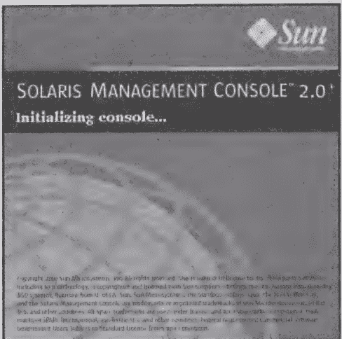

初始化后，Solaris 管理控制台窗口出现，如图 19.2 所示。你可以以非 root 用户身份启动 SMC，但除非以 root 登录或承担角色，否则某些工具和应用程序可能无法加载。这将在本节后面描述。

> 注意
第一次启动 SMC 时，可能需要几分钟才能启动。

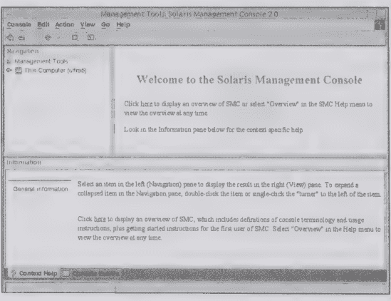

### 图 19.2

SMC 窗口。

2. 窗口左侧有一个导航窗格。当你在导航窗格中展开一个项目时，该项目的详细信息会显示在右侧窗格中。例如，当我单击 This Computer (ultra5) 时，窗口窗格会发生变化，如图 19.3 所示。

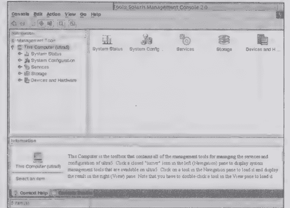

### 图 19.3
导航窗格显示。

导航窗格中显示的项目是 SMC 可以管理的应用程序。这些应用程序已作为当前主机的 SMC 应用程序注册。

第一次以 root 登录并启动 SMC 时，你有责任设置至少一个具有主要管理员权限的账户，并为其他用户提供权限。例如，你可以授予另一个非 root 用户管理系统用户账户的权限。要设置主要管理员账户，你必须为用户账户分配角色。这称为基于角色的访问控制，详见第 20 章“基于角色的访问控制”。角色是用于授予管理员权限的特殊账户。要设置主要用户账户，当下拉菜单出现时，单击位于 SMC 窗口顶部的工具栏中的 Action，如图 19.4 所示。然后，单击 Add Administrative Role。Add Administrative Role 窗口出现，如图 19.5 所示。


### 图 19.4
操作下拉菜单。

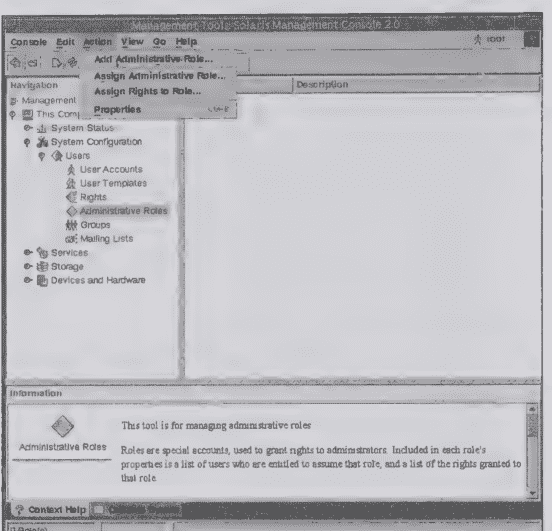

### 图 19.5
添加管理角色窗口。

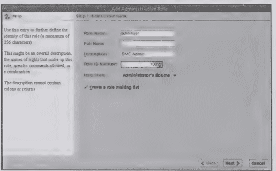

3. 填写适当的字段，如表 19.1 所述，完成后单击下一步按钮。

## 表 19.1
### 添加管理角色字段

| 字段 | 描述 |
|---|---|
| 角色名称 | 用户用于登录特定角色的名称。该名称必须唯一，包含 2–32 个字母和数字，以字母开头，至少包含一个小写字母，并且在域内唯一。 |
| 全名 | 此角色的完整描述性名称。 |
| 描述 | 对角色的描述，最多使用 256 个字符。 |
| 角色 ID 编号 | 分配给此角色的识别号码。它必须是 10–2147483647 之间的整数，并且在域内必须唯一。 |

4. 系统会要求您为角色输入密码，如图 19.6 所示。

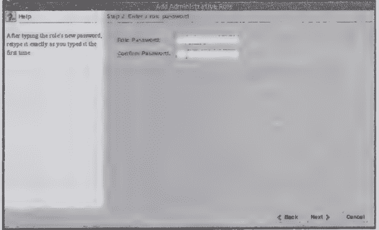

### 图 19.6
SMC 密码窗口。

密码必须由 6–15 个区分大小写的字母、数字和特殊字符组成。实际上只使用前八个字符，但有些用户喜欢更长的密码，因为它们更容易记住。在前六个字符中，至少有两个必须是字母，至少一个必须是数字或特殊字符。单击下一步按钮，选择角色权限窗口将出现，如图 19.7 所示。

### 图 19.7
选择角色权限窗口。

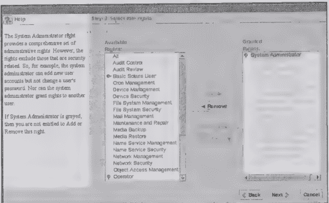

5. 中间窗口窗格中列出了可分配给用户的权限。当您单击每个项目时，该权限的描述会出现在帮助窗格中。图 19.7 所示的示例中，我添加了系统管理员权限，这会自动授予用户和打印机管理等一系列权限。分配完权限后单击下一步按钮。选择主目录窗口将出现，如图 19.8 所示。

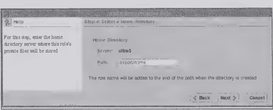

### 图 19.8
选择主目录窗口。

6. 输入应存储此角色私有文件的主目录。在示例中，我选择了默认目录 /export/home。单击下一步按钮后，系统会要求您指定允许承担此角色的用户列表。图 19.9 所示的示例中，我输入了名为 bcalkins 的用户并单击了添加按钮。

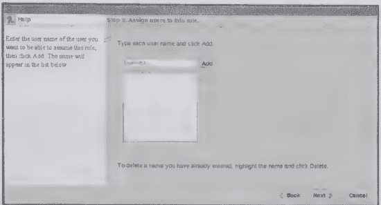

### 图 19.9
将用户分配给此角色窗口。

7. 单击下一步按钮，图 19.10 所示的摘要窗口将出现。

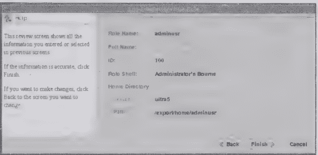

### 图 19.10
添加管理角色摘要窗口。

8. 单击完成按钮返回到 Solaris 管理控制台窗口。新的角色将显示，如图 19.11 所示。

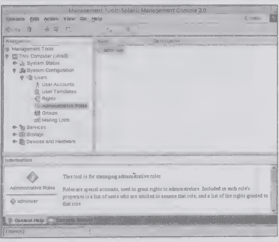

### 图 19.11
Solaris 管理控制台窗口中的新角色。

随时可以单击角色，例如 adminusr，然后显示该特定角色的角色属性，如图 19.12 所示。

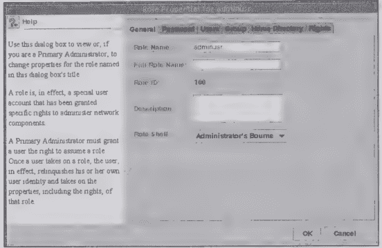

### 图 19.12
角色属性窗口。

9. 在此窗口中，您可以查看所选角色的属性。如果您是主要管理员，可以更改特定角色的属性。

现在角色已定义，并且用户已与该角色关联，这些用户可以启动 SMC，承担其角色并使用分配给该角色的功能。例如，当 bcalkins 启动 SMC 时，如图 19.13 所示的 SMC 窗口控制台窗口将显示。

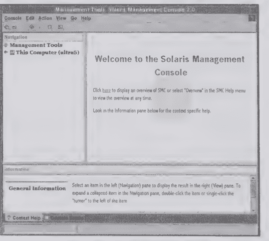

### 图 19.13
Solaris 管理控制台窗口。

10. 当用户在导航窗格中单击“此计算机”图标，然后在“系统配置”图标下，“用户”图标将出现，如图 19.14 所示。

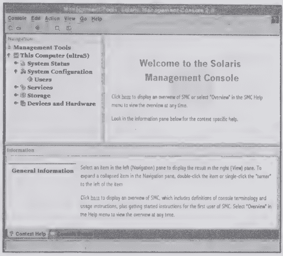

### 图 19.14
Solaris 管理控制台窗口中的用户图标。

11. 当 bcalkins 单击用户图标时，如图 19.15 所示的登录窗口将打开，提示输入密码。

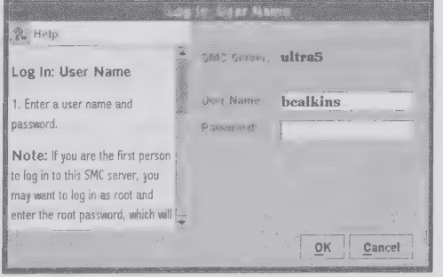

### 图 19.15
SMC 登录窗口。

12. bcalkins 输入他的密码，单击确定按钮，然后如图 19.16 所示的角色名称选择窗口将出现。

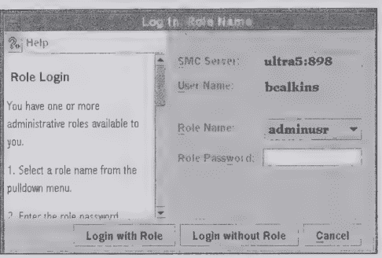

### 图 19.16
角色名称选择窗口。

13. 从下拉菜单中选择角色，输入该角色的密码，然后单击使用角色登录按钮。

请注意，您应使用主要管理员在创建角色时输入的密码，而不是用户登录密码。

Solaris 管理控制台窗口现在会显示您已被授予权限的功能图标，如图 19.17 所示。

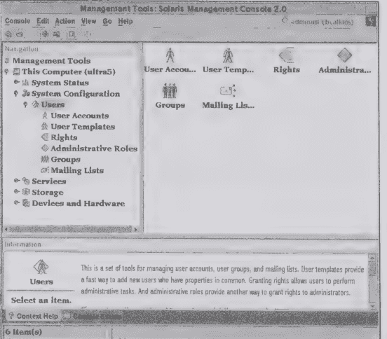

### 图 19.17
SMC 窗口中表示用户功能的图标。

有关基于角色的访问控制（RBAC）的更深入描述，请参阅第 20 章。

## Solaris AdminSuite

到目前为止，您应该已经熟悉 Admintool。我多次将其描述为用于用户、打印机和串行设备管理的易于使用的图形界面。Solaris AdminSuite 与 Admintool 相似，因为它提供了一个易于使用的 GUI 来促进常规服务器管理任务。AdminSuite 3.0 为管理您的 Solaris 系统提供了一套集成工具。向导和对话框提供帮助和指导，用于管理用户帐户、组、邮件列表、计算机/网络、文件系统挂载/共享、串行端口、日志文件和名称服务域。本节后面将详细介绍这些内容。

Admintool 用于管理独立系统，而 AdminSuite 满足您减少管理分布式系统成本和复杂性的需求。AdminSuite 可以通过以下方式帮助您管理网络：

- 它通过使用网络服务（如网络信息服务 NIS）提供 Solaris 工作组的本地管理。这将桌面管理集中化，使远程管理变得轻松。
- 它自动化常规管理任务，例如主机设置、打印机设置和用户设置。
- 它提供易于使用的系统管理工具，由广泛的 GUI 组成，便于集中设置和维护网络环境。管理无需 root 权限，使集中管理成为现实。

截至本文撰写时，AdminSuite 3.0.1 未随 Solaris 8 操作环境软件提供，但可以从 www.sun.com/bigadmin/content/adminPack 免费下载。

## 使用 Solaris AdminSuite

在启动 AdminSuite 之前，您必须先确保 AdminSuite 服务器守护进程正在运行。通过输入以下命令来执行此操作：

```
ps -ef | grep admin.server
```

如果正在运行，系统会显示类似以下的消息：

```
root 2497 1 0 13:46:28 ? 0:05 \
/usr/java1.1/bin/sparc/native_threads/java \
-mx32m -Dadmin.server.properties=/et
```

服务器守护进程读取在安装 AdminSuite 时创建的管理服务器属性文件以获取其配置信息。服务器守护进程还初始化安全提供程序并创建常见服务的实例，例如日志服务。配置并初始化后，管理服务器接收来自 AdminSuite 3.0 管理客户端的请求。每个安装的 AdminSuite 服务器应用程序版本都有一个 AdminSuite 管理服务器守护进程进程的单个实例。

AdminSuite 3.0 管理服务器守护进程进程在服务器系统通过 /etc/init.d/admsvr3_0 启动时自动启动。该脚本在安装 AdminSuite 产品时安装。

要启动 AdminSuite，输入以下内容：

```
/opt/SUNWseam/3_0/bin/admapp &
```

AdminSuite 初始化时，您会看到启动画面，如图 19.18 所示。

当 AdminSuite 登录屏幕出现，如图 19.19 所示时，输入 AdminSuite 主要管理员登录名和密码。

在示例中，bcalkins 是主要管理员。我输入了登录名和密码并单击确定按钮继续。几秒钟后，如图 19.20 所示的 Solaris AdminSuite 主窗口将出现。


### 图 19.18
AdminSuite 初始化屏幕。

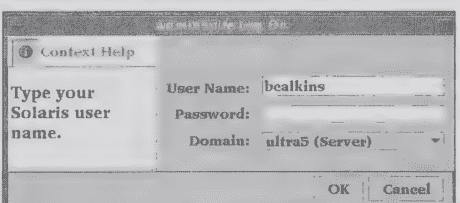

### 图 19.19
AdminSuite 登录窗口。

> 注意
系统管理员在安装 AdminSuite 软件时指定了主要管理员登录名。


图 19.20
AdminSuite 主窗口。

AdminSuite 主窗口显示可用于执行各种管理任务的 GUI 工具，包括以下内容：

- 用户
- 计算机/网络
- 挂载/共享
- 串行端口
- 日志查看器

每个项目在以下各节中都有讨论。

## 用户

点击用户图标以管理用户账户、组和邮件列表。选择两个向导之一来添加用户账户，如图 19.21 所示。

图 19.21
添加用户向导。


使用添加用户向导一次添加一个用户，或使用添加多个用户向导一次添加许多共享相同属性的用户。此外，还提供了用于管理组和邮件列表的工具。

以下文件将由用户管理工具修改：

- passwd. 用户账户信息文件。
- shadow. 密码信息文件。
- aliases. 电子邮件地址信息文件。
- group. 组信息文件。
- auto_home. AutoFS 映射文件（参见第 18 章，“名称服务”）。
- user_attr. 与用户角色关联的用户权限文件（参见第 21 章，“Jumpstart”中的 RBAC）。

## 计算机/网络

计算机/网络工具可让您查看、定义、修改、删除、查找、排序和过滤计算机、网络和子网。点击计算机/网络工具，将显示图 19.22 所示的窗口。


图 19.22
计算机/网络窗口。

如图所示的弹出菜单 19.22，您可以向网络添加计算机。

双击计算机图标，将显示域中的所有计算机，如图 19.23 所示。


图 19.23
域中的计算机。

双击特定计算机的图标，将出现计算机属性窗口，如图 19.24 所示。


图 19.24
计算机属性窗口。

注意
Mount/Shares 仅适用于单台服务器，因为无法为整个名称服务域定义共享或挂载。您可以在特定服务器上创建共享或挂载。

以下文件可由计算机/网络工具修改：

- hosts. hosts 文件是本地数据库，将主机名称与其 Internet 协议 (IP) 地址关联。
- ethers. 这是 Ethernet 地址到主机名数据库。
- networks. networks 文件是关于构成 Internet 的网络的本地信息来源。
- netmasks. netmasks 文件包含用于实现 IP 子网划分的网络掩码。

## 挂载/共享

使用此工具查看和管理当前域内的文件系统挂载和共享。

在图 19.25 中，我点击了共享工具，系统显示了该系统上的所有本地共享。


图 19.25
挂载/共享窗口。

通过点击图 19.26 所示的操作按钮，我可以共享或取消共享其他目录。


图 19.26
挂载/共享操作菜单。

以下文件将由挂载/共享工具修改：

- `/etc/mnttab`. 由 mount 命令生成的挂载信息。
- `/etc/dfs/sharetab`. 由 share 命令生成的共享信息，其中包含本地共享资源的表。
- `/etc/nfssec.conf`. 列出在 NFS 客户端计算机上定义授权参数。
- `/etc/nsswitch.conf`. 名称服务切换的配置文件（参见第 18 章）。
- `/etc/vfstab`. 该文件在启动时读取，描述要挂载的每个文件系统的默认值。
- `/etc/dfs/dfstab`. 该文件在启动时读取，并包含跨网络共享资源的命令。

## 串行端口管理

串行端口工具用于添加和维护终端和调制解调器的端口服务。使用串行端口管理器配置串行端口可让您在无需手动创建和编辑必要文件的情况下设置终端和调制解调器。它可以显示串行端口信息并促进端口设置、修改或删除。它还为常见的终端和调制解调器配置提供模板。串行端口管理工具如图 19.27 所示。


图 19.27
串行端口窗口。

通过突出显示串行端口并点击顶部工具栏中位于图 19.28 所示的操作按钮，将出现一个弹出菜单，其中包含配置、删除或查看特定串行端口属性的选择。

图 19.28
串行端口操作菜单。


例如，我可以突出显示端口 B，点击顶部工具栏中的操作按钮，然后从弹出菜单中选择属性。属性菜单出现，允许我查看或修改串行端口 B 的属性。

您可以使用串行端口管理器在本地系统或在具有适当访问权限的远程系统上管理串行端口信息。

以下文件将由串行端口工具修改：

- /etc/saf/_sactab. 串行端口监视器信息。
- /etc/saf/zsmon/_pmtag. 串行端口配置信息。

## 日志查看器

日志查看器工具可让您查看和管理 AdminSuite 工具和事件的日志文件。日志文件默认存储在 /var/opt/SUNWseam/3_0/log 目录中。日志查看器仅记录和查看 AdminSuite 事件的条目，不显示所有系统日志文件。

## 章节摘要

### 关键术语

- SMC
- AdminSuite
- SMC components
- SMC console
- SMC server
- Primary administrator
- AdminSuite management server

Solaris Management Console 提供了一组工具来促进服务器管理。SMC 为系统管理员提供易于使用的基于 Java 的 GUI 工具，可从任何位置管理进程、用户、本地和 NFS 文件系统、磁盘分区、串行端口和进程。此外，SMC 还提供将管理任务委派给其他用户而不给予他们超级用户账户访问权限的能力。

Solaris AdminSuite 提供了与 SMC 相同的许多工具，但它不提供使用 RBAC 委派管理任务的能力。它也不提供作业调度或磁盘和进程管理的工具。AdminSuite 中提供的工具确实提供了易于使用的图形界面，可从网络上的任何位置管理您的系统。使用 GUI 中的工具和命令比使用大量 Solaris 命令执行相同任务要快得多。

花一些时间熟悉 SMC 和 AdminSuite 中可用的工具。每当您在 GUI 中时，都可以点击帮助按钮以获取更多信息。

我在描述 SMC 时介绍了基于角色的访问控制。下章将更详细地描述此主题。

## 应用你的知识

## 练习

### 19.1 使用 AdminSuite

在本练习中，您使用 AdminSuite 添加新的用户账户。

预计时间：10 分钟

1. 以 root 登录，并按如下方式启动 AdminSuite：
   `/opt/SUNWseam/3_0/bin/admapp &`
2. 当 AdminSuite 登录屏幕出现时，选择本地系统并填写空白字段：
   用户名：root
   密码：`<root password>`
3. 从 AdminSuite 主窗口，点击用户图标。
4. 点击右窗格中的用户账户图标。
5. 用户账户图标仍处于突出显示状态时，点击右窗格工具栏中的操作按钮。
6. 从下拉菜单中，点击添加用户。
   用于设置新用户账户的向导出现。
7. 在出现的第一个窗口中，按如下方式填写字段：
   用户名：admin1
   全名：Administrative Assistant
8. 点击窗口底部的右箭头继续。
9. 在下一个窗口中，接受分配的默认用户 ID 号码，然后点击右箭头继续。
10. 在此窗口中，点击“用户必须在首次登录时使用此密码”旁边的单选按钮。然后，在密码字段中分配密码，然后点击右箭头继续。
11. 在接下来的两个窗口中，您将被提示为新用户账户提供主组和主目录。接受提供的默认值。
12. 随后出现摘要窗口。点击摘要窗口上的完成，新用户账户将被设置。

### 19.2 使用 Solaris Management Console

在本练习中，您在 Solaris Management Console 中添加一个管理角色并将管理任务委派给非 root 用户。

预计时间：15 分钟

1. 对于本练习，您需要一个名为 `admin1` 的非 root 用户账户。为 `admin1` 创建一个新账户，组 ID 为 10。
2. 以 root 身份按如下方式启动 Solaris Management Console：
   `smc &`
3. 在控制台窗口的导航窗格中点击此计算机。然后点击系统配置工具和用户工具。当登录窗口出现时，输入 root 作为用户名，并输入 root 密码。点击确定按钮继续。


## 应用你的知识

4. 右侧面板中会出现用户管理工具列表。单击“Administrative Roles”工具。

5. 单击位于 SMC 窗口顶部的工具栏中的 Action。从下拉菜单中单击 Add Administrative Role。Add Administrative Role 窗口出现。按以下信息填写字段：

Role Name: adminusr
Full Name: Administrative Assistant
Description: Admin assistant for performing general administrative tasks
Role ID number: <accept the default>
Role Shell: Administrator's Bourne

6. 下一屏幕会要求你输入角色密码。输入长度为 6–15 个字符的密码。单击“下一步”按钮继续。

7. 下一个窗口用于分配权限。在中间窗格中选择 System Administrator 并单击“添加”按钮。在“Granted Rights”窗格下，应显示 System Administrator。单击“下一步”按钮继续。

8. 选择一个主目录，然后单击“下一步”按钮。

9. 在下一个窗口中，标题为 Assign Users to This Role，在第一个字段中输入 admin1，然后单击“添加”按钮。单击“下一步”按钮继续。

10. 当摘要窗口出现时，单击“完成”按钮。分配角色给用户的过程已完成。

11. 注销并以 admin1 身份重新登录。启动 SMC，并测试新的用户角色。你应具有一般系统管理权限，例如添加新用户、安排作业和共享文件系统。

## 复习问题

1. 关于 Solaris Management Console，以下哪三个陈述是正确的？
A. 它提供了一种图形化方式来管理元设备。
B. 它通过将系统管理工具集中在一个位置来简化管理。
C. 它允许在一个位置管理所有 Solaris Management Console 服务器。
D. 它允许系统管理员将管理任务委派给非 root 用户，而无需提供 root 密码。

2. AdminSuite 3.0 用于完成以下哪些任务？选择所有适用项。
A. 管理用户帐户
B. 管理共享资源
C. 管理磁盘
D. 管理进程
E. 安排进程
F. 管理串行端口
G. 设置 AutoClients

## 应用你的知识

3. SMC 用于完成以下哪些任务？选择所有适用项。
- A. 管理用户帐户
- B. 管理共享资源
- C. 管理磁盘
- D. 管理进程
- E. 安排进程
- F. 管理串行端口
- G. 设置 AutoClients

4. SMC 的三个组件是什么？
- A. GUI 工具
- B. SMC Client
- C. SMC Server
- D. Toolbox Editor
- E. RBAC

5. 用于启动 AdminSuite 的命令是什么？
- A. 它必须从 Solaris Management Console 启动。
- B. admapp.
- C. solstice.
- D. adminsuite.
- E. smc.
- F. admsvr.

6. SMC 与 AdminSuite 3.0 之间有哪些主要区别？选择所有适用项。
- A. 只有 SMC 支持基于角色的访问控制。
- B. 只有 AdminSuite 可以管理用户帐户。
- C. 只有 SMC 可以管理磁盘。
- D. 只有 AdminSuite 可以管理打印机。
- E. SMC 需要 SMC Server 运行；AdminSuite 不需要服务器守护进程。

## 复习问题的答案

1. B.、C.、D. SMC 通过将系统管理工具集中在一个位置来简化管理。它还允许在一个位置管理所有 Solaris Management Console 服务器。最后，它允许系统管理员将管理任务委派给非 root 用户，而无需提供 root 密码。

2. A.、B.、F. AdminSuite 3.0 提供了用于管理 Solaris 系统的一套集成工具。向导和对话框为管理用户帐户、组、邮件列表、计算机/网络、文件系统挂载/共享、串行端口、日志文件和名称服务域提供帮助和指导。

## 应用你的知识

3. A.、B.、C.、D.、E.、F. SMC 允许你从远程位置管理服务器上的管理服务和网络服务。使用 SMC，管理员可以在本地和远程系统上管理系统进程、网络资源、用户帐户、串行端口和磁盘分区。

4. B.、C.、D. SMC 有三个组件：
- The SMC Client, called SMC or Console
- The SMC Server
- The SMC Toolbox Editor

5. B. 要启动 AdminSuite，输入以下内容：

```
/opt/SUNWseam/3_0/bin/admapp.
```

6. A.、C. SMC 与 AdminSuite 3.0 之间的主要区别是只有 SMC 支持基于角色的访问控制，并且只有 SMC 可以管理磁盘。

## 目标

本章涵盖以下测试目标：

### 理解基于角色的访问控制
- 传统的基于超级用户的系统会向任何可以成为超级用户的人授予完全的超级用户权限。在 Solaris 8 操作环境中，通过基于角色的访问控制 (RBAC)，管理员可以将有限的管理能力分配给非 root 用户。本章描述了 RBAC 与 Solaris 安全性的关系。

### 理解 RBAC 支持数据库
- RBAC 依赖于四个数据库来为用户提供访问特权操作的权限。本章描述了 RBAC 数据库和配置命令。

## 第 20 章

## 基于角色的访问控制 (RBAC)

- **介绍** 731
- **使用 RBAC** 731
- **RBAC 组件** 737
  - 扩展用户属性 (user_attr) 数据库 738
  - 授权 (auth_attr) 数据库 740
  - 权限配置文件 (prof_attr) 数据库 742
  - 执行属性 (exec_attr) 数据库 745
- **摘要** 747
- **应用你的知识** 749

以下策略有助于你为考试做准备：
- 熟悉本章末尾“关键术语”部分中我提供的术语。准备好说明 RBAC 在 Solaris 安全方面的目的。还要准备好选择描述 RBAC 数据库特性的陈述。
- 练习使用 RBAC 以熟悉其功能。在 Solaris 系统上，逐步完成本章提供的示例。

## 介绍

向非 root 用户授予超级用户访问权限一直是 UNIX 系统中的一个问题。过去，你必须依赖第三方软件包 sudo 来提供此功能。问题在于 sudo 是一个不受支持的免费软件，必须从互联网下载并安装到你的系统上。在极端情况下，系统管理员必须在文件上设置 UID 权限位，以便用户可以以 root 身份执行命令。

在 Solaris 8 操作环境中，通过基于角色的访问控制 (RBAC)，管理员可以将有限的管理能力分配给非 root 用户。这是通过以下三个新功能实现的：
- 授权。授予访问受限功能的<|message|> 用户权利。
- 执行配置文件。用于对授权和具有特殊属性的命令进行分组的捆绑机制；例如，用户和组 ID 或超级用户 ID。
- 角色。用于执行一组管理任务的特殊类型的用户帐户。

> CAUTION
最常见的是，你可能会使用 RBAC 为系统内的管理任务提供超级用户访问权限。请谨慎行事，避免通过向未经授权的用户提供对管理功能的访问而造成安全漏洞。

## 使用 RBAC

为了更好地描述 RBAC，更容易先描述系统管理员如何在 Acme Corp 的虚构环境中利用 RBAC 将管理任务委派给非 root 用户。

在虚构公司 Acme Corp.，系统管理员任务繁重。他将把部分职责委派给工程部门的用户 Neil，后者有时会帮助进行系统管理任务。

系统管理员首先需要定义他希望 Neil 协助的任务。他已确定了三个任务：
- 更改用户密码，但不添加或删除帐户
- 挂载和共享文件系统
- 关闭系统

在 RBAC 中，当我们谈论委派管理任务时，它被称为角色帐户。角色帐户是一种特殊类型的用户帐户，旨在执行一组管理任务。它在大多数方面与普通用户帐户类似，只是用户只能在以其正常登录帐户登录系统后，通过 su 命令访问它。角色帐户不能用于正常登录，例如通过 CDE 登录窗口。从角色帐户中，用户可以访问具有特殊属性的命令，通常是 root 用户 ID，而这些 ID 在普通帐户中不可用。

在 Acme Corp.，系统管理员需要为他想要委派的任务定义一个角色用户名。让我们使用角色用户名“adminusr”。Neil 在使用其正常登录名 ncalkins 登录后，然后需要发出 su 命令并在每次想要执行管理任务时切换到 adminusr。

定义角色帐户最简单的方法是使用 Solaris Management Console，如上一章所述。第 19 章“Solaris Management Console 和 Solstice AdminSuite”提供了你为用户定义此管理角色所需的所有信息。然而在本章中，我将描述如何通过命令行创建角色。

到目前为止，我们已确定希望将角色帐户命名为 adminusr。系统管理员使用 roleadd 命令创建角色帐户。roleadd 命令将角色帐户添加到 /etc/passwd、/etc/shadow 和 /etc/user_attr 文件中。roleadd 命令的语法如下：

```
roleadd [-c comment] [-d dir] [-e expire] [-f inactive] \
[-g group] [-G group] [-m] [-k skel_dir] [-u uid] \
[-s shell] [-A authorization] <role username>
```

你会注意到 roleadd 看起来与第 5 章“设置用户帐户”中描述的 useradd 命令非常相似。表 20.1 描述了 roleadd 命令的选项。


## 表 20.1
### roleadd 选项

| 选项 | 描述 |
|---|---|
| `-c <comment>` | 任意文本字符串，用于提供角色的简要描述。 |
| `-d <dir>` | 新角色账户的家目录。 |
| `-m` | 如果尚不存在则创建新角色的家目录。 |
| `-s <shell>` | 指定登录时使用的 shell。默认值为 /bin/sh。 |
| `-A <authorization>` | 这两个选项分别将授权和配置文件分配给角色。 |
| `-P <profile>` | 授权和配置文件将在本节后面描述。 |

其他选项与第 5 章“设置用户账户”中所述的 useradd 命令的选项相同。

使用 roleadd 命令创建角色账户时，需要为该角色指定授权和配置文件。授权是授予访问受限功能的权限。它是一个唯一字符串，用于标识被授权的内容以及创建授权的主体。

某些特权程序会检查授权以确定用户是否可以执行受限功能。以下是适用于待委派任务的 /etc/security/auth_attr 文件中的预定义授权：

```
solaris.admin.usermgr.pswd:::Change User Passwords::help=UserMgrPswd.html
solaris.system.shutdown:::Shutdown the System::help=SysShutdown.html
solaris.admin.fsmgr.write:::Mount/Share File Systems::help=FsMgrWrite.html
```

所有授权都存储在 auth_attr 数据库中，因此系统管理员需要使用存储在该文件中的一个或多个授权。对于 Acme Corp. 示例，系统管理员需要指定如下所示的授权名称：

```
solaris.admin.usermgr.pswd
solaris.system.shutdown
solaris.admin.fsmgr.write
```

因此，系统管理员将按如下方式发出 roleadd 命令：

```
roleadd -m -d /export/home/adminusr -c "Admin Assistant" \
-A solaris.admin.usermgr.pswd,solaris.system.shutdown, \
solaris.admin.fsmgr.write adminusr
```

已创建名为 adminusr 的角色账户及其所需的目录结构。下一步是通过输入以下内容为 adminusr 角色账户设置密码：

```
passwd adminusr
<enter the new password twice>
```

现在我们需要设置 Neil 的账户，使其可以访问名为 adminusr 的新角色账户。使用 usermod 命令，我们通过 -R 选项将角色分配给用户账户，如下所示：

```
usermod -R adminusr neil
```

要访问管理功能，Neil 首先需要使用名为 neil 的普通用户账户登录。Neil 可以通过输入以下内容检查已授予他的角色：

```
roles
```

系统将如下所示响应已授予用户账户 neil 的角色：

```
adminusr
```

然后 Neil 需要通过输入以下内容 su 到 adminusr 账户：

```
su adminusr
<enter the password for adminusr>
```

现在，Neil 可以修改用户密码、关闭系统以及挂载和共享文件系统。任何其他尝试 su 到 adminusr 账户的用户都会收到以下消息：

```
$ su adminusr
Password:
Roles can only be assumed by authorized users
su: Sorry
$
```

如果以后系统管理员想要为名为 adminusr 的角色账户分配额外的授权，他将使用 rolemod 命令执行此操作。rolemod 命令修改系统上角色的登录信息。rolemod 命令的语法如下：

```
rolemod [-u uid] [-o] [-g group] [-G group] [-d dir] [-m] \
[-s shell] [-c comment] [-l new_name] [-f inactive] \
[-e expire] [-A Authorization] [-P profile] <role account>
```

rolemod 命令的选项在表 20.2 中描述。

## 表 20.2
### rolemod 选项

| 选项 | 描述 |
|---|---|
| -A <authorization> | auth_attr 数据库中定义的由逗号分隔的一个或多个授权。这会替换任何现有的授权设置。 |
| -c <comment> | 指定注释字符串。<comment> 可以是任意文本字符串。它通常是对登录的简短描述，目前用作用户全名字段。此信息存储在用户的 /etc/passwd 条目中。 |
| -d <dir> | 指定角色的新家目录。默认值为 <base_dir>/login，其中 <base_dir> 是新登录家目录的基目录，login 为新的登录名。 |
| -e <expire> | 指定角色的过期日期。此日期之后，没有用户可以访问该角色。<expire> 选项参数是使用模板文件 /etc/datemsk 中包含的日期格式之一输入的日期。例如，可以输入 12/30/01 或 December 30, 2001。值为空格 " " 会使过期日期状态失效。 |
| -f <inactive> | 指定在登录 ID 被声明无效之前，允许的两次使用之间的最大天数。正常值为正整数。 |
| -g <group> | 指定现有组的整数 ID 或字符字符串名称。它重新定义角色的主要组 membership。 |
| -G <group> | 指定现有组的整数 ID 或字符字符串名称。它重新定义角色的补充组 membership。-g 和 -G 选项之间的组重复将被忽略。 |

## 表 20.2 继续
### rolemod 选项

| 选项 | 描述 |
|---|---|
| -l <new_logname> | 指定角色的新登录名。<new_logname> 参数是一个长度不超过八字节的字符串，由字母字符、数字字符、句点 (.)、下划线 (_) 和连字符 (-) 组成。第一个字符应为字母，并且字段应包含至少一个小写字母字符。如果未满足这些限制，将写入警告消息。未来的 Solaris 版本可能拒绝接受不符合这些要求的登录字段。<new_logname> 参数必须包含至少一个字符，且不得包含冒号 (:) 或换行符 (\n)。 |
| -m | 将角色的家目录移动到 -d 选项指定的新目录。如果目录已存在，则必须具有组读/写/执行权限，其中组为角色的主要组。 |
| -o | 允许指定的 UID 重复（非唯一）。 |
| -P <profile> | 替换任何现有的配置文件设置。auth_attr 数据库中定义了一个或多个由逗号分隔的执行配置文件。 |
| -s <shell> | 指定登录时用作角色 shell 的程序的完整路径名。shell 的值必须是有效可执行文件。 |
| -u <uid> | 指定角色的新 UID。它必须是大于等于零的十进制整数。此选项不会修改与角色家目录关联的 UID；只有在使用 chown 命令手动重新分配 UID 后，角色才能访问其家目录。 |

要添加清除日志文件的能力，需要将 solaris.admin.logsvc.purge 添加到 adminusr 的授权列表中。为此，按如下方式发出 rolemod 命令：

```
rolemod -A \
solaris.admin.usermgr.pswd,solaris.system.shutdown, \
solaris.admin.fsmgr.write,solaris.admin.logsvc.purge \
adminusr
```

如果要删除角色账户，请按如下方式使用 roledel 命令：

```
roledel [-r] <role account name>
```

-r 选项会从系统中删除角色的家目录。例如，要删除 adminusr 角色账户，请发出以下命令：

```
roledel -r adminusr
```

下一节将详细讨论每个 RBAC 数据库，描述我在执行 roleadd 和 usermod 命令时所做的条目。

> NOTE
rolemod 命令不会添加现有授权；它会替换任何现有的授权设置。

## RBAC 组件

RBAC 依赖于以下四个数据库为用户提供访问特权操作的能力：

- user_attr（扩展用户属性数据库）。将用户和角色与授权和配置文件关联。
- auth_attr（授权属性数据库）。定义授权及其属性并标识关联的帮助文件。
- prof_attr（权限配置文件属性数据库）。定义配置文件，列出配置文件分配的授权，并标识关联的帮助文件。
- exec_attr（配置文件属性数据库）。定义分配给配置文件的特权操作。

这四个数据库相互交互。


## 扩展用户属性 (user_attr) 数据库

The /etc/user_attr database supplements the passwd and shadow databases. It contains extended user attributes, such as authorizations and profiles. It also allows roles to be assigned to a user. Following is a copy of the /etc/user_attr database:

```
more /etc/user_attr
# Copyright (c) 1999 by Sun Microsystems, Inc. All rights reserved.:::
#:::
# /etc/user_attr:::
#:::
# user attributes. see user_attr(4):::
#:::
#pragma ident  "@(#)user_attr 1.2  99/07/14 SMI":::
#:::
root:::type=normal;auths=solaris.*,solaris.grant;profiles=All
adminusr:::type=role;auths=solaris.admin.usermgr.pswd,solaris.system.shutdown,solaris.admin.fsmgr.write;profiles=All
neil:::type=normal;roles=adminusr
```

The following fields in the user_attr database are separated by colons:

```
user:qualifier:res1:res2:attr
```

Each field is described in Table 20.3.

## 表 20.3

### USER_ATTR 字段

| Field Name | Description |
|---|---|
| user | Describes the name of the user as specified in the passwd database. |
| qualifier | Reserved for future use. |
| res1 | Reserved for future use. |
| res2 | Reserved for future use. |
| attr | Contains an optional list of semicolon-separated (;) key-value pairs that describe the security attributes to be applied when the user runs commands. Four valid keys exist: auths, profiles, roles, and type. |
| auths | Specifies a comma-separated list of authorization names chosen from names defined in the auth_attr database. Authorization names can include the asterisk (*) character as a wildcard. For example, solaris.device.* means all of the Solaris device authorizations. |
| profiles | Contains an ordered, comma-separated list of profile names chosen from prof_attr. A profile determines which commands a user can execute and with which command attributes. At minimum, each user in user_attr should have the All profile, which makes all commands available but without attributes. The order of profiles is important; it works similarly to UNIX search paths. The first profile in the list that contains the command to be executed defines which (if any) attributes are to be applied to the command. I'll describe profiles further in the section titled “Authorizations (auth_attr) Database.” |
| roles | Can be assigned to the user using a comma-separated list of role names. Note that roles are defined in the same user_attr database. They are indicated by setting the type value to role. Roles cannot be assigned to other roles. |
| type | Can be set to normal, if this account is for a normal user, or to role, if this account is for a role. A normal user assumes a role after he has logged in. |

In the previous section, I issued the following roleadd command to add a role named adminusr:

```
roleadd -m -d /export/home/adminusr -c "Admin Assistant" \
-A \ solaris.admin.usermgr.pswd,solaris.system.shutdown, \
solaris.admin.fsmgr.write adminusr
```

The roleadd command made the following entry in the user_attr database:

```
adminusr:::type=role;auths=solaris.admin.usermgr.pswd, \
solaris.system.shutdown, solaris.admin.fsmgr.write;profiles=All
```

I then issued the following usermod command to assign the new role to the user neil:

```
usermod -R adminusr neil
```

and I made the following entry to the user_attr database:

```
neil::::type=normal;roles=adminusr
```

## 授权 (auth_attr) 数据库

An authorization is a user right that grants access to a restricted function. In the previous section, the system administrator wanted to delegate some of the system administrative tasks to Neil. Assigning authorizations to the role named adminusr did this. An authorization is a unique string that identifies what is being authorized as well as who created the authorization. Remember that we used the following authorizations to give Neil the ability to modify the user password, shut down the system, and mount and share file systems:

```
solaris.admin.usermgr.pswd
solaris.system.shutdown
solaris.admin.fsmgr.write
```

Certain privileged programs check the authorizations to determine whether users can execute restricted functionality. For example, the solaris.jobs.admin authorization is required for one user to edit another user's crontab file.

All authorizations are stored in the auth_attr database. If no name service is used, the database is located in a file named /etc/security/auth_attr. Authorizations can be assigned directly to users (or roles), in which case they are entered in the user_attr database. Authorizations can also be assigned to profiles, which in turn are assigned to users. They are described in the “Rights Profiles (prof_attr) Database” section.

The fields in the auth_attr database are separated by colons, as shown here:

```
authname:res1:res2:short_desc:long_desc:attr
```

Each field is described in Table 20.4.

## 表 20.4

### AUTH_ATTR 字段

| Field Name | Description |
|------------|-------------|
| authname | A unique character string used to identify the authorization in the format *prefix*.[*suffix*]. Authorizations for the Solaris operating environment use solaris as a prefix. All other authorizations should use a prefix that begins with the reverse-order Internet domain name of the organization that creates the authorization (for example, com.xyzcompany). The suffix indicates what is being authorized, typically the functional area and operation. When no suffix exists (that is, the authname consists of a prefix and functional area and ends with a period), the authname serves as a heading for use by applications in their GUIs rather than as an authorization. The authname solaris.printmgr. is an example of a heading. When authname ends with the word *grant*, the authname serves as a grant authorization, and allows the user to delegate related authorizations (that is, authorizations with the same prefix and functional area) to other users. The authname solaris.printmgr.grant is an example of a grant authorization; it gives the user the right to delegate such authorizations as solaris.printmgr.admin and solaris.printmgr.nobanner to other users. |
| res1 | Reserved for future use. |
| res2 | Reserved for future use. |
| short_desc | A shortened name for the authorization suitable for displaying in user interfaces, such as in a scrolling list in a GUI. |
| long_desc | A long description. This field identifies the purpose of the authorization, the applications in which it is used, and the type of user interested in using it. The long description can be displayed in the help text of an application. |
| attr | An optional list of semicolon-separated (;) key-value pairs that describes the attributes of an authorization. Zero or more keys can be specified. The keyword *help* identifies a help file in HTML. Help files can be accessed from the index.html file in the /usr/lib/help/auths/locale/C directory. |

The following are some typical values found in the default auth_attr database:

```
solaris.admin.usermgr.pswd:::Change User Passwords::help=UserMgrPswd.html
solaris.system.shutdown:::Shutdown the System::help=SysShutdown.html
solaris.admin.fsmgr.write:::Mount/Share File Systems::help=FsMgrWrite.html
```

Look at the relationship between the auth_attr and the user_attr databases for the adminusr role we added earlier:

```
adminusr::::type=role;auths=solaris.admin.usermgr.pswd, \
solaris.system.shutdown, solaris.admin.fsmgr.write;profiles=All
```

Notice the authorization entries that are bold. These authorization entries came out of the auth_attr database, which are shown above. The solaris.system.shutdown authorization, which is defined in the auth_attr database, gives the role the right to shut down the system.

## 权利配置文件 (prof_attr) 数据库

> NOTE
Depending on the version of Solaris 8 you have installed, some of the profiles described in this section might not appear in the prof_attr file. For example, the 10/00 version does not include the Operator or Media Backup profile. If the profile doesn't appear, you might want to consider loading a more recent version of Solaris 8.

I've referred to rights profiles, or simply profiles, earlier in this chapter. Up to now, we assigned authorization rights to the role account. Defining a role account that has several authorizations can be tedious. In this case, it's better to define a profile, which is several authorizations bundled together under one name, called a profile name. The definition of the profile is stored in the prof_attr database. Following is an example of a profile named Operator, which is in the default prof_attr database. Again, if you are not using a name service, the prof_attr file is located in the /etc/security directory.

```
Operator:::Can perform simple administrative tasks:profiles=Printer Management,Media \
Backup,All;help=RtOperator.html
```

Several other profiles are defined in the prof_attr database. Colons separate the fields in the prof_attr database, as follows:

```
profname:res1:res2:desc:attr
```

The fields are defined in Table 20.5.


## 表 20.5
### prof_attr 字段

| 字段名称 | 描述 |
|------------|-------------|
| profname | 配置文件的名称。配置文件名称区分大小写。 |
| res1 | 保留供将来使用的字段。 |
| res2 | 保留供将来使用的字段。 |
| desc | 长描述。此字段应解释配置文件的用途，包括哪些类型的用户会感兴趣使用它。长描述应适合在应用程序的帮助文本中显示。 |
| attr | 可选的键值对列表，用分号 (;) 分隔，用于描述在执行对象时应应用的安全属性。可以指定零个或多个键。两个有效的键是 *help* 和 *auths*。关键字 *help* 标识 HTML 中的帮助文件。帮助文件可以从 /usr/lib/help/auths/locale/C 目录中的 index.html 文件访问。*auths* 指定从 auth_attr 数据库中定义的那些名称中选择的授权名称的逗号分隔列表。授权名称可以使用星号 (*) 字符作为通配符。 |

也许系统管理员想要创建一个新的角色账户并委派打印机管理和备份的任务。他可以查看 user_attr 文件中每个授权并使用 roleadd 命令将每个授权分配给新的角色账户，或者他可以使用 prof_attr 数据库中当前定义的 Operator 配置文件，其内容如下：

```
Operator:::Can perform simple administrative tasks:profiles=Printer Management,Media \
Backup,All;help=RtOperator.html
```

Operator 配置文件包含另外三个配置文件：

- Printer Management
- Media Backup
- All

让我们查看 prof_attr 数据库中定义的这些配置文件：

```
Printer Management:::Manage printers, daemons, spooling:help=RtPrntAdmin.html; \
auths=solaris.admin.printer.read,solaris.admin.printer.modify,solaris.admin.printer.delete
Media Backup:::Backup files and file systems:help=RtMediaBkup.html
All:::Execute any command as the user or role:help=RtAll.html
```

Printer Management 已分配了以下授权：

- solaris.admin.printer.read
- solaris.admin.printer.modify
- solaris.admin.printer.delete

当我查看 auth_attr 数据库中的这三个授权时，我看到以下条目：

```
solaris.admin.printer.read:::View Printer Information::help=AuthPrinterRead.html
solaris.admin.printer.modify:::Update Printer Information::help=AuthPrinterModify.html
solaris.admin.printer.delete:::Delete Printer Information::help=AuthPrinterDelete.html
```

我现在看到分配 Printer Management 配置文件等同于分配用于查看、更新和删除打印机信息的三个授权。

Media Backup 配置文件提供备份数据的授权，但不提供恢复数据的授权。Media Backup 配置文件没有像 Printer Management 配置文件那样的相关授权。我将在下一节中描述执行属性时说明此配置文件是如何定义的。

All 配置文件授予角色账户在使用管理员 shell 时使用任何命令的权利。这些 shell 只能执行已通过授予的权利明确分配给角色账户的命令。我们将在下一节中描述执行属性时进一步探讨这一概念。

要创建名为 admin2 的新角色账户并指定 Operator 配置文件，请使用 -P 选项使用 roleadd 命令，如下所示：

```
roleadd -m -d /export/home/admin2 -c "Admin Assistant" -P \
Operator admin2
```

以下条目被添加到 user_attr 数据库中：

```
admin2:::::type=role;profiles=Operator
```

用户可以随时使用 profiles 命令检查已授予他们的配置文件，如下所示：

```
profiles
```

系统列出已授予该特定用户账户的配置文件。

## 执行属性 (exec_attr) 数据库

与配置文件关联的执行属性是那些被分配了该配置文件的用户或角色可以运行的命令（以及任何特殊的安全属性）。例如，在上一节中，我们查看了 prof_attr 数据库中名为 Media Backup 的配置文件。尽管没有为此配置文件分配授权，但 Media Backup 配置文件在 exec_attr 数据库中定义如下：

```
Media Backup:suser:cmd:::/usr/bin/mt:euid=0
Media Backup:suser:cmd:::/usr/sbin/tar:euid=0
Media Restore:suser:cmd:::/usr/sbin/tar:euid=0
Media Backup:suser:cmd:::/usr/lib/fs/ufs/ufsdump:euid=0;gid=sys
Media Restore:suser:cmd:::/usr/bin/cpio:euid=0
Media Restore:suser:cmd:::/usr/bin/mt:euid=0
Media Restore:suser:cmd:::/usr/lib/fs/ufs/ufsrestore:euid=0
```

exec_attr 数据库中的字段如下，并且用冒号分隔：

```
name:policy:type:res1:res2:id:attr
```

字段在表 20.5 中定义。

## 表 20.5
### EXEC_ATTR 字段

| 字段名称 | 描述 |
|---|---|
| Name | 配置文件的名称。配置文件名称区分大小写。 |
| policy | 与此条目关联的安全策略。目前，suser（超级用户策略模型）是唯一有效的策略条目。 |
| type | 指定其属性的实体的类型。目前，唯一有效的类型是 cmd（命令）。 |
| res1 | 此字段保留供将来使用。 |
| res2 | 此字段保留供将来使用。 |
| id | 标识实体的字符串；可以使用星号通配符。命令应具有完整路径或带通配符的路径。要指定参数，请编写包含参数的脚本，并将 id 指向该脚本。 |
| attr | 可选的用分号 (;) 分隔的键值对列表，用于描述在执行实体时应应用的安全属性。可以指定零个或多个键。有效关键字的列表取决于所执行的策略。存在四个有效的键：euid、uid、egid 和 gid。euid 和 uid 包含单个用户名或数字用户 ID。用 euid 指定的命令以指示的有效 UID 运行，这类似于在可执行文件上设置 setuid 位。用 uid 指定的命令以真实 UID 和有效 UID 运行。egid 和 gid 包含单个组名或数字组 ID。用 egid 指定的命令以指示的有效 GID 运行，这类似于在可执行文件上设置 setgid 位。用 gid 指定的命令以真实 GID 和有效 GID 运行。 |

回顾在 exec_attr 数据库中定义的 Media Backup 配置文件，我们看到以下命令具有有效 UID 为 0（超级用户）：

- /usr/bin/mt
- /usr/sbin/tar
- /usr/lib/fs/ufs/ufsdump
- /usr/bin/cpio
- /usr/lib/fs/ufs/ufsrestore

因此，任何被授予 Media Backup 配置文件的用户都可以以有效用户 ID 为 0（超级用户）的身份执行之前的备份命令。

在 prof_attr 数据库中，我们还看到 Operator 配置文件包含一个名为 All 的配置文件。同样，All 没有相关联的授权。当我们在 exec_attr 数据库中查找 All 配置文件的定义时，我们得到以下条目：

```
All:suser:cmd:::*:
```

检查每个字段，我们看到 All 是配置文件名称，安全策略是 suser，实体类型是 cmd。属性字段有一个 *。

通常会授予所有用户 All 配置文件。* 是一个通配符条目，与每个命令匹配。换句话说，用户在 shell 中工作时可以访问任何命令。如果没有 All 配置文件，用户可以访问特权命令，但无法访问诸如 ls 和 cd 之类的普通命令。请注意，没有与通配符关联的特殊进程属性，因此效果是与通配符匹配的所有命令都以当前用户（或角色）的 UID 和 GID 运行。始终在配置文件列表的最后分配 All 配置文件。如果它列在第一位，在查找命令属性时将不会咨询其他权利。

## 章节摘要

本章介绍了基于角色的访问控制，用于将有限的管理员功能委派给非 root 用户。它描述了 RBAC 所固有的功能，包括以下内容：

- 角色。专为执行一组管理任务而设的特殊用户账户。
- 授权。有时被称为“权利”，授予对原本受限功能的访问权限。
- 执行配置文件。用于将授权和具有特殊属性的命令分组的捆绑机制。执行配置文件类似于在可执行文件上设置 UID 和 GID 权限位的概念。

## 关键术语

- RBAC
- 角色账户
- 授权
- RBAC 数据库（了解全部四个的具体情况）
- 权利配置文件


本章还描述了四个相互交互的数据库，它们共同为用户提供访问特权操作的权限：

- user_attr。 将用户和角色与授权和执行配置文件关联。
- auth_attr。 定义授权及其属性，并标识关联的帮助文件。
- prof_attr。 定义配置文件，列出配置文件分配的授权，并标识关联的帮助文件。
- exec_attr。 定义分配给配置文件的特权操作。

现在你对 RBAC 有了更多了解，我建议你回到第 20 章回顾 Solaris 管理控制台，它提供了一个易于使用的 GUI 用于创建和分配角色以及为角色分配权限。你会发现它比命令行等价物更容易使用。

下一章将介绍如何使用 JumpStart 实用程序设置服务器以支持独立安装。使用 JumpStart，网络上的客户端会向服务器请求其操作系统的安装。JumpStart 可用于自动化整个软件安装过程。

## 应用你的知识
### 练习
### 20.1 创建用户和角色

预计时间：20 分钟

要创建用户和角色，请执行以下步骤：

1. 创建名为 admin1 的角色，如下所示：
```
roleadd -u 2000 -g 10 -d /export/home/
admin1 -m admin1
passwd admin1
<assign a password to the role account>
```
2. 创建一个配置文件以允许用户关闭系统。
编辑 /etc/security/prof_attr 文件并输入以下行：
```
Shutdown:::Permit system shutdown:
```
保存并退出文件。
3. 按如下方式将 Shutdown 和 All 配置文件添加到角色中：
```
rolemod -P Shutdown,All admin1
```
4. 验证更改是否已写入 user_attr 数据库：
```
more /etc/user_attr
```
5. 创建用户账户并将其分配访问 admin1 角色的权限：
```
useradd -u 3000 -g 10 -d /export/home/
trng1 -m -s /bin/ksh -R admin1 trng1
```
6. 按如下方式为新用户账户分配密码：
```
passwd trng1
<assign a password>
```
7. 按如下方式验证条目是否已写入 passwd、shadow 和 user_attr 文件：
```
more /etc/passwd
more /etc/shadow
more /etc/user_attr
```
8. 为 Shutdown 配置文件分配命令：
编辑 /etc/security/exec_attr 文件并添加以下行：
```
Shutdown:suser:cmd::/usr/sbin/shutdown:uid=0
```
保存并退出文件。
9. 按如下方式测试新的角色和用户账户：
a. 以 trng1 身份登录。
b. 通过输入以下内容列出授予你的配置文件：
```
roles
```
c. 使用 su 命令承担 admin1 角色：
```
su admin1
<enter the password for admin1>
```
d. 通过输入以下内容列出授予你的配置文件：
```
profiles
```
e. 关闭系统：
```
/usr/sbin/shutdown -i 0 -g 0
```

## 应用你的知识
### 复习问题

1. 关于 roleadd 命令，以下哪两个陈述是正确的？
- A. roleadd 看起来与 useradd 命令相似。
- B. roleadd 使用与 useradd 命令相同的默认 shell。
- C. -A 选项将账户与配置文件关联。
- D. 使用 roleadd 创建的账户与普通登录账户相同。

2. RBAC 的哪个组件将用户和角色与授权和配置文件关联？
- A. user_attr
- B. prof_attr
- C. auth_attr
- D. exec_attr

3. RBAC 的哪个组件定义分配给配置文件的特权操作？
- A. user_attr
- B. prof_attr
- C. auth_attr
- D. exec_attr

4. 在执行属性数据库中，以下哪一项不是 attr 字段的有效值？
- A. euid
- B. uid
- C. egid
- D. suid

5. 创建 RBAC 角色后，你发现角色内只能执行已设置的特权命令。普通的非特权命令不可用。RBAC 设置存在问题。导致此问题的原因是什么？
- A. 角色未关联正确的配置文件。
- B. 访问角色的机制未正确初始化。
- C. 角色的配置文件未关联正确的命令。
- D. 标识特权命令的文件缺少条目。
- E. 角色的配置文件未关联正确的授权。

6. RBAC 使用哪三个文件？
- A. /etc/usr_attr
- B. /etc/user_attr
- C. /etc/security/exec_attr
- D. /etc/security/prof_attr

7. 你希望启用用户管理所有用户 cron 表。这包括修改任何用户的 crontab 中的条目。在充分注意系统安全的前提下，应如何启用用户执行此职责？
- A. 将 root 密码交给用户。
- B. 在 crontab 命令上设置 suid。
- C. 使用 RBAC 授权用户管理 cron 表。
- D. 使用 RBAC 在执行 crontab 命令时为用户赋予 root ID。
- E. 使用 ACL 机制为用户提供对每个 crontab 表的 RW 访问权限。

8. 哪些命令授予用户访问角色账户的权限？
- A. roleadd
- B. rolemod
- C. useradd
- D. usermod

9. rolemod 命令的哪个选项将授权追加到现有授权列表中？
- A. -A
- B. -P
- C. -a
- D. -o
- E. None

10. 配置文件在哪些文件中定义？
- A. prof_attr
- B. user_attr
- C. exec_attr
- D. auth_attr

11. 关于以下行，哪些陈述是正确的：
```
Media Restore:suser:cmd:::/usr/lib/fs/ufs/ufsrestore:euid=0
```
- A. 它代表 exec_attr 数据库中的一个配置文件。
- B. 任何具有 Media Restore 作为配置文件的角色都能够以 root 的有效 UID 执行 ufsrestore 命令。
- C. 它代表 prof_attr 数据库中的一个配置文件。
- D. 它代表 user_attr 数据库中的角色定义。

12. 在 RBAC 中，以下哪一项是用于将授权和具有特殊属性的命令分组的捆绑机制？
- A. Profile
- B. Role
- C. Authorization
- D. Group

## 复习问题的答案

1. A.、B. roleadd 命令看起来与 useradd 命令非常相似，并且使用与 useradd 命令相同的默认 shell。

2. A. user_attr（扩展用户属性数据库）将用户和角色与授权和配置文件关联。

3. D. exec_attr（配置文件属性数据库）定义分配给配置文件的特权操作。

4. D. 存在四个有效键：euid、uid、egid 和 gid。

5. A. 如果角色未关联正确的配置文件，则角色内只能执行已设置的特权命令。普通的非特权命令不可用。

6. B.、C.、D. RBAC 使用的三个文件是 /etc/user_attr、/etc/security/exec_attr 和 /etc/security/prof_attr。

7. C. 要启用用户管理所有用户 cron 表，请配置 RBAC 以授权用户管理 cron 表。

8. C.、D. 使用 roleadd 命令创建角色账户。然后，使用 usermod 命令通过 -R 选项将角色分配给用户账户。

9. E. rolemod 命令不会添加到现有授权中；它会替换任何现有的授权设置。

10. A.、C. prof_attr（权限配置文件属性数据库）定义配置文件，列出配置文件分配的授权，并标识关联的帮助文件。exec_attr（配置文件属性数据库）定义分配给配置文件的特权操作。

11. A.、B. exec_attr 数据库中的以下条目
```
Media Restore:suser:cmd:::/usr/lib/fs/ufs/ufsrestore:euid=0
```
代表名为 Media Restore 的配置文件。任何具有 Media Restore 作为配置文件的角色都可以以 root 的有效 UID 执行 ufsrestore 命令。

12. A. 执行配置文件是用于将授权和具有特殊属性的命令分组的捆绑机制。

## 目标

以下测试目标在本章中涵盖：

### 了解 JumpStart 安装

- 本章将帮助你了解 JumpStart 网络安装的所有组件。你将学习如何设置服务器和客户端以支持 JumpStart 安装，包括 JumpStart 相关命令、配置文件和服务。

## 第 21 章
### JumpStart


## 引言 756
## 概述 756
## 准备自定义 JumpStart 安装 758
## 自定义 JumpStart 安装过程中发生了什么？ 759
### 引导服务器 760
### 安装服务器 764
### 配置服务器 766
## 规则文件 769
### 验证规则文件 776
### 开始和结束脚本 778
## 创建类文件 779
### backup_media 780
### boot_device 781
### client_arch 782
### client_root 783
### client_swap 783
### cluster 784
### dontuse 785
### filesys 785
### install_type 788
### geo 789
### isa_bits 790
### layout_constraint 790
### locale 792
### num_clients 792
### package 793
### partitioning 793
### root_device 794
### system_type 794
### usedisk 795
## 测试类文件 795
## sysidcfg 文件 798
## 名称服务、域名和名称服务器关键字 799
### 网络相关关键字 800
### 设置 root 密码 801
### 设置系统区域设置、终端、时区和时间服务器 802
## 在名称服务环境中设置 JumpStart 803
## 设置客户端 803
## JumpStart 安装示例 806
### 设置安装服务器 806
### 创建 JumpStart 目录 807
### 设置配置服务器 808
### 设置客户端 809
### 启动客户端 809
## 摘要 812
## 应用你的知识 813

## 学习策略

以下策略将帮助你准备考试：

- 在 Solaris 系统上练习本章中我提供的逐步示例。确保你理解每一步，并能够描述设置引导服务器、安装服务器和配置服务器的过程。你还应该能够识别 JumpStart 客户端启动序列中发生的事件。
- 了解我描述的每个命令。熟悉所有选项，尤其是我在示例中使用的那些。你会看到与 add_install_client、add_to_install_server 和 modify_install_server 脚本相关的问题。
- 说明 sysidcfg 文件、类文件和规则文件的用途。给定适当的软件源，请准备好解释如何使用自定义规则文件和类文件创建配置服务器。
- 说明 JumpStart 服务器的用途，并识别每种类型服务器的主要组件。学习本章“关键术语”部分中我列出的术语。准备好提供每个术语的描述。

## 引言

有四种方法可以在系统上安装 Solaris 软件：交互式安装（在第 3 章“安装 Solaris 8 软件”中描述）、自定义 JumpStart（在本章中描述）、Web Start（在附录 A“Web Start”中描述）以及通过网络安装（也在第 3 章中描述）。要在服务器上安装操作系统（OS），你将使用第 15 章“安装服务器”中描述的交互式方法。本章描述如何使用自定义 JumpStart 方法在客户端上安装 Solaris OS。

## 概述

JumpStart 有两个版本：JumpStart 和自定义 JumpStart。JumpStart 允许你仅通过插入 Solaris CD 并打开系统电源，即可自动在基于 SPARC 的系统上安装 Solaris 软件。你无需在 ok 提示符下指定引导命令。所安装的软件由默认类文件指定，该文件基于系统的型号及其磁盘的大小来选择；你无法选择要安装的软件。对于从 Sun 发货的新 SPARC 系统，这是首次打开系统电源时安装操作系统的默认方法。

自定义 JumpStart 安装操作系统的方法提供了一种自动且相同地安装一组相似系统的方式。如果你使用交互式方法安装操作系统，你必须通过回答各种问题与安装程序进行对话。在大型站点中，有多个系统需要配置完全相同的情况下，此任务可能单调且耗时。此外，并不能保证每个系统都会设置相同。自定义 JumpStart 通过提供一种方法在安装过程之前创建一组配置文件，从而解决了此问题，以便安装过程可以使用它们来配置每个系统。

自定义 JumpStart 需要前期工作，在系统可以安装之前创建自定义配置文件，但它是大型企业站点集中化和自动化操作系统安装的最有效方法。自定义 JumpStart 可以设置为完全“免人工”。

注意
你会在许多与 JumpStart 相关的 Sun 文档、脚本和程序中看到类文件被称为 profile。在 Sun 系统管理培训课程中，它被称为类文件。这就是本章中我对其的称呼。在考试中，它也将被 referred to as 类文件。配置服务器也是如此。有时 Sun 会将此服务器称为 profile 服务器。

JumpStart 需要创建的自定义配置文件是规则文件和类文件。这两个文件都由多个关键字和值组成，并在本章中描述。

表 21.1 列出了本章中介绍的各种命令。

## 表 21.1
JumpStart 命令

| 命令 | 描述 |
|---|---|
| setup_install_server | 设置安装服务器以在 JumpStart 安装期间向客户端提供操作系统。 |
| add_to_install_server | 一个脚本，将 Solaris 8 软件和 Solaris 8 语言 CD 上的产品树中的额外软件包复制到现有安装服务器的本地磁盘上。 |
| modify_install_server | 一个脚本，将 Solaris Web Start 用户界面软件添加到现有安装服务器上的 Solaris 8 软件和 Solaris 8 语言 CD 映像中，从而使用户能够使用 Solaris Web Start 通过网络引导系统并安装 Solaris 8 软件。 |
| add_install_client | 一个命令，将有关系统的网络安装信息添加到安装或引导服务器的 /etc 文件中，以便系统可以通过网络安装。 |
| rm_install_client | 删除先前为网络安装而设置的 JumpStart 客户端。 |
| check | 验证规则文件中的信息。 |
| pfinstall | 执行“试运行”安装以测试类文件。 |
| patchadd -C | 一个命令，用于将补丁添加到由 setup_install_server 创建的安装 CD 映像的 miniroot（即 Solaris_8/Tools/Boot）中位于的文件。此功能使你能够修补 Solaris 安装命令和其他 miniroot 特定命令。 |

注意
有时，我将引导服务器、安装服务器和配置服务器描述为三个独立的系统。实际上，大多数公司有一个系统执行全部三个功能。我将在本章后面“安装服务器”部分更详细地描述这一点。

JumpStart 有三个主要组件：

- 引导和客户端识别服务。这些服务由网络引导服务器提供，并提供 JumpStart 客户端使用网络引导所需的信息。
- 安装服务。这些服务由网络安装服务器提供，该服务器提供 JumpStart 客户端用作安装数据源的 Solaris 操作环境映像。
- 配置服务。这些服务由网络配置服务器提供，并提供 JumpStart 客户端用于分区磁盘和创建文件系统、添加或删除 Solaris 软件包以及执行其他配置任务的信息。

本章描述了这些组件中的每一个。如果这三个组件中的任何一个配置不当，JumpStart 客户端可能会：

- 无法引导。
- 无法找到要加载的 Solaris 操作环境。
- 要求交互式配置问题。
- 无法分区磁盘、创建文件系统并加载操作系统。

## 准备自定义 JumpStart 安装

准备自定义 JumpStart 安装的第一步是决定你希望站点上的系统如何安装。在开始之前需要回答以下一些问题：

- 安装是初始安装还是升级？
- 系统将支持哪些应用程序？
- 谁将使用系统？
- 需要多少交换空间？


这些问题将在本章后面创建类文件和规则文件时帮助你对系统进行分组。

还需要解决的其他问题包括需要安装哪些软件包以及磁盘分区应做多大。回答这些问题后，请根据其配置对系统进行分组（如本章末尾自定义 JumpStart 示例所示）。

准备自定义 JumpStart 安装的下一步是创建安装过程中将使用的配置文件：rules.ok 文件（已验证的规则文件）以及每个系统组的类文件。rules.ok 文件应包含要安装的每个系统组的规则。每个规则根据一个或多个系统属性区分一组系统。规则将每个组链接到一个类文件，该类文件是定义如何将 Solaris 软件安装到该组中每个系统上的文本文件。rules.ok 文件和类文件都必须位于你定义的 JumpStart 目录中。

你需要设置的自定义 JumpStart 配置文件可以位于软盘（称为配置软盘）或服务器（称为配置服务器）上。当你想对非网络的独立系统执行自定义 JumpStart 安装时，使用配置软盘。当你想对可以访问服务器的网络系统执行自定义 JumpStart 安装时，使用配置服务器。本章涵盖这两种流程。

## 自定义 JumpStart 安装期间发生了什么？

本节简要概述了自定义 JumpStart 安装期间发生的情况。本章中详细描述了每个步骤。

为安装做准备，你在与要安装的客户端位于同一网络的服务器上创建一组 JumpStart 配置文件，即规则和类文件。接下来，你设置服务器以提供在网络上传递给客户端的启动内核。这称为引导服务器（有时也称为启动服务器）。

客户端启动后，引导服务器将客户端定向到 JumpStart 目录，该目录通常位于引导服务器上。JumpStart 目录中的配置文件指导并自动化客户端上的整个 Solaris 安装。

要在客户端上启动并安装操作系统，你需要设置三个服务器：引导服务器、安装服务器和配置服务器。这些可以是三个独立的服务器；然而，在大多数情况下，一个服务器提供所有这些服务。

## 引导服务器

引导服务器，也称为启动服务器，是客户端系统访问启动文件的位置。该服务器必须位于本地子网（不能跨路由器）。虽然可以通过网络安装不在与安装服务器相同子网上的系统，但必须有一个驻留在与客户端相同子网上的引导服务器。

当客户端首次打开时，它没有安装操作系统或分配 IP 地址；因此，客户端首次启动时，引导服务器提供此信息。运行 RARP（反向地址解析协议）守护进程 in.rarpd 的引导服务器在 /etc/ethers 文件中查找以太网地址，检查其 /etc/hosts 文件中对应的名称，并将 Internet 地址传回客户端。

RARP 是一种根据其以太网地址的查找为客户端分配 IP 地址的方法。提供 IP 地址后，服务器会搜索以十六进制格式表示的客户端 IP 地址命名的符号链接。此链接指向特定 Solaris 版本和客户端架构的引导程序。对于 SPARC 系统，文件名是 <hex-IP address.architecture>，例如：

```
C009C864.SUN4U -> inetboot.sun4u.Solaris_8-1
```

引导服务器使用 in.tftpd 守护进程通过 trivial file transfer program（tftp）将引导程序传输给客户端。客户端运行此引导程序以启动。

引导程序尝试挂载根文件系统。为此，它发出 whoami 请求以发现客户端的主机名。运行引导参数守护进程 rpc.bootparamd 的引导服务器查找主机名并响应客户端。

> 注
> 正如我在第 13 章“ Solaris 网络环境”中所述，rarpd 是一个并非总是运行的网络服务。inetd 守护进程是网络监听器，每当有请求时会自动启动 rarpd。

引导程序随后发出 getfile 请求以获取客户端根目录和交换空间的位置。引导服务器使用从 /etc/bootparams 文件获得的信息进行响应。

一旦客户端获得其引导参数，客户端上的引导程序就会从引导服务器挂载 /（根）文件系统。客户端加载其内核并启动 init 程序。当引导服务器完成客户端的引导时，它将客户端重定向到配置服务器。

客户端使用 bootparams 信息搜索配置服务器。客户端挂载配置目录并运行 sysidtool。客户端随后使用 bootparams 信息定位并挂载包含 Solaris 映像的安装目录。客户端随后运行 suninstall 程序并安装操作系统。

为了使引导操作继续进行，以下文件和目录必须在引导服务器上正确配置：/etc/ethers、/etc/hosts、/etc/bootparams、/etc/dfs/dfstab 和 /tftpboot。以下各节描述每个文件。

### /etc/ethers

当 JumpStart 客户端引导时，它没有 IP 地址，因此它使用 RARP 和其以太网地址向网络广播。引导服务器接收此请求并尝试将客户端的以太网地址与本地 /etc/ethers 文件中的条目匹配。

如果找到匹配项，则客户端名称将与 /etc/hosts 文件中的条目匹配。作为对客户端 RARP 请求的响应，引导服务器将从 /etc/hosts 文件中的 IP 地址发送回客户端。客户端使用分配的 IP 地址继续引导过程。

必须通过编辑 /etc/ethers 文件或使用本章后面“设置客户端”一节中描述的 add_install_client 脚本来为 JumpStart 客户端创建条目。

### /etc/hosts

/etc/hosts 文件已在第 13 章“ Solaris 网络环境”中描述。/etc/hosts 文件是关联主机名称与其 IP 地址的本地文件。引导服务器在响应客户端的 RARP 请求时尝试将本地 /etc/ethers 文件中的条目匹配时引用此文件。在名称服务环境中，此文件将由 NIS 控制。有关此文件如何由 NIS 管理的更多信息，请参阅第 18 章“名称服务”。

### /tftpboot

/tftpboot 是一个目录，其中包含在运行 add_install_client 脚本时为每个 JumpStart 客户端创建的 inetboot.SUN4x.Solaris_8-1 文件。

客户端的 IP 地址以十六进制格式表示。此链接指向特定 Solaris 版本和客户端架构的引导程序。

在网络上引导时，JumpStart 客户端的引导 PROM 发出 RARP 请求，并在收到回复后，PROM 广播 TFTP 请求以从任何响应的服务器获取 inetboot 文件并执行它。请参阅“设置客户端”一节，了解此目录是如何配置的。

### /etc/dfs/dfstab

/etc/dfs/dfstab 文件列出要共享到网络的本地文件系统。该文件在第 17 章“ NFS 环境”中详细描述。

### /etc/bootparams

/etc/bootparams 文件包含网络客户端用于引导的条目。JumpStart 客户端通过向运行 rpc.bootparamd 程序的服务器发出请求来从此文件检索信息。请参阅本章后面“设置客户端”一节，了解此文件如何配置的更多信息。


## 设置引导服务器

引导服务器被设置为使用 add_install_client 命令响应客户端的 RARP 请求。

在客户端能够从引导服务器启动之前，使用 setup_install_server 命令来设置引导服务器。如果同一台服务器将用作引导服务器和安装服务器，请继续阅读下一节，标题为“安装服务器”。

### 逐步操作
### 21.1 设置引导服务器

按照以下步骤仅将服务器设置为引导服务器：

- 1. 在作为引导服务器的系统上，以 root 身份登录。确保系统有一个空目录，可用磁盘空间约为 250MB。
- 2. 将 Solaris 8 OS 安装 CD 插入 CD-ROM 驱动器，允许 vold 自动挂载 CD。更改到已挂载的 CD 目录。以下是一个示例：
  `cd /cdrom/cdrom0/s0/Solaris_8/Tools`
- 3. 使用 setup_install_server 命令设置引导服务器。-b 选项仅将 Solaris CD 上的启动软件复制到本地磁盘。输入以下命令：
  `./setup_install_server -b <boot_dir_path>`
  其中 -b 指定系统被设置为引导服务器，而 <boot_dir_path> 指定 CD 映像将被复制到的目录。您可以替换任何目录路径，只要该路径在网络上共享即可。
  例如，以下命令将内核架构信息复制到 /export/jumpstart 目录：
  `./setup_install_server -b /export/jumpstart`

> 注
通常，安装服务器也提供用于引导客户端的引导程序。但是，当安装客户端位于与安装服务器不同的子网时，Solaris 网络引导架构要求您设置单独的引导服务器。原因如下：SPARC 安装客户端在位于不同的子网时需要引导服务器，因为网络引导架构使用反向地址解析协议（RARP）。当客户端引导时，它会发出 RARP 请求以获取其 IP 地址。然而，RARP 并不会获取网络掩码号，而网络掩码号是跨网络路由器分发信息所必需的。如果引导服务器位于路由器另一侧，引导将失败，因为在没有网络掩码号的情况下，网络流量无法正确路由。

```
cd /cdrom/cdrom0/s0/Solaris_8/Tools
```

```
./setup_install_server -b <boot_dir_path>
```

```
./setup_install_server -b /export/jumpstart
```

注
以下错误表示目录中没有足够的空间来安装必要的文件：

```
ERROR: Insufficient space to copy Install Boot image
152691 necessary -
69372 available.
```

您需要清理该文件系统中的文件以腾出更多空间，或选择不同的文件系统。

如果目标目录不为空，您会看到以下错误：

```
The target directory
/export/jumpstart is not
empty. Please choose an
empty directory or remove
all files from the specified
directory and run this
program again.
```

系统会响应以下内容：

```
Verifying target directory...
Calculating space required for the installation boot image
Copying Solaris_8 Tools hierarchy...
Install Server setup complete
```

如果没有显示错误，引导服务器现已设置完成。此引导服务器将处理该子网上所有的引导请求。客户端只能引导到位于其子网上的引导服务器。如果您在其他子网上有 JumpStart 客户端，您需要在每个子网上创建引导服务器。安装程序将在 <boot_dir_path> 目录中创建一个名为 Solaris_8 的子目录。

## 安装服务器

如前一节所述，引导服务器和安装服务器通常是同一系统。例外情况是当要安装 Solaris 8 的客户端位于与安装服务器不同的子网时，该子网上需要引导服务器。

安装服务器是一个网络系统，它提供 Solaris 8 CD 映像，您可以从中在网络上的另一系统上安装 Solaris 8。您可以通过将 Solaris 安装介质上的映像复制到服务器的硬盘上来创建安装服务器。

通过将这些 CD 映像复制到服务器的硬盘，您可以使单个安装服务器为多个版本提供 Solaris 8 CD 映像，包括不同平台的 Solaris 8 CD 映像。例如，SPARC 安装服务器可以提供以下内容：

- Solaris 8 Software 1 of 2 SPARC Platform Edition CD image
- Solaris 8 Software 2 of 2 SPARC Platform Edition CD image
- Solaris 8 Languages SPARC Platform Edition CD image

以及以下内容：

- Solaris 8 Software 1 of 2 Intel Platform Edition CD image
- Solaris 8 Software 2 of 2 Intel Platform Edition CD image
- Solaris 8 Languages Intel Platform Edition CD image

### 逐步操作
### 21.2 将服务器设置为引导和安装服务器

在本节中，我假设所有系统都在同一子网上，并且引导和安装服务器位于同一系统上。

- 1. 第一步是将 Solaris 8 安装 CD 映像复制到服务器，执行以下步骤：

将标有 Solaris 8 OS Installation 的 CD 插入 CD-ROM，并允许 vold 自动挂载 CD。按如下方式更改到 CD 上的 Tools 目录：
`cd /cdrom/cdrom0/s0/Solaris_8/Tools`

- 2. 使用 setup_install_server 命令将软件安装到硬盘上。setup_install_server 命令的语法为
`./setup_install_server <install_dir_path>`
`<install_dir_path>` 是 CD 映像将被复制到的路径。此目录必须为空，并且必须共享，以便 JumpStart 客户端在 JumpStart 安装期间可以通过网络访问它。许多系统管理员喜欢将引导服务器和安装服务器的 CD 映像放在 /export/install 中。这只是个人偏好；只要确保目标目录为空、已共享，并且可用空间约为 1GB 即可。

要将操作系统软件安装到 /export/jumpstart 目录，请发出以下命令：
`./setup_install_server /export/jumpstart`

系统会响应以下内容：
```
Verifying target directory...
Calculating space required for the installation boot image
Copying Solaris_8 Tools hierarchy...
Install Server setup complete
```

- 3. 弹出 CD，并将标有 Solaris 8 Software 1 of 2 的 CD 插入 CD-ROM，允许 vold 自动挂载 CD。

按如下方式更改到已挂载 CD 上的 Tools 目录：
```
cd /cdrom/cdrom0/Solaris_8/Tools
```

- 4. 运行 add_to_install_server 脚本，将附加软件安装到安装服务器上的安装目录 <install_dir_path> 中，如下所示：
```
./add_to_install_server <install_dir_path>
```
例如，要将软件复制到 /export/jumpstart 目录，我发出以下命令：
```
./add_to_install_server /export/jumpstart
```
系统将响应以下消息：
```
The following Products will be copied to
/export/jumpstart/install/Solaris_8/Product:

Solaris_1_of_2

If only a subset of products is needed enter
Control-C and invoke ./add_to_install_server with
the -s option.

Checking required disk space...
Copying the Early Access products...
202847 blocks
Processing completed successfully.
```
在检查所需磁盘空间后，映像将从 CD 复制到磁盘。安装完成后，使用 Solaris 8 Software 2 of 2 CD 然后是 Solaris 8 Languages CD 重复此过程。

复制 Solaris CD 后，您可以使用 patchadd -c 命令修补安装服务器硬盘上的 Solaris CD 映像，以便每个客户端在安装后无需修补。

## 配置服务器

如果您为网络上的系统设置自定义 JumpStart 安装，您必须在服务器上创建一个名为配置目录的目录。此目录包含所有必要的自定义 JumpStart 配置文件，例如 rules 文件、rules.ok 文件、class 文件、check 脚本以及可选的 begin 和 finish 脚本。

包含 JumpStart 配置目录的服务器称为配置服务器。它通常与安装和引导服务器是同一系统，尽管它也可以是完全不同的服务器。配置服务器上的配置目录应由 root 所有，并且权限应设置为 755。

## 设置配置服务器

### 逐步操作
### 21.3 设置配置服务器

要设置配置服务器，请按照以下步骤操作：

- 1. 选择充当服务器的系统，并以 root 身份登录。
- 2. 在服务器上的任何位置创建配置目录（例如 /jumpstart）。
- 3. 为确保此目录在网络上共享，编辑 /etc/dfs/dfstab 文件，并添加以下条目：
  share -F nfs -o ro,anon=0 /jumpstart
- 4. 执行 /etc/init.d/nfs.server start 命令。如果系统已是 NFS 服务器，您只需输入 shareall 并按 Enter 键即可。
- 5. 将 JumpStart 文件（即 rules、rules.ok 和 class 文件）放在 /jumpstart 目录中。rules、rules.ok 和 class 文件将在本节后面介绍。

```
share -F nfs -o ro,anon=0 /jumpstart
```


你还可以使用 add_install_client 脚本来为你向 /etc/dfs/dfstab 文件中添加条目。add_install_client 脚本在标题为“设置客户端”的章节中进行了描述。

## 设置配置磁盘

设置配置服务器的一种替代方法是创建配置软盘（前提是要安装的系统具有软盘驱动器）。如果您使用软盘进行自定义 JumpStart 安装，则必须将必要的自定义 JumpStart 文件（规则文件、rules.ok 文件和类文件）放在软盘的根目录上。包含 JumpStart 文件的软盘称为配置软盘。软盘上的自定义 JumpStart 文件应由 root 拥有，并且权限应等于 755。

### 逐步操作

### 21.4 设置配置磁盘

以下是创建配置磁盘的步骤：

- 1. 通过键入来格式化磁盘
  `fdformat -U`
- 2. 在磁盘上创建 UFS 文件系统。如果您的系统使用卷管理器，请插入磁盘，它将自动挂载。
- 3. 通过发出 newfs 命令在磁盘上创建文件系统：
  `newfs /vol/dev/aliases/floppy0`
  （newfs 命令在第 4 章“文件系统简介”中介绍。）
- 4. 通过键入弹出磁盘
  `eject floppy`
- 5. 将格式化的磁盘插入磁盘驱动器。

您已完成可作为配置磁盘使用的磁盘的创建。现在，您可以在配置磁盘上创建规则文件并创建类文件以执行自定义 JumpStart 安装。

## 规则文件

规则文件是一个文本文件，应为要自动安装的每组系统包含一条规则。每条规则根据一个或多个系统属性区分一组系统，并将每组系统链接到一个类文件，该类文件是一个文本文件，定义了如何为该组中的每个系统安装 Solaris 软件。

在确定站点上每组系统如何安装后，您需要为要安装的每组特定系统创建一个规则文件。rules.ok 文件是 Solaris 安装程序用于执行自定义 JumpStart 安装的规则文件的已验证版本。

创建规则文件后，通过更改到 /jumpstart 目录并发出 check 命令，使用 check 脚本来验证它。如果 check 脚本成功运行，它将创建 rules.ok 文件。在自定义 JumpStart 安装期间，Solaris 安装程序读取 rules.ok 文件并尝试找到第一个具有与正在安装的系统匹配的系统属性的规则。如果发生匹配，安装程序将使用规则中指定的类文件来安装系统。

接下来显示 Sun Ultra 的示例规则文件。您可以在安装服务器上找到示例规则文件，位于 <install_dir_path>/Solaris_8/Misc/jumpstart_sample 目录中。其中 <install_dir_path> 是使用 setup_install_server 脚本设置安装服务器时指定的目录。

请注意，文件中的所有行都已注释掉。这些只是说明和示例条目，帮助系统管理员做出正确的条目。我为示例添加的最后一个未注释行是规则。我稍后会描述语法。代码表中的每一行都有一个规则关键字和该关键字的有效值。Solaris 安装程序从上到下扫描规则文件。如果程序将未注释的规则关键字和值与已知系统匹配；它将安装类文件字段中列出的类文件指定的 Solaris 软件。

```
#
#   @(#)rules 1.12 94/07/27 SMI
#
# The rules file is a text file used to create the rules.ok file for
# a custom JumpStart installation. The rules file is a lookup table
# consisting of one or more rules that define matches between system
# attributes and profiles.
#
# This example rules file contains:
#   o syntax of a rule used in the rules file
#   o rule_keyword and rule_value descriptions
#   o rule examples
#
# See the installation manual for a complete description of the rules file.
#
#
#######################################################################
# RULE SYNTAX:
#
# [!]rule_keyword rule_value [& [!]rule_keyword rule_value]... begin profile finish
#
#   "[ ]"  indicates an optional expression or field
#   "..."  indicates the preceding expression may be repeated
#   "&&"   used to "logically AND" rule_keyword and rule_value pairs together
#   "!"    indicates negation of the following rule_keyword
#
# rule_keyword      a predefined keyword that describes a general system
#                   attribute. It is used with the rule_value to match a
#                   system with the same attribute to a profile.
#
# rule_value  a value that provides the specific system attribute
#             for the corresponding rule_keyword. A rule_value can
#             be text or a range of values (NN-MM).
#             To match a range of values, a system's value must be
#             greater than or equal to NN and less than or equal to MM.
#
# begin       a file name of an optional Bourne shell script
#             that will be executed before the installation begins.
#             If no begin script exists, you must enter a minus sign(-)
#             in this field.
#
# profile     a file name of a text file used as a template by the
#             custom JumpStart installation software that defines how
#             to install Solaris on a system.
#
# finish      a file name of an optional Bourne shell script
#             that will be executed after the installation completes.
#             If no finish script exists, you must enter a minus sign (-)
#             in this field.
#
```

```
# Notes:
# 1.      You can add comments after the pound sign (#) anywhere on a line.
# 2.      Rules are matched in descending order: first rule through the last rule.
# 3.      Rules can be continued to a new line by using the backslash (\\) before
#         the carriage return.
# 4.      Don't use the "*" character or other shell wildcards, because the rules
#         file is interpreted by a Bourne shell script.
#
################################################################################
#
# RULE_KEYWORD AND RULE_VALUE DESCRIPTIONS
#
#
#       rule_keyword  rule_value Type    rule_value Description
# ---------------  ----------  ----    -----------------------
#       any      minus sign (-) always matches
#       arch    text    system's architecture type
#       domainname    text    system's domain name
#       disksize  text range    system's disk size
#               disk device name (text)
#               disk size (MBytes range)
#       hostname  text    system's host name
#       installed text text    system's installed version of Solaris
#               disk device name (text)
#               OS release (text)
#       karch text    system's kernel architecture
#       memsize   range    system's memory size (MBytes range)
#       model text    system's model number
#       network   text    system's IP address
#       totaldisk range    system's total disk size (MBytes range)
#
#
################################################################################
#
# RULE EXAMPLES
#
# The following rule matches only one system:
#
#hostname sample_host     -     host_class     set_root_pw
#
# The following rule matches any system that is on the 924.222.43.0 network
# and has the sun4u kernel architecture:
#     Note: The backslash (\\) is used to continue the rule to a new line.
#
#network 924.222.43.0 && \
#        karch sun4c     -     net924_sun4u     -
#
# The following rule matches any sparc system with a c0t3d0 disk that is
# between 400 to 600 MBytes and has Solaris 2.1 installed on it:
#
#arch sparc && \
#        disksize c0t3d0 400-600 && \
#        installed c0t3d0s0 solaris_2.1 - upgrade  -
```

```
#
# The following rule matches all x86 systems:
#arch i386   x86-begin   x86-class   -
#
# The following rule matches any system:
#any -   -   any_machine   -
#
# END RULE EXAMPLES
#
#
karch sun4u   -      basic_prof   .
```

表 21.2 描述了规则文件必须遵循的语法。

## 表 21.2

### 规则语法

| 字段 | 描述 |
|---|---|
| ! | 在规则关键字前使用此项以表示否定。 |
| [ ] | 用于表示可选表达式或字段。 |
| ... | 用于表示前面的表达式可能重复。 |
| rule_keyword | 预定义的关键字，用于描述一般的系统属性，例如主机名（hostname）或内存大小（memsize）。它与 rule_value 一起使用，将具有相同属性的系统与配置文件匹配。rule_keywords 的完整列表在表 21.3 中描述。 |
| rule_value | 为相应的 rule_keyword 提供特定的系统属性值。rule_values 的列表请参见表 21.3。 |
| && | 用于在同一规则中连接规则关键字和规则值对（逻辑 AND）。在自定义 JumpStart 安装期间，系统必须与规则中的每一对匹配，规则才匹配。 |
| <begin> | 可选的 Bourne shell 脚本的名称，可在安装开始前执行。如果不存在 begin 脚本，则必须在此字段中输入连字符（-）。所有 begin 脚本必须位于 JumpStart 目录中。有关更多信息，请参阅“Begin and Finish Scripts”部分。 |


| 字段 | 描述 |
|---|---|
| `<profile>` | 类文件的名称，一个文本文件，用于定义如果系统匹配规则，则 Solaris 软件如何在系统上安装。类文件中的信息由类文件关键字及其对应的类文件值组成。所有类文件必须位于 JumpStart 目录中。类文件在“创建类文件”一节中进行了描述。 |
| `<finish>` | 可在安装完成后执行的可选 Bourne shell 脚本的名称。如果不存在 finish 脚本，则必须在此字段中输入减号 (-) 。所有 finish 脚本必须位于 JumpStart 目录中。有关更多信息，请参阅“开始和结束脚本”一节。 |

规则文件必须具有以下内容：

-   至少一条规则
-   名称为“rules”
-   至少一个规则关键字、一个规则值和一个对应的配置文件
-   如果没有条目，则在 begin 和 finish 字段中使用减号 (-)

规则文件应保存在 JumpStart 目录中，应由 root 所有，并且权限应等于 644。

规则文件允许以下内容：

-   行中任何位置 # 符号后的注释。如果一行以 # 开头，则整行都是注释。如果在行中间指定了 #，则 # 之后的所有内容都视为注释。
-   空行。
-   规则可跨多行。您可以让规则换行到新行，或在按下 Enter 之前使用反斜杠 (\ ) 在新行上继续规则。

表 21.3 描述了前面介绍的各种 rule_keywords 和 rule_values。

## 表 21.3
### 规则关键字和规则值描述

| 规则关键字 | 规则值 | 描述 |
|---|---|---|
| any | Minus sign (-) | 匹配始终成功。 |
| arch | processor_type | 下表列出了 processor_type 的有效值： |
| Platform SPARC x86 | processor_type sparc i386 | 匹配系统的处理器类型。uname -p 命令报告系统的处理器类型。 |
| domainname | domain_name | 匹配系统的域名，该域名控制名称服务如何确定信息。如果您已安装系统，则 domainname 命令会报告系统的域名。 |
| disksize | `<disk_name><size_range>` 磁盘名称格式为 c?t?d?，例如 c0t3d0，或特殊词 rootdisk。如果使用 rootdisk，则要匹配的磁盘按以下顺序确定：1. 包含预安装引导映像的磁盘（带工厂 JumpStart 安装的新 SPARC 系统）2. 如果存在，则为 c0t3d0s0 磁盘。3. 第一个可用磁盘（按内核探测顺序搜索）。4. `<size_range>` 磁盘大小，必须指定为 MB 范围 (xx-xx)。 | 匹配系统的磁盘（以 MB 为单位）。示例：disksize c0t3d0 1000-2000。此示例尝试匹配具有 c0t3d0 磁盘且大小在 1000 到 2000 MB 之间的系统。注意：计算 size_range 时，请记住 1 MB 等于 1,048,576 字节。磁盘可能被宣传为“535MB”磁盘，但可能只有 510 百万字节的磁盘空间。Solaris 安装程序将“535MB”磁盘视为 510MB 磁盘，因为 535,000,000 / 1,048,576 = 510。因此，“535MB”磁盘不会匹配等于 530 到 550MB 的 size_range。 |
| hostaddress | `<IP_address>` | 匹配系统的 IP 地址。 |
| hostname | `<host_name>` | 匹配系统的主机名。如果您已安装系统，则 uname -n 命令报告系统的主机名。 |
| installed | `<slice> <version>` `<slice>` 磁盘切片名称格式为 c?t?d?s?，例如 c0t3d0s5，或特殊词 any 或 rootdisk。如果使用 any，则所有系统的磁盘都将尝试匹配（按内核探测顺序）。如果使用 rootdisk，则要匹配的磁盘按以下顺序确定：1. 包含预安装引导映像的磁盘（带工厂 JumpStart 安装的新 SPARC 系统）。2. 如果存在，则为 c0t3d0s0。3. 第一个可用磁盘（按内核探测顺序搜索）。4. `<version>` 版本名称，Solaris_2.x，或特殊词 any 或 upgrade。如果使用 any，则匹配任何 Solaris 或 SunOS 版本。如果使用 upgrade，则匹配任何可升级的 Solaris 2.1 或更高版本。 | 匹配具有对应于特定 Solaris 软件版本的根文件系统的磁盘。示例：installed c0t3d0s1 Solaris_2.7。此示例尝试匹配在 c0t3d0s1 上具有 Solaris_2.7 根文件系统的系统。 |
| karch | `<platform_group>` 有效值是 sun4d、sun4c、sun4m、sun4u、i86pc 和 prep。 | 匹配系统的平台组。如果您已安装系统，则 `arch -k` 命令或 `uname -m` 命令报告系统的平台组。 |
| memsize | `<physical_mem>` 值必须为 MB 范围 (xx-xx) 或单个 MB 值。 | 匹配系统的物理内存大小（以 MB 为单位）。示例：`memsize 64-128` 示例尝试匹配物理内存大小在 64 到 128MB 之间的系统。如果您已安装系统，则 `prtconf` 命令的输出（第 2 行）报告系统的物理内存大小。 |
| model | `<platform_name>` | 匹配系统的平台名称。任何有效的平台名称都可以使用。要查找已安装系统的平台名称，请使用 `uname -i` 命令或 `prtconf` 命令的输出（第 5 行）。注意：如果 `<platform_name>` 包含空格，则必须用单引号 (`'`) 将其括起来。示例：`'SUNW,Ultra-5_10'` |
| network | `<network_num>` | 匹配系统的网络号，Solaris 安装程序通过对系统的 IP 地址和子网掩码进行逻辑 AND 操作来确定。示例：`network 193.144.2.1`。此示例尝试匹配具有 193.144.2.0 IP 地址的系统（如果子网掩码为 255.255.255.0）。 |
| osname | `<Solaris_2.x>` | 匹配已安装在系统上的 Solaris 软件版本。示例：`osname Solaris_2.7`。此示例尝试匹配已安装 Solaris 2.7 的系统。 |
| totaldisk | `<size_range>` 值必须指定为 MB 范围 (xx-xx)。 | 匹配系统上的总磁盘空间（以 MB 为单位）。总磁盘空间包括连接到系统的所有操作磁盘。示例：`totaldisk 1000-2000`。此示例尝试匹配总磁盘空间在 1G 到 2GB 之间的系统。 |

在自定义 JumpStart 安装期间，Solaris 安装程序尝试按顺序将要安装的系统与 rules.ok 文件中的规则进行匹配——从第一条规则到最后一条规则。当要安装的系统匹配规则中定义的所有系统属性时，就会发生规则匹配。一旦系统匹配了规则，Solaris 安装程序就会停止读取 rules.ok 文件，并根据匹配规则的类文件开始安装软件。

以下是一些示例规则：

```
karch sun4u  -  basic_prof  -
```

指定 Solaris 安装程序应根据 basic_prof 类文件中的信息自动安装任何具有 sun4u 平台组的系统。没有 begin 或 finish 脚本。

```
hostname pyramid2  -  ultra_class  -
```

该规则匹配网络上名为 pyramid2 的系统。要使用的类文件名为 ultra_class。未指定 begin 或 finish 脚本。

```
network 192.168.0.0 && ! model 'SUNW,Ultra-5_10' - \
net_class set_root_passwd
```

第三条规则匹配网络上任何不是 Ultra 5 或 Ultra 10 的系统。要使用的类文件名为 net_class，要运行的 finish 脚本名为 set_root_passwd。

```
any - - generic_class -
```

最后一个示例匹配任何系统。要使用的类文件名为 generic_class，且没有 begin 或 finish 脚本。

## 验证规则文件

在可以使用规则文件之前，必须运行 check 脚本来验证此文件是否设置正确。如果所有规则都有效，则会创建 rules.ok 文件。

要验证规则文件，请使用安装服务器上 <install_dir_path>/Solaris_8/Misc/jumpstart_sample 目录中提供的 check 脚本。

更改到 JumpStart 目录，并运行 check 脚本来验证规则文件：

```
<install_dir_path>/Solaris_8/Misc/jumpstart_sample/check \
[-p path] [-r file_name]
```

<install_dir_path> 是使用 setup_install_server 脚本设置安装服务器时指定的目录。

check 脚本选项在表 21.4 中描述。


## 表 21.4

## 检查脚本选项

| 选项 | 描述 |
|---|---|
| -p `<path>` | 通过使用指定 Solaris 8 CD 映像中的检查脚本来验证规则文件，而不是使用您正在使用的系统中的检查脚本。`<path>` 是本地磁盘或已挂载的 Solaris CD 上的 Solaris 安装映像的路径名。使用此选项运行最新版本，以查看您的系统是否运行的是旧版本的 Solaris。 |
| -r `<file_name>` | 指定除名为“rules”的文件之外的规则文件。使用此选项，您可以在将其集成到规则文件之前测试规则的有效性。使用此选项时，不会创建 rules.ok 文件。 |

当您使用 check 验证规则文件时，会发生以下情况：

- 1. 规则文件会被检查语法。check 确保规则关键字合法，并且为每个规则指定了 `<begin>`、`<class>` 和 `<finish>` 字段。
- 2. 如果规则文件中未发现错误，则会检查规则文件中指定的每个类文件的语法。
- 3. 如果未发现错误，check 会从规则文件创建 rules.ok 文件，删除所有注释和空白行，保留所有规则，并在末尾添加以下注释行：
`version=2 checksum=<num>`

检查脚本运行时，它会报告正在检查规则文件的有效性和每个类文件的有效性。如果未遇到错误，它会报告以下内容：

```
The custom JumpStart configuration is ok.
```

以下是使用 check 验证规则和类文件的示例会话。我暂时将规则文件命名为“rulestest”，类文件名为“basic_prof”，并且我正在使用 -r 选项。使用 -r 时，不会创建 rules.ok 文件，并且只检查 rulestest 文件。

```
#/export/jumpstart/install/Solaris_8/Misc/jumpstart_sample/ \
check -r /tmp/rulestest
Validating /tmp/rulestest...
Validating profile basic_prof...
```

> 请注意，在错误消息中，“profile”一词的使用。同样，在 Sun 考试中，该术语将被称为类文件。

```
Error in file "/tmp/rulestest", line 113
    any - - any_maine -
ERROR: Profile missing: any_maine
```

在此示例中，检查脚本发现了一个错误选项。我将“any_machine”拼写为“any_maine”。检查脚本报告了此错误。

在下一个示例中，我修复了错误，将文件从“rulestest”复制到“rules”，并重新运行了检查脚本：

```
#cp rulestest rules
#/export/jumpstart/install/Solaris_8/Misc/jumpstart_sample/ \
check
Validating /tmp/rules...
Validating profile basic_prof...
Validating profile any_machine...
The custom JumpStart configuration is ok.
```

检查脚本运行时，它会报告正在检查规则文件的有效性和每个类文件的有效性。如果未遇到错误，它会报告 The custom JumpStart configuration is ok。规则文件现已通过验证。

创建 rules.ok 文件后，请验证其归 root 所有，并且权限等于 644。

> 请注意不要在脚本中指定任何内容，以防止在初始或升级安装期间将文件系统挂载到 /a。如果 Solaris 安装程序无法将文件系统挂载到 /a，则会发生错误，并且安装失败。

## 开始和结束脚本

begin 脚本是用户定义的 Bourne shell 脚本，位于配置服务器上的 JumpStart 配置目录中，在规则文件中指定，在 Solaris 软件安装到系统之前执行任务。您可以设置 begin 脚本来执行以下任务：

- 在升级前备份文件系统
- 将文件保存到安全位置
- 加载其他应用程序

begin 脚本的输出转到 /var/sadm/begin.log。

Begin 脚本应归 root 所有，并且权限应等于 744。

除了 begin 脚本之外，您还可以拥有 finish 脚本。finish 脚本是用户定义的 Bourne shell 脚本，在规则文件中指定，在 Solaris 软件安装到系统之后，但在系统重新启动之前执行任务。finish 脚本只能与自定义 JumpStart 安装一起使用。您可以设置 finish 脚本来执行以下任务：

- 将已保存的文件移回原位
- 添加软件包或补丁
- 设置系统的 root 密码

finish 脚本的输出转到 /var/sadm/finish.log。

当用于添加补丁和软件包时，begin 和 finish 脚本可以确保所有系统之间的安装一致。

## 创建类文件

类文件是定义如何在系统上安装 Solaris 软件的文本文件。规则文件中的每条规则都指定一个类文件，该类文件定义了在匹配规则时如何安装系统。您通常为每条规则创建一个不同的类文件；但是，同一个类文件可以在多条规则中使用。

类文件由一个或多个类文件关键字组成（它们在以下各节中描述）。每个类文件关键字都是一个命令，控制 Solaris 安装程序在系统上安装 Solaris 软件的一个方面。使用 vi 编辑器（或任何其他文本编辑器）在配置服务器上的 JumpStart 配置目录中创建类文件。您可以创建新的类文件或编辑位于 Solaris CD 上的 /cdrom/cdrom0/s0/Solaris_2.8/Misc/jumpstart_sample 中的示例配置文件之一。类文件可以命名为任何名称，但应反映其在系统上安装 Solaris 软件的方式。示例名称为 basic_install、eng_profile 和 acctng_profile。

类文件必须具有以下内容：

- 第一个条目为 install_type 关键字
- 每行只有一个关键字
- 如果类文件升级的系统具有多个可升级的根文件系统，则为 root_device 关键字

类文件允许以下内容：

- 行上 # 号后的注释。如果一行以 # 开头，则整行都是注释。如果在行的中间指定了 #，则 # 之后的所有内容都被视为注释。
- 空白行

类文件由关键字及其值组成。它们在以下各节中描述。

## 备份介质

backup_media 定义在升级期间因空间问题需要重新分配文件系统时用于备份文件系统的介质。如果备份需要多个磁带或磁盘，则在升级期间会提示您插入这些介质。以下是 backup_media 语法：

```
backup_media <type> <path>
```

type 可以是表 21.5 中列出的关键字之一。

## 表 21.5
BACKUP_MEDIA 关键字

| 关键字 | 描述 |
|---|---|
| local_tape | 指定正在升级的系统上的本地磁带驱动器。`<path>` 必须是磁带驱动器的字符（原始）设备路径，例如 /dev/rmt/0。 |
| local_diskette | 指定正在升级的系统上的本地软盘驱动器。`<path>` 是本地软盘，例如 /dev/rdiskette0。软盘必须已格式化。 |
| local_filesystem | 指定正在升级的系统上的本地文件系统。`<path>` 可以是磁盘分区的块设备路径或由 /etc/vfstab 文件挂载的文件系统的绝对 `<path>`。`<path>` 的示例为 /dev/dsk/c0t0d0s7 和 /home。 |
| remote_filesystem | 指定远程系统上的 NFS 文件系统。`<path>` 必须包括远程系统（主机）的名称或 IP 地址以及 NFS 文件系统的绝对 `<path>`。NFS 文件系统必须具有读写权限。`<path>` 的示例为 sparc1:/home。 |
| remote_system | 指定可以通过远程 shell（rsh）访问的远程系统上的目录。正在升级的系统必须通过远程系统的 .rhosts 文件访问远程系统。`<path>` 必须包括远程系统的名称和目录的绝对路径。如果未指定用户登录，则会尝试以 root 登录。`<path>` 的示例为 bcalkins@sparc1:/home。 |

以下是一些示例：

```
backup_media local_tape /dev/rmt/0
backup_media local_diskette /dev/rdiskette0
backup_media local_filesystem /dev/dsk/c0t3d0s7
backup_media local_filesystem /export
backup_media remote_filesystem sparc1:/export/temp
backup_media remote_system bcalkins@sparc1:/export/temp
```

backup_media 仅在需要磁盘空间重新分配时才必须与 upgrade 选项一起使用。

## 启动设备

boot_device 指定安装程序安装根文件系统的设备，从而决定系统的启动设备是什么。EEPROM 值还允许您在更改其当前启动设备时更新系统的 EEPROM，以便系统可以从新的启动设备自动启动。

以下是 boot_device 语法：

```
boot_device <device> <eeprom>
```

device 和 eeprom 值在表 21.6 中描述。


## 表 21.6
### BOOT_DEVICE 关键字
| 关键字 | 描述 |
|---|---|
| `<device>` | 通过指定磁盘切片（如 c0t1d0s0）来指定启动设备。它可以是关键字 existing，将根文件系统放在现有的启动设备上，或关键字 any，让安装程序选择放置根文件系统的位置。 |
| `<eeprom>` | 指定是否要将系统的 EEPROM 更新为指定的启动设备。`<eeprom>` 指定值 update，指示安装程序将系统的 EEPROM 更新为指定的启动设备，或 preserve，保留系统 EEPROM 中启动设备值不变。一个示例是 boot_device c0t1d0s0 update。 |

安装程序将根文件系统安装在 c0t1d0s0 上，并更新 EEPROM 以便从新的启动设备自动启动。

## client_arch
client_arch 指示 OS 服务器支持与其自身不同的平台组。如果未指定 client_arch，使用 OS 服务器的任何无盘客户端或 Solstice AutoClient 系统必须与服务器具有相同的平台组。client_arch 只能在 system_type 指定为 server 时使用。您必须指定希望 OS 服务器支持的每个平台组。

以下是 client_arch 语法：

```
client_arch karch_value [karch_value...]
```

karch_value 的值包括 sun4d、sun4c、sun4m、sun4u 和 i86pc。

以下是一个示例：

```
client_arch sun4m
```

## client_root
client_root 定义为每个客户端分配的根空间量，以 MB 为单位。如果在服务器的配置文件中未指定 client_root，安装软件会自动为每个客户端分配 15MB 的根空间。客户端根区域的大小与 num_clients 关键字结合使用，以确定为 /export/root 文件系统保留多少空间。

以下是语法：

```
client_root <root_size>
```

root_size 以 MB 为单位指定。

以下是一个示例：

```
client_root 20
```

> NOTE
当分配根空间时，20MB 是一个合适的大小。15MB 是所需的最小大小。超过 20MB 只是在浪费磁盘空间。

## client_swap
client_swap 定义为每个无盘客户端分配的交换空间量，以 MB 为单位。如果未指定 client_swap，将分配 32MB 的交换空间。物理内存加上交换空间必须至少为 32MB。如果类文件未明确指定交换的大小，Solaris 安装程序会根据系统的物理内存确定交换文件可以达到的最大大小。Solaris 安装程序使交换的大小不超过其所在磁盘的 20%，除非在其他文件系统布局后磁盘上仍有空闲空间。

以下是语法：

```
client_swap <swap_size>
```

swap_size 以 MB 为单位指定。

以下是一个示例：

```
client_swap 64
```

此示例指定每个无盘客户端的交换空间为 64MB。

## cluster
cluster 指定要添加到系统的软件组。软件组列在表 21.7 中。

## 表 21.7
### 软件组
| 软件组 | group_name |
|---|---|
| Core | XSUNWCreq |
| End-user system support | SUNWCuser |
| Developer system support | SUNWCprog |
| Entire distribution | SUNWCall |
| Entire distribution plus OEM support | SUNWCXall (SPARC-based systems only) |

您只能在一个配置文件中指定一个软件组，并且它必须在其他 cluster 和 package 条目之前指定。如果使用 cluster 未指定软件组，则默认情况下会在系统上安装 end-user 软件组 SUNWCuser。

以下是 cluster 的语法：

```
cluster <group_name>
```

以下是一个示例：

```
cluster SUNWCall
```

此示例指定应安装 Entire distribution 组。

cluster 关键字还可用于指定是否应将集群添加到系统上已安装的软件组或从中删除。add 和 delete 指示是否应添加或删除集群。如果未指定 add 或 delete，则默认设置为 add。

以下是语法：

```
cluster <cluster_name> [add | delete]
```

<cluster_name> 必须采用 SUNWCname 的形式。要查看有关集群及其名称的详细信息，请在已安装的系统上启动 AdminTool 并选择 Browse、Software。

## dontuse
dontuse 指定一个或多个您不希望 Solaris 安装程序使用的磁盘。默认情况下，安装程序使用系统上的所有可用磁盘。<disk_name> 必须采用 c?t?d? 或 c’d? 的形式，例如 c0t0d0。

以下是语法：

```
dontuse disk_name [disk_name...]
```

以下是一个示例：

```
dontuse c0t0d0 c0t1d0
```

> NOTE 您不能在同一个类文件中同时指定 usedisk 关键字和 dontuse 关键字。

## filesys
filesys 设置已安装系统在启动时自动挂载远程文件系统。您可以多次指定 filesys。以下语法描述了使用 filesys 设置到远程系统的挂载：

```
filesys <server>:<path> <server_address> <mount_pt_name> \
[mount_options]
```

filesys 关键字在表 21.8 中描述。

## 表 21.8
### FILESYS 关键字
| 关键字 | 描述 |
|---|---|
| `<server>:` | 远程文件系统所在服务器的名称。不要忘记包含冒号 (:)。 |
| `<path>` | 远程文件系统的挂载点名称。 |
| `<server_address>` | `<server>:<path>` 中指定的服务器的 IP 地址。如果网络上未运行名称服务，此值可用于用服务器的 IP 地址填充 /etc/hosts 文件，但您必须指定一个减号 (-)。 |
| `<mount_pt_name>` | 远程文件系统将被挂载到的挂载点的名称。 |
| `[mount_options]` | 添加到指定 `<mount_pt_name>` 的 /etc/vfstab 条目的一个或多个挂载选项。如果需要指定多个挂载选项，挂载选项必须用逗号分隔且不带空格。一个示例是 ro,quota。 |

以下是一个示例：

```
filesys zeus:/export/home/user1 192.9.200.1 /home ro,bg,intr
```

filesys 还可用于在安装期间通过使用以下语法创建本地文件系统：

```
filesys <slice> <size> [file_system] [optional_parameters]
```

可用于 <slice> 的值列在表 21.9 中。

## 表 21.9
### <SLICE> 值
| 值 | 描述 |
|---|---|
| any | 此变量指示安装程序将文件系统放置在任何磁盘上。 |
| c?t?d?s? or c?d??z | Solaris 安装程序放置文件系统的磁盘切片，例如 c0t0d0s0。 |
| rootdisk.sn | 包含系统根磁盘值的变量，该值由 Solaris 安装程序确定。sn 后缀表示磁盘上的特定切片。 |

可用于 <size> 的值列在表 21.10 中。

## 表 21.10
### <SIZE> 值
| 值 | 描述 |
|---|---|
| num | 文件系统的大小，以 MB 为单位。 |
| existing | 现有文件系统的当前大小。 |
| auto | 文件系统的大小根据所选软件自动确定。 |
| all | 指定的切片使用整个磁盘作为文件系统。当指定此值时，不能在指定的磁盘上存在其他文件系统。 |
| free | 磁盘上剩余未使用的空间用于文件系统。 |
| <start>:<size> | 文件系统被显式分区。<start> 是切片开始的柱面，<size> 是切片的柱面数。 |

当 slice 指定为 any 或 c?t?d?s? 时，file_system 是可选字段。如果未指定 file_system，则默认设置为 unnamed，但您不能指定 optional_parameters 值。

可用于 file_system 的值列在表 21.11 中。

## 表 21.11
### FILE_SYSTEM 值
| 值 | 描述 |
|---|---|
| <mount_pt_name> | 文件系统的挂载点名称，例如 /opt。 |
| <swap> | 指定的切片用作交换。 |
| <overlap> | 指定的切片被定义为整个磁盘的表示。overlap 只能在 <size> 为 existing、all 或 start:size 时指定。 |
| <unnamed> | 指定的切片被定义为原始切片，因此切片没有挂载点名称。如果未指定 file_system，则默认设置为 unnamed。 |
| <ignore> | 指定的切片未被 Solaris 安装程序使用或识别。这可用于在安装期间忽略磁盘上的文件系统，以便 Solaris 安装程序可以在同一磁盘上使用相同名称创建新的文件系统。ignore 只能在指定现有分区时使用。 |


在下面的示例中，swap 的大小设置为 64MB，并安装在 c0t3d0s1 上：

```
filesys            c0t3d0s1 64 swap
```

在下一个示例中，/usr 基于所选软件，当你指定 any 值时，安装程序会确定将其放在哪个磁盘上：

```
filesys            any auto /usr
```

optional_parameters 字段可以是表 21.12 中列出的选项之一。

## 表 21.12

### OPTIONAL_PARAMETERS 选项

| 选项 | 描述 |
|---|---|
| preserve | 指定切片上的文件系统将被保留。preserve 只能在 size 为 existing 且 slice 为 ? 时指定 |
| mount_options | 一个或多个添加到指定 mount_pt_name 的 /etc/vfstab 条目中的挂载选项。 |

## install_type

install_type 指定是否在系统上执行初始安装选项或升级选项。install_type 必须是每个配置文件中的第一个类文件关键字。

以下是语法：

```
install_type [initial_install | upgrade]
```

选择 initial_install 或 upgrade。

以下是示例：

```
install_type initial_install
```

## geo

geo 关键字后跟一个 locale 指定你想要在系统上安装的区域性 locale（或在升级系统时添加的 locale）。语法是

```
geo <locale>
```

可以为 locale 指定的值列在表 21.13 中。

## 表 21.13

### locale 值

| 值 | 描述 |
|-------|-------------|
| N_Africa | 北非，包括埃及 |
| C_America | 中美洲，包括哥斯达黎加、萨尔瓦多、危地马拉、墨西哥、尼加拉瓜、巴拿马 |
| N_America | 北美，包括加拿大、美国 |
| S_America | 南美洲，包括阿根廷、玻利维亚、巴西、智利、哥伦比亚、厄瓜多尔、巴拉圭、秘鲁、乌拉圭、委内瑞拉 |
| Asia | 亚洲，包括日本、大韩民国、中国台湾、泰国 |
| Aus | 大洋洲，包括澳大利亚、新西兰 |
| C_Europe | 中欧，包括奥地利、捷克共和国、德国、匈牙利、波兰、斯洛伐克、瑞士 |
| E_Europe | 东欧，包括阿尔巴尼亚、波斯尼亚、保加利亚、克罗地亚、爱沙尼亚、拉脱维亚、立陶宛、马其顿、罗马尼亚、俄罗斯、塞尔维亚、斯洛文尼亚、土耳其 |
| N_Europe | 北欧，包括丹麦、芬兰、冰岛、挪威、瑞典 |
| S_Europe | 南欧，包括希腊、意大利、葡萄牙、西班牙 |
| W_Europe | 西欧，包括比利时、法国、大不列颠、爱尔兰、荷兰 |
| M_East | 中东，包括以色列 |

请参阅 Solaris 8 Advanced Installation Guide 以获取 locale 值的完整列表。

以下是 locale 指定为 S_America 的示例：

```
geo S_America
```

## isa_bits

isa_bits 关键字指定是否安装 64 位或 32 位 Solaris 8 软件包。语法是

```
isa_bits <bit_switch>
```

<bit_switch> 表示选项 64 或 32，用于指示是否安装 64 位或 32 位 Solaris 8 软件包。如果你在类文件中未设置此关键字，JumpStart 将安装：

```
64-bit packages on UltraSPARC(TM) systems
32-bit packages on all other systems
```

例如，要指定仅加载 32 位 Solaris 8 软件包，请在类文件中使用以下条目：

```
isa_bits 32
```

## layout_constraint

layout_constraint 指定如果在升级期间由于空间问题需要重新分配，自动布局对文件系统的约束。layout_constraint 只能在需要磁盘空间重新分配时用于升级选项。

使用 layout_constraint，你指定文件系统及其要施加的约束。

以下是语法：

```
layout_constraint <slice> <constraint> [minimum_size]
```

<slice> 字段指定要指定约束的文件系统磁盘切片。它必须以 c?t?d?s? 或 c?d?s? 的形式指定。

表 21.14 描述了 layout_constraint 的选项。

## 表 21.14

### LAYOUT_CONSTRAINT 选项

| 选项 | 描述 |
|---|---|
| changeable | 自动布局可以将文件系统移动到另一个位置并可以更改其大小。你可以通过指定 minimum_size 值来更改文件系统的大小。当你将文件系统标记为 changeable 且未指定 minimum_size 时，文件系统的最小大小设置为所需最小大小的 10% 以上。例如，如果文件系统的最小大小为 100MB，则更改后的大小为 110MB。如果指定了 minimum_size，剩余的任何空闲空间（原始大小减去最小大小）将用于其他文件系统。 |
| movable | 自动布局可以将文件系统移动到同一磁盘上的另一个切片或不同磁盘上的切片，其大小保持不变。 |
| available | 自动布局可以使用文件系统上的所有空间来重新分配空间。然后文件系统中的所有数据都会丢失。此约束只能指定在未由 /etc/vfstab 文件挂载的文件系统上。 |
| collapse | 自动布局将指定的文件系统移动（折叠）到其父文件系统中。你可以使用此选项作为升级的一部分来减少系统上的文件系统数量。例如，如果系统具有 /usr 和 /usr/openwin 文件系统，则折叠 /usr/openwin 文件系统会将其移动到 /usr（其父目录）。 |
| minimum_size | 此值允许你通过指定自动布局重新分配后希望文件系统的大小来更改文件系统的大小。如果向其添加未分配的空间，文件系统的大小可能会更大，但大小永远不会小于你指定的值。你只能在将文件系统标记为 changeable 时使用此可选值。最小大小不能小于文件系统现有内容所需的空间。 |

以下是一些示例：

```
layout_constraint c0t3d0s1 changeable 200
```

文件系统 c0t3d0s1 可以移动到另一个位置，其大小可以更改为大于 200MB，但不少于 200MB。

```
layout_constraint c0t0d0s4 movable
```

切片 c0t0d0s4 上的文件系统可以移动到另一个磁盘切片，但其大小保持不变。

```
layout_constraint c0t2d0s1 collapse
```

c0t2d0s1 被移动到其父目录中以减少文件系统数量。

## locale

locale 指定应为指定的 locale_name 安装哪种语言或 locale 软件包。locale 决定了特定语言或区域的在线信息如何显示，例如日期、时间、拼写和货币价值。因此，如果你希望语言为英语，但也希望使用澳大利亚的货币价值，你应选择澳大利亚 locale 值（en_AU）而不是英语语言值（c）。

英语语言软件包默认安装。你可以为需要添加到系统中的每种语言或 locale 指定一个 locale 关键字。

以下是 locale 语法：

```
locale locale_name
```

以下是示例：

```
locale es
```

此示例指定西班牙语为你想要安装的语言软件包。

## num_clients

当安装服务器时，为每个无盘客户端的根（/）和 swap 文件系统分配空间。num_clients 定义服务器支持的无盘客户端数量。如果未指定 num_clients，则分配五个无盘客户端。

以下是语法：

```
num_clients client_num
```

以下是示例：

```
num_clients 10
```

在此示例中，为 10 个无盘客户端分配空间。

## package

package 指定软件包是否应添加到或从系统中安装的软件组中删除。add 或 delete 表示所需的操作。如果未指定 add 或 delete，则默认设置为 add。

以下是语法：

```
package package_name [add | delete]
```

package_name 必须采用 SUNWname 的形式。

以下是示例：

```
package SUNWxwman delete
```

在此示例中，SUNWxwman（X Window 在线手册页）未安装在系统上。

## partitioning

partitioning 定义安装期间磁盘如何划分为文件系统的切片。如果未指定 partitioning，则设置为默认值。

以下是语法：

```
partitioning default | existing | explicit
```

分区选项在表 21.15 中描述。


## 表 21.15
### 分区选项
| 选项 | 描述 |
|---|---|
| default | Solaris 安装程序选择磁盘并创建文件系统以安装指定的软件。除 filesys 关键字指定的任何文件系统外，首先选择 rootdisk。如果指定的软件无法安装在 rootdisk 上，则使用额外的磁盘。 |
| existing | Solaris 安装程序使用系统磁盘上现有的文件系统。除了 /, /usr, /usr/openwin, /opt 和 /var 之外的所有文件系统都保留。安装程序使用文件系统超级块中的最后一个挂载点字段来确定切片代表哪个文件系统挂载点。当您使用分区指定 filesys 类文件关键字时，必须指定 existing。 |
| explicit | Solaris 安装程序使用磁盘并创建 filesys 关键字指定的文件系统。如果您仅使用 filesys 关键字指定根 (/) 文件系统，则所有 Solaris 软件都将安装在根文件系统中。当您使用 explicit 类文件值时，必须使用 filesys 类文件关键字来指定要使用的磁盘以及要创建的文件系统。 |

## root_device
root_device 指定系统的根磁盘。

以下是语法：
```
root_device slice
```
以下是示例：
```
root_device c0t3d0s2
```

## system_type
system_type 定义正在安装的系统类型。如果您在类文件中未指定 system_type，则默认设置为 standalone。

以下是语法：
```
system_type [standalone | server]
```
以下是示例：
```
system_type server
```

## usedisk
usedisk 指定一个或多个磁盘，您希望 Solaris 安装程序在分区指定为 default 时使用。默认情况下，安装程序使用系统上所有可操作的磁盘。disk_name 必须以 c?t?d? 或 c?d? 的形式指定，例如 c0t0d0。如果您在类文件中指定 usedisk 类文件关键字，则 Solaris 安装程序仅使用您指定的磁盘。

以下是语法：
```
usedisk disk_name [disk_name]
```
以下是示例：
```
usedisk c0t0d0 c0t1d0
```

> NOTE 您不能在同一个类文件中同时指定 usedisk 关键字和 dontuse 关键字。

## 测试类文件
创建类文件后，您可以使用 pfinstall 命令对其进行测试。测试类文件有时称为“试运行”安装。通过查看 pfinstall 生成的安装输出，您可以快速确定类文件是否会按预期执行。例如，您可以在实际执行升级之前确定系统是否有足够的磁盘空间升级到新版本的 Solaris。

要为特定 Solaris 版本测试类文件，您必须在同一版本的 Solaris 环境中对其进行测试。例如，如果您想为 Solaris 8 测试类文件，则必须在运行 Solaris 8 的系统上运行 pfinstall 命令。

要测试类文件，请更改为包含类文件的 JumpStart 目录并输入
```
/usr/sbin/install.d/pfinstall -d
```
或
```
/usr/sbin/install.d/pfinstall -D
```

> **CAUTION**
如果没有 -d 或 -D 选项，pfinstall 实际上会使用指定的类文件在系统上安装 Solaris 软件，并且系统上的数据将被覆盖。

以下是 pfinstall 的语法：
```
/usr/sbin/install.d/pfinstall [-D | -d] disk_config \
[-c path] profile
```
pfinstall 选项在表 21.16 中描述。

## 表 21.16
### pfinstall 选项
| 选项 | 描述 |
|---|---|
| -D | 指示 pfinstall 使用当前系统的磁盘配置来测试类文件。 |
| -d <disk_config> | 指示 pfinstall 使用磁盘配置文件 <disk_config> 来测试类文件。如果 <disk_config> 文件不在运行 pfinstall 的目录中，则必须指定路径。此选项不能与升级类文件（install-type 升级）一起使用。您必须始终使用 -D 选项针对系统的磁盘配置测试升级类文件。磁盘配置文件表示磁盘的结构。它描述了磁盘的每扇区字节数、标志和切片。有关如何创建 <disk_config> 文件的示例，请参阅本表之后的示例。 |
| -c path | 指定 Solaris CD 映像的路径。如果 Solaris CD 未挂载在 /cdrom 上，则需要此选项。例如，如果系统使用 Volume Manager 挂载 Solaris CD，则使用此选项。 |
| profile | 指定要测试的类文件的名称。如果类文件不在运行 pfinstall 的目录中，则必须指定路径。 |

> **NOTE**
c?t?d?s2 指定 SCSI 磁盘的特定目标，而 c?d?s2 指定非 SCSI 磁盘。

您可以通过发出以下命令创建 <disk_config> 文件：
```
prtvtoc /dev/rdsk/<device_name> <disk_config>
```
/dev/rdsk/<device_name> 是系统磁盘的设备名称。
<device_name> 必须采用 c?t?d?s2 或 c?d?s2 的形式。
<disk_config> 是磁盘配置文件的名称。

以下是示例：
```
prtvtoc /dev/rdsk/c0t3d0s2 >test
```
此示例创建的文件名为 "test"，它将是您的 <disk_config> 文件，其内容如下所示：
```
* /dev/rdsk/c0t3d0s2 partition map
*
* Dimensions:
*     512 bytes/sector
*     126 sectors/track
*     4 tracks/cylinder
*     504 sectors/cylinder
*     4106 cylinders
*     4104 accessible cylinders
*
* Flags:
*     1: unmountable
*     10: read-only
*
*
*               First  Sector Last
* Partition  Tag  Flags  Sector Count  Sector    Mount Directory
        0     2    00      0    268632  268631    /
        1     3    01  268632  193032  461663
        2     5    00      0  2068416 2068415
        3     0    00  461664  152712  614375    export
        4     0    00  614376  141624  755999    export/swap   /
        6     4    00  756000  1312416 2068415  /usr
```

> NOTE 如果您想在多个磁盘上测试安装 Solaris 软件，请将单个磁盘配置文件连接起来并将输出保存到新文件。

以下示例在运行 pfinstall 的 Solaris 8 系统上，将 ultra_class 类文件与磁盘配置进行测试。ultra_class 类文件位于 /jumpstart 目录中，并且由于使用了 Volume Management，因此指定了 Solaris CD 映像的路径。

此外，如果您想为具有特定系统内存大小的系统测试类文件，请按如下方式将 SYS_MEMSIZE 设置为特定内存大小（以 MB 为单位）：
```
SYS_MEMSIZE=memory_size
export SYS_MEMSIZE
cd /jumpstart
/usr/sbin/install.d/pfinstall -D -c /cdrom/cdrom0/s0 ultra_class
```
系统测试类文件并显示数页结果。请查找以下消息，表示测试成功：
```
Installation complete
Test run complete. Exit status 0.
```

## sysidcfg 文件
当 JumpStart 客户端首次启动时，启动软件首先尝试从名为 sysidcfg 的文件获取系统识别信息（例如系统的主机名、IP地址、区域设置、时区和 root 密码），然后从名称服务数据库获取。如果您未使用名称服务，您将使用此文件在安装的初始阶段回答系统识别问题。如果您使用名称服务，您可能需要查看下一节标题为“在名称服务环境中设置 JumpStart”。

您将使用 sysidcfg 文件在安装的初始阶段回答系统识别问题。如果 JumpStart 服务器提供此信息，客户端将绕过 Solaris 8 安装过程中的初始系统识别部分。如果没有 sysidcfg 文件，客户端将显示适当的交互式对话框以请求系统识别信息。您必须为每个需要不同配置信息的系统创建唯一的 sysidcfg 文件。

sysidcfg 文件可以位于共享 NFS 目录或 UFS 文件系统上的根 (/) 目录中。它也可以位于软盘上的 PCFS 文件系统上。每个目录或软盘上只能有一个 sysidcfg 文件。sysidcfg 文件的位置由用于创建 JumpStart 客户端信息文件的 add_install_client 脚本的 -p 参数指定。

创建 sysidcfg 文件要求系统管理员在 sysidcfg 文件中指定一组关键字以预配置系统。sysidcfg 文件中使用的关键字有两种类型：独立和从属。以下是说明独立和从属关键字的示例：
```
name_service=NIS {domain_name=pyramid.com \
name_server=server(192.168.0.1)}
```
在此示例中，name_service 是独立关键字，而 domain_name 和 name_server 是从属关键字。

为了帮助解释 sysidcfg 关键字，我将它们分组到类别中并详细描述每个关键字。

> NOTE

将所有从属关键字用大括号 {} 括起来以将其与关联的独立关键字绑定。值可以 optionally 用单 ' 或双引号 " 括起来。


## 名称服务、域名和名称服务器关键字

以下关键字与您将使用的名称服务相关。

```
name_service=<value>
```

该关键字被分配五个值之一，用于指定要使用的名称服务：NIS、NIS+、LDAP、DNS、NONE。例如，如果您使用 NIS，请指定：

```
name_service=NIS
```

对于 NIS 和 NIS+ 值，指定了额外的关键字，分别是：

```
domain_name=<value>
```

其中 <value> 是域名，例如 pyramid.com。

```
name_server=<value>
```

其中 <value> 是名称服务器的主机名或 IP 地址。对于 name_server <value>，您可以为 name_server 指定最多三个 IP 地址。例如，

```
name_server=192.168.0.1,192.168.0.2,192.168.0.3
```

如果为 name_service <value> 指定了 DNS 关键字，如下所示：name_service=DNS

然后您需要指定以下附加的依赖关键字：

```
domain_name=<value>
```

输入 domain_name <value> 的域名。例如，如果域名是 pyramid.com，请按如下方式指定：

```
domain_name=pyramid.com
```

```
name_server=<value>
```

对于 name_server <value>，您可以为 name_server 指定最多三个 IP 地址。例如，

```
name_server=192.168.0.1,192.168.0.2,192.168.0.3
```

```
search=<value>
```

其中 <value> 是搜索条目，不能超过 250 个字符。以下是 DNS 搜索条目的示例：

```
search=pyramid.com,east.pyramid.com,west.pyramid.com
```

如果为 name_service <value> 指定了 LDAP 关键字，如下所示：name_service=LDAP

然后您需要指定以下附加的依赖关键字：

```
domain_name=<value>
```

输入 domain_name <value> 的域名。例如，如果域名是 pyramid.com，请按如下方式指定：

```
domain_name=pyramid.com
```

```
profile=<value>
```

其中 <value> 是配置文件名。

```
profile_server=<value>
```

其中 <value> 是配置文件服务器的 IP 地址。

以下是 LDAP 条目及其依赖关键字的示例：

```
name_service=LDAP
{domain_name=west.pyramid.com
profile=default
profile_server=192.168.0.100}
```

## 网络相关关键字

```
network_interface=<value>
```

指定 <value> 为 NONE 或 PRIMARY，如下所示：

```
network_interface=primary
```

以下依赖关键字适用如下：

如果您未使用 DHCP，则 PRIMARY 的依赖关键字为：

```
hostname=<hostname>
ip_address=<ip_address>
netmask=<netmask value>
protocol_ipv6=<yes or no>
```

例如，如果您的主网络接口名为 le0，以下是 sysidcfg 文件的示例：

```
network_interface=le0
{hostname=client1
ip_address=192.168.0.10
netmask=255.255.255.0
protocol_ipv6=no}
```

如果您使用 DHCP，可用的唯一关键字将为：

```
dhcp;protocol_ipv6=<yes or no>
```

例如，以下是示例条目：

```
network_interface=primary
{dhcp protocol_ipv6=no}
```

无论是否使用 DHCP，protocol_ipv6 关键字都是可选的。

## 设置 Root 密码

root 密码关键字为：

```
root_password=<encrypted passwd>
```

<encrypted passwd> 的值取自 /etc/shadow 文件。

例如，条目可能如下所示：

```
root_password=XbcjeAg18jLeI
```

以下是与安全相关的关键字：

```
security_policy=<value>
```

其中 <value> 为 KERBEROS 或 NONE。

指定 KERBEROS 值时，您还需要指定以下依赖关键字：

```
default_realm=<fully qualified domain name>
admin_server=<fully qualified domain name>
kdc=<value>
```

其中 <value> 可以列出 security_policy 关键字的最多三个密钥分发中心（KDC）。至少需要一个。

以下是使用 security_policy 关键字的示例：

```
security_policy=kerberos
{default_realm=pyramid.com
admin_server=krbadmin.pyramid.com
kdc=kdc1.pyramid.com,kdc2.pyramid.com}
```

## 设置系统区域设置、终端、时区和时间服务器

设置系统区域设置的关键字为：

```
system_locale=<value>
```

其中 <value> 是 /usr/lib/locale 目录中的条目。以下示例将值设置为英语：

```
system_locale=en_US
```

设置终端类型的关键字为：

```
terminal=<terminal_type>
```

其中 <terminal_type> 是 /usr/share/lib/terminfo 数据库中的条目。以下示例将终端类型设置为 vt100：

```
terminal=vt100
```

设置时区的关键字为：

```
timezone=<timezone>
```

其中 <timezone> 是 /usr/share/lib/zoneinfo 目录中的条目。以下条目将时区设置为东部标准时间：

```
timezone=EST
```

设置时间服务器的关键字为

```
timeserver=<value>
```

其中 <value> 可以是 LOCALHOST、HOSTNAME 或 IP_ADDRESS。以下示例将时间服务器设置为本地主机：

```
timeserver=localhost
```

sysidcfg 文件中的关键字适用以下规则：

- 关键字可以按任意顺序排列。
- 关键字不区分大小写。
- 关键字值可以可选地用单引号 (') 括起来。
- 只有关键字的第一个实例有效；如果您多次指定同一关键字，将使用首先指定的关键字。

以下是位于名为 /jumpstart 的配置目录中的 sysidcfg 文件示例：

```
system_locale=en_US
timezone=EST
timeserver=localhost
terminal=vt100
name_service=NONE
security_policy=none
root_password=XbcjeAg18jLeI
network_interface=primary {protocol_ipv6=no netmask=255.255.255.0}
```

## 在名称服务环境中设置 JumpStart

正如前一节所述，您可以使用 sysidcfg 文件在安装的初始阶段回答系统识别问题，无论是否使用名称服务。当 sysidcfg 文件与 NIS 命名服务一起使用时，识别参数（如区域设置和时区）可以从名称服务中提供。在运行 NIS 名称服务的网络上安装 JumpStart 客户端所需的 sysidcfg 文件通常要短得多，并且不需要为每个客户端单独的 sysidcfg 文件。

您将使用 /etc/locale、/etc/timezone、/etc/hosts/、/etc/ethers 和 /etc/netmasks 文件作为创建 NIS 数据库以支持 JumpStart 客户端安装的来源。有关 NIS 的更多信息以及如何创建 NIS 映射，请参阅第 18 章“名称服务”。

## 设置客户端

现在您需要设置通过网络安装的客户端。设置 /jumpstart 目录和适当文件后，使用 install 服务器上的 add_install_client 命令设置远程工作站以从 install 服务器安装 Solaris。add_install_client 命令的语法如下：

```
add_install_client -e <ethernet_addr> -i <ip_addr> -s <install_svr:/dist> -c <config_svr:/config_dir> \
-p <sysidcfg_svr/sysid_config_dir> <client_name> <client_arch>
```

add_install_client 选项在表 21.17 中描述。

## 表 21.17

### ADD_INSTALL_CLIENT 选项

| 选项 | 描述 |
|---|---|
| `-e <ethernet_addr>` | 指定安装客户端的以太网地址，如果客户端未在名称服务中定义，则为必需。 |
| `-i <ip_addr>` | 指定安装客户端的 IP 地址，如果客户端未在名称服务中定义，则为必需。 |
| `-d` | 将客户端指定为 DHCP 客户端。 |
| `-s <install_svr:/dist>` | 指定安装服务器的名称 (install_svr) 和 Solaris 8 操作环境发行版的路径 (/dist)。如果客户端被添加到启动服务器，则此选项为必需。 |
| `-p <sysidcfg_svr/sysid_config_dir>` | 指定配置服务器 (sysidcfg_svr) 和 sysidcfg 文件的路径 (sysid_config_dir)。此选项在 Solaris 8 OS 及更高版本发行版上可用。 |
| `<client_name>` | 安装客户端的主机名。 |
| `-c <config_svr:/config_dir>` | 指定配置服务器 (config_svr) 和配置目录的路径 (/config_dir)。 |
| `<client_arch>` | 指定使用 <servername> 作为安装服务器的系统的平台组。 |

有关 add_install_client 命令的更多选项，请参阅 Solaris 在线手册页。

在以下步骤中，我将创建一个 JumpStart 客户端，该客户端将从配置为启动和安装服务器的系统启动。此外，整个 Solaris 8 媒体已复制到本地磁盘。


## 逐步操作
### 21.5 创建 JumpStart 客户端

执行以下步骤设置 JumpStart 客户端：

1. 在安装服务器上，切换到包含已安装的 Solaris 8 操作环境映像的目录，如下所示：

```
cd /export/jumpstart/Solaris_8/Tools
```

2. 使用本地目录中找到的 add_install_client 脚本创建 JumpStart 客户端，如下所示：

```
./add_install_client -s ultra5:/export/jumpstart/install \
-c ultra5://jumpstart -p ultra5://jumpstart -e 8:0:20:21:49:25 \
-i 192.168.1.106 client1 sun4u
```

系统响应如下：

```
Adding Ethernet number for client1 to /etc/ethers
Adding "share -F nfs -o ro,anon=0 /export/jumpstart/install" to /etc/dfs/dfstab
making /tftpboot
enabling tftp in /etc/inetd.conf
updating /etc/bootparams
copying inetboot to /tftpboot
```

add_install_client 脚本自动在以下文件和目录中创建了条目：

/etc/ethers
8:0:20:21:49:25  client1
/etc/dfs/dfstab
share -F nfs -o ro,anon=0 /export/jumpstart
/etc/bootparams
client1 root=ultra5:/export/jumpstart/Solaris_8/Tools/Boot install=ultra5:/export/jumpstart boottype= \
:in sysid_config=ultra5://jumpstart install_config=ultra5://jumpstart rootopts::rsize=32768
/tftpboot directory
lrwxrwxrwx 1 root other 26 Jun 19 16:11 C0A8016A -> inetboot.SUN4U.Solaris_8-1
lrwxrwxrwx 1 root other 26 Jun 19 16:11 C0A8016A.SUN4U -> inetboot.SUN4U.Solaris_8-1
-rw-r--r-- 1 root other 158592 Jun 19 16:11 inetboot.SUN4U.Solaris_8-1
-rw-r--r-- 1 root other 317 Jun 19 16:11 rm.192.168.1.106
lrwxrwxrwx 1 root other 1 Jun 19 16:11 tftpboot -> .

注意
在以下步骤中，示例中做了以下关联：
Install Server name          -server
Distribution directory - /export/jumpstart/install
Configuration Server name    -server
Configuration directory - /export/jumpstart/config
Boot server name             -server
Install client               -client1
Client architecture          -sun4m

3. 使用 rm_install_client 命令按如下方式从引导服务器中删除 JumpStart 客户端的条目和配置信息：

```
./rm_install_client client1
```

系统响应如下：

```
removing client1 from bootparams
removing /etc/bootparams, since it is empty
removing /tftpboot/inetboot.SUN4U.Solaris_8-1
removing /tftpboot
disabling tftp in /etc/inetd.conf
```

## 一个 JumpStart 安装示例

以下示例展示了如何为一个虚构站点设置自定义 JumpStart 安装。网络由一台 Enterprise 3000 服务器和五台 Sparc10 工作站组成。

## 设置安装服务器

第一步是设置安装服务器。您将选择企业服务器。这里存放 Solaris CD 的内容。CD 的内容可以通过将 CD 放入 CD-ROM 驱动器或将 CD 复制到服务器的本地硬盘来提供。对于本示例，您将把文件复制到本地硬盘。使用 setup_install_server 命令将 Solaris CD 的内容复制到服务器的本地磁盘。文件复制到 /export/install 目录。

## 逐步操作
### 21.6 设置安装服务器

按以下步骤创建安装服务器：

1. 将 Solaris 安装 CD 插入服务器的 CD-ROM 驱动器。

2. 输入以下内容：
```
cd /cdrom/cdrom0/s0/Solaris_8/Tools
./setup_install_server /export/install
```
系统响应如下：
```
Verifying target directory...
Calculating space required for the installation boot image
Copying Solaris_8 Tools hierarchy...
Install Server setup complete
```
3. 弹出 Solaris 8 安装 CD，并放入 Solaris 8 软件 1 of 2 CD。让 vold 自动挂载 CD。
4. 按如下方式切换到 CD 上的 Tools 目录：
```
cd /cdrom/cdrom0/Solaris_8/Tools
```
5. 按如下方式执行 add_to_install_server 脚本，将 CD 上的映像复制到 /export/install 目录：
```
./add_to_install_server /export/install
```
6. 使用标有 Solaris 8 软件 2 of 2 的 CD 重复此过程。

## 创建 JumpStart 目录

安装安装服务器后，您需要在服务器上设置一个 JumpStart 配置目录。此目录保存用于 Solaris 软件自定义 JumpStart 安装所需的文件。您通过从已放入 /export/install 的 Solaris CD 映像之一复制示例目录来设置此目录。输入以下内容执行此操作：

```
mkdir /jumpstart
cp -r /export/install/Solaris_8/Misc/jumpstart_sample /jumpstart
```

可以使用任何目录名。本示例将使用 /jumpstart。

## 设置配置服务器

## 逐步操作
### 21.7 设置配置服务器

下一步是设置配置服务器。按以下步骤操作：

1. 以 root 身份登录到要存放 JumpStart 配置目录的服务器。
2. 编辑 /etc/dfs/dfstab 文件。添加以下条目：
   `share -F nfs -o ro,anon=0 /jumpstart`
3. 输入 shareall 并按 Enter。这使 /jumpstart 目录的内容可供网络上的系统访问。
4. 使用之前复制到 JumpStart 目录中的示例类文件和规则文件，创建代表您网络的配置文件。对于本示例，我创建一个名为 engrg_prof 的类文件。其内容如下：

```
#Specifies that the installation will be treated as an initial
#installation, as opposed to an upgrade.
install_type initial_install
#Specifies that the engineering systems are standalone systems.
system_type standalone
#Specifies that the JumpStart software uses default disk
#partitioning for installing Solaris software on the engineering
#systems.
partitioning default
#Specifies that the developer's software group will be
#installed.
Cluster SUNWCprog
#Specifies that each system in the engineering group will have 50
#Mbytes of swap space.
filesys any 50 swap
```

注意
如果 NFS 服务器守护进程未运行，可能需要运行 /etc/init.d/nfs.server 启动脚本。有关更多信息，请参阅第 17 章，“The NFS Environment”。

规则文件包含以下规则：

```
network 192.9.200.0 - engrg_prof -
```

该规则文件说明 192.9.200.0 网络上的系统使用 engrg_prof 类文件进行安装。

5. 按如下方式验证规则和类文件：

```
cd /jumpstart
./check /usr/sbin/install.d/pfinstall -c /export/install engrg_prof
```

如果 check 未发现任何错误，它会创建 rules.ok 文件。

查找以下消息，表示 pfinstall 测试成功：

```
Installation complete
Test run complete. Exit status 0.
```

配置服务器的创建已完成。

## 设置客户端

现在，在安装服务器上，按如下方式设置每个客户端：

```
cd /export/install/Solaris_8/Tools
./add_install_client -s sparcserver://export/install \
-c sparcserver://jumpstart -p sparcserver://jumpstart \
-e 8:0:20:21:49:25 -i 192.9.200.106 sun1 sun4u
```

```
./add_install_client -s sparcserver://export/install \
-c sparcserver://jumpstart -p sparcserver://jumpstart \
-e 8:0:20:21:49:24 -i 192.9.200.107 sun2 sun4u
```

本示例设置了两台工程工作站 sun1 和 sun2，以便它们可以从名为 sparcserver 的安装服务器通过网络进行安装。

## 启动客户端

设置完成后，您可以在每个系统的 OK（PROM）提示符下使用以下启动命令启动工程系统：

```
boot net - install
```

您将在屏幕上看到以下显示内容：

```
Rebooting with command: net - install
Boot device: /iommu/sbus/ledma@f,400010/le@f,c00000  File and args: - install
20800
SunOS Release 5.8 Version Generic_108528-05 '32-bit
Copyright 1983-2000 Sun Microsystems, Inc.  All rights reserved.
whoami: no domain name
Configuring /dev and /devices
Using RPC Bootparams for network configuration information.
Configured interface le0
Using sysid configuration file 192.9.200.101:/jumpstart/sysidcfg
The system is coming up.  Please wait.
Starting remote procedure call (RPC) services: sysidns done.
Starting Solaris installation program...
Searching for JumpStart directory...
Using rules.ok from 192.9.200.101:/jumpstart.
Checking rules.ok file...
Using profile: engrg_prof
Executing JumpStart preinstall phase...
Searching for SolStart directory...
Checking rules.ok file...
Using begin script: install_begin
Using finish script: patch_finish
Executing SolStart preinstall phase...
Executing begin script "install_begin"...
Begin script install_begin execution completed.
Processing default locales
    - Specifying default locale (en_US)
Processing profile
    - Selecting cluster (SUNWCprog)
WARNING: Unknown cluster ignored (SUNWCxgl)
    - Selecting package (SUNWaudmo)
    - Selecting locale (en_US)
Installing 32 Bit Solaris Packages
- Selecting all disks
- Configuring boot device
- Configuring swap (any)
- Configuring /opt (any)
- Automatically configuring disks for Solaris operating environment
Verifying disk configuration
Verifying space allocation
    - Total software size: 401.60 Mbytes
Preparing system for Solaris install
Configuring disk (c0t3d0)
    - Creating Solaris disk label (VTOC)
Creating and checking UFS file systems
- Creating / (c0t3d0s0)
- Creating /opt (c0t3d0s5)
Beginning Solaris software installation
```


开始软件安装
SUNWxwrtl...完成。剩余 401.55 Mbytes。
SUNWulcf...完成。剩余 397.28 Mbytes。
SUNWuium...完成。剩余 397.25 Mbytes。
SUNWuiu8...完成。剩余 390.46 Mbytes。
<output truncated>
软件安装完成
Solaris 8 软件安装成功
自定义系统文件
  - 挂载点表 (/etc/vfstab)
  - 网络主机地址 (/etc/hosts)
自定义系统设备
  - 物理设备 (/devices)
  - 逻辑设备 (/dev)
安装启动信息
  - 安装启动块 (c0t3d0s0)
安装日志位置
  - /a/var/sadm/system/logs/install_log（重启前）
  - /var/sadm/system/logs/install_log（重启后）
安装完成
执行 SolStart 后安装阶段...
执行完成脚本 "patch_finish"...
完成脚本 patch_finish 执行完毕。
执行 JumpStart 后安装阶段...
begin 脚本日志 'begin.log' 位于重启后的 /var/sadm/system/logs 中。
finish 脚本日志 'finish.log' 位于重启后的 /var/sadm/system/logs 中。
同步文件系统... 完成
正在重启...

客户端读取 sysidcfg 文件，然后读取类文件，然后读取服务器上的 rules.ok 文件。如果 sysidcfg 文件中缺少任何系统识别信息，客户端将显示适当的对话框，要求提供识别信息。然后系统自动安装 Solaris 操作环境。

JumpStart 配置完成。

## 章节摘要

## 关键术语
- JumpStart 服务器
- JumpStart 客户端
- 类文件
- 规则文件
- 自定义 JumpStart
- 启动服务器
- 安装服务器
- 配置服务器
- RARP
- 配置文件
- 检查脚本

根据我的经验，JumpStart 并未被广泛使用，主要是因为其复杂性。许多系统管理员宁愿为每个系统进行交互式安装，也不愿自动化该过程。许多流行的 UNIX 系统都有类似 JumpStart 的安装程序，而且大多数都未被充分利用。如果系统管理员愿意多了解这种类型的安装，可以节省大量时间。

我已描述了通过 JumpStart 安装网络系统的整个过程。我描述了如何设置启动服务器、安装服务器以及位于配置服务器上的配置文件。我还描述了为计划安装的每个客户端需要执行的必要程序。

这结束了第二场考试的学习材料。我鼓励你使用随附 CD-ROM 上的测试考试来测试你对所读章节的了解。如果完全理解本书涵盖的所有内容，你将毫无问题地通过两场考试。如果在随附 CD-ROM 上得分不佳，请返回并复习薄弱的章节。

然而在参加考试之前，请访问我的网站 www.pdesigninc.com，阅读有关考试的最新信息、其他已参加考试人员的评论、应试技巧以及指向额外学习材料的链接，以确保在花费 150 美元参加考试之前已做好充分准备。

当你确信自己理解本节涵盖的所有材料时，你就可以参加真正的考试了。祝你好运！

## 应用你的知识

### 练习

### 21.1 创建 JumpStart 服务器

在本练习中，你将创建一个 JumpStart 启动服务器、安装服务器、配置服务器和配置文件；并配置 JumpStart 客户端以通过网络自动安装 Solaris 8 操作环境。

对于本练习，你需要两台连接在网络上的系统。一台系统将作为启动/安装/配置服务器，因此需要至少 1GB 的可用磁盘空间。第二台系统将是客户端，其整个磁盘将被销毁并重新加载操作系统。

> 警告
此过程会破坏磁盘上的数据。如果想保存这些系统上的任何数据，请确保已做好适当的备份。

预计时间：1 小时

1. 在将用作启动和安装服务器的系统上，以 root 身份登录。
2. 编辑 /etc/hosts 文件，并为 JumpStart 客户端添加条目。
3. 按如下方式创建启动服务器：
   a) 插入标有 Solaris 8 Installation CD 的光盘，让 vold 自动挂载光盘。
   b) 按如下方式切换到光盘上的 Tools 目录：
   c) 运行 setup_install_server 脚本并指定 CD 映像的位置。确保至少有 1GB 的可用空间且目标目录为空。在以下示例中，我使用 /export/install 作为安装目录：
4. 按如下方式添加附加软件：
   a) 弹出 Solaris 8 Installation CD，并放入 Solaris 8 Software 1 of 2 CD。让 vold 自动挂载光盘。
   b) 按如下方式切换到光盘上的 Tools 目录：
   c) 按如下方式执行 add_to_install_server 脚本，将映像从光盘复制到 /export/install 目录：
   d) 使用标有 Solaris 8 Software 2 of 2 的光盘重复该过程。
5. 现在按如下方式创建 JumpStart 配置目录：
6. 在 /etc/dfs/dfstab 文件中添加以下条目以通过网络共享此目录：
7. 如果 nfsd 守护进程未运行，按如下方式启动 NFS 服务器：
8. 在 /jumpstart 目录中，使用 vi 编辑器创建一个名为 basic_class 的类文件，包含以下条目：

```
cd /cdrom/cdrom0/s0/Solaris_8/Tools
```

```
./setup_install_server /export/install
```

```
cd /cdrom/cdrom0/Solaris_8/Tools
```

```
./add_to_install_server /export/install
```

```
mkdir /jumpstart
```

```
share -F nfs -o ro,anon=0 /jumpstart
```

```
/etc/init.d/nfs.server start
```

```
#Specifies that the installation will be treated as an initial
#installation, as opposed to an upgrade.
install_type initial_install
#Specifies that the engineering systems are standalone systems.
system_type standalone
#Specifies that the JumpStart software uses default disk
#partitioning for installing Solaris software on the engineering
#systems.
partitioning default
#Specifies that the developer's software group will be
#installed
cluster SUNWCprog
#Specifies that each system in the engineering group will have 50
#Mbytes of swap space.
filesys any 50 swap
```

IP ADDRESS 是你的客户端的 IP 地址。

CLIENTNAME 是你的客户端的主机名

PLATFORM 是你的客户端的架构（例如 Sun4m、sun4u）

例如：

```
./add_install_client -s \
sparcserver:/export/install \
-c sparcserver://jumpstart -p \
sparcserver://jumpstart \
-e 8:0:20:21:49:24 -i 192.168.1.107 sun1 \
sun4u
```

12. 前往客户端，打开电源，并在启动 PROM 中发出以下命令：

```
boot net - install
```

JumpStart 安装执行。

9. 在 /jumpstart 目录中，使用 vi 编辑器创建一个名为“rules”的规则文件，包含以下条目：

```
hostname sun1 - basic_class -
```

10. 使用 check 和 pfinstall 命令按如下方式验证类文件和规则文件：

```
cd /jumpstart

/export/install/Solaris_8/Misc/jumpstart \
_sample/check

/usr/sbin/install.d/pfinstall -c \
/export/install basic_class
```

11. 现在按如下方式设置 JumpStart 客户端：

```
cd /export/install/Solaris_8/Tools
./add_install_client -s \
<SERVERNAME>:/export/install \
-c <SERVERNAME>://jumpstart -p \
<SERVERNAME>://jumpstart \
-e <MAC ADDRESS> -i <IP ADDRESS> \
<CLIENTNAME> <PLATFORM>
```

其中 SERVERNAME 是你的启动/安装服务器的主机名

MAC ADDRESS 是你的客户端的以太网地址

## 复习问题

1. 以下哪种方法可通过将 Solaris 操作系统 CD-ROM 插入驱动器并为新的 SPARC 系统上电来自动安装 Solaris？

A. JumpStart
B. WebStart
C. Interactive installation
D. Custom JumpStart

2. 以下哪种方法可用于自动安装一组相同的系统？

A. Custom JumpStart
B. JumpStart
C. WebStart
D. Interactive installation


## 应用你的知识

3. 以下哪一项设置安装服务器以在 JumpStart 安装期间向客户端提供操作系统？

A. add_install_client
B. add_install_server
C. pfinstall
D. setup_install_server

4. 对于 JumpStart 安装，以下哪个文件应包含要安装的每个系统组的规则？

A. rules
B. rules.ok
C. profile
D. check

5. 对于 JumpStart 安装，以下哪个服务器被设置用于响应客户端的 RARP 请求？

A. Boot server
B. Install server
C. Configuration server
D. JumpStart server

6. 以下哪一项用作设置配置目录的替代方案？

A. Boot server
B. Install server
C. Configuration disk
D. rules.ok file

7. 对于 JumpStart 安装，以下哪个文件包含 finish 脚本的名称？

A. check
B. profile
C. rules.ok
D. profile diskette

8. 以下哪一项是用户定义的 Bourne shell 脚本，在 rules 文件中指定？

A. add_install_client script
B. class file
C. check script
D. begin script

9. 在 JumpStart 中，以下哪个文件定义了如何在系统上安装 Solaris 软件？

A. class file
B. rules
C. rules.ok
D. install.log

10. 以下哪一项用于测试 JumpStart 类文件？

A. check
B. pfinstall
C. rules
D. add_install_client

## 应用你的知识

11. 在使用 JumpStart 时，以下哪个文件不用于提供有关客户端的信息？

+   - A. rules
- B. sysidcfg
- C. check
- D. class

12. 以下哪一项不是 rules 文件中第一个字段的有效条目？

+   - A. karch
- B. any
- C. hostname
- D. ip_address

13. 以下哪个文件是 JumpStart 文件，可以使用任何名称仍然正常工作？

+   - A. class
- B. rules
- C. sysidcfg
- D. profile

14. 以下哪个脚本会更新或创建 rules.ok 文件？

+   - A. pfinstall script
- B. check script
- C. setup_install_server script
- D. install_type script

15. 以下哪一项在 JumpStart 安装期间提供操作系统。

+   - A. Setup Server
- B. Install server
- C. Profile server
- D. /jumpstart directory

16. 以下哪一项包含 JumpStart 目录和配置文件，例如类文件和规则文件？

+   - A. Profile diskette
- B. Setup server
- C. Install Server
- D. Configuration server

17. 在安装服务器上发出以下哪个命令以设置远程工作站从安装服务器安装 Solaris？

+   - A. add_install_client
- B. add_install_server
- C. setup_install_client
- D. setup_client

18. 以下哪个命令仅将系统设置为引导服务器？

+   - A. setup_install_server
- B. add_install_server -b
- C. setup_install_server -b
- D. setup_boot_server

## 应用你的知识

19. 在 JumpStart 客户端上使用以下哪个命令来启动安装？

+   A. boot net -- install
B. boot net
C. boot - jumpstart
D. boot net - jumpstart

20. 哪个脚本将产品树中的额外软件包复制到现有安装服务器的本地磁盘上？

+   A. add_install_server -a
B. add_to_install_server
C. setup_install_server
D. _server -a

## 复习问题的答案

+   1. A. JumpStart 允许你仅通过插入 Solaris CD 并打开 SPARC 基于系统的电源来自动安装 Solaris 软件。你不需要在 ok 提示符下指定引导命令。

2. A. 自定义 JumpStart 安装操作系统的方法提供了一种自动且相同地安装相似系统组的方式。

3. D. setup_install_server 脚本设置安装服务器以在 JumpStart 安装期间向客户端提供操作系统。

4. B. rules.ok 文件是应包含要安装的每个系统组的规则的文件。

+   5. A. 引导服务器被设置用于响应 JumpStart 客户端的 RARP 请求。

6. C. 配置磁盘用作设置配置目录的替代方案。

7. C. rules.ok 文件包含 finish 脚本的名称。

8. D. begin 脚本是一个用户定义的 Bourne shell 脚本，位于配置服务器上的 JumpStart 配置目录中，在 rules 文件中指定，在 Solaris 软件安装到系统之前执行任务。

9. A. 类文件是一个文本文件，定义了如何在系统上安装 Solaris 软件。

10. B. 创建类文件后，你可以使用 pfinstall 命令来测试它。

11. C. sysidcfg、rules 和 class 文件都提供有关 JumpStart 客户端的信息。check 脚本用于验证 rules 文件。

12. D. any、hostname 和 karch 都是可以在 rules 文件中使用的有效关键字。

13. A. 类文件可以命名为任何名称，但它应反映其安装 Solaris 软件到系统的方式。

14. B. check 脚本将更新或创建 rules.ok 文件。

15. B. 安装服务器在 JumpStart 安装期间提供操作系统。

16. D. 配置服务器包含所有必要的自定义 JumpStart 配置文件，例如 rules 文件、rules.ok 文件、类文件、check 脚本以及可选的 begin 和 finish 脚本。

## 应用你的知识

+   17. A. 在安装服务器上使用 add_install_client 命令设置远程工作站以从安装服务器安装 Solaris。

18. C. setup_install_server -b 仅将系统设置为引导服务器。

19. A. boot net -- install 用于在 JumpStart 客户端上启动安装。

20. B. add_install_server -a 脚本将产品树中的额外软件包复制到现有安装服务器的本地磁盘上。

## 最终复习

- 快速事实
- 学习与考试准备技巧
- 模拟考试

本书的章节详细介绍了你需要了解的 Solaris 系统管理员考试科目。现在是考试时间，你需要复习主要领域并刷新记忆。最重要的学习领域是什么？

以下部分是本书其余内容的精简版本。它涵盖了更关键的概念，简明地呈现你需要的信息。记住：理解这些概念很重要，而不仅仅是死记硬背，你就能顺利通过考试。

## 系统启动

在 ok 提示符下，你可以为 boot 命令提供多个选项。摘要表 1 描述了其中每一个。

## 摘要表 1

## 引导命令选项

| 选项 | 描述 |
|---|---|
| -a | 交互式引导 |
| -r | 重新配置引导 |
| -s | 单用户引导 |
| -v | 详细模式引导 |

下列列表描述了交互式引导的步骤：

+   1. 在 ok 提示符下，输入 boot -a，然后按 Enter。引导程序会交互式地提示你。
2. 按 Enter 使用提示的默认内核 (/kernel/unix)，或输入用于引导的内核名称然后按 Enter。


## 快速事实

## SOLARIS 8 系统管理员认证

+   3. 按 Enter 使用提示的默认模块目录路径，或输入模块目录的路径然后按 Enter。
4. 按 Enter 使用提示的默认 /etc/system 文件，或输入系统文件的名称然后按 Enter。
5. 按 Enter 使用提示的默认根文件系统类型（本地磁盘引导为 ufs，或无盘客户端为 nfs）。
6. 按 Enter 使用提示的默认根设备的物理名称，或输入设备名称。

Solaris 有八个系统运行状态，0-6 和 s（参见摘要表 2）。运行级别最初由内核在引导过程中设置，也可以通过引导到单用户模式（boot -s）或在引导后使用 init 命令来设置。

## 摘要表 2

## 八个系统运行状态

| 运行状态 | 描述 |
|---|---|
| 0 | 停止系统服务和守护进程。终止所有正在运行的进程。卸载所有文件系统。 |
| S,s | 单用户（系统管理员）状态。仅 root 允许在控制台登录，并且在进入此运行级别时已登录的任何用户都会被注销。所有先前挂载的文件系统仍保持挂载并可访问。除了最基本的操作系统服务外，所有服务均按顺序关闭。 |
| 1 | 单用户（系统管理员）状态。所有文件系统仍然可用，任何已登录用户都可以保持登录状态。除了最基本的操作系统服务外，所有服务均按顺序关闭。 |
| 2 | 不共享 NFS 文件系统的正常多用户操作。设置时区变量。挂载 /usr 文件系统。清理 /tmp 和 /var/tmp 目录。加载网络接口并启动进程。启动 cron 守护进程。清理 uucp tmp 文件。启动 lp 系统。启动 sendmail 守护进程。 |
| 3 | 共享 NFS 系统的文件服务器的正常多用户操作。完成运行级别 2 中的所有任务。启动 NFS 系统守护进程。 |
| 4 | 替代多用户状态（目前未使用）。 |
| 5 | 关电状态。关闭系统以便安全地关闭系统电源。如果可能，在支持此功能的系统上自动关闭系统电源。 |
| 6 | 重新引导。 |

## 关闭系统的命令

在准备关闭系统时，你需要确定以下哪个命令适合系统和手头的任务：

- /usr/sbin/shutdown
- /sbin/init
- /usr/sbin/halt
- /usr/sbin/reboot
- /usr/sbin/poweroff
- Stop+A 或 L1+A（作为最后手段使用）


## OpenBoot

完整的设备路径名是一系列由斜杠（/）分隔的节点名称。树的根是机器节点，它没有显式命名，但由前导斜杠（/）表示。设备路径名的各组成部分在摘要表 3 中描述。

### 摘要表 3
设备路径名参数

| 参数 | 描述 |
|---|---|
| driver-name | 一个由 1–31 个字母、数字以及以下标点字符组成的易读字符串：, . _ + - 大写和小写字符区分。在某些情况下，驱动程序名称包含设备的制造商名称和设备的型号名称，以逗号分隔。通常，使用制造商的大写、公开上市的股票代码作为制造商名称（即 SUNW,hme0）。对于内置设备，通常省略制造商名称（即 sbus 或 pci）。@ 必须位于地址参数之前，并用作驱动程序名称与单元地址之间的分隔符。 |
| unit-address | 表示设备在其父级地址空间中的物理地址的文本字符串。特定地址的确切含义取决于设备所连接的总线。在此示例中：/sbus@1f,0/esp@0,40000/sd@3,0:a 1f,0 表示主系统总线上的地址；在该示例中，SBus 直接连接到主系统总线。0,40000 是 SBus 插槽号。示例显示设备位于 SBus 插槽 0，偏移量为 40000。3,0 是 SCSI 目标和逻辑单元号。在示例中，磁盘设备连接到 SCSI 总线，目标为 3，逻辑单元为 0。 |
| device-arguments | 有关 SCSI 主机适配器、目标和逻辑单元的更多信息，请参阅附录 D，“SCSI 设备概述”。一个格式取决于特定设备的文本字符串。它可用于向设备的软件传递附加信息。在此示例中：/sbus@1f,0/scsi@2,1/sd@3,0:a 磁盘设备的参数为“a”。该设备的软件驱动程序将其参数解释为磁盘分区，因此设备路径名指的是该磁盘上的分区“a”。 |

摘要表 4 描述了 devalias 命令，该命令用于检查、创建和更改 OpenBoot 别名。

### 摘要表 4
DEVALIAS

| 命令 | 描述 |
|---|---|
| devalias | 显示所有当前设备别名。 |
| devalias alias | 显示别名对应的设备路径名。 |
| devalias alias device-path | 定义表示 device-path 的别名。 |

## 安装 Solaris 8 软件

在您使用交互式安装方法安装 Solaris 8 之前，计算机必须满足以下要求：

- 系统必须至少有 64MB 的 RAM。足够的内存需求由多个因素决定，包括您计划运行的活动用户和应用程序的数量。
- 媒体仅以 CD-ROM 分发，因此本地或网络上需要 CD-ROM。
- 系统必须至少有 2.3GB 的磁盘空间。请参阅下一节，了解您计划安装的特定 Solaris 软件的磁盘空间要求。此外，增加更多磁盘空间以支持您环境交换空间的需求。
- 系统必须是基于 SPARC 或基于 INTEL 的系统。

Solaris 将磁盘空间分配到单独的文件系统中。以下是单磁盘驱动器系统的典型分区方案：

- root (/) 和 /usr。Solaris 通常为自己创建两个分区：root (/) 和 /usr。安装程序确定您需要的空间大小。这两个分区中的大部分文件都是静态的。如果 root (/) 文件系统已满，系统将无法正常运行。
- swap。磁盘上的该区域不包含文件。在 UNIX 中，您可以运行的程序数量超过内存容纳的数量。当前不需要在内存中的部分会被转移到 swap 中，以为其他活动进程释放物理内存。
- /home。在单磁盘系统上，未在 root (/)、/usr 或 swap 中的所有内容都应放在单独的分区中。/home 是放置用户创建文件的位置。
- /var （可选）。Solaris 使用该区域用于系统日志文件、打印 spooler 和电子邮件。
- /opt （可选）。默认情况下，Solaris 安装程序在此加载可选软件包。此外，第三方应用程序通常也加载到 /opt 中。

摘要表 5 简要概述了每种系统配置。它说明哪些文件系统是本地的，哪些是通过网络访问的。

### 摘要表 5
系统配置

| 系统类型 | 本地文件系统 | 本地交换 | 远程文件系统 |
|---|---|---|---|
| Server | root (/), /usr, /opt/ | Yes | Optional export /home,/export/home |
| JavaStation | None | No | /home |
| Diskless client | None | No | root (/), swap, /usr, /home |
| AutoClient | cached root (/), cached /usr | Yes | /var |
| Stand-alone | root (/), /usr | Yes | Optional /usr, /export/home |

使用 prtconf 和 sysdef 命令的输出来识别连接到系统的磁盘、磁带和 CD-ROM 设备。这些命令的输出会在设备实例旁边显示 driver not attached 消息。由于总有一些系统进程在监控这些设备，driver not attached 消息通常是该设备实例上物理上没有设备的良好指示。

逻辑设备按其设备类型组织在 /dev 目录下的子目录中，如摘要表 6 所示。

### 摘要表 6
设备位置

| 目录 | 设备类型 |
|---|---|
| /dev/dsk | 磁盘设备的块接口 |
| /dev/rdsk | 磁盘设备的原始或字符接口 |
| /dev/rmt | 磁带设备 |
| /dev/term | 串行线路设备 |
| /dev/cua | 拨出调制解调器 |
| /dev/pts | 伪终端 |
| /dev/fbs | 帧缓冲器 |
| /dev/sad | STREAMS 管理驱动程序 |

逻辑设备名称的字段在摘要表 7 中描述。

### 摘要表 7
磁盘驱动器逻辑设备名称

| 字段 | 描述 |
|---|---|
| cx | 指 SCSI 控制器号 |
| tx | 指 SCSI 总线目标号 |
| dx | 指磁盘号（存储阵列除外始终为 0） |
| sx | 指切片或分区号 |

## 软件包管理

Solaris 提供用于向系统添加和删除软件的工具。这些工具在摘要表 8 中描述。

### 摘要表 8
管理软件的工具

| 命令 | 描述 |
|---|---|
| *Managing Software from the Command Line* | |
| pkgadd | 向系统添加软件包。 |
| pkgrm | 从系统删除软件包。 |
| pkgchk | 检查软件包安装的准确性。 |
| pkginfo | 显示软件包信息。 |
| pkgask | 将答案存储在响应文件中，以便在安装期间自动提供。 |
| pkgparam | 显示软件包参数值。 |
| *Managing Software from the Graphical User Interface* | |
| admintool | 从 CDE 或 OpenWindows 中调用 GUI。 |

您可能想了解更多有关先前安装的补丁的信息。摘要表 9 显示了提供有关系统上已安装补丁的有用信息的命令。

### 摘要表 9
补丁管理的有帮助命令

| 命令 | 功能 |
|---|---|
| showrev -p | 显示系统上应用的所有补丁。 |
| pkgparam pkgid PATCHLIST | 显示应用于由 pkgid 标识的软件包的所有补丁。 |
| pkgparam pkgid PATCH_ | 显示补丁应用的主机安装日期和名称。 |
| patchadd -R client_root_ | 从服务器控制台显示应用于客户端的所有补丁。 |
| patchadd -p | 显示系统上应用的所有补丁。 |
| patchrm patchname | 删除指定的补丁。 |

## 设置用户帐户

在 Admintool 中添加新用户时，您必须填写多个字段。摘要表 10 描述了这些字段。

### 摘要表 10
Admintool 中的添加用户字段

| 项目 | 描述 |
|---|---|
| User Name | 输入在 Solaris 登录提示符下输入的唯一登录名。选择对您的组织唯一的名称。名称可以包含 2–8 个大写字符（A–Z）、小写字符（a–z）或数字（0–9），但不能包含下划线或空格。第一个字符必须是字母，并且至少有一个字符必须是小写字母。 |
| User ID | 输入唯一的 user ID（在第 8 章“系统安全”中讨论）。Admintool 自动分配下一个可用的 UID；但是，在网络环境中，请确保另一系统上的其他用户不会重复此号码。所有 UID 必须在网络上保持一致。UID 通常是 100–60002 之间的数字，但最高可达 2147483647。请参阅“Primary Group”描述中关于 UID 超过 60000 的说明。 |
| Primary Group | 输入用户所属组的首要组名或 GID（组 ID）号码。这是操作系统将分配给用户创建的文件的组。组 10（staff）是预定义组，通常足以满足大多数用户。GID 的范围可以为 0–60002，但最高可达 2147483647。 |
| Secondary Groups | （可选）输入用户所属的任何附加组的名称或 GID，以空格分隔。用户最多可以属于 16 个次要组。 |
| Comment | （可选）输入任何注释，例如全用户名或电话号码。 |
| Login Shell | 单击此按钮以选择用户将使用的 shell，例如 /bin/csh。如果未选择任何内容，默认 shell 为 Bourne shell（/bin/sh）。 |


## 密码

点击此按钮以指定密码状态。可选选项如下：

| 选项 | 描述 |
|---|---|
| 首次登录前清除。 | 这是默认值。账户未分配密码。用户在首次登录时会被提示设置密码，除非在 `/etc/default/login` 中设置了 `passreq=no`。 |
| 账户已锁定。 | 账户使用无效密码被禁用，可通过分配新密码来解锁。此类账户允许用户拥有文件但不能登录。 |
| 无密码；仅 setuid。 | 账户不能直接登录。这允许诸如 `lp` 和 `uucp` 之类的程序在账户下运行，而不允许用户登录。 |
| 普通密码。 | 账户将具有你在出现的弹出窗口中设置的密码。 |
| 最小更改。 | （可选）。输入密码更改之间允许的最小天数。这旨在防止用户更改密码后几秒钟内又改回，从而破坏密码老化的概念。默认值为 0。 |
| 最大更改。 | （可选）输入密码在必须更改之前有效的最大天数；否则，账户将被锁定。留空字段表示密码永远不需要更改。 |
| 最大非活动。 | （可选）输入账户在未被访问之前可自动锁定的最大天数。空白字段表示无论闲置多久，账户仍保持活动状态。 |
| 到期日期。 | （可选）输入用户账户到期的日期。无表示不过期。 |
| 警告。 | （可选）输入在密码到期前开始警告用户的天数。空白表示不发出警告。 |
| 创建主目录。 | 选中此框以自动创建用户的主目录。 |
| 路径。 | 使用路径字段指向现有目录或指定要创建的新目录。 |

管理用户账户的另一种方式是通过命令行。虽然使用命令行比使用 Admintool GUI 界面更复杂，但命令行提供了更大的灵活性。Solaris 提供了摘要表 11 中描述的用户管理命令，用于设置和管理用户账户。

## 摘要表 11
### 账户管理命令

| 命令 | 描述 |
|---|---|
| useradd | 添加新的用户账户 |
| userdel | 删除用户账户 |
| usermod | 修改用户账户 |
| groupadd | 添加新组 |
| groupmod | 修改组（例如，更改组 ID 或名称） |
| groupdel | 删除组 |

shell 启动脚本最常见的自定义是环境变量。摘要表 12 描述了你可能想在用户初始化文件中自定义的环境和 shell 变量。

## 摘要表 12
### Shell 和环境变量说明

| 变量 | 描述 |
|---|---|
| history | 设置 C shell 的历史记录。 |
| HOME | 设置用户主目录的路径。 |
| LPDEST | 设置用户的默认打印机。 |
| PATH (or path in the C shell) | 按顺序列出 shell 在用户键入命令时搜索以找到要运行的程序的目录。如果目录不在搜索路径中，用户必须键入命令的完整路径名。 |
| prompt | 定义 C shell 的 shell 提示符。 |
| TERM (or term in the C shell) | 定义终端。此变量应在 /etc/profile 或 /etc/.login 中重置。 |
| MAIL | 设置用户邮箱的路径。 |
| MANPATH | 设置系统手册页的搜索路径。 |
| umask | 设置默认用户掩码。 |

## 文件系统简介

文件系统是用于在标准 UNIX 文件系统格式的磁盘上组织和存储文件的目录结构。所有基于磁盘的计算机系统都有文件系统。在 UNIX 中，文件系统有两个基本组件：文件和目录。文件是磁盘上存储的实际信息，而目录是文件名的列表。除了跟踪文件名外，文件系统还必须跟踪文件的访问日期和所有权。

硬盘由安装在公共主轴上的多个独立磁盘盘片组成。存储在每个盘片表面上的数据由磁盘磁头写入和读取。磁盘磁头在旋转的磁盘盘片上描绘的圆形路径称为磁道。

每个磁道由若干个首尾相连的扇区组成。扇区由头、尾和 512 字节数据组成。头和尾包含错误检查信息，以帮助确保数据的准确性。综合起来，磁头在单个位置时在所有单个磁盘盘片表面上追踪的一组磁道称为柱面。

以下是 Solaris 8 使用的四种基于磁盘的文件系统类型：

- UFS。UNIX 文件系统，基于 BSD Fast File System（传统的 UNIX 文件系统）。UFS 文件系统是 Solaris 中使用的默认基于磁盘的文件系统。
- HSFS。高 Sierra 和 ISO 9660 文件系统。HSFS 文件系统用于 CD-ROM，且为只读文件系统。
- PCFS。PC 文件系统，允许对为基于 DOS 的个人计算机编写的 DOS 格式磁盘上的数据和程序进行读写访问。
- UDFS。Solaris 8 中新增的是 UDF（通用磁盘格式）文件系统。UDF 是用于存储在名为 DVD（数字通用光盘或数字视频光盘）的光学媒体技术上的信息的新行业标准格式。

网络文件系统（NFS）或远程文件系统是从远程系统提供的文件系统。NFS 是唯一可用的基于网络的文件系统。（NFS 在第 17 章“ NFS 环境”中详细讨论，并在第二次考试中涉及。）

当你创建 UFS 文件系统时，磁盘切片被划分为柱面组。然后切片被划分为块，以控制和组织柱面组内文件的结构。UFS 文件系统具有以下四种类型的块。每种在文件系统中执行特定功能：

- Boot block。存储系统启动时使用信息。
- Superblock。存储有关文件系统的许多信息。
- Inode。存储有关文件的所有信息，除了其名称。
- Storage or data block。存储每个文件的数据。

文件系统可以通过使用 mount 命令从命令行挂载。摘要表 13 中的命令用于从命令行挂载和卸载文件系统。

## 摘要表 13
### 文件系统命令

| 命令 | 描述 |
|---|---|
| mount | 挂载指定的文件系统和远程资源 |
| mountall | 挂载文件系统表中（vfstab）指定的所有文件系统 |
| umount | 卸载指定的文件系统和远程资源 |
| umountall | 卸载文件系统表中指定的所有文件系统 |

## 显示文件系统的磁盘空间使用情况

使用 df 命令及其选项可查看系统中每个已挂载文件系统的容量、可用空间以及已使用的空间百分比。使用 du（目录使用）命令报告空闲磁盘块和文件的数量。

## Solaris 文件系统：高级主题

mkfs 在 /dev/rdsk 目录中找到的字符（或原始）设备上构造文件系统。再次强烈建议不要直接运行 mkfs 命令，而是使用更友好的 newfs 命令，后者会自动确定 mkfs 构造文件系统所需的所有必要参数。在以下示例中，newfs 命令的 -v 选项将输出传递给 mkfs 实用程序的所有参数。

tunefs 命令选项在摘要表 14 中描述。

## 摘要表 14
### TUNEFS 命令

| 选项 | 描述 |
|---|---|
| `-a <maxcontig>` | 指定在强制执行旋转延迟（参见 -d 选项）之前布局的最大连续块数。默认值是 1，因为大多数设备驱动程序每个磁盘传输需要一次中断。对于可以将多个缓冲区链接到单次传输的设备驱动程序，将其设置为最大链长度。 |
| `-d <rot delay>` | 指定为服务传输完成中断并在同一磁盘上启动新传输而预期的时间（以毫秒为单位）。它用于决定在文件中的连续块之间放置多少旋转间隔。 |
| `-e <maxbpg>` | 设置任何单个文件在被迫开始从另一个柱面组分配块之前可以从柱面组分配的最大块数。 |
| `-m <minfree>` | 指定从普通用户手中保留的空间百分比（最小可用空间阈值）。默认值是 10%。 |
| `-o <value>` | 更改文件系统的优化策略。值是 space 或 time。使用 space 以节省空间；使用 time 以尝试组织文件布局以最小化访问时间。通常为文件系统优化时间，除非其已满超过 90%。 |
| `<special>/<filesystem>` | 输入特殊设备名称（例如 /dev/rdsk/c0t0d0s6）或文件系统名称（例如 /home）。 |

还有其他几个命令可以帮助你在系统上管理卷管理器。它们在摘要表 15 中描述。

## 摘要表 15
### 卷管理器命令

| 命令 | 描述 |
|---|---|
| `rmmount` | 可移动媒体安装程序。由 vold 使用以在安装 CD 或软盘时自动挂载 /cdrom 和 /floppy。 |
| `volcancel` | 取消用户访问特定 CD-ROM 或软盘文件系统的请求。此命令由系统管理员发出，如果包含文件系统的可移动介质当前不在驱动器中，则很有用。 |
| `volcheck` | 系统管理员发出此命令以检查驱动器中是否安装了介质。默认情况下，它检查 /dev/diskette 指向的驱动器。 |
| `volmissing` | 此操作在 vold.conf 中指定，如果尝试访问不再在驱动器中的 CD 或软盘，则通知用户。 |
| `vold` | 由 /etc/vold.conf 控制的卷管理器守护进程。 |

## 系统安全

保护系统免受入侵者侵害始于以下内容：

- 物理安全。限制对计算机设备的物理访问。
- 控制系统访问。通过密码和权限限制用户访问。


- 控制文件访问。通过分配文件访问权限来限制对数据的访问。
- 审计用户。监控用户活动以在造成损害前检测到威胁。
- 网络安全。防止通过电话线路、串行线路或网络进行访问。
- 保护超级用户访问。仅将超级用户访问保留用于系统管理。

文件访问权限由 ls -la 命令显示。返回的第一列描述了文件的类型以及使用字母表示的对用户、组和其他人的访问权限。r、w 和 x 在摘要表 16 中有描述。

## 摘要表 16
文件访问权限

| Symbol | Permission | Means That Designated Users... |
| --- | --- | --- |
| r | Read | 可以打开并读取文件的内容。 |
| w | Write | 可以写入文件（修改其内容）、向其添加内容或删除它。 |
| x | Execute | 可以执行文件（如果它是程序或 shell 脚本）。 |
| - | Denied | 不能读取、写入或执行文件。 |

列出目录权限时，除一个例外外，所有信息列与文件相同。第一列中的 r、w 和 x 与文件相比处理略有不同。这些在摘要表 17 中有描述。

## 摘要表 17
目录访问权限

| Symbol | Permission | Means That Designated Users... |
| --- | --- | --- |
| r | Read | 可以列出目录中的文件。 |
| w | Write | 可以在目录中添加或删除文件或链接。 |
| x | Execute | 可以打开或执行目录中的文件。还可以将该目录及其下属目录设为当前目录。 |
| - | Denied | 没有读取、写入或执行权限。 |

使用摘要表 18 中列出的命令来修改文件访问权限和所有权，但请记住只有文件所有者或 root 才能分配或修改这些值。

## 摘要表 18
文件访问命令

| Command | Description |
| --- | --- |
| chmod | 更改文件的访问权限。您可以使用符号模式（字母和符号）或绝对模式（八进制数）来更改文件的权限。 |
| chown | 更改文件的所有权。 |
| chgrp | 更改文件组的拥有权。 |

关闭所有不必要的网络服务至关重要，因为 inetd 运行的许多服务，例如 rexecd，会带来严重的 安全威胁。rexecd 是负责远程程序执行的守护进程。在通过 Internet 连接到外部世界的系统上，这可能会为黑客创造潜在的入口点。如果您没有使用它的无盘客户端，TFTP 绝对应该被禁用。许多站点也会禁用 finger，以便外部用户无法查明内部用户的用户名。其他一切都取决于您站点的需求。

Solaris 8 的文件传输协议（FTP）是跨网络传输文件的常用工具。尽管大多数站点保留 FTP 启用状态，但您需要限制谁可以使用它。Solaris 8 包含一个名为 /etc/ftpusers 的文件，用于限制通过 FTP 的访问。/etc/ftpusers 文件包含禁止在系统上运行 FTP 登录的登录名列表。

使用 SUDO 进行 root 访问的优点如下：

- 您不必向每个人透露 root 密码。这是一种方便的方式，为用户提供受控的访问权限，以便他们执行完成工作所需的命令。
- SUDO 是让初级系统管理员入门的好工具，而无需给予他们完全访问权限。
- 审计日志非常方便用于跟踪 root 活动。如果发生了变化，您可以查看日志以了解何时发生以及是谁操作的。
- 它运行良好，是一种简单但有效的点解决方案。

Solaris 8 系统软件包含自动化安全增强工具（ASET），它通过自动执行您原本需要手动完成的任务来帮助您监控和控制系统安全。ASET 执行以下七项任务，每项任务都会对系统文件和权限进行特定的检查和调整以确保系统安全：

- 验证适当的系统文件权限
- 验证系统文件内容
- 检查 /etc/passwd 和 /etc/group 条目的一致性和完整性
- 检查系统配置文件的内容
- 检查环境文件（.profile、.login、.cshrc）
- 验证适当的 eeprom 设置
- 在路由器上构建防火墙

系统管理员可以实施最佳的系统安全措施，但如果没有用户的配合，系统安全仍会受到损害。系统管理员必须教授关于系统安全的常识性规则，例如以下内容：

- 使用适当的密码。无数站点为其 root 账户使用诸如“admin”或“supervisor”之类的密码。
- 不要把你的密码告诉任何人，无论他自称是谁。我们这个时代最优秀的系统破解者之一说，他只需冒充系统支持人员，向用户索要密码，就能随意访问系统。
- 如果您离开系统，请注销或锁定屏幕。想想如果有人走到您的工位并发送一封措辞严厉的电子邮件给公司总裁——署上您的名字！会造成什么损害！
- 未经系统管理员批准，不要将调制解调器连接到您的系统。

## 进程控制

进程与作业或命令不同，后者可以由多个协同工作以执行特定任务的进程组成。每个进程都有一个与其关联的进程 ID，称为 pid。您可以使用摘要表 19 中列出的其中一个命令来监控当前正在执行的进程。

## 摘要表 19
显示进程的命令

| Command | Description |
|---|---|
| `ps` | 从命令行执行以显示有关活动进程的信息。 |
| `pgrep` | 从命令行执行以按特定名称或属性查找进程。 |
| `prstat` | 从命令行执行以显示系统上活动进程的信息。 |
| CDE Process Manager | 用于在系统上显示和控制进程的 GUI。此实用程序需要能够显示图形的终端。 |

进程具有某些直接影响执行的属性。这些在摘要表 20 中列出。

## 摘要表 20
进程属性

| Attribute | Description |
|---|---|
| PID | 进程标识（在内核中定义进程的唯一编号）。 |
| PPID | 父 PID（进程的创建者）。 |
| UID | 拥有该进程的用户的用户 ID 编号。 |
| EUID | 进程的有效用户 ID。 |
| GID | 拥有该进程的用户的组 ID。 |
| EGID | 拥有该进程的有效组 ID。 |
| Priority | 进程运行的优先级。 |

## 使用 kill 命令

kill 命令向进程发送终止信号（信号 15），进程将被终止。信号 15 是在使用 kill 命令时未指定选项时的默认值，是一种温和的终止，允许进程在终止前执行清理工作。另一方面，信号 9 被称为确定性的、无条件的终止，因为它无法被进程捕获或忽略。如果在执行 kill -9 后进程仍然存在，则它要么在 UNIX 内核中挂起，等待磁盘 I/O 等事件完成，要么您不是该进程的所有者。

通常，长运行作业的优先级应降低以减少其对系统的影响，让更短或更紧急的作业获得更多系统资源。在这些情况下，在提交程序或命令时使用摘要表 21 中描述的 nice 命令。

## 摘要表 21
使用 nice 设置优先级

| Command | Description |
|---|---|
| *降低进程的优先级* | |
| `nice <command_name>` | 将 nice 值增加四个单位（默认值）。 |
| `nice +4 <command_name>` | 将 nice 值增加四个单位。 |
| `nice +10 <command_name>` | 将 nice 值增加 10 个单位。 |
| *提高进程的优先级* | |
| `nice -10 <command_name>` | 通过降低 nice 值来提高命令的优先级。 |
| `nice - -10 <command_name>` | 通过降低 nice 值来提高命令的优先级。需要两个减号。第一个是选项符号，第二个表示负数。 |


摘要表 22 描述了 crontab 文件中的字段，用于按定期调度作业运行。

## 摘要表 22
### crontab 文件

| 字段 | 描述 | 值 |
|---|---|---|
| 1 | 分钟 | 0–59。 此字段中的 * 表示每分钟。 |
| 2 | 小时 | 0–23。 此字段中的 * 表示每小时。 |
| 3 | 月份中的日期 | 1–31。 此字段中的 * 表示每月的每一天。 |
| 4 | 月份 | 1–12。 此字段中的 * 表示每个月。 |
| 5 | 星期几 | 0–6（0 = 星期日）。 此字段中的 * 表示每周每一天。 |
| 6 | 命令 | 输入要运行的命令。 |

## 安排单个系统事件（at）

at 命令用于在稍后时间安排作业执行。与 crontab 不同，后者按定期间隔安排作业，使用 at 提交的作业只执行一次，在指定时间执行。

## LP 打印服务

在 Solaris 系统上可以使用多种方法定义打印机。 摘要表 23 描述了 Solaris 用于添加打印机的工具。

## 摘要表 23
### Solaris 打印机实用程序

| 实用程序 | 描述 |
|---|---|
| SunSoft Print Client Software | 之前仅随 Solstice AdminSuite 管理工具集提供的一个接口。 现在它作为标准 Solaris 发行版软件的一部分提供，并用于设置打印客户端。 |
| Admintool | 用于在本地系统上创建、修改和删除打印机的图形用户界面。 这是初学者添加打印机的推荐方式。 |
| Solstice Print Manager | 用于在名称服务环境中管理打印机的图形用户 Print Manager 界面。 仅随 Solaris 8 服务器软件发行版提供。 |
| LP Print Service Commands | 用于设置和管理打印机的命令行实用程序。 这些命令提供完整功能； Admintool 和 AdminSuite 软件包对于高级任务来说有些受限。 |

摘要表 24 列出了 lp 命令，它们是控制打印机和打印队列的命令行方式。

## 摘要表 24
### Solaris LP 命令

| 命令 | 描述 |
|---|---|
| accept/reject | 启用或禁用打印机或类进入 spooling 区域的任何进一步请求。 |
| cancel | 允许用户停止信息的打印。 |
| enable/disable | 启用或禁用 spooler 到打印机的任何更多输出。 |
| lp | 用户的打印命令。 将要打印的信息放入 spooler。 |
| lpadmin | 允许配置打印服务。 |
| lpmove | 在目的地之间移动打印请求。 |
| lpsched | 启动打印服务。 |
| lpshut | 停止打印服务。 |
| lpstat | 显示打印服务的状态。 |

| 实用程序 | 描述 |
|---|---|
| pax | 将文件和目录子树复制到单个磁带。 此命令比 tar 或 cpio 提供更好的可移植性，因此可用于将文件传输到其他类型的 UNIX 系统。 |
| ufsdump | 备份文件系统中的所有文件。 |
| ufsrestore | 恢复使用 ufsdump 命令归档的一些或全部文件。 |

## 编写 Shell 脚本和程序

Solaris 8 操作环境提供三种常用的 shell：

- Bourne shell (/sbin/sh)。 默认 shell。 它是一种命令编程语言，执行从终端或文件读取的命令。
- C shell (/bin/csh)。 具有类 C 语法的命令解释器。 C-shell 为交互式使用提供了 Bourne shell 不具备的许多便捷功能，包括文件名补全、命令别名和历史替换。
- Korn shell (/bin/ksh)。 一种命令编程语言，执行从终端或文件读取的命令。

登录 shell 是登录时运行的命令解释器。 Solaris 8 操作环境提供三种最常用的 shell，如摘要表 26 所述。

## 备份和恢复

Solaris 提供了摘要表 25 中列出的实用程序。 它们可用于将数据从磁盘复制到可移动介质并恢复它。

## 摘要表 25
### 备份实用程序

| 实用程序 | 描述 |
|---|---|
| tar | 将数据归档到另一个目录、系统或介质。 |
| dd | 快速复制数据。 |
| cpio | 将数据从一个位置复制到另一个位置。 |

## 摘要表 26
### Bourne、C 和 Korn Shell 的基本功能

| 功能 | Bourne | C | Korn |
|---|---|---|---|
| 与 sh 语法兼容 | 是 | 否 | 是 |
| 作业控制 | 是 | 是 | 是 |
| 历史记录列表 | 否 | 是 | 是 |
| 命令行编辑 | 否 | 是 | 是 |
| 别名 | 否 | 是 | 是 |
| 单字符缩写 | 否 | 是 | 是 |
| 防止文件被覆盖 | 否 | 是 | 是（noclobber） |
| 忽略 Ctrl+D (ignoreeof) | 否 | 是 | 是 |
| 增强的 cd | 否 | 是 | 是 |
| 初始化文件单独 | 否 | 是 | 是 |
| 注销文件 | 否 | 是 | 否 |

| ISO/OSI 层 | 功能 |
|---|---|
| 数据链路 | 第 2 层将数据拆分为帧以在物理层发送并接收确认帧。 它执行错误检查并重新传输未正确接收的帧。 |
| 网络 | 第 3 层通过数据链路层管理数据的传输，并被传输层使用。 最常见的网络层协议是 IP。 |
| 传输 | 第 4 层确定如何使用网络层提供虚拟无错误点对点连接，以便主机 A 可以向主机 B 发送消息，并且它们将不会损坏并按正确顺序到达。 |
| 会话 | 第 5 层使用传输层在不同主机上的进程之间建立连接。 它处理安全性和会话的创建。 |
| 表示 | 第 6 层执行诸如文本压缩和代码或格式转换等功能，以尝试平滑主机之间的差异。 允许应用程序层中的不兼容进程通过会话层进行通信。 |
| 应用 | 第 7 层关注用户对网络的视图（即格式化电子邮件消息）。 表示层为应用层提供熟悉的本地数据表示，与网络上使用的格式无关。 |

## Solaris 网络环境

在 ISO/OSI 模型中，为通信所需各个服务按七层排列，层层构建。 将这些层视为必须完成的步骤，然后才能进入下一步并最终在系统之间进行通信。 摘要表 27 描述了每个单独层的功能。

## 摘要表 27
### 网络层

| ISO/OSI 层 | 功能 |
|---|---|
| 物理 | 第 1 层描述网络硬件，包括到网络的电气和机械连接。 |

## 网络定义

以下是网络定义：

- Packet。 数据包是传输到网络上的信息的基本单位。
- Ethernet。 Ethernet 是定义机器用于访问网络的物理组件以及网络运行速度的标准。 它包括布线、连接器和计算机接口组件的规范。
- FDDI。 Fiber Distributed Data Interface（FDDI）是用于在可延伸至 200 公里（124 英里）的局域网中光纤线路上传输数据的标准。 FDDI 协议基于令牌环协议。

## 网络硬件

网络硬件是您实际可以看到的网络的物理部分。 物理组件连接系统，包括 NIC、主机、布线、连接器、集线器和路由器。 以下是这些组件的定义：

- NIC。 允许您将其连接到网络的计算机硬件称为网络接口卡（NIC）或网络适配器。
- Hosts。 如果您是有经验的 Solaris 用户，您一定熟悉术语 host，通常用作“计算机”或“机器”的同义词。 从 TCP/IP 角度来看，网络上只存在两种类型的实体：路由器和主机。
- Hubs and cabling。 Ethernet 布线从集线器铺设到每个系统。 集线器除了连接所有 Ethernet 电缆以使计算机相互连接外，什么也不做。 它不会增强信号或将数据包从一个网络路由到另一个网络。
- Routers。 路由器是将 Ethernet 数据包从一个网络转发到另一个网络的机器。 换句话说，路由器连接局域网，而集线器连接计算机。

## TCP/IP 命令

以下是 TCP/IP 命令：

- telnet。 telnet 用于登录网络上的另一系统。
- rlogin。 rlogin 也是用于登录网络上另一系统的命令。 与 telnet 不同，rlogin 具有一种机制，如果 /.rhosts 和 /etc/hosts.equiv 文件已就位，则无需输入登录名和密码。
- ftp。 文件传输协议（FTP）用于在网络上的两个系统之间传输一个或多个文件。
- rcp。 您还可以使用 rcp（远程复制）命令在网络上的两个主机之间传输一个或多个文件。 另一系统必须信任您在当前主机上的 ID。
- rsh。 您使用 rsh（远程 shell）命令在网络上的另一系统上执行 shell。 另一系统必须信任您在当前系统上的 ID。
- rexec。 rexec 命令也用于在远程系统上执行 shell。 该命令与 rsh 不同之处在于您必须输入密码。 在许多站点，出于安全原因 rsh 被禁用，rexec 被用作替代品。
- finger。 finger 命令显示登录到本地系统或其他系统的用户的信息。
- rup。 rup 命令显示远程系统的主机状态，类似于 uptime 命令。
- ping。 使用 ping 命令测试到特定主机的网络连通性。


## 类网络
存在五类 IP 地址：A、B、C、D 和 E。以下是每类的简要描述。

### A 类网络
A 类网络用于拥有数百万主机的大型网络，例如 Internet。A 类网络号使用 IP 地址的前 8 位作为网络 ID。剩余的 24 位构成 IP 地址的主机部分。A 类网络号的第一字节取值范围为 0–127。例如，考虑 IP 地址 75.4.10.4。第一字节中的值 75 表示该主机位于 A 类网络上。剩余字节 4.10.4 确定主机地址。InterNIC 仅分配 A 类号码的第一字节。剩余 3 字节的使用由网络号码所有者自行决定。只能存在 127 个 A 类网络；每个网络最多可容纳 16,777,214 台主机。

### B 类网络
B 类网络为中等规模网络，例如拥有众多主机的大学和大型企业。B 类网络号使用 16 位表示网络号，16 位表示主机号。B 类网络号的第一字节范围为 128–191。在号码 129.144.50.56 中，前两个字节 129.144 由 InterNIC 分配，构成网络地址。最后两个字节 50.56 构成主机地址，由网络所有者自行分配。B 类网络最多可容纳 65,534 台主机。

### C 类网络
C 类网络用于包含少于 254 台主机的小型网络。C 类网络号使用 24 位表示网络号，8 位表示主机号。C 类网络号占用 IP 地址的前三个字节；只有第四个字节由网络所有者自行分配。C 类网络号的第一字节范围为 192–223。第二和第三个字节各自范围为 1–255。典型的 C 类地址可能是 192.5.2.5，其中前三个字节 192.5.2 构成网络号。此示例中的最后字节 5 为主机号。C 类网络最多可容纳 254 台主机。

### D 类和 E 类网络
D 类地址范围为 224–239，用于 RFC 988 中定义的 IP 组播。E 类地址范围为 240–255，保留用于实验用途。

## Solaris 伪文件系统和交换空间
有时被称为基于 RAM 或虚拟文件系统，其区别特征是伪文件系统不驻留在物理硬盘介质上。伪文件系统仅在操作系统运行时驻留在物理内存中。Solaris 8 操作环境中支持的伪文件系统列于概要表 28。

### 概要表 28：Solaris 伪文件系统
| 文件系统 | 描述 |
|---|---|
| procfs | Process 文件系统在 /proc 目录中包含按进程号命名的活动进程列表。活动进程的映像按其进程 ID 号存储在此处。/usr/proc/bin 目录中提供进程工具，可显示 /proc 目录中列出的进程的高度详细的信息。 |
| tmpfs | 这是一个临时文件系统，用于在内存中存储文件，而无需写入基于磁盘的文件系统的开销。每当文件系统被卸载或系统重新启动时，该文件系统中的数据都会被销毁 |
| fdfs | File Descriptor 文件系统为使用文件描述符打开文件提供显式名称。 |
| swapfs | Swap 文件系统由内核用于管理磁盘上的交换空间。 |

## 安装服务器
在安装 Solaris 8 之前，服务器必须满足以下最低要求：
- Solaris 8 版本支持所有 sun4c、sun4d、sun4u 和 sun4m 平台。某些 sun4c 系统可能在 11/99 版本之后的 Solaris 8 未来版本中不再受支持。如果您拥有 sun4c 系统，请在继续之前与硬件供应商确认其是否受支持。
- 要运行图形用户界面 (GUI) 安装，系统必须至少有 32MB RAM。然而作为服务器，通常需要 256MB RAM 或更多。

磁盘必须足够大以容纳 Solaris 操作系统、交换空间以及附加软件，例如 Solstice AdminSuite 和 AutoClient。您还需要在操作系统服务器的 /export 文件系统中为无盘客户端或 Solstice AutoClient 系统分配额外的磁盘空间。计划至少 1GB 磁盘空间，但实际应有 2GB 或更多。

概要表 29 列出了一些有助于收集服务器信息的命令。

### 概要表 29：系统识别信息
| 所需信息 | 用于收集信息的命令 |
|---|---|
| 系统名称 | /usr/bin/uname -u |
| 主网络接口 | ifconfig -a |
| IP 地址 | ypmatch <system_name> <host> <br> ypmatch <system_name> <br> more /etc/inet/hosts |
| 域名 | /usr/bin/domainname |
| 是否属于子网 | more /etc/netmasks |
| 使用什么名称服务 | more /etc/nsswitch.conf |

## 设备管理与磁盘管理
在 Solaris 中，每个磁盘设备以三种方式描述，使用三种不同的命名约定：
- 物理设备名。表示设备信息层次结构中的完整设备路径名。
- 实例名。表示内核对系统中每个可能设备的缩写名称。
- 逻辑设备名。系统管理员使用大多数文件系统命令引用设备时使用。

用于提供物理设备信息的系统命令在概要表 30 中描述。

### 概要表 30：设备信息命令
| 命令 | 描述 |
|---|---|
| prtconf | 显示系统配置信息，包括内存总量和由系统层次结构描述的设备配置。此实用工具可验证系统是否已检测到设备。 |
| sysdef | 显示设备配置信息，包括系统硬件、伪设备、可加载模块和选定的内核参数。 |
| dmesg | 显示系统诊断消息，以及自最近一次重启以来连接到系统的设备列表。 |

逻辑设备按设备类型在 /dev 目录下的子目录中组织，如概要表 31 所示。

### 概要表 31：设备目录
| 目录 | 内容描述 |
|---|---|
| /dev/dsk | 磁盘设备的块接口 |
| /dev/rdsk | 磁盘设备的原始或字符接口 |
| /dev/rmt | 磁带设备 |
| /dev/term | 串行线路设备 |
| /dev/cua | 外拨调制解调器 |
| /dev/pts | 伪终端 |
| /dev/fbs | 帧缓冲 |
| /dev/sad | STREAMS 管理驱动程序 |

使用 DiskSuite 命令行实用程序或图形用户界面 DiskSuite Tool，系统管理员通过将切片拖放到三种类型的元设备对象之一上创建每个设备：元设备、状态数据库副本和热备池，这些在概要表 32 中描述。

### 概要表 32：DiskSuite 对象
| 对象 | 描述 |
|---|---|
| Metadevice | 元设备是一组物理切片，对系统表现为单个逻辑设备。元设备用于增加存储容量和提高数据可用性。 |
| Metadevice state database | 存储 DiskSuite 配置状态信息的数据库。在创建元设备状态数据库副本之前，DiskSuite 无法运行。 |
| Hot Spare Pool | 一组切片（热备）的集合，保留用于在子镜像或 RAID5 元设备中发生切片故障时自动替换。热备用于提高数据可用性。 |

## NFS 环境
NFS 服务允许不同架构、运行不同操作系统 (OS) 的计算机在网络上共享文件系统。正如 mount 命令允许您在本地磁盘上挂载文件系统一样，NFS 允许您挂载位于网络上任何其他系统上的文件系统。NFS 服务提供以下好处：
- 允许多台计算机使用相同的文件，以便网络上的每个人都可以访问相同的数据。这消除了在多个系统上拥有冗余数据的需求。
- 通过让计算机共享应用程序和数据来降低存储成本。
- 提供数据一致性和可靠性，因为所有用户都可以读取相同的文件集。
- 使文件系统的挂载对用户透明。
- 使访问远程文件对用户透明。
- 支持异构环境。
- 降低系统管理开销。

NFS 使用多个守护进程处理其服务。这些服务在启动时从 /etc/init.d/nfs.server 和 /etc/init.d/nfs.clients 启动脚本初始化。

最重要的 NFS 守护进程在概要表 33 中概述。

### 概要表 33：NFS 守护进程
| 守护进程 | 描述 |
|---|---|
| nfsd | 该守护进程处理文件系统导出和来自远程系统的文件访问请求。NFS 服务器运行该守护进程的多个实例。该守护进程通常在运行级别 3 调用，并由 /etc/init.d/nfs.server 启动脚本启动。 |
| mountd | 该守护进程处理来自 NFS 客户端的挂载请求。该守护进程还提供哪些文件系统由哪些客户端挂载的信息。使用本章后面描述的 showmount 命令查看此信息。该守护进程通常在运行级别 3 调用，并由 /etc/init.d/nfs.server 启动脚本启动。 |
| lockd | 该守护进程在 NFS 服务器和 NFS 客户端上运行，并提供 NFS 中的文件锁定服务。该守护进程由运行级别 2 的 /etc/init.d/nfs.client 脚本启动。 |
| statd | 该守护进程在 NFS 服务器和 NFS 客户端上运行，并与 lockd 交互以提供 NFS 锁定服务的崩溃和恢复功能。该守护进程由运行级别 2 的 /etc/init.d/nfs.client 脚本启动。 |
| rpcbind | 该守护进程促进客户端与服务器之间的初始连接。 |
| nfslogd | 该守护进程为 Solaris NFS 服务器提供操作日志记录。nfslogd 在本章后面描述。 |


## WebNFS
WebNFS 是 Sun Microsystems 推出的产品和拟议的标准协议，它将 NFS 扩展到互联网。Sun 认为 WebNFS 相较于当前互联网协议 HTTP 和 FTP 具有相当大的性能优势。

## CacheFS
计算机性能的一个基本因素是文件访问时间。在使用 NFS 的网络环境中，网络上每次文件访问请求都会影响性能。缓存文件系统（CacheFS）可用于提高 NFS 挂载文件系统或慢速设备（如 CD-ROM）的性能。当文件系统被缓存时，从远程文件系统或 CD-ROM 读取的数据会存储在本地系统的磁盘上的缓存中。

## Autofs
当网络包含即使是中等数量的系统，并且所有系统都在相互挂载文件系统时，管理 NFS 很快就会变成一场噩梦。Autofs 设施，也称为 automounter，旨在通过提供一种方法来处理这种情况，即仅在被使用时才挂载远程目录。

## 名称服务
名称服务处理的信息包括以下内容：

- 系统（主机）名称和地址
- 用户名
- 密码
- 访问权限

摘要表 34 描述了 Solaris 8 中可用的名称服务。

### 摘要表 34
名称服务

| 名称服务 | 描述 |
|---|---|
| /etc 文件 | 原始的 UNIX 命名系统。 |
| NIS | 网络信息服务。 |
| NIS+ | 网络信息服务 Plus。（NIS+ 在本章后面有更详细的描述。） |
| DNS | 域名系统。（DNS 在本章后面有更详细的描述。） |
| LDAP | 轻量级目录访问协议。（LDAP 在本章后面有更详细的描述。） |

## NIS
NIS，原称 Yellow Pages (YP)，是一个分布式数据库系统，允许系统管理员从中央位置管理许多主机的配置。没有 NIS 的网络中，常见的配置信息需要在每个主机上分别维护，可以存储和维护在中央位置，然后传播到网络中的所有节点。NIS 存储有关工作站名称和地址、用户、网络本身以及网络服务的信息。

NIS 网络中的系统配置方式如下：

- 主服务器
- 从服务器
- NIS 服务器的客户端

名称服务切换控制客户端工作站或应用程序如何获取网络信息。每个工作站在其 /etc 目录中都有一个名称服务切换文件。在每个系统的 /etc 目录中，您会找到 nsswitch.conf 文件的模板。这些模板在摘要表 35 中描述。

### 摘要表 35
名称服务切换模板文件

| 名称 | 描述 |
|------|-------------|
| nsswitch.files | 此模板文件在需要使用 /etc 目录中的本地文件且不存在名称服务时使用。 |
| nsswitch.nis | 此模板文件将 NIS 数据库用作除 passwd、group、automount 和 aliases 映射之外的所有信息的主要来源。这些映射首先指向使用本地 /etc 文件，然后再使用 NIS 数据库。 |
| nsswitch.nisplus | 此模板文件将 NIS+ 数据库用作除 passwd、group、automount 和 aliases 表之外的所有信息的主要来源。这些映射首先指向使用本地 /etc 文件，然后再使用 NIS+ 数据库。 |
| nsswitch.dns | 此模板文件搜索本地 /etc 文件中除 hosts 条目之外的所有条目。hosts 条目被指向使用 DNS 进行查找。 |
| nsswitch.ldap | 此模板文件将 LDAP 用作除 passwd、group、automount 和 aliases 表之外的所有信息的主要来源。这些映射首先指向使用本地 /etc 文件，然后再使用 LDAP 数据库。 |

名称服务切换文件包含超过 19 种类型的网络信息列表，称为数据库，以及它们的名称服务来源用于解析，以及应搜索来源的顺序。摘要表 36 列出了可在该文件中指定的有效来源。

### 摘要表 36
/ETC/NSSWITCH.CONF 中服务的数据库源

| 源 | 描述 |
|--------|-------------|
| files | 指客户端本地的 /etc 文件 |
| nisplus | 指一个 NIS+ 表 |
| nis | 指一个 NIS 表 |
| user | 适用于 printers 条目 |
| dns | 仅适用于 hosts 条目 |
| ldap | 指一个字典信息树（DIT） |
| compat | 支持在 passwd 和 group 信息中使用的旧式 + 语法 |

## NIS+
NIS+ 与 NIS 相似，但功能更多。NIS+ 不是 NIS 的扩展，而是一个新的软件程序。它被设计用来取代 NIS。

NIS 满足小型到中型客户端/服务器计算网络的管理需求——那些客户端少于几百个的网络。一些拥有数千用户的站点也发现 NIS 足够使用。NIS+ 是为现在普遍存在的更大网络而设计的，其中系统分布在不同时区的远程站点中，客户端数量达数千个。此外，今天网络中存储的信息变化频率更高，NIS 必须更新以处理这种环境。最后，今天的系统需要高度的安全性，而 NIS+ 解决了 NIS 未解决的许多安全问题。

## DES 身份验证
DES（数据加密标准）身份验证使用 DES 和公钥加密来验证网络中的用户和系统。DES 是一种标准加密机制；公钥加密是一种涉及两个密钥的密码系统：一个公开，一个私有。

## DNS
DNS 是互联网为传输控制协议/互联网协议（TCP/IP）网络提供的名称服务。它被开发出来，以便网络上的工作站可以用常用名称而不是互联网地址来标识。DNS 是一个将域名转换为其 IP 地址的程序。没有它，用户必须记住数字而不是单词才能在互联网上浏览。通过使用主机名作为索引查找计算机的 IP 地址的过程称为名称到地址解析，或映射。

## 轻量级目录访问协议（LDAP）
LDAP 是添加到 Solaris 8 的最新名称查找服务。具体来说，LDAP 是一个目录服务。目录服务类似于数据库，但往往包含更多描述性、基于属性的信息。目录中的信息通常是读取而不是写入。

## Solaris 管理控制台
Solaris 管理控制台（SMC）使用 GUI 工具使服务器更易于管理。基于 Java 技术，Solaris 管理控制台 2.0 软件通过提供以下功能简化了管理本地和远程 Solaris 服务器的任务：

- 易于导航的基于 GUI 的控制台和集成在线文档的上下文相关帮助面板
- 通过单个控制台和单次登录管理多个 Solaris 系统
- 基于角色的访问控制，使管理员能够在安全系统中将特定管理权限委派给用户
- 开放且可扩展的环境，通过 Solaris 管理控制台 2.0 软件开发工具包（SDK）集成 Java 应用程序、X11 遗留应用程序、向导和 HTML

SMC 使管理员能够远程运行应用程序并在所有服务器上本地查看活动。所有服务器的集中和远程管理可以从网络上的任何一台服务器处理。

## Solaris AdminSuite
Solaris AdminSuite 与 Admintool 相似，因为它提供了一个易于使用的 GUI 来促进常规服务器管理任务。AdminSuite 3.0 提供了用于管理 Solaris 系统的一套集成工具。向导和对话框提供了管理和用户帐户、组、邮件列表、计算机/网络、文件系统挂载/共享、串行端口、日志文件和名称服务域的帮助和指导。


Admintool 用于管理独立系统，而 AdminSuite 则满足您降低分布式系统管理成本和复杂性的需求。

## 基于角色的访问控制 (RBAC)

在 Solaris 8 操作环境中，通过基于角色的访问控制 (RBAC)，管理员可以将有限的管理员权限分配给非 root 用户。这是通过以下三个新功能实现的：

- 授权。授予访问受限功能的权限
- 执行配置文件。将授权和具有特殊属性的命令进行分组的捆绑机制；例如，用户 ID 和组 ID 或超级用户 ID
- 角色。用于执行一组管理任务的特殊类型的用户账户

RBAC 依赖于以下四个数据库为用户提供访问特权操作的能力：

- user_attr（扩展用户属性数据库）。将用户和角色与授权和配置文件关联
- auth_attr（授权属性数据库）。定义授权及其属性并标识关联的帮助文件
- prof_attr（权限配置文件属性数据库）。定义配置文件，列出配置文件分配的授权，并标识关联的帮助文件
- exec_attr（配置文件属性数据库）。定义分配给配置文件的特权操作

## JumpStart

JumpStart 有三个主要组件：

- 启动和客户端识别服务。由网络启动服务器提供，这些服务列出 JumpStart 客户端通过网络启动所需的信息。
- 安装服务。由网络安装服务器提供，安装服务提供 Solaris 操作环境的映像，JumpStart 客户端将其用作安装的数据源。
- 配置服务。由网络配置服务器提供，这些服务提供 JumpStart 客户端用于分区磁盘和创建文件系统、添加或删除 Solaris 软件包以及执行其他配置任务的信息。

摘要表 37 列出了并描述了一些 JumpStart 命令。

## 摘要表 37
### JumpStart 命令

| 命令 | 描述 |
|---|---|
| setup_install_server | 设置安装服务器，以便在 JumpStart 安装期间向客户端提供操作系统。 |
| add_to_install_server | 将 Solaris 8 软件和 Solaris 8 语言 CD 上的产品树中的额外软件包复制到现有安装服务器的本地磁盘上。 |
| modify_install_server | 将 Solaris Web Start 用户界面软件添加到现有安装服务器上的 Solaris 8 软件和 Solaris 8 语言 CD 映像中，从而使用户能够使用 Solaris Web Start 通过网络启动系统并安装 Solaris 8 软件。 |
| add_install_client | 将系统关于网络安装的信息添加到安装或启动服务器的 /etc 文件中，以便系统可以通过网络安装。 |
| rm_install_client | 删除先前已为网络安装设置的 JumpStart 客户端。 |
| check | 验证规则文件中的信息。 |
| pfinstall | 执行“试运行”安装以测试配置文件。 |
| patchadd -c | 将补丁添加到由 setup_install_server 创建的安装 CD 映像映像上的 miniroot（即 Solaris_8/Tools/Boot）中定位的文件。此功能使您能够修补 Solaris 安装命令和其他 miniroot 特定命令。 |

## 学习和考试准备技巧

这些“学习和考试准备技巧”为准备 Sun 认证系统管理员考试提供了一些通用指南。信息分为两个部分。第一部分涉及考试前的准备活动，并涵盖一般学习技巧。第二部分为实际应试情况提供一些技巧和提示。在处理这些内容之前，请先思考一下您是如何学习的。

## 学习作为一个过程

为了更好地理解考试准备的本质，了解学习作为一个过程是很重要的。您可能已经意识到自己学习新材料的最佳方式。您可能会发现列大纲对您最有效，或者您可能需要作为视觉学习者“看到”事物。无论您的学习风格如何，考试准备都是随着时间进行的。显然，您不能在考试前一晚才开始学习本考试；重要的是要理解学习是一个发展过程；作为这一过程的一部分，您需要关注自己已知的内容和尚未学习的内容。

学习发生在我们将新信息与旧信息匹配时。您对计算机有一些先前的经验，现在您正在为此认证考试做准备。使用本书、软件和补充材料不仅仅是对您所知内容的增量增加；随着学习的进行，您实际上会改变知识的组织方式，因为您将这些新信息整合到现有的知识库中。这将使您对目标中概述的任务和概念以及总体计算有更全面的理解。再次强调，这是一个重复的过程，而不是单一事件。在准备考试时牢记这种学习模式，您将就学习什么以及还需要学习多少做出更好的决定。

## 学习技巧

有很多方法可以进行学习，就像有许多不同类型的学习材料一样。然而，以下技巧对于认证考试所涵盖的材料类型应该很有效。

### 学习策略

虽然个人学习方式各不相同，但一些基本原则适用于每个人。您应采用一些利用这些原则的学习策略。其中一个原则是学习可以分为不同的深度。识别（例如术语）体现了更表层的学习，在这种学习中，您依赖某种提示来引发回忆。理解或领会（例如术语背后的概念）代表了更深层次的学习。对概念进行分析和以新的方式应用对它的理解的能力代表了更深层次的学习。

您的学习策略应使您能够在比单纯识别深一两个层次的程度上掌握材料。这将有助于您在考试中取得好成绩。您将如此透彻地掌握材料，以至于可以轻松应对选择题测试中使用的识别水平类型的问题。您还能够将知识应用于解决新问题。

### 宏观和微观学习策略

一种能够带来这种更深层次学习的策略包括准备一份涵盖考试所有目标的大纲。您应深入研究材料，并在考试所述目标之外增加一两个层次的细节。然后通过为大纲中的每个要点制定定义陈述或摘要来扩展大纲。

大纲提供了两种学习方法。首先，您可以通过关注材料的组织结构来学习大纲。带着学习它们如何相互关联的目标，逐步学习大纲中的要点和子要点。例如，确保您理解每个目标区域彼此之间有何相似和不同之处。接下来，您可以学习大纲，重点学习细节。记忆并理解术语及其定义、事实、规则和策略、优缺点等等。在这次大纲学习中，尝试学习细节而不是大局（您在第一次学习大纲时处理过的组织信息）。

研究表明，同时尝试同化这两种类型的信息似乎会干扰整体学习过程。为了在考试中表现更好，请将学习分为这两种方法。

### 主动学习策略

制定并练习主动学习策略。写下并定义目标、术语、事实和定义。用人类信息处理术语来说，写作迫使您更积极地编码信息。只是阅读它则体现了更被动的处理。

接下来，通过尝试自行创建示例和场景来确定您是否能够应用所学信息。思考如何或在何处可以应用您正在学习的概念。再次写下这些信息，以便更积极地处理事实和概念。


## 常识策略

最后，你在学习时也应遵循常识性做法。保持清醒时学习，减少或消除干扰，疲劳时休息，等等。

## 自我预测试

预测试使你能够评估学习效果。学习的一个最重要的方面是被称为元学习的东西。元学习涉及认识到你是否已经很好地掌握了某项知识，还是需要再学习一些。换句话说，你认识到自己学习所学材料的程度好坏。

对于大多数人来说，这在自己身上客观评估起来可能很困难。练习测试很有用，因为它们更客观地揭示了你学到了什么以及你没有学到什么。你应该利用这些信息来指导复习和进一步学习。发展性学习发生在你循环进行学习、评估学习效果、复习并再次评估的过程中，直到你认为自己准备好参加考试为止。

你可能已经注意到本书中包含的练习考试。将其作为学习过程的一部分使用。CD-ROM 上的 ExamGear 软件还提供了多种方式让你在参加实际考试前测试自己。通过使用练习考试，你可以进行一次完整的计时练习测试，其性质与实际 Solaris 考试非常相似。ExamGear 自适应考试选项可用于在自适应测试环境中进行相同的测试。此模式会在你答题时监控你的进度，以便在你成功时提供更困难的问题。通过使用学习模式选项，你可以自行设定时间限制，仅关注特定领域（例如系统安全），并且还能即时获得答案反馈。

为你的预测试设定目标。一个合理的目标是稳定地在 90% 范围内得分。

有关测试引擎的更详细说明，请参阅附录 F，“使用 ExamGear、培训指南版软件”。

## 考试准备技巧

Solaris 认证考试反映了 Sun 设定的知识领域。考试基于一组固定的考试题目。个人题目在测试期间以随机顺序呈现。如果你多次参加同一考试，你会看到相同数量的题目，但不一定会看到相同的题目。

Solaris 考试在内容覆盖范围、题目数量和分配时间方面是相同的，但题目不同。你可能会注意到，一些相同的题目出现在、或更确切地说是共享于不同的最终版本中。当题目在考试的多个最终版本之间共享时，共享的比例通常很小。

Solaris 考试也有固定的时间限制，你必须在此时间内完成考试。随本书附带的 CD-ROM 上的 ExamGear 测试引擎提供固定形式的考试。

最后，你在固定形式考试中取得的分数基于你正确回答的问题数量。给定固定形式考试的所有最终版本的通过分数是相同的。

表 1 显示了考试的格式。

### 表 1
### 考试时间、题目数量和通过分数

| 考试 | 时间限制（分钟） | 题目数量 | 通过率 % |
|---|---|---|---|
| Solaris 8 认证系统管理员（Solaris 8 操作环境）：第 1 部分 | 90 | 57 | 66 |
| Solaris 8 认证系统管理员（Solaris 8 操作环境）：第 2 部分 | 90 | 61 | 70 |

两项考试的题型均为多选题、填空题和匹配题。

请记住你不想在任何一道题上花费太长时间。你的 120 分钟考试时间可能很快就用完了。

## 综合起来

鉴于所有这些不同的信息，现在的任务是汇编一套提示，帮助你成功应对 Solaris 认证考试。

## 更多考前准备技巧

通用的考试准备建议总是很有用的。建议包括以下内容：

- 熟悉通用术语、命令和设备。动手经验是成功的关键之一；没有这种经验很难通过考试，但并非不可能。复习每章开头的特定章节学习技巧，以了解如何最好地为考试做准备。
- 复习 Sun 网站上的当前考试准备指南。访问我的网站 www.unixed.com，获取最新变化以及其他已参加考试的管理员提供的最新学习技巧。
- 记忆基础技术细节，但记住你也需要能够思考问题。
- 参加任何可用的练习测试。我推荐本书中包含的练习测试以及你可以使用 CD-ROM 上的 ExamGear 软件创建的练习测试。此 CD 上的测试引擎旨在补充本书中的材料并帮助你为真正的考试做准备。如需更多样题，你可以访问我的网站 www.unixed.com。我会尽量保持题目最新且相关。此外，你可以与正在准备考试的其他 Solaris 管理员分享你的经验，就像你一样。此外，该网站还将提供指向官方 Sun 认证网站的最新链接。

## 考试期间

以下你多年来听到的通用考试应试建议适用于参加本次考试：

- 坐下参加考试时，深呼吸，尽量放松。控制你在考试时可能（自然）感受到的压力很重要。
- 你将提供草稿纸。花点时间写下你记在短期记忆中的任何事实信息和技术细节。
- 仔细阅读所有信息和说明屏幕。这些显示是为了向你提供与你参加的考试相关的信息。
- 仔细阅读考试题目。重读每个问题以识别所有相关细节。
- 按题目呈现的顺序作答。跳来跳去不会建立你的信心；时钟一直在倒计时。
- 不要急于求成，但也不要在难题上停留过久。问题的难度各不相同。不要让特别困难或冗长的题目让你心烦意乱。
- 注意分配的时间和考试中出现的题目数量。粗略计算每道题可以花费多少分钟，并用此来为考试把握节奏。
- 利用你可以返回并复习已跳过或已回答问题的事实。在提供的草稿纸上记录你无法自信回答的问题，并注明每个问题的相对难度。完成考试后，返回更困难的问题。
- 如果你在完成所有问题后仍有剩余时间（并且你没有太疲劳！），请复习你的答案。特别注意细节很多或涉及图形的问题。
- 关于更改答案的一般经验法则是不要！如果你第一次仔细完整地阅读了问题并觉得自己知道正确答案，那么你可能就是对的。不要怀疑自己。如果你检查答案时，其中一个明显被错误标记了，那么就更改它。但是，如果你有任何不确定，就坚持你的第一直觉。

如果你已经学习并遵循了上述建议，你应该会做得很好。祝你好运！

## 模拟考试

### 模拟考试题目

1. 内核包含以下哪一项？
A. Shell 和环境变量
B. 一个小型静态核心和许多可动态加载的模块
C. Boot PROM 和操作系统
D. 系统运行状态 0、1 和 s

2. 切换到运行级别 s 的特征是什么？全部选择适用项。
A. 单用户模式。
B. 关闭状态。
C. 所有用户都被注销。
D. 文件系统保持挂载。

3. 用于更改运行级别的命令是什么？
A. sudo
B. kill
C. init
D. run

4. 以下哪一项限制了用户在 OpenBoot 提示符下允许执行的操作集？
A. security-password
B. set-security
C. set-secure
D. security-mode

5. 引导程序包含以下哪些基本阶段？全部选择适用项。
A. 加载内核。
B. autoboot（如果设置了 autoboot?）。
C. 硬件加电。
D. 执行上电自检（POST）。

6. 查找硬件平台和当前操作系统版本的最佳命令是什么？
A. init -q
B. sysdef
C. uname -a
D. arch

7. 在安装过程中你需要哪些信息？全部选择适用项。
A. IP 地址
B. 产品代码
C. 时区
D. Root 密码

8. 以下哪些情况不会阻止补丁的安装？全部选择适用项。
A. 要安装的补丁需要另一个尚未安装的补丁。
B. 该补丁与另一个已安装的补丁不兼容。
C. 该补丁已被移除。
D. 补丁版本不是最新版本。

9. pkgchk 命令做什么？
A. 显示软件包信息
B. 将答案存储在响应文件中，以便在安装期间自动提供
C. 确定软件包安装的准确性
D. 显示包参数值


10. 在 Admintool 中，对应账户在自动锁定前可不被访问的最大天数的字段是什么？
A. 最大更改
B. 最大非活跃
C. 到期日期
D. 最大天数

11. 分别而言，Bourne、Korn 和 C shell 的用户初始化文件是什么？
A. .bashrc、.kshrc、.cshrc。
B. .exrc、.profile、.login。
C. .profile、.profile、.login。
D. .profile 对所有 shell 都适用。

12. 以下哪些文件系统可以驻留在本地物理磁盘上？请选择所有适用项。
A. HSFS
B. TMPFS
C. UFS
D. NFS

13. 哪个文件系统块包含有关文件系统的信息？
A. 启动块
B. 超级块
C. 索引节点
D. 数据块

14. 要查看系统中所有已挂载文件系统的容量，应使用哪个命令？
A. du -a
B. ls

C. df
D. mountall

15. 哪个命令是创建文件系统的更友好的方式？
A. mkfs
B. newfs
C. fsck
D. mknod

16. 以下哪个命令不能用于复制文件系统？
A. dd
B. ufsdump
C. fsck
D. volcopy

17. 你可能会使用哪个命令来查看是什么进程阻止文件系统卸载？
A. ps
B. mountall
C. fsck
D. fuser

18. 以下哪一个是容易猜到的密码？
A. Britney
B. TnK0Tb!
C. Dietcoke
D. ZunSp0ts

19. 默认 umask 为 023 会将新文件的默认权限设置为什么？
A. 所有者无权限；组仅写；其他用户仅写和执行
B. 所有者读、写、执行；组仅读；其他用户仅执行
C. 所有者读、写、执行；组仅读和执行；其他用户仅读
D. 所有者无权限；组仅读和执行；其他用户仅读

20. 关于 sudo 命令，以下哪些是正确的？请选择所有适用项。
A. 它是 Solaris 8 的标准组件。
B. 它可用于授予选择性的超级用户访问权限。
C. 它避免了分发 root 密码的需要。
D. 它在审计日志中跟踪超级用户命令。

21. 你会使用 prstat 命令做什么？请选择所有适用项。
A. 获取特定用户的全部进程信息。
B. 确定磁盘使用情况。
C. 确定哪些进程消耗了最多的 CPU 周期。
D. 更改系统运行级别。

22. 以下哪个信号会无条件停止一个进程？
A. SIGHUP
B. SIGKILL
C. SIGTERM
D. SIGQUIT

23. at 命令做什么？
A. 代表“全部终止”；杀死所有非 root 进程。
B. 在未来的特定时间运行一次批处理作业。
C. 设置重复的批处理作业在一天的特定时间运行。
D. 显示用户上次登录的时间。

24. 以下哪些打印机任务无法从 Admintool 执行？
A. 添加本地打印队列。
B. 添加网络打印机。
C. 选择默认打印机。
D. 更改打印机类型。

25. 哪些命令可以告诉你打印队列是否已停止？请选择所有适用项。
A. lpadmin
B. lpstat
C. admintool
D. HP jetadmin

26. 哪个 shell 具有以下所有选项：命令行编辑、与 Bourne shell 的语法兼容以及历史记录列表？
A. csh
B. ksh
C. sh
D. 以上都不是

27. 命令 `tar xvf /tmp/backup.tar` 做什么？请选择所有适用项。
+   - A. 将 /tmp/backup.tar 中的归档提取到当前目录
- B. 打印 /tmp/backup.tar 中文件和目录的详细列表
- C. 压缩 /tmp/backup.tar
- D. 将当前目录及其内容归档到 /tmp/backup.tar

28. 关于 dd 命令，以下哪个陈述是错误的？
+   - A. 它能快速转换并复制具有不同数据格式的文件。
- B. 它可用于将整个文件系统或分区复制到磁带。
- C. 它可以快速高效地压缩文件。
- D. 它可用于从另一个程序读取标准输入并写入磁带。

29. 文件需要什么才能成为 Bourne shell 脚本？请选择所有适用项。
+   - A. 第一行应为 `#!/bin/sh`。
- B. 最后一行应为 done。
- C. 应存在 main 函数。
- D. 文件需要通过 chmod 设置执行位。

30. 如何从命令行通过电子邮件将名为 testfile.txt 的文本文件发送给 user@devnull.org？请选择所有适用项。
+   - A. mail user@devnull.org > testfile.txt
- B. cat testfile.txt | mail user@devnull.org
- C. mail user@devnull.org < testfile.txt
- D. mail testfile.txt > user@devnull.org

31. 在 ISO/OSI 网络参考模型中，会话层被描述为什么？
+   - A. 它通过数据链路层管理数据的传输，并被传输层使用。最常见的网络层协议是 IP。
- B. 它确定如何使用网络层提供虚拟无错误点对点连接，以便主机 A 可以向主机 B 发送消息并且它们不会损坏并且按正确顺序到达。
- C. 它使用传输层在不同主机上的进程之间建立连接。它处理安全性和会话的创建。
- D. 它执行诸如文本压缩和代码或格式转换等功能，以尝试平滑主机之间的差异。

32. 以下哪一项通常跨越多个网络？
+   - A. 集线器
- B. 路由器
- C. 网卡
- D. 主机

33. 在 C 类网络中可分配多少个 IP 地址？
+   - A. 254
- B. 24
- C. 65,534
- D. 无

34. 哪个伪文件系统驻留在物理磁盘上？
A. procfs
B. swapfs
C. tmpfs
D. FDFS

35. /proc 中的目录对应于什么？
A. 文件系统
B. 连接到系统的物理和虚拟设备
C. 活动进程 ID
D. 活动 UID

36. AutoClient 系统依赖服务器做什么？请选择所有适用项。
A. /usr 和 root (/) 文件系统的远程磁盘空间
B. 设置其 /usr 和 root (/) 文件系统的软件
C. 远程交换空间
D. 初始安装后不需要任何东西

37. 以下哪一项不能安装 Solaris 8 软件？
A. 无盘客户端
B. Java 工作站
C. AutoClient
D. AutoClient 服务器

38. 在 Solaris 中，每个磁盘设备由哪些命名约定描述？请选择所有适用项。
A. 实例名称
B. 物理设备名称
C. 虚拟名称
D. 逻辑设备名称

39. 以下哪一项不是基于 NFS 的？
A. WebNFS
B. AutoFS
C. CacheFS
D. UFS

40. 以读写方式挂载或包含可执行文件的文件系统应始终使用以下哪个选项挂载？请选择所有适用项。
A. hard
B. intr
C. soft
D. nointr

41. statd 做什么？
A. 它处理文件系统导出和来自远程系统的文件访问请求。
B. 它处理来自 NFS 客户端的挂载请求。
C. 它在 NFS 服务器和 NFS 客户端上运行并提供文件锁定。
D. 它在 NFS 服务器和 NFS 客户端上运行并与 lockd 交互，为 NFS 上的锁定服务提供崩溃和恢复功能。

42. 以下哪一项提供了选择性访问管理功能的方法？请选择所有适用项。
A. 给用户 root 密码
B. 使用 sudo 命令
C. RBAC
D. usermod

43. 名称服务处理的信息包括以下哪些？请选择所有适用项。
A. 系统主机名和地址
B. 用户名
C. 访问权限
D. 动态分配 IP 地址

44. 如何确定给定机器使用的 NIS 服务器？
A. 使用 ypwhich
B. 使用 ypcat。
C. 查看 /etc/nsswitch.conf 目录。
D. 查看 /var/yp 目录。

45. 要使本地 /etc/hosts 文件优先于 DNS 或 NIS 主机查找，应编辑哪个文件？
A. /etc/inetd.conf
B. /etc/resolv.conf
C. /etc/defaultrouter
D. /etc/nsswitch.conf

46. 关于 Solaris Management Console，以下哪些陈述是错误的？
A. 它提供对多个 Solaris 系统的单控制台、单登录管理。
B. 它提供易于导航的 GUI 控制台。
C. 除了 GUI 控制外，它还有命令行界面。
D. 它使用基于角色的访问控制。

47. SMC Toolbox Editor 可以做什么？请选择所有适用项。
A. 挂起、恢复、监控和控制进程。
B. 安装软件包和补丁。
C. 安排、启动和管理作业。
D. 查看和管理挂载、共享和使用信息。

48. Solaris AdminSuite 做的事情与 SMC 相同，除了什么？请选择所有适用项。
A. 使用 RBAC 委派管理任务。
B. 提供作业调度工具。
C. 管理用户账户。
D. 管理本地和 NFS 文件系统。

49. 以下哪一种是自动安装成组相同系统的方法？
A. Web Start
B. Custom JumpStart
C. Interactive Installation
D. Network Install

50. 你会使用哪个命令来进行“试运行”安装以测试 JumpStart 配置文件？
A. check
B. patchadd -C
C. fsck
D. pfinstall

练习考试答案
1. B. 内核由一个小型静态核心和许多可动态加载的内核模块组成。许多内核模块在启动时自动加载，但为了效率，其他模块（例如设备驱动程序）会根据内核需要从磁盘加载。


2. A., C., D. 运行级别 s 是单用户（系统管理员）状态。仅 root 允许在控制台登录，并且进入此运行级别时已登录的任何用户都会被注销。之前挂载的所有文件系统仍保持挂载并可访问。除了最基本的 OS 服务外，所有服务都会有序关闭。

3. C. init 命令用于更改运行级别，也称为 init 状态。

4. D. Security-mode 限制用户在 OpenBoot 提示符下允许执行的操作集合。

5. B., C., D. 在大多数基于 SPARC 的系统上，引导程序包含一些基本阶段。首先，系统硬件被加电或系统固件（PROM）执行加电自检（POST）。在测试成功完成后，如果已设置适当的 OpenBoot 配置变量（auto-boot?），固件将尝试自动引导。

6. C. uname 命令在设置 -a 标志时，会显示系统当前可用的基本信息，包括硬件平台和当前操作系统发行版。

7. A., C., D. Solaris 安装程序会提示您输入以下内容：主机名、IP地址、子网掩码、是否安装 IPv6、名称服务、是否安装 Kerberos 安全、时区、root 密码和语言。

8. C., D. 如果补丁需要另一个未安装的补丁，或者补丁与另一个已安装的补丁不兼容，则可能无法安装补丁。

9. C. pkgchk 命令检查软件包安装的准确性。

10. B. 最大非活动。此字段包含帐户在自动锁定之前可以不被访问的最大天数。空白字段表示帐户无论闲置多久都保持活动状态。

11. C. Bourne 和 Korn shell 使用 .profile 初始化，而 C shell 使用 .login 和 .cshrc。

12. A., C. High Sierra（HSFS）文件系统是用于 CD-ROM 的只读文件系统，而 UNIX 文件系统（UFS）是 Solaris 使用的默认基于磁盘的文件系统。TMPFS 驻留在内存中。此类文件系统中的数据在重新启动后会被销毁。NFS 是网络文件系统，通过网络远程挂载。

13. B. superblock 存储有关文件系统的许多信息。boot block 存储启动系统时使用信息。inode 存储有关文件的全部信息，除了其名称。存储或数据块存储每个文件的数据。

14. C. df 命令及其选项可用于查看系统上挂载的每个文件系统的容量、可用空间量以及已使用的空间百分比。

15. B. newfs 命令会自动确定传递给 mkfs 以构建新文件系统所需的所有参数。newfs 在 Solaris 中被添加以使创建新文件系统更容易。

16. fsck 命令检查并修复文件系统。其他任何命令都可用于将一个文件系统复制到另一个文件系统。

17. D. fuser 命令可用于显示哪些进程正在使用特定文件系统。以下示例使用 fuser 命令来查找 /cdrom 为何繁忙：

```
fuser -u /cdrom
```

18. A., C. 尽管“好”密码是什么存在争议，但一个恰当的名字（Britney）很容易被密码猜测者猜到。密码应包含字母、数字和符号的组合（如空格、逗号、句点等）。变化大小写和混合单词也有助于扩大密码猜测程序必须覆盖的可能性数量。

19. C. umask 为 023 会创建一个掩码，自动从原本完全的权限中取消设置那些权限位。因为每个数字分别代表对应于 Owner、Group 和 World 的八进制数，ls 命令显示的权限将显示为 rwxr-xr--。前三个权限位是 rwx（读、写、执行）用于 Owner，其后是 r-x（读、执行）用于 Group，最后是 r（仅读）用于 World。

20. B., C., D. 尽管 sudo 不是 Solaris 8 的标准组成部分，但它是限制超级用户访问并在无需提供 root 密码的情况下记录超级用户活动的一个优秀工具。

21. A., D. prstat 命令用于从命令行监控系统进程。像 ps 命令一样，它提供有关活动进程的信息。不同之处在于您可以指定是否需要有关特定进程、UID、CPU ID 或处理器集的信息。默认情况下，prstat 按 CPU 使用率对所有进程的信息进行排序并显示。

22. B. SIGKILL 信号可通过 kill -9 或 kill -SIGHUP 发送给进程。信号 9 被称为确定、无条件的 kill，因为它不能被进程捕获或忽略。如果在 kill -9 之后进程仍然存在，则它要么在 UNIX 内核中挂起，等待磁盘 I/O 等事件完成，要么您不是该进程的所有者。

23. B. at 命令用于在稍后时间安排作业执行。与 crontab 不同，后者安排作业在定期间隔发生，使用 at 提交的作业只执行一次，在指定时间执行。

24. C. 如果用户未以有效样式指定打印机名称或类别，命令会检查用户的 PRINTER 或 LPDEST 环境变量以获取默认打印机名称。如果未定义默认打印机的任一环境变量，命令会检查用户主目录中的 .printers 文件以获取默认打印机别名。如果命令在 .printers 文件中未找到默认打印机别名，则会检查打印客户端的 /etc/printers.conf 文件以获取配置信息。如果在 /etc/printers.conf 文件中未找到打印机，命令会检查名称服务（NIS 或 NIS+），如果有。

25. B., D. lpstat -p <printer> 命令会告诉您打印机是活动还是空闲、何时启用或禁用，以及是否接受打印请求。HP 的 Jetadmin 工具是管理监控打印队列的菜单驱动方式。

26. B. Korn shell（ksh）具有全部三个特性。Bourne shell（sh）仅与自身具有语法兼容性。C shell（csh）与 Bourne shell 语法不兼容。

27. A., B. 此命令使用标志 x（提取归档）、v（详细，列出所有提取的文件和目录）和 f（归档位于此参数后的文件）。

28. C. dd 命令可快速转换和复制具有不同数据格式的文件，例如块大小或记录长度的差异。dd 可用于将整个文件系统或分区复制到磁带，并可通过标准输入从其他程序获取输入。然而，由于它是逐字节的映像复制，因此在复制时无法压缩文件。

29. A., D. 任何 shell 脚本都需要以 #! 开头作为第一行，后跟解释器的完整路径；在本例中，Bourne shell 为 /bin/sh。此外，脚本文件需要设置执行位，以便 Solaris 将其视为程序而不是数据文件。

30. B., C. 答案 A 会覆盖 testfile.txt，因为 mail 程序的输出通过 > 字符重定向到该文件。答案 D 会使用 mail 命令的输出创建一个名为 user@devnull.org 的文件。

31. C. 答案 A 是网络层，答案 B 是传输层，答案 D 是表示层。

32. B. 路由器是转发以太网数据包从一个网络到另一个网络的机器。换句话说，路由器连接局域网，而集线器连接计算机。主机可以是路由器，但这通常不是这种情况。NIC（网络接口卡）是主机中使其能够连接到网络的硬件。

33. A. Class C 网络号使用 24 位表示网络号和 8 位表示主机号。Class C 网络号占用 IP 地址的前三个字节；只有第四个字节由网络所有者自行分配。Class C 网络最多可容纳 254 台主机。

34. B. swapfs 伪文件系统要么是磁盘上的交换分区，要么是驻留在磁盘上另一文件系统中的交换文件。procfs、tmpfs 和 fdfs 全部驻留在内存中。

35. C. /proc 目录中的每个条目都是对应于进程 ID 的十进制数字。/proc 中的每个目录都有包含有关该进程更详细信息的 文件。

36. A., B. 对于 AutoClient 系统，操作系统服务器提供设置单个 root（/）和 /usr 文件系统所需的所有系统软件，这些文件系统用于本地交换和缓存。系统类型由它们访问 root（/）和 /usr 文件系统的方式定义，包括交换区。独立系统和服务器系统从本地磁盘挂载这些文件系统，而无盘系统和 AutoClient 客户端则远程挂载文件系统，依赖服务器提供这些服务。

37. B. JavaStation 是一种没有本地文件系统且其 /home 从网络上的服务器访问的客户端。JavaStation 仅运行 100% 纯 Java 应用程序。所有数据、应用程序和配置信息都驻留在运行 Netra J 软件的集中式服务器上，这是一种 Solaris 操作环境。Java 应用程序按需下载并在本地执行。

38. A., B., D. 在 Solaris 中，每个磁盘设备以三种方式描述，使用三种不同的命名约定：
- 物理设备名。表示设备信息层次结构中的完整设备路径名。
- 实例名。表示内核对系统中每个可能设备的缩写名称。
- 逻辑设备名。系统管理员使用大多数文件系统命令引用设备时使用。

39. D. UFS 是 UNIX 文件系统。WebNFS 是 Sun Microsystems 的产品和拟议标准协议，可将其 NFS 扩展到互联网。缓存文件系统（CacheFS）可用于提高 NFS 挂载文件系统或慢速设备（如 CD- 的性能。

ROM. Autofs 设施，也称为 automounter，通过提供一种方法使远程目录仅在使用时才挂载，从而简化了 NFS 挂载。

40. A.、B. Sun 建议将作为读写挂载或包含可执行文件的文件系统始终使用 hard 选项挂载。如果你使用 soft 挂载的文件系统，可能会发生意外的 I/O 错误。例如，考虑一个写请求。如果 NFS 服务器宕机，待处理的写请求会直接放弃，导致远程文件系统上的文件损坏。读写文件系统应始终使用指定的 hard 和 intr 选项挂载。这让用户可以自行决定是否终止挂起的进程。

41. D. 答案 A 描述了 nfsd，B 描述了 mountd，C 描述了 lockd。

42. B.、C. sudo 和基于角色的访问控制（RBAC）都允许系统管理员将有限的管理员能力分配给非 root 用户。泄露 root 密码会让用户完全访问 root 的所有受限权限，导致安全性非常差。

43. A.、B.、C. 名称服务也提供密码信息。Solaris 8 中可用的名称服务包括 NIS、NIS+、DNS、LDAP 和 /etc 文件。

44. A. 不带参数时，ypwhich 命令会显示当前的 NIS 主服务器。

45. D. 名称服务开关 /etc/nsswitch.conf 控制客户端工作站或应用程序如何获取网络信息。在这种情况下，你需要编辑 /etc/nsswitch.conf 文件，并将 hosts 行改为 hosts: files dns nis。

46. C. Solaris Management Console 不存在命令行界面。

47. A.、C.、D. SMC Toolbox Editor 管理进程、用户、文件系统挂载和共享、磁盘、串行端口、安排作业，并具有日志查看器。

48. A.、B. Solaris AdminSuite 提供了与 SMC 相同的许多工具，但不提供使用 RBAC 委派管理任务的能力。它也不提供作业调度或磁盘和进程管理的工具。AdminSuite 提供的工具尽管如此，仍提供了一个易于使用的图形界面，可从网络上的任何位置管理你的系统。GUI 中的工具和命令比使用大量 Solaris 命令执行相同任务要快得多。

49. B. 自定义 JumpStart 安装操作系统的安装方法提供了一种自动且相同地安装一组相似系统的方式。如果你使用交互式方法安装操作系统，你必须通过回答各种问题与安装程序进行对话。

50. D. 创建配置文件后，你可以使用 pfinstall 命令对其进行测试。测试类文件有时称为“试运行”安装。通过查看 pfinstall 生成的安装输出，你可以快速确定类文件是否会按预期工作。

## SECTION
## IV
## APPENDIXES
- A Web Start
- B Administration and Configuration of the CDE
- C The History of Solaris
- D Overview of Certification Process
- E What’s on the CD-ROM
- F Using the ExamGear, Training Guide Edition Software

## Web Start
Web Start 3.0 是 Sun 的基于 Java 的安装程序，可简化并加速 Solaris 软件的安装。Web Start 使用 InstallShield 的技术，InstallShield 被广泛认为是 Microsoft Windows 应用程序事实上的安装技术的提供商。此工具允许网络管理员使用熟悉的网络浏览器，该浏览器使用点按界面安装捆绑在 Solaris 中的所有软件。通过 Solaris Web Start，你可以选择并安装机器所需的全部软件，包括 Solaris 软件组和 Solstice 实用程序。此外，Web Start 是唯一同时安装在额外 CD 上提供的其他软件的安装实用程序。它与第 15 章“安装服务器”中描述的 Solaris 交互式安装程序非常相似，但具有更用户友好的界面。Solaris Web Start 使用 JumpStart 实用程序自动读取配置文件，从而以最少的干预安装 Solaris 软件和其他选定产品。以下是有关 Web Start 的一些要点：

- 使用 Solaris Web Start 软件和 Solaris Web Start Wizards 技术，Solaris 操作环境和其他应用程序可以借助基于浏览器的界面进行交互式安装。
- Web Start Flash 技术使管理员能够对 Solaris 操作环境和系统配置进行完整的系统映像，并在网络上将该映像复制到多台服务器上。此功能从 Solaris 8 的 04/01 版本开始提供。
- Web Start 利用 Solaris JumpStart 技术，可提供 Solaris 系统的自动化安装和设置。
- Solaris Live Upgrade 技术减少了通常与操作系统升级相关的服务中断。

如果你正在设置一台包含帧缓冲、键盘和监视器的机器，你可以直接从该机器运行 Web Start。如果你只有通过串行端口连接的字符型终端，你仍然可以使用 Web Start 的命令行界面（CLI）。

## MINIMUM SYSTEM REQUIREMENTS FOR SOLARIS WEB START
如果你想运行 Solaris Web Start，你的计算机必须具有以下条件：

- 至少 64MB 的 RAM。
- 仅运行 Solaris Web Start 需要 1.05GB 的启动磁盘，之后程序会确定你的系统是否有足够的磁盘空间来安装你选择的软件产品。安装服务器软件建议 2GB 磁盘空间。

## Installing Solaris Using Web Start
Solaris Web Start 让你能够利用 GUI 安装的便捷性和便利性。然而，你可以用两种方式之一使用 Web Start：

- ♦ Graphical-User Interface (GUI). Requires a local or remote CD-ROM drive or network connection, frame buffer, keyboard, and bitmapped monitor.
- ♦ Command-Line Interface (CLI). Requires a local or remote CD-ROM drive or network connection, keyboard, and monitor.

要开始 Web Start 安装，请按如下方式从 Solaris 8 安装 CD 启动系统：

```
ok boot cdrom - browser
```

如果在启动过程中，Web Start 检测到系统的帧缓冲，它会使用 GUI；如果 Web Start 未检测到帧缓冲，它会使用 CLI。两者中的内容和说明顺序相同。

系统从 CD-ROM 启动后，Web Start 启动适当的用户界面，并要求提供一些一般的系统识别信息。你被要求提供的信息与第 15 章中交互式安装所要求的信息相同，只是系统使用不同的 GUI，外观和感觉略有不同。出现的第一个窗口是 Network Connectivity 窗口，如图 A.1 所示。

选择你的系统是否将连接到网络，然后单击 Next 按钮。DHCP 窗口出现，如图 A.2 所示。


FIGURE A.1
Network Connectivity window.


FIGURE A.2
DHCP window.

此窗口询问你是否将使用 DHCP 配置网络接口，或接口将手动配置。在选择是否使用 DHCP 配置系统网络接口后，单击 Next 按钮。在示例中，我表示将不使用 DHCP 配置网络接口卡，因此我现在将被提示提供用于配置主网络接口的信息。如果我表示将使用 DHCP，我将不会被提示此信息，并且 DHCP 服务器将在启动时自动提供网络接口信息。当我单击 Next 按钮时，Host Name 窗口出现，如图 A.3 所示。

输入此系统的主机名。主机名可以有 2-255 个字符。输入主机名后，单击 Next 继续。IP Address 窗口出现，如图 A.4 所示。


## FIGURE A.3
Host Name window.


## FIGURE A.4
IP Address window.

输入此系统的 IP 地址，单击 Next，Netmask 窗口出现，如图 A.5 所示。


## FIGURE A.5
Netmask window.

指定子网的 netmask 值，单击 Next 按钮继续，Ipv6 窗口出现，如图 A.6 所示。


## 图 A.6

IPv6 窗口。

指定是否将为此系统启用 IPv6，即新的 Internet 协议。单击“下一步”按钮继续，然后名称服务窗口出现，如图 A.7 所示。


## 图 A.7

名称服务窗口。

指定系统是否将使用名称服务，然后单击“下一步”按钮继续。默认路由器窗口出现，如图 A.8 所示。


## 图 A.8

默认路由器窗口。

如果您想指定默认路由器，请在此处指定。做出选择后，单击“下一步”按钮。在示例中，我表示想要指定默认路由器，因此下一个窗口要求输入路由器地址，如图 A.9 所示。


## 图 A.9

默认路由器。

指定默认路由器的 IP 地址，然后单击“下一步”按钮。时区窗口显示，如图 A.10 所示。


## 图 A.10

时区窗口。

在时区窗口中，指定适当的选项以设置默认时区：

- 地理区域
- 与 GMT 的偏移
- 时区文件

选择适当的选项后，单击“下一步”按钮继续。在示例中，我选择了地理区域，因此下一个窗口，如图 A.11 所示，要求我输入我的地理区域。


## 图 A.11

地理区域窗口。

选择您的地理区域，然后单击“下一步”按钮继续。日期和时间窗口出现，如图 A.12 所示。


## 图 A.12

日期和时间窗口。

在日期和时间窗口中，接受显示的默认时间或输入新值，然后单击“下一步”按钮继续。下一个窗口，如图 A.13 所示，要求您输入 root 密码。


## 图 A.13

Root 密码窗口。

为此系统输入 root 密码，再次输入以确认，然后单击“下一步”按钮继续。代理服务器配置窗口出现，如图 A.14 所示。


## 图 A.14

代理服务器配置窗口。

代理服务器充当主机与 Internet 之间的中介，以确保安全性、行政控制和缓存服务。如果您不使用代理服务器，请接受直接连接到 Internet 的默认值。做出选择后，单击“下一步”按钮继续。确认信息窗口出现，如图 A.15 所示。

系统将使用您提供的设置进行配置。几分钟后，欢迎窗口显示，如图 A.16 所示。


## 图 A.16

Web Start 欢迎窗口。

单击“下一步”按钮继续。下一个窗口要求您指定安装介质，如图 A.17 所示。


## 图 A.15

确认信息窗口。

验证显示的所有信息是否正确；然后单击“确认”按钮继续。Web Start 的系统识别部分完成，并且


## 图 A.17

指定介质窗口。

做出选择后，单击“下一步”按钮。在示例中，我选择了 CD，因此下一个窗口要求我插入第一张 CD，如图 A.18 所示。


## 图 A.18

插入 CD 窗口。

我插入标有 Solaris 8 OS Installation 的 CD，然后单击“确定”按钮继续。显示一个窗口，指示系统正在初始化，如图 A.19 所示。


## 图 A.19

初始化窗口。

下一个窗口，如图 A.20 所示，要求您指定安装类型：默认或自定义。


## 图 A.20

选择安装类型窗口。

默认安装会引导您完成通用安装过程，为所有配置选项提供默认答案。如果您有特殊要求，请选择自定义安装。

自定义安装需要对安装过程有更深入的了解。系统会提示您做出诸如选择安装磁盘和磁盘分区方案之类的决定。在示例中，我选择了自定义安装并单击“下一步”按钮继续。下一个窗口要求您选择软件本地化，如图 A.21 所示。


## 图 A.21

选择软件本地化窗口。

默认安装英文版本。选择任何其他地理区域，然后单击“下一步”按钮继续。下一个窗口显示初始系统区域设置，如图 A.22 所示。


## 图 A.22

选择系统区域设置。

此窗口允许您选择更明确的语言本地化，相对于前一个窗口中选择的任何语言。选择区域设置，单击“下一步”按钮继续，然后显示选择产品窗口，如图 A.23 所示。


## 图 A.23

选择产品窗口。

列出了其他软件产品，可以标记为安装。完成选择后，单击“下一步”按钮继续。然后系统会询问您是否要扫描其他 Web Start 就绪产品，如图 A.24 所示。

> 注
截至本文撰写时，Solaris 软件 2 of 2 CD 包含 DiskSuite 4.2.1、Live Upgrade 1.0 和 Sunscreen 3.1 Lite。


## 图 A.24

其他产品窗口。

选择您可能拥有的任何其他 Web Start 就绪产品的所在位置，然后单击“下一步”按钮继续。下一个窗口，如图 A.25 所示，询问您是否要启用 64 位或 32 位支持。


## 图 A.25

64 位选择窗口。

如果您的系统支持 64 位架构，请单击“是”。完成选择后，单击“下一步”按钮继续。下一个窗口，如图 A.26 所示，允许您选择要安装的软件组。


## 图 A.26

安装程序窗口。

这些软件组已在第 3 章“安装 Solaris 8 软件”和第 4 章“软件包管理”中描述。选择您的软件组，然后单击“下一步”按钮继续。磁盘选择窗口出现，如图 A.27 所示。


## 图 A.27

磁盘选择窗口。

选择您想要安装软件的磁盘，然后单击“下一步”按钮继续。显示一个窗口，指示安装程序正在收集磁盘空间需求，如图 A.28 所示。


## 图 A.28

收集磁盘空间需求窗口。

在验证您有足够的磁盘空间容纳所选软件后，布局文件系统窗口显示，如图 A.29 所示。


## 图 A.29

布局文件系统窗口。

如果您对显示的磁盘分区方案满意，请单击“下一步”按钮。在示例中，我想修改分区方案，因此我突出显示磁盘（c0t3d0）然后单击“修改”按钮。磁盘修改窗口显示，如图 A.30 所示。


## 图 A.30

磁盘修改窗口。

我修改了值并为 /var、/opt 和 /usr 文件系统添加了单独的分区，如图 A.31 所示。


## 图 A.31

磁盘修改窗口中的修改。

完成修改后，单击“确定”按钮应用更改。您会再次看到布局文件系统窗口显示，应显示更改，如图 A.32 所示。


## 图 A.32

布局文件系统窗口中显示的更改。


验证更改并单击“下一步”按钮以继续。如图 A.33 所示，准备安装窗口将显示以汇总您的选择。


### 图 A.33

准备安装窗口。

如果一切看起来正常，请单击“立即安装”按钮，然后安装窗口将出现，如图 A.34 所示。


### 图 A.34

安装窗口。

状态消息和正在安装的每个软件包的名称显示在进度条上方。安装的持续时间取决于所选的软件组和安装介质的速度。

需要额外的 CD 时，例如 Solaris 8 软件 1 of 2 和软件 2 of 2 CD，会提示您取出 CD 并安装所需的 CD。您会看到一个窗口，显示每个 CD 安装的进度。当安装完成后，CD 会弹出，并显示安装摘要窗口。每个已安装的产品都会列出，并附带状态消息，指示安装是否成功。

## 摘要

正如本节所述，Web Start 为安装 Solaris 8 操作系统提供了一个友好的用户界面。它还帮助安装交互式安装方法不提供的额外 Web Start 就绪软件。您可以使用 Web Start 的两种方式：

- 图形用户界面 (GUI)。这需要本地或远程 CD-ROM 驱动器或网络连接、帧缓冲、键盘和位图监视器。
- 命令行界面 (CLI)。这需要本地或远程 CD-ROM 驱动器或网络连接、键盘和监视器。

至此，Web Start 的讨论结束。有关 Web Start Flash 和 Web Start Wizards 的更多信息，请参阅 http://docs.sun.com 上的在线文档。

## CDE 的管理和配置

Solaris 通用桌面环境 (CDE) 是一种易于使用的图形界面，可在 UNIX 环境甚至某些非 UNIX 环境（如 OpenVMS）中提供一致的外观和感觉。SunSoft, Inc.、Hewlett-Packard、IBM 和 Novell, Inc. 各自贡献了“最佳品种”技术，以基于 X Window System 和 MOTIF 建立用户和应用程序界面的新标准。在保持符合 CDE 标准的同时，Solaris CDE 为其用户和开发人员提供了额外的好处。例如，您可以使用图像查看器显示、旋转、缩放和转换图像和 PostScript 文件。

如果您使用过 Sun 的旧窗口环境 OpenWindows，您会看到熟悉的背景、调色板和弹出式工作区菜单。在 CDE 中，用户也可以在不修改的情况下运行 OpenWindows 应用程序。例如，CDE 支持 OpenWindows 应用程序与 CDE 应用程序之间的拖放交互。

CDE 中可用的关键功能是环境和桌面工具。本章讨论 CDE 环境的定制和管理，其包括以下内容：

- 登录管理器。系统启动后出现的图形登录窗口。
- 会话管理器。登录时启动用户桌面应用程序的服务，并在用户下次登录时“记住”桌面状态。
- 前面板。出现在 CDE 屏幕底部的一组弹出窗口和图标，可将 CDE 恢复到默认环境。
- 操作和数据类型。将命令与图标关联。
- 应用程序管理器。显示用户可用应用程序的桌面容器。
- dtksh shell。桌面内的 kshell 脚本。

## 登录管理器

登录管理器是一个负责显示登录屏幕、验证用户身份并启动用户会话的服务器。由登录服务器管理的显示器可以直接连接到登录服务器，也可以连接到网络上的 X 终端或工作站。

由登录服务器显示的登录屏幕是传统字符模式登录屏幕的有吸引力的替代方案。它提供了字符模式登录所不具备的功能。与字符模式登录一样，用户输入用户名，然后输入密码。如果用户通过身份验证，登录服务器将为用户启动桌面会话。当用户退出桌面会话时，登录服务器会显示新的登录屏幕，过程重新开始。

您可以按以下方式自定义登录屏幕：

- 更改登录屏幕外观。
- 配置 X 服务器权限。
- 更改默认语言。
- 在显示登录屏幕之前发出命令。
- 更改登录屏幕语言菜单的内容。
- 指定启动用户会话的命令。
- 在用户桌面会话开始之前发出命令。
- 在用户会话结束之后发出命令。

这些自定义可以针对所有显示器或按显示器进行。由于这些自定义不在考试范围内，本章不予介绍。如果您有兴趣了解有关自定义 CDE 的更多信息，我建议您参考《Solaris CDE 高级用户和系统管理员指南》。

### 启动登录服务器

登录服务器，也称为登录管理器，通常通过 /etc/rc2.d/S99dtlogin 脚本在系统启动时启动 CDE 环境。它也可以从命令行启动。例如，要从命令行启动登录服务器，请键入以下内容：

```
/etc/init.d/dtlogin start
```

或

```
/usr/dt/bin/dtlogin -daemon; exit
```

要停止登录服务器，请键入以下内容：

```
/etc/init.d/dtlogin stop
```

> 注意
虽然您可以从命令行启动登录服务器进行临时配置测试，但通常将其设置为在系统启动时启动。

要设置登录服务器在系统下次启动时启动 CDE，请键入以下内容：

```
/usr/dt/bin/dtconfig -e
```

然后在用户重新启动系统后，登录服务器将自动启动。

### 停止登录服务器

要禁用登录服务器在系统下次启动时启动 CDE，请键入以下内容：

```
/usr/dt/bin/dtconfig -d
```

此命令告诉系统在下次重新启动时不要启动登录服务器。

您可以通过终止其进程 ID 立即停止登录服务器。键入以下内容：

```
/usr/dt/bin/dtconfig -kill
```

这会发出 kill 命令 <login_server_process_ID>。

> 警告
如果在您终止登录服务器时用户已登录到桌面，桌面会话会立即终止。

### 在本地显示器上显示登录屏幕

启动时，登录服务器会检查 Xservers 文件，以确定是否需要启动 X 服务器，以及登录屏幕应如何以及在本地或网络显示器上显示。以下是 Xservers 文件中一行的格式：

```
<display_name> <display_class> <display_type> \
<X_server_command>
```

Xservers 文件中的每个字段在表 B.1 中描述。

**表 B.1**
**X SERVERS 文件中的字段**

| 字段 | 描述 |
|---|---|
| display_name | 告诉登录服务器在连接到 X 服务器时使用什么名称（以下示例中的 :0）。*（星号）的值会扩展为 hostname:0。指定的编号必须与 X_server_command 连接编号中指定的编号匹配。 |
| display_class | 标识此显示器特定的资源（以下示例中的 Local）。 |
| display_type | 告诉登录服务器显示器是本地还是网络，以及如何在登录屏幕上管理命令行登录选项（以下示例中的 local@console）。 |
| X_server_command | 标识登录服务器用于启动 X 服务器的命令行、连接编号和其他选项（以下示例中的 /usr/bin/X11/X:0）。指定的连接编号必须与 display_name 字段中指定的编号匹配。 |

Xservers 文件中的默认行类似于以下内容：

```
:0 Local local@console /usr/bin/X11/X:0
```

要修改 Xservers 文件，请将其从 /usr/dt/config 复制到 /etc/dt/config。/etc/dt 目录包含自定义的工作站特定配置文件。如果 /etc/dt 不存在，您需要创建它。系统管理员可以通过创建 /etc/dt/config/ 目录来修改系统默认资源。在此目录中，您可以创建配置文件以覆盖默认资源或为所有桌面用户指定额外资源。此文件在会话启动期间合并到桌面默认资源中。此文件中指定的资源优先于桌面默认资源文件中指定的资源。修改 /etc/dt/config/Xservers 后，通过键入以下命令告诉登录服务器重新读取 Xservers：

```
/usr/dt/bin/dtconfig -reset
```

dtconfig -reset 会发出命令 kill -HUP login_server_process_ID。

如果您的登录服务器系统具有字符显示而不是位图显示，您需要在 Xservers 文件中将 display_terminal_device 设置为 none 以禁用登录屏幕并启用字符模式登录屏幕。

## 会话管理器

会话是用户桌面上存在的应用程序、设置和资源的集合。会话管理是一组约定和协议，允许会话管理器保存和恢复用户的会话。用户首次登录桌面时，会加载默认初始会话。此后，用户可以登录系统并看到与上次注销时相同的正在运行的应用程序、设置和资源集合。


Session Manager is responsible for starting the desktop, and automatically saving and restoring running applications, colors, fonts, mouse behavior, audio volume, and keyboard clicks. Using Session Manager, you can do the following:

- Customize the initial session for all desktop users.
- Customize the environment and resources for all desktop users.
- Change the session startup message.
- Change parameters for session startup tools and daemons.
- Customize desktop color usage for all users.

Session Manager is started through /usr/dt/bin/Xsession. When the user logs in using Login Manager, Xsession is started by default. When Session Manager is started, it goes through the following steps to start the user's session:

1. Sources the .dtprofile script.
2. Sources the Xsession.d scripts.
3. Displays a welcome message.
4. Sets up desktop search paths.
5. Gathers available applications.
6. Optionally sources $HOME/.profile or $HOME/.login.
7. Starts the ToolTalk messaging daemon.
8. Loads session resources.
9. Starts the color server.
10. Starts the Workspace Manager.
11. Starts the session applications.

## 载入 $HOME/.dtprofile 脚本

At session startup, the Xsession script sources the user's $HOME/.dtprofile script—a /bin/sh or /bin/ksh script that lets users set up environment variables for their sessions. .dtprofile accepts only sh or ksh syntax. The desktop default is /usr/dt/config/sys.dtprofile. If the $HOME/.dtprofile script does not exist (for example, when a user is logging in for the first time), Xsession copies the desktop default sys.dtprofile to $HOME/.dtprofile.

You can customize the sys.dtprofile script by copying it from /usr/dt/config to /etc/dt/config and editing the new file. You can also set up personal environment variables in $HOME/.dtprofile. For example, export MYVARIABLE="value" sets the variable MYVARIABLE in the user's environment at the next login.

To set system-wide environment variables, create a file in the /etc/dt/config/Xsession.d directory that sets and exports the variable. For example, if you create an executable ksh script, /etc/dt/config/Xsession.d/sitevars, that contains export SITEVARIABLE="value", the variable SITEVARIABLE is set in each user's environment at the next login.

> NOTE
Although Session Manager does not automatically read the .profile or .login files, it can be configured to use these files. To tell Xsession to source the .profile or .login scripts, set the variable DTSOURCEPROFILE to true in $HOME/.dtprofile.

## 载入 Xsession.d 脚本

After sourcing the $HOME/.dtprofile script, the Xsession script sources the Xsession.d scripts. These scripts set up additional environment variables and start optional daemons for the user's session.

> CAUTION
Errors in any of the session startup files could prevent a user from logging in. To troubleshoot session startup problems, check the file $HOME/.dt/startlog. Session Manager logs each user's session startup progress in this file.

## 自定义欢迎消息

After sourcing /etc/dt/config/sys.dtprofile (if it exists), $HOME/.dtprofile, and the Xsession.d scripts, Xsession displays a welcome message that covers the screen. You can customize the welcome message or turn it off entirely.

The dthello client is used to display the welcome message. To alter the message text, change the dthello options by modifying the dtstart_hello[0] variable. To change dtstart_hello[0], create a /usr/dt/config/Xsession.d script that sets the new value. For example, to display the message of the day for all users, create an executable sh or ksh script called /usr/dt/config/Xsession.d/myvars, and set dtstart_hello[0] as follows:

```
dtstart_hello[0]="/usr/dt/bin/dthello -file \
/etc/motd &"
```

Users can also change the welcome message for their sessions by setting dtstart_hello[0] in $HOME/.dtprofile.

To turn off the welcome message, set dtstart_hello[0]=" ".

## 设置桌面搜索路径

The desktop uses search paths, created at login, to locate applications and their associated desktop files. The desktop provides four search paths, described in Table B.2.

TABLE B.2
Desktop Search Paths

| Search Path | Description |
|---|---|
| Applications | Used to locate applications. Application Manager uses the Applications search path to dynamically populate its top level when a user logs in. |
| Database | Used to specify additional locations for action- and data-type definition files (*.dt files) and Front Panel files (*.fp files). |
| Icons | Used to specify additional locations for icons. |
| Help data | Used to specify additional locations for desktop help data. |

## 修改搜索路径

### 逐步操作

### B.1 修改搜索路径

To modify the search path for a particular user, follow these steps:

1. Open $HOME/.dtprofile for editing.
2. Add or edit a line that defines and exports the personal environment variable.

For example, the following line adds a location to the user's personal application search path:

```
export DTSUSERAPPHOSTS=/projects1/editors
```

3. To make the change take effect, log out and then log back in.

## 收集可用应用程序

After you set up the desktop search paths, the next step is to gather available applications by using dtappgather. These are the applications to be displayed in the Application Manager window. The dtappgather utility gathers application files for presentation by the Application Manager and is responsible for creating and refreshing the user's Application Manager subdirectory.

To alter dtappgather's command-line options, modify the dtstart_appgather variable either in the /etc/dt/config/Xsession.d/sitevars file for all users or in $HOME/.dtprofile for individual users. Set dtstart_appgather as follows:

```
dtstart_appgather="/usr/dt/bin/dtappgather &"
```

## 载入用户 .profile 或 .login 文件

Xsession can source a user's traditional $HOME/.profile or $HOME/.login scripts, but by default this capability is disabled. To instruct Xsession to source the .profile or .login script, set DTSOURCEPROFILE to true in $HOME/.dtprofile as follows:

```
DTSOURCEPROFILE=true
```

## 启动 ToolTalk 消息守护进程

The next task for Xsession is to start the ToolTalk messaging daemon. The ToolTalk service allows independent applications to communicate without having direct knowledge of each other. Applications create and send ToolTalk messages to communicate with each other. The ToolTalk service receives these messages, determines the recipients, and then delivers the messages to the appropriate applications. Users can change the ttsession options for their own sessions by setting the dtstart_ttsession variable in $HOME/.dtprofile as follows:

```
dtstart_ttsession="/usr/dt/bin/ttsession -s"
```

## 加载会话资源

Resources are used by applications to set certain aspects of appearance and behavior. For example, Style Manager (dtstyle) provides resources that allow you to specify where the system looks for files containing information about color palettes by entering the following line of information in the sys.resources file located in the /etc/dt/config/<language> directory:

```
dtstyle*paletteDirectories: /usr/dt/palettes/C \
/$HOME/.dt/palettes
```

> NOTE
If the sys.resources file does not exist, it might need to be created using the instructions in the next paragraph.

Session Manager loads resources at session startup. The desktop default resources can be found in /usr/dt/config/<language>/sys.resources. These resources are made available to each user's session via the RESOURCE_MANAGER property. This file should not be edited because it is overwritten on subsequent desktop installations. The system administrator can modify the system default resources by creating /etc/dt/config/<language>/sys.resources. In this file, you can override default resources or specify additional resources for all desktop users. To set personal resources, make the entries in the $HOME/.Xdefaults file.

Users can modify the desktop default and system-wide resources through their $HOME/.Xdefaults file. Resources specified in this file take precedence over those specified in the desktop default or system administrator resource files.

## 启动颜色服务器

You can choose a wide range of colors for your display, either by using the Style Manager (as shown in Figure B.1) or by customizing color resources used by Style Manager to control desktop color usage.


FIGURE B.1
The Style Manager.

Set color server resources for all users by creating /etc/dt/config/<language>/sys.resources and specifying the color server resources in that file. Users can similarly set these for their own sessions by specifying them in $HOME/.Xdefaults.

## 启动工作区管理器

The Session Manager is responsible for starting the Workspace Manager. By default, /usr/dt/bin/dtwm is started. The Workspace Manager is the window manager provided by the desktop. It controls the following:

- The appearance of window frame components
- The behavior of windows, including their stacking order and focus behavior
- Key bindings and button bindings
- The appearance of minimized windows
- Workspace and window menus

In addition, the Workspace Manager controls the desktop components outlined in Table B.3.

TABLE B.3
DESKTOP COMPONENTS

| Component | Description |
|---|---|
| Workspaces | The Workspace Manager controls the number of workspaces and keeps track of which windows are open in each workspace. |
| Workspace backdrops | The user can change the backdrop image by using Style Manager. Backdrop management, however, is a function of the Workspace Manager. |
| Front Panel | Although the Front Panel uses its own configuration files, it is created and managed by the Workspace Manager. |

Additional modifications that can be made to the Workspace Manager include changing the number of workspaces and providing system-wide workspace names.

## 在系统范围内更改工作区数量

The default desktop configuration provides four workspaces. The user can add, delete, and rename workspaces by using the pop-up menu associated with the workspace switch.


在 /usr/dt/app-defaults/C/Dtwm 文件中，workspaceCount 资源被设置为以下默认的工作区数量：

```
Dtwm*0*workspaceCount: 4
Dtwm*workspaceCount: 1
```

在屏幕 0 上指定了多个工作区；在任何其他屏幕上指定了单个工作区。您可以创建 /etc/dt/config/C/sys.resources 文件（如果已存在则修改它）以更改工作站上所有新用户的默认工作区数量。

使用 0*workspaceCount 资源在主屏幕上设置系统范围的默认值：

```
Dtwm*0*workspaceCount: number
```

例如，以下资源将主屏幕上的系统范围工作区数量设置为 6：

```
Dtwm*0*workspaceCount: 6
```

## 提供系统范围的工作区名称

内部，工作区按编号约定 ws<n> 编号，其中 n 为 0、1、2 等。例如，默认的四个工作区内部编号为 ws0 到 ws3。

使用 title 资源在前面描述的 sys.resources 文件中更改指定工作区的名称：

```
Dtwm*wsn*title: name
```

例如，以下资源将默认的四个工作区设置为指定的名称：

```
Dtwm*ws0*title: Glenda
Dtwm*ws1*title: Neil
Dtwm*ws2*title: Nicole
Dtwm*ws3*title: William
```

## 启动会话应用程序

在会话启动时，会话管理器会重新启动上次会话中保存的任何应用程序。 作为用户初始会话的一部分需要恢复的应用程序的系统默认集合可在 /usr/dt/config/<language>/sys.session 中找到。 不要编辑此文件。

系统管理员可以通过将 /usr/dt/config/<language>/sys.session 复制到 /etc/dt/config/<language>/sys.session 并修改后者文件来替换作为用户初始会话的一部分启动的应用程序集合。与资源文件不同，此文件用作桌面默认文件的完整替代。

## 前面板

前面板包含一组图标和弹出菜单（更像是卷起菜单），它们出现在屏幕底部。前面板有两个主要元素：主面板和子面板。主面板包括工作区切换器，如图 B.2 所示，其中包含用于从一个工作区切换到下一个工作区的按钮。


图 B.2
前面板工作区切换器。

如果主面板中的控件顶部有一个箭头，则该控件具有子面板，如图 B.3 所示。


### 图 B.3

一个子面板。

用户可以从文件管理器或应用程序管理器拖放图标以将它们添加到子面板。可以配置多达 12 个额外的工作区，每个工作区具有不同的背景和颜色。每个工作区可以运行任意数量的应用程序，并且可以设置应用程序同时出现在一个、多个或所有工作区中。在某些情况下，系统管理员可能需要锁定前面板以防止用户更改它。

使用桌面的界面，可以通过以下方式轻松修改前面板：

- 自定义工作区
- 添加和删除工作区
- 重命名工作区
- 向子面板添加和删除控件

系统管理员还可以通过直接从 UNIX 命令行编辑 CDE 配置文件，在 CDE 环境之外进行更高级的自定义。但是，高级自定义不在考试范围内。因此，有关前面板高级自定义的更多信息，请参阅《CDE 高级用户和系统管理员指南》。

## 自定义工作区

用户可以使用前面板工作区切换器重命名或更改工作区数量。单击工作区按钮以更改工作区。当光标位于工作区按钮上时，单击第三个鼠标按钮会显示其弹出菜单，如图 B.4 所示。


### 图 B.4

工作区按钮弹出菜单。

工作区按钮弹出菜单包括表 B.4 中描述的项目。

### 表 B.4

### 弹出菜单选项

| 选项 | 描述 |
|---|---|
| 添加工作区 | 将工作区添加到工作区列表中 |
| 删除 | 删除工作区 |
| 重命名 | 将按钮更改为文本字段以编辑名称 |
| 帮助 | 显示工作区切换器的帮助 |

### 逐步操作

### B.2 重命名工作区

使用弹出菜单修改工作区按钮参数。例如，要重命名工作区，请按照以下步骤操作：

1. 将指针指向要重命名的 workspace 的按钮。
2. 从按钮的弹出菜单中选择“重命名”（单击第三个鼠标按钮时显示）。工作区按钮变为文本字段。
3. 编辑文本字段。
4. 按 Enter。

### 逐步操作

### B.3 添加工作区

要添加工作区，请按照以下步骤操作：

1. 将指针指向工作区切换器中的任何区域，然后单击第三个鼠标按钮以显示弹出菜单。
2. 从弹出菜单中选择“添加工作区”。名为 New 的新工作区被放置在工作区集合的末尾。（如果创建多个新工作区，则工作区将命名为 New_1、New_2 等。）
3. 按前面所述重命名工作区。

### 逐步操作

### B.4 删除工作区

要删除工作区，请按照以下步骤操作：

1. 将指针指向要删除的工作区的工作区按钮。
2. 从按钮的弹出菜单中选择“删除”（按下第三个鼠标按钮时显示）。

## 自定义工作区控件

自定义工作区切换器中的控件是一项高级任务，需要系统管理员创建前面板配置文件。本节描述了一些可以从桌面执行的简单自定义。高级自定义在《CDE 高级用户和系统管理员指南》中介绍。

## 自定义前面板切换区域

图 B.5 所示的切换区域是工作区切换器中未被其他控件或工作区按钮占据的部分。


图 B.5
切换区域。

切换区域有一个弹出菜单，包含以下项目：

| 项目 | 描述 |
|------|-------------|
| 添加工作区 | 添加工作区，并在工作区切换器中创建工作区按钮 |
| 帮助 | 显示工作区切换器的帮助 |

## 向子面板添加应用程序或其他图标

用户可以将任何类型的文件管理器或应用程序管理器图标添加到前面板。此功能最方便的用途是添加应用程序图标。

### 逐步操作

### B.5 向子面板添加应用程序图标

要向子面板添加应用程序图标，请按照以下步骤操作：

1. 在文件管理器或应用程序管理器中显示对象的图标。
2. 显示要添加对象的子面板。
3. 使用第一个鼠标按钮将对象拖到“安装图标”控件上，然后将其放置在控件上。

使用“安装图标”控件添加到前面板的控件的行为取决于所放置图标的类型。表 B.5 描述了每种图标类型的控件行为。

### 表 B.5

### 图标控件行为

| 图标类型 | 行为 |
|---|---|
| 文件 | 当用户单击文件图标时，显示文件内容，准备编辑。与文件管理器中文件图标的行为相同。 |
| 文件夹 | 打开文件夹的文件管理器视图。 |
| 应用程序组 | 打开应用程序组的应用管理器视图。 |
| 应用程序图标 | 当用户单击图标时自动启动应用程序。与文件管理器或应用程序管理器中应用程序图标的行为相同。 |

## 重置所有用户自定义

### 逐步操作

### B.6 重置前面板

要重置前面板并删除所有用户自定义，请按照以下步骤操作：

1. 打开应用程序管理器，并双击 Desktop_Tools 应用程序组图标。
2. 双击“恢复前面板”。

在工作区管理器重新启动时，屏幕会变空白几秒钟。 “恢复前面板”操作会删除使用“安装图标”控件或前面板弹出菜单所做的所有自定义。

> 注意
此过程不会影响通过手动编辑前面板配置文件所做的高级自定义。

|  |  |
|---|---|
| 应用程序组 | 打开应用程序组的应用管理器视图。 |
| 应用程序图标 | 当用户单击图标时自动启动应用程序。与文件管理器或应用程序管理器中应用程序图标的行为相同。 |


## 操作和数据类型

*动作* 是用于自动化桌面任务的指令，例如运行应用程序和打开数据文件。动作的工作方式与应用程序宏或编程函数类似。它们可以分配给图标，以便在单击图标时调用相关命令。

## 逐步操作

### B.7 创建操作

您可以使用“创建操作”菜单创建操作，具体步骤如下所述：

- 1. 调出应用程序弹出菜单，如图 B.6 所示。


图 B.6

应用程序弹出菜单。

- 2. 从弹出菜单中选择 Desktop_Apps。Desktop_Apps 窗口出现，如图 B.7 所示。


图 B.7

Desktop_Apps 窗口。

- 3. 在 Desktop_Apps 窗口中，单击“创建操作”图标。创建操作窗口出现，如图 B.8 所示。


图 B.8

创建操作窗口。

注意 有关填写适当字段和创建操作的详细信息，请单击位于创建操作窗口顶部的“帮助”。

在定义操作后，您可以在桌面用户界面中使用该操作来简化任务。桌面提供了将用户界面组件（如图标、Front Panel 控件和菜单项）附加到操作的功能。每个图标在双击时都会执行一个操作。

操作的另一个常见用途是在菜单中。数据文件通常在文件管理器中的选定菜单中有操作。例如，XWD 文件（文件名以 .xwd 或 .wd 结尾的文件）具有“打开”操作，在运行 Xwd 操作时显示屏幕图像。

操作和数据类型是将应用程序集成到桌面的强大组件。它们提供了一种为启动应用程序和操作数据文件创建用户界面的方法。有关创建操作的更多信息，请参阅《Solaris CDE 高级用户和系统管理员指南》。

## 应用程序管理器

应用程序管理器是显示用户可用应用程序的桌面容器。它从位于 Front Panel 上的应用程序弹出菜单中选择，如图 B.6 中所示。

初始打开时，应用程序管理器窗口显示应用程序管理器的顶级目录。与应用程序管理器的用户交互类似于文件管理器的使用，只是应用程序管理器包含可执行模块。用户从 Front Panel 上的图标启动应用程序管理器，打开如图 B.9 所示的窗口。


图 B.9
应用程序管理器窗口。

程序和图标可以由系统管理员安装到应用程序管理器中，并且可以在安装过程中推送到其他工作站。默认情况下，应用程序管理器预先配置为包含多个实用程序和程序（见图 B.9）。这些实用程序中的每一个都位于一个目录中，该目录连同其内容一起称为应用程序组。默认桌面提供的应用程序组在表 B.6 中描述。

### 表 B.6

### 应用程序组

| 组 | 描述 |
|---|---|
| Desktop_Apps | 桌面应用程序，如文件管理器、样式管理器和计算器。 |
| Desktop_Tools | 桌面管理和操作系统工具，如用户注册、重新加载应用程序、vi 文本编辑器和拼写检查。 |
| Information | 表示常用帮助主题的图标。 |
| System_Admin | 系统管理员使用的工具。 |
| Desktop Controls | 用于设置 CDE 环境的工具，如鼠标行为、桌面字体、屏幕保护程序和窗口行为。 |
| OpenWindows | 包含多个 OpenWindows 风格操作（如邮件工具和文件管理器）的组。 |

应用程序管理器的顶级目录是目录 /var/dt/appconfig/appmanager/login-hostname-display，每次用户登录时都会动态创建。例如，如果用户 bcalinks 从显示器 sparc1:0 登录，则会创建以下应用程序管理器目录：

```
/var/dt/appconfig/appmanager/bcalinks-sparc1:0
```

应用程序管理器是通过从应用程序搜索路径上的目录收集应用程序组构建的。默认路径由表 B.7 中列出的位置组成。

### 表 B.7

### 默认应用程序搜索路径位置

| 范围 | 位置 |
|---|---|
| 内置 | /usr/dt/appconfig/appmanager/<language> |
| 系统范围 | /etc/dt/appconfig/appmanager/<language> |
| 个人 | $HOME/.dt/appmanager |

为了创建应用程序管理器的顶级目录，在登录时从应用程序组目录到应用程序管理器目录（即 /var/dt/appconfig/appmanager/<login-hostname-display>）创建链接。收集操作由桌面实用程序 dtappgather 执行，该实用程序在用户成功登录后由登录管理器自动运行。

例如，桌面提供了内置应用程序组 /usr/dt/appconfig/appmanager/<language>/Desktop_Tools。在登录时，会创建到 /var/dt/appconfig/appmanager/<login-hostname-display>/Desktop_Tools 的符号链接。

可以通过将图标从其他应用程序组复制到个人应用程序组来将应用程序添加到应用程序管理器。

## 逐步操作

### B.8 创建个人应用程序组

要创建个人应用程序组，请按照以下步骤操作：

- 1. 从您的主文件夹更改到 .dt/appmanager 子文件夹。
- 2. 创建一个新文件夹。文件夹名称将成为新应用程序组的名称。
- 3. 在 Desktop_Apps 应用程序组中双击“重新加载应用程序”。
- 4. 您的新应用程序组将在应用程序管理器的顶层注册。

个人应用程序组是用户可以更改的应用程序组，因为他们对其具有写入权限。例如，用户可以通过按住 Ctrl 键拖动，将计算器图标从 Desktop_Tools 应用程序组复制到新的个人应用程序组。另一种方法是为应用程序创建操作，然后将应用程序（操作）图标放置在个人应用程序组中。

## DTKSH Shell

CDE 中提供的是桌面 KornShell（dtksh），它使 ksh11 脚本能够轻松访问大多数现有的 Xt 和 MOTIF 函数。桌面 KornShell 基于 ksh-93，它为 shell 程序员提供了一套强大的工具和命令，并支持标准 ksh11 编程命令集。开发人员和程序员使用 dtksh 为 CDE 环境创建 MOTIF 应用程序。

## 摘要

这个问题总是会出现：是否应该允许用户自行自定义 CDE 环境？大多数大型机构不赞成让用户自定义自己的环境。通常，系统管理员提供一个应用于所有用户的默认设置。此默认设置促进一致性并防止用户错误修改系统文件时可能出现的“自找麻烦”问题。答案还取决于您愿意为用户社区的利益承受多少痛苦。用户喜欢给予他们灵活安排自己桌面的管理员。然而，如果用户没有接受适当的自定义实用程序使用培训，您很快就会遇到很多问题。

CDE 中提供的图形用户界面是对 UNIX 的欢迎增强。借助 CDE，用户不再需要接触晦涩的 UNIX shell。用户执行的绝大多数例行任务现在都可以通过 CDE 提供的菜单和图标来完成。作为系统管理员，您的任务是使用提供的工具自定义和管理 CDE，以促进任务并在特定环境中保持生产力。

自定义 CDE 环境是一个重要的话题。虽然本节向您介绍了一些基本自定义主题，但有关该主题的更多信息可以在专门的出版物中找到。


## Solaris 的历史

UNIX 是复数。它不是单一的操作系统，而是 1965 年起源的一个思想的众多实现。作为系统管理员，你需要了解 UNIX 操作系统的历史——它从何而来、如何构建、现在处于何种状态。了解 UNIX 的各个版本及其起源，可以清楚地解释为何 UNIX 被认为是一种 somewhat 敌对的操作系统。例如，UNIX 并非由一家拥有庞大营销组织的单一公司开发来推动用户界面。（换句话说，它并不遵循例如 Microsoft Windows 那样的开发路径。）另一方面，UNIX 并非由瞎折腾的黑客发明的；它源于深厚的学术根基。UNIX 的主要贡献者是受过高等教育的数学家和计算机科学家，他们受雇于许多人认为的世界顶级工业研究中心贝尔实验室。虽然这些开发者本身就知识渊博、经验丰富，但他们与学术界的研究人员保持着专业联系，从而促成了一种对双方都有益的想法交流。理解 UNIX 与学术界之间的共生关系，就意味着理解该系统发明者的背景以及大学与贝尔实验室之间互动的历史。

### 它是如何开始的

一切始于贝尔实验室，即 AT&T 的研究实验室，AT&T 是我们那个时代最大、最强大的公司之一。具有讽刺意味的是，AT&T 并没有兴趣开发和销售计算机或操作系统。事实上，美国司法部不允许 AT&T 出售软件。然而，AT&T 现有的由人员和纸张组成系统，在 1960 年代的繁荣中面临被压垮的危险。到 1970 年代，电话业务岌岌可危。出于 desperation 和需求，AT&T 的 Ken Thompson 着手开发没有任何计算机公司准备提供的内容——一种多用户、多处理操作系统，供其内部信息处理部门使用。具体目标是支持多名程序员同时在更友好的环境中工作的操作系统。

下面是对 UNIX 操作系统开发周期中主要日期和事件的记述。

### 1965–1969

1965 年，贝尔实验室与麻省理工学院和通用电气合作开发 Multics，一种运行在 GE 645 大型机上的多用户交互式操作系统。然而，对一个进展缓慢且成本高昂的系统感到不满，贝尔实验室于 1969 年退出 Multics 的开发。

1969 年，Ken Thompson 在贝尔实验室接触到 Multics 后，与 Dennis Ritchie 相识，Ritchie 提供了一台数字设备公司 PDP-7 小型计算机以继续开发能够支持研究环境中团队程序员的操作系统。在他们创建原型后，Thompson 返回贝尔实验室，建议将这个新操作系统用作贝尔实验室专利部门的文档准备工具。这个新操作系统被命名为 UNIX，以区别于 Multics 的复杂性。对 UNIX 的开发工作继续进行，UNIX 于 1971 年在贝尔实验室投入运行。

UNIX 的第一个版本是用 PDP-11/20 上的汇编语言编写的。它包括文件系统、fork、roff 和 ed。它被用作专利准备的文本处理工具。

### 1970–1972

在 1970 年代初期，UNIX 开始在贝尔实验室内部流行起来，随着新操作系统的消息传播，大学也接受了它。然而，尽管 UNIX 在学术界和高端技术领域受到青睐，但在商业界却持怀疑态度。为了提高 UNIX 的流行度，AT&T 开始以极低的成本向大学授权 UNIX 源代码。AT&T 向许多被许可方提供软件代码和手册，但不提供技术支持。到 1970 年代末，70% 的所有学院和大学都使用 UNIX。计算机科学毕业生正在使用它，甚至修改代码使其更健壮。UNIX 用汇编语言编写，主要运行在 DEC 硬件上——首先是 PDP-7，然后是 PDP-11/40、11/45，最后是 11/70，在那里获得了广泛的流行。

### 1973–1979

这一时期成为 UNIX 开发中最重要的时期。Ritchie 和 Thompson 在 1969 年至 1973 年间开发了 C 编程语言，现在用高级 C 语言重写了 UNIX 内核。操作系统可以编译后在不同的计算机上运行。几个月内，UNIX 就可以移植到新硬件上。对操作系统的修改变得容易。再次，Thompson 与学术界的成员产生共鸣，他们已经在许多系统设计课程中使用 UNIX。用通用语言编写、具有现代命令的 UNIX 开始在文字处理和编程领域起飞。

到此时，UNIX 已达到第 6 版。这是 UNIX 被商业公司采用的第一个版本，Whitesmiths, Inc. 创建了第 6 版的商业副本，称为 Idris。

1975 年，Thompson 在休假期间访问伯克利，并在 PDP-11/70 上安装了第 6 版。就在这个时候，两名研究生 Bill Joy 和 Chuck Haley 参与了第 6 版的工作，后来在伯克利 UNIX 系统的开发中发挥了重要作用。他们从事的第一个项目是开发 UNIX ex 编辑器。

Joy 和 Haley 开始对 UNIX 的内部运行感兴趣——具体来说是内核。Joy 整理了一个名为伯克利软件发行版 (BSD) 的 UNIX 发行版。他包含了诸如 C shell（UNIX 的类 C 接口）和 vi 编辑器等增强功能。1BSD 于 1975 年发布。到 1978 年 BSD 的第二次发布时，Joy 添加了虚拟内存支持，这使得程序即使需要比当时可用的物理内存更多的内存也能运行。BSD 的这个第二版对贝尔实验室 1979 年发布的 UNIX 第 7 版产生了强烈影响，第 7 版是 UNIX 的最后一个“clean”版本（完全由贝尔实验室生产）。第 7 版催生了许多 UNIX 向其他平台的移植，并且首次，工业界和学术界都提供了增强功能，这些增强功能被纳入到未来的版本中。

在 1970 年代末，美国国防部的美国国防部高级研究计划署 (DARPA) 决定以伯克利的 UNIX 版本为其通用计算环境的基础。在 BSD 的 4.1 版本中，DARPA 提供了一些重要的性能调优。快速文件系统，它提供了一种提高文件系统性能和防止文件碎片的方法，于 4.2 版本中添加。

### 1982–1983

AT&T 于 1982 年正式向商业领域发布了 UNIX 的 beta 版本。1983 年，AT&T 发布了 UNIX 的第一个真正的生产版本，命名为 System III（System I 和 II 从未存在）。虽然它基于 UNIX 第 7 版，因此包含了某些 BSD 实用程序，但 System III 的发布不包括 vi 编辑器或 C shell。相反，AT&T 包含了程序员工作台。

随着 System III 的发布，AT&T 看到了 UNIX 的未来，很快发布了 System V。（System IV 从未在 AT&T 之外出现。）System V 包含了编辑器、curses（面向屏幕的软件库）以及 init 程序，该程序用于在 UNIX 启动时启动进程。

在 1980 年代初期，Joy 带着电气工程硕士学位离开伯克利，成为 Sun Microsystems 的联合创始人（Sun 代表 Stanford University Network）。Sun 对 BSD 的实现称为 SunOS。Sun 将操作系统的网络工具扩展到包括网络文件系统 (NFS)，这将成为行业标准。Sun 还在为 UNIX 开发窗口软件方面做了一些早期工作。SunOS 于 1983 年首次发布。

随着 Sun 现在提供工作站产品，UNIX 开始在高端技术领域获得认可，尤其是在计算机辅助设计和计算机辅助工程 (CAD/CAE) 环境中。20 世纪 80 年代初，CAD/CAE 变得流行。额外的 workstation 厂商，如 HP 和 Apollo 开始利用 CAD/CAE 能力以及相对于当时流行个人电脑的性能提升。这些 UNIX 工作站可以超越 PC，并且以 UNIX 作为操作系统，可以提供多用户环境。

在其他商业计算环境中，UNIX 仍然被认为是一个敌对环境，并且对当时的 mainframe 构不成威胁。UNIX 尚未定义为用户友好、经过验证的操作系统。然而，它在多任务和网络方面取得了进展。更重要的是，UNIX 被宣传为在不同硬件架构之间提供可移植性的操作系统，因此软件开发人员对 UNIX 感到兴奋。在理论上，

用 C 语言编写的 UNIX 程序可以在运行 UNIX 操作系统的任何硬件平台上移植。

## 1984–1987

1984 年，AT&T 发布了 System V 第 2 版，1987 年发布第 3 版。第 2 版引入了终端功能数据库 termcap 文件，名为 terminfo，为连接到 UNIX 系统的各种 CRT 终端提供支持。其他变更包括添加 Streams 和远程文件系统。

## 1988–1992

1988 年，AT&T 通过收购 Sun Microsystems 的一部分股权震惊了 UNIX 社区，而 Sun 当时已是业界的领导者。其他硬件厂商视此为 Sun 的不公平优势，因此迅速组建了一个名为开放软件基金会（OSF）的联盟团体。他们共同筹集了数百万美元，以开发一种新的 UNIX 标准来与 Sun 竞争。

作为反击，AT&T、Sun、Data General 和 Unisys 联合起来成立了自己的组织以对抗 OSF。这个公司联盟名为 UNIX International（UI），成立目的是监督 System V 标准的开发。OSF 和 UI 最终成为 UNIX 的两大主要竞争商业标准。

到 20 世纪 80 年代末，AT&T 认为 UNIX 分散了公司对硬件生产的关注。因此，AT&T 成立了 UNIX 软件实验室（USL），最终于 1992 年被 Novell 收购。

1992 年，在夏季 USENIX 大会上，伯克利宣布其开发活动将在 BSD 4.4 版结束。几位参与 BSD 的人员成立了小型公司试图继续 BSD 的开发，但没有伯克利和 ARPA，就不再一样了。

在 1990 年代，BSD 和 System V 主导了行业，多家厂商提供了其中一种操作系统的版本。很快，UNIX 这种旨在在多个硬件平台之间提供应用程序可移植性的操作系统变得难以控制。应用程序在 UNIX System V 第 3 版和 BSD 之间不可移植。为了制造更多混乱，硬件厂商正在增强他们版本的 BSD 和 System V。

## 1993

Sun 宣布 SunOS 第 4.1.4 版将是基于 BSD 的操作系统的最后一个版本。Sun 看到了大势所趋，转而采用 System V 第 4 版，并将其命名为 Solaris。System V 第 4 版（SRV4）是 System V 和 BSD 的合并，融合了 SunOS 中发现的重要特性。

随着更多硬件厂商，如 Sun，开始进入，UNIX 版本激增。尽管这些硬件厂商必须从 AT&T 购买源代码并将 UNIX 移植到其硬件平台上，但 AT&T 关于 UNIX 品牌名称的许可政策允许几乎任何愿意支付许可费的硬件厂商使用 UNIX。由于 UNIX 是商标，硬件厂商必须为其操作系统提供独特名称。以下是多年来幸存下来的一些更受欢迎的 UNIX 版本：

- SCO UNIX。来自 Santa Cruz Operation 的 Intel 平台的 SCO Open Desktop 和 SCO Open Server。基于 System V。
- SunOS。Sun 的早期操作系统，也是最知名的 BSD 操作系统。
- Solaris。Sun 的 SRV4 实现，也称为 SunOS 5.x。
- HP-UX。Hewlett-Packard 的 UNIX 版本。HP-UX 9.x 为 System V 第 3 版，HP-UX 11i 基于 System V 第 4 版操作系统。
- Digital UNIX。Digital Equipment 的 OSF/1 版本。
- IRIX。Silicon Graphics 的 UNIX 版本。早期版本基于 BSD；第 6 版为 System V 第 4 版。
- AIX。IBM 基于 System V 的 UNIX。
- Linux。面向 Intel 平台的免费 UNIX 操作系统；它在 UNIX 社区中迅速站稳脚跟。Linux 的版本已在 Sun、HP 和 IBM 系统上提供。

随着 UNIX 版本的失控激增，标准成为一个主要问题。1993 年，Sun 宣布转向 System V，以促进 UNIX 社区的标准化。由于存在两种主要类型的 UNIX，标准无法成为现实。没有标准，UNIX 永远不会被认真视为商业计算系统。因此，Sun 开发了 BSD，但向用户提供了直接从 AT&T 包装好的 System V 第 4 版。此外，Sun 开发以添加到 UNIX 上的任何应用程序都必须符合 SRV4。Sun 挑战其竞争对手为用户社区提供真正的可移植性。

图形用户界面（GUI）是 UNIX 操作系统发展的下一个浪潮。随着每个硬件厂商试图胜过其他厂商，易用性成为一个问题。再次，在这一领域尤其是，标准很重要。需要可移植的应用程序需要 GUI 标准。因此，Sun 和 AT&T 开始推广他们共同开发的 OPEN LOOK。他们的目标是为所有类型的 UNIX 创建一致的外观和感觉；不幸的是，OSF 拥有自己的 GUI，称为 OSF/MOTIF。因此，标准之争的第二轮开始，MOTIF 战胜了 OPEN LOOK。

MOTIF 基于 MIT 开发的名为 X Window System 的 GUI，该系统允许用户坐在某一台机器上运行远程机器上的程序，同时仍在本地与程序交互。X 实际上是不同系统相互接口的一种方式。X 允许在一台计算机上运行的程序将输出显示在另一台计算机上，即使另一台计算机的操作系统和硬件架构不同。程序在本地机器上显示输出，并接受本地机器的键盘和鼠标输入，但它在远程机器的 CPU 上执行。

本地机器通常是工作站或称为专用 X 终端的终端，专门为运行 X Window System 而构建。远程机器可能是小型计算机或服务器、大型机，甚至是超级计算机。在某些情况下，本地机器和远程机器实际上可能是同一台机器。总之，X 是一个分布式、智能、设备无关、操作系统无关的窗口系统。

如前所述，MOTIF 在标准之战中击败了 OPEN LOOK。Sun 承认失败，并开始提供包含 OPEN LOOK 和 MOTIF 的软件包——称为通用桌面环境（CDE）——作为标准设备，从 Solaris 2.5.1 开始。

## 2001 及以后

今天，许多硬件厂商已放下成见，为了用户利益，正将他们的 UNIX 实现转向符合 SRV4。SVR4 显然将在大多数主要平台上成为 UNIX 的主导类型。随着所有厂商开始实施 SVR4 并搭配 CDE 或 GNOME 接口，用户将开始看到更一致的 UNIX 实现。此外，软件提供商可以确信，编写为符合 SRV4 的应用程序将在许多硬件平台上可移植。

随着 Solaris 9 的发布，预计在 2002 年中旬会出现 GNOME 桌面。这个新桌面最终将取代 CDE，在易用性、视觉设计和核心功能方面将远胜于 CDE。大多数主要 UNIX 厂商将转向 GNOME。

Linux 仍将是主要参与者。现在大多数主要 UNIX 厂商——包括 Sun、HP 和 IBM——都已接受它，Linux 不会消失。

## Solaris

没有其他类型的 UNIX 比 Sun Microsystems 的 Solaris 更受欢迎，也没有享有更广泛的用户基础和文化追随。自 1982 年成立以来，Sun Microsystems 的重点一直是 UNIX，似乎没有意愿远离 UNIX 操作系统。Sun 的用户群对公司以及操作系统有着强烈的忠诚度。Sun 的最新版本是基于 System V 第 4 版的 Solaris 8。Solaris 操作系统适用于 SPARC 架构、Sun 自有处理器以及 Intel 平台。

## Solaris 开发里程碑

- 1965 年 贝尔实验室与 MIT 和通用电气合作开发 Multics。
- 1970 年 Ken Thompson 和 Dennis Ritchie 开发了 UNIX。
- 1971 年 操作系统的 B 语言版本在 PDP-11 上运行。
- 1973 年 UNIX 用 C 语言重写。
- 1974 年 Thompson 和 Ritchie 发表论文并在学术界引起热情。伯克利启动 BSD 项目。
- 1975 年 首个授权的 BSD UNIX 版本发布。
- 1979 年 Bill Joy 以 BSD 4.1 推出“伯克利增强”。
- 1982 年 AT&T 首次营销 UNIX。Sun Microsystems 成立。
- 1983 年 Sun Microsystems 推出 SunOS。
- 1984 年 全球约有 10 万个 UNIX 站点。
- 1988 年 AT&T 和 Sun 开始着手 SVR4，即 UNIX 的统一版本。
- 1988 年 OSF 和 UI 成立。
- 1989 年 AT&T 发布 System V 第 4 版。
- 1990 年 OSF 发布 OSF/1。
- 1992 年 Sun 推出基于 System V 第 4 版的 Solaris。基于 BSD UNIX 的 SunOS 将逐步淘汰。


- 1993 年 Novell 从 AT&T 收购 UNIX。
- 1994 年 Solaris 2.4 可用。
- 1995 年 Santa Cruz Operation 从 Novell 收购 UNIXware。SCO 和 HP 宣布合作开发 UNIX 的 64 位版本。Solaris 2.5 可用。
- 1997 年 Solaris 2.6 可用。
- 1998 年 Solaris 7 可用。
- 2000 年 Solaris 8 可用。
- 2001 年 Solaris 9 在第三季度进行 Beta 测试。

## 认证流程概述

## 认证路径说明

Sun 提供多种不同类型和级别的专业认证，面向 Java 开发者和 Solaris 管理员。与本 *培训指南* 内容直接相关的认证是与 Solaris 8 操作系统相关的认证：Sun 认证系统管理员和 Sun 认证网络管理员。

## 关于 Solaris 8 认证计划

Sun 认证 Solaris 8 认证是业界认可的认证，旨在体现那些在 Solaris 8 系统和网络管理领域具有知识的人员所展现的能力。每个认证及其要求将在接下来的两个部分中讨论。

## Solaris 8 的 Sun 认证系统管理员

Sun 如同许多转向认证计划的其他产品厂商一样，已响应行业对标准化凭证的需求，这些凭证表明了对 Solaris 操作系统的一定程度的专业知识。就 Sun 认证系统管理员认证而言，其旨在体现候选人在许多领域中对操作系统的知识和技能的 demonstrated 水平——包括打印、安全、磁盘管理、备份和恢复。

成功的 Solaris 8 Sun 认证系统管理员候选人必须通过两项考试。两项考试 310-011 和 310-012 分别称为第一部分和第二部分。第一部分本质上是第二部分的前提条件；你必须先通过 310-011 考试，然后才能参加 310-012 考试。第一部分考试要求你通过 57 道题中的 66%（38 道正确）。你将看到多项选择题、自由回答题和拖放题。你有 90 分钟完成考试。第二部分考试要求你已通过第一部分考试，然后通过 61 道题中的 70%（43 道正确）。该考试同样基于多项选择题、自由回答题和拖放题。你同样有 90 分钟完成考试。

Sun 已建议情景题可能会出现在 Solaris 8 考试中。情景题只是具有较长“题干”的多项选择题，向你呈现一个信息技术情境。你通常会被问及在该情境下你会采取什么行动来解决问题或实现期望状态。情景题用于尝试评估分析和解决问题的技能，而不仅仅是回忆事实信息。这些问题的意图是衡量更“现实世界”中应用技能的能力，而非简单的“书本”知识。

## Solaris 8 的 Sun 认证网络管理员

凭借网络管理员认证，Sun 再次响应了行业对标准化凭证的需求。在这种情况下，它表明了对 Solaris 8 操作系统的更高级别的专业知识。该认证旨在体现 demonstrated 的更高专业水平，涵盖系统管理员技能以及在客户端-服务器环境中实施更复杂的局域网的能力，包括 TCP/IP 和相关协议。

要获得 Solaris 8 Sun 认证网络管理员认证，你必须首先获得 Solaris 操作环境版本 2.5、2.6、7 或 8 的 Sun 认证系统管理员认证。然后，你必须通过 Sun 认证网络管理员（310-043）考试。该考试要求你通过 58 道题中的 67%（39 道正确）。你有 120 分钟完成考试。问题格式与系统管理员考试相似：多项选择题、填空题、拖放题和情景题。

## 如何预约考试

要预约考试，请致电 Prometric 1-800-795-EXAM，或访问其网站 www.2test.com。Sun 建议考试价格为 150 美元，但费用可能因国家而异。你可以通过访问 http://www.galton.com/~sun/ 了解考试成绩。考试结果在四个工作日后会在那里收到。我们有信心，在学习完本 Training Guide 中的材料后，你无需重考。然而，如果确实需要重考，请注意 Sun 政策要求你在再次参加考试前至少等待两周。

## CD-ROM 上有什么

本附录简要概述了随本书附带的 CD-ROM 上的内容。有关 ExamGear 测试引擎的更详细描述，请参阅附录 F，“使用 ExamGear、Training Guide 版软件”。

练习测试使你能够按考试领域或类别检查你的分数，例如确定你需要进一步学习哪些主题。其他测试准备模式提供对你回答的即时反馈，并解释正确答案。再次，关于 ExamGear 优势的完整描述，请参阅附录 F。

## ExamGear

ExamGear 是专为 New Riders Publishing 开发的测试引擎。我们相信它是目前最好的测试引擎，因为它紧密模拟了 Prometric 测试引擎和 Solaris 8 考试的外观和感觉。CD 包含 181 道问题，反映了考试目标的内容和实际考试中问题的风格。每次运行 ExamGear 时，它都会从问题数据库中随机选择一组问题，因此你永远不会两次参加相同的考试。

除了提供评估你对考试材料知识的方法外，ExamGear 还具有多种创新功能，帮助你提高对该主题的掌握程度。

## 独家电子版文本

CD-ROM 还包含本书的电子版，采用便携式文档格式（PDF）。你可以使用此版本帮助搜索需要学习的术语或其他书籍元素。电子版完整包含书中出现的全部插图。

## 版权信息和免责声明

New Riders Publishing 的 ExamGear 测试引擎：Copyright 2001 New Riders Publishing。保留所有权利。Made in U.S.A。

## 使用 ExamGear、Training Guide 版软件

本 *培训指南* 包含 ExamGear 的特殊版本——一种革命性的新测试引擎，旨在为你提供最佳的认证考试准备。ExamGear 为当今需求最大的众多技术认证提供样题和练习题。此特殊 Training Guide 版随本书附带，作为评估你对 *培训指南* 材料知识的工具，同时也为你提供参加电子考试的体验。考试问题的重点是 *培训指南* 中涵盖的材料。

本附录详细描述了 ExamGear、Training Guide 版是什么，它如何工作，以及它如何帮助你准备考试。

## 考试模拟

ExamGear、Training Guide 版的主要功能之一是考试模拟。为了帮助你准备参加实际厂商认证考试，Training Guide 版的该测试引擎旨在提供最有效的考试模拟。

## 问题质量

ExamGear、Training Guide 版模拟中提供的问题以高标准的专业准确性编写。这些问题涉及 *培训指南* 章节的内容，并在你参加实际考试前帮助你评估和复习知识。

## 界面设计

ExamGear、Training Guide 版考试模拟界面为你提供参加电子考试的体验。这使你能够通过使测试体验变得熟悉，从而有效准备参加实际考试。使用此测试模拟可以帮助消除你在测试中心可能经历的惊讶或焦虑感，因为你已经熟悉计算机化测试。

## 学习工具

ExamGear 为你提供多种学习工具，帮助你为实际认证考试做准备。


## 有效的学习环境

ExamGear, Training Guide Edition 界面提供了一个学习环境，它不仅通过计算机对你进行测试，还教授你通过认证考试所需掌握的材料。每个问题都附带正确答案的详细解释，并说明其他选项为何不正确。这些信息有助于强化你已有的知识，同时提供可在工作中使用的实用信息。

## 自动进度跟踪

ExamGear, Training Guide Edition 会在你练习题目时自动跟踪你的进度。从“题目回顾”选项卡（本附录后面会详细介绍）中，你可以一目了然地查看自己按目标、按章节或逐题的得分情况（见图 F.1）。你还可以配置 ExamGear 针对你最需要改进的技能进行专项练习。


图 F.1
题目回顾。

## ExamGear, Training Guide Edition 的工作原理

ExamGear 由两个主要部分组成：界面和数据库。界面是你用来学习和进行模拟测试的程序部分。数据库存储所有题目和答案数据。

### 界面

ExamGear, Training Guide Edition 界面设计易于使用，并提供最有效的学习方法。界面允许你从以下模式中选择：

- Study mode. 在此模式下，你可以选择要查看的题目数量以及为测试分配的时间。你可以从所有章节或特定章节中选择题目。这使你能够在特定领域强化知识，或在与特定目标相关的领域加强知识。在考试期间，你可以显示每个问题的正确答案以及其正确的解释。
- Practice exam mode. 在此模式下，你参加的考试旨在模拟实际认证考试。题目从所有测试目标组中选取。所选题目数量和允许的时间均设置为与实际认证考试的参数相匹配。

### 数据库

ExamGear, Training Guide Edition 数据库存储约 180 道测试题目和答案。题目按章节组织。你可以在 UnixEd.com 购买额外的 600 道题目。

## 安装和注册 ExamGear, Training Guide Edition

本节提供 ExamGear, Training Guide Edition 的安装说明，并描述注册你的 Training Guide Edition 产品流程及好处。

### 系统要求

ExamGear 需要以下配置的计算机：

- Microsoft Windows 95, Windows 98, Windows NT 4.0, Windows 2000, or Windows ME.
  建议使用 Pentium 或更高处理器。
- 20–30MB 可用磁盘空间。
- 最低 32MB RAM。

与任何 Windows 应用程序一样，内存越多，性能越好。

- 互联网连接。
  软件运行不需要互联网连接，但在线注册和下载产品更新需要互联网连接。
- 网络浏览器。
  软件运行不需要网络浏览器，但可通过“在线、网站”菜单选项调用。

### 安装 ExamGear, Training Guide Edition

通过运行 ExamGear, Training Guide Edition CD 上的安装程序来安装 ExamGear, Training Guide Edition。按照以下说明在计算机上安装 Training Guide Edition：

1. 将光盘插入 CD-ROM 驱动器。Windows 的 AutoRun 功能会自动启动软件。如果已禁用 AutoRun，请单击“开始”并选择“运行”。进入光盘根目录并选择 START.EXE。单击“打开”，然后单击“确定”。
2. 单击圆圈中的按钮。会出现欢迎屏幕。从这里可以安装 ExamGear。单击 ExamGear 按钮开始安装。
3. 安装向导出现在屏幕上，并提示你完成安装的说明。选择要安装 ExamGear, Training Guide Edition 的目录。
4. 安装向导将 ExamGear, Training Guide Edition 文件复制到你的硬盘，将 ExamGear, Training Guide Edition 添加到程序菜单中，向注册表添加值，并将测试引擎的 DLL 安装到相应的系统文件夹中。为确保过程成功，安装程序最后会运行 ExamGear, Training Guide Edition。
5. 安装向导记录安装过程，并将此信息存储在名为 INSTALL.LOG 的文件中。如果选择从计算机中删除 ExamGear, Training Guide Edition，卸载过程会使用此日志文件。由于 ExamGear 安装会在计算机中添加注册表项和 DLL 文件，因此正确卸载程序非常重要（请参阅“从计算机中删除 ExamGear, Training Guide Edition”部分）。

### 注册 ExamGear, Training Guide Edition

首次启动 ExamGear, Training Guide Edition 时会出现产品注册向导。ExamGear 在启动时检查你是否已注册。如果未注册，主菜单将被隐藏，并显示产品注册向导。请记住，完成产品注册向导需要计算机具备互联网连接。

产品注册向导的第一页详细说明了注册的好处；不过，你始终可以选择不注册。“启动时显示此消息直至我注册”选项使你能够决定每次启动 ExamGear, Training Guide Edition 时是否显示注册屏幕。如果单击“取消”按钮，你将返回主菜单。你可以随时通过主菜单选择“在线、注册”进行注册。

注册过程由一个简单的表单组成，用于输入你的个人信息，包括姓名和地址。你将被询问你在测试产品上的经验水平。此外，还会询问你是从零售店还是通过互联网购买 ExamGear, Training Guide Edition 的。这些信息将由我们的软件设计师和市场部使用，以提供有关该产品可用性和实用性的反馈。填写和传输注册数据只需几秒钟。注册完成后会出现确认对话框。

在你注册并将此信息传输给 New Riders 后，注册选项将从下拉菜单中移除。

### 注册好处

注册使 New Riders 能够通知你产品更新和新版本发布。

### 从计算机中删除 ExamGear, Training Guide Edition

如果你选择从计算机中删除 ExamGear, Training Guide Edition 产品，可以使用 ExamGear 的卸载过程确保软件安全、完全地从系统中移除。按照以下说明从计算机中删除 ExamGear：

1. 单击“开始”、“设置”、“控制面板”。
2. 双击“添加/删除程序”图标。
3. 你会看到已安装在计算机上的软件列表。从列表中选择 ExamGear, Training Guide Edition，然后单击“添加/删除”按钮。ExamGear, Training Guide Edition 软件随后将被从计算机中删除。

如果你将来选择卸载该产品，INSTALL.LOG 文件必须存在于你安装 ExamGear, Training Guide Edition 的目录中。请勿删除此文件。卸载过程使用 INSTALL.LOG 文件安全地删除安装过程添加到计算机上的文件和注册表设置。

## 使用 ExamGear, Training Guide Edition

ExamGear 设计为用户友好且直观，消除了你只需练习答题就必须学习复杂软件的需求。由于软件学习曲线平缓，你的时间得到最大化，因为你几乎可以立即开始练习。

### 软件工作原理概述

ExamGear 有两种操作模式：学习模式和模拟考试模式。（见图 F.2）。这两个部分具有相同的易于使用的界面。使用学习模式，你可以通过使用“显示答案”选项来提高你的知识以及应试能力。在做题时，你可以显示答案以及简要说明给定答案为何正确或错误。这使你能够更好地理解所呈现的材料。

模拟考试部分具有与学习模式相同的许多选项，但你不能显示答案。这样，你就有了一个更传统的测试环境来进行练习。


图 F.2
开始屏幕提供三种测试模式。

### 菜单选项

ExamGear, Training Guide Edition 界面具有易于使用的菜单，提供以下选项：

| 菜单 | 命令 | 描述 |
|------|---------|-------------|
| 文件 | 打印 | 打印当前屏幕。 |
| 文件 | 打印设置 | 使您能够选择打印机。 |
| 文件 | 退出 ExamGear | 退出程序。 |
| 在线 | 注册 | 启动注册向导，并使您能够在线注册。成功注册产品后，此菜单选项将被移除。 |
| 在线 | 检查产品更新 | 打开 ExamGear 网站以查看可用更新。 |
| 在线 | 网站 | 使用 New Riders Publishing 或 ExamGear 主页打开网页浏览器。 |
| 帮助 | 内容 | 打开 ExamGear, Training Guide Edition 的帮助文件。 |
| 帮助 | 关于 | 显示有关 ExamGear, Training Guide Edition 的信息，包括序列号、注册所有者等。 |

## 注册

注册是免费的，并且使您能够访问更新。注册是 ExamGear, Training Guide Edition 要求您执行的首要任务。如果您未注册，将无法访问免费的产品更新。

## 检查产品更新

此选项会带您进入 ExamGear, Training Guide Edition 的网站，在那里您可以更新软件。使用此选项时必须连接到互联网。ExamGear 网站列出了自 ExamGear 安装在您的计算机上以来所提供的选项。

## 网站

此选项提供了一种便捷的方式启动网页浏览器，并连接到 New Riders 或 ExamGear 主页。

## 帮助

如其名称所示，此菜单选项可让您访问 ExamGear 的帮助系统。它还提供重要信息，例如您的序列号、软件版本等。

## 文件

文件菜单使您能够退出程序并配置打印选项。

## 在线

在“在线”菜单中，您可以注册 ExamGear, Training Guide Edition、检查产品更新（更新 ExamGear 可执行文件以及检查免费的更新题集），并浏览适用的网站。在参加测试时除外，“在线”菜单始终可用。

## 开始学习模式会话

学习模式使您能够以实际认证考试不允许的方式控制测试：

- 您可以设置自己的时间限制。
- 您可以集中于选定的技能领域（章节）。
- 您可以显示答案或让每个回答立即评分并提供反馈。
- 您可以将再次看到的问题限制为错过的题目或正确回答达到指定次数的题目。
- 您可以控制问题的呈现顺序——随机顺序或按技能领域（章节）顺序。

要开始学习模式测试，请从主界面屏幕点击“学习模式”按钮。您将看到学习模式配置页面（见图 F.3）。


## 图 F.3

学习模式配置页面。

在学习模式配置屏幕顶部，您会看到“考试”下拉列表。该列表显示您使用 ExamGear, Training Guide Edition 产品购买的已激活考试，以及您可能下载的任何其他考试或随 ExamGear 版本提供的任何预览考试。从下拉列表中选择您想要练习的考试。

在“考试”下拉列表下方，您会看到所选考试可用的问题。每个考试至少有一个题集。如果所选考试有多个题集可用，您可以选择单个题集或任意组合。

在题集列表下方是您可以集中注意力的技能领域或章节列表。这些技能领域或章节反映了 Sun 为该考试定义的考试目标单元。在每个技能领域内，您会找到多个考试目标。您可以选择单个技能领域或章节作为重点，也可以选择任意组合的可用技能领域/章节来自定义考试以满足您的个人需求。

除了指定您想要测试自己的题集和技能领域外，您还可以根据之前使用测试的进度定义测试中包含的问题。ExamGear, Training Guide Edition 会自动跟踪您对可用问题的进度。在配置学习模式选项时，您可以选择查看所选题集和技能领域内所有可用问题，也可以限制呈现的问题。请选择以下选项之一：

- 从所有可用问题中选择。此选项会导致 ExamGear, Training Guide Edition 从所选题集和技能领域呈现所有可用问题。
- 排除我已正确回答 X 次或更多次的问题。ExamGear 为您提供排除您之前已正确回答的问题的选项。您可以指定在 ExamGear 认为您已掌握该问题之前希望正确回答该问题的次数（默认值为两次）。
- 仅选择我已错过 X 次或更多次的问题。此选项配置 ExamGear, Training Guide Edition 仅对您反复错过的问题进行练习。您可以指定在 ExamGear 确定您尚未掌握该问题之前必须错过该问题的次数（默认值为两次）。

您可以在任何时候通过点击要清除的功能的“重置”按钮来重置 ExamGear, Training Guide Edition 的跟踪信息。

在学习模式配置表的右上角，您可以看到对所选考试题集的访问级别。访问级别为“完整”或“预览”。有关这些访问级别的详细说明，请参阅本附录中“获取更新”部分。

在您的访问级别下方，您会看到通过所选考试所需的分数。在所需分数下方，您可以选择测试是否计时以及完成考试允许多少时间。选择“测试在 90 分钟后停止”复选框以设置考试的时间限制。输入您希望为测试允许的分钟数。（默认值为 90 分钟。）取消选择此复选框可让您在无时间限制的情况下参加考试。

您还可以配置考试中包含的问题数量。默认问题数量会根据您选择的特定考试而变化。在“选择不超过 X 道问题”选项中输入您希望包含在考试中的问题数量。

您可以配置 ExamGear, Training Guide Edition 呈现考试问题的顺序。请选择以下选项之一：

- 以随机顺序显示问题。此选项为默认选项。选中后，它会导致 ExamGear, Training Guide Edition 在整个考试中以随机顺序呈现问题。
- 按技能领域排序。此选项会导致 ExamGear 按技能领域对考试中呈现的问题进行分组。每个所选技能领域的所有问题都会依次呈现。测试从一个所选技能领域进展到下一个，直到呈现完每个所选技能领域的所有问题。

ExamGear 提供两种评分考试的选项。请选择以下选项之一：

- 在测试结束时评分。此选项配置 ExamGear, Training Guide Edition 在您看到所有所选考试问题后对您的测试进行评分。您可以显示问题的正确答案，但如果这样做，该问题将不计分。
- 在我回答每个问题时评分。此选项配置 ExamGear 在您回答问题时对每个问题进行评分，在您参加测试时为您提供即时反馈。除非您在完成问题前点击“显示答案”按钮，否则所有问题都会计分。

您可以从学习模式配置屏幕通过点击“主菜单”按钮返回到 ExamGear, Training Guide Edition 主启动屏幕。如果您需要帮助配置学习模式考试选项，请点击“帮助”按钮获取配置说明。

在完成所有考试选项的配置后，点击“开始测试”按钮开始考试。

## 开始练习考试

本节描述练习考试，定义考试选项和学习模式选项，并提供开始练习考试的说明。

## 练习考试与学习模式之间的差异

练习考试中的问题屏幕与学习模式中的问题屏幕相同，只是 Show Answer、Grade Answer 和 Item Review 按钮在您进行考试的过程中不可用

practice exam. 模拟考试会在考试结束时为您提供一份报告屏幕。

在进行模拟考试时，直到您回答完所有题目后，题目回顾屏幕才可用。这与大多数厂商当前认证考试的行为一致。在学习模式下，题目回顾随时可用。

当考试计时器到期，或当您点击“End Exam”按钮时，考试成绩报告屏幕会出现。

## 开始考试

从 ExamGear, Training Guide Edition 菜单屏幕中，点击 Practice Exam 按钮开始考试。

## 题目类型及作答方法

由于不同厂商的认证考试各不相同，您在任何一次考试中都会遇到多种类型的题目。ExamGear, Training Guide Edition 会向您展示不同类型的题目，以便您熟悉实际考试检验知识的各种方式。本节描述了 ExamGear 提供的每种题目类型，并提供了作答每种类型的说明。

## 选择题

您在认证考试中看到的大多数题目都是选择题（见图 F.4）。这种题型要求您从提供的列表中选择答案。有时您只能选择一个答案，通常由选项按钮（圆形选择按钮）前面的答案表示。其他时候可能存在多个正确答案，由可能答案组合前面的复选框表示。


### 图 F.4

一个典型的选择题。

您可以使用三种方法选择答案：
- 点击答案旁边的选项按钮或复选框。如果一道题可能有多个正确答案，则答案旁边会有复选框。如果一道题只有一个正确答案，则每个答案旁边都会有选项按钮。ExamGear, Training Guide Edition 会提示您必须选择的答案数量。
- 点击答案的文字。
- 按下与答案对应的字母键。

您可以使用以下三种方法中的任意一种清除选项按钮：
- 点击另一个选项按钮。
- 点击另一个答案的文字。
- 按下与另一个答案对应的字母键。

您可以使用以下三种方法中的任意一种清除复选框：
- 点击所选答案旁边的复选框。
- 点击所选答案的文字。
- 按下与所选答案对应的字母键。

要清除所有答案，请点击 Reset 按钮。

请记住，有些题目有多个正确答案。不要因此感到困惑。多选题目中没有一个答案比另一个更正确。在单选格式中，只有一个正确答案。ExamGear, Training Guide Edition 会提示您必须选择的答案数量。

## 标准 ExamGear, Training Guide Edition 选项

无论题目类型如何，一组一致的可点击按钮可让您导航和与题目交互。以下列表描述了您可能会看到的每个按钮的功能。根据题目类型，部分按钮会被置灰且无法访问。适用于题目类型的按钮处于激活状态。

- **Run Simulation.** 如果题目支持模拟，则此按钮可用。（在本书中已禁用。）点击此按钮开始模拟过程。
- **Exhibits.** 如果提供了展品来支持题目，则此按钮可用。展品是图像、视频、声音或文本文件，提供回答题目所需的补充信息。如果一道题有多于一个展品，则会出现一个对话框，按名称列出展品。如果只有一个展品，点击 Exhibits 按钮时文件会立即打开。
- **Reset.** 此按钮清除您所做的任何选择，并将题目窗口恢复为首次显示时的状态。
- **Instructions.** 此按钮显示与当前题目类型交互的说明。
- **Item Review.** 此按钮离开题目窗口并打开题目回顾屏幕。有关题目回顾屏幕的详细说明，请参阅本附录后面的“Item Review”部分。
- **Show Answer.** 此选项显示正确答案并解释其正确的原因。如果您选择此选项，当前题目将不计分。
- **Grade Answer.** 如果将“Grade at the End of the Test”选为配置选项，则此按钮被禁用。当将“Grade as I Answer Each Question”选为配置选项时启用。点击此按钮会立即对当前题目进行评分。会提供正确答案的解释，就像按下 Show Answer 按钮一样。不过题目会被评分。
- **End Exam.** 此按钮结束考试并显示考试成绩报告屏幕。
- **Previous.** 此按钮显示考试中的上一题。
- **Next.** 此按钮显示考试中的下一题。
- **Previous Marked.** 如果您选择使用题目回顾屏幕回顾已标记的题目，则此按钮会显示。此按钮显示上一个已标记的题目。标记题目的详细说明将在本附录后面讨论。
- **Previous Incomplete.** 如果您选择使用题目回顾屏幕回顾未作答的题目，则此按钮会显示。此按钮显示上一个未作答的题目。
- **Next Marked.** 如果您选择使用题目回顾屏幕回顾已标记的题目，则此按钮会显示。此按钮显示下一个已标记的题目。标记题目的详细说明将在本附录后面讨论。
- **Next Incomplete.** 如果您选择使用题目回顾屏幕回顾未作答的题目，则此按钮会显示。此按钮显示下一个未作答的题目。

## 标记题目和剩余时间

ExamGear 为您提供两种方法来帮助应对测试过程中的时间限制。如果您需要跳过一道题目或想查看完成测试的剩余时间，请使用以下各节中讨论的选项之一。

## 标记题目

勾选此框以标记题目，以便您稍后使用题目回顾功能返回。适应性考试不允许标记题目，因为它不支持题目回顾。

## 剩余时间

如果测试有时间限制，则剩余时间指示器会启用。它倒计时完成测试的剩余分钟数。适应性考试不提供此功能，因为它没有时间限制。

## 题目回顾

题目回顾屏幕使您能够跳转到任何题目。ExamGear, Training Guide Edition 将未作答的任何题目或所需回答总数未被选择的任何选择题视为未完成题目。例如，如果题目要求三个答案，而您只选择了 A 和 C，ExamGear 认为该题目未完成。

题目回顾屏幕使您能够以不同方式回顾考试题目。您可以进入两种浏览序列（相似记录系列）之一：浏览已标记题目或浏览未完成题目。您还可以根据多个标准为回顾创建考试题目的自定义分组。

使用题目回顾时，如果在考试期间为某道题目选择了 Show Answer，则该题目在题目回顾中会被置灰。如果使用 Reset 按钮重置题目状态，则可以再次作答该题目。

题目回顾屏幕包含两个标签页。Questions 标签页以列形式列出题目和题目信息。Current Score 标签页提供您的考试成绩信息，以每个章节的百分比和整体成绩的条形图形式呈现。


## 题目审阅问题标签页

问题标签页在题目审阅屏幕上（见图 F.5）以表格形式呈现考试题目和题目信息。您可以通过在网格中单击来选择任意一行。只要选择了一行，转到按钮就会启用。单击转到按钮会显示所选行上的题目。您也可以通过双击该行来显示题目。

- **状态。** 状态可以是 M 表示已标记、? 表示未完成、C 表示正确、I 表示错误，或 X 表示显示答案。
- **章节名称。** 与每个问题关联的章节。
- **类型。** 题目类型，可以是多选题或热点题。


### 图 F.5

题目审阅屏幕上的问题标签页。

### 列

问题标签页包含以下六列信息：

- **序号。** 表示题目在考试中显示的顺序号。
- **题目编号。** 显示题目的识别编号以便参考。
- **已标记。** 表示您使用“标记问题”复选框标记的题目。

调整列宽时，将鼠标指针放在列标题之间的垂直线上。当鼠标指针变为左右箭头时，您可以拖动列边框向左或向右移动，使列变宽或变窄。只需用鼠标左键单击并按住，同时将列边框移至所需方向。

题目审阅屏幕允许您按任意列标题对题目进行排序。最初，题目列表按序号列以降序排序。要按其他列标题排序，请单击该标题。您将在列标题上看到一个箭头，表示排序方向（升序或降序）。要更改排序方向，再次单击列标题。

题目审阅屏幕还允许您创建自定义分组。此功能可让您根据任意组合的准则对题目进行排序。例如，您可能希望先按是否已标记、然后按章节名称、最后按序号对题目进行排序。自定义分组功能可实现此操作。首先选中自定义分组复选框（见图 F.6）。这样做时，整个题目表格会在屏幕上向下移动一点，并且表格顶部会出现一条消息，内容为“在此拖动列标题以按该列分组”。


### 图 F.6

自定义分组复选框使您能够创建自己的题目排序顺序。

只需用鼠标左键单击您想要的列标题，按住不放，然后将鼠标移至问题表格正上方区域（自定义分组区域）。释放鼠标左键即可将列标题放置到自定义分组区域。要实现前面描述的自定义分组，首先选中自定义分组复选框。然后将“已标记”列标题拖到问题表格上方的自定义分组区域。接下来，将“章节名称”列标题拖到自定义分组区域。您会看到这两个列标题被一条线连接起来，表示自定义分组的顺序。最后，将“序号”列标题拖到自定义分组区域。该标题将通过另一条线与“章节名称”标题连接，表示自定义分组的方向。

请注意，自定义分组区域中的每个列标题都有一个箭头，表示该列标题下项目的排序方向。您可以使用这些箭头按单个列标题反转排序方向。单击自定义分组区域中的列标题即可仅更改该列标题的排序方向。例如，使用前面创建的自定义分组，您可以按是否已标记以降序、按章节名称以降序、然后按序号升序显示题目列表。

题目审阅屏幕的自定义分组功能为您审阅考试题目提供了极大的灵活性。要移除自定义分组并将题目审阅显示恢复为默认设置（按序号以降序排序），只需取消选中自定义分组复选框即可。

## 当前分数标签页

题目审阅屏幕的当前分数标签页（见图 F.7）提供了您分数的实时快照。屏幕上半部分是一个可扩展的网格。当网格折叠时，每个章节的分数都会显示。章节可以展开以显示目标和子目标的百分比分数。有关考试进度的信息在以下列中呈现：

- 章节名称。此列显示每个目标组的章节名称。
- 百分比。此列显示您对每个目标组题目回答正确的百分比。
- 已尝试。此列列出您对每个目标组完全或部分回答的题目数量。
- 正确。此列列出您对每个目标组回答正确的实际题目数量。
- 显示答案。此列列出您使用“显示答案”按钮选择显示答案的每个目标组的题目数量。


### 图 F.7

题目审阅屏幕上的当前分数标签页。

计分表中的列与题目审阅问题标签页上的题目表中的列以相同的方式调整大小和排序。有关更多详细信息，请参阅前面的“题目审阅问题标签页”部分。

网格下方呈现分数的图形概览。图表描绘了两个红色条形：顶部条形代表您当前的考试分数；底部条形代表所需的通过分数。图表中条形右侧有一个图例，列出所需分数和您的分数。条形图下方有一条语句，描述所需的通过分数和您当前的分数。

此外，信息可以按整体或按考试章节呈现。总体标签页显示总体分数。按章节标签页显示按章节的分数。

单击“结束考试”按钮将终止考试并将控制权传递给考试成绩报告屏幕。

“返回考试”按钮将返回到单击“题目审阅”按钮时的题目继续考试。

## 审阅已标记题目

题目审阅屏幕允许您为已标记题目输入浏览序列。当您单击“审阅已标记”按钮时，使用“标记问题”复选框先前标记的题目将呈现在您面前进行审阅。在浏览已标记题目时，您会看到可用按钮的以下更改：

- “下一步”按钮的标题变为“下一个已标记”。
- “上一步”按钮的标题变为“上一个已标记”。

## 审阅未完成题目

题目审阅屏幕允许您为未完成题目输入浏览序列。当您单击“审阅未完成”按钮时，您未回答或未完全回答的题目将显示供您审阅。在浏览未完成题目时，您会看到按钮的以下更改：

- “下一步”按钮的标题变为“下一个未完成”。
- “上一步”按钮的标题变为“上一个未完成”。

## 考试成绩报告屏幕

考试成绩报告屏幕（见图 F.8）在学习模式、练习考试或自适应考试结束时出现——由于计时器到期、完成所有题目或您决定提前终止。


### 图 F.8

考试成绩报告屏幕。

此屏幕为您提供测试分数的图形显示，以及按章节划分的分数表格细分。屏幕顶部的图形显示将您的总体分数与通过考试所需的分数进行比较。图形显示下方的按钮允许您打开“显示我错过的”浏览序列、打印屏幕或返回主菜单。

## 显示我错过的浏览序列

“显示我错过的”浏览序列是通过从考试成绩报告或自适应考试的配置屏幕单击“显示我错过的”按钮来调用的。

请注意，窗口标题已修改以指示您处于“显示我错过的”浏览序列模式。题目 ID 和浏览序列中的位置显示在屏幕顶部，取代“标记问题”和“剩余时间”指示器。主窗口内容因题目类型而异。以下列表描述了“显示我错过的”浏览序列中可用的按钮及其执行的功能：

- **返回成绩报告。** 将控制权返回到考试成绩报告屏幕。在自适应考试的情况下，此按钮的标题为“退出”，控制权返回到自适应考试配置屏幕。
- **运行模拟。** 以评分模式打开模拟，导致模拟打开并显示您的回答和正确答案。如果当前题目不提供模拟，则此按钮将被禁用。
- **展品。** 打开展品窗口。如果题目有一个或多个展品可用，则此按钮启用。
- **说明。** 显示如何回答当前题目类型。
- **打印。** 打印当前屏幕。
- **上一个或下一个。** 显示错过的题目。

## 检查网站

要检查 New Riders 主页或 ExamGear、培训指南版主页以获取更新或其他产品信息，请从“在线”菜单的网站选项中选择所需的网站。您必须连接到互联网才能访问这些网站。


## 常见问题

ExamGear 常见问题解答可在以下网址找到
http://www.newriders.com/examgear/support/faq.cfm.

## 获取更新

本节概述了获取更新的流程。

### 更新目录网站

从在线菜单中选择“检查产品更新”选项，可显示您可通过网页浏览器免费下载或购买的全部产品范围。您必须连接到互联网才能访问这些网站。

### 更新类型

可能有多种类型的更新可供下载，包括各种免费更新和可购买的附加项目。

### 免费程序更新

免费程序更新包括对 ExamGear, Training Guide Edition 可执行文件和运行时库（DLL）的更改。下载其中任何一项后，ExamGear 会自动安装升级。安装完成后，ExamGear, Training Guide Edition 将重新打开。

### 免费数据库更新

免费数据库更新包括您已注册的考试或考试的更新。考试更新包含在压缩、加密的文件中，并包括考试数据库和演示材料。ExamGear, Training Guide Edition 会自动将这些文件解压缩到正确位置，并更新 ExamGear 软件以记录版本更改并导入新的题集。您可从 UnixEd.com 购买额外的题库。

## 联系 New Riders 出版社

在 New Riders，我们努力满足并超越客户的需求。我们开发了 ExamGear, Training Guide Edition 以超越寻求技术认证的网络专业人士的需求和期望，我们认为这已体现出来。您怎么看？

如果您需要就 ExamGear, Training Guide Edition 产品线的任何方面联系 New Riders，请随时联系。我们期待听到您的反馈。请通过以下地址或电话号码联系我们：

New Riders Publishing
201 West 103rd Street
Indianapolis, IN 46290
800-545-5914

您也可以通过网页联系我们：

http://www.newriders.com

### 技术支持

技术支持在指定时间内可通过以下电话号码提供：

电话：317-581-3833，周一至周五，上午10点–下午3点 中部标准时间。

您也可以通过电子邮件 examgear@newriders.com 联系我们。

最后，您可以访问在线支持网站 www.newriders.com/support 并通过互联网提交支持请求。

### 客户服务

如果您的产品损坏需要更换或退款，请致电以下电话号码：

800-858-7674

### 产品更新

您可以通过选择 ExamGear, Training Guide Edition 的“在线”下拉菜单并选择“检查产品更新”来获取产品更新。您将被带到包含完整详细信息的网站。

### 产品建议和评论

我们重视您的意见！请将您的建议和评论发送至以下地址：

nrfeedback@newriders.com

## 许可协议

在拆封包装前，您应仔细阅读以下条款和条件。除其他事项外，本协议向您许可所附软件，并包含保修和责任免责声明。拆封包装即表示您接受并同意本协议的条款和条件。如果您不同意本协议的条款，请勿拆封。您应立即将包装完好退回。

### 许可

在本合同条款的约束下，New Riders Publishing（NRP）特此授予您一项非独占、不可转让的许可，允许您在包装上标识的类型的单台计算机上使用包装中包含的计算机软件产品（软件）的目标代码版本。

### 软件和文档

NRP 应以机器可读的目标代码形式在介质上向您提供软件，并可提供包含软件操作和使用说明的标准文档（文档）。

### 许可期限和费用

本许可的期限自软件交付给您之日起开始，除非因违约或其他本协议中规定的情况提前终止，否则为永久有效。

### 所有权

软件和文档的标题、所有权以及知识产权仍归 NRP 和/或 NRP 软件中包含的程序的供应商所有。软件根据本许可仅供您内部使用。本许可不包括转许可权，且为个人许可，因此未经 NRP 事先书面同意，不得转让（无论因法律行为或其他原因）。您承认软件的源代码形式仍是 NRP 和/或其供应商的保密商业秘密，因此您同意不得尝试破译、反编译、修改、反汇编、逆向工程或准备软件的衍生作品，或开发软件的源代码，或明知他人这样做。此外，您不得复制文档或随软件提供的其他书面材料。

### 更新

本许可不授予您对软件和文档的任何改进、修改、增强或更新的任何权利、许可或权益。如有提供，更新可由您按 NRP 当时适用的标准价格、条款和条件获取。

### 有限保修和免责声明

NRP 保证由 NRP 提供的包含软件的介质在正常使用下自您购买许可之日起六十（60）天内不存在材料和工艺缺陷。

这是一项有限保修，也是 NRP 提供的唯一保修。软件按“原样”提供，NRP 特别声明不提供任何种类、明示或暗示的保修，包括但不限于适销性和特定用途适用性的暗示保修。此外，NRP 不对软件的使用或使用结果在正确性、准确性、可靠性、时效性或其他方面作出保证，也不保证任何软件的运行不会中断或无错误。NRP 明确声明不提供本文件中未载明的任何保修。NRP 或任何 NRP 经销商、代理、员工或其他人员提供的任何口头或书面信息或建议不得创设、修改或延长保修，或以任何方式扩大上述保修的范围，且被许可人或购买人不得依赖任何此类信息或建议。如果介质遭受事故、滥用或不当使用，或如果您违反本协议的条款，则本保修将立即终止。如果软件在与软件设计用于使用的硬件或程序的未修改版本以外的硬件或程序上或结合使用，则本保修不适用，如文档所述。

### 责任限制

与软件有关的任何损害或损失的唯一和排他性补救措施如下所述。

在任何情况下，无论基于任何法律理论、侵权、合同或其他原因，NRP 对您或任何其他人均不对任何间接、特殊、偶然或后果性损害承担责任，包括但不限于商誉损失、利润损失、工作停滞、计算机故障或失灵，或任何其他商业损害或损失，或任何其他损害，即使 NRP 已被告知此类损害的可能性，或对第三方提出的任何索赔。NRP 的第三方程序供应商不对您作出任何保证，也不对您承担任何责任。NRP 的唯一和排他性义务和责任以及您的唯一补救措施为：由 NRP 选择，（i）更换我们的有缺陷介质；或（ii）如果 NRP 能够，则修理或更正您的有缺陷介质，使其符合上述保修；或（iii）如果 NRP 无法更换或修理，您可以通过退回软件终止本许可。只有在适用保修期内您通知 NRP 问题时，NRP 才有义务履行本保修。某些州或司法管辖区不允许排除暗示性保修或限制或排除后果性损害，因此上述限制或排除可能不适用于您。本保修赋予您特定的法律权利，您可能还拥有因州或司法管辖区而异的其他权利。

### 其他

如果由于任何原因，本协议的任何条款在某些情况下被认定为无效、不可执行或非法，该决定不会影响（i）该条款在其他情况下的有效性或可执行性，或（ii）本协议其余条款在所有情况下的有效性或可执行性，且该条款应仅在必要范围内进行修改，以使其在这些情况下有效、可执行和合法。所有标题仅为方便起见，不应视为解释本协议。只要美国政府规则和法规要求适用联邦法律除外，本协议应受纽约法律管辖并按其解释，该法律适用于纽约居民之间签订并完全在纽约履行的协议。

您承认您已阅读本协议、理解其内容并同意受其条款和条件约束。您进一步同意，本协议是双方之间关于本协议主题事项的完整和排他性陈述，取代任何提案或先前协议，无论是口头还是书面，以及双方之间有关本协议主题事项的任何其他通信。


## 美国政府
受限权利

政府的使用、复制或披露须遵守 FAR 52.227-19 中商业计算机受限权利条款第 (a) 至 (d) 小段（适用时）规定的限制，或 DFARS 252.227-7013 中技术数据和计算机软件权利条款第 (c) (1) (ii) 小段规定的限制，以及 NASA FAR 补充条款中的类似条款。

## 索引

### 符号

- $HOME/.dtprofile 脚本，引用，882-883
- &&（双与号），466
- .enet-addr 命令，77
- .rhosts 文件，316
- .version 命令，77
- /etc 文件，658
- /etc/auto_master 字段，640
- /etc/bootparams 文件，764
- /etc/default/login 文件，314
- /etc/defaultdomain，498
- /etc/defaultrouter，501
- /etc/dfs/dfstab 文件，764
- /etc/ethers 文件，762-763
- /etc/group 文件，289
- /etc/hostname.interface，497
- /etc/hosts 文件，763
- /etc/hosts.equiv 文件，311, 315
- /etc/inet/hosts，498-500
- /etc/mnttab 文件，253-255
- /etc/nodename，498
- /etc/passwd 文件，287
- /etc/shadow 文件，288
- /etc/vfstab（虚拟文件系统表）文件，222, 228
- /sbin/init 命令，41-42
- /tftpboot 文件，763
- /user 文件系统，447-449
- /usr/sbin/halt 命令，42
- /usr/sbin/poweroff 命令，39
- /usr/sbin/reboot 命令，42
- /usr/sbin/shutdown 命令，39-40
- /usr/sbin/swap 命令，530
- /var/adm 目录，371-372
- 64 位选择窗口，880

### A

- 绝对调试器（adb）命令，93
- 接受打印请求，406-407
- 访问
  - crontab 文件，363-364
  - 文件
    - ACLs，296-301
    - 配置路径，299-302
    - 控制，292-293
    - 默认 umask，295
    - GID/UID，294
    - setgid 权限，303-304
    - setuid 权限，302
    - 粘滞位，296
  - OpenBoot 环境，52
  - 打印机
    - 限制，401-407
    - 管理，393-397
  - RBAC，731-736, 738-750
  - root，320-321
  - 超级用户
    - 监控，321
    - 限制 root 访问，320-321
    - 保护，319-320
  - SUDO，317, 322-323
- 系统
  控制，283-286
  受限 shell，290-291
  存储用户账户，286-290
- WebNFS
  启用，622-623
  URLs，623-624
- 访问控制列表。参见 ACLs
- 账户
  管理命令，170
  角色，738
  用户
    添加，159-164, 171-172
    删除，165-167, 174
    修改，166-167, 173
    存储，286-290
- ACLs（访问控制列表），296-301, 604
- 操作
  CDE，890, 892
  字段，369
  重复操作命令，471
    for 循环，471
    until 循环，472
    while 循环，472
- vold.conf，262-263, 265
- 活动进程，调度，355
- 主动学习策略，849
- adb（绝对调试器）命令，93
- Add 命令（编辑菜单），169, 392
- 添加本地打印机窗口，391
- 添加用户向导，721
- 添加
  额外交换空间，536-537
  组，168-169, 174-175
  角色字段，710
  脚本，34-38
  软件包，137-142
  用户账户，159-164, 171-172
- 附加产品窗口，877
- 额外交换空间，添加，536-537
- 地址，IP（IPv4），501
  class A 网络，501-502
  class B 网络，502
  class C 网络，502
  class D 网络，503
  class E 网络，503
  规划，500, 503
- add_install_client 命令，764, 811
- 管理
  /etc 文件，658
  账户，170-176
  AdminSuite，716
    应用，718-721
    Computers/Networks 工具，723
    Log Viewer 工具，725
    Mount/Shares 工具，720, 724
    Serial Ports 工具，724
    用户，721
  名称服务，657
  NIS，659
    配置主服务器，669-685
    格式化客户端，685
    主机指南，662
    信息存储，663-667
    需要指南，662
  NIS+，688-693
  规划域，667-668
  从服务器，686-688
  结构，659-661
  电源管理功能，560-561
  打印机，396
    访问，393-397
    创建类，398-399
    删除，393-397
    队列，401-409
    验证状态，400-402
- RBAC，731-736, 738-750
- 角色字段，710
- SMC，703-709, 712-716
- 软件，135-136
  删除补丁，153-154
  安装补丁，149-152
  补丁，148
- StorEdge Volume Manager，589-590
  虚拟卷，585-588
- AdminSuite，160, 716
  应用，718-721
  Computers/Networks 工具，723
  Log Viewer 工具，725
  Mount/Shares 工具，720, 724
  Serial Ports 工具，724
  用户，721
- Admintool，136, 159
  组，168-169
  打印机
    配置，392-394
    修改，411
  用户账户
    添加，160-164
    删除，165-167
    修改，166-167
- 别名，61-65
- 分配
  碎片大小，218-219
  交换空间默认值，532
- 祖先，选择，349
- <size> 值，792
- 应用层，488
- 应用程序管理器
  CDE，893
  窗口，560
- 应用程序
  ExamGear，849
  交互式安装程序，
    548-560
  名称服务，657
  打印机，385-394
  进程。参见进程
  启动，888
  StorEdge Volume Manager，589-590
- 应用
  AdminSuite，718-721
  Admintool，140-143
  automount，651
  批处理设施，360
    配置 crontab，360-364
    调度 at 命令，365-367
  RBAC，731-738
  SMC，706-716
  spool 目录，138-139
  WebNFS，623-624
- 架构
  OpenBoot，53-54
  不受支持的 Sun4c，104-105
- 参数
  dd 命令，424
  lpadmin，399
  lpmove，397
  prstat 命令，343-347
- ASET（自动化安全增强工具），
  323-324
- aset 命令，323
- 主/次设备号的分配
  数字，579-582
- at -l 命令，366
- at 命令，360, 365-367
- atq 命令，366
- 属性，进程，335
- 审计用户，304-310
- 身份验证
  DES，694
  NIS+，692
- 授权
  auth_attr 数据库，741-744
  NIS+，692-693
- 自动配置，574-576。另请参见配置
- Auto-Install。参见 Custom JumpStart
- AutoClient，109-112, 545
- Autofs，635, 637-639
  直接映射，644-648
  间接映射，648-651
  主映射，633, 639-643
- 自动化安全增强工具（ASET），
  323-324
- automount
  应用，651
  命令，637
  守护进程，638

### B

- 后台（bg），616
- 备份
  介质，419-420, 785-786
  服务器，660
  实用程序，420-421
    cpio 命令，425-430
    dd 命令，423-425
    pax 命令，430-434
    tar 命令，421-423
    ufsdump 命令，434-442
    ufsrestore 命令，442-447
- banner 命令，76
- 基本输入/输出系统（BIOS），51
- 开始脚本，783
- bg（后台），616
- BIOS（基本输入/输出系统），51
- 空密码，检查，306-307
- 块
  启动，212
  设备，124, 584-585
  空闲，214
  索引节点，213
  逻辑块大小，217-218
  大小，273
  存储，214
  超级块，212-213
- 启动和客户端识别服务，758
- bootblk 程序，53
- bootblock，18, 85
- 启动
  块，212
  命令，19-23, 73, 82-86
  设备，787
  OpenBoot，78-86
  服务器，761-765
  系统，16
    INIT 阶段，26-33
    内核初始化，19-26
    开机，16-17
    PROM/程序阶段，17-18
- Bourne shell，456
  内建，464-465
  条件，466
  函数，472-473
  if 条件，467
  重复操作命令，471
    for 循环，471
    until 循环，472
    while 循环，472
- test 命令，468-470
- true/false 程序，463, 467
- 变量，458-459
  分隔符，461
  引号，457-461
  查看值，460-464

### C

- C-shell，456
- 缓存文件系统。参见 CacheFS
- CacheFS（缓存文件系统），193, 624-625
  检查一致性，634
  创建，625-630
  删除，633
  监控，630-633
- cachefsstat 命令，629
- 取消
  命令，402
  请求，408
- 载波侦听多路访问/冲突检测（CSMA/CD），490
- case 语句，470
- cat 命令，230, 667
- CD-ROM，挂载，271-272
- CDE（通用桌面环境），455, 879
  操作，890, 892
  应用程序管理器，893
  数据类型，890, 892
  dtksh shell，893
  前面板，888-892
  登录管理器，879
  启动，880
  停止，881
  查看，881-882
- 进程管理器，348-350
- 会话管理器，882-888
  配置桌面搜索路径，884
  收集可用应用程序，885
  引用 $HOME/.dtprofile 脚本，882-883
  引用 Xsession.d 脚本，883
- 认证，903
  考试，904
  Sun Solaris 8 认证网络管理员，904
  Sun Solaris 8 认证系统管理员，903
- cfsadmin 命令，625, 631
- 字符设备文件，124
- check 命令，771
- Check Script 选项，781
- 检查
  空密码，306-307
  缓存一致性，634
  队列中的作业，366
- chmod 命令，296
- class A 网络，501-502
- class B 网络，502
- class C 网络，502
- class D 网络，503
- class E 网络，503
- 类文件
  backup_media，785-786
  启动设备，787
  客户端架构，787
  客户端根，788
  客户端交换，788-789
  集群，789-790
  创建，784

dontuse, 785, 790
filesys, 786, 791-794
geo, 795-796
安装类型, 794
isa 位, 796
布局约束, 796, 798
区域设置, 798
客户端数, 799
软件包, 799-800
分区, 800
根设备, 801
系统类型, 801
测试, 797, 802-804
usedisk, 795, 801
类
  主/次设备号, 579-582
  打印机, 398-399
CLI（命令行界面）, 868
客户端, 110, 543-545
  体系结构, 787
  AutoClient, 109-112
  AutoClients, 109
  配置, 816
  无盘, 110
  JavaStation, 111
  JumpStart, 811-814
  NFS, 602
  NIS, 685
  打印, 389, 391
  根, 788
  独立, 113-114
  启动, 816-817
  交换, 788-789
关闭
  安装, 124, 128-129
  系统关机, 38, 39-42

集群, 106-107, 789-790
代码, 名称服务状态搜索, 684
列, prstat 命令, 342
命令行
  账户, 170-176
  挂载文件系统, 229-230
  软件, 135-136
命令行界面（CLI）, 868
命令
  .enet-addr, 77
  .version, 77
  /sbin/init, 41-42
  /usr/sbin/halt, 42
  /usr/sbin/poweroff, 39
  /usr/sbin/reboot, 42
  /usr/sbin/shutdown, 39-40
  /usr/sbin/swap, 530
  账户管理, 170
  adb（绝对调试器）, 93
  add_install_client, 764, 811
  aset, 323
  at, 360, 365-367
  at -1, 366
  atq, 366
  automount, 637
  banner, 76
  boot, 19-23, 73, 82-86
  CacheFS 统计, 631
  cachefsstat, 629
  cancel, 402
  case, 470
  cat, 230, 667
  cfsadmin, 625, 631
  check, 771
  chmod, 296
  cpio, 425-430

- crontab, 360, 362-364
- dd, 423-425
- devalias, 63
- devfsadm, 579
- 设备信息, 569
- df, 231-234, 272-273
- df -k, 523, 536
- dfmounts, 617
- dfshares, 611
- dmesg, 568
- dmseg, 572
- du, 233
- 编辑菜单
  - 添加, 169, 392
  - 删除, 167
  - 修改, 168
- eeprom, 70
- fdformat, 266, 269-271
- 文件访问, 294
- find, 300, 428
- fmthard, 206
- for, 471
- format, 105
- fsck, 223-227, 272-273
- fsck -F cachefs, 633
- fstyp, 247-248
- fuser, 256-257
- getfacl, 299
- groupadd, 174-175
- groupdel, 176
- groupmod, 175
- halt, 42, 128
- help, 56-59
- if, 467
- ifconfig -a, 494
- 交互式恢复, 444
- JumpStart, 757

- kill, 350, 353-355
- labelit, 242-243
- last, 310
- logins, 305
- lp, 388
- lpadmin, 387
- lpmove, 397
- lpr, 387
- lpstat, 400-402
- make, 679
- mkfile, 536
- mkfs, 215, 238-242
- more, 230
- mount, 222-231, 249-253, 523, 622, 627
- netstat, 513
- newfs, 217, 447, 534
- NFS 挂载, 612-613
- nice, 357-359
- NIS, 670
- NVRAM, 70-71
- OpenBoot, 62
- passwd, 164
- 补丁管理, 148
- patchadd, 150
- patchrm, 153
- pax, 430-434
- pfinstall, 797, 802-804
- pgrep, 339-341
- ping -sRv, 514
- pkgadd, 136-137
- pkginfo, 139, 147, 378
- pkgrm, 136, 138
- pkill, 354
- poweroff, 39
- printenv, 66
- priocntl, 357-359
- probe-scsi, 72
- probe-scsi-all, 72

进程, 335
prstat, 342-347
prtconf, 570
prtvtoc, 195, 197-198
ps, 336-337, 520
ps -el, 339, 358
psrinfo, 342
ptree, 350
pwconv, 289
re-preinstall, 126
reboot, 42
reboot -r, 573
reject, 406
renice, 358
重复操作, 471
  for 循环, 471
  until 循环, 472
  while 循环, 472
受限监视器, 55
roleadd, 733, 741
roledel, 738
rolemod, 735
sdtprocess, 348
setfacl, 298
setup_install_server, 764, 814
share, 608
show-devs, 60
showmount, 638
shutdown, 128
sort, 233, 337
su, 294
sudo, 317 目标, 进程, 管理, 331
swap -l, 530
swap -d, 537
swap -l, 537
swap -s, 531
sync, 213
sysdef, 90, 570
系统信息, 76
系统关机, 39-42
磁带, 445
tar, 421-423
TCP/IP, 507
  finger, 510
  ftp, 508
  ping, 510-511
  rcp, 509
  rexec, 509
  rlogin, 508
  rsh, 509
  rup, 510
  rwho, 510
  spray, 512
  telnet, 507
test, 468-470
tunefs, 221, 245-246
ufsdump, 434-442
ufsrestore, 442-447
umask, 295
umount, 255-256, 617
umountall, 194
uname -m, 102
unzip, 149
useradd, 171, 733
userdel, 174
usermod, 173, 734
volcheck, 260
volcopy, 243-245
卷管理器, 265-266
who, 307-310
whodo, 309-310
ypinit, 687
ypwhich, 667

通用桌面环境。参见 CDE
比较
  大/小文件系统, 249
  多/单 CPU 系统, 51
组件
  JumpStart, 758-759
  RBAC, 738-739
    authorizations (auth_attr) 数据库,
      741-742, 744
    execution attributes (exec_attr) 数据库,
      748-750
    extended user attributes (user_attr) 数据库,
      739, 741
    rights profiles (prof_attr) 数据库, 744-747
Computers/Networks 工具, AdminSuite, 723
条件
  Bourne shell, 465
  case 语句, 470
  双与号（&&）, 466
  if, 467
  test 命令, 468-470
  true/false 程序, 463, 467
配置
  启动
    服务器, 764-765
    变量, 78, 81
  CDE
    配置桌面搜索路径, 884
    收集可用应用程序, 885
    登录管理器, 879
    会话管理器, 882-883
    载入 $HOME/.dtprofile 脚本, 882-883
    载入 Xsession.d 脚本, 883
    启动登录管理器, 880
    停止登录管理器, 881
    查看登录管理器, 881-882
  客户端, 685
  集群, 106-107

控制台变量, 78
crontab, 360, 362-364
桌面搜索路径, 884
设备, 574-576
磁盘信息, 197-198
文件系统, 622-623
主目录, 181
间接映射, 650-651
初始化文件, 176-177
安装服务器, 766-769
JumpStart
  客户端, 811, 813-814
  名称服务, 811
主服务器, 669-685
名称, 182
网络, 497
  /etc/defaultdomain, 498
  /etc/defaultrouter, 501
  /etc/hostname.interface, 497
  /etc/inet/hosts, 498-500
  /etc/nodename, 498
NFS, 607-611
NIS, 688-693
NVRAM, 51, 64-71
OpenBoot, 86-93
密码, 283-286
路径, 299, 302
端口配置, 79
打印机
  类, 398-399
  默认, 410
  队列, 401-409
  验证状态, 400-402
PROM, 51
root 密码, 809
服务器
  配置, 815-816
  JumpStart, 769-771

服务, 758
从服务器, 686-688
切片, 193
交换空间, 532-537
系统区域设置, 809-810
系统, 109-114
终端, 809-810
时间服务器, 809-810
时区, 809-810
UFS 文件系统, 215-217
变量, 67
确认信息窗口, 874
连接
  LAN, 482
  打印机, 383
    Ethernet, 384
    并行, 384
    串行, 385
  WAN, 483
一致性, 检查, 634
控制台, 配置变量, 78
构造文件系统, 238-245
控制器, 190
控制访问
  ACL, 296-301
  配置路径, 299, 302
  默认 umask, 295
  文件, 292-293
  GID/UID, 294
  受限 shell, 290-291
  setgid 权限, 303-304
  setuid 权限, 302
  粘滞位, 296
  存储用户账户, 286-290
  系统, 283-286

约定
  实例名称, 122
  逻辑设备名称, 122-124
  物理设备名称, 121
copy-out 模式, 428-429
复制
  ACL, 300
  文件, 429-430
核心系统支持, 107
cpio 命令, 425-430
CPU 系统, 比较, 51
崩溃转储, 530
创建
  缓存, 625-630
  类文件, 784
    backup_media, 785-786
    启动设备, 787
    客户端体系结构, 787
    客户端根, 788
    客户端交换, 788-789
    集群, 789-790
    dontuse, 785, 790
    filesys, 786, 791-794
    geo, 795-796
    安装类型, 794
    isa 位, 796
    布局约束, 796, 798
    区域设置, 798
    客户端数, 799
    软件包, 799-800
    分区, 800
    根设备, 801
    系统类型, 801
    测试, 797, 802-804
    usedisk, 795, 801

crontab 文件, 362-363
目录, 815
主组文件, 674-675
主 hosts 文件, 675-676, 678-680
主 passwd 文件, 670-674
次要交换文件, 533-537
TMPFS, 523
UFS 文件系统, 215-217
crontab 命令, 360-364
CSMA/CD（载波侦听多路访问/冲突检测）, 490
自定义 JumpStart, 126
定制
  文件系统参数, 217
    碎片大小, 218-219
    inode, 215, 221
    逻辑块大小, 217-218
    最小空闲空间, 219-220
    组织类型, 221
    旋转延迟, 220-221
  安装, 759-771
  初始化文件, 177-178, 180-181
  工作区, 889-891
D
守护进程
  automountd, 638
  devfsadm, 581
  fsflush, 222
  inetd, 312
  LP 打印服务, 382-383
  lpsched, 387
  NFS, 606
  NIS, 669
  syslogd, 368-371
  vold, 260

数据类型, 890-892
数据库。另见 RBAC
  authorizations (auth_attr), 741-742, 744
  execution attributes (exec_attr), 748-750
  extended user attributes (user_attr), 739, 741
  rights profiles (prof_attr), 744-747
  源, 684
日期和时间窗口, 873
dd 命令, 423-425
去封装, 489
调试器
  MDB, 93
  卷管理器, 271
默认路由器窗口, 872
默认值
  打印机, 410
  路由器, 872
  交换空间分配, 532
  umask 命令, 295
缺陷列表, 190
定义打印机类, 399
延迟, 旋转, 220-221
删除命令（编辑菜单）, 167
删除
  ACL, 301
  缓存, 633
  组, 176
  作业, 367
  打印作业, 402
  打印机, 393, 396-397
  角色账户, 738
  软件
    软件包, 138, 142-143
    补丁, 153-154
  交换文件, 537
  用户账户, 165-167, 174


- 分隔符，Bourne shell，461
- DES（数据加密标准），身份验证，694
- 桌面 KornShell（dtksh shell），893
- 桌面，配置，884。另请参阅 接口
- devalias 命令，63
- 开发人员系统支持，107
- devfsadm 命令，579
- 设备
  - 自动配置，574-576
  - 块，584-585
  - 块设备文件，124
  - 引导，787
  - 目录，583
  - 驱动程序，120，567-568
  - 信息命令，569
  - 实例名称，576-579
  - 位置，122
  - 逻辑设备名称，582-585
  - 逻辑名称，122-124
  - 主/次编号，579-582
  - OpenBoot，61-65
  - 物理名称，121
  - 物理名称，121，568-573
  - PROM 完整设备名称，59-62
  - 原始，584-585
  - StorEdge Volume Manager，589-590
  - 磁带，420
  - 树，54
  - 虚拟卷管理，585-588
- df -k 命令，523
- df 命令，231-234，272-273
- dfmounts 命令，617
- dfshares 命令，611
- DHCP（动态主机配置协议）窗口，869
- 诊断，OpenBoot，72-79。另请参阅 故障排除
- 直接映射，644-648
- 目录
  - /var/adm 目录日志文件，371-372
  - 设备，583
  - 文件系统，188-189
  - 主目录，181
  - JumpStart，815
  - 内核，576
  - LP 打印服务，379-380
  - 恢复，449
  - 运行控制，34-38
  - 大小，232-233
  - 软件包，106，147
  -  spool，138-139
  - Volume Manager，259
- 禁用电源管理功能，560-561
- 磁盘修改窗口，880
- 磁盘选择窗口，880
- 基于磁盘的文件系统，191
- 磁盘，配置，770-771
- 无盘客户端，110，544
- 磁盘
  - 格式化，200
  - 几何结构，190
    - 控制器，190
    - 缺陷列表，190
    - 标签，191
    - 分区表，191
  - 分区
    - 多个磁盘，119-120
    - 规划，118-119
  - 切片，193-196
    - 创建，197-202
    - 磁盘配置信息，197-198
    - free hog，202
    - 逻辑卷，207
    - 修改分区，201-206
    - 恢复分区，206-207
  - 安装要求，102-104
  - 空间使用
    - 配额，233-234
    - 查看，231-232
  - 存储系统，114-117
  - StorEdge Volume Manager，589-590
    - 虚拟卷管理，585-588
- Lay Out File Systems 窗口中显示的更改，881
- 分发，107
- 分割进程，360
  - 配置 crontab，360，362-364
  - 调度 at 命令，365-367
- dmesg 命令，568，572
- DNS（域名服务），695
- 域
  - 名称关键字，807-810
  - NIS，667-668
- dontuse 文件，785，790
- 双与号（&&），466
- 驱动程序
  - 设备，120，567-568
  - 插件，54
- dtappgather 实用程序，885
- dtksh shell（桌面 KornShell），893
- du 命令，233
- dump 调度，437

## E

### 编辑菜单命令
- 添加，169，392
- 删除，167
- 修改，168

- 编辑 crontab 文件，362-363
- eeprom 命令，70
- EEPROM 值，787
- EFT（扩展基本类型），208
- 启用
  - NFS 服务器上的日志记录，619
  - WebNFS 访问，622-623
  - UFS 日志记录，224，231
- 封装，489
- 加密，694。另请参阅 安全
- 终端用户系统支持，107
- 输入文件，222，228
- 整个分发，107
- 条目，ACLs，297-298
- 环境
  - 客户端，544-545
  - OpenBoot，50
    - 访问，52
    - 比较多 CPU/单 CPU 系统，51
    - 固件任务，52-53
  - 平台支持，103-104
  - 用户，180-181
- 以太网，384，490-491
- ExamGear，849
- 考试
  - 学习过程，847
  - 预测试，849
  - 调度，904
  - 分数，850
  - 会话，851
  - 学习技巧，848，850-851
- 执行
  - fsck 命令，227
  - 进程
    - 优先级，356-359
    - 调度，355
  - 脚本，454-455
- 执行属性（exec_attr）数据库，748-750
- 扩展基本类型（EFT），208
- 扩展用户属性（user_attr）数据库，739-741

## F

- 虚假程序，463，467
- FCode 解释器，54
- fd -k 命令，536
- FDDI（光纤分布式数据接口），492
- fdformat 命令，266，269-271
- fdfs（文件描述符文件系统），524
- 功能，禁用，560-561
- fg（前台），616
- 光纤分布式数据接口（FDDI），492
- 字段
  - /etc/auto_master，640
  - action，369
  - 添加用户，163-164
  - auth_attr，742
  - 直接映射，645
  - exec_attr，749
  - 间接映射，649
  - inittab action，28
  - 进程，338-339
  - prof_attr，745
  - 角色，710
  - selector，368
  - user_attr，740
  - Xservers 文件，881
- 文件描述符文件系统（fdfs），524
- 文件系统检查（fsck），208
- 文件系统
  - /etc/mnttab 文件，253-255
  - Autofs。另请参阅 Autofs
  - CacheFS，624-625
    - 检查一致性，634
    - 删除缓存，633
    - 监控缓存，630-633
  - CacheFS 创建缓存，625-630
  - 构建，238-242
  - 自定义参数，217
  - 碎片大小，218-219
  - 索引节点，215，221
  - 逻辑块大小，217-218
  - 最小空闲空间，219-220
  - 组织类型，221
  - 旋转延迟，220-221
  - 磁盘空间使用
    - 配额，233-234
    - 查看，231-232
  - fdfs，524
  - fstyp 命令，247-248
  - 检索信息，272-273
  - labelit 命令，242-243
  - 大文件系统，249
  - Mount/Shares 工具，720，724
  - 挂载，249-253
  - NFS。另请参阅 NFS
  - 操作，222
    - 大文件（挂载），231
    - 挂载，222，228-230
    - 修复，223-227
    - 同步，222-223
    - UFS 日志记录，224，231
    - 查看挂载，230
  - 优化，245-247
  - procfs（进程文件系统），520-521
  - 伪，519
  - 远程挂载，613-619
  - 共享，610
  - swapfs，524-537
  - TMPFS，521-527
  - 类型，191
    - 基于磁盘，191
    - 基于网络，192
    - 虚拟，192-194
  - UFS，204，208-211
    - 引导块，212
    - 创建，215-217
    - 空闲块，214
    - 索引节点，213
    - 存储块，214
    - 超级块，212-213
  - 卸载，255-257
  - 值，793
  - volcopy 命令，243-245
  - WebNFS，622-623
- 文件传输协议（FTP），605
- 文件
  - .rhosts，316
  - /etc 文件，658
  - /etc/bootparams，764
  - /etc/default/login，314
  - /etc/defaultdomain，498
  - /etc/defaultrouter，501
  - /etc/dfs/dfstab，764
  - /etc/ethers，762-763
  - /etc/group，289
  - /etc/hostname.interface，497
  - /etc/hosts，763
  - /etc/hosts.equiv，311，315
  - /etc/inet/hosts，498-500
  - /etc/mnttab，253-255
  - /etc/nodename，498
  - /etc/passwd，287
  - /etc/shadow，288
  - /etc/vfstab，222，228
  - /tftpboot，763
  - ACLs
    - 复制，300
    - 删除，301
    - 修改，300-301
  - ASET，323-324
  - 块设备，124
  - 字符设备，124
  - 类
    - backup_media，785-786
    - 引导设备，787
    - 客户端体系结构，787
    - 客户端根，788
    - 客户端交换，788-789
    - 集群，789-790
    - 创建，784
    - dontuse，785，790
    - filesys，786，791-794
    - geo，795-796
    - 安装类型，794
    - isa 位，796
    - 布局约束，796-798
    - 区域设置，798
    - 客户端数量，799
    - 软件包，799-800
    - 分区，800
    - 根设备，801
    - 系统类型，801
    - 测试，797，802-804
    - usedisk，795，801
  - 复制出模式
    - 备份，428
    - 恢复，429
  - crontab，360，362-364
  - 设备驱动程序，120
  - 主目录，181
  - 初始化
    - 配置，176-177
    - 自定义，177-178，180-181
  - 实例，122
  - 日志，371-372，738
  - 逻辑设备名称，122-124
  - Makefiles，677
  - 主组，674-675
  - 主主机，675-680
  - 主密码，670-674
  - 传递模式，429-430
  - 物理设备名称，121
  - 恢复，449
  - 规则，771-779
    - 开始/结束脚本，783
    - 验证，778-783
  - 次要交换，533-535
  - 安全
    - ACLs，296-301
    - 配置路径，299-302
    - 控制访问，292-293
    - 默认 umask，295
    - GID/UID，294
    - setgid 权限，303-304
    - setuid 权限，302
    - 粘滞位，296
  - shell
    - Bourne shell 变量，458-459
    - 分隔符，461
    - 执行，454-455
    - 引用，457，459，461
    - 选择，456-458
    - 查看值，460，462，464
  - 软件包，106，147
  - 源文件，670-674
  - 交换文件，537
  - sysidcfg，805
  - 系统，188-189
    - 备份，435
    - 磁盘几何结构，190-191
    - 恢复根（/）或 /user 文件系统，447-449
  - Xservers，881
- filesys 关键字，786，791-794
- find 命令，300，428
- finger 命令，510
- 结束脚本，783
- 防火墙，311。另请参阅 安全
- 固件（OpenBoot）
  - 体系结构，53-54
  - 环境，52-53
  - 第四监视器，55-56
  - 接口，55
  - 受限监视器，55-56
- fmthard 命令，206
- for 循环，471
- 前台（fg），616
- 格式化
  - 命令，105
  - 磁盘，200
  - 软件包，106
  - 实用程序，197-206
- 第四监视器，55-56
- 碎片大小，218-219
- 空闲块，214
- free hog 切片，202
- 空闲空间，219-220
- Front Panel，CDE，888-892
- fsck（文件系统检查），208
- fsck -F cachefs 命令，633
- fsck 命令，223-227，272-273
- fsflush 守护进程，222
- fstyp 命令，247-248
- FTP（文件传输协议），605
  - 命令，508
  - 限制，317-319
- 完整设备名称（PROM），59-62
- 函数。另请参阅 命令
  - shell，472-473
  - Suspend-Resume，560
  - 测试，469
- fuser 命令，256-257


## G
-   间隙，220-221
-   收集磁盘空间需求窗口，880
-   GB（千兆字节），208，547
-   genunix，18
-   geo 关键字，795-796
-   地理区域窗口，873
-   几何结构（磁盘），190
  -   控制器，190
  -   缺陷列表，190
  -   标签，191
  -   分区表，191
-   getfacl 命令，299
-   GID（组 ID），208，294
-   千兆字节（GB），208，547
-   GNU Bourne-Again shell，458
-   图形用户界面（GUI），263，267，546，868
-   组 ID（GID），208
-   groupadd 命令，174-175
-   groupdel 命令，176
-   groupmod 命令，175
-   组
  -   账户，170-176
  -   添加，168-169，174-175
  -   客户端体系结构，787
  -   集群文件，789-790
  -   删除，176
  -   修改，175
-   GUI（图形用户界面），263，267，546，868
-   指南
  -   主机，662
  -   软件包，152，154

## H
-   halt 命令，42，128
-   挂断（HUP），506
-   硬件
  -   层，485-486
  -   网络，492-493
    -   主机，493-494
  -   集线器，495
  -   NIC，493
  -   路由器，496
-   打印机
  -   配置，383
  -   以太网连接，384
  -   并行连接，384
  -   串行连接，385
-   标题，prstat 命令，342
-   help 命令，OpenBoot，56-59
-   层次命名空间，NIS+，689
-   High Sierra 文件系统（HSFS），192
-   主目录，181
-   主机名窗口，870
-   hostid，50
-   主机，493-494
  -   指南，662
  -   受信任主机，315
-   HSFS（High Sierra 文件系统），192
-   HTTP（超文本传输协议），605
-   集线器，495
-   HUP（挂断），506

## I
-   I/O（输入/输出），120
-   标识信息，系统，546
-   IEEE（电气和电子工程师学会），486
-   IETF（互联网工程任务组），379
-   if 条件，467
-   ifconfig -a 命令，494
-   间接映射，648-651
-   inetd 守护进程，312
-   信息
  -   文件系统，272-273
  -   NIS，663-667
-   初始化
  -   文件，176-181
  -   内核，19-26，86-93
  -   从服务器，687
  -   窗口，876
-   inittab 操作字段，28
-   索引节点，213，215，221
-   输入（OpenBoot），77-79
-   输入/输出（I/O），120
-   插入 CD 窗口，876
-   安装
  -   块设备文件，124
  -   字符设备文件，124
  -   关闭，124，128-129
  -   设备驱动程序，120
  -   磁盘存储系统，114-117
  -   实例名称，122
  -   JumpStart，814
    -   backup_media，785-786
    -   begin/finish 脚本，783
    -   启动设备，787
    -   客户端，787-789，811-814
    -   集群，789-790
    -   配置，811-816
    -   创建，784，815
    -   dontuse，785，790
    -   filesys，786，791-794
    -   geo，795-796
    -   安装类型，794
    -   isa bits，796
    -   layout constraint，796，798
    -   locale，798
    -   num clients，799
    -   package，799-800
    -   分区，800
    -   根设备，801
    -   规则文件，771-779
    -   启动客户端，816-817
    -   sysidcfg 文件，805
    -   系统类型，801
    -   测试类文件，797，802-804
    -   usedisk，795，801
    -   验证规则文件，778-783
  -   关键字，794
  -   逻辑设备名称，122-124
  -   方法，125
    -   Custom JumpStart，126
    -   交互式，125
    -   JumpStart，125
    -   网络，127
    -   Web Start，127
  -   最低系统要求，105
  -   分区
    -   多个磁盘，119-120
    -   规划，118-119
  -   物理设备名称，121
  -   准备，102-104
  -   要求，102-104
  -   服务器
    -   配置，814-815
    -   JumpStart，766-769
    -   最低要求，545-546
    -   Solaris 8，546-547
  -   软件
    -   Admintool，140-143
    -   集群，106-107
    -   交互式安装程序，548-560
    -   包，152，154
    -   补丁，149-152
  -   产品注册表，145
  -   软件包，106
  -   Solaris 安装工具，124，127-129
  -   Solaris 媒体，108
  -   启动，124，128-129
  -   系统配置，109-114
  -   不受支持的 Sun4c 架构，104-105
  -   Web Start，868-877，880-881
-   安装服务，758
-   installboot 实用程序，18
-   安装程序窗口，880-881
-   实例名称，122，576-579
-   电气和电子工程师学会（IEEE），486
-   交互式安装程序，125
-   交互式恢复，444
-   接口
  -   CLI，868
  -   FDDI，492
  -   GUI，546，868
  -   OpenBoot，55
    -   第四监视器，55-56
    -   帮助，56-59
    -   受限监视器，55-56
  -   可编程用户，54
  -   Solaris 安装工具，124，127-129
-   Internet 层，486
-   互联网工程任务组（IETF），379
-   IP（Internet 协议）
  -   地址分配（IPv4），501
    -   A 类网络，501-502
    -   B 类网络，502
    -   C 类网络，502
    -   D 类网络，503
    -   E 类网络，503
  -   规划，500，503
  -   窗口，871
-   IPv6 窗口，871
-   isa bits 关键字，796
-   ISO/OSI（国际标准化组织/开放系统互连），484

## J
-   J-shell，457
-   JavaStation，111，544
-   作业
  -   删除，367，402
  -   在队列中，366
  -   发送，403
-   JumpStart，125
  -   类文件
    -   backup_media，785-786
    -   启动设备，787
    -   客户端，787-789
    -   集群，789-790
    -   创建，784
    -   dontuse，785，790
    -   filesys，786，791-794
    -   geo，795-796
    -   安装类型，794
    -   isa bits，796
    -   layout constraint，796-798
    -   locale，798
    -   num clients，799
    -   package，799-800
    -   分区，800
    -   根设备，801
    -   系统类型，801
    -   测试，797，802-804
    -   usedisk，795，801
  -   客户端，811-814
  -   命令，757
  -   自定义安装
    -   概述，760-771
    -   准备，759
    -   Custom JumpStart，126
    -   域名关键字，807-810
    -   安装，814
      -   客户端，816
      -   配置服务器，815-816
      -   配置安装服务器，814-815
      -   创建目录，815
      -   启动客户端，816-817
    -   名称服务器关键字，806-811
    -   概述，756-759
    -   规则文件，771-779
      -   begin/finish 脚本，783
      -   验证，778-783
    -   sysidcfg 文件，805

## K
-   KDCs（密钥分发中心），809
-   内核
  -   目录，576
  -   初始化，19-26
  -   实例名称，122，576-579
  -   主/次设备号，579-582
  -   OpenBoot，86-93
-   密钥分发中心（KDCs），809
-   关键字
  -   backup_media，785
  -   启动设备，787
  -   域名，807-810
  -   filesys，786，791
  -   名称服务器，807-810
  -   名称服务，806-810
  -   网络，808
-   kill 命令，350-355
-   Korn shell，456

## L
-   labelit 命令，242-243
-   标签，191，197-198，242-243
-   LAN（局域网），482，604
-   大型文件系统，231，249
-   last 命令，310
-   布局文件系统窗口，880
-   层
  -   应用层，488
  -   硬件，485-486
  -   Internet，486
  -   ISO/OSI 模型，484
  -   网络接口，486
  -   TCP/IP，485-488
  -   传输层，487
-   layout constraint 关键字，796，798
-   LDAP（轻量级目录访问协议），696-697
-   学习过程，847
-   生命周期，520
-   轻量级目录访问协议（LDAP），696-697
-   限制打印机访问，401-407
-   链接，卷管理器，259
-   列表
  -   缺陷，190
  -   逻辑设备名称，582-585
  -   软件包，147
-   局域网（LAN），482，604
-   本地服务器，706-716
-   locale 关键字，798
-   locale 值，795
-   位置，设备，122
-   LOFS（回环文件系统），193
-   日志查看器工具，AdminSuite，725
-   日志记录
  -   文件，371-372，738
  -   NFS 服务器，619
  -   UFS，224，231
-   逻辑块大小，217-218
-   逻辑设备名称，122-124，582-585
-   逻辑卷，207
-   登录管理器，879-880
  -   启动，880
  -   停止，881
  -   查看，881-882
-   登录
  -   /etc/default/login 文件，314
  -   检查，307-310
  -   命令，305
-   回环文件系统（LOFS），193
-   循环
  -   for，471
  -   until，472
  -   while，472
-   lp 命令，388
-   LP 打印服务
  -   守护进程，382-383
  -   目录，379-380
  -   打印池，381
-   lpadmin 命令，387，399
-   lpmove 命令，397
-   lpr 命令，387
-   lpsched 守护进程，387
-   lpstat 命令，400-402
-   ls 命令，428

## M
-   宏观学习策略，848
-   维护，513。另请参阅故障排除
-   主设备号，579，581-582
-   make 命令，679
-   Makefile，677
-   管理
  -   /etc 文件，658
  -   账户，170-176
  -   AdminSuite，716
    -   应用，718-721
  -   Computer/Networks 工具，723
  -   日志查看器工具，725
  -   Mount/Shares 工具，720，724
  -   串行端口工具，724
  -   用户，721
  -   名称服务，657
  -   NIS，659
    -   配置主服务器，669-685
    -   格式化客户端，685
    -   主机指南，662
    -   信息存储，663-667
    -   需要指南，662
    -   NIS+，688-693
    -   规划域，667-668
    -   从服务器，686-688
    -   结构，659-661
  -   电源管理功能，560-561
  -   打印机，396
    -   访问，393-397
    -   创建类，398-399
    -   删除，393-397
    -   队列，401-409
    -   验证状态，400-402
  -   RBAC，731-738，741-750
  -   SMC，703-716
  -   软件，135-136
    -   删除补丁，153-154
    -   安装补丁，149-152
    -   补丁，148
  -   StorEdge 卷管理器，589-590
  -   虚拟卷，585-588


manual execution of fsck command, 227
手动执行 fsck 命令，227
maps
映射
- Autofs, 639
- Autofs，639
  - direct maps, 644-648
  - 直接映射，644-648
  - indirect maps, 648-651
  - 间接映射，648-651
  - master maps, 633, 639-643
  - 主映射，633，639-643
- NIS, 663, 665-667
- NIS，663，665-667
master group files, creating, 674-675
主组文件，创建，674-675
master hosts files, creating, 675-680
主机文件，创建，675-680
master maps, 633, 639-643
主映射，633，639-643
master passwd files, creating, 670-674
主密码文件，创建，670-674
master servers
主服务器
- backups, 660
- 备份，660
- NIS, 669-685
- NIS，669-685
MDB (Modular Debugger), 93
MDB（模块化调试器），93
media
媒体
- backups, 419-420
- 备份，419-420
- removable
- 可移动
  - manager GUI, 263, 267
  - 管理器 GUI，263，267
  - mounting CD-ROMs, 271-272
  - 挂载 CD-ROM，271-272
  - Volume Media, 258-266
  - 卷媒体，258-266
- Solaris, 108
- Solaris，108
memory, swapfs (swap file system), 524, 526-537
内存，swapfs（交换文件系统），524，526-537
menus, Users, 140
菜单，用户，140
messages, Syslog, 368-371
消息，Syslog，368-371
metadevices, 586-588
元设备，586-588
methods
方法
- Custom JumpStart, 126
- Custom JumpStart，126
- Interactive, 125
- 交互式，125
- JumpStart, 125
- JumpStart，125
- networks, 127
- 网络，127
- Solaris Install tool, 124, 127-129
- Solaris 安装工具，124，127-129
- Web Start, 127
- Web Start，127
micro study strategies, 848
微学习策略，848
minimum free space, 219-220
最小空闲空间，219-220
minimum requirements, 105
最低要求，105
- servers, 545-546
- 服务器，545-546
- Web Start, 868
- Web Start，868
minor device numbers, 579-582
次要设备号，579-582
mkfile command, 536
mkfile 命令，536
mkfs command, 215, 238-242
mkfs 命令，215，238-242
models, networks, 483
模型，网络，483
modems, security, 315
调制解调器，安全，315
modes
模式
- copy-mode, 428-429
- copy-mode，428-429
- pass, 429-430
- pass，429-430
- pax command, 431
- pax 命令，431
- sticky bits, 296
- 粘滞位，296
modification
修改
- ACLs, 300-301
- ACL，300-301
- configuration variables, 67
- 配置变量，67
- groups, 175
- 组，175
- partitions, 201-206
- 分区，201-206
- passwords, 735
- 密码，735
- printers, 411
- 打印机，411
- priorities, 357-359
- 优先级，357-359
- requests, 409
- 请求，409
- search paths, 884
- 搜索路径，884
- users
- 用户
  - accounts, 166-167, 173
  - 账户，166-167，173
  - verifying, 180-181
  - 验证，180-181
- Xservers file, 882
- Xservers 文件，882
Modifications in the Disk Modification window, 880
磁盘修改窗口中的修改，880
Modify command (Edit menu), 168
Modify 命令（编辑菜单），168
Modular Debugger (MDB), 93
模块化调试器（MDB），93
monitoring
监控
- caches, 630-633
- 缓存，630-633
- superuser access, 321
- 超级用户访问，321
- swap resources, 528-531
- 交换资源，528-531
- usage, 304-310
- 使用情况，304-310
- users, 304-310
- 用户，304-310
monitors. See interfaces
监视器。参见接口
more command, 230
more 命令，230
mount command, 222-231, 523, 622, 627
mount 命令，222-231，523，622，627
Mount/Shares tool, AdminSuite, 720, 724
Mount/Shares 工具，AdminSuite，720，724
mounting
挂载
- CD-ROM, 271-272
- CD-ROM，271-272
- file systems, 222-230, 249-253
- 文件系统，222-230，249-253
  - /etc/mnttab, 253-255
  - /etc/mnttab，253-255
  - enabling UFS logging, 224, 231
  - 启用 UFS 日志记录，224，231
  - large files, 231
  - 大文件，231
  - viewing, 230
  - 查看，230
- remote file systems, 613-619
- 远程文件系统，613-619
multiple CPU systems, 51
多 CPU 系统，51
multiple disks, 119-120
多个磁盘，119-120

## N
name servers, keywords, 807-810
名称服务器，关键字，807-810
Name Service window, 871
Name Service 窗口，871
name services, 506
名称服务，506
- JumpStart, 811
- JumpStart，811
- keywords, 806-810
- 关键字，806-810
- switches, 680-685
- 开关，680-685
names
名称
- domains, 807-810
- 域，807-810
- instance, 122
- 实例，122
- logical devices, 122-124
- 逻辑设备，122-124
- physical devices, 121
- 物理设备，121
- PROM full device names, 59-62
- PROM 完整设备名称，59-62
- services, 182
- 服务，182
naming
命名
- DNS, 695
- DNS，695
- instance names, 576-579
- 实例名称，576-579
- logical device names, 582-585
- 逻辑设备名称，582-585
- name services, 657
- 名称服务，657
NIS, 659
NIS，659
- configuring master servers, 669-685
- 配置主服务器，669-685
- formatting clients, 685
- 格式化客户端，685
- host guidelines, 662
- 主机指南，662
- information storage, 663-667
- 信息存储，663-667
need guidelines, 662
需要指南，662
NIS+, 688-693
NIS+，688-693
planning domains, 667-668
规划域，667-668
slave servers, 686-688
从服务器，686-688
structure, 659-661
结构，659-661
physical devices, 568-573
物理设备，568-573
need guidelines, NIS (Network Information Service), 662
需要指南，NIS（网络信息服务），662
Netmask window, 871
Netmask 窗口，871
netstat command, 513
netstat 命令，513
Network Connectivity window, 869
Network Connectivity 窗口，869
Network File System. See NFS
网络文件系统。参见 NFS
Network Information System (NIS), 717
网络信息系统（NIS），717
Network Interface Card (NIC), 493
网络接口卡（NIC），493
Network Interface layer, 486
网络接口层，486
network-based file systems, 192
基于网络的文件系统，192
networks
网络
- Computers/Networks tool, 723
- Computers/Networks 工具，723
- configuring, 497
- 配置，497
  - /etc/defaultdomain, 498
  - /etc/defaultdomain，498
  - /etc/defaultrouter, 501
  - /etc/defaultrouter，501
  - /etc/hostname.interface, 497
  - /etc/hostname.interface，497
  - /etc/inet/hosts, 498-500
  - /etc/inet/hosts，498-500
  - /etc/nodename, 498
  - /etc/nodename，498
- hardware, 492-493
- 硬件，492-493
  - hosts, 493-494
  - 主机，493-494
  - hubs, 495
  - 集线器，495
  - NIC, 493
  - NIC，493
  - routers, 496
  - 路由器，496
- installing over, 127
- 通过网络安装，127
IP addressing (IPv4), 501
IP 地址（IPv4），501
- class A networks, 501-502
- A 类网络，501-502
- class B networks, 502
- B 类网络，502
- class C networks, 502
- C 类网络，502
- class D networks, 503
- D 类网络，503
class E networks, 503
E 类网络，503
planning, 500, 503
规划，500，503
keywords, 808
关键字，808
maintenance, 513
维护，513
models, 483
模型，483
- ISO/OSI model, 484
- ISO/OSI 模型，484
- TCP/IP model, 485-488
- TCP/IP 模型，485-488
name services, 506
名称服务，506
planning, 496-497
规划，496-497
protocols, 483
协议，483
- encapsulation, 489
- 封装，489
- Ethernet, 490-491
- Ethernet，490-491
- FDDI, 492
- FDDI，492
- ISO/OSI model, 484
- ISO/OSI 模型，484
- packets, 489
- 数据包，489
- TCP/IP, 485-488
- TCP/IP，485-488
security, 311
安全，311
- /etc/default/logon file, 314
- /etc/default/logon 文件，314
- /etc/hosts.equiv file, 311, 315
- /etc/hosts.equiv 文件，311，315
- firewalls, 311
- 防火墙，311
- modems, 315
- 调制解调器，315
- restricting FTP, 317-319
- 限制 FTP，317-319
- securing network services, 312-313
- 保护网络服务，312-313
- TCP wrappers, 313
- TCP wrappers，313
- trusted hosts, 315
- 受信任主机，315
security.rhosts file, 316
security.rhosts 文件，316
services, 504-506
服务，504-506
TCP/IP commands, 507
TCP/IP 命令，507
- finger, 510
- finger，510
- ftp, 508
- ftp，508
- ping, 510-511
- ping，510-511
- rcp, 509
- rcp，509
- rexec, 509
- rexec，509
- rlogin, 508
- rlogin，508
- rsh, 509
- rsh，509
- rup, 510
- rup，510
rwho, 510
rwho，510
spray, 512
spray，512
telnet, 507
telnet，507
topologies, 482
拓扑，482
- LANs, 482
- LAN，482
- WANs, 483
- WAN，483
newfs command, 217, 447, 534
newfs 命令，217，447，534
NFS (Network File System), 192, 602-605
NFS（网络文件系统），192，602-605
Autofs, 633-639
Autofs，633-639
automount, 651
automount，651
CacheFS, 624-625
CacheFS，624-625
- checking consistency, 634
- 检查一致性，634
- creating caches, 625-630
- 创建缓存，625-630
- deleting caches, 633
- 删除缓存，633
- monitoring caches, 630-633
- 监控缓存，630-633
client-server relationships, 602
客户端-服务器关系，602
configuring, 607-611
配置，607-611
daemons, 606
守护进程，606
mount command, 612-613
mount 命令，612-613
remote file systems, 613-619
远程文件系统，613-619
security, 609, 611-612
安全，609，611-612
servers, 619
服务器，619
WebNFS, 620-622
WebNFS，620-622
- accessing URLs, 623-624
- 访问 URL，623-624
- enabling access, 622-623
- 启用访问，622-623
NIC (Network Interface Card), 493
NIC（网络接口卡），493
nice command, 357-359
nice 命令，357-359
NIS (Network Information Service), 659, 717
NIS（网络信息服务），659，717
- configuring master servers, 669-685
- 配置主服务器，669-685
- formatting clients, 685
- 格式化客户端，685
- host guidelines, 662
- 主机指南，662
- information storage, 663-667
- 信息存储，663-667
- need guidelines, 662
- 需要指南，662
NIS+, 688-693
NIS+，688-693
planning domains, 667-668
规划域，667-668
slave servers, 686-688
从服务器，686-688
structure, 659-661
结构，659-661
nodes, 54
节点，54
Non-Volatile Random Access Memory (NVRAM), 50
非易失性随机存取存储器（NVRAM），50
num clients keyword, 799
num clients 关键字，799
numbers
数字
- of inodes, 215, 221
- inode 数，215，221
- major/minor device, 579-582
- 主/次设备，579-582
NVRAM (Non-Volatile Random Access Memory), 50, 64-70
NVRAM（非易失性随机存取存储器），50，64-70
- commands, 70-71
- 命令，70-71
- configuring, 51
- 配置，51

## O
objectives
目标
- AdminSuite, 701
- AdminSuite，701
- Admintool, 157
- Admintool，157
- alternative system shutdowns, 14
- 替代系统关闭，14
- archives, 417
- 归档，417
- AutoFS, 597-598
- AutoFS，597-598
- backups, 417
- 备份，417
- boot
- 启动
  - command, 48
  - 命令，48
  - process, 13
  - 过程，13
- CacheFS, 597
- CacheFS，597
- client-server environments, 541
- 客户端-服务器环境，541
- customization
- 自定义
  - device aliases, 47
  - 设备别名，47
  - file system parameters, 186
  - 文件系统参数，186
- devices
- 设备
  - configuring, 565
  - 配置，565
  - drivers, 100
  - 驱动程序，100
  - naming conventions, 565
  - 命名约定，565
- disks
- 磁盘
  - geometry, 185
  - 几何结构，185
  - slicing, 185
  - 分片，185
  - storage systems, 99
  - 存储系统，99
drivers
驱动程序
- configuring, 565
- 配置，565
- naming conventions, 565
- 命名约定，565
file systems, 185, 235
文件系统，185，235
- constructing, 235
- 构造，235
- large file systems, 235
- 大型文件系统，235
- optimizing, 235
- 优化，235
- retrieving information, 236
- 检索信息，236
home directories, 157
主目录，157
initialization files, 157
初始化文件，157
installation, 99
安装，99
- methods, 100
- 方法，100
- operating systems, 100
- 操作系统，100
- selecting system configuration, 99
- 选择系统配置，99
JumpStart, 753
JumpStart，753
kernels
内核
- initializing, 13
- 初始化，13
- loading, 48
- 加载，48
Logical Volume Manager, 185
逻辑卷管理器，185
naming
命名
- conventions, 565
- 约定，565
services, 655
服务，655
networks
网络
- commands, 479-480
- 命令，479-480
- configuring/planning, 479
- 配置/规划，479
- IP addressing, 479
- IP 地址，479
- maintenance, 480
- 维护，480
- name services, 479
- 名称服务，479
- terminology, 479
- 术语，479
NFS, 597
NFS，597
NIS, 655
NIS，655
OpenBoot, 47
OpenBoot，47
- Help, 47
- Help，47
- PROM command, 47
- PROM 命令，47
- security, 48
- 安全，48
- testing hardware, 48
- 测试硬件，48
outlines, 848
大纲，848
partitions, 99
分区，99
printers
打印机
- LP print services, 375
- LP 打印服务，375
- managing, 375
- 管理，375
processes
进程
- reacting to signals, 331
- 响应信号，331
- reviewing batch-processing facilities, 331
- 查看批处理设施，331
- scheduling, 331
- 调度，331
- viewing, 331
- 查看，331
PROM full device names, 47
PROM 完整设备名称，47
RBAC, 729
RBAC，729
remote resources, 597
远程资源，597
removable media, 235
可移动媒体，235
restore utilities, 417
恢复实用程序，417
run levels, 13
运行级别，13
security
安全
- administering access, 279
- 管理访问，279
- ASET, 280
- ASET，280
- configuring, 279
- 配置，279
- controlling file access, 279
- 控制文件访问，279
- employing techniques, 280
- 采用技术，280
- networks, 279
- 网络，279
  - procedures, 279
  - 流程，279
- securing superuser access, 280
- 保护超级用户访问，280
shells, 451
shell，451
SMC, 701
SMC，701
software, 541
软件，541
startup, 13
启动，13
swapfs file system, 517
swapfs 文件系统，517
system requirements, 99
系统要求，99
system shutdown, 13
系统关闭，13
terminology, 99
术语，99
tools, 133
工具，133
variables, 451
变量，451
Volume Manager, 235
卷管理器，235
OBP (OpenBoot PROM), 50
OBP（OpenBoot PROM），50
OEM system support, 107
OEM 系统支持，107
OpenBoot, 18
OpenBoot，18
- architecture, 53-54
- 架构，53-54
- booting, 78-86
- 启动，78-86
- device aliases, 61-65
- 设备别名，61-65
- diagnostics, 72-79
- 诊断，72-79
- environment, 50
- 环境，50
  - accessing, 52
  - 访问，52
  - comparing multiple/single CPU systems, 51
  - 比较多/单 CPU 系统，51
  - firmware tasks, 52-53
  - 固件任务，52-53
- Help, 56-59
- Help，56-59
- interface, 55
- 接口，55
  - Fourth Monitor, 55-56
  - Fourth Monitor，55-56
  - Restricted Monitor, 55-56
  - Restricted Monitor，55-56
- kernels, 86-93
- 内核，86-93
- NVRAM, 64-71
- NVRAM，64-71
- PROM full device names, 59-62
- PROM 完整设备名称，59-62
- security, 69, 72-74
- 安全，69，72-74
OpenBoot PROM (OBP), 50
OpenBoot PROM（OBP），50
operating system (OS), 108, 543
操作系统（OS），108，543
operations, file systems, 222-227
操作，文件系统，222-227
optimization, file systems, 245-248
优化，文件系统，245-248
optional parameters options, 794
可选参数选项，794
options. See also customization
选项。另请参阅自定义
- add install client, 812
- 添加安装客户端，812
- cfsadmin command, 631
- cfsadmin 命令，631
- check Script, 781
- 检查脚本，781
- file systems
- 文件系统
  - /etc/mnttab file, 253-255
  - /etc/mnttab 文件，253-255
  - fstyp command, 247-248
  - fstyp 命令，247-248
  - mounting, 249-253
  - 挂载，249-253
  - optimizing, 245-247
  - 优化，245-247
- layout constraint, 797
- 布局约束，797
- mount command, 622, 627
- mount 命令，622，627
- optional parameters, 794
- 可选参数，794
- partitioning, 800
- 分区，800
- patchadd command, 150
- patchadd 命令，150
- patchrm command, 153
- patchrm 命令，153
- pfinstall, 802
- pfinstall，802
pgrep command, 340
pgrep 命令，340
prstat command, 343, 345
prstat 命令，343，345
roleadd, 733
roleadd，733
rolemod command, 735
rolemod 命令，735
ufsrestore command, 443
ufsrestore 命令，443
usfdump command, 438
usfdump 命令，438
organization type, 221
组织类型，221
OS (operating system), 108, 543
OS（操作系统），108，543
outlines, preparing, 848
大纲，准备，848
output
输出
- control (OpenBoot), 77-79
- 控制（OpenBoot），77-79
- df command, 273
- df 命令，273
- fsck command, 272
- fsck 命令，272
- swap -l command, 530
- swap -l 命令，530
- swap -s command, 531
- swap -s 命令，531
overview
概述
- custom JumpStart installation, 760-771
- 自定义 JumpStart 安装，760-771
- JumpStart, 756-759
- JumpStart，756-759

## P
packages
包
- keywords, 799-800
- 关键字，799-800
- software, 106
- 软件，106
  - adding, 137-138
  - 添加，137-138
  - AdminTool, 140-143
  - AdminTool，140-143
  - deleting, 138
  - 删除，138
  - installing, 152-154
  - 安装，152-154
  - listing, 147
  - 列出，147
  - Product Registry, 144-146
  - 产品注册表，144-146
  - spool directories, 138-139
  - spool 目录，138-139
  - verifying, 147
  - 验证，147
packets, 489
数据包，489
parallel connections, 384
并行连接，384
parameters
参数
- custom file system, 217
- 自定义文件系统，217
  - fragment sizes, 218-219
  - 片段大小，218-219
- inodes, 215, 221
- inode，215，221
logical block sizes, 217-218
逻辑块大小，217-218
minimum free space, 219-220
最小空闲空间，219-220
organization type, 221
组织类型，221
rotational delay, 220-221
旋转延迟，220-221
special, 261
特殊，261
symname, 261
symname，261
partitions
分区
- disk storage systems, 114-117
- 磁盘存储系统，114-117
- keywords, 800
- 关键字，800
- modifying, 201, 203-204, 206
- 修改，201，203-204，206
- multiple disks, 119-120
- 多个磁盘，119-120
- planning, 118-119
- 规划，118-119
- recovering, 206-207
- 恢复，206-207
- tables, 191
- 表，191
pass mode, 429-430
pass 模式，429-430
passwd command, 164
passwd 命令，164
passwords
密码
- blank, 306-307
- 空白，306-307
- configuring, 283-286
- 配置，283-286
- modifying, 735
- 修改，735
- root, 809
- root，809
- source files, 670-674
- 源文件，670-674
patchadd command, 150
patchadd 命令，150
patches
补丁
- deleting, 153-154
- 删除，153-154
- installing, 149-152
- 安装，149-152
patchrm command, 153
patchrm 命令，153
pathnames, devices, 568-573
路径名，设备，568-573
paths, configuring, 299, 302
路径，配置，299，302
pax command, 430-434
pax 命令，430-434
PC file system (PCFS), 192
PC 文件系统（PCFS），192
PCFS (PC file system), 192
PCFS（PC 文件系统），192
permissions
权限
- ACLs, 299
- ACL，299
- ASET, 323-324
- ASET，323-324
- directory access, 293
- 目录访问，293
- file access, 292
- 文件访问，292
- setgid, 303-304
- setgid，303-304
- setuid, 302
- setuid，302


- pfinstall 命令，797，802-804
- pgrep 命令，339-341
- 阶段
  - fsck 命令，225
  - INIT，26-33
  - 程序，17-18
  - PROM，17-18
- 物理设备名称，121，568-573
- 物理内存，swapfs（交换文件系统），524-537
- 物理安全，283
- PID（进程 ID），353
- ping -sRv 命令，514
- ping 命令，510-511
- pkgadd 命令，136-137
- pkginfo 命令，139，147，378
- pkgrm 命令，136，138
- pkill 命令，354
- 规划
  - 域，667-668
  - IP 地址，503，517
  - 网络，496-497
  - 分区，118-119
- 平台支持，103-104
- 插件设备驱动程序，54
- 端口
  - 配置变量，79
  - Serial Ports 工具，724
- POST（加电自检），18，53
- 电源管理功能，禁用，560-561
- 开机系统，16-18
- poweroff 命令，39
- 预测试，849
- 准备
  - 自定义 JumpStart 安装，759
  - 最低系统要求，105
  - 大纲，848
  - 不支持的 Sun4c 架构，104-105
- printenv 命令，66
- 打印机
  - 类别，398-399
  - 连接，383
  - 默认值，410
  - 删除，393-397
  - 以太网连接，384
  - 管理，396-397
  - 修改，411
  - 并行连接，384
  - 队列，401-409
  - 串行连接，385
  - 软件，385-394
  - 状态，400-402
  - 类型，395
  - 实用程序，382-383
- 打印
  - 客户端，389-391
  - 删除，402
  - 硬件
    - 配置，383
    - 以太网连接，384
    - 并行连接，384
    - 串行连接，385
  - 打印调度程序，405，410
  - 发送，403
  - 服务器，389，391
  - 服务，378-379
    - 守护进程，382-383
    - 目录，379-380
    - 排队程序，381
  - 软件，385-394
- priocntl 命令，357-359
- 优先级，调度，356-359
- 优先级，修改，409
- probe-scsi 命令，72
- probe-scsi-all 命令，72
进程文件系统 (PROCFS)，193，520-521
进程 ID (PID)，353
进程管理器，348-350
进程
  批处理设施
    应用，360
    配置 crontab，360-364
    调度 at 命令，365-367
CDE 进程管理器，348-350
日志文件，371-372
pgrep 命令，339-341
优先级，356-359
prstat 命令，342-347
调度，355
信号，350，353-355
Solaris 安装，124-129
swapper，24，26
值，369-371
查看，334-339
PROCFS（进程文件系统），193，520-521
产品注册表，144-146
配置文件，747
可编程只读存储器。参见 PROM
可编程用户界面，54
程序。另见 applications；software
  阶段，17-18
  真/假，463，467
PROM（可编程只读存储器），48
  配置，51
  完整设备名称，59-62
  OBP，50
  阶段，17-18
协议
FTP（文件传输协议），605
HTTP（超文本传输协议），605
LDAP（轻量级目录访问协议），696-697
网络，483
  封装，489
  以太网，490-491
  FDDI，492
  ISO/OSI 模型，484
  数据包，489
  TCP/IP，485-488
SLP（服务定位协议），379
TCP（传输控制协议），604
TCP/IP（传输控制协议/互联网协议），485-488
UDP（用户数据报协议），487，604
代理服务器配置窗口，874
prstat 命令，342-347
prtconf 命令，570
prtvtoc 命令，195-198
ps -el 命令，339，358
ps 命令，336-337，520
伪文件系统，519，524
psrinfo 命令，342
ptree 命令，350
清除日志文件，738
pwconv 命令，289

## Q
- 问题，考试，850
- 队列
  - 作业，366
  - 打印机，401-409
- 配额
  - 磁盘空间使用，233-234
  - 文件系统，233-234
- Bourne shell 引号，457-461

## R
- RAM（随机存取存储器），524-537
- 原始设备，584-585
- RBAC（基于角色的访问控制）
  - 应用，731-736，738
  - 组件，738-739
  - 授权 (auth_attr) 数据库，741-744
  - 执行属性 (exec_attr) 数据库，748-750
  - 扩展用户属性 (user_attr) 数据库，739-741
  - 权限配置文件 (prof_attr) 数据库，744-747
- rc 脚本，27，29-33
- rcp 命令，509
- re-preinstall 命令，126
- 只读存储器 (ROM)，51
- 准备安装窗口，881
- reboot -r 命令，573
- reboot 命令，42
- 重新配置。另见 configuration
  - 前面板，892
  - 启动，574-576
- 恢复
  - 分区，206-207
  - root (/) 或 /usr 文件系统，447-449
  - 系统，42-43
  - VTOV，207
- 注册表，产品注册表，144-146
- reject 命令，406
- 拒绝打印请求，406-407
- 远程复制。参见 rcp 命令
- 远程文件系统，挂载，613-619
- 远程过程调用 (RPC)，505
- 远程服务器，应用，703-709，712-716
- 远程 shell。参见 rsh 命令
- 可移动媒体
  - CD-ROM，271-272
  - 管理员 GUI，263，267
  - 卷管理器，258-266
- 重命名工作区，889-890
- renice 命令，358
- 修复文件系统，223-227
- 重复操作命令，471
  - for 循环，471
  - until 循环，472
  - while 循环，472
- 请求
  - 接受/拒绝，406-407
  - 取消，408
  - 修改，409
  - 打印，402
- 要求
  - 安装，102-104
  - 最低系统要求，105
  - 不支持的 Sun4c 架构，104-105
  - 分区，118-120
  - 服务器，545-546
  - Web Start，868
- 资源，监控，528-531
- 重新启动打印调度程序，405，410
- 恢复
  - 复制入模式，429
  - 文件，449
  - 实用程序，420，442-447
- 受限 Korn shell，457
- 受限监视器，55-56
- 限制
  - FTP，317-319
  - root 访问，320-321
  - shell，290-291
- 检索文件系统，272-273
- rexec 命令，509
- 权限配置文件 (prof_attr) 数据库，744-747
- rlogin 命令，508
- 角色字段，添加，710
- 基于角色的访问控制。参见 RBAC
- roleadd 命令，741
- roleadd 选项，733
- roledel 命令，738
- rolemod 命令，735
- ROM（只读存储器），51
- root
  - 访问，320-321
  - 设备关键字，801
  - 密码窗口，874
  - 密码，809
  - 恢复，447-449
  - 空间，788
- 旋转延迟，220-221
- 路由器，496，872
- RPC（远程过程调用），505
- rsh 命令，509
- 规则文件，771-779
  - begin/finish 脚本，783
  - 验证，778-783
- 运行控制脚本，33-38
- rup 命令，510
- rwho 命令，510

## S
- SBus 卡，54
- 可扩展处理器架构 (SPARC)，53
- 调度
  - at 命令，365-367
  - 转储，437
  - 考试，904
  - 打印调度程序，405，410
  - 进程，355-359
- 分数，考试，850
- 脚本
  - $HOME/.dtprofile，882-883
  - 开始，783
  - Bourne shell 变量，458-459
    - 分隔符，461
    - 引号，457-461
    - 查看值，460-464
  - 执行，454-455
  - 结束，783
  - rc，27-33
  - 运行控制，33-38
  - 选择，456-458
- shell
  - 内建，464-465
  - case 语句，470
  - 条件，466
  - 自定义，178
  - if 条件，467
  - test 命令，468-470
  - 真/假 程序，463，467
- 启动，312-313
- Xsession，883
- SDK（软件开发工具包），704
- sdtprocess 命令，348
- 搜索
  - 修改路径，884
  - 打印机，395
- 创建次要交换文件，533-535
- 安全
  - ASET，323-324
  - crontab 文件，363-364
  - DES，694
  - 文件
    - ACL，296-301
    - 配置路径，299，302
    - 控制访问，292-293
    - 默认 umask，295
    - GID/UID，294
    - setgid 权限，303-304
    - setuid 权限，302
    - 粘滞位，296
  - 网络，311
    - .rhosts 文件，316
    - /etc/default/login 文件，314
    - /etc/hosts.equiv 文件，311，315
    - 防火墙，311
    - 调制解调器，315
    - 限制 FTP，317-319
    - 保护网络服务，312-313
    - TCP wrappers，313
    - 受信任主机，315
  - NFS，609-612
  - NIS+，692
  - OpenBoot，69，72-74
  - 物理安全，283
  - 打印机，393-397
  - 超级用户，319-320
    - 监控，321
    - 限制 root 访问，320-321
  - SUDO，317，322-323
  - 系统
    - 控制访问，283-286
    - 受限 shell，290-291
    - 存储用户账户，286-290
  - 技术，324-325
  - 用户，304-310
- 选择产品窗口，877
- 选择软件本地化窗口，877
- 选择安装类型窗口，876
- 选择
  - 备份媒体，419-420
  - 脚本，456-458
  - 显示祖先，349
  - 系统配置，109-114
- 选择器字段，368
- 发送
  - 打印作业，403
  - 信号，350-355
- 串行连接，385
- Serial Ports 工具，AdminSuite，724
- 服务器，109，543
  - 备份，660
  - 启动 (JumpStart)，761-765
  - 客户端，544-545
  - 配置
    - 配置，815-816
    - JumpStart，769-771
  - 安装
    - 配置，814-815
    - JumpStart，766-769
  - 登录管理器
    - 启动，880
    - 停止，881
    - 查看，881-882
  - 最低要求，545-546
  - 名称，807-810
  - NFS，602，619
  - NIS
    - 配置，669-685
    - 主机，662
  - 打印，389，391
  - 从属，686-688
  - SMC，703-705，709-716
  - Solaris 8，546-547
  - 时间，809-810
- 服务定位协议 (SLP)，379
- 服务
  - DNS，695
  - 名称，182，506，657，806-810
  - 网络，312-313，504-506
  - NIS，659
    - 配置主服务器，669-685
    - 格式化客户端，685


- 主机指南，662
- 信息存储，663-667
- 需要指南，662
- NIS+，688-693
- 规划域，667-668
- 从服务器，686-688
- 结构，659-661
- 打印，378-379
  - 配置硬件，383
  - 配置软件，385-394
  - 守护进程，382-383
  - 目录，379-380
  - 以太网连接，384
  - 并行连接，384
  - 串行连接，385
  - 假脱机程序，381
- 启动，33
- 停止，33
- 会话管理器，882-888
- 会话，考试，851
- 设置源介质窗口，141
- 设置组标识。参见 setgid
- 设置用户标识。参见 setuid
- setfacl 命令，298
- setgid（设置组标识），303-304
- setuid（设置用户标识），302
- setup_install_server 命令，764，814
- share 命令，608
- 共享
  - Mount/Shares 工具，720，724
  - 文件系统，610
- shell
  - 内建命令，464-465
  - 条件语句，466
    - case 语句，470
    - 双与号（&&），466
    - if，467
    - test 命令，468-470
- true/false 程序，463，467
- 自定义，178
- 函数，472-473
- 重复操作命令，471
  - for 循环，471
  - until 循环，472
  - while 循环，472
- 受限 shell，290-291
- 脚本，454-455
  - Bourne shell 变量，458-459
  - 分隔符，461
  - 引号，457，459，461
  - 选择，456-458
  - 查看值，460-464
- 显示祖先，选择，349
- show-devs 命令，60
- showmount 命令，638
- 关闭，38-42，128
- 信号，进程，350，353-355
- 单 CPU 系统，51
- 单系统事件，使用 at 命令调度，365-367
- 大小
  - 块，273
  - 目录，232-233
  - 碎片，218-219
  - 逻辑块，217-218
  - 分区，118-120
  - 交换空间，527-528
- 从服务器，配置，686-688
- 切片
  - 磁盘存储系统，114-117
  - 磁盘，193-196
    - 创建，197-202
    - 磁盘配置信息，197-198
    - free hog，202
    - 逻辑卷，207
    - 修改分区，201-206
    - 恢复分区，206-207
- SLP（服务定位协议），379
- 小型文件系统，249
- SMC（Solaris 管理控制台），703-705，709-716
- 软件
  - 交互式安装程序，548-560
  - 软件包
    - 添加，137-138
    - Admintool，140-143
    - 删除，138
    - 安装，152-154
    - 列出，147
    - 产品注册表，144-146
    - 假脱机目录，138-139
    - 验证，147
  - 补丁，148
    - 删除，153-154
    - 安装，149-152
  - 打印机，385-394
  - 术语，106-107
  - 工具，135-136
- 软件开发工具包（SDK），704
- Solaris
  - Install 工具，124-129
  - 介质，108
  - 服务器，546-547
- Solaris 管理控制台。参见 SMC
- Solstice DiskSuite，586-588
- sort 命令，233，337
- 源文件
  - 数据库，684
  - 密码，670，673-674
- sourcing $HOME/.dtprofile 脚本，882-883
- sourcing Xsession.d 脚本，883
- SPARC（可扩展处理器架构），53，108
- 特殊参数，261
- 指定介质窗口，875
- 假脱机程序
  - 目录，138-139
  - LP 打印服务，381
- spray 命令，512
- 独立系统，113-114，544
- 标准，DES（数据加密标准），694
- 启动
  - 应用程序，888
  - 客户端，816-817
  - 安装，124-129
  - 登录管理器，880
  - NIS，680
  - 服务，33
- 启动
  - JumpStart，761-765
  - 重新配置，574-576
  - 脚本，312-313
  - shell 脚本，178
- 语句，case，470
- 状态，进程，336
- 状态
  - 名称服务搜索，684
  - 打印机，400-402
- 粘滞位，296
- 停止服务，33
- 停止
  - 登录管理器，881
  - NIS，680
  - 系统恢复，42-43
- 存储。另请参见变量
  - 块，214
  - 磁盘存储系统，114-117
  - 信息，663-667
  - 用户账户，286-290
- StorEdge 卷管理器，589-590
- 策略，学习，848
- 结构，659-661
- 学习
  - 考试会话，851
  - 学习过程，847
  - 预测试，849
  - 学习技巧，848，850-851
- 样式，打印，390
- su 命令，294
- 子目标，准备，848
- SUDO（超级用户执行），317，322-323
- Sun Solaris 8 认证网络管理员，904
- Sun Solaris 8 认证系统管理员，903
- Sun4c 架构，104-105
- 超级块，212-213
- 超级用户执行（SUDO），317，322-323
- 超级用户
  - 监控，321
  - 限制 root 访问，320-321
  - SUDO，317，322-323
- 支持
  - 核心系统，107
  - 开发人员系统，107
  - 终端用户，107
  - 平台，103-104
- Suspend-Resume 功能，560
- SVR4 打印软件，385，387-388
- swap -l 命令，530
- swap -d 命令，537
- swap -l 命令，537
- swap -s 命令，531
- 交换文件系统（swapfs），524-537
- 交换空间，788-789
- SWAPFS，193
- swapfs（交换文件系统），524-537
- swapper 进程，24，26
- 开关，680-685
- symname 参数，261
- sync 命令，213
- 同步文件系统，222-223
- 语法
  - 启动设备，787
  - 客户端架构，788
  - 客户端根目录，788
  - 客户端交换，789
  - 集群文件，790
  - dontuse 文件，791
  - 区域设置，799
  - 软件包，799
  - 根设备，801
  - 规则文件，775
  - ypcat，667
- sysdef 命令，90，570
- sysidcfg 文件，805
- Syslog，368-371
- 系统
  - 备份，419-420
  - 启动，16
    - INIT 阶段，26-33
    - 内核初始化，19-26
    - 开机，16-17
    - PROM/程序阶段，17-18
  - 客户端，110
    - AutoClient，111-112
    - 无盘，110
    - JavaStation，111
    - 独立，113-114
  - 命令，76
  - 配置，109-114，809-810
  - 磁盘存储，114-117
  - 文件，188-191，447-449
  - 标识信息，546
  - 最低系统要求，105
  - 名称服务，657
  - 分区
    - 多个磁盘，119-120
    - 规划，118-119
  - 开机，16-18
  - 恢复，42-43
  - 运行状态，22-26
  - 安全
    - 控制访问，283-286
    - 受限 shell，290-291
    - 存储用户账户，286-290
  - 服务器，109
  - 关闭，38-42
  - 独立，544
  - 使用，304-310

## T
- T-shell，457
- 表格
  - NIS+，690-691
  - 分区，191
- 磁带
  - 命令，445
  - 设备类型，420
  - 文件，445
- tar 命令，421-423
- 任务，OpenBoot 固件，52-53
- TB（太字节），208
- TCP（传输控制协议），313，604
- TCP/IP 命令，485-488
  - finger，510
  - ftp，508
  - ping，510-511
  - rcp，509
  - rexec，509
  - rlogin，508
  - rsh，509
  - rup，510
  - rwho，510
  - spray，512
  - telnet，507
- 技术，安全，324-325
- telnet 命令，507
- 模板，名称服务文件，678-681
- 临时文件系统（TMPFS），193，521-527
- 太字节（TB），208
- 终端，配置，809-810
- 测试。另请参见考试
  - 类文件，797，802-804
  - 命令，468-470
  - 预测试，849
- 时间
  - 考试，850
  - 修改，357-359
  - 服务器，809-810
- 一天中的时间（TOD），50
- 时区窗口，872
- 时区，配置，809-810
- 提示
  - 考试会话，851
  - 学习，848，850-851
- TMPFS（临时文件系统），193，521-527
- TOD（一日时间），50
- 工具
  - AdminSuite，716
    - 应用，718-721
  - Computers/Networks 工具，723
  - Log Viewer 工具，725
  - Mount/Shares 工具，720，724
  - Serial Ports 工具，724
  - 用户，721
  - Admintool，159
    - 添加用户账户，160-169
    - 删除用户账户，165-167
    - 修改用户账户，166-167
  - ASET（自动化安全增强工具），323-324
  - CDE 进程管理器，348-350
  - 命令行
    - 添加组，174-175
    - 添加用户账户，171-172
    - 删除组，176
    - 删除用户账户，174
    - 修改组，175
    - 修改用户账户，173
- dtappgather，885
- format 实用程序
  - 创建切片，197-202
  - 修改分区，201-206
- 电源管理
  - 禁用，560-561
- 打印机，382-383
- 软件管理，135-136
- Solaris Install，124-129
- 交换监控，529
- TCP wrappers，313
- 拓扑结构
  - LANs，482
  - WANs，483
- 传输控制协议（TCP），313，604
- 传输层，487
- 树，设备，54
- 故障排除
  - 文件系统，223-227
  - 网络，513
  - OpenBoot，72-77
    - help 命令，56-59
    - 输入/输出控制，77-79
  - 软件补丁，148
  - 卷管理器，266-271
- true 程序，463，467
- 受信任主机，315
- tunefs 命令，221，245-246
- 关闭电源，43
- 类型
  - 文件系统，191
    - 基于磁盘，191
    - 基于网络，192
    - 虚拟，192-194
  - 组织，221
  - 打印机，395
  - 磁带，420

## U
- UDF（通用磁盘格式），192
- UDP（用户数据报协议），604
- UFS（UNIX 文件系统），192，204-211
  - 启动块，212
  - 创建，215-217
  - 空闲块，214
  - 索引节点，213
  - 日志记录，224，231
  - 存储块，214
  - 超级块，212-213
  - ufsboot，18，86-93
- ufs dump 命令，434-442
- ufsrestore 命令，442-447
- UID（用户 ID），208，294
- umask 命令，295
- umount 命令，255-256，617
- umountall 命令，194
- uname -m 命令，102
- 卸载，146。另请参见安装
- 通用磁盘格式（UDF），192
- UNIX
  - 命令，164
  - sort 命令，337
- UNIX 文件系统（UFS），192
- 卸载文件系统，255-257


不支持的 Sun4c 架构，104-105
until 循环，472
unzip 命令，149
URL（统一资源定位符），访问，
  623-624
使用
  磁盘空间
    配额，233-234
    查看，231-232
  监控，304-310
usedisk 关键字，795，801
用户数据报协议 (UDP)，487，604
用户 ID (UID)，208
用户菜单，140
useradd 命令，171，733
userdel 命令，174
usermod 命令，173，734
用户
  访问，401-407
  账户
    添加，159-164，171-172
    删除，165-167，174
    从命令行管理，170-176
    修改，166-167，173
    存储，286-290
  AdminSuite，721
  审计，304-310
  空密码，306-307
  环境，180-181
  GID，294
  初始化文件
    配置，176-177
    自定义，177-178，180-181
  名称服务，657
  可编程用户界面，54
  UID，294

实用程序
  AdminSuite，716
    应用，718，720-721
    Computers/Networks 工具，723
    Log Viewer 工具，725
    Mount/Shares 工具，720，724
    Serial Ports 工具，724
    用户，721
  Admintool，159
    添加用户账户，160-169
    删除用户账户，165-167
    修改用户账户，166-167
  ASET（自动化安全增强工具），
    323-324
  备份，420-421
    cpio 命令，425-430
    dd 命令，423-425
    pax 命令，430-434
    tar 命令，421-423
    ufsdump 命令，434-442
    ufsrestore 命令，442-447
  CDE 进程管理器，348-350
  命令行
    添加用户账户，171-175
    删除用户账户，174
    修改用户账户，173-175
  dtappgather，885
  格式化
    创建切片，197-202
    修改分区，201-206
  installboot，18
  labelit，242-243
  电源管理
    禁用，560-561
  打印机，382-383
  恢复，420-447

## V

软件管理，135-136
Solaris 安装，124，127-129
交换监控，529
TCP wrappers，313
验证规则文件，778-783
值
  Bourne shell，460-464
  EEPROM，787
  OpenBoot 安全，73
  进程，369-371
变量
  启动配置，78-81
  Bourne shell，458-459
    分隔符，461
    引号，457-461
    查看值，460-464
  控制台配置，78
  修改，67
  NVRAM，64-71
  OpenBoot，69-74
  端口配置，79
验证
  ACL，299
  作业，367
  软件包，147
  用户环境，180-181
VFS（虚拟文件系统），189
查看器，Log Viewer 工具，725
查看
  目录，232-233
  磁盘配置信息，197-198
  磁盘空间使用情况，231-232
  文件系统，231-232
  标签，242-243
  登录管理器，881-882

已挂载文件系统，230
路径名，568-573
物理设备名称，121
进程，334-339
  pgrep 命令，339-341
  prstat 命令，342-347
会话管理器，882-883
值，460，462，464
虚拟文件系统 (VFS)，189-194
虚拟交换空间，525
虚拟卷管理，585-588
volcheck 命令，260
volcopy 命令，243-245
vold 守护进程，260
vold.conf 操作，262-265
卷，207
卷管理器，258-265
  CD-ROM，271-272
  命令，265-266
  可移动媒体管理器 GUI，263，267
  故障排除，266-271
VTOC（卷目录），191，207

## W

WAN（广域网），483，604
网站，安排考试，904
Web Start，127
  安装，868-875，877-881
  最低要求，868
  欢迎窗口，875
WebNFS，620-622
  启用，622-623
  URL，623-624
while 循环，472
who 命令，307-310
whodo 命令，309-310
广域网 (WAN)，483，604

## Windows

- 64 位选择，880
- 添加组，168-169
- 添加本地打印机，391
- 添加软件，141
- 添加用户，162
- 附加产品，877
- 应用程序管理器，560
- 确认信息，874
- 日期和时间，873
- 默认路由器，872
- 磁盘修改，880
- 磁盘选择，880
- Lay Out File Systems 中显示的更改，881
- 收集磁盘空间需求，880
- 地理区域，873
- 组，168
- 主机名，870
- 初始化，876
- 插入 CD，876
- 安装程序，880
- 安装中，881
- IP 地址，871
- IPv6，871
- 布局文件系统，880
- 磁盘修改中的修改，880
- 修改打印机，411
- 修改用户，166
- 名称服务，871
- 子网掩码，871
- 网络连接，869
- 进程管理器，348
- 产品注册表，144
- 代理服务器配置，874
- 准备安装，881
- root 密码，874
- 选择产品，877
- 选择软件本地化，877

- 选择安装类型，876
- 设置源媒体，141
- 显示祖先，349
- 软件，140
- 指定媒体，875
- 时区，872
- Web Start 欢迎，875
- windowsDHCP，869
- 向导，添加用户，721
- 工作区管理器，886
- 工作区，自定义，889-891
- 包装器，TCP，313
- 写入标签，242-243

## X-Y-Z

- Xservers 文件，881
- Xsession，源，883
- 黄页 (YP)。参见 NIS
- ypcat 语法，667
- ypinit，678-679
- ypinit 命令，687
- ypwhich 命令，667
- Z-shell，458

## 如何联系我们

## 访问我们的网站

WWW.NEWRIDERS.COM

在我们的网站上，您可以找到有关我们其他书籍、作者、目录和书籍勘误的信息。您还可以找到有关书籍注册以及如何在国内外购买我们的书籍的信息。

## 通过电子邮件联系我们

联系我们：nrfeedback@newriders.com

- 如果您对本书有评论或问题
- 报告您在本书中发现的错误
- 如果您有书稿提案要提交或对为 New Riders 撰稿感兴趣
- 如果您是计算机主题或技术的专家，并且有兴趣担任技术编辑，审查手稿的技术准确性

联系我们：nreducation@newriders.com

- 如果您是教育机构的讲师，想预览 New Riders 书籍用于课堂教学。电子邮件应包括您的姓名、职称、学校、部门、地址、电话号码、办公日/时间、所用教材和注册人数，以及您对讲台/审查副本和/或额外信息的要求。

联系我们：nrmedia@newriders.com

- 如果您是媒体成员，有兴趣审阅 New Riders 书籍的副本。请发送您的姓名、邮寄地址和电子邮件地址，以及您所在的出版物或网站名称。

## 批量采购/企业销售

如果您有兴趣购买 10 本或以上某本书的副本，或希望为您的公司设立账户直接从出版商处以大幅折扣购买，请联系我们 800-382-3419 或将您的联系信息发送至 corpsales@pearsontechgroup.com。销售代表将与您联系提供更多信息。

## 写信给我们

New Riders Publishing
201 W. 103rd St.
Indianapolis, IN 46290-1097

## 致电/传真我们

免费电话 (800) 571-5840
如果在美国境外 (317) 581-3500
请询问 New Riders
传真：(317) 581-4663


## 当 IT 真正重要时，请使用 VUE 测试

您已学习培训指南。用 ExamGear™ 测试了您的技能。现在呢？您准备参加考试了吗？如果答案是肯定的，请务必使用 VUE 测试。

为什么选择 VUE？因为使用 VUE，您可以获得最佳技术和更优质的服务。一些好处包括

- VUE 允许您实时在线、通过电话或在当地测试中心注册和重新安排考试。
- 99% 的时间，您的测试准时并准备就绪。
- 您的成绩会及时准确地提供给认证机构，然后与您的测试历史记录合并。

VUE 在全球拥有超过 2,400 个注重质量的测试中心，因此无论您身在何处，都不会远离 VUE 测试中心。

VUE 是所有主要认证供应商的测试供应商，包括 Cisco®、Microsoft®、CompTIA® 和 Novell®。即将推出，您将在 VUE 网站上找到 New Riders 的问题和内容，并且您可以在 www.vue.com 获取下一本培训指南。

快来！立即报名参加您的考试！使用 VUE 测试。当 IT 真正重要时。

## 来自您认识和信赖的专家的解决方案。

www.informit.com

- 操作系统
- Web 开发
- 编程
- 网络
- 认证
- 等等...

## 专家访问。
免费内容。

New Riders 已与 InformIT.com 合作，将技术信息带到您的桌面。

InformIT.com 利用 New Riders 的作者和审阅者提供您感兴趣主题的额外信息，提供您在其他任何地方都找不到的免费、深入信息。

- 在需要时掌握您需要的技能
- 借助行业顶尖人才的资源
- 使用 InformIT 的综合图书馆或在线实时专家，在需要时获得答案
- 超越您在 New Riders 书籍中找到的内容，扩展您的知识

作为 InformIT 的合作伙伴，New Riders 已在线上与您分享我们作者的智慧和知识。
访问 InformIT.com 查看您错过了什么。


## 出版重要的声音

网页开发   图形与设计   服务器技术   认证

您已经知道 New Riders 为您带来重要的声音。

但这意味着什么？这意味着 New Riders 为您带来挑战您假设的声音，将您的才华提升到下一个层次，或只是帮助您更好地理解我们都在探索的复杂技术世界。

## 访问 www.newriders.com 查找：

- 首次出版的章节
- 样章和节选
- 作者简介
- 竞赛
- 最新行业活动信息
- 书评
- 特别优惠
- 如何加入我们的用户组计划的信息
- 可以提交您自己的杰作的灵感画廊
- 让您的声音被听到的途径

## 更多面向 Solaris 管理员的书籍

*Solaris 8 Security* 包含 Solaris 8 管理员为确保其 Solaris 8 系统安全所需了解的所有概念和问题。本书不仅包括 Solaris 8 安全工具和功能，还涵盖密码学以及针对已知攻击和漏洞的防御等主题。

作为 solarisguide.com 网站的绝佳补充，*Solaris 8 Essential Reference* 假设您已熟练掌握通用 UNIX 技能，只需一些提示即可充分发挥 Solaris 的优势。本书提供了清晰简洁的说明，指导如何执行重要的管理和维护任务。

*Solaris System Management* 教您如何做出战略决策，以提供高效、稳健且安全的 Solaris 环境，重点在于使用 Solaris 工具进行创新用途，例如收集和管理信息的处理。*Solaris System Management* 的目标是为系统管理员提供足够的知识，以便制定健全的网络策略。

*Solaris 8 Training Guide (310-043): Network Administrator* 帮助已获得 Solaris 系统管理员认证的专业人士通过获得网络认证来寻求竞争优势。本书遵循成功的 *Training Guide* 格式，以实验示例、自我评估机会、摘要表格以及多种有效的学习工具——包括 ExamGear——提供卓越的解决方案，从而增强学习体验。


Edgar Danielyan
ISBN: 1578702704
US$34.99


John Mulligan
ISBN: 0735710074
US$34.99


John Philcox
ISBN: 073571018X
US$39.99


Rafeeq Rehman
ISBN: 1578702615
US$49.99


www.newriders.com

## Solaris™ 8 System Administrator Certification

## Training Guide

## 您的完整 Solaris 认证解决方案！

Solaris 8 Training Guide (310-011 and 310-012): System Administrator Certification 非常适合需要了解 Solaris 8 认证考试的新手和经验丰富的系统管理员。这本课堂风格的 Training Guide 为管理员提供考试当天成功所需的关键知识，并提供可作为日常系统管理参考的信息。本书通过集中讲解系统设置和定制、安全、软件管理、脚本编写和网络等主题来为网络专业人士做准备——所有这些都适用于考试和系统管理任务。

Que 与最有经验的作者和 Solaris 讲师之一合作，为您提供最好的信息，帮助您通过这些考试并成为 Sun® Solaris 认证专家。专家作者 Bill Calkins 汇集了丰富的实战经验，包括可能陷阱的警告，将使所有管理员触手可及 Solaris 8 认证。我们的书籍经过双重技术编辑以确保准确性，多年来一直是数千名 Solaris 系统管理员的首选学习指南。

## 我们通过以下方式充分利用您宝贵的学习时间：

- **实验和分步示例** 可让您尝试考试中需要执行的任务
- **多次自我评估机会**，包括完整的模拟考试以评估您的准备程度
- **警告** 提醒您因技术不当应用而可能发生的潜在错误
- **表格** 总结关键命令行选项并帮助记忆
- **结构化格式和教学法** 从系统启动开始，逐步讲解 Solaris 安装和定制任务
- **重点** 放在理解管理系统的所有基本程序上
- **提示** 通过分析笔记和陷阱警告来指导网络故障排除


## 测试模拟软件

ExamGear 旨在帮助您评估对 Training Guide 材料的理解程度。我们的模拟考试包含近 200 道与实际 Solaris 8 系统管理员考试类似的问题。您还可以选择从作者网站 UnixEd.com 购买 600 道题目。Study Mode 功能允许您控制看到的问题并快速指出您的薄弱环节。ExamGear 作为终极考试准备产品完成了 Training Guide 套件。
