# Solaris 8 培训指南（310-043）：网络管理员认证（考试攻略）

## 出版信息

| 角色 | 姓名 |
| :--- | :--- |
| 出版商 | David Dwyer |
| 副出版商 | Al Valvano |
| 产品营销经理 | Stephanie Layton |
| 执行编辑 | Kristy Knoop |
| 征稿编辑 | Jeff Riley |
| 开发编辑 | Ginny Munroe |
| 项目编辑 | Todd Zellers |
| 文字编辑 | Keith Cline |
| 技术编辑 | Edgar Danielyan, Guy Bruneau, Bill Murray |
| 封面设计 | Aren Howell |
| 排版师 | Scan Communications Group, Inc. |
| 索引编纂者 | Cheryl Lenser |
| 软件开发专家 | Jay Payne |

## 目录

### 第 3 章 TCP/IP 网络中的路由

- 简介 144
- TCP/IP 网络路由简介 145
- 规划 TCP/IP 网络 146
  - 网络设计规划 146
  - IP 地址规划 147
  - 网络地址与不同网络间的通信 148
- 路由类型 150
- 被路由协议与路由协议 151
- 静态路由配置 153
- 默认路由 156
- 无类别域间路由（CIDR）157
- 我应该使用哪种路由？静态还是动态 157
- 配置 RIP 和 RDISC 158
  - 主机如何确定它是否为路由器？158
  - 配置 RDISC（`in.rdisc`）158
  - 配置 RIP（`in.routed`）160
- 路由启动与配置文件 161
  - `/etc/defaultrouter` 文件 162
  - `/etc/gateways` 文件 162
  - `/etc/inet/networks` 文件 163
  - `/etc/init.d/inetinit` 文件 163
  - IP 转发 170
  - 常见路由问题 172
  - 故障排除命令 172
- 使用 `ping` 命令 173
- 使用 `traceroute` 命令 173
- 使用 `netstat` 命令 173
- `ifconfig` 命令 174
- 练习 177
- 复习题 177
- 考试题 177
- 复习题答案 180

### 第 4 章 客户端-服务器世界：端口与套接字

- 简介 186
- 客户端-服务器术语 187
  - 服务器 187
  - 客户端 187
  - 端口号 188
  - 套接字（Socket）188
  - 守护进程（Daemon）188
- 端口与套接字简介 188
- 熟知端口号 190
- 什么是套接字？193
- 客户端-服务器应用模型 197
- 无连接与面向连接的通信 197

#### 配置 Internet 服务

- 以守护进程方式启动网络服务 198
- 使用 `inetd` 守护进程启动 Internet 服务 202
- 使用 `inetd` 守护进程的优缺点 209
- 运行中的服务列表 209
- RPC 服务 211

#### 常用 TCP/IP 工具

- 使用 FTP 214
- 使用 Telnet 220
- 使用 Telnet 验证远程服务器进程 221
- 使用 `finger` 命令 223
- 使用 `rwho` 命令 225
- 使用 `rup` 命令 225
- 使用 `runtime` 命令 226

#### 以 r 开头的命令

- 配置 r 命令 226
- 使用 `rlogin` 命令 229
- 使用 `rcp` 命令 229
- 使用 `rsh` 命令 230

#### 重要的 Internet 服务与端口号

- 故障排除 231
  - 使用 `netstat` 和 `rpcinfo` 命令 231
  - 使用 `ndd` 命令 231
- 练习 236
- 复习题 236
- 考试题 236
- 复习题答案 238

### 第 5 章 配置与管理动态主机配置协议（DHCP）

- 简介 242
- DHCP 简介 243
- DHCP 租约时间 243
- DHCP 地址池（Scope）243
- 使用 DHCP 启动工作站 244
  - 发现 DHCP 服务器 244
  - 租约提供（Lease Offer）244
  - 提供选择 244
  - 租约确认 244
- 客户端配置 245
- DHCP 租约续期 245
- 租约释放 245
- DHCP IP 地址分配类型 246
- 规划 DHCP 部署 247
- 使用 `dhcpmgr` 工具配置 DHCP 248
- 向 DHCP 添加额外的网络和地址 263
- 使用 `dhcpconfig` 配置 DHCP 263
- `/etc/default/dhcp` 文件 267
- DHCP 服务器的自动启动 267
- 取消配置 DHCP 服务 268
- 设置非默认服务器选项 270
- 配置 DHCP 中继代理 270
- 配置 DHCP 客户端 272
  - 手动配置 DHCP 客户端 272
  - 在启动时在接口上启用 DHCP 272
- DHCP 故障排除 273
  - 以调试模式运行 DHCP 客户端 273
- 练习 278
- 复习题 278
- 考试题 278
- 复习题答案 279

### 第 6 章 使用 SNMP 进行网络管理

- 简介 283
- 简单网络管理协议（SNMP）283
  - SNMP 组件 284
  - SNMP 版本及相关 RFC 284
- 管理信息结构 285
  - 对象标识符（OID）285
  - ASN.1 语言 286
- 管理信息库（MIB）287
  - MIB 组 289
  - 私有 MIB 289
  - 团体名称 290
- SNMP 消息 290
  - 认证头 290
  - 协议数据单元（PDU）290
  - 端口号 291
- Solaris 中的 SNMP 292
  - 代理配置文件 292
  - 练习 296
  - 复习题 296
  - 考试题 296
  - 复习题答案 297

### 第 7 章 配置与管理域名服务器（DNS）

- 简介 302
- 主机名解析简介 303
- 反向主机名解析 304
- 使用 `/etc/inet/hosts` 文件 304
- DNS（域名系统）简介 305
  - 域名数据如何分布 307
  - 客户端如何解析主机名 309
  - 域（Domain）与区域（Zone）的区别 309
  - 完全限定主机名（FQHN）310
  - 完全限定域名（FQDN）310
- 域名服务器类型 310
  - 主域名服务器 311
  - 从域名服务器 311
  - 缓存域名服务器 311

#### 配置域名服务器

- 资源记录类型 313
- 子域委托 316
- 配置主 DNS 服务器 316
- 配置从 DNS 服务器 323
- 配置缓存 DNS 服务器 324
- 转换旧的 DNS 文件 324
- 包含文件（Include Files）325

#### 配置 DNS 客户端

- 配置 `/etc/resolv.conf` 326
- 配置 `/etc/nsswitch.conf` 326
- 使用 `nslookup` 程序进行测试 328

#### 保护 DNS 服务器

- 避免不必要的资源记录 334
- 限制客户端访问 334
- 限制区域传输访问 334

#### DNS 故障排除

- 使用 `nslookup` 测试 DNS 335
- 使用 `netstat` 命令测试 336
- 使用 Telnet 测试 336
- DNS 客户端配置问题 337
- DNS 服务器配置问题 338
- 练习 342
- 复习题 343
- 考试题 343
- 复习题答案 344

### 第 8 章 网络时间协议（NTP）

- 简介 347
- NTP 简介 347
- NTP 客户端 348
- NTP 服务器 348
- 层级（Stratum Level）348
- NTP 对等服务器 348
- 时间源 348

#### 时间源与配置 NTP 服务器

- 配置 NTP 服务器使用 Internet 上的另一个服务器 350
- 配置服务器使用广播时间信号 350
- 配置对等 NTP 服务器 352

#### 配置 NTP 客户端

- 将 NTP 配置为广播客户端 352
- 使用 `ntpdate` 工具 353

#### NTP 故障排除

- 练习 360
- 复习题 360
- 考试题 360
- 复习题答案 361

### 第 9 章 IPv6 简介

- 简介 365
- IPv6 协议的新特性 366
  - 扩展的地址空间 366
  - 增强的路由 366
  - 新的报文头格式 366
  - 报文头选项增强 367
- 安全性 367
- 资源分配与服务质量（QoS）特性 367
- 地址自动配置 367
- 邻居发现 367

#### IPv6 地址结构

- IPv6 地址的文本表示 369
- 单播地址 370
- 特殊 IPv6 地址 371
- 路由 371

#### IPv6 报文头组成

- IPv6 中使用的 IP 选项 374

#### ICMPv6 简介

#### 在 Solaris 中配置 IPv6 地址

#### 在 IPv6 地址中使用网络故障排除命令

#### `/etc/inetd.conf` 配置文件的更改

- 练习 382
- 复习题 382
- 考试题 382
- 复习题 383

#### 快速事实

- 学习与考试准备技巧 417
- 模拟考试 423
- 附录 A 术语表 439
- 附录 B 445
- 附录 C 447
- 附录 D 449
- 附录 E 471
- 附录 F 489
- 索引 491

## 关于作者

Rafeeq Ur Rehman（Solaris 认证系统管理员、Solaris 认证网络管理员、CCNA、HP 认证 HP-UX 系统管理员）在印度拉合尔的工程技术大学获得了电气与计算机工程的学士和硕士学位。他在 UNIX 系统和网络管理以及 TCP/IP 方面拥有超过九年的经验。他的兴趣包括 Linux、网络协议和嵌入式系统编程。他还是《SysAdmin Journal》和《Linux Journal》的撰稿人。

## 关于技术编辑

### Guy Bruneau, GCIA, GCUX

Guy Bruneau 目前担任加拿大国防部计算机事件响应小组（DND CIRT）的入侵检测系统工程协调员，总部位于安大略省渥太华。Guy 从 20 世纪 90 年代中期开始从事 UNIX 管理工作，使用过 Solaris 以及各种版本的 Linux（如 Slackware、RedHat 和 Mandrake）。他的经验主要集中在 UNIX 安全、计算机网络入侵检测、网络安全审计、事件处理、响应和报告领域。此外，他在使用和定制 Cisco Secure IDS、Shadow、Snort 和 RealSecure 方面具有一手经验。他是 SANS GIAC 认证的 UNIX 安全管理员和 GIAC 认证的入侵分析师。他曾是 SANS@Night 的演讲者，也是 SANS 入侵检测深度课程“日志文件分析入门”的作者，目前正在魁北克大学 Teluq 攻读学士学位。

### Edgar Danielyan CCDP CCNP（Security）

Edgar 目前自主创业，他是一家国家级 ISP 的联合创始人，曾就职于联合国、国防部、银行，并曾是一家律师事务所的合伙人。他精通四种语言，业余时间喜欢与妻子 Aysa 一起徒步、游泳和登山。他的专业兴趣包括安全、移动设备和 UNIX 系统。他在《Inside Solaris》杂志上发表了许多关于 Solaris、TCP/IP 和互联网安全的专业文章。目前，他正在编写一本关于 Solaris 8 安全的书籍，计划于 2001 年秋季由 New Riders Publishing 出版。

## 献词

献给：Ali, Amer, Jahangir, Jalil, Kamran, Shahid Bokhari，以及所有投入时间、心血和灵魂在拉合尔工程技术大学电气工程系建立 Linux 实验室的人们。

## 致谢

编写这本书对我来说是一个挑战，但这些努力是值得的。在整个过程中，正如往常一样，我的妻子 Aseyah 一直在鼓励我并提供了坚实的支持。

特别感谢 New Riders Publishing 的 Jeff Riley，他制定计划、设定期限并推动所有相关人员按时完成任务。没有他的努力，这本书就不会面世。

New Riders Publishing 的 Robin Drake 和 Ginny Munroe 在本书的开发过程中提供了很大帮助。他们建议了逻辑清晰的主题排列，并推荐了许多有助于直观阐明讨论内容的图表。

Bill Murray 整理了模拟考试题目和答案，并出色地完成了这项工作。我要感谢 Bill 如此优秀的贡献。

Patty Lickliter 以及 Dedicated Technologies Inc. 的所有同事一直帮助并鼓励我尝试新事物。我要感谢 DTI 的每一个人。

我还要感谢 Mario Cedillo。他是我共事过的最好的经理。

最后，我要感谢所有鼓励我并关注本书进度的朋友们。

## 来自 New Riders 的信息

作为本书的读者，您是我们最重要的评论员和评论家。我们非常重视您的意见，想知道我们做得正确的地方、可以改进的地方、您希望我们出版的领域，以及您愿意分享的任何其他睿见。

作为 New Riders 的执行编辑，我欢迎您的评论。您可以通过传真、电子邮件或直接写信告诉我您对本书的看法——以及我们可以如何改进我们的书籍。写信时，请务必注明本书的标题、ISBN 和作者，以及您的姓名和电话或传真号码。我会仔细审阅您的评论，并将其分享给参与本书编写的作者和编辑。

*请注意，我无法为您提供与本书主题相关的技术问题解答，且由于收到的电子邮件数量巨大，我可能无法回复每一条消息。谢谢。*

电子邮件：`stephanie.wall@newriders.com`

邮寄地址：

Stephanie Wall

Executive Editor

New Riders Publishing

201 West 103rd Street

Indianapolis, IN 46290 USA

## 访问我们的网站：`www.newriders.com`

在我们的网站上，您可以找到关于我们其他书籍、合作伙伴作者、书籍更新和文件下载、促销活动、用于与其他用户和技术专家在线互动的讨论板，以及我们将参与的贸易展会和其他专业活动的日程表。期待在网上与您相遇。

## 通过我们的网站发送电子邮件

如果您有以下需求，请访问 `www.newriders.com` 并点击“联系（Contact）”链接：

- 对本书有评论或疑问。
- 想要报告在本书中发现的错误。
- 有书籍提案或有兴趣为 New Riders 撰稿。
- 希望我们为您发送一份作者套件。
- 是计算机主题或技术的专家，并有兴趣担任审稿人或技术编辑。
- 想在您所在地区寻找我们书籍的分销商。
- 是希望预审 New Riders 书籍以用于课堂教学的教育工作者/讲师。在正文/评论区，请包含您的姓名、学校、系别、地址、电话号码、办公日期/时间、目前使用的教材以及您系里的学生人数，并提交您对样书/审查副本或更多信息的请求。

## 致电或传真

您可以拨打免费电话 `800-571-5840` 分机 `3567`（请找 New Riders）。如果在美国境外，请拨打 `1-317-581-3500` 并找 New Riders。如果您愿意，也可以向 `1-317-581-4663` 发送传真，收件人：New Riders。

## 本书的技术支持

虽然我们鼓励初级用户尽可能多地从我们的书籍中获益，但请记住，我们的书籍在编写时假设用户对该技术已具备非初学者水平的知识。这一假设体现在某些教程的简练和简写性质上。

New Riders 将不断致力于创作编写清晰、经过彻底测试和审核、具有最高教育水准和创意设计的技术书籍。我们比任何事情都更重视客户——这就是我们从事这项业务的原因——但我们无法向购买并使用我们书籍的数千名读者每一个人保证，我们能够通过教程或内容逐一为您解答疑问。我们强烈建议那些在完成书中练习或其他材料时需要帮助，且需要立即获得协助的读者，尽可能多地利用我们的技术和专业社区所能提供的资源，尤其是众多的在线用户组和邮件列表服务器。

## 简介

本书是 Solaris 8 网络管理考试 310-043 的学习和备考指南。本书包含九章，根据 Sun 教育服务设定的考试目标进行组织。书中的每一章都以该章涵盖的目标和主题列表开始。每章末尾都有章节总结。您还可以在每章末尾找到复习题、练习和模拟考试题。这些题目将使您能够测试自己对所读内容的掌握情况。您还应该复习每一章的关键术语、案例研究和建议阅读书目。

## 如何使用本书

本书涵盖了 Solaris 8 网络管理认证考试 310-043 的所有考试目标。本章涵盖的每个主题都经过解释，使其易于理解。您将在每个部分中发现许多命令使用示例。来自实际经验的提示和警告将帮助您以安全高效的方式实施您的知识。在必要时，表格会简要比较同一部分中涵盖的内容。


本书的组织结构是从简单易懂的概念开始，逐渐过渡到更复杂的任务，引导读者成功完成难度递增的任务。每章末尾的模拟考试题和 ExamGear CD 将帮助您评估自己的备考情况。

### SOLARIS 8 操作系统环境网络管理员认证考试 (310-043) 涵盖的内容

本书涵盖了所有考试目标。第 1 章“计算机网络简介”介绍了计算机网络、网络技术和 OSI 模型。第 2 章“TCP/IP 协议”涵盖了 TCP/IP 协议、IP 地址以及其他与 TCP/IP 相关的内容。第 3 章“TCP/IP 网络中的路由”关于 TCP/IP 网络中的路由。第 4 章“客户端-服务器世界：端口与套接字”涵盖了传输层、端口、套接字以及客户端-服务器模型。第 5 章“配置和管理动态主机配置协议”解释了如何在 Solaris 8 平台上配置和管理 DHCP。第 6 章“使用 SNMP 进行网络管理”关于网络管理和 SNMP。第 7 章“配置和管理域名服务器”涵盖了主机名解析、域名系统以及 Solaris 上域名服务器的配置过程。第 8 章“网络时间协议”关于网络时间协议，最后一章（第 9 章“IPv6 简介”）提供了关于 IPv6 协议的信息。在读完本书后，您应该掌握关于考试目标的充分信息。以下是目标列表及其简要说明。

## 网络模型

您需要了解 TCP/IP 分层模型，以及 TCP、UDP、IP 和 ICMP 协议。您还需要了解这些协议如何协同工作，以及 IP 网络中点对点通信是如何实现的。网络模型的目标如下：

- 识别 TCP/IP 五层模型中每一层的作用。
- 描述以下网络协议的功能：TCP、UDP、IP 和 ICMP。
- 描述以下网络协议之间的关系：TCP、UDP、IP 和 ICMP。描述点对点通信。

## 局域网 (LAN)

您必须熟悉基本的局域网术语和网络组件，如网桥、中继器、路由器、网关和交换机。除此之外，您还必须了解常见的网络拓扑结构。局域网的目标如下：

- 识别以下 LAN 组件的作用：网桥、中继器、路由器、交换机和网关。
- 识别网络拓扑结构。

## 以太网接口

您需要了解基本的以太网信息，例如以太网地址以及在 Solaris 中用于以太网驱动配置的配置命令。目标如下：

- 说明以太网地址的作用。
- 识别获取和设置驱动配置的命令。

## ARP 和 RARP

您需要理解地址解析协议 (ARP) 和反向地址解析协议 (RARP)，以及管理 ARP 缓存的命令。您还应该了解用于配置网络接口的配置文件和脚本。目标如下：

- 解释使用 ARP 和 RARP 进行地址解析的过程。识别管理 ARP 缓存的命令。
- 识别用于配置网络接口的配置文件和脚本。

### 网络层

在网络层中，您应该了解 IP 地址、无类别域间路由 (CIDR)、网络掩码、可变长子网掩码 (VLSM) 及其用途。您还应该知道如何在 Solaris 中配置网络接口。目标如下：

- 描述以下概念：IP 地址、广播地址、网络掩码、数据报和分片。
- 描述无类别域间路由 (CIDR)。识别用于设置网络掩码的文件。
- 识别可变长子网掩码 (VLSM) 的特点和优势。
- 配置网络接口。

## 路由

您应该能够配置 IP 路由文件，并且必须掌握关于 Solaris 路由守护进程的信息。您还应该能够显示和管理路由表以及静态路由。路由的目标如下：

- 描述 IP 路由。
- 识别实现路由协议的 Solaris 8 守护进程。识别用于配置路由的文件。
- 识别用于配置路由的文件之目的。
- 管理路由表。

### 传输层

您应该能够区分 TCP 和 UDP 协议的特性，以及面向连接和无连接通信的区别。您应该了解端口号和 `inetd` 守护进程及其配置文件的语法。目标如下：

- 识别 TCP 和 UDP 的特性。
- 定义面向连接 (connection oriented)、无连接 (connection-less)、有状态 (stateful) 和无状态 (stateless) 这些术语。
- 描述端口号、网络服务和 `inetd` 之间的关系。

## 客户端-服务器模型

您应该了解基本的客户端-服务器术语、RPC 以及其他网络服务。您还应该能够确定 Solaris 主机上已配置并运行的服务。目标如下：

- 解释客户端 (client)、服务器 (server) 和服务 (service) 这些术语。
- 管理 Internet 服务和 RPC 服务。
- 收集关于主机上已配置服务的信息。

## DHCP

在这里，您应该了解为什么我们要使用动态主机配置协议 (DHCP)。您必须能够配置 DHCP 服务器并了解其配置文件。您还应该能够配置 DHCP 客户端。DHCP 的目标如下：

- 说明 DHCP 的优势。
- 识别 DHCP 配置文件。说明 DHCP 配置文件的目的。
- 管理 DHCP 客户端和服务器。

## 网络管理工具

在这里，您需要具备关于简单网络管理协议 (SNMP) 以及 Solaris 上与 SNMP 相关工具的基本信息。目标如下：

- 识别使用简单网络管理协议 (SNMP) 的工具。
- 描述 (SNMP)。

## 域名服务 (DNS)

您应该了解主机名解析过程以及解析主机名的不同方式。您应该了解资源记录以及在 Solaris 上配置 DNS 的步骤。您还应该了解不同的 DNS 配置文件。DNS 的目标如下：

- 识别 DNS 的目的。
- 描述地址解析和反向地址解析。
- 识别正确的资源记录语法。
- 解释配置 DNS 所需的步骤。
- 识别 DNS 的配置文件。
- 说明 DNS 配置文件的目的。
- 配置 IPv6 网络接口。

## 目标列表

每章开头都有一个该章节涵盖的目标列表，以便您知道该章节是为您准备考试的哪个部分而设计的。

## 目标详解

在列出每个具体目标之后，每章的开头都会出现该目标的简短解释。

## 注意事项

“注意事项”包含与该节相关的各种信息，但这些信息不适合放入书中的主流程中。

## 警告

“警告”提醒您安全地使用命令，以免对系统造成损害或产生难以修复的问题。

## 网络时间协议 (NTP)

您需要了解网络时间协议是什么以及它在 Solaris 上是如何实现的。您应该能够配置 NTP 服务器和客户端。NTP 的目标如下：

- 描述 NTP 的特性。
- 识别 NTP 配置文件。
- 说明 NTP 文件的目的。
- 描述如何配置 NTP。

## 故障排除

您应该能够识别并排除常见的网络问题。目标如下：

- 识别常见的网络问题。
- 诊断网络问题。
- 解决网络问题。

## IPv6

IPv6 是 IP 协议的新版本，您必须具备关于 IPv6 的基本信息以及如何在 Solaris 上配置 IPv6 地址的知识。目标如下：

- 描述 IPv6。

## 章节总结

在每章末尾，章节总结会概括本章涵盖的材料。

### 关键术语

在章节总结之后，列出了本章讨论的关键术语列表。

### 练习

本节包含动手练习，使您能够应用在本章中学到的知识。这些练习包含了预计完成时间，以进一步评估您能否及时地运用本章所获知识。

### 复习题

本节包含一些简答题，以测试您对本章讨论概念的理解。

### 考试题

本节包含一份模拟考试题列表。这些问题的答案在附录 E “模拟测试题答案”中提供。在附录 E 中，某些答案还包含解释，以向用户展示为什么某个特定答案是正确的。

## 推荐阅读

每章的最后一节列出了推荐阅读。这部分列出了一些书籍和其他阅读材料（RFC、网站等），可帮助读者进一步深入了解本章讨论的主题。

您应该从第一章开始阅读本书并按顺序阅读。在阅读完每一章后，请务必完成练习、复习题和实践操作。这样您会对所学内容感到轻松且自信。同时，尝试每章末尾的模拟考试题。如果您能回答出 85% 以上的问题，您应该能够通过认证考试。

同时请参阅书末的附录。术语表为您提供了关于关键网络术语的综合信息。

## 考试建议

在“学习与考试准备技巧”以及整本书中可以找到更详细的提示，但在备考时请记住以下建议：

- 阅读所有材料。本书包含了一些未在考试目标中体现的信息，旨在让您为考试和实际工作经验做好更好的准备。阅读所有材料以从中受益。
- 进行循序渐进的练习，并完成每章末尾的习题。
- 利用问题来评估您的知识水平。每章包含复习题和考试题。利用这些题目来评估您的掌握情况，并确定哪些材料需要重新复习。
- 复习考试目标。为列出的每个主题开发自己的问题和示例。如果您能为每个主题设计并回答几个问题，那么通过考试应该不会太难。
- 考试前放松并保证睡眠。考试时间有限。但是，如果您已经做好准备并精通 Solaris 网络管理，您将有充足的时间回答所有问题。请务必充分休息，以应对时间限制给考生带来的压力。
- 考试期间不要懒散，尽快回答所有问题。
- 如果您不知道某个问题的答案，直接跳过，不要浪费太多时间。

## 如何使用本书

New Riders 出版社在 Training Guide 系列版本中，力求尽可能地使信息易于获取，以便于学习认证材料。在这里，您可以了解到为了实现这一目标而在书中加入的许多教学特性。

### 章节引导

每章开头都有一组特性，旨在让您最大限度地利用学习该材料的时间。

**目标清单：** 每章开头都包含一份由微软制定的目标清单。

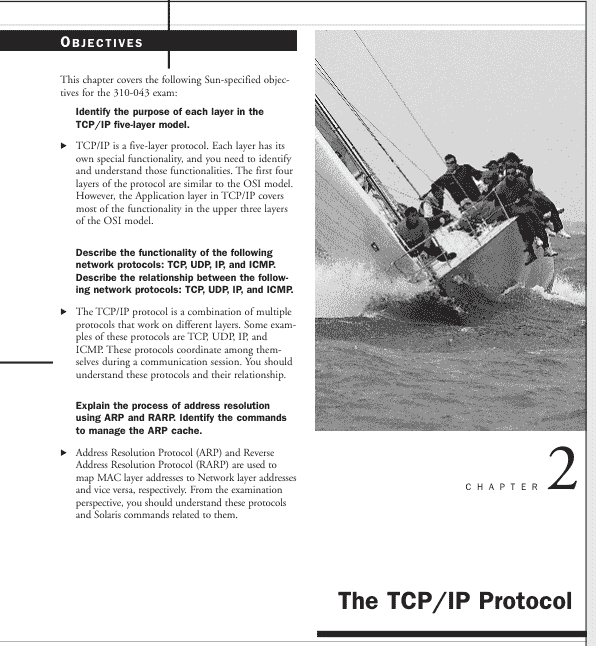

**目标详解：** 每个目标之后紧跟着对其的解释，提供相关上下文，使其在与考试的关系中定义得更有意义。目标详解旨在利用作者的应试经验来澄清任何模糊之处。

## 目录

| 引言 | xx | 常用 TCP/IP 工具 | xx |
| :--- | :---: | :--- | ---: |
| **客户端-服务器术语** | **xx** | 使用 FTP | xx |
| 服务器 | xx | 使用 Telnet | xx |
| 客户端 | xx | 使用 Telnet 验证远程服务器的存在 | xx |
| 端口号 | xx | 使用 finger 命令 | xx |
| 套接字 | xx | 使用 nslookup 命令 | xx |
| 守护进程 | xx | 使用 rpt 命令 | xx |
| | | 使用 route 命令 | xx |
| **端口和套接字简介** | **xx** | **以 r 开头的命令** | **xx** |
| 知名端口号 | xx | 配置 r 命令 | xx |
| 什么是套接字？ | xx | 使用 Right 命令 | xx |
| 客户端-服务器应用模型 | xx | 使用 rcp 命令 | xx |
| 面向连接和无连接通信 | xx | 使用 rlogin 命令 | xx |
| | | 重要的互联网服务和端口号 | xx |
| **配置互联网服务** | **xx** | **故障排除** | **xx** |
| 以守护进程启动网络服务 | xx | 使用 telnet 和 rpcinfo 命令 | xx |
| 使用 initd 守护进程启动互联网服务 | xx | 使用 netstat | xx |
| 使用 initd 守护进程的优缺点 | xx | 使用 ndd 命令 | xx |
| 运行服务列表 | xx | 检查 TCP 状态 | xx |
| RPC 服务 | xx | 案例分析示例 | xx |
| **本章小结** | | | **xx** |

**章节大纲：** 当您能同时看到整体森林和具体树木时，学习总能得到提升。为了让您直观地了解一章中各个主题是如何结合在一起的，您将在每章开头找到章节大纲。在查找特定主题时，您也可以将其作为便捷的参考。

## 学习策略

本章向您介绍客户端-服务器术语和传输控制协议（Transmission Control Protocol）。这些协议包括 TCP 和 UDP。为了在本章中正确理解这些概念，请使用以下学习策略：

- 学习基础的客户端-服务器术语。
- 理解 TCP 和 UDP 协议，以及面向连接通信和无连接通信。
- 复习用于配置互联网服务的不同配置文件的格式。
- 在 Solaris 上获得配置互联网服务步骤的实际操作经验。
- 练习配置 r 命令。
- 学习互联网服务的故障排除流程。
- 完成本章末的所有练习和问题。

**学习策略：** 每个主题都有其自身的学习挑战。为了支持您完成学习，New Riders 加入了关于如何最佳地进行学习的策略，以便记住本章内容，特别是考试中涉及的部分。

## 章节内的教学特性

本书包含大量且不同类型的信息。许多不同的元素旨在帮助您根据信息的目的及其对考试的重要性来识别信息，并为您提供多样化的学习方式。您可以根据自己的目标决定在某些元素上投入多少注意力。通过熟悉不同的信息呈现方式，您将知道作为考生哪些信息对您很重要，以及作为从业者哪些信息对您很重要。

> **考试提示：** 考试提示出现在页边距中，以提供具体的与考试相关的建议。此类提示可能会涉及考试涵盖（或不涵盖）的内容、涵盖方式、提及的设备或该考试的特定古怪之处。

> **考试提示：** 有时 Telnet 会话会出现问题，导致您无法在 Telnet 窗口中找回提示符。在这种情况下，`close` 命令非常方便。

**注意：** 注意事项出现在页边距中，包含各种有用的信息，例如关于技术或管理实践的技巧、术语和技术的历史背景，或关于行业问题的旁注。

```
name (ftp.newriders.com remote) anonymous
331 Guest login ok, send your complete e-mail address as
Password:
User
230 Login successful.
230 Welcome to ftp.newriders.com.
230 No Restrictions Apply:
230 
230 
230 
230 - Management
230 
226 Transfer complete. FILE README
230 It was last modified on Thu Oct 26 22:50:48 2000 68 
226 
230 Guest login ok, access restrictions apply.
ftp > quit
```

### 使用 Web 浏览器使用 FTP

您还可以使用 Web 浏览器通过 FTP 传输文件。要连接到 FTP 站点，请输入该站点的名称（以匿名用户身份），以下是如何使用如下 URL 的方法：

`ftp://ftp.newriders.com`

> **注意：** 匿名 FTP 是一项潜在的有问题的服务。如果您不需要它，请不要使用！

图 4.1 显示了使用此 URL 时 Netscape 浏览器的屏幕截图。在 Web 浏览器中获取文件列表后，您可以点击文件进行下载。当您点击目录名称时，您将进入该目录，该目录中的文件将在浏览器窗口中列出。


**图 4.1**

使用 Web 浏览器使用 FTP

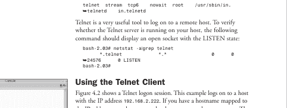

```
telnet strobe telnet
Welcome to telnet
```

Telnet 是登录到远程主机的非常实用的工具。要验证您的主机上是否运行着 Telnet 服务，以下命令 shell 将显示一个处于 LISTEN 状态的开放套接字：

```
bash-2.0$ netstat -an | grep telnet
TCP 0.0.0.0:23 0.0.0.0:0 * *:telnet LISTEN
bash-2.0$
```

### 使用 Telnet 客户端

图 4.2 显示了一个 Telnet 登录会话。此示例登录到 IP 地址为 192.168.1.100 的主机。192.168.1.100 是映射到 IP 地址的主机名。您可以使用主机名或 IP 地址来连接。Telnet 客户端尝试连接到 Telnet 服务器，连接建立后会出现提示符。在此提示符中，您必须输入有效的用户名，随后输入密码。如果用户名和密码有效，您将被允许登录到该主机。

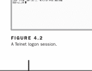

**图 4.2**

一个 Telnet 登录会话。

### 使用 Telnet 转义字符 (^])

在 telnet 会话期间，您可以通过按下 Ctrl + \] 来使用转义序列 `^]`。此序列将带您进入 telnet 提示符，您可以在此处使用不同的命令。以下是您在登录后立即使用此转义序列时应该得到的响应。

**图：** 为了提高可读性，图片尽可能地被放置在页边距中，以免中断正文的主流。

```
$ 6 ( / mood ( S = 0) END (exit) 0 ) /etc/netboot. 

#!
/bin/bigger # mail.crit "SERVERDOWN"
/bin/bigger # mail.crit "SERVERDOWN"

#stop
/usr/bin/skill - u & sendmail

# 
echo "usage: SB [ start | stop ] "
exit 0
exit 8
```

## 如何创建您自己的启动脚本

本节将解释如何创建您自己的启动脚本。

### 分步指南

#### 4.1 创建启动脚本

启动您自己的网络服务器进程是一个分为三步的过程，如下所示：

1. 在 `/etc/init.d` 目录中创建启动脚本。
2. 在 `/etc/rc.d/S` 目录中为该脚本添加启动链接，其中 S 是您希望启动服务器进程的运行级别。此链接的名称应以字母 S 开头。
3. 在 `/etc/rc.d/K` 目录中为该脚本添加关闭链接，其中 K 是您希望关闭服务器进程的运行级别。此链接的名称以字母 K 开头。

现在让我们为一个服务器进程创建简单的脚本。假设该进程的可执行文件为 `/sbin/sample-server`，该进程将在运行级别 3 中启动，并在运行级别 2 中关闭。简单的脚本可能如下所示：

`#!/bin/sh`

`START "S3"`


**分步指南：** 分步指南是实际操作教程，包含引导您完成与考试目标相关的特定任务或功能的指令。

## 案例研究

本书在各章节中穿插了案例研究，旨在为您提供另一个更具概念性的机会来应用您正在学习的知识。这些案例还反映了作者在“现实世界”中的经验，不仅能让您为考试做好准备，还能让您应对实际的网络管理工作。在每个案例研究中，您都会发现类似的元素：场景描述（Scenario）、案例要点（Essence of the Case）以及详细的分析部分（Analysis）。

- **案例要点（Essence of the Case）：** 一个要点列表，列出了场景中需要解决的关键问题或议题。
- **场景（Scenario）：** 几段文字，描述该领域专业从业人员可能会面临的情况。场景将处理与本章涵盖的目标相关的问题，并包含决定成败的关键细节。
- **分析（Analysis）：** 对处理案例要点中所列问题的最佳方法的详细描述。在此部分中，您可能会发现汇总解决方案的表格、文字示例或两者兼有。

## 广泛复习与自测选项

在每章末尾，除了一个总结部分外，您还会发现一个名为“应用您的知识（Apply Your Knowledge）”的部分，其中提供了几种不同的方法来测试您对材料的理解并复习所学内容。

- **关键术语（Key Terms）：** 每章末尾会出现一个关键术语列表。在参加考试时，您应确保自己知道这些术语，并能熟练地定义和理解它们。
- **章节总结（Chapter Summary）：** 在“应用您的知识”部分之前，您会看到一个章节总结，它对本章进行收尾并回顾您应该掌握的内容。
- **练习（Exercises）：** 这些活动为您提供了执行特定实际操作任务的机会。我们的目标是提高您对产品或技术的熟练程度。您必须能够执行这些任务才能通过考试。
- **复习题（Review Questions）：** 这些开放式简答题允许您快速评估对本章阅读内容的理解程度。这些问题不要求您从选项列表中选择，而是要求您用自己的话陈述正确答案。虽然在考试中不会遇到这类问题，但它们确实能测试您对核心概念的理解水平。

## 如何使用本书

**考试题（Exam Questions）：** 这些问题反映了 Microsoft 考试中出现的多选题类型。利用它们来熟悉考试题型，并帮助您确定哪些内容已经掌握，哪些内容需要复习或进一步学习。

| 考试题 | |
| :--- | :--- |
| 1. 以下哪个不是域名服务器的类型？<br>A. 主域名服务器<br>B. 从域名服务器<br>C. 备份域名服务器<br>D. 缓存域名服务器 | A. NS<br>B. PTR<br>C. NSME<br>D. CNAME |
| 2. 哪个文件决定 DNS 服务器是主服务器、从服务器还是缓存服务器？<br>A. hints 文件<br>B. named.env 文件<br>C. named.hosts 文件<br>D. named.ca 文件 | 6. 以下哪个不是 `/etc/hosts` 文件中的有效条目？选择所有适用项。<br>A. 1.1.1.1 123.2.222 foo - cognizant<br>B. 1.adm109<br>C. 1.adm10<br>D. 1.adm10 laptop-10 192.168.2.11 |
| | 7. SOA 资源记录中不包含哪项信息？<br>A. 序列号 |

### 应用您的知识

**答案与解析（Answers and Explanations）：** 对于每道复习题和考试题，您都可以在该部分末尾找到详细的解析。

- 1. 名称是域内的管理边界。一个域可以由一个名称、部分或多个区域组成。一个区域可以包含一个或多个域。虽然域是一个逻辑边界，但域通常用于将管理权限委派给他人。
- 2. 以下方法用于主机名解析：
  - `/etc/hosts` 文件
  - `NIS`
  - `NIS+`
- 3. DNS 服务器有三种基本类型：
  - 主域名服务器
  - 从域名服务器
  - 缓存或提示域名服务器
  - 根域名服务器也被认为是一种 DNS 服务器。
- 4. 区域传输是将区域数据文件从主名称服务器传输到从名称服务器的过程。此过程使用 TCP 端口 53。

**建议阅读与资源（Suggested Readings and Resources）：** 每章的最后一个元素是一个额外资源列表，如果您希望超越认证级别的材料，或者需要在某个难以理解的特定主题上投入更多时间，可以使用这些资源。

| 建议阅读 | |
| :--- | :--- |
| *Computer Networks*, Andrew S. Tanenbaum | *TCP/IP Illustrated, vol. 1*, Richard Stevens |
| *Computer Networks and Internets*, Douglas E. Comer and Ralph E. Droms | *Internetworking with TCP/IP Vol. 2: Principles, Protocols, and Architecture*, Douglas E. Comer |
| *TCP/IP Unashed*, Parker et al. | |

## 目标

本章涵盖了 Sun 为 310-043 考试指定的以下目标：

- **识别以下 LAN 组件的作用：** 网桥（bridge）、中继器（repeater）、路由器（router）、交换机（switch）和网关（gateway）。**识别网络拓扑。阐述以太网地址的目的。识别获取和设置驱动程序配置的命令。描述点对点通信。**

本章讨论的考试目标的目的是建立对计算机网络的基本理解。读者需要了解用于构建网络的不同组件。网络拓扑显示了网络的物理布局。每种网络拓扑都有其优缺点，用户需要理解这些。每台计算机通过网络适配器连接到网络。网络适配器在传输任何数据之前，使用访问方法来获取通信介质的控制权。以太网是访问通信介质和对计算机进行物理寻址最常用的技术。您将学习以太网地址的结构以及如何在 Solaris 中配置以太网驱动程序。

# 第一章

## 计算机网络简介

## 提纲

- 简介 XX
- **网络术语** XX
  - 计算机网络 XX
  - 主机与节点 XX
  - 路由器 XX
  - 网络协议 XX
  - 互联网 XX
  - 带宽 XX
- **网络分类** XX
  - 按地理区域定义的网络 XX
    - 局域网（LAN）XX
    - 广域网（WAN）XX
  - 按调制技术定义的网络 XX
    - 基带网络 XX
    - 宽带网络 XX
  - 按网络拓扑定义的网络 XX
    - 总线型拓扑 XX
    - 星型拓扑 XX
    - 环型拓扑 XX
    - 混合型拓扑 XX
- **ISO-OSI 参考网络模型简介**
  - OSI 分层 XX
    - 物理层 XX
    - 数据链路层 XX
    - 网络层 XX
    - 传输层 XX
    - 会话层 XX
    - 表示层 XX
    - 应用层 XX
  - 对等协议与接口 XX
  - 分层模型中的层头部与数据传输 XX
  - 分层协议模型的实用性 XX
- **网络设备** XX
  - 网络适配器 XX
  - 网络电缆 XX
    - 同轴电缆 XX
    - 双绞线 XX
    - 光纤电缆 XX
  - 连接器 XX
  - 段（Segments）XX
  - 收发器 XX
  - 骨干网 XX
  - 中继器 XX
  - 集线器 XX
  - 网桥 XX
  - 交换机 XX
  - 路由器 XX
  - 网关 XX
- **网络访问方法** XX
  - 载波侦听多路访问/冲突检测（CSMA/CD）XX
  - 令牌环 XX
- **以太网简介** XX
  - 以太网类型 XX
    - 10BASE-2 以太网 XX
    - 10BASE-5 以太网 XX
    - 10BASE-T 以太网 XX
    - 100BASE-T 以太网 XX
    - Gigabit 以太网 XX

## 纲要

## 学习策略

- 以太网地址与以太网广播
- 以太网帧格式
  - 前导码
  - 帧起始定界符
  - 目的地址
  - 源地址
  - 高层数据
  - 帧校验序列
- 帧间隙
- 标准以太网帧与 IEEE 802.3 帧的区别
- 数据封装

## 在 Solaris 中管理以太网接口

- 列出已安装的以太网接口
- 创建逻辑接口
- 设置接口状态为 UP 和 DOWN

## 排除常见以太网问题

- 使用 `ifconfig` 命令
- 使用 `netstat` 命令
- 使用 `snoop` 命令
- 使用 `ping` 命令
- 使用 `traceroute` 命令
- 使用 `ndd` 命令

## 本章小结

## 知识应用

本章主要包含与计算机网络入门概念和术语相关的理论信息。从考试的角度来看，为了最大限度地利用本章内容，请执行以下操作：

- 从头到尾阅读本章，并尝试理解其中讨论的术语。
- 再次浏览本章，仅查看各节标题。
- 练习本章中讨论的命令，以帮助你构建对 Solaris 网络接口的理解。

## 简介

在 20 世纪后期，网络极大地影响了商业和个人通信。*网络（network）*这个词代表了推动计算机革命的最重要的单一概念。在 20 世纪的最后一个十年中，互联网及其激发的各种信息交换经历了飞速演进。互联网互连催生了一个全新的行业，即*信息技术（information technology）*。高端 UNIX 服务器一直是互联网服务的核心。其中，Solaris 始终是一个重要的互联网平台。许多 24 $\times$ 7 全天候运行的互联网公司都依赖 Solaris 服务器提供的服务。

简单来说，*计算机网络*是指通过通信介质相互连接的计算机。计算机网络的目标是实现数据在计算机之间便捷、快速且可靠的传输。根据构建网络所使用的技术，可以通过多种方式实现这一目标。传输数据所需的可靠性和速度要求越高，就越需要先进的技术来实现网络，而这反过来又增加了安装和维护网络的成本。

本章是对计算机网络及其构建过程中使用的各种组件的介绍。讨论将从与计算机网络相关的常用术语开始；这些定义为进一步深入讨论提供了必要的基础。随后，本章的重点将转向如何根据地理位置对网络进行分类。

在本章中，你还将学习不同的网络拓扑结构及其各自的优缺点。关于网络拓扑的讨论部分集中在*国际标准化组织（ISO）*上，该组织提出了一个构建网络协议的模型。这个模型通常被称为*开放系统互连（OSI）*，也被称为*ISO-OSI*。ISO-OSI 是一个七层网络协议模型，其中每一层具有不同的功能并与其他层协作。本章将探讨 OSI 模型中的每一层，并让你了解这些层是如何相互交互的。你还将学习分层模型的优势，以及连接到同一网络的两个主机之间如何进行数据传输。最后，你将学习网络中使用的各种设备。网络中使用的每种设备类型（如路由器、交换机、网关和电缆）都将结合其在 OSI 模型中运行的相应层级进行讨论。

本章还将回顾网络访问方法。*访问方法*用于获取通信介质的控制权以启动数据传输。文中将介绍不同类型的以太网，以及如何在以太网网络上实现广播。此外，你将学习在 Solaris 系统中列出已安装以太网接口的命令，以及排除常见以太网问题的命令。以太网网络中的数据以数据帧的形式从一台主机传输到另一台主机。*数据帧*由实际数据和控制信息组成。控制部分包含源地址、目的地址以及用于检测错误的信息。在本章中，你将学习以太网帧的格式以及所有这些信息是如何被封装在帧内部的。

在完成本章学习后，你应该能够理解计算机网络的基本概念、网络术语以及网络的构建方式。你应该了解分层网络模型和 ISO-OSI 网络模型。你应该能够获取 Solaris 系统中以太网适配器的信息，并且熟悉一些网络故障排除命令。

### 网络术语

与其他技术领域一样，计算机网络领域充斥着专业术语。对于网络管理员来说，掌握并理解最常用的术语至关重要。本节定义了你需要了解的入门术语。随着你阅读本书的深入，这些术语及其含义将变得更加熟悉。

#### 计算机网络

计算机网络可以用多种方式定义。一般来说，*计算机网络*是通过通信介质相互连接（以某种方式）的计算机集合。网络由硬件和软件组成，两者集成以提供各种服务。连接到网络的计算机可以在网络提供的服务的帮助下相互通信。连接到网络的设备被称为*主机（host）*或节点。主机中安装了一块特殊的硬件，称为网络适配器或网络接口。网络适配器用于将每台主机连接到公共通信介质。这种通信介质可以是铜线、光纤电缆，或者仅仅是一个无线频段。

#### 主机与节点

节点或主机是连接到网络的任何设备。它可以是个人计算机、工作站或服务器、路由器或任何其他设备。在本书中，“主机”和“节点”这两个词可以互换使用。特定的网络设备会通过名称明确提及。当提到关于连接到网络的机器的通用概念时（例如），会使用主机或节点这个词。然而，在专门讨论与 Solaris 系统相关的内容时，会使用 Solaris 服务器或 Solaris 工作站，而不是主机或节点。同样，在讨论路由器时，会明确指出。

### 路由器

随着信息交换需求的不断扩大，将多个网络连接在一起的需求也随之增加。路由器就是为此目的而设计的设备。通常，一个路由器具有多个网络适配器，每个适配器连接到一个不同的网络。路由器从所有连接的网络接收数据包，并根据目的地址将这些数据包转发到目的网络或主机。路由器可以被视为数据包的收集、分拣、过滤、丢弃和分发点。图 1.1 展示了路由器的典型应用。在这种情况下，路由器将三个网络相互连接。

现代路由器的功能远不止路由数据包。它们还充当安全设备，实施某种类型的安全策略。最常见的安全策略类型是使用访问列表。访问列表允许特定的主机和网络进入某个网络，而屏蔽世界上的其他部分。在其他情况下，选定的主机或网络（可能是那些产生违规网络流量的主机）会被屏蔽。路由器的包过滤能力也使其成为出色的防火墙。一些路由器具有网络地址转换（NAT）功能。这是一个非常有用的特性，使你能够将私有网络隐藏在充当 NAT 服务器和/或防火墙的路由器之后。

图 1.1.1

路由器的典型应用。

### 网络协议

*网络协议*可以被认为是一种所有网络主机都能够理解的通用语言。基本上，*协议*是一套管理网络主机之间数据传输的规则。自从计算机网络研究开始以来，已经开发了许多协议。最常见的是 TCP/IP 协议族。ISO 提出了一种分层的网络协议模型，将其作为参考模型。该模型被称为*开放系统互连*（OSI），将在本章后面详细讨论。

*TCP/IP* 是连接到 Internet 的计算机的标准协议。目前，几乎所有连接到公共 Internet 的网络都支持 TCP/IP 协议。该协议的当前版本是 4（通常称为 *IPv4*）。然而，由于 Internet 的迅猛增长，该版本的网络地址已变得稀缺。由于无法满足网络地址的需求以及一些其他问题，该版本正被第 6 版（*IPv6*）取代。在这一过渡时期，两个版本的协议共存以支持旧系统。

Solaris 8 同时支持 IPv4 和 IPv6。本书中直到第 9 章“IPv6 简介”之前的所有讨论都与 IPv4 相关。从用户的角度来看，这两个版本之间的第一个主要区别是 IP 地址的长度，IP 地址是分配给每个连接到 Internet 的主机的数字。在 IPv4 中，该地址的长度为 32 位，而在 IPv6 中为 128 位。

### 互联网（The Internet）

通常，*internet* 是多个独立网络的组合。世界上大多数私有网络和公共网络以某种方式相互连接。这种全球性的网络互联被称为 *Internet*（互联网）。从现在起，每当本书提到 Internet 时，是指为不同类型的用户提供不同服务的全球公共互联网。

相比之下，*intranet*（内网）是一个私有网络，提供与 Internet 相同的部分服务。然而，访问内网通常仅限于特定公司或组织内部的人员。

请注意，连接到单个网络的计算机必须理解一种通用协议才能进行通信。也就是说，不同类型、采用不同协议的网络可以通过特殊类型的网络设备连接到 Internet。这些设备被称为*协议转换器*或网关。

#### 带宽

*带宽*是对通信介质数据传输能力的度量。数据传输速度是用带宽来衡量的。简单来说，带宽是指用于互连网络主机的通信介质的容量。从技术上讲，带宽是指能够通过通信介质的频率范围。带宽越高，频率范围越大，能够通过网络的数据就越多。做一个简单的类比，将带宽想象成水管的过水量。如果你使用更大的水管（更多带宽），则有更多的水可以流过（更多数据可以传输）。在日常用语中，许多网络专业人士出于同样的原因使用 *pipe*（管道）一词来代替带宽。

例如，一个快速以太网的带宽为 100Mbps。这意味着这种类型的网络每秒可以传输 100 兆比特的数据。换句话说，这是该类型网络传输数据的理想最大速率。所有网络标准都规定了特定类型通信介质可用带宽的上限。

在设计大型网络时，带宽是最重要的考虑因素，因为你必须根据所需的带宽数量向服务提供商付费。例如，如果一家公司在不同城市有许多办事处，它可以通过在办公室内铺设电缆在每个办事处安装局域网。然而，该公司必须寻求另一家公司的帮助来互连这些办事处。这家“其他”公司将提供这些办事处之间的互连介质，但会对你购买的带宽量收费。

随着网络技术的诸多创新，对带宽的需求正在大规模增长。许多协议已经标准化，用以管理带宽并强制执行某种类型的服务质量（QoS）。

### 网络分类

网络有许多不同的分类方式。最常见的分类基于三个具体标准：地理区域、调制技术和网络拓扑。这些是本书中探讨的分类，将在以下章节中简要介绍。

#### 按地理区域定义的网络

根据覆盖的地理区域，网络通常分为两类：*局域网*（LAN）或 *广域网*（WAN）。局域网和广域网在互连方面使用了完全不同的技术。这两类网络之间的数据传输速率也存在显著差异。

##### 局域网（Local Area Networks）

局域网通常局限在建筑物内，连接部门或小组级别的主机。LAN 使用直接电缆连接，与广域网相比，其数据传输速度非常快。LAN 使用私有布线，安装和维护成本较低。此外，与 WAN 相比，其设备较不复杂且价格较低。

##### 广域网（Wide Area Networks）


广域网通常用于将部门局域网连接在一起，且往往跨越多个城市或国家。通常，互连使用第三方服务提供商和电信公司的服务。由于带宽成本高，WAN 中使用的数据传输速度较低。Internet 是广域网最常见的例子。

一些计算机网络领域的新手认为，广域网只是跨越较大（“宽”）地理区域的大型局域网。这是不对的。LAN 和 WAN 是两种完全不同的技术。这两类网络使用了不同类型的设备和不同的网络协议。例如，以太网是一种 LAN 技术，不用于 WAN。

## 按调制技术定义的网络

现在你已经了解了什么是带宽，本节将解释它是如何被利用的。一组频率可以通过通信介质传输。这个范围可以细分为更小的范围。每个较小的频率范围（都是大范围的子集）被称为一个*频带* (band)。如果一个通信介质可以传输高达 1GHz (1000MHz) 的频率，我们可以将这些频率分为 10 个不同的频带，每个频带 100MHz。这 10 个频带包含的频率范围如图 1.2（b 部分）所示。

根据网络利用可用频率范围传输数据的方式，网络通常分为两类：*基带网络* (baseband networks) 和 *宽带网络* (broadband networks)。通常，所有网络标准都会显示特定类型的网络将使用哪种技术。

图 1.2

频带。

### 基带网络

基带网络将所有可用频率视为一个单一频带，并利用全部带宽在其上传输数据（参考图 1.2，a 部分）。不存在带宽共享，在特定的时间片内只能存在一个网络通信会话。基带网络不使用调制，因为所有可用带宽仅由一种类型的信号利用。相比之下，宽带网络使用某种类型的调制。这就是基带网络和宽带网络之间的根本区别。

### 宽带网络

在宽带网络中，可用频率被分为不同的频带。使用某种调制技术使得多个网络通信可以共存。例如，在图 1.2（b 部分）中，一个网络上的一个主机可以使用频带 3，而另一个网络上的主机可以使用频带 7。通过这种方式，多个通信会话可以同时发生而互不干扰。这种频率划分也被称为*频分复用* (FDM)。

随着光纤技术的日益普及以及光纤网络的高带宽可用性，宽带网络在高速和无线数据传输中变得越来越流行。

## 按网络拓扑定义的网络

网络的物理互连布局称为*网络拓扑*。不同的网络拓扑具有不同的特性。其中一些成本较低，但可靠性较低且难以维护；而另一些易于维护，但成本较高。同样，不同的网络拓扑具有不同的故障点。以下部分将讨论一些最常见的拓扑结构。

### 总线拓扑

在*总线拓扑*中，网络中的所有主机都连接到一条公共总线，这实际上是一根电缆（见图 1.3）。

总线拓扑通常用于广播网络，其中一次只能有一个主机传输数据。这是一种低成本的解决方案，并且易于安装。但维护通常较为困难，在大多数情况下，当你需要增加另一台主机时，必须关闭网络。此外，总线是网络的单点故障点。因此，如果总线在任何一点发生故障，整个网络都会瘫痪。

为了避免总线末端的信号反射，通常使用终端电阻。*终端电阻*（terminator）本质上是一个电阻器，用于连接信号路径并吸收到达端点的信号。

### 星型拓扑

图 1.4 显示了一个星型拓扑，其中所有主机都连接到一个中心位置。这个中心位置就是网络的集线器（hub）。这是局域网中最常见且低成本的解决方案。

星型连接网络同样存在单点故障，即集线器。然而，在增加或删除主机时，你不需要关闭整个网络。你可以从网络中移除故障主机，并且在不干扰其他主机功能的情况下添加新主机。

**图 1.4**

星型拓扑网络。

### 环型拓扑

环型连接网络等同于将总线连接网络的两个端点连接在一起的总线网络（见图 1.5）。

双环也被用于连接网络。*光纤分布式数据接口*（FDDI）是此类网络最常见的例子。如果其中一个环发生故障，主机仍可以使用第二个环来传输数据。这提供了更高程度的可靠性。

**图 1.5**

环型拓扑网络。

### 混合或混合拓扑

大多数实际网络实际上是两种或多种拓扑类型的组合。这些被称为*混合或混合拓扑网络*。例如，在许多网络中，计算机以星型拓扑连接到集线器，然后这些集线器通过总线骨干网相互连接。在许多校园网中，FDDI 被用作骨干网，而较小的网络部分则采用星型或总线拓扑。图 1.6 显示了一个典型的通过总线连接多个集线器的网络外观。

**图 1.6**

典型的网络连接方案。

> 注意：本书的许多读者可能听说过令牌环（Token Ring）网络。从物理上讲，令牌环网络并不是环型连接网络，而实际上是星型连接网络。

### 实践经验

- 总线连接网络仅适用于不需要频繁在网络中增加或删除主机的场景。因此，这种拓扑仅适合小型网络。

- 星型连接拓扑由于成本较低且易于维护，是最常用的拓扑。可以在不关闭网络的情况下增加或删除主机。

- 双环网络（如 FDDI）被用作校园骨干网。

## ISO-OSI 参考网络模型简介

如前所述，*协议*（protocol）是一组所有网络主机都能理解的通用规则。协议用于在计算机之间传输数据。虽然单个网络上可能存在多种协议，但两台主机之间要进行数据传输，必须对一种通用协议达成共识。我对协议最喜欢的类比是人类语言。坐在同一个地方的人可能说着不同的语言，但为了两人之间能够成功沟通，他们必须同意使用一种共同的语言。同样地，一台主机可能理解多种协议（就像某些人能理解多种语言一样）。然而，要与另一台主机通信，两台主机必须知道一种共同的协议。

多年来，人们设计了许多协议。其中一些非常流行，而另一些则不然。ISO 尝试通过提出一个参考网络模型（OSI）来标准化协议设计方法。该网络模型通常也被称为 ISO-OSI，它是一个分层协议模型。在该模型中，从一台主机到另一台主机的整个数据传输过程被分为不同的部分（层）。每一层在过程中执行不同的任务，并通过定义良好的接口与直接位于其上方和下方的层进行通信。ISO-OSI 是一个七层协议模型。在本章稍后部分，你将学习这些不同层的功能。

请注意，OSI 模型仅是协议开发者的参考模型，它本身并不是一个协议。大多数通用且流行的协议并不完全按照此参考模型工作。例如，最常用的协议是 TCP/IP 协议，它包含五个层，而 OSI 模型有七层。

### OSI 各层

OSI 模型共有七层。最底层（第一层）是物理层，处理实际的硬件和电信号。最顶层（第七层）是应用层，大多数网络用户交互仅发生在该层。事实上，网络用户无法“看到”在较低层中运行的进程。图 1.7 显示了 OSI 模型中每一层的位置。

OSI 模型中的每一层都使用其下层的服务并为其上层提供服务。这些服务通过服务访问点（SAPs）提供。接下来的章节将讨论 OSI 的每一层。

**图 1.7**

ISO-OSI 网络模型的七层结构。

#### 物理层

物理层是通过通信介质以某种形式的信号进行实际数据传输的地方。最常用的介质是使用电信号进行数据传输的铜线。如果使用光纤电缆作为通信介质，则使用光信号进行数据传输。在无线网络中，电磁波承载数据。

> **考试提示**

> 在考试中，你需要知道每一层提供哪些服务。你还需要知道每一层在 OSI 模型中的位置。

不同类型的网络使用不同类型的信令方法。网络拓扑在物理层也起着非常重要的作用。根据所使用的通信介质，会使用不同类型的电缆、连接器和网络适配器。这一层由网络用户可见的网络物理部分组成。

#### 数据链路层

*数据链路层*（DLL）直接位于物理层之上。该层接收来自上层（网络层）的数据并将其在物理层上传输。该层的功能是获取通信介质的访问权，并确保在计算机网络中数据能够无误地从一点传输到另一点。

该层分为两个子层：*介质访问控制*（MAC）子层和*逻辑链路控制*（LLC）子层。MAC 子层与物理层交互。这是 DLL 中使用每台主机物理地址的部分。这些物理地址也被称为 *MAC 地址*。本章稍后将更详细地讨论 MAC 地址。在同一个网络中，每台主机应有一个唯一的 MAC 地址。当物理网络中的介质由许多主机共享时，MAC 层确保只有一个主机能访问通信介质。可以使用不同的访问方法来获取共享介质的访问权。本章讨论其中两种访问方法：*载波侦听多路访问/冲突检测*（CSMA/CD）方法和令牌环方法。LLC 为网络层提供数据传输服务。通过使用 LLC，网络层中的多个协议可以在单个物理网络上进行多路复用。

物理层的数据被视为 1 和 0 形式的信号，而 DLL 层的数据则以帧的形式存在。*帧*（frame）是一个包含实际数据和控制信息的数据包。根据用于网络访问的协议，帧的结构和长度有所不同。在其最常见的形式中，每个帧包含源 MAC 地址、目的 MAC 地址、实际数据以及用于检测错误的信息。

#### 网络层

网络层为每个主机分配唯一的逻辑地址。网络层中的数据实体被称为分组（packets）。该层负责点对点的可靠数据传输、错误检测与纠正以及路由。在这一层中，跨网络边界的网络路由被定义。*网络路由*（network route）是一条数据包从源主机传输到目的主机。这些路由是静态定义的或根据网络条件动态计算的。关于路由过程的更详细讨论，请参阅第 3 章“TCP/IP 网络中的路由”。根据所使用的具体网络协议，网络地址的结构可能会有所不同。例如，在 TCP/IP 网络 (IPv4) 中，所有主机都被分配 32 位地址。在 IPv6 中，主机被分配 128 位网络地址。

#### 传输层

传输层负责端到端的可靠数据传输。从上层接收的数据被分成数据包，并交给网络层进行传输。该层提供了客户端/服务器应用程序的基础设施，供应用层用于构建客户端/服务器应用环境。

在网络层级别，一台计算机在外部世界看来是通过其网络层地址而被识别的单一实体。然而，所有主机都能够运行多个服务。传输层实现了端口地址，用于区分主机上的不同服务。当传输层接收到入站数据包时，它会检查端口地址，并根据端口号对数据包进行排序并转发给不同的服务器应用程序。

为了建立两台主机之间的通信，使用了套接字（sockets）。套接字是网络层地址和端口号的组合。服务器在一个已知端口上打开一个套接字，并等待任何客户端请求服务。当客户端需要某种服务时，它在自己的主机上打开一个套接字，并将该套接字连接到服务器打开的套接字。通过这种方案，双向通信成为可能。

**注意**

你应该理解，与 MAC 地址（也称为物理地址）相比，网络层中定义的地址是逻辑地址。网络地址由网络设计者和管理员在安装网络时分配，并且可以随时更改。相比之下，MAC 地址被烧录在网络适配器中，是固定不变的。

#### 会话层

会话层负责三项任务：

- 启动会话

- 管理会话

- 关闭会话

该层负责在网络上的两台主机之间初始化连接。当通信结束且不再需要连接时，会话层会断开会话。

#### 表示层

*表示层* 负责任何所需的数据转换。如果连接在网络上的不同主机使用不同的数据表示方案，则可能需要进行转换。例如，假设两台主机需要共享一些数据。一台主机使用 ASCII，另一台使用 EBCDIC。表示层负责在数据传递给应用层之前转换数据格式。

#### 应用层

*应用层* 是用户使用不同应用程序与网络进行交互的地方。最常见用户应用程序是 Telnet 和 FTP。通过这些应用程序，用户可以连接到网络上的特定主机。

表 1.1 简要描述了 OSI 各层。

| 层 | 描述 |

| :--- | :--- |

| 物理层 | 以信号形式通过通信介质传输数据。 |

| 数据链路层 | 管理 MAC 地址。从网络层接收数据并通过物理层传输。数据被视为帧。 |

| 网络层 | 管理逻辑网络和主机地址。确保数据的点对点正确交付。负责路由。 |

| 传输层 | 负责端到端的数据传输、错误检测和纠正。 |

| 会话层 | 建立和拆除通信会话。 |

| 表示层 | 转换不同类型的数据，使其适用于应用层。 |

| 应用层 | 与网络交互并为网络用户提供接口的实际应用程序。 |

### 对等协议与接口

在分层网络模型中，每一层与其两个相邻层通信。其中一层是参考模型中的直接下层，另一层是直接上层。这种通信基于定义良好的规则，也称为接口。因此，网络层具有一个指向数据链路层的接口和一个指向传输层的接口。

在数据传输过程中，一台主机上的某一层与另一台主机上相同级别的层进行对话。例如，在网络上的两台主机通信期间，一台主机上的网络层发送的信息由另一台主机上的网络层解释。管理不同主机上相似层之间这种通信的协议称为对等协议（peer protocols）。不同主机上同一级别的层称为对等层（peer layers）。例如，一台主机上的网络层是另一台主机上网络层的对等层。

### 分层模型中的层报头与数据传输

分层网络模型中的每一层与三层进行对话。其中两层是同一主机上的直接上层和下层。第三层是另一系统上的对等层。图 1.8 展示了这一过程。在本例中，深灰色显示的网络层与浅灰色显示的三层通信。这些层是同一主机上的传输层和数据链路层，以及另一主机上的网络层。


**图 1.8** 某一层与其他层的交互。

为了与上层和下层通信，该层使用接口。为了与对等层通信，则使用对等协议。发往对等层的信息通过层报头（layer header）随数据一起附加。例如，当一台主机上的应用层想要发送一些数据到另一台主机的应用层时，它会为数据附加一个应用层报头。应用层报头包含给另一系统应用层的信息。利用这些信息，目的系统上的应用程序就能知道如何处理这些数据。

附加完报头后，应用层将数据交给表示层。随后，表示层将自己的层报头附加到数据中。该报头包含关于所用数据代码的信息，以便目的系统上的表示层可以在需要时决定如何将数据转换为不同的代码。然后，表示层将带有应用层和表示层报头的数据交给会话层。会话层随后与目的主机启动通信会话，并在数据中附加自己的报头。通过这种方式，发送主机上的所有层都将其层报头附加到实际数据中。所有这些报头都包含给对等层的信息。当数据到达物理层时，它被传输到目的主机。当数据到达目的主机时，它从物理层向应用层移动。在传输过程中，每一层都会剥离其对等层报头，获取如何处理数据的相关信息，然后将数据转发给上层。图 1.9 展示了这一过程。

在图 1.9 中，使用了以下约定：

- DATA：从一台主机上的应用程序传输到另一台主机上应用程序的实际数据

- AH：应用层报头 (Application layer header)

- PH：表示层报头 (Presentation layer header)

- SH：会话层报头 (Session layer header)

- TH：传输层报头 (Transport layer header)

- NH：网络层报头 (Network layer header)

- DH：数据链路层报头 (Data Link layer header)

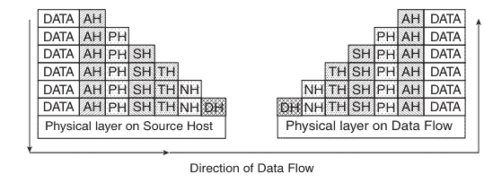

**图 1.9** 分层模型中的数据传输过程。

### 分层协议模型的实用性

所有网络通信协议都是分层构建的。每一层使用其下层提供的服务，并为其上层提供服务。第 $N$ 层使用第 $(N-1)$ 层的服务，并为第 $(N+1)$ 层提供服务。一层向其上层提供的服务通过 *服务访问点 (service access points)* 进行访问。最顶层通常是应用层，它为网络协议的用户提供服务。

分层模型也被称为 *协议栈 (protocol stacks)*。分层模型为协议的设计和实现过程提供了模块化。跨越如此多不同类型的通信介质和主机的数据传输是一个复杂的过程。将这个过程分解为多个部分，使得网络协议的实现变得更加容易。

分层网络模型为协议实现提供了以下好处：

- 网络协议的复杂任务被分解为较小的任务，易于可视化和实现。

- 由于网络协议栈的每一层仅与其相邻的上层和下层交互，程序员无需担心其他层及其功能。例如，应用程序开发人员只需要知道 TCP/IP 协议中 TCP 或 UDP 层提供的服务，而无需关心网络访问方法（令牌环、以太网等）。这意味着应用程序开发过程独立于网络拓扑或网络访问方法。

- 一旦定义了对等协议和接口，开发工作就可以并行开展。

- 它提供了模块化，使得协议栈易于维护。

- 使用一种称为 *多路复用 (multiplexing)* 的技术，同一层的多个实例可以在下层上共存。例如，可以在单个网络层协议之上构建多个传输层协议。第 2 章“TCP/IP 协议”讨论了 TCP、UDP 以及其他可以使用 IP（一种网络层协议）服务的传输层协议。

软件部分可以在不同的协议实现中重复利用。例如，同一个 DLL 的 DLL 实现既可以用于 TCP/IP 协议，也可以用于 IPX 协议。

## 网络设备

每个网络都有其构建块。其中最重要的三个构建块如下：

- **参与网络的主机或计算机。** 这些主机可以是简单的个人计算机、工作站和服务器，或者是专为计算机网络设计的专用设备（如路由器和交换机）。

- **互连介质。** 互连介质通常是某种类型的电缆和连接器。在无线网络中不使用电缆。

- **网络操作系统。** 网络操作系统控制网络中不同主机之间发生的所有网络通信。网络操作系统的主要组成部分是该特定网络操作系统所支持的网络协议。

本节将向您介绍用于构建网络的设备。这些设备涵盖了从电缆、连接器到路由器和网关的各种设备。

### 网络适配器

*网络适配器*（network adapter）将主机连接到网络通信介质，通常通过电缆连接。最常见的是安装在服务器或工作站内部的网卡。在某些计算机中，网络适配器是内置在系统主板上的。网络适配器有一个或多个连接点用于连接网络电缆。不同类型的网络适配器用于不同的网络。例如，用于连接 Token Ring 网络的网络适配器与将主机连接到以太网网络的适配器不同。即使对于不同类型的以太网，也会使用不同的网络适配器。

> **考试技巧**

> 在考试中，你可能会被问到不同类型网络设备的功能。你还可能会被问到某些网络设备工作在哪个位置（即 OSI 模型的哪一层）。

在购买网络适配器时，请留意网络适配器上可用的连接器类型。

### 网络电缆

电缆是一种通信介质，主机通过它在网络上与另一台主机通信。电缆传输电信号或光信号，将信息从一点传递到另一点。对于不同类型的电缆，使用不同类型的连接器将其连接到安装在主机内部的网络适配器上。以下章节描述了最常见的电缆类型。

#### 同轴电缆

同轴电缆使用一根中心导线，周围环绕着绝缘体，并包裹在导电屏蔽层中。整个组件被包裹在一个塑料绝缘体中。中心导线用于传输实际信号，而屏蔽层则作为信号地。这种类型的导线在存在电磁干扰的环境中表现非常好。图 1.10 显示了这种电缆的横截面。


目前常用两种类型的同轴电缆。细同轴电缆用于最长 185 米的以太网网络段，而粗同轴电缆用于最长 500 米的距离。

## 双绞线

双绞线是安装局域网最常用的电缆。它是一种语音级电缆，由四对扭在一起的导线组成，包裹在塑料绝缘体中。双绞线有不同的类别。最常见的是 5 类线（category 5），其数据传输速率最高可达 100Mbps。这种电缆用于 10BASE-T、100BASE-T 和 Token Ring 网络。这种电缆在抵御电磁干扰方面不如同轴电缆。


**图 1.10**

同轴电缆的横截面。

双绞线主要分为两大类：`屏蔽双绞线`（shielded twisted-pair cable）和 `非屏蔽双绞线`（unshielded twisted-pair cable）。屏蔽双绞线在四对电缆周围有一个金属屏蔽层，屏蔽层外部覆盖有塑料涂层。非屏蔽电缆没有这个涂层。与非屏蔽双绞线相比，屏蔽双绞线具有更好的抗外部电磁干扰能力。屏蔽电缆价格昂贵，仅用于电磁噪声较高的场所。

## 光纤电缆

光纤电缆用于高速网络。此类网络最常见的例子是 FDDI 和千兆以太网（Gigabit Ethernet）。在光纤电缆中，数据以光波信号传输，而其他电缆中的数据以电信号传输。使用光纤电缆的网络是高容量网络，因为它们拥有更大的带宽。由于延迟低，光纤电缆使网络比铜缆更快。此外，这些网络可以跨越更大的地理区域。在不同环境下可以使用不同类型的光纤电缆。在大型校园网络中，光纤电缆被用作骨干网。

### 连接器

`连接器`（Connectors）与每种类型的电缆配合使用，以连接到网络适配器。最常用的连接器是用于同轴电缆的 BNC 型连接器和用于双绞线的 RJ-45 连接器。光纤电缆有不同类型的连接器。

对于同轴电缆，在电缆两端使用一种特殊的连接器。这些连接器被称为 `终端电阻`（terminators）。端接电阻与电缆具有相同的电阻。它们用于吸收到达电缆端点的所有信号，从而防止任何反射。

### 网段

网络 `网段`（segment）可以被认为是一个连续的电缆部分。网络段可以通过中继器连接在一起。

### 收发器

`收发器`（transceiver，transmitter/receiver）是一种特殊类型的设备，用于将 10BASE-5 以太网网络适配器连接到同轴电缆。

### 骨干网

`骨干网`（Backbone）是一个通用术语，用于指代将网络中较小部分相互连接的介质。通常这是一种用于承载更高数据速率的高容量介质。例如，大学中的本地部门网络可以通过某种类型的骨干网相互连接。几年前，FDDI 骨干网很流行。如今，`异步传输模式`（ATM）骨干网非常普遍。未来它们可能会被千兆以太网骨干网所取代。

### 中继器

`中继器`（repeater）是一种用于延长网络段长度的特殊设备。当电信号在电缆上传输时，由于噪声和电缆电阻的增加，其波形会发生畸变。随着信号传输距离的增加，这种畸变会越来越严重。如果电缆太长，信号可能会畸变到难以识别的程度，或者从中提取的信息可能会出现错误。为了解决这个问题，使用了中继器。中继器通过在信号到达目的地之前对其进行再生，将网络长度和拓扑扩展到单个电缆段所能实现的范围之外。中继器接收畸变的输入信号，并对其进行整形和再生。图 1.11 显示了一个离开主机的信号在传输过程中变得畸变，以及中继器如何对其进行再生。中继器工作在 OSI 参考模型的物理层。

在图 1.11 中，主机 1 和主机 2 位于由中继器连接的不同网段上。由于信号在传输过程中加入了噪声，当它到达中继器时在一定程度上发生了畸变。中继器再生并整形信号，输出的信号再次变得清晰。

你不能连接无限数量的中继器来增加网络的长度。在以太网中，你可以最多使用四个串联的中继器将五个网段连接在一起。

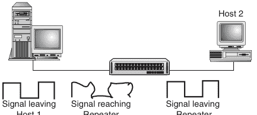

**图 1.11**

中继器的信号再生。

### 集线器

`集线器`（hub）充当星型连接网络的中心部分。有时它也被称为 `多端口中继器`（multipart repeater）。一个简单的中继器只有两个端口。进入一个端口的信号被再生到另一个端口，反之亦然。而对于集线器，进入一个端口的信号会被再生到所有其他端口。

集线器有多种配置。通常，多个集线器连接到骨干网上，以创建更大的局域网。

与中继器一样，集线器工作在 OSI 网络模型的物理层。

### 网桥

`网桥`（bridge）用于将网络连接在一起。网桥可以有多个端口，每个端口连接到一个独立的网络。网桥工作在 OSI 模型的数据链路层（见图 1.12）。数据从源主机的应用层开始。当它到达网桥时，它会上升到数据链路层。在该层，网桥决定是将帧转发到另一个网络还是将其丢弃。

网桥根据数据链路层地址（通常称为 MAC 地址）将数据包从一个网络转发到另一个网络。网桥构建一张 MAC 地址及对应端口的表。当它收到一个数据帧时，它会检查目标 MAC 地址，并将该数据帧转发到具有该目标地址的网络。如果它没有目标 MAC 地址的记录，它会将该数据帧转发到其所有端口。

网桥动态地构建其转发表。在收到每个数据帧后，网桥会对其进行分析以找出源 MAC 地址。如果该地址尚未在网桥表中，则将其插入表中。

图 1.12

网桥中的数据路径。

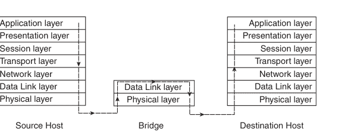

### 交换机

与集线器一样，`交换机（switch）`充当网络的中心点。交换机与集线器的区别在于，进入交换机一个端口的信号仅被重新生成并发送到该交换机的目标端口，而集线器则将信号重新生成并发送到所有端口。这样做的好处是，交换机的不同端口之间可以存在多条信号路径。交换机用于高速网络，因为由于网络中存在多个并发数据路径，整体流量吞吐量要大得多。

交换机工作在 OSI 模型的物理层和数据链路层。交换机记录连接到其端口的主机的链路层地址。当数据帧进入交换机的任何端口时，其目标端口由目标链路层地址或 MAC 地址决定。交换机内部的链路层地址表是动态更新的。

与网桥一样，交换机也工作在 OSI 模型的数据链路层。然而，交换机提供的功能比网桥多得多。交换机可用于为连接主机之间的数据传输提供许多并行的并发路径。交换机使用 MAC 地址为这些路径过滤流量。交换机会检查进入帧中包含的目标 MAC 地址，并将其转发到目标主机连接的端口。如果到达的是广播包，它将被转发到交换机的所有端口。

通常，交换机具有多种类型的端口。例如，除了几个 10BASE-T 以太网端口（10Mbps）外，交换机可能还有一个快速以太网端口（100Mbps）。利用这些端口，交换机经常被用于连接高速服务器。图 1.13 显示了这种交换机的典型应用。在这个例子中，它使用 10Mbps 端口连接到三个网络。交换机使用 100Mbps 网络端口连接到一台服务器。许多客户端分布在网络 A、B 和 C 中。由于服务器连接到高速网络端口，它可以以 10BASE-T 端口的满带宽利用率为所有这些网络上的客户端提供服务。

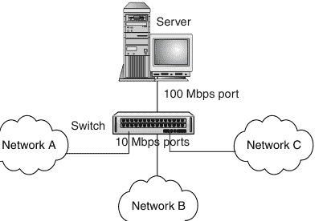

图 1.13

将服务器连接到高速交换机端口。

### 路由器

如前所述，路由器用于将网络连接在一起。路由器工作在 OSI 模型的网络层。路由器中转发或丢弃数据包的决定是基于网络层地址做出的。最常见的网络层地址是 IP 地址。本节讨论如何配置路由器以执行此功能。

图 1.14 显示了路由器中的数据路径。当数据包到达路由器时，它会上传到网络层，在那里检查源地址和目标地址。在网络层决定是将数据包转发到特定网络还是将其丢弃。

### 网关

在通用的网络术语中，`网关（gateway）`一词常被用来指代路由器。然而，网关是一种特殊的机器或软件软件包，用于将不同类型的网络连接在一起，而路由器连接的是相似类型的网络。这意味着由路由器连接的网络必须使用通用协议，而由网关连接的网络可以运行不同的协议。这就是为什么网关有时也被称为 `协议转换器`。

图 1.14

路由器中的数据路径。

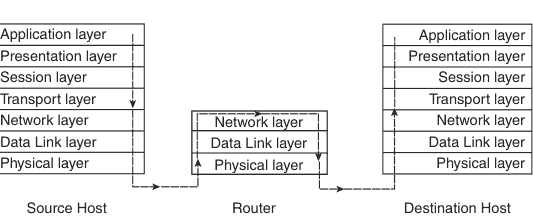

网关涵盖了 OSI 模型的所有七层。网关可以将 TCP/IP 网络连接到 IPX/SPX 网络。

表 1.2 简要描述了本章讨论的所有网络设备以及该特定设备运行的 OSI 层。

**表 1.2 网络设备**

| 设备名称 | 描述 |
| :--- | :--- |
| 网络适配器 | 用于在 OSI 模型物理层将主机连接到网络通信介质。 |
| 中继器 | 用于延长网络段的长度。运行在 OSI 模型物理层。 |
| 集线器 | 星型连接网络的中心设备点。同时也充当中继器。运行在 OSI 模型物理层。 |
| 网桥 | 将网络相互连接。过滤并将数据帧从一个网络转发到另一个网络。运行在 OSI 模型数据链路层。 |
| 交换机 | 类似于集线器，但提供多个并行数据路径。过滤并将从一个端口接收的数据帧转发到另一个端口。运行在 OSI 模型数据链路层。 |
| 路由器 | 用于连接相似的网络。运行在 OSI 模型网络层。 |
| 网关 | 用于连接不同类型的网络。也称为协议转换器。涵盖 OSI 模型的所有层。 |

## 网络访问方法

如前所述，网络是通过某种通信介质相互连接的主机集合。这种通信介质由网络上的所有主机共享，用于发送和接收数据。如果多个主机同时在通信介质上传输数据，信号将混在一起，导致任何人无法理解。这类似于在同一个房间里，许多人同时开始说话，而不关心是否有人也在说话的情况。为了避免这种情况，所有类型的网络都使用一种 `访问方法（access method）`。使用特定类型的访问方法，在任何给定的时间槽中只允许一个主机传输数据。如果任何其他主机需要传输数据，它必须等待其轮到。目前，网络中使用了三种基本类型的访问方法：

- **广播网络访问方法。** 最常用的广播方法是以太网。广播方法仅用于局域网，因为在广域网（WAN）链路上发送广播成本太高。
- **令牌传递访问方法。** 该方法仅允许持有令牌的主机传输数据。最常见的例子是令牌环（Token Ring）网络。
- **非广播多路访问方法。** 该方法用于公共交换网络，如 X.25 和帧中继（Frame Relay）。这些超出了本书的讨论范围。

在传统网络中，最常见的两种访问方法是：载波侦听多路访问/冲突检测（CSMA/CD）和令牌环（Token Ring）。以下章节将讨论这些方法。

### 载波侦听多路访问/冲突检测

载波侦听多路访问/冲突检测（CSMA/CD）是最受欢迎的访问方法，被用于以太网中。主机连接到共同的广播通信介质，任何主机都允许在没有特定顺序的情况下访问该介质（`多路访问`）。当一个主机需要向任何其他主机传输数据时，它会侦听通信介质以检查是否已有其他主机正在传输数据（`载波侦听`）。如果数据传输正在进行，该主机将等待随机时间，然后再次检查通信介质的可用性。如果通信介质空闲，该主机开始在通信介质上传输数据。

有时可能会发生两个或多个主机检查通信介质并发现其空闲的情况。这些主机随后同时开始传输数据。在这种情况下，会发生碰撞，并被所有参与主机检测到（`冲突检测`）。所有检测到碰撞的主机都会发出通告，以便发送主机可以重新发送数据。当发送主机知道发生了碰撞时，所有主机都等待一个随机时间，然后尝试重新传输数据。

基于 CSMA/CD 的网络是非确定性网络。在交通繁忙时期，碰撞更频繁，实际的数据传输速率无法保证。

### 令牌环

`令牌环（Token Ring）`是另一种网络访问方法，主要由 IBM 网络使用。在令牌环网络中，一个数据包或一个令牌在网络中从一个主机传输到另一个主机。只有持有令牌的主机才被允许传输数据。因此，令牌环网络中不会发生碰撞。令牌环网络是确定性网络，因为数据传输速率是可以估算的。令牌环网络的常见数据速度为 4Mbps 和 16Mbps。

另请注意，令牌环网络实际上并不是环形拓扑网络。相反，它们被安装为星型连接网络。

## 以太网简介

以太网最初由数字设备公司（Digital Equipment Corporation）、英特尔（Intel）和施乐（Xerox）引入。这也被称为 DIX 网络（取自这三家公司名称的首字母）。IEEE 随后将其标准化，定为 802.3 标准。目前，两种主要类型的以太网在许多网络中仍然运行。第一种是传统的以太网或 DIX 网络，第二种是 IEEE 802.3 标准。这两者之间只有很小的区别。

如本章后面所述，有两种标准。然而，这两种标准都可以用于同一个网络。以太网使用 CSMA/CD 作为访问方法。

### 以太网类型

目前使用了几种常见的以太网标准。每种标准都有自己的数据传输速度和分段长度。此外，特定的以太网标准会使用特定类型的电缆和连接器。以下部分讨论最常见的以太网标准及其属性。

#### 10BASE-2 以太网

10BASE-2 以太网可能是目前在用最古老的以太网。名称中的数字 10 表示数据传输速度。在 10BASE-2 以太网中，你可以传输高达 10Mbps 的数据。然而，实际的数据传输速度可能远低于此限制，这取决于网络的负载以及竞争传输数据的主机数量。这是因为以太网网络中使用的 CSMA/CD 访问方法具有非确定性特点。

BASE 一词表明使用基带信号进行数据传输。一些网络也使用宽带技术来传输数据。在基带技术中，电信号不经过调制，所有可用带宽都被用作单一传输介质。在宽带技术中，借助调制，不同的频段被分配给不同的信号，这样可以在同一介质（例如连接许多主机的电线）上使用不同的调制频率传输多个信号。

标准名称的最后一部分表示单个分段的最大长度。数字 2 表示 10BASE-2 网络的最大长度为 200 米（实际上是 185 米；数字 2 是作为最接近的整数）。

10BASE-2 网络使用细同轴电缆和 BNC 型连接器。由于使用了细同轴电缆，这种类型的网络也被称为 Thinnet（细网）。10BASE-2 网络采用总线拓扑结构。在一个网络中，你可以通过中继器连接最多五个分段。网络电缆的电阻为 50 欧姆，电缆两端使用相同电阻的端接器。

#### 10BASE-5 以太网

在 10BASE-5 以太网网络中，数据传输的最大速度为 10Mbps。它使用基带信号，网络分段的最大长度为 500 米。与 10BASE-2 相比，10BASE-5 网络使用了更粗的电缆，因此有时被称为 `Thick Ethernet`（粗以太网）。

#### 10BASE-T 以太网

10BASE-T 以太网的数据传输速度为 10Mbps。单个电缆分段的最大长度为 100 米，并使用基带信令。这曾经是最流行的网络方案，但正被 100BASE-T 网络所取代。名称中的字母 `T` 表示这种以太网使用的是 `twisted-pair`（双绞线）电缆而非同轴电缆。这些网络中使用的是 3 类或 5 类双绞线。

这种类型的以太网用于星型拓扑网络。`集线器（hub）`位于网络的中心。主机通过双绞线和 RJ-45 连接器连接到集线器。在较大的网络中，许多集线器使用骨干电缆相互连接。图 1.6 显示了一个典型的网络。在这个例子中，主机连接到不同的集线器，而这些集线器又通过骨干电缆相互连接。

#### 100BASE-T 以太网

100BASE-T 网络与 10BASE-T 网络类似。唯一的区别是数据传输速度为 100Mbps，是 10BASE-T 网络的 10 倍。100BASE-T 网络使用 5 类电缆。最大分段长度为 100 米。

#### 吉比特以太网（Gigabit Ethernet）

吉比特以太网是新一代的以太网系列，为此存在多种标准。1000BASE-SX 网络使用多模光纤电缆，长度可达 500 米。1000BASE-LX 使用单模光纤电缆，长度可达 5 公里。1000BASE-T 是新兴的标准，使用与 100BASE-T 网络相同的 5 类电缆。目前该电缆的长度被限制在 100 米。

### 以太网地址与以太网广播

任何以太网上的每个主机都由一个唯一的 48 位数字标识，称为以太网地址，有时也称为 MAC 地址。以太网地址由制造商烧录在所有的以太网网络适配器中。一些供应商还提供软件实用程序来修改以太网地址。网络上没有两个主机的 MAC 地址应该是相同的。要列出安装在 Solaris 机器中的网络适配器的 MAC 地址，可以使用 `ifconfig` 命令，如下所示：

```bash
bash-2.03# ifconfig -a4
lo0: flags=1008849:UP,LOOPBACK,RUNNING,MULTICAST,IPv4 mtu 8232 index 1 <inet 127.0.0.1 netmask ff000000
hme0: flags=100843:UP,BROADCAST,RUNNING,MULTICAST,IPv4 mtu 1500 index 2 <inet 192.168.2.222 netmask fffffff0 broadcast 192.168.2.255
	ether 0:80:20:9e:f0:50
bash-2.03#
```

该命令列出了两个网络接口。`lo0` 是逻辑回环接口，没有 MAC 地址。`hme0` 是真实的以太网适配器，其 MAC 地址为 0:80:20:9e:f0:50（如前一条命令的输出所示）。命令参数 `-a` 用于列出所有网络适配器，数字 `4` 用于仅列出 IPv4 地址。

你还可以使用 `arp` 命令列出连接到网络的一些其他主机的 MAC 地址。该命令列出本地网络上部分主机的动态学习 MAC 地址。请注意，这并不是列出本地网络所有主机 MAC 地址的方法。以下命令在输出的最后一列中列出了 MAC 地址。输出的第一列显示网络适配器的名称：

```bash
bash-2.03# arp -a
```

| 设备 | IP 地址 | 掩码 | 标志 | 物理地址 |
| :--- | :--- | :--- | :--- | :--- |
| hme0 | laptop | 255.255.255.255 | | 00:10:7a:b6:03:ce |
| hme0 | desktop | 255.255.255.255 | | 00:e0:29:89:28:59 |
| hme0 | fana | 255.255.255.255 | SP | 08:00:20:9e:f0:50 |

`arp` 命令将在本书后面进行更详细的讨论。


以太网地址通常写成由冒号分隔的六个十六进制数的组合。例如，一个典型的以太网地址可以写成`4F:36:01:AB:94:12`。

因为以太网是一种广播型网络，因此以太网上任何主机传输的数据都会被网络上的所有其他主机接收。网络上的每台主机将目的以太网地址与自己的地址进行比较。如果两个地址匹配，则数据帧被转发到更高层进行处理，否则被丢弃。有时需要每个主机都接收并处理广播包。在以太网网络中，广播数据帧的目的地址（Destination Address）字段被设置为`FF:FF:FF:FF:FF:FF`。当主机收到目的地址等于广播地址的数据帧时，该帧将被转发到上层处理。正如后面讨论的，网络层有自己的广播数据包机制；它本质上是使用了以太网提供的广播功能。

### 以太网帧格式

以太网帧由以太网头部、来自网络层的数据包以及用于检测传输过程中任何错误的帧校验序列（frame check sequence）组成。图 1.15 显示了以太网帧的格式。

以下部分讨论以太网帧头部中的各个字段。

#### 前导码（Preamble）

`前导码`是一个由 1 和 0 位交替组成的 7 字节长的序列。这些位用于同步目的和检测信号。这些位还告知监听站一个帧即将到达。

#### 帧起始定界符（Start Frame Delimiter）

`帧起始定界符`是紧跟在前导码之后的一个特殊序列。其比特位表示帧的开始。该位序列为`10101011`。

| 前导码（7 字节） | 帧起始定界符（1 字节） | 目的地址（6 字节） | 源地址（6 字节） | 长度/类型（2 字节） | 高层数据（46-1500 字节） | 帧校验序列（4 字节） |
| :--- | :--- | :--- | :--- | :--- | :--- | :--- |

### 目的地址

`目的地址`是目的主机的 MAC 地址。这是一个 48 位的数字，用于唯一标识网络上的每个主机。目的地址可以是某个主机的特定地址，也可以是广播地址。广播地址在目的地址部分仅有 1 位。

### 源地址

`源地址`是发送主机的 MAC 地址。它同样是一个 48 位的数字。

#### 长度/类型

`长度/类型字段`显示帧中数据部分的长度或帧的类型。原始的 DIX 以太网标准将此字段用作长度字段。IEEE 802.3 标准将此字段用作帧的类型。如果该字段的值小于 1500，则被视为长度，且该帧被视为 DIX 以太网帧。如果该帧的值大于 1536，则该帧被视为 IEEE 802.3 帧，且该字段的值显示帧的类型。表 1.3 列出了一些十六进制值。

**表 1.3：以太网类型字段值**

| 类型 | 公司名称 |
| :--- | :--- |
| `885b` | Hewlett-Packard GmbH, Boeblingen, Germany |
| `885c` | Hewlett-Packard GmbH, Boeblingen, Germany |
| `885d` | Endocardial Solutions, Inc., St. Paul, MN |
| `885e` | Quantum Corporation Milpitas, CA |
| `885f` | Digidesign Palo Alto, CA |
| `8860` | AGCS Phoenix, AZ |
| `8861` | Intel Hillsboro, OR |
| `8862` | Intel Hillsboro, OR |
| `8863` | UNETEN Technologies, Inc. Fairfax, VA |

#### 高层数据

高层数据是从网络层接收到的实际数据。这些数据包含网络层报头和传输层数据。该数据的最大长度为 1500 字节，最小长度为 46 字节。如果从网络层接收到的数据小于最小长度，则会添加位使其等于最小长度。这些位被称为`填充`（padding）。以太网标准定义以太网帧（不包括前导码和帧起始定界符）的最小长度为 64 字节。数据部分中的填充用于使长度至少等于该最小值。

#### 帧校验序列

`帧校验序列`是一个 4 字节长的字段，包含`循环冗余校验`（CRC）值。该值用于错误检查。发送端计算 CRC 并将其插入以太网帧中。接收端再次对接收到的帧计算 CRC，并将其与接收到的 CRC 进行比较。如果两个值相同，则假设帧中没有错误。如果值不匹配，目的主机则认为传输过程中发生了错误，并丢弃该帧。

#### 帧间隙

以太网设备在连续帧的传输之间必须允许至少 96 位的时间。对于 10Mbps 以太网，该时间为 9.6 微秒；对于 100Mbps 以太网，该时间为 960 纳秒。

### 标准以太网帧与 IEEE 802.3 帧的区别

除了其他区别外，标准以太网（通常称为`Ethernet-II 帧`）与 IEEE 802.3 帧的主要区别如下：

- 长度/类型字段在标准以太网（DIX 以太网或 Ethernet-II）和 IEEE 802.3 标准中具有不同的含义。在 DIX 以太网中，该字段显示帧的长度，其值小于或等于 1500。在 IEEE 802.3 标准中，该值显示帧的类型。
- 在以太网帧中，网络层数据紧跟在类型字段之后。在 IEEE 802.3 帧中，类型字段后的 3 个字节是逻辑链路控制（LLC）层报头的一部分，如图 1.16 所示。这三个字段是定义 LLC 层的 IEEE 802.2 标准的一部分。

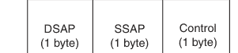

- `目的服务访问点`（DSAP）和`源服务访问点`（SSAP）是源主机和目的主机内存的指针。控制字段显示 LLC 帧的类型。如果你在以太网上运行多个网络层协议，这些字段就非常重要。例如，如果你想在同一个以太网上运行 TCP/IP 和 IPX，这些字段就用于区分不同的上层协议。
- 以太网帧和 IEEE 802.3 帧的另一个区别是，由于 LLC 字段使用了 3 个字节，IEEE 802.3 帧中的数据长度可能在 43 到 1497 字节之间，而以太网帧为 50 到 1500 字节。

### 数据封装

在分层网络协议（如 OSI 模型）中，每一层与其在另一台主机上的对等层进行通信。每一层从其上层接收数据，为其添加自己的报头，然后将其交给下层，以便交付给目的主机。层报头包含供目的主机上对等层使用的信息。通常，层报头包含目的主机对等层关于如何处理数据包数据部分的信息。报头中还会添加某种类型的错误检查。这种将层报头添加到高层数据的过程称为`封装`。

以太网帧为例。它包含许多字段，其中之一是从网络层接收到的数据。在创建该帧时，此数据被`封装`到以太网帧中。同样，如果你分析以太网数据部分（实际上是网络层数据包），你会发现它包含传输层数据和网络层字段。这些字段包括网络层源地址、目的地址以及其他网络层信息。换句话说，传输层数据由网络层`封装`到网络层数据包中。

数据封装是一个重要的概念。每一层都封装从上层接收到的数据。从技术上讲，每一层向其对等层发送数据包。这些数据包被称为`协议数据单元`（PDU）。创建 PDU 后，每一层将其交给自己的下层，以便进一步交付给目的端。当某一层接收到高层 PDU 时，它将其视为自身 PDU 的`有效载荷`（payload），并包含自己的层报头。这个过程就是封装过程。

## 在 Solaris 中管理以太网接口

每台 Solaris 服务器或工作站都有一个或多个以太网接口。Solaris 提供了管理以太网接口的命令。这些命令使你能够列出已安装的接口、创建逻辑接口、配置接口，以及将接口设为 UP（启动）或 DOWN（关闭）。

### 列出已安装的以太网接口

你可以通过两种简单方法列出 Solaris 服务器或工作站中安装的接口。第一种方法是使用`netstat`命令。第二种方法是使用`ifconfig`命令。`ifconfig`命令如下：

```bash
# ifconfig -a
lo0: flags=1000849<UP,LOOPBACK,RUNNING,MULTICAST,IPv4> mtu 8232 index 1
    inet 127.0.0.1 netmask ff000000
hme0: flags=1000843<UP,BROADCAST,RUNNING,MULTICAST,IPv4> mtu 1500 index 2
    inet 192.168.2.222 netmask ffffff00 broadcast
    192.168.2.255
    ether 8:0:28:9e:f0:50
lo0: flags=2000849<UP,LOOPBACK,RUNNING,MULTICAST,IPv6> mtu 8232 index 1
    inet6 ::1/128
hme0: flags=2000841<UP,RUNNING,MULTICAST,IPv6> mtu 1500
    index 2
    ether 8:0:28:9e:f0:50
    inet6 fe80::a00:20ff:fe9e:f050/10
#
```

此命令列出了系统中安装的所有接口。你还可以使用此命令来列出单个接口以及配置接口。在本章稍后部分，将使用此命令来配置以太网接口。此时请注意，`ifconfig`命令用于列出和配置所有网络接口，而不仅仅是以太网接口。

`netstat`命令用于多种目的，其中之一是列出已安装和配置的接口。以下命令列出系统中所有安装的接口：

```bash
# netstat -i
Name Mtu Net/Dest Address Ipkts Ierrs Opkts Oerrs Collis Queue
lo0 8232 loopback localhost 1356 0 1356 0 0 0
hme0 1500 fana fana 808 0 159 0 0 0
```

```bash
Name Mtu Net/Dest Address Ipkts Ierrs
Opkts Oerrs Collis localhost localhost 1356 0
1356 0 0
hme0 1500 fe80::a00:20ff:fe9e:f050/10 -> fe80::a00:20ff:fe9e:f050 808 0
159 0 0
#
```

该命令的其他用途将在本书后面讨论。

### 创建逻辑接口

逻辑或虚拟接口用于在同一个物理接口上配置多个网络层地址。以下`ifconfig`命令在物理接口`hme0`上创建了一个逻辑接口`hme0:1`：

```bash
bash-2.03# ifconfig hme0:1 plumb
bash-2.03#
```

第 2 章将更详细地讨论逻辑接口。

### 将接口设为 UP 和 DOWN

你也可以使用`ifconfig`命令将网络接口设为 UP 或 DOWN。以下命令将接口`hme0`设为 UP：

```bash
bash-2.03# ifconfig hme0 up
bash-2.03#
```

以下命令将`hme0`接口设置为 DOWN（禁用）：

```bash
bash-2.03# ifconfig hme0 down
bash-2.03#
```

## 常见以太网问题排查

Solaris 提供了用于排查常见以太网及其他网络问题的命令。最常用的命令如下：

- `ifconfig`
- `netstat`
- `snoop`
- `ping`
- `traceroute`
- `ndd`

本章仅对这些命令进行简要介绍。本书后续章节将对此进行更详细的讨论。

### 使用 `ifconfig` 命令

`ifconfig`命令也可用于故障排查。您已经知道如何使用该命令列出已安装的网络接口。要查找分配给网络适配器的网络层 IP 地址和其他网络参数，可以使用以下命令：

```bash
# ifconfig hme0
hme0: flags=1000843<UP, BROADCAST, RUNNING, MULTICAST, IPv4> mtu 1500 index 2
inet 192.168.2.222 netmask ffffff00 broadcast 192.168.2.255
ether 8:0:20:9e:f0:50
```

第 2 章和第 3 章也讨论了此命令。

## 使用 `netstat` 命令

`netstat`命令是网络故障排查中最广泛使用的命令。它有多种用途，例如显示路由表条目、可用服务器端口、当前建立的连接等等。如下所示的`netstat`命令会列出所有网络接口上的 IPv4 和 IPv6 地址、输入和输出数据包，以及错误数和冲突数：

```bash
# netstat -i

Name  Mtu  Net/Dest  Address  Ipkts  Ierrs Opkts  Oerrs Collis Queue
lo0   8252 loopback  localhost 1356   0     1356   0     0       0
hme0  1500 fana      fana      808    0     159    0     0       0
```

| Name | Mtu | Net/Dest | Address | Ipkts | Ierrs | Opkts | Oerrs | Collis | Queue |
| :--- | :--- | :--- | :--- | :--- | :--- | :--- | :--- | :--- | :--- |
| `lo0` | 8252 | loopback | localhost | 1356 | 0 | 1356 | 0 | 0 | 0 |
| `hme0` | 1500 | `fe80::a00:20ff:fe9e:f050/10` | `fe80::a00:20ff:fe9e:f050` | 808 | 0 | 159 | 0 | 0 | 0 |

## 使用 `snoop` 命令

`snoop`命令用于捕获并显示网络流量。它可能是数据包级别网络故障排查中最有用的命令。使用此命令，您可以捕获并显示具有不同层级信息的网络数据包。您还可以将捕获的数据包保存到文件中以便进行调试。在最简单的形式中，该命令会列出在本地网络上传输的所有数据包。以下是该命令在最简单模式下的输出：


# `snoop` 命令

```text
# snoop
Using device /dev/hme (promiscuous mode)
  desktop -> fana   TELNET C port=1029
  desktop -> fana   TELNET C port=1029
  fana -> desktop   TELNET R port=1029 IP: xxx, ...
  fana -> desktop   TELNET R port=1029 IP: \r\nIP: Versio
  fana -> desktop   TELNET R port=1029 Ether: Source
desktop -> fana     TELNET C port=1030
  fana -> desktop   TELNET R port=1029 TCP: Data offset =
  fana -> desktop   TELNET R port=1029 TCP: Destination po
  fana -> desktop   TELNET R port=1029 IP: Destination ad
  fana -> desktop   TELNET R port=1030 Using device /dev/hm
  desktop -> fana   TELNET C port=1029
  desktop -> fana   TELNET C port=1029
fana -> desktop    TELNET R port=1029 IP:    Fragment offset
fana -> desktop    TELNET R port=1029 IP:    Total length =
fana -> desktop    TELNET R port=1029 IP:    xxx. ...
desktop -> fana    TELNET C port=1029
desktop -> fana    TELNET C port=1029
fana -> desktop    TELNET R port=1029 ETHER:  Ethertype =
fana -> desktop    TELNET R port=1029 ETHER:  Packet size
fana -> desktop    TELNET R port=1029 ETHER:  ----
desktop -> fana    TELNET C port=1029
desktop -> fana    TELNET C port=1029
fana -> desktop    TELNET R port=1029 TCP:   No options\nTCP
fana -> desktop    TELNET R port=1029 TCP:   .0 .
fana -> desktop    TELNET R port=1029 TCP:   Data offset =
192.168.2.1 -> fana TELNET C port=1028
         -> 192.168.2.1 TELNET R port=1028    fana -> 192.
192.168.2.1 -> fana TELNET C port=1028
         -> 192.168.2.1 TELNET R port=1028 192.168.2.1 -> fana
192.168.2.1 -> fana TELNET C port=1028
199.30.29.27 -> 199.30.29.31 NDP Data Segment Service Type=17 Source=RR_DESKTOP[0]
192.168.2.1 -> fana TELNET C port=1028    fana -> 192.
         -> 192.168.2.1 TELNET R port=1028
192.168.2.1 -> fana TELNET C port=1028
desktop -> fana    TELNET C port=1028
fana -> desktop    TELNET R port=1028    desktop -> fana
      -> *        ETHER Type=800F (XYZ Fana Systems), size = 60 bytes
desktop -> fana    TELNET C port=1028
fana -> desktop    TELNET R port=1028    fana -> desk
desktop -> fana    TELNET C port=1028
fana -> desktop    TELNET R port=1028    desktop -> fana
```

该命令将持续显示捕获的数据包，直到您按下 `Ctrl+C` 中断该进程。命令的输出显示了源主机和目的主机的主机名或 IP 地址。它还显示了数据包的类型、使用该数据包的服务以及端口号。如果命令无法识别数据包类型，则会打印一个问号。默认情况下，该命令尝试将 IP 地址解析为主机名。如果命令未能将任何 IP 地址解析为主机名，则为源或目的主机打印 IP 地址。

您还可以使用 `snoop` 命令将数据保存到文件中以便稍后分析。为此，需要在命令行中使用 `-o` 选项并指定文件名，如下所示：

```text
# snoop -o snoop.dat
Using device /dev/hme (promiscuous mode)
20 "C
#
```

此命令输出的最后一行会不断变化，显示捕获的数据包数量，直到您按下 `Ctrl+C` 中断命令。

请注意，数据在输出文件中并非以明文形式存储。因此，您无法使用 `cat` 或 `more` 命令来查看。您必须再次使用 `snoop` 命令并带上 `-i`（小写 I）开关来显示捕获文件的内容，如下所示：

```text
# snoop -i snoop.dat
1 0.00000 desktop -> fana TELNET C port=1029
2 0.00005 fana -> desktop TELNET R
port=1029 (/dev/hme (promiscuous)

3 0.1085 desktop -> fana TELNET C port=1029
4 0.79476 fana -> desktop TELNET R port=1029
5 0.11008 desktop -> fana TELNET C port=1029
6 0.00004 fana -> desktop TELNET R port=1029
7 0.19979 desktop -> fana TELNET C port=1029
8 0.00008 fana -> desktop TELNET R port=1029
9 0.10984 desktop -> fana TELNET C port=1029
10 0.00004 fana -> desktop TELNET R port=1029
11 0.0355 fana -> * Ether Type=0009F
(Spider Systems), ? - *
size = 60 bytes
12 0.11631 desktop -> fana TELNET C port=1029
13 0.00055 fana -> desktop TELNET R port=1029
14 0.10956 desktop -> fana TELNET C port=1029
15 0.00004 fana -> desktop TELNET R
port=1029 (\r\n0009 \r\n0010 \b\n0011 \r\n0012
16 0.19992 desktop -> fana TELNET C port=1029
17 0.09848 fana -> desktop TELNET R port=1029\n0013
18 0.12436 desktop -> fana TELNET C port=1029
19 0.00014 fana -> desktop TELNET R port=1029\n00014 \r\n00015\n0016
20 0.19981 desktop -> fana TELNET C port=1029
```

要以文本格式保存 `snoop` 的输出，请使用重定向而非 `-o` 选项，如下所示：

```text
snoop -v >snoop.dat
```

要获取关于每个数据包的详细信息，请使用 `snoop -v` 命令，如下所示：

```text
# snoop -v
Using device /dev/hme (promiscuous mode)
ETHER: -------- Ether Header --------
ETHER:
ETHER: Packet 31307 arrived at 12:02:24.82
ETHER: Packet size = 1483 bytes
ETHER: Destination = 0:e0:29:89:28:59,
ETHER: Source = 8:0:20:9e:f0:50, Sun
ETHER: Ethertype = 0800 (IP)
ETHER:
IP: -------- IP Header --------
IP:
IP:     Version = 4
IP:     Header length = 20 bytes
IP:     Type of service = 0x00
IP:     xxx. .... = 0 (precedence)
IP:     ...0 .... = normal delay
IP:     ... .0... = normal throughput
IP:     ... ..0. = normal reliability
IP:     Total length = 1469 bytes
IP:     Identification = 47732
IP:     Flags = 0x41
IP:     .1. .... = do not fragment
IP:     ..1. .... = last fragment
IP:     Fragment offset = 0 bytes
IP:     Time to live = 60 seconds/hops
IP:     Protocol = 6 (TCP)
IP:     Header checksum = f896
IP:     Source address = 192.168.2.222, fana
IP:     Destination address = 192.168.2.1, desktop
IP:     No options
IP:     ---- TCP Header ----
TCP:     ....
TCP:     Source port = 23
TCP:     Source port = 23
TCP:     Destination port = 1029
TCP:     Sequence number = 1967134259
TCP:     Acknowledgement number = 4019093
TCP:     Data offset = 20 bytes
TCP:     Flags = 0x10
TCP:     .0... .... = No urgent pointer
TCP:     ...1 .... = Acknowledgement
TCP:     .... 0... = No push
TCP:     .... .0.. = No reset
TCP:     .... ..0. = No Syn
TCP:     .... ...0 = No Fin
TCP:     Window = 24820
TCP:     Checksum = 0x0db5
TCP:     Urgent pointer = 0
TCP:     No options
TCP:     ....
TELNET:  TELNET:
TELNET:  ....
TELNET:  'TCP: ---- TCP Header ----\r\nTCP: \r\nTCP:
TCP:     Source port = 10"
TELNET:
ETHER:   ---- Ether Header ----
ETHER:   ....
ETHER:   Packet 31308 arrived at 12:02:24.82
ETHER:   Packet size = 1512 bytes
ETHER:   Destination = 0:e0:29:89:28:59,
ETHER:   Source = 8:0:20:9e:f0:50, Sun
```

`-v` 选项将数据包的所有部分分别打印出来。从输出中可以看到，首先显示的是以太网标头（Ethernet header），然后是网络层标头（IP），接着是传输层标头（TCP 或 UDP）。在最后一部分，显示了使用该数据包的应用程序的端口号。您还可以使用 `grep` 命令来过滤特定层的数据。例如，要仅捕获以太网标头，请使用以下命令：

```bash
snoop -v | grep ETHER
```

## 使用 `ping` 命令

`ping` 命令用于确定主机是否存活。以下命令显示主机 desktop 是存活的：

```bash
bash-2.03# ping desktop
desktop is alive
bash-2.03#
```

以下命令显示主机 laptop 是宕机的：

```bash
bash-2.03# ping laptop
no answer from laptop
bash-2.03#
```

关于 `ping` 命令的更多信息将在后面的章节中介绍。

## 使用 `traceroute` 命令

该命令用于追踪数据包从源端到目的端所经过的路径。第 2 章提供了关于此命令的更多信息。

## 使用 `ndd` 命令

`ndd` 命令用于显示网络驱动程序的信息。在 Solaris 8 中，许多网络协议层是以驱动程序的形式实现的。以下命令显示 TCP 驱动程序支持的参数：


```bash
# ndd /dev/tcp \?
? (read only)
tcp_time_wait_interval (read and write)
tcp_conn_req_max_q		(read and write)
tcp_conn_req_max_q0		(read and write)
tcp_conn_req_min		(read and write)
tcp_conn_grace_period		(read and write)
tcp_cwnd_max			(read and write)
tcp_debug			(read and write)
tcp_smallest_nonpriv_port	(read and write)
tcp_ip_abort_cinterval		(read and write)
tcp_ip_abort_linterval		(read and write)
tcp_ip_abort_interval		(read and write)
tcp_ip_notify_cinterval		(read and write)
tcp_ip_notify_interval		(read and write)
tcp_ipv4_ttl			(read and write)
tcp_keepalive_interval		(read and write)
tcp_maxpszs_multiplier		(read and write)
tcp_mss_def_ipv4		(read and write)
tcp_mss_max_ipv4		(read and write)
tcp_mss_min			(read and write)
tcp_naglim_def			(read and write)
tcp_remit_interval_initial	(read and write)
tcp_remit_interval_max		(read and write)
tcp_remit_interval_min		(read and write)
tcp_deferred_ack_fraction	(read and write)
tcp_snd_lowat_fraction		(read and write)
tcp_rcv_hiwat			(read and write)
tcp_stbh_rcv_lowat		(read and write)
tcp_dupack_fast_retransmit	(read and write)
tcp_ignore_path_mtu		(read and write)
tcp_rcv_push_wait		(read and write)
tcp_smallest_anon_port		(read and write)
tcp_largest_anon_port		(read and write)
tcp_xmit_hiwat			(read and write)
tcp_xmit_lowat			(read and write)
tcp_recv_hiwat			(read and write)
tcp_recv_hiwat_minmss		(read and write)
tcp_fin_wait_2_flush_interval	(read and write)
tcp_co_min			(read and write)
tcp_max_buf			(read and write)
tcp_strong_iss			(read and write)
tcp_rtt_updates			(read and write)
tcp_wscale_always		(read and write)
tcp_tstamp_always		(read and write)
tcp_tstamp_if_wscale		(read and write)
tcp_remit_interval_extra	(read and write)
tcp_deferred_acks_max		(read and write)
tcp_slow_start_after_idle	(read and write)
tcp_slow_start_initial		(read and write)
tcp_co_timer_interval		(read and write)
tcp_sack_permitted		(read and write)
tcp_trace			(read and write)
tcp_compression_enabled	(read and write)
tcp_ipv6_hoplimit		(read and write)
tcp_mss_def_ipv6		(read and write)
tcp_mss_max_ipv6		(read and write)
tcp_rev_src_routes		(read and write)
tcp_wroff_xtra			(read and write)
tcp_extra_priv_ports	(read only)
tcp_extra_priv_ports_add	(write only)
tcp_extra_priv_ports_del	(write only)
tcp_status	(read only)
tcp_bind_hash	(read only)
tcp_lpn_hash	(read only)
tcp_conn_hash	(read only)
tcp_acceptor_hash	(read only)
tcp_host_param	(read and write)
tcp_tcp_wait_stats	(read only)
tcp_host_param_ipv6	(read and write)
tcp_1948_phrase	(write only)
tcp_close_wait_interval(obsoleted: use tcp_time_wait_interval)	(no read or write)
#
```

如下所示，UDP 驱动程序支持的参数较少：

```bash
# ndd /dev/udp ?
?
udp_wroff_extra	(read only)
udp_ipv4_ttl	(read and write)
udp_ipv6_hoplimit	(read and write)
udp_smallest_nonpriv_port	(read and write)
udp_do_checksum	(read and write)
udp_smallest_anon_port	(read and write)
udp_largest_anon_port	(read and write)
udp_xmit_hiwat	(read and write)
udp_xmit_lowat	(read and write)
udp_rcv_hiwat	(read and write)
udp_max_buf	(read and write)
udp_extra_priv_ports	(read only)
udp_extra_priv_ports_add	(write only)
udp_extra_priv_ports_del	(write only)
udp_status	(read only)
#
```

要显示特定的设置或配置参数，请将参数名称作为 `ndd` 命令的命令行参数。以下命令显示 UDP 数据包的生存时间（TTL）值：

```bash
# ndd /dev/udp udp_ipv4_ttl
255
#
```

如果参数具有写权限（如最后一列所示），则可以修改其值。以下命令将默认 TTL 值修改为 30：

```bash
# ndd -set /dev/udp udp_ipv4_ttl 30
#
```

> 注意：您也可以使用 `snoop -v` 命令来验证传出 UDP 数据包的 TTL 值。

正如第 2 章所述，`ndd` 命令在微调目的方面尤其有用。

设置新值后，您可以再次使用 `ndd` 命令来验证新值是否确实已设置，如下所示：

```bash
# ndd /dev/udp udp_ipv4_ttl
30
#
```

表 1.4 总结了这些命令的常见用途。

**表 1.4：网络故障排除命令的用途**

| 命令 | 常见用途 |
| :--- | :--- |
| `ifconfig` | `ifconfig` 命令用于配置网络适配器，以及显示每个适配器的现有配置。 |
| `snoop` | `snoop` 命令用于捕获和显示网络数据包。 |
| `ping` | `ping` 命令用于测试网络连通性，以及确定网络上的特定主机是存活还是宕机。 |
| `traceroute` | `traceroute` 命令用于确定从源主机到目的主机的网络路径。 |
| `ndd` | `ndd` 命令用于获取和设置网络内核驱动程序的参数。 |

## 本章小结

本章向您介绍了计算机网络、相关术语以及一些关键的 Solaris 命令。您学习了主机（host）、网络（network）、协议（protocol）和带宽（bandwidth）等基本术语。在网络分类部分，您了解到网络可以根据地理区域、调制技术和网络拓扑进行分类。在地理区域分类中，网络可以是局域网（LAN）或广域网（WAN）。当根据调制技术分类时，它们分为基带网络或宽带网络。在拓扑结构方面，网络布局分为总线型、星型或环型拓扑。

您还接触了 OSI 模型，这是一个七层网络协议模型，被用作构建网络协议的参考。您学习了 OSI 模型的七层如何相互交互以及每一层的功能。OSI 模型层如下：

- 物理层
- 数据链路层
- 网络层
- 传输层
- 会话层
- 表示层
- 应用层

您还学习了对等协议和接口是什么，以及层标头在信息传输过程中发挥的作用。

在讲解完 OSI 模型后，介绍了网络设备，从电缆和连接器开始。您学习了常见的网络设备及其运行所在的 OSI 层。之后介绍了两种网络访问方法（CSMA/CD 和令牌环）。在 CSMA/CD 网络中，主机在发送数据帧之前会检测网络介质上的任何信号。只有在介质空闲时才会传输数据。在令牌环网络中，只有持有令牌的主机才被允许传输数据。随后讨论转到了以太网帧和不同类型的以太网。在本章的最后部分，为您介绍了一些用于 Solaris 系统的故障排除命令。

### 关键术语

- 局域网 (local area network)
- 广域网 (wide area network)
- 总线拓扑 (bus topology)
- 星型拓扑 (star topology)
- 环型拓扑 (ring topology)
- 访问方法 (access method)
- 以太网 (Ethernet)
- 节点 (node)
- 带宽 (bandwidth)
- 路由器 (router)
- 网络协议 (network protocol)
- 网桥 (bridge)
- 交换机 (switch)
- 基带网络 (baseband networks)
- 宽带网络 (broadband networks)
- 对等协议 (peer protocols)
- 接口 (interfaces)
- 层标头 (layer header)
- 分段 (segment)
- 收发器 (transceiver)
- 主干网 (backbone)
- 中继器 (repeater)
- 网关 (gateways)
- CSMA/CD
- 前导码 (preamble)
- 帧间隙 (interframe gap)
- 数据封装 (data encapsulation)

## 知识实践

### 练习

#### 1.1 使用 `ifconfig` 和 `ping` 命令

在本练习中，你将了解到 `ifconfig` 是一个管理命令，仅限具有特权的 root 用户使用。你还将学习如何使用 `ping` 命令。

预计时间：5 分钟

1. 使用你自己的用户名登录到 Solaris 机器，并尝试使用 `ifconfig plumb hme0:3` 命令。你将看到一个 `ifconfig: plumb: SIOCLIFFADDIF: hme0:3: permission denied` 错误消息，表明你没有权限使用此命令。

2. 现在使用 `su` 切换到 root 用户并再次尝试使用该命令。这一次你能够成功使用该命令。

3. 使用 `uname -a` 命令查找你机器的主机名。假设你的主机名是 `solaris1`。尝试使用以下命令 ping 该主机名：

```bash
bash-2.03# ping solaris1
solaris is alive
bash-2.03#
```

   同时尝试使用 `snoop`、`ndd` 和 `netstat` 命令。你会发现 `snoop` 和 `ndd` 命令在执行时同样需要 root 权限。

4. 请按从低到高的顺序，写出 OSI 网络模型的七层名称。

5. 以太网网络有哪些不同的类型？

6. CSMA/CD 与令牌环（Token Ring）访问方式有何不同？

### 考题

1. 以下哪些网络设备工作在 OSI 参考网络模型的数据链路层？

   - A. 中继器 (Repeater)
   - B. 路由器 (Router)
   - C. 网桥 (Bridge)
   - D. 交换机 (Switch)

2. 以下哪一项覆盖了 OSI 模型的所有层？

   - A. 网关 (Gateway)
   - B. 路由器 (Router)
   - C. 交换机 (Switch)
   - D. 集线器 (Hub)

3. 关于广域网（WAN），以下哪项描述是*不*正确的？

   - A. 这些网络跨越较大的地理区域。
   - B. 与局域网相比，这些是低速网络。
   - C. 10BASE-T 以太网可用于广域网。
   - D. 与局域网相比，广域网的安装和维护成本通常较高。

### 复习题

1. 分类网络有哪些不同的方式？

2. 请列举三种常见的网络拓扑结构。

3. 为什么分层网络模型是有益的？

### 知识实践（选择题）

1. 以下哪种 LAN 拓扑结构存在单点故障？

   - A. 总线型 (Bus)
   - B. 星型 (Star)
   - C. 用于 FDDI 的双环型 (Dual ring)

5. 在单个 LAN 中混合使用多种物理拓扑是否可行？（是/否）

6. 两个主机之间不需要有共同的协议就能直接相互通信？（正确/错误）

7. 从最顶层开始，OSI 模型上四层的正确顺序是什么？

   - A. 表示层, 会话层, 传输层, 应用层
   - B. 应用层, 表示层, 会话层, 传输层
   - C. 应用层, 会话层, 表示层, 传输层
   - D. 应用层, 表示层, 传输层, 会话层

8. 在分层协议中，控制两个相邻层之间通信的协议被称为什么？

   - A. 对等协议 (Peer protocols)
   - B. 接口 (Interfaces)
   - C. 分层协议 (Layered protocols)
   - D. 开放系统互连 (Open Systems Interface)

9. 以下哪一层实现了 MAC 地址？

   - A. 数据链路层
   - B. 物理层
   - C. 传输层
   - D. 网络层

10. 网络层负责以下哪些内容？（选择所有正确的选项）

    - A. 点对点的数据错误检测与纠正
    - B. 端到端的数据错误检测与纠正
    - C. 为主机实现 MAC 地址
    - D. 为主机实现逻辑地址
    - E. 路由

11. OSI 模型的哪一层负责数据格式转换？

    - A. 传输层
    - B. 应用层
    - C. 会话层
    - D. 表示层
    - E. 数据链路层

12. 100BASE-T 以太网网络中使用哪种电缆？

    - A. 5 类双绞线 (Category 5 twisted-pair cable)
    - B. 3 类双绞线 (Category 3 twisted-pair cable)
    - C. 2 类双绞线 (Category 2 twisted-pair cable)
    - D. 同轴电缆 (Coaxial cable)
    - E. 光纤电缆 (Fiber-optic cable)

13. 关于中继器，以下哪些描述是正确的？

    - A. 中继器再生并重塑电信号。
    - B. 中继器用于 OSI 模型的物理层。
    - C. 你可以使用任意数量的中继器来扩展网络长度。
    - D. 集线器也被称为多端口中继器。

14. 关于交换机，以下哪些描述是正确的？

    - A. 交换机基于 MAC 地址过滤数据。
    - B. 交换机提供多个并行数据路径。
    - C. 交换机通过 IP 地址识别主机。
    - D. 交换机可能有不同类型的接口。
    - E. 交换机可以充当协议转换器。

15. 在基于 CSMA/CD 的网络中，当发生冲突时，发送主机何时重新传输数据？

    - A. 在一段固定时间之后
    - B. 在一段可变时间之后

16. 10BASE-2 以太网网络中单个分段的最大长度是多少？

    - A. 200 米
    - B. 185 米
    - C. 500 米
    - D. 1000 米
    - E. 长度不固定

17. 什么是令牌环（Token Ring）网络？

    - A. 单环拓扑网络
    - B. 双环拓扑网络
    - C. 星形连接网络
    - D. 总线连接网络

18. 以太网或 MAC 地址的长度是多少？

    - A. 20 字节
    - B. 48 位
    - C. 32 位
    - D. 60 位

19. 什么是以太网广播地址？

    - A. 所有位均为 1 的 32 位地址


- B. 所有位均为 0 的 48 位地址
- C. 与 IP 网络广播地址相同
- D. 所有位均为 1 的 48 位地址
- E. 所有位均为 0 的 48 位地址

- 20. 如何在 Solaris 机器中列出已安装的以太网适配器？
  - A. 使用 `ifconfig` 命令。
  - B. 使用 `netstat` 命令。
  - C. 使用 `ether` 命令。
  - D. 以上均不是。

- 21. 你拥有一台网络接口为 `hme0` 的工作站。该网络接口已配置且处于启动状态，且是该工作站唯一的网络连接。哪个命令不能用于显示网络接口 `hme0` 的 MAC 地址？
  - A. `ifconfig hme0`
  - B. `ifconfig -mac hme0`
  - C. `ifconfig -a`
  - D. `arp -a`

- 22. 在 Solaris 8 中，你将使用哪个命令来捕获并显示网络数据包的信息？
  - A. `netstat`
  - B. `ping`
  - C. `traceroute`
  - D. `snoop`
  - E. `tcpdump`

- 23. 以下哪两项描述是不正确的？
  - A. 由 `snoop` 命令捕获的数据包可以存储在文件中以便后续查看。
  - B. `snoop` 命令可用于查看特定层和数据包的特定部分。
  - C. `snoop` 命令不显示数据包的源 MAC 地址。
  - D. `snoop` 命令不显示数据包的大小。

- 24. 在同轴电缆中，为了避免信号从电缆末端反射，使用了什么？
  - A. 反射器 (Reflector)
  - B. 终端电阻 (Terminator)
  - C. 连接器 (Connector)
  - D. 吸收器 (Absorber)

- 25. OSI 模型的哪一层被分为 MAC 子层和 LLC 子层？
  - A. 数据链路层
  - B. 物理层
  - C. 网络层
  - D. 以上均不是。

- 26. RJ-45 连接器用于哪种类型的电缆？
  - A. 同轴电缆
  - B. 双绞线
  - C. 光纤电缆
  - D. 粗以太网电缆

## 复习题答案

- 1. 网络的分类依据可包括以下方面：
  - 地理区域
  - 调制技术
  - 网络拓扑

- 2. 三种网络拓扑结构为：
  - 总线型 (Bus)
  - 星型 (Star)
  - 环型 (Ring)

- 3. 网络协议非常复杂。分层模型将协议功能划分为不同的层。这一过程使网络可视化和开发任务变得更加简单且结构化。

- 4. 各层依次为：
  - 物理层
  - 数据链路层
  - 网络层
  - 传输层
  - 会话层
  - 表示层
  - 应用层

- 5. 以太网网络有许多不同类型，包括以下几种：
  - `10BASE-2`
  - `10BASE-5`
  - `10BASE-T`
  - `100BASE-T`

- 6. CSMA/CD 与令牌环（Token Ring）访问方式的区别在于：
  - 令牌环是一种确定性访问方式，而 CSMA/CD 则不是。
  - CSMA/CD 是一种广播方式，而令牌环是一种令牌传递方式。
  - 在 CSMA/CD 中，只要介质空闲，任何主机都可以开始传输。在令牌环中，只有持有令牌的主机才被允许传输。

| 建议阅读资料与资源 |
| :--- |
| *Computer Networks*. Andrew S. Tanenbaum. |
| *Computer Networks and Internets*. Douglas E. Comer and Ralph E. Droms. |
| *Interconnections, Second Edition*. Radia Perlman. |
| 本章所用命令的用户手册。 |
| Solaris 8 Answer book。 |

# 第 2 章：TCP/IP 协议

## 目标

本章涵盖了 Sun 为 310-043 考试指定的以下目标：

- **识别 TCP/IP 五层模型中每一层的作用。**

  TCP/IP 是一个五层协议。每一层都有其特殊的功能，你需要识别并理解这些功能。该协议的前四层与 OSI 模型相似。然而，TCP/IP 中的应用层涵盖了 OSI 模型上三层的大部分功能。

- **描述以下网络协议的功能：TCP、UDP、IP 和 ICMP。描述以下网络协议之间的关系：TCP、UDP、IP 和 ICMP。**

  TCP/IP 协议是工作在不同层上的多个协议的组合。这些协议的示例包括 TCP、UDP、IP 和 ICMP。这些协议在通信会话期间相互协调。你应该理解这些协议及其关系。

- **解释使用 ARP 和 RARP 进行地址解析的过程。识别用于管理 ARP 缓存的命令。**

  地址解析协议 (ARP) 和反向地址解析协议 (RARP) 分别用于将 MAC 层地址映射到网络层地址，反之亦然。从考试的角度来看，你应该理解这些协议以及与它们相关的 Solaris 命令。

- **识别用于配置网络接口的配置文件和脚本。**

  Solaris 中使用命令、文件和脚本来配置网络接口。需要理解所有这些文件、命令和配置脚本。

- **描述以下内容：IP 地址、广播地址、子网掩码、数据报和分片。识别用于设置子网掩码的文件。识别可变长度子网掩码 (VLSM) 的特性和优势。配置网络接口。**

  IP 地址被分配给网络接口。每个 IP 地址有两个基本部分：主机部分和网络部分。这两个部分通过子网掩码来区分。根据网络的大小，IP 地址被分为不同的类。三大类是 A 类、B 类和 C 类。通常这些类的子网掩码是固定的。然而，使用 VLSM，可以使用自定义的子网掩码。

- **识别常见的网络问题。诊断网络问题。解决网络问题。**

  网络故障排除是一项常规任务，你应该了解常见的网络问题及其解决方案，以及诊断网络问题的方法。

## 大纲

- 引言 xx
- TCP/IP 协议族 xx
- 互联网和 TCP/IP 的历史 xx
  - 互联网组织 xx
  - 互联网文档 xx
- TCP/IP 简介 xx
  - TCP/IP 分层 xx
    - 物理层 xx
    - 数据链路层 xx
    - 网络层 xx
    - 传输层 xx
    - 应用层 xx
  - TCP/IP 协议与 ISO-OSI 参考模型的比较 xx
  - TCP/IP：多种协议的组合 xx
  - 面向连接和无连接服务 xx
- IP 地址 xx
  - 网络地址和子网掩码 xx
  - 网络广播 xx
  - TCP/IP 网络类 xx
    - A 类网络 xx
    - B 类网络 xx
    - C 类网络 xx
    - D 类网络 xx
    - E 类网络 xx
  - 子网和子网掩码 xx
    - 划分 C 类网络 xx
    - 将 B 类网络划分为 8 个子网 xx
  - 可变长度子网掩码 xx
  - 超网 (Supernetting) xx
  - 网络地址的表示 xx
  - 保留和特殊 IP 地址 xx
  - 将 IP 地址映射到主机名 xx
  - 获取 IP 地址 xx
- IP 报头结构 xx
  - 版本 (V) 和报头长度 (IHL) xx
  - 服务类型 (TOS) xx
  - 总长度 xx
  - 标识符 xx
  - 标志位 (F) xx
  - 分片偏移 xx
  - 生存时间 (TTL) xx
  - 协议 xx
  - 报头校验和 xx
  - 源地址 xx
  - 目的地址 xx
  - IP 选项 xx
- 互联网控制消息协议 (ICMP) xx
  - 类型 xx
  - 代码 xx
  - 校验和字段 xx
- 在 Solaris 中配置网络接口 xx
  - 配置虚拟接口 xx
  - 手动配置虚拟接口 xx
  - 验证 IP 配置 xx
  - 使用 `netstat` 命令验证配置 xx
- IP 分片、重组、流量控制、TOS 和 TTL xx
  - 配置 MTU 值 xx
  - 流量控制 xx
  - TOS xx
  - TTL xx
  - 为 ICMP、UDP 和 TCP 数据包设置 TTL 值 xx
- IP 地址配置故障排除命令 xx
  - `ping` 命令 xx
    - 连续 ping xx
    - 在 `ping` 命令中使用不同的数据包长度 xx
    - 发送固定数量的 ping 数据包 xx
    - 广播 ping xx
  - `traceroute` 命令 xx
  - 常见网络问题 xx
    - 线缆损坏 xx
    - 接口配置错误 xx
    - 子网掩码错误 xx
    - 网关错误 xx
- 在 Solaris 中微调 TCP xx
  - 显示和设置主机参数 xx
- 将 IP 地址映射到 MAC 地址 xx
  - 地址解析协议 (ARP) xx
  - 反向地址解析协议 (RARP) xx
  - 以太网广播在 ARP 和 RARP 中的作用 xx
  - TCP/IP 网络中的数据流 xx
  - 使用 Solaris `arp` 命令管理 ARP 缓存 xx
    - 向 ARP 缓存添加新条目 xx
    - 从 ARP 缓存删除条目 xx
  - `snoop` 命令和层报头 xx
  - 案例要点 xx
  - 分析 xx
- 本章总结 XX
- 知识应用 XX

## 学习策略

本章介绍了 TCP/IP 协议和网络接口配置。请使用以下策略来理解并实现本章中的概念：

- 理解 TCP/IP 分层，并将其与 OSI 模型分层进行比较。
- IP 地址和子网掩码的结构非常重要。在学习期间请特别关注其结构。
- 了解 ICMP 对于参加考试非常重要。
- 了解什么是 IP 报头以及它的各个组成部分。
- 在阅读 IP 接口配置过程后，进行实际练习。

## 引言

到目前为止，你已经对计算机网络的基本概念有了了解。你在本书的第一章中学习了 OSI 参考网络模型。你也知道了网络层是什么以及它们如何相互作用。OSI 网络模型本身并不是一个实际的协议，而是一种构建网络协议的推荐方式。本章首先介绍最广泛使用的网络协议栈 TCP/IP：传输控制协议/互联网协议在过去十年中已成为行业标准。TCP/IP 和 OSI 协议模型在许多方面相似，但在其他方面也有所不同。本章将详细讨论这些相似点和不同点。

本章回顾了 TCP/IP 协议的历史。你将学习该协议的不同层。你还将学习被称为 *Request For Comments* (RFCs) 的互联网文档，这些文档被用于互联网上其他复杂协议的演进。

TCP/IP 提供两种类型的服务：无连接和面向连接。你将学习这两类服务的区别及其用途。

ICMP 协议是所有 TCP/IP 协议实现中不可或缺的一部分。ICMP 用于流量控制、诊断和错误报告。

在介绍完 TCP/IP 后，你将学习什么是 IP 地址以及如何将这些地址分配给 TCP/IP 网络中的主机。IP 地址被分为不同的地址类。你将学习如何区分主机地址和网络地址。TCP/IP 网络中使用两种方法将相同的数据发送到多个主机。这两种方法是广播和组播。你将学习它们是什么以及两种方法之间的区别。

子网掩码是一个需要理解的重要概念，尤其是在设计 IP 网络时。子网掩码定义了网络边界。本章提供了两个示例，展示如何使用子网掩码定义网络边界并将大网络划分为较小的网络。

从 Solaris 的角度来看，你需要学习如何在不同的网络接口上配置 IP 地址。本章将使用分配 IP 地址、测试 IP 地址配置和排除故障的命令，以及其他重要的故障排除命令，如 `netstat`、`ping` 和 `traceroute`。

每个 IP 数据包都包含一个用于在 IP 网络中路由数据包的 IP 报头以及其他控制字段。我们将讨论 IP 报头的结构以及报头中每个字段的用途。你还将学习诸如服务类型 (TOS) 和生存时间 (TTL) 值) 等重要概念。

为了进行数据通信，MAC 地址被映射到 IP 地址，反之亦然。这是必要的，因为在将任何 IP 数据包交给数据链路层进行进一步传输之前，了解目标主机的 MAC 地址至关重要。为此使用了两种协议。*地址解析协议 (ARP)* 用于在已知 IP 地址时确定主机的 MAC 地址。*反向地址解析协议 (RARP)* 则恰恰相反，它将 MAC 地址映射到 IP 地址。这两种协议都非常重要。ARP 协议在一种称为 *ARP 缓存* 的特殊数据结构中记录 IP 到 MAC 地址的映射，而 `arp` 命令用于显示和管理 IP 到 MAC 地址的映射表。这两者都是基础性的。

除了对 TCP/IP 协议及其工作原理有 general 的了解外，你还应该深入了解对协议微调至关重要的核心概念和命令。这些包括 TCP 滑动窗口、最大传输单元 (MTU) 以及数据包的分片与重组。

## TCP/IP 协议族

*传输控制协议/网际协议*（通常称为 *TCP/IP 协议*）并不是一个单一的协议，而是一组协同工作的协议族。所有这些协议的组合被称为 *TCP/IP 协议栈* 或 *协议族*，因为它们是相互构建的。所有这些协议都是开放的，旨在用于互联网。在这种情况下，*开放* 意味着没有私有属性，任何人都可以使用这些协议并基于它们开发产品。关于 TCP/IP 设计和实现的所有信息都是公开的。在许多情况下，你可以找到不同实现的源代码。

在深入探讨 TCP/IP 的细节之前，这里先简要讨论一下 TCP/IP 为其设计的互联网的历史。

### 互联网与 TCP/IP 的历史

TCP/IP 是互联网的核心。然而，当该领域最初开始研究时，设计者并未考虑商业方面。关于鲁棒且可靠的分组交换网络的研究始于 20 世纪 60 年代。到 60 年代末，不同的研究论文和基础设施被提出，以建立 ARPANet (*高级研究计划局网络*)。1969 年，第一个节点在加州大学洛杉矶分校 (UCLA) 建立，随后与斯坦福研究所 (SRI) 的第二个节点相连。主机名到地址的解析服务以及 RFC (*Request For Comments*；官方互联网文档) 的目录也随之建立。该网络的名称为 ARPANet，因为它是由高级研究计划局 (ARPA) 资助的。最初用于主机间通信的协议是 *网络控制协议 (NCP)*。1971 年，ARPA 更名为 DARPA (*国防高级研究计划局*)，因此网络的名称被修改为 DARPANet。

ARPANet 成长为了今天所谓的互联网。主机迅速连接到网络，对开放式网络架构的需求随之产生。互联网被视为多个相互连接的独立网络的组合。为了实现开放架构，一种新版本的协议被开发出来，这就是 TCP/IP。TCP/IP 的设计旨在使单个网络的管理保持独立。这些网络被设计为通过被称为路由器的机器相连。互联网的中央控制并非其设计的一部分。不同的路由协议被开发出来以管理互联网上的流量。

公司开始基于互联网技术制造产品，UNIX 系统也进行了许多更改以纳入 TCP/IP 协议。国家科学基金会 (NSF)、AT&T、NASA 和能源部等组织提供了研发资助。由于独立网络连接性的增加，*域名系统 (DNS)* 被引入以维护分布式的主机名到地址的映射数据库。20 世纪 80 年代初以太网的发明和个人电脑的出现，在互联网的普及和使用中起到了主要作用。

FTP、Telnet 和电子邮件等服务的提供使得通信更加便捷。这些催生了所谓的 *信息时代*。互联网真正的普及始于万维网 (World Wide Web)，人们在那里交换各种类型的数据。在 20 世纪 90 年代，由于电子商务技术，互联网实现了商业化。如今，你可以浏览成千上万家互联网商店并在线购物。

目前最常用的协议被称为 *IP 第 4 版* 或 *IPv4*。由于互联网不可预见的扩张，IPv4 中的网络地址变得稀缺，因此提出了一种新版本的 IP 协议——IPv6。包括 Sun Microsystems 在内的一些厂商已开始在产品中同时实现这一新版本和 IPv4。Solaris 8 同时实现了 IPv4 和 IPv6。

关于互联网更详细的历史可以在互联网协会网站 `www.isoc.org/internet-history/brief.html` 找到。

### 互联网组织

为了管理与互联网相关的问题，建立了各种机构。这里列出了一些重要机构及其网站。关于所有这些组织的信息都可以在其网站上找到：

- 互联网架构委员会 (IAB), `www.iab.org/`
- 互联网工程任务组 (IETF), `www.ietf.org/`
- 互联网协会, `www.isoc.org/`
- 互联网名称与数字地址分配机构 (ICANN), `www.icann.org/`
- 互联网研究任务组 (IRTF), `www.irtf.org/`
- 万维网联盟 (W3C), `www.w3.org/`

### 互联网文档

互联网技术由被称为 RFC (Request For Comments) 的研究文档驱动。这些文档提供了实现现有标准以及向互联网引入新技术和协议的指南和标准。目前已有 3000 多份文档。IETF 网站托管了这些文档，你可以在 `www.ietf.org/rfc.html` 或 `www.rfc-editor.org` 找到完整列表。在本书中，你会发现许多对 RFC 的引用。

## TCP/IP 简介


TCP/IP 是一种五层网络协议，旨在将独立网络相互连接。TCP/IP 是许多在不同层级相互作用的协议的集合。根据服务需求，协议的每一层使用不同的协议。以下章节将向你介绍 TCP/IP 的各层。

### TCP/IP 分层

TCP/IP 是一个五层协议。该协议的前四层与 ISO-OSI 网络模型相似。TCP/IP 协议的第五层（应用层）涵盖了 OSI 模型的上三层。该协议中最重要的两层是网络层（也称为 IP 层）和传输层（也称为 TCP/UDP 层）。IP 层处理网络设计和路由，这是网络工程师最重要的两项任务。接下来的章节将逐一探讨这些层。

#### 物理层

与 OSI 模型一样，TCP/IP 网络中的物理层用于将数字信号以分段的形式从一个主机传输到另一个主机。该层由不同类型的电缆（传输介质）和连接器组成。网络拓扑也是物理层的一部分。TCP/IP 使用多种物理介质，包括同轴电缆、双绞线、光纤电缆，甚至无线介质。网络设计者会根据成本、可靠性、安装和维护的难易程度以及上层支持，决定选择某种特定的通信介质。

#### 数据链路层

数据链路层是 TCP/IP 网络中可用的多种层级之一。数据链路层提供物理地址，也称为 MAC 地址。TCP/IP 网络中数据链路层最常用的协议包括以太网（Ethernet）、令牌环网（Token Ring）、HDLC、SDLC、帧中继（Frame Relay）、ATM、PPP 等。这些协议使用不同类型的网络适配器。网络层使用由数据链路层提供的服务，这些服务通过一个定义良好的接口提供，称为 DLPI（数据链路提供者接口）接口。

数据链路层级别的数据包被称为“帧”（frames）。对于每一种数据链路层协议，使用不同的帧结构。数据链路层级别的每个帧都包含源 MAC 地址和目的 MAC 地址、用于检测错误的校验和，以及由网络层提供的实际数据。网桥和交换机使用这些 MAC 地址来连接不同的物理网络。

#### 网络层

网络层是为单个主机和网络分配地址的地方。这些地址被称为 IP（互联网协议）地址。网络上的每台主机都有一个唯一的 IP 地址，这是一个 32 位的数字。所有 IP 地址都被分为两部分：网络部分和主机部分。特定网络上所有主机的 IP 地址网络部分是相同的，而主机部分则因每台主机而异。

在 TCP/IP 网络中，网络层的数据包也称为 IP 数据包。根据网络地址和主机地址，IP 数据包可能会被路由到其他连接的网络。路由器用于做出智能决策，以决定将 IP 数据包转发到其他网络还是丢弃这些数据包。根据源地址和目的地址，使用不同的路由协议来为每个数据包确定最佳路径。最简单的是静态路由，由网络管理员定义。在从源到目的地的路径很多且复杂的网络中，路由是通过一个或多个路由算法动态计算的。路由算法分为两大基本类别：链路状态（link state）或距离向量（distance vector）。路由将在下一章中详细讨论。

目前的网络使用 IPv4 地址，它们是 32 位的数字。在未来的网络中，它们将被 128 位的 IPv6 地址所取代。每个 IP 数据包除了实际数据外，还包含源 IP 地址和目的 IP 地址。除此之外，数据包还包含关于传输层协议的信息和用于检测错误的校验和。

除了 IP 协议之外，网络层还使用了两种主要协议：ARP 和 RARP。这些协议用于将 IP 地址映射到 MAC 地址，反之亦然。当一台主机需要向另一台主机发送 IP 数据包时，它需要确定该主机的 MAC 地址，因为数据链路层无法识别 IP 地址。为此，IP 使用 ARP 协议，该协议在给定 IP 地址的情况下确定主机的 MAC 地址。利用这个 MAC 地址，数据链路层将数据转发给特定的主机。RFC 791 提供了关于 IP 层协议的详细信息。

互联网控制消息协议（ICMP）用于流量控制和错误报告。该协议既是网络层的一部分，也是传输层的一部分，并且是每个 IP 实现中不可或缺的一部分。它在 RFC 792 中有所讨论。`ping` 和 `traceroute` 命令使用 ICMP 数据包进行诊断。

#### 传输层

在传输层级别使用了两种主要协议：`TCP` 和 `UDP`。TCP 用于可靠的数据传输，而 UDP 在传输层级别不提供可靠性。然而，与 TCP 相比，UDP 的速度更快。RFC 793 和 RFC 768 提供了关于 TCP 和 UDP 协议的详细信息。可靠和不可靠的数据传输将在本章后面讨论。TCP 协议在开始实际数据传输之前先与目的主机建立连接；因此，它也被称为面向连接的协议。UDP 在不建立连接的情况下开始发送数据，因此被称为无连接协议。

应用层中的多个应用程序可以使用 1 到 65,535 之间的端口号来使用 TCP 和 UDP 服务。接收到的数据包通过这些端口号被路由到不同的应用程序。端口号将在第 4 章“客户端-服务器世界：端口与套接字”中更详细地讨论。

#### 应用层

应用层是 TCP/IP 网络的用户通过应用程序和实用工具与网络进行交互的地方。如今最常用的实用工具是 Web 浏览器。直到几年前，最常用的应用程序还是 Telnet、FTP 和电子邮件，而这些至今仍被广泛使用。

几乎所有的互联网应用程序都以客户端-服务器（Client-Server）模式工作。服务器（server）是一台计算机或一个软件应用程序，它向客户端提供某种服务。普通用户使用客户端与服务器交互。例如，互联网浏览器就是一个客户端，它与位于互联网某处的 Web 服务器进行通信。同样，FTP 和 Telnet 程序是与服务器通信的客户端。这些客户端的用户提供一个服务器地址以连接到特定的服务器。

一台连接到互联网的机器上可以运行多个服务器。例如，一台机器可以同时充当 FTP 和 HTTP（超文本传输协议，用于万维网）的服务器。为了在多个服务器之间分配数据，每个服务器使用众所周知的端口号。例如，HTTP 通常使用 TCP 端口号 80，而 FTP 使用 TCP 端口号 21。当客户端尝试连接到特定服务器时，它会尝试在这些众所周知的端口号上建立连接。关于端口号和这些应用程序的更多信息见第 4 章。

### TCP/IP 协议与 ISO-OSI 参考模型的比较

TCP/IP 和 ISO-OSI 之间的主要区别在于层数。ISO-OSI 参考模型有七层，而 TCP/IP 有五层（见图 2.1）。

TCP/IP 网络中的应用层涵盖了 OSI 模型的上三层。每个 TCP/IP 层的功能在表 2.1 中描述。

### 图 2.1

TCP/IP 协议与 OSI 模型所用层级的比较。

### 表 2.1：TCP/IP 层的功能

| 层级 | 描述 |
| :--- | :--- |
| 物理层 | 以分段的形式处理物理层数据。 |
| 数据链路层 | 处理物理层访问方法和 MAC 地址。从 IP 层接收到的数据根据数据链路层级别使用的协议被分成帧。例如，以太网的帧格式与帧中继使用的帧格式不同。 |
| IP 层 | 为所有主机和网络分配 IP 地址。使用路由协议在不同网络之间路由数据。该层负责点对点的可靠数据传输。 |
| TCP 层 | 该层使用 TCP 和 UDP 协议。使用端口号和套接字允许多个应用程序共享同一台物理机和 IP 地址。 |
| 应用层 | 在该层实现用户应用程序以及为网络提供用户界面的程序。 |

## TCP/IP：多种协议的结合体

> ARP 和 RARP 并不严格属于网络层协议。它们也是数据链路层的一部分。

TCP/IP 并不像新用户看来那样仅仅是一个协议。它是每一层许多协议的结合。在同一个网络中，底层的两个层（物理层和数据链路层）可能会使用许多不同的协议。网络层包含三个重要的协议：IP、ARP 和 RARP。

IP 协议负责以“IP”数据包的形式在主机之间传输数据。ARP 将 IP 地址映射到 MAC 地址。在任何数据传输发生之前，IP 需要知道目的主机的 MAC 地址。这时 ARP 开始发挥作用，确定与 IP 地址对应的 MAC 地址。ARP 是一种广播协议，它通过在连接的网络上发送广播包，请求主机发回与 IP 地址对应的 MAC 地址，从而确定 MAC 地址。所有主机都会监听这个广播，但只有具有目的 IP 地址的主机会响应。响应中包含 MAC 地址，随后 IP 将其用于开始传输。当你使用 `snoop -v` 命令时，可以看到在网络上传输的 ARP 请求和 ARP 响应包。

RARP 所做的工作与 ARP 完全相反。它将 MAC 地址映射到 IP 地址，许多无盘主机在启动时使用它来确定自己的 IP 地址。无盘工作站无法永久存储其 IP 地址，因为它们没有存储空间。在启动时，主机发送 RARP 广播请求，RARP 服务器则响应一个存储在服务器上且与客户端主机 MAC 地址相对应的 IP 地址。

另一个重要协议是 ICMP。该协议用于网络诊断、错误报告、流量控制等目的。两个常用的命令 `ping` 和 `traceroute` 均使用了 ICMP 协议。ICMP 将在本章稍后部分详细讨论。

IPv4 的 IP 报头包含一个协议字段，该字段显示传输层中正在使用的协议。该字段的长度为 8 位，这意味着 IP 层之上可以使用多达 256 种协议。传输层使用了两种主要协议：TCP 和 UDP。TCP 是可靠的，但通信开销较大。UDP 不可靠，但与 TCP 相比速度较快。通信开销是随实际数据一起发送的附加信息。TCP 和 UDP 协议之间的区别将在本章后面讨论。

路由协议用于确定从源到目的地的最佳路径。这些协议决定路径（或路由）并填充一个被称为路由表（routing table）的表格。路由器使用此路由表将数据从源发送到目的地。路由协议使用不同的指标来确定合适的路由。这些指标可能是跳数、特定链路上的可用带宽、链路的可靠性、传输延迟等等。最常用的路由协议是路由信息协议（RIP）、开放最短路径优先路由协议（OSPF）和边界网关协议（BGP）。路由将在下一章详细讨论。

## 面向连接和无连接服务

TCP 和 UDP 协议提供了两种用于不同场景的不同服务。TCP 提供面向连接的服务，也被称为可靠协议或有状态协议。这意味着在实际数据传输开始之前，源和目的地之间会建立连接。在传输过程中，会使用不同的方法来保持此连接的活跃。在传输结束时，该连接将被优雅地释放。在数据传输过程中，如果某个数据包丢失或在途中出现任何错误，有一种机制可以检测到这种情况，并且目的地会请求源重新发送该数据包。通过这种方式，保证了端到端的可靠数据传输。这就是为什么 TCP 也被称为可靠协议。

另一方面，UDP 在开始实际数据传输之前不会在源和目的地之间建立链路。这就是为什么它被称为无连接协议。该协议也不关心发送的数据是否到达目的地。这就是 UDP 被称为不可靠协议的原因。在 UDP 传输中，判断数据是否正确到达目的地是应用层的责任。

TCP 和 UDP 协议分别类似于电话通话和邮政服务。在电话通话中，你在开始实际交谈之前需要拨号以建立链路。如果被叫方没有接电话或电话不可用，对话就永远无法开始。在完成交谈后，你会通过向对方说再见并把听筒放回底座来优雅地断开连接。这是一个面向连接的服务。然而，在通过邮政服务给某人写信的情况下，你只需将其寄出，而无需与目的地建立任何连接。你的信件可能会到达目的地，也可能不会，因此它被认为是一种不可靠且无连接的服务。

TCP 用于可靠性更为重要的场景，而 UDP 则适用于可以容忍某些数据丢失的场景。例如，在通过 IP 网络传输语音时，即使其中一小部分缺失或失真，你仍然可以识别出语音。但对于在线购物时的信用卡号传输，这可能并不适用，因为它需要可靠的服务。

UDP 协议的另一个用途是使用广播方法来确定服务器位置的服务。例如 DHCP 和 NIS，客户端发送 UDP 广播包来定位服务器。DNS 同样使用 UDP 进行主机名解析。

## IP 地址

IP 地址是网络层地址。借助唯一的 IP 地址，网络上的主机可以相互区分。每个 IP 地址是一个 32 位长的数字，分为四个部分。每个部分 8 位长，被称为一个八位组（octet）。IP 地址通常写成这些八位组的组合，每个八位组由一个点字符分隔。因为每个八位组是 8 位长，所以八位组的值范围在 0 到 255 之间。例如，一个典型的 IP 地址可以写成 `192.168.2.201`。

与 MAC 地址不同，IP 地址是逻辑地址，由网络管理员分配。每当需要时，IP 地址都可以更改。每个连接到网络的网络接口必须分配一个 IP 地址。不过，你还可以使用一种称为网络别名（network aliasing）的技术，为同一个网络接口适配器分配多个 IP 地址。

每个 IP 地址有两个基本部分：主机部分和网络部分。网络上的每个主机的主机部分各不相同，而网络部分对于每个网络是固定的。例如，你可以选择最右侧的八位组作为主机部分，其余三个八位组作为网络部分。这些部分可以任意选择，但对于一个特定的网络应该是统一的。例如，在之前提到的 IP 地址（`192.168.2.201`）中，如果你使用三个八位组作为网络部分，一个八位组作为主机部分，那么主机部分将是 `201`，网络部分将是 `192.168.2`。这意味着该网络中的每个 IP 地址都将以三个八位组（`192.168.2`）开头，而最右侧的八位组在网络中的每个主机上会有所不同。所有使用相同网络部分的主机都被认为是同一个网络的一部分。IP 地址的网络部分也被称为该 IP 网络中所有主机的网络地址。

> 注意：IP 网络中主机部分全部为 0 的第一个地址是一个特殊地址，也被称为网络地址。例如，在一个使用最右侧八位组作为主机部分的网络中，地址 `192.168.2.0` 就是网络地址。通常习惯将网络地址写成 `192.168.2.0` 而不是 `192.168.2`。该地址不分配给任何主机。同样，网络的最后一个地址是广播地址，也不能分配给任何主机。广播地址将在稍后讨论。

### 网络地址和子网掩码

IPv4 网络中的主机地址是分为四个八位组的 32 位数字。在配置 IP 网络时，每个主机必须拥有一个 IP 地址以及一个子网掩码（netmask）。子网掩码定义了 IP 地址中主机部分和网络部分的边界。使用此子网掩码，每个主机可以确定属于其自身网络的 IP 地址范围。

子网掩码是一个特殊数字，用于区分 IP 网络中的主机部分和网络部分。子网掩码也写成四个八位组的组合。子网掩码中代表地址网络部分的所有位都是 1，而代表地址主机部分的位则是 0。例如，如果你仅将最右侧的八位组用于主机寻址，而将其余三个八位组用于网络寻址，则子网掩码位将如下所示。它们被写成 8 位一组的组合：

`11111111 11111111 11111111 00000000`

如果 IP 地址使用十进制点分表示法，则此子网掩码写为 `255.255.255.0`，因为全 1 的 8 位序列的十进制等效值为 255，全 0 的 8 位序列为 0。子网掩码的一条经验法则（Rule of thumb）是：它从左侧开始是一序列 1 位，随后是一序列 0 位。这是子网掩码中仅允许的两种序列。这意味着在子网掩码中，不能在 0 位之后出现 1 位。例如，以下子网掩码是不合法的：

- `11111111 11111111 00000000 11111111`
- `00000000 11111111 11111111 11111111`

另外请注意，IP 地址的网络部分和主机部分的这种划分是逻辑上的，在单个物理网络上可能存在多个网络。如果在总线拓扑中将 10 台主机连接到一根同轴电缆上，你可以为其中 6 台主机分配一个网络地址，为其余 4 台分配另一个网络地址。在这种情况下，同一根电缆上将存在两个逻辑网络。

### 网络广播

你已经了解过广播 MAC 地址，其中一个全为 1 的特殊地址用于广播目的（`FF:FF:FF:FF:FF:FF`）。同样地，如果 IP 地址的主机部分所有位都为 1，它就被认为是一个广播地址。例如，如果你使用最右侧的八位组进行主机寻址，其余三个八位组作为网络部分，那么最右侧八位组全为 1 将使该地址成为广播地址。在网络 `192.168.2.0` 中，广播地址是 `192.168.2.255`。如果你使用最右侧的两个八位组作为 IP 地址的主机部分，子网掩码将为 `255.255.0.0`。如果一台主机的 IP 地址为 `172.16.20.100` 且子网掩码为 `255.255.0.0`，则网络地址将为 `172.16.0.0`，广播地址将为 `172.16.255.255`。

地址 `255.255.255.255` 是一种特殊类型的广播，发送到此地址的任何数据包都会被网络上的所有主机接收。然而，路由器通常不转发广播 IP 数据包，以避免互联网泛滥（通常被称为拒绝服务，DoS，攻击）。

当任何主机的数据链路层接收到 IP 数据包时，它会将该数据包转发到 IP 层。然后，IP 层将目的 IP 地址与自己的 IP 地址进行比较。如果目的地址既不是主机自身的 IP 地址，也不是广播地址，IP 层将将其丢弃。

### TCP/IP 网络类

根据地址范围和子网掩码中的位数，IP 地址被分为五个类。每个类旨在用于不同规模的网络。接下来的章节将简要讨论这些类。

#### A 类网络

A 类网络用于超大型网络。IP 地址中仅最左侧的八位字节用作网络部分，而右侧的三个八位字节用作主机地址。最左侧八位字节中 1 到 126 的数值范围用于 A 类网络。由于主机部分剩余 24 位，因此 A 类网络中的每个网络最多可拥有 `$2^{24} - 2$` 个主机，其中两个地址分别用作网络地址和广播地址。因此，A 类网络中的主机总数为 `16,777,214` 个。如果你仔细观察 A 类网络，该范围内所有地址从左侧开始的起始位均为 0。A 类网络的网络掩码为 `255.0.0.0`。

#### B 类网络

B 类网络用于中型网络。IP 地址从左侧起的前两个八位字节用作网络部分，而另外两个八位字节用作主机部分。B 类网络的网络掩码为 `255.255.0.0`。分配给 B 类网络的地址范围是 IP 地址最左侧八位字节中的 128 到 191。所有这些地址都以位模式 10 开头。B 类网络每个最多可包含 65,534（`2^{16} - 2`）个主机。

#### C 类网络

C 类网络地址用于小型网络。这些网络仅使用最右侧的八位字节作为主机部分，而其他三个八位字节用于网络部分。C 类网络中的最大主机数可达 254（`2^8 - 2`）个。C 类网络使用的网络掩码为 `255.255.255.0`。C 类网络在最左侧八位字节中的范围是 192 到 223。这些地址在最左侧八位字节中以位模式 110 开头。

#### D 类网络


D 类网络是特殊地址，被称为*组播地址*（multicast addresses）。地址范围从最左侧八位字节的 224 开始，一直到 240。其中最左侧八位字节的起始位模式为 1110。与广播数据包（用于向网络上的所有主机发送数据包）相比，组播地址用于向选定的一组主机发送相同的数据包。

### E 类网络

最左侧八位字节中 240 以上的所有地址均保留用于未来使用，不分配给任何主机或网络。

表 2.2 总结了不同类别的 IP 地址。

| 类别 | 描述 |
|---|---|
| A 类 | 以位 0 开头。用于大型网络。A 类网络使用的网络掩码为 255.0.0.0。 |
| B 类 | 以位模式 10 开头。用于中型网络。B 类网络使用的网络掩码为 255.255.0.0。 |
| C 类 | 以位模式 110 开头。用于小型网络。C 类网络使用的网络掩码为 255.255.255.0。 |
| D 类 | 以位模式 1110 开头。仅用于组播网络。 |
| E 类 | 最左侧八位字节在 240 以上的所有地址。这些是保留地址。 |

## 子网与子网掩码

可以使用网络掩码将一个大网络划分为较小的网络。所有较小的网络都被称为子网。用于这些子网的网络掩码被称为*子网掩码*（subnet mask）。图 2.2 显示了网络地址中的主机部分如何被划分为子网和更小的主机部分，以形成多个较小的网络。在图的下半部分，两个阴影区域（网络部分和子网）都被用作较小网络的更大网络部分。

出于不同原因，你可能会将较大的网络划分为较小的网络。这些原因可能是为了方便维护、分布式网络管理或新 IP 地址的不可用。考虑网络 192.168.2.0 且网络掩码为 255.255.255.0 的例子。在这个例子中，32 位中的 24 位用于网络部分，8 位用于主机部分，网络中最多可有 254 个主机 ($2^8 - 2$)。现在，如果在网络部分增加 1 位或更多位，使网络掩码使用 25 位而不是 24 位，你就可以将此网络划分为 2 部分。同样，在网络掩码中使用 26 位，你可以拥有 4 个较小的网络。接下来的章节将展示如何将 2 个较大的网络划分为较小的网络。


**图 2.2** 子网划分。

### 划分 C 类网络

以下章节提供了一个将 C 类网络划分为四个子网的示例。对于每个网络，你需要以下信息：

- 网络地址
- 广播地址
- 网络掩码
- 可分配给主机的 IP 地址范围

在本例中，网络地址 192.168.2.0 的网络掩码为 255.255.255.0。假设你想将此网络划分为 4 个较小的网络。首先，确定每个网络的新网络地址、网络掩码和 IP 地址范围。

网络掩码每增加 1 位，网络就被分为 2 部分。要将一个网络分为 4 部分，你必须在网络掩码中增加 2 位。现在，网络掩码由 26 位而不是 24 位组成。二进制表示的新网络掩码如下：

```
11111111 11111111 11111111 11000000
```

如果你将此网络掩码转换为 4 个八位字节的十进制表示，其表示形式如下：

```
255.255.255.192
```

确定每个网络中的主机数量。在网络部分使用 26 位后，主机部分剩余 6 位。一个子网中最多可放置 ($2^6 - 2$) 62 个主机。每个范围中的第一个 IP 地址将用作网络地址，最后一个将用作广播地址。表 2.3 列出了主机地址范围、网络地址、广播地址和网络掩码。

**表 2.3：创建子网**

| 网络编号 | 可分配给主机的 IP 地址范围 | 网络地址 | 广播地址 | 网络掩码 |
| :--- | :--- | :--- | :--- | :--- |
| 1 | 192.168.2.1 到 192.168.2.62 | 192.168.2.0 | 192.168.2.63 | 255.255.255.192 |
| 2 | 192.168.2.65 到 192.168.2.126 | 192.168.2.64 | 192.168.2.127 | 255.255.255.192 |
| 3 | 192.168.2.129 到 192.168.2.190 | 192.168.2.128 | 192.168.2.191 | 255.255.255.192 |
| 4 | 192.168.2.193 到 192.168.2.254 | 192.168.2.192 | 192.168.2.255 | 255.255.255.192 |

从表 2.3 可以看出，所有子网的子网掩码都是相同的。这些较小网络地址的二进制表示如图 2.3 所示。决定特定子网的位被阴影标记。

### 将 B 类网络划分为 8 个子网

本节提供了一个将 B 类网络划分为 8 个子网的示例。该示例显示了 B 类网络 172.16.2.0 且网络掩码为 255.255.0.0。假设你想拥有 8 个较小的、大小相等的子网。要计算将此网络划分为 8 个子网需要在网络掩码中增加的位数，必须计算以下公式中 $n$ 的值：

$2^n = \text{子网数量}$

这是对前面示例中提到的相同原理的概括，即网络掩码增加 1 位将网络分为 2 部分。增加 2 位将网络分为 4 部分，增加 3 位则分为 8 部分，依此类推。通过求解方程 $2^n = 8$，得出 $n$ 为 3。原始子网掩码 255.255.0.0 如下：

```
11111111 11111111 00000000 00000000
```

通过增加三个 1 位，掩码变为：

```
11111111 11111111 11100000 00000000
```

在十进制表示法中，这相当于 255.255.224.0。表 2.4 显示了这 8 个网络中每个网络的 IP 地址范围、网络地址和广播地址。


| 网络编号 | 可分配给主机的 IP 地址范围 | 网络地址 | 广播地址 | 网络掩码 |
| :--- | :--- | :--- | :--- | :--- |
| 1 | 172.16.0.1 到 172.16.31.254 | 172.16.0.0 | 172.16.31.255 | 255.255.224.0 |
| 2 | 172.16.32.1 到 172.16.63.254 | 172.16.32.0 | 172.16.63.255 | 255.255.224.0 |
| 3 | 172.16.64.1 到 172.16.91.254 | 172.16.64.0 | 172.16.91.255 | 255.255.224.0 |
| 4 | 172.16.92.1 到 172.16.127.254 | 172.16.92.0 | 172.16.127.255 | 255.255.224.0 |
| 5 | 172.16.128.1 到 172.16.159.254 | 172.16.128.0 | 172.16.159.255 | 255.255.224.0 |
| 6 | 172.16.160.1 到 172.16.191.254 | 172.16.160.0 | 172.16.191.255 | 255.255.224.0 |
| 7 | 172.16.192.1 到 172.16.223.254 | 172.16.192.0 | 172.16.223.255 | 255.255.224.0 |
| 8 | 172.16.224.1 到 172.16.255.254 | 172.16.224.0 | 172.16.255.255 | 255.255.224.0 |

图 2.4 显示了网络部分、子网部分和主机部分中使用的位数。

### 可变长度子网掩码

在互联网的早期设计中，设计者认为使用 32 位 IP 地址将产生 $2^{32}$ 个可能的 IP 地址。在当时，这个数字似乎“太多”或“无限”。网络地址通常根据请求而非实际需求分配给不同的组织。随着 20 世纪 90 年代中期互联网的爆炸式增长，潜在的地址数量已不足以满足需求。随后设计了 RFC 950 以克服网络地址短缺并将被大网络划分为较小的网络。在这种方案中，一个大网络可以被划分为大小相等的较小网络，称为子网。随后，又定义了新技术将大网络划分为大小不同的较小网络。例如，可以将 C 类网络 192.168.2.0 划分为 3 个网络，如表 2.5 所示。

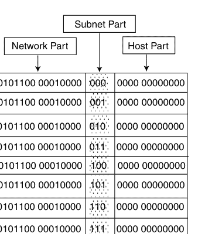

**图 2.4** 将 B 类网络划分为 8 个子网。

**表 2.5：创建可变长度子网**

| 网络编号 | 可分配给主机的 IP 地址范围 | 网络地址 | 广播地址 | 子网掩码 |
| :--- | :--- | :--- | :--- | :--- |
| 1 | 192.168.2.1 到 192.168.2.126 | 192.168.2.0 | 192.168.2.127 | 255.255.255.128 |
| 2 | 192.168.2.129 到 192.168.2.190 | 192.168.2.128 | 192.168.2.191 | 255.255.255.192 |
| 3 | 192.168.2.193 到 192.168.2.254 | 192.168.2.192 | 192.168.2.255 | 255.255.255.192 |

这里的核心思想是将网络 192.168.2.0 分成 2 部分，然后再次将第二部分分成 2 部分。这样，你得到了 3 个网络；其中一个包含 126 个主机，另外两个各包含 62 个主机。从该表可以看出，所有这些网络的掩码并不相同。这种子网划分技术被称为*可变长度子网划分*（variable-length subnetting），而子网掩码被称为*可变长度子网掩码*（VLSMs）。

VLSM 对于大型组织优化利用可用 IP 地址非常有用。

### 超网 (Supernetting)

超网是子网划分的逆过程。目前 A 类和 B 类网络地址已经枯竭。如果任何大型组织需要大量 IP 地址，唯一的解决方案是分配多个 C 类 IP 地址。例如，一个组织可能会被分配 8 个 C 类网络。为了避免互联网路由表中的路由条目过多，这些网络使用超网方法被合并为一个网络。假设 C 类网络 192.168.0.0 到 192.168.7.0 被分配给一个组织，这些网络在图 2.5 (a) 中以二进制形式列出。

现在你可以看到，所有这些网络的网络部分只有最右侧的 3 位在变化。如果你将这 3 位添加到主机部分，就可以得到一个单一的网络，如图 2.5 (b) 所示。该网络的网络地址为 192.168.0.0，子网掩码为 255.255.248.0 而不是 255.255.255.0。

**图 2.5：超网。**

使用超网技术，互联网上的路由表可以大幅缩减。例如，不再需要为每个单独的 C 类网络创建 8 条路由条目，而是一条针对前述超网的路由条目就足够了。

## 表示网络地址

一个网络由其网络地址和掩码完全定义。网络地址显示网络中的第一个 IP 地址，而掩码显示该网络主机部分和网络部分的位数。掩码中的网络部分位为 1，而主机部分位为 0。通常掩码以点分十进制表示。

另一种传递完整网络信息的方法是在网络地址后添加斜杠字符 (`/`)，然后跟上 IP 地址网络部分的位数。例如，如果一个网络地址为 192.168.2.0 且掩码为 255.255.255.0，你也可以将其写成 192.168.2.0/24，因为掩码中有 24 位是 1。同样地，A 类网络用 /8 表示，B 类网络用 /16 表示。网络地址为 192.168.2.64 且掩码为 255.255.255.192 的网络在掩码中使用 26 位，可以写成 192.168.2.64/26。

同样地，单个 IP 地址也可以表示为“IP 地址 + 掩码”的组合，或者表示为“IP 地址 + 斜杠 + 掩码中 1 的个数”。

## 保留和特殊 IP 地址

某些 IP 地址不分配给互联网上的主机。其中一些是保留地址，一些用于特殊目的，还有一些仅用于实验。这些地址如下：

- 最左侧字节为 0 的地址不被任何主机使用。
- 网络地址 127.0.0.0 不分配给互联网上的任何网络。地址 127.0.0.1 是一个特殊地址，分配给每个主机的回环接口（loopback interface）。当主机中未安装网络适配器时，此地址可用于测试应用程序。
- 10.0.0.0 到 10.255.255.255 的地址是 A 类的实验地址。
- 172.16.0.0 到 172.16.255.255 的地址是 B 类的实验地址。
- 192.168.0.0 到 192.168.255.255 的地址是 C 类的实验地址。请注意，实验地址不分配给互联网上的任何主机。不过，它们可用于隔离网络或在互联网上不可见的主机。
- 每个网络都有一个特殊的 IP 地址，称为*网络地址*。这是每个网络的第一个 IP 地址，不分配给任何主机（例如，192.168.30.0）。
- 每个网络的最后一个地址用作广播地址，不分配给网络上的任何主机（例如，192.168.30.255）。

表 2.6 总结了保留 IP 地址。

| 地址 | 描述 |
| :--- | :--- |
| 每个网络的第一个 IP 地址 | 用作网络地址。 |
| 每个网络的最后一个 IP 地址 | 用作广播地址。 |
| 127.0.0.0 | 用于回环网络。地址 127.0.0.1 始终分配给回环接口。 |
| 10.0.0.0 到 10.255.255.255 | 实验范围 IP 地址。通常用于私有网络中在互联网上不可见的主机。 |
| 172.16.0.0 到 172.31.255.255 | 实验范围 IP 地址。通常用于私有网络中在互联网上不可见的主机。 |
| 192.168.0.0 到 192.168.255.255 | 实验范围 IP 地址。通常用于私有网络中在互联网上不可见的主机。 |

## 将 IP 地址映射到主机名

考虑到互联网的复杂性，不可能记住分配给互联网主机的所有 IP 地址。然而，通过主机名记住主机很容易。主机名是一个容易记住的名称，分配给连接到网络的某个主机。网络管理员也可以为他们的网络使用主机命名约定。

主机名被映射到 IP 地址，这样当用户使用主机名访问服务时，该名称可以被解析为与提供服务的主机相关联的 IP 地址。互联网上使用了不同的地址解析方案，最广泛使用的是域名系统 (DNS)，将在第 7 章“配置和管理域名服务器”中讨论。对于极小型网络，最简单的方法是使用 `/etc/inet/hosts` 文件来记录主机名和相应的 IP 地址。这里显示了一个 `/etc/inet/hosts` 文件的示例：

```bash
bash-2.03# cat /etc/inet/hosts
#
# Internet host table
#
127.0.0.1       localhost
192.168.2.222   fana    loghost
192.168.2.11    laptop
192.168.2.1     desktop
bash-2.03#
```

该文件的第一列显示 IP 地址。在 IP 地址之后写主机名。在主机名之后可以写一个或多个别名。主机名可以简单到只有一个单词，也可以是一个完全限定域名 (FQDN)。你可以在第 7 章中学习关于域名的知识。

你可以使用任何你喜欢的编辑器手动编辑此文件。另一种编辑此文件的方法是使用 Solaris 提供的 `admintool` 工具。当你在 X Window GUI 中启动 `admintool` 并从 Browse 菜单中选择 Hosts 时，将显示如图 2.6 所示的窗口，其中包含 `/etc/inet/hosts` 文件中的条目。

使用该窗口中的 Edit 菜单，你可以添加、删除或修改文件中的条目。请注意，主机名和 IP 地址的显示顺序已更改。在此窗口中，每行首先显示主机名。

**注意：** 在 Solaris 上，`/etc/hosts` 文件实际上是一个指向 `/etc/inet/hosts` 文件的链接。在其他 UNIX 系统上，该链接不存在，文件直接保存为 `/etc/hosts`。

**图 2.6：使用 admintool 编辑 /etc/inet/hosts 文件。**

## 获取 IP 地址

TCP/IP 网络上的所有主机必须具有唯一的 IP 地址。这对于所有连接到互联网的主机都适用。如果你的网络是隔离的（未连接到互联网），你可以使用任何范围的 IP 地址。然而，因为你可能不知道何时需要将网络连接到互联网，因此即使对于私有的隔离网络，获取合法的 IP 地址也是更安全的选择。这样，当你将任何网络连接到互联网时，就不需要更改分配给主机的 IP 地址。不过，如果你已经安装了网络且不想修改当前的编址方案，你可以通过使用单个 IP 地址以其他方式连接到互联网。这可以通过使用代理服务器或在路由器机器上使用*网络地址转换* (NAT) 来实现。

要获得合法 IP 地址，你需要根据你的网络所在地区，联系以下列表中提到的三个 IP 注册机构之一。请注意，这些组织与域名注册商不同。这些注册机构过去分配 IPv4 地址，但现在你也可以从这些注册机构获得 IPv6 地址。名称和网站地址列于此处，你可以在网站上找到所有所需的表格和邮寄地址：

- **北美和南美：** 美国互联网数字登记局 (ARIN) (`www.arin.net`)
- **欧洲：** RIPE 网络协调中心 (`www.ripe.net`)
- **亚太地区：** 亚太网络信息中心 (APNIC) (`www.apnic.net`)

通常，为了获取一组 IP 地址，您必须证明其使用的合理性；这种证明通常基于您的网络规模。在申请 IP 地址时，请考虑您网络在未来五年内的潜在增长率。如果您只需要一小范围的 IP 地址，您的*互联网服务提供商* (ISP) 也可以为您提供。

## IP 报文头的结构


现在，让我们详细研究一下 IP 数据包的外观及其工作原理。IP 报文头（IP header）是任何 IP 数据包的控制部分。在 IP 数据包中，实际数据紧随 IP 报文头之后。路由决策和优先级由 IP 报文头不同部分的值决定。虽然 IP 报文头的结构对于 Solaris 网络管理认证目的可能并不重要，但它对于理解此处及后续章节中讨论的许多网络概念非常有帮助。图 2.7 显示了基本的 IPv4 报文头。

每一行代表 32 位，这是互联网文档（例如 RFC）中表示数据包结构的标准方式。图顶部的数字显示了一个字节的结束位置。以下章节简要回顾 IP 报文头的字段定义。

### 版本 (V) 和报文头长度 (IHL)

IP 报文头的第一字节分为两个字段：一个 4 位的版本 (Version) 字段 (V) 和一个 4 位的报文头长度 (Header Length) 字段 (IHL)。版本字段在报文头中由 `V` 表示。这是一个 4 位字段，显示该数据包所使用的 IP 版本。目前，版本字段的值为 4 或 6，分别代表版本 4 或版本 6 的 IP 数据包。

如图 2.7 所示，基础 IP 报文头由 20 个字节组成。共有 5 行，每行包含 4 个字节。IHL 字段是一个 4 位长的字段，它用 32 位数字（即 4 字节的一行）来表示报文头长度。在图 2.7 中，该字段的值为 5，因为共有 5 行（20 字节）。在某些情况下，IP 报文头的长度可达 60 字节（15 行），因此该字段的最大值为 15。额外的字节用于本章后面讨论的 IP 选项。

**图 2.7**

IP 报文头结构。

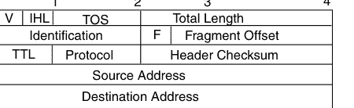

### 服务类型 (TOS)

服务类型 (TOS) 是一个 8 位长的字段，用于定义 IP 数据包的优先级。默认情况下，该字段的值为 0，代表普通优先级。

### 总长度

该字段显示 IP 数据包的总长度，包括报文头和数据。这是一个 16 位字段，这意味着 IP 数据包的最大长度可以是 $2^{16}$，即 64KBs。

### 标识 (Identification)

16 位长的标识字段用于识别一个 IP 数据包。有时，较长的 IP 数据包会被分片，并在目的地进行重新组装。该字段用于在目的地识别属于同一个数据包的不同分片。

### 标志 (Flags) (F)

这是 IP 报文头的一个 3 位部分。它包含关于数据包是否可以分片的信息。如果数据包被分片，这些标志将显示当前的 IP 数据包是较大 IP 数据包的最后一个分片，还是仍有更多分片。

### 分片偏移 (Fragment Offset)

在发生分片的情况下，该字段显示此分片在 IP 数据包中的位置。这是一个 13 位字段。

### 生存时间 (TTL)

这是一个 8 位字段，显示数据包可以传输的跳数。该字段的值在每次跳跃时递减。如果数据包在到达目的地之前该值变为 0，则数据包将被丢弃。该字段有助于解决无限路由循环的问题；也就是说，在有人误配置路由器的情况下，它可以防止 IP 数据包永久传输。在 Solaris 中，您可以使用以下命令显示默认的 TTL 值：

```bash
bash-2.03# ndd /dev/ip_def_ttl
255
bash-2.03#
```

### 协议 (Protocol)

协议字段显示 IP 数据包中使用的上层协议。IP 可以传输来自不同上层协议的数据，例如 TCP 和 UDP。常见的协议号列在 `/etc/protocols` 文件中，如下所示。利用该字段，用户还可以为应用程序使用私有协议。

```bash
bash-2.03# cat /etc/protocols
#ident "(#)protocols 1.5 99/03/21 SMI" / * Svr4.0 1.1 */

#
# Internet (IP) protocols
#
ip      0   IP      # internet protocol, pseudo protocol
icmp    1   ICMP    # internet control message protocol
ggp     3   GGP     # gateway-gateway protocol
tcp     6   TCP     # transmission control protocol
egp     8   EGP     # exterior gateway protocol
pup     12  PUP     # PARC universal packet protocol
udp     17  UDP     # user datagram protocol
hmp     20  HMP     # host monitoring protocol
xns-idp 22  XNS-IDP # Xerox NS IDP
rdp     27  RDP     # "reliable datagram" protocol

#
# Internet (IPv6) extension headers
#
hopopt  0   HopOpt  # Hop-by-hop options for IPv6
ipv6    41  IPv6    # IPv6 in IP encapsulation
ipv6-route 43  IPv6-Route # Routing header for IPv6
ipv6-frag  44  IPv6-Frag  # Fragment header for IPv6
esp     50  ESP     # Encap Security Payload for IPv6
ah      51  AH      # Authentication Header for IPv6
ipv6-icmp 58  IPv6-ICMP # IPv6 internet control message protocol
ipv6-nonxt 59  IPv6-NoNxt # No next header extension header for IPv6
ipv6-opts 60  IPv6-Opts # Destination Options for IPv6
bash-2.03#
```

`ping` 命令使用 ICMP 协议，通常用于网络故障排除。正如您在 `/etc/protocols` 文件的列举中看到的，ICMP 数据包在该字段的值为 1。同样，TCP 协议的值为 6，UDP 协议的值为 17。

### 报文头校验和 (Header Checksum)

报文头校验和字段是一个 16 位字段，在数据包经过的每个主机上都会进行计算。它用于检查 IP 报文头（而非数据部分）中的错误。

### 源地址

这部分显示发出 IP 数据包的源主机的地址。目的主机使用这个 32 位字段来确定 IP 数据包来自何处。

### 目的地址

目的地址用于计算路由并将 IP 数据包交付到其目的地。

### IP 选项

除了由 20 个字节组成的标准 IPv4 报文头外，您还可以为各种目的在 IP 报文头中添加额外的字节。IP 报文头的这个额外部分被称为 IP 选项，其长度可达 40 字节。这意味着 IP 报文头的总长度最高可达 60 字节。IHL 字段正确显示了 IP 数据包中的实际报文头长度。这些额外的字节用于以下目的：

- 获取时间戳
- 源路由
- 流 ID (Stream ID)
- 安全性
- 路由记录

> 请注意，源地址和目的地址并非使用常见的点分记法。相反，它们是 32 位数字，其中每个 8 位部分代表 IP 地址中的一个八位组 (octet)。

> 这些选项非常复杂，对其如何使用的解释超出了本书的范围。有关完整信息，请参考 IETF 网站 (`www.ietf.org`) 上的 RFC 791。

## 互联网控制消息协议 (ICMP)

正如其名，ICMP 协议用于控制消息。ICMP 是所有 IP 协议实现中不可或缺的一部分。用户应用程序（如 `ping`）使用 ICMP 数据包来诊断网络问题。主机还可以生成 ICMP 数据包，以向网络上的其他主机报告网络问题。对于 ICMP 数据包，IP 报文头中的协议字段被设置为 1。在 IP 数据包的 IP 报文头部分之后，是一个可变长度的 ICMP 报文头。在图 2.8 中，ICMP 报文头显示为阴影区域。

前三个字段存在于所有 ICMP 数据包中，并在以下章节中进行描述。在这些总共 4 字节的三个字段之后，剩余的 ICMP 报文头可以根据 `Type` 和 `Code` 字段的值具有可变长度。

### 类型 (Type)

`Type` 字段是 ICMP 报文头的一个 8 位字段，它显示 ICMP 数据包的类型。一些最常见的 ICMP 数据包类型如下：

- 目的不可达 (Destination Unreachable) 消息。
- 时间超过 (Time Exceeded)。它显示 TTL 超过或重新组装时间超过。此类型与 `traceroute` 程序一起使用。
- 参数问题 (Parameter Problem)。它显示报文头参数存在问题。

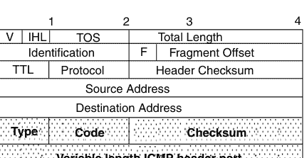

**图 2.8**

ICMP 数据包报文头。

- 源猝灭（Source Quench）。此类型用于通知发送者路径中存在网络拥塞的情况。
- 重定向消息（Redirect message）。
- 回显请求（Echo Request）和回显应答（Echo Reply）。
- 时间戳请求（Time Stamp Request）和时间戳应答（Time Stamp Reply）。
- 信息请求（Information Request）和信息应答（Information Reply）。

如你从这个列表中所见，ICMP 数据包被用于多种目的。

### 代码 (Code)

不同的代码值用于进一步识别问题。例如，如果显示“目的不可达（Destination Unreachable）”消息，则 ICMP 数据包的类型为 3。该类型下的不同代码值表示不同的情况。表 2.7 显示了代码被设置为 3 的具体情况。

| 代码 | 描述 |
| :--- | :--- |
| 0 | 网络不可达。 |
| 1 | 主机不可达。 |
| 2 | 协议不可达。 |
| 3 | 端口不可达。（此类型常用于著名的 `traceroute` 程序。） |
| 4 | 数据包被丢弃，因为需要分片，但设置了“不分片”（Don't Fragment, DF）位。（本章稍后将讨论 DF 位。） |
| 5 | 数据包被丢弃，因为源路由失败。 |

### 校验和字段 (Checksum Field)

此字段用作 ICMP 报头校验和，以检测报头中的任何错误。校验和在源端和目的端都会进行计算。如果 ICMP 数据包中发生错误，这两个校验和将不一致，从而反映出错误。

## 在 SOLARIS 中配置网络接口

Solaris 机器中的网络接口通常命名为 `hme` 或 `le`，其中 `n` 是一个数字。`hme` 或 `le` 实际上显示了连接到网络接口的驱动程序类型。数字 `n` 对于第一个接口通常为 0，第二个为 1，依此类推。如果你在主机中仅安装了一个网络适配器，该接口的名称可能是 `hme0`。要将接口 `hme0` 配置为 IP 地址 `192.168.2.222` 和子网掩码 `255.255.255.0`，有三个基本步骤。

### 分步指南

#### 2.1 配置网络接口

按照以下步骤配置网络接口：

1. 创建一个文件 `/etc/hostname.hme0`，内容为单行。如此处所示命名主机：`fana`
2. 编辑 `/etc/inet/hosts` 文件以添加主机 fana 的 IP 地址。请记住 `/etc/hosts` 是指向文件 `/etc/inet/hosts` 的链接。该文件中的一行如下所示：`192.168.2.222 fana`
3. 编辑文件 `/etc/inet/netmasks` 并添加以下行：`192.168.2.0 255.255.255.0`

`/etc/inet/netmasks` 将网络地址与子网掩码关联起来。

在启动时，网络初始化脚本 `/etc/init.d/network` 被执行，读取这些文件并配置网络接口。

请注意，此配置是永久性的，在机器重启后依然有效。你可以使用 `ifconfig` 命令临时配置网络适配器。以下命令将适配器 `hme0` 配置为 IP 地址 `192.168.5.6` 和子网掩码 `255.255.255.0`。

```bash
bash-2.03# ifconfig hme0 192.168.5.6 netmask 255.255.255.0 up
```

你也可以通过位数而不是点分十进制法来指定子网掩码。例如，以下命令执行相同操作，并指定在子网掩码中使用 24 位：

```bash
bash-2.03# ifconfig hme0 192.168.5.6/24 up
```

### 配置虚拟接口

单个物理网络适配器可以分配多个 IP 地址。当你希望在单个主机上使用不同的 IP 地址运行多个服务时，这非常有用。虚拟接口就是为此目的而设计的。虚拟接口就像任何物理接口一样，但在适配器名称末尾添加了一个冒号和数字。例如，如果你的系统中安装了 `hme0` 网络适配器，你可以使用多个虚拟接口，如 `hme0:n`，其中 `n` 是大于或等于 1 的数字。因此，第一个虚拟接口是 `hme0:1`，第二个是 `hme0:2`，依此类推。你可以像配置物理接口一样配置虚拟接口。

### 分步指南

#### 2.2 配置虚拟网络接口

要在该虚拟接口上配置 IP 地址 `192.168.28.28` 和子网掩码 `255.255.255.0`，请遵循以下三个步骤：

1. 创建一个 `/etc/hostname.hme0:1` 文件，其中包含一行主机名。我使用了 fana-nt 作为主机名。该文件中的唯一一行如下：`fana-nt`
2. 在 `/etc/inet/hosts` 文件中添加一行，包含新的主机名和 IP 地址。添加此条目后，文件内容如下：

   `192.168.2.222    fana`

   `192.168.28.28    fana-nt`

3. 在现有的 `/etc/inet/netmasks` 文件中添加一行，为新接口添加子网掩码。文件现在看起来如下：

   `192.168.2.0    255.255.255.0`

   `192.168.20.0   255.255.255.0`

至此过程完成。下次重启系统时，逻辑接口 `hme0:1` 将会存在。

### 手动配置虚拟接口

若要在无需重启的情况下手动配置虚拟接口，请遵循以下分步方法。

### 分步指南

#### 2.3 手动配置虚拟网络接口

1. 首先，启用虚拟接口。以下命令启用虚拟接口 `hme0:2`：

   ```bash
   bash-2.0# ifconfig hme0:2 plumb
   bash-2.0#
   ```

2. 使用以下命令显示虚拟接口设置：

   ```bash
   bash-2.0# ifconfig hme0:2
   hme0:2:
       flags=1000842 <BROADCAST,RUNNING,MULTICAST,UP>
       v4> mtu 1500 index 2
       inet 0.0.0.0 netmask 0
   bash-2.0#
   ```

3. 如你所见，该接口尚未配置 IP 地址。要配置 IP 地址 `192.168.5.5` 和子网掩码 `255.255.255.0`，请使用以下命令：

   ```bash
   bash-2.0# ifconfig hme0:2 192.168.5.5 netmask 255.255.255.0 up
   bash-2.0#
   ```

4. 使用如下示例中的 `ifconfig` 命令验证配置的 IP 地址。你还可以使用 `ping` 命令来验证是否收到来自该 IP 地址的响应。

   ```bash
   bash-2.0# ifconfig hme0:2
   hme0:2:
       flags=1000842 <BROADCAST,RUNNING,MULTICAST,UP>
       IPv4> mtu 1500 index 2
       inet 192.168.5.5 netmask ffffff00
       broadcast 192.168.5.255

   bash-2.0# ping 192.168.5.5
   192.168.5.5 is alive
   bash-2.0#
   ```

与其它接口一样，虚拟接口的配置可以在任何时候修改。以下命令将虚拟接口 `hme0:2` 的 IP 地址修改为 `192.168.5.6`，子网掩码修改为 `255.255.255.192`（26 位）。请注意，我使用了子网掩码的位数，但你也可以使用点分十进制法。下一个命令显示当前配置：

```bash
bash-2.0# ifconfig hme0:2 192.168.5.6/26 up
bash-2.0# ifconfig hme0:2
hme0:2: flags=1000843<UP,BROADCAST,RUNNING,MULTICAST,
	IPv4>	mtu 1500 index 2
	inet 192.168.5.6 netmask fffffffc broadcast
	192.168.5.255
bash-2.0#
```

### 验证 IP 配置

配置接口后，你可以显示信息以确保它们配置如下：要列出所有网络接口，请如下使用 `ifconfig` 命令：


```bash
bash-2.0# ifconfig -a
lo0: flags=1000849<UP,LOOPBACK,RUNNING,MULTICAST,IPv4> mtu
	8232 index 1
	inet 127.0.0.1 netmask ff000000
hme0: flags=1000843<UP,BROADCAST,RUNNING,MULTICAST,IPv4>
	mtu 1500 index 2
	inet 192.168.2.222 netmask ffffffff broadcast
	192.168.2.255
	ether 8:0:20:9e:0:508
hme0:1: flags=1000843<UP,BROADCAST,RUNNING,MULTICAST,IPv4>
	mtu 1500 index 2
	inet 192.168.20.28 netmask ffffffff broadcast
	199.20.39.31
lo0: flags=1000849<UP,LOOPBACK,RUNNING,MULTICAST,IPv6>
	mtu 8232 index 1
	inet6 ::1/128
	inet6 fe80::1/64
hme0: flags=2000841<UP,RUNNING,MULTICAST,IPv6> mtu 1500
	index 2
	ether 8:0:20:9e:0:508
	inet6 fe80::a00:20ff:fe9e:f050/10
bash-2.0#
```

第二件事是测试路由。为此，请如下使用 `netstat` 命令：

```bash
bash-2.0# netstat -rn
```

| 目的地址 | 网关 | 标志 | 引用 | 使用 | 接口 |
| :--- | :--- | :--- | :--- | :--- | :--- |
| 192.168.20.0 | 192.168.20.28 | U | 1 | 17 | hme0:1 |
| 192.168.2.0 | 192.168.2.222 | U | 1 | 2 | hme0 |
| 224.0.0.0 | 192.168.2.222 | U | 1 | 0 | hme0 |
| 127.0.0.1 | 127.0.0.1 | UH | 23 | 20670 | lo0 |

```text
Routing Table: IPv6
Destination/Mask Gateway Flags Ref Use If
fe80::/10 fe80::a00:20ff:fe9e:f050 U 1 0 hme0
ff00::/8 fe80::a00:20ff:fe9e:f050 U 1 0 hme0
default fe80::a00:20ff:fe9e:f050 U 1 0 hme0
::1 :: UH 1 0 lo0
bash-2.03#
```

另一个测试可以是使用 `ping` 命令来验证接口是否响应，如此处所示：

```bash
bash-2.03# ping fana-nt
fana-nt is alive
bash-2.03#
```

你也可以使用 IP 地址代替主机名 `fana-nt`，如下所示：

```bash
bash-2.03# ping 192.168.20.28
192.168.20.28 is alive
bash-2.03#
```

## 使用 `netstat` 命令验证配置

你已经见过的 `netstat -rn` 命令实际上显示的是路由表，这将在下一章中讨论。除了路由表，`-rn` 命令还会显示每个接口上配置的 IP 地址。你还可以使用 `netstat -i` 命令来查找每个接口的详细信息。此处列出的下一个命令将显示所有 IPv4 和 IPv6 接口的以下信息：

- 接口名称。
- 该接口上配置的 MTU 值。这将在下一节中讨论。
- 该接口使用的名称。
- 该接口上配置的主机名或 IP 地址。
- 输入数据包的数量。
- 输入数据包中的错误数量。
- 输出数据包的数量。
- 输出数据包中的错误数量。
- 该接口上的冲突数量。
- 该接口的队列长度。

您可以在以下命令的输出中找到所有这些列出的信息：

```bash
bash-2.03# netstat -i
Name Mtu Net/Dest Address Ipkts Ierrs Opkts Oerrs Collis Queue
lo0 8232 loopback localhost 31919 0 31919 0 0 0
hme0 1500 fana fana 5486 0 681 0 4 0

Name Mtu Net/Dest Address Ipkts Ierrs Opkts Oerrs Collis
lo0 8232 localhost localhost 31919 0 31919 0 0
hme0 1500 fe80::a00:20ff:fe9e:f050/10 -> fe80::a00:20ff:fe9e:f050 5486 0 681 0 4

bash-2.03#
```

该命令及其用途将在本书中多次讨论。

## IP 分片、重组、流量控制、TOS 和 TTL

请看以下 `ifconfig` 命令的输出：

```bash
bash-2.03# ifconfig hme0
hme0: flags=1000843<UP,BROADCAST,RUNNING,MULTICAST,IPv4>
-> mtu 1500 index 2
inet 192.168.2.222 netmask ffffff00 broadcast
-> 192.168.2.255
ether 8:0:20:9e:f0:50

bash-2.03#
```

您可能已经注意到 `ifconfig` 命令的输出中有一个名为 MTU（最大传输单元）的字段。该字段显示了可以通过物理接口传输的数据帧的最大长度。在前一个命令中，该字段的值为 1500，这意味着可以通过 `hme0` 接口发送最大长度为 1500 字节的帧。在通过接口发送任何数据包之前，IP 会检查 MTU 值。如果 MTU 值小于 IP 数据包的大小，则该数据包需要被分片。例如，如果一个应用程序发送一个 2000 字节的 IP 数据包，它将被分片为两个数据包。第一个数据包将包含 1500 字节，第二个将携带剩余的字节。IP 报头中的标志（Flags）字段用于将分片信息传递给目的地址。第一个数据包的分片偏移（fragmentation offset）字段为 0。后续数据包中该字段的值显示了这些数据包在实际的大 IP 数据包中的位置。当目的主机收到分片时，它会在处理之前将这些分片重组为单个数据包。标志字段即用于此目的。这个过程被称为数据包重组。

IP 报头标志字段中的其中一个位被称为“不可分片”（DF）位。如果设置此位，则要求数据包不得被分片。在这种情况下，如果在路径中的任何一点 MTU 值小于数据包大小且 DF 位被设置，该数据包将被丢弃。丢弃数据包的主机会发回一个 ICMP 数据包错误消息，通知发送者由于设置了 DF 位且需要分片，导致数据包被丢弃。如前所述，该 ICMP 数据包的类型（type）字段为 3，代码（code）字段为 4。这种方法用于检测互联网上源主机和目的主机之间路径的最小 MTU 值。

### 配置 MTU 值

MTU 字段的值可以使用 `ifconfig` 命令进行配置。默认情况下，以太网接口的 MTU 值为 1500。以下命令将 MTU 值设置为 1000：

```bash
bash-2.03# ifconfig hme0 mtu 1000
bash-2.03#
```

如果您再次使用 `ifconfig` 命令，它将显示新的 MTU 值，如下所示：

```bash
bash-2.03# ifconfig hme0
hme0: flags=1000843<UP,BROADCAST,RUNNING,MULTICAST,IPv4>
->mtu 1000 index 2
->inet 192.168.1.222 netmask ffffff00 broadcast
->192.168.2.255

ether 8:0:20:9e:f0:50
bash-2.03#
```

**注意**：除非您非常确定自己在做什么，否则请勿更改任何接口的 MTU 值。这可能会导致严重的性能问题。

### 流量控制

如前所述，ICMP 数据包可用于将信息（例如网络拥塞的可能性）传回发送者。在发生拥塞时会生成一个 ICMP 类型 4 数据包（源端抑制 Source Quench）。当网关没有足够的缓冲空间来将数据包排队处理而导致数据包被丢弃时，通常会生成一个源端抑制 ICMP 消息。当发送端收到源端抑制数据包时，它会降低发送数据的速率。当目的主机的处理速度跟不上数据包的接收速率时，目的主机也可能会生成源端抑制 ICMP 数据包。

**注**：请注意，这种流量控制是在 IP 层级实现的。更高层有自己的流量控制机制。例如，TCP 层使用的流量控制机制将在本章后面讨论。

### TOS

IP 数据包报头中的服务类型（Type Of Service）字段用于优先处理 IP 流量。以下是 RFC 791 中列出的 IP 流量类型：

- 网络控制 (Network control)
- 互连网络控制 (Internetwork control)
- 紧急/ECP (CRITIC/ECP)
- 闪电覆盖 (Flash override)
- 闪电 (Flash)
- 立即 (Immediate)
- 优先级 (Priority)
- 常规 (Routine)

该字段的实际实现非常复杂。一些 IP 协议的实现方式与 RFC 791 的定义不同。一些 IP 实现根本没有实现这个字段，并将所有数据包都设为 0（常规）。

### TTL

TTL 字段控制 IP 数据包可以传输的跳数。该字段的值在每个跳跃点由路由器递减。如果数据包未到达目的地且其值变为 0，该数据包将被丢弃。利用这个字段，您可以控制 Solaris 主机与另一个主机之间以跳数为单位的最大距离。例如，如果您将默认 TTL 设置为 20，那么从您的主机产生的所有数据包都无法到达距离超过 20 个网络跳的另一个主机。

### 为 ICMP、UDP 和 TCP 数据包设置 TTL 值

如前所述，TTL 是 IP 报头字段之一。您可以为 TCP、UDP 甚至 ICMP 等更高层协议设置特定的 TTL 值。例如，如果您设置了 ICMP 数据包的默认 TTL 值，所有 ICMP 数据包都将使用该值。要显示当前 ICMP 数据包使用的 TTL 值，请使用以下命令：

```bash
bash: 2.0# ndd /dev/icmp icmp_ipv4_ttl
255
bash: 2.0#
```

您可以通过向一台主机发送一个 `ping` 数据包来验证此值确实被使用了。为此，请从命令行发送一个 ICMP 数据包，并使用 `snoop` 命令捕获正在发送的数据包。以下命令向主机 `desktop` 发送一个 ICMP 回显请求数据包。（`ping` 命令将在本章后面详细介绍。）

```bash
bash: 2.0# ping -s desktop 100 1
PING desktop: 100 data bytes
100 bytes from desktop (192.168.2.1): icmp_seq=0. time=1. ms

--- desktop PING Statistics ---
1 packets transmitted, 1 packets received, 0% packet loss
round-trip (ms) min/avg/max = 1/1/1
bash: 2.0#
```

主机将响应一个 ICMP 回显响应数据包。要检查这两个数据包中的 TTL 值，您可以在另一个终端窗口中使用 `snoop` 命令。只需打开另一个窗口，并在使用上述 `ping` 命令之前执行以下 `snoop` 命令：

```bash
snoop -v | grep IP
```

一旦执行 `ping` 命令，`snoop` 命令窗口将显示以下消息：

```text
ETHER: Ethertype = 0800 (IP)
IP: --- IP Header ---
IP: 
IP: Version = 4
IP: Header length = 20 bytes
IP: Type of service = 0x00
IP: xxx... ... = 0 (precedence)
IP: ...0 ... = normal delay
IP: ... ... 0.. = normal throughput
IP: ... ... .0. = normal reliability
IP: Total length = 128 bytes
IP: Identification = 348
IP: Flags = 0x4
IP: .1 .. ... = do not fragment
IP: ..0 . ... = last fragment
IP: Fragment offset = 0 bytes
IP: Time to live = 255 seconds/hops
IP: Protocol = 1 (ICMP)
IP: Header checksum = d4f1
IP: Source address = 192.168.2.222, fana
IP: Destination address = 192.168.2.1, desktop
IP: No options
IP: 
ETHER: Ethertype = 0800 (IP)
IP: --- IP Header ---
IP: 
IP: Version = 4
IP: Header length = 20 bytes
IP: Type of service = 0x00
IP: xxx... ... = 0 (precedence)
IP: ...0 ... = normal delay
IP: ... ... 0.. = normal throughput
IP: ... ... .0. = normal reliability
IP: Total length = 128 bytes
IP: Identification = 01b4
IP: Flags = 0x4
IP: .1 .. ... = do not fragment
IP: ..0 . ... = last fragment
IP: Fragment offset = 0 bytes
IP: Time to live = 128 seconds/hops
IP: Protocol = 1 (ICMP)
IP: Header checksum = 2241
IP: Source address = 192.168.2.1, desktop
IP: Destination address = 192.168.2.222, fana
IP: No options
IP: 
```

此输出显示了两个 IP 数据包的报头部分。在第一部分中，TTL 值为 255，这是 ICMP 数据包的默认 TTL 值。第二部分显示 TTL 值为 128，这是主机 `desktop` 发送的 ICMP 回显响应数据包的 TTL 值。

现在使用以下命令将此值设置为 30，并重复上述实验：

```bash
bash-2.03# ndd -set /dev/icmp icmp_ipv4_ttl 30
bash-2.03#
```

再次使用前述 `ping` 命令，并在另一个窗口捕获 `snoop` 命令的输出。这一次，您会注意到发出的 ICMP 数据包的 TTL 值为 30。

同样地，你也可以为 TCP 和 UDP 数据包定义默认的 TTL 值。以下两个命令分别设置了 TCP 和 UDP 的 TTL 值。

```bash
ndd -set /dev/tcp ipv4_ttl 30
ndd -set /dev/udp ipv4_ttl 30
```

## IP 地址配置故障排除命令

`ping` 命令通常是诊断任何 IP 地址配置问题的第一步。你可以通过多种方式使用该命令，具体在以下章节中讨论。你还可以使用 `traceroute` 命令来诊断可达性问题。

### ping 命令

`ping` 命令是网络管理员最广泛使用的命令。它使用 ICMP 回显请求（echo request）类型的 ICMP 数据包。当主机收到此类数据包时，它会回复一个 ICMP 回显响应（echo reply）数据包，该响应可用于确定源主机与目的主机之间 ICMP 数据包的往返时间（round-trip time）。

默认情况下，该命令仅显示两条消息，表明主机是存活（alive）还是死亡（dead）。以下两个命令显示主机 `desktop` 是存活的，而主机 `laptop` 是死亡的：

```bash
bash-2.03# ping desktop
desktop is alive
bash-2.03# ping laptop
no answer from laptop
bash-2.03#
```

你可以将此命令用于多种目的，列举如下：

- 确定特定主机的可达性
- 确定主机是存活还是死亡
- 发现路由问题
- 确定源与目的之间的最小 MTU
- 使用源路由检查特定路径
- 寻找断裂或故障的电缆
- 确定网络响应时间
- 确定网络中的丢包情况

这些仅仅是该命令的几种用途。作为一名网络管理员，你将常规地使用此命令来排除网络故障。事实上，这是网络故障排除过程的第一步。

### 连续 ping

默认情况下，`ping` 命令仅通过发送 ICMP 回显请求类型的数据包来告知你主机是存活还是死亡。如果命令收到此数据包的 ICMP 回显响应形式的回复，则打印 Host Alive 消息。不过，你还可以使用以下命令向主机发送连续的 `ping` 数据包（ICMP 回显请求类型数据包）：


```
bash-2.03# ping -c 5 desktop
PING desktop: 56 data bytes
64 bytes from desktop (192.168.2.1): icmp_seq=0. time=0. ms
64 bytes from desktop (192.168.2.1): icmp_seq=1. time=0. ms
64 bytes from desktop (192.168.2.1): icmp_seq=2. time=0. ms
64 bytes from desktop (192.168.2.1): icmp_seq=3. time=0. ms
64 bytes from desktop (192.168.2.1): icmp_seq=4. time=0. ms
64 bytes from desktop (192.168.2.1): icmp_seq=5. time=0. ms
64 bytes from desktop (192.168.2.1): icmp_seq=6. time=0. ms

--- desktop PING Statistics ---
7 packets transmitted, 7 packets received, 0% packet loss
round-trip (ms) min/avg/max = 0/0/0
bash-2.03#
```

你必须按下 `Ctrl+C` 来中断连续 `ping` 命令。当你使用 `Ctrl+C` 中断命令时，该命令会显示 `ping` 统计信息并返回命令提示符。统计信息显示了发送了多少个数据包、接收了多少个数据包以及丢包百分比。它还显示了最小、平均和最大往返时间。

> **注意**

连续 `ping` 命令在低带宽链路上应谨慎使用。在某些情况下，它可能会占用可用带宽的很大一部分。

连续 `ping` 命令对于在一段时间内排除问题，以及在不同网络速度下监控网络延迟方面的网络响应非常有用。

### 在 `ping` 命令中使用不同的数据包长度

默认情况下，`ping` 命令使用 56 + 8 字节长的数据包。然而，为了检查网络对较大数据包的响应，你可以使用 `ping` 命令指定数据包长度。这在了解主机是否因 IP 到 IP 分片而丢包时也可能非常有益。以下命令向主机 `desktop` 发送 (6000 + 8) 字节长的数据包：

```
bash-2.03# ping -s desktop 6000
PING desktop: 6000 data bytes
6000 bytes from desktop (192.168.2.1): icmp_seq=0. time=11.

6000 bytes from desktop (192.168.2.1): icmp_seq=1. time=10.

6000 bytes from desktop (192.168.2.1): icmp_seq=2. time=10.

6000 bytes from desktop (192.168.2.1): icmp_seq=3. time=10.

6000 bytes from desktop (192.168.2.1): icmp_seq=4. time=10.

6000 bytes from desktop (192.168.2.1): icmp_seq=5. time=10.

--- desktop PING Statistics ---
6 packets transmitted, 6 packets received, 0% packet loss
round-trip (ms) min/avg/max = 10/10/11
bash-2.03#
```

正如你从之前的命令输出中所注意到的，较大数据包的响应时间增加了。在之前的命令中（使用 56 + 8 字节数据包），平均返回时间为 0 毫秒，而在这种情况下，平均时间为 10 毫秒。

### 发送固定数量的 `ping` 数据包

你还可以向目的主机发送预定义数量的 `ping` 数据包。以下命令向主机 `desktop` 发送 4 个 100 字节数据长度的数据包：

```
bash-2.03# ping -s desktop 100 4
PING desktop: 100 data bytes
100 bytes from desktop (192.168.2.1): icmp_seq=0. time=0.

100 bytes from desktop (192.168.2.1): icmp_seq=1. time=0.
100 bytes from desktop (192.168.2.1): icmp_seq=2. time=0. ms
100 bytes from desktop (192.168.2.1): icmp_seq=3. time=0. ms

--- desktop PING Statistics ---
4 packets transmitted, 4 packets received, 0% packet loss
round-trip (ms) min/avg/max = 0/0/0
bash-2.03#
```

表 2.8 列出了 `ping` 命令可使用的其他有用选项。

| 选项 | 描述 |
| :--- | :--- |
| `-g gateway` | 指定你希望通过其路由数据包的网关。可以使用多个网关地址来使数据包通过网络中的特定路径。 |
| `-I interval` | 相邻 ICMP 数据包之间的时间间隔。 |
| `-i interface` | 定义数据包应发出的接口地址。 |
| `-P tos` | 设置 IP 报头中的服务类型（Type Of Service）字段。 |
| `-t ttl` | 设置 IP 报头中的 TTL 字段值。 |

请注意，你可以通过使用 `man ping` 命令获取 `ping` 命令可用选项的完整列表。表 2.8 仅列出了最广泛使用的选项。

### 广播 `ping`

你可以使用广播 `ping` 来发现网络上的所有主机。你可以使用地址 `255.255.255.255` 向所有主机发送广播，或者使用网络广播地址仅向特定网络发送。以下命令向所有主机发送 `ping` 数据包：

```
bash-2.03# ping -b 255.255.255.255
PING 255.255.255.255 (EN0) 56 data bytes
64 bytes from fana (192.168.2.222): icmp_seq=0. time=0. ms
64 bytes from laptop (192.168.2.11): icmp_seq=0. time=3. ms
64 bytes from fana (192.168.2.222): icmp_seq=1. time=0. ms
64 bytes from laptop (192.168.2.11): icmp_seq=1. time=0. ms
64 bytes from fana (192.168.2.222): icmp_seq=2. time=0. ms
64 bytes from laptop (192.168.2.11): icmp_seq=2. time=0. ms
64 bytes from fana (192.168.2.222): icmp_seq=3. time=0. ms
64 bytes from laptop (192.168.2.11): icmp_seq=3. time=0. ms

-- 255.255.255.255 PING Statistics --
4 packets transmitted, 8 packets received, 2.00 times
round-trip (ms) min/avg/max = 0/0/3
bash-2.03#
```

该命令的响应显示了对广播 `ping` 做出回复的 IP 地址和主机名。每行中的序列号显示了该回复所对应的 `ping` 数据包编号。如你所见，有两行序列号为 0。这两行的 IP 地址分别是 `192.168.2.222` 和 `192.168.2.11`。这两行表明，序列号为 0 的 `ping` 数据包的回复是从这两个主机都接收到的。以下命令仅向网络 `192.168.2.0` 上的主机发送 `ping` 数据包：

```
bash-2.03# ping -s 192.168.2.255
PING 192.168.2.255: 56 data bytes
64 bytes from fana (192.168.2.222): icmp_seq=0. time=0. ms
64 bytes from laptop (192.168.2.11): icmp_seq=0. time=1. ms
64 bytes from fana (192.168.2.222): icmp_seq=1. time=0. ms
64 bytes from laptop (192.168.2.11): icmp_seq=1. time=0. ms
64 bytes from fana (192.168.2.222): icmp_seq=2. time=0. ms
64 bytes from laptop (192.168.2.11): icmp_seq=2. time=0. ms

-- 192.168.2.255 PING Statistics --
3 packets transmitted, 6 packets received, 2.00 times
round-trip (ms) min/avg/max = 0/0/1
bash-2.03#
```

广播 `ping` 是确定本地网络上所有主机的非常实用的功能。但请注意，某些主机（如 Microsoft Windows PC）不响应广播 `ping` 数据包。此外，路由器通常不会将广播 `ping` 数据包转发到其他网络（以避免网络泛洪）。

### `traceroute` 命令

`traceroute` 命令用于查找从源到目的地的网关主机。换句话说，该命令显示了 IP 数据包从源到目的地所经过的路径。以下命令追踪从我的 Solaris 工作站到主机 `www.newriders.com` 的路径：

```
bash-2.03# traceroute www.newriders.com
traceroute: Warning: Multiple interfaces found; using 209.79.180.210 @ hme0:1
traceroute to newriders.com (63.69.110.220), 30 hops max, 40 byte packets
 1 tntilo.fa0.vntros.pbi.net (64.161.163.134) 7.408 ms 3.098 ms 3.049 ms
 2  pop1.fe-6.1-0.vntrcs.pbi.net (64.161.163.145)  31.903 ms   27.808 ms   28.567 ms
 3  206.171.129.2 (206.171.129.2) 31.492 ms  31.444 ms  31.883 ms
 4  edge1-ge0-1.Isn03.pbi.net (206.13.29.144) 33.490 ms  29.909 ms  31.896 ms
 5  47.81.254.93 (47.81.254.93)  66.579 ms  77.139 ms  63.744 ms
 6  47.255.255.40 (47.255.255.40) 67.134 ms  68.055 ms  72.130 ms
 7  47.255.255.253.1 (47.255.253.1) 69.448 ms  83.567 ms  74.826 ms
 8  47.255.252.34 (47.255.252.34) 69.794 ms  67.788 ms  72.499 ms
 9  47.243.2.2 (47.243.2.2) 68.592 ms  105.874 ms  63.696 ms
10 47.243.2.1 (47.243.2.1) 68.087 ms  87.809 ms  60.532 ms
11 209.0.252.133 (209.0.252.133) 75.920 ms  90.998 ms  90.940 ms
12 lo0.mpi.Sanjose1.level3.net (209.8.247.239) 78.249 ms  62.283 ms  70.621 ms
13 pos9-0.core2.SanFrancisco1.level3.net (209.8.247.239) 77.213 ms  68.281 ms
14 ATM3-0.BR5.SAC1.ALTER.NET (173.39.52.145)  66.028 ms  67.430 ms  88.403 ms
15 502.at-5-0.XR1.SAC1.ALTER.NET (152.53.52.226)  70.063 ms  91.439 ms  66.66 ms
16 185.at-1-0.TR3.SCL1.ALTER.NET (152.63.50.154) 125.117 ms  133.248 ms  121.238 ms
17 107.at-5-1-0.TR1.NYC8.ALTER.NET (146.188.140.201) 140.197 ms  136.864 ms  137.554 ms
18 185.ATM3-0.XR1.EW1R.ALTER.NET (152.63.20.217) 147.568 ms  144.596 ms  136.949 ms
19 193.ATM7-0.GW7.EW1R.ALTER.NET (152.63.24.197) 150.979 ms  149.565 ms  142.015 ms
20 headland-media-gw.customer.ALTER.NET (157.130.199.143) 134.146 ms  144.311 ms  150.976 ms
21 63.69.110.66 (63.69.110.66) 142.059 ms  140.763 ms *
bash-2.03#
```

`traceroute` 命令使用 UDP 数据包来寻找中间网关主机。它发送 TTL 值递增的 UDP 数据包，从 1 开始。当 TTL 值为 1 的数据包到达第一个网关主机时，它会将 TTL 值减 1，此时 TTL 值变为 0。因此，第一个网关主机会丢弃该数据包并生成一个 ICMP 数据包，以通知发送主机该数据包已被丢弃。通过这种方式，第一跳网关主机显示了其身份。第二跳网关主机由 UDP TTL 值 2 确定，依此类推。默认情况下，每个跳数（具有相同的 TTL）会发送三个探测包。`traceroute` 命令的输出为每跳显示一行。在每一行中，显示网关主机的主机名和 IP 地址，以及三个探测包的返回时间。如果未收到网关的响应包，则打印一个星号。请看输出中的以下行：

```
4  edge1-ge0-1.Isn03.pbi.net (206.13.29.144) 33.490 ms
   29.909 ms  31.896 ms
```

该行中的第一个数字显示此网关距离 4 跳。接下来打印的是网关主机的主机名和 IP 地址。第一个探测包的返回时间为 33.490 毫秒，第二个探测包为 29.909 毫秒，第三个探测包为 31.896 毫秒。

默认情况下，该命令尝试到达最多 30 跳之外的目的地。如果在该限制内未到达目的地，命令将结束。

`traceroute` 命令经常用于排除中间网关上链路中断的路由问题。使用此命令，您可以确定网络中链路是在哪个点断开的。还可能会显示不同的错误消息，这些消息在命令的 man 手册页中有所描述。

与 `ping` 命令一样，您可以在 `traceroute` 命令中使用不同的数据包长度。以下命令使用 4000 字节的数据包从源主机到目的主机进行路由追踪。默认的探测长度为 40 字节。

```
bash: 2.03# traceroute www.newriders.com 4000
traceroute: Warning: Multiple interfaces found; using
$→$ 209.79.180.218 @ hme0:1
traceroute to newriders.com (63.69.110.220), 30 hops max,
$→$ 4000 byte packets
```

表 2.9 列出了 `traceroute` 命令的其他有用选项。

### 表 2-9：`traceroute` 命令使用的选项

| 选项 | 描述 |
| :--- | :--- |
| `-F` | 在 IP 报头中设置 DF（不分片）位。 |
| `-f first_hop` | 设置第一跳 TTL。默认值为 1。用于在探测开始时跳过一定数量的网关。 |
| `-g gateway` | 该选项用于在宽松源路由（loose source routing）中设置网关。 |
| `-m maxhops` | 该选项用于设置最大 TTL 值。默认最大值为 30。 |
| `-p port` | UDP 数据包使用的端口号。 |
| `-q probes` | 设置每跳的探测次数。 |
| `-v` | 详细输出。打印更多信息。 |

如表 2.9 所示，您也可以在经过一定数量的跳数后开始探测路径。以下命令从第十个网关主机开始探测：


```bash
bash-2.03# traceroute -f 10 www.newriders.com
traceroute: Warning: Multiple interfaces found; using 190.30.29.28 @ hme0:1
traceroute to newriders.com (63.99.110.239), 30 hops max, 48 byte packets
10 0.243.251.13 (0.243.251.13) 63.111 ms 61.599 ms 59.434 ms
11 209.0.252.133 (209.0.252.133) 87.134 ms 87.914 ms 65.217 ms
12 lob.mp1.SanJose1.level3.net (29.247.8.239) 69.618 ms 200.415 ms 62.717 ms
13 pos9-0.core2.SanFrancisco1.level3.net (209.247.10.238) 63.504 ms 62.820 ms 74.109 ms
14 ATM3-0.BRS.SAC1.ALTERN.NET (137.39.52.145) 87.010 ms 67.563 ms 66.055 ms
15 S02-at-5-0-0.XR1.SAC1.ALTER.NET (152.63.52.226) 72.317 ms 128.004 ms 95.70 ms
16 185.AT-1-0-0.SCL3.SCL1.ALTER.NET (152.63.58.154) 82.839 ms 95.486 ms 68.290 ms
17 187.at-5-1-0.TR1.NYC8.ALTER.NET (146.188.140.201) 138.995 ms 143.264 ms 160.059 ms
18 185.ATM6-0.XR1.EWR1.ALTER.NET (152.63.20.217) 143.494 ms 136.689 ms 221.095 ms
19 193.ATM7-0.GW7.EWR1.ALTER.NET (152.63.24.197) 143.529 ms 154.610 ms 145.680 ms
20 headland-media-gw.customer.ALTER.NET (157.130.19.94) 165.344 ms 175.200 ms 156.264 ms
21 63.99.110.66 (63.99.110.66) 191.748 ms 147.439 ms *
bash-2.03#
```

## 常见网络问题

以下章节列出了一些常见的网络问题及其诊断方法。

### 线缆断裂

如果线缆断裂，您应该能够 `ping` 通配置在您自己的 Solaris 机器上的 IP 地址，但无法 `ping` 通网络上的任何其他主机。

### 接口配置错误

网络适配器可能会在多种方面被配置错误。您可能分配了错误的 IP 地址、错误的子网掩码或错误的网关。使用 `ifconfig` 命令查找所有网络适配器的当前配置，如果在发现错误后则修改配置。

### 子网掩码错误

检查其他主机上配置的子网掩码值，并将其与您自己的值进行比较。您可以使用 `ifconfig` 或 `netstat` 命令找到该值。

### 网关错误

使用 `traceroute` 命令追踪到不在本地网络上的主机的路由。如果网关地址错误，您将无法到达第一跳。检查网络上其他主机的网关值以进行修正。

## 在 Solaris 中微调 TCP

在 TCP/IP 网络上使用 TCP 协议时，接收方会对所有接收到的数据包进行确认。如果数据包被正确接收，则发送正确认认。如果出现任何错误，接收方会要求重新发送该数据包。这就是为什么 TCP 被称为可靠协议，而 UDP 则不发送确认。

发送主机在不等待任何确认的情况下继续发送数据包，直到达到一定的限制。如果达到限制且未收到确认，发送方将等待接收方的确认。这个限制被称为 *TCP 窗口大小*。如果该限制以数据包数量设定且其值为 7，则发送方在收到确认之前最多将发送 7 个 TCP 数据包。窗口大小在长延迟链路（如卫星链路）的带宽利用率中起着重要作用。窗口大小在 TCP 连接建立时由源端和目的端协商确定。

Solaris 支持大窗口大小，以便在慢速链路上获得更好的吞吐量。可以使用 `nd` 命令对 TCP 协议进行大量的微调。本节列出了在 TCP 性能中起作用的一些重要 TCP 参数。您可以使用 `nd` 命令修改这些参数。

- **发送高水位线（Transmit High Water Mark）**：`tcp_xmit_hiwat`：该参数用于定义发送缓冲区的大小。
- **接收高水位线（Receive High Water Mark）**：`tcp_recv_hiwat`：该参数指定接收缓冲区的默认大小，即分配用于接收数据的空间。
- **最大缓冲区大小**：`tcp_max_buf`：此参数指定了可为套接字选项分配的最大缓冲区大小。您将在第 4 章“客户端-服务器世界：端口与套接字”中学习有关套接字的知识。

## 显示和设置主机参数

您可以使用 `ndd` 命令配合 `tcp_host_param` 参数，为不同的主机和网络定义并显示参数的默认值。以下命令将主机 `192.168.2.100` 的 `send_buffer` 设置为 32000 字节，`receive_buffer` 设置为 48000 字节：

```bash
bash-2.03# ndd -set /dev/tcp tcp_host_param '192.168.2.100' sendspace 32000 recvspace 48000
bash-2.03#
```

要显示主机参数的当前设置，请使用以下命令：

```bash
bash-2.03# ndd /dev/tcp tcp_host_param
Hash HSP Address Subnet Mask Send
Receive TStamp 192.168.002.100 016.014.016.004 0000032000
014 300007d068 70208 0000048000 0
bash-2.03#
```

您也可以使用相同的命令删除主机参数，如下所示：

```bash
bash-2.03# ndd -set /dev/tcp tcp_host_param '192.168.2.100' -delete
bash-2.03#
```

要获取 TCP 可设置参数的完整列表，请使用命令 `ndd /dev/tcp \?`。该命令的输出提供了可以通过 `ndd` 命令设置和显示的详细参数列表。

## 将 IP 地址映射到 MAC 地址

在任何主机向目的地址发送 IP 数据之前，它必须确定目的主机的 MAC 地址，因为数据链路层仅识别 MAC 地址。*地址解析协议*（ARP）是 TCP/IP 协议栈实现的一部分，它将 IP 地址映射到 MAC 地址。该协议根据给定的 IP 地址确定对应的 MAC 地址。另一个协议 *反向地址解析协议*（RARP）则执行相反的过程，将 MAC 地址映射到 IP 地址。RARP 用于无盘工作站。这些协议将在接下来的章节中详细说明。

### 地址解析协议（ARP）

地址解析协议是一种广播协议。当一台主机想要获取与某个 IP 地址相对应的 MAC 地址时，它会在本地网络上发送一个广播数据包。该数据包基本上是在询问本地网络上的所有主机，是否有任何一台主机拥有该 IP 地址。所有主机都会监听此请求，拥有该 IP 地址的主机将予以响应。响应的数据包包含该主机的 MAC 地址。如果本地网络上没有主机被分配该特定 IP 地址，则不会收到响应。

通过广播方式获取 MAC 地址的情况类似于以下场景：假设您在一个挤满了人的大房间里，您想和一个名叫 Boota 的人交谈。为了找到 Boota，您大声宣布请 Boota 举手。如果 Boota 在场，他会举手，这样您就能找到他。如果没有叫这个名字的人在场，您将得不到回应。

ARP 在 TCP/IP 网络的网络通信中起着重要作用。如果没有这种方法，网络层将无法定位拥有目的 IP 地址的主机的 MAC 地址。要验证本地网络上的 ARP 数据包，可以使用 `snoop` 命令。在以下 `snoop -v` 命令的输出中，以 `ARP` 开头的行显示了数据包的 ARP 部分：

```text
---- Ether Header ----
ETHER: 
ETHER: 
ETHER: Packet 6 arrived at 12:53:25.90
ETHER: Packet size = 42 bytes
ETHER: Destination = ff:ff:ff:ff:ff:ff, (broadcast)
ETHER: Source = 0:0e:29:89:28:59
ETHER: Ethertype = 0806 (ARP)
ETHER: 
ARP: ---- ARP/RARP Frame ----
ARP: 
ARP: Hardware type = 1
ARP: Protocol type = 0800 (IP)
ARP: Length of hardware address = 6 bytes
ARP: Length of protocol address = 4 bytes
ARP: Opcode 1 (ARP Request)
ARP: Sender's hardware address = 0:e0:29:89:28:59
ARP: Sender's protocol address = 192.168.2.1, desktop
ARP: Target hardware address = ?
ARP: Target protocol address = 192.168.2.222, 192.168.2.222
ARP:
```

上述列表显示了 ARP 请求包。您可以在该数据包中找到以下重要信息：

- 目的地的 MAC 地址，此处为广播地址 `ff:ff:ff:ff:ff:ff`
- 源主机的 MAC 地址
- 源主机的 IP 地址
- 目的地的 IP 地址

以下是 `snoop -v` 命令显示 ARP 响应包的输出：

```text
ETHER: ---- Ether Header
ETHER:
ETHER: Packet 2 arrived at 13:01:8.43
ETHER: Packet size = 42 bytes
ETHER: Destination = 0:e0:29:89:28:59,
ETHER: Source = 8:0:20:9e:f0:58, Sun
ETHER: Ethertype = 0806 (ARP)
ETHER:
 ---- ARP/RARP Frame
ARP:
ARP: Hardware type = 1
ARP: Protocol type = 0800 (IP)
ARP: Length of hardware address = 6 bytes
ARP: Length of protocol address = 4 bytes
ARP: Opcode 2 (ARP Reply)
ARP: Sender's hardware address = 8:0:20:9e:f0:58
ARP: Sender's protocol address = 192.168.2.222, fana
ARP: Target hardware address = 0:e0:29:89:28:59
ARP: Target protocol address = 192.168.2.1, desktop
```

### 反向地址解析协议（RARP）

反向地址解析协议用于无盘工作站。由于没有永久存储空间，这些工作站无法存储 IP 地址配置。相反，每个无盘主机的配置都存储在 RARP 服务器上。

RARP 服务器维护着 MAC 地址到 IP 地址的映射表。当您启动无盘工作站时，它会广播一个请求以定位 RARP 服务器，从而获取其 IP 地址配置。如果网络中存在 RARP 服务器，它将用一个 IP 地址响应此请求。为了向请求的工作站发送正确的 IP 地址，RARP 服务器会检查其表格，以找到与请求工作站 MAC 地址相对应的 IP 地址。

*RARP 协议* 正在被 *动态主机配置协议*（DHCP）所取代，后者更加灵活且更易于维护。

### 以太网广播在 ARP 和 RARP 中的作用

> 通常使用 IP、ICMP 或 UDP 数据包进行广播。TCP 不用于广播。

如您所知，每个网络都有一个 IP 广播地址。这是该网络包含的 IP 地址范围中的最后一个地址。当 IP 层想要向所有主机发送广播包时，它不需要使用 ARP 来查找目的 MAC 地址，而是使用一个预定义的广播 MAC 地址。这个 MAC 地址是 `ff:ff:ff:ff:ff:ff`，它在 48 位 MAC 地址中全部由 1 组成。本地网络上的每台主机都会接收并处理这个 IP 数据包。ARP 和 RARP 协议也使用相同的广播 MAC 地址来查找所需的服务器。从之前显示的 `snoop -v` 命令输出中，您可以确定此广播地址被用于 ARP 请求。

## TCP/IP 网络中的数据流

在向任何其他主机发送数据之前，发送主机需要确定目的主机位于本地网络还是其他网络。为此，发送主机将其网络掩码（netmask）与目的 IP 地址进行 AND（按位与）操作。如果结果等于网络地址，则目的主机位于本地网络。如果并非如此，则目的主机位于其他网络，必须使用路由器将该数据包发送到目的地址。如果目的主机在本地网络中，发送主机使用 ARP 查找目的地的 MAC 地址，并将数据包直接发送给目的主机。然而，如果目的地在其他网络中，发送主机会检查路由表以查找发送数据的路由器地址。然后，它使用 ARP 获取路由器的 MAC 地址，并将数据包交付给路由器。之后，由路由器决定如何将该数据包交付给目的主机。

前面提到的 AND 过程可以用一个例子来解释。假设发送主机的 IP 地址是 192.168.2.10，网络掩码是 255.255.255.0。这是一个 C 类网络，网络地址是 192.168.2.0。这些数字的二进制表示如下：

| 项目 | IP/掩码 | 二进制表示 |
| :--- | :--- | :--- |
| 主机地址 | 192.168.2.10 | 11000000 10101000 00000010 00001010 |
| 网络掩码 | 255.255.255.0 | 11111111 11111111 11111111 00000000 |
| 网络地址 | 192.168.2.0 | 11000000 10101000 00000010 00000000 |

假设该主机想向 IP 地址为 192.168.2.64 的主机发送数据。为了确定目的主机是否在本地网络中，发送主机对目的主机 IP 地址（例如 192.168.2.64）和网络掩码执行 AND 操作。该地址的二进制表示如下：

目的地址（192.168.2.64）：`11000000 10101000 00000010 01000000`

如果您将此数字与网络掩码进行 AND 操作，您将得到 `11000000 10101000 00000010 00000000`，即 192.168.2.0，您可以看到这就是网络地址。通过这种方式，发送方得知该主机位于本地网络。如果您对另一个目的地址 23.54.10.123 使用相同的网络掩码 255.255.255.0 执行相同的 AND 操作，结果是 23.54.10.0，这不等于本地网络地址。因此，发送到此 IP 地址的任何数据包必须通过网关路由器发送。

TCP/IP 网络中的数据包按以下方式转发到其目的地：

1. 检查目的地址，以确定目的地是否位于本地网络。
2. 如果目的地位于本地网络，使用 ARP 查找目的主机的 MAC 地址。
3. 如果目标地址位于另一个网络，则检查可用路由以找出数据包应当经过的路由器。确定该路由器的 MAC 地址。
4. 如果目标位于同一网络，则将数据包发送至目标主机；如果目标位于另一个网络，则发送至路由器。
5. 如果目标位于另一个网络，路由器将重复相同的步骤，将其转发至目标主机或另一个路由器。

图 2.9 使用流程图展示了这一过程。

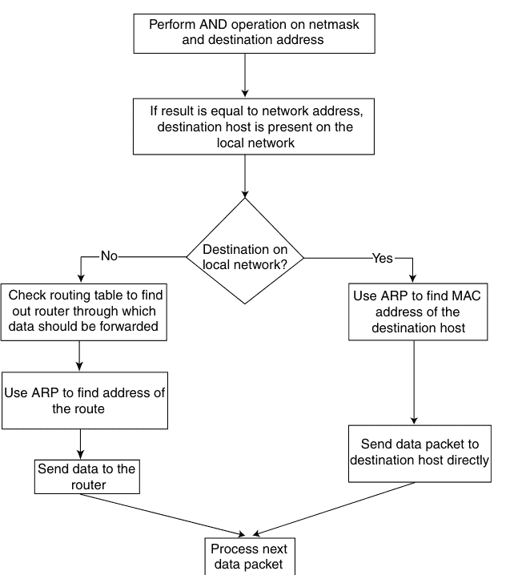

## 使用 Solaris `arp` 命令管理 ARP 缓存

地址解析协议（ARP）将解析出的 MAC 地址保存在一张临时表中，这张表被称为 *ARP 缓存*。该表中的条目是 IP 地址到主机名的映射。一段时间后，表中的 ARP 条目会自动删除。Solaris 提供了 `arp` 命令来显示和管理这张表。以下命令将显示表中的所有条目：

```bash
bash-2.03# arp -a
```

| 设备 | IP 地址 | 掩码 | 标志 | 物理地址 |
| :--- | :--- | :--- | :--- | :--- |
| hme0 | laptop | 255.255.255.255 |  | 00:10:7a:b6:03:ce |
| hme0 | desktop | 255.255.255.255 |  | 00:e0:29:08:29:50 |
| hme0 | remhan-router | 255.255.255.255 |  | 00:e0:29:03:3f:39 |
| hme0 | etc | 255.255.255.255 | SP | 00:20:29:9e:f0:50 |
| hme0 | fana-nt | 255.255.255.255 | SP | 00:20:29:9e:f0:50 |
| hme0 | BASE_ADDRESS.MCAST | 240.0.0.0 | SM | 01:00:5e:00:00:00 |
| bash-2.03# |  |  |  |  |


该命令输出的第一列显示了学习到该条目的网络接口名称。第二列显示主机名或 IP 地址。如果能够解析出主机名，命令会尝试显示主机名；如果无法解析，则在第二列显示 IP 地址。第三列显示该条目使用的网络掩码。`Flags`（标志）列显示关于该地址的一些信息。例如，`S` 标志表示该条目是静态的，通常是主机自身的 IP 地址。`M` 标志表示该条目用于组播地址。最后一列显示该 IP 地址所分配的 MAC 地址或物理地址。请注意，此命令可被间接用于发现其他主机的 MAC 地址。

在大型网络中，`arp -a` 命令生成的列表可能会很长。要查找特定主机的条目，可以使用以下命令（此处用于确定主机 `laptop` 使用的 MAC 地址）：

```bash
bash-2.03# arp laptop
laptop (192.168.2.11) at 0:10:7a:b6:3:ce
bash-2.03#
```

通过这种方式，你可以显示特定主机的 IP 地址以及 MAC 地址。

## 向 ARP 缓存添加新条目

每个解析出的 MAC 地址都会自动添加到 ARP 缓存中。你也可以使用 `arp` 命令自行创建主机名的条目。以下命令为 IP 地址 `192.168.2.30` 添加条目，并将其 MAC 地址设置为 `23:fd:a3:45:98:20`：

```
arp -s 192.168.2.30 23:fd:a3:45:98:20 pub
```

之后，你可以显示 ARP 缓存，新条目将出现在列表中，如下所示。`pub` 关键字使这些条目对其他主机同样公开：

```bash
bash-2.03# arp -a
```

| 设备 | IP 地址 | 掩码 | 标志 | 物理地址 |
| :--- | :--- | :--- | :--- | :--- |
| hme0 | laptop | 255.255.255.255 | | 00:10:7a:00:00:ce |
| hme0 | 192.168.2.30 | 255.255.255.255 | SP | 23:fd:a3:45:98:20 |
| hme0 | desktop | 255.255.255.255 | | 00:20:29:00:28:59 |
| hme0 | rehman-router | 255.255.255.255 | | 00:39:3d:03:f3:39 |
| hme0 | fana | 255.255.255.255 | SP | 08:00:20:9e:f0:50 |
| hme0 | fana | 255.255.255.255 | | 08:00:20:9e:f0:50 |
| hme0 | fana-nt | 255.255.255.255 | SP | 08:00:20:9e:f0:50 |
| hme0 | BASE_ADDRESS.MCAST | 248.0.0.0 | SM | 01:00:5e:00:00:00 |
| bash-2.03# | | | | |

要手动添加多个条目，可以使用文本文件。在此过程中，请按照以下格式添加所有条目，每行一个条目：

```
<IP Address> <MAC Address> pub
```

创建该文件后，使用以下命令一步将文件中列出的所有条目全部添加：

```
arp -f <filename>
```

对于想要代表任何其他主机监听 IP 数据包的主机来说，添加 ARP 条目是必要的。这种情况发生在其他某些主机连接到此主机时（例如，通过调制解调器线路使用 PPP 链路）。

> 注意：在正常操作中，你不需要在 ARP 缓存中添加或删除条目。

## 从 ARP 缓存中删除条目

以下命令从 ARP 缓存中删除地址 `192.168.2.30` 的条目：

```bash
bash-2.03# arp -d 192.168.2.30
192.168.2.30 (192.168.2.30) deleted
bash-2.03#
```

## `snoop` 命令与层首部

正如第 1 章中所提到的，每一层都会向实际数据添加其首部。通过 `snoop` 命令生成的输出，你可以分离出每一层的首部。请参考以下该命令的输出。所有以 `ETHER` 开头的行都是数据链路层首部部分。以 `IP` 开头的行显示网络层 (IP) 首部部分。以 `TCP` 开头的行显示传输层首部部分。此输出中所有以 `TELNET` 开头的行显示应用层首部部分：

```
# snoop -v
Using device /dev/hme (promiscuous mode)
ETHER: ---- Ether Header ----
ETHER:
ETHER: Packet 31307 arrived at 12:02:24.82
ETHER: Packet size = 1483 bytes
ETHER: Destination = 0:0:20:89:20:859,
ETHER: Source = 0:0:20:9e:f0:50, Sun
ETHER: Ethertype = 0800 (IP)
ETHER:
IP: ---- IP Header ----
IP:
IP: Version = 4
IP: Header length = 20 bytes
IP: Type of service = 0x00
IP: xxx... = 0 (precedence)
IP: .0 . . . = normal delay
IP: . . 0. . = normal throughput
IP: . . . 0. = normal reliability
IP: Total length = 1469 bytes
IP: Identification = 47732
IP: Flags = 0x4
IP: . . 1 . . = do not fragment
IP: . . . 0 . = last fragment
IP: Fragment offset = 0 bytes
IP: Time to live = 60 seconds/hops
IP: Protocol = 6 (TCP)
IP: Header checksum = f896
IP: Source address = 192.168.2.222, fana
IP: Destination address = 192.168.2.1, desktop
IP: No options
IP:
TCP: ---- TCP Header ----
TCP:
TCP: Source port = 23
TCP:
TCP: Source port = 23
TCP: Destination port = 1029
TCP: Sequence number = 1967134259
TCP: Acknowledgement number = 4019093
TCP: Data offset = 20 bytes
TCP: Flags = 0x10
TCP: ...0.. .... ... = No urgent pointer
TCP: ...1. .... ... = Acknowledgement
TCP: ....0. .. .. = No push
TCP: .... .0. .. = No reset
TCP: .... ..0. = No Syn
TCP: .... ...0 = No Fin
TCP: Window = 24828
TCP: Checksum = 0x0db5
TCP: Urgent pointer = 0
TCP: No options
TCP: No options
TELNET: ---- TELNET:
TELNET:
TELNET: "TCP: ---- TCP Header ----\r\nTCP: \r\nTCP:
Source port = 10"
TELNET:
```

```
ETHER: ---- Ether Header ----
ETHER:
ETHER: Packet 31308 arrived at 12:02:24.82
ETHER: Packet size = 1512 bytes
ETHER: Destination = 0:e0:29:89:28:59,
ETHER: Source = 0:0:20:9e:f0:50, Sun
```

通过 `snoop` 命令的这个输出，你可以将第 1 章中的概念性讨论与数据包中添加层首部的实际过程联系起来。

## 案例研究：BOOTA RESEARCH INC. 网络安装

## 案例要点

以下是该案例的关键点：

- 这是一个规模相对较小的网络。
- 由于多媒体应用的需要，预计流量较高。
- ISP 分配的 IP 地址充足，因为只有 40 台主机。

Boota Research Inc. 是一家新成立的研究机构。该机构从事多媒体产品的研究，在办公楼中占据 2 个楼层。其网络中大约有 40 台主机。该机构从 XYZ 互联网服务提供商 (ISP) 获得了互联网连接。ISP 为该机构分配了 64 个 IP 地址。由于多媒体应用的缘故，预计网络流量会很高。考虑到这个问题，该机构希望将网络划分为两个独立的物理网络，以便高效地利用 IP 地址和带宽。

## 分析

网络可以分为 2 个相等的部分，每个网络包含 20 台主机。由于该机构占据 2 个楼层，因此在每个楼层保留一个独立的网络段是一个不错的方案。这两个网络段可以通过桥接器连接，这样一个网络段上的流量就不会传递到另一个网络段。可用的 IP 地址也可以分为 2 个相等的部分，每部分 32 个地址。对于拥有 32 台主机的每个网络，将使用网络掩码 `255.255.255.224`。

## 本章小结

本章介绍了 TCP/IP 协议。讨论从该协议的简史以及负责互联网运行的机构列表开始。随后，您了解了不同的 TCP/IP 分层，并将其与 OSI 分层进行了对比。接着，您学习了 IP 地址的结构以及 IP 地址如何分为主机部分和网络部分。此处还讨论了不同的 IP 地址类。您学习了所有这些类别的地址范围及其用途的范围。之后，对网络掩码和子网划分进行了重要讨论。这一概念通过两个示例进行了讲解。您还学习了一些其他 TCP/IP 概念，例如超网（`supernetting`）、`VLSM`、IP 地址到主机名映射以及保留 IP 地址。

本章最重要的部分之一是对 IP 首部结构的讨论。基础 IP 首部由 20 字节组成，包含许多字段。这些字段包括 IP 版本、首部长度、服务类型以及源地址和目的地址等。此外，还对 IP 选项进行了介绍。

ICMP 协议用于多种目的，本章介绍了一些用途。`ping` 和 `traceroute` 命令均使用 ICMP 协议。您还学习了 ICMP 首部的结构。

网络接口的配置通过 `ifconfig` 命令完成。为了使配置永久生效，您需要编辑某些文件。您在本章中学习了如何执行此操作。您还学习了如何使用不同命令来验证配置。本章还概述了其他概念，如 IP 分片与重组、流量控制和 TTL。

您阅读了常见的网络问题以及如何解决这些问题。`ndd` 命令被用于微调某些 TCP 参数。本章的最后一部分关于 ARP 和 RARP。这些协议用于将 IP 地址映射到 MAC 地址，反之亦然。

在学习完本章后，您应该能够理解 TCP/IP 协议并为局域网接口配置 IP 地址。

### 关键术语

- 传输控制协议/网际协议 (TCP/IP)
- IP 地址
- 网络地址
- 网络掩码
- 子网划分
- 可变长度子网掩码 (VLSM)
- IP 首部
- 生存时间 (TTL)
- 分片与重组
- 服务类型 (TOS)
- 网际控制报文协议 (ICMP)
- 最大传输单元 (MTU)
- 地址解析协议 (ARP)
- 反向地址解析协议 (RARP)
- 无连接协议
- 面向连接协议
- 网络类

## 知识实践

### 练习

#### 2.1 使用 snoop 命令显示 ARP 数据包内容

本练习的目的是演示主机在发送 IP 数据包之前，如何使用 ARP 数据包来查找目的主机的 MAC 地址。

**预计时间：** 10 分钟

1. 使用 `root` 用户帐户登录 Solaris。
2. 使用 `ifconfig` 命令显示主机上当前的 IP 地址配置。
3. 使用 `arp` 命令显示 ARP 缓存条目。然后尝试 `ping` 网络上的另一个主机。
4. 现在，使用 `ifconfig` 命令在网络接口上配置一个不同的 IP 地址。该 IP 地址不应在您自己的网络中。
5. 尝试 `ping` 步骤 3 中使用 Same 的主机。您应该无法完成此操作。事实上，您误配置了自己的主机。使用 `ifconfig` 命令恢复原始配置。
6. 使用 `snoop -v` 命令显示在本地网络上传输的所有数据包。您应该能够在网络中找到 ARP 请求和响应数据包。

#### 2.2 更改 TTL 值

本练习的目的是更改 TTL 值，然后使用 `ndd` 命令进行验证。

**预计时间：** 10 分钟

1. 在一个终端上启动 `snoop` 命令。
2. 使用 `ping` 命令向另一个主机发送 ICMP 数据包。
3. 注意 `snoop` 命令捕获的数据包中的 TTL 值是多少。
4. 使用 `ndd` 命令更改 ICMP 数据包的 TTL 值。
5. 再次使用 `snoop` 命令捕获数据包，以验证 TTL 值现在已更改。

### 复习题

1. 列举不同的 IP 类。
2. 什么是网络掩码，它是如何用来定义网络边界的？
3. 将网络 `172.16.0.0/16` 分为四个大小相等的子网。
4. IP 首部中 TTL 字段的用途是什么？
5. 常见的网络问题有哪些，如何排除这些故障？
6. ARP 和 RARP 协议的用途是什么？

### 考题

这些问题的答案在附录 E "示例考题答案"中提供。

1. TCP/IP 协议中的哪个层覆盖了 OSI 模型的上三层？

   A. IP 层
   B. TCP 层
   C. 数据链路层
   D. 应用层

2. IP 层可以使用以下哪个底层协议？

   A. 以太网 (Ethernet)
   B. HDLC
   C. 帧中继 (Frame Relay)
   D. PPP
   E. 以上所有

3. IPv4 地址的长度是多少？

   A. 32 位
   B. 48 位
   C. 64 位
   D. 128 位

4. 哪个协议将 IP 地址映射到 MAC 地址？

   A. ARP
   B. RARP
   C. ICMP
   D. UDP

5. ICMP 协议用于以下哪项？

   A. IP 网络中的错误报告
   B. 网络诊断
   C. `ping` 命令
   D. 以上所有

6. TCP 和 UDP 协议在 OSI 模型的哪一层运行？

   A. 数据链路层
   B. 网络层
   C. 传输层
   D. 应用层
   E. 会话层

7. 您可以在 `/etc/services` 文件中找到哪些信息？选择所有正确的选项。

   A. 不同服务的名称
   B. 关于哪些服务正在运行以及哪些未运行的信息
   C. 这些服务使用的端口号
   D. 每个服务允许的连接数

8. 关于 ARP，哪一项 *不是* 正确的？

   A. ARP 使用广播方式。
   B. ARP 将 IP 地址映射到主机名。
   C. 解析出的 MAC 地址将永久保留在 ARP 缓存表中。
   D. 在发送任何 IP 数据包之前，使用 ARP 来确定目的地的 MAC 地址。

9. 除 TCP 和 UDP 之外的任何协议也可以在 IP 之上使用。（正确/错误）

10. 关于无连接服务和面向连接服务的说法，哪些是正确的？选择所有正确的选项。

    - A. 在面向连接的服务中，在开始传输数据之前会建立端到端连接。
    - B. TCP 用于面向连接的服务。
    - C. UDP 既可用于无连接服务也可用于面向连接服务。
    - D. 无连接服务是可靠的。
    - E. TCP 与 UDP 相比速度较慢，因为为了提供数据传输的可靠性而存在通信开销。

11. 关于 IP 地址的以下说法中，哪些是正确的？选择所有正确的选项。

    - A. 一个 IP 地址由 4 个八位组组成。
    - B. 每个八位组的值范围可以是 0 到 255。
    - C. IP 地址中的每个八位组由 8 位组成。
    - D. `182.268.20.30` 不是一个合法的 IP 地址。

12. 以下哪个子网掩码是不合法的？

    - A. `255.255.255.0`
    - B. `255.255.255.224`
    - C. `255.255.255.244`
    - D. `255.255.248.248`

13. B 类网络的默认网络掩码地址是什么？

    - A. `255.0.0.0`
    - B. `255.255.0.0`
    - C. `255.255.255.0`
    - D. `255.255.0.255`

14. 对于网络号为 `192.168.20.64` 且网络掩码为 `255.255.255.224` 的网络，其广播地址是多少？

    - A. `192.168.20.255`
    - B. `192.168.20.127`
    - C. `192.168.20.95`
    - D. `192.168.20.63`

15. C 类网络中最多可以有多少个主机？

    - A. 256
    - B. 255
    - C. 254
    - D. 随心所欲，没有限制

16. 网络 `126.0.0.0` 属于哪类 IP 地址？

    - A. A 类
    - B. B 类
    - C. C 类
    - D. D 类

17. C 类网络中的地址以哪个位模式开头？

    - A. 00
    - B. 01
    - C. 110
    - D. 1110

## 知识应用

18. 哪一类 IP 地址用于组播网络？

    A. A 类
    B. B 类
    C. C 类
    D. D 类
    E. M 类

19. 将一个 C 类网络划分为四个子网，需要在子网掩码中增加多少位？

    A. 1
    B. 2
    C. 4


D. 8

## 复习题

### 20. 将一个网络划分为不同长度的子网络的方法称作什么？

A. 子网划分（Subnetting）

B. 超网划分（Supernetting）

C. 可变长子网掩码（VLSM）

D. 无类域间路由（CIDR）

### 21. 以下哪个是 C 类网络的正确写法？

A. `192.168.2.0/8`

B. `192.168.2.0/16`

C. `192.168.2.0/24`

D. `192.168.2.0/32`

### 22. 哪些地址因为处于实验范围而不在互联网上使用？请选择所有适用项。

A. `192.168.2.0`

B. `172.16.0.0`

C. `168.16.0.0`

D. `10.0.0.0`

E. `10.1.0.0`

### 23. 哪个 IP 地址被分配给回环接口（loopback interface）？

A. `127.0.0.0`

B. `127.0.0.1`

C. `10.0.0.1`

D. `0.0.0.0`

### 24. `/etc/inet/hosts` 文件可以使用哪种语法？请选择所有适用项。

A. `<IP 地址> <主机名> <主机别名>`

B. `<IP 地址> <主机名>`

C. `<主机名> <IP 地址> <主机别名>`

D. `<主机名> <IP 地址>`

### 25. 如何获知 IP 数据包中使用的 IP 版本？

A. 使用`version`命令

B. IP 数据包中的 Version 字段

C. IP 数据包中的 Protocol 字段

D. IP 数据包中的源地址和目的地址字段

### 26. 在哪个文件中可以找到分配给不同协议的协议号？

### 27. ICMP 数据包用于以下哪些用途？请勾选所有适用项。

- A. 参数问题（Parameter Problem）
- B. 源抑制（Source Quench）
- C. 直接消息（Direct message）
- D. 回显请求和回显响应（Echo Request and Echo Reply）
- E. 以上所有

### 28. 以下哪个命令正确配置了网络接口`hme0`？

- A. `ifconfig netmask 255.255.255.0 hme0 192.168.5.6 up`
- B. `ifconfig hme0:0 192.168.5.6 255.255.255.0`
- C. `ifconfig 192.168.5.6 hme0 netmask 255.255.255.0 up`
- D. `ifconfig hme0 192.168.5.6 netmask 255.255.255.0 up`

### 29. 以下哪些命令可用于检查接口上的 IP 地址？请勾选所有适用项。

- A. `ifconfig`
- B. `netstat`
- C. `ping`
- D. `traceroute`

### 30. 如何为 LAN 接口设置 MTU 值？

- A. `ifconfig`命令
- B. `nod`命令
- C. `mtu`命令
- D. `arp`命令

## 复习题答案

### 1. 以下是不同的 IP 分类：

- A 类网络
- B 类网络
- C 类网络
- D 类网络
- E 类网络

### 2. 子网掩码显示 IP 地址中有多少位属于网络部分。

给定一个 IP 地址和一个子网掩码，可以轻松确定网络边界。例如，`255.255.255.0`的子网掩码表明 IP 地址中最右侧的 8 位显示为主机部分，左侧剩余的 24 位显示为网络部分。IP 地址的网络部分在同一个网络内保持固定。

如果将此掩码与 IP 地址`192.168.2.20`结合，你可以很容易地看到网络边界是从`192.168.2.0`到`192.168.2.255`。这是通过保留左侧 24 位并改变最右侧 8 位来确定的。

### 3. 该网络的默认子网掩码为`255.255.0.0`。

如果你在这个子网掩码中增加 2 位，网络将被划分为 4 个较小的网络。结果方案如下表所示：

| 网络编号 | 可分配给主机的 IP 地址范围 | 网络地址 | 广播地址 | 子网掩码 |
| :--- | :--- | :--- | :--- | :--- |
| 1 | `172.16.0.1` 到 `172.16.63.254` | `172.16.0.0` | `172.16.63.255` | `255.255.192.0` |
| 2 | `172.16.64.1` 到 `172.16.127.254` | `172.16.64.0` | `172.16.127.255` | `255.255.192.0` |
| 3 | `172.16.128.1` 到 `172.16.191.254` | `172.16.128.0` | `172.16.191.255` | `255.255.192.0` |
| 4 | `172.16.192.1` 到 `172.16.255.254` | `172.16.192.0` | `172.16.255.255` | `255.255.192.0` |

### 4. TTL 值决定了数据包可以传输的跳数。

它在每一跳都会递减，如果变为 0，数据包将被丢弃。

### 5. 一些常见的网络问题如下：

- IP 地址错误
- 子网掩码错误
- 线缆损坏
- 网关地址错误

`ping`、`traceroute`和`netstat`命令可以让你排除这些问题。

### 6. ARP 用于将 IP 地址映射到 MAC 地址，而 RARP 则以相反的方式将 MAC 地址映射到 IP 地址。

## 推荐阅读与资源

- 《计算机网络》（Computer Networks）。Andrew S. Tanenbaum
- 《计算机网络与互联网》（Computer Networks and Internets）。Douglas E. Comer and Ralph E. Droms
- 《TCP/IP 揭秘》（TCP/IP Unleashed）。Parker et al.
- 《TCP/IP 详解卷 1》（TCP/IP Illustrated vol. 1）。Richard Stevens
- 《用 TCP/IP 构建互联网络 卷 1：原理、协议与架构》（Internetworking with TCP/IP Vol. 1: Principles, Protocols, and Architecture）。Douglas E. Comer
- 《IP 基础：每个人都需要知道的地址与路由》（IP Fundamentals: What Everyone Needs to Know About Addressing & Routing）。Thomas A. Maufer
- RFC 791

# 第 3 章 TCP/IP 网络中的路由

## 目标

本章涵盖了 310-043 考试中由 Sun 指定的以下目标：

### 描述 IP 路由

识别实现路由协议的 Solaris 8 守护进程。识别用于配置路由的文件。

- TCP/IP 网络通常使用被称为路由器的设备相互连接。这些路由器运行特殊类型的协议，称为路由协议。路由协议在数据包发送到目的地之前，决定从源主机到目的主机的路径。路由协议有多种类型。Solaris 平台默认提供的类型包括路由信息协议（RIP）和路由器发现协议（RDISC）。

### 识别用于配置路由的文件之用途

- 配置文件用于配置这些协议，你需要了解这些文件的语法和用途。

### 管理路由表

- 路由表条目由`route`命令管理。你可以使用`netstat`命令显示这些条目。你需要知道如何使用这些命令来管理路由表。

### 描述无类域间路由

- 还需要了解关于无类域间路由（CIDR）的一些信息。本章稍后将解释这种路由方式。

## 提纲

### 介绍 xx

- TCP/IP 网络路由介绍 xx

### 规划 TCP/IP 网络 xx

- 网络设计规划 xx
- IP 地址规划 xx

### 网络地址与不同网络间的通信 xx

### 路由类型 xx

- 被路由协议与路由协议 xx
- 静态路由配置 xx
- 默认路由 xx
- 无类域间路由（CIDR）xx
- 我应该使用哪种路由？静态还是动态 xx

### 配置 RIP 和 RDISC xx

- 主机如何确定自己是否为路由器？xx
- 配置 RDISC（`in.rdisc`）xx
- 配置 RIP（`in.routed`）xx

### 路由启动与配置文件 xx

- `/etc/defaultrouter`文件 xx
- `/etc/gateways`文件 xx
- `/etc/inet/networks`文件 xx
- `/etc/init.d/inetinit`文件 xx

### IP 转发 xx

### 常见路由问题 xx

### 故障排除命令 xx

- 使用`ping`命令 xx
- 使用`traceroute`命令 xx
- 使用`netstat`命令 xx
- `ifconfig`命令 xx
- 案例要点 xx
- 分析 xx

### 本章小结 XX

### 知识应用 XX

## 学习策略

IP 网络中的路由是一项相对复杂的工作。每个人都是在实践中学习的。为了掌握这一过程，建议采取以下学习策略：

- 阅读本章并完成所有示例。
- 配置一台主机并在其上配置默认路由。
- 使用静态路由将一台主机配置为路由器。
- 使用 RIP 作为路由协议将一台主机配置为路由器。

再次强调，你需要大量练习才能掌握 Solaris 系统上的路由。因此，本章最强调实际操作练习。

## 介绍

### 互联

互联是互联网的核心。每当网络连接在一起时，必须存在一种机制来对数据包进行过滤并将其路由到其他连接的网络。正如第一章“计算机网络简介”中所提到的，路由器是用于将网络连接在一起的设备。有时这些路由器被称为*网关*。在第一章中，*网关*一词是在不同的语境下使用的，但从现在起，除非明确区分，否则本书中路由器（router）和网关（gateway）将交替使用。

本章首先介绍 TCP/IP 网络规划。其中包含对网络地址的描述以及通过路由器连接的多个网络之间如何进行通信。路由主要有两种类型：*静态*路由和*动态*路由。在静态路由中，路由表由网络管理员定义，除非有人修改，否则保持不变。在动态路由中，使用一种或多种路由协议来管理路由表。路由表中的条目根据网络状况进行添加、删除或修改。路由协议主要有两种类型：*距离向量*和*链路状态*。本章将涵盖这两种类型的路由。

Solaris 系统在动态路由方面使用 RIP 和 RDISC。本章将教您如何在 Solaris 上配置和使用这两者。您还将学习用于 Solaris 网络路由配置和启动的文件。然后，您将学习如何在 Solaris 中启用或禁用从一个网络接口到另一个网络接口的 IP 转发。最后，本章将涵盖一些常见的路由问题及其排除故障的方法。

在学习完本章后，您应该能够理解基础的路由概念，并能够区分静态路由和动态路由。您还应该能够定义静态路由并配置动态路由。此外，您还应知道如何解决常见的路由问题。

## TCP/IP 网络路由简介

本章评估数据包如何从源端传输到目的端。在传输 IP 数据包之前，发送端主机通过检查目的地址来确定其掩码，这在第二章“TCP/IP 协议”中进行了详细讨论。如果目的主机位于本地网络中，IP 数据包将使用底层机制直接传输到目的地。ARP 协议用于查找与目的 IP 地址对应的 MAC 地址。

然而，如果目的地址不在本地网络中，发送端主机将确定应将其转发到哪个路由器。大多数情况下，只有一个路由器被定义为默认网关。当路由器收到 IP 数据包时，它会检查目的 IP 地址以确定应将其路由到哪个网络。路由器为此目的使用其路由表。如果路由器找不到任何到达目的地的路由，它将丢弃该数据包，并为源主机生成一条 ICMP 消息。这条 ICMP 消息是“目的不可达”（Destination Unreachable）类型的数据包。

每个 IP 数据包都包含源 IP 地址和目的 IP 地址。路由决策根据这些地址做出。传统路由仅使用目的 IP 地址来做出路由决策。基于策略的路由还使用源地址将数据包通过特定路径路由。当数据包到达目的地，且目的主机需要向源主机发送回执信息时，它会使用传入 IP 数据包中的源 IP 地址。

路由器工作在 TCP/IP 网络的网络层。图 3.1 显示了一个典型的 IP 数据包从源端经过路由器连接到目的端的传输路径。当数据包到达路由器时，它会向上传输到 IP 层，在此处做出转发或丢弃数据包的决策。

### 图 3.1

TCP/IP 网络中的路由。

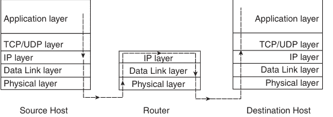

请注意，从源端到目的主机的路径上可能存在多个路由器。IP 数据包在每个路由器上从物理层传输到 IP 层，直到到达目的地或被丢弃。

## TCP/IP 网络规划

在处理计算机网络时，规划能让生活变得简单得多。无论您是否预见到，网络都会增长。在网络增长过程中，主要有两种可能性。如果您规划得好，您就知道如何应对网络增长的需求。否则，您将不得不边出现需求边应对。显然，第一种情况使得预测网络需求变得容易得多。

在规划网络时，您必须完成两类主要规划工作：物理网络布局和 IP 级规划。*网络拓扑*定义了物理网络。*逻辑网络*涉及 IP 级的网络设计。

### 网络设计规划

在设计物理网络和选择不同的网络技术时，请考虑以下因素：

- 网络中的客户端和服务器机器的数量
- 服务器的类型

对于某些服务器，当网络接口成为瓶颈时，您可能必须安装多个网络适配器。此外，一台服务器可能会连接到多个物理网络，而您可能希望将这些网络的网络流量分开。

- 网络的预期数据流量：对于大量的数据流，您需要使用高速连接方法。
- 网络的物理跨度：对于小型网络，10BASE-T 可能就足够了，但如果网络跨越很大区域，您可能需要考虑 FDDI 或 ATM 骨干网。

在考虑这些因素后，您可以决定以下内容：

- 网络拓扑（是总线型、星型、环型还是这些的混合型）
- 网络介质（如以太网、令牌环、FDDI 或其他）
- 线缆和连接器类型（需支持您网络所需的速率）

基于这些信息，您还必须决定其他网络设备，如路由器、交换机等。您还必须将网络划分为不同的网段，由网桥、交换机或路由器连接。如果您使用交换机或网桥来连接网络段，应将经常相互交换数据的那些主机放在同一个网段中，以便将不同网段之间的数据流降至最低。

### IP 地址规划

高效利用可用 IP 地址的规划至关重要。您可能需要将可用的 IP 地址划分为子网。请注意，单个物理网络上可以存在多个 IP 网络，因为这些是逻辑网络。在规划 IP 网络时，请考虑网络的未来增长以及不同服务器产生的流量。通常，网络管理员会在所有 IP 网络中保留一些空闲的 IP 地址，以便将来需要添加更多主机。在逻辑层面规划网络时，请记住以下事项：

- IP 地址划分：如有必要，您可以将可用 IP 地址划分为子网。
- IP 地址分配方案
- 主机命名方案
- 网络注册：您必须向互联网注册机构注册您的网络。
- 主机名解析方案（DNS、NIS、NIS+）以及这些方案所需的任何服务器
- 潜在的 DHCP 使用（在第五章“配置和管理动态主机配置”中讨论）。
- 路由方法：如果您的网络涉及路由器，您必须确定使用哪种路由方法。

在处理完这些问题后，您可以开始实际安装网络的工作。

## 网络地址以及不同网络之间的通信

您已经了解了 IP 地址的结构。您还知道网络中的所有主机必须具有唯一的 IP 地址。这些 IP 地址在建立网络时由网络管理员分配。地址也可以使用动态主机配置协议（DHCP）分配，这将在第五章中讨论。

与此同时，还会设置另一种类型的地址。这种地址针对每台主机，被称为*网络地址*。一个网络中的所有主机具有相同的网络地址。正如 IP 地址在包含许多主机的网络中唯一地定义一个特定主机一样，网络地址在互联网络环境中唯一地定义一个特定网络。通常，所有数据流量的路由决策都是基于网络地址做出的，尽管也可以为单个主机定义路由。

当您向 IP 网络添加主机时，必须至少为该主机提供以下三个配置参数：

- 主机的 IP 地址
- 该主机所属的网络地址
- 子网掩码（Netmask），用于定义属于该网络的 IP 地址范围

例如，假设一台主机的 IP 地址为`192.168.2.10`，网络地址为`192.168.2.0`，子网掩码为`255.255.255.0`。如果你没有这三个数字中的任何一个，主机就无法参与 IP 网络。

子网掩码用于定义网络地址的边界。*子网掩码*是一种特殊的数值，它显示参与网络的各主机 IP 地址中有多少位是共同的。如果将所有这些共同位标记为 1，而将所有可变位标记为 0，就得到了一个子网掩码。子网掩码也像 IP 地址和网络地址一样采用点分十进制表示法。

考虑一个 C 类网络中有三台主机的例子。这些主机的 IP 地址分别是`192.168.2.10`、`192.168.2.34`和`192.168.2.37`。这些 IP 地址中的共同部分是`192.168.2`（左侧三个字节）。现在将这个共同部分替换为 1，剩余的一个字节替换为 0。这就产生了子网掩码`255.255.255.0`，它是所有 C 类网络的默认子网掩码。

> **注意**
>
> 不同的 IP 网络类别使用不同的默认子网掩码。这些默认子网掩码如下：
>
> - 对于 A 类网络，默认子网掩码为`255.0.0.0`。
> - 对于 B 类网络，默认子网掩码为`255.255.0.0`。
> - 对于 C 类网络，默认子网掩码为`255.255.255.0`。

网络通过路由器连接。路由器拥有关于所有连接网络的 information。例如，如果一个路由器连接到四个网络，它会在一个被称为*路由表*的列表中记录所有这些网络。路由表是一个内核数据结构，记录了网络中可用的路径。

路由器一旦收到一个 IP 数据包，就会检查该 IP 数据包标头中的目的 IP 地址。根据该目的 IP 地址，路由器将 IP 数据包转发到特定的网络。这个决定是在查询路由表中的可用路由后做出的。如果路由器找不到该 IP 数据包的目的网络，它会直接丢弃该 IP 数据包，并向源端发送一个 ICMP 数据包，表明该 IP 数据包的目的地无法到达。


路由器还与其他路由器连接，根据目的 IP 地址和路由表，数据包也可能被转发到另一个路由器。这个另一个路由器通常被称为该 IP 数据包的下一跳（next hop）。当数据包到达下一跳时，该路由器将决定该 IP 数据包的去向。

对于放置在网络边缘和客户场所的路由器，还会定义一个默认路由。这个默认路由使路由器能够将无法在自身路由表中找到目的路由的 IP 数据包转发给一个更智能的路由器。如果定义了默认路由，路由器不会丢弃发往未知目的地的包。相反，路由器会将数据包发送到这个默认路由器，假设下一跳路由器能够为该数据包找到目的路由。

数据包最初是如何到达路由器的？当一台主机需要向另一台主机发送 IP 数据包时，它会检查目的 IP 地址，以确定目的主机是否在本地网络上。如果在，发送主机直接将数据包转发给目的地。如果目的主机不在本地网络上，数据包将被转发到路由器。随后，由路由器负责将其转发到直接连接网络上的目的主机或通过另一个路由器转发。

随着数据包向目的地传输，它会经过许多路由器。这个过程中的每一步被称为一次跳数（hop）。路由信息协议 (RIP) 使用这种跳数来确定源和目的地之间的最短路径。

## 路由类型

IP 网络中有两种路由类型：静态路由和动态路由。静态路由顾名思义是固定的路由。网络管理员定义静态路由，除非由管理员手动更改，否则这些路由保持不变。另一方面，动态路由是在运行时根据网络状况计算的。不同的网络参数在计算动态路由中起着重要作用。这些参数包括源主机和目的主机之间的跳数、互连网络段的带宽、不同路径的可靠性、时间延迟等等。路由路径还取决于计算路由时使用的路由协议类型。

如果针对某个特定目的地同时存在静态路由和动态路由，通常优先选择静态路由。在讨论这两种路由方法之前，了解路由协议（routing protocol）和被路由协议（routed protocol）之间的区别至关重要。

### 被路由协议与路由协议

被路由协议是一种可以在不同网络之间被路由的协议。例如，IP 就是一种被路由协议。这意味着可以使用某种其他机制（路由协议）来做出关于将 IP 数据包从一个网络转发到另一个网络的决定。

路由协议是决定被路由协议的数据包应从源到目的地采取特定路径的决定因素之一。路由协议提供了一种确定最低成本路径的机制。路径的成本由源到目的地的跳数、带宽、延迟或其他因素决定。接下来的章节将讨论两种主要的路由协议类型。这两种协议的基本区别在于它们发现从源到目的地的最优路由的方式。

### 距离向量路由协议

在距离向量路由算法中，每个路由器使用广播或组播将其关于连接网络的知识转发给相邻路由器。监听路由器从相邻路由器获取这些信息，构建自己的路由表，并将自己的路由信息转发给其他相邻路由器。每个路由器以跳数的形式发送关于连接网络的距离信息，这并不是指物理距离。当这种传输完成时，每个路由器都拥有关于连接网络的知识。这种路由算法也被称为 Bellman-Ford 算法。使用距离向量路由最常见的协议示例是路由信息协议 (RIP)。

距离向量路由简单，但有一些缺点。如果发生链路故障，算法需要一些时间才能收敛或稳定。在此期间，路由器对网络的认知可能会不一致，从而导致路由环路。你需要注意处理这个问题。

由于从源到目的地的距离是以跳数为单位衡量，因此路由算法在决定路由时可能会选择较长的物理路径。同样，即使有高带宽路径可用，算法也可能因为低带宽路径的跳数较少而决定选择低带宽路径。在小型网络设计中，优化利用不同路径上的带宽非常重要。在糟糕的设计中，你可能会导致某些链路过度利用（从而产生长时间延迟），而其他链路则处于空闲状态。

距离向量路由协议的优点是易于配置和维护。

### 链路状态路由协议

链路状态路由算法统称为最短路径优先 (SPF) 路由算法，它对互连网络拓扑拥有更复杂且完整的认知。关于网络变化的信息交换是通过链路状态公告 (LSA) 完成的。一旦网络中检测到事件，就会触发 LSA 传输，这意味着路由表可以尽快重新构建。这个过程比距离向量协议快得多，因为后者的信息交换是基于时间间隔而非基于事件的。与距离向量路由协议不同，链路状态路由协议维护网络拓扑的全量知识。

链路状态路由协议可以使用跳数以外的其他信息来计算最优路由。这有助于更好地利用不同链路上的可用带宽。

在初始网络发现过程中，链路状态协议会产生大量的数据传输，可能会在一段时间内降低网络性能。与距离向量协议相比，这些协议需要更多的计算量和内存，可能不适用于计算能力较低或内存较小的路由器。

链路状态路由协议适用于任何规模的网络。在正常使用中，如果没有拓扑变化，使用这些协议的路由器交换的数据较少。使用链路状态路由的网络更具可扩展性，并且在拓扑变化期间提供更高的稳定性。链路状态路由协议最常见的例子是开放最短路径优先 (OSPF) 协议。

### 静态路由配置

如前所述，静态路由是手动配置的，并且这些路由会一直存在，直到有人修改它们。当网络与其它网络的互连数量较少时，会使用静态路由。例如，小型私有网络通常仅连接到其服务提供商网络，并且只有一条路由用于向世界其他地方发送和接收数据。在这种情况下，完全没有必要使用动态路由。网络管理员在其路由器中设置一条静态路由，将所有传出数据通过此路由传输。

静态路由使用 `route` 命令设置。以下命令设置一条到达网络 192.168.20.0 的路由，使其经过路由器 192.168.2.1：

```bash
bash-2.03# route add -net 192.168.20.0/24 192.168.2.1
add net 192.168.20.0/24: gateway 192.168.2.1
bash-2.03#
```

如果路由创建成功，该命令将显示输出以表明路由已创建。要验证路由创建是否成功，可以使用 `netstat` 命令来显示当前的路由表。以下命令显示了 IPv4 和 IPv6 的一组典型可用路由：

```bash
bash-2.03# netstat -rn
```

**路由表：IPv4**

| 目的地 | 网关 | 标志 | 引用 | 使用 | 接口 |
|---|---|---|---|---|---|
| 192.168.2.0 | 192.168.2.222 | U | 1 | 0 | hme0 |
| 192.168.20.0 | 192.168.2.1 | UG | 1 | 0 | |
| 224.0.0.0 | 192.168.2.222 | U | 1 | 0 | hme0 |
| default | 192.168.2.1 | UG | 1 | 12 | |
| 127.0.0.1 | 127.0.0.1 | UH | 22 | 6931 | lo0 |

**路由表：IPv6**

| 目的地/掩码 | 网关 | 标志 | 引用 | 使用 | 接口 |
|---|---|---|---|---|---|
| fe80::/10 | fe80::a00:20ff:fe9e:f050 | U | 1 | 0 | hme0 |
| ff00::/8 | fe80::a00:20ff:fe9e:f050 | U | 1 | 0 | hme0 |
| default | fe80::a00:20ff:fe9e:f050 | U | 1 | 0 | hme0 |
| ::1 | ::1 | UH | 1 | 0 | lo0 |

```bash
bash-2.03#
```

以这种方式设置的路由在重启服务器或工作站后会立即丢失。为了在每次启动计算机时启用静态路由，必须维护一个永久的静态路由记录。

#### 静态路由示例

现在考虑一个关于设置静态路由的示例。图 3.2 中显示了三个网络。这些网络被标记为网络 1、网络 2 和网络 3。网络 1 的网络地址是 192.168.10.0，网络 2 是 192.168.20.0，网络 3 是 192.168.30.0。路由器 1 连接网络 1 和网络 2，而路由器 2 连接网络 2 和网络 3。

路由器 1 连接到网络 1 的网络接口被分配 IP 地址 192.168.10.12，而路由器 1 连接到网络 2 的网络接口被分配 IP 地址 192.168.20.21。同样，路由器 2 连接到网络 2 的网络接口被分配 IP 地址 192.168.20.23，而路由器 2 连接到网络 3 的网络接口被分配 IP 地址 192.168.30.32。正如你可能已经注意到的，分配给路由器网络接口的每个 IP 地址的最后两位显示了连接的网络。

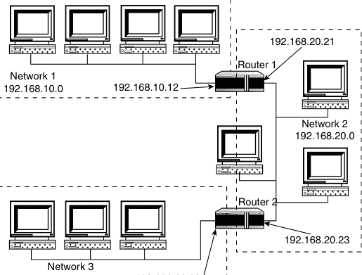

**图 3.2** 定义静态路由。

任何源自网络 1 且目的地为网络 2 或网络 3 的网络流量必须通过路由器 1。因此，网络 1 上的所有主机必须拥有指向路由器 1 连接网络 1 的接口 IP 地址的静态路由。为此，你必须在网络 1 的所有主机上执行以下两条命令：

```bash
route add 192.168.20.0/24 192.168.10.12
route add 192.168.30.0/24 192.168.10.12
```

这两条条目确保所有目的地址位于网络 192.168.20.0 或网络 192.168.30.0 的数据包必须转发到主机 192.168.10.12。当任何此类数据包到达路由器 1 时，它将分析数据包的目的地址。如果目的是网络 2 中的某个主机，它将直接交付给该主机。然而，如果目的地址位于网络 3，路由器 1 将把该 IP 数据包转发给路由器 2。随后，路由器 2 将把此 IP 数据包交付给目的地址。

现在考虑网络 2 中的主机将配置哪些静态路由。如果网络 2 中的某个主机想向同一网络中的任何其他主机发送数据包，它将被直接交付。如果目的地址位于网络 1，数据包应转发到路由器 1 直接连接到网络 2 的那个接口。在本例中，该接口 IP 地址为 192.168.20.21。同样，如果 IP 数据包的目的地址位于网络 3，它必须被转发到路由器 2 直接连接到网络 2 的那个接口。在本例中，接口地址为 192.168.20.23。因此，网络 2 的所有主机都有以下两条静态路由条目：

```bash
route add 192.168.10.0/24 192.168.20.21
route add 192.168.30.0/24 192.168.20.23
```

对于网络 3 中的主机，所有目的地址在网络 1 或网络 2 的 IP 数据包都应转发到路由器 2 直接连接到网络 3 的接口。在本例中，该路由器的 IP 地址为 192.168.30.32，路由条目如下：

```bash
route add 192.168.10.0/24 192.168.30.32
route add 192.168.20.0/24 192.168.30.32
```

当 IP 数据包到达路由器 2 时，它将检查该 IP 数据包的目的地址。如果目的地址位于网络 2，它将直接交付给目的主机。如果目的 IP 地址位于网络 1，数据包将被转发到路由器 1。随后，路由器 1 将把此 IP 数据包交付给网络 1 中的目的主机。请注意，如果你负责配置路由器，你还必须在这些路由器中设置路由条目。这些路由器可能是其他公司的专用设备，也可能是 Solaris 工作站或服务器。如果使用 Solaris 作为路由器，路由器 1 的路由条目如下：

```bash
route add 192.168.30.0/24 192.168.20.23
```

路由器 2 的路由条目如下：

```bash
route add 192.168.10.0/24 192.168.20.21
```

请注意，你只需在每个路由器中设置一个条目，且该条目是针对未直接连接到路由器的网络。每个路由器已经知道直接连接的网络，因此无需定义任何静态路由条目。

#### 默认路由

默认路由通常用于网络中的所有主机。默认路由是最后手段路由，仅在没有可用路由来转发数据包时才使用。主机上的默认路由通常指向一个将本地网络连接到 Internet 或连接到更高级路由器的路由器。如果主机需要向另一个没有可用路由的主机发送数据包，它将其转发到默认路由器。然后，路由器查找自己的路由表以将数据包发送到目的地。

与主机一样，路由器也可以定义默认路由。路由器的默认路由通常指向一个更高级的路由器。客户场所的路由器使用默认路由将 IP 数据包发送到连接到 Internet 的主路由器。这个主路由器通常是 ISP 路由器。

在 Solaris 系统上配置默认路由器非常简单。`/etc/defaultrouter` 文件包含默认路由器的 IP 地址或主机名。该文件中的典型条目可能如下所示：

```text
192.168.2.1
```

前一行将 192.168.2.1 配置为该主机的默认路由器。你也可以使用主机名代替。在这种情况下，默认路由器的主机名必须存在于 `/etc/inet/hosts` 文件中。

要验证你的主机是否定义了默认路由器，请使用 `netstat -rn` 命令。在显示的路由表中，它应该列出如下的一行：

```text
default    192.168.2.1    UG    1    17
```

如果你使用任何动态路由协议，默认路由可能会从具有较高优先级的一组可用路由器中选出。较低成本的可用路由会被赋予较高的优先级。

### 无类别域间路由 (CIDR)

从历史上看，路由是基于 IP 网络类别的。例如，在维护路由表时，C 类网络被视为一个单一实体。当 IP 地址变得稀缺时，人们感觉到需要更好地利用 IP 地址。因此，现在你可以将网络分割成子网，也可以将网络合并形成超网。能够处理子网和超网的路由被称为无类别域间路由 (CIDR)。Solaris 支持 CIDR，但某些路由协议仍然不支持。

## 我应该使用哪种路由？静态还是动态

选择使用静态路由还是动态路由取决于可靠性、维护便利性和网络规模等因素。一般来说，静态路由用于小型网络，通常路由器数量少于 10 个。使用静态路由时，不会发生广播或任何其他类型的信息交换，因此静态路由不需要网络开销。然而，当需要更改路由时，你可能需要修改多个路由器上的配置。另一方面，动态路由用于较大的网络。与静态路由相比，其维护开销较低。

## 配置 RIP 和 RDISC

Solaris 提供了两种常用的动态路由方法来填充路由表：路由器发现协议 (RDISC) 和路由信息协议 (RIP)。RDISC 用于发现网络上可用的路由器。RDISC 以主机模式或路由器模式运行。如果以主机模式运行，它仅监听路由器广播。如果以路由器模式运行，它会在网络上广播消息。RDISC 使用 ICMP 路由器发现方法。`in.rdisc` 守护进程用于支持 RDISC。RIP 使用 `in.routed` 守护进程，并在启动时启动。它用于在主机和路由器之间交换路由信息。RIP 和 RDISC 都是标准的 TCP/IP 协议。

### 主机如何确定自己是否为路由器？

如果满足以下条件之一，主机将充当路由器：

- 存在多个 `/etc/hostname.interface` 文件。这表明配置了多个网络接口。此类文件的示例是 `/etc/hostname.hme0`，它表明存在网络接口 `hme0`。
- 有人使用 `ifconfig` 命令手动配置了多个网络接口。

### 配置 RDISC (`in.rdisc`)

ICMP 数据包 ICMP 标头部分中的 ICMP 类型字段值 9 和 10 用于 RDISC。类型 9 用于路由器公告，类型 10 用于路由器选择。`in.rdisc` 守护进程使用 ICMP 路由器发现协议，该守护进程有两种模式：主机模式和路由器模式。RDISC 使用组播地址来填充路由表。这些模式在以下节中讨论。

#### 以主机模式运行 RDISC

当你以主机模式启动 `in.rdisc` 时，`in.rdisc` 会监听 `ALL_HOSTS` 组播地址。该地址为 `224.0.0.1`，路由器在此地址上发布公告消息。在启动时，`in.rdisc` 会忽略所有路由器公告，除非这些公告存在于直接连接的网络之一中。具有更高优先级（preference）的路由器将被选中，以在路由表中输入默认路由条目。

有时 `in.rdisc` 也可以在 `ALL_ROUTERS` (`224.0.0.2`) 组播地址上发送路由器请求消息，以寻找可用路由器。如果在发送三个请求消息后未收到响应，`in.rdisc` 将放弃。

#### 以路由器模式运行 RDISC

以路由器模式启动时，`in.rdisc` 开始监听 `ALL_ROUTERS` 组播地址。它开始在 `ALL_HOSTS` 组播地址上发送消息。最初，它在前 30 秒内发送一定数量的公告。之后，`in.rdisc` 每 10 分钟发布一次路由公告。

如果它发现任何路由器请求消息，它会向请求主机发送路由信息。

该守护进程通常通过 `/etc/rc2.d/S69inet` 脚本启动。表 3.1 显示了 `in.rdisc` 常用的命令行选项。

**表 3.1：IN.RDISC 使用的命令行选项**

| 选项 | 描述 |
| :--- | :--- |
| `-r` | 以路由器模式运行守护进程。 |
| `-p <preference>` | 设置在请求消息中传输的优先级数值。默认值为 0。 |
| `-a` | 忽略优先级，接受所有路由器。通常 `in.rdisc` 仅接受优先级最高的路由器。 |
| `-s` | 发送三个请求消息，如果未收到响应则放弃。 |
| `-f` | 即使在初始请求消息未收到响应的情况下，也让 `in.rdisc` 永久运行。 |
| `-T <interval>` | 设置连续两次公告之间的时间间隔。默认间隔为 600 秒。 |

> **注意**：在路由器上，除了 RDISC 之外，您还应该运行 RIP，以便能够在不同路由器之间交换路由信息。RDISC 不能用作互联网上的通用路由协议。

### 禁用 RDISC

要停止 RDISC 广播，您可能希望在某些主机上禁用它。禁用 RDISC 最简单的方法是将 `/usr/sbin/in.rdisc` 文件重命名为其他名称并重启系统。不要删除该文件，因为您以后可能需要重新启用 RDISC。

### 配置 RIP (`in.routed`)


`in.routed` 守护进程实现了路由信息协议，并使用`/etc/rc2.d/S60inet`脚本启动。它监听端口号 520 以接收路由信息公告。它定期与直接连接的路由器交换路由表。它使用跳数（hop counts）来寻找到达目的地的最佳路径。跳数 16 及以上被视为不可达。此跳数也被称为无穷大。

在交换路由表信息时，守护进程会随每条连接路由发送跳数。根据从相邻路由器接收到的信息，它会自动更新自己的路由表。如果满足以下条件之一，则更新路由表：

- 接收到的数据包包含关于新路由的信息，且跳数不是无穷大。
- 更新是从将数据包转发到目的地的路由器接收到的。
- 接收到一条新路由，之前的路由在 90 秒内未更新，且新路由与旧路由一样具有成本效益。
- 新路由描述的路径比现有路径更短。

如果路由表中的条目在三分钟内未更新，则被标记为无穷大。最初，守护进程检查`/etc/gateways`文件以填充路由表条目。

### Solaris 机器的 RIP 公告

您可以使用`snoop`命令来显示 RIP 正在公告的信息类型。以下是`snoop -v`命令的输出，显示了一个包含指向网络 192.168.2.0 的公告路由的 RIP 数据包：

```
ETHER: ------ Ether Header ------
ETHER:
ETHER:  Packet 24 arrived at 12:53:38.53
ETHER:  Packet size = 66 bytes
ETHER:  Destination = ff:ff:ff:ff:ff:ff, (broadcast)
ETHER:  Source       = 8:0:20:9e:50:50, Sun
ETHER:  Ethertype = 0800 (IP)
ETHER:  --------------------------------------------------
IP:
IP:     ------------------ IP Header ------------------
IP:     Version = 4
IP:     Header length = 20 bytes
IP:     Type of service = 0x00
IP:     xxx. . . . = 0 (precedence)
IP:     . . 0 . . . . = normal delay
IP:     . . . 0 . . . = normal throughput
IP:     . . . . . 0 . = normal reliability
IP:     Total length = 52 bytes
IP:     Identification = 477726
IP:     Flags = 0x41
IP:     . 1 . . . . . = do not fragment
IP:     . . 0 . . . . = last fragment
IP:     Fragment offset = 0 bytes
IP:     Time to live = 1 seconds/hops
IP:     Protocol = 17 (UDP)
IP:     Header checksum = fd62
IP:     Source address = 192.168.2.222, fana-nt
IP:     Destination address = 192.168.2.255
IP:     No options
IP:     --------------------------------------------------
UDP:
UDP:    ------------------ UDP Header ------------------
UDP:    Source port = 520
UDP:    Destination port = 520 (RIP)
UDP:    Length = 32
UDP:    Checksum = 6E79
UDP:    --------------------------------------------------
RIP:
RIP:    ---------------- Routing Information Protocol ------
RIP:    Opcode = 2 (route response)
RIP:    Version = 1
RIP:    --------------------------------------------------
RIP:    Address               Port    Metric
RIP:    192.168.2.0          192.168.2.0    0    1
```

## 路由启动和配置文件

Solaris 使用一些配置和启动文件在启动时启动路由协议。这些文件中的条目起着重要作用，必须仔细配置。以下节描述了每个文件及其配置。

### `/etc/defaultrouter` 文件

`/etc/defaultrouter` 文件包含一个或多个可用作默认路由器的路由器。通常，此文件中仅存在一个用于作最后手段路由器的 IP 地址或主机名。如果使用了多个主机名或 IP 地址，则用空格分隔。以`#`符号开头的行是此文件中的注释行。以下是一个典型的`/etc/defaultrouter`文件：

```bash
bash-2.03# cat /etc/defaultrouter
192.168.2.1
bash-2.03#
```

如果默认路由器文件存在但为空，Solaris 会尝试运行其中一种路由协议，RDISC 或 RIP。首先，它通过发送路由器请求消息初始化 RDISC 以查找存在的任何路由器。如果失败，它将启动 RIP。

> **注意**：当您为默认路由器使用主机名时，它们必须存在于`/etc/inet/hosts`文件中。这是必要的，因为在配置默认路由器时，没有运行名称服务，`/etc/inet/hosts`是解析默认路由器主机名的唯一方法。

### `/etc/gateways` 文件

`/etc/gateways` 文件与`in.routed`路由守护进程一起使用，以添加活动或被动网关。能够交换路由信息的网关是活动网关，不能交换路由信息的网关是被动网关。在启动时，`in.routed`守护进程读取此文件。在被动网关中定义的路由在启动时被添加到路由表中。这些路由随后可根据发现的其他路由而进行修改。

`/etc/gateways`文件中的条目遵循以下通用格式：

`<net|host> <destination> gateway <address> metric <value> <passive|active>`

以下是该格式的详细分解：

- `<net|host>`字段定义路由是针对网络还是主机的。文件中的每行都以单词`net`或`host`开始。
- `<destination>`字段是目标主机或网络的名称或地址。
- `<address>`是网关路由器的名称或地址。
- `<value>`显示此路由的度量值（metric value）。它应小于或等于 15 才能使路由可达。
- `<passive|active>`字段显示网关是活动的还是被动的。

> **注意**：如果您使用 DHCP 来配置主机，默认路由器文件中的条目将被忽略，所使用的路由由 DHCP 服务器提供。

### `/etc/inet/networks` 文件

该文件链接到`/etc/networks`，用于将网络名称映射到网络地址。文件中每行的通用格式如下：

```text
<network name> - <network address> [network aliases]
```

最后一部分是可选的，仅在需要为网络定义别名时使用。文件中的字段由空格或 Tab 字符分隔。以`#`符号开头的行是注释行。示例如下：

```text
#ident "(#)networks 1.4 92/07/14 SMI" /* Svr4.0
# 1.1 */
#
# The networks file associates Internet Protocol (IP)
# network numbers
# with network names. The format of this file is:
#
#
# network-name network-number nicnames . .
#
#
# The loopback network is used only for intra-machine
# communication
# loopback 127
#
# Internet networks
# arpanet 10 arpa # Historical
```

### `/etc/init.d/inetinit` 文件

此脚本是主要的网络初始化脚本。它还被链接为`/etc/rc2.d/S60inet`启动脚本。该文件的内容显示如下，并在需要解释的地方添加了注释。以下是 Solaris 8 自带的该文件内容：

```bash
#!/sbin/sh
## Copyright 1995, 1997-1999 by Sun Microsystems, Inc.
# All rights reserved.
##pragma shident "(#)inetinit 1.44 99/10/04 SMI"
#
# This is the second phase of TCP/IP configuration. The first part,
# run in the `/etc/rc0.d/S30rootuser.sh` script, does all configuration
# necessary to mount the "/usr" filesystem via NFS. This includes configuring
# the interfaces and setting the machine's hostname. The second part,
# run in this script, does all configuration that can be done before
# NIS or NIS+ is started. This includes configuring IP routing,
# setting the NIS domainname and setting any tunable parameters. The
# third part, run in a subsequent startup script, does all
# configuration that may be dependent on NIS/NIS+ maps. This includes
# a final re-configuration of the interfaces and starting all internet
# services.
#

case "$1" in
	'start')
		;; # Fall through -- rest of script is the initialization code

	'stop')
		#
		# If we were routing dynamically, we will note this with
		# the .dynamic_routing file, so that we can leave the routes
		# in place without thinking they're static route entries
		# when we come back into states 2 or 3.
		#
		if /usr/bin/grep -x -u 0 'in.routed|in.rdisc' >/dev/null 2>&1; then
			/usr/bin/pkill -x -u 0 'in.routed|in.rdisc'
			> /etc/.dynamic_routing
		fi
		exit 0
		;;

	*)
		echo "Usage: $0 { start | stop }"
		exit 1
		;;
esac

# Initialize Ipsec only if ipsecinit.conf exists. Otherwise, save the
# kernel memory that'll be chomped if IPsec is loaded.
#
if [ -f /etc/inet/ipsecinit.conf ]; then
	/usr/sbin/ipsecconf -qa /etc/inet/ipsecinit.conf
fi

# Set the RFC 1948 entropy, regardless of if I'm using it or not. If present,
# use the encrypted root password as a source of entropy. Otherwise,
# just use the pre-set (and hopefully difficult to guess) entropy that
# tcp used when it loaded.
#
enc=`/usr/bin/awk -F: 'F==1 {print $2}' /etc/shadow'
[ -z "$enc" ] || /usr/sbin/ndd -set /dev/tcp tcp_1948_phrase $enc
unset enc

# Set TCP ISS generation. By default the ISS generation is
# time + random()-delta. This might not be strong enough for some users.
# See /etc/default/initdefault for settings and further info on TCP_STRONG_ISS.
# If not set, use TCP's internal default setting.
#

# Get value of TCP_STRONG_ISS
[ -f /etc/default/inetinit ] && . /etc/default/inetinit
if [ $TCP_STRONG_ISS ] ; then
    /usr/sbin/ndd -set /dev/tcp strong_iss $TCP_STRONG_ISS
fi

# Configure default IPv4 routers using the local "/etc/defaultrouter"
# configuration file. The file can contain the hostnames or IP
# addresses of one or more default routers. If hostnames are used,
# each hostname must also be listed in the local "/etc/hosts" file
# because NIS and NIS+ are not running at the time that this script is
# run. Each router name or address is listed on a single line by
# itself in the file. Anything else on that line after the router's
# name or address is ignored. Lines that begin with "#" are
# considered comments and ignored.

# The default routes listed in the "/etc/defaultrouter" file will
# replace those added by the kernel during diskless booting. An
# empty "/etc/defaultrouter" file will cause the default route
# added by the kernel to be deleted.

# Note that the default router file is ignored if we received routes
# from a DHCP server. Our policy is to always trust DHCP over local
# administration.
```

在该脚本文件的接下来的几行中，您可以验证是否使用了 DHCP 来配置主机。如果是，您将不使用任何配置文件，而使用 DHCP 服务器提供的配置。

```bash
if [ "$_INIT_NET_STRATEGY" = "dchp" ] && [ -n "`/sbin/dhcpinfo Router`" ]; then
    defrouters=`/sbin/dhcpinfo Router`
fi
```

文件中的接下来的几行用于检查`/etc/default-router`文件是否存在以及是否为空。如果文件存在，则添加文件中的路由器，如下所示：


```bash
elif [ -f /etc/defaultrouter ]; then
    defrouters=`/usr/bin/grep -v "\#" /etc/defaultrouter\
    `/usr/bin/awk '{print $1}'`
    if [ -n "$defrouters" ]; then
        #
        # We want the default router(s) listed in /etc/defaultrouter
        # to replace the one added from the BOOTPARAMS WHOAMI response
        # but we must avoid flushing the last route between the running
        # system and its /usr file system.
        #
        # First, remember the original route.
        shift $#
        set -- `/usr/bin/netstat -rn -f inet|/usr/bin/grep 'default'`
        route_ip="$2"
        #
        # Next, add those from /etc/defaultrouter. While doing this,
        # if one of the routes we add is for the route previously
        # added as a result of the BOOTPARAMS response, we will see
        # a message of the form:
        # "add net default: gateway a.b.c.d: entry exists"
        #
        do_delete=yes
        for router in $defrouters; do
            set ` /usr/sbin/route -n add default $router`
            [ $? -eq 0 -a "$x55" = "$xRoute_IP:" ] && do_route_delete=no
        done

        #
        # Finally, delete the original default route unless it was
        # also listed in the defaultrouter file.
        #
        if [ -n "$Route_IP" -a do_delete = yes ]; then
            /usr/sbin/route -n delete default $Route_IP > /dev/null
        else
            /usr/sbin/route -fn > /dev/null
        fi
    fi
else
    defrouters=
fi

#
# Set NIS domainname if locally configured.
#
if [ -f /etc/defaultdomain ]; then
    /usr/bin/domainname `cat /etc/defaultdomain`
    echo "NIS domainname is `/usr/bin/domainname`"
fi
```

在这个启动脚本的接下来的几行中，如果您需要，将启动 RDISC。您可以使用以下代码来实现：

```bash
#
# Run in.routed/router discovery if we don't already have a default
# route installed or if we had been running them in a previous
# multiuser state.
#
if [ -z "$defrouters" -a ! -f /etc/.dynamic_routing ]; then
    #
    # No default routes were setup by 'route' command above - check the
    # kernel routing table for any other default routes.
    #
    /usr/bin/netstat -rn -f inet |\
        /usr/bin/grep default >/dev/null 2>&1 && defrouters=yes
fi
[ -f /etc/.dynamic_routing ] && /usr/bin/rm -f /etc/.dynamic_routing

if [ -z "$defrouters" ]; then
    # Determine how many active interfaces there are and how many pt-pt
    # interfaces. Act as an IPv4 router if there are more than 2 interfaces
    # (including the loopback interface) or one or more point-point
    # interface. Also act as an IPv4 router if /etc/gateways exists.
    #
    # Do NOT act as an IPv4 router if /etc/noutrouter exists.
    # Do NOT act as an IPv4 router if DHCP was used to configure
    # interface(s)
    #
    inetifaddrs=`/usr/sbin/ifconfig -a4u | /usr/bin/grep inet`
    numnifs=`echo "$inetifaddrs" | /usr/bin/wc -l`
    numptpts=`echo "$inetifaddrs" | /usr/bin/egrep -c e '--'`

    if [ `$_S_INET_NET_STRATEGY` = "dhcp" ]; then
        numdhcp=`/usr/sbin/ifconfig -a4 | /usr/bin/grep -c DHCP`
    else
        numdhcp=0
    fi
```

在该脚本文件的接下来的几行中，您将检查条件以验证是否需要启动`in.routed`和`in.rdisc`。这些条件如下：

- `/etc/noutrouter`文件不存在。
- 您没有使用 DHCP。
- 接口数量大于 2，或者`/etc/gateways`文件存在。

如果该机器被用作路由器，您还将启用 IP 转发。否则将其禁用。以下代码实现了此目的：

```bash
if [ ! -f /etc/noutrouter -a $numdhcp -eq 0 -a \
    \( $numnifs -gt 2 -o $numptpts -gt 0 -o -f /etc/gateways \) ]; then
    #
    # Machine is an IPv4 router: turn on ip_forwarding, run
    # in.routed, and advertise ourselves as a router using router
    # discovery.
    #
    echo 'Machine is an IPv4 router.'
    /usr/sbin/ndd -set /dev/ip ip_forwarding 1

    [ -f /usr/sbin/in.routed ] && /usr/sbin/in.routed -s
    [ -f /usr/sbin/in.rdisc ] && /usr/sbin/in.rdisc -r
else
    #
    # Machine is an IPv4 host: if router discovery finds a router
    # then we rely on router discovery. If there are no routers
    # advertising themselves through router discovery
    # run in.routed in quiet mode. In both cases, turn off
    # ip_forwarding.
    #
fi
```

## 第 3 章 TCP/IP 网络中的路由


```bash
/usr/sbin/ndd -set /dev/ip_ip_forwarding 0

    if [ -f /usr/sbin/in.rdisc ] && /usr/sbin/in.rdisc -s; then
        echo 'Starting IPv4 router discovery.'
    elif [ -f /usr/sbin/in.routed ]; then
        /usr/sbin/in.routed -q
        echo 'Starting IPv4 routing daemon.'
    fi
fi
else
    /usr/sbin/ndd -set /dev/ip_ip_forwarding 0
fi

#
# Run IPv6 if more than lo0 plumbed for IPv6.
#
/usr/sbin/ifconfig -agu >/tmp/ifconfig.$$
num6ifs=`/usr/bin/grep -c inet6 /tmp/ifconfig.$$`
if [ `$num6ifs` gt 1 ]; then
    #
    # Run IPv6 routing only if /etc/inet/ndpd.conf exists, otherwise just
    # run the host portion.
    #
    if [ -f /etc/inet/ndpd.conf ]; then
        #
        # Machine is an IPv6 router: turn on ip6_forwarding,
        # ip6_send_redirects and ip6_ignore_redirect, run in.ripngd, and
        # advertise ourselves as a router using neighbor discovery.
        #
        echo 'Machine is an IPv6 router'
        /usr/sbin/ndd -set /dev/ip6_ip_forwarding 1
        /usr/sbin/ndd -set /dev/ip6_send_redirects 1
        /usr/sbin/ndd -set /dev/ip6_ignore_redirect 1
        if [ -f /usr/lib/inet/in.ndpd ]; then
            /usr/lib/inet/in.ndpd
        fi
        if [ -f /usr/lib/inet/in.ripngd ]; then
            /usr/lib/inet/in.ripngd -s
        fi
    else
        # Machine is an IPv6 host - just run neighbor discovery.
        /usr/sbin/ndd -set /dev/ip6_ip_forwarding 0
        /usr/sbin/ndd -set /dev/ip6_send_redirects 0
        /usr/sbin/ndd -set /dev/ip6_ignore_redirect 0
        if [ -f /usr/lib/inet/in.ndpd ]; then
            echo 'Starting IPv6 neighbor discovery.'
            /usr/lib/inet/in.ndpd
        fi
    fi
fi
#
# Add a static route for multicast packets out of a link-local
# interface, although would like to specify multicast interface using
# an interface name!
#
Set `/usr/bin/awk '
/inet6 fe80:/ {
    print substr($2, 1, index($2, "/") - 1)
} ' /tmp/ifconfig.$$

if [ -n "$1" ]; then
    echo "Setting default IPv6 interface for multicast: \c"
    /usr/sbin/route -n add -interface -inet6 "ff00::/8" "$1"
else
    fi

/usr/sbin/ndd -set /dev/ip ip6_forwarding 0
/usr/sbin/ndd -set /dev/ip ip6_send_redirects 0
/usr/sbin/ndd -set /dev/ip ip6_ignore_redirect 0

fi
/usr/bin/rm -f /tmp/ifconfig.$$

#
# Configure tunnels which was deferred by /etc/rcS.d/S30network.sh since
# it depends on the tunnel endpoints becoming up; routing must be
# configured first.
#
# WARNING: you may wish to turn OFF forwarding if you haven't already, because
# of various possible security vulnerabilities when configuring tunnels for
# Virtual Private Network (VPN) construction.
#
# Also, if names are used in the /etc/hostname.ip.tun* file, those names
# have to be in either DNS (and DNS is used) or in /etc/hosts, because this
# file is executed before NIS or NIS+ is started.
#
#
# IPv4 tunnels
# The second component of the name must be either "ip" or "ip6".

interface_names="`/usr/bin/ls /etc/hostname.ip*.[0-9] 2>/dev/null | \
/usr/bin/grep '/etc/hostname\.ip6(\{0,1\}.*'`"
if [ -n "$interface_names" ]; then
    (
        echo "configuring IPv4 tunnels:\c"
        # Extract the part after the first '.'
        set -- "${interface_names//[\^.]*. /}"; do \
        `/usr/bin/expr "${interface_names//[\^.]*. /}" '(\.[^.]*)$'; done"
        while [ $# -GT 0 ]; do
            # Skip empty files
            if [ ! -s /etc/hostname.$1 ]; then
                shift
                continue
            fi
            /usr/sbin/ifconfig $1 plumb 2>&1 >/dev/null
            while read ifcmds; do
                if [ -n "$ifcmds" ]; then
                    /usr/sbin/ifconfig $1 inet $ifcmds \
                    2>&1 >/dev/null
                fi
            done < /etc/hostname.$1
            echo " $1\c"
            shift
        done
        echo "."
    )
fi

# IPv6 Tunnels
# The second component of the name must be either "ip" or "ip6".

interface_names=`"/usr/bin/ls /etc/hostname6.ip\*.[0-9] 2>/dev/null | \
/usr/bin/grep '/etc/hostname6.ip6[0,1]\)'`"
if [ -n "$interface_names" ]; then
(
    echo "configuring IPv6 tunnels:\c"
    # Extract the part after the first '.
    set -- `for intr in $interface_names; do \
    /usr/bin/grep '/str' '[^.].*[.].*([.^])$'; done`
    while [ $# -ge 1 ]; do
        # Skip empty files
        if [ ! -s /etc/hostname6.$1 ]; then
            shift
            continue
        fi
        /usr/sbin/ifconfig $1 inet6 plumb 2>/dev/null
        while read ifcmds; do
            if [ -n "$ifcmds" ]; then
                /usr/sbin/ifconfig $1 inet6 $ifcmds \
                2>&1 >/dev/null
            fi
        done < /etc/hostname6.$1
        echo " $1\c"
    done
    shift
    echo "."
)
fi
```

这是一个相当长的脚本文件，在启动时执行许多操作。深入理解此文件能让你更好地解决与网络相关的启动问题。

## IP 转发（IP FORWARDING）

IP 转发是将从一个网络接口接收到的 IP 数据包转发到另一个网络接口的过程。这意味着执行 IP 转发的主机既不是数据的源端，也不是终点。在充当路由器的主机上必须启用 IP 转发。此类主机本质上连接到两个或更多网络。它从一个网络接收 IP 数据包，分析数据包以确定应使用路由机制将数据包转发到哪个网络，然后使用另一个网络接口将数据包发送到目的地。

要列出系统支持的可用 IP 转发参数，请使用以下命令：

```bash
bash-2.03# ndd /dev/ip \? | grep forwarding
ip6_forwarding      (read and write)
ip_forwarding       (read and write)
lo0:ip_forwarding   (read and write)
hme0:ip_forwarding  (read and write)
bash-2.03#
```

上面的列表显示，可以使用 `ip_forwarding` 参数来启用或禁用 IPv4 转发。要启用或禁用 IPv6 转发，则使用 `ip6_forwarding`。IP 转发也可以基于单个接口启用或禁用。例如，在前面的列表中，`hme0:ip_forwarding` 参数用于在 hme0 接口上启用或禁用 IP 转发。

要查看当前 IP 转发的设置，请使用以下命令：

```bash
bash-2.03# ndd /dev/ip ip_forwarding
0
bash-2.03#
```

这表明 IP 转发已被禁用。要启用 IP 转发，必须将此参数设置为 1。以下两个命令分别启用 IP 转发并再次显示其状态：

```bash
bash-2.03# ndd -set /dev/ip ip_forwarding 1
bash-2.03# ndd /dev/ip ip_forwarding
1
bash-2.03#
```

请注意，当你使用上述命令启用 IP 转发时，它会自动在所有接口上启用。之后如果你愿意，可以在特定接口上将其禁用。这种情况适用于你的主机连接到私有网络，并且你不希望来自该私有网络的数据传递到其他网络。如果你禁用任何可用接口的 IP 转发，从该接口接收到的 IP 数据包将不会被转发到任何其他接口。反之亦然——即来自任何其他接口的 IP 数据包将不会被转发到此接口。在图 3.3 中，一台主机连接到三个网络（A、B 和 C）。接口 hme0 连接到网络 A，接口 hme1 连接到网络 B，hme2 连接到网络 C。如果 hme0 上的 IP 转发被禁用，那么从网络 A 到达的任何数据包都不会被转发到网络 B 和 C。同样，如果网络 B 或网络 C 的任何数据包需要转发到网络 A，它将被主机丢弃。

### 图 3.3

IP 转发。

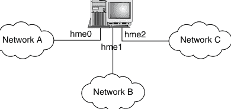

> **注意**
>
> 如果你的主机只有一个接口，默认情况下 IP 转发将被禁用。`/etc/init.d/initnet`（`/etc/rc2.d/S69inet`）脚本在启动时会检查主机上处于启动状态的接口数量。如果在启动时有两个或更多接口处于启动状态，则所有接口的转发功能将被启用。
>
> 另请注意，如果 `/etc/noutrouter` 文件存在，则 IP 转发以及动态路由默认将被禁用。

## TTL 值

每个被转发的数据包，其 TTL 值都将递减 1。如果 TTL 变为 0，数据包将被丢弃而不是转发。由于 TTL 值的改变，IP 首部也将被放入一个新的校验和，因为当任何 IP 首部的值发生变化时，旧的校验和将失效。

## 常见路由问题

如果主机在重启后无法启动，可能是某些初始化脚本出现了问题。在这种情况下，请在单用户模式（Single User mode）下启动系统并验证初始化脚本。

如果主机无法与网络上的任何其他主机通信，则网络接口存在问题。这可能是物理问题，也可能是配置问题。使用 `ifconfig` 命令来检查是否存在配置问题。最常见的配置问题是 IP 地址错误或子网掩码错误。

如果主机无法与其它网络上的主机通信，但可以与本地网络上的主机通信，那么你的路由表或路由器存在问题。要验证路由表是否正常工作，请使用 `netstat` 命令。使用 `traceroute` 命令追踪到其他网络主机的路由，查看在何处失败。

## 故障排除命令

你可以使用三个主要的故障排除命令来解决路由问题：`ping`、`traceroute` 和 `netstat`。有时 `snoop`、`ifconfig` 和 `ndd` 命令在实际操作中也非常实用。

接下来的章节将简要介绍如何使用这些命令进行路由故障排除。

## 使用 `ping` 命令

`ping` 命令是路由配置的最基本测试。首先，尝试 ping 您自己的 IP 地址。如果无法 ping 通，说明您的接口配置存在问题。如果您能 ping 通自己的 IP 地址，请尝试 ping 网络上的另一台主机。如果成功，则本地网络的路由工作正常。如果您无法 ping 通本地网络上的主机，那么要么是电缆损坏，要么是到达本地网络的路由存在问题。现在尝试 ping 任何一个网关。如果成功，则确认您可以到达网关。如果失败，请检查默认路由条目。之后，尝试 ping 另一个网络上的主机。如果能够连通，则远程网络的路由也配置正确。如果失败，要么是网关宕机，要么是默认路由不正确。

## 使用 `traceroute` 命令

如果您的本地配置正确，且能够 ping 通本地网络上的主机以及默认网关，但无法 ping 通其他网络上的主机，那么 `traceroute` 命令可以定位问题所在。使用 `traceroute` 命令跟踪到远程主机的路径。它应该在某个点停止，并开始显示星号字符（如您在之前的章节中已经看到的）。这就是路由出现问题的地方。如果您拥有该路由器的访问权限，可以自行纠正；否则，您可以联系负责该路由器的人员来解决问题。

## 使用 `netstat` 命令

`netstat` 命令是最有用的网络故障排除命令之一。它用于多种目的，包括显示主机上定义的所有路由列表，如下所示：

```bash
bash-2.03# netstat -rn
```

**路由表：IPv4**

| 目的地址 | 网关 | 标志 | 引用 | 使用次数 | 接口 |
| :--- | :--- | :--- | :--- | :--- | :--- |
| 192.168.2.0 | 192.168.2.222 | U | 1 | 8 | hme0 |
| 224.0.0.0 | 192.168.2.222 | U | 1 | 0 | hme0 |
| 127.0.0.1 | 127.0.0.1 | UH | 30 | 57789 | lo0 |

**路由表：IPv6**

| 目的地址/掩码 | 网关 | 标志 | 引用 | 使用次数 | 接口 |
| :--- | :--- | :--- | :--- | :--- | :--- |
| fe00::/10 | fe80::a00:20ff:fe9e:f050 | U | 1 | 0 | hme0 |
| ff00::/8 | fe80::a00:20ff:fe9e:f050 | U | 1 | 0 | hme0 |
| default | fe80::a00:20ff:fe9e:f050 | U | 1 | 0 | hme0 |


| ::1 | ::1 | UH | 1 | 0 | lo0 |

```bash
bash-2.03#
```

因为这个例子在主机 fana 上同时使用了 IPv4 和 IPv6，所以列出了这两种协议的路由。

表 3.2 列出了 `netstat` 命令常用的选项。

**表 3.2：NETSTAT 命令选项**

| 选项 | 描述 |
| :--- | :--- |
| -a | 列出系统上使用的所有套接字、端口和连接。 |
| -I | 显示接口状态。 |
| -I \<interface\> | 显示特定接口的信息。 |
| -n | 以点分十进制形式而非主机名显示网络地址。 |
| -r | 显示路由表。 |
| -s | 显示每种协议的统计信息。 |
| -P | 将输出限制在特定协议。 |
| -v | 详细模式。显示更多细节。 |
| -D | 显示 DHCP 配置接口的统计信息。 |
| Interval | 在给定的时间间隔后重复显示统计信息。 |

### `ifconfig` 命令

`ifconfig` 命令用于显示和纠正本地接口配置问题。您需要此命令来纠正诸如错误子网掩码之类的问题。错误的子网掩码也会导致路由问题。例如，对于 B 类网络，您应该使用子网掩码 255.255.0.0。如果您误用了 255.255.255.0，将无法到达本地网络上的许多主机。要解决这个问题，您可以使用 `ifconfig` 命令重新分配正确的子网掩码。

## 案例研究：TEENDA 公司的网络扩展

| 案例要点 | 场景 |
| :--- | :--- |
| 以下是本案例的要点：<br><br>- 要向网络中添加一个使用不同类 IP 地址的新网段，需要一台路由器。<br><br>- 由于这是一个仅由两个路由器组成的小型网络，不需要动态路由。路由仅针对 C 类网络进行，规模不会很大。因此可以使用静态路由。<br><br>- Solaris 机器必须至少配备两个网络适配器，以便连接到两个网络。 | Teenda 公司已经拥有一个由单个网段组成的网络，该网络通过一台路由器连接到 Internet。公司正在扩张，希望为其研究部门增加另一个网络网段。Teenda 为该网段获得了另一个 C 类网络地址。公司希望新网段能够使用现有的 Internet 连接。需要安装一台新的 Solaris 机器，作为新网络网段与现有网络之间的路由器。<br><br>**分析**<br>用作路由器的 Solaris 机器可以放置在新网络网段与连接 Internet 的路由器所在的网段之间。在这种情况下，路由将非常简单。在 Solaris 机器上，您设置一个指向连接 Internet 的路由器的默认路由条目。在连接 Internet 的路由器上，您需要为新的 C 类网络定义一个指向 Solaris 机器的路由条目。 |

## 本章小结

| 关键术语 | 小结 |
| :--- | :--- |
| - 路由协议<br>- 被路由协议<br>- 静态路由<br>- 动态路由<br>- 路由表<br>- 距离向量路由协议<br>- 链路状态路由协议<br>- 路由信息协议 (RIP)<br>- 路由器发现协议 (RDISC)<br>- 默认路由<br>- 无类域间路由 (CIDR)<br>- IP 转发 | 路由是安装和管理 TCP/IP 网络非常重要的部分。本章首先介绍了路由过程。还介绍了如何规划 TCP/IP 网络以及 IP 地址规划的信息。随后概述了同一网络或不同网络上的两台主机之间如何进行通信。路由有两种基本类型：静态路由和动态路由。本章介绍了这两类路由的配置入门。您还学习了链路状态和距离向量路由协议（包括两者之间的区别）。文中提供了一个配置静态路由的示例。然后，您学习了如何配置 RIP 和 RDISC 路由协议。<br><br>接下来的讨论转向了 IP 路由过程中使用的不同配置和启动文件。您学习了 IP 转发以及 TTL 值的作用。最后一部分介绍了常见的路由问题及其故障排除过程。<br><br>学习本章后，您应该能够区分静态路由和动态路由过程，并能够配置静态和动态路由。您还应该能够诊断并纠正常见的路由问题。 |

## 知识应用

### 练习

#### 3.1 添加和删除默认路由

在这个练习中，您将学习如何添加和删除默认路由，以及它对路由数据流量的影响。为了方便练习，假设主机已连接到 Internet，并且您可以使用 Web 浏览器访问 Internet 网站。

**预计时间：** 10 分钟

1. 使用 `netstat` 命令显示当前路由表。您将在路由表中发现一个默认路由条目。启动 Netscape 浏览器并访问 New Riders 的网站 `http://www.newriders.com`。
2. 使用 `route` 命令配合 `del` 命令行选项删除默认路由条目。
3. 再次尝试访问该网站。这次您将无法访问，因为您的主机不知道将请求数据包发送到哪里。
4. 使用 `route` 命令配合 `add` 命令行选项重新添加默认路由。
5. 再次检查是否可以到达 New Riders 的网站。

通过添加和删除其他路由条目来检查其影响。

### 复习题

1. 什么是 IP 转发？
2. 链路状态路由协议和距离向量路由协议有什么区别？
3. 列举三个用于排除路由问题故障的命令。
4. 不同网络上的两台主机之间是如何进行通信的？

### 考试题

这些问题的答案在附录 E “样本考试题答案”中提供。

1. 路由器 A 和 B 通过以太网端口连接在一起。主机 C 连接到路由器 B 的以太网端口，如图 3.4 所示。

**图 3.4**

连接方案。

## 知识应用

图中还显示了分配给路由器不同端口的 IP 地址。路由器和主机都定义了定义静态路由，如下所示：

路由器 A 上 `netstat -rn -f inet` 的输出：

```bash
bash-2.03# netstat -rn -f inet
```

| 路由表: IPv4 | | | | |
| :--- | :--- | :--- | :--- | :--- |
| 目的地 | 网关 | 标志 | 引用 | 使用接口 |
| 192.168.10.0 | 192.168.10.1 | U | 1 | 0 hme0 |
| 224.0.0.0 | 192.168.10.1 | U | 1 | 0 hme0 |
| default | 192.168.10.2 | UG | 1 | 14 |
| 127.0.0.1 | 127.0.0.1 | UH | 22 | 16239 lo0 |

```bash
bash-2.03#
```

路由器 B 上 `netstat -rn -f inet` 的输出：

```bash
bash-2.03# netstat -rn
```

| 路由表: IPv4 | | | | |
| :--- | :--- | :--- | :--- | :--- |
| 目的地 | 网关 | 标志 | 引用 | 使用接口 |
| 192.168.10.0 | 192.168.10.2 | U | 1 | 0 hme0 |
| 192.168.20.0 | 192.168.20.1 | U | 1 | 0 hme1 |
| 224.0.0.0 | 192.168.10.2 | U | 1 | 0 hme0 |
| default | 192.168.10.1 | UG | 1 | 14 |
| 127.0.0.1 | 127.0.0.1 | UH | 22 | 16239 lo0 |

```bash
bash-2.03#
```

主机 C 上 `netstat -rn -f inet` 的输出：

```bash
bash-2.03# netstat -rn -f inet
```

| 路由表: IPv4 | | | | |
| :--- | :--- | :--- | :--- | :--- |
| 目的地 | 网关 | 标志 | 引用 | 使用接口 |
| 192.168.20.0 | 192.168.20.2 | U | 1 | 0 hme0 |
| 127.0.0.1 | 127.0.0.1 | UH | 22 | 16239 lo0 |

```bash
bash-2.03#
```

用户可以从主机 C ping 通路由器 B 的以太网适配器 (192.168.20.1)。但用户无法从主机 C (192.168.10.1) ping 通路由器 A，也无法 ping 通路由器 B 上的第二个以太网适配器 (192.168.10.2)。

1. 用户无法 ping 通路由器 B 上第二个以太网适配器的一个可能原因是？

   - A. 可能是电缆问题。
   - B. 路由器 A 上的路由表不适合转发数据包。
   - C. 主机 C 的路由表存在问题。
   - D. 路由器 B 的路由表存在问题。

2. 在前一个问题中，可能的解决方案是什么？选择所有适用项。

   - A. 在主机 C 上添加一个指向地址 192.168.20.1 的默认路由条目。
   - B. 在主机 C 上为网络 192.168.10.0 添加一个指向地址 192.168.20.1 的路由条目。
   - C. 在路由器 A 上为网络 192.168.20.0 添加路由条目。
   - D. 以上都不是。

3. 路由的两种主要类型是什么？

   - A. 动态路由
   - B. 静态路由
   - C. 分级路由
   - D. 扁平路由

4. 以下哪些是链路状态路由（link-state routing）的优点？选择所有适用项。

   - A. 可用于任何规模的网络
   - B. 简单
   - C. 易于维护
   - D. 可扩展性强
   - E. 收敛速度快

5. 以下哪些是路由协议？选择所有适用项。

   - A. IP
   - B. TCP
   - C. RIP
   - D. RDISC
   - E. IPX

6. 在正常运行（非启动时），`in.rdisc` 广告其路由表的默认间隔是多少？

   - A. 每 10 分钟
   - B. 每 10 秒
   - C. 每 30 秒
   - D. 每 5 分钟

7. ALL_ROUTERS 组播地址是什么？

   - A. 224.0.0.1
   - B. 224.0.0.2
   - C. 224.0.0.7
   - D. 224.0.0.0

8. 如何以路由器模式运行 `in.rdisc`？

   - A. 在命令行使用 `-r` 选项。
   - B. 使用 `/etc/rdisc` 配置文件。
   - C. 使用 `-router` 命令行选项。
   - D. 使用 `/etc/defaultrouter` 文件。

9. `/etc/gateways` 文件中存在哪两种类型的网关？

   - A. 激活（Active）
   - B. 被动（Passive）
   - C. 本地（Local）
   - D. 远程（Remote）
   - E. 默认（Default）

10. RIP 使用哪个端口号？

    - A. 420
    - B. 520
    - C. 110
    - D. 25

11. 能够交换路由信息的网关被称为什么？

    - A. 激活网关（Active gateways）
    - B. 被动网关（Passive gateways）
    - C. 路由网关（Routing gateways）
    - D. 连接网关（Connected gateways）

3. 您可以使用以下三个命令来排除路由问题：

   - `ping`
   - `netstat`
   - `traceroute`

4. 不同网络上的两个主机之间通过多个步骤进行通信，列举如下：

   - a. 数据发送方确定目的地主机是否在本地网络中。如果是，它使用 ARP 查找目的地主机的 MAC 地址，并将数据包直接转发给目的地主机。
   - b. 如果目的地主机不在本地网络中，发送方检查其路由表，确定是否有可用的到达目的地主机的路由。如果存在路由，则使用该路由发送数据包。
   - c. 如果没有可用路由，发送方检查路由表中是否存在默认路由条目。如果存在默认路由，则将数据包转发给默认路由器。随后由默认路由器负责将数据包发送至目的地。
   - d. 如果上述方法都无法使用，则丢弃该数据包。

## 复习题答案

1. IP 转发是一个过程，路由器将从一个网络接口接收到的 IP 数据包转发到另一个网络接口。
2. 在其他因素之外，基本区别在于距离向量（distance vector）根据从源到目的地的跳数来衡量两个主机之间的距离。链路状态（link state）则使用其他变量（如带宽、延迟等）计算距离。与距离向量相比，链路状态方法占用的带宽更少，且在较短时间内即可收敛。

### 建议阅读和资源

#### 1. 书籍

- *Computer Networks*. Andrew S. Tanenbaum
- *Computer Networks and Internets*. Douglas E. Comer and Ralph E. Droms
- *TCPIP Unleashed*. Parker et al.
- *TCP/IP Illustrated, Vol. 1*. Richard Stevens
- *Internetworking with TCP/IP Vol. 1: Principles, Protocols, and Architecture*. Douglas E. Comer
- *IP Fundamentals: What Everyone Needs to Know About Addressing & Routing*. Thomas A. Maufer

#### 2. 互联网

- 互联网协议。RFC 791
- 互联网控制消息协议。RFC 792
- 关于 Bellman-Ford 算法的信息，详见网站 `http://hissa.nist.gov/dads/HTML/bellmanford.html`
- 关于 RIP 的信息，详见网站 `http://www.ietf.org/html.charters/rip-charter.html`

***

# 第 4 章

# 客户端-服务器世界：端口与套接字

## 目标

本章涵盖了 310-043 考试中 Sun 指定的以下目标。

### 解释客户端（client）、服务器（server）和服务（service）这些术语。

Solaris 上的大多数网络服务都是客户端-服务器应用程序。服务器向网络上的客户端提供服务。服务的客户端可以使用定义良好的端口号连接到服务器。使用套接字（socket）机制来访问这些端口。

### 管理 Internet 服务和 RPC 服务

收集关于主机上配置的服务的信息。识别 TCP 和 UDP 的特点。定义面向连接（connection-oriented）、无连接（connection-less）、有状态（stateful）和无状态（stateless）这些术语。

服务器可以通过 TCP 端口或 UDP 端口提供服务。了解如何管理 Internet 和 RPC 服务对于有效识别 TCP 和 UDP 的特点至关重要。TCP 是一种面向连接或有状态的通信方式，保证数据的完整性。它也被称为可靠协议。相比之下，UDP 提供无连接服务，本质上是无状态的。它被称为不可靠协议。除了 Internet 服务外，还有另一类服务称为远程过程调用（RPC）。RPC 用于网络文件系统等服务。

### 描述端口号、网络服务和 `inetd` 之间的关系。

服务器进程可以作为网络守护进程（daemon）启动。守护进程是在后台运行并监听传入连接请求的进程。服务器也可以使用 `inetd` 守护进程启动，`inetd` 充当包装器（wrapper）。`inetd` 守护进程代表许多服务器监听传入的连接请求。当收到针对某个服务器的请求时，它会调用相应的服务器进程。

## 目录

- 常用 TCP/IP 工具 xx
  - 使用 FTP xx
  - 使用 Telnet xx
  - 使用 Telnet 验证远程服务器进程 xx
  - 使用 finger 命令 xx
  - 使用 rwho 命令 xx
  - 使用 rup 命令 xx
  - 使用 ruptime 命令 xx
- 以 `r` 开头的命令 xx
  - 配置 `r` 命令 xx
  - 使用 `rlogin` 命令 xx
  - 使用 `rcp` 命令 xx
  - 使用 `rsh` 命令 xx
  - 重要的互联网服务与端口号 xx
- 故障排除 xx
  - 使用 `netstat` 和 `rpcinfo` 命令 xx
  - 使用 `ndd` 命令 xx
  - 检查 TCP 状态 xx
  - 案例分析的精髓 xx
- 本章小结 xx
- 知识应用 xx

## 学习策略

本章将向您介绍客户端-服务器术语以及传输层协议。这些协议包括 TCP 和 UDP。为了理解本章中呈现的概念，请采用以下学习策略：

- 学习基础的客户端-服务器术语。
- 理解 TCP 和 UDP 协议，以及面向连接的通信和无连接通信。
- 复习用于配置互联网服务的各种配置文件的格式。
- 在 Solaris 上获得配置互联网服务的实际操作经验。
- 练习配置 `r` 命令。
- 学习互联网服务的故障排除流程。
- 完成本章末的所有练习和问题。

## 简介

在 TCP/IP 网络上运行的应用程序通常采用客户端-服务器模型。每个应用程序都使用传输层提供的服务。传输层使用*端口号（port number）*来区分不同的应用程序。就像 IP 地址用于区分网络上的主机一样，端口号用于区分在同一主机上运行的不同网络服务。每项网络服务都使用一个定义明确的端口号，客户端通过该端口号连接到该网络服务。例如，您的电子邮件客户端知道必须连接到 110 端口以使用 POP3 服务，连接到 25 端口以使用 SMTP 服务。互联网上的所有电子邮件服务器都使用相同的端口号，因此任何客户端都可以连接到互联网上的任何服务器。


多个客户端可以同时连接到一个服务。例如，许多用户可以同时访问一个网站。为了区分不同的客户端，使用了套接字。*套接字（socket）* 是 IP 地址和端口号的组合。服务的客户端在开始与服务器通信之前，通常会打开一个套接字。打开套接字后，客户端将该套接字连接到服务器套接字。如果服务器接受连接请求，则在客户端和服务器之间建立通信信道。客户端和服务器都使用此通信信道进行数据通信。

在 OSI 网络模型中，会话层负责建立、维护和拆除通信会话。在 TCP/IP 协议中，没有会话层。相反，由应用层负责执行会话层的任务。因此，由应用层建立会话并将其断开。当客户端应用程序需要建立连接时，它在自身一侧打开一个套接字并将协议绑定到该套接字。然后，它向服务器进程发送请求，将其自身的套接字连接到服务器套接字。如果服务器接受该请求，连接即建立，客户端和服务器之间使用应用层级协议（如 SMTP）进行通信。

本章首先介绍端口和套接字。然后，您将了解客户端和服务器之间是如何建立连接的。您还将学习关于互联网服务及其配置方法的知识。启动服务基本上有两种方式：直接作为守护进程启动，或通过 `inetd` 主守护进程启动。在本章中，您将学习使用这两种方法。文中还提供了一个在启动时启动服务的脚本示例。

接下来，将讨论一些常用的网络实用程序。其中包括 FTP 和 Telnet 客户端工具等。之后，您将学习以字符 `r` 开头的服务，以及如何配置和使用这些服务。`r` 服务通常用于在远程机器上执行某些操作（因此以 `r` 开头）。传统上，这些服务源自 UNIX 的 BSD 版本。文中还将讨论一些安全问题。最后，讨论网络服务的故障排除。

在学习完本章后，您应该能够区分端口和套接字。您还应该理解 TCP/IP 协议不同层级的编址方式，以及常用网络服务的配置和使用。

## 客户端-服务器术语

在客户端-服务器领域，有些术语无处不在。本节定义了其中一部分。这些定义为讨论网络应用程序客户端-服务器方法的不同方面提供了基础。

### 服务器（Servers）

*服务器* 是提供特定服务给其客户端的硬件或软件。每个网络用户常用的服务器示例包括 Web 服务器、邮件服务器、域名服务器等。

### 客户端（Clients）

*客户端* 是用于访问服务器提供服务的用户应用程序。像 Netscape 这样的 Web 浏览器就是一个使用 Web 服务器提供服务的客户端应用程序。同样，在利用邮件服务器提供的服务时，您也可以使用电子邮件客户端。客户端也可以是指不向其他计算机提供服务的 PC/计算机。

### 端口号（Port Number）

*端口号* 是服务的访问点。端口号用于区分在同一台物理机上运行的多个服务。这类似于银行中不同的服务窗口。要获得某项特定服务，您必须前往特定的窗口。同样，您必须访问不同的端口号来获取不同的服务。例如，您使用 `25` 端口进行电子邮件传输，使用 `23` 端口进行 Telnet 连接。

### 套接字（Socket）

*套接字* 用于将客户端连接到服务器。套接字用于区分不同的同步通信会话。套接字是 IP 地址和端口号的组合。客户端和服务器之间的每个通信会话都使用不同的套接字。

### 守护进程（Daemon）

*守护进程* 是在后台运行并为客户端提供服务的服务器进程。服务器可以作为守护进程运行，或者在客户端发送请求时通过 `inetd` 启动。

## 端口与套接字简介

TCP/IP 网络中的每一层都使用某种机制来区分其服务。在前面的章节中，您学习了 MAC 地址和 IP 地址。MAC 地址是一个 48 位的数字，是用于在数据链路层级区分主机的唯一地址。所有在数据链路层级进行的通信都是使用 MAC 地址完成的。当 IP 层需要向网络上的某个其他主机发送数据时，它必须使用 ARP 协议将目的 IP 地址解析为其 MAC 地址。

同样，网络层（IP 层）使用 IP 地址来区分网络上的不同主机。IP 地址是一个 32 位的数字，且必须在所有连接的网络和主机中唯一。主机名被映射到 IP 地址，以便于记忆不同的服务器。

在传输层级，使用端口号来区分不同的服务。这是必要的，因为单台物理主机上可能运行许多服务。例如，同一台机器可能同时被用作 Web 服务器、FTP 服务器以及邮件服务器。那么，您应该如何区分不同的入站数据包应该发送到哪个服务器应用程序？端口号就是为此目的而使用的机制。如前所述，每一层都会在自己的层头部放入数据。发送端的传输层在层头部放入端口号，以便接收端的传输层能够区分入站数据包。接收端的传输层检查这些端口号，并根据端口号将数据包转发到不同的应用程序。

在应用层级，多个客户端可能同时访问同一个服务。这种情况最常见的例子就是 Web 服务器和浏览器。全球成千上万的用户同时访问同一家公司的 Web 服务。在接收入站数据包时，Web 服务器必须知道该数据包来自哪个客户端。同样，在客户端，您可能打开了多个 Web 浏览器窗口以同时访问不同的网站。当您的机器从 Web 服务器接收到一个数据包时，它必须有一种机制知道该数据包属于哪个浏览器窗口。为此使用了一种称为 *套接字（sockets）* 的机制，它可以被认为是对应用程序特定实例的识别。

总之，每一层都有一个机制来区分主机或应用程序。不同的网络层及其区分来自多个主机数据的机制列在表 4.1 中。

| 层级 | 机制 |
| :--- | :--- |
| 数据链路层 | MAC 地址：一个 48 位的数字 |
| IP 层 | IP 地址：IPv4 地址为 32 位数字，IPv6 地址为 128 位数字 |
| TCP/UDP 层 | 端口号：一个 16 位的数字 |
| 应用层 | 套接字：IP 地址和端口号的组合 |

## 知名端口号

所有通用互联网服务的端口号都已经标准化。互联网服务通常使用 TCP 协议或 UDP 协议，部分服务则同时使用这两种协议。对于常用服务，这两种协议的端口号都是固定的。在包括 Solaris 在内的 UNIX 系统中，标准端口号列在`/etc/inet/services`文件中。这里显示的`/etc/inet/services`示例文件存在于 Solaris 机器上。该文件中条目的格式将在下文中讨论：

```bash
bash-2.03$ cat /etc/inet/services

#ident "()#services 1.25 99/11/06 SMI" /* SVr4.0
#1.8 */

# Copyright 1999 by Sun Microsystems, Inc.
# All rights reserved.

# Network services, Internet style
#
tcpmuxo 1/tcp
echo 7/tcp
echo 7/udp sink null
discard 9/tcp sink null
discard 9/udp sink null
systat 11/tcp users
daytime 13/tcp
daytime 13/udp
netstat 15/tcp
chargen 19/tcp ttytst source
chargen 19/udp ttytst source
ftp-data 20/tcp
ftp 21/tcp
telnet 23/tcp
smtp 25/tcp mail
time 37/tcp timserver
time 37/udp timserver
name 42/udp nameserver # usually to sri-nic
whois 43/tcp nicname
domain 53/udp
domain 53/tcp
bootps 67/udp # BOOTP/DHCP server
bootps 68/udp # BOOTP/DHCP client
hostnames 101/tcp hostname # usually to sri-nic
pop2 109/tcp pop-2 # Post Office Protocol V2
pop3 110/tcp # Post Office Protocol Version 3
sunrpc 111/udp rpcbind
sunrpc 111/tcp rpcbind # Internet
imap 143/tcp imap2 # Mail Access Protocol v2
ldap 389/tcp # Lightweight Directory Access Protocol
ldap 389/udp # Lightweight Directory Access Protocol
ldaps 636/tcp # LDAP Protocol over TLS/SSL (was ldap)
ldaps 636/udp # LDAP protocol over TLS/SSL (was ldap)

# Host specific functions
tftp 69/udp
rje 77/tcp
finger 79/tcp ttylink
link 87/tcp
supdup 95/tcp
iso-tsap 102/tcp
x400 103/tcp # ISO Mail
x400_snd 104/tcp
csnet-ns 105/tcp
pop-2 109/tcp # Post Office
ucpp-path 117/tcp
nntp 119/tcp usenet # Network News Transfer
ntp 123/tcp # Network Time Protocol
ntp 123/udp # Network Time Protocol
netbios-ns 137/tcp # NETBIOS Name Service
netbios-ns 137/udp # NETBIOS Name Service
netbios-dgm 138/tcp # NETBIOS Datagram Service
netbios-dgm 138/udp # NETBIOS Datagram Service
netbios-ssn 139/tcp # NETBIOS Session Service
netbios-ssn 139/udp # NETBIOS Session Service
News 144/tcp news # Window System
slp 427/tcp slp # Service Location Protocol, V2
slp 427/udp slp # Service Location Protocol, V2
mobile-ip 534/udp mobile-ip # Mobile-IP
cvc_hostd 442/tcp # Network Console

# UNIX specific services
# these are NOT officially assigned
exec 512/tcp
login 513/tcp
shell 514/tcp cmd # no passwords used
printer 515/tcp spooler # line printer spooler
courier 530/tcp rpc # experimental
uucp 540/tcp uucpd # uucp daemon
biff 512/udp comsat
who 513/udp whod
syslog 514/udp
talk 517/udp
route 520/udp router routed
ripgn 521/udp # Kerberos
klogin 523/tcp # authenticated rlogin
kshell 544/tcp cmd # Kerberos authenticated remote shell
new-rwho 550/udp new-who # experimental
rmonitor 560/udp rmonitord # experimental
monitor 561/udp # experimental
pcserv 600/tcp # ECD Integrated PC board serv
kerberos-adm 749/tcp # Kerberos V5 Administration
kerberos-adm 749/udp # Kerberos V5 Administration
kerberos 750/udp kdc # Kerberos key server
kerberos 750/tcp kdc # Kerberos key server
krb5_prop 754/tcp # Kerberos V5 KDC propagation
ufsd 1008/tcp ufsd # UFS-aware server
ufsd 1008/udp ufsd
cvc 1495/tcp # Network Console
ingreslock
www-ldap-gw 1524/tcp # HTTP to LDAP gateway
www-ldap-gw 1768/udp # HTTP to LDAP gateway
listen 2766/tcp # System V listener port
nfsd 2049/udp nfs # NFS server daemon (clts)
nfsd 2049/tcp nfs # NFS server daemon (colts)
eklogin 2105/tcp # Kerberos encrypted rlogin
lockd 4045/udp # NFS lock daemon/manager
lockd 4045/tcp
dtspc 6112/tcp # CDE subprocess control
fs 7100/tcp # Font server
```

为了与 BSD 版本的 UNIX 兼容，此文件链接到`/etc/services`文件。该文件中的每一行格式如下：

`<服务名称>`    `<端口号/协议>`    `<别名>`

`<服务名称>` 是服务的官方名称。它可以包含除注释字符（稍后定义）以外的任何可打印字符。此文件中提到的一些服务名称包括 FTP、Telnet、Time、SMTP 等。

`<端口号/协议>` 字段显示了该服务使用的端口号和协议。例如，以`telnet`开头的行中的`23/tcp`表明 Telnet 服务使用端口号 23 和 TCP 协议。同一个端口号可以与多种协议一起使用。有些服务同时使用 TCP 和 UDP。例如，Time 服务在端口号 37 上同时使用 TCP 和 UDP 协议。

行最后的部分显示了该服务使用的一个或多个别名。这是一个可选字段，某些服务可能存在，也可能不存在。

数字或井号（`#`）被用作注释字符。任何以此字符开头的行都是注释行。如果该字符出现在行内，则该字符之后的所有字符都被视为注释。

如果您正在安装一个尚未定义端口号的新服务，可以将该服务名称添加到`/etc/inet/services`文件中。`netstat`和其他命令在显示不同服务的连接状态时会使用此文件中的条目。例如，当您使用`netstat -a`命令时，您会在输出中看到如下内容：

```text
TCP: IPv4
Local Address Remote Address Swind Send-Q Rwind Recv-Q State
*.* 0 0 24576 0 IDLE
.*.sunrpc *.* 0 0 24576 0 LISTEN
*.* 0 0 24576 0 IDLE
.*.sunrpc *.* 0 0 24576 0 LISTEN
*.* 0 0 24576 0 IDLE
.*.ftp *.* 0 0 24576 0 LISTEN
.*.telnet *.* 0 0 24576 0 LISTEN
```

如果您编辑`/etc/inet/services`文件，将 Telnet 条目行注释掉，然后再次运行相同命令，最后一行输出将像下面这样有所不同：

```text
TCP: IPv4
Local Address Remote Address Swind Send-Q Rwind Recv-Q State
*.* 0 0 24576 0 IDLE
.*.sunrpc *.* 0 0 24576 0 LISTEN
*.* 0 0 24576 0 IDLE
.*.sunrpc *.* 0 0 24576 0 LISTEN
*.* 0 0 24576 0 IDLE
.*.ftp *.* 0 0 24576 0 LISTEN
.*.23 *.* 0 0 24576 0 LISTEN
```

请注意，最后一行中的 Telnet 被替换成了 23，因为现在该命令无法找到哪个服务在使用端口 23。另外请注意，这里显示的`netstat -a`命令输出是不完整的。我仅截取了部分输出行来演示该原理。

## 什么是套接字（Socket）？

*套接字* 是一种将多个客户端同时连接到服务的机制。套接字是 IP 地址和端口号的组合。如果服务使用 TCP，客户端将打开一个套接字，并使用`connect()`系统调用连接到本地或远程服务器上的服务器套接字。如果服务使用 UDP 套接字，通常不使用`connect()`系统调用，通信会立即开始。

套接字可以被认为类似于水管中使用的接头。水管的两端使用接头连接到某个物体。水管可以被视为两个通过套接字连接的应用程序之间的通信通道。

套接字被用作客户端和服务器之间通信的一种方式。如果多个客户端连接到一台服务器，服务器可以通过为每个客户端使用不同的套接字来区分不同的客户端。同样，运行在同一台机器上但连接到不同服务器的多个客户端，也可以根据套接字来区分传入的数据。

## 第 4 章 客户端-服务器世界：端口与套接字

套接字主要分为三大类：

- TCP 套接字，称为`SOCK_STREAM`
- UDP 套接字，称为`SOCK_DGRAM`
- 原始套接字（Raw sockets），称为`SOCK_RAW`

原始套接字用于除 TCP 或 UDP 以外的所有协议。通过使用原始套接字，应用程序可以直接使用 IP 层提供的服务，绕过传输层。原始套接字还提供了一种定义和使用除 TCP 或 UDP 以外协议的方法。


套接字写成由点号（`.`）分隔的 IP 地址和端口号的组合。例如，一个使用 IP 地址 `192.168.2.1` 和端口号 `23` 的主机的套接字地址将是 `192.168.2.1.23`。套接字也可以写成主机名与`/etc/inet/services`文件中定义的端口名的组合。如果主机`192.168.2.1`的名称为`fana`，且端口号`23`在`/etc/inet/services`服务中被定义为 Telnet 端口，那么套接字地址也可以写成`fana.telnet`。通配符可用在套接字中，通常用于未连接的套接字。例如，如果一台主机正在监听 Telnet 端口且没有人连接到该端口，则该套接字也可以写成`*.telnet`或`*.23`。

在 Solaris 机器中，可以使用`netstat -a`命令列出已连接和打开的套接字。该命令的部分输出如下所示：

> 注意：由于端口是一个 16 位数字，因此每个主机上的一个 IP 地址最多可有 64K（`2^16`）个套接字。

### TCP: IPv4

| 本地地址 | 远程地址 | Swind | Send-Q | Rwind | Recv-Q | 状态 |
| :--- | :--- | :--- | :--- | :--- | :--- | :--- |
| `.sunrpc` | `*.*` | 0 | 0 | 24576 | 0 | IDLE |
| `*` | `*.*` | 0 | 0 | 24576 | 0 | IDLE |
| `.sunrpc` | `*.*` | 0 | 0 | 24576 | 0 | LISTEN |
| `*` | `*.*` | 0 | 0 | 24576 | 0 | IDLE |
| `.ftp` | `*.*` | 0 | 0 | 24576 | 0 | LISTEN |
| `.telnet` | `*.*` | 0 | 0 | 24576 | 0 | LISTEN |
| `.shell` | `*.*` | 0 | 0 | 24576 | 0 | LISTEN |
| `.shell` | `*.*` | 0 | 0 | 24576 | 0 | LISTEN |
| `.login` | `*.*` | 0 | 0 | 24576 | 0 | LISTEN |
| `.exec` | `*.*` | 0 | 0 | 24576 | 0 | LISTEN |
| `.exec` | `*.*` | 0 | 0 | 24576 | 0 | LISTEN |
| `.uucp` | `*.*` | 0 | 0 | 24576 | 0 | LISTEN |
| `.finger` | `*.*` | 0 | 0 | 24576 | 0 | LISTEN |
| `.time` | `*.*` | 0 | 0 | 24576 | 0 | LISTEN |
| `.echo` | `*.*` | 0 | 0 | 24576 | 0 | LISTEN |
| `.discard` | `*.*` | 0 | 0 | 24576 | 0 | LISTEN |
| `.daytime` | `*.*` | 0 | 0 | 24576 | 0 | LISTEN |
| `.chargen` | `*.*` | 0 | 0 | 24576 | 0 | LISTEN |
| `.32774` | `*.*` | 0 | 0 | 24576 | 0 | LISTEN |
| `.32775` | `*.*` | 0 | 0 | 24576 | 0 | LISTEN |
| `.32776` | `*.*` | 0 | 0 | 24576 | 0 | LISTEN |
| `.32777` | `*.*` | 0 | 0 | 24576 | 0 | LISTEN |
| `.32778` | `*.*` | 0 | 0 | 24576 | 0 | LISTEN |
| `.32779` | `*.*` | 0 | 0 | 24576 | 0 | LISTEN |
| `.fs` | `*.*` | 0 | 0 | 24576 | 0 | LISTEN |
| `.32780` | `*.*` | 0 | 0 | 24576 | 0 | LISTEN |
| `.lockd` | `*.*` | 0 | 0 | 24576 | 0 | LISTEN |
| `.lockd` | `*.*` | 0 | 0 | 24576 | 0 | LISTEN |
| `.5987` | `*.*` | 0 | 0 | 24576 | 0 | LISTEN |
| `.8888` | `*.*` | 0 | 0 | 24576 | 0 | LISTEN |
| `.32788` | `*.*` | 0 | 0 | 24576 | 0 | LISTEN |
| `.32789` | `*.*` | 0 | 0 | 24576 | 0 | LISTEN |
| `.32790` | `*.*` | 0 | 0 | 24576 | 0 | LISTEN |
| `.32791` | `*.*` | 0 | 0 | 24576 | 0 | LISTEN |
| `.32792` | `*.*` | 0 | 0 | 24576 | 0 | IDLE |
| `.` | `*.*` | 0 | 0 | 24576 | 0 | LISTEN |
| `.6000` | `*.*` | 8494 | 1 | 24828 | 0 | ESTABLISHED |
| `fana.telnet` | `192.168.2.1.1043` | - | - | - | - | - |

该命令的输出分为 TCP 和 UDP 套接字部分，以及 TCP/IP 的第 4 版和第 6 版部分。输出的第一列显示本地套接字地址，第二列显示远程套接字地址。最后一列显示套接字的当前状态。最常见的状态是`CONNECTED`（已连接）和`LISTENING`（监听）。`CONNECTED`状态表示客户端已连接到此套接字，而`LISTENING`状态则表示服务器进程正在监听传入的连接请求。

起初，当服务器进程启动时，它会打开一个处于`LISTENING`状态的套接字。当客户端与该套接字建立连接后，它进入`CONNECTED`状态。在完成通信过程后，客户端关闭连接。在连接过程中，套接字还会经历一些其他瞬态，这超出了本书的讨论范围。

在已连接的套接字中，如果主机名可以解析，则显示为`hostname.port`；否则以`IP_address.port`格式列出。命令输出最后一行的第一列显示本地主机名为`fana`，端口号是 Telnet 所使用的端口。你可以查阅`/etc/inet/services`文件来查找 Telnet 服务的端口号，即 23。在下一列中，你看到了数字`192.168.2.1.1043`，这表明连接到 Telnet 端口的远程客户端 IP 地址为`192.168.2.1`，且远程 Telnet 客户端使用的端口号为 1043。最后一列中的`ESTABLISHED`表明该套接字已连接。

## 客户端-服务器应用模型

网络应用程序在客户端-服务器模型下工作。如前所述，服务器是运行在主机上的应用程序，用于监听传入的连接请求并提供特定服务。客户端通常是连接到服务器应用程序以请求服务的用户应用程序。每对客户端-服务器使用应用层协议来交换信息。一些最流行的应用层协议列在表 4.2 中。

| 协议 | 描述 |
| :--- | :--- |
| 简单邮件传输协议 (SMTP) | 该协议用于交换电子邮件消息。它使用 TCP 端口号 25。 |
| 网络时间协议 (NTP) | 该协议用于在网络上交换时间信息。它有助于同步网络服务器的时间。 |
| 文件传输协议 (FTP) | 该协议用于在主机之间传输文件。它使用 TCP 端口 20 和 21。 |
| 邮局协议 (POP) | 用于从邮件服务器下载电子邮件消息。它使用 TCP 端口 110。 |

客户端-服务器是开发网络应用程序的一种非常强大的模型。它为设计和实现公共服务提供了一种系统化的方法。

## 无连接和面向连接的通信

正如你在第 2 章“TCP/IP 协议”中所学到的，服务器使用无连接或面向连接的通信方式。在面向连接的服务中，客户端和服务器之间会进行握手以建立连接。在握手成功后，实际的通信才开始。

> **注意**：“服务器”这个词有时会被网络用户混淆。服务器是向客户端提供服务的实体。它可以是一台硬件设备、一个软件应用程序，或者两者的结合。同一台物理机上可以运行多个软件服务器应用程序。另请注意，一台机器可以同时针对同一服务或不同服务充当客户端和服务器。

在无连接通信方式中，客户端在不建立任何连接的情况下就开始与服务器通信。通常 TCP 用于面向连接的服务，而 UDP 用于无连接服务。每种通信方式都有其优缺点。面向连接的服务更可靠，但与无连接服务相比速度较慢。

## 配置互联网服务

计算机上的网络服务在启动时启动，以便服务器一启动就能被网络客户端访问。服务器进程在后台运行，等待来自客户端的传入连接请求。在启动时，每个服务器在周知端口（well-known ports）上打开一个或多个套接字。这些服务的客户端可以使用这些端口连接到由服务器进程打开的套接字。如果服务器使用了安全特性，它会在接收到连接请求时对网络客户端进行身份验证。通常的验证方法是提示输入登录名和密码。例如，当你使用 Telnet 客户端连接到 Telnet 服务器时，它会提示你输入登录名和密码，然后使用不同的方法对该登录名和密码进行验证。

有两种常见的方法来启动这些服务器进程。你可以将服务进程作为守护进程（daemon）启动，它将永远运行并等待传入的连接请求。另一种方法是使用`inetd`主守护进程，它可以代表其他服务监听传入的连接请求。`inetd`在启动时启动并充当主守护进程。一旦连接请求到达，它就会调用所需的服务进程。原则上，每个服务都可以作为守护进程或通过`inetd`启动。

### 将网络服务作为守护进程启动

启动脚本用于在启动时或随后的任何阶段启动网络服务器。在 Solaris 系统中，这些脚本通常存在于`/etc/init.d`目录下。相同的脚本用于启动或关闭服务。这些脚本的链接存在于运行级别目录中，使得服务在不同的运行级别中启动或关闭。

您也可以在需要时手动调用这些脚本来启动或关闭服务。

### 手动启动服务

Sendmail 守护进程的启动脚本位于`/etc/init.d/sendmail`文件中。要启动 Sendmail 守护进程，可以使用以下命令并带上`start`命令行参数：

```bash
/etc/init.d/sendmail start
```

可以使用以下命令来验证 Sendmail 是否正在运行。输出中的第二行显示该守护进程正在运行：

```bash
bash-2.03# ps -ef | grep sendmail
    root  410  365  0 21:01:01 pts/2  0:00 grep sendmail
    root  407    1  0 21:00:13 ?  0:00 /usr/lib/sendmail -bd -q15m
bash-2.03#
```

要手动停止 Sendmail 进程，可以使用以下命令并带上`stop`命令行参数：

```bash
/etc/init.d/sendmail stop
```

如果您在运行脚本时不带命令行参数或使用了错误的参数，则会显示一条简短的帮助信息，如下所示：

```bash
bash-2.03# /etc/init.d/sendmail
Usage: /etc/init.d/sendmail { start | stop }
bash-2.03#
```

> 除了检查服务进程是否正在运行外，您还可以使用`netstat -a`命令来验证服务器进程是否正在监听端口。在上述案例中，如果 Sendmail 守护进程正在运行（监听 SMTP 端口），`netstat -a`命令的输出将显示类似于以下的一行：

`*.smtp *. 0 0 24576 0 LISTEN`

## Sendmail 启动脚本示例

以下是 Solaris 自带的 Sendmail 启动脚本。您可以从中看到一个`case`语句，它使脚本根据不同的命令行参数采取不同的操作。使用`start`参数时，脚本启动服务；使用`stop`参数时，脚本杀死 Sendmail 进程。在任何其他情况下，它将显示帮助信息：

```bash
#!/sbin/sh
#
#
# Copyright 1992, 1995, 1995, 1997 - 1999 by Sun Microsystems,
#   Inc.
# All rights reserved.
#
#ident "@(#)sendmail 1.15 99/01/28 SWI"

ERRMSG1='WARNING: /var/mail is NFS-mounted without setting
	activemo=0,'
ERRMSG2='this can cause mailbox locking and access problems.'

case "$1" in
	'start')
		if [ -f /usr/lib/sendmail -a -f
			/etc/mail/sendmail.cf ]; then
				if [ ! -d /var/spool/mqueue ]; then
					/usr/bin/mkdir -m 0750
						/var/spool/mqueue
					/usr/bin/chown root:bin
						/var/spool/mqueue
				fi
			fi
		MODE="-bd"
		if [ -f /etc/default/sendmail ]; then
			. /etc/default/sendmail
		fi
		#
		# MODE should be "-bd" or null (MODE= or
		# MODE="") or
		# left alone. Anything else and you're
		# on your own.
		# QUEUEINTERVAL should be set to some
		# legal value;
		# a sanity check is done below.
		# OPTIONS is a catch-all; set with care.
		#
		if [ -z "$QUEUEINTERVAL" ]; then
			QUEUEINTERVAL="15m"
		fi
		case $QUEUEINTERVAL in
			"s" | "m" | "h" | "d" | "w") ;;
			*) QUEUEINTERVAL="15m" ;;
		esac
		if [ $QUEUEINTERVAL -le 0 ]; then
			QUEUEINTERVAL="15m"
		fi
		/usr/lib/sendmail $MODE -q$QUEUEINTERVAL
		$OPTIONS &
		
		if /usr/bin/nawk 'BEGIN{ s = 1 }
		$2 == "/var/mail" && $3 == "nfs" && $4 !~
		/activemo=0/ && $4 !~ /noac/{s = 0} END{exit s}' /etc/mnttab;
		then
			/usr/bin/logger -p mail.crit "$ERRMSG1"
			/usr/bin/logger -p mail.crit "$ERRMSG2"
		fi
		;;

	'stop')
		/usr/bin/pkill -x -u 0 sendmail
		;;

	*)
		echo "Usage: $0 { start | stop }"
		exit 1
		;;
esac
exit 0
```

### 如何创建自己的启动脚本

本节将介绍如何创建自己的启动脚本。

#### 分步指南

##### 4.1 创建启动脚本

启动您自己的网络服务器进程分为三个步骤，具体如下：

1. 在`/etc/init.d`目录中创建一个启动脚本。
2. 在`/etc/rcn.d`目录中为该脚本添加一个用于启动的链接，其中`n`是您希望启动服务器进程的运行级别（run level）。该链接的名称以字母 S 开头。
3. 在`/etc/rcn.d`目录中为该脚本添加一个用于关闭的链接，其中`n`是您希望关闭服务器进程的运行级别。该链接的名称以字母 K 开头。

现在让我们为一个服务器进程创建一个简单的脚本。假设该进程的可执行文件为`/sbin/sample-server`，进程将在运行级别 3 中启动，并在运行级别 2 中关闭。简单的脚本可能如下所示：

```bash
#!/sbin/sh
case "$1" in
'start')
    if [ -f /sbin/sample-server ]; then
        /sbin/sample-server
    fi
    ;;

'stop')
    /usr/bin/pkill -x -u 0 sample-server
    ;;

*)
    echo "Usage: $0 { start | stop }"
    exit 1
    ;;
esac
exit 0
```

将此脚本保存为`/etc/init.d/my-server`文件。此脚本包含一个`case`语句。如果您在运行此脚本时使用`start`作为命令行参数，它将启动服务器进程。当您使用`stop`作为命令行参数时，脚本将停止服务器进程。如果命令行参数不匹配`start`或`stop`，脚本将打印出脚本末尾所示的使用信息。

现在使用`ln`命令将此脚本链接到启动和关闭目录。以下命令在`/etc/rc3.d`目录中创建启动链接。该链接将导致服务器进程在运行级别 3 中启动：

```bash
ln -s /etc/init.d/my-server /etc/rc3.d/S900my-server
```


以下命令在`/etc/rc2.d`目录中创建关闭链接。该链接将导致服务器进程在运行级别 2 中关闭：

```bash
ln -s /etc/init.d/my-server /etc/rc2.d/K900my-server
```

### 使用`inetd`守护进程启动 Internet 服务

`inetd`是一个主守护进程，也被称为封装器（wrapper）。它在启动时运行，可以代表许多网络服务监听传入的连接请求。当收到传入连接请求时，`inetd`会调用请求的服务器进程，从而在客户端和服务器之间建立连接。该守护进程的配置文件是`/etc/inet/inetd.conf`，用于向`inetd`守护进程提供关于特定请求需要启动哪个服务的信息。

> **注意** 您可能已经知道，以 S 开头的链接用于启动服务，以 K 开头的链接用于停止服务。

以下是 Solaris 自带的默认`/etc/inet/inetd.conf`文件：

```text
##ident "@(#)inetd.conf 1.44 99/11/25 SMI" /* Svr4.0 1.5
*/
#
# Configuration file for inetd(M). See inetd.conf(4).
#
# To re-configure the running inetd process, edit this
#   file, then
#   send the inetd process a SIGHUP.
#
# Syntax for socket-based Internet services:
# <service_name> <socket_type> <proto> <flags> <user>
#   <server_pathname> <args>
#
# Syntax for TLI-based Internet services:
#
# <service_name> tli <proto> <flags> <user>
#   <server_pathname> <args>
#
# IPv6 in inetd.conf
# By specifying a <proto> value of tcp6 or udp6 for a
#   service, inetd will
#   pass the given daemon an AF_INET6 socket. The following
#   daemons have been
#   been modified to be able to accept AF_INET6 sockets
#
# ftp telnet shell login exec tftp finger printer
#
# and service connection requests coming from either IPv4
#   or IPv6-based
# transports. Such modified services do not normally
#   require separate
# configuration lines for tcp or udp. For documentation on
#   how to do this
# for other services, see the Solaris System Administration
#   Guide.
#
# You must verify that a service supports IPv6 before
#   specifying <proto> as
#   tcp6 or udp6. Also, all inetd built-in commands (time,
#   echo, discard,
#   daytime, chargen) require the specification of <proto> as
#   tcp6 or udp6
#
# The remote shell server (shell) and the remote execution
#   server
#   (exec) must have an entry for both the "tcp" and "tcp6"
#   <proto> values.
#
# Ftp and telnet are standard Internet services.
#
ftp stream tcp6 nowait root /usr/sbin/in.ftpd in.ftpd
telnet stream tcp6 nowait root /usr/sbin/in.telnetd
# in.telnetd
# Tnamed serves the obsolete IEN-116 name server protocol.
#
name dgram udp wait root /usr/sbin/in.tnamed in.tnamed
# Shell, login, exec, comsat and talk are BSD protocols.
#
shell stream tcp nowait root /usr/sbin/in.rshd in.rshd
shell stream tcp6 nowait root /usr/sbin/in.rshd in.rshd
login stream tcp6 nowait root /usr/sbin/in.rlogind
# in.rlogind
exec stream tcp nowait root /usr/sbin/in.rexecd
# in.rexecd
exec stream tcp6 nowait root /usr/sbin/in.rexecd
# in.rexecd
comsat dgram udp wait root /usr/sbin/in.comsat
# in.comsat
talk dgram udp wait root /usr/sbin/in.talkd in.talkd
# Must run as root (to read /etc/shadow); "-n" turns off
# logging in utmp/wtmp.

uucp stream tcp nowait root /usr/sbin/in.uucpd in.uucpd
# Tftp service is provided primarily for booting. Most
# sites run this
# only on machines acting as "boot servers."

#tftp dgram udp6 wait root /usr/sbin/in.tftpd in.tftpd
# s /tftboot
# Finger, systat and netstat give out user information
# which may be
# valuable to potential "system crackers." Many sites
# choose to disable
# some or all of these services to improve security.
#
finger stream tcp6 nowait nobody /usr/sbin/in.fingerd
# in.fingerd
systat stream tcp nowait root /usr/bin/ps -ef
# netstat stream tcp nowait root /usr/bin/netstat
# netstat -f inet
# Time service is used for clock synchronization.
#
time stream tcp6 nowait root internal
time dgram udp6 wait root internal
#
# Echo, discard, daytime, and chargen are used primarily
# for testing.
#
echo stream tcp6 nowait root internal
echo dgram udp6 wait root internal
discard stream tcp6 nowait root internal
```

## 第 4 章 客户端-服务器世界：端口与套接字

```text
discard dgram udp6 wait root internal
daytime stream tcp6 nowait root internal
daytime dgram udp6 wait root internal
chargen stream tcp6 nowait root internal
chargen dgram udp6 wait root internal
#
# RPC services syntax:
# <rpc_prog><vers> <endpoint-type> rpc/<proto> <flags>
#   <user>
#   <pathname> <args>
#
# <endpoint-type> can be either "tli" or "stream" or "dgram".
# For "stream" and "dgram" assume that the endpoint is a
#   socket descriptor.
# <proto> can be either a nettype or a netid or a "*". The
#   value is
#   first treated as a nettype. If it is not a valid nettype
#   then it is
#   treated as a netid. The "*" is a short-hand way of saying
#   all the
#   transports supported by this system, ie. it equates to
#   the "visible"
# nettype. The syntax for <proto> is:
#   <nettypeid><nettypeid>[,{<nettypeid>}]
# For example:
# dummy/1 tli rpc/circuit_v_udp wait root /tmp/test_svc
#   test_svc
#
# Solstice system and network administration class agent
#   server
100232/10 tli rpc/udp wait root /usr/sbin/sadmin sadmin
#
# Rquotad supports UFS disk quotas for NFS clients
#
rquotad/1 tli rpc/datagram_v wait root /usr/lib/nfs/rquotad
#
# The rusers service gives out user information. Sites
#   concerned
# with security may choose to disable it.
#
rusersd/2-3 tli rpc/datagram_v,circuit_v wait root /usr/lib/netsvc/rusers/rpc.rusersd rpc.rusersd
#
# The spray server is used primarily for testing.
#
sprayd/1 tli rpc/datagram_v wait root /usr/lib/netsvc/spray/rpc.sprayd rpc.sprayd
#
# The rwalld server allows others to post messages to users
#   on this machine.
#
walld/1 tli rpc/datagram_v wait root /usr/lib/netsvc/rwall/rpc.rwalld rpc.rwalld
#
# Rstatd is used by programs such as perfmeter.
#
rstatd/2-4 tli rpc/datagram_v wait root /usr/lib/netsvc/rstat/rpc.rstatd rpc.rstatd
# The rexd server provides only minimal authentication and
# is often not run
#
rexd/1 tli rpc/tcp wait root /usr/sbin/rpc.rexd rpc.rexd
# rpc.cmsd is a data base daemon which manages calendar
# data backed
# by files in /var/spool/calendar
#
# Sun ToolTalk Database Server
#
100083/1 tli rpc/tcp wait root /usr/dt/bin/rpc.ttdbserver rpc.ttdbserver
# UFS-aware service daemon
#
ufs_d/1 tli rpc/* wait root /usr/lib/fs/ufs/ufs_d ufs_d -p
# Sun KCMS Profile Server
#
100221/1 tli rpc/tcp wait root /usr/openwin/bin/kcms_server kcms_server
# Sun Font Server
#
fs stream tcp wait nobody /usr/openwin/lib/fs.auto fs
# CacheFS Daemon
#
100235/1 tli rpc/tcp wait root /usr/lib/fs/cachefs/cachefsd cachefsd
# Kerberos V5 Warning Message Daemon
#
100134/1 tli rpc/ticotsord wait root /usr/lib/krb5/ktkt_warnd ktkt_warnd
# Print Protocol Adaptor - BSD listener
#
printer stream tcp6 nowait root /usr/lib/print/in.lpd in.lpd
# GSS Daemon
#
100234/1 tli rpc/ticotsord wait root /usr/lib/gss/gssd gssd
# AMI Daemon
#
100146/1 tli rpc/ticotsord wait root /usr/lib/security/amiserv amiserv
100147/1 tli rpc/ticotsord wait root /usr/lib/security/amiserv amiserv
# OCF (Smart card) Daemon
#
100150/1 tli rpc/ticotsord wait root /usr/sbin/ocfserv ocfserv
dtspc stream tcp nowait root /usr/dt/bin/dtspcd /usr/dt/bin/dtspcd
100068/2-5 dgram rpc/udp wait root /usr/dt/bin/rpc.cmsd rpc.cmsd
# rpc.metad
100229/1 tli rpc/tcp wait root /usr/sbin/rpc.metad rpc.metad
# rpc.metamhd
100230/1 tli rpc/tcp wait root /usr/sbin/rpc.metamhd rpc.metamhd
# SunVTS Daemon
100152/1 dgram rpc/udp wait root /opt/SUNWvts/bin/sunvts /opt/SUNWvts/bin/sunvts -g
```

以井号（`#`）开头的行是注释行。该文件中基于套接字的常见服务的行采用以下语法：

```text
<service_name> <socket_type> <proto> <flags> <user>
<server_pathname> <args>
```

这些字段在表 4.3 中进行了说明。

### 表 4.3 套接字服务字段

| 字段 | 含义 |
| :--- | :--- |
| 服务名称（Service name） | 服务的名称。该服务名称列在`/etc/inet/services`文件中，且也被`netstat`命令使用。 |
| 套接字类型（Socket type） | 该文件显示服务所使用的套接字类型。`stream`套接字类型用于基于 TCP 的服务，`dgram`套接字用于 UDP 服务。`raw`套接字类型用于直接使用 IP 并绕过传输层协议的服务。 |
| 协议（Proto） | 该字段显示服务将使用哪种协议。这里可见 TCP、UDP 或其他协议。如果一个服务使用多种协议，这里可能会出现这些协议的组合。这些协议也列在`/etc/inet/protocols`文件中。 |
| 标志（Flags） | 该字段被设置为`wait`或`nowait`。`wait`标志用于 UDP 服务，`nowait`用于 TCP 服务。`nowait`标志允许同时运行服务器进程的多个实例。 |
| 用户（User） | 拥有该服务器进程的用户名称。出于安全考虑，这里使用了不同的用户名。 |
| 服务器路径名（Server path name） | 这是响应请求时启动的实际服务器可执行文件。 |
| 参数（Args） | 这些是在调用服务器进程时可能传递给它的命令行参数。第一个参数（参数 0）始终是服务器名称本身。 |

让我们分析文件中的以下行：


```
telnet  stream  tcp  nowait  root
/usr/sbin/in.telnetd  in.telnetd
```

这一行表明服务名称是 Telnet，它使用`stream`套接字类型。该服务使用的协议是 TCP。`nowait`标志表明`inetd`可以启动多个服务器进程。用户`root`将拥有这些服务器进程。服务器可执行文件是`/usr/sbin/in.telnetd`，该程序没有命令行参数，因为参数列表中仅列出了可执行文件名。

## 4.2 通过 inetd 守护进程启动服务

要通过`inetd`守护进程启动服务，请遵循以下三个步骤：

1. 在`/etc/inet/services`文件中为服务名称添加一行。
2. 在`/etc/inet/inetd.conf`文件中为该服务添加一行。
3. 通过发送 HUP 信号或重启系统来重启`inetd`守护进程。

### 使用 inetd 守护进程的优缺点

作为守护进程启动的服务与通过 inetd 启动的服务之间存在基本区别，如下所述：

- 作为守护进程启动的服务器进程会永久运行，即使没有客户端连接请求。该进程在启动时运行并驻留在内存中。
- 通过 inetd 守护进程启动的服务器进程在请求到达时才被调用。它处理请求后随即退出。每次请求到达时，它都必须被重新加载到内存中。

这两种启动网络服务的方法各有优劣。当连接请求频繁时，服务将作为守护进程启动。此类服务的示例包括 Sendmail 和 Web 服务器。对于这类服务，如果使用 inetd 启动服务器进程，性能可能会下降，因为 inetd 必须在响应每个请求时调用可执行文件。对于客户端访问不那么频繁的服务，inetd 方法更好，因为您可以通过不一直运行所有进程来节省内存和 CPU 周期。

### 运行服务列表

您可以使用`netstat`命令显示当前运行的服务列表（无论是通过守护进程还是 inetd 守护进程运行）。以下是`netstat -a`命令的输出，它列出了所有协议类型的所有运行服务：

```bash
bash-2.03# netstat -a
UDP: IPv4
Local Address      Remote Address     State
....
*.*                        Unbound
*.sunrpc                   Idle
*.*                        Unbound
*.32771                   Idle
*.sunrpc                   Idle
*.*                        Unbound
*.32775                   Idle
*.*                        Unbound
*.*                        Unbound
*.name                     Idle
```

## 第 4 章 客户端-服务器世界：端口与套接字

| 本地地址 | 远程地址 | 状态 |
| :--- | :--- | :--- |
| *.biff | | 空闲 (Idle) |
| *.talk | | 空闲 (Idle) |
| *.time | | 空闲 (Idle) |
| *.echo | | 空闲 (Idle) |
| *.discard | | 空闲 (Idle) |
| *.daytime | | 空闲 (Idle) |
| *.chargen | | 空闲 (Idle) |
| *.32776 | | 空闲 (Idle) |
| *.32777 | | 空闲 (Idle) |
| *.32778 | | 空闲 (Idle) |
| *.32779 | | 空闲 (Idle) |
| *.32780 | | 空闲 (Idle) |
| *.32781 | | 空闲 (Idle) |
| *.32782 | | 空闲 (Idle) |
| *.32783 | | 空闲 (Idle) |
| *.32784 | | 空闲 (Idle) |
| *.32785 | | 已建立 (ESTABLISHED) |
| 0 32768 | 0 | 已建立 (ESTABLISHED) |
| *.smtp | *.* | 空闲 (IDLE) |
| *.* | *.* | 监听 (LISTEN) |
| fana.telnet | desktop.1026 | 已建立 (ESTABLISHED) |
| localhost.32878 | localhost.32793 | 已建立 (ESTABLISHED) |
| localhost.32793 | localhost.32878 | 已建立 (ESTABLISHED) |
| localhost.32881 | localhost.32880 | 已建立 (ESTABLISHED) |
| localhost.32880 | localhost.32881 | 已建立 (ESTABLISHED) |
| *.* | *.* | 空闲 (IDLE) |

TCP: IPv6

| 本地地址 | 远程地址 | 状态 | Swind | Send-Q |
| :--- | :--- | :--- | :--- | :--- |
| *.* | | 空闲 (IDLE) | 0 | 0 |
| *.sunrpc | *.* | 监听 (LISTEN) | 0 | 0 |
| *.* | | 空闲 (IDLE) | 0 | 0 |
| *.ftp | *.* | 监听 (LISTEN) | 0 | 0 |
| *.telnet | | | | |
| *.shell | *.* | 监听 (LISTEN) | 0 | 0 |
| *.login | *.* | 监听 (LISTEN) | 0 | 0 |
| *.exec | *.* | 监听 (LISTEN) | 0 | 0 |
| *.finger | | | | |
| *.time | *.* | 监听 (LISTEN) | 0 | 0 |
| *.echo | *.* | 监听 (LISTEN) | 0 | 0 |
| *.discard | *.* | 监听 (LISTEN) | 0 | 0 |
| *.daytime | *.* | 监听 (LISTEN) | 0 | 0 |
| *.chargen | *.* | 监听 (LISTEN) | 0 | 0 |
| *.32774 | *.* | 监听 (LISTEN) | 0 | 0 |
| *.32776 | *.* | 监听 (LISTEN) | 0 | 0 |
| *.32778 | *.* | 监听 (LISTEN) | 0 | 0 |
| *.32780 | *.* | 监听 (LISTEN) | 0 | 0 |
| *.printer | *.* | 监听 (LISTEN) | 0 | 0 |
| *.32782 | *.* | 监听 (LISTEN) | 0 | 0 |
| *.32784 | *.* | 监听 (LISTEN) | 0 | 0 |
| *.32786 | *.* | 监听 (LISTEN) | 0 | 0 |
| *.lockd | *.* | 监听 (LISTEN) | 0 | 0 |
| *.32788 | *.* | 监听 (LISTEN) | 0 | 0 |
| *.32791 | *.* | 监听 (LISTEN) | 0 | 0 |
| *.smtp | *.* | 监听 (LISTEN) | 0 | 0 |

活动的 UNIX 域套接字

| 地址 | 类型 | Vnode | 连接 | 本地地址 | 远程地址 |
| :--- | :--- | :--- | :--- | :--- | :--- |
| 3000088f8c30 | stream-ord | 30000873ce8 | 00000000 | /tmp/.X11-unix/X0 | |
| 3000088f8dd8 | stream-ord | 0 | 00000000 | 00000000 | |

```bash
bash: 2.83#
```

你还可以显示特定协议的服务。以下命令仅列出基于 UDP 的服务：

```bash
netstat -a -P udp
```

### RPC 服务

*远程过程调用* (RPC) 是一种用于在远程网络系统上调用服务程序的机制。`rpcbind`是处理所有 RPC 请求的主服务器进程。要在该服务器机器上发起服务请求，服务器上必须运行`rpcbind`服务器。每个 RPC 服务器进程使用一个称为 *RPC 程序号* 的特殊数字，用于区分服务。当任何 RPC 服务启动时，它会使用此号码在`rpcbind`守护进程中注册自己。这些程序号存在于`/etc/rpc/rpc.file`中。该文件的部分行如下所示：

```
rpcbind   100000  portmap sunrpc rpcbind
rstatd    100001  rstat rup perfmeter
rusersd   100002  rusers
nfs       100003  nfsprog
ypserv    100004  ypprog
mountd    100005  mount showmount
yphbind   100006
walld     100008  rwall shutdown
yppasswdd 100009  yppasswd
etherstat 100010  etherstat
rquotad   100011  rquotaprog quota rquota
sprawld   100012  sprawld
```

每行以 RPC 服务器名称开始，随后是该服务器使用的程序号。之后是一个或多个该服务器名称的可选别名。任何以井号 (#) 开头的行都是注释行。

由于注册任何 RPC 服务都需要`rpcbind`，因此必须在启动任何其他基于 RPC 的服务之前启动它。网络守护进程（如 NFS）会使用 RPC 服务。因此，在启动 NFS 或其他基于 RPC 的服务之前，请确保`rpcbind`已经在运行。如果你查看`/etc/inet/inetd.conf`文件，你会发现一些使用`inetd`守护进程启动的 RPC 服务。

`rpcinfo`命令用于显示和排除 RPC 服务的故障。默认情况下，该命令列出本地主机上在`rpcbind`中注册的所有基于 RPC 的服务，如下所示：

```bash
bash-2.03# rpcinfo
program version netid   address           service   owner
100000   4   ticots   fana.rpc   rpcbind   superuser
100000   3   ticots   fana.rpc   rpcbind   superuser
100000   4   ticotsord fana.rpc   rpcbind   superuser
100000   3   ticotsord fana.rpc   rpcbind   superuser
100000   4   ticlts   fana.rpc   rpcbind   superuser
100000   3   ticlts   fana.rpc   rpcbind   superuser
100000   4   tcp     0.0.0.0.111   rpcbind   superuser
100000   3   tcp     0.0.0.0.111   rpcbind   superuser
100000   2   tcp     0.0.0.0.111   rpcbind   superuser
100000   4   udp     0.0.0.0.111   rpcbind   superuser
100000   3   udp     0.0.0.0.111   rpcbind   superuser
100000   2   udp     0.0.0.0.111   rpcbind   superuser
```

`rpcbind`生成的服务列表相当长。要显示简短列表，请使用以下命令：

```bash
bash-2.03# rpcinfo -s
program version(s) netid(s)               service   owner
100000   2,3,4      udp6,tcp6,udp,tcp,ticlts, rpcbind   superuser
                  ticotsord,ticots
```

| 端口 | 优先级 | 协议 | 守护进程 | 用户 |
| :--- | :--- | :--- | :--- | :--- |
| 100232 | 10 | udp,udp6 | sadmind | superuser |
| 100011 | 1 | ticlts,udp,udp6 | rquotad | superuser |
| 100002 | 3,2 | ticots,ticotsord,tcp,tcp6, ticlts,udp,udp6 | rusersd | superuser |
| 100012 | 1 | ticlts,udp,udp6 | sprawld | superuser |
| 100008 | 1 | ticlts,udp,udp6 | walld | superuser |
| 100001 | 4,3,2 | ticlts,udp,udp6 | rstatd | superuser |
| 100083 | 1 | tcp,tcp6 | | superuser |
| 100221 | 1 | tcp,tcp6 | | superuser |
| 100235 | 1 | tcp,tcp6 | | superuser |
| 100134 | 1 | ticotsord | | superuser |
| 100234 | 1 | ticotsord | | superuser |
| 100146 | 1 | ticotsord | amiserv | superuser |
| 100147 | 1 | ticotsord | amiaux | superuser |
| 100150 | 1 | ticotsord | ocfserv | superuser |
| 100068 | 5,4,3,2 | udp | | superuser |
| 100220 | 1 | tcp,tcp6 | metad | superuser |
| 100230 | 1 | tcp,tcp6 | metamhd | superuser |
| 100153 | 1 | udp | | superuser |
| 100024 | 1 | ticots,ticotsord,ticlts,tcp, udp,tcp6,udp6 | status | superuser |
| 100133 | 1 | ticots,ticotsord,ticlts,tcp, udp,tcp6,udp6 | | superuser |
| 100021 | 4,3,2,1 | tcp,udp,tcp6,udp6 | nlockmgr | superuser |
| 100099 | 3 | ticotsord | | superuser |
| 300598 | 1 | ticots,ticotsord,ticlts,tcp, udp,tcp6,udp6 | | superuser |
| 805306368 | 1 | ticots,ticotsord,ticlts,tcp, udp,tcp6,udp6 | | superuser |
| 100249 | 1 | ticots,ticotsord,ticlts,tcp, udp,tcp6,udp6 | | superuser |

```bash
bash-2.03#
```

你还可以通过在命令行中指定主机名，使用此命令来显示其他主机上注册的服务。以下命令将以简短格式显示主机 fana 上所有注册的 RPC 服务：

```bash
rpcinfo -s fana
```

## 常见 TCP/IP 工具

本节将演示一些每个网络用户经常使用的常见 TCP/IP 工具。如果你是网络世界的老手，可以放心地跳过本节。

`ftp`命令用于在网络上的一个主机与另一个主机之间传输文件。`Telnet`客户端用于登录到远程主机。`finger`命令用于查找本地或远程主机上关于用户的信息。电子邮件用于向网络上的另一个用户发送消息。以下各节将分别对此进行描述。

### 使用 FTP

文件传输协议 (FTP) 是一种用于在主机之间传输文件的客户端-服务器系统。用户使用 FTP 客户端连接到 FTP 服务器。FTP 客户端可以是基于文本的命令行实用程序、GUI 工具或 Web 浏览器。FTP 服务器接收来自客户端的许多命令，以对文件和目录执行操作。文件可以在文本模式或二进制模式下传输。

如果文件以文本模式传输，客户端会负责适当的格式转换。正如你可能知道的，在 Solaris（以及其他 UNIX 系统）中，行尾没有回车符。所有行都以换行符结束。然而，在基于 Microsoft Windows 的系统中，文本文件中的每行末尾都同时具有这两个字符。如果你将文件从 Solaris 传输到 Windows 系统，客户端会自动在每行末尾插入一个回车符。因此，从 Solaris 传输到 Windows 的文本文件的大小可能会有所不同。

FTP 会话在一段时间不活动后会超时。默认情况下，Solaris 上的 FTP 服务器在 15 分钟后断开连接。一些客户端使用 NOOP 命令来保持会话活跃。

在建立连接时，客户端必须在服务器提示时提供用户名和密码。登录后，用户在执行文件操作时拥有与所用登录名称相同的权限。除了传输文件外，你还可以对文件和目录执行其他操作。这些操作的示例包括创建目录、删除目录、删除文件等。

### 使用 FTP 客户端


`ftp` 命令用于连接到 FTP 服务器。你必须在命令行提供服务器名称或 IP 地址以连接到服务器。当你启动此命令时，服务器会提示输入登录名，然后是密码。一个典型的 FTP 登录会话如下所示：

```bash
bash 2.03# ftp fana
Connected to fana.
220 fana FTP server (SunOS 5.8) ready.
Name (fana:rrehman): rrehman
331 Password required for rrehman.
Password:
230 User rrehman logged in.
ftp>
```

## 第 4 章 客户端-服务器世界：端口与套接字

登录后，你会看到 `ftp>` 提示符。默认情况下，你将进入使用该 ID 登录 FTP 服务器的用户主目录。在 FTP 命令提示符下，你可以使用许多 FTP 命令。你可以使用 `help` 命令来显示可用命令列表，如下所示：

```text
ftp> help
Commands may be abbreviated. Commands are:

  !      cr      macdef  proxy    send
  $      delete   mdelete sendport status
  account debug    mdir     put      struct
  append  dir      mput     pwd      sunique
  ascii   disconnect mkdir   quit     tenex
  bell    form     mknod    quote    type
  form    quote    mode     recv     reerstehelp
  binary  get      mput     nmap     user
  bye     glob     mnum     rename   verbose
  case    hash     ntrans   reset    ?
  cd      help     open     rmdir
  cdup    lcd      prompt   runique
  close   ls
  ftp>
```

要获取某个特定命令的帮助，你可以将命令名称作为 `help` 命令的参数。命令 `help dir` 将向你提供关于 `dir` 命令的信息。

例如，要在服务器上列出文件，请在 FTP 命令提示符下使用 `ls` 或 `dir` 命令，如下所示：

```text
ftp> dir
200 PORT command successful.
156 ASCII data connection for /bin/ls (192.168.2.222,32201) (0 bytes).
total 66956
drwxr-xr-x  6 remman  staff    1024 Jan  2 22:08 .
drwxr-xr-x  5 root    root     512 Dec 24 13:29 ..
-rw-r--r--  1 remman  staff     445 Dec 31 19:57 .bash_history
drwxr-xr-x 11 remman  staff     512 Dec 31 12:58 .dt
-rwxr-xr-x  1 remman  staff    5111 Dec 24 13:29 .dtprofile
-rwxr-xr-x  1 remman  staff     79 Dec 31 16:12 .plan
-r--r--r--  1 remman  staff     56 Dec 16 11:00 .profile
-r--r--r--  1 remman  staff     5 Dec 31 19:37 .rhosts
drwxr-x---  2 dremman staff     512 Dec 24 13:45 .solregis
-rw-r--r--  1 rremman staff   20480 Dec 31 12:47 .Tauthority
-rw-r--r--  1 remman  staff     147 Dec 31 12:44 .user52.rdb
-r--r--r--  1 root    other  659801 Dec 17 21:15 acrobat-405.tar.gz
-r--r--r--  1 root    other    659 Dec 28 13:02 arp-rep.txt
-r--r--r--  1 root    other    667 Dec 28 12:56 arp-req.txt
drwxr-xr-x  2 root    other   2048 Dec 29 17:48 boot
-r--r--r--  1 root    other    5614 Dec 17 12:01 fig02-02.tif
-r--r--r--  1 root    other    7584 Dec 25 19:04 fig04-01.tif
-r--r--r--  1 rremman staff 19382718 Dec 16 13:52 gcc-2.95.gz
220 ASCII transfer complete.
```

```text
2053 bytes received in 0.016 seconds (124.58 Kbytes/s)
ftp>
ftp> ls
200 PORT command successful.
150 ASCII data connection for /bin/ls (192.168.2.222,32803) (0 bytes).
acct.old.tar.gz
arp-rep.txt
arp-req.txt
book
fig02-02.tif
fig04-01.tif
gcc-2.95.gz
226 ASCII Transfer complete.
249 bytes received in 0.019 seconds (12.58 Kbytes/s)
ftp>
```

如你所见，`ls` 和 `dir` 命令之间存在一些差异。`dir` 命令还会列出隐藏文件。

要设置 ASCII 传输模式，请使用 `ascii` 命令。同样，要为文件传输设置二进制模式，请使用 `binary` 命令。只要缩写能唯一代表某个特定命令，命令就可以缩写。例如，你可以使用 `bin` 代替 `binary` 来设置文件传输的二进制模式。你使用 `put` 命令将文件从 FTP 客户端主机上传到服务器主机。你可以使用 `get` 命令将文件从服务器主机下载到客户端主机。

以下两个命令设置了二进制传输模式，并将文件 `fig02-02.tif` 从服务器主机下载到本地主机的当前目录下：

```text
ftp> binary
200 Type set to I.
ftp> get fig02-02.tif
200 PORT command successful.
150 Binary data connection for fig02-02.tif
(192.168.2.222,32804) (5614 bytes).
226 Binary Transfer complete.
local: fig02-02.tif remote: fig02-02.tif
5614 bytes received in 0.02 seconds (272.00 Kbytes/s)
ftp>
```

一些重要的 FTP 命令列在表 4.4 中。

**表 4.4：重要的 FTP 客户端命令**

| 命令 | 描述 |
| :--- | :--- |
| `ascii` | 使用 ASCII 文件传输模式。 |
| `binary` | 使用二进制文件传输模式。 |
| `bye` | 结束 FTP 会话。 |
| `cd` | 更改服务器上的目录。 |
| `dir` | 列出服务器上的文件。 |
| `get` | 下载文件。 |
| `help` | 获取命令帮助。 |
| `lcd` | 更改本地主机上的目录。 |
| `mget` | 下载多个文件。 |
| `mput` | 上传多个文件。 |
| `put` | 上传文件。 |
| `pwd` | 显示服务器上的当前目录。 |
| `?` | 与 `help` 命令相同。 |

## 配置 FTP 服务器

Solaris 上的 FTP 服务器通过 `inetd` 守护进程运行。`/etc/inet/inetd.conf` 文件中的以下行启用了 FTP 服务器：

```text
ftp stream tcp6 nowait root /usr/sbin/in.ftpd
```

FTP 服务器在运行中使用两个 TCP 端口：20 和 21。`/etc/inet/services` 文件中的以下两行列出了 FTP 端口：

```text
ftp-data 20/tcp
ftp 21/tcp
```

端口号 21 用于建立连接，而端口号 20 用于数据流。你可以为 `in.ftpd` 守护进程使用不同的开关，如表 4.5 所示。

**表 4.5：IN.FTPD 使用的命令行选项**

| 开关 | 描述 |
| :--- | :--- |
| `-d` | 调试信息将记录到 `syslogd` 守护进程中。 |
| `-l` | 所有 FTP 会话将记录到 `syslogd` 守护进程中。 |
| `-t <timeout>` | 设置 FTP 服务器超时时间。如果在该时间内没有活动，FTP 会话将被关闭。 |

如果 FTP 服务器已配置并运行，`netstat` 命令应给出如下输出：

```text
bash-2.03# netstat -a grep ftp
.*ftp     0 LISTEN   .*    0    0
24576   .*ftp            .*
-0     0
24576   0 LISTEN
bash-2.03#
```

如果 FTP 服务器没有运行，该命令将不会产生任何输出。

## 禁用 FTP 服务器

要禁用 FTP 服务器，请在 `/etc/inet/inetd.conf` 文件中，通过在行首插入井号（`#`）注释掉以下行。注释该行后，你必须重启 `inetd` 守护进程才能使更改生效。

```text
#ftp    stream    tcp6    nowait    root    /usr/sbin/in.ftpd
```

## 匿名 FTP

匿名 FTP 用于允许所有人访问 FTP 服务器的有限部分。通常公共文件保存在该区域。所有用户都可以使用匿名登录并提供电子邮件地址作为密码登录服务器。以下是一个典型的匿名 FTP 服务器登录过程：

```text
bash-2.03# ftp ftp.newriders.com
Connected to ftp.newriders.com.
220****************************************
220*********** FTP.NEWRIDERS.COM ***********
220****************************************
220
220 ftp.newriders.com FTP server (Version wu-2.6.1(2) Thu
Oct 26 20:22:47 EDT 20
00) ready.
Name (ftp.newriders.com:rrehman): anonymous
331 Guest login ok, send your complete e-mail address as
password.
Password:
230-Welcome to ftp.newriders.com.
230-Restrictions Apply!
230-
230-
230- Management
230-
230-
230-Please read the file README
230 it was last modified on Thu Oct 26 22:58:48 2000 - 68
days ago
230 Guest login ok, access restrictions apply.
ftp>
```

### 使用 Web 浏览器使用 FTP

你还可以使用 Web 浏览器通过 FTP 传输文件。要以匿名用户身份连接到 FTP 服务器（例如 `ftp.newriders.com`），必须使用以下 URL：

`ftp://ftp.newriders.com`

> 注意：匿名 FTP 是一项潜在的有问题的服务。如果你确实不需要它，请不要使用！

图 4.1 显示了使用该 URL 时 Netscape 浏览器的屏幕截图。在 Web 浏览器中获得文件列表后，你可以点击任何文件来下载它。当你点击目录图标时，你只需进入该目录，该目录中的文件将列在浏览器窗口中。

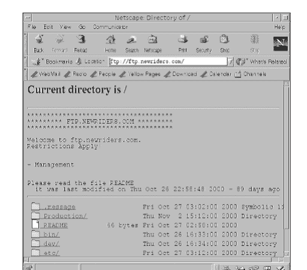

**图 4.1**

使用 Web 浏览器的 FTP。

### 使用 Telnet

Telnet 用于远程登录到主机。Telnet 客户端通过 TCP 端口 23 连接到目标主机上的 Telnet 服务器。Telnet 服务器同样使用 `inet` 守护进程启动。`/etc/inet/inetd.conf` 文件中的以下行用于启用或禁用 Telnet 服务器：

```text
telnet  stream  tcp6  nowait  root  /usr/sbin/in.telnetd  in.telnetd
```

Telnet 是一个用于登录远程主机的非常实用的工具。要验证 Telnet 服务器是否在您的主机上运行，以下命令应显示一个处于 LISTEN 状态的开放套接字：

```bash
bash-2.03# netstat -agrep telnet
             .telnet
     24576  0 LISTEN            0    0
             .*
bash-2.03#
```

### 使用 Telnet 客户端

图 4.2 显示了一个 Telnet 登录会话。此示例登录到 IP 地址为 `192.168.2.222` 的主机。如果您有映射到该 IP 地址的主机名，也可以使用该主机名通过 `telnet` 连接到服务器。Telnet 客户端尝试连接到 Telnet 服务器，当连接建立后，会出现一个提示符。在此提示符下，您必须输入有效的用户名以及随后的密码。如果用户名和密码有效，您将被允许登录到服务器。

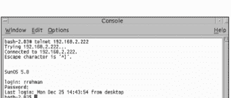

**图 4.2**

一个 Telnet 登录会话。

### 使用 Telnet 转义字符（`^]`）

在 `telnet` 会话期间，您可以通过按下 Ctrl+] 来使用转义序列 `^]`。该序列将带您进入 `telnet>` 提示符，在此您可以执行不同的命令。以下是在登录后立即使用此转义序列时应得到的响应：

```bash
bash-2.03$ telnet fana
Trying 192.168.2.222...
Connected to fana.
Escape character is `^]'.

SunOS 5.8

login: rrehman
Password:
Last login: Wed Jan 24 20:38:17 from 192.168.2.100
$
telnet>
```

现在，如果您在 `telnet>` 提示符下使用 `help` 命令，您将获得可用命令的列表，如下所示：

```text
telnet> help
Commands may be abbreviated.  Commands are:

close             close current connection
logout            forcibly logout remote user and close the connection
display            display operating parameters
mode               try to enter line or character mode (`mode ?` for more)

open              connect to a site
quit              exit telnet
send              transmit special characters (`send ?` for more)

set               set operating parameters (`set ?` for more)
unset             unset operating parameters (`unset ?` for more)

status            print status information
toggle            toggle operating parameters (`toggle ?` for more)
slc               change state of special characters (`slc ?` for more)

z                 suspend telnet
!                 invoke a subshell
environ           change environment variables (`environ ?` for more)
?                 print help information
<return>          leave command mode
telnet>
```

您可以使用 `close` 命令来关闭 Telnet 会话，如下所示：

```text
telnet> close
Connection closed.
bash-2.03$
```

## 使用 Telnet 验证远程服务器进程


您可以使用 Telnet 客户端连接到不同于标准 Telnet 端口 `23` 的端口。这是一个验证远程主机上服务器是否运行的非常便捷的功能。要将 Telnet 客户端连接到不同端口，请使用以下语法：

```
telnet hostname [port_number]
```

要连接到主机 `fana` 的 `25` 端口，请使用以下命令：

```
telnet fana 25
```

> **考试提示** 有时 Telnet 会话会出现异常，导致您无法在 Telnet 窗口中找回提示符。在这种情况下，`close` 命令非常有用。

接下来的章节将展示如何使用 Telnet 客户端验证邮件服务器和 SMTP 服务器是否在主机 `192.168.2.222` 上运行。

### SMTP（电子邮件）服务器测试

以下会话显示了 Telnet 客户端与 SMTP 服务器的会话。**粗体**显示的行表示用户输入。正如您从该会话中看到的，您可以使用 SMTP 命令与 SMTP 服务器对话。如果目标主机上没有运行 SMTP 服务器，您将无法连接：

```
bash-2.03# telnet 192.168.2.222 25
Trying 192.168.2.222...
Connected to 192.168.2.222.
Escape character is "^]."
220 fana ESMTP Sendmail 8.9.3+Sun/8.9.3; Mon, 25 Dec 2000 19:10:42 -0800 (PST)
helo fana.com
250 fana Helo fana [192.168.2.222], pleased to meet you
help
214-This is Sendmail version 8.9.3+Sun
214-Topics:
214: HELO EHLO MAIL RCPT DATA
214: RSET NOOP QUIT HELP VRFY
214: EXPN VERB ETRN DSN
214-For more info use "HELP <topic>".
214-To report bugs in the implementation contact Sun Microsystems Technical Support.
214-Technical Support.
214-For local information send email to Postmaster at your site.
214 End of HELP info
quit
221 fana closing connection
Connection closed by foreign host.
bash-2.03#
```

`quit` 命令将带回命令提示符。

### FTP 服务器测试

以下会话测试 FTP 服务器是否存在。FTP 服务器使用端口 `21` 监听传入请求，您使用相同的端口号连接到服务器。从以下输出中，您可以看到使用用户名 `rehman` 登录主机需要密码：

```
bash-2.03$ telnet fana 21
Trying :::1...
Connected to fana.
Escape character is `^J`.
220 fana FTP server (SunOS 5.8) ready.
USER rrehman
331 Password required for rrehman.
PASS abcd349
230 User rrehman logged in.
LIST
425 Can't build data connection: Connection refused.
HELP
214-The following commands are recognized:
 USER EPRT EPRT STU MATL* ALLO CW D STAT* XRMD
 PASS LPRT MODE MSDT* REST* XCWD HELP PWD
 ACKT* EPSV RETR MOST* MNSF* RNFR LIST XOOP XPWD
 RETR STOR MNSA* MSRT* RNTO NLST MKD CDUP
 QUIT PASV TYPE MLFL* MRCP* DELE SYST XMKD XCUP
 214 (`*s => unimplemented)
NOOP
200 NOOP command successful.
MKD test
257 MKD command successful.
quit
221 Goodbye.
Connection closed by foreign host.
bash: 2.03#
```

使用 `USER` 命令设置用户名，使用 `PASS` 命令输入该用户的密码。`MKD` 命令用于创建 `test` 目录。

### 使用 `finger` 命令

`finger` 命令用于列出远程主机上当前登录的用户，或查找关于特定用户的信息。`finger` 命令可以列出本地主机上的登录用户：

```
bash: 2.03# finger
 Login   Name             TTY      Idle    When    Where
 root    Super-User       console  4 Thu 20:13  :0
rrehman  ???              pts/2    Thu 20:02  199.30.29.27
bash: 2.03#
```

以下命令显示了本地主机上用户 `rrehman` 的一些信息：

```
bash: 2.03# finger rrehman
 Login name: rrehman
 Directory: /export/home/rrehman    Shell: /usr/bin/bash
 On since Jan  4 20:02:13 on pts/2 from 192.168.29.27
 No unread mail

Plan:
Complete the Solaris book as soon as possible.
Make it useful for the reader.
bash-2.03#
```

这些信息包括以下内容：

- 用户 `rrehman` 的主目录
- 用户使用的 Shell
- 如果用户当前已登录，则显示其登录时间和登录端口
- 未读邮件的数量
- 用户 `rrehman` 主目录中 `.project` 文件的第一行
- 用户 `rrehman` 主目录中 `.plan` 文件的内容

以下命令显示了主机 `fana` 上用户 `rrehman` 信息的简写形式：

```
bash-2.03# finger rrehman@fana
[fana]
Login Name TTY Idle When Where
 rrehman ??? pts/2 Thu 20:02 199.30.29.27
bash-2.03#
```

以下命令以详细格式列出主机 `fana` 上所有用户的信息：

```
bash-2.03# finger -l @fana
[fana]
Login name: root In real life: Super-User
Directory: / Shell: /usr/bin/bash
On since Jan 4 20:13:59 on console from :0
5 minutes 31 seconds Idle Time
No unread mail
No Plan.

Login name: rrehman
Directory: /export/home/rrehman Shell: /usr/bin/bash
On since Jan 4 20:02:13 on pts/2 from 199.30.29.27
No unread mail
Plan:
```

尽快完成 Solaris 书籍。

使其对读者有用。

bash: 2.03#

## 使用 `rwho` 命令

`rwho` 命令列出本地网络中所有主机上的用户。要使用此命令，必须运行 `in.rwhod` 守护进程。该命令的典型输出如下所示：

```
bash: 2.03# rwho
root	 fana:console Jan  4 20:13 :20
root	 fana:pts/5 Jan  4 20:22 :00
rrehman	 fana:pts/2 Jan  4 20:02
bash: 2.03#
```

> **注意** `finger` 命令可能会被用于攻击，因此建议将其禁用。

## 使用 `rup` 命令

`rup` 命令用于列出本地网络中主机的运行时间（uptime）、平均负载以及其他信息。该命令使用 UDP 广播方法向网络上的所有主机发送数据包并获取返回信息。以下命令显示了在我的本地网络上接收到的 `rup` 命令输出：

```
bash: 2.03# rup
 fana up 25 mins, load average:
 0.06, 0.06, 0.09
 fana-nt up 25 mins, load average:
 0.06, 0.06, 0.09
 fe80::000:20ff: up 25 mins, load average:
 0.05, 0.05, 0.09
bash: 2.03#
```

您可以在命令行中指定主机列表，以便仅查找这些主机的信息。您还可以使用命令行选项对该命令的输出进行排序。这些选项列在表 4.6 中。

**表 4.6：`RUP` 命令的命令行选项**

| 选项 | 描述 |
| :--- | :--- |
| `-h` | 按主机名排序显示。 |
| `-l` | 按平均负载排序显示。 |
| `-t` | 按运行时间排序显示。 |

## 使用 `ruptime` 命令

`ruptime` 命令显示 `rup` 命令不显示的额外信息。此命令需要 `in.rwhod` 守护进程，并且会额外显示登录到所有系统上的用户数量。该命令的典型输出如下所示：

```
bash-2.03# ruptime -r
fana up 0:44, 3 users, load 0.00, 0.00, 0.03
bash-2.03#
```

## 以 `r` 开头的命令

Solaris 系统上的某些命令以字母 `r` 开头，并具有相关的特殊功能。这些命令用于访问网络上的远程主机，通常不需要密码。这些命令对于与网络上多个主机交互的 shell 脚本非常方便。表 4.7 显示了其中一些命令及其用途。

**表 4.7：以 `r` 开头的命令**

| 命令 | 描述 |
| :--- | :--- |
| `rcp` | 远程文件复制。 |
| `rlogin` | 远程登录。 |
| `rsh` | 在远程主机上执行命令。 |
| `remsh` | 与 `rsh` 命令相同。 |

## 配置 `r` 命令

远程主机上的两个文件控制这些命令对主机的访问。系统范围的控制文件是 `/etc/hosts.equiv`。此外，每个用户可以在其主目录下拥有一个名为 `.rhosts`（点 `rhosts`）的文件，以便基于单个用户授予特殊权限。

如果满足以下任一条件，远程主机在执行 `r` 命令时将不需要密码：

- 用户当前登录的主机名和用户名列在远程主机的 `/etc/hosts.equiv` 文件中。
- 您的系统名称和用户名列在远程系统用户的 `.rhosts` 文件中。

## `/etc/hosts.equiv` 文件的格式

`/etc/hosts.equiv` 文件决定了特定主机上的哪些用户被允许访问 `r` 命令。文件中的每个条目可以以正号或负号开头。每行的通用格式如下：

```
hostname [username]
```

当主机收到 `r` 命令的连接请求时，它会搜索此文件以查找与客户端匹配的主机名条目。搜索主机名的过程将一直持续，直到找到匹配条目或到达文件末尾。如果找到带有正号的匹配条目，则用户被授予访问权限。如果找到带有负号的匹配条目或到达文件末尾，则用户被拒绝访问。

用户名是可选的。如果未指定用户名，则远程主机的所有用户都被授予访问权限。本节列出了一些此类文件中的示例条目。

此文件中的以下行将允许用户 `kaka` 从任何主机使用 `r` 命令：

```
+ kaka
```

以下行将允许主机 `fana` 的每个用户：

```
fana +
```

以下行将明确拒绝主机 `fana` 上的用户 `kaka` 的访问：

```
fana -kaka
```

以下行允许每台主机上的每个用户（相当危险！）访问 `r` 命令：

```
+
```

条目的顺序起着重要作用。当找到第一个匹配条目时，搜索过程即结束。如果文件中为同一用户存在多个条目，则仅使用第一个条目。例如，主机 `fana` 上用户 `kaka` 的第二行是没有意义的，因为他已被第一行拒绝访问：

```
fana -kaka
fana +
```

该文件中的条目采用以下搜索顺序：

- `+`
- `-hostname`
- `+hostname`

## `~/.rhosts` 文件的格式

`.rhosts` 文件的语法与 `/etc/hosts.equiv` 文件类似。此文件用于基于单个用户指定信任的用户和主机。如果用户在 `/etc/hosts.equiv` 文件中的身份验证失败，远程主机将检查声称被信任的用户主目录中的 `.rhosts` 文件。如果用户通过此文件通过验证，则允许该用户在无需密码的情况下使用 `r` 命令。即使某个用户在 `/etc/hosts.equiv` 文件中被明确声明为不被信任，单个用户仍可将该远程用户声明为信任用户。

`.rhosts` 文件与 `/etc/hosts.equiv` 文件的一个主要区别是，您可以授予想要使用您的用户名访问 `r` 命令的用户或远程主机的访问权限。例如，如果您的登录名在主机 `solaris7` 上是 `kaka`，并且您想授予远程主机 `fana` 上的远程用户 `majha` 使用您自己账户的权限，请在您的 `.rhosts` 文件中添加以下行：

```
fana majha
```

之后，用户 `majha` 在使用 `r` 命令时，可以在命令行中指定您的用户名和主机名。例如，当用户 `majha` 需要将 `/etc/hosts` 文件从主机 `solaris7` 复制到他的本地主目录时，他将在远程主机 `fana` 上使用以下 `rcp` 命令：

```
rcp kaka@solaris7:/etc/hosts ~/
```

> **注意**
> 使用 `r` 服务极其危险，如果配置不当，可能会产生严重的安全影响。如果可能，请不要使用这些服务，并推广使用其他安全的远程访问方法。例如，如果您在文件的第一行仅放置一个加号，那么全世界的所有人都被声明为信任用户，且文件中的其他条目将不再被参考。这是一个巨大的安全漏洞，必须由系统管理员处理。

## 使用 `rlogin` 命令

`rlogin` 命令与 `telnet` 命令类似，用于远程登录。唯一的区别是，如果配置正确，该命令允许您在不输入密码的情况下登录到远程主机。这一特性使得该命令在利用 shell 脚本在远程机器上自动执行任务时非常有用。以下是使用 `rlogin` 命令进行远程登录的典型会话：

```
bash-2.03$ rlogin fana
Last login: Sun Dec 31 19:37:12 from fana
bash-2.03$
```

如列表所示，您无需输入密码即可使用此命令登录到远程主机。如果 `r` 服务未正确配置，即使是此命令在登录远程主机时也必须输入密码。

## 使用 `rcp` 命令

`rcp` 命令用于在无需输入密码的情况下将文件复制到或从远程主机复制。这是另一种像 FTP 一样无需输入密码即可复制文件的方法。以下命令将 `/etc/profile` 文件从主机 `fana` 复制到本地主机的当前目录：

```
bash-2.03# rcp fana:/etc/profile ./
bash-2.03#
```

以下命令将 `test.txt` 文件从本地目录复制到主机 `fana` 的 `/export/home/rrehman` 目录：

```
bash-2.03# rcp home/test.txt fana:/export/home/rrehman
bash-2.03#
```

`rcp` 命令不像 FTP 那样要求输入密码，这使得它在 shell 脚本中非常有用。它还可以用于将完整的目录树从一台主机复制到另一台主机。以下命令将整个 `/var/lp` 树从主机 `fana` 复制到当前目录：

```
bash-2.03# rcp -r fana:/var/lp ./
bash-2.03#
```

如果在命令中使用 `-p` 选项，该命令还会尝试为每个文件复制相同的文件权限、所有权和修改时间。

要在远程主机上使用除当前用户名以外的另一个用户名，可以使用 `username@hostname` 格式。例如，以下命令在主机 `fana` 上使用用户名 `kaka` 将 `/etc/profile` 文件复制到本地主机的当前目录下：

```
bash-2.03# rcp kaka@fana:/etc/profile ./
bash-2.03#
```

请记住，您必须拥有在远程主机上使用另一个用户名的权限。

## 使用 `rsh` 命令

`rsh` 命令用于在远程主机上执行命令。命令在远程机器上执行，结果显示在本地终端上。以下命令列出了主机 `fana` 上 `/etc/inet/hosts` 目录中的文件：

```
bash-2.03$ rsh fana ls /etc/inet
datemsk.ndpd
hosts
inetd.conf
ipnodes
ipsecinit.sample
mipagent.conf-sample
mipagent.conf.fa-sample
mipagent.conf.ha-sample
netmasks
networks
ntp.client
ntp.server
protocols
services
slp.conf.example
sock2path
bash-2.03$
```

## 重要的互联网服务及端口号

表 4.8 列出了从认证角度来看可能非常有用的重要服务列表。

### 表 4.8：不同互联网服务使用的端口

| 服务 | 协议 | 端口 |
| :--- | :--- | :--- |
| FTP | TCP | `20`, `21` |
| Telnet | TCP | `23` |
| SMTP | TCP | `25` |


| 协议 | 传输协议 | 端口 |
|---|---|---:|
| NTP | TCP、UDP | 123 |
| DNS | TCP、UDP | 53 |
| TFTP | UDP | 69 |
| POP3 | TCP | 110 |

## 故障排除

故障排除是网络管理员最重要的工作。凭借良好的故障排除技能，您可以在问题演变成重大问题之前对其进行诊断并修复。因此，除了经验之外，您还应该知道如何使用以下章节中讨论的故障排除工具。

### 使用 `netstat` 和 `rpcinfo` 命令

本书已经讨论过 `netstat` 和 `rpcinfo` 命令。这里对其进行简要描述以强调其重要性。

`netstat` 命令显示主机上所有打开的端口和正在运行的服务器。它还显示已建立的连接。除了排除网络服务故障外，`netstat` 命令还有许多其他用途。`rpcinfo` 命令是排除本地和远程主机上基于 RPC 服务故障的基础命令。

### 使用 `ndd` 命令

该命令在之前的章节中也讨论过。除了 `ndd` 命令的其他用途外，它还可以向您显示基于每个端口的 TCP 和 UDP 协议统计信息。以下命令显示 UDP 端口统计信息。它显示打开的 UDP 端口、已建立的连接以及在建立连接时使用的远程端口号。以下是该命令显示 UDP 端口状态的示例：

```bash
bash-2.03# ndd /dev/udp udp_status
UDP
	state		lport src addr		dest addr		port
▪ rstate
300005516d0 0 : : : 0 UNBOUND
30000551310 11 : : : 0 IDLE
30000551390 0 : : : 0 UNBOUND
3000051800 32771 : : : 0 IDLE
300005070d0 11 : ffff::0.0.0.0 : 0 IDLE
3000050690 0 : : : 0 UNBOUND
3000050410 32775 : ffff::0.0.0.0 : 0 IDLE
3000053810 0 : : : 0 UNBOUND
300005e4918 0 : : : 0 UNBOUND
300005e4918 42 : ffff::0.0.0.0 : 0 IDLE
30000639608 512 : ffff::0.0.0.0 : 0 IDLE
30000639608 517 : ffff::0.0.0.0 : 0 IDLE
30000638c0 37 : : : 0 IDLE
30000637e0 7 : : : 0 IDLE
3000063500 9 : : : 0 IDLE
3000062b28 13 : : : 0 IDLE
3000062b828 19 : : : 0 IDLE
3000062d468 32776 : : : 0 IDLE
3000062d28 32777 : ffff::0.0.0.0 : 0 IDLE
3000062b0a8 32778 : : : 0 IDLE
3000062b0a8 32779 : ffff::0.0.0.0 : 0 IDLE
3000062a8a8 32780 : : : 0 IDLE
3000062a868 32781 : ffff::0.0.0.0 : 0 IDLE
3000062a1a8 32782 : : : 0 IDLE
3000061b70 32783 : ffff::0.0.0.0 : 0 IDLE
3000061b70 32784 : : : 0 IDLE
3000061b970 32785 : ffff::0.0.0.0 : 0 IDLE
3000061b6f0 32786 : : : 0 IDLE
3000061f470 32787 : ffff::0.0.0.0 : 0 IDLE
3000060b308 32788 : ffff::0.0.0.0 : 0 IDLE
30000602e38 32789 : ffff::0.0.0.0 : 0 IDLE
```

上述输出中的每一行显示了一个 UDP 端口号、源和目的主机地址以及端口的当前状态。

### 检查 TCP 状态

以下命令显示 TCP 协议统计信息。对于已连接的端口，它会列出本地和远程端口号：

```bash
bash-2.03# ndd /dev/tcp tcp_status
TCPB		dest		snxt	suna	swnd
▪ rnxt	rack
rwnd	rto	mss	w sw rw t recent	[lport, fport]
◦state
300002ac538 :: 00000000 00000000 00000000 00000000
◦0000000 000024576 03375
0122 0 00 14 0 00000000 [0, 0] TCP_IDLE
300002bc00 :: 00000000 00000000 00000000 00000000
◦0000000 000024576 03375
0122 0 00 14 0 00000000 [111, 0] TCP_LISTEN
3000055a9a20 :: 00000000 00000000 00000000 00000000
◦0000000 000024576 03375
0122 0 00 14 0 00000000 [0, 0] TCP_IDLE
30000550190 :: :ffff:0.0.0.0 00000000 00000000 00000000
24576 03375 00536 0 00 14 0 00000000 [111, 0] TCP_LISTEN
300005e5c588 :: :ffff:0.0.0.0 00000000 00000000 00000000
◦0000000 00000000 00000
24576 03375 00536 0 00 14 0 00000000 [0, 0] TCP_IDLE
300005e4a18 :: 00000000 00000000 00000000 00000000
◦0000000 000024576 03375
0122 0 00 14 0 00000000 [21, 0] TCP_LISTEN
3000054038 :: 00000000 00000000 00000000 00000000
◦0000000 000024576 03375
0122 0 00 14 0 00000000 [23, 0] TCP_LISTEN
30000546098 :: :ffff:0.0.0.0 00000000 00000000 00000000
24576 03375 00536 0 00 14 0 00000000 [514, 0] TCP_LISTEN
300005e4418 :: 00000000 00000000 00000000 00000000
◦0000000 000024576 03375
0122 0 00 14 0 00000000 [514, 0] TCP_LISTEN
3000054198 :: 00000000 00000000 00000000 00000000
◦0000000 000024576 03375
0122 0 00 14 0 00000000 [513, 0] TCP_LISTEN
30000639e60 :: :ffff:0.0.0.0 00000000 00000000 00000000
◦0000000 00000000 00000
24576 03375 00536 0 00 14 0 00000000 [512, 0] TCP_LISTEN
3000063b00 :: 00000000 00000000 00000000 00000000
◦0000000 000024576 03375
0122 0 00 14 0 00000000 [512, 0] TCP_LISTEN
3000063400 :: :ffff:0.0.0.0 00000000 00000000 00000000
◦0000000 00000000 00000
24576 03375 00536 0 00 14 0 00000000 [540, 0] TCP_LISTEN
30000639190 :: 00000000 00000000 00000000 00000000
◦0000000 000024576 03375
0122 0 00 14 0 00000000 [79, 0] TCP_LISTEN
30000638f60 :: 00000000 00000000 00000000 00000000
◦0000000 000024576 03375
```

在参加考试之前，您应该尽可能多地尝试这些命令。

## 案例研究：ISP 的互联网服务

### 案例要点

以下是该案例的要点：

- 对于少量用户，使用一台服务器提供多种服务是完全可以的。
- 不经常使用的服务可以通过 `inetd` 守护进程启动。

NextStep 互联网服务公司希望将其互联网服务迁移到一台 Solaris 机器上。这些服务是在一个小镇提供的，一台主机即可运行电子邮件、Web 和 FTP 服务器。公司需要决定哪些服务应该作为守护进程运行，哪些应该通过 `inetd` 启动。

## 分析

经常被客户端访问的服务器应作为守护进程运行。其优点是服务器进程驻留在内存中，在请求到达时立即提供服务。每个请求无需重复加载和卸载服务器进程，从而使响应速度更快。不经常使用的服务器可以使用 `inetd` 启动。每次请求进入时，服务器进程被加载到内存中，并在提供服务后终止。

通常，电子邮件和 Web 服务是最常用的。这两项服务都应以守护进程模式启动。FTP 服务器使用频率不高，可以使用 `inetd` 守护进程启动。

## 本章总结

### 关键术语

- 客户端（client）
- 服务器（server）
- 面向连接的服务（connection-oriented services）
- 无连接服务（connection-less services）
- 套接字（socket）
- 端口（port）
- `inetd` 守护进程（inetd daemon）
- 远程过程调用（RPC）

本章专门讨论了客户端-服务器概念以及 Solaris 上网络服务的配置与管理。本章首先介绍了用户应用程序客户端-服务器模型中使用的一些基本术语。然后您学习了端口和套接字。端口号用于区分运行在同一主机上的不同服务器。套接字是客户端连接到服务器的连接点。套接字也是 IP 地址和端口号的组合，可以像 IP 地址一样用点号表示法写出。端口在传输层级别使用，常见服务被分配了定义良好的端口号。知名端口号定义在 `/etc/services` 文件中。可以使用 `netstat` 命令显示已打开的端口号和已连接的套接字。

本章还涵盖了 Solaris 系统上网络服务的配置。服务可以作为守护进程启动，也可以根据需求通过 `inetd` 启动。如果服务配置为通过 `inetd` 启动，则在收到连接请求时调用服务器进程。为了在启动时启动服务，使用了启动和关闭脚本。这些脚本位于 `/etc/init.d` 目录中。

您还学习了基于 RPC 的服务。这些服务用于在远程主机上调用过程。RPC 服务在启动时在 `rpcbind` 守护进程中注册。`rpcinfo` 命令是排除基于 RPC 服务故障的主要命令。

介绍了基于客户端服务的实用程序，如 FTP 和 Telnet，包括将 Telnet 作为其他服务故障排除工具的示例。本节介绍的其他实用程序包括 `finger`、`who`、`rup` 和 `uptime`。

Solaris 网络管理的一个重要部分是使用 `r` 命令。这些命令对 shell 脚本编写非常有用，但其中涉及一些安全风险。您现在应该知道如何配置这些命令以及如何使用 `rlogin`、`rcp` 和 `rsh`。`rlogin` 命令用于远程登录，`rcp` 用于在主机之间传输文件，`rsh` 用于在远程主机上执行命令。最后，您应该了解常用网络服务所使用的端口号。

## 知识应用

### 练习

#### 4.1 列出 Solaris 主机上已启用的服务

本练习用于列出 Solaris 主机上已启用的服务。

**预计时间：** 10 分钟

1. 显示 `/etc/services` 文件的内容，并尝试找到你所熟知服务所使用的端口号。
2. 找出哪些服务使用 TCP 协议，哪些服务使用 UDP 协议。
3. 找出哪些服务同时使用 TCP 和 UDP。
4. 最后，使用 `netstat -a` 命令找出其中哪些服务当前正在运行。

#### 4.2 启用和禁用由 `inetd` 守护进程启动的服务

本练习的目的是演示如何启用和禁用由 `inetd` 守护进程启动的服务。

**预计时间：** 10 分钟

1. 显示 `/etc/inet/inetd.conf` 文件的内容，查看哪些服务正由 `inetd` 守护进程启动。
2. 通过注释掉用于 Telnet 的行来禁用 Telnet 服务。
3. 通过发送 HUP 信号重启 `inetd` 守护进程。
4. 使用 `netstat` 命令验证 Telnet 已禁用。
5. 尝试 Telnet 连接到服务器；你应该不会收到 `telnet` 命令的任何响应。
6. 通过取消 Telnet 行的注释并重启 `inetd` 守护进程来重新启用该服务。

### 复习题

1. 一台计算机可以作为多个服务的服务器吗？
2. 端口（port）和套接字（socket）之间有什么区别？
3. 列出 Solaris 中使用的三种常见的基于客户端-服务器的服务。

### 考试题

这些问题的答案在附录 E“示例考试题答案”中提供。

1. 关于服务的客户端-服务器模型，哪项是正确的？选择所有正确的陈述。
   - A. 基于 RPC 的服务同样运行在客户端-服务器模型中。
   - B. 一台计算机在同一时间可能充当客户端或服务器，但不能同时充当两者。
   - C. 多个服务可以同时运行在同一个主机上。
   - D. 基于客户端-服务器的实用程序仅使用 TCP 协议。

2. 端口号用于 OSI 模型的哪一层？
   - A. 网络层
   - B. 传输层
   - C. 应用层
   - D. 物理层

3. Telnet 使用哪个端口号？
   - A. 25
   - B. 23
   - C. 21
   - D. 110

4. 关于套接字（socket），哪项是正确的？勾选所有适用项。
   - A. 它与端口号相同。
   - B. 它与服务器上的 IP 地址相同。
   - C. 它与客户端上的 IP 地址相同。
   - D. 它是 IP 地址和端口号的组合。

5. 哪个文件列出了网络服务使用的端口号？
   - A. `/etc/inet/ports`
   - B. `/etc/inet/services`
   - C. `/etc/inet/networks`
   - D. `/etc/inet/sockets`

6. 在启动任何基于 RPC 的服务之前，应该启动哪个守护进程？
   - A. `inetd` 守护进程
   - B. `rpcbind` 守护进程
   - C. `rpcd` 守护进程
   - D. `nfsd` 守护进程

7. 在 `/etc/inet/inetd.conf` 文件中使用以下行启动的服务使用哪种类型的套接字？

   `login stream tcp6 nowait root /usr/sbin/in.rlogin in.rlogin`

   - A. TCP 套接字
   - B. UDP 套接字
   - C. 原始套接字（Raw socket）
   - D. 以上所有

8. Telnet 使用的转义序列是什么？
   - A. `^]`
   - B. `^[`
   - C. `^}`
   - D. `^[`

9. `who` 命令可用于执行以下哪项操作：
   - A. 检查本地主机上登录的用户
   - B. 检查远程主机上登录的用户
   - C. 检查本地网络上多个主机上登录的用户
   - D. 以上所有

10. `/etc/hosts.equiv` 文件中的单个加号（+）对于 `rlogin` 命令意味着什么？
    - A. 它允许本地主机上的所有用户。
    - B. 它允许所有主机上的所有用户。
    - C. 它不允许任何人使用 `rlogin` 命令。
    - D. 它没有任何作用。

## 复习题答案

1. 一台计算机可以充当多个服务的服务器。不同的服务监听不同端口号上的请求。
2. 端口是传输层中服务的寻址方案。套接字是 IP 地址和端口号的组合。它提供了客户端和服务器之间的连接机制。
3. Solaris 中使用的三种常见客户端-服务器服务如下：
   - FTP
   - Telnet
   - 电子邮件

## 推荐阅读

| 推荐阅读 |  |
|---|---|
| • *Computer Networks*. Andrew S. Tanenbaum | • *TCP/IP Illustrated, vol. 1*. Richard Stevens |
| • *Computer Networks and Internets*. Douglas E. Comer and Ralph E. Droms | • *Internetworking with TCP/IP Vol. 1: Principles, Protocols, and Architecture*. Douglas E. Comer |
| • *TCP/IP Unleashed*. Parker et al. |  |

## 目标

本章涵盖了 310-043 考试中由 Sun 指定的以下目标：

- 阐述动态主机配置协议（DHCP）的优点。识别 DHCP 配置文件。说明 DHCP 配置文件的用途。管理 DHCP 客户端和服务器。


*动态主机配置协议*（DHCP）用于在客户端-服务器模式下为主机分配网络参数。这是管理不断增长的网络的一种非常便捷的方式，你需要了解 DHCP 的优点。在 Solaris 系统上，DHCP 可以配置为客户端、服务器或中继代理。Solaris 提供了基于文本以及图形用户界面（GUI）的方法来配置 DHCP，你需要知道如何使用这些方法。DHCP 配置保存在配置文件中，这些文件在启动时由 DHCP 客户端和服务器使用。你需要了解这些文件及其内容。从考试的角度来看，你还需要知道如何管理 DHCP 并排除 DHCP 故障。

# 第 5 章

# 配置与管理动态主机配置协议

## 大纲

引言 XX

设置非默认服务器选项 XX

### DHCP 简介 XX

- DHCP 租约时间 XX

- DHCP 范围 XX

### 配置 DHCP 中继代理 XX

- 配置 DHCP 客户端 XX

- 手动配置 DHCP 客户端 XX

- 在启动时在接口上启用 DHCP XX

### 使用 DHCP 引导工作站 XX

- 发现 DHCP 服务器

- 租约提供 XX

- 提供选择 XX

- 租约确认 XX

- 客户端配置 XX

- DHCP 租约续期 XX

- 租约释放 XX

### DHCP 故障排除 XX

- 以调试模式运行 DHCP 客户端 XX

- 案例精要 XX

- 分析 XX

### 本章小结 XX

- 练习 XX

- 复习题 XX

- 考试题

- 复习题答案 XX

- 推荐阅读 XX

DHCP IP 地址分配类型 XX

规划 DHCP 部署 XX

### 使用 `dhcpmgr` 工具配置 DHCP XX

- 向 DHCP 添加额外的网络和地址 XX

### 使用 `dhcpconfig` 配置 DHCP XX

- `/etc/default/dhcp` 文件 XX

DHCP 服务器自动启动 XX

取消配置 DHCP 服务 XX

## 学习策略

DHCP 以客户端-服务器模式工作。在开始阅读本章之前，你需要了解客户端-服务器方法及其术语。对于本章，建议采取以下学习策略：

- 尝试理解 DHCP 术语。

- 理解 DHCP 客户端与 DHCP 服务器交互的方式非常重要。

- 确保你理解不同类型的 DHCP 消息。

- 尝试使用本章概述的方法配置 DHCP 服务器。

- 尝试配置 DHCP 客户端，并使用 `snoop` 命令确保它正在尝试定位 DHCP 服务器。

如需了解有关 DHCP 的更多信息，请参考本章末尾列出的额外参考资料。

## 引言

不久前，网络在性质上通常较小且是静态的，且易于基于单个主机进行管理。当时有充足的 IP 地址，这些 IP 地址被静态地分配给连接到网络的所有主机。在这种方案中，即使主机没有开机，也会为其保留一个 IP 地址。这种方案在网络规模扩大以及笔记本电脑和 PDA 等移动主机开始出现之前运行良好。由于每次连接到不同网络时重新配置笔记本电脑都非常困难，因此经常在网络之间移动的移动主机需要特殊关注。在极大型网络中，集中式配置管理的需求也成为了一个问题。

*动态主机配置协议*（DHCP）通过在引导时动态地为主机分配网络配置来解决这些问题。DHCP 服务器保存有关可分配给主机的 IP 地址的信息。它还保存其他配置数据，如默认网关地址、域名服务器（DNS）地址、NIS 服务器等。DHCP 客户端广播一条消息来定位 DHCP 服务器。如果存在一个或多个 DHCP 服务器，它们会向客户端提供 IP 地址和其他网络配置数据。如果客户端收到多个服务器的响应，它将接受其中一台服务器的提供。然后，服务器在一定时间内将一个 IP 地址*租用*给客户端，客户端则使用服务器提供的网络配置参数进行自我配置。如果客户端主机需要更长时间使用该 IP 地址，它可以续租租约时间。如果在租约时间结束前客户端主机宕机，它会向 DHCP 服务器发送一条消息以释放该 IP 地址，以便该地址可以分配给另一台主机。

DHCP 通常不用于需要静态 IP 地址的主机，尽管它具备向客户端分配静态 IP 地址的功能。这些主机包括不同类型的服务器和路由器。服务器需要静态 IP 地址，以便该服务器的客户端始终能连接到正确的主机。同样，路由器需要静态 IP 地址以拥有一个一致且可靠的路由表。除此之外，用户 PC、工作站和笔记本电脑可以被分配动态地址。

本章首先介绍 DHCP 以及如何规划 DHCP 部署。本章将通过 `dhcpconf19` 命令行实用程序以及 GUI 界面来讲解 DHCP 的配置过程，并详细阐述配置 DHCP 客户端、服务器和中继代理的方法。本章的最后一部分涵盖了一些故障排除技巧。

## DHCP 简介

动态主机配置协议（Dynamic Host Configuration Protocol）基于 RFC 951 中定义的*启动协议*（Bootstrap Protocol, BOOTP）。BOOTP 曾用于引导无盘工作站。然而，BOOTP 存在许多局限性，包括在 BOOTP 服务器上需要进行手动配置。与 BOOTP 相比，DHCP 还可以配置更多的网络参数，且更加灵活。RFC 4533、1534、1541、1542、2132 和 2132 定义了 DHCP 协议。在深入研究 DHCP 之前，回顾两个重要参数至关重要：DHCP 租约时间（lease time）和 DHCP 作用域（scope）。

### DHCP 租约时间

当客户端连接到 DHCP 服务器时，服务器会在一定时间内向客户端提供一个 IP 地址。这段时间被称为*租约时间*。如果客户端不续租，该 IP 地址将在指定时间后被撤销。如果进行了相应配置，客户端可以根据需要多次续租。在本章稍后部分，您将学习如何配置 DHCP 租约时间。

### DHCP 作用域

作用域是指 DHCP 服务器可以分配给客户端的来自某个网络的 IP 地址范围。一台服务器可以拥有多个作用域。但是，服务器必须至少拥有一个作用域才能向 DHCP 客户端分配 IP 地址。DHCP 作用域在配置 DHCP 服务器时定义。在本章稍后部分，您将学习如何配置 DHCP 作用域。

## 使用 DHCP 引导工作站

DHCP 使用 BOOTP 端口号 67（用于客户端）和 68（用于服务器）。使用 DHCP 引导主机的过程包含多个步骤。首先，DHCP 客户端通过在网络上发送广播数据包来定位 DHCP 服务器。所有 DHCP 服务器都会监听此请求并发送租约报价（lease offer）。客户端接受其中一个租约报价，并请求提供报价的服务器分配 IP 地址和其他网络参数。以下章节将更详细地描述这些步骤。

### 发现 DHCP 服务器

首先，DHCP 客户端发送 `DHCPDISCOVER` 类型的广播消息，以寻找网络上可用的 DHCP 服务器。该消息中的源地址为 `0.0.0.0`，因为此时 DHCP 客户端还不知道自己的 IP 地址。如果没有 DHCP 服务器响应此消息，则会重试发送。重试次数取决于客户端。

### 租约报价

当 DHCP 服务器监听到 `DHCPDISCOVER` 消息时，会使用 `DHCPOFFER` 消息发送响应。根据网络中 DHCP 服务器的数量，客户端可能会收到多个报价。`DHCPOFFER` 消息包含提供的 IP 地址和其他网络配置信息。本章稍后部分中 `snoop` 命令的输出将显示更多相关信息。

### 报价选择

随后，DHCP 客户端选择其中一台 DHCP 服务器并接受其报价。这是通过向提供报价的服务器发送 `DHCPREQUEST` 消息来实现的。被选中的 DHCP 服务器随后继续执行客户端的配置过程。

### 租约确认

被选中的 DHCP 服务器随后向 DHCP 客户端发送一个 DHCP 确认消息（`DHCPACK`）。如果客户端的响应太晚，导致服务器无法提供之前报价的 IP 地址，则会向客户端发送否定确认（`DHCPNAK`）。

### 客户端配置

当客户端收到带有配置参数的确认消息时，它会验证网络上的任何其他主机是否正在使用该提供的 IP 地址。如果该 IP 地址空闲，客户端便开始使用它。在本章稍后部分，您将看到一个 `snoop` 命令示例，该示例解释了在客户端验证没有其他主机使用所提供 IP 地址期间，客户端与服务器之间如何交换数据包。

### DHCP 租约续期

当租约时间过去 50% 时，DHCP 客户端会请求 DHCP 服务器续订 IP 租约时间。它通过向服务器发送 `DHCPREQUEST` 消息来完成。如果服务器以 `DHCPACK` 数据包响应，则租约续期，时间计数器重置。如果客户端未收到服务器的确认，将在租约时间过去 87.5% 时再次尝试续租。如果在租约时间结束时仍未收到此请求的响应，它将重新启动 DHCP 配置过程。

### 租约释放

如果客户端在租约时间到期前关闭，它会向 DHCP 服务器发送 `DHCPRELEASE` 消息，告知其即将下线且 IP 地址将释放。服务器随后可以立即重复使用该 IP 地址。如果客户端在关闭前未发送此消息，该 IP 地址可能仍被标记为使用中。

表 5.1 列出了客户端与服务器之间交换的常见 DHCP 消息类型列表。

| 消息 | 描述 |
| :--- | :--- |
| `DHCPDISCOVER` | 由 DHCP 客户端发送的广播消息，用于发现网络上存在的 DHCP 服务器。 |
| `DHCPOFFER` | DHCP 服务器响应 `DHCPDISCOVER` 消息而发送的消息。包含报价和配置参数。 |
| `DHCPREQUEST` | 当客户端接受 DHCP 服务器的报价时，发送此消息以表示接受。此消息也用于续租。 |
| `DHCPACK` | 响应 `DHCPREQUEST` 消息，DHCP 服务器发送此消息以确认租约已生效。 |
| `DHCPRELEASE` | 客户端发送给服务器的消息，用于放弃租赁的 IP 地址。 |

### DHCP IP 地址分配类型

基本上，DHCP 在为客户端分配 IP 地址时使用以下三种分配类型：

- **自动（Automatic）。** 自动租约用于给主机分配永久 IP 地址。自动 IP 地址不适用租约过期时间。

- **动态（Dynamic）。** 动态租约是最常用的类型。租赁的 IP 地址在租约时间结束后过期，如果 DHCP 客户端想继续使用该 IP 地址，则必须续租。

- **手动（Manual）。** 系统管理员使用手动分配为某些特定主机分配固定 IP 地址。

## 规划 DHCP 部署

通常网络上存在两种类型的主机：具有固定 IP 地址分配的主机和可以使用动态 IP 地址分配的主机。通常服务器和路由器采用固定分配，而用户 PC 和工作站可以动态分配 IP 地址。在规划网络 DHCP 时，请记住以下几点：

- 多少个 IP 地址可以使用 DHCP？计算此数值时，请考虑分配给服务器和路由器的 IP 地址数量。这些是不会在 DHCP 中使用的固定 IP 地址。从总可用 IP 地址中减去这个数值，以确定 DHCP 的可用 IP 地址数量。请记住，您将来可能需要比当前更多的固定 IP 地址。

- 应该安装多少台 DHCP 服务器？这取决于 DHCP 客户端的数量和租约时间。客户端数量越多，应使用的服务器越多。如果租约时间太短，可能会增加 DHCP 服务器的负载（因为在这种情况下，每个 DHCP 客户端必须非常频繁地续租）。DHCP 服务器的数量还取决于网络分段的数量。

- 有多少人使用可能会连接到不同网络的笔记本电脑或移动终端？在实际操作中，确定这个具体数字可能并不现实，但您应该做一个合理的推测。

- 用户是每天重启系统还是保持系统运行？这将帮助您选择合适的租约时间。

- 如果您有充足的 IP 地址，可能想要安装备份 DHCP 服务器。请记住，两台 DHCP 服务器不能拥有相同的作用域；因此，实际上不存在“真正”的 DHCP 服务器备份。每台 DHCP 服务器必须拥有不同的作用域。如果您在同一个网络上安装两台 DHCP 服务器但使用不同的 IP 地址作用域，那么当其中一台宕机时，另一台可以响应客户端。如果您在 `192.168.2.0` 网络上拥有少于 100 个 DHCP 客户端，

**注意** 最常用的租约类型是动态租约，因为这种类型的租约所需的配置最少。

例如，您可以设置两个 DHCP 服务器。其中一个 DHCP 服务器的 IP 地址范围为 `192.168.2.51` 到 `192.168.2.150`，另一个的 IP 地址范围为 `192.168.2.151` 到 `192.168.2.250`。

在计划部署 DHCP 时，请遵循以下步骤：

1. 收集网络拓扑信息，以确定需要多少个 DHCP 服务器或中继代理。在多个 IP 网络使用相同的网络物理介质的地方无法使用 DHCP。

2. 为 DHCP 选择最佳可用服务器。

3. 确定应使用哪种数据存储方法。数据存储方法告诉 DHCP 服务器如何保存 DHCP 数据库。Solaris 系统上有两种可用方法：`files` 方法和 `nisplus`（NIS+）方法。在 `files` 方法中，DHCP 数据库文件存储在 DHCP 服务器的本地目录中。在 NIS+ 方法中，DHCP 数据存储在 NIS+ 服务器的 NIS+ 数据库中。我建议使用 `files` 方法；事实上，NIS+ 很少被使用。

4. 为您的网络确定租赁策略。在决定租赁策略时，请记住前面提到的因素。同时决定您将使用动态租赁类型还是永久租赁类型。

5. 确定 DHCP 客户端需要的路由器。在提供租赁时，您必须将这些地址分配给客户端。

6. 确定由每个服务器管理的 IP 地址。

在完成这些步骤后，您应该对如何在网络中安装 DHCP 有一个相当清晰的了解。

## 使用 `dhcpmgr` 工具配置 DHCP

在 Solaris 8 中，Sun Microsystems 提供了一个*图形用户界面*（GUI）来帮助配置 DHCP 服务器。`/usr/sadm/admin/bin/dhcpmgr` 是一个用于配置 DHCP 服务器的图形化工具，被称为 DHCP 管理员（DHCP Manager）。您必须以 `root` 身份运行此程序。

启动该程序后，将显示图 5.1 所示的屏幕。如图所示，DHCP 服务可以配置为纯 DHCP 服务器或 DHCP/BOOTP 中继代理。当您将其配置为中继时，该服务代表另一个 DHCP 服务器运行。它接收来自客户端的请求，并将这些请求转发给配置的远程 DHCP 服务器之一。本章稍后将对此进行更深入的探讨。

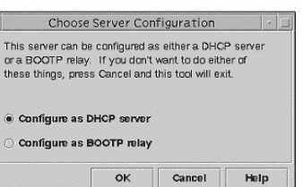

图 5.1 启动 DHCP 管理员以配置 DHCP 服务器。

要将服务配置为 DHCP 服务器，只需按下 OK 按钮。随后显示图 5.2 所示的屏幕。该截图向您展示了如何选择 NIS+ 域以及如何输入存储 DHCP 配置文件目录的路径。

该目录包含两个或更多重要文件：`dhcptab` 文件（包含 DHCP 服务器配置宏）；以及其他文件（记录每个网络中已分配和未分配的地址列表）。如果您使用由一个 DHCP 服务器管理的多个网络（多个范围），则每个网络将对应一个文件。这些文件的名称与网络地址相同，但点号被下划线字符取代。例如，记录 `192.168.2.0` 网络中 IP 地址的文件名为 `192_168_2_0`。默认目录路径是 `/var/dhcp`，但如果您愿意，可以选择不同的路径。选择目录后，按下屏幕底部的右箭头按钮进入下一个屏幕，如图 5.3 所示。

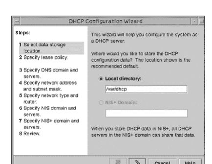

图 5.2 选择存储位置。

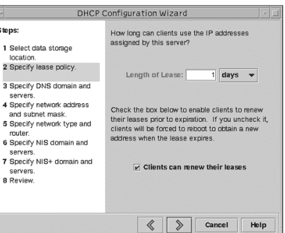

图 5.3 选择租赁策略。

图 5.3 展示了如何选择租赁策略。这里有两个重要的租赁策略参数。第一个是租赁期的长度。根据您的网络情况，可以选择特定的租赁期。通常一天（one day）的租赁期应该是足够的。然而，如果您的网络主机不经常重启，您可能希望增加租赁时间。另一个策略参数决定客户端是否可以续租。如果勾选此框，客户端即可续租。在大多数情况下，您应该勾选此框并允许客户端续租。选择完成后，进入下一个屏幕，如图 5.4 所示。

如图 5.4 所示，您必须为该域选择域名和域名服务器（DNS）的 IP 地址。您可以通过按下 Add 按钮在列表中添加多个域名服务器。您还可以使用上、下箭头按钮在列表中上移或下移域名服务器。这样做会改变客户端访问域名服务器的顺序。

您选择的域名和域名服务器地址将在提供租赁时传递给 DHCP 客户端。这有助于通过一个步骤为 DHCP 客户端配置特定的域名。另外请注意，使用 DHCP 时，更改域名服务器地址非常简单。您只需在 DHCP 服务器上进行更改即可。

选择 DNS 后，您必须为 DHCP 服务器选择主范围。按下右箭头按钮进入下一个屏幕（见图 5.5）。

在此屏幕上，示例显示选择了 `192.168.2.0` 网络，作为 DHCP 服务器可向 DHCP 客户端分配 IP 地址的网络。该网络的子网掩码已指定为 `255.255.255.0`。在初始配置过程中，只能添加一个网络地址。但是，您以后可以使用此配置工具中的网络向导（Network Wizard）添加更多网络。此处选择的网络地址通常是 DHCP 服务器本身所在的网络。

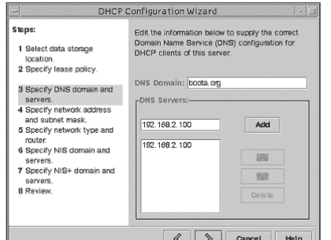

图 5.4 选择域名和 DNS 地址。

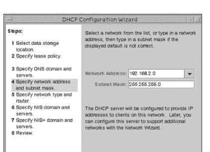

图 5.5 为 DHCP 客户端选择网络地址。

选择网络后，按下右箭头按钮进入下一个屏幕，在该屏幕中您将配置默认路由器或路由方法（如果不使用静态路由）。您还可以选择网络类型，如图 5.6 所示。

图 5.6 显示此示例使用 Local Area Network（局域网）作为网络类型，使用 RDISC 作为路由方法。如果您使用默认路由器，它应列在图 5.6 底部的方框中。

接下来，如果使用了 NIS，请选择 NIS 域和 NIS 服务器（见图 5.7）。如果您不使用 NIS，只需将此屏幕中的方框留空。在本示例中，不使用 NIS。

如果您在网络中使用 NIS+，则必须选择一个 NIS+ 域和一个或多个 NIS+ 服务器（见图 5.8）。如果不使用 NIS+，请将方框留空。


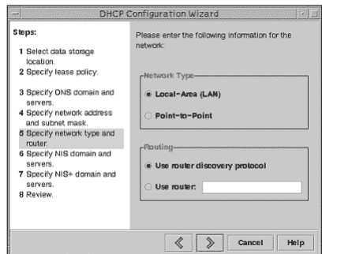

图 5.6 选择网络类型和路由方法。

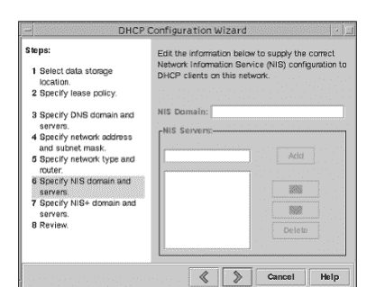

图 5.7 选择 NIS 域名。

此时 DHCP 服务器配置已完成。您现在应该能看到当前配置参数的摘要，如图 5.9 所示。

请注意，摘要显示选择了`/var/dhcp`作为存储 DHCP 配置文件的目录。默认租赁长度为一天，且客户端可以续租，域名为`boota.org`，域名服务器地址为`192.168.2.100`。网络地址为`192.168.2.0`，子网掩码为`255.255.255.0`。此示例连接到局域网 (LAN)，并使用路由器发现协议 (Router Discovery Protocol) 来确定可用路由器。在本示例中，DHCP 服务器未配置 NIS 或 NIS+。

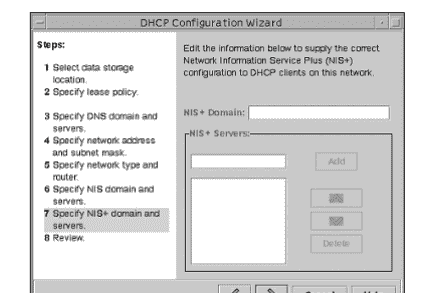

图 5.8 选择 NIS+ 域和服务器。

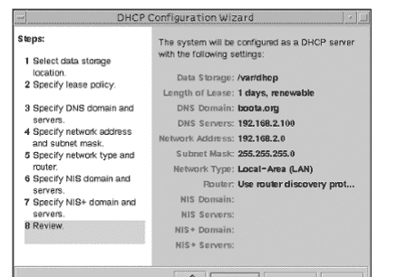

图 5.9 DHCP 配置摘要。

如果摘要信息正确，请按下 Finish 按钮。如果任何信息不正确，您可以返回并进行修正。按下 Finish 按钮后，您应该会看到图 5.10 所示的屏幕。此时，地址向导 (Address Wizard) 将自动运行，以向 DHCP 范围添加地址。

按下 Yes 按钮启动地址向导。启动后，将显示图 5.11 所示的屏幕。

图 5.11 展示了如何选择可供 DHCP 服务器租赁给客户端的 IP 地址数量。这些地址存在于您之前选择的网络中（在本示例中为`192.168.2.0`）。在这种情况下，选择了`100`，这意味着网络中 254 个地址中有 100 个可供 DHCP 服务器使用。

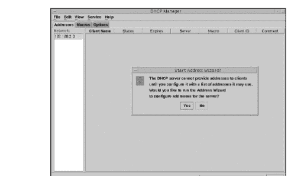

图 5.10 启动地址向导。

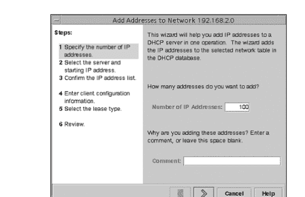

图 5.11 选择可供 DHCP 客户端租赁的 IP 地址数量。

点击右箭头按钮。屏幕将显示如图 5.12 所示的内容。

为地址范围选择起始 IP 地址，如图 5.12 所示。例如，已选择`192.168.2.101`作为起始 IP 地址。回想一下，DHCP 范围将包含 100 个 IP 地址。从`192.168.2.101`到`192.168.2.200`的 IP 地址将被自动添加到 DHCP 范围的 IP 地址列表中。您还需要为 DHCP 服务器选择服务器名称。

您还可以选择为这些 IP 地址生成名称。如果您勾选生成客户端名称的复选框并选择根名称`fana`，则客户端名称将被选定为`fana-101`、`fana-102`等。但是，您的 DNS 数据库中必须包含这些名称的条目，才能将这些名称解析为 IP 地址。通常，您不需要为 DHCP 服务器分配的 IP 地址设置名称，因此我建议不要勾选此框。

图 5.13 显示了可供 DHCP 客户端使用的 IP 地址列表。在显示此列表之前，服务器将花费一段时间来确认这些 IP 地址尚未被任何主机使用。这确保了在将 IP 地址分配给主机时不会发生任何地址冲突。确认列表后，进入图 5.14 所示的屏幕。

客户端配置宏已创建，如图 5.14 所示，您可以安全地进入图 5.15 所示的下一个屏幕。如果您想查看配置宏，可以点击 View 按钮，随后将出现一个新屏幕显示该宏的配置。

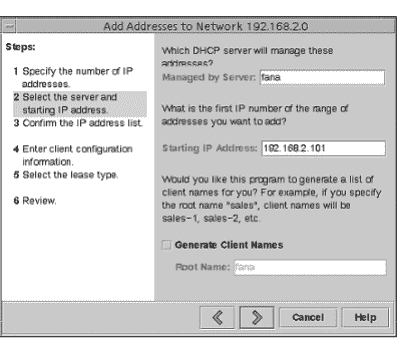

## 图 5.12

选择地址范围的起始 IP 地址和服务器名称。

## 图 5.13

可用 IP 地址列表的验证。

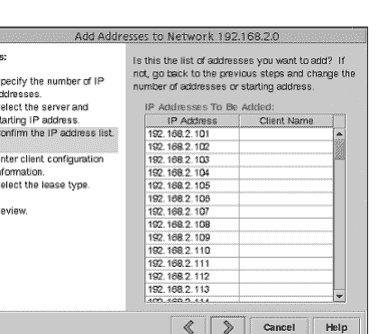

## 图 5.14

客户端配置宏。

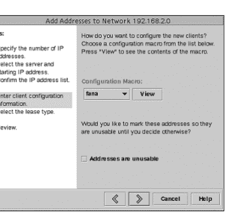

## 图 5.15

选择租约类型。

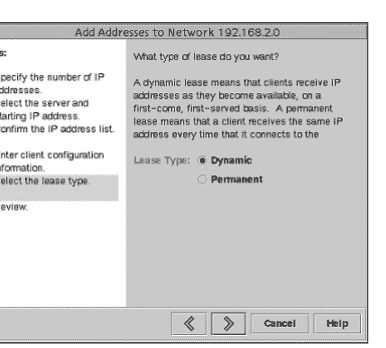

图 5.15 显示了如何选择租约类型。常见的租约类型是动态租约（dynamic lease），在这种模式下，客户端可以获得任何可用的 IP 地址并可以续约。因此，当您启动主机时，每次可能会获得不同的 IP 地址。完成此步骤后，您就可以检查您的配置了（见图 5.16）。

图 5.16 显示了您刚刚选择的客户端配置参数。如果配置正确，请按下 Finish 按钮以最终确定设置。服务器将把 IP 地址添加到其数据库中，并出现一个如图 5.17 所示的屏幕显示进度。服务器会确认这些 IP 地址当前可用且未分配给任何主机。

在图 5.17 所示的过程完成后，屏幕将消失，您将看到如图 5.18 所示的 DHCP 管理器（DHCP Manager）屏幕。这里显示了当前范围内的 IP 地址列表及其状态。以后当您进入此屏幕且部分 IP 地址已分配给 DHCP 客户端时，它们的租约时间和客户端 ID 也会在此屏幕中显示。

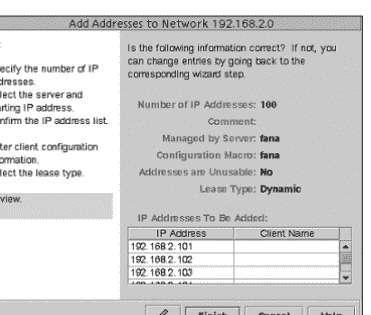

## 图 5.16

检查客户端配置信息。

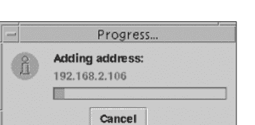

## 图 5.17

将 IP 地址添加到服务器数据库。

## 图 5.18

IP 地址的当前状态。

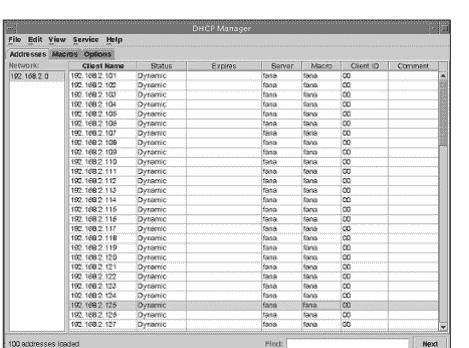

此时，您已配置好 DHCP 服务器，现在 DHCP 客户端可以连接到 DHCP 服务器了。如果您使用`ps`命令查看运行中的进程，应该能发现`in.dhcpd`进程正在运行，如下所示：

```bash
bash-2.03# ps -ef | grep dhcpd
root 606 1 0 17:03:56 ? 0:00 /usr/lib/inet/in.dhcpd
bash-2.03#
```

现在尝试使用 DHCP 客户端连接到 DHCP 服务器。您可以使用另一台 Solaris 机器或一台 Windows PC 作为 DHCP 客户端。您可以在其中一个终端窗口中启动`snoop`命令，以查看网络上流动的 DHCP 请求和响应数据包。当 DHCP 客户端开始寻找 DHCP 服务器时，您会发现`snoop`命令的输出如下：

```
OLD-BROADCAST -> BROADCAST DHCP/BOOTP DHCPDISCOVER
 fana -> (broadcast) ARP C Who is 192.168.2.101, 192.168.2.101 ?
 fana -> (broadcast) ARP C Who is 192.168.2.101, 192.168.2.101 ?
 fana -> (broadcast) ARP C Who is 192.168.2.101, 192.168.2.101 ?
 fana -> 192.168.2.101 DHCP/BOOTP DHCPOFFER
OLD-BROADCAST -> BROADCAST DHCP/BOOTP DHCPREQUEST
 fana -> 192.168.2.101 DHCP/BOOTP DHCPACK
OLD-BROADCAST -> (broadcast) ARP C Who is 192.168.2.101, 192.168.2.101 ?
192.168.2.101 -> 224.0.0.2 ICMP Router solicitation
192.168.2.101 -> 224.0.0.2 ICMP Router solicitation
192.168.2.101 -> 224.0.0.2 ICMP Router solicitation
192.168.2.101 -> 192.168.2.255 NBT NS Registration Request for RR_DESKTOP[3], Success
192.168.2.101 -> 192.168.2.255 NBT NS Registration Request for BOOTA[0], Success
192.168.2.101 -> 192.168.2.255 NBT NS Registration Request for RR_DESKTOP[0], Success
192.168.2.101 -> 192.168.2.255 NBT NS Registration Request for RR_DESKTOP[0], Success
192.168.2.101 -> 192.168.2.255 NBT NS Registration Request for BOOTA[0], Success
192.168.2.101 -> 192.168.2.255 NBT NS Registration Request for RR_DESKTOP[3], Success
192.168.2.101 -> 192.168.2.255 NBT NS Registration Request for RR_DESKTOP[0], Success
192.168.2.101 -> 192.168.2.255 NBT NS Registration Request for BOOTA[0], Success
192.168.2.101 -> 192.168.2.255 NBT NS Registration Request for RR_DESKTOP[3], Success
192.168.2.101 -> 192.168.2.255 NBT NS Registration Request for RR_DESKTOP[3], Success
192.168.2.101 -> 192.168.2.255 NBT NS Registration Request for BOOTA[0], Success
192.168.2.101 -> 192.168.2.255 NBT NS Registration Request for RR_DESKTOP[0], Success
```

从`snoop`命令的输出中可以看到，这些数据包中包含了一个 DHCP 客户端配置过程。首先，DHCP 客户端发送一个`DHCPDISCOVER`消息，以确定网络上是否有可用的 DHCP 服务器。显示此信息的行如下：

```
OLD-BROADCAST -> BROADCAST DHCP/BOOTP DHCPDISCOVER
```

然后，DHCP 服务器提供一个租约。显示此 Offer 的行如下：

```
fana -> 192.168.2.101 DHCP/BOOTP DHCPOFFER
```

这一行显示该 Offer 来自 DHCP 服务器`fana`，且提供的 IP 地址是`192.168.2.101`。这是刚刚配置的 DHCP 范围中的第一个 IP 地址。

客户端接受此租约 Offer 并发送以下数据包：

```
OLD-BROADCAST -> BROADCAST DHCP/BOOTP DHCPREQUEST
```

请注意，这个`DHCPREQUEST`数据包仍然是一个广播包。收到此包后，DHCP 服务器发送确认（acknowledgment）以将 IP 地址分配给主机，如下所示：

```
fana -> 192.168.2.101 DHCP/BOOTP DHCPACK
```

在收到此确认包后，客户端会验证网络上是否没有人已经在用该提供的 IP 地址。客户端通过使用 ARP 数据包来完成此操作，如下所示：

```
192.168.2.101 -> (broadcast) ARP C who is 192.168.2.101, 192.168.2.101 ?
```

在这种情况下，最后一步是发现路由器，因为在本示例中已为 DHCP 服务器配置了 RIDSC。客户端现在发送如下数据包来发现路由器：

```
192.168.2.101 -> 224.0.0.2 ICMP Router solicitation
```

要查找详细的数据包信息，请使用`snoop -v`命令。以下命令输出显示了关于 DHCP 租约续约请求的详细信息。数据包的`ETHER`部分显示了源和目的 MAC 地址。`IP`标头部分显示该数据包是由客户端`192.168.2.101`发送到 DHCP 服务器`192.168.2.222`的。它还显示该数据包使用的协议是 UDP 协议。`UDP`部分显示源端口为`68`，目的端口为`67`。正如本章前面讨论的，这些端口号分别被 BOOTP 服务器和客户端使用。数据包的`DHCP`部分包含客户端 IP 地址、客户端硬件地址（MAC 地址）、消息类型和请求选项等信息。

```
ETHER: ---- Ether Header ----
ETHER: 
ETHER: Packet 1 arrived at 18:04:54.49
ETHER: Packet size = 342 bytes
ETHER: Destination = 8:0:20:9e:f0:50, Sun
ETHER: Source = 0:e0:29:89:28:59,
ETHER: Ethertype = 0800 (IP)
IP: 
IP: ---- IP Header ----
IP: Version = 4
IP: Header length = 20 bytes
IP: Type of service = 0x00
IP: xxx. . . . . . . . . . . = 0 (precedence)
IP: . . . . . . . . . . . = normal delay
IP: . . . . . . . . . . . = normal throughput
IP: . . . . . . . . . . . = normal reliability
IP: Total length = 328 bytes
IP: Identification = 52528
IP: Flags = 0x00
IP: . . . . . . . . . . . = may fragment
IP: . . . . . . . . . . . = last fragment
IP: Fragment offset = 0 bytes
IP: Time to live = 128 seconds/hops
IP: Protocol = 17 (UDP)
IP: Header checksum = 5811
IP: Source address = 192.168.2.101, 192.168.2.101
IP: Destination address = 192.168.2.222, fana
IP: No options
IP: 
UDP: ---- UDP Header ----
UDP: 
UDP: Source port = 68
UDP: Destination port = 67 (BOOTPS)
UDP: Length = 308
UDP: Checksum = 6BC9
UDP: 
DHCP: ---- Dynamic Host Configuration Protocol ----
DHCP: 
DHCP: Hardware address type (htype) = 1 (Ethernet (10Mb))
DHCP: Hardware address length (hlen) = 6 octets
DHCP: Relay agent hops = 0
DHCP: Transaction ID = 0x810b83b3b
DHCP: Time since boot = 0 seconds
DHCP: Flags = 0x0000
DHCP: Client address (ciaddr) = 192.168.2.101
DHCP: Your client address (yiaddr) = 0.0.0.0
DHCP: Next server address (siaddr) = 0.0.0.0
```

## 第 5 章 配置与管理动态主机配置协议

```
DHCP:  Relay agent address (giaddr) = 0.0.0.0
DHCP:  Client hardware address (chaddr) = 00:E0:29:89:28:59
DHCP:  
DHCP:  ---- (Options) field options ----
DHCP:  
DHCP:  Message type = DHCPREQUEST
DHCP:   Client Identifier = 0x01 0x0 0x0 0xE0 0x29 0x89 0x28 0x59 (unprintable)
DHCP:  Client Hostname = rr_desktop
DHCP:  Requested Options:
DHCP:  1 (Subnet Mask)
DHCP:  3 (Router)
DHCP:  6 (DNS Servers)
DHCP:  15 (DNS Domain Name)
DHCP:  44 (NetBIOS RFC 1001/1002 Name Servers)
DHCP:  46 (NetBIOS Node Type)
DHCP:  47 (NetBIOS Scope)
DHCP:  57 (Maximum DHCP Message Size)
```

以下数据包显示了来自服务器的 DHCP 租约更新确认。从数据包的 DHCP 部分，你可以发现服务器响应了租约时间、域名、名称服务器地址和其他信息：


```
ETHER:  ---- Ether Header ----
ETHER:  
ETHER:  Packet 2 arrived at 18:04:54.59
ETHER:  Packet size = 353 bytes
ETHER:  Destination = 0:e0:29:89:28:59,
ETHER:  Source = 8:0:20:9e:f0:50, Sun
ETHER:  Ethertype = 0008 (IP)
IP:     
IP:     --- IP Header ---
IP:     Version = 4
IP:     Header length = 20 bytes
IP:     Type of service = 0x00
IP:     xxx... = 0 (precedence)
IP:     .0.0 = normal delay
IP:     .0.. = normal throughput
IP:     ..0. = normal reliability
IP:     Total length = 339 bytes
IP:     Identification = 11395
IP:     Flags = 0x4
IP:     .1..
IP:     ...0 = do not fragment
IP:     ..0. = last fragment
IP:     Fragment offset = 0 bytes
IP:     Time to live = 255 seconds/hops
IP:     Protocol = 17 (UDP)
IP:     Header checksum = c78c
IP:     Source address = 192.168.2.222, fana
IP:     Destination address = 192.168.2.101, 192.168.2.101
IP:     No options
IP:     
UDP:    UDP Header
UDP:   Source port = 67
UDP:   Destination port = 68 (BOOTPC)
UDP:   Length = 319
UDP:   Checksum = 5196
UDP:
DHCP:   Dynamic Host Configuration Protocol
DHCP:
DHCP:   Hardware address type (htype) = 1 (Ethernet (10Mb))
DHCP:   Hardware address length (hlen) = 6 octets
DHCP:   Relay agent hops = 0
DHCP:   Transaction ID = 0x810803b0
DHCP:   Time since boot = 0 seconds
DHCP:   Flags = 0x0000
DHCP:   Client address (ciaddr) = 0.0.0.0
DHCP:   Your client address (yiaddr) = 192.168.2.101
DHCP:   Next server address (siaddr) = 0.0.0.0
DHCP:   Relay agent address (giaddr) = 0.0.0.0
DHCP:   Client hardware address (chaddr) = 00:E0:29:89:28:59
DHCP:
DHCP:   (Options) field options
DHCP:
DHCP:   Message type = DHCPACK
DHCP:   DHCP Server Identifier = 192.168.2.222
DHCP:   Subnet Mask = 255.255.255.0
DHCP:   Perform Router Discovery Flag flag = 0x1
DHCP:   Broadcast Address = 192.168.2.255
DHCP:   UTC Time Offset = -28800 seconds
DHCP:   RFB688 Time Servers at = 192.168.2.222
DHCP:   IP Address Lease Time = 86400 seconds
DHCP:   DNS Domain Name = boota.org
DHCP:   DNS Servers at = 192.168.2.100
```

现在，如果你进入 DHCP 管理器 GUI 的 View 菜单并选择 Refresh，窗口将向你显示地址 `192.168.2.101` 已分配给图 5.19 中所示的主机。

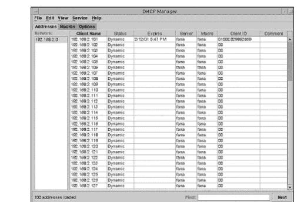

**图 5.19**

地址 `192.168.2.101` 已分配给客户端。

## 向 DHCP 添加额外的网络和地址

如前在配置过程中所述，在初始配置中，DHCP 范围仅添加了一个网络地址。要添加更多网络地址，可以使用 DHCP 管理器 GUI。添加更多网络地址是一个两步过程。第一步，你必须进入 Edit 菜单并选择 Network Wizard 来添加更多网络。然后，你必须进入 Edit 菜单并选择 Address Wizard 来从新添加的网络中添加 IP 地址。每个新添加的网络地址都显示在图 5.19 屏幕左侧的 Network 列下。

## 使用 dhcpconfig 配置 DHCP

Solaris 系统中提供的传统 DHCP 配置实用程序是 `dhcpconfig` 程序。使用 `dhcpconfig`，你可以配置 DHCP 服务器和 DHCP 中继代理。此外，你还可以“取消配置” DHCP 服务。`dhcpconfig` 中的大多数步骤与在 DHCP 管理器 GUI 中讨论的步骤相同。本节将讨论每个步骤。当你启动 `dhcpconfig` 时，它会列出如下四个选项：

```
bash-2.03# dhcpconfig
***		DHCP Configuration		***

Would you like to:

1) Configure DHCP Service
2) Configure BOOTP Relay Agent
3) Unconfigure DHCP or Relay Service
4) Exit

Choice:
```

选择选项 1 以开始 DHCP 服务器的配置。接下来的问题是询问如果 DHCP 服务已经在运行，你是否想要停止它。

> Would you like to stop the DHCP service? (recommended)

> ([Y]/N): y

在开始新配置之前停止服务是一个好主意，这样在配置过程中，任何连接到 DHCP 服务器的客户端都不会获得错误的信息。

在接下来的步骤中，你必须选择数据存储方案，如下所示：

```
### DHCP Service Configuration ###
### Configure DHCP Database Type and Location ###
```

> Enter datastore (files or nisplus) [nisplus]: files

如果你不使用 NIS+ (nisplus)，你必须在上述过程中选择 files。通过选择 files，你可以在本地主机上创建 DHCP 数据库文件。

> Enter absolute path to datastore directory [/var/dhcp]:

默认情况下，DHCP 服务器在 `/var/dhcp` 中创建数据库文件。不过，你可以选择另一个路径来存储这些文件。

接下来，你可以指定 DHCP 服务器守护进程使用的任何选项，如下所示：

```
### Common daemon option setup ###
```

> Would you like to specify nondefault daemon options

> ([Y]/N): n

```
### DHCP server option setup ###
```

如果你想将 DHCP 消息记录到 SYSLOG 设施中，请在这里选择 Y。在这种情况下，你必须修改 `/etc/syslog.conf` 文件以指定 DHCP 消息的日志文件名。

> Would you like to specify nondefault server options

> ([Y]/N): n

如果你对前一个问题选择 Y，你可以为 DHCP 服务器设置不同的选项。这些选项包括：

- DHCP 服务器应保留未决 DHCP 请求的时间量。

- DHCP 服务器扫描 `dhcptab` 文件的频率。默认情况下，服务器仅在启动时扫描此文件。如果你经常修改数据库，可以指定以分钟为单位的时间。

- 是否启用 BOOTP 兼容模式。如果你有一些旧的 BOOTP 客户端，启用 BOOTP 兼容性非常有用。如果你在这里选择 y，你还可以配置一些 BOOTP 选项。

在下一行中，你可以指定 DHCP 租约策略：

```
### Initialize dhcptab table ###

Enter default DHCP lease policy (in days) [3]: 1
```

这里，一天被指定为租约时间。

```
Do you want to allow clients to renegotiate their leases?
([Y]/N):y
```

如前所述，允许租约协商是一个好主意；因此，你应该在这里选择 y。

```
### Select Networks For BOOTP/DHCP Support ###

Enable DHCP/BOOTP support of networks you select? ([Y]/N):y
```

对前一个问题回答 y 即可在网络上启用 DHCP 支持。在这种情况下，它启用了对以下代码中选择的网络的支持。接下来的问题与 DHCP 管理器 GUI 中使用的问题类似。

```
### Configure Local Networks ###

Configure BOOTP/DHCP on local LAN network: 192.168.2.0
([Y]/N):y
Do you want hostnames generated and inserted in the files
hosts table? ([Y]/N):y
Enter starting IP address [192.168.2.0]: 192.168.2.101
Enter the number of clients you want to add (x < 255): 10
```

在接下来的问题中，不要禁用 ping 验证。Ping 有助于检测任何已在使用的 IP 地址。如果一个 IP 地址已经在被使用，它将不会被添加到 DHCP 数据库中。从以下输出中，你可以看到地址 `192.168.2.101` 正在被使用，因此没有被添加到 DHCP 数据库。在本例中，选择了添加 10 个 IP 地址，但实际只添加了 9 个，因为有 1 个已在使用中：

```
Disable (ping) verification of 192.168.2.0 address(es)?
([Y]/N):n

Warning: Address 192.168.2.101 in 192.168.2.0 in use...
skipping...
- 80% Complete.
```

```
Configured 9 entries for network: 192.168.2.0.

### Configure Remote Networks ###

Would you like to configure BOOTP/DHCP service on remote
networks?([Y]/N):n
Would you like to restart the DHCP service? (recommended)
([Y]/N):y
*** DHCP Configuration ***

Would you like to:

 1) Configure DHCP Service

 2) Configure BOOTP Relay Agent

 3) Unconfigure DHCP or Relay Service

 4) Exit

Choice: 4
bash:2.03#
```

在 DHCP 配置过程结束时，该实用程序会重启 DHCP 服务。请注意，如果您在回答问题时没有输入任何内容，许多选项将被选为默认值。每个问题的默认选项列在方括号中。

重要的 DHCP 管理实用程序列在表 5.2 中。请注意，管理员在大多数情况下并不直接使用 `dhcpadm` 和 `pntadm`。这些实用程序由 `dhcpconfig` 或 `dhcpmgr` 后台使用。

**表 5.2：常用 DHCP 配置实用程序**

| 名称 | 描述 |

| :--- | :--- |

| dhcpadm | DHCP 配置表管理实用程序 |

| dhcpconfig | DHCP 服务配置实用程序 |

| dhcpmgr | 基于 GUI 的 DHCP 管理器 |

| pntadm | DHCP 网络表管理实用程序 |

### /etc/default/dhcp 文件

此文件包含 DHCP 所使用的资源类型。

当使用本地文件存储 DHCP 数据库时，它包含存储这些文件的目录。典型的 `/etc/default/dhcp` 文件如下所示：

```
bash-2.03# cat /etc/default/dhcp
RUN_MODE=server
RESOURCE=files
PATH=/var/dhcp
bash-2.03#
```

表 5.3 列出了重要的 DHCP 配置文件。

**表 5.3：DHCP 配置文件**

| 文件 | 描述 |

| :--- | :--- |

| dhcp_network | 此文件与 `dhcptab` 文件位于同一目录下。文件的实际名称采用 NNN_NNN_NNN_NNN 标记法，其中 NNN 表示网络地址中的八位组值。 |

| dhcptab | 这是一个 DHCP 宏表文件。 |

| /etc/default/dhcp | 此文件包含上述两个文件的位置以及其他信息。 |

### DHCP 服务器的自动启动

当您使用 `dhcpmgr` 或 `dhcpconfig` 实用程序配置 DHCP 服务时，启动和关闭脚本将在适当的目录中创建。DHCP 的默认启动脚本位于 `/etc/init.d/dhcp`，如下所示：

```
bash-2.03# cat /etc/init.d/dhcp
#!/sbin/sh
# Copyright 1996-1999 by Sun Microsystems, Inc.
# All rights reserved.
#
#ident "@(#)dhcp 1.17 99/10/23 SMI"

# Make sure that /usr is mounted
[ ! -d /usr/bin ] && exit 1

case "$1" in
    'start')
        if [ -x /usr/lib/inet/in.dhcpd ] ; then
            /usr/lib/inet/in.dhcpd > /dev/console 2>&1
        fi
        ;;

    'stop')
        /usr/bin/pkill -x -u 0 in.dhcpd
        ;;

    *)
        echo "Usage: $0 { start | stop }"
        exit 1
        ;;
esac
exit 0
bash-2.03#
```

这是一个简单的脚本，它被复制为 `/etc/rc3.d/S34dhcp` 以启动 DHCP 服务，以及 `/etc/rc2.d/K34dhcp` 以关闭 DHCP 服务。理想情况下，如果您使用之前讨论的 DHCP 配置方法之一，则无需执行任何操作。不过，您也可以手动创建和修改该脚本。

### 取消配置 DHCP 服务

可以使用 `dhcpconfig` 实用程序取消配置 DHCP 服务。该实用程序还可以删除 DHCP 配置文件。以下命令会话取消了 DHCP 配置并删除了配置过程中创建的所有数据文件：


# dhcpconfig

```
Would you like to:

    1) Configure DHCP Service
    2) Configure BOOTP Relay Agent
    3) Unconfigure DHCP or Relay Service
    4) Exit

Choice: 3
Unconfigure will stop the DHCP service and remove `/etc/default/dhcp`.
Are you SURE you want to disable the DHCP service?
([Y]/N): y

### WARNING WARNING WARNING ###

Unconfigure can delete the following tables in the current resource (files):

    1) dhcptab.
    2) ALL dhcp-network tables.

If you are sharing the DHCP service tables either via NISplus or file
sharing among multiple DHCP servers, those servers will be unable to
service requests after these tables are removed.

Note that any hosts table entries which have been added will need to
be manually removed.

Are you SURE you want to remove the DHCP tables? (Y/[N]): y
Removing: dhcptab..
Removing: 192.168_2_0...
Would you like to:

    1) Configure DHCP Service
    2) Configure BOOTP Relay Agent
    3) Unconfigure DHCP or Relay Service
    4) Exit

Choice:
```

## 设置非默认服务器选项

如果您在`dhcpconfig`配置过程中选择配置非默认服务器选项，系统将向您提供额外的询问，如下所示。除了其他配置参数外，您还可以在此处选择启用 BOOTP 兼容模式：

```
### DHCP server option setup ###
Would you like to specify nondefault server options
->(Y/N):y
How long (in seconds) should the DHCP server keep
->outstanding OFFERs? [10]:
How often (in minutes) should the DHCP server rescan the
->dhcpdb? [forever]:10
Do you want to enable BOOTP compatibility mode? (Y/[N]):y
Do you want the server to allocate IP addresses to new
->BOOTP clients? ([Y]/N):
```

如果您选择 BOOTP 兼容，则 DHCP 服务器将同时为 DHCP 和 BOOTP 客户端提供服务。

## 配置 DHCP 中继代理

DHCP 中继代理代表本地网络上的 DHCP 服务器工作。它可以接收来自 DHCP 客户端的查询并将其转发给真实的 DHCP 服务器。图 5.20 显示了安装 DHCP 中继服务的一种可能方案。在这种情况下，DHCP 客户端和 DHCP 服务器位于不同的网络上。在一般情况下，广播`DHCPDISCOVER`消息通常无法传输到 DHCP 服务器，因为广播消息不会跨路由器转发。然而，DHCP 中继可以将此消息转发给 DHCP 服务器，并充当客户端和服务器之间的桥梁。

可以使用`dhcpconfig`实用程序通过选择选项 2 来配置 DHCP 中继，如下所示：

```
*** DHCP Configuration ***
Would you like to:

    1) Configure DHCP Service
    2) Configure BOOTP Relay Agent
    3) Unconfigure DHCP or Relay Service
    4) Exit

Choice: 2
Would you like to stop the DHCP service? (recommended)
=> ([Y]/N):
```

### BOOTP Relay Agent Configuration ###

### Common daemon option setup ###

```
Would you like to specify nondefault daemon options
=> ([Y]/N):
Enter destination BOOTP/DHCP servers. Type '.' when
=> finished.

IP address or Hostname: 192.168.3.100

IP address or Hostname : .
Would you like to restart the DHCP service? (recommended)
=> ([Y]/N): Y
```

在配置 DHCP 中继时，您可以添加多个 DHCP 服务器。当您完成 DHCP 服务器地址的输入后，输入一个点号来终止该过程。

**图 5.20：DHCP 中继的操作。**

## 配置 DHCP 客户端

您可以在服务器或工作站上安装的一个或多个网络接口上启用 DHCP。配置 DHCP 客户端非常简单。首先，您必须确定要在哪个接口上启用 DHCP。如果该接口已经配置了 IP 地址，则必须使用`ifconfig <interface> unplumb`命令取消配置。

### 手动配置 DHCP 客户端

使用`ifconfig`命令列出接口。如果某个接口未列出但您知道它存在，请使用`ifconfig plumb`命令将其启动。以下命令启动`hme1`：

```bash
bash-2.03# ifconfig hme1 plumb
bash-2.03#
```

使用以下命令列出此接口，以确定当前的配置情况：

```bash
bash-2.03# ifconfig hme1
hme1: flags=8000842<BROADCAST,RUNNING,MULTICAST,IPv4> mtu 1500 index 2
    inet 0.0.0.0 netmask 0
bash-2.03#
```

使用以下命令在接口上启用 DHCP：

```bash
ifconfig hme1 dhcp
```

您可以使用以下命令检查此接口上的 DHCP 状态：

```bash
ifconfig hme1 dhcp status
```

### 在引导时启用接口的 DHCP

要在引导时在接口上启用 DHCP，您必须创建两个文件。例如，如果您想在 newly 配置的接口`hme1`上启用 DHCP，您必须在`/etc`目录中创建以下两个文件：

```text
homename.hme1
dhcp.hme1
```

下次重启系统时，接口`hme1`将被配置为 DHCP。

## DHCP 故障排除

如果您使用文件而不是 nisplus 来存储 DHCP 数据库，那么需要排除的故障会比较少。可能会出现以下常见的 DHCP 服务器问题：

- IP 地址被重复利用。可能会出现 DHCP 范围内的某个或多个 IP 地址被静态分配给其他主机的情况。在这种情况下，会发生 IP 地址冲突。请结合使用`snoop`命令和`ping`命令来查找使用冲突 IP 地址的另一台主机的 MAC 地址。

- 多个 DHCP 服务器的范围内包含相同的 IP 地址。如果多个 DHCP 服务器的范围内包含重叠的 IP 地址，也可能发生 IP 冲突。您应该使用 DHCP 管理员或`deconfig`来纠正此问题。

- 客户端请求续租一个已被标记为不可用的 IP 地址。在这种情况下，如果进行了配置，SYSLOG 消息中会出现来自 DHCP 服务器的消息。您可以使用 DHCP 管理器来纠正此问题。如果为特定 IP 地址配置了客户端 ID 且该地址被标记为不可用，也可能会发生这种情况。

- 如果您看到类似`No more IP addresses`的消息，说明 DHCP 客户端的数量超过了可用 IP 地址的数量。

您可以使用`snoop`命令跟踪许多 DHCP 问题。该命令将显示在特定接口上流动的网络数据包。您还可以通过以调试模式（Debug mode）运行 DHCP 客户端和 DHCP 服务器来跟踪 DHCP 问题。

### 以调试模式运行 DHCP 客户端

排除常见 DHCP 客户端问题的最佳方法是以调试模式运行客户端和服务器。如果您在启动时收到如下消息，您可能需要以调试模式重启 DHCP 客户端和服务器，然后进行故障排除：

```
"DHCP or BOOTP server not responding"
```

要以调试模式运行 DHCP 客户端，请使用以下三个命令：

- 使用以下命令终止 DHCP 客户端进程：

  `pkill -x dhcpagent`

- 现在使用以下命令以调试模式重启它：

  `/sbin/dhcpagent -d1 -f -f &`

- 在接口上初始化 DHCP。如果接口是 hme1，请使用以下命令：

  `ifconfig hme1 ownplumb`

  `ifconfig hme1 plumb`

  `ifconfig hme1 dhcp`

如果 DHCP 客户端找不到 DHCP 服务器，会出现以下类型的消息：

```
/sbin/dhcpagent: debug: set_packet_filter: set filter 0x22d50 (DHCP filter)
/sbin/dhcpagent: debug: init_ifs: initiated interface hme1
/sbin/dhcpagent: debug: insert_ifs: hme0 mtu=1500, optmax 1260, hwtme 1, hwlen 6
/sbin/dhcpagent: debug: insert_ifs: inserted interface hme1
/sbin/dhcpagent: debug: set_packet_filter: set filter 0x22d50 (DHCP filter)
/sbin/dhcpagent: debug: init_ifs: initiated interface hme1
/sbin/dhcpagent: debug: select_best: no valid OFFER/BOOTP reply
/sbin/dhcpagent: debug: select_best: no valid OFFER/BOOTP reply
/sbin/dhcpagent: debug: select_best: no valid OFFER/BOOTP reply
/sbin/dhcpagent: debug: select_best: no valid OFFER/BOOTP reply
/sbin/dhcpagent: debug: select_best: no valid OFFER/BOOTP reply
/sbin/dhcpagent: debug: select_best: no valid OFFER/BOOTP reply
/sbin/dhcpagent: debug: select_best: no valid OFFER/BOOTP reply
/sbin/dhcpagent: debug: select_best: no valid OFFER/BOOTP reply
ifconfig: wait timeout... operation still pending...
/sbin/dhcpagent: debug: select_best: no valid OFFER/BOOTP reply
/sbin/dhcpagent: debug: select_best: no valid OFFER/BOOTP reply
/sbin/dhcpagent: debug: select_best: no valid OFFER/BOOTP reply
/sbin/dhcpagent: debug: select_best: no valid OFFER/BOOTP reply
/sbin/dhcpagent: debug: select_best: no valid OFFER/BOOTP reply
/sbin/dhcpagent: debug: select_best: no valid OFFER/BOOTP reply
/sbin/dhcpagent: debug: select_best: no valid OFFER/BOOTP reply
/sbin/dhcpagent: debug: select_best: no valid OFFER/BOOTP reply
/sbin/dhcpagent: debug: select_best: no valid OFFER/BOOTP reply
/sbin/dhcpagent: debug: command_left: 30 seconds left, attempting cancellation
/sbin/dhcpagent: debug: async_timeout: asynchronous command 4 still pending
/sbin/dhcpagent: debug: select_best: no valid OFFER/BOOTP reply
/sbin/dhcpagent: debug: select_best: no valid OFFER/BOOTP reply
/sbin/dhcpagent: debug: select_best: no valid OFFER/BOOTP reply
```

## 第 5 章 配置与管理动态主机配置协议

调试模式会显示所有接口上 DHCP 活动的信息。要查找特定接口上的 DHCP 状态，请使用以下命令：

```
ifconfig hme1 dhcp status
```

您也可以出于故障排除的目的，以调试模式启动 DHCP 服务器。为此，您必须停止服务器，然后使用以下两个命令重启它：

```
pkill -x in.dhcpd
/usr/lib/inet/in.dhcpd -d -v
```

DHCP 客户端和服务器都应该开始在控制台上显示关于 DHCP 进度和协商的消息。同时使用`snoop`命令来确定网络上传输的数据包类型。您应该在 DHCP 服务器上看到如下消息：

```
Daemon Version: 3.3
Maximum relay hops: 4
Run mode is: DHCP Server Mode.
Datastore: files
Path: /var/dhcp
DHCP offer TTL: 10
Ethers compatibility enabled.
ICMP validation timeout: 1000 milliseconds, Attempts: 2.
Monitor (0005/hme0) started...
Thread id: 0005 Monitoring interface: hme0 *****
MTU: 1500 Type: SOCKET
Broadcast: 192.168.255.255
Netmask: 255.255.255.0
Address: 192.168.2.222
Read 3 entries from DHCP macro database on Fri 16 Feb 21 19:02:00 2001
Datagram received on network device: hme0
Started ICMP thread to validate ip 192.168.2.101, PENDING
ICMP thread 7 exiting, ip 192.168.2.101 == plp-d_icmpflag: AVAILABLE...
Using ICMP validated address: 192.168.2.101
Unicasting datagram to 192.168.2.101 address.
Adding ARP entry: 192.168.2.101 == 00107AB6003CE
Offered ip: 192.168.2.101
Datagram received on network device: hme0
Found offer for: 192.168.2.101
Client 00107AB6003CE maps to IP: 192.168.2.101
Unicasting datagram to 192.168.2.101 address.
Adding ARP entry: 192.168.2.101 == 00107AB6003CE
```

DHCP 客户端侧也应该出现类似的消息。通过观察这些消息，您可以诊断客户端或服务器的 DHCP 问题。关于客户端或服务器上出现的所有消息的详细讨论，请参阅 Solaris Answerbook2。

## 案例研究：BOOTA INC. 的网络增长

### 案例精要

- 网络中有 500 个新节点。配置这些节点需要大量工作。

- 预计将添加新的 DNS 服务器。这将需要重新配置许多节点。

- 公司希望避免这些额外工作。


由于指数级增长和新员工的入职，Boota Inc. 刚刚向其网络添加了 500 个节点。公司有 4 个新的 C 类地址可分配给这些主机。然而，公司希望尽量减少维护每个主机网络设置的开销。此外，预计在不久的将来将安装多个域名服务器，这将需要重新配置大多数新机器的网络设置。公司决定使用 DHCP 作为克服这一问题的快速方法，通过一个中央 DHCP 服务器配置所有新主机。

## 分析

由于 DHCP 可以为主机提供网络配置，因此它是避免手动配置每个新主机的最佳方法。可以在 DHCP 服务器上维护一个 DHCP 数据库，每个节点将从这个中央位置获取其网络配置。DHCP 服务器还可以向其客户端提供 DNS 设置。因此，当 DNS 服务器发生更改时，公司只需更改 DHCP 数据库。DHCP 客户端将自动从 DHCP 服务器获取新的 DNS 信息。

## 本章小结

本章首先介绍了 DHCP 并简要描述了其工作原理。您学习了基本术语，如租约时间（lease time）和 DHCP 范围（DHCP scope）。您学习了使用 DHCP 启动工作站涉及的步骤：首先，DHCP 客户端发送一个 `DHCPDISCOVER` 广播消息。作为回应，DHCP 服务器发回一个 `DHCPOFFER` 消息。当客户端选择其中一个报价时，它会发送一个 `DHCPREQUEST` 消息来选择该报价。然后服务器以 `DHCPACK` 消息响应。DHCP 租约可以续约，在关机时，DHCP 客户端会放弃租用的 IP 地址。您还学习了 DHCP 分配类型。地址可以动态分配，也可以静态分配给某些客户端。

本章还向您展示了如何配置 DHCP 服务器。文中介绍了两种方法：DHCP 管理器（`dhcpmgr`）是一个可用于配置 DHCP 的 GUI 工具；另一种方法是 `dhcpconfig`，这是一个基于文本的工具。您还学习了如何使用 `snoop` 命令查看网络上的 DHCP 数据包。配置工具会自动配置 DHCP 服务器在启动时启动。

您还学习了如何取消配置 DHCP 服务器、中继代理和客户端。最后，为您提供了有关 DHCP 故障排除以及如何以调试模式启动服务器和客户端的技巧。

| 关键术语 |
| :--- |
| 动态主机配置协议 (DHCP) |
| DHCP 服务器 |
| DHCP 客户端 |
| DHCP 中继 |
| DHCP 范围 |
| DHCP 租约时间 |
| 调试模式 |

## 知识应用

### 练习

#### 1.1 使用 DHCP 管理器 GUI 配置 DHCP 服务器并使用 DHCP 客户端进行测试

在本练习中，使用 DHCP 管理器 GUI 配置 DHCP。

预计时间：30 分钟

1. 使用 DHCP 管理器 GUI 配置 DHCP 服务器。列出 `/var/dhcp` 目录中的文件。
2. 使用 `dhcpconfig` 取消配置 DHCP，并再次列出 `/var/dhcp` 目录中的文件。
3. 使用一台 Microsoft Windows PC 作为 DHCP 客户端，以确定 DHCP 服务器是否正常工作。
4. 停止 DHCP 服务器（如本章前面所述）。在 Debug 模式下重启它。
5. 查找并评估故障排除消息。
6. 使用 `snoop` 命令捕获 IP 数据包。
7. 配置 DHCP 客户端并使用 `ifconfig` 命令测试其配置。

### 复习题

1. DHCP 有哪些优点？
2. 如何规划 DHCP 安装？
3. 配置 DHCP 服务器的不同方法有哪些？
4. 什么是 DHCP 中继代理（relay agent）？

### 考试题

1. DHCP 服务器必须拥有最少多少个范围（scopes）才能为 DHCP 客户端分配 IP 地址？

   A. 0
   B. 1
   C. 2
   D. 10

2. 客户端在何时首次发送请求以续租？

   A. 在租约时间刚开始时
   B. 当租约时间过去一半时
   C. 当租约时间过去三分之二时
   D. 当租约时间过去四分之三时

3. DHCP 客户端在配置时的 DHCP 消息正确顺序是什么？

   A. DHCPREQUEST, DHCPACK, DHCPDISCOVER, DHCPOFFER
   B. DHCPDISCOVER, DHCPREQUEST, DHCPACK, DHCPOFFER
   C. DHCPDISCOVER, DHCPOFFER, DHCPREQUEST, DHCPACK
   D. DHCPDISCOVER, DHCPOFFER, DHCPACK, DHCPREQUEST

4. DHCP 客户端使用哪条消息从 DHCP 服务器中选择一个提供的选项（offer）？

   A. DHCPACK
   B. DHCPREQUEST
   C. DHCPSELECT
   D. DHCPNAK

## 知识应用

1. 哪种 DHCP 租约类型没有租约过期时间？

   A. 动态（Dynamic）
   B. 静态（Static）
   C. 自动（Automatic）
   D. 微不足道（Trivial）

2. 以下哪些可用于存储 DHCP 数据？请选择所有正确选项。

   A. 本地文件
   B. NIS
   C. NIS+
   D. Web 服务器

3. DHCP 服务器能向客户端提供 DNS 信息吗？（是或否）

4. 使用 DHCP 管理器进行 DHCP 服务器初始配置过程中，最多可以添加多少个网络地址？

   A. 1
   B. 2
   C. 10
   D. 任意数量的网络

5. 哪个文件包含关于 DHCP 数据存储位置的信息？

   A. `/etc/dhcp`
   B. `/etc/default/dhcp`
   C. `dhcptab`
   D. `/var/dhcp`

10. 以下哪个充当 DHCP 客户端守护进程？

   A. `in.dhcpd`
   B. `dhcpd`
   C. `dhcpclient`
   D. `dhcpagent`

## 复习题答案

1. DHCP 的一些优点如下：

   - 减少网络管理工作量。
   - 最大限度地利用可用 IP 地址。
   - 网络设置的更改易于传播到所有节点。
   - 笔记本电脑等移动主机易于在不同网络之间移动。

2. 在 DHCP 规划阶段，你需要获取有关网络的信息。这些信息包括但不限于以下内容：

   - 需要静态 IP 地址的主机数量
   - 网络中的分段数量
   - 租约策略
   - 使用一台还是多台 DHCP 服务器

3. 可以使用 DHCP 管理器 GUI 或 `dhcpconfig` 命令来配置 DHCP。

4. DHCP 中继代理代表 DHCP 服务器工作。它接收来自 DHCP 客户端的查询并将其转发给 DHCP 服务器。同样，它接收来自 DHCP 服务器的响应并将其发送给 DHCP 客户端。

### 建议阅读和资源

- Solaris Answerbook
- Ted Lemon 和 Ralph E. Droms 所著的 *The DHCP Handbook: Understanding, Deploying, and Managing Automated Configuration Services*
- 网站 `www.dhcp.org` 上的文档

## 目标

本章涵盖了 310-043 考试中 Sun 指定的以下目标：

- **识别使用简单网络管理协议 (SNMP) 的工具。描述简单网络管理协议 (SNMP)。**

简单网络管理协议用于监控和管理网络元件。本章提供了关于该协议及其在 Solaris 环境中使用的信息。

# 第 6 章：使用 SNMP 进行网络管理

## 提纲

- 简介 xx
- 简单网络管理协议 (SNMP) xx
  - SNMP 组件 xx
  - SNMP 版本及相关 RFC xx
- 管理信息结构 xx
  - 对象标识符 (OID) xx
  - ASN.1 语言 xx
- 管理信息库 xx
  - MIB 组 xx
  - 私有 MIB xx
  - 团体名 xx
- SNMP 消息 xx
  - 认证头 xx
  - 协议数据单元 (PDU) xx
    - SNMP GET xx
    - SNMP GETRESPONSE xx
    - SNMP GETNEXT xx
    - SNMP SET xx
    - SNMP GETBULK xx
    - SNMP TRAP xx
  - 端口号 xx
- Solaris 中的 SNMP xx
  - 代理配置文件 xx
    - 主代理资源配置文件 xx
    - 代理注册文件 xx
    - 代理访问控制文件 xx
- 本章总结 xx
- 知识应用 xx

## 学习策略

简单网络管理协议 (SNMP) 经过了长期的演变。你应该采取以下策略来学习此目标：

- 学习 SNMP 术语。
- 学习 SNMP 代理和管理站之间通信所使用的端口号。
- 阅读部分 RFC 以了解关于 SNMP 历史的详细信息。
- 在 Solaris 机器上练习 SNMP 代理的配置。

## 简介

*简单网络管理协议* (SNMP) 用于从本地或远程位置监控和管理网络上的主机。关于主机的信息由运行在该主机上的 *SNMP 代理* 收集。SNMP 管理站可以使用一种认证方法向运行在主机上的 SNMP 代理发送请求，以提供管理信息。SNMP 代理还可以通过一种称为 *陷阱* (traps) 的机制，异步地将重要信息传达给预配置的 SNMP 管理站。陷阱的目的地通常在每个运行 SNMP 代理的主机上进行配置。

SNMP 实际上是一套管理 SNMP 代理与 SNMP 管理站之间通信的规则和条例。除了向 SNMP 代理请求信息外，管理站还可以设置运行 SNMP 代理的主机上的某些参数。代理将信息保存在某些表格和标量对象中，这些对象统称为 *管理信息库* (MIB)。与文件类似，MIB 中的对象也具有读写权限。SNMP 代理保持 MIB 对象的更新，并在收到请求时将这些对象包含的信息转发给 SNMP 管理站。SNMP 管理站还可以更新具有写权限的 MIB 对象中的信息。

本章向你介绍 SNMP 及其组件。本章还将介绍 Solaris 中 SNMP 代理的实现信息。你应该通过学习掌握基本的 SNMP 术语以及 SNMP 的工作原理。

## 简单网络管理协议 (SNMP)

随着网络规模变得越来越大，网络管理已成为一项更为复杂的任务。在大型网络中，实际上不可能监控并盯住网络管理的每一个方面。自从互联网诞生以来，对一个可靠且简单的网络管理框架的需求一直存在。SNMP 在 1988 年被批准为标准，现在几乎所有供应商在其产品中都使用 SNMP。

简单网络管理协议是一组管理站、网络元件以及管理两者之间通信的规则的集合。网络元件运行一段名为 *SNMP 代理* 的软件。网络元件可以是简单的主机、服务器、路由器、网桥或任何连接到网络的设备。驻留在每个设备上的 SNMP 代理与一个或多个 SNMP 管理站通信以交换信息。SNMP 代理的作用是收集网络管理信息，并在收到请求时将其传递给管理站。它还可以通过一种称为 *陷阱* (traps) 的机制，异步地将关键信息传递给管理站，以报告重要事件。如果 SNMP 管理站需要设置受管理对象的值，它可以指示 SNMP 代理执行该操作。

SNMP 代理将管理信息保存在特殊的表格和标量对象中，称为 *管理信息库 (MIB)*。MIB 的定义有一种特殊的格式，本章后面将对此进行讨论。

### SNMP 组件

SNMP 协议的三个基本组件如下：

- 管理信息结构 (SMI)
- 管理信息库 (MIB)
- SNMP 消息

一个完整的 SNMP 框架是所有这些元素的集合。本章将详细讨论其中的每一项。

### SNMP 版本及相关 RFCs

目前主要使用三个版本的 SNMP：版本 1、2 和 3。本章的大部分讨论集中在 SNMP 的版本 1 和版本 2。有 50 多个与 SNMP、MIB 和 SMI 相关的 RFC。要查看所有 SNMP 相关 RFC 的列表，请访问 `www.ietf.org`。

## 管理信息结构

可以使用 SNMP 管理的实体被称为*对象*（objects）。*管理信息结构*（Structure of Management Information, SMI）提供了一个管理这些对象的框架。每个对象都具有以下属性：

- 名称
- 语法
- 编码

对象名称使用*对象标识符*（OIDs）以一种特殊的方式定义。本章稍后将对此进行讨论。语法是指用于存储该对象值的数据类型。例如，如果您在 MIB 的定义中发现以下内容，这意味着对象名称为 `sysServices`，其数据类型为 `integer`。如此处所述，其值可以在 0 到 127 之间变化：

```
sysServices OBJECT-TYPE
	SYNTAX INTEGER (0..127)
	ACCESS read-only
	STATUS mandatory
	DESCRIPTION
```

*编码*定义了该对象的信息在网络上传输的方式。

### 对象标识符 (OID)

每个对象标识符都使用由点号分隔的整数定义。这些 OID 排列在树形结构中。这种树形结构是一种表示不同对象的特殊有序方式。树中的每个节点都有一个名称以及与之相关联的数字。图 6.1 显示了一个典型的从*根*（root）节点开始的树形结构。

要指定网络接口的*最大传输单元*（MTU）值的 OID，您从根节点开始遍历树，直到到达 `ifMtu` 节点。您记录在此过程中遍历的节点所关联的数字，并用点号分隔这些数字，从而形成该对象的 OID。在本例中，`ifMtu` 对象的 OID 是 `1.3.6.1.2.1.2.2.1.4`。同样，所有其他对象的 OID 也可以这样列出。

**图 6.1**

用于表示 OID 的树形结构。

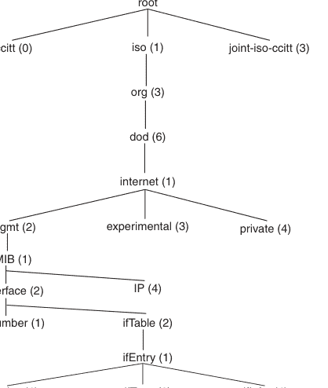

### ASN.1 语言

抽象语法标记一名（ASN.1）用于定义 MIB 内部的对象及其数据类型。它使用键值来定义对象。表 6.1 列出了一些此类键。

**表 6.1 ASN.1 键定义**

| 键 | 描述 |
| :--- | :--- |
| SYNTAX | 定义对象的数据类型。 |
| ACCESS | 对对象的访问级别。值可以是 read-only（只读）、read-write（读写）等。 |
| STATUS | 定义对象是已废弃、强制性的还是可选的。 |
| DESCRIPTION | 对象的简短描述。 |
| DEFVAL | 对象的默认值（如果使用）。 |

下一节将更详细地讨论这些键定义。

## 管理信息库

*管理信息库*（Management Information Base, MIB）是 SNMP 中使用的对象的层级组织。这种组织形式就像一棵树。单个对象是树的叶子。每个对象都有一个 OID，它是由点号分隔的一系列数字。如前所述，您可以通过从根节点遍历到表示该对象的节点，并记录沿途所有节点关联的数字来确定对象的 OID。

MIB 被实现为表和标量对象的数据结构，其中存储了这些对象的值，以便 SNMP 管理站检索。ASN.1 用于描述这些表的结构以及与不同对象相关联的数据类型。以下列表显示了用 ASN.1 表示的 MIB 的一部分。该列表显示了 MIB 中的以下三个对象：

- `ifDescr`
- `ifType`
- `ifMtu`

每个对象的 `SYNTAX` 部分显示了该对象使用的数据类型和范围。`ACCESS` 部分显示了该对象的读写权限。`DESCRIPTION` 部分显示了该对象的简短描述。您会在许多 RFC 中发现如下的 ASN.1 列表：


```
ifDescr OBJECT-TYPE
    SYNTAX DisplayString (SIZE (0..255))
    ACCESS read-only
    STATUS mandatory
    DESCRIPTION
        "A textual string containing
        information about the
        interface. This string should
        include the name of
        the manufacturer, the product name
        and the version
        of the hardware interface."
    ::= { ifEntry 2 }

ifType OBJECT-TYPE
    SYNTAX INTEGER (
        other(1),
        regular1822(2),
        hdh1822(3),
        ddn-x25(4),
        rfc877.x25(5),
        ethernet-csmacd(6),
        iso88023-csmacd(7),
        iso88024-tokenBus(8),
        iso88025-tokenRing(9),
        iso88026-man(10),
        starLan(11),
        proteon-10Mbit(12),
        proteon-8Mbit(13),
        hyperchannel(14),
        fddi(15),
        lapb(16),
        sdic(17),
        dsi(18),
        e1(19),
        basicISDN(20),
        primaryISDN(21),
        propPointToPointSerial(22),
        ppp(23),
        softwareLoopback(24),
        eon(25),
        ethernet-3Mbit(26),
        nsip(27),
        slip(28),
        ultra(29),
        ds3(30),
        sip(31),
        frame-relay(32)
    )
    ACCESS read-only
    STATUS mandatory
    DESCRIPTION
        "The type of interface, distinguished
        according to
        the physical/link protocol(s)
        immediately 'below'
        the Network layer in the protocol
        stack."
    ::= { ifEntry 3 }

ifMtu OBJECT-TYPE
    SYNTAX INTEGER
    ACCESS read-only
    STATUS mandatory
    DESCRIPTION
        "The size of the largest datagram
        which can be
        sent/received on the interface,
        specified in
        octets. for interfaces that are
        used for
        transmitting network datagrams, this
        is the size
        of the largest network datagram that
        can be sent
        on the interface."
    ::= { ifEntry 4 }
```

### MIB 组

对象树形结构的巧妙之处在于它生成了组。树的每一层都类似于一个组。类似类型的对象被归入一个组中。与单个对象一样，组也有 OID。为了简化过程，RFC 中定义了一些标准 MIB 组。例如，图 6.1 中显示了 Interface 和 IP 两个组。这两个组的 OID 分别为 `1.3.6.1.2.1.2` 和 `1.3.6.1.2.1.4`，并定义在 MIB-II (RFC 1213) 中。表 6.2 列出了一些其他组。

**表 6.2 MIB 组**

| 组名称和 OID | 描述 |
| :--- | :--- |
| System (1.3.6.1.2.1.1) | 与系统管理相关的对象（如运行时间） |
| Interface (1.3.6.1.2.1.2) | 与可管理接口相关的对象 |
| IP (1.3.6.1.2.1.4) | 与 IP 协议和协议统计相关的信息 |
| ICMP (1.3.6.1.2.1.5) | 与 ICMP 协议和协议统计相关的信息 |
| TCP (1.3.6.1.2.1.6) | 与 TCP 协议和协议统计相关的信息 |
| UDP (1.3.6.1.2.1.6) | 与 UDP 协议和协议统计相关的信息 |

### 私有 MIB

许多厂商拥有自己的私有 MIB，用于存储与厂商特定对象相关的管理信息。为此，每个厂商都被分配了一个特定的 OID。某个特定厂商的私有 MIB 都在此 OID 之下。分配给 Sun Microsystems 的 OID 是 `1.3.6.1.4.1.42`，这意味着 Sun 私有 MIB 中的所有对象都将具有 `1.3.6.1.4.1.42` 开头的 OID。图 6.1 显示了私有 MIB 部分（OID `1.3.6.1.4`）的分支。

> 注意：您也可以将 OID 写成单词。例如，私有 MIB 部分 (`1.3.6.1.4`) 的 OID 也可以写成 `iso.org.dod.internet.private`。

## 团体名

团体名（Community names）就像密码一样，用于在 SNMP 代理和管理站之间交换信息。通常使用两个团体名：GET 团体名和 SET 团体名。GET 团体名用于 GET、GETBULK 和 GETNEXT 类型的 SNMP 消息。SET 团体名用于 SET SNMP 消息。下一节将更详细地讨论 SNMP 消息。

**考试技巧**

由于团体名用于身份验证，因此它们应该像密码一样保密，且不应过于明显。默认情况下，`public` 被用作团体名，应该对其进行修改。

### SNMP 消息

SNMP 代理和 SNMP 管理站之间的网络管理信息以 SNMP 消息的形式交换。这些 SNMP 消息由两个主要部分组成：身份验证头（Authentication Header）和协议数据单元（PDU）。PDU 具有特定的格式，以便来自不同厂商的 SNMP 组件能够相互理解。

**注意**

团体名不是 MIB 的一部分，而是 SNMP 代理的一个可配置参数。这意味着团体名没有 OID。

#### 身份验证头

身份验证头由两部分组成：版本号和团体字符串。第一部分是 SNMP 消息的版本号。如果传入消息的版本号不能被 SNMP 代理或管理站理解或支持，则该消息将被忽略。第二部分是团体字符串，用作密码。每个 SNMP 代理和管理站都是一个具有特定名称的团体的一部分。

#### 协议数据单元 (PDU)

协议数据单元是 SNMP 消息中向代理或管理站传递信息的实际部分。PDU 有不同的类型。其中一些将在接下来的章节中讨论。

##### SNMP GET

SNMP GET PDU 由 SNMP 管理站发送给 SNMP 代理，用于检索某个对象的当前值。

##### SNMP GETRESPONSE

SNMP GETRESPONSE PDU 由 SNMP 代理（agent）用于向管理站发送响应。该响应包含管理站请求的对象值，如果该对象值不可用，则包含一条错误消息。

##### SNMP GETNEXT

SNMP GETNEXT PDU 由 SNMP 管理站用于获取 MIB 表中下一个对象的值。这通常用于遍历 MIB 表中的所有对象。管理站可以使用这种类型的消息来显示表中包含的所有对象值。

##### SNMP SET

SNMP SET PDU 由管理站发送给 SNMP 代理，用于设置特定对象的值。MIB 表必须对该对象具有写权限。通常，设置值时会使用不同的团体名（community name，即密码）。

##### SNMP GETBULK

SNMP GETBULK PDU 用于 SNMPv2 及更高版本。它用于从 SNMP 代理获取大量数据。

##### SNMP TRAP

有时 SNMP 代理需要发送关于主机关键事件的信息。这些事件使用一种特殊类型的消息——SNMP TRAP PDU 发送到管理站。Trap 目的地是一个能够接收 Trap 的管理站。在 Solaris 中，您可以使用 SNMP 代理配置文件配置一个或多个 Trap 目的地。

## 端口号

UDP 端口 161 用于 SNMP 消息，端口 162 用于 Trap。代理打开端口 161 以接收来自管理站的请求。管理站打开端口 162 以接收传入的 Trap 消息。

## SOLARIS 中的 SNMP

Solaris 中的 SNMP 代理采用“主代理（master agent）——子代理（subagent）”模型。SNMP 主代理在启动时启动。主代理 `snmpdx` 位于 `/usr/lib/snmp` 目录中。它由运行级别 3 中的 `/etc/rc3.d/S76snmpdx` 初始化脚本启动。它开始监听 UDP 端口 161 以接收 SNMP 请求。它读取不同的配置文件并调用各种子代理。它还打开另一个端口以监听子代理发送给主代理的 Trap。根据其配置，它将这些 Trap 转发到一个或多个 SNMP 管理站进行通知。主代理具有以下功能：

- 调用子代理
- 向子代理发送请求
- 接收子代理的响应
- 与 SNMP 管理站通信
- 接收子代理的 Trap
- 向 SNMP 管理站发送 Trap

主代理通过单独的端口与每个子代理通信，并确保每个子代理都在运行。它定期向子代理发送不同的请求，以确保子代理能够响应这些请求。

子代理不直接与任何 SNMP 管理站通信，而仅与主代理通信。每个子代理在被调用时向主代理注册。如果网络管理员使用启动脚本手动启动子代理，则应在主代理启动之后启动。否则，子代理无法在主代理中注册。

### 代理配置文件

Solaris 上的主代理具有各种配置文件，如下文本节所述。这些文件的默认位置是 `/etc/snmp/conf` 和 `/var/snmp` 目录。以下部分讨论了 Solaris 上用于 SNMP 代理配置的主要文件。

### 主代理资源配置文件

主代理资源配置文件仅由主代理使用。该文件包含所有由主代理管理的子代理的信息。此配置文件的默认名称为 `/etc/snmp/conf/snmpdx.rsrc`。当使用不同的文件作为资源文件时，可以使用 `snmpdx` 的命令行选项。有关更多信息，请参阅 `snmpdx` 的用户手册。

### 代理注册文件

每个代理都有自己的注册文件。除了关于子代理的其他信息外，该文件还包含以下信息：

- 子代理的名称
- 子代理管理的子树的 OID
- 首选端口号
- 请求超时
- 宏

### 代理访问控制文件

代理访问控制文件由主代理和子代理共同使用。它包含关于团体名和 Trap 的信息。此文件的默认路径名为 `/etc/snmp/conf/snmpdx.ac1`，可以通过命令行进行修改。

除了这些文件外，主代理还有一个状态文件，用于记录已生成的子代理和进程 ID 的信息。

| 案例研究：管理站 | |
| :--- | :--- |
| **案例核心** | - 网络运营中心安装了 SNMP 管理软件。<br>- Solaris 服务器分布在许多城市。 |
| **场景** | ABC 公司拥有一个分布在多个城市的网络。该网络用于执行关键任务的应用，并拥有若干台 Solaris 服务器。公司设有网络运营中心，用于监控这些服务器的健康状况。ABC 公司决定安装一套采用 SNMP 的管理解决方案。该 SNMP 管理解决方案向操作员显示网络的图形化视图，并根据受管主机上不同参数的变化生成不同的告警。ABC 公司需要了解将 Solaris 服务器纳入 SNMP 管理框架所需的步骤和工作量。Solaris 服务器需要向网络运营中心的管理系统发送关键事件的 Trap。<br><br>- 除了 SNMP 轮询外，服务器还需要向管理系统发送 Trap。<br>- 管理软件中还需要进行一些配置。 |

## 分析

为了让 Solaris 服务器能够与网络运营中心中的管理系统通信，这些服务器上必须运行 SNMP 代理。首先，您需要在每台 Solaris 服务器上配置 SNMP 客户端。您可以为所有服务器使用相同的团体名，或者为每台服务器使用不同的团体名。您还需要在管理软件中配置这些团体名。为了避免意外更改受管节点上的参数，建议使用不同的 GET 和 SET 团体名。

该解决方案还需要将关键事件转发到管理站。为此，您还需要在每台 Solaris 服务器上配置 Trap 目的地。在管理站上，您可以为接收到的每个 Trap 配置相应的操作。这些操作的示例包括：显示带有错误消息的弹出窗口、发送电子邮件、通知相关人员等。

如果 Solaris 服务器上存在私有 MIB，则需要将这些 MIB 加载到管理软件中。为了定期检查这些服务器的健康状况，您应该在管理站上为每台服务器配置轮询频率。关键服务器应进行更频繁的轮询。

## 本章小结

本章讨论了简单网络管理协议（SNMP）。该协议提供了一个框架，用于从中心位置监控和管理分布在不同主机上的网络对象。SNMP 以“代理—管理站”模式工作。所有受管主机上都驻留一个 SNMP 代理。管理站与这些代理通信以交换管理信息。

代理将信息保存在称为管理信息库（MIB）的表格化数据结构中。使用抽象语法标记一（ASN.1）符号定义 MIB 表和对象。每个对象由一个对象标识符（OID）表示。OID 是由点号分隔的一组数字序列。

Solaris 中的 SNMP 代理分为一个主代理和多个子代理。主代理与子代理及 SNMP 管理站通信。子代理不直接与任何管理站通信。子代理可以通过启动脚本或由主代理调用。另一方面，子代理只能在主代理运行之后被调用。

### 关键术语

- 简单网络管理协议 (SNMP)
- 抽象语法标记一 (ASN.1)
- 对象标识符 (OID)
- 管理站 (Management station)
- SNMP 代理 (SNMP agent)
- 主代理 (Master agent)
- Trap (陷阱/告警)

## 知识应用

### 练习题

#### 6.1 验证主代理是否正在运行

本练习演示如何验证主代理是否在您的机器上运行。

**预计时间：** 5 分钟

1. 使用 `ps` 命令验证主代理是否在您的机器上运行。通过该命令，您可以查出 `snmpdx` 进程是否在运行。命令应类似于：

```bash
bash-2.03# ps -ef | grep snmpdx | grep -v grep
root 402 1 0 17:54:39 ? 0:00 /usr/lib/snmp/snmpdx -p 50161 -y -c
# etc/snmp.conf
bash-2.03#
```

2. 如果代理没有运行，请尝试使用命令行启动主 SNMP 代理。

3. 如果需要帮助，请使用启动脚本 `/etc/init.d/init.snmpdx`。

1. 默认情况下，`snmpdx` 主 SNMP 代理在哪个运行级别启动？

    A. 运行级别 1
    B. 运行级别 2
    C. 运行级别 3
    D. 运行级别 5

2. `snmpdx` 使用的端口号是多少？

    A. 121
    B. 161
    C. 25
    D. 23

3. 目前正在使用哪个 SNMP 版本？请选择所有适用项。

    A. 版本 1
    B. 版本 2
    C. 版本 3
    D. 版本 7
    E. 版本 8

4. SNMP 中使用了哪些团体名（community names）？选择所有适用项。

    A. GET
    B. SET
    C. READ
    D. WRITE

5. 在 Solaris 中，何时应启动 SNMP 子代理？

    A. 在启动任何网络服务之前
    B. 在启动主 SNMP 代理之前
    C. 在启动主 SNMP 代理之后
    D. 没有特定顺序

### 复习题

1. 什么是 OID？

2. 什么是团体名（community name）？

### 考试题

考试题的答案见附录 E，“示例考试题答案”。

1. 默认情况下，`snmpdx` 主 SNMP 代理在哪个运行级别启动？

    A. 运行级别 1
    B. 运行级别 2

## 知识应用

## 复习题答案

1. OID（或对象标识符）是一个由点分隔的数字或名称，用于唯一定义 MIB 中的一个对象。OID 是通过从树根遍历 MIB 树到该对象，并记录遍历的所有节点编号而构建的。

2. 团体名是一个用于 SNMP 消息验证的字符串。只有当传入消息的团体名与本地配置的团体名匹配时，代理才会响应该消息。

### 建议阅读和资源

1. 书籍
    - SNMP, SNMPv2, SNMPv3 and RMON 1 and 2. William Stallings
    - Understanding SNMP MIBs. David Perkins and Evan McGinnis
    - Managing Internetworks with SNMP, Third Edition. Mark A. Miller

2. 网址


SNMP 工作组主页：`http://ietf.org/html.charters/snmpv3-charter.html`

网络管理论坛：`www.nmf.org`

# 第 7 章：配置与管理域名服务器

## 目标

本章涵盖了 310-043 考试中 Sun 指定的以下目标：

- 识别 DNS 的用途。描述地址解析和反向地址解析。
- 识别正确的资源记录语法。
- 解释配置 DNS 所需的步骤。
- 识别 DNS 的配置文件。阐述 DNS 配置文件的用途。

主机名解析是将主机名映射到 IP 地址的过程。该过程用于在仅给定主机名的情况下找到 IP 地址。为此目的使用了不同的技术，其中一种方案是域名系统（DNS）。这是一个利用分层主机命名方案的客户端-服务器系统。DNS 服务器在 UDP 端口 53 上监听客户端查询，并以解析后的主机名进行响应。它监听 TCP 端口 53，用于两个域名服务器之间进行的区域传输。

除了 DNS 之外，`/etc/inet/hosts` 和网络信息系统 (NIS) 也可以用于解析主机名。`/etc/inet/hosts` 文件（或简称为 hosts 文件）将在本章中介绍，但 NIS 超出了本书的范围。

在反向地址解析过程中，根据 IP 地址来确定主机名。出于安全目的，许多 Solaris 服务经常需要此过程。

DNS 服务器在启动时使用其配置和数据文件。DNS 数据文件中的信息以资源记录 (RR) 的形式存储。每种类型的 RR 用于特定类型的主机。本章将讨论这些内容。您需要了解这些 RR 的语法和类型。

## 概要

- 简介 xx
- 主机名解析简介 xx
- 反向主机名解析 xx
- 使用 `/etc/inet/hosts` 文件 xx
- DNS（域名系统）简介 xx
  - 域名数据如何分布 xx
  - 客户端如何解析主机名 xx
  - 域（Domains）和区域（Zones）的区别 xx
  - 全限定主机名 (FQHN) xx
  - 全限定域名 (FQDN) xx
- 域名服务器的类型 xx
  - 主域名服务器 xx
  - 从域名服务器 xx
  - 缓存域名服务器 xx
- 配置域名服务器 xx
  - 资源记录类型
    - 起始授权资源记录 (SOA) xx
    - 名称服务器资源记录 (NS) xx
    - 地址资源记录 (A) xx
    - 邮件交换资源记录 (MX) xx
    - 指针资源记录 (PTR) xx
    - 正典名称资源记录 (CNAME) xx
  - HINFO 资源记录 xx
  - TXT 资源记录 xx
  - WKS 资源记录 xx
- 委派子域 xx
- 配置主域名服务器 xx
  - 创建 `/etc/named.conf` 文件 xx
  - `named.ca` 文件 xx
  - `named.local` 文件 xx
  - `named.hosts` 文件 xx
  - `named.rev` 文件 xx
- 配置从域名服务器 xx
- 配置缓存域名服务器 xx
- 转换旧的 DNS 文件 xx
- 包含文件 xx
- 配置 DNS 客户端 xx
  - 配置 `/etc/resolv.conf` xx
  - 配置 `/etc/nsswitch.conf` xx
  - 使用 `nslookup` 程序进行测试 xx
    - 交互式 `nslookup` 会话 xx
    - 短主机名与全限定主机名 xx
    - 未解析的主机名 xx
    - 反向主机名解析 xx
    - 更改默认名称服务器 xx
    - 获取帮助 xx
    - 列出记录 xx
    - 测试 BIND 版本 xx
- 域名服务器安全 xx
  - 避免不必要的资源记录 xx
  - 限制客户端访问 xx
  - 限制区域传输访问 xx
- DNS 故障排除 xx
  - 使用 `nslookup` 测试 DNS xx
  - 使用 `netstat` 命令测试 xx
  - 使用 Telnet 测试 xx
- DNS 客户端配置问题 xx
  - `/etc/nsswitch.conf` 文件问题 xx
  - `/etc/resolv.conf` 文件问题 xx
- DNS 服务器配置问题 xx
  - 更新后的区域文件未传播到从服务器 xx
  - `rsh`、`rlogin` 及类似命令的问题 xx
- 案例研究 xx
- 本章小结 xx
- 知识应用 xx

## 学习策略

本章分为两个逻辑部分。第一部分介绍了名称解析过程背后的理论和不同类型的主机名解析，并提供了域名系统的简介。本章的第二部分侧重于 DNS 客户端和服务器的实际配置。要学习配置过程，您需要理解理论部分。为了最大程度地利用本章内容，请采用以下学习策略：

- 学习主机名解析的术语。
- 理解用于主机名解析的每种方法。因为 `/etc/inet/hosts` 文件是最简单的解析方法，请先尝试该方法。
- 学习 DNS 配置过程，并了解如何配置 DNS 服务器。
- 配置 DNS 客户端然后进行测试。

## 简介

从互联网诞生之初，人们就一直在使用不同的方法将主机名映射到 IP 地址。毕竟，对于每个人来说，主机名比 IP 地址更方便且更容易记忆（尤其是考虑到互联网上服务器的数量）。为了使用主机名而非 IP 地址，需要一种将 IP 地址映射到主机名的机制。起初，一个名为 `HOSTS.TXT` 的集中管理文本文件包含了这些映射。互联网上的所有主机定期复制此文件，并且每当互联网增加一台服务器时，该文件就会被修改。随着互联网的快速增长，为如此大量的主机频繁更新和复制该文件在实际操作中变得不可能。人们随后意识到，主机名解析的集中管理应该分布在几个自治域中，每个域由各自的管理员管理一组主机和/或网络。

如今，主机名解析使用了多种方法。这些包括基于文本文件的旧式主机名解析方法、网络信息系统 (NIS)、NIS+ 以及域名系统 (DNS)。`/etc/inet/hosts` 文件用于基于文本文件的主机名解析。本章包含关于此文件和 DNS 的信息。NIS 和 NIS+ 超出了本书的范围。

可以同时配置多个名称解析服务，以便如果一个服务失败，另一个可用作后备选项。名称服务切换配置文件 `/etc/nsswitch.conf` 即用于此目的。

本章首先介绍主机名解析过程，然后回顾主机名解析方法，并对域名系统进行简要介绍。之后，将介绍不同类型的 DNS 服务器及其配置方法。您还将学习关于资源记录的内容（这是一种在数据文件中表示 DNS 数据的方式），并学习如何配置 DNS 客户端。最后，本章涵盖 DNS 服务器和客户端的测试与故障排除。

阅读完本章后，你应该能够理解每种不同的主机名解析方法。你还应该知道如何配置不同类型的 DNS 服务器和 DNS 客户端。最后，你应该知道如何排除常见的 DNS 问题。

> 注意：DNS 既指域名系统（Domain Name System），也指域名服务器（Domain Name Server）。域名服务器是一个实现了域名系统的服务器进程，用于解析主机名。

## 主机名解析简介

主机名是分配给连接到网络的主机的易于记忆的名称。使用主机名是因为很难记住分布在整个互联网上的不同服务器的 IP 地址。此外，即使主机的 IP 地址不时发生变化，主机名也可以保持不变。根据定义，将主机名映射到 IP 地址的过程称为主机名解析。在某些情况下，当已知某台机器的 IP 地址而需要知道其主机名时，也会使用反向主机名解析。反向主机名解析在许多用途中都是必需的，包括 `rlogin` 和 `rcp` 等命令。

Solaris 8 提供了多种解析主机名的方法，列举如下。根据环境的不同，你可以选择特定的方法：

- `/etc/inet/hosts` 文件。为了与其他 UNIX 系统的兼容性，此文件链接到 `/etc/hosts` 文件。这是一个基于文本的文件，文件中的每一行包含一个 IP 地址、一个主机名以及一个或多个用于该主机的别名。
- NIS。网络信息系统（Network Information System）是一个具有许多其他用途的客户端-服务器系统。对此方法的讨论超出了本书的范围。
- NIS+。这是网络信息系统的增强版本。对其讨论同样超出了本书的范围。
- 域名系统或 DNS。这种方法是本章的重点。

使用这些方法中的任何一种取决于你工作环境的类型。如果你将主机连接到互联网，DNS 是必不可少的。对于小型私有网络，可以使用其他方法。你还可以结合使用这些方法，以便在一种方法失效时，可以使用另一种方法进行主机名解析。

> 注意：反向主机名解析也用于安全目的。例如，如果 Sendmail 无法解析传入邮件服务器的名称，则不会接受邮件。此功能可防止垃圾邮件。

反向主机名解析是指在指定主机名时查找 IP 地址。几乎所有主机名解析方法都同时用于正向和反向主机名解析。

许多系统出于安全和其他目的需要反向主机名解析。例如，当系统收到一个传入连接请求时，请求中包含客户端机器的 IP 地址。在你允许或拒绝此连接请求之前，你需要知道请求系统是否可信。如果你需要将该 IP 地址的主机名与信任主机列表进行比较，你就需要找到与该 IP 地址相对应的主机名。在这种情况下，反向主机名解析被证明非常有用。主机名解析的一个例子是使用以 `r` 开头的命令（例如 `rlogin`）。

如果你使用 `/etc/inet/hosts` 文件进行主机名解析，则反向主机名解析会自动启用。然而，如果你使用 DNS，则必须创建另一个文件以允许反向主机名解析。

### 使用 /etc/inet/hosts 文件

`/etc/inet/hosts` 文件是最基础且最古老的主机名解析方法。它在互联网上被使用了一段时间。现在它仅用于小型私有网络。`/etc/inet/hosts` 是一个简单的文本文件。该文件中的每一行代表一个主机名条目。以井号 (#) 开头的行是注释行。每行以 IP 地址开始，随后是主机名。行的最后一部分是可选的，用于表示主机名的别名。一个典型的文件如下所示：

```
#
# Internet host table
#
127.0.0.1   localhost
192.168.2.222    fana    loghost
192.168.2.11     laptop
192.168.2.1      desktop
192.168.29.28    fana-nt
192.168.30.30    kaka
```

在进行主机名解析期间，系统会从上到下扫描行，并采用第一个匹配的条目。因此，如果该文件中一个主机名有多个条目，每次仅使用第一个条目，随后的条目将被忽略。

使用此文件进行主机名解析非常简单，且适用于主机数量少于 10 台的小型网络。每当你修改此文件时，需要将其复制到网络上的所有主机。然而，如果你的网络连接到互联网，你应该使用 DNS 而不是 hosts 文件。这将使你能够解析互联网上的主机名，并允许互联网上的用户解析你网络中的主机名。

> 注意：大多数情况下，网络管理员将新条目添加到 `/etc/inet/hosts` 文件的末尾。如果文件中在之前某个位置已经存在该主机的条目，则新条目将永远不会被使用。因此，在向此文件添加条目之前，请确保文件中不存在该主机的先前条目。同样，如果你为同一个 IP 地址使用多个主机名，在反向主机名查找中可能会出现此问题。同一 IP 地址对应多个主机名通常用于同一台物理机上运行多个服务的情况。这种情况的一个例子是你在一台机器上运行 FTP 和 Web 服务器，但为这两个服务器使用不同的名称。在这种情况下，你不应该创建多个条目，而应该在文件中使用别名。

## DNS（域名系统）简介

域名系统是一个用于解析主机名的分布式客户端-服务器系统。它在 TCP/IP 网络中被实现为应用层协议。该系统提供了一个主机名到 IP 地址映射的分布式数据库。全球网络上的每个主机都被认为是一个域（domain）的一部分。因此，域被定义为一组共享其名称中共同最右侧部分的主机的组合。域是一个完全逻辑的主机结构，与主机的物理位置无关。这些主机可能分布在一个网络或多个网络中。通常，这些主机包含在一个由共同管理机构管理的域中。该管理机构可以是一个个人或一个群体。例如，一家公司可能会为其计算机拥有一个特定的域名，由该公司内部的某个特定部门管理。域和子域的管理通常是委派的——也就是说，它们不是集中管理的。

> 考试提示：有时网络管理员将此文件与 DNS 结合使用，以解析出于安全原因不需要在互联网或内网中可见的主机名。

域中的主机名是由点分隔的单词组合，类似于由点分隔的数字组成的 IP 地址。一个典型的主机名是 `boota.newriders.com`，其中 `boota` 是主机名，`newriders.com` 是域名。域名中可以包含多个单词，但完全限定域名 (FQDN) 的总长度不应超过 255 个字符。域名可以包含所有字母和数字，包括连字符（-）和下划线（_）符号。DNS 不区分大小写——也就是说，它不区分大写字母和小写字母。

域名的分配采用分层结构，类似于 UNIX 文件系统的层级结构。域名从右侧开始的第一个单词（或从左侧开始的最后一个单词）称为顶级域（top-level domain）。在之前的 `boota.newriders.com` 示例中，单词 `com` 是顶级域名。顶级域名就像 UNIX 文件系统中的根文件系统。所有其他域都位于顶级域之下。每个顶级域都有一定的含义，显示其下属组织的类型。例如，顶级域 `com` 下的所有域都用于商业组织。表 7.1 列出了顶级域。

### 表 7.1：顶级域

| 域名 | 描述 |
| :--- | :--- |
| com | 商业组织和商业公司 |
| org | 非商业组织 |
| net | 网络业务公司 |
| mil | 军事域 |
| gov | 政府组织和部门 |
| edu | 教育组织、学校和大学 |
| int | 国际组织（北约、欧洲委员会等） |

每个域的顶级名称服务器都存在于互联网上，负责处理该域及其下方层级的请求。由于现有域的数量过多，人们提出了新的顶级域名。表 7.2 列出了这些拟议的名称。

除了这些域之外，每个国家都有自己的顶级域。例如，美国的顶级域是 `.us`。这些域用于区域性和国家特定的组织和商业实体。表 7.3 列出了一些国家特定域。

## 表 7.2 建议的顶级域名

| 域名 | 描述 |
| :--- | :--- |
| arts | 与艺术和文化相关的组织 |
| com | 个人和家庭地址 |
| rec | 娱乐组织 |
| firm | 商业组织 |
| info | 信息相关服务 |

## 表 7.3 国家特定域名

| 域名 | 国家 |
| :--- | :--- |
| pk | 巴基斯坦 |
| us | 美国 |
| uk | 英国 |
| de | 德国 (Deutschland) |
| ca | 加拿大 |

不同国家在国家特定的顶级域名下拥有自己的分层方案。例如，英国的商业组织被分配到 `.co.uk` 域名下。

每个域名在层级结构中可能有多个子域名，就像文件系统中的目录可以有多个子目录一样。子域名反过来可能有更多层级的结构，就像子目录拥有子目录一样。图 7.1 显示了主机 `boota.newriders.com` 在树状结构中的位置。

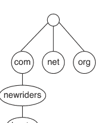

**图 7.1**

域名系统的层级结构。

## 域名数据是如何分布的

如前所述，互联网上的某些根域名服务器记录了顶级域名。这些名称服务器的主机名和 IP 地址是公开的，并列在表 7.4 中。该列表也可以从互联网上的许多地方获取。

## 表 7.4 根名称服务器

| 根名称服务器主机名 | IP 地址 |
| :--- | :--- |
| H.ROOT-SERVERS.NET | 128.63.2.53 |
| B.ROOT-SERVERS.NET | 128.9.0.107 |
| C.ROOT-SERVERS.NET | 192.33.4.12 |
| D.ROOT-SERVERS.NET | 128.8.10.90 |
| E.ROOT-SERVERS.NET | 192.203.238.10 |
| I.ROOT-SERVERS.NET | 192.36.148.17 |
| F.ROOT-SERVERS.NET | 192.5.5.241 |
| F.ROOT-SERVERS.NET | 39.13.229.241 |
| G.ROOT-SERVERS.NET | 192.112.36.4 |
| A.ROOT-SERVERS.NET | 198.41.0.4 |

通常，一个组织会被分配一个或多个属于某个顶级域名的域名。例如，New Riders Publishing 被分配了域名 `newriders.com`，它属于 `.com` 顶级域名。随后，该组织负责为该域名设置两个或更多个域名服务器，并维护其所有拥有域名下所有主机的数据库。这些组织名称服务器在互联网上注册为该域名的负责名称服务器。其中一个名称服务器被称为主域名服务器 (primary domain name server)，它保存该域名主机数据库的最新副本以及其他名称服务器的记录。还可以使用多个辅助名称服务器 (secondary name servers) 来备份主服务器。如果主域名服务器失效，可以使用辅助名称服务器进行主机名解析。

主名称服务器可以创建子域名，并将子域名的权限委派给其他名称服务器。对于主机数量众多且命名空间趋于饱和的大型组织来说，子域名非常有用。在这种情况下，子域名可用于域内的各个部门。

### 客户端如何解析主机名


使用域名系统进行的主机名解析是一个多步骤过程。每个 DNS 客户端都被配置为按特定顺序联系一个或多个 DNS 服务器。这些 DNS 服务器通常位于本地网络中的某个位置。当 DNS 客户端联系时，DNS 服务器会在自己的数据库中查看主机名是否位于本地域名内。如果主机名不在本地域名内，DNS 服务器会查看其缓存，以确定该主机名之前是否被解析过且其条目是否存在于缓存中。如果条目存在于缓存中，则将其解析并将响应发送回 DNS 客户端。然而，如果 DNS 服务器对该主机名一无所知，它会联系其中一个根名称服务器，以查找负责保存该主机所在域名信息的另一个 DNS 服务器的地址。

根名称服务器拥有关于可以解析主机名的 DNS 服务器的信息。从根名称服务器获取此信息后，本地域名服务器随后会联系该名称服务器来解析主机名。通过这种方式解析主机名后，本地域名服务器向 DNS 客户端提供答案。

## 域名 (Domains) 和 区域 (Zones) 的区别

一个域名可以由多个称为子域名的较小实体组成。例如，在 `newriders.com` 域名中，可能存在用于销售、市场、财务等不同的子域名。您可以将其中一些子域名的管理权限委派给其他 DNS 服务器。域名服务器的权限范围被称为`区域 (zone)`。一个区域可以由一个域名、一个子域名或多个子域名组成。图 7.2 显示了域名、子域名和区域之间的区别。

如您所见，`newriders.com` 是一个域名。该域名包含四个子域名，如下所示：

- `sales.newriders.com`
- `finance.newriders.com`
- `marketing.newriders.com`
- `acquisition.newriders.com`

**图 7.2** 区域与子域名的区别。


区域 1 由 `newriders.com` 下的主机和 `sales.newriders.com` 子域名组成。第二个区域 (区域 2) 由子域名 `finance.newriders.com` 和 `marketing.newriders.com` 组成。区域 3 仅由一个子域名 `acquisition.newriders.com` 组成。

## 完全限定主机名 (FQHNs)

通常我们使用由单个单词组成的主机名，代表短主机名。完全限定主机名是该短主机名与其所属域名的组合。例如，如果您在 `newriders.com` 域名中有一个主机名 `develop-01`，那么该主机的 FQHN 就是 `develop-01.newriders.com`。

## 完全限定域名 (FQDNs)

在域名层级中，每个域名都被称为完全限定域名，它通过从叶节点向根节点（从底向上）遍历域名层级树来表示。例如在图 7.1 中，`boota.newriders.com` 是一个 FQDN。FQDN 类似于 UNIX 目录树结构中目录的绝对路径。

> **注意** FQDN 类似于目录的绝对路径，而完全限定主机名 (FQHN) 则类似于该目录中文件的绝对路径。

## 域名服务器的类型

互联网上存在多种类型的域名服务器，根据它们扮演的角色进行分类。以下章节讨论了不同类型的域名服务器。

> **注意** FQHN 不被广泛使用。另一方面，FQDN 通常被同时用作完全限定主机名和完全限定域名。

### 主域名服务器

每个域名必须有一个主（或 Master）域名服务器。该服务器在互联网上注册，以便域名可见。主名称服务器是对一个域名或区域具有权威的服务器。DNS 管理员在主域名服务器上维护数据库文件。该域名服务器负责解析一个域名或区域中的所有主机。可能有一个或多个辅助域名服务器作为主名称服务器的备份。主域名服务器为主机名记录强制执行过期策略，之后辅助名称服务器会刷新其数据库。

如果域名在互联网上注册，主名称服务器的 IP 地址和主机名是互联网上所有人已知公开记录。利用这个公开记录，互联网上的客户端可以访问服务于特定域名的域名服务器。

### 辅助域名服务器

辅助（或 Slave）名称服务器用于备份主名称服务器。可能有一个或多个辅助名称服务器。在主名称服务器没有响应的情况下使用辅助名称服务器。辅助名称服务器定期从主名称服务器复制数据库文件。

一个或多个辅助名称服务器的地址也是公开的且在互联网上已知。

### 缓存域名服务器

缓存名称服务器没有数据库文件。它用于利用其他名称服务器来解析远程网络上的主机名。它记录之前解析过的主机名，其用途包括以下原因之一：

- 使用缓存加速主机名解析
- 减轻主域名服务器的主机名解析任务
- 减少大型网络上的网络流量

> **注意** 由于缓存名称服务器没有自己的数据库，因此对域名或区域不拥有任何权限的人员和组织也可以使用它。

## 配置域名服务器

> **考试提示**
> 在为主机和网络命名时请保持一致。

在开始配置域名服务器之前，您需要收集有关域的某些信息。这些信息包括您的域名以及在互联网上注册的主域名服务器和辅助域名服务器。如果您的网络是隔离的，则不需要在互联网上注册您的域名服务器。您还需要决定是否设置子域或区域（zone）。如果您安装了多个域名服务器，您可能需要决定哪个域名服务器是特定区域的权威服务器，以便委派管理职责。

域名和名称服务器可以在互联网上轻松注册。为此，请联系您的服务提供商。您也可以前往注册商处注册域名和名称服务器。注册商列表可在以下网站找到：`www.internic.net/regist.html`

`in.named` 守护进程在 Solaris 上充当域名服务器。它取自 *Berkeley Internet Name Domain (BIND)* 发行版并支持 BIND 版本 8。它在运行级别 2 通过网络初始化脚本 `/etc/init.d/netsvc` 启动。启动后，它会读取其主配置文件 `/etc/named.conf` 以获取有关其权威区域和区域数据文件的信息。除了其他信息外，区域数据文件还包含主机名到 IP 地址的映射。

域名服务器的配置过程包括以下步骤：

1. 注册域名。
2. 创建主机名及其 IP 地址列表。
3. 创建 `/etc/named.conf` 文件。
4. 创建区域数据文件。

这些文件将在本章稍后部分讨论。创建这些文件后，您可以从命令行启动 `in.named`，或者它将在下次启动时自动启动。

### 资源记录类型

区域数据文件中的信息以特殊格式存储。这些信息的片段被称为 *资源记录* (resource records, RRs)。每个资源都有与其关联的特定含义和关键字。标准 RR 列在以下章节中。

### 起始授权资源记录 (SOA)

起始授权 (Start of Authority) RR 标志着区域数据的开始。它还定义了区域的默认参数。这些默认参数包括序列号、刷新时间、生存时间 (TTL) 值等等。一个典型的 SOA RR 如下所示：

```
@  IN SOA fana.boota.org postmaster.fana.boota.org (
    20081041602   ; Serial
    10000         ; Refresh - 100 Minutes
    1800          ; Retry - 30 minute
    1209600       ; Expire - 2 Weeks
    43200)        ; Minimum TTL - 12 Hours
```

SOA RR 存在于所有区域文件的开头，并包含主 DNS 服务器的名称。在前面的示例中，主 DNS 服务器是 `fana.boota.org`。RR 中的下一个内容是技术联系人的名称，即 `postmaster.fana.boota.org`。请注意，用户名后面没有 @ 符号 (@)，而是有一个点字符。接下来的项是序列号，用于作为 RR 的版本。每当您修改 DNS 区域文件时，都应增加该数值。当前示例使用了一种常见的序列号表示方法，形式为 `YYYYMMDD##`。右侧的两个字符显示版本号，在前例中为 `02`。序列号中的其他数字用于表示修改日期。

> **注意** 这不是表示序列号的唯一方法。您可以定义自己的序列号编写方法以区分不同版本。

辅助名称服务器使用序列号来检测主 DNS 服务器上的更改。如果您不更新它，辅助名称服务器会 *认为* 主名称服务器上的数据文件没有被修改。这将延迟辅助名称服务器上数据文件的更新。

*刷新时间* (refresh time) 是辅助名称服务器尝试从主名称服务器刷新其数据库的时间间隔。它会查看 SOA 数据库中使用的序列号。如果自上次更新以来序列号发生了变化，则需要更新名称服务器数据库。

*重试时间* (retry time) 是如果之前尝试更新数据库失败，辅助名称服务器再次尝试联系主名称服务器的时间间隔。

*过期时间* (expiry time) 是如果辅助服务器上的域数据库未从主名称服务器更新而失效的时间间隔。

*最小 TTL* (Minimum TTL) 是如果没有明确指定，主机名在不更新的情况下保持有效的时间。

### 名称服务器资源记录 (NS)

名称服务器 (Name Server) RR 用于列出域名或区域的名称服务器。区域文件中 NS RR 的典型条目如下所示：

```
; Nameservers
;
boota.org.      IN NS fana.boota.org
                IN NS kaka.boota.org
```

### 地址资源记录 (A)

地址 (Address) RR 用于在 DNS 数据库中指定主机的 IP 地址。A RR 可与绝对主机名或相对主机名一起使用。绝对主机名是一个 FQDN。相对名称只是主机名的简写形式。域名由 DNS 自身附加在其后，如这里所示：

```
; use of absolute hostname
fana.boota.org.  IN A 192.168.2.100
; use of relative hostname
lota            IN A 192.168.2.210
```

请注意，在之前的示例中，`lota` 等同于 `lota.boota.org`。

### 邮件交换资源记录 (MX)

邮件交换 (Mail Exchanger) RR 用于负责为域名交换电子邮件的主机。MX 记录使用优先级值来指定某个服务器优先于另一个服务器。优先级值较低的服务器首先被用作邮件交换机。典型的邮件交换 RR 如下所示：

> **警告** 请注意，使用相对名称时，主机名末尾不应加点 (.)。在绝对名称的情况下，应在名称末尾加点。这是人们在配置 DNS 时最常犯的错误。

```
email  IN  A  192.168.2.20
email2 IN  A  192.168.2.21
       IN  MX 5  email
       IN  MX 10 email2
```

第一优先级属于主机 `email`，它被用作邮件交换机。如果该主机不可用，主机 `email2` 将充当备用邮件交换机。

### 指针资源记录 (PTR)

指针 (Pointer) RR 通常用于反向主机名解析。PTR RR 的示例将在本章稍后关于 `named.rev` 文件的讨论中呈现。

### 规范名称资源记录 (CNAME)

规范名称 (Canonical Name) RR 用于定义主机名的别名。这种情况发生在同一台机器上运行多个服务时。例如，如果您在同一台主机上运行 FTP 服务器和 Web 服务器（从安全角度来看这不是个好主意），您可以为同一台机器使用两个名称，如下所示：

```
www  IN  A     192.168.2.30
ftp  IN  CNAME www
```

当您将服务从一台主机迁移到另一台主机时，CNAME RR 非常有用。在这种情况下，您只需要更改 DNS 中的 CNAME 条目，客户端甚至不会察觉到更改。

### 主机信息资源记录 (HINFO)

主机信息 (Host Info) RR 用于提供主机信息。它列出了硬件信息和操作系统信息。您可以为每台主机包含 HINFO 记录。然而，从安全角度来看，在区域数据文件中包含 HINFO 记录是不理想的。典型的 HINFO 记录如下所示：

```
fana  IN  HINFO  ultra-5  UNIX
```

### 文本资源记录 (TXT)

TXT RR 提供文本信息。有关主机的任何文本信息都使用此记录提供。典型的 TXT RR 如下所示：

```
fana  IN  TXT  'this host is present in my home'
```

### 知名服务资源记录 (WKS)

WKS RR 提供有关主机上可用知名服务的信息。然而，从安全角度来看，这并不理想。典型的 WKS 记录如下所示：

```
fana IN WKS 192.168.2.222 TCP ( smtp netstat nntp )
```

表 7.5 显示了 RR 列表及其简短描述。

| 资源记录 | 描述 |
| :--- | :--- |
| SOA | 起始授权 RR |
| NS | 名称服务器 RR |
| A | 地址 RR |
| MX | 邮件交换 RR |
| PTR | 指针 RR |
| CNAME | 规范名称 RR |
| HINFO | 主机信息 RR |
| TXT | 文本 RR |
| WKS | 知名服务 RR |

### 委派子域

可以使用 NS 类型 RR 将子域委派给其他名称服务器。以下行将子域 `sales.boota.org` 委派给名称服务器 `ns3.boota.org`。

```
sales.boota.org. IN NS ns3.boota.org.
```

### 配置主 DNS 服务器

当您配置主名称服务器时，您需要创建一个启动配置文件 `/etc/named.conf` 和多个区域数据文件。Solaris 中的 DNS 守护进程是 `in.named`，使用 `/etc/init.d/netsvc` 启动脚本启动。

## 创建 /etc/named.conf 文件

`named.conf` 文件包含 Solaris 系统在启动时由 `in.named` 守护进程使用的重要信息。其中，这些信息包括以下内容：

- 存储 DNS 区域（zone）数据文件的目录名称
- 区域名称
- 区域数据文件名
- 服务器类型，是主服务器（primary）、辅助服务器（secondary）还是仅缓存服务器（caching-only）
- 日志选项
- 安全选项

该文件包含多个语句，每个语句以分号结束。语句可以采用块（block）的形式，且块也以分号字符结束。表 7.6 列出了可以包含在该文件中的一些语句。

| 语句 | 描述 |
|---|---|
| ACL | 用于控制对 DNS 的访问。 |
| Include | 在文件的此处包含另一个文件。当你使用多个文件存储 DNS 数据时，这非常有用。这意味着外部文件的内容将被包含在 `/etc/named.conf` 文件中 `include` 语句所在的位置。 |
| Key | 用于身份验证和授权的安全密钥。 |
| Logging | 用于记录服务器信息。 |
| Options | 用于控制选项和默认值。 |
| Server | 远程服务器的配置。也用于按服务器指定选项。 |
| Zone | 用于定义区域并选择性地按区域应用选项。 |

这里显示了一个 `/etc/named.conf` 文件的示例：

```
options {
	directory "/etc/named";
	pid-file "/etc/named.pid";
};

zone "boota.org" in {
	type master;
	file "named.hosts";
};

zone "2.168.192.in-addr.arpa" in {
	type master;
	file "named.rev";
};

zone "0.0.127.in-addr.arpa" in {
	type master;
	file "named.local";
};

zone "." in {
	type hint;
	file "named.ca";
};
```

逐行分析此文件。文件中的第一个语句是 `options` 语句。它用于设置区域数据文件所在的目录名称。`directory` 关键字用于设置此目录名称。它还告知 `in.named` 守护进程将 `in.named` 进程的进程 ID (PID) 存储在何处。这是通过 `pid-file` 关键字实现的。这意味着每当 `in.named` 启动时，它会将自己的 PID 存储在 `/etc/named.pid` 文件中。当你需要使用 shell 脚本重启 `in.named` 进程时，这非常有用。脚本中的以下行将重启 `in.named` 守护进程：

```
kill -HUP `cat /etc/named.pid`
```

现在来看 `/etc/named.conf` 文件中的下一个块，列出如下：

```
zone "boota.org" in {
	type master;
	file "named.hosts";
};
```

区域名称定义为 `boota.org`。示例还声明了这是该区域的主名称服务器（master name server）。存储主机名到 IP 映射的文件名为 `named.hosts`。请注意，该文件名是相对于之前提到的目录名称的。这意味着该文件的完整路径名称为 `/etc/named/named.hosts`。

```
zone "." in {
    type hint;
    file "named.ca";
};
```

这是一个特殊的区域，用于指定包含根名称服务器地址的文件名。请注意，此块中的 `type` 字段是 `hint`，既不是 `master` 也不是 `slave`。`named.ca` 文件包含根名称服务器的列表。如果你的网络未连接到互联网且拥有多个名称服务器，你应该在自己的网络中设置一个根名称服务器。这将确保所有名称服务器之间 DNS 信息的一致性。然而，在隔离网络的情况下，如果只有主名称服务器和辅助名称服务器且只有一个区域，你可以不需要任何根名称服务器。在这种情况下，你可以直接从 `/etc/named.conf` 文件中删除这个块。

## named.ca 文件


`named.ca`文件包含关于根名称服务器的信息。DNS 服务器通过联系这些名称服务器来获取能够解析某个主机名的特定名称服务器的信息。该文件的最新副本可以从以下 FTP 站点下载：

```
ftp://ftp.rs.internic.net/domain/named.root
```

目前可用的该文件最新副本如下：

```
; This file holds the information on root name servers
needed to
; initialize cache of Internet DNS servers
; (e.g. reference this file in the "cache <file>"
; configuration file of BIND DNS servers).
;
; This file is made available by InterNIC registration
services
;
; under anonymous FTP as
; file /domain/named.root
; on server FTP.RS.INTERNIC.NET
; ...or under Copther at RS.INTERNIC.NET
; under menu InterNIC Registration Services (NSI)
; submenu InterNIC Registration Archives
; file named.root
;
; last update: Aug 22, 1997
```

; related version of root zone: 1997082200

; formerly NS.INTERNIC.NET

```
.					3600000	IN	NS	A.ROOT-SERVERS.NET.
A.ROOT-SERVERS.NET.		3600000	A	198.41.0.4
```

; formerly NS1.ISI.EDU

```
.					3600000	NS	B.ROOT-SERVERS.NET.
B.ROOT-SERVERS.NET.		3600000	A	128.9.0.107
```

; formerly C.PSI.NET

```
.					3600000	NS	C.ROOT-SERVERS.NET.
C.ROOT-SERVERS.NET.		3600000	A	192.33.4.12
```

; formerly TERP.UMD.EDU

```
.					3600000	NS	D.ROOT-SERVERS.NET.
D.ROOT-SERVERS.NET.		3600000	A	128.8.10.90
```

; formerly NS.NASA.GOV

```
.					3600000	NS	E.ROOT-SERVERS.NET.
E.ROOT-SERVERS.NET.		3600000	A	192.203.230.10
```

; formerly NS.ISC.ORG

```
.					3600000	NS	F.ROOT-SERVERS.NET.
F.ROOT-SERVERS.NET.		3600000	A	192.5.5.241
```

; formerly NS.NIC.DDN.MIL

```
.					3600000	NS	G.ROOT-SERVERS.NET.
G.ROOT-SERVERS.NET.		3600000	A	192.112.36.4
```

; formerly AOS.ARL.ARMY.MIL

```
.					3600000	NS	H.ROOT-SERVERS.NET.
H.ROOT-SERVERS.NET.		3600000	A	128.63.2.53
```

; formerly NIC.NORDU.NET

```
.					3600000	NS	I.ROOT-SERVERS.NET.
I.ROOT-SERVERS.NET.		3600000	A	192.36.148.17
```

; temporarily housed at NSI (InterNIC)

```
.					3600000	NS	J.ROOT-SERVERS.NET.
J.ROOT-SERVERS.NET.		3600000	A	198.41.0.10
```

; housed in LINX, operated by RIPE NCC

```
.					3600000	NS	K.ROOT-SERVERS.NET.
K.ROOT-SERVERS.NET. 3600000 A 193.0.14.129
```

; temporarily housed at ISI (IANA)

```
.					3600000 NS L.ROOT-SERVERS.NET.
L.ROOT-SERVERS.NET. 3600000 A 198.32.64.12
```

; housed in Japan, operated by WIDE

```
.					3600000 NS M.ROOT-SERVERS.NET.
M.ROOT-SERVERS.NET. 3600000 A 202.12.27.33
;
; End of File
```

名称服务器在启动时会联系其中一个根名称服务器。如果无法联系到任何根名称服务器，可能会出现问题。

## named.local 文件

`named.local`文件通常用于解析在回环接口（loopback interface）上配置的主机名。该文件的一个典型示例显示如下：

```
@ IN SOA fana.boota.org. root.fana.boota.org. (
2001021602 ; Serial number
10000 ; Refresh time
180 minutes
1000 ; Retry time
30 minutes
1209600 ; Expire 2 weeks
43200) ; Minimum TTL
12 hours
IN NS fana.boota.org.
IN NS kaka.boota.org.
1 IN PTR localhost.
```

该文件对于 DNS 服务器在回环网络 `127.0.0.0` 上正常进行名称解析是必需的。

## named.hosts 文件

此文件包含你域名中所有主机的列表。它用于将主机名映射到 IP 地址。所有的规范名称（别名）和邮件交换机（MX）地址也定义在此文件中。一个典型的文件显示如下：

```
@ IN SOA fana.boota.org. root.fana.boota.org. (
2001021602 ; Serial number
10000 ; Refresh time
180 minutes
1800	; Retry time
	30 minutes
1209600	; Expire - 2 weeks
43200	; Minimum TTL
	12 hours
fana.boota.org.	IN NS
kaka.boota.org.	IN NS

localhost	IN A	127.0.0.1
fana	IN A	192.168.2.222
fant	IN A	192.168.2.100
kaka	IN A	192.168.2.200
www	IN CNAME	fana
ftp	IN CNAME	fana
```

在此文件中，以下两行是等价的，可以使用其中任何一行。请不要忘记在第二行使用主机名 `ftp.FOHN` 时使用点字符。

```
fana	IN A	192.168.2.222
fana.boota.org.	IN A	192.168.2.222
```

## named.rev 文件

此文件用于反向主机名解析。当你想要查找给定主机名的 IP 地址时，DNS 会使用此文件。一个典型的反向主机名解析文件显示如下：

```
@	IN SOA	fana.boota.org.	root.fana.boota.org. (
			2001021602	; Serial number
			18000		; Refresh time
			60 minutes
			1800		; Retry time
			30 minutes
			1209600	; Expire -
			2 weeks
			43200		; Minimum TTL
			12 hours
		IN NS	fana.boota.org.
		IN NS	kaka.boota.org.

222	IN PTR	fana.boota.org.
200	IN PTR	kaka.boota.org.
```

如果你想以反向顺序写下完整的 IP 地址，此文件会使用一种特殊类型的区域，即 `in-addr.arpa`。以下两行彼此等价，可以使用其中任何一行。请注意，在第二个条目中，IP 地址是以反向顺序使用的：

```
200			IN PTR	kaka.boota.org.
200.2.168.192.in-addr.arpa.	IN PTR	kaka.boota.org.
```

> 请注意，当你使用 `in-addr.arpa` 区域时，必须在区域数据文件的 `arpa` 单词末尾加上一个点字符。

### 配置辅助 DNS 服务器

配置辅助名称服务器与主名称服务器的配置过程类似，但有以下几点不同：

- 您不需要创建区域数据文件；这些文件会自动从主名称服务器复制。

- 在`/etc/named.conf`中，您需要将 `type` 字段中的 `master` 单词替换为 `slave`。

- 您需要为每个区域文件提供主名称服务器的 IP 地址。

辅助名称服务器的一个典型的`/etc/named.named.conf`文件如下所示：

```
options {
    directory "/etc/named";
    pid-file "/etc/named.pid";
};

zone "boota.org" in {
    type slave;
    file "named.hosts";
    masters { 192.168.2.10 };
};

zone "2.168.192.in-addr.arpa" in {
    type slave;
    file "named.rev";
    masters { 192.168.2.10 };
};

zone "0.127.in-addr.arpa" in {
    type master;
    file "named.local";
};

zone "." in {
    type hint;
    file "named.ca";
};
```

请注意，主名称服务器的地址是`192.168.2.10`，它被用于除`named.ca`之外的所有区域数据文件中。`named.ca`文件在配置过程中也应手动复制到辅助服务器上。

### 配置缓存 DNS 服务器

仅缓存的名称服务器没有一个数据文件。它用于减轻主 DNS 服务器的负载，且通常仅为本地客户端提供服务。您只需要复制包含根名称服务器信息的`named.ca`文件。以下`named.conf`文件适用于仅缓存的名称服务器：

```
options {
    directory "/etc/named";
    pid-file "/etc/named.pid";
};

zone "." in {
    type hint;
    file "named.ca";
};
```

请注意，此文件中没有主区域（master）或辅助区域（slave）。提示区域配置文件（`named.ca`）包含根名称服务器的列表。

## 转换旧的 DNS 文件

Solaris 8 附带 BIND 版本 8，它提供了额外的安全特性。BIND 版本 4 使用的启动配置文件与 BIND 版本 8 使用的启动文件不同。在版本 4 中，您使用`/etc/named.boot`文件，而在版本 8 中，您使用`/etc/named.conf`文件。一个典型的`named.boot`文件如下所示：

```
directory  /etc/named
primary    boota.org    named.hosts
primary    0.0.127.IN-ADDR.ARPA  named.local
primary    2.168.192.IN-ADDR.ARPA named.rev
cache      named.ca
```

Solaris 提供了`named-bootconf`工具将旧文件转换为新文件。默认情况下，该工具读取`/etc/named.boot`文件并写入`/etc/named.conf`文件。因此，在使用此命令之前，请备份现有的`/etc/named.conf`文件，因为它将被此命令覆盖。

如果您对`named.boot`文件运行此命令，生成的`named.conf`文件如下：

```
options {
    directory  "/etc/named";
};

zone "boota.org" in {
    type master;
    file "named.hosts";
};

zone "0.0.127.in-addr.arpa" in {
    type master;
    file "named.local";
};

zone "2.168.192.in-addr.arpa" in {
    type master;
    file "named.rev";
};

zone "." in {
    type hint;
    file "named.ca";
};
```

请注意，BIND 版本 8 采用新文件格式的原因是新格式比旧格式灵活得多。由于 Solaris 8 自带 BIND 版本 8，因此只有在将 DNS 服务器从旧机器迁移到 Solaris 8 时才需要此命令。

## 包含文件

可以使用`include`关键字在 DNS 配置文件的任何位置包含独立的文件。以下行在配置文件的当前位置包含了`/var/named/my-zone`文件：

```
include "/var/named/my-zone"
```

## 配置 DNS 客户端

将 Solaris 配置为 DNS 客户端是一个分两步走的过程。首先，您必须配置机器将 DNS 用作主机名解析服务。DNS 可以被配置为主主机名解析服务，或者作为另一个服务（如`/etc/inet/hosts`）的后备。这是通过`/etc/nsswitch.conf`文件完成的。下一步是为可用的 DNS 服务器配置 IP 地址。这是通过`/etc/resolv.conf`文件完成的。客户端使用两个基础库例程解析主机名：`gethostbyname()`和`gethostbyaddr()`。统称为解析器库（resolver library），它们负责将主机名映射到 IP 地址，反之亦然。接下来的章节将详细介绍这些文件的结构和配置。

### 配置 /etc/resolv.conf

`/etc/resolv.conf`文件中的条目如下所示：

```
domain boota.org
search boota.org
nameserver 192.168.2.222
nameserver 192.168.2.200
```

该文件包含两种类型的条目。第一行显示该主机是域名`boota.org`的一部分。第二行显示哪些主机名可以在不指定完全限定域名 (FQDN) 的情况下被解析。这意味着如果您尝试解析主机名`fana`，解析器将首先将域名附加到主机名，使其变为`fana.boota.org`，然后尝试解析它。最后两行列出了可用的名称服务器。

### 配置 /etc/nsswitch.conf

除其他用途外，`/etc/nsswitch.conf`文件的控制机制被用于主机名解析。解析主机名的特定方法的选择是通过`/etc/nsswitch.conf`文件完成的。一个`/etc/nsswitch.conf`示例文件如下所示：

```
passwd: files
group: files
# You must also set up the /etc/resolv.conf file for DNS name
# server lookup. See resolv.conf(4).
hosts: dns [NOTFOUND=continue] files
networks: files
protocols: files
rpc: files
ethers: files
netmasks: files
bootparms: files
publickey: files
# At present there isn't a 'files' backend for netgroup;
# the system will figure it out pretty quickly, and won't use netgroups at all
netgroup: files
automount: files
aliases: files
services: files
sendmailvars: files
```

与其他 Solaris 配置文件一样，以井号 (`#`) 开头的行是注释行。以`hosts`单词开头的行控制将使用哪种主机名解析服务。可以配置多个服务，如示例文件所示。在这里，如果 DNS 无法解析主机名，我们将回退到该行中由关键字`files`表示的`/etc/inet/hosts`文件。

每个服务都会返回一个主机名解析代码，用于选择后备方法。表 7.7 列出了这些代码。

### 表 7.7：主机名解析服务返回的代码

| 代码 | 描述 |

| :--- | :--- |

| SUCCESS | 主机名解析成功。 |

| UNAVAIL | 服务无响应。 |

| NOTFOUND | 服务可用，但未找到主机名条目。 |

| TRYAGAIN | 服务当前忙，但如果您重试可能会有响应。 |

基于这些代码，您可以选择以下两种操作之一：

- **continue**：此操作尝试列表中的下一个服务。


- **return**：此操作直接返回，不再尝试下一个服务。如果当前服务失败，则主机名解析过程失败。

以下行仅在 DNS 宕机时才查询`/etc/inet/hosts`文件：

```
hosts: dns [NOTFOUND=return] files
```

前一行中的`[NOTFOUND=return]`部分将强制规定：如果 DNS 可用但无法解析主机名，则**不**使用`/etc/inet/hosts`文件。如果返回代码是`UNAVAIL`或`TRYAGAIN`，我们则回退到此文件进行主机名解析。显然，如果您从 DNS 收到`SUCCESS`，则您已经解析了主机名，无需查询`/etc/inet/hosts`文件。

文件中的以下行显示应仅使用 DNS 进行主机名解析：

```
hosts: dns
```

文件中的以下行显示应仅使用`/etc/inet/hosts`文件进行主机名解析：

```
hosts: files
```

以下行显示您应使用`/etc/inet/hosts`文件进行主机名解析。如果使用此方法无法解析主机名，则应使用 DNS。这为主机名解析提供了一种后备机制：

```
hosts: files [NOTFOUND=continue] dns
```

使用此文件，您可以使用多个服务，以便如果主机名解析过程使用一个服务不成功，可以回退到下一个可用服务。

### 使用 nslookup 程序进行测试

`nslookup`程序是用于 DNS 测试最广泛使用的程序。事实上，这是 Solaris 8 唯一自带的程序。其他一些程序（如`dig`）不包含在 Solaris 8 的标准发行版中。使用此程序解析主机名的基本形式如下。在本例中，使用`nslookup`解析主机名`kaka.boota.org`：

```
bash-2.0# nslookup kaka.boota.org
Server: fana.boota.org
Address: 192.168.2.222

Name: kaka.boota.org
Address: 192.168.2.200

bash-2.0#
```

请注意，该命令在输出的前两行显示了 DNS 服务器名称和 IP 地址。接着，打印出所需主机名的主机名和 IP 地址。

## 交互式 nslookup 会话

您还可以通过在命令行中不指定任何主机名来以交互模式启动`nslookup`命令，如本节所示。在这种情况下，该命令将显示默认 DNS 服务器的主机名和 IP 地址，然后显示其提示符（`>`）并等待用户输入。可以使用`nslookup`提示符下的`exit`子命令关闭此交互会话。在接下来的会话中，解析了两个主机名`fana`和`kaka`，然后使用`exit`命令结束会话：

```
bash-2.03# nslookup
Default Server: fana.boota.org
Address: 192.168.2.222

> fana
Server: fana.boota.org
Address: 192.168.2.222

Name: fana.boota.org
Address: 192.168.2.222

> kaka
Server: fana.boota.org
Address: 192.168.2.222

Name: kaka.boota.org
Address: 192.168.2.200

> exit
bash-2.03#
```

## 短主机名和全限定主机名

请注意，`nslookup`命令既可以解析短名称也可以解析 FQHN，如下所示。你可以看到`kaka`和`kaka.boota.org`的响应结果是相同的：

```
bash-2.03# nslookup
Default Server: fana.boota.org
Address: 192.168.2.222

> kaka.boota.org
Server: fana.boota.org
Address: 192.168.2.222

Name: kaka.boota.org
Address: 192.168.2.200

> kaka
Server: fana.boota.org
Address: 192.168.2.222

Name: kaka.boota.org
Address: 192.168.2.200

>
```

> **注意** 为了使此功能生效，`/etc/resolv.conf`文件必须包含如这里所示的`search`条目：

> ```
> search boota.org
> ```

## 未解析的主机名

如果主机名无法解析，将显示如下消息：

```
bash-2.03# nslookup
Default Server: fana.boota.org
Address: 192.168.2.222

> aloo
Server: fana.boota.org
Address: 192.168.2.222

*** fana.boota.org can't find aloo: Server failed
>
```

这通常发生在你尝试解析一个不存在的主机名时。

## 反向主机名解析

接下来的会话用于反向主机名解析，旨在查找与 IP 地址`192.168.2.200`对应的主机名：

```
bash-2.03# nslookup
Default Server: fana.boota.org
Address: 192.168.2.222

> 192.168.2.200
Server: fana.boota.org
Address: 192.168.2.222

Name: kaka.boota.org
Address: 192.168.2.200

>
```

此输出显示与 IP 地址`192.168.2.200`对应的主机名是`kaka.boota.org`。

## 更改默认名称服务器

在交互模式下使用`nslookup`命令时，你可以更改后续查询的默认 DNS 服务器。接下来的会话将默认服务器更改为`fana.boota.org`，然后向该服务器查询主机`kaka`。请注意，响应中显示了新的服务器地址：

```
bash-2.03# nslookup
Default Server: baba.boota.org
Address: 192.168.2.222

> server fana.boota.org
Default Server: fana.boota.org
Address: 192.168.2.100

> kaka
Server: fana.boota.org
Address: 192.168.2.100

Name: kaka.boota.org
Address: 192.168.2.200
>
```

如果你想通过非默认服务器测试主机名解析并将其与默认服务器进行比较，此技术非常有用。

## 获取帮助

要查找在`nslookup`提示符下可用的命令，可以使用如这里所示的`help`命令。该命令会列出所有可用的子命令以及每个命令的简短描述：

```
bash-2.0# nslookup
Default Server: fana.boota.org
Address: 192.168.2.222

> help
#pragma ident "#(n)nslookup. help 1.6 96/09/12 SMI"
```

- `NAME` 使用默认服务器打印关于主机/域 `NAME` 的信息
- `NAME1 NAME2` 同上，但使用 `NAME2` 作为服务器
- `help` 或 `?` 打印常用命令的信息；详情请参阅 `nslookup(1)`
- `set OPTION` 设置一个选项
- `all` 打印调试信息
- `[no]debug` 打印选项、当前服务器和主机
- `[no]d2` 打印详尽的调试信息
- `[no]defname` 在每个查询后附加域名称
- `[no]recurse` 要求查询提供递归答案
- `[no]vc` 始终使用虚拟电路
- `domain=NAME` 将默认域名称设置为 `NAME`
- `srclist=N1[N2/.../Ng]` 将域设置为 `N1`，并将搜索列表设置为 `N1`, `N2` 等
- `root=NAME` 将根服务器设置为 `NAME`
- `retry=X` 将重试次数设置为 `X`
- `timeout=X` 将初始超时时间间隔设置为 `X` 秒
- `querytype=X` 设置查询类型，例如 `A`, `ANY`, `CNAME`, `HINFO`, `MX`, `PS`, `NS`, `PTR`, `SOA`, `TXT`, `WKS`
- `port=X` 设置发送查询的端口号
- `type=X` `querytype` 的同义词
- `class=X` 将查询类设置为 `IN` (Internet), `CHAOS`, `HESIDD` 或 `ANY` 中的一个
- `server NAME` 将默认服务器设置为 `NAME`，使用当前默认服务器
- `lserver NAME` 将默认服务器设置为 `NAME`，使用初始服务器
- `finger [USER]` 对当前默认主机上的可选 `USER` 进行 finger 查询
- `root` 将当前默认服务器设置为根服务器
- `ls [opt] DOMAIN [ > FILE ]` 列出 `DOMAIN` 中的地址（可选：输出到 `FILE`）
  - `a` 列出规范名称和别名
  - `-h` 列出 HINFO（CPU 类型和操作系统）
  - `-s` 列出知名服务
  - `-d` 列出所有记录
  - `-t TYPE` 列出给定类型的记录（例如 `A`, `CNAME`, `MX` 等）
- `view FILE` 对 `ls` 输出文件进行排序并使用 `more` 查看
- `exit` 退出程序，`"D` 同样可以退出

## 列出记录

可以使用`ls`子命令来列出记录，这是一个非常实用的功能。它会列出给定域名或子域名名的所有 RR（资源记录）。以下命令列出了`boota.org`域的 RR：

```
bash-2.03# nslookup
Default Server: fana.boota.org
Address: 192.168.2.222

> ls -d boota.org
[fana.boota.org]
@               12H IN SOA  fana root.fana (
                                2001021602 ; serial
                                3H ; refresh
                                30M ; retry
                                2W ; expiry
                                12H ) ; minimum
```

| 主机名 | TTL/类/类型 | 地址/值 |
|---|---|---|
| @ | 12H IN NS | fana |
| @ | 12H IN NS | kaka |
| fana | 12H IN A | 192.168.2.222 |
| fana | 12H IN A | 192.168.2.222 |
| localhost | 12H IN A | 127.0.0.1 |
| www | 12H IN CNAME | fana |
| ftp | 12H IN CNAME | fana |
| kaka | 12H IN A | 192.168.2.200 |
| @ | 12H IN SOA | fana root.fana ( 2001021002 ; serial, 3H ; refresh, 30M ; retry, 2W ; expiry, 12H ) ; minimum |

## 测试 BIND 版本

你可以使用`nslookup`命令查找`in.named`守护进程的当前版本。以下一系列命令显示了系统中使用的 BIND 当前版本：

```
bash-2.03# nslookup
Default Server: fana.boota.org
Address: 192.168.2.222

> set class=chaos
> set type=txt
> version.bind
Server: fana.boota.org
Address: 192.168.2.222

VERSION.BIND text = "BIND 8.1.2"
>
```

在上述`nslookup`命令的输出中使用了以下三个子命令：

```
set class=chaos
set type=txt
version.bind
```

> **注意**：有关这些命令的更多信息，请参阅`nslookup`用户手册。

## 保护 DNS 服务器

对于连接到互联网的主机来说，安全性是一个重大问题，因为针对 DNS 服务器的攻击数量正在增加。在编写本书时，平均每 15 分钟就会有人检查每一个连接到互联网的主机是否存在安全漏洞。你可以通过在网络上部署入侵检测系统来验证这一点。不难想象保护每一个主机的重要性。

简单的 DNS 攻击包括列出网络上存在的所有主机以及下载完整的 DNS 数据库。充当辅助 DNS 的主机可以获取主 DNS 服务器的完整数据库。在主机数据库庞大的情况下，重复的操作还会消耗你的带宽。接下来的章节将讨论一些你可以采取的保护 DNS 服务器的措施。

### 避免不必要的资源记录

作为第一项安全措施，除非必要，否则你不应在 DNS 中使用`TXT`、`HINFO`和`WKS`资源记录。这些是可选的 DNS RR，你完全可以不需要它们。

### 限制客户端访问

你可以通过在`/etc/named.conf`文件的`options`部分添加`allow-query`来限制 DNS 客户端的访问。以下`options`部分允许`192.168.2.0/24`网络中的客户端查询 DNS 服务器。来自其他网络的客户端将被拒绝：

```
options {
	directory "/etc/named";
	pid-file "/etc/named.pid";
	allow-query {192.168.2.0/24};
};
```

`/etc/named.conf`文件中的以下`options`部分拒绝来自`192.168.2.0/24`网络的查询，但允许所有其他客户端。请注意，感叹号（`!`）会反转主机选择标准：

```
options {
	directory "/etc/named";
	pid-file "/etc/named.pid";
	allow-query {!192.168.2.0/24};
};
```

### 限制区域传输访问

为了限制区域传输（zone transfer），你必须在`/etc/named.conf`文件的`options`列表中添加`allow-transfer`行。你也可以基于每个区域单独限制区域传输。`/etc/named.conf`文件中的以下代码块将区域数据文件的传输仅限制在辅助名称服务器`192.168.2.200`：

> **注意** 如果你不在`/etc/named.conf`文件中添加`allow-query`，则任何人都可以查询你的名称服务器。

```
zone "boota.org" in {
    type master;
    file "named.hosts";
    allow-transfer {192.168.2.200};
};
```

## DNS 故障排除

DNS 客户端、DNS 服务器或两者都可能出现许多问题。接下来的章节将讨论一些常见问题及其解决方案。但在那之前，您应该先了解验证服务器和客户端是否正常工作的方法。

### 使用 nslookup 测试 DNS

在本章中，您已经看到了如何使用`nslookup`工具，它是排查 DNS 问题最广泛使用的工具。如果该命令失败，则可能是 DNS 服务器、客户端或两者配置不正确。当`nslookup`测试失败时，您应该开始测试其他项。首先，测试 DNS 客户端配置。请遵循以下一般步骤：

1. 验证`/etc/resolv.conf`文件是否配置正确。
2. 验证`/etc/nsswitch.conf`文件是否配置正确配置。

如果这两个文件都配置正确，则开始测试 DNS 服务器。可能的步骤如下：

1. 使用一个已知可运行的 DNS 服务器运行`nslookup`命令。这将确保命令本身或 DNS 客户端配置没有问题。
2. 检查`/etc/named.conf`文件是否有任何错误。
3. 检查区域数据文件是否有任何错误。

如果您可以解析自己域名中的主机名但无法解析互联网上的主机名，那么`named.ca`文件或您的互联网连接可能存在问题。

### 使用 netstat 命令进行测试

`netstat`命令将向您展示 DNS 端口是否开放，以及`in.named`是否在监听该端口。在 DNS 服务器出现任何问题时，这可能是一个有用的排查技巧。如果 DNS 端口（端口 53）开放，您应该在名称服务器上看到类似以下的内容。如果没有开放，命令将直接返回到提示符而不显示任何内容：

```
bash-2.03# netstat -a | grep domain
localhost.domain         Idle
fana.domain              Idle
fana-nt.domain           Idle
fana.32850               32768  0
fana.32850               0 TIME_WAIT  fana.domain  32768  0
32768                     localhost.domain  *.*   0  0
24576                     0 LISTEN
24576                     fana.domain  *.*   0  0
24576                     0 LISTEN
24576                     fana-nt.domain  *.*   0  0
24576                     0 LISTEN
Active UNIX domain sockets
bash-2.03#
```


### 使用 Telnet 进行测试

一个简单的 Telnet 会话可以揭示`in.named`是否在接受传入连接。您必须 Telnet 到名称服务器的 53 端口。如果`in.named`接受连接，Telnet 将成功，并且您将在终端屏幕上看到类似以下的内容：

```
bash-2.03# telnet fana.boota.org 53
Trying 192.168.2.222 . . .
Connected to fana.boota.org.
Escape character is '^]' .
```

如果您看到上述输出，这意味着 DNS 服务器正在监听用于接收区域传输请求的 DNS TCP 端口。现在，您可以按下 Ctrl+] 并输入 close 命令来关闭 Telnet 会话，如下所示：

```
^]
telnet> close
Connection closed.
bash-2.03#
```

如果`in.named`不接受传入连接，Telnet 将失败并显示类似于以下的消息：

```
bash-2.03# telnet fana.boota.org 53
Trying 192.168.2.222...
telnet: Unable to connect to remote host: Connection
refused
bash-2.03#
```

如果您无法连接到此端口，`named`进程可能未运行。使用`ps`命令验证`named`进程是否未运行并将其启动。

### DNS 客户端配置问题

DNS 客户端配置有两个主要文件：`/etc/resolv.conf`文件和`/etc/nsswitch.conf`文件。接下来的章节将讨论这些文件的常见问题。

#### /etc/nsswitch.conf 文件的问题

`/etc/nsswitch.conf`文件中的任何错误或误配置都会导致 DNS 客户端问题。最常见的是在 hosts 条目中仅使用`files`关键字，如下所示：

```
hosts: files
```

在这种情况下，客户端永远不会联系 DNS 服务器，因为`/etc/inet/hosts`是唯一允许的主机名解析方法。

有时您会获得一个与预期不同的 IP 地址。这是因为`/etc/nsswitch.conf`文件中 hosts 条目配置的主机名解析服务顺序错误。例如，考虑`/etc/nsswitch.conf`文件中的以下 hosts 条目：

```
hosts: files dns
```

如果您尝试解析主机名`fana`，而该主机名在`/etc/inet/hosts`文件中也有一条记录且 IP 地址不同，您将无法从 DNS 获取它。您将获得`/etc/inet/hosts`文件中存在的 IP 地址。这可以通过反转`/etc/nsswitch.conf`文件中`files`和`dns`单词的顺序来修正。

#### /etc/resolv.conf 文件的问题

如果您可以解析完全限定域名（FQHN），但无法解析短主机名，您可能忘记在`/etc/resolv.conf`文件中添加`search`条目。当您在此文件中添加 search 条目时，该域名会自动添加到短名称之后以形成主机名 FQHN。请注意，此文件中可能存在多个 search 条目。

有时您在`/etc/resolv.conf`文件的`name server`条目中输入了错误的 IP 地址。如果`nslookup`命令失败，会出现如下消息：

```
*** Can't find server name for address x.x.x.x
*** Default servers are not available.
```

这意味着在`/etc/resolv.conf`中为域名服务器指定的 IP 地址不正确，或者 DNS 服务器已宕机。`x.x.x.x`是在`/etc/resolv.conf`文件中配置的 IP 地址。

### DNS 服务器配置问题

大多数 DNS 服务器配置问题与`/etc/named.conf`文件或区域数据文件有关。在大多数情况下，配置或区域数据文件中缺少分号、句点或括号。接下来的章节将讨论一些常见问题。

#### 更新后的区域文件未同步到次级服务器

当区域文件未能同步到次级服务器时，是因为您更新了区域数据文件，但没有增加 SOA RR 中的版本号。从服务器会检查版本号，如果它看到版本号没有增加，它会*认为*数据尚未更新。只需修改区域数据文件中的版本号即可解决此问题。

#### rsh、rlogin 及类似命令的问题

这些命令需要反向主机名解析。如果您没有在`named.rev`文件中添加所有主机名条目，反向主机名解析将失败，且这些命令将要求输入密码。只需在`named.rev`文件中为所有主机添加条目即可解决此问题。

此外，检查在重启 DNS 服务器时，SYSLOG 或控制台上是否显示消息。当您向`in.named`进程发送 HUP 信号时，一些 DNS 配置错误也会在控制台上报告。

## 案例研究：SPLIT DEVELOPMENT SYSTEMS

### 案例要点

以下是该案例的要点：

- 两个办公室之间距离遥远。
- 两个办公室的客户端都需要本地 DNS 服务器。
- 只有在一个办公室有 DNS 管理人员。

### 场景

Split Development Systems 是一家软件开发公司。主办公室在加利福尼亚州圣何塞，分公司位于俄亥俄州哥伦布市。公司希望为其两个办公室的员工提供互联网访问，并管理自己的域名。公司还希望在圣何塞运行自己的 DNS 服务器，因为具有 DNS 管理专业知识的人员都位于圣何塞。然而，公司还希望在哥伦布市拥有一台 DNS 服务器，以服务该办公室的本地客户端。

## 分析

由于管理人员在圣何塞办公室，因此在圣何塞同一个办公室安装一台主名称服务器和一台次级名称服务器是明智的。这些服务器将在互联网上可用，并服务于公司的域名。为了给哥伦布市的办公室提供本地服务器，例如，公司应为哥伦布市提供一个仅缓存（caching-only）的 DNS 服务器。由于没有区域数据文件，仅缓存服务器所需的维护最少。该服务器在哥伦布市可能不需要 DNS 专家，简单的系统管理就足够了。

## 本章小结

### 关键术语

- 主机名解析 (Hostname resolution)
- 域名 (domain name)
- 区域 (zone)
- 资源记录 (resource records)
- 主名称服务器 (primary name server)
- 从名称服务器 (secondary name server)
- 缓存服务器 (caching server)
- 区域数据文件 (zone data files)
- 区域传输 (zone transfer)
- 完全限定主机名 (FQHN)
- 完全限定域名 (FQDN)

本章提供了关于主机名解析过程的信息以及域名系统 (DNS) 的介绍。主机名解析是指将 IP 地址映射到主机名，或反之亦然。传统上，UNIX 系统使用了许多主机名解析方法。这些方法包括：

- `/etc/inet/hosts`文件
- NIS
- NIS+
- DNS

本章讨论了`/etc/inet/hosts`文件和 DNS。`/etc/inet/hosts`是一个简单的基于文本的文件，包含主机名到 IP 地址的映射，这是互联网上最早使用的主机名解析方法。域名系统 (DNS) 是一种分层且分布式的解析主机名的方式。DNS 数据分布在整个互联网上，并通过 DNS 服务器进行访问。

互联网上的每个主机都是某个域名的一部分。域名是由点字符分隔的一组单词。完全限定主机名 (FQHN) 代表互联网上的一个主机，它是短主机名与该主机所属域名的组合。

域名服务器主要有三种类型：

- 主域名服务器是某个域名或区域的权威服务器。它记录该域名或区域中存在的所有主机。
- 从名称服务器用于备份主域名服务器。它从主名称服务器获取数据文件的副本，并通过定期与主名称服务器同步来保持更新。
- 缓存名称服务器没有自己的数据文件，仅用于解析主机名。其主要目的是减轻主名称服务器在主机名解析方面的负载。

配置名称服务器时，任务是配置名称服务器启动配置文件`/etc/named.conf`并创建多个数据文件。这些数据文件包含以资源记录 (RRs) 形式呈现的信息。本章讨论了多种类型的 RR。在`/etc/named.conf`文件中使用不同类型的信息，可将服务器配置为主、从或缓存名称服务器。

配置 DNS 客户端是一个两步过程，需要配置`/etc/resolv.conf`文件和`/etc/nsswitch.conf`文件。`/etc/resolv.conf`文件包含关于 DNS 服务器和域名的信息。该文件中可以存在多个 DNS 服务器地址，这些服务器的顺序决定了在解析主机名时咨询它们的顺序。`/etc/nsswitch.conf`文件用于配置使用不同主机名解析方法的顺序。

可以使用`nslookup`命令测试 DNS 客户端，这是用于主机名解析相关任务最广泛使用的命令。它还可用于排除 DNS 服务器和客户端的不同问题。此外，`netstat`和`telnet`命令也可用于故障排除。

## 实践知识

### 练习

#### 7.1 配置并测试 DNS 客户端

以下步骤将向您展示如何配置并测试 DNS 客户端。

**预计时间：** 5 分钟

1. 编辑`/etc/resolv.conf`文件，为每个 DNS 服务器添加一行。如果 DNS 服务器地址是`192.168.2.10`，结果应如下所示：

   `nameserver 192.168.2.10`

2. 编辑`/etc/nsswitch.conf`文件并创建以下行：

   `hosts: dns`

3. 使用`nslookup`命令验证客户端是否工作。

#### 7.2 配置 DNS 服务器

以下步骤将向您展示如何配置 DNS 服务器。本练习假设您使用的域名尚未在互联网上注册。

**预计时间：** 25 分钟

1. 为您的域名选择一个您喜欢的名称。
2. 参考本章示例，创建`/etc/named.conf`文件。
3. 参考本章示例，创建区域数据文件。
4. 输入`in.named`命令启动 DNS 服务器进程。
5. 配置 DNS 客户端并测试该名称服务器。

#### 7.3 限制对 DNS 服务器的访问

本练习旨在限制对练习 7.2 中新配置的 DNS 服务器的访问。

**预计时间：** 5 分钟

1. 在`/etc/named.conf`文件中使用`allow-query`选项，限制您的 DNS 客户端的访问。
2. 确保您无法使用`nslookup`命令解析主机名。
3. 尝试从另一个 DNS 客户端解析主机名。您应该能够从未被限制使用该 DNS 服务器的客户端解析主机名。

#### 7.4 配置从名称服务器

本练习将向您展示配置从名称服务器所需的步骤。

**预计时间：** 20 分钟

1. 按照练习 7.2 的概述配置主名称服务器。
2. 参考本章提供的`/etc/named.conf`文件示例，配置从名称服务器。
3. 在命令行提示符下输入`in.named`命令启动从名称服务器。
4. 使用`nslookup`命令验证该服务器能够解析主机名。

### 复习题

1. 区域 (zone) 和域名 (domain) 有什么区别？
2. 使用哪些方法进行主机名解析？
3. 域名服务器有哪些不同类型？
4. 什么是区域传输 (zone transfer)？

### 考题

1. 以下哪个*不是*域名服务器的一种类型？

   A. 主域名服务器
   B. 从域名服务器
   C. 备份域名服务器
   D. 缓存域名服务器

2. 哪个文件决定 DNS 服务器是主、从还是缓存服务器？

   A. `/etc/named.conf`文件
   B. `named.rev`文件
   C. `named.hosts`文件
   D. `named.ca`文件

3. DNS 查询使用哪个 UDP 端口号？

   A. 35
   B. 53
   C. 21
   D. 123

4. 以下哪些文件用于 DNS 客户端配置？（多选）

   A. `/etc/inet/hosts`
   B. `/etc/resolv.conf`
   C. `/etc/nsswitch.conf`
   D. `/etc/named.hosts`

5. 以下哪个不是有效的资源记录类型？

   A. NS
   B. PTR
   C. NAME
   D. CNAME

6. 以下哪个不是`/etc/inet/hosts`文件中的有效条目？（多选）

   A. 192.168.2.222 fana loghost
   B. 192.168.2.11 laptop
   C. laptop 192.168.2.11
   D. laptop laptop-nt 192.168.2.11

7. SOA 资源记录中不包含哪些信息？

   A. 序列号 (Serial number)
   B. 刷新时间 (Refresh time)
   C. 重试时间 (Retry time)
   D. 访问控制 (Access control)

## 复习题答案

1. 区域是域名内的管理边界。一个域名可以由一个区域或多个区域组成。一个区域可以包含一个或多个子域。域名内的多个区域通常用于委派管理职责。

2. 使用以下方法进行主机名解析：

- `/etc/hosts`文件
- NIS
- NIS+
- DNS

3. DNS 服务器有三种基本类型：

- 主域名服务器
- 从域名服务器
- 缓存或提示域名服务器
- 根名称服务器也被认为是一种 DNS 服务器。

4. 区域传输是将区域数据文件从主名称服务器传输到从名称服务器的过程。此过程使用 TCP 端口 53。

### 建议阅读和资源

1. 书籍

- 《DNS and BIND, 4th Edition》 Paul Albitz, Cricket Liu
- `named`手册页

2. URL

- Internet Consortium 网站 (www.isc.org/products/bind/)

## 目标

本章涵盖了 310-043 考试中 Sun 指定的以下目标：

**描述 NTP 特性。识别 NTP 配置文件。阐述 NTP 文件的用途。描述如何配置 NTP。**

网络时间协议 (NTP) 用于将主机的系统时间与标准时间源同步。通过这样做，网络上所有主机的系统时间可以保持一致。NTP 是一个客户端-服务器应用程序。在 Solaris 系统上可以通过配置文件对其进行配置。您需要识别这些配置文件以及如何编辑它们以使 NTP 在 Solaris 上运行。您应该知道如何配置 NTP 客户端和 NTP 服务器。

# 第 8 章

# 网络时间协议 (Network Time Protocol)

## 大纲

## 学习策略

- 介绍 xx
- NTP 简介 xx
    - NTP 客户端 xx
    - NTP 服务器 xx
    - 层级 (Stratum Level) xx
    - NTP 对等服务器 xx
    - 时间源 xx
        - 对称主动/被动模式 xx
        - 客户端/服务器模式 xx
        - 广播/组播模式 xx
- 时间源与配置 NTP 服务器 xx
    - 配置 NTP 服务器以使用互联网上的另一个服务器 xx
    - 配置服务器以使用广播时间信号 xx
    - 配置对等 NTP 服务器 xx
- 配置 NTP 客户端 xx
    - 将 NTP 配置为广播客户端 xx
        - 配置组播客户端 xx
        - 配置轮询客户端 xx
    - 使用`ntpdate`工具 xx
    - NTP 故障排除 xx
    - 使用`xntpdc`命令 xx
    - 使用`ntpq`命令 xx
    - 使用`snoop`命令 xx
- 本章小结 xx
- 知识应用 xx

在准备考试时，请记住以下策略：

- 在配置 NTP 之前，请确保您理解 NTP 的术语和概念。时间源的选择至关重要。
- 能够识别配置文件及其语法。
- 理解配置文件`/etc/inet/ntp.server`和`/etc/inet/ntp.client`。这将让您了解 NTP 客户端和服务器是如何配置的。
- 能够配置 NTP 客户端并对其进行测试。
- 能够配置 NTP 服务器，并使用本地网络上的另一个 NTP 客户端对其进行测试。

## 介绍

*网络时间协议* (NTP) 是 Solaris 8 的一个有用补充。它用于同步网络上不同主机上的系统时钟时间。实时时钟通常存在微小漂移，导致不同主机上的系统时间设置不同。在进行时间敏感型交易的多服务器环境中，所有机器拥有完全相同的时钟设置至关重要。这就是 NTP 发挥作用的地方。使用 NTP，您可以将主机的时间与参考时间源同步。该时间源可以是本地网络上的 NTP 服务器、互联网上的标准时间服务器、全球定位卫星 (GPS)、广播信号或其他某种时间同步方法。

NTP 协议在 Solaris 上通过`xntpd`守护进程实现，该进程兼容 NTP 协议版本 1、2 和 3。这些 NTP 版本分别在 RFC 1059、1119 和 1305 中定义。该守护进程在运行级别 2 的启动时启动，并从配置文件`/etc/inet/ntp.conf`中读取其配置。通过此文件，您可以将主机配置为 NTP 服务器或 NTP 客户端。

本章首先介绍 NTP，并给出一些与 NTP 相关的基本术语。同时还将概述 Solaris 中使用的参考时间源。

文中将介绍配置 NTP 服务器和 NTP 客户端的不同方法。NTP 服务器可以配置为广播/组播服务器、对等服务器，或监听传入客户端请求的服务器。此外，还将向您展示如何将 NTP 配置为广播客户端、组播客户端或轮询客户端。


`ntpdate` 工具用于将主机的时间与一个或多个 NTP 服务器同步。最后，本章以一些故障排除技巧结束。

## NTP 简介

网络时间协议（Network Time Protocol）是一种标准的互联网协议，用于在连接到网络的各主机之间交换时间信息。NTP 使用标准端口 123 在 IP 网络上交换消息。以下章节定义了 NTP 中使用的术语。

### NTP 客户端

*NTP 客户端*是一台将其时间与参考时间源同步的机器。根据配置，客户端可以监听来自 NTP 服务器的广播时间消息，或者可以定期轮询特定的服务器。

### NTP 服务器

*NTP 服务器*向其他服务器和客户端提供时间同步信息。根据配置，它可能会或不会从其他 NTP 服务器获取自己的时间同步信息。

### 层级（Stratum Level）

*层级*是一个从 0 到 15 的数字，它显示了时间源的可靠性。值 0 最可靠，15 最不可靠。每台服务器都有一个层级。层级较低或可靠性较高的服务器具有更准确的时间。服务器的层级是一个可配置参数。层级 0 的服务器直接连接到标准时间源。

### NTP 对等服务器

*对等服务器*之间相互交换时间信息。通常这些服务器处于相同的层级。

### 时间源

*时间源*为 NTP 服务器提供参考时间。Solaris 系统可以使用不同的时间源。配置的时间源在`ntp.conf`文件中指定，并由 NTP 服务器用于同步其自身时间。

Solaris 上的 NTP 有多种运行模式。最常见的三种运行模式是对称主动/被动、客户端/服务器以及广播/组播。这些将在以下章节中讨论。

### 对称主动/被动模式

在这种运行模式下，多台服务器作为对等方并交换时间信息。这种模式在多服务器环境中非常有用。其中一台服务器可以被配置为首选服务器。首选服务器是从网络角度来看更可靠或更容易访问的服务器。

### 客户端/服务器模式

在这种模式下，客户端被配置为联系 NTP 服务器进行时间同步。服务器可以从另一个服务器同步时间，或者从参考时间源获取时间信息。

### 广播/组播模式

在这种模式下，NTP 服务器发送广播或组播消息，客户端通过监听这些消息来同步时间。当您有大量客户端且不想为每个客户端单独进行配置时，这种方法非常有用。在所有客户端上使用标准配置即可正常工作，它们会自动完成配置。

## 时间源与配置 NTP 服务器

Solaris 8 上的 NTP 实现可以使用许多参考时间源。这些参考时间源包括但不限于以下各项：

- 本地网络或互联网上的参考时间服务器
- 安装在主机内部的全球定位卫星系统（GPS）接收卡
- 来自 NIST（美国国家标准与技术研究院）或其他广播服务的广播信号

服务器可以使用自己的时钟作为参考时间源。在启动时，NTP 守护进程`ntpd`读取其配置文件`/etc/inet/ntp.conf`。该文件中以井号（#）开头的行被视为注释行。空行将被忽略。下面显示了可用于启动 NTP 服务器的基本单行配置文件：

```
broadcast 192.168.2.255
```

在创建包含此行的`/etc/inet/ntp.conf`文件后，您可以使用以下命令启动 NTP 服务器：

```
/etc/init.d/xntpd start
```

使用以下命令停止运行中的服务器：

```
/etc/init.d/xntpd stop
```

如果配置文件存在，服务器将在启动时自动启动。Solaris 提供了一个示例服务器配置文件`/etc/inet/ntp.server`，您可以将其作为配置 NTP 服务器的参考。

### 配置 NTP 服务器以使用互联网上的另一个服务器

如果使用本地网络或互联网上的参考时间服务器进行同步，则在`/etc/inet/ntp.conf`文件中指定其 IP 地址或主机名。配置文件如下所示：

```
server 192.168.10.10
broadcast 192.168.2.255
```

上述两行代码将服务器配置为从服务器 192.168.10.10 获取时间，并将其广播到本地网络 192.168.2.255。

### 配置服务器以使用广播时间信号

如果使用广播源或 GPS 源，通常会在主机内部安装一张接口卡，其驱动程序充当串行端口。然后，在配置文件中为该卡使用一个特殊的 IP 地址。这个特殊地址的形式为 127.127.t.u，其中 t 是表示时钟类型的整数，u 是表示单元号的整数。以下是服务器的条目。

**注意**

对于 NTP 服务器，您可以使用 IP 地址或主机名（如果已配置 DNS）。以下行在此文件中是完全合法的：

```
server abc.boota.org
```

配置文件显示我们在系统中使用了 Spectracom WWVB 接收机，并且将其安装为单元 0：

```
server 127.127.4.0
fudge 127.127.4.0 stratum 4
```

表 8.1 列出了可用的时钟类型。

### 表 8.1 时钟类型

| 类型 | 设备 | 参考 ID | 描述 |
|---|---|---|---|
| 1 | local | LCL | 未受控的本地时钟 |
| 2 | trak | GPS | TRAK 8820 GPS 接收机 |
| 3 | pst | WWV | PSTI/Tracconex WWV/WWVH 接收机 |
| 4 | wwvb | WWVB | Spectracom WWVB 接收机 |
| 5 | true | TRUE | TrueTime GPS/GOES 接收机 |
| 6 | irig | IRIG | IRIG 音频解码器 |
| 7 | chu | CHU | 自制 CHU 接收机 |
| 8 | parse |  | 通用参考时钟驱动程序 |
| 9 | mx4200 | GPS | Magnavox MX4200 GPS 接收机 |
| 10 | as2201 | GPS | Austron 2201A GPS 接收机 |
| 11 | arbiter | GPS | Orbiter 1088A/B GPS 接收机 |
| 12 | tpro | IRIG | KSI/Odetics TPRO/S IRIG 接口 |
| 13 | leitch | ATOM | Leitch CSD 5300 主时钟控制器 |
| 15 | * |  | TrueTime GPS/TM-TMD 接收机 |
| 17 | datum | DATM | Datum 精确时间系统 |
| 18 | acts | ACTS | NIST 自动计算机时间服务 |
| 19 | heath | WWV | Heath WWV/WWVH 接收机 |
| 20 | nmea | GPS | 通用 NMEA GPS 接收机 |
| 22 | atom | PPS | PPS 时钟同步 |
| 23 | ptb | TPTB | PTB 自动计算机时间服务 |
| 24 | usno | USNO | USNO 调制解调器时间服务 |
| 25 | * |  | TrueTime 通用接收机 |
| 26 | hpgps | GPS | Hewlett-Packard 58503A GPS 接收机 |
| 27 | arc | MSFa | Arcron MSF 接收机 |

## 配置对等 NTP 服务器

要将服务器配置为对等 NTP 服务器，请在`ntp.conf`文件中添加以下行：

```
peer 192.168.20.10
```

可以配置多个对等服务器。如果您想优先选择其中一个对等服务器，必须在行末添加`prefer`关键字。

NTP 服务器`xntpd`在运行级别 2 中由脚本`S74xntpd`启动。该脚本与`/etc/init.d/xntpd`脚本相同。

## 配置 NTP 客户端

NTP 客户端可以通过两种基本方式配置：要么作为广播客户端，要么作为轮询客户端。广播客户端监听由 NTP 服务器发送的消息。轮询客户端则根据本地时钟的精度定期轮询服务器。以下文件代表一个示例客户端脚本：

```
/etc/inet/ntp.client
```

该文件可以被复制为`/etc/inet/ntp.conf`文件，以将主机配置为客户端。

### 将 NTP 配置为广播客户端

要将 NTP 客户端配置为广播客户端，请在配置文件中使用以下行：

```
broadcastclient
```

此广播方法用于发现网络中存在的 NTP 服务器。

### 配置组播客户端

组播客户端的运行方式与广播客户端相同。但是，您必须在配置文件中输入组播地址。NTP 使用的标准组播地址是 124.0.1.1。以下行将客户端配置为组播客户端：

```
multicast 124.0.1.1
```

### 配置轮询客户端

配置文件中的`server`行将 Solaris 主机配置为轮询客户端。漂移文件（drift file）条目用于保存关于本地时间与服务器提供的参考时间之间差异的信息。此信息用于确定为了维持时间同步应进行轮询的频率。`xntpd`守护进程会定期更新漂移文件，且该文件应具有守护进程的写权限。配置文件中的通常条目如下：

```
server 192.168.10.10
driftfile /var/ntp/ntp.drift
```

要获取可配置参数的完整列表，请参阅`xntpd`的用户手册。

### 使用`ntpdate`工具

`ntpdate`工具用于将本地时间与一个或多个 NTP 服务器同步。以下命令与服务器 192.168.10.10 同步时间：

```
ntpdate 192.168.10.10
```

命令行可以使用多个服务器地址，这将提高新时间的可靠性。该命令特别适合通过 cron 脚本运行，以便定期或在启动时更新时间。

## NTP 故障排除

NTP 服务器和客户端设置可能会出现许多问题。良好的网络知识和正确工具的使用可以使故障排除任务变得相当简单。以下章节讨论了一些您可以使用来确保 NTP 服务器和客户端设置正常工作的故障排除命令。

如果客户端无法更新时间，您必须首先使用`ping`命令确保客户端可以访问服务器。如果可以访问，您可以使用`netstat`命令确保 NTP 服务器主机上正在运行服务器进程。您可以使用以下命令来执行此操作：

```
bash-2.03# netstat -a | grep ntp
-.ntp              Idle   Idle
localhost.ntp      Idle
fana.ntp              Idle
fana-nt.ntp          Idle
bash-2.03#
```

您的系统上的命令输出可能有所不同，但它应该显示主机的 NTP 端口是开放的。上述命令输出的第一行表明情况正是如此。

### 使用`xntpdc`命令

您还可以使用`ntpq`或`xntpdc`工具在 NTP 服务器上运行某些命令。这些工具会显示一个提示符，您可以在其中输入不同的命令。以下`xntpdc`会话使用了四个命令——`help`、`version`、`sysinfo`和`quit`：

```
bash-2.03# xntpdc
xntpdc> help
Commands available:
addpeer  addrefclock  addserver addtrap  authinfo
broadcast clbqueg  clockstat clrstrap  controlkey
ctlistats  debug  delay delrestrict disable
dmpeers  enable  exit  fdge help
host  hostnames iostats kerninfo keyid
keytype  leapinfo listpeers loopinfo memstats
monlist  passwd  peers preset  rset list
quit  rebuilds  requestkey  reset  resetlist
restrict  showpeer  sysinfo  sysstats timeout
timerstats  traps  trustedkey  unconfig unrestrict
untrustedkey version
xntpdc> version
xntpdc 3.5-9.03s Mon Sep 20 15:47:24 PDT 1999 (1)
xntpdc> sysinfo
system peer:    0.0.0.0
system peer mode:  unspec
leap indicator:     11
stratum:           16
precision:     .17
root distance:   0.00000 s
root dispersion:  0.00000 s
reference ID:    [0.0.0.0]
reference time:  000000000.000000000  Wed, Feb 6 2036
22:08:16.000
system flags:  monitor pll stats kernel_sync
frequency:     0.000 ppm
stability:     0.000 ppm
broadcastdelay:  0.003906 s
authdelay:     0.000122 s
xntpdc> quit
bash-2.03#
```

`help`命令列出了`xntpd`下所有可用的子命令。`version`子命令显示`xntpd`命令的版本号。`sysinfo`子命令显示当前`xntpd`设置的信息。`quit`子命令结束`xntpd`会话。

### 使用`ntpq`命令

以下`ntpq`会话使用两个命令——`help`和`ntpversion`——来显示已实现 NTP 版本 3：

```
bash-2.03# ntpq
ntpq> help
Commands available:
addvars associations authenticate cl clearvars
clocklist clockvar cooked cv debug
delay exit help host hostnames
keyid keytype locations lopeers lpassociations
ipeers mreadlist mreadvar ml mrv mvars
ntpversion peers passassociations passwd peers
poll pstatus quit raw readlist
readvar rl rmvars rv showvars
timeout version writelist writevar
ntpq> ntpversion
NTP version being claimed is 3
ntpq>
```

### 使用`snoop`命令

除了这些命令外，您还可以使用`snoop`命令来显示 NTP 数据包。以下`snoop`命令的输出显示 NTP 客户端 192.168.2.10 正在发送 NTP 请求，但 NTP 服务器没有运行。这从 NTP 服务器发回的 ICMP 端口不可达（Port Unreachable）消息可以明显看出：

```
192.168.2.10 -> fana NTP client (Sat 11 Apr 7 11:14:02 2001)
->fana -> 192.168.2.10 ICMP Destination unreachable
(UDP port 123 unreachable)
192.168.2.10 -> fana NTP client (Sat 11 Apr 7 11:14:34 2001)
->fana -> 192.168.2.10 ICMP Destination unreachable
(UDP port 123 unreachable)
```

以下行显示 NTP 服务器正在处理 NTP 请求：

```
192.168.2.10 -> fana NTP client (Sat 11 Apr 7 11:13:14 2001)
->fana -> 192.168.2.10 NTP server (Sat 11 11:13:14 2001)
192.168.2.10 -> fana NTP client (Sat 11 Apr 7 11:13:30 2001)
->fana -> 192.168.2.10 NTP server (Sat 11 11:13:30 2001)
```

如果您在运行`snoop`命令时使用了`-v`命令行选项，可以详细地看到 NTP 请求和响应数据包中包含的信息。这些信息对于调试目的非常有用。

以下是`snoop`命令针对客户端传入 NTP 请求的输出结果：


```
ETHER: ---- Ether Header ----
ETHER: ----
ETHER: Packet 9 arrived at 11:16:58.48
ETHER: Packet size = 98 bytes
ETHER: Destination = 8:0:208.9e:f0:50, Sun
ETHER: Source = 0:18:7a:b6:3:ce,
ETHER: Ethertype = 0800 (IP)
IP:
IP: ---- IP Header ----
IP: ----
IP: Version = 4
IP: Header length = 20 bytes
IP: Type of service = 0x00
IP: xxx. ... = 0 (precedence)
IP: ...0 . 0 . = normal delay
IP: ... . 0 . = normal throughput
IP: ... . . 0 . = normal reliability
IP: Total length = 76 bytes
IP: Identification = 28162
IP: Flags = 0x00
IP: .0 . . . = may fragment
IP: ..0 . . . = last fragment
IP: Fragment offset = 0 bytes
IP: Time to live = 128 seconds/hops
IP: Protocol = 17 (UDP)
IP: Header checksum = 4666
IP: Source address = 192.168.2.10, 192.168.2.10
IP: Destination address = 192.168.2.222, fana
IP: No options
IP:
UDP: ---- UDP Header ----
UDP: ----
UDP: Source port = 1277
UDP: Destination port = 123 (NTP)
UDP: Length = 56
UDP: Checksum = 7194
UDP:
NTP: ---- Network Time Protocol
NTP: ----
NTP: Leap = 0x0 (OK)
NTP: Version = 3
NTP: Mode = 3 (Client)
NTP: Stratum = 0 (unspecified)
NTP: Poll = 0
NTP: Precision = 0 seconds
NTP: Synchronizing distance = 0x0000.0000 (0.000000)
NTP: Synchronizing dispersion = 0x0000.0000 (0.000000)
NTP: Reference clock = 
NTP: Reference time = 0x00000000.00000000 (Wed Feb 6 22:28:16 2036)
NTP: Originate time = 0x00000000.00000000 (Wed Feb 6 22:28:16 2036)
NTP: Receive time = 0x00000000.00000000 (Wed Feb 6 22:28:16 2036)
NTP: Transmit time = 0xbe79d81a.70a3e0000 (Sat Apr 7 11:16:58 2001)
```

输出的最后一部分（每行以 `NTP` 开头）显示了数据包头的 `NTP` 部分。在这里，您可以看到所使用的 `NTP` 版本号、数据包模式（客户端或服务器）、层级（stratum level）以及其他信息。接下来的内容是 `NTP` 服务器响应前述数据包而发送给客户端的响应包。该数据包显示服务器向客户端发送了大量信息。您可以轻易地发现此次会话使用了 `UDP` 协议并采用了 `NTP` 版本 3：

```
ETHER: ---- Ether Header ----
ETHER:
ETHER: Packet 10 arrived at 11:16:58.48
ETHER: Packet size = 90 bytes
ETHER: Destination = 0:10:7a:b6:3:ce,
ETHER: Source = 8:0:20:9e:f0:50, Sun
ETHER: Ethertype = 0000 (IP)

IP: ---- IP Header ----
IP:
IP: Version = 4
IP: Header length = 20 bytes
IP: Type of service = 0x00
IP: xx. . . . . = 0 (precedence)
IP: .0 . . . . = normal delay
IP: . 0. . . . = normal throughput
IP: . .0. . . = normal reliability
IP: Total length = 76 bytes
IP: Identification = 61530
IP: Flags = 0x4
IP: .1. . . . = do not fragment
IP: . .0. . . = last fragment
IP: Fragment offset = 0 bytes
IP: Time to live = 255 seconds/hops
IP: Protocol = 17 (UDP)
IP: Header Checksum = 0x50d
IP: Source address = 192.168.2.222, fana
IP: Destination address = 192.168.2.210, 192.168.2.10
IP: No options ----
IP:
IP: ---- UDP Header ----
IP:
UDP:
UDP: Source port = 123
UDP: Destination port = 1277
UDP: Length = 56
UDP: Checksum = 0x5FB
UDP:
NTP: ---- Network Time Protocol ----
NTP:
NTP:  Leap = 0x3 (alarm condition (clock unsynchronized))
NTP:  Version = 3
NTP:  Mode = 4 (server)
NTP:  Stratum = 0 (unspecified)
NTP:  Poll = 4
NTP:  Precision = 239 seconds
NTP:  Synchronizing distance = 0.0000.0000 (0.000000)
NTP:  Synchronizing dispersion = 0x0001.0018 (1.100366)
NTP:  Reference clock =
NTP:  Reference time = 0x00000000.00000000 (Wed Feb 6 22:18:16 2036)
NTP:  Originate time = 0xbe79d81a.70a3e000 (Sat Apr 7 11:16:58 2001)
NTP:  Receive time = 0xbe79d81a.7c2a0000 (Sat Apr 7 11:16:58 2001)
NTP:  Transmit time = 0xbe79d81a.7c3c8000 (Sat Apr 7 11:16:58 2001)
```

## 案例研究：XYZ 公司

### 案例要点

以下是该案例的核心要点：

- 在评估网络中的主机数量时，显而易见这是一个小型网络。这意味着不需要高性能的 `NTP` 服务器。
- 要求的解决方案必须低成本。
- 解决方案必须能够快速且易于实施。

### 场景

`XYZ` 公司拥有一个由约 20 台 `Solaris` 服务器和工作站组成的局域网。该网络连接到互联网。公司需要一个低成本的系统时间同步解决方案。公司有一台利用率不高的工作站，可以将其用作 `NTP` 服务器。项目必须快速完成，且在最短时间内交付。

## 分析

由于预算紧张且局域网已连接到互联网，您可以将互联网上的 `NTP` 服务器作为时间同步的标准时间源。这也是完成该任务最快的方式。有两种可能性：

- 将所有主机配置为互联网上某 `NTP` 服务器的客户端。
- 配置一台本地 `NTP` 服务器，其时间信息从互联网服务器获取，并将所有其他主机配置为该本地 `NTP` 服务器的客户端。

第一种选择会增加互联网流量。如果互联网连接中断，本地网络上不同服务器和工作站的时间可能会不同步。在第二种情况下，只有本地 `NTP` 服务器需要访问互联网。如果互联网连接中断，由于所有其他主机访问的是本地 `NTP` 服务器，它们的时间仍将保持一致。因此，较佳的选择是第二种方法。

这是一个由服务器和工作站组成的小型网络，因此只需要一台 `NTP` 服务器。为 20 台主机提供时间同步服务不需要太高的计算能力。因此，您可以使用利用率最低的工作站作为配置的 `NTP` 服务器，并将所有其他主机配置为该 `NTP` 服务器的客户端。

## 本章小结

本章介绍了网络时间协议（`NTP`），用于将 `Solaris` 主机的时间与参考时间源同步。`NTP` 可以以客户端/服务器模式或广播服务模式运行。`ntpd` 是服务器和客户端系统使用的主要 `NTP` 守护进程。它使用配置文件 `/etc/inet/ntp.conf` 来决定系统充当客户端还是服务器。配置客户端和服务器系统有多种方法。`NTP` 可以使用不同的时间源，包括全球定位系统（`GPS`）卫星、参考时间广播信号以及互联网上的标准时间服务器。

**关键术语**

- 网络时间协议 (Network Time Protocol)
- 参考时间源 (Reference time source)
- 层级 (Stratum level)
- 时间服务器 (Time server)

## 知识应用

### 练习

#### 8.1 使用 snoop 命令

本练习演示如何使用 `snoop` 命令检查 `NTP` 数据包。

**预计时间**：30 分钟

1. 将 `NTP` 配置为广播时间服务器。
2. 在另一台 `Solaris` 系统上配置 `NTP` 客户端，并确认两者之间是否正在进行通信。
3. 使用 `snoop` 命令显示在本地网络上传输的 `NTP` 数据包。
4. 现在，配置一台 `Solaris` 主机去轮询 (poll) 一个 `NTP` 客户端。
5. 停止 `NTP` 服务器，再次使用 `snoop` 命令，确保当 `NTP` 客户端轮询服务器时，`NTP` 服务器发送了 `ICMP` 端口不可达 (port unreachable) 数据包。

### 复习题

1. 为什么使用 `NTP`？
2. 配置 `NTP` 服务器有哪些不同的方式？
3. `NTP` 客户端有两种不同的类型是什么？

### 考题

考题答案见附录 E "示例考题答案"。

1. `NTP` 使用哪个端口号？

   A. 23
   B. 37
   C. 123
   D. 137

2. 如何为对等 (peer) `NTP` 服务器设置优先级？

   A. 在 `ntp.conf` 配置文件中行末添加 `prefer` 关键字
   B. 在 `ntp.conf` 配置文件中行首添加 `prefer` 关键字
   C. 在启动 `xntpd` 的命令行中添加 `prefer` 关键字
   D. 在 `xntpd.conf` 配置文件中行末添加 `prefer` 关键字

3. `NTP` 的默认组播地址是什么？

   A. 124.0.0.1
   B. 124.0.1.1
   C. 124.1.1.0
   D. 124.1.0.1

4. `xntpd` 守护进程的配置文件名是什么？

   A. `/etc/xntpd.conf`
   B. `/etc/inet/xntpd.conf`
   C. `/etc/inet/ntp.conf`
   D. `/var/ntp/ntp.conf`

## 知识应用

1. `Solaris 8` 支持哪些 `NTP` 版本？

   请选择所有适用选项。

   A. 版本 1
   B. 版本 2
   C. 版本 3
   D. 版本 4

2. `NTP` 服务器可以通过多种方式配置，包括以下三种方法：

   A. 作为对等（peer）`NTP` 服务器。
   B. 作为使用互联网上另一个服务器作为标准时间源的 `NTP` 服务器。
   C. 作为使用广播信号作为时间源的 `NTP` 服务器。在这种情况下，您需要在服务器中添加一张与广播信号接口的网卡。

3. `NTP` 客户端有两种类型：轮询（polling）和广播（broadcast）。

## 复习题答案

1. `NTP` 用于将主机上的系统时间与标准时间源同步。当您想要确保网络上所有主机的系统时钟时间一致时，这非常有用。

## 建议阅读与资源

`NTP` 网站 www.ntp.org

`xntpd` 守护进程用户手册

## 目标

本章涵盖了 310-043 考试中由 `Sun` 指定的以下目标：

**描述 IPv6。配置 IPv6 网络接口。**

- `IP` 版本 6 是 `IP` 协议的最新版本，将取代现有的 `IP` 版本 4。这个新版本将 `IP` 地址的长度从 32 位扩展到 128 位。您需要了解 `IP` 版本 6 地址的结构以及协议的其他重大变化。您还必须能够使用 `IPv6` 地址配置网络接口。

# 第 9 章：IPv6 简介

## 大纲

简介 xx

`IPv6` 协议的新特性 xx

- 扩展的地址空间 xx
- 增强的路由 xx
- 新的报头格式 xx
- 报头选项增强 xx
- 安全性 xx
- 资源分配与服务质量特性 xx
- 地址自动配置 xx
- 邻居发现 xx

`IPv6` 地址结构 xx

- `IPv6` 地址的文本表示 xx
- 单播地址 xx
- 特殊 `IPv6` 地址 xx
- 路由 xx

`IPv6` 报头组成

- `IPv6` 中使用的 `IP` 选项 xx

`ICMPv6` 简介 xx

- 在 `Solaris` 中配置 `IPv6` 地址 xx
- 使用网络故障排除命令处理 `IPv6` 地址 xx
- `/etc/inetd.conf` 配置文件的更改 xx
- 本章总结 xx

练习 xx

本章总结 xx

知识应用 xx

## 学习策略

本章介绍了一些与下一代 `IP` 协议相关的新概念。建议采取以下学习策略：

- 理解 `IP` 协议版本 4 和版本 6 之间的区别。
- 确保您理解 `IPv6` 地址及其不同的表示方式。
- 使用命令来配置和显示 `IPv6` 的设置。

## 简介

今天的 `TCP/IP` 网络是三十多年演进过程的结果。目前使用了多个版本的 `IP` 协议，而我们熟悉的是版本 4，通常称为 `IPv4`。该版本在互联网上已经使用了很长时间。在第 2 章"TCP/IP 协议"中讨论的 `IP` 报头格式就用于 `IP` 版本 4 数据包。`IPv4` 网络中的每个主机都被分配一个 32 位的地址，在大多数情况下，该地址在全球范围内是唯一的。因此，`IPv4` 网络中最多可以有 $2^{32}$ (4,294,967,296) 台主机。这个数字看起来很大，但在 20 世纪 80 年代末，互联网的 `IP` 地址空间开始以惊人的速度耗尽。此外，由于互联网在生活中的广泛应用，出现了新的需求。其中最核心的需求是流量优先级、自动配置和安全特性，而这些在 `IPv4` 中均不存在。

互联网标准机构 *互联网工程任务组* (IETF) 随后征集方案，旨在迁移到新版本的 `IP` 网络以解决这些问题。在 20 世纪 90 年代初，几个方案提交给了 `IETF`，并且一些 `RFC` 得到了批准。这些 `RFC` 定义了新版本的 `IP` 地址，通常称为下一代 `IP` (IPng) 或 `IP` 版本 6 (`IPv6`)。

通过 `IPv6`，互联网协议增加了许多新特性，并且修改了数据包的报头。与 `IPv4` 中 32 位的 `IP` 地址相比，`IPv6` 中的每个地址长度为 128 位。因此，理论上互联网上最多可以有 $2^{128}$ (3.4028236692089360933846337460743177 e+38) 台主机，这是一个巨大的数量。按照这个数量计算，地球上的每平方米预计将分布 $6 \times 10^{23}$ 台主机。此外，`IPv6` 还解决了安全性以及流量优先级等其他问题。

本章向您介绍 `IPv6` 以及 `IP` 地址的结构。本章还将讨论 `IPv6` 数据包报头的结构以及如何在 `IPv6` 数据包中封装 `IPv4` 数据包。随后，讨论将转向实际操作，例如如何在 `Solaris` 环境中配置 `IPv6` 地址。最后，讨论 `IPv6` 网络中的网络故障排除命令。

在学习完本章后，您应该能够理解并在 `Solaris` 机器上配置 `IPv6` 地址。您还应该能够设计并实现 `IPv6` 本地网络。

## IPv6 协议的新特性

`IP` 版本 6 为 `IP` 网络增加了许多新特性。这些特性提供了更大的地址空间，并使 `IP` 网络更加高效和可靠。以下章节将描述其中一些特性。

### 扩展的地址空间

与 `IPv4` 网络中的 32 位地址相比，`IPv6` 网络中的地址大小增加到了 128 位。如前所述，这大大增加了可用 `IP` 地址的数量。预计 `IPv4` 范围内的现有 `IP` 地址将在 2005 年前耗尽。

### 增强的路由

作用域（Scope）字段改善了组播路由。此外，增加了任播（anycast）地址。`IPv4` 具有单播、组播和广播地址，但没有任播地址。多个主机可以属于同一个任播地址。使用任播地址，主机可以将 `IP` 数据包发送给该任播地址组中的其中一台主机（最近的一台）。

### 新的报头格式

`IPv4` 报头中的某些字段在 `IPv6` 报头中不再出现，使其更加简洁。因此，分析 `IP` 数据包报头部分所需的时间更短，处理效率更高。

### 报头选项增强

`IPv6` 报头使用了一种不同类型的选项方案，该方案更灵活且处理起来更高效。

### 安全性

同时增加了支持身份验证和数据安全的安全特性。一种名为 *IP 安全架构*（简称 `IPsec`）的规范负责 `IPng` 网络中的安全性。请注意，`IPsec` 同样适用于当前的互联网协议。`Solaris 8` 支持 `IPsec`。

### 资源分配与服务质量特性


IPv6 中的`服务质量`（QoS）特性允许重要数据以更高的优先级交付到目的地。IPv4 报头中的服务类型（Type-of-Service）字段被`流标签`（Flow Label）取代，发送者可以通过该标签请求对特定数据流量进行特殊处理。

### 地址自动配置

在 IPv6 中，可以自动为主机分配动态 IP 地址。本章后面将详细解释自动配置。

### 邻居发现

IPv6 的邻居发现特性解决了 IPv4 的一些问题。其中一些增强功能如下：

- 路由器发现
- 前缀发现，使主机能够确定哪些地址集是本地连接的
- 参数发现，例如 MTU
- 重复地址检测
- 重定向信息

## IPv6 地址结构

每个 IPv6 地址是一个 128 位的数字。IPv6 地址被分配给接口，每个接口可以被分配多个 IP 地址。使用以下三种基本类型的 IPv6 地址：

- **单播（Unicast）。** 单播地址用于单个接口。
- **任播（Anycast）。** 任播地址用于一组接口。发送到任播地址的数据包将被交付给最近的接口。最近的接口由路由协议计算得出。
- **组播（Multicast）。** 组播地址用于一组接口。发送到组播地址的数据包将被交付给组播组中的所有接口。所有组播地址从左侧开始的位模式均为`1111 1111`。

请注意，IPv6 中不使用广播地址。

由于 IPv6 网络中可用的 IP 地址数量更多，路由变成了一个重要问题。您必须非常小心，防止路由表过度增长。为此，每个 IPv6 地址的领先位（称为`前缀`）规定了地址的类型。表 9.1 显示了其中一些地址类型。

**表 9.1：根据前缀（领先）位模式的 IPv6 地址分配**

| 前缀 | 分配 |
| :--- | :--- |
| `0000 0000` | 保留 |
| `0000 0001` | 未分配 |
| `0000 001` | 为 NSAP 分配保留 |
| `0000 010` | 为 IPX 分配保留 |
| `010` | 基于提供商的单播地址 |
| `100` | 基于地理位置的单播地址 |
| `1111 1111` | 组播地址 |
| `1111 1110 11` | 站点本地使用地址 |
| `1111 1110 10` | 链路本地使用地址 |

## IPv6 地址的文本表示

每个 IPv6 地址被分为 8 个部分。每部分由 16 位组成。在书写 IP 地址时，这 8 个部分由冒号字符分隔。表示 IPv6 地址有多种方式。以下规则适用于 IPv6 地址：

- IP 地址的典型表示形式为`x:x:x:x:x:x:x:x`，其中每个`x`字符代表 16 位。例如，一个 IP 地址可能如下所示：

  `FEDC:2340:1234:45AC:CDAE:10FF:4579:013A`

- 如果一个 16 位数字全部由 0 组成，可以用单个 0 来表示。此外，前导 0 也可以省略。示例地址如下：

  `1080:0:0:0:0:300:40:1093`

- 如果地址中出现长串的 0，可以使用两个冒号字符（`::`）对其进行压缩。这些字符表示多个 16 位数字组均为 0。以下两个地址是相同的：

  `1080:0:0:0:0:300:40:1093`

  `1080::300:40:1093`

  请注意，这两个冒号字符在地址中只能出现一次。由于这个原因，以下地址是不正确的：

  `1080:3::1093`

- 在处理 IPv4 和 IPv6 主机混合的环境时，`x:x:x:x:x:x:x:x`记法会更改为`x:x:x:x:x:x:d.d.d.d`记法。在这种情况下，我们去掉右侧的两个`x`字符，并将其替换为四个`d`字符。`d`字符用于表示 IPv4 地址。一个 IPv4 兼容的 IPv6 地址示例如下：

  `0:0:0:0:0:0:192.168.2.23`

  或者：

  `::192.168.2.23`

  一个 IPv4 映射的 IPv6 地址示例如下：

  `0:0:0:0:0:FFFF:192.168.2.23`

  或者：

  `::FFFF:192.168.2.23`

- 前缀可以与 IPv6 地址一起使用，就像在 IPv4 地址中一样。以下示例展示了前缀的使用：

  `1080::3456:23/60`

  `1080:0:0:345::/60`

在本章稍后部分，您将学习一些表示 IPv6 地址的方法。RFC 2373 是获取更多关于 IPv6 地址信息的绝佳资源。

## 单播地址

单播地址有几种不同的形式。每种形式的单播地址都用于特定的目的。其中一些形式如下：

- **聚合全局单播地址**。这些用于全球通信。
- **站点本地地址**。这些以`1111 1110` 11 位模式开头。它们用于单个站点，不具备全局路由能力。最后一部分是`接口 ID`，在自动配置中通常是 MAC 地址。
- **链路本地地址**。这些以`1111 1110` 10 位模式开头，后跟`n`个 0 位。地址的最后一部分显示接口 ID，长度为`(118 - n)`位。例如，如果您为接口 ID 使用 48 位，则`n`为 70。链路本地地址用于单个链路，不具备路由能力。它们可用于自动地址配置。接口 ID 部分通常取自接口上使用的 MAC 地址。
- **IPv4 兼容主机地址**。这些在最右侧的 32 位中具有 IPv4 地址，所有其他位均为 0。

## 特殊 IPv6 地址

某些地址在 IPv6 中具有特殊含义。两个重要的特殊地址是回环地址和未指定地址。回环地址仅最右侧一位等于 1，所有其他位均为 0。它以以下方式书写：

- `0:0:0:0:0:0:0:1`
- 或者
- `::1`

未指定地址包含全 0，可由不知道自己 IP 地址的主机使用。一个例子是在启动时不知道其 IP 地址的 DHCP 客户端。未指定地址可以书写如下：

- `0:0:0:0:0:0:0:0`
- 或者
- `::`

## 路由

IPv6 网络中的路由与 IPv4 网络中的`无类别域间路由`（CIDR）类似。所有路由协议（如 RIP、OSPF 等）都可以在 IPv6 网络上使用。IPv6 网络还提供了一些额外的路由增强功能。

## IPv6 报头组成

在开始讨论 IPv6 报头之前，回顾一下 IPv4 报头非常重要。标准 IPv4 报头长度为 20 个字节（octets），如图 9.1 所示。部分字段的描述见表 9.2。

**（图 9.1 IPv4 IP 报头结构）**

### 表 9.2 IPv4 报头字段

| 字段 | 描述 |
| :--- | :--- |
| Version | 显示数据包中使用的 IP 协议版本。 |
| IHL | 以 32 位字为单位显示报头长度。 |
| TOS | 服务类型字段。 |
| Total Length | 数据包的总长度。 |
| FLAGS | 控制分片和重组等操作。 |
| TTL | 显示生存时间（Time-To-Live）值。 |
| Checksum | 用于检测传输错误的数据包校验和。 |
| Source Address | 显示数据包的源地址。 |
| Destination Address | 数据包的目的地地址。 |

图 9.2 所示的 IPv6 报头比 IPv4 报头包含的字段更少。

IPv6 的标准报头长度为 40 个字节，而 IPv4 为 20 个字节。第二个区别是报头中的字段数量。IPv4 报头有 12 个字段，而 IPv6 报头只有 8 个字段。字段数量的减少降低了路由器处理 IP 数据包所需的工作量。IPv4 报头中一些不常用的字段在 IPv6 中被删除了。如果需要，可以使用 IPv6 报头中的几个选项。这些选项紧随标准 IPv6 报头之后。如您所见，由于源地址和目的地址更长，IPv6 数据包的报头长度仍然是 IPv4 报头长度的两倍。表 9.3 描述了 IPv6 报头字段。

**（图 9.2 IPv6 数据包报头结构）**

### 表 9.3 IPv6 报头字段

| 字段 | 描述 |
| :--- | :--- |
| Version | 这个 4 位字段显示数据包的版本。在 IPv6 中其值为 6。 |
| Priority | 这个 4 位字段显示数据包的优先级。该字段的值范围从 0 到 15，这些值分为两个范围。0 到 7 的值用于主机提供拥塞控制的流量（如 TCP）。8 到 15 的值用于非拥塞控制流量。建议的优先级值见表 9.4。优先级值 0 是最低优先级，15 是最高优先级。 |
| Payload Length | 这个 16 位字段显示 IP 数据包中数据部分的长度。 |
| Next Header | 该字段显示紧跟在 IPv6 报头之后的报头类型。这类似于 IPv4 的协议（Protocol）字段。 |
| Hop Limit | 这个 8 位字段在每个跳数处减 1。如果其值变为 0，数据包将被丢弃。 |
| Source Address | 这是 IP 数据包发送者的 128 位 IPv6 地址。 |
| Destination Address | 这是 IP 数据包预期接收者的 128 位字段。这可能不是最终的目的地址。 |

除了这个基础报头外，IPv6 数据包可能包含紧随其后的多个选项，将在下一节中讨论。

### 表 9.4 IPv6 报头建议优先级值

| 优先级 | 描述 |
| :--- | :--- |
| 0 | 普通流量 |
| 1 | “填充”流量，如 netnews |
| 2 | 无人值守流量，如电子邮件 |
| 3 | 保留 |
| 4 | 有人值守的大批量传输，如 FTP 和 HTTP |
| 5 | 保留 |
| 6 | 交互式流量，如 Telnet |
| 7 | 互联网控制流量，如 SNMP 和路由协议 |

## IPv6 中使用的 IP 选项

IPv6 选项被定义为扩展报头。选项长度不受 40 个字节的限制（如 IPv4 中那样）。相反，选项可以是任意长度。大多数这些选项扩展报头在传输路径上的路由器不会被检查，这使得 IP 数据包的处理更加高效。请注意，在 IPv4 数据包中，选项在每一跳都会被检查。选项报头的长度总是 8 个字节的倍数。目前为 IPv6 定义的部分选项报头如下：

- Routing（路由）
- Fragmentation（分片）
- Encapsulation（封装）
- Authentication（认证）
- Hop-by-Hop Options（逐跳选项）
- Destination Options（目的选项）

这些选项报头被放置在 IPv6 报头和传输层报头之间。最后一个选项报头包含 Next Header 字段，用于显示传输层协议的类型。

## ICMPv6 简介

为了满足新版本 IP 协议的要求，同时提出了新版本的互联网控制消息协议（ICMP）（通常称为`ICMPv6`）。ICMPv6 在 RFC 1885 中定义。其报文头结构与 IP 协议版本 4 中使用的 ICMP 报文头类似，其字段如表 9.5 所示。

| 字段 | 描述 |
| :--- | :--- |
| 类型（Type） | 这个 8 位字段用于标识 ICMPv6 消息的类型。 |
| 代码（Code） | 这个 8 位字段与类型字段共同显示某些参数。 |
| 校验和（Checksum） | 这个 16 位字段适用于整个 ICMPv6 消息。 |
| 参数（Parameters） | 这个 32 位长的空间用于存放不同的参数。 |

它还包含一个包含源地址和目的地址的伪报文头。关于此内容的讨论超出了本书的范围。

## 在 SOLARIS 中配置 IPv6 地址

在 Solaris 系统上以自动发现（Auto Discovery）模式配置 IPv6 非常简单。你只需要创建一个空文件`/etc/hostname6.interface`，用于配置 IPv6 地址。例如，要在网络接口`hme0`上使用自动发现模式配置 IPv6 地址，请创建一个名为`/etc/hostname6.hme0`的空文件。下次启动系统时，`in.ndpd`守护进程会自动发现用于地址自动配置的不同网络参数。随后，接口上将配置一个站点本地单播地址。

### 分步操作

#### 9.1 为自动发现模式配置 IPv6 接口

1. 通过创建`/etc/hostname6.hme0`文件，在`hme0`接口上配置 IPv6 地址。使用以下命令完成：

   `touch /etc/hostname6.hme0`

2. 现在重启系统并使用`ifconfig`命令来验证 IPv6 地址是否确实已在接口上配置。以下命令的输出显示 IPv6 地址`fe80::a00:20ff:fe9e:f050`已在接口`hme0`上配置：

   ```text
   bash-2.03# ifconfig -a

   lo0: flags=1000849<UP,LOOPBACK,RUNNING,MULTICAST,IPv4>
   	mtu 8232 index 1
   	inet 127.0.0.1 netmask ff000000

   hme0:
   flags=1000843<UP,BROADCAST,RUNNING,MULTICAST,IPv4> mtu
   	1500 index 2
   	inet 192.168.2.222 netmask ffffff00 broadcast
   	192.168.2.255
   	ether 8:0:20:9e:f0:50

   lo0: flags=2000849<UP,LOOPBACK,RUNNING,MULTICAST,IPv6>
   	mtu 8252 index 1
   	inet6 ::1/128

   hme0: flags=2000841<UP,RUNNING,MULTICAST,IPv6> mtu
   	1500 index 2
   	ether 8:0:20:9e:f0:50
   	inet6 fe80::a00:20ff:fe9e:f050/10

   bash-2.03#
   ```

   该地址的最右侧部分取自接口的 MAC 地址。在自动配置过程中，IPv6 协议会确保网络上的任何其他主机都没有使用正在配置的地址。

3. 为确保地址正常工作，请使用`ping`命令，如下所示：

   ```text
   bash-2.03# ping fe80::a00:20ff:fe9e:f050
   fe80::a00:20ff:fe9e:f050 is alive
   bash-2.03#
   ```

`in.ndpd`守护进程实现了以下重要功能：

- 路由器发现
- IPv6 地址的前缀发现
- 参数发现
- 地址自动配置

该守护进程具有以下配置文件`/etc/inet/ndp.conf`。仅当你希望主机充当 IPv6 路由器时才需要此文件。在正常的 Host 模式下，不需要此配置文件。欲了解更多信息，请参阅`in.ndpd`守护进程的用户手册。

### 分步操作

#### 9.2 手动配置 IPv6 接口

1. 你也可以在接口上手动配置 IPv6 地址。以下命令为 IPv6 创建一个逻辑接口`hme0:3`：

   ```text
   bash-2.03# ifconfig hme0:3 inet6 plumbs
   bash-2.03#
   ```

2. 现在你可以使用`ifconfig`命令来验证接口是否确实存在。操作方法如下：

   ```text
   bash-2.03# ifconfig -a

   lo0: flags=1000849<UP,LOOPBACK,RUNNING,MULTICAST,IPv4> mtu 8232 index 1
       inet 127.0.0.1 netmask ff000000

   hme0:
   flags=1000843<UP,BROADCAST,RUNNING,MULTICAST,IPv4> mtu 1500 index 4
       inet 192.168.2.222 netmask ffffff00 broadcast 192.168.2.255
       ether 80:20:9e:f0:50

   lo0: flags=2000849<UP,LOOPBACK,RUNNING,MULTICAST,IPv6> mtu 8232 index 1
       inet6 ::1/128

   hme0: flags=2000841<UP,RUNNING,MULTICAST,IPv6> mtu 1500 index 2

   ether 8:0:20:9e:f0:50
   inet6 fe60::a00:20ff:fe9e:f050/10
   hme0:3: flags=2000840<RUNNING,MULTICAST,IPv6> mtu 1500
       index 2
       inet6 ::/0
   bash-2.03#
   ```

   > **注意** 若要在接口上配置特定的 IPv6 地址而非使用自动发现方法，你可以将该地址写入接口配置文件`/etc/hostname/hme0.hme0`中，而不是将其留空。但请注意，这在 IPv6 网络中并非首选方法，因为引入自动发现功能正是为了实现这一目的。

3. 以下命令在接口上配置 IPv6 地址并启用该接口：

   ```text
   bash-2.03# ifconfig hme0:3 inet6 1234::abcd/64 up
   bash-2.03#
   ```

4. 你可以再次使用`ifconfig`命令验证配置。以下命令显示接口上最近配置的 IP 地址已被显示：

   ```text
   bash-2.03# ifconfig hme0:3 inet6
   hme0:3: flags=2000841<UP,RUNNING,MULTICAST,IPv6> mtu
       1500 index 2
       inet6 1234::abcd/64
   bash-2.03#
   ```

5. 作为最后一步，使用`ping`命令测试新配置的 IP 地址，如下所示：

   ```text
   bash-2.03# ping 1234::abcd
   1234::abcd is alive
   bash-2.03#
   ```

## 使用网络故障排除命令处理 IPv6 地址

Solaris 中所有的网络故障排除和网络管理命令都已修改以支持 IPv6。这些命令包括但不限于以下内容：


- `ifconfig`
- `ping`
- `netstat`
- `ndd`
- `inetd` 守护进程
- 网络服务器守护进程

若要针对仅 IPv6 地址使用命令，请添加 `inet6` 命令行选项。以下命令仅显示 IPv6 接口的配置：

```
bash-2.03# ifconfig -a inet6
lo0: flags=2000849<UP,LOOPBACK,RUNNING,MULTICAST,IPv6> mtu 8252 index 1
    inet6 ::1/128
hme0: flags=2000841<UP,RUNNING,MULTICAST,IPv6> mtu 1500 index 2
    inet6 fe80::a020:20ff:fe9e:f050/10
hme0:3: flags=2000841<UP,RUNNING,MULTICAST,IPv6> mtu 1500 index 2
    inet6 1234::abcd/64
bash-2.03#
```

请注意，若要仅对 IPv4 使用命令，必须使用 `inet` 命令行选项而非 `inet6`。例如，以下命令仅显示 IPv4 接口：

```
bash-2.03# ifconfig -a inet
lo0: flags=1000849<UP,LOOPBACK,RUNNING,MULTICAST,IPv4> mtu 8232 index 1
    inet 127.0.0.1 netmask ff000000
hme0: flags=1000843<UP,BROADCAST,RUNNING,MULTICAST,IPv4> mtu 1500 index 2
    inet 192.168.2.222 netmask ffffff00 broadcast 192.168.2.255
hme0:1: flags=1000843<UP,BROADCAST,RUNNING,MULTICAST,IPv4> mtu 1500 index 2
    inet 199.30.29.28 netmask fffffff8 broadcast 199.30.29.31
bash-2.03#
```

如果你不使用 `inet` 或 `inet6` 选项，则会同时显示 IPv4 和 IPv6 配置。同样，以下 `netstat` 命令仅列出与 IPv6 地址对应的路由表：

```
bash-2.03# netstat -rn -f inet6

Routing Table: IPv6
  Destination/Mask       Gateway
  Flags Ref   Use   If

1234::/64        1234::abcd              Ui 0 hme0:3
fe80::/10        fe80::a020:20ff:fe9e:f050  Ui 0 hme0
ff00::/8         fe80::a00:20ff:fe9e:f050  Ui 0 hme0
default          fe80::a00:20ff:fe9e:f050  Ui 0 hme0
::/1             ::1                      UH 1 0 lo0
bash-2.03#
```

## `/etc/inetd.conf` 配置文件的变更

为了在通过 `inetd` 主网络守护进程启动的网络守护进程上启用 IPv6，需要对 `/etc/inetd.conf` 文件进行一些更改。

如果基于 TCP 的服务器支持 IPv6，例如，使用协议名称 `tcp6` 代替 `tcp`。同样，`udp` 将被 `udp6` 取代。作为参考，此处显示该文件中的某些行：

```
tftp  dgram  udp6  wait  root  /usr/sbin/in.tftpd -i.tftpd -s /tftboot
finger stream  tcp6  nowait  nobody /usr/sbin/in.finger -i.finger
time  stream  tcp6  nowait  root  internal
time  dgram  udp6  wait  root  internal
echo  stream  tcp6  nowait  root  internal
echo  dgram  udp6  wait  root  internal
```

在 Solaris 8 中，Sun Microsystems 对网络服务器守护进程进行了更改以支持 IPv6 地址。Solaris 中的服务器守护进程同时支持 IPv4 和 IPv6 地址。

## 案例研究：IPv6 测试实验网络 (BOOTA INC.)

### 案例要点

以下是本案例的要点：

- 由于 Solaris 8 支持 IPv6，它可以用于培训。
- IPv4 和 IPv6 可以共存。因此，Solaris 主机也可以用于其他目的。

Boota Inc. 在其网络上安装了 Solaris 8 主机。尽管该公司目前不打算迁移到 IPv6，但需要对员工进行培训。该公司希望使用 Solaris 主机构建一个用于员工培训的实验网络。

## 分析

目前不需要迁移到 IPv6，因为行业尚未在 IPv6 方面成熟。然而，现在是朝着这个方向起步的好时机。由于自动发现模式需要的配置最少，因此可以轻松建立 IPv6 网络。同时，也可以配置 IPv6 地址，以便将主机用于其他目的。

## 章节总结

本章向您介绍了 IPv6 协议以及在 Solaris 8 中配置 IPv6 地址的过程。本章首先介绍了与 IPv4 相比 IPv6 所做的增强功能，随后讨论了 IPv6 地址的结构。IPv6 地址有三种基本类型，如下所示：

- 单播 (Unicast)
- 任播 (Anycast)
- 组播 (Multicast)

IPv6 中不存在广播地址。每个 IPv6 地址都以一个前缀开始，该前缀决定了 IP 地址的类型。使用 IPv6 地址最简单的方法是使用站点本地单播地址和链路本地单播地址。

IPv6 数据包报头比 IPv4 IP 报头更简单，包含的字段更少。这使得路由器处理 IP 数据包时更加简单高效。现在您应该已经了解了 IPv4 和 IPv6 的报头字段，以及它们之间是如何对比的。

IPv6 的基本 IP 报头由 40 个字节组成，在基本报头之后可以有任意数量的 IPv6 选项报头。为了配合 IPv6 工作，还定义了一个新版本的 ICMP 协议，即 ICMPv6。本章的最后一部分描述了如何在 Solaris 接口上配置 ICMPv6 地址，以及如何使用不同的网络管理和故障排除命令。

| 关键术语 |
| :--- |
| • 下一代 IP (IP Next Generation) |
| • IP 版本 6 (IP version 6) |
| • 单播地址 (unicast addresses) |
| • 组播地址 (multicast addresses) |
| • 任播地址 (anycast addresses) |
| • 数据包报头 (packet header) |
| • 地址自动配置 (address autoconfiguration) |

## 知识应用

### 练习

### 考试题目

#### 9.1. 创建逻辑接口并配置 IPv6 地址

在本练习中，您将使用两台 Solaris 8 机器，通过 `ifconfig` 命令创建逻辑接口。您还将在这些逻辑接口上配置 IPv6 地址。

**预计时间：** 15 分钟

1. 使用 `ifconfig hme0:3 inet6 plumb` 命令在两台主机上创建逻辑接口 `hme0:3`。
2. 为每台机器的逻辑接口配置 IPv6 地址。请记住，在使用 `ifconfig` 命令时必须指定 `inet6` 命令行选项。
3. 使用 `ifconfig` 命令显示配置的 IP 地址。
4. 尝试使用 IPv6 地址 ping 另一台系统。如果您能够 ping 通另一台主机，则 IPv6 配置成功。

### 复习题

1. IPv4 和 IPv6 地址之间的主要区别是什么？
2. 为什么 IPv6 的数据包处理比 IPv4 更高效？

这些问题的答案在附录 E“示例考试题目答案”中提供。

1. IPv6 协议中不存在哪种类型的地址？
   - A. 单播 (Unicast)
   - B. 组播 (Multicast)
   - C. 任播 (Anycast)
   - D. 广播 (Broadcast)

2. IPv6 地址的长度是多少？
   - A. 128 位
   - B. 64 位
   - C. 48 位
   - D. 32 位

3. IPv6 中定义了多少个优先级级别？
   - A. 4
   - B. 8
   - C. 16
   - D. 256

4. 哪个文件能够启用网络接口 `hme0` 上的 IPv6 地址配置？
   - A. `/etc/hostname6.hme0`
   - B. `/etc/hostname.hme0`
   - C. `/etc/ipv6.hme0`
   - D. `/etc/ipng.hme0`

## 知识应用

### 复习题

1. IPv4 和 IPv6 的主要区别包括以下内容：
   - IP 地址的长度在 IPv4 中为 32 位，在 IPv6 中为 128 位。
   - IPv6 中的 IP 报头包含的字段更少，使路由更加高效。
   - IPv6 中更改了 IP 报头选项的方案。
   - 添加了安全特性。
   - IPv6 支持服务质量 (Quality of Service)。

2. IPv6 的数据包处理比 IPv4 更高效，因为路由器必须查看 IP 数据包报头中存在的字段。由于 IPv6 报头字段更少，因此数据包处理更加高效。

| 建议阅读资料与资源 |
| :--- |
| **1. 书籍**<br>- Solaris Answerbook 2<br>- IPv6 Clearly Explained. Peter Loshin and Pete Loshin<br>- Implementing IPv6: Supporting the Next Generation Internet Protocols. P. E. Miller and Mark A. Miller |
| **2. 网址**<br>- Routing Aspects of IPv6 Transition, RFC 2185 www.ietf.org/rfc/rfc2185.txt<br>- IP Version 6 Addressing Architecture, RFC 2373 www.ietf.org/rfc/rfc2373.txt |

现在您已经阅读了本书的九个章节，在参加考试之前，您应该考虑几件事。本书涵盖的关键点是什么？为了更好地理解，您需要回顾哪些内容？也许您只需要刷新一下记忆。

本节中的“快速事实”旨在作为复习，是对关键概念、定义和重要信息的浓缩，旨在帮助您在考试前消化一些更关键的元素。这些内容最适合作为考试题目的素材。在参加测试之前请复习这些内容，它们将帮助您了解预期的情况。

## 快速事实

### Solaris 8 网络管理员认证考试

### 网络术语

以下是一组重要的网络术语列表：

- **计算机网络 (Computer networks)。** 计算机网络是通过通信介质相互连接的一组计算机。网络通常是硬件和软件的结合。这两个元素整合在一起以提供不同的服务。
- **主机或节点 (Host or node)。** 节点或主机是连接到网络的任何设备。它可以是个人计算机、工作站或服务器、路由器或任何其他设备。
- **路由器 (Router)。** 随着信息交换需求的扩大，将多个网络相互连接的需求也增加了。路由器就是用于此目的的设备。通常，一个路由器可能有多个网络适配器，每个适配器连接到一个不同的网络。路由器从所有连接的网络接收数据包，并根据目的地址将数据包转发到目的网络或主机。路由器可被视为数据包的收集、分拣、过滤、丢弃和分发点。
- **网络协议 (Network protocol)。** 网络协议可以被认为是一种所有网络主机都能理解的通用语言。基本上，协议是一套管理网络主机之间数据传输的规则和条例。自从计算机网络研究开始以来，已经开发了许多协议。最常见的是 TCP/IP 协议族。
- **互联网 (Internet)。** 一般来说，互联网是多个独立网络的结合。全球大多数私有网络和公共网络都相互连接。这种全球性的网络互连被称为互联网。
- **带宽 (Bandwidth)。** 带宽是通信介质进行数据传输的能力。数据传输速度以带宽来衡量。简单来说，带宽可以被认为是用于互连网络主机的通信介质的容量。从技术上讲，带宽是指可以穿过通信介质的频率范围。带宽越高，频率范围越大，通过网络传输的数据就越多。

### 网络拓扑

网络的物理互连布局称为网络拓扑。网络拓扑显示了网络中的主机是如何在物理上互连的。不同的网络拓扑具有不同的特性，如下列表所示：

- **总线型拓扑 (Bus topology)。** 总线型拓扑通常用于广播网络，在这种网络中，一次只能有一个主机传输数据。维护通常比较困难，而且在大多数情况下，当您需要添加另一个主机时，必须关闭网络。此外，总线是网络的单点故障点。
- **星型拓扑 (Star topology)。** 在星型网络拓扑中，所有主机都连接到一个中心位置。这个中心位置就是网络的集线器 (hub)。星型连接的网络同样具有单点故障，即集线器。
- **环型拓扑 (Ring topology)。** 环型连接网络相当于将总线连接网络的两个末端连接在一起。双环也用于连接网络，对于光纤分布式数据接口 (FDDI) 来说，这是此类网络最常见的示例。如果其中一个环失效，主机仍可以使用第二个环进行数据传输。
- **混合网络拓扑 (Mixed or hybrid network topologies)。** 大多数实际网络是两种或多种拓扑类型的组合。在许多网络中，为了

例如，计算机在星型拓扑中连接到集线器。然后，这些集线器使用总线骨干网相互连接。在许多校园网络中，FDDI 被用作骨干网，而在较小的网络部分则使用星型或总线拓扑。

## 路由器、交换机、网桥、中继器、集线器

路由器工作在 OSI 模型的网络层。路由器转发或丢弃数据包的决定是基于网络层地址做出的。

图 1 显示了路由器的数据路径。当数据包到达路由器时，它会传输到网络层，在那里检查源地址和目的地址。在网络层决定将数据包转发到特定网络或将其丢弃。

### 交换机

交换机用于高速网络，因为网络中存在多个并行数据路径，使得整体流量大得多。

交换机工作在 OSI 模型的物理层和数据链路层。交换机记录连接到其端口的主机的链路层地址。当数据帧进入交换机的任何端口时，其目的端口由目的链路层地址或 MAC 地址决定。

交换机像网桥一样也工作在 OSI 模型的数据链路层。然而，交换机提供的功能比网桥多得多。交换机可用于为连接主机之间的数据传输提供许多并行同步路径。交换机使用 MAC 地址为这些路径过滤流量。如果到达广播包，它将被转发到交换机的所有端口。交换机可能有多种类型的端口。

### 网桥

网桥用于将网络连接在一起。网桥可以有多个端口，每个端口连接到一个单独的网络。网桥作用于 OSI 模型的数据链路层。数据从源主机的应用层开始。当它到达网桥时，它会上升到数据链路层。在该层，网桥决定是将帧转发到另一个网络还是将其丢弃。

### 中继器

中继器是一种特殊类型的设备，用于延长网络段的长度。当电信号在电缆上传输时，由于噪声的增加和电缆电阻，其波形会发生失真。随着信号传输距离的增加，这种失真会不断增加。如果电缆太长，信号可能会失真到难以识别的程度，或者从中提取的信息可能会出错。为了解决这个问题，使用了中继器。中继器接收失真的输入信号，对其进行整形并再生。

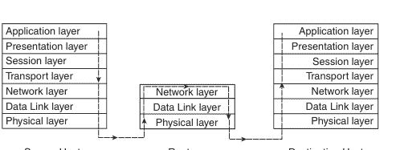

**图 1**

路由器的数据路径。

### 集线器

集线器作为星形连接网络的中心部分。有时集线器也被称为多端口中继器。集线器的信号从一个端口进入，并被再生到所有其他端口。

集线器有多种配置。通常，多个集线器连接到一个骨干网上，以创建更大的局域网。

## 网络访问方法

载波侦听多路访问/冲突检测 (CSMA/CD) 是最流行的访问方法，用于以太网网络。主机连接到一个公共广播通信介质，任何主机都允许在没有任何特定顺序的情况下访问该介质（多路访问）。

当一个主机需要向任何其他主机传输数据时，它会侦听通信介质，以检查是否有其他主机已经在传输数据（载波侦听）。如果数据传输正在进行中，该主机将等待一段随机时间，然后再次检查通信介质的可用性。如果通信介质空闲，主机开始在通信介质上传输数据。

在某些情况下，如果两个或多个主机检查通信介质并发现其空闲，主机随后会同时开始传输数据。在这种情况下，会发生冲突并被所有参与主机检测到（冲突检测）。所有检测到冲突的主机都会发出通知，以便发送主机可以重新发送数据。

当发送主机知道发生了冲突时，所有主机等待一段随机时间，并尝试重新传输数据。基于 CSMA/CD 的网络是非确定性网络。在流量密集的情况下，冲突更频繁，实际数据传输速率可能无法得到保证。

## ISO-OSI 模型

国际标准化组织 (ISO) 试图通过提出一个名为开放系统互连 (OSI) 的参考网络模型来标准化协议设计方法：

- ISO-OSI 是一个分层协议模型，共有七层。
- 每层执行一项任务，并与直接相邻的上方和下方层进行通信。
- ISO-OSI 仅作为协议模型的参考，其本身并不是一个实际的协议。
- 例如，TCP/IP 仅使用五层，而非七层。

OSI 模型有七层。最底层是物理层，处理实际的硬件和电信号。最顶层是应用层，大多数网络用户的交互仅限于此层。图 2 显示了 ISO 模型中每一层的位置。

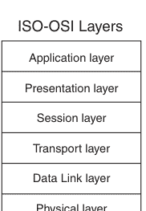

**图 2**

ISO-OSI 模型的七层结构。

ISO-OSI 模型中的每一层都有特定的用途，如表 1 所定义。

### 表 1：ISO-OSI 各层定义

| 层 | 描述 |
| :--- | :--- |
| 应用层 | 与网络交互并向网络用户提供接口的实际应用程序。 |


| 表示层 | 表示层转换不同类型的数据，使其适用于应用层。 |
|---|---|
| 会话层 | 会话层建立和终止通信会话。 |
| 传输层 | 传输层负责端到端的数据传输、错误检测和纠正。 |
| 网络层 | 网络层管理逻辑网络和主机地址。确保数据的点对点正确交付。负责路由。 |
| 数据链路层 | 管理 MAC 地址。从网络层接收数据并通过物理层传输。数据被创建为帧。 |
| 物理层 | 物理层以信号的形式通过通信介质传输数据。 |

## 以太网

如今使用了许多常见的以太网标准。每种标准都有自己的数据传输速度和分段长度。此外，特定的电缆和连接器用于特定的以太网标准。最常见的以太网标准及其属性如下：

- **`10BASE-T` 以太网。** 运行在 10Mbps 的数据传输速度下。单根电缆段的最大长度为 100 米，并使用基带信号。名称中的字母 `T` 表示这种以太网使用的是双绞线电缆而非同轴电缆；这些网络中使用 3 类或 5 类双绞线。这种以太网用于星型拓扑网络。集线器位于网络的中心。
- **`10BASE-2` 以太网。** 名称中的数字 10 表示数据传输速度。在 `10BASE-2` 以太网上，数据传输速度最高可达 10Mbps。然而，实际的数据传输速度可能会远低于此限制，具体取决于网络的负载以及争夺传输数据的主机数量。

`base` 一词表示使用基带信号进行数据传输。某些网络还使用宽带技术来传输数据。在基带技术中，电信号不经过调制，所有可用带宽都用作单一传输介质。在宽带技术中，借助调制为不同信号分配不同的频段，使得多个信号可以使用不同的调制频率在同一介质（例如，连接许多主机的导线）上传输。

标准名称的最后一部分显示了单个分段的最大长度。数字 2 表示 `10BASE-2` 网络的最大长度可能为 200 米。（实际上是 185 米。数字 2 被用作最接近的整数。）

- **`10BASE-5` 以太网。** 网络的最高数据传输速度为 10Mbps。它使用基带信号，网络段的最大长度为 500 米。与 `10BASE-2` 相比，`10BASE-5` 网络使用更粗的电缆，有时也被称为粗缆以太网（Thick Ethernet）。

网络。主机通过双绞线和 RJ-45 连接器连接到集线器。在较大的网络中，许多集线器使用骨干电缆相互连接。

`100BASE-T` 网络与 `10BASE-T` 网络类似。唯一的区别是数据传输速度为 100Mbps，是 `10BASE-T` 网络的 10 倍。`100BASE-T` 网络使用 5 类线（Category 5 cables）。最大分段长度为 100 米。

千兆以太网。千兆以太网是新型的以太网网络家族，目前存在多种相关标准。`1000BASE-SX` 网络使用多模光纤，长度可达 500 米。`1000BASE-LX` 使用单模光纤，长度可达 5 公里。`1000BASE-T` 是一种新兴标准，使用与 `100BASE-T` 网络相同的 5 类线。目前这种电缆的长度限制在 100 米以内。

## 以太网地址

以太网网络上的每个主机都由一个唯一的 48 位数字标识，该数字被称为以太网地址，有时也称为 MAC 地址。制造商将以太网地址烧录到所有以太网网络适配器中。一些供应商还提供软件实用程序来修改以太网地址。网络中不能有两个主机具有相同的 MAC 地址。

以太网地址通常写成六组由冒号分隔的十六进制数。例如，一个典型的以太网地址可以写成 `4F:36:01:AB:94:12`。

## 在 Solaris 中管理以太网接口

每台 Solaris 服务器或工作站具有一个或多个以太网接口。Solaris 提供了管理以太网接口的命令。这些命令允许您列出已安装的接口、创建逻辑接口、配置接口以及启动或关闭接口。在 Solaris 服务器或工作站中列出已安装接口有两种简单方法：

- **`ifconfig`。** 当使用 `-a` 选项时，`ifconfig` 命令会列出系统中安装的所有接口。该命令还可用于列出单个接口以及配置接口。
- **`netstat`。** `netstat` 命令用于多种目的，其中一项是在使用 `-i` 选项时列出已安装和已配置的接口。

以下命令用于启动和关闭网络接口：

```sh
# ifconfig hme0 up
# ifconfig hme0 down
```

（注：此命令用于启动/关闭 `hme0` 接口。）

## 排除常见以太网问题

Solaris 环境中提供了多个实用程序，用于排除常见的以太网及其他网络问题。最常用的命令如表 2 所示。

**表 2：有用的故障排除命令**

| 命令 | 命令的常见用途 |
|---|---|
| `ifconfig` | `ifconfig` 命令用于配置网络适配器，或显示每个适配器的现有配置。 |
| `snoop` | `snoop` 命令用于捕获并显示网络数据包。 |
| `ping` | `ping` 命令用于测试网络连通性，以及确定网络上的特定主机是存活还是宕机。 |
| `traceroute` | `traceroute` 命令用于确定从源主机到目的主机的网络路径。 |
| `ndd` | `ndd` 命令用于获取和设置网络内核驱动程序的参数。 |

TCP/IP 网络中的应用层涵盖了 OSI 模型的上三层。表 4 简要阐述了每个 TCP/IP 层的功能。

**表 4：TCP/IP 层功能**

| 层 | 描述 |
|---|---|
| 物理层 | 以分段形式处理物理层数据。 |
| 数据链路层 | 处理物理层访问方法和 MAC 地址。从 IP 层接收到的数据根据数据链路层使用的协议被分为帧。例如，以太网的帧格式与帧中继（Frame Relay）的不同。 |
| IP 层 | 为所有主机和网络分配 IP 地址。使用路由协议在不同网络之间路由数据。该层负责点对点的可靠数据传输。 |
| TCP 层 | 该层使用 TCP 和 UDP 协议。使用端口号和套接字允许多个应用程序共享同一台物理机和 IP 地址。 |
| 应用层 | 在该层实现用户应用程序以及为网络提供用户界面的程序。 |

## TCP/IP 层的功能

与 OSI 模型的七层结构相反，TCP/IP 只有五层。表 3 显示了 OSI 模型和 TCP/IP 的层级对比。

**表 3：ISO-OSI 层与 TCP/IP 层**

| ISO-OSI 层 | TCP/IP 层 |
|---|---|
| 应用层 | 应用层 |
| 表示层 | 应用层 |
| 会话层 | 应用层 |
| 传输层 | 传输层（TCP/UDP） |
| 网络层 | 网络层（IP） |
| 数据链路层 | 数据链路层 |
| 物理层 | 物理层 |

## IP 地址

IP 地址是一个 32 位长的数字，分为四个部分。每个部分长 8 位，称为一个八位组（octet）。IP 地址通常写成这些八位组的组合，每个八位组由点号分隔。因为每个八位组长 8 位，所以一个八位组的值范围是 0 到 255。例如，一个典型的 IP 地址可以写成 `192.168.2.201`。

与 MAC 地址不同，IP 地址是逻辑地址，由网络管理员分配。每当有需要时，IP 地址都可以更改。每个连接到网络的网络接口必须分配一个 IP 地址。

## 网络类

根据地址范围和子网掩码中的位数，IP 地址分为五类，如表 5 所示。

**表 5：网络类**

| 类 | 子网掩码 | 可能的主机数量 | 起始位 | 地址范围 |
|---|---|---:|---|---|
| A 类 | `255.0.0.0` | `2^31 - 2` 或 16,777,214 | `0` | `0-127` |
| B 类 | `255.255.0.0` | `2^15 - 2` 或 65,534 | `10` | `128-191` |
| C 类 | `255.255.255.0` | `2^7 - 2` 或 254 | `110` | `192-223` |
| D 类 | 特殊 | 特殊 | `1110` | `224-240` |
| E 类 | 特殊 | 特殊 | `11110` | `241-254` |

D 类网络是特殊地址，被称为组播地址（multicast addresses）。与用于向网络上所有主机发送数据包的广播数据包相比，组播地址用于向选定的主机组发送相同的数据包。

最左侧八位组中所有高于 240 的地址都保留用于未来使用，不分配给任何主机或网络。

## 子网掩码

子网掩码是一个特殊的数字，用于区分 IP 网络中的主机部分和网络部分。子网掩码同样写成四个八位组的组合。代表地址网络部分的所有掩码位均为 1，而代表地址主机部分的位均为 0。如果您仅将最右侧的八位组用于主机寻址，其余三个八位组用于网络寻址，例如，子网掩码位将写成八位一组的组合，如下所示：

```text
11111111 11111111 11111111 00000000
```

在 IP 地址的十进制点分表示法中，此子网掩码写为 `255.255.255.0`，因为 8 位全 1 的十进制等值是 255，而 8 位全 0 的等值是 0。

## 子网划分

可以使用网络掩码将一个大网络划分为较小的网络。所有较小的网络被称为子网。用于这些子网的掩码称为子网掩码。图 3 显示了网络地址中的主机部分如何被划分为一个子网和类似的主机部分，从而形成多个较小的网络。在图片的下半部分，两个阴影区域（网络部分和子网）都被用作较小网络的较大网络部分。

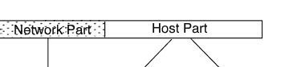

**图 3：子网划分。**

将大网络划分为小网络可能有多种原因，包括便于维护、分布式网络管理或缺乏新的 IP 地址。

## 互联网控制消息协议（ICMP）

ICMP 协议用于控制消息。ICMP 是所有 IP 协议实现中不可或缺的一部分。用户应用程序（如 `ping`）使用 ICMP 数据包来诊断网络问题。主机也可能生成 ICMP 数据包，以向网络上的其他主机报告网络问题。

## 在 Solaris 中配置网络接口

Solaris 机器中的网络接口通常命名为 `hme0` 或 `hmen`，其中 `n` 是一个数字。对于第一个接口，`n` 通常为 0，第二个为 1，依此类推。如果您的主机中仅安装了一个网络适配器，则该接口的名称可能是 `hme0`。

要将接口 `hme0` 配置为 IP 地址 `192.168.2.222` 和子网掩码 `255.255.255.0`，有三个基本步骤，如下所示：

1. 创建一个文件 `/etc/hostname.hme0`，其中包含一行主机名，如下所示：

   `fana`

2. 编辑 `/etc/inet/hosts` 文件以添加主机 `fana` 的 IP 地址。请记住，`/etc/hosts` 文件是指向文件 `/etc/inet/hosts` 的链接。该文件中的一行如下所示：

   `192.168.2.222    fana`

3. 编辑 `/etc/inet/netmasks` 文件并添加以下行：

   `192.168.2.0    255.255.255.0`

`/etc/inet/netmasks` 将网络地址与子网掩码关联起来。

在启动时，网络初始化脚本 `/etc/init.d/network` 会读取这些文件并配置网络接口。它在启动期间使用前述步骤中提到的文件来配置网络接口。

请注意，此配置是永久性的，在机器重启后依然有效。您可以使用 `ifconfig` 命令临时配置网络适配器。以下命令将适配器 `hme0` 配置为 IP 地址 `192.168.5.6` 和子网掩码 `255.255.255.0`：

```sh
# ifconfig hme0 up 192.168.5.6 netmask 255.255.255.0 up
```

您还可以用位数而非点分表示法来指定子网掩码。以下命令实现相同的功能，指定子网掩码使用 24 位：

```sh
# ifconfig hme0 192.168.5.6/24 up
```

### `ping` 命令

`ping` 命令是网络管理员最广泛使用的命令。它使用 ICMP 回显请求（echo request）类型的 ICMP 数据包。当主机收到此类数据包时，它会以 ICMP 回显响应（echo reply）类型的 ICMP 数据包进行回复，这可用于确定源主机和目的主机之间 ICMP 数据包的往返时间。

默认情况下，`ping` 命令通过发送 ICMP 回显请求类型的数据包，仅告知您主机是存活还是宕机。如果该命令得到了响应...

如果收到 ICMP 回显响应包形式的数据包，则会打印一条 Host Alive（主机存活）消息。不过，你也可以使用 `ping -s` 命令向主机发送连续的 ping 包（ICMP 回显请求类型的数据包）。

默认情况下，`ping` 命令使用 `(56 + 8)` 字节长的数据包。然而，为了检查网络对较大数据包的响应，你可以通过 `ping` 命令指定数据包长度。这对于了解主机是否因 IP 分片而丢包也很有帮助。`ping -s desktop 6000` 命令向主机 `desktop` 发送 `(6000 + 8)` 字节长的数据包。

你还可以向目标主机发送预定义数量的 ping 包。`ping -s desktop 100 4` 命令向主机 `desktop` 发送 4 个 100 字节长的数据包。

表 6 列出了 `ping` 命令可用的其他选项。

**表 6：PING 命令使用的选项**

| 选项 | 描述 |
|---|---|
| `-g gateway` | 指定一个你希望通过其路由数据包的网关。可以使用多个网关地址使数据包通过网络中的特定路径路由。 |
| `-I interval` | 连续 ICMP 数据包之间的时间间隔。 |
| `-i interface` | 定义一个数据包应从此发出的接口地址。 |
| `-P tos` | 设置 IP 报头中的服务类型（Type Of Service）字段。 |
| `-t ttl` | 设置 IP 报头中的 TTL 字段值。 |

### `traceroute` 命令

`traceroute` 命令用于查找从源到目的地的网关主机。换句话说，该命令显示了 IP 数据包从源到目的地的传输路径。

`traceroute` 命令使用 UDP 数据包来查找中间网关主机。它发送 TTL 值递增的 UDP 数据包，从 1 开始。当 TTL 值为 1 的数据包到达第一个网关主机时，该主机将 TTL 值减 1，此时 TTL 值变为 0。因此，第一个网关主机会丢弃该数据包并生成一个 ICMP 数据包，以通知发送主机数据包已被丢弃。通过这种方式，第一跳网关主机显示了其身份。第二跳网关主机通过 TTL 值为 2 的 UDP 值来确定，依此类推。默认情况下，每一跳（具有相同的 TTL）都会发送三个探测包。

表 7 列出了 `traceroute` 命令使用的选项。

**表 7：TRACEROUTE 命令使用的选项**

| 选项 | 描述 |
|---|---|
| `-F` | 设置 IP 报头中的“不可分片”（Don't Fragment）位。 |
| `-f first_hop` | 设置第一跳 TTL。默认值为 1。用于在探测开始时跳过一定数量的网关。 |
| `-g gateway` | 此选项用于在松散源路由（loose source routing）中设置网关。 |
| `-m maxhops` | 此选项用于设置最大 TTL 值。默认最大值为 30。 |
| `-p port` | UDP 数据包使用的端口号。 |
| `-q probes` | 设置每一跳的探测包数量。 |
| `-v` | 详细输出。打印更多信息。 |

### 地址解析协议（ARP）

在主机向目的地址发送任何 IP 数据之前，它会确定目的主机的 MAC 地址，因为数据链路层仅识别 MAC 地址。地址解析协议（ARP）是 TCP/IP 协议栈实现的一部分，它将 IP 地址映射到 MAC 地址。给定一个 IP 地址，该协议可确定其对应的 MAC 地址。反向地址解析协议（RARP）执行相反的过程，将 MAC 地址映射到 IP 地址。RARP 用于无盘工作站。

地址解析协议是一种广播协议。当主机想要获取与某个 IP 地址对应的 MAC 地址时，它会在本地网络上发送一个广播包。这个数据包基本上是在询问本地网络上的所有主机，是否有人拥有该 IP 地址。所有主机都会监听此请求，只有拥有该 IP 地址的主机才会回复。回复的数据包包含该主机的 MAC 地址。如果本地网络上没有主机被分配了该特定 IP 地址，则不会收到回复。地址解析协议在 TCP/IP 网络的网络通信中起着重要作用。如果没有这种方法，网络层将无法定位具有目的 IP 地址的主机的 MAC 地址。要观察本地网络上的 ARP 数据包，可以使用 `snoop` 命令。

### 反向地址解析协议（RARP）

RARP 协议由无盘工作站使用。由于没有永久存储空间，这些工作站无法存储 IP 地址配置。相反，每个无盘主机的配置存储在 RARP 服务器上。RARP 服务器维护着 MAC 地址到 IP 地址的映射。当你开启无盘工作站时，它会广播一个请求以定位 RARP 服务器，从而找到其 IP 地址配置。如果网络中存在 RARP 服务器，它会针对该请求回复一个 IP 地址。为了向请求工作站发送正确的 IP 地址，RARP 服务器会检查其表以查找与请求工作站 MAC 地址相对应的 IP 地址。

## 路由（ROUTING）

IP 网络中有两种动态路由类型：静态和动态。静态路由如其名，是固定路由。网络管理员定义静态路由，除非手动更改，否则这些路由保持不变。另一方面，动态路由是在运行时根据网络状况计算得出的。

### 被路由协议与路由协议

被路由协议（Routed protocol）是一种可以在不同网络之间路由的协议。例如，IP 就是一种被路由协议。这意味着可以使用某种其他机制，就将 IP 数据包从一个网络转发到另一个网络做出决定。

路由协议（Routing protocol）是指确定被路由协议的哪个数据包应从源到目的地采取特定路径的协议。路由协议提供了一种确定最低成本路径的机制。路径的成本可以通过从源到目的地的跳数、带宽、延迟或其他因素来确定。

### 距离矢量路由协议


在距离矢量（Distance-Vector）路由算法中，每个路由器使用广播或组播将其关于连接网络的知识转发给相邻路由器。监听路由器从相邻路由器获取此信息，构建自己的路由表，并将自己的路由信息转发给其他相邻路由器。每个路由器发送关于连接网络的距离信息（以跳数为单位，这并非物理距离）。当此传输完成时，每个路由器都掌握了连接网络的知识。这种路由算法也被称为 Bellman-Ford 算法。使用距离矢量路由最常见的协议示例是路由信息协议（RIP）。

## 链路状态路由协议

链路状态（Link-State）路由算法被统称为最短路径优先（SPF）路由算法，它维护着互连网络拓扑复杂且完整的知识。关于网络变更的信息交换通过链路状态公告（LSA）完成。一旦检测到网络事件，就会触发 LSA 传输，从而使尽快重建路由表成为可能。这个过程比距离矢量协议快得多，因为后者的信息交换是基于定时而非基于事件的。与距离矢量路由协议不同，链路状态路由协议维护着网络拓扑的完整知识。

## 配置 RIP 和 RDISC

Solaris 上最常用的两种用于填充路由表的动态路由方法是路由器发现协议（RDISC）和路由信息协议（RIP）。RDISC 用于发现网络上可用的路由器。RDISC 可以在主机模式或路由器模式下运行。如果运行在主机模式，它仅监听路由器广播。如果运行在路由器模式，它在网络上广播消息。RDISC 使用 ICMP 路由器发现方法。`in.rdisc` 守护进程用于支持 RDISC。RIP 使用 `in.routed` 守护进程并在启动时启动。它用于在主机和路由器之间交换路由信息。RIP 和 RDISC 都是标准 TCP/IP 协议。

### 主机如何确定自己是否为路由器？

如果满足以下条件之一，主机将充当路由器：

- 存在多个 `/etc/hostname.interface` 文件。这表明你配置了多个网络接口。该文件的一个示例是 `/etc/hostname.hme0`，它显示了网络接口 `hme0` 的存在。
- 如果有人使用 `ifconfig` 命令手动配置了多个网络接口。

### 在主机模式下运行 RDISC

当你以主机模式启动 `in.rdisc` 时，它会监听 ALL_HOSTS 组播地址。该地址为 224.0.0.1，路由器在该地址上发布公告消息。在启动时，`in.rdisc` 会忽略除直接连接网络上的路由器之外的所有路由器公告。最高优先级的路由器被选中，以便在路由表中输入默认路由条目。

有时 `in.rdisc` 也可以在 ALL_ROUTERS（224.0.0.2）组播地址上发送路由器请求消息以发现可用路由器。如果在发送三个请求消息后仍未收到响应，`in.rdisc` 将放弃。

### 在路由器模式下运行 RDISC

在路由器模式下启动时，`in.rdisc` 开始监听 ALL_ROUTERS 组播地址。它开始在 ALL_HOSTS 组播地址上发送消息。最初，它在前 30 秒内发送一定数量的公告。之后，`in.rdisc` 每 10 分钟发布一次路由公告。

如果它发现了任何路由器请求消息，它会将路由信息发送给请求主机。

该守护进程通常通过 `/etc/rc2.d/S69inet` 脚本启动。表 8 显示了 `in.rdisc` 常用的命令行选项。

### 表 8：IN.RDISC 常用的命令行选项

| 选项 | 描述 |
| :--- | :--- |
| `-r` | 以路由器模式运行守护进程。 |
| `-p <preference>` | 设置在请求消息中传输的优先级数值。默认值为 0。 |
| `-a` | 接受所有路由器，忽略优先级。通常 `in.rdisc` 仅接受优先级最高的路由器。 |
| `-s` | 发送三个请求消息，如果没有收到响应，则放弃。 |
| `-f` | 永久运行 `in.rdisc`，即使初始请求消息没有收到响应。 |
| `-T <interval>` | 设置连续通告之间的间隔。默认间隔为 600 秒。 |

根据从相邻路由器接收到的信息，它会自动更新自己的路由表。如果满足以下任一条件，则更新路由表：

- 接收到的数据包包含关于新路由的信息，且跳数不是无穷大。
- 更新是从将数据包转发到目的地的路由器接收到的。
- 接收到新路由，而之前的路由在 90 秒内未更新，且新路由与旧路由一样具有成本效益。
- 新路由描述的路径比现有路径更短。

如果路由表中的某个条目在三分钟内未更新，它将被标记为无穷大。起初，守护进程检查 `/etc/gateways` 文件以填充路由表条目。

## 路由启动与配置文件

`/etc/defaultrouter` 文件包含一个或多个可用作默认路由器的路由器。通常该文件中仅存在一个用于作为最终路由器的 IP 地址或主机名。如果使用了多个主机名或 IP 地址，则用空格分隔。以井号（#）开头的行是该文件中的注释行。以下是一个典型的 `/etc/defaultrouter` 文件：

```
# cat /etc/defaultrouter
192.168.2.1
```

如果 `defaultrouter` 文件存在但为空，Solaris 会尝试运行其中一种路由协议（RDISC 或 RIP）。首先，它初始化 RDISC，通过发送路由器请求消息来发现存在的任何路由器。如果失败，它将启动 RIP。

## RIP（in.routed）

`in.routed` 守护进程实现了 RIP，并使用 `/etc/rc2.d/S69inet` 脚本启动。它监听端口号 520 以接收路由信息通告。它定期与直接连接的路由器交换路由表。它使用跳数来寻找到达目的地的最佳路由。16 次及以上的跳数被视为不可达。该跳数也被称为无穷大。在交换路由表信息时，守护进程会随每条连接路由发送跳数。

## 快速事实

当您为默认路由器使用主机名时，这些主机名必须存在于 `/etc/inet/hosts` 文件中。这是必要的，因为在配置默认路由器时，没有名称服务在运行，`/etc/inet/hosts` 是解析默认路由器主机名的唯一方式。

使用 `ifconfig` 命令来查找是否存在配置问题。最常见的配置问题是错误的 IP 地址或错误的网络掩码。

如果主机无法与其他网络上的主机通信，但可以与本地网络上的网络通信，那么路由表或路由器存在问题。要验证路由表，请使用 `netstat` 命令。使用 `traceroute` 命令跟踪其他网络上的路由主机，查看在何处失败。

## /etc/gateway 文件

`/etc/gateways` 文件与 `in.routed` 路由守护进程配合使用，用于添加活动或被动网关。能够交换路由信息的网关是活动网关，不能交换路由信息的网关是被动网关。启动时，`in.routed` 守护进程会读取此文件。在被动网关中定义的路由在启动时被添加到路由表中。这些路由可能会根据对其他路由的发现而随后被修改。

## 故障排除命令

以下是路由问题的主要故障排除命令：

`/etc/networks` 文件将网络名称映射到网络地址。文件中每行的通用格式如下：

```
<network name> <network address> [network aliases]
```

最后一部分是可选的，仅在您需要为网络定义任何别名时使用。文件中的字段由空格或 Tab 字符分隔。

### /etc/init.d/inetinit 文件

该脚本是主网络初始化脚本。它还被链接为 `/etc/rc2.d/S69inet` 启动脚本。

- **ping 命令。** `ping` 命令是路由配置的基础测试。首先，尝试 ping 自己的 IP 地址。如果您无法做到，那么您的接口配置存在某些问题。如果您能 ping 通自己的 IP 地址，请尝试 ping 网络上的另一个主机。如果您成功了，说明本地网络的路由工作正常。现在尝试 ping 任何一个网关。成功则确认您可以到达网关。之后，尝试 ping 另一个网络上的主机。如果能够通过，则远程网络的路由也配置正确。
- **使用 traceroute 命令。** 如果您的本地配置正确，并且您可以 ping 通本地网络主机以及默认网关，但无法 ping 通其他网络上的主机，那么 `traceroute` 命令可以定位问题所在的位置。使用 `traceroute` 命令跟踪到远程主机的路径。它应该会在某一点停止，并开始显示星号字符，正如您在之前的章节中已经看到的那样。这就是路由问题所在的地方。如果您有权访问该路由器，您可以自行纠正，或者您可以联系该路由器的负责人来解决问题。
- **使用 netstat 命令。** `netstat` 命令是最有用的网络故障排除命令之一。它用于多种目的，包括显示所有路由列表。表 9 列出了您可以使用 `netstat` 命令的选项。

### 表 9：NETSTAT 命令的选项

| 选项 | 描述 |
| :--- | :--- |
| `-a` | 列出系统上使用的所有套接字、端口和连接。 |
| `-i` | 显示接口状态。 |
| `-I <interface>` | 显示关于特定接口的信息。 |
| `-n` | 以点分十进制形式显示网络地址，而不是主机名。 |
| `-r` | 显示路由表。 |
| `-s` | 显示每种协议的统计信息。 |
| `-P` | 将输出限制在特定协议。 |
| `-v` | 详细模式。显示更多细节。 |
| `-D` | 显示 DHCP 配置接口的统计信息。 |
| `Interval` | 在给定间隔后重复显示统计信息。 |

- **ifconfig 命令。** `ifconfig` 命令用于显示和纠正本地接口配置的问题。您需要此命令来纠正诸如错误的网络掩码之类的问题。错误的网络掩码也可能导致路由问题。

## 常见路由问题

如果主机在重启后无法启动，可能是某些初始化脚本存在问题。在这种情况下，以单用户模式启动系统并验证初始化脚本。

如果主机无法与网络上的任何主机通信，则网络接口存在某些问题。这可能是物理问题或配置问题。

## 客户端-服务器术语

以下是常见的客户端-服务器术语：

- **服务器（Server）。** 服务器是一段硬件或软件，为客户端提供特定的服务。每个网络用户使用的常见服务器示例包括 Web 服务器、邮件服务器、域名服务器等。
- **客户端（Client）。** 客户端是用于访问服务器提供服务的用户应用程序。像 Netscape 这样的 Web 浏览器就是使用 Web 服务器提供服务的客户端应用程序。同样，您也使用客户端进行电子邮件处理，这些客户端使用邮件服务器提供的服务。
- **端口号（Port number）。** 端口号是服务的访问点。端口号用于区分运行在同一台物理机上的多个服务。要获得特定的服务，您必须前往特定的窗口。同样地，您必须访问不同的端口号来获取不同的服务。例如，您使用端口 25 进行电子邮件，使用端口号 23 进行 Telnet。
- **套接字（Socket）。** 套接字用于将客户端连接到服务器。套接字用于区分不同的并发通信会话。套接字是 IP 地址和端口号的组合。客户端和服务器之间的每个通信会话都使用不同的套接字。
- **守护进程（Daemon）。** 守护进程是一个在后台运行并服务于客户端的服务器进程。服务器可以运行守护进程，或者在客户端发送请求时启动。

## TCP 和 UDP 端口

所有常见 Internet 服务的端口号都已经标准化。Internet 服务通常使用 TCP 协议或 UDP 协议，有些服务则同时使用这两种协议。对于常用服务，两种协议的端口号都是固定的。在包括 Solaris 在内的 UNIX 系统中，标准端口号列在 `/etc/inet/services` 文件中。

为了与 BSD 版本的 UNIX 兼容，该文件链接到 `/etc/services` 文件。该文件中的每一行具有以下格式：

```
<service name> <portnumber/protocol> <aliases>
```

`<service name>` 是服务的官方名称。它可以包含除注释字符之外的任何可打印字符。该文件中提到的一些服务名称包括 FTP、Telnet、Time、SMTP 等。

`<portnumber/protocol>` 字段显示该服务所使用的端口号和协议。例如，以 `telnet` 开头的行中的 `23/tcp` 表明 Telnet 服务使用端口号 23 和 TCP 协议。同一个端口号可以与多种协议一起使用。如前所述，某些服务同时使用 TCP 和 UDP 协议。例如，Time 服务在端口号 37 上同时使用 TCP 和 UDP 协议。

一行的最后一部分显示用于该服务的一个或多个别名。这是一个可选字段，某些服务可能存在，也可能不存在。

## 配置 Internet 服务

计算机上的网络服务在启动时启动，这样服务器一启动，网络客户端就可以访问它。服务器进程在后台运行，等待来自客户端的请求。在启动时，每个服务器在周知端口（well-known ports）上打开一个或多个套接字。这些服务的客户端可以使用这些端口连接到服务器进程打开的套接字。如果服务器使用了安全特性，它会在建立连接请求时对网络客户端进行身份验证。通常的做法是提示输入登录名和密码。例如，当你使用 Telnet 客户端连接到 Telnet 服务器时，它会提示你输入登录名和密码，然后使用不同的方法验证该登录名和密码。

启动这些服务器进程有两种常用方法。你可以将服务进程作为守护进程（daemon）启动，它将永久运行以等待传入的连接请求。另一种方法是使用 `inetd` 主守护进程，它可以代表其他服务监听传入的连接请求。`inetd` 在启动时启动并充当主守护进程。一旦连接请求到达，它就会调用所需的服务进程。原则上，每个服务既可以作为守护进程启动，也可以通过 `inetd` 启动。

## r 命令

r 命令用于访问网络上的远程主机。通常，访问不需要密码。表 10 描述了这些命令中的每一个。

**表 10：r 命令**

| 命令 | 描述 |
| --- | --- |
| `rcp` | 远程文件复制 |
| `rlogin` | 远程登录 |
| `rsh` | 在远程主机上执行命令 |
| `rensh` | 与 `rsh` 命令相同 |

## 使用 DHCP 管理器

在 Solaris 8 中，Sun Microsystems 提供了一个图形用户界面（GUI）来帮助配置 DHCP 服务器。`/usr/sbin/adm/bin/dhcpmgr` 是一个用于配置 DHCP 服务器的图形化实用程序，称为 DHCP 管理器。你必须以 root 身份才能使用此程序。

从图 4 可以看出，DHCP 服务可以配置为纯 DHCP 服务器或 DHCP/BOOTP 中继代理。如果你将其配置为中继，该服务将接收来自客户端的请求，并将这些请求转发给配置的远程 DHCP 服务器之一。表 11 显示了 DHCP 客户端和服务器之间交换的消息。

## 使用 dhcpconfig 配置 DHCP

Solaris 系统中可用的传统 DHCP 配置实用程序是 `dhcpconfig` 程序。使用 `dhcpconfig`，你可以配置 DHCP 服务器和 DHCP 中继代理。此外，你还可以取消配置 DHCP 服务。`dhcpconfig` 中的大多数步骤与讨论 DHCP 管理器 GUI 时的步骤相同。

**表 11：客户端与服务器之间交换的常见 DHCP 消息**

| 消息 | 描述 |
| --- | --- |
| `DHCPDISCOVER` | 由 DHCP 客户端发送的广播消息，用于发现网络上存在的 DHCP 服务器。 |
| `DHCPOFFER` | 由 DHCP 服务器发送以响应 `DHCPDISCOVER` 消息。它包含租约提供和配置参数。 |
| `DHCPREQUEST` | 当客户端接受 DHCP 服务器的提供时，发送此消息以表示接受。此消息还用于续租。 |
| `DHCPACK` | 为了响应 `DHCPREQUEST` 消息，DHCP 服务器发送此消息以确认租约的确认。 |
| `DHCPRELEASE` | 由客户端发送给服务器，以放弃租用的 IP 地址。 |

当你启动 `dhcpconfig` 时，它会列出四个选项，如下所示：

```
# dhcpconfig
*** DHCP Configuration ***
Would you like to:
1) Configure DHCP Service
2) Configure BOOTP Relay Agent
3) Unconfigure DHCP or Relay Service
4) Exit
Choice:
```

### DHCP 服务器的自动启动

当你使用 `dhcpmgr` 或 `dhcpconfig` 实用程序配置 DHCP 服务时，启动和关闭脚本会在相应的目录中创建。DHCP 的默认启动脚本位于 `/etc/init.d/dhcp`。这是一个简单的脚本：

```bash
# cat /etc/init.d/dhcp
#!/sbin/sh
# Copyright 1996-1999 by Sun Microsystems, Inc.
# All rights reserved.
#
#ident "@( )dhcp 1.17 99/10/23 SMI"
# Make sure that /usr is mounted
[ ! -d /usr/bin ] && exit 1
case "$1" in
  start')
    if [ -x /usr/lib/inet/in.dhcpd ]; then
      /usr/lib/inet/in.dhcpd >
      /dev/console 2>&1
    fi
    ;;
  stop')
    /usr/bin/pkill -x -u 0 in.dhcpd
    ;;
  *)
    echo "Usage: $0 { start | stop }"
    exit 1
    ;;
esac
exit 0
```

该脚本被复制为 `/etc/rc3.d/S34dhcp` 以启动 DHCP 服务，以及 `/etc/rc2.d/K34dhcp` 以关闭 DHCP 服务。你也可以手动创建和修改该脚本。

表 12 描述了一些用于配置 DHCP 的实用程序。

**表 12：常见 DHCP 配置实用程序**

| 名称 | 描述 |
| --- | --- |
| `dhcpadm` | DHCP 配置表管理实用程序。 |
| `dhcpconfig` | DHCP 服务配置实用程序。 |


| `dhcpmgr` | 基于 GUI 的 DHCP 管理器。 |

| `pntadm` | DHCP 网络表管理实用程序。 |

### 取消配置 DHCP 服务

你可以使用 `dhcpconfig` 实用程序取消配置 DHCP 服务。它还可以选择性地删除 DHCP 配置文件。以下 `dhcpconfig` 命令会话取消配置了 DHCP 并删除了配置过程中创建的所有数据文件：

```
# dhcpconfig
Would you like to:

1) Configure DHCP Service
2) Configure BOOTP Relay Agent
3) Unconfigure DHCP or Relay Service
4) Exit
Choice: 3

Unconfigure will stop the DHCP service and
---remove /etc/default/dhcp.

Are you SURE you want to disable the DHCP
---service? ([Y]/N):y

### WARNING WARNING WARNING ###

Unconfigure can delete the following tables in
---the current resource (files):

1) dhcptab.
2) ALL dhcp-network tables.

Are you SURE you want to remove the DHCP
---tables? ([Y]/N): y

Removing: dhcptab...
Removing: 192_168_2_0...
Would you like to:
1) Configure DHCP Service
2) Configure BOOTP Relay Agent
3) Unconfigure DHCP or Relay Service
4) Exit
Choice:
```

如果你通过 NIS+ 或在多个 DHCP 服务器之间通过文件共享来共享 DHCP 服务表，那么在这些表被删除后，那些服务器将无法处理请求。请注意，任何已添加的主机表项都需要手动删除。

### 设置非默认服务器选项

如果在 `dhcpconfig` 配置过程中选择配置非默认服务器选项，你将被询问更多问题，如下所示：

```
###    DHCP server option setup    ###
Would you like to specify nondefault server
options (Y/N)? Y
How long (in seconds) should the DHCP server
keep outstanding OFFERs? 10
How often (in minutes) should the DHCP server
rescan the dhcp.tab? [Never]:10
Do you want to enable BOOTP compatibility mode?
(Y/N)? Y
Do you want the server to allocate IP addresses
to BOOTP clients? (Y/N): N
***end code***
```

如果你选择 BOOTP 兼容性，DHCP 服务器将同时为 DHCP 和 BOOTP 客户端提供服务。除了其他配置参数外，你也可以在此处选择启用 BOOTP 兼容模式。

## 配置 DHCP 客户端

你可以在服务器或工作站安装的一个或多个网络接口上启用 DHCP。配置 DHCP 客户端非常简单，但涉及一些步骤。首先，你必须找到想要启用 DHCP 的接口。如果该接口已经配置了 IP 地址，你可能需要先使用 `ifconfig <interface> unplumb` 命令取消配置。

使用 `ifconfig` 命令列出所有接口。如果某个接口存在但未列出，你可以使用 `ifconfig plumb` 命令启动该接口。以下命令启动 `hme1`：

```bash
# ifconfig hme1 plumb
```

使用以下命令查找接口的当前配置：

```bash
# ifconfig hme1
hme1: flags=1000842<BROADCAST,RUNNING,MULTICAST,
  ->IPv4> mtu 1500 index 2
     inet 0.0.0.0 netmask 0
```

使用以下命令在接口上启用 DHCP：

```bash
# ifconfig hme1 dhcp
```

## 配置 DHCP 中继代理

DHCP 中继代理代表本地网络上的 DHCP 服务器工作。它可以接收来自 DHCP 客户端的查询并将其转发给真正的 DHCP 服务器。图 5 显示了安装 DHCP 中继服务的一种可能安排。在这种情况下，DHCP 客户端和 DHCP 服务器位于不同的网络上。在正常情况下，广播 DHCPDISCOVER 消息通常无法到达 DHCP 服务器，因为广播消息不会跨路由器转发。然而，DHCP 中继可以将此消息转发给 DHCP 服务器，并充当客户端和服务器之间的桥梁。

`dhcpconfig` 实用程序可用于配置 DHCP 中继。

您可以使用以下命令检查该接口上的 DHCP 状态：

```
# ifconfig hme1 dhcp status
```

要在启动时在接口上启用 DHCP，您必须创建两个文件。例如，如果您想在接口 `hme1` 上启用 DHCP，您必须在 `/etc` 目录中创建以下两个文件：

- `hostname.hme1`

- `dhcp.hme1me1`

下次重启系统时，接口 `hme1` 将通过 DHCP 进行配置。

## DHCP 故障排除

如果您使用文件而不是 NIS+ 来存储 DHCP 数据库，那么需要排除的故障可能会较少。可能出现的常见 DHCP 服务器问题如下：

- 有时会出现 IP 地址重复利用的情况。可能会发生 DHCP 范围中的一个或多个 IP 地址被静态分配给其他主机的情况。在这种情况下，会发生 IP 地址冲突。您可以将 `snoop` 命令与 `ping` 命令结合使用，以发现使用特定 IP 地址的另一台主机的 MAC 地址。

- 如果您看到类似“No more IP addresses”（没有更多 IP 地址）的消息，说明 DHCP 客户端的数量超过了可用 IP 地址的数量。

许多 DHCP 问题也可以使用 `snoop` 命令进行追踪。该命令将显示在特定接口上流动的网络数据包。此外，还可以通过在 Debug 模式下运行 DHCP 客户端和 DHCP 服务器来追踪 DHCP 问题。

表 13 列出了用于配置 DHCP 的文件。

| 文件 | 描述 |

| :--- | :--- |

| `dhcp_network` | 此文件与 `dhcptab` 文件位于同一目录下。文件的实际名称采用 `NNN_NNN_NNN_NNN` 记法，其中 `NNN` 表示网络地址中的八位组值。 |

| `dhcptab` | 这是一个 DHCP 宏表文件。 |

| `/etc/default/dhcp` | 此文件包含上述两个文件的位置以及其他信息。 |

- 多个 DHCP 服务器的范围内包含相同的 IP 地址。如果多个 DHCP 服务器的范围内包含重叠的 IP 地址，也可能会发生 IP 冲突。您应该使用 DHCP Administrator 或 `dhcpconfig` 来纠正此问题。

- 客户端请求续租一个已被标记为不可用的 IP 地址。在这种情况下，如果已配置，DHCP 服务器的消息将出现在 SYSLOG 消息中。您可以使用 DHCP Manager 来纠正此问题。如果为特定 IP 地址配置了客户端 ID 且该地址被标记为不可用，也可能会发生这种情况。

## 简单网络管理协议 (SNMP)

简单网络管理协议（Simple Network Management Protocol）是由管理站和网络元件组成的集合。网络元件运行一段名为 SNMP 代理（SNMP agent）的软件。网络元件可以是简单的主机、服务器、路由器、网桥或任何连接到网络的设备。驻留在网络元件上的 SNMP 代理与一个或多个 SNMP 管理站通信以交换信息。

SNMP 代理的作用是收集网络管理信息，并在收到请求时将其传递给管理站。它还可以通过一种称为“陷阱”（traps）的机制，异步地将关键信息传递给管理站以报告重要事件。如果 SNMP 管理站需要设置托管对象的值，它可以指示 SNMP 代理执行该操作。SNMP 代理将管理信息保存在称为管理信息库（Management Information Base, MIB）的特殊表中。

SNMP 协议由以下三个基本组件组成：

- 管理信息结构 (SMI)

- 管理信息库 (MIB)

- SNMP 消息

## 管理信息库

管理信息库是 SNMP 中使用的对象的层次化组织。这种组织形式类似于一棵树。单个对象是树的叶子。每个对象都有一个 OID，它是由点字符分隔的一系列数字。如前所述，对象的 OID 是通过从根节点遍历到目标节点，并记录路径上所有节点相关联的数字而确定的。

MIB 被实现为表的数据结构，其中存储了这些对象的值，以便 SNMP 管理站检索。ASN.1 用于描述这些表的结构以及与不同对象相关联的数据类型。以下列表显示了用 ASN.1 表示的 MIB 的一部分。它显示了 MIB 中的三个对象：

- `ifDescr`

- `ifType`

- `ifMtu`

每个对象的 `SYNTAX` 部分显示该对象使用的数据类型和范围。`ACCESS` 部分显示该对象的读写权限。`DESCRIPTION` 部分显示该对象的简短描述。MIB 对象及其描述如表 14 所示。

**表 14 MIB 组**

| 组名称和 OID | 描述 |

| :--- | :--- |

| System (1.3.6.1.2.1.1) | 与系统管理相关的对象（如运行时间） |

| Interface (1.3.6.1.2.1.2) | 与可管理接口相关的对象 |

| IP (1.3.6.1.2.1.4) | 与 IP 协议及协议统计相关的信息 |

| ICMP (1.3.6.1.2.1.5) | 与 ICMP 协议及协议统计相关的信息 |

| TCP (1.3.6.1.2.1.6) | 与 TCP 协议及协议统计相关的信息 |

| UDP (1.3.6.1.2.1.6) | 与 UDP 协议及协议统计相关的信息 |

### SNMP 消息

SNMP 代理与 SNMP 管理站之间的网络管理信息以 SNMP 消息的形式进行交换。这些 SNMP 消息由两个主要部分组成：

- **认证头 (Authentication Header)。** 认证头由两部分组成。第一部分是 SNMP 消息的版本号。如果传入消息的版本号不能被 SNMP 代理或管理站识别，该消息将被忽略。第二部分是团体字符串（community string），用作密码。

- **协议数据单元 (PDU)。** PDU 是 SNMP 消息的实际部分，用于向代理或管理站传递信息。PDU 具有特定格式，以便来自不同供应商的 SNMP 组件能够相互理解。这里列出了不同类型的 PDU：

    - SNMP GET。此 PDU 由 SNMP 管理站发送给 SNMP 代理，用于检索对象的当前值。

    - SNMP GETRESPONSE。此 PDU 由 SNMP 代理用于向管理站发送响应。

    - SNMP GETNEXT。此 PDU 由 SNMP 管理站用于获取 MIB 表中下一个对象的值。这通常用于遍历 MIB 表中的所有对象。管理站可以使用这种类型的消息来显示表中包含的所有对象值。

    - SNMP SET。此 PDU 由管理站发送给 SNMP 代理，用于设置特定对象的值。MIB 表必须对此对象具有写权限。通常设置值时会使用不同的团体名称（密码）。

    - SNMP TRAP。有时 SNMP 代理需要发送关于主机关键事件的信息。这些事件使用一种称为“陷阱”（trap）的特殊消息发送到管理站。陷阱目的地是可接收陷阱的管理站。在 Solaris 中，可以使用 SNMP 代理配置文件配置一个或多个陷阱目的地。

## Solaris 中的 SNMP

每个 SNMP 代理和管理站都是一个具有特定名称的团体（community）的一部分。

Solaris 中的 SNMP 代理采用主代理-子代理（master agent–sub-agent）模型工作。SNMP 主代理在启动时启动。主代理 `snmpd` 位于 `/usr/lib/snmp` 目录中。它由运行级别 3 的 `/etc/rc.d/S7/snmpd` 初始化脚本启动。它开始监听 UDP 端口号 161 以接收 SNMP 请求。它读取不同的配置文件并调用各种子代理。它还打开另一个端口，以监听从子代理发送到主子代理的陷阱。根据其配置，它将这些陷阱转发给一个或多个 SNMP 管理站以进行通知。

主代理具有以下功能：

- 调用子代理

- 向子代理发送请求

- 接收来自子代理的响应

- 与 SNMP 管理站通信

- 接收来自子代理的陷阱

- 向 SNMP 管理站发送陷阱

### 代理配置文件

Solaris 上的主代理具有多种配置文件，如下文所述。这些文件的默认位置是 `/etc/snmp/conf` 和 `/var/snmp` 目录。以下是 Solaris 上用于 SNMP 代理配置的主要文件：

- 主代理资源配置文件。此文件仅由主代理使用。该文件包含有关主代理管理的所有子代理的信息。

- 代理注册文件。每个代理都有自己的注册文件。除了关于代理的其他信息外，该文件还包括以下信息：

    - 子代理的名称

    - 子代理管理的子树的 OID

- 首选端口号

- 请求超时

- 宏

- **代理访问控制文件。** 主代理和子代理都使用代理访问控制文件。它们包含关于社区名称和陷阱（traps）的信息。

除这些文件外，主代理还有一个状态文件，其中包含有关生成的子代理和进程 ID 的信息。

## 反向主机名解析

反向主机名解析用于在指定主机名时发现 IP 地址。几乎所有的主机名解析方法都同时用于正向和反向主机名解析。

许多系统出于安全或其他目的需要反向主机名解析。例如，当系统收到一个传入的连接请求时，请求中包含客户端机器的 IP 地址。在允许或拒绝此连接请求之前，您需要知道请求系统是否来自受信任的系统。现在，如果您需要将该 IP 地址的主机名与受信任主机列表进行比较，您就需要发现与该 IP 地址相对应的主机名。在这种情况下，反向主机名解析非常有用。主机名解析的一个示例是使用以 `r` 开头的命令（例如 `rlogin`）。

如果您使用 `/etc/inet/hosts` 文件进行主机名解析，则会自动启用反向主机名解析。然而，如果您使用 DNS，则必须创建另一个文件以允许反向主机名解析。

## /etc/inet/hosts 文件

这是最基础且最古老的主机名解析方法。它在互联网上被使用了相当长的一段时间。现在它仅用于一些小型私有网络。`/etc/inet/hosts` 文件是一个简单的文本文件。该文件中的每一行代表一个主机名的条目。以井号 (#) 开头的行是注释行。每行以 IP 地址开头，随后是主机名。该行的最后一部分是可选的，用于表示主机名的别名。一个典型的文件示例如下：

```
#
# Internet host table
#
127.0.0.1       localhost
192.168.2.222   fama    loghost
192.168.2.11    laptop
192.168.2.1     desktop
192.168.29.28   fama-nt
192.168.30.38   kaka
```

在主机名解析期间，该文件中的行将从上到下进行扫描，并采用第一个匹配的条目。因此，如果该文件中一个主机名有多个条目，每次仅使用第一个条目，随后的条目永远不会被使用。

## DNS 服务器类型

DNS 服务器主要有三种类型：

- **主域名服务器（Primary domain name server）。** 每个域必须有一个主域名服务器。该服务器在互联网上注册，以便域名可见。主名称服务器是域或区域（zone）的权威机构。DNS 管理员在主域名服务器上维护数据库文件。该域名服务器负责解析域或区域中的所有主机。同时也会使用一个或多个辅助域名服务器。

- **辅助域名服务器（Secondary domain name server）。** 辅助名称服务器用于备份主名称服务器。可以有一个或多个辅助名称服务器。当主名称服务器没有响应时，将使用辅助名称服务器。辅助名称服务器定期从主名称服务器复制数据库文件。一个或多个辅助名称服务器的地址同样在互联网上公开且为人所知。

- **缓存域名服务器（Caching domain name server）。** 缓存名称服务器本身没有数据库文件。它用于利用其他名称服务器来解析远程网络上的主机名。它记录之前解析过的主机名，并用于以下原因之一：

    - 利用缓存加快主机名解析速度

    - 将主机名解析任务从主域名服务器中卸载

    - 减少大型网络上的网络流量

由于缓存名称服务器没有自己的数据库，因此对域或区域没有权威权限的个人和组织也可以使用它。

## 配置域名服务器

域名服务器的配置过程包括以下步骤：

1. 注册域名。

2. 创建主机名及其 IP 地址的列表。

3. 创建 `/etc/named.conf` 文件。

4. 创建区域数据文件。

之后，您可以从命令行启动 `in.named`，或者它将在下次启动时自动启动。

### 资源记录类型

区域数据文件中的信息以特殊格式存储。这些信息片段被称为资源记录 (RRs)。每个资源都有与之关联的特定含义和关键字。标准 RR 包括以下内容：

- **起始授权资源记录 (SOA)。** 此 RR 标志着区域数据的开始。它还定义了区域的默认参数。这些默认参数包括序列号、刷新时间、TTL 值等。一个典型的 SOA RR 如下所示：


```
$ @ IN SOA fana.boota.org (
  postmaster.fana.boota.org ( 200411602 ; Serial ;
  10800
  $\rightarrow$ Refresh - 180 Minutes
  1800
  $\rightarrow$ 30 minute ; Retry
  1209600
  $\rightarrow$ Expire - 2 Weeks
  43200 ) ;
  $\rightarrow$ Minimum TTL - 12 Hours
```

SOA RR 存在于所有区域文件的开头，并且包含主域名服务器的名称。在前面的示例中，主域名服务器是 `fana.boota.org`。RR 中的下一项是技术联系人姓名，即 `postmaster.fana.boota.org`。请注意，用户名后面没有 at 符号 (`@`)，而是点号。接下来是序列号，用于作为 RR 的版本。每当您修改 DNS 区域文件时，都应增加该值。本例使用 `YYYYMMDD##` 形式。右侧的两个字符显示版本号，在本例中为 `02`。序列号中的其他数字用于表示修改日期。

在前面的示例中，`lota` 等同于 `lota.boota.org`。

- **邮件交换资源记录 (MX)。** MX RR 用于负责为域交换电子邮件的主机。MX 记录使用首选项值来区分服务器的优先级。首选项值较低的服务器将首先被用作邮件交换机。典型的邮件交换机资源记录包括以下内容：

```
;
 email  IN  A  192.168.2.20
 email2 IN  A  192.168.2.21
 IN  MX  5  email
 IN  MX  10 email2
```

现在，首选权交给主机 `email`，它将被用作邮件交换机。如果该主机不可用，主机 `email2` 将作为备份邮件交换机。

- **名称服务器资源记录 (NS)。** 名称服务器 RR 用于列出域或区域的名称服务器。区域文件中 NS 记录的典型条目列于此处：

```
; Nameservers
boota.org.  IN  NS  fana.boota.org
            IN  NS  kaka.boota.org
```

- **指针资源记录 (PTR)。** 这是一种指针类型的资源记录。此资源记录通常用于反向主机名解析。

- **规范名称资源记录 (CNAME)。** 此记录用于定义主机名的别名。这种情况发生在同一台机器上运行多个服务时。例如，如果您在同一台机器上运行 FTP 服务器和 Web 服务器（从安全角度来看这不是个好主意！），您可以为同一台机器使用两个名称，如这里所示：

```
www  IN  A    192.168.2.30
ftp  IN  CNAME www
```

当您将服务从一台主机迁移到另一台主机时，CNAME RR 非常有用。在这种情况下，您只需要更改 DNS 中的 CNAME 条目，客户端甚至根本不会察觉到任何变化。

- **地址资源记录 (A)。** 此 RR 用于在 DNS 数据库中指定主机的 IP 地址。A 记录可与绝对主机名或相对主机名一起使用。绝对主机名是完全限定的主机名 (FQDN)。相对名称只是主机名的简写，域名由 DNS 自动附加在其后。

```
; use of absolute hostname
fant.boota.org.  IN  A $\rightarrow$ 192.168.2.100
; use of relative hostname
lota  IN  A $\rightarrow$ 192.168.2.210
```

◆ **HINFO 资源记录。** 此记录用于提供主机信息。它可以列出硬件信息和操作系统。您可以为每台主机包含一个 HINFO 记录。然而，从安全角度来看，在区域数据文件中包含 HINFO 记录是不理想的。典型的 HINFO 记录如下所示：

`fana IN HINFO ultra-5 UNIX`

◆ **TXT 资源记录。** 此记录提供文本信息。关于主机的任何类型的任何文本信息都可以使用此记录提供。典型的记录如下所示：

`fana IN TXT "this host is present in my home"`

◆ **WKS 资源记录。** 此记录提供关于知名服务的信息。该记录提供了主机上可用的知名服务列表。从安全角度来看，此 RR（资源记录）是不理想的。典型的 WKS RR 如下所示：

`fana IN WKS 192.168.2.222 TCP ( smtp netstat nntpd )`

当您配置主名称服务器时，需要创建一个引导配置文件 (`/etc/named.conf`) 和多个区域数据文件。Solaris 中的 DNS 守护进程是 `in.named`，使用 `/etc/init.d/inet.named` 启动脚本启动。

- 服务器类型，无论是主服务器、辅助服务器还是仅缓存服务器

- 日志选项

- 安全选项

该文件包含语句，每条语句以分号结束。语句可以采用块的形式，块也以分号结束。该文件中可以包含的一些语句列在表 15 中。

**表 15：/ETC/NAMED.CONF 文件中包含的语句**

| 语句 | 描述 |

| :--- | :--- |

| ACL | 用于控制对 DNS 的访问。 |

| Include | 在此处包含一个文件。当您使用多个文件存储 DNS 数据时，这非常有用。 |

| Key | 用于身份验证和授权的安全密钥。 |

| Logging | 用于记录服务器信息。 |

| Options | 用于控制选项和默认值。 |

| Server | 远程服务器的配置。也用于按服务器指定选项。 |

| Zone | 用于定义区域并有选择地按区域应用选项。 |

## 配置 /etc/named.conf 文件

`named.conf` 文件包含 Solaris 上的 `in.named` 守护进程在启动时使用的重要信息。这些信息包含以下内容：

- 存储 DNS 区域数据文件的目录名称

- 区域名称

- 区域数据文件名

## 配置 DNS 客户端

将 Solaris 配置为 DNS 客户端是一个两步过程。首先，您必须配置机器将 DNS 用作主机名解析服务。DNS 可以被配置为主主机名解析服务，或者您可以回退到另一个服务，例如 `/etc/inet/hosts`。这是在 `/etc/nsswitch.conf` 文件的帮助下完成的。下一步是为可用的域名服务器配置 IP 地址。这是通过 `/etc/resolv.conf` 文件完成的。客户端通过使用两个基本的库例程 `gethostbyname()` 和 `gethostbyaddr()` 来解析主机名。总而言之，这些被称为解析器库（resolver library），负责将主机名映射到 IP 地址，反之亦然。

### 配置 /etc/resolv.conf

`/etc/resolv.conf` 文件中的典型条目如下：

```
domain boota.org
search boota.org
nameserver 192.168.2.2
nameserver 192.168.2.200
```

该文件有两种类型的条目。第一行显示我们属于 `boota.org` 域。第二行显示哪些主机名可以在不指定完全限定主机名的情况下被解析。这意味着如果您尝试解析主机名 `fana`，解析器将首先将域名附加到主机，使其成为 `fana.boota.org` 并尝试解析它。

```
automount: files
aliases: files
services: files
sendmailvars: files
```

以井号 (`#`) 开头的行与 Solaris 其他配置文件一样，是注释行。以单词 `hosts` 开头的行控制将使用哪种主机名解析服务。可以配置多个服务，如示例文件所示。在这里，如果 DNS 无法解析主机名，我们将回退到由该行中关键字 `files` 代表的 `/etc/inet/hosts` 文件。

每个服务都会返回一个主机名解析代码，用于选择回退方法。这些代码列在表 16 中。

**表 16：主机名解析服务返回的代码**

| 代码 | 描述 |

| :--- | :--- |

| SUCCESS | 主机名解析成功。 |

| UNAVAL | 服务没有响应。 |

| NOTFOUND | 服务可用，但未找到主机名条目。 |

| TRYAGAIN | 服务目前繁忙，但如果您重试可能会响应。 |

### 配置 /etc/nsswitch.conf

此文件控制用于主机名解析的机制。选择特定的主机名解析方法是通过 `/etc/nsswitch.conf` 文件完成的，如下所示：

```
passwd: files
group: files
# You must also set up the /etc/resolv.conf file
# For DNS name
# server lookup. See resolv.conf(4).
hosts: dns [NOTFOUND=continue] files
networks: files
protocols: files
rpc: files
ethers: files
netmasks: files
bootparams: files
publickey: files
# At present there isn't a `files' backend for
# netgroup; the system will
# figure it out pretty quickly, and won't use
# netgroups at all.
netgroup: files
```

## DNS 故障排除

在排除 DNS 故障时，首先验证服务器和客户端是否工作正常。使用以下方法之一：

- **使用 nslookup 测试 DNS。** 您已经使用了 `nslookup` 工具，它是用于排除 DNS 问题最广泛使用的工具。如果此命令失败，则可能是 DNS 服务器、客户端或两者配置不正确。

- **使用 netstat 命令测试。** `netstat` 命令向您显示 DNS 端口是否开放以及 `in.named` 是否正在监听该端口。此命令对排除 DNS 服务器故障非常有帮助。

- **使用 Telnet 测试。** 一个简单的 Telnet 会话将揭示 `in.named` 是否在接受传入连接。您必须 telnet 到名称服务器的 53 端口。如果 `in.named` 接受连接，telnet 将成功。如果 `in.named` 不接受传入连接，telnet 将失败。

## 时间源和配置 NTP 服务器

Solaris 8 上的 NTP 实现可以使用许多参考时间源。这些参考时间源包括但不限于以下内容：

- 本地网络或互联网上的参考时间服务器。

- 安装在主机内部的全球定位卫星系统（GPS）接收卡。

- 来自 NIST（美国国家标准与技术研究院）或其他广播服务的广播信号。

服务器可以使用自己的时钟作为参考时间源。启动时，NTP 守护进程 `xntpd` 读取其配置文件 `/etc/inet/ntp.conf`。该文件中以井号 (`#`) 开头的行被视为注释行。空行将被忽略。可用于启动 NTP 服务器的基本单行配置文件如下所示：

```
broadcast 192.168.2.255
```

在创建包含此行的 `/etc/inet/ntp.conf` 文件后，您可以使用以下命令启动 NTP 服务器：

```
/etc/init.d/xntpd start
```

可以使用以下命令停止正在运行的服务器：

```
/etc/init.d/xntpd stop
```

如果配置文件存在，服务器将在启动时自动启动。Solaris 提供了一个示例服务器配置文件 `/etc/inet/ntp.server`，可用作配置 NTP 服务器的示例。

## 配置 NTP 客户端

NTP 客户端可以通过两种基本方式配置：作为广播客户端或作为轮询客户端。广播客户端监听由 NTP 服务器发送的消息。轮询客户端根据本地时钟的精度定期轮询服务器。一个示例客户端脚本位于 `/etc/inet/ntp.client`，可以将其复制为 `/etc/inet/ntp.conf` 以将主机配置为客户端。

要将客户端配置为广播客户端，请在配置文件中使用以下行：

```
broadcastclient
```

广播方法用于发现网络中存在的 NTP 服务器。

组播客户端的运行方式与广播客户端相同。但是，您必须在配置文件中输入组播地址。NTP 使用的标准组播地址是 `124.0.1.1`。以下行将客户端配置为组播客户端：

```
multicast 124.0.1.1
```

配置文件中的 server 行将 Solaris 主机配置为轮询客户端。漂移文件（drift file）条目用于保存本地时间与服务器提供的参考时间之间差异的信息。

此信息用于确定为了维持时间同步而应设置的轮询频率。`xntpd` 守护进程会定期更新漂移文件（drift file），且该文件必须对该进程具有写权限。

`ntpdate` 工具用于将本地时间与一个或多个 NTP 服务器同步。以下命令将时间与服务器 `192.168.10.10` 同步：

```
ntpdate 192.168.10.10
```

命令行可以使用多个服务器地址，这可以提高新时间的可靠性。该命令尤其适用于通过 cron 脚本运行以定期更新时间。

## NTP 故障排除

具备良好的网络知识并使用适当的工具可以使 NTP 故障排除变得简单。如果客户端无法更新时间，首先必须使用 `ping` 命令确保客户端可以访问服务器。如果服务器可达，可以使用 `netstat` 命令确保 NTP 服务器主机上正在运行服务器进程。

您还可以使用 `ntpq` 或 `xntpdc` 工具在 NTP 服务器上运行特定命令。这些工具会显示一个提示符，您可以在其中输入不同的命令。

除了这些命令之外，您还可以使用 `snoop` 命令来显示 NTP 数据包。以下 `snoop` 命令的输出显示 NTP 客户端 `192.168.2.10` 正在发送 NTP 请求，但 NTP 服务器未运行。这一点从 NTP 服务器返回的 ICMP 端口不可达（Port Unreachable）消息中可见：

```
192.168.2.10 -> fana NTP client
->(Sat Apr 7 11:14:02 2001)
 fana -> 192.168.2.10 ICMP Destination
->unreachable (UDP port 123 unreachable)
```

```
192.168.2.10 -> fana NTP client
->(Sat Apr 7 11:14:34 2001)
 fana -> 192.168.2.10 ICMP Destination
->unreachable (UDP port 123 unreachable)
Following lines show that the NTP server is
->60% of NTP requests.
192.168.2.10 -> fana NTP client
->(Sat Apr 7 11:13:14 2001)
 fana -> 192.168.2.10 NTP server
->(Sat Apr 7 11:13:14 2001)
192.168.2.10 -> fana NTP client
->(Sat Apr 7 11:13:30 2001)
 fana -> 192.168.2.10 NTP server
->(Sat Apr 7 11:13:30 2001)
```

如果您在运行 `snoop` 命令时带有 `-v` 命令行选项，则可以详细查看 NTP 请求和响应数据包中包含的信息。

以下 `snoop` 命令的输出是一个客户端发来的 NTP 请求：

```
ETHER: Ether Header
ETHER:
ETHER: Packet 0 arrived at 11:16:58.48
ETHER: Packet size = 90 bytes
ETHER: Destination = 8:0:20:50:70:50, Sun
ETHER: Source = 0:10:7a:b6:3:ce,
ETHER: Ethertype = 0800 (IP)
ETHER: IP Header
IP:
IP: Version = 4
IP: Header length = 20 bytes
IP: Type of service = 0x00
IP: xxx... = 0 (precedence)
IP: .0... = 0 (normal delay)
IP: ..0.. = 0.. normal throughput
IP: ...0. = 0.. normal reliability
IP: Total length = 76 bytes
IP: Identification = 28162
IP: Flags = 0x0
IP: .0... = may fragment
IP: ..0.. = list fragment
IP: Fragment offset = 0 bytes
IP: Time to live = 128 seconds/hops
IP: Protocol = 17 (UDP)
IP: Header checksum = 4666
IP: Source address = 192.168.2.10,
->192.168.2.10
IP: Destination address = 192.168.2.222, fana
```

## IPv6 地址结构

### 地址

每个 IPv6 地址是一个 128 位的数字。IPv6 地址被分配给接口，且每个接口可以被分配多个 IP 地址。主要使用三种基本类型的 IPv6 地址：

- **单播（Unicast）**。单播地址用于单个接口。

- **任播（Anycast）**。任播地址用于一组接口。发送到任何任播地址的数据包将被交付给最近的接口。最近的接口由路由协议计算得出。

- **组播（Multicast）**。组播地址用于一组接口，发送到组播地址的数据包将被交付给该组播组中的所有接口。

请注意，IPv6 中不使用广播地址。


由于 IPv6 网络中可用的 IP 地址数量大大增加，路由成为了一个重要问题。必须特别注意防止路由表过度增长。为此，每个 IPv6 地址的前导位（称为前缀）规定了地址的类型，如表 17 所示。

| 前缀 | 分配 |
| :--- | :--- |
| 0000 0000 | 保留 |
| 0000 0001 | 未分配 |
| 0000 001 | 为 NSAP 分配保留 |
| 0000 010 | 为 IPx 分配保留 |
| 010 | 基于提供商的单播地址 |
| 100 | 基于地理位置的单播地址 |
| 1111 1111 | 组播地址 |
| 1111 1110 11 | 站点本地使用地址 |

要在 `hme0` 接口上配置 IPv6 地址，请创建 `/etc/hostname6.hme0` 文件。使用以下命令：

```bash
touch /etc/hostname6.hme0
```

重启系统并使用 `ifconfig` 命令验证 IPv6 地址是否确实已在接口上配置。以下命令显示 IPv6 地址 `fe80::a00:20ff:fe9e:f058` 已在接口 `hme0` 上配置：

```bash
bas-2.03# ifconfig -a
lo0: flags=00008049<UP,LOOPBACK,RUNNING,MULTICAST,
			IPv4> mtu 8232 index 1
			IPv4> mtu 127.0.1.1 netmask ff000000
hme0: flags=00008043<UP, BROADCAST, RUNNING,
			MULTICAST,IPv4>, mtu 1500 index 2
			inet 192.168.1.222 netmask fffffff
			-broadcast 192.168.1.255
			ether 0:20:9e:f0:50
			inet6 fe80::a00:20ff:fe9e:f0
lo0: flags=00008049<UP,LOOPBACK,RUNNING,
			MULTICAST,IPv6> mtu 0.2552 index 1
			inet6 ::1/128
hme0: flags=00008041<UP, RUNNING,MULTICAST,IPv6>
			mtu 1500 index 2
			ether 0:20:9e:f0:50
			inet6 fe80::a00:20ff:fe9e:f050/10
bas-2.03#
```

### 在 Solaris 中配置 IPv6 地址

在 Solaris 系统上以自动发现（Auto Discovery）模式配置 IPv6 非常简单。您只需创建一个空文件 `/etc/host-name6.interface` 来配置 IPv6 地址。下次启动系统时，`in.dpnd` 守护进程会自动发现用于地址自动配置的不同网络参数，并在接口上配置一个站点本地单播地址。

为了确保地址正常工作，请使用 `ping` 命令：

```bash
bash-2.03# ping fe80::a00:20ff:fe9e:f050
fe80::a00:20ff:fe9e:f050 is alive
```

`in.ndpdaemon` 实现了以下重要功能：

- 路由器发现
- IPv6 地址前缀发现
- 参数发现
- 地址自动配置

该守护进程拥有配置文件 `/etc/inet/ndpd.conf`，仅当您希望主机充当 IPv6 路由器时才需要该文件。在普通主机模式下，不需要此配置文件。

如果要为接口配置特定的 IPv6 地址而不是使用自动发现方法，您可以将该地址写入接口配置文件 `/etc/hostname6.hme0` 中，而不是将其留空。

您也可以在接口上手动配置 IPv6 地址。以下命令为 IPv6 创建一个逻辑接口 `hme0::3`。

```bash
bash-2.03# ifconfig hme0::3 inet6 plumbs
```

使用 `ifconfig` 命令验证接口是否存在，如下所示：

```bash
bash-2.03# ifconfig -a
lo0: flags=100084Up, LOOPBACK, RUNNING, MULTICAST,
->IPv4-> mtu 8232 index 1
	inet 127.0.0.1 netmask ff000000
	->broadcast 192.168.2.255
ether 8:0:20:9e:f0:50
hme0: flags=100080Up, BROADCAST, RUNNING,
->MULTICAST IPv4-> mtu 1500 index 2
	inet 192.168.2.222 netmask ffffff00
	->broadcast 192.168.2.255
lo0: flags=100084Up, LOOPBACK, RUNNING, MULTICAST,
->IPv6-> mtu 8252 index 1
	inet6 ::1/128
```

```bash
hme0: flags=2000841+UP, RUNNING, MULTICAST, IPv6
->mtu 1500 index 2
ether 8:0:20:9e:f0:50
inet6 fe80::a00:20ff:fe9e:f050/10
hme0:3: flags=20008041+RUNNING, MULTICAST, IPv6
->mtu 1500 index 2
inet6 ::/0
bash-2.03#
```

以下命令在接口上配置 IPv6 地址并启动接口：

```bash
bash-2.03# ifconfig hme0:3 inet6 1234::abcd/64 up
```

您可以使用 `ifconfig` 命令验证配置。以下命令显示了最近在接口上配置的 IP 地址：

```bash
bash-2.03# ifconfig hme0:3 inet6
hme0:3: flags=2000841+UP, RUNNING, MULTICAST, IPv6
->mtu 1500 index 2
inet6 1234::abcd/64
bash-2.03#
```

使用 `ping` 命令测试新配置的 IP 地址，如下所示：

```bash
bash-2.03# ping 1234::abcd
1234::abcd is alive
```

## 将网络故障排除命令与 IPv6 地址结合使用

Solaris 中的所有网络故障排除和网络管理命令都已修改以支持 IPv6。这些命令包括：

- `ifconfig` 命令
- `ping` 命令
- `netstat` 命令

## 快速概览

- `nod` 命令
- `inetd` 守护进程
- 网络服务器守护进程

若要仅针对 IPv6 地址使用某个命令，请添加 `inet6` 命令行选项。以下命令仅显示 IPv6 接口：

```bash
bash-2.03# ifconfig -a inet6
l0: flags=1000849<UP,LOOPBACK,RUNNING,MULTICAST,
IPv6+ mtu 1500 index 1
inet6 ::1/128
hme0: flags=1000841<UP,RUNNING,MULTICAST,IPv6>
mtu 1500 index 2
inet6 fe80::a00:20ff:fe9e:f050/10
hme0:3: flags=1000841<UP,RUNNING,MULTICAST,IPv6>
mtu 1500 index 2
inet6 1234::abcd/64
```

请注意，若要仅针对 IPv4 使用命令，请使用 `inet` 命令行选项而非 `inet6`。例如，以下命令仅显示 IPv4 接口：

```bash
bash-2.03# ifconfig -a inet
l0: flags=1000849<UP,LOOPBACK,RUNNING,MULTICAST,
IPv4+ mtu 1500 index 1
inet 127.0.0.1 netmask ff000000
hme0: flags=1000843<UP,BROADCAST,RUNNING,
MULTICAST,IPv4+ mtu 1500 index 2
inet 192.168.1.222 netmask fffffff0
broadcast 192.168.1.255
hme0:1: flags=1000843<UP,BROADCAST,RUNNING,
MULTICAST,IPv4+ mtu 1500 index 2
inet 199.30.29.28 netmask fffffff8
broadcast 199.30.29.31
bash-2.03#
```

如果您不使用 `inet` 或 `inet6` 选项，则 IPv4 和 IPv6 的配置都会显示。

这些学习和考前准备技巧为您提供了一些通用指南，以帮助您准备 Solaris 网络管理员考试。信息分为两个部分。第一部分涉及考前准备活动并涵盖一般的学习技巧。接下来的内容是一些针对实际考试情况的技巧和提示。但在处理这些领域之前，请先思考一下您的学习方式。

## 将学习视为一个过程

为了更好地理解考试准备的本质，将学习视为一个过程至关重要。您可能已经意识到自己学习新材料的最佳方式。您可能会发现列大纲对您最有效，或者作为一名视觉学习者，您需要通过“看到”事物来理解。无论您的学习风格如何，备考都是一个随时间推进的过程。显然，您不能在考试前一天晚上才开始学习；理解学习是一个发展过程非常重要。作为该过程的一部分，您需要专注于您已经掌握的知识以及尚未学习的内容。

当我们把新信息与旧信息匹配时，学习就会发生。您之前已经有一些计算机经验，现在您正在准备这次认证考试。使用本书、软件和补充材料不仅是简单地在您已有的知识上累加；在学习过程中，随着您将这些新信息整合到现有的知识库中，您实际上会改变知识的组织结构。这将引导您对目标中概述的任务和概念以及通用计算有更全面的理解。同样，这是一个重复的过程，而非单一的事件。在备考时请记住这个学习模型，这样您在决定学习什么以及还需要学习多少时能做出更好的决策。

## 学习与考前准备技巧

### 学习技巧

学习的方法有很多，就像需要学习的材料类型很多一样。然而，以下技巧对于认证考试涵盖的材料类型应该非常有效。

## 学习策略

虽然每个人的学习方式有所不同，但一些基本原则适用于每个人。您应该采取一些利用这些原则的学习策略。其中一个原则是学习可以分为不同的深度。识别（例如对术语的识别）代表了较浅层次的学习，在这种学习中，您依赖某种提示来唤起回忆。理解（例如对术语背后的概念的理解）则代表了更深层次的学习。而分析一个概念并以新方式应用该理解的能力，则代表了更深层次的学习。

您的学习策略应使您对材料的掌握程度比单纯的识别深一到两个级别。这将有助于您在考试中取得好成绩。您将如此透彻地掌握材料，以至于可以轻松处理多项选择题中识别级别的题目。您还将能够运用所学知识来解决新问题。

#### 宏观与微观学习策略

一种可以引导深度学习的策略是准备一份涵盖所有考试目标的大纲。您应该进一步挖掘材料，并在考试既定目标的基础上增加一到两个细节层级。然后，通过为大纲中的每个要点拟定定义陈述或摘要来扩展大纲。

大纲提供了两种学习方法。首先，您可以专注于材料的组织结构来学习大纲。逐步研究大纲的要点和子点，目标是学习它们如何相互关联。例如，确保您理解每个目标领域与其他领域的相似之处和不同之处。接下来，您可以研读大纲，专注于学习细节。记忆并理解术语及其定义、事实、规则和策略、优缺点等等。在这次研读大纲的过程中，尝试学习细节而非整体框架（即您在第一次研读大纲时处理的组织信息）。

研究表明，尝试同时吸收这两类信息似乎会干扰整体学习过程。为了在考试中表现更好，请将您的学习分为这两种方法。

#### 主动学习策略

制定并执行主动学习策略。写下并定义目标、术语、事实和定义。用人类信息处理的术语来说，写作会迫使您对信息进行更主动的编码。而仅仅阅读则属于较为被动的处理。

接下来，尝试通过自行创建示例和场景来确定您是否能应用所学信息。思考您可以在何处或如何应用正在学习的概念。同样，将这些信息写下来，以便以更主动的方式处理事实和概念。

#### 常识策略

最后，在学习时您还应该遵循常识性实践。在精神集中的时候学习，减少或消除干扰，在感到疲劳时休息，等等。

### 自我预测试

预测试使您能够评估学习效果。学习最重要的方面之一是所谓的“元学习”（meta-learning）。元学习涉及意识到您何时已经熟练掌握某些内容，以及何时需要进一步学习。换句话说，您能意识到自己对所学材料的掌握程度是好是坏。

对于大多数人来说，独立客观地评估这一点可能很困难。练习测试非常有用，因为它们能更客观地揭示您已经学到了什么以及还没有学到什么。您应该利用这些信息来指导复习和进一步学习。

发展性学习在您循环执行“学习 $\rightarrow$ 评估学习效果 $\rightarrow$ 复习 $\rightarrow$ 再次评估”的过程中发生，直到您认为自己准备好参加考试。

您可能已经注意到本书中包含的模拟考试。请将其作为学习过程的一部分。CD-ROM 上的 ExamGear 软件还提供了多种在正式考试前测试自己的方式。通过使用模拟考试，您可以进行一次完整的定时练习测试，其性质与实际的 Solaris 考试非常相似。ExamGear 的“自适应考试”（Adaptive Exam）选项可用于在自适应测试环境中进行同一项测试。该模式在您考试时监控进度，并在您答对时提供难度更高的题目。通过使用“学习模式”（Study Mode）选项，您可以设置自己的时间限制，仅专注于特定领域（例如 DHCP），并能立即获得答案反馈。

您应该为预测试设定一个目标。一个合理的目标是得分稳定在 90% 范围内。

有关测试引擎的更详细说明，请参阅附录 D “使用 ExamGear 培训指南版软件”。

### 考前准备技巧

Solaris 认证考试反映了 Sun 公司建立的知识领域。考试基于一套固定的考题集。在考试期间，单个题目将以随机顺序呈现。如果您多次参加同一场考试，您看到的题目数量可能相同，但不一定完全是相同的题目。

Solaris 考试在内容覆盖范围、题目数量和分配时间方面是相同的，但具体题目有所不同。不过，您可能会注意到，某些相同的题目出现在不同的最终考卷中，或者说在不同考卷之间共享。当题目在考试的多个最终版本之间共享时，共享比例通常较低。

Solaris 考试还设有固定的时间限制，您必须在规定时间内完成考试。随本书附带的 CD-ROM 上的 ExamGear 测试引擎提供了固定形式的考试。

最后，您在固定形式考试中获得的分数取决于您正确回答的题目数量。对于给定的固定形式考试，所有最终版本的及格分数都是相同的。

表 1 显示了考试的格式。

**表 1：考试的时间、题目数量和及格分数**

| 考试 | 时间限制（分钟） | 题目数量 | 及格率 % |
| :--- | :---: | :---: | :---: |
| Solaris 8 网络管理员考试 | 120 | 58 | 67 |

请记住，不要在任何一个问题上停留太久。120 分钟的考试时间很快就会被耗尽。

## 综合总结

综合以上所有不同方面的信息，现在的任务是汇总一套技巧，帮助你成功应对 Solaris 认证考试。

## 更多考前准备技巧

通用的备考建议总是有效的。技巧包括以下内容：

- 熟悉通用的网络术语和设备。实践经验是成功的关键之一。复习书中的练习和分步操作指南（Step by Steps）。
- 复习 Sun 网站上最新的备考指南。
- 记忆基础的技术细节，但请记住，你还需要能够通过逻辑思考来解决问题。
- 参加任何可用的模拟测试。我们推荐本书中包含的测试，以及你可以使用 CD-ROM 上的 ExamGear 软件创建的测试。
- 访问 Sun 网站 http://sun.com/US/certification/guide/index.html 查看示例和演示项目。

## 考试期间

以下是你多年来听到的通用应试建议，在参加此次考试时同样适用：

- 刚坐下来准备考试时，深呼吸并尽量放松。控制在考试时（自然）产生的压力非常重要。
- 你将获得草稿纸。花一点时间写下你记录在短期记忆中的任何事实信息和技术细节。
- 仔细阅读所有信息和指令屏幕。这些显示内容旨在为你提供与所参加考试相关的信息。
- 仔细阅读考试问题。重新阅读每个问题以识别所有相关细节。
- 按问题呈现的顺序进行解答。跳跃式答题不会增加你的信心；时钟一直在倒计时。
- 不要匆忙，但也不要在难题上纠结。问题的难度各不相同。不要让自己被一个特别困难或冗长的问题搞得心慌意乱。
- 注意所参加考试的分配时间以及出现的问题数量。粗略计算每道题可以花费多少分钟，并以此来掌控考试进度。
- 利用可以返回并复习跳过或之前已回答问题的机会。将你无法自信回答的问题记录在提供的草稿纸上，并标明每道题的相对难度。在完成所有题目后，再返回处理较难的问题。
- 如果在完成所有问题后仍有考试时间（且你没有感到过于疲劳！），请检查你的答案。特别注意那些细节较多或包含图形的问题。
- 至于修改答案，这里的通用经验法则是 *不要修改*。如果你仔细且完整地阅读了问题，并认为你知道正确答案，那么你很可能确实答对了。不要自我怀疑。当然，如果在检查答案时，发现某个选项明显标记错误，你应该修改它。但如果你稍有不确定，请坚持你的第一印象。

如果你已经完成了学习并遵循上述建议，你应该能取得好成绩。祝你好运！

## 模拟考试

1. 以下哪个最准确地描述了 OSI 参考模型？选择所有适用项。

    A. OSI 模型仅仅是一个参考模型，其本身并不是一个协议。

    B. OSI 模型由五层组成。

    C. OSI 的缩写代表 Open Systems Interface。

    D. OSI 模型由七层组成。

2. 这一描述最适合以下哪个层？“OSI 模型的底层处理实际的硬件和电信号，而 OSI 模型的顶层处理与网络交互的实际应用程序，并为网络用户提供接口。”选择所有适用项。

    A. 网络层

    B. 应用层

    C. 表示层

    D. 传输层

    E. 物理层

3. TCP/IP 是一个五层协议。例如，物理层用于以分段的形式将信号从一台主机传输到另一台主机。传输层中使用了哪两个主要协议？


## 网络协议与配置选择题

1. 以下哪个协议用于流量控制和错误报告，且既属于网络层也属于传输层？

- A. `IP`
- B. `ARP`
- C. `UDP`
- D. `TCP`

2. 局域网（LAN）通常局限在建筑物内，连接部门或小组级别的主机。以下哪些选项是运行局域网的优势？选择所有适用项。

- A. 局域网使用私有布线，因此安装和维护成本较低。
- B. 在局域网环境中，数据传输速度可能比广域网（WAN）快得多。
- C. 与广域网相比，安装局域网所需的设备较简单且价格较低。
- D. 以上陈述都不是局域网的特征。

3. 该设备可能有多个网络适配器。每个适配器连接到不同的网络。该设备从所有连接的网络接收数据包，并根据目的地址将数据包转发到目的网络或主机。该设备也被认为是数据包排序、过滤、丢弃和分发的汇集点。这些陈述最准确地描述了哪种类型的设备？

- A. 交换机
- B. 网桥
- C. 路由器
- D. 中继器

4. 当电信号在电缆上传输时，由于噪声和电缆电阻的增加，其波形会发生失真。随着信号传输距离的增加，这种失真也会增加。如果电缆过长，信号可能会失真到难以识别的程度，或者从中提取的信息会出错。为了解决这个问题，使用了以下哪种设备？

- A. 中继器
- B. 交换机
- C. 路由器
- D. 网关

5. 以下哪个网络的主机连接到一个中心位置，并且具有单点故障点（集线器/Hub）？

- A. 环形网络
- B. 星形网络
- C. 总线网络
- D. 以上都不是

6. 以下哪种网络介质类型运行在 10Mbps，单段电缆最大长度为 100 米，且使用基带信号？

- A. `10BASE-2` 以太网
- B. `10BASE-5` 以太网
- C. `10BASE-T` 以太网
- D. `100BASE-T` 以太网
- E. Gigabit 以太网

7. 以太网地址通常写成由多少个十六进制数组成，并用冒号字符分隔？

- A. 4
- B. 6
- C. 8
- D. 10
- E. 12

8. 以太网帧由多个字段组成。以下哪些是以太网帧中的有效字段？选择所有适用项。

- A. 帧起始定界符（Start Frame Delimiter）
- B. 长度/类型（Length/Type）
- C. 目的地址（Destination Addresses）
- D. 前导码（Preamble）
- E. `MAC`

9. 分析以下过程：在像 OSI 模型这样的分层网络协议中，每一层与其在另一台主机上的对等层通信。每一层从其上层接收数据，为该数据添加自己的报头，然后将其发送到下层以便交付给目的主机。这一陈述最准确地描述了哪个过程？

- A. 数据传输
- B. `PDU`
- C. 封装
- D. 以上都不是

10. 以太网帧中的这个部分是一个 4 字节长的字段，包含循环冗余校验（CRC）值。该值用于错误检查。这一陈述最准确地描述了以下哪个选项？

- A. 高层数据
- B. 帧校验序列（Frame check sequence）
- C. 帧起始定界符
- D. 数据包数据

11. 该协议是一种广播。当主机想要获取与某个 IP 地址相对应的 MAC 地址时，它会在本地网络上发送一个广播数据包。这个数据包基本上在询问所有主机在本地网络中查询它们是否拥有该 IP 地址。所有主机都会监听此请求，只有拥有该 IP 地址的主机才会响应。响应的数据包包含该主机的 MAC 地址。这段描述最符合哪个协议？

- A. `RARP`
- B. `TCP`
- C. `ARP`
- D. `UDP`

12. 要在地址解析协议（ARP）缓存中添加并发布主机 `192.168.2.30`（MAC 地址为 `23:fd:a3:45:98:20`），您应该使用以下哪个命令？

- a. `arp 192.168.2.30 23:fd:a3:45:98:20 pub`
- b. `arp -d 192.168.2.30 23:fd:a3:45:98:20 pub`
- c. `arp -f 192.168.2.30 23:fd:a3:45:98:20 pub`
- d. `arp -a 192.168.2.30 23:fd:a3:45:98:20 pub`
- e. `arp -s 192.168.2.30 23:fd:a3:45:98:20 pub`

13. 要从地址解析协议（ARP）缓存中删除主机 `192.168.2.30`（MAC 地址为 `23:fd:a3:45:98:20`），您应该使用以下哪个命令？

- a. `arp -r 192.168.2.30 23:fd:a3:45:98:20`
- b. `arp -r 192.168.2.30`
- c. `arp -d 192.168.2.30 23:fd:a3:45:98:20`
- d. `arp -d 192.168.2.30`

14. 以下哪个网络类具有被称为组播地址的特殊地址？其地址范围从最左侧八位组的 224 开始，一直到 240。

- A. A 类网络
- B. B 类网络
- C. C 类网络
- D. D 类网络
- E. E 类网络

15. 以下哪些陈述最能描述 IP 地址？（选择所有适用项）

- A. IP 地址由两个基本部分组成：主机部分和网络部分。
- B. 一个网络接口可以分配多个 IP 地址。
- C. IP 地址由 4 部分组成，每部分是一个长度为 4 位的八位组。
- D. IP 地址是 32 位长的数字。

16. 子网掩码是一个用于区分 IP 网络中主机部分和网络部分的特殊数字。关于子网掩码，以下哪些陈述是正确的？（选择所有适用项）

- A. 子网掩码由四个八位组组合编写。
- B. 子网掩码中代表地址网络部分的所有位均为 0。
- C. 以下子网掩码是完全合法的：`255.255.0.255`。
- D. 在子网掩码地址中，任何出现在 0 位之后的 1 位都会导致该掩码非法。
- E. 子网掩码定义了 IP 地址中主机部分和网络部分的边界。

17. 以下哪类网络的所有地址在最左侧八位组中均高于 240，且预留用于未来使用，未分配给任何主机或网络？

- A. A 类
- B. B 类
- C. C 类
- D. D 类
- E. E 类

18. 以下哪类网络以位模式 `110` 开始，并用于小型网络？该类网络使用的子网掩码为 `255.255.255.0`。

- A. A 类
- B. B 类
- C. C 类
- D. D 类
- E. E 类

19. 以下哪些守护进程用于支持路由器发现协议 (RDISC) 和路由信息协议 (RIP)？（选择所有适用项）

- A. `in.routed`
- B. `in.rdisc`
- C. `in.route`
- D. `in.rdisk`

20. Solaris 环境中的路由配置和启动由以下哪些文件控制？（选择所有适用项）

- A. `/etc/init.d/initenit`
- B. `/etc/defaultrouter`
- C. `/etc/gateways`
- D. `/etc/inetinit`

21. `/etc/defaultrouter` 配置文件包含一个或多个可作为默认路由器的路由器。在 Solaris 环境中，`/etc/gateways` 文件包含什么类型的信息？

- A. `/etc/gateways` 文件包含默认接口的逻辑网关。
- B. `/etc/gateways` 文件与 `in.routed` 路由守护进程配合使用，以添加主动或被动网关。
- C. `/etc/gateways` 文件链接到 `/etc/networks`，并将网络名称映射到网络地址。
- D. `/etc/gateways` 文件是 Solaris 环境中的核心路由文件。

22. 您使用哪个命令设置到网络 `192.168.20.0` 且通过路由器 `192.168.2.1` 的路由？

- A. `route -net 192.168.20.0/24 192.168.2.1`
- B. `route 192.168.20.0/24 192.168.2.1`
- C. `route -net add 192.168.20.0/24 192.168.2.1`
- D. `route add -net 192.168.20.0/24 192.168.2.1`

23. 以下哪些陈述最能描述传输层？（选择所有适用项）

- A. 传输层负责端到端的可靠数据传输。
- B. 传输层负责启动会话。
- C. 传输层负责关闭会话。
- D. 传输层提供客户端-服务器应用程序基础设施，供应用层在客户端-服务器应用环境中使用。

## 模拟考试

24. 该守护进程是一个主守护进程，也被称为包装器（wrapper）。它在启动时启动，并可以代表许多网络服务监听传入的连接请求。这段描述最符合以下哪个守护进程？

- A. `in.rdisc`
- B. `in.routed`
- C. `inetd`
- D. `xntpd`

25. 以下哪些陈述最能描述 Solaris 环境中的端口号？（选择所有适用项）

- A. 端口号是给定服务的访问点。
- B. 端口号用于区分多个服务。
- C. 端口号用于区分不同的同时通信会话。
- D. 端口号用于 OSI 模型的传输层。

26. 关于客户端-服务器模型，以下哪些陈述是正确的？（选择所有适用项）

- A. 在 TCP/IP 网络上运行的应用程序通常采用客户端-服务器模型。
- B. 客户端是运行在主机上的应用程序，它监听传入的连接请求并提供特定服务。
- C. 服务器是运行在主机上的应用程序，它监听传入的连接请求并提供特定服务。
- D. 客户端通常是一个用户应用程序，它连接到服务器应用程序以请求服务。
- E. 服务器通常是一个用户应用程序，它连接到服务器应用程序以请求服务。

27. 远程过程调用 (RPC) 是一种用于在远程网络系统上调用服务程序的机制。哪个进程是处理所有 RPC 请求的主服务器进程？

- A. `rpcbind.d`
- B. `rpcind`
- C. `rpcbin`
- D. `rpcbind`

28. 以下哪个命令用于显示和排查 RPC 服务？

- A. `rpcinfo`
- B. `rpcservice`
- C. `rpc`
- D. `rpclist`

29. RPC 服务器进程使用一个被称为 RPC 程序号的特殊数字来区分服务。当 RPC 服务启动时，它使用此数字在 `rpcbind` 守护进程中注册自己。这些程序号存在于以下哪个文件中？

- A. `/etc/rpcnd/rpc`
- B. `/etc/rpc`
- C. `/etc/rpc/rpcbind`
- D. `/etc/default/rpc`

30. 要显示远程主机 `fana` 上的 RPC 服务简短列表，您应该使用以下哪个命令？

- A. `rpcservice -s fana`
- B. `rpcinfo -s fana`
- C. `rpc -s fana`
- D. `rpcinfo -sr fana`

31. 域名服务 (DNS) 在 Solaris 环境中使用以下哪些协议和端口号？（选择所有适用项）

- A. `UDP`
- B. 57
- C. `TCP`
- D. 53

32. 网络时间协议 (NTP) 在 Solaris 环境中使用以下哪些协议和端口号？（选择所有适用项）

- A. `TCP`
- B. 123
- C. `UDP`
- D. 133

33. 动态主机配置协议 (DHCP) 在网络环境中具有多项优势。关于 DHCP，以下哪些陈述是正确的？（选择所有适用项）

- A. DHCP 服务器保存可分配给网络主机的 IP 地址信息。
- B. DHCP 环境中的主机在启动时接收其网络信息。
- C. DHCP 通常不用于需要静态 IP 地址的主机，尽管它有为客户端分配静态 IP 地址的机制。
- D. DHCP 通常用于需要静态 IP 地址的主机，因为它没有为客户端分配静态 IP 地址的机制。

34. 以下哪些是有效的 DHCP 配置文件？（选择所有适用项）

- A. `dhcp_network`
- B. `dhcptab`
- C. `/var/dhcp/dhcp`
- D. `/etc/default/dhcp`

35. 以下哪个 DHCP 配置实用程序是 DHCP 网络表管理实用程序？

- A. `dhcpconfig`
- B. `dhltadm`
- C. `pntadm`
- D. `dhcpmgr`

36. 该 DHCP 配置文件包含用于 DHCP 的资源类型。如果您使用本地文件存储 DHCP 数据库，它包含存储这些文件的目录。这里描述的是哪个 DHCP 配置文件？

- A. `dhcp_network`
- B. `/etc/dhcp/inittab`
- C. `dhcptab`
- D. `/etc/default/dhcp`

37. 要在活动接口 `hme1` 上启用 DHCP，应使用以下哪个命令？

- A. `ifconfig hme1 dhcp -e`
- B. `ifconfig hme1 dhcp -a`
- C. `ifconfig hme1 dhcp`
- D. `ifconfig hme1 dhcp -v`

38. 协议数据单元（PDU）是 SNMP 消息中向代理或管理站传递信息的实际部分。协议数据单元有多种类型。以下哪一项被 SNMP 管理站用于获取 MIB 表中下一个对象的值？

- A. `TRAP`
- B. `SET`
- C. `GETNEXT`
- D. `GETRESPONSE`
- E. `GET`

39. Solaris 上的主代理（master agent）有各种配置文件。这些文件的默认位置在哪里？选择所有适用项。

- A. `/etc/snmp/conf`
- B. `/var/spool/snmp`
- C. `/etc/default/snmp/conf`
- D. `/var/snmp`

40. 以下哪些语句最准确地描述了 Solaris 环境中简单网络管理协议 (SNMP) 的特性/能力？选择所有适用项。

- A. 简单网络管理协议是管理站和网络元素的集合。
- B. SNMP 的网络元素运行一段名为 SNMP agent 的软件。
- C. 简单网络管理协议用于从本地或远程位置监控和管理网络上的主机。关于主机的信息由运行在该主机上的 SNMP agent 收集。
- D. 简单网络管理协议在 1988 年被批准为标准，现在几乎所有供应商在产品中都使用了 SNMP。

41. 以下哪些语句最准确地描述了域名系统 (DNS)？选择所有适用项。

- A. 域名系统是一个用于解析主机名的客户端-服务器系统。
- B. 域名系统提供了一个主机名到 IP 地址映射的分布式数据库。
- C. 域名系统在 TCP/IP 网络中被实现为应用层协议。
- D. 域名系统在 TCP/IP 网络中被实现为传输层协议。
- E. 域名的分配采用一种类似于 UNIX 文件系统层级的层级结构。

42. 区域数据文件中的信息以特殊格式存储。这些信息的片段被称为资源记录 (RR)。以下哪些不是有效的资源记录？选择所有适用项。

- A. `SOA`
- B. `A`
- C. `NIS`
- D. `PTR`
- E. `MX`
- F. `CNAME`
- G. `CIX`

43. 客户端使用以下哪个库例程来解析主机名？选择所有适用项。

- A. `gethostbyname()`
- B. `gethostbyname()`
- C. `getthehostname()`
- D. `gethostbyaddr()`

44. 在配置 DNS 客户端时，以下哪些步骤是配置过程的一部分？选择所有适用项。

- A. 需要配置客户端将 DNS 作为主机名解析服务。
- B. 通过 `/etc/resolv.conf` 文件为可用的域名服务器配置 IP 地址。
- C. 编辑 `/etc/init/host` 文件。
- D. 启动 DNS 守护进程。

45. 以下哪个配置文件包含 Solaris 上 `in.named` 守护进程在启动时使用的重要信息。除其他内容外，该文件还包含日志选项、安全选项和区域名称等信息。

- A. `resolv.conf`
- B. `named.conf`
- C. `hosts`
- D. `named.ca`

46. 在网络时间协议 (NTP) 环境中，客户端可以被配置为以下哪项？选择所有适用项。

- A. NTP 服务器
- B. 轮询客户端 (polling client)
- C. 组播客户端 (Multicast client)
- D. 广播客户端 (Broadcast client)

47. 以下哪些语句最准确地描述了网络时间协议 (NTP)？选择所有适用项。

- A. 网络时间协议是连接在网络上的主机之间交换时间信息的标准互联网协议。
- B. 网络时间协议使用标准时间端口 26 在 IP 网络上交换消息。
- C. 网络时间协议用于同步网络上不同主机的时钟时间。
- D. 网络时间协议使用标准时间端口 123 在 IP 网络上交换消息。

48. 在网络时间协议环境中配置多个对等服务器时，您会在 `ntp.conf` 配置文件中添加以下哪个语句，使其中一个对等服务器优先于其他服务器？

- A. `pref`
- B. `prefer`
- C. `default`
- D. `preference`

49. NTP 客户端有两种基本配置方式：作为广播客户端或作为轮询客户端。广播客户端监听由 NTP 服务器发送的消息。轮询客户端根据本地时钟的精度定期轮询服务器。Solaris 环境中提供了一个示例客户端脚本。将此示例脚本复制为 `/etc/inet/ntp.conf` 可以将主机配置为哪种客户端？

- A. `/etc/ntp/ntp.client`
- B. `/etc/default/ntp.client`
- C. `/etc/ntp.client`


- D. `/etc/inet/ntp.client`

### 53. 以下哪个实用程序用于将本地时间与一个或多个 NTP 服务器同步？

- A. `xntpdc`
- B. `ntpupdate`
- C. `ntpdate`
- D. `ntpq`

### 54. 以下哪个 `netstat` 命令将显示 Solaris 环境中的路由表？选择所有适用项。

- A. `netstat –rn`
- B. `netstat –a`
- C. `netstat –m`
- D. `netstat –rnv`

### 55. 在 Solaris 环境中排除网络问题时，可以使用以下哪些实用程序？选择所有适用项。

- A. `netstat`
- B. `ping`
- C. `traceroute`
- D. `snoop`

### 56. 该命令用于显示和修正 Solaris 环境中本地接口配置的问题。以下哪个命令最符合该描述？

- A. `netstat`
- B. `ndd`
- C. `ifconfig`
- D. `snoop`

### 57. 在 Solaris 系统上以自动发现模式配置 IPv6 时，您需要创建一个空文件（例如`/etc/hostname6.interface`），并在其中配置 IPv6 地址。下次重启系统时，以下哪个守护进程会自动发现不同的网络参数？

- A. `in.dpd` 守护进程
- B. `in.npd` 守护进程
- C. `in.npd` 守护进程
- D. `in.ndd` 守护进程

### 58. 在接口上手动配置 IPv6 地址时，以下哪个命令为 IPv6 创建逻辑接口`hme0:3`？

- A. `ifconfig hme0:3 inet6 plumb`
- B. `ifconfig hme0 inet6 plumb`
- C. `ifconfig hme0:3 plumb`
- D. `ifconfig hme0:3 inet6 unplumb`

## 练习考试答案

1. A, C, D. OSI 模型仅是协议开发者的参考模型，它本身不是一种协议。OSI 是 Open Systems Interface 的缩写，OSI 模型由七层组成（应用层、表示层、会话层、传输层、网络层、数据链路层和物理层）。

2. B, E. OSI 模型的底层是物理层，这是通过通信介质以某种信号形式进行实际数据传输的地方。最常用的介质是铜线，使用电信号进行数据传输。OSI 模型的最顶层是应用层，用户在此通过不同的应用程序与网络交互。每个网络用户最常用的应用程序是 Telnet 和 FTP。使用这些应用程序，用户可以连接到网络上的特定主机。

3. B, C. 在 TCP/IP 模型的传输层中，使用了两种主要的协议：传输控制协议 (TCP) 和用户数据报协议 (UDP)。TCP 用于可靠的数据传输，而 UDP 在传输层级别不提供可靠性。

4. D. ICMP 用于流量控制和错误报告。该协议既是网络层的一部分，也是传输层的一部分，并且是每个 IP 实现的组成部分，如 RFC 792 中所述。`ping` 和 `traceroute` 命令使用 ICMP 数据包进行诊断。

5. A, B, C. 局域网 (LAN) 通常局限于一栋建筑内，并在部门或小组级别连接主机。LAN 使用直接电缆连接，且数据传输速度与广域网相比相当高。LAN 使用私有布线，安装和维护成本较低。与 WAN 相比，安装 LAN 还需要较低端且便宜的设备。

6. C. 路由器可以拥有多个网络适配器。每个适配器连接到不同的网络。路由器接收来自所有连接网络的数据包，并根据目的地址将数据包转发到目的网络或主机。路由器也可以被视为对数据包进行排序、过滤、丢弃和分发的收集点。

7. A. 中继器是一种用于延伸网络分段长度的特殊设备。当电信号在电缆上传输时，由于噪声的增加和电缆电阻，其波形会发生畸变。随着信号传输距离的增加，这种畸变会随之增加。如果电缆过长，信号可能会畸变到难以识别的程度，或者从中提取的信息可能会出错。为了解决这个问题，使用了中继器。中继器接收畸变的输入信号并对其进行整形和再生。

8. B. 在星形网络环境中，所有主机都连接到一个中心位置。这个中心位置是网络的集线器 (hub)。这是局域网最常见且低成本的解决方案。星形连接网络也有单点故障，即集线器。但是，无需关闭整个网络即可添加或删除主机。故障主机可以从网络中移除，且在不影响其他主机功能的情况下可以添加新主机。

9. C. 10BASE-T 以太网的运行数据传输速度为 10Mbps。单根电缆分段的最大长度为 100 米，并使用基带信号。这曾是最流行的网络方案，但目前正被 100BASE-T 网络取代。名称中的字母 'T' 表示在这种类型的以太网中使用双绞线电缆而非同轴电缆。这些网络中使用 3 类或 5 类双绞线电缆。

10. B. 以太网地址通常写成六个十六进制数的组合，由冒号字符分隔。例如，一个典型的以太网地址可以写为：`4E:36:01:AB:94:12`。

11. A, B, C, D. 帧起始定界符 (Start Frame Delimiter) 字段是一个紧跟在前导码 (Preamble) 之后的特殊序列，它标志着帧的开始。长度/类型 (Length/Type) 字段显示帧中数据的长度或帧的类型。目的地址是目的主机的 MAC 地址。这个 48 位数字唯一标识网络上的每个主机。目的地址可以是某个主机的特定地址或广播地址，而前导码字段是一个由 1 和 0 比特交替组成的 7 字节长序列。这些比特用于同步目的和检测信号。这些比特还告知监听站有一个帧即将到达。

## 练习考试 I

12. C. 在分层网络协议（如 OSI 模型）中，每一层都与其在另一台主机上的对等层进行通信。每一层从其上层接收数据，为该数据添加自己的报头，然后将其发送到下层，以便传递到目标主机。层报头包含提供给目标主机对等层的信息，用于解释如何处理数据包的数据部分。报头中还会添加某种类型的错误检查。这种将层报头添加到高层数据的过程称为`封装 (encapsulation)`。

13. B. 帧检查序列 (Frame Check Sequence) 是一个 4 字节长的字段，包含循环冗余校验 (CRC) 值。该值用于错误检查。发送端计算 CRC 并将该值插入以太网帧中。接收端再次对接收到的帧计算 CRC，并将其与接收到的 CRC 进行比较。如果两个值相同，则认为帧中没有错误。如果值不同，目标主机则认为在传输过程中发生了错误并丢弃该帧。

14. C. 地址解析协议 (Address Resolution Protocol) 是一种广播协议。当一台主机想要获取与某个 IP 地址对应的 MAC 地址时，它会在本地网络上发送一个广播包。这个数据包基本上是在询问本地网络上的所有主机，是否拥有该 IP 地址。所有主机都会监听此请求，只有拥有该 IP 地址的主机会做出响应。响应的数据包包含该主机的 MAC 地址。如果本地网络上没有主机被分配了该特定 IP 地址，则不会收到任何响应。

15. E. 在向 ARP 缓存添加已发布条目时，正确的命令格式为`arp -s hostname etheraddress [ temp ] [ pub ] [ trail ]`。`-s`选项将为该主机创建 ARP 条目，而`[ pub ]`将把此信息发布在 ARP 缓存中。

16. D. 从 ARP 缓存中删除条目时，正确的命令格式为`arp -d hostname`。`-d`选项从 ARP 缓存表中删除/删除该条目。

17. D. D 类网络是特殊地址，被称为组播 (multicast) 地址。该地址范围从最左侧字节的 224 开始，一直到 240。最左侧字节的起始位模式为 1110。组播地址用于将相同的数据包发送给选定的一组主机，而广播包则用于将数据包发送给网络上的所有主机。

18. A, B, D. 每个 IP 地址有两个基本部分：主机部分和网络部分。主机部分在网络上的每台主机上都不同，而网络部分在每个网络中是固定的。可以使用一种称为`网络别名 (network aliasing)`的技术，将多个 IP 地址分配给一个网络接口适配器。IP 地址是 32 位长的数字，分为四个部分。每个部分 8 位长，称为一个字节 (octet)。

19. A, B, D, E. 子网掩码 (netmask) 是一个特殊的数字，用于区分 IP 网络中的主机部分和网络部分。子网掩码也写成四个字节的组合，每个字节长度为 8 位。子网掩码中代表地址网络部分的所有位均为 1，而代表地址主机部分的位则为 0。

子网掩码的一个通用经验法则是在左侧以一系列 1 位开始，随后是一系列 0 位。这是子网掩码中唯一允许的两种序列。这意味着在子网掩码中，不能在 0 位之后出现任何 1 位。例如，以下子网掩码将被认为是非法的：

`11111111 11111111 00000000 11111111`（即 `255.255.0.255`）

20. E. 对于 E 类网络，最左侧字节中 240 以上的所有地址都保留用于未来使用，不分配给任何主机或网络。

21. C. C 类网络以位模式 `110` 开始，用于小型网络。C 类网络的网络掩码为`255.255.255.0`。

22. A, B. `in.rdisc`守护进程用于支持 RDISC。RIP 使用`in.routed`守护进程，并在启动时启动。它用于在主机和路由器之间交换路由信息。RIP 和 RDISC 都是标准协议。

23. A, B, C. `/etc/init.d/initnet`是主要的网络初始化脚本。它还链接到`/etc/rc2.d/S69inet`启动脚本。`/etc/defaultrouter`文件包含一个或多个可用作默认路由器的路由器。通常该文件中只有一个 IP 地址或主机名，用作最后的路由器 (router of last resort)。如果使用多个主机名或 IP 地址，它们由空格分隔。`/etc/gateways`文件与`in.routed`路由守护进程一起使用，用于添加主动或被动网关。

24. B. `/etc/gateways`文件与`in.routed`路由守护进程一起使用，用于添加主动或被动网关。能够交换路由信息的网关是主动网关，不能交换路由信息的网关是被动网关。

25. D. 静态路由使用`route`命令设置。以下命令设置一条前往网络 `192.168.20.0` 且通过路由器 `192.168.2.1` 的路由：

```bash
# route add -net 192.168.20.0/24 192.168.2.1
```

26. A, D. 传输层负责端到端的可靠数据传输。从上层接收到的数据被分成数据包，并交给网络层进行传输。该层提供了客户端-服务器应用程序基础设施，供应用层在客户端-服务器应用环境中使用。

27. C. `inetd`是一个主守护进程，也称为包装器 (wrapper)。它在启动时启动，可以代表许多网络服务监听传入的连接请求。当收到传入的连接请求时，`inetd`会调用所请求的服务器进程，从而在客户端和服务器之间建立连接。该守护进程使用配置文件`/etc/inet/inetd.conf`。它向`inetd`守护进程提供关于针对特定请求需要启动哪个服务的信息。

28. A, B, D. 端口号是服务的访问点。端口号用于区分运行在同一台物理机上的多个服务。这类似于银行中不同的服务窗口。要获得特定服务，你必须前往特定的服务窗口。同样地，访问不同的服务需要访问不同的端口号。例如，你使用 TCP 端口 `25` 处理电子邮件，使用端口号 `23` 处理 Telnet。端口号在 OSI 模型的传输层中使用。

29. C, D. 网络应用程序运行在客户端-服务器模型中。服务器是运行在主机上的应用程序，它监听传入的连接请求并提供特定服务。客户端通常是用户应用程序，它们连接到服务器应用程序以请求服务。每对客户端-服务器使用应用层协议来交换信息。

30. D. 远程过程调用 (RPCs) 是一种用于在远程网络系统上调用服务程序的机制。`rpcbind`是处理所有 RPC 请求的主服务器进程。要向某台服务器机器发送服务请求，该服务器上必须运行`rpcbind`服务器。

## 练习考试

31. A. `rpcinfo`命令用于显示和排除 RPC 服务的故障。默认情况下，此命令列出在本地主机上向`rpcbind`注册的所有基于 RPC 的服务。

32. B. RPC 服务器进程使用一个特殊的数字，称为 RPC 程序号，用于区分服务。当 RPC 服务启动时，它使用该数字向`rpcbind`守护进程注册。这些程序号存在于`/etc/rpc`文件中。

33. B. 要显示远程主机 `fana` 上 RPC 服务的简短列表，使用以下命令：

`rpcinfo -s fana`

`-s`选项告诉`rpcinfo`工具显示输出的`<short>`（简短）列表。

34. A, C, D. 在 Solaris 环境中，域名服务 (DNS) 在端口号 `53` 上使用传输控制协议 (TCP) 和用户数据报协议 (UDP)。

35. A, B, C. 在 Solaris 环境中，网络时间协议 (NTP) 在端口号 `123` 上使用传输控制协议 (TCP) 和用户数据报协议 (UDP)。

36. A, B, C. DHCP 服务器保存可分配给主机的 IP 地址信息。它还保存其他配置数据，如默认网关地址、DNS 服务器地址、NIS 服务器等。DHCP 环境中的主机在启动时接收其网络信息。DHCP 通常不用于需要静态 IP 地址的主机，尽管它有向客户端分配静态 IP 地址的规定。这些主机包括不同类型的服务器和路由器。服务器需要静态 IP 地址，以便该服务器的客户端始终连接到正确的主机。

37. A, B, D. `dhcp_network`文件与`dhcpctab`文件位于同一个目录中。文件的实际名称采用 NNN_NNN_NNN_NNN 记法，其中 NNN 显示网络地址中的字节值。`dhcpctab`文件是一个 DHCP 宏表文件，而`/etc/default/`下的 dhcp 文件包含了上述两个文件的位置以及其他信息。

38. C. `pntadm`实用程序是 DHCP 网络表管理实用程序。

39. D. `/etc/default/dhcp`文件包含用于 DHCP 的资源类型。如果你使用本地文件存储 DHCP 数据库，它包含存储这些文件的目录。以下是该文件的一个默认示例：

- `RUN_MODE=server`
- `RESOURCE=files`
- `PATH=/var/dhcp`

40. C. 要在活动接口 `hme1` 上启用 DHCP，使用带有 dhcp 选项的以下`ifconfig`命令：

`# ifconfig hme1 dhcp`

然后要检查接口 `hme1` 的当前 DHCP 状态，请使用以下命令：

`# ifconfig hme1 dhcp status`

41. C. SNMP 管理站使用 GETNEXT PDU 来获取 MIB 表中下一个对象的值。这通常用于遍历 MIB 表中的所有对象。管理站可以使用这种类型的消息来显示表中包含的所有对象值。

42. A, D. Solaris 上的主代理 (master agent) 有各种配置文件。这些文件的默认位置在`/etc/snmp/conf`和`/var/snmp`目录中。

43. A, B, C, D. 简单网络管理协议 (SNMP) 是管理站和网络元素的集合。网络元素运行一段被称为 SNMP 代理（agent）的软件。网络元素可以是简单的主机、服务器、路由器、网桥或任何连接到网络的设备。SNMP 用于从本地或远程位置监控和管理网络上的主机。SNMP 在 1988 年被批准为标准，现在几乎所有供应商在产品中都使用 SNMP。

44. A, B, C, E. 域名系统 (DNS) 是一个用于解析主机名的客户端-服务器系统。在 TCP/IP 网络中，它被实现为应用层协议。域名系统提供了一个主机名到 IP 地址映射的分布式数据库。域名是按层级分配的，类似于 UNIX 文件系统的层级结构。

45. C, G. NIS 和 CIX 是无效的资源记录名称。相比之下，以下资源记录是有效的：

- `SOA`。此资源记录标志着区域数据的开始。它还定义了区域的默认参数。这些默认参数包括序列号、刷新时间、TTL 值等。
- `A`。此资源记录用于指定 DNS 数据库中主机的 IP 地址。A 记录可与绝对主机名或相对主机名一起使用。绝对主机名是完全限定的主机名。相对名称仅为主机名的短形式，域名由 DNS 自身追加在其后。
- `PTR`。这是一种指针类型的资源记录。此资源记录通常用于反向主机名解析。
- `MX`。邮件交换记录用于负责为某个域名交换电子邮件的主机。MX 记录使用优先级值来为服务器分配优先级。优先级值较低的服务器将首先被用作邮件交换机。
- `CNAME`。此记录用于定义主机名的别名。当你在一台机器上运行多个服务时，会出现这种情况。

46. A, D. 客户端使用两个基本的库例程来解析主机名，分别称为`gethostbyname()`和`gethostbyaddr()`。统称为解析器库 (resolver library)，负责将主机名映射为 IP 地址，反之亦然。

47. A, B. 将 Solaris 配置为 DNS 客户端是一个两步过程。首先，必须配置机器将 DNS 作为主机名解析服务。DNS 可以被配置为主主机名解析服务，或者在失效时回退到另一个服务（如`/etc/inet/hosts`）。这是通过`/etc/nsswitch.conf`文件完成的。下一步是为可用的域名服务器配置 IP 地址。这是通过`/etc/resolv.conf`文件完成的。

48. B. `named.conf`文件包含 Solaris 在启动时由`in.named`守护进程使用的重要信息。除其他内容外，该信息包含以下各项：

- 存储 DNS 区域数据文件的目录名称
- 区域名称
- 区域数据文件名
- 服务器类型（主服务器、辅助服务器或仅缓存服务器）
- 日志选项
- 安全选项

## 模拟考试

49. B, C, D. 网络时间协议 (NTP) 客户端可以被配置为广播客户端、多播客户端或轮询客户端。

50. A, C, D. 网络时间协议用于同步网络上不同主机的时钟时间，是连接在网络上的主机之间交换时间信息的标准互联网协议。网络时间协议使用标准时间端口 `23` 在 IP 网络上交换消息。


51. **B.** 在 NTP 环境中可以配置多个对等服务器。如果你希望其中一个对等服务器优先于其他服务器，必须在行尾添加 `prefer` 关键字，如下所示：

```text
peer 192.168.10.10 prefer
```

52. **D.** NTP 客户端可以通过两种基本方式配置：作为广播客户端或作为轮询客户端。广播客户端监听 NTP 服务器发送的消息。轮询客户端根据本地时钟的精度定期轮询服务器。一个示例客户端脚本位于`/etc/inet/ntp.int.ntp`，可以将其复制为`/etc/inet/ntp.conf`以将主机配置为客户端。

53. **C.** `ntpdate` 工具用于将本地时间与一个或多个 NTP 服务器同步。以下命令与服务器 `192.168.10.10` 同步时间：

```text
# ntpdate 192.168.10.10
```

命令行可以使用多个服务器地址，这增加了新时间的可靠性。该命令特别适合通过 `cron` 脚本运行，以定期更新时间。

54. **A, B, D.** `netstat` 命令配合 `-o` 选项将显示所有套接字的状态和所有路由表条目。`netstat` 配合 `-rn` 选项将以数字形式显示网络地址并显示路由表。`-v` 选项是详细模式，显示套接字和路由表的附加信息。

55. **A, B, C, D.** `netstat` 工具是最有用的网络故障排除命令之一。它用于多种目的，包括显示主机上定义的所有路由列表。`ping` 命令是路由配置的基本测试。`traceroute` 命令用于跟踪到远程主机的路径，而 `snoop` 命令则捕获网络数据包并显示其内容。

56. **C.** `ifconfig` 命令用于显示并修正本地接口配置问题。`ifconfig` 命令用于修正诸如错误掩码之类的问题。错误的掩码也可能导致路由问题。

57. **B.** 在 Solaris 系统上以自动发现模式配置 IPv6 时，必须创建一个空文件（例如`/etc/hostconfig6.interface`），用于配置 IPv6 地址。下次重启系统时，`in.ndp` 守护进程会自动发现用于地址自动配置的不同网络参数。随后，接口上将配置一个站点本地单播地址。

58. **A.** 在接口上手动配置 IPv6 地址时，以下命令为 IPv6 创建一个逻辑接口 `hme0::3`：

```text
# ifconfig hme0::3 inet6 plumb
```

## 附录

### 术语表

本附录介绍了常见的 Solaris 术语。要获取 Solaris 的全局术语表，请访问`http://docs.sun.com`并搜索 “global glossary”。在该网站上，Sun Global Glossary Collection 定义了所有与 Solaris 相关的术语。

### A

- **active gateways（活跃网关）**：指参与路由信息交换的网关。被动网关不参与路由信息交换。
- **anycast address（任播地址）**：IPv6 中分配给不同主机上多个接口的 IP 地址。
- **APNIC**：亚太网络信息中心。有关 APNIC 的更多信息请访问`www.apnic.net`。
- **ARIN**：美国互联网数字注册局。在`www.arin.net`上查找有关 ARIN 的更多信息。
- **ARP**：地址解析协议。这是一种将 IP 地址映射到 MAC 地址的网络层协议。
- **ASN.1**：抽象语法标记一名。这是一种语法定义语言，用于 SNMP MIB 定义。
- **authentication header（认证头）**：SNMP 消息中用于认证目的的部分。它包含 SNMP 的团体名（community name）。
- **IPv6 authentication header（IPv6 认证头）**：IPv6 中用于安全目的的扩展头。

### B

- **bandwidth（带宽）**：该术语用于表示链路的容量。
- **BGP**：边界网关协议。该协议用于路由。
- **broadcast（广播）**：一种向连接到网络的所有主机发送消息的方法。
- **bus topology（总线型拓扑）**：一种将主机连接到网络的方式。所有主机都连接到同一根电缆。

### C

- **caching name server（缓存域名服务器）**：这是一种特殊的名称服务器，它没有数据文件，对任何域或区域都没有权限。它仅用于减轻主名称服务器的负担。
- **CIDR**：无类别域间路由。该技术用于 TCP/IP 网络中，以更好地利用可用 IP 地址。在 CIDR 中忽略 IP 地址类别。
- **client（客户端）**：向服务器请求服务的计算机或用户应用程序。
- **client/server model（客户端/服务器模型）**：一种常见的互联网服务设计方式。服务器提供某些服务，而客户端连接到服务器以获取服务。
- **connectionless service（无连接服务）**：使用 UDP 协议服务的另一种名称。
- **connection-oriented service（面向连接的服务）**：使用 TCP 协议服务的另一种称呼。

### D

- **default router（默认路由器）**：一个用于转发所有没有可用路由的数据包的路由器。
- **DF bit（DF 位）**：IP 数据包头中的一个特殊位。如果被设置，它将停止数据包分片。
- **DHCP（动态主机配置协议）**：Dynamic Host Configuration Protocol。该协议用于向请求的主机提供网络配置。
- **DHCP relay（DHCP 中继）**：代表另一个 DHCP 服务器执行操作的服务器。
- **diskless client（无盘客户端）**：一种没有自有存储空间的网络系统。它在启动时从网络上的另一个主机获取网络配置信息。
- **DLPI（数据链路提供者接口）**：Data Link Provider Interface。一个用于与数据链路层通信的接口。
- **DNS（域名系统）**：Domain Name System。一种将主机名解析为 IP 地址的方法。
- **DNS domain（DNS 域名）**：互联网名称解析层次结构中处于单一管理机构管辖的一部分。
- **DNS zone（DNS 区域）**：域名服务器的管理边界。
- **DNS zone files（DNS 区域文件）**：DNS 服务器用于保存主机名与地址映射信息的文件。
- **domain name（域名）**：用于互联网上一组计算机的通用名称。每个域都有独立的管理机构。
- **DSAP（目的服务访问点）**：Destination Service Access Point。IEEE 802.3 以太网帧中使用的一个字段。

### F

- **FDDI（光纤分布式数据接口）**：Fiber Distributed Data Interface。这是一种基于双光纤环形网络的网络类型。数据传输速率为每秒 100Mbps。主要用于校园骨干网。
- **FQDN（完全限定域名）**：Fully qualified domain name。
- **FQHN（完全限定主机名）**：Fully qualified hostname。一个包含短主机名及其所在域名的长主机名。
- **FTP（文件传输协议）**：File Transfer Protocol。这种应用层协议用于在网络上传输文件。`ftp` 命令充当 FTP 客户端。

### H

- **hop（跳）**：一种衡量网络上两个主机之间距离的方法。它表示数据包从源到目的地经过了多少个步骤。
- **host（主机）**：在 IP 网络中具有自有 IP 地址的机器的常用术语。它可以是个人计算机、工作站/服务器或专用路由器。
- **hostname resolution（主机名解析）**：将主机名映射到 IP 地址以及反向映射的过程。

### I

- **ICMP（互联网控制消息协议）**：Internet Control Message Protocol。该协议在 TCP/IP 网络中用于网络诊断、错误报告和其他目的。
- **IETF（互联网工程任务组）**：Internet Engineering Task Force。关于 IETF 的更多信息可通过其网站`www.ietf.org`获取。

### L

- **LAN（局域网）**：Local area network。跨越较短地理区域的计算机网络，最常见于建筑物内部。

### M

- **MAC address（MAC 地址）**：Medium access control address。在数据链路层用于区分网络中不同主机的地址。这些地址也被称为物理地址。
- **Master DNS server（主 DNS 服务器）**：保存数据文件主副本的域名服务器。
- **MIB（管理信息库）**：Management Information Base。一种用于保存 SNMP 管理信息的存储方案。
- **MTU（最大传输单元）**：Maximum transfer units。在物理接口上可以传输的最大数据段大小。
- **multicast address（组播地址）**：多个主机共用的一个 IP 地址。所有属于该组播地址的主机都会接收发送到此地址的数据包。

### N

- **name resolution（名称解析）**：将主机名映射到 IP 地址的过程。也称为主机名解析。
- **name server（名称服务器）**：提供主机名解析和其他服务的服务器。
- **name server switch（名称服务器切换）**：`/etc/nswitch.conf` 文件的常用名称。
- **NCP（网络控制协议）**：Network Control Protocol。最初用于 ARPANet 进行主机间通信的协议。
- **neighbor discovery（邻居发现）**：一种发现连接链路上的路由器的方法。
- **netmask（网络掩码）**：用于在 IP 地址中区分主机部分和网络部分的数字。
- **NIS（网络信息服务）**：Network Information Service。一种常用于 Solaris 和其他 UNIX 系统名称服务。
- **NIS+（增强网络信息服务）**：Network Information Service Plus。它是 NIS 的替代方案，但由于其复杂性而并不流行。
- **node（节点）**：参见`host`。主机和节点的术语可以互换使用。
- **NTP（网络时间协议）**：Network Time Protocol。该协议用于时间同步。它使用 TCP 和 UDP 端口 123。

### O

- **octet（八位组）**：IP 地址的一个 8 位部分。IPv4 中的每个 IP 地址由四个由点号分隔的八位组组成。每个八位组的值范围是 0 到 255。
- **OSI（开放系统互连）**：Open System Interface。由国际标准化组织提出的一种分层网络模型，应作为构建网络协议的参考。
- **IP（互联网协议）**：Internet Protocol。这是 TCP/IP 网络中使用的网络层协议。
- **IP address（IP 地址）**：分配给主机名的地址。
- **IP forwarding（IP 转发）**：将 IP 数据包从一个网络接口转发到另一个网络接口的过程。
- **IPng（下一代 IP）**：IP Next Generation。IPv6 的另一种称呼。
- **IPX/SPX（IPX/SPX 协议栈）**：早期版本 Novell NetWare 中使用的协议栈。
- **ISO（国际标准化组织）**：International Standards Organization。负责制定标准的国际机构。
- **OSPF（开放最短路径优先）**：Open Shortest Path First。一种常用的分层路由协议。

### P

- **passive gateways（被动网关）**：不参与路由信息交换的网关。另请参阅`active gateways`（主动网关）。
- **PDU（协议数据单元）**：Protocol data unit。这是源主机和目的主机对等层之间交换的数据实体。
- **physical address（物理地址）**：用于网络接口的底层地址（网络层之下）。在大多数情况下，MAC 地址和物理地址这两个术语可以互换使用。
- **POP（邮局协议）**：Post Office Protocol。这是一种应用层协议，用于将电子邮件从电子邮件服务器下载到客户端机器。
- **port（端口）**：端口是一个用作应用程序连接点的数字。定义良好的端口号用于常见应用程序，如：FTP、DNS 等。
- **primary name server（主名称服务器）**：对某个域或区域具有权威性的 DNS 服务器。
- **protocol（协议）**：参与网络通信的主机所使用的一套规则和条例。

### R

- **RARP（反向地址解析协议）**：Reverse Address Resolution Protocol。一种执行与 ARP 相反操作的网络层协议。它将 MAC 地址映射到 IP 地址。另请参阅`ARP`。
- **RDISC（路由器发现协议）**：Router Discovery protocol。这是一种基于 ICMP 的协议，用于发现网络上可用的路由器。
- **resource records（资源记录）**：在 DNS 区域数据文件中呈现 DNS 数据的一种方式。
- **ring topology（环型拓扑）**：一种所有主机以环形方式连接的互连拓扑。
- **RIP（路由信息协议）**：Routing Information Protocol。这是一种根据从源到目的地的跳数来确定路由的路由协议。
- **router（路由器）**：一种用于连接不同网络的设备。它根据网络层地址过滤并转发从一个网络到其他网络的数据流量。
- **RPC（远程过程调用）**：Remote Procedure Calls。一种用于调用远程网络服务器上服务过程的机制。
- **RPC program number（RPC 程序号）**：每个 RPC 服务使用的特殊数字。这些数字列在`/etc/rpc`文件中。

### S

- **SAP（服务访问点）**：Service access point。在分层网络模型中，第 $N$ 层使用 SAP 来访问其低层（$N-1$）提供的服务。
- **secondary name server（辅助名称服务器）**：用于备份主名称服务器的名称服务器。
- **server（服务器）**：向客户端提供服务的计算机或应用程序。
- **SMTP（简单邮件传输协议）**：Simple Mail Transfer Protocol。这是一种用于传输电子邮件的应用层协议。
- **SNMP（简单网络管理协议）**：Simple Network Management Protocol。一种用于网络管理的协议。
- **SNMP PDU（SNMP 协议数据单元）**：SNMP protocol data unit。用于在不同 SNMP 组件之间交换信息的 SNMP 消息形式。
- **socket（套接字）**：套接字是 IP 地址和端口号的组合。应用程序在客户端/服务器模型中使用套接字。
- **SSAP（源服务访问点）**：Source service access point。IEEE 802.3 以太网帧中使用的一个字段。
- **star topology（星型拓扑）**：一种所有主机都连接到一个称为集线器（hub）的中心点的互连拓扑。
- **stateful autoconfiguration（有状态自动配置）**：从服务器获取地址和其他信息的过程。
- **stateless autoconfiguration（无状态自动配置）**：使用主机本地可用信息配置主机自身地址的过程。

### T

- **TCP（传输控制协议）**：Transmission Control Protocol。这是 IP 网络中使用的传输层协议。
- **TCP/IP（传输控制协议/互联网协议）**：Transmission Control Protocol / Internet Protocol。互联网上使用的一组协议。IP 用于网络层，TCP 用于传输层。其他协议也是该集合的重要组成部分，例如 ICMP 和 ARP。
- **Telnet（远程登录）**：用于登录到远程机器。
- **TOS（服务类型）**：Type of Service 字段。用于 IP 报头中，以优先处理某些数据包。
- **TTL（生存时间）**：IP 报头中使用的 Time-to-Live 字段。TTL 值在每一跳减少 1。如果 IP 数据包在到达目的地之前`TTL`值变为零，则该数据包将被丢弃。
- **tunneling（隧道）**：一种将一个协议数据包放入另一个协议数据包中以便在网络上传输的方法。

### U

- **UDP（用户数据报协议）**：User Datagram Protocol。该协议用于 TCP/IP 网络的传输层。
- **unicast address（单播地址）**：标识单个主机的 IP 地址。

### V

- **VLSM（可变长度子网掩码）**：Variable-length subnet mask。这是一种子网划分方法，可以将一个大网络划分成不同大小的小网络。
- **VPN（虚拟专用网络）**：Virtual private network。一种在互联网上用于确保两点之间流量安全的机制。

### W

- **WAN（广域网）**：Wide area network。跨越广大区域的计算机网络。另请参阅`LAN`。

### Z

- **zone（区域）**：由主名称服务器管理的一个域的一部分。
- **zone data files（区域数据文件）**：包含实际主机到 IP 地址映射的文件。
- **zone transfer（区域传输）**：将区域数据文件从主名称服务器传输到辅助名称服务器的过程。

## 附录 B

# 认证流程概述

### 认证路径说明

Sun 为 Java 开发人员和 Solaris 管理员提供了多种不同类型和级别的专业认证。与本培训指南内容直接相关的认证是与 Solaris 8 操作系统相关的认证：Sun 认证系统管理员 (Sun Certified System Administrator) 和 Sun 认证网络管理员 (Sun Certified Network Administrator)。


像许多转向认证计划认证的产品供应商一样，Sun 响应了业界对标准化凭证的需求，以表明对 Solaris 操作系统的专业知识达到了一定水平。就 Sun 认证系统管理员认证而言，它旨在反映在操作系统方面已证明的知识和技能水平，包括打印、安全、磁盘管理、备份和恢复。

成功的 Solaris 8 Sun 认证系统管理员候选人必须通过两场考试。这两场考试（`310-011` 和 `310-012`）分别被称为第一部分 (Part I) 和第二部分 (Part II)。从本质上讲，第一部分是第二部分的前提条件；您必须在尝试 `310-012` 考试之前通过 `310-011` 考试。第一部分考试要求您在 57 道题目中通过 66%（正确 38 道）。题目形式包括多选题、自由回答题和拖拽题。您将有 90 分钟的时间完成考试。第二部分考试要求您必须已通过第一部分考试，并在 61 道题目中通过 70%（正确 43 道）。此考试同样基于多选题、自由回答题和拖拽题。您有 90 分钟的时间完成考试。

## 关于 Solaris 8 认证计划

Sun 认证 Solaris 8 认证是业界认可的认证，旨在反映在 Solaris 8 系统和网络管理领域拥有知识的人员所展现的能力。接下来的两个章节将讨论每项认证及其要求。

Sun 还提示，Solaris 8 考试中可能会出现情景题。情景题其实就是具有较长“题干”的多选题，为您呈现一个信息技术场景。通常要求您在那种情况下采取什么行动来解决问题或达到理想状态。使用这些题目的目的是为了评估分析和解决问题的能力，而不仅仅是事实信息的记忆。这些题目背后的意图是衡量应用技能的“真实世界”能力，而非简单的“书本”知识。

## Solaris 8 Sun 认证系统管理员

（内容接前文关于业界对标准化凭证的需求）

## Solaris 8 Sun 认证网络管理员

通过网络管理员认证，Sun 再次响应了业界对标准化凭证的需求。在这种情况下，它表明对 Solaris 8 操作系统具有更高级别的专业知识。该认证旨在反映已证明的卓越专业水平，涵盖系统管理员技能以及在客户端/服务器环境中实施更复杂局域网的能力，包括 TCP/IP 及相关协议。

要成为 Solaris 8 Sun 认证网络管理员，您首先必须获得 Solaris 操作系统 2.5、2.6、7 或 8 版本的 Sun 认证系统管理员认证。然后，您必须通过 Sun 认证网络管理员 (`310-043`) 考试。考试要求您在 58 道题目中通过 67%（正确 39 道）。您有 120 分钟的时间完成考试。题目格式将与系统管理员考试类似：多选、填空、拖拽和情景题。

## 如何预约考试

您可以从当地的 Sun 教育服务办公室购买考试凭证 (voucher)。在美国，您可以通过拨打 `800-422-8020` 购买考试凭证。如果您居住在美国境外，请联系您当地的 Sun 教育服务办公室。

在购买测试凭证后，请联系您的授权 Prometric 测试中心（联系 Prometric 电话 `800-795-EXAM` 或访问 `www.prometric.com`）以预约考试日期、时间和地点；所有考试均在授权的 Prometric 测试中心进行。在某些国家，您可以进行在线考试注册。Sun 建议考试价格为 150 美元，但具体费用可能因国家而异。

您可以通过访问 `www.galton.com/~sun/` 来查看考试成绩。测试结果在四个工作日后可见。我们相信，在学习完本培训指南中的材料后，您无需重新参加考试。然而，如果出现这种情况，请注意 Sun 的政策是您必须等待至少两周才能再次参加考试。在成功完成所有认证要求后的五周内，您将收到来自 Sun 的欢迎礼包。

# 附录 C：CD-ROM 内容

本附录简要介绍了随书附带的 CD-ROM 中的内容。有关 ExamGear 测试引擎的更详细说明，请参阅附录 D “使用 ExamGear 培训指南版软件”。

练习测试使您能够按考试区域或类别检查得分，从而确定需要进一步学习的主题。其他测试准备模式可对您的回答提供即时反馈、正确答案的解释，甚至提供指向电子版书籍中涵盖该主题章节的超链接。同样，关于 ExamGear 优势的完整描述，请参阅附录 D。

## ExamGear

ExamGear 是专门为 New Riders Publishing 开发的测试引擎。我们相信它是目前最好的测试引擎，因为它紧密模拟了 Prometric 测试引擎和 Solaris 8 考试的外观与感觉。CD 包含 150 道题目，反映了考试目标的涵盖内容以及实际考试的题目风格。每次运行 ExamGear 时，它都会从题目数据库中随机选择一组题目，因此您永远不会参加两次完全相同的考试。

## 独家电子版文本

CD-ROM 还包含本书的便携式文档格式 (PDF) 电子版。除了 ExamGear 中内置的指向书籍的链接外，您还可以使用此版本来帮助搜索需要学习的术语或其他书籍元素。电子版包含书中出现的所有图表。

除了提供一种评估您对考试材料掌握程度的方法外，ExamGear 还具有几项创新功能，可帮助您提高对主题的掌握能力。ExamGear 还包含一个自适应测试功能，模拟了许多认证供应商最终将其考试转化为的自适应测试方法。

## 版权信息和免责声明

**New Riders Publishing 的 ExamGear 测试引擎：**

Copyright © 2001 New Riders Publishing. All rights reserved. Made in U.S.A.

# 附录 D：使用 ExamGear 培训指南版软件

本培训指南包含一个特殊版本的 ExamGear——这是一个革命性的新测试引擎，旨在为您提供最佳的认证考试准备。ExamGear 为当今许多需求量最高的技术认证提供示例和练习考试。这个特殊的培训指南版随书提供，作为一种工具用于评估您对培训指南材料的掌握情况，同时为您提供参加电子考试的经验。考试题目的重点在于培训指南中涵盖的材料。

本附录详细介绍了 ExamGear 培训指南版是什么、如何工作以及它能如何帮助您准备考试。

## 考试模拟

ExamGear 培训指南版的主要功能之一是考试模拟。为了让您准备好参加实际的供应商认证考试，该测试引擎的培训指南版旨在提供最有效的考试模拟。

### 题目质量

ExamGear 培训指南版模拟中提供的题目在技术准确性方面符合高标准。这些题目挖掘了培训指南各章节的内容，帮助您在参加实际考试之前评估并回顾您的知识。

### 界面设计

ExamGear 培训指南版的考试模拟界面为您提供了参加电子考试的体验。这使您能够通过使测试体验变得熟悉，从而有效地准备实际考试。使用此测试模拟可以帮助消除您在测试中心可能会感受到的惊讶感或焦虑感，因为您已经熟悉了计算机化测试。

## 学习工具

ExamGear 为您提供了多种学习工具，以帮助您准备实际的认证考试。

## 有效的学习环境

ExamGear（培训指南版）界面提供了一个学习环境，它不仅能通过计算机对您进行测试，同时教授您通过认证考试所需掌握的知识。每个问题都附有正确答案的详细解释，并说明了其他选项错误的原因。这些信息有助于巩固您已有的知识，并提供可以在工作中使用的实用信息。

## 自动进度跟踪

ExamGear（培训指南版）会在您练习测试题时自动跟踪您的进度。通过“项目审查”选项卡（在本附录后面详细讨论），您可以一目了然地查看自己的得分情况——无论是按目标、按章节，还是按逐题形式（见图 D.1）。您还可以配置 ExamGear，针对您最需要加强的技能进行专项训练。

## ExamGear（培训指南版）的工作原理

ExamGear 由两个主要元素组成：界面和数据库。界面是您用于学习和进行模拟测试的程序部分。数据库则存储所有的问题和答案数据。

### 界面

ExamGear（培训指南版）界面旨在易于使用，并提供最有效的学习方法。该界面允许您从以下模式中进行选择：

- **学习模式 (Study mode)。** 在此模式下，您可以选择想要看到的题目数量和允许的测试时间。您可以选择所有章节的题目或特定章节的题目。这使您能够在特定领域巩固知识，或加强与特定目标相关的知识。在考试期间，您可以显示每道题的正确答案以及正确原因的解释。

- **模拟考试模式 (Practice Exam mode)。** 在此模式下，您将参加旨在模拟实际认证考试题目的考试。题目从所有测试目标组中随机抽取。选择的题目数量和允许的时间均设定为与实际认证考试的参数相匹配。

- **自适应考试模式 (Adaptive Exam mode)。** 在此模式下，您将使用自适应测试技术进行考试模拟。题目取自所有测试目标组。题目的呈现方式旨在确保您掌握所有测试目标。当您获得及格分数，或者达到统计学上不可能通过的分数点时，考试结束。此方法可以快速评估您应对实际考试的准备情况。

**图 D.1**

项目审查。

**注意：** 当前的 Solaris 8 考试并非自适应模式，且尚不清楚 Sun 和 Prometric 是否会提供此格式的考试。然而，由于在效率和安全性方面的优势，大多数认证供应商最终都会采用这种格式。

软件运行不需要互联网连接，但在线注册和下载产品更新时需要。

- **Web 浏览器。** 软件运行不需要 Web 浏览器，但可以通过“在线 (Online) $\rightarrow$ 网站 (Web Sites)”菜单选项调用。

### 数据库

ExamGear（培训指南版）软件存储了大约 150 个测试问题及其答案。题目按章节组织。

## 安装 ExamGear（培训指南版）

运行 ExamGear（培训指南版）CD 上的安装程序来安装该软件。本节提供了 ExamGear（培训指南版）的安装说明，并介绍了注册培训指南版产品的流程及其益处。

### 安装与注册 ExamGear（培训指南版）

1. 将 CD 插入 CD-ROM 驱动器。Windows 的自动运行 (AutoRun) 功能将启动软件。如果您禁用了自动运行，请点击“开始”并选择“运行”。进入 CD 的根目录并选择 `START.EXE`。点击“打开”，然后点击“确定”。

2. 点击圆圈中的按钮。出现欢迎屏幕。您可以在此处安装 ExamGear。点击 “ExamGear” 按钮开始安装。

3. 安装向导出现在屏幕上，并提示您完成安装的指令。选择安装 ExamGear（培训指南版）的目录。

4. 安装向导将 ExamGear（培训指南版）文件复制到您的硬盘，将 ExamGear（培训指南版）添加到您的“程序”菜单，向注册表添加值，并将测试引擎的 DLL 文件安装到相应的系统文件夹中。为了确保安装成功，安装程序在结束时会运行一次 ExamGear（培训指南版）。

5. 安装向导会记录安装过程，并将此信息存储在名为 `INSTALL.LOG` 的文件中。如果您选择从计算机中删除 ExamGear（培训指南版），卸载程序将使用此日志文件。由于 ExamGear 安装时向您的计算机添加了注册表项和 DLL 文件，因此妥善卸载程序至关重要（见“从计算机中删除 ExamGear（培训指南版）”章节）。

### 硬件/软件要求

ExamGear 需要一台具备以下条件的计算机：

- Microsoft Windows 95, Windows 98, Windows NT 4.0, Windows 2000 或 Windows ME。

- 建议使用 Pentium 或更高级的处理器。

- 20–30MB 可用磁盘空间。

- 至少 32MB RAM。（与任何 Windows 应用程序一样，内存越多，性能越好。）

- 互联网连接。

## 注册益处

注册后，New Riders 能够通知您产品更新和新版本的发布情况。

## 注册 ExamGear（培训指南版）

当 ExamGear（培训指南版）首次启动时，会出现“产品注册向导”，且 ExamGear 在每次启动时都会检查您是否已注册。如果您尚未注册，主菜单将被隐藏，并出现“产品注册向导”。请记住，您的计算机必须连接互联网才能完成产品注册向导。

产品注册向导的第一页详细介绍了注册的益处；不过，您始终可以选择不注册。“在注册前启动时显示此消息 (Show This Message at Startup Until I Register)”选项允许您决定是否在每次启动 ExamGear（培训指南版）时显示注册屏幕。如果您点击“取消”按钮，将返回主菜单。您可以随时通过在主菜单中选择“在线 (Online) $\rightarrow$ 注册 (Registration)”来进行注册。

注册过程由一个简单的表单组成，用于输入您的个人信息，包括姓名和地址。您需要提供您对所测试产品的经验水平，以及您是从零售店还是通过互联网购买的 ExamGear（培训指南版）。这些信息将被我们的软件设计人员和市场部门用于收集关于本产品可用性和实用性的反馈。填写并发送注册数据仅需几秒钟。注册完成后将出现确认对话框。

在您注册并将此信息发送给 New Riders 后，下拉菜单中的注册选项将被移除。

## 从计算机中删除 ExamGear（培训指南版）

如果您选择从计算机中删除 ExamGear（培训指南版）产品，程序中已包含卸载流程，以确保其能安全且完整地从系统中移除。请按照以下步骤从计算机中删除 ExamGear：

1. 点击“开始 $\rightarrow$ 设置 $\rightarrow$ 控制面板”。

2. 双击“添加/删除程序”图标。

3. 显示计算机上安装的软件列表。从列表中选择 “ExamGear, Training Guide Edition” 并点击“添加/删除”按钮。随后 ExamGear（培训指南版）软件将从您的计算机中删除。

如果您选择卸载产品，`INSTALL.LOG` 文件必须存在于您安装 ExamGear（培训指南版）的目录中。请勿删除此文件。卸载程序使用 `INSTALL.LOG` 文件来安全地删除安装过程中添加到计算机中的文件和注册表设置。

## 使用 ExamGear 训练指南版

ExamGear 的设计旨在用户友好且非常直观，无需为了练习答题而学习某些复杂的软件。由于该软件具有平缓的学习曲线的学习成本，您可以几乎立即开始练习，从而最大限度地利用您的时间。

“练习考试”（Practice Exam）模式具有许多与“学习”（Study）模式相同的选项，但您无法显示答案。这样，您就拥有了一个更传统的测试环境来进行练习。

“自适应考试”（Adaptive Exam）模式的问题会持续监控您在每个测试主题领域中的专业程度。如果您达到通过或失败的临界点，软件将结束考试。与练习考试一样，您无法显示答案。

### 软件工作原理概述

ExamGear 有三种运行模式：学习模式、练习考试模式和自适应考试模式（见图 D.2）。这三个部分的界面相同且易于使用。使用学习模式，您可以通过使用“显示答案”选项来磨练知识以及应试能力。在参加测试时，您可以查看答案以及关于给定答案正确或错误的简短描述。这能增强您对所呈现材料的理解。

### 菜单选项

ExamGear 训练指南版的界面有一个易于使用的菜单，提供了下表中所列的选项。

| 菜单 | 命令 | 描述 |
| :--- | :--- | :--- |
| 文件 (File) | 打印 (Print) | 打印当前屏幕。 |
| | 打印设置 (Print Setup) | 允许您选择打印机。 |
| | 退出 ExamGear (Exit ExamGear) | 退出程序。 |
| 在线 (Online) | 注册 (Registration) | 启动注册向导并允许您注册在线许可。成功注册产品后，此菜单选项将被移除。 |
| | 检查产品更新 (Check for Product Updates) | 打开包含可用更新的 ExamGear 网站。 |
| | 网站 (Web Sites) | 使用浏览器打开 New Riders Publishing 或 ExamGear 的主页。 |
| 帮助 (Help) | 内容 (Contents) | 打开 ExamGear 训练指南版的帮助文件。 |
| | 关于 (About) | 显示关于 ExamGear 训练指南版的信息，包括序列号、注册所有者等。 |

### 图 D.2

启动屏幕提供三种测试模式。

### 文件 (File)

“文件”菜单允许您退出程序并配置打印选项。

### 在线 (Online)

在“在线”菜单中，您可以注册 ExamGear 训练指南版，检查产品更新（更新 ExamGear 可执行文件以及检查免费的更新题库），并浏览相关的网站。除非您正在参加考试，否则“在线”菜单始终可用。

### 注册 (Registration)

注册是免费的，并允许您获取更新。注册是 ExamGear 训练指南版要求您执行的第一项任务。如果您不注册，将无法获取免费的产品更新。

### 检查产品更新 (Check for Product Updates)

此选项将带您进入 ExamGear 训练指南版的网站，您可以在那里更新软件。使用此选项必须连接到互联网。ExamGear 网站列出了自您的 ExamGear 版本安装到计算机以来所提供的更新选项。

### 网站 (Web Sites)

此选项提供了一种便捷的方式来启动浏览器并连接到 New Riders 或 ExamGear 的主页。

### 帮助 (Help)

顾名思义，此菜单选项可让您访问 ExamGear 的帮助系统。它还提供重要信息，如您的序列号、软件版本等。

## 开始学习模式会话

学习模式允许您以实际认证考试不允许的方式控制测试：

- 您可以设置自己的时间限制。

- 您可以专注于选定的技能领域（章节）。

- 您可以显示答案，或让每个回答立即评分并获得反馈。

- 您可以将再次看到的题目限制在错题或正确回答次数达到一定次数的题目中。

- 您可以控制题目的呈现顺序——随机顺序或按技能领域（章节）顺序。

要开始在学习模式下进行测试，请点击主界面屏幕上的“学习模式”按钮。您将看到学习模式配置页面（见图 D.3）。

### 图 D.3

学习模式配置页面。

在学习模式配置屏幕的顶部，您可以看到“考试”下拉列表。该列表显示了您随 ExamGear 训练指南版产品购买的已激活考试，以及您下载的任何其他考试或随您的 ExamGear 版本附带的任何预览考试。从下拉列表中选择您想要练习的考试。


在“考试”下拉列表下方，您可以看到所选考试的可用问题。每场考试至少有一个题库。您可以选择单个题库或可用技能领域/章节的任何组合，以根据个人需求定制考试。

在“题库”列表下方是一系列您可以专注于的技能领域或章节。这些技能领域或章节反映了 Sun 为该考试定义的考试目标单元。在每个技能领域中，您会发现几个考试目标。您可以选择单个技能领域或章节进行专注，也可以选择可用技能领域/章节的任何组合，以根据个人需求定制考试。

除了指定要测试自己的题库和技能领域外，您还可以根据之前练习的进度定义测试中包含哪些问题。ExamGear 训练指南版会自动跟踪您对可用问题的掌握进度。在配置学习模式选项时，您可以选择查看所选题库和技能领域中的所有问题，或者限制呈现的问题。请从以下选项中选择：

- **从所有可用问题中选择 (Select from All Available Questions)。** 此选项使 ExamGear 训练指南版呈现所选题库和技能领域中的所有可用问题。
- **排除我已经正确回答 X 次或更多次的问题 (Exclude Questions I Have Answered Correctly X or More Times)。** ExamGear 为您提供排除之前已正确回答问题的选项。您可以指定在 ExamGear 认为您已掌握该问题之前，您希望正确回答多少次。（默认值为两次。）
- **仅选择我错过 X 次或更多次的问题 (Select Only Questions That I Have Missed X or More Times)。** 此选项配置 ExamGear 训练指南版仅针对您反复出错的问题进行训练。您可以指定在 ExamGear 确定您尚未掌握该问题之前，您必须错过多少次。（默认值为两次。）

您可以随时通过点击想要清除的功能的“重置”按钮，来重置 ExamGear 训练指南版的跟踪信息。

在学习模式配置页面的右上侧，您可以看到您对所选考试题库的访问级别。访问级别分为“完全访问 (Full)”或“预览 (Preview)”。关于这些访问级别的详细解释，请参阅本附录中的“获取更新”部分。

在您的访问级别下方，您可以看到通过所选考试所需的得分。在所需分数下方，您可以选择测试是否计时以及允许完成考试的时间。选择“90 分钟后停止测试 (Stop Test After 90 Minutes)”复选框以设置考试时间限制。输入您希望为测试允许的分钟数。（默认值为 90 分钟。）取消选择此复选框则允许您在没有时间限制的情况下参加考试。

您还可以配置考试中包含的问题数量。默认的问题数量随您选择的具体考试而变化。在“选择不超过 X 个问题 (Select No More than X Questions)”选项中输入您希望包含在考试中的问题数量。

您可以配置 ExamGear 培训指南版的试题呈现顺序。请从以下选项中选择：

- **随机顺序显示题目 (Display Questions in Random Order)。** 这是默认选项。选中此项后，ExamGear 训练指南版将在整个考试过程中随机呈现题目。
- **按技能领域排序 (Order by Skill Area)**。此选项使 ExamGear 根据技能领域对考试中的题目进行分组。每个选定技能领域的所有题目将连续呈现。测试将从一个选定技能领域推进到下一个，直到每个选定技能领域的所有题目全部呈现完毕。

ExamGear 提供了两种考试评分选项。请选择以下选项之一：

- **测试结束时评分 (Grade at the End of the Test)**。此选项配置 ExamGear 培训指南版在为您呈现所有选定的考试题目之后再对测试进行评分。您可以查看某个题目的正确答案；但如果您这样做，该题目将不计入评分。
- **每答一题评分一次 (Grade as I Answer Each Question)**。此选项配置 ExamGear 在您回答每个问题时立即进行评分，在测试过程中为您提供即时反馈。除非您在完成题目之前点击“显示答案 (Show Answer)”按钮，否则所有题目都将计入评分。

您可以点击“主菜单 (Main Menu)”按钮，从学习模式配置界面返回 ExamGear 培训指南版的主启动界面。如果您在配置学习模式考试选项时需要帮助，请点击“帮助 (Help)”按钮查看配置说明。

完成所有考试选项的配置后，点击“开始测试 (Start Test)”按钮开始考试。

## 开始练习考试和自适应考试

本节介绍练习考试和自适应考试，定义这些考试选项与学习模式选项之间的区别，并提供启动指令。

### 练习考试、自适应考试与学习模式的区别

练习考试和自适应考试的题目界面与学习模式中的界面完全相同，不同之处在于，在进行练习或自适应考试的过程中，“显示答案 (Show Answer)”、“评分 (Grade Answer)”和“题目回顾 (Item Review)”按钮不可用。练习考试在考试结束时会为您提供一个报告界面。自适应考试则会给您发送一条简短的消息，指示您考试通过还是失败。

在进行练习考试时，直到您回答完所有问题后，“题目回顾 (Item Review)”界面才会可用。这与大多数供应商目前的认证考试行为一致。在学习模式中，随时可以使用“题目回顾”。

当考试计时器到期，或者您点击“结束考试 (End Exam)”按钮时，将出现“考试分数报告 (Examination Score Report)”界面。

### 开始考试

在 ExamGear 培训指南版的主菜单界面中，选择您想要运行的考试类型。点击“练习考试 (Practice Exam)”或“自适应考试 (Adaptive Exam)”按钮以开始相应的考试类型。

### 什么是自适应考试？

为了使认证测试过程更高效、更有效，从而提高认证本身的价值，行业中的一些供应商采用了名为“自适应测试 (adaptive testing)”的测试技术。在自适应考试中，考试通过改变呈现给您的题目难度级别来“适应”您的能力。

自适应考试的第一道题通常很简单。如果您回答正确，系统会为您呈现一道稍微困难一些的题目。如果您再次回答正确，接下来的题目将更加困难。然而，如果您回答错误，考试会通过为您呈现一道同一主题且难度相等或较低的另一道题目来“适应”您的技能水平。如果您正确回答了该题，测试将再次开始增加难度级别。您必须在预定的难度级别上正确回答若干道题目才能通过考试。在成功完成此操作后，考试结束并评分。如果您在预定时间（通常为 30 分钟）内未达到所需的难度级别，考试也将结束并评分。

### 为什么供应商使用自适应考试？

许多提供技术认证的供应商都采用了自适应测试技术。他们发现，这是一种在尽可能短的时间内衡量考生对测试材料掌握程度的有效方法。这减轻了考生的时间安排压力，并允许测试中心在每个测试站点提供比传统的较长考试更多的测试次数。此外，测试的安全性更高，从而增加了考试过程的有效性。

### 为自适应考试学习

为自适应考试学习与为传统考试学习没有区别。您应确保彻底复习了认证考试供应商指定的每个测试目标的所有材料。与任何其他考试一样，在参加自适应考试时，结果要么是您掌握了材料，要么是没有掌握。如果您准备充分，就能够通过考试。ExamGear 培训指南版使您能够熟悉自适应考试的测试技术。这将有助于消除您可能因该测试技术而产生的焦虑，让您专注于学习实际的考试材料。

### ExamGear 的自适应考试

自适应考试的评分方法需要一个庞大的题库。因此，您不能在“预览 (Preview)”模式下使用此考试。自适应考试的呈现方式与练习考试基本相同。点击“开始测试 (Start Test)”按钮后，您开始回答问题。自适应考试不允许题目回顾，也不允许您标记题目以跳过稍后回答。您必须在题目呈现时立即回答。

### 假设条件

本节描述了在设计 ExamGear 培训指南版自适应考试行为时所做的假设：

- 如果您在任何章节失败、总分不及格，或者达到统计学上不可能通过考试的阈值，则测试失败。
- 您可以在没有遍历所有题目地情况下失败或通过测试。
- 自适应考试的总分结果为“通过 (Pass)”或“失败 (Fail)”。然而，为了动态评估用户的响应，章节分和总分会记录百分比分数。

### 算法假设

本节描述了设计 ExamGear 培训指南版自适应考试评分算法时所使用的假设。

#### 章节分数

如果任何章节的分数低于 66%，则该章节（以及整个考试）判定为失败。

#### 总分

要通过考试，您必须通过所有章节且总分达到 86% 或更高。

如果总分百分比小于或等于 85%，或者任何章节分数低于 66%，则判定为失败。

#### 不确定分数

如果您的总分在 67% 到 85% 之间，则被视为“不确定 (inconclusive)”。系统将继续提问，直到您通过或失败，或者在不超过最大允许问题数的情况下，统计学上已不可能通过为止。

## 题目类型及如何回答

由于不同供应商的认证考试有所不同，您在任何给定的考试中都会遇到多种类型的题目。ExamGear 培训指南版为您提供不同的题目类型，使您熟悉实际考试测试知识的各种方式。本节描述了 ExamGear 提供的每种题目类型，并提供了每种类型的回答指令。

### 多选题 (Multiple Choice)

您在认证考试中看到的大多数题目都是多选题（见图 D.4）。这种题目要求您从提供的列表中选择一个答案。有时您必须只选择一个答案，通常由答案前的选项按钮（圆形选择按钮）表示。在其他情况下，可能存在多个正确答案，由可能答案组合前的复选框表示。

您可以使用三种方法选择答案：

- 点击答案旁边的选项按钮或复选框。如果一道题可能有多个正确答案，答案旁边将有复选框。如果一道题只有一个正确答案，每个答案旁边将有一个选项按钮。ExamGear 培训指南版会提示您必须选择的答案数量。
- 点击答案的文本。
- 按下与答案相对应的字母键。

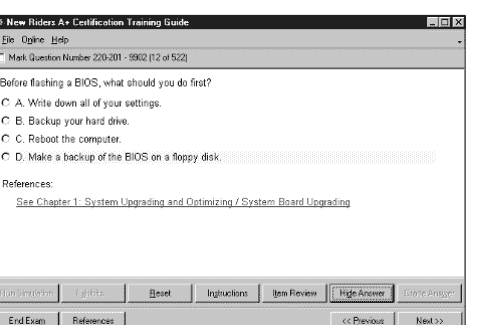

**图 D.4**

典型的多选题。

您可以使用以下三种方法之一来清除单选按钮：

- 点击另一个单选按钮。
- 点击另一个答案的文本。
- 按下与另一个答案相对应的字母键。

您可以使用以下三种方法之一来清除复选框：

- 点击选中答案旁边的复选框。
- 点击选中答案的文本。
- 按下与选中答案相对应的字母键。

要清除所有答案，请点击“重置”按钮。

请记住，某些问题有多个正确答案。不要因此而感到困惑。多选问题中，没有哪个答案比另一个答案“更正确”。在单选格式中，只有一个答案是正确的。ExamGear 培训指南版会提示您必须选择的答案数量。

## 标准 ExamGear 培训指南版选项

无论问题类型如何，一套一致的可点击按钮允许您进行导航并与问题交互。以下列表描述了您可能会看到的每个按钮的功能。根据问题类型，某些按钮将显示为灰色且无法访问。适用于该问题类型的按钮则是激活状态。

- **运行模拟 (Run Simulation)**。如果问题支持模拟，此按钮将启用。（本书中该按钮被禁用。）点击此按钮将开始模拟过程。
- **附件 (Exhibits)**。如果提供了支持问题的附件，此按钮将启用。附件是提供回答问题所需补充信息的图像、视频、声音或文本文件。如果一个问题有多个附件，将出现一个对话框，按名称列出附件。如果只有一个附件，点击“附件”按钮时将立即打开该文件。
- **重置 (Reset)**。此按钮将清除您所做的任何选择，并将问题窗口恢复到首次显示时的状态。
- **指令 (Instructions)**。此按钮显示与当前问题类型交互的指令。
- **题目回顾 (Item Review)**。此按钮将离开问题窗口并打开“题目回顾”屏幕。有关“题目回顾”屏幕的详细说明，请参阅本附录后面的“题目回顾”部分。
- **显示答案 (Show Answer)**。此选项显示正确答案以及正确原因的解释。如果您选择此选项，当前问题将不计分。
- **评分 (Grade Answer)**。如果配置选项中选择了“测试结束时评分”，则此按钮被禁用。当配置选项中选择“每答一题即评分”时，该按钮启用。点击此按钮将立即对当前问题进行评分。系统将提供正确答案的解释，就像按下“显示答案”按钮一样，但该问题会被计分。
- **结束考试 (End Exam)**。此按钮结束考试并显示“考试成绩报告”屏幕。
- **<< 上一个 (Previous)**。此按钮显示考试中的上一个问题。
- **下一个 >> (Next)**。此按钮显示考试中的下一个问题。
- **<< 上一个标记 (Previous Marked)**。如果您选择使用“题目回顾”屏幕回顾已标记的问题，则显示此按钮。此按钮显示上一个标记的问题。关于标记问题的详细讨论见本附录后面。
- **<< 上一个未完成 (Previous Incomplete)**。如果您选择使用“题目回顾”屏幕回顾未回答的问题，则显示此按钮。此按钮显示上一个未回答的问题。
- **下一个标记 >> (Next Marked)**。如果您选择使用“题目回顾”屏幕回顾已标记的问题，则显示此按钮。此按钮显示下一个标记的问题。关于标记问题的详细讨论见本附录后面。
- **下一个未完成 > (Next Incomplete)**。如果您选择使用“题目回顾”屏幕回顾未回答的问题，则显示此按钮。此按钮显示下一个未回答的问题。

## 热点问题 (Hot Spot Questions)

热点问题要求您通过点击显示的图形或图表中的某个区域来正确识别项目（见图 D.5）。要回答该问题，请将鼠标光标置于图形上，然后按下鼠标右键以表示您的选择。要选择图形上的另一个区域，您无需取消选择第一个区域，只需点击图像中的另一个区域即可。

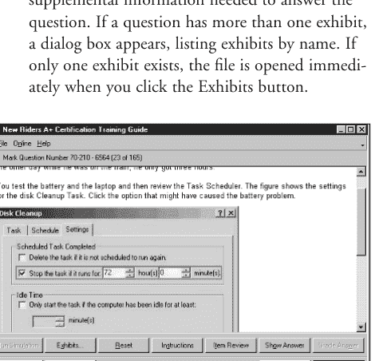

**图 D.5**

一个典型的热点问题。

## 标记问题与剩余时间

ExamGear 为您提供两种方法来帮助应对测试过程的时间限制。如果您发现需要跳过某个问题，或者想要检查完成测试的剩余时间，请使用以下章节中讨论的选项之一。

### 标记问题 (Mark Question)

勾选此框以标记问题，以便稍后使用“题目回顾”功能返回。自适应考试不允许标记问题，因为它不支持题目回顾。

### 剩余时间 (Time Remaining)

如果测试有时间限制，“剩余时间”指示器将被启用。它会倒计时完成测试所需的剩余分钟数。自适应考试不提供此功能，因为它没有时间限制。

## 题目回顾 (Item Review)

“题目回顾”屏幕允许您跳转到任何问题。ExamGear 培训指南版将任何未回答的问题，或任何尚未选满所需响应总数的选择题视为“未完成”问题。例如，如果问题要求三个答案而您仅选择了 A 和 C，ExamGear 将认为该问题未完成。

“题目回顾”屏幕允许您以不同方式回顾考试问题。您可以进入两种浏览序列（类似记录的系列）之一：浏览标记问题或浏览未完成问题。您还可以根据若干标准创建自定义的考试问题分组进行回顾。

在使用“题目回顾”时，如果在参加考试期间为某个问题选择了“显示答案”，那么该问题在“题目回顾”中将显示为灰色。如果您使用“重置”按钮重置问题状态，则可以再次回答该问题。

“题目回顾”屏幕包含两个选项卡。“问题”选项卡以列的形式列出问题及其信息。“当前分数”选项卡提供您的考试分数信息，每个章节以百分比表示，总分以柱状图表示。

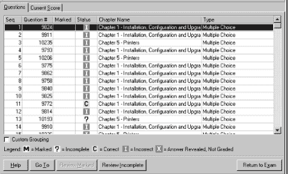

**图 D.6**

“题目回顾”屏幕上的“问题”选项卡。

### 列 (Columns)

“问题”选项卡包含以下六列信息：

- **Seq.** 表示问题在考试中显示的顺序号。
- **Question Number.** 显示问题的识别编号，以便于参考。
- **Marked.** 表示您使用“标记问题”复选框标记的问题。
- **Status.** 状态可以是 M（已标记）、?（未完成）、C（正确）、I（错误）或 X（已显示答案）。
- **Chapter Name.** 与每个问题相关的章节名称。
- **Type.** 问题类型，可以是“多选题 (Multiple-Choice)”或“热点题 (Hot Spot)”。

### 题目回顾的问题选项卡

“题目回顾”屏幕上的“问题”选项卡在表格中呈现考试问题和问题信息（见图 D.6）。您可以通过点击网格选择任何想要的行。每当选择一行时，“转到 (Go To)”按钮就会启用。点击“转到”按钮将显示所选行的问题。您也可以通过双击该行来显示问题。

# 附录 D 使用 EXAMGEAR 培训指南版软件

要调整列宽，请将鼠标指针置于列标题之间的垂直线上。当鼠标指针变为一组左右箭头时，您可以将列边界向左或向右拖动，以增加或减少列宽。只需点击鼠标左键并保持按下，同时将列边界向所需方向移动即可。

“题目回顾”屏幕允许您根据任何列标题对问题进行排序。最初，序列号列表在“Seq.”列中按降序排列。要根据不同的列标题排序，请点击该标题。您会看到列标题上出现一个箭头，指示排序方向（升序或降序）。要更改排序方向，请再次点击该列标题。

“题目回顾”屏幕还允许您创建自定义分组。此功能允许您根据您喜欢的任何标准组合对问题进行排序。例如，您可能希望首先根据是否标记、然后根据章节名称、最后根据顺序号对问题项进行排序。自定义分组功能可实现此操作。首先勾选“自定义分组 (Custom Grouping)”复选框（见图 D.7）。这样做之后，问题表格会在屏幕上稍微下移，并在表格顶部出现一条消息：“将列标题拖到此处以按该列分组”。

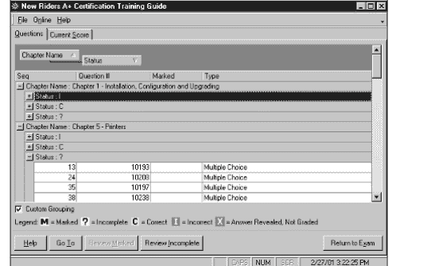

**图 D.7**

“自定义分组”复选框允许您创建自己的问题排序顺序。

只需用鼠标左键点击您想要的列标题，保持按下，然后将鼠标移动到“问题”表格的正上方区域（自定义分组区域）。松开鼠标左键，即可将列标题放入自定义分组区域。要实现上述自定义分组，首先勾选“自定义分组”复选框。然后将“Marked”列标题拖入“问题”表格上方的自定义分组区域。接着，将“Chapter Name”列标题拖入自定义分组区域。您会看到这两个列标题由一条线连接，指示自定义分组的顺序。最后，将“Seq”列标题拖入自定义分组区域。此标题将由另一条线与“Chapter Name”标题连接，指示自定义分组的方向。


请注意，自定义分组区域中的每个列标题都有一个箭头，指示该列标题下项目的排序方向。您可以使用这些箭头在单个列标题的基础上反转排序方向。点击自定义分组区域中的列标题，仅更改该列标题的排序方向。例如，使用之前创建的自定义分组，您可以显示的问题列表排序为：首先按是否标记降序排列，然后按章节名称降序排列，最后按顺序号升序排列。

“题目回顾”屏幕的自定义分组功能在选择如何回顾考试问题方面为您提供了极大的灵活性。要移除自定义分组并使“题目回顾”显示恢复到默认设置（按顺序号降序排列），只需取消勾选“自定义分组”复选框即可。

## 当前分数选项卡

项目回顾（Item Review）的“当前分数”选项卡提供了您分数屏幕的实时快照（见图 D.8）。屏幕的上半部分是一个可展开的网格。当网格折叠时，显示每个章节的分数。章节可以展开以显示目标和子目标的百分比分数。关于您考试进度的信息呈现在以下列中：

- **章节名称（Chapter Name）**。此列显示每个目标组的章节名称。
- **百分比（Percentage）**。此列显示每个目标组中您正确回答的问题百分比。
- **已尝试（Attempted）**。此列列出每个目标组中您全部或部分回答的问题数量。
- **正确（Correct）**。此列列出每个目标组中您正确回答的问题实际数量。
- **显示答案（Answer Shown）**。此列列出每个目标组中您选择使用“显示答案”按钮查看答案的问题数量。

评分表中的列的实现方式和排序方式与“项目回顾问题”选项卡中的问题表相同。详情请参阅前面的“项目回顾问题回顾选项卡”部分。

网格下方呈现了分数的图形概览。该图包含两根红条：顶条代表您当前的考试分数；底条代表所需的及格分数。图例中条形图右侧是一个列表，列出了所需分数和您的分数。条形图下方有一段陈述，描述了所需的及格分数和您当前的分数。

此外，信息可以按整体基础或按考试章节呈现。“整体（Overall）”选项卡显示总分，“按章节（By Chapter）”选项卡显示各章节分数。

点击“结束考试（End Exam）”按钮将终止考试并将控制权移交给“考试分数报告”屏幕。

“返回考试（Return to Exam）”按钮将带您从点击“项目回顾”按钮时的那个问题返回到考试中。

## 回顾标记项

“回顾标记项”屏幕允许您进入标记问题的浏览序列。当您点击“回顾标记（Review Marked）”按钮时，之前使用“标记问题（Mark Question）”复选框标记的问题将呈现在您的回顾界面中。在浏览标记问题时，您会看到可用按钮发生以下变化：

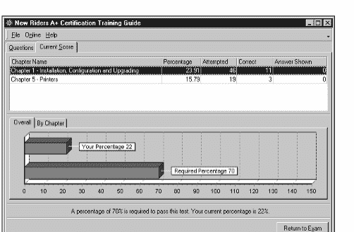

**图 D.8**

项目回顾屏幕上的当前分数选项卡。

- “下一步（Next）”按钮的标题变为“下一个标记（Next Marked）”。
- “上一步（Previous）”按钮的标题变为“上一个标记（Previous Marked）”。

## 回顾未完成项

项目回顾屏幕允许您进入未完成问题的浏览序列。当您点击“回顾未完成（Review Incomplete）”按钮时，您未回答或未完全回答的问题将显示在回顾界面中。在浏览未完成问题时，您会看到按钮发生以下变化：

- “下一步（Next）”按钮的标题变为“下一个未完成（Next Incomplete）”。
- “上一步（Previous）”按钮的标题变为“上一个未完成（Previous Incomplete）”。

## 考试分数报告屏幕

当学习模式、模拟考试或自适应考试结束时（由于计时器到期、所有问题已完成或您决定提前终止），将出现“考试分数报告”屏幕（见图 D.9）。

此屏幕为您提供测试分数的图形显示，以及按章节划分的分数细分表。屏幕顶部的图形显示将您的总分与通过考试所需的分数进行对比。图形显示下方的按钮允许您打开“显示我错在哪里（Show Me What I Missed）”浏览序列、打印屏幕或返回主菜单。

## “显示我错在哪里”浏览序列

通过在“考试分数报告”或自适应考试的配置屏幕中点击“显示我错在哪里”按钮来启动该浏览序列。

请注意，窗口标题已修改，以指示您处于“显示我错在哪里”浏览序列模式。问题 ID 和在浏览序列中的位置显示在屏幕顶部，取代了“标记问题”和“剩余时间”指示器。主窗口内容根据问题类型而有所不同。以下列表描述了“显示我错在哪里”浏览序列中可用的按钮及其执行的功能：

- **返回分数报告（Return to Score Report）**。将控制权返回到“考试分数报告”屏幕。在自适应考试的情况下，此按钮的标题为“退出（Exit）”，控制权返回到自适应考试配置屏幕。
- **运行模拟（Run Simulation）**。以“评分（Grade）”模式打开模拟，使模拟在打开时显示您的回答和正确答案。如果当前问题不提供模拟，则此按钮禁用。
- **附件（Exhibits）**。打开附件窗口。如果该问题有一个或多个可用附件，则此按钮启用。


**图 D.9**

考试分数报告屏幕。

- **说明（Instructions）**。显示如何回答当前类型的问题。
- **打印（Print）**。打印当前屏幕。
- **上一个或下一个（Previous or Next）**。显示遗漏的问题。

# 检查网站

要检查 New Riders 主页或 ExamGear 培训指南版主页以获取更新或其他产品信息，请从“在线（Online）”菜单的“网站（Web Sites）”选项中选择所需的网站。您必须连接到 Internet 才能访问这些网站。

## 常见问题解答

ExamGear FAQ 可以在此处找到：

`http://www.newriders.com/examgear/support/faq.cfm`

# 获取更新

本节概述了获取更新的步骤。

## 更新目录网站

从“在线（Online）”菜单中选择“检查产品更新（Check for Product Updates）”选项，将向您展示可通过网络浏览器免费下载或购买的全系列产品。您必须连接到 Internet 才能访问这些网站。

## 更新类型

可能有几种类型的更新可供下载，包括各种免费更新和可购买的额外项目。

### 免费程序更新

免费程序更新包括对 ExamGear 培训指南版可执行文件和运行时库（DLLs）的更改。当下载其中任何一项时，ExamGear 会自动安装升级程序。安装完成后，ExamGear 培训指南版将重新打开。

### 免费数据库更新

免费数据库更新包括对您已注册的考试或多项考试的更新。考试更新包含在压缩且加密的文件中，包括考试数据库和附件。ExamGear 培训指南版会自动将这些文件解压到正确位置，并更新 ExamGear 软件以记录版本更改并导入新问题集。

# 联系 NEW RIDERS 出版社

在 New Riders，我们努力满足并超越客户的需求。我们开发 ExamGear 培训指南版是为了超越寻求技术认证的网络专业人士的需求和期望，我们认为这已体现在产品中。您怎么看？

如果您需要就 ExamGear 培训指南版产品线的任何方面联系 New Riders，请随时联系。我们期待收到您的消息。请通过以下地址或电话号码联系我们：

**New Riders Publishing**

**201 West 103rd Street**

**Indianapolis, IN 46290**

**800-545-5914**

您也可以在万维网上访问我们：

`http://www.newriders.com`

## 技术支持

技术支持在指定时间内通过电子邮件或以下电话号码提供：

**电话：317-581-3833**

**电子邮件：examgear@newriders.com**

周一至周五，中部标准时间上午 10 点至下午 3 点。

您可以访问在线支持网站 `www.newriders.com/support` 并通过 Internet 提交支持请求。

## 客户服务

如果您收到损坏的产品并需要更换或退款，请拨打以下电话号码：

**800-858-7674**

## 产品更新

可通过选择 ExamGear 培训指南版的“在线（Online）”下拉菜单并选择“检查产品更新（Check for Products Updates）”来获取产品更新。您将被引导至一个包含完整详细信息的网站。

## 产品建议与评论

我们非常重视您的意见！请将您的建议和评论发送至以下地址：

`nrfeedback@newriders.com`

## 许可协议

在撕开包装封条之前，您应仔细阅读以下条款和条件。本协议除其他事项外，向您授予随附软件的许可，并包含保修和责任免责声明。撕开包装封条即表示您接受并同意本协议的条款和条件。如果您不同意本协议的条款，请勿撕开封条。您应立即将未开封的包装退回。

## 许可

根据本协议包含的规定，New Riders Publishing (NRP) 特此授予您在包装上标明的单台计算机上使用包装内计算机软件产品（软件）目标代码版本的非独占、不可转让的许可。

## 软件与文档

NRP 应以机器可读的目标代码形式通过介质向您提供软件，并可能提供包含软件操作和使用说明的标准文档（文档）。

## 许可期限与费用

本许可的期限自软件交付给您之日起开始，除非因违约而提前终止或本协议另有规定，否则为永久许可。

### 所有权

软件及文档的所有权、所有权权利和知识产权应保留在 NRP 及/或软件中所含程序的 NRP 供应商手中。本软件根据本许可提供给您用于内部使用。本许可不包括分许可权，且仅限您本人使用，因此未经 NRP 事先书面同意，不得（通过法律运作或其他方式）转让或转移。您承认源代码形式的软件仍是 NRP 及/或其供应商的机密商业秘密，因此您同意不尝试对软件进行破译、反编译、修改、反汇编、逆向工程或编写衍生作品，也不开发软件源代码，或在明知的情况下允许他人这样做。此外，您不得复制文档或随软件附带的其他书面材料。

### 更新

本许可不授予您对软件和文档的任何改进、修改、增强或更新的任何权利、许可或权益。如果提供更新，您可以按照 NRP 当时的标准定价、条款和条件获得。

## 有限保证与免责声明

NRP 保证，如果由 NRP 提供包含软件的介质，则自您购买其许可之日起六十（60）天内，在正常使用情况下，该介质在材料和工艺上无缺陷。

这是一项有限保证，也是 NRP 提供的唯一保证。软件按“原样”提供，NRP 明确否认任何形式的所有保证，无论是明示的还是暗示的，包括但不限于关于适销性和特定用途适用性的暗示保证。此外，公司不对软件在正确性、准确性、可靠性、及时性或其他方面的使用或使用结果做出任何保证、担保或陈述，也不保证任何软件的运行将是不间断或无错误的。NRP 明确否认本协议中未规定的任何保证。NRP 或任何 NRP 经销商、代理商、员工或其他人员提供的任何口头或书面信息或建议均不得创建、修改或扩展保证，或以任何方式增加前述保证的范围，分许可持有人或购买者均不得依赖任何此类信息或建议。如果介质遭遇事故、滥用或使用不当，或者您违反本协议条款，则本保证应立即

## 责任限制

对于与软件以任何方式相关的任何损害或损失，您的唯一且排他的救济措施如下所述。

在任何情况下以及根据任何法律理论（侵权、合同或其他方式），NRP 均不对您或任何其他人员承担任何间接、特殊、偶然或后果性损害的责任，无论其性质如何，包括但不限于：商誉损失、利润损失、停工、计算机故障或故障，或任何及所有其他商业损害或损失，或任何其他损害，即使 NRP 已被告知此类损害的可能性，或任何由另一方提出的索赔。NRP 的第三方程序供应商不对您做出任何保证，且不承担任何责任。NRP 的唯一且排他的义务和责任，以及您的唯一救济应为：经 NRP 选择，(i) 更换我们的缺陷介质；或 (ii) 如果 NRP 能够，则修复或纠正您的缺陷介质，使其符合上述保证；或 (iii) 如果 NRP 无法更换或修复，您可以通过退还软件来终止本许可。只有在适用保证期内您将问题告知 NRP，NRP 才有义务履行本保证。某些州或司法管辖区不允许排除暗示保证或限制/排除后果性损害，因此上述限制或排除可能不适用于您。本保证赋予您特定的法律权利，您还可能拥有因州或司法管辖区而异的其他权利。

## 杂项

如果本协议的任何条款在某些情况下因任何原因被认为无效、不可执行或非法，则此类决定不应影响 (i) 该条款在其他情况下的有效性或可执行性，或 (ii) 本协议其余条款在所有情况下的有效性或可执行性，且该条款应在仅在使其在此时的情况下有效、可执行且合法所需的范围内进行修订。所有标题仅为方便而设，不应被用于解释本协议。本协议应受纽约州法律管辖并据其解释，且该法律适用于在纽约州居民之间订立并在纽约州内完全履行的协议，除非美国政府规则和法规要求由联邦法律管辖。

您承认您已阅读本协议，理解本协议，并同意受其条款和条件的约束。您进一步同意，本协议是我们之间完整且排他的协议陈述，取代任何口头或书面的提案或先前协议，以及我们之间关于本协议主题的所有其他沟通。

## 美国政府受限权利

政府的使用、复制或披露受 FAR 52.227-19 中“商业计算机-受限权利”条款（如适用）分段 (a) 至 (f) 的限制，或受 DFARS 252.227-7013 中“技术数据和计算机软件权利”条款分段 (c)(1)(ii) 的限制，以及 NASA FAR 补充条款中类似条款的限制。

# 附录 E

## 示例考试题答案

本附录包含每章末尾考试题的答案。部分答案附有解释，其他答案没有解释，应能通过常识理解。如果无法理解，您应参考讨论该问题的章节。

### 第 1 章

- 1. 以下哪些网络设备在 OSI 参考网络模型的数据链路层运行？选择所有适用项。

  A. 中继器 (Repeater)

  B. 路由器 (Router)

  C. 网桥 (Bridge)

  D. 交换机 (Switch)

  答案：**C, D**。中继器在物理层工作，而路由器涵盖前三层（物理层、数据链路层、网络层）。

- 2. 以下哪一项涵盖了 OSI 模型的所有层？

  A. 网关 (Gateway)

  B. 路由器 (Router)

  C. 交换机 (Switch)

  D. 集线器 (Hub)

  答案：**A**。集线器在物理层级别工作。交换机涵盖 OSI 模型的前两层。路由器涵盖 OSI 模型的前三层。网关涵盖所有层。

- 3. 关于广域网 (WAN)，以下哪项 *不是* 正确的？

  A. 这些网络跨越较大的地理区域。

  B. 与局域网相比，这些是低速网络。

  C. 10BASE-T 以太网可用于广域网。

  D. 与局域网相比，广域网的安装和维护通常成本较高。

  答案：**C**。10BASE-T 以太网仅是局域网的标准，因此对于广域网是不正确的。

- 4. 以下哪些局域网 (LAN) 拓扑结构存在单点故障？选择所有适用项。

  A. 总线型 (Bus)

  B. 星型 (Star)

  C. FDDI 使用的双环型 (Dual ring)

  答案：**A, B**。在双环 FDDI 的情况下，如果一个环失效，另一个环仍可用于网络通信。

- 5. 在单个局域网中混合使用多种物理拓扑结构是否可能？（是/否）

  答案：**是**。大多数实际网络使用混合拓扑结构。

- 6. 两个主机之间直接通信不需要拥有共同的协议。（正确/错误）

  答案：**错误**。网络上的两个主机之间要直接通信，必须拥有共同的协议。然而，如果这两个主机之间有一个协议转换器（网关），那么使用不同协议的主机仍然可以通信。

- 7. 从最顶层开始，OSI 模型上四层的正确顺序是什么？

  A. 表示层, 会话层, 传输层, 应用层

  B. 应用层, 表示层, 会话层, 传输层

  C. 应用层, 会话层, 表示层, 传输层

  D. 应用层, 表示层, 传输层, 会话层

  答案：**B**。

- 8. 在分层协议中，控制两个相邻层之间通信的协议称为什么？

  A. 对等协议 (Peer protocols)

  B. 接口 (Interfaces)

  C. 分层协议 (Layered protocols)

  D. 开放系统接口 (Open Systems Interface)

  答案：**B**。对等协议控制同一级别但位于不同主机上的两层之间的通信。C 和 D 不是协议名称。

- 9. 以下哪个层实现了 MAC 地址？

  A. 数据链路层 (Data Link layer)

  B. 物理层 (Physical layer)

  C. 传输层 (Transport layer)

  D. 网络层 (Network layer)

  答案：**A**。

- 10. 网络层负责以下哪些内容？选择所有适用项。

  A. 点对点数据错误检测和纠正

  B. 端到端数据错误检测和纠正

  C. 主机的 MAC 地址实现

  D. 主机的逻辑地址实现

  E. 路由 (Routing)

  答案：**A, D, E**。端到端数据错误检测和纠正由传输层完成。MAC 地址由数据链路层实现，而非网络层。

- 11. OSI 模型的哪一层负责数据格式转换？

  A. 传输层 (Transport)

  B. 应用层 (Application)

  C. 会话层 (Session)

  D. 表示层 (Presentation)

  E. 数据链路层 (Data Link)

  答案：**D**。

## 附录 E 示例考题答案

12. 100BASE-T 以太网网络中使用哪种电缆？

A. 5 类双绞线 (Category 5 twisted-pair cable)

B. 3 类双绞线 (Category 3 twisted-pair cable)

C. 2 类双绞线 (Category 2 twisted-pair cable)

D. 同轴电缆 (Coaxial cable)

E. 光纤电缆 (Fiber-optic cable)

答案：**A.**

13. 关于中继器 (repeaters) 的以下哪些陈述是正确的？选择所有适用项。

A. 中继器可以再生并重塑电信号。


B. 中继器用于 OSI 模型的物理层。

C. 你可以使用任意数量的中继器来扩展网络长度。

D. 集线器（`hub`）也被称为多端口中继器。

答案：A、B、D。扩展网络的中继器数量是有上限的；因此答案 C 是错误的。在以太网中，最多可以使用四个中继器。

### 14. 关于交换机（`switches`）的以下哪些陈述是正确的？选择所有适用项

A. 交换机根据 MAC 地址过滤数据。

B. 交换机提供多个并行数据路径。

C. 交换机通过 IP 地址识别主机。

D. 交换机可能具有不同类型的接口。

E. 交换机可以充当协议转换器。

答案：A、B、D。答案 C 不正确，因为 IP 地址是在网络层实现的，而交换机不涵盖该层。答案 E 不正确，因为这是网关的功能，而不是交换机的功能。

### 15. 在基于 CSMA/CD 的网络中，当发生冲突时，发送主机何时重新传输数据？

A. 在一段固定时间后

B. 在一段可变时间后

答案：B。

### 16. 10BASE-2 以太网网络中单个分段的最大长度是多少？

A. 200 米

B. 185 米

C. 500 米

D. 1000 米

E. 长度不固定。

答案：B。

### 17. Token Ring（令牌环）网络是什么？

A. 单环拓扑网络

B. 双环拓扑网络

C. 星型连接网络

D. 总线连接网络

答案：C。

### 18. 以太网地址或 MAC 地址的长度是多少？

A. 20 字节

B. 48 位（bits）

C. 32 位（bits）

D. 60 位（bits）

答案：B。

### 19. 什么是以太网广播地址？

- A. 它是一个所有位均为 1 的 32 位地址。
- B. 它是一个所有位均为 0 的 48 位地址。
- C. 它与 IP 网络广播地址相同。
- D. 它是一个所有位均为 1 的 48 位地址。

答案：D。

### 20. 如何在 Solaris 机器中列出已安装的以太网适配器？选择所有适用项

- A. 使用 `ifconfig` 命令
- B. 使用 `netstat` 命令
- C. 使用 `ether` 命令
- D. 以上都不是

答案：A、B。答案 C 不正确，因为 Solaris 中没有 `ether` 这样的命令。

### 21. 你有一台网络接口为 `nm0` 的工作站。该网络接口已配置并启用，且是该工作站唯一的网络连接。哪个命令不能用于显示网络接口 `nm0` 的 MAC 地址？

- A. `ifconfig nm0`
- B. `ifconfig -mac nm0`
- C. `ifconfig -a`
- D. `arp -a`

答案：B。第一个命令专门显示接口 `nm0` 的信息。第三个和第四个命令显示所有网络接口的信息。第二个命令使用了无效的开关 `-mac`，无法显示 MAC 地址。

### 22. 在 Solaris 8 中，你会使用哪个命令来捕获并显示网络数据包的信息？

- A. `netstat`
- B. `ping`
- C. `traceroute`
- D. `snoop`
- E. `tcpdump`

答案：D。前三个命令不能用于捕获数据包。`snoop` 命令随 Solaris 8 一起提供。`tcpdump` 是一个可免费获取的软件包，可能需要单独安装，但它不是 Solaris 8 的一部分。

### 23. 以下哪两个陈述是不正确的？

- A. 由 `snoop` 命令捕获的数据包可以存储在文件中以便后续查看。
- B. `snoop` 命令可用于查看数据包的特定层和特定部分。
- C. `snoop` 命令不显示数据包的源 MAC 地址。
- D. `snoop` 命令不显示数据包的大小。

答案：C、D。答案 C 和 D 不正确，因为 `snoop` 命令可以完成这两项任务。

### 24. 在同轴电缆中，使用什么来避免信号从电缆末端反射？

- A. 反射器（reflector）
- B. 终端电阻（terminator）
- C. 连接器（connector）
- D. 吸收器（absorber）

答案：B。

### 25. OSI 模型的哪一层被分为 MAC 子层和 LLC 子层？

A. 数据链路层（Data Link layer）

B. 物理层（Physical layer）

C. 网络层（Network layer）

D. 以上都不是

答案：A。

### 26. RJ-45 连接器用于哪种类型的电缆？

A. 同轴电缆

B. 双绞线电缆

C. 光纤电缆

D. 粗以太网电缆

答案：B。

## 第 2 章

### 1. TCP/IP 协议中的以下哪个层涵盖了 OSI 模型的高三层？

A. IP 层

B. TCP 层

C. 数据链路层

D. 应用层

答案：D。TCP/IP 协议中的应用层涵盖了 OSI 的高三层（会话层、表示层和应用层）。

### 2. IP 层可以使用以下哪些底层协议？

A. Ethernet（以太网）

B. HDLC

C. Frame Relay（帧中继）

D. PPP

E. 以上全部

答案：E。

### 3. IPv4 地址的长度是多少？

A. 32 位（bits）

B. 48 位（bits）

C. 64 位（bits）

D. 128 位（bits）

答案：A。

### 4. 哪个协议将 IP 地址映射到 MAC 地址？

A. ARP

B. RARP

C. ICMP

D. UDP

答案：A。地址解析协议（ARP）用于此目的。RARP 执行与 ARP 相反的任务。ICMP 用于网络控制和其他目的，而 UDP 是一种传输层协议。

### 5. ICMP 协议用于以下哪些方面？

A. IP 网络中的错误报告

B. 网络诊断

C. `ping` 命令

D. 以上全部

答案：D。

### 6. TCP 和 UDP 协议在 OSI 模型的哪一层运行？

A. 数据链路层

B. 网络层

C. 传输层

D. 应用层

E. 会话层

答案：C。

### 7. 你可以在 `/etc/inet/services` 文件中找到哪些信息？选择所有适用项

A. 不同服务的名称

B. 关于哪些服务正在运行以及哪些未运行的信息

C. 这些服务使用的端口号

D. 每个服务允许的连接数

答案：A、C。`/etc/inet/services` 文件不包含关于答案 B 和 D 的任何信息。

### 8. 关于 ARP，哪一项是不正确的？

A. ARP 使用广播方法。

B. ARP 将 IP 地址映射到主机名。

C. 解析出的 MAC 地址将永久保留在 ARP 缓存表中。

D. 在发送任何 IP 数据包之前，使用 ARP 来确定目的地的 MAC 地址。

答案：B、C。解析出的地址仅在 ARP 缓存中保留一段时间。

### 9. 除 TCP 和 UDP 之外的任何协议也可以在 IP 之上使用。（正确/错误）

答案：正确（True）。

### 10. 关于无连接服务和面向连接服务的哪些陈述是正确的？选择所有正确的项

A. 在面向连接的服务中，在开始传输数据之前会建立端到端连接。

B. TCP 用于面向连接的服务。

C. UDP 既可用于无连接服务，也可用于面向连接服务。

D. 无连接服务是可靠的。

E. 与 UDP 相比，TCP 较慢，因为为了提供数据传输的可靠性而存在通信开销。

答案：A、B、E。答案 C 不正确，因为 UDP 始终用于无连接服务。答案 D 不正确，因为无连接服务不可靠。

### 11. 关于 IP 地址的以下哪些陈述是正确的？选择所有适用项

A. 一个 IP 地址由 4 个八位组（octets）组成。

B. 每个八位组的值范围可以是 0 到 256。

C. IP 地址中的每个八位组由 8 到 16 位组成。

D. 182.268.20.30 不是一个合法的 IP 地址。

答案：A、D。答案 B 不正确，因为每个八位组的范围是 0 到 255。答案 C 不正确，因为每个八位组长度为 8 位。

### 12. 以下哪个子网掩码是不合法的？

A. 255.255.255.0

B. 255.255.224.224

C. 255.255.255.244

D. 255.255.255.248

答案：C。在答案 C 中，1 位紧跟在 0 位之后，这在网络掩码中是不允许的。

### 13. B 类网络的默认网络掩码地址是什么？

A. 255.0.0.0

B. 255.255.0.0

C. 255.255.255.0

D. 255.255.0.255

答案：B。

### 14. 网络号为 192.168.20.64 且网络掩码为 255.255.255.224 的广播地址是什么？

A. 192.168.20.255

B. 192.168.20.127

C. 192.168.20.95

D. 192.168.20.63

答案：C。该网络中的地址范围是从 192.168.20.64 到 192.168.20.95。最后一个地址是广播地址，因此选项 C 是正确答案。

### 15. 在 C 类网络中可以拥有多少个主机？

A. 256

B. 255

C. 254

D. 随你愿意的数量

答案：C。C 类网络中有 256 个地址。其中一个地址用作网络地址，另一个用作广播地址。因此可能有 254 个主机地址。

### 16. 网络 126.0.0.0 属于哪一类 IP 地址？

A. A 类

B. B 类

C. C 类

D. D 类

答案：A。

### 17. C 类网络中的地址以哪个位模式开始？

A. 00

B. 01

C. 110

D. 0111

答案：C。

### 18. 哪一类 IP 地址用于组播（多播）网络？

A. A 类

B. B 类

C. C 类

D. D 类

E. M 类

答案：D。

### 19. 若要将一个 C 类网络划分为四个子网，需要在网络掩码中增加多少位？

A. 1

B. 2

C. 4

D. 8

答案：B。

## 附录 E 模拟考试题目答案

### 20. 将网络划分为不同长度的子网络的方法称为什么？

A. 子网划分（Subnetting）

B. 超网划分（Supernetting）

C. VLSM

D. CIDR

答案：C。这是可变长度子网掩码方法。

### 21. 以下哪项是编写 C 类网络的正确方式？

A. 192.168.2.0/8

B. 192.168.2.0/16

C. 192.168.2.0/24

D. 192.168.2.0/32

答案：C。IP 地址中斜杠字符后的最后一个数字显示了地址中网络部分所使用的位数。因为 C 类网络在网络地址中使用 24 位，所以答案 C 是正确答案。

### 22. 哪些地址因为处于实验范围而不在互联网上使用？选择所有适用项

A. 192.168.2.0

B. 172.16.0.0

C. 168.16.0.0

D. 10.0.0.0

E. 10.1.0.0

答案：A、B、D、E。

### 23. 哪个 IP 地址被分配给回环接口（loopback interface）？

A. 127.0.0.0

B. 127.0.0.1

C. 10.0.0.1

D. 0.0.0.0

答案：B。

### 24. `/etc/inet/hosts` 文件可以使用哪种语法？选择所有适用项

A. `<IP 地址> <主机名> <主机别名>`

B. `<IP 地址> <主机名>`

C. `<主机名> <IP 地址> <主机别名>`

D. `<主机名> <IP 地址>`

答案：A、B。

### 25. 如何找出 IP 数据包中使用的 IP 版本？

A. 使用 `version` 命令

B. 查看 IP 数据包中的 Version 字段

C. 查看 IP 数据包中的 Protocol 字段

D. 查看 IP 数据包中的源地址和目的地址字段

答案：B。这可以使用 `snoop` 命令完成。

### 26. 从哪个文件中可以找到分配给不同协议的协议号？

答案：`/etc/inet/protocols`

### 27. ICMP 数据包用于以下哪些用途？选择所有适用项

- A. 参数问题（Parameter Problem）
- B. 源端抑制（Source Quench）
- C. 重定向消息（Redirect message）
- D. 回显请求和回显应答（Echo Request and Echo Reply）
- E. 以上所有

答案：E。

### 28. 以下哪个命令正确地配置了网络接口 `hme0`？

- A. `ifconfig netmask 255.255.255.0 hme0 192.168.5.6 up`
- B. `ifconfig hme0:0 192.168.5.6 255.255.255.0`
- C. `ifconfig 192.168.5.6 hme0 netmask 255.255.255.0 up`
- D. `ifconfig hme0 192.168.5.6 netmask 255.255.255.0 up`

答案：D。

### 29. 以下哪些命令可用于检查接口上的 IP 地址？选择所有适用项

- A. `ifconfig`
- B. `netstat`
- C. `ping`
- D. `traceroute`

答案：A、B。

### 30. 如何为 LAN 接口设置 MTU 值？

- A. 使用 `ifconfig` 命令
- B. 使用 `nod` 命令
- C. 使用 `mtu` 命令
- D. 使用 `arp` 命令

答案：A。

## 第三章

### 1. 两个路由器 A 和 B 通过以太网端口连接在一起。主机 C 连接到路由器 B 的以太网端口，如图 3.4 所示

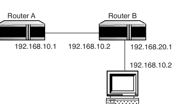

**图 3.4** 连接方案。

分配给路由器不同端口的 IP 地址也显示在图中。路由器和主机都定义了静态路由，如下所示：

路由器 A 上 `netstat -rn -f inet` 的输出：

```bash
bash-2.03# netstat -rn -f inet
```

| 目的地址 | 网关 | 标志 | 引用 | 使用 | 接口 |
|---|---|---|---|---|---|
| 192.168.10.0 | 192.168.10.1 | U | 1 | 0 | hme0 |
| 224.0.0.0 | 192.168.10.1 | U | 1 | 0 | hme0 |
| default | 192.168.10.2 | UG | 1 | 14 | |
| 127.0.0.1 | 127.0.0.1 | UH | 22 | 16239 | lo0 |

```bash
bash-2.03#
```

路由器 B 上 `netstat -rn -f inet` 的输出：

```bash
bash-2.03# netstat -rn
```

| 目的地址 | 网关 | 标志 | 引用 | 使用 | 接口 |
|---|---|---|---|---|---|
| 192.168.10.0 | 192.168.10.2 | U | 1 | 0 | hme0 |
| 192.168.20.0 | 192.168.20.1 | U | 1 | 0 | hme1 |
| 224.0.0.0 | 192.168.10.2 | U | 1 | 0 | hme0 |
| default | 192.168.10.1 | UG | 1 | 14 | |
| 127.0.0.1 | 127.0.0.1 | UH | 22 | 16239 | lo0 |

```bash
bash-2.03#
```

主机 C 上 `netstat -rn -f inet` 的输出：

```bash
bash-2.03# netstat -rn -f inet
```

| 目的地址 | 网关 | 标志 | 引用 | 使用 | 接口 |
|---|---|---|---|---|---|
| 192.168.20.0 | 192.168.20.2 | U | 1 | 0 | hme0 |
| 127.0.0.1 | 127.0.0.1 | UH | 22 | 16239 | lo0 |

```bash
bash-2.03#
```

用户可以从主机 C ping 通路由器 B 的以太网适配器（192.168.20.1）。用户不能从主机 C（192.168.10.1）ping 通路由器 A。用户也无法 ping 通路由器 B 上的第二个以太网适配器（192.168.10.2）。

用户无法 ping 通路由器 B 上第二个以太网适配器的一个可能原因是：

A. 可能是电缆问题。

B. 路由器 A 上的路由表不适合转发数据包。

C. 主机 C 的路由表存在问题。

D. 路由器 B 的路由表存在问题。

答案：C。主机 C 不知道如何到达 192.168.10.0 网络，因此无法 ping 通该网络上的任何 IP 地址。

### 2. 在上述问题中，可能的解决方案是什么？选择所有适用项

A. 在主机 C 上添加一个指向地址 192.168.20.1 的默认路由条目。


- 2. 在主机 C 上为 `192.168.10.0` 网络添加一个指向地址 `192.168.20.1` 的路由条目。

    A. 在主机 C 上为 `192.168.10.0` 网络添加一个指向地址 `192.168.20.1` 的路由条目。

    B. 在主机 C 上为 `192.168.10.0` 网络添加一个指向地址 `192.168.20.1` 的路由条目。

    C. 在路由器 A 上为 `192.168.20.0` 网络添加路由条目。

    D. 以上皆非。

    答案：A, B. 问题在于主机不知道将发往 `192.168.10.0` 网络的数据包发送到哪里。这个问题可以通过在主机 C 上添加默认路由或为此网络添加特定路由来解决。

- 3. 两种主要的路由类型是什么？

    A. 动态路由 (Dynamic routing)

    B. 静态路由 (Static routing)

    C. 分级路由 (Hierarchical routing)

    D. 平坦路由 (Flat routing)

    答案：A, B.

- 4. 以下哪些是链路状态路由 (link-state routing) 的优点？选择所有适用项。

    A. 可用于任何规模的网络

    B. 简单

    C. 易于维护

    D. 可扩展性强

    E. 收敛速度快

    答案：A, D, E. 答案 B 和 C 是距离矢量路由协议的优点。

- 5. 以下哪些是路由协议？选择所有适用项。

    A. `IP`

    B. `TCP`

    C. `RIP`

    D. `RDISC`

    E. `IPX`

    答案：C, D.

- 6. 在正常运行（而非启动）时，`in.rdisc` 广播其路由表的默认间隔是多少？

    A. 每 10 分钟

    B. 每 10 秒

    C. 每 30 秒

    D. 每 5 分钟

    答案：A.

- 7. `ALL_ROUTERS` 的组播地址是什么？

    A. `224.0.0.1`

    B. `224.0.0.2`

    C. `224.0.0.7`

    D. `224.0.0.0`

    答案：B.

- 8. 如何以路由器模式运行 `in.rdisc`？

    A. 在命令行中使用 `-r` 选项。

    B. 使用 `/etc/rdisc` 配置文件。

    C. 使用 `-router` 命令行选项。

    D. 使用 `/etc/defaultrouter` 文件。

    答案：A.

- 9. `/etc/gateways` 文件中存在哪两种类型的网关？

    A. 激活 (Active)

    B. 被动 (Passive)

    C. 本地 (Local)

    D. 远程 (Remote)

    E. 默认 (Default)

    答案：A, B.

- 10. `RIP` 使用哪个端口号？

    A. 420

    B. 520

    C. 110

    D. 25

    答案：B.

- 11. 能够交换路由信息的网关称为什么？

    A. 激活网关 (Active gateways)

    B. 被动网关 (Passive gateways)

    C. 路由网关 (Routing gateways)

    D. 连接网关 (Connected gateways)

    答案：A.

## 第四章

- 1. 关于服务的客户端-服务器模型，以下哪项是正确的？选择所有适用项。

    A. 基于 `RPC` 的服务同样在客户端-服务器模型中运行。

    B. 一台计算机在同一时间只能充当客户端或服务器，不能两者兼任。

    C. 多个服务可以同时在同一个主机上运行。

    D. 基于客户端-服务器的实用程序仅使用 `TCP` 协议。

    答案：A, C. 答案 B 不正确，因为一台计算机可以同时充当客户端、服务器或两者兼任。答案 D 不正确，因为客户端-服务器实用程序也可以使用其他协议。

## 附录 E 模拟考试题目答案

### 13. 端口号用于 OSI 模型的哪一层？

A. 网络层

B. 传输层

C. 应用层

D. 物理层

答案：B.

### 3. `Telnet` 使用哪个端口号？

A. 25

B. 23

C. 110

D. 110

答案：B.

### 4. 关于套接字（socket）的描述，正确的是哪个？

A. 它与端口号相同。

B. 它与服务器上的 IP 地址相同。

C. 它与客户端上的 IP 地址相同。

D. 它是 IP 地址和端口号的组合。

答案：D.

### 5. 哪个文件列出了网络服务使用的端口号？

A. `/etc/inet/ports`

B. `/etc/inet/services`

C. `/etc/inet/networks`

D. `/etc/inet/sockets`

答案：B.

### 6. 在启动任何基于 `RPC` 的服务之前，应该启动哪个守护进程？

A. `inetd` 守护进程

B. `rpcbind` 守护进程

C. `rpcd` 守护进程

D. `nfsd` 守护进程。

答案：B.

### 7. 对于 `/etc/inet/inetd.conf` 文件中使用以下行启动的服务，使用的是哪种类型的套接字？

```text
login stream tcp6 nowait root /usr/sbin/in.rlogind in.rlogind
```

A. `TCP` 套接字

B. `UDP` 套接字

C. 原始套接字 (Raw socket)

D. 以上全部

答案：A. 关键字 `stream` 表明套接字类型为 `TCP`。

### 8. `Telnet` 使用的转义序列是什么？

A. `^`

B. `^[`

C. `^}`

D. `^{`

答案：A.

### 9. `who` 命令可用于执行以下哪项操作？

A. 检查本地主机上的登录用户

B. 检查远程主机上的登录用户

C. 检查本地网络上多个主机上的登录用户

D. 以上全部

答案：D.

### 10. `/etc/hosts.equiv` 文件中的单个加号 `+` 在 `rlogin` 命令中起什么作用？

A. 允许本地主机上的所有用户。

B. 允许所有主机上的所有用户。

C. 不允许任何人使用 `rlogin` 命令。

D. 不起任何作用。

答案：B. 这是一个安全漏洞，绝对不应这样做。

## 第 5 章

### 1. DHCP 服务器为了向 DHCP 客户端分配 IP 地址，必须拥有的最小作用域（scope）数量是多少？

A. 0

B. 1

C. 2

D. 10

答案：B. `DHCP` 服务器必须至少有一个作用域。

### 2. 客户端在什么时候第一次发送续租请求？

A. 租约时间刚开始时

B. 租约时间过去一半时

C. 租约时间过去三分之二时

D. 租约时间过去四分之三时

答案：B.

### 3. `DHCP` 客户端配置时的 DHCP 消息正确顺序是什么？

A. `DHCPREQUEST`, `DHCPPACK`, `DHCPDISCOVER`, `DHCPOFFER`

B. `DHCPDISCOVER`, `DHCPREQUEST`, `DHCPPACK`, `DHCPOFFER`

C. `DHCPDISCOVER`, `DHCPOFFER`, `DHCPREQUEST`, `DHCPPACK`

D. `DHCPDISCOVER`, `DHCPOFFER`, `DHCPPACK`, `DHCPREQUEST`

答案：C.

### 4. `DHCP` 客户端使用哪条消息从 DHCP 服务器中选择一个报价（offer）？

A. `DHCPACK`

B. `DHCPREQUEST`

C. `DHCPSELECT`

D. `DHCPNAK`

答案：B.

### 5. 哪种 `DHCP` 租约类型没有租约到期时间？

A. 动态 (Dynamic)

B. 静态 (Static)

C. 自动 (Automatic)

D. 琐碎 (Trivial)

答案：C.

### 6. 以下哪些可以用于存储 `DHCP` 数据？（选择所有适用项）

A. 本地文件

B. `NIS`

C. `NIS+`

D. Web 服务器

答案：A, C.

### 13. `DHCP` 服务器能向客户端提供 DNS 信息吗？（是/否）

答案：是。

### 18. 使用 DHCP 管理器进行 DHCP 服务器配置的初始过程中，可以添加多少个网络地址？

A. 1

B. 2

C. 10

D. 任意数量的网络

答案：A.

### 19. 哪个文件包含关于 `DHCP` 数据存储位置的信息？

A. `/etc/dhcp`

B. `/etc/default/dhcp`

C. `dhcptab`

D. `/var/dhcp`

答案：B.

### 110. 以下哪个充当 `DHCP` 客户端守护进程？

A. `in.dhcpd`

B. `dhcpd`

C. `dhcpclient`

D. `dhcpagent`

答案：D.

## 第 6 章

### 1. 默认情况下，`snmpdx` 主 SNMP 代理在哪个运行级别启动？

A. 运行级别 1

B. 运行级别 2

C. 运行级别 3

D. 运行级别 5

答案：C.

### 2. `snmpdx` 使用的端口号是多少？

A. 121

B. 161

C. 25

D. 23

答案：B.

### 3. 正在使用哪些版本的 `SNMP`？（选择所有适用项）

A. 版本 1

B. 版本 2

C. 版本 3

D. 版本 7

E. 版本 8

答案：A, B, C.

### 4. `SNMP` 中使用了哪些团体名（community names）？

（选择所有适用项）

A. `GET`

B. `SET`

C. `READ`

D. `WRITE`

答案：A, B.

### 5. 在 Solaris 中，什么时候应该启动 `SNMP` 子代理？

A. 在启动任何网络服务之前

B. 在启动主 `SNMP` 代理之前

C. 在启动主 `SNMP` 代理之后

D. 没有特定顺序

答案：C.

## 第 7 章

### 1. 以下哪项不是 DNS 服务器的一种类型？

A. 主 DNS 服务器 (Primary DNS server)

B. 从 DNS 服务器 (Secondary DNS server)

C. 备份 DNS 服务器 (Backup DNS server)

D. 缓存 DNS 服务器 (Caching DNS server)

答案：C. 从名称服务器实际上充当备份名称服务器。并没有专门的“备份名称服务器”这一术语。

### 2. 哪个文件决定 DNS 服务器是主服务器、从服务器还是缓存服务器？

A. `/etc/named.conf` 文件

B. `named.rev` 文件

C. `named.hosts` 文件

D. `named.ca` 文件

答案：A. 选项 B、C 和 D 显示的是区域数据文件。

### 3. `DNS` 查询使用哪个 UDP 端口号？

A. 35

B. 53

C. 21

D. 123

答案：B.

### 4. 以下哪些文件用于 DNS 客户端配置？（选择所有适用项）

A. `/etc/inet/hosts`

B. `/etc/resolv.conf`

C. `/etc/nsswitch.conf`

D. `/etc/named.hosts`

答案：B, C. 选项 A 列出的是用于主机到 IP 地址映射的文本文件。选项 D 中的文件用于 DNS 服务器配置。

### 5. 以下哪项不是有效的资源记录类型？

A. `NS`

B. `PTR`

C. `NAME`

D. `CNAME`

答案：C.

### 6. 以下哪项不是 `/etc/inet/hosts` 文件中的有效条目？（选择所有适用项）

A. `192.168.2.222 fana loghost`

B. `192.168.2.11 laptop`

C. `laptop 192.168.2.11`

D. `laptop laptop-nt 192.168.2.11`

答案：C, D. 该文件中的所有条目都以 IP 地址开头。

### 7. SOA 资源记录中不包含哪些信息？

A. 序列号 (Serial number)

B. 刷新时间 (Refresh time)

C. 重试时间 (Retry time)

D. 访问控制 (Access control)

答案：D.

## 第 8 章

### 1. `NTP` 使用哪个端口号？

A. 23

B. 37

C. 123

D. 137

答案：C.

### 2. 如何设置首选的对端 `NTP` 服务器？

A. 在 `ntp.conf` 配置文件行的末尾添加 `prefer` 关键字

B. 在 `ntp.conf` 配置文件行的开头添加 `prefer` 关键字

C. 在启动 `xntpd` 的命令行中添加 `prefer` 关键字

D. 在 `xntpd.conf` 配置文件行的末尾添加 `prefer` 关键字

答案：A.

### 3. `NTP` 的默认组播地址是什么？

A. `124.0.0.1`

B. `124.0.1.1`

C. `124.1.1.0`

D. `124.1.0.1`

答案：B.

### 4. `xntpd` 守护进程的配置文件名是什么？

A. `/etc/xntpd.conf`

B. `/etc/inet/xntpd.conf`

C. `/etc/inet/ntp.conf`

D. `/var/ntp/ntp.conf`

答案：C.

### 5. Solaris 8 支持哪些 `NTP` 版本？（选择所有适用项）

A. 版本 1

B. 版本 2

C. 版本 3

D. 版本 4

答案：A, B, C.

## 第 9 章

### 1. `IPv6` 协议中不存在哪种类型的地址？

A. 单播 (Unicast)

B. 组播 (Multicast)

C. 任播 (Anycast)

D. 广播 (Broadcast)

答案：D.

### 2. `IPv6` 地址的长度是多少？

A. 128 位

B. 64 位

C. 48 位

D. 32 位

答案：A.

### 3. `IPv6` 中定义了多少个优先级级别？

A. 4

B. 8

C. 16

D. 256

答案：C.

### 4. 哪个文件在网络接口 `hme0` 上启用 IPv6 地址配置？

A. `/etc/hostname6.hme0`

B. `/etc/hostname.hme0`

C. `/etc/ipv6.hme0`

D. `/etc/ipng.hme0`

答案：A.

## RFC 列表

这里列出的 RFC 对于帮助你理解互联网上使用的协议非常有用。所有这些 RFC 都可以通过多个网站获取。我使用的是 IETF 网站 `www.ietf.org/rfc.html`，但你也可以从任何地方下载它们。无论从哪里下载，内容都是一样的。虽然某些 RFC 随着时间的推移而失效，但它们仍然值得阅读。

| RFC 编号 | 标题 | RFC 编号 | 标题 |
|---|---|---|---|
| 791 | 互联网协议 (Internet Protocol) | 1466 | IP 地址空间管理指南 |
| 792 | 互联网控制消息协议 (ICMP) | 1550 | IP: 下一代 (IPng) 白皮书征集 |
| 781 | 互联网协议 (IP) 时间戳选项规范 | 1667 | IPng 的建模与仿真要求 |
| 815 | IP 数据报重组算法 | 1668 | IPng 的统一路由要求 |
| 877 | 在公共数据网上传输 IP 数据报的标准 | 1675 | 作为 IPng 标准的市场可行性 |
| 894 | 在以太网上传输 IP 数据报的标准 | 1670 | IPng 工程考虑因素的输入 |
| 896 | IP/TCP 互联网中的拥塞控制 | 1671 | 关于过渡和其他考虑因素的 IPng 白皮书 |
| 1046 | 为 IP 链路提供服务类型 (ToS) 的队列算法 | 1672 | IPng 的计费要求 |
| 1051 | 传输 IP 数据报和 ARP 数据包的标准 | 1669 | IPng 的安全顾虑 |
| 1063 | IP MTU 路径发现选项 | 1678 | 大型企业网络对 IPng 的要求 |
| 1144 | 低速串行链路的 TCP/IP 报头压缩 | 1809 | 在 IPv6 中使用流标签字段 |
| 1180 | TCP/IP 教程 | 1812 | IPv4 路由器的要求 |
| 1365 | 一项 IP 地址扩展提案 | 1826 | IP 验证报头 |
| 1366 | IP 地址空间管理指南 | 1827 | IP 封装安全载荷 (ESP) |
| 1375 | 关于新类 IP 地址的建议 | 1828 | 使用密钥 MD5 的 IP 验证 |
| 1385 | EIP: 扩展互联网协议 | 1881 | IPv6 地址分配管理 |
|  |  | 1883 | 互联网协议第 6 版 (IPv6) 规范 |
|  |  | 1884 | IPv6 地址架构 |

# 附录 F RFC 列表

| RFC 编号 | 标题 |
|---|---|
| 1886 | 支持 IP 版本 6 的 DNS 扩展 |
| 1887 | IPv6 单播地址分配架构 |
| 1888 | OSI NSAP 与 IPv6 |
| 1897 | IPv6 测试地址分配 |
| 1917 | 呼吁互联网社区归还未使用的 IP 网络 |
| 1970 | IP 版本 6 (IPv6) 的邻居发现 |
| 1971 | IPv6 无状态地址自动配置 |
| 1972 | 在以太网上传输 IPv6 数据包的方法 |
| 2003 | IP 内部的 IP 封装 |
| 2073 | 一种基于 IPv6 提供商的单播地址格式 |
| 2373 | 基于 IPv6 巨型报文的 TCP 和 UDP |
| 2373 | IP 版本 6 地址架构 |
| 2374 | 一种 IPv6 可聚合全球单播地址格式 |
| 2460 | 互联网协议版本 6 (IPv6) 规范 |
| 2461 | IP 版本 6 (IPv6) 的邻居发现 |
| 2462 | IPv6 无状态地址自动配置 |
| 1531 | 动态主机配置协议 |
| 1541 | 动态主机配置协议 |
| 2131 | 动态主机配置协议 |
| 1885 | 互联网控制消息协议 (ICMPv6) |
| 2463 | 互联网控制消息协议 (ICMPv6) |


| 793 | 传输控制协议 |
| 768 | 用户数据报协议 |
| 1067 | 简单网络管理协议 |
| 1098 | 简单网络管理协议 (`SNMP`) |
| 1157 | 简单网络管理协议 (`SNMP`) |
| 1066 | 基于 `TCP/IP` 互联网的网络管理管理信息库 |
| 1156 | 基于 `TCP/IP` 互联网的网络管理管理信息库 |
| 1059 | 网络时间协议 (版本 1) |
| 1119 | 网络时间协议 (版本 2) |
| 1129 | 互联网时间同步：网络时间协议 |
| 1305 | 网络时间协议 (版本 3) |
| 1155 | 基于 `TCP/IP` 互联网的管理信息结构与标识 |
| 1901 | 基于社区的 `SNMPv2` 简介 |
| 1902 | 简单网络管理协议版本 2 (`SNMPv2`) 的管理信息结构 |
| 1903 | 简单网络管理协议版本 2 (`SNMPv2`) 的文本约定 |
| 1904 | 简单网络管理协议版本 2 (`SNMPv2`) 的一致性声明 |
| 1905 | 简单网络管理协议版本 2 (`SNMPv2`) 的协议操作 |
| 1906 | 简单网络管理协议版本 2 (`SNMPv2`) 的传输映射 |
| 1907 | 简单网络管理协议版本 2 (`SNMPv2`) 的管理信息库 |
| 1908 | 互联网标准网络管理框架版本 1 与版本 2 的共存 |
| 1909 | `SNMPv2` 的管理基础设施 |
| 1910 | `SNMPv2` 的基于用户的安全模型 |

# 索引

- `ghosts` 文件
  - 配置 `r` 命令，228
- `/etc/default/dhcp` 文件，267
- `/etc/defaultrouter` 文件，162
- `/etc/gateways` 文件，162，398
- `/etc/hosts.equiv` 文件
  - 配置 `r` 命令，227-228
- `/etc/inet/hosts` 文件，95-96，302-305，407
- `/etc/inet/services` 文件，203-207
- `/etc/inet/networks` 文件，163
- `/etc/inet/services` 文件，190-193
  - 安装新服务，194
- `/etc/inetd.conf` 文件
  - `IPv6` 的更改，380
- `/etc/init.d/inetinit` 文件，163-170，398
- `/etc/named.boot` 文件
  - 转换为 `/etc/named.conf` 文件，324-325
- `/etc/named.conf` 文件
  - 创建，317-319，410
- `/etc/nsswitch.conf` 文件
  - 配置，326，328，411
  - 故障排除，337
- `/etc/resolv.conf` 文件
  - 配置，326，411
  - 故障排除，337-338
- `100BASE-T` 以太网，46
- `10BASE-2` 以太网，45，389
- `10BASE-5` 以太网，46，389
- `10BASE-T` 以太网，46，389-390
- 访问方法
  - 定义，19
  - 网络，43，388
    - 广播，43
    - `CSMA/CD`，43-44
    - 非广播，43
    - `Token Ring`，44
    - 令牌传递，43
- 租约提供确认
  - `DHCP` 服务器，245
- 活动网关
  - 定义，162
- 主动学习策略，418
- 适配器 (网络)，35
- 自适应考试模式
  - `ExamGear`，培训指南版软件，450，457-458
    - 与学习模式对比，456
    - 学习准备，457
- 地址 (`A`) 资源记录，314，409
  - 地址自动配置
    - `IPv6` 新特性，367
- 地址解析协议。参见 `ARP`，74，123
- 地址大小
  - `IPv6` 新特性，366
- 地址向导
  - 配置 `DHCP`，254-263
- 地址
  - 广播地址
    - 定义，94
  - 广播地址，86
    - 定义，85
  - 以太网，47-48，390
    - 实验性地址，94
  - `IP`，188
  - `IP` 地址，78-79，391-392
    - 添加到 `DHCP` 范围，254-263

### A

- A (地址) 资源记录，314，409
- 抽象语法标记一名 (`ASN.1`)，286
- 访问控制文件
  - `SNMP` 代理，293，407
- 访问列表
  - 定义，20
- A 类网络，87，392
- B 类网络，87，392
- C 类网络，87，392
- D 类网络，87，392
- E 类网络，88，392
- 类，摘要，88
- 配置网络接口，103-104，393
- 配置虚拟接口，104-106
- 数据流，125-127
- 动态分配。参见 `DHCP`，246
- 将主机名映射到站点，302
- 将主机名映射到站点。另见 `DNS`，302
- 映射到主机名，95-96
- 映射到 `MAC` 地址，122-124，395-395
- 网络掩码，85-86，149，392
- 获取，96-97
- 运行概述，84-85
- 规划 `TCP/IP` 网络，147-148
- 保留地址，93-94
- 子网掩码，88-92，392-393
- 超网，92-93
- 故障排除，113-114，116-120
- 验证网络接口配置，106-108，393-394
- `IPv6`，368，414
  - 配置，375-378，414-415
  - 网络故障排除命令，378-379，415-416
  - 路由，371
  - 特殊地址，371
  - 文本表示，369-370
  - 单播地址，370
- `MAC`，47-48，188，390
- `MAC` 地址，29，78
  - `ARP` 缓存，128-129
  - 广播地址，125
  - 多播地址，87
  - 网络地址，148-150
- 与 `MAC` 地址对比，30
- 定义，85，94
- 点分十进制表示法，93
- 高级研究计划局网络 (`ARPANet`)，75
- 宣告
  - `RIP`，160-161
- 代理访问控制文件
  - `SNMP` 代理，293，407
  - `SNMP`，283-284
  - 配置文件，292-293，406-407
  - 主代理-子代理模型，292，406
- 聚合全球单播地址
  - `IPv6`，370
- 美国互联网数字注册机构 (`ARIN`) 网站，96
- 与 (`AND`) 运算
  - `TCP/IP` 网络中的数据流，125-127
- 匿名 `FTP`，218-219
- 任播地址
  - `IPv6`，368，414
  - `IPv6` 新特性，366
- `APNIC` (亚太网络信息中心) 网站，96
- 应用层
  - 协议，197
  - 套接字，189
  - `TCP/IP`，80，391
- 应用层 (`OSI` 网络模型)，31，389
- 应用程序
  - 客户端-服务器。参见 客户端-服务器应用程序，186
  - `ExamGear`，419
- `ARIN` (美国互联网数字注册机构) 网站，96
- `ARP`，79，123-124，394-395
  - (地址解析协议)，74，123
  - 广播地址，125
  - 运行概述，82
- `ARP` 缓存
  - 添加新条目，129
  - 删除条目，129
  - 显示条目，128
- `arp` 命令，47，128-129
- `ARPANet` (高级研究计划局网络)，75
- `ascii` 命令，216
- 亚太网络信息中心 (`APNIC`) 网站，96
- `ASN.1` (抽象语法标记一名)，286
- 认证头 (`SNMP` 消息)，290，405
- 自动发现模式
  - 为其配置 `IPv6` 地址，376
  - 自动租约 (`DHCP`)，246

### B

- 骨干网 (网络)，38
- 带宽
  - 定义，22-23，386
  - 频率范围，24
- 基带网络，25
- `Bellman-Ford` 路由算法，151
- Berkeley 互联网名称域 (`BIND`)，312
  - (边界网关协议)，83
  - `binary` 命令，216
  - `BIND` (Berkeley 互联网名称域)，312
- `BIND` 版本
  - 确定，333
- 启动过程
  - `DHCP`，244
    - 客户端配置，245
    - 租约接受，244
    - 租约确认，245
    - 租约提供，244
    - 租约释放，245
    - 租约续期，245
    - 服务器发现，244
  - 启动时间。参见 `startup`，272
- `BOOTP` (引导协议)，243
- 引导协议 (`BOOTP`)，243
- 边界网关协议。参见 `BGP`，83
- 网桥 (网络)，39，387
- 宽带网络，25
- 广播地址
  - 定义，94
- 广播地址，86
  - 定义，85
- 广播客户端 (`NTP`)
  - 配置，352
- 广播 `MAC` 地址，125
- 广播网络访问方法，43
- 广播 `ping` 命令，116-117
- 广播协议
  - 定义，123
- 广播时间信号
  - 配置 `NTP` 服务器，350-351
- 广播/多播模式 (`NTP`)，349
- 电缆断路
  - 故障排除，120
- 总线拓扑，25-26，386
- 按钮
  - `ExamGear`，培训指南版软件，459-460

### C

- 电缆
  - 电缆断路
    - 故障排除，120
  - 电缆 (网络)，36
  - 同轴电缆，36
  - 光纤电缆，37
  - 双绞线电缆，36-37
- 缓存域名服务器，311，408
  - 配置，324
- 规范名称 (`CNAME`) 资源记录，315，409
- 捕获
  - 数据包，55-57，59，391
- 载波侦听多路访问/冲突检测。参见 `CSMA/CD`，43
- 案例研究
  - 客户端-服务器应用程序，234
  - `DHCP`，276
  - `DNS`，339
  - `IPv6`，380
  - `NTP` (网络时间协议)，358-359
    - 路由，175
  - `SNMP`，293-294
  - `TCP/IP` 网络，132
- 认证过程，445
  - 预约考试，446
  - `Sun` 认证网络管理员，446
  - `Sun` 认证系统管理员，445
- 校验和字段 (`ICMP` 数据包)，102

# 索引

- `CIDR` (无类别域间路由)，371
- `CIDR` (无类别互联网域路由)，157
- A 类网络，87，392
- B 类网络，87，392
  - 划分子网，90-91
- C 类网络，87，392
  - 划分子网，89-90
- D 类网络，87，392
- E 类网络，88，392
- 网络类别
  - 网络类别汇总，88
- 无类别域间路由 (`CIDR`)，371
- 无类别互联网网络域路由 (`CIDR`)，157
- 客户端-服务器应用程序，80，186-187
  - 应用层协议，197
- 案例研究，234
- 客户端
  - 定义，187，399
  - 无连接通信与面向连接通信之比较，197
- 守护进程 (`daemons`)
  - 定义，188，399
- `finger` 命令，223-225
- `FTP` (文件传输协议)，214
  - 匿名 `FTP`，218-219
  - 客户端，214-217
  - 服务器，217-218
    - 使用 Web 浏览器，219
- 目标，183
- 端口号，189
  - 定义，186，188，399
  - 端口列表，230-231
  - 知名端口号，190-194，400
- `r` 命令，226，400
  - 配置，226-228
  - `rcp`，229-230
  - `rlogin`，229
  - `rsh`，230
- `rup` 命令，225
- `ruptime` 命令，226
- `rwho` 命令，225
- 服务器
  - 定义，187，197，399
- 服务
  - 运行中的服务列表，209-211
- `RPC` (远程过程调用)，211-213
- 套接字 (`sockets`)，189，193，195-196
  - 定义，186，188，399
  - 命名约定，195
  - 类型，195
- 启动服务，198，400
  - 不同方法的优点，209
  - 作为守护进程启动，198-202
  - 使用 `inetd` 守护进程启动，202，204-208
- `Telnet`，220
  - 客户端，220
  - 转义序列 (`^`)，220-221
  - 验证远程服务器进程，221-223
- 故障排除，231
  - `ndd` 命令，231-233
  - `netstat` 命令，231
  - `rpcinfo` 命令，231
- 客户端/服务器模式 (`NTP`)，349
- 客户端
  - 定义，80，187，399
  - `DHCP`
    - 启动过程，244-245
    - 配置，272，403-404
    - 在调试模式下运行，273-275
  - `DNS`
    - 主机名解析，309
- `FTP` (文件传输协议)，214-217
- `Telnet`，220
- 客户端 (`DNS`)
  - 访问限制，334
  - 配置，325，410-411
  - `/etc/nswitch.conf` 客户端文件，326，328，411
  - `/etc/resolv.conf` 客户端文件，326，411
  - 故障排除，337-338
- 客户端 (`NTP`)，348
  - 配置，352，412-413
  - 作为广播客户端，352
  - 作为组播客户端，352
  - 作为轮询客户端，353
  - `ntpdate` 工具，353
- 时钟同步。参见 `NTP` (网络时间协议)，347
- `close` 命令，221
- `CNAME` (规范名称) 资源记录，315，409
- 同轴电缆，36
- 代码字段 (`ICMP` 数据包)，102
- 命令
  - `arp`，47，128-129
  - `ascii`，216
  - `binary`，216
  - 广播 `ping`，116-117
  - `close`，221
  - 连续 `ping`，114
  - `dir`，215
  - `finger`，223-225
  - `ftp`，214
  - `FTP` 客户端命令，216-217
  - `get`，216
  - `help`，215，221，331-332
  - `ifconfig`，47，52-54，103，106，108，174，390-391，399
  - `ifconfig plump`，272
  - `ls`，215，322-333
  - `ndd`，59-62，122，231-233，391
  - `netstat`，53，55，153，173-174，209-211，218，231，390，399
  - `DNS` 故障排除，336，412
  - `netstat -a`，195
  - `netstat -i`，107-108
  - `netstat -rn`，106-107
  - `ping`，59，107，111，113-114，116-117，173，391，393-394，398
  - `ps`，258
  - `put`，216
  - `r` 命令，226，400
    - 配置，226-228
    - `rcp`，229-230
    - `rlogin`，229
    - `rsh`，230
  - `route`，153
  - `rpcinfo`，212-213，231
  - `rup`，225
  - `ruptime`，226


- `rwho`, 225
- `snoop`, 55-57, 59, 111, 123, 130-131, 160, 258, 273, 391
- `traceroute`, 59, 117-120, 173, 391, 394, 398

- 通信
  - 无连接通信, 197
  - 面向连接通信, 197

- 团体名称（`SNMP`）, 290

- 计算机网络。参见网络, 18, 386

- 配置文件
  - 路由, 161, 397-398
  - `/etc/defaultrouter` 文件, 162
  - `/etc/gateways` 文件, 162, 398
  - `/etc/init/networks` 文件, 163
  - `/etc/init.d/inetinit` 文件, 163-170, 398

- `SNMP` 代理, 292-293, 406-407

- 配置
  - 缓存域名服务器, 324
  - `DHCP`
    - 非默认服务器选项, 270, 403
    - 相关工具, 266
    - 使用 `DHCP Manager`, 248-261, 263, 401
    - 使用 `dhcpconfig` 工具, 263-267, 401
  - `DHCP` 客户端
    - 在启动过程中, 245
  - `DHCP` 客户端, 272, 403-404
  - `DHCP` 中继代理, 270-271, 403
  - `DNS` 客户端, 320, 410-411
  - `/etc/nsswitch.conf` 文件, 326, 328, 411
  - `/etc/resolv.conf` 文件, 326, 411
  - 故障排除, 337-338
  - `DNS` 服务器, 312, 408
  - 转换 `/etc/named.boot` 文件, 324-325
  - 包含文件, 325
  - 资源记录类型, 313-316, 408-410
  - 子域委派, 316
  - 故障排除, 314, 338
  - `FTP` 服务器, 217-218
  - `IP` 地址
    - 故障排除, 113-114, 116-120
  - `IPv6` 地址, 375-378, 414-415
  - `IP` 数据包的 `MTU` 值, 109
  - 网络接口, 103-104, 393
  - 验证配置, 106-108, 393-394
  - `NTP` 客户端, 352, 412-413
    - 作为广播客户端, 352
    - 作为组播客户端, 352
    - 作为轮询客户端, 353
    - `ntpdate` 工具, 353
  - `NTP` 服务器, 349-352, 412
  - 主域名服务器, 316
  - `named.ca` 文件, 319-321
  - `named.conf` 文件创建, 317-319, 410
  - `named.hosts` 文件, 321-322
  - `named.local` 文件, 321
  - `named.rev` 文件, 322

- `r` 命令, 226-228

- `RDISC`, 158
  - 主机模式, 158-159, 396
  - 路由器模式, 159, 396-397

- `RIP`, 160-197
  - 路由通告, 160-161

- 从域名服务器, 323

- 静态路由, 153-154
  - 示例, 154-156

- 学习模式（`ExamGear, Training Guide Edition` 软件）, 454-456

- 虚拟接口, 104-106

- `connect()` 系统调用, 193

- 已连接状态（`CONNECTED state`，套接字）, 196

- 无连接通信, 197

- 无连接服务
  - `TCP/IP`, 83-84

- 面向连接通信, 197

- 面向连接服务
  - `TCP/IP`, 83-84

- 连接
  - 网络之间, 35

- 连接器（网络）, 37

- 连续 `ping` 命令, 114

- 转换
  - 将 `/etc/named.boot` 文件转换为 `/etc/named.conf` 文件, 324-325

- 国家/地区特定域名, 307

- `CRC`（循环冗余校验）值
  - 以太网帧, 80

- 创建
  - 启动脚本, 201-202

- `CSMA/CD`（载波监听多路访问/冲突检测）, 43-44

- 循环冗余校验（`CRC`）值
  - 以太网帧, 80

## D

- 守护进程（`daemons`）
  - 定义, 188, 399
  - `in.fpd`
    - 命令行选项, 217-218
  - `in.rdisc`，参见 `RDISC`, 158
  - `in.routed`，参见 `RIP`, 160, 397
  - `inetd`
    - 使用其启动服务, 202, 204-209
  - `rpcbind`, 211-213
  - 作为守护进程启动服务, 198-202
  - `xntpd`, 347

- `DARPANet`（美国国防高级研究计划局网络）, 75

- 数据封装
  - 以太网, 51-52

- 数据流
  - `TCP/IP` 网络, 125-127

- 数据帧
  - 定义, 19

- 数据链路层
  - `MAC` 地址, 188
  - `TCP/IP`, 78, 391

- 数据链路层（`OSI` 网络模型）, 29, 389

- 数据链路提供者接口（`DLPI`）, 78

- 数据存储方法, 248

- 数据传输过程
  - `OSI` 网络模型, 32-33

- 数据库
  - `ExamGear, Training Guide Edition` 软件, 451

- 调试模式（`Debug mode`）
  - `DHCP` 故障排除, 273-275

- 默认 `DNS` 服务器
  - 使用 `nslookup` 工具更改, 330-331

- 默认子网掩码, 149

- 默认路由, 156-157
  - 定义, 150

- 美国国防高级研究计划局网络（`DARPANet`）, 75

- 删除
  - `ARP` 缓存条目, 129
  - `DHCP` 配置文件, 268-269, 402

- 目的地址
  - 以太网帧, 49

- 目的地址字段（`IP` 报头）, 100

- 目的服务访问点（`DSAP`）, 51

- `DHCP`（动态主机配置协议）, 242-243
  - 启动过程, 244
  - 客户端配置, 245
  - 租约接受, 244
  - 租约确认, 245
  - 租约提供, 244
  - 租约释放, 245
  - 租约续期, 245
  - 服务器发现, 244
  - 案例研究, 276
  - 客户端配置, 272, 403-404
  - 配置
    - 非默认服务器选项, 270, 403
    - 相关工具, 266
      - 使用 `DHCP Manager`, 248-261, 263, 401
      - 使用 `dhcpconfig` 工具, 263-267, 401
  - 租约时间, 243
  - 租约类型, 246-247
  - 消息, 246
  - 目标, 239
  - 部署规划, 247-248
  - 中继代理配置, 270-271, 403
  - 范围（`scope`）, 243
    - 向其中添加 `IP` 地址, 254-256, 263
  - 启动脚本, 267-268, 401-402
  - 故障排除, 273, 404
    - 以调试模式运行客户端, 273-275
    - 取消配置, 268-269, 402

- `DHCP`（动态主机配置协议）, 125
  - `DHCP Manager`
    - 配置 `DHCP`, 248-261, 263, 401

- `DHCPACK` 消息, 245-246, 401

- `dhcpconfig` 工具, 266
  - 配置 `DHCP`, 263-267, 401
  - 取消配置 `DHCP`, 268-269, 402

- `DHCPDISCOVER` 消息, 244, 246

- `dhcpmgr` 工具, 266
  - 配置 `DHCP`, 248-261, 263, 401

- `DHCPK` 消息, 245

- `DHCPOFFER` 消息, 244, 246, 401

- `DHCPRELEASE` 消息, 245-246, 401

- `DHCPREQUEST` 消息, 244, 246, 401

- `dhctmdt` 工具, 266

- `dir` 命令, 215

- 禁用
  - `FTP` 服务器, 218
  - `RDISC`, 160

- 距离向量路由协议, 151-152, 395

- `DIX` 以太网，参见以太网, 50

- `DLPI`（数据链路提供者接口）, 78

- `DNS`
  - （域名服务器）, 303
  - （域名系统）, 75, 95, 302
  - 案例研究, 339
  - 域名
    - 国家/地区特定域名, 307
    - 定义, 305
    - 命名约定, 306-307
    - 顶级域名, 306-307
    - 与区域（`zones`）的区别, 309-310
  - `FQDN`（完全限定域名）, 306
  - `FQDNs`（完全限定域名）, 310
  - `FQHNs`（完全限定主机名）, 310
  - 主机名解析, 309
  - 目标, 299
  - 运行概述, 305-307
  - 故障排除, 335, 411-412
    - 客户端配置问题, 337-338
    - 服务器配置问题, 338
    - 使用 `netstat` 命令, 336, 412
    - 使用 `nslookup`, 335, 411
    - 使用 `Telnet`, 336-337, 412

- `DNS` 客户端
  - 配置, 325, 410-411
  - `/etc/nsswitch.conf` 文件, 326, 328, 411
  - `/etc/resolv.conf` 文件, 326, 411

# 索引

- 故障排除, 337-338

- `DNS` 名称服务器
  - 根名称服务器列表, 307-308

- `DNS` 服务器
  - 缓存域名服务器, 311, 408
  - 配置, 324
  - 配置, 312, 408
  - 转换 `/etc/named.boot-file`, 324-325
  - 包含文件, 325
  - 资源记录类型, 313-316, 408-410
  - 子域委托, 316
  - 故障排除, 314, 338

- 配置 `DHCP`, 250

- 主机名解析, 309
  - 主域名服务器, 311, 407-408
    - 配置, 316-322, 410
  - 辅助域名服务器, 311, 408
    - 配置, 323

- 安全, 333-334
  - 客户端访问限制, 334
  - 资源记录，避免不必要的记录, 334
  - 区域传输访问限制, 334

- 使用 `nslookup` 测试, 328
  - `BIND` 版本, 333
  - 更改默认 `DNS` 服务器, 330-331
  - 帮助命令, 331-332
  - 交互模式, 328-329
  - 列出资源记录, 322-333
  - 反向主机名解析, 330
  - 短主机名和全限定主机名, 329
  - 未解析的主机名, 330

- `DNS`。另见将 `IP` 地址映射到主机名, 95

- 域名服务器（`DNS`）, 303

- 域名服务器。见 `DNS` 服务器, 250

- 域名系统。见 `DNS`, 75, 95, 302

- 域
  - 国家特定域, 307
  - 定义, 305
  - `DNS` 服务器
    - 根名称服务器列表, 307-308
  - 命名约定, 306-307
  - 顶级域
    - 定义, 306-307
  - 与区域的区别, 309-310

- 点分法
  - 网络地址, 93

- `DOWN` 状态接口
  - 以太网
    - 设置为 `DOWN`, 53, 390

- `DSAP`（目的服务访问点）, 81

- 动态主机配置协议（`DHCP`）, 125

- 动态主机配置协议。见 `DHCP`, 242
  - 动态租约（`DHCP`）, 246

- 动态路由, 144, 150, 395
  - 与静态路由的比较, 157

## E

- 封装
  - 以太网, 51-52

- 转义序列（`^`）
  - `Telnet`, 220-221

- 以太网, 44, 389
  - `100BASE-T`, 46
  - `10BASE-2`, 45, 389
  - `10BASE-5`, 46, 389
  - `10BASE-T`, 46, 389-390
    - 地址, 47-48, 390
    - 与 `IEEE 802.3` 帧的比较, 50-51
  - 创建逻辑接口, 53, 390
  - 数据封装, 51-52
  - 帧格式, 48-50
  - 千兆以太网, 46, 390
  - 帧间隙, 50
  - 列出已安装的接口, 52-53, 390
  - 设置 `UP` 和 `DOWN` 接口, 53, 390
  - 故障排除, 54, 390-391
    - `ifconfig` 命令, 54, 391
    - `ndd` 命令, 59-62, 391
    - `netstat` 命令, 55
    - `ping` 命令, 59, 391
    - `snoop` 命令, 55-57, 59, 391
    - `traceroute` 命令, 59, 391
  - 以太网地址。另见 `MAC` 地址, 390

- `ExamGear`, 419

- `ExamGear` 培训指南版软件, 449-450
  - 自适应考试模式, 450, 457-458
    - 学习准备, 457
  - 按钮类型, 459-460
  - 数据库, 451
  - 考试成绩报告屏幕, 464-465
  - 热点题, 459
  - 安装, 451-452
  - 界面, 450-451
  - 项目回顾屏幕, 461-464
    - 标记题目, 460
    - 菜单选项, 453-454
    - 操作模式, 453
    - 多选题, 458-459
  - 模拟考试模式, 450
    - 注册, 452
    - 要求, 451
  - 学习模式, 450, 454-456
    - 与模拟考试模式和自适应考试模式的比较, 456
    - 剩余时间, 460
  - 卸载, 452
  - 更新, 465
  - 网站, 465

- 考试成绩报告屏幕
  - `ExamGear` 培训指南版软件, 464-465

- 考试
  - 认证流程。见认证流程, 445
  - 学习过程, 417
    - 预测试, 419
  - 备考技巧, 419-420
  - 预约, 446
    - 分数, 419
  - 场次, 420-421
    - 学习技巧, 418

- 实验地址, 94

- 扩展标头
  - `IPv6`, 374

## F

- `FDDI`（光纤分布式数据接口）, 26

- `FDM`（频分复用）, 25

- 光纤分布式数据接口（`FDDI`）, 26

- 光纤电缆, 37

- 文件传输协议（`FTP`）, 214
  - 匿名 `FTP`, 218-219
  - 客户端, 214-217
  - 服务器, 217-218
    - 使用 Web 浏览器, 219

- 文件数据存储方法, 248

- `finger` 命令, 223-225

- 标志字段（`IP` 标头）, 98

- 流量控制
  - `IP` 数据包, 110

- `FQDN`（全限定域名）, 306

- `FQDNs`（全限定域名）, 310

- `FQHNs`（全限定主机名）, 310

- 分片偏移字段（`IP` 标头）, 98

- 分片
  - `IP` 数据包, 108-109
    - 配置 `MTU` 值, 109
  - 帧校验序列
    - 以太网帧, 50

- 帧
  - 定义, 29, 78
  - 以太网, 48-50
    - 与 `IEEE 802.3` 帧的比较, 50-51


- 帧间隙，50
- 频分复用（FDM），25
- 频率范围
  - 带宽，24
- FTP（文件传输协议），214
  - 匿名 FTP，218–219
  - 客户端，214–217
  - 服务器，217–218
    - 使用 Web 浏览器，219
- `ftp` 命令，214
- `ftp` 服务器
  - 测试是否存在，222–223
- 全限定域名（FQDN），306
- 全限定域名（FQDNs），310
- 全限定主机名
  - `nslookup` 工具，329
- 全限定主机名（FQHNs），310

## G

- 网关，144
  - 活动网关
    - 定义，162
  - 定义，22
  - 被动网关
    - 定义，162
  - 网络故障排除，121
- 网关（网络），41–42
- 网关。另见路由器，144
- GET（SNMP PDU），290，406
- `get` 命令，216
- GETBULK（SNMP PDU），291
- GETNEXT（SNMP PDU），291，406
- GETRESPONSE（SNMP PDU），291，406
- 千兆以太网，46，390
- 组（MIB），289，405

## H

- 握手
  - 定义，197
- 标头校验和字段（IP 标头），100
- 标头格式
  - IPv6 新特性，366
- 标头长度字段（IP 标头），97
- 标头
  - IPv6
    - 字段，372–373
    - IPv4 字段，371–372
    - 选项扩展标头，374
    - 优先级，373–374
  - TCP/IP 层，130–131
- 标头。见 IP 标头，97
- 帮助命令，215，221，331–332
- 高层数据
  - 以太网帧，50
- HINFO（主机信息）资源记录，315，410
- 互联网历史，75–77
- `hme`（网络接口），103
- 跳数
  - 定义，149–150
  - 无穷大，160
- 主机信息（HINFO）资源记录，315，410
- 主机模式
  - RDISC，158–159，396
- 主机名解析
  - `/etc/inet/hosts` 文件，303–305，407
  - 定义，303
  - NIS（网络信息系统），303
  - NIS+，303
  - 使用 DNS，309
- 主机名解析。另见 DNS，302
- 主机名
  - 定义，303
  - 映射到 IP 地址，302
  - 映射到 IP 地址。另见 DNS，302
- 主机参数（TCP）
  - 设置，121–122
- 主机部分
  - IP 地址，85
- 主机名
  - 将 IP 地址映射到主机名，95–96
- 主机，35
  - 作为路由器，158，396
  - 定义，20，386
  - 区分主机，189
  - `named.hosts` 文件，321–322
- `HOSTS.TXT` 文件，302
- 热点题
  - ExamGear 培训指南版软件，459
- 集线器（网络），39，387
- 混合拓扑，26–27，386

## I

- IAB（互联网架构委员会）网站，76
- ICANN（互联网名称与数字地址分配机构）网站，76
- ICMP，82
  - （互联网控制消息协议），79，101，193
  - 数据包
    - 校验和字段，102
    - 代码字段，102
    - 类型字段，101–102
- ICMPv6，375
- 标识字段（IP 标头），98
- IEEE 802.3 帧
  - 与以太网的比较，50–51
- IETF（互联网工程任务组），365
- IETF（互联网工程任务组）网站，76
- IETF 网站，489
- `ifconfig` 命令，47，52–54，103，106，108，174，390–391，399
- `ifconfig plumb` 命令，272
- `in.ftpd` 守护进程
  - 命令行选项，217–218
- `in.rdiscd` 守护进程。见 RIPDISC，158
- `in.routed` 守护进程。见 RIP，160，397
- 包含文件
  - 配置 DNS 服务器，325
- `inetd` 守护进程
  - 使用其启动服务，202，204–208
    - 优缺点，209
- 无穷大（跳数），160
- 信息时代，76
- 信息技术
  - 定义，18
- 已安装的接口
  - 以太网
    - 列出，52–53，390
- 安装
  - ExamGear 培训指南版软件，451–452
- 新服务，194
- 交互模式（`nslookup` 工具），328–329
- 界面
  - ExamGear 培训指南版软件，450–451
- 接口
  - 以太网
    - 创建逻辑接口，53，390
    - 列出已安装的接口，52–53，390
    - 设置 UP 和 DOWN 接口，53，390
  - 网络接口
    - 配置，103–104，393
    - 故障排除，120
    - 验证配置，106–108，393–394
  - OSI 网络模型，32
  - 虚拟接口
    - 配置，104–106
- 帧间隙
  - 以太网，50
- 国际标准化组织（ISO），18
  - 以太网
    - 定义，21，386
- 历史，75–77
- 互联网架构委员会（IAB）网站，76
- 互联网控制消息协议第 6 版。见 ICMPv6，375
- 互联网控制消息协议。见 ICMP，79，101，393
- 互联网名称与数字地址分配机构（ICANN）网站，76
- 互联网工程任务组（IETF），365
- 互联网工程任务组（IETF）网站，76
- 互联网协议。见 IP，82
- 互联网研究任务组（IRTF）网站，76
- 互联网服务。见服务，198，400
- 互联网协会网站，76
- 内部网
  - 定义，22
- IP
  - （互联网协议），82
  - 运行概述，82
- IP 地址，78–79，188，391–392
  - 添加到 DHCP 范围，254–256，263
  - 广播地址，86
  - A 类网络，87，392
  - B 类网络，87，392
  - C 类网络，87，392
  - D 类网络，87，392
  - E 类网络，88，392
  - 类别汇总，88

# 索引

- 配置网络接口，103–104，393
  - 验证，106–108，393–394
- 配置虚拟接口，104–106
- 数据流，125–127
- 动态分配。参见 DHCP，246
- 将主机名映射至，302
- 将主机名映射至：另见 DNS，302
- 映射至主机名，95–96
- 映射至 MAC 地址，122–124，394–395
- 网络掩码，85–86，392
  - 定义，149
- 获取，96–97
- 运行概览，84–85
- 规划 TCP/IP 网络，147–148
  - 保留地址，93–94
- 子网掩码，88，392–393
  - B 类网络，90–91
  - C 类网络，89–90
  - 可变长度子网掩码，91–92
- 超网，92–93
- 故障排除，113
  - `ping` 命令，113–114，116–117
  - `tracert route` 命令，117–120
- IP 转发，170–172
- IP 报头，97
  - 目的地址字段，100
  - 标志字段，98
  - 分片偏移字段，98
  - 报头校验和字段，100
  - 报头长度字段，97
  - 标识字段，98
  - IP 选项字段，100
  - 协议字段，99–100
  - 源地址字段，100
  - 生存时间（TTL）字段，98
  - 总长度字段，98
  - 服务类型（TOS）字段，98
  - 版本字段，97
- IP 层。参见 TCP/IP 网络层，391
- IP 选项字段（IP 报头），100
- IP 数据包
  - 流控制，110
  - 分片，108–109
    - 配置 MTU 值，109
  - TOS（服务类型）字段，110
  - TTL 字段，110–113
- IP 数据包。参见数据包，78
- IP 安全架构（IPsec），367
- IPsec（IP 安全架构），367
- IPv4，21，76
  - IPv6 历史概述，365
  - 协议字段，82
- IPv4 报头字段，371–372
- IPv4 兼容主机地址
  - IPv6，370
- IPv6，21，76
  - `/etc/netcdf.conf` 文件更改，380
  - 地址，368，414
    - 配置，375–378，414–415
    - 网络故障排除命令，378–379，415–416
    - 路由，371
    - 特殊地址，371
    - 文本表示法，369–370
    - 单播地址，370
    - 案例研究，380
  - 报头
    - 字段，372–373
    - IPv4 字段，371–372
    - 选项扩展报头，374
    - 优先级，363–374
    - 历史概述，365–366
    - 新特性，366–367
    - 目标，363
- IRTF（互联网研究任务组）网站，76
- ISO（国际标准化组织），18
- ISO-OSI。参见 OSI，18
- 项目评审界面
  - ExamGear，Training Guide Edition 软件，461–464

## L

- LAN（局域网），23
- 层报头
  - OSI 网络模型，32–33
- 分层协议模型。参见 OSI 网络模型，34
- `le`（网络接口），103
- 学习过程，417
- 租约提供（lease offer）
  - DHCP 客户端接受，244
  - DHCP 服务器，244
  - 提供确认，245
- 租约释放，245
  - DHCP 客户端，245
- 租约续期，245
  - DHCP 启动过程，245
- 租约时间（DHCP），243
- 租约类型
  - DHCP，246–247
- 长度/类型字段
  - 以太网帧，49
- 链路本地使用地址
  - IPv6，370
- 链路状态公告（LSA），152
- 链路状态路由协议，152，396
- 监听（LISTENING）状态（套接字），196
- LLC（逻辑链路控制）子层（OSI 网络模型），29
- 局域网（LANs），23
- 逻辑接口
  - 以太网
    - 创建，53，390
- 逻辑链路控制（LLC）子层（OSI 网络模型），29
- 逻辑网络，86
  - 规划 TCP/IP 网络，147–148
- 回环地址
  - IPv6，371
- 回环接口
  - `named.local` 文件，321
  - 网络地址，93
  - `is` 命令，215，332–333
- LSA（链路状态公告），152

## M

- MAC 地址，29，47–48，78，188，390
  - ARP 缓存
    - 添加新条目，129
    - 删除条目，129
    - 显示条目，128
  - 广播地址，125
  - 与网络地址的比较，30
  - 将 IP 地址映射至，122–124，394–395
- 宏观学习策略，418
- 邮件交换器（MX）资源记录，314–315，409
- 管理信息库。参见 MIB，283
- 管理站（SNMP），283
- 手动分配（DHCP），246
- 手动配置 DHCP 客户端，272
- 手动配置虚拟接口，105–106
- 手动启动服务器，199
- 映射
  - 主机名到 IP 地址，302
  - 主机名到 IP 地址。另见 DNS，302
  - IP 地址到主机名，95–96
- 主代理资源配置文件
  - SNMP 代理，293，406
- 主代理-子代理模型（SNMP），292，406
- 最大传输单元（MTU），285
- 最大传输单元。参见 MTU，108
- 介质访问控制（MAC）子层（OSI 网络模型），29
- 菜单选项
  - ExamGear，Training Guide Edition 软件，453–454
- 消息
  - DHCP，246
- 消息（SNMP），290，405
  - 认证报头，290，405
  - PDU（协议数据单元），290–291，406
  - 端口号，291
- MIB
  - （管理信息库），283–284，287–288，405
  - 组，289，405
  - 私有 MIB，289
- 微观学习策略，418
- 混合拓扑，26–27，386
- MTU（最大传输单元），108
  - 配置其值，209
- MTU（最大传输单元），285
  - 组播地址，87
  - IPv6，368，414
  - 组播客户端（NTP）
    - 配置，352
  - 组播路由
  - IPv6 新特性，366
- 多选题
  - ExamGear，Training Guide Edition 软件，458–459
- 多端口中继器。参见集线器（hubs），39
- MX（邮件交换）资源记录，314–315，409

## N

- 名称解析。参见 DNS、主机名解析，302
- 名称服务器（NS）资源记录，314，409
- `named-bootconf` 工具，324
- `named.boot` 文件
  - 转换为 `named.conf` 文件，324–325
- `named.ca` 文件，319–321
- `named.conf` 文件
  - 创建，317–319，410
- `named.hosts` 文件，321–322
- `named.local` 文件，321
- `named.rev` 文件，322
- 命名约定
  - 域名，306–307
  - 套接字，195
- NAT（网络地址转换），20，96
- NCP（网络控制协议），75
- `ndd` 命令，59–62，122，231–233，391
- 邻居发现
  - IPv6 新特性，367
- 网络掩码
  - 默认，149
  - 定义，85–86，149，392
  - 网络故障排除，121
- `netstat -a` 命令，195
- `netstat -i` 命令，107–108
- `netstat -rn` 命令，106–107
- `netstat` 命令，53，55，153，173–174，209–211，218，231，390，399
  - DNS 故障排除，336，412
- 网络地址转换（NAT），20，96
- 网络地址，148–150
  - 与 MAC 地址的比较，30
  - 定义，85
  - 点分记法，93
- 网络管理员认证过程，446
- 网络别名
  - 定义，84
- 网络类
  - 概要，88
- 网络控制协议（NCP），75
- 网络信息服务（NIS），302–303
- 网络接口
  - 配置
    - 故障排除，120
    - 配置，103–104，393
    - 验证配置，106–108，393–394
- 网络层
  - IP 地址，188
  - TCP/IP，78–79，391
- 网络层（OSI 网络模型），29–30，389
- 网络管理
  - SNMP。参见 SNMP，293
- 网络操作系统，35
- 网络部分
  - IP 地址，85
- 网络路由
  - 定义，29
- 网络服务。参见服务，198，400
- 网络时间协议。参见 NTP，345
- 网络故障排除命令
  - 针对 IPv6 地址，378–379，415–416
- 网络


- 访问列表
  - 定义，20

- 访问方法，43, 388
  - 广播，43
  - CSMA/CD，43-44
  - 定义，19
  - 非广播，43
  - Token Ring，44
  - 令牌传递，43

- 适配器，35

- 骨干网，38

- 带宽
  - 定义，22-38, 386
  - 频率范围，24

- 基带网络，25

- 网桥，39, 387

- 宽带网络，25

- 线缆，36
  - 同轴线缆，36
  - 光纤线缆，37
  - 双绞线线缆，36-37

- A 类网络，87, 392

- B 类网络，87, 392

- C 类网络，87, 392

- D 类网络，87, 392

- E 类网络，88, 392

- 网络间连接，35

- 连接器，37

- 数据帧
  - 定义，19
  - 定义，18-19, 386

- 划分子网，88, 392-393
  - B 类网络，90-91
  - C 类网络，89-90
  - 可变长度子网掩码，91-92

- 以太网，44, 389
  - 100BASE-T，46
  - 10BASE-2，45, 389
  - 10BASE-5，46, 389
  - 10BASE-T，46, 389-390

- 地址，47-48, 390
  - 与 IEEE 802.3 帧的比较，50-51
  - 创建逻辑接口，53, 390

- 数据封装，51-52

- 帧格式，48-50

- Gigabit 以太网，46, 390

- 帧间隙，50

- 列出已安装的接口，52-53, 390

- 将接口设为 UP 和 DOWN，53, 390

- 故障排除，54-57, 59-62, 390-391

- 网关，41-42
  - 定义，22

- 硬件描述列表，42

- 主机，35
  - 定义，20, 386
  - 集线器，39, 387

- 互联网
  - 定义，21, 386
  - 内部网 (intranets)
    - 定义，22

- LAN (局域网)，23
  - 逻辑网络，86
  - 目标，15

- OSI 网络模型，27
  - 优势，34-35
  - 应用层，31, 389
  - 与 TCP/IP 层的比较，80-81, 391
  - 数据链路层，29, 389

- 数据传输过程，32-33

- 接口，32
  - 层，28, 31, 388-389
  - 网络层，29-30, 389
  - 对等协议，32
  - 物理层，28-29, 389
  - 表示层，31, 389
  - 会话层，30-31, 389
  - 传输层，30, 389

- 协议
  - 定义，21, 27, 386

- 中继器，38, 387

- 路由器，41, 387
  - 定义，20-21, 386
  - 分段，37
  - 超网，92-93
  - 交换机，40-41, 387

- Token Ring，26

- 拓扑，25, 386
  - 总线拓扑，25-26, 386
  - 混合拓扑，26-27, 386
  - 环形拓扑，26, 386
  - 星型拓扑，26, 386

- 收发器，38

- 故障排除，120
  - 线缆损坏，120

# 索引

- 网关 (gateways)，121
  - 接口配置错误，120
  - 子网掩码 (netmasks)，121
  - 广域网 (WANs)，23-24

- 网络地址 (network addresses)
  - 定义，94

- 新特性 (new features)
  - IPv6，366-367

- NIS (网络信息系统)，302-303

- NIS+，303

- NIS+ (nisplus) 数据存储方法，248

- nisplus (NIS+) 数据存储方法，248

- 节点 (nodes)，参见 主机 (hosts)

- 非默认服务器选项 (non-default server options)
  - 配置 DHCP，270, 403

- 非可靠协议 (non-reliable protocols)
  - 定义，83

- 非广播网络访问方法 (nonbroadcast network access method)，43

- NS (名称服务器) 资源记录，314, 409

- `nslookup`
  - 测试 DNS 服务器，328
  - BIND 版本，333
  - 更改默认 DNS 服务器，330-331
  - 帮助命令，331-332
  - 交互模式，328-329
  - 列出资源记录，332-333
  - 反向主机名解析，330
  - 短主机名与全限定主机名，329
  - 未解析的主机名，330
  - DNS 故障排除，335, 411

### NTP

- 网络时间协议 (Network Time Protocol)，345
  - 广播/组播模式，349
  - 案例研究，358-359
  - 客户端/服务器模式，349
  - 客户端，348
  - 配置，352-353, 412-413
  - 目标，345
  - 概述，347
  - 对等服务器，348
  - 配置，352
  - 服务器，348
  - 配置，349-352, 412
  - 层级 (stratum level)，348
  - 对称主动/被动模式，349
  - 时间源，348
  - 配置服务器，349-352, 412
  - 故障排除，353-354, 413
  - `ntpq` 工具，355
  - `snoop` 命令，355-358
  - `ntpdate` 工具，354-355
  - `ntpd` 守护进程，347

- `ntpdate` 工具，353

- `ntpq` 工具
  - NTP 故障排除，355

## O

- 对象标识符 (OIDs)，285

- 目标 (objectives)
  - 客户端-服务器应用程序，183
  - DHCP，239
  - DNS，299
  - IPv6，363
  - 网络，15
  - NTP (网络时间协议)，345
  - 路由，141
  - 服务，183
  - SNMP (简单网络管理协议)，281
  - TCP/IP，15, 69-70
  - 对象 (SNMP)，285
  - MIB 组，289, 405

- 字节 (octets)
  - 定义，84

- OIDs
  - 私有 MIB，289
  - OIDs (对象标识符)，285

- 开放最短路径优先 (Open Shortest Path First). 参见 OSPF，83

- 开放系统互连 (Open Systems Interconnect). 参见 OSI，18

- OSI (开放系统互连)，18
  - OSI 网络模型，27
    - 优点，34-35
    - 数据传输过程，32-33
    - 接口，32
    - 层，28, 31, 388-389
      - 应用层，31, 389
      - 与 TCP/IP 层的比较，80-81, 391
      - 数据链路层，29, 389
      - 网络层，29-30, 389
      - 物理层，28-29, 389
      - 表示层，31, 389
      - 会话层，30-31, 389
      - 传输层，30, 389
    - 对等协议，32

- OSPF (开放最短路径优先)，83

## 大纲 (outlines)

- 准备，418

## P

- 数据包长度 (packet lengths)
  - `ping` 命令，115

- 数据包重组 (packet reassembly)
  - 定义，109

- 数据包 (packets)
  - 定义，78
  - 捕获，55-57, 59, 391
  - 跳数 (hops)
    - 定义，149-150
  - ICMP 数据包，101, 393
    - 校验和字段，102
    - 代码字段，102
    - 类型字段，101-102
  - IP 转发，170-172
  - IP 报头，97
    - 目的地址字段，100
    - 标志字段，98
    - 分片偏移字段，98
    - 报头校验和字段，100
    - 报头长度字段，97
    - 标识字段，98
    - IP 选项字段，100
    - 协议字段，99-100
    - 源地址字段，100
    - 生存时间 (TTL) 字段，98
    - 总长度字段，98
    - 服务类型字段，98
    - 版本字段，97
  - 分层报头，130-131
  - TTL 值，172

- 数据包 (IP)
  - 流量控制，110
  - 分片，108-109
    - 配置 MTU 值，109
  - TOS (服务类型) 字段，110
  - TTL 字段，110-113

- 数据包 (packets). 参见 PDU，52

- 填充 (padding)
  - 以太网帧，50

- 参数 (parameters)
  - 主机参数 (TCP)
    - 设置，121-122

- 被动网关 (passive gateways)
  - 定义，162

- PDU (协议数据单元)
  - SNMP 消息，290-291, 406

- PDUs (协议数据单元)，52

- 对等协议 (peer protocols)
  - OSI 网络模型，32

- 对等服务器 (NTP)，348
  - 配置，352

- 物理层 (Physical layer)
  - TCP/IP，77, 391
  - 物理层 (OSI 网络模型)，28-29, 389

- 物理拓扑 (physical topology)
  - 规划 TCP/IP 网络，146-147

- `ping` 命令，59, 107, 111, 113-114, 116-117, 173, 391, 393-394, 398

- 规划 (planning)
  - DHCP 部署，247-248
  - TCP/IP 网络，146
  - 逻辑网络，147-148
  - 物理拓扑，146-147

- `pntadm` 工具，266

- 指针 (PTR) 资源记录，315, 409

- 轮询客户端 (NTP)
  - 配置，353

- 端口号 (port numbers)，189
  - 定义，186, 188, 399
  - 列表，230-231
  - SNMP 消息，291
  - 知名端口号，190-194, 400

- 模拟考试模式 (Practice Exam mode)
  - ExamGear 培训指南版软件，450
  - 与学习模式的比较，456
  - 预测试，419

- 前导码 (preamble)
  - 以太网帧，48

- 前缀 (prefixes)
  - IPv6 地址，368, 414

- 备考技巧，419-420

- 准备大纲，418

- 表示层 (OSI 网络模型)，31, 389

- 主域名服务器 (primary domain name servers)，311, 407-408
  - 配置，316
  - `named.ca` 文件，319-321
  - `named.conf` 文件创建，317-319, 410
  - `named.hosts` 文件，321-322
  - `named.local` 文件，321
  - `named.zone` 文件，322
  - 定义，308

- 私有 MIB，289

- 问题 (problems). 参见 故障排除 (troubleshooting)，54

- 协议数据单元 (PDU)
  - SNMP 消息，290-291, 406
  - 协议数据单元 (PDUs)，52

- 协议字段 (protocol field)
  - IPv4，82
  - 协议字段 (IP 报头)，99-100

- 协议栈 (protocol stacks)
  - 定义，34

- 协议转换器. 参见 网关 (gateways)，22

- 协议 (protocols)
  - 应用层，197
  - ARP. 参见 ARP，74, 123
  - BGP. 参见 BGP，83
  - BOOTP (引导协议)，243
  - 广播协议
    - 定义，123
  - 定义，21, 27, 386
  - DHCP (动态主机配置协议)，125
  - DHCP. 参见 DHCP，242
  - FTP (文件传输协议)，214
    - 匿名 FTP，218-219
    - 客户端，214-217
    - 服务器，217-218
    - 使用 Web 浏览器，219
  - ICMP. 参见 ICMP，79, 101, 393
  - ICMPv6. 参见 ICMPv6，375
  - IP. 参见 IP，82
  - IPv6. 参见 IPv6，365
  - NCP (网络控制协议)，75
  - 非可靠协议
    - 定义，83
  - NTP. 参见 NTP (网络时间协议)，345
  - OSI 网络模型，27
    - 优点，34-35
    - 应用层，31, 389
    - 与 TCP/IP 层的比较，80-81, 391
    - 数据链路层，29, 389
    - 数据传输过程，32-33
    - 接口，32
    - 层，28, 31, 388-389
    - 网络层，29-30, 389
    - 对等协议，32
    - 物理层，28-29, 389
    - 表示层，31, 389
    - 会话层，30-31, 389
    - 传输层，30, 389
  - OSPF. 参见 OSPF，83
  - RARP. 参见 RARP，74, 123
  - RDISC. 参见 RDISC，158, 396
  - 可靠协议
    - 定义，83
  - RIP. 参见 RIP，83, 158, 396
  - 路由协议 (routed protocols)
    - 定义，151, 395
  - 路由协议 (routing protocols)，83
    - 定义，151, 395
    - 距离向量路由，151-152, 395
    - 链路状态路由，152, 396
  - SNMP. 参见 SNMP (简单网络管理协议)，281
  - TCP (传输控制协议)，79
  - TCP/IP
    - 定义，21
  - TCP/IP. 参见 TCP/IP，73
  - Telnet，220
    - 客户端，220
    - 转义序列 (`^]`，220-221)
    - 验证远程服务器进程，221-223
  - UDP (用户数据报协议)，79

- `ps` 命令，258

- PTR (指针) 资源记录，315, 409


- `put`命令, 216

## Q

- QoS（服务质量）
  - IPv6 新特性, 367
- 服务质量（Quality of Service, QoS）
  - IPv6 新特性, 367
- 问题（questions）
  - 考试, 419
  - 评分
    - ExamGear 培训指南版软件, 460

## R

- `r`命令, 226, 400
  - 配置, 226-228
  - `rcp`, 229-230
  - `rlogin`, 229
  - `rsh`, 230
- RARP, 79, 124, 395
  - （反向地址解析协议）, 74, 123
  - 广播地址, 125
  - 运行概述, 82
- 原始套接字（raw sockets）, 195
- `rcp`命令, 229-230
- RDISC（路由器发现协议）, 158, 396
  - 配置, 158
  - 主机模式, 158-159, 396
  - 路由器模式, 159, 396-397
  - 禁用, 160
- 参考时间源. 参见 时间源（NTP）, 349, 412
- 注册
  - ExamGear 培训指南版软件, 452
- DNS 服务器注册机构
  - 相关网站, 312
- 注册文件
  - SNMP 代理, 293, 406
- 中继代理（DHCP）
  - 配置, 270-271, 403
- 可靠协议（reliable protocols）
  - 定义, 83
- 远程主机
  - `r`命令, 226, 400
  - 配置, 226-228
  - `rcp`, 229-230
  - `rlogin`, 229
  - `rsh`, 230
- 远程登录
  - Telnet, 220
  - 客户端, 220
  - 转义序列（`^]`）, 220-221
  - 验证远程服务器进程, 221-223
- 远程过程调用（RPC）, 211-213
- 远程服务器进程
  - 使用 Telnet 验证, 221-223
- 移除. 参见 卸载（uninstalling）, 452
- 中继器（网络）, 38, 387
- Request for Comments. 参见 RFCs, 75
- 要求（requirements）
  - ExamGear 培训指南版软件, 451
- 保留 IP 地址, 93-94
- 资源配置文件
  - SNMP 代理, 293, 406
- 资源记录（RRs）, 313, 408-410
  - 地址记录（A）, 314, 409
  - 避免不必要的记录, 334
  - 正规名称（CNAME）, 315, 409
  - 主机信息（HINFO）, 315, 410
  - 列出, 332-333
  - 邮件交换机（MX）, 314-315, 409
  - 名称服务器（NS）, 314, 409
  - 指针记录（PTR）, 315, 409
  - 权限起始记录（SOA）, 313-314, 408-409
  - 文本记录（TXT）, 315, 410
  - 知名服务记录（WKS）, 316, 410
- 反向地址解析协议. 参见 RARP, 74, 123
- 反向主机名解析
  - 定义, 303-304, 407
- 反向主机名解析
  - `named.rev`文件, 322
  - `nslookup`工具, 330
- RFCs, 76
  - （Request for Comments）, 75
  - 用于 SNMP
    - 列表, 284
  - 列表, 489-490
- 环形拓扑, 26, 386
- RIP, 396
  - （路由信息协议）, 83, 158, 396
  - 配置, 160, 397
    - 路由公告, 160-161
  - RIPE 网络协调中心网站, 96
- `rlogin`命令, 229
- 根名称服务器
  - 列表, 307-308
  - `named.ca`文件, 319-321
- `route`命令, 153
- 路由协议（routed protocols）
  - 定义, 151, 395
- 路由器发现协议. 参见 RDISC, 158, 396
- 路由器模式
  - RDISC, 159, 396-397
- 路由器, 144
  - 默认路由
    - 定义, 150
  - 定义, 20-21, 386
  - 作为路由器的主机, 158, 396
  - 路由表
    - 定义, 149
- 路由器（网络）, 41, 387
- 路由器. 另见 网关（gateways）, 144
- 路由器. 另见 路由（routing）, 144
- 路由（routing）
  - Bellman-Ford 路由算法, 151
  - 案例研究, 175
  - CIDR（无类别域间路由）, 157
  - 配置文件, 161, 397-398
    - `/etc/defaultrouter`文件, 162
    - `/etc/gateways`文件, 162, 398
    - `/etc/inet/networks`文件, 163
    - `/etc/init.d/inetinit`文件, 163-170, 398
  - 默认路由, 156-157
  - 动态路由, 144, 150, 395
    - 与静态路由的比较, 157
  - 在 TCP/IP 网络中
    - 运行概述, 145-146
    - IP 转发, 170-172
    - IPv6, 371
  - 目标, 141
  - RDISC（路由器发现协议）, 158, 396
    - 配置, 158
    - 禁用, 160
    - 主机模式, 158-159, 396
    - 路由器模式, 159, 396-397
  - RIP（路由信息协议）, 158, 396
    - 路由公告, 160-161
    - 配置, 160, 397
  - SPF（最短路径优先）路由算法, 152, 396
  - 静态路由, 144, 150, 395
    - 与动态路由的比较, 157
    - 配置, 153-154
    - 示例, 154-156
  - 故障排除, 172, 398
    - `ifconfig`命令, 174, 399
    - `netstat`命令, 173-174, 399
    - `ping`命令, 173, 398
    - `traceroute`命令, 173, 398
- 路由信息协议. 参见 RIP, 83, 158, 396
- 路由协议（routing protocols）, 83
  - 定义, 151, 395
    - 距离向量路由, 151-152, 395
    - 链路状态路由, 152, 396
- 路由表
  - 定义, 83, 149
- 路由. 另见 路由器（routers）, 144
- RPC（远程过程调用）, 211-213
- RPC 程序号

## S

- SAPs（服务访问点）, 28, 34
- 调度（scheduling）
  - 考试, 446
- 范围（scope）（DHCP）, 243
  - 向其添加 IP 地址, 254-256, 263
- 分数（score）
  - 考试, 419
- 脚本（scripts）
  - DHCP 启动脚本, 267-268, 401-402
  - 启动服务
    - 作为守护进程, 198-202
- 辅助域名服务器, 311, 408
  - 配置, 323
- 辅助名称服务器
  - 定义, 308
- 安全（security）
  - DNS 服务器, 333-334
    - 客户端访问限制, 334
    - 资源记录，避免不必要的, 334
    - 区域传输访问限制, 334
  - IPv6 新特性, 367
- 段（segments）（网络）, 37
- Sendmail 守护进程
  - 示例启动脚本, 199, 201
  - 手动启动, 199
- 序列号（serial numbers）
  - 在资源记录中, 313
- 服务器（servers）
  - 定义, 80, 187, 197, 399
  - DHCP
    - 启动过程中的发现, 244
    - 启动过程中的租约确认, 245
    - 启动过程中的租约提供, 244
    - 以调试模式运行, 275
  - DNS 服务器
    - 主机名解析, 309
    - 根名称服务器列表, 307-308
    - DNS 服务器，参见 DNS servers, 310
  - FTP（文件传输协议）, 217-218
  - FTP 服务器
    - 测试其是否存在, 222-223
  - SMTP 服务器
  - Telnet 客户端会话, 222
  - 服务器（NTP）, 348
    - 配置, 349-352, 412
- 服务访问点（SAPs）, 28, 34
- 服务（services）
  - 案例研究, 234
  - 无连接通信与面向连接通信的对比, 197
  - 安装新服务, 194
  - 端口号列表, 230-231
  - 运行中的服务列表, 209-211
  - 目标, 183
  - 端口号, 189
- RPC（远程过程调用）, 211-213
  - 启动, 198, 400
    - 不同方法的优点, 209
    - 作为守护进程, 198-202
    - 使用 `inetd`守护进程, 202-204
- 会话层（OSI 网络模型）, 30-31, 389
- 会话（sessions）
  - 考试, 420-421
  - SET（SNMP PDU）, 291, 406
- 屏蔽双绞线, 37
- SPF（最短路径优先）路由算法, 152, 396
- 简单网络管理协议。参见 SNMP, 281
- 站点本地使用地址
  - IPv6, 370
- SMI（管理信息结构）, 285
  - OID（对象标识符）, 285
- SMTP 服务器
  - 定义, 211
- `rpcinfo`命令, 212-213, 231
- `rpdbind`守护进程, 211-213
- RR。参见 resource records, 313
- `rsh`命令, 230
- 运行中的服务
  - 显示列表, 209-211
- `rup`命令, 225
- `ruptime`命令, 226
- `rwho`命令, 225
- Telnet 客户端会话, 222
- SNMP（简单网络管理协议）, 281
  - 代理（agents）, 283-284
    - 配置文件, 292-293, 406-407
    - 主代理-子代理模型, 292, 406
  - ASN.1（抽象语法标记一）, 286
  - 案例研究, 293-294
  - 团体名称, 290
  - 组成部分, 284
  - 管理站, 283
  - 消息, 290, 405
    - 认证头, 290, 405
    - PDU（协议数据单元）, 290-291, 406
  - 端口号, 291
  - MIB（管理信息库）, 283-284, 287-288, 405
    - 组, 289, 405
    - 私有 MIB, 289
    - 目标, 281
    - 概述, 283-284, 404-405
  - RFC 列表, 287
  - SMI（管理信息结构）, 285
    - OID（对象标识符）, 285
  - 陷阱（traps）, 283-284
  - 版本, 284
- `snoop`命令, 55-57, 59, 111, 123, 130-131, 160, 258, 273, 391
- NTP 故障排除, 355-358
- SOA（起始授权记录）资源记录, 313-314, 408-409
- 套接字（sockets）, 189, 193, 195-196
  - 定义, 30, 186, 188, 399
  - 命名约定, 195
  - 类型, 195
- Solaris 8 认证流程。参见 certification process, 445
- 源地址
  - 以太网帧, 49
  - 源地址字段（IP 报头）, 100
- 源淬灭数据包（流控制）, 110
- 源服务访问点（SSAP）, 51
- 特殊地址
  - IPv6, 371
- SPF（最短路径优先）路由算法, 152, 396
- SSAP（源服务访问点）, 51
- 星型拓扑, 26, 386
- 起始帧定界符
  - 以太网帧, 48
- 起始授权（SOA）资源记录, 313-314, 408-409
- 启动（starting）
  - 服务, 198, 400
    - 不同模式的优点, 209
    - 作为守护进程, 198-202
    - 使用 `inetd`守护进程, 202, 204-208
- 启动（startup）
  - 启用 DHCP, 272
- 启动脚本（startup script）
  - DHCP, 267-268, 401-402
  - 静态路由, 144, 150, 395
    - 与动态路由的比较, 157
    - 配置, 153-154
    - 示例, 154-156
- 策略（strategies）
  - 学习, 418
- 层级（stratum level）（NTP）, 348
- 管理信息结构（SMI）, 285
  - OID（对象标识符）, 285
- 学习模式（Study mode）
  - ExamGear 培训指南版软件, 450, 454-456
    - 与模拟考试模式和自适应考试模式的比较, 456
- 学习技巧（studytips）
  - 考试
    - 会话, 420-421
  - 学习过程, 417
  - 预测试, 419
  - 学习建议, 448
- 子域（subdomains）
  - 委托, 316
  - 与区域的比较, 309-310
- 子网掩码, 88, 392-393
  - B 类网络, 90-91
  - C 类网络, 89-90
  - 可变长度子网掩码（VLSM）, 91-92
- Sun 认证网络管理员
  - 认证流程, 446
- Sun 认证系统管理员
  - 认证流程, 445
- 超网（supernetting）
  - 定义, 92-93
- 交换机（switches）（网络）, 40-41, 387
- 对称有源/无源模式（NTP）, 349
- 同步（synchronization）
  - 时间同步。参见 NTP（网络时间协议）, 347
- 系统管理员认证流程, 445
- 系统调用
  - `connect()`, 193
- 系统要求
  - ExamGear 培训指南版软件, 451

## T

- TCP, 82
  - 面向连接的服务, 83-84
  - 主机参数
    - 设置, 121-122
- TCP（传输控制协议）, 79
- TCP 层。参见 Transport layer, TCP/IP, 391
- TCP 窗口大小
  - 定义, 121
- TCP/IP, 77（传输控制协议/网际协议）, 73
  - 案例研究, 132
  - 无连接服务, 83-84
  - 面向连接服务, 83-84
  - 数据流, 125-127
  - 定义, 21
  - 互联网历史, 75-77
  - 分层, 77, 391
    - 应用层, 80, 391
    - 与 OSI 网络模型层的比较, 80-81, 391
    - 数据链路层, 78, 391
    - 网络层, 78-79, 391
    - 物理层, 77, 391
    - 传输层, 79, 391
  - 目标, 15, 69-70
  - 协议族, 74, 82-83


- TCP/IP 网络
  - 网络地址，148-150
  - 规划，146
    - 逻辑网络，147-148
    - 物理拓扑，146-147
  - 路由
    - 运行概述，145-146

- TCP/IP 实用工具
  - `finger` 命令，223-225
  - FTP（文件传输协议），214
    - 匿名 FTP，218-219
    - 客户端，214-217
    - 服务器，217-218
    - 使用 Web 浏览器，219
  - `rup` 命令，225
  - `ruptime` 命令，226
  - `rwho` 命令，225
  - Telnet，220
    - 客户端，220
      - 转义序列（`^]`），220-221
    - 验证远程服务器进程，221-223

- TCP/IP。另见 IP addresses，86

- Telnet，220
  - 客户端，220
    - 转义序列（`^]`），220-221
  - 验证远程服务器进程，221-223

- DNS 故障排除，336-337，412

- 终端电阻（terminators）
  - 定义，26，37

- 测试（testing）
  - 使用 `nslookup` 测试 DNS 服务器，328
  - BIND 版本，333
    - 更改默认 DNS 服务器，330-331
    - 帮助命令，331-332
    - 交互模式，328-329
    - 列出资源记录，332-333
    - 反向主机名解析，330
    - 短主机名和完全限定主机名，329
    - 未解析的主机名，330
  - 预测试，419

- 测试。另见 exams，419

- 文本（TXT）资源记录，315，410

- 粗同轴电缆（Thick Ethernet）
  - 定义，46

- 细同轴电缆（Thinnet）
  - 定义，45

- 时间（time）
  - 考试，419
  - 剩余时间
    - ExamGear 培训指南版软件，460
  - 时间源（NTP），348
    - 配置服务器，349-352，412

- 时间同步。参见 NTP（网络时间协议），347

- 生存时间（TTL）字段（IP 报头），98

- 提示（tips）
  - 考试
    - 会话，420-421
    - 准备建议，419-420
  - 学习，418

- Token Ring，44

- Token Ring 网络，26

- 令牌传递网络访问方法，43

- 顶级域（top-level domains）
  - 定义，306-307

- 拓扑（topologies），25，386
  - 总线拓扑，25-26，386
  - 混合拓扑，26-27，386
  - 环形拓扑，26，386
  - 星型拓扑，26，386

- 拓扑（topology）
  - 物理拓扑
    - TCP/IP 网络规划，146-147

- TOS（服务类型）字段
  - IP 数据包，110

- 总长度（Total Length）字段（IP 报头），98

- `traceroute` 命令，59，117-120，173，391，394，398

- 收发器（transceivers）（网络），38

- 传输控制协议（TCP），79

- 传输控制协议/网际协议。参见 TCP/IP，73

- 传输层（Transport layer）
  - 端口号，189
  - TCP/IP，79，391

- 传输层（OSI 网络模型），30，389

- TRAP（SNMP PDU），291，406

- 陷阱（traps）（SNMP），283-284

- 故障排除（troubleshooting）
  - 客户端-服务器应用程序，231
    - `ndd` 命令，231-233
    - `netstat` 命令，231
    - `rpcinfo` 命令，231
  - DHCP，273，404
    - 以调试模式运行客户端，273-275
  - DNS，335，411-412
    - 客户端配置问题，337-338
    - 服务器配置问题，338
    - 使用 `netstat` 命令，336，412
    - 使用 `nslookup`，335，411
    - 使用 Telnet，336-337，412
  - DNS 配置，314
  - 以太网，54，390-391
    - `ifconfig` 命令，54，391
    - `ndd` 命令，59-62，391
    - `netstat` 命令，55
    - `ping` 命令，59，391
    - `snoop` 命令，55-57，59，391
    - `traceroute` 命令，59，391
  - IP 地址配置，113
    - `ping` 命令，113-114，116-117
    - `traceroute` 命令，117-120
  - IPv6 地址，378-379，415-416
  - 网络，120
    - 电缆断裂，120
    - 网关，121
    - 接口配置错误，120
    - 网络掩码，121
  - NTP（网络时间协议），353-354，413
    - `ntpq` 实用工具，355
    - `snoop` 命令，355-358
    - `xntpd` 实用工具，354-355
  - 路由，172，398
    - `ifconfig` 命令，174，399
    - `netstat` 命令，173-174，399
    - `ping` 命令，173，398
    - `traceroute` 命令，173，398

- TTL 字段
  - IP 数据包，110-113

- TTL 值（数据包），172

- 双绞线，36-37

- TXT（文本）资源记录，315，410

- 类型字段（ICMP 数据包），101-102

- 服务类型（TOS）字段
  - IP 数据包，110

- 服务类型字段（IP 报头），98

## U

- UDP，82
  - 无连接服务，83-84

- UDP（用户数据报协议），79

- 取消配置
  - DHCP，268-269，402

- 单播地址
  - IPv6，368，370，414

- 卸载
  - ExamGear，Training Guide Edition 软件，452

- 未解析的主机名
  - `nslookup` 工具，330

- 非屏蔽双绞线，37

- 未使用地址
  - IPv6，371

- UP 接口
  - 以太网
    - 创建，53，390

- 更新
  - ExamGear，Training Guide Edition 软件，465

- 用户数据报协议（UDP），79

## V

- 可变长度子网掩码（VLSM），91-92

- 验证
  - 网络接口配置，106-108，393，394

- 版本字段（IP 报头），93

- 版本
  - NTP（网络时间协议），347
  - SNMP 的版本，284

- 虚拟接口
  - 配置，104-106

- VLSM（可变长度子网掩码），91-92

## W

- W3C（万维网联盟）网站，76

- WAN（广域网），23-24

- Web 浏览器
  - 使用 FTP，219

- 网站
  - ExamGear，Training Guide Edition 软件，465
  - IETF，489
  - 互联网架构委员会（IAB），76
  - 互联网名称与数字地址分配机构（ICANN），76
  - 互联网工程任务组（IETF），76
  - 互联网研究任务组（IRTF），76
  - 互联网协会，76
    - IP 注册表，96
    - DNS 服务器注册员，312
    - SNMP 的 RFC 列表，284
    - RFC 列表，77
  - 万维网联盟（W3C），76
  - 知名端口号，190-194，400
  - Well-Known Services（WKS）资源记录，316，410
    - 广域网（WAN），23-24
  - 窗口大小（TCP）
    - 定义，121
  - WKS（Well-Known Services）资源记录，316，410
  - 工作站。参见 clients，244
  - 万维网联盟（W3C）网站，76
  - 封装器（wrappers）
    - 定义，202

## X

- `xntpd` 守护进程，347

- `xntpdc` 工具
  - NTP 故障排除，354-355

## Z

- 区域传输（DNS）
  - 访问限制，334

- 区域
  - 与域的区别，309-310

- `^]`（Telnet 转义序列），220-221
