# Solaris 内部机制 第1卷

献给 Traci。

...为了你的爱与鼓励

........................................ Richard

献给 Donna、Frankie 和 Dominick。

我永恒的爱，永远...

........................................ Jim

## 致谢

很难感谢所有帮助过我们撰写本书的人。至少，我们亏欠：

- 感谢 Brian Wong、Adrian Cockcroft、Paul Strong、Lisa Musgrave 和 Fraser Gardiner，感谢你们对本书结构和内容提供的所有帮助和建议。
- 感谢 Tony Shoumack、Phil Harman、Jim Moore、Robert Miller、Martin Braid、Robert Lane、Bert Beals、Magnus Bergman、Calum Mackay、Allan Packer、Magnus Bergman、Chris Larson、Bill Walker、Keith Bierman、Dan Mick 和 Raghunath Shenbagam 帮助审阅材料。
- 特别感谢 David Collier-Brown、Norm Shulman、Dominic Kay、Jarod Jenson、Bob Sneed 和 Evert Hoogendoorn，他们不辞辛劳地逐页审阅了全书。
- 感谢 Solaris 业务部门的工程师们——Jim Litchfield、Michael Shapiro、Jeff Bonwick、Wolfgang Thaler、Bryan Cantrill、Roger Faulkner、Andy Tucker、Casper Dik、Tim Marsland、Andy Rudoff、Greg Onufer、Rob Gingell、Devang Shah、Deepankar Das、Dan Price 和 Kit Chow，感谢他们的建议和指导。我们确信还有其他许多人，在此预先向我们遗漏了名字的人致歉。
- 感谢 Sun 的系统工程师和技术支持人员在过程中提出的更正和建议。
- 感谢 Lou Marchant——为寻找发动机图片所做的无尽搜索，以及 Lotus Cars USA 的 Dwayne Schumate 为协调使用 Lotus V8 发动机图像的许可。
- 感谢 Prentice Hall 的人们——Greg Doench 的耐心（我们确实延误了几次）和支持。
- 感谢我们坚韧不拔的文字编辑 Mary Lou Nohr，感谢她一流的编辑工作和风格建议。

没有你们的帮助，这本书就不会有今天的样子。

### 来自 Jim：

我想亲自感谢 Solaris 内核工程部的 Jeff Bonwick 和 Andy Tucker。他们在向我阐明那些对我来说复杂但对她们来说是理所当然的事情时表现出了极大的耐心。他们回复了无数封电子邮件，为文本的准确性做出了重大贡献，也确保了所有关键点都得到阐述。他们还在源代码的各个领域提供了一些精彩的解释，这无疑非常有帮助。

同样来自 Solaris 内核工程部的 Roger Faulkner 和 Jim Litchfield，他们的努力和时间值得额外感谢。

感谢 Noble Shelby 和 Casey Palowitch 审阅手稿的部分章节并提供富有洞察力的反馈和建议。

我对 Hal Stern 的感激之情远不止于他对这项工作的支持。多年来，他的指导、引领和友谊对我个人在 Sun 的发展产生了深远的影响。

最后，但同样重要的是对家人的感谢。这可能看起来有些老套，因为我见过的每一本技术书籍都会在致谢部分感谢作者的家庭。嗯，这是有充分理由的。一天只有 24 小时，一周只有 7 天。这不会仅仅因为你决定写一本书而改变，其他需要你时间的事情，比如你的工作、房子、草坪等，也不会突然变得不那么耗费精力。所以，最终吃亏的总是你的家人。因此，我最深的感激之情要送给我的妻子 Donna 和我的儿子们 Frankie 和 Dominick。没有她们的爱、牺牲和支持，我不可能完成这项工作。谢谢你们，我现在回来了（当然，还有那个讨厌的 Solaris 8 更新版的小事...）。

Jim Mauro

jim.mauro@eng.sun.com

*新泽西州格林布鲁克*

*2000 年 6 月*

### 来自 Richard：

我要感谢 Adrian Cockcroft 和 Brian Wong，是她们在 1995 年首先给了我加入她们工程团队的机会，让我得以在澳大利亚的偏远前哨工作。在我于 Sun 的职业生涯中，她们的领导和指导对我意义重大。

感谢我们的朋友、访客和家人，她们似乎理解了我两年来以“等书完成后...”为由婉拒许多晚宴、短途旅行和有趣活动的邀请。是的——现在终于完成了！

当然，还要特别感谢我的妻子 Traci，她在这条路上给予了似乎无穷无尽的鼓励和个人牺牲。如果没有她毫无保留的配合和支持，这个项目将永远无法完成。

Richard McDougall

rmc@eng.sun.com

*加利福尼亚州库比蒂诺*

*2000 年 6 月*

## 前言

UNIX 内核的内部结构已有相当完善的文档记录，最著名的是 Goodheart 和 Cox [10]、Bach [1]、McKusick 等人 [19] 以及 Vahalia [39]。这些书籍已成为那些希望更好地理解 UNIX 内部结构的人的常用参考资料。然而，关于 Solaris 内核具体细节的著述却很少。

Solaris 特定信息的匮乏促使我们创建了自己的参考资料。当我们通过白皮书、杂志专栏和教程发布信息时，越来越多的人表达了兴趣，这激励我们编写一部专门讨论 Solaris 的完整著作。

### 关于本书

本书讨论的是 Sun 的 Solaris 操作环境的内部结构。Solaris 的快速发展造就了大量用户、软件开发人员、系统管理员、性能分析师以及技术界的其他成员，所有这些人都需要深入了解他们所处的环境。

由于本书的重点是 Solaris 内核的内部结构，因此本书提供了大量关于内核架构以及操作系统中实现的主要数据结构和算法的信息。然而，我们并非纯粹从学术角度来处理这一主题，而是在撰写本书时着眼于其中所含信息的实际应用。因此，我们强调了可用于 Solaris 系统的方法和工具，以提取那些使用标准捆绑命令和实用程序不易获取的信息。我们希望说明如何根据自己的工作或兴趣，以一种有意义的方式运用这些知识。

为了最大限度地提高本书的实用性，我们收录了 Solaris 2.5.1、2.6 和 Solaris 7 版本的特定信息。我们涵盖了主要的 Solaris 子系统，包括内存管理、进程管理、线程、文件和文件系统。我们没有涉及低级 I/O、设备驱动程序、STREAMS 和网络方面的细节。关于这些主题的参考材料，请参阅《编写设备驱动程序》[28]、《STREAMS 编程指南》[29] 和《UNIX 网络编程》[32]。

本书中的材料不一定以入门级别呈现，尽管只要可能，我们都会在开始讨论某个主题时提供一些概念背景信息。我们假设您对操作系统概念有一定了解，并曾使用过基于 UNIX 的操作系统。对 C 编程语言有一定了解会有帮助，但不是必需的。

由于 Solaris 运行的硬件平台种类繁多，讨论所有不同处理器和架构的低级细节并不实际，因此当需要细节时，我们的硬件焦点无可否认地以 UltraSPARC 为中心。这种方法最有意义，因为它代表了当前技术并覆盖了最大的已安装基础。一般来说，当需要细节时提出的概念也适用于所支持的其他处理器和平台。差异在于具体的实现细节，例如每个处理器的硬件寄存器。

在整本书中，我们在描述各种代码段的流程时会按名称引用特定的内核函数。这些例程是操作系统内部的，不应被解释为或混淆为 Solaris 产品线随附的公共接口——系统调用和库接口。除非另有明确说明，全文引用的函数都是内核私有的，应用程序无法调用或无法以任何方式使用。

### 目标读者

我们希望这本书能成为各类从事 Solaris 操作环境工作的技术人员的有用参考。

- **应用程序开发人员**可以在本书中找到关于 Solaris 如何在应用程序编程接口背后实现功能的信息。这些信息有助于开发人员理解性能、可扩展性和实现方式。

在开发 Solaris 应用程序时，每个接口的实现细节。系统概述部分以及关于调度、进程间通信和文件系统行为的章节应该是最有用的部分。

- **设备驱动程序和内核模块开发者**（涉及驱动程序、STREAMS 模块、可加载系统调用等）可以在此找到 Solaris 操作环境的总体架构和实现理论。本书的 Solaris 内核框架和设施部分（尤其是锁定和同步原语章节）特别相关。

- **系统管理员、系统分析师、数据库管理员和 ERP 经理**负责性能调优和容量规划，可以了解 Solaris 主要子系统的行为特征。文件系统缓存和内存管理章节提供了大量有关 Solaris 在真实环境中表现的信息。本书深入介绍了 Solaris 可调参数（详见附录）背后的算法。


- **技术支持人员**负责 Solaris 的诊断、调试和支持，他们将在此找到大量关于 Solaris 实现细节的信息。每章都提供了主要数据结构和数据流图，以帮助调试和导航 Solaris 系统。

- **只是想了解更多信息的系统用户**可以在每章开头找到关于 Solaris 内核如何工作的高层概述。

除了上述各类技术人员之外，我们也相信学术界人士会发现本书在研究大规模生产级内核如何实现主要子系统并解决操作系统开发中固有问题时具有价值。

## 本书的组织结构

我们将 *Solaris 内核结构* 组织为几个逻辑部分，每个部分包含若干相关章节。我们的目标是为读者提供一种积木式的学习方式，后续部分建立在前序章节所提供的信息之上。不过，对于熟悉操作系统设计和实现特定方面的读者，各个部分和章节在主题内容上可以独立阅读。

- **第一部分：引言**

  - *第 1 章* — Solaris 导论

  - *第 2 章* — 内核服务

  - *第 3 章* — 内核同步原语

  - 第 4 章 — 内核引导与初始化

- **第二部分：Solaris 内存系统**

  - 第 5 章 — Solaris 内存架构

  - 第 6 章 — 内核内存

  - 第 7 章 — 内存监控

- **第三部分：进程、线程与 IPC**

  - 第 8 章 — Solaris 多线程进程架构

  - 第 9 章 — Solaris 内核调度器

  - 第 10 章 — 进程间通信

- **第四部分：Solaris 文件 I/O 系统**

  - 第 11 章 — Solaris 文件与文件 I/O

  - 第 12 章 — 文件系统概述

  - 第 13 章 — 文件系统框架

  - 第 14 章 — Unix 文件系统

  - 第 15 章 — Solaris 文件系统缓存

## Solaris 源代码

2000 年 2 月，Sun 宣布提供 Solaris 源代码。本书是 Solaris 源代码的重要配套读物，可作为 Solaris 内核框架和架构的指南。

还应注意，Sun 提供的源代码是 Solaris 8 的源代码。尽管本书涵盖的 Solaris 版本最高到 Solaris 7，但几乎所有内容都与 Solaris 8 相关。

## 更新与相关资料

为了补充本书，我们创建了一个网站，将在上面发布更新材料、我们引用的工具以及相关主题的链接。该网站地址为：

`http://www.solarisinternals.com`

我们将定期更新网站，提供关于本书及未来 *Solaris 内核结构* 工作的信息。我们将在该 URL 上发布 Solaris 7 与 8 之间的差异信息，公布当前版本中可能出现的任何错误，并分享读者的反馈、评论以及其他相关信息。

## 排版约定

**表 P-1** *排版约定*

| 字体或符号 | 含义 | 示例 |
|---|---|---|
| `AaBbCc123` | 命令名、文件名和数据结构。 | `vmstat` 命令。<br>`<sys/proc.h>` 头文件。<br>proc 结构。 |
| `AaBbCc123()` | 函数名。 | `page_create_va()` |
| `AaBbCc123(2)` | 手册页。 | 请参阅 `vmstat(1M)`。 |
| **`AaBbCc123`** | 在示例中键入的命令。 | `$ vmstat`<br>`r b w swap free re mf 0 0 0 464440`<br>`1 8920 1 13` |
| *`AaBbCc123`* | 新引入的术语。 | *当发生重大缺页错误时……* |

**表 P-2** *命令提示符*

| Shell | 提示符 |
|---|---|
| C shell 提示符 | `machine_name%` |
| C shell 超级用户提示符 | `machine_name#` |
| Bourne shell 和 Korn shell 提示符 | `$` |
| Bourne shell 和 Korn shell 超级用户提示符 | `#` |
| `crash` 实用工具提示符 | `crash>` |

## 作者寄语

我们当然希望您在阅读 *Solaris 内核结构* 时能像我们在写作时一样获益良多。我们欢迎读者的评论、建议和问题。您可以通过以下方式联系我们：

`richard.mcdougall@Eng.Sun.COM`

`jim.mauro@Eng.Sun.COM`

`xxx`

## 图表目录

- 图 1.1  *Solaris 内核组件* ................................................................ 12

- 图 1.2  *核心内核与可加载模块* .............................................. 13

- 图 1.3  *内核线程、进程与轻量级进程* .................... 15

- 图 1.4  *两级线程模型* .................................................................... 15

- 图 1.5  *全局线程优先级* ...................................................................... 16

- 图 1.6  *地址空间、段与页* ................................................................ 20

- 图 1.7  *按目录层次组织的文件* .................................... 22

- 图 1.8  *VFS/Vnode 架构* ....................................................................... 24

- 图 1.9  *Solaris 设备树* ........................................................................ 25

- 图 2.1  *通过系统调用切换到内核模式* .................................... 28

- 图 2.2  *进程、中断与内核线程* ............................................... 31

- 图 2.3  *UltraSPARC II & III 陷阱表布局* ................................................. 35

- 图 2.4  *Solaris 中断优先级* .......................................................... 38

- 图 2.5  *使用线程处理中断* ....................................................... 40

- 图 2.6  *中断线程全局结构* ..................................................... 41

- 图 2.7  *sun4u 架构上的中断表* ............................................... 42

- 图 2.8  *内核系统调用入口（sysent）表* ....................................... 44

- 图 2.9  *系统调用执行* ........................................................................... 45

- 图 2.10  *Solaris 2.6 与 Solaris 7 回调表* ............................................. 48

- 图 2.11  *Solaris 2.5.1 回调表* ................................................................. 52

- 图 2.12  *SPARC 系统上的当日时钟* ............................................... 58

- 图 3.1  *并行系统架构* ...................................................................... 62

- 图 3.2  *SPARC 上用于锁的原子指令* ............................................. 65


- 图 3.3 硬件数据层次结构 66
- 图 3.4 Solaris 锁——全景图 70
- 图 3.5 Solaris 7 自适应与自旋互斥锁 74
- 图 3.6 Solaris 2.6 互斥锁 79
- 图 3.7 Solaris 2.5.1 自适应互斥锁 80
- 图 3.8 Solaris 2.5.1 互斥锁操作向量化 80
- 图 3.9 Solaris 7 读写锁 83
- 图 3.10 Solaris 2.6 读写锁 86
- 图 3.11 Solaris 2.5.1 读写锁结构 86
- 图 3.12 Solaris 7 旋转门 91
- 图 3.13 Solaris 2.5.1 与 Solaris 2.6 旋转门 93
- 图 3.14 Solaris 2.5.1 与 2.6 旋转门 94
- 图 3.15 内核信号量 99
- 图 3.16 Solaris 2.5.1、2.6 和 7 中的睡眠队列 101
- 图 4.1 核心内核目录层次结构 105
- 图 4.2 基于 UFS 的系统磁盘上的引导块 108
- 图 4.3 引导过程 110
- 图 4.4 加载内核模块 117
- 图 4.5 模块控制结构 118
- 图 4.6 模块操作函数向量化 121
- 图 5.1 Solaris 虚拟到物理内存管理 127
- 图 5.2 Solaris 虚拟内存层次 130
- 图 5.3 进程虚拟地址空间 131
- 图 5.4 SPARC 32 位共享内核/进程地址空间 133
- 图 5.5 SPARC SUN4 32 位与 64 位进程地址空间 134
- 图 5.6 Intel x86 进程地址空间 135
- 图 5.7 地址空间 137
- 图 5.8 虚拟地址空间缺页示例 142
- 图 5.9 段接口 144
- 图 5.10 seg_vn 段驱动程序与 Vnode 的关系 149
- 图 5.11 共享映射文件 151
- 图 5.12 匿名内存数据结构 154
- 图 5.13 页换出前初始化为虚拟交换空间的 Anon 槽 160
- 图 5.14 页换出后的物理交换空间 161
- 图 5.15 交换分配状态 163
- 图 5.16 监视点数据结构 167
- 图 5.17 页结构 168
- 图 5.18 通过 Vnode/偏移标识定位页 169
- 图 5.19 机器相关的页结构：sun4u 示例 170
- 图 5.20 连续的物理内存段 171
- 图 5.21 物理页到 64-Kbyte 物理缓存的映射 175


# 图表目录

- 图 5.22 双手时钟算法 180
- 图 5.23 页扫描器速率，按空闲页数插值 181
- 图 5.24 扫描速率插值与优先级分页算法 185
- 图 5.25 页面扫描器架构 188
- 图 5.26 HAT 层在虚拟地址到物理地址转换中的作用 190
- 图 5.27 UltraSPARC-I 和 UltraSPARC-II MMU 194
- 图 5.28 虚拟地址到物理地址转换 195
- 图 5.29 UltraSPARC-I 和 UltraSPARC-II 转换表项（TTE） 196
- 图 5.30 TLB、TSB 与 TTE 的关系 197
- 图 6.1 Solaris 64 位内核虚拟地址空间 207
- 图 6.2 内核地址空间 211
- 图 6.3 不同层次的内存分配 213
- 图 6.4 内存的对象、缓存、slab 与页 219
- 图 6.5 Slab 分配器内部实现 224
- 图 7.1 进程私有映射与共享映射（/bin/sh 示例） 244
- 图 7.2 MemTool GUI：文件系统缓存内存 249
- 图 7.3 MemTool GUI：进程内存 251
- 图 7.4 MemTool GUI：进程/文件矩阵 253
- 图 8.1 进程执行环境 263
- 图 8.2 多线程进程模型 266
- 图 8.3 ELF 对象视图 268
- 图 8.4 进程概念视图 269
- 图 8.5 进程结构与相关数据结构 270
- 图 8.6 进程虚拟地址空间 271
- 图 8.7 进程状态图 275
- 图 8.8 进程谱系指针 277
- 图 8.9 PID 结构 278
- 图 8.10 进程打开文件支持结构 284
- 图 8.11 进程、LWP 与内核线程结构的关联 290
- 图 8.12 进程创建 294
- 图 8.13 exec 流程 299
- 图 8.14 exec 到对象特定例程的流程 300
- 图 8.15 初始进程栈帧 301
- 图 8.16 procfs 内核进程目录项 310
- 图 8.17 procfs 目录层次结构 311
- 图 8.18 procfs 数据结构 312
- 图 8.19 procfs 文件打开 313
- 图 8.20 procfs 接口层 315
- 图 8.21 k_sigset_t 数据类型中的信号表示 330
- 图 8.22 信号相关结构 332
- 图 8.23 高级信号流 339
- 图 8.24 进程组链接 344
- 图 8.25 进程与会话结构链接 346
- 图 9.1 全局优先级方案与调度类 351
- 图 9.2 Solaris 调度类与优先级 354
- 图 9.3 调度类数据结构 362
- 图 9.4 tsproc 结构列表 371
- 图 9.5 Solaris 调度队列 374
- 图 9.6 设置 RT 优先级 377
- 图 9.7 fork() 之后设置线程优先级 379
- 图 9.8 使用 ts_slpre 进行优先级调整 384
- 图 9.9 内核线程队列插入 389
- 图 9.10 线程抢占流程 400
- 图 9.11 条件变量 405
- 图 9.12 睡眠/唤醒流程图 407
- 图 9.13 Solaris 2.5.1 与 Solaris 2.6 睡眠队列 408
- 图 9.14 Solaris 7 睡眠队列 409
- 图 9.15 在 ts_sleep() 中设置线程优先级 412
- 图 9.16 两级线程模型 415
- 图 9.17 CPU 结构与主要链接 421
- 图 9.18 处理器分区（处理器集）结构与链接 427
- 图 10.1 共享内存：ISM 与非 ISM 441
- 图 10.2 System V 消息队列结构 456
- 图 10.3 使用 mmap(2) 的进程地址空间 461
- 图 10.4 POSIX 命名信号量 463
- 图 10.5 POSIX 消息队列结构 466
- 图 10.6 Solaris Doors 470
- 图 10.7 Solaris Doors 结构 471
- 图 10.8 带穿梭切换的 door_call() 流程 476
- 图 11.1 文件相关结构 484
- 图 11.2 内核文件 I/O 接口关系 489
- 图 11.3 使用 read(2) 读取文件 509
- 图 11.4 内存映射文件 I/O 510
- 图 12.1 基于块与区段的分配 527
- 图 12.2 传统文件访问方案 531
- 图 12.3 文件系统元数据日志记录 535
- 图 13.1 Solaris 文件系统框架 542
- 图 13.2 Vnode 对象 544
- 图 13.3 vfs 对象 551
- 图 13.4 已挂载的 vfs 列表 555
- 图 13.5 文件 I/O 的 read()/write() 与 mmap() 方法 558
- 图 13.6 Solaris 2.3 名称缓存 570
- 图 13.7 Solaris 2.4 DNLC 572
- 图 14.1 UFS 目录项格式 580
- 图 14.2 Unix 目录层次结构 580
- 图 14.3 UFS 链接 581
- 图 14.4 UFS 布局 582
- 图 14.5 UFS inode 格式 584
- 图 0.1 16MB 组中的默认文件分配 586
- 图 14.6 UFS 文件系统 591
- 图 14.7 ufs_read() 594
- 图 14.8 ufs_write() 596
- 图 14.9 UFS inode 597
- 图 14.10 UFS 空闲队列 599
- 图 15.1 旧式缓冲区缓存 602
- 图 15.2 Solaris 页面缓存 603
- 图 15.3 影响文件系统的 VM 参数 613


## 图目录
- 图 15.4 — `内存中的 inode（称为“inode 缓存”）` .................... 618
- 图 B.1 — `内核地址空间与段` ........................................... 633
- 图 B.2 — `Solaris 7 sun4u 64 位内核地址空间` ............................... 636
- 图 B.3 — `Solaris 7 sun4u 32 位内核地址空间` ............................... 637
- 图 B.4 — `Solaris 7 sun4d 32 位内核地址空间` ............................... 638
- 图 B.5 — `Solaris 7 sun4m 32 位内核地址空间` ............................... 639
- 图 B.6 — `Solaris 7 x86 32 位内核地址空间` .................................. 640

## 表目录
- `表 1-1` Solaris 版本发布历史 .............................................................. 6
- `表 1-2` Solaris 文件系统框架中可用的文件系统 ............... 24
- `表 2-1` Solaris UltraSPARC I 和 II 陷阱 ...................................................... 32
- `表 2-2` UltraSPARC 软件陷阱 ............................................................... 36
- `表 2-3` 系统调用延迟 .............................................................................. 47
- `表 3-1` 锁的硬件考量与解决方案 ............................ 67
- `表 4-1` 系统目录 ................................................................................. 104
- `表 4-2` 模块管理接口 .......................................................... 120
- `表 4-3` 模块安装例程 .......................................................................... 122
- `表 5-1` 最大堆大小 .............................................................................. 136
- `表 5-2` Solaris 7 地址空间函数 ....................................................... 139
- `表 5-3` Solaris 7 段驱动程序 ...................................................................... 145
- `表 5-4` Solaris 7 段驱动程序方法 ......................................................... 146
- `表 5-5` mmap 共享映射文件标志 ........................................................... 151
- `表 5-6` Anon 层函数 .............................................................................. 155
- `表 5-7` 交换空间分配状态 ................................................................ 157
- `表 5-8` 交换空间记账信息 ............................................................... 164
- `表 5-9` 观察点标志 ..................................................................................... 165
- `表 5-10` Solaris 7 页面级接口 ........................................................... 172
- `表 5-11` 不同 Sun 平台上的页面大小 ............................................... 174
- `表 5-12` Solaris 页面着色算法 ........................................................ 177
- `表 5-13` 页面扫描器参数 .................................................................... 186
- `表 5-14` swapfs 簇大小 .............................................................................. 189
- `表 5-15` 内存调度器参数 .................................................................... 190
- `表 5-16` 与机器无关的 HAT 函数 .................................................. 191
- `表 5-17` Solaris MMU HAT 实现 .................................................... 193

| 表 | 标题 | 页码 |
|---|---:|
| 表5-18 | `Solaris 7 UltraSPARC-I和-II TSB大小` | 198 |
| 表5-19 | `UltraSPARC-I和-II地址空间标识符` | 198 |
| 表5-20 | `UltraSPARC MMU保护模式` | 199 |
| 表5-21 | `UltraSPARC-I和-II MMU陷阱` | 200 |
| 表5-22 | `来自SuperSPARC研究的TLB未命中数据示例` | 201 |
| 表5-23 | `大页数据库性能改进` | 203 |
| 表6-1 | `虚拟内存数据结构` | 208 |
| 表6-2 | `内核可加载模块分配` | 209 |
| 表6-3 | `Solaris 7内核内存段驱动程序` | 212 |
| 表6-4 | `来自`<sys/map.h>`的Solaris 7资源映射分配器函数` | 215 |
| 表6-5 | `Solaris 7段驱动程序方法` | 216 |
| 表6-6 | `Solaris 7内核页级内存分配器` | 217 |
| 表6-7 | `Slab分配器的性能比较` | 218 |
| 表6-8 | `来自`<sys/kmem.h>`的Solaris 7 Slab分配器接口` | 222 |
| 表6-9 | `来自`<sys/kmem.h>`的Slab分配器回调接口` | 222 |
| 表6-10 | `通用内存分配` | 223 |
| 表6-11 | `Magazine大小` | 226 |
| 表6-12 | `内核内存分配器参数` | 227 |
| 表6-13 | `kmastat列` | 230 |
| 表6-14 | `Slab分配器每缓存统计` | 230 |
| 表6-15 | `内核内存调试参数` | 232 |
| 表7-1 | `Solaris内存监控命令` | 239 |
| 表7-2 | `来自vmstat命令的统计信息` | 242 |
| 表7-3 | `MemTool实用程序` | 246 |
| 表7-4 | `prtmem行` | 246 |
| 表7-5 | `memps列` | 248 |
| 表7-6 | `MemTool缓冲区缓存字段` | 250 |
| 表7-7 | `MemTool进程表字段` | 251


# 表目录

| 表7-8 | 来自`memstat`命令的统计信息 | 255 |
| 表8-1 | 凭据结构成员 | 273 |
| 表8-2 | 内核线程和进程状态 | 288 |
| 表8-3 | procfs控制消息 | 316 |
| 表8-4 | rusage字段 | 318 |
| 表8-5 | 微状态计数器 | 322 |
| 表8-6 | 对`new_mstate()`的微状态更改调用 | 323 |
| 表8-7 | 信号 | 325 |
| 表8-8 | UltraSPARC陷阱及产生的信号 | 329 |
| 表8-9 | sigqueue结构 | 331 |
| 表8-10 | siginfo结构 | 333 |
| 表9-1 | 调度类优先级范围 | 351 |
| 表9-2 | 分时和交互调度表 | 363 |
| 表9-3 | 调度类特定数据结构成员 | 370 |
| 表9-4 | 对`swtch()`调用的来源 | 400 |
| 表9-5 | CPU状态标志 | 424 |
| 表9-6 | 处理器控制接口 | 425 |
| 表10-1 | IPC ID结构名称 | 431 |
| 表10-2 | ipc_perm数据结构 | 431 |
| 表10-3 | 共享内存API | 434 |
| 表10-4 | shmid_ds数据结构 | 435 |
| 表10-5 | 共享内存可调参数 | 436 |
| 表10-6 | 信号量内核可调参数 | 445 |
| 表10-7 | 消息队列可调参数 | 452 |
| 表10-8 | POSIX IPC接口 | 459 |
| 表10-9 | Solaris信号量API | 462 |
| 表10-10 | Solaris Doors接口 | 469 |
| 表10-11 | Solaris文件类型 | 482 |
| 表11-2 | 文件描述符限制 | 485 |
| 表11-3 | 标准I/O函数 | 491 |
| 表11-4 | 文件流 | 493 |
| 表11-5 | 文件I/O系统调用 | 494 |
| 表11-6 | 文件数据完整性标志 | 498 |
| 表11-7 | 来自`<sys/mman.h>`的Solaris 7 mmap标志 | 511 |
| 表11-8 | 来自`<sys/mman.h>`的Solaris 7 mmap保护选项 | 512 |
| 表11-9 | 大文件扩展64位数据类型 | 521 |
| 表12-1 | Solaris文件系统框架中可用的文件系统 | 525 |
| 表12-2 | 可用于Solaris的第三方文件系统 | 525 |
| 表12-3 | 文件系统结构和分配 | 528 |
| 表12-4 | 文件系统容量 | 529 |
| 表12-5 | 不同文件块大小下1,000个文件的空间效率 | 530 |
| 表12-6 | 文件系统块大小支持 | 531 |
| 表12-7 | 文件系统ACL支持 | 532 |
| 表12-8 | 文件系统日志记录特性 | 533 |
| 表12-9 | 文件系统扩展/收缩支持 | 537 |
| 表12-10 | 文件系统特性总结 | 538 |
| 表13-1 | 来自`<sys/vnode.h>`的Solaris 7 vnode类型 | 545 |
| 表13-2 | 来自`<sys/vnode.h>`的Solaris 7 vnode接口方法 | 546 |
| 表13-3 | 来自`<vm/vm_pvn.h>`的Solaris 7 vnode分页函数 | 549 |
| 表13-4 | 来自`<sys/bio.h>`的Solaris 7分页I/O函数 | 550 |
| 表13-5 | 来自`<sys/vfs.h>`的Solaris 7 vfs接口方法 | 551 |
| 表13-6 | 来自`<sys/vfs.h>`的Solaris 7 vfs支持函数 | 554 |
| 表13-7 | Solaris 7 vfs支持函数 | 555 |
| 表13-8 | 用于文件系统的seg_map函数 | 561 |
| 表13-9 | Solaris 7 seg_map段的架构特定大小 | 562 |
| 表13-10 | 来自seg_map段驱动器的统计信息 | 564 |
| 表13-11 | 内核内对文件进行缓存访问的函数 | 567 |
| 表13-12 | 来自`<sys/pathname.h>`的路径名遍历函数 | 568 |
| 表13-13 | Solaris DNLC更改 | 569 |
| 表13-14 | 来自`<sys/dnlc.h>`的Solaris 7 DNLC函数 | 572 |
| 表13-15 | 影响sflush的参数 | 576 |
| 表14-1 | Unix文件系统演变 | 578 |
| 表15-1 | 来自`memstat`命令的分页计数器 | 610 |
| 表15-2 | DNLC默认大小 | 616 |
| 表A-1 | System V IPC - 共享内存 | 623 |
| 表A-2 | System V IPC - 信号量 | 623 |
| 表A-3 | System V IPC - 消息队列 | 624 |
| 表A-4 | 虚拟内存 | 624 |
| 表A-5 | 文件系统和页面刷新参数 | 626 |
| 表A-6 | Swapfs参数 | 628 |
| 表A-7 | 杂项参数 | 628 |
| 表A-8 | 进程和调度程序参数 | 630 |
| 表A-9 | STREAMS参数 | 631 |

## 头文件列表

| 头文件 | 页码 |
|---|---:|
| `<sys/sobject.h>` | 70 |
| `<sys/sysconf.h>` | 111 |
| `<vm/as.h>` | 138 |
| `<vm/seg.h>` | 143 |
| `<vm/seg.h>` | 145 |
| `<vm/seg.vn.h>` | 148 |
| `<vm/vpage.h>` | 152 |
| `<vm/anon.h>` | 155 |
| `<sys/anon.h>` | 162 |
| `<sys/anon.h>` | 162 |
| `<sys/watchpoint.h>` | 165 |
| `<vm/page.h>` | 169 |
| `<vm/page.h>` | 169 |
| `<vm/rm.h>` | 214 |
| `<sys/proc.h>` | 340 |
| `<sys/class.h>` | 356 |
| `<sys/class.h>` | 357 |
| `<sys/fs.h>` | 364 |
| `<sys/rt.h>` | 368 |
| `<sys/sobject.h>` | 413 |
| `<sys/sem.h>` | 450 |
| `<sys/sem.h>` | 451 |
| `<sys/msg.h>` | 455 |
| `<sys/msg.h>` | 455 |
| 头文件 | 页码 |
|---|---:|
| `<sys/file.h>` | 486 |
| `<stdio_impl.h>` | 490 |
| `<unistd.h>` | 494 |
| `<unistd.h>` | 501 |
| `<unistd.h>` | 502 |
| `<unistd.h>` | 502 |
| `<sys/async.h>` | 503 |
| `<sys/mman.h>` | 510 |
| `<sys/mman.h>` | 513 |
| `<sys/types.h>` | 518 |
| `<sys/unistd.h>` | 519 |
| `<sys/async.h>` | 519 |
| `<sys/vnode.h>` | 545 |
| `<sys/vnode.h>` | 545 |
| `<sys/vfs.h>` | 552 |
| `<sys/vfs.h>` | 553 |
| `<vm/seg_map.h>` | 563 |
| `<sys/pathname.h>` | 568 |
| `<sys/dnlc.h>` | 571 |
| `<sys/dnlc.h>` | 571 |
| `<fs/ufs_inode.h>` | 592 |
| `<fs/ufs_inode.h>` | 592 |
| `<fs/ufs_inode.h>` | 598 |
| `<sys/fcntl.h>` | 614 |

## 第一部分：Solaris 内部结构简介

- Solaris 简介


## 内核服务
## 内核同步原语
## 内核引导与初始化

### Solaris 简介

> UNIX 系统非常成功。在撰写本文时，全世界有超过 3000 个 UNIX 系统正在广泛使用。

> S.R. Bourne，《UNIX 系统》，1983

自 1982 年首款 Sun-1 工作站推出以来，Sun 系统一直搭载基于 UNIX 的操作系统。Steve Bourne 的引言说明了当时 UNIX 市场相对较小。如今，数以百万计的 UNIX 系统已部署，运行着各种应用，从单用户系统到实时控制系统，再到任务关键型和业务关键型环境——而 Solaris 在这些系统中占据了很大比例。

Solaris 的安装基数自诞生以来迅速增长。它可用于 Sun 和 OEM 的 SPARC 处理器架构，以及标准的基于 Intel 的系统。Solaris 可从单处理器系统扩展到 64 处理器的 Sun Enterprise 10000 系统。

### 1.1 简史

Sun 的 UNIX 操作环境最初是 BSD UNIX 移植到 Sun-1 工作站的产物。Sun UNIX 的早期版本被称为 SunOS，这也是 Solaris 核心操作系统组件的名称。

`SunOS 1.0` 基于 1982 年伯克利实验室 `BSD 4.1` 的移植版本。当时，`SunOS` 运行在 Sun 基于 Motorola 68000 的单处理器工作站上。`SunOS` 小巧紧凑，工作站的处理器速度只有几个 MIPS，内存约为一兆字节。

20 世纪 80 年代初至中期，网络化 UNIX 系统日益流行；网络正变得无处不在，并成为 Sun 计算战略的重要组成部分。Sun 投入了大量资源开发支持分布式、基于网络计算的技术。这些技术包括用于构建分布式应用的接口（远程过程调用，简称 `RPC`），以及用于网络数据共享的操作系统设施（网络信息服务，简称 `NIS`，以及分布式计算文件系统 `NFS`）。将远程文件共享整合到 `SunOS` 需要对操作系统进行大量改动。1984 年，`SunOS 2` 提供了虚拟文件系统框架来实现多种文件系统类型，从而支持 `NFS` 文件系统。网络文件系统的源代码被开放许可，随后被移植到当今几乎所有现代操作系统平台上。

在 Sun 平台上运行的应用数量稳步增长，每个新应用都对系统提出了更高要求，为下一阶段的创新提供了催化剂。应用需要更好的数据共享和可执行对象共享设施。对共享程序库、内存映射文件以及共享内存的需求，共同促使 `SunOS` 虚拟内存系统进行了重大重新架构。`SunOS 4` 中引入的新虚拟内存系统将各种设备和对象抽象为虚拟内存，促进了文件映射、内存共享以及将硬件设备映射到进程。

在 20 世纪 80 年代，对处理能力的需求超过了业界在处理器速度上的增量改进。为了满足这一需求，系统被开发为多个处理器共享同一系统内存和输入/输出（I/O）基础设施，这一进步要求操作系统进一步变革。非对称多处理器实现首次出现在 `SunOS 4.1` 中——内核一次只能在一个处理器上运行，而用户进程可以在任何可用处理器上调度。包含多个进程的工作负载通常能在具有多个处理器的系统上获得更高吞吐量。非对称多处理器实现是向前迈出的一大步；然而，随着处理器数量的增加，可扩展性迅速下降。显然需要更好的多处理器实现。

此时，Sun 正在参与与 AT&T 的联合开发，`SunOS` 虚拟文件系统框架和虚拟内存系统成为 UNIX System V Release 4（`SVR4`）的核心。`SVR4` UNIX 融合了 `SunOS`、`SVR3`、`BSD UNIX` 和 `Xenix` 的特性，如下所示。国际计算机有限公司（ICL）将新的 `SVR4` UNIX 移植到 `SPARC` 处理器架构，并交付了 `SVR4` 在 `SPARC` 上的参考源代码。

鉴于对多处理器系统增长的预期，Sun 大力投入开发新的操作系统内核，重点关注多处理器可扩展性。新内核支持多线程执行，并提供进程（应用）级别的线程设施。加上细粒度锁，新内核为当今 Solaris 的可扩展性奠定了基础。新内核和 `SVR4` 操作环境成为 `Solaris 2.0` 的基础。

基础操作系统的这一变化伴随着新的命名约定；`Solaris` 这一名称被引入用来描述操作环境，而基础操作系统 `SunOS` 是其子集。因此，较早的 `SunOS` 保留了 `SunOS 4.X` 的版本编号，并采用 `Solaris 1.X` 作为操作环境版本。基于 `SVR4` 的环境采用 `SunOS 5.X` 版本编号（`SunOS 5.0` 是首个发行版），对应 `Solaris 2.X` 操作环境。这一命名约定导致大多数人将 `SVR4` 之前的版本称为 `SunOS`，而将基于 `SVR4` 的版本称为 `Solaris`。表 1-1 追溯了 Solaris 从起源到 Solaris 7 的发展历程。

新的 `Solaris 2.0` 操作环境以模块化方式构建，从而可以在具有不同指令集架构的多个平台上实现。1993 年，Solaris 开始面向基于 Intel PC 的架构提供，极大地扩展了 Solaris 可用的平台。1999 年 10 月，Sun 宣布支持 Solaris 在 Intel Itanium 处理器上运行。

下一个重要里程碑是 Solaris 7 中引入 64 位实现。完全 64 位支持允许内核和进程访问大地址空间，并使用扩展的 64 位数据类型。Solaris 7 还完全兼容现有 32 位应用，支持 32 位和 64 位应用的并发执行。

### 表 1-1 Solaris 发布历史

| 日期 | 版本 | 说明 |
|---|---|---|
| 1982 | Sun UNIX 0.7 | • Sun UNIX 的第一个版本，基于 UniSoft 的 4.1BSD。<br>• 随 Sun-1（Sun 首款基于 Motorola 68000 处理器的工作站）捆绑发布；附有 SunWindows GUI。 |
| 1983 | SunOS 1.0 | • Sun-2 工作站，基于 68010。 |
| 1985 | SunOS 2.0 | • 虚拟文件系统（VFS）和 vnode 框架支持多种并发文件系统类型。<br>• 使用 VFS/vnode 框架实现了 NFS。 |
| 1988 | SunOS 4.0 | • 新的虚拟内存系统将文件系统缓存与内存系统集成在一起。<br>• 添加了动态链接。<br>• 首款基于 SPARC 的 Sun 工作站 Sun-4。支持基于 Intel 的 Sun 386i。 |
| 1990 | SunOS 4.1 | • 支持 SPARCstation+、IPC、SLC。<br>• OpenWindows 图形环境 |
| 1992 | SunOS 4.1.3 | • 为 sun4m 系统（SPARCstation-10 和 -600 系列 MP（多处理器）服务器）提供非对称多处理（ASMP）。 |
| 1992 | Solaris 2.0 | • Solaris 2.x 诞生，基于 System V Release 4.0 的移植版本。<br>• VFS/vnode、VM 系统和亲密共享内存从 SunOS 继承而来。<br>• 仅支持单处理器。<br>• Solaris 2 的首个版本 2.0 是仅面向桌面的开发者发行版。 |
| 1992 | Solaris 2.1 | • 四路对称多处理（SMP）。 |
| 1993 | Solaris 2.2 | • 支持大型（> 2 Gbyte）文件系统。<br>• SPARCserver 1000 和 SPARCcenter 2000（sun4d 架构）。 |
| 1993 | Solaris 2.1-x86 | • Solaris 移植到 Intel i386 架构。 |
| 1993 | Solaris 2.3 | • 8 路 SMP。<br>• 新增设备电源管理和系统挂起/恢复功能。<br>• 新的目录名查找缓存。 |

### 表1-1 Solaris 发布历史（续）

| 日期 | 发布版本 | 说明 |
|---|---|---|
| 1994 | Solaris 2.4 | • 20路SMP。<br>• 新的内核内存分配器（slab分配器）取代了SVR4伙伴分配器。<br>• 缓存文件系统（cachefs）。<br>• CDE窗口系统。 |
| 1995 | Solaris 2.5 | • 支持内核和System V共享内存的大页面。<br>• 新增快速本地进程间通信（Doors）。<br>• NFS版本3。<br>• 支持sun4u（UltraSPARC）体系结构。推出了基于UltraSPARC-I的产品——Ultra-1工作站。 |
| 1996 | Solaris 2.5.1 | • 首个支持基于多处理器UltraSPARC系统的版本。<br>• 64路SMP。<br>• 推出了Ultra-Enterprise 3000–6000服务器。 |
| 1996 | Solaris 2.6 | • 增加了对大（>2 Gbyte）文件的支持。<br>• 动态处理器集。<br>• 基于内核的TCP套接字。<br>• 锁定统计。<br>• UFS直接I/O。<br>• 动态重新配置。 |


| 1998 | Solaris 7 | • 64位内核和进程地址空间。<br>• 集成日志UFS。<br>• 优先级分页内存算法。 |

表1-1中的信息展示了Solaris每个主要版本中融入的重要特性。`所有`特性的详细信息可在Solaris版本的`新增功能`文档中找到，该文档是Solaris附带文档的一部分。

### 1.2 关键差异化特性

Solaris的开发在整个20世纪90年代持续推进。几个关键特性使Solaris区别于早期的UNIX实现。

- **对称多处理** —— Solaris实现于从单处理器系统到64处理器对称多处理器服务器的各种系统上。Solaris提供线性扩展能力，最高可达当前支持的64个处理器。

- **64位内核和进程地址空间** —— 面向64位平台的64位内核提供了LP64执行环境。（LP64指的是数据模型：长整型和指针数据类型为64位宽。）同时还提供了32位应用环境，使得32位二进制程序能够与64位应用程序一起在64位Solaris内核上执行。

- **多平台支持** —— Solaris支持广泛的基于SPARC和Intel x86微处理器的体系结构。分层架构意味着Solaris源码中超过90%是与平台无关的。

- **模块化二进制内核** —— Solaris内核使用动态链接和动态模块将内核划分为模块化二进制文件。核心内核二进制文件包含中央设施；设备驱动、文件系统、调度器以及一些系统调用被实现为可动态加载的模块。因此，Solaris内核以二进制形式而非源代码和目标码形式交付，并且在更改参数或添加新功能时无需重新编译内核。

- **多线程进程执行** —— 一个进程可以拥有多个执行线程，这些线程可以在一个或多个处理器上并发运行。因此，单个进程可以利用多个处理器进行并发线程执行，从而更高效地利用多处理器平台。

- **多线程内核** —— Solaris内核将线程作为调度和执行实体：内核将中断和内核服务作为常规内核线程进行调度。这一关键特性提供了中断可扩展性和低延迟中断响应。

    先前的UNIX实现通过操作处理器优先级级别来确保对关键中断数据结构的独占访问。结果，中断代码无法阻塞导致了可扩展性差。Solaris通过将中断作为线程调度来提供更大的并行性，这些线程可以使用常规内核锁来确保对数据结构的独占访问。

- **完全可抢占内核** —— Solaris内核是完全可抢占的，不需要通过操作硬件中断级别来保护关键数据——锁用于同步对内核数据的访问。这意味着需要运行的线程可以中断另一个较低优先级的线程；因此，低延迟调度和低延迟中断分发成为可能。例如，一个因磁盘I/O而睡眠的进程被唤醒后可以立即被调度，而不是等待调度器运行。此外，由于不提升优先级级别和阻塞中断，系统无需在中断处理期间周期性地暂停活动，因此系统资源得到更高效的利用。

- **支持多个调度器** —— Solaris提供了可配置的调度器环境。多个调度器可以并发运行，每个调度器都有自己的调度算法和优先级级别。调度器作为内核模块提供，并动态加载到操作环境中。Solaris提供了表驱动的、使用衰减的分时用户调度器（TS）；针对窗口系统优化的分时调度器（IA）；以及实时固定优先级调度器（RT）。还可以通过Solaris资源管理器包加载可选的公平份额调度器类。

- **支持多个文件系统** —— Solaris提供了虚拟文件系统（VFS）框架，允许在系统中配置多个文件系统。该框架实现了若干基于磁盘的文件系统（UNIX文件系统、MS-DOS文件系统、CD-ROM文件系统等）以及网络文件系统（NFS V2和V3）。虚拟文件系统框架还实现了伪文件系统，包括进程文件系统procfs——一种将进程抽象为文件的文件系统。虚拟文件系统框架与虚拟内存系统集成，提供动态文件系统缓存，利用可用空闲内存作为文件系统缓存。

- **处理器分区和绑定** —— 特殊设施允许进行细粒度的处理器控制，包括将进程绑定到处理器。处理器可以被配置为调度组来划分系统资源。

- **请求分页虚拟内存系统** —— 该特性允许系统按需加载应用程序，而不是将整个可执行文件或库映像加载到内存中。请求分页加快了应用程序启动速度，并可能减少内存占用。

- **模块化虚拟内存系统** —— 虚拟内存系统将虚拟内存功能划分为不同的层；地址空间层、段驱动程序和硬件相关组件被整合到硬件地址转换（HAT）层。段驱动程序可以将内存抽象为文件，文件可以被内存映射到地址空间中。段驱动程序使不同的抽象（包括物理内存和设备）能够出现在地址空间中。

- **模块化设备I/O系统** —— 可动态加载的设备驱动程序和总线驱动程序允许安装和配置总线与设备的层级结构。设备驱动程序接口（DDI）使设备驱动程序免受平台特定基础设施的影响，从而最大化设备驱动程序的可移植性。

- **集成网络** —— 借助数据链路提供者接口（DLPI），可以配置多个并发网络接口，并且可以在其上配置多种不同的协议——包括以太网、X.25、SDLC、ISDN、FDDI、令牌总线、双同步以及其他数据链路层协议。

- **集成互联网协议** —— Solaris通过使用DLPI接口实现TCP/IP。

- **实时架构** —— Solaris内核被设计和实现为提供实时能力。抢占式内核、内核中断作为线程、固定优先级调度、高分辨率定时器以及细粒度处理器控制的组合，使Solaris成为实时应用的理想环境。

上面列出的差异化特性代表了Solaris内核中集成的许多创新功能。在接下来的章节中，我们将仔细研究内核的核心模块和主要子系统。

### 1.3 内核概述

Solaris内核是Solaris的核心。它管理系统硬件资源，并为用户程序提供执行环境。Solaris内核支持多个程序同时执行的环境。内核的主要功能可以分为两大类：通过在其上运行的程序之间分配资源来管理硬件；以及为这些程序提供一组可使用的系统服务。

与其他操作系统实现一样，Solaris内核提供了一个虚拟机环境，使程序与底层硬件隔离，并允许多个程序在硬件平台上并发执行。每个程序都有自己的虚拟机环境，包含执行上下文和状态。

提供程序环境的基本单元称为`进程`；它包含一个与系统上其他进程隔离的虚拟内存环境。每个Solaris进程可以有一个或多个`执行线程`，这些线程共享进程的虚拟内存环境，并且每个线程实际上在进程环境中并发执行。Solaris内核调度器通过透明地将这些线程时间片分配给一个或多个`处理器`来管理这些线程的执行（而不是通过调度进程来管理）。执行线程在移入和移出处理器时开始和停止执行，但用户程序对此并无感知。每次线程被移出处理器时，其完整执行环境（程序计数器、堆栈指针、寄存器等）都会被保存，因此当它稍后被重新调度到处理器上时，其环境可以恢复并继续执行。进程和调度将在本书第3部分详细讨论。

内核提供了访问操作系统服务的机制，例如文件I/O、网络、进程和线程的创建与终止、进程控制和信号、进程内存管理以及进程间通信。进程通过使用`系统调用`来访问这些内核服务。系统调用是用于进入操作系统的编程接口，内核可以代表调用线程执行工作。

#### 1.3.1 Solaris 内核架构

Solaris 内核由几个关键组件组成，并以模块化方式实现。Solaris 内核的关键组件如下面的列表所述，并在图 1.1 中加以说明。

- **系统调用接口** — 系统调用接口允许用户进程访问内核设施。系统调用层由一个通用的系统调用处理程序组成，该处理程序将系统调用导入相应的内核模块。

- **进程执行与调度** — 进程管理提供进程创建、执行、管理和终止的设施。调度器实现将机器的处理器资源分配给系统上的各个线程的功能。调度器允许加载不同的调度类别，以满足不同的行为和调度要求。

- **内存管理** — 虚拟内存系统管理物理内存到用户进程和内核的映射。Solaris 内存管理层分为两层：通用内存管理功能和特定于硬件的组件。特定于硬件的组件位于硬件地址转换（HAT）层。

- **文件系统** — Solaris 实现了一个虚拟文件系统框架，通过该框架可以同时将多种类型的文件系统配置到 Solaris 内核中。常规的基于磁盘的文件系统、网络文件系统和伪文件系统均在文件系统层实现。

- **I/O 总线与设备管理** — Solaris I/O 框架将总线连接节点驱动程序（总线特定的体系结构依赖项，例如 PCI 总线）和设备驱动程序（总线上的特定设备，例如以太网卡）实现为模块层次结构，以反映总线/设备互连的物理布局。

- **内核设施（时钟、定时器等）** — 核心内核设施，包括常规时钟中断、系统定时器、同步原语和可加载模块支持。

- **网络** — TCP/IP 协议支持及相关设施。Solaris 网络子系统以基于流的设备驱动程序和流模块的形式实现。

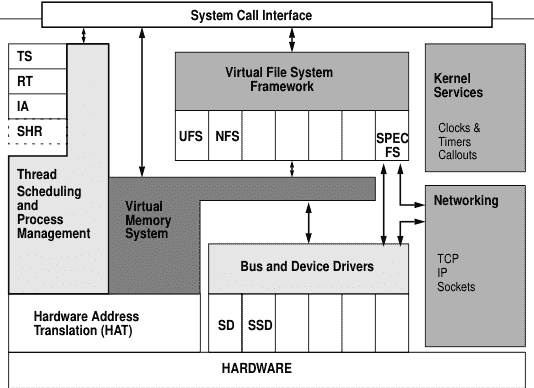

*图 1.1* Solaris 内核组件

#### 1.3.2 模块化实现

Solaris 内核实现为一组核心操作系统功能，并添加了作为动态可加载模块链接进来的内核子系统和相关服务。模块加载和内核运行时链接器基础设施促进了这种实现，该基础设施允许内核模块在引导期间或系统运行期间按需添加到操作系统中。


Solaris 7 模块框架支持七种类型的可加载内核模块：调度器类别、文件系统、可加载系统调用、可执行文件格式的加载器、流模块、总线或设备驱动程序，以及其他模块。图 1.2 显示了核心内核中包含的设施以及实现 Solaris 内核其余部分的各种内核模块类型。

| 核心内核 | 模块类型 | 模块示例 |
|---|---|---|
| 系统调用<br>调度器<br>内存管理<br>进程管理<br>VFS 框架<br>内核锁定<br>时钟与定时器<br>中断管理<br>引导与启动<br>陷阱管理<br>CPU 管理 | 调度器<br>类别 | TS – 分时<br>RT – 实时<br>IA – 交互类<br>SRM – 资源管理器类 |
|  | 文件<br>系统 | UFS – UNIX 文件系统<br>NFS – 网络文件系统<br>PROCFS – 进程文件系统<br>*等等……* |
|  | 可加载<br>系统<br>调用 | shmsys – System V 共享内存<br>semsys – 信号量<br>msgsys – 消息<br>*其他可加载系统调用……* |
|  | 可执行<br>格式 | ELF – SVR4 二进制格式<br>COFF – BSD 二进制格式 |
|  | 流<br>模块 | pipemod – 流管道<br>ldterm – 终端线路规程<br>*其他可加载流模块……* |
|  | 其他<br>模块 | NFSSRV – NFS 服务器<br>IPC – 进程间通信<br>*其他可加载内核代码……* |
|  | 设备<br>与<br>总线<br>驱动程序 | SBus – SBus 总线控制器<br>PCI – PCI 总线控制器<br>sd – SCSI I/O 设备<br>*许多其他设备……* |

*图 1.2 核心内核与可加载模块*

### 1.4 进程、线程与调度

Solaris 内核是多线程的；也就是说，它以多个执行线程的方式实现，以支持跨多个处理器的并发。这种架构与传统 UNIX 调度模型有很大的不同。在 Solaris 中，内核中的线程（即*内核线程*）是被调度并分派到处理器上的基本单元。线程允许在单个虚拟内存环境内存在多个执行流；因此，在线程之间切换执行的开销很小，因为不需要进行虚拟内存上下文切换。

线程用于内核相关任务、进程执行和中断处理。在内核内部，多个执行线程共享内核的环境。进程也包含一个或多个线程，这些线程共享进程的虚拟内存环境。

进程是包含用户程序环境的抽象。它由虚拟内存环境、程序资源（例如打开的文件列表）以及至少一个执行线程组成。虚拟内存环境、打开的文件列表以及进程环境的其他组件由每个进程内的线程共享。

每个进程内部都有一个*轻量级进程*，它是进程内每个内核线程的虚拟执行环境。轻量级进程允许进程内的每个内核线程独立于同一进程中的其他内核线程进行系统调用。如果没有轻量级进程，则一次只能进行一个系统调用。每当线程进行系统调用时，其寄存器会被放置在轻量级进程内的栈上。从系统调用返回时，系统调用返回码会被放置在轻量级进程中。图 1.3 显示了内核线程、进程和轻量级进程之间的关系。

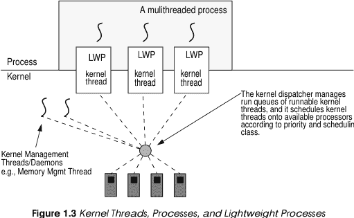

#### 1.4.1 两级线程模型

虽然在进程内多个线程之间切换的开销相对较小，但创建和销毁线程的开销仍然相对较大。此外，进程内的每个内核线程都需要一个包含栈的轻量级进程，这会消耗内核资源。由于这些原因，每个进程内实现了额外一级线程管理来管理用户线程，如图 1.4 所示。

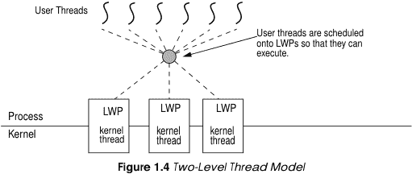

Solaris 将用户线程作为多线程程序的主要线程抽象来呈现。用户线程在线程库中实现，并且可以在不涉及内核的情况下创建和销毁。用户线程被调度到轻量级进程上运行或从轻量级进程上调度下来。因此，在任何时刻只有一部分用户线程处于活动状态——即那些被调度到轻量级进程上的线程。进程内轻量级进程的数量会影响用户线程可用的并行度，并由用户线程库动态调整。

#### 1.4.2 全局进程优先级与调度

Solaris 内核为内核线程实现了一个全局线程优先级模型。内核调度器（即*分派器*）使用该模型来从许多可运行的内核线程中选择下一个执行的内核线程。内核支持*抢占*的概念，允许优先级更高的线程抢占正在运行的线程，从而使优先级更高的线程能够执行。内核本身是可抢占的，这一创新为高优先级线程提供了时间关键的调度。共有 170 个全局优先级；数值较大的优先级值对应更高的线程优先级。优先级命名空间被不同的*调度类别*所划分，如图 1.5 所示。

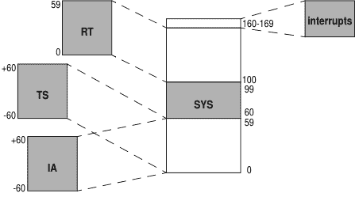

图 1.5 *全局线程优先级*

Solaris 分派器实现了多个调度类别，这些类别允许将不同的调度策略应用于线程。图 1.5 中显示的三个主要调度类别——TS（IA 是增强型 TS）、SYS 和 RT——将在下文描述。

- **TS**——分时调度类是进程以及进程内所有内核线程的默认类。它会根据最近的处理器使用情况动态改变进程优先级，以试图在系统中的内核线程之间均匀分配处理器资源。进程优先级和时间片在每次时钟节拍时根据分时调度表计算，或在因 I/O 睡眠后唤醒时计算。TS 类使用 0 到 59 的优先级范围。
- **IA**——交互类是 TS 类的增强版，桌面窗口系统使用它来提升焦点窗口内线程的优先级。IA 与 TS 类共享相同的优先级数值范围。
- **SYS**——系统类由内核用于内核线程。系统类中的线程是绑定线程，也就是说，没有时间片——它们会一直运行到阻塞为止。系统类使用 60 到 99 的优先级。
- **RT**——实时类实现固定优先级、固定时间片的调度。实时类使用 100 到 159 的优先级。请注意，RT 类线程的优先级高于 SYS 类中的内核线程。

图 1.5 所示的中断优先级级别仅供中断线程使用，不可供任何其他对象使用。它们在优先级方案中的定位意图是确保中断线程优先于系统中的所有其他线程。

### 1.5 进程间通信

进程可以通过使用多种进程间通信（IPC）类型之一相互通信。IPC 允许进程之间进行信息传输或同步。Solaris 支持四组不同的进程间通信：基本 IPC、System V IPC、POSIX IPC 和 Solaris 高级 IPC。

#### 1.5.1 传统 UNIX IPC

Solaris 实现了传统 IPC 设施，例如本地套接字和管道。本地套接字是一种使用 `socket(2)` 系统调用直接连接两个进程的类网络连接。

管道通过一个操作方式类似文件的对象，将数据流从一个进程直接传送到另一个进程。数据在管道的一端插入，并按照先进先出的顺序传送到接收进程。使用标准文件 I/O 系统调用对管道进行数据读写。管道通过 `pipe(2)` 系统调用创建，或通过用 `mknod(1)` 在文件系统中创建的特殊管道设备，并使用标准文件 `open(2)` 系统调用来创建。

#### 1.5.2 System V IPC

最初为 System V UNIX 开发的三类 IPC 已成为所有 UNIX 实现的标准：共享内存、消息传递和信号量。这些设施提供了当今大多数应用程序使用的通用 IPC 机制。

- **System V 共享内存**——进程可以创建共享内存段。共享内存区域内的更改立即可供连接到同一共享内存段的其他进程使用。
- **System V 消息队列**——消息队列是一个具有头部和尾部的消息列表。消息被放置在队列尾部，并从队列头部接收。每条消息包含一个 32 位类型值，后跟一个数据负载。
- **System V 信号量**——信号量是整数值对象，支持两种原子操作：递增或递减整数的值。进程可以在值大于零的信号量上睡眠，然后在值达到零时被唤醒。

#### 1.5.3 POSIX IPC

POSIX IPC 设施在功能上与 System V IPC 类似，但抽象在内存映射文件之上。程序调用 POSIX 库例程，通过 Solaris 文件 I/O 系统调用（`open(2)`、`read(2)`、`mmap(2)` 等）创建新的信号量、共享内存段或消息队列。在 POSIX 库内部，IPC 对象以文件形式存在。通过 POSIX 接口导出给程序的对象类型在库例程内部处理。

#### 1.5.4 Solaris 高级 IPC

Solaris 提供了一种新的、快速的、轻量级的进程间过程调用机制：门（doors）。门是在本地进程中调用过程的一种低延迟方法。门服务器包含一个睡眠线程，等待门客户端的调用。客户端通过门向服务器发起调用，并附带一个小的（16 KB）负载。当从门客户端向门服务器发起调用时，调度控制权直接传递给门服务器中的线程。门服务器处理完请求后，会将控制权和响应返回给调用线程。这种调度控制方式允许超低延迟的周转，因为客户端无需等待服务器线程被调度即可完成请求。

### 1.6 信号


从最早的实现开始，UNIX 系统就提供了进程信号机制。信号机制提供了一种因特定事件而中断进程或进程内线程的手段。触发信号的事件可能与当前指令流直接相关。此类信号称为同步信号，源于由非法地址引用（段违规）、非法数学运算（浮点异常）等引起的硬件陷阱条件。

系统还实现异步信号，这些信号源于不一定与当前指令流相关的外部事件。异步信号的示例包括作业控制信号，以及从一个进程或线程向另一个进程或线程发送信号，例如发送 kill 信号以终止进程。

对于每个可能的信号，进程可以建立三种可能的信号处置之一，这些处置定义了收到信号时将采取什么操作（如果有的话）。大多数信号可以被忽略，信号可以被捕获并调用进程特定的信号处理程序，或者进程可以允许采取默认操作。每个信号都有预定义的默认操作，例如终止进程。Solaris 提供了一组编程接口，允许屏蔽信号或安装特定的信号处理程序。

传统信号模型基于进程在任何时候只有一个执行流的概念。Solaris 内核的多线程进程架构允许进程内存在多个执行线程，这意味着信号可以被定向到特定线程。信号的处置和处理程序是进程级的；多线程进程中的每个线程都具有相同的信号处置和处理程序。然而，Solaris 模型允许在线程级屏蔽信号，因此进程内的不同线程可以屏蔽不同的信号。（屏蔽是阻止信号被传递的一种方式。）

## 1.7 内存管理

Solaris 虚拟内存（VM）系统可以被视为操作系统的核心——它代表内核和进程管理系统内存。VM 系统的主要任务是管理系统物理内存向操作系统中运行的进程和内核子系统的高效分配。VM 系统使用较慢的存储介质（通常是磁盘）来存储无法放入系统物理内存的数据，从而容纳比物理内存更大的程序。VM 系统要将最常用的部分保留在物理内存中，将较少使用的部分放在较慢的辅助存储上。

对于进程，VM 系统呈现一个简单的线性内存范围，称为地址空间。每个地址空间被划分为多个段，这些段表示可执行文件、堆空间（通用的、进程分配的内存）、共享库和程序栈的映射。每个段被划分为大小相等的虚拟内存块，称为页，硬件内存管理单元（MMU）管理页大小的虚拟内存块到物理内存的映射。图 1.6 显示了地址空间、段、内存管理单元和物理内存之间的关系。

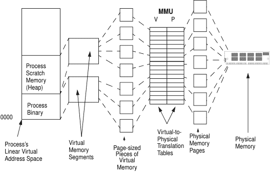

图 1.6 地址空间、段和页

虚拟内存系统以模块化方式实现。涉及物理内存管理的组件大多特定于硬件平台。平台相关部分在硬件地址转换（HAT）层中实现。

### 1.7.1 全局内存分配

VM 系统实现按需分页。内存页在被引用时按需分配，因此可执行文件或共享库的部分内容也是按需分配的。按需加载内存页可显著降低进程的内存占用和启动时间。当某个区域

当访问虚拟内存时，硬件 MMU 会引发一个事件，通知内核：某个尚未映射物理内存的内存区域发生了访问。这个事件就是缺页故障。进程的堆也以类似方式分配：最初只给进程分配虚拟内存空间。当内存首次被引用时，发生缺页故障，然后一次分配一页内存。

虚拟内存系统使用全局分页模型，该模型实施单一的全局策略来管理进程之间的内存分配。扫描算法计算出物理内存中使用最少的部分。当空闲内存量低于预配置阈值时，一个内核线程（页面扫描程序）按物理页顺序扫描内存。最近未使用的页面会被回收并放入空闲列表，供其他进程使用。

### 1.7.2 内核内存管理

Solaris 内核需要内存来存放内核指令、数据结构和缓存。内核的大部分内存是不可分页的，也就是说，它从物理内存中分配，页面扫描程序无法回收。这一特性避免了内核内存管理函数在持有另一个关键资源的锁时发生缺页故障而可能导致的内核死锁。内核不能依赖进程使用的全局分页机制，因此它实现了自己的内存分配系统。

核心内核内存分配器——slab 分配器——为内核数据结构分配内存。顾名思义，该分配器将大块连续内存区域（slab）细分为更小的块，供数据结构使用。分配池的组织方式使得大小相近的对象从相同的连续段中分配，从而大幅减少连续分配和释放可能产生的碎片。

## 1.8 文件与文件系统

Solaris 提供了数据存储和管理的功能，如图 1.7 所示。文件为数据提供容器，目录包含多个文件，文件系统在设备（通常是某种存储介质）上实现文件和目录。

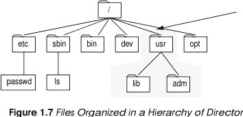

文件系统可以挂载到现有文件系统的某个分支上，以扩展层次结构。该层次结构隐藏了挂载点，因此对于遍历该树的用户或应用程序是透明的。

Solaris 实现了多种不同类型的文件：

- 常规文件在文件系统内存储数据。
- 特殊文件表示设备驱动程序。对特殊文件的读写由设备驱动程序处理，并转换为某种类型的 I/O。
- 管道是一种特殊类型的文件，不保存数据，但可以被两个不同的进程打开，以便在它们之间传递数据。
- 硬链接链接到同一文件系统内其他文件的数据。使用硬链接时，同一份数据在文件系统中可以有两个不同的文件名。
- 符号链接指向任意文件系统上的其他路径名。
- 套接字在文件系统中实现两个进程之间的本地通信。

### 1.8.1 文件描述符与文件系统调用

进程通过与文件相关的系统调用与文件交互。与文件相关的系统调用通过两种方式标识文件：文件系统内的路径名和文件描述符。文件描述符是一个整数，用于标识进程内一个已打开的文件。每个进程都有一张打开文件表，从文件描述符 0 开始，随着更多文件的打开而向上递增。可以使用 `open()` 系统调用获取文件描述符，该系统调用按路径名打开文件，并返回标识该打开文件的文件描述符。

```
fd = open("/etc/passwd", flag, mode);
```

文件打开后，文件描述符可用于对该文件执行操作。`read(2)` 和 `write(2)` 操作提供了基本的文件 I/O，还有几种其他高级机制用于执行更复杂的操作。文件描述符最终由 `close(2)` 系统调用关闭，或在进程退出时关闭。默认情况下，文件描述符 0、1 和 2 由 C 运行时库自动打开，分别表示进程的标准输入、标准输出和标准错误流。

### 1.8.2 虚拟文件系统框架

Solaris 提供了一个框架，在该框架下可以实现多种文件系统类型：虚拟文件系统框架。早期 UNIX 实现对所有已挂载的文件系统使用单一文件系统类型；通常是 BSD UNIX 的 UFS 文件系统。虚拟文件系统框架是为了让网络文件系统（NFS）能够与 SunOS 2.0 中的 UFS 文件系统共存而开发的，后来成为 SVR4 和 Solaris 中 System V 的标准组成部分。

每个文件系统都以标准的层次化方式提供文件抽象，即使底层文件系统实现不同，也提供标准的文件访问接口。文件系统框架允许几乎任何对象被抽象为文件和文件系统。有些文件系统将文件数据存储在基于存储介质的设备上，而另一些实现则将除存储之外的对象抽象为文件。例如，`procfs` 文件系统抽象了进程树，其中文件系统中的每个文件代表进程树中的一个进程。我们可以将 Solaris 文件系统分为以下几组：

- 基于存储的文件系统——提供持久存储和数据管理功能的常规文件系统。Solaris UFS 和 PC/DOS 文件系统是典型例子。
- 网络文件系统——提供看似位于本地目录结构中、但实际存储在远程网络服务器上的文件的文件系统；例如 Sun 的网络文件系统（NFS）。
- 伪文件系统——将各种抽象以文件形式呈现于文件系统中的文件系统。`/proc` 伪文件系统将进程的地址空间表示为一组文件。

该框架提供了一套定义良好的、与文件系统无关的接口；每个文件系统的实现细节都隐藏在这些接口之后。两个关键对象代表这些接口：虚拟文件（即 `vnode`）和虚拟文件系统（即 `vfs` 对象）。`vnode` 接口实现与文件相关的功能，`vfs` 接口实现文件系统管理功能。`vnode` 和 `vfs` 接口根据所操作的文件系统类型调用相应的文件系统函数。图 1.8 显示了文件系统层次结构。与文件相关的功能通过系统调用或另一个内核子系统发起，并通过 `vnode`/`vfs` 层定向到相应的文件系统。

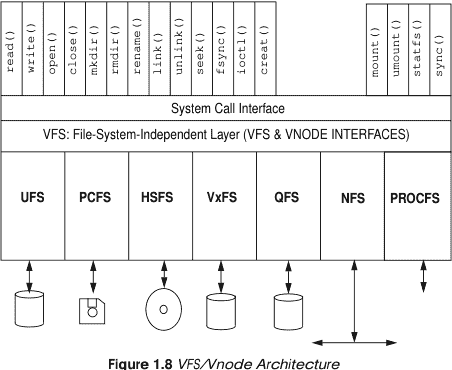

表 1-2 总结了 Solaris 中实现的主要文件系统类型。

**表 1-2** Solaris 文件系统框架中可用的文件系统

| 文件系统 | 类型 | 设备 | 描述 |
|---|---|---|---|
| `ufs` | 常规 | 磁盘 | UNIX 快速文件系统，Solaris 中的默认文件系统 |
| `pcfs` | 常规 | 磁盘 | MS-DOS 文件系统 |
| `hsfs` | 常规 | 磁盘 | High Sierra 文件系统（CD-ROM） |
| `tmpfs` | 常规 | 内存 | 使用内存和交换空间 |
| `nfs` | 伪 | 网络 | 网络文件系统 |
| `cachefs` | 伪 | 文件系统 | 使用本地磁盘作为另一个 NFS 文件系统的缓存 |
| `autofs` | 伪 | 文件系统 | 使用动态布局挂载其他文件系统 |


| `specfs` | 伪 | 设备驱动程序 | 用于 `/dev` 设备的文件系统 |
| `procfs` | 伪 | 内核 | 表示进程的 `/proc` 文件系统 |
| `sockfs` | 伪 | 网络 | 套接字连接的文件系统 |
| `fdfs` | 伪 | 文件描述符 | 允许进程在 `/dev/fd` 中查看其打开的文件 |
| `fifofs` | 伪 | 文件 | FIFO 文件系统 |

#### 1.9 I/O 体系结构

传统 UNIX 实现了常驻内核的设备驱动程序来与硬件设备交互。设备驱动程序管理数据传输和寄存器 I/O，并处理设备硬件中断。设备驱动程序通常必须了解硬件设备及其所连接总线的详细布局。Solaris 通过为设备和总线使用不同的驱动程序来扩展传统的设备驱动程序管理功能：*设备驱动程序*控制设备硬件，*总线 nexus 驱动程序*控制并转换两种不同类型总线之间的数据。

Solaris 根据设备的物理连接层次结构，将 I/O 设备组织在总线 nexus 和设备实例的层次结构中。图 1.9 所示的层次结构代表典型的 Solaris *设备树*。

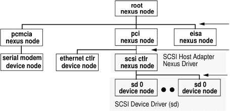

**图 1.9** *Solaris 设备树*

每条总线通过总线连接器（bus nexus）与另一条总线相连。在我们的示例中，连接器驱动程序由 PCI、EISA、PCMCIA 和 SCSI 节点表示。SCSI 主机适配器是一个总线连接器，桥接 PCI 总线与其所控制的 SCSI 总线，在 SCSI 链路上，SCSI 磁盘（sd）设备驱动程序为每个磁盘实现设备节点。

Solaris 设备驱动程序接口（DDI）向设备驱动程序隐藏了平台和总线层次结构的具体实现细节。DDI 提供了用于注册中断、映射寄存器和访问 DMA 内存的接口。这样，内核就可以与设备交互。

设备驱动程序以实现为可加载模块的形式，即包含驱动程序代码的独立二进制文件。设备驱动程序会在其设备第一次被访问时自动加载。

### 2 内核服务

Solaris 内核管理操作系统资源，并向用户进程提供各种功能。在本章中，我们将探讨内核如何实现这些服务。我们首先讨论用户程序与内核模式之间的边界，然后讨论用于在用户模式和内核模式之间切换的机制，包括系统调用、陷阱和中断。

#### 2.1 访问内核服务

Solaris 内核通过使用两种不同的处理器执行模式来使进程与内核数据结构和硬件相隔离：非特权模式和特权模式。特权模式通常被称为*内核模式*；非特权模式被称为*用户模式*。

在非特权模式下，进程只能访问自己的内存，而在特权模式下，可以访问内核的所有数据结构以及底层硬件。内核以非特权模式执行进程，以防止用户进程访问可能影响其他进程或操作系统环境的数据结构或硬件寄存器。由于只有 Solaris 内核指令可以在特权模式下执行，因此内核可以调解对内核数据结构和硬件设备的访问。

如果用户进程需要访问内核系统服务，则该进程中的一个线程将通过一组称为*系统调用*的接口从用户模式转换到内核模式。系统调用允许用户进程中的线程切换到内核模式，以执行操作系统定义的系统服务。图 2.1 展示了一个用户进程发起 `read()` 系统调用的示例。`read()` 系统调用执行特殊的机器代码指令，将处理器切换到特权模式，以便开始执行 `read()` 系统调用的内核指令。在特权模式下，内核的 `read()` 代码代表调用线程执行 I/O 操作，然后返回非特权用户模式，之后用户线程继续正常执行。

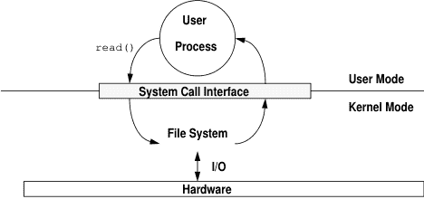

#### 2.2 进入内核模式

除了通过系统调用进入外，系统还可能在以下情况下进入内核模式：如响应设备中断，或处理在用户模式下无法处理的情况。将控制权转移到内核有三种方式：

- 通过系统调用
- 作为中断的结果
- 作为处理器陷阱的结果

我们将*系统调用*定义为用户进程请求内核服务（例如从文件中读取数据）的机制。系统调用通常通过陷阱指令或软件中断从用户模式发起，具体取决于微处理器和平台。在基于 SPARC 的平台上，系统调用通过在 C 库存根中发出特定的陷阱指令来发起。

*中断*是一种将控制权向量化转移到内核的方式，通常由硬件设备发起，例如磁盘控制器发出 I/O 完成的信号。中断也可以由软件发起。硬件中断通常相对于当前执行的线程异步发生，并且它们发生在中断上下文中。

*陷阱*也是一种由处理器发起的、将控制权向量化转移到内核的方式。陷阱和中断的主要区别在于：陷阱通常由当前执行的线程引起，例如除零错误或页错误；中断是异步事件，也就是说，中断源与当前执行的线程无关。在 SPARC 处理器上，这种区别有些模糊，因为陷阱也是用于启动中断处理程序的机制。

##### 2.2.1 上下文

上下文描述了一个执行线程的环境。我们通常提到两种不同类型的上下文：执行上下文（线程栈、打开文件列表、资源记账等）和虚拟内存上下文（虚拟地址到物理地址的映射）。

###### 2.2.1.1 执行上下文

内核中的线程可以在进程上下文、中断上下文或内核上下文中执行。

- **进程上下文** — 在进程上下文中，内核线程代表用户进程执行操作，并且可以访问进程的用户区（*uarea*）和用于资源记账的进程结构。*uarea*（结构体 *u*）是进程内的一个特殊区域，包含内核感兴趣的进程信息：通常是进程的打开文件列表、进程标识信息等。例如，当进程执行系统调用时，进程中的一个线程会转换到内核模式，然后可以访问进程数据结构的*uarea*，以便传递参数、更新系统时间使用情况等。
- **中断上下文** — 中断线程在中断上下文中执行。它们无法访问被中断的进程或线程的数据结构。中断具有自己的栈，并且只能访问内核数据结构。
- **内核上下文** — 内核管理线程在内核上下文中运行。在内核上下文中，系统管理线程共享内核环境。内核管理线程通常无法访问与进程相关的数据。内核管理线程的示例包括页扫描器和 NFS 服务器。

###### 2.2.1.2 虚拟内存上下文

虚拟内存上下文是构建内存环境的虚拟地址到物理地址转换的集合。每个进程都有自己独立的虚拟内存上下文。在调度切换期间，当执行从一个进程切换到另一个进程时，会切换虚拟内存上下文，以提供新进程的虚拟内存环境。

在 Intel 和较旧的 SPARC 架构中，每个进程上下文都映射了内核虚拟内存的一部分，因此在系统调用期间从用户模式转换到内核模式时，不需要切换到内核的虚拟内存上下文。在 UltraSPARC 上，处理器和内存管理单元的特性允许在虚拟内存上下文之间快速切换；这样，进程和内核可以拥有独立的虚拟内存上下文。有关进程和内核地址空间的详细讨论，请参见第 130 页的“虚拟地址空间”和第 205 页的“内核虚拟内存布局”。

##### 2.2.2 内核上下文和中断上下文中的线程

除了通过系统调用提供内核服务外，内核还必须执行与系统相关的功能，例如响应设备 I/O 中断、执行一些例行的内存管理，或启动调度程序功能以将执行从一个内核线程切换到另一个内核线程。

- **中断处理程序** — 中断被定向到特定的处理器，处理器在接收到中断后停止执行当前线程，将线程上下文切换出去，并开始执行中断处理例程。除高优先级中断外，所有中断都由内核线程处理。因此，内核可以最大限度地减少持有关键资源的时间，从而提供更好的中断代码可扩展性和更低的总体中断响应时间。我们将在第 38 页的“中断”中更详细地讨论内核中断。
- **内核管理线程** — Solaris 内核与进程一样，也有自己的多个执行线程来执行系统管理任务（例如内存页扫描器和 NFS 服务器）。Solaris 内核管理线程不在进程的执行上下文中执行。相反，它们在内核的执行上下文中执行，彼此共享内核执行环境。Solaris 内核管理线程在系统（SYS）调度类中调度，其优先级高于系统上大多数其他线程。

图 2.2 显示了进程、中断和线程进入内核的路径。

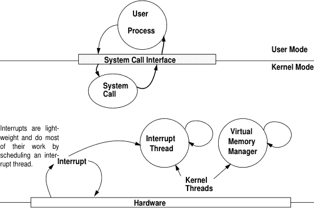

*图 2.2 进程、中断与内核线程*

## 2.2.3 UltraSPARC I 与 II 陷阱

SPARC 处理器架构使用陷阱（trap）作为统一机制来处理系统调用、处理器异常和中断。SPARC 陷阱是由微处理器发起的过程调用，其触发原因包括同步处理器异常、异步处理器异常、软件发起的陷阱指令或设备中断。

收到陷阱后，UltraSPARC I 与 II 处理器进入特权模式，并将控制权转移到陷阱表中预定位置开始的指令。系统会执行与所接收陷阱类型对应的陷阱处理程序，当中断处理程序完成后，控制权将返回给被中断的线程。陷阱会使硬件执行以下操作：

- 保存某些处理器状态（程序计数器、条件码寄存器、陷阱类型等）
- 进入特权执行模式
- 开始执行陷阱表中相应槽位中的代码

当 UltraSPARC 陷阱处理程序处理完毕后，它会发出 SPARC `DONE` 或 `RETRY` 指令以返回到被中断的线程。


UltraSPARC I 与 II 陷阱表是一个内存中的表，包含每种陷阱类型的前八条指令。陷阱表位于内存中由陷阱表基址寄存器（`TBA`）保存的地址处，该寄存器在引导期间初始化。Solaris 将陷阱表放置在称为 `kernelbase` 的内核基址处，位于一个锁定（不可分页）的 4 Mbyte 页面中，这样在执行陷阱表中的指令时不会发生与内存相关的陷阱（缺页或 TLB 未命中）。（有关详细的内核内存映射，请参阅附录 B“内核虚拟地址映射”。）

### 2.2.3.1 UltraSPARC I 与 II 陷阱类型

陷阱表为每种陷阱类型包含一个条目，并为每种陷阱类型提供特定的处理程序。UltraSPARC I 与 II 陷阱可分为以下大类：

- **处理器复位** —— 上电复位、机器复位、软件发起的复位
- **内存管理异常** —— `MMU` 缺页、页保护违规、内存错误、未对齐访问等
- **指令异常** —— 尝试从非特权模式执行特权指令、非法指令等
- **浮点异常** —— 浮点异常、在浮点单元被禁用时尝试执行浮点模式指令等
- **SPARC 寄存器管理** —— 用于 SPARC 寄存器窗口溢出、填充或清理的陷阱
- **软件发起的陷阱** —— 由 SPARC 陷阱指令（`Tcc`）发起的陷阱，主要用于 Solaris 中的系统调用入口

表 2-1 显示了 Solaris 中实现的 UltraSPARC I 与 II 陷阱类型。

**表 2-1** *Solaris UltraSPARC I 与 II 陷阱*

| 陷阱定义 | 陷阱类型 | 优先级 |
|---|---|---|
| 上电复位 | 001 | 0 |
| 看门狗复位 | 002 | 1 |
| 外部发起的复位 | 003 | 1 |
| 软件发起的复位 | 004 | 1 |
| RED 状态异常 | 005 | 1 |
| 保留 | 006...007 | n/a |
| 指令访问异常 | 008 | 5 |
| 指令访问 MMU 未命中 | 009 | 2 |
| 指令访问错误 | 00A | 3 |
| 保留 | 00B...00F | n/a |
| 非法指令 | 010 | 7 |
| 尝试执行特权指令 | 011 | 6 |
| 未实现的加载指令 | 012 | 6 |
| 未实现的存储指令 | 013 | 6 |
| 保留 | 014...01F | n/a |
| 浮点单元被禁用 | 020 | 8 |
| 浮点异常 ieee754 | 021 | 11 |
| 浮点异常 – 其他 | 022 | 11 |
| 标签溢出 | 023 | 14 |
| SPARC 寄存器窗口清理 | 024...027 | 10 |
| 除零 | 028 | 15 |
| 内部处理器错误 | 029 | 4 |
| 数据访问异常 | 030 | 12 |
| 数据访问 MMU 未命中 | 031 | 12 |
| 数据访问错误 | 032 | 12 |
| 数据访问保护 | 033 | 12 |
| 内存地址未对齐 | 034 | 10 |
| 加载双字内存地址未对齐 | 035 | 10 |
| 存储双字内存地址未对齐 | 036 | 10 |
| 特权操作 | 037 | 11 |
| 加载四字内存地址未对齐 | 038 | 10 |
| 存储四字内存地址未对齐 | 039 | 10 |
| 保留 | 03A...03F | n/a |
| 异步数据错误 | 040 | 2 |
| 中断级别 *n*，其中 *n*=1...15 | 041...04F | 32-*n* |
| 保留 | 050...05F | n/a |
| 向量化中断 | 060...07F | 中断特定 |
| SPARC 寄存器窗口上溢 | 080...0BF | 8 |
| SPARC 寄存器窗口下溢 | 0C0...0FF | 9 |
| 陷阱指令 Tcc | 100...17F | 16 |
| 保留 | 180...1FF | n/a |

### 2.2.3.2 UltraSPARC I 与 II 陷阱优先级

每个 UltraSPARC I 与 II 陷阱都有相关联的优先级。处理器的陷阱硬件使用该级别来决定当某个处理器在给定时刻发生多个陷阱时，哪个陷阱优先。当两个或多个陷阱待处理时，首先处理优先级最高的陷阱（0 为最高优先级）。

中断陷阱遵循陷阱优先级顺序。此外，中断陷阱会与*处理器中断级别*（`PIL`）进行比较。UltraSPARC I 与 II 处理器仅在其*中断请求级别*大于处理器 `PIL` 寄存器中存储的值时才接受中断陷阱。我们将在第 38 页的“中断”中更详细地讨论这一行为。

### 2.2.3.3 UltraSPARC I 与 II 陷阱级别

UltraSPARC I 与 II 处理器引入了嵌套陷阱，即可以在处理一个陷阱的同时接收另一个陷阱。在 UltraSPARC 之前的 SPARC 实现无法处理嵌套陷阱（如果在处理器执行陷阱处理程序时发生陷阱，将会触发“看门狗复位”）。同时还引入了*陷阱级别*的概念来描述陷阱嵌套的层次。嵌套陷阱有五个级别，从陷阱级别 0（正常执行，无陷阱）到陷阱级别 4（陷阱级别 4 实际上是一种错误处理状态，在正常处理过程中不应达到）。

当 UltraSPARC I 与 II 陷阱发生时，CPU 会递增陷阱级别（`TL`）。最近的处理器状态保存在陷阱栈上，并进入陷阱处理程序。从处理程序退出时，陷阱级别会递减。

UltraSPARC I 与 II 还为每个陷阱级别实现了一组备选的全局寄存器。这些寄存器消除了与保存状态相关的大部分开销，使得在陷阱级别之间切换非常高效。

### 2.2.3.4 UltraSPARC I 与 II 陷阱表布局

UltraSPARC I 与 II 陷阱表被分成两半：下半部分包含在陷阱级别 0 时接收的陷阱的处理程序，上半部分包含在陷阱级别为 1 或更高时接收的陷阱的处理程序。我们为陷阱级别大于零时接收的陷阱（即我们已在处理某个陷阱）实现单独的处理程序，因为在陷阱内接收陷阱时并非所有设施都可用。

例如，如果陷阱级别 0 的陷阱处理程序接收到与内存相关的陷阱（如转换未命中），该处理程序可以假定更高级别的陷阱处理程序会处理该陷阱；但更高级别的处理程序不能总是做同样的假设。陷阱表的每一半包含 512 个陷阱处理程序槽位，对应表 2-1 中显示的每种陷阱类型。

陷阱表的每一半又进一步分为两个部分，每个部分的下部包含 256 个硬件陷阱，上部包含 256 个软件陷阱（用于 SPARC `Tcc` 软件陷阱指令）。收到陷阱后，UltraSPARC I 与 II 处理器会跳转到陷阱表中位于陷阱表基址（在 `TBA` 寄存器中设置）加上陷阱级别和陷阱类型偏移处的指令。表中的每个槽位有 8 条指令（32 字节）；因此，陷阱处理程序地址计算如下：

`TL = 0：陷阱处理程序地址 = TBA +（陷阱类型 x 32）`

`TL > 0：陷阱处理程序地址 = TBA + 512 +（陷阱类型 x 32）`

作为附带说明，陷阱表中预留了空间，使得 SPARC 寄存器清理、溢出和填充（寄存器窗口操作）的陷阱处理程序实际上可以更长少于 8 条指令。这允许实现无分支的内联处理程序，使得整个处理程序能够放入陷阱表槽中。

图 2.3 显示了 UltraSPARC I 和 II 的陷阱表布局。

| 陷阱级别 | 陷阱表内容 | 陷阱类型 |
|---|---|---|
| 陷阱级别 = 0 | 硬件陷阱 | 000...07F |
|  | 溢出/填充陷阱 | 080...0FF |
|  | 软件陷阱 | 100...17F |
|  | 保留 | 180...1FF |
| 陷阱级别 > 0 | 硬件陷阱 | 000...07F |
|  | 溢出/填充陷阱 | 080...0FF |
|  | 软件陷阱 | 100...17F |
|  | 保留 | 180...1FF |

*图 2.3 UltraSPARC I 和 II 陷阱表布局*

### 2.2.3.5 软件陷阱

软件陷阱由 SPARC 陷阱指令 `tcc` 发起。陷阱指令的操作码包含一个 6 位软件陷阱号，该编号索引到陷阱表的软件部分。软件陷阱主要用于 Solaris 内核中的系统调用。

系统调用有 3 个软件陷阱：一个用于本机系统调用，一个用于 32 位系统调用（当 32 位应用程序在 64 位内核上运行时），还有一个用于 SunOS 4.x 二进制兼容系统调用。系统调用通过在一个全局寄存器中设置系统调用号，然后发出陷阱指令，经由一个公共陷阱进行向量化。我们将在第 44 页的“系统调用”一节中更详细地讨论常规系统调用。

还有一些超快速系统调用被实现为它们自己的陷阱。这些系统调用通过寄存器来回传递其简单参数。由于这些系统调用不在栈上传递参数，因此进入内核模式时所需保存的进程状态少得多，从而实现了更快的系统调用实现。快速系统调用（例如 `get_hrtime`）是与时间相关的调用。

表 2-2 列出了 UltraSPARC 软件陷阱，包括超快速系统调用。

**表 2-2** *UltraSPARC 软件陷阱*

| 陷阱定义 | 陷阱类型值 | 优先级 |


|---|---:|---:|

| 陷阱指令（SunOS 4.x 系统调用） | 100 | 16 |
| 陷阱指令（用户断点） | 101 | 16 |
| 陷阱指令（除零） | 102 | 16 |
| 陷阱指令（刷新窗口） | 103 | 16 |
| 陷阱指令（清理窗口） | 104 | 16 |
| 陷阱指令（执行非对齐引用） | 106 | 16 |
| 陷阱指令（32 位系统调用） | 108 | 16 |
| 陷阱指令（设置 trap0） | 109 | 16 |
| 陷阱指令（用户陷阱） | 110–123 | 16 |
| 陷阱指令（get_hrtime） | 124 | 16 |
| 陷阱指令（get_hrvtime） | 125 | 16 |
| 陷阱指令（self_xcall） | 126 | 16 |
| 陷阱指令（get_hrtetime） | 127 | 16 |
| 陷阱指令（跟踪） | 130–137 | 16 |
| 陷阱指令（64 位系统调用） | 140 | 16 |

### 2.2.3.6 用于陷阱分析的工具

`trapstat` 是一个单独发布的工具，用于动态监控陷阱活动。该工具在作为参数指定的时间间隔内，监控系统中每个处理器每种类型陷阱的计数。它目前已在 UltraSPARC 和 Intel x86 处理器架构上实现，支持 Solaris 7 及更高版本。

你可以从本书的网站 `http://www.solarisinternals.com` 下载 `trapstat`。只需解包归档文件，并使用 `add_drv` 命令安装驱动程序即可。

> **注意：** `trapstat` *不受 Sun 支持。* 请勿在生产机器上使用它，因为它会动态加载代码到内核中。

```text
# tar xvf trapstat28.tar
-r-xr-xr-x  0/2    5268 Jan 31 03:57 2000 /usr/bin/trapstat
-rwxrwxr-x  0/1   33452 Feb 10 23:17 2000 /usr/bin/sparcv9/trapstat
-rwxrwxr-x  0/1   40432 Feb 10 23:16 2000 /usr/bin/sparcv9/trapstat
-rwxrwxr-x  0/1   21224 Sep  8 17:28 1999 /usr/kernel/drv/sparcv9/trapstat
-r--r--r--  0/1     188 Aug 31 10:06 1999 /usr/kernel/drv/trapstat.conf
-r-xr-xr-x  0/1   37328 Sep  8 17:28 1999 /usr/kernel/drv/sparcv9/trapstat
# add_drv trapstat
```

安装 `trapstat` 后，使用它来分析系统中每个处理器上发生的陷阱。

```text
# trapstat 3
vct  name                  |  cpu0  cpu1
 24  cleanwin              |  3636  4285
 11  level-1               |    99     1
 45  level-5               |     1     0
 16  level-6               |    60     0
 47  level-7               |    23     0
 4d  level-10              |   100     0
 4d  level-13              |    31   657
 4e  level-14              |   100     0
 60  int-vec                |   161    90
 64  itlb-miss              |  5329 31128
 68  dtlb-miss              | 39130 82077
 6c  dtlb-prot              |     3     2
 84  spill-1-normal         |  1210   992
 8c  spill-3-normal         |   136   286
 98  spill-6-normal         |  5752 20286
 a4  spill-1-other          |   476  1116
 a8  spill-3-other          |  4782  9010
 c4  fill-1-normal          |  1218   752
 cc  fill-3-normal          |  3725  7972
 d8  fill-6-normal          |  5576 20273
103  flush-wins             |    31     0
108  syscall-32             |  2809  3813
124  getts                  |  1009  2523
127  gethrtime              |  1004   477
----------------------------------------
tt                          | 76401 165150
```

上面的示例展示了基于双处理器 UltraSPARC-II 的系统上发生的陷阱。第一列显示陷阱类型，后面是该陷阱类型的 ASCII 描述。其余列是每个处理器的陷阱计数。

我们可以看到，SPARC 中的大多数陷阱活动是寄存器清理、溢出和填充陷阱——它们执行 SPARC 寄存器窗口管理。level-1 到 level-14 以及 int-vec 行是中断陷阱。itlb-miss、dtlb-miss 和 dtlb-prot 行是 UltraSPARC 内存管理陷阱，每次发生 TLB 未命中或保护故障时都会出现。（更多关于 UltraSPARC 内存管理的内容，请参见第 193 页的“UltraSPARC-I 和 -II HAT”。）在输出的底部，我们可以看到 32 位系统调用的系统调用陷阱，以及两个特殊的超快速系统调用（getts 和 gethrtime），它们各自使用自己的陷阱。

《SPARC V9 架构手册》[30] 提供了 UltraSPARC 陷阱实现的完整参考。我们强烈推荐阅读该手册，以了解 SPARC V9 处理器架构的具体实现细节。

## 2.3 中断

中断是设备用来向内核发出信号的一种机制，表明它需要关注，并且需要代表该设备立即进行一些处理。Solaris 通过将处理器上当前运行的线程上下文切换出去，并为发起中断的设备执行*中断处理程序*来服务中断。例如，当网络接口收到数据包时，网络控制器会发起一个中断以开始处理该数据包。

### 2.3.1 中断优先级

Solaris 为中断分配优先级，以便能够以正确的优先级处理重叠的中断；例如，可以将网络中断配置为具有比磁盘中断更高的优先级。

内核实现了 15 个中断优先级级别：级别 1 到级别 15，其中级别 15 是最高优先级级别。在每个处理器上，内核可以通过设置处理器的中断级别来屏蔽低于某一优先级级别的中断。设置中断级别会阻塞指定级别及以下的所有中断。这样，当处理器正在执行级别 9 的中断处理程序时，它不会接收级别 9 或更低级别的中断；它只处理更高优先级的中断。

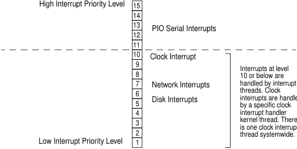

**图 2.4** *Solaris 中断优先级级别*

以等于或低于处理器中断级别的优先级发生的中断会被暂时忽略。在处理器中断级别低于挂起中断的级别之前，处理器不会确认该中断。更重要的中断具有更高的优先级级别，从而比优先级较低的中断有更好的机会得到服务。

图 2.4 阐明了中断优先级级别。

### 2.3.1.1 中断作为线程

中断优先级级别可用于同步对中断处理程序所使用的临界区的访问。通过提高中断级别，处理程序可以确保对于已提高其优先级级别的特定处理器，能够独占访问数据结构。这实际上正是早期单处理器 UNIX 系统为了实现同步而采取的做法。

但是，通过屏蔽中断来确保独占访问的代价高昂；它会阻塞其他中断处理程序运行相当长的时间，如果由于溢出而丢失中断，则可能导致数据丢失。（溢出条件是指等待服务的中断数量超过系统对中断进行排队的能力。）此外，仅使用优先级级别的中断处理程序不能阻塞，因为如果它们等待由较低优先级中断持有的资源，则可能发生死锁。

由于这些原因，Solaris 内核将大多数中断实现为异步创建和调度的高优先级线程。这种实现使内核能够克服通过中断阻塞来同步数据访问所带来的扩展限制，从而提供低延迟的中断响应时间。


优先级 10 及以下的中断由 Solaris 线程处理。这些中断处理程序在必要时可以使用常规同步原语（如互斥锁）进行阻塞。然而，中断必须高效，每次收到中断时都创建一个新线程的代价太高。因此，每个处理器维护一个部分初始化的中断线程池，为较低的 9 个优先级级别各提供一个线程，外加一个用于时钟中断的系统范围线程。当中断发生时，中断使用中断线程的栈，只有当它在同步对象上阻塞时，该线程才会被完全初始化。

优先化。这种方法（如图 2.5 所示）允许在中断分发时简单、快速地分配**线程**。

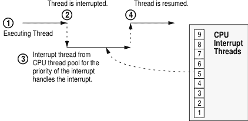

**图 2.5** *使用线程处理中断*

图 2.5 描述了当发生优先级为 9 或更低的中断时的典型场景（级别 10 的时钟中断处理略有不同）。当中断发生时，中断级别会被提升到该中断的级别，以屏蔽该级别（及更低级别）的后续中断。当前正在执行的线程被中断，并*固定*在处理器上。从该处理器的中断线程池中取出一个与中断优先级级别对应的线程，并通过上下文切换来处理该中断。

术语 *固定* 指的是内核采用的一种机制，用于避免将被中断的线程上下文切换出去。正在执行的线程被固定在中断线程之下。中断线程从执行线程“借用”LWP。当中断处理程序运行时，被中断的线程被固定，以避免必须完全保存其上下文的开销；在任何处理器上，它都不能运行，直到中断处理程序完成或阻塞在同步对象上。一旦处理程序完成，原始线程就会被解除固定并重新调度。

如果中断处理线程在处理中断时阻塞在同步对象上（例如互斥锁或条件变量），它会被转换成一个完整的内核线程，能够被调度。控制权会交还给被中断的线程，而中断线程仍然阻塞在同步对象上。当同步对象解除阻塞时，该线程变为可运行状态，并可能抢占较低优先级的线程以重新调度。

即使中断处理线程被阻塞，处理器的中断级别仍保持在该中断的级别，从而屏蔽较低优先级的中断。这可以防止较低优先级的中断线程中断更高级别中断的处理。当中断线程被阻塞时，它们被固定在发起中断的处理器上，从而确保每个处理器始终有一个可用的中断线程来处理传入的中断。

级别 10 的时钟中断以类似方式处理，但由于时钟中断只有一个来源，因此只有一个系统范围的时钟线程。关于时钟中断的进一步讨论，请参见第 54 页的“系统时钟”。

### 2.3.1.2 中断线程优先级

作为线程调度的中断与其他线程共享全局调度器优先级。关于 Solaris 调度器的完整描述，请参见第 9 章“Solaris 内核调度器”。中断线程使用最高的十个全局调度器优先级，即 160 到 169。图 2.6 显示了中断调度器优先级与实时、系统（内核）线程以及分时和交互类线程之间的关系。

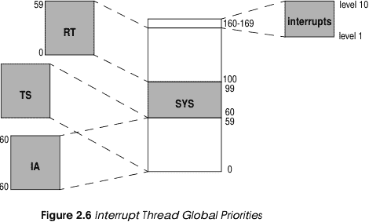

### 2.3.1.3 高优先级中断

优先级高于 10 的中断会屏蔽所有较低优先级的中断，直到它们完成为止。因此，高优先级中断需要极短的代码路径，以防止它们影响其他中断处理程序的延迟以及系统的性能和可扩展性。高优先级中断线程也不能阻塞；它们只能使用自旋类型的同步对象。这是因为调度器用于同步的优先级级别。调度器运行在级别 10，因此在更高中断级别运行的代码不能进入调度器。高优先级线程通常先满足硬件设备（中断源）的最低要求，然后向下投递一个较低优先级的软件中断来完成所需的处理。

### 2.3.1.4 UltraSPARC 中断

在 UltraSPARC 系统（sun4u）上，`intr_vector[]` 数组是一个系统范围的中断表，用于所有硬件和软件中断，如图 2.7 所示。

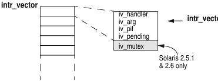

**图 2.7** *sun4u 架构上的中断表*

中断通过 `add_invtr()` 函数添加到该数组中（其他平台也有类似的中断注册函数）。每个在内核中注册的中断都有一个唯一的中断号，当中断被投递时，该中断号用于在中断表中定位处理程序信息。中断号作为参数传递给 `add_invtr()`，同时传递的还有一个函数指针（中断处理程序 `iv_handler`）、处理程序的参数列表（`iv_arg`）以及中断的优先级级别（`iv_pil`）。

Solaris 2.5.1 和 Solaris 2.6 允许不安全的设备驱动程序——即未通过使用锁定原语实现多处理器安全的驱动程序。对于不安全的驱动程序，互斥锁将锁定中断入口，以防止多个线程进入驱动程序的中断处理程序。

Solaris 7 要求所有驱动程序至少具备多处理器（MP）安全性，因此不再需要对中断表条目加锁。`iv_pending` 字段用作排队过程的一部分；生成的中断被放置在每个处理器的待处理中断列表中。pending 字段会一直保持置位，直到某个处理器准备处理该中断，此时 pending 字段被清除。

内核的 `add_softintr()` 函数将软件生成的中断添加到该表中。这两个函数的过程相同：将作为参数传递的中断号用作 `intr_vector[]` 数组的索引，并添加条目。该数组的大小足够大，不太可能用完数组槽位。

## 2.3.2 中断监控

可以使用 `mpstat(1M)` 和 `vmstat(1M)` 命令来监控 Solaris 系统上的中断活动。`mpstat(1M)` 在 intr 列中提供每个 CPU 的每秒中断数，并在 ithr 列中提供在中断线程上处理的中断（低级中断）数。

```text
# mpstat 3
CPU minf mjf xcal intr ithr csw icsw migr smtx srw syscall usr sys wt idl
  0    5   0    7   39   12  250   17    9   18   0     325   4   2  0  94
  1    4   0   10  278   83  275   40    9   40   0     941   4   2  0  93
```

## 2.3.3 处理器间中断与交叉调用

当内核需要另一个处理器代表它立即执行某些工作时，它可以向该处理器发送中断或陷阱。处理器间中断通过 poke 函数投递；它们用于以下目的：

- **抢占调度器** — 当需要抢占（由时钟或定时器事件发起）或同步对象被释放时，一个线程可能需要通知另一个处理器上运行的线程进入内核模式。第 9 章“调度器”将进一步讨论抢占。
- **投递信号** — 信号的投递可能需要中断另一个处理器上的线程。
- **启动/停止 /proc 线程** — /proc 基础设施使用处理器间中断来启动和停止不同处理器上的线程。

通过类似的机制，内核还可以通过发出处理器到处理器的交叉调用来指示某个处理器执行特定的低级函数。交叉调用通常是处理器相关实现的一部分。UltraSPARC 内核使用交叉调用有两个目的：

- **实现处理器间中断** — 如上所述。
- **维护虚拟内存转换一致性** — 在 SMP 平台上实现缓存一致性要求，当虚拟地址被取消映射时，需要从线程运行过的每个 CPU 的 MMU 中移除转换条目。在 UltraSPARC 上，发出 unmap 操作的用户进程会向该线程运行过的每个 CPU 发起交叉调用，以从每个处理器的 MMU 中移除 TLB 条目。内核地址空间内的地址空间 unmap 操作会在每次 unmap 操作时向所有处理器发起交叉调用。

交叉调用和处理器间中断都由 `mpstat(1M)` 在 xcall 列中报告为每秒交叉调用数。

```text
# mpstat 3
CPU minf mjf xcal intr ithr csw icsw migr smtx srw syscall usr sys wt idl
  0    0   0    6  607  246 1100  174   82   84   0    2907   28   5  0  66
  1    0   0    2  218    0 1037  212   83   80   0    3438   33   4  0  62
```

报告的大量交叉调用可能由上一节提到的任一活动导致——最常见的是由文件系统活动引起的内核地址空间取消映射活动。

## 2.4 系统调用

回顾第 27 页的“访问内核服务”，系统调用是用户程序可调用的接口，目的是让内核代表调用线程执行特定功能（例如打开文件）。系统调用是操作系统附带的应用程序编程接口（API）的一部分；它们记录在手册页的第 2 节中。系统调用的调用会使处理器从用户模式切换到内核模式。在 SPARC 系统上，这种切换通过前面讨论过的陷阱机制完成。

### 2.4.1 常规系统调用

系统通过内核的 `sysent` 表引用系统调用，该表包含系统支持的每个系统调用的一个条目。`sysent` 表是一个由 `sysent` 结构体填充的数组，每个结构体代表一个系统调用，如图 2.8 所示。

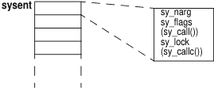

**图 2.8** *内核系统调用条目（`sysent`）表*


该数组由系统调用号索引，系统调用号在`/etc/name_to_sysnum`文件中确定。借助可编辑的系统文件，无需内核源码和完整的内核构建即可向 Solaris 添加系统调用。许多系统调用实现为动态可加载模块，当系统调用第一次被调用时加载到系统中。可加载的系统调用存储在`/kernel/sys`和`/usr/kernel/sys`目录中。

表中的系统调用条目提供了系统调用所需的参数个数（`sy_narg`）、一个标志字段（`sy_flag`），以及用于可加载系统调用的读写锁（`sy_lock`）。系统调用本身通过函数指针引用：`sy_call`或`sy_callc`。

> **历史补充说明：**系统调用函数有两个条目，其原因是对系统调用参数传递实现的重写，这一工作最早出现在 Solaris 2.4 中。较早的 Solaris 版本以传统的 Unix 方式传递系统调用参数：将参数打包到一个结构中，并传递结构指针（`*uap*`是 Unix 实现和文档中的历史名称，指的是*用户参数指针*）。Solaris 中的大多数系统调用已被重写为使用函数调用所实现的 C 语言参数传递约定。使用该约定提高了系统调用的整体性能，因为代码可以利用 SPARC 处理器寄存器窗口实现中固有的参数传递特性（使用输入寄存器进行参数传递——关于 SPARC 寄存器窗口的描述，请参阅 [3]）。

`sy_call`表示系统调用的一个条目，使用较旧的 uap 指针约定，此处保留它是为了与旧版 Solaris 二进制兼容。`sy_callc`是较新参数传递实现的函数指针。较新的 C 风格参数传递已显示出系统调用执行方面显著的总体性能改进——在某些情况下约为 30%。

```c
main()
    int fd;
    int bytes;
    fd=open("file", O_RDWR);
    if (fd == -1) {
        perror("open");
        exit(-1);
    } else {
        bytes=read(fd, buf,
    }
```

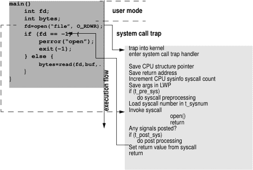

**图 2.9** *系统调用执行*

系统调用的执行导致软件发出陷阱指令，内核正是以这种方式被进入以处理系统调用。进入系统调用的陷阱处理程序后，完成任何必要的预处理，然后代表调用线程执行系统调用。流程如图 2.9 所示。

进入陷阱处理程序时，陷阱代码保存指向将执行系统调用的 CPU 的 CPU 结构的指针，保存返回地址，并递增一个按 CPU 维护的切换调用计数器。每秒系统调用数由`mpstat(1M)`（`syscl`列）按 CPU 报告；在系统范围内，该数目由`vmstat(1M)`（`sycl`列）报告。

内核线程结构中的两个标志指示是否需要系统调用前或系统调用后处理。`t_pre_sys`标志（预处理）用于诸如`truss(1)`命令支持（系统调用执行正在被跟踪）或启用了微状态记帐等情况。系统调用后工作（`t_post_sys`）可能是`/proc`进程跟踪、为进程启用的性能分析、挂起的信号或紧急抢占的结果。在预处理和后处理之间的间隔中，系统调用本身被执行。

### 2.4.2 快速陷阱系统调用

系统调用框架的开销不容小觑，也就是说，由于我们刚才讨论的系统调用设置过程，所有系统调用都存在一些固有的延迟。在某些情况下，我们希望能够快速、低延迟地访问只能在内核模式下获取的信息，例如高分辨率时间。Solaris 内核提供了一个快速系统调用框架，使用户进程可以直接跳入受保护的内核模式，进行最少的处理，然后返回，而无需承担完整系统调用框架的开销。该框架仅在内核中所需的处理不显著干扰寄存器和堆栈时才能使用。因此，快速系统调用在执行所需功能之前，无需像常规系统调用那样保存所有状态。

在 Solaris 7 之前的 Solaris 版本中，只实现了少数快速系统调用：`gethrtime()`、`gethrvtime()`和`gettimeofday()`。这些函数返回一天中的时间和处理器 CPU 时间。它们只是陷入内核以读取单个硬件寄存器或内存位置，然后返回用户模式。

表 2-3 比较了`getpid()`/`time()`系统调用和两个快速系统调用的平均延迟。作为参考，还显示了标准函数调用的延迟。时间是在 300 MHz Ultra2 上测量的。请注意，快速系统调用的延迟比等效常规系统调用低约五倍。

**表 2-3** *系统调用延迟*

| 系统调用 | 延迟（ns） |
|---|---:|
| `getpid()` | 2138 |
| `time()` | 2134 |
| `gethrtime()` | 320 |
| `gethrvtime()` | 413 |
| 标准 C 函数调用 | 93 |

## 2.5 内核 Callout 表

Solaris 内核提供了一个用于通用、基于时间的事件调度的 callout 机制。系统 callout 表在启动时初始化，内核例程可以通过`timeout(9F)`接口将函数放入 callout 表。callout 表条目包括一个函数指针、可选参数和时钟滴答值。每次时钟中断时，都会测试滴答值，当时间间隔到期时执行该函数。内核接口`timeout(9F)`是设备驱动程序接口（DDI）规范的一部分，通常由设备驱动程序使用。其他内核设施，例如以固定间隔休眠的 page fsflush 守护进程，也使用 callout。

### 2.5.1 Solaris 2.6 和 7 Callout 表

Solaris 2.6 和 Solaris 7 中的内核 callout 表布局如图 2.10 所示。

启动时，`callout_table`数组使用指向`callout_table`结构的指针进行初始化；这些结构也在启动时创建。共有 16 个 callout 表——两种 callout 类型（*普通*和*实时*）各 8 个。普通 callout 是通过`timeout(9F)`调用创建的 callout 条目。内核还支持通过内部`realtime_timeout()`函数创建的实时 callout。实时 callout 通过软中断机制比普通 callout 处理得更快捷，而普通 callout 会受到调度延迟的影响。一旦 callout 机制执行了放入 callout 队列的函数，该 callout 条目就会被移除。

每个 callout 条目都有一个唯一的 callout ID，即扩展 callout ID `c_xid`。该 callout ID 包含表 ID（指示该 callout 属于哪个 callout 表）、一个指示这是短期还是长期 callout 的位，以及一个运行时计数器。

callout ID 命名空间被划分为两部分，分别用于短期和长期 callout。（长期 callout 定义为 tick 计数器大于 16,384 的 callout，该值是通过测试和监控真实 pro- 推导出来的，

## 图 2.10 *Solaris 2.6 和 Solaris 7 的 Callout 表*

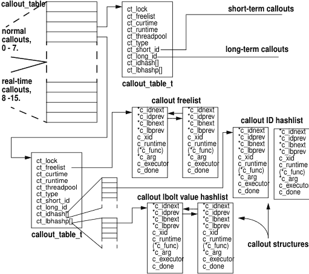

生产系统）。这种分区避免了 callout ID 上的冲突，而此类冲突可能源于运行中的系统通常会生成大量的`timeout(9F)`调用。唯一的 callout ID 可能会用尽，因此 ID 可以被回收。对于短期 callout，ID 回收不是问题；某个特定的 callout 很可能在其 ID 被重用之前就已从 callout 表中移除。而长期 callout 则可能与重用其 ID 的新 callout 条目发生冲突。

大量、短期的 callout 流量由存放短期 callout 的 callout 表处理，而数量相对较少的长期 callout 则由其专用的 callout 表维护。callout 表维护`ct_short_id`和`ct_long_id`，以判断一张 callout 表支持的是长期还是短期 callout 条目。

在引导时，每个 callout 表结构中的短 ID 和长 ID 都会被设置为初始值，短 ID 的范围为`0x10000000`到`0x1000000f`，长 ID 的范围为`0x30000000`到`0x3000000f`。在引导时设置的其它 callout 表结构字段包括`ct_type`字段（普通和实时各八个）以及`ct_runtime`和`ct_c_runtime`，后者在初始化发生时都被设置为当前的`lbolt`值。


每个 `callout` 条目由一个 `callout` 结构表示，它们通过 `ct_idhash[]` 和 `ct_lbhash[]` 数组链接到某张 `callout` 表，其中每个数组元素要么为 `null`，要么是指向 `callout` 结构的指针。`callout` 条目存储在这两个数组中；一个数组按 `callout` ID 进行散列，另一个按 `lbolt` 值进行散列。在初始化时，内核还会为每张 `callout` 表创建两个 `callout` 线程。当 `callout_schedule()` 函数执行时（由时钟处理程序调用），如果有定时器已到期的函数需要执行，就会通过条件变量通知这些 `callout` 线程。

正如我们前面提到的，`timeout(9F)` 函数对 `callout` 表条目进行的插入和删除，在运行中的 Solaris 系统上是一种常见且频繁的操作。将条目放入 `callout` 队列的算法如下（即 `timeout(9F)` 的流程）。

- `timeout(function_pointer, argument_pointer, time value (delta))` 进入 `timeout_common()`，携带传给 `timeout(9F)` 的所有参数，以及一个用于 `callout_table` 数组的下标。该下标的推导基于 CPU 的 `cpu_seqid`（顺序 ID）字段以及 `callout` 类型，其中普通 `callout` 放置在数组位置 8 到 15 之间索引的表上（实时 `callout` 为 0 到 7）。

    基本上，随着 CPU ID 递增，该算法会让 `callout` 条目在索引 8 到 15 之间循环；同一个 CPU 每次都会引用同一个索引位置。

- `timeout_common()` 会从 `ct_freelist` 中获取一个 `callout` 结构（如果有可用的话），否则由内核内存分配器分配一个新的结构。

- 在 `callout` 结构中设置 `c_func` 和 `c_arg` 字段，并将 `c_runtime` 字段设置为当前 `lbolt` 值与传入的定时器值之和。

- `timeout_common()` 在 `callout` 表结构中建立 ID，设置 `ct_short_id` 或 `ct_long_id`（如果定时器值大于 16,384，则为长 ID）。

    我们之前看到，这些 ID 字段在引导时被初始化。随着 `callout` 条目的不断添加，该算法基本上是向上计数，直到回绕并重新开始。这个过程导致了我们刚刚讨论过的重用问题，这也是我们区分短期和长期 ID 的原因。

- `callout` 结构中的 `c_xid` 被设置为与 `callout` 表 ID 相同的值。

- 该算法将 `callout` 条目（`callout` 结构）插入 `callout` 表时，会同时把该条目添加到 `callout` 表中的 `ct_idhash[]` 和 `ct_lbhash[]` 数组。对于 `ct_idhash[]` 的放置，它通过对 ID 进行散列来推导数组下标；对于通过 `ct_lbhash[]` 找到的条目，则对 `callout` 结构中设置的 `c_runtime` 值进行散列来推导数组下标。如果该数组下标已经有一个指针，算法会通过 `next` 和 `prev` 指针将 `callout` 结构链接起来。

至此，`callout` 条目已建立在 `callout` 表上，`timeout(9F)` 将该 ID 返回给调用函数。`realtime_timeout()` 的事件序列与此相同。

当时钟中断处理程序调用 `callout_schedule()` 时，其工作基本上通过多个循环完成。外层循环遍历所有 `callout` 表，内层循环遍历表中的 `callout` 条目。

- 一个被设置为当前 `lbolt` 值的局部函数变量用于进入内层循环，`callout` 条目的 `c_runtime` 值决定了这些 `callout` 是否到期需要执行。

- 如果 `callout` 未到期或已在运行中，代码会继续处理下一个条目。否则，就该执行 `callout` 条目中的函数了。

- 对于普通 `callout` 类型，会设置一个条件变量信号函数，以唤醒一个 `callout` 线程来执行该函数。对于实时 `callout`，内核会调用 `softcall()` 函数来产生一个软件中断，该中断会打断某个处理器，从而使函数无需经过调度器即可执行。

- 在内层循环处理完一张 `callout` 表后，外层循环会将代码移到下一张 `callout` 表。在内层循环中会获取互斥锁（`ct_lock`），以防止另一个处理器同时处理同一个 `callout` 表。当内层循环完成对该 `callout` 表的处理后，互斥锁被释放。

- 初始化时创建的 `callout` 线程（每张 `callout` 表两个）随后进入循环，等待 `ct_threadpool` 条件变量。当普通 `callout` 条目到期需要执行时（如上所述），会通过条件变量通知它们，此时它们会调用 `callout_execute()` 函数。`callout_execute()` 也会通过 `softcall()` 中断函数被调用来运行由 `realtime_timeout()` 放置在 `callout` 表上的函数。

需要重申的是，普通 `callout` 可能会面临一些额外的延迟，因为 `callout` 线程在被条件变量通知后需要被调度。而 `softcall()` 方法会通过中断设施，迫使某个处理器更早地进入 `callout_execute()` 函数。

- `callout_execute()` 会再次遍历 `callout` 表，检查函数执行的条件。在函数调用与锁释放之间，另一个处理器可能已经处理了相关事项，因此内核在实际执行函数之前，会检查表中条目的时间值和运行标志。

- 假设确实到了运行时间，`callout_execute()` 会在 `callout` 条目的 `c_xid` 字段中设置 `CALLOUT_EXECUTING` 标志，然后调用该函数。

- 随后，`callout` 条目会从 `callout` 表中移除，`callout` 结构被放入空闲列表（`ct_freelist`），如果有任何线程正在 `c_done` 条件变量上休眠，则会广播该条件变量。这个条件变量是 `callout` 条目的一部分，它提供了一种生成通知的方法，用于通知放在 `callout` 表上的函数已经执行完毕。

内核还提供了 `untimeout(9F)` 接口，用于移除 `callout`。调用 `untimeout(9F)` 时需要传入 ID（该 ID 是函数被放入 `callout` 表时由 `timeout(9F)` 返回的）。通过 `ct_idhash[]` 数组定位该条目并将其移除，同时将 `callout` 结构添加到空闲列表中。由 `realtime_timeout(9F)` 添加的 `callout` 条目也可以使用 `untimeout(9F)` 移除。移除实时 `callout` 没有单独的函数。

## 2.5.2 Solaris 2.5.1 的 Callout 表

Solaris 2.5.1 中的 `callout` 表在功能上与我们在 Solaris 2.6 和 Solaris 7 中描述的完全相同；只是实现方式不同。Solaris 2.5.1 维护两张 `callout` 表——一张用于普通 `callout`，一张用于实时 `callout`——它们都在引导时初始化。Solaris 2.5.1 中 `callout` 表的总体结构如图 2.11 所示。

如你所见，许多结构字段在名称（和功能）上与之前描述的完全相同。每张 `callout` 表通过一个 `callout_state` 指针（普通 `callout` 表）和一个 `rt_callout_state` 指针（实时 `callout` 表，图中未显示，但结构相同）进行链接。这两张表实现了一个包含 256 个桶（`bucket`）的数组；每个桶链接到一个 `callout` 结构，并维护该条目的 ID。

初始化过程发生在引导时，分为两个不同的设置阶段：一个用于普通 `callout` 表，一个用于实时 `callout` 表。`callout_state` 结构（实际上就是 `callout` 表）的 `cs_bucket[]` 数组实现为一个循环单链表。在初始化时，`b_first` 指针被设置为指向自身；随着 `callout` 被添加到桶中，最后一个 `callout` 的 `c_next` 会引用该桶中的第一个条目。与 Solaris 2.6 和 7 的实现一样，这些 ID 字段表示长 ID 和短 ID 两个命名空间。在初始化阶段，这些字段会在每个桶头中被设置为初始值。

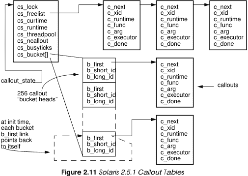

每个 `callout` 条目中的 `c_xid`（扩展 ID）字段具有多重作用：它标识 `callout` 条目、`callout` 表（普通或实时）、桶 ID，以及一个标志（用于指示是否为长期 `callout`）。


通过`timeout(9F)`或`realtime_timeout()`将函数放到callout列表上的过程，与Solaris 2.6和Solaris 7中描述的过程实际上相同。主要区别在于识别callout条目进入256个可能桶中的哪一个。桶的选择相对随机，当前`lbolt`值与`timeout(9F)`调用传入的tick计数之和的低位比特决定桶数组索引。`lbolt`与tick计数之和被设置到callout条目的`c_runtime`字段中，之后用于确定何时执行该callout。桶中维护的callout ID（短ID或长ID）的设置基于与Solaris 2.6和Solaris 7相同的标准——callout的tick计数大于16,384（16K）即为长期callout，这当然会导致`b_long_id`被设置，否则使用`b_short_id`。

其余函数在Solaris 2.5.1中的算法与Solaris 2.6和Solaris 7中的相同。一个显著的区别是，Solaris 2.5.1中的时钟中断处理程序对`callout_schedule()`进行了两次显式调用：第一次针对实时callout，第二次针对普通callout。除此之外，普通callout通过callout线程处理，这些线程由callout调度循环发送的条件变量发出信号；实时callout则通过中断设施由`softint()`接口处理。

您可以使用`crash(1M)`实用程序中的callout函数，在正在运行的系统（所有版本）上检查callout表。

```text
# /etc/crash
dumpfile = /dev/mem, namelist = /dev/ksyms, outfile = stdout
> callout
FUNCTION                 ARGUMENT             TIME                 ID
polltime                 00000030008df260     00000000006a4971     7efffffff7f6f0
realtimexpire            000000300009ed60     00000000006afd39     7efffffff79590
setrun                   0000002a10034fd60    000000000069bd97     3efffffff925a31
schedpaging              0000000000000000     000000000069bddf     3efffffff7c618
mi_timer_fire            0000003000a36820     000000000069bd20     3efffffff7c628
sigalarm2proc            0000003000000af40    000000000069be19     3efffffff7c4e8
ts_update                0000000000000000     000000000069bd4c     3efffffff7c658
seq_update               0000000000000000     000000000069c139     3efffffff7c8b8
kmem_update              0000000000000000     000000000069c139     3efffffff7c069
.
.
.
```

请注意，`crash(1M)`中callout函数的示例输出并非完整的列表。另外还要注意，该输出来自64位Solaris 7系统，这也就是为什么ARGUMENT、TIME和ID列是8字节（64位）数据类型。在32位内核上，它们是32位数据类型。

在运行中的Solaris系统的callout表上，您会经常发现的一些内核函数包括以下这些。

- `polltime` — 一种实时callout。由`poll(2)`系统调用设置，基于poll间隔。`polltime()`唤醒等待poll事件的线程。

- `realtimexpire` — 一种实时callout。在实时间隔定时器支持中，当设置定时器时使用。callout的tick计数由定时器值派生。`realtimexpire()`向进程生成SIGALRM信号。

- `setrun` — 一种实时callout。由睡眠/唤醒代码（条件变量）放置在callout队列上，当睡眠事件具有超时值时强制唤醒线程；例如，`aiowait(2)`调用可以指定等待I/O完成的最大tick计数。指定了超时的`aiowait(2)`使用定时条件变量，这反过来会在callout队列上放置一个`setrun()`事件，以便在I/O完成之前时间到期时强制唤醒线程。

- `schedpaging` — 一种普通callout。属于VM系统中pageout子系统的一部分，用于管理pageout速率。

- `mi_timer_fire` — 一种普通callout。属于基于STREAMS的TCP/IP协议支持的一部分。`mi_timer_fire()`通过STREAMS队列生成定期的消息块处理。

- `sigalarm2proc` — 一种普通callout。`alarm(2)`系统调用将`sigalarm2proc`放置在callout队列上，以便在定时器到期时生成`SIGALRM`信号。

- `ts_update` — 一种普通callout。检查分时和交互类线程的列表，并根据需要更新它们的优先级。

- `seg_pupdate` — 一种普通callout。由地址空间段回收线程使用，用于查找一段时间未使用的分页锁定页面并回收它们。

- `kmem_update` — 一种普通callout。执行低层内核内存分配器管理。

这绝不是放置在callout队列上的所有内核函数的完整列表，当然，您通常会同时在callout队列上看到几个相同的函数，它们具有不同的ID和超时值。

## 2.6 系统时钟

Solaris内核依赖硬件定时器中断来执行需要定期完成的常规维护工作。例如，系统时钟触发调度器定期重新计算进程优先级，并启动callout队列处理。

内核（软件）设置可编程中断发生器（硬件），以定期生成时钟中断，默认每秒100次。时钟在中断级别10（SPARC）上中断；系统上没有其他设备在该级别生成中断。每次时钟中断时，都会进入一个处理程序。它执行以下功能：

- 设置可用的内核匿名空间（`anon_free`）值，用于跟踪和报告。

- 设置空闲内存（`freemem`）值，用于跟踪和报告。

- 调整日时钟以消除可能的抖动。

- 计算CPU使用率（用户、系统、空闲和等待I/O）以及系统调度（运行队列）的队列大小。

- 对CPU上运行的线程（运行时钟中断线程的CPU除外）以及正在退出的线程执行时钟tick处理。请注意，没有关联LWP的内核线程——作为操作系统组成部分的内核服务线程——不进行tick处理。

- 更新`lbolt`计数器。`lbolt`统计自启动以来的时钟tick数。

- 处理内核callout表（在下一节中描述）。

- 如果处于一秒间隔，则计算内核交换参数（空闲、保留和已分配的交换空间），并调整系统范围内的运行队列大小和交换队列大小。

一旦时钟中断处理完成，时钟中断线程被上下文切换出处理器，中断发生时正在执行的线程将恢复执行。

### 2.6.1 进程执行时间统计

CPU使用率统计和线程tick处理是按每个CPU进行的；代码遍历在线处理器列表并为每个CPU执行相应工作。使用信息维护在每个CPU的`sysinfo`结构中的`cpu[]`数组里。由四个成员组成的`cpu[]`数组存储一个整数值，分别对应`USER`、`SYSTEM`、`IDLE`和`WAIT`——CPU可能处于的四种状态。处于`QUEUED`状态的CPU会被计为空闲时间。运行中断线程的CPU会被计为系统时间。运行空闲线程的CPU会被计为空闲时间，除非设置了`cpu_syswait.iowait`值；在这种情况下，该CPU会被计为I/O时间。

`cpu_syswait.iowait`在`biowait()`例程中设置，当发出缓冲I/O时，文件系统支持代码会调用该例程（关于缓冲I/O的详细信息，请参见第三部分“Solaris文件I/O系统”）。`biowait()`也会从内核中的磁盘驱动程序调用；因此，等待I/O时间既反映通过文件系统的I/O，也反映原始磁盘I/O；等待I/O仅反映磁盘I/O，不反映网络I/O。在Solaris 7之前的版本中，计算等待I/O的算法存在缺陷，空闲的CPU可能被错误地计为等待I/O时间。最后，如果非空闲线程在CPU上执行，则会检查线程的状态，以确定该CPU应被计为用户时间（线程在用户模式下执行）还是系统时间。

上一节中的最后一个要点指出，某些时钟中断处理并非在每次时钟中断（每秒100次）中执行，而是以一秒为间隔执行。对于所指出的服务，一秒的粒度已经足够。


Tick处理针对每个在CPU上运行的内核线程（如果该线程不是中断处理程序或操作系统内核线程）进行。每个内核线程维护一个`t_pctcpu`（CPU时间百分比）和一个`t_lbolt`值，其中`t_pctcpu`用于每线程的使用信息（例如，记账），`t_lbolt`为tick处理提供参考点。内核确定它是否

需要通过将 `t_lbolt` 与 `lbolt` 进行比较，对线程执行 tick 处理。

```
if ((lbolt - t_lbolt) == 0)
        no need to do tick processing
else
        set t_pctcpu
        t_lbolt = lbolt
        call clock_tick(current thread)
```

`clock_tick()` 代码接收内核线程 ID，并调用特定于调度类的时钟 tick 函数，即对于分时类和交互类线程调用 `ts_tick()`，对于实时类线程调用 `rt_tick()`。这些函数在第 4 章“内核调度器”中讨论。简而言之，这些函数判断线程是否已用完其时间片，如果已用完，则将线程从处理器上移除。回到 `clock_tick()` 函数中，执行以下操作。

- 根据线程所处的模式（系统或用户），进程和 LWP 中的用户或系统时间值会递增。请注意，如果线程在时钟采样之间以短突发方式执行，则并非所有 CPU 时间都会被计入。

- 检测每线程间隔计时器（profile 计时器和虚拟计时器，通过 `setitimer(2)` 系统调用启用），如果任一计时器到期，则发送相应信号——`SIGPROF` 或 `SIGVTALRM`。

- 检查每进程 CPU 资源限制（进程可消耗的最大 CPU 秒数），如果达到该阈值，则发送 `SIGXCPU`。

- 在 uarea 的 `u_mem` 中更新进程内存使用情况，它反映进程的总地址空间大小。

该更新完成了线程的时钟 tick 处理。

### 2.6.2 高分辨率时钟中断

默认情况下，使用 10 毫秒的系统时钟间隔（每秒 100 次中断）。你可以在 `/etc/system` 文件中设置内核参数 `hires_tick`，将时钟中断频率提高到每秒 1000 次（在 `/etc/system` 中设置 `hires_tick = 1`）。提高时钟频率会导致系统更频繁地进入调度器（以及其他操作）。如果你考虑设置高分辨率 tick，务必格外小心——它们可能会显著降低系统性能。与任何可调系统参数一样，未经大量测试，绝不能在生产系统上进行此设置。

### 2.6.3 高分辨率计时器

内核还维护一个用于纳秒级计时功能的高分辨率计时器。在基于 UltraSPARC 的系统上，使用硬件 TICK 寄存器；它在每个处理器时钟 tick 时递增，即在 400 MHz 处理器上每 2.5 纳秒递增一次。内部 `gethrtime()`（获取高分辨率时间）函数用于内核中需要细粒度时间的少数区域，例如支持实时间隔计时器（带有 `ITIMER_REAL` 标志的 `setitimer(2)` 系统调用）。`gethrtime(3C)` 接口为程序提供纳秒级粒度的时间测量。`gethrtime(3C)` 函数具有优化的代码路径，可读取 TICK 寄存器并向调用程序返回规范化（转换为纳秒）的值。

### 2.6.4 日时时钟

所有计算机系统——从桌面 PC 到高端多处理器系统——都有某种时钟电路。基于 SPARC 的系统在硬件的 EEPROM 区域中包含时钟电路（例如，基于 UltraSPARC 的系统使用 Mostek 48T59 时钟芯片）。这个日时（TOD）时钟芯片是固件地址空间的一部分，内核可以对其进行寻址，并且具有硬件寄存器规格；内核到 TOD 硬件的接口作为 TOD 设备驱动程序实现。

该芯片本身实现了多个寄存器，内核可通过设备驱动程序读写这些寄存器，这些寄存器为构成日期和时间的各个数字分量提供多个计数器（例如小时中的分钟、一天中的小时、一周中的星期几、一年中的月份等）。

图 2.12 展示了 TOD 的硬件和软件层次结构。

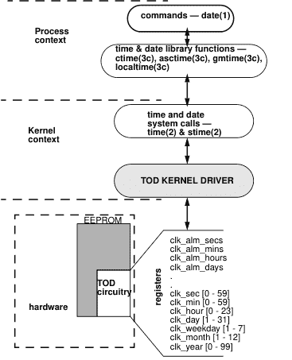

*图 2.12：SPARC 系统上的日时时钟*

日期和时间值的每个分量都作为独立的计数器值存储在时钟芯片中，每个计数器达到其最大值时，下一个逻辑值递增，例如，秒计数 0–59，然后分钟递增并重新从 0 开始。执行 `date(1)` 命令设置日期会调用 `stime(2)` 系统调用，该调用又调用 `tod_set()` 设备驱动程序接口，该接口在 TOD 时钟硬件中设置这些值。

为了符合行业标准接口（系统调用和库例程），内核提供了用于将从时钟硬件读取的日期值转换为 Unix 约定的自纪元以来的秒数的函数，反之亦然。

## 3 内核同步原语

在本章中，我们继续讨论核心内核设施，研究 Solaris 内核中实现的同步对象。

### 3.1 同步

Solaris 运行在各种不同的硬件平台上，包括基于 SPARC 和 Intel 处理器的多处理器系统。当今存在的几种多处理器架构在硬件和软件的性能与工程复杂性方面提供了不同的权衡。Solaris 当前支持的多处理器架构是对称多处理器（SMP）和共享内存架构，该架构实现了一个由所有处理器共享的单一内核，以及一个统一的内存地址空间。为了支持这样的架构，内核必须同步对关键数据的访问，以维护数据完整性、一致性和状态。内核通过为特定的内核数据结构或变量定义锁，并要求读取或写入数据的代码必须首先获取相应的锁，来同步访问。锁的持有者需要在数据操作完成后释放锁。

同步原语和相关接口几乎被所有内核子系统使用：设备驱动程序、调度器、进程和线程支持代码、文件系统等。深入了解同步对象是什么以及它们如何实现，是理解 Solaris 内核核心优势之一——在多处理器系统上的可扩展性能——的关键。可扩展性方程中同样重要的组成部分是尽可能完全避免使用锁。

内核中同步锁的使用作为内核工程开发过程的一部分不断受到严格审查，目的是在不损害数据完整性的前提下尽量减少所需的锁数量。

多年来，业界出现了多种构建并行多处理器系统的替代方法。因此，为了传达围绕实现的相关问题，我们需要将事物放在上下文中。首先，我们简要了解一下当今市面上可用的不同并行系统架构，然后转向 Solaris 内核支持多处理器架构的具体细节。

### 3.2 并行系统架构

Sun 的多处理器（MP）系统（基于 SPARC 处理器）以及几个基于 Intel 的 MP 平台都实现为对称多处理器（SMP）系统。对称多处理器描述了一种系统中所有处理器（CPU）之间存在对等关系的系统。不存在主处理器，即定义为系统中唯一可以执行操作系统代码和处理中断的 CPU。所有处理器都是平等的。SMP 这个缩写也可以扩展到共享内存多处理器（Shared Memory Multiprocessor）的含义，它定义了一种架构，其中系统中的所有处理器共享系统物理地址空间和操作系统虚拟地址空间的统一视图。也就是说，所有处理器共享一个操作系统内核映像。Sun 的多处理器系统满足这两个定义的标准。

替代的 MP 架构以不同方式改变内核可寻址内存的视图。大规模并行处理器（MPP）系统构建在包含相对少数处理器、一些本地内存和 I/O 的节点之上。每个节点包含自己的操作系统副本；因此，每个节点寻址自己的物理和虚拟地址空间。一个节点的地址空间对系统上的其他节点不可见。这些节点通过高速、低延迟的互连连接，节点间通信通过优化的消息传递接口完成。MPP 架构需要一种新的编程模型来实现跨节点的并行性。

共享内存模型不起作用，因为系统的总地址空间在节点间不可见，因此不同节点上运行的线程无法共享内存页。因此，需要跨系统中各个节点扩展的代码必须使用提供内核消息传递路径接口的 API。

其他问题源于架构在 I/O 处理方面的非均匀性，因为每个节点上的 I/O 控制器不容易让系统上所有节点看到。一些 MPP 平台试图提供

通过内核软件在所有节点上营造出统一I/O空间的假象，但访问非本地I/O设备时的时间非均匀性依然存在。

NUMA和ccNUMA（非均匀内存访问与缓存一致性NUMA）架构试图解决MPP系统固有的编程模型问题。从硬件架构角度看，NUMA系统类似于MPP——小型节点配少量处理器、节点间互连、本地内存，且每个节点带有I/O。请注意，NUMA/ccNUMA或MPP系统并不要求必须实现小型节点（四个或以下处理器的节点）。许多实现确实采用这种构建方式，但架构上并未限制节点大小。

在NUMA/ccNUMA系统上，操作系统软件提供单一系统映像，每个节点都能看到整个系统的内存地址空间。这样便保留了共享内存模型。然而，内存访问速度（延迟）的非均匀性会影响平台的性能和潜在可扩展性。当在NUMA或ccNUMA系统的一个处理器节点上执行的线程发生缺页错误（引用了未映射的内存地址）时，解决该缺页错误的延迟会根据物理内存页与执行线程位于同一节点还是位于互连网络另一端的节点而有所不同。延迟差异可能相当大。随着不同节点上执行的线程之间内存页共享程度的提高，可能需要从非本地内存段解决的缺页错误数量也会增加。这个问题会对性能和可扩展性产生不利影响。

三种不同的并行架构可总结如下。


- **SMP** — 对称多处理器，采用共享内存模型；单一内核映像。
- **MPP** — 基于消息的模型；多个内核映像。
- **NUMA/ccNUMA** — 共享内存模型；单一内核映像。

图3.1展示了不同的架构。

当多个处理器共享同一内核映像，且每个处理器都能运行内核代码、处理中断等时，构建一个能提供可扩展性能的操作系统所面临的挑战在于同步对关键数据和状态信息的访问。可扩展性能（或称可扩展性）通常指随着向系统中添加更多硬件资源，系统能够完成越来越多的工作。如果向多处理器系统添加更多处理器，则预期工作量会相应增加，前提是系统其他领域（内存、I/O、网络）拥有足够的资源。

要实现可扩展性能，系统必须能够支持多个处理器并发执行操作系统代码。无论这种执行发生在设备驱动程序、中断处理程序、线程调度器、文件系统代码还是虚拟内存代码中，在一定程度上都取决于负载。并发是扩展性的关键。

前面关于并行架构的讨论只是触及了一个非常复杂课题的表面。有专门的著作只讨论并行架构，如需更多信息，你应当查阅这些资料。例如，参见[11]、[21]和[23]。

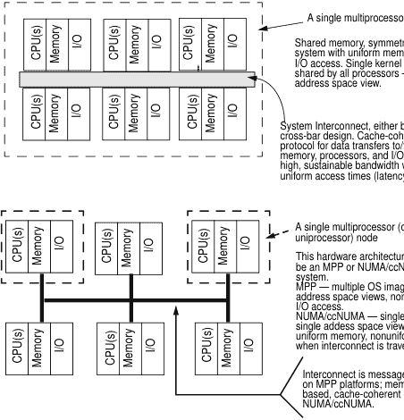

图3.1 *并行系统架构*

难点在于维护内核中数据结构、内核变量、数据链接（指针）和状态信息的数据完整性。例如，我们不能允许运行在多个处理器上的线程同时操作同一链表上指向同一数据结构的指针。当一个处理器正在读取某关键状态信息的某一位（例如：某处理器是否在线？）时，我们应当防止另一个处理器上执行的线程同时修改该状态数据（例如：正在将一个仍处于状态转换中的处理器接入在线状态）。

为了解决此类系统上的数据完整性问题，内核实现了锁定机制。它要求所有操作系统代码都清楚内核中存在的锁的数量和类型，并在读写内核数据之前遵守锁的层级和获取锁的规则。值得注意的是，构建可扩展内核的架构问题与开发一个运行在共享内存系统上的多线程应用程序所面临的问题并没有太大区别。多线程应用程序也必须使用与内核中相同的基本锁原语和技术来同步对共享数据的访问。内核代码中还存在其他同步问题，如处理中断和陷阱事件，这使得操作系统开发的问题复杂得多，但根本问题是相同的。

### 3.3 锁和同步的硬件考虑因素

硬件特定的考虑因素必须纳入系统上锁原语的实现中。第一个考虑因素与处理器的指令集以及是否有适合锁定代码的机器指令有关。第二个考虑因素涉及当执行中的内核线程检查锁时，锁状态的可见性。

为了理解这些适用于锁原语的考虑因素，请记住锁是系统内存中特定位置的一块数据。在最简单的形式下，锁是RAM中的单个字节位置。一个被设置（或持有，即已被获取）的锁，由锁字节中的所有位均为1（锁值`0xFF`）来表示。一个可用（未被持有）的锁，是同一个字节中的所有位均为0（锁值`0x00`）。这种解释可能看起来相当初级，但对于理解下文至关重要。

当今出货的大多数现代处理器都提供某种形式的字节级*测试并设置*（test-and-set）指令，该指令在本质上保证是原子的。该指令序列通常被描述为读-修改-写，也就是说，被引用的内存位置（锁的内存地址）在一个原子操作中被读取、修改并写回。在RISC处理器（如Sun SPARC）中，读取是*加载*操作，写入是*存储*操作。一致性要求原子操作。具有原子属性的指令意味着在执行指令的加载和存储之间不允许有其他存储操作。互斥锁和读写锁操作必须是原子的，这样当获取锁的指令执行完成时，我们要么获得了锁，要么拥有了判断锁已被持有的所需信息。考虑一下如果没有具有原子属性的指令会发生什么情况。一个处理器上执行的线程可以发出对锁的加载（读取），当它正在执行测试操作以判断锁是否被持有时，另一个处理器上执行的线程同时发出对该锁的调用以获取同一把锁。如果该锁未被持有，两个线程都会认为锁可用，并发出存储操作来持有该锁。显然，多个线程不能同时拥有同一把锁，但这正是这样一系列事件所导致的结果。原子指令可以防止此类事情发生。

SPARC处理器实现了提供原子测试并设置语义的内存访问指令，用于互斥原语，以及可以强制特定内存操作顺序的指令（稍后将进一步介绍后者的特性）。UltraSPARC处理器（SPARC V9指令集）提供了三条保证原子行为的内存访问指令：`ldstub`（加载并存储无符号字节）、`cas`（比较并交换）和`swap`（交换字）。这些指令在行为上和操作数据的大小上略有不同。

图3.2展示了`ldstub`和`cas`指令。交换指令（未显示）只是将一个32位值在硬件寄存器与内存位置之间交换，类似于`cas`在指令序列的比较阶段相等时所执行的操作。

使用汇编语言的测试并设置风格指令来实现锁定代码，需要对锁值执行后续的测试指令，而锁值是通过`cas`或`ldstub`指令获取的。

例如，`ldstub`指令从内存中取出字节值（锁）并将其存储到指定的硬件寄存器中。锁定代码必须测试该寄存器的值，以判断在执行`ldstub`时锁是被持有还是可用。如果寄存器值为全1，则锁已被持有，因此代码必须分支处理该情况。如果寄存器值为全0，则锁未被持有，代码就可以继续执行，作为当前的锁持有者。请注意，在两种情况下，由于`ldstub`指令的行为（在指定地址存储`0xFF`），内存中的锁值都会被设置为全1。如果锁已经被持有，该值只是没有变化。如果锁是0（可用），它现在将反映锁已被持有（全1）。释放锁的代码会将锁值设置为全0，表示锁不再被持有。

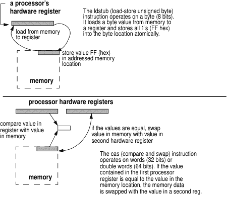

### 图 3.2 *SPARC 上锁的原子指令*

进入锁代码时，Solaris 锁代码使用汇编语言指令。其基本设计是，获取锁的入口点会进入一个汇编语言例程，该例程使用 `ldstub` 或 `cas` 来获取锁。汇编代码设计用于处理简单情况，即所需的锁可用。如果锁正被持有，则会进入 C 语言代码路径来处理这种情况。我们将在接下来几节讨论特定锁类型时详细描述发生的情况。

前面提到的第二个硬件考虑因素与锁值改变时运行中的处理器对锁状态的可见性有关。在多处理器系统上，所有处理器必须对内存中的数据保持一致视图，这一点至关重要，尤其是在实现同步原语——互斥锁和读/写（RW）锁——时。换句话说，如果一个线程获取了一把锁，任何处理器对该内存位置执行加载指令（读取）时，都必须获取最后一次存储（写）之后的数据。锁的最新状态必须对系统上的所有处理器全局可见。

现代处理器实现硬件缓冲以提供最佳性能。除了硬件高速缓存外，处理器还使用加载和存储缓冲区来保存从内存读取（加载）或写入（存储）的数据，以保持指令流水线运行，避免处理器因等待数据或数据写入内存周期而停顿。数据层次结构如图 3.3 所示。

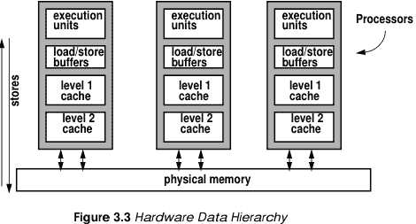

图 3.3 中的图示并非描绘特定处理器，而是典型现代高端微处理器中各级数据流的通用表示。它旨在展示数据在处理器主要执行单元（整数单元、浮点单元等）与物理内存之间的流动。

加载/存储缓冲区的大小因处理器实现而异，但通常为几个字长。每个处理器上的加载和存储缓冲区仅对其所在的处理器可见，因此，发出存储的处理器所发出的加载操作，如果数据仍在存储缓冲区中，则会从存储缓冲区获取数据。然而，理论上，其他处理器在存储发出处理器的存储缓冲区被刷新之前，可能为该数据发出加载操作，从而读取它们自己的硬件高速缓存或主内存。请注意，我们这里所说的存储缓冲区与一级或二级硬件指令和数据高速缓存不是同一回事。高速缓存位于存储缓冲区之外；存储缓冲区更靠近处理器的执行单元。在 SMP 平台上，物理内存和硬件高速缓存通过硬件总线协议保持一致。此外，许多高速缓存实现为*写通*高速缓存（如 Sun UltraSPARC 中的一级高速缓存），因此写入高速缓存的数据会导致内存被更新。

存储缓冲区的实现是硬件实现的*内存模型*的一部分。内存模型定义了系统可以对内存操作（加载和存储）的顺序施加的约束。许多处理器实现*顺序一致性*模型，其中对内存的加载和存储按照处理器发出的顺序执行。这种模型在内存一致性方面有优势，但存在性能权衡，因为硬件无法为了速度而优化高速缓存和内存操作。SPARC 架构规范（[41]）允许构建支持多种内存模型的基于 SPARC 的处理器，具体支持哪些内存模型由实现者自行选择。所有当前的 SPARC 处理器都实现了全存储排序（TSO）模型，该模型要求满足以下有关加载和存储的规则。

- 加载（从内存读取）是阻塞的，并且相对于其他加载是有序的。
- 存储（写入内存）相对于其他存储是有序的。存储不能绕过先前的加载。
- 原子加载-存储（`ldstub` 和 `cas` 指令）相对于加载是有序的。

TSO 模型不如顺序一致性模型那么严格，但也不像 SPARC 架构定义的另外两种内存模型那样宽松。基于 SPARC 的处理器还支持宽松内存排序（RMO）和部分存储排序（PSO），但这些目前不受内核支持，也未在当前发售的任何 Sun 系统中实现。

数据可见性方面的最后一个考虑因素也适用于内存模型，并且涉及指令排序。现代处理器中的执行单元可以重新排列传入的指令流，以便通过执行单元进行处理。其目标同样是为了性能和生成能使处理器流水线保持满负荷的指令序列。

本节所述硬件考虑因素汇总于表 3-1，其中包含适用于特定问题的解决方案或实现细节。


### 表 3-1 锁的硬件考虑因素和解决方案

| 考虑因素 | 解决方案 |
|---|---|
| 锁定原语需要原子测试并设置指令。 | 使用本机机器指令。SPARC 上使用 `ldstub` 和 `cas`，x86 上使用 `cmpxchg`（比较/交换长整型）。 |
| 由于内存模型定义的硬件加载和存储缓冲区以及指令重排序导致的数据全局可见性问题。 | 使用内存屏障指令。 |

面对处理器的加载和存储缓冲区、宽松内存模型以及锁的原子测试并设置能力，一致内存视图的问题在处理器指令集级别得到解决。Solaris 内核中实现的互斥锁和 RW 锁原语，在基于 UltraSPARC 的系统上使用 `ldstub` 和 `cas` 指令进行锁测试和获取，在 Intel x86 上使用 `cmpxchg`（比较/交换长整型）指令。锁原语例程属于内核代码中与架构相关的部分。

SPARC 处理器提供各种形式的*内存屏障（membar）*指令，根据指令中设置的选项，这些指令对内存访问操作（加载和存储）相对于其发出顺序的排序施加特定约束。为了确保在发出互斥锁或 RW 锁操作时内存视图一致，Solaris 内核在锁位改变后发出适当的 `membar` 指令。

当我们从最强的一致性模型（顺序一致性）转向最弱的模型（RMO）时，我们可以构建具有潜在更好性能的系统。我们可以通过调整内存访问指令的排序来优化内存操作，从而使设计者能够最小化访问延迟并最大化互连带宽。权衡之处在于一致性，因为模型越宽松，对系统以与指令流发出顺序相同的顺序执行内存访问操作的约束就越少。因此，处理器架构提供了内存屏障控制，内核开发人员可以在必要时使用这些控制来解决一致性问题，并对满足系统需求所需的一致性级别进行一定程度的控制。可用的 `membar` 指令类型、它们支持的选项，以及它们如何适应所描述的不同内存模型，本身就可以构成一个技术性强且篇幅冗长的章节。对此主题感兴趣的读者应阅读 [4] 和 [23]。

## 3.4 同步对象简介

Solaris 内核实现了多种类型的同步对象。锁为共享数据的同步访问提供互斥语义。锁有多种形式，并且是本章的重点。Solaris 内核中最常用的锁是互斥，或*互斥*锁，它提供对数据的独占读写访问。此外还实现了*读/写*（RW）锁，适用于允许多个读者但同时只允许一个写者的情况。内核的某些区域也使用内核*信号量*，在这些区域中，必须管理对有限数量资源的访问。一种特殊类型的互斥锁，称为*调度器锁*，被内核调度器使用，用于同步需要通过锁定机制保护访问以及防止中断的情况。

条件变量不是锁的一种类型，它们用于线程同步，并且是内核睡眠/唤醒机制的一个组成部分。条件变量

此处引入旋转门，并在第 5 章“内核调度程序”中详细讨论。

运行中的系统在任何时刻实际存在的锁数量都是动态的，并随系统规模而变化。内核源代码中定义了数百个锁，但基于静态源代码统计出的锁数量并不准确，因为在正常系统活动期间，锁是动态创建的——例如，内核线程和进程被创建、文件系统被挂载、文件被创建和打开、网络连接被建立等。许多锁嵌入在内核数据结构中，这些结构提供了内核的抽象（进程、文件），因此内核锁的数量会随资源的动态创建而线性增加。

这种设计体现了 Solaris 内核的核心优势之一：可扩展性，以及根据内核规模动态扩展同步原语的能力。与静态分配相比，动态创建锁具有若干优点。首先，在较小系统（如桌面或工作组服务器）上运行时，内核不会浪费时间与空间来管理大量未使用的锁。在大系统上，则有足够数量的锁来维持并发性，从而获得可扩展的性能。在一个大型、繁忙的系统中，实际上可能存在数千把锁。

### 3.4.1 同步过程

当正在执行的内核线程尝试获取锁时，会遇到两种可能的锁状态之一：空闲（可获取）或非空闲（已被拥有、已被持有）。当调用特定锁的获取锁函数时，请求线程获得可用锁的所有权。如果锁不可用，线程很可能需要阻塞并等待其变为可用；不过，我们稍后会看到，代码在等待锁时并不总是阻塞（睡眠）。对于线程等待锁时需要睡眠的情况，内核实现了一种称为*旋转门*的睡眠队列设施，用于管理阻塞在锁上的线程。

当内核线程完成受锁保护的共享数据上的操作后，必须释放锁。当线程释放锁时，代码必须处理两种情况之一：有线程在等待该锁（此类线程称为*等待者*），或者没有等待者。如果没有等待者，锁可以直接释放。如果有等待者，代码有几种选择。它可以释放锁并唤醒所有阻塞线程；在这种情况下，最先执行的线程将获取锁。或者，代码可以根据优先级或睡眠时间从旋转门（睡眠队列）中选择一个线程，只唤醒该线程。最后，代码还可以选择哪个线程应接下来获得锁，然后锁所有者可以将锁移交给所选线程。正如我们将在后续章节中看到的，没有一种解决方案适用于所有情况，Solaris 内核会根据锁类型使用上述全部三种方法。图 3.4 给出了总体概览。

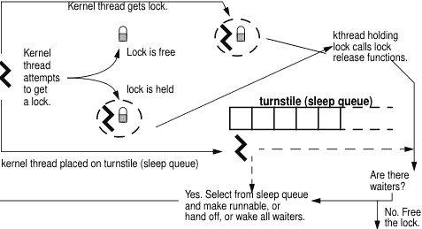

**图 3.4** *Solaris 锁——全景图*

图 3.4 提供了执行流程的通用表示。稍后我们将看到投入到锁代码中的大量工程努力的成果：通过短代码路径提高效率与速度，通过精心调优的汇编代码对热路径（频繁命中的代码路径）进行优化，以及通过广泛分析确定的锁释放最佳算法。

### 3.4.2 同步对象操作向量

本节讨论的每种同步对象——互斥锁、读写锁和信号量——都定义了一个操作向量，该向量与阻塞在该对象上的内核线程相关联。具体而言，对象的操作向量是一种数据结构，导出了内核线程在锁上睡眠所需的一小部分对象函数。通用结构定义在 `/usr/include/sys/sobject.h` 中。

```c
/*
 * The following data structure is used to map
 * synchronization object type numbers to the
 * synchronization object's sleep queue number
 * or the sync object's owner function.
 */
typedef struct _sobj_ops {
        syncobj_t       sobj_type;
        kthread_t       *(*sobj_owner)();
        void            (*sobj_unlock)(kthread_t *);
        void            (*sobj_change_pri)(kthread_t *, pri_t, pri_t *);
} sobj_ops_t;
```

**头文件** `<sys/sobject.h>`

上述结构用于对象类型声明。对于每种同步对象类型，都定义了一个特定于类型的结构：`mutex_sobj_ops` 用于互斥锁，`rw_sobj_ops` 用于读写锁，`sema_sobj_ops` 用于信号量。

该结构还提供了三个函数，可代表在同步对象上睡眠的内核线程调用：

- 一个*所有者*函数，返回拥有该对象的内核线程的 ID
- 一个*解除睡眠*函数，使内核线程从睡眠状态转换出来
- 一个*change_pri*函数，用于更改内核线程的优先级，用于优先级继承。（参见第 89 页的“旋转门与优先级继承”。）

在接下来的章节中，随着我们详细研究锁实现的具体内容，我们将看到如何实现对该锁操作结构的引用。

在这一点上值得指出的是，我们对 Solaris 内核锁的考察为内核软件工程中涉及的一些设计权衡提供了一个很好的范例。构建构成 Solaris 内核的各种软件组件，是一系列在性能需求与复杂性之间进行权衡的设计决策。在内核中优先级最高的性能领域，可能会牺牲简洁性以换取性能。Solaris 内核中的锁机制正是做出这种权衡的领域——为了速度，许多锁代码用汇编语言而不是 C 语言编写；后者更易于编写和维护，但可能更慢。在某些情况下，当代码路径并非性能关键时，会倾向于选择更简单的设计，而不是晦涩的汇编代码或复杂性较高的算法。特定设计的行为通过详尽测试来检验，以确保做出了尽可能最佳的设计决策。

## 3.5 互斥锁

互斥，即 *mutex* 锁，是内核中使用最普遍的同步原语类型。互斥锁将关键数据的访问串行化：内核线程必须先获取特定于受保护数据区的互斥锁，然后才能读取或写入该数据。线程在持有锁期间是锁的*所有者*，并且线程在受保护区域内完成工作后必须释放锁，以便其他线程可以获取该锁并访问受保护的数据。

### 3.5.1 概述

如果线程试图获取一个已被持有的互斥锁，它基本上可以做两件事之一：**自旋**或**阻塞**。自旋意味着线程进入一个紧密循环，在每次循环中尝试获取锁。术语*自旋锁*通常用于描述这种类型的互斥锁。阻塞意味着在锁被持有期间，线程被放入睡眠队列；当锁被释放时，内核向该线程发送唤醒信号。这两种方法各有利弊。

自旋方法的好处是不会产生上下文切换的开销（将线程投入睡眠时需要此开销），而且当锁被释放时，由于没有上下文切换操作，获取锁也相对较快。其缺点是线程处于自旋循环中时会消耗 CPU 周期——CPU 在执行一个内核线程（自旋循环中的线程），但并未真正做任何有用工作。


阻塞方法的好处是，在锁被持有期间，处理器可以腾出来执行其他线程；其缺点是，需要上下文切换，将等待线程移出处理器，并将新的可运行线程移入处理器。此外，锁获取延迟也会稍高一些，因为在阻塞线程能够成为它等待的锁的所有者之前，需要一次唤醒和一次上下文切换。

除了在请求的锁已被持有时应如何处理之外，锁的粒度问题也需要解决。让我们看一个简单示例。内核维护一个进程表，它是一个进程结构的链表，系统中的每个进程对应一个结构。可以实现一个简单的表级互斥锁：如果线程需要操作某个进程结构，它必须先获取进程表互斥锁。这种锁粒度非常粗。其优点是简单且锁开销最小；其明显缺点则是可扩展性可能很差，因为同一时间只能有一个线程操作进程表上的对象。这样的锁很可能产生大量争用（成为*热锁*）。

另一种选择是实现更细的粒度：每个进程表条目一个锁，而不是一个表级锁。如果每个进程表条目上都有一个锁，多个线程就可以同时操作不同的进程结构，从而提供并发性。缺点是这种实现更复杂，增加了发生死锁的可能性，并且因为需要管理更多锁，开销也会更大。

总的来说，Solaris 内核尽可能实现相对细粒度的锁定，这主要是由于锁可以根据需要随内核结构动态扩展的性质。

内核实现了两种类型的互斥锁：*自旋锁*和*自适应锁*。正如我们讨论过的，当线程尝试获取所需锁时，如果该锁正被持有，自旋锁会在一紧密循环中自旋。自适应锁是最常见的类型

所使用的锁被设计为在锁被持有时，根据持有者的状态动态地自旋或阻塞。我们已经讨论了自旋与阻塞之间的权衡。实现一种只执行其中一种操作的锁定方案会严重影响可扩展性和性能。采用自适应锁定方案要好得多，这正是我们所做的。

自适应锁的机制很简单。当一个线程试图获取一个被持有的锁时，内核会检查持有该锁的线程的状态。如果锁持有者（所有者）正在处理器上运行，则试图获取锁的线程将自旋。如果持有锁的线程没有在运行，则试图获取锁的线程将阻塞。这种策略效果很好，因为代码设计使得互斥锁的持有时间非常短（根据设计，目标是最小化持有锁期间执行的代码量）。因此，如果一个线程持有锁并且在运行，那么锁很可能很快就会释放，可能比上下文切换所需的时间还要短，所以自旋是值得的。

另一方面，如果锁持有者没有在运行，那么我们知道在持有者释放锁之前至少涉及一次上下文切换（让持有者重新回到处理器上运行），此时简单地阻塞并释放处理器去做其他事情是合理的。内核会将阻塞线程放在专门为同步原语设计的旋转门（turnstile，睡眠队列）上，并在持有者释放锁时唤醒该线程。（参见第89页的“旋转门与优先级继承”。）

自适应锁和自旋锁之间的另一个区别与中断、调度器和上下文切换有关。内核调度器是选择线程进行调度并执行上下文切换的代码。它在提升的优先级中断级别（PIL）下运行以屏蔽中断（在SPARC系统上，调度器在优先级10下运行）。高级中断（在SPARC系统上，中断级别11-15）可以中断调度器。高级中断处理程序不允许执行任何可能导致上下文切换或进入调度器的操作（我们将在第97页的“调度器锁”中进一步讨论）。自适应锁可以阻塞，而阻塞意味着上下文切换，因此只有自旋锁可以用于高级中断处理程序。此外，自旋锁在获取锁时可以提高处理器的优先级中断级别。本章后面的“内核陷阱与异常”将更详细地介绍中断。

```c
struct kernel_data {
    mutex_t klock;
    char *fwd_ptr;
    char *back_ptr;
    long data1;
    int data2;
} kdata;

void function()
{
    mutex_init(&kdata.klock);

    mutex_enter(&kdata.klock);
    kdata.data1 = 1;
    mutex_exit(&kdata.klock);
}
```

上面的伪代码块说明了互斥锁的一般机制。在代码中声明了一个锁；在这种情况下，它嵌入在它要保护的数据结构中。一旦声明，锁就通过内核的`mutex_init()`函数进行初始化。任何后续对`kdata`结构的引用都需要使用`mutex_enter()`获取`klock`互斥锁。一旦工作完成，就使用`mutex_exit()`释放锁。锁类型（自旋或自适应）由内核在`mutex_init()`代码中确定。假设本例中使用自适应互斥锁，任何对`klock`调用`mutex_enter()`的内核线程将根据调用`mutex_enter()`时拥有`klock`的内核线程的状态来决定是阻塞还是自旋。

### 3.5.2 Solaris 7 互斥锁实现

本节的实现描述基于Solaris 7。在算法上，Solaris 2.5.1和Solaris 2.6非常相似，但在实现上存在一些差异，我们将在后续章节中介绍。

内核为两种类型的互斥锁（自适应和自旋）定义了不同的数据结构，如图3.5所示。

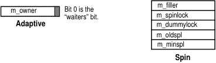

**图3.5** *Solaris 7 自适应与自旋互斥锁*

在图3.5中，自适应锁中的`m_owner`字段保存着拥有该锁的内核线程的地址（线程指针），它扮演着双重角色，即它还充当实际的锁；线程成功获取锁意味着它的线程指针已设置在目标锁的`m_owner`字段中。如果线程试图获取锁，`m_owner`的低位（第0位）会被置位以反映这种情况。我们确保kthread指针值不需要第0位来实现这一点。

正如我们前面指出的，自旋互斥锁用于不允许上下文切换的高级中断级别。自旋锁在自旋循环中屏蔽中断，因此内核需要维护处理器在进入自旋循环之前所运行的优先级级别，这会提高处理器的优先级级别。（提升优先级级别正是屏蔽中断的方式。）`m_minipl`字段在锁初始化时存储中断处理程序的优先级级别，而`m_oldspl`被设置为调用锁代码时处理器正在运行的优先级级别。`m_spinlock`字段包含实际的互斥锁位。

每个实现一个或多个互斥锁的内核模块和子系统都会调用一组通用的互斥锁函数。所有锁都必须首先由`mutex_init()`函数初始化，该函数根据`mutex_init()`调用中传入的参数来确定锁类型。传入`mutex_init()`最常见的类型是`MUTEX_DEFAULT`，这会导致初始化代码确定应使用何种类型的锁（自适应或自旋）。`mutex_init()`的调用者可以指定具体的锁类型（例如`MUTEX_SPIN`），但这种情况很少见。

如果初始化代码是从设备驱动程序或任何注册并产生中断的内核模块调用的，那么参数列表中会添加一个中断块cookie（interrupt block cookie）。中断块cookie是设备驱动程序在设置其中断向量和参数时使用的一种抽象。`mutex_init()`代码会检查参数列表中是否有中断块cookie。如果`mutex_init()`被设备驱动程序调用来初始化一个用于高级中断处理程序的互斥锁，锁类型会被设置为自旋。否则，初始化一个自适应锁。测试的依据是传入的中断块中的优先级中断级别；在SPARC系统上，高于10的级别被视为高级中断，因此需要自旋锁。初始化代码会根据锁类型清除互斥锁结构中的大多数字段。自旋锁中的`m_dummy_lock`字段被设置为全1（`0xFF`）。我们稍后就会明白为什么。

除了`mutex_init()`（每个锁只在初始化时调用一次）之外，调用的主要互斥锁函数是用于获取锁的`mutex_enter()`和用于释放锁的`mutex_exit()`。`mutex_enter()`假定锁是可用且自适应的。如果锁是自旋锁，则进入`mutex_enter()`以协调应该发生的情况。这是一种性能优化。`mutex_enter()`用汇编代码实现，由于入口点是针对简单情况（自适应锁，未持有）设计的，当这些条件成立时，获取锁所执行的代码量是最小的。此外，内核中自适应互斥锁的数量明显多于自旋锁，使得快速测试用例在大多数时候都有效。测试锁是否被持有或是否为自旋锁非常快。这就是`m_dummy_lock`字段发挥作用的地方。`mutex_enter()`在互斥锁的第一个字节上执行比较并交换（compare-and-swap）指令，测试其值是否为零。对于自旋锁，由于`m_dummy_lock`在数据结构中的位置以及SPARC处理器的字节序，会测试`m_dummy_lock`字段。由于`m_dummy_lock`总是被设置（在`mutex_init()`中被设置为全1），因此对于自旋锁，测试会失败。对于被持有的自适应锁，测试也会失败，因为此类锁在被测试的字节字段中会有非零值。也就是说，被持有的自适应锁的`m_owner`字段会有一个kthread指针值。


如果锁是自适应互斥锁且未被持有，则`mutex_enter()`的调用者获得该锁的所有权。如果两个条件都不成立，即锁被持有或锁是自旋锁，则代码进入`mutex_vector_enter()`函数来获取锁。`mutex_vector_enter()`代码首先测试锁类型。对于自旋锁，处理器当前的优先级中断级别（PIL）被保存在`m_oldspl`中，然后测试锁。如果锁未被持有，则设置锁（在`m_spinlock`中）并返回调用者。如果锁被持有，则强制调用者进入自旋循环，在循环中递增循环计数器（用于统计目的，即`lockstat(1M)`数据），并且代码在每次循环中检查锁是否仍被持有。一旦锁被释放，代码跳出循环，获取锁，并返回调用者。

自适应锁需要多做一点工作。当代码进入自适应代码路径（在`mutex_vector_enter()`中）时，它会递增`cpu_sysinfo.mutex_adenters`（adaptive lock enters，自适应锁进入）字段，这反映在`mpstat(1M)`的`smtx`列中。`mutex_vector_enter()`然后再次测试以确定锁是否被拥有（持有），因为在调用`mutex_enter()`和当前到达`mutex_vector_enter()`代码之间的时间间隔内，锁可能已被释放。如果自适应锁未被持有，`mutex_vector_enter()`会尝试获取该锁。如果成功，代码返回。

如果锁被持有，`mutex_vector_enter()`通过遍历CPU结构并将锁的`m_owner`与CPU结构的`cpu_thread`字段进行比较，来确定锁所有者是否正在运行。（`cpu_thread`包含当前在CPU上执行的线程的内核线程地址。）匹配表示持有者正在运行，这意味着自适应锁将自旋。不匹配则表示所有者没有在运行，在这种情况下，调用者必须阻塞。在阻塞的情况下，进入内核旋转门（turnstile）代码以定位或获取一个turnstile，为将内核线程放置在与此turnstile关联的睡眠队列上做准备。

turnstile的放置分两个阶段进行。在`mutex_vector_enter()`确定锁持有者没有在运行后，它进行一个turnstile调用来查找turnstile，在锁中设置等待者（waiters）位，并重新测试所有者是否在运行。如果是，代码释放turnstile并进入自适应锁自旋循环，该循环尝试获取锁。否则，

这段代码将内核线程放到一个回转门（睡眠队列）上，并将线程状态改为睡眠。这实际上结束了 `mutex_vector_enter()` 中的事件序列。

从 `mutex_vector_enter()` 返回时，要么调用者成功获取了锁，要么调用线程位于与该锁关联的回转门睡眠队列上。无论哪种情况，都会更新 `lockstat(1M)` 数据，反映锁类型、自旋时间或睡眠时间，作为 `mutex_vector_enter()` 中完成的最后一项工作。

`lockstat(1M)` 是一个内核锁统计命令，在 Solaris 2.6 中引入。它提供有关内核互斥锁和读写锁的详细信息。

前面段落所描述的算法总结如下伪代码所示。

```
mutex_vector_enter()
    if (lock is a spin lock)
        lock_set_spl() /* enter spin-lock specific code path */
        increment cpu_syncinfo.adjustments
spin_loop:
    if (lock is not owned)
        mutex_trylock() /* try to acquire the lock */
        if (lock acquired)
            goto bottom
        else
            continue /* lock being held */
    if (lock owner is running on a processor)
        goto spin_loop
    else
        lookup turnstile for the lock
        set waiters bit
        if (lock owner is running on a processor)
            drop turnstile
            goto spin_loop
        else
            block /* the spin / sleep queue associated with the turnstile */

bottom:
    update lockstat statistics
```

当线程在锁保护的数据区域完成工作后，它会调用 `mutex_exit()` 代码来释放锁。该入口点以汇编语言实现，处理释放无等待线程的自适应锁这一简单情况。如果没有线程在等待该锁，只需清除锁字段（`m_owner`）并返回即可。除简单情况外，C 语言函数 `mutex_vector_exit()` 从 `mutex_exit()` 进入。

对于自旋锁，锁字段会被清除，处理器恢复到进入锁代码之前所运行的 PIL 级别。对于自适应锁，必须从回转门中选择一个等待线程（如果有多个等待线程），将其状态从睡眠改为可运行，并放入调度队列，以便其执行并获取锁。如果释放锁的线程是优先级继承的受益者，即当具有更好优先级的调用线程无法获取锁时，该线程的优先级得到了提升，那么释放锁的线程的优先级将被重置为继承之前的优先级。优先级继承在“回转门与优先级继承”一节（第 89 页）中讨论。

当释放自适应锁时，代码会清除 `m_owner` 中的等待者位，并调用 `turnstile` 函数唤醒所有等待者。熟悉操作系统睡眠/唤醒机制的读者可能听说过一种被称为*惊群*情况的特殊行为：许多因同一资源而阻塞的线程同时被唤醒，然后疯狂地争抢该资源（此处为互斥锁）——如同一大群四条腿的大型野兽奔向同一个目标。系统行为往往表现为运行队列从相对较小变成很大（所有线程都被唤醒并变为可运行状态），CPU 利用率很高，直到某个线程获取资源，此时大量线程再次睡眠，运行队列恢复正常，CPU 利用率趋于平稳。这是一种任何操作系统都可能发生的通用行为。

在 Solaris 7 中调用 `mutex_vector_exit()` 所使用的唤醒机制看似是在公开招引惊群效应，但在实践中证明并非问题。主要原因是，等待互斥锁的线程发生阻塞的情况很罕见；大多数时候线程会自旋。即使出现阻塞情况，通常也不会达到大量线程阻塞在互斥锁上的程度——惊群问题的特征之一就是资源争用导致大量线程睡眠。实现互斥锁的内核代码段在设计上既短又快，因此锁不会持有太久。需要较长锁持有时间的代码使用读写锁（写锁），它通过选择性唤醒算法提供互斥语义。当然，选择读写锁而非互斥锁还有其他原因，最明显的是允许多个读取者查看受保护的数据。

在接下来的章节中，我们将区分 Solaris 2.5.1 和 2.6 中互斥锁的实现。如前所述，Solaris 2.5.1 和 2.6 与前面描述的 Solaris 7 行为相似，尤其是在锁获取（`mutex_enter()`）方面。更显著的差异存在于锁释放算法及相关的唤醒行为中。

### 3.5.2.1 Solaris 2.6 互斥锁实现差异

首先，检查锁结构，如图 3.6 所示。

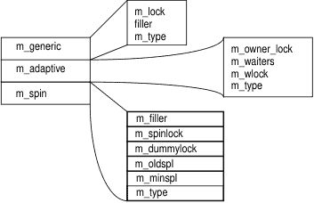

Solaris 2.6 在同一结构中定义了所有可能的互斥锁类型。自旋锁与 Solaris 7 相同，只是增加了一个类型字段。自适应互斥锁拥有更多字段，这些字段大多不言自明。`m_owner_lock` 与 Solaris 7 中的 `m_owner` 相同；它就是锁本身，其值在锁被持有时表示持有者的 kthread ID。`m_waiters` 存储等待内核线程的遍历 ID，`m_wlock` 是一个调度器锁（参见第 97 页的“调度器锁”），用于同步对互斥锁中 `m_waiters` 字段的访问。`m_type` 描述锁类型（自适应或自旋）。

除了结构差异之外，Solaris 2.6 在锁获取（`mutex_enter()`）方面，汇编和 C 代码的基本设计与实现基本相同。差异存在于睡眠机制中——Solaris 7 中回转门的实现得到了改进。这些差异体现在为辅助回转门分配和优先级继承而调用的接口和子程序上。（参见第 89 页的“回转门与优先级继承”。）

在锁释放方面，Solaris 2.6 分别实现了释放自旋锁和自适应锁的独立例程：`mutex_vector_exit()` 和 `mutex_adaptive_release()`。当释放一个有待等待线程的自适应锁时，2.6 的代码只会唤醒优先级最高的线程。如果有多个相同（最高）优先级的线程在等待同一把锁，则选择等待时间最长的线程。

### 3.5.2.2 Solaris 2.5.1 互斥锁实现差异


Solaris 2.5.1 的数据结构与 Solaris 2.6 非常相似。它还有另一种自适应锁的可能实例化 `m_adaptive2`，它将锁所有者和锁位合并到自适应互斥锁数据结构的同一个字段中，如图 3.7 所示。

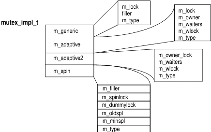

图 3.7 *Solaris 2.5.1 自适应互斥锁*

Solaris 2.5.1 中互斥锁代码的实现与其他版本有很大不同，尽管在算法上其行为基本相同。Solaris 2.5.1 定义了一个互斥锁操作向量。数组中的每个元素都是一个 `mutex_ops` 结构，分别对应 Solaris 2.5.1 中定义的每种互斥锁类型。该数组根据锁类型和所调用的函数进行索引。其设计使得特定函数处理不同类型的互斥锁的锁操作。互斥锁代码的公共入口点根据锁类型和函数偏移量，通过操作数组进行切换，将控制权传递给锁特定的函数。如图 3.8 所示。

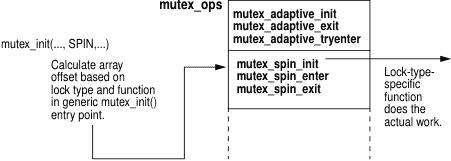

图 3.8 *Solaris 2.5.1 互斥锁操作向量*

Solaris 2.5.1 在释放带有等待线程的自适应互斥锁时，实现的唤醒方法与 Solaris 2.6 类似；最高优先级的等待者会被选中唤醒并应获得锁的所有权。当然，在唤醒完成之前，另一个线程完全有可能过来并获取该锁，因此新唤醒的线程并不能保证获得锁。

最后，请注意，`lockstat` 工具最早是在 Solaris 2.6 中实现的，因此不属于 2.5.1 版本的一部分。

## 3.5.2.3 为什么 Solaris 7 会修改互斥锁（Mutex）

我们希望避免陷入那些不会给文本带来实际价值的细微差异之中，但同时我们也想指出实现中相关的差异。这些描述不同版本之间实现差异的小节有两个目的。第一个也是最明显的目的，是完整性，以实现我们覆盖多个 Solaris 版本的目标。第二个目的，甚至更有说服力，是我们展示锁代码在版本之间逐步演化和改进的过程。我们看到的是一种功能相似但规模明显缩减的实现。实际的锁操作和 turnstile（转门）代码与数据结构所展示的趋势一致——规模更小、更精简、更高效。

更改 Solaris 7 中唤醒行为的理由源于对所有可能选项的详尽测试和审查；随后，设计者选择了在大多数情况下效果最佳的方案。

总而言之，当互斥锁在有等待者的情况下被释放时，基本上有三种选择。

- 从 turnstile（转门）中选择一个等待线程，并在唤醒它*之前*将锁所有权交给它。这种方法被称为所有权的*直接移交*。

  即使在中等程度的锁竞争下，这种方法也有一个缺点：它会破坏自适应锁的逻辑。如果使用直接移交，在线程获得所有权到新所有者开始在处理器上运行（它必须经历状态转换并被上下文切换进来）之间会存在一个时间窗口。如果在此期间，有其他线程试图获取该锁，它们将进入阻塞代码路径，因为“锁所有者是否正在运行”的测试将失败。存在一定竞争的锁将导致大多数线程走阻塞路径，而不是自旋路径。

- 释放锁并唤醒一个等待线程，就像 Solaris 2.5.1 和 Solaris 2.6 所做的那样。

  这个选项有一个更微妙的复杂问题：锁可能没有所有者，但可能有多个等待者。考虑一个具有多个等待者的锁。如果锁被释放，且代码仅对一个等待线程发出唤醒，那么锁将没有所有者（它刚刚被释放）。在繁忙的系统中，被选中的线程可能需要几秒钟才能被上下文切换并取得锁的所有权。如果另一个线程过来获取了该锁，`mutex_enter()` 代码必须检查阻塞链（所有坐在 turnstile（转门）上等待该锁的线程），以确定它是否应从某个睡眠线程继承更高的优先级。这使 `mutex_enter()` 代码变得复杂，给热点代码路径带来了不必要的负担。

- 唤醒所有等待线程，这正是我们在 Solaris 7 中所做的。这种选择的好处是不必保留 waiters 位——因为我们要唤醒所有等待线程，只需在一次操作中清除该位即可。这种方法简化了代码，并且更高效。大量测试表明，阻塞情况相对较少，因此该算法效果很好。

关于互斥锁的统计信息很容易获得，但在 Solaris 2.5.1 中不可用。2.6 和 7 版本包含一个 `lockstat(1M)` 工具，用于收集和显示互斥锁及读写锁活动的信息。`lockstat(1M)` 通过一个伪设备 `/dev/lockstat` 和相关的伪设备驱动程序实现。这些接口不是公开的，也就是说没有对 `lockstat` 驱动程序的 `open`、`read`、`write` 等调用。`lockstat(1M)` 手册页提供了如何使用 `lockstat(1M)` 以及如何解释所显示数据的信息。有几个选项可供你选择要观察的特定事件、数据收集方法（统计、栈跟踪等）以及数据显示方式，因此请仔细阅读手册页。

## 3.6 读写锁

读写（RW）锁在写锁上提供互斥语义。同一时间只允许一个线程拥有写锁，但多个读者可以并发访问。这类锁适用于这样的场景：允许多个线程同时读取数据，但只能有一个写者。当写者持有锁时，不允许任何读者进入。此外，由于唤醒机制，对于需要较长持有时间的内核代码段，RW 锁是更好的解决方案，我们稍后会看到这一点。

RW 锁的基本机制与互斥锁类似，RW 锁有一个初始化函数（`rw_init()`）、一个获取锁的进入函数（`rw_enter()`）和一个释放锁的退出函数（`rw_exit()`）。进入和退出点在汇编代码中针对简单情况进行了优化；如果需要处理超出最简单情况的任何情况，它们会调用 C 语言函数。与互斥锁一样，最简单的情况是在进入（获取）调用时请求的锁可用，并且在退出（释放）调用时没有线程在等待该锁。

RW 锁在 Solaris 7 和 Solaris 2.6 中的实现几乎相同。Solaris 2.5.1 的代码则有些不同。与互斥锁一样，我们先讨论 Solaris 7 的实现，之后再指出其他版本中的差异。

### 3.6.1 Solaris 7 读写锁

在 Solaris 7 中，RW 锁在内核中实现为单字（single-word）数据结构，宽度为 32 位或 64 位，具体取决于运行中内核的数据模型，如图 3.9 所示。

| 所有者（写者）或读线程计数（读者） | wrlock | wrwant | wait |

|---|---:|---:|---:|

| 63–3（LP64）或 31–3（ILP32） | 2 | 1 | 0 |

在 Solaris 7 中，高位比特数由引导的内核的数据模型（64 位或 32 位）决定。

**图 3.9** *Solaris 7 读写锁*

Solaris 7 RW 锁将位 0 定义为等待位（wait bit），该位置位表示有线程正在等待该锁。`wrwant` 位（write wanted，表示有写者想要，位 1）表示至少有一个线程正在等待写锁。位 2，即 `wrlock`，是实际的写锁位，它决定了高位比特的含义。如果写锁被持有（位 2 置位），则高位比特包含一个指向持有写锁的内核线程的指针。如果位 2 清零，则高位比特包含持有该锁作为读锁的线程数。

通过 `rw_enter()` 获取锁的简单情况如下所列：

- 需要写锁，且写锁可用。

- 需要读锁，写锁未被持有，且没有线程在等待写锁（`wrwant` 清零）。

获取写锁会导致位 2 被置位，并将内核线程指针加载到高位比特中。对于读者，持有计数（高位比特）会增加。如果写锁正被持有，导致锁请求失败；或者有线程正在等待写锁，导致读锁请求失败，这些情况都会调用 `rw_enter_sleep()` 函数。

需要特别注意的是，`rw_enter()` 代码会在内核线程中设置一个标志，当调度器代码在抢占之前或线程状态变为睡眠之前建立内核线程优先级时，会使用该标志。我们在第 6 章“Solaris 内核调度器”中会更详细地介绍这一点。简单来说，内核线程结构中包含一个 `t_kpri_req`（内核优先级请求）字段，当线程即将被抢占（因更高优先级线程变为可运行而被强制离开其正在执行的处理器）或即将将其状态更改为睡眠时，调度器代码会检查该字段。如果 `t_kpri_req` 标志被置位，调度器会为该线程分配一个内核优先级，使该线程在恢复执行后，将先于较低优先级调度类（时间共享类和交互类线程）中的线程运行。更简洁地说，持有写锁的线程的优先级会被设置为更好的优先级，以尽量减少锁的持有时间。

回到 `rw_enter()` 流程：如果代码未能进入简单情况，我们需要让请求 RW 锁的内核线程进入阻塞状态。

- `rw_enter_sleep()` 确定调用线程请求的是读锁还是写锁，并再次测试锁是否可用。如果可用，调用者获得锁，更新 `lockstat(1M)` 统计信息，然后代码返回。如果锁不可用，则调用转向门（turnstile）代码查找一个转向门，以准备让调用线程睡眠。

- 现在有了可用的转向门，再次测试锁的可用性。（在当今快速处理器上，尤其是在多处理器系统上，持有锁的线程很可能已完成其工作，锁变得可用。）假设锁仍被持有，线程被设置为睡眠状态，并放入转向门。

- RW 锁结构中，若存在等待的读者（因写者持有锁而被迫阻塞），会设置等待位；若线程想要写锁而被阻塞，会设置 `wrwant` 位。


### 处理器的 `cpu_sysinfo` 结构维护两个计数器

`cpu_sysinfo` 结构维护两个计数器，统计第一次尝试获取读锁或写锁失败的情况：`rw_rdfails` 和 `rw_wrfails`。相应的计数器在调用转向门之前递增；此操作将线程放入转向门睡眠队列。`mpstat(1M)` 汇总这些计数器，并在输出中的 `srw` 列显示每秒失败次数。

获得 RW 锁以及锁被持有时的后续行为都很直接，并且在许多方面与 mutex 情况类似。当线程调用 `rw_exit()` 释放其持有的锁时，事情就变得有趣了——确定哪个线程接下来获得锁有多种可能的解决方案。我们看到，在 mutex 锁中，从 Solaris 2.6（及更早版本）到 Solaris 7，唤醒机制发生了改变。在 Solaris 7 中，所有正睡眠等待 mutex 的线程都会收到唤醒，并且根据经验数据，我们知道这种解决方案效果很好，原因如前所述。对于 RW 锁，我们面对的是可能更长的持有时间，这可能导致更多的睡眠者，并产生给写者优先于读者的期望（当一个线程明显在等待修改数据时，却让读者进入？），以及第 89 页“转向门与优先级继承”中描述的优先级反转问题的可能性。

对于 `rw_exit()`，由锁持有者在准备释放锁时调用，最简单的情况是没有等待者。在这种情况下，如果持有者是写者，则清除 `rwlock` 位；如果持有者是读者，则递减持有计数字段以反映少了一个读者。当锁释放时系统中有等待者这种更复杂的情况，则按以下方式处理。

- 当锁被释放时，内核会将锁的所有权直接转移给一个或多个正在等待锁的线程，要么转移给下一个写者，要么转移给一组读者（如果多个读者正在阻塞且没有写者在阻塞）。

这种情况与 mutex 实现的情形大不相同，在 mutex 实现中，唤醒被发出后，线程必须以通常的方式获得锁的所有权。而在这里，一个或多个线程醒来时就已经拥有它们所阻塞的锁。

用于决定谁接下来获得锁的算法解决了几个需求，这些需求共同提供总体均衡的系统性能。内核需要尽可能减少饥饿（线程永远得不到继续执行所需资源）的可能性，同时在可能的情况下让写者优先。

- `rw_exit_wakeup()` 重新测试简单情况，如果没有等待者，则释放锁（清除 `rwlock` 或递减持有计数）。

- 当存在等待者时，代码获取与该锁关联的转向门（睡眠队列），并保存转向门睡眠队列中下一个写等待者的内核线程指针（如果存在的话）。

转向门睡眠队列按 FIFO（先进先出）队列组织，因此队列管理（转向门代码）可确保等待时间最长的线程（最先进入）被选为下一个写者（最先离开）。这样，我们希望执行的公平性策略的一部分就得到了保证。

该算法的其余部分如下。

- 如果写者正在释放写锁，并且有等待的读者和写者，那么优先级等于或高于最高优先级阻塞写者的那些读者将被授予读锁。

- 这些读者被移交所有权，然后在 Solaris 7 中由 `turnstile_wakeup()` 内核函数唤醒。

如果读者线程的优先级较低，这些读者还会继承释放锁的写者的优先级（当唤醒多个线程时，继承是按每个读者线程单独进行的）。锁所有权移交是一个相对简单的操作。对于读锁，没有锁所有者的概念，所以只需在锁中设置持有计数，以反映从转向门中出来的读者数量，然后向每个读者发出唤醒。

- 退出的读者总是将锁授予等待中的写者，即使有更高优先级的读者在阻塞。

释放锁的读者有可能遇到等待的读者，尽管考虑到锁的多读者设计，这可能不太直观。如果一个读者持有锁，然后一个写者到来，`wrwant` 位会被设置，表示有写者正在等待锁。设置 `wrwant` 后，后续读者无法获得锁——我们希望正在持有锁的读者尽快完成，以便写者能够获得锁。因此，一个读者在执行 `rw_exit_wakeup()` 时，可能同时有等待的写者和读者。

上面描述的“偏向写者但对读者公平”策略最初是在 Solaris 2.6 中实现的。

### 3.6.2 Solaris 2.6 RW 锁的差异

图 3.10 显示了 Solaris 2.6 中 RW 锁的样子。

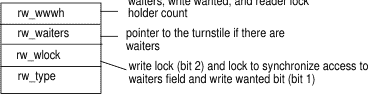

**图 3.10** *Solaris 2.6 读者/写者锁*

请注意，锁字段在功能上与 Solaris 7 中的完全相同，只是实现方式不同。`rw_wwwh` 提供一个等待者位、一个写者想要位，以及持有锁的读者计数。`rw_waiters` 指向包含等待者的转向门（如果存在）。`rw_wlock` 字段充当实际的写锁（位 2）和调度器锁，用于同步对等待者和写者想要位的访问。（调度器锁在第 97 页“调度器锁”中描述。）

### 3.6.3 Solaris 2.5.1 RW 锁的差异

Solaris 2.5.1 中的 RW 锁结构如图 3.11 所示。

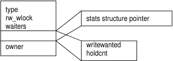

**图 3.11** *Solaris 2.5.1 RW 锁结构*

Solaris 2.5.1 定义了多种 RW 锁类型，在锁初始化时存储在 type 字段中。实际上，几乎总是使用 `RW_DEFAULT` 类型，只有某些设备驱动程序指定 `RW_DRIVER` 锁类型。其他类型包括专为收集统计信息而设计的锁。此类锁仅在工程内部使用，不会在生产版本中实现。要启用它们，需要设置特定的编译时标志。

`rw_w_lock` 字段与 Solaris 2.6 实现中的基本相同，充当调度器锁以同步对等待者和写者想要位的访问，同时还是实际的写锁。`owner` 字段包含拥有写锁的内核线程的地址。`writewanted` 在设置时表示有线程正在等待写锁，而 `holdcnt` 表示持有读锁的内核线程数，或者设置为 -1 表示当前持有写锁。Solaris 2.5.1 在 RW 锁结构中为 `writewanted` 和 `holdcnt` 实现了一个单独的联合。

Solaris 2.5.1 中的 RW 锁代码实现了一个操作向量数组 `rwlock_ops`，类似于图 3.8 中所示的 mutex 操作向量数组。该数组填充有指向特定锁类型函数的 `rwlock_ops` 结构。与 mutex 数组一样，`rwlock_ops` 数组根据锁类型和请求函数（例如 init、enter、exit）的偏移量进行索引。RW 锁函数 `rw_init()`、`rw_enter()` 和 `rw_exit()` 的入口点通过索引该数组，将控制权转移到特定于锁的函数。

Solaris 2.5.1 RW 锁实现中接下来的最显著差异是，Solaris 2.5.1 中的代码完全用 C 编写（没有汇编语言入口点），并且使用 mutex 锁保护 RW 锁结构中的内部数据。

一个 mutex 锁数组 `rw_mutex[]` 在系统引导时初始化，包含固定数量（32）的 mutex 锁。执行期间，哈希函数以正在请求（或释放）的 RW 锁地址为哈希键，索引到该数组。进入各种 RW 锁函数时，会根据调用函数中传入的 RW 锁地址，从 `rw_mutex[]` 数组中获取一个 mutex。代码执行前调用 `mutex_enter()` 获取 mutex 以执行 RW 锁操作，函数准备退出时释放 mutex。

内核线程调用 `rw_enter()` 获取 RW 锁，传入锁地址和一个指示需要读者还是写者的标志。

以下是读锁请求的序列：

- 如果请求的是读锁，则获取 mutex 锁以保护 RW 锁代码，并测试是否存在写锁被持有（`holdcnt` 为 -1）或有写者正在等待（`writewanted` 被设置）。如果两个条件都不成立，调用者就可以获得读锁。

- `holdcnt` 递增，并且调用线程的 `t_kpri_req` 标志被设置，以告知调度器请求内核（SYS）优先级。设置此标志会提高持有锁的线程的优先级（如果它是分时或交互类线程），目的是在线程持有锁期间加快其执行速度，并尽量缩短持有时间。

- 互斥锁被释放，代码返回到调用者。

- 如果写者持有锁，或有写锁请求正在挂起，该线程将被设置为阻塞。互斥锁被释放，`cpu_sysinfo.rw_rdfails` 计数器递增。

你可以使用 `mpstat(1M)` 检查该计数器。`sw` 列显示失败的读锁和写锁尝试的总和。

- 代码测试锁的 waiters 字段，该字段在已有等待者时包含一个转门的 ID。没有等待者意味着我们必须从空闲池中分配一个转门；有一个或多个等待者则意味着我们只需找到持有其他等待者的转门，并将该锁放入该睡眠队列。

- 在将线程放入转门并将线程状态改为睡眠之前，代码再次测试锁（此时锁可能已被释放）。如果锁可用，则采用前面描述的可用锁路径。否则，调用转门阻塞代码将线程放入睡眠队列。

- 使用 `pi_willto()` 代码测试优先级反转条件，并调用 `swtch()` 函数进入分派器。

写锁请求的代码流程与此类似。

- 如果锁不可用，则设置 `writewanted` 位。


## 读写锁释放与唤醒策略

- 如果已有等待者，则获取现有的转门；否则，分配一个新的转门，并在重新检查锁以确保其仍然不可用后，将线程放入睡眠队列。如果锁可用，或者在代码首次进入时曾是可用状态，则将 `holdcnt` 字段设置为 −1（写锁），将 `owner` 字段设置为调用者的内核线程 ID，并释放互斥锁（我们在进入写代码路径时早已获取了该互斥锁）。

- 通过调用 `rw_exit()` 释放读写锁，该函数在进入时会获取互斥锁。如果是写者释放锁，则清除锁中的 `owner` 和 `holdcnt` 字段，并检查是否有等待者。

- 如果有线程在该锁上睡眠，则获取转门，并且如果调用者是优先级继承的受益者，则重置其优先级。

- 如果有写者在等待（`writewanted` 被设置），则唤醒写者线程。如果有多个写者，则最高优先级的写者获得唤醒。否则，在没有写者等待时，所有读者都会被唤醒。

这种始终优先写者的策略在 Solaris 2.6 和 Solaris 7 中已更改。对于写者，只有一个线程获得唤醒，而对于读者，所有等待的读者都会被唤醒。这是合理的，因为没有写者时，所有读者都可以获得锁（这是读写锁的设计方式）。一次只能有一个写者持有锁，因此唤醒一个写者才有意义。

- 如果是读者释放锁，则 `holdcnt` 字段递减（读者数减一），并且如果写者和读者同时存在，则再次优先唤醒写者而不是读者。代码首先检查以确保没有其他读者持有锁（`holdcnt` 为 0），因为当一个线程释放锁时，其他读者很可能仍持有读锁。

Solaris 2.5.1 及更早版本使用不同的唤醒策略，该策略被设计为“始终优先写者”策略。当线程释放读写锁时，代码路径基本上会首先查找等待中的写者，并且总是将锁授予等待中的写者，无论释放锁的是读者还是写者，也无论如果读者和写者都在等待时读者与写者之间的优先级如何。

这里最后要指出的是，Solaris 2.6 和 Solaris 7 不仅改变了唤醒选择策略，而且改变了线程从转门出来获取锁的方式。在 Solaris 2.5.1 中，线程一旦被唤醒，会在 `rw_enter()` 中被调度、执行并恢复运行以获取锁。Solaris 2.6 和 Solaris 7 实现了一种直接交接机制，即在移除睡眠队列和状态改变之前，线程就被赋予了锁的所有权。

## 3.7 转门与优先级继承

转门是一种数据抽象，封装了与互斥锁和读写锁相关的睡眠队列及优先级继承信息。当内核线程需要阻塞在一个请求的锁上时，互斥锁和读写锁代码会使用转门。为其他资源等待而实现的睡眠队列无法通过优先级继承优雅地处理优先级反转问题。转门正是为了解决这个问题而创建的。

优先级反转描述的是这样一种场景：高优先级线程无法运行，因为低优先级线程持有它需要的资源（如锁）。Solaris 内核在其转门实现中解决了优先级反转问题，提供了一种*优先级继承*机制，高优先级线程可以将其优先级赋予持有它所需资源的低优先级线程。继承的受益者，即持有资源的线程，将拥有更高的调度优先级，因此会更早地被调度运行，以便完成工作并释放资源，此时原始优先级会返还给该线程。

在本节中，我们假设你对内核线程优先级有一定程度的了解，这些内容在第6章“内核调度器”中介绍。由于转门和优先级继承是互斥锁和读写锁实现中不可或缺的一部分，我们认为最好在此处而不是稍后讨论它们。对于本讨论，需要注意以下几点：

- Solaris 内核根据内核线程所属的调度类为其分配一个全局优先级。
- 分时和交互式调度类中的内核线程，其优先级会随时间调整，调整基于三方面因素：线程在处理器上运行的时间量、睡眠时间（阻塞），以及被抢占的情况。实时类中的线程具有固定优先级；无论运行时间或睡眠时间如何，优先级都不会改变，除非通过编程接口或命令显式更改。

Solaris 内核实现了睡眠队列，用于放置阻塞在（等待）某个资源或事件上的内核线程。对于大多数资源等待，例如磁盘或网络 I/O 的等待，睡眠队列与条件变量一起管理系统范围内的睡眠线程队列。这些睡眠队列在第6章“内核调度器”中介绍。这组睡眠队列与转门睡眠队列是分开且不同的。

尽管底层前提和概念相同，但转门的实现在 Solaris 7 中发生了重大变化。我们将首先查看 Solaris 7 中的转门实现。

### 3.7.1 Solaris 7 转门

图3.12展示了Solaris 7的转门。Solaris 7 中对转门的重写删除了大量代码，并开发了一些新的、更高效的函数。

转门维护在一个系统范围的哈希表 `turnstile_table[]` 中，该哈希表是一个 `turnstile_chain` 结构数组。数组中的每个条目（每个 `turnstile_chain` 结构）都是一个转门链表的起始位置。该数组通过一个基于同步对象（互斥锁或读写锁）地址的哈希函数进行索引，因此哈希到同一数组位置的锁将在同一个链表上拥有转门。`turnstile_table[]` 数组在启动时被静态初始化。

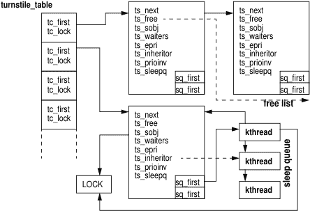

**图3.12** *Solaris 7 转门*

数组中的每个条目都有自己独立的锁 `tc_lock`，因此可以并发遍历链表。转门本身有不同的锁；每个链表有一个活动链表（`ts_next`）和一个空闲链表（`ts_free`）。此外还有等待在同步对象上的线程计数（`ts_waiters`）、指向同步对象的指针（`ts_sobj`）、连接到一个通过优先级继承获得优先级提升的内核线程的线程指针，以及睡眠队列。每个转门有两个睡眠队列，一个用于读者，一个用于写者。（阻塞在读/写锁上的线程被维护在单独的睡眠队列中。）优先级继承数据被整合到转门中，而不是像 Solaris 2.6 和 2.5.1 那样维护在单独的数据结构中。

在 Solaris 7 中，每个内核线程在创建时就附带一个转门。也就是说，当内核通过 `thread_create()` 例程创建内核线程时，会为该内核线程分配一个转门，并链接到内核线程的 `t_ts` 指针上。一个内核线程一次只能阻塞在一个锁上，因此一个转门就足够了。

从前面的互斥锁和读写锁部分我们知道，如果线程需要阻塞在一个同步对象上，就需要一个转门。Solaris 7 调用 `turnstile_lookup()` 在 `turnstile_table[]` 中查找该同步对象的转门。由于我们通过对锁的地址进行哈希来索引数组，如果转门已经存在（即已有等待者），我们就会得到正确的转门。如果当前没有线程在等待该锁，`turnstile_lookup()` 则简单地返回空值。如果必须调用阻塞代码（回忆前面章节，在确定内核线程必须阻塞之前，会对锁的可用性进行后续测试），那么

调用 `turnstile_block()` 会将内核线程放到与该锁的旋转门（turnstile）关联的睡眠队列上。

当一个内核线程成为第一个阻塞者时（即锁获取尝试失败，且没有其他等待者），它会把自己的旋转门*借给*该锁。该线程的旋转门会基于对锁地址进行哈希计算的结果，被添加到相应的旋转门链上。该锁现在有了一个旋转门，因此后续阻塞在同一个锁上的线程会将它们的旋转门捐献给链上的空闲链表（即活动旋转门上的 `ts_free` 链接）。

在 `turnstile_block()` 中，指针会根据 `turnstile_lookup()` 的返回值来设置。如果旋转门指针为空，则关联到内核线程 `t_ts` 指针所指向的旋转门。如果查找返回的指针不为空，则说明已经至少有一个内核线程在等待该锁，因此代码会相应地设置指针链接，并将该内核线程的旋转门放到空闲链表上。

然后，线程通过调度类特有的睡眠例程（例如 `ts_sleep()`）进入睡眠状态。旋转门中的 `ts_waiters` 字段递增，线程的 `t_wchan` 被设置为该锁的地址，线程的 `t_sobj_ops` 被设置为该锁操作向量的地址：owner、unsleep 和 change_priority 函数。内核的 `sleepq_insert()` 函数实际将该线程放到与旋转门关联的睡眠队列上。

代码会执行优先级反转检查（现在由 `turnstile_block()` 代码调用），构建优先级反转链接，并应用必要的优先级更改。优先级继承规则同样适用；也就是说，如果锁持有者的优先级低于（差于）请求线程的优先级，请求线程的优先级会被“让渡”给持有者。持有者的 `t_epri` 字段被设置为新的优先级，旋转门中的继承者指针会链接到该内核线程。阻塞链上的所有线程都是潜在的继承者，具体取决于它们相对于调用线程的优先级。

此时，通过调用 `swtch()` 进入分派器，另一个内核线程从分派队列中被取出，并被上下文切换到某个处理器上运行。

唤醒机制按前面所述的方式启动：如果有线程阻塞在锁上，调用锁退出例程就会触发 `turnstile_wakeup()`。`turnstile_wakeup()` 所做的基本上是 `turnstile_block()` 的逆操作：那些继承了更好优先级的线程，其优先级会被撤销；线程从睡眠队列中移除，并从链的空闲链表上获得一个旋转门。回想一下，如果线程不是第一个被放到该锁阻塞链上的线程，它就会把自己的旋转门捐献给空闲链表；当线程从旋转门中出来时，它会拿回一个旋转门。一旦线程从睡眠队列中解除链接，就进入调度类唤醒代码，线程被放回某个处理器的分派队列。


### 3.7.2 Solaris 2.5.1 和 2.6 的旋转门

图 3.13 展示了 Solaris 2.5.1 和 2.6 中的旋转门结构与链接关系。

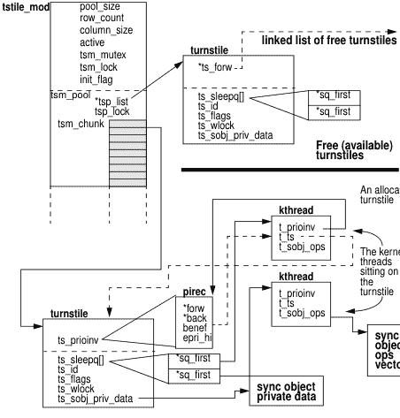

一切始于 `tstile_mod` 结构。系统中只有一个 `tstile_mod`，它维护着到各旋转门的链接。它还维护了支持实现所需的各种字段，例如池中旋转门的数量（`pool_size`）、`tsm_chunk` 数组中活动行的数量（`active`）、指向旋转门池的链接，以及一个指向旋转门的指针数组（`tsm_chunk[]`——这些就是活动旋转门）。

仅当需要分配更多旋转门时，才会使用 `tsm_mutex` 锁来保护 `tstile_mod`。其他旋转门支持函数不需要获取 `tsm_mutex`。

旋转门本身包含一个前向链接，指向列表中的其他旋转门，或指向一个带有优先级继承信息的结构（`pirec`）。这些数据项属于结构定义中同一个联合体（union）的一部分。因此，空闲旋转门会使用前向链接，而使用中的旋转门则会包含 `pirec` 结构。每个旋转门都有一个唯一 ID `ts_id`，其中编码了行和列信息，用于在 `tsm_chunk[]` 数组中定位该旋转门。（稍后我们会看到，`tsm_chunk[]` 实际上实现为一个二维数组。）

此外，每个旋转门中都有一个包含两个睡眠队列的数组（`ts_sleep[]`）。对于读写锁（RW locks），读者和写者分别保存在不同的睡眠队列中；对于互斥锁，则只使用一个睡眠队列。其他将所有部分绑定在一起的链接包括：内核线程到旋转门的链接（在内核线程因同步对象而阻塞时设置），以及当内核线程的优先级因优先级反转而改变时，从该内核线程指向 `pirec` 结构的指针。`pirec` 的 `benef` 字段反向指向因继承而获得更好优先级的内核线程（即受益人）。`ts_flags` 指定旋转门是空闲还是活动状态；`ts_wlock` 是一种分派器风格的锁，互斥锁代码用它来同步对旋转门的访问。

内核在启动时创建一个小型旋转门池；当线程需要阻塞在互斥锁或读写锁上时，会从池中分配一个旋转门。引导期间，启动代码会调用 `tstile_init()` 函数，初始化一组旋转门以开始运行。分配按每批 128 个旋转门进行，每批（列）挂接在 `tsm_chunk[]` 数组（行）的不同索引上。行/列组合用作旋转门 ID，决定旋转门在活动旋转门数组中的位置，并在每批初始化时确立。图 3.14 给出了总体情况。

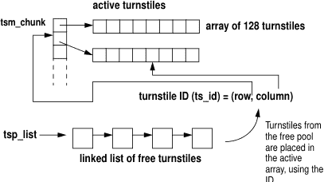

图 3.14 *Solaris 2.5.1 和 2.6 的旋转门*

旋转门从空闲池（`tsp_list`）中分配，在激活时放入 `tsm_chunk` 数组。当不再有线程在该同步对象上睡眠时，旋转门会被归还到可用池中。内核每次调用内部 `thread_create()` 函数创建新内核线程时，都会检查旋转门池，以努力维持一个与系统中内核线程数量保持同步的旋转门池。如果在创建内核线程时，池中旋转门数量少于内核线程数量，代码就会动态分配另一批旋转门。这与 Solaris 7 的实现有所不同：在 Solaris 7 中，创建内核线程时会同时创建一个旋转门并与该线程关联。从概念上讲，这两种方式都是为了解决同一个问题：确保始终有足够数量的旋转门可用。

互斥锁和读写锁代码在让线程睡眠时调用的旋转门函数的工作方式如下。互斥锁和读写锁各自包含一个指向该同步对象旋转门的引用；在下面的讨论中，我们将其统称为 `waiters`。

- 如果锁中的 `waiters` 字段为 0（表示没有等待者），则通过 `tstile_alloc()` 从池中分配一个旋转门；该函数在设置池锁 `tsp_lock` 后，直接从 `tsp_list` 指针（空闲池链接）上分配一个旋转门。

- 活动计数器递增，池锁被释放，与新旋转门关联的 `pirec` 结构被清除。

- 锁中的 `waiters` 字段被设置为刚分配的旋转门的旋转门 ID，旋转门的 `ts_sobj_priv_data`（旋转门同步对象私有数据）字段被设置为指向锁结构的地址。

- 如果已经有线程（至少一个其他线程）在等待该互斥锁，那么该互斥锁已经存在一个旋转门，因此通过 `tstile_pointer()` 函数获取已为该互斥锁分配的旋转门的地址；该函数使用锁的 `waiters` 字段中的旋转门 ID，在 `tsm_chunk` 数组中定位该旋转门。

现在锁的旋转门已就绪，我们可以继续将线程状态改为睡眠，并设置与该旋转门关联的睡眠队列。

- 调用内核的 `t_block()` 函数，该函数会调用 `CL_SLEEP` 宏。

- 调度类特有的函数由宏调用，这些宏会根据内核线程的调度类解析为相应的函数。对于分时（timeshare）或交互类线程，会调用 `ts_sleep()` 函数，将线程的优先级设置为 SYS 优先级（这是一种优先级提升，使其在唤醒后先于其他分时和交互类线程运行），并将线程状态设置为 `TS_SLEEP`。

- 内核线程的 `t_wchan` 字段（等待通道）被设置为该线程正在等待的锁的地址；线程的 `t_sobj_ops` 指针被设置为该锁的同步对象操作向量。（参见第70页的“同步对象操作向量”。）

- 最后，线程的 `t_ts` 字段被设置为该旋转门的地址，线程被插入到该旋转门的睡眠队列中。

通用内核睡眠队列函数通过转门头文件中定义的宏间接调用；例如，通过 `TSTILE_INSERT` 宏完成将线程插入睡眠队列，该宏调用内核 `sleepq_insert()` 函数。

- 当 `sleepq_insert()` 完成时，内核线程位于与该转门关联的睡眠队列中。内核线程在任何时刻只能被阻塞在一个同步对象上，且不能多于一个，因此 `t_ts` 要么是 NULL 指针，要么是指向一个转门的指针。

剩下要做的就是优先级继承检查，以确定持有锁的线程是否比请求锁的线程（即刚刚被放入转门睡眠队列的那个线程）具有更低（更差）的优先级。

- 调用内核 `pi_willto()` 函数，将锁所有者的优先级与等待线程的优先级进行比较。

- 如果所有者的优先级高于等待者的优先级，则不存在优先级反转情况，代码直接退出。

- 如果等待者的优先级更高（即更好的优先级），那么我们确实存在优先级反转情况；然后，锁所有者的优先级被设置为等待者的优先级。

  - 内核线程的 `t_epri` 字段用于继承优先级。`t_epri` 中的非空值将导致在下一次调整锁所有者优先级时使用线程的继承优先级（当我们通过显式调用 `swtch()` 函数进入调度器时）。

此时，转门已经设置好，等待线程位于转门的睡眠队列中，并且已经对潜在的优先级反转问题进行了检查，以确定在必要时进行优先级继承。

- 内核现在通过 `swtch()` 函数进入调度器，以恢复线程的调度。

- 当线程在受保护的数据区域内完成工作后，它调用相应的锁退出例程（`mutex_exit()` 或 `rw_exit()`）释放锁，如果有线程正在等待该锁，这将进而触发唤醒机制。

- 释放函数检查同步对象中维护的 `waiters` 字段。

与互斥锁和读写锁类似，唤醒哪个线程或是否唤醒所有等待线程的决定取决于同步对象和 Solaris 内核版本。我们在互斥锁和读写锁的章节中考察了每种情况下会发生什么。

Solaris 2.5.1 中使用的转门支持函数是 `t_release()`（用于唤醒单个线程）和 `t_release_all()`（用于唤醒所有线程）。Solaris 2.6 则改用宏（例如 `TSTILE_WAKEONE`），其最终效果相同。也就是说，这些宏会导致进入通用睡眠队列代码，该代码有相应的函数用于从睡眠队列中移除一个线程或所有线程（例如 `sleepq_wakeone()` 用于唤醒一个线程）。在发出唤醒之前，锁代码会检查优先级继承。如果释放锁的线程是优先级继承的受益者，则调用 `pi_waive()` 函数，将该线程的优先级恢复到继承之前的值。

唤醒代码将内核线程（或多个线程）从睡眠队列中摘除，并调用特定于调度类的唤醒代码（例如，用于分时和交互式线程的 `ts_wakeup()`）。如果线程已被赋予 SYS 类优先级（内核模式优先级），则该线程会在类唤醒函数中被立即放入调度队列。否则，在线程被放入调度队列之前，会重新计算线程的全局优先级。

## 3.8 调度器锁

内核定义了特定于内核调度器（线程调度器）的锁类型，称为*调度器锁*。调度器实现了两种锁类型：简单的自旋锁和提升处理器中断优先级级别的锁。这些锁通过特定于锁类型的接口（而不是之前讨论的互斥锁接口）来获取和释放。它们还用于内核中的其他一些区域，这些区域的锁定需求需要这些锁所定义的语义和行为。我们首先讨论为什么需要第二种锁，即阻塞中断的锁，然后讨论其实现。


当中断产生并被发送到处理器时，处理器必须停止正在做的事情并执行中断处理程序。对于低级中断（SPARC系统上低于级别10的中断），中断在中断线程上处理。接收到中断时无论哪个线程正在执行，都会被固定，以便中断线程可以借用正在运行的线程的LWP；中断线程使用自己的栈执行。当处理程序完成时，被打断的内核线程解除固定，并可恢复执行。一旦开始执行中断处理程序，中断代码就有可能阻塞。如果发生这种情况，就会进入调度器的`swch()`函数，以确定线程是否作为固定（中断）线程运行。如果是，则解除该固定线程的固定，并选择其恢复执行。内核专门实现了一个恢复函数`resume_from_intr()`，用于处理中断线程阻塞时重启固定线程的特殊情况。

另一方面，高级中断（SPARC上高于级别10的中断）*不会*在中断线程上处理。当处理器收到高于级别10的中断时，处理器被直接引导到处理程序，并在中断到达时正在运行的线程的上下文中执行。这里的关键点是：低级中断可能需要线程上下文切换，而高级中断则不需要。

处理器可以在架构定义的任意一个中断级别上执行，多处理器系统中的不同处理器可以在不同的中断级别上执行。处理器执行所在的中断级别由内部硬件寄存器中设置的级别确定。在UltraSPARC处理器上，`PSTATE`寄存器的`PIL`字段反映处理器运行时的中断级别。内核代码向硬件`PSTATE`寄存器写入新的`PIL`值，以改变处理器的中断级别。处理器只会接收级别高于其当前执行级别的中断。例如，运行在`PIL` 4的处理器会接受`PIL` 5或更高中断，但不会接受级别1、2或3的中断。因此，处理器可以通过将`PIL`设置为适当的级别来屏蔽或阻塞中断，具体取决于处理器需要阻塞的中断级别。

内核调度器（即调度程序）负责线程的选择和上下文切换，并操作调度队列。因此，需要一种保护机制，防止调度器在插入或移除队列时被中断。由于低级中断可能需要上下文切换，如果允许正在执行调度代码的处理器接受中断并切换到中断处理程序，可能会导致线程状态和队列指针损坏。出于这个原因，实现了一种调度器锁。调度器在多个地方调用该锁代码，它不仅获取自旋锁（通常是保护调度队列的锁），而且还将`PIL`提升到10，从而有效阻塞低级中断。只有不允许要求或导致上下文切换的高级中断才会被处理。

该实现没有为自旋锁和阻塞中断的锁定义两种不同的锁结构。在这两种情况下，锁定义都是一个1字节的数据项。代码根据所调用的接口，要么获取基本自旋锁，要么获取锁并提升`PIL`。获取调度器自旋锁时，会调用简单的`lock_set()`接口。该代码用汇编语言实现，并遵循自旋锁的基本算法。

如果在尝试获取锁时锁已被持有，则使用自旋循环，在每次循环中检查锁并尝试获取它。为了中断保护，会调用`lock_set_spl()`接口。`lock_set_spl()`将调用处理器的`PIL`提升到10，并且基本上使用与基本自旋锁相同的自旋算法。处理器的`PIL`保持提升状态，直到锁被释放。`lock_set_spl()`代码会保存调用处理器的当前`PIL`，以便在锁释放时，调用处理器能够恢复到其执行时所在的级别。

除了调度器本身之外，内核中使用调度器锁的区域是其他内核同步原语：即互斥锁、读写锁、转门和信号量。同步原语内核模块在操作转门或睡眠队列上的线程，或保护锁结构中特定数据项的访问时，会使用调度器锁。

随着Solaris版本的演进，改进不断进行，调度器锁的使用在每个后续版本中都有所减少。例如，

Solaris 2.5.1 和 2.6 在读写（RW）锁结构中实现了一个调度器锁，以保护对该结构中某些字段的访问。Solaris 7 重新设计了 RW 锁代码后，不再需要此处的调度器锁。

### 3.9 内核信号量

信号量提供了一种由多个处理器或线程同步访问共享资源的方法。信号量既可以用作独占访问的二进制锁，也可以用作计数器，允许多个线程并发访问有限数量的共享资源。

在计数器实现中，信号量的值被初始化为共享资源的数量（这类信号量有时称为计数信号量）。每次进程需要资源时，信号量值减一，表示资源少了一个。当进程用完资源时，信号量值加一。信号量值为 0 表示调用进程当前没有可用资源，调用进程会阻塞，直到另一个进程用完并释放该资源。这些函数在历史上被称为信号量的 P 和 V 操作——P 操作试图获取信号量，V 操作释放信号量。

Solaris 内核在适当的地方使用信号量，即对锁获取的原子性约束不如使用互斥锁和 RW 锁的区域那么严格时。此外，信号量提供的计数功能使其非常适合诸如固定数量资源的分配和释放等工作。

内核信号量结构为信号量维护一个睡眠队列和一个反映信号量值的计数字段，如图 3.15 所示。该图展示了本书涵盖的所有 Solaris 版本中内核信号量的形态。

| 字段 | 描述 |
|---|---|
| `*s_slpq` | 信号量的睡眠队列管理；指向等待在信号量上的内核线程。 |
| `s_count` | 信号量值 |

**图 3.15** *内核信号量*

信号量的内核函数包括初始化例程（`sema_init()`）、销毁函数（`sema_destroy()`）、传统的 P 和 V 操作（`sema_p()` 和 `sema_v()`），以及一个测试函数（信号量是否被持有？`sema_held()`）。还有一些其他支持函数，以及 `sema_p()` 函数的若干变体，我们将在后面讨论。

`init` 函数只是根据作为参数传递给 `sema_init()` 例程的值来设置信号量中的计数值。`s_slpq` 指针被设置为 `NULL`，信号量即完成初始化。当信号量是某个资源不可或缺的一部分，而该资源会随着使用和后续释放而被动态创建和销毁时，会使用 `sema_destroy()` 函数。例如，内核中的 bio（块 I/O）子系统管理用于通过文件系统支持页 I/O 的 buf 结构，它按每个 buf 结构使用信号量。每个缓冲区有两个信号量，在缓冲区由 `sema_init()` 分配时初始化。一旦 I/O 完成且缓冲区被释放，就会在缓冲区释放代码中调用 `sema_destroy()`。（`sema_destroy()` 只是将 `s_slpq` 指针置空。）

必须访问由信号量控制的资源的内核线程会调用 `sema_p()` 函数，该函数要求信号量计数值大于 0 才能返回成功。如果计数为 0，则信号量不可用，线程必须阻塞。如果计数大于 0，则递减信号量中的计数，然后代码返回调用者。否则，会在系统范围的睡眠队列数组中定位一个睡眠队列，将线程状态改为睡眠，并将线程放入睡眠队列。注意，信号量不使用转门（turnstile）——转门是专门为互斥锁和 RW 锁实现的一种睡眠队列。阻塞在互斥锁和 RW 锁之外的任何对象上的内核线程都会被放入睡眠队列。

睡眠队列将在第 6 章“Solaris 调度器”中详细讨论。简单来说，睡眠队列组织为内核线程的链表，每个链表以通过内核指针 `sleepq_head` 引用的数组为根。Solaris 7 进行了一些更改，以支持更快的睡眠队列操作：插入、删除和队列遍历。在 Solaris 7 之前的 Solaris 版本中，`sleepq_head` 数组中的一个条目起始一个等待同一对象的内核线程链表。该链表通过内核线程的 `t_link` 指针单向链接。在 Solaris 7 中，向内核线程添加了若干额外指针，以支持同一优先级线程的双向链接子列表。图 3.16 展示了睡眠队列的组织方式。

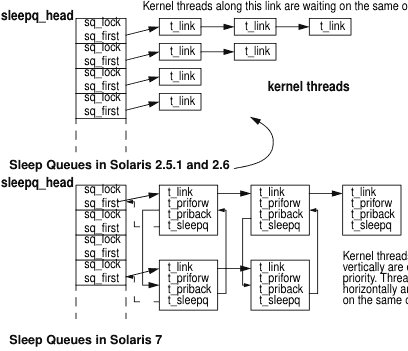

**图 3.16** *Solaris 2.5.1、2.6 和 7 中的睡眠队列*

在 Solaris 7 之前和之后的所有实现中，一个哈希函数以对象的地址为哈希键对 `sleepq_head` 数组进行索引。在 Solaris 7 之前的实现中，内核线程根据其优先级按降序插入列表。在 Solaris 7 中，那条确立了同一优先级线程的双向链接子列表起点的单向链表也按优先级升序排列。子列表通过内核线程中的 `t_priforw`（前向指针）和 `t_priback`（后向指针）实现。此外，Solaris 7 中新增的 `t_sleepq` 指针指回 `sleepq_head` 中的数组条目，标识线程位于哪个睡眠队列，并提供一种快速方法来判断线程是否位于某个睡眠队列上；如果线程的 `t_sleepq` 指针为 `NULL`，则该线程不在睡眠队列上。

在 `sema_p()` 函数内部，如果信号量计数值为 0，则信号量不可用，调用内核线程需要被放置到睡眠队列上。通过哈希函数在 `sleepq_head` 数组中定位一个睡眠队列，该哈希函数以线程正在阻塞的对象的地址作为哈希键，在本例中即信号量的地址。代码还会获取睡眠队列锁 `sq_lock`（见图 3.16），以阻止对睡眠队列的任何进一步插入或移除，直到当前内核线程的插入完成为止（锁就是干这个用的！）。

接下来会调用调度类特有的睡眠函数，以设置线程的唤醒优先级，并将线程状态从 `ONPROC`（在处理器上运行）改为 `SLEEP`。内核线程的 `t_wchan`（等待通道）指针被设置为它所阻塞的信号量的地址，线程的 `t_sobj_ops` 指针被设置为引用 `sema_sobj_ops` 结构。此时线程处于睡眠队列上的睡眠状态。


信号量由 `sema_v()` 函数释放，其效果与 `sema_p()` 完全相反，行为与到目前为止我们考察过的锁释放函数非常相似。信号量值递增，如果有任何线程正在该信号量上睡眠，那么其中在睡眠队列上等待最久的线程将被唤醒。信号量的唤醒每次总是只唤醒一个等待者。

信号量在操作系统中使用的领域相对较少：缓冲区 I/O（`bio`）模块、可动态加载的内核模块代码，以及少数设备驱动程序。

## 内核引导与初始化

在前几章中，我们描述了 Solaris 内核，并概述了操作系统的关键特性和设施。我们强调了内核的模块化和动态性，因为 Solaris 内核并不是以磁盘上单个、整体的二进制对象形式存在的。相反，内核是在系统引导期间，随着主要操作系统组件被加载，在内存中构建而成的。

内核对象在引导时以及系统运行期间都会被加载。在本章中，我们将来看看存储二进制内核对象的目录层次结构。然后讨论内核引导与初始化过程、动态模块加载设施，以及内核运行时链接器。

### 4.1 内核目录层次结构

构成 Solaris 内核的二进制对象模块存在于根文件系统和 `usr` 文件系统中定义良好的目录命名空间中。系统目录名称见表 4-1。

### 表 4-1 系统目录

| 目录名称 | 描述 |
|---|---|
| `root (/)` | 系统目录名称空间的起点 |
| `/kernel` | 包含平台无关的可加载内核模块的子目录树 |
| `/platform` | 包含平台相关的可加载内核模块的子目录树 |

以下目录不是根目录（`/`）下的子目录。相反，它们是保存特定类型内核对象的目录名称，并作为几个顶级目录（如 `/kernel`、`/platform/<arch>` 和 `/usr/kernel`）下的子目录存在。请参阅图 4.1。

| 目录名称 | 描述 |
|---|---|
| `sparcv9` | *Solaris 7 及更高版本。*目录名称空间使用 `sparcv9` 子目录名称来存储所有 64 位内核对象 |
| `drv` | 设备驱动程序 |
| `exec` | 可执行目标文件例程 |
| `fs` | 文件系统模块 |
| `misc` | 杂项模块 |
| `sched` | 调度类 |
| `strmod` | STREAMS 模块支持 |
| `sys` | 系统调用 |

构成可用系统所需最低要求的核心模块分布在多个目录中。所有内核模块将属于三种可能的类别之一，这些类别决定了它们在目录层次结构中的位置：平台和硬件无关、平台相关或硬件类别相关。`/kernel` 目录树包含平台无关的操作系统模块，包括在引导时最初加载的 `genunix` 可执行目标文件。

其余两个目录树被归类为*硬件类别*相关和*平台*相关。硬件类别由处理器类型以及处理器到内存的总线架构共同决定。基于 UltraSPARC 的系统具有 `sun4u` 硬件类别；所有此类系统都使用 Ultra 端口架构（UPA）作为主要处理器互连。硬件类别 `sun4m` 和 `sun4d` 是基于 SuperSPARC（SPARC 版本 8）的系统，较小的系统使用 Mbus（`sun4m`）互连，较大的服务器系统使用 XDBus。您可以使用带有 `-m` 选项的 `uname(1)` 命令来确定系统的硬件类别。

平台类别是特定的机器类型：系统类型，对于 Sun 平台，前面加上 `SUNW`。示例包括 `SUNW,Ultra-2` 和 `SUNW,Ultra Enterprise-10000`。专门处理“机箱”依赖性（例如环境控制和特定互连支持）的内核模块位于以 `/platform/<platform-name>` 开头的目录树中。图 4.1 显示了目录层次结构。

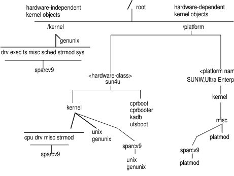

**图 4.1** *核心内核目录层次结构*

为了说明，我们在图 4.1 的示例目录树中使用了特定的平台（`SUNW,UltraEnterprise`）和硬件类别（`sun4u`，即所有 UltraSPARC 处理器）。这些目录中的模块构成了引导时加载的所有组件，并且是一个功能齐全的系统所必需的。

其他可加载内核模块位于 `/usr` 目录树下，该目录树也包含一组内核（`/usr/kernel`）和平台（`/usr/platform`）子目录。这些目录下的模块是按需加载的内核模块：要么是按需加载，即用户或应用程序进程请求需要加载某个模块的服务时，要么是使用 `modload(1M)` 命令手动加载。例如，内核中用于执行以 Java 编程语言编写的代码的 `exec` 支持位于 `/usr/kernel/exec` 中，文件名为 `javaexec`。当系统上首次启动 Java 程序时，内核会加载此模块。请注意，您可以使用 `/etc/system` 内核配置文件中的 `forceload` 指令指示系统在引导时加载可选模块。

构成内核核心的可执行文件的完整路径名如下所列。

- `/platform/<arch>/kernel/unix` — 核心内核的平台相关组件。
- `/platform/sun4u/kernel/genunix` — 针对 UltraSPARC 优化的 `genunix` 二进制文件，但独立于系统（机箱）类型。只有基于 UltraSPARC 的系统才会加载此特定二进制文件。
- `/kernel/genunix` — 平台无关（通用）的核心内核代码。只有非基于 UltraSPARC 的系统才会加载此文件。

请注意，引导时只会加载一个 `genunix` 二进制文件：要么是 `sun4u` 硬件上的 Ultra-SPARC 版本，要么是所有其他 SPARC 系统上的 `/kernel/genunix` 映像。这些目标文件包含所有需要驻留在内存中的低级内核服务和其他设施，以便正确初始化系统并支持动态加载环境。

`unix` 和 `genunix` 映像中包含内存管理例程、回调和通知设施、时钟和计时器支持、内核内存分配器、模块加载设施、内核运行时链接器、同步原语、内核线程和轻量进程代码，以及设备驱动程序接口。

其余部分作为模块从第 104 页表 4-1 中描述的目录加载。要列出正在运行的系统当前加载的模块，请使用 `modinfo(1M)` 命令。

```
# modinfo
 Id Loadaddr   Size  Info Rev Module Name
  4 f5b28000   3b30    1   1 specfs (filesystem for specfs)
  6 f5b2bb30   2bc8    1   1 TS (time sharing sched class)
  7 f5b2e6f8    4a4    1   1 pts (PTS pseudo terminal)
  8 f5c0e000  23548    2   1 ufs (filesystem for ufs)
 11 f5b63d08    b30    1   1 rootnex (sun4m root nexus)
 13 f5b649c0    530   62   1 dma (Direct Memory Access driver)
 14 f5b64ef0    aeb   59   1 sbus (SBus nexus driver)
 16 f5b67388    148   12   1 sad (Streams Administrative Driver)
 54 f5b2d5c8   1eed    0   1 elfexec (exec module for elf)
 57 f5eb3000   bb00    8   1 sockfs (filesystem for sockfs)
 63 f5bd7d0a   3586  201   1 doorfs (doors)
 64 f5bd3b28    c3c   12   1 fdfs (filesystem for fd)
 65 f5b18000    0f5   38   1 openprom (OPENPROM/NVRAM Driver)
 72 f5bdf6f8    6c6   90   1 kstat (kernel statistics drv)
 73 f6003000   d3ef   11   1 tmpfs (filesystem for tmpfs)
 91 f625f000   1ce0   52   1 shmsys (System V shared memory)
 92 f5bdefa0    268    3   1 ipc (common ipc code)
 93 f625bac0   1512   -1   1 bootdev (bootdev misc module)
106 f6190000   5874   40   1 le (Lance Ethernet Driver v1.120)
107 f5f1aa88    4d1   78   1 ledma (le dma driver)
```


上面的示例输出是运行中的 Solaris 7 系统的部分列表。`modinfo(1M)`提供内核对象的名称和简要描述。每个内核模块都有一个唯一标识符，显示在 Id 列中。还显示内核虚拟地址（Loadaddr）和模块大小，以及 Info 列中特定于模块的数据。

内存中的 Solaris 内核正是由驻留在这些目录中的二进制内核模块构建而成。

## 4.2 内核引导与初始化

引导过程将构成 Solaris 内核的二进制内核对象从可引导系统磁盘加载到物理内存中，初始化内核结构，设置系统可调参数，启动系统进程（守护进程），并将系统带到已知的可用状态。引导所涉及的基本步骤可总结如下。

1. `boot(1M)`命令读取引导块并将其加载到内存中。

2. 引导块定位次级引导程序`ufsboot`，将其加载到内存中，并将控制权传递给它。

3. `ufsboot`定位核心内核映像和所需的内核运行时链接器，将其加载到内存中，并将控制权传递给已加载的内核。

4. 核心内核从根磁盘目录树定位并加载必需的内核模块，并执行主要的启动代码。

5. 内核启动代码执行，创建并初始化内核结构、资源和软件组件。

6. 系统执行来自系统目录的 shell 脚本，使系统达到`/etc/inittab`文件中指定的 init 状态。

上面显示的初步步骤基于本地磁盘引导。网络引导使用不同的次级引导程序：`in.boot`而不是`ufsboot`。我们接下来的讨论基于本地磁盘引导。

### 4.2.1 加载引导块

引导过程的初始阶段需要系统固件的支持，该固件通常加载在 PROM 中，以便可以寻址可引导设备，并且存在一些最小的 I/O 功能来读取主引导块。

基于 Sun SPARC 的系统以 Forth 编程语言实现系统固件，称为 OpenBoot PROM (`OBP`)。`OBP`固件提供上电自检 (`POST`) 功能以进行硬件完整性测试，提供非易失性 RAM (`NVRAM`) 空间用于设置系统参数（例如默认引导设备），构建反映系统硬件配置的设备树，并提供引导支持。基于 Intel 的系统使用基于 BIOS 的固件，提供类似的功能。我们在这里的讨论重点是基于 SPARC 的系统，尽管一旦次级引导阶段完成并且内核被加载，大部分初始化过程与硬件无关。

在已完成 POST 测试的系统上，引导过程要么通过在 OBP 提示符下显式执行`boot(1M)`命令来启动，要么在`auto-boot?` `NVRAM`变量设为 true 时，在系统上电时自动引导。`boot(1M)`命令支持多种选项，包括在命令行指定引导设备和引导文件（不同于默认值）、指定引导进入内核调试器（`kadb`）、以更详细（verbose）的模式运行引导以获得更多输出等。具体细节请参阅`boot(1M)`的手册页。

在 SPARC 系统上，若根文件系统（即系统盘）使用默认的 Unix 文件系统（UFS），引导块位于物理磁盘扇区 1–15，如图 4.2 所示。这些块被标记为扇区 0 到 16，以便与文件系统块区分开来。磁盘上的物理扇区大小为 512 字节，而文件系统块通常是一组物理磁盘扇区（UFS 中为 16 个），默认文件系统块大小为 8 KB。

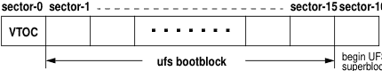

图 4.2 *基于 UFS 的系统磁盘上的引导块*

扇区 0，即卷目录表（VTOC），包含磁盘分区信息：八个可能的磁盘分区各自的起始和结束块号。扇区 16 是 UFS 放置主超级块（文件系统元数据）的位置。

Solaris 环境提供了一个`installboot(1M)`命令，用于向系统分区添加或恢复引导块。引导块代码保存在`/usr/platform/<arch>/lib/fs/ufs/ufsbootblk`文件中。`installboot(1M)`工具只是使用`dd(1)`将该文件复制到指定的磁盘分区。引导块的大小受到限制（不能大于 7680 字节——15 个扇区，每个扇区 512 字节），因此它只是读取 UFS 中的目录、定位文件并将其加载到内存所需的最低限度的代码。

### 4.2.2 加载 ufsboot

对于 UFS 引导，辅助引导文件名`ufsboot`被硬编码在引导块代码中；`ufsboot`的完整路径名是`/platform/<arch>/ufsboot`。（在早期 Solaris 版本中，一直到并包括 Solaris 2.4，`ufsboot`都位于根目录`/ufsboot`。）

请注意，对`<arch>`的引用表示，路径名中的该字段应替换为`uname -m`的输出，它显示系统的硬件类别（例如`sun4u`、`sun4m`、`x86`等）。

### 4.2.3 定位核心内核映像与链接器

`ufsboot`一旦被加载，就会定位内核映像`unix`以及所需的运行时链接器`krtld`。`ufsboot`加载的第一个内核二进制文件的完整路径名是`/platform/<arch>/kernel/unix`（例如，在基于 UltraSPARC 的系统上为`/platform/sun4u/kernel/unix`）。`unix`文件是可执行与可链接格式（ELF）二进制文件，这是 Unix 系统上可执行二进制文件的行业标准格式。在 ELF 文件中，需要检查特定的头部信息位，以确定诸如执行依赖关系之类的内容。`ufsboot`了解 ELF 文件——知道如何解释头部信息以及如何提取依赖关系。根据`unix` ELF 头部中的信息，`ufsboot`会加载所需的内核运行时链接器`/kernel/misc/krtld`。

### 4.2.4 加载内核模块

控制权被传递给`krtld`，它会记录对其他二进制目标文件的依赖关系。下面是对`/platform/sun4u/kernel/unix`文件执行`dump(1)`命令的部分输出，展示了`unix`二进制的依赖列表。

```text
# pwd
/platform/sun4u/kernel
# /usr/ccs/bin/dump -Lv unix

unix:

    **** DYNAMIC SECTION INFORMATION ****
.dynamic:
[INDEX]  Tag      Value
[1]      NEEDED   genunix
[2]      NEEDED   misc/platform
[3]      NEEDED   cpu/$CPU
[4]      HASH     0x114
...
```

所示的`dump(1)`标志转储了 ELF 目标文件的`.dynamic`段。未列出的是`PT_INTERP`条目，在本例中它是`misc/krtld`。

首先是`genunix`二进制文件，对于所有非基于 UltraSPARC 的平台，它位于`/kernel/genunix`；对于所有 UltraSPARC（`sun4u`）平台，则位于`/platform/sun4u/kernel/genunix`。其余依赖项是`/platform/<arch>/kernel/misc/platmod`和`/platform/<arch>/kernel/cpu/$CPU`，它们是平台和处理器特定的二进制文件，属于核心内核的一部分。`$CPU`符号由`OBP`固件设置为特定的处理器类型，当`krtld`解析该符号时，它会正确展开。`krtld`使用一个模块搜索路径变量，它类似于传统 Unix shell 的`PATH`变量；模块搜索路径指定要搜索可动态加载内核模块的目录名。模块搜索路径变量由`OBP`固件设置，在不同硬件平台上略有差异（可以通过使用`boot -a`引导来指定搜索路径）。当`krtld`遇到二进制目标依赖项时，它会在模块搜索路径指定的目录中进行搜索。

图 4.3 以`sun4u`（UltraSPARC）目录层次结构为例，说明了到目前为止的引导流程。

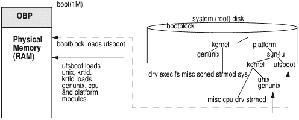

**图 4.3** *引导过程*

### 4.2.5 创建内核结构、资源和组件

在将所有核心二进制对象（`unix`、`krtld`、`genunix`、`platmod`和`$CPU`模块）加载到内存并链接后，`krtld`将控制权传递给`unix`——`unix`被加载到物理内存空间顶部附近——以接管执行。此时 Solaris 内核开始运行，内存管理单元（MMU）已启用（代码正在生成虚拟地址并在虚拟地址空间中工作），内存的前 16 兆字节已被映射。`unix`对处理器寄存器进行一些底层设置，开始手工构建内核线程 0，并调用架构特定的启动函数`mlsetup()`。`mlsetup()`完成内核线程 0 和 LWP 0 的初始化，构建第一个进程（`p0`），并根据`OBP`空间中的设备信息开始映射系统设备。

SPARC 系统上保存`OBP`代码的 EEPROM 是最早映射的设备之一。也就是说，EEPROM 占据系统物理地址空间的一部分，就像物理设备一样。内核会初始化一个与设备驱动程序非常相似的软件层，允许内核的其他区域调用 PROM。在引导过程中，出于多种原因需要调用 PROM，例如获取硬件和版本信息。


在 `mlsetup()` 的工作完成后，进入内核 `main()` 函数，代码在此处开始对内核更高级别区域进行一系列函数调用，以继续初始化过程。`main()` 函数是内核硬件无关代码的一部分。它会立即调用硬件特定例程来执行特定的初始化步骤，然后返回通用代码以完成引导过程。

平台特定的 `startup()` 函数会执行一些初步的内存初始化：确定核心内核加载后的可用物理内存、设置内核地址空间符号，以及分配内存页结构。内核内存分配（KVM）子系统和 kstat（内核统计）框架会被初始化。这些步骤完成后，控制台上会显示操作系统横幅：

```text
SunOS Release 5.7 Version Generic 64-bit (UNIX(R) System V Release 4.0)
Copyright (c) 1983-1998, Sun Microsystems, Inc.
```

此外，还会对处理器类型、固件版本等执行额外的平台特定检查，并调用内核的 `mod_read_system_file()` 函数来读取 `/etc/system` 文件，用 `/etc/system` 中设置的参数和值填充内部数据结构。

内核会创建一个 `sysparam` 数据结构链表，使得 `/etc/system` 文件中的每个条目在链表中都有对应的数据结构。`sysparam` 结构定义在 `/usr/include/sys/sysconf.h` 中，如下所示。

### 头文件 `<sys/sysconf.h>`

```c
/*
 * For each entry in /etc/system a sysparam record is created.
 */
struct sysparam {
        struct sysparam *sys_next; /* pointer to next */
        int     sys_type;          /* type for record */
        int     sys_op;            /* operation */
        char    *sys_modnam;       /* module name (null if param in kernel) */
        char    *sys_ptr;          /* string pointer to device, etc. */
        u_longlong_t sys_info;     /* additional information */
        char    *sys_conf;         /* configuration data */
        int     sys_len;            /* len of config data */
        u_long  *addrip;            /* pointer to value config addresses */
};
```

`sysparam` 结构中的字段通常不言自明。其中为参数特定信息、参数类型（例如模块加载条目或设置值的条目）以及维护链表所需的指针定义了空间。`mod_read_system_file()` 代码会逐行遍历 `/etc/system`，进行必要的解析以确定条目类型，并在与 `/etc/system` 中行条目对应的 `sysparam` 结构中设置适当的值。当 `mod_read_system_file()` 完成时，内核内存中会建立一个由已填充 `sysparam` 结构组成的链表。

在 `mod_read_system_file()` 返回之前，代码会设置 `maxusers` 值。`maxusers` 参数是根据物理内存的大小计算得出的。

安装在系统上，其中 `maxusers` 等于内存的兆字节数，最大值为 1024（相当于 1 GB 内存——在物理内存大于 1 GB 的系统上，`maxusers` 将为 1024）。如果在 `/etc/system` 中设置了 `maxusers`，则使用该值，最大可达 2048；任何大于 2048 的 `/etc/system` `maxusers` 值都会导致 `maxusers` 被设置为 2048。一旦 `maxusers` 确定，启动代码会在内核的 `param_calc()` 函数中基于 `maxusers` 设置其他内核限制。

- `maxpid` — 最大进程 ID 值。如果在 `/etc/system` 中设置了 `maxpid`，则会将 `maxpid` 值与最小 `reserved_procs` 值（在 Solaris 2.5.1、2.6 和 7 中为 5）以及最大值（在这三个版本中均为 30,000）进行对比。如果 `maxpid` 小于 `reserved_procs` 或大于 30,000，则将其设置为 30,000。否则，将设置用户定义的值。

- `max_nprocs` — 系统范围内进程的最大数量，设置为 `(10 + 16 * maxusers)`。

- `maxuprc` — 每个非 root 用户的最大进程数，设置为 `(max_nprocs - reserved_procs)`。`reserved_procs` 的默认值为 5。

- `ufs_ninode` 和 `ncsize` — UFS inode 缓存和目录名缓存的上限。（参见第 568 页的“目录名查找缓存 (DNLC)”。）这两个缓存都设置为相同的值：`(4 * (max_nprocs + maxusers) + 320)`。

- `ndquot` — 系统范围内 UFS 磁盘配额结构的数量，设置为 `((maxusers * 40) / 4) + max_nprocs`。

如你所见，`maxusers` 实际上并不是系统将支持的最大用户数。它只是一个可以设置的参数，用于驱动若干可配置内核资源的数量，这些资源间接影响系统能处理的用户负载或用户量。影响系统用户负载能力的因素有很多，其中包括用户的构成、用户的操作方式以及用户如何连接到系统。

此时还会设置与 STREAMS 子系统及系统其他杂项区域相关的其他内核参数。这些参数使用硬编码的默认值，除非在 `/etc/system` 中设置了值，否则它们不受 `maxusers` 参数驱动。

- `nstrpush` — 单个 STREAM 上可以包含（压入）的 STREAMS 模块数量；设置为 9。

- `strmsgsz` — STREAMS 消息的最大大小；设置为 64 KB。

- `strctlsz` — STREAMS 控制消息的最大大小。

- `ngroups_max` — 一个用户可以属于的最大组数；设置为 16。

- `rstchown` — 一个布尔值，强制启用 POSIX `chown(1)` 行为，即进程必须具有有效 UID 0（root）才能更改文件所有权；默认设置为 1（true）。

- `hz`、`hires_hz`、`hires_tick` — 时钟频率控制。`hz` 设置为 100，`hires_hz` 设置为 1000，`hires_tick` 设置为 0。不应更改 `hz` 和 `hires_hz`。您可以在 `/etc/system` 中将 `hires_tick` 设置为 1。这样做会使 `hz` 值变为 1000，导致系统时钟每秒产生 1000 次时钟中断（每毫秒一次），而默认为每秒 100 次（每 10 毫秒一次）。

- `autoup` — `fsflush` 将脏页写入磁盘之前，脏页存在的时间（以秒为单位）；设置为 30。

- `rlimits` — 每进程资源限制。默认值已设置。可以通过 `/etc/system` 设置每进程文件描述符限制，其中 `rlim_fd_max` 为最大值，`rlim_fd_cur` 为当前值（当前值永远不能超过最大值）。

有关内核可调参数的完整列表，请参阅 [5]。另请参阅附录 A“内核可调参数、开关和限制”。

### 继续系统初始化过程

继续系统初始化过程：系统设备命名空间建立在 `/devices` 目录中，基于 OBP 固件创建的设备树。系统调用表被初始化，内核加载设备驱动程序类别文件 `/etc/driver_classes`。系统参数在 `var` 数据结构中设置；这些参数大部分是我们之前讨论过的值（例如 `max_nprocs`），其他一些则不在 Solaris 内核中使用（`var` 是 SVR4 的一个有些过时的遗留物）。您可以使用 `sysdef(1M)` 命令或 `crash(1M)` 中的 `var` 函数来检查 `var` 结构中存储的相关数据。

内核模块加载发生在引导过程的各个阶段。在平台特定的启动过程中，会加载若干核心模块，例如 `swap`、`specfs`、`procfs` 和 `tod`（日时钟驱动程序）。其他模块加载发生在特定内核子系统被初始化时。例如，调度类在 `dispinit()` 函数期间加载，该函数初始化内核调度器子系统。这些模块（和 `dispinit()`）在平台特定启动返回到内核 `main()` 函数之前加载。其他平台特定的可加载模块在稍后的过程中加载。这里的示例包括特定于 UltraEnterprise E3500（E6500 服务器，支持环境监控和特定控制功能）的模块。


额外的虚拟内存支持被初始化（HAT 层和段驱动程序），specfs 和 swapfs 文件系统支持模块被加载并初始化，根设备、交换设备和转储设备被配置，在 `/etc/system` 文件中设置为 forceload 的任何内核模块被加载，并且内核陷阱表被设置（到目前为止，陷阱是通过 OBP 中设置的陷阱表处理的）。系统显示实际安装的物理内存和可用内存的值，即内核消耗了所需页面后剩余的内存。

```
mem = 262144K (0x10000000)
avail mem = 257785856
```

还会为引导处理器完成一些额外的维护工作，例如创建中断线程和空闲线程，启用时钟中断，并完成设备配置过程。代码遍历设备树，读取为每个设备创建的 `dev_info` 结构中的数据，并在控制台上显示设备信息。若干针对特定子系统的内核初始化函数，例如 callout 表、缓冲 I/O 子系统、凭据和文件缓存、伪终端和 STREAMS 支持等，通过一个初始化表数组调用。创建若干内核守护线程，创建 `init`、`pageout` 和 `fsflush` 进程，并初始化任何额外的处理器（MP 系统）。

`init`、`pageout` 和 `fsflush` 进程的创建是通过内部内核函数 `newproc()` 完成的，该函数获取进程表槽位和进程 ID，并对 proc 结构成员进行一些初始化。`newproc()` 函数还会创建一个 LWP 和一个内核线程。`pageout` 和 `fsflush` 进程实际上是内核的一部分，并作为内核线程在内核地址空间中执行。这些进程的进程表条目只是占位符，提供用户可见的进程执行时间视图（来自 `ps(1)` 命令的 TIME 列）。

`init` 进程也是通过内核 `main()` 函数调用 `newproc()` 创建的，它是 Solaris 创建的第一个真正的用户进程。初始进程创建阶段（`newproc()`）完成后，代码路径还会执行额外的工作。首先，为 `init` 进程分配用户地址空间；它不会挂接到内核地址空间，也不在内核地址空间中执行。其次，进程初始化完成后，会执行一个磁盘上的二进制文件—`/sbin/init`。`pageout` 和 `fsflush` 进程没有独立的用户地址空间；相反，它们挂接到内核地址空间。它们也没有调用显式的 `exec()` 函数来用新的二进制映像覆盖新创建的进程。`pageout` 和 `fsflush` 以内核函数的形式存在。

因此，`init` 是系统创建的第一个真正的用户进程，也是内核必须逐块手工构造的最后一个进程。要让系统进入运行状态，所有后续的进程创建都是通过 fork `init` 并执行磁盘上相应的二进制映像来完成的。

### 4.2.6 完成引导过程

引导过程的其余阶段在 `init` 进程的控制下进行，`init` 进程引用 `/etc/inittab` 文件以确定默认 init 级别（通常为 3），并控制 `/sbin` 中多个 shell 脚本的串行执行

以及 `/etc` 目录。通过 inittab 文件管理的 init 控制与脚本执行序列并非 Solaris 独有，多年来已在许多基于 System V 的 Unix 变体中使用。因此，这一机制已广为人知，并在许多文献中有详细记载。

## 4.2.7 引导过程中：创建系统内核线程

在引导过程中，系统会创建几个操作系统外部不可见的内核线程；通过检查 `/proc` 目录层次或使用 `ps(1)` 命令都无法看到它们。它们出现在系统范围内的内核线程列表中，行为类似于守护线程，在适当时由操作系统的不同区域调用。这些线程只是 Solaris 内核多线程设计的一部分，它们执行非常特定的功能。它们都在 SYS 调度类中运行，其独特之处在于它们是系统中唯一没有相应 LWP 的内核线程。内核线程结构为上下文信息和栈提供了必要的支持。下面列出了引导时创建的内核线程。

- `thread_reaper` —— 清理被置于死亡名单上的已退出（僵尸）内核线程。
- `mod_uninstall_daemon` —— 用于检查点/恢复（CPR）支持；在系统执行检查点时卸载内核模块。
- `hotplug_daemon` —— 设备热插拔支持。为新增设备将 `dev_info` 节点添加到系统设备树中。
- `kmem_async_thread` —— 内核 slab 分配器的垃圾回收线程。
- `seg_pasync_thread` —— 回收一段时间内未被引用的页锁定页面。
- `ksyms_update_thread` —— 在内核模块加载时更新动态内核符号表 `/dev/ksyms`。
- `callout_thread` —— 通过时钟中断处理程序处理内核 callout 队列。
- `cpu_pause` —— 每处理器一个；用于 CPU 状态变更。
- `modload_thread` —— 支持内核模块的动态加载。
- `background` —— 基于 STREAMS；服务于 STREAMS 队列。系统引导时，每个 CPU 都会创建一个此类线程。
- `freebs` —— 基于 STREAMS；管理空闲 STREAMS 块列表。系统引导时，每个 CPU 都会创建一个此类线程。
- `qwriter_outer_thread` —— 基于 STREAMS；处理外部 STREAMS syncq 消息。系统引导时，每个 CPU 都会创建一个此类线程。

所有内核线程，即使是上面列出的那些属于操作系统的线程，也需要一个进程上下文才能执行，以便具备所需的软件上下文状态（例如，地址空间）。操作系统创建的内核线程与进程 0（PID 0）关联以获取上下文信息。进程上下文将在第 5 章中详细讨论。

## 4.3 内核模块的加载与链接

内核架构大部分采用分层架构，内核的许多主要子系统都会调用一组通用的底层服务。在某些方面，内核架构类似于客户端/服务器应用程序，只不过此处的接口在大多数情况下为内核私有。也就是说，许多可调用的例程并不是可供通用应用程序软件开发使用的公共接口。另一个明显的区别是，在此上下文中，服务的使用者（即客户端）是其他内核子系统，而不是应用程序代码。私有接口这一普遍规则也有例外：那些为设备驱动程序和内核 STREAMS 模块定义的接口，它们作为 Solaris 设备驱动程序接口（DDI）规范收录在手册页第 9 节中。

内核模块加载机制就是此类服务的一个很好的例子。动态模块加载涉及多个阶段。

1. 将模块（二进制目标文件）加载到内存中。
2. 为模块段建立内核地址空间映射。
3. 将模块的段链接到内核中。
4. 执行模块类型特定的 *安装* 函数。

可加载模块类型在 `/usr/include/sys/modctl.h` 中定义；它们包括设备驱动程序、系统调用、文件系统、杂项模块、STREAMS 模块、调度类和 exec 模块（对可执行对象的 exec 支持）。对于每种模块类型，都需要一些特定的内核安装步骤来完成加载过程。我们稍后就会讨论这些步骤。

将模块加载到内核中所涉及的步骤，在概念上与 Solaris 下启动动态链接程序时所发生的情况相似。也就是说，二进制文件所链接的共享对象在执行期间会被动态加载到内存中，并链接到进程的地址空间。内核在内存中作为一个大型、动态链接的可执行文件存在，其地址空间段与系统上运行的任何进程基本相同：包括文本（指令）、数据（已初始化和未初始化）以及栈的内存映射。因此，加载内核模块涉及将目标模块读入内存，并在内核地址空间中为模块的文本和数据创建地址空间映射。此过程如图 4.4 所示。

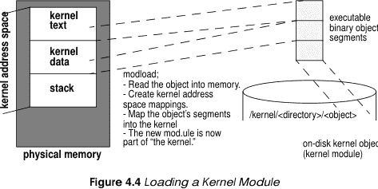

图 4.4 中的图示并非内核地址空间或二进制目标段的精确描绘，而是提供了一种概念性视图。后续章节将详细描述可执行对象和地址空间映射。

系统在引导时加载功能性系统所需的模块。定义模块搜索路径（即搜索可加载模块的目录）的路径变量，会引导引导代码定位相应的内核对象。内核 `modload()` 函数是开始模块加载过程的代码入口点。用于支持模块加载的主要数据结构是 `modctl`（模块控制）结构和模块结构。你可以在 `/usr/include/sys/modctl.h` 和 `/usr/include/sys/kobj.h` 中分别找到 `modctl` 和模块的结构定义。

内核维护一个由内核中所有模块的 `modctl` 结构组成的链表，如图 4.5 所示。

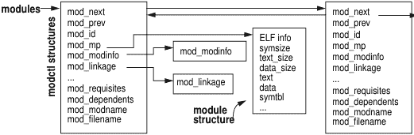

**图 4.5 _模块控制结构_**


内核模块指针标记着模块控制结构双向链表的起点。图中并未显示每个结构成员。除了结构链接（`next` 和 `previous` 指针）之外，还维护有模块标识（`mod_id`），以及指向 `mod_modinfo` 结构和 `mod_linkage` 结构的链接。`mod_mp` 链接到在内核目标链接器代码（`/usr/include/sys/kobj.h`）中定义的模块结构，该结构由内核运行时链接器和模块加载机制使用。其他值得关注的成员包括指向目录名和模块文件名的字符串指针 `mod_filename`（该目录保存模块）和 `mod_modname`。

给定的内核模块可能依赖其他内核模块的存在才能运行，也可能有其他内核模块依赖它。例如，用于共享内存、信号量和消息队列的 System V 进程间通信（IPC）模块，都依赖内核的 `ipc` 模块才能运行。此类依赖在模块代码中定义，并借助 `modctl` 结构中的 `mod_requisites`（此模块依赖的其他模块）和 `mod_dependents`（依赖此模块的模块）指针来维护。

内核模块加载机制是线程化的。也就是说，当内核的 `modload()` 函数被调用时（在引导期间或由 `modload(1M)` 命令调用），它会创建一个内核线程来执行模块加载功能。这样做的好处是，在多处理器系统上可以并发加载模块，从而加快系统引导和初始化速度。一旦内核线程创建完成，将执行以下一系列事件以完成模块的加载和链接。

1. 创建并分配一个 `modctl` 结构。首先，搜索 `modctl` 结构的链表，查找与模块名（`mod_modname`）匹配的项。如果找到匹配项，则返回现有结构的地址；否则，创建一个新结构，并将新的 `modctl` 结构添加到链表中。

2. 进入内核运行时链接器 `krtld`，以创建地址空间段以及绑定，并将对象加载到内存中。
   - a) 分配 `module` 结构。
   - b) 在内核的 `kobj_map` 资源映射中为模块的符号分配空间。
   - c) 遍历正在加载的模块的各段，为文本和数据分配并映射空间。
   - d) 将内核对象加载到内存中，将对象的各段链接到适当的内核地址空间段。

3. 在模块的 `modctl` 结构中设置 `mod_loaded` 位，并递增 `mod_loadcnt`。

4. 创建指向模块 `mod_linkage` 结构的链接。

5. 通过查找 `module_init()` 例程并调用它来间接执行模块的 `mod_install` 函数。

如前面的步骤所示，参与模块加载的主要内核子系统是模块设施和内核的运行时链接器 `krtld`，后者在引导过程的早期就被加载。模块子系统在卸载模块时不会释放 `modctl` 结构。该结构保留在链表中，并且 `mod_loaded` 位被清除。这就是为什么第1步首先搜索链表；如果模块曾被加载随后又被卸载，`modctl` 结构将已经存在。这也是为什么要维护 `mod_loaded` 状态位——`modctl` 结构的存在并不一定意味着模块已加载。

Solaris 内核本质上是动态的，并且内核对象可以在系统运行期间被加载和卸载，这一事实要求内核的符号表（第2步）以动态实体的形式存在。所有可执行目标文件都有一个符号表，其中包含解析目标文件符号引用所需的信息。符号引用是函数或变量的虚拟地址与其名称之间的关联。Solaris 内核的符号表通过一个伪设备 `/dev/ksyms` 和相应的设备驱动程序 `/usr/kernel/drv/ksyms` 来维护。在 Solaris 7 中，内核符号表由一个专门为此目的创建的内核线程更新。当模块被加载（或卸载）时，内核运行时链接器会向 `ksyms_update_thread()` 发出唤醒，内核符号表随即更新，以反映已加载内核对象的当前状态。

在 Solaris 2.5.1 和 2.6 中，使用了不同的更新机制。当模块被加载或卸载时，一个内核变量会被更新。在 ksyms 驱动程序的 `ksyms_open()` 代码中，会测试该变量以确定是否需要创建新的符号表映像。这里的含义是，如果已经在 ksyms 驱动程序中执行了一次打开操作，意味着用户（或程序）正在检查内核符号表，而此时有内核模块被加载或卸载，那么当前已打开的版本不会反映这一变化。必须执行关闭并再次打开，才能获得更新后的视图。你可以使用 `nm(1)` 命令检查目标文件的符号表；使用 `/dev/ksyms` 检查内核的符号表。

```text
# nm -x /dev/ksyms | grep modload
[1953]  0xf01108c  0x00000060 FUNC LOCAL  0  ABS  modctl_modload
[1072]  0xf01113c  0x000000a0 FUNC GLOB   0  ABS  modload
[1973]  0xf011398  0x000000b8 FUNC LOCAL  0  ABS  modload_now
[1972]  0xf0111d8  0x00000008 FUNC LOCAL  0  ABS  modload_thread
[9926]  0xf011450  0x000000a4 FUNC GLOB   0  ABS  modloadonly
```

前面的示例在运行中的内核的符号表中搜索 `modload`，这是我们在前面讨论过的一个内核函数。该命令返回了几个包含 `modload` 字符串的匹配项，包括所需的 `modload` 函数符号。（有关符号表的更多信息以及所列列的具体信息，请参阅 `nm(1)`、`a.out(4)` 和 `elf(3E)` 手册页。此外，还可以参考任何描述可执行与链接格式（ELF）文件的文献，第4章将对此进行更详细的讨论。）

在第5步中，我们指出模块安装代码是通过模块的 `_init()` 函数间接调用的。任何可加载内核模块都必须包含几个函数以支持动态加载。设备驱动程序和 STREAMS 模块必须针对动态加载进行编码。因此，定义了一个可加载驱动程序接口。通常，文档中记载的所需例程和数据结构适用于所有可加载内核模块，而不仅仅是驱动程序和 STREAMS 模块（尽管有些组件是驱动程序特有的），并且不适用于诸如可加载系统调用、文件系统或调度类等对象。

在可加载内核对象中，必须按照 `_init(9E)`、`_info(9E)` 和 `_fini(9E)` 手册页中的定义，编写初始化例程、信息例程和结束例程。模块的 `_init()` 例程被调用来完成模块加载后使其可用的过程。模块的 `_info()` 和 `_fini()` 例程也会调用相应的内核模块管理接口，如表4-2所示。

### 表4-2 模块管理接口

| 内核模块例程 | 模块设施接口 | 描述 |
|---|---|---|
| `_init()` | `mod_install()` | 加载内核模块。 |
| `_info()` | `mod_info()` | 获取模块信息。 |
| `_fini()` | `mod_remove()` | 卸载内核模块。 |

模块安装被抽象化，以在内核中定义一组通用的结构和接口。用于安装、移除和信息收集的模块操作函数指针（表4-2中显示的通用接口）保存在一个 `mod_ops` 结构中，该结构被扩展以提供每种可加载模块类型的定义。例如，有专门用于加载系统调用的 `mod_installsys()` 函数，有专门用于加载设备驱动程序的 `mod_install_drv()` 函数，等等。

对于这些模块类型中的每一种，都定义了一个模块链接结构；它包含一个指向操作结构的指针、一个指向描述模块的字符串的指针，以及一个指向模块类型特定结构的指针。例如，可加载系统调用的链接结构 `modlsys` 包含一个指向系统入口表的指针，该表是所有系统调用的入口点。每个可加载内核模块都需要声明并初始化适当的类型特定链接结构，以及一个为所有模块提供通用抽象的通用 `modlinkage` 结构。

在模块设施内部，有一个用于安装模块的模块类型特定例程，通过从通用 `mod_install()` 代码调用的 `MODL_INSTALL` 宏进入。更准确地说，可加载模块的 `_init()` 例程调用 `mod_install()`，后者通过 `MODL_INSTALL` 宏将控制导向适当的模块特定例程。该过程如图4.6所示。

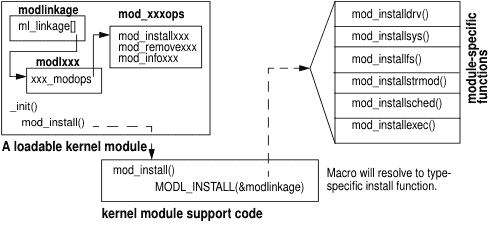

### 图4.6 模块操作函数分派

图4.6显示了可加载内核模块中定义的数据结构：通用 `modlinkage`，通过它引用一个类型特定的链接结构（`modlxxx`），该结构又链接到一个类型特定的操作结构，其中包含指向用于安装、移除和收集内核模块信息的类型特定函数的指针。`MODL_INSTALL` 宏接收模块通用链接结构的地址，并从那里将控制导向适当的函数。模块特定的安装步骤总结在表4-3中。

### 表4-3 模块安装例程

| 模块类型 | 安装函数 | 说明 |
|---|---|---|
| 设备驱动程序 | `mod_install_drv` | 封装 `ddi_installdrv()`。在内核 devops 表中安装驱动程序条目。 |


| 系统调用 | `mod_installsys` | 在内核 sysent 表中安装系统调用的 sysent 表条目。 |
| 文件系统 | `mod_installfs` | 安装文件系统的虚拟文件系统（VFS）切换表条目。 |
| STREAMS 模块 | `mod_installstrmod` | 在内核 fmodsw 切换表中安装 STREAMS 条目。 |
| 调度类 | `mod_installsched` | 在内核 `sclass` 数组中安装调度类。 |
| 执行模块 | `mod_installexec` | 在内核 execsw 切换表中安装 exec 条目。 |

表4-3中的说明列显示了模块安装函数的一个明确模式。在许多子系统中，内核实现了一种切换表机制，以便为特定的文件系统、调度类、exec 函数等将控制导向正确的内核函数。每种实现的细节将在本书后续部分中介绍，具体取决于特定的章节或标题。

正如我们所看到的，内核模块的动态加载是通过两个主要的内核子系统来促进的：模块管理代码和内核运行时链接器。这些内核组件利用了其他内核服务，例如内核内存分配器、内核锁定原语和内核 ksym 驱动程序，充分利用了系统的模块化设计，并为我们之前讨论的分层模型提供了一个很好的示例。

## 第二部分：Solaris 内存系统

### Solaris 内存架构

### 内核内存

### 内存监控

## Solaris 内存架构

虚拟内存系统可视为 Solaris 系统的核心，Solaris 虚拟内存的实现几乎影响操作系统中的每一个其他子系统。在本章中，我们先介绍一些内存管理基础知识，然后进一步详细分析 Solaris 如何实现虚拟内存管理。第二部分的后续章节将讨论内核内存管理以及可用于监控和管理虚拟内存的工具。

### 5.1 为什么需要虚拟内存系统？

虚拟内存系统具有以下优点：

- 它为应用程序提供了一种简单的内存编程模型，应用程序开发人员无需了解底层内存硬件是如何排列的。
- 它允许进程在其地址空间中看到线性的字节范围，无论实际内存的物理布局或碎片如何。
- 它提供了一种编程模型，其内存大小大于可用物理存储（例如 RAM），并使我们能够使用较慢但较大的辅助存储（例如磁盘）作为后备存储，来保存无法放入物理内存的内存片段。

虚拟视角下的内存存储（称为地址空间）呈现给应用程序，而 VM 系统则透明地管理 RAM 与辅助存储之间的虚拟存储。由于 RAM 明显快于磁盘（100 纳秒对 10 毫秒，约快 100,000 倍），VM 系统的任务就是将最常被引用的内存片段保留在较快的主存储中。当 RAM 不足时，VM 系统需要将不常使用的内存转出到后备存储以释放 RAM。这样一来，VM 系统优化了性能，也免除了用户自行管理内存分配的需要。

在 VM 系统中，多个用户的进程可以共享内存。在多用户环境中，多个进程可能运行同一个程序的可执行二进制文件；在较旧的 Unix 实现中，每个进程都拥有该二进制文件的一份副本——这是对内存资源的巨大浪费。Solaris 虚拟内存系统通过在进程之间共享程序二进制文件和应用程序数据来优化内存使用，因此当同一进程的多个实例被执行时，内存不会被浪费。Solaris 内核在 SunOS 中引入动态链接库时进一步扩展了这一概念，使得 C 库可以在进程之间共享。

为了正确支持多用户，VM 系统实现了内存保护。例如，一个用户的进程绝不能访问另一个进程的内存，否则安全性可能受到损害，或者一个程序中的程序故障可能导致另一个程序（乃至整个操作系统）失败。内存管理单元中的硬件设施通过阻止进程访问其合法地址空间之外的内存（进程之间显式共享的内存除外）来执行内存保护功能。

物理内存（RAM）被划分为固定大小的片段，称为页。页的大小在不同平台上可能不同；UltraSPARC Solaris 系统上常见的内存页大小是 8 KB。每个物理内存页都与一个文件和偏移量相关联；文件和偏移量标识该页的后备存储。后备存储是当物理页内容需要被移作他用时迁移过去（称为 *页换出*）的位置；也是当文件需要被换入时读回文件的位置。用于普通进程堆和栈的页称为 *匿名内存*，其后备存储为交换文件。一个页也可以是某个普通文件中一个页大小片段的缓存。在这种情况下，后备存储就是它所缓存的文件——这正是 Solaris 利用内存系统缓存文件的方式。

如果虚拟内存系统需要占用一个 *脏*页（内容已被修改的页），则其内容会被迁移到后备存储。当匿名内存页被释放时，会被换出到交换设备。如果某个文件页需要被释放，且该文件中与页大小对应的部分未被修改，则可以直接释放该页；如果该部分已被修改，则必须先将其写回文件（此情况下的后备存储），然后再释放。

我们不是逐字节地管理内存，而是使用页大小的内存片段，以尽量减少虚拟内存系统维护虚拟到物理内存映射所需的工作量。图 5.1 展示了内存的虚拟视图（地址空间）到物理内存的管理和转换是如何由称为虚拟内存管理单元（MMU）的硬件完成的。

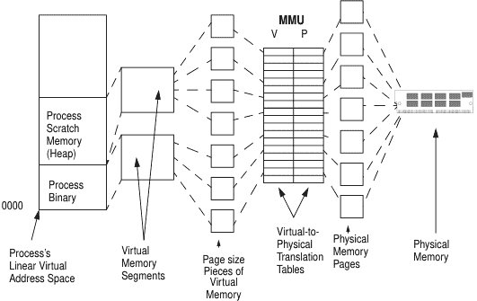

**图 5.1 Solaris 虚拟到物理内存管理**

Solaris 内核将线性虚拟地址空间划分为若干段，地址空间中每种类型的内存区域对应一个段。例如，一个简单进程有一个用于进程二进制文件的内存段，以及一个用于临时内存（称为堆空间）的内存段。每个段管理该段所映射的虚拟地址范围的映射，并将该映射转换为 MMU 页。硬件 MMU 通过一组平台相关的转换表将这些页映射到物理内存。表中的每个条目都有 RAM 中内存页的物理地址，因此内存访问可以在硬件中即时转换。在本章稍后讨论内存管理的平台相关实现时，我们会更详细地介绍 MMU 的工作原理。

回想一下，我们可以拥有比物理地址空间更大的虚拟地址空间，因为操作系统可以将内存溢出到较慢的介质（如磁盘）上。Unix 中这种较慢的介质称为交换空间。有两种基本的内存管理类型负责管理物理内存页在交换空间与内存之间的分配和迁移：*交换* 和 *按需分页*。

用于内存管理的交换算法以用户进程作为管理内存的粒度。如果内存短缺，则最不活跃的进程的所有内存页都会被换出到交换设备，从而为其他进程释放内存。这种方法易于实现，但在内存短缺期间性能会严重下降，因为进程必须等到其所有页都从辅助存储中取回后才能恢复执行。按需分页模型以 *页* 作为内存管理的粒度。内存系统不是换出整个进程，而是只换出较小、最不常用的片段，从而在进程的不活动部分被换出时，进程仍可继续运行。

Solaris 内核使用按需分页与交换相结合的模型。正常情况下使用按需分页，而交换仅在系统内存极度紧张时作为最后手段使用。我们将在第 178 页的“页面扫描器”一节中更详细地讨论交换和分页。

Solaris VM 系统实现的功能远不止管理应用程序内存。事实上，Solaris 虚拟内存系统负责管理大多数与 I/O 和内存相关的对象，包括内核、用户应用程序、共享库和文件系统。这一策略与早期的 System V Unix 版本等其他操作系统显著不同，后者的文件系统 I/O 使用独立的缓冲区缓存。

使用 VM 系统管理文件系统缓冲的主要优势之一是，系统中所有空闲内存都用于文件缓冲，这为使用文件系统的应用程序带来了显著的性能提升，并且无需调整缓冲区缓存的大小。VM 系统可以将所有空闲内存分配给文件系统缓冲区，这意味着在具有文件系统 I/O 的典型系统上，可用空闲内存几乎为零。这个数字往往具有误导性，多年来已导致大量虚假的内存泄漏缺陷被记录。别担心，“几乎为零”是正常的。（请注意，在 Solaris 8 中，空闲内存不再总是很低。）

总之，VM 系统执行以下主要功能：

- 它管理内存的虚拟到物理映射
- 它管理主存储与辅助存储之间的内存交换，以优化性能
- 它处理多个用户和进程之间共享映像的需求

### 5.2 模块化实现

早期的 SunOS 版本（SunOS 3 及更早版本）基于旧的 BSD 风格内存系统，该系统未模块化，因此很难移动

### 5.3 Solaris 2

Solaris 2 是 Sun Microsystems 发布的 UNIX 版本。Sun 使用 BSD UNIX 的早期版本作为其基础。SunOS 5.x 版本（最终更名为 Solaris）从根本上背离了早期 SunOS 版本（SunOS 4.x）内部实现。新的 Solaris 内存管理系统是在 SunOS 4.0 中重新设计的通用虚拟内存（VM）系统的基础上构建的。

当时，虚拟内存系统被完全重新设计，新的内存系统以 SunOS 4.0 为目标。新的 SunOS 4.0 虚拟内存系统是围绕以下目标构建的：

- 采用新的面向对象的内存管理框架
- 支持共享内存和私有内存（写时复制）
- 基于页的虚拟内存管理

由这些设计目标产生的 VM 系统提供了一个开放的框架，现在支持许多不同的内存对象。内存系统最重要的对象是段（segment）、vnode 和页。例如，以下所有内容都已作为新内存对象的抽象实现：

- 物理内存，以称为页的块为单位
- 一种新的虚拟文件对象，称为 vnode
- 文件系统作为 vnode 的层次结构
- 进程地址空间作为映射 vnode 的段
- 内核地址空间作为映射 vnode 的段
- 映射的硬件设备（例如帧缓冲器）作为硬件映射页的段


图 5.2 显示了 Solaris 虚拟内存实现的层次结构。


图 5.2 *Solaris 虚拟内存层次结构*

图 5.3 展示了进程的虚拟地址空间。


图 5.3 进程虚拟地址空间

Solaris 的 **SPARC V7 组合 32 位内核与进程地址空间**如图 5.4 所示。


图 5.4 *SPARC 32 位共享内核/进程地址空间*

UltraSPARC V9 的 32 位和 64 位地址空间如图 5.5 所示。

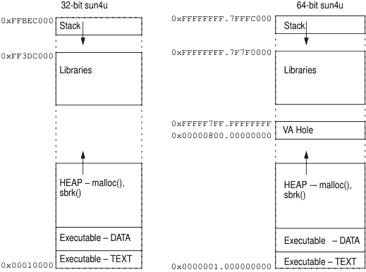

图 5.5 *SPARC sun4u 32 位与 64 位进程地址空间*

在所有 SPARC 平台上，虚拟地址空间的底部均未映射。空指针引用将导致段错误（segmentation fault），而不会返回地址空间底部可能存在的虚假内容。

### 5.3.3 Intel 地址空间布局

Intel x86 地址空间与 32 位 SPARC V7 共享的进程/内核地址空间一样，用户和内核共享同一个地址空间。Intel 地址空间的主要区别在于：栈被映射到可执行二进制文件的下方，并向下朝底部增长。Intel 地址空间如图 5.6 所示。

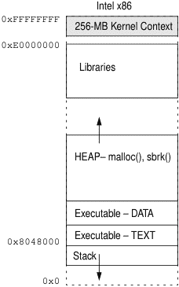

### 5.3.4 进程内存分配

用于用户数据结构的进程虚拟内存从堆段分配，堆段位于可执行数据段之上。堆一开始很小，随着虚拟内存的分配而增长。堆以页为单位增长，并且只是一个可供读写的大型虚拟内存区域。单个大型虚拟内存区域难以编程，因此由通用内存分配器来管理堆区域；这样，就可以分配和释放任意大小的内存对象。通用内存分配器通过 `malloc()` 及相关库调用来实现。

进程通过 `sbrk()` 系统调用来扩展其堆空间。每次调用 `sbrk()` 系统调用时，都会按请求的数量增加堆段。用户程序无需直接调用 `sbrk()`，因为 `malloc()` 库在需要更多分配空间时会调用 `sbrk()`。`sbrk()` 系统调用如下所示。

```c
void *sbrk(intptr_t incr);
```

堆段是虚拟内存，因此使用 `malloc()` 和 `sbrk()` 请求内存并不会分配物理内存；它只是分配虚拟地址空间。只有首次引用所分配虚拟空间内的页面时，才会分配物理内存——一次一页。内存系统透明地实现了这种“按需零填充”分配，因为第一次引用堆中的页面时会发生缺页错误，随后段驱动程序识别到首次内存访问，便在那一刻在该位置创建一页。

内存页通过按需零填充分配给进程堆，然后一直保留在堆段中，直到进程退出或被页扫描程序盗用。调用内存分配器 `free()` 并不会将物理内存返回给空闲内存池；`free()` 只是将堆空间内的区域标记为空闲以备将来使用。因此，通常会看到分配给进程的物理内存量增长，但除非内存短缺，否则即使调用了 `free()`，它也不会缩小。

堆可以一直增长，直到与共享库所占用的内存区域重叠。堆的最大大小取决于平台的虚拟内存布局，并且因平台而异。此外，在 64 位平台上，进程可以以 32 位或 64 位模式执行。如第 134 页上的图 5.5 所示，以 64 位模式执行的进程中，堆的大小可以大得多。表 5-1 列出了最大堆大小以及影响最大大小的操作系统要求。

表 5-1 *最大堆大小*

| Solaris 版本 | 最大堆大小 | 备注 |
|---|---|---|
| Solaris 2.5 | 2 GB | |
| Solaris 2.5.1 | 2 GB | |
| Solaris 2.5.1（补丁 103640-08 或更高版本） | 3.75 GB | 需要以 root 身份才能在不使用 `ulimit(1M)` 的情况下将限制提高到 2 GB 以上。 |
| Solaris 2.5.1（补丁 103640-23 或更高版本） | 3.75 GB | 不需要以 root 身份即可提高限制。 |
| Solaris 2.6 | 3.75 GB | 需要使用 `ulimit(1M)` 将限制提高到 2 GB 以上。 |
| Solaris 2.7 32 位模式 | 3.75 GB<br>3.90 GB | （非 sun4u 平台）<br>（sun4u 平台） |
| Solaris 2.7 64 位模式 | UltraSPARC-I 和 -II 上为 16 TB | 几乎无限。 |

### 5.3.5 栈

进程栈以初始分配的方式映射到地址空间，然后向下增长。栈与堆一样按需增长，但没有库来扩展栈；相反，是由另一种机制触发这种增长。

最初，为栈分配单个页面，随着进程执行并调用函数，它会将程序计数器、参数和局部变量压入栈中。当栈增长超过一页时，进程会触发缺页错误，内核识别出这是栈段的缺页错误，并扩展栈段。

### 5.3.6 地址空间管理

Solaris 内核通过一个中心地址管理子系统实现，内核的其他部分会调用该子系统。地址空间模块是段驱动程序之上的包装器，因此子系统无需知道某个内存范围使用哪个段驱动程序。图 5.7 所示的地址空间对象从进程的地址空间链接而来，并包含指向构成该地址空间的各个段的指针。

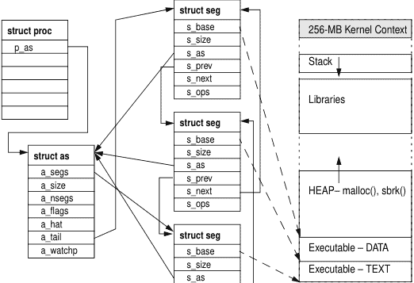

图 5.7 *地址空间*

地址空间子系统管理以下功能：

- 地址空间的复制，用于 `fork()`
- 地址空间的销毁，用于 `exit()`
- 在地址空间内创建新段
- 从地址空间中移除段
- 设置和管理地址空间的页保护
- 地址空间的缺页路由
- 地址空间的页锁定和建议
- 地址空间监视点的管理

回顾一下，进程和内核子系统调用地址空间子系统来管理其地址空间。地址空间子系统由一系列函数组成，这些函数分组执行上述功能。尽管该子系统有很多入口点，但其实现相当简单，因为大多数函数只是查找操作需要作用于哪个段，然后将请求路由到相应的段驱动程序。

调用 `as_alloc()` 函数会创建一个地址空间，但 `as_alloc()` 只被调用一次——当系统启动并创建 init 进程时。init 进程创建后，所有地址空间都是通过 `fork()` 复制 init 进程的地址空间来创建的。`fork()` 系统调用在创建新进程时会调用 `as_dup()` 函数来复制当前进程的地址空间，此时整个地址空间配置（包括栈和堆）都会被复制。

`vfork()` 的行为在这里有些不同。`vfork()` 不是调用 `as_dup()` 来复制地址空间，而是通过借用父进程现有的地址空间来创建新进程。如果 fork 之后将要调用 `exec()`，`vfork()` 很有用，因为它省去了复制地址空间的所有工作，否则一旦调用了 `exec()`，这些地址空间也会被丢弃。在子进程使用父进程的地址空间期间，父进程会被挂起，直到调用 `exec()`。一旦进程创建完成，地址空间对象就会被分配和设置。Solaris 7 中地址空间对象的数据结构如下所示。


```c
struct as {
        kmutex_t a_contents;    /* protect certain fields in the structure */
        uchar_t  a_flags;       /* as attributes */
        uchar_t  a_vbits;       /* used for collecting statistics */
        kcondvar_t a_cv;        /* used by as_rangelock */
        struct hat *a_hat;       /* hat structure */
        struct hrmstat *a_hrmstat; /* ref and mod bit statistics */
        caddr_t a_userlimit;     /* highest allowable address in this as */
        union {
                struct seg *a_seglast; /* last segment in the addr space */
                ssl_spath *spath;      /* last search path in seg skiplist */
        } a_cache;
        krwlock_t a_lock;       /* protects fields below + a_cache */
        int       a_npages;     /* number of pages */
        struct watched_page *a_wpage; /* list of watched pages (procs) */
        seg_next  a_segs;       /* segments in this address space. */
        size_t    a_size;       /* size of address space */
        struct seg *a_tail;     /* last element in the segment list. */
        uint_t    a_nsegs;      /* number of elements in segment list */
        uchar_t   a_lrep;       /* representation of a_segs; see #defines */
        uchar_t   a_hilevel;    /* highest level in the a_segs skiplist */
        uchar_t   a_unused;
        uchar_t   a_updated;    /* mappings changed, rebuild as_objectdir */
        vnode_t   a_objectdir;  /* object directory (procfs) */
        size_t    a_sizedir;    /* size of object directory */
};
```

### 头文件 `<vm/as.h>`

地址空间故障处理在地址空间子系统中执行；某些故障由通用地址空间代码处理，其他故障则被重定向到段处理程序。当发生页故障时，Solaris 陷阱处理程序调用 `as_fault()` 函数，该函数通过调用 `as_set()` 函数来查看页故障发生在哪个段中。如果故障不在地址空间的任何段中，则 `as_fault()` 向进程发送 `SIGSEGV` 信号。如果故障确实位于某个段内，则调用该段的故障方法，由该段处理页故障。

表 5-2 按字母顺序列出了段函数。

#### 表 5-2 Solaris 7 地址空间函数

| 方法 | 描述 |
|---|---|
| `as_addseg()` | 创建一个新段并将其链接到地址空间。 |
| `as_alloc()` | 创建一个新的地址空间对象（仅由内核为 init 进程调用）。 |
| `as_clearwatch()` | 清除地址空间的所有监视点。 |
| `as_ctl()` | 向地址空间的某个地址范围发送内存建议。 |
| `as_dup()` | 复制整个地址空间。 |
| `as_exec()` | `exec` 的特殊代码，用于将栈段从它在旧地址空间中的临时位置移动到新地址空间中的正确位置。 |
| `as_fault()` | 处理地址空间中的页故障。 |
| `as_findseg()` | 查找包含给定虚拟地址的段。 |
| `as_free()` | 销毁地址空间对象；由 `exit()` 调用。 |
| `as_gap()` | 在 `[base, base + len)` 内查找至少指定大小的空洞。如果提供的标志指定了 `AH_HI`，则该空洞将具有该范围内尽可能最高的地址。否则，它将具有尽可能最低的地址。如果提供的标志指定了 `AH_CONTAIN`，则空洞将包含地址 `ad`。如果找到合适的空洞，则将 `base` 和 `len` 设置为反映该空洞在范围内的部分，并返回 0。否则，返回 −1。 |
| `as_getmemid()` | 调用包含给定地址的段驱动程序，以获取该段的唯一 ID。 |
| `as_getprot()` | 获取给定地址的当前保护设置。 |
| `as_map()` | 将文件映射到地址空间。 |
| `as_memory()` | 返回 `[base, base + len)` 内由“真实内存”支持的下一个范围。 |
| `as_pagelock()` | 通过调用段页锁定函数，锁定地址空间内的一个页。 |
| `as_pagereclaim()` | 从给定地址的空闲列表中检索一个页。 |
| `as_pageunlock()` | 解锁地址空间内的一个页。 |
| `as_rangebroadcast()` | 唤醒等待该地址空间条件变量的所有线程。 |
| `as_rangelock()` | 锁定给定地址范围的页。 |
| `as_rangeunlock()` | 解锁给定地址范围的页。 |
| `as_rangewait()` | 等待指定地址空间中的虚拟地址可用。调用方必须持有 `AS_CLAIMGAP`，并且在返回给调用方之前会重新获取。 |
| `as_set()` | 查找包含给定地址的段。 |
| `as_setprot()` | 将地址空间 `as` 中 *[addr : addr + size)* 区间的虚拟映射设置为具有指定的保护属性。 |
| `as_setwatch()` | 为该地址设置一个监视点。在不支持监视点的系统上，不执行任何操作。 |
| `as_swapout()` | 将与地址空间关联的页交换到二级存储，返回实际交换的字节数。 |
| `as_unmap()` | 从地址空间取消映射一个段。 |

### 5.3.7 虚拟内存保护模式

我们将每个进程分解为多个段，以便能够对地址空间的每个部分进行不同处理。例如，内核将可执行二进制文件的机器代码部分以只读方式映射到进程中，以防止进程修改其机器代码指令。虚拟内存子系统通过利用硬件 MMU 的虚拟内存保护能力来实现这一点。Solaris 依赖 MMU 具备以下保护模式：

- `读` — 允许从该映射进行读取。
- `写` — 允许对该映射进行写入。
- `可执行` — 允许在该映射的地址范围内执行机器代码。

保护模式的实现是在段层和 HAT 层完成的。

### 5.3.8 地址空间中的页故障

Solaris 虚拟内存系统使用硬件 MMU 的内存管理功能。MMU 生成的异常通过使用陷阱中断正在执行的进程（参见第28页的“进入内核模式”），然后调用相应的内存管理代码，从而在内存访问无法在没有内核干预的情况下继续时通知操作系统。可能发生三种主要的内存相关硬件异常：`主页故障`、`次页故障`和`保护故障`。

`主页故障`发生在尝试访问由段映射的虚拟内存位置时，该位置没有映射到物理内存页，并且该页在物理内存中不存在。页故障使虚拟内存系统能够向进程隐藏物理内存分配的管理。虚拟内存系统为进程认为可访问的内存分配页，并安排为该地址创建新页（如果是首次访问）或从交换设备复制该页进来。一旦内存系统在内存地址后面放置了真实页，进程就可以继续正常执行。如果引用了未被任何段映射的内存地址，则会向进程发送分段违规信号 `SIGSEGV`。该信号是处理器捕获的硬件异常，由地址空间层转换为信号后发送的。


*次页故障*发生在尝试访问位于某段内的虚拟内存位置时，该页在物理内存中，但当前没有建立从物理页到导致故障的地址空间的 MMU 映射。例如，一个进程映射了 `libc.so` 库，并引用了其中的一个页。此时会发生页故障，但该物理内存页已经存在，进程只需建立到现有物理页的映射即可。次页故障也被称为*附加（attaches）*。

*页保护故障*发生在程序尝试以违反内存段预配置访问保护的方式访问某个内存地址时。保护模式可以启用读、写或执行访问中的任何一种。例如，二进制的文本部分被映射为只读，如果我们试图写入该段中的任何内存地址，就会引发内存保护故障。内存保护故障同样由硬件 MMU 以陷阱形式触发，然后由段页故障处理例程处理。

图 5.8 展示了虚拟地址空间、其各段以及硬件 MMU 之间的关系。

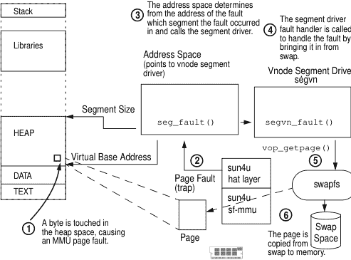

### 图 5.8 *虚拟地址空间页故障示例*

在图中，我们看到了当进程访问其堆空间内没有映射物理内存的内存位置时会发生什么。这种情况很可能是因为此前物理内存页因内存短缺而被页扫描程序窃取。

1. 引用了未映射到物理内存页的内存地址。在此示例中，该页已被换出，现在位于交换设备上。
2. 当进程访问后面没有物理内存的地址时，MMU 检测到无效引用，并在正在运行线程执行代码的那个处理器上引发陷阱。故障处理程序将其识别为内存页故障，并通过将故障地址与每个段映射的地址进行比较，确定故障发生在哪个段中。
3. 地址空间 `as_fault()` 例程将故障地址与每个段映射的地址进行比较，然后调用 `page_fault`。

此段（此处为 vnode 段驱动程序）的段驱动程序例程。

- 4. 段驱动程序通过调用 HAT 层来分配并映射一页内存，然后从交换设备复制该页的内容。
- 5. 段驱动程序通过调用后备存储的 vnode 的 `getpage()` 函数，从后备存储读取该页。
- 6. 此段的后备存储是交换设备，因此会调用交换设备的 `getpage()` 函数从交换设备读入该页。

此过程完成后，进程可以继续执行。

## 5.4 内存段

内存管理面向对象方法的另一个示例是内存“段”对象。内存段管理将一段线性范围的虚拟内存映射到地址空间中。该映射位于地址空间与某种类型的设备之间。内存段的目标是允许将内存和设备都映射到地址空间中。传统上，这需要为每个设备将内存和设备信息硬编码到地址空间处理程序中。对象架构允许不同段具有不同行为。

例如，一个段可以是将文件映射到地址空间（使用 `mmap`），另一个段可以是将硬件设备映射到进程的地址空间（如图形帧缓冲器）。在这种情况下，段驱动程序提供了类似的线性地址空间视图，尽管使用 `mmap` 的文件映射操作利用内存页来缓存文件数据，而帧缓冲器设备则将硬件设备映射到地址空间中。

段对象的灵活性使我们能够使用几乎任何抽象来表示进程可见的线性地址空间，而无论其背后的真实设施是什么。

```c
struct seg {
        caddr_t s_base;             /* base virtual address */
        size_t  s_size;             /* size in bytes */
        struct as *s_as;            /* containing address space */
        seg_next s_next;            /* next seg in this address space */
        struct seg *s_prev;         /* prev seg in this address space */
        struct seg_ops *s_ops;      /* ops vector: see below */
        void *s_data;               /* private data for instance */
};
```

**头文件** `<vm/seg.h>`

要实现一个地址空间，段驱动程序实现至少需要提供以下内容：为线性地址范围创建映射的函数、用于处理该线性地址范围内机器异常的缺页处理例程，以及销毁映射的函数。这些函数一起打包成一个**段驱动程序**，它是段对象接口的一个实例。图 5.9 说明了地址空间与段之间的关系，并展示了一个段映射进程堆空间的情况。

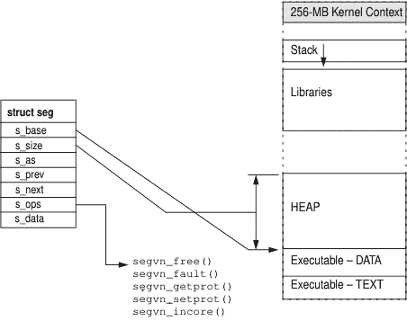

**图 5.9** *段接口*

段驱动程序实现表 5-4（第 146 页）中所述方法的一个子集，以及用于创建对象第一个实例的构造函数。段操作结构 `s_ops` 中的函数指向 vnode 段驱动程序中的函数，并以 `segvn` 为前缀。当另一个子系统想要通过调用 `as_map()` 在特定地址创建映射时，就会创建段对象。段的创建例程作为参数传递给 `as_map()`，然后创建段对象，并返回段对象指针。段创建后，虚拟内存系统的其他部分可以调用该段执行不同的地址空间操作，而无需知道底层段驱动程序是什么，也无需知道段方法操作是什么。

例如，当使用 `mmap()` 将文件映射到地址空间时，会以 `segvn_create()`（vnode 段驱动程序构造函数）作为参数调用地址空间映射例程 `as_map()`，后者进而调用 `seg_vn` 段驱动程序来创建映射。段对象被创建并插入到地址空间（`struct as`）的段列表中，此后，地址空间可以对该映射执行操作，而无需知道底层段是什么。

地址空间例程可以通过调用段操作宏来对段进行操作，而无需知道底层段的类型。例如，如果地址空间层想要调用某个段的故障处理程序，它会调用 `SEGOP_FAULT()`，该宏会调用特定于段的缺页方法，如下所示。

```c
#define SEGOP_FAULT(h, s, a, l, t, rw) \
        (*(s)->s_ops->fault)((h), (s), (a), (l), (t), (rw))
```

**头文件** `<vm/seg.h>`

Solaris 内核使用一系列针对各种功能的段驱动程序实现。不同类型的驱动程序如表 5-3 所示。大多数进程地址空间映射——包括可执行文本、数据、堆、栈和内存映射文件——都通过 vnode 段驱动程序 `seg_vn` 执行。其他类型没有关联 vnode 的映射需要不同的段驱动程序。其他段驱动程序通常与内核内存映射或硬件设备（如图形适配器）相关联。

### 表 5-3 Solaris 7 段驱动程序

| 段 | 功能 |
|---|---|
| `seg_vn` | 使用 seg_vn 设备驱动程序管理到进程地址空间的 vnode 映射。可执行文本和数据、共享库、映射文件、堆和栈（堆和栈是匿名内存）都使用 seg_vn 映射。 |
| `seg_kmem` | 大部分不可分页内核内存从该段分配。（参见第 6 章“内核内存”）。 |
| `seg_kp` | 可分页内核内存从该段分配。只有很少一部分内核是可分页的；内核线程栈和 TNF 缓冲区是可分页内核内存的主要使用者。 |
| `seg_spt` | 共享页表段驱动程序。快速 System V 共享内存通过该段驱动程序映射到进程地址空间。从该驱动程序分配的内存也称为紧密共享内存（ISM）。 |
| `seg_map` | 内核使用 seg_map 驱动程序将文件（vnode）映射到内核的地址空间，以实现文件系统缓存。 |
| `seg_dev` | 已映射的硬件设备。 |
| `seg_mapdev` | 通过 `ddi_mapdev(9F)` 接口为已映射的硬件设备提供映射支持。 |
| `seg_lock` | 为映射在用户地址空间和内核地址空间之间的硬件图形设备提供映射支持。 |
| `seg_drv` | 为已映射的硬件图形设备提供映射支持。 |
| `seg_nf` | 非故障内核内存驱动程序。 |
| `seg_mdi` | 为 cgfourteen 图形帧缓冲器提供硬件映射支持。 |
| `seg_sx` | 为 SPARCstation 20 SX 图形帧缓冲器提供硬件映射支持。 |

### 表 5-4 Solaris 7 段驱动程序方法

表 5-4 描述了 Solaris 7 中实现的段驱动程序方法。

| 方法 | 描述 |
|---|---|
| `advise()` | 提供提示以优化对此段的内存访问。例如，对映射文件给出的顺序建议会导致预读发生。 |
| `checkprot()` | 检查在段内页面的保护级别内是否允许所请求的访问类型（读、写、执行）。 |
| `dump()` | 将段转储到转储设备；用于崩溃转储。 |
| `dup()` | 复制当前内存段，包括将所有的页面映射项复制到所提供的新的段指针。 |
| `fault()` | 处理段的缺页故障。参数描述该段、缺页故障的虚拟地址以及故障类型。 |
| `faulta()` | 异步启动对某个段和地址的缺页。用于预读或数据预取，作为 I/O 的性能优化。 |
| `free()` | 销毁一个段。 |


| `getmemid()` | 获取内存段的唯一标识符。 |
| `getoffset()` | 查询段驱动程序以获取映射在底层设备中的偏移量。（并非对所有段驱动程序都有意义。） |
| `getprot()` | 询问段驱动程序有关内存范围保护级别的信息。 |
| `gettype()` | 查询驱动程序有关映射的共享模式。 |

## 表5-4 *Solaris 7 段驱动程序方法（续）*

| 方法 | 描述 |
|---|---|
| `getvp()` | 获取此映射背后的 vnode（如果存在）的 vnode 指针。 |
| `incre()` | 查询某个段在物理内存中有多少个页面。 |
| `kluster()` | 询问段驱动程序是否可以对该段内的页面执行 kluster I/O 操作。 |
| `lockop()` | 锁定或解锁由段映射的内存范围内的页面。 |
| `pagelock()` | 锁定段内的单个页面。 |
| `setprot()` | 为提供的地址范围内的页面设置保护级别。 |
| `swapout()` | 尝试将尽可能多的页面换出到辅助存储。 |
| `sync()` | 将段内任何脏页面与后备存储同步。 |
| `unmap()` | 取消段内地址空间范围的映射。 |

## 5.4.1 vnode 段：`seg_vn`

使用最广泛的段驱动程序是 vnode 段驱动程序 `seg_vn`。`seg_vn` 驱动程序将文件（或 vnode）映射到进程地址空间中，并以物理内存作为缓存。`seg_vn` 段驱动程序还会在进程地址空间内为堆和栈创建匿名内存，并为 System V 共享内存提供支持。（参见第 433 页的“System V 共享内存”。）

`seg_vn` 段驱动程序管理以下到进程地址空间的映射：

- 可执行文本
- 可执行数据
- 堆和栈（匿名内存）
- 共享库
- 映射文件

### 5.4.1.1 内存映射文件

我们可以通过 `mmap` 系统调用将文件映射到进程的地址空间中。（参见第 509 页的“内存映射文件 I/O”。）当我们将文件映射到我们的地址空间时，我们会调用地址空间例程来创建一个新段，即 vnode 段。vnode 段处理 `mmap` 系统调用所请求的内存范围的地址转换和缺页，并将新段添加到进程地址空间中的段列表中。创建段时，`seg_vn` 驱动程序使用映射的地址和长度初始化段结构，然后在段结构的 `s_data` 字段中创建一个特定于 `seg_vn` 的数据结构。该特定于 `seg_vn` 的数据结构保存了 `seg_vn` 驱动程序处理该段地址映射所需的所有信息。

`seg_vn` 专有的数据结构（`struct segvn_data`）包含指向映射到的 vnode 以及为此段分配的任何匿名内存的指针。一旦映射创建完成，文件系统就完成了映射文件的大部分工作。因此，`seg_vn` 驱动程序相当简单——`seg_vn` 的大部分工作都是在映射的创建和删除期间完成的。

`seg_vn` 驱动程序实现中更复杂的部分是对段内匿名内存页的处理，我们将在后续章节中讨论。当我们创建文件映射时，我们会将所映射文件的 vnode 和偏移量放入 `segvn_data` 结构成员 `vp` 和 `offset` 中。`seg_vn` 数据结构如下所示；图 5.10 展示了 `seg_vn` 段驱动程序的 vnode 关系。

```c
struct segvn_data {
    krwlock_t lock;          /* protect segvn_data and vpage array */
    uchar_t pageprot;        /* true if per page protections present */
    uchar_t prot;            /* current segment prot if pageprot == 0 */
    uchar_t maxprot;         /* maximum segment protections */
    uchar_t type;            /* type of sharing done */
    u_offset_t offset;       /* starting offset of vnode for mapping */
    struct vnode *vp;        /* vnode that segment mapping is to */
    ulong_t anon_index;      /* starting index into anon_map anon array */
    struct anon_map *amp;    /* pointer to anon share structure, if needed */
    struct vpage *vpage;     /* per-page information, if needed */
    struct cred *cred;       /* mapping credentials */
    size_t swresv;           /* swap space reserved for this segment */
    uchar_t advice;          /* madvise flags for segment */
    uchar_t pageadvice;      /* true if per page advise set */
    uint_t flags;            /* flags from psm/anon_map */
    usize_t softlockcnt;     /* # of pages SOFTLOCKED in seg */
};
```

#### 头文件 `<vm/seg_vn.h>`

为文件创建映射是通过 `mmap()` 系统调用完成的，该调用会为包含该文件的文件系统调用 `map` 方法。例如，对 UFS 文件系统上的文件调用 `mmap()` 会调用 `ufs_map()`，而 `ufs_map()` 又会调用 `seg_vn` 驱动程序，通过 `segvn_create()` 函数在地址空间中创建一个映射文件段。

此时，我们通过使用 `hat_map()` 函数、经由硬件地址转换函数与硬件通信，创建一个实际的虚拟内存映射。`hat_map()` 函数是创建地址空间映射的核心函数。它会调用平台特定的内存实现来对硬件 MMU 进行编程，从而在提供的地址范围内，对内存地址的引用将触发段驱动程序中的缺页处理程序，直到一个有效的物理内存页被放置到

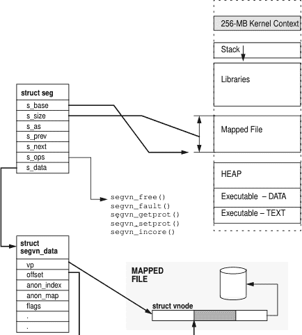

被访问的位置。一旦建立起硬件 MMU 映射，`seg_vn` 驱动程序就可以开始处理该段内的缺页。

在为文件建立了有效的硬件映射之后，我们可以来看一下映射文件是如何被实际读入地址空间的。硬件 MMU 可以针对该段内内存的访问产生陷阱。这些陷阱将通过 `as_fault()` 例程路由到我们的 `seg_vn` 驱动程序。（参见第 140 页的“地址空间中的缺页”。）当我们第一次访问段内的某个内存位置时，会调用 `seg_vn_fault()` 缺页处理例程。该故障处理器通过查看 `segvn_data` 结构，将我们的段识别为映射文件，然后直接调用 vnode 的文件系统（此处即使用 `ufs_getpage()`）从文件系统读入一个页大小的块。随后对由物理内存支持的内存的访问就只是一个正常的内存访问。直到页面被从段后面偷走（页面扫描程序可以做到这一点）时，才会再次发生缺页。

对映射文件的写入是通过更新映射段内的内存内容来完成的。文件不会立即更新，因为没有任何软件或硬件发起的事件来触发此类写入。当文件系统刷新守护进程发现内存页已被修改，然后通过文件系统的 `putpage` 例程（此处为 `ufs_putpage()`）将页面推送到文件系统时，更新才会发生。

### 5.4.1.2 共享映射文件

地址空间段架构使得两个或多个进程可以轻松地将同一个文件映射到它们的地址空间中。当我们将文件映射到两个或多个进程时，我们会在每个进程中创建指向同一个 vnode 的 `seg_vn` 段。每个进程都有自己对该文件的虚拟内存映射，但它们都共享该文件的相同物理内存页。第一个触发缺页的段将一个页读入物理内存，然后第二个及后续段只需创建对现有物理内存页的引用——即附加。

图 5.11 显示了两个进程如何映射同一个文件。每个进程创建自己的段对象，但两个段都指向同一个文件，并映射到相同的物理页。请注意，即使两个段都映射了文件的相同部分，第二个进程也不必将所有页都附加到段上。在这种情况下，第二个进程会在这些页被引用时才附加到它们。使用次缺页（minor fault）来描述这一事件。您可以使用 `vmstat` 查看次缺页。（参见第 242 页的“来自 vmstat 命令的统计信息”。）


有几个选项决定了文件在两个或多个进程之间映射时如何共享。这些选项控制更改如何在共享文件中传播。例如，如果一个进程想要修改映射到该进程的其中一个页，那么其他进程是应该看到完全相同的更改，还是该更改应保持为进行更改的进程所私有？这些选项允许我们选择所需的行为。这些选项就是文件映射时传递给 `mmap()` 的 `protection` 和 `flags` 参数。不同标志的行为如表 5-5 所示。

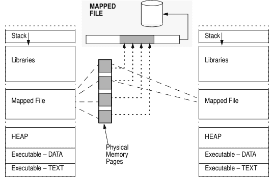

*图 5.11 共享映射文件*

*表 5-5 mmap 共享映射文件标志*

| 标志 | 保护模式 | 结果 |
|---|---|---|
| `MAP_SHARED` | `PROT_READ`<br>`PROT_WRITE` | 修改会反映到所有共享该映射的进程中。 |
| `MAP_PRIVATE` | `PROT_READ`<br>`PROT_WRITE` | 修改仅对映射该文件的进程可见。写时复制过程会创建一个匿名内存页，并为进程提供一份私有副本。 |

### 5.4.2 写时复制

当进程写入一个以 `MAP_PRIVATE` 映射的页面时，就会发生写时复制过程。此过程防止其他对该页面的映射看到所做的更改。`seg_vn` 通过将段的硬件 MMU 权限设置为只读，并将段权限设置为读写来实现写时复制。当进程尝试写入以这种方式配置的映射时，MMU 会生成异常，并在该页面上引起缺页故障。`seg_vn` 中的缺页故障处理程序会检查该段的保护模式；如果该段是私有映射且为读写，则处理程序会发起写时复制。

写时复制会取消映射发生故障的共享 vnode 页面，在该地址创建一个匿名内存页，然后将旧页面的内容复制到新的匿名页面。所有这些都发生在缺页故障的上下文中，因此进程永远不知道底层发生了什么。

写时复制操作在不同内存条件下表现略有不同。当内存不足时，写时复制不会创建新的物理内存页，而是从底层文件的偏移处窃取页面，并将其重新映射为新的匿名页面。这仅在空闲内存低于系统参数 `minfree` 时发生。

### 5.4.3 页面保护与建议

`seg_vn` 段支持对整个段或段内各个页面实施内存保护模式。整个段的保护由 `segvn_data` 结构体成员 `prot` 实现；其启用与否取决于 `segvn_data` 结构体中的布尔开关 `pageprot`。如果 `pageprot` 等于零，则整个段的保护模式由 `prot` 设置；否则，启用页面级保护。

页面级保护由 `vpage` 结构体指向的页面描述符数组实现，如下所示。如果启用了页面级保护，则 `vpage` 指向一个 vpage 结构体数组。地址空间中的每个 vpage 都有一个数组条目，这意味着 vpage 成员的数量等于段的虚拟地址大小除以段的基本页大小（在 UltraSPARC 上为 8 KB）。

```c
struct vpage {
        uchar_t nvp_prot;        /* see <sys/man.h> prot flags */
        uchar_t nvp_advice;      /* plock & <sys/mman.h> madvise flags */
};
```

**头文件** `<vm/vpage.h>`

每个页面的 `vpage` 条目使用表 5-5 中的标准内存保护位。逐页的 vpage 结构体也用于在 `seg_vn` 段中为内存映射文件实现内存建议。(参见第 513 页的“向内存系统提供建议”。)

## 5.5 匿名内存

在很多地方我们都提到了匿名内存。匿名内存指的是与 vnode 不直接关联的页面。这些页面用于进程的堆空间、栈以及写时复制页面。在 Solaris 内核中，有两个子系统专门用于管理匿名内存：`anon` 层和 `swapfile` 系统。

分配给进程堆的匿名内存是按需填零（ZFOD）操作的结果。ZFOD 操作是我们分配新页面的方式。当我们第一次访问一个内存地址时，就会发生 ZFOD，并在该地址动态分配一个新内存页。ZFOD 是用于堆空间和作为 `/dev/zero` 映射创建且具有 `MAP_PRIVATE` 段保护的段的分配方法。对这类段的缺页故障将被识别为 ZFOD，并在故障位置创建一个新的清零匿名内存页。`seg_vn` 段故障处理程序 `segvn_fault` 处理该故障并创建 ZFOD 页面。

`seg_vn` 段驱动程序通过调用匿名内存层的接口，将匿名映射附加到 `segvn_data` 结构体中的 `amp`（匿名映射指针）成员，从而为段分配匿名内存。图 5.12 显示了一个分配了匿名映射结构体的 `seg_vn` 段。

段中每一块已分配的页大小虚拟内存都会被分配一个匿名映射槽。例如，当段首次创建时，没有分配任何匿名映射槽，但第一次发生按需填零缺页故障时，就会为一个页面分配一个槽，该槽对应段内发生故障的地址。此时，一个物理页面被附加到该槽上。之后，页面可能会被窃取，不再与任何页面关联，但会留下一个空槽。

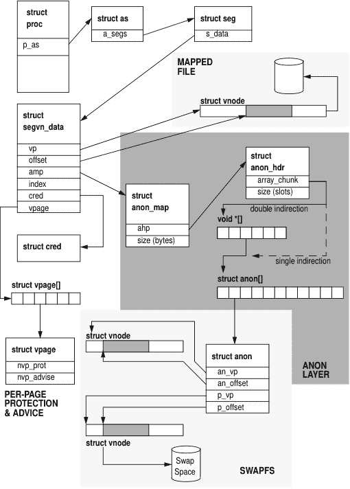

*图 5.12 匿名内存数据结构*

### 5.5.1 匿名内存层

匿名页面通过 `anon` 层的接口创建。当段第一次收到缺页故障时，它会分配一个 `anon` 映射结构体（该结构体描述了在哪里可以找到 `anon` 头），并将指向 `anon` 头的指针放入匿名映射的 `amp` 字段。然后，它分配一个槽数组，其大小足以容纳段中潜在页面的数量。槽数组要么是单重间接列表，要么是双重间接列表，具体取决于需要多少个槽。

32 位系统对于大于 16 MB 的段需要双重间接；64 位系统由于指针大小更大，对于大于 8 MB 的段需要双重间接。当我们使用单重间接时，`anon` 头的 `array_chunk` 直接引用 `anon` 槽数组。当我们使用双重间接时，数组被分成多个块：32 位系统为 2048 个槽块，64 位系统为 1024 个槽块。`array_chunk` 字段引用一个额外的指针数组，指向每个块。图 5.12 显示了单重和双重间接数组。此分配过程由 `anon` 层接口 `anon_create` 处理。`anon` 槽如下所示。

```c
struct anon {
        struct vnode *an_vp;    /* vnode of anon page */
        struct vnode *an_pvp;   /* vnode of physical backing store */
        anoff_t an_off;         /* offset of anon page */
        anoff_t an_poff;        /* offset in vnode */
        struct anon *an_hash;   /* hash table of anon slots */
        int an_refcnt;          /* # of people sharing slot */
};
```

**头文件** `<vm/anon.h>`

每个 `anon` 槽都指向一个 `anon` 结构体，该结构体描述了地址空间中与页大小区域对应的内存虚拟页面。SVR4 实现只是为每个槽提供一个页结构体，如果存在关联的物理页面，则指向该物理页面；如果内存中没有物理页面，则为 NULL。然而，Solaris 的实现有所不同。回想一下，所有物理页面都有一个 vnode 和偏移。Solaris 内核标识的物理页面指向分配给该页面的交换 vnode 和偏移。请注意，这不是分配的交换设备实际 vnode 和偏移；它是一个指向 `swapfs` 文件系统（我们稍后将讨论）的 vnode 和偏移。`anon` 结构体还包含 `swapfs` 感兴趣的其他信息的空间。

`anon` 层的函数按字母顺序列于表 5-6 中。

*表 5-6 anon 层函数*

| 函数 | 描述 |
|---|---|
| `anon_alloc()` | 分配一个 `anon` 槽，并在持有锁的情况下将其返回。 |
| `anon_copy_ptr()` | 将 `anon` 数组复制到给定的新 `anon` 数组中。 |
| `anon_create()` | 创建指针列表。 |
| `anon_decref()` | 递减一个 `anon` 页面的引用计数。如果引用计数变为零，则释放它及其关联页面（如果有）。 |
| `anon_dup()` | 复制对 `size` 字节大小的 `anon` 页面的引用。在复制包含私有 `anon` 页面的段时使用。 |
| `anon_free()` | 释放一组大小为 `size`（以字节为单位）的 `anon` 页面，并清除指向 `anon` 条目的指针。 |
| `anon_get_next_ptr()` | 从给定索引开始，返回 `anon` 列表中第一个有效条目的 `anon` 指针。 |
| `anon_getpage()` | 将保留的页面和保护返回给段驱动程序。 |
| `anon_get_ptr()` | 返回列表中指定 `anon` 索引的指针。 |
| `anon_pages()` | 返回范围内 `anon` 数组中现有 `anon` 页面的数量。 |


| `anon_private()` | 将对象或共享 anon 页面的引用转换为私有页面，并包含来自原页面的数据副本。 |
| `anon_release()` | 释放指针数组。 |
| `anon_resvmen()` | 保留 anon 空间。 |
| `anon_set_ptr()` | 为指定偏移设置带有给定指针的列表条目。 |
| `anon_unresv()` | 归还 anon 保留。 |
| `anon_zero()` | 分配一个私有填零的 anon 页面。 |
| `anonmap_alloc()` | 为段分配并初始化一个 anon 映射结构体，将给定的交换保留与新 anon 映射关联。 |
| `anonmap_free()` | 释放一个 anon 映射结构体。 |
| `anonmap_getpages()` | 在给定范围内，为空槽分配私有填零 anon 页面数组，并为非空槽分配页面槽。 |
| `non_anon()` | 如果数组有一些空槽，则返回 true。 |
| `set_anoninfo()` | 从时钟处理程序调用，以同步 ani_free 值。 |

### 5.5.2 swapfs 层

内存中的每个物理页面由其 vnode 和偏移标识。vnode 和偏移标识一个后备存储，它指示当页面不在物理内存中时到哪里查找该页面。对于常规文件，缓存该文件的物理页面的 vnode 和偏移就是该文件的 vnode 和偏移。交换空间被用作后备作为匿名内存页的后备存储，这样当内存不足时，我们可以将一个页面复制到磁盘并释放一页内存。

由于交换空间用作匿名内存的后备存储，我们需要确保有足够的交换空间来存放可能需要换出的页面。我们通过在创建由匿名内存支持的可写映射（用于堆空间、栈以及设置了 `MAP_PRIVATE` 的可写映射文件）时预先保留空间来实现这一点。

Solaris 内核允许我们在有足够内存容纳进程的虚拟内容时，无需保留物理交换空间即可分配匿名内存。这意味着在某些情况下，系统可以在很少或没有交换空间的情况下运行。

传统 Unix 实现中，每一页可写虚拟内存都需要一页大小的交换空间。例如，在传统 Unix 系统上，一个 8 MB 的 `malloc` 请求要求我们保留 8 MB 的交换磁盘空间，即使该空间从未被使用。这一要求导致了旧的规则：交换空间 = 2 × 内存大小——大致的假设是，进程的虚拟大小平均约为其消耗的物理页面的两倍。`swapfs` 层使 Solaris 可以更加保守；你只需要为大于机器可用可换页物理内存的那部分虚拟内存提供交换空间。

Solaris 交换实现使用 `swapfs` 来实现节省空间的交换分配。`swapfs` 文件系统是位于匿名层和物理交换设备之间的伪文件系统。`swapfs` 文件系统表现得好像页面背后有真实的交换空间，即使没有分配任何物理交换空间。

#### 5.5.2.1 交换分配

让我们先退一步，看看交换空间是如何分配的，并在整个过程中了解 `swapfs` 的实现。我们将段驱动程序视角下的交换空间称为 *虚拟交换空间*，而将真实的（磁盘或文件）交换空间称为 *物理交换空间*。

交换空间分配经历不同的阶段：保留（reserve）、分配（allocate）和换出（swap-out）。当我们首次创建段时，我们保留虚拟交换空间；当我们首次访问并分配页面时，我们为该页面“分配”虚拟交换空间；然后，如果出现内存短缺，我们可以将页面“换出”到交换空间。表 5-7 总结了交换状态。

**表 5-7 _交换空间分配状态_**

| 状态 | 描述 |
|---|---|
| 已保留 | 为整个段保留虚拟交换空间。当以私有/读/写访问权限创建段时进行保留。保留表示所创建区域的虚拟大小。 |
| 已分配 | 当第一个物理页分配给该虚拟交换空间时，即完成分配。此时，会针对匿名槽分配一个 `swapfs` vnode 和偏移量。 |
| 已换出（已用交换） | 当发生内存短缺时，页面扫描程序可能将页面换出。换出发生在页面扫描程序为相关页面调用 `swapfs_putpage` 时。该页面被迁移到物理（磁盘或文件）交换空间。 |

每次创建堆段时都会保留交换空间。保留的交换空间数量等于所创建段的整个大小。如果有可能创建匿名内存，也会保留交换空间。例如，以 `MAP_PRIVATE` 方式映射的映射文件段（如可执行数据段）会保留交换空间，因为它们在写时复制操作期间随时可能创建匿名内存。

我们预先保留虚拟交换空间，以便在请求时而非需要时进行交换空间分配。这样，交换空间不足的错误可以在系统调用期间同步报告。如果我们是在程序执行期间按需分配交换空间，而不是在调用 `malloc()` 时分配，那么可能会在执行期间耗尽交换空间，并且没有简单的方法来检测交换空间不足的情况。例如，在 Solaris 内核中，我们在发出 `malloc()` 内存请求时就使其失败，而不是等到以后需要时才失败，以防止进程在看似正常的执行过程中失败。（这种策略不同于 IBM AIX 等操作系统，后者采用惰性分配。如果资源在程序执行期间耗尽，则进程会收到一个 SIGDANGER 信号。）

`swapfs` 文件系统除了物理交换空间外，还将所有可用的可换页内存视为虚拟交换空间。这使我们可以在首次访问页面时“保留”虚拟交换空间并“分配”交换空间。当保留交换空间时，我们不是保留磁盘空间，而是从 `swapfs` 文件系统中保留虚拟交换空间。磁盘交换页只有在页面被换出时才会分配。

使用 `swapfs` 时，可用的虚拟交换空间量等于可用且未锁定的可换页物理内存量加上可用的物理（磁盘）交换空间量。如果我们在没有交换空间的情况下运行，那么我们就只能保留相当于系统上可用未锁定可换页物理内存量的虚拟内存。这本来没问题，但通常我们的虚拟内存需求大于物理内存需求，这种情况下，我们将无法使用系统上所有可用的物理内存。

例如，一个进程可能保留 100 MB 的内存，但只分配 10 MB 的物理内存。该进程的物理内存需求为 10 MB，但它必须保留 100 MB 的虚拟交换空间，因此使用了从可用真实内存中分配的 100 MB 虚拟交换空间。如果我们在 128 MB 的系统上运行这样的进程，可能只启动其中一个进程就会耗尽交换空间。如果我们通过添加磁盘交换设备来增加更多虚拟交换空间，那么我们就可以针对额外的空间进行保留，并在相同的物理内存中运行大约 10 个等效进程。

另一个虚拟内存需求大于物理内存需求的好例子是进程数据段。它以 `MAP_PRIVATE` 方式映射，这意味着我们需要为整个段保留虚拟交换空间，但只为段内写入的少数页面分配物理内存。所需的虚拟交换空间量远大于分配给的物理内存，因此如果需要将页面换出到交换设备，我们只需要少量物理交换空间。

如果我们有一个理想的进程，其所有虚拟内存都由物理内存支撑，那么我们可以不配置物理交换空间运行。通常，我们需要大约内存大小 0.5 到 1.5 倍的物理交换空间。当然，这取决于应用程序的虚拟内存与物理内存之比。

#### 5.5.2.2 swapfs 实现

`swapfs` 文件系统使用系统全局变量 `availmem` 来跟踪系统中可用的可换页物理内存，并将其加到可用交换空间总量中。当我们保留虚拟交换空间时，我们只是从池中减少可用的虚拟内存量。只要有足够的内存和物理交换空间可用，交换分配就会成功。直到稍后才会分配物理交换空间。

当我们创建私有段时，我们保留交换空间并分配匿名结构。在此阶段，除非发生 ZFOD 或写时复制（COW）而创建真实的内存页，否则不会发生其他操作。当物理页被调入时，它通过 vnode/offset 标识，对于匿名内存而言，该 vnode/offset 就是该页的虚拟交换设备。

当段驱动程序调用 `anon_alloc()` 获取新的匿名页时，Solaris 中的匿名页会被分配 `swapfs` vnode 和偏移量。`anon_alloc()` 函数通过 `swapfs_getvp()` 调用 `swapfs`，然后调用 `swapfs_getpage()` 创建一个带有 `swapfs` vnode/offset 的新页面。标识此页后备存储的匿名结构成员 `an_vp` 和 `an_offset` 会被初始化为引用 `swapfs` 虚拟交换设备内的 vnode 和偏移量。

图 5.13 显示了匿名槽如何指向 `swapfs`。在此阶段，我们仍然不需要任何物理交换空间——当段保留虚拟交换空间时，可用虚拟交换空间量已经减少——但由于我们还没有将页面换出到物理交换空间，因此没有分配物理交换空间。

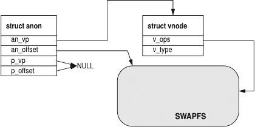

**图 5.13** *页输出之前初始化为虚拟交换的 anon 槽*

直到第一个页输出请求发生时——因为页面扫描器需要将页面推送到交换空间——才会分配真正的交换空间。此时，页面扫描器查找该页面的 vnode，然后调用其 `putpage()` 方法。该页面的 vnode 是一个 swapfs vnode，因此会调用 `swapfs_putpage()` 将该页面换出到交换设备。`swapfs_putpage()` 例程分配一个页面大小的物理交换块，然后在 anon 槽中设置物理 vnode 的 `p_vp` 和 `p_offset` 字段，使其指向物理交换设备。页面被推送到交换设备。此时，我们分配物理交换空间。图 5.14 显示了页面被换出后的 anon 槽。


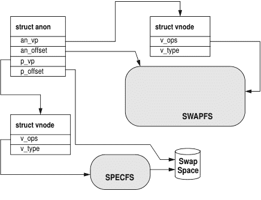

**图 5.14** *页输出发生后的物理交换*

当我们耗尽物理交换空间时，我们会直接忽略针对某个页面的 `putpage()` 请求，这会导致极难分析的内存性能问题。当物理交换空间填满时并不会发生故障；在预留期间，我们已确保有足够的可用虚拟交换空间，包括物理内存和物理交换空间。在这种情况下，`swapfs_putpage()` 只是将该页面留在内存中，而不会将页面推送到物理交换。这意味着一旦物理交换被 100% 分配，我们就开始有效地锁定物理内存中的剩余页面。因此，以 100% 物理交换分配率运行通常不是一个好主意（`swap -l` 显示 0 块空闲），因为我们可能开始在内存中锁定错误的页面，并且我们的工作集可能无法与真正想留在内存中的页面正确匹配。

### 5.5.3 匿名内存记账

系统中匿名内存的数量由 anon 记账结构记录。anon 层通过下面的 `k_anoninfo` 结构跟踪匿名页面的分配方式，该结构定义在头文件 `vm/anon.h` 中。

```c
struct k_anoninfo {
        pgcnt_t ani_max;          /* total reservable slots on phys disk swap */
        pgcnt_t ani_free;         /* # of unallocated phys and mem slots */
        pgcnt_t ani_phys_resv;    /* # of reserved phys (disk) slots */
        pgcnt_t ani_mem_resv;     /* # of reserved mem slots */
        pgcnt_t ani_locked_swap;  /* # of swap slots locked in reserved */
                                  /* mem swap */
};
```

**头文件** `<sys/anon.h>`

`k_anoninfo` 结构统计在物理交换空间和内存上预留的槽数量。该信息用于填充 `swapctl` 系统调用所使用的数据。`swapctl()` 系统调用为 `swap` 命令提供数据。`swap` 系统调用使用一个略有不同的数据结构，即 `anoninfo` 结构，如下所示。

```c
struct anoninfo {
        pgcnt_t ani_max;
        pgcnt_t ani_free;
        pgcnt_t ani_resv;
};
```

**头文件** `<sys/anon.h>`

`anoninfo` 结构以平台无关的方式导出交换分配信息。下面的 `swap` 命令输出汇总了来自 `anoninfo` 结构的信息。

```text
# swap -s
total: 108504k bytes allocated + 13688k reserved = 122192k used, 114880k available
```

`swap -s` 的输出可能有点误导，因为它混淆了用于交换定义的术语。实际上，该输出告诉我们：已使用 122,192 KB 的虚拟交换空间，其中 108,504 KB 的交换空间分配给已访问过的页面，114,880 KB 处于空闲状态。这些信息反映了交换分配的各个阶段，如图 5.15 所示。请记住，我们在创建虚拟内存时预留交换空间，然后当真实页面分配给地址空间时，一部分交换空间被分配。其余的交换空间保持未使用。


**图 5.15** *交换分配状态*

你可以使用 `MemTool 3.8.1` 中的 `prtswap` 脚本（参见第 245 页的“MemTool：非捆绑内存工具”）来列出交换状态并查看交换空间的分配来源，如下所示。如果只需要“交换分配”摘要，请使用 `prtswap` 命令。

```text
# prtswap -l
Swap Reservations:
------------------------------------------------------------
Total Virtual Swap Configured:                    767MB
RAM Swap Configured:                            + 255MB
Physical Swap Configured:                       + 512MB

Total Virtual Swap Reserved Against:              513MB
RAM Swap Reserved Against:                      -   1MB
Physical Swap Reserved Against:                 + 512MB

Total Virtual Swap Unresv. & Avail. for Reservation: 253MB
Physical Swap Unresv. & Avail. for Reservations:      0MB
RAM Swap Unresv. & Avail. for Reservations:       + 253MB

Swap Allocations: (Reserved and Phys pages allocated)
------------------------------------------------------------
Total Virtual Swap Configured:                    767MB
Total Virtual Swap Allocated Against:             467MB

Physical Swap Utilization: (pages swapped out)
------------------------------------------------------------
Physical Swap Free (should not be zero!):         232MB
Physical Swap Configured:                       + 512MB
Physical Swap Used (pages swapped out):          - 279MB
```

```text
# prtswap

Virtual Swap:
--------------------------------------------------------------
Total Virtual Swap Configured:                         767MB
Total Virtual Swap Reserved:                           513MB
Total Virtual Swap Free (programs will fail if 0)      253MB

Physical Swap Utilization: (pages swapped out)
--------------------------------------------------------------
Physical Swap Configured:                              512MB
Physical Swap Free (programs will be locked in if 0):  232MB
```

`prtswap` 脚本使用匿名记账结构成员来确定交换空间的分配方式，并使用 `availrmem` 计数器、`swapfsminfree` 预留量和 `swap -l` 命令来查明使用了多少交换空间。表 5-8 显示了内核中存储的匿名记账信息。

**表 5-8** *交换记账信息*

| 字段 | 描述 |
|---|---|
| `k_anoninfo.ani_max` | 物理（磁盘后备）交换上可预留槽的总数。 |
| `k_anoninfo.ani_phys_resv` | 物理（磁盘后备）预留槽的数量。 |
| `k_anoninfo.ani_mem_resv` | 内存预留槽的数量。 |
| `k_anoninfo.ani_free` | 未分配物理槽的总数 + 已预留但未分配的内存槽数量。 |
| `availrmem` | 未预留内存的数量。 |
| `swapfsminfree` | 不会用于内存预留的 `swapfs` 预留量。 |

## 5.6 虚拟内存监视点


Solaris 内核在地址空间内实现虚拟内存监视点。监视点类似于断点，不同之处在于：当某个地址位置被读取或修改时，监视点会停止执行；而断点则是在指定位置执行指令时停止执行。监视点还提供了通过监视点接口实现断点的能力。

你可以通过 `/proc` 文件系统接口设置和清除监视点：打开进程的控制文件，然后发送 `PCWATCH` 命令。`PCWATCH` 命令附带一个 `prwatch` 结构，其中包含地址、受影响区域的长度以及监视点类型。

```c
typedef struct prwatch {
        uintptr_t  pr_vaddr;   /* virtual address of watched area */
        size_t      pr_size;   /* size of watched area in bytes */
        int         pr_wflags; /* watch type flags */
} prwatch_t;
```

**头文件** `<sys/watchpoint.h>`

`pr_vaddr` 字段指定受控进程中要监视的内存区域的虚拟地址，`pr_size` 指定该区域的大小（以字节为单位），`pr_wflags` 以表 5-9 中标志的位掩码形式指定要监视的内存访问类型。

**表 5-9** *监视点标志*

| 标志 | 描述 |
|---|---|
| `WA_READ` | 读访问 |
| `WA_WRITE` | 写访问 |
| `WA_EXEC` | 执行访问 |
| `WA_TRAPAFTER` | 指令完成后陷入 |

如果 `pr_wflags` 非零，则为 `pr_vaddr` 和 `pr_size` 指定的虚拟地址范围建立一个受监视区域。如果 `pr_wflags` 为零，则清除从指定虚拟地址开始的先前建立的任何受监视区域；`pr_size` 被忽略。

当被跟踪进程中的某个 LWP 进行内存引用，且该引用至少覆盖受监视区域的一个字节，并且内存引用符合 `pr_wflags` 中的指定时，监视点被触发。当 LWP 触发监视点时，会产生监视点陷阱。如果正在跟踪 `FLGTRACE`，则 LWP 停止；否则，向它发送 `SIGTRAP` 信号。如果 `SIGTRAP` 正被跟踪且未被阻塞，则 LWP 停止。

监视点陷阱发生在指令完成之前，除非指定了 `WA_TRAPAFTER`，在这种情况下它发生在指令完成之后。如果陷阱发生在完成之前，则内存不会被修改。如果发生在完成之后，则内存会被修改（如果访问是写访问）。下面显示了一个建立监视点的最小示例。程序 cre-

为整数 `test` 所占用的字节创建读写访问的监视点。

```c
#include <sys/types.h>
#include <sys/fcntl.h>
#include <sys/procfs.h>

typedef struct {
        long cmd;
        prwatch_t prwatch;
} ctl_t;

main(int argc, char **argv)
{
        int ctlfd;
        ctl_t ctl;
        int test;

        if ((ctlfd = open("/proc/self/ctl", O_WRONLY)) < 0) {
                perror("open /proc");
                exit (1);
        }

        ctl.cmd = PCWATCH;
        ctl.prwatch.pr_vaddr = (uintptr_t)&test;
        ctl.prwatch.pr_size = sizeof(int);
        ctl.prwatch.pr_wflags = WA_READ|WA_WRITE;

        if (write(ctlfd, &ctl, sizeof (ctl)) != sizeof (ctl)) {
                perror("Set PCWATCH");
                exit (1);
        }

        test = 0;
}
```

当我们试图写入整数 `test` 时，会触发一个监视点，默认情况下，进程会进行核心转储。

```text
$ ./watchpoint
Trace/Breakpoint Trap (coredump)
```

`/proc` 进程信息文件 `prinfo` 包含与监视点陷阱相关的信息，可以读入 `struct pr_info` 结构。特别是，`si_addr` 字段包含触发监视点的内存引用的虚拟地址，`si_code` 字段包含 `TRAP_RWATCH`、`TRAP_WWATCH` 或 `TRAP_XWATCH` 之一，分别表示读、写或执行访问。`si_trapafter` 字段为零，除非对该监视区域设置了 `WA_TRAPAFTER`；非零表示当前指令并非导致监视点陷阱的指令。`si_pc` 字段包含导致陷阱的指令的虚拟地址。图 5.16 展示了监视点的数据结构。


## 5.7 全局页面管理

页面是 Solaris 内存管理子系统中物理内存的基本单位。在本节中，我们讨论页面如何组织、如何定位，以及空闲列表如何在系统内管理页面池。

### 5.7.1 页面——Solaris 内存的基本单位

物理内存被划分为页面。Solaris 内核中的每一个活动（非空闲）页面都有一个文件（vnode）与内存之间的映射关系；该页面可以用一个 vnode 指针和该页面在该 vnode 中的偏移量来标识。页面的标识就是其 vnode/偏移对。vnode/偏移对是页面的后备存储，表示该页面所映射的文件和偏移量。

硬件地址转换（HAT）和地址空间层管理物理页面与其虚拟地址空间之间的映射（更多内容见第 190 页的“硬件地址转换层”）。vnode/偏移对的关键属性是复用性；也就是说，我们可以在页面被复用之前，通过简单地将其在 RAM 中的内容与其后备存储（vnode 和偏移量）同步，从而将每个物理页面用于另一项任务。

例如，我们可以通过简单地将内容复制到其 vnode 和偏移量来复用进程中的堆内存页面，在这种情况下，这会将内容复制到交换设备。同样的机制也用于缓存文件，我们只需使用 vnode/偏移对来引用正在缓存的文件。如果我们复用的是正在缓存常规文件的内存页面，那么我们只需将该页面与其后备存储同步（如果页面已被修改），或者直接复用它（如果页面未修改，且不需要与其后备存储重新同步）。


**图 5.17** *页面结构*

### 5.7.2 页面哈希列表

VM 系统将具有标识（有效的 vnode/偏移对）的页面哈希到全局哈希列表上，以便可以通过 vnode 和偏移量定位它们。有三个页面函数会搜索全局页面哈希列表：`page_find()`、`page_lookup()` 和 `page_lookup_nowait()`。这些函数以 vnode 和偏移量为参数，如果找到，则返回指向页面结构的指针。

全局哈希列表是一个指向页面链表的指针数组。这些函数使用哈希作为 `page_hash` 数组的索引，以定位包含具有匹配 vnode/偏移对的页面的链表。图 5.18 显示了 `page_find()` 函数如何索引到 `page_hash` 数组以定位匹配给定 vnode/偏移量的页面。


**图 5.18** *通过 vnode/偏移标识定位页面*

`page_find()` 按如下方式定位页面：

1. 它使用下面显示的 `PAGE_HASH_FUNC` 宏计算 `page_hash` 数组中的槽位，该槽位包含潜在页面列表。

```c
#define PAGE_HASHSZ        page_hashsz
#define PAGE_HASHHLEVEL    4
#define PAGE_HASHSHIFT     6
#define PAGE_HASH_FUNC(vp, off) \
        ((((unsigned long long) (off) >> PAGE_HASHSHIFT) + \
          ((unsigned long long) (vp) >> PAGE_HASHSHIFT)) & \
          (PAGE_HASHSZ - 1))
```

**头文件** `<vm/page.h>`

2. 它使用下面显示的 `PAGE_HASH_SEARCH` 宏，搜索该槽位引用的链表，以查找匹配 vnode/偏移量的页面。该宏遍历页面链表，直到找到这样的页面。


```c
#define PAGE_HASH_SEARCH(index, pp, vp, off) \
        for (pp = page_hash[index]; (pp) != NULL; (pp) = (pp)->p_hash) \
                if ((pp)->p_vnode == (vp) && (pp)->p_offset == (off)) \
                        break;
```

**头文件** `<vm/page.h>`

### 5.7.3 MMU 相关的页面结构

定义的页面结构在不同平台上相同，因此不包含任何机器相关的结构。然而，我们确实需要保存关于每个页面的机器相关数据，例如描述页面如何被 MMU 映射的 HAT 信息。内核用机器相关的页面结构 `struct machpage` 包装机器无关的页面结构。机器相关页面结构的内容对通用内核隐藏——只有 HAT 机器相关层可以看到或操作其内容。图 5.19 显示了每个页面结构如何嵌入到机器相关的 `struct machpage` 中。


**图 5.19** *机器相关的页面结构：sun4u 示例*

机器相关的页面包含一个指向 HAT 特定映射信息的指针，关于页面 HAT 状态的信息存储在机器相关的 `machpage` 中。存储的信息包括指示页面是否已被引用或修改的位，供页面扫描器使用（本章稍后介绍）。机器无关和机器相关的页面结构在内存中共享相同的起始地址，因此指向页面结构的指针可以强制转换为指向机器相关页面结构的指针（见图 5.19）。用于在机器无关页面和机器相关页面结构之间转换的宏完成了这种强制转换。

### 5.7.4 物理页面列表

Solaris 内核使用一个分段的全局物理页面列表，由连续的物理内存段组成。（许多硬件平台现在以非连续组的形式呈现内存。）连续的物理内存段在系统启动期间被添加。当系统运行期间物理内存被添加和移除时，它们也会被动态地添加和删除。图 5.20 显示了物理页面列表排列成连续段的情况。


**图 5.20** *连续的物理内存段*

#### 5.7.4.1 空闲列表和缓存列表

空闲列表和缓存列表保存那些未映射到任何地址空间且已由 `page_free()` 释放的页面。这些列表的总和在 `vmstat` 的 *free* 列中报告。即使 `vmstat` 将这些页面报告为空闲，它们仍然可能包含来自 vnode/偏移量的有效页面，因此仍然是全局页面缓存的一部分。在页面缓存中缓存文件的页面可能出现在空闲列表上。缓存列表上的页面并不是真正空闲的，它是来自文件的页面的有效缓存。缓存列表体现了文件系统如何将内存用作文件系统缓存。

空闲列表包含不再关联 vnode 和偏移量的页面——这种情况只有在页面已被销毁并从 vnode 的哈希列表中移除时才会发生。空闲列表通常非常小，因为大多数不再被进程或内核使用的页面仍然保留其完整的 vnode/偏移信息。当进程退出时，页面会被放到空闲列表上，此时所有匿名内存页面（堆、栈和写时复制页面）都会被释放。

缓存列表是一个页面的哈希列表，这些页面仍然具有到有效 vnode 和偏移量的映射。回想一下，页面可以通过

`page_lookup()` 例程。该函数接受 vnode 和偏移量作为参数，并返回一个页面结构。如果在缓存列表上找到该页面，则将该页面从缓存列表中移除并返回给调用者。当我们从缓存列表中找到并移除页面时，我们就是在*回收*页面。页面回收由 `vmstat` 在“re”列中报告。

### 5.7.5 页级接口

Solaris 虚拟内存系统的实现已将页面管理和操作集中到一组核心函数中。段驱动程序和文件系统使用这些函数来创建、删除和修改页面。主要的页级接口如表 5-10 所示。

**表 5-10** *Solaris 7 页级接口*

| 方法 | 描述 |

|---|---|

| `page_create()` | 创建页面。页着色基于 vnode 偏移量的哈希值。提供 `page_create()` 仅为向后兼容。除非必要，否则不要使用它。应使用 `page_create_va()` 函数，以便正确地为页面着色。 |

| `page_create_va()` | 创建页面，同时考虑它们将被映射到的虚拟地址。该地址用于计算页着色。 |

| `page_exists()` | 测试是否存在对应于 vnode/offset 的页面。 |

| `page_find()` | 在哈希列表中搜索具有指定 vnode 和偏移量、已知存在且已被锁定的页面。 |

| `page_first()` | 在全局页面哈希列表中查找第一个页面。 |

| `page_free()` | 释放一个页面。具有 vnode/offset 的页面进入缓存列表；其他页面进入空闲列表。 |

| `page_isfree()` | 检查页面是否在空闲列表上。 |

| `page_ismod()` | 检查页面是否被修改。此函数仅检查页面结构中的软件位。要将 MMU 位与页面结构同步，可能需要在调用 `page_ismod()` 之前调用 `hat_pagesync()`。 |

| `page_isref()` | 检查页面是否被引用；仅检查页面结构中的软件位。要将 MMU 位与页面结构同步，可能需要在调用 `page_isref()` 之前调用 `hat_pagesync()`。 |

| `page_isshared()` | 检查页面是否在多个地址空间之间共享。 |

| `page_lookup()` | 查找表示指定 vnode/offset 的页面。如果在空闲列表上找到该页面，则将其从空闲列表中移除。 |

| `page_lookup_nowait()` | 查找表示指定 vnode/offset 且未锁定或不在空闲列表上的页面。 |

| `page_needfree()` | 通知 VM 系统我们需要释放一些页面。对 `page_needfree()` 的调用必须是对称的，也就是说，在任务完成后，必须紧接着另一次 `page_needfree()` 调用，其内存数量相同但乘以 -1。 |

| `page_next()` | 在全局页面哈希列表中查找下一个页面。 |

`page_create_va()` 函数分配页面。它以要分配的页面数量作为参数，并返回一个页面列表，其中链接了从空闲列表中取出的页面。`page_create_va()` 还以虚拟地址为参数，以便实现页着色（在第 174 页的 5.7.8 节“页着色”中讨论）。新的 `page_create_va()` 函数取代了旧的 `page_create()` 函数，所有新开发的子系统都应使用它，因为 `page_create()` 可能无法正确地为分配的页面着色。

### 5.7.6 页面节流

Solaris 实现了页面创建节流，以便保留一小块核心内存供内核关键部分使用。在 `page_create()` 和 `page_create_va()` 函数中实现的页面节流机制，在指定了 `PG_WAIT` 标志时（即可用内存少于系统全局变量 `throttlefree` 时）会阻塞页面创建。默认情况下，系统全局参数 `throttlefree` 被设置为与系统全局参数 `minfree` 相同的值。默认情况下，通过内核内存分配器分配的内存会指定 `PG_WAIT`，并受页面创建节流的限制。（有关内核内存分配的更多信息，请参见第 212 页的 6.2 节“内核内存分配”。）

### 5.7.7 页大小

Solaris 内核使用的基本页大小随底层硬件而变化。在 UltraSPARC 及更高版本中，基本页大小为 8KB。运行 Solaris 的硬件具有几种不同类型的内存管理单元，它们支持各种页大小，如表 5-11 所示。

**表 5-11** *不同 Sun 平台上的页大小*

| 系统类型 | 系统类型 | MMU 页大小能力 | Solaris 2.x 页大小 |

|---|---|---|---|

| 早期 SPARC 系统 | sun4c | 4K | 4K |

| microSPARC-I, -II | sun4m | 4K | 4K |

| SuperSPARC-I, -II | sun4m | 4K, 4M | 4K, 4M |

| UltraSPARC-I, -II | sun4u | 4K, 64K, 512K, 4M | 8K, 4M |

| Intel x86 架构 | i86pc | 4K, 4M | 4K, 4M |

最佳 MMU 页大小需要在性能与内存大小效率之间进行权衡。较大的页大小具有较少的内存管理开销，因而性能更好；但较小的页大小浪费的内存更少（当页面未被完全填满时，内存就被浪费了）。（有关大页面的更多信息，请参见第 200 页的“大页面”。）

### 5.7.8 页着色


处理器缓存中页面的组织方式会产生一些有趣的效应，因此，这些缓存中的页面放置策略会极大地影响处理器性能。当页面在缓存中与其他页面重叠时，它们可能会替换掉我们本不希望被覆盖的缓存数据，从而导致缓存利用率降低并产生“热点”。

缓存中页面的最佳放置通常取决于应用程序的内存访问模式；也就是说，应用程序是以随机顺序访问内存，还是进行某种步进的有序访问？Solaris 内核中可以选择几种不同的算法来实现页面放置；默认算法试图提供最佳的整体性能。

为了理解页面放置如何影响性能，让我们看看缓存配置，并了解何时会发生页面重叠和替换。UltraSPARC-I 和 -II 实现使用虚拟寻址的 L1 缓存和物理寻址的 L2 缓存。L2 缓存按 64 字节的行排列，与物理内存之间的传输以 64 字节为单位进行。第 194 页的图 5.27 显示了 UltraSPARC-I 和 -II CPU 模块及其缓存的架构。L1 缓存为 16KB，L2（外部）缓存可在 512KB 到 8MB 之间变化。我们可以使用 `adb` 查询操作系统，以查看报告给操作系统的缓存大小。L1 缓存大小记录在 `vac_size` 参数中，L2 缓存大小记录在 `ecache_size` 参数中。

```text
# adb -k
physmem 7a97
vac_size/D
vac_size:       16384
ecache_size/D
ecache_size:
ecache_size:    1048576
```

我们首先以 L2 缓存为例来说明页面放置如何影响性能。L2 缓存的物理寻址意味着缓存按物理地址空间的页面大小倍数进行组织，也就是说，缓存实际上只有有限数量的页对齐槽位。缓存中有效页槽位的数量等于缓存大小除以页大小。为简化示例，我们假设有一个 32KB 的 L2 缓存（远小于实际情况），这意味着如果页大小为 8KB，则 L2 缓存上有四个页大小的槽位。缓存不一定以 8KB 为单位读写内存；它是以 64 字节块进行的，所以实际上我们的 32KB 缓存有 1024 个地址槽位。图 5.21 展示了如果我们线性展开缓存时的样子。


图 5.21 *物理页到 64KB 物理缓存的映射*

L2 缓存是从物理内存直接映射的。如果我们访问位于 32KB 边界上的物理地址，例如偏移量 0 和 32768，那么这两个内存位置都会映射到同一条缓存行。如果我们现在访问这两个地址，就会导致偏移量 0 地址的缓存行被读取，然后被冲刷（清除）；偏移量 32768 地址的缓存行被读入，然后被冲刷；接着第一个缓存行再次被加载，如此反复。缓存中的这种乒乓效应称为缓存冲刷（或缓存乒乓），它实际上会把我们的性能降低到真实内存速度，而不是缓存速度。通过访问

在我们的32K字节缓存大小边界上，我们实际上只使用了缓存的64字节（一个缓存行大小），而不是整个缓存大小。内存通常比缓存慢10到20倍，因此会对性能产生巨大影响。

我们的简单示例基于这样的假设：我们以规则模式访问物理内存，但我们并不是针对物理内存编程，而是针对虚拟内存编程。因此，操作系统必须在虚拟内存和物理内存之间提供合理的映射；否则，就可能出现我们示例中的此类效应。

默认情况下，物理页按照它们在空闲列表中的顺序分配给地址空间。通常，机器首次启动时，空闲列表中的物理内存可能按线性顺序排列，我们最终可能会遇到上述“乒乓”示例中描述的行为。机器运行一段时间后，物理页空闲列表将变为随机顺序，相同应用程序的后续运行可能会得到非常不同的物理页布局，从而导致非常不同的性能。在早期的Solaris实现中，客户看到的正是这种情况——相同运行的不同性能，差异可达30%。

为了提供更好且一致的性能，Solaris内核在将页面分配至虚拟地址空间时使用页面着色算法。页面的分配并非随机进行，而是在其映射到的虚拟地址与其底层物理地址之间建立特定的预定关系。虚拟到物理的预定关系如下：物理页空闲列表被组织为特定颜色的箱子，物理缓存中的每个槽位对应一个颜色箱；颜色箱的数量由`ecache`大小除以页面大小决定。（在我们的示例中，恰好有四个颜色箱。）

当页面被放入空闲列表时，`page_free()`算法会将其分配给一个颜色箱。当从空闲列表消耗页面时，虚拟到物理算法会从物理颜色箱中取出页面，该颜色箱根据页面将要映射到的虚拟地址来选择。该算法要求在从空闲列表分配页面时，页面创建函数必须知道页面将要映射到的虚拟地址。

新页面通过调用`page_create_va()`函数分配。`page_create_va()`函数接受页面将要映射到的位置的虚拟地址作为参数；然后，虚拟到物理颜色箱算法就可以决定从哪个颜色箱中获取物理页。`page_create_va()`函数与页面管理函数一起在第204页的表5-10中描述。

> **注意：** `page_create_va()`函数弃用了旧的`page_create()`函数。我们选择添加新函数，而不是向现有的`page_create()`函数添加额外参数，以便调用`page_create()`的现有第三方可加载内核模块仍能正常工作。然而，由于`page_create()`不了解虚拟地址，它必须随机选择颜色——这可能导致显著的性能下降。新代码应始终使用`page_create_va()`函数。

没有一种算法适合所有应用程序，因为不同的应用程序具有不同的内存访问模式。随着时间的推移，Solaris内核中使用的页面着色算法已通过大量模拟、基准测试和客户反馈得到改进。内核支持一个默认算法和两个可选算法。默认算法是根据以下标准选择的：

- 相当一致、可重复的结果
- 对大多数应用具有良好的整体性能
- 在广泛的应用程序中具有可接受的性能

默认算法使用哈希算法将页面尽可能均匀地分布在整个缓存中。默认算法和其他三种可用的页面着色算法见表5-12。

**表5-12** *Solaris页面着色算法*

| 编号 | 名称 | 描述 | 2.5.1 | 2.6 | 7 |
|---|---|---|---|---|---|
| 0 | 哈希VA | 物理页面颜色箱基于哈希算法选择，以确保虚拟地址在缓存中的均匀分布。 | 默认 | 默认 | 默认 |
| 1 | 物理地址 = 虚拟地址 | 选择物理页面颜色，使得物理地址直接映射到虚拟地址（如我们的示例所示）。 | 是 | 是 | 是 |
| 2 | 箱跳跃 | 物理页以循环方式分配。 | 是 | 是 | 是 |
| 6 | Kessler最佳箱 | Kessler最佳箱算法。保存每个进程使用过的颜色的历史，并选择使用最少的颜色；如果多个，则使用最大的箱。 | 仅E10000（默认） | 仅E10000（默认） | 不可用 |

Ultra Enterprise 10000有一个不同的默认算法，它试图为每个进程的地址空间均匀分配颜色，使得没有任何一种颜色比其他颜色使用得更多。这种算法在大多数情况下是正确的，但在某些情况下，哈希或直接（0或1）算法可能会更好。

您可以通过设置系统参数`consistent_coloring`来更改默认算法，可以使用`adb`即时更改，也可以在`/etc/system`中永久更改。

```text
# adb -kw
physmem 7a97
consistent_coloring/D
consistent_coloring:
consistent_coloring:        0
consistent_coloring/W 1
consistent_coloring:        0x0        =        0x1
```

那么，哪种算法最好呢？嗯，结果会因应用程序而异。页面着色通常只对内存密集型科学应用产生影响，而默认设置通常适用于商业或数据库系统。如果您有一个对时间要求严格的科学应用，那么我们建议您尝试不同的算法，看看哪种最好。请记住，某些算法每次运行会产生不同的结果，因此请尽可能多地汇总运行结果。

## 5.8 页面扫描器

页面扫描器是管理系统范围内物理内存的内存管理守护进程。页面扫描器和虚拟内存缺页机制是用于管理Solaris内存的按需分页内存分配系统的核心。当内存不足时，页面扫描器会运行，通过占用最近未使用的页面、将它们与后备存储同步（如果是匿名页面，则与交换空间同步）并释放它们，从地址空间中回收内存。如果地址空间再次需要已换出的虚拟内存，那么当引用该虚拟地址时会发生内存缺页，页面会从后备存储中重新创建并复制回来。

页面回收与缺页之间的平衡决定了虚拟内存的哪些部分将由实际物理内存支持，哪些部分将被移出到交换空间。页面扫描器不了解内存使用模式或进程的工作集；它只了解基于物理页的逐页引用信息。这种策略通常被称为*全局页面替换*；另一种基于进程的页面管理则被称为*局部页面替换*。

回收哪些页面的微妙之处决定了内存分配策略，并可能以不同方式影响不同的工作负载。在Solaris内核的生命周期中，内存替换策略只发生了两次重大变化：

- 增强功能，以最大限度地减少从广泛共享的库和可执行文件中回收页面
- 优先级分页，以防止在内存充足的系统上对应用程序、共享库和可执行文件进行分页

在描述页面扫描器实现时，我们将更详细地讨论这些变化。

### 5.8.1 页面扫描器操作


页面扫描器通过从硬件 `MMU` 读取每个页面的逐页硬件位来跟踪页面使用情况。每个页面保留两个位；它们指示自这些位上次被清除以来页面是否已被修改或引用。页面扫描器将这些位作为基本数据，以确定哪些内存页面最近被使用过，哪些没有。

页面扫描器是一个内核线程，当空闲页列表上的内存量低于系统阈值（通常是总物理内存的1/64）时被唤醒。页面扫描器按物理页顺序扫描页面，寻找最近未被使用的页面，将其换出到交换设备并释放。确定页面是否被使用过的算法类似于钟面，称为双手钟算法。该算法将整个物理页列表视为一个循环列表，其中最后一个物理页

页面环绕回开头。两只指针遍历物理页面列表，如图 5.22 所示。


图 5.22 双指针时钟算法

两只指针——前指针和后指针——按页面顺序顺时针绕列表旋转。前指针领先于后指针旋转，清除每个页面的引用位和修改位。随后，落后的后指针会在稍后检查引用位和修改位。未被引用或修改的页面会被换出并释放。指针绕页面列表旋转的速率由系统空闲内存量控制，而前指针与后指针之间的间隔由启动参数 `handspreadpages` 固定。

## 5.8.2 换页算法与参数

换页算法由多个参数控制，其中一些参数在系统启动时根据系统内存量计算，另一些则根据内存分配和换页活动动态计算。

控制时钟指针的参数有两项作用：控制扫描器扫描页面的速率，以及控制前指针与后指针之间的时间（或距离）。后指针与前指针之间的距离为 `handspreadpages`，以页面数表示。前指针与后指针之间的最大距离默认为内存的一半，上限为 8192 页，即 64 Mbytes。内存为 128 Mbytes 或以上的系统始终将此距离默认为 8192 页，即 64 Mbytes。

### 5.8.2.1 扫描速率参数（假设无优先级换页）

当空闲内存低于 `lotsfree` 页数加上一个小缓冲区因子 `deficit` 时，扫描器开始扫描。此时扫描器以 `slowscan` 页/秒的速率开始扫描，并随着空闲内存接近零而加快速度。系统参数 `lotsfree` 在启动时计算为内存的 1/64，参数 `deficit` 要么为零，要么为少量页数——由页面分配器在大内存分配时设置，让扫描器在 `lotsfree` 之上额外释放几页，以预见更多内存请求。


图 5.23 页面扫描器速率，按空闲页数插值

图 5.23 显示，当空闲内存在 `lotsfree` 和零之间下降时，扫描器的扫描速率线性增加。当内存降至 `lotsfree` 以下时，扫描器以 `slowscan` 设置的最小速率开始扫描，然后如果内存降得足够低，则增加到 `fastscan`。

扫描的页面数从最慢速率（当空闲页数为 `lotsfree` 时由 `slowscan` 设置）增加到由系统参数 `fastscan` 确定的最大值。空闲内存实际上永远不会达到零，但为简化起见，算法在空闲内存介于 `lotsfree` 和零之间时计算最大插值速率。在我们拥有 1 Gbyte 物理内存的示例系统中（如图 5.24 第 185 页所示），可以看到当空闲内存降至 16 Mbytes 加上短期内存赤字时，扫描器开始扫描。对于此示例，我们假设赤字为零。当空闲内存降至 16 Mbytes 时，扫描器将唤醒并开始每秒检查 100 个页面，这符合系统参数 `slowscan`。在 Solaris 系统中，`slowscan` 参数默认为 100，而 `fastscan` 设置为总物理内存/2，上限为每秒 8192 页。如果空闲内存降至 12 Mbytes（1536 页），扫描器将以更高速率扫描，这符合下面等式所示的页面扫描器插值：

$$\mathit{scanrate}=\left(\frac{\mathit{lotsfree}-\mathit{freememory}}{\mathit{lotsfree}}\times\mathit{fastscan}\right)+\left(\mathit{slowscan}\times\frac{\mathit{freemem}}{\mathit{lotsfree}}\right)$$

如果我们将空闲内存和 `lotsfree` 转换为页数（12 Mbytes 的空闲内存为 1536 页，`lotsfree` 设置为 16 Mbytes，即 2048 页），那么我们将以每秒 2123 页的速率扫描。

$$\mathit{scanrate}=\left(\frac{2048-1536}{2048}\times8192\right)+\left(100\times\frac{1536}{2048}\right)=2123$$

默认情况下，当内存短缺时，扫描器每秒运行四次。如果空闲内存量低于系统参数 `desfree`，扫描器将在每个时钟周期运行，或者默认每秒运行 100 次。这种方案帮助扫描器尽量在空闲列表中至少保留 `desfree` 页。

### 5.8.2.2 非最近使用时间

前指针与后指针之间的时间根据它们之间的页面数以及扫描器的扫描速率而变化。前指针清除引用位与后指针检查引用位之间的时间是一个影响扫描器行为的重要因素，因为它控制了一个页面在被页扫描器可能窃取之前可以保持不被触碰的时间。引用位被清除和被检查之间的时间短，意味着除最活跃页面外的所有页面都保持完好；时间长意味着只有大部分未使用的页面被窃取。理想行为是后者，因为我们希望只窃取最近最少使用的页面，这意味着我们希望前指针与后指针之间有较长的时间。

引用位清除与检查之间的时间可以从几秒到几小时不等，具体取决于扫描速率。如今繁忙系统上的扫描速率通常可以达到每秒数千页，这意味着前指针与后指针之间存在非常短的时间。例如，一个扫描速率为每秒 2000 页且默认指针间隔为 8192 页的系统，其清除/检查时间仅为 4 秒。由于文件系统引起的内存压力，系统上的高扫描速率相当正常。（我们将在第 608 页“所有这些换页对我的系统有害吗？”中进一步讨论此主题。）

## 5.8.3 共享库优化

对页扫描器进行的一项微妙优化可防止它从广泛共享的库中窃取页面。页扫描器会检查每个页面的共享引用计数；如果页面被共享超过一定数量，则在页面扫描操作期间跳过该页面。内部参数 `po_share` 设置页面在被跳过之前可拥有的共享数量阈值。如果页面的映射数超过 `po_share`（即，被超过 `po_share` 个进程共享），则跳过该页面。默认情况下，`po_share` 从 8 开始；每次绕时钟扫描时递减，除非扫描未找到任何可释放的页面，此时 `po_share` 递增。`po_share` 参数可以在 8 到 134217728 之间浮动。

## 5.8.4 优先级换页算法

Solaris 7 附带了一个新的可选换页算法——一种页面窃取算法，可为使用文件系统的系统带来更好的系统响应和吞吐量。该算法也可用于较旧的 Solaris 版本（从 2.5.1 开始），只需添加内核补丁即可。您可以通过在 `/etc/system` 中将 `priority_paging` 变量设置为 1 来启用新算法。

```
/*
 * 启用优先级换页算法
 */
set priority_paging = 1
```

引入新算法是为了克服文件系统引起的内存压力所导致的不良行为。早在 SunOS 4.0 中，当虚拟内存系统被重写时，文件系统缓存和虚拟内存系统被集成，使整个内存系统可以用作文件系统缓存；也就是说，文件系统使用空闲内存池中的内存页，就像进程请求内存时所做的那样。

按需换页算法允许文件系统缓存根据需要动态增长和收缩，方法是窃取其他子系统最近未使用的页面。然而，在完成这项工作的当时，文件系统的内存压力相对较低，系统上进程的内存请求也是如此。两者都处于每秒数十到数百页的量级，因此内存分配可以基于谁使用页面最多。当进程频繁访问其内存页时，扫描器偏向于从文件系统窃取，文件系统缓存将相应收缩。

如今，系统能够承受更高的 I/O 速率，这意味着文件系统可以对内存系统施加巨大的内存压力——以至于文件系统的内存压力会导致页面扫描器窃取大量进程页面，从而完全破坏应用程序性能。

我们倾向于将早期的 SunOS 4.0 案例比作一座精密平衡的天平：进程请求和文件系统请求分别位于天平两侧，保持合理平衡。但在今天的系统中，由于通过文件系统进行 I/O 需要极高的分页速率，天平完全偏向文件系统一侧。例如，即使是一个小型系统也可能每秒执行 20 兆字节的 I/O，这会使文件系统每秒使用 2,560 个页面。为了跟上这一请求，扫描器必须以至少此速率扫描，通常还会更高，因为扫描器不会回收它找到的每个页面。这通常意味着扫描速率要达到 3,000 或更高，仅仅为了执行一些常规 I/O。

如前所述，当我们以这种速率扫描时，从清除引用位到检查活动之间的时间仅有几秒钟。因此，我们会回收最近几秒内未被使用的进程内存。明显的影响是：当我们开始使用文件系统进行大量 I/O 且空闲内存低于 `lotsfree` 时，一切似乎都陷入停滞。需要注意的是，即使系统内存充足，也可能出现这种影响——增加更多内存并不会使情况好转。


为了克服这种影响，页面扫描器采用了一种新算法，对进程的页面（即堆、栈、共享库和可执行文件）赋予更高优先级。该算法仅在内存充足时允许扫描器回收文件系统缓存页，因而只有在真正内存短缺时才会回收应用程序页面。

新算法引入了一个新的分页参数 `cachefree`。当空闲内存量位于 `cachefree` 和 `lotsfree` 之间时，页面扫描器仅回收文件系统缓存页。此外，扫描器现在会在内存低于 `cachefree` 而非低于 `lotsfree` 时唤醒，并且扫描速率算法也相应改变。

$$\mathit{scanrate}=\left(\frac{\mathit{cachefree}-\mathit{freemem}}{\mathit{cachefree}}\times\mathit{fastscan}\right)+\left(\mathit{slowscan}\times\frac{\mathit{freemem}}{\mathit{cachefree}}\right)$$

现在，扫描速率在 `cachefree` 和零之间插值，而不是在 `lotsfree` 和零之间插值，如图 5.24 所示。


**图 5.24** *使用优先级分页算法的扫描速率插值*

当内存位于 `cachefree` 和 `lotsfree` 之间时，该算法仅对文件系统缓存进行分页，方法是跳过与交换设备关联的页面（堆、栈、写时复制页面），并跳过映射到具有执行权限的地址空间中的文件页面（二进制文件、共享库）。

这个新算法没有副作用，在 Solaris 7 及更早版本上应始终启用。（注意：该算法在 Solaris 8 中已被新的缓存架构取代，因此不应在 Solaris 8 上启用优先级分页。）在 Solaris 7 中未默认启用，只是因为该算法在 Solaris 发布周期的很晚阶段才引入。

### 5.8.4.1 页面扫描器 CPU 利用率限制

对扫描速率进行 CPU 利用率限制，可防止换页守护进程占用过多处理器时间。两个内部限制控制着扫描器应使用的期望和最大 CPU 时间。参数 `min_percent_cpu` 和 `max_percent_cpu` 控制扫描器可以使用的 CPU 量。与扫描速率一样，任意给定时间实际可使用的 CPU 量根据空闲内存量进行插值。当空闲内存处于 `lotsfree`（启用优先级分页时为 `cachefree`）时，该值从 `min_percent_cpu` 开始，到空闲内存降至零时为 `max_percent_cpu`。`min_percent_cpu` 和 `max_percent_cpu` 的默认值分别为单个 CPU 的 4% 和 80%（扫描器为单线程）。

### 5.8.4.2 限制换出页面的参数

另一个参数 `maxpgio` 限制了 I/O 排队到交换设备的速率。它被设置得较低，以防止交换设备饱和。该参数在 sun4c、sun4m 和 sun4u 架构上默认为每秒 40 次 I/O，在 sun4d 架构上默认为每秒 60 次 I/O。默认设置对于现代系统往往不够，应设置为交换磁盘轴数量的 100 倍。

由于换页守护进程也会换出其扫描期间发现的脏文件系统页，该参数也可能间接限制文件系统吞吐量。文件系统 I/O 请求通常由用户进程排队和写入，因此不受 `maxpgio` 的限制。但是，当存在大量文件系统写入活动且内存中有许多脏文件系统页时，换页扫描器会碰到这些页面并将这些 I/O 排队；因此，`maxpgio` 限制有时会影响文件系统吞吐量。更多建议请参阅内存参数附录。

### 5.8.4.3 页面扫描器参数汇总

表 5-13 描述了在当前 Solaris 和补丁版本中控制换页过程的参数。

**表 5-13** *页面扫描器参数*

| 参数 | 描述 | 最小值 | 2.7 默认值 |
|---|---|---|---|
| `cachefree` | 如果空闲内存低于 `cachefree`，则换页扫描器以每秒 `slowscan` 页的扫描速率每秒启动 4 次。仅回收并释放文件系统页面。<br><br>`cachefree` 参数由 `priority_paging` 参数间接设置。当 `priority_paging` 设置为 1 时，`cachefree` 在启动期间自动设置为 `lotsfree` 值的两倍。 | `lotsfree` | `lotsfree` 或 2 x `lotsfree`（启用优先级分页时） |
| `lotsfree` | 当空闲内存低于 `lotsfree` 时，扫描器开始回收匿名内存页。 | 512K | 内存大小的 1/64 |
| `desfree` | 如果空闲内存低于 `desfree`，则换页扫描器每秒启动 100 次。 | `minfree` | `lotsfree/2` |
| `minfree` | 如果空闲内存低于 `minfree`，则每次创建新页面时都会通知页面扫描器启动。 |  | `desfree/2` |
| `throttlefree` | `page_create` 例程让调用者等待可用空闲页面的页面数。 | — | `minfree` |
| `fastscan` | 当空闲内存 = `minfree` 时，每秒扫描的页面速率。以页面数为单位。 | `slowscan` | 64 MB/s 与内存大小 1/2 中的较小值 |
| `slowscan` | 当空闲内存 = `lotsfree` 时，每秒扫描的页面速率。 | — | 100 |
| `maxpgio` | 交换设备每秒可处理的最大页面数的限制。 | ~60 | 60 或 90 页/秒 |
| `handspreadpages` | 前手清除引用位与后手检查引用位之间的页面数。 | 1 | `fastscan` |

### 5.8.5 页面扫描器实现

页面扫描器由两个内核线程实现，这两个线程都使用进程号 2“pageout”。一个线程扫描页面，另一个线程将排队等待 I/O 的脏页面推送到交换设备。此外，当内存不足时，内核 callout 机制会唤醒页面扫描器线程。（内核 callout 调度机制详见第 47 页的 2.5 节“内核 Callout 表”。）

扫描器的 `schedpaging()` 函数由放置在 callout 表中的 callout 每秒调用四次。`schedpaging()` 函数检查空闲内存是否低于阈值（`lotsfree` 或 `cachefree`），如有必要，准备触发扫描器线程。页面扫描器不仅由 callout 线程唤醒，如果内存低于 `minfree`，还会由 `clock()` 线程触发；如果内存低于 `throttlefree`，则由页面分配器触发。

图 5.25 说明了页面扫描器的工作原理。


**图 5.25** *页面扫描器架构*

调用时，`schedpaging()` 例程为页面扫描器线程计算两个设置参数：要扫描的页面数以及扫描器线程在执行扫描时可以消耗的 CPU 滴答数。页面数和 CPU 滴答数根据第 180 页“扫描速率参数（假设无优先级分页）”和第 185 页“页面扫描器 CPU 利用率限制”中的公式计算。一旦计算出扫描参数，`schedpaging()` 通过条件变量唤醒触发页面扫描器。

页面扫描器线程循环遍历物理页面列表，每次被唤醒时按请求的页面数前进。前手和后手各有一个页面指针。前手首先递增，以便清除前手当前所指向页面的引用位和修改位。然后递增后手，由 `check_page()` 函数检查后手所指向页面的状态。此时，如果页面已被修改，则将其放入脏页面队列，由换出线程处理。如果页面未被引用（它是干净的！），则直接释放。

脏页面被放入队列，以便一个单独的线程（换出线程）可以将它们写回其后备存储。我们使用另一个线程，以便

当系统在等待换出一个页面时，不会发生死锁。页面换出线程使用预先初始化的异步缓冲区头列表作为 I/O 请求的队列。该列表初始化为 256 个条目，这意味着队列最多可以容纳 256 个条目。列表上预配置的条目数由 `async_request_size` 系统参数控制。如果整个队列已满（256 个条目），或者已排队页面的速率超过了 `maxpgio` 参数设置的系统最大值，则将更多 I/O 排入队列的请求将被阻塞。

页面换出线程只是从队列中移除 I/O 条目，并通过针对相关页面调用 `vnode_putpage()` 函数来发起该 I/O。在 Solaris 内核中，此函数调用 `swapfs_putpage()` 函数，通过 swapfs 层发起交换页面换出。swapfs 层会延迟并汇集页面（在 sun4u 上为 16 个页面），然后将它们一起写出。集群大小参数控制 swapfs 将聚集的页面数量；默认值见表 5-14。（参见第 156 页的“swapfs 层”。）

**表 5-14** *swapfs 集群大小*

| 平台 | 集群页面数（由 `klustsize` 设置） |
|---|---|
| sun4u | 16（128k） |


| sun4m | 31（124k） |
| sun4d | 31（124k） |
| sun4c | 31（124k） |
| i86 | 14（56k） |

## 5.8.6 内存调度器

除了页面换出过程之外，CPU 调度器/分派器还可以换出整个进程以节省内存。此操作与页面换出是分开的。换出进程涉及从内存中移除进程的所有线程结构和私有页面，并在进程表中设置标志以指示该进程已被换出。这是一种节省内存的廉价方法，但它会极大地影响进程的性能，因此仅在分页无法持续释放足够内存时才使用。

内存调度器在引导时启动，除非内存持续低于期望的空闲内存（30 秒平均值），否则不执行任何操作。此时，内存调度器开始寻找可以完全换出的进程。如果内存短缺很小，内存调度器将软换出进程；如果内存短缺较大，则将硬换出进程。

### 5.8.6.1 软换出

当 30 秒空闲内存平均值低于 `desfree` 时，就会发生软换出。然后，内存调度器会查找至少 `maxslp` 秒处于不活跃状态的进程。当内存调度器找到一个已休眠 `maxslp` 秒的进程时，它会换出每个线程的线程结构，然后将该进程的所有私有内存页面换出。

### 5.8.6.2 硬换出

当以下所有条件都成立时，会发生硬换出：

- 运行队列上至少有两个进程在等待 CPU。
- 30 秒内的平均空闲内存持续低于 `desfree`。
- 正在进行过度分页（如果页换出 + 页换入 > `maxpgio`，则判定为过度分页）。

当调用硬换出时，会使用一种更激进的方法来查找内存。首先，请求内核卸载所有当前不活跃的模块和缓存内存，然后依次换出进程，直到恢复所需数量的空闲内存。影响内存调度器的参数见表 5-15。

**表 5-15 — 内存调度器参数**

| 参数 | 对内存调度器的影响 |
|---|---|
| `desfree` | 如果平均空闲内存量在 30 秒内低于 `desfree`，则会调用内存调度器。 |
| `maxslp` | 软换出时，内存调度器会开始换出已休眠至少 `maxslp` 秒的进程。`maxslp` 的默认值为 20 秒，并且是可调的。 |
| `maxpgio` | 当运行队列大于 2、空闲内存低于 `desfree`，且分页速率大于 `maxpgio` 时，就会发生硬换出，卸载内核模块和进程内存。 |

## 5.9 硬件地址转换层

硬件地址转换（HAT）层控制管理虚拟内存到物理内存映射的硬件。HAT 层提供了实现虚拟内存与物理内存之间映射创建和销毁的接口，并提供了一组用于探测和控制 MMU 的接口。HAT 层还实现所有底层陷阱处理程序，以管理缺页故障和内存异常。图 5.26 显示了 HAT 层各元素之间的逻辑分界。

**图 5.26** *HAT 层在虚拟到物理转换中的作用*


每种硬件 MMU 类型的 HAT 实现都不同，因此存在多种不同的 HAT 实现。HAT 层隐藏了平台特定的实现，段驱动程序使用它来实现段驱动程序对虚拟到物理转换的视图。HAT 使用 `struct hat` 数据结构来保存地址空间的顶层转换信息。`hat` 结构是平台特定的，并由地址空间结构引用（参见第 137 页的图 5.7）。每个页面中存在的 HAT 特定数据结构表示页面级别的转换信息。

当段驱动程序想要操作硬件 MMU 时，会调用 HAT 层。例如，当段驱动程序想要创建或销毁地址空间映射时，它会调用 HAT 函数，并指定地址范围和要采取的操作。我们可以在不了解底层 MMU 实现的情况下调用 HAT 函数；HAT 函数的参数与机器无关，通常由虚拟地址、长度、页面指针和保护模式组成。

表 5-16 总结了 HAT 函数。

**表 5-16** *与机器无关的 HAT 函数*

| 函数 | 描述 |
|---|---|
| `hat_alloc()` | 在地址空间中分配一个 HAT 结构。 |
| `hat_chgattr()` | 更改所提供虚拟地址范围的保护属性。 |
| `hat_clrattr()` | 清除所提供虚拟地址范围的保护属性。 |
| `hat_free_end()` | 通知 HAT 层一个进程已退出。 |
| `hat_free_start()` | 通知 HAT 层一个进程正在退出。 |
| `hat_get_mapped_size()` | 返回具有有效映射的字节数。 |
| `hat_getattr()` | 获取所提供虚拟地址范围的保护属性。 |
| `hat_memload()` | 在所提供的虚拟地址处为所提供的页面创建映射。用于创建映射。 |
| `hat_setattr()` | 设置所提供虚拟地址范围的保护属性。 |
| `hat_stats_disable()` | 停止收集地址空间的统计信息。 |
| `hat_stats_enable()` | 开始收集地址空间的页面引用和修改统计信息。 |
| `hat_swapin()` | 为即将换入的进程分配资源。 |
| `hat_swapout()` | 为即将换出的进程分配资源。 |
| `hat_sync()` | 将 `struct page` 软件引用和修改位与硬件 MMU 同步。 |
| `hat_unload()` | 卸载给定地址处给定页面的映射。 |

### 5.9.1 虚拟内存上下文与地址空间

虚拟内存上下文是一组将地址空间映射起来的虚拟到物理转换。当调度器想要将执行从一个进程切换到另一个进程，或发生从用户模式到内核模式的陷阱或中断时，我们会更改虚拟内存上下文。Solaris 内核始终使用虚拟内存上下文零来表示内核上下文。特定于机器的 HAT 层实现了创建、删除和切换虚拟内存上下文所需的函数。不同的硬件 MMU 支持不同数量的并发虚拟内存上下文。

当并发地址空间（进程）的数量超过硬件支持的并发上下文数量时，内核必须在上下文切换时从对等进程中窃取上下文。从其他地址空间窃取上下文会对性能产生间接影响。然而，这个问题仅在较旧的系统上才需要关注，例如 SPARCstation 1 和 2。

#### 5.9.1.1 硬件地址转换加速

硬件MMU通过查找页转换表中的条目，将虚拟地址转换为物理地址。Solaris 运行的所有平台都拥有一个近期转换的硬件缓存，称为转换后备缓冲区（TLB）。在 SPARC 系统上，TLB 中的条目数通常为 64。某些平台（如 Intel 和较旧的 SPARC 实现）使用硬件来填充 TLB，而其他平台（如 UltraSPARC 架构）则使用软件算法。

不同 Solaris 平台的 MMU 硬件特性如表 5-17 所示。

**表 5-17** *Solaris MMU HAT 实现*

| 平台 | 上下文数量 | TLB 大小 | TLB 填充方式 | 虚拟位数 | 物理位数 |
|---|---:|---:|---|---:|---:|
| SPARC 1, 2 | 8 | 64 | 硬件 | 32 | 32 |
| MicroSPARC | 65536 | 64 | 硬件 | 32 | 32 |
| SuperSPARC | 65536 | 64 | 硬件 | 32 | 36 |
| UltraSPARC-I 和 -II | 8192 | 64 x 2 | 软件 | 44 | 41 |
| Intel Pentium |  |  | 硬件 | 32 | 36 |

## 5.9.2 UltraSPARC-I 和 -II HAT

UltraSPARC-I 和 -II MMU 执行以下操作：

- 实现 44 位虚拟地址与 41 位物理地址之间的映射
- 支持 8 Kbytes、64 Kbytes、512 Kbytes 和 4 Mbytes 的页大小
- 其实现与整个基于 UltraSPARC 的桌面和服务器机型（从 Ultra 1 到 Enterprise Server 10000）共享

MMU 是 UltraSPARC 芯片的组成部分，该芯片承载两个 MMU：一个用于指令，一个用于数据。图 5.27 展示了 CPU 和 MMU 的拓扑结构。


**图 5.27** *UltraSPARC-I 和 -II MMU*

UltraSPARC-I 和 -II MMU 支持 44 位虚拟地址（带虚拟地址孔的 64 位）和 41 位物理地址。在内存访问期间，MMU 通过将虚拟页号转换为物理页号，并使用虚拟页和物理页之间的公共页偏移量，将虚拟地址转换为物理地址。页的页号是地址的高位部分，不含页偏移量。对于 8-Kbyte 页，页号是虚拟地址的位 13 到 63，以及物理地址的位 13 到 40。对于 4-Mbyte 页，页号是虚拟地址的位 22 到 63，以及物理地址的位 22 到 40。

图 5.28 展示了虚拟地址和物理地址之间的关系。


4-Mbyte 页

**图 5.28** *虚拟到物理地址转换*


我们传统上使用页表来映射虚拟地址到物理地址，因此对于任何给定的虚拟地址，MMU 硬件会查找并转换相应的物理地址。`microSPARC` 和 `SuperSPARC` 处理器使用页表进行地址转换，将虚拟页号转换为物理页号。`microSPARC` 和 `SuperSPARC` 页表由映射条目组成，每个页一个条目，称为`页表条目`，将每个虚拟页映射到一个物理页。

在 `UltraSPARC-I` 和 `-II` 中，我们使用转换表来描述虚拟到物理的转换。转换表在功能上等同于页表，但有一些显著差异。例如，与较旧的页表实现（如 `SuperSPARC` 上的实现）不同，`UltraSPARC-I` 和 `-II` MMU 使用软件辅助的转换机制来填充硬件 TLB 转换缓存。

`UltraSPARC-I` 和 `-II` 软件页表条目称为转换表条目（`TTE`），每个页对应一个 `TTE`。`TTE` 是一个转换映射条目，包含一个虚拟地址标签和每个页的物理地址高位（物理页号），以便硬件 MMU 可以通过查找与虚拟页号匹配的条目，将虚拟页地址转换为物理地址。

`TTE` 虚拟页标签包含其所映射虚拟地址的虚拟页号，以及地址空间上下文编号，用于标识每个 `TTE` 所属的上下文。`TTE` 中的上下文信息允许 MMU 找到特定于地址空间上下文的 `TTE`，这允许多个上下文在 TLB 中同时活动。这种行为带来了显著的性能优势，因为传统上我们在上下文切换时需要刷新一个地址空间的所有 `TTE`。在 TLB 中拥有多个 `TTE` 上下文可以显著减少上下文切换所需的时间，因为每次上下文切换时都不需要将转换重新加载到 TLB 中。

页结构中找到的 `TTE` 是虚拟到物理映射的软件表示，必须加载到 TLB 中，以便 MMU 执行硬件转换。一旦 `TTE` 被加载，硬件 MMU 就可以转换该 `TTE` 的地址，而无需进一步交互。硬件 MMU 依赖 TLB 中 `TTE` 的硬件副本执行实际转换。TLB 包含最近的 64 个 `TTE`，硬件直接使用它来在访问虚拟地址时组装每个页的物理地址。

MMU 找到与虚拟页号和当前上下文匹配的 `TTE` 条目。找到匹配项后，它检索物理页信息。物理页信息包含物理页号（即物理地址的高位，位 40:13 或 40:22）、页大小、一个指示页是否可写的位，以及一个指示页是否只能在特权模式下访问的位。

图 5.29 展示了 `TTE` 的使用方式。

| 虚拟页标签 | 物理页 |
|---|---|
| 虚拟页号<br>上下文编号（0–8191） | 物理地址（位 40:13）<br>页大小<br>有效位<br>保护页位<br>可写页位 |

**图 5.29** *UltraSPARC-I 和 -II 转换表条目（TTE）*

软件从机器特定的页结构中的 `hment` 结构填充 TLB 条目。由于将软件 `TTE` 转换为 TLB 条目的过程相当昂贵，因此将 `TTE` 的中间软件缓存组织为 TLB 的直接映射缓存。`TTE` 的软件缓存称为转换软件缓冲区（`TSB`），本质上就是常规物理内存中的 `TTE` 数组。图 5.30 展示了软件 `TTE`、`TSB` 和 TLB 之间的关系。


**图 5.30** *TLB、TSB 和 TTE 之间的关系*

`UltraSPARC-I` 和 `-II` 上的 TLB 有 64 个条目，而 `TSB` 根据系统内存大小，拥有 2,048 到 262,144 个条目。与前一代 SPARC MMU 不同，`UltraSPARC-I` 和 `-II` MMU 不使用硬件页表遍历来访问 `TSB` 条目，但它仍然提供了一种硬件辅助形式来加速 `TSB` 访问：硬件预计算 `TSB` 表偏移量，以帮助软件处理程序在 `TSB` 中找到 `TTE`。当 CPU 需要访问一个虚拟地址时，系统执行以下步骤：

1. MMU 首先在 TLB 中查找所请求虚拟地址的有效 `TTE`。
2. 如果未找到有效 `TTE`，则 MMU 自动为 `TSB` `TTE` 条目的位置生成一个指针，并产生一个 TLB 未命中陷阱。
3. 陷阱处理程序读取硬件构造的指针，从 `TSB` 中检索条目，并通过原子写入将其放入适当的 TLB 槽中。
4. 如果在 `TSB` 中未找到 `TTE`，则 TLB 未命中处理程序跳转到更复杂但更慢的 `TSB` 未命中处理程序，该处理程序使用软件哈希索引结构从页结构中检索 `TTE`。

`UltraSPARC-I` 和 `-II` 还提供一组独立的全局寄存器来处理 MMU 陷阱。这种方法大大减少了 TLB 未命中处理程序定位 `TSB` 条目所需的时间，因为 CPU 在陷阱期间无需保存进程状态——它只需定位条目、原子存储该条目，然后返回执行正在运行的进程。

为了优化性能，`TSB` 的大小根据系统中的内存容量来设定。此外，如果内存充足，会为内核上下文分配一个单独的 `TSB`。在 `UltraSPARC-I` 和 `UltraSPARC-II` 上，`TSB` 的最大大小为 512 Kbytes，因此为了提供更大的 `TSB`，会分配多个 512-Kbyte 的 `TSB`。当分配了多个 `TSB` 时，它们通过上下文编号的掩码进行划分，多个上下文共享同一个 `TSB`。一个以上下文编号为索引的 `TSB` 基地址数组实现了这一概念。当执行上下文切换时，会在 `tsbbase` 地址数组中查找新的 `TSB` 基地址，并将其加载到 MMU `TSB` 基地址寄存器中。

内存大小及相应的 `TSB` 大小如表 5-18 所示。

**表 5-18** *Solaris 7 UltraSPARC-I 和 UltraSPARC-II TSB 大小*

| 内存大小 | 内核 TSB 条目 | 内核 TSB 大小 | 用户 TSB 条目 | 用户 TSB 大小 |
|---|---:|---|---:|---|
| < 32 Mbytes | — | — | 2048 | 128 Kbytes |
| 32 Mbytes–64 Mbytes | 4096 | 256 Kbytes | 8192–16383 | 512 Kbytes–1 Mbyte |
| 64 Mbytes–2 Gbytes | 4096–262,144 | 512 Kbytes–16 Mbytes | 16384–524,287 | 1 Mbyte–32 Mbytes |
| 2 Gbytes–8 Gbytes | 262,144 | 16 Mbytes | 524,288–2,097,511 | 32 Mbytes–128 Mbytes |
| 8 Gbytes+ | 262,144 | 16 Mbytes | 2,097,512 | 128 Mbytes |

### 5.9.3 地址空间标识符

SPARC 系统使用地址空间标识符（`ASI`）来描述当前环境中用于访问页面的 MMU 模式和硬件。`UltraSPARC` 使用一个 8 位的 `ASI`，该 `ASI` 由正在执行的指令和当前陷阱级别派生而来。50 多种不同的 `ASI` 大多可分为三种不同的物理内存访问模式，如表 5-19 所示。用于索引 TLB 条目的 MMU 转换上下文是从 `ASI` 派生的。

**表 5-19** *UltraSPARC-I 和 UltraSPARC-II 地址空间标识符*

| ASI | 描述 | 派生上下文 |
|---|---|---|
| 主 | 默认地址转换；用于常规 SPARC 指令。 | 地址空间转换通过匹配 MMU 主上下文寄存器中上下文编号的 TLB 条目完成。 |
| 辅助 | 辅助地址空间上下文；用于在无需上下文切换的情况下访问另一个地址空间上下文。 | 地址空间转换通过匹配 MMU 辅助上下文寄存器中上下文编号的 TLB 条目完成。 |
| 内核 | 地址转换；用于 TLB 未命中处理程序、系统调用和中断。 | 内核上下文始终为零（内核的上下文）。 |

这三种 `UltraSPARC` `ASI` 允许指令流在不实际执行上下文切换的情况下访问多达三个不同的地址空间上下文。`Solaris` 内核利用了这一特性，通过允许从内核模式非常快速地访问用户空间，将内核置于完全独立的地址空间中。内核可以使用允许在加载/存储地址中指定 `ASI` 的 SPARC 指令来访问用户空间，并且用户空间始终通过辅助 `ASI` 对内核可用。

其他 SPARC `ASI` 访问 MMU 本身中的硬件寄存器，而特殊 `ASI` 访问 I/O 空间。有关 `UltraSPARC` `ASI` 的更多详细信息，请参阅《UltraSPARC-I 和 -II 用户手册》[30]。

#### 5.9.3.1 UltraSPARC-I 和 UltraSPARC-II 监视点实现

`UltraSPARC-I` 和 `-II` MMU 实现提供了对监视点的支持。启用后，虚拟地址和物理地址监视点寄存器会描述地址空间中监视点的地址。当监视点被启用，且数据 MMU 检测到对虚拟地址数据监视点寄存器或物理数据监视点寄存器所指定虚拟或物理地址的加载或存储时，就会生成监视点陷阱。（更多信息请参见第 164 页的“虚拟内存监视点”。）

#### 5.9.3.2 UltraSPARC-I 和 UltraSPARC-II 保护模式

保护模式由指令和数据 `TTE` 实现。表 5-20 显示了由此产生的保护模式。

**表 5-20** *UltraSPARC MMU 保护模式*


| D-MMU 中的 TTE | I-MMU 中的 TTE | 可写属性位 | 最终保护模式 |
|---|---|---|---|
| 是 | 否 | 0 | 只读 |
| 否 | 是 | 无关 | 仅执行 |
| 是 | 否 | 1 | 读/写 |
| 是 | 是 | 0 | 只读/执行 |
| 是 | 是 | 1 | 读/写/执行 |

### 5.9.3.3 UltraSPARC-I 和 UltraSPARC-II MMU 生成的陷阱

UltraSPARC MMU 会生成陷阱，以便为硬件 MMU 无法处理的事件实现软件处理程序。当 MMU 遇到与 MMU 相关的指令异常，或 MMU 无法在 `TSB` 中找到虚拟地址对应的 `TTE` 时，就会发生此类事件。表 5-21 描述了 UltraSPARC-I 和 -II 陷阱。

**表 5-21** *UltraSPARC-I 和 UltraSPARC-II MMU 陷阱*

| 陷阱 | 描述 |
|---|---|
| `Instruction_access_miss` | 在指令 `TLB` 中未找到指令虚拟地址的 `TTE`。 |
| `Instruction_access_exception` | 发生指令特权违规或指令地址无效。 |
| `Data_access_MMU_miss` | 在数据 `TLB` 中未找到加载虚拟地址的 `TTE`。 |
| `Data_access_exception` | 发生数据访问特权违规或数据地址无效。 |
| `Data_access_protection` | 尝试对只读页面进行数据写入。 |
| `Privileged_action` | 尝试访问特权地址空间。 |
| `Watchpoint` | 监视点已启用，且 CPU 尝试在等于监视点寄存器中存储的地址处进行加载或存储。 |
| `Mem_address_not_aligned` | 尝试从地址未正确字对齐的位置进行加载或存储。 |

## 5.9.4 大页

大页（通常为 4 Mbytes 大小）可优化硬件 `TLB` 的效率。大页在 Solaris 2.5 中引入，用于映射核心内核文本和数据，并持续扩展至操作系统的其他领域。让我们来看看为什么大页有助于优化 `TLB` 性能。

### 5.9.4.1 TLB 性能与大页

现代系统的内存性能在很大程度上受 `TLB` 效率的影响，因为处理 `TLB` 未命中需要花费时间。`TLB` 的目标是在硬件中尽可能多地缓存近期页面转换，以便通过即时执行所有虚拟到物理地址转换来满足处理器或线程的内存访问。如果我们在 `TLB` 中找不到转换，就需要从更大的表中查找转换，要么通过软件（UltraSPARC），要么通过冗长的硬件步骤（Intel 或 SuperSPARC）。

大多数 `TLB` 的大小受限于 CPU 芯片上可用的晶体管空间。例如，UltraSPARC-I 和 -II 的 `TLB` 只有 64 个条目。这意味着 `TLB` 在任何时候最多只能寻址 64 页转换；在 UltraSPARC 上，即 64 × 8 Kbytes，也就是 512 Kbytes。

`TLB` 并发寻址的内存量称为 `TLB` 覆盖范围（`TLB` reach），因此可以说 UltraSPARC-I 和 -II 的 `TLB` 覆盖范围为 512 Kbytes。如果应用程序大量使用的内存小于 512 Kbytes，那么 `TLB` 将能够缓存整套转换。但如果应用程序大量使用的内存超过 512 Kbytes，`TLB` 将开始未命中，转换将不得不从更大的转换表中加载。

表 5-22 显示了 Madu Talluri [36] 对较旧 SPARC 架构进行研究中得到的 `TLB` 未命中率以及处理 `TLB` 未命中所花费的时间。从表中可以看出，只有少数计算密集型应用非常适合 SuperSPARC `TLB`（gcc、ML 和 pthor），而其他应用则花费大量时间在 `TLB` 未命中处理程序上。

**表 5-22** *来自 SuperSPARC 研究的 TLB 未命中数据示例*

| 工作负载 | 总时间（秒） | 用户时间（秒） | 用户 TLB 未命中次数 | 处理 TLB 未命中占用户时间百分比 | 缓存未命中（千次） | 峰值内存使用量（MB） |
|---|---:|---:|---:|---:|---:|---:|
| coral | 177 | 172 | 85974 | 50 | 71053 | 19.9 |
| nasa7 | 387 | 385 | 152357 | 40 | 64213 | 3.5 |
| compress | 99 | 77 | 21347 | 28 | 21567 | 1.4 |
| fftpde | 55 | 53 | 11280 | 21 | 14472 | 14.7 |
| wave5 | 110 | 107 | 14510 | 14 | 4583 | 14.3 |
| mp3d | 37 | 36 | 4050 | 11 | 5457 | 4.8 |
| spice | 620 | 617 | 41923 | 7 | 81949 | 3.6 |
| pthor | 48 | 35 | 2580 | 7 | 6957 | 15.4 |
| ML | 945 | 917 | 38423 | 4 | 314137 | 32.0 |
| gcc | 118 | 105 | 2440 | 2 | 9980 | 5.6 |

近年来，`TLB` 效率已成为一个更严重的问题，因为应用程序使用的平均内存量显著增长——增长了

根据近期的统计数据，每年最多可增长一倍。提高 `TLB` 效率的最简单方法是增加 `TLB` 的覆盖范围，使应用程序的工作集能够容纳在 `TLB` 的覆盖范围内。你可以通过两种方式增加 `TLB` 覆盖范围：

- 增加 `TLB` 中条目（entry）的数量。这种方法会增加 `TLB` 硬件的复杂度，并增加所需晶体管数量，从而占用宝贵的 CPU 芯片面积。
- 增加每个条目所对应的页面大小。这种方法可以在无需增加 `TLB` 大小的情况下增加 `TLB` 覆盖范围。

增大页面大小也有一个权衡之处：如果我们增大页面大小，可能会提升某些应用程序的性能，但代价是其他地方的性能变慢；同时，由于较大内存分页会导致碎片化，我们几乎肯定还会增加许多应用程序的内存使用量。幸运的是，解决方案就在眼前：一些较新的处理器架构允许我们同时使用两种或更多不同的页面大小。例如，UltraSPARC 微处理器提供硬件支持，可以同时选择 8KB、64KB、512KB 或 4MB 页面。如果我们使用 4MB 页面来映射所有内存，那么 `TLB` 的理论覆盖范围将达到 64 x 4MB，即 256MB。不过，要利用大页面，我们确实需要操作系统支持。

#### 5.9.4.2 Solaris 对大页面的支持

在首款 UltraSPARC 处理器推出之前，Solaris 内核并不支持多种页面大小，因此内核需要投入大量的开发工作，才能利用底层硬件对多种页面大小的支持。这项开发分几个 Solaris 版本逐步完成，从 Solaris 2.5 开始（UltraSPARC 首次发布所对应的 Solaris 版本）。

Solaris 在 UltraSPARC 上的页面大小为 8KB，选择该大小是为了在从较小机器（32MB）到较大机器（数 GB）的范围内获得良好的整体性能。8KB 页面大小适用于许多应用程序，但工作集较大的应用程序会花费大量时间处理 `TLB` 未命中，因此 8KB 页面大小会伤害一类应用程序，主要是大内存科学应用和大内存数据库。8KB 页面大小也会影响内核性能，因为内核的工作集约为 2 到 3MB。

在 Solaris 2.5 中，系统启动时将内核文本和数据的前 4MB 映射为两个 4MB 页面。这种页面大小显著减少了满足内核内存转换所需的 `TLB` 条目数，加快了内核代码路径的速度，并为内存需求很大的应用程序释放了宝贵的 `TLB` 槽位。此外，Ultra Creator 图形适配器也利用大转换来加速图形性能。

然而，直到 Solaris 2.6，用户应用程序才有办法利用大页面支持。在该版本中，Sun 启用了对共享内存段使用 4MB 页面的能力。这项能力主要使数据库受益，因为数据库通常使用极大的共享内存段来存放数据库数据结构和共享文件缓冲区。在大多数数据库安装中，共享内存段通常从数百 MB 到数 GB 不等，而 8KB 页面大小意味着只有极少数 8KB 共享内存页面转换能存入 `TLB`。4MB 页面则允许仅用几个页面即可映射大块连续内存。

从 Solaris 2.6 开始，使用亲密共享内存标志 `SHM_SHARE_MMU` 创建的 System V 共享内存会尽可能多地使用 4MB 大页面来创建，从而大幅提升数据库应用程序的性能。表 5-23 展示了添加大页面共享内存支持后获得的性能提升示例。

**表 5-23** *大页面数据库性能提升*

| 数据库 | 性能提升 |
| --- | ---: |
| Oracle TPC-C | 12% |
| Informix TPC-C | 1% |
| Informix TPC-D | 6% |

## 6 内核内存


在上一章中，我们主要讨论了进程地址空间和进程内存，但内核也需要内存来运行操作系统。内核文本、内核数据和内核数据结构都需要内核内存。在本章中，我们将讨论内核内存的用途、内核虚拟地址空间的形态，以及内核内存是如何分配和管理的。

### 6.1 内核虚拟内存布局

内核与进程一样，也使用虚拟内存，并利用内存管理单元（`MMU`）将其虚拟内存地址转换为物理页面。内核拥有自己的地址空间和相应的虚拟内存布局。内核的地址空间由地址空间段构成，使用的是标准 Solaris 内存架构框架。

内核的大部分内存是不可分页的，或者说被“锁定”下来。原因是内核需要其内存来完成操作系统任务，而这些任务可能会影响其他与内存相关的数据结构；如果内核在执行内存管理任务（或任何其他影响内存页面的任务）时发生页错误，则可能导致死锁。不过，Solaris 确实允许内核中某些不会导致死锁的部分从可分页内存中分配，这些内存主要用于轻量级进程线程栈。

内核内存包含从物理内存（物理内存页）到内核虚拟地址空间的各种映射，内存由一系列分层的内核内存分配器进行分配。两个段驱动程序负责管理大部分内核映射的创建和维护。不可分页的内核内存由 `segkmem` 段驱动程序映射，可分页的内核内存由 `segkp` 段驱动程序映射。在支持大页面的平台上，内核中关键且频繁使用的部分会使用大（4MB）页面进行映射，以最大限度地提高硬件 `TLB` 的效率。

#### 6.1.1 内核地址空间

内核虚拟内存布局因平台而异，主要取决于平台的 `MMU` 架构。在除 `sun4u` 之外的所有平台上，内核使用进程和内核共享的公共虚拟地址空间的高 256MB 或 512MB（参见第 130 页的“虚拟地址空间”）。将内核地址空间与进程地址空间共享，会将可用内核虚拟地址空间分别限制在 256MB 和 512MB，这在一些较老的平台（如 `SPARCcenter 2000`）上是一个很大的限制。在 `sun4u` 平台上，内核拥有自己的虚拟地址空间上下文，因此可以大得多。`sun4u` 内核地址空间在 32 位内核中为 4GB，在 64 位内核中则跨越完整的 64 位地址范围。

内核虚拟地址空间包含以下主要映射：

- 内核文本和数据（内核二进制的映射）
- 内核映射空间（数据结构、缓存等）
- 一个 32 位内核映射，用于模块文本和数据（仅 64 位内核）
- 陷阱表
- 关键的虚拟内存数据结构（`TSB` 等）
- 用于映射文件系统缓存的空间（`segmap`）

内核虚拟内存地址空间的布局在很大程度上是平台相关的，因此每个映射在不同平台上的位置也各不相同。为便于参考，我们在图 6.1 中给出了 `sun4u` 64 位内核地址空间映射。


图 6.1 Solaris 7 64 位内核虚拟地址空间

#### 6.1.2 内核文本和数据段

内核文本和数据段在内核核心被加载并执行时创建。文本段包含指令，数据段包含来自 `kernel/unix` 映像文件的初始化变量，该文件由内核引导加载程序在启动时加载。

在内核常规启动之前，`OpenBoot PROM` 将内核文本和数据映射到内核地址空间，以便加载并执行内核基础代码。内核加载后不久，内核会创建内核地址空间，同时 `segkmem` 内核内存驱动程序会为内核文本和内核数据创建段。

在支持大页面的系统上，内核会为内核文本和数据段的前 4MB 创建一个大的转换映射，然后将该映射锁定到 `MMU` 的 `TLB` 中。将内核映射为大页面大大减少了内核工作集所需的 `TLB` 条目数，并对整体系统性能产生了显著影响。性能提升最高可达 10%，原因有两个：

1. 内核代码在 `TLB` 未命中处理程序中所花费的时间几乎降为零。
2. 内核使用的 `TLB` 条目数大幅减少，从而为用户代码留下更多 `TLB` 条目，并减少了用户代码在 `TLB` 未命中处理程序上花费的时间。

在 `SPARC` 平台上，我们还将陷阱表放置在内核文本的开头（它位于一个大页面上）。

#### 6.1.3 虚拟内存数据结构

内核将平台 `HAT` 实现所需的大部分虚拟内存数据结构保存在内核数据段的一部分和一个单独的内存段中。这些数据结构及其分配位置通常汇总在表 6-1 中。

**表 6-1** *虚拟内存数据结构*

| 平台 | 数据结构 | 位置 |
| --- | --- | --- |
| `sun4u` | 翻译存储缓冲区（`TSB`）。`HAT` 映射块（`HME`），每个页面大小的虚拟地址映射对应一个。（参见第 193 页的“UltraSPARC-I 和 -II HAT”。） | 最初从内核数据段大页面中分配，溢出后落入紧邻内核数据段上方的另一个大页映射段。 |
| `sun4m` | 页表，页结构 | 在内核数据段大页面中分配。 |

### 表 6-1 *虚拟内存数据结构（续）*

| 平台 | 数据结构 | 位置 |
|---|---|---|
| `sun4d` | 页表，页结构 | 分配在内核数据段大页中。 |
| `x86` | 页表，页结构 | 从独立的 VM 数据结构段中分配。 |

### 6.1.4 SPARC V8 和 V9 内核核心区

`sun4u` 内核实现需要一个可以在 `TLB` 不缺失的情况下访问的核心内存区域。这个内存区域是必需的，因为 `sun4u` `SPARC` 实现使用软件 `TLB` 替换机制来填充 `TLB`，因此我们要求在 `TLB` 缺失期间，所有 `TLB` 缺失处理程序的数据结构都可用。正如我们在第 193 页的“UltraSPARC-I 和 -II HAT”中所讨论的，`TLB` 是从一个称为翻译存储缓冲区（`TSB`）的软件缓冲区中填充 `TLB` 条目的，而处理 `TLB` 缺失以及从 `TSB` 填充 `TLB` 所需的所有数据结构，都必须通过固定（wired-down）的 `TLB` 映射保持可用。为了满足这一要求，`SPARC V8` 和 `SPARC V9` 实现了一个特殊的内存核心区域，称为核心区（`nucleus`）。在 `sun4u` 系统上，核心区由内核文本、内核数据以及额外的“大 `TSB`”区域组成，所有这些都从大页中分配。

### 6.1.5 可加载内核模块的文本和数据

内核可加载模块需要内存来存放其可执行文本和数据。在 `sun4u` 上，最多 256 KB 的模块文本和数据从与内核文本和数据相同的段中分配，其余的模块文本和数据则从通用内核分配区域（内核映射段）加载。内核模块文本和数据的位置如表 6-2 所示。

### 表 6-2 *内核可加载模块分配*

| 平台 | 模块内核和文本分配 |
|---|---|
| `sun4u` 64 位 | 最多 256 KB 的内核模块从与内核文本和数据相同的大页中加载。其余部分从 32 位内核映射段加载，该段专门用于模块文本和数据。 |
| `sun4u` 32 位 | 最多 256 KB 的内核模块从与内核文本和数据相同的大页中加载。其余部分从通用内核内存分配段（内核映射段）加载。 |
| `sun4m` | 可加载模块的文本和数据从通用内核内存分配段（内核映射段）加载。 |
| `sun4d` | 可加载模块的文本和数据从通用内核内存分配段（内核映射段）加载。 |
| `x86` | 最多 256 KB 的内核模块从与内核文本和数据相同的大页中加载。其余部分从另一个段加载，该段由 `HAT` 数据结构和模块文本/数据共享。 |

我们可以通过 `modinfo` 命令查看模块加载地址，从而了解哪些模块被装入内核文本和数据中。

```
# modinfo
 Id Loadaddr    Size Info Rev Module Name
 5 1010c000    4b63  1   1  specfs (filesystem for specs)
 7 1011654     3724  1   1  TS (time sharing sched class)
 8 10114160    5c00  1   1  TS_DPTBL (time sharing dispatch table)
 9 101141c0    29680 2   1  ufs (filesystem for ufs)
                  .
                  .
                  .
97 10309b38    28e0  52  1  shmsys (System V shared memory)
97 10309b38    28e0  52  1  shmsys (32-bit System V shared memory)
98 1030bc90    43c   1   1  ipc (common ipc code)
99 70896000    3723  18  1  ffb (ffb.c 6.42 Aug 11 1998 11:20:45)
100 780c000    5fee  1   1  xfb (xfb driver 1.2 Aug 11 1998 11:12)
102 780c2000    1eca  1   1  bootdev (bootdev misc module)
```


使用 `modinfo` 命令，我们可以在 `sun4u` 系统上看到初始模块是从内核文本大页加载的。（地址 `0x1030bc90` 位于内核文本大页内，该大页从 `0x10000000` 开始。）

在 64 位 `sun4u` 平台上，我们有一个额外的段用于存放溢出的内核文本和数据。设置该段的原因是，模块文本加载的地址必须位于内核文本的 32 位偏移范围内。这是因为 64 位内核是使用 `ABS32` 标志编译的，以便内核能够将所有指令地址容纳在 32 位寄存器中。`ABS32` 指令模式带来了显著的性能提升，并使 64 位内核能够提供与 32 位内核相似的性能。因此，在内核文本的 32 位偏移范围内使用一个独立的内核映射段 `segkmap32` 来存放溢出的模块文本和数据。

Solaris 确实允许内核的某些部分从可分页内存中分配。这样，与进程上下文直接相关的数据结构就可以在进程换出操作期间随进程一起换出。可分页内存仅限于那些在进程被换出时内核不需要的结构：

- 轻量级进程栈
- TNF 跟踪缓冲区
- 特殊页，例如用户与内核之间共享的、用于调度器抢占控制的内存页

可分页内存由 `seg_kp` 段分配和换出，并且仅在内存调度器 `swapper` 被激活时才换出到其后备存储。（参见第 189 页的“内存调度器”。）

### 6.1.6 内核地址空间和段

内核地址空间由系统对象 `kas` 所指向的地址空间表示。段驱动程序管理内核地址空间内各段的操作（见图 6.2）。


内核用于创建和管理内核映射的完整段驱动程序列表如表 6-3 所示。大多数内核段是为每个平台手动计算和放置的，基地址和偏移量被硬编码在特定于平台的头文件中。有关平台特定内核分配和地址映射的完整参考，请参见附录 B“内核虚拟地址映射”。

### 表 6-3 *Solaris 7 内核内存段驱动程序*

| 段 | 功能 |
|---|---|
| `seg_kmem` | 分配并映射不可分页的内核内存页。 |
| `seg_kp` | 分配、映射可分页的内核内存并处理其页错误。 |
| `seg_nf` | 无故障内核内存驱动程序。 |
| `seg_map` | 将文件系统缓存映射到内核地址空间。 |

## 6.2 内核内存分配

内核内存根据所需的分配特性在不同级别进行分配。最低级别是页分配器，它从空闲列表中分配未映射的页，然后这些页可以被映射到内核的地址空间以供内核使用。

按页分配内存适用于需要页大小块的内存分配，但有许多地方需要小于一页的内存分配；例如，内核中的 inode 每个仅需要几百字节，分配一整页（8 KB）会造成浪费。因此，Solaris 除了页级分配器之外，还有一个对象级内核内存分配器，用于分配任意大小的请求，它堆叠在页级分配器之上。内核还需要管理页的映射位置，这一功能由资源映射分配器提供。分配器之间的高层交互如图 6.3 所示。


**图 6.3** *内存分配的不同级别*

### 6.2.1 内核映射

我们通过获取内核虚拟地址空间的一段，然后将物理页映射到该地址来访问内核内存。我们可以通过调用 `page_create_va()` 从页分配器一次获取一个物理页，但要使用这些页，我们首先需要映射它们。内核地址空间中的一段，称为*内核映射*，被专门留作通用映射之用。（参见图 6.1 了解 `sun4u` 内核映射的位置；另参见附录 B“内核虚拟地址映射”了解其他平台的内核映射。）

内核映射是一个独立的内核内存段，包含大面积的虚拟地址空间，可供需要虚拟地址空间进行映射的内核使用者使用。每次使用者使用内核映射的一部分时，我们必须记录一些关于内核映射的哪些部分被哪些部分空闲、哪些部分已分配，以便我们知道在哪里满足新的请求。为了记录这些信息，我们使用一个通用分配器来跟踪从内核映射区分配的映射的起始地址和长度。我们使用的分配器是资源映射分配器，它几乎专门用于管理内核虚拟地址空间。

内核映射区很大，在 64 位 `sun4u` 系统上可达 8 Gbytes，如果它容纳许多具有不同大小请求的消费者，可能会迅速变得碎片化。资源映射分配器的职责就是尽量保持内核映射区不碎片化。

### 6.2.2 资源映射分配器

Solaris 使用资源映射分配器来管理内核映射。为了跟踪映射中的空闲内存区域，资源映射分配器使用一种简单算法来维护一组起始/长度对，这些对指向映射中的每个空闲内存区域。映射条目按升序排序，以使查找条目更快，从而实现更快的分配。映射条目如下面的 `map` 结构所示，该结构可在 `<sys/map.h>` 头文件中找到。

```
struct map {
        size_t  m_size;        /* size of this segment of the map */
        ulong_t m_addr;        /* resource-space addr of start of segment */
};
```

头文件 `<vm/rm.h>`

资源映射分配器管理的内存区域最初只由一个映射条目描述，该条目表示整个区域是一个连续的空闲块。随着从该区域进行更多分配，会使用更多映射条目来描述该区域，因此，随着时间的推移，映射会变得越来越碎片化。

资源映射分配器使用首次适配算法在映射中查找空间以满足新请求，这意味着它试图找到映射中第一个满足请求的可用槽位。首次适配算法可以快速完成分配，但代价是随时间推移映射会产生碎片。因此，确保内核子系统不过量地进行映射分配和释放非常重要。对于这些类型的请求，应使用内核 slab 分配器（将在下一节讨论）。

映射资源请求通过 `rmalloc()` 调用发起，资源通过 `rmfree()` 归还给映射。资源映射通过 `rmallocmap()` 函数创建，并通过 `rmfreemap()` 函数销毁。实现资源映射分配器的函数如表 6-4 所示。

表 6-4  *Solaris 7 资源映射分配器函数（来自 `<sys/map.h>`）*

| 函数 | 描述 |
|---|---|
| `rmallocmap()` | 动态分配一个映射。不会休眠。<br>调用此函数期间，可以持有驱动程序定义的基本锁、读写锁和睡眠锁。<br>符合 DDI/DKI 规范的驱动程序只能使用已通过 `rmallocmap()` 分配和初始化的映射结构。 |
| `rmallocmap_wait()` | 动态分配一个映射。它会休眠。<br>符合 DDI/DKI 规范的驱动程序只能使用已通过 `rmallocmap()` 和 `rmallocmap_wait()` 分配和初始化的映射结构。 |
| `rmfreemap()` | 释放动态分配的映射。不会休眠。<br>调用此函数期间，可以持有驱动程序定义的基本锁、读写锁和睡眠锁。<br>释放映射之前，调用者必须确保没有对象正在使用该映射管理的空间，也没有对象正在等待该映射中的空间。 |
| `rmalloc()` | 从给定映射中分配 *size* 个单位。返回所分配空间的基础地址。在映射中，地址递增，列表以 0 大小终止。算法为首次适配。 |
| `rmalloc_wait()` | 与 `rmalloc` 类似，但在必要时等待直到空间可用。 |
| `rmalloc_locked()` | 与 `rmalloc` 类似，但在持有映射锁的情况下调用。 |
| `rmfree()` | 将先前分配的、位于 *addr* 处、大小为 *size* 个单位的空间释放到指定映射中。<br>将 *addr* 按序插入映射中，并在可能的情况下与一端或两端合并。 |
| `rmget()` | 从给定映射中分配 *size* 个单位，从地址 *addr* 开始。如果成功则返回 *addr*，否则返回 0。这可能导致资源映射段的创建或销毁。<br>如果没有足够的空间容纳所需的新增映射段，此例程将返回失败状态。 |

### 6.2.3 内核内存段驱动程序

`segkmem` 段驱动程序执行两个主要功能：它管理内核地址空间中通用内存段的创建，并且还提供一些函数，利用这些段之一——内核映射段——来实现页级内存分配器。

`segkmem` 段驱动程序实现了第 143 页第 5.4 节“内存段”中描述的段驱动程序方法，以在内核地址空间中创建通用的、不可分页的内存段。该段驱动程序所做的不过是通过实现 `segkmem_create` 方法将段简单地链接到内核地址空间。它还实现了保护操作方法，通过 HAT 层为 `segkmem` 段加载正确的保护模式。`segkmem` 驱动程序实现的方法集如表 6-5 所示。

表 6-5 *Solaris 7 segkmem 段驱动程序方法*

| 函数 | 描述 |
|---|---|
| `segkmem_create()` | 创建新的内核内存段。 |
| `segkmem_setprot()` | 为所提供段设置保护模式。 |
| `segkmem_checkprot()` | 检查所提供段的保护模式。 |
| `segkmem_getprot()` | 获取当前段的保护模式。 |


segkmem 驱动程序的第二个功能是结合使用资源映射分配器和页分配器来实现页级内存分配器。`segkmem` 驱动程序中的页级内存分配器通过 `kmem_getpages()` 函数实现。`kmem_getpages()` 函数是内核用于固定下来的、页大小的内存请求的中央分配器。它的主要客户端是二级内存分配器——slab 分配器，后者使用从页级分配器分配的大块内存区域来分配任意大小的内存对象。我们将在本章后面进一步讨论 slab 分配器。

`kmem_getpages()` 函数从 `kernelmap` 段分配页大小的虚拟地址空间块。`kernelmap` 段只是 `segkmem` 驱动程序创建的众多段之一，但它是 `segkmem` 驱动程序唯一会从中分配内存的段。

资源映射分配器在 `kernelmap` 段内分配部分虚拟地址空间，但它本身并不分配任何物理内存资源。它与页分配器 `page_create_va()` 以及 `hat_memload()` 函数一起使用，以分配物理映射内存。资源映射分配器分配一些虚拟地址空间，页分配器分配页，`hat_memload()` 函数将这些页映射到资源映射所提供的虚拟地址空间中。`segkmem` 内存分配器的客户端可以通过 `kmem_getpages()` 获取页，然后通过 `kmem_freepages()` 将它们归还给映射，如表 6-6 所示。

通过 `kmem_getpages` 分配的页不可分页，并且是 Solaris 环境中少数例外之一，即映射页没有逻辑关联的 vnode。为了适应这种情况，使用了一个特殊的 vnode：`kvp`。通过 `segkmem` 段创建的所有页在其标识中都以 `kvp` 作为 vnode——这允许内核识别固定下来的内核页。

表 6-6 *Solaris 7 内核页级内存分配器*

| 函数 | 描述 |
|---|---|
| `kmem_getpages()` | 分配 *`npages`* 页大小的系统虚拟地址空间，并分配固定下来的页帧作为支持。<br><br>如果 *`flag`* 为 `KM_NOSLEEP`，则阻塞直到地址空间和页帧可用。 |
| `kmem_freepages()` | 释放通过 `kmem_getpages()` 分配的 *`npages`* 个（MMU）页。 |

### 6.2.4 内核内存 Slab 分配器

在本节中，我们将介绍称为 slab 分配器的通用内存分配器。我们先快速浏览 slab 分配器的特性，然后了解分配器如何实现对象缓存，最后更详细地讨论其内部实现。

#### 6.2.4.1 Slab 分配器概述

Solaris 提供了一个通用内存分配器，可提供任意大小的内存分配。我们将此分配器称为 slab 分配器，因为它会消耗大的内存 slab，然后用每个 slab 的一部分来满足较小的请求。我们针对以下内存请求使用 slab 分配器：

- 小于一个页大小
- 不是页大小的整数倍
- 会频繁地被分配和*释放*，否则会使内核映射碎片化

slab 分配器是在 Solaris 2.4 中引入的，取代了最初 SVR4 Unix 中的*伙伴*分配器。引入 slab 分配器的原因如下：

- SVR4 分配器满足分配请求的速度缓慢。
- 使用 SVR4 分配器时出现了严重的碎片问题。
- 分配器的内存占用过大，浪费了大量内存。
- 由于没有干净的内存分配接口，代码在许多地方重复。

slab 分配器解决了这些问题，并显著降低了整个系统的复杂性。事实上，当 slab 分配器集成到 Solaris 中时，代码净减少了 3000 行，因为我们可以集中大量内存分配代码，并从内存分配器的客户端中移除大量重复的内存分配器函数。

slab 分配器比它所取代的 SVR4 分配器快得多。表 6-7 显示了 slab 分配器首次引入时进行的一些性能测量。

### 表 6-7：slab 分配器的性能比较

| 操作 | SVR4 | Slab |
|---|---:|---:|
| 分配和释放的平均时间 | 9.4 μs | 3.8 μs |
| 总碎片（浪费的内存） | 46% | 14% |
| Kenbus 基准性能（每秒执行的脚本数） | 199 | 233 |

slab 分配器提供了大量额外功能，包括：

- 通用、可变大小的内存对象分配
- 统一的内存分配接口，简化了分配器的客户端并减少了重复的分配代码
- 非常快速的对象分配/释放
- 低碎片 / 分配器占用空间小
- 完整的调试和审计能力
- 着色以优化 CPU 缓存的使用
- 每处理器的内存对象缓存以减少争用
- 可配置的后端内存分配器，用于分配除常规固定内存之外的对象

slab 分配器使用术语 *对象* 来描述单个内存分配单元，*缓存* 指同类对象的池，*slab* 指驻留在缓存中的一组对象。每种对象类型有一个缓存，该缓存由一个或多个 slab 构成。图 6.4 显示了对象、slab 和缓存之间的关系。该示例显示了一个缓存中的 3-Kbyte 内存对象，由 8-Kbyte 页面支持。


slab 分配器通过将不同大小的内存对象分组到独立的缓存中，解决了许多碎片问题，其中每个对象缓存具有自己的对象大小和特性。将内存对象分组到相似大小的缓存中，使分配器能够通过将对象整齐地打包到 slab 中，最大限度地减少每个缓存中的空闲空间，其中缓存中的每个 slab 代表一组连续的页面。由于每种对象类型有一个缓存，我们预计 Solaris 内核中会有许多缓存同时处于活动状态。例如，我们应该会看到用于 UFS inode 的 440 字节对象缓存、用于文件结构的 56 字节对象缓存、用于 LWP 结构的 872 字节缓存，以及其他几个缓存。

分配器具有逻辑上的前端和后端。对象从前端分配，页面则从后端页面分配器提供的页面中分配。这种方法使 slab 分配器不仅可用于常规固定内存；实际上，该分配器可以分配几乎任何类型的内存对象。然而，分配器主要使用 `kmem_getpages` 作为后端分配器，从物理页面分配内存对象。

缓存使用 `kmem_cache_create()` 创建，每种内存对象类型一次。缓存通常在子系统初始化期间创建，例如在可加载驱动的初始化例程中。类似地，缓存使用 `kmem_cache_destroy()` 函数销毁。缓存通过作为参数提供的字符串命名，以便获得更友好的统计信息和调试标签。缓存创建后，可以使用 `kmem_cache_alloc()` 在缓存中创建对象，该函数创建的对象大小与该缓存关联的大小一致。对象通过 `kmem_cache_free()` 返回给缓存。

#### 6.2.4.2 对象缓存

slab 分配器利用了这样一个事实：大多数时候对象被大量分配和释放，slab 分配器的许多好处都源于解决围绕分配和释放的问题。分配器试图将与分配和释放相关的大部分实际工作推迟到真正必要时才进行，方法是在内存需要返回给后端之前保持对象存活。它通过告知分配器对象被用于什么目的来实现这一点，从而使分配器保持对对象真实状态的控制。

那么，我们所说的保持对象存活到底是什么意思？如果我们查看子系统使用内存对象的用途，就会发现一个内存对象通常由两个常见组件组成：对象内部内容的头部或描述以及相关锁；以及对象内部的实际负载。子系统通常为对象分配内存，以某种方式构造对象（在对象内部写入头部或将其添加到列表中），然后创建同步访问该对象所需的任何锁。然后子系统使用该对象。使用完毕后，子系统必须解构对象、释放锁，然后将内存返回给分配器。简而言之，子系统通常执行分配、构造、使用、解除分配，然后释放对象的操作。

如果对象经常被创建和销毁，那么构造和解构对象将耗费大量工作。slab 分配器通过以构造完成的形式缓存对象来消除这种额外工作。当客户端请求新对象时，分配器只需创建一个可用的已构造对象，或找到一个现有的已构造对象。当客户端返回对象时，分配器除了将对象标记为空闲外什么也不做，保留所有已构造的数据（头部信息和锁）完好无损。客户端子系统可以重用该对象，而无需分配器进行构造或解构——构造和解构只在缓存需要增长或收缩时进行。解构被推迟到分配器需要将内存释放回后端分配器时。

为了让 slab 分配器负责对象的构造和解构，客户端子系统必须提供构造函数和析构函数方法。该服务使分配器能够按需构造新对象，然后在稍后与客户端的内存请求异步地解构对象。`kmem_cache_create()` 接口通过提供构造函数和析构函数作为创建请求的一部分来支持这一特性。

slab 分配器还允许创建没有构造函数或析构函数的 slab 缓存，以实现简单原始内存对象的简单分配和释放。

slab 分配器将大量复杂性从客户端移除，并将内存分配和释放策略集中起来。在某些情况下，分配器可能会因为 VM 系统通知内存短缺而需要收缩缓存。此时，分配器可以通过对每个标记为空闲的对象调用析构函数来释放所有未使用的对象，然后将未使用的 slab 返回给后端分配器。每个缓存中还提供了一个回调接口，以便分配器让客户端子系统了解内存压力。该回调在缓存创建时可选提供，它只是客户端实现的一个函数，用于通过 `kmem_cache_free()` 尽可能多地将对象返回给缓存。


一个很好的例子是文件系统，它使用对象来存储 inode。slab 分配器管理 inode 对象；inode 的缓存管理、构造和解构都交给 slab 分配器处理。文件系统每次需要 inode 时，只需向 slab 分配器请求一个“新 inode”。例如，文件系统可以调用 slab 分配器创建一个 slab 缓存，如下所示。

```text
inode_cache = kmem_cache_create("inode_cache",
                                sizeof (struct inode), 0, inode_cache_constructor,
                                inode_cache_destructor, inode_cache_reclaim,
                                NULL, NULL, 0);
struct inode *inode = kmem_cache_alloc(inode_cache, 0);
```

该示例显示，我们创建了一个名为 `inode_cache` 的缓存，其对象大小为 inode 大小，不进行对齐强制，包含构造函数和析构函数，以及一个回收函数。后端内存分配器指定为 NULL，默认情况下从 segkmem 页面分配器分配物理页面。

我们可以从 slab 分配器导出的统计信息看到，UFS 文件系统使用类似的机制来分配其 inode。我们使用 `netstat -k` 函数转储统计信息。（我们将在第 229 页的“slab 分配器统计信息”中更详细地讨论分配器统计信息。）

```text
# netstat -k ufs_inode_cache
ufs_inode_cache:
buf_size 440 align 8 chunk_size 440 slab_size 8192 alloc 20248589
alloc_fail 0 free 20770500 depot_alloc 657344 depot_free 678433
depot_content 85 global_alloc 602986 global_free 570889
buf_constructed 0 buf_avail 7971 buf_inuse 24897 buf_total 32868
buf_max 41075 slab_create 2802 slab_destroy 976 memory_class 0
hash_size 0 hash_lookup_depth 0 hash_rescale 0 full_magazines 0
empty_magazines 0 magazine_size 31 alloc_from_cpu 95838141
free_to_cpu 10344474 buf_avail_cpu 0
```

分配器接口如表 6-8 所示。

**表 6-8** *Solaris 7 slab 分配器接口，来自* `<sys/kmem.h>`

| 函数 | 描述 |
|---|---|
| `kmem_cache_create()` | 创建一个新的 slab 缓存，使用提供的 *name*，在提供的对齐边界上对齐对象。构造函数、析构函数和回收函数是可选的，可以设为 NULL。可以通过 *arg* 向构造函数提供参数。后端内存分配器也可以指定，或设为 NULL。如果后端分配器设为 NULL，则使用默认分配器 `kmem_getpages()`。标志可以为 `KMC_NOTOUCH`、`KMC_NODEBUG`、`KMC_NOMAGAZINE` 和 `KMC_NOHASH`。 |
| `kmem_cache_destroy()` | 销毁由 *cp* 引用的缓存。 |
| `kmem_cache_alloc()` | 从 *cp* 引用的缓存中分配一个对象。标志可以为 `KM_SLEEP` 或 `KM_NOSLEEP`。 |
| `kmem_cache_free()` | 将缓冲区 *buf* 返回给由 *cp* 引用的缓存。 |
| `kmem_cache_stat()` | 返回与字符串名称匹配的特定缓存的命名统计信息。通过 `netstat -k` 查看 kstat slab 缓存名称来查找名称。 |

缓存是通过 `kmem_cache_create()` 函数创建的，该函数可以选择为构造、删除和缓存回收通知提供回调。回调函数如表 6-9 所述。

**表 6-9** *slab 分配器回调接口，来自* `<sys/kmem.h>`

| 函数 | 描述 |
|---|---|
| `constructor()` | 初始化对象 *buf*。参数 *arg* 和 *flag* 是在调用 `kmem_cache_create()` 时提供的。 |
| `destructor()` | 销毁对象 *buf*。参数 *arg* 是在调用 `kmem_cache_create()` 时提供的。 |
| `reclaim()` | 在可能的情况下，将对象返回给缓存。参数是在调用 `kmem_cache_create()` 时提供的。 |

## 6.2.4.3 通用分配

除了基于对象的内存分配之外，slab 分配器还提供了向后兼容的通用内存分配例程。这些例程通过提供一种类似 `malloc()` 的方法，分配任意长度的内存。slab 分配器维护一个包含各种大小 slab 的列表，以满足 `kmem_alloc()` 请求，并简单地将 `kmem_alloc()` 请求转换为从最接近大小的缓存中请求一个对象。用于 `kmem_alloc()` 的缓存大小命名为 `kmem_alloc_n`，其中 *n* 是缓存中对象的大小（参见第 229 页的 6.2.4.9 节“slab 分配器统计信息”）。这些函数如表 6-10 所示。

**表 6-10** *通用内存分配*

| 函数 | 描述 |
|---|---|
| `kmem_alloc()` | 分配 *size* 字节的内存。标志可以是 `KM_SLEEP` 或 `KM_NOSLEEP`。 |
| `kmem_zalloc()` | 分配 *size* 字节的零初始化内存。标志可以是 `KM_SLEEP` 或 `KM_NOSLEEP`。 |
| `kmem_free()` | 将由 *buf* 和 *size* 指定的缓冲区返回给分配器。 |

## 6.2.4.4 slab 分配器的实现

slab 分配器使用后端分配器提供的内存，为前端客户端实现对象的分配和管理。在我们对 slab 分配器的介绍中，已经较详细地讨论了虚拟分配单元：对象和 slab。slab 分配器实现了多个内部层，以便从 slab 中高效地分配对象。额外的内部层减少了多个线程的分配请求之间的竞争，最终使分配器能够在大型 SMP 系统上提供良好的可扩展性。


**图 6.5** *slab 分配器的内部实现*

图 6.5 所示的层分为 slab 层、depot 层和 CPU 层。上方的两层（合称为 magazine 层）是已分配对象组的缓存，并使用了一种从弹匣中分配步枪子弹的军事类比。每个 per-CPU 缓存都有已分配对象的 magazine，并且可以不打扰下层，仅从自己的 magazine 中分配对象（子弹）。只有当自己的 magazine 为空时，CPU 层才需要从下层（depot 层）分配对象。depot 层通过将可能位于许多不同 slab 中的对象组装成完整的 magazine，来从 slab 层补充 magazine。

## 6.2.4.5 CPU 层

CPU 层缓存对象组，以尽量减少分配需要下探到较低层的次数。这意味着我们可以在不持有任何全局锁的情况下满足大多数分配请求，从而显著提高分配器的可扩展性。

继续这个军事类比：CPU 层中保留了三个对象 magazine 以满足分配和释放请求——手头有一个满的、一个半分配的和一个空的 magazine。对象从半空的 magazine 中分配，直到该 magazine 为空，所有分配都直接由该 magazine 满足。当 magazine 变空时，一个空的 magazine 被返回给 magazine 层，然后从 CPU 层已有的满 magazine 中分配对象。CPU 层在手边保留空的和满的 magazine，以避免 magazine 层在 magazine 处于全满或全空边界时不得不构造和拆解 magazine。如果客户在 magazine 处于边界时快速分配和释放对象，那么 CPU 层可以直接使用其满的和空的 magazine 来服务这些请求，而不是让 magazine 层在每次请求时拆解和重建新的 magazine。magazine 模型使分配器能够保证至少可以满足一个 magazine 大小的对象请求，而无需进入 depot 层。

## 6.2.4.6 depot 层


depot 层将一组组对象组装成 magazine。与 slab 不同，magazine 中的对象不一定分配自连续内存；相反，magazine 包含一系列指向 slab 内对象的指针。

每个缓存的每个 magazine 中的对象数量会根据 depot 层发生的竞争量动态变化。每个 magazine 中的对象越多，depot 层竞争越低，但消耗的内存也越多。每种对象大小范围都有上限和下限的 magazine 大小。表 6-11 显示了每种对象大小对应的 magazine 大小范围。

### 表 6-11 *magazine 大小*

| 对象大小范围 | 最小 magazine 大小 | 最大 magazine 大小 |
|---|---|---:|
| 0–63 | 15 | 143 |
| 64–127 | 7 | 95 |
| 128–255 | 3 | 47 |
| 256–511 | 1 | 31 |
| 512–1023 | 1 | 15 |
| 1024–2047 | 1 | 7 |
| 2048–16383 | 1 | 3 |
| 16384+ | 1 | 1 |

slab 分配器维护线程每 15 秒调度一次（由可调参数 `kmem_update_interval` 控制），以重新计算 magazine 大小。如果 depot 层发生了显著竞争，则 magazine 大小会上调。有关控制 magazine 大小调整的参数，请参见第 227 页的表 6-12。

## 6.2.4.7 全局（slab）层

全局 slab 层从物理内存的连续页中分配对象 slab，并将它们交给 magazine 层用于分配。全局 slab 层仅在上层需要分配或释放整个对象 slab 以补充其 magazine 时使用。

slab 是 slab 层中的主要分配单位。当分配器需要扩展缓存时，它会获取整个对象 slab。当分配器需要收缩缓存时，它会释放一个完整的 slab，将未使用的内存返回给后端。一个 slab 由一页或多页虚拟连续内存组成，这些内存被划分为大小相等的块，并带有一个引用计数，指示其中有多少块已被分配。

每个 slab 的内容由 `kmem_slab` 数据结构管理，该结构维护 slab 在缓存中的链接、其引用计数及其空闲缓冲区列表。反过来，slab 中的每个缓冲区由 `kmem_bufctl` 结构管理，该结构保存空闲列表链接、缓冲区地址以及指向所属 slab 的回指针。

对于小于 1/8 页的对象，slab 分配器通过分配一页、将 slab 数据放在页尾、并将剩余部分划分为大小相等的缓冲区来构建 slab。每个缓冲区在空闲列表上时都充当自己的 `kmem_bufctl`。由于其他一切都可以计算出来，实际上只需要链接。这些是对小缓冲区至关重要的优化；否则，我们为 `kmem_bufctl` 分配的内存几乎与缓冲区本身一样多。空闲列表链接位于缓冲区末尾而不是开头，以方便调试。这一位置是由经验观察驱动的

数据结构起始部分通常比末尾部分更活跃。如果缓冲区在释放后被修改，若堆结构（空闲链表链接）仍然完好，则问题更容易诊断。分配器为已构造对象保留一个额外的字，这样链表不会覆盖任何已构造的状态。

对于大于页面1/8的对象，使用不同的方案。从近似大小的slab中分配对象对于小对象而言是高效的，但对于大对象则不然。大对象分配效率低的原因是：在一个8-Kbyte页面上只能容纳一个4-Kbyte缓冲区——内嵌的slab控制数据会占用几个字节，而两个4-Kbyte缓冲区则需要略超过8 Kbytes。对于大对象，我们从单独的内存池（另一个slab分配器缓存，`kmem_slab_cache`）分配单独的slab管理结构。我们还从另一个缓存`kmem_bufctl_cache`为缓存中的每个页面分配一个缓冲区控制结构。slab/bufctl/buffer结构见第224页图6.5中的slab层。

slab层通过实现slab着色解决了另一个常见的内存分配问题。如果内存对象都从相同的偏移量（例如512字节边界）开始，那么访问每个对象起始处的数据可能会导致所有对象使用同一条缓存行。这些问题与第178页“页面扫描器”中讨论的问题类似。为了克服缓存行问题，分配器对每个slab的起始位置应用一个偏移量，使得slab内的缓冲区从不同的偏移量开始。这种方法也显示在第224页图6.5中，即每个内存分配单元起始处、实际缓冲区之前的颜色偏移段。Slab着色带来了更好的缓存利用率和更均衡的内存负载。

## 6.2.4.8 Slab 缓存参数

slab 分配器参数如表6-12所示，仅供参考。我们建议不要更改这些值中的任何一项。

### 表6-12 *内核内存分配器参数*

| 参数 | 描述 | 2.7 默认值 |
|---|---|---|
| `kmem_reap_interval` | 在slab分配器更新线程运行之前经过的时钟周期数。 | 15000 (15s) |
| `kmem_depot_contention` | 如果自上次更新线程运行以来发生仓库争用的次数大于此值，则会增大 magazine 大小。 | 3 |
| `kmem_reapahead` | 如果可用内存量低于`cachefree + kmem_reapahead`，则slab分配器将尽可能多地将slab归还给后端页面分配器。 | 0 |

## 6.2.4.9 Slab 分配器统计信息

slab分配器有两种形式的统计信息：全局统计信息和每缓存统计信息。全局统计信息可通过`crash`工具获得，显示分配器管理的整个缓存列表的摘要。


# crash

```text
dumpfile - /dev/mem, namelist - /dev/ksyms, outfile - stdout
> kmastat
                         buf  buf  buf  memory  #allocations
cache name               size avail total  in use  succeed fail
----------------------  ----- ----- ----- ------- ------- ----
kmem_magazine_1            16   483   508     8192    6664    0
kmem_magazine_3            32  1123  1270    40960   55225    0
kmem_magazine_7            64   584   762    49152    62794    0
kmem_magazine_15          128   709   945   122880   194764    0
kmem_magazine_31          256    58    62    16384    24915    0
kmem_magazine_47          384     0     0        0        0    0
kmem_magazine_63          512     0     0        0        0    0
kmem_magazine_95          768     0     0        0        0    0
kmem_magazine_143        1152     0     0        0        0    0
kmem_slab_cache             56   308  2159   139264   22146    0
kmem_bufctl_cache           32  2129  6096   196608   54870    0
kmem_bufctl_audit_cache    184   24 16464  3211264  16440    0
kmem_magazine_cache         32   102   254    8192    406134    0
kmem_alloc_8                 8  9888 31527  253952 11542346    0
kmem_alloc_16               16  7642 12888  294912  374733170    0
kmem_alloc_24               24  4432 11187  270336  30957233    0
                         .
kmem_alloc_12288         12288     2     4    49152      660    0
kmem_alloc_16384         16384     0    42   688128     1845    0
                         .

streams_mblk                 64  3988  5969   385024  31405446    0
streams_dblk_32             128   795  1134   147456   72553829    0
streams_dblk_64             160   716  1650   270336 196660790    0
                         .
streams_dblk_8096          8192    17    17    139264  35626482    0
streams_dblk_12192        12288     8     8    98304   14848223    0
streams_dblk_esb            296     0     0        0      40636    0
streams_head_cache          328    68   648   221184    492256    0
queue_cache                 456   109  1513   729088   1237000    0
syncq_cache                120    48    67    8192       373    0
qband_cache                 64   125   635    40960      1303    0
linkinfo_cache              48   156   169    8192        90    0
strevent_cache              48  1153 1169    8192    544262    0
as_cache                   120    45   201    24576     158778    0
seg_skiplist_cache          32   540  1524    49152    1151455    0
anon_cache                  48  1055 71825  3481600   7926946    0
anonmap_cache               48   551  4563   221184   5805027    0
segvn_cache                 88   586  6992   622592   9969087    0
file_cache                  48     0     0        0        0    0
physio_buf_cache           224     0     0        0     98535107    0
shnode_cache               240    39   594   147456   1457746    0
ufs_inode_cache            440  8304 32686 14958992  20249928    0
                         .
                         .
----------------------  ----- ----- ----- ------- ------- ----
permanent                    -     -     -    98304      501    0
oversize                     -     -     -   9904128   406024    0
----------------------  ----- ----- ----- ------- ------- ----
Total                        -     -     - 58753024 2753193059    0
```

`kmastat`命令显示每个统计信息的摘要，并在末尾显示全系统摘要。各列如表6-13所示。

### 表6-13 kmastat 列

| 参数 | 描述 |
|---|---|
| 缓存名称 | 调用 `kmem_cache_create()` 时提供的名称。 |
| `buf_size` | 缓存中每个对象的大小（以字节为单位）。 |
| `buf_avail` | 缓存中的空闲对象数。 |
| `buf_total` | 缓存中的对象总数。 |
| 使用中的内存 | 缓存消耗的物理内存量（以字节为单位）。 |
| 成功的分配 | 成功的分配次数。 |
| 失败的分配 | 失败的分配次数。这些很可能是在内存压力期间指定了 `KM_NOSLEEP` 的分配。 |

`kstat`机制导出了更详细的每缓存统计信息。可以使用 `netstat -k` 命令显示缓存统计信息，如表6-14所述。


```text
# netstat -k ufs_inode_cache
ufs_inode_cache:
buf_size 440 align 8 chunk_size 440 slab_size 8192 alloc 20248589
alloc_fail 0 free 20770500 depot_alloc 657344 depot_free 678433
depot_content 85 global_alloc 602986 global_free 570889
buf_constructed 0 buf_avail 7971 buf_inuse 24897 buf_total 32868
buf_max 41076 slab_create 2802 slab_destroy 976 memory_class 0
hash_size 0 hash_lookup_depth 0 hash_rescale 0 full_magazines 0
empty_magazines 0 magazine_size 31 alloc_from_cpu0 9583811
free_to_cpu0 10344474 buf_avail_cpu0 0 alloc_from_cpu1 9014448
free_to_cpu1 9169504 buf_avail_cpu1 0
```

### 表6-14 Slab 分配器每缓存统计信息

| 参数 | 描述 |
|---|---|
| `buf_size` | 缓存中每个对象的大小（以字节为单位）。 |
| `align` | 缓存中对象的对齐边界。 |
| `chunk_size` | 缓存的分配单元（以字节为单位）。 |

### 表 6-14 Slab 分配器每缓存统计信息（续）

| 参数 | 描述 |
|---|---|
| `slab_size` | 缓存中每个 slab 的大小（以字节为单位）。 |
| `alloc` | 成功的对象分配次数。 |
| `alloc_fail` | 失败的对象分配次数。（应为零！） |
| `free` | 已释放的对象数。 |
| `depot_alloc` | 在 depot 层分配 magazine 的次数。 |
| `depot_free` | 向 depot 层释放 magazine 的次数。 |
| `depot_contention` | 由于另一个线程位于 depot 层而导致 depot 层分配被阻塞的次数。 |
| `global_alloc` | 在全局层进行分配的次数。 |
| `global_free` | 在全局层释放分配的次数。 |
| `buf_constructed` | 零或与 `buf_avail` 相同。 |
| `buf_avail` | 缓存中的空闲对象数。 |
| `buf_inuse` | 客户端使用的对象数。 |
| `buf_total` | 缓存中的对象总数。 |
| `buf_max` | 缓存达到的最大对象数。 |
| `slab_create` | 创建的 slab 数。 |
| `slab_destroy` | 销毁的 slab 数。 |
| `memory_class` | 后端内存分配器的 ID。 |
| `hash_size` | 缓冲区哈希查找统计信息。 |
| `hash_lookup_depth` | 缓冲区哈希查找统计信息。 |
| `hash_recycle` | 缓冲区哈希查找统计信息。 |
| `full_magazines` | 满 magazine 的数量。 |
| `empty_magazines` | 空 magazine 的数量。 |
| `magazine_size` | magazine 的大小。 |
| `alloc_from_cpuN` | 来自 CPU N 的对象分配。 |
| `free_to_cpuN` | 释放到 CPU N 的对象。 |
| `buf_avail_cpuN` | CPU N 可用的对象。 |

### 6.2.4.10 Slab 分配器跟踪

slab 分配器包含一个通用的分配跟踪工具，用于跟踪对象的分配历史。该工具默认关闭，可以通过设置系统变量 `kmem_flags` 来启用。跟踪工具会将分配的堆栈和历史记录捕获到一个 slab 缓存中，该缓存以正在被跟踪的缓存名称命名，并附加 `.DEBUG` 后缀。可通过以下方式启用审计跟踪：

- 设置 `kmem_flags` 以指明所需的跟踪类型，通常为 0x1F 表示所有跟踪
- 使用 `kadb -d` 引导系统，并在启动前设置 `kmem_flags`

以下简单示例演示了在设置标志后，如何跟踪大型系统上创建的缓存。要启用对所有缓存的跟踪，必须使用 `kadb` 引导系统并设置 `kmem_flags` 变量。此类引导的步骤如下所示。

```text
ok boot kadb -d
Resetting ...

Sun Ultra 1 OPA/SBus (UltraSPARC 167MHz), No Keyboard
OpenBoot 3.1.1, 128 MB memory installed, Serial #8788808.
Ethernet address 8:0:20:86:1c:8c, Host ID: 8016188c.

Rebooting with command: boot kadb -d
Boot device: /sbus/SUNW,fas@e,8800000/sd@0,0  File and args: kadb -d
kadb: <return>
kadb[0]: kmem_flags/D
kmem_flags:
kmem_flags:                =       0x1f
kadb[0]: kmem_flags/W 0x1f
kmem_flags:
kmem_flags:                0x0             =       0x1f
kadb[0]: :c

SunOS Release 5.7 Version Generic 64-bit
Copyright 1983-2000 Sun Microsystems, Inc. All rights reserved.
\
```

请注意，所跟踪的分配总数将受到审计缓存参数大小的限制，如第 227 页的表 6-12 所示。表 6-15 显示了控制内核内存调试的参数。

### 表 6-15 内核内存调试参数

| 参数 | 描述 | 2.7 默认值 |
|---|---|---|
| `kmem_flags` | 设置此项以选择内核内存调试模式。设为 0x1F 可启用所有调试，或设置以下各项的逻辑与：<br>0x1 事务审计<br>0x2 deadbeef 检查<br>0x4 红色区域检查<br>0x8 已释放缓冲区内容记录 | 0 |
| `kmem_log_size` | 用于 slab 分配器审计跟踪的最大内存量。 | 内存的 2% |
| `kmem_content_maxsave` | 每条记录中最多记录的字节数。 | 256 |

## 内存监控

在前几章中，我们介绍了 Solaris 虚拟内存系统的设计和实现。本章更具实践性，介绍可用于监控 VM 系统的工具。

### 7.1 内存监控快速入门

在第 5 章“Solaris 内存架构”中，我们看到 Solaris 内存用于多种主要功能，包括内核、进程和文件系统缓存。理解 Solaris 内存利用率的首要步骤是在全局层面汇总以下类别：

- 可用的物理内存总量
- Solaris 内核内部分配的内存
- 用于文件系统页面缓存的内存
- 进程使用的内存
- 空闲内存

推导全局汇总需要几种不同的 Solaris 实用工具，我们将了解如何使用这些工具来构建我们的汇总。稍后我们将讨论 MemTool，这是一个可下载的工具集，可以加载到 Solaris 内核中，以提供更详细的信息。

#### 7.1.1 总物理内存

从 Solaris `prtconf` 命令的输出中，我们可以确定总物理内存的大小。

```text
# prtconf

System Configuration: Sun Microsystems  sun4u
Memory size: 384 Megabytes
System Peripherals (Software Nodes):
```

#### 7.1.2 内核内存

我们通过使用 Solaris `sar` 命令并对三个池列求和来确定内核内存的大小。输出以字节为单位；在此示例中，内核使用了 55,361,536 字节的内存。

```text
# sar -k 1 1

SunOS devhome 5.7 SunOS_Development sun4u    02/07/00

18:12:28 sml_mem  alloc  fail  lg_mem  alloc  fail  ovsz_alloc  fail
18:12:31 8732672 7658792   0  3738096 30195320   0   9248768     0
```

#### 7.1.3 空闲内存


空闲内存几乎总为零，因为缓冲区缓存会增长以消耗空闲内存。使用 `vmstat` 命令来测量空闲内存。`vmstat` 输出的第一行是自启动以来的平均值，因此真正的空闲内存数值在第二行。输出以千字节为单位。请注意，这一情况在 Solaris 8 中已发生变化——空闲内存现在包含了文件系统缓存的大部分。

```text
# vmstat 3
     procs     memory            page            disk          faults      cpu
 r b w   swap  free  re  mf  pi  po  fr  de  sr  fo  s0  sd  s1  s2   in   sy   cs  us sy id
 1 0 0  29008 38456   1   4  17   0   6   0   0   0   0   0   0   0  209 1755  399   5  1 94
 0 0 0 514952 12720   0   8   0   0   0   0   0   0   0   0   0   0  232  482  330   1  0 98
 0 0 0 514952 12720   0   0   0   0   0   0   0   0   0   0   0   0  214  432  307   0  0 100
 0 0 0 514952 12720   0   0   0   0   0   0   0   0   0   0   0   0  192  409  271   0  0 100
```

### 7.1.4 文件系统缓存内存

文件系统缓存使用可用的空闲内存来缓存文件系统上的文件。在大多数系统上，空闲内存量几乎为零，因为文件系统缓存占据了进程未使用的所有内存。我们通常看到空闲内存（由 `vmstat` 报告）在系统启动时很高，然后随时间慢慢下降到几乎为零。空闲内存通常会保持在零或几乎为零，直到某个文件系统被卸载或系统重新启动。这种行为完全正常。在 Solaris 8 中，文件系统缓存 *包含* 在空闲内存中，因此空闲内存值的含义有所不同。

要查看文件缓冲区缓存的大小，请使用 MemTool 包。我们可以使用 MemTool 的 `memps` 命令来转储缓冲区缓存的内容，并使用 MemTool 的 `prtmem` 命令获取缓冲区缓存内存的汇总。

```text
# prtmem

Total memory:             241 Megabytes
Kernel Memory:             39 Megabytes
Application:              106 Megabytes
Executable & libs:         36 Megabytes
File Cache:                59 Megabytes
Free, file cache:           3 Megabytes
Free, free:                 0 Megabytes
```

### 7.1.5 内存短缺检测

性能分析的一个关键组成部分是确定瓶颈所在。检测内存瓶颈不像测量处理器和磁盘瓶颈那样直接，需要更多步骤才能得出结论。要确定是否存在内存短缺，我们需要确定以下内容：

- 应用程序是否因内存短缺而过度分页

- 系统是否会通过为文件缓冲提供更多内存而受益

Solaris `vmstat` 命令报告的分页活动既包含文件系统活动，也包含应用程序分页，并不是识别内存短缺的万无一失的方法。不过，在某些情况下，我们可以使用 `vmstat` 来排除内存短缺的任何疑问。我们建议采取以下步骤：

- 使用 `vmstat` 查看系统是否在分页。如果没有，则不可能存在内存短缺。过度的分页活动可通过扫描速率（`sr`）和换出（`po`）列中的活动来体现，这些列的值持续非零。但是，如果系统在大量分页，并不一定表示内存短缺。

- 查看 swap 设备报告的活动。如果发生应用程序分页，则 swap 设备上会有排队的 I/O。任何对 swap 设备的显著 I/O 都是内存短缺的确定迹象。

- 使用 MemTool 测量系统中的内存分布。如果存在应用程序内存短缺，则文件系统缓冲区缓存大小会非常小（即小于可用总内存的 10%）。

## 7.1.6 交换空间

Solaris 交换空间有两个我们必须观察的重要状态：交换保留（swap reservation）和物理交换分配（physical swap allocation）。（有关 Solaris 交换实现的详细信息，请参阅第156页的“swapfs Layer”。）Solaris 交换空间的两个重要度量如下：

- 配置后可用来进行交换保留的虚拟交换空间量

- 配置后可用来进行物理换出的物理交换空间量

我们需要确保这两类交换空间都不会耗尽。当虚拟空间耗尽时，`malloc()` 和相关调用会失败，这意味着我们的程序开始失败。当物理交换空间耗尽时，程序不会失败，但因为没有剩余空间可供换出，Solaris 内核会开始锁定那些通常情况下会被换出的内存页。

### 7.1.6.1 虚拟交换空间

配置的虚拟交换空间量是物理交换空间（磁盘交换空间）的量加上 Solaris 可用于交换的内存量。我们可以使用 `swap -s` 命令来查看是否配置了足够的虚拟交换空间。当“available”列降为零时，程序将开始失败。我们可以通过简单添加更多物理交换空间来增加虚拟交换空间。

```text
# swap -s

total: 251232k bytes allocated + 25544k reserved = 276776k used, 514992k available
```

### 7.1.6.2 物理交换空间

配置的物理交换空间量就是通过 `/etc/vfstab` 或 `swap` 命令配置的物理磁盘或基于文件的交换量。物理交换空间量会影响可用于保留的虚拟交换空间量，如前所述，但也会影响可用于页面换出的物理空间量。即使总虚拟空间足以满足保留需求，我们仍可能没有足够的空间进行物理换出。物理交换配置以及可用于页面换出的物理交换量可以通过 `swap` 命令的 `-l` 选项查看。可用于换出的物理交换空间量显示在 `free` 列中（注意，`free` 列不是可用于保留的物理交换量，而是可用于物理换出的空间量）。如果空闲物理交换空间为零，则页面将不再换出到交换空间，内存实际上将开始被锁定。

```text
# swap -l
swapfile             dev   swaplo blocks   free
/dev/dsk/c1t2d3s1    118,105   16 1048784 47204
```

确保 `swap -s` 的“available”和 `swap -l` 的“free”都非零。

## 7.2 内存监控工具

要了解特定系统的内存行为和需求，我们需要能够测量虚拟内存系统的活动和操作。在本节中，我们考察当前与 Solaris 内核捆绑在一起的工具，并讨论一些其他非捆绑的工具，它们让我们能够更深入地查看虚拟内存系统。

查看 Solaris 内存时，我们有两个基本目标：找出所有内存分配在哪里，以及查看内存（或分页）活动。表 7-1 列出了我们将讨论的工具以及每种工具的功能。

**表 7-1** *Solaris 内存监控命令*

| 工具 | 工具位置 | 内存利用率报告能力 | 分页活动报告 |

| --- | --- | --- | --- |

| `vmstat` | `/usr/bin` | 基本 | 仅系统范围内 |

| `ps` | `/usr/bin` | 进程大小 | — |

| `swap` | `/usr/bin` | 交换分配 | — |

| `wsm` | Engineering/free | 工作集大小 | — |

| `ipcs` | `/usr/bin` | SysV 共享内存 | — |

| MemTool | Engineering/download | 进程/文件系统缓存 | — |

| `memstat` | Engineering/download | 与 vmstat 相同 | 文件系统、应用程序和库的分页细分 |

| `pmap` | `/usr/proc/bin` | 进程地址映射 | — |

| `pmap -x` | `/usr/proc/bin` | 进程物理内存利用率，包括进程之间共享的内存量 | — |

| `crash` | `/usr/bin/crash` | 内核内存实用程序 | — |

| `dbx` | `SPARCworks` | 内存泄漏 | — |

## 7.3 vmstat 命令

Solaris `vmstat` 实用程序汇总虚拟内存系统中的各种功能，包括系统范围内的空闲内存、分页计数器、磁盘活动、系统调用和 CPU 利用率。`vmstat` 的输出如下所示，并附有各个字段的说明。让我们看看如何使用 `vmstat` 快速了解系统当前发生的情况。请注意，`vmstat` 输出的第一行显示自启动以来的汇总，之后每增加一行显示过去 3 秒的输出。


### 7.3.1 空闲内存

我们的 `vmstat` 示例显示系统有 2,096 Kbytes 空闲内存，对于一台有 128 Mbytes 内存的系统来说，这似乎很低。回想一下引言中的内容：空闲内存低是因为虚拟内存系统已将其全部用于文件系统缓存，这意味着空闲内存已下降到大约 `lotsfree` 的值。（有关 `lotsfree` 的含义，请参阅第178页的“`Page Scanner`”。）虽然空闲内存几乎为零，但仍有大量内存可供应用程序使用。我们将在后面详细讨论 `MemTool` 时，了解如何观察我们有多少内存正被用于文件系统缓存。

### 7.3.2 交换空间

`vmstat` 命令报告可供保留的空闲虚拟交换空间量。这是可用物理交换空间总量加上内存交换空间量的总和。它相当于 `swap -s` 中的“available”列。

### 7.3.3 分页计数器

`vmstat` 分页计数器向我们显示系统范围内的虚拟内存分页活动。这些计数器包括与程序内存（匿名内存）之间以及文件系统之间的分页活动。各字段如表 7-2 所示。

**表 7-2** — *`vmstat` 命令的统计信息*

| 计数器 | 描述 |

| --- | --- |

| `re` | 页面回收 — 自上次采样以来回收的页面数。文件系统缓存的一部分位于空闲列表中，当文件页被重用并从空闲列表中移除时，就会发生一次回收。空闲列表中的文件页可以是普通文件页，也可以是可执行文件/库页面。 |

| `mf` | 次要缺页 — 自上次采样以来附加到地址空间的页面数。如果页面已在内存中，则次要缺页只需重新建立到该页面的映射。 |

| `pi` | 页面换入 — 自上次采样以来换入的页面数。每当页面从交换设备调回，或从文件系统调入文件系统缓存时，就会发生一次页面换入。 |

| `po` | 页面换出 — 被换出并释放的页面数。每当页面被写入并释放时，就会计为一次页面换出。这通常是页面换出扫描器、`fsflush` 或文件关闭的结果。 |

| `fr` | 页面释放 — 由页面扫描器或文件系统（free behind）释放的页面数。 |

| `de` | 预先计算出的、预期的短期内存缺口。页面扫描器使用它来提前释放足够的页面以满足请求。 |

| `sr` | 页面扫描器每秒扫描的页面数。 |

### 7.3.4 进程内存使用、`ps` 和 `pmap` 命令

进程的内存使用情况可以分为两类：虚拟内存使用和物理内存使用。虚拟内存大小是分配给进程的虚拟地址空间量，物理内存大小是分配给进程的实际内存页数量。我们将进程的物理内存使用称为其驻留集大小，通常缩写为 `RSS`。我们可以使用 `ps` 命令显示进程的虚拟和物理内存使用情况。

```text
# ps -e -o pid,vsz,rss,args
  PID  VSZ  RSS COMMAND
11896 1040  736 ps -e -o pid,vsz,rss,args
11892 1032  768 sh
13603 1032  768 sh
 2695 1896 1432 telnet donah
 2693 1920 1456 telnet donah
 2433 1920 1440 telnet firefly
 3143 1920 1456 telnet devnull
 2429 1920 1440 telnet firefly.eng
 2134 1920 1440 telnet devnull
```

从 `ps` 示例中，我们可以看到 `/bin/sh` shell 使用 1,032 Kbytes 虚拟内存，其中 768 Kbytes 从物理内存分配。我们还可以看到有两个 shell 正在运行。`ps` 报告两个 shell 各使用 768 Kbytes 内存，但事实上，由于每个 shell 都使用动态共享库，两个 shell 实际使用的物理内存总量远小于 768K x 2。

为了确定两个 shell 真正使用了多少内存，我们需要更仔细地查看每个进程的地址空间。图 7.1 显示了两个 shell 如何共享 `/bin/sh` 二进制文件及其共享库。该图显示了 shell 地址空间中的每个内存段。我们将内存使用分为三类：

- **私有** — 映射到每个进程中、且不被任何其他进程共享的内存。

- **共享** — 与系统上所有其他进程共享的内存，包括二进制文件和库的只读部分，也称为“text”段。

- **部分共享** — 与其他进程部分共享的段。二进制文件和库的数据段以这种方式共享，因为它们是共享的但可写，并且在每个进程内都有已修改页面的私有副本。例如，`/bin/sh` 数据段在所有 `/bin/sh` 实例之间以共享方式映射，但以读/写方式映射，因为它包含可能在进程执行期间更新的已初始化变量。变量更新必须保持对进程私有，因此会通过“写时复制”操作创建私有页面。（更多信息请参阅第152页的“写时复制”。）


**图 7.1** 进程私有映射和共享映射（*/bin/sh* 示例）

`pmap` 命令提供了一种详细查看进程内存利用率的机制。`pmap` 命令可以显示进程有多少内存驻留，其中多少是共享的，以及进程拥有多少私有内存。

```text
# /usr/proc/bin/pmap -x 1069

pmap -x $$
4285:   sh
Address     Kbytes Resident Shared Private Permissions      Mapped File
00010000    88     88       88     -       read/exec        sh
00034000    16     16       -      16      read/write/exec  sh
00380000    8      8        -      8       read/write/exec  [ heap ]
FF270000    16     16       16     -       read/exec        libc.so.1
FF280000    656    608      600    8       read/exec        libc.so.1
FF332000    32     32       -      32      read/write/exec  libc.so.1
FF350000    24     24       24     -       read/exec        libgen.so.1
FF360000    16     16       -      16      read/exec        libgen.so.1
FF370000    8      8        -      8       read/exec        libc_uc.so
FF380000    8      8        8      -       read/exec        libc_uc.so
FF390000    8      8        8      -       read/exec        libdl.so.1
FF3A0000    8      8        -      8       read/exec        [ anon ]
FF3B0000    120    120      120    -       read/exec        ld.so.1
FF3BC000    8      8        -      8       read/write/exec  ld.so.1
FFBC0000    16     16       -      16      read/write/exec  [ stack ]

        total Kb    1032   984      856    128
```

`pmap` 的示例输出显示了 `/bin/sh` 命令的内存映射。输出顶部是可执行文本段和数据段。所有可执行二进制文件都与其他进程共享，因为它是以只读方式映射到每个进程中的。数据段的一小部分是共享的；由于写时复制（`COW`）操作，一些是私有的。

地址空间中的下一个段是堆空间，即用户应用程序数据。这个段对进程来说是 100% 私有的。

堆空间之后是共享库。每个共享库都有一个文本段和数据段，就像可执行文本和数据一样。库文本是 100% 共享的，库数据部分是共享的。在进程转储的底部是栈，和堆一样，它是 100% 私有的。底部打印了总虚拟大小、驻留部分和私有内存的摘要。

## 7.4 MemTool：非捆绑内存工具


MemTool 的开发目的是为了更深入地了解 Solaris 系统上内存的分配位置。使用这些工具，我们可以找出每个内存页的位置及其比例。MemTool 是一个可从 Sun Engineering 下载的非受支持包。请注意，这些工具不受正常 Sun 支持渠道的支持。最新版本的 MemTool 可以在 `http://www.solarisinternals.com` 找到。

### 7.4.1 MemTool 实用程序

MemTool 包提供了命令行、GUI 和字符工具，如表 7-3 所列。

**表 7-3** *MemTool 实用程序*

| 工具 | 接口 | 描述 |
|---|---|---|
| `memps` | CLI | 转储进程摘要和文件系统缓存内存（-m）。 |
| `prtmem` | CLI | 显示系统范围的内存分配摘要。 |
| `prtswap` | CLI | 显示系统范围的交换分配详细描述。同时显示虚拟和物理交换分配。 |
| `memtool` | GUI | 是针对 UFS 和进程内存的综合 GUI。 |
| `mem` | CUI | 是针对 UFS 和进程内存的 Curses 接口。 |

### 7.4.2 命令行工具

MemTool 提供了三个命令行工具：`prtmem`、`memps` 和 `prtswap`。

#### 7.4.2.1 系统内存摘要：prtmem

`prtmem` 命令显示系统范围的内存利用摘要，分为七个主要组。`prtmem` 命令的输出如下所示；各行的描述见表 7-4。

```text
# prtmem

Total memory:             241 Megabytes
Kernel Memory:             39 Megabytes
Application:              106 Megabytes
Executable libs:           36 Megabytes
File Cache:                 3 Megabytes
Free, file cache:           58 Megabytes
Free, free:                 0 Megabytes
```

**表 7-4** *prtmem 行*

| 行 | 描述 |
|---|---|
| 总内存 | 系统中可用内存总量减去用于低级内存管理的内存。 |
| 内核内存 | 用于内核可执行文件、数据结构和内核分配的内存，操作系统内部使用。 |
| 应用程序 | 进程使用的匿名内存，通常是堆、栈和写时复制页。 |
| 可执行文件和库 | 映射到进程地址空间中的可执行文件和共享库页。 |
| 文件缓存 | 不在空闲列表上的文件缓存。 |
| 空闲，文件缓存 | 已放置在空闲列表上的文件系统缓存。此文件缓存内存仍然包含有效的缓存，但在需要内存时会从空闲列表中消耗。 |
| 空闲，空闲 | 空闲且不与任何文件关联的内存。 |

#### 7.4.2.2 文件系统缓存内存：`memps -m`

MemTool 提供了一个列表，显示文件系统缓存内存池的分配位置，按 vnode 排序。该列表总结了文件系统缓存中每个 vnode 的大小，并在可能的情况下给出真实文件名。如果无法确定真实文件名，则打印该 vnode 的设备号和 inode 号。

我们可以使用 `memps -m` 命令显示文件系统缓存中的 vnode 列表。表 7-5 描述了各列。

```text
# memps -m

SunOS devhome 5.7 SunOS_Development sun4u    02/08/100

00:23:12
   Size E/F Filename
10232k E  /export/usr/local/netscape/netscape
 5648k E  /export/ws/dist/share/framemaker_v5.5.3/bin/sparc/maker5X.e
 2944k E  /home/cmr/.netscape/history.dat
 2888k E  /ws/ongos/tools/SUNWspc/SC5.x/contrib/XEmacs20.3-b91/bin/sparc-sun-
 2000k E  /export/ws/dist/share/acroread,v3.01/Reader/sparc/solaris/bin/libX...
 1648k E  /usr/dt/lib/libXm.so.4
 1400k E  /usr/dt/lib/libXm.so.3
 1392k E  /export/openswin/server/lib/libserverops.so.5
  928k E  /export/ws/dist/share/acroread,v3.01/Reader/sparc/solaris/lib/libread
  824k E  /export/ws/dist/share/acroread,v3.01/Reader/sparc/solaris/bin/acrorea
     .
     .
     .
```

**表 7-5** *memps* 列

| 列 | 描述 |
|---|---|
| 大小 | 此文件在文件系统缓存中占用的物理内存量。 |
| E/F | 如果 VM 将此文件视为可执行文件或库，则显示 E 表示*可执行文件*；否则显示 F 表示*文件*。 |
| 文件名 | 如果已知，则显示文件名；否则显示文件系统挂载点和 inode 号。 |

#### 7.4.2.3 prtswap 实用程序

`prtswap` 实用程序显示交换的三种主要状态，以及该状态对所配置的虚拟和物理交换的影响方式。

```text
# prtswap -l

Swap Reservations:
------------------
Total Virtual Swap Configured:                    336MB =
RAM Swap Configured:                               159MB
Physical Swap Configured:                         + 177MB

Total Virtual Swap Reserved Against:              289MB =
RAM Swap Reserved Against:                         111MB
Physical Swap Reserved Against:                    + 177MB

Total Virtual Swap Unresv. & Avail. for Reservation: 47MB =
Physical Swap Unresv. & Avail. for Reservations:       0MB
RAM Swap Unresv. & Avail. for Reservations:        + 47MB

Swap Allocations: (Reserved and Phys pages allocated)
-----------------------------------------------------
Total Virtual Swap Configured:                    336MB
Total Virtual Swap Allocated Against:              254MB

Physical Swap Utilization: (pages swapped out)
-----------------------------------------------
Physical Swap Free (should not be zero!):          42MB =
Physical Swap Configured:                          177MB
Physical Swap Used (pages swapped out):              - 135MB
```

### 7.4.3 MemTool GUI

MemTool GUI 提供了一种简单的方法来调用 MemTool 命令行接口的大部分功能。以 root 用户身份调用 GUI 以查看所有进程和文件信息。

```text
# /opt/RMCmem/bin/memtool &
```

MemTool 图形用户界面提供三种基本模式：缓冲区高速缓存内存、进程内存，以及进程/缓冲区高速缓存映射矩阵。

#### 7.4.3.1 文件系统高速缓存内存

初始屏幕显示文件系统高速缓存的内容。文件系统高速缓存显示会展示 UFS 文件系统高速缓存中的每个条目。图 7.2 显示了这些字段；表 7-6 对它们进行了描述。


**图 7.2** *MemTool 图形用户界面：文件系统高速缓存内存*


该图形用户界面仅显示最大的 250 个文件。显示区域顶部的状态面板会显示文件总数以及已显示的文件数量。

### 表 7-6 *MemTool 缓冲区高速缓存字段*

| 字段 | 描述 |
|---|---|
| 驻留 | 与该文件关联的物理内存量。 |
| 已用 | 该文件映射到进程段或 `SEGMAP` 中的物理内存量。通常，此值与驻留值之间的差值即为与该文件关联的空闲列表上的内存量。 |
| 共享 | 该文件在内存中与多个进程共享的内存量。 |
| 换入页 | 该文件的次要和主要换入页数量。 |
| 换出页 | 该文件的换出页数量。 |
| 文件名 | 如果已知则显示文件名；否则，显示文件系统挂载点和 inode 编号。 |

## 7.4.3.2 进程内存

`MemTool` 图形用户界面的第二种模式是进程内存显示。单击图形用户界面左侧的“进程内存”复选框即可选择此模式。进程内存显示会展示进程表，其中包含每个进程的内存摘要。进程表中的每一行都与 `pmap` 命令生成的每个进程摘要相同。图 7.3 显示了这些字段；表 7-7 对它们进行了描述。


**图 7.3** *MemTool 图形用户界面：进程内存*

### 表 7-7 *MemTool 进程表字段*

| 字段 | 描述 |
|---|---|
| PID | 进程的进程 ID。 |
| 虚拟 | 进程的虚拟大小，包括换出和未分配的内存。 |
| 驻留 | 该进程拥有的物理内存量，包括共享二进制文件、库等。 |
| 共享 | 该进程与另一个进程共享的内存量，即共享库、共享内存等。 |
| 私有 | 该进程拥有且未与其他进程共享的驻留内存量。此值本质上等于*驻留 - 共享*。 |
| 进程 | 完整的进程名称和参数。 |

要选择某个进程的单独进程映射，请单击其中一个进程条目。

## 7.4.3.3 进程矩阵

进程矩阵（图 7.4）显示了进程与映射文件之间的关系。显示区域顶部是我们在进程内存显示中查看过的进程列表，侧边是映射到这些进程中的文件列表。矩阵的每一列显示每个文件映射到该进程中的内存量，另外还有一行用于显示与该进程关联的私有内存。


**图 7.4** *MemTool 图形用户界面：进程/文件矩阵*

该矩阵可用于显示一组进程的总内存使用情况。默认情况下，右上角的摘要框会显示所有已显示进程所使用的内存。我们可以使用鼠标左键选择一组进程，然后按显示区域顶部中央的“选择”按钮进行汇总。选择“全部/筛选”按钮可恢复完整显示。

## 7.5 其他内存工具

另外两种内存工具——工作区监视器（`wsm`）和 `memstat`（一种扩展的 `vmstat`）——可提供补充信息。

### 7.5.1 工作区监视器实用工具：WSM

另一个用于监视内存使用情况的好用的实用工具是工作区监视器。它显示进程内存映射的实时状态，并列出在采样间隔内已读取或写入的内存量。此信息对于确定进程在任一给定瞬间使用了多少内存尤其有用。`wsm` 命令针对单个进程调用。

```text
# wsm -p 732 -t 10

  Read   Write   Mapped   PROT  Segment                         wmaker(pid 683)  Mon Jul 21 15:44:10 1997
   235      0      782    (R-X) wmaker
    10     11       36    (RWX) wmaker
    207    384     2690    (RWX) Bss + Heap
    14      0       74    (R-X) /usr/lib/libc.so.1
     2      1        3    (RWX) /usr/lib/libc.so.1
     0      1        1    (R-X) /dev/zero <or other device>
     0      0        1    (R-X) /usr/lib/stradd.so
     0      0        1    (RWX) /usr/platform/SUNW,Ultra-2/lib/libc_psr.so.1
     1      0        2    (R-X) /usr/lib/locale/en_US/...
     1      0        1    (R-X) /dev/zero
     0      0       56    (R-X) /usr/lib/libc.so.1
     0      0        4    (RWX) /usr/lib/libnsl.so.1
     0      0        3    (RWX) /dev/zero <or other device>
     0      0        2    (R-X) /usr/lib/libm.so.2
     0      0        1    (R-X) /usr/lib/libmp.so.2
     0      0        9    (RWX) /usr/openwin/lib/libXext.so.0
     0      0        1    (R-X) /usr/openwin/lib/libX11.so.0
    26      0       54    (R-X) /usr/openwin/lib/libX11.so.4
     2      1        3    (RWX) /usr/openwin/lib/libX11.so.4
     0      0        4    (R-X) /usr/lib/libsocket.so.1
     0      0        1    (RWX) /dev/zero <or other device>
     0      0        1    (R-X) /usr/lib/libdl.so.1
     0      0       14    (R-X) /usr/lib/ld.so.1
     2      0        2    (RWX) /usr/lib/ld.so.1
     0      3        6    (RWX) Stack
   500    401     3753          Totals
```

`wsm` 实用工具中的计数器以页为单位。

### 7.5.2 扩展的 vmstat 命令：memstat

`Solaris 7` 内核中提供了额外的分页统计信息。后来，在 `Solaris 8` 中新增了一个 `vmstat` 选项（`-p`）来查看这些统计信息。在 `Solaris 7` 上，可以通过一个简单的命令行实用工具 `memstat` 来观察这些统计信息。

`memstat` 显示分页活动、换入页、换出页和释放页，并分为三类：文件系统分页、匿名内存分页以及可执行文件/共享库分页。


`free` = 以页为单位的空闲内存

**全局分页计数器**

- `re` = 从空闲列表回收的页
- `mf` = 次要错误——页位于内存中但未被映射
- `pi` = 从文件系统或交换设备换入的页
- `po` = 换出到文件系统或交换设备的页
- `fr` = 已销毁或释放的页
- `de` = 写入后释放的页

**可执行文件分页计数器**

- `epi` = 换入的可执行文件和库页
- `epo` = 换出的可执行文件和库页（应为零）
- `epf` = 被释放的可执行文件和库页

**匿名分页计数器**

- `api` = 从交换空间换入的匿名页
- `apo` = 换出到交换空间的匿名页
- `apf` = 被释放的匿名页

**文件分页计数器**

- `fpi` = 换入的文件页
- `fpo` = 换出的文件页
- `fpf` = 被释放的文件页

**CPU 摘要**

- `us` = 用户 CPU 时间
- `sy` = 内核 CPU 时间
- `wt` = 等待 CPU 时间
- `id` = 空闲 CPU 时间


# memstat 3

```
memory -------- paging -------- executable - - anonymous --- filesys --- cpu
       free  re  mf   pi   po   fr  de  sr  epi  epo  epf  api  apo  apf  fpi  fpo  fpf  us  sy  wt  id
16128    8   0  341 1629 1677   0  18   0    0    0    0    0    0  341 1629 1677   4  35  34  27
15184   12   0  354 1720 2434   0 437   0    0    2    0   85   88  354 1634 2434   1  19  35  45
15152    6   0  160 1522 2541   0 490   0    0   16   85  114  160 1347 2414 2480   1  20  40  38
14968   19   0  162 1688 3285   0 698   0    0   18    0  168  181 162 1520 3085   1  29  34  36
15184   23 192  242 2232 3573   0 595   0    0   16    0  128  149  242 2104 3080   2  27  33  38
15704    8   0  194  480  581   0  53   0    0    0    0    0    0  194  480  581   1  16  46  38
16192   16  15  202  189  189   0   0   0    0    0    0    0    0  202  189  189   1  11  41  47
16976    4  54  200   40   40   0   0   0    0    0    0    0    0  200   40   40   1  16  37  46
17376    1  83  194    2    2   0   0   0    0    0    0    0    0  194    2    2   2  14  39  44
```

`memstat` 命令的各列在表 7-8 中进行了描述。

**表 7-8** *memstat 命令的统计信息*

| 计数器 | 描述 |
|---|---|
| free | `vmstat` 报告的空闲内存量，其中包含缓存列表和空闲列表的总大小。Solaris 7 上的空闲内存可能包含部分文件系统高速缓存。 |

**表 7-8** *来自* `memstat` *命令的统计信息（续）*

| 计数器 | 描述 |
|---|---|
| re | 页面回收（Page reclaims）——自上次采样以来回收的页面数。部分文件系统缓存位于空闲列表中，当某个文件页被重用并从空闲列表中移除时，就会发生一次回收。空闲列表中的文件页既可以是普通文件，也可以是可执行文件或库页面。 |
| mf | 次缺页故障（Minor faults）——自上次采样以来附加到地址空间的页面数。如果页面已在内存中，则次缺页故障仅重新建立到该页面的映射。 |
| pi | 页面调入（Page-ins）——自上次采样以来调入的页面数。每当一个页面从交换设备调回，或从文件系统调入文件系统缓存时，就会发生一次页面调入。 |
| po | 页面调出（Page-outs）——被调出并释放的页面数。每当一个页面被写出并释放时（通常是页面扫描程序、fsflush 或文件关闭的结果），就会计一次页面调出。 |
| fr | 页面释放（Page-frees）——由页面扫描程序或文件系统（free-behind）释放的页面数。 |
| de | 预计算的预期短期内存短缺量。供页面扫描程序用于提前释放足够的页面以满足请求。 |
| sr | 页面扫描程序每秒扫描的页面数。 |
| epi | 可执行文件和库页面调入（Executable and library page-ins）——自上次采样以来从可执行文件或共享库文件调入的页面数。每当可执行二进制文件或共享库的页面从文件系统调回时，就会发生一次可执行文件/库页面调入。 |
| epo | 可执行文件和库页面调出。应为零。 |
| epf | 可执行文件和库页面释放（Executable and library page-frees）——由页面扫描程序释放的可执行文件和库页面数。 |
| api | 匿名内存页面调入（Anonymous memory page-ins）——自上次采样以来从交换设备调入的匿名（应用程序堆和栈）页面数。 |
| apo | 匿名内存页面调出（Anonymous memory page-outs）——自上次采样以来调出到交换设备的匿名（应用程序堆和栈）页面数。 |
| apf | 匿名内存页面释放（Anonymous memory page-frees）——在换出后已被释放的匿名（应用程序堆和栈）页面数。 |
| fpi | 普通文件页面调入（Regular file page-ins）——自上次采样以来从普通文件调入的页面数。每当从文件系统读入一个普通文件的页面时（这是正常文件系统读取过程的一部分），就会发生一次文件页面调入。 |
| fpo | 普通文件页面调出（Regular file page-outs）——被调出并释放的普通文件页面数，通常是由于页面扫描程序调出或写入后释放（write free-behind）所致（当空闲内存小于 `lotsfree + pages_before_pager` 时）。 |
| fpf | 普通文件页面释放（Regular file page-frees）——被释放的普通文件页面数，通常是由于页面扫描程序调出或写入后释放（write free-behind）所致（当空闲内存小于 `lotsfree + pages_before_pager` 时）。 |

## 第三部分

## 线程、进程与 IPC

- Solaris 多线程进程架构
- Solaris 内核调度程序
- 进程间通信

## Solaris 多线程进程架构

进程是构建最初 Unix 系统的两个基本抽象之一（另一个是*文件*）。进程曾是 Unix 系统上调度和执行的基本单元。传统实现提供了进程创建、优先级设定、调度、管理和终止的功能。存在一些用于进程监控的原始命令和实用程序（例如 `ps(1)` 命令），并且还有晦涩的调试设施，允许设置断点和单步执行进程。

在本章中，我们将讨论 Solaris 进程模型、进程执行环境以及多线程进程架构，包括进程、轻量级进程和内核线程。我们还将介绍与内核进程模型直接相关的其他主题：`procfs`、信号、进程组和会话管理。

### 8.1 Solaris 进程简介

Solaris 内核支持一种称为*进程*的实体，并且内核维护着一张系统范围的*进程表*，其中每个进程由一个称为进程标识号（PID）的正整数唯一标识。`ps(1)` 命令根据其选项指定，提供内核进程表在某一时点的快照，给出进程名称、PID 以及有关这些进程的其他相关数据。

Solaris 进程模型在某些方面与传统 Unix 进程模型相似。从高层来看，进程包含执行所需的基本抽象，例如硬件状态以及由操作系统维护的软件上下文。Solaris 内核通过支持单个进程内的多个执行线程，大大扩展了操作系统进程支持的传统实现；每个线程共享进程的大部分状态，并且可以在处理器上独立于同一进程中的其他线程进行调度和运行。

当前模型是一种两级线程模型，在内核级和用户级提供线程抽象。这种两级模型的目标是允许在单个进程内创建成百上千个用户线程，同时使内核开销最小。在多处理器硬件上，这种方法为细粒度的应用并发提供了可能，而以前这种并发需要多个进程，会带来大得多的操作系统开销。

进程优先级方案和调度已经相对于以前的实现完全重新设计。最初的 Unix 模型提供了一种分时调度策略，基本上采用轮转（round-robin）方式在处理器上调度进程，以便所有进程都能相当均匀地分配 CPU 时间。然而，Solaris 环境实现了*调度类*，它定义了内核用于调度和执行的策略与算法。对于每个*调度类*，都存在一张调度程序代码用来选择在处理器上运行的线程的值和参数表；这些表称为*调度表*，将在第 9 章“Solaris 内核调度程序”中进一步讨论。

除了架构上的变化之外，与进程管理、监控和调试相关的实用程序和工具的复杂程度也大大提高，这在很大程度上归功于进程文件系统 `procfs` 的实现和发展。`procfs` 是一种伴随 AT&T UNIX System V Release 4（SVR4）出现的伪文件系统。`procfs` 将内核的进程模型和底层抽象导出给用户，提供类似文件的接口来提取进程数据，并提供进程控制和调试的设施。`procfs` 将在第 306 页的“`procfs` — 进程文件系统”中介绍。

### 8.1.1 进程的架构


每个进程都有一个上下文和多项状态信息，这些信息定义了进程的执行环境。所有进程都需要内存来存储指令（文本）、数据、临时处理空间（堆）和栈。因此，每个进程都有一个`地址空间`，这是内核用于管理分配给该进程的内存页的抽象。进程的上下文可以进一步分为硬件上下文和软件上下文。硬件上下文包括定义进程执行环境的平台特定组件，例如硬件寄存器（通用寄存器、栈指针、栈帧指针等）。软件上下文包括进程的凭据（所有者、组）、打开的文件、标识符、`地址空间`、信号处置、信号处理程序等。图 8.1 显示了不考虑线程抽象的基本进程执行环境。


*图 8.1* **进程执行环境**

图 8.1 显示了为进程建立执行环境的主要组件。我们先在此介绍这些抽象，稍后将在本章详细讨论它们。

`地址空间`为进程的各个地址空间段定义了映射的内存页面。每个进程维护的标识符包括进程 `PID`、其父进程的 `PID` 以及该进程所属进程组的 `ID`。进程组将同一终端控制下的进程联系在一起，并促进诸如作业控制信号的传递和管理之类的功能，这些功能属于会话管理抽象的一部分。

大多数进程至少有三个打开的文件——通常称为标准输入（`stdin`）、标准输出（`stdout`）和标准错误（`stderr`）——它们定义了进程输入和输出字符流的来源与目的地。这些文件可能链接到控制终端或窗口的设备信息，也可能代表文件系统中的一个文件。信号提供了一种让进程获知可能改变执行环境的事件或状况的手段。所有进程都维护信号掩码，可以更改一个或多个信号的处理方式，并可以为特定信号定义信号处理程序。最后，存在一种为进程分配执行优先级和调度类的机制，这些决定了该进程相对于系统上正在执行的其他进程能获得多少处理器时间。

我们在图8.1中展示的进程是单线程的。在Solaris内核中，这样的进程在其地址空间中恰好有一个`轻量进程`（`LWP`）和一个`内核线程`（`kthread`）。这些是两级线程模型中的内核级线程抽象。我们没有在图中展示这些结构，因为我们想说明定义执行环境的核心抽象，而且在非线程化进程中，`LWP`和`kthread`实际上是透明的。现在，我们将补充这些额外组件，它们是内核多线程进程架构不可分割的一部分。

`轻量进程`和`内核线程`的实际实现采用与进程结构相连的内核数据结构形式，从而构成线程设计的基础。该模型将内核与`用户线程`隔离开来，`用户线程`独立于且不同于内核线程和`LWP`。`用户线程`对内核不可见。更准确地说，`用户线程`对内核而言不是可调度的可执行实体。

`用户线程`是程序调用`thr_create(3T)`或`pthread_create(3T)`库例程时显式创建的线程（Solaris附带两个线程库：`libthread.so`用于Solaris线程，`libpthread.so`用于POSIX线程）。`用户线程`有自己的优先级方案，该方案独立于且不同于内核调度器实现的优先级机制。`用户线程`本质上通过定期在预定义的抢占点调用线程库分派器和切换例程来实现自我调度。从线程库的角度看，一个`用户线程`通过链接到可用的`LWP`来实现调度。认识这一行为对于理解多线程程序中的潜在并发水平至关重要：*用户线程执行必须要有可用的`LWP`，而且创建用户线程时不会自动创建`LWP`。相反，线程创建调用必须显式请求内核创建一个`LWP`*。

在一些文献中，`LWP`被称为“虚拟CPU”，用来说明`LWP`与用户线程之间的关系。从用户线程的角度看，获得一个`LWP`几乎等同于获得一个CPU（事实并不完全如此，但毕竟更近了一步）。

`LWP`和内核线程对内核是可见的；每个`LWP`都有一个对应的内核线程。然而，反过来却并不总是如此；并非每个内核线程都有对应的`LWP`。内核本身也是多线程的，它会创建执行各种操作系统特定任务——内存管理、`STREAMS`队列处理、调度等——的内核线程，这些线程执行时并不绑定到用户进程。然而，所有用户和应用程序进程（通过`ps(1)`命令可看到的任何进程），只要不是系统（内核）创建的进程，其`kthread`与`LWP`之间都无一例外地存在一一对应关系。因此，一些作者会互换使用“`LWP`”和“`kthread`”。更多情况下，为了简洁和简便，人们使用`LWP`这个术语来描述进程模型中的`LWP/kthread`组件。但在本书中，我们对这两个术语加以区分。

程序员可以通过几种不同的方式来控制`LWP`与用户线程的比例。首先，他们可以在`thr_create(3T)`调用中设置适当的标志`THR_NEW_LWP`，让操作系统在线程创建时创建一个`LWP`。程序员还可以通过使用`THR_BOUND`标志将用户线程绑定到`LWP`，如下所示。

POSIX中与`pthread_create(3T)`等价的做法是，将`contentionscope`属性设置为`PTHREAD_SCOPE_SYSTEM`。绑定后的用户线程在其整个生命周期内都保持与该`LWP`的绑定，从而使得该`LWP`无法被用户线程调度器用于链接另一个用户线程。将用户线程绑定到`LWP`为多线程程序提供了更可预测的执行模型，因为用户线程与其执行所需的内核级资源（即`LWP`）相绑定。绑定方法的缺点是线程创建时间更长，因为在线程创建调用中，内核会随用户线程一起创建一个`LWP/kthread`。此外，内核要管理的`LWP`和`kthread`池也更大。对于拥有大量线程的线程化进程，创建所有绑定线程可能会对性能产生负面影响。

Solaris线程接口还提供了`thr_setconcurrency(3T)`例程，用于告知内核程序员希望执行的并发线程数量。POSIX库提供了等价的`pthread_setconcurrency(3T)`接口。在程序员没有显式创建`LWP`也未提供并发建议的情况下，线程库会尝试维持合理数量的`LWP`，以便用户线程拥有执行所需的资源。系统试图在保留过多空闲`LWP`与`LWP`不足之间保持平衡。前者需要额外的内核开销来管理；后者则导致可运行的用户线程等待资源以便执行。Solaris 2.5.1（及更早版本）使用信号机制来管理`LWP`池，并为具有可运行用户线程的进程创建更多`LWP`（更多相关内容见第324页的“信号”）。从Solaris 2.6开始，一种称为“调度器激活”的机制在用户线程库与内核之间提供了双向通信通道；该机制极大地改善了对`LWP`与用户线程问题的管理。

未显式多线程的进程——即代码没有调用任何线程创建接口——其地址空间中包含一个`LWP/kthread`，该`LWP/kthread`由内核在进程创建时创建。用户和开发人员未必需要了解Solaris环境的多线程架构以及额外的内核抽象。系统提供了传统的进程模型视图，其中进程创建使用标准接口：`fork/exec`模型。事实上，当今Solaris系统上的所有进程都是通过`fork`和`exec`接口创建的。内核会在新进程中静默创建`LWP`和`kthread`，以支持进程调度和管理的底层基础设施。

在多线程进程模型中，进程的大部分状态和上下文由进程内的所有线程共享。也就是说，`地址空间`（映射的内存页）、凭据、打开的文件、信号处理函数等都是共享的。然而，每个线程都有自己的硬件上下文或机器状态。通用寄存器、栈指针、程序计数器和帧指针是执行线程所特有的。具体而言，当线程被上下文切换出处理器时，`LWP`会维护一个控制结构来存储硬件上下文（寄存器）；当线程被上下文切换到处理器上执行时，`LWP`会提供要加载到硬件寄存器中的寄存器状态。图8.2展示了多线程模型。


**图8.2** *多线程进程模型*

从图8.2中可以得出的关键要点是，Solaris内核中的两级线程设计提供了两个层次的线程抽象。用户线程通过特定的编程接口创建，并由线程库中的每进程调度线程进行调度。内核分派器（调度器）负责调度内核线程。在用户线程成为内核可调度的可执行实体之前，需要先将其链接到内核线程（`LWP`——在这种情况下，可以将它们视为一个整体）。当用户线程所链接的内核线程/`LWP`被调度时，用户线程就会执行。

## 8.1.2 进程映像

在深入讨论数据结构和其他内核进程相关主题之前，我们先简要讨论进程映像，以便为后续主题奠定基础，并帮助把握全局。在此上下文中，进程映像定义了一个进程在Solaris系统上被加载到内存并准备执行时的形态。我们还会讨论二进制目标文件的格式，也就是该文件在磁盘上的映像。

所有进程最初都是程序，而程序不过是用计算机编程语言编写的文本文件（这种说法如今可能显得有些过于简单化，但总体上是准确的）。程序由相应的语言专用编译器编译和链接。编译过程成功完成后，会在磁盘上生成一个可执行的二进制文件。在Solaris环境中，该文件通过调用`exec(2)`系统调用而成为一个进程。


一旦可执行目标文件被执行，运行时链接器`ld.so.1(1)`就会被调用来管理对其他执行所需共享对象（通常是诸如`libc.so.1`这样的共享对象库）的链接。这一系列事件被称为*动态链接*，即程序中对共享对象库函数（例如`printf(3)`、`read(2)`等）的引用在运行时由`ld.so.1`解析。也可以通过编译标志（编译命令行上的 `-B static`）构建*静态链接*的可执行文件；该标志在构建时强制将所有被引用的库函数包含到可执行目标文件中。这种技术要求库的归档版本可用（例如，`libc.a`用于静态链接，`libc.so.1`用于动态链接）。不鼓励使用静态链接构建应用程序；事实上，在Solaris 7中，无法构建与系统库静态链接的64位可执行文件，因为该版本不提供64位对象的归档版本（`.a`文件）。

目标文件的格式遵循ELF文件格式，即可执行与链接格式。ELF文件格式有两种版本，一种用于32位可执行文件，一种用于64位可执行文件（`ELFCLASS32`和`ELFCLASS64`）；Solaris 7对这两种类型的可执行文件都提供支持。早期的Solaris版本仅支持32位可执行文件。

ELF为磁盘映像和执行（内存中）映像都提供了格式定义，如图8.3所示。ELF格式是一种行业标准，是System V应用程序二进制接口（ABI）的一部分，该接口为编译后的可执行程序定义了操作系统接口。由于ABI为多种不同硬件平台上的多个Unix System V实现定义了二进制接口，因此ELF定义必须分为两个部分：一个平台无关的部分，以及一个针对特定处理器（例如Sun SPARC V8、Sun SPARC V9、Intel x86等）的规范。ABI中特定于处理器的部分包括函数调用序列（系统调用、栈管理等）的定义和操作系统接口信号（信号、进程初始化）。本节剩余部分的重点将放在目标文件格式上。

或者说 ELF，适用于*可执行*文件。ABI 还为*可重定位*和*共享对象*文件提供了 ELF 定义。


*图 8.3* *ELF 对象视图*

ELF 文件的主体由各种*节*组成。节是 ELF 文件内可重定位的最小不可分割单元。它们分为两大类：程序数据（文本、数据等）和链接编辑器信息（例如符号表信息）。可执行端的段是一组相关信息的集合。文件映像的节不一定与可执行视图的段一一对应。正如我们很快将看到的，进程的地址空间可以被划分为多个文本段和数据段。ELF 节由 ELF 文件的节头表（Section Header Table，SHT）定义。ELF 文件还实现了由程序头表（Program Header Table，PHT）表示的结构，当文件被 exec 以创建程序的内存映像时，会使用该表。

有关 ELF 文件格式以及定义 ELF 头部的各种数据结构的详细信息，请参阅随 Solaris 文档集提供的 *《链接器和库指南》* 中的 SHT 和 PHT 表。另请参阅 `/usr/include/sys/elf.h` 文件中的结构定义。此外，Solaris 附带了一个库 `libelf(3E)`，用于开发可操作 ELF 文件的代码。有关使用 `libelf(3E)` 接口的信息，请参阅 *《链接器和库指南》*。

图 8.4 提供了一个进程的概念视图。


**图 8.4** *进程的概念视图*

总结前面的段落：正是通过 ELF 文件的定义和格式，内核及相关工具（编译器和链接器）创建了一个磁盘文件，该文件是一个可执行对象，可以被正确加载到内存中，并转化为一个进程以供调度和执行。

所有进程上下文，无论是硬件还是软件，都维护在后续章节描述的数据结构中。

## 8.2 进程结构

### 8.2.1 进程结构

进程结构（process structure），即 *proc* 结构，为 Solaris 环境中进程和线程的创建与管理提供了框架。图 8.5 展示了整体情况，显示了进程结构及其大部分结构成员，以及提供整个进程执行环境的所有其他组件。


图 8.5 *进程结构及相关数据结构*

与任何内核数据结构一样，`proc` 结构的成员涵盖了全部数据类型，其中包括大量指向支持结构的指针，这些结构共同构成了 Solaris 环境中整个进程的全貌。在接下来的页面中，我们将描述主要的结构成员及相关链接。另请参阅头文件 `/usr/include/sys/proc.h`。

- **`p_exec`** — 指向 vnode 的指针。进程通常被称为程序的可执行形式。因此，所有进程都源自文件系统中的二进制文件。当该文件被 exec 时，内核将二进制 ELF 文件加载到内存中。`p_exec` 指针指向一个 vnode，该 vnode 最终链接到文件的磁盘映像。vnode 结构定义在 `/usr/include/sys/vnode.h` 中。

- **`p_as`** — 地址空间结构指针。映射到进程的所有内存页构成了该进程的地址空间。`as` 结构是用于管理分配给进程的内存页的内核抽象，定义了进程的虚拟地址空间（见图 8.6）。你可以使用 `/usr/proc/bin/pmap` 转储进程的地址空间映射。

- **`p_lock`** — 进程锁结构指针。`p_lock` 是一个内核互斥（mutual exclusion）锁，用于同步对进程结构中特定字段的访问（见第 2 章“内核同步原语”）。这种粒度级别的内核锁增加了并行性，因为不存在


**图 8.6** *进程虚拟地址空间*

下面是 `/usr/proc/bin/pmap` 命令（使用 `-x` 标志）的示例输出，该命令转储构成进程虚拟地址空间的所有段。`pmap(1)` 显示提供映射的虚拟地址（Address）、映射的大小（Kbytes）、映射在物理内存中的驻留量、映射为共享的内存量、映射为私有的内存量、映射的权限以及映射的文件名。请注意，栈被映射为读/写/执行，这是符合 SPARC V8 应用程序二进制接口所必需的。

将栈页映射为可执行权限存在安全风险，因为系统容易受到缓冲区溢出攻击——攻击者将恶意代码放置在进程的栈上，设置程序计数器，并开始执行指令。你可以在 Solaris 2.6 和 Solaris 7 中设置一个名为 `no_exec_user_stack` 的 `/etc/system` 变量，以防止栈页被映射为可执行权限。`/etc/system` 文件中的条目如下所示：

```
set no_exec_user_stack = 1
```

请注意，Solaris 2.5.1 不包含此可调参数。以下是 Solaris 2.6 上某个进程的地址空间转储。

```text
$ /usr/proc/bin/pmap -x 25639
25639:  p
```

| 地址 | 千字节 | 驻留 | 共享 | 私有 | 权限 | 映射文件 |
|---|---|---:|---:|---:|---:|---|

| 00010000 | 8 | 8 | 8 | - | read/exec | dev:193,2 ino:1089162 |
| 00020000 | 8 | 8 | 8 | - | read/write/exec | dev:193,2 ino:1089162 |
| 00022000 | 1032 | 1032 | - | 1032 | read/write/exec | [ heap ] |
| EF580000 | 1024 | 1024 | - | 1024 | read/write/exec | [ shared  [ smid=0x12d] |
| EF6F0000 | 8 | 8 | 8 | - | read/write/exec | [ anon ] |
| EF6F0000 | 16 | 16 | 16 | - | read/exec | libc_psr.so.1 |
| EF700000 | 592 | 552 | 544 | 8 | read/exec | libc.so.1 |
| EF7A2000 | 24 | 24 | 8 | 16 | read/write/exec | libc.so.1 |
| EF7A8000 | 8 | 8 | - | 8 | read/write/exec | [ anon ] |
| EF7AB000 | 8 | 8 | - | 8 | read/write/exec | [ anon ] |
| EF7F0000 | 8 | 8 | 8 | - | read/write/exec | ld.so.1 |
| EF7D0000 | 104 | 104 | 104 | - | read/exec | ld.so.1 |
| EF7FB000 | 8 | 8 | 8 | - | read/write/exec | ld.so.1 |
| EFBFE000 | 4104 | 4104 | - | 4104 | read/write/exec | [ stack ] |


| 总计 Kb | 6944 | 6904 | 704 | 6200 |  |  |

以下是 Solaris 7 系统上 64 位可执行文件的 `pmap(1)` 转储，包含完整的 64 位地址。对于 64 位，SPARC V9 应用程序二进制接口将栈页定义为仅读/写，以阻止缓冲区溢出攻击。

```text
$ /usr/proc/bin/pmap -x 9964
9964:  mem 1048576
```

| 地址 | 千字节 | 驻留 | 共享 | 私有 | 权限 | 映射文件 |

|---|---:|---:|---:|---:|---|---|

| 0000000100000000 | 8 | 8 | 8 | - | read/exec | mem |

| 0000000100100000 | 8 | 8 | 8 | - | read/write/exec | mem |

| 0000000100102000 | 1040 | 1032 | - | 1032 | read/write/exec | [ heap ] |

| FFFFFFF7F4000000 | 696 | 576 | 416 | 160 | read/exec | libc.so.1 |

| FFFFFFF7F5400000 | 64 | 64 | - | 64 | read/write/exec | libc.so.1 |

| FFFFFFF7F5BC0000 | 8 | 8 | - | 8 | read/write/exec | [ anon ] |

| FFFFFFF7F6800000 | 112 | 112 | 112 | - | read/exec | ld.so.1 |

| FFFFFFF7F7B40000 | 16 | 16 | 16 | - | read/write/exec | ld.so.1 |

| FFFFFFF7F7C00000 | 16 | 8 | 8 | - | read/exec | libc_psr.so.1 |

| FFFFFFF7F7E00000 | 8 | 8 | - | 8 | read/write/exec | [ anon ] |

| FFFFFFF7F7E80000 | 8 | 8 | - | 8 | read/exec | libdl.so.1 |

| FFFFFFF7FFFCC000 | 16 | 16 | - | 16 | read/write | [ stack ] |

| 总计 Kb | 2000 | 1864 | 552 | 1312 |  |  |

对整个进程表采用单一锁。相反，采用按表项加锁的方式，使得多个内核线程可以并发访问不同的 `proc` 结构。

### `p_nwpage`

受监视页面的计数。该计数在进程发出 `vfork(2)` 时使用，并与 `p_pwpage` 结合使用，`p_pwpage` 指向一个 `watched_page` 结构。受监视页面是调试设施的一部分，如果受监视页面被引用或写入，则会触发调试器事件。

### `p_cred`

指向凭据结构的指针，该结构维护用户凭据信息，例如用户标识 `UID` 和组标识 `GID` 等。Solaris 系统上的每个用户都有唯一的 `UID` 以及一个主 `GID`，尽管一个用户可能属于多个组。

用户的 `UID` 和 `GID` 是在账户设置时通过 `/etc/passwd` 文件中的字段建立的。可以使用 `id(1M)` 命令查看你的 `UID` 和 `GID`。使用 `su(1)` 命令更改用户身份。使用 `newgrp(1)` 命令更改你的真实和有效 `GID`。启动进程的用户的 `UID` 和 `GID` 的凭据保存在此处的凭据结构中，并且 *有效* `UID` 和 `GID` 也保存在这里。

Solaris 支持 *有效* `UID` 和 `GID` 的概念，这允许实现文件 `inode` 中定义的 `setuid` 和 `setgid` 模式位（请记住，进程最初是文件系统上的一个可执行文件）。一个进程的有效 `UID` 可能不同于启动该进程的用户的 `UID`。

一个常见的例子是需要 `root`（`UID` 0）权限才能执行某些操作的程序，例如 `passwd(1)` 命令，它会写入受保护的文件（`/etc/passwd` 和 `/etc/shadow`）。这样的程序由 `root`（即超级用户）所有，并且当文件上设置了 `setuid` 位时，进程的有效 `UID` 为 0。在进程执行期间，内核在权限检查时会检查有效 `UID` 和 `GID`；如果未设置 `setuid` 或 `setgid` 模式位，它们将与用户的 `UID` 和 `GID` 相同。凭据结构的具体内容如表 8-1 所示。

## 表 8-1 凭据结构成员

| 成员 | 描述 |

|---|---|

| `cr_ref` | 凭据结构的引用计数 |

| `cr_uid` | 有效 `UID` |

| `cr_gid` | 有效 `GID` |

| `cr_ruid` | 真实 `UID`（来自用户的 `/etc/passwd` 文件条目） |

| `cr_rgid` | 真实 `GID`（来自用户的 `/etc/passwd` 文件） |

| `cr_suid` | 保存的 `UID`（以防 `UID` 在 `exec` 期间发生变化） |

| `cr_sgid` | 保存的 `GID`，如上所述 |

| `cr_ngroups` | 补充组的数量 |

| `cr_groups[]` | 补充组数组；数组大小由 `cr_ngroups` 维护，用户可属于的最大组数限制为 16 |

### `p_crlock`

用于同步对凭据结构访问的内核互斥锁。

### `p_swpcnt`

连接到进程并被换出的 `LWP` 的计数器。在严重内存短缺时，内存调度器（`PID` 0，`sched` 进程）将换出整个 `LWP` 以释放一些内存页。

### `p_stat`

进程状态。在 Solaris 环境中，进程状态的概念有些容易引起误解，因为获得调度类、被赋予优先级并被放入调度队列进行调度的是内核线程，而非进程。在 Solaris 环境中，内核线程改变状态的频率远比进程高。对于非线程化进程，进程状态本质上就是 `kthread` 的状态。对于多线程进程，属于同一进程的多个 `kthread` 可以处于不同状态（例如，运行、睡眠、可运行、僵尸等）。

在内核的少数几个区域中，会显式使用进程状态（`p_stat`）。在 `fork()` 代码中，在进程创建期间会设置 `SIDL` 状态，稍后在 `fork` 中，`p_stat` 被设置为 `SRUN`——进程已创建且可运行。在 `exit()` 代码中，当进程终止时，`p_stat` 被设置为 `ZOMB`。除了这三个例外，进程生命周期中的所有其他状态变化都发生在 `kthread` 中，并反映在 `kthread` 结构的 `state` 字段中。事实上，`ps(1)` 命令中的状态（S）列来自 `kthread` 的 `state` 字段，而不是进程的 `p_stat` 数据。如果进程具有多个 `LWP`，并且未在 `ps(1)` 命令行中指定 `-L` 标志，则状态字段来自 `LWP` 1（`ps(1)` 的 `-L` 标志将打印每个选定进程中每个 `LWP` 的信息）。进程可能处于以下状态之一：

- `SLEEP` — 进程正在睡眠（等待某个事件）
- `RUN` — 进程可运行，等待被调度
- `ZOMB` — 进程是僵尸进程，也就是说，它已退出，但尚未为其执行 `wait`
- `STOP` — 进程已停止，通常是由于调试器活动
- `SIDL` — 进程正在创建，并被分配此临时状态
- `ONPROC` — 进程正在处理器上运行

进程状态和状态转换如图 8.7 所示。


### `p_wcode`

定义为当前等待代码。这是一个同步字段，包含支持 `SIGCLD`（子进程信号）信息的数据。当某个子进程的状态发生变化时，进程会收到 `SIGCLD` 信号。`p_wcode` 持有一个状态位，用于标识状态变化的原因（例如，子进程已退出、停止、协同处理、转储核心、被杀死或已继续）。

### `p_pidflag`

另一个用于通过信号实现同步的字段。状态位用于指示 `SIGCLD` 信号是否挂起，或是否已发送 `SIGCLD` 以通知父进程子进程已继续（参见第 324 页的“信号”）。

### `p_wdata`

也用于进程与信号的同步，并与 `p_wcode` 结合使用；包含提供事件原因的状态位。例如，如果进程被 `SIGKILL` 信号杀死，`p_wcode` 将指示子进程被杀死，而 `p_wdata` 将指示 `SIGKILL` 信号是原因（参见第 324 页的“信号”）。

### `p_ppid`

进程的父进程 `ID`。

上面定义的许多进程结构字段将在本章余下部分讨论其他与进程相关的信息时更详细地介绍。


# Solaris 内核中的进程模型

Solaris 内核中的进程模型维护着系统上所有运行进程的谱系。也就是说，每个进程都有一个父进程，并且可能有子进程。进程创建模型（新进程因现有进程发出某种 `fork(2)` 系统调用变体而开始生命周期）意味着，按照定义，新创建的进程至少会有一个父进程。进程不仅有父进程，还可能有兄弟进程——由同一父进程创建的进程。Solaris 环境中的每个进程可以驻留在内核维护的多达十几个左右的链表中；`proc` 结构存储所需的各种指针。下面描述的所有进程结构成员都是指向进程结构的指针。

## 进程结构指针

- `p_parent` — 指向父进程的指针。
- `p_child` — 指向第一个子进程的指针。后续子进程通过子进程中的兄弟指针链接。
- `p_sibling` — 指向第一个兄弟进程（父进程创建的下一个子进程）的指针。
- `p_psibling` — 指向前一个兄弟进程的指针。用于支持相关进程双向链表的反向指针。
- `p_sibling_ns` — 指向已改变状态的兄弟进程的指针。
- `p_child_ns` — 指向已改变状态的子进程的指针。
- `p_next` — 活动进程列表中的下一个进程。内核维护系统活动进程的双向链表，由内核 `practive` 指针指向。
- `p_prev` — 活动进程列表中的前一个进程（见上文）。
- `p_nextofkin` — 维护回指父进程的链接。在进程退出代码中用于收集记账信息（累计用户时间和系统时间）。也用于在进程退出时设置孤儿指针。退出进程的孤儿链接会链接到 `nextofkin` 进程，即父进程。
- `p_orphan` — 孤儿指针。孤儿进程失去了其父进程；也就是说，孤儿进程在其父进程退出后继续执行。在 `fork` 代码中，父进程中的 `p_orphan` 指针被设置为指向新创建的子进程。没有子进程的进程其 `p_orphan` 指针为 `NULL`。如果子进程又生成了其他子进程，则当父进程终止时，`p_orphan` 将链接到“孙进程”。
- `p_nextorph` — 下一个孤儿指针。在 `fork` 中，新创建的子进程的 `p_nextorph` 指针被设置为父进程中的 `p_orphan` 指针。本质上，`p_nextorph` 链接兄弟进程。
- `p_pglink` — 进程组链接。指向同一进程组中进程哈希链的前向链接。当进程由同一个控制终端控制时，它们会被链接为一个组。参见第 342 页的“会话和进程组”。
- `p_ppglink` — 前一个进程组链接。指向同一进程组中进程哈希链的反向链接。

图 8.8 展示了如何使用为此目的而编写的测试程序 `bd` 来设置进程谱系指针。图中所示的进程描绘了进程 `bd`，它 `fork/exec` 了三个子进程 `c1`、`c2` 和 `c3`。`c2` 进程 `fork/exec` 了它自己的子进程 `cc2`，`c3` 进程也是如此（子进程名为 `c3`）。`c3` 子进程

同时也会 `fork/exec` 一个子进程 `ccc3`。于是，我们最终得到一个相当真实的进程层次结构，可以用来说明问题。


**图 8.8** *进程谱系指针*

在图 8.8 中，没有连接线的指针为 `NULL`。有链接关系的指针可概括如下。父指针和子指针（我们希望）是显而易见的。`bd` 进程的父指针指向生成它的 `shell`（未显示），子指针指向 `c3`——按时间顺序最后创建的子进程；`nextofkin` 指向父进程；`orphan` 指向最后创建的子进程 `c3`。`bd` 进程的三个子进程 `c1`、`c2` 和 `c3` 通过 `sibling` 和 `psibling` 指针相互链接，形成由同一父进程 (`bd`) 生成的所有子进程的链表。所有三个子进程中的 `nextofkin` 指针都指向父进程 `bd`。

`cc2`、`cc3` 和 `ccc3` 进程没有兄弟进程；因此，`sibling` 指针为 `NULL`。它们通过 `parent` 和 `nextofkin` 指针链接回父进程。当然，`cc3` 和 `ccc3` 进程之间的父/子链接使整个图景更加完整。

当某个进程死亡时，图景的变化方式部分取决于代码的构造方式。在此例中，`bd` 进程阻塞在 `waitpid(2)` 调用中，等待 `c3` 进程的 PID。我们杀掉了进程 `c3`，导致 `bd` 和 `c3` 都终止，剩下 `c1`、`c2`、`cc2` 和 `ccc3`。`c1`、`c2` 和 `ccc3` 中的 `parent` 和 `nextofkin` 指针指向 `init` 进程，后者会收养孤儿进程。`c1` 和 `c2` 中的 `sibling` 指针也发生了变化：`c1` 的 `sibling` 指向 `c2`，`c2` 的 `psibling` 指回 `c1`。

## 其他 proc 结构指针

`proc` 结构中维护的其他指针包括：

- `p_sessp` — 指向会话结构的指针，该结构包含用于管理进程控制终端的信息。参见第 342 页的“会话与进程组”。
- `p_pidp` — 指向 `pid` 结构的指针，用于进程 ID (PID) 信息。进程的实际 PID 存储在 `pid` 结构的某个字段中。
- `p_pgidp` — 另一个 `pid` 结构指针，用于进程组信息（进程组 ID）。

Solaris 内核维护一个用于管理 PID 和进程组 ID 的数据结构（图 8.9）。


`PID` 结构的前 4 个字节存储 2 个状态位 `pid_prinactive` 和 `pid_pgorphaned`，后面是 6 个填充位（未使用的位）和 24 位，用于存储进程的 `/proc` 表项槽位号 `pid_prslot`。由于我们使用 24 位来存储进程唯一的 `/proc` 表项，因此最多可能有 1600 万个 `/proc` 表项。在 Solaris 7 及之前的 Solaris 版本中，这个限制实际上永远不会达到，因为内核定义了 `MAXPID` 值为 30,000。30,000 个进程的限制是由 `utmp` 结构中使用 2 字节数据类型所决定的。

内核维护 `/var/adm/utmp` 和 `/var/adm/wtmp` 文件，用于存储 `who(1)`、`write(1)` 和 `login(1)` 命令使用的用户信息（记账软件和命令也使用 `utmp` 和 `wtmp`）。PID 数据以 signed short 数据类型维护，其最大值为 32,000。这个“限制”绝不应被理解为问题；30,000 个进程已经是很多进程了，而我们今天最后一次安装测试中运行的进程远没有这么多。参见第 290 页的“内核进程表”，了解实际系统进程限制是如何确定的。

`PID` 结构通过 `pid_link` 和 `pid_pglink` 与内核中的其他 `PID` 结构链接；`pid_link` 维护内核中活动 PID 的散列列表，`pid_pglink` 则链接回进程结构。最后，`prinactive` 位将该结构标记为空闲或使用中，`pgorphaned` 指示进程是否为孤儿进程（父进程已退出或死亡——孤儿进程由 `init` 进程收养）。

## 条件变量与时间统计

`proc` 结构中维护了几个条件变量。条件变量是一种内核同步机制，用于在特定事件（如 I/O 完成）发生时通知进程或线程。在 Solaris 环境中，条件变量用于实现睡眠和唤醒。其中一个条件变量是 `p_holdlwps`，这是一个用于挂起进程 LWP 的特殊条件变量。在 `fork()` 中，必须将 LWP 挂起，以便为新进程克隆其内核栈。

在进程结构中，内核维护时间总计，反映进程累计的用户时间和系统时间，以及所有子进程的系统时间和用户时间的总和。子进程信息在子进程退出时汇总。`p_utime` 和 `p_stime` 字段分别维护进程的用户时间和系统时间；`p_cutime` 和 `p_cstime` 字段维护子进程的用户时间和系统时间。

进程维护关于 LWP 和内核线程的若干信息位，包括与该进程链接的所有 LWP 的总数（`p_lwpnt`），以及已创建的所有 LWP 数 `p_lwptotal`。后者可能与 `p_lwpnt` 不同，因为内核可能从系统范围的池中为进程分配了 LWP。这些 LWP 并非由进程显式创建。系统还维护被阻塞 LWP（`p_lwpblocked`）、可运行 LWP（`p_lwprcnt`）和僵尸 LWP（`p_zombcnt`）数量的计数器。`proc` 结构中根植的指针引用内核线程链表（`p_tlist`）和僵尸线程链表（`p_zomblist`）。（僵尸进程是指已退出但其父进程未发出 wait 调用来获取退出状态的进程。）

## 其他成员分类

进程结构的其余成员可以归为几类。每进程信号处理支持涉及链接到信号队列结构，支持信号掩码和信号发送结构。为支持多线程架构，Solaris 信号模型投入了大量工作，相关内容从第 330 页开始讨论。对 `/proc` 文件系统的支持要求在 `proc` 结构中包含各种指针和数据类型。此外，Solaris 内核还包含一个称为 Doors 的设施，它为过程调用提供快速的跨进程调用接口。


进程级资源使用情况和微状态记帐信息在进程结构内以及每个 LWP 的基础上进行维护。我们将在第 290 页的“内核进程表”中讨论详细信息。

进程剖析（process profiling）通过包含一个 `prof` 结构（`_prof`）来支持，并在程序编译时（即在它成为“进程”之前）启用。在进程执行期间，进程剖析收集统计数据，告诉程序员进程在哪些例程中花费了执行时间，以及相对于进程的总执行时间，在每个函数中花费了多少时间。

你可以使用 `/etc/crash(1M)` 工具来检查运行中系统上的 `proc` 结构内容。首先，使用不带参数的 `p` 函数转储进程表。确定你感兴趣的进程的进程表槽位，然后使用 `p -f slot_number` 转储内容。为了节省空间，这里只显示进程表转储和结构的部分列表。

```text
# ps
  PID TTY        TIME CMD
24676 pts/6      0:00 sh
25170 pts/6      0:00 ps
# /etc/crash
 dumpfile = /dev/mem, namelist = /dev/ksyms, outfile = stdout
> p
PROC TABLE SIZE = 1962
SLOT ST PID PPID PGID SID UID PRI NAME       FLAGS
  0  t   0    0    0   0   0  96 sched      load sys lock
  1  s   1    0    0   0   0  58 init       load
  2  s   2    0    0   0   0  98 pageout    load sys lock nowait
  3  s   3    0    0   0   0  60 fsflush    load sys lock nowait
 66  s 2476 719 24676 719  0  58 sh         load
 67  s 21238 21218 21218 716 20821 59 netscape load jctl
 75  s 21218 716 21218 716 20821 59 cam        load
 76  s 24529 729 24529 729  0  59 sh         load
> p -f 66
PROC TABLE SIZE = 1962
SLOT ST PID PPID PGID SID UID PRI NAME       FLAGS
 66  s 2476 719 24676 719  0  58 sh         load

             Session: sid: 719, ctty: vnode(60abe884) maj: 24 min: 6
             Process credentials: uid: 0, gid: 1, real uid: 0, real gid: 1
             as: 60022910
             wait code: 0, wait data: 0
             sig: effeb18  link 0
             parent: 600a3170       child: 60b72f80
             sibling: 0 thread: 60832840
             utime: 3             stime: 5             cutime: 24     cstime: 15
             trace: 0             sigmask: effeb10       class: 2
             lwptotal: 1         lwpcnt: 1      lwprcnt: 1
             lwpblocked: -1
```

在上述示例中，我们使用了 `ps(1)`，确定了 shell 进程的 PID，调用了 `crash` 实用程序，并使用 `p` 函数获取了进程表槽位（本例中为 66）。然后，为了转储 PID 为 24676 的进程的 `proc` 结构，我们再次使用了 `p` 实用程序，并使用了 `-f` 标志和进程表槽位号。

## 8.2.2 用户区

与传统的 Unix 实现相比，用户区（传统上称为 *uarea*）在 Solaris 环境中的作用发生了一些变化。`uarea` 通过指针链接到 `proc` 结构，因此是一个独立的数据结构。如果进程未在执行且内存空间紧张，`uarea` 可以被换出。如今，`uarea` 嵌入在进程结构中——它不再作为独立结构维护。传统上保留在 `uarea` 中的进程内核栈，现在实现在 LWP 中（参见第 285 页的“轻量级进程（LWP）”）。`uarea` 中值得关注的字段按其在 `/usr/include/sys/user.h` 中出现的相对顺序列出如下。

- `u_execid` — 通过 `exec(2)` 系统调用加载的磁盘上可执行文件的魔数（文件类型）。

- `u_execsz` — 可执行文件的大小。

- `u_tsize` — 进程地址空间文本段的大小。

- `u_dsize` — 进程地址空间数据段的大小。

- `u_start` — 进程启动的时间，在进程首次创建时设置，紧接着在 `p_mstart` 中设置启动时间之后。

- `u_ticks` — 进程以时钟嘀嗒数计的总执行时间。当启用记帐时，退出时写入记帐文件。时钟嘀嗒在不同处理器类型上有所不同。在基于 UltraSPARC 的系统上，每秒有 100 个嘀嗒。

- `u_exdata` — 嵌入的 `exdata` 结构。可执行文件信息，如文本、数据、堆、共享库大小、魔数等。

- `u_psargs[]` — 传递给 `exec` 的参数数组。

- `u_comm[]` — 进程被调用时的用户命令字符串。

- `u_argc`、`u_argv`、`u_envp` — 命令行参数的数量（`u_argc`）、指向命令行参数数组的指针（`u_argv`）以及指向环境变量数组的指针（`u_envp`）。这些是传递给 `main()` 程序函数的变量；在 Solaris 系统上执行的每个程序都必须声明这些变量，这是由编译器在生成代码运行时设置的。

- `u_cdir` — 指向当前目录 `vnode` 的指针。

- `u_rdir` — 指向根 `vnode` 的指针。除非调用了 `chroot(2)`，否则不使用。

- `u_ttyvp` — 指向控制 `tty vnode` 的指针。

- `u_cmask` — 文件创建掩码。定义创建文件时的默认文件模式。

- `u_mem` — 内存使用情况。在每个处理器上由活动线程的时钟处理程序更新。

- `u_nshmseg` — 附加的共享内存段数量。

- `u_rlimit` — 定义进程资源限制的 `rlimit` 结构数组。系统总共施加了七项资源限制。每项资源限制都有一个当前值和一个最大值（也称为软限制和硬限制），在 `rlimit` 结构中分别维护为 `rlim_cur` 和 `rlim_max`。在直到并包括 Solaris 2.5.1 的 Solaris 版本中，`rlim_cur` 和 `rlim_max` 是 32 位数据类型。从 Solaris 2.6 开始，存在 64 位版本的 `rlimit` 结构，`rlim_cur` 和 `rlim_max` 是 64 位数据类型。

系统为每种类型定义了一个最大值，这实际上就是数据类型的最大可达到值。在大多数情况下，实际值并不真正重要，因为该值足够大，以至于暗示了“无限”资源限制，基本上就是没有限制。当我们在下面描述资源限制时使用“无限”一词，我们指的是 64 位数据类型的最大值。（如果你感兴趣的话，有符号 64 位数据类型的最大值是 9,223,372,036,854,775,807，即 9 EB。无符号 64 位数据类型的最大值是 18,446,744,073,709,551,615，即 18 EB。现在你知道为什么我们认为这些值的限制实际上是“无限”的了！）

在直到并包括 Solaris 2.6 的 Solaris 版本中，进程的资源限制通过 `ulimit(1)` 或 `ulimit(2)` 来更改，这只会影响正在运行的进程（通常是一个 shell）以及其生成的任何子进程。在 Solaris 7 中，添加了 `plimit(1)` 命令，允许你通过在命令行上指定 PID 来更改其他进程中的资源限制。以下列表描述了每一项资源限制。

- `CPU` — 最大 CPU 时间（秒）。默认软限制和硬限制相同；2.6 之前版本为 40 亿，2.6 及更高版本为无限。时钟中断处理程序测试此限制，如果达到限制则发送 `SIGXCPU` 信号。

- `FSIZE` — 最大文件大小，以 512 字节块为单位。默认值与 CPU 相同。文件系统写入代码（UFS 中的 `wrip()` 函数）测试此限制，如果达到限制则向进程发送 `SIGXFSZ` 信号。


## 进程资源限制

- `DATA` — 进程数据段的最大大小。2.6 之前版本默认软限制为 2 GB，硬限制为 40 亿。在 Solaris 2.7 中，软限制和硬限制均为无限。如果调用内存分配例程（如 `malloc()`），达到此限制可能导致 `ENOMEM` 错误。

- `STACK` — 进程栈段的最大大小。在 Solaris 2.6 中，默认软限制为 8 MB，硬限制为 2 GB。在 Solaris 2.7 中，基于 UltraSPARC 的系统上硬限制为无限，所有其他系统上为 2 GB。

- `CORE` — 核心转储文件的最大大小。软限制和硬限制均为无限。此处值为 0 将阻止创建核心转储文件。

- `NOFILE` — 打开文件的最大数量。默认软限制为 64，硬限制为 1024。

- `VMEM` — 最大地址空间。软限制和硬限制均为无限。实际上，在直到并包括 Solaris 2.6 的所有 Solaris 版本中，4 GB 是最大可达到的虚拟地址空间。Solaris 7 在 64 位内核上启动并运行 64 位二进制文件时提供 64 位地址空间。Sun UltraSPARC-I 和 UltraSPARC-II 64 位处理器实现 44 位虚拟地址，允许最大虚拟地址空间为 16 TB。

## 进程打开文件管理

`uarea` 是维护进程打开文件信息的地方，采用 `uf_entry` 结构数组的形式。每个结构包含三个元素：指向文件 `file` 结构的指针（`uf_ofile`）、用于文件标志位的 2 字节成员（`uf_pofile`）以及引用计数（`uf_refcnt`）。指针 `u_flist` 被设置为指向数组中的第一个元素（第一个 `uf_entry` 结构），数组使用文件描述符号（`fd`）作为索引。进程中的打开文件由 `fd` 唯一标识，`fd` 是成功调用 `open(2)` 返回的正整数值。`uf_entry` 结构按 24 个一组进行分配（`/usr/include/sys/user.h` 中的 `NFPCHUNK` 变量）。

Solaris 7（SunOS 5.7）向 `uf_entry` 结构添加了一个结构指针：`uf_ofileinfo`，它是指向 `_u_pollinfo` 结构的指针。Solaris 7 还以轮询缓存的形式添加了新功能，以增强对 `poll(2)` 系统调用的支持。内核使用轮询缓存来跟踪正在被轮询的进程文件描述符。`pollinfo` 结构支持轮询缓存的实现。

`uarea` 的以下成员支持进程打开文件表的管理：

- `u_flock` — 用于同步进程打开文件列表访问的内核互斥锁。
- `u_nofiles` — 打开文件槽位数（即进程中的打开文件数）。
- `u_flist` — 指向第一个 `uf_entry` 结构的指针。结构存储实现为数组，由 `fd`（文件描述符）号索引。

图 8.10 说明了 `uf_entry` 支持结构。


**图 8.10** *进程打开文件支持结构*

要获取进程打开文件的列表，可使用 `/usr/proc/bin/pfiles` 命令。

```
$ /usr/proc/bin/pfiles 490
490:    /bin/ksh /usr/dt/bin/Xsession
Current rlimit: 64 file descriptors
  0: S_IFDIR mode:0077 dev:32,24 ino:2 uid:0 gid:0 size:1024
     O_RDONLY|O_LARGEFILE
  1: S_IFREG mode:0644 dev:32,8 ino:1026 uid:19821 gid:10 size:996
     O_WRONLY|O_APPEND|O_LARGEFILE
     S_IF?      O_WRONLY|O_APPEND|O_LARGEFILE
  2: S_IF?      O_WRONLY|O_APPEND|O_LARGEFILE
     S_IF?      O_WRONLY|O_APPEND|O_LARGEFILE
  3: S_IFCHR mode:0624 dev:32,24 ino:143524 uid:0 gid:3 rdev:13,12
     O_RDWR
  5: S_IFREG mode:0644 dev:32,24 ino:22740 uid:0 gid:0 size:4
     O_WRONLY|O_LARGEFILE
     advisory lock set by process 58 on
  7: S_IFSOCK mode:0666 dev:166,0 ino:27432 uid:0 gid:0 size:0
     O_RDWR
  62: S_IFREG mode:0555 dev:32,24 ino:294581 uid:2 gid:2 size:18792
     O_RDONLY|O_LARGEFILE FD_CLOEXEC
```

该命令列出进程名称和 PID（在本例中，我们转储了窗口系统会话管理器进程的打开文件）。请注意，每个打开文件都提供了各种信息，包括文件类型、文件标志、模式位和大小。

与进程结构一样，`uarea` 包含支持信号的数据，包括一个定义每种可能信号的处理方式的数组。信号处理方式告诉操作系统在发生信号时该做什么：忽略它，捕获它并调用用户自定义的信号处理程序，或采取默认操作。参见第 324 页的“信号”。

`/etc/crash` 工具提供了一个用于转储进程 `uarea` 的函数，如下所示。


```
# /etc/crash
dumpfile = /dev/mem, namelist = /dev/ksyms, outfile = stdout
> u 67
PER PROCESS USER AREA FOR PROCESS 67
PROCESS MISC:
        command: crash, psargs: /etc/crash
        start: Fri May  5 21:37:41 2000
        mem: 4cf9, type: exec
        vnode of current directory: f64769c0
OPEN FILES, OPEN FILE FLAGS, AND THREAD REFERENT:
        [0]: F 0x6407cd0, 0, 0 [1]: F 0x6407cd0, 0, 0
        [2]: F 0x6407cd0, 0, 0 [3]: F 0x65695a8, 0, 0
        [4]: F 0x6569300, 0, 0 [5]: F 0x6569300, 0, 0
        [6]: F 0x6569b98, 0, 0
cmask: 0022
RESOURCE LIMITS:
        cpu time: 18446744073709551613/18446744073709551613
        file size: 18446744073709551613/18446744073709551613
        swap size: 2147489552/2147489552
        stack size: 8388608/2147489552
        coredump size: 18446744073709551613/18446744073709551613
        file descriptor: 64/1024
        address space: 18446744073709551613/18446744073709551613
SIGNAL DISPOSITION:
        1: default  2: c#63914  3: default  4: default
        5: default  6: default  7: default  8: default
        9: default 10: default 11: default 12: default
       13: default 14: default 15: default 16: default
       17: default 18: default 19: default 20: default
       21: default 22: default 23: default 24: default
       25: default 26: default 27: ignore  28: default
       29: default 30: default 31: default 32: default
       33: default 34: default 35: default 36: default
       37: default 38: default 39: default 40: default
       41: default 42: default 43: default 44: default
       45: default
```

在上面的示例中，我们省略了预先转储进程表（`p` 函数）的步骤，以便选择要转储的进程 uarea。`u` 函数接受一个进程表槽位号作为参数，在此例中为槽位 19（即 Xsession 进程，与示例文件 example 中使用的相同）。请注意资源限制中相当大的数值。该示例是在 Solaris 2.6 系统上完成的，该系统为 rlimit 包含 64 位数据类型。

### 8.2.3 轻量级进程（LWP）

LWP 结构定义在 `/usr/include/sys/klwp.h` 中。内核为每个 LWP 维护资源利用率计数器和微状态（microstate）统计信息。当 LWP 退出时，所有 LWP 的资源使用总和会存储到进程中。参见第 290 页的“内核进程表”。

LWP 中维护的其他有趣信息包括：

- `lwp_pcb` — LWP 的硬件上下文数据，称为进程控制块（pcb）。它包含各种机器状态信息，当 LWP 被切换出去时保存，切换回来时恢复。这就是图 8.2 中表示的机器状态。
- `lwp_as` — 指向系统调用中传入的参数列表（arglist）的指针。
- `lwp_errno` — 当前系统调用的错误号。
- `lwp_error` — 当前系统调用的返回值。
- `lwp_eosys` — 系统调用结束后的动作。用于系统调用后处理以及特殊条件，如性能分析和进程跟踪。
- `lwp_watchtrap` — 支持调试器的单步操作。
- `lwp_regs` — 指向保存在栈上的寄存器的指针。
- `lwp_fpu` — 指向浮点运算单元（fpu）寄存器的指针。

上述大多数 LWP 结构成员的存在是为了支持系统调用并维护硬件上下文信息。请记住，系统调用是对内核的函数调用——进程请求操作系统代表其执行某些操作的方式（例如，打开/读取/写入文件、获取我的 PID 等）。由于 LWP 可以在处理器上被调度（连同其对应的内核线程），且独立于同一进程中的其他 LWP，因此它们需要能够代表其所绑定的线程执行系统调用。一个在系统调用上阻塞的 LWP 不会导致整个进程阻塞（只要它是多线程进程）。有关系统调用处理的详细信息，请参见第 2 章。

以下 LWP 字段通过 `/proc` 接口处理信号和调试。

- `lwp_cursig` — 当前信号。
- `lwp_asleep` — LWP 在系统调用中睡眠。
- `lwp_sigaltstack` — 指定的备用信号栈。
- `lwp_curinfo` — 指向 sigqueue 的指针，当前信号的信息。
- `lwp_siginfo` — 用于停止在故障上的信号信息。
- `lwp_sigoldmask` — 为 sigsuspend 保存的信号掩码快照。
- `lwp_scall_start` — 系统调用的开始时间。
- `lwp_utime` — LWP 在用户模式下运行的时间。
- `lwp_stime` — LWP 在系统（内核）模式下运行的时间。
- `lwp_thread` — 指向关联内核线程的指针。每个 LWP 都有对应的内核线程。
- `lwp_proc` — 指向 proc 结构的指针。

### 8.2.4 内核线程（kthread）

内核线程是真正被放入调度队列并进行调度的实体。这一事实可能是与传统 Unix 实现最显著的不同之处，在传统 Unix 中，进程维护优先级，进程被放入运行队列并进行调度。被分配调度类和优先级的是 kthread，而不是进程。您可以通过在运行中的系统上使用 `ps(1)` 命令的 `-L` 和 `-c` 标志来检查这一点。下面 `ps(1)` 输出中的列提供了进程 ID（PID）、进程内的 LWP 编号（LWP）、LWP 所在的调度类（CLS）和优先级（PRI）。


```text
$ ps -eL
  PID  LWP TTY      LTIME CMD
    0    1 ?        0:01 sched
    1    1 ?        0:00 init
    2    1 ?        0:00 pageout
    3    1 ?        1:40 fsflush
  235    1 ?        0:00 semaind
  260    1 ?        0:00 vold
  260    2 ?        0:00 vold
  260    3 ?        0:00 vold
  260    4 ?        0:00 vold
  260    5 ?        0:00 vold
  319    1 ?        0:00 sac
  121    1 ?        0:00 in.route
  133    1 ?        0:00 keyserv
  133    2 ?        0:00 keyserv
  133    3 ?        0:00 keyserv
  133    6 ?        0:00 keyserv
  100    1 ?        0:00 aspppd
  131    1 ?        0:00 rpcbind
  158    1 ?        0:00 inetd
  184    1 ?        0:00 syslogd
  184    2 ?        0:00 syslogd
  184    3 ?        0:00 syslogd
  184    4 ?        0:00 syslogd
  184    5 ?        0:00 syslogd
```

有趣的是，输出表明 `LWP` 具有优先级和调度类，而实际上是与 `LWP` 关联的 `kthread` 才真正维护这些信息。

内核线程结构定义在 `/usr/include/sys/thread.h` 中。`kthread` 中的主要字段包括：

- `t_link` — 指向 `kthread` 结构的指针。链表支持，将 `kthread` 与同一队列上的其他 `kthread` 链接起来：调度队列、睡眠队列和空闲队列。
- `t_stack` — 内核栈指针（地址）。
- `t_bound_cpu` — 指向 `CPU` 结构的指针。管理绑定到处理器的数据，以及支持处理器集的数据。
- `t_affinitycnt` — 维护 `CPU` 亲和性列表（与特定处理器的松散耦合，尽量将线程保持在同一个 `CPU` 上）。
- `t_bind_cpu` — 用户指定的 `CPU` 绑定（即 `pbind(2)`）。
- `t_flag` — 线程标志位。线程标志为内核提供了一种设置和跟踪线程必要信息位的方法，例如线程是否为中断线程、是否阻塞、其对应的 `LWP` 是否处于僵尸状态等。
- `t_proc_flag` — 附加的线程标志位。这些位与上述 `t_flag` 中的位的区别在于锁定要求。只有 `t_flag` 中的 `T_WAKEABLE` 标志需要同步锁来设置或检查，因为它必须与线程状态一致。`t_proc_flag` 中的位在 `p_lock` 的保护下设置和检查，`p_lock` 是同步对 `proc` 结构访问的内核互斥锁。
- `t_schedflag` — 调度器用于调度的标志。它们指示诸如线程在内存中、线程不应被换出、或线程在交换队列上等条件。调度器还使用这些标志将线程状态更改为可运行。
- `t_preempt` — 用于指定线程不应被抢占的标志。
- `t_state` — 线程状态。可以是以下任一状态：
  - `TS_FREE` — 空闲的线程结构。
  - `TS_SLEEP` — 在事件上睡眠。
  - `TS_RUN` — 可运行，等待处理器。
  - `TS_ONPROC` — 线程正在处理器上运行。
  - `TS_ZOMB` — 线程已退出，但尚未被回收。
  - `TS_STOPPED` — 线程已停止。初始线程状态，也可以通过调试器进入。

进程表的描述表明，进程状态字段与内核线程一起维护在进程结构中。在执行期间变化的是内核线程，而不是进程。在很大程度上，为进程定义的状态与内核线程状态之间存在关联，如表 8-2 所示。

**表 8-2 内核线程和进程状态**

| 进程 | 内核线程 | 描述 |
|---|---|---|
| `SIDL` |  | `fork(2)`（创建）期间的状态。 |
| `SRUN` | `TS_RUN` | 可运行。 |
| `SONPROC` | `TS_ONPROC` | 正在处理器上运行。 |
| `SSLEEP` | `TS_SLEEP` | 睡眠（阻塞）。 |
| `SSTOP` | `TS_STOPPED` | 已停止。 |
| `SZOMB` | `TS_ZOMB` | `kthread`/进程已终止。 |
|  | `TS_FREE` | 线程等待被回收。 |

进程与内核线程状态的差异与进程创建（进程 `SIDL` 状态）以及内核线程终止后的状态（`TS_FREE`）有关。我们将在进程创建与终止章节中讨论这一主题。

- `t_pri` — 线程的调度优先级。
- `t_epri` — 线程的继承优先级。用于实现优先级继承，解决优先级反转问题。
- `t_wchan0`, `t_wchan` — 等待通道。线程正在阻塞于什么之上。
- `t_cid` — 调度类 `ID`（例如 `TS`、`RT`）。
- `t_cldata` — 指向调度类特定数据结构的指针。
- `t_clfuncs` — 指向调度类操作向量的指针。
- `t_cpu` — 指向线程最后一次运行所在 `CPU` 的 `CPU` 结构指针。
- `t_sigqueue` — 指向 `siginfo` 结构的指针。`siginfo` 队列的根指针。
- `t_sig` — 挂起至此线程的信号。
- `t_hold` — 信号保持位掩码。
- `t_forw` — `Kthread` 指针，进程范围内的链表前向链接。
- `t_back` — `Kthread` 指针，上述链表的后向指针。
- `t_lwp` — 指向 `LWP` 结构的指针。
- `t_procp` — 指向 `proc` 结构的指针。
- `t_next` — 内核线程系统范围链表的前向指针。
- `t_prev` — 上述链表的后向指针。
- `t_cred` — 指向当前凭据结构的指针。
- `t_sysnum` — 系统调用号。

以下内核线程成员由调度器代码用于线程调度。

- `t_lockp` — 指向调度器锁的指针。
- `t_oldspl` — 先前的优先级级别。
- `t_pre_sys` — 系统调用预处理的标志。
- `t_disp_queue` — 指向线程的调度队列。
- `t_disp_time` — 该线程最后一次运行的时间。
- `t_kpri_req` — 该线程所需的内核优先级。

下一组 `kthread` 成员处理系统调用后或陷阱后的处理。`kthread` 成员以联合的形式嵌入在 `kthread` 结构中。这些成员中任何一个位被设置，都会阻止线程直接返回到用户模式，直到条件满足为止。

- `_t_astflag` — 指示需要陷阱后处理的标志，例如信号处理或抢占。
- `_t_sig_check` — 信号挂起。
- `_t_post_syscall` — 需要一些系统调用后处理。
- `_t_trapret` — 调用调度类特定的陷阱返回代码。

图 8.11 提供了总体概览。显然，图中并未显示每一个已实现的指针。我们想直观地展示主要数据结构是如何链接在一起的，并从粗粒度视角说明典型的进程/`LWP`/内核线程链表的一个子部分大致是什么样子。


**图 8.11** *进程、LWP 与内核线程结构关联*

## 8.3 内核进程表

每个进程在内核进程表中占据一个槽位，该表为进程维护一个进程结构（通常简称为 *proc* 结构）。进程结构相对较大，约为 900 字节，包含内核管理进程以及调度 `LWP` 和内核线程执行所需的全部信息。随着进程的创建，`proc` 表的内核内存空间由 `kmem` 缓存分配和管理例程动态分配。

### 8.3.1 进程限制


在系统引导时，内核初始化一个 `process_cache`，开始分配内核内存以存储进程表。最初为一个 `proc` 结构分配空间。该表本身实现为双向链表，每个 `proc` 结构都包含一个指向链表中下一个进程和前一个进程的指针。进程表的最大大小基于系统中物理内存（RAM）的大小，并在引导时确定。在启动期间，内核将可调参数 `maxusers` 设置为系统安装的内存兆字节数，最大为 2,048。因此，物理内存超过 2 Gbytes 的系统，其 `maxusers` 值为 2048。小于 2 Gbytes 的系统将 `maxusers` 设置为物理内存的兆字节数；例如，具有 512 Mbytes RAM 的系统，其 `maxusers` 值为 512。`maxusers` 值随后决定若干主要内核资源的大小，例如最大进程表大小和每个用户的最大进程数。

公式非常简单：

```text
max_nprocs = (10 + 16 * maxusers)
maxuprc = (max_nprocs - 5)
```

`max_nprocs` 值是系统范围内的最大进程数，`maxuprc` 确定非 root 用户在任一时刻可占用的进程表槽位的最大数量。系统实际上使用一个名为 `var` 结构的数据结构来存储这些值，该结构保存通用系统配置信息。有三个相关值：

- `v_proc`，设置为等于 `max_nprocs`。
- `v_maxuptt`，系统中所有非 root 用户可使用的最大进程槽位数。它设置为 `max_nprocs` 减去一些保留进程槽位（当前 `reserved_procs` 为 5）。
- `v_maxup`，非 root 用户可占用的最大进程槽位数。它设置为 `maxuprc` 值。注意，`v_maxup`（单个非 root 用户）和 `v_maxuptt`（系统中所有非 root 用户合计）最终被设置为同一个值，即 `max_nprocs` 减 5。

你可以使用 `adb(1)` 在运行中的系统上检查 `maxusers`、`max_nprocs` 和 `maxuprc` 的值。

```text
# adb -k /dev/ksyms /dev/mem
physmem /dev
maxusers/D
maxusers:
maxusers:       189
max_nprocs/D
max_nprocs:
max_nprocs:     3034
maxuprc/D
maxuprc:
maxuprc:        3029
```

你也可以使用 `crash(1M)` 或系统的 `var` 结构转储这些值。

```text
# /etc/crash
> od -d maxusers
f0274dc4: 0000000253
> od -d maxnprocs
f027126c: 000004058
> od -d maxuprc
f0270f28: 000004053
> var
v_buf: 100
v_call: 0
v_proc: 4058
v_nglobpris: 110
v_maxsyspri: 99
v_clist: 0
v_maxup: 4053
v_hbuf: 256
v_hmask: 255
v_pbuf: 0
v_sptmap: 0
v_maxpmem: 0
v_autoup: 30
v_bufhm: 5196
```

注意，`/etc/crash` 的 `var` 工具不会转储 `v_maxuptt` 值；它只转储 `v_proc` 和 `v_maxup`。参数值左侧的十六进制值是该变量的内核虚拟地址。例如，`f0274dc4` 是 `maxusers` 内核变量的地址（在此示例中）。

最后，带 `-v` 标志的 `sar(1M)` 会给出最大进程表大小和系统上当前的进程数。

```text
$ sar -v 1 1

SunOS sunsys 5.6 Generic sun4m    05/05/00

22:27:47 proc-sz  ov  inod-sz  ov  file-sz  ov  lock-sz
22:27:48 63/3034   0   2480/13212  0  392/392   0   0/0
```

在 `proc-sz` 列下，`63/3034` 值代表当前进程数（63）和最大进程数（3034）。

即使对于大型系统，如果 `/etc/system` 中的 `max_nprocs` 被设置为超出合理范围的值，内核仍会施加一个最大值。在 Solaris 2.4、2.5、2.5.1、2.6 和 7 中，最大值为 30,000，由 `param.h` 头文件（位于 `/usr/include/sys`）中的 `MAXPID` 宏确定。

在内核 `fork` 代码中，当前进程数与 `v_proc` 参数进行比较。如果达到限制，系统会在控制台上产生一条“进程不足（out of processes）”消息，并递增 `cpu_sysinfo` 结构中维护的进程表溢出计数器。该值反映在 `sar(1M)` 输出中 `proc-sz` 右侧的 `ov` 列中。对于非 root 用户，会对照 `v_maxup` 参数进行检查，并记录一条“用户 uid 的每用户进程不足（out of per-user processes for uid (UID)）”消息。在两种情况下，调用程序都会从 `fork(2)` 获得 `-1` 返回值，表示出错。

### 8.3.2 LWP 限制

现在我们已经考察了内核在系统范围内对进程数施加的限制，下面来看系统在任意时刻可存在的最大 LWP/内核线程对数限制。

每个 LWP 都有一个内核栈，从 `segkp` 内核地址空间段中分配。内核 `segkp` 段的大小以及为 LWP 内核栈分配的空间随内核版本和硬件平台而变化。在运行 32 位内核的基于 UltraSPARC（`sun4u`）系统上，`segkp` 大小被限制为 512 Mbytes，内核栈为 16 Kbytes。因此，系统范围内 LWP 的最大数量为 32,768（32K）（512-Mbyte `segkp` 段大小和 16-Kbyte 栈大小）。在 64 位 Solaris 7 上，更大的（24-Kbyte）LWP 内核栈分配将基于 UltraSPARC 的系统上的 LWP 总数减少到 21,845。

在非 UltraSPARC 系统上，栈分配略小——12 Kbytes。内核 `segkp` 段也更小；其总大小取决于硬件架构和系统物理内存的大小。

## 8.4 进程创建

Solaris 中的所有进程都是通过传统的 `fork`/`exec` Unix 进程创建模型创建的，该模型是原始 Unix 设计的一部分，至今几乎在所有现存的 Unix 版本中仍然实现。Solaris 环境中唯一的例外是启动时创建的四个系统守护进程，PID 0 到 3：内存调度程序（`sched`，PID 0）、`init`（PID 1）、`pageout` dae-
`pageout`（PID 2）和 `fsflush`（PID 3）。这些进程由内核内部的 `newproc()` 函数创建。进程创建的机制如图 8.12 所示。


`fork(2)` 和 `exec(2)` 系统调用广泛用于随 Solaris 捆绑的各种软件组件，以及运行在 Solaris 上的数百个应用程序中。（然而，随着每个版本的发布，越来越多的 Solaris 守护进程和应用程序正在线程化，这意味着程序使用线程作为多进程的一种替代方案。）

`fork(2)` 系统调用创建一个新进程。新创建的进程被分配一个唯一的进程标识（PID），并且是调用 `fork` 的进程的子进程；调用进程是父进程。`exec(2)` 系统调用将进程覆盖为第一个参数中指定为路径名的可执行文件。该模型的伪代码格式如下：

```text
main(int argc, char *argv[], char *envp[]) {
        pid_t child_pid;
        child_pid = fork();
        if (child_pid == -1)
                perror("Fork\n"); /* fork system call failed */
        else if (child_pid == 0)
                execv("/path/new_binary", argv); /* in the child, so exec */
        else
                wait(); /* pid > 0, we're in the parent */
}
```

上面的伪代码调用了 `fork(2)` 并检查 `fork(2)` 的返回值（pid）。请记住，一旦 `fork(2)` 成功执行，就会有两个进程：`fork` 向子进程返回 0，并将子进程的 PID 返回给父进程。在示例中，我们在子进程中调用 `exec(2)` 来执行 `new_binary`。回到父进程，我们只需等待子进程完成（我们稍后会再讨论“等待”这个概念）。


在进程创建流程中，可用的几种不同 `fork(2)` 变体会采用不同的代码路径。传统的 `fork(2)` 调用会复制整个父进程，复制执行 `fork(2)` 时进程中存在的所有线程和 LWP。

随着 Solaris 2.X 和线程支持的出现，出现了 `fork(2)` 的一个变体：`fork1(2)`。在 `fork1(2)` 调用中，只有发出 `fork1(2)` 调用的线程及其关联的支持结构会被复制。对于同时进行进程创建的多线程程序，这个调用非常有用，因为它减少了在子进程中复制可能数十或数百个线程的开销。如果在 `fork(2)` 之后计划执行 `exec(2)` 调用（通常情况如此），`exec(2)` 代码将释放除一个 LWP/线程之外的所有资源，这使得在多线程进程中使用 `fork(2)` 有些多余。请注意，将 fork 链接到特定的线程库会修改 fork 的行为。与 Solaris 线程库链接（`-lthread` 编译标志）会产生所描述的复制所有内容的 `fork(2)` 行为。与 POSIX 线程库链接（`-lpthread`）会导致 `fork(2)` 调用复制仅调用线程。换句话说，使用 `-lpthread`（POSIX 线程库）链接并调用 `fork(2)` 会产生 `fork1(2)` 行为。

最后，还有 `vfork(2)`，它被描述为 fork 的一个“虚拟内存高效”版本。调用 `vfork(2)` 会导致子进程“借用”父进程的地址空间，而不是像 `fork(2)` 和 `fork1(2)` 那样由内核为子进程复制父进程的地址空间。执行 `vfork(2)` 后，子进程的地址空间与父进程的地址空间相同。更准确地说，新进程（子进程）的地址空间的物理内存页与父进程的物理内存页相同。这意味着子进程在父进程的地址空间中执行时，在子进程退出或执行 `exec(2)` 系统调用之前，不得更改任何状态——一旦执行 `exec(2)` 调用，子进程就会获得自己的地址空间。在 `fork(2)` 和 `fork1(2)` 中，父进程的地址空间通过内核地址空间复制例程（内核 `as_dup()`）复制给子进程。

对于某些应用程序，使用 `vfork(2)` 代替 `fork(2)` 可以显著提高应用程序效率。那些大量 fork/exec 进程的应用程序（例如邮件服务器、Web 服务器）不会因为每次 `fork(2)` 调用都让内核创建和设置新的地址空间及所有底层段而产生开销。相反，地址空间会在 `exec(2)` 调用后按需构建。

进程创建的内核代码流程用下面的伪代码表示。

```text
fork() or fork1() or vfork()
cfork()
getproc()
    Get proc structure (via kmem_cache_alloc(process_cache)).
    Set process state (p_stat) to SIDL.
    Set process start time (p_start).
    Call pid_assign() to get PID.
    pid_assign().
        Get a pid structure.
        Get a /proc directory slot.
        Get an available PID.
        init the PID structure.
            Set reference count.
            Set PID.
            Set proc slot number.
            Return pid to getproc().
Check for process table overflow (procs > v.v_nprocs).
Check for per-user process limit reached.
Put new process on process table linked list.
Set new process p_ignore and p_signal from parent.
Set the following fields in new (child) process from parent.
    Session structure pointer p_sessp.
    Executable vnode pointer p_exec.
    Address space fields p_brkbase, p_brksize, p_stksize.
    Set child parent PID.
    Set parent-child sibling pointers.
Copy profile state from parent to child, p_prof.
Increment reference counts in open file list
(child inherits these).
Copy parent's uarea to child (includes copying open file list).
if (child inherits /proc tracing flag (SPROK set in p_flag))
    Set p_sigmask in child from parent.
    Set p_fltmask in child from parent.
else
    Clear p_sigmask and p_fltmask in child (set to empty).
if (inherit microstate accounting flag in parent)
    Enable microstate accounting in child
Return from getproc() to cfork().
if (vfork())
    Set child address space to parent (child p_as = parent p_as).
    Set child SVFORK in p_flag.
else (not a vfork())
    Duplicate copy of parent's address space for child (as_dup())
    Duplicate parent's shared memory for child.
Duplicate parent LWPs and threads.
    if (fork1())
        Just duplicate the current thread.
            fork1wp()
                lwp_create()
    else (walk the process thread list - p_tlist; for each thread)
        forklwp()
            lwp_create() - create an LWP
                Replicate scheduling class from parent
                thread_create() - create a kernel thread
Add the child to the parent's process group (pgjoin()).
Set the child process state (p_stat) to SRUN
if (vfork())
    Increment cpu_sysinfo vfork count (cpu_sysinfo.sysvfork)
    Call continu() for child execution before parent
else
    Increment cpu_sysinfo fork count (cpu_sysinfo.sysfork)
    Place child in front of parent on dispatch queue
    (so it runs first).
Set return values: PID to parent, 0 to child
```

如前面的伪代码流程所示，当进入 `fork(2)` 系统调用时，会从进程缓存（`process_cache`，首次在 Solaris 2.6 中实现）中分配一个进程表槽位。（在之前的 Solaris 版本中，内核只是为进程结构抓取一块内核内存。）进程启动时间字段（`p_start`）会被设置，进程状态被设置为 `SIDL`，这是一个状态标志，表示进程处于中间的“创建”状态。然后内核为该进程分配一个 PID，并在 `/proc` 目录中为 procfs 条目分配一个可用槽位。内核以会话结构的形式将进程会话数据复制给子进程；这个过程维护了会话领导进程和控制终端信息。内核还建立了父进程与子进程之间的进程结构指针链接，并将父进程的 `uarea` 复制到新创建的子进程结构中。


# Solaris 进程创建与 exec 机制

## 节流机制

Solaris 内核实现了可调节的节流机制，以防进程失控地 `fork`，从而消耗过多的系统资源。内核的 `pid_assign()` 代码（即获取新进程 PID 的位置）失败，或者没有可用的进程表槽位，都表明存在大量的进程创建活动。在这种情况下，内核会实现一种延迟机制，迫使发出 `fork` 调用的进程额外休眠一个时钟节拍（一个节拍为 10 毫秒）。通过实现这种机制，内核确保每个 CPU 在每个时钟节拍内最多只能有一个 `fork` 失败。

节流机制还会按比例放大，即 `fork` 失败率的增加会导致代码返回失败前的延迟增加，随后发起进程可以再次尝试。在这种情况下，你会看到控制台消息“out of processes”，并且 `sar -v` 输出中的 `ov`（溢出）列将具有非零值。你也可以使用 `adb` 查看内核 `fork_fail_pending` 变量。如果此值非零，则系统已进入 `fork` 节流代码段。下面是一个使用 `adb(1)` 检查 `fork_fail_pending` 内核变量的示例。

```text
# adb -k /dev/ksyms /dev/mem
physmem 0
fork_fail_pending/D
fork_fail_pending:        0
```

## `vfork` 行为

当发出 `vfork(2)` 且子进程正在使用父进程的地址空间时，内核会采取额外步骤，阻止父进程执行，直到子进程退出或发出 `exec(2)` 调用以用新程序覆盖新的进程空间。内核使用线程结构中的 `t_post_syscall` 标志，使得调用线程从 `vfork(2)` 调用返回时调用 `post_syscall()` 内核例程。`post_syscall()` 代码检查线程结构中的 `t_sysnum`，该字段保存所发出的系统调用类型（由内核在系统调用前处理中设置）。在这种情况下，`t_sysnum` 反映 `SYS_vfork`，并导致线程发出 `vfwait()` 调用；该操作使父进程保持等待，直到子进程已发出 `exit(2)` 或 `exec(2)` 调用。此时，

子进程所持有的虚拟内存可以被释放（`relvm()`），父进程可以安全地恢复执行。

## 进程继承

关于进程创建和 `fork`，最后要说明的重要一点是继承。具体来说，子进程从父进程继承的部分包括：凭证结构（真实和有效 UID 及 GID）、打开的文件、父进程的环境（环境列表包含典型的环境变量，如 `HOME`、`PATH`、`LOGNAME` 等）、设置 UID 或 GID 的模式位、调度类、`nice` 值、附加的共享内存段、当前工作目录和根目录，以及文件模式创建掩码（`umask`）。

在创建好新的进程/LWP/kthread 基础设施后，大多数应用程序会调用 `exec(2)`。`exec(2)` 系统调用会用一个新的可执行映像覆盖调用程序。（如果在 `fork(2)` 之后不调用 `exec(2)`，则会导致两个进程执行相同的代码；父进程和子进程将执行 `fork(2)` 调用之后存在的任何代码。）

`exec(2)` 调用有几种不同的形式；基本差异在于它们所接受的参数。`exec(2)` 调用不同之处在于：第一个参数是路径名还是文件名（指定要启动的新可执行程序）、它们需要逗号分隔的参数列表还是 `argv[]` 数组，以及是使用现有环境还是传递 `envp[]` 数组。

由于 Solaris 支持执行多种不同的文件类型，内核 `exec` 代码分为依赖于目标文件格式的代码段和与目标文件格式无关的代码段。最常见的是前面讨论过的 ELF 格式。其他支持的文件包括 `a.out`，包含它是为了提供一定程度的二进制兼容性，使在 SunOS 4.X 系统上创建的可执行文件能够在 SunOS 5.X 上运行。其他还包括：针对在解释器下运行的程序（如 shell 脚本和 awk 程序）的格式特定 `exec` 例程，以及用于 x86 架构下 COFF（通用目标文件格式）的 `exec` 例程。最后，自 2.5 版本起，Solaris 发行版中包含了针对 Java 编程语言程序的支持代码，并带有 Java 特定的 `exec` 代码段。

## exec 开关表

对特定于目标文件的 `exec` 代码的调用通过一个开关表机制完成。在系统启动期间，一个 `execsw[]` 数组被初始化为所支持的目标文件类型的幻数。（幻数在 Unix 系统上唯一标识不同的目标文件类型。参见 `/etc/magic` 和 `magic(4)` 手册页。）每个数组成员是一个 `execsw` 结构，每个结构包含以下四个结构成员：

- **`exec_magic`** — 一个指向幻数的指针，用于唯一标识目标文件的类型。
- **`exec_func`** — 一个函数指针；指向该目标文件类型的 `exec` 函数。
- **`exec_core`** — 一个函数指针；指向特定于目标文件格式的核心转储例程。
- **`exec_lock`** — 一个指向内核读/写锁的指针，用于同步对 `exec` 开关数组的访问。

目标文件 `exec` 代码以可动态加载的内核模块形式实现，位于 `/kernel/exec` 目录（`aoutexec`、`elfexec`、`intpexec`）和 `/usr/kernel/exec`（`javaexec`）中。`elf` 和 `intp` 模块将通过正常的引导过程加载，因为内核启动进程和启动 shell 脚本最少使用这两个模块。当需要执行 SunOS 4.X 二进制文件或 Java 程序时，`a.out` 和 `java` 模块会自动加载。当每个模块加载到 RAM（内存中的内核地址空间）时，`mod_install()` 支持代码将 `exec` 结构信息加载到 `execsw[]` 数组中。

图8.13 说明了 `exec` 的流程，其中 ELF 文件类型函数说明了特定于目标文件的调用。


**图8.13** *exec 流程*

`exec(2)` 系统调用的所有变体在内核中都会解析到一个公共例程 `exec_common()`，在这里会进行一些初始处理。获取可执行文件的路径名，调用 `exitlwps()` 强制除调用 LWP 之外的所有 LWP 退出，清除进程中的任何 POSIX4 间隔定时器（`proc` 结构中的 `p_itimer` 字段），并递增 `cpu_sysinfo` 结构中的 `sysexec` 计数器（统计 `exec` 系统调用，可通过 `sar(1M)` 读取）。如果为该进程设置了调度器激活，则用于此目的的 `door` 接口将被关闭（即调度器激活不会被继承），并且进程中存在的任何其他 `door` 也会被关闭。`SPREEXEC` 标志在 `p_flags`（`proc` 结构字段）中被设置，表示该进程正在执行 `exec`。`SPRECEXEC` 标志会阻止任何后续的进程操作，直到 `exec()` 完成，此时该标志被清除。

现在调用内核通用 `exec` 代码 `exec()`；在这里我们通过 `execsw[]` 数组切换到特定于目标文件的 `exec` 例程。对于正在 `exec` 的文件类型，正确的数组条目由调用内核 `ndrx()`（或 `nwdv()`）来确定，该调用返回一个代码和文件的前几个字节，这些字节中存储着文件的幻数。一旦取回幻数，代码将 `exec` 文件的幻数与数组中每个结构的 `exec_magic` 字段进行比较，以在 `execsw[]` 数组的每个条目中查找匹配项。在进入 `exec` 开关表之前，代码会根据进程的凭证和正在 `exec` 的目标文件的权限检查权限。如果目标文件不可执行或调用者没有执行权限，`exec` 将失败并返回 `EACCES` 错误。如果目标文件已设置 `setuid` 或 `setgid` 位，此时将在新进程凭证中设置有效 UID 或 GID。

图8.14 说明了通过开关表的 `exec` 调用的基本流程。


**图8.14** *exec 流向特定于对象的例程*

请注意，Solaris 7 实现了两个 ELF 条目，每个对应于所支持的一种数据模型：32 位 ILP32 ELF 文件和 64 位 LP64 ELF 文件。让我们来研究一下 `elfexec()` 函数的流程，因为这是 Solaris 系统上最常见的可执行文件类型。

进入 `elfexec()` 代码时，内核会读取目标文件的 ELF 头（ELF header）和程序头（PHT）部分（关于 ELF 头和 PHT 的概述，请参阅第 266 页的“多线程进程模型”）。目标文件的这两个主要头部部分为系统提供了继续将二进制映射到新 `fork` 进程地址空间所需的信息。接下来，内核从 `exec(2)` 调用中获取参数和环境数组，并使用 `exec_args()` 函数将两者放置到进程的用户栈上。此时，参数也被复制到进程 `uarea` 的 `u_pargs[]` 数组中。


**图8.15** *初始进程栈帧*

一个简短的 Solaris 7 实现说明。在实际使用 `argv[]` 和 `envp[]` 数组设置用户栈之前，Solaris 7 如果以 64 位内核启动，必须首先确定正在 `exec` 的是 32 位还是 64 位二进制（32 位 Solaris 7 系统只能运行 32 位二进制）。该信息保存在 ELF 头中，系统检查 `e_ident[]` 数组以确定是 `ELFCLASS32` 还是 `ELFCLASS64` 文件标识。在数据模型确定后，内核将 `exec` 文件段的初始大小设置为：栈 4 Kbytes、栈增长（栈增量）4 Kbytes、参数列表 1 Mbyte（ELF32），对于 ELF64 则为 2 Mbyte 的参数列表大小。


一旦内核建立了进程用户栈和参数列表，它就调用`mapelfexec()`函数将各个程序段映射到进程地址空间。`mapelfexec()`遍历程序头表（PHT），对于每个`PT_LOAD`类型（可加载段），`mapelfexec()`将该段映射到进程地址空间。`mapelfexec()`基于定义该段的头的`p_filesz`和`p_memsz`部分来完成映射，使用底层内核地址空间支持代码。一旦程序的可加载段被映射到地址空间，通过PHT引用的动态链接器（对于动态链接的可执行文件）也会被映射到进程的地址空间。`elfexec`代码会将进程资源限制`RLIMIT_VMEM`（最大虚拟内存大小）与映射目标文件和运行时链接器所需的大小进行比较。如果地址空间需求超过限制，则返回`ENOMEM`错误。

`exec(2)`完成所剩下的只是一些额外的清理工作和结构初始化，这些在代码返回到`gexec()`时完成。最后这部分涉及清除信号栈并将信号处置设置为

对于父进程已安装处理程序的所有信号，均采用默认行为。内核线程 ID 设为 1，新进程中的`p_lwpent`也设为 1。最后，所有设置了 close-on-exec 标志的打开文件都会被关闭，exec 操作即告完成。通过对 procfs 的一次调用，SPREXEC 标志被清除，并解锁通过`/proc`对进程的访问。

正如我们将在下一章看到的，线程从父进程继承其调度类和优先级。在 fork 过程的末尾会执行一些特定于调度类的 fork 代码，负责将新创建的线程放置到调度队列上。这种做法让子进程先于父进程执行，因为预期子进程会立即执行`exec(2)`调用来加载新的目标文件。对于`vfork(2)`的情况，子进程不允许访问父进程的地址空间，因此父进程被迫等待，直到子进程执行完毕并获得自己的地址空间。

## 8.5 进程终止

进程的终止由三种可能的事件之一引起。第一种，进程显式调用`exit(2)`或`_exit(2)`，这会导致多线程进程中的所有线程退出。（线程库包含`thr_exit(3T)`和`pthread_exit(3T)`接口，用于以编程方式终止单个用户线程，而不会导致整个进程退出。）第二种，进程只是完成执行并运行到主函数末尾——这本质上是一种隐式退出。第三种，信号被递送，且该信号的处理方式为终止进程。这是某些信号的默认处理方式（参见第 324 页的“信号”）。实际上还有另一种可能：进程可以显式调用`abort(3C)`函数，导致向进程发送`SIGABRT`信号。`SIGABRT`的默认处理方式是终止进程并创建核心转储文件。

无论哪种事件导致进程终止，最终都会执行内核的 exit 函数，释放分配给进程的所有资源，例如地址空间映射、打开的文件等，并将进程状态设置为 SZOMB，即僵尸状态。僵尸进程是指已退出且需要父进程发出`wait(2)`系统调用来收集退出状态的进程。处于僵尸状态的进程唯一持有的内核资源是进程表槽位。成功执行`wait(2)`调用会释放该进程表槽位。孤儿进程由 init 进程继承，正是为了这一目的。

如果父进程使用`sigaction(2)`系统调用为`SIGCLD`信号建立信号处理程序，并在 sigaction 结构的`sa_flags`字段中设置`SA_NOCLDWAIT`标志（不等待子进程），则上述场景可能存在一个例外。当某个子进程终止时，内核会向父进程发送`SIGCLD`信号。如果进程按上述方式安装了`SIGCLD`处理程序，内核会在调用进程（父进程）的`p_flag`字段中设置`SNOWAIT`位，表示父进程对获取已退出子进程的状态信息不感兴趣。实际机制发生在两个地方：安装信号处理程序时，以及内核准备发送 SIGCLD 信号时。

首先，当执行`sigaction()`调用并安装处理程序时，如果`SA_NOCLDWAIT`为真，则在`p_flags`中设置`SNOWAIT`，并且代码遍历子进程列表，查找处于僵尸状态的子进程。对于找到的每个此类子进程，内核调用`freeproc()`函数释放进程表条目。（此时内核 exit 代码（如下所述）必然已经执行，因为进程必须先终止，否则不会处于僵尸状态。）其次，内核调用其内部的`sigcld()`函数，向有子进程终止的进程发送 SIGCLD 信号。如果父进程的`p_flags`字段中设置了`SNOWAIT`，则`sigcld()`代码会调用`freeproc()`而不是发送信号。

刚才我们稍微超前了一点，现在让我们将注意力转回内核的`exit()`函数，首先总结一下所执行的操作。

```text
exit()
    退出除 1 个 LWP 之外的所有 LWP（exitlwps()）
    清理进程创建的任何 doors
    清理任何挂起的异步 I/O
    清理任何实时定时器
    刷新信号信息（将所有信号设置为忽略，清除已发送的信号）
    将进程 LWP 计数设为零（p_lwpent = 0）
    将进程内核线程链表以 NULL 结尾
    设置进程终止时间（p_mterm）
    关闭所有打开的文件描述符
    如果（进程是会话首进程）
        释放控制终端
    清理任何正在持有的信号量资源
    释放进程的地址空间
    将孤儿进程重新分配给最近的亲属
    将子进程重新分配给 init
    将进程状态设置为僵尸状态
    设置进程的 p_wdata 和 p_wcode 供父进程查询
    调用内核 sigcld() 函数向父进程发送 SIGCLD
        如果（父进程中设置了 SNOWAIT 标志）
            freeproc() /* 释放 proc 表槽位 - 不产生僵尸进程 */
        否则
            向父进程发送信号
```

上面概述的事件序列相当直接。这不过是遍历进程结构、清理进程可能持有的资源、重新分配子进程和孤儿进程的问题。子进程被移交给 init，孤儿进程则链接到最近的亲属进程，通常就是父进程。不过，我们仍然可以指出关于进程终止以及 Solaris 中实现的 LWP/ktthread 模型的几个有趣之处。

### 8.5.1 LWP/kthread 模型

进入内核`exit()`函数后立即调用`exitlwps()`代码，顾名思义，该代码负责终止进程中除一个 LWP 之外的所有 LWP。如果进程中的 LWP 数量为 1（proc 结构中的`p_lwpent`字段）且没有僵尸 LWP（`p_zomcnt`为 0），则`exitlwps()`只需关闭 SIGWAITING 信号并返回。SIGWAITING 用于在可运行的用户线程正在等待资源时创建更多 LWP。在终止过程中，我们当然不希望捕获 SIGWAITING 信号并创建 LWP。

如果进程有多个 LWP，则必须停止（暂停）这些 LWP，以免它们主动改变状态或试图获取资源（文件打开、栈/地址空间增长等）。本质上发生的情况如下：

- 1. 内核遍历进程中的 LWP/kthread 列表，在内核线程中设置`t_astflag`。如果该 LWP/kthread 正在某个处理器上运行，则通过交叉调用中断机制强制该处理器进入内核。
- 2. 在因交叉调用而进入的陷阱处理程序内部，内核测试`t_astflag`（该标志已被设置），并检查需要陷阱后处理的条件是什么。`t_astflag`专门指示内核在陷阱之后需要进行一些额外的处理。
- 3. 陷阱处理程序测试进程的 HOLDLWP 标志，如果该标志在`p_flags`中被设置（在这种情况下会被设置），则调用`holdlwp()`函数，该函数在不同情况下会挂起 LWP/kthread。
- 4. 在退出过程中，当`p_flags`中设置了 EXITLWPS 时，会调用`lwp_exit()`函数来终止该 LWP。如果 LWP/kthread 处于睡眠或停止状态，则将其设置为运行状态，以便最终能按上述方式被暂停。

内核的`lwp_exit()`函数执行每个 LWP/kthread 的清理工作，例如定时器、doors、信号和调度器激活。最后，该 LWP/kthread 被放置到进程的僵尸 LWP 链表`p_zomblist`上。一旦进程中除一个之外的所有 LWP/kthread 都被终止并放入进程僵尸列表，`exit()`代码就会继续执行上一页总结的那些函数。

下面的伪代码概括了`exitlwps()`函数。


```
exitlwps()
    if (process LWP count == 1)
        nuke SIGWAITING
        return
    else
        for (each LWP/kthread on the process linked list)
            if (LWP/kthread is sleeping or stopped)
                make it runnable
            if (LWP/kthread is running on a processor)
                t_astflag = 1
                poke_cpu() /* cross-call, to trap into the kernel */
                    holdlwp()
                        lwp_exit()
                            place kthread/LWP on zombie list
                done (loop)
        replace zombie threads on deathrow
        return to kernel exit()
```

一旦 `exit()` 代码完成，进程就处于僵尸状态，仅占用一个进程表项和 PID 结构。当对僵尸进程发出 `wait()` 调用时，内核会调用 `freeproc()` 函数来释放进程和 PID 结构。

### 8.5.2 死亡名单（Deathrow）

`exitlwps()` 在返回 `exit()` 之前还要做最后一点工作：它将僵尸的内核线程放到*死亡名单*上。

内核维护一个称为死亡名单（deathrow）的列表，其中包含已退出的 LWP 和内核线程，目的是在需要创建新的 LWP/kthread（`fork()`）时回收已终止的 LWP/kthread。如果僵尸列表上有可用的 LWP/kthread，内核就不需要为新 kthread 分配数据结构和栈；它只需使用僵尸 kthread 的结构和栈，并将该 kthread 链接到发出 `fork(2)` 或 `thread_create()` 的进程。

在进程创建流程中，当 `forklwp()` 代码调用 `lwp_create()` 时，`lwp_create()` 首先在死亡名单上查找僵尸线程。如果存在，LWP、kthread 和栈会被链接到进程，内核在 `fork()` 过程中就无需分配新的 kthread、LWP 和栈空间。内核只需从死亡名单列表中获取这些结构，适当地链接指针，然后继续执行。`thread_create()`（内核线程创建，而非用户线程 API）由 `lwp_create()` 调用，传入 LWP 数据和栈，因此避免了任何内核内存分配。

内核线程 `thread_reaper()` 定期运行，清理死亡名单上的僵尸线程。死亡名单上的僵尸线程列表不允许无限制增长（最多 32 个僵尸），并且僵尸不会在死亡名单上停留太久。

## 8.6 Procfs — 进程文件系统

进程文件系统 `procfs` 是一种伪文件系统。伪文件系统为传统意义上并非文件的对象提供类文件抽象和文件 I/O 接口。`Procfs` 抽象了 Solaris 内核的进程架构，使得系统上运行的所有进程都出现在 `/proc` 目录下的根目录命名空间中；系统中的每个进程都以文件形式存在于 `/proc` 下，进程的 PID 作为文件名。`/proc` 下的 PID 文件名实际上是一个目录，其中包含其他文件和子目录，这些共同构成了完整的 `/proc` 目录空间。许多提供进程数据和控制点的内核数据结构以文件形式出现在 `/proc/<PID>` 目录层次结构中，多线程进程中的每个 LWP 都有一个子目录。每个 LWP 的数据和控制结构以文件形式存在于 `/proc/<PID>/lwp/<LWP_ID>` 下。`/proc` 下出现的对象不是磁盘上的文件；它们是存在于内核内存中的对象。当用户在 `/proc` 或任何 `/proc` 子目录中执行 `ls(1)` 命令时，系统实际上是在读取内核内存。

这种类文件抽象为进程提供了一种简单而优雅的方式来获取有关进程、其执行环境和内核资源利用的信息。诸如打开 `/proc` 文件对象以读取进程信息之类的简单操作，使用 `procfs` 相对容易。进程控制功能强大且相对直接；进程可以停止和启动，并且可以针对信号、陷阱和系统调用等建立事件驱动的停止。总的来说，进程管理和调试大大简化。值得注意的是，`procfs` 最初的设计目标是提供一组用于编写调试器的接口；自最初实现以来，它已经发生了很大的演变。

Solaris 系统附带了几条实现 `/proc` 的命令，用于提取信息和发出控制指令。这些命令位于 `/usr/proc/bin` 目录中，并在 `proc(1)` 手册页中有描述。我们在本书中使用了其中一些命令来提供不同内核抽象的示例，例如打开的文件或进程的地址空间。进程状态命令 `ps(1)` 也构建在 `procfs` 接口之上。

通过 `/proc` 文件系统提供的控制和信息数据以文件和子目录的层次结构维护。`/proc` 中实现的文件和子目录如下所列。有关这些文件及其使用的更多信息，请参阅 `proc(4)` 手册页。

- **`/proc`** — `procfs` 的顶级目录。

- **`/proc/<pid>`** — 特定进程的顶级目录，其中进程的 PID 就是目录名。

- **`/proc/<pid>/as`** — 进程的地址空间，由进程 proc 结构中指向地址空间结构（`struct as`）的 `p_as` 链接定义。换句话说，`/proc/<pid>/as` 文件所表示的进程地址空间并不是 `/proc` 特有的地址空间表示形式。相反，`/proc` 通过 proc 结构中的 `p_as` 指针提供了一条访问地址空间映射的路径。

- **`/proc/<pid>/ctl`** — 进程控制文件。可以以只写方式打开，用于向进程发送控制消息以启动特定事件或启用特定行为。示例包括停止或启动进程、在特定事件上设置停止，或打开微状态记账。

    该文件体现了 `procfs` 的强大与优雅；你可以通过打开目标进程的控制文件并写入一条（或多条）控制消息来注入期望的行为，从而实现进程控制和事件跟踪。有关控制消息和函数的详细列表，请参阅 `proc(4)` 手册页。

- **`/proc/<pid>/status`** — 关于进程的一般状态和状态信息。具体内容在 `pstatus` 结构中定义，该结构定义在 `/usr/include/sys/procfs.h` 中。`pstatus` 在 `proc(4)` 中也有描述。

    请注意，`pstatus` 内嵌了一个 `lwpstatus` 结构（`pstatus` 的 `pr_lwp` 字段）。该结构被描述为代表性 LWP。非线程进程只有一个 LWP，因此选择代表性 LWP 很简单。对于具有多个 LWP 的线程进程，内部内核例程会遍历进程中的所有 LWP，并根据其状态选择一个。首选是正在执行的 LWP。如果没有正在执行的 LWP，则选择条件会查找可运行、睡眠或停止的 LWP。

- **`/proc/<pid>/lstatus`** — 一个 `lwpstatus` 结构数组，进程中的每个 LWP 对应一个。

- **`/proc/<pid>/psinfo`** — 由 `ps(1)` 命令提供的进程信息。与上述状态数据类似，其中包含一个代表性 LWP，并内嵌 `lwpsinfo` 结构。

- **`/proc/<pid>/lpsinfo`** — 每个 LWP 的 `ps(1)` 信息。

- **`/proc/<pid>/map`** — 地址空间映射信息。由 `pmap(1)` 命令显示的数据。

- **`/proc/<pid>/rmap`** — 进程的保留地址空间段。

- **`/proc/<pid>/xmap`** — 扩展地址空间映射信息。由 `pmap(1)` 命令在带 `-x` 标志运行时显示的数据。

- **`/proc/<pid>/cred`** — 进程凭证，如 `prcred` 结构（`/usr/include/sys/procfs.h`）所述。

- **`/proc/<pid>/sigact`** — 由 `sigaction` 结构组成的数组，每个结构表示与该进程关联的所有信号的信号处置方式。

- **`/proc/<pid>/auxv`** — 由 `auxv`（辅助向量，定义在 `/usr/include/sys/auxv.h`）结构组成的数组，其中包含进程被 `exec` 时传递给动态链接器的初始值。

- **`/proc/<pid>/ldt`** — 局部描述符表。仅限 Intel x86 架构。

- **`/proc/<pid>/usage`** — 进程资源使用数据。参见第 318 页的“进程资源使用情况”。

- **`/proc/<pid>/lusage`** — LWP 资源使用数据数组。参见第 318 页的“进程资源使用情况”。


- `/proc/<pid>/pagedata` — 进程地址空间的另一种表示形式。提供页级引用和修改跟踪。
- `/proc/<pid>/watch` — `prwatch` 结构数组（定义在 `/usr/include/sys/procfs.h`），在内核通过向控制文件写入数据设置 `PCWATCH` 操作时创建。允许监视（观察）一个或多个地址空间范围，当对受监视页面进行内存引用时会产生陷阱。
- `/proc/<pid>/cwd` — 指向进程当前工作目录的符号链接。
- `/proc/<pid>/root` — 指向进程根目录的符号链接。
- `/proc/<pid>/fd` — 包含进程已打开文件引用的目录。
- `/proc/<pid>/fd/n` — 进程的已打开文件描述符。目录文件以符号链接形式表示。
- `/proc/<pid>/object` — 包含进程所链接的二进制共享对象文件的子目录。
- `/proc/<pid>/object/nn` — 二进制对象文件。进程的可执行二进制文件（a.out），以及进程所链接的共享对象文件。

除了进程级维护的文件对象和子目录之外，每个 `/proc/<pid>/` 目录还包含一个 `lwp` 子目录，其中包含几个与各 LWP 数据相关的文件对象。下面介绍这些子目录。

- `/proc/<pid>/lwp` — 包含表示进程中所有 LWP 的文件的子目录。
- `/proc/<pid>/lwp/<lwpid>` — 包含特定于某个 LWP 的 procfs 文件的子目录。
- `/proc/<pid>/lwp/<lwpid>/lwpctl` — 用于按 LWP 发出控制操作的控制文件。
- `/proc/<pid>/lwp/<lwpid>/lwpstatus` — 如 `/usr/include/sys/procfs.h` 中的 `lwpstatus` 结构所定义的 LWP 状态和状态信息。
- `/proc/<pid>/lwp/<lwpid>/lwpinfo` — LWP 的 `ps(1)` 命令信息，如同样位于 `/usr/include/sys/procfs.h` 的 `lwpinfo` 所定义。
- `/proc/<pid>/lwp/<lwpid>/lwpusage` — LWP 资源使用数据。参见第 318 页的“进程资源使用情况”。
- `/proc/<pid>/lwp/<lwpid>/xregs` — 额外的通用状态寄存器。该文件特定于处理器体系结构，在某些平台上可能不存在。在基于 SPARC 的系统中，此文件包含的数据由 `/usr/include/sys/procfs_isa.h` 中的 `prxregset` 结构定义。
- `/proc/<pid>/lwp/<lwpid>/gwindows` — 通用寄存器窗口。此文件仅存在于基于 SPARC 的系统中，表示 LWP 的通用寄存器集（硬件上下文的一部分），如 `/usr/include/sys/regset.h` 中的 `gwindows` 结构所定义。
- `/proc/<pid>/lwp/<lwpid>/asrs` — 辅助寄存器集。仅限 SPARC V9 架构（UltraSPARC）。这是 SPARC V9 架构定义的额外一组硬件寄存器。该文件表示辅助寄存器，仅存在于运行 64 位内核（Solaris 7 或更高版本）的基于 sun4u 的系统中，并且仅适用于 64 位进程。（请记住，64 位内核可以运行 32 位进程。32 位进程在其 lwp 子目录空间中不会拥有此文件。）

以上完整列出了 procfs 目录空间中的文件和子目录。再次提醒，请参阅 `proc(4)` 手册页，以了解 `/proc` 中各个文件的更详细信息以及可用控制消息的完整说明。

### 8.6.1 Procfs 实现

Procfs 以可动态加载的内核模块 `/kernel/fs/procfs` 的形式实现，系统会在启动时自动加载它。由于 `/etc/vfstab` 文件中的默认 `/proc` 条目，`/proc` 在系统启动期间被挂载。挂载阶段会调用 procfs 的 `prinit()`（初始化）和 `prmount()` 文件系统特定函数，这些函数会初始化 procfs 的 vfs 结构，并为顶层目录文件 `/proc` 创建和初始化一个 vnode。

`/proc` 文件的内核内存空间大部分是动态分配的，但会进行一项初始静态分配，用于提供支持系统所配置的最大进程数所需的目录槽位数量（参见第 290 页的“内核进程表”）。

内核中的 `procdir`（procfs 目录）指针被初始化为指向 `procent`（procfs 目录项）结构数组的指针。该数组的大小由启动时建立的 `v.v_proc` 变量得出，该变量表示系统可支持的最大进程数。`procdir` 中的条目维护一个指向进程结构的指针，并维护到数组中下一个条目的链接。`procdir` 数组通过进程 pid 结构中的 `pr_slot` 字段进行索引。`procdir` 槽位从数组中分配给进程，并在进程创建时（`fork()`）初始化，如图 8.16 所示。


procfs 目录项的具体格式在 procfs 内核代码中有描述。它以典型的磁盘文件系统为模型：内核中的每个目录项由一个目录名、目录内偏移量、长度字段和 inode 编号描述。`/proc` 文件对象的 inode 编号在内部由文件对象类型和进程 PID 推导得出。请注意，`/proc` 目录项不会缓存在目录名查找缓存（`dnlc`）中；按照定义，它们已经位于物理内存中。

由于 procfs 是一种文件系统，它构建在虚拟文件系统（VFS）和 vnode 框架之上。在 Solaris 中，文件系统的一个实例由 vfs 对象描述，其下的每个文件由 vnode 描述。vfs/vnode 架构在第 541 页的“Solaris 文件系统框架”中有描述。Procfs 构建 vfs 和 vnode 结构，这些结构用于引用文件系统操作（如挂载、卸载）的文件系统特定函数，以及 `/proc` 目录和文件对象操作（如打开、读取、写入）的文件系统特定函数。

除 vfs 和 vnode 结构之外，procfs 实现还定义了两种用于描述 `/proc` 文件系统中文件对象的主要数据结构。第一种是 `prnode`，它是链接到 vnode 的文件系统特定数据。正如内核 UFS 实现将 inode 定义为描述 UFS 文件的文件系统特定结构一样，procfs 也定义了 `prnode` 来描述 procfs 文件。`/proc` 目录中的每个文件都有一个 vnode 和 `prnode`。第二种结构 `prcommon` 存在于目录级，用于 `/proc` 的目录文件。也就是说，`/proc/<pid>` 和 `/proc/<pid>/lwp/<lwpid>` 目录各自有一个指向 `prcommon` 结构的链接。`/proc/<pid>` 和 `/proc/<pid>/lwp/<lwpid>` 内部的底层非目录文件对象没有关联的 `prcommon` 结构。原因是 `prcommon` 的功能是同步对与进程或进程中某个 LWP 关联的文件对象的访问。`prcommon` 结构为 procfs 客户端提供了特定目录内底层数据文件的通用文件抽象（见图 8.17）。


**图 8.17** *procfs 目录层次结构*

关于 `prnode` 和 `prcommon` 结构的定义，请参阅 `/usr/include/sys/proc/prdata.h`。

结构链接在 proc 结构和 LWP 级别维护，它们引用各自的 `/proc` 文件 vnode。每个进程都链接到其主 `/proc` vnode（即表示 `/proc/<pid>` 文件的 vnode），而进程中的每个 LWP 则链接到表示其 `/proc/<pid>/lwp/<lwpid>` 文件的 vnode，如图 8.18 所示。


**图 8.18** *procfs 数据结构*

图 8.18 部分展示了当 procfs 文件被打开进行读取或写入时，procfs 数据结构及相关链接的样子。注意，与某个进程关联的所有 vnode 都通过 `prnode` 中的 `pr_next` 指针链接在一起。当引用 procfs 目录和底层文件对象时，内核会动态创建必要的结构来满足客户端对文件 I/O 的请求。更简洁地说，procfs 的结构和链接是动态创建和销毁的。它们并不是在进程创建时就建立的（除了 `procdir` procfs 目录项和目录槽分配之外）。它们看起来始终存在，是因为每当发出 `open(2)` 请求或对 procfs 目录或数据文件对象进行查找时，这些文件总是可用的。（这有点像冰箱里的灯——你去看的时候它总是亮着的，但门关着的时候它并不亮。）


通过 `procfs` 提供的数据当然始终存在于内核进程结构和其他数据结构中，这些结构共同构成了 Solaris 内核中完整的进程模型。该模型如图 270 页的图 8.5 所示，代表了 `procfs` 提取和导出的数据的真实来源。通过隐藏内核进程模型的底层细节，并以一种相对通用的方式抽象出有趣的信息和控制通道，`procfs` 为那些希望提取关于进程的数据位或控制执行流的客户端程序提供了服务。这些抽象在请求时创建，并在支持特定文件的访问和操作请求所需的时间内保持。

通过 `procfs` 的文件 I/O 操作遵循传统方式：首先打开文件获取文件描述符，然后执行后续的读/写操作，完成后关闭文件。当客户端（应用程序）请求通过 `vnode` 开关表机制进入 `procfs` 特定的 `vnode` 操作时，`prnode` 和 `prcommon` 结构就会被创建并初始化。实际的 `procfs` `vnode` 操作具有针对 `/proc` 目录内目录和数据文件的查找和读取操作的特定函数。

`procfs` 通过一个函数指针数组来实现查找和读取请求，该数组解析到 `procfs` 文件类型特定的例程，这是通过使用查找表和相应的查找函数完成的。文件类型在两个层次上维护。在 `vnode` 层，`procfs` 文件被定义为 `VPROC` 文件类型（`vnode` 中的 `v_type` 字段）。`prnode` 包含一个类型字段（`pr_type`），用于定义 `prnode` 所描述的特定 `procfs` 文件类型。`procfs` 文件类型直接对应于本节开头（第 306 页的“Procfs —— 进程文件系统”）列出的 `/proc` 文件和目录的描述。示例包括各种目录类型（进程 PID 目录、LWPID 目录等）和数据文件（`status`、`psinfo`、地址空间等）。

`procfs` 文件打开的基本执行流程如图 8.19 所示。

```
open("/proc/<PID>/<datafile>", O_RDONLY);
```


图 8.19 中的函数流程从应用程序层开始，在 `procfs` 文件上发出 `open(2)` 系统调用。通过 `vn_open()` 进入 `vnode` 内核层，并执行一系列查找来构建所需 `/proc` 文件的完整路径名。`vnode` 层中的宏调用文件系统特定的操作。在此示例中，`VOP_LOOKUP()` 将解析为 `procfs` 的 `pr_lookup()` 函数。`pr_lookup()` 将进行访问权限检查，并根据目录文件类型指向适当的 `procfs` 函数，例如 `pr_lookup_piddir()` 对 `/proc/<PID>` 目录执行查找。每个 `pr_lookup_xxx()` 目录查找函数都会执行一些目录类型特定的工作，并调用 `prgetnode()` 来获取 `prnode`。

`prgetnode()` 为 `/proc` 文件创建 `prnode`（其中包含内嵌的 `vnode`），并初始化若干 `prnode` 和 `vnode` 字段。对于 `/proc` 的 PID 和 LWPID 目录（`/proc/<PID>`、`/proc/<PID>/lwp/<LWPID>`），会创建 `prcommon` 结构，将其链接到 `prnode`，并部分初始化。注意，对于 `/proc` 目录文件，`vnode` 类型将从 `VPROC`（初始设置）更改为 `VDIR`，以正确反映该文件类型是目录（它是 `procfs` 目录，但仍然是目录文件）。

一旦路径名完全构建完成，`VOP_OPEN()` 宏就会调用文件系统特定的 `open()` 函数。`procfs` 的 `pr_open()` 代码会针对特定文件类型做一些额外的 `prnode` 和 `vnode` 字段初始化以及文件访问测试。`pr_open()` 完成后，控制权返回给 `vn_open()`，最终将一个表示 `procfs` 文件的文件描述符返回给调用者。

读取 `procfs` 数据文件对象的流程与打开场景类似，对 `procfs` 文件执行 `read` 系统调用最终会使代码进入 `procfs` 的 `pr_read()` 函数。`procfs` 实现为每个可用的文件对象（数据结构）定义了一个特定于数据文件对象的读取函数：`pr_read_psinfo()`、`pr_read_pstatus()`、`pr_read_lwpsinfo()` 等。具体函数通过一个按文件类型索引的函数指针数组从 `pr_read()` 进入——这与前面描述的查找操作采用的方法相同。

### 32 位与 64 位支持

Solaris 7 的 `procfs` 实现允许 32 位和 64 位二进制可执行文件在 64 位内核上运行，它提供了 `/proc` 层次结构中可用数据文件的 32 位版本。对于描述 `/proc` 文件对象内容的每个数据结构，在 64 位 Solaris 7 内核中都有一个对应的 32 位版本（例如 `lwpsinfo` 对应 `lwpsinfo32`，`psinfo` 对应 `psinfo32`）。除了 32 位结构定义之外，每个 `pr_read_xxx()` 函数在 `procfs` 内核模块中也有对应的 32 位版本，更准确地说，这些函数专门处理调用程序的 32 位数据模型。`procfs` 用户不会接触到 64 位内核中的多数据模型实现。当进入 `pr_read()` 时，它会检查调用程序的数据模型，并根据调用者的数据模型调用正确的函数。一个例外是读取地址空间文件（`/proc/<PID>/as`）；调用者必须具有相同的数据模型。32 位二进制程序不能读取 64 位进程的 `as` 文件。32 位进程可以读取运行在 64 位内核上的另一个 32 位进程的 `as` 文件。

`pr_read_xxx()` 函数本质上是从内核中的原始来源读取数据，并将其写入相应的 `procfs` 数据结构字段，从而使请求的数据对调用者可用。例如，`pr_read_psinfo()` 将从目标进程的 `proc` 结构、凭据结构和地址空间（`as`）结构中读取数据，并将其写入 `psinfo` 结构中的对应字段。满足客户端请求所需的内核数据访问通过 `proc` 结构的互斥锁 `p_lock` 进行同步。这种方法保护每个进程或 LWP 的内核数据，防止同时被多个客户端线程访问。

对 `procfs` 文件的写入要少得多。除了向目录写入以按命令创建数据文件之外，写入主要是向进程或 LWP 控制文件（`ctl`）发出控制消息。控制消息（在 `proc(1)` 中有文档说明）包括停止/启动消息、信号、跟踪和控制、故障管理、执行控制（例如系统调用入口和出口停止）以及地址空间监视。

> **注意：** 我们以标准系统调用的方式讨论了 `procfs` 文件上的 I/O 操作，因为目前这些调用是从开发人员编写的代码访问 `/proc` 文件的唯一方式。然而，存在一组特定于 `procfs` 的接口，供 Solaris 附带的 `proc(1)` 命令使用。这些接口被打包在 `libproc.so` 库中，目前尚未公开文档或供公众使用。`libproc.so` 库包含在 Solaris 7 的 `/usr/lib` 发行版中，但这些接口仍在发展中，尚未有文档记录。目前正在计划为这些 `libproc.so` 接口编写文档，并将其作为 Solaris API 的标准部分提供。

前几页所介绍的内核 `procfs` 模块函数的接口分层如图 8.20 所示。


*图 8.20* *procfs 接口层*

图 8.20 中的图表显示了进入 `procfs` 内核例程的多条路径。通常，开发人员编写的代码使用较短的系统调用路径，如前所述经过 `vnode` 层。`proc(1)` 命令是

它主要构建在 `libproc.so` 接口之上。需要一套特定于 `procfs` 的库级接口有两个原因：一组易于使用的例程用于代码开发，可以降低使用强大内核设施时的复杂性；而控制进程执行（尤其是多线程进程）的复杂性，则需要一层代码使应用程序能够在应用程序编程接口（而非内核）级别进行操作。

开发人员通过将操作码和（可选）操作数写入控制文件的前 8 字节（如果是 LP64 内核则为 16 字节）来控制一个进程。控制文件的写入路径同样经过文件描述符层，最终进入 `procfs` 的 `pwritectl()` 函数。该实现允许多个控制消息（操作和操作数）在一次写入中发送到控制文件。`pwritectl()` 代码将多条消息拆分为不同的操作/操作数对，并将其传递给内核的 `procctl()` 函数，随后在进程或 LWP 级别设置相应标志，作为已注入控制机制（例如，某个事件上的停止）的通知。

表 8-3 列出了当前已实现的控制消息（操作）。我们在此列出它们，以便为后续对控制功能的描述提供背景，同时也为了展示 `procfs` 的强大能力。另请参阅 `proc(1)` 手册页和 `/usr/include/sys/procfs.h`。

**表 8-3** *procfs 控制消息*

| 控制消息 | 操作数（arg） | 描述 |
|---|---|---|
| `PCSTOP` | n/a | 请求进程或 LWP 停止；等待停止。 |
| `PCDSTOP` | n/a | 请求进程或 LWP 停止。 |


| `PCWSTOP` | n/a | 等待进程或 LWP 停止。未实现超时。 |
| `PCTWSTOP` | 超时值 | 等待停止，带毫秒超时参数。 |
| `PCRUN` | `long` | 设置进程或 LWP 为可运行。Long 参数可指定清除信号或故障、设置单步模式等。 |
| `PCCSIG` | n/a | 清除 LWP 当前的信号。 |
| `PCCFAULT` | n/a | 清除 LWP 当前的故障。 |
| `PCSSIG` | `siginfo_t` | 从 `siginfo_t` 设置当前信号。 |
| `PCKILL` | `long` | 向进程或 LWP 发送一个信号。 |
| `PCUNKILL` | `long` | 从进程或 LWP 中删除一个挂起信号。 |
| `PCSHOLD` | `sigset_t` | 从参数设置 LWP 信号掩码。 |
| `PCSTRACE` | `sigset_t` | 从参数设置被跟踪的信号集。 |
| `PCSFAULT` | `fltset_t` | 从参数设置被跟踪的故障集。 |
| `PCSENTRY` | `sysset_t` | 从参数设置系统调用（进入时）的跟踪。 |
| `PCSEXIT` | `sysset_t` | 从参数设置系统调用（退出时）的跟踪。 |
| `PCSET` | `long` | 设置进程/LWP 中的模式。 |
| `PCUNSET` | `long` | 取消设置进程/LWP 中的模式。 |
| `PCSREG` | `prgregset_t` | 从参数设置 LWP 的通用寄存器。 |
| `PCSFPREG` | `prfpregset_t` | 从参数设置 LWP 的浮点寄存器。 |
| `PCSXREG` | `prxregset_t` | 从参数设置 LWP 的附加寄存器。 |
| `PCNICE` | `long` | 从参数设置 nice 值。 |
| `PCSVADDR` | `long` | 将 PC（程序计数器）设置为参数中的虚拟地址。 |
| `PCWATCH` | `prwatch_t` | 从参数设置或清除被监视的内存区域。 |
| `PCAGENT` | `prgregset_t` | 使用参数中的寄存器值创建代理 LWP。 |
| `PCREAD` | `priovec_t` | 通过参数从进程地址空间读取。 |
| `PCWRITE` | `priovec_t` | 通过参数向进程地址空间写入。 |
| `PCSCRED` | `prcred_t` | 从参数设置进程凭据。 |
| `PCSASRS` | `asrset_t` | 从参数设置辅助状态寄存器。 |

从所提供的多种控制消息可以看出，进程/LWP 控制的实现与内核进程/LWP 子系统紧密集成。进程、用户（uarea）、LWP 和内核线程结构中的各个字段借助 procfs 促进进程管理和控制。建立进程控制涉及设置标志和位掩码字段，以跟踪导致进程或线程进入或退出内核的事件。这些事件是信号、系统调用和故障条件。这些事件的进入和退出点都有明确的定义，因此为控制机制提供了一个自然的切入点。

系统调用、信号和故障通过使用集合数据类型来设置，其中 `sigset_t`、`sysset_t` 和 `fltset_t` 操作数的值由调用（控制）程序设置，以指定所关注的信号、系统调用或故障条件。系统调用入口处的停止发生在首次进入内核（系统调用陷阱）时，即从进程中读取系统调用参数列表之前。系统调用出口停止则在系统调用的返回值被保存后使进程停止。故障停止也发生在首次进入内核时；故障条件会产生陷阱，强制代码进入内核陷阱处理程序。信号停止会在所有检测到信号的位置进行检查，包括从系统调用或陷阱返回时，以及唤醒时（参见第 324 页的“信号”）。

地址空间监视指令允许控制进程为进程虚拟地址空间中的一个段指定虚拟地址、范围（以字节为单位）和访问类型（例如读或写访问）。当被监视的事件发生时，会产生一个观察点陷阱，这通常会导致进程或 LWP 停止，既可以通过跟踪 FLTWATCH 故障，也可以通过未阻塞的 SIGTRAP 信号。

在某些情况下，提取进程信息和进行进程控制需要控制进程让目标进程代表其执行特定指令。例如，`pfiles(1)` 命令会列出进程打开的文件并提供有关每个已打开文件的信息，这要求目标进程对其每个打开的文件描述符执行一次 `stat(2)` 系统调用。由于在 Solaris 系统上运行的典型进程会花费相当多的时间阻塞在系统调用（与 procfs 无关）上，因此要让目标进程执行特定任务，需要在目标进程被阻塞时抓住它并保留系统调用状态，以便在控制进程的请求得到满足后能够恢复并正确继续运行。

Procfs 为此实现了一个代理 LWP。procfs 没有通过使用目标进程中现有的 LWP 来使状态保存和恢复复杂化，而是提供了一种创建代理 LWP 的机制（注意 `PCAGENT` 控制消息）。创建代理 LWP 后，在其存在期间，它仍然是进程中唯一可运行的 LWP。代理 LWP 根据控制进程的请求控制目标进程的执行（例如，在目标进程内执行系统调用）。完成后，代理 LWP 被销毁，进程/LWP 状态得以恢复。proc 结构维护一个指针 `p_agenttp`，当代理 LWP 创建时，该指针会链接到它。在内核的各处对该指针进行测试，以确定该进程是否存在代理 LWP。

关于进程控制指令的更详细内容、如何使用它们以及它们所产生行为的微妙之处，在 `proc(4)` 手册页中有完整说明。

在众多优点中，procfs 使我们能够跟踪和提取有关进程资源利用率和状态变化的信息——这正是下一节的主题。

### 8.6.2 进程资源使用情况

内核支持在进程框架中收集相对细粒度的资源利用信息。资源使用数据是一组计数器，嵌入在名为 `lrusage` 的结构中。进程和 LWP 都包含一个 `lrusage` 结构。数据在 LWP 执行期间被收集（计数器递增）。当 LWP 终止时，`lrusage` 数据会从 LWP 复制到进程级的 `lrusage` 结构中。因此，进程级反映的数据代表了进程中所有 LWP 的总和。表 8-4 描述了 `lrusage` 计数器。

**表 8-4** _lrusage 字段_

| 字段 | 描述 |
|---|---|
| `minflt` | 次要缺页故障（无需磁盘 I/O 即可解决的缺页故障）。 |
| `majflt` | 主要缺页故障（需要磁盘 I/O）。在内核块 I/O `pageio_setup()` 例程中递增，该例程为页面设置 buf 结构。 |

## 表8-4 *使用字段（续）*

| 字段 | 描述 |
|---|---|
| `nswap` | LWP被换出的次数。在LWP的 `swapout()` 代码中递增。 |
| `inblock` | 输入块数。在内核块I/O子系统（`bio.c`）中为块设备读取而递增。 |
| `outblock` | 输出块数。同上，在 `bio.c` 中为块设备写入而递增。 |
| `msgsnd` | 发送的STREAMS消息。在STREAMS通用代码中为 `putmsg()` 递增。 |
| `msgrcv` | 接收的STREAMS消息。在STREAMS通用代码中为 `getmsg()` 递增。 |
| `nsignals` | 接收到的信号数。在内核 `psig()` 代码中递增，此时LWP被设置为运行信号处理程序。 |
| `nvcsw` | 自愿上下文切换次数。当LWP阻塞（进入睡眠）等待I/O或同步原语时递增。 |
| `nivcsw` | 非自愿上下文切换次数。当LWP因用尽其分配的时间片或被更高优先级的线程抢占而发生上下文切换时递增。 |
| `sysc` | 系统调用次数。在系统调用陷阱处理程序中递增。 |
| `ioch` | 读写的字符数。在读写系统调用代码中递增。 |

资源利用率计数器不需要为进程或LWP启用微状态记帐。它们可通过procfs维护的usage结构访问，其中 `/proc/<PID>/usage` 表示进程级别的使用情况，`/proc/<PID>/lwp/<LWP_ID>/lwpusage` 表示每个LWP的使用数据。请参阅附录C“一个procfs实用程序示例”中的源代码。

在进程内部，操作系统维护一个高分辨率时间戳，用于标记进程的启动和终止时间。`p_mstart` 字段（进程启动时间）在进程创建时于内核 `fork()` 代码中设置，而进程终止时间 `p_mterm` 在内核 `exit()` 代码中设置。启用微状态记帐时，LWP中也会维护启动和终止时间。相关进程的 `p_mreal` 字段包含LWP经过时间的总和，该总和由启动和终止时间推导得出。


系统使用一个内部`gethrtime()`例程`get_high_resolution_time`（还有一个等效的`gethrtime(3C)`API）。当调用`get_high_resolution_time`时，它返回一个以纳秒表示的64位值。该值与当前时间无关，因此只有与后续的`gethrtime()`调用配合使用才有意义。在这种情况下，第一次调用与第二次调用的返回值之差可得出以纳秒为单位的高分辨率经过时间。这正是启用微状态记帐时的使用方式。例如，进程创建期间设置的`p_mstart`值与进程终止时设置的`p_mterm`值之差，就是该进程的经过时间。`p_mreal`是以类似方式得出的该进程所有LWP的经过时间总和。这些细粒度、纳秒级的值来源于处理器中维护CPU时钟周期计数的硬件寄存器（在UltraSPARC处理器上是TICK寄存器）。特定于处理器的转换例程会根据处理器时钟速度将寄存器值转换为纳秒。

## 8.6.3 微状态记帐

内核还支持微状态记帐的概念，即在显式启用微状态记帐时对底层处理状态进行计时。附录C“一个procfs实用程序示例”包含一个简单程序的源代码，该程序为进程开启微状态记帐，并转储微状态记帐的状态时间和资源使用计数器（如上所述）。

微状态记帐是在典型LWP生命周期内可能发生的若干状态变化之一期间，对时间值进行细粒度获取。时间戳以数组形式维护在LWP和进程级别。与资源使用情况一样，LWP微状态在执行期间被记录，当LWP终止时，进程中的跟踪信息会被更新。进程和LWP的微状态记帐（及资源使用结构）如下所示。

```c
Process level usage and microstate accounting (from /usr/include/sys/proc.h):

    /*
     * Microstate accounting, resource usage, and real-time profiling
     */
    hrtime_t p_mstart;             /* hi-res process start time */
    hrtime_t p_mterm;              /* hi-res process termination time */
    hrtime_t p_mreal;              /* elapsed time sum over defunct lwps */
    hrtime_t p_mstate[NMSTATES];   /* microstate sum over defunct lwps */
    struct rusage p_ru;            /* usage sum over defunct lwps */

LWP level usage and microstate accounting data (from /usr/include/sys/lwp.h):

    struct mstate {
        int ms_prev;               /* previous running mstate */
        hrtime_t ms_start;          /* lwp creation time */
        hrtime_t ms_term;           /* lwp termination time */
        hrtime_t ms_state_start;    /* start time of this mstate */
        hrtime_t ms_acct[NMSTATES]; /* per mstate accounting */
    } lwp_mstate;

    /*
     * Per-lwp resource usage.
     */
    struct lrusage lwp_ru;
```

默认情况下，微状态记帐处于禁用状态，以将开销降至最低。开启微状态记帐必须通过`/proc`以编程方式进行。必须打开进程控制文件`/proc/<pid>/ctl`，并以`write(2)`的形式向该控制文件发送控制消息，这需要一个操作符（`PCSET`）和一个操作数（`PR_MSACCT`）。以下是一个如何在进程中启用微状态记帐的部分代码示例。

```c
int control[2];
int cfd; /* control_file_descriptor */
control[0] = PCSET;
control[1] = PR_MSACCT;
cfd=open("/proc/<pid>/ctl",O_WRONLY);
write(cfd, control, sizeof(control));
```

一旦启用微状态记帐，它就会反映在进程级别的标志（`proc`结构的`p_flag`字段中的`SMSACCT`）以及LWP/内核线程级别的标志（`t_proc_flag`字段中的`TP_MSACCT`）中。内核`lwp_create()`代码会测试进程级别的`SMSACCT`标志，以确定微状态记帐是否已启用。如果已启用，则`lwp_create()`会在内核线程中设置`TP_MSACCT`标志。此外，无论`SMSACCT`标志的状态如何，`lwp_create()`都会初始化微状态记帐结构`lwp_mstate`。这使内核能够设置启动时间（LWP的`lwp_mstate`结构中的`ms_start`）并初始化`ms_acct[]`数组。

微状态记帐的内核实现只需要四个内核函数：

- 初始化函数`init_mstate()`
- 更新函数`new_mstate()`，在状态变化期间调用
- 函数`term_mstate()`，在LWP终止时更新进程级数据
- 函数`restore_mstate()`，当LWP/内核线程被选中执行时从调度器代码中调用

在内核代码的多个位置，都会测试`TP_MSACCT`标志以确定微状态记帐是否已启用；如果已启用，代码会通过调用`new_mstate()`函数来更新当前微状态，该函数接收一个标志作为参数，该标志指示当前的微状态。

内核定义的微状态可在`/usr/include/sys/msacct.h`中找到。它们反映了LWP/内核线程的基本执行状态：运行、睡眠或停止。它们提供的是关于特定状态的更细粒度信息，例如LWP/内核线程为何在睡眠、以什么模式运行等。表8-5描述了procfs进程`prusage`结构中维护的微状态。

### 表8-5 *微状态*

| prusage字段 | 标志 | 描述 |
|---|---|---|
| `pr_utime` | `LMS_USER` | 用户模式执行时间。 |
| `pr_stime` | `LMS_SYSTEM` | 系统（内核）模式执行时间。 |
| `pr_ttime` | `LMS_TRAP` | 其他系统陷阱时间（“其他”指除系统调用陷阱之外的时间，系统调用陷阱计入`pr_stime`中）。 |
| `pr_tftime` | `LMS_TFAULT` | 等待文本页上的缺页错误被解决时的睡眠时间。 |
| `pr_dftime` | `LMS_DFAULT` | 等待数据页上的缺页错误被解决时的睡眠时间。 |
| `pr_kftime` | `LMS_KFAULT` | 等待内核缺页错误被解决时的睡眠时间。 |
| `pr_ltime` | `LMS_USER_LOCK` | 等待用户锁（如用户定义的互斥锁）时的睡眠时间。 |
| `pr_slptime` | `LMS_SLEEP` | 未在上述字段中计及的任何睡眠时间。 |
| `pr_wtime` | `LMS_WAIT_CPU` | 等待可用CPU所花费的时间。 |
| `pr_stoptime` | `LMS_STOPPED` | 处于停止状态所花费的时间（如作业控制或调试）。 |

微状态测量按如下方式进行。当新的LWP/内核线程创建时，`init_mstate()`会初始化其微状态数据。`init_mstate()`函数执行以下操作（参见前一页）。

- 将先前的微状态`ms_prev`设置为`LMS_SYSTEM`。
- 将`ms_start`设置为`gethrtime()`调用的返回值。
- 将`ms_state_start`设置为`gethrtime()`调用的返回值。
- 将内核线程中的`t_mstate`设置为`LMS_STOPPED`。
- 将内核线程中的`t_waitrq`设置为零。
- 将`ms_acct[]`数组清零。

因此，LWP/内核线程的微状态数据会在首次执行之前被初始化。上述初始化步骤显示了两个尚未讨论的额外微状态相关字段。在内核线程结构中，当前微状态维护在`t_mstate`中，而`t_waitrq`用于计算CPU等待时间。我们稍后会看到这两个字段的作用。

在执行期间，如果设置了`TP_MSACCT`，当发生状态转换时会调用`new_mstate()`例程。调用者将指定新状态的状态标志（`LMS_USER`、`LMS_SYSTEM`等）传递给`new_mstate()`。系统通过计算`gethrtime()`当前返回值与`ms_state_start`字段之间的差值，得出在先前状态中花费的时间，而`ms_state_start`字段是


在初始化期间设置，并在每次通过 `new_mstate()` 时重置，标记新状态转换的开始时间。与先前微状态对应的 `ms_acct[]` 数组位置会被更新，以反映在该状态中经过的时间。由于时间值是累加的，`ms_acct[]` 位置中的当前值会与刚计算出的新经过时间相加。因此，`ms_acct[]` 数组包含各个微状态的经过时间，并在状态发生变化时动态更新。最后，内核线程的 `t_mstate` 被设置为反映新的微状态。

对受跟踪微状态调用 `new_mstate()` 的操作来自内核中的几个区域。表 8-6 列出了针对特定状态变化调用 `new_mstate()` 的内核函数。

### 表 8-6 对 `new_mstate()` 的微状态更改调用

| 新状态 | 调用来源 |
|---|---|
| `LMS_USER` | 系统调用处理器，在从系统调用返回时。 |
| `LMS_SYSTEM` | 系统调用处理器，在进入系统调用时。 |
| `LMS_TRAP` | 陷阱处理器，当发生陷阱时（包括浮点陷阱）。 |
| `LMS_FAULT` | 陷阱处理器（文本页错误）。 |
| `LMS_DFAULT` | 陷阱处理器（数据页错误）。 |
| `LMS_KFAULT` | 陷阱处理器（内核页错误）。 |
| `LMS_USER_LOCK` | LWP 支持代码，当获取互斥锁时。 |
| `LMS_SLEEP` | 回转门代码，当 LWP/线程即将阻塞时。 |
| `LMS_WAIT_CPU` | 调度器代码。不在 `new_mstate()` 中更新，而是在 `restore_mstate()` 中更新（见下文）。 |
| `LMS_STOPPED` | 信号代码，当发送作业控制停止信号时。 |

关于微状态记账，最后一个要讨论的函数是 `restore_mstate()`，它在调度器代码中的几处被调用，用于恢复刚刚被选中执行的 LWP 的微状态。`restore_mstate()` 使用与 `new_mstate()` 函数相同的基本算法，计算在先前状态（通常是睡眠）中花费的微状态时间值，并从 `ms_prev` 字段（`lwp_mstate` 结构）恢复先前状态。

当 LWP/线程终止时，`ms_acct[]` 数组中的微状态记账数据以及资源使用计数器会被加到 `proc` 结构中相应位置的值上。同样，进程级资源计数器和微状态记账数据反映了进程中的所有 LWP/线程。

## 8.7 信号

信号是一种让进程或线程获知特定事件发生的手段。信号常与硬件中断相类比：当硬件子系统（如磁盘 I/O 接口，例如 SCSI 主机适配器）在 I/O 完成时向处理器产生中断，处理器会进入中断处理程序，从而操作系统可以根据中断的来源和原因进行后续处理。硬件中断的类比很好地说明了信号的本质。类似地，当信号被发送到进程或线程时，可能会进入信号处理程序（取决于信号的当前处置方式），这类似于系统因收到中断而进入中断处理程序。

信号以及各种 Unix 实现中信号代码的设计变更有着相当多的历史。这些信号实现和接口的变更，部分归因于早期信号实现的一些缺陷，以及在不同版本的 Unix（主要是 BSD Unix 和 AT&T System V）上进行的并行开发工作。这段历史在 [25] 和 [10] 中有总结，此处不再重复。

这里值得提及的是，早期信号实现被认为是*不可靠*的。这种不可靠性源于以下事实：在过去，如果进程捕获了一个信号并调用了自己的处理程序，内核就会将信号处理程序重置为默认值，而且内核的重置发生在进程的处理程序被调用之前。试图通过在用户代码中让信号处理程序先重新安装自身来解决此问题，并不总能解决问题，因为同一信号的连续发生会导致竞争条件，即在用户定义的处理程序重新安装之前就调用了默认操作。对于默认操作为终止进程的信号，这种行为造成了一些严重问题。这个问题（以及其他一些问题）在 20 世纪 80 年代中期于 4.3BSD Unix 和 SVR3 中得到了解决。*可靠*信号的实现——即已安装的信号处理程序保持持久性，不会被内核重置——已经存在多年。POSIX 标准为在代码中使用信号提供了一套相当明确定义的接口，如今 Solaris 的信号实现完全符合 POSIX。请注意，可靠信号需要使用较新的 `sigaction(2)` 接口，而不是传统的 `signal(3C)` 调用。`signal(3C)` 库不会保持处理程序的持久性，从而导致不可靠的信号行为。

信号的发生相对于进程或线程可能是*同步*的或*异步*的，这取决于信号的来源以及根本原因。同步信号是执行指令流的直接结果，此时不可恢复的错误（如非法指令或非法地址引用）需要立即终止进程。这类信号被定向到其执行流导致错误的线程。由于此类错误会导致陷入内核陷阱处理程序，因此同步信号有时也称为陷阱。

异步信号，顾名思义，是当前执行上下文之外（在某些情况下与之无关）的。一个明显的例子是进程或线程通过 `kill(2)`、`_lwp_kill(2)` 或 `sigsend(2)` 系统调用，或者通过调用 `thr_kill(3T)`、`pthread_kill(3T)` 或 `sigqueue(3R)` 库向另一个进程发送信号。异步信号也称为中断。

每个信号都有唯一的信号名称：一个以 SIG 开头的缩写，如 `SIGINT`（中断信号）、`SIGILL`（非法指令信号）等，以及对应的信号编号。对于所有可能的信号，系统都定义了默认的*处置*方式，即信号发生时要采取的动作。有四种可能的默认处置方式。

- **退出** — 终止进程。
- **核心转储** — 创建进程的核心映像并终止。
- **停止** — 挂起进程执行（通常是作业控制或调试）。
- **忽略** — 丢弃信号且不采取任何动作，即使信号被阻塞。

信号在进程上下文中的处置方式定义了当信号被递送时，系统将代表进程采取什么动作。进程中的所有线程和 LWP 共享该信号处置方式——它是进程级的，在同一进程内的线程之间不能是唯一的。（这通常是正确的；然而，[14] 提供了一个基于进程处理程序设置每线程信号处理程序的例子。本文不探讨该主题。）在进程的 uarea 中维护了一个 `u_signal[MAXSIG]` 数组，其中每个可能的信号都有一个条目，定义了该进程对该信号的处置方式。该数组将包含 0（表示默认处置）、1（表示忽略该信号）或函数指针（如果已安装用户自定义处理程序）。

### 表 8-7 信号

| 名称 | 编号 | 默认动作 | 描述 |
|---|---:|---|---|
| `SIGHUP` | 1 | 退出 | 挂断（参考 `termio(7I)`） |
| `SIGINT` | 2 | 退出 | 中断（参考 `termio(7I)`） |
| `SIGQUIT` | 3 | 核心转储 | 退出（参考 `termio(7I)`） |
| `SIGILL` | 4 | 核心转储 | 非法指令 |
| `SIGTRAP` | 5 | 核心转储 | 跟踪或断点陷阱 |
| `SIGABRT` | 6 | 核心转储 | 中止 |
| `SIGEMT` | 7 | 核心转储 | 模拟陷阱 |
| `SIGFPE` | 8 | 核心转储 | 浮点运算异常 |

### 表 8-7 信号（续）

| 名称 | 编号 | 默认动作 | 描述 |
|---|---:|---|---|
| `SIGKILL` | 9 | 退出 | 终止（无法捕获或忽略） |
| `SIGBUS` | 10 | 核心转储 | 总线错误；实际上是地址未对齐错误 |
| `SIGSEGV` | 11 | 核心转储 | 段错误；通常是越界地址引用 |
| `SIGSYS` | 12 | 核心转储 | 系统调用错误 |
| `SIGPIPE` | 13 | 退出 | 管道破裂 |
| `SIGALRM` | 14 | 退出 | 闹钟 – `setitimer(2)`、`ITIMER_REAL`、`alarm(2)` |
| `SIGTERM` | 15 | 退出 | 终止 |
| `SIGUSR1` | 16 | 退出 | 用户自定义信号 1 |
| `SIGUSR2` | 17 | 退出 | 用户自定义信号 2 |
| `SIGCHLD` | 18 | 忽略 | 子进程状态改变 |
| `SIGPWR` | 19 | 忽略 | 电源故障或重启 |
| `SIGWINCH` | 20 | 忽略 | 窗口大小变化 |
| `SIGURG` | 21 | 忽略 | 套接字紧急情况 |
| `SIGPOLL` | 22 | 退出 | 可轮询事件（参见 `streamio(7I)`） |
| `SIGIO` | 22 | 退出 | `aioread/aiowrite` 完成 |
| `SIGSTOP` | 23 | 停止 | 停止（无法捕获/忽略） |
| `SIGTSTP` | 24 | 停止 | 停止（作业控制，例如 `^Z`） |
| `SIGCONT` | 25 | 忽略 | 继续 |
| `SIGTTIN` | 26 | 停止 | 已停止 – tty 输入（参见 `termio(7I)`） |


| `SIGTTOU` | 27 | 停止 | 已停止 – tty 输出（参见 `termio(7I)`） |
| `SIGVTALRM` | 28 | 退出 | 闹钟 – `setitimer(2)`、`ITIMER_VIRTUAL` |
| `SIGPROF` | 29 | 退出 | 性能分析闹钟 – `setitimer(2)`、`ITIMER_PROF` 和 `ITIMER_REALPROF` |
| `SIGXCPU` | 30 | 核心转储 | 超出 CPU 时间限制（参见 `getrlimit(2)`） |
| `SIGXFSZ` | 31 | 核心转储 | 超出文件大小限制（参见 `getrlimit(2)`） |
| `SIGWAITING` | 32 | 忽略 | 线程库使用的并发信号 |
| `SIGLWP` | 33 | 忽略 | 线程库使用的 LWP 间信号 |
| `SIGFREEZE` | 34 | 忽略 | 检查点挂起 |
| `SIGTHAW` | 35 | 忽略 | 检查点恢复 |
| `SIGCANCEL` | 36 | 忽略 | 线程库使用的取消信号 |
| `SIGLOST` | 37 | 忽略 | 资源丢失 |
| `SIGRTMIN` | 38 | 退出 | 最高优先级实时信号 |
| `SIGRTMAX` | 45 | 退出 | 最低优先级实时信号 |

`SIGLOST` 首次出现在 Solaris 2.6 中。2.5 和 2.5.1 版本未定义此信号，其 `SIGRTMIN` 和 `SIGRTMAX` 分别位于信号编号 37 和 44。内核将 `MAXSIG`（用户代码可在 `/usr/include/sys/signal.h` 中使用）定义为符号常量，用于内核信号支持代码的多个位置。`MAXSIG` 在 Solaris 2.5 和 2.5.1 中为 44，在 Solaris 2.6 和 Solaris 7 中为 45。另外，`SIGPOLL` 和 `SIGIO` 都被定义为信号编号 22。`SIGIO` 是进程通过 `aio_read(3)` 或 `aio_write(3)`（或 POSIX 等效的 `aio_read(3R)` 或 `aio_write(3R)`）发出异步读或写时产生的，用于通知进程 I/O 已完成或发生错误。`SIGPOLL` 是一个更通用的指示符，表示已发生可轮询事件。

信号的处理方式可以从其默认值更改，进程可以安排捕获信号并调用自己的信号处理例程，或者忽略其默认处理方式并非忽略的信号。唯一的例外是 `SIGKILL` 和 `SIGSTOP`——这两个信号的默认处理方式无法更改。定义和更改信号处理方式的接口是 `signal(3C)` 和 `sigset(3C)` 库以及 `sigaction(2)` 系统调用。

信号也可以被阻塞，这意味着进程或线程暂时阻止了信号的传递。已阻塞信号的产生会导致该信号在进程中保持挂起（pending）状态，直到显式解除阻塞或处理方式被更改为忽略。用于阻塞信号的信号掩码存在于线程内和用户线程级别；`t_hold` 结构成员（内核和用户线程中使用相同名称）是 `sigset_t` 数据类型，使用置位来表示被阻塞的信号。`sigprocmask(2)` 系统调用为调用它的 kthread 设置或获取信号掩码。非线程进程有一个 LWP/kthread 对；因此，kthread 中的 `t_hold` 就成了进程级的信号掩码。一个等效的接口——`thr_setsigmask(3T)` 和 `pthread_sigmask(3T)`——在用户线程级别设置和获取信号掩码（用户线程结构中的 `t_hold`）。

`psig(1)` 命令列出进程的信号动作。下面的示例转储了我们的 ksh 进程的信号动作；为节省篇幅，我们省略了一些行。

```text
$ /usr/proc/bin/psig 448
448:       -ksh
HUP       caught  RESTART
INT       caught  RESTART
QUIT      caught  RESTART
ILL       caught  RESTART
TRAP      caught  RESTART
ABRT      caught  RESTART
EMT       caught  RESTART
FPE       caught  RESTART
KILL      default
BUS       caught  RESTART
SEGV      default
SYS       caught  RESTART
PIPE      caught  RESTART
ALRM      caught  RESTART
TERM      ignored
USR1      caught  RESTART
USR2      caught  RESTART
CLD       default NOCLDSTOP
PWR       default
          .
          .
          .
RTMAX     default
```

回顾一下，信号可以出于多种原因源自多个不同地方。`SIGHUP`、`SIGINT` 和 `SIGQUIT` 通常由控制终端的键盘输入（`SIGINT` 和 `SIGQUIT`）产生，或者如果控制终端断开连接，则产生 `SIGHUP`。注意，使用 `nohup(1)` 命令可以将 `SIGHUP` 的处理方式设置为忽略，从而使进程“免疫”挂断。其他与终端 I/O 相关的信号包括 `SIGTSTP`、`SIGTTIN`、`SIGTTOU` 和 `SIGSTOP`。对于源自键盘命令的信号，导致这些信号产生的实际键序列在终端会话的参数中定义，通常由 `stty(1)` 设置。例如，^C [Control-C] 通常是中断键序列，会导致 `SIGINT` 发送到进程，该信号的默认处理方式是强制进程退出。

在指令执行期间遇到错误而直接产生的信号，首先会触发系统上的硬件陷阱。不同的处理器架构定义了各种陷阱，这些陷阱会导致控制立即以向量方式转移给内核陷阱处理函数。Solaris 内核会根据 Solaris 环境所支持的处理器架构规范来构建陷阱表，并在相应位置插入陷阱处理例程：SPARC V7（早期 sun4 架构）、SPARC V8（SuperSPARC——sun4m 和 sun4d 架构）、SPARC V9（UltraSPARC——sun4u 架构）以及 Intel x86。（在 Intel 术语中，这些例程称为中断描述符表，即 IDT；在 SPARC 上，它们称为陷阱表。）内核安装的陷阱处理程序最终会向导致陷阱的线程产生一个信号。由硬件陷阱产生的信号包括 `SIGILL`、`SIGFPE`、`SIGSEGV`、`SIGTRAP`、`SIGBUS` 和 `SIGEMT`。表 8-8 列出了 UltraSPARC 的陷阱和信号。

### 表 8-8 *UltraSPARC 陷阱及产生的信号*

| 陷阱名称 | 信号 |
|---|---|
| `instruction_access_exception` | `SIGSEGV, SIGBUS` |
| `instruction_access_MMU_miss` | `SIGSEGV` |
| `instruction_access_error` | `SIGBUS` |
| `illegal_instruction` | `SIGILL` |
| `privileged_opcode` | `SIGILL` |
| `fp_disabled` | `SIGILL` |
| `fp_exception_ieee_754` | `SIGFPE` |
| `fp_exception_other` | `SIGFPE` |
| `tag_overflow` | `SIGEMT` |
| `division_by_zero` | `SIGFPE` |
| `data_access_exception` | `SIGSEGV, SIGBUS` |
| `data_access_MMU_miss` | `SIGSEGV` |
| `data_access_error` | `SIGBUS` |
| `data_access_protection` | `SIGSEGV` |
| `mem_address_not_aligned` | `SIGBUS` |
| `privileged_action` | `SIGILL` |
| `async_data_error` | `SIGBUS` |

信号也可能源于终端 I/O 和错误陷阱条件以外的来源；进程引起的（例如 `SIGXFSZ`）和外部事件（`kill(2)`）也能产生信号。例如：

- 应用程序可以通过定义 `SIGUSR1` 或 `SIGUSR2` 的处理程序并在进程之间发送这些信号，创建用户自定义信号作为一种略显粗糙的进程间通信形式。如果进程超过其处理器时间资源限制，内核会发送 `SIGXCPU`；如果文件写入超过文件大小资源限制，则发送 `SIGXFSZ`。调用 `abort(3C)` 库函数会产生 `SIGABRT`。如果进程正在向管道写入数据，而读取方已终止，则会产生 `SIGPIPE`。


进入`/path/to/xxx`目录，找到`xxx.json`。

在表达式`cvar = avar + bvar`中，加法运算符（`+`）将`avar`与`bvar`相加，得到它们的和`cvar`

在`List.of(arg0, arg1, arg2)`中，`List`接口的工厂方法`of()`接受一系列的元素，返回包含它们的只读列表。

之后我们这样调用`cmd`命令：`cmd arg0 arg1 arg2`。

```
if (condVar > someVal) {console.log("xxx")}
```


|  | `tstamp` | `timestruc_t` | 时间戳 |

|  | `syscall` | `short` | 系统调用编号 |

## 表 8-10 *siginfo 结构* *(续)*

| 结构或联合 | 字段名 | 数据类型 | 描述 |

|---|---|---|---|

|  | `nsysarg` | `char` | 系统调用参数数量 |

|  | `fault` | `char` | 最后故障代码 |

在进程级别，有三个 `k_sigset_t` 结构（参见第 332 页的图 8.22）：

- `p_sig` 字段为进程的每个待处理信号设置一个位。
- `p_ignore` 表示处置设置为忽略的信号。
- `p_siginfo` 表明 `siginfo` 结构中有关于该信号的信息。

`siginfo` 数据结构嵌入在 `sigqueue` 结构中，对于排队到进程的任何信号，`sigqueue` 结构链表以进程的 `p_sigqueue` 指针为根。`sigqueue` 结构从由 `p_sigqhdr` 指向的池中分配。`sigqueue` 结构池在进程首次执行 `sigqueue(2)` 系统调用时分配。默认的 32 个 `sigqueue` 结构链接起来形成可用池。另一个池以 `p_sigqnhdr` 为根，用于 signotify 调用。`signotify(2)` 系统调用目前未作为 Solaris 中的 API 公开——它在 POSIX 消息队列设施内部使用。

已到达通知阶段——即已生成但尚未传递——的信号在 `p_notifsigs` 字段中表示，同时还有一个条件变量 `p_notifcv`，用于 aslwp 与进程之间的同步。

在嵌入的 `uarea` 中，维护了几个位图，用于标记各种与信号相关的事件或强制特定行为，可通过 `sigaction(2)` 系统调用设置。存在一个指向信号处置的指针数组：`u_signal[MAXSIG]`，每个信号对应一个数组项。数组中的项可以表示信号将被忽略（`SIG_IGN`）或设置为默认动作（`SIG_DEF`）。如果信号将被捕获，且已由 `signal(3C)` 或 `sigaction(2)` 安装了处理程序，则该信号对应的数组位置指向信号传递时要调用的函数。`uarea` 信号字段在下列列表中描述。当发布一个信号，而该信号对应于字段中已设置的位时，将出现所描述的行为。

- `u_sigonstack` — 标记用于处理信号的备用信号栈。假定已调用 `sigaltstack(2)` 设置了备用栈。如果尚未设置，则在默认栈上处理信号。由 `sigaction(2)` 设置，使用 `sigaction` 结构 `sa_flags` 字段中的 `SA_ONSTACK` 标志。
- `u_sigresethand` — 当进入信号的处理程序时，将处置重置为默认值（`SIG_DEF`）。进入处理程序时该信号不会被阻塞。如上所述，由 `sa_flags` 中的 `SA_RESETHAND` 设置。
- `u_sigrestart` — 如果在收到信号时处于系统调用中，则重新启动该系统调用。此行为并非适用于所有系统调用，仅适用于可能“较慢”的系统调用（例如面向 I/O 的系统调用——`read(2)`、`write(2)` 等）。被中断的系统调用通常会导致错误，errno 被设置为 `EINTR`。由 `sa_flags` 中的 `SA_RESTART` 设置。
- `u_signodefer` — 当捕获信号时，不阻止该信号的后续出现。通常，信号在传递并执行处理程序时会被阻塞。由 `sa_flags` 中的 `SA_NODEFER` 设置。
- `u_sigmask[]` — 已捕获并在处理程序执行期间保持的信号。
- `u_signal[]` — 信号处置。

LWP 将当前信号存储在 `lwp_cursig` 中，并在 `lwp_cursinfo` 中存储一个指向 `sigqueue` 结构的指针，该结构包含当前信号的 siginfo 数据，用于信号传递阶段。

其他字段包括一个栈指针（如果通过调用 `sigaltstack(2)` 设置了备用信号栈 `lwp_sigaltstack`）。对于自行管理栈的程序来说，有时希望在备用栈上处理信号，而不是默认使用线程的运行时栈（在设置处理程序时通过 `sigaction(2)` 使用 `SA_ONSTACK`）。内核线程维护两个 `k_sigset_t` 成员：`t_sig` 和 `t_hold`。`t_sig` 与进程级别的 `p_sig` 含义相同，即待处理信号的掩码；`t_hold` 是要阻塞的信号的位掩码。

此外，`t_sigqueue` 指向一个用于 siginfo 数据的 `sigqueue`。信号的 siginfo 结构将放在进程的 `p_sigqueue` 或 kthread 的 `t_sigqueue` 上。当内核信号代码中传递了非 NULL 的 kthread 指针时，使用 kthread 的 `t_sigqueue`，表示定向信号，例如，具有多个 LWP 的多线程进程。

最后，对于多线程进程，用户线程（不要与内核线程混淆）维护待处理信号（`t_psig`）、已发送信号（`t_ssig`）、反弹信号（`t_bsig`——稍后将详细介绍反弹信号）以及要阻塞的信号（`t_hold`）的信号掩码。还有一个用于延迟信号的 siginfo 结构，称为 `t_si`。

显然，在进程上下文内存在的各个实体中，信号支持结构成员似乎有不止一点冗余。这种冗余是由于支持多线程模型的需求，以及不同信号根据信号本身和来源被发布到不同地方的事实。在前面讨论中，我们提供了几个示例，说明为什么发送某些信号以及它们的来源。异步信号可能来自用户或内核中的各个地方。从用户态发送的信号（例如 `kill(1)`、`kill(2)`、`sigqueue(2)`）被发送到进程。某些源自内核的信号被定向到特定的 LWP/kthread；例如，内核时钟中断处理程序可能直接将 `SIGPROF` 或 `SIGVTALRM` 发送到 LWP/kthread。`pthread_kill(3T)` 和 `thr_kill(3T)` 线程库接口提供向特定用户线程发送异步信号的功能。STREAMS 子系统在适当时（例如发生轮询事件或收到紧急带外消息）向进程发送 `SIGPOLL` 和 `SIGURG`。

无论信号来源如何，通过操作系统最终传递机制是内核的 `sigtoproc()` 函数，它接受最多四个参数：进程指针、内核线程指针、信号编号，以及一个可选标志 `fromuser`，用于指示信号来源是内核还是用户。应定向到 kthread/LWP 的信号以有效的 kthread 指针调用 `sigtoproc()`。NULL kthread 指针表示信号应发布到进程。让我们看一下 `sigtoproc()` 的代码流程。


```c
sigtoproc(proc pointer, kthread pointer, int signal, fromuser flag)
        if (signal == SIGKILL) /* kill signal */
                Set SIGKILL in p_flags
                Set thread pointer to NULL
        else if (signal == SIGCONT) /* continue - job control */
                Delete queued siginfo structs for pending STOP signals
                        {SIGSTOP, SIGTSTP, SIGTTOU, SIGTTIN}
                if (process has an aslwp thread) /* multithreaded processes */
                        Clear SIGSTOP, SIGTSTP, SIGTTOU, SIGTTIN in aslwp_t_sig
                        Clear SIGSTOP, SIGTSTP, SIGTTOU, SIGTTIN in p_notifsigs
                if (process has more than one thread)
                        Loop through kthread linked list
                                Delete siginfo structs for SIGSTOP, SIGTSTP, SIGTTOU, SIGTTIN
                        End loop
                else /* process has one kthread */
                        Clear SIGSTOP, SIGTSTP, SIGTTOU, SIGTTIN in p_sig

                Clear p_stopsig
                if (process is multithreaded)
                        Loop through kthread linked list
                                if (kthread is stopped due to job control)
                                        Set kthread t_schedflag to TS_XSTART
                                        Call setrun /* get the thread running */
                        End loop
                if (signal is SIGSTOP or SIGTSTP or SIGTTOU or SIGTTIN)
                        Set thread pointer to the process aslwp thread
                        Delete any siginfo structures for queued SIGCONT
                        if (process is multithreaded)
                                Clear pending SIGCONT in aslwp
                                Clear pending SIGCONT in p_notifsigs
                                Loop through linked list of kernel threads
                                        Delete queued SIGCONT siginfo structures
                                        Clear pending SIGCONT in t_sig
                                End loop
                        else /* process is not multithreaded */
                                Clear pending SIGCONT in p_sig
                if (signal is discardable)
                        return
                if (process has an aslwp kernel thread)
                        Set signal bit in aslwp_t_sig
                        Call eat_signal()
                else if (process is multithreaded)
                        Set the signal bit in process p_sig
                        Loop through linked list of kernel threads
                                if (eat_signal())
                                        break out of loop
                        if (signal is SIGKILL)
                                Try to run a kthread so signal can be delivered
                        End loop
End sigtoproc
```

在继续之前，我们想重申几个关键点：在检查树木之前，先回顾一下森林的样子。

首先，从高层次看 `sigtoproc()` 的作用。`sigtoproc()` 内核函数将信号发布到进程或 `kthread`，这仅仅意味着“在进程的 `p_sig` 字段中设置与该信号对应的位”。如果传递给 `sigtoproc()` 的是一个非 `NULL` 内核线程指针且信号是定向的，则信号被发布到 `LWP/kthread`，意味着正确的位在 `kthread` 的 `t_sig` 字段中被设置。非定向异步信号通过 `aslwp` 进行传送，以便重定向到它找到的第一个未屏蔽该信号的用户线程。显然，这是一种过度简化，正如前面该函数的伪代码流程所示，但这是一个很好的切入点。

需要牢记的第二个关键点是处理信号所涉及的不同阶段。我们之前提到过，Solaris 实现如何通过引入一个通知和重定向阶段来扩展传统的 Unix 信号生成与投递模型，从而在维护信号实现的语义契约的同时支持多线程模型。一旦信号到达其最终目的地——意味着 `siginfo` 结构已被放入队列，并且在进程、`LWP/kthread` 或用户线程中设置了正确的位——就必须让进程/线程知晓信号的存在，以便采取行动。当你考虑到信号是通过在数据结构中置位来表示时，似乎很直观：内核必须定期检查已置位的位（即挂起信号）。事实上，这正是投递的完成方式。内核在进程典型执行流程中的几个检查点检查已发送的信号：

- 从系统调用返回
- 从陷阱返回
- 从睡眠中唤醒

本质上，判断信号是否存在是一个轮询过程：频繁检查进程的 `p_sig` 信号字段和 `kthread` 的 `t_sig` 信号字段中是否出现置位的位。一旦确定有信号被发送，内核就可以根据信号在接收它的进程上下文中的当前处置采取适当的行动。

图 8.23 展示了这一过程。


**图 8.23** *高层信号流*

这种信号流解释了为什么僵尸进程无法被杀死（任何恐怖电影爱好者都知道，你杀不死僵尸）。进程必须处于执行状态才能接收信号的投递。根据定义，僵尸进程是已经终止的进程。它仅作为进程表项存在，其所有执行状态都已被内核释放。


`sigtoproc()` 中的许多前期工作处理作业控制和终端 I/O 信号。为了符合 POSIX 规范，此行为记录在 `signal(5)` 手册页中，我们在此总结如下：任何挂起的 `SIGCONT` 信号，在收到 `SIGSTOP`、`SIGTSTP`、`SIGTTIN` 或 `SIGTTOU` 信号时都会被丢弃，无论处置如何。反之亦然：如果收到 `SIGCONT` 时这四个信号中的任何一个处于挂起状态，它们也会被丢弃，同样无论处置如何。在这两种情况下，已发送的信号都将按照下文“同步信号”中描述的流程进行投递。

### 8.7.1.1 同步信号

同步信号，或称陷阱信号，产生于内核陷阱处理程序内部。当正在执行的指令流导致表 4.2 中描述的某个事件时，硬件会检测到该事件，并将执行重定向到内核陷阱处理程序。陷阱处理程序代码用关于陷阱的适当信息填充 `siginfo` 结构，并调用 `trap_cleanup()` 函数；该函数决定是否因为调试器的“出错时停止”标志而停止 kthread/LWP。进入内核信号子系统的入口点是通过 `trapsig()` 函数，接下来会执行该函数。如果信号被屏蔽或其处置被设置为忽略，则 `trapsig()` 会取消屏蔽该信号并将其处置设置为默认。`siginfo` 结构被放置在 kthread 的 `t_sigqueue` 列表上，并调用 `sigtoproc()` 来发送该信号。

参考第 337 页上 `sigtoproc()` 的伪代码流程，陷阱信号的发送发生在下面所示的片段中。

```c
/* sigtoproc was passed a non-NULL kthread pointer,
 * indicating a directed signal
 */
Set signal bit in aslw kernel thread's t_sig (sigaddset())
Call eat_signal()
```

该信号将被添加到 kthread 的 `t_sig` 字段中，并调用 `eat_signal()` 函数。`eat_signal()` 的工作是确保 kthread 能够快速接收信号的投递——使睡眠中的线程变为可运行状态，将其从睡眠队列中取出并放入调度队列，同时设置 kthread 结构中的 `t_astflag`。`t_astflag` 将强制线程在恢复执行时检查信号。现在信号已发送，`sigtoproc()` 完成，代码返回到 `trap_cleanup()`。清理代码调用 `ISSIG_PENDING` 宏，该宏将根据 `t_sig` 字段中置位的位来确定信号是否已被发送。一旦该宏确定信号存在，它就调用内核的 `psig()` 函数来处理实际投递。

系统定义了多个宏，用于加速检查 proc 的 `p_sig` 字段和 kthread 的 `t_sig` 字段中是否存在已发送的信号。下面的定义来自 `/usr/include/sys/proc.h`。

```c
#define ISSIG(t, why) ISSIG_FAST(t, ttolwp(t), ttoproc(t), why)

/*
 * Fast version of ISSIG.
 * 1. uses register pointers to lwp and proc instead of reloading them.
 * 2. uses bitwise OR of tests, since the usual case is that none of them
 *    are true; this saves loads and branches.
 * 3. loads the signal flags instead of using sigisempty() macro which does
 *    a branch to convert to boolean.
 */
#define ISSIG_FAST(t, lwp, p, why) \
    (ISSIG_PENDING(t, lwp, p) && issig(why))

#define ISSIG_PENDING(t, lwp, p) \
    ((lwp)->lwp_cursig | \
     (p)->p_sig.__sigbits[0] | \
     (p)->p_sig.__sigbits[1] | \
     (t)->t_sig.__sigbits[0] | \
     (t)->t_sig.__sigbits[1] | \
     (p)->p_stopsig | \
     (((t)->t_proc_flag & (TP_PRSTOP|TP_HOLDLWP|TP_CHKPT|TP_PAUSE)) | \
      ((p)->p_flag & (EXITLEWP|SKILLED|HOLDLWP|HOLDWATCH)))
```

**头文件** `<sys/proc.h>`

如你所见，`ISSIG` 和 `ISSIG_FAST` 最终解析为 `ISSIG_PENDING`，它对 `p_sig` 和 `t_sig` 字段执行逻辑或运算，并将该结果与 `issig(why)` 的返回值进行逻辑与运算。

`issig()` 函数是内核在实际投递信号之前所做的最后一项工作。传递给 `issig` 的“why”参数将是 `JUSTLOOKING` 或 `FORREAL` 之一。`JUSTLOOKING` 标志使得 `issig()` 在信号挂起时返回，但如果调试器请求停止，它不会停止进程。在陷阱信号的情况下，`issig()` 被传入 `FORREAL`，这会导致进程在已请求停止或有被跟踪的信号挂起时被停止。假设没有特殊的调试器标志或信号跟踪，内核将根据信号的当前处置调用 `psig()` 信号投递函数来执行投递阶段。

### 8.7.1.2 异步信号

异步生成的（中断）信号可能来自用户命令或程序，也可能来自内核内部的某个位置。在多线程程序中，此类信号通过 aslw 进行传送。对于非线程代码，信号被投递给进程内的内核线程。

aslw 本质上在内部调用某个类似于 `sigwait(2)` 系统调用的函数中无限循环。当信号由 `kill(1)`、`kill(2)`、`thr_kill(3T)`、`sigqueue(2)` 等生成，或由内核内部生成时，会调用 `sigtoproc()` 函数来发送该信号。在 `sigtoproc()` 完成处理 tty 和作业控制信号的前期工作后，它会确定进程中是否存在 aslw，并在 aslw 的 `t_sig` 信号掩码中设置正确的信号位。

此操作会唤醒正在内部 `sigwait` 函数上循环的 aslw。当 aslw 首次进入其等待函数时，它会取消屏蔽所有信号（清除内核线程信号掩码 `t_hold` 中的所有位）。它检查通知掩码中是否有任何挂起信号，该掩码在进程级别维护于 `p_notifsigs`。回想一下，通知发生在信号传播之后，重定向和投递之前。一旦 aslw 检测到已发送的信号，它就会将其添加到通知掩码中，表示该信号尚未被投递。内部 `sigwait` 代码将一个新信号从 aslw 内核线程的 `t_sig` 字段移动到 `p_notifsigs` 位掩码中。

信号在通知掩码中设置好后，aslw 就该寻找一个未屏蔽该信号的线程，以便能够投递该信号。内部 `thr_sigredirect` 函数通过将该信号添加到用户线程的 `t_bsig` 字段来执行此过程（`t_bsig` 是一个“反弹”信号；它是从 aslw 被反弹到用户线程的）。

完成这一步后，信号必须被移动到 kthread/LWP，以便被 ISSIG 宏检测到。请记住，内核检查 kthread 的 `t_sig` 字段和进程的 `p_sig` 字段以查找已发送的信号。内核无法“看到”用户线程，因此会调用一个额外的函数将信号移动到 kthread 的 `t_sig` 字段。该函数本身是一个内核级别的重定向例程；它根据 `lwpid` 重定向信号，`lwpid` 维护在用户线程结构中。如果用户线程当前没有运行在某个 LWP/kthread 上，那么信号将保持在用户线程的 `t_bsig` 掩码中挂起。当用户线程被调度到某个 LWP/kthread 上时，用户级线程库调度器会检测到挂起的信号，并调用重定向函数在 LWP/kthread 级别发送该信号。

总结事件顺序：我们有一个线程（aslw）在一个函数中循环等待信号。信号生成导致等待函数将信号移动到一个通知集合中，从而完成通知阶段。然后信号被重定向，首先在用户线程级别到达线程的 `t_bsig` 字段，然后通过几个重定向函数下传到 LWP/kthread。一旦在 kthread 级别发送，信号就会通过 ISSIG 宏调用来检测，这些宏调用在从系统调用、陷阱返回以及从睡眠中唤醒时被触发。如果信号存在，该宏会调用内核的 `psig()` 函数，信号投递就在那里进行。


`psig()` 在两种情况下为信号处理设置正确的状态（栈、寄存器）：一是已通过 `sigaction(2)` 或 `signal(3)` 设置了处理程序；二是信号的默认处置要求执行除忽略信号之外的其他操作（如停止进程、终止进程，或终止并生成核心文件）。请记住，信号处置是进程级的——任何运行的信号处理程序代码都可能影响多线程进程中的所有线程。

## 8.7.2 SIGWAITING：一种特殊信号

用户级线程的执行需要有可用的 LWP/kthread 供用户线程调度到其上。这部分工作由线程库中的专用调度线程完成。（用户线程有自己的优先级方案，以及一个选择下一个要执行线程的线程库调度器。线程库调度器与内核调度器在架构上有相当多的相似之处。）线程在创建时不需要绑定到 LWP，在多线程程序中，许多未绑定的线程被调度到较小的 LWP 池上是很常见的。确定 LWP 与用户线程的最佳比例并非总是直截了当；LWP 过多或过少都可能导致性能不佳。LWP 过多会增加内核的管理负担；LWP 不足则可能导致可运行的用户线程一直等待 LWP 可用，从而拖慢整体执行速度。

`thr_setconcurrency(3T)` 接口允许程序员向操作系统提示应为该进程提供多少个 LWP。也可以在 `thr_create(3T)` 调用中创建 LWP（`THR_NEW_LWP` 标志），并且可以通过设置 `THR_BOUND` 标志将用户线程绑定到某个 LWP。

## 8.8 会话和进程组

内核会创建多种进程分组，这些分组代表了用于管理进程控制不同方面的各种抽象。除了进程父/子关系这一族系层次结构之外，内核还实现了*进程组*，并将与同一终端*会话*关联的进程链接起来。会话和进程组都是一个或多个具有共同关系或血缘关系的进程的集合。会话和进程组这两种抽象彼此密切相关，并且与信号和终端（tty）子系统紧密相连。

从历史上看，进程组和会话的出现源于增强 Unix 用户（开发人员、系统管理员和最终用户）可用能力和灵活性的愿望。进程组和会话使用户能够在单个登录会话中运行多个并发作业、将作业放到后台、将作业调到前台、挂起和继续作业，以及切换哪个作业主动连接到控制终端（即前台作业）。

内核维护进程组和会话链接，以建立支持作业控制 shell 的事件通知链。信号机制启动和停止进程（在此上下文中即作业）、将进程放入后台以及将其调入前台。利用进程组链接可以更轻松地向多个相关进程发送信号。会话抽象的加入在进程组作业与交互式登录会话之间划定了边界。

每个进程都属于某个进程组，该归属关系由进程结构中的 `p_pgid` 指针标识，并在进程创建时由内核 fork 代码建立。因此，默认情况下，同一父/子/兄弟链中的进程属于同一进程组。进程组 ID（PGID）就是进程组组长的进程 PID。也就是说，每个进程组都有一个组长，组长的 PID 与 PGID 相同。兄弟进程会被分配父进程的 PGID；因此，兄弟进程的 PGID 就是进程组组长的 PID。

当从 shell 启动独立进程时，该进程通过 `setpgid(2)` 系统调用被放入自己的进程组；这个系统调用是在进程通过 `fork(2)` 创建之后由 shell 代码调用的。在命令行上组合的进程（例如管道）都属于同一个进程组。第一个创建的进程成为新进程组的组长，管道中的后续进程会被添加进该组。下面是一个简单示例。

```
ksh> cat report_file | sort -n +2 | lp &
```

上例中的 shell 是 Korn shell。将创建三个进程，分别对应 `cat(1)`、`sort(1)` 和 `lp(1)`，它们都会被放入同一进程组。该进程组会被放到后台，在上述作业持续运行的同时，交互式用户会话继续进行。在此上下文中，作业指的是同一进程组中通过管道连接、为共同目标而运行的进程。相应的作业控制按键（在 `/bin/ksh` 中为 Control-Z）会向进程组中的所有进程发送 SIGTSTP 信号，从而停止该组中的所有进程。`setpgid(2)` 系统调用将这些进程放入同一进程组。虽然进程组最常由用户的 shell 创建，但应用程序也可以使用 `setpgid(2)` 或 `setpgrp(2)` 系统调用来创建新的进程组。

进程组可以位于前台或后台。前台进程组是可以访问控制终端的进程组；也就是说，输入字符会被发送到前台进程组，输出字符（对 stdout 和 stderr 的写入）会被发送到控制终端。后台进程组无法从控制终端读取，也无法向控制终端写入。后台进程组中的进程如果尝试读取或写入控制终端，内核会向该后台进程组中的进程发送 SIGTTIN（读）或 SIGTTOU（写）信号。这些信号的默认处置是停止相应进程。

属于同一进程组的进程通过进程结构中的指针链接成一个双向链表：`p_pglink`（指向进程组中的下一个进程）和 `p_pglnk`（指向进程组中的前一个进程）。图 8.24 说明了进程组链接和 ID 命名空间链接（指向 PID 结构的指针）。


**图 8.24：进程组链接**

图 8.24 展示了进程组中只有一个进程的情形（上图），以及同一进程组中有三个进程的情形（下图）。下图中不是进程组组长的进程，通过链接到进程组组长的 PID 结构来获得其 PGID。

进程组是会话的子集；一个会话关联一个或多个进程组。会话对进程及其控制终端进行抽象，并将这种抽象扩展到包含进程组。一个会话中的所有进程组都有共同的控制终端。因此，所有进程都属于某个进程组，并与会话相关联。会话由会话数据结构进行抽象，进程通过其 `p_sess` 指针链接到该结构。与进程组一样，会话也是通过 `fork()` 代码继承的。

控制终端通常是用户登录 Solaris 系统时连接的登录终端。如今，“控制终端”这个词更多是一种抽象概念（而不是实际的物理终端），因为大多数登录会话都基于网络，终端只是工作站屏幕上的一个窗口，由众多终端仿真工具（xterm、dtterm、shelltool、cmdtool 等）之一实现。网络登录（`rlogin(1)`、`telnet(1)` 等）通过伪终端得到支持；伪终端是软件抽象，可通过网络链接或在 X Window 系统下运行的窗口管理器提供终端 I/O 语义。X11 是一种网络透明的窗口系统，全球几乎所有 Unix 厂商都将其用于基于图形用户界面（GUI）的工作站环境。

控制终端与会话关联；一个会话只能关联一个控制终端，一个控制终端也只能关联一个会话。我们有时会提到会话首进程，也就是连接到控制终端的前台进程。会话首进程通常是用户的登录 shell。正是会话首进程将从控制终端输入的特定序列（作业控制按键和命令）转换为信号，发送给该会话中与控制终端关联的进程组。每个会话都有一个会话 ID，也就是会话首进程的 PGID。

会话抽象通过一种数据结构（即会话结构）以及内核中用于创建会话和管理控制终端的一些支持代码来实现。会话结构包括以下内容：

- 控制终端设备特殊文件的设备号
- 指向控制终端设备 vnode 的指针（由于它是设备，该 vnode 会链接到 snode）
- 发起会话的进程的 UID 和 GID
- 指向凭据结构的指针，该结构描述发起会话的进程的凭据
- 引用计数
- 一个到 PID 结构的链接

会话 ID 的推导方式与进程的 PGID 相同。也就是说，会话结构将链接到与控制终端相连的进程的 PID 结构；在大多数情况下，该进程是登录 shell。请注意，没有控制终端的守护进程，其会话结构中的 vnode 指针将为 NULL。因此，所有进程都会链接到一个会话结构，但没有控制终端的进程不会具有 vnode 链接，也就是说，它们与控制设备驱动程序没有连接。

图 8.25 提供了整体视图，展示了一个带有一个进程组的登录会话，并显示了到相关数据结构的链接。


**图 8.25** *进程与会话结构链接*

图 8.25 提供了两幅示意图。顶部图展示了一个包含两个进程组的登录会话的简单情况下数据结构与链接的某些细节。一个进程组只有一个进程，即登录 shell。另一个进程组包含三个进程。它们都链接到会话结构，会话结构通过 `s_vp` vnode 指针连接到设备和设备驱动程序。会话领导者是登录 shell，会话 ID 是登录 shell 的 PID。

下方的图示是一个更宏观的视图，将一个登录会话（一个会话）封装在其中，该会话的 shell 进程位于自己的进程组中，另外还有三个额外的进程组。其中一个进程组位于前台，因此连接到控制终端，接收键入的字符并能写入终端屏幕。作业控制 shell 使用 `^Z`（Control-Z）按键序列将前台进程/进程组置于后台。此时会向该组中的所有进程发送 SIGTSTP 信号，进程随即停止。如果某个进程设置了信号处理程序并捕获了 SIGTSTP，则该处理程序会被调用并控制进程的行为。


会话领导者（例如 shell）通过使用将 `ioctl()` 例程转换为 STREAMS 子系统的库调用，来处理与控制终端的通信链路。（Solaris 中用于串行终端和伪终端的字符设备驱动程序都是基于 STREAMS 的。）Solaris C 库包含用于设置和获取控制终端进程组 ID 的 `tcsetpgrp(3)` 和 `tcgetpgrp(3)` 接口。

当进程或进程组从后台移动到前台时，会话领导者会发出 `tcsetpgrp(3)` 调用，将控制终端指向新的前台进程。`tcsetpgrp(3)` 调用最终会以 `TIOCSPGRP` 标志调用 tty/pty 驱动程序代码中的 `ioctl()`，进而进入 STREAMS 子系统，调用 `strsetpgrp()` 函数（STREAM 设置进程组）。与控制终端关联的数据结构包括一个 STREAM 头结构 `stdata`，其中包含一个指向前台进程组 PID 结构的指针。当新的进程或进程组被置于前台时，`pgrp` 指针会被设置为指向新前台进程组中进程组领导者的 PID 结构。通过这种方式，控制终端会动态地连接到同一会话下运行的不同进程组。

内核中将信号传递给进程组的信号机制与用于其他信号传递的代码相同。内核中实现了 `pgsignal()`（进程组信号）接口。该函数遵循将进程组中进程链接起来的指针，并在每次循环遍历时调用通用的 `sigtoproc()` 函数，从而将信号投递给进程组中的每个进程。

## Solaris 内核分派器

在上一章中，我们讨论了（除其他内容外）进程以及进程中 LWP 和内核线程的创建与终止。现在我们将讨论创建与终止之间发生的事情：由 Solaris 内核分派器（又称调度器）管理的调度和执行阶段。

Solaris 2.X 调度器所基于的框架源于 Unix SVR4 调度器，后者代表了传统 Unix 调度器的彻底重做。这次重做引入了调度类的概念，调度类为特定调度类中的内核线程定义了调度策略和系统级优先级范围。同时引入了用于存储调度器代码所用参数的分派表实现。对于每个调度类，都存在一个值和参数表，分派器代码使用这些值和参数来建立内核线程的优先级，最终决定线程在分派队列（Solaris 中可运行线程等待可用处理器的队列）上的放置位置。

在本章中，我们将研究 Solaris 中内核调度器（即分派器）的实现。我们将讨论调度类、分派表以及提供分派器基础结构的内核函数，包括内核线程优先级方案和优先级算法。我们将研究睡眠队列以及内核的睡眠/唤醒机制。最后，我们将讨论内核中的创新特性，例如调度器激活。

### 9.1 概述

Solaris 内核调度器提供了丰富的特性和创新，极大地促进了操作系统的速度和可扩展性。Solaris 内核是可抢占的；也就是说，如果更高优先级的线程变为可运行状态，则操作系统内核线程或用户线程的执行可以被抢占。这一特性最大限度地减少了分派延迟，并且是实时调度类实现的关键组成部分。抢占机制应用于整个系统优先级范围。一般而言，如果某个比所有当前执行线程优先级更高（更优）的线程变为可运行状态，则会发生抢占，迫使正在执行的线程放弃处理器，以便更高优先级的线程运行。

将内核线程从处理器（CPU）上移入移出的过程称为**上下文切换**，Solaris 内核跟踪*非自愿*上下文切换和*自愿*上下文切换。当线程被抢占（因为更高优先级的线程已转变为可运行状态）或正在执行的内核线程用完了其分配的时间量时，会发生非自愿上下文切换。自愿上下文切换是由线程执行阻塞系统调用（如文件读取）引起的，此时线程将从处理器上切换下来并放入睡眠队列。当线程所睡眠（阻塞）等待的事件发生时，唤醒机制会通知该线程并将其放回运行队列，在那里它将根据其全局优先级与其他可运行线程进行比较，从而被调度到某个处理器上。

此外，对可运行线程采用了可扩展的排队机制。Solaris 内核并非实现一个单一的、整体式的队列来保存系统中所有可运行线程，而是为系统中的每个处理器创建一组分派队列。对每个处理器队列的访问通过队列级别的锁（而非单一的分派队列锁）进行同步，从而在队列操作函数上提供了并发性。

Solaris 内核分派器实现了其他增强操作系统整体可用性和灵活性的特性：

- **调度类。** 内核线程具有调度类和优先级。不同的调度类提供不同的调度策略和优先级边界。
- **直观的优先级方案。** 较高优先级是较优优先级（传统 Unix 实现的设计是低优先级为较优优先级）。内核定义了一个全局优先级范围，即 0–169。在该全局优先级范围内，给定的调度类被分配全局优先级总数的一个子集，如图 9.1 所示。


**图 9.1** *全局优先级方案与调度类*

每个调度类的优先级分配如表 9-1 所示。

**表 9-1** *调度类优先级范围*

| 类优先级范围 | 全局优先级范围 | 调度类 |
|---|---|---|
| 0 – 59 | 000 – 059 | 分时（TS）和交互式（IA） |
| 0 – 39 | 060 – 099 | 系统（SYS） |
| 0 – 9 | 100 – 109 | 中断线程（并非真正的调度类）——如果未加载 RT 类 |
| 0 – 59 | 100 – 159 | 实时（RT） |
| 0 – 9 | 160 – 169 | 中断线程——如果已加载 RT 类 |

- **实时支持。** Solaris 现在支持实时应用程序，这类应用程序需要可预测且有限的分派延迟（线程需要运行的时间与实际开始在处理器上执行的时间之间的间隔）。
- **表驱动的调度器参数。** 现在你可以通过更改特定调度类的分派表中的值来针对特定应用程序需求“调整”分派器。请注意，更改分派表值可能会显著影响应用程序的行为，某些——如果用户或管理员不能很好地理解这些值的含义，情况可能会变得更糟。`SYS` 类并非通过分派表实现——它的存在是为了允许用户线程在特定条件下以更高优先级执行，并启用与用户无关的内核线程的执行。由于 `SYS` 类的执行不进行时间分片，也没有时间量子，因此无需进行任何调优。
- **面向对象的实现，支持可加载模块。** 可以创建额外的调度类并添加到系统中，而无需完整构建内核（例如，Sun 客户工程部门曾为特定用途创建了一个批处理调度类）。
- **调度器激活。** 创新设计特性涵盖了内核调度的多个方面，包括改进了用户级线程库与内核之间的通信。更多内容请参阅第 415 页的“调度器激活”。
- **解决优先级反转。** 高优先级线程因低优先级线程持有其运行所需资源（如锁）而被阻塞执行的问题被称为优先级反转。Solaris 分派器通过优先级继承来解决这一问题。
- **可扩展设计。** 分派器及相关数据结构的主要区域实现了细粒度锁定，在多处理器平台上提供了出色的可扩展性。例如，内核实现了每处理器分派队列（运行队列——可运行内核线程的队列），并为每个队列分别加锁。

#### 9.1.1 调度类

从 Solaris 2.0 开始，系统默认提供三个调度类：系统（`SYS`）、分时（`TS`）和实时（`RT`）。大约在 Solaris 2.4 时期，加入了交互式（`IA`）调度类，以提供更灵敏的交互式桌面性能。`TS` 类提供传统的资源共享行为，系统中的所有内核线程根据优先级、已运行时间和等待运行时间获得各自的执行时间份额。优先级会定期重新计算，因此获得更多处理器时间的线程优先级会降低，而等待时间最长的线程优先级会提高。`IA` 类实现与 `TS` 相同的基本调度策略（使用相同的分派表，且大部分代码相同）。`IA` 类线程是在窗口系统（如 CDE 或 OpenWindows）下创建的内核线程，并且相比 `TS` 类线程享有优先级提升的优势。

`SYS` 类主要服务于操作系统内核线程，例如在引导时创建的用于提供各种操作系统服务（STREAMS 处理、线程回收器等）的线程。`SYS` 类线程不进行时间分片，且优先级固定。`SYS` 类中的内核线程会一直运行，直到它主动放弃处理器，或因更高优先级线程变为可运行而被抢占。如果线程正在处理关键资源、RW 锁或内存页上的页锁，`TS`/`IA` 线程也可以被短暂放入 `SYS` 类。

`RT` 类通过具有内核抢占能力的固定优先级调度策略提供实时调度行为。`RT` 类线程的全局优先级高于 `TS` 类和 `SYS` 类。实时应用程序要求最小的、一致的、确定性的*分派延迟*，因此当需要实时线程处理的事件发生时，该线程在系统上优先于大多数其他线程（除中断线程外的所有线程）获得处理器执行。

为了提供实时应用程序支持，还需要其他内核增强。内核必须可抢占，这样需要处理器的实时线程可以导致内核从当前操作中被抢占，从而允许实时线程运行。内核的大部分是可抢占的；少数关键代码路径是不可抢占的，例如在上下文切换期间保存或操作关键状态信息时。

第二个需要解决的问题是内存锁定。实时线程通常无法承受解决缺页错误所涉及的延迟，因为缺页会导致线程执行被挂起。这个问题通过增加内存锁定设施得以解决，因此实时应用程序开发者可以使用 `memcntl(2)` 系统调用或 `mlock(3C)` 库函数来锁定物理内存中的一段页面，从而使这些内存页驻留在 RAM 中。


这些特性，加上`处理器集`、`线程到处理器集的独占绑定`（参见第 1 章“系统概述”）以及`将处理器从中断池中移除`的能力，共同使 Solaris 成为众多实时应用程序的出色选择。一个配置适当的系统，即具有足够数量处理器和内存的系统，可以提供约 1 毫秒或更短的分派延迟。为了获得实时进程或线程的绝对最小分派延迟，我们建议采取以下步骤。

- 适当调整系统规模，使 Solaris 满足运行内核线程（用于内存管理、STREAMS 处理、网络和磁盘 I/O 等）的处理器需求，且不损害系统性能。请记住，此类处理由内核代表其正在运行的应用程序执行，而这些应用程序决定了负载。
- 配置一个处理器集（Solaris 2.6 或更高版本）。如果满足实时应用程序需求，处理器集可以只包含一个处理器。
- 禁用专用于运行 RT 进程的处理器集的中断。
- 将你的一个或多个进程放入 RT 调度类，并将它们绑定到该处理器集。
- 如果你有多个 RT 线程或进程，请考虑是否需要让某个线程或进程优先于其他线程或进程获得处理器时间，并使用 `priocntl(1)` 相应调整 RT 优先级。

上述建议使你的 RT 应用程序能够独占访问一个或多个处理器，具体取决于需求以及处理器集中配置了多少个处理器。你可以在系统和应用程序运行期间，动态地向处理器集添加或移除处理器。

图 9.2 展示了 Solaris 支持的各种调度类，以及它们相对于全局（系统范围）优先级的位置。中断优先级的范围取决于实时类是否已加载。


图 9.2 `Solaris 调度类与优先级`

TS、IA 和 RT 调度类实现为可动态加载的内核模块。TS 类的内核二进制文件位于 `/kernel/sched` 目录中；IA 和 RT 类位于 `/usr/kernel/sched` 目录中。请注意，IA 类线程的大部分支持函数由 TS 类代码处理，只有少数几个 IA 类特有的例程。SYS 类是内核的组成部分，因此不会构建为可动态加载的模块。核心分派代码同样是内核的组成部分，并在引导时与最初的 `unix` 和 `genunix` 对象一起加载。

从架构角度来看，调度类的实现遵循了与第 10 章所述 `vfs/vnode` 架构类似的面向对象设计。正如 `vfs/vnode` 实现定义了依赖于文件系统和独立于文件系统的例程，并使用宏调用来解析到特定于文件系统的代码（例如，对于 UFS 文件，`VFS_OPEN() -> ufs_open()`），内核分派器同样由调度类特定函数和调度类无关函数组成；它也使用系统定义的宏来解析到类特定的例程。

在 Solaris 中，系统类数组在引导时初始化，数组中的每个条目是一个 `sclass` 结构，对应每个已加载的调度类。`sclass` 结构（见第 362 页的图 9.3）包含以下结构成员：

- `cl_name` — 指向类名的指针（例如，TS 表示分时）。
- `cl_init` — 指向特定于类的初始化函数的指针（例如，用于初始化分时类的 `ts_init()`）。
- `cl_funcs` — 指向类函数结构的指针；这是一个内核结构，包含指向类特定函数的指针（例如 fork、stop、sleep、preempt 等）。
- `cl_lock` — 用于对类结构进行同步访问的内核锁。
- `cl_count` — 一个计数器，维护尝试加载该类的线程数量。
- `cl_size` — 以每个线程为基础维护的类数据大小（以字节为单位），即通过内核线程的 `t_cldata` 指针引用的结构的大小。

对于所有预加载的调度类，类初始化例程会在引导时调用。默认情况下，分时类和系统类会被加载。当启动 X 服务器和窗口管理器时，交互式类会被动态加载。在默认环境中，只有实时类不会被加载。当通过 `priocntl(1)` 命令或 `priocntl(2)` 系统调用将线程设置为实时类时，操作系统会动态加载实时类模块。你可以使用 `dispadmin(1M)` 命令检查当前正在运行的系统中加载了哪些调度类，如下所示。

```text
# dispadmin -l
CONFIGURED CLASSES
===================

SYS        (System Class)
TS         (Time Sharing)
IA         (Interactive)
```

或者，如需更多信息，`crash(1M)` 实用程序中有一个 `class` 函数。

```text
# /etc/crash
dumpfile = /dev/mem, namelist = /dev/ksyms, outfile = stdout
> class
SLOT    CLASS   INIT FUNCTION   CLASS FUNCTION
0       SYS     100fd1d0        1042c5a0
1       TS      10137c2c        1045ef90
2       IA      10137d0c        1045f080
```

现在，我们将一个进程放入实时调度类；进程 PID 833 是一个测试程序，它只休眠一分钟，然后退出。

```text
# priocntl -s -c RT -i pid 833
```

然后，我们再来看一看系统上加载了哪些调度类：

```text
# dispadmin -l
CONFIGURED CLASSES
==================

SYS       (System Class)
TS        (Time Sharing)
IA        (Interactive)
RT        (Real Time)

# /etc/crash
dumpfile = /dev/mem, namelist = /dev/ksyms, outfile = stdout
> class
```

| 槽位 | 类 | 初始化函数 | 类函数 |
| --- | --- | --- | --- |
| 0 | SYS | 100fd10 | 1042c5a0 |
| 1 | TS | 10137c2c | 1045ef90 |
| 2 | IA | 10137d0c | 1045f080 |
| 3 | RT | 102045b8 | 7802f6e8 |

`crash(1M)` 中的 `class` 函数提供类名称、该类初始化函数的内核虚拟地址，以及类操作表的地址，该类操作表也称为类函数结构或类操作向量表。（操作向量表是一个通用术语，描述指向函数的指针数组，而类函数（`cl_funcs`）结构正是这样一个数组。）

类函数结构将所有特定于类（即依赖于调度类）的内核例程的函数指针集中在一起。这些例程基本上可以分为两类：类管理和线程控制。内核与 `vfs/vnode` 子章节中使用的方法基本相同，为特定的调度类切换到相应的例程。系统定义了一组宏；这些宏通过当前内核线程指针或系统类数组进行索引，解析到特定于类的函数。系统类数组和 `kthread` 结构都维护一个指向类函数结构的指针。例如，特定于类的 `enterclass` 和 `exitclass` 函数是通过系统类数组进行索引的。（必须调用这些函数，以使线程能够进入或退出调度类，因为此时内核线程与类操作表的链接尚未建立。）`enterclass` 函数的宏如下所示。

```c
#define CL_ENTERCLASS(t, cid, clparmscp, credp, bufp) \
        (sclass[cid].cl_funcs->thread_cl_enterclass) (t, cid, \
                (void *)clparmscp, credp, bufp)
```

### 头文件 <sys/class.h>

`enterclass` 例程的参数列表位于宏名称 `CL_ENTERCLASS` 之后。在第二行，系统类数组 `sclass[]` 使用类 ID（`id`：每个已加载的调度类都有唯一的类 ID）进行索引。接着，通过指向类函数表的指针 `cl_funcs` 到达特定于类的 `cl_enterclass` 代码。使用内核线程 `clfuncs` 指针的宏示例是抢占例程。

```c
#define CL_PREEMPT(tp) (* (tp)->t_clfuncs->cl_preempt)(tp)
```

### 头文件 <sys/class.h>

这里，`tp` 是指向当前内核线程的指针，通过线程的 `t_clfuncs` 指针进入 `cl_preempt` 代码，该指针指向类函数表。

下面是内核中特定于调度类的例程的完整列表及其功能描述。后续关于线程优先级和调度器算法的讨论中，会对下面描述的函数中的许多内容提供更多细节。列出每个例程名称，是为了指明哪个调度类为给定函数提供代码。前五个函数属于类管理类别，通常支持 `priocntl(2)` 系统调用，该调用由 `priocntl(1)` 和 `dispadmin(1M)` 命令发起。当然，应用程序也可以调用 `priocntl(2)`。


# 线程调度类函数说明

## 调度表与类信息查询

- `ts_admin`, `rt_admin` — 检索或修改类的调度表中的值。
- `ts_getclinfo`, `ia_getclinfo`, `rt_getclinfo` — 获取有关调度类的信息。目前，只返回最大用户优先级（`xx_maxupri`）值。
- `ts_parmsin`, `ia_parmsin`, `rt_parmsin` — 验证用户提供的优先级值，确保其在范围内。同时检查调用者的权限，确保所请求的操作被允许。对于 TS 和 IA 类，会针对最大用户优先级（`maxupri`）进行限制检查。对于 RT 类，用户优先级的概念不存在，因此会针对最大 RT 优先级进行范围检查。这些函数支持 `priocntl(2)` 中的 `PC_SETPARMS` 命令。
- `ts_parmsout`, `rt_parmsout` — 支持 `priocntl(2)` 中的 `PC_GETPARMS` 命令。获取线程的类特定调度参数。
- `ts_getclpri`, `rt_getclpri`, `sys_getclpri` — 获取类优先级范围。对于每个调度类，返回最低（最小）和最高（最大）全局优先级。

## 线程支持与管理

- `ts_enterclass`, `rt_enterclass`, `sys_enterclass` — 为线程进入调度类分配所需资源。对于 TS 类，会分配一个 `tsproc` 结构。如果请求的类 ID 是 IA（请记住，IA 类线程使用 `tsproc` 结构以及大部分 TS 支持代码），请确保调用者要么是 root，要么是窗口系统进程组的成员。使用用户提供的值（在验证值和权限之后）或默认值初始化 `tsproc` 结构成员，并将其添加到 `tsproc` 结构的链表中。对于 RT 类，也遵循同样的过程。SYS 类例程只是一个返回 0 的桩；由于不存在特定于系统类的数据结构，因此没有需要分配或初始化的内容。
- `ts_exitclass`, `rt_exitclass` — 将类特定数据结构（`tsproc` 或 `rtproc`）从链表中移除并释放。
- `ts_fork`, `rt_fork`, `sys_fork` — 进程 fork 支持代码。分配一个类特定数据结构（`tsproc` 或 `rtproc`），用父线程的值对其进行初始化，并将其添加到链表中。SYS fork 是无操作。它在创建新进程时，从 `lwprocess()` 和 `lwpfork()` 内核函数中调用，作为 `fork(2)` 系统调用内核代码的一部分。
- `ts_forkret`, `rt_forkret`, `sys_forkret` — 在内核 `cfork()`（通用 fork）代码中调用，以支持 `fork(2)` 系统调用。这是在 `fork(2)` 返回到调用方父进程和新创建的子进程之前所做的最后一件事。`xx_forkret` 函数决定父进程和子进程的运行顺序，因为期望子进程先运行，这样新对象可以被 `exec` 执行，并可以设置自己的地址空间映射，以防止内核不必要地复制写时复制页面。在 TS 类中，子进程被放置在调度队列的末尾，父进程放弃处理器。这由另一个类例程 `ts_run` 处理。
- `ts_parmget`, `ia_parmget`, `rt_parmget` — 获取线程的当前优先级和最大用户优先级。这些函数从 `priocntl(2)` 系统调用中调用。返回类特定结构（`tsproc`, `iaproc`）中的 `ts_upri` 和 `ts_uprilim`。IA 类线程还会返回 `ia_nice` 字段。对于 RT 线程，返回 `rtproc` 结构中的 `rt_pri` 和 `rt_pquantum`。
- `ts_parmset`, `ia_parmset`, `rt_parmset` — 根据传入的参数设置线程的优先级。为每个调度类定义了一个用户参数数据结构：`iaparms`, `tsparms` 和 `rtparms`。对于 IA 和 TS 类，可以设置用户优先级限制和用户优先级值。支持代码在执行 `priocntl(2)` 时检查用户优先级或优先级限制，以确保这些值在类的边界值之内，同时还检查凭据，以确保调用者有权更改线程的优先级。TS/IA 类线程的有效用户提供的优先级设置到 `tsproc` 结构中的 `ts_upri` 字段，并影响线程的优先级调整。

RT 类线程不支持以与 TS/IA 类线程相同的方式处理用户提供的优先级概念。对于 TS/IA 线程，用户提供的优先级会将实际线程优先级推向某个方向；而对于 RT 类线程，用户提供的优先级直接映射到 RT 线程的全局优先级。详细信息请参见第 375 页的“线程优先级”。

## 内存交换相关

- `ts_swapin` — 计算线程的有效优先级，以确定其关联的 LWP 是否有资格换入。（内核线程不可换出；LWP 可以换出。）`ts_swapin` 由内存调度器（`sched()`）调用。如果内存紧张，`sched()` 函数可能会从时钟中断处理程序中调用。

基本上，调度器（实际上应该称为交换器）循环遍历所有活动进程，并对每个活动进程执行一个内层循环，该循环遍历内核线程链表，为每个线程调用换入。每个内核线程的有效优先级基于线程被换出的时间、线程的用户态优先级以及地址空间大小。较小的地址空间更适合换入，因为如果我们连内存调度器都在运行，那么内存必然紧张。地址空间基于进程的 `p_swres`（上次换出前的常驻集大小），它当然是进程范围的。

`ts_swapin` 将有效优先级返回给调用方 `sched()`，后者随后设置一个基于列表中最佳线程有效优先级的进程级优先级。请注意，RT 和 SYS 类线程不会被换出，因此不需要换入函数。

- `ts_swapout` — 计算线程换出其关联 LWP 的有效优先级。该换出函数由内存调度器（`sched()`）调用，接收一个指向 kthread 的指针和一个标志，用于指示内存调度器是处于 hardswap 模式还是 softswap 模式（如上所述，从 `sched()` 中的类似循环调用）。Softswap 意味着 `avefree < desfree`（平均空闲内存小于期望空闲内存），因此只有睡眠时间超过 `maxslp`（20）秒的线程才会被标记为换出。Hardswap 模式意味着 `avefree` 在较长时间内（30 秒）一直低于 `minfree` 和 `desfree`，调度队列上平均有两个可运行线程，并且分页（pagein + pageout）速率很高。（关于 `avefree`、`minfree`、`desfree` 等的讨论，请参见第 12 章。）

该代码相对简单；如果在 softswap 模式，则将有效优先级设置为 0。如果在 hardswap 模式，则以与 swap-in 类似的方式计算有效优先级，使得地址空间较小且已较长时间不在内存中的线程先被换出。kthread 结构中的一个时间字段 `t_se` 由交换器在线程被标记为换出或换入时设置。在 `ts_swapin` 和 `ts_swapout` 中，都会将该字段中保存的时间戳与当前时间进行比较，以确定线程已被换入或换出多长时间。

- `rt_swapri`, `sys_swappri` — 桩函数，用于为 RT 和 SYS 类线程建立有效的交换优先级。内核中没有任何地方调用它们。

## 调度与抢占

- `ts_trapret` — 陷阱返回代码，在从系统调用或陷阱返回用户模式时调用，用于重新调整线程的优先级。
- `ts_preempt`, `rt_preempt` — 当内核线程需要被抢占并必须放入调度队列时调用。在内核模式下被中断的 TS 类线程会被赋予 SYS 类优先级，以便它能快速恢复执行。稍后将更详细地讨论抢占。
- `ts_setrun`, `rt_setrun` — 将内核线程设置为可运行状态，通常在线程从睡眠队列中移除时调用。将线程放入调度队列。对于 TS 线程，如果线程等待（睡眠）时间过长，则重新调整全局调度优先级。
- `ts_sleep` — 为线程睡眠做准备。根据等待时间或是否请求内核优先级（内核线程的 `t_kpri_req` 标志）来设置线程的优先级。如果线程持有内存页上的独占锁或 RW 写锁，则设置内核优先级（SYS 类优先级）。
- `ts_tick`, `rt_tick` — 线程的时钟滴答处理，由时钟中断处理程序调用（参见第 1 章“系统时钟与定时器”）。TS 和 IA 类线程的 CPU 执行时间记录在与内核线程相关联的调度类专用数据结构 `tsproc` 中（参见第 362 页的图 9.3）。对于正在执行且未以 SYS 类优先级运行的线程，`ts_tick` 函数会递减 `tsproc` 结构中的 `ts_timeleft`。TS 和 IA 类线程有时会通过获得 SYS 类优先级而在短时间内提升优先级。对于以 SYS 类运行的线程，不跟踪其执行时间，因为按照定义，SYS 类线程会一直运行到自愿放弃处理器为止。


测试 `ts_timeleft` 值以确定线程是否已用完其 CPU 时间片。如果已用完，则重新计算线程的优先级并将其放入适当的调度队列。如果未用完，则检查是否有更高优先级的线程在等待处理器；如果该条件为真，则线程放弃处理器。如果两个条件都为假，则代码直接返回，让线程继续在处理器上执行。内核还会在滴答处理程序中测试调度器激活（称为抢占控制）；该主题稍后讨论。

RT 类线程的 `rt_tick` 处理程序类似。如果 RT 类线程没有无限时间片并且已用完分配的 CPU 时间，或者有更高优先级的线程在调度队列上等待，则 RT 类线程被迫放弃 CPU。RT 线程不实现抢占控制。

- `ts_wakeup`, `rt_wakeup` — 当线程从睡眠队列中出来并必须放入调度队列时调用。处于 SYS 优先级的 TS/IA 类线程被放入相应队列；否则，在放入队列之前重新计算优先级。RT 类线程仅被放入队列。
- `ts_donice`, `rt_donice`, `sys_donice` — 当对线程发出 `nice(1)` 命令以改变优先级时调用。对于 TS/IA 类线程，根据 nice 值调整优先级。RT 和 SYS 类线程不支持 `nice(1)`；SYS 和 RT 的内核函数会返回无效操作错误。`nice(1)` 命令在 Solaris 中是为了兼容性而存在。线程优先级调整应使用 `priocntl(1)`。
- `ts_globpri`, `rt_globpri` — 对于给定的用户态优先级，返回线程将被分配的全局调度优先级。线程实际调度优先级的计算基于多个因素，包括用户优先级的概念。详见第 375 页的“线程优先级”。
- `ia_set_process_group` — 为 IA 类线程建立与窗口会话关联的进程组。
- `ts_yield`, `rt_yield` — 当线程正在让出（放弃）处理器时，从 `yield(2)` 系统调用中调用。内核线程被放到调度队列的末尾。

与调度类相关的结构如图 9.3 所示。图中显示了系统类数组，其中包含指向类操作向量数组、类名和类专用初始化例程的指针。图中还展示了内核线程的系统范围链表的粗粒度视图，每个线程都链接到其自身的类专用数据结构。该结构维护着调度器用于管理 kthread 执行时间和调度的一些信息；该结构还维护一个指向类操作数组的指针。


**图 9.3** *调度类数据结构*

### 9.1.2 调度表

除 SYS 类外，每个调度类都会加载一个相应的调度表，其中包含优先级和优先级重新调整的默认值；在 SYS 类（它实际上并不是一个调度类）中，优先级定义在一个简单的数组中。你可以检查并修改调度表，使用

`dispadmin(1M)` 命令，例如，`dispadmin -c TS -g` 将转储当前 Solaris 系统上的分时（TS）和交互式（IA）类调度表。（TS 和 IA 使用相同的调度表。）

```text
# dispadmin -g -c TS
# Time Sharing Dispatcher Configuration
RES=1000

# ts_quantum  ts_tqexp  ts_slpret  ts_maxwait  ts_lwait  PRIORITY LEVEL
    1000         0         50          0          50        #   0
     200         0         50          0          50        #   1


        ................................................

        40        48        58          0          59        #  58
        20        49        59       32000          59        #  59
```

表 9-2 显示了选定的分时/交互式优先级组的默认值。为了节省篇幅并保持可读性，我们没有列出全部 60 个（0–59）优先级，因为本次讨论只需要一个代表性的样本。

**表 9-2** *分时与交互式调度表*

| RES | ts_globpri | ts_quantum | ts_tqexp | ts_slpret | ts_maxwait | ts_lwait | PRI |
|---:|---:|---:|---:|---:|---:|---:|---:|
| 1000 | 0 | 200 | 0 | 50 | 0 | 50 | 0 |
|  | 5 | 200 | 0 | 50 | 0 | 50 | 5 |
|  | 10 | 160 | 0 | 51 | 0 | 51 | 10 |
|  | 11 | 160 | 1 | 51 | 0 | 51 | 11 |
|  | 15 | 160 | 5 | 51 | 0 | 51 | 15 |
|  | 20 | 120 | 10 | 52 | 0 | 52 | 20 |
|  | 25 | 120 | 15 | 52 | 0 | 52 | 25 |
|  | 30 | 80 | 20 | 53 | 0 | 53 | 30 |
|  | 35 | 80 | 25 | 54 | 0 | 54 | 35 |
|  | 40 | 40 | 30 | 55 | 0 | 55 | 40 |
|  | 45 | 40 | 35 | 56 | 0 | 56 | 45 |
|  | 50 | 40 | 40 | 58 | 0 | 59 | 50 |
|  | 55 | 40 | 45 | 58 | 0 | 59 | 55 |
|  | 59 | 20 | 49 | 59 | 32000 | 59 | 59 |

TS/IA 调度表中的每个条目（每一行）由 `tsdpent`（分时调度条目）数据结构（来自 `/usr/include/sys/ts.h`）定义，如下所示。

```c
/* time-sharing dispatcher parameter table entry
 */
typedef struct tsdpent {
        pri_t       ts_globpri;     /* global (class independent) priority */
        int         ts_quantum;     /* time quantum given to proc at this level */
        pri_t       ts_tqexp;       /* ts_utpri assigned when proc at this level */
                                    /* exceeds its time quantum */
        pri_t       ts_slpret;      /* ts_utpri assigned when proc at this level */
                                    /* returns to user mode after sleeping */
        short       ts_maxwait;     /* bumped to ts_lwait if more than ts_maxwait */
                                    /* secs elapse before receiving full quantum */
        short       ts_lwait;       /* ts_mdpri assigned if ts_dispwt exceeds */
                                    /* ts_tswait */
} tsdpent_t;
```

### 头文件 `<sys/ts.h>`

RES 和 PRI 列未在 `tsdpent` 中定义。这些字段以及结构表中的已定义成员将在下面说明。

- `RES` — （分辨率值）解释调度表中的 `ts_quantum` 列。RES 的倒数决定 `ts_quantum` 字段显示时的粒度级别。随着 RES 值的增大，`ts_quantum` 列的值也按相同数量级增大。有关更多信息，请参阅下面的 `ts_quantum`。
- `PRI` — 依赖于类的优先级，而不是系统范围内的全局优先级。PRI 列是作为调度表中的行号导出的。调度表与其他任何通用表一样——它包含行和列。每一行对应调度类中的一个唯一优先级级别，行中的每一列都包含确定在该特定优先级下运行的线程所进行的优先级调整的值。这与 `ts_globpri` 不同。


## `ts_globpri`

`ts_globpri` — 唯一不在 `dispadmin(1M)` 命令输出中显示的表参数（`tsdpent` 结构成员），也是唯一不可调优的值。`ts_globpri` 是与分时优先级（最右侧的列）对应的、与类无关的全局优先级。

Solaris 中的给定调度类具有从 0 开始的优先级范围，0 表示该类的最低优先级。TS 和 IA 类有 60 个优先级，范围是 0–59。内核实现了一种全局优先级方案，使得每个调度类中的每个可用优先级级别都可以用唯一的整数值标识。请参阅第 354 页的图 9.2，了解在加载所有捆绑的调度类时的全局优先级列表。

由于 TS/IA 是最低类，内核全局优先级 0–59 对应于 TS/IA 类优先级 0–59。内核在引导时计算全局优先级，如果向运行中的系统加载新类，必要时将重新计算。例如，再次参考图 9.2，如果未加载 RT 类，中断线程的全局优先级将为 100–109，刚好在系统（SYS）之上。如果加载了 RT 类，RT 的全局优先级变为 100–159，中断线程则被提升到 160–169。当优先级被重置和重新调整时，`ts_globpri` 会为分时内核线程设置 `t_pri` 字段。

## `ts_quantum`

`ts_quantum` — 时间量子；在此优先级下线程在必须让出处理器之前被允许运行的时长。请注意，`ts_dptbl(4)` 手册页以及其他参考资料指出，`ts_quantum` 字段中的值以 tick 为单位。tick 是一种时间单位，可能因平台而异。在所有基于 UltraSPARC 的系统上，每秒有 100 个 tick，因此每个 tick 为 10 毫秒。仅当 RES 为 100 时，`ts_quantum` 中的值才以 tick 为单位。如果 RES 为任何其他值（包括默认值 1000），则 `ts_quantum` 表示一秒的某个分数，该分数由 RES 的倒数决定。默认 RES=1000 时，1000 的倒数为 0.001，即 1 毫秒。因此，默认情况下，`ts_quantum` 字段表示给定优先级的时间量子（以毫秒为单位）。

从第 363 页的表 9-2 可以看出，优先级 0 的内核线程获得 200 毫秒（20 tick），优先级 10 的内核线程获得 160 毫秒，等等。随着内核线程优先级的提高（全局优先级整数值更高），其时间量子减小。较低（较差）的优先级获得较大的时间量子，因为它们被调度的频率较低。使用 `dispadmin(1M)` 的 `-r` 标志更改 RES 值：

```
dispadmin -c TS -g -r 100
```

会导致 `ts_quantum` 列中的值发生变化。例如，在优先级 0 处，RES 为 1000 时量子为 200，而 RES 为 100 时量子为 20。分数单位不同。与 RES 值为 1000 时的 200 毫秒不同，我们得到的是 20 个百分之一秒，这是相同的时间量，只是表示方式不同 [20 × 0.010 = 200 × 0.001]。通常，将 RES 值保留为默认值 1000 是有意义的，这样可以很容易地将 `ts_quantum` 字段解释为毫秒。

## `ts_tqexp`

`ts_tqexp` — 时间量子已用完。线程超过其时间量子时被设置的新优先级。根据 TS 调度表中的默认值，如果优先级 0–10 的线程消耗完其分配到的 200 毫秒（优先级 10 的线程为 160 毫秒）时间量子，则它们的优先级将被设置为 0。再举一个例子，优先级为 50 的线程拥有 40 毫秒的时间量子，如果它们用完了时间，其优先级将被设置为 40。

## `ts_slpret`

`ts_slpret` — 睡眠返回优先级值。一直在睡眠的线程被唤醒时，其优先级会被设置为该值。这些值被设置为使线程处于较高优先级（在某些情况下，高出很多），以便线程在睡眠（等待事件，通常是磁盘或网络 I/O）后获得一些处理器时间。

## `ts_maxwait`

`ts_maxwait` — 与 `ts_lwait` 结合使用。它们试图补偿那些被抢占、并且在用完时间量子之前等待了（相对）较长时间的线程。当线程开始执行时，链接到该线程的类特定结构中的一个名为 `ts_dispwait` 的字段（第 362 页的图 9.3）会计算线程开始执行以来经过的秒数。如果线程被抢占（必须非自愿地让出处理器），该值不会重置。内核例程每秒执行一次，为所有 TS 和 IA 类线程递增 `ts_dispwait` 字段。如果线程的 `ts_dispwait` 字段值大于 `ts_maxwait`，则线程优先级被设置为 `ts_lwait` 的值，由于在这种情况下线程一定是被抢占且从未有机会使用其时间量子，因此该值对线程来说是一个更高的优先级。

## `ts_lwait`

`ts_lwait` — 对于等待使用其时间量子超过 `ts_maxwait` 的线程的新优先级。有趣的是，在除最高优先级（59）之外的每个优先级中，TS 和 IA 调度表中的默认值都将 `ts_maxwait` 设置为 0 值。因此，`ts_dispwait` 字段仅增加一次就会导致线程优先级被重新调整为 `ts_lwait`，优先级 59 的线程除外。最终的效果是，除了最高优先级（59）之外的所有分时线程，其优先级每秒都会被提升到 50–59 范围（`ts_lwait`）。

这一过程具有理想的效果，即不会惩罚长时间受 CPU 限制的线程。占用 CPU 的线程随着不断消耗其时间量子，由于 `ts_tqexp` 引起的优先级重新调整，最终会落入 0–9 的低优先级范围。每秒，它们会被重新提升到 50–59 范围，并且只有在持续保持受 CPU 限制的行为时才会重新降回。

优先级 59 的线程以不同方式处理。这些线程已经处于分时线程的最大（最高）优先级，因此无法通过 `ts_maxwait` 提升其优先级并使其更好。`ts_update()` 例程是内核代码段，它递增 `ts_dispwait` 值并通过 `ts_lwait` 重新调整线程优先级，在调整优先级后会重新排列调度队列上的线程链表。优先级调整后的重新排序会将线程放到其新优先级对应调度队列的前面。优先级 59 的链表上的线程最终会被重新排序，但仍然处于相同的优先级。

实验表明，这种方法会产生两种结果：一定比例的优先级 59 线程永远得不到处理器时间，而调整后由 `ts_update()` 放到调度队列前面的线程会获得更频繁的调度。当优先级 59 的 `ts_maxwait` 值设置为 32000 时，`ts_update()` 不会重新排列队列，每个线程都有公平的机会被调度。

可以使用 `dispadmin(1M)` 命令，或编译新的 `/kernel/sched/TS_DPTBL` 可加载模块并替换默认模块，将用户提供的值应用于调度表。`ts_dptbl(4)` 手册页提供了执行此操作的源代码和说明。无论采用哪种方式，对调度表进行修补必须极其谨慎，并且在上生产环境之前应进行大量测试——我们曾见过对调度表的“调整”极大地影响系统性能，且并不总是向好的方向。

交互类（IA）使用分时调度表。这未必直观；你可以向 `dispadmin(1M)` 命令指定 TS 或 IA 表，而命令输出头部将根据命令行上指定的内容显示“交互式调度器配置”或“分时调度器配置”。两个类使用同一张调度表；因此，针对一个类所做的任何更改都会影响另一个类。加入 IA 类是为了让基于窗口的 Solaris 桌面环境提供更灵敏的性能。为了提升性能，在窗口系统（OpenWindows 或 CDE）下启动的所有进程都被放入 IA 类，并且附加到当前拥有输入焦点的窗口（活动窗口——用户正在使用的那个窗口）的进程的优先级会被提升。该过程使用了 TS 类的大部分基础设施，只有少量 IA 特有的例程，我们将在下一节讨论。

对于 SYS 类（内核模式优先级），在 TS 类框架内构建了一个数组，用于定义当 TS/IA 类线程需要提升优先级进入 SYS 类时可用的内核模式优先级。`config_ts_kmdpris[]` 数组是一个由 40 个优先级组成的数组，值为 60–99，定义在 `tsdptbl`（分时调度表）可加载模块中，该模块可以被修改、编译并加载到系统中。（参见 `ts_dptbl(4)` 以获取说明和模块模板。）该数组通过 `ts_kmdpris` 指针引用，该指针指向数组中的第一个元素。

```
/*
 * Array of global priorities used by ts procs sleeping or
 * running in kernel mode after sleep. Must have at least
 * 40 values.
 */

pri_t config_ts_kmdpris[] = {
        60,61,62,63,64,65,66,67,68,69,
        70,71,72,73,74,75,76,77,78,79,
        80,81,82,83,84,85,86,87,88,89,
        90,91,92,93,94,95,96,97,98,99
};
```


实时（RT）调度表非常简单，因为 RT 线程以固定优先级运行。除非由于 `priocntl(1)` 命令或 `priocntl(2)` 系统调用而显式指示内核这样做，否则内核不会更改 RT 线程的优先级。RT 调度表中的每个条目由 `/usr/include/sys/rt.h` 中的 `rtdpent` 数据结构定义。

```
/* Real-time dispatcher parameter table entry
 */
typedef struct rtdpent {
        pri_t    rt_glopri;    /* global (class independent) priority */
        int      rt_quantum;   /* default quantum associated with this level */
} rtdpent_t;
```

### 头文件 `<sys/rt.h>`

RT 调度表包含两列：`rt_quantum` 字段，即处理器执行时间的时间片；以及 `rt_glopri`，即系统范围的全局优先级，在加载 RT 调度类时动态计算。`rt_quantum` 字段与 TS 表中的 `ts_quantum` 字段含义相同，即处于此优先级的线程在被调度下处理器之前允许运行的时间量。此外，与 TS 表一样，当通过 `dispadmin(1M)` 命令转储调度表时，该值取决于 RES 值。在默认 RES 值为 1000 时，`rt_quantum` 以毫秒为单位。同样与 TS 表一样，`dispadmin(1M)` 生成的 PRIORITY 列等同于调度表条目的行号，也就是类特定的优先级级别，但不同于全局优先级 `rt_glopri`。

```
# dispadmin -g -c RT
# Real Time Dispatcher Configuration

RES=1000

# TIME QUANTUM                  PRIORITY
# (rt_quantum)                  LEVEL
      1000                #       0
      1000                #       1

        ............................

      100                #       58
      100                #       59
```

## 9.2 内核调度器

调度器是内核代码段，它管理可运行内核线程的队列（称为调度队列），将最高优先级的可运行线程放到处理器上执行，并管理基于执行时间、睡眠时间以及在队列中等待处理器所花时间重新计算线程优先级的过程。线程在处理器上的上下文切换由调度器代码驱动。

Solaris 2 的早期版本实现了一个简单的全局调度队列，由多处理器系统上的所有处理器共享。由于粗粒度锁定，可扩展性和调度延迟（尤其是实时线程）并非最优。处理器要在队列中插入或移除线程，需要获取调度队列的单一调度锁，这在繁忙的多处理器系统上成为争用点。Solaris 2.3 进行了新的设计，从该版本开始，Solaris 实现了多个调度队列，每个处理器一个，另外还有一个全局队列，用于运行优先级高到足以引发内核抢占的线程。这类线程包括实时线程和中断线程（虽然中断线程不会被放入调度队列——它们位于每个 CPU 结构之外的链表上）。Solaris 2.5 对线程选择过程（哪个线程接下来获得执行时间）进行了算法上的更改。在讨论调度器算法时，我们会详细讲解线程选择过程中的*选择*与*确认*阶段。

另一个变化来自 Solaris 2.6 中引入的处理器集。处理器集可以通过 `psrset(1M)` 配置，将一定数量的处理器配置到集合中，并且进程和内核线程可以绑定到某个处理器集。被绑定的进程和线程只会被调度到集合中的处理器上；系统上运行的其他未绑定到该处理器集的线程和进程不会被调度到集合中的处理器上。可以配置多个处理器集，并进行多个绑定。（第 1 章“系统概述”中也讨论了处理器集。）处理器集的加入新增了一个数据结构 `cpupart`，并修改了内核抢占调度队列。在 Solaris 2.6 之前，只有一个内核抢占队列维护可运行的 RT 类线程。从 Solaris 2.6 开始，每个处理器集都有一个内核抢占队列；如果未配置处理器集，则系统范围内有一个队列。

调度器使用存储在内核不同区域的数据来维护调度信息，例如优先级、线程执行时间、调度队列利用率和状态、线程等待和睡眠时间、每处理器队列数据和状态等。前一节描述的调度表只是内核中存储调度特定信息的一个区域。除了这些表之外，还有一个调度类特定的数据结构链接到系统上的每个 `kthread`。这些结构（第 362 页的图 9.3 所示）被调度器用来维护每个线程执行时间、状态和优先级的部分信息。

类特定的数据结构不仅链接到 `kthread`，还相互链接。也就是说，这些类特定的结构链接在由调度器代码维护的链表上。类特定结构中的许多字段在所有三个调度类（TS、IA 和 RT；SYS 类没有对应的结构）中具有相同的名称和含义。因此，在表 9-3 中，我们使用单行描述每个结构，其中一个结构成员对多个调度类具有共同的名称和含义。这些结构的名称形式为 *xxproc*，其中 *xx* 是 *ts*、*rt* 或 *ia*。

### 表 9-3 *调度类特定数据结构成员*

| `tsproc` | `iaproc` | `rtproc` | 含义 |
|---|---|---|---|
| `ts_timeleft` | `ia_timeleft` | `rt_timeleft` | 线程时间片剩余时间 |
| `ts_dispwait` | `ia_dispwait` | N/A | 自时间片开始以来经过的墙上时钟时间；如果线程被抢占则不重置 |
| `ts_cpupri` | `ia_cpupri` | N/A | 优先级 |
| `ts_uprilim` | `ia_uprilim` | N/A | 用户优先级上限 |
| `ts_upri` | `ia_upri` | N/A | 用户优先级 |
| `ts_umdpri` | `ia_umdpri` | N/A | 类内用户优先级 |
| `ts_nice` | `ia_nice` | N/A | nice 值 |
| N/A | N/A | `rt_quantum` | 线程的时间片 |
| N/A | N/A | `rt_pri` | RT 类内的优先级 |
| `ts_flags` | `ia_flags` | `rt_flags` | 状态标志 |
| `ts_boost` | N/A | N/A | 优先级提升值 |
| N/A | `ia_pstatp` | `rt_pstatp` | 指向 `pstat` 的指针 |
| N/A | `ia_pri` | `rt_pri` | 指向线程优先级的指针 |
| N/A | `ia_pflagp` | `rt_pflagp` | 指向 `p_flag` 的指针 |
| N/A | `ia_mode` | N/A | IA 开关标志 |
| `ts_tp` | `ia_tp` | `rt_tp` | 指回 `kthread` 的指针 |
| `ts_next` | `ia_next` | `rt_next` | 前向链接 |
| `ts_prev` | `ia_prev` | `rt_prev` | 后向链接 |

如前所述，内核维护类特定结构的双向链表——每个类都有独立的链表。当前直到并包括 Solaris 7 的 Solaris 实现，实际上并不将 `iaproc` 用于交互类线程（它在 `sys/ia.h` 头文件中声明，但未在内核代码中的任何地方定义）。IA 类线程链接到一个 `tsproc` 结构，并且交互线程的大部分类支持代码由 TS 例程处理。IA 线程与 TS 线程的区别在于 `ts_flags` 字段中的一个标志，即 `TSIA` 标志。

维护类结构的链表大大简化了调度器支持代码，这些代码在时钟驱动的调度器代码中更新结构中的不同字段（例如时间片）。由于大多数 Solaris 系统上的 TS 线程数量远多于其他任何调度类，因此 `tsproc` 列表的管理方式与 RT 列表不同。

内核构建了一个包含 16 个 `tsproc` 结构的数组（数组名为 `ts_plisthead`），在系统范围内作为最多 16 个 `tsproc` 结构双向链表的锚点。该代码实现了一个基于线程指针的哈希函数，以确定将线程放入哪个列表，每个列表由各自的内核互斥锁保护（`ts_list_lock` 是一个包含 16 个内核互斥锁的数组）。以这种方式实现多个链表可以更快地遍历所有 `tsproc` 结构。

在运行中的系统中，每个列表使用一个锁，允许多个内核例程同时遍历不同的列表（见图9.4）。


**图9.4** *tsproc结构列表*

### 9.2.1 调度队列


系统中的每个处理器都有自己的调度队列（实际上是一个队列的队列），每个处理器的调度信息维护在描述内核中处理器的数据结构（即`CPU`结构）中。实际上的调度队列由数据结构构成，它们提供了系统中可运行线程列表的链接以及每个队列的状态信息。`TS`、`IA`和`SYS`类的线程被放置在每处理器的调度队列上。

对于以足够高的优先级保持可运行状态、足以引发内核抢占的线程，会维护一个独立的队列。`Solaris`内核在很大程度上是可抢占的，因此在内核（系统）模式下执行的处理器可以被抢占，以便更高优先级的线程可以运行。当前，`RT`类线程和中断线程的全局调度优先级高于`SYS`类，并且可以产生内核抢占。由于中断线程实际上不会进入调度队列，只有未绑定的`RT`类线程被放置在`kp_preempt`（内核抢占）队列上。在没有配置处理器集的系统上，整个系统只有一个这样的队列。当配置了处理器集时，会创建一个内核抢占队列，因此每个处理器集有一个`kp_preempt`队列，外加一个用于默认处理器集的队列。由于内核不允许将系统上的所有可用处理器都放入处理器集，系统上的内核抢占队列数量始终是已配置的处理器集数量加1。如果没有配置处理器集，则整个系统只有一个`kp_preempt`队列。我们稍后将更详细地讨论抢占。

调度队列的创建发生在`Solaris`系统初始化时的引导阶段。内核调度器初始化例程`dispinit()`从特定于架构的启动代码中调用，该例程构建内核抢占队列和每`CPU`调度队列。构成完整调度队列图景的内核数据结构是`cpu`、`disp_queue_info`、`_disp`和`dispq`结构，如第374页的图9.5所示。正是在调度器初始化期间，默认处理器集的抢占队列（`cp_kp_queue`）得以维护。在没有处理器集的`Solaris 2.5.1`中，全局内核抢占队列维护在一个独立的`disp_t`结构`disp_kp_queue`中。

在继续之前，先简要说明一下术语。处理器分区（processor partition）在本质上与处理器集（processor set）是同一事物。用户所看到的处理器集正是内核所引用的处理器分区。对于一种可能的未来实现，存在另一种抽象，其中某些处理器分区对内核可见但对用户不可见，因此用户看到的可用处理器集可能与内核看到的可用处理器分区不同。一个默认的处理器分区（包含系统上的所有可用处理器）在引导时创建。随着处理器集的创建，被配置到用户处理器集中的处理器会从默认分区中移除，并添加到已配置的处理器集中。（处理器集将在第419页的“内核处理器控制与处理器集”一节中讨论。）

内核为默认分区保留至少一个处理器，并且不允许将所有可用处理器配置到用户创建的处理器集中。作为操作系统一部分的内核线程（如引导时创建的守护线程（第2章）、`pageout`、`NFS`服务器线程等）不会在用户处理器集上运行。这就是为什么在引导时创建默认分区并为默认分区保留至少一个处理器。在实践中，在通过处理器集分配处理器资源之前，评估处理器需求总是明智的。如果内核的`CPU`资源不足，即使系统拥有足以处理绑定应用进程的处理能力，也可能会运行不佳。

每个`cpu`结构中嵌入了几个与调度器相关的变量。

- `cpu_disp` — 一个内嵌的`_disp`结构；处理器的调度队列数据，包含指向实际每处理器队列的链接。
- `cpu_runrun` — 一个抢占标志，指示当前在`CPU`上运行的线程在切换回用户模式之前将被抢占。这是用户抢占标志。
- `cpu_kprunrun` — 另一个抢占标志，即内核抢占，指示线程应立即或尽快被抢占（例如，从中断返回时）。这是内核抢占标志。
- `cpu_chosen_level` — `CPU`被选择用于调度内核线程时的优先级。调度器在选择下一个要执行的线程时使用。
- `cpu_dispthread` — 指向被选定在该`CPU`上执行的内核线程的指针。
- `cpu_thread_lock` — 当前线程上的调度器锁。
- `cpu_last_switch` — 一个时间值：`CPU`最后一次切换到新线程执行的时间。

`cpu`结构中嵌入的调度器队列结构是每`CPU`调度队列的根。它链接到为每个处理器维护的每优先级调度队列。在每个处理器调度队列内，为每个优先级级别维护了独立的可运行内核线程链表，实时列表除外。未绑定的实时线程维护在全局`kp_queue`上。如果配置了处理器集，则为每个处理器集配置一个内核抢占队列。

调度器在队列管理和线程调度方面需要的其他数据维护在调度队列结构中，包括以下内容。

- `disp_lock` — 用于保护结构中字段的同步锁。
- `disp_npri` — 队列中的优先级级别数。
- `disp_q` — 指向调度队列的指针（指向`dispq_t`结构的指针）。
- `disp_q_limit` — 另一个指向`dispq_t`结构的指针，设置为指向队列的末尾。
- `disp_qactmap` — 一个位图，指示哪些队列中实际有可运行线程。将位图与`disp_nrunpri`和`disp_nrunnable`结合使用，调度器代码可以极其快速高效地遍历队列，搜索最佳的可运行线程。
- `disp_maxrunpri` — 队列中最高优先级线程的优先级。
- `disp_max_unbound_pri` — 队列中最高优先级未绑定线程的优先级。
- `disp_nrunnable` — 队列上可运行线程的总数。
- `disp_cpu` — 指向拥有此队列的`cpu`结构的反向指针。

调度队列条目本身是一个小的、由三个成员组成的数据结构，定义为`dispq_t`结构。它包含一个指向队列中第一个线程的指针（`dq_first`）、一个指向队列中最后一个线程的指针（`dq_last`），以及队列中内核线程的计数（`dq_sruncnt`）。每个每优先级队列维护队列中线程的计数，所有每优先级队列的总和由`disp_nrunnable`表示。

最后，还有`disp_queue_info`结构。这些结构的数组在引导时创建，系统上的每个处理器对应一个。每个数组成员（`disp_queue_info`结构）包含一个指向`cpu`结构中内嵌的每处理器调度队列（`disp_t`）的指针。还有两个额外的`disp_t`指针，`olddispq`和`newdispq`，以及用于存储新旧队列位图字段`oldqctmap`和`newqctmap`的空间，用于队列操作和维护。队列中的全局优先级数量也维护在`oldnglobpris`中。当我们遍历调度器代码的算法流程时，我们会看到这些结构和成员是如何使用的。图9.5给出了整体概览。


### 图 9.5 Solaris 调度队列

## 9.2.2 线程优先级

操作系统使用一种全局优先级方案为内核线程分配优先级；这些优先级根据线程所属的调度类从调度表中导出。如我们所见，每个调度类都有一个与之对应的优先级范围。随着调度类加载到系统中，内核必须确保所有已加载调度类的每个优先级级别都有一个唯一的优先级编号。

`TS`/`IA`类的优先级范围是 0–59，由于 `TS`/`IA`类是系统中最底层的类，因此它对应的全局优先级也是 0–59。`SYS`类的优先级范围是 0–39，因为 `SYS`类直接位于 `TS`/`IA`类之上，所以被分配为全局优先级 60–99。如果 `RT`类未加载，中断优先级范围为 0–9，占据全局优先级 100–109。因此，在没有加载 `RT`类的情况下，总共有 110（0–109）个全局优先级。当加载 `RT`类（范围 0–39）时，中断线程优先级被提升到全局优先级 160–169，而 `RT`的全局优先级范围为 100–159。该协议如图 9.2（第 354 页）和表 9-1（第 351 页）所示。

在调度器初始化期间，内核会在调度类加载时计算 `SYS`全局优先级的最大值和全局优先级的总数。如果在初始化之后加载了调度类，例如系统引导后的某个时刻加载了 `RT`类，则会重新计算这些值。计算得到的值存储在系统 `var`结构的 `v_nglobpris`和 `v_maxsyspri`字段中。

```text
# /etc/crash
> dumpfile = /dev/mem, namelist = /dev/ksyms, outfile = stdout
> v
.
.
v_nglobpris: 170
v_maxsyspri: 99
.
.
```

新创建的线程从其父进程（实际上是父线程——请记住，非线程进程只有一个 `LWP`/`kthread`对）继承优先级和调度类。回顾上一章，`forkwp()`内核例程调用 `thread_create()`，而 `thread_create()`又调用 `thread_create()`。`thread_create()`接收线程状态（`TS_STOPPED`——`kthread`的初始状态）和优先级作为参数，优先级由调用线程确定。其他适用的 `kthread`结构成员在 `forkwp()`代码末尾初始化，包括分配类专属数据结构（例如 `tsproc`）。通过 `CL_FORK()`进入类专属的 `fork`例程，完成新线程的调度器数据设置，初始化该线程的类数据结构，并将其放到类结构的链表中。


与线程优先级相关的内核线程结构字段包括 `t_pri`（线程的实际全局调度器优先级）、`t_epri`（反映继承的优先级）以及 `t_kpri_req`（一个向调度器指示该线程请求 SYS 优先级的标志）。其他与每线程优先级相关的数据保存在链接到 kthread 的类专属数据结构中：TS/IA 线程使用 `tsproc`，RT 线程使用 `rtproc`。

对于 TS/IA 线程，内核提供了一种用户级优先级调整机制，其概念类似于传统的 `nice(1)` 命令。Unix 系统提供 `nice(1)` 命令，允许用户调整自己拥有的进程的优先级。非 root 用户只能使自己的进程优先级变差（他们可以对系统中的其他用户“友好”），而 root 可以通过 `nice(1)` 使优先级变好。Solaris 目前为了兼容性而支持 `nice(1)`，但对线程应用用户级优先级的正确方式是使用 `priocntl(1)` 命令。执行 `priocntl(1)` 并带上 `-l`（小写字母 l）标志将显示用户优先级的范围。

```text
# priocntl -l
CONFIGURED CLASSES
===================

SYS (System Class)

TS (Time Sharing)
        Configured TS User Priority Range: -60 through 60

IA (Interactive)
        Configured IA User Priority Range: -60 through 60

RT (Real Time)
        Maximum Configured RT Priority: 59
```

前面 `priocntl(1)` 命令输出中显示的用户优先级范围显然不是从内核视角看到的 TS/IA 类优先级范围。用户优先级机制允许用户向正向（更好）或负向（更差）方向移动进程或线程的优先级。在命令行中指定的优先级值最高可以为 60（最大潜在优先级），最低可以为 -60（最低可能优先级）。在 `priocntl(1)` 命令行中指定的优先级值并不会成为进程或线程的实际全局调度优先级（如使用 `ps(1)`，例如 `ps -Lc` 所示），而是由调度器代码用于调整内核线程的优先级。用户提供的优先级将根据所指定的值，向某个方向改变线程的全局调度器优先级。

对于 RT 类线程或进程，有效的优先级范围是 0–59；上面显示的 `priocntl(1)` 输出表明最大值为 59。RT 类不支持用户模式优先级的概念。调整 RT 线程的优先级只需在 RT 类范围内指定一个优先级值；然后，该值将直接反映在进程的全局调度优先级中。例如，RT 的全局优先级范围是 100–159，其中全局优先级 100 对应 RT 优先级 0，全局优先级 120 对应 RT 优先级 19，依此类推。

因此，下面我们使用 `priocntl(1)` 以实时方式启动一个程序，并指定了优先级。

```text
# priocntl -e -c RT -p 59 ./hog &
1016
# ps -Lcc
  PID  LWP  CLS  PRI TTY      TIME CMD
 1016    1   RT  159 pts/2  0:03 hog
 1015    1   TS   48 pts/2  0:00 sh
 1017    1   TS   48 pts/2  0:00 ps
```

我们在命令行上指定了优先级值 59。注意，我们启动的进程的实际全局调度优先级是 159。这个值来自内核将指定的优先级转换为全局调度优先级的过程。对于 RT 进程和线程，内核使用用户提供的 RT 优先级值作为 RT 调度表的索引，以获取相应的全局调度优先级，如图 9.6 所示。


调用 `priocntl(1)` 命令以实时进程方式执行进程时，默认使用 RT 类基本优先级 0，这会产生全局调度优先级 100——即实时调度表 `rt_dptbl` 中第 0 个表项的值。图 9.6 中的示例指定了值 59，内核会将其填入线程 `rtproc` 结构的 `rt_pri` 字段，并用作调度表 `rt_dptbl` 的索引。相应的值用于设置线程的实际全局调度优先级，在本示例中为 159。内核会调用 `thread_change_pri()` 函数来设置 kthread 的 `t_pri` 字段中的调度器优先级。

RT 线程可由用户设置的优先级是简单的情况，这也是我们首先讨论它的原因。SYS 类甚至更简单：用户级调整 SYS 类线程优先级根本不存在，就这么简单。这让我们回到 TS/IA 类线程。在继续之前，先简短说明一点。同一进程中的内核线程可以在不同的调度类和优先级下运行。一个多线程进程可以拥有属于 TS、IA、SYS 和 RT 类的 LWP/kthread 对。然而，`priocntl(1)` 命令并不提供这种粒度的控制。`priocntl(1)` 仅在进程级别提供调度类和优先级控制，而不是按 LWP/kthread 提供。`priocntl(2)` 系统调用具有指定 LWP ID 而不是 PID 的功能，因此代码可以更改 LWP/kthread 级别的调度类和优先级。

`tsproc` 结构中的几个字段支持对 TS 线程实现用户模式优先级：`ts_umpri`（TS 类范围内的用户优先级）、`ts_upri`（用户优先级值）、`ts_uprilim`（用户优先级值的边界（限制））以及 `ts_cpupri`（用户优先级的内核组件）。`ts_cpupri` 的存在本质上是为了让内核能对用户调整的优先级进行一定控制（可以把它看作一个节流阀）。它与用户优先级 `ts_umdpri` 一起用于索引 TS 调度表，为 `ts_cpupri` 和线程的实际优先级 `t_pri` 都设置新值。`ts_uprilim` 字段的存在是为了让用户能够在用户模式优先级中设置自己的节流阀。

调度器在内核中使用这些值对用户提供的优先级进行边界检查，并由于 `priocntl()` 调用而调整线程的优先级。一旦设置了用户优先级，它们就会在后续的线程优先级调整中继续使用。当 LWP/kthread 被初始化时，`ts_cpupri` 被设置为 29；`ts_upri` 和 `ts_uprilim` 被初始化为 0。如果未对进程或 kthread 发出显式的 `priocntl(1)` 或 `priocntl(2)` 命令，用户模式优先级不会计入内核线程执行生命周期内进行的正常优先级调整。如果某个 LWP/kthread 设置了用户优先级并调用 `fork()`，那么新进程的 LWP/kthread 会从父线程继承用户提供的值。

RT 类线程优先级是固定的，而 TS/IA 线程优先级则相反，在线程生命周期中的许多地方都会被调整：从 `fork()` 返回后初始化时、线程通过 `ts_setrun()` 变为可运行时、睡眠和唤醒时、从陷阱返回时、时钟节拍处理期间、上下文切换之前，以及通过时钟中断处理器的 callout 队列机制执行的常规线程更新期间。在某些情况下，实际的优先级调整取决于代码中的条件测试，例如，线程是否等待了过长时间才进入调度队列？我们将看一些示例来说明建立线程优先级的机制，从 TS 和 IA 类线程开始。

请参考图 9.7，它说明了以下序列。

- 1. 在 LWP/kthread 创建并初始化 `fork()` 之后，会调用一个 fork 返回函数来设置 kthread 的优先级并将其放入调度队列。继承的 `ts_cpupri` 值用于索引 TS 调度表 `1`。
- 2. 它根据所索引表位置中的 `ts_tqexp` 值创建一个新的 `ts_cpupri` 值。
- 3. 根据该优先级级别分配的时间片设置 `ts_timedleft` 值。
- 4. `ts_dispwait` 被设置为 0。计算出用户态优先级，设置 `ts_umdpri` 的值，然后将该值用作 TS/IA 分派表的索引，以确定线程的实际分派优先级。
- 5. `t_pri` 由索引表位置 `5` 中的 `ts_globpri`（全局优先级）值决定。


*图 9.7 在 `fork()` 之后设置线程优先级*

用户态优先级（在步骤 2 和 3 之间）的计算，是在需要调整 TS/IA 线程优先级时进行的，它只是简单的算术运算，将 `ts_cpupri`、`ts_upri` 和 `ts_boost` 的值相加。`ts_boost` 用于 IA 类线程，通过值 10 来提高优先级。`ts_umdpri` 被设置为 `ts_cpupri`、`ts_upri`、`ts_boost` 之和，并与一些边界值进行校验；它不能大于 TS/IA 类最大优先级 59，也不能小于 0。


fork 返回代码中另一个相关步骤是设置 kthread 的 `tsproc` 结构中的 `ts_timeleft` 和 `ts_dispwait` 字段。`ts_timeleft` 跟踪 kthread 在处理器上运行时的执行时间，并在时钟滴答处理程序中被递减（当然，前提是该线程确实在处理器上运行）。当 `ts_timeleft` 递减到 0 时，kthread 已经用完了它的时间片，并被上下文切换出处理器。`ts_dispwait` 跟踪线程在分派队列中等待被上下文切换到处理器上执行所花的时间。对于分派队列上的所有线程，`ts_update()` 线程每秒更新一次 `ts_dispwait`，该线程由时钟中断处理程序从 callout 队列中运行（稍后会详细介绍）。

当优先级相关工作完成且内核线程中的 `t_pri` 具备有效的分派优先级后，该线程就可以放入分派队列了；这种放入操作最终由分派器队列管理函数之一 `setfrontdq()` 或 `setbackdq()` 完成。这些函数如何工作，以及 kthread 最终会排在队列前面还是后面，我们稍后就会讨论。

一旦 kthread 启动并开始运行，它可能会经历许多状态变化，这些变化决定了优先级调整的方式和位置。典型线程会花时间执行、被中断、被抢占、发出阻塞系统调用导致线程被放入睡眠队列，等等。根据状态转换以及线程 `tsproc` 结构中与分派器相关的值，会调用特定于调度类的函数并适当执行优先级调整。例如，如果线程用完了其分配的时间片（由分派表中的 `ts_quantum` 值设置，图 9.7，步骤 3），该 kthread 就会被切换出处理器，并获得新的分派优先级。

对于每个运行着非中断线程的 CPU，系统时钟中断处理程序会调用特定于调度类的时钟滴答处理程序。进入 `ts_tick()` 函数后，`ts_timeleft` 值会被递减并进行检查。如果 `ts_timeleft` 达到 0，说明该 kthread 的时间片已到期。对于不在 SYS 类优先级运行的 TS/IA 线程来说就是这种情况——以 SYS 类优先级运行的线程不进行时间片轮转。假设时间片已到期，代码会检查该线程是否已以抢占控制的形式开启了调度器激活。

Solaris 提供了一种创新机制，称为抢占控制（preemption control），用于将线程的时间片短暂延长。抢占控制不需要改变优先级或分派器表值。通过简单的 API——`schedctl_init(3X)`、`schedctl_start(3X)`、`schedctl_stop(3X)`——程序员可以编写代码来初始化并开启针对 kthread 的抢占控制。其作用实际上是让线程在处理器上获得超出其时间片的几个额外时钟滴答执行时间，然后才被切换出去。该特性针对的是线程持有关键资源（如互斥锁（应用程序级互斥锁，不是内核互斥锁））的情况，额外的几个滴答执行时间可让 kthread 完成任务并释放锁。否则，如果线程在释放资源之前就被移出处理器，其他需要同一资源的线程将开始阻塞，等待该资源被释放。这种行为要求持有资源的线程在分派队列中向前移动以便重新调度。

下面的伪代码展示了抢占控制在应用程序代码中的使用，演示了在获取和释放互斥锁前后分别开启和关闭抢占控制。

```
mutex_t mylock;
mutex_init(&mylock);
schedctl_init();
.
.
schedctl_start();
mutex_lock(&mylock);

        do work while holding the mutex

mutex_unlock(&mylock);
schedctl_stop();
```

如果没有开启激活来启用抢占控制，线程很可能会在能够释放锁之前被迫交出处理器。可以把抢占控制看作是在告诉分派器：“我即将获取一个关键资源，所以请多给我一点执行时间。”

回到 `ts_tick()` 代码上，我们进入了 `ts_tick()` 的主要处理段，因为该 kthread 没有以 SYS 类优先级运行，并且其时间片已到期。如果已为 kthread 开启抢占控制，则允许它额外执行几个时钟滴答，不进行任何优先级调整，`ts_tick()` 对该线程的处理就此结束。对于开启了抢占控制的 kthread，额外时钟滴答的数量是有限制的。如果已经超出该限制，内核会设置一个标志，使线程再获得一个时间片，并在下一次通过 `ts_tick()` 时，抢占控制的开关将失效，然后进行正常的滴答处理。这样，内核就不会让调度器激活使线程无限期地运行下去。如果要求线程必须无限期地留在处理器上，则应使用 RT 类。

常规 TS/IA 滴答处理涉及调整线程优先级，调整方式与 fork 返回代码中设置优先级的方式相同（第 379 页的图 9.7）。`ts_cpupri` 被用作 TS 分派表的索引，并根据索引位置上的 `ts_tqexp` 被赋予一个新值。计算用户态优先级，`ts_dispwait` 被设置为 0，并从 TS/IA 分派表派生出一个新的分派器优先级。新优先级基于表中与 `ts_umdpri` 对应行的全局优先级值，`ts_umdpri` 被用作分派表数组索引。`ts_tick()` 处理程序与 fork 返回场景之间的区别在于，线程的优先级不是在 `ts_tick()` 中直接设置的，而是在 `thread_change_pri()` 内核函数中设置的。线程优先级的变化可能需要改变它在队列中的位置；`thread_change_pri()` 会处理这种情况。在 fork 返回中，我们处理的是一个尚未进入过队列的新线程，因此这不是问题。

按照 TS/IA 类线程的设计，上述场景中调整后的优先级最终会比线程之前的优先级差。如果线程消耗了其整个时间片，它会获得一个较差的优先级，以便让其他线程有更好的机会获得处理器时间。你可以通过代入一些实际值、按照我们描述的调整顺序逐步走查，来测试这一行为，并算出线程用完整整一个时间片后其优先级会落在哪里。

下面是一个快速示例，假设一种没有用户态优先级的简单情况。

- 一个 kthread 以 `ts_cpupri` 值 29 开始，这使它正好处于 TS/IA 优先级范围的中间（我们推测这也是选择默认值 29 的原因）。表位置 29（第 28 行，因为计数从 0 开始）处的 `ts_tqexp` 值为 18。
- 因此，新的 `ts_cpupri` 值为 18，在计算用户态优先级时，它也成为 `ts_umdpri` 值——因为 `ts_upri` 和 `ts_boost` 均为零值（没有用户优先级，而且它是 TS 类线程，所以没有优先级提升）。
- 索引位置 18 处的全局分派优先级为 17，因此 kthread 的初始优先级（`t_pri`）为 17，时间片为 120 个时钟滴答（通过以 `ts_cpupri` 为索引得出）。
- 当 120 个滴答用尽且 `ts_timeleft` 递减到 0 时，我们基本上会重复上述步骤以得到新的优先级。
- 此时 `ts_cpupri` 为 18，对应表位置上的 `ts_tqexp` 值为 7，因此新的 `ts_cpupri` 值为 7；在计算用户态优先级后，它再次成为 `ts_umdpri`。
- 第 7 个数组位置处的全局分派优先级为 6，因此该 kthread 用尽其时间片后，其优先级将从 17 变为 6，实为更差的优先级。它的时间片更大了，为 160 个时钟滴答，所以它需要等待更长时间才能运行，但一旦运行会获得更多时钟滴答。这一行为与分时（timeshare）类线程的目标行为一致。线程获得更多执行时间时，其优先级会变差；线程花更多时间等待运行时，其优先级会提高。

我们要看的第二个案例围绕 kthread 的睡眠与唤醒展开。睡眠队列实现和唤醒机制的具体细节将在下一节讨论，但我们仍然可以检查这些状态转换中的优先级部分，而不会对这两方面的讨论造成影响。

- `ts_sleep()` 函数负责准备 TS/IA 类线程进入睡眠。代码会检查 `t_kpri_req`（请求内核优先级）标志；如果在调用睡眠函数时线程持有内核读写锁或某个内存页面上的独占页锁，该标志会被设置。如果 `t_kpri_req` 被设置，线程优先级 `t_pri` 会被设为 100，即最低的 SYS 类优先级，这使其高于所有 TS/IA 类优先级。
- kthread 的 `TSRPRI` 标志会被设置，以指示该线程处于 SYS 优先级。

如果线程没有请求内核优先级，`ts_sleep()` 代码会将 `ts_dispwait` 值（线程在调度队列上等待的时间）与调度表中的 `ts_maxwait` 值进行比较，`ts_maxwait` 由 `ts_umdpri` 索引，该索引与上次设置全局优先级时用于获取全局优先级的行相同。代码大致如下。

```c
if (kthread->tsproc.ts_dispwait > ts_dptbl[ts_umdpri].ts_maxwait)
```

- 如前所述，优先级会被重新计算，但有一个显著区别。`ts_umdpri` 值从 TS/IA 调度表中的 `ts_slpret`（睡眠返回优先级）列获取，而不是像前一个示例那样从 `ts_tqexp` 列获取。`ts_slpret` 优先级赋予线程较高的优先级，因此它们会比调度队列上的大多数其他 TS/IA 线程更早获得调度。


- 如果线程没有请求内核优先级，并且线程等待时间没有超过 `ts_maxwait`（即刚刚描述的前两种场景），则进入 `ts_sleep()` 代码中的最后一种场景。

如果这两个条件不成立，并且线程已经处于 SYS 优先级，那么线程的优先级会被设回 TS/IA 类优先级，使用 `ts_umdpri` 作为 TS/IA 调度表的索引，并将 `t_pri` 设置为相应的全局优先级。

如果三个条件都不成立——这意味着线程不处于 SYS 优先级，不需要被赋予 SYS 优先级，并且没有等待过长的时间——那么 `ts_sleep()` 代码实际上什么也不做，只是返回到调用者，而不改变线程的任何调度器属性。该线程将在唤醒代码中再次获得调整优先级的机会。

- 唤醒函数将线程放入调度队列，并且仅当前面描述的线程等待测试为真时才调整线程优先级；也就是说，线程的 `ts_dispwait` 值大于 `ts_maxwait`，再次使用 `ts_umdpri` 从调度表中获取 `ts_maxwait` 值。唤醒代码在调整线程优先级之后、调用调度器队列函数进行队列插入之前，还会将 `ts_dispwait` 值重置为 0。实际的优先级调整是通过使用 `ts_slpret` 调度表值来设置 `ts_cpupri` 完成的，这与 `ts_sleep()` 代码中对长时间等待线程的处理方式相同。

`ts_timeleft` 被设置为 `ts_quantum`，在完成用户优先级计算后，`t_pri` 被赋予一个调度优先级，`ts_umdpri` 值决定从调度表的哪一行获取全局优先级，如图 9.8 中的序列所示。


图 9.8 *使用* `ts_slpret` *进行优先级调整*

- 内核通过 callout 机制每秒运行一次 `ts_update()` 例程。`ts_update()` 遍历内核线程的链表，并更新 TS/IA 类线程的 `ts_dispwait` 值（RT 和 SYS 类线程不会被更新）。

  更新代码会轮流遍历 `tsproc` 结构的多个链表（参见第 371 页的图 9.4），从 `ts_listhead` 开始，一次遍历一个链表。如果线程更新后的 `ts_dispwait` 大于 `ts_maxwait`，则使用已描述的方法提升线程优先级，但会使用调度表中的不同列来重置 `ts_cpupri`。

  从调度表的索引行获取 `ts_lwait` 来设置新的 `ts_cpupri` 值，计算用户模式优先级，并将 `ts_dispwait` 重置为 0。

  `ts_update()` 函数调用 `ts_change_pri()`，后者会为更新过程做一些额外的工作。

- 如果线程当前正在处理器上运行（线程状态为 `ONPROC`），则会在 `t_pri` 中设置新的全局优先级：在 `ts_update()` 函数中推导出的新 `ts_umdpri` 值会从调度表中获取全局优先级。

- 如果线程的新优先级大于处理器调度队列上最高优先级线程的优先级（使用调度器结构 `disp_maxrunpri` 进行测试，该结构在每次将线程放入调度队列时都会更新），则该线程的 `ts_timeleft` 参数会从 `ts_quantum`（在调度表中）重置，并继续运行。

- 如果调度队列上有一个更高优先级的线程，则该线程被迫让出处理器。

- `ts_change_pri()` 中的另一种可能情况是线程没有在处理器上运行，此时会调用 `thread_change_pri()` 来设置新优先级。处于 SLEEP 状态（位于睡眠队列上）的线程将由同步对象特定函数来更改其优先级。

  例如，如果线程正在互斥锁上睡眠，则会调用 `mutex_change_pri()` 代码来更改优先级，并在必要时在线程睡眠队列上重新定位（更多内容请参见第 404 页的“内核睡眠/唤醒设施”）。否则，线程必定位于调度队列上。设置优先级，并调用一个调度器队列插入函数来设置线程在调度队列上的位置。

下面的伪代码展示了整个过程。

```text
ts_update()
        set list from ts_plisthead[] /* lists of tsproc structures */
        ts_update_list()
                while (not at the end of the current list)
                        if (thread is not in TS or IA class)
                                bail out
                        if (thread has preemption control turned on)
                                bail out
                        if (thread is not sitting on dispatch queue)
                                set thread flags for post trap processing
                                bail out
                        kthread->tsproc.ts_cpupri = ts_dtbl[ts_cpupri].ts_lwait
                        calculate new user mode priority (ts_umdpri)
                        kthread->tsproc.ts_dispwait = 0
                        if (the thread's priority will change based on new ts_umdpri)
                                ts_change_priority()
                end while loop

ts_change_priority()
        if (thread is running on a processor) /* state is ONPROC */
                kthread->t_pri = ts_dtbl[ts_umdpri].ts_glopri
                if (thread's priority > max runnable priority on dispatch queue)
                        kthread->tsproc.ts_timeleft = ts_dtbl[ts_umdpri].ts_quantum
                else
                        set flag for back of dispatch queue
                        surrender cpu
        else /* thread is not running */
                set front dispatch queue flag if IA class thread
                thread_change_pri()
                if (thread was on a run queue)
                        kthread->tsproc.ts_timeleft = ts_dtbl[ts_umdpri].ts_quantum
                else
                        set dispatch back queue flag

thread_change_pri()
        if (thread is not on a sleeper queue or run queue)
                set new priority and return
        if (thread is on a sleep queue)
                call synchronization object specific priority change code
        else
                take the thread off the dispatch queue
                set the new priority
                call a dispatcher queue insertion function /* put it back on a queue */
```


在考察了两个按固定间隔发生的 TS/IA 特定函数——`ts_tick()` 和 `ts_update()`，它们都由时钟中断处理程序驱动——之后，我们需要确保每个函数的预期用途之间的区别是清晰的。`ts_tick()` 旨在处理*正在*处理器上运行的线程。`ts_update()` 旨在处理*未在*处理器上运行、而是位于调度队列或睡眠队列上的线程。如果你在前面的讨论细节中迷失了方向，我们认为有必要把这个要点讲清楚。

正如我们之前指出的，IA 类线程在很大程度上由刚才描述的 TS 类函数处理。为 IA 类定义的类特定函数包括初始化 IA 类的代码、获取类特定信息的代码，以及用于发送和获取类参数的支持代码。`ia_init()` 代码非常少，因为 IA 类的大部分工作都在 TS 类代码中完成。`ia_init()` 设置其调度类、指向其类函数表的指针以及其最大全局优先级（与 TS 一样是 59）。用户模式优先级支持函数 `ia_parms()`、`ia_getparms()` 和 `ia_parmsget()` 在流程和功能上跟踪等价的 TS 支持代码。

进程由 IA 类特定例程 `ia_set_process_group()` 放入 IA 类，该例程在 TTY 被新的进程组接管时从 STREAMS `ioctl()`（`strioctl()`）调用——`ioctl` 是 I/O 控制调用，受所有字符设备驱动程序支持。它源于内核中基于 STREAMS 的终端驱动程序代码。如果你启动 Solaris 桌面系统但不启动窗口系统，那么不会有任何 IA 进程在运行（只有 TS 和 SYS 类 Solaris 守护进程）。当窗口系统启动时，它会接管“终端”的控制权，在桌面环境中，这个终端就是键盘、鼠标以及显卡到显示器的接口。

接管操作会生成 set-process-group `ioctl` 调用，该调用最终调用 `CL_SET_PROCESS_GROUP` 宏。由于调用者是交互式进程（窗口系统软件确保了这一点），这个宏会解析为 IA 类特定函数 `ia_set_process_group()`。与窗口系统关联的所有进程都被放入 IA 类。由于进程和线程都是从父进程继承调度类，因此新创建的进程（终端窗口、应用程序）也被放入 IA 类。IA 类线程会获得一个值为 10 的优先级提升量，该提升量在线程的用户模式优先级计算时被计入，也就是说，每次调整线程优先级时都会计入。回想一下，用户优先级是 `ts_cpupri`、`ts_upri` 和 `ts_boost` 之和。（对于 IA 类线程，`ts_boost` 的固定值为 10。）

处理 RT 类线程要简单得多：由于 RT 优先级是固定的，在线程执行生命周期内既不会变高也不会变低。RT 类线程优先级发生变化的唯一方式是，通过 `priocntl()` 命令或系统调用显式更改。当线程进入 RT 调度类（通过 `priocntl()` 调用 `rt_enterclass()`）时，除非指定了优先级，否则线程的 RT 类优先级（`rtproc` 结构中的 `rt_pri`）被设置为默认值 0；也就是说，`rt_pri` 将反映所请求的优先级（前提是它在类的有效范围内）。`rt_pquantum`（也在 `rtproc` 中）被设置为调度表中与优先级索引的对应行号相对应的 `rt_quantum` 值。例如，默认的 RT 类优先级

值为 0 时，时间片为 1000，即 1000 毫秒，或 100 个时钟滴答（参见第 362 页“分派表”中关于 RES 的描述）。

如果线程当前正在某个处理器上运行，则线程的全局优先级会被设置到 `t_pri` 中，代码会查看分派队列，以确定当前线程的优先级是否高于位于某个分派队列上的最高优先级线程。如果是，则将 `rt_timeleft` 设置为 `rt_pquantum`，并允许线程继续运行；否则，强制线程交出处理器。如果线程当前未在运行，则会调用 `thread_change_pri()` 代码（与 TS/TA 示例中描述的函数相同），并将线程放到相应的分派队列上。下面的伪代码说明了这一系列事件。

```text
rt_enterclass()
    if (not superuser)
        return /* must be root to use RT class */
    if (no user-supplied priority)
        rtproc->rt_pri = 0
        rtproc->rt_pquantum = rt_dtbl[0].rt_quantum;
    else
        rtproc->rt_pri = user-supplied priority;
        if (user-supplied time quantum) /* -t flag in priocntl */
            rtproc->rt_pquantum = user-supplied time quantum
        else
            rtproc->rt_pquantum = rt_dtbl[1].rt_quantum;
    if (thread is running)
        kthread->t_pri = rt_dtbl[rt_pri].rt_globpri;
        if (thread priority > highest-priority thread on a queue)
            rtproc->rt_timeleft = rt_pquantum;
        else
            surrender the processor
    else /* thread is not running */
        thread_change_pri(new-priority)
```

其他一些例行工作——初始化 `rtproc` 的其他成员，以及设置 `rtproc` 和 `kthread` 结构中的指针——是在 `rt_enterclass()` 中完成的，但上面的代码中并未显示。

如果线程是从另一个 RT 线程 `fork` 出来的，它也会进入 RT 类，因为子线程会从父线程继承其调度类。在 `rt_fork()` 代码中，子线程继承父线程的优先级和时间片。RT 类中父线程和子线程的执行顺序与 TS/IA 类线程不同。当 `fork` 一个 TS/IA 类线程时，按照设计，子线程会先执行（在使用 `vfork()` 时尤其如此，如上一章所述）。RT 子线程最终会进入分派队列，而父线程继续运行，当然，除非应用程序代码明确写成不这样做。

`rt_tick()` 代码由 RT 类线程的时钟滴答处理程序调用，用于判断线程的时间片是否已到期。如果已到期，则强制线程交出处理器；否则继续运行。RT 类线程会递减 `rtproc` 结构中的一个时间计数器 `rt_timeleft`，以跟踪处理器时间滴答（与 TS 线程的情况相同）。`rt_timeleft` 为零表示时间片已经用完。可以为 RT 类线程设置无限时间片。

RT 分派表中 `rt_quantum` 的值为 −2 时，内核将其解释为无限时间片。在这种情况下，RT 类线程会持续运行，除非它因睡眠（例如发出阻塞系统调用）而主动交出处理器。

RT 代码不会在每次需要测试时都通过索引 RT 分派表来获取 `rt_quantum` 数据。一旦 RT 线程建立，RT 表中的 RT 时间片就会被存储到线程 `rtproc` 结构中的 `rt_quantum` 中。后续测试使用 `rt_quantum` 进行；如果对线程使用 `priocntl()` 为其指定新的优先级和时间片，`rt_quantum` 将会获得新值。一旦 RT 线程初始化并开始执行，除非使用 `priocntl()` 显式修改，否则优先级永远不会改变。

### 9.2.3 调度器函数

调度器的主要功能是决定下一个执行哪个可运行线程，管理线程在处理器上的上下文切换，以及提供一种机制，将变为可运行状态的内核线程插入到分派队列中。调度器子系统内还定义了用于初始化过程（加载调度类、设置分派队列等）的支持代码，以及对 `dispadmin(1M)` 和 `priocntl(1)` 命令的支持。

调度器的核心是 `disp()` 函数，它选择下一个要执行的线程。`disp()` 主要从上下文切换函数 `swtch()` 调用，而 `swtch()` 是进入调度器的主要入口点，并且被内核中的许多地方调用。队列插入由 `setfrontdq()` 和 `setbackdq()` 代码处理，它们根据线程的优先级将内核线程放到分派队列上。内核线程是被放到队列的前端还是后端，是在调用队列插入函数之前确定的；我们将在后续函数描述中了解这个决定是如何做出的。

### 9.2.3.1 调度器队列插入


在上一节讨论线程优先级时，我们提到过在几个特定于类的例程设置优先级之后会进行队列插入。当线程被创建时，`fork`返回代码在设置线程优先级后调用特定于类的 `setrun()` 函数。队列插入代码在 `setrun()` 中被调用，这是线程创建过程的最后一步。类的唤醒函数会调用调度器，将新唤醒的内核线程从睡眠队列移到分派队列。抢占代码必须将发生抢占的线程放到分派队列上，而 `thread_change_pri()` 也会调用 `setfrontdq()` 或 `setbackdq()`。图 9.9 展示了一个典型内核线程在分派队列和睡眠队列之间移入移出时的执行阶段。


**图 9.9** *内核线程队列插入*

线程让出（`xx_yield`）场景只会在应用程序代码中通过 `thr_yield(3T)` 以编程方式发出让出调用时发生。正如我们前面提到的，抢占意味着线程为了给更高优先级线程让路而被强制上下文切换下处理器。一旦图 9.9 中所示的代码段完成了优先级处理，接下来就要进行队列选择和插入。基本上，有以下四种可能场景驱动队列选择：

- 未绑定线程，其优先级低于 `kpreemptpri`
- 未绑定线程，其优先级大于或等于 `kpreemptpri`
- 绑定线程，其优先级低于 `kpreemptpri`
- 绑定线程，其优先级大于或等于 `kpreemptpri`

`kpreemptpri`，即内核抢占优先级，是内核在初始化期间设置的一个全局变量。内核在加载调度类时设置 `kpreemptpri` 的值，无论是在系统启动期间，还是在系统运行过程中的某个时刻加载某个类时。默认情况下，`kpreemptpri` 设置为 100，即最大系统优先级（99）加 1。任何优先级大于或等于 `kpreemptpri` 的线程都会引发内核抢占。

队列选择的基本简化逻辑如下。

```text
if (unbound AND priority < kpreemptpri)
        insert on dispatcher queue for t_cpu processor
if (unbound AND priority >= kpreemptpri)
        insert in cp_queue /* systemwide kernel preempt queue */
if (bound AND priority < kpreemptpri)
        insert in dispatcher queue of CPU thread is bound to
if (bound AND priority >= kpreemptpri)
        insert in dispatch queue of CPU thread is bound to
```

当一个线程被切换到处理器上执行时，线程的 `t_cpu` 指针指向所选处理器的 CPU 结构。未绑定的 TS/TA 线程会被放到它们上次运行所在处理器的分派队列上，以期命中温暖的处理器缓存，从而最大化性能。调度器维护的这种松散亲和性有一个时间限制，具体由内核的 `rechoose_interval` 参数决定，该参数默认为 3 个时钟滴答。如果自线程上次运行以来经过的滴答数超过 `rechoose_interval`，那么线程获得缓存命中的可能性就会降低，此时会选择下一个可用的处理器。可以在 `/etc/system` 中将 `rechoose_interval` 设置为更高的值；对于某些负载来说，这会带来可衡量的性能提升，尤其是对于拥有大量短执行时间线程且处理器缓存相对较大的负载。然而，与任何其他事情一样，如果你更改默认值，必须格外小心。*切勿在未经大量测试的情况下在生产系统上这样做。*

未绑定的 RT 线程会被放到系统范围的内核抢占队列 `cp_kp_queue` 上。如果配置了处理器组，并且线程已绑定到某个处理器组，则使用该处理器组的 `cp_kp_queue`。如果配置了处理器组，但线程未绑定到任何组，则选择默认分区的 `cp_kp_queue`。任何调度类中的绑定线程，即使是 RT 类线程，也会被放到它们所绑定处理器的分派队列上。

线程插入分派队列是通过用于每个处理器分派队列的 `setfrontdq()` 和 `setbackdq()` 例程，以及用于内核抢占队列的 `setkpq()` 来完成的。`set-` 的算法

`setfrontdq()` 的职责是将线程放置到调度队列的前端，如下面的伪代码所示。

```text
setfrontdq()
if (thread is swapped out or on swap queue)
        call disp_swapped_setrun()
        return
if (uniprocessor system)
        selected_cpu = t_cpu
else if (MP system with 1 online CPU)
        selected_cpu = t_cpu
else if (thread is not bound)
        if (thread priority >= kpreemptpri)
                call setkpq()
                return
        selected_cpu = t_cpu
        if (thread was running on the same partition that selected CPU belongs to)
                if (thread priority < highest-priority thread sitting on the queue)
                        selected_cpu = cpu_choose()
        else
                selected_cpu = disp_lowpri_cpu()

/*
 * at this point, the processor and associated dispatch queue have been selected
 */
set thread state to TS_RUN /* thread is runnable */
increment the thread runnable count on dispatch queue structure - disp_nrunable
place thread on the processor's dispatch queue
set the disp_qactmap queue bitmap to reflect added thread
if (priority of thread placed on queue > disp_maxrunpri)
        dispatch_queue->disp_maxrunpri = thread's priority
        call cpu_resched()
```

对于 TS/TA 线程来说，选择调度队列本质上就是选择处理器，因为每个处理器都有自己的调度队列。这就是为什么我们在前面的伪代码中引用 `selected_cpu`。对于单处理器系统或只有一个在线处理器的多处理器系统，处理器选择就变得很简单，这就是为什么代码在换出线程测试之后立即预先测试这些条件。被换出或位于交换队列上的线程，在可以放置到调度队列之前需要被重新装入。

为了唤醒内存调度器（PID 0），`disp_swapped_setrun()` 会根据线程的优先级设置两个可能的标志之一：`wake_sched` 或 `wake_sched_sec`。这些标志在时钟中断处理程序中被测试，其中每个时钟中断都会测试 `wake_sched`，而 `wake_sched_sec` 每 100 个时钟中断测试一次，也就是每秒测试一次。优先级大于 99（最高 SYS 类优先级）的线程会立即唤醒调度器——在下一个时钟中断时（`wake_sched`）；优先级较低的线程则会设置 `wake_sched_sec`，因此会等待稍长一点的时间。

`setfrontdq()` 中的下一个测试是针对绑定线程的，并使用线程结构中的 `t_bound_cpu`。绑定线程的 `t_bound_cpu` 指针将指向它所绑定的处理器。如果线程未绑定且其优先级大于 `kpreemptpri`，则调用 `setkpq()` 将线程放置到内核抢占队列并返回。否则（未绑定，优先级小于 `kpreemptpri`），首先从线程的 `t_cpu` 指针（前面讨论过的松散亲和性）中选择一个 CPU，然后进行处理器分区测试。

直觉上，从线程的 `t_cpu` 结构中得到的处理器集合似乎应该属于同一线程的 `t_cpu` 指针所引用的处理器分区，但自从它们上次运行以来，可能已经进行了一些处理器集合配置更改，因此这个测试是必要的。


如果选定的处理器与线程上次运行时所处的分区相同，并且线程的优先级大于或等于处理器调度队列上最高优先级线程的优先级，则继续使用选定的处理器。否则，调用 `cpu_choose()` 在同一分区中找到另一个处理器队列来放置该线程。如果分区测试失败，意味着选定处理器所属的分区与线程上次运行的分区不同，则 `setfrontdq()` 调用 `disp_lowpri_cpu()` 在线程的 `t_cpu` 分区中查找处理器。这段代码处理的是自线程上次被放置到调度队列以来处理器集合配置已发生更改的情况。

`cpu_choose()` 例程会寻找最适合放置线程的处理器。在 `cpu_choose()` 中，内核将线程上次运行以来经过的时间（时钟 tick 数）与 `rechoose_interval` 进行比较。如果线程不在队列上，线程的 `t_disp_time` 字段会在时钟 tick 处理程序中被（由 `t_s_update` 线程）递增，内核将此值与 `rechoose_interval` 进行比较。如果 `t_disp_time` 小于 `rechoose_interval`，则线程保留在上次运行的处理器上。否则，调用 `disp_lowpri_cpu()` 来查找处理器。`disp_lowpri_cpu()` 在分区中搜索在线处理器的链表，以找到优先级最低线程所在的处理器。一旦找到，线程就被插入到选定处理器的调度队列中。

正如我们前面提到的，绑定线程被放置在其所绑定处理器的队列上；或者，如果绑定到处理器集合，则在该集合内选择一个处理器，并应用带有 `rechoose_interval` 的松散亲和性规则。一旦选择了处理器调度队列，就使用线程的优先级来确定正确的优先级队列。回想一下，每个处理器的队列是队列的队列，在每个处理器队列内部，是各个优先级队列上的线程链表，每个优先级一个。处理器队列中的 `disp_nrunable` 计数器会递增，线程所放置的优先级队列的 `dq_sruncnt` 计数器也会递增。线程被插入到选定优先级队列的前端（记住，我们是在通过 `setfrontdq()` 进行操作），并更新 `disp_qactmap`（调度器队列活动映射）位图。新插入线程的优先级会与队列的 `disp_maxrunpri` 值进行比较。如果更大，则将 `disp_maxrunpri` 设置为该线程的优先级，以反映队列上最高优先级线程的优先级，并调用 `cpu_resched()` 来确定是否存在抢占条件。

`cpu_resched()` 将当前在处理器上执行的线程的优先级与刚刚插入到处理器调度队列上的线程的优先级进行比较，并测试用户抢占或内核抢占。用户抢占意味着线程的优先级大于当前正在运行的线程，但不大于 `kpreemptpri`。更简洁地说，如果线程的优先级小于 100 但大于当前正在运行的线程，代码会设置用户抢占。内核抢占是线程的优先级大于当前正在运行的线程且大于 `kpreemptpri` 的结果。`cpu_resched()` 的工作在下面的伪代码中表示。

```text
cpu_resched()
    if (CPU is NOT IDLE AND thread priority > current thread priority)
        if (thread priority < kpreemptpri AND cpu_runrun == 0)
            set cpu_runrun in CPU structure
            set t_astflag in currently executing thread
            if (thread priority < kpreemptpri AND selected_cpu is not CPU)
                poke_cpu()
        if (thread priority >= kpreemptpri AND cpu_kprunrun == 0)
            set cpu_kprunrun in CPU structure
            if (selected_cpu is not CPU)
                poke_cpu()
```

关于 `cpu_resched()` 还需要补充几点。首先，在多处理器系统上，拥有为该线程选择的调度队列的处理器，可能与当前正在执行所考察代码（即 `setfrontdq()` 例程）的处理器不同。大写的 CPU 引用是一个内核宏，它始终解析为当前正在执行的处理器。因此，上述测试用于检查所选处理器是否与当前处理器不同。如果不是同一个处理器，则由 `poke_cpu()` 生成一个交叉调用，以引起所选处理器的注意，并强制其通过交叉调用陷阱处理程序进入内核，从而执行抢占。如果是同一个处理器，则不需要交叉调用，因为当前处理器已经在内核中，并在返回到发起 `setfrontdq()` 调用的代码时会检测到抢占标志。

`setfrontdq()` 做的最后一件事是设置调度队列的 `disp_max_unbound_pri` 变量，顾名思义，该变量维护队列上最高优先级未绑定线程的优先级值。如果新插入线程的优先级大于当前的 `disp_max_unbound_pri` 并且该线程未绑定，则该值将被更新。完成这些之后，内核的 `setfrontdq()` 队列插入过程就完成了。线程将在调度队列上等待，并在调度器 `disp()` 和 `swtch()` 代码下次执行时，根据其优先级和在队列中的位置被调度。我们稍后就会详细讲解这个过程。

`setbackdq()` 例程将线程放到调度队列的后端，从算法的角度来看，它与 `setfrontdq()` 类似，只是有一些不同之处。首先，在 `setbackdq()` 中，内核试图保持各处理器之间队列深度的平衡。一旦使用 `cpu_choose()` 选择了 CPU，就会检查处理器队列上对应线程优先级的可运行线程数。如果该数量大于 `MAX_RUNQ_DIFF`（其值为 2），则内核会尝试同一分区中的下一个 CPU。除了这一行为之外，`setbackdq()` 与 `setfrontdq()` 基本相同，当然，区别在于线程被插入到所选队列的后端。

在内核中调用队列插入的各个位置时，究竟是调用 `setfrontdq()` 还是 `setbackdq()`，取决于多种因素，例如线程已经等待运行了多长时间、该线程是否属于 IA 类等。IA 类线程会被放到调度队列的前端，以获得额外的调度优势。带有调度器激活的被抢占线程总是被放到队列前端。RT 类线程总是被放到内核抢占队列的后端。那些（相对而言）已经等待了较长时间的线程（由线程的 `t_disp_time` 值决定）会被放到队列前端。

### 9.2.3.2 线程抢占

我们在 `setfrontdq()` 代码描述中简单讨论了线程抢占，并在线程优先级一节中提到了它。为了完整起见，我们在这里把这一主题的一些遗留问题梳理清楚。首先，快速回顾一下什么是抢占。

当更高优先级的线程被插入到调度队列时，内核会抢占当前在处理器上运行的线程。该线程实际上被迫重新调度自己，并在其时间片用完之前交出处理器。实现了两种抢占条件——用户抢占和内核抢占——以被抢占线程的优先级级别来区分，该优先级级别决定了抢占发生的速度。

如果线程被放入调度队列，且其优先级高于与该队列关联的处理器上当前运行的线程，但低于内核抢占所需的最低优先级，则发生用户抢占。当线程被放入调度队列且优先级高于 `kpreemptpri` 时，发生内核抢占。`kpreemptpri` 设置为 100，表示 RT 类线程的最低全局调度优先级。RT 线程和中断线程的全局优先级都大于 `kpreemptpri`。

用户抢占使更高优先级的 TS/IA 线程能够迅速获得处理器时间。内核抢占对于支持实时线程是必要的。Unix 系统传统的实时支持构建在一个具有各种抢占点的内核之上，允许实时线程在少量定义良好的可抢占位置取代内核。Solaris 实现更进一步，实现了具有少量不可抢占点的可抢占内核。在关键代码路径中，Solaris 会短暂禁用内核抢占，并在关键路径完成后重新启用。在 `thread_create()` 代码中、`pause_cpus()` 例程期间，以及在少数内存管理（MMU）代码路径中（例如正在设置硬件地址转换（HAT）时），内核抢占都会被禁用很短的时间。

抢占通过每个处理器的 CPU 结构中的字段来标记：`cpu_runrun` 和 `cpu_kprunrun`。`cpu_runrun` 标记用户抢占；当插入调度队列的线程优先级高于正在运行的线程但低于 `kpreemptpri` 时，该字段被设置。`cpu_kprunrun` 标记内核抢占。我们在 `cpu_resched()` 代码中看到了一个设置这些标志的示例。`runrun` 标志也可以在以下内核例程中被设置。

- `cpu_swapout()`。当处理器集配置发生更改并且某个处理器从处理器集中移除时，`runrun` 标志被设置以强制抢占，从而使正在被移除的处理器上运行的线程可以移动到它们绑定到的集合中的另一个处理器。请注意，如果集合中只剩余一个处理器并且存在绑定线程，则在任何绑定线程首先解除绑定之前，无法销毁该处理器集。


# `cpu_surrender()`

当线程要放弃正在运行的处理器时，可从 ISA 时钟滴答处理程序、睡眠代码和陷阱返回代码中调用 `cpu_surrender()`。`RT` 类的 `enterclass`、设置参数和时钟滴答处理程序例程也可以调用 `cpu_surrender()`。回顾线程优先级一节中的说明，`cpu_surrender()` 是在线程优先级更改并测试是否存在抢占条件之后调用的。进入 `cpu_surrender()` 意味着已检测到抢占条件，这是内核线程为更高优先级线程放弃处理器的第一步。

可能调用 `cpu_surrender()` 的另外两个内核区域是优先级继承代码和负责处理线程到处理器绑定的处理器支持代码。优先级继承代码调用 `cpu_surrender()` 的条件与前面描述的相同，即通过优先级测试确定需要进行抢占。当线程被绑定到处理器集中的某个处理器，并且该线程当前正在执行的处理器不属于它刚刚绑定到的处理器集时，线程绑定代码将通过 `cpu_surrender()` 强制抢占。这是唯一一个不是由优先级测试结果引起的强制抢占情况。

`cpu_surrender()` 将设置 `cpu_runrun` 标志；如果抢占优先级大于 `kpreemptpri`，还将设置 `cpu_kprunrun`。在多处理器系统上，如果执行 `cpu_surrender()` 代码的处理器与需要抢占其线程的处理器不同，则会向需要被抢占的处理器发送一个交叉调用，强制其进入陷阱处理程序。此时会测试 runrun 标志。另一种可能的情况是，执行 `cpu_surrender()` 代码的处理器正是必须抢占当前线程的处理器，在这种情况下，它将在返回用户模式之前测试 runrun 标志；因此不需要交叉调用。换句话说，该处理器由于正在运行 `cpu_surrender()` 内核例程而已经处于内核中，因此交叉调用是多余的。

## 抢占检测路径

一旦检测到抢占条件并在处理器的 CPU 结构中设置了相应的 runrun 标志，内核必须进入一条在真正抢占发生之前测试 runrun 标志的代码路径。对于用户抢占和内核抢占，这发生在内核的不同位置。当内核从陷阱或中断处理程序返回时，会测试用户抢占 `cpu_runrun`。当释放分派器锁时，会测试内核抢占 `cpu_kprunrun`。

在主陷阱或中断处理程序完成后执行的陷阱代码会测试 `cpu_runrun`，如果该标志被设置，则调用内核的 `preempt()` 函数。`preempt()` 首先测试两个条件。如果线程未在处理器上运行（线程状态不是 `ONPROC`），或者线程的调度队列指针引用的队列不是当前执行处理器所对应的队列，则无需抢占，代码直接向下执行并简单地清除一个分派器锁。

考虑这两个测试条件。如果线程未运行（第一个测试），那么显然它不需要被抢占。如果线程的 `t_disp_queue` 指针引用的是另一个处理器（不同于当前执行 `preempt()` 代码的处理器）的调度队列，那么该线程显然已经被放到另一个处理器的队列上，因此该条件也免除了抢占的需要。

如果上述条件均不成立，`preempt()` 会递增 LWP 的 `lrusage` 结构中的 `n_csw`，该字段统计非自愿上下文切换的次数。同时，`cpu_sysinfo` 结构中的处理器 `inv_switch` 计数器也会递增，该计数器统计整个处理器范围内的非自愿上下文切换次数，随后调用特定于调度类的抢占代码。每个处理器的计数器可在 `mpstat(1M)` 中获取，反映在 `icsw` 列中。LWP 的 `lrusage` 数据不容易通过随附的命令直接获得，但你可以编写使用 procfs 的代码，通过 `/proc/<PID>/lwp/<LWPD>/lwpusage` 读取数据。

### TS/IA 类抢占

针对 TS/IA 线程的类特定代码会为线程放入调度队列做好准备，并调用 `setfrontdq()` 或 `setbackdq()` 来实际插入队列。`ts_preempt()` 检查线程是否处于内核模式，以及线程结构中的内核优先级请求标志 `t_kpri_req` 是否已设置。如果该标志已设置，线程的优先级将被设置为 `SYS` 类的最低优先级（通常为 60）。线程标志 `t_trapret` 和 `t_astflag` 会被设置，从而使线程从内核模式返回用户模式时运行 `ts_trapret()` 函数。此时，线程的优先级会被重新设置为 TS/IA 优先级范围内的某个值。`ts_preempt()` 测试是否有需要服务的调度器激活。如果某个激活已启用，线程避免抢占的时间未超过两个时钟滴答的阈值，并且线程不处于内核模式，则线程的优先级将被设置为最高的用户模式优先级（59），并通过 `setfrontdq()` 将其放入调度队列前端。

如果线程的 `TSBACKQ` 标志被设置，表明线程应使用 `setbackdq()` 放入调度队列后端，则线程抢占是由于时间片到期引起的。回想一下，`ts_tick()` 会调用 `cpu_surrender()`。线程的 `t_dispwait` 字段被清零，并且在调用 `setbackdq()` 之前，会根据分派表（如前所述，使用 `ts_cpupri` 作为索引）在 `ts_timeleft` 中设置新的时间片。否则，如果 `TSBACKQ` 未设置，一个真正的抢占发生（更高优先级的线程变为可运行）时，该线程被放到调度队列的前端。

### RT 类抢占

`rt_preempt()` 代码要简单得多。如果 `RTBACKQ` 为真，则抢占是由于时间片过期（如前所述），在根据 `rt_quantum` 设置 `rt_timeleft` 值之后，调用 `set_backq()` 将线程放到队列的后面。否则，通过 `setfrontq()` 将线程放到调度队列的前端。

类特有的抢占代码完成后，返回到通用的 `preempt()` 例程，该例程然后通过调用 `swtch()` 进入调度器。我们将在下一节查看 `swtch()` 代码。

## 内核抢占

如上所述，内核抢占是在释放调度器锁时检测到的。`kpreempt_enable()` 中也会对此进行测试，该函数在 `preempt_disable()` 短暂禁止抢占后重新启用内核抢占。其目标是比用户抢占更快（更少延迟）地检测和处理内核抢占。调度器锁是一种特殊类型的互斥锁，它不仅为访问特定调度队列提供互斥语义，而且在提高的优先级级别上执行此操作，从而保护队列免受低优先级中断的中断处理程序的访问。在 SPARC 系统上，调度器锁在优先级 10 获取并保持，阻塞所有低优先级中断。高于 10 级的中断是高优先级，高优先级中断的处理程序不允许执行可能需要进入调度器的代码（例如，引起睡眠和上下文切换）。每个调度队列都有一个 `disp_lock`，维护在描述该队列的调度队列结构中（参见第 374 页的图 9.5）。

由于对内核抢占的测试 `cpu_kprunrun` 放在 `disp_lock_exit()` 代码中，因此该检测相对于其他线程调度和队列活动是同步的。调度器锁在调度器代码中的各个点获取和释放，要么直接通过调度器锁接口，要么间接通过宏调用。例如，每个内核线程都维护一个指向调度器锁的指针，该锁在调度器函数执行期间用于锁定线程和队列。`THREAD_LOCK` 和 `THREAD_UNLOCK` 宏使用调度器锁的进入和退出函数。关键点在于，在标记为需要抢占的线程所运行的处理器完成一次调度器遍历之前，就会检测到内核抢占。

当进入 `disp_lock_exit()` 时，它会测试 `cpu_kprunrun` 是否被设置；如果是，则 `disp_lock_exit()` 调用 `kpreempt()`。`cpu_kprunrun` 标志被清除，表示没有挂起的内核抢占，因此无需调用 `kpreempt()`。

内核抢占由 `kpreempt()` 代码处理，这里用伪代码表示。

```text
kpreempt()
    if (current_thread->t_preempt)
        do statistics
        return
    if (current_thread NOT running) OR (current_thread NOT on this CPU's queue)
        return
    if (current PIL >= LOCK_LEVEL)
        return
    block kernel preemption (increment current_thread->t_preempt)
    call preempt()
    enable kernel preemption (decrement current_thread->t_preempt)
```


上述伪代码基本上在高级别总结了 `kpreempt()` 中发生的事情。内核线程有一个 `t_preempt` 标志，如果该标志被设置，则表示该线程不应被抢占。该标志设置在一些特权线程中，例如处理器的空闲线程和中断线程。通过递增当前线程中的 `t_preempt` 来禁止内核抢占，通过递减 `t_preempt` 来重新启用内核抢占。`kpreempt()` 测试当前线程中的 `t_preempt`；如果 `t_preempt` 被设置，`kpreempt()` 递增一些统计计数器并返回。如果 `t_preempt` 被设置，代码将不会执行内核抢占。

第二个测试在逻辑上类似于前面描述的 `preempt()` 代码中的情形。如果线程未在运行或不在当前处理器的调度队列上，则无需抢占。第三个测试检查处理器的优先级级别。如果我们运行在较高的 PIL 上，则无法抢占该线程，因为它可能持有自旋锁。抢占持有锁的线程可能导致死锁情况。

前三个测试条件中任何一个评估为真，都会导致 `kpreempt()` 返回而不实际执行抢占。假设内核继续执行抢占，则会禁用内核抢占（以防止嵌套内核抢占），并调用 `preempt()` 函数。一旦 `preempt()` 完成，内核抢占被启用，`kpreempt()` 执行完毕。

为内核抢占事件维护的内核统计数据无法通过当前可用的 Solaris 命令访问。这些数据维护在 `preempt_cnts`（内核抢占计数）数据结构中，可以使用 `adb(1)` 查询。

```text
# adb -k /dev/ksyms /dev/mem
physmem fde
kpreempt_cnts/D
kpreempt_cnts:
kpreempt_cnts:          0 <- Idle thread
kpreempt_cnts+4:        3 <- Interrupt thread
kpreempt_cnts+8:        0 <- Clock thread
kpreempt_cnts+0xc:     37 <- Blocked (*t_preempt is set)
kpreempt_cnts+0x10:    32 <- Not on Proc
kpreempt_cnts+0x14:     0 <- In Switch
kpreempt_cnts+0x18:   154 <- Priority too High
kpreempt_cnts+0x1c:    35 <- Async Preempts
kpreempt_cnts+0x20: 593759 <- Sync Preempts
```

在示例中，我们为每个计数器关联的事件插入了简短描述。结合前面的文本查看，大多数描述都是可以理解的。最后两个计数器，异步抢占和同步抢占，分别对内核抢占的两种可能方法进行计数。`kpreempt()` 函数接收一个参数 `asyncspl`。对于异步抢占，`asyncspl` 是一个优先级级别参数，`kpreempt()` 代码将根据传递的值提升 PIL。同步抢占传递 `-1` 参数，不改变处理器的优先级级别。

线程抢占是一个相对容易理解的概念，但与许多其他事情一样，很容易迷失在实现细节中。图 9.10 在高级别总结了线程抢占。


**图 9.10** *线程抢占流程*

在用户抢占和内核抢占两种情况下，代码最终都会执行 `preempt()` 函数，该函数的最后一步是进入调度器的 `swtch()` 例程——这是下一节的主题。

## 9.2.3.3 调度器的核心：`swtch()`

内核 `swtch()` 例程启动处理器线程的上下文切换，确定接下来应该运行哪个线程，并将选定的线程上下文切换到处理器上执行。它在操作系统内部的许多地方被调用：在类 fork 返回函数中（线程刚刚被创建时），从空闲线程调用（如果没有可运行线程在调度队列上，则由处理器执行），由中断和陷阱处理程序调用（用于重新进入调度器），用于线程睡眠管理，在内核同步支持代码中（互斥锁、读者/写者锁、条件变量等），当然，还有从 `preempt()` 函数中调用。`swtch()` 的各种入口点列在表 9-4 中。

**表 9-4** *对 swtch() 的调用来源*

| 内核子系统 | 内核函数 | 描述 |
|---|---|---|
| 调度器 | idle | 每处理器空闲线程 |
|  | preempt | 抢占的最后阶段 |
| 内核线程 | release_interrupt | 从中断线程调用 |
| TS/IA 类 | ts_forkret | 线程创建之后 |
| 睡眠/唤醒 | `cv_xxxx` | 各种条件变量函数 |
| CPU | `force_migrate` | 线程迁移到另一个处理器 |
|  | `cpu_pause` | 线程进入暂停状态 |
| 互斥锁 | `mutex_vector_enter` | 互斥锁获取 |
| 读写锁 | `rw_enter_sleep` | 读写锁获取 |
| 内存调度器 | `sched` | PID 0 |
| 信号量 | `sema_p` | 信号量“p”操作 |
| 信号 | `stop` | 线程停止函数 |
| 睡眠/唤醒 | `sleep_cv_wait` | 线程进入睡眠状态 |
| 中断 | `intr_thread_exit` | 中断处理程序退出 |

进入 `swtch()` 例程会导致 `cpu_sysinfo.pswtch` 计数器递增，如 `mpstat(1M)` 在 `csw` 列中所报告的，反映每处理器每秒的上下文切换次数。

`swtch()` 函数首先检查当前线程是否为中断线程。当中断发生时，线程堆栈切换到中断线程的堆栈，该中断线程来自处理器的 cpu 结构中的中断线程链表。如果 `swtch()` 是以中断线程作为当前线程进入的，内核必须恢复被中断线程的状态以便其恢复运行。被中断的线程被取消固定（为中断而被抢占的线程被认为是固定的），并调用内核汇编例程 `resume_from_interrupt()` 来恢复被中断线程的状态。

如果线程不是中断线程，代码会测试内核线程中的移交指针（`t_handoff`）。非 NULL 的 `t_handoff` 指针表示处理器应移交给另一个线程，以支持调度器激活。（调度器激活首次在 Solaris 2.6 中引入，并在第 415 页的“调度器激活”中讨论。）

简而言之，调度器激活的目标之一是提供内核调度器和用户级线程库之间通信的框架。这种通信改善了用户线程的调度，并减少了当进程中的所有 LWP 都被阻塞时，可运行用户线程获得 LWP 的延迟。回想之前的讨论，用户级线程，即通过 `thr_create(3T)` 或 `pthread_create(3T)` 调用创建的线程，由用户线程的调度器映射到 LWP。如果进程中的所有 LWP 都被阻塞并且存在可运行的用户线程，用户线程的调度器就没有它调度用户线程所需的资源，即 LWP。在 Solaris 2.6 之前，内核

内核实现了一种信号机制，将 `SIGWAITING` 与针对 `SIGWAITING` 的信号处理器配合使用，以增加进程可用的 LWP 池。

借助调度器激活，内核与用户线程库之间建立了一条通信路径。如果已为进程建立了激活，则 LWP 池可能随时可用，在这种情况下，`t_handoff` 指针将非 NULL。如果是这种情况，将调用内核交接函数，并最终进入内核 `resume()` 代码，将 `t_handoff` 引用的内核线程上下文切换到处理器上。

如果当前线程*不是*中断线程，且*不*需要交接，则 `swtch()` 调用 `disp()` 函数，该代码段负责查找应运行的最高优先级线程，将该线程状态设置为运行中（`TS_ONPROC`），并安排将其切换到处理器上。在高层，`disp()` 函数从内核抢占队列开始搜索分派队列，查找最佳优先级的的内核线程，然后搜索当前处理器（即执行 `disp()` 代码的处理器）的队列。如果这些搜索均未找到，则代码会搜索多处理器系统上其他处理器的分派队列，寻找可运行的内核线程。如果分派队列上未找到任何线程，处理器将执行其空闲线程，该线程会执行一个紧凑循环，在每次循环中测试是否有可运行线程，并在线程数大于 0 时进入 `swtch()`。

查找最高优先级线程的过程从内核抢占队列开始，该队列由当前处理器通过其 `cpu_part` 结构引用，其中抢占队列链接到 `cp_kp_queue`。在这种情况下，在具有多个处理器分区（用户处理器集——请回顾每个处理器集有一个内核抢占队列）的系统上，首先搜索执行处理器所属处理器分区的抢占队列。`cp_kp_queue` 的搜索过程用以下伪代码表示。


```
kpq = 指向内核抢占队列的指针
 dq = 指向处理器分派队列的指针
 while (优先级 > kpq->disp_maxpri && 优先级 > 0) AND
       (优先级 >= dq->disp_maxpri) AND
       (当前CPU未离线) AND
       (线程指针 = disp_getbest(kpq) != NULL)
           if (disp_rqty(线程指针, kpq) != NULL)
               return(线程指针)
```

上述队列搜索循环根据队列的`disp_maxpri`验证优先级值（`disp_maxpri`反映队列上最高优先级线程），确保当前处理器未离线，并调用分派器`disp_getbest()`代码从内核抢占队列中获取最佳优先级线程。`disp_getbest()`找到最高优先级的未绑定线程，调用`dispdeq()`将该线程从分派队列中移除，并将线程指针返回给`disp()`。如果未找到任何内容，则返回`NULL`值。

```text
disp_getbest()
    dpq = 分派队列指针（此示例中为cp_kp_queue）
    priority = dpq->disp_max_unbound_pri
    if (priority == -1)
        return(NULL)
    queue = dpq->disp_q[pri];
    thread_p = queue->dq_first;
    循环遍历队列上的线程链表，跳过绑定线程
    if (无未绑定线程)
        return NULL
    else
        thread_pointer = 找到的线程
        dispdeq(thread_pointer)
        设置线程的t_disp_queue、处理器的cpu_dispthread、线程状态为ONPROC
        return (thread_pointer)
```

如果在`disp_getbest()`中找到未绑定线程，则通过`dispdeq()`将该线程出队，线程的`t_disp_queue`指针被设置为引用处理器的`cpu`结构中的`cpu_disp_queue`指针，处理器的`cpu_dispthread`指针被设置为所选线程指针，线程状态被设置为`ONPROC`。

`dispdeq()`处理分派队列数据结构的更新，并从队列中移除所选线程。它会递减`disp_nrunnable`（所有队列的总计数）和`dq_sruncnt`（维护同一优先级可运行线程的计数）（参见第374页的图9.5）。如果每优先级队列计数`dq_sruncnt`为0，则更新队列位图以反映空队列。`disp_qacmap`位图使用置位位来反映每优先级队列上是否存在可运行线程；因此，与清零队列对应的位会被清除。`disp_maxunpri`和`disp_maxunbound_pri`字段也会更新，以反映队列上新的最高优先级线程（如果不同于刚被移除的线程）。

一旦完成线程选择并将线程出队，代码返回`disp()`，它调用`disp_ratify()`以确保所选线程确实是下一个运行的最佳候选。分派器例程内部使用的细粒度锁允许多个处理器同时对队列和队列状态进行更改。因此，实现了*选择-确认*（select-and-ratify）算法。算法选择阶段现已完成，进入`disp_ratify()`以完成确认阶段。确认代码只是将所选线程的优先级与处理器和内核抢占队列的`disp_maxunpri`值进行比较。如果所选线程优先级大于`maxunpri`，则确认选择并执行上下文切换。否则，重新进入代码循环以找到最佳可运行线程。更准确地说，如果在执行`disp_ratify()`时队列上出现更高优先级线程，则通过调用`setfrontdq()`将所选线程放回分派队列，且`disp_ratify()`向`disp()`返回`NULL`。

如果在内核抢占队列上未找到线程，则测试每处理器队列`disp_maxrunpri`。值为−1表示队列上没有任何内容。在这种情况下，代码搜索系统上其他处理器的队列，从`disp_getwork()`代码开始，该代码找到具有最高优先级线程的处理器。然后，代码使用前面描述的`disp_getbest()`和`disp_ratify()`函数。

如果当前处理器的`disp_maxrunpri`指示存在可运行线程，则从最高优先级队列移除第一个线程，更新队列数据（`disp_nrunnable`、`dq_sruncnt`、`disp_qactmap`、`disp_max_unbound_pri`和`disp_maxrunpri`），确认选择，然后`disp()`将线程指针返回给`swtch()`。

如果在任何分派队列上均未找到工作，则通过将线程指针设置为`cpu_idle_thread`（从处理器的`cpu`结构引用）来选择处理器的空闲线程。指向空闲线程的指针返回给`swtch()`代码。

返回`swtch()`后，对于所选线程（或空闲线程）的线程指针，调用内核`resume()`代码来处理处理器上的线程切换。`resume()`用汇编语言实现，因为上下文切换过程需要与处理器硬件进行底层接触，原因有两个：保存被切换线程的硬件上下文；设置硬件寄存器和其他上下文信息，以便新线程可以开始执行。

## 9.3 内核睡眠/唤醒机制

内核线程的典型生命周期不仅包括在处理器上的执行时间，还包括等待所需资源变为可用的等待时间。一个明显的例子是磁盘读写，此时内核线程将发出`read(2)`或`write(2)`系统调用，然后睡眠，以便在内核处理I/O时另一个线程可以使用处理器。一旦I/O完成，内核将唤醒该线程，使其继续工作。

可运行并等待处理器的内核线程位于分派队列上。必须阻塞、等待事件或资源的内核线程被放置在睡眠队列上。当内核线程需要睡眠、等待资源（例如互斥锁、读写锁等）的可用性或等待内核的某些服务（例如系统调用）时，该线程被放置在睡眠队列上。内核中实现的一些睡眠队列略有不同，尽管它们都使用相同的底层睡眠队列结构。转折门（Turnstiles）使用睡眠队列实现，专门用于优先级继承、互斥锁和读写锁上下文中的睡眠/唤醒支持。因互斥锁或读写锁以外的原因而睡眠的内核线程被放置在系统的睡眠队列。第2章“内核同步原语”中讨论了转门和优先级继承。

### 9.3.1 条件变量

Solaris中用于睡眠/唤醒的底层同步原语是*条件变量*。条件变量始终与互斥锁一起使用。条件变量调用是基于特定条件为真或为假而发出的。互斥锁确保被测条件在测试期间不会被改变，并在内核线程准备阻塞于该条件时维持状态。一旦进入条件变量代码并且线程安全地处于睡眠队列上，互斥锁即可被释放。这就是为什么所有条件变量代码的入口点都传入条件变量的地址以及关联互斥锁的地址。

在实现中，条件变量是标识内核线程可能需要阻塞的事件或资源的数据结构，在操作系统的许多地方都有使用。该结构本身非常小（参见图9.11），可以在`/usr/include/sys/condvar.h`和`/usr/include/sys/condvar_impl.h`中查看。


条件变量本身只是一个2字节（16位）的数据类型，有一个定义字段`cv_waiters`，存储等待在条件变量所初始化针对的特定资源上的线程数。其实现方式是，使用条件变量的各个内核子系统会声明一个唯一命名的条件变量数据类型，既可以作为独立的数据项，也可以嵌入到数据结构中。尝试在`/usr/include/sys`目录下对`grep(1)`命令执行`kcondvar_t`的搜索，你会看到数十个条件变量的示例。通用的内核`cv_init()`函数在内核模块的初始化阶段将条件变量置为全零。其他内核级条件变量接口由操作系统的不同区域定义和调用，用于设置线程阻塞特定事件并将内核线程插入睡眠队列。

在高层次上，睡眠/唤醒机制的工作方式如下。在操作系统代码的各个位置，会执行条件测试以确定特定资源是否可用。如果不可用，代码会调用多个条件变量接口中的任何一个，例如`cv_wait()`、`cv_wait_sig()`、`cv_timedwait()`、`cv_wait_stop()`等，并传入指向条件变量和互斥锁的指针。这一序列在下面这段简短伪代码中表示。

```text
kernel_function() {
    mutex_init(resource_mutex);
    cv_init(resource_cv);
    mutex_enter(resource_mutex);
    if (resource is not available)
        cv_wait(&resource_cv, resource_mutex);
    consume_resource
    mutex_exit(resource_mutex);
}
```


这些接口在根据内核线程必须等待的条件来改变行为方面提供了一定的灵活性。最终会调用 `cv_block()` 接口；该接口是实际在内核线程中设置 `t_wchan` 值并调用 `sleepq_insert()` 将线程放入睡眠队列的内核例程。`t_wchan`（即等待通道，wait channel）包含线程正在阻塞的条件变量的地址。该地址列在 `ps -elf` 命令输出的 WCHAN 列中。

等待通道或 wchan 的概念对于使用 Unix 一段时间的人来说并不陌生。传统的 Unix 实现会在进程结构中维护一个 wchan 字段，它总是与进程正在等待的事件或资源（即进程为何睡眠）有关。自然地，在 Solaris 多线程模型中，我们将等待通道移入内核线程，因为内核线程在同一进程内独立于其他内核线程执行，并且可以执行系统调用和阻塞。

当线程所睡眠的事件或资源变为可用时，内核使用条件变量机制来提醒睡眠中的线程（一个或多个）并启动唤醒，这涉及将线程从睡眠队列移动到处理器的调度队列。

图9.12说明了睡眠/唤醒过程。


图9.12 *睡眠/唤醒流程图*

## 9.3.2 睡眠队列

睡眠队列组织为内核线程的链表，每个链表都根植于通过 `sleepq_head` 内核指针引用的数组中。Solaris 7 中进行了一些更改，以加快睡眠队列操作（插入、移除和队列遍历）。在 Solaris 7 之前的 Solaris 版本中，`sleepq_head` 数组中的一个条目开始一个等待同一条件变量的内核线程链表。该列表由内核线程的 `t_link` 指针单向链接。在 Solaris 7 中，内核线程中增加了几个额外的指针，以支持相同优先级线程的双向链接子列表。

图9.13说明了睡眠队列。


**图9.13** *Solaris 2.5.1 和 Solaris 2.6 睡眠队列*

在所有实现中（即 Solaris 7 之前和之后），哈希函数以条件变量的地址进行哈希，索引 `sleepq_head` 数组。在 Solaris 7 之前的实现中，内核线程按优先级降序插入列表。在 Solaris 7 中，用于建立相同优先级内核线程双向链接子列表起点的单向链表也按优先级升序排列。子列表由内核线程中的 `t_prifor`（前向指针）和 `t_priback`（后向指针）实现。此外，还添加了一个 `t_sleepq` 指针，用于指回 `sleepq_head` 中的数组条目，标识线程所在的具体睡眠队列，并提供了一种快速判断线程是否在睡眠队列上的方法。（如果 `t_sleepq == NULL`，则该线程不在睡眠队列上。）

图9.14说明了睡眠队列上的优先级顺序。


睡眠队列设施的内核接口数量很少。对睡眠队列执行的操作只有少数几种：将内核线程插入睡眠队列（使线程睡眠）、从睡眠队列中移除线程（唤醒线程），以及遍历睡眠队列以查找某个内核线程。有些接口提供仅唤醒一个线程或唤醒在同一条件变量上睡眠的所有线程的功能。

插入内核线程的过程很简单：索引到 `sleepq_head` 数组，找到由条件变量地址指定的适当睡眠队列，然后遍历列表，沿途检查线程优先级以确定正确的插入点。一旦找到合适的子列表（至少有一个相同优先级的内核线程）或确定睡眠队列上没有其他线程具有相同优先级，就会开始一个新的子列表，插入内核线程，并正确设置指针。

移除内核线程要么涉及搜索并移除调用 `sleep_queue()` 或 `sleepq_unsleep()` 的代码所指定的特定线程，要么唤醒阻塞在特定条件变量上的所有线程。唤醒所有线程或指定线程相对直接：对 `sleepq_head` 数组中由条件变量地址指定的条目进行哈希，然后遍历列表，要么逐个唤醒线程，要么搜索特定内核线程并唤醒目标线程。如果需要移除单个未指定的内核线程，代码将列表实现为 FIFO（先进先出），因此睡眠时间最长的内核线程将首先被唤醒。

## 9.3.3 睡眠过程

既然我们已经介绍了条件变量和睡眠队列，现在将它们结合起来，形成 Solaris 中完整的睡眠/唤醒图景。睡眠队列的接口（`sleepq_insert()` 等）在很大程度上仅由条件变量和转门子系统调用。从层次结构的角度来看，可以将睡眠/唤醒实现视为第407页图9.12所描绘的那样：一组定义良好且有限的接口操纵睡眠队列上的内核线程。

使线程睡眠的过程始于调用条件变量代码的等待函数，即 `cv_wait()`、`cv_wait_sig()`、`cv_wait_sig_swap()`、`cv_timedwait()` 或 `cv_timedwait_sig()` 之一。每个函数都传入条件变量和互斥锁。它们最终都调用 `cv_block()` 来准备线程进行睡眠队列插入。`cv_wait()` 是最简单的条件变量睡眠接口；它获取内核线程的调度器锁，并调用特定类别的睡眠例程（例如 `ts_sleep()`）。`cv_wait()` 例程的定时变体接受一个额外的时间参数，确保如果线程尚未从睡眠队列中移除，则在时间值到期时被唤醒。`cv_timedwait()` 和 `cv_timedwait_sig()` 使用内核 callout 设施来处理定时器到期。使用 `realtime_timedwait()` 接口，并在内核 callout 队列上放置一个高优先级超时。`setrun()` 函数与内核线程地址和时间值一起被放置在 callout 队列上。当定时器到期时，`setrun()` 以及特定类别的 setrun 函数（例如 `rt_setrun()`）会对睡眠线程执行，使其变为可运行状态并将其放入调度队列。

条件变量代码的 sig 变体，`cv_wait_sig()`、`cv_timedwait_sig()` 等，适用于可能较长等待时间的情况，在这些情况下，需要在实际唤醒事件之前测试待处理的信号。如果有信号被发送到内核线程，它们会向调用者返回 0。swap 变体 `cv_wait_sig_swap()` 可在睡眠线程睡眠期间安全地将其换出时使用。下面总结了这些不同的条件变量例程。请注意，下面描述的所有函数在 `cv_block()` 返回后都会释放互斥锁，并在函数本身返回之前重新获取互斥锁。

- **`cv_wait()`** — 调用 `cv_block()`。然后，当 `cv_block()` 返回时，`cv_wait()` 通过 `swtch()` 进入调度器。

- **`cv_wait_sig()`** — 检查 SC_BLOCK 调度器激活（进程中的最后一个 LWP 正在阻塞）。如果为 false，`cv_wait_sig()` 调用 `cv_block_sig()`。从 `cv_block_sig()` 返回后，它测试是否有待处理的信号。如果有信号待处理，`cv_wait_sig()` 调用 `setrun()`；否则，它调用 `swtch()`。如果 SC_BLOCK 激活为真，`cv_wait_sig()` 移除线程超时并返回 -1，除非有信号待处理；在这种情况下，它返回 0。

- **`cv_wait_sig_swap()`** — 与 `cv_wait_sig()` 基本相同，但将线程标记为可换出。

- **cv_timedwait()** — 在进入时检查定时器是否到期。如果定时器已到期，`cv_timedwait()` 返回 −1。它调用 `realtime_timeout()` 设置回调队列条目，调用 `cv_block()`，并在从 `cv_block()` 返回时检查定时器。如果定时器已到期，`cv_timedwait()` 调用 `setrun()`；否则调用 `swtch()`。

- **cv_timedwait_sig()** — 检查时间是否到期。如果定时器已到期，`cv_timedwait_sig()` 返回 −1，除非有信号待处理；此时返回 0。如果两种情况都不成立，则 `cv_timedwait_sig()` 调用 `realtime_timeout()` 设置回调队列条目，并测试 `SC_BLOCK` 激活。如果为假，`cv_timedwait_sig()` 调用 `cv_block_sig()`。从 `cv_block_sig()` 返回时，它测试是否有待处理信号。如果有信号待处理，`cv_timedwait_sig()` 调用 `setrun()`；否则调用 `swtch()`。如果 `SC_BLOCK` 激活为真，`cv_timedwait_sig()` 移除线程超时并返回 −1，除非有信号待处理；那么返回 0。


上述所有条件变量代码的入口点都会调用 `cv_block()` 或 `cv_block_sig()`，它们只是在内核线程中设置 `T_WAKEABLE` 标志，然后调用 `cv_block()`。`cv_block()` 会对各种状态标志进行一些额外检查，并通过 `CL_SLEEP()` 宏调用调度类特定的睡眠函数，对于 TS 或 IA 类线程该宏解析为 `ts_sleep()`。`ts_sleep()` 代码的意图是，如果标记了这种提升，则将睡眠线程的优先级提升到 `SYS` 优先级。因此，内核线程被放置在睡眠队列中的最佳位置，以便在唤醒发生时尽早唤醒并快速重新调度。否则，优先级会根据线程等待运行的时间长短而重置。

并非每次进入 `ts_sleep()` 时都会保证为内核线程分配 `SYS` 优先级。`kthread` 结构中的标志以及内核线程的类特定数据（对于 TS 类线程是 `ts_data`）指定是否需要内核模式（`SYS`）优先级。如果线程持有读者/写者锁或内存页面上的页锁，则会标记 `SYS` 类优先级。对于大多数其他情况，不需要 `SYS` 类优先级，因此不会分配给线程。`RT` 类线程没有类睡眠例程；由于它们是固定优先级线程，因此无需进行优先级调整工作。`ts_sleep()` 函数由以下伪代码表示。

```text
ts_sleep()
    if (SYS priority requested) /* t_kpri_req flag */
        set TSKPRI flag in kthread
        set t_pri to requested SYS priority /* t_pri = ts_kmdpris[arg] */
        set kthread's trap return flag /* t_trapret */
        set t_asflag /* t_asflag */
    else if (ts_dispwait > ts_maxwait) /* has the thread been waiting long */
        calculate new user mode priority
        set ts_timeleft = ts_dptbl[ts_cpupri].ts_quantum
        set ts_dispwait = 0
        set new global priority in thread (t_pri)
            if (thread priority < max priority on dispatch queue)
                call cpu_surrender() /* preemption time */
    else if (thread is already at a SYS priority)
        set thread priority to TS class priority
        clear TSKPRI flag in kthread
            if (thread priority < max priority on dispatch queue)
                call cpu_surrender() /* preemption time */
```

如果线程等待运行的时间过长，则会进入上述第二个代码段中 `ts_sleep()` 的线程优先级设置逻辑；时间长短由 `ts_data` 结构中的 `ts_dispwait` 和调度表中的 `ts_maxwait` 值决定，该值由当前用户模式优先级 `ts_umdpri` 索引。该过程如图 9.15 所示。


**图 9.15** *在 `ts_sleep()` 中设置线程优先级*

代码将从 `ts_sleep()` 返回到 `cv_block()`，在此处内核线程的 `t_wchan` 被设置为条件变量的地址，内核线程的 `t_sobj_ops` 被设置为条件变量操作结构的地址。

### 头文件 `<sys/sobject.h>`

如果你查看 `/usr/include/sys/sobject.h`，会发现一个同步对象操作结构的定义。

```c
typedef struct __sobj_ops {
        syncobj_t *sobj_type;
        kthread_t *(*sobj_owner)();
        void (*sobj_unsleep)(kthread_t *);
        void (*sobj_change_pri)(kthread_t *, pri_t, pri_t *);
} sobj_ops_t;
```

这是一个通用结构，用于操作系统支持的所有类型的同步对象。请注意同一头文件中的枚举类型；它们描述了互斥锁、读者/写者锁、信号量、条件变量等。本质上，该对象为同步对象特有的一些例程提供了占位符，这些例程可能在内核线程睡眠期间需要被调用。以条件变量（我们的示例）为例，`sobj_ops` 结构填充了 `cv_owner()`、`cv_unsleep()` 和 `cv_change_pri()` 函数的地址，并将 `sobj_type` 字段设置为 `SOBJ_CV`。在 `cv_block()` 代码中，内核线程的 `sobj_ops` 字段被设置为指向该结构的地址。

在内核线程的等待通道和同步对象操作指针设置妥当后，通过对条件变量地址使用哈希函数索引到 `sleepq_head` 数组，从而定位正确的睡眠队列。接下来，条件变量中的 `cv_waiters` 字段递增，以反映另一个内核线程阻塞在该对象上，线程状态设置为 `TS_SLEEP`。最后，调用 `sleepq_insert()` 函数将内核线程插入到睡眠队列中的正确位置（基于优先级）。此时，内核线程处于 `TS_SLEEP` 状态，位于睡眠队列中，等待被唤醒。

## 9.3.4 唤醒机制

对于条件变量上的每次 `cv_wait()`（或变体）调用，相应的唤醒调用会使用 `cv_signal()`、`cv_broadcast()` 或 `cv_unsleep()`。实际上，在当前的 Solaris 版本中不会调用 `cv_unsleep()`。`cv_signal()` 唤醒一个线程，`cv_broadcast()` 唤醒睡眠在同一个条件变量上的所有线程。以下是唤醒事件的顺序。

- `cv_broadcast()` 函数通过对作为参数传递给 `cv_broadcast()` 的条件变量地址调用哈希函数来定位睡眠队列的地址，清除条件变量中的 `cv_waiters` 字段（所有线程都将被唤醒，因此条件变量应反映零个线程在等待该条件变量），并调用 `sleepq_wakeall_chan()`。

- 在 Solaris 7 中，`sleepq_wakeall_chan()` 遍历等待该特定条件变量的内核线程链表，并对每个线程调用 `sleepq_unlink()`。`sleepq_unlink()` 将该线程从睡眠队列链表中移除，调整指针（`t_prioforw`、`t_priback` 指针），然后返回到 `sleepq_wakeall_chan()`。

- 返回到 `sleepq_wakeall_chan()` 时，内核线程的 `t_wchan` 和 `t_sobj_ops` 字段被清除，并调用调度类特定的唤醒代码。

对于 TS/IA 线程，该代码是 `ts_wakeup()`；对于 RT 类线程，是 `rt_wakeup()`。在 Solaris 2.5.1 和 Solaris 2.6 中，队列是单链表，使用内核线程中的 `t_link` 指针链接。

Solaris 2.5.1 和 Solaris 2.6 没有 `sleepq_unlink()` 函数，因此 `sleep_wakeall_chan()` 将每个线程从列表中移除，并将线程的 `t_link`、`t_wchan` 和 `t_sobj_ops` 字段设置为 `NULL`。

- `cv_signal()` 通过对条件变量地址进行哈希来定位 `sleepq_head` 数组中的正确索引，将条件变量中的 `cv_waiters` 字段减 1（因为只有一个线程被唤醒），并调用 `sleepq_wakeone_chan()`。

- `ts_wakeup()` 代码将内核线程放回调度队列，以便它可以被调度到处理器上执行。

如果线程具有由类特定数据结构中的 `TSKPRI` 标志指示的内核模式优先级（该标志在 `ts_sleep()` 中设置，如果分配了 `SYS` 优先级），则这些线程会被放置在相应调度队列的前端。IA 类线程还会导致调用 `setfrontdq()`；否则，调用 `setbackdq()` 将内核线程放置在调度队列的后端。

- 对于不处于 `SYS` 优先级的线程，会检查它们等待被调度的机会是否超过了调度表中该线程优先级级别对应的 `ts_maxwait` 字段所设置的时间值。


如果线程等待运行的时间过长（`ts_dispwait > dispatch_table[priority].ts_maxwait`），则会使用调度表中的 `ts_slprval` 值重新计算线程的优先级。这本质上与 `ts_sleep()` 中使用的逻辑相同，为在睡眠队列上花费了过多时间的线程提供优先级提升。

正是在调度器队列插入代码（`setfrontdq()`、`setbackdq()`）中，线程状态从 `TS_SLEEP` 切换到 `TS_RUN`。也正是在这些函数中，我们判断刚放入队列的线程是否比当前运行的线程具有更高优先级，如果是，则强制抢占。此时，内核线程已被唤醒，位于调度队列上，当调度器 `swtch()` 函数再次运行并选择新插入的线程执行时，它就可以被上下文切换到处理器上。

## 9.4 调度器激活

在前文中，我们多次提到调度器激活，并在线程优先级描述中强调了抢占控制特性。调度器激活是在 Solaris 2.6 中引入的，旨在解决 Solaris 两级线程架构中的若干缺陷，并为进程提供一种短期抢占控制机制。（本节以及前面所有对调度器激活的引用均不适用于 Solaris 2.5.1；它们只适用于 Solaris 2.6 和 Solaris 7。）

设计中的两个级别分别指用户级线程和底层 kthread/LWP。我们在此之后讨论内核级别时使用术语 LWP，使用术语 threads 来表示由线程库创建的用户线程。用户级线程在线程库框架内进行调度——用户线程实际上通过抢占点和线程库内部例程参与自身的调度。按照设计，用户线程对内核不可见。用户线程的优先级与为其执行而关联的 LWP 的调度或优先级无关。

在 Solaris 2.6 之前，用户线程调度器与内核调度器之间没有通信机制（见图9.16），因此用户线程优先级与底层 LWP 优先级之间没有关联。这个问题可以通过使用绑定线程在一定程度上规避：每个用户线程都绑定到一个 LWP，而优先级控制工具（`priocntl(1M)`）在 LWP 级别管理执行优先级。


线程化程序使用的同步原语方面也存在其他问题。在用户线程级别，使用互斥锁和其他同步机制容易出现优先级反转问题。我们已经描述了内核如何通过优先级继承来解决内核同步原语的这一问题。在用户线程级别没有实现继承方案的手段，因为库代码无法方便地获取 LWP 的优先级信息。线程库级别缺少 LWP 状态信息也使得自适应锁无法实现。

最后，为一个线程化进程保持足够的 LWP 池，以便可运行的用户线程在需要时拥有执行所需的资源，这一问题并非总能解决。Solaris 2.5.1 及更早版本使用一种特殊的 SIGWAITING 信号：当进程中的所有 LWP 都被阻塞时，内核生成该信号，并由特殊信号处理程序为该进程创建更多 LWP。在 Solaris 2.5.1（及更早版本）中，睡眠/唤醒子系统调用 `sigwaiting_check()` 例程，该例程将进程中 LWP 总数 `p_lwpcnt` 与被阻塞 LWP 总数 `p_lwpblocked` 进行比较。如果两者相等，则说明进程中的所有 LWP 都被阻塞。内核生成 SIGWAITING 信号，该信号由线程库中的特殊信号处理程序捕获，然后 SIGWAITING 处理程序为该进程创建一个新 LWP。这种解决方案对许多应用程序都相当有效，但总体而言，为线程化进程保持正确数量的可用 LWP 这一管理任务仍需改进。

### 9.4.1 用户线程激活

调度器激活基于共享内存页（不是 System V IPC 共享内存，但概念相同）和内核 Doors 框架，在内核与用户级线程库之间提供了一种非常快速的通信机制。状态信息可以通过共享内存页在线程库与内核之间共享；当线程调度器感兴趣的事件发生时，内核可以向上调用（upcall）线程库。请注意，对多线程程序使用调度器激活并不会改变 API——激活由线程库和内核完成，不需要修改代码。

调度器激活的抢占控制组件（前面讨论过）有一个相关 API，`schedctl_init(3X)`，用于初始化、开启和关闭抢占控制。这些接口可用于非线程和多线程应用程序，但线程化应用程序要求调用用户线程绑定到 LWP。由于抢占控制代码在 kthread/LWP 级别工作，用户线程能确保可预测结果的唯一途径就是通过 LWP 绑定。不支持从非绑定线程调用抢占控制接口。

内核中调度器激活支持的主要基础设施是为内核的线程库创建和管理共享内存页，以及基于 Solaris Doors 构建的向上调用机制。你可能还记得第1章介绍过，Doors 提供一种进程到进程的过程调用机制：服务器进程可以为进程内的一个函数建立 door，客户端进程可以对该服务器 door 进行 door 调用。本质上，一个进程可以执行对另一个进程地址空间中某个函数的函数调用，传递函数参数，并获得返回值，就像该函数属于调用进程一样。Doors 提供了一种非常快速高效的进程间通信方法，因此非常适合在调度器激活中用作内核向上调用用户线程库（upcall）的机制。

这些设施在多线程进程首次开始执行时建立。多线程进程的初始化始于原始线程 `t_0`（线程零）的创建，这会触发创建若干支持线程化进程所需的线程，例如 SIGWAITING 信号处理程序 `dynamicwps()`。`t_0` 初始化代码调用 `sc_init()` 例程来设置共享内存页和向上调用 door。`sc_init()` 调用 `door_create()` 为内核到用户的向上调用建立一个 door，然后调用 `sc_setup()` 完成调度器激活支持结构的初始化。

内核中大部分调度器激活的设置工作和支持都由 `lwp_schedctl()` 系统调用完成，这是一个专门为调度器激活创建的新系统调用。请注意，`lwp_schedctl()` 不是公共接口；不支持应用程序调用 `lwp_schedctl()`。因此，该调用本身没有在第 2 节手册页中记载。当从 `sc_setup()` 调用时，`lwp_schedctl()` 会创建共享内存页，这些页面映射到内核和用户进程，并被锁定在内存中，因此不会被换出。

### 9.4.2 LWP 池激活

LWP 池激活是指快速高效地为某个所有 LWP 都处于阻塞或睡眠状态、可能让可运行用户线程没有执行资源的线程化进程补充 LWP。当进入条件变量代码以将 LWP/kthread 置于睡眠状态时，会测试并处理这种情况。`cv_wait_sig()`、`cv_timedwait()` 和 `cv_wait_sig_swap()` 例程以设置了 `SC_BLOCK` 标志作为参数调用 `schedctl_check()`，以确定该 LWP/kthread 是否存在激活。这与随后调用 `schedctl_block()` 一起完成，后者确定进程中所有 LWP 是否都被阻塞。

`schedctl_check()` 测试内核线程的 `t_schedctl` 指针和传入的标志（此处为 `SC_BLOCK`）。如果已建立激活，线程的 `t_schedctl` 指针将引用一个 `sc_data` 结构，该结构包含到共享内存页池的链接和状态标志。对于线程化应用程序，`t_schedctl` 将在初始化过程中被设置，并且 `sc_flags`（位于 `t_schedctl` 所引用的 `sc_data` 中）将设置 `SC_BLOCK` 标志。

`schedctl_block()` 代码将判断这个 LWP/kthread 是否是进程中的最后一个。在进程级别，`proc` 结构中的 `p_sc_unblocked` 维护进程中未阻塞 LWP 的计数。由于另一个 LWP 即将阻塞，该计数会被递减。如果递减后 `p_sc_unblocked` 降为零，`schedctl_block()` 会在激活 door 池中寻找一个可以移交给调度器的 LWP，并发起 `door_get_activation()` 调用。如果池中有可用的 LWP，`door_get_activation()` 将返回一个指向 LWP/kthread 的指针，并将其插入调用线程的 `t_handoff` 字段。如果池中没有可用的 LWP，`schedctl_block()` 将使用传统方法，调用 `sigwaiting_send()` 发送 SIGWAITING 信号，从而通过线程库中的 SIGWAITING 信号处理程序创建一个新的 LWP。

如果我们从激活池中取回一个 LWP/kthread，调用内核线程的 `t_handoff` 字段将指向从池中取出的 LWP/kthread。回想我们在调度器中讨论的 `swtch()` 代码，`swtch()` 中的一个早期测试就是检查 `t_handoff` 指针是否为非 NULL。因此，当从条件变量代码进入调度器时，它会发现 `t_handoff` 中有一个有效的 LWP/kthread 指针。有效指针的存在会使 `swtch()` 调用一个 shuttle 例程来准备从池中取出的 LWP/kthread 投入执行，并最终调用 `resume()` 将该 LWP/kthread 上下文切换到处理器上。从 door 池切换进来的 LWP 执行一小段代码，该代码基本上测试进程中是否有任何可运行的用户线程。如果存在可运行的用户线程，则进入用户线程调度器，以便在新增的 LWP 上调度用户线程。


总结：当线程化进程开始执行时，就会为阻塞的 LWP 初始化一个激活。当某个 LWP 即将被置于睡眠（阻塞）状态时，内核会测试激活是否已启用，以及初始化时创建的池中是否有可用的 LWP。如果从池中找到 LWP，调度器会将处理器移交给新的 LWP，从而有效地让进程继续在处理器上运行。

调度器激活的抢占控制特性已在本章的调度器一节中讨论过。调度器激活为 Solaris 内核中其他非常有用的设施提供了基础架构支持，例如用户线程级别的自适应锁、更好的用户线程优先级管理和控制，以及用于提高硬件缓存利用率的亲和性调度。这些特性将被添加到未来版本的 Solaris 中。

内核线程执行、上下文切换和亲和性（绑定到特定处理器）与操作系统中实现的处理器支持机制密切相关。在下一节中，我们将讨论 Solaris 内核如何管理处理器，以及 Solaris 2.6 新增的处理器集特性是如何实现的。

## 9.5 内核处理器控制与处理器集

每个操作系统都需要深入了解其支持的硬件处理器，并拥有底层内核代码来管理处理器状态、陷阱与中断处理、时钟滴答处理、线程上下文切换、内存管理、栈管理等事务。Solaris 内核将处理器控制的概念大幅扩展到传统实现之外。Solaris 内核中的当前模型是由两个目标的几项需求驱动的：

- **多处理器系统效率。** Sun 在基于对称内存处理器（SMP）架构构建可扩展多处理器服务器系统方面处于行业领先地位。该架构定义为若干处理器共享操作系统的单一映像、系统的物理地址空间（物理内存和 I/O 空间）以及内核的虚拟地址空间。构建一个高效管理处理器资源的操作系统是系统可扩展性和管理的关键。

- **资源管理与控制。** 有效管理系统硬件资源的能力（例如确保应用程序或用户组可以获得一定百分比的可用处理器资源）已成为计算各个领域的主流需求。其他控制机制，如在不影响整个系统的情况下动态地将处理器离线、将处理器上线、重定向中断，甚至关闭处理器电源，也都是非常需要的功能。

Solaris 内核通过围绕每处理器数据结构以及用于处理器管理和集成到操作系统相关领域（主要是内核线程调度器，即 dispatcher）的内核代码函数构建的内核实现，满足了这些需求。

Solaris 系统上的每个处理器都有一个对应的数据结构，即 `cpu` 结构，它维护各种信息，例如处理器状态，以及指向处理器所用资源的链接，例如其分派队列、空闲线程和中断线程。`cpu` 结构的成员可以按功能分类。

- **通用信息** — CPU 标识号、顺序 ID 号和状态标志。

- **内核线程指针** — 指向当前正在执行的内核线程、空闲内核线程和暂停内核线程的指针；当前 LWP 的指针。

- **CPU 结构链表** — 一个 CPU 出现在内核维护的一个或多个链表中；现有（已安装和已配置的）CPU 列表、在线 CPU 列表以及同一处理器集中其他 CPU 的列表；用于处理器集支持的 `cpu-part` 结构（CPU 分区）的指针。

- **调度变量** — 每处理器分派队列（可运行内核线程的队列）、用于管理线程抢占的调度标志，以及每内核线程的调度信息。

- **中断信息** — CPU 的中断栈、中断线程链表的指针、指示 CPU 是否运行在中断栈上的标志，以及中断级别信息。

- **统计信息** — 关于 CPU 活动的统计数据，大多以计数器形式存在（由 `sar(1M)`、`vmstat(1M)` 和 `mpstat(1M)` 使用）。

- **配置与控制数据** — CPU 类型、浮点单元（FPU）信息和时钟速度等处理器信息；状态更改控制以及检查点/恢复支持。

- **体系结构相关数据** — 处理器体系结构特有的控制和信息，例如细粒度时钟滴答数据、体系结构相关中断数据，以及用于保存硬件状态（通用寄存器、浮点寄存器等）的处理器控制块。

该结构定义于 `/usr/include/sys/cpuvar.h`，如图 9.17 所示。


**图 9.17 CPU 结构与主要链接**

CPU 结构中的大多数字段与机器无关，因此适用于 Solaris 环境支持的所有平台。如前所述，体系结构相关的数据通过结构中的 `cpu_m` 字段引用，该字段包含机器相关数据以及指向特定处理器的处理器控制块（PCB）的链接。`cpu_stat` 字段是一个内嵌数据结构，组合了定义于 `/usr/include/sys/sysinfo.h` 中的大多数内核维护的计数器。每处理器统计信息由 `mpstat(1M)` 等实用程序维护和报告。其他捆绑工具 `vmstat(1M)` 和 `sar(1M)` 通过对各处理器的数据求和来提供全系统统计信息。

CPU 结构的链表都是双向链表，带有前向和后向指针。图 9.17 中的图只显示了前向指针名称（例如 `cpu_next_xxx`），但每个前向链接也有对应的 `cpu_prev_xxx` 后向指针。主链表是所有已配置的处理器，通过 `cpu_next`/`cpu_prev` 链接。所有在线处理器通过 `cpu_next_onln`/`cpu_prev_onln` 链接。通过 `psradm(1M)` 命令或 `p_online(2)` 系统调用被设为离线的处理器会从在线链表中移除，并从调度器中移除——内核线程不会被放到离线处理器的分派队列上。离线处理器仍然可以处理中断。

### 9.5.1 处理器控制

系统会创建几个内核线程，用于 CPU 控制或一般的操作系统活动。中断线程的设计目的是通过让一个线程随时准备执行中断处理代码，来促进与中断处理程序之间的快速切换。该链表在引导时创建，每个中断级别对应一个线程——Ultra Enterprise 服务器系统上有 10 个。（实际上有 15 个中断级别，但高于 10 的级别不需要中断线程。）当调度器运行时，如果任何分派队列上都没有可运行线程，则执行空闲线程。空闲线程本质上是一个循环，调用调度器函数检查队列，寻找最高（最佳）优先级的可运行线程。暂停线程作为处理器控制设施的一部分存在，在状态更改（例如从在线到离线）的过渡期间将 CPU 保持在一个安全的位置。

Solaris 中的 CPU 可以处于几种可能的状态之一，由 `cpu_flags` 字段中设置的位定义。

- **CPU_RUNNING。** CPU 正在运行，能够执行内核线程、处理中断等。

- **CPU_READY。** CPU 将接受交叉调用和定向中断。

- **CPU_QUIESCED。** CPU 不运行内核线程或中断线程。

- **CPU_EXISTS。** 系统初始化（引导）时，所有已安装的 CPU 至少将处于 EXISTS 状态。

- **CPU_ENABLE。** CPU 已启用可接收中断，但不在调度器用于调度内核线程的在线 CPU 池中。如果关闭此标志，CPU 仍可接受定向中断和交叉调用，但不能接受可定向到其他 CPU 的中断。

- **CPU_OFFLINE。** 处理器已通过 `psradm(1M)` 或 `p_online(2)` 设为离线，不再调度内核线程。该 CPU 仍会接收中断。（这就是离线状态与静默状态之间的区别——处于静默状态的 CPU 不会接收中断。）绑定有线程的 CPU 无法被设为离线。

- **CPU_POWEROFF。** （仅 Solaris 2.6 和 Solaris 7）CPU 已断电。

你可以使用可用的 adb 宏 `cpu` 在运行中的系统上检查 CPU 结构。（adb 宏可在 `/usr/lib/adb` 目录中找到。）内核在名为 `cpu_list` 的内核变量中维护链表中第一个 CPU 结构的地址。


# adb -k

```
physmem 3b5f
cpu_list/k
cpu_list:
cpu_list:        1041ad20
1041ad20$<cpu

cpu0:
cpu0:            id                 seqid                 flags
                 0                  0                     1b
cpu0+0x10:       thread             idle_thread            pause_thread
                 30000ab8fe0        2a10001fd40            2a1000fd40
                 lwp                parent                part
cpu0+0x28:       1000007000         0                      1041be88
                 next               prev                   next_onln
cpu0+0x48:       300003d2010        300003d2010            300003d2010
cpu0+0x60:       prev_onln          next_panic             prev_part
                 300003d2010        300003d2010            300003d2010
                 disp
cpu0+0x78:       lock               npri                   queue
                 0                   170                    3000048a000
cpu0+0x88:       limit              actmap                 maxnpri
                 3000048aff0        300004a840             -1
cpu0+0x9a:       max_unb_pri        n runnable
                 -1                  0

cpu0+0xa8:       rqhru n            kprunru                chosen_level
                 0                   0                      -1
cpu0+0xb0:       disp_thread        thread_lock            last_switch
                 30000ab8fe0        0                      12e9f54
cpu0+0xc8:       intr_stack         on_intr                intr_thread
                 2a10001bf50        0                      300007dd40
cpu0+0xe0:       intr_actv          base_spl               profile_cyclic_id
                 0                  0                      0
cpu0+0x278:      0 profile_pc       profile_pil            profile_when
                 syscall_trap+0x28  0                      0
                 profile_late       cyc_cpu
                 53                 30000067c8
```

注意 `flags` 字段，即 `cpu_flags` 成员。该示例表示 CPU 在引导之后且未显式更改其状态时的状态。初始化之后，`cpu_flags` 字段中设置的位为 `CPU_RUNNING`，

`CPU_READY`、`CPU_EXISTS` 和 `CPU_ENABLE`。下面是一个使用 `psrinfo(1M)` 和 `psradm(1M)` 显示 CPU 状态并使 CPU 离线的示例。

```
# psrinfo
0        on-line    since 04/26/00 14:39:27
1        off-line   since 04/26/00 14:39:31
# psradm -f 1
# psrinfo
0        on-line    since 04/26/00 14:39:27
1        off-line   since 04/26/00 14:48:51
```

再通过 `adb(1)` 查看 CPU 结构，特别是 CPU ID 1（被离线的 CPU）的结构，可以看到 CPU 状态（`cpu_flags`）为 `CPU_RUNNING`、`CPU_READY`、`CPU_QUIESCED`、`CPU_EXISTS` 和 `CPU_OFFLINE`。将 CPU 离线会导致 `CPU_QUIESCED` 和 `CPU_OFFLINE` 标志被设置，而 `CPU_ENABLE` 标志被清除。这个示例表明，如果在线检查或使用内核调试器检查，CPU 状态标志可能并不总是如预期那样出现。你可能期望将 CPU 离线会导致 `CPU_RUNNING` 或 `CPU_READY` 被清除，但它们并未被清除。内核用于判断 CPU 是否活动的宏检测的是 `CPU_OFFLINE` 状态，而调度程序查看 `CPU_QUIESCED` 和 `CPU_OFFLINE` 位以确定 CPU 是否应参与运行内核线程。

Solaris 7 增加了将 CPU 从中断池中移除的能力，这意味着管理员可以发出 `psradm(1M)` 命令，告诉内核不要向指定的处理器发送中断；相反，内核应保持处理器在线，以便它继续调度内核线程。此功能在与处理器绑定（将进程或内核线程绑定到处理器）结合使用时最有用，适用于需要可预测、有界调度延迟的实时应用程序。使用 `psradm(1M)` 禁用处理器上的中断会导致 `CPU_ENABLE` 标志被清除；初始化期间设置的其他标志保持设置。表 9-5 总结了某些状态更改后的 CPU 状态标志。

### 表 9-5 CPU 状态标志

| 状态 | 设置的标志 |
|---|---|
| 启动/初始化后 | RUNNING, READY, EXISTS, ENABLE |
| 中断禁用 | RUNNING, READY, EXISTS |
| 离线 | RUNNING, READY, QUIESCED, EXISTS, OFFLINE |
| 离线且中断禁用 | RUNNING, READY, QUIESCED, EXISTS, OFFLINE |

请注意，CPU 离线（`psradm -f`）与 CPU 离线并禁用中断（`psradm -f` 和 `-i`）在 CPU 状态上没有区别。离线意味着该 CPU 的中断被禁用。

处理器控制可以发生在多个层级之一。在正常情况下，内核在启动时初始化现有处理器，这些处理器参与中断处理、交叉调用活动以及内核线程的调度和执行。处理器状态更改（在线到离线、中断启用/禁用）由命令集驱动，也可以通过系统调用以编程方式完成。此外，处理器管理、处理器集的创建和管理、线程到处理器的绑定等，也可以在命令或编程级别完成。用于处理器控制和管理命令及 API 汇总于表 9-6。

### 表 9-6 处理器控制接口

| 命令（1M）或接口（2） | 描述 |
|---|---|
| `psrinfo(1M)` | 显示处理器状态和信息。 |
| `processor_info(2)` | 获取处理器类型和状态。 |
| `psradm(1M)` | 更改处理器状态（离线/在线、禁用/启用中断处理）。 |
| `p_online(2)` | 以编程方式更改处理器状态（在线/离线、禁用/启用中断）。 |
| `pbind(1M)` | 将进程绑定（或解除绑定）到 CPU。 |
| `processor_bind(2)` | 从程序将进程绑定（或解除绑定）到 CPU。 |
| `psrset(1M)` | 创建、管理处理器集。将进程绑定到处理器集或解除绑定。 |
| `pset_bind(2)` | 将进程或 LWP 绑定到处理器集或解除绑定。 |
| `pset_info(2)` | 收集有关处理器集的信息。 |


| `pset_create(2)`, `pset_destroy(2)`, `pset_assign(2)` | 创建或销毁处理器集。将 CPU 分配给处理器集。 |

表 9-6 中列出的命令构建在为处理器控制和管理创建的系统调用之上，这些系统调用也列在同一个表中。前面几页讨论的状态更改由 `psradm(1M)` 或 `p_online(2)` 系统调用驱动。

### 9.5.2 处理器集

Solaris 内核允许配置处理器集，将若干处理器（一个或多个）分组到一个处理器集中，用于资源管理和应用程序绑定。进程可以绑定到处理器集或单个处理器。在内部，处理器集被称为 CPU 分区。未来某个版本可能会区分内核中的处理器分区和系统用户所看到的处理器集。截至目前（包括 Solaris 7 在内），处理器集和处理器分区是同一回事。

处理器绑定可以通过两种方式实现：使用传统的绑定命令或接口来绑定尚未配置到处理器集中的处理器，或者使用处理器集以及特定于处理器集的关联绑定方法。

将进程绑定到 CPU 的原始方法（至今仍受支持）是通过 `pbind(1M)` 命令和 `processor_bind(2)` 系统调用。使用任一方法创建的绑定都会导致进程的所有 LWP 仅在被绑定到的 CPU 上被调度。这不是独占绑定；系统中的其他 LWP 也可能在该 CPU 上被调度。其他 CPU 也有可能代表被绑定的 LWP 执行一些处理。如果某个 LWP 发出 I/O，该 I/O 可能在另一个 CPU 上处理，包括 I/O 完成时的中断处理。使用命令接口 `pbind(1M)`，我们只能在进程级别进行绑定。内核支持 LWP 级别绑定，同一进程中的不同 LWP 可以绑定到不同的 CPU。这种绑定可以通过 `processor_bind(2)` 以编程方式完成，通过它你可以指定 LWP ID。

Solaris 2.6 增加了处理器集，处理器集带来了另一种将进程绑定到 CPU 的方法。回想一下，处理器集是处理器分组的用户级抽象。在内核中，同一集合中的所有处理器都属于同一个 CPU 分区。一旦创建了处理器集（`psrset -c cpu_id`），集合中的处理器就不再用于运行系统中的所有内核线程。相反，它们只运行已通过 `psrset(1M)` 或 `pset_bind(2)` 绑定到该处理器集的内核线程（LWP）。一旦进程被绑定，绑定就是独占的——只有绑定到该处理器集的线程才会在集合中的 CPU 上被调度和执行。处理器集中的 CPU 不能作为 `pbind(1M)` 请求的目标——你不能使用 `pbind(1M)`（或 `processor_bind(2)`）将进程或 LWP 绑定到属于用户处理器集的 CPU。如果进程已通过 `pbind(1M)` 绑定到某个 CPU，在该绑定解除之前，该处理器不能被放入处理器集。

并非系统上的每个处理器都可以放入处理器集。内核不允许将所有处理器配置到用户处理器集中；至少一个 CPU 必须保留在默认系统分区（启动时创建）中。

对处理器绑定（无论是绑定到单个处理器还是处理器集）的支持存在于内核线程级别（或 LWP，如参考手册页中所称）；在这种情况下，内核线程和 LWP 可以被视为同一事物。如果线程被绑定，一些内核线程结构字段会链接到 CPU 结构，或者在分区绑定的情况下引用处理器集。这些字段将在第 3 章和第 4 章中进一步讨论。

处理器集的实现基于 `cpupart` 数据结构（`/usr/include/sys/cpupart.h`）和内核中的支持代码。`cpupart` 结构包含指向分区中处理器的链接，维护系统中其他分区的链接，并维护一些常规管理数据，例如分区 ID、分区类型（公共或私有）、分区中在线 CPU 的数量以及内核优先级调度队列。

图9.18展示了由 `cpupart` 结构体连接在一起的两个分区。属于该分区的CPU列表通过 `cp_cpulist` 链接起来，并由此通过 `cpu` 结构体中的 `cpu_next_part`/`cpu_prev_part` 链接相连（参见第421页的图9.17）。系统中配置的所有分区通过 `cp_next` 和 `cp_prev` 链接（双向链表）相连，并且在 `cp_base` 中维护一个指向基础或“父”分区的指针。`cp_list_head` 指针在内核中被设置，用于指向系统中的第一个 `cpupart` 结构体。


我们前面提到过在系统初始化（引导）时创建的默认分区。在初始化过程中，所有已安装的处理器都被放入这个默认分区。如果没有通过 `psrset(1M)` 或 `psrset_create(2)` 显式创建其他分区（处理器集），系统就只维护内部默认集，该默认集对用户不可见。`psrset(1M)` 会将系统上的所有处理器显示为由一个默认分区管理。默认分区是一个处理器集。内核为分区定义了三个可能的级别（`cp_level`）：`CP_DEFAULT`、`CP_SYSTEM`、`CP_PRIVATE`。引导时创建的默认分区当然就是 `CP_DEFAULT`，并且它将是全系统中唯一的默认分区（只允许存在一个这样的分区）。在系统上创建的其他分区被设置为 `CP_PRIVATE`。`CP_PRIVATE` 级别目前尚未使用，但未来很可能会实现，作为创建内核内部（仅限内核）分区的一种手段。

我们为每个分区展示了一个调度队列。总结我们之前关于调度队列的讨论：Solaris 内核维护着多个调度队列，即等待处理器处理的可运行内核线程队列。每个 CPU 对于优先级低于实时优先级的可运行线程，都有一组自己的调度队列。对于实时线程，维护着一个称为 *内核抢占队列* 的全系统队列。放置在该队列上的线程具有足够高的优先级，从而强制内核抢占，因此得名。如果创建了处理器集，那么每个处理器集（分区）都管理自己的内核抢占队列。这个按分区划分的队列是 `cpupart` 结构体的一部分，该结构体集成了一个 `disp` 结构（调度器——`cpupart` 的 `cp_kp_queue` 成员）。队列链接就是在这里通过 `disp_q` 指针维护的。

用于 CPU 控制的内核支持函数分为 CPU 分区管理函数和每 CPU 控制函数，其中若干函数在系统引导期间执行，以构建和初始化所需的内核数据结构、插入所有链接，并将所有处理器置于在线状态。一旦系统启动并运行，之后对 CPU 的任何状态更改都很可能是用户发起操作的结果，例如动态重新配置操作、线程绑定或处理器集管理。

## 进程间通信

进程间通信（IPC）包括操作系统提供的各种设施，用于在同一系统上的进程和线程之间实现数据共享（共享内存段）、信息和数据交换（消息队列）以及对共享资源访问的同步（信号量）。将 IPC 与基于网络的设施（如套接字和 RPC 接口）进行对比，后者能够在分布式系统之间通过网络链路进行通信。早期的 IPC 设施起源于 AT&T Unix System V，该系统在 1983 年左右增加了对共享内存、信号量和消息队列的支持。这一最初的三种 IPC 设施通常被称为 System V IPC。随着时间的推移，从 POSIX 标准中演化出了一组类似的 IPC 特性，现在我们有了 POSIX 信号量、共享内存和消息队列。System V 和 POSIX IPC 使用不同的 API，并且在内核中的实现方式也不同，尽管对于应用程序来说它们提供了相似的功能。

其他进程间通信设施包括内存映射文件（`mmap(2)`）、命名管道（也称为 FIFO）、Unix 域套接字，以及最近新增的 Solaris Doors，它为运行在同一系统上的线程提供类似 RPC 的设施。应用程序进行进程间通信的每种方法都提供了特定的特性和功能，这些特性和功能对于特定的应用程序可能有用，也可能没有用。应用程序开发人员需要自行确定需求是什么，以及哪种设施最能满足这些需求。

我们这里的目标不是提供有关使用这些接口进行编程的教程，尽管在描述某个特性或功能组件时有必要提及一些 API。有多部著作讨论了编程和进程间通信，其中最著名的是 W. Richard Stevens 的 *《UNIX 网络编程——进程间通信》*，第 2 版，第 II 卷。

### 10.1 通用 System V IPC 支持

所有三种 System V IPC 设施共用一些数据结构和低级内核例程。在本节中，我们讨论这些公共部分，然后深入了解每种 IPC 实现的具体细节。公共接口和结构包括：

- `xxxid_ds` 数据结构。每种设施都有一个包含有关资源的各种信息的数据结构。该数据结构使用的命名约定在所有三组接口中都是相同的（参见表 10-1）。
- 键和标识符。 要在进程之间共享 IPC 资源（这正是进程间通信的意义所在），进程在发出 `get` 调用时必须能够唯一地标识一个资源。IPC 设施要求在 `xxxget(2)` 调用中提供一个键值，并根据传入的键值返回一个标识符。
- `ipcget()` 和 `ipcaccess()`。 这些公共内核例程由 IPC 设施使用，用于获取标识符和检查访问权限。

#### 10.1.1 模块创建


System V IPC内核模块是作为可动态加载的模块实现的。每种设施在`/kernel/sys`目录中都有一个对应的可加载模块（`shm_sys`、`sem_sys`和`msgsys`）。此外，所有三种IPC方法都需要加载`/kernel/misc/ipc`模块，该模块提供了所有三种设施共享的两个低级例程。调用`ipcaccess()`例程来验证对特定IPC资源（例如共享内存段、信号量或消息队列）的访问权限。`ipcget()`代码根据在`shmget(2)`、`msgget(2)`和`semget(2)`系统调用中作为参数传入的键值，获取与产生该调用的特定IPC资源相关联的数据结构。

当首次创建IPC资源时，会分配一个称为`标识符`的正整数来标识该IPC对象。该标识符由键值派生而来。内核IPC `xxxget(2)`系统调用会对使用相同键值的进程或线程返回相同的标识符，这正是不同进程能够确保访问所需消息队列、信号量或共享内存段的方式。`ftok(3C)`文件到键接口是最常用的方法，让不同进程在调用某个IPC `xxxget()`例程之前获得正确的键。

与每个IPC资源相关联的是一个`id`数据结构，内核在首次以适当标志调用`xxxget(2)`系统调用时分配并初始化该结构。每种设施的`xxxget(2)`系统调用再次根据调用中传入的参数和权限，将标识符返回给调用应用程序。这些结构在名称上类似，并且定义在每种设施的头文件中（参见表10-1）。

**表10-1** `IPC ID结构名称`

| 设施类型 | `xxxget(2)` | ID结构名称 |
|---|---|---|
| 信号量 | `semget(2)` | `semid_ds` |
| 共享内存 | `shmget(2)` | `shmid_ds` |
| 消息队列 | `msgget(2)` | `msgid_ds` |

内核中可用的`xxxid_ds`结构数量是静态的，由每种设施的`xxxmni`内核可调参数决定，也就是说，`msgmni`、`semmni`和`shmmni`分别决定了可用的`msgid_ds`、`semid_ds`和`shmid_ds`结构的最大数量。这些结构的内核内存在IPC设施的初始化阶段根据结构大小和`xxxmni`值分配。

ID结构中的大多数字段对每种IPC类型都是唯一的，但它们都包含一个指向`ipc_perm`数据结构的指针作为第一个结构成员，该结构定义了对该资源的访问权限，就像对文件的访问由每个文件的inode中维护的权限定义一样。`ipc_perm`结构定义在`/usr/include/sys/ipc.h`中；它包含表10-2中列出的成员。

**表10-2** `ipc_perm数据结构`

| 成员名称 | 数据类型 | 描述 |
|---|---|---|
| `uid` | `uid_t` | 所有者的用户ID |
| `gid` | `gid_t` | 所有者的组ID |
| `cuid` | `uid_t` | 创建者的用户ID |
| `cgid` | `gid_t` | 创建者的组ID |
| `mode` | `mode_t` | 访问模式（权限位） |
| `seq` | `ulong` | 槽位使用序列号 |
| `key` | `key_t` | IPC键值 |

对于每个IPC资源，所有者和创建者的UID和GID是相同的。所有权随后可以通过控制系统调用进行更改，但创建者的ID永远不会改变。访问模式位与文件访问模式类似，区别在于IPC对象没有执行模式；因此，模式位定义了所有者、组和其他用户的读/写权限。`seq`字段被描述为槽位使用序列号，内核使用它在首次创建IPC资源时建立该资源的唯一标识符。

内核的 `ipcget()` 例程由每个 IPC `xxxget(2)` 系统调用调用；其行为取决于该对象是否已存在，以及发起 `xxxget(2)` 调用的程序员所设置的标志。程序员负责将键值作为参数之一传给 `xxxget(2)` 系统调用。键值提供了一种方式，使不同进程能够访问它们希望共享的 IPC 对象；使用相同键值的调用者将获得相同的 IPC 对象标识符（假设权限允许访问）。以下伪代码说明了该过程的工作方式。

```text
ipcget(...,args,...)
        if (key == IPC_PRIVATE)
                loop through each xxxid_ds structure
                        if (allocated)
                                continue through loop
                        if (not allocated)
                                init xxxid_ds structure and return
                reached end of loop and all are allocated, return ENOSPC
        else (key is not IPC_PRIVATE)
                loop through each xxxid_ds structure
                        if (allocated)
                                if (key passed matches key in ipc_perm structure)
                                        if (IPC_EXCL /* exclusive flag */)
                                                return error EEXIST
                                        if (access not allowed)
                                                return error EACCES
                                        else (it’s allocated, key matches, not exclusive, access allowed)
                                else /* it’s allocated but key does not match */
                                        continue through loop
                        else (not allocated)
                                set pointer
                if (IPC_CREAT is not set)
                        return error ENOENT /* there is no corresponding entry */
                if (end of loop, everything is allocated and no key match)
                        return error ENOSPC
```

总结上述伪代码流程：如果有空闲槽位，且没有匹配键的条目，并且调用者指定了 `IPC_CREAT` 或 `IPC_EXCL`（或两者），则会代表调用者初始化一个新的 `xxxid_ds` 结构（其中 xxx 为 sem、shm 或 msg）。如果键匹配、模式位授予权限，并且该对象不是排他的（即不是通过 `IPC_EXCL` 创建的），则返回指向现有对象的指针。

内核中的 IPC 支持代码会在多个位置调用 `ipcaccess()` 来验证正在请求的 IPC 资源的访问权限。该代码逻辑很直接：它根据 `ipc_perm` 结构中的模式位，验证为调用者 UID 和 GID 设置的访问权限。IPC 对象的初始模式是在对象首次通过 IPC get 调用创建时确定的，由调用中的 `flag` 参数指定，该参数以数字形式表示访问模式权限，类似于文件的访问模式，例如：

```text
shmget(key, size, IPC_CREAT | 0644);
```

上述示例展示了一个 `shmget(2)` 系统调用，第三个参数设置了 `IPC_CREAT` 标志，并将访问模式设置为所有者读写、组和其他用户只读。如果在 get 调用中未指定访问模式位，则不会设置模式位，从而禁止除 root 之外的所有人访问。如果 `xxxget(2)` 调用的权限测试失败，内核会返回 `EACCES` 错误。

## 10.1.2 资源映射


三个 IPC 设施中有两个——消息队列和信号量——使用一种称为资源映射的低级内核内存分配方案。资源映射是一种从预先分配的内核页池中分配和释放小块内核内存的方式。消息队列和信号量本质上是相对动态的，因为应用程序经常将消息放入队列或从中取出，而且消息的大小从几个字节到几千字节（或更多）不等。System V IPC 支持信号量集的概念，每个集合中的信号量数量在执行期间可以变化。因此，内核代码需要为新消息或信号量分配空间，并在删除消息或信号量时释放空间。由于这些对象存储在内核内存中，这种方法会导致对内核内存分配器的频繁调用。更合理的做法是预先分配一大块空间，并使用更轻量级的接口来管理预分配的空间。资源映射就承担了这一功能，在 Solaris 中用于管理存储信号量和消息数据部分的内核空间。

IPC 设施资源映射分配的空间量由内核可调参数决定，消息队列和信号量各有一个参数。`semmap` 参数（默认值为 10）和 `msgmap` 参数（默认值为 100）可以根据应用程序需求在 `/etc/system` 文件中调整。将这些值设置得更大会导致预先分配更多的内核内存。每个设施使用自己的资源映射，这意味着为信号量分配的资源映射空间不能用于消息队列，反之亦然。共享内存不使用资源映射——共享内存段是进程地址空间的一部分。只有 `shmid_ds` 结构位于内核中，这些结构的空间根据 `shmmni` 可调参数预先分配。

## 10.2 System V 共享内存

共享内存在 Solaris 系统上提供了在多个进程之间共享数据的极其高效的手段，因为数据实际上不需要从一个进程的地址空间移动到另一个进程的地址空间。顾名思义，共享内存正是如此：多个进程共享相同的物理内存（RAM）页，这样每个进程都映射到相同的物理页，并可以通过代码中的指针解引用来访问内存。在应用程序中使用共享内存只需实现少量接口，这些接口打包在标准 C 语言库 `/usr/lib/libc.so` 中，如表 10-3 所列。更多详细信息请参阅手册页。在以下章节中，我们将从内核实现的角度来考察这些接口的作用。

**表 10-3** *共享内存 API*

| 系统调用 | 传入参数 | 返回值 | 描述 |
|---|---|---|---|
| `shmget(2)` | key, size, flags | 标识符 | 如果不存在匹配键的共享段则创建，或根据键定位现有段。 |
| `shmat(2)` | 标识符, 地址, 标志 | 指针 | 将共享段附加到进程的地址空间。 |
| `shmdt(2)` | 地址 | 0 或 -1 | 将共享段从进程的地址空间分离。 |
| `shmctl(2)` | 标识符, 命令, 状态结构 | 0 或 -1（成功或失败） | 控制调用——获取/设置权限、获取统计信息、销毁标识符等。 |

共享内存内核模块不会在引导时由 Solaris 自动加载；System V IPC 设施都不会。当某个调用需要某个模块时，内核会动态加载该模块。因此，如果 `shmsys` 和 `ipc` 模块尚未加载，那么当应用程序第一次执行共享内存系统调用（例如 `shmget(2)`）时，内核会加载该模块并执行系统调用。该模块会一直保持加载状态，直到被 `modunload(1M)` 命令显式卸载或系统重启。这个行为解释了一个关于共享内存的常见问题：为什么执行 `ipcs(1M)` 命令时，有时会返回如下状态。

```text
$> ipcs
IPC status from <running system> as of Mon May 1 17:15:56 2000
Message Queue facility not in system.
             ID      KEY      MODE      OWNER    GROUP
Shared Memory:
m            0  0x50110705 --rw-r--r--  root     root
Semaphores:
```

“设施不在系统中”这个提示信息表示该模块尚未加载。你可以通过在 `/etc/system` 文件中使用 `forceload` 指令告诉操作系统在引导期间加载该模块。

```text
forceload: sys/msgsys
```

此外，您可以使用 `modload(1M)` 命令，该命令允许 root 用户从命令行加载任何可加载的内核模块。您可以使用 `modinfo(1M)` 命令来查看当前内核中已加载了哪些可加载模块。请注意，Solaris 很聪明，不会允许卸载（`modunload(1M)`）正在使用的可加载模块。还要注意，代码编写时已考虑到依赖关系，因此加载 `shmsys` 模块时也会同时加载 `ipc` 模块。

内核为共享内存的实现维护着某些资源。具体来说，每当 `shmget(2)` 系统调用成功执行时，操作系统都会初始化并维护一个共享内存标识符 `shmid`。`shmid` 标识一个共享内存段，该段由两个部分组成：实际的共享 RAM 页面和一个维护该共享段信息的数据结构，即 `shmid_ds` 数据结构，详见表 10-4。

**表 10-4** *shmid_ds 数据结构*

| 名称 | 数据类型 | 对应的 ipcs(1M) 列 | 描述 |
|---|---|---|---|
| `shm_perm` | struct | 参见 ipc perm 表 | 内嵌的 `ipc_perm` 结构。IPC 设施的通用结构，用于维护权限信息 |
| `shm_segsz` | unsigned int | SEGSZ | 共享段的大小（以字节为单位） |
| `shm_amp` | pointer | 无 | 指向相应匿名映射结构的指针 |
| `shm_lkcnt` | unsigned short | 无 | 锁定计数——共享段上的锁数量 |
| `shm_lpid` | long | LPID | 最后 PID；最后一个对该段执行共享内存操作的进程的 PID |
| `shm_cpid` | long | CPID | 创建者 PID；创建该共享段的进程的 PID |
| `shm_nattch` | unsigned long | NATTCH | 共享段的连接（attach）次数 |
| `shm_cnattch` | unsigned | 无 | 创建者连接？*当前未使用* |
| `shm_atime` | long | ATIME | 最后一次连接的时间 |
| `shm_dtime` | long | DTIME | 最后一次断开连接的时间 |
| `shm_ctime` | long | CTIME | 对 shmid_ds 结构最后一次修改的时间 |
| `shm_cv` | cond var | 无 | 条件变量。*未使用* |
| `shm_sptas` | pointer | 无 | 指向地址空间结构的指针 |

系统在引导时会根据共享内存可调参数 `shmmni` 为一定数量的 `shmid_ds` 结构分配内核内存。总共有四个可调参数与共享内存相关联。它们将在表 10-5 中进行描述。

**表 10-5** — *共享内存可调参数*

| 名称 | 默认值 | 最小值 | 最大值 | 数据类型 | 描述 |
|---|---:|---:|---:|---|---|
| `shmmax` | 1048576 | 1 | 4,294,967,295 (4 GB) | unsigned int | 共享内存段的最大大小（以字节为单位） |
| `shmmin` | 1 | 1 | 4,294,967,295 (4 GB) | unsigned int | 共享段的最小大小 |
| `shmmni` | 100 | 1 | 2147483648 (2 GB) | int | 系统中 `shmid_ds` 结构体的最大数量。 |
| `shmseg` | 6 | 1 | 32767 (32K) | short | 每个进程的最大段数 |

当系统首次加载共享内存模块时，它会分配内核内存来支持 `shmid_ds` 结构和其他所需的内核支持结构。每个 `shmid_ds` 结构的大小为 112 字节，并且有一个对应的内核互斥锁，该锁额外占用 8 字节。因此，系统为支持共享内存所需的内核内存量可以计算为 ((`shmmni` * 112) + (`shmmni` * 8))。`shmmni` 的默认值为 100，这要求系统为共享内存支持分配 112.8 KB 的内核内存。系统会通过检查可用的最大内核内存，将该值除以 4，并将结果值作为为共享内存分配资源的限制，从而在一定程度上保护自身，避免为共享内存支持分配过多的内核内存。简言之，系统不会允许分配超过可用内核内存 25% 的资源。


前面的描述适用于 Solaris 2.5、2.5.1 和 2.6。早期版本（直至并包括 Solaris 2.4）不实施 25% 的限制检查。它们也不需要为每个 `shmid_ds` 额外分配 8 字节的内核互斥锁，因为早期版本中的共享内存使用非常粗粒度的锁定，并且只在共享内存代码中实现了一个内核互斥锁。从 Solaris 2.5 开始，实现了更细粒度的锁定，从而允许使用共享内存的应用程序具有更大的潜在并行性。

应该清楚的是，不应仅仅为了确保足够的资源而将 `shmmni` 设置为一个任意大的值。系统支持的内核内存量是有限制的。在 sun4m 平台上，对于 Solaris 2.5 之前的版本，限制约为 128 MB；对于 Solaris 2.5、2.5.1 和 2.6，限制为 256 MB。在 sun4d 系统（SS1000 和 SC2000）上，Solaris 2.5 及更高版本的限制约为 576 MB。在基于 UltraSPARC（sun4u）的系统上，内核拥有自己的 4 GB 地址空间，因此受到的约束要小得多。尽管如此，请记住内核是不可分页的，因此无论需要多少内核内存，它都会驻留在 RAM 中，从而减少了用户进程可用的内存。考虑到 Sun 公司如今出货的系统具有非常大的 RAM 容量，内核的这一特性可能不是问题，但仍应予以考虑。

请注意，表 10-5 中列出的 `shmmni` 最大值为 2 GB。这是一个理论上的限制，基于数据类型（有符号整数），不应被理解为当前可配置的值。应用上面的数学计算，你会看到 20 亿个共享内存标识符需要超过 200 GB 的内核内存！请尽您所能评估应用程序所需的共享内存标识符数量，并将 `shmmni` 设置为该值再加上 10% 左右作为余量。

其余三个共享内存可调参数的定义非常简单。

`shmmax` 定义了共享段可以达到的最大大小。共享内存段的大小由 `shmget(2)` 系统调用的第二个参数决定。当调用执行时，内核会检查以确保大小参数不大于 `shmmax`。如果大于，则返回错误。将 `shmmax` 设置为其最大值不会影响内核大小——不会基于 `shmmax` 分配内核资源，因此这个变量可以在 32 位 Solaris 系统上调整到其最大值 4 GB（0xffffffff），并且在 64 位 Solaris 7 系统上可以设置得更大。下面的 `/etc/system` 条目示例说明了在 32 位系统上设置 4 GB 限制的两种方法，以及在 64 位 Solaris 7 系统上设置更大值（本例中为 10 GB 的最大共享段）的方法。

```text
set shmsys:shminfo_shmmax=0xffffffff       /* hexadecimal - 4GB limit */
set shmsys:shminfo_shmmax=4294967295       /* decimal - 4GB limit */
set shmsys:shminfo_shmmax=10000000000      /* decimal - 10GB, 64-bit example */
```

`shmmin` 可调参数定义了共享段可能的最小大小，依据是在 `shmget(2)` 调用中传递的大小参数。没有令人信服的理由将此可调参数从默认值 1 更改。

最后，`shmseg` 定义了一个进程可以连接（映射页面）的共享段数量。进程可以为应用程序目的连接到多个共享内存段，此可调参数决定了进程在任何时候可以保持连接的已映射共享段的数量。同样，表 10-5 中的 32 KB 限制（最大值）是基于数据类型（short）的，并不一定反映一个能够满足业务需求的应用程序性能的值，如果一定数量的进程连接到 32,000 个共享内存段的话。共享段大小、系统规模（RAM 数量、处理器的数量和速度等）等因素都决定了您可以在多大程度上扩展此设施的限制。

### 10.2.1 共享内存内核实现

在本节中，我们将研究当调用共享内存系统调用时执行的内核代码流程。

应用程序首先调用 `shmget(2)` 来获取一个共享内存标识符。内核使用调用中传递的键值来定位（或创建）一个共享段。

```text
[application code]
shmget(key, size, flags [PRIVATE or CREATE])

[kernel]
shmget()
        ipcget() /* get an identifier - shmid_ds */
        if (new shared segment)
                check size against min and max tables
                get anon_map and anon array structures
                initialize anon structures
                initialize shmid_ds structure
        else /* existing segment */
                check size against existing segment size
        return shmid (or error) back to application
ipcget()
        if (key == IPC_PRIVATE)
                loop through shmid_ds structures, looking for a free one
                        if (found)
                                goto init
                        else
                                return ENOSPC /* tough cookies */
        else /* key is NOT IPC_PRIVATE */
                loop through shmid_ds structures, for each one
                        if (structure is allocated)
                                check if the key matches
                                if (CREATE or EXCLUSIVE flags set as passed args)
                                        return EEXIST or error /* segment with matching key exists */
                                if (permissions do NOT allow access)
                                        return EACCES
                                set status
                                set base address of shmid_ds
                                return 0 /* that's a good thing */

        set base address of shmid_ds /* if we reach this, we have an unallocated shmid_ds structure */
                if (do not CREATE)
                        return ENOENT error /* we're through them all, and didn't match keys */
                if (CREATE and no space)
                        return ENOSPC error
                do init
                return 0 /* goodness */
```

当 `shmget()` 被进入时，它会调用 `ipcget()` 来获取 `shmid_ds` 数据结构。请记住，所有可能的 `shmid_ds` 结构在 `/kernel/sys/shmsys` 加载时就已经预先分配了，因此我们需要要么找到一个与键值匹配的现有结构，要么在标志指示应该初始化且结构可用时初始化一个未分配的结构。`ipcget()` 的最终初始化阶段会设置模式位、创建者 UID 和创建者 GID。当 `ipcget()` 返回到 `shmget()` 时，对于新段会初始化匿名页面映射，或者进行一个简单的大小检查。（大小

`shmid` 参数是在 `shmget(2)` 调用中传入的参数，而不是现有段的大小。）


一旦 `shmget(2)` 调用向应用程序返回成功，代码便拥有了一个有效的共享内存标识符。程序必须调用 `shmat(2)` 来创建到共享段的映射（附加）。

```text
[application]
shmat(shmid, address, flags)

[kernel]
shmat()
    if (ipc_access()) /* check permissions */
        /* ipc_access() will return EACCES if permission tests fail */
        /* and cause shmat() to bail out */
        if (kernel has ISM disabled)
                clear SHM_SHARE_MMU flag
        if (ISM and SHM_SHARE_MMU flag)
                calculate number pages
                find a range of pages in the address space and set address
                if (user-supplied address)
                        check alignment and range
                map segment to address
                create shared mapping tables
        if (NOT ISM)
                if (no user-supplied address)
                        find a range of pages in the address space and set address
                else
                        check alignment and range
return pointer to shared segment, or error
```

`shmat()` 中的大部分工作都需要调用更低层的地址空间支持代码以及相关的内存管理例程。进程地址空间映射的详细信息将在第 10 章中介绍。请记住，附加到共享内存段本质上只是进程地址空间映射的另一种扩展。
此时，应用程序拥有了指向共享段的指针，并可在其代码中使用该指针读写数据。`shmdt(2)` 接口允许进程从自己的地址空间中解除共享页面的映射（分离）。解除映射不会导致系统删除共享段，即使所有附加的进程都已分离自身。共享段必须由带有 `IPC_RMID` 标志的 `shmctl(2)` 调用显式删除，或者通过命令行中的 `ipcrm(1)` 命令删除。显然，权限必须允许删除共享段。
我们应该指出，内核不会尝试协调对共享段的并发访问。软件开发人员必须协调对共享内存的访问，以防止附加到同一共享页面的多个进程同时写入相同位置。协调可以通过多种方式实现，其中最常见的是使用另一种 IPC 工具——信号量或互斥锁。
`shmctl(2)` 接口还可以用于获取共享段的信息（返回一个已填充的 `shmid_ds` 结构）、设置权限以及将段锁定在内存中（尝试锁定共享页面的进程必须具有 root 的有效 UID）。
你可以使用 `ipcs(1)` 命令查看系统中活动的 IPC 工具。创建共享段时，系统会维护与文件系统使用的权限位类似的权限标志。这些标志决定了谁可以读写共享段，具体取决于尝试执行操作的进程的用户 ID（UID）和组 ID（GID）。你可以通过对 `ipcs(1)` 命令使用 `-a` 标志来查看共享段的扩展信息。这些信息主要是供参考的，并且在 `ipcs(1)` 手册页中有文档说明。我们还在第 435 页的表 10-4 中列出了 `ipcs(1)` 输出中显示的 `shmid_ds` 结构成员以及相应的列名。共享结构的权限（模式）和关键数据维护在 `ipc_perm` 数据结构中，该结构嵌入在 `shmid_ds` 结构中（作为其一个成员），并在第 431 页的表 10-2 中进行了描述。

## 10.2.2 亲密共享内存（ISM）

亲密共享内存（ISM）是首先在 Solaris 2.2 中引入的一种优化技术。它允许共享共享内存页面的虚拟地址到物理地址转换所涉及的转换表，而不仅仅是共享实际的物理内存页面。通常，非 ISM 系统会为每个进程维护共享内存页面的映射。当许多进程附加到共享内存时，这种方案会产生大量到相同物理页面的冗余映射，而内核必须维护这些映射。
此外，所有现代处理器都实现了某种形式的转换后备缓冲（TLB），它（本质上）是地址转换信息的硬件缓存。SPARC 处理器也不例外，TLB 就像指令和数据缓存一样，对于它一次能够维护的转换数量是有限制的。随着进程被上下文切换进出，TLB 的有效性可能会降低。如果这些进程共享内存，并且我们也能够共享内存映射，那么我们就能更有效地利用硬件 TLB。
图 10.1 说明了 ISM 与非 ISM 共享段之间的区别。


**图 10.1** *共享内存：ISM 与非 ISM*
实际的映射结构因处理器而异。UltraSPARC（SPARC V9）处理器实现了转换表（Translation Tables），由转换表项（TTE）组成。SuperSPARC（SPARC V8）系统实现页表（Page Tables），其中包含页表项（PTE）。两者本质上做的都是同一件事：提供一种将虚拟地址映射到物理地址的手段。然而，这两种 SPARC 架构在 MMU（内存管理单元）的实现上有很大不同。（MMU 是处理器芯片中专用于地址转换过程的部分。）SPARC V8 定义了 SPARC 参考 MMU（SRMMU）并提供了实现细节。SPARC V9 没有定义具体的 MMU 实现，而是为芯片设计人员提供了一些指导方针和边界。实际的 MMU 实现留给了芯片设计人员。此外，大量内核代码（例如转换表的创建和管理）都专用于地址转换过程。
让我们只考虑一个简单的例子。数据库系统使用共享内存来缓存各种数据库对象，例如数据、存储过程、索引等。所有商业数据库产品都实现了使用共享内存的缓存机制。假设配置了一个 2 GB 的大型共享段，并且有 400 个数据库进程，每个进程都附加到该共享段。2 GB 的 RAM 相当于 262,144 个 8 KB 的页面。假设内核需要为每个页面映射维护 8 字节的信息（两个 4 字节指针），那么大约需要 2 MB 的内核空间来保存一个进程的转换信息。如果没有 ISM，这些映射会为每个进程复制，所以将这个数字乘以 400，我们仅为了这些映射就需要 800 MB 的内核空间。有了 ISM，映射是共享的，因此无论有多少进程附加，我们只需要 2 MB 的空间。
除了节省转换开销之外，ISM 还提供了另一个有用的特性：使用 ISM 时，共享页面会被锁定在内存中，永远不会被换出。这个特性是为 RDBMS 厂商添加的。正如我们之前所说，共享内存被商业 RDBMS 系统广泛用于缓存数据（以及其他内容，如存储过程）。非 ISM 实现将共享内存视为任何其他匿名内存块——它会从交换设备分配后备存储，如果内存争用成为问题，这些页面本身就可能被换出。将数据库缓存中的共享内存页面换出，从性能角度看将是一场灾难——RAM 短缺对性能从来都不是好事。由于绝大多数购买 Sun 服务器的客户都是将其用于数据库应用，并且数据库应用广泛使用共享内存，因此使用 ISM 来解决这个问题是一个轻松的决定。
Solaris 通过设置内存页面的 page 结构中的一些位来实现内存页面锁定。每个内存页面都有一个对应的 page 结构，其中包含有关该内存页面的信息。页面大小因硬件平台而异。基于 UltraSPARC 的系统使用 8 KB 的内存页面大小，这意味着 8 KB 是可以分配并映射到进程地址空间的最小内存单位。
page 结构包含多个字段，其中有两个名为 `p_cowcnt` 和 `p_lockcnt` 的字段，分别代表页面写时复制计数（page copy-on-write count）和页面锁定计数（page lock count）。写时复制告诉系统，只要页面正在被读取，它就可以被共享，但一旦对页面执行写操作，系统就会复制该页面并将其映射到正在执行写操作的进程。锁定计数维护该页面被锁定次数的计数。由于许多进程可以共享到同一物理页面的映射，该页面可能被多个来源锁定。系统维护一个计数，以确保一个完成并退出的进程不会导致一个被其他进程映射的页面被解锁。系统的 pageout 代码（在空闲内存不足时运行）会检查页面的 `p_cowcnt` 和 `p_lockcnt` 字段的状态。如果这两个字段中的任何一个不为零，该页面就被认为已锁定在内存中，因此不会被标记为可释放的候选页面。使用 ISM 机制的共享内存页面不会使用
写时复制锁（写入后会成为非共享页）。通过ISM锁定的页面实现`p_lckcnt`页面结构字段。


尽管ISM将映像锁定在内存中，使它们永远不会被换出，但Solaris仍然以与非ISM共享段和其他匿名内存页相同的方式对待ISM共享段：在代表请求进程完成页面映射之前，它确保交换区中有足够的后备存储。虽然这对于ISM页面似乎多余（为无法换出的页面分配磁盘交换空间），但它使实现更简洁。Solaris 2.6对此做了一些更改，在Solaris 2.6中，不会为ISM页面分配交换空间。最终结果是，使用ISM分配共享段至少需要足够的可用交换空间才能成功，至少在Solaris 2.6之前是这样。使用ISM需要在`shmat(2)`系统调用中设置一个标志。具体来说，必须在传递给`shmat(2)`调用的`shmflg`参数中设置`SHM_SHARE_MMU`标志，以指示系统将共享段设置为亲密共享内存。否则，系统将把共享段创建为非ISM共享段。

在包括Solaris 7在内的Solaris版本中，没有简单的方法来判断一个共享段是否是ISM共享段。这可以做到，但需要root权限并使用`crash(1M)`实用程序。

在下面的示例中，我们启动一个名为`shm1`的程序，它创建并附加到一个1兆字节的共享段，我们使用键值10（命令行参数）。该程序打印共享段的进程虚拟地址，并访问共享段中的所有页面，打印一条消息指示已访问了多少字节。然后测试程序只是在一个循环中空转，什么也不做。

测试进程的PID是`20179`。启动`crash(1M)`实用程序，`p`函数转储进程表（大部分表输出已删除）。该进程位于表槽73，通过`p 73`命令验证。最后，使用`as -f`命令转储地址空间的完整列表。

查看地址空间列表，匹配共享段的地址`ed000000`，我们可以确定该地址空间段使用哪个段驱动程序。在这种情况下，段驱动程序是`segspt_shm`驱动程序，这是专门用于ISM共享内存的驱动程序。任何映射显示此段驱动程序的地址空间段都是ISM段。如果映射表示的不是ISM段的共享段，则段驱动程序将是标准的`segvn_ops`驱动程序。

```text
# shm 1048576 10 &
[1] 20179
sunsys>
Attached, shmptr: ed000000
touching pages
bytes touched: 1048576
sunsys> su
# /etc/crash
dumpfile = /dev/mem, namelist = /dev/ksyms, outfile = stdout
> p
PROC TABLE SIZE = 4058
SLOT ST PID   PPID  PGID  SID   UID PRI NAME       FLAGS
  0  0   0     0     0     0     0  96 sched      load sys lock
  1  s   0     0     0     0     0  58 init       load
  .  .   .     .     .     .     .   .  .          .
  .  .   .     .     .     .     .   .  .          .
 72  r 19821  5234  19821 19821   0  99 zombie     load
 73  r 20179   533  20179  533  201  0  shm1       load
 74  s  1719   490    490  490   0  45 sh         load
 75  s 19809  5234  19809 19809   0  99 zombie     load
 79  s 20180   533  20180  533   0  54 sh         load
> ps
PROC TABLE SIZE = 4058
SLOT ST PID   PPID  PGID  SID   UID PRI NAME       FLAGS
 73  p 20179   533  20179  533 19821   0 shm1       load
> as -f3

PROC     FLAG     CFLAG  V$ITS HAT       HRM       RSS
SEGSLT   LOCK     SEGS   SIZE      SIZE   LREF TMAIL NSEG
 73       0        0     0x0      0x5f9b58 0x0      0      0
0x69af3c0 0xeffed5d 0x69f9750 17563648 0      0x69afb20 11
   BASE      SIZE    AS      NEXT    PREV       PAGES   OFFSET
0x00010000  2000 0x5f91eba0 0x65d4500 0x00000000  segvn_ops 0xf69b9d68
0x00021000 1000 0x5f91eba0 0x69aff20 0x69775a0  segvn_ops 0xf65f1288
0x00040000 100000 0x5f91eba0 0x69af3c0 0x65d4500  segmnt_shm 0x65a3480
0xef700000 930000 0x5f91eba0 0x69afb40 0x69aff20  segvn_ops 0xf651a610
   .         .       .        .        .          .         .
   .         .       .        .        .          .         .
0xeffe0000 2000 0x5f91eba0 0x00000000 0x69aff00  segvn_ops 0x69a4dd0
```

## 10.3 System V 信号量

根据字典定义，信号量是一种机械信号设备或进行视觉信号传达的手段。通常使用的类比是铁路列车的信号机制：机械臂会摆下来，阻止一列火车进入另一列火车正在使用的轨道段。当轨道空闲时，机械臂会摆上去，等待的火车就可以继续行驶。

在计算机软件中使用信号量作为同步手段的概念是由荷兰数学家E. W. Dijkstra于1965年提出的。Dijkstra的原始工作定义了两种信号量操作：等待和信号（这与铁路示例非常契合）。这些操作被称为P操作和V操作。P操作是等待，如果信号量的值大于零，则将其减一；V操作是信号，将信号量的值加一。术语P和V源自荷兰语中表示尝试和增加的两个词。P来自*Probeer*，意为尝试或试图；V来自*Verhoog*，意为增加。（感谢`henk-jan_van_scherpenseel@stratus.com`与我们分享这个冷知识。）

信号量提供了一种多进程同步访问可共享资源的方法。它们可以用作独占访问的同步锁，也可以用作计数器；它们管理对有限数量共享资源的访问，信号量的值初始化为共享资源的数量。每当进程需要资源时，信号量的值就会减一。当进程使用完资源时，信号量的值就会加一。信号量值为零向调用进程传达当前没有可用资源，调用进程会阻塞，直到另一个进程使用完资源并将其释放。

Solaris中的信号量实现（System V信号量）允许信号量集，这意味着一个唯一的信号量标识符可以包含多个信号量。信号量标识符是包含一个信号量还是一组信号量，在`semget(2)`系统调用创建信号量时确定。`semget(2)`的第二个参数决定与`semget(2)`返回的信号量标识符关联的信号量数量。信号量系统调用允许对信号量集执行某些操作，这样程序员可以发出一个`semctl(2)`或`semop(2)`系统调用来操作信号量集中的所有信号量。这种方法使得以编程方式处理信号量集稍微容易一些。

### 10.3.1 信号量内核资源

适用于信号量的可调内核参数总结在表10-6中。接下来，我们将仔细研究每一个参数，并讨论内核资源是如何分配的。

**表10-6 — 信号量内核可调参数**

| 名称 | 默认值 | 最大值 | 数据类型 | 描述 |
|---|---|---:|---:|---|---|
| `semmap` | 10 | 20亿 | signed int | 信号量资源映射的大小 |
| `semmni` | 10 | 65536 | signed int | 信号量标识符的数量 |
| `semmns` | 60 | 20亿 | signed int | 系统范围内的信号量总数 |
| `semmnu` | 30 | 20亿 | signed int | 系统范围内的撤销结构总数 |
| `semmsl` | 25 | 65536 | unsigned short | 每个标识符的最大信号量数量 |
| `semopm` | 10 | 20亿 | signed int | 每次`semop(2)`调用的最大操作数 |
| `semume` | 10 | 20亿 | signed int | 每个进程的最大撤销条目数 |
| `semusz` | 96 | 20亿 | signed int | 系统范围内撤销结构所需的总字节数 |
| `semvmx` | 32767 | 65536 | unsigned short | 信号量的最大值 |


| semaem | 16384 | 32767 | signed short | 退出时的最大调整值 |

- **semmap** — 确定信号量映射中条目的最大数量。分配给创建信号量的内存空间取自`semmap`，`semmap`的初始化条目数由`semmap`的值决定。分配映射的实现是UNIX SVR4和Solaris中的通用机制，由一组标准内核例程（`rmalloc()`、`rmfree()`等）支持。

信号量子系统使用分配映射只是其实现的一个例子。它们基本上避免了内核在信号量初始化和释放时处理额外的内核内存分配和释放的麻烦。通过初始化和使用分配映射，内核内存会预先分配，映射条目从`semmap`分配映射中动态分配和释放。鉴于`semmns`限制了系统范围内的信号量总数，并且信号量空间从资源映射中分配，因此将`semmap`设置为与`semmns`相等是有意义的。

- **semmni** — 设置系统范围内信号量集的最大数量。系统中的每个信号量集都有一个唯一的标识符和控制结构，即`semid_ds`数据结构。在初始化期间，系统根据`semmni`可调参数为`semid_ds`控制结构分配内核内存。每个控制结构为84字节，因此与共享内存的`shmmni`可调参数一样，应避免将该值设置得任意大。

- **semmns** — 定义系统中信号量的最大数量。一个信号量集可以关联多个信号量，每个信号量都有对应的`sem`数据结构。每个`sem`结构只有16字节，但你不应该在这个问题上走极端（不要使其任意变为一个非常大的值）。实际上，这个数字应该真正计算为 `semmns = semmni × semmsl`。由于 `semmsl` 定义了每个信号量集合中信号量的最大数目，而 `semmni` 定义了信号量集合的最大数目，因此系统范围内信号量的总数永远不可能大于 `semmni` 和 `semmsl` 的乘积。`semmns` 和 `semmap` 应该具有相同的值。

- **semmnu** — 定义系统范围内信号量撤销结构的最大数目。当一个进程在对某些信号量值进行调整后被终止时，会维护信号量撤销结构。如果在执行信号量操作（`semop(2)` 系统调用）时，信号量标志值（`sem_flg`）中的 `SEM_UNDO` 位为真，那么内核会在进程终止时撤销对信号量所做的更改。直觉上应该将这个值设为等于 `semmni`，从而为每个信号量集合提供一个撤销结构。每个信号量撤销结构的大小为 16 字节。

- **semmsl** — 每个信号量集合中信号量的最大数目。每个信号量集合可以关联一个或多个信号量；这个可调参数定义了每个集合的最大数目。

- **semopm** — 每次 `semop(2)` 调用可执行的最大信号量操作数目。这个可调参数让我们回到信号量集合的概念，以及通过 `semop(2)` 系统调用对多个信号量执行操作的能力。集合中的信号量都将关联到同一个信号量 ID（`semid_ds` 结构）。你可能应该将这个值设置为等于 `semmsl`，这样你总能对一个信号量集合中的每个信号量执行操作。

当执行 `semop(2)` 调用时，内核会检查以确保 `semop(2)` 的第三个参数（即信号量操作数组的大小）不大于 `semopm` 这个可调参数。如果大于，则会向调用代码返回一个错误。

- **semume** — 决定每个进程允许的最大撤销结构数，或者换句话说，每个进程可执行的最大信号量撤销操作数。内核会维护进程对信号量所做的更改（信号量值调整）的信息。如果进程提前退出，内核可以将信号量值恢复到进程更改之前的状态。这就是撤销结构的用途：在进程异常终止时撤销信号量的更改。

- **semusz** — 撤销结构的字节大小。我们不知道为什么这竟然被记录为一个可调参数。在信号量代码的初始化期间，内核将 `semusz` 设置为 `(sizeof(undo) + (semume × sizeof(undo)))`，因此在 `/etc/system` 中设置它是毫无意义的。别去管它；它应该被移除掉，不再作为一个可调参数。

- **semvmx** — 信号量的最大值。考虑到与撤销结构和 `semaem` 的交互（更多细节见下文），这个可调参数不应超过其默认值 32767，除非你能保证永远不会使用 `SEM_UNDO`。信号量的实际值在其信号量结构中存储为无符号短整型（2 字节），这意味着信号量的最大值可以是 65535（64 KB），即无符号短整型数据类型的最大值。下一条说明了为什么限制实际上应该是 32767。

- **semaem** — 最大退出调整值。这个值在内核用于维护可调参数的 `seminfo` 结构中存储为整数，但在撤销结构中实现为有符号短整型。它必须是有符号的，因为信号量操作可以增加或减少信号量的值，因此系统可能需要应用负或正的调整值来成功执行退出调整操作。

信号量的实际值永远不能为负。有符号短整型的大小为 2 字节（16 位），其最大值为 32767（32 KB）。如果 `semvmx` 设置为 65535，并且应用程序确实将信号量值设置得这么高，那么系统将无法撤销整个范围的信号量值更改，因为 `semaem` 永远不能大于 32767。这就是为什么 `semvmx` 永远不应大于 32767，除非你不在乎撤销操作。

### 10.3.2 System V 信号量的内核实现

在信号量代码的初始化期间，当 `/kernel/sys/semsys` 首次被加载时，会检查 `semmni` 的值以确保它不大于最大允许值 65536（64 KB）。如果大于，它会被设置为 65536，并在控制台打印一条消息说明 `semmni` 的值太大。之后，来自 `/etc/system` 文件的可调参数（`semusz` 除外）会被填入内部的 `seminfo` 数据结构中。

与共享内存一样，系统会检查可用的最大内核内存量，并将该数字除以 4，以防止信号量需求占用超过可用内核内存的 25%。信号量实际的内存需求计算如下。

```text
total_kernel_memory_required =
        (semmns * (sem structure size) +
         (semmni * (semid_ds structure size) +
         (semmni * (kernel mutex size)) +
         (max_nprocs * (pointer size)) +
         (semmnu * (undo structure size)))
```

结构大小在上一节中已经给出。指针和整数为 4 字节，内核互斥锁为 8 字节。最大进程值在系统启动时确定，并基于系统中的 RAM 数量。你可以使用 `sysdef(1M)` 命令来确定系统中的实际值。

```text
# sysdef | grep v_proc
1962 maximum number of processes (v.v_proc)
```

实际的计算留给读者作为练习。如果所需内存超过可用内核内存的 25%，会在控制台显示相应的消息。

假设一切合适，内核内存的分配如下。基于 `semmap` 进行资源映射分配，并设置一个内核 `semmap` 指针。为以下内容分配空间：

- 所有 `sem` 结构（每个信号量一个）；基于 `semmns`
- 所有信号量标识符（`semid_ds`）；基于该结构的大小
- 所有撤销结构指针；基于最大进程数和指针大小
- 所有撤销结构本身；基于 `semmnu` 和撤销结构的大小
- 所需的所有内核互斥锁，每个唯一信号量标识符一个；基于 `semmni` 和内核互斥锁的大小

为每个信号量集合创建一个内核互斥锁。这种做法在多处理器硬件上实现了相当细粒度的并行性，因为它意味着多个进程可以并发地对不同的信号量集合执行操作。对于在同一集合中的信号量上执行操作，内核需要确保应用程序的原子性。原子性保证了一个进程发起的信号量操作（无论是对单个信号量还是对同一集合中的多个信号量）都会完成而不受另一个进程的干扰。

### 10.3.3 Solaris 内部的信号量操作

应用程序创建信号量集合需要调用 `semget(2)`。系统中的每个信号量集合都由一个 `semid_ds` 数据结构描述，其中包含以下元素。


```c
/*
 * There is one semaphore id data structure (semid_ds) for each set of
 * semaphores in the system.
 */

struct semid_ds {
        struct ipc_perm sem_perm;       /* operation permission struct */
        struct sem *sem_base;            /* ptr to first semaphore in set */
        ushort_t       sem_nsems;        /* # of semaphores in set */
        time_t         sem_otime;        /* last semop time */
        long           sem_pad1;         /* reserved for time_t expansion */
        time_t         sem_ctime;        /* last change time */
        long           sem_pad2;         /* time_t expansion */
        long           sem_binary;       /* flag indicating semaphore type */
        long           sem_pad3[3];      /* reserve area */
};
```

**头文件** `<sys/sem.h>`

系统通过查看传递给 `semget(2)` 的键值来检查信号量是否已经存在，并使用 ipc 支持例程 `ipcaccess()` 检查权限。信号量权限与我们通常在 Solaris 文件等中看到的权限模式略有不同。它们被定义为 READ 和 ALTER，这样进程可以读取当前信号量值或更改它（递增/递减）。权限是通过传递给 `semget(2)` 调用的参数建立的，遵循 Solaris 文件权限中 owner、group 和其他用户的约定。

假设是一个新的信号量，会从资源映射池中根据需要为所请求的集合中的信号量数量分配空间，并初始化 `semid_ds` 数据结构中的元素，其中 `sem_base` 指针被设置为指向集合中的第一个信号量。

一旦创建了信号量，通常下一步是初始化信号量值。初始化使用 `semctl(2)` 调用完成，可以使用 `SETVAL` 一次设置集合中每个信号量的值（或者如果集合中只有一个信号量），或者使用 `SETALL` 在一次操作中设置集合中所有信号量的值。实际的内核流程相对简单，会按照预期对权限和值进行针对最大允许值的检查，如果一切检查通过，则设置用户定义的值。

应用程序代码对信号量的实际使用涉及 `semop(2)` 系统调用。`semop(2)` 接受信号量 ID（由 `semget(2)` 返回）、指向 `sembuf` 结构，以及作为调用参数的信号量操作数量。`sembuf` 结构包含以下元素。

```
struct sembuf {
    ushort_t       sem_num;        /* semaphore # */
    short          sem_op;         /* semaphore operation */
    short          sem_flg;        /* operation flags */
};
```

### 头文件 `<sys/sem.h>`

程序员必须创建并初始化 `sembuf` 结构，设置信号量编号（指定信号量集中的哪个信号量）、操作（稍后详述）和标志。`sem_op` 的值决定了信号量操作是修改还是读取信号量的值。非零的 `sem_op` 值会以负向或正向方式修改信号量值。零值 `sem_op` 则仅读取当前信号量值。

`semop(2)` 手册页的 DESCRIPTION 部分包含相当详细的流程，说明了在给定的 `sem_op` 值和标志值下将执行什么操作。

## 10.4 System V 消息队列

消息队列为 Solaris 系统中的进程提供了一种以异步方式发送和接收各种大小消息的手段。与其他 IPC 设施一样，使用消息队列时的初始调用是 IPC 获取调用，在本例中为 `msgget(2)`。`msgget(2)` 系统调用接受一个键值和一些标志作为参数，并返回消息队列的标识符。一旦消息队列建立，剩下的就是发送和接收消息的问题。应用程序使用 `msgsnd(2)` 和 `msgrcv(2)` 来实现这些目的。发送方只需构造消息，指定消息类型，然后调用 `msgsnd(2)`。系统会将消息放到相应的消息队列上，直到 `msgrcv(2)` 成功执行。发送的消息被放在队列的尾部，而消息从队列的头部接收；因此队列被实现为 FIFO（先进先出）。

消息队列设施实现了一个消息类型字段，该字段由用户（程序员）定义。因此，程序员拥有一定的灵活性，因为内核没有对不同消息类型的内置或预定义知识。程序员通常使用类型字段进行优先级消息传递，或将消息定向到特定的接收者。

最后，应用程序使用 `msgctl(2)` 系统调用来获取或设置消息队列的权限，并在应用程序使用完消息队列后将其从系统中移除。例如，`msgctl(2)` 提供了一种干净的方式来实现应用程序关闭过程，因为系统不会主动移除空且未使用的消息队列，除非明确指示这么做或系统重启。

### 10.4.1 消息队列的内核资源

与之前讨论的 IPC 设施一样，消息队列设施以可动态加载的内核模块 `/kernel/sys/msgsys` 的形式提供，并且依赖于 IPC 支持模块 `/kernel/misc/ipc` 加载到内存中。

内核为消息队列分配的资源数量是可调的。各种消息队列表参数的值可以从默认值增加，以便为运行大量使用消息队列的应用程序的系统提供更多资源。表 10-7 总结了可调参数，并列出了它们的默认值和最大值。

**表 10-7** *消息队列可调参数*

| 名称 | 默认值 | 最大值 | 数据类型 | 描述 |
|---|---|---:|---|---|---|
| `msgmap` | 100 | 20亿 | signed int | 消息映射条目数 |
| `msgmni` | 50 | 20亿 | signed int | 最大消息队列标识符数 |
| `msgmax` | 2048 | 20亿 | signed int | 最大消息大小 |
| `msgmnb` | 4096 | 20亿 | signed int | 消息队列上的最大字节数 |
| `msgtql` | 40 | 20亿 | signed int | 最大消息头数 |
| `msgssz` | 8 | 20亿 | signed int | 最大消息段大小 |
| `msgseg` | 1024 | 32 KB | unsigned short | 最大消息段数 |

- **`msgmap`** — 消息映射中的条目数；本质上与用于信号量的 `semmap` 参数相同。这两种 IPC 设施在内核中都使用资源分配映射。内核资源映射只是用于分配和释放地址空间段的映射结构数组。它们提供了一种便捷的方式来管理内核内存中频繁分配和释放的小段，例如消息队列（和信号量）的情况。当系统需要空间来存储要放入消息队列的新消息时，它会获取消息映射条目。

- **`msgmni`** — 消息队列标识符的数量。与共享内存段和信号量一样，消息队列也有一个与之关联的标识符，以及相应的 ID 数据结构，即 `msqid_ds` 结构。`msgmni` 的值决定了内核可以维护的最大消息队列数量。如下文所见，系统根据 `msgmni` 的值分配内核内存，因此不要将此值设置得任意高。幸运的话，系统软件工程师会知道应用程序需要多少消息队列，并可以适当设置 `msgmni`，再额外增加 10% 左右作为余量。

- **`msgmax`** — 消息可以拥有的最大大小（以字节为单位）。内核不会根据 `msgmax` 预先分配资源，但这是应用程序开发人员需要注意的事情。系统不允许将大小超过 `msgmax` 的消息放入消息队列，并向调用代码返回错误，说明消息太大。

  即使最大消息大小理论上限为 2 GB，消息队列也可能不是进程间移动大块数据的最有效方式。如果数据需求相对较大，软件工程师应考虑使用共享内存而不是消息队列在进程间共享数据。或者，程序员可以使用 Unix 较新添加的功能之一，例如 FIFO（命名管道）。这里说的*较新*，是相对于消息队列而言的——FIFO 实际上已经存在相当长一段时间了，但不如消息队列久。


- `msgmnb` — 消息队列上的最大字节数。换句话说，队列中所有消息的所有字节总和不能超过 `msgmnb`。当消息队列被初始化时（首次执行设置了 `IPC_CREAT` 标志的 `msgget(2)` 调用），内核会将 `msqid_ds` 结构的一个成员，即 `msg_qbytes` 字段，设置为 `msgmnb` 的值。这个值使信息对程序员可用，程序员可以使用 `msgctl(2)` 来检索 `msqid_ds` 数据。更重要的是，以 root 有效 UID（通常为 0）执行的代码可以通过编程方式增加此变量，以防队列需要容纳比启动时最初分配的更多消息字节。

如果应用程序试图向消息队列放入一条新消息，而导致总字节数大于 `msgmnb`，则 `msgsnd(2)` 调用要么返回错误，要么进程阻塞，等待消息被取出队列，具体取决于 `IPC_NOWAIT` 标志是否为真。

- `msgtql` — 最大消息头数。消息队列上的每条消息都需要一个消息头，该消息头在内核中由 `msg` 结构定义（下一节将详细说明）。基本上，此可调参数应反映应用程序所需的最大消息数量（消息队列数乘以每个队列的消息数），再加上一点余量。

- `msgssz` — 最大消息段大小。内核创建一个内存池来保存消息数据，该池的大小是 `msgssz` 和 `msgseg` 参数的乘积。更清楚地描述：从数据空间分配的单位数为 `msgseg`，每个分配单位的大小为 `msgssz`。

- `msgseg` — 确定最大消息段数。如上所述，这是可以从先前描述的内存映射段中分配的空间单位数。`msgseg` 在内核中存储为 unsigned short 数据类型，因此其大小不能大于 32768（32 KB）字节。

当 `/kernel/sys/msgsys` 模块首次加载时，会执行一个初始化例程。该例程所做的工作与共享内存和信号量初始化所做的工作大致相同。也就是说，它检查由可调参数确定的资源所需的内核内存量。然后，只要所需量不超过可用内核内存的 25%，系统就会分配这些资源。

所需内核内存量计算如下。

```
kernel_memory_required =
        (msgseg * msgssz * sizeof char data type) +
        (msgmap * sizeof map structure) +
        (msgmni * sizeof msgsids structure) +
        (msgtql * sizeof msg structure) +
        (msgmni * sizeof msglock structure)
```

在接下来的几段中，我们会给出这些结构的大小（以字节为单位），同样，使用默认值或自定义值的运算留给读者作为练习。SPARC/Solaris 系统上的 char 数据类型大小为 1 字节。

当资源被初始化时，内核会在消息队列中设置几个指针，这些指针将在后续文本中被引用。`msg` 指针被设置为指向用于存储消息数据的内存池开头，如前所述。`msgmap` 指向用于维护资源分配映射的映射结构的开头。一个映射结构大小为 8 字节，包含映射段的大小和基址。

描述每个消息队列的内核数据结构是 `msqid_ds` 结构。

```c
struct msqid_ds {
        struct ipc_perm msg_perm;        /* operation permission struct */
        struct msg *msg_first;            /* ptr to first message on q */
        struct msg *msg_last;             /* ptr to last one on q */
        ulong       msg_qbytes;           /* current # bytes on q */
        ulong       msg_qnum;             /* # of messages on q */
        ulong       msg_cbytes;           /* max # of bytes on q */
        pid_t       msg_lspid;            /* pid of last msgsnd */
        pid_t       msg_lrpid;            /* pid of last msgrcv */
        time_t      msg_stime;            /* last msgsnd time */
        long        msg_spad1;            /* reserved for time_t expansion */
        time_t      msg_rtime;            /* last msgrcv time */
        long        msg_spad2;            /* time_t expansion */
        time_t      msg_ctime;            /* last change time */
        long        msg_spad3;            /* time expansion */
        kcondvar_t  msg_cv;
        kcondvar_t  msg_qnum_cv;
        long        msg_pad[3];           /* reserve area */
};
```

头文件 `<sys/msg.h>`

前面的结构字段描述基本不言自明。权限由创建消息队列的进程建立，并可通过 `msgctl(2)` 系统调用更改。内核指针 `msgque` 指向分配给保存所有系统 `msqid_ds` 结构的内核空间起始位置。它只是一个 `msqid_ds` 结构数组，`msgque` 指向数组中的第一个结构；数组中的结构总数等于可调参数 `msgmni`。每个结构大小为 112 字节。

消息队列中的消息以链表形式维护，链表的根位于 `msqid_ds` 数据结构中（`msg_first` 指针），指向消息的消息头。内核还维护一个消息头链表，其根为内核指针。

```c
struct msg {
        struct msg  *msg_next;     /* ptr to next message on q */
        long        msg_type;      /* message type */
        ushort_t    msg_ts;        /* message text size */
        short       msg_spot;       /* message text map address */
};
```

头文件 `<sys/msg.h>`

内核消息结构（实际上，消息头结构是更准确的名称）大小为 12 字节，正如我们所说，每个消息队列上的每条消息都有这样一个结构（可调参数 `msgql`）。分配的最后一块内核内存用于消息队列同步锁。同步方法是由互斥锁保护的条件变量，定义在 `msglock` 结构中，为每个消息队列创建（每个消息队列标识符一个）。

条件变量是允许进程（线程）在互斥锁保护下测试特定条件是否为真的手段。互斥锁确保条件可以被原子地检查，并且在第一个线程测试条件时，没有其他线程可以改变该条件。线程将阻塞，持有互斥锁直到条件改变状态（变为真），此时线程可以继续执行。一个很好的例子是队列上的消息。如果不存在消息，线程在条件变量上阻塞（睡眠）。当消息出现在队列中时，系统发送广播，线程被唤醒，准备从队列中取出消息。

关于内核锁定的最后一点。所有版本的 Solaris，直到并包括 Solaris 2.5.1，在内核消息队列模块中执行非常粗粒度的锁定。具体来说，一个内核互斥锁被初始化以保护消息队列的内核代码和数据。因此，在多处理器平台上使用消息队列的应用程序不能很好地扩展。这种情况在 Solaris 2.6 中发生变化，它实现了更细粒度的锁定机制，允许更大的并发性。改进后的消息队列内核模块已被向后移植，并可作为 Solaris 2.5 和 2.5.1 的补丁使用。


## 图 10.2 *System V 消息队列结构*

## 10.4.2 消息队列的内核实现

我们将逐步介绍消息队列创建以及消息发送和接收所涉及的内核流程，因为这些代表了消息队列活动的大部分。


- 代表调用 `msgget(2)` 系统调用的应用程序创建消息，始于对内核 `ipcget()` 例程的调用。每个消息队列标识符（`msgmni`）都会有一个 `ipc_perm` 结构可用。

- 一旦分配了结构，系统会根据调用进程的 UID 和 GID 以及调用代码传递的权限模式位初始化结构成员，然后设置 `IPC_ALLOC` 位以表示 `ipc_perm` 结构已被分配。`ipcget()` 代码与之前说明的相同——这是同一个函数！——所以我们这里不再赘述。如果 `ipcget()` 成功返回，应用程序代码就拥有了有效的消息队列标识符，可以发送和接收消息，并可以运行消息控制 `msgctl(2)` 操作。

消息发送 `msgsnd(2)` 调用要求应用程序构造一条消息，设置消息类型字段并创建消息正文（例如，文本消息）。

- 当首次进入消息发送内核支持代码的代码路径时，代码会执行一些常规清理工作——例如递增处理器统计信息以宣布正在执行消息队列系统调用。`cpu_sysinfo` 结构维护一个 `msg` 计数器，反映已执行的消息队列系统调用总数。

- 代码验证调用进程对消息队列的访问权限，并根据可调参数 `msgmax` 检查消息大小。

- 接下来，代码将消息类型字段从用户地址空间复制到内核中的指定区域。

消息发送流程的其余部分最好用伪代码表示。

```
if (message queue no longer exists)
        return EIDRM error
if (current bytes on queue + bytes in new msg > msgmax)
        if (IPC_NOWAIT is set)
                return EAGAIN
        else
                set MSGWAIT flag in msqid_ds.msg_perm.mode
                call cv_wait_sig() /* put the caller to sleep until space is
                                      available on the queue */
/* on wakeup, code will read msqid_ds.msg_perm.mode to see
   set EIDRM if it's
   been removed */
        allocate space for message from resource map (msgmap)
        if (space not available)
                if (IPC_NOWAIT)
                        return EAGAIN error
                else
                        call cv_wait_sig() /* sleep waiting for space */
/* once the wakeup is issued, the necessary resources are
   available for putting the message on the queue */
        copy message data from user space to kernel space (map area)
        increment msqid_ds.msg_qnum
        msqid_ds.msg_cbytes += new message size
        msqid_ds.msg_lspid = PID of caller
        msqid_ds.msg_stime = current time

        update message header msg_type, msg_ts (text size) and msg_spot (map location pointer)
        adjust the queue pointers (msg_first, msg_next, msg_last)
return success to calling program
```

`msgrcv` 支持代码稍微不那么麻烦，因为现在我们是在队列中查找消息（而不是将消息放入队列）。内核不需要为 `msgrcv` 分配资源。接收消息的内核代码路径的常规流程涉及在遍历队列中所有消息时检查操作权限。

- 如果请求的消息类型与队列中的消息匹配，代码将消息类型复制到用户提供的位置，并将消息数据复制到用户提供的位置。

- 接下来，代码更新 `msqid_ds` 结构字段，从 `msg_cbytes` 中减去消息大小，在 `msg_lrpid` 中设置 PID，在 `msg_rtime` 中设置时间，释放消息资源，释放消息头（`msg` 结构），并释放资源映射条目。

- 如果代码遍历完所有消息后未找到匹配的类型，则返回“无消息”错误。

当该序列完成时，应用程序代码将在 `msgrcv(2)` 系统调用提供的缓冲区中获得消息类型和数据。

应用程序可使用的唯一剩余可调用例程是 `msgctl(2)` 系统调用。控制功能很直接；通常涉及检索或设置消息队列的 `ipc_perm` 结构中的值。

- 当使用 `IPC_RMID` 标志调用 `msgctl(2)` 时（表示调用者希望从系统中删除该消息队列），内核会遍历队列上的消息链表，释放与每条消息关联的内核资源。

- 内核会向在消息队列上睡眠的进程（线程）发送唤醒信号。这些进程最终会收到一个 `EIDRM` 错误（ID 已删除）。

- 系统只是将 `msqid_ds` 结构标记为可用，然后返回。

### 10.5 POSIX IPC

POSIX 标准及相关应用程序编程接口（API）的演进，产生了一套行业标准接口，它们提供与 System V IPC 相同类型的设施：共享内存、信号量和消息队列。它们在形式和功能上与 System V 对应设施非常相似，但在实现上却有很大不同。

所有三种 IPC 设施的 POSIX 实现都建立在 POSIX IPC 名称的概念之上，这些名称本质上看起来像文件名，但不一定是文件系统中的实际文件。这种 POSIX 名称约定提供了必要的抽象，即一个文件描述符，以便使用 Solaris 文件内存映射接口 `mmap(2)`，所有 POSIX IPC 机制都构建在该接口之上。这与 System V IPC 函数截然不同，后者需要键值来获取所需 IPC 资源的正确标识符。在 System V IPC 中，用于生成键值的常见方法是 `ftok(3C)`（文件到键）函数，它根据文件的路径名生成键值。POSIX 消除了键的使用，进程通过文件名约定来获取所需资源。

POSIX IPC 代码不需要（也没有可用的）内核可调参数。打开文件数量和内存地址空间的每进程限制是 POSIX IPC 中唯一潜在的限制因素。

表 10-8 列出了三种 IPC 设施的 POSIX API。

**表 10-8 _POSIX IPC 接口_**

| 信号量 | 消息队列 | 共享内存 |
|---|---|---|
| `sem_open` | `mq_open` | `shm_open` |
| `sem_close` | `mq_close` | `shm_unlink` |
| `sem_unlink` | `mq_unlink` |  |
| `sem_init` | `mq_getattr` |  |
| `sem_destroy` | `mq_setattr` |  |
| `sem_wait` | `mq_send` |  |
| `sem_trywait` | `mq_receive` |  |
| `sem_post` | `mq_notify` |  |
| `sem_getvalue` | `mq_getvalue` |  |

POSIX 接口在 Solaris 上构建和运行使用任何 POSIX IPC 设施的代码时，需要链接 `libposix4.so` 共享对象库。在 POSIX 库中，有几个由公共接口调用的通用例程，用于支持 POSIX IPC 对象名称约定。这些例程*不是*公共接口，*不得*由应用程序直接调用。

- `__pos4obj_open()`：打开/创建一个 POSIX 命名对象。如果在 `xxx_open(3R)` 调用中设置了 `O_CREAT` 标志，则在该文件不存在时创建它。如果同时设置了 `O_EXCL` 和 `O_CREAT`，则当对象名已存在时打开将失败。

- `__pos4obj_name()`：限定 POSIX 对象名的路径名。POSIX 标准要求传给 `xx_open(3R)` 例程的 name 参数以 `/`（斜杠）字符开头，并且路径名中不再有其他斜杠字符。该例程确保传入的参数符合规则，然后去除开头斜杠。它由 `__pos4obj_open()` 调用，并返回去除斜杠后的路径字符串给打开代码。


- `__open_nc()`：从 `__pos4obj_open()` 调用，定义为非取消（noncancel）打开。本质上，`__open_nc()` 是 POSIX 库对 `open(2)` 系统调用的封装，在调用 `open(2)` 前设置线程取消保护，并在 `open(2)` 返回后清除。

- `__close_nc()`：关闭一个 POSIX 命名对象。与上述 `__open_nc()` 类似，`__close_nc()` 调用 `close(2)` 系统调用，在调用 `close(2)` 前禁用线程取消。

- `__pos4obj_lock()`：锁定一个 POSIX 命名对象以实现独占访问。使用 `lockf(3C)` 接口和劝告性（而非强制性）锁。

- `__pos4obj_unlock()`：解锁一个 POSIX 命名对象。以 `F_UNLCK` 标志调用 `lockf(3C)` 并关闭文件。

所有 POSIX IPC 函数都直接或间接地基于内存映射文件。消息队列和信号量函数直接调用 `mmap(2)`，基于 `xx_open(3R)` 调用返回的文件描述符创建内存映射文件。使用 POSIX 共享内存需要程序员从应用程序代码中显式调用 `mmap(2)`。

`mmap(2)` 和内存映射文件的细节将在后续章节中介绍，但简而言之，`mmap(2)` 系统调用将文件或其他命名对象映射到进程的地址空间中，如图 10.3 所示。


**图 10.3** *使用 `mmap(2)` 的进程地址空间*

如图 10.3 所示，`mmap(2)` 创建的地址空间映射可以是私有的，也可以是共享的。POSIX IPC 实现所依赖的正是共享映射能力。

## 10.5.1 POSIX 共享内存

POSIX 共享内存接口提供了一组 API 来支持 POSIX IPC 名称抽象。`shm_open(3R)` 和 `shm_unlink(3R)` 接口并不在调用进程的地址空间中分配或映射内存。使用 POSIX 共享内存的程序员必须通过显式调用 `mmap(2)` 来创建地址空间映射。希望访问同一共享段的进程将对同一个对象执行 `shm_open(3R)`，例如 `shm_open("/tmp/seg1", ...)`，然后对 `shm_open(3R)` 返回的文件描述符执行 `mmap(2)`。对共享段的任何写入都会定向到底层文件，从而对在同一文件描述符（或在这种情况下，POSIX 对象名）上运行 `mmap(2)` 的进程可见。

在底层，`shm_open(3R)` 调用直接调用 `__pos4obj_open()`，后者使用 `__pos4obj_name()` 限定名称，并使用 `__open()` 打开命名对象（文件）。`shm_unlink(3R)` 也使用 `__pos4obj_name()`，并发出 `unlink(2)` 系统调用来删除目录项。也就是说，该文件（对象）被移除。

## 10.5.2 POSIX 信号量

POSIX 规范提供了两种类型的信号量，它们可用于与 System V 信号量相同的用途，但实现方式不同。POSIX *命名*信号量遵循前面讨论的 POSIX IPC 名称约定，并通过 `sem_open(3R)` 调用创建。POSIX 还定义了*未命名*信号量，它们在文件系统空间中没有名称，并且基于内存。此外，Solaris 线程库中的一组信号量接口提供了与 POSIX 未命名信号量相同的功能级别，但使用了不同的 API。表 10-9 列出了当前随 Solaris 提供的不同信号量接口。

**表 10-9 — Solaris 信号量 API**

| 来源或类型 | 接口 | 库 | 手册章节 |
|---|---|---|---|
| System V | `semget()`,<br>`semctl()`,<br>`semop()` | `libc` | 第 (2) 节 |
| POSIX 命名 | `sem_open()`,<br>`sem_close()`,<br>`sem_unlink()`,<br>`sem_wait()`,<br>`sem_trywait()`,<br>`sem_post()`,<br>`sem_getvalue()` | `libposix4` | 第 (3R) 节 |
| POSIX 未命名 | `sem_init()`,<br>`sem_destroy()`,<br>`sem_wait()`,<br>`sem_trywait()`,<br>`sem_post()`,<br>`sem_getvalue()` | `libposix4` | 第 (3R) 节 |
| Solaris 线程 | `sema_init()`,<br>`sema_destroy()`,<br>`sema_wait()`,<br>`sema_trywait()`,<br>`sema_post()` | `libthread` | 第 (3T) 节 |

请注意，命名和未命名 POSIX 信号量的公共函数：实际信号量操作—`sem_wait(3R)`、`sem_trywait(3R)`、`sem_post(3R)` 和 `sem_getvalue(3R)`—用于两种类型的信号量。创建和销毁接口不同。Solaris 对 POSIX `sem_init(3R)`、`sem_destroy(3R)`、`sem_wait(3R)`、`sem_trywait(3R)` 和 `sem_post(3R)` 函数的实现，实际上通过 Solaris POSIX 库中的跳转表机制来调用同名的 Solaris 线程库函数。跳转表是一种数据结构，包含指向 Solaris 线程库 `libthread.so.1` 中信号量例程的函数指针。

POSIX 定义了两个特定于 POSIX 信号量的系统强加限制：`SEM_NSEMS_MAX`，即每个进程的最大信号量数量；以及 `SEM_VALUE_MAX`，即信号量的最大值。在 Solaris 2.6 和 Solaris 7 中，这两个限制都设置为 2147483647（20 亿）。这并不意味着应用程序可以很好地（或根本）打开 20 亿个信号量（通常关于进程限制的警告同样适用）。`sem_open(3R)` 代码需要在非常短的时间内有一个可用的文件描述符，但一旦获取信号量，文件描述符就会关闭，因此文件描述符限制不应该成为问题。

使用 POSIX 命名信号量始于调用 `sem_open(3R)`，它返回一个指向 `/usr/include/semaphore.h` 头文件中定义的对象 `sem_t` 的指针。`sem_t` 结构定义了 POSIX 信号量的外观，后续的信号量操作引用该 `sem_t` 对象。`sem_t` 结构中的字段包括一个计数（`sem_count`）、一个信号量类型（`sem_type`）和一个幻数（`sem_magic`）。`sem_count` 反映实际的信号量值。`sem_type` 定义信号量的范围或可见性，可以是 `USYNC_THREAD`（表示信号量仅对同一进程中的其他线程可见），也可以是 `USYNC_PROCESS`（表示信号量对同一系统上运行的其他进程可见）。`sem_magic` 只是一个值，用于唯一标识同步对象类型为信号量，而不是条件变量、互斥锁或读写锁（参见 `/usr/include/synch.h`）。

同一进程内的信号量由 POSIX 库代码维护在 `semaddr` 结构的链表上。结构字段和链接关系如图 10.4 所示。


**图 10.4** *POSIX 命名信号量*

链表存在于进程的地址空间内，而不是内核中。`sem_head` 指向链表上的第一个 `semaddr` 结构，`sad_next` 为单向链表提供指针支持。字符数组 `sad_name[]` 保存对象名称（文件名），`sad_addr` 指向实际的信号量，`sad_inode` 包含传入 `sem_open(3R)` 调用的文件的 inode 编号。以下是事件发生的顺序。

- 当进入 `sem_open(3R)` 时，它会使用 `pos4obj_lock()` 内部接口在传入的文件参数上获取文件锁。

- 一旦获得锁，`pos4obj_open()` 和底层例程会打开文件并返回一个文件描述符。

  - 如果这是一个新信号量，则使用 `ftruncate(3C)` 将文件截断为 `sem_t` 结构的大小（它不需要比这更大）。

  - 如果这不是新信号量，而是进程正在打开一个已有的信号量，则从 `semheadp` 开始搜索链表，直到传入 `sem_open(3R)` 的文件参数的 inode 编号与某个 `semaddr` 结构的 `sad_inode` 字段匹配，这意味着代码找到了所需的信号量。

一旦找到信号量，代码将返回 `sad_addr`（指向信号量的指针）给调用程序。


POSIX 信号量代码使用 `/tmp` 文件系统来创建和存储这些文件，代码会根据 `sem_open(3R)` 调用中传入的名称参数对这些文件进行内存映射。对于每个信号量，会在 `/tmp` 中创建一个锁文件和一个数据文件，锁文件的文件名前缀为 `.SEML`，数据文件的文件名前缀为 `.SEMD`。完整文件名是前缀加上作为参数传给 `sem_open(3R)` 的字符串，但不包含开头的斜杠字符。例如，如果 `sem_open(3R)` 调用以 `"/sem1"` 作为第一个参数发出，那么 `/tmp` 中生成的文件名将是 `.SEMLsem1` 和 `.SEMDsem1`。这个文件名约定也会用在消息队列代码中，我们稍后将看到。

如果要创建新信号量，则会发生以下事件。

- 为一个 `semaddr` 结构分配内存（使用 `malloc`），对传入的文件描述符进行 `mmap` 映射，初始化信号量（`sem_t`）字段和 `semaddr` 字段，然后关闭文件描述符。

部分初始化过程通过跳转表和调用 `sema_init()` 完成。`sema_init()` 用于来自 Solaris 线程库 `libthread` 的信号量调用，也用于 POSIX 未命名信号量。传递给 `sema_init()` 的参数包括一个指向 `sem_t` 的指针（该指针可能来自用户代码，也可能来自 `sem_open(3R)` 调用，如这里的情况）、一个信号量初始值和一个类型。

- `sem_t` 中的字段根据传入的参数进行设置，然后代码返回。如果没有指定类型，则类型被设置为 `USYNC_PROCESS`。

`sem_t` 结构包含图中未显示的两个额外字段。在 `semaphore.h` 中，它们被初始化为结构中的额外空间（填充）。该空间存储一个互斥锁和一个条件变量，库代码用它们来同步对信号量的访问，并用于在信号量对调用线程不可用时管理阻塞。

其余信号量操作遵循在代码中使用信号量时预期的、有文档记载的行为。

- `sem_close(3R)` 释放为 `semaddr` 结构分配的空间，并取消对 `mmap` 映射文件的映射。一旦关闭，该信号量对进程不再可访问，但它仍然存在于系统中——这与文件的情况类似。

- `sem_unlink(3R)` 将信号量从系统中移除。

### 10.5.3 POSIX 消息队列

POSIX 消息队列构建在内部 `libposix4` 库代码所构建的链表之上。实现中定义了若干数据结构，如图 10.5 所示。出于空间和可读性的考虑，我们没有展示消息队列结构的每一个成员。

使用消息队列的基本接口包括：`mq_open(3R)` 用于打开或创建并打开一个队列，使其对调用进程可用；`mq_send(3R)` 和 `mq_receive(3R)` 用于发送和接收消息。其他接口（参见第 459 页的表 10-8）管理队列并设置属性，但我们的讨论重点是基于打开、发送和接收函数构建的消息队列基础设施。


图 10.5 *POSIX 消息队列结构*

POSIX 消息队列由一个消息队列头描述，这是一个在消息队列首次创建时创建并初始化的数据结构。消息队列头包含有关队列的信息，例如总字节大小（`mq_totsize`）、每条消息的最大大小（`mq_maxsz`）、队列上允许的最大消息数（`mq_maxmsg`）、当前消息数（`mq_curmsgs`）、当前等待接收消息的线程数（`mq_waiters`）以及当前消息优先级（`mq_curmaxprio`）。

某些属性可以通过 `mq_setattr(3R)` 进行调整。库代码设置的默认值为：最大消息数为 128，单条消息的最大大小为 1024，最大消息优先级数为 32。如有必要，你可以通过 `mq_setattr(3R)` 增大消息大小和消息数量，也可以在创建队列时通过填充一个属性结构并将其传给 `mq_open(3R)` 调用来初始增大这些值。

头部中的消息指针 `mq_headpp` 和 `mq_tailpp` 并不直接指向链表上的消息。也就是说，它们不包含消息头部的地址。由于共享映射可能导致不同进程引用消息队列时，每个进程在其地址空间内对映射拥有不同的虚拟地址，因此 `mq_headpp` 和 `mq_tailpp` 被实现为共享区域内的偏移量。

消息描述符维护着关于队列的额外信息，例如文件权限标志（只读或读/写），以及标识 POSIX `mqd` 对象类型的魔数。第二个结构（`mq_dn`）维护消息上的每进程标志，允许不同的进程在消息队列文件上指定阻塞或非阻塞行为。这类似于常规文件标志：打开文件的文件描述符在进程级维护，不同进程可以在同一文件上设置不同的标志。（例如，一个进程可以以读/写方式打开该文件，而另一个进程可以以只读方式打开同一文件。）

有了整体认识（图 10.5），我们来看看创建和打开消息队列时会发生什么。

- 当进入 `mq_open()` 时，它会创建锁文件并获取文件锁。所有消息队列文件都使用 `/tmp` 目录，并遵循与信号量部分所述类似的文件命名约定。也就是说，文件名以某个前缀开头——`.MQD`（数据文件）、`.MQL`（锁文件）、`.MQP`（权限文件）或 `.MQN`（描述文件）——并以传给 `mq_open(3R)` 的参数中去掉斜杠字符后附加的文件名结尾。

- 如果正在创建新的消息队列，则设置最大消息大小和每个队列的消息数量，可以使用默认值，也可以使用 `mq_open(3R)` 调用中传入的属性结构。

  - 打开权限文件，验证权限，然后关闭文件。

  - 根据限制和结构大小计算消息所需的总空间量，然后创建、打开数据文件，并用 `ftruncate(3C)` 将其设置为适当大小。

- 如果不是在创建新的消息队列，则说明正在打开一个已有的队列，在这种情况下执行权限测试，并测试队列数据文件以确保队列已初始化。

下面描述的步骤适用于新建或已有的消息队列；后者是指由另一个进程打开已有队列的情况。

- 为消息队列描述符分配空间（使用 `malloc`），并将数据文件 `mmap` 映射到共享地址空间中，将 `mqh` 指针（图 10.5）设置为 `mmap(2)` 调用返回的地址。

- 创建、打开、`mmap` 映射（也映射到共享地址空间）消息队列描述符文件，然后将其关闭。

- 对于新消息队列，调用 `mq_init()` 函数（不属于 API）来完成初始化过程。每个消息队列头都有几个信号量（图 10.5 中未显示），用于同步对消息、头结构以及队列基础设施其他区域的访问。`mq_init()` 通过调用 `sem_init()` 来初始化这些信号量，`sem_init()` 是 `libposix4.so` 库的一部分。

- 队列头（`mq_headp`）、队列尾（`mq_tailp`）和空闲（`mq_freep`）指针设置在消息头结构上，`mq_init()` 返回至 `mq_open()`，从而完成打开过程。

队列建立后，进程使用 `mq_send(3R)` 和 `mq_receive(3R)` 插入和移除消息。

- `mq_send(3R)` 首先对文件类型（`mqd_magic`）进行一些前置检查，并测试 `mq_notfull` 信号量以判断队列中是否有空间。

  - 如果进程的队列标志被设置为非阻塞模式，则调用 `sem_trywait()`；若信号量不可用，则返回给进程，表示队列中没有空间。

  - 否则，调用 `sem_wait()`，使进程阻塞，直到有空间可用。

- 一旦有空间可用，就调用 `sem_wait()` 获取 `mq_exclusive` 互斥锁，该互斥锁在消息插入和移除期间保护队列。

POSIX 消息队列提供了一个 System V 消息队列所不具备的有趣特性：当消息被添加到队列时，自动通知某个进程或线程。需要获知消息到达的进程可以发出 `mq_notify(3R)` 接口。下面继续看下一段代码的执行序列：

- `mq_send()` 通过测试 `mq_signo` 结构中的 `sn_pid` 字段，检查是否已设置通知。如果该字段非 NULL，则说明进程已请求通知；若没有其他进程已经阻塞在等待消息，就发送一个通知信号。

- 最后，调用内部函数 `mq_putmsg()`，在空闲列表（`mq_freep`）中找到下一个空闲消息块，并将消息放入队列。

对于接收消息：

- `mq_receive()` 对 `mq_notempty` 信号量执行 `sem_trywait()` 调用。

  - 如果队列为空且描述符已设置为非阻塞，`sem_trywait()` 将向调用者返回 `EAGAIN` 错误。

  - 否则，递增 `mq_rblocked` 信号量（`sem_post`），并调用 `sem_wait()`。

- 一旦队列中出现消息，就获取 `mq_exclusive` 信号量，并调用内部函数 `mq_getmsg()`。

- 下一条消息被从队列头部取出，并相应调整指针。


我们的描述省略了一些微妙的细节，主要涉及 POSIX 消息队列可用的优先级机制。可以在 `mq_send(3R)` 和 `mq_receive(3R)` 调用中指定消息优先级。优先级更高（数值更大）的消息会插入到队列中优先级较低的消息之前，因此优先级较高的消息保持在队列前端，并会先被移除。消息优先级的使用和行为在手册页以及史蒂文斯的《UNIX 网络编程——进程间通信》[25]中都有详细说明。

## 10.6 Solaris 门（Doors）

门（Doors）为进程提供了一种机制，使它们能够对运行在同一系统上的其他进程中的函数进行过程调用。使用这些 API，进程可以成为门服务器（door server），通过使用 `door_create(3X)` 接口创建的门导出一个函数。其他进程随后可以通过指定正确的门描述符（door descriptor），发出 `door_call(3X)` 来调用该过程。我们这里的目标不是提供门的程序员指南，而是专注于内核实现、数据结构和算法。当然，为了保持上下文，对 API 进行一些讨论是必要的，但我们建议你查阅手册页和史蒂文斯的书 [25]，以了解如何使用门开发应用程序。

门 API 在 Solaris 2.5.1 中已经可用，但没有文档记录，并且当时可能会发生变化。Solaris 2.6 是第一个包含相对稳定接口集的 Solaris 版本（*稳定* 意指这些接口不太可能改变）。Solaris 内核附带了一个共享对象库 `libdoor.so`，使用门 API 的应用程序必须链接该库。表 10-10 描述了 Solaris 2.6 和 Solaris 7 中可用的门 API。在介绍门的过程中，我们会在必要时提及这些接口，以便表述清晰。

表 10-10 Solaris 门接口

| 接口 | 描述 |
|---|---|
| `door_create(3X)` | 创建一个门。由门服务器调用，将程序内的一个过程与门描述符关联。`door_create(3X)` 返回的门描述符供希望调用该过程的客户端程序使用。 |
| `door_revoke(3X)` | 撤销客户端对门的访问权限。只能由服务器调用。 |
| `door_call(3X)` | 调用一个以门形式导出的函数。由客户端进程调用。 |
| `door_return(3X)` | 从门函数返回。通常用作以门形式导出的例程中的最后一个函数调用。 |
| `door_info(3X)` | 获取关于门的信息。 |
| `door_server_create(3X)` | 指定门线程创建函数。 |
| `door_cred(3X)` | 获取客户端凭据信息。 |
| `door_bind(3X)` | 将调用线程与门线程池关联。 |
| `door_unbind(3X)` | 将当前线程从门池中移除。 |

### 10.6.1 门（Doors）概述

图 10.6 大致说明了门如何提供进程间通信机制。


图 10.6 *Solaris 门*

门所使用的文件抽象是客户端内核线程获取发出 `door_call(3X)` 所需的正确门句柄的手段。这与使用 POSIX IPC 设施时采用的方法类似：打开文件系统命名空间中的一个路径名，并将返回的文件描述符作为参数传入 `door_call(3X)` 调用，以访问所需的门。客户端代码声明一个参数结构 `door_arg_t`，用于向被调用的门服务器函数传递参数。客户端在 `door_call(3X)` 中将 `door_arg_t` 结构的地址作为第二个参数传递。

在服务器端，进程内定义的函数可以通过创建门（`door_create(3X)`）提供给外部客户端进程使用。服务器还必须将门绑定到文件系统命名空间中的一个文件。这是通过 `fattach(3C)` 完成的，它将基于 STREAMS 的文件描述符或门文件描述符绑定到文件系统路径名。绑定建立后，客户端可以打开该路径名，并在 `door_call(3X)` 中使用返回的文件描述符。

### 10.6.2 门（Doors）的实现

门在内核中以伪文件系统 `doorfs` 的形式实现，它在启动时从 `/kernel/sys` 目录加载。在进程内部，门通过其门描述符引用；门描述符在形式和功能上类似于文件描述符。事实上，在进程中分配门描述符时使用的就是一个可用的文件描述符槽位。

支持门所需的主要数据结构如图 10.7 所示。


两个主要结构是 `door_node` 和 `door_data`：`door_node` 通过 `p_door_list` 指针链接到进程结构；`door_data` 通过 `door_data` 指针链接到 `door_node`。一个进程可以同时作为多个函数（多个门）的门服务器。每次调用 `door_create(3X)` 都会创建另一个 `door_node`，并通过 `door_list` 链接到现有的 `door_node`（如果已存在）。`door_data` 是在创建过程中服务器线程设置的一部分被创建的，我们接下来将逐步介绍。`door_data` 包含一个 `door_arg` 结构，用于管理在 `door_call(3X)` 中传递的参数列表，还包含一个指向门描述符（`door_desc`）的链接，用于在调用门函数时传递门描述符。

继续：调用 `door_create(3X)` 会进入 `libdoor.so` 库的 `door_create()` 入口点（与任何库调用一样）。

- 内核的 `door_create()` 从库中被调用，并执行以下操作：
  - 为 `door_node` 分配内核内存，并初始化 `door_node` 和门 vnode（`door_node` 结构的一部分）的多个字段。
  - 将 `door_target` 字段链接到调用内核线程的进程结构。
  - 将函数指针 `door_pc` 设置为该门所服务的函数的地址（即客户端调用 `door_call(3X)` 时将执行的代码）。
  - 根据调用者传入的属性设置 `door_flags`。
  - 初始化 vnode 互斥锁（`v_lock`）和条件变量（`v_cv`）。初始化 vnode 中的其他几个字段，以指定 vnode 类型（`VDOOR`）以及对门文件系统的 vnode 操作和虚拟文件系统（VFS）切换表项的引用。
  - 将 `door_node` 添加到进程的门列表（`p_door_list`）中，并通过内核的 `falloc()` 函数为门描述符分配一个文件描述符；该函数会分配一个文件结构和一个用户文件描述符。

- 内核的 `door_create()` 执行完成后，代码返回到 `libdoor.so` 的 `door_create()` 代码。
- 库代码会确保调用进程已与 Solaris 线程库 `libthread.so` 链接，如果尚未链接，则返回错误。门服务器需要与 `libthread.so` 链接，因为门代码使用线程库接口来创建和管理门服务器线程池。
- 库级 `door_create()` 代码最后做的是调用 `thr_create(3T)` 为门服务器创建一个服务器线程，作为对门服务器导出的函数进行调用的执行资源。
  - `thr_create(3T)` 创建一个分离的、绑定的线程，该线程执行库中的 `door_create_func()` 例程；该例程会禁用当前线程的取消功能（`pthread_setcancelstate(3T)`），并进入内核的 `door_return()` 代码。

`door_return(3X)` 是 doors API 的一部分，通常在 `door_create(3X)` 调用导出的函数末尾调用。

- `door_return(3X)` 将处理器控制权返回给发出 `door_call(3X)` 的线程，并使服务器线程进入睡眠状态，等待下一次调用该 door 函数。
- 当进入时（记住，我们现在处于内核中，而不是在 doors 库中），`door_return()` 为调用线程分配一个 `door_data` 结构，并将其链接到内核线程的 `t_door` 指针。如果当前线程的 `t_door` 指针为 NULL，表示尚未分配 `door_data` 结构，则会执行此操作。

`door_return()` 中的下一段代码适用于参数处理、返回数据以及内核线程发出 `door_call(3X)` 时需要处理的其他条件。我们仍处于 door 创建阶段，因此稍后我们将回顾 `door_call(3X)` 导致 `door_return()` 中发生的情况。

继续讨论 `door_return()` 内核函数中的 door 创建过程：

- 调用内核 `door_release_server()` 代码，将当前线程放入可用于代表进入服务器的 door 调用执行任务的线程列表中。


## 内核线程唤醒与 door 创建完成

- 内核线程被链接到进程的 `p_server_thread` 链接，并在 door 条件变量 `door_cv` 上执行 `cv_broadcast()`，使任何阻塞在 `door_call(3X)` 中的线程被唤醒。
- 此时，door 创建基本完成。
- 调用 shuttle 代码，使内核线程在 shuttle 同步对象上睡眠（`shuttle_swtch()`）；线程由此进入睡眠状态，并通过 `swtch()` 进入调度器。

## shuttle 同步对象说明

现在稍微偏离主题，解释一下 shuttle 同步对象。通常，执行控制流由内核调度器（第 5 章）使用条件变量和睡眠队列来管理。其他同步原语、互斥锁和读写锁则由 turnstile（旋转门）管理，turnstile 是睡眠队列的一种实现，提供了优先级继承机制。

Shuttle 对象是一种相对较新的同步对象（在 Solaris 2.5 中引入，当时 doors 首次发布），它本质上允许处理器控制权从一个内核线程非常快速地转移到另一个内核线程，而无需承担调度器队列搜索和常规内核线程处理的开销。在 `door_call()` 的情况下，控制权可以直接从调用者（此处即客户端）转移到 door 服务器池中的某个线程，该线程代表调用者执行 door 函数。当 door 函数执行完毕，控制权再直接转移回客户端（调用者），整个过程都使用内核 shuttle 接口来设置线程状态并在适当位置进入调度器。这种处理器控制权的直接转移极大地提高了 doors 所能达到的 IPC 性能。目前，在 Solaris 中仅有 doors 子系统使用 shuttle 对象。

睡眠在 shuttle 对象上的内核线程，其等待通道字段（`t_wchan`）为 0，`t_wchan0` 为 1。线程的 `t_sobj_ops`（同步对象操作表）指针被设置为 shuttle 对象的操作结构（`shuttle_sops`）；线程的状态自然是 `TS_SLEEP`，并且线程的 `T_WAKEABLE` 标志被设置。

## 回到 door 创建

- 默认情况下，会创建一个服务器线程，除非存在并发调用，在这种情况下，每个 door 调用都会创建一个线程。API 允许程序创建自己独立的、私有的 door 线程池，这些线程具有与默认线程属性不同的特性。
- doors 库默认会创建一个绑定的、分离的线程，使用默认的线程栈大小和信号处理方式。

至此，door 服务器的创建完成。door 池中的服务器线程在 shuttle 对象上保持睡眠状态（通过调用 `shuttle_swtch()`），随时准备执行 door 函数。

创建 door 以导出某个函数的应用程序代码（成为 door 服务器）通常会在文件系统中创建一个文件，door 描述符可以附加到该文件上，使用标准的 `open(2)` 和 `fattach(3C)` API，以便其他进程更容易访问该 door。

`fattach(3C)` API 传统上用于 STREAMS 代码，在这种情况下，需要将 STREAM 或基于 STREAMS 的管道与文件系统命名空间中的文件关联起来，其原因与希望将 door 描述符与文件名关联的原因完全相同；也就是说，使描述符易于系统中的其他进程访问，以便应用软件可以利用 IPC 机制。door 代码可以利用这样一个事实：当一个对象不符合传统的文件定义时，将其绑定到文件名的问题已经得到解决。

`fattach(3C)` 通过一个名为 `namefs` 的伪文件系统来实现，即名称文件系统。`namefs` 允许在非目录挂载点上挂载文件系统，而传统的文件系统挂载要求所选挂载点必须是目录文件。目前，`fattach(3C)` 是 `namefs` 的唯一客户端应用；它调用 `mount(2)` 系统调用，将 `namefs` 作为文件系统名字符串传递，并传递一个指向 `namefs` 文件描述符的指针。`mount(2)` 系统调用通过 `VFS_MOUNT` 宏进入 VFS 切换表，并进入 `namefs` 挂载代码 `nm_mount()`。

door 服务器就绪后，客户端进程就可以自由地发出 `door_call(3X)` 来调用导出的服务器函数。

## door_call 内核处理

- 内核 `door_call()` 代码（在 doors 库层面，`door_call()` 中不会发生任何事情）从内核内存中分配一个 `door_data` 结构，并将其链接到调用内核线程的 `d_door` 指针。
  - 如果在 `door_call(3X)` 中传递了指向参数结构（`door_arg`）的指针，则参数会从用户空间中传递的结构复制到嵌入在 `door_data` 中的 `door_arg` 结构中。
  - 如果没有传递参数，`door_arg` 字段会被清零，并且 `door_data` 中的 `d_nresults` 标志会被设置，表示无法返回任何结果。

`door_call(3X)` API 规定，NULL 参数指针意味着无法返回任何结果。会对传递的 door 描述符执行查找，并返回一个指向 `door_node` 的指针。通常，文件描述符查找会返回一个 vnode 指针。在这种情况下，vnode 指针和 door_node 指针是同一个，因为 vnode 嵌入在 door_node 中，位于该结构的顶部。

- 内核 `door_get_server()` 函数从池中获取一个服务器内核线程来执行该函数。
  - 该线程从可用服务器线程列表（`p_server_threads`）中移除，状态从 `TS_SLEEP` 变为 `TS_ONPROC`（这个内核线程此前睡眠在 shuttle 对象上，而不是位于睡眠队列中）。
  - 来自调用者的参数被复制到 `door_get_server()` 返回的服务器线程中。`door_node` 中的 `door_active` 计数器递增，调用（客户端）线程的 `d_error` 字段（位于 `door_data` 中）被设置为 `DOOR_WAIT`，door 服务器线程的 `d_caller` 字段（服务器线程的 `door_data` 结构）被设置为客户端（调用者），并且 `door_node` 的指针被设置到服务器线程的 `door_data.d_active` 字段中。

必要的数据字段设置完毕后，现在可以将控制权转移给服务器线程；这个转移通过调用 `shuttle_resume()` 来完成。

- `shuttle_resume()` 接收一个指向从 door 池中移除的服务器线程的指针。

为了暂时回到全局视角（以防你在细节中迷失），我们是因为内核线程发出 `door_call(3X)` 而进入 `shuttle_resume()`。到目前为止，`door_call()` 的内核代码基本上已经为服务器线程分配或初始化了必要的数据结构，以便代表调用者执行导出的函数。`shuttle_resume()` 函数是从 `door_call()` 进入的，所以当前在 `shuttle_resume()` 中执行的内核线程是 door 客户端。因此，接下来需要发生的事情实际上非常简单（相对而言）——作为参数传递给 `shuttle_resume()` 的服务器线程需要获得处理器控制权，并且

当前执行 `shuttle_resume()` 代码的线程需要在一个 shuttle 对象上进入睡眠，因为当前线程和 door 客户端线程是同一个线程。因此：

- `shuttle_resume()` 以与之前描述相同的方式设置当前线程在 shuttle 对象上睡眠（`t_wchan` 设为 1，状态设为 `TS_SLEEP` 等）；服务线程的 `T_WAKEABLE` 标志、`t_wchan0` 字段和 `t_sobj_ops` 字段已被清除。
- 代码会测试是否有任何需要关注的有趣事件，例如线程上的保持条件，并检查是否有已挂起的信号。如果有任何信号被挂起，则使用当前（客户端）线程调用 `setrun()`。
- 最后，调用调度器函数 `swtch_to()`，并传入服务线程地址。`swtch_to()` 更新 `cpu_sysinfo` 结构（`pswitch`）中的每处理器上下文切换计数器，并调用 `resume()` 让服务线程被上下文切换到处理器上。整体流程如图10.8所示。


**图10.8** `door_call()` 使用 *shuttle 切换* 的流程

- 服务线程执行与 `door_node` 关联的函数，该函数由服务器执行 `door_create(3X)` 时传入的第一个参数指定。
- 服务函数最后调用的函数是 `door_return(3X)`，它将结果和控制权返回给调用线程（客户端），然后在服务器中阻塞，等待下一次 `door_call(3X)`。
- 内核 `door_return()` 代码将返回数据复制回调用者，并将服务线程放回 door 服务器池。调用（客户端）线程之前在 `door_call()` 中处于睡眠状态，现在被设置回 `T_ONPROC` 状态，并调用 shuttle 代码（`shuttle_resume()`）将处理器交还给调用者并让其恢复执行。


关于`doors`还有一些最后的要点。内核`doorfs`模块中有相当多的代码用于处理错误条件以及调用线程或服务线程的提前终止。一般来说，如果调用线程被提前唤醒，即在`door_call()`完成之前，代码会找出唤醒发生的原因（信号、退出调用等），并向服务线程发送取消信号（`SIGCANCEL`）。如果服务线程因信号、退出或条件等原因被中断，`door_call()`代码会退出。在客户端，会设置`EINTR`（中断的系统调用）错误，表示`door_call()`提前终止。

## 第四部分：文件与文件系统

- 文件与文件I/O
- 文件系统概述
- 文件系统框架
- UFS文件系统
- 文件系统缓存

## Solaris文件I/O系统


```
read()  fwrite()  aioread()  write()  fread()  aiowrite()  mmap()
/dev/rdsk/
/dev/rdsk/...
标准I/O库
异步I/O库
读/写
aio
栈
堆
二进制（数据）
二进制（文本）
应用程序
内存
（堆）
特殊
文件系统
（specfs）
常规文件系统
（ufs、vxfs、pcfs等）
目录结构
文件系统块
seg_drv
NFS服务器
目录名
查找缓存
元数据（inode）
缓存
旧缓冲区缓存
（BUFHWM）
文件段
驱动程序（seg_map）
直接
I/O
VNODE段
驱动程序（seg_vn）
分页VNODE VM核心
（文件系统缓存和页缓存）
块I/O接口
卷管理器层——Disk Suite、VxVM
SCSI/设备驱动程序框架
数据
磁盘
交换磁盘
```

***SOLARIS文件与文件I/O***

从诞生之初，Unix就一直围绕两个基本实体构建：*进程*和*文件*。系统上执行的一切都是进程，而所有进程I/O都是对文件进行的。我们在前面的章节中看到了进程模型是如何演变的，以及内核线程是如何成为Solaris内核中的执行单元。自早期UNIX版本以来，文件和文件I/O设施的实现也发生了一些变化。文件的概念现在包含了更多抽象类型，可用于文件I/O的接口也已扩展。

在本章中，我们研究Solaris中文件的实现，并讨论一些抽象文件类型和文件I/O设施。

### 11.1 Solaris中的文件

从广义上讲，文件是一种将数据存储为字节数组的实体，从第零字节开始一直延伸到文件末尾。文件的内容（数据）可以采用多种形式：简单的文本文件、二进制可执行文件、目录文件等。Solaris支持多种类型的文件，其中几种是在内核级别定义的，这意味着内核的某个组件因文件类型而熟悉文件的格式。例如，UFS文件系统上的目录文件——目录文件具有特定的格式，UFS内核中为目录I/O设计的例程知道这种格式。

在过去的几年里，随着以伪文件形式出现的新内核抽象的增加，内核中文件类型的数量也在增加。伪文件提供了一种手段，让内核可以将二进制对象（如内存中的数据结构）抽象为文件。用户和程序员将对象视为文件，因为传统的文件I/O操作（大多数情况下）都支持它。它是一个伪文件，因为它不是磁盘上的文件；它不是传统意义上的真实文件。

在底层，对对象执行的操作由文件所在的文件系统管理。特定的文件类型通常属于一个底层文件系统，该文件系统管理文件的存储和检索，并定义内核中用于文件I/O和控制操作的函数。（关于文件系统的详细信息，请参阅第14章“Unix文件系统”。）表11-1列出了Solaris中实现的各类文件。

**表11-1** *Solaris文件类型*

| 文件类型 | 文件系统 | 字符标识 | 描述 |
| --- | --- | --- | --- |
| 常规文件 | UFS | — | 传统的磁盘文件。可以是文本文件、二进制形状对象或可执行文件。 |
| 目录 | UFS | d | 存储其他文件和目录名称的文件。其他文件系统可以在自己的文件层次结构中实现目录。 |
| 符号链接 | UFS | l | 表示指向另一个文件的链接的文件，该文件可能位于另一个目录或另一个文件系统上。 |
| 字符特殊文件 | specfs | c | 针对支持字符模式I/O的设备的设备特殊文件。设备文件代表系统上的I/O设备，并提供一种索引到设备驱动程序并唯一标识特定设备的手段。 |
| 块特殊文件 | specfs | b | 如上所述，针对支持块模式I/O的设备（如磁盘和磁带设备）的设备特殊文件。 |
| 命名管道（FIFO） | fifofs | p | 一种为在同一系统上运行的进程之间提供双向通信路径的文件。 |
| Door | doorfs | D | door进程间通信设施的一部分。Doors提供了一种进行非常快速的进程间过程调用以及消息和数据传递的手段。 |
| 套接字 | sockfs | s | 网络I/O的通信端点，通常用于不同系统上进程之间的TCP或UDP连接。也支持UNIX域套接字，用于同一系统上进程之间的进程间通信。字符标识“s”仅出现在AF_UNIX套接字中。 |

表11-1中的字符标识列指的是`ls -l`命令输出左侧列中产生的字符。当执行长文件列表时，列表中会有一个单个字符指定文件类型。

在进程内部，文件通过*文件描述符*来标识：文件打开时内核返回给进程的一个整数值。如果使用标准I/O接口，则有一个例外。在这种情况下，文件在进程中被表示为一个指向`FILE`结构的指针，文件描述符嵌入在`FILE`结构中。文件描述符引用一个每进程文件条目（`uf_entry`）结构数组，这些结构构成进程内打开文件的列表。这些每进程文件条目链接到一个`file`结构，这是一个内核结构，代表打开文件的进程维护有关该文件的特定状态信息。如果某个特定文件被多个进程打开，内核会为每个进程维护一个`file`结构；也就是说，同一个文件可能有多个`file`结构引用它。这种行为的主要原因是维护该文件的每进程读/写文件指针，因为不同的进程可能正在读取同一个文件的不同段。

内核以`vnode`的形式实现了虚拟文件抽象，Solaris中每个打开的文件都由内核中的`vnode`表示。一个给定的文件在内核中只有一个`vnode`代表它，无论有多少进程打开了该文件。`vnode`实现的详细讨论见第543页的“vnode”部分。在本次讨论中，为了清晰起见，我们会根据需要提及`vnode`和其他文件特定结构。

除了`vnode`虚拟文件抽象之外，还有一个特定于文件类型的结构来描述文件。该结构是作为文件所在文件系统的一部分实现的。例如，默认Unix文件系统（UFS）上的文件由链接到`vnode`的`v_data`指针的`inode`描述。

图11.1展示了各种文件相关组件之间的关系，提供了从文件描述符到实际文件的路径。该图显示了文件在各个级别如何被看待。在进程内部，文件被引用为文件描述符。文件描述符索引每进程的`u_flist`数组中的`uf_entry`

这些结构链接到内核文件结构。在内核中，文件通过 `vnode` 被抽象为虚拟文件，`vnode` 又通过其中的 `v_data` 指针链接到特定于文件类型的结构。


进程级的 `uf_entry` 结构在文件打开时按 24 个一组动态分配，最多可达到每个进程的打开文件数限制。`uf_entry` 结构包含一个指向文件结构的指针（`uf_ofile`）和一个 `uf_flag` 标志字段，内核使用该字段来维护文件状态信息。可能的标志包括 `FRESERVED`，用于指示该槽位已被分配；`FCLOSING`，用于指示文件关闭正在进行中；以及 `FCLOSEXEC`，一个用户可设置的 close-on-exec 标志，它指示内核在执行 `exec(2)` 调用时关闭该文件描述符。`uf_entry` 还在 `uf_refcnt` 成员中维护一个引用计数。该计数提供了一种在多线程进程中跟踪对文件的多个引用的手段。

内核为进程在任何时候可以打开的文件数建立了默认的硬限制和软限制。`rlim_fd_max` 是硬限制，`rlim_fd_cur` 是当前限制（或称软限制）。一个进程最多可以拥有 `rlim_fd_cur` 个文件描述符，并且可以将数量增加到 `rlim_fd_max`。你可以通过在 `/etc/system` 文件中添加条目来在系统范围内设置这些参数：

```text
set rlim_fd_max=8192
set rlim_fd_cur=1024
```

你可以使用 `limit(1)` 或 `ulimit(1)` shell 命令直接从命令行修改每个进程的限制，也可以通过 `setrlimit(2)` 以编程方式修改。进程能够维持的实际打开文件数在很大程度上取决于所使用的文件 API。对于 32 位系统，如果使用 `stdio(3S)` 接口，限制为 256 个打开文件。该限制源于 `FILE` 结构中用于实际文件描述符的数据类型。所使用的是一种无符号 8 位数据类型，其取值范围为 0–255。因此，对于基于 32 位 `stdio(3S)` 的程序，文件描述符的最大数量被限制为 256 个。对于 64 位系统（以及 64 位进程），`stdio(3S)` 的限制为 64 KB。


`select(3C)`接口提供了一种文件轮询机制，它构成了另一类 API。在 32 位系统上，`select(3C)`将打开文件数限制为 1 KB，但 32 位 Solaris 7 除外。在 32 位 Solaris 7 中，`select(3C)`可以轮询多达 64 KB 的文件描述符。如果在 32 位 Solaris 7 上对大于 1 KB 的文件描述符使用`select(3C)`，则必须在程序代码中声明`FD_SETSIZE`。在 64 位 Solaris 7 上，64 位进程的默认文件描述符集大小（`FD_SETSIZE`）为 64 KB。表 11-2 总结了文件描述符的限制。

**表 11-2 文件描述符限制**

| 接口（API） | 限制 | 备注 |
|---|---|---|
| `stdio(3S)` | 256 | 所有 32 位系统。 |
| `stdio(3S)` | 64K (65536) | 仅限 64 位程序（Solaris 7 及更高版本）。 |
| `select(3C)` | 1K (1024) | 所有 32 位系统。32 位 Solaris 7 的默认值。 |
| `select(3C)` | 64K (65536) | 32 位 Solaris 7 上可实现的值。要求你在包含其他系统头文件之前，在程序代码中添加：`#define FD_SETSIZE 65536`。 |
| `select(3C)` | 64K (65536) | 64 位 Solaris 7（及更高版本）的默认值。 |

除这些限制外，剩下的就是控制每进程和系统范围内可打开文件数的实际限制。从每进程的角度来看，实际限制归结为两点：应用程序软件的设计方式；以及构成可管理的文件描述符数量的标准，即进程必须能够达到软件的性能、可移植性和可用性要求。文件描述符和`rlimit`结构即使数量很大，也不需要大量的内存或空间，因此在打开文件数方面，每进程的地址空间限制通常不是问题。

### 11.1.1 内核文件结构

Solaris 内核没有以传统方式实现系统文件表。也就是说，系统范围的文件结构列表不是以数组或链表形式维护的。内核会分配一个内核对象缓存段来保存文件结构，当文件被创建和打开时，这些结构会被简单地分配并链接到进程和 vnode。

正如我们在图 11.1 中所见，每个进程都使用文件描述符来引用文件。文件描述符最终链接到内核文件结构，该结构被定义为`file_t`数据类型，如下所示。

```c
typedef struct file {
        kmutex_t                f_lock;        /* short-term lock */
        ushort_t                f_flag;
        ushort_t                f_pad;         /* Explicit pad to 4-byte boundary */
        struct vnode *f_vnode;                 /* pointer to vnode structure */
        offset_t                f_offset;      /* read/write character pointer */
        struct cred *f_cred;                    /* credentials of user who opened it */
        caddr_t                 f_audit_data;   /* file audit data */
        int                     f_count;       /* reference count */
} file_t;
```

**头文件** `<sys/file.h>`

文件结构中维护的字段大多不言自明。`f_lock`内核互斥锁保护各个结构成员。这些成员包括`f_count`引用计数（它列出有多少线程打开了该文件）和`f_flag`文件标志，后者在第 495 页的“文件打开模式与文件描述符标志”中有所描述。

Solaris 根据需要为打开的文件分配文件结构，动态增加打开文件数以满足系统负载的要求。因此，系统范围内任何时刻可以打开的最大文件数仅受可用内核地址空间的限制，仅此而已。内核实际能够增长到的规模取决于系统的硬件架构以及系统所运行的 Solaris 版本。关键在于，内核并不存在对文件结构最大数量的固定限制。

系统在启动期间通过调用`file_cache()`来为文件结构初始化空间，这是内核内存分配器代码中的一个例程，用于创建内核对象缓存。初始分配仅为`file_cache`指针设置了可容纳一个文件结构的空间。然而，到系统完成引导过程并向用户开放时，内核将已经分配了多个文件结构，因为所有启动的系统进程都有一些已打开的文件。当文件被打开/创建时，系统要么为文件条目重用已释放的缓存对象，要么在需要时创建一个新的缓存对象。你可以以 root 身份使用`/etc/crash`来检查文件结构。

```text
# crash
dumpfile = /dev/mem, namelist = /dev/ksyms, outfile = stdout
> file
ADDRESS      RCNT  TYPE/ADDR        OFFSET  FLAGS
3000009e008  1     FIFO/30009270e0  0       read write
3000009e040  1     UFS/300017d6c8   535     write append
3000009e078  1     SPEC/300084ed98  3216    write append
3000009e0b0  1     UFS/30001d8c98   0       write
3000009e0e8  1     UFS/3000147ca0   4       read write
3000009e120  2     DOOR/3000299348  0       read
3000009e158  1     SPEC/300054bd50  0       read
3000009e1c8  1     UFS/300014c6c98  106     read write
3000009e200  1     SPEC/30003c726a0 0       write
3000009e238  2     DOOR/3000929c98  0       read write
3000009e270  3     SPEC/300008ec1b8 0       read
3000009e2a8  1     UFS/30005fe0f0   0       read
3000009e2e0  1     SPEC/3000b4c60    0       read write
3000009e318  1     UFS/30001f9dd0   0       read
3000009e350  1     FIFO/30000902c80 0       read write
```

`ADDRESS`列是文件结构的内核虚拟内存地址。`RCNT`是引用计数字段（`f_count`）。`TYPE`是文件类型，`ADDR`是 vnode 的内核虚拟地址。`OFFSET`是当前文件指针，`FLAGS`是当前为文件设置的标志位。

你可以使用`sar(1M)`快速查看系统范围内打开了多少文件。

```text
# sar -v 3 3
SunOS devhome 5.7 Generic sun4u    08/01/99

11:38:09  proc-sz  ov  ino-sz      ov  file-sz  ov  lock-sz
11:38:12  100/5930 0   37181/37181 0  603/603  0   0/0
11:38:15  100/5930 0   37181/37181 0  603/603  0   0/0
11:38:18  100/5930 0   37181/37181 0  607/607  0   0/0
```

此示例显示了 603 个已打开的文件。`sar`输出的格式是早期静态表时代遗留下来的，这就是为什么它显示为 603/603。最初，左边的值表示当前占用的表槽位数，右边的值表示最大槽位数。由于文件结构分配完全是动态的，因此这两个值始终相同。

对于特定进程，可以使用`pfiles(1)`命令列出其打开的所有文件。


```
$ pfiles 585
585:    /space1/frame.../v5.5.3/bin/sunxm.s5.sparc/maker -xrm *iconX:0 -xrm
Current limit: 64 file descriptors
  0: S_IFCHR mode:0666 dev:32,24 ino:1435323 uid:0 gid:3 rdev:13,2
     O_RDWR|O_LARGEFILE
  1: S_IFCHR mode:0666 dev:32,24 ino:1435323 uid:0 gid:3 rdev:13,2
     O_WRONLY|O_APPEND|O_LARGEFILE
  2: S_IFCHR mode:0666 dev:32,24 ino:1435323 uid:0 gid:3 rdev:13,2
     O_WRONLY|O_APPEND|O_LARGEFILE
  3: S_IFIFO mode:0666 dev:176,0 ino:4132162568 uid:0 gid:0 size:0
     O_RDWR|O_NONBLOCK FD_CLOEXEC
  4: S_IFDOOR mode:0444 dev:176,0 ino:4127633624 uid:0 gid:0 size:0
     O_RDONLY|O_LARGEFILE FD_CLOEXEC
  5: S_IFREG mode:0644 dev:32,9 ino:3643 uid:0 gid:0 size:297984
     O_RDONLY FD_CLOEXEC
  6: S_IFREG mode:0644 dev:32,8 ino:566 uid:19821 gid:10 size:29696
     O_RDWR FD_CLOEXEC
  7: S_IFREG mode:0644 dev:32,8 ino:612 uid:19821 gid:10 size:0
     O_RDWR FD_CLOEXEC
  8: S_IFREG mode:0644 dev:32,8 ino:666 uid:19821 gid:10 size:0
     O_RDWR FD_CLOEXEC
  9: S_IFCHR mode:0000 dev:32,24 ino:360 uid:0 gid:0 rdev:41,104
     O_RDWR FD_CLOEXEC
 10: S_IFREG mode:0644 dev:32,9 ino:38607 uid:19821 gid:10 size:65083
     O_RDONLY
 11: S_IFREG mode:0644 dev:32,8 ino:667 uid:19821 gid:10 size:4096
     O_RDWR
```

在上面的示例中，对 PID `585` 执行了 `pfiles` 命令。输出会转储 PID 和进程名，随后列出该进程已打开的文件。对于每个文件，我们会看到文件描述符（冒号左侧的数字）、文件类型、文件模式位、文件来源设备、inode 编号、文件 UID 和 GID，以及文件大小。

## 11.2 文件应用编程接口（API）

在 Solaris 中，有几种不同的 API 用于执行文件 I/O，包括标准 I/O——通用的 C 缓冲 I/O 机制——以及多种底层操作系统文件 I/O 风格。

传统的 C 缓冲接口称为标准 I/O 函数，缩写为 `stdio`。它们是贝尔实验室于 1976 年添加到 Unix V6 中的缓冲 I/O 接口；在几乎所有 C 运行时环境中，它们都作为标准的文件 I/O 机制出现。这些 `stdio` 库接口位于较低层系统调用之上。

在几种不同类型的系统 I/O 中，最基本的是 `read` 和 `write` 系统调用。更高级（且更新）的是通过 `pread` 和 `pwrite` 系统调用实现的 POSIX I/O，以及通过 `readv` 和 `writev` 系统调用实现的分散/聚集 I/O。异步 I/O 可以通过 `aio_read(3R)` 和 `aio_write(3R)` 接口完成，它们是 `posix4` 库的一部分；也可以通过 `aio_read(3)` 和 `aio_write(3)` 接口完成，它们是 `libaio` 库的一部分。这两组异步 I/O 接口提供类似的功能；它们的区别在于应用代码中的使用方式。

图 11.2 展示了各种与文件相关的 API 与底层内核子系统之间的总体关系。


**图 11.2** *内核文件 I/O 接口关系*

### 11.2.1 标准 I/O（stdio）

标准 I/O 函数允许将文件作为字节“流”（即文件流）打开。这种方法使 C 程序能够通过读写字符和任意长度的字符串来访问文件，而底层库负责处理实现实际 I/O 操作所需的系统调用。这种设计的优点是它完全可移植，甚至可以在不同的操作系统之间移植，且程序员无需考虑任何底层与机器相关的特性，例如与文件系统块大小对齐。

例如，C 程序可以一次读取文件的一个字节，而标准 I/O 库不会以 1 字节 I/O 的方式从磁盘读取，而是会对 I/O 进行缓冲，从而使文件系统和 I/O 子系统能够读取并缓存适当大小。标准 I/O 文件缓冲确实会为每次 I/O 带来额外的处理开销。

标准 I/O 文件流的基本句柄是 `FILE` 句柄，通过调用 `fopen` 获得。文件句柄建立后，可以使用一组标准 I/O 例程在句柄上执行流 I/O。

传统 Unix 对文件句柄的定义是在 `<stdio.h>` 中定义 `FILE` 结构，对于直到并包括 Solaris 2.6 的 Solaris 版本也是如此。从 Solaris 7 开始，`FILE` 结构在 `stdio_impl.h`（标准 I/O 头文件的一种形式）中定义。现在，32 位和 64 位实现的 `FILE` 结构有不同的定义。

```c
#ifdef   _LP64
struct __FILE_TAG {
    long        __pad[16];
};
#else
struct __FILE_TAG    /* needs to be binary-compatible with old versions */
{
#ifdef _STDIO_REVERSE
    unsigned char    *_ptr;   /* next character from/to here in buffer */
    size_t            _cnt;  /* number of available characters in buffer */
#else
    size_t            _cnt;  /* number of available characters in buffer */
    unsigned char    *_ptr;   /* next character from/to here in buffer */
#endif
    unsigned char    *_base;  /* the buffer */
    unsigned char    _flag;  /* the state of the stream */
    unsigned char    _file;  /* UNIX System file descriptor */
    unsigned        _orientation:2; /* the orientation of the stream */
    unsigned        _filerec:6;
};
#endif  /* _LP64 */
```

#### 头文件 `<stdio_impl.h>`

32 位 `FILE` 结构的成员定义如下：

- `_cnt` — 缓冲区中的字符数。
- `_ptr` — 指向缓冲区中当前字符位置的指针。
- `_base` — 指向缓冲区的指针（char * 数组）。
- `_flag` — 存储有关文件状态的状态位的标志字段。标志位的示例包括：文件当前正在被读取或写入、文件指针位于 EOF（文件末尾），或文件上发生了 I/O 错误。
- `_file` — 文件描述符本身以 unsigned char 数据类型存储在此成员中。正如我们所说，文件描述符是限制使用 `stdio(3S)` 的 32 位程序可打开文件数量为 256 的数据成员。

64 位 `FILE` 结构的定义在内部也类似，但对外定义为 long 数组，以防止标准 I/O 接口的使用者访问内部成员，这样即使内部成员发生变化，也可以保持二进制兼容性。64 位 `FILE` 结构的唯一区别在于 64 位指针和文件描述符使用整数。


64 位 Solaris 7 实现实际上使 `FILE` 结构对应用代码不透明（opaque）。那些可能在代码中显式引用 `FILE` 结构成员的程序（例如，读取 `_cnt` 字段以确定缓冲区中的字节数），可以使用一组可移植的例程来访问 `stdio(3C)` `FILE` 结构的成员。这些接口在 `__fbufsize(3C)` 手册页中有文档说明。

表 11-3 描述了标准 I/O 函数。

**表 11-3** *标准 I/O 函数*

| 函数 | 说明 |
|---|---|
| `clearerr()` | 将指定流上的错误指示符和 EOF 指示符重置为 0。 |
| `fclose()` | 关闭 `FILE` 流。 |
| `feof()` | 当从指定输入流读取过程中之前已检测到 EOF 时，返回非零值；否则返回 0。 |
| `ferror()` | 当对指定流进行读取或写入时之前已发生错误，返回非零值；否则返回 0。 |
| `fflush()` | 将文件流的内容刷新到操作系统以进行异步写入。注意：文件流内容不会立即刷新到磁盘。 |
| `fgetc()` | 从文件流中获取单个字符。 |
| `fgetpos()` | 获取文件流中的位置。 |
| `fgets()` | 从文件流中获取字符串。 |
| `fileno()` | 返回与指定流关联的整数文件描述符。 |
| `flockfile()` | 锁定文件流，并阻止其他文件流操作，直到调用 `funlockfile` 为止。 |

**表 11-3** *标准 I/O 函数（续）*

| 函数 | 定义 |
| --- | --- |
| `fopen()` | 打开文件路径名并返回文件流句柄。 |
| `fprintf()` | 将格式化字符串打印到文件流。 |
| `fputc()` | 将单个字符放入文件流。 |
| `fputs()` | 将字符串放入文件流。 |
| `fread()` | 从文件流中读取指定数量的字节。 |
| `freopen()` | 刷新文件流，关闭文件，并在给定文件流句柄上重新打开一个新文件。 |
| `fscanf()` | 在文件流上按照给定格式解释字节。 |
| `fseek()` | 定位到文件流中的指定位置。 |
| `fsetpos()` | 定位到 `fgetpos` 给定的位置。 |
| `ftrylockfile()` | 仅当文件流未锁定时对其进行锁定；否则返回 0。 |
| `funlockfile()` | 解锁文件流。 |
| `fwrite()` | 将指定数量的字节写入流。 |
| `getc()` | 从流中获取单个字符。 |
| `getc_unlocked()` | 在不锁定文件流的情况下从文件流中获取单个字符。使用 `flockfile` 来锁定文件流。 |
| `getw()` | 从文件流中获取一个字。 |
| `pclose()` | 关闭给定文件流上的管道。 |
| `popen()` | 派生并执行一个新进程，并将其输入和输出重定向到文件流。 |
| `putc()` | 将单个字符放入文件流。 |
| `rewind()` | 将文件流回绕到开头。 |
| `setbuf()` | 设置流使用的缓冲区大小。 |
| `setvbuf()` | 设置流使用的缓冲区类型和大小。 |
| `ungetc()` | 将一个字符退回文件流。 |

有关每个标准 I/O 函数的更多信息，请参阅 Solaris `stdio(3S)` 手册页。

### 11.2.2 C 运行时文件句柄

标准 I/O 环境是 Solaris 随附的 C 运行时环境的一部分。默认情况下，每个链接到默认 C 库（`libc.so`）的 C 程序在启动时都有三个打开的文件流，分别对应终端输入和输出。这些文件流可用于向 C 程序的控制终端写入字符以及从中读取字符。表 11-4 描述了这些文件流。

**表 11-4** *文件流*

| 文件流 | 描述 |
| --- | --- |
| `stdin` | 终端输入流。 |
| `stdout` | 终端输出流。 |
| `stderr` | 终端错误输出流。 |

默认情况下，`printf` 和 `scanf` 等标准 I/O 库函数向 `stdout` 写入数据，并从 `stdin` 读取数据。

### 11.2.3 标准 I/O 缓冲区大小

当文件首次通过 `fopen(3C)` 打开时，标准 I/O 缓冲区会按默认设置进行配置。缓冲区大小的选择取决于底层文件的特性以及以下条件：

- 如果文件是终端，则选择 128 字节的缓冲区。
- 如果文件是常规文件，则标准 I/O 库会向文件系统查询该文件的建议 I/O 大小，并将标准 I/O 缓冲区设置为该大小。
- 如果底层文件系统未指示首选 I/O 大小，则选择 1024 字节的大小。

## 11.3 系统文件 I/O

系统文件 I/O 涉及使用系统调用和一些库例程来读写文件以及执行控制功能，例如文件锁定或更改文件标志。这些 I/O 接口不会将 I/O 目标抽象为文件流，也不会像标准 I/O（stdio）接口那样提供额外的缓冲级别。从分层角度看，stdio 接口位于文件 I/O 系统调用之上。`fopen(3S)` 库接口最终调用 `open(2)` 系统调用，`fread(3S)` 调用 `read(2)`，`fwrite(3S)` 调用 `write(2)`，依此类推。

### 11.3.1 文件 I/O 系统调用

一旦建立文件描述符，许多系统调用就可以在打开的文件描述符上操作。最基本的系统调用是 `open()`、`close()`、`read()` 和 `write()` 调用。这些调用提供了对文件执行底层 I/O 的基本机制。有关文件系统调用的实现细节，请参阅第 543 页的“vnode”。

#### 11.3.1.1 open() 和 close() 系统调用

`open` 系统调用负责将路径名转换为打开的文件描述符。目标文件可以通过多种标志打开，以控制底层文件系统将如何为该文件描述符执行 I/O。我们将在第 495 页的“文件打开模式和文件描述符标志”中讨论控制打开模式的标志。

#### 11.3.1.2 read() 和 write() 系统调用

`read()` 和 `write()` 系统调用允许我们通过从用户进程的地址空间读取数据以及向其中写入数据来对文件执行 I/O，如下所示。详细信息请参阅第 560 页的“read() 和 write() 系统调用”。

```c
ssize_t read(int fildes, void *buf, size_t nbyte);

ssize_t write(int fildes, const void *buf, size_t nbyte);
```

头文件 `<unistd.h>`

数据的读取或写入方式由底层文件系统实现，无论底层文件系统是常规的基于磁盘的文件系统（如 UFS），还是特殊文件系统（如终端设备的 spec 文件）。表 11-5 列出了所有文件 I/O 系统调用。

**表 11-5** *文件 I/O 系统调用*

| 函数 | 定义 |
| --- | --- |
| `close()` | 关闭给定的文件描述符。 |
| `creat()` | 根据提供的路径名创建指定名称的文件。 |
| `dup()` | 复制给定的文件描述符句柄。 |
| `fcntl()` | 对文件执行控制功能，如文件锁定。 |
| `fstat()` | 检索与给定文件描述符对应的文件的文件属性。 |
| `lseek()` | 定位到文件内的指定位置。偏移量可以相对于文件的开头、结尾或当前位置。 |
| `lstat()` | 检索与给定路径名对应的符号链接的文件属性。 |
| `open()` | 打开给定路径名的文件并返回文件描述符。 |
| `poll()` | 轮询文件描述符以等待事件。 |
| `pread()` | 从给定文件描述符的给定偏移量处开始，读取固定数量的字节到字节数组中。 |
| `pwrite()` | 从字节数组的给定偏移量处开始，将固定数量的字节写入给定文件描述符。 |
| `read()` | 从给定文件描述符中读取固定数量的字节到给定的字节数组中。 |
| `readv()` | 与 `read()` 等效，但将输入数据放入由所提供的指针数组元素指定的缓冲区中。这是从单个系统调用发起多次读取的一种方式。 |
| `select()` | 从文件描述符数组中，选择下一个有挂起 I/O 的文件描述符。 |
| `stat()` | 检索与给定路径名对应的文件的文件属性。 |
| `write()` | 从给定的字节数组中取出固定数量的字节写入给定文件描述符。 |
| `writev()` | 与 `write()` 等效，但数据来自所提供的指针数组元素指定的缓冲区。提供了一种从单个系统调用发起多次写操作的方式。 |

### 11.3.2 文件打开模式和文件描述符标志


Solaris 内核在文件代码的不同层维护多个文件标志。在文件结构内，可以在文件打开时（`open(2)` 系统调用）设置标志。后续文件操作可以使用 `fcntl(2)`（文件控制）系统调用，在文件打开后设置和清除文件标志。其中一些标志会被下推到文件的 vnode，以便 vnode 层的文件操作无需引用文件结构即可获得所需信息。最后，inode 中维护的某些标志不会导出到进程（应用程序）层。

系统在打开文件的极早阶段就开始查看文件标志。进入 `open` 系统调用时，系统会检查确保读或写标志已设置，内核会查看程序员可以设置的 `O_NDELAY` 和 `O_NONBLOCK` 标志（参见 `open(2)`）。`O_NDELAY` 和 `O_NONBLOCK` 含义相同——它们都指定非阻塞 I/O。存在两个标志是因为标准不断演进：`O_NDELAY` 标志作为 Unix SVR4 标准出现，而 `O_NONBLOCK` 标志来自 POSIX.1 规范。Solaris 环境出于兼容性考虑同时支持这两种标准。新应用程序应使用 POSIX.1 标准（`NONBLOCK`），如果两个标志都设置，系统会选择该标准。

要查看设置了哪些标志，请在 `fcntl(2)` 系统调用中使用 `F_GETFD` 标志，该调用会从文件描述符中检索这些标志。

### 11.3.2.1 非阻塞 I/O

非阻塞 I/O，正如其名称所暗示的，指示系统在无法立即完成对文件的读或写操作时，阻止该操作阻塞。内核实现此功能的具体条件因文件类型而异。

对于普通文件，非阻塞 I/O 可与强制文件锁结合使用。如果尝试对普通文件进行读或写，且文件待读或写的部分（即“记录”）上存在记录锁，那么读或写将阻塞，直到 I/O 完成为止。但是，如果设置了 `O_NDELAY` 或 `O_NONBLOCK` 标志，则读或写会失败，内核将 `errno`（错误编号）设置为 `EAGAIN`（提示程序员稍后重试）。阻塞仅仅意味着内核让进程或线程进入睡眠状态。当进程或线程等待的事件发生（在本例中为文件锁被释放）时，内核发出唤醒信号，并将进程放入调度队列，以便调度器可以调度它在处理器上执行。

对于其他文件类型，例如套接字、FIFO 和设备特殊文件，数据可能无法用于读取（例如，当数据尚未写入时，从命名管道或套接字读取）。如果没有设置 `O_NONBLOCK` 或 `O_NDELAY` 标志，读或写将一直阻塞，直到由于向 FIFO 或套接字写入而使得数据可用为止。

正如 `open(2)` 手册页所述，如果在 `open(2)` 调用中同时设置了两个标志，则 `O_NONBLOCK` 标志优先，内核操作标志中的 `O_NDELAY` 标志会被清除。为了在对文件的读/写操作中维持阻塞（或非阻塞）要求，会在文件结构中设置 `FNDELAY` 标志。`NONBLOCK`/`NDELAY` 标志在 vnode 或 inode 层没有对应的标志设置，因为内核无需将这些信息下推到这些结构中。

### 11.3.2.2 独占打开

`O_EXCL` 标志（独占打开）可与 `O_CREAT` 标志结合使用，以请求系统在文件已存在时返回错误。如果文件尚不存在且同时设置了两个标志，则文件创建以及向调用进程返回文件描述符保证是原子的。原子意味着所涉及的步骤保证要么全部完成，要么完全不完成。系统不允许操作部分完成并使其状态被其他事物更改。原子性使应用程序能够可靠地创建锁文件，锁文件通常被应用程序用作持久同步的手段。例如，某些应用程序在启动期间创建锁文件，以确保应用程序的另一个实例未在运行。

`O_CREAT` 标志指示系统在文件尚不存在时创建该文件。以下伪代码演示了在不同条件下打开文件的结果。以下信息假设所有其他权限条件不会导致错误，例如，对工作目录的读/写权限正常。

```text
if (file exists)
    if (O_CREAT is clear and O_EXCL is clear)
        return file descriptor (open succeeds)
    if (O_CREAT is clear and O_EXCL is set)
        return file descriptor (open succeeds)
    if (O_CREAT is set and O_EXCL is clear)
        return file descriptor (open succeeds)
    if (O_CREAT is set and O_EXCL is set)
        return "file exists" error (open fails)
if (file does not exist)
    if (O_CREAT is clear)
        return "no such file" error (open fails)
    if (O_CREAT is clear and O_EXCL is set)
        return "no such file" error (open fails)
    if (O_CREAT is set and O_EXCL is clear)
        create file
        return file descriptor (open succeeds)
    if (O_CREAT is set and O_EXCL is set)
        create file
        return file descriptor (open succeeds)
```

`O_CREAT` 和 `O_EXCL` 标志在打开操作之外没有其他含义，并且不会保留在任何底层文件支持结构中。

文件模式由可在 `open` 系统调用中传递的（可选）模式位以及进程文件创建掩码共同确定。文件创建掩码通过 `umask(1)` 命令或以编程方式通过 `umask(2)` 系统调用设置。它允许用户定义其创建的文件的默认权限。一旦设置，该值将存储在进程结构的用户区中的变量 `u_cmask` 中。有关详细信息，请参阅 `umask(1)` 手册页。简而言之，`umask` 值表示用户希望在创建文件时取消设置的文件模式位。换句话说，`umask` 值决定了默认关闭哪些文件权限位。内核只是使用标准的 C 语言位运算符，在创建文件时关闭文件权限模式中 `u_cmask` 值定义的任何位。请注意，`u_cmask` 仅适用于新创建的文件。

当然，可以对现有文件执行 `open(2)`，在这种情况下会进行权限检查以确保调用进程具有适当的权限。如果 `open(2)` 将模式值定义为可选的第三个参数，则现有文件的权限位不会更改。此类更改需要使用 `chmod(1)` 或 `chmod(2)`。

### 11.3.2.3 文件追加标志

如果在 `open(2)` 调用中设置了 `O_APPEND` 标志来打开文件，内核会在文件结构中设置相应的 `FAPPEND` 标志。该标志指示系统在每次写入之前将文件指针（偏移量）定位到文件末尾。这种定位实现得相当简单——在文件系统特定的写入代码（例如 UFS 文件的 `ufs_write()`）中；内核在执行写入之前，会将文件偏移量设置为文件 inode 中维护的文件大小值。

### 11.3.2.4 数据完整性与同步标志

Solaris 提供了设置不同数据同步和文件完整性级别的文件标志。因此，应用程序开发人员在设计读写文件的应用程序时具有一定的灵活性，尽管随着完整性级别的提高，成本也会增加。

可以在 `open` 系统调用中设置三个适用的标志：`O_SYNC`、`O_RSYNC` 和 `O_DSYNC`。打开文件时分配的文件结构有三个对应的标志，将根据 `open(2)` 调用中传入的内容设置在该结构的 `f_flag` 字段中。表 11-6 描述了这些标志。可以通过对文件描述符执行带有适当参数的 `fcntl(2)` 系统调用，在打开的文件上设置任何这些标志。

**表 11-6 — 文件数据完整性标志**

| `open(2)` 中的标志 | 文件结构中对应的标志 | 定义 |
|---|---|---|
| `O_SYNC` | `FSYNC` | 写入时保证数据和 inode 完整性 |
| `O_DSYNC` | `FDSYNC` | 写入时保证数据完整性 |
| `O_RSYNC` | `FRSYNC` | 读取数据同步 |

`O_SYNC` 标志告诉操作系统必须维护文件数据和 inode 完整性。也就是说，当文件描述符上设置了 `O_SYNC` 标志并对文件执行写入时，写入系统调用在数据写入磁盘且 inode 文件数据更新完成之前不会返回调用进程或线程。如果没有 `O_SYNC` 标志，写入将在数据提交到缓冲区高速缓存（物理内存）中的页面时返回，inode 信息也会被缓存。这是默认行为，本质上属于异步。默认行为可以实现更好的整体文件 I/O 吞吐量，因为非同步写入利用了 Solaris 环境中实现的缓存机制。`O_SYNC` 标志为需要文件完整性的应用程序提供了可选功能（例如，对于每次写入，将文件数据提交到非易失性存储——磁盘盘片或非易失性磁盘 I/O 缓存）。


`O_DSYNC` 标志也提供同步写入功能，这意味着写系统调用在写入数据提交到磁盘存储之前不会返回调用进程。但与 `O_SYNC` 不同，`O_DSYNC` 不要求文件 inode 数据提交到磁盘。仅数据同步实现是支持 POSIX.4 的一部分，这就是为什么 Solaris 系统为文件 I/O 操作定义了两种完整性级别——同步 I/O 文件完整性的数据完整性和同步 I/O 数据完整性。文件完整性与数据和 inode 信息有关；数据完整性仅涵盖文件数据。对于每种

在可用的标志中，可以保证某种级别的同步 I/O 完整性。有关文件和数据的完整性定义，请参阅 `fcntl(2)` 手册页。

`O_RSYNC` 标志用于提供读同步，并与 `O_SYNC` 或 `O_DSYNC` 标志结合使用。使用 `O_SYNC` 标志时，会强制实施文件完整性（数据和 inode）。使用 `O_DSYNC` 标志时，会强制实施数据完整性，这意味着在读取完成之前，对文件的任何待处理写入都会先完成。如果同时设置了 `O_RSYNC` 和 `O_SYNC`，那么在内核处理读取请求之前，待处理的写 I/O 会全部完成，并且 inode 信息也会得到更新。请注意，所有读操作都保证不会返回陈旧数据。对未设置任何 `O_SYNC` 标志的文件发出读取，仅意味着从缓冲区读取的数据可能尚未写入磁盘。`open(2)` 和 `fcntl(2)` 手册页并未明确说明 `O_RSYNC` 必须与 `O_SYNC` 或 `O_DSYNC` 之一配合使用，尽管这一点已有所暗示。

各种数据完整性标志在 vnode 层没有对应的标志。inode 会维护一些标志来指示同步 inode 操作。这些标志是在内核文件系统代码的读/写代码路径中（例如 `ufs_read()`、`ufs_write()`），根据文件结构中该文件的 `O_SYNC` 标志状态来设置的。内核在较低层的 I/O 例程中使用这些标志。Solaris 还提供了两个库例程——`fdsync(3R)` 和 `fsync(3C)`——应用程序可以在发出读或写操作之前调用它们，以实现文件或数据完整性同步。这些调用允许将数据按文件同步到磁盘，并且只有在完成对非易失性存储的写入后才会返回。

### 11.3.2.5 其他文件标志

其他标志保存在每进程的文件描述符中，不会被下推到文件结构。在文件描述符级别使用的标志大多供操作系统使用——用户不能设置它们。

其中一种标志是 `FD_CLOEXEC`，即执行时关闭标志。如果某个进程执行了 `exec(2)` 调用，该标志会通知操作系统在新进程中关闭该文件描述符。通常，所有打开的文件都会被子进程继承，但这并不总是期望的行为。内核通过一个简单的 `close_exec()` 内核例程来实现 `FD_CLOEXEC`，该例程由 `exec(2)` 调用。`close_exec()` 会遍历文件描述符数组，并关闭所有设置了 `FD_CLOEXEC` 标志的文件。`fcntl(2)` 调用可以设置、清除和检查文件描述符的标志字段。目前，`FD_CLOEXEC` 是唯一可以被设置、清除或检查的标志。

### 11.3.2.6 dup 系统调用

`dup(2)` 系统调用允许我们复制一个文件描述符，从而使两个文件描述符指向同一个文件结构条目。我们之前指出过，`open(2)` 调用会获取一个新的文件描述符，并导致分配一个新的文件结构，即使该进程已经打开了同一个文件。`dup(2)` 复制一个文件描述符，并会为该文件描述符生成一个新的 `uf_entry` 结构。区别在于，指向文件结构的 `uf_ofile` 指针将指向与 dup 后的文件描述符相同的文件结构。不会像对同一文件执行第二次 `open(2)` 那样创建新的文件结构。

当程序员希望同一文件的多个引用共享当前文件偏移量的同一视图时，`dup(2)` 非常有用。由于当前文件指针（字节偏移量）保存在文件结构中，因此 dup 后的文件描述符会共享文件偏移量的一致视图。

考虑一个测试程序 `ofd`（代码未显示），它对同一个文件执行两次打开操作。第二次打开设置了 `O_SYNC` 标志（我们添加该标志只是为了演示如何检查这些文件结构标志）。在两次打开之后，执行了一次 `dup(2)` 来复制第二个文件描述符。下面是使用 `/usr/proc/bin/pfiles` 查看进程已打开文件的一些输出和示例。

```text
$ ofd &
[1] 24788
[wait]
file: 3, fd2: 4, fd1: 5
$ /usr/proc/bin/pfiles 24788
24788:  ofd
 Current rlimit: 64 file descriptors
   0: S_IFCHR mode:0620 dev:32,0 ino:324208 uid:20821 gid:7 rdev:24,1
      O_RDWR
   1: S_IFCHR mode:0620 dev:32,0 ino:324208 uid:20821 gid:7 rdev:24,1
      O_RDWR
   2: S_IFCHR mode:0620 dev:32,0 ino:324208 uid:20821 gid:7 rdev:24,1
      O_RDWR
   3: S_IFREG mode:0755 dev:32,8 ino:18 uid:20821 gid:30 size:0
      O_RDWR
   4: S_IFREG mode:0755 dev:32,8 ino:18 uid:20821 gid:30 size:0
      O_RDWR|O_SYNC
   5: S_IFREG mode:0755 dev:32,8 ino:18 uid:20821 gid:30 size:0
      O_RDWR|O_SYNC
```

在第一行中，我们可以看到测试程序在 `open(2)` 和 `dup(2)` 调用执行后打印了三个已打开的文件描述符值。每个进程都已经分配了文件描述符 0、1 和 2，因此这两个打开的文件和 dup 后的文件分别是文件描述符 3、4 和 5。`pfiles` 命令会转储有关进程已打开文件的一些信息，我们看到 fd 4 和 fd 5 都设置了 `O_SYNC` 标志，这符合逻辑，因为它们都引用了同一个文件结构。

现在，我们使用 `crash(1M)` 来说明测试程序中的文件结构共享。

```text
# /etc/crash
 dumpfile = /dev/mem, namelist = /dev/ksyms, outfile = stdout
> p 59
PROC TABLE SIZE = 1962
SLOT STA PID PPID SID UID PRI NAME FLAGS
 59 F 24774 24716 24774 24716 20821 0 6d6 load
> u 59
PER PROCESS USER AREA FOR PROCESS 59
PROCESS MISC:
        command: ofd, psargs: ofd
        start: Tue Apr 21 21:55:51 1998
        mem: 43449, type: exec
        vnode of current directory: 60025394
OPEN FILES, FIOF FLAGS, AND THREAD RECENT:
        [0]: F 0x60b6ec8a, 0, 0  [1]: F 0x60b6ec8a, 0, 0
        [2]: F 0x60b6ec8a, 0, 0  [3]: F 0x60824c58, 0, 0
        [4]: F 0x60824870, 0, 0  [5]: F 0x60824870, 0, 0
> f 60824c58
ADDRESS  RCNT  TYPE/ADDR        OFFSET  FLAGS
60824c58  1     UFS /608ba0e       0     read write
> f 60824870
ADDRESS  RCNT  TYPE/ADDR        OFFSET  FLAGS
60824870  2     UFS /608ba0e       0     read write sync
```


crash 中的 `u` 工具会转储进程的 `uarea`。对于每个打开的文件，crash 都会提供相应文件结构的地址。如您所见，`fd` 3 和 4 引用了不同的文件结构，即使我们在同一进程中打开了同一个文件。文件描述符 4 和 5 显示相同的文件结构地址（`60824870`），因为 5 是 4 的 `dup`。最后，`f`（文件）工具会转储文件结构信息。我们首先转储 `fd` 3（`f 60824c58`）的文件结构，然后转储 `fd` 4（`f 60824870`）的文件结构。您可以看到该文件结构的引用计数为 2，因为有两个文件描述符正在引用它；您还可以看到该文件结构中设置了 `sync` 标志，这与原始 `open(2)` 系统调用中设置的一样。`f` 工具输出中的 `TYPE/ADDR` 列提供 `vnode` 的文件类型和内核地址。请注意，`vnode` 是相同的，因为系统中的任何打开文件都只有一个且唯一一个 `vnode`，无论打开次数和文件结构有多少。

### 11.3.2.7 pread 和 pwrite 系统调用

POSIX 标准还提供了下面所示的两个接口，用于执行基本的读和写 I/O。这些接口与 `read()` 和 `write()` 系统调用类似，但允许将文件偏移量作为系统调用的一部分进行指定。

```c
ssize_t pread(int fildes, void *buf, size_t nbyte, off_t offset);

ssize_t pwrite(int fildes, const void *buf, size_t nbyte, off_t offset);
```

**头文件**  `<unistd.h>`

使用 `pread(2)` 和 `pwrite(2)`，只需一次系统调用就可以在特定偏移量处发起读或写操作，而不必像传统方法那样同时使用 `lseek()` 和 `read()` 系统调用。

### 11.3.2.8 readv 和 writev 系统调用

下面所示的 `readv()` 和 `writev()` 系统调用与 `read()` 和 `write()` 系统调用类似，但允许在多个内存地址范围内进行传输，而不是使用单个内存缓冲区。这种技术通常被称为分散/聚集 I/O。

```c
ssize_t readv(int fildes, const struct iovec *iov, int iovcnt);

ssize_t writev(int fildes, const struct iovec *iov, int iovcnt);
```

**头文件**  `<unistd.h>`

每个 I/O 请求都提供一个 `iovec` 结构数组以及 `iovec` 结构的数量。I/O 的总大小是所有 `iovec` 结构大小的总和。`iovec` 结构如下所示。

```c
struct iovec {
    caddr_t iov_base;
    int     iov_len;
};
```

**头文件**  `<unistd.h>`

每个 `iovec` 结构都提供内存缓冲区的基地址以及该缓冲区的字节长度。因此，I/O 传输会按照指定的模式在进程的内存地址空间中进行读取或写入，并且与文件之间的数据传输是按顺序方式进行的。

## 11.4 异步 I/O

异步 I/O 接口在 Solaris 中已经可用一段时间了。Solaris 库中一组特定的接口提供了一种方式，应用程序可以通过它发出 I/O 请求，而不必阻塞或停止工作，直到 I/O 完成为止。（不要将该行为与文件描述符中未设置文件数据完整性标志时的 I/O 请求行为相混淆。请参阅第 498 页的“数据完整性与同步标志”。）

在 Solaris 中，有两组接口可用于执行异步 I/O：`aioread(3)` 和 `aiowrite(3)` 例程；以及基于 POSIX 实时扩展标准的 POSIX 等价例程 `aio_read(3R)` 和 `aio_write(3R)`。根据定义，实时应用必须处理不可预测的外部中断条件流，这些条件要求可预测且有界的响应时间。

因此，它们需要一个完整的非阻塞 I/O 机制。异步 I/O 接口能够满足大多数实时应用的需求。

Solaris 和 POSIX 异步 I/O 接口在功能上是相同的。真正的区别在于使用其中一种接口的语义，以及必须链接的系统库。使用 Solaris 异步 I/O 接口需要链接到 `libaio`，而使用 POSIX 异步 I/O 接口则需要链接到 `libposix4`。

Solaris 接口定义如下所示。

```c
int aioread(int fildes, char *bufp, int nbytes, off_t offset, int whence,
            aio_result_t *result);

int aiowrite(int fildes, char *bufp, int nbytes, off_t offset, int whence,
             aio_result_t *result);
```

### 头文件 `<sys/async.h>`

这些例程使调用进程或线程在发出读或写操作后能够继续处理。发出异步读或写的线程会在 I/O 操作完成或发生错误情况时，通过信号（`SIGIO`）收到通知。该实现基于调用线程向异步 I/O 读或写调用传递一个数据结构。调用结果设置在结构体的一个成员中；调用程序必须测试该结果，以确定 I/O 是否成功或是否遇到错误。所传递的结构体提供了用于在出错时存储错误号的空间。

### 11.4.1 文件系统异步 I/O

对于常规文件系统，异步 I/O 通过用户态线程库实现；对于某些原始磁盘设备，则通过私有内核接口（内核异步 I/O）实现。`aioread(3)` 和 `aiowrite(3)` 例程的实现会创建一个 I/O 请求队列，并通过用户级线程处理这些请求。当进入 `aioread(3)` 或 `aiowrite(3)` 时，系统将 I/O 放入队列，并创建一个 `LWP`（线程）来执行 I/O。当 I/O 完成（或发生错误）时，`LWP` 运行，并通过特殊信号 `SIGIO` 通知调用进程。程序员必须设置一个信号处理程序来接收 `SIGIO` 并采取适当的措施。这些措施至少必须包括通过读取相应的结构成员（`libaio` 和 `libposix4` 接口之间的结构有所不同）来检查读或写的返回状态。

作为基于信号的 `SIGIO` 通知的替代方案，您可以在发出 `aioread(3)` 或 `aiowrite(3)` 之后调用 `aiowait(3)`。该调用会使调用线程阻塞，直到挂起的异步 I/O 完成。您可以设置一个时间值，并将其作为参数传递给 `aiowait(3)`，这样系统就只等待指定的时间，如下所示。

```c
aio_result_t *aiowait(const struct timeval *timeout);
```

### 11.4.2 内核异步 I/O

尽管基于线程库的异步 I/O 实现对于许多应用程序来说已经足够好，但对于大量使用异步 I/O 设施的应用程序，它未必能提供最佳性能。例如，商业关系数据库系统广泛使用异步 I/O 接口。与用户线程的创建、管理和调度相关的开销促使设计一种开销更小、性能和可伸缩性更好的实现。对现有异步 I/O 架构的审查以及后续的工程工作，最终产生了一种称为内核异步 I/O（`kaio`）的实现。

`Kaio` 首次出现在 Solaris 2.4 中（需要少量必要的补丁），并且从那时起在每个 Solaris 版本中都可以使用，但有一些限制。这些限制与哪些设备和软件包含 `kaio` 支持、哪些不包含有关。对应用程序来说，好消息是，对于给定的存储设备、卷管理器和文件系统组合，`kaio` 支持是否存在是透明的。如果存在 `kaio` 支持，就会使用它；如果不存在，则会使用原始的基于库的异步 I/O。应用程序不会为了利用 `kaio` 而改变。系统会判断哪些可用，并进入相应的代码路径。

顾名思义，`kaio` 所做的是在内核内部实现异步 I/O，而不是在用户态使用用户线程实现。I/O 队列在操作系统中创建和管理。基本事件序列如下：

- 当应用程序调用 `aioread(3)` 或 `aiowrite(3)` 时，会进入相应的库例程。
- 进入后，库例程首先尝试使用 `kaio` 处理请求。执行 `kaio` 初始化例程并创建一个“清理”线程，该线程旨在确保异步 I/O 过程中没有剩余的内存段被分配但未释放。
- 完成之后，调用 `kaio`，此时会进行测试，以确定所请求的 I/O 是否支持 `kaio`。

对 `kaio` 的支持要求在设备驱动程序级别提供特定的异步 I/O 读写例程。Solaris 内核在 SCSI 驱动程序中为所有当前出货的 Sun 存储产品和 Solstice DiskSuite（`SDS`）设备驱动程序提供了这种支持。这些产品包括基于光纤的存储产品，它们通过光纤通道连接实现 SCSI 协议。


Kaio 仅在异步 I/O 的目标是字符设备特殊文件时有效。换句话说，kaio 适用于原始磁盘设备 I/O。此外，用于在 SPARC/Solaris 服务器上创建 RAID 卷的基于主机的卷管理软件也增加了支持：基于 Veritas 的 Sun Enterprise Volume Manager 和 Solstice DiskSuite。使用 Veritas 或 DiskSuite 创建的 RAID 设备通过 `/dev/vx/rdsk` 和 `/dev/md/rdsk` 设备特殊文件提供原始设备入口点，而为这些卷管理器实现的伪驱动程序包含用于 kaio 支持的异步 I/O 例程。您还可以使用下面描述的 kaio 测试来确定您的底层设备是否支持 kaio。

如果 kaio 支持可用，会发生以下情况：

- 内核从队列中分配一个 `aio_req` 结构（或者使用 `kmem_alloc` 在内核内存中创建一个新结构），并调用相应设备驱动程序中的异步 I/O 例程。
- 在驱动程序内部，设置所需的内核数据结构以支持 I/O，并进入异步 I/O 专用的物理 I/O 例程 `aphysio`。
- 同步原始设备 I/O 使用内核的 `physio` 函数，通过该函数设置内核缓冲区，并调用驱动程序策略例程来执行实际的设备 I/O。
- `physio` 例程通过缓冲区 I/O 等待（`b_iowait`）内核代码等待驱动程序策略例程完成。
- `aphysio` 例程设置异步 I/O 支持结构和信号机制，然后在不等待 I/O 完成的情况下调用驱动程序策略例程。

出现 `ENOTSUP` 错误即表示 kaio 支持不可用。也就是说，当 `libaio` 例程（如果使用 POSIX 接口，则为 `libposix4`）进行 kaio 系统调用时，如果不支持 kaio，kaio 调用会返回 `ENOTSUP` 错误。如果 kaio 支持不可用，所采用的代码路径会非常不同。

- 基本上，原始的用户线程异步 I/O 设施会将 I/O 放入异步 I/O 队列，并将 `aioread` 或 `aiowrite` 移交给一个在 `libaio` 库初始化时创建的工作线程（在下面的示例之后会详细介绍）。
- 代表调用进程执行 I/O 的线程使用 `pread(2)` 和 `pwrite(2)` 系统调用进入内核。

本质上，用户线程异步 I/O 实现通过创建一个线程来执行 I/O，并允许调用方无需等待即可返回去做其他工作，从而使 I/O 对调用进程表现为异步。该实现实际上使用传统的 Solaris 同步系统调用（`pread(2)` 和 `pwrite(2)`）来执行 I/O。

无论哪种情况（kaio 或非 kaio），执行实际物理 I/O 的底层机制与通过简单的 `read(2)` 发起 I/O 没有区别。

或者 `write(2)` 系统调用。一旦读或写操作完成，其结果（错误或成功）会被放入由发起 I/O 的代码传入的数据结构中，并向调用进程发送一个信号（`SIGIO`），以表示 I/O 已完成，或因错误条件而无法完成。程序员需要为 `SIGIO` 信号编写一个信号处理程序，并根据应用的要求处理相应情况。

Sun 的内部基准测试与实测结果表明，kaio 的实现确实是值得付出的努力。开销的降低以及专门的设备驱动程序级软件的投入，带来了整体更快、更高效的异步 I/O 操作。在相对较小、负载较轻的系统中，改进不那么显著，典型的性能提升约为 5% 到 6%。随着系统规模（处理器数量和内存大小）的增大以及异步 I/O 请求数量（负载）的增长，kaio 方式提供了更具可扩展性的性能，在某些基准测试中性能提升最高可达 30%。当然，具体效果会因环境而异。

kaio 实现为可加载内核模块 `/kernel/sys/kaio`，并在第一次调用异步 I/O 时加载。你可以使用 `modinfo(1M)` 判断该模块是否已加载。

```text
# modinfo | grep kaio
105 6084c000  2efd 178  1 kaio (kernel Async I/O)
```

如果上述命令没有返回任何内容，则仅表示 kaio 内核模块尚未加载。系统会在需要时自动加载它。

你可以运行一个相对简单的测试来判断给定文件是否支持 kaio。过程包括编译并运行一个调用 `aioread(3)` 的小程序，然后对程序使用 `truss(1)` 来观察系统调用活动。下面是 C 语言源代码。

```c
/*
 * Quick kaio test. Read 1k bytes from a file using async I/O.
 * To compile:
 * cc -o aio aio.c -laio
 *
 * To run:
 * aio file_name
 */
#include <stdio.h>
#include <sys/types.h>
#include <sys/fcntl.h>
#include <sys/aio.h>

#define BSIZE 1024

main(int argc, char *argv[])
{
        aio_result_t res;
        char buf[BSIZE];
        int fd;

        if ((fd = open(argv[1], O_RDONLY)) == -1) {
                perror("open");
                exit(-1);
        }
        aioread(fd, buf, BSIZE, 0, SEEK_SET, &res);
        await(0);
        if (res.aio_return == BSIZE) {
                printf("aio succeeded\n");
                close(fd);
                exit(0);
        }
        perror("aio");
}
```

编译好测试程序后，使用 `truss(1)` 命令对执行路径进行系统调用跟踪。

```text
# truss -t kaio,lwp_create aio /dev/rsd0c3d0s0
kaio(5, 0xEFFFFFE0, 0xEFFFFFEF, 0xEF6BF50, 0x00000000, 0x00000000) = 0
lwp_create(0xEFFFFFE10, 0, 0xE6FBF44)
 lwp_create(0x00000000, 0x00000000) = 0
kaio(AIOREAD, 3, 0xEFFFFF190, 1024, 0, 0xEFFFF590) = 0
kaio(AIOWAIT, 0x00000000, 0x00000000) = -268438128
aio succeeded
```

请注意，运行此测试需要使用 root 身份，因为它会直接从原始设备特殊文件读取数据。在命令行中，为 `truss` 指定 `-t` 标志，以指示 `truss` 只跟踪 `kaio` 和 `lwp_create` 系统调用。

该示例使用原始设备特殊文件作为 aio 程序的参数。（调用 aio 时，必须为文件指定完整路径名。）`truss(1)` 输出显示一个 `kaio` 系统调用，随后是两个 `lwp_create` 调用，最后是两次进入 `kaio` 例程以执行实际读取，然后是 `AIOWAIT`。最后一行是 aio 程序的输出（aio succeeded）。在此示例中，kaio 实际上支持此 I/O 操作——带有 `AIOREAD` 标志的 `kaio` 调用没有返回错误。

在下面的示例中，该 I/O 不受 kaio 支持。


```text
# truss -t kaio,lwp_create aio /junkfile
kaio(5, 0xFFFFFFFF, 0xFFFFFFFF, 0x0EEBF510, 0x00000000, 0x00000000, 0x00000000) = 0
lwp_create(0x00000000, 0, 0xE6FF64) = 2
kaio(AIOREAD, 3, 0xFFFFFFFF, 1024, 0, 0xEFFFF590) Err#48 ENOTSUP
lwp_create(0xEFFFFDA8, 0, 0xE6FF64) = 3
lwp_create(0x00000000, 0, 0x00000000) = 278369456
lwp_create(0xEFFFFDA8, 0, 0xE6FF64) = 4
lwp_create(0x00000000, 0, 0x00000000) = 5278406320
lwp_create(0xEFFFFDA8, 0, 0xE6F64) = 5
lwp_create(0x00000000, 0, 0x00000000) = 6278443184
lwp_create(0xEFFFFDA8, 0, 0xE6FDD44) = 6
lwp_create(0x00000000, 0, 0x00000000) = 627848048
lwp_create(0xEFFFFDA8, 0, 0xE6F62F44) = 7
lwp_create(0x00000000, 0, 0x00000000) = 278516912
lwp_create(0xEFFFFDA8, 0, 0xE6F59F44) = 8
lwp_create(0x00000000, 0, 0x00000000) = -278553776
lwp_create(0xEFFFFDA8, 0, 0xE6F50F44) = 927859640
lwp_create(0xEFFFFDA8, 0, 0xE6F47F44) = 10
lwp_create(0x00000000, 0, 0x00000000) = 1278627504
lwp_create(0xEFFFFDA8, 0, 0xE6F00F44) = 11
lwp_create(0x00000000, 0, 0x00000000) = -278664368
kaio(AIOWAIT, 0x00000000) = Err#22 EINVAL
kaio(AIOWAIT, 0x00000000) = Err#22 EINVAL
kaio(AIONOTIFY, 17506) = 0
aio succeeded
```

在此示例中，我们读取的是文件系统中的一个文件。跟踪结果显示，我们的示例通过一个 `kaio` 系统调用进入内核，创建了几个 LWP，并尝试通过 `kaio` 机制执行异步 I/O。第二个 `kaio` 调用以 `ENOTSUP`（不支持）错误失败，系统随后回退到库实现，导致在 I/O 完成前创建了一堆线程（LWP）。请注意，程序输出的最后一行 `aio succeeded` 表明 `aioread(3)` 确实成功了——只是我们没有使用 `kaio` 机制来完成它。

很明显，用户线程实现会导致更多的线程/LWP 创建和管理，从而增加开销、降低效率。那么，为什么 Solaris 环境会为单个异步 I/O 请求创建 11 个 LWP？答案与异步 I/O 库的初始化有关。

第一次调用 `aioread(3)` 或 `aiowrite(3)` 时，会调用异步 I/O 库的初始化例程，并创建多个工作线程来执行异步 I/O。系统只是在准备处理多个异步 I/O，因此创建了四个读 LWP 和四个写 LWP，外加一个用于文件同步的线程。这正好解释了上面你看到的九次成功的 `lwp_create` 调用。如果你在测试程序中加入第二个 `aioread(3)` 或 `aiowrite(3)`，并使用 `truss(1)` 命令重新运行，就不会看到第二个异步 I/O 对应的所有这些 `lwp_create` 调用。库会使用初始化期间创建的工作线程来处理后续的异步 I/O 请求（当然，为了跟上传入的异步 I/O 请求负载，它也会创建更多工作线程）。

虽然预先创建工作线程池有助于为用户线程异步 I/O 机制提供更好的可扩展性，但与内核异步 I/O 相比，它仍然涉及更多开销和更长的代码路径。

## 11.5 内存映射文件 I/O

到目前为止所讨论的文件 I/O 都是通过 `read`、`write` 和 `lseek` 系统调用完成的，这些调用代表进程执行 I/O，并将数据复制到进程的地址空间或从进程的地址空间复制出来。I/O 先在内核缓冲区中进行，然后再复制到进程地址空间或从进程地址空间复制出来，如图 11.3 所示。


图 11.3 *使用 `read(2)` 读取文件*


图 11.4 *内存映射文件 I/O*

`mmap(2)` 系统调用的函数定义如下所示。

```c
void *mmap(void *addr, size_t len, int prot, int flags, int filedes, off_t off);
```

**头文件** `<sys/mman.h>`

调用 `mmap` 系统调用时，需要传入一个打开的文件句柄、被映射文件的偏移量和长度、映射在进程地址空间中的地址和长度、一个选项标志，以及一个保护类型，用于指明该映射应使用的内存保护，如下所示。

```c
if ((addr = mmap64((caddr_t)0, length, PROT_READ,
        MAP_SHARED, fd, offset)) == NULL) {
        perror("mmap failed");
        exit(1);
}
```

操作系统使用内存映射函数将可执行文件和共享库映射到进程的地址空间中。可以使用 `mmap(1)` 命令列出进程的映射。

```text
# /usr/proc/bin/mmap 25888

25888:   /bin/ksh
00010000    192K read/exec          /usr/bin/ksh
0004E000      8K read/write/exec     /usr/bin/ksh
00050000     40K read/write/exec     [ heap ]
FF180000    656K read/exec          /usr/lib/libc.so.1
FF232000     32K read/write/exec     /usr/lib/libc.so.1
FF280000    512K read/exec          /usr/lib/libnsl.so.1
FF3E0000     40K read/exec          /usr/lib/libnsl.so.1
FF318000     32K read/write/exec     [ anon ]
FF330000     16K read/exec          /usr/platform/sun4u/lib/libc_psr.so.1
FF340000     16K read/exec          /usr/lib/libmp.so.2
FF352000      8K read/write/exec     /usr/lib/libmp.so.2
FF370000     32K read/exec          /usr/lib/libsocket.so.1
FF390000     16K read/write/exec     /usr/lib/libsocket.so.1
FF390000      8K read/exec          /usr/lib/libdl.so.1
FF3A0000      8K read/write/exec     /usr/lib/ld.so.1
FF3B0000    120K read/exec          /usr/lib/ld.so.1
FF3CD000      8K read/write/exec     [ stack ]
FF3CE000     16K read/write/exec     [ stack ]
total      1760K
```

`mmap` 命令向我们显示每个段的大小和保护，并在可能的情况下显示映射到进程中的文件名。在此示例中，我们可以看到二进制文件(`/usr/bin/ksh`)以及映射到 Korn shell 中的库。

### 11.5.1 映射选项

某些标志允许向 `mmap` 传递不同的选项，以控制文件映射到进程地址空间的方式（参见表 11-7）。这些选项通过 `flags` 参数传入。

**表 11-7. _来自 `<sys/mman.h>` 的 Solaris 7 `mmap` 标志_**

| 类型 | 描述 |

| --- | --- |

| `MAP_FIXED` | 在提供的地址处进行映射。 |


| `MAP_NORESERVE` | 不为此映射保留交换空间。 |
| `MAP_SHARED` | 更改反映在所有映射中。 |
| `MAP_PRIVATE` | 更改不反映；会创建页面的副本，因此更改仅限本地。 |

`MAP_FIXED`选项要求文件范围精确映射到由`_addr_`提供的地址。如果未设置`MAP_FIXED`，系统会使用`_addr_`推导出一个用于映射文件的地址。所选地址将是地址空间中系统认为适合将`_len_`字节的文件映射到文件中的区域。如果未设置`MAP_FIXED`且`_addr_`为0，则系统会选择映射文件范围的地址。

如果指定了`MAP_NORESERVE`选项，则不会为映射保留交换空间。如果没有此标志，创建可写的`MAP_PRIVATE`映射将保留等于映射大小的交换空间。当写入`MAP_NORESERVE`段时，如果空间可用，写入成功并创建被写入页面的私有副本；如果空间不可用，写入失败并向写入进程发送`SIGBUS`或`SIGSEGV`信号。

### 11.5.1.1 将文件映射到两个或多个进程

当另一个进程对同一文件调用`mmap`且范围重叠时，文件可以被映射到多个进程中。系统通过将相同的内存页映射到每个地址空间来实现这一点。当发生这种映射时，内存将在进程之间共享，默认情况下，每个进程都能看到另一个进程所做的所有修改。此行为可以作为System V共享内存的替代内存共享方法。事实上，用于共享内存的POSIX进程间通信设施就构建在共享内存映射文件之上。可以向`mmap`传递`MAP_SHARED`和`MAP_PRIVATE`选项，以允许不同的共享语义，而不是默认的共享所有内容。

如果指定了`MAP_SHARED`，写引用将更改所有映射了该文件范围的进程所共享的内存。如果指定了`MAP_PRIVATE`，首次写引用会创建内存页的私有副本，此后，该进程将拥有该映射页的私有副本。

### 11.5.1.2 权限选项

内存地址范围以`prot`参数提供的权限创建在进程的地址空间中。这些权限控制进程是否可以读取、写入或执行映射内存范围内的内存。保护/权限选项如表11-8所示。

**表11-8 来自`<sys/mman.h>`的Solaris 7 `mmap`保护选项**

| 类型 | 描述 |
| --- | --- |
| `PROT_READ` | 数据可读。 |
| `PROT_WRITE` | 数据可写。 |
| `PROT_EXEC` | 数据可执行。 |
| `PROT_NONE` | 数据不可访问。 |

如果我们检查前面`mmap`示例中`ksh`的映射，可以看到`ksh`的第一部分被映射为只读/执行，第二部分被映射为读/写/执行。

```
00010000   192K read/exec    /usr/bin/ksh
0004E000     8K read/write/exec    /usr/bin/ksh
```

如果进程试图写入`0x010000`和`0x040000`之间的内存范围，将向该进程发送`SIGSEGV`信号，通知其发生了分段违规。顺便说明，第一个段是进程的文本部分，始终是只读的，第二个映射是已初始化变量的数据部分，两者都在进程间共享。第二个段通过`MAP_PRIVATE`映射为读/写；因此，如果某个进程更新一个已初始化变量（例如`i = 1`），该变量不会在所有此类进程中改变。相反，写时复制操作会创建一个本地页，该页随后用于在该位置保存文件的页长度映射，且仅对该进程私有。

## 11.5.2 向内存系统提供建议

我们可以通过`madvise`系统调用，向内存系统提供关于映射范围内内存页的建议。`madvise`系统调用允许我们告诉内存系统：我们是否需要某个内存范围，或者我们将以顺序还是随机顺序访问内存。这些信息使内存系统和文件系统能够主动读入与该内存范围对应的文件部分。

```
int madvise(caddr_t addr, size_t len, int advice);
```

头文件 *`<sys/mman.h>`*

该建议针对一个内存范围给出，并通过`advice`参数指定。参数可以是`MADV_DONTNEED`、`MADV_WILLNEED`、`MADV_SEQUENTIAL`或`MADV_RANDOM`之一。

### 11.5.2.1 MADV_DONTNEED标志

当我们将文件映射到进程的地址空间并通过访问内存位置来读取文件时，我们会为该范围分配物理内存，并用文件的相应范围填充内存。一旦我们不再需要该文件范围，可能再也不会用到它，这时我们可以让操作系统知道该内存范围不再需要。这个通知尤其重要，因为即使我们取消映射该内存段，内存也不会被释放。

`MADV_DONTNEED`标志允许我们释放给定范围的内存。以下示例展示了如何做到这一点。

```c
#include <stdio.h>
#include <unistd.h>
#include <stdlib.h>
#include <sys/sysmacros.h>
#include <sys/types.h>
#include <fcntl.h>
#include <sys/mman.h>

void
main(int argc, char ** argv)
{
        int fd;
        caddr_t addr;
        off_t size;
        off_t length;
        off_t offset;
        off_t chunk = 1<<30;

        if (argc != 2) {
                (void) fprintf(stderr, "Usage: mmap_dontneed filename\n");
                exit(1);
        }

        if ((fd = open(argv[1], O_RDONLY)) < 0) {
                perror("Open failed");
                exit(1);
        }

        size = lseek64(fd, (off_t)0, SEEK_END);

        /*
         * mmap a chunksize segment and issue madvise(DONTNEED)
         * against it.
         */
        for (offset = 0; offset < size; offset += chunk) {

                length = MIN(size - offset, chunk);

                if ((addr = mmap64((caddr_t)0, length, PROT_READ,
                    MAP_SHARED, fd, offset)) == NULL) {
                        perror("mmap failed");
                        exit(1);
                }

                (void) madvise(addr, length, MADV_DONTNEED);
                (void) munmap(addr, length);
        }
}
```

我们可以执行前面的程序，将文件的范围释放回内存系统。我们可以观察运行该程序时发生的情况，通过查看

使用 `vmstat` 命令查看系统上的空闲内存量。示例如下。


# vmstat 3
```
procs      memory      page      disk      faults      cpu
 r  b  swpd  free  ...
 0  0 155868  2982  0  92  0  0  0  0  0  0  23 172  96  0  2  98
 0  0 155868  3020  0  33  1  0  0  0  0  0  20 187  95  1  2  98
 0  0 155868  3012  0  50  2  0  0  0  0  0  22 181  97  0  1  99
 0  0 155868  3012  0  50  0  0  0  0  0  0  18 123  92  0  1  99
 0  0 155868  3012  0  50  0  0  0  0  0  0  21 126  95  0  1  99
 0  0 155868 17244 186 112 78  0 98  0 27  0  13  0  0  86 223 131  0 12  88
 0  0 155868  45840  0  50  0  0  0  0  0  0  7 119  50  0  1  99
 0  0 155868  45840  0  50  0  0  0  0  0  0  15 130  55  0  1  99
 0  0 155868  45840  0  50  0  0  0  0  0  0  14 122  52  0  1  99
```

### 11.5.2.2 MADV_WILLNEED 标志

当我们首次访问某个尚未读入内存的文件位置时，文件页面会被逐个读取。如果我们知道将要读取给定文件范围的大部分或全部内容，这种方法可能不是最优的，此时可以使用 `MADV_WILLNEED` 标志来预读整个给定范围，如下所示。

```c
if ((addr = mmap64((caddr_t)0, length, PROT_READ,
    MAP_SHARED, fd, offset)) == NULL) {
        perror("mmap failed");
        exit(1);
}

(void) madvise(addr, length, MADV_WILLNEED);
(void) munmap(addr, length);
```

`MADV_WILLNEED` 请求的范围是同步读取的，因此 `madvise` 系统调用会一直等待，直到整个范围全部读入后才返回。一个简单的测试程序演示了在 `MADV_WILLNEED` 之后，随着文件被读入，空闲内存如何下降。测试程序的输出如下所示。

```text
# ./mmap_willneed testfile
# vmstat 3
procs      memory      page      disk      faults      cpu
 r  b  swpd  free  ...
 0  0 155868 45760  0  50  0  0  0  0  0  0  7 121  53  0  1  99
 0  0 155864  3100  1  53  0  0 336 342  0 27  0  0  41 205 131  57  0  1  99
 0  0 155864  3964  2  54  0  0  0  0  0  0  0  0  15 122  53  0  1  99
 0  0 155864  3944  1  53  0  0  0  0  0  0  0  0   9 131  54  0  1  99
```

### 11.5.2.3 MADV_SEQUENTIAL 标志

默认情况下，内存系统会在文件被分配时将其读入，然后将其留在内存中。`MADV_SEQUENTIAL` 标志可以告诉内存系统某个范围正在被顺序访问，并且可以释放已读取位置之后的内存。下面展示了如何在某个范围上使用 `MADV_SEQUENTIAL` 的示例。

```c
if ((addr = mmap64((caddr_t)0, length, PROT_READ,
    MAP_SHARED, fd, 0, (off_t)0)) == NULL) {
        perror("mmap failed");
        exit(1);
}

(void) madvise(addr, length, MADV_SEQUENTIAL);
(void) munmap(addr, length);
```

如果我们运行一个顺序读取文件的简单进程，通过查看 `vmstat` 命令的输出，可以看到内存随着读取而被释放。

```text
# ./mmap_seqread testfile&
# vmstat 3
procs      memory            page              disk            faults      cpu
 r  b  w  swap free  re  mf  pi  po  fr  de  sr  s0  s1  s2  s3  in  sy  cs  us  sy  id
 0  0  0 155864 3100  1  53 336  0 336  0  0  0  0  0  41 205 131  57  0   1  99
 0  0  0 155864 3100  1  53 339  0 339  0  0  0  0  0  41 205 131  57  0   1  99
 0  0  0 155864 3100  1  53 332  0 332  0  0  0  0  0  41 205 131  57  0   1  99
 0  0  0 155864 3100  1  53 338  0 338  0  0  0  0  0  41 205 131  57  0   1  99
```

`MADV_SEQUENTIAL` 的另一个好处是文件会被提前读取，每次读取 64 千字节。通过 `iostat` 命令查看 I/O 大小可以看到这一点。下面的 `iostat` 示例显示，每秒读取 98 次 I/O，总共每秒读取 6272 千字节，平均 I/O 大小为 64 千字节。

```text
# iostat -x 5

device     r/s   w/s   kr/s   kw/s wait actv  svc_t  %w  %b
fd0        0.0   0.0    0.0    0.0  0.0  0.0    0.0   0   0
sd6        0.0   0.0    0.0    0.0  0.0  0.0    0.0   0   0
ssd11      0.0   0.0    0.0    0.0  0.0  0.0    0.0   0   0
ssd12      0.0   0.0    0.0    0.0  0.0  0.0    0.0   0   0
ssd13     98.0   0.0 6272.0    0.0  0.0  3.7   73.7   0  93
ssd15      0.0   0.0    0.0    0.0  0.0  0.0    0.0   0   0
ssd16      0.0   0.0    0.0    0.0  0.0  0.0    0.0   0   0
ssd17      0.0   0.0    0.0    0.0  0.0  0.0    0.0   0   0
```

### 11.5.2.4 MADV_RANDOM 标志

默认情况下，文件读取会实现预读（如对 `MADV_SEQUENTIAL` 标志的描述）。在某些情况下，我们可能知道访问模式将是完全随机的。在这种情况下，预读没有任何益处，反而可能增加额外的开销，因为 I/O 将以 64 千字节的块大小进行，而不是以页大小的块（通常为 8 千字节）进行。我们可以通过指定 `MADV_RANDOM` 标志来禁用预读，如下例所示。

```c
if ((addr = mmap64((caddr_t)0, length, PROT_READ,
    MAP_SHARED, fd, off)) == NULL) {
        perror("mmap failed");
        exit(1);
}

(void) madvise(addr, length, MADV_RANDOM);
munmap(addr, length);
```

一个简单的测试程序显示，现在我们每秒读取 151 次 I/O，I/O 速率为每秒 1,198 千字节，平均 I/O 大小为 8 千字节，如下所示。


```text
# iostat -x 5

device        r/s  w/s  kr/s  kw/s  wait  actv  svc_t  %b
fd0           0.0  0.0  0.0   0.0   0.0   0.0   0.0    0
sd6d          0.0  0.0  0.0   0.0   0.0   0.0   0.0    0
ssd1          0.0  0.0  0.0   0.0   0.0   0.0   0.0    0
ssd12         0.0  0.0  0.0   0.0   0.0   0.0   0.0    0
ssd13       151.0  0.0  1198.0 0.0   0.0   0.0   10.2   0 100
ssd15         0.0  0.0  0.0   0.0   0.0   0.0   0.0    0
ssd16         0.0  0.0  0.0   0.0   0.0   0.0   0.0    0
ssd17         0.0  0.0  0.0   0.0   0.0   0.0   0.0    0
```

## 11.6 Solaris 中的 64 位文件

多年以来，Sun 公司交付的系统最大文件系统和文件大小为 2 吉字节。这个大小是内核中偏移量数据类型位数所造成的限制。该大小限制出现在三个主要位置：磁盘地址类型 `daddr_t`；文件系统接口 `off_t` 数据类型；以及用于设备驱动程序和某些文件系统接口的 `uio` 结构。Solaris 2.0 之前的类型都是 32 位的，如下所示。

```c
typedef long    daddr_t;
typedef long    off_t;

struct uio {
        struct  iovec *uio_iov;
        int     uio_iovcnt;
        off_t   uio_offset;
        short   uio_segflg;
        short   uio_fmode;
        int     uio_resid;
};
```

`daddr_t` 和 `uio_t` 结构被设备驱动程序以及内核中的某些文件系统接口使用，而 `off_t` 数据类型则广泛用于整个内核和用户态应用程序编程接口中。

### 11.6.1 Solaris 2.0 中的 64 位设备支持

Solaris 2.0 借助 64 位数据类型 `longlong_t` 实现了部分 64 位设备支持。Solaris 2.0 附带了一个额外的磁盘地址类型（`diskaddr_t`）、一个额外的偏移量类型（`lloff_t`）以及一个支持 64 位的 `uio` 结构。扩展的磁盘地址和 `uio` 结构使得设备支持超过 2 吉字节，并允许文件系统突破 2 吉字节的限制，达到理论上的最大值 2^63−1。Solaris 2.x 中的 UFS 文件系统可扩展到 1 太字节，这是 UFS 特有的限制。

```c
typedef long       daddr_t;       /* <磁盘地址> 类型 */
typedef long       off_t;         /* <偏移量> 类型 */

typedef longlong_t offset_t;
typedef longlong_t diskaddr_t;

/*
 * 此处包含对 64 位文件偏移量的部分支持，
 * 专门用于访问大于 2 GB 的设备。
 * 但是，对大于 2 GB 的设备的支持需要编译器
 * 支持 long long。
 * XXX 这些假定为 big-endian 机器 XXX
 */
typedef union lloff {
        offset_t _f;              /* 完整的 64 位偏移量值 */
        struct {
                long _u;          /* 偏移量值的高 32 位 */
                off_t _l;          /* 偏移量值的低 32 位 */
        } _p;
} lloff_t;

typedef union lldaddr {
        diskaddr_t _f;            /* 完整的 64 位磁盘地址值 */
        struct {
                long _u;           /* 磁盘地址值的高 32 位 */
                daddr_t _l;        /* 磁盘地址值的低 32 位 */
        } _p;
} lldaddr_t;
```

`头文件` `<sys/types.h>`

Solaris 2.0 中没有用户接口可以访问大型设备，这限制了设备访问和文件大小在 2 吉字节以内。

### 11.6.2 Solaris 2.5.1 中的 64 位文件应用程序编程接口

随着数据库大小增长到超过 1 太字节，单个磁盘设备也增长到超过 2 吉字节，应用程序供应商需要一种机制来访问超过 2 吉字节的数据大小。完整的大型文件支持预计在 Solaris 2.6 中出现，但在 Solaris 2.5 中，添加了两个接口以提供大型设备支持。

对于裸设备。虽然这看起来似乎并不是一个重大的新增功能，但许多数据库供应商使用裸设备来存储数据库表。大设备接口使数据库供应商能够在裸设备上寻址超过 2 GB 的空间。

由于 `read` 和 `write` 系统调用不包含磁盘偏移地址，因此只需添加一个可定位到 64 位地址的接口，即可实现大设备接口。新增的接口是 `llseek`，恰如其名，它是一个长的 lseek。注意这里使用了新的偏移类型 `offset_t`，而不是旧的 `off_t`。

```c
typedef longlong_t    offset_t;

offset_t llseek(int fdes, offset_t off, int sbase)
```

`头文件` `<sys/unistd.h>`

新的 `llseek` 接口允许进程在任何支持大访问的设备上跨越 64 位文件偏移量进行定位。只有裸磁盘设备允许大访问。由于 `llseek` 接口主要是为数据库供应商添加的，而且许多数据库供应商会利用异步 I/O，因此专门为大型（大于 2 GB）文件的异步 I/O 创建了两个新接口。

```c
typedef longlong_t    offset_t;

int aioread64(int fd, caddr_t *buf, int bufsz, offset_t offset,
              int whence, aio_result_t *resultp)

int aiowrite64(int fd, caddr_t *buf, int bufsz, offset_t offset,
               int whence, aio_result_t *resultp)
```

`头文件` `<sys/asynch.h>`

请注意，Solaris 2.5.1 的所有大设备接口都需要应用程序更改。

### 11.6.3 Solaris 2.6：大文件操作系统

Solaris 2.6 是第一个支持大于 2 GB 文件的 Solaris 版本。文件系统经过增强，可以处理跨越 2 GB 边界的文件，并且引入了 64 位文件 API，使应用程序能够访问大文件。

由于现有 API 在所有文件定位接口中都使用了 32 位偏移量，因此在不破坏 Unix 95、POSIX 和二进制兼容性的情况下，现有 API 无法更改。为此，Solaris 2.6 提供了一个过渡性的大文件接口。

#### 11.6.3.1 大文件峰会

Sun 并不是唯一需要解决大文件兼容性问题的供应商，业界召开了一次峰会，为 32 位环境规定了一套通用的大文件应用程序接口。（请参阅 http://www.sas.com/standard/large.file/ 上的大文件峰会文档。）大文件峰会规定了一组新的接口，类似于 Unix 95/POSIX 接口，但在接口名称中添加了 64 扩展。例如，32 位的 `lseek()` 有对应的 64 位 `lseek64()`。除了新接口之外，所有现有接口都具备大文件安全性，因此如果访问了大文件（或文件增长超过 2 GB 限制），会返回适当的错误条件。在大文件支持的上下文中，程序被视为处于以下两种状态之一：

- **大文件安全。** 程序将检测到对大文件执行的操作，并处理错误，而不会导致数据丢失或损坏。

- **大文件感知。** 程序能够正确处理大文件。

Solaris 2.6 中的以下更改提供了大文件支持：

- 在 32 位接口中针对大文件进行适当的错误处理和检查。在非大文件应用程序中，`open` 系统调用将无法打开大文件，并且所有 32 位文件 API 在遇到大小大于或等于 2 GB 的常规文件时都会返回 `EOVERFLOW`。


- 一组用于访问大文件的新的大文件峰会 API。
- 支持大文件的`文件系统`，最初仅限于`UFS`。
- `Solaris`命令经过增强，具备大文件感知和大文件安全性。
- 一个与大文件兼容且安全的`NFS`实现。

### 11.6.3.2 大文件编译环境

在`Solaris 2.6`和`32`位`Solaris 7`中，有两种编译环境实现了大文件支持：

- **过渡编译环境。** 过渡编译环境通过使用`64()`扩展简单地添加新的`64`位接口。在包含任何系统头文件之前，将`_LARGEFILE64_SOURCE`设置为`1`即可启用。
- **大文件编译环境。** 大文件编译环境使用相同的接口名称，但使用大的偏移类型（`off_t`变为`longlong_t`）。在包含任何系统头文件之前，将`_FILE_OFFSET_BITS`设置为`64`即可启用。

将应用程序转换为使用大文件需要清理包含未检测到的类型冲突的代码。通常，有人使用了大小相近的基本类型来代替变量已定义的类型。此外，许多代码从未更新以反映`POSIX`等标准。

已扩展为包含`64`位版本的数据类型列于表`11-9`。

**表 11-9** *大文件扩展的 64 位数据类型*

| 类型 | 说明 |
|---|---|
| `ino_t` | 文件序列号 |
| `off_t` | 相对文件指针偏移量和文件大小 |
| `fpos_t` | 唯一的文件位置 |
| `rlim_t` | 资源限制值 |
| `blkcnt_t` | 磁盘块数 |
| `fsblkcnt_t` | 文件系统块计数 |
| `fsfilcnt_t` | 文件系统 inode 计数 |

还应检查代码中是否存在不正确的强制类型转换和赋值，以及返回类型是否正确。`lint`在这里是我们的好朋友。请考虑下面代码段中的示例。

```c
long curpos;
curpos = lseek(fd, 0L, SEEK_CUR);
```

在大文件环境中，此代码会将返回的`64`位偏移量截断为`32`位，这可能会导致后续数据损坏。该代码应改为：

```c
off_t curpos;
curpos = lseek(fd, (off_t)0, SEEK_CUR);
```

任何用于引用大文件大小实体的输出或内存中的格式化字符串都必须转换。在当前环境中，偏移量的格式化字符串可能类似于`%ld`。在新环境中，必须将其转换为`%lld`，以适应`long long`类型的值。此外，如果格式中附带任何字节计数信息，也必须对其进行修改，以适应更大的潜在值。

例如，

```c
off_t offset;
printf(" %7ld", offset);
```

应修改为：

```c
off_t offset;
printf(" %7lld", offset);
```

如果编译环境可以设置为小文件或大文件，最安全的做法是在格式字符串周围放置`#ifdef`，例如：

```c
off_t offset;
#if _FILE_OFFSET_BITS - 0 == 64
printf(" %7lld", offset);
#else
printf(" %7ld", offset);
#endif
```

你可以在系统手册页的`interface64(5)`、`lf64(5)`和`lfcompile(64)`下找到有关过渡接口和大文件接口的更多信息。

请注意，过渡接口适用于`32`位`Solaris`。从`64`位`Solaris 7`开始，文件接口使用`64`位数据类型来表示文件偏移量。

### 11.6.4 文件系统对大文件的支持

从`Solaris 2.6`开始，`UFS`、`CACHEFS`和`NFSv3`文件系统增加对大文件的支持。这些文件系统都可以包含大于`2 GB`的文件，并支持在大偏移量内进行定位。

`UFS`提供了一个挂载选项来控制其如何处理大文件。默认情况下，它支持大文件。`swapfs`也增加对大文件的支持，这使我们能够添加大小达`1 TB`的交换设备和交换文件。请注意，`Solaris 2.6`中的`tmpfs`的最大文件大小为`2 GB`。在`64`位模式下，`Solaris 7`的最大文件大小不受限制。

## 12 文件系统概述

在上一章中，我们探讨了应用程序如何访问文件，并研究了可用于访问存储在文件中的数据的各种接口。在本章中，我们将讨论文件系统如何提供允许我们进行文件 I/O 的功能，以及文件系统如何管理文件。`Solaris`中提供了不同类型的文件系统，在本章中，我们将介绍这些不同类型，并解释一些重要的文件系统特性。

### 12.1 为什么需要文件系统？

文件系统是所有`Unix`环境的基本组成部分；它提供了文件存储和检索的机制，以及用于对多个文件进行命名的层次目录结构。单个`Unix`文件系统可以容纳数千个文件，而组织存储文件和目录所需存储结构的任务对应用程序是屏蔽的。

基本的`Unix`文件系统使操作系统能够执行以下操作：

- 创建和删除文件
- 打开文件进行读写
- 在文件内定位
- 关闭文件
- 创建目录以容纳成组的文件
- 列出目录的内容
- 从目录中删除文件

这些功能已经发展成为我们今天所习以为常的现代`Unix`环境所提供的复杂文件操作设施。文件系统的能力已经大大增强，它们提供的数据管理接口也变得更加丰富。

应用程序将文件作为一种抽象，用来访问一段线性的字节范围，这些字节存储在某种输入/输出介质上，通常是诸如`SCSI`磁盘之类的存储设备。为了访问文件，操作系统提供了文件操作接口，用于打开、关闭、读取和写入每个文件中的数据。除了读写之外，操作系统还提供了在文件内定位（`seek`）的功能，从而允许对数据进行随机访问。

存储设备同样提供对一段线性数据字节的访问，这些字节被组织为称为“块”的字节组。例如，一个`1GB`的磁盘可以存储`2³⁰`（`1,073,741,824`）字节的数据，并且可以按`512`字节的块进行访问。每个数据块都可以单独寻址，并且可以按随机顺序访问。通过使用基本的文件接口，应用程序可以定位到各个位置并检索数据，从而访问存储设备中的所有数据。然而，如果没有对多个文件进行有组织的存储，每个存储设备在应用程序看来都只是一个单一文件。文件系统的工作是在应用程序的文件概念与存储设备之间提供一个中间层，使多个文件可以驻留在同一存储设备上，由文件系统管理每个文件的存储。文件系统将每个存储设备呈现为一系列目录，每个目录中存放多个文件。

## 12.2 支持多种文件系统类型

`Solaris`提供了一个灵活的框架，允许环境中存在多种不同的文件系统类型。最常见的文件系统是`Unix`文件系统（`UFS`），默认用于保存`Unix`文件系统根目录层次结构中的所有文件。`UFS`被称为“磁盘上的”或“常规”文件系统，这意味着它使用存储设备来保存真实的文件数据。

相比之下，还有一些文件系统看起来像常规文件系统，但代表虚拟设备，这些被称为伪文件系统。例如，在`Solaris`中，进程列表可以被挂载为文件系统，每个进程都会显示为一个文件。`Solaris`伪文件系统表示进程、网络套接字、字符设备驱动程序以及其他一些虚拟文件抽象。表`12-1`总结了`Solaris`环境中可用的不同文件系统。

**表 12-1** *Solaris 文件系统框架中可用的文件系统*

| 文件系统 | 类型 | 设备 | 描述 |
|---|---|---|---|
| `ufs` | 常规 | 磁盘 | `Unix`快速文件系统，`Solaris`中的默认文件系统 |
| `pcfs` | 常规 | 磁盘 | `MS-DOS`文件系统 |
| `hsfs` | 常规 | 磁盘 | `High Sierra`文件系统（`CD-ROM`） |
| `tmpfs` | 常规 | 内存 | 使用内存和交换空间 |
| `nfs` | 伪 | 网络 | 网络文件系统 |
| `cachefs` | 伪 | 文件系统 | 使用本地磁盘作为另一个`NFS`文件系统的缓存 |
| `autofs` | 伪 | 文件系统 | 使用动态布局挂载其他文件系统 |
| `specfs` | 伪 | 设备驱动程序 | 用于`/dev`设备的文件系统 |
| `procfs` | 伪 | 内核 | 表示进程的`/proc`文件系统 |
| `sockfs` | 伪 | 网络 | 套接字连接的文件系统 |
| `fifofs` | 伪 | 文件 | `FIFO`文件系统 |

除了`Solaris`附带的文件系统之外，许多第三方文件系统还为常规`UFS`文件系统提供了一组附加功能，如表`12-2`所列。

**表 12-2** *可用于 Solaris 的第三方文件系统*

| 文件系统 | 类型 | 设备 | 描述 |
|---|---|---|---|
| `vxfs` | 常规 | 磁盘 | `Veritas`文件系统 |
| `qfs` | 常规 | 磁盘 | `LSC`公司的`QFS`文件系统 |
| `samfs` | 常规 | 磁盘 | `Veritas`文件系统 |

## 12.3 常规（磁盘上的）文件系统

常规文件系统是允许在某种存储介质上存储文件和数据的文件系统，也是最常见的文件系统类型。常规文件系统实现基本的操作系统功能，包括以下各项：

- 读写文件数据的功能


- 创建和删除文件本身的功能
- 创建和删除目录以管理文件的功能
- 实现分层的目录结构
- 文件访问控制与身份验证
- 文件锁定

在本地存储上实现的文件系统被称为“磁盘上”文件系统，并在存储介质上使用严格的文件系统结构。在本章中，我们将探讨 Solaris 的三种基于磁盘的文件系统：
- `Solaris UFS`——基于块的分配式日志文件系统，具有类似区段（extent）的性能
- `VxFS`——来自 Veritas 公司的基于区段的日志文件系统
- `QFS`——来自 LSC 公司的基于区段的文件系统

## 12.3.1 分配与存储策略

文件系统通过管理文件系统中每个文件块的分配，将数据存储到存储设备上。文件系统在磁盘上的结构中维护每个文件各块的位置。每种文件系统都使用不同的方法来分配和检索文件块。

常用的文件系统空间分配策略有两种：块分配和区段分配。基于块的分配在文件每次扩展时为其分配增量磁盘空间，而基于区段的分配在文件耗尽最后一个区段的可用空间时，会创建大量连续的块。

### 12.3.1.1 基于块的分配

传统的 Unix 文件系统（如 `UFS`）使用基于块的分配机制，它提供了一种灵活高效的块分配策略。磁盘块按需分配，也就是说，为了节省存储空间，会尽量以最少的文件系统块分配给文件。

当文件扩展时，会从空闲块映射表中分配块，因此有时块会以随机顺序被分配。这种随机分配会导致过多的磁盘寻道，随后对文件系统的读取将使磁盘机制定位到文件扩展期间分配的所有随机块位置。可以通过优化块分配策略来避免随机块分配，使系统尝试分配一串顺序的块。

更智能的块分配可以实现大量顺序分配，从而大幅减少磁盘寻道。然而，持续的文件系统块分配最终会导致文件块在文件系统中分散成碎片，文件系统访问最终又会恢复为随机性质。

块分配方案还会在文件每次扩展时记录每个新块分配的位置，而且文件一次只扩展一个块。读写文件系统块结构信息需要额外的磁盘 I/O。文件系统块结构信息称为元数据。文件系统元数据总是同步写入存储设备，这意味着改变文件大小的操作需要等待每次元数据操作完成。因此，元数据操作可能会显著降低文件系统的整体性能。

### 12.3.1.2 基于区段的分配

基于区段的文件系统一次分配一大组磁盘块，从而强制进行顺序分配。在写入文件时，文件首次创建时会分配大量块；随后，写入可以以大量顺序块的组或簇的形式进行。文件系统元数据在文件首次创建时写入；在第一个分配的块区段内进行后续写入时，不需要额外写入元数据，直到分配下一个区段为止。

这种方法优化了磁盘寻道模式，并且将块写入分组为簇，使文件系统能够向存储设备发出更大的物理磁盘写入，从而节省了大量小型 SCSI 传输的开销。图 12.1 比较了基于块的分配和基于区段的分配。我们可以看到，在采用块分配的文件中，文件中的每个逻辑块都需要块地址号，因此每个文件都会产生大量元数据。在基于区段的分配方法中，每个连续的数据块区段只需要起始块号和长度。一个只有少数几个非常大的区段的文件只需要很少的元数据。


图 12.1 *基于块与基于区段的分配*

基于区段的文件系统为顺序文件访问提供了良好的性能，这要归功于顺序分配策略以及将块聚集成更大的写入。然而，当文件系统用于随机 I/O 时，基于区段的文件系统的许多好处可能无法发挥出来。

例如，如果我们想顺序读取一个基于区段的文件，只需要读取起始块号和长度；然后，我们就可以继续读取该区段中的所有数据块，这意味着顺序读取时元数据读取开销非常小。相比之下，如果以随机方式读取文件，则需要在每次读取数据块时查找所需块的块地址，这与基于块的文件系统必须执行的操作类似。

表 12-3 总结了第三方文件系统的分配格式。

**表 12-3 _文件系统结构与分配_**

| 文件系统 | 分配格式 |
|---|---|
| `UFS` | 块 |
| `VxFS` | 区段 |
| `QFS` | 区段 |

### 12.3.1.3 通过块聚集实现类区段性能

块分配文件系统的顺序访问性能很快成为影响系统整体性能的主要限制因素。这正是对文件系统块分配进行多项改进的动因。1991 年，Sun 公司的 Kleiman 和 McVoy 证明，当 `UFS` 经过修改以分配大型连续磁盘块序列，并将读写操作分组为较大的簇时，`UFS` 的性能可与基于区段的文件系统相媲美。`UFS` 文件系统分配器得到增强，使得在顺序写入文件时，`UFS` 一次可以分配多达 16 MB 的区段。这一速率奠定了在顺序访问文件时执行大于块大小的读写操作的基础，因为此时文件系统块在存储设备上已按相邻顺序排列。

`UFS` 写代码的其他增强功能会延迟写入足够长的时间，从而可以用一次大的写入代替多次较小的写入。

同样，`UFS` 的读路径也做了更改，使得在对文件进行顺序访问时，一次读入整组块，从而有效地对正在访问的文件进行预读。读增强功能还使 `UFS` 能够向存储设备发出大的读请求，取代较小的请求，从而无需为每次读取等待许多分散的小型磁盘 I/O。

读写组（即“块簇”）的大小由文件系统的 `maxcontig` 参数控制；其默认值为 128 KB 或 1 MB。我们将在下一章中进一步讨论簇大小。

初步测试显示吞吐量提高了 100%，CPU 开销降低了 25%。如今，在某些配置下，块聚集技术可以实现对单个文件超过 100 MB/s 的顺序读取。为了充分利用块聚集和顺序分配，应尽可能预先分配文件。这样做可以提供正确的磁盘块顺序分配，从而使未来的磁盘 I/O 能够利用块聚集能力获得更强的性能。

## 12.3.2 文件系统容量

近年来，由于存储容量的迅速增长，文件系统容量作为限制因素变得越来越重要。这种增长源于两个重要因素：磁盘容量从平均每块磁盘 50 MB 增长到超过 36 GB；逻辑存储（RAID）的引入意味着存储设备的大小现在取决于设备中的驱动器数量。存储设备提供多个磁盘的虚拟磁盘表示形式，通常 10 个或更多磁盘会组合成一个虚拟磁盘，容量现已超过 1 TB 大关。

许多 Unix 文件系统在设计之初（80 年代初）使用约 50 MB 的磁盘大小，当时 1 TB 的容量听起来不现实；相比之下，如今的存储设备通常配置有数 TB 的容量。

许多 Unix 实现对设备的寻址机制采用 32 位寻址，这会将文件和文件系统地址限制为 2 GB。因此，早期文件系统被限制为最大 2 GB。当 Solaris 在磁盘设备驱动程序中实现 64 位文件偏移指针后，文件系统得以突破 2 GB 的限制。文件系统能够提供超过该限制的支持，因为 Solaris 将文件系统地址划分为 512 字节的扇区，这意味着最大文件和文件系统大小为 2³¹ * 512 = 1 TB。

Solaris 2.6 在操作系统中增加了对逻辑文件大小高达 2⁶³ 字节的支持，这意味着 `UFS` 上的文件可以像文件系统本身一样大，即 1 TB。

Veritas `VxFS` 和 LSC `QFS` 文件系统提供超过 1 TB 的支持；事实上，它们支持高达 2⁶³ 字节的文件系统大小。

表 12-4 总结了文件系统容量。

**表 12-4 文件系统容量**

| 文件系统 | 最大容量 | 最大文件大小 |
|---|---:|---:|
| SunOS 4.x `UFS` | 2 GB | 2 GB |
| Solaris `UFS` | 1 TB | 1 TB |
| `VxFS` | 1 TB | 1 TB |
| `QFS` | 1 PB | 1 PB |

## 12.3.3 可变块大小支持

每个文件系统使用的块大小通常因文件系统类型而异，而且在许多情况下，每个文件系统可以支持不同范围的块大小。文件系统的块大小通常是在创建文件系统时通过可调参数配置的。

文件系统的块大小以不同方式影响文件系统的性能与效率。当分配文件时，文件中的最后一个块会部分浪费。如果文件很小，那么相对于文件占用的磁盘空间，文件系统中的开销比例可能很大。较小的块大小可以提供较高的空间利用率，因为每个文件最后一个块中浪费的空间最小；然而，较小的块大小会增加描述每个磁盘块位置和分配所需的信息量，这意味着大文件的顺序性能可能会受到不利影响。较大的块大小可以带来更高的文件系统性能，但会牺牲效率，因为每个文件末尾会浪费更多空间。

表 12-5 显示了在具有不同块大小的文件系统中，两种不同大小的各 1,000 个文件所浪费的空间量。这种效率权衡显然只适用于包含许多小文件的文件系统。文件大小比块大小高一个数量级的文件系统，不同块大小带来的空间开销并不显著，而且由于磁盘空间非常便宜，效率开销很少成为问题。

**表 12-5 — 不同文件/块大小下 1,000 个文件的空间效率**

| 已用空间 | 浪费百分比 | 文件大小与文件系统块大小 |
|---|---:|---|
| 2 MB | 0 | 512 字节块上的 2 KB 文件 |
| 2 MB | 0 | 1024 字节块上的 2 KB 文件 |
| 4 MB | 50 | 4096 字节块上的 2 KB 文件 |
| 8 MB | 75 | 8192 字节块上的 2 KB 文件 |
| 1 GB | 0 | 512 字节块上的 1 MB 文件 |
| 1 GB | 0 | 1024 字节块上的 1 MB 文件 |


| 1 GB | 0 | 4096 字节块上的 1 MB 文件 |

| 1 GB | 0 | 8192 字节块上的 1 MB 文件 |

| 1 GB | 6 | 64 KB 块上的 1 MB 文件 |

影响块大小的另一个重要因素是数据访问大小。尽管近年来平均文件系统大小急剧增长，但访问的数据平均大小通常仍然很小。例如，一个 OLTP 数据库，其表包含客户信息（如姓名、地址、邮政编码），仅占用几百字节，对文件系统的读写操作也会非常小。数据库通常以 2、4、8 或 16 KB 的大小访问文件系统。在这种情况下，较小的块大小可能更适合数据库的访问大小。较大的块大小可能提供更好的顺序性能，但数据库的小型随机访问不会因检索较大的块而受益，因为它们只使用块的一小部分。

对于数据库，4 KB 或 8 KB 的块大小通常是最佳的，而对于大型顺序文件访问，尽可能大的块大小是最佳的。目前，Solaris UFS 仅支持 4 KB 或 8 KB 的块大小。表 12-6 显示了不同文件系统支持的不同块大小。

**表 12-6 _文件系统块大小支持_**

| 文件系统 | 支持的块大小 | 子块支持 |
|---|---|---|
| Solaris UFS | 4 或 8 KB | 512 字节到 8 KB 的片段 |
| VxFS | 512 字节到 8 KB | 不适用 |
| QFS | 1 KB 到 32 MB | 不适用 |

UFS 文件系统提供一种称为片段（fragment）的附加分配单元，其大小小于文件系统块大小。可以在文件的最后一个块中分配片段，以便在存储许多小文件时提供更高的空间效率。UFS 片段可配置为 512 字节到文件系统块大小之间；其默认值为 1 KB。

## 12.3.4 访问控制列表

传统 Unix 文件系统提供了一种基于用户、组和其他用户（world）的简单文件访问方案，其中每个文件被分配一个所有者和一个 Unix 组，然后分配用户、组和其他用户的权限位图，如图 12.2 所示。


**图 12.2** _传统文件访问方案_

当文件访问权限与用户和用户组一致时，这种方案是灵活的，但它没有提供任何机制来为与 Unix 组不一致的用户列表分配访问权限。例如，如果我们希望授予 Mark 和 Chuck 对文件 1 的读访问权，并授予 Chuck 和 Barb 对文件 2 的读访问权，那么我们需要创建两个 Unix 组，而 Chuck 需要使用 `chgrp` 命令切换组才能访问任一文件。

为了克服这一缺点，一些操作系统使用访问控制列表（ACL），可以将具有不同权限的用户列表分配给文件。Solaris 于 1993 年在 B1 安全版本（即 Trusted Solaris）中引入了访问控制列表的概念。Trusted Solaris 的 ACL 后来于 1995 年随 Solaris 2.5 集成到商业 Solaris 版本中。

Solaris ACL 允许管理员使用 `setfacl` 命令将 Unix 用户 ID 和组列表分配给文件，并使用 `getfacl` 命令查看 ACL，如下所示。

```text
# setfacl -m user:jon:rw- memtool.c
# getfacl memtool.c

# file: memtool.c
# owner: rmc
# group: staff
user::r--
user:jon:rw-              #effective:r--
group::r--                #effective:r--
mask::r--
other::r--

# ls -l memtool.c
-r--r--r--+  1 rmc      staff       638 Mar 30 11:32 memtool.c
```

例如，我们可以使用 `setfacl` 命令为特定用户分配对文件的访问权限。请注意，文件上的 Unix 权限现在包含一个 +，表示该文件已分配了访问控制列表。

可以将多个用户和组分配给一个文件，从而提供一种灵活的访问权限分配机制。ACL 也可以分配给目录。请注意，与其他一些操作系统不同，访问控制列表不会从父目录继承，因此在具有 ACL 的目录下创建的新目录默认不会分配 ACL。表 12-7 列出了文件系统对 ACL 的支持。

**表 12-7 文件系统 ACL 支持**

| 文件系统 | 是否支持 ACL？ |
|---|---|
| Solaris 2.0-2.4 UFS | 否 |
| Solaris 2.5 UFS | 是 |
| VxFS | 是 |
| QFS | 否 |

### 12.3.5 文件系统日志（Journaling）

对商业系统而言，可靠性和可用性都是重要标准，如果文件系统不能提供所需的健壮性水平，这两者都可能受到影响。我们已经习惯将术语 *日志记录* 理解为单一含义，但实际上，文件系统日志可以通过多种方式实现。最常见的三种日志记录形式是：

- 元数据日志记录——仅记录文件系统结构变化
- 文件和元数据日志记录——记录对文件系统的所有更改
- 日志结构文件系统——整个文件系统作为日志实现

文件系统必须能够为所承载的应用程序提供可靠的存储，并且在发生故障时，还必须能够快速恢复到已知状态。

Unix 文件系统的原始实现并未满足这些标准。它们会在系统崩溃或断电时使文件系统处于未知状态，并且在启动时进行一致性检查通常需要很长时间（对于 50 Gbyte 的文件系统需要 30 小时以上）。

通过使用日志记录来防止文件系统结构在断电或系统故障期间损坏，我们可以显著提高文件系统的健壮性。术语“日志记录”描述了一种文件系统，它将磁盘数据的变化记录到一个独立的、顺序的、循环日志中。采用此过程的主要原因是它能维护文件系统状态的准确映像，因此一旦发生断电或系统崩溃，文件系统的状态就是已知的。然后，我们无需使用 `fsck` 扫描整个文件系统，只需检查文件系统日志并根据需要纠正最后几次更新。有日志的文件系统可能意味着，挂载一个包含大量数据的文件系统只需 20 秒，而无日志时则需要 30 小时以上。

日志记录并非没有代价，它会带来显著的性能开销。日志记录确实需要更多的慢速同步写入，而最流行的日志实现（元数据日志）每次文件更新至少需要三次写入，这比无日志时所需的写入次数要多得多。

由于这些开销，我们应该评估自己的需求。我们是要文件系统运行得更快，还是需要最大的可靠性？例如，如果我们将文件系统用于高性能 HPC 任务，这些任务会创建大量输出文件，那么我们追求的是绝对性能，可能并不关心断电情况下文件系统的健壮性，在这种情况下我们应该选择不使用日志记录。另一方面，如果我们要构建集群数据库系统，则绝对需要文件系统可靠性，此时即使考虑性能开销，也必须使用日志记录。

表 12-8 显示了不同文件系统使用的日志类型。

**表 12-8 文件系统日志特性**

| 文件系统 | 日志特性 | 备注 |
|---|---|---|
| UFS（2.6 及更早版本） | 没有 SDS 时无日志记录 |  |
| Solaris 2.4-2.5.1 UFS（带 SDS 3.0-4.x） | 元数据日志记录，并记录小型同步数据 | 可以有独立的 LOG 设备 |
| Solaris 2.6（带 SDS 3.0-4.x） | 仅元数据日志记录 | 可以有独立的 LOG 设备 |
| Solaris 7 UFS | 元数据日志记录 | 日志嵌入文件系统中 |
| VxFS | 数据和元数据日志记录 | 默认仅元数据日志记录 |
| 带 NFS 加速器的 VxFS | 数据和元数据日志记录 | 日志放置在独立设备上 |
| QFS | 无需日志记录 | 崩溃后重启无需 `fsck` 即可快速挂载 |

#### 12.3.5.1 元数据日志记录

最常见的文件系统日志形式是元数据日志记录。当文件系统更改其磁盘上的结构时，它使用多个不连续的同步写入来完成更改。如果在操作进行到一半时发生中断，文件系统的状态将未知，必须对整个文件系统进行一致性检查。

例如，如果将一个块追加到文件末尾，则需要先读取、修改并重写磁盘上的映射（该映射告诉文件系统文件中每个块的位置），然后才能写入数据块。当发生故障时，文件系统必须在启动挂载前进行检查，而文件系统不知道块映射是否正确，也不知道崩溃期间正在修改哪个文件。这种情况意味着需要对整个文件系统进行扫描，通常需要几分钟或几小时。

元数据日志文件系统在磁盘上有一个循环、只追加的日志区域，用于记录每个磁盘事务的状态。在更改任何磁盘上的结构之前，会先向日志中写入一条意向更改记录。然后更新目录结构，完成后，将日志条目标记为完成。由于对文件系统结构的每次更改都记录在日志中，我们只需查看日志即可检查文件系统的一致性，而无需对整个文件系统进行扫描。在挂载时，如果发现意向更改条目但未标记为完成，则会检查该块对应的文件结构，并在必要时进行调整。图 12.3 说明了元数据日志记录的工作原理。


*图 12.3 文件系统元数据日志记录*


这种日志记录方法已在多种文件系统上成功实现，是 Solaris 中使用的日志 UFS 文件系统的基础。它保留了 UFS 的磁盘文件系统结构，并且可以随时启用或禁用，而无需更改磁盘上的数据。Veritas VxFS 文件系统也使用元数据日志记录。

有些文件系统将日志嵌入到与文件系统数据相同的分区中，而其他文件系统则允许将日志与文件系统分离。Solstice DiskSuite 中独立的 UFS 日志记录允许日志和数据分离；而 Solaris 7 中捆绑的 UFS 日志记录则不允许。Veritas 仅在购买了 Veritas NFS Accelerator 选项后才能启用日志分离功能。

### 12.3.5.2 数据和元数据日志记录

一些文件系统提供选项，将文件数据与元数据一起写入日志。这种方法对于小型同步写入尤其有用，因为每次应用程序写入都需要对磁盘的不同部分进行两次或更多次写入（一次用于数据，一次用于日志写入）。通过将数据放入日志，我们可以避免第二次寻道和写入。数据首先写入日志，然后重放到文件系统中。该技术有两个作用：确保数据完整性（直到但不包括最后写入的块），以及帮助提升小型同步写入的性能。Veritas VxFS 文件系统提供了同时记录数据和元数据的选项。

### 12.3.5.3 日志结构文件系统

传统文件系统采用块分配方式，设备块从空闲块映射中分配。另一种文件系统格式是日志结构文件系统，它将整个文件系统实现为一个日志。日志结构文件系统每次向文件写入块时，都会将数据块追加到日志末尾，同时使先前写入的块失效。这种方法允许每个文件以顺序方式写入，无论写入的块顺序如何，因此可以提供非常快的写入性能。

日志结构文件系统以牺牲读取性能和增加复杂性为代价，提供了极高的写入性能。由于块是按照写入顺序分配的，这可能意味着文件以任意顺序分散在磁盘上，因此读取性能通常会慢得多。复杂性增加是因为需要单独的垃圾回收器或清理进程来扫描文件系统并删除失效的块。此外，还需要复杂的缓存/查找机制来实现高效查找，因为块是随机顺序分配的，必须维护每个文件的块位置。

日志结构文件系统在元数据密集型环境中被证明是高效的，但在数据密集型工作负载中是否更高效尚未得到证明。重要的是要注意日志结构文件系统和日志记录文件系统之间的区别。日志结构文件系统也称为“写入任意位置文件系统布局”（WAFL）。

目前，Solaris 没有可用的日志结构文件系统。

### 12.3.6 扩展和收缩文件系统

在线存储管理的一个常见需求是能够增长和收缩文件系统。早期的文件系统不支持这一需求，因为磁盘的大小是固定的。现在，通过卷管理器我们有了虚拟磁盘，可以改变底层设备的大小。如果没有增长文件系统的能力，我们就需要备份文件系统，用 `mkfs`/`newfs` 重新创建文件系统，然后再恢复所有文件系统数据。能够在线增长大小的文件系统则无需这一中断性过程。Solaris UFS 文件系统可以通过 `mkfs` 命令扩展，对于已挂载的文件系统使用 `-M` 选项，对于未挂载的文件系统使用 `-G` 选项。我们将在以下各节中展示示例。

除了增长文件系统之外，有时我们还需要进行相反的操作。例如，如果我们想从某个设备回收一些空间以分配给另一个设备，就需要先收缩文件系统，以便将已分配的文件块从正在收缩的文件系统末尾移走。

表 12-9 列出了不同文件系统对扩展和收缩的支持。

**表 12-9 _文件系统增长/收缩支持_**

| 文件系统 | 增长 | 收缩 |
|---|---|---|
| 基本 UFS | 支持，使用 `mkfs -M` | 不支持 |
| VxFS | 支持，使用 `fsadm` | 支持，使用 `fsadm` |
| QFS | 支持，使用 `growqfs` | 不支持 |

### 12.3.7 直接 I/O

为了提供接近设备性能的表现，许多文件系统提供了通过称为直接 I/O 的机制绕过文件系统缓存的选项。此选项减少了管理缓存分配的开销，并完全消除了文件系统与内存系统之间的所有交互。在许多情况下，由于没有缓存来缓冲读写，最终性能可能会差很多倍，但当缓存由应用程序完成时，直接 I/O 可能是有益的。直接 I/O 的另一个重要用途是备份，我们不希望在备份期间将文件读入缓存。

数据库等应用程序会自行进行缓存，直接 I/O 提供了一种机制，可避免在应用程序使用常规文件系统时可能出现的双重缓存。如果没有直接 I/O，应用程序会将文件块读入 Solaris 文件系统缓存，然后再将其读入数据库共享缓冲区（例如 Oracle 的块缓存），因此该块会存在于两个位置。但是，使用直接 I/O 时，该块会直接读入数据库缓存，而不经过常规文件系统缓存。

由于直接 I/O 绕过了文件系统缓存，因此它也禁用了文件系统预读。这意味着小的读和写会导致对存储设备产生许多 I/O 请求，而如果没有直接 I/O，这些请求本可以合并成更大的请求；因此，直接 I/O 只能用于随机 I/O 或大块顺序 I/O。

直接 I/O 的另一个副作用是它不会给 Solaris 内存系统带来负载，并消除了使用常规文件系统时常见的典型分页现象。这一效果常常是使用直接 I/O 的动机，但请注意，Solaris 新的 Priority Paging（优先级分页）功能也提供了文件系统与应用程序之间的类似隔离。有关 Priority Paging 如何改善文件系统行为的详细信息，请参阅第 608 页的“所有分页对我的系统都有害吗？”。

直接 I/O 最初在 UFS 中实现，随后 VxFS 得到增强，提供了广泛的直接 I/O 功能。UFS 直接 I/O 功能提供了一种机制，可以按文件或按文件系统启用直接 I/O。VxFS 文件系统默认情况下对大于 256 Kbytes 的 I/O 大小自动实现直接 I/O（可以调整此大小），并提供了一种创建表示对文件直接访问的裸设备的机制。QFS 具有与 UFS 类似的选项，允许按文件进行直接 I/O。

#### 12.3.7.1 稀疏文件

某些文件系统允许在不分配磁盘块的情况下创建文件。例如，您可以通过打开文件、定位到 1 Gbyte 位置，然后写入几个字节的数据来创建一个 1 Gbyte 的文件。该文件实际上是在中间创建了一个空洞，虽然报告的文件大小为 1 Gbyte，但只需一个磁盘块即可保存此类文件。

带有分配空洞的文件称为稀疏文件。对稀疏文件中尚未分配块的位置的访问只会返回一串零，并且在文件中的该位置被写入之前不会分配块。稀疏文件在内存映射文件或数据库文件使用时特别有用，因为它们消除了在应用程序中实现复杂文件分配算法的需要。例如，一个简单的数据库应用程序可以通过定位到所需偏移量并存储记录来将记录存储在文件中；这样，文件只会使用与文件中记录数量相等的空间，并在空格记录处留下空洞。

#### 12.3.7.2 集成卷管理

卷管理允许多个物理磁盘作为单个卷使用，以提供更大的总体卷大小、更好的性能和更简单的管理。卷管理器通常作为物理磁盘之上的独立层实现，并以虚拟磁盘设备的形式呈现。数据库和文件系统可以挂载在这些更大的虚拟磁盘设备上，并且可以使用相同的管理技术来管理每个虚拟卷内的数据。

某些文件系统在文件系统内部提供卷管理功能。LSC 的 QFS 文件系统提供集成卷管理，并允许在文件系统内对文件进行条带化和拼接。文件系统配置在多个设备上，而不是传统的单个设备上。文件系统中的每个文件都可以按文件逐个使用不同的交错大小进行拼接或条带化。

#### 12.3.7.3 文件系统特性总结

在本节中，我们探讨了最常见的文件系统特性，并对一些不同的文件系统进行了比较。表 12-10 总结了到目前为止我们介绍的文件系统特性。

**表 12-10 — 文件系统特性总结**

| 特性 | UFS | VxFS | QFS | 备注 |
|---|---|---|---|---|
| 最大文件大小 | 1TB | 2^63 | 2^63 | 最大文件大小。 |
| 最大文件系统大小 | 1TB | 2^63 | 2^63 | 文件系统的最大大小。 |
| 日志记录 | 支持 | 支持 | 不支持 | 更高的数据完整性、更快的重新启动、更快的 `fsck`。 |

**表12-10** *文件系统功能摘要（续）*

| 功能 | UFS | VxFS | QFS | 注释 |
|---|---|---|---|---|
| 独立日志 | 是，支持SDS | 是，支持VxFS Acc. | 否 | 可以将独立的日志设备附加到文件系统，以避免在日志和数据之间来回寻道。 |
| 基于区段 | 否 | 是 | 是 | 由于更简单的块分配方案，磁盘寻道次数更少。 |
| 直接I/O | 是，2.6 | 是 | 是 | 直接I/O选项允许基于挂载选项和运行时指令绕过页缓存。 |
| 可扩展 | 是 | 是 | 否 | 文件系统大小可以在线扩展。 |
| 可收缩 | 否 | 是 | 否 | 文件系统大小可以在线收缩。 |
| 通过锁定文件系统进行快照 | 是 | 是 | 否 | 文件系统可以被锁定并冻结以进行备份快照。锁定会在备份期间挂起所有文件系统活动。 |
| 在线快照 | 否 | 是 | 否 | 在主文件系统在线时，可以挂载文件系统的冻结版本。此版本可用于在线备份。 |
| 配额 | 是 | 是 | 否 | 可以强制执行磁盘空间配额。 |


| ACL | 是 | 是 | 否 | 通过访问控制列表增强文件权限。 |
| 支持HSM | 否 | 是 | 是 | 提供自动分层存储管理选项。 |
| 页缓存友好 | 是 | 否 | 是 | UFS在顺序模式下不会导致内存短缺。VxFS必须使用直接或顺序建议模式，以避免导致内存短缺。 |
| 条带对齐 | 否 | 是 | 是 | 能够将集群写入与存储条带对齐，以实现整条带写入。提供卓越的RAID-5性能。 |
| 集成卷管理器 | 否 | 否 | 是 | 可以从文件系统跨多个存储设备进行条带化和拼接。 |

## 文件系统框架

在本章中，我们介绍内核文件系统框架，并讨论内核文件系统架构的实现。

### 13.1 Solaris 文件系统框架

Solaris 包含一个框架，即*虚拟文件系统框架*，在该框架下实现了多种文件系统类型。早期 Unix 实现对所有已挂载的文件系统使用单一文件系统类型，通常是 BSD Unix 中的 UFS 文件系统。开发虚拟文件系统框架是为了让 Sun 的分布式文件系统（NFS）能够在 SunOS 2.0 中与 UFS 文件系统共存；它在 SVR4 和 Solaris 中成为 System V 的标准组成部分。

每个文件系统提供按层次目录结构组织的文件抽象。我们可以将 Solaris 文件系统分为以下类型：

- **基于存储** — 提供数据持久存储和管理功能的常规文件系统。Solaris UFS 和 PC/DOS 文件系统就是例子。
- **网络文件系统** — 提供文件的文件系统，这些文件看起来像在本地目录结构中，但实际存储在远程网络服务器上；例如 NFS。
- **伪文件系统** — 将各种抽象表示为文件系统中文件的文件系统。`/proc` 伪文件系统将进程的地址空间表示为一组文件。

#### 13.1.1 统一文件系统接口

该框架提供了一组独立于文件系统的明确定义的接口；每个文件系统的实现细节都隐藏在这些接口之后。两个关键对象代表这些接口：虚拟文件（即 *vnode*）和虚拟文件系统（即 *vfs*）对象。`vnode` 接口实现与文件相关的功能，`vfs` 接口实现文件系统管理功能。`vnode` 和 `vfs` 接口根据所操作文件系统的类型，将功能定向到特定的文件系统。图 13.1 显示了文件系统层次结构。与文件相关的功能通过系统调用或从另一个内核子系统发起，并由 `vnode`/`vfs` 层定向到适当的文件系统。


**图 13.1** *Solaris 文件系统框架*

#### 13.1.2 文件系统框架设施

`vnode`/`vfs` 接口——文件系统模块的“顶端”——实现了 `vnode` 和 `vfs` 对象。文件系统的底端使用其他内核接口来访问、存储和缓存它们所表示的数据。基于磁盘的文件系统与设备驱动程序接口，以提供数据的持久存储；网络文件系统的接口访问网络子系统，以便向远程系统发送和接收数据。伪文件系统通常访问本地内核函数和结构，以收集它们所表示的信息。

- **可加载文件系统模块** — 为 Solaris 文件系统提供了一种动态可加载的模块类型。文件系统模块在每种文件系统类型首次挂载时动态加载（根文件系统除外，它是在启动时显式挂载的）。
- **vnode/vfs 框架** — 如前所述，一个使用 `vnode` 和 `vfs` 接口的统一接口框架，允许实现文件功能和文件系统管理功能。
- **文件系统缓存** — 实现缓存的文件系统与虚拟内存系统的 HAT 层接口，以映射、取消映射和管理用于缓存的内存。文件系统使用物理内存页和虚拟内存系统的 HAT 层来缓存文件。当通过 `read()` 和 `write()` 系统调用访问文件系统时，内核的 `seg_map` 驱动程序将文件系统缓存映射到内核的地址空间。
- **路径名管理** — 文件通过路径名访问，路径名由一系列目录名和文件名组成。文件系统框架提供了通过调用文件系统的 `lookup()` 函数来解析和操作路径名的例程，从而将路径转换为 `vnode` 指针。
- **目录名缓存** — 中央目录名查找缓存（DNLC）提供了一种缓存路径名到 `vnode` 映射的机制，这样就不必在每次需要目录组件时都从磁盘读取。

### 13.2 vnode

`vnode` 是 Solaris 内核中文件的一种表示。`vnode` 被称为类似对象，因为它封装了文件的状态以及可用于对该文件执行操作的方法。`vnode` 表示文件系统内的文件；`vnode` 隐藏了其所驻留文件系统的实现，并向内核的其余部分暴露该文件的与文件系统无关的数据和方法。

`vnode` 对象包含三个重要项目（见图 13.2）：

- **与文件系统无关的数据** — 关于 `vnode` 的信息，例如 `vnode` 的类型（文件、目录、字符设备等）、表示状态的标志、指向包含该 `vnode` 的文件系统的指针，以及跟踪有多少子系统引用该 `vnode` 的引用计数。
- **实现文件方法的函数** — 指向依赖于文件系统的函数的指针结构，用于实现诸如 `open()`、`close()`、`read()` 和 `write()` 等文件函数。
- **特定于文件系统的数据** — 各文件系统实现在内部使用的数据；通常是表示底层文件系统上 `vnode` 的内存中 inode。UFS 使用 `inode`，NFS 使用 `rnode`，tmpfs 使用 `tmpnode`。


内核使用宏来调用 `vnode` 函数。这样，它可以在不知道包含 `vnode` 的底层文件系统是什么的情况下执行 `vnode` 操作（例如，`read()`、`write()`、`open()`、`close()`）。例如，要在不知道文件位于 UFS 文件系统上的情况下读取文件，内核只需调用与文件系统无关的 read 宏 `VOP_READ()`，该宏会调用 `vnode` 的 `vop_read()` 方法，而后者又会调用 UFS 函数 `ufs_read()`。下面显示了来自 `sys/vnode.h` 的 `vnode` 宏示例。

```c
#define VOP_READ(vpp, mode, cr) \
        (*(vpp)->v_op->vop_read)(vpp, mode, cr)
```

**头文件**  `<sys/vnode.h>`

Solaris 中 `vnode` 的结构可以在 `sys/vnode.h` 中找到，如下所示。它定义了基本的接口元素，并提供了 `vnode` 中包含的其他信息。

```c
typedef struct vnode {
        kmutex_t        v_lock;             /* protects vnode fields */
        ushort_t        v_flag;             /* vnode flags (see below) */
        uint_t          v_count;            /* reference count */
        struct vfs      *v_vfsmountedhere;  /* ptr to vfs mounted here */
        struct vnodeops *v_op;              /* vnode operations */
        struct vfs      *v_vfsp;            /* ptr to containing VFS */
        struct stdata  *v_stream;           /* associated stream */
        struct page     *v_pages;           /* vnode pages list */
        enum vtype      v_type;             /* vnode type */
        dev_t           v_rdev;             /* device (VCHR, VBLK) */
        caddr_t         v_data;             /* private data for fs */
        struct filock   *v_filocks;         /* ptr to filock list */
        struct shlocklist *v_shrlocks;      /* ptr to shlock list */
        kcondvar_t      v_cv;              /* synchronize locking */
} vnode_t;
```

**头文件**  `<sys/vnode.h>`

#### 13.2.1 vnode 类型

Solaris 文件具有特定的 `vnode` 类型。`vnode` 结构中的 `v_type` 字段指示 `vnode` 的类型，如表 13-1 所述。


**表 13-1** *来自 `sys/vnode.h` 的 Solaris 7 vnode 类型*

| 类型 | 描述 |
|---|---|
| VNON | 无类型 |
| VREG | 常规文件 |
| VDIR | 目录 |
| VBLK | 块设备 |
| VCHR | 字符设备 |
| VLINK | 硬链接 |
| VFIFO | 命名管道 |
| VDOOR | Doors 接口 |
| VPROC | procfs 节点 |

**表 13-1** *Solaris 7 vnode 类型来自* `sys/vnode.h` *（续）*

| 类型 | 描述 |
|---|---|
| `VSOCK` | `sockfs` 节点（套接字） |
| `VBAD` | 坏 vnode |

### 13.2.2 vnode 方法

vnode 接口提供了一组文件系统对象方法，其中一些我们在第 542 页的图 13.1 中已经看到。文件系统实现这些方法以执行所有文件系统特定的文件操作。表 13-2 显示了 Solaris 中的 vnode 接口方法。

**表 13-2** *Solaris 7 vnode 接口方法来自* `sys/vnode.h`

| 方法 | 描述 |
|---|---|
| `vop_access()` | 检查对所提供 vnode 的访问权限。 |
| `vop_addmap()` | 递增映射计数。 |
| `vop_close()` | 关闭由所提供 vnode 给定的文件。当这是最后一次关闭时，某些文件系统会通过检查 vnode 中的引用计数，使用 `vop_close()` 来启动对未完成脏页的回写。 |
| `vop_cmp()` | 比较两个 vnode。 |
| `vop_create()` | 创建所提供路径名对应的文件。 |
| `vop_delmap()` | 递减映射计数。 |
| `vop_dispose()` | 从 vnode 释放给定的页面。 |
| `vop_dump()` | 当内核处于冻结状态时转储数据。 |
| `vop_dumpctl()` | 在转储前后准备文件系统。 |
| `vop_frlock()` | 对所提供 vnode 执行文件和记录锁定。 |
| `vop_fsync()` | 刷新所提供 vnode 的所有脏页。 |
| `vop_getattr()` | 获取所提供 vnode 的属性。 |
| `vop_getpage()` | 从文件系统的后备存储中获取 vnode 在偏移量和长度范围内的页面。完成读取 vnode 的实际工作。此方法通常因 `read()` 而被调用，这会导致 `seg_map` 中出现缺页，进而调用 `vop_getpage`。 |
| `vop_getsecattr()` | 获取安全访问控制列表属性。 |
| `vop_inactive()` | 释放资源并释放所提供 vnode。文件系统可以选择销毁该 vnode，或将其放入由文件系统实现管理的非活动列表中。 |
| `vop_ioctl()` | 对所提供 vnode 执行 I/O 控制。 |
| `vop_fid()` | 获取所提供 vnode 的唯一文件 ID。用于 NFS 客户端一致性。 |
| `vop_link()` | 为所提供 vnode 创建硬链接。 |
| `vop_lookup()` | 查找所提供 vnode 的路径名。`vop_lookup()` 为 open、stat 系统调用执行文件名转换。 |
| `vop_map()` | 通过执行适当的检查并调用 `as_map()`，将一系列页面映射到地址空间中。 |
| `vop_mkdir()` | 创建给定名称的目录。 |
| `vop_open()` | 打开由所提供 vnode 引用的文件。`open()` 系统调用已对路径名执行了 `vop_lookup()`，该调用返回一个 vnode 指针，然后调用 `vop_open()`。此函数通常只做很少的工作，因为大部分实际工作已由 `vop_lookup()` 完成。 |
| `vop_pageio()` | 为文件系统交换文件提供分页 I/O 支持。 |
| `vop_pathconf()` | 通过 `pathconf` 系统调用建立文件系统参数。 |
| `vop_poll()` | 文件系统对 `poll()` 系统调用的支持。 |
| `vop_putpage()` | 将 vnode 在偏移量和长度范围内的页面写入文件系统的后备存储。完成写入 vnode 的实际工作。 |
| `vop_read()` | 读取给定 vnode 所提供的范围。`vop_read()` 通常将文件的请求范围映射到内核内存，然后使用 `vop_getpage()` 完成实际工作。 |
| `vop_readdir()` | 读取目录的内容。 |
| `vop_readlink()` | 跟随所提供 vnode 中的符号链接。 |
| `vop_realvp()` | 从所提供 vnode 获取真实的 vnode。 |
| `vop_remove()` | 删除所提供 vnode 对应的文件。 |
| `vop_rename()` | 将文件重命名为新名称。 |
| `vop_rmdir()` | 删除所提供 vnode 指向的目录。 |
| `vop_rwlock()` | 持有所提供 vnode 的读/写锁。对每个 vnode 调用此方法，在 `read()` 系统调用内 `rwflag` 设置为 0，在 `write()` 系统调用内 `rwflag` 设置为 1。POSIX 语义要求 `write()` 内同时只允许一个写者。某些文件系统实现可以选择忽略 `vop_rwlock()` 内的写者锁。 |
| `vop_rwunlock()` | 释放所提供 vnode 的读/写锁。 |
| `vop_seek()` | 在所提供 vnode 内进行查找。 |
| `vop_setattr()` | 设置所提供 vnode 的属性。 |
| `vop_setfl()` | 在所提供 vnode 上设置文件锁。 |
| `vop_setsecattr()` | 设置安全访问控制列表属性。 |
| `vop_shrlock()` | ONC 共享锁支持。 |
| `vop_space()` | 为所提供 vnode 释放空间。 |
| `vop_symlink()` | 在两个路径名之间创建符号链接。 |
| `vop_write()` | 写入给定 vnode 所提供的范围。write 系统调用通常将文件的请求范围映射到内核内存，然后使用 `vop_putpage()` 完成实际工作。 |

### 13.2.3 vnode 引用计数

vnode 在文件首次打开或创建时由文件系统创建，并保持活动状态，直到文件系统决定不再需要该 vnode。vnode 框架提供了一种基础设施，用于跟踪对 vnode 的引用次数。内核通过 `VN_HOLD()` 和 `VN_RELE()` 宏维护引用计数，这两个宏分别递增和递减 vnode 的 `v_count` 字段。只要引用计数大于零，vnode 就保持有效，因此子系统可以在引用 vnode 内容之前调用 `VN_HOLD()`，以确保 vnode 内容保持有效。区分 vnode 引用与锁非常重要；锁确保对数据的独占访问，而引用计数则确保对象的持久性。

当 vnode 的引用计数降为零时，`VN_RELE()` 会调用该文件系统的 `VOP_INACTIVE()` 方法。每个引用 vnode 的子系统都必须在引用开始时调用 `VN_HOLD()`，并在每次引用结束时调用 `VN_RELE()`。某些文件系统在 vnode 的引用计数降为零时将其销毁；另一些文件系统则保留该 vnode 一段时间，这样如果再次需要它，它就可以以已构造的状态被使用。例如，UFS 文件系统在最后一次释放后仍会保留 vnode 一段时间，以便虚拟内存系统可以保留文件的 inode 和缓存；而 PCFS 文件系统则在调用 `VOP_INACTIVE()` 时释放 vnode 及其所有相关缓存。

### 13.2.4 vnode 缓存分页接口

Solaris 通过使用 vnode 来表示虚拟内存的后备存储，从而统一了文件与内存管理。一个内存页面表示特定的 vnode 和偏移量。文件系统利用这种内存关系来实现文件系统内 vnode 的缓存。为了缓存 vnode，文件系统让内存系统创建一个表示该 vnode 和偏移量的物理内存页面。

虚拟内存系统提供了一组用于 vnode 缓存管理和 I/O 的函数。这些函数允许文件系统为 I/O 聚合页面，并处理将脏页与其后备存储同步所需的设置和检查。表 13-3 中描述的函数会设置页面，以便可以将它们传递给设备驱动程序块 I/O 处理程序。

**表 13-3** *Solaris 7 vnode 分页函数来自* `vm/pvn.h`

| 函数 | 描述 |
|---|---|


| `pvn_getdirty()` | 查询页面是否为脏页。如果页面应被写回（此时持有 iolock），则返回 1；如果页面已被处理或已解锁，则返回 0。 |

| `pvn_plist_init()` | 在创建或读取新页面后，释放每个页面上的 iolock，并将页面锁降级为共享锁。 |

| `pvn_read_done()` | 在读取完成后解锁页面。该函数通常由 `pageio_done()` 自动调用，但如果在读取过程中遇到错误，则可能需要手动调用。 |

| `pvn_read_kluster()` | 在所提供的地址/长度范围内查找连续页面，这些页面位于所提供 vnode 偏移量/长度范围内且尚不存在。返回一个由新创建的、已独占锁定的页面组成的列表，这些页面已准备好进行 I/O。通过为给定段调用 `segop_kluster()` 方法来检查是否启用了聚合。<br><br>从 `pvn_read_kluster` 返回后，调用者通常会将最后一个页面中不打算从磁盘读取的部分清零，使用 `pageio_setup` 为返回的偏移量和长度设置读取，然后通过 `bdev_strategy()` 启动读取。读取完成后，`pvn_plist_init()` 可以释放每个已创建页面上的 I/O 锁。 |

| `pvn_write_done()` | 在写入完成后解锁页面。对于异步写入，当异步写入完成时，该函数通常由 `pageio_done()` 自动调用。对于同步写入，`pvn_write_done()` 在 `pageio_done` 之后被调用以解锁已写入的页面。如果在写入过程中遇到错误，也可能需要调用它。 |

**表13-3** *Solaris 7 vnode 分页函数* 来自 `vm/pvn.h` *（续）*

| 函数 | 描述 |
|---|---|
| `pvn_write_kluster()` | 在提供的偏移量和长度内查找连续的脏页范围。返回一个由已锁定脏页组成的列表，这些页面已准备好回写。从 `pvn_write_kluster()` 返回后，调用者通常使用 `pageio_setup` 为返回的偏移量和长度设置写操作，然后使用 `bdev_strategy()` 发起写入。如果写操作是同步的，则调用者应调用 `pvn_write_done()` 来解锁这些页面。如果写操作是异步的，则 `io_done` 例程会在写操作完成时调用 `pvn_write_done`。 |
| `pvn_vplist_dirty()` | 查找页面缓存中偏移量大于所提供偏移量的所有脏页，并调用所提供的 `putpage()` 例程。当以零长度调用 `vop_putpage` 时，`pvn_vplist_dirty()` 常用于同步 vnode 的所有脏页。 |

### 13.2.5 vnode 页面上的块 I/O

块 I/O 子系统支持向 vnode 页面发起 I/O 以及从 vnode 页面发起 I/O。如表13-4所示，这三个函数在物理页和设备之间发起 I/O。

**表13-4** *Solaris 7 分页 I/O 函数* 来自 `sys/bio.h`

| 函数 | 描述 |
|---|---|
| `bdev_strategy()` | 使用块 I/O 设备在页面上发起 I/O。 |
| `pageio_done()` | 等待块设备 I/O 完成。 |
| `pageio_setup()` | 为内存页上的 I/O 设置块缓冲区，通过设置 `B_PAGEIO` 标志并将页列表放入 `b_pages` 字段，绕过块缓冲区缓存。 |

## 13.3 vfs 对象

vfs 层为文件系统提供了一个管理接口，以独立于文件系统的方式支持 mount 和 umount 等命令。该接口通过虚拟文件系统（vfs）对象实现了独立性。vfs 对象代表了文件系统状态以及每个文件系统管理接口的一组方法的封装。每种文件系统类型都提供了该对象自己的实现。图13.3展示了 vfs 对象。


**图13.3** *vfs 对象*

表13-5列出了所有 vfs 接口方法。

**表13-5** *Solaris 7 vfs 接口方法* 来自 `sys/vfs.h`

| 方法 | 描述 |
|---|---|
| `vfs_mount()` | 在提供的 vnode 上挂载文件系统。 |
| `vfs_unmount()` | 卸载文件系统。 |
| `vfs_root()` | 查找文件系统的根 vnode。 |
| `vfs_statvfs()` | 查询文件系统的统计信息。 |
| `vfs_sync()` | 刷新文件系统缓存。 |
| `vfs_vget()` | 查找与唯一文件 ID 匹配的 vnode。 |
| `vfs_mountroot()` | 在根目录上挂载文件系统。 |
| `vfs_swapvp()` | 未使用。 |

vfs 接口以及来自 `sys/vfs.h` 的相关数据结构如下所示。


```c
/*
 * Structure per mounted file system. Each mounted file system has
 * an array of operations and an instance record.
 *
 * The file systems are kept on a singly linked list headed by "rootvfs" and
 * terminated by NULL. File system implementations should not access this
 * list; it's intended for use only in the kernel's vfs layer.
 */
typedef struct vfs {
        struct vfs       *vfs_next;             /* next VFS in VFS list */
        struct vfsops    *vfs_op;               /* operations on VFS */
        struct vnode     *vfs_vnodecovered;     /* vnode mounted on */
        uint_t           vfs_flag;              /* flags */
        uint_t           vfs_bsize;             /* native block size */
        int              vfs_fstype;            /* file system type index */
        fsid_t           vfs_fsid;              /* file system id */
        caddr_t          vfs_data;              /* private data */
        dev_t            vfs_dev;              /* device of mounted VFS */
        ulong_t          vfs_bcount;            /* I/O count accounting */
        ushort_t         vfs_submounts;         /* immediate sub-mount count */
        struct vfs        *vfs_list;            /* sync list pointer */
        struct vfs        *vfs_hash;            /* hash list pointer */
        ksem_t           vfs_reflock;           /* mount/unmount/sync lock */
} vfs_t;

/*
 * Operations supported on virtual file system.
 */
typedef struct vfsops {
        int     (*vfs_mount)(struct vfs *, struct vnode *, struct mounta *,
                             struct cred *);
        int     (*vfs_unmount)(struct vfs *, struct cred *);
        int     (*vfs_root)(struct vfs *, struct vnode *);
        int     (*vfs_statvfs)(struct vfs *, struct statvfs *);
        int     (*vfs_sync)(struct vfs *, short, struct cred *);
        int     (*vfs_vget)(struct vfs *, struct vnode *, struct fid *);
        int     (*vfs_mountroot)(struct vfs *, enum whymountroot);
        int     (*vfs_swapvp)(struct vfs *, struct vnode **, char *);
} vfsops_t;
```

头文件 `<sys/vfs.h>`

### 13.3.1 文件系统切换表

如下所示的文件系统切换表是一个系统级文件系统类型表。系统上加载的每种文件系统类型都可以在虚拟文件系统切换表中找到。文件系统切换表提供了文件系统名称的 ASCII 列表（例如 `ufs`、`nfs`）、初始化例程以及该文件系统的 `vfs` 对象方法。`vfs` 对象的 `vfs_fstype` 字段是文件系统切换表的索引。

```c
/*
 * File system type switch table.
 */
typedef struct vfssw {
        char    *vsw_name;              /* type name string */
        int     (*vsw_init)(struct vfssw *);  /* init routine */
        struct vfsops *vsw_vfsops;      /* file system operations vector */
        int     vsw_flag;               /* flags */
} vfssw_t;
```

头文件 `<sys/vfs.h>`

文件系统在首次加载时（通常在其初始化函数中）向文件系统切换表中安装条目。每种类型的文件系统只有一个条目，无论该类型的文件系统被挂载多少次。下面显示了虚拟文件系统切换表的一个示例。每个槽位列出文件系统的名称，并指出该文件系统相关函数所在的位置。

```c
struct vfssw vfssw[] = {
        "BADVFS",        NULL,        &vfs_strayops,  0,    /* invalid */
        "specfs",        specinit,    NULL,           0,    /* SPECS */
        "ufs",           ufsinit,     &ufs_vfsops,    0,    /* UFS */
        "fifofs",        fifoinit,    &fifo_vfsops,   0,    /* FIFOS */
        "namefs",        namefsinit,  &name_vfsops,   0,    /* NAMEFS */
        "proc",          procinit,    &proc_vfsops,   0,    /* PROCFS */
        "s5fs",          s5fsinit,    &s5_vfsops,     0,    /* S5FS */
        "nfs",           nfsinit,     &nfs_vfsops,    0,    /* NFS Ver 2 */
        "hsfs",          hsfsinit,    &hsfs_vfsops,   0,    /* HSFS */
        "lofs",          lofsinit,    &lo_vfsops,     0,    /* LOFS */
        "tmpfs",         tmpfsinit,   &tmp_vfsops,    0,    /* TMPFS */
        "fd",            fdinit,      &fd_vfsops,     0,    /* FDFS */
        "pcfs",          pcfsinit,    &pcfs_vfsops,   0,    /* PCFS */
        "swapfs",        swapinit,    &swap_vfsops,   0,    /* SWAPFS */
};
```

要转储 `vfs` 切换表，请发出如下所示的 `crash` 命令。


```text
# crash
dumpfile = /dev/mem, namelist = /dev/ksyms, outfile = stdout
> vfsw
FILE SYSTEM SWITCH TABLE SIZE = 29
SLOT  NAME      FLAGS
   1  specfs       0
   2  ufs          0
   3  fifofs       0
   4  namefs       0
   5  proc         0
   6  s5fs         0
```

文件系统框架提供了用于访问文件系统切换表中文件系统的函数。如表13-6所述，这些函数查找文件系统条目，定位并加载给定类型的文件系统模块，并在文件系统切换表中分配新条目。

**表13-6** *Solaris 7 vfs 支持函数* 来自 `<sys/vfs.h>`

| 方法 | 描述 |
|---|---|
| `getvfs()` | 获取与所提供的 `fsid` 匹配的 `vfs` 指针。由 `nfs` 服务器使用。 |
| `vfs_getvfssw()` | 按文件系统类型名称查找 `vfssw` 条目。如果未找到条目，则尝试自动加载文件系统。 |
| `allocate_vfssw()` | 为给定的文件类型在文件系统切换表中分配一个条目。 |

### 13.3.2 已挂载的 vfs 列表

系统启动时只有一个 `vfs` 对象，即根文件系统，它由 `rootvfs` 内核指针标识。随后，你可以通过在切换表中查找 `vfsops` 结构并调用该文件系统的挂载操作来挂载文件系统。挂载操作会初始化一个新的 `vfs` 对象，并通过该对象中的 `vfs_next` 结构将其链接到 `rootvfs` 对象。每次挂载新的文件系统时，其 `vfs` 结构都会链接到该链上。你可以从 `rootvfs` 开始，沿着 `vfs -> vfs_next` 链，获取已挂载文件系统的列表，如图 13.4 所示。


图 13.4 *已挂载的 `vfs` 列表*

文件系统框架提供了用于在已挂载文件系统列表中搜索、添加和移除文件系统的函数，如表 13-7 所示。

表 13-7 *Solaris 7 的 `vfs` 支持函数*

| 方法 | 说明 |
|---|---|
| `vfs_add()` | 由文件系统挂载函数调用，以在现有挂载点之上挂载。例如，`vfs_mountroot()` 方法使用此调用来挂载和卸载根。 |
| `vfs_remove()` | 从链中移除一个 `vfs` 对象。通常仅在卸载根覆盖层时调用。 |
| `vfs_lock()` | 锁定整个文件系统。 |
| `vfs_unlock()` | 解锁整个文件系统。 |
| `vfs_make_fsid()` | 由文件系统调用，根据设备生成文件系统 ID。 |
| `getvfs()` | 获取指向与提供的 `fsid` 相匹配的 `vfs` 的指针。仅供 `nfs` 服务器使用。 |
| `vf_to_stf()` | 将 `vfs` 标志映射为 `statfs` 标志。 |

要显示文件系统 `vfs` 对象的列表，可执行 `crash` 或 `adb` 命令，如下所示。


# crash
```
dumpfile = /dev/mem, namelist = /dev/ksyms, outfile = stdout
> vfs
         VFS    BSZ   MAJ/MIN       FSID        UNCOVERED        PDATA  BCOUNT  FLAGS
        ufs   8192  118,104   1d0d6808                 0  3000006788       0  notr
        lofs  8192   65,5     1040005  300032b99f8  30002926500       0
        namefs 1024  179,0    2cc0000  300011ff5a0  300011ff440       0  nolnk
        lofs 8192   65,7     1040007  300032b9f78  30002932978       0
        lofs 8192   65,5     1040005  30000070958  30000293218       0
        nfs 3276   175,1      2bc002   30002be670  3002ecfe00       0  nosu
        hfs 2048    91,1      1b3a3b3  30001378a00  300113532e0       0  rd
        nfs 8192   175,1      2bc0001  30001378af0  300012e2200       0
        namefs 1024  179,0     2cc0000  30001139710  30000de670       0  nolnk
        lofs 8192   65,5      1040ea8  30000070d68  300011a8720       0
        ufs 8192   65,57000   104dea8  3000005fc80  30000067348       0  notr
        tmpfs 8192   0,1                30000960ec0  3000126010       0  notr
        fd 1024   172,0       2b00000  3000097150   3000126010       0
        proc 512   168,0       2a00000  30000adb290  30000955c0       0
> q
# adb -k

$<vfslist

                         vfs 10458730
root:
root:                next              op                  vnodecovered
                     300031b2e90       ufs_vfsops           0
root+0x18:           flag              bsize               fstype
                     0                 8192                2
root+0x24:           fsid              data                dev
                     1a800680000002   3000006788          7600000068
root+0x40:           mounts           nsmounts            list
                     0                 19                  0
root+0x58:           hash
                     0
root+0x60:           refclock

root+0x60:           sleepq            count
                     0                 1

300031b2e90:         vfs 300031b2e90
                     next              op                  vnodecovered
                     30001260cc8      lofs_vfsops          300032b99f8
300031b2ea8:         flag              bsize               fstype
                     0                 8192                10
300031b2eb4:         fsid              data                dev
                     1c400050000002   30000292650          410000005
300031b2ed0:         mount            nsmounts            list
                     0                 0                   138b13500000008
300031b2ee8:         hash
                     0
300031b2ef0:         refclock

300031b2ef0:         sleepq            count
                     0                 1
```

## 13.4 文件系统 I/O

执行文件系统 I/O 有两种不同的方法：

- `read()`、`write()` 及相关系统调用
- 将文件内存映射到进程的地址空间

这两种方法的实现方式相同：先将文件映射到某个地址空间，然后对映射地址空间内的页面执行分页 I/O。虽然将文件内存映射到进程地址空间时显然会进行内存映射，但不太明显的是，`read()` 和 `write()` 系统调用在读写文件之前也会先映射文件。这两种方法的主要区别在于文件被映射到何处，以及由谁执行映射；进程调用 `mmap()` 将文件映射到自己的地址空间以进行内存映射 I/O，而内核将文件映射到内核地址空间以进行读取和写入。这两种方法在图 13.5 中对比如下。


图 13.5 *文件 I/O 的 `read()`/`write()` 与 `mmap()` 方法对比*

### 13.4.1 内存映射 I/O

将文件内存映射到地址空间的请求由文件系统 vnode 方法 `vop_mmap()` 和 `seg_vn` 内存段驱动程序处理（参见第 561 页的“`seg_map` 段”）。进程请求将文件映射到其地址空间。一旦建立映射，该文件所代表的地址空间便表现为普通内存，文件系统只需访问该内存即可执行 I/O。

文件的内存映射隐藏了读写文件的真实工作，因为 `seg_vn` 内存段驱动程序会静默地与文件系统协同完成 I/O，而无需进程发起系统调用。I/O 以页为单位，在引用映射到地址空间中的页面时执行；读取由内存访问发起；写入则在 VM 系统发现映射地址空间中存在脏页时发起。

`mmap()` 系统调用通过 `vop_mmap()` vnode 方法为请求的文件调用文件系统。随后，文件系统调用当前地址空间的地址空间映射函数，从而创建映射。传入 `mmap()` 系统调用的保护标志会被缩减为文件权限所允许的子集。如果对该文件设置了强制锁定，则 `mmap()` 返回错误。

一旦在进程的地址空间中创建了文件映射，当地址空间中发生缺页故障时就会读取文件页。当映射段内的某个内存地址首次被访问时会发生缺页故障，因为此时该位置没有物理内存页。内存管理单元会为该内存段产生一个硬件陷阱；该内存段调用其缺页处理函数来处理该地址的 I/O。`segvn_fault()` 例程处理进程地址空间中文件映射的缺页故障，然后调用文件系统为发生故障的地址读入页面，如下所示。


```c
segvn_fault (hat, seg, addr, len, type, rw) {

        for ( page = all pages in region ) {

                advise = lookup_advise (page);  /* Look up madvise settings for page */
                if (advise == MADV_SEQUENTIAL)
                        free_all_pages_up_to (page);

                /* Segvn will read at most 64k ahead */
                if (len > PNV_GETPAGE_SZ)
                        len = PNV_GETPAGE_SZ;

                vp = segvp (seg);
                vpoff = segoff (seg);

                /* Read 64k at a time if the next page is not in memory,
                 * else just a page
                 */
                if (hat_probe (addr+PAGESIZE)==TRUE)
                        len=PAGESIZE;

                /* Ask the file system for the next 64k of pages if the next*/
                VOP_GETPAGE(vp, vpoff,
                            &vpprot, ppl, plsz, seg, addr + (vpoff = off), arw, cred)
        }
}
```

对于每个缺页故障，`seg_vn`会在故障位置读入一个 8 KB 的页。此外，`seg_vn`会在每个 64 KB 边界处发起对后续八个页的预读。内存映射的预读使用文件系统簇大小（由`read()`和`write()`系统调用使用），除非该段以`MA_SHARED`方式映射，或设置了内存建议`MADV_RANDOM`。

请回想一下，你可以通过`madvise`系统调用为内存映射段内的页面提供分页建议。`madvise`系统调用以及（如示例中所示）建议信息用于决定在读取文件时何时释放后面的页面。

修改过的页面在`fsflush`守护进程扫描到该页之前不会写入磁盘，扫描到后这些页面将被写回磁盘。你也可以使用`memcntl()`系统调用发起页面的同步或异步写入。

### 13.4.2 read() 和 write() 系统调用

`vop_read()`和`vop_write()` vnode 方法实现了通过`read()`和`write()`系统调用进行的读写操作。如第 558 页的图 13.5 所示，`seg_map`段驱动程序在`read()`和`write()`系统调用期间将文件映射到内核的地址空间。`seg_vn`段也可以用来将文件映射到内核的地址空间；然而，`seg_vn`驱动程序是一个复杂的段驱动程序，它处理所有进程地址空间需求（例如映射保护、写时复制缺页处理、共享内存

内存等），因此由一个更轻量级的驱动程序（`seg_map`）来执行映射。读写文件系统调用只需要少数几个基本的映射函数，因为它们不会将文件映射到进程的地址空间中。相反，它们是在系统调用期间，针对文件中由`seg_map`映射到内核地址空间的那一部分，将数据复制到进程或从进程复制出来。更轻量级的`seg_map`驱动程序凭借更短的代码路径和更低的锁定复杂性来提升性能。

## 13.4.3 seg_map段

`seg_map`段维护文件片段到内核地址空间的映射，并且仅供文件系统使用。每次发生读或写系统调用时，`seg_map`段驱动程序都会定位或创建一个虚拟地址空间，以便将文件页映射到其中。然后，系统调用就可以将数据复制到用户地址空间或从用户地址空间复制出来。

`seg_map`段提供了一整套段驱动程序接口（参见第143页的“内存段”）；但是，文件系统直接使用这些接口中的一小部分子集，而不经过通用的段接口。该子集处理了`seg_map`段在文件读写操作中所完成的大部分工作。文件系统所使用的函数如表13-8所示。

**表13-8** *文件系统所使用的seg_map函数*

| 函数名 | 描述 |
|---|---|
| `segmap_getmap()` | 检索或创建文件在给定偏移量和长度范围内的映射。 |
| `segmap_getmapfault()` |  |
| `segmap_release()` | 释放给定地址处给定文件的映射。 |
| `segmap_pagecreate()` | 为给定文件在`seg_map`段中创建新的内存页和槽位。用于在写入期间扩展文件或写入空洞。 |
| `segmap_pageunlock()` | 解锁在`segmap_pagecreate()`期间被锁定的段中的页。 |

在任何时候，`seg_map`段都会将文件系统缓存的一部分映射到内核地址空间中。`seg_map`段的最大大小因硬件架构而异，通常只占物理内存总量的一小部分，并且只包含文件系统缓存总量的一小部分。请注意，即使`seg_map`段的大小是固定的，它所引用的页也可能被页扫描程序窃取，因此，`seg_map`段可能只有一部分驻留在内存中（尤其是在`seg_map`段的大小接近物理内存大小的机器上）。

在引导时创建一个单一的`seg_map`段。该段的大小根据机器类型表（参见表13-9）确定，并以内核引导后不久的可用内存量为上限。例如，如果机器是Ultra-1或sun4u架构，seg_map的最大大小为256 MB。一台引导Solaris内核的64 MB机器，其seg_map段的大小很可能约为50 MB，因为在系统引导时可用内存就是50 MB。一台512 MB的sun4u系统将具有256 MB的seg_map大小，因为在引导期间可用内存远大于256 MB。

**表13-9** *Solaris 7 `seg_map`段的架构特定大小*

| 架构 | 系统 | `seg_map`的最大大小 |
|---|---|---|
| sun4c | SPARC 1, 2 | 4 MB |
| sun4m | SPARC 5, 10, 20 | 16 MB |
| sun4d | SPARC 1000,2000 | 32 MB |
| sun4u | UltraSPARC | 256 MB |

我们可以通过使用带有`$seg`宏的`adb`来查看运行中系统上的`seg_map`段，如下所示。

```text
# adb -k /dev/ksyms /dev/mem
physmem 3b73

segmap/
segmap:
segmap:             3000022df50

3000022df50$<seg

3000022df50:       base             size             as
                   2a75000000       7432000          104236e0
3000022df68:       next             prev             op
                   104234a0         3000022df88      segmap_ops
3000022df80:       data
                   300001b1d68
```

我们可以看到，在此系统上，segmap段在引导时创建为0x7432000字节，即121,839,616字节。该系统是一台128 MB的Ultra-1，我们可以看到可用内存小于sun4u架构256 MB的最大段大小。因此，该段是按照当时可用内存的大小来创建的。一旦segmap被创建，段接口就会在读写操作期间直接从文件系统代码中调用。

`seg_map`段驱动程序将该段划分为与块大小相等的槽位，这些槽位代表其映射的文件中的块。Solaris内核的`seg_map`块大小为8,192字节。例如，一个128 MB的segmap段将被划分为128 MB/8 KB个槽位，即16,384个槽位。seg_map段驱动程序维护其页映射的哈希列表，以便轻松定位已有的块。该列表基于文件和偏移量。segmap段中的每个槽位对应一个列表条目。

`seg_map`段中每个槽位的结构定义在`<vm/segmap.h>`头文件中，如下所示。


```c
/*
 * Each smap struct represents a MAXBSIZE-sized mapping to the
 * <sm_vp, sm_off> given in the structure. The location of
 * the structure in the array gives the virtual address of the
 * mapping. Structure rearranged for 64-bit sm_off.
 */
struct smap {
        struct vnode   *sm_vp;       /* vnode pointer (if mapped) */

        /*
         * These next 3 entries are coded as
         * ushort_t's if we wish to cache or remove.
         */
        struct smap    *sm_hash;     /* hash pointer */
        struct smap    *sm_next;     /* next pointer */
        struct smap    *sm_prev;     /* previous pointer */
        u_offset_t     sm_off;       /* file offset for mapping */

        ushort_t       sm_bitmap;    /* bitmap for locked translations */
        ushort_t       sm_refcnt;    /* reference count for uses */
};

struct smfree {
        struct smap    *sm_free;     /* free list array pointer */
                struct smap *sm_mtx; /* protects smap data of this color */
        kcondvar_t     sm_free_cv;
        ushort_t       sm_want;      /* someone wants a slot of this color */
};
```

**头文件** `<vm/seg_map.h>`

`smap`结构如下：

- `sm_vp` — 该槽位所代表的文件（vnode）（如果槽位不为空）
- `sm_hash`、`sm_next`、`sm_prev` — 哈希列表引用指针
- `sm_off` — 该槽位中文件内块大小块的文件（vnode）偏移量
- `sm_bitmap` — 用于维护转换锁定的位图
- `sm_refcnt` — 由并发读取引起的对此映射的引用数

`smap`结构中重要的字段是文件和偏移量字段，即`sm_vp`和`sm_off`。这些字段标识段中的每个槽位代表文件中的哪一页。

我们可以通过为`seg_map`段驱动程序收集的`kstat`统计信息来观察`seg_map`的槽位活动。这些统计信息可以通过`netstat`命令查看，如下所示。

```text
# netstat -k segmap
segmap:
fault 8366623 faulta 0 getmap 16109564 get_use 11723 get_reclaim 15257790 get_reuse 825178
get_unused 0 get_nofree 0 rel_async 710244 rel_write 749677 rel_free 16370
rel_abort 0 rel_dontneed 709733 release 15343517 prefetch 1009281
```

### 表13-10 *来自`seg_map`段驱动程序的统计信息*

| 字段名 | 描述 |
|---|---|
| `fault` | `segmap_fault`被调用的次数，通常由读或写系统调用引起。 |
| `faulta` | `segmap_faulta`函数被调用的次数。它被调用来在文件上启动异步分页I/O。 |
| `getmap` | `segmap_getmap`函数被调用的次数。每次启动读或写调用时，读和写系统调用都会调用它。它为文件中请求的范围在`seg_map`段中设置一个槽位。 |
| `get_use` | `getmap`在段中找到一个空槽位并使用它的次数。 |
| `get_reclaim` | `getmap`在`seg_map`段中为文件和偏移量找到已有有效映射的次数。 |
| `get_reuse` | `getmap`删除非空槽位中的映射并为请求的文件和偏移量创建新映射的次数。 |
| `get_unused` | 未使用——始终为零。 |
| `get_nofree` | 请求槽位但内部槽位空闲列表中没有可用槽位的次数。该数字通常为零，因为每次I/O结束时调用`release`时，每个槽位都会被放入空闲列表。因此，通常有充足的空闲槽位可用。 |
| `rel_async` | 槽位在带有延迟I/O的情况下被释放。 |
| `rel_write` | 槽位因写系统调用而被释放。 |
| `rel_free` | 槽位被释放，VM系统被告知该页可能还会再次需要，但要求释放它并保留其文件/偏移量信息。这些页被放置在缓存列表的尾部，以便它们不会被最先重用。 |

### 表 13-10 *来自 `segmap` 段驱动程序的统计信息（续）*

| 字段名称 | 描述 |
|---|---|
| `rel_abort` | 该槽位已释放，并因一次失败且被中止的写操作而被要求从 `segmap` 段中移除。 |
| `rel_dontneed` | 该槽位已释放，并通知 VM 系统释放该页，因为不会再需要它。这些页被放在缓存列表头部，以便优先复用。 |
| `released` | 该槽位已释放，且此次释放并非由 `rel_abort`、`rel_async` 或 `rel_write` 引起。 |
| `pagecreate` | 在 `segmap_pagecreate` 函数中创建的页。 |

我们的示例 `segmap` 统计信息显示，在总共 16,109,564 次 `getmap` 调用中，有 15,257,790 次对槽位进行了回收，这相当于 95% 的槽位在文件和偏移量均正确的情况下被复用，也就是 `segmap` 中文件系统页的缓存命中率为 95%。请注意，实际的文件页到缓存命中率可能更高，因为即使未命中 `segmap`，这些页仍可能位于页缓存中，只需要重新加载该页的地址转换。较低的 `segmap` 命中率和较高的页到缓存命中率是大内存机器的典型特征；在这样的机器上，物理内存可能达到数 GB，而 `segmap` 只能使用其中的 256 MB。

写入是类似的过程。同样，会调用 `segmap_getmap` 为文件和偏移量获取或创建一个映射，完成 I/O，然后释放 `segmap` 槽位。如果文件正在扩展，或者要在文件空洞中创建新页，则还会涉及一个额外步骤。该额外步骤调用 `segmap_pagecreate` 函数创建并锁定新页，然后调用 `segmap_pageunlock()` 解锁在 `page_create` 期间锁定的页。

`segmap` 缓存会随着页面换入换出以及页扫描程序回收页面而增大或缩小，但其最大大小受架构特定上限的约束。

## 13.5 路径名管理

除少数 `vnode` 方法外，其余 `vnode` 方法都操作 `vnode` 指针，而不是路径名或文件描述符。在调用文件系统 `vnode` 方法之前，`vnode` 框架会先将路径名和文件描述符转换成 `vnode` 引用。文件描述符可以直接转换为其所引用文件的 `vnode`，而路径名则必须先通过查找路径名组件并引用底层文件，才能转换为 `vnode`。与文件系统无关的 `lookuppn()` 函数负责将路径名转换为 `vnode`；另一个包装函数 `lookupname()` 则负责处理来自用户态系统调用的路径名转换。

### 13.5.1 `lookupname()` 和 `lookuppn()` 方法

给定一个路径名，`lookuppn()` 方法尝试返回一个指向表示该路径名的 `vnode` 的指针。如果该文件已经打开，则建立对该文件的新引用；如果尚未打开，则先打开该文件。`lookuppn()` 函数按“/”分隔路径名的各个组件，并为路径名的每个组件调用特定于文件系统的 `vop_lookup()` 方法。

如果路径名以“/”开头，路径名遍历从用户的根目录开始；否则，从用户当前目录所指向的 `vnode` 开始。`lookuppn()` 使用 `vop_lookup()` `vnode` 方法一次一个组件地遍历路径。`vop_lookup()` 接受一个目录 `vnode` 和一个组件作为参数，并返回表示该组件的 `vnode`。


如果目录 `vnode` 设置了 `v_vfsmountedhere`，那么它就是一个挂载点。如果 `lookuppn()` 在沿文件系统树向下遍历时遇到挂载点，则沿该 `vnode` 的 `v_vfsmountedhere` 指针进入已挂载的文件系统，并调用 `vfs_root()` 方法获取该文件系统的根 `vnode`。路径名遍历随后从该点继续。

如果 `lookuppn()` 在跟随“..”时遇到根 `vnode`（`v_flag` 中设置了 `VROOT` 标志），则 `lookuppn()` 会沿该 `vnode` 关联的 `vfs` 中的 `vfs_vnodecovered` 指针获取被覆盖的 `vnode`。

如果 `lookuppn()` 遇到符号链接，则调用 `vn_readlink()` `vnode` 方法获取该符号链接。如果符号链接以“/”开头，则从根目录重新开始路径名遍历；否则，从最后一个目录继续遍历。`lookuppn()` 的调用者指定路径名的最后一个组件如果是符号链接，是否要跟随该链接。

该过程持续进行，直到路径名用完或发生错误。当 `lookuppn()` 完成时，它返回表示目标文件的 `vnode`。

### 13.5.2 vop_lookup() 方法

`vop_lookup()` 方法在目录中搜索与提供的路径名匹配的路径名组件。`vop_lookup()` 方法接受一个目录 `vnode` 和一个字符串路径名组件作为参数，并返回一个指向表示该文件的 `vnode` 的 `vnode` 指针。如果找不到该文件，则返回 `ENOENT`。许多常规文件系统会首先检查目录名查找缓存；如果找到条目，则返回该条目。如果在目录名缓存中未找到条目，则执行一次真正的文件查找。

### 13.5.3 vop_readdir() 方法

`vop_readdir()` 方法将目录内容分块读入 `uio` 结构。每个块可容纳的条目数以 `uio` 结构提供的大小为上限。`uio_resid` 结构成员显示 `getdents` 请求的大小（以字节为单位），该大小除以 `vop_readdir()` 方法生成的目录项大小，即可计算出要返回的目录项数量。

目录是通过内核缓冲文件函数 `fbread` 和 `fbwrite` 从磁盘读取的。这些函数在表 13-11 中描述，是通用文件系统基础设施的一部分。

**表 13-11** *从内核内部对文件进行缓存访问的函数*

| 函数名称 | 描述 |
|---|---|
| `fbread()` | 对于给定的 `<vp, off>`，返回指向已锁定内核虚拟地址的指针，长度为 `len` 字节。该读取不能跨越 `MAXBSIZE`（8192）字节的边界。 |
| `fbzero()` | 与 `fbread()` 类似，但调用 `segmap_pagecreate()` 而不是 `segmap_fault()`，以便 `SOFTLOCK` 可以在不使用 `VOP_GETPAGE()` 的情况下创建页。然后，`fbzero()` 将长度按页边界取整，并清零相应范围。 |
| `fbwrite()` | 直接写入。 |
| `fbwritei()` | 直接写入并使页失效。 |
| `fbdwrite()` | 延迟写入。 |
| `fbrelease()` | 释放 `fbp`。 |
| `fbreleasei()` | 释放 `fbp` 并使页失效。 |

### 13.5.4 路径名遍历函数

几个路径名操作函数辅助路径名的分解。路径名函数使用如下所示的路径名结构来传递路径名组件。

```
 /*
 * Path-name structure.
 * System calls that operate on path names gather the path name
 * from the system call into this structure and reduce it by
 * peeling off translated components. If a symbolic link is
 * encountered, the new path name to be translated is also
 * assembled in this structure.
 *
 * By convention pn_buf is not changed once it's been set to point
 * to the underlying storage; routines which manipulate the path name
 * do so by changing pn_path and pn_pathlen. pn_pathlen is redundant
 * since the path name is null-terminated but is provided to make
 * some computations faster.
 */
typedef struct pathname {
        char     *pn_buf;          /* underlying storage */
        char     *pn_path;         /* remaining pathname */
        size_t    pn_pathlen;      /* remaining length */
        size_t    pn_bufsize;      /* total size of pn_buf */
} pathname_t;
```

**头文件** `<sys/pathname.h>`

路径名函数见表 13-12。

**表 13-12** *来自 `<sys/pathname.h>` 的路径名遍历函数*

| 方法 | 描述 |
|---|---|
| `pn_alloc()` | 分配一个新的路径名缓冲区。 |
| `pn_get()` | 从用户空间复制路径名字符串，并将参数装配到一个路径名结构中。 |
| `pn_set()` | 将路径名设置为给定的字符串。 |
| `pn_insert()` | 组合两个路径名。 |
| `pn_getsymlink()` | 跟踪路径名的符号链接。 |
| `pn_getcomponent()` | 提取下一个分隔的路径名组件。 |
| `pn_setlast()` | 将组件追加到路径名末尾。 |
| `pn_skipslash()` | 跳过路径名中连续的斜杠。 |
| `pn_fixslash()` | 消除路径名末尾的任何斜杠。 |
| `pn_free()` | 释放一个路径名结构。 |

### 13.5.5 目录名查找缓存（DNLC）

目录名查找缓存基于 BSD 4.2 代码。它被移植到 Solaris 2.0，进行了线程化，并经历了一些重大修订。DNLC 的大部分增强都集中在性能和线程化方面，但少数可见的

这些变化值得注意。表 13-13 总结了 DNLC 的重要变化。

**表 13-13.** *Solaris DNLC 变更*

| 年份 | 操作系统修订版 | 说明 |
|---|---|---|
| 1984 | BSD 4.2 | 名称最多 14 个字符 |
| 1990 | SunOS 2.0 | 名称最多 31 个字符 |
| 1994 | SunOS 5.4 | 性能（新的锁定/搜索算法） |
| 1998 | SunOS 5.7 | 名称长度可变 |

#### 13.5.5.1 DNLC 操作

每次打开文件时，我们都会通过路径名调用 `open()` 系统调用。必须通过读取目录并找到与请求名称匹配的对应名称，才能将该路径名转换为 `vnode`。`vnode` 中没有任何地方保存文件名；因此，为了避免每次转换路径名时都要重新读取目录，我们在目录名查找缓存（DNLC）中缓存路径名到 `vnode` 的映射。该缓存按 LRU 缓存方式管理，因此最常使用的目录项会保留在缓存中。Solaris 中早期风格的 DNLC 在缓存项中使用固定名称长度。因此，如果打开的文件名长度超过可容纳的范围，它将不会被加入 DNLC。图 13.6 显示了旧式（SunOS 5.4 之前）DNLC。


DNLC 中的条目数由 `ncsize` 参数控制，系统启动时将其初始化为 `4 * (max_nprocs + maxusers) + 320`。


DNLC 的大部分工作由两个函数完成：`dnlc_enter()` 和 `dnlc_lookup()`。当文件系统想要查找文件名时，它首先使用 `dnlc_lookup()` 函数检查 DNLC，该函数在 DNLC 中查询与指定文件名和目录 vnode 匹配的条目。如果未找到条目，`dnlc_lookup()` 会失败，文件系统将从磁盘读取目录。找到文件名后，通过 `dnlc_enter()` 函数将其加入 DNLC。DNLC 将条目按文件名和目录 vnode 指针存储在哈希链表（`nc_hash[]`）中。一旦确定了正确的 `nc_hash` 链，就会线性搜索该链，直到找到正确的条目。

最初的 BSD DNLC 有 8 个 `nc_hash` 条目，在 SunOS 4.x 中增加到 64 个。Solaris 2.0 在启动时确定 `nc_hash` 列表的大小，试图使每条链的平均长度不超过 4 个条目。它使用 DNLC 总大小 `ncsize` 除以平均长度来确定 `nc_hash` 条目数。Solaris 2.3 将链的平均长度降低到 2，试图提高 DNLC 性能；然而，其他与 LRU 列表锁定相关的问题（下文将介绍）对性能产生了不利影响。

DNLC 中的每个条目也按最后使用顺序链接到 LRU 列表。当新条目加入 DNLC 时，算法会将 LRU 列表中最旧的条目替换为新的文件名和目录 vnode。每次执行查找时，DNLC 还会从 LRU 中取出该条目并将其放在列表末尾，以免其立即被重用。DNLC 使用 LRU 列表来尽量将最常用的引用保留在缓存中。尽管 DNLC 列表已被缩短，但 LRU 列表仍然会引起争用，因为它要求在整个链上持有单个锁。

旧式 DNLC 结构如下所示。请注意，`name` 字段是静态大小的，长度为 31 个字符。

```c
#define NC_NAMELEN       31      /* maximum name segment length we bother with */

struct ncache {
        struct ncache *hash_next;        /* hash chain, MUST BE FIRST */
        struct ncache *hash_prev;
        struct ncache *lru_next;          /* LRU chain */
        struct ncache *lru_prev;
        struct vnode *vp;                /* vnode the name refers to */
        struct vnode *dp;                /* vnode of parent of name */
        char namlen;                     /* length of name */
        char name[NC_NAMELEN];           /* segment name */
        struct cred *cred;               /* credentials */
        int hash;                        /* hash signature */
};
```

头文件 `<sys/dnlc.h>`

### 13.5.5.2 新的 Solaris DNLC 算法

在 Solaris 2.4 中，替换 SVR4 DNLC 算法带来了可扩展性的显著提升。Solaris 2.4 DNLC 算法通过完全消除 LRU 列表消除了 LRU 列表锁争用。此外，该列表现在还会考虑 vnode 的引用次数，以及该 vnode 在页面缓存中是否有页面。这种设计允许 DNLC 缓存最相关的 vnode，而不仅仅是最常被查找的 vnode。

```c
struct ncache {
        struct ncache *hash_next;        /* hash chain, MUST BE FIRST */
        struct ncache *hash_prev;
        struct ncache *next_free;         /* freelist chain */
        struct vnode *vp;                /* vnode the name refers to */
        struct vnode *dp;                /* vnode of parent of name */
        struct cred *cred;               /* credentials */
        char *name;                      /* segment name */
        int namlen;                      /* length of name */
        int hash;                        /* hash signature */
};
```

头文件 `<sys/dnlc.h>`

查找算法使用一个指向哈希链的轮转指针，每次需要新条目而调用 `dnlc_enter()` 时，该指针会切换链表。算法从链的末尾开始，取第一个 vnode 引用计数为 1 或在页面缓存中没有页面的条目。此外，在查找过程中，条目会被移动到链的前端，以便每条链按 LRU 顺序排序。图 13.4 展示了 Solaris 2.4 的 DNLC。


Solaris 7 的 DNLC 经过增强，使用内核内存分配器为名称分配可变长度的字符串；这一改动取消了 31 个字符的限制。在下面的 Solaris 7 DNLC 结构中，请注意 `name` 字段已从静态结构变为指针。

### 13.5.5.3 DNLC 支持函数

表 13-14 列出了 DNLC 支持函数。

**表 13-14.** *Solaris 7 的 DNLC 函数，来自* `sys/dnlc.h`

| 函数 | 说明 |
|---|---|
| `dnlc_lookup()` | 定位与提供的名称和目录 vnode 指针匹配的 `ncache` 条目。返回该条目的 vnode 指针；如果找不到，则返回 NULL。 |
| `dnlc_update()` | 为给定的名称和目录 vnode 指针向 DNLC 中新增一个 `ncache` 条目。如果该名称和目录指针已有条目，但 vnode 不同，则覆盖该条目；否则，函数不做任何操作直接返回。 |
| `dnlc_enter()` | 为给定的名称和目录 vnode 指针向 DNLC 中新增一个 `ncache` 条目。如果该名称和目录指针已有条目，则函数不做任何操作直接返回。 |
| `dnlc_remove()` | 删除与提供的名称和目录 vnode 指针匹配的条目。 |
| `dnlc_purge()` | 当调用 `umountall()` 时由 vfs 框架调用。 |
| `dnlc_purge_vp()` | 清除与所提供的 vnode 匹配的所有条目。 |

## 13.5.6 文件系统模块

文件系统以自包含、可加载的内核模块形式实现为 `vfs` 和 `vnode` 对象的实例。操作系统提供挂载文件系统及与其交互的基础设施，每个文件系统实现都可以用不同方式抽象文件系统对象的方法。在首次挂载操作期间，模块从文件系统目录 `/kernel/fs` 加载。文件系统提供模块初始化函数；典型的文件系统初始化部分会声明模块构造函数和析构函数，如第 116 页的“内核模块加载与链接”所述。

## 13.5.7 挂载与卸载

文件系统首次挂载时，文件系统框架会尝试从 `/kernel/fs` 目录自动加载该文件系统。自动加载过程会调用文件系统中的初始化例程；此时，文件系统可以在文件系统切换表中注册自身。文件系统必须在初始化函数期间填充 `vfs` 结构。该阶段完成后，文件系统即可处理挂载请求，并会调用文件系统的挂载方法。

当文件系统的挂载方法被调用时，会为已挂载文件系统的实例创建一个 `vfs` 对象；然后，挂载方法必须填充 `vfs` 结构。通常，此时会创建或打开文件系统的根 `vnode`。以下示例展示了一个简单的文件系统及其初始化函数。


```c
extern struct mod_ops mod_fsops;
static struct modfs modfs = {
        &mod_fsops,
        "vnode_file pseudo file system",
        &vfw
};

static struct modlinkage modlinkage = {
        MODREV_1,
        &modfs,
        NULL
};

int
_init(void)
{
        int     error;

        mutex_init(&vnfslock, NULL, MUTEX_DEFAULT, NULL);
        rw_init(&vnfsnodes_lock, NULL, RW_DEFAULT, NULL);
        error = mod_install(&modlinkage);
        if (error) {
                mutex_destroy(&vnfslock);
                rw_destroy(&vnfsnodes_lock);
        }
        myfs_init_otherstuff();
        return (error);
}

int
_fini(void)
{
        int     error;

        vnfs_vnlist_destroy();
        error = mod_remove(&modlinkage);
        if (error) {
                return (error);
        }
        mutex_destroy(&vnfslock);
        rw_destroy(&vnfsnodes_lock);
        return (0);
}

int
_info(struct modinfo *modinfop)
{
        return (mod_info(&modlinkage, modinfop));
}

static struct vfsw vfw = {
        "myfs",
        myfsinit,
        &myfs_vfsops,
        0
};

static int
myfsinit(struct vfsw *vswp, int fstyp)
{
        vswp->vfsw_vfsops = &myfs_vfsops;
        myfstype = fstyp;
        (void) myfs_init();
        return (0);
}
```

### 13.6 文件系统刷新守护进程

`fsflush`进程定期将已修改的页面写入磁盘。`fsflush`进程扫描物理内存以查找脏页。当发现脏页时，它会对该页面发起一次写入（或`putpage`）操作。

`fsflush`进程默认每5秒启动一次，查找超过30秒前被修改（页面结构中设置了修改位）的页面。如果页面已被修改，则调度该页面的换出（page-out），但不带释放标志，因此页面仍保留在内存中。默认情况下，`fsflush`守护进程同时刷新数据页和`inode`。表13-15描述了影响`fsflush`行为的参数。

**表 13-15 影响 fsflush 的参数**

| 参数 | 描述 | 最小值 | Solaris 2.7 默认值 |
| --- | --- | ---: | ---: |
| `tune_t_fsflushr` | `fsflush`扫描之间的秒数。 | 1 | 5 |
| `autoup` | 超过`autoup`秒的页面将被写入磁盘。 | 1 | 30 |
| `doiflush` | 默认情况下，`fsflush`同时刷新`inode`和数据页。设置为0可禁止`inode`更新。 | 0 | 1 |
| `dopageflush` | 设置为0可禁止页面刷新。 | 0 | 1 |

## UNIX 文件系统

Unix文件系统（`UFS`）是随Solaris提供的通用、基于磁盘的文件系统。自SunOS 4.x早期版本以来，它一直是标准的基于磁盘的文件系统。在Solaris的发展过程中，`UFS`经历了大量变更，以跟上所需的应用程序性能、安全性和可靠性要求。

### 14.1 UFS 发展历史

`UFS`的原始版本源自BSD Unix中的Berkeley快速文件系统（`FFS`），由Kirk McKusick和Bill Joy在八十年代末设计。Berkeley `FFS`是Unix可用的第二个主要文件系统，是对原始System V文件系统的一次飞跃。System V文件系统轻量且简单，但存在显著缺点：性能差、不可靠且功能不足。

在SunOS 2.0开发期间，引入了与文件系统无关的接口，以支持在单个操作系统实例中并发存在不同的文件系统。该接口如今称为`vnode/vfs`接口，是所有文件系统与文件相关系统调用进行对接的机制。`vnode/vfs`架构将在第543页的“The vnode”中进一步讨论。当时，`UFS`被修改以便在`vnode/vfs`框架内使用。此后，`UFS`一直是Solaris中大部分文件系统开发工作的焦点。

`UFS`的第二次重大革新发生在SunOS 4.0时期，当时虚拟内存系统被重新开发，使用`vnode`作为虚拟内存操作的核心。新的VM系统实现了虚拟文件缓存的概念——这与传统的物理文件缓存（在早期Unix版本中称为“缓冲区缓存”）不同。旧的缓冲区缓存位于文件系统之下，缓存从文件系统到存储设备的物理块。新模型位于文件系统之上，允许VM系统充当文件的缓存而非块的缓存。VM系统缓存文件页大小的片段，即文件和特定偏移量作为内存页被缓存。从此以后，缓冲区缓存仅用于文件系统元数据，而VM系统实现了文件系统缓存。新的VM系统以多种方式影响了文件系统，并要求对`vnode`接口进行重大更改。当时，`UFS`被大幅修改以支持新的`vnode`和VM接口。

`UFS`的第三次重大变更发生在1994年的Solaris 2.4中，引入了文件系统元数据日志记录，以在系统崩溃或中断后提供更好的可靠性和更快的重启时间。最早的日志记录版本出现在非捆绑的Online: DiskSuite 3.0中，这是Solstice DiskSuite（SDS）的前身。Solaris 7将日志记录集成到基础Solaris `UFS`中。

表14-1总结了`UFS`的主要发展里程碑。

**表 14-1** *Unix 文件系统演进*

| 年份 | SunOS 版本 | 说明 |
| --- | --- | --- |
| 1984 | SunOS 1.0 | 来自4.2 BSD的`FFS`。 |
| 1985 | SunOS 2.0 | `UFS`重新架构以支持`vnodes/vfs`。 |
| 1988 | SunOS 4.0 | `UFS`与新的VM虚拟文件缓存集成。 |
| 1991 | SunOS 4.1 | 增加I/O聚类以提供类似`extent`的性能。 |
| 1992 | SunOS 4.1 | 1TB文件系统，并可通过Online: DiskSuite 1.0扩展`UFS`文件系统。 |
| 1992 | Solaris 2.0 | 基础Solaris中包含1TB文件系统支持。 |
| 1994 | Solaris 2.4 | 通过Online: DiskSuite 3.0提供元数据日志记录选项。 |
| 1995 | Solaris 2.6 | 大文件支持允许1TB文件。增加直接I/O非缓存访问。 |
| 1998 | Solaris 7 | 元数据日志记录集成到基础Solaris `UFS`中。 |

### 14.2 UFS 磁盘格式

随着新特性的引入，`UFS`文件系统的磁盘格式基本保持不变，在所有版本中保持了前向兼容性。这使得Solaris可以升级而无需备份和恢复文件系统。

#### 14.2.1 UFS inode

关于哪些数据块属于每个文件的信息存储在一个特殊的文件索引节点中：`inode`。`inode`包含有关文件的所有信息，但文件名除外，文件名存储在目录中。`inode`信息包括：

- 文件类型（普通文件、特殊文件、fifo、链接等）
- 文件所有者（`uid`）
- 文件组（`gid`）
- 文件大小
- 属性（读、执行、修改）
- 时间戳（最后修改时间等）
- 对文件的引用数（链接数）
- 包含文件数据的磁盘块地址数组

#### 14.2.2 UFS 目录

构成`UFS`目录结构的文件名信息和层次信息存储在目录中。每个目录存储一个文件名列表以及每个文件的`inode`编号；这些信息使目录结构能够将文件名与实际的磁盘文件关联起来。

目录本身以一系列块的形式存储在文件中，这些块是目录项的组。块中的每个目录项包含以下信息（参见图14-1）：

- `inode`编号


- 文件名字条目的长度

- 目录项的长度

- 文件名字符串（以 null 结尾）

像 System V 文件系统这样的早期文件系统使用固定的目录记录长度，这意味着如果为长文件名做准备，会浪费大量空间。在 UFS 中，每个目录项可以是可变长度的，因此


**图 14.1** *UFS 目录项格式*

提供了一种在不浪费大量空间的情况下支持长文件名的机制。UFS 文件名最长可达 255 个字符。

构成一个目录的一组目录块以特殊文件类型存储。目录作为一种文件类型的概念使 UFS 能够实现层次化目录结构：目录可以包含本身也是目录的文件。例如，根目录 `/` 的名称为“/”，inode 编号为 2，其中包含一组目录项，这些目录项中又有许多文件和目录。其中一个名为 etc 的目录项是另一个目录，其中包含更多的文件和目录。为了在文件系统中上下遍历，`chdir` 系统调用会打开相应的目录文件，然后将当前工作目录设置为指向新的目录文件。图 14.2 展示了目录层次结构。


**图 14.2** *Unix 目录层次结构*

每个目录都包含两个特殊文件。名为“.”的文件是指向目录本身的链接；名为“..”的文件是指向父目录的链接。因此，切换到 `..` 目录会进入父目录。

## 14.2.3 UFS 硬链接

磁盘上的每个文件都有一个 inode；但是，通过硬链接，每个文件可以有多个文件名。使用硬链接时，多个目录中的文件名指向同一个磁盘上的 inode。inode 引用计数字段反映了指向该 inode 的硬链接数量。图 14.3 展示了描述一个文件的 inode 1423；两个名称不同的独立目录项都指向同一个 inode 编号。请注意，引用计数 `refcnt` 已递增为 2。


## 14.2.4 UFS 布局

为了避免在数据和 inode 信息之间过度寻道，UFS 会尽量将 inode 放置在每个文件的数据块附近。inode 被分组到文件系统中均匀分布的点上，这些区域称为柱面组。有关每个柱面组位置的信息存储在文件系统起始处的超级块中。UFS 文件系统的磁盘布局如图 14.4 所示。


*图 14.4 UFS 布局*

### 14.2.4.1 引导块

文件系统起始处是引导块。当 UFS 用作根文件系统时，这是为引导程序保留的备用扇区。启动时，引导固件从启动设备加载第一个扇区，然后开始执行驻留在该块中的代码。固件引导独立于文件系统，这意味着引导固件不了解文件系统。我们依靠文件系统引导块中的代码来挂载根文件系统。系统启动时，UFS 引导块被加载并执行，进而挂载 UFS 根文件系统。随后，引导程序将控制权交给位于 `/platform/sun4m/ufsboot` 的更大的内核加载程序，以加载 Unix 内核。

安装时，使用 `installboot(1M)` 命令将引导程序加载到文件系统的第一个扇区。512 字节的安装引导映像位于平台相关目录中：`/usr/platform/sun4m/lib/fs/ufs/bootblk`。

### 14.2.4.2 超级块

紧接引导块之后的是超级块。超级块包含有关文件系统几何结构和布局的信息，并且对文件系统状态至关重要。作为安全预防措施，超级块随每个柱面组在文件系统中复制，因此，如果超级块损坏，文件系统也不会瘫痪。超级块包含各种信息，包括每个柱面组的位置和可用空闲块的汇总列表。超级块中标识文件系统几何结构的主要信息如下所示。

- `fs_sblkno` — 超级块在文件系统中的地址；默认为块号 16

- `fs_cblkno` — 文件系统中第一个柱面块的偏移量

- `fs_iblkno` — 文件系统中第一个 inode 块的偏移量

- `fs_dblkno` — 第一个柱面组之后第一个数据块的偏移量

- `fs_cgoffset` — 柱面组在柱面中的偏移量

- `fs_time` — 最后写入时间

- `fs_size` — 文件系统中的块数

- `fs_dsize` — 文件系统中的数据块数

- `fs_ncg` — 柱面组数量

- `fs_bsize` — 文件系统中基本块的大小

- `fs_fsize` — 文件系统中碎片块的大小

- `fs_frag` — 文件系统中的一个块中的碎片数

- `fs_magic` — 用于验证超级块的幻数；该数字是比尔·乔伊的生日。

文件系统配置参数也驻留在超级块中。文件系统参数包括下面所列的部分参数，这些参数在构造文件系统时配置。之后可以使用 `tunefs` 命令调整这些参数。

- `fs_minfree` — 空闲块的最小百分比

- `fs_rotdelay` — 连续块之间的旋转延迟毫秒数。旋转延迟曾用于在操作系统无法跟上连续块读取速度时实现块交错。由于这已不再是问题，`fs_rotdelay` 默认为零。

- `fs_rps` — 磁盘每秒旋转次数

- `fs_maxcontig` — 连续块的最大数量，用于控制预读块的数量。

- `fs_maxbpg` — 每个柱面组的数据块最大数量

- `fs_optim` — 优化偏好：空间或时间

## 14.2.5 磁盘块位置

文件的数据块由该文件 inode 中的磁盘地址指针表示。每个 inode 有 12 个磁盘块地址的空间，单独使用时，这些地址将文件的最大大小限制为 12 * 8K = 96K。为了支持更大的文件，间接块为磁盘地址提供了更多空间。通过一级间接寻址，其中一个磁盘地址指向包含更多磁盘地址的文件系统块，从而大大增加了每个文件的数据块数量。还可以使用二级间接寻址，从而允许更多的数据块。inode 包含一个用于三级间接指针的槽位，尽管 UFS 目前没有实现三级间接寻址。图 14.5 展示了 inode 格式。


UFS 在文件系统块和子块中分配空间，这些空间称为碎片。假设文件系统块大小为 8 KB：

- 前 12 个直接块允许 12 个块，即 98,304 字节。

- 第一级间接寻址允许一个完整的文件系统块存放磁盘地址，这意味着一个 8 KB 块可以容纳 2,048 个 32 位磁盘地址；12 + 2048 个块，即 (12 + 2048) × 8K = 16,875,520 字节。

- 第二级间接寻址（双重间接）允许 12 + 2048 + (2048 × 2048) 个块，即 (12 + 2048 + (2048 × 2048)) × 8KB = 34,376,613,888 字节。

然而，每个磁盘地址的最大偏移量存在限制，并以文件系统碎片数表示；使用默认的 1 KB 碎片大小时，每个块的最大偏移量为 2^31 × 1KB = 2 太字节。

## 14.2.6 UFS 块分配

UFS 使用 4 KB 和 8 KB 的块大小，其性能显著高于 System V 文件系统所使用的 512 字节块。较大块的缺点是，当出现部分分配的块时，每个部分填充的系统块都会浪费数 KB 的磁盘空间。为了克服这一缺点，UFS 引入了文件系统碎片的概念。碎片允许在必要时将单个块拆分为 2、4 或 8 个碎片。

UFS 块分配试图通过将目录中的 inode 放在一起，并将文件的 inode 与其数据块放在一起，来防止过多的磁盘寻道。在可能的情况下，目录中的所有 inode 都分配在同一个柱面组中。这种方案有助于在遍历目录时减少磁盘寻道；例如，对目录执行简单的 `ls -l` 将访问该目录中的所有 inode。如果所有 inode 都位于同一个柱面组中，那么在访问前几个文件之后，大部分数据都会被缓存。目录将放置在与父目录不同的柱面组中。

块按顺序分配给文件，从最初的 96 KB（前 12 个直接块）开始，然后跳转到下一个柱面组，并按照文件系统参数 `maxbpg`（每个柱面组的最大块数）设置的上限分配块。之后，将从下一个可用柱面组分配块。

默认情况下，在大于 1 GB 的文件系统上，算法在第一个柱面组中分配 96 KB，在下一个可用柱面组中分配 16 MB，再从下一个柱面组分配 16 MB，依此类推。柱面组的最大大小为 54 MB，并且当单个文件被扩展时，分配算法只允许将其中三分之一的空间分配给该文件的每个部分。`maxbpg` 参数在创建文件系统时默认设置为 2,048 个 8 KB 块；它也是可调的，但只能向下调整，因为每个柱面组的最大分配量为 16 MB。

为文件的下一个段选择新的柱面组由旋转指针和空闲空间算法控制。每个文件系统都有一个分配旋转指针，指向其中一个柱面组；每次分配新的磁盘空间时，都会从该旋转指针指向的柱面组开始。如果该柱面组的空闲空间少于平均值。

## 14.2.7 UFS 分配和参数

空间不足时，则跳过该柱面组并尝试下一个柱面组。这种算法使文件系统尝试在柱面组之间平衡分配。


图0.1显示了在大型 UFS 上创建文件时使用的默认分配方式。文件1的前 96KB 分配自第一个柱面组。然后，分配跳到第二个柱面组，再为文件1分配 16MB，依此类推。当创建另一个文件时，我们可以看到它占用了文件1旁边已分配块中的空洞。第三个文件也有同样的空间。


## 图0.1 16MB 组中的默认文件分配

实际的磁盘上布局并不像示例中那样简单，但确实反映了所讨论的分配策略。我们可以使用附加工具 `filestat` 来查看文件的磁盘上布局，如下所示。

```text
# /usr/local/bin/filestat testfile
Inodes per cyl group:    128
Inodes per block:         64
Cylinder Group no:         0
Cylinder Group blk:       64
File System Block Size: 8192
Block Size:               512
Number of 512b Blocks:  262288

Start Block   End Block   Length (512 byte Blocks)
-----------   ---------   ------------------------
     144 ->       335                  192
     400 ->     33167                32768
  122800 ->    143567                32768
  221264 ->    221433                  200
  221216 ->    221263                   48
  224156 ->    254095                32640
  331856 ->    331999                  144
  331808 ->    331855                   48
  332112 ->    346687                32576
  442448 ->    442655                  208
  442400 ->    442447                   48
  442768 ->    475279                32512
```

`filestat` 输出显示，文件的第一段占用 192 个（512 字节）块，接下来的 16MB 从不同的柱面组开始。创建该文件时，这个特定的文件系统并不是空的，这就是为什么选择的下一个柱面组离第一个柱面组很远。

## 使用 `fstyp` 查看文件系统参数

我们可以使用 `fstyp` 命令查看现有文件系统的文件系统参数。`fstyp` 命令会转储文件的超级块信息，显示所有柱面组和分配信息。以下示例显示了具有默认参数的 4GB 文件系统的输出。我们可以看到，该文件系统有 8,247,421 个块，并有 167 个柱面组，以 6,272（51MB）的间隔均匀分布。每组可分配的最大块数设置为默认值 2048 个 8KB 块，即 16MB。

```text
# fstyp -v /dev/vx/dsk/homevol | more
ufs
magic 11954    format dynamic time Sat Mar 6 18:59:19 1999
sblkno 16      cgblkno 24    iblno 32       dblo 800
sbsize 2048    cgsize 8192   cgoffset 32    cgmask 0xfffffe00
ncg 167        size 8378368  blocks 8247421
bsize 8192     shift 13      mask 0xffffe000
fsize 1024     shift 10      mask 0xfffffc00
frag 8         shift 3       fsbtodb 1
minfree 1%     maxbpg 2048   opttime 1
maxcontig 32   rotdelay 0    rps 120
csaddr 800     cgssize 3072  shift 9       mask 0xfffffe00
ntrak 32       ncsect 64     spc 2048      ncycg 8182
cpg 49         bpg 6272      fpg 50176     ipg 6144
nindir 2048    inopb 64      nspf 2
nbfree 176719  ndir 10241    ntrfree 956753 nffree 21495
cgrotor 152    fmod 0        ronly 0       logbno 0
```

UFS 特有的 `fstyp` 命令版本会转储 UFS 文件系统的超级块，如下所示。


```text
# fstyp -v /dev/vx/dsk/homevol | more
ufs
magic 11954  format dynamic  time Sat Mar  6 18:15:59 1999
sblkno 16  cgblkno 24  iblkno 32  dblkno 800
sbsize 2048  cgsize 8192  cgoffset 32  cgmask 0xfffffe00
ncg 167  size 8378368  blocks 8247421
bsize 8192  shift 13  mask 0xffffe000
fsize 1024  shift 10  mask 0xfffffc00
frag 8  shift 3  fsbtodb 1
minfree 1%  maxbpg 2048  opttime 1
maxcontig 32  rotdelay 0  rps 120
csaddr 800  cssize 3072  shift 9  mask 0xfffffe00
ntrak 32  ncsect 64  spc 2048  ncycg 8182
cpg 49  bpg 6272  fpg 50176  ipg 6144
nindir 2048  inopb 64  nspf 2
nbfree 176719  ndir 10241  ntrfree 956753  nffree 21495
cgrotor 152  mod 0  ronly 0  logbno 0
fs_reclaim is not set
file system state is valid, fsclean is 0
blocks available in each rotational position
cylinder number 0:
    position 0:   0   4   8  12  16  20  24  28  32  36  40  44
                  48  52  56  60  64  68  72  76  80  84  88  92
                  96 100 104 108 112 116 120 124
    position 2:   1   5   9  13  17  21  25  29  33  37  41  45
                  49  53  57  61  65  69  73  77  81  85  89  93
                  97 101 105 109 113 117 121 125
    position 4:   2   6  10  14  18  22  26  30  34  38  42  46
                  50  54  58  62  66  70  74  78  82  86  90  94
                  98 102 106 110 114 118 122 126
    position 6:   3   7  11  15  19  23  27  31  35  39  43  47
                  51  55  59  63  67  71  75  79  83  87  91  95
                  99 103 107 111 115 119 123 127

cs[1].cs_(nbfree,ndir,nifree,nffree):
        (23,26,5708,102) (142,26,5724,244) (87,20,5725,132) (390,69,5737,80)
        (72,87,5815,148) (3,57,761,110) (267,87,584,4) (0,66,5434,4)
        (217,46,5066,94) (53,87,5789,70) (0,87,5750,68)
        .
        .
        .
cylinders in last group 48
blocks in last group 6144

cg 0:
magic 90255  tell 6000  time Sat Feb 27 22:53:11 1999
ncg 0  ncyl 49  niblk 4096  ndblk 60176
nbfree 23  ndir 26  nifree 5708  nffree 102
rotor 1224  irotor 144  frotor 1224
frsum 7  3  1  1  0  9
sum of frsum: 102
used: 0-143, 145-436
free: 1244-1295, 1304-1311, 1328-1343, 4054-4055, 4126-4127, 4446-4447, 4455,
4637-4638,
```

# 14.3 UFS 实现

UFS 是作为一个可加载文件系统模块实现的，其中包含 `vfs` 和 `vnode` 对象的实例。UFS `vnode` 接口实现文件操作，UFS `vfs` 接口实现文件系统管理。

UFS 文件系统的实现可分为五个主要部分：

- `vfs` 对象的一个实例，以及用于挂载和卸载文件系统、收集文件系统统计信息的方法
- 用于文件操作的 `vnode` 方法的实现
- 使用标准目录名查找缓存的目录实现
- 用于将文件映射到存储设备上磁盘块的块映射算法
- 一个 inode 缓存，用于在 `vnode` 不再被引用后将其保留在内存中

图14.6显示了 UFS 文件系统各组件之间的关系。UFS 实现了用于文件访问的 `vnode` 接口和用于文件系统管理的 `vfs` 接口。UFS 与以下部分交互：用于持久存储的设备驱动程序、用于存储和检索元数据的块缓冲区缓存、用于缓存路径名的目录名查找缓存，以及用于缓存文件数据的虚拟内存系统。

在下面的段落中，我们讨论 UFS 文件系统内部各个部分的实现。


图14.6 *UFS 文件系统*

## 14.3.1 文件到磁盘块的映射

基于磁盘的文件系统的核心是块映射算法，这些算法实现了磁盘上的文件系统格式。这些算法将 UFS 文件和偏移对映射到底层存储上的磁盘地址。对于 UFS，两个主要函数—`bmap_read()` 和 `bmap_write()`—实现磁盘上的格式。这些函数被调用来完成以下工作：

- `bmap_read()` 查询文件系统，确定文件块所在的物理磁盘扇区；也就是说，它请求查找包含所需块磁盘地址的直接/间接块。
- `bmap_write()` 在为文件扩展或分配块时分配新的磁盘块。

`bmap_read()` 函数用于读取和写入时定位磁盘块；它接受 `inode` 和偏移量作为输入参数，并接受磁盘地址和长度的指针作为输出参数。

```c
int
bmap_read(struct inode *ip, u_offset_t off, daddr_t *dap, int *lenp);
```

头文件 `<fs/ufs_inode.h>`

`bmap_read()` 函数同时用于文件读取和写入。在这两种情况下，文件系统都使用 `bmap_read()` 算法来定位正在读取或写入的文件的物理块。`bmap_read()` 函数搜索 `inode` 的直接、间接和双重间接块，以定位映射到所提供偏移量的磁盘块的磁盘地址。该函数还从偏移量向前搜索，寻找继续映射 `inode` 连续部分的磁盘块，并通过长度指针参数返回连续段的长度。该长度和文件系统块聚集参数在文件系统内部用作聚集连续块的边界，以便一次从磁盘读取文件更大的部分，从而提高性能。

```c
int
bmap_write(struct inode *ip, u_offset_t off, int size,
        int alloc_only, struct cred *cr);
```

头文件 `<fs/ufs_inode.h>`

`bmap_write()` 函数在文件被扩展或具有空洞的文件首次写入块时，在文件系统中分配文件空间。`bmap_write()` 使用转子算法（在第585页的“UFS 块分配”中讨论）搜索空闲块列表，并更新被扩展文件的 `inode` 中的本地、直接和间接块。

### 14.3.1.1 读写 UFS 块

文件系统读取调用 `bmap_read()` 来定位被读取文件的底层物理块。然后 UFS 调用设备驱动程序的策略例程。

包含文件系统的设备通过调用 `bdev_strategy()` 启动读操作的时间。

扩展文件的文件系统写操作首先调用 `bmap_write()` 分配新块，然后调用 `bmap_read()` 获取写入的块位置。UFS 通过 `bdev_strategy()` 与设备驱动程序的策略例程协作，以启动文件写入。

## 14.3.1.2 缓冲块元数据


块映射函数通过缓冲区缓存访问设备介质上的元数据（本地/直接块和双重间接块），使用的内核函数是 `bread()` 和 `bwrite()` 缓冲块 I/O 函数。块 I/O 函数以 512 字节的块为单位读写设备块，并将物理磁盘块缓存在块缓冲区缓存中（注意：此缓存不同于用于文件数据的页缓存）。UFS 文件系统每 2 Gbytes 文件空间需要 1 Mbyte 的元数据。这个关系可用作计算块缓冲区缓存大小的规则，该大小由 `bufhwm` 内核参数设置。

## 14.3.2 读写 UFS 文件的方法

文件可以通过两种方式读取或写入：通过 `read()` 或 `write()` 系统调用，或通过映射文件 I/O。`read()` 和 `write()` 系统调用调用文件系统的 `vop_read()` 和 `vop_write()` 方法。这些方法将文件映射到内核的地址空间，然后使用文件系统的 `vop_getpage()` 和 `vop_putpage()` 方法在物理介质之间传输数据。

### 14.3.2.1 `ufs_read()`

图 14.7 显示了 UFS 读系统调用所采取步骤的示例。读系统调用调用依赖于文件系统的读函数，该函数通过 segmap 驱动程序将文件映射到内核的地址空间，将读请求转换为一系列 `vop_getpage()` 调用，如第 558 页的"文件系统 I/O"所述。

`vop_read` 方法调用 seg_map 段，为文件和 `segmap_getmap()` 函数请求的偏移在内核地址空间中创建虚拟地址。seg_map 驱动程序通过查找其映射槽的哈希列表，确定在给定偏移处是否已有该文件页的槽。一旦找到或创建了槽，就会为页创建地址，并为映射该文件的页发起页错误，以在 seg_map 槽的虚拟地址处读入该页。当我们仍在 `segmap_getmap()` 例程中时，通过调用 `segmap_fault()` 发起页错误，该函数又通过 `vop_getpage()` 回调文件系统，后者调用 `ufs_getpage()`。

`ufs_getpage()` 例程负责将文件的请求范围（vnode、偏移和长度）从磁盘读入传递给 `ufs_getpage()` 函数的虚拟地址和长度。`ufs_getpage()` 函数定位文件的块（通过第 592 页"文件到磁盘块的映射"中讨论的块映射函数），并通过调用底层设备的策略例程来读取它们。


`read(myfile, 16384)` → `read()` → `ufs_read`

进程中的 16K 堆空间

一级页缓存，Ultra 上 256 MB

二级页缓存（动态）

内核地址空间中的 16K 文件

- 1. `ufs_read` 向 `seg_map` 请求所请求范围的内核映射。
- 2. `seg_map` 检查所请求的范围是否已映射到内核 `seg_map` 段中。
- 3a. 如果 `seg_map` 发现页已映射到内核中，则直接返回地址。
- 3b. 如果 `seg_map` 未发现页被映射，则创建映射，然后调用 `ufs_getpage` 读入页。
- 4. 检查页缓存是否有所请求的页。
- 5a. 如果 `ufs_getpage` 在页缓存中找到页，则直接返回到 `seg_map`。
- 5b. 如果 `ufs_getpage` 没有这些页，则向 `ufs_bmap` 请求页的磁盘地址，并从存储中读入。
- 6. UFS 将 16K 文件数据从内核地址空间复制到用户地址空间。
- 7. `seg_map` 将虚拟地址空间释放到其空闲列表中。

用户进程地址空间

内核地址空间

**图 14.7** `ufs_read()`

一旦页被文件系统读取，所请求的范围就会通过 `uio_move()` 函数复制回用户。然后，文件系统使用 `segmap_release()` 函数释放与该文件块关联的槽。此时，槽不会从段中移除，因为我们稍后可能需要相同的文件和偏移（实际上是缓存虚拟地址映射）；相反，它被添加到 `seg_map` 空闲列表中，以便稍后回收或重用。

### 14.3.2.2 `ufs_write()`

写入文件系统的方式与此类似，但由于文件系统的一些写入性能增强功能（如延迟写入和写入聚类），它更加复杂。写入文件系统遵循图 14.8 所示的步骤。

写系统调用调用与文件系统无关的写函数，在我们的示例中，该函数调用 `ufs_write()`。UFS 将写入拆分为 8-KByte 的块，然后处理每个块。对于每个 8-KByte 块，执行以下步骤。

- UFS 向 segmap 驱动程序请求文件在内核虚拟地址空间中的 8-KByte 映射。文件和偏移的页在此处映射，以便数据可以被复制进来，然后通过页 I/O 写出。
- segmap 段在其映射缓存中查找。如果映射存在，则返回。如果此文件和偏移没有映射，则通过替换现有映射之一来创建新映射。
- 如果写入的是整个文件系统块，则使用 `segmap_pagecreate()` 创建新的零页。如果是部分块写入，则必须先读入该块，以便替换部分块内容。
- 新页被锁定并返回给 UFS。传入写系统调用的缓冲区从用户地址空间复制到内核地址空间。
- UFS 写入节流首先检查由于之前的延迟写入，此文件是否有太多未完成的字节。如果未完成的字节数超过内核参数 `ufs_HW`，则写入将进入休眠，直到未完成的字节数降至内核参数 `ufs_LW` 以下。
- 文件系统调用 `seg_map` 驱动程序映射我们要写入的文件部分。数据从进程的用户地址空间复制到 `seg_map` 分配的内核地址空间，然后调用 `seg_map` 释放包含要写入的脏页的地址空间。这时写入的真正工作才开始，因为 `seg_map` 在释放地址空间时会调用 `ufs_putpage()`，而它释放的地址空间中有脏页。


`write(myfile, 16384)` → `write()` → `ufs_write()`

进程中的 16K 堆空间

- 1. UFS 写入通过 `seg_map` 将文件映射到内核地址空间。

内核地址空间中的 16K 文件

- 2. UFS 写入节流：如果有超过 `ufs_HW` 字节未完成，则写入受到节流。
- 3. UFS 将 16K 文件数据从用户地址空间复制到内核地址空间。
- 4. UFS 然后将 16K 内核地址空间释放到 `seg_map` 空闲列表。此时，`seg_map` 调用 `ufs_putpage` 写出数据。

**异步写入**

- 5a. `ufs_putpage` 将页放入簇中。如果簇已满（簇大小由 `maxcontig` 确定），则 `ufs_putpage` 推送该簇；否则，它将页留在那里进行延迟写入。

**同步写入**

- 5b. `ufs_putpage` 将页写入磁盘（等待 I/O 完成）。
- 6. `segmap_release` 将控制权返回给调用者。

**用户进程地址空间**

**内核地址空间**

**图 14.8** `ufs_write()`

### 14.3.3 内存中的 UFS inode

每个文件系统都有两种形式的 inode：内存中的 inode 和磁盘上的 inode。磁盘上的 inode 位于物理介质上，代表文件的磁盘格式和布局；内存中的 inode 驻留在内存中，包含文件系统相关的信息、内核锁和状态。

vnode 通常包含在内存中的 inode 中，因此当一个 inode 被创建时，vnode 也会自动创建。这样，简单的宏就可以从文件系统相关的 inode 转换为文件系统无关的 vnode。UFS 内存 inode 包含一个内嵌的 vnode，如图 14.9 所示。


在 inode 中嵌入 vnode 也使文件系统能够轻松地在 inode 和 vnode 引用之间进行转换。文件系统使用宏将 vnode 引用转换为 inode 引用，反之亦然。UFS 使用宏 `VTOI` 将 vnode 指针转换为 inode 指针，使用宏 `ITOV` 将 inode 指针转换为 vnode 指针。

```
 /*
 * Convert between inode pointers and vnode pointers
 */
#define        VTOI(VP)        ((struct inode *) (VP)->v_data)
#define        ITOV(IP)        ((struct vnode *) &(IP)->i_vnode)
```

**头文件** `<fs/ufs_inode.h>`

### 14.3.3.1 释放 inode——inode 空闲列表


当对 `vnode` 的最后一个引用被释放时，文件系统的 `vop_inactive()` 例程被调用。（参见第 548 页"vnode 引用计数"中的 `vnode` 引用计数。）UFS 使用 `vop_inactive()` 在 `inode` 不再需要时释放它。UFS 实现了一个空闲列表，因为如果我们在对 `vnode` 的最后一个引用被释放时就销毁每个 `vnode`，就会丢弃与该 `vnode` 相关的所有数据，包括缓存在页缓存中的所有文件页。这种做法可能意味着，如果一个文件被关闭然后重新打开，那么第二次打开后缓存的文件数据将全部不可用，需要从磁盘重新读取。

### 14.3.3.2 缓存 inode——inode 空闲列表

每次对文件的最后一个引用被释放时，都会调用文件系统的 `vop_inactive()` 方法来处理对 `vnode` 的最后一个引用。UFS 实现了一个空闲队列，将最近关闭的 `inode` 保持在其构建状态，以保持其内核状态和文件系统缓存页完整。

对于空闲 `inode`，UFS 实现了一个线程，该线程在队列上维护一个空闲 `inode` 列表。`ufs_inactive()` 例程将 UFS `inode` 放入空闲队列。`ufs_inactive()` 例程接收一个 `vnode` 参数，UFS 使用 `VTOI` 宏将 `vnode` 引用转换为 `inode` 引用，然后将其放入空闲队列。空闲队列上的 `inode` 保留其所有状态，将页缓存中的任何页保持在内存中。`inode` 一直保留在空闲队列中，直到空闲队列达到高水位线，此时 UFS 空闲线程被唤醒，释放一半的 `inode` 空闲队列。图 14.10 说明了这一过程。


*图 14.10 UFS 空闲队列*

`ufs_inactive()` 例程优先释放页缓存中没有页的 `inode`，而不是那些页缓存中仍有页的 `inode`。目标——尽可能多地保留页缓存中的文件页——通过以下过程实现：与页相关联的 `inode` 被放在空闲队列的尾部，没有页的 `inode` 被放在 `inode` 队列的头部。当 `inode` 从空闲队列中移除时，它们从队列尾部被移除，也就是说，没有页的 `inode` 首先被取出。

```text
# sar -g 3 3333

SunOS devhome 5.7 Generic sun4u    08/01/99
```

| 时间 | pgout/s | ppgout/s | pgfree/s | pgscan/s | %ufs_ifp |
| --- | --- | --- | --- | --- | --- |
| 09:42:55 | 0.00 | 0.00 | 30.90 | 0.00 | 0.00 |
| 09:42:58 | 0.00 | 0.00 | 34.55 | 0.00 | 0.00 |
| 09:43:01 | 0.00 | 0.00 | 45.15 | 0.00 | 0.00 |
| 09:43:04 | 0.00 | 0.00 | 69.40 | 0.00 | 0.00 |
| 09:43:07 | 0.00 | 0.00 | 69.44 | 0.00 | 0.00 |
| 09:43:10 | 0.00 | 0.00 | 84.95 | 0.00 | 1.21 |
| 09:43:13 | 0.00 | 0.00 | 86.67 | 0.00 | 0.00 |
| 09:43:16 | 0.00 | 0.00 | 35.88 | 0.00 | 0.00 |
| 09:43:19 | 0.00 | 0.00 | 71.33 | 0.00 | 0.00 |

当空闲队列的大小超过系统可调参数 `ufs_ninode` 的四分之一时，UFS 空闲线程被唤醒。当线程唤醒时，它尝试从空闲队列中移除一半的 `inode`，丢弃与 `inode` 关联的所有页，并释放用于存储内存 `inode` 的内核内存。从空闲队列中移除的 `inode` 会更新虚拟内存系统中的内核统计信息；你可以使用 `sar` 获取这些统计信息。这些统计数据显示了页缓存中与页相关联的被释放 `inode` 的数量。请注意，此示例中 `sar` 输出的 `%ufs_ifp` 列显示，几乎没有被释放的 `inode` 具有关联的页。

### 14.3.4 UFS 目录和路径名

文件系统目录和路径名代码负责管理磁盘上的目录格式，并将文件名查找转换为 `vnode` 引用。四个 `vnode` 方法实现了目录和路径名服务：`vop_lookup()`、`vop_readdir()`、`vop_mkdir()` 和 `vop_rmdir()`。

路径名由文件系统无关的 `lookup()` 函数转换为 `vnode` 引用。`lookup()` 函数调用文件系统的 `vop_lookup()` 方法。目录通过 `vop_readdir()` 方法遍历；使用 `vop_mkdir()` 和 `vop_rmdir()` 方法创建和删除目录。

### 14.3.4.1 ufs_lookup()

`ufs_lookup()` 函数遍历目录以查找与提供的路径名匹配的文件，并返回该文件的 `vnode` 引用。例如，UFS 文件的 `open` 系统调用通过调用 `lookup()` 将文件的路径名转换为 `vnode`，`lookup()` 为路径名的每个组件调用 `ufs_lookup()`。打开 `/etc/passwd` 会导致对根目录 `/`、etc 子目录和密码文件 `passwd` 调用 `vop_lookup()`。

`ufs_lookup()` 实现首先使用 `dnlc_lookup()` 搜索目录名查找缓存（DNLC），检查 DNLC 中是否存在条目。如果不存在，则读取目录并搜索路径名。一旦找到，路径名通过 `dnlc_enter()` 进入 DNLC，并向调用者返回一个打开的 `vnode`。

### 14.3.4.2 ufs_readdir()

`ufs_readdir()` 方法从磁盘读取 UFS 目录的块并将它们返回给调用者。`ufs_readdir()` 方法通常由 `readdir()` 系统调用触发调用。原始 UFS 目录数据缓存在文件系统缓存中（与 DNLC 相比，DNLC 缓存单个文件的 `inode` 和路径名信息）。

## 15 SOLARIS 文件系统缓存

文件系统最重要的特性之一是缓存文件数据的能力，但讽刺的是，文件系统缓存并没有在文件系统中实现。在 Solaris 中，文件系统缓存在虚拟内存系统中实现。在本节中，我们解释 Solaris 文件缓存如何工作，并探讨文件系统缓存与虚拟内存系统之间的交互。

### 15.1 文件缓存简介

传统 Unix 在 I/O 子系统中实现文件系统缓存，将最近读取或写入的块的副本保存在块缓存中。这个块缓存位于磁盘之上，缓存与物理磁盘扇区对应的数据。

图 15.1 显示了一个进程读取文件一部分的示例。进程通过向操作系统发出读取系统调用来读取文件的一段。然后文件系统必须通过在该文件的直接/间接块中查找块号来查找文件对应的磁盘块，之后文件系统向 I/O 系统请求该块。I/O 系统第一次从磁盘检索该块；然后，文件系统通过从块缓冲区缓存读取磁盘块来满足后续读取。请注意，即使磁盘块被缓存在内存中——因为这是一个物理块缓存——我们也必须调用文件系统并为每次缓存读取查找物理块号。

## 15.1 旧式缓冲区缓存


**图 15.1** *旧式缓冲区缓存*

通常，旧式缓冲区缓存的大小由内核配置参数静态确定。更改缓冲区缓存的大小需要重建内核并重新引导系统。

### 15.1.1 Solaris 页缓存

Solaris 有一种缓存文件系统数据的新方法——页缓存。页缓存是 Sun 公司于 1985 年在 SunOS 4 中作为虚拟内存系统的一部分开发的，并被 System V Release 4 Unix 采用。页缓存的衍生版本现在也用于 Linux 和 Windows NT。页缓存与旧式缓存方法有两个主要区别。第一，它是动态大小的，可以使用应用程序未使用的所有内存。第二，它缓存的是文件块而不是磁盘块。关键区别在于，页缓存是一种虚拟文件缓存，而不是物理块缓存。虚拟文件缓存让操作系统只需查找文件引用和寻址偏移量即可检索文件数据。而旧方式中，操作系统要查找文件系统，文件系统再查找与该文件对应的物理磁盘块号，并从物理块缓存中取回该块。虚拟文件缓存要高效得多。

图 15.2 展示了新的页缓存。当 Solaris 进程第一次读取文件时，文件数据会通过文件系统从磁盘以页大小的块读入内存，并返回给用户。下一次读取同一段文件数据时，可以直接从页缓存中获取，无需通过文件系统进行逻辑到物理的查找。旧式缓冲区缓存仍在使用，但在 Solaris 中只用于内部文件系统数据（也就是元数据项），这些数据只能通过物理块号识别——直接/间接块和 `inode`。所有文件数据都通过页缓存进行缓存。


**图 15.2** *Solaris 页缓存*


# 15 页缓存与缓冲区缓存

## 15.1 页缓存概述

图 15.2 中的示意图有所简化，因为文件系统仍然参与页缓存查找，但它需要做的工作量已大幅减少。页缓存在虚拟内存系统中实现；事实上，虚拟内存系统的架构就是围绕页缓存原则设计的。物理内存中的每一页都以相同的方式标识：通过文件和偏移量。与文件关联的页指向普通文件，而与进程私有内存空间关联的内存页则指向交换设备。本节我们不会深入讨论 Solaris 虚拟内存系统的细节；你可以在第 5 章找到对 Solaris 内存系统更详细的描述。需要记住的重要一点是，文件缓存就像进程内存一样，而且正如我们即将看到的，文件缓存与内存系统的其余部分共享相同的分页动态特性。

### 15.1.2 块缓冲区缓存

在 Solaris 中，旧式缓冲区缓存用于缓存 inode 和文件元数据，现在也是动态大小的。在旧版 Unix 中，缓冲区缓存的大小由 `nbuf` 内核参数固定，该参数指定了 512 字节缓冲区的数量。现在，我们允许缓冲区缓存根据需要按 `nbuf` 增量增长，直到达到 `bufhwm` 内核参数指定的上限。默认情况下，缓冲区缓存允许增长到物理内存的 2%。我们可以使用 `sysdef` 命令查看缓冲区缓存的上限。

```text
# sysdef
#
# Tunable Parameters
#
 7757824        maximum memory allowed in buffer cache (bufhwm)
    5930        maximum number of processes {v.v_proc}
      99        maximum global priority in sys class (MAXCLSYSPRI)
    5925        maximum processes per user id (v.maxuproc)
      30        auto update time limit in seconds (NAUTOUP)
      25        page stealing low water mark (GPGSLO)
      25        fsflush run rate (FSFLUSHR)
      25        minimum resident memory for avoiding deadlock (MINARMEM)
      25        minimum swappable memory for avoiding deadlock (MINASMEM)
```

既然现在只将 inode 和元数据保留在缓冲区缓存中，我们就不需要很大的缓冲区。实际上，每个 inode 只需要 300 字节，而预期会并发访问的每 2 GB 文件大约需要 1 MB（请注意，这个经验法则适用于 `UFS` 文件系统）。

例如，假设一个数据库系统有 100 个文件，总存储空间为 100 GB，并且我们估计同时只会访问其中 50 GB 的文件，那么最多需要 100 × 300 字节 = 30 KB 的 inode 空间，以及约 50 / 2 * 1 MB = 25 MB 的元数据（直接和间接块）空间。在一台具有 5 GB 物理内存的系统上，`bufhwm` 的默认值会为我们提供 102 MB 的 `bufhwm`，这对于缓冲区缓存来说绰绰有余。如果真的是内存吝啬鬼，可以通过在 `/etc/system` 文件中设置 `bufhwm` 参数，将其限制为 30 MB（以 KB 为单位指定）。对于这个示例，要将 `bufhwm` 调小，需要在 `/etc/system` 文件中加入下面一行。

```text
*
* Limit size of bufhwm
*
set bufhwm=30000
```

你可以使用 `sar -b` 监控缓冲区缓存的命中统计信息。缓冲区缓存的统计信息显示对缓冲区缓存的逻辑读/写次数、从缓冲区缓存输出的物理读/写次数，以及读/写命中率。

```text
# sar -b 3 333
SunOS zangie 5.7 Generic sun4u    06/27/99

22:01:51 bread/s lread/s %cache bwrit/s lwrit/s %wcache pread/s pwrit/s
22:01:54       0      7118     100       0       0      100       0       0
22:01:57       0      7863     100       0       0      100       0       0
22:02:00       0      7931     100       0       0      100       0       0
22:02:03       0      7736     100       0       0      100       0       0
22:02:06       0      7643     100       0       0      100       0       0
22:02:09       0      7165     100       0       0      100       0       0
22:02:12       0      6306     100       0      25       68       0       0
22:02:15       0      8152     100       0       0      100       0       0
22:02:18       0      7982     100       0       0      100       0       0
```

在这台系统上，可以看到缓冲区缓存对读取的命中率为 100%，而写入次数很少。这一测量结果是在一台有 100 GB 文件并以随机模式读取这些文件的机器上得到的。对于只有少数但非常大的文件的系统（例如数据库系统），你应该以 100% 的读缓存命中率为目标；对于文件数量很多的系统，则应达到 90% 或更高的命中率。

## 15.2 页缓存与虚拟内存系统

虚拟内存系统是围绕页缓存实现的，文件系统也利用这一功能来缓存文件。这意味着，要理解文件系统的缓存行为，我们需要了解虚拟内存系统是如何实现页缓存的。

虚拟内存系统将物理内存划分为称为页的块；在 UltraSPARC 系统上，一页为 8 KB。要从文件读取数据到内存，虚拟内存系统一次读入一页，也就是对文件进行“页入（pages in）”操作。页入操作由虚拟内存系统发起，它会请求该文件所属的文件系统将一页从存储调入内存。每次将数据从磁盘读入内存，都会产生分页操作。当我们查看虚拟内存统计信息时，就会看到相应的计数。例如，读取文件会以页入的形式反映在 `vmstat` 中。

```text
# ./rreadtest testfiles

# vmstat
      procs      memory           page             disk        faults       cpu
 r  b  w  swap   free  re  mf  pi  po  fr  de  sr  s0  --  --  in   sy   cs  us sy id
 0  0  0  50436  2064   5   0  81   0   0   0   0  15   0   0   0  168  361  69  1 25 74
 0  0  0  50508  1336  14   0 222   0   0   0   0  35   0   0   0  210  902 130 21 51 47
 0  0  0  50508   648  10   0 177   0   0   0   0  27   0   0   0  168  850 121  1 60 39
 0  0  0  50508   584  29  57  88 109   0   0   0   6  14   0   0  108 5284 120  7 72 20
 0  0  0  50508   484   0  50 249  96   0   0   0  18  33   0   0  199  542 124  0 50 50
 0  0  0  50508   492   0  41 260  70   0   0   0  56  34   0   0  209  649 122  1 49 50
 0  0  0  50508   472   0  58 253 116   0   0   0  45  33   0   0  198  566 122  1 46 53
```


在我们的示例中，可以通过启动一个对文件进行随机读取的程序来看到这一点：如 `vmstat` 中 `pi` 列所示，我们引发了大量页入。注意，`vmstat` 中的空闲内存列已降到一个很低的值；事实上，空闲内存量几乎为零。出现这种情况是因为文件系统每次页入一个页大小的文件块时，都会消耗一个物理内存页。你是否注意到：启动机器时会有很多空闲内存，而随着机器被使用，内存不断下降到零，然后就一直停留在那里？原因就在这里：文件系统正在使用所有可用内存来缓存对每个文件的读写——这完全正常。

内存由页扫描程序放回空闲列表，页扫描程序会寻找最近未被使用的内存页。当内存下降到称为 `lotsfree` 的系统参数所对应的水平时，页扫描程序就会运行。在本示例中，从扫描速率 `sr` 列可以看出，页扫描程序以每秒约 50 页的速度进行扫描，以替换文件系统所使用的内存。

页缓存没有与 `bufhwm` 等价的参数。页缓存只会不断增长，直至消耗所有可用内存，其中包括应用程序最近没有使用过的所有进程内存。系统分页的速率和页扫描程序的运行速率，与文件系统读写磁盘页面的速率成正比。在大型系统上，你应该会看到较大的分页数值——这完全正常。

考虑一个通过文件系统每秒读取 10 MB 的系统；这相当于每秒 1,280 次页入，并且意味着页扫描程序必须扫描足够多的内存，才能每秒释放 1,280 页。实际上，页扫描程序必须以高于每秒 1,280 页的速度扫描，因为并非它遇到的所有内存都能释放（页扫描程序只释放最近未被使用的内存）。如果页扫描程序发现每三页中只有一页可以释放，那么它就需要以每秒 3,840 页的速度运行。不必担心高扫描速率；如果你正在大量使用文件系统，它们就是正常的。关于高扫描速率有许多误解，认为它们意味着——

如果你的内存不足，也许这个解释会让你放心：高扫描速率在许多情况下是正常的。

所有空闲内存都被用作缓存后，就难以观察真正空闲的内存量，也难以看出有多少内存被用作文件系统缓存。`MemTool` 软件包（参见第 236 页的“文件系统缓存内存”）可以显示被用作文件系统缓存的内存量。

```text
# prtmem

Total memory:             242 Megabytes
Kernel Memory:             35 Megabytes
Application memory:       139 Megabytes
Executable memory:         50 Megabytes
Buffercache memory:         7 Megabytes
Free memory:                6 Megabytes
```

### 15.2.1 文件系统分页优化

某些文件系统通过两种方式降低内存压力：在顺序访问时调用 `free-behind`，并在空闲内存降至 `lotsfree` 时释放页面。`UFS` 在顺序访问文件时会调用 `free-behind`，这样我们在顺序扫描大型文件时缓存不会被污染。这意味着当我们创建或顺序读取文件时，不会看到高扫描速率。

此外，某些文件系统中的一些检查会在内存降至 `lotsfree` 时限制文件系统对页缓存的使用。`UFS` 使用的另一个参数 `pages_before_pager` 反映的是页扫描器开始扫描点之上内存量；默认情况下 `pages_before_pager` 为 200 页。这意味着当内存降至 `lotsfree` 之上 1.6 兆字节（在 UltraSPARC 上）时，文件系统会限制页缓存的使用。具体来说，当内存降至 `lotsfree + pages_before_pager` 时，会发生以下情况：

- Solaris 文件系统在页面写入后会释放所有页面
- `UFS` 和 `NFS` 在顺序访问时启用 `free-behind`
- `NFS` 禁用预读（read-ahead）
- `NFS` 采用同步写入而非异步写入
- `VxFS` 启用 `free-behind`（仅某些版本）

## 15.3 所有这些分页对我的系统有害吗？

虽然我们前面说过，高换页率和高扫描速率可能是正常的，但页扫描器很可能会对应用程序的私有进程内存施加过大的压力。如果我们以每秒数百页或更高的速率进行扫描，那么页扫描器检查一个页面是否被访问过的时间就会降至几秒。这意味着，当你在使用文件系统时，任何在最近几秒内未使用过的页面都会被页扫描器拿走。这种行为会对应用程序性能产生负面影响，这也是引入_优先级分页_的原因。

如果你的系统在文件系统 I/O 进行时似乎很慢，那是因为你的应用程序正因文件系统活动而直接被换入和换出。

例如，考虑一个大量使用文件系统的 OLTP 应用程序。数据库正在产生文件系统 I/O，使得页扫描器主动从系统中窃取页面。该 OLTP 应用程序的用户暂停了 15 秒，以阅读上一笔事务后屏幕上的内容。在这段时间里，页扫描器发现与用户应用程序关联的那些页面没有被引用，并将其标记为可窃取。这些页面被窃取后，当用户键入下一个按键时，用户被迫等待应用程序被换回内存——通常需要几秒钟。我们的用户被迫等待应用程序从交换设备换入，即使该应用程序运行的系统有足够的内存将整个应用程序保留在物理内存中！

优先级分页算法有效地在文件缓存周围设置了一个边界，使文件系统 I/O 不会导致应用程序的不必要换页。该算法按重要性顺序对页缓存中的不同类型页面进行优先级排序：

- 最高 — 与可执行文件和共享库相关的页面，包括应用程序进程内存（匿名内存）
- 最低 — 普通文件缓存页面

当动态页缓存增长到空闲内存几乎降至零时，页扫描器被唤醒并开始扫描，但只要系统有足够的内存，扫描器就只会窃取与普通文件相关的页面。文件系统实际上是在对自身进行换页，而不是对系统上的其他所有内容进行换页。

如果确实出现内存短缺，即应用程序和内核的内存不足时，扫描器再次被允许从应用程序中窃取页面。默认情况下，优先级分页是禁用的。在 Solaris 7 之后的某个 Solaris 版本中，它很可能会默认启用。要使用优先级分页，你需要 Solaris 7、带有内核补丁 105181-13 的 Solaris 2.6，或者带有 103640-25 或更高补丁的 Solaris 2.5.1。要启用优先级分页，请在 `/etc/system` 中设置以下内容：

```text
*
* Enable Priority Paging
*
set priority_paging=1
```

要在运行中的 32 位系统上启用优先级分页，请使用 `adb` 进行以下设置：

```text
# adb -kw /dev/ksyms /dev/mem

lotsfree/D
lotsfree: 730 <- value of lotsfree is printed

cachefree/W 0t1460 <- insert 2 x value of lotsfree preceded with 0t (decimal)
dyncachefree/W 0t1460 <- insert 2 x value of lotsfree preceded with 0t (decimal)

cachefree/D
cachefree: 1460
dyncachefree/D
dyncachefree: 1460
```

要在运行中的 64 位系统上启用优先级分页，请使用 `adb` 进行以下设置：

```text
# adb -kw /dev/ksyms /dev/mem

lotsfree/E
lotsfree: 730 <- value of lotsfree is printed

cachefree/Z 0t1460 <- insert 2 x value of lotsfree preceded with 0t (decimal)
dyncachefree/Z 0t1460 <- insert 2 x value of lotsfree preceded with 0t (decimal)
cachefree/E
cachefree: 1460
dyncachefree/E
dyncachefree: 1460
```

在 `/etc/system` 中设置 `priority_paging=1` 会使系统在启动时将新的内存可调参数 `cachefree` 设置为旧的换页高水位线 `lotsfree` 的两倍。`cachefree` 会随 `minfree`、`desfree` 和 `lotsfree` 按比例缩放。

优先级分页通过记录文件是否以执行权限被映射到地址空间来区分可执行文件和普通文件。也就是说，如果普通文件在内存映射系统调用将其映射到地址空间时设置了执行位，那么这些文件会被视为可执行文件。请务必确保正在被内存映射的数据文件没有设置执行位。

在 Solaris 7 下，一组扩展的换页计数器使我们能够看到正在发生哪种类型的换页。我们现在可以区分由应用程序内存短缺引起的换页和通过文件系统进行的换页。在 Solaris 7 下，可以使用 `memstat` 命令查看这些换页计数器。`memstat` 命令的输出与 `vmstat` 类似，但增加了额外的字段来区分换页类型。除了常规的换页计数器 `sr`、`po`、`pi`、`fr` 之外，`memstat` 命令还显示三种换页类型：可执行文件、应用程序和文件。`memstat` 的字段如表 15-1 所示。

表 15-1 `memstat` 命令的换页计数器


| 列 | 描述 |
| --- | --- |
| `pi` | 每秒总页面换入数 |
| `po` | 每秒总页面换出数 |
| `fr` | 每秒总页面释放数 |
| `sr` | 每秒页面扫描速率（以页为单位） |
| `epi` | 每秒可执行页面换入数 |
| `epf` | 每秒可执行页面释放数 |
| `api` | 每秒从交换设备换入的应用程序（匿名）页面数 |
| `apo` | 每秒换出到交换设备的应用程序（匿名）页面数 |
| `apf` | 每秒应用程序页面释放数 |
| `fpi` | 每秒文件页面换入数 |
| `fpo` | 每秒文件页面换出数 |
| `fpf` | 每秒文件页面释放数 |

现在，如果我们使用 `memstat` 命令，就可以看到，当我们随机读取测试文件时，扫描器以每秒数百页的速度扫描内存，导致可执行页面被释放，应用程序（匿名）页面在被窃取时被换出到交换设备。在内存充足的系统上，这不是期望的操作模式！在内存充足的情况下启用优先级分页将阻止这种过度换页。

```
# ./readtest testfile&

# memstat 3
memory                 paging -------- executable -------- anonymous -------- filesys --- cpu ---
free  rem   pi   po   fr   sr   epi   epo   epf   api   apo   apf   fpi   fpo   fpf   us   sy   wt   id
2080  1     0    749  512  812  0     264   0     0     269   0     512   549   749   0    2    1    7    92   0
1912  0     0    762  384  709  0     237   0     0     290   0     384   418   762   0    1    4    1    94   0
1768  0     0    738  426  610  0     1235  0     0     133   0     426   434   738   0    42   4    1    84   0
1920  0     0    781  469  821  0     479   0     0     218   0     469   625   781   0    77   24   54   22   0
2048  0     0    754  514  786  0     195   0     0     152   0     512   597   754   2    37   1    8    91   0
2024  0     0    741  600  853  0     228   0     0     101   0     597   693   741   2    56   1    8    91   0
2064  0     1    757  426  589  0     143   0     0     72    0     426   498   749   0    18   1    7    92   0
```

启用优先级分页后，我们可以观察到虚拟内存系统的不同行为。

```
# ./readtest testfile&

# memstat -3
memory -------- paging -------- executable -- anonymous -- filesys -- cpu ---
free re  pi  po  pf  fr  de  sr  epi  epo  ef  api  apo  fpi  fpo  cpu us  sw  et  id
3616  6   0  760  0  752  0  673  0    0   0   0    0    0    0  760  0  752  2   3 95  0
3328  2 198  816  0  925  0 1265  0    0   0   0    0    0    0  816  0  925  2  10 88  0
3656  4 195  765  0  792  0  263  0    0   0   0    0    0    0  762  0  792  7  11 83  0
3712  4   0  757  0  792  0  186  0    0   0   0    0    0    0  757  0  792  1   9 91  0
3704  3   0  770  0  789  0  203  0    0   0   0    0    0    0  770  0  789  0   5 95  0
3704  4   0  757  0  805  0  205  0    0   0   0    0    0    0  757  0  805  2   6 92  0
3704  4   0  778  0  805  0  266  0    0   0   0    0    0    0  778  0  805  1   6 93  0
```

使用相同的测试程序，对文件系统的随机读再次引发系统分页，扫描器积极介入页面管理，但此时扫描器只释放文件页。可执行内存列和匿名内存列中的零值清楚地表明扫描器优先选择文件页。`fpi` 和 `fpo` 列显示的活动意味着文件页被读入，同时页面扫描器释放同等数量的文件页，以便为后续读取腾出空间。

### 15.4 影响文件系统性能的分页参数

启用优先级分页后，你会注意到文件系统扫描速率更高。因为页面扫描器必须跳过进程私有内存和可执行文件，所以它需要扫描更多页面才能找到可窃取的文件页。在大量使用文件系统的系统上，扫描速率总是很高，因此不应将其用作判断内存短缺的因素。如果你使用 Solaris 7，则 `memstat` 命令会显示你是否正在向交换设备分页；这种分页表明你的内存不足。

如果文件系统活动频繁，你会发现扫描器参数不足，从而限制文件系统性能。为了补偿，你必须设置扫描器参数 `fastscan` 和 `maxpgio`，使扫描器能以足够高的速率扫描，以跟上文件系统的速度。

默认情况下，扫描器受 `fastscan` 参数限制，该参数表示扫描器每秒可以扫描的页数。其默认值为每秒扫描内存的四分之一，上限为每秒 64 兆字节。当内存处于 `lotsfree` 时，扫描器以 `fastscan` 的一半速度运行，即每秒 32 兆字节。如果物理内存页中只有三分之一是文件页，那么扫描器每秒只能将 32 / 3 = 11 兆字节的内存放到空闲列表中，从而限制文件系统吞吐量。因此，为了让页面扫描器扫描得足够快，请将 `fastscan` 增大到内存的四分之一左右，上限为每秒 1 吉字节。该上限对应 `fastscan` 参数值为 131072。

`maxpgio` 参数是页面扫描器可以推送的最大页数。`maxpgio` 也会限制被推送的文件系统页数，从而限制文件系统的写性能。如果系统内存充足，我们建议将 `maxpgio` 设置为较大的值，例如 1024。在 E10000 系统上，这是 `maxpgio` 的默认值。例如，在一台 4 吉字节的机器上，四分之一的内存是 1 吉字节，因此我们会将 `fastscan` 设置为 131072。我们在此机器的 `/etc/system` 中设置的参数如下所示。

```
*
* Parameters to allow better file system throughput
*
set fastscan=131072
set handspreadpages=131072
set maxpgio=1024
```

总之，我们看到了 VM 系统与文件系统行为之间的密切关系。控制分页系统的参数对文件系统性能影响最大，因为它们决定了页面如何提供给文件系统。图 15.3 描绘了影响文件系统的分页参数，以及当空闲内存下降到触及这些参数时控制分页的内存参数。

当空闲内存低于 `cachefree` 时，文件页（未映射为可执行的页）会被释放。扫描器开始以 `slowscan` 的速率进行扫描。

当空闲内存低于此阈值时，系统开始释放所有写入，并禁用 UFS 预读。

当空闲内存低于 `lotsfree` 时，除文件页外，扫描器还开始释放匿名（应用程序堆）页和可执行页。这种情况只会在扫描器无法跟上文件系统 I/O 速率时发生。

如果空闲内存降至 `desfree`，则 NFS 版本 3 停止异步写入，内核异步 I/O 停滞，空闲进程将被换出。

当空闲内存低于 `cachefree` 时，未映射为可执行的页面会被释放。扫描器开始以由 `slowscan` 决定的速率进行扫描。

非关键内存请求被阻塞。

所有内存请求被阻塞。

如果 `freemem==0`，地球将停止转动。


（参数以页为单位。）

- `cachefree`


- `lotsfree + pages_before_pager`
- `lotsfree`
- `desfree`
- `minfree`
- `throttlefree`
- `(60) pageout_reserve`
- `0`
- `slowscan`

页面提供给文件系统的速率随扫描速率变化，并以 `fastscan` 或 1 个 CPU 的 95% 为上限。

- `fastscan`

图 15.3 *影响文件系统的 VM 参数*

## 15.5 通过直接 I/O 绕过页缓存

在某些情况下，我们可能希望对文件进行完全无缓冲的 I/O。大多数文件系统中的直接 I/O 功能允许直接文件读或写完全绕过文件系统页缓存。

### 15.5.1 UFS 直接 I/O

从 Solaris 2.6 开始，UFS 添加了对直接 I/O 的支持。直接 I/O 允许对常规文件系统中的文件进行读写时绕过页缓存，并以接近原始磁盘的性能访问文件。当你以缓存无益的方式访问文件时，直接 I/O 可能很有优势。例如，如果你将一个大文件从一个磁盘复制到另一个磁盘，那么该文件很可能无法装入内存，只会导致系统严重分页。通过使用直接 I/O，你可以在不通过页缓存读取的情况下通过文件系统复制文件，从而消除文件系统造成的内存压力以及多层缓存带来的额外 CPU 开销。

直接 I/O 还消除了使用 `read` 和 `write` 系统调用时执行的双重复制。当我们通过普通缓冲 I/O 读取文件时，文件系统（1）使用从磁盘控制器到内核地址空间的 DMA 传输，并且（2）将数据复制到用户在 `read` 系统调用中提供的缓冲区中。直接 I/O 通过安排 DMA 传输直接进入用户地址空间，从而消除了第二步。

仅当以下所有条件都成立时，直接 I/O 才会绕过缓冲区缓存：

- 文件未进行内存映射。
- 文件不在日志文件系统上。
- 文件没有空洞。
- 读/写是扇区对齐的（512 字节）。

你可以通过使用 `forcedirectio` 挂载选项挂载整个文件系统来启用直接 I/O，如下所示。

```
# mount -o forcedirectio /dev/dsk/c0t0d0s6 /u1
```

你也可以通过 `directio` 系统调用按文件启用直接 I/O。请注意，该更改基于文件，一旦启用，文件的每个读取者和写入者都将被迫使用 directio。

```
int directio(int filedes, DIRECTIO_ON | DIRECTIO_OFF);
```

头文件 `<sys/fcntl.h>`

当以较大的块大小（>64 千字节）移动数据时，直接 I/O 可以提供极快的传输，但对于较小的块大小，它可能会成为明显的性能限制。如果应用程序以小尺寸读写，则其性能可能会受到影响，因为没有预读或写入聚簇，也没有缓存。

数据库是直接 I/O 的合适候选者，因为它们在自己的共享全局缓冲区中缓存块，并且可以自行将读写聚簇为更大的操作。

UFS 实现通过 kstat 接口提供一组直接 I/O 统计信息。由 `ufs_directio_kstats` 导出的结构如下所示。请注意，此结构可能会更改，性能工具不应依赖直接 I/O 统计信息的格式。

```
struct ufs_directio_kstats {
        uint_t  logical_reads;   /* Number of fs read operations */
        uint_t  phys_reads;      /* Number of physical reads */
        uint_t  hole_reads;      /* Number of reads from holes */
        uint_t  readbytes;       /* Physical bytes read */
        uint_t  logical_writes;  /* Number of fs write operations */
        uint_t  phys_writes;     /* Number of physical writes */
        uint_t  writehits;       /* Number of write hits */
        uint_t  nflushes;        /* Number of times cache was cleared */
} ufs_directio_kstats;
```

你可以使用我们网站上 http://www.solarisinternals.com 提供的工程实用程序检查直接 I/O 统计信息。

```
# directstat 3
        reads l writes dreads pwrites       Krd       Kw h oldrus mflush
             0       0       0       0         0         0       0      0
             0       0       0       0         0         0       0      0
             0       0       0       0         0         0       0      0
```

### 15.5.2 Veritas VxFS 的直接 I/O

VxFS 也提供了直接 I/O 实现，默认情况下，只要读或写大小达到 256 千字节或更大，它就会开启。这种 VxFS 功能称为“发现式直接 I/O”（discovered direct I/O）。

## 15.6 目录名缓存

目录名缓存为 vnode 缓存路径名，这样当我们打开最近打开过的文件时，无需重新扫描目录来再次查找文件名。每次我们找到 vnode 的路径名时，都会将其存储在目录名缓存中。（参见“目录名查找缓存（DNLC）”

有关 DNLC 操作的更多信息，请参见第 568 页。）DNLC 中的条目数由系统可调参数 `ncsize` 设置，该参数在引导时根据表 15-2 中所示的计算进行设置。`ncsize` 参数按与 `maxusers` 参数成比例的方式计算，`maxusers` 等于系统中安装的内存的兆字节数，上限为 1024。`maxusers` 参数也可以在 `/etc/system` 中被覆盖，最大值为 2048。

### 表 15-2 DNLC 默认大小

| Solaris 版本 | 默认 ncsize 计算 |
|---|---|
| Solaris 2.4, 2.5, 2.5.1 | `ncsize = (17 × maxusers) + 90` |
| Solaris 2.6, 2.7 | `ncsize = (68 × maxusers) + 360` |

DNLC 的大小很少需要调整，因为它的大小随系统中安装的内存量而扩展。早期的 Solaris 版本默认最大值为 17498（当 `maxusers` 设置为 2048 时为 34906），后来的 Solaris 版本最大值为 69992（当 `maxusers` 设置为 2048 时为 139624）。

使用 `adb` 来确定 DNLC 的大小。

```
# adb -k
physmem b919
ncsize/D
ncsize:		25520
```

目录名缓存的命中率显示了一个名称在名称缓存中被查找并找到的次数。高命中率（>90%）表明 DNLC 工作正常。低命中率并不一定意味着 DNLC 大小不足；它仅仅意味着我们并不总能在名称缓存中找到我们想要的名称。这种情况可能在我们创建大量文件时发生。原因是 `create` 操作在创建文件之前会检查文件是否存在，从而导致大量缓存未命中。


```text
# vmstat -s
        0 swap ins
        0 swap outs
        0 pages swapped in
        0 pages swapped out
   405332 total address trans. faults taken
  1015894 page ins
        353 page outs
   415631 pages paged in
     1579 pages paged out
  3600355 total reclaims
  3600510 reclaims from free list
        0 minor (hat) faults
   405332 minor (as) faults
   645073 major faults
    85298 copy-on-write faults
   117161 zero fill page faults
        0 pages examined by the clock daemon
        0 revolutions of the clock hand
  4492478 pages freed by the clock daemon
     3205 forks
      388 vforks
     3203 execs
 33830316 cpu context switches
 58808541 device interrupts
   928719 traps
 21419100 system calls
 11408382 total name lookups (cache hits 90%)
   263756 user cpu
   462843 system cpu
 14728521 idle cpu
  2335699 wait cpu
```

## 15.7 索引节点缓存

基于磁盘的文件系统会尝试在内存中保留一定数量的索引节点（inode），即使该索引节点对应的文件未被打开或引用。这样做有两个原因：通过在内存中缓存索引节点来尽量减少磁盘索引节点的读取；以及在内存中保留该索引节点的 vnode，从而使文件页保留在页面缓存中。系统尝试在内存中保留的索引节点数由一个系统参数间接控制：`ufs_ninode`。

### 15.7.1 UFS 索引节点缓存大小

UFS 使用 `ufs_ninode` 参数来确定文件系统表的规模，以应对预期的索引节点数。要理解 `ufs_ninode` 参数如何影响内存中的索引节点数，我们需要了解 UFS 如何维护索引节点。索引节点在文件首次被引用时创建。它们在内存中保留的时间比文件最后被引用后的时间要长得多，因为索引节点可能处于两种状态之一：要么索引节点被引用，要么索引节点不再被引用但位于空闲队列中。索引节点最终在从索引节点空闲队列末尾被挤出时销毁。有关 ufs 索引节点如何在空闲队列上维护的描述，请参见第 598 页的“释放索引节点——索引节点空闲列表”。

内存中的索引节点数是动态的。随着新文件被引用，索引节点会持续分配。同时打开的索引节点数没有上限；如果一百万个索引节点并发打开，那么此时内存中将有略超过一百万个索引节点。当文件的引用计数非零时，该文件即被引用，这意味着该文件要么已被某个进程打开，要么另一个子系统（如目录名查找缓存）正在引用该文件。

当索引节点不再被引用时（文件已关闭且没有其他子系统引用该文件），该索引节点会被放入空闲队列，并最终被释放。空闲队列的大小由 `ufs_ninode` 参数控制，并限制为 `ufs_ninode` 的四分之一。在给定时刻，内存中索引节点的最大数量是活动引用索引节点数加上空闲队列的大小（通常为 `ufs_ninode` 的四分之一）。图 15.4 说明了索引节点缓存。


**图 15.4** *内存中的索引节点（称为“索引节点缓存”）*

我们可以使用 `sar` 命令和索引节点内核内存统计信息来确定当前内存中的索引节点数。`sar` 向我们显示当前内存中的索引节点数以及达到的最大值。我们可以通过查看索引节点内核内存统计信息中的 `buf_inuse` 和 `buf_total` 参数来找到类似的信息。

```text
# sar -v 3 3

SunOS archivehome 5.7 Generic sun4u    08/01/99

11:38:09  proc-sz   ov   inod-sz       ov   file-sz   ov   lock-sz
11:38:12  100/5930   0   37181/37181   0   603/603   0   0/0
11:38:15  100/5930   0   37181/37181   0   603/603   0   0/0
11:38:18  101/5930   0   37181/37181   0   607/607   0   0/0

# netstat -k ufs_inode_cache
ufs_inode_cache
buf_size 440 align 8 chunk_size 440 slab_size 8192 alloc 1225713 alloc_fail 0
free 1184668 depot_alloc 19957 depot_free 21330 depot_contention 18 global_alloc 48330
global_free 7823 buf_chunksize 3235 buf_free_avail 367 buf_inuse 37182
buf_total 40860 buf_max 40860 slab_create 2270 slab_destroy 0 memory_class 0
hash_size 0 hash_lookup_depth 0 hash_replace 0 full_magazines 219
empty_magazines 332 magazine_size is 11 alloc_from_cpu 578701 free_to_cpu 580106
buf_avail_cpu0 15 alloc_from_cpu1 573580 free_to_cpu1 571309 buf_avail_cpu1 25
```

索引节点内存统计信息通过 `buf_inuse` 字段向我们显示已分配了多少索引节点。我们还可以从 ufs 索引节点内存统计信息中看到，每个索引节点的大小为 440 字节。在设置 `ufs_ninode` 和目录名缓存大小时，我们可以使用这个值来计算所需索引节点数量所需的内核内存量。

`ufs_ninode` 参数控制用于查找索引节点的哈希表的大小，并间接确定索引节点空闲队列（`ufs_ninode / 4`）的大小。索引节点哈希表的理想大小应匹配预期驻留在内存中的索引节点总数——这一数字受目录名缓存大小的影响。默认情况下，`ufs_ninode` 设置为目录名缓存的大小，这为哈希表提供了大约正确的大小。在理想情况下，我们可以将 `ufs_ninode` 设置为 DNLC 大小的三分之四，以考虑空闲队列的大小，但实践证明这并非必要。

我们通常通过将目录名缓存大小（`ncsize`）设置为预期并发访问的文件数来间接设置 `ufs_ninode`，但也可以在 `/etc/system` 中单独设置 `ufs_ninode`。

```text
* Set number of inodes stored in UFS inode cache
set ufs_ninode = new_value
```

### 15.7.2 VxFS 索引节点缓存

Veritas 文件系统使用类似的参数 `vxfs_ninode` 来控制索引节点缓存的大小。它还尝试在索引节点空闲队列上保留数量为 `vxfs_ninode` 参数值四分之一的索引节点。

```
* Set number of inodes stored in VxFS inode cache
*
set vxfs:vxfs_ninode = new_value
```

## 内核可调参数、开关和限制

在本附录中，我们提供了几个表格，展示各种内核可设置参数。这里列出的变量并不代表所有可更改的内核变量。几乎任何内核链接器可见的内核变量都可以通过在 `/etc/system` 文件中添加条目或使用 `adb(1)` 之类的调试器来更改。当然，从来就没有打算将每一个内核变量及其含义和可能值记录为用户可设置。大多数变量从未打算供公众使用，而是用于调试或实验。这里我们列出我们认为的主流变量——那些一直打算让用户设置的变量——以及一些不太为人所知但已被证明对某些安装有用的变量。

### A.1 设置内核参数

你通过向 `/etc/system` 文件添加条目来建立可设置的内核调优参数，形式如下：

```text
set *parameter* = *value*

or

set *kernel_module*: *parameter* = *value*
```


条目中的名称。`/etc/system`文件中的值在引导时被读取，因此对该文件所做的任何更改都需要重新引导才能生效。

这些可设置的内核变量传统上被称为内核可调参数。可设置的内核变量可以更精确地划分为以下三组之一：

- `开关` — 指简单地开启或关闭特定行为或功能组件的内核参数，这当然会影响系统行为和性能。开关的一个例子是`priority_paging`参数，它是开启（值为 1）或关闭（值为 0）的。
- `限制` — 指对特定资源施加硬性限制的内核变量。System V IPC 可调参数属于限制类别。其他一些参数也是如此。
- `可调参数` — 指会改变性能或行为的内核变量。可以将它们视为一个调谐旋钮，其值范围从 0 到 *N*，其中 *N* 表示最大允许值。

内核参数可以进一步分为两类：一类是在典型安装中设置且风险最小的参数，另一类是知名度较低且未被充分理解的参数。更改任何内核参数的值都会带来一定程度的风险。然而，许多内核限制参数，例如为 System V IPC 资源设置的那些参数，在许多安装中都有设置，并且通常已被充分理解。其他参数则可能改变系统行为和性能，有时很难（甚至不可能）预测更改特定值后性能将向哪个方向（更好或更差）移动。

在接下来的表格中，我们列出了各种可设置的内核参数，标明其类别（开关、限制、可调参数），并说明在适用的情况下，我们认为该参数是否可能以不可预测的方式影响系统行为。我们还提供了书中可以找到有关该内核变量更多信息的页码参考。

> ***作为实践惯例，切勿在生产系统中更改可设置的内核参数，除非先在实验室环境中尝试该值并进行广泛测试。***

## A.2 System V IPC - 共享内存参数

表 A-1 描述了共享内存参数。有关更多信息，请参阅第 433 页的“System V 共享内存”。

### 表 A-1 *System V IPC - 共享内存*

| 参数 | 默认值 | 类别 | 描述 / 注释 |
|---|---|---:|---|---|
| `shmmax` | 1048576 | 限制 | System V IPC 共享内存。最大共享内存段大小，以字节为单位。 |
| `shmmin` | 1 | 限制 | System V IPC 共享内存。最小共享内存段大小，以字节为单位。 |
| `shmmni` | 100 | 限制 | System V IPC 共享内存。系统范围内共享内存段的最大数量。 |
| `shmseg` | 6 | 限制 | System V IPC 共享内存。每个进程的最大共享段数量。 |
| `segspnt_minfree` | 可用内存的 5% | 限制 | 不能作为 ISM 共享段分配的物理内存页数。默认值意味着允许将多达 95% 的可用内存分配给 ISM 共享段。 |

表 A-2 列出了 System V IPC 信号量。有关更多信息，请参阅第 444 页的“System V 信号量”。

### 表 A-2 *System V IPC - 信号量*

| 参数 | 默认值 | 类别 | 描述 / 注释 |
|---|---|---:|---|---|
| `semmap` | 10 | 限制 | 信号量映射的大小。 |
| `semmin` | 10 | 限制 | 系统范围内信号量标识符的最大数量。 |
| `semmns` | 60 | 限制 | 系统范围内信号量的最大数量。应为 `semmin` 和 `semmns` 的乘积。 |
| `semnnu` | 30 | 限制 | 系统范围内信号量撤销结构的最大数量。 |
| `semmsl` | 25 | 限制 | 每个信号量 ID 的最大信号量数量。 |
| `semopm` | 10 | 限制 | 每次 `semop()` 调用中信号量操作的最大数量。 |
| `semume` | 10 | 限制 | 每个进程的最大撤销结构数。 |
| `semvmx` | 32767 | 限制 | 信号量的最大值。 |
| `semaem` | 16384 | 限制 | 退出时调整的最大值。 |

表 A-3 描述了消息队列。有关更多信息，请参阅第 451 页的“System V 消息队列”。

### 表 A-3 *System V IPC - 消息队列*

| 参数 | 默认值 | 类别 | 描述 / 注释 |
|---|---|---:|---|---|
| `msgmap` | 100 | 限制 | 消息资源映射的最大大小。 |
| `msgmax` | 2048 | 限制 | 消息的最大大小，以字节为单位。 |
| `msgmnb` | 4096 | 限制 | 消息队列上的最大字节数。 |
| `msgmni` | 50 | 限制 | 系统范围内消息队列标识符的最大数量。 |
| `msgssz` | 8 | 限制 | 消息段大小。 |
| `msgtql` | 40 | 限制 | 系统范围内消息头部的最大数量。 |
| `msgseg` | 1024 | 限制 | 消息段的最大数量。 |

## A.3 虚拟内存参数

表 A-4 列出了与虚拟内存系统和分页活动相关的参数。由于 UFS 和 VxFS 等文件系统会进行缓冲区缓存，因此此类活动与文件系统 I/O 密切相关。

您可以在第 186 页的“页面扫描器参数总结”、第 601 页的“Solaris 文件系统缓存”、第 605 页的“页面缓存与虚拟内存系统”以及第 612 页的“总之，我们已经看到 VM 系统与文件系统行为之间存在密切关系。控制分页系统的参数对文件系统性能影响最大，因为它们决定了页面可供文件系统使用的方式。图 15.3 描绘了当可用内存量下降到触及这些参数时，影响文件系统的分页参数以及控制分页的内存参数。”中阅读更多关于内存分页参数的信息。

### 表 A-4 *虚拟内存*

| 参数 | 默认值 | 类别 | 描述 / 注释 |
|---|---|---:|---|---|
| `fastscan` | 物理内存的 1/4，或 64 MB，取较大者。 | 可调参数 | 页面扫描器每秒扫描的最大页面数。 |
| `slowscan` | 100 | 可调参数 | 初始页面扫描速率，以每秒页面数计。 |
| `lotsfree` | 物理内存的 1/64，或 512 KB，取较大者。 | 可调参数 | 内存空闲列表的期望大小（空闲页数）。当空闲列表低于 `lotsfree` 时，页面扫描器运行。 |
| `desfree` | `lotsfree / 2` | 可调参数 | 空闲内存紧急阈值。当 `freemem` 降至 `desfree` 以下时，页面扫描速率会增加，并且系统会改变其对特定事件的默认行为。`desfree` 必须小于 `lotsfree`。 |
| `minfree` | `desfree / 2` | 可调参数 | 可接受的最小空闲内存量。`minfree` 必须小于 `desfree`。 |
| `throttlefree` | `minfree` | 可调参数 | 内核将阻止内存分配请求的内存阈值。必须小于 `minfree`。 |
| `pageout_reserve` | `throttlefree / 2` | 可调参数 | 为 pageout 和内存调度程序线程保留的内存页。当 `freemem` 降至 `pageout_reserve` 以下时，除 pageout 和 sched 之外的内存分配都将被拒绝。 |
| `priority_paging` | `0` | 开关 | 设置为 1 时启用优先级分页。优先级分页可缓解由于文件系统缓存活动造成的可执行页面上的内存压力。Solaris 2.6（内核巨补丁 105181-10 或更高版本）中提供优先级分页。在 Solaris 7 中也有。 |
| `cachefree` | `*` | 可调参数 | 触发优先级分页行为的内存页阈值，此时文件系统缓存页仅当 `freemem` 低于 `cachefree` 但高于 `lotsfree` 时才被标记为换出。`cachefree` 必须大于 `lotsfree`。<br><br>* 如果 `priority_paging` 为 0，则 `cachefree = lotsfree`。如果 `priority_paging` 为 1（启用），则 `cachefree = (lotsfree * 2)` |
| `pages_pp_maximum` | `*` | 限制 | 系统要求保持未锁定的页面数。<br><br>* 200，或 `tune_t_minarmem`，或可用内存的 10%，取较大者。 |
| `tune_t_minarmem` | `25` | 限制 | 为内核保留的最小内存页数。这是一个保护措施，确保内核有最少量的不可交换内存可用。 |
| `min_percent_cpu` | `4` | 可调参数 | pageout 可以消耗的 CPU 时间的最小百分比。 |

### 表 A-4 *虚拟内存*

| 参数 | 默认值 | 类别 | 说明/备注 |
|---|---|---|---|
| `handspreadpages` | `fastscan` | 可调 | 页面扫描程序第一次和第二次扫描之间的页数。 |


| `pages_before_pager` | `200` | 可调 | 与 `lotsfree` 结合使用，以确定内核在 I/O 后释放文件系统页的临界点。如果可用内存小于 `lotsfree` + `pages_before_pager`，则内核将在 I/O 后释放页（而不是将它们保留在页缓存中以供重用）。 |

| `maxpgio` | `40` | 可调 | 内核将调度的每秒最大页输出操作数。设置为具有交换文件或交换分区的磁盘数量的 100 倍。 |

## A.4 文件系统参数

表 A-5 中的文件系统和页刷新参数用于调整文件系统性能，并管理将脏页从内存刷新到磁盘。

您可以在第 614 页的“通过直接 I/O 绕过页缓存”中阅读有关刷新及相关参数的更多信息。第 615 页的“目录名称缓存”和第 617 页的“索引节点缓存”提供了有关文件系统参数、目录和索引节点缓存的更多信息。

### 表 A-5 文件系统与页刷新参数

| 参数 | 默认值 | 类别 | 说明/备注 |
|---|---|---|---|
| `tune_t_flushr` | `5` | 可调 | `fsflush` 间隔；`fsflush` 守护进程每 `tune_t_flushr` 秒运行一次。 |
| `autoup` | `30` | 可调 | 脏页的年龄（秒）。与 `tune_t_flushr` 结合使用；修改时间超过 `autoup` 的页面将被写入磁盘。 |
| `dopageflush` | `1` | 开关 | 设置后，启用 `fsflush` 的脏页刷新。可设置为 0 以禁用页刷新。 |
| `doiflush` | `1` | 开关 | 控制 `fsflush` 同步期间索引节点缓存刷新的标志。设置为 0 可禁用索引节点缓存刷新。 |
| `ncsize` | `*` | 限制 | 目录名称查找缓存 (`DNLC`) 的大小；这是一种内核缓存，用于缓存 UFS 和 NFS 文件的 vnode 路径名。<br><br>* 在 2.5.1 上，`ncsize` 默认为 `(17 * maxusers) + 90`；在 Solaris 2.6 和 7 上，默认为 `(68 * maxusers) + 360`。 |
| `bufhwm` | 物理内存的 2% | 限制 | 为 I/O 缓冲区缓存分配的最大内存量（以 KB 为单位），该缓存用于缓存文件系统、间接块和目录。 |
| `ndquot` | `((maxusers * 40) / 4) + max_nprocs` | 限制 | 要分配的 UFS 配额结构数量。仅当为 UFS 启用配额时适用。 |
| `maxphys` | 126976 (sun4m 和 sun4d), 131072 (sun4u), 57344 (x86) | 限制 | 最大物理 I/O 大小（以字节为单位）。对于某些设备，最大物理 I/O 大小在驱动程序加载时动态设置。 |
| `ufs_inode` | `ncsize` | 限制 | 在内存中缓存的索引节点数量。 |
| `ufs:ufs_WRITES` | 1 | 开关 | 启用 UFS 每文件写入节流。请参见下文。 |
| `ufs:ufs_LW` | 256 KB | 可调 | UFS 写入节流低水位线。请参见下文。 |
| `ufs:ufs_HW` | 384 KB | 可调 | UFS 写入节流高水位线。如果待写入文件的未完成字节数超过 `ufs_HW`，则写入将被延迟，直到待处理字节数达到 `ufs_LW` 或更少。 |
| `nrnode` | `ncsize` | 限制 | 分配的索引节点最大数量。`nrnode` 适用于 NFS 文件，是 UFS 索引节点在 NFS 中的对应物。 |
| `tmpfs_maxkmem` | 首次使用 tmpfs 时动态设置。 | 限制 | `tmpfs` 数据结构的内核内存最大量。该值在首次使用 `tmpfs` 时设置，范围介于平台的内存页大小与可用内核内存量的 25% 之间。 |
| `tmpfs_minfree` | 256 页 | 限制 | `tmpfs` 为非 `tmpfs` 使用（即系统其余部分）保留的最小交换空间量。 |

表 A-6 列出了与 `swapfs` 相关的参数——`swapfs` 是一种伪文件，是管理内核匿名内存页的关键组件。这些参数通常不会更改其默认值。

### 表 A-6 Swapfs 参数

| 参数 | 默认值 | 类别 | 说明/备注 |
|---|---|---|---|
| `swapfs_reserve` | 4 MB 或内存的 1/16，取较小值 | 限制 | 为系统进程保留的交换空间量。这些进程由 root（UID 0）拥有。 |
| `swapfs_minfree` | 2 MB 或物理内存的 1/8，取较大值 | 限制 | 内核为系统其余部分（所有进程）保留的可用内存量。 |

## A.5 杂项参数

表 A-7 列出了各种内核参数。您可以在第 107 页的“内核引导和初始化”中阅读有关许多可调参数的更多信息。

### 表 A-7 杂项参数

| 参数 | 默认值 | 类别 | 说明/备注 |
|---|---|---|---|
| `maxusers` | 内存的 MB 数 | 限制 | 用于调整各种内核资源大小的通用可调参数。 |
| `ngroups_max` | 16 | 限制 | 用户可属于的附加组最大数量。 |
| `npty` | 48 | 限制 | 伪设备、`/dev/pts` 从设备和 `/dev/pty` 控制器设备的数量。 |
| `pt_cnt` | 48 | 限制 | 伪设备、`/dev/pts` 从设备和 `/dev/pty` 主设备的数量。 |
| `rstchown` | 1 | 开关 | 启用 `POSIX_CHOWN_RESTRICTED` 行为。只有 root 进程可以更改文件所有者。进程必须是其希望更改文件组的目标组的当前成员，除非它是 root。 |
| `rlim_fd_cur` | 64 | 限制 | 每个进程的最大打开文件数。 |
| `rlim_fd_max` | 1024 | 限制 | 每进程打开文件的硬限制。`rlim_fd_cur` 永远不能大于 `rlim_fd_max`。 |
| `physmem` | RAM 的页数 | 限制 | 可设置以减少可用物理内存的有效量。值以页为单位。 |
| `kobj_map_space_len` | 1 MB | 限制 | 分配用于存储符号表信息的内核内存量。在 Solaris 2.6 中，它定义内核符号表的总空间。在 Solaris 7 中，根据需要动态分配空间，单位为 `kobj_map_space_len`。 |
| `kmem_flags` | 0 | 开关 | Solaris 2.6 及更高版本。启用某种程度的内核内存分配调试。值：0x1 – AUDIT：维护活动审计日志。0x2 – TEST：分配器在分配前测试内存。0x4 – REDZONE：分配器在已分配缓冲区的末尾添加额外内存，并测试以确定在缓冲区被释放时是否写入了该额外内存。0x8 – CONTENTS：缓冲区被释放时记录最多 256 字节的缓冲区内容。要求同时设置 AUDIT。 |
| `kmem_debug_enable` | 0 | 开关 | 内核内存分配器调试标志。允许为任意或所有 kmem 缓存提供 kmem 调试信息。在所有缓存中值为 -1。仅限 Solaris 2.6 和 7。在 Solaris 7 3/99 中移除。 |
| `moddebug` | 0 | 开关 | 打开内核模块调试消息。`moddebug` 的许多可能值可在 `/usr/include/sys/modctl.h` 中找到。一些有用的值是：0x80000000 – 打印加载/卸载消息。0x40000000 – 打印详细错误消息。 |
| `timer_max` | 32 | 限制 | 可用的 POSIX 定时器数量（`timer_create(2)` 系统调用）。 |
| `consistent_coloring` | 0 | 开关 | 仅限 sun4u（UltraSPARC）。为物理页和 L2 缓存块建立页放置策略。可能的值有：0 – 页着色；1 – 虚拟地址 = 物理地址；2 – bin-hopping |

## A.6 进程和分派器（调度器）参数

表 A-8 中列出的参数与 Solaris 中的进程和调度器子系统相关。有关更多信息，请参阅第 290 页的“内核进程表”。

### 表 A-8 进程和分派器（调度器）参数

| 参数 | 默认值 | 类别 | 说明/备注 |
|---|---|---|---|
| `reserved_procs` | 5 | 限制 | 为系统进程保留的进程表槽位数。 |
| `maxpid` | 30,000 | 限制 | PID 的最大值，也是系统上任意时刻可以存在的最大进程数。 |
| `max_nprocs` | `(10 + 16 * maxusers)` | 限制 | 系统上可以存在的最大进程数。如果设定的值大于 `maxpid`，则将其设置为 `maxpid`。 |


| `maxuprc` | `max_nprocs - reserved_procs` | 限制 | 非 root 用户可以创建的最大进程数。 |
| `noexec_user_stack` | 0 | 开关 | 如果设置为 1，堆栈页将映射为 noexec（不可执行），从而提供针对缓冲区溢出攻击的保护。64 位 Solaris 7 默认将堆栈页映射为 no-exec。 |
| `rechoose_interval` | 3 | 可调 | 线程到处理器亲和性调度的时钟滴答数。分派器尝试将线程放置到其上次运行的同一处理器上，以获得最佳硬件缓存命中。在 `rechoose_interval` 个滴答之后，将选择下一个可用的处理器。 |
| `hires_tick` | 0 | 可调 | 默认值为 0 时，系统每秒生成 100 次时钟中断（10 毫秒间隔）。将此值设置为 1 将产生 1 毫秒间隔（每秒 1000 次时钟中断）。 |

## A.7 STREAMS 参数

表 A-9 列出了可用于内核 STREAMS 子系统的可调参数。本书此版本不涵盖 STREAMS。

**表 A-9** *STREAMS 参数*

| 参数 | 默认值 | 类别 | 描述/注释 |
|---|---:|---|---|

| `nstrpush` | 9 | 限制 | 可以推入 STREAM 的模块数。 |
| `strmsgsiz` | 65536 | 限制 | STREAMS 数据消息的最大大小（以字节为单位）。 |
| `strctlsz` | 1024 | 限制 | STREAMS 控制消息的最大大小（以字节为单位）。 |
| `sadcnt` | 16 | 限制 | STREAMS 管理驱动程序（sad）设备的数量。 |
| `nautopush` | 32 | 限制 | sad autopush 结构的数量。 |

## 内核虚拟地址映射

在本附录中，我们将说明构成 Solaris 7 内核地址空间的各段的分配和位置特定信息。

内核地址空间由系统对象 `kas` 所指向的地址空间表示。段驱动程序管理内核地址空间内各段的操作。图 B.1 展示了这一架构。


**图 B.1** *内核地址空间与段*

你可以使用内核地址空间指针，通过 `as` `adb` 宏查看内核地址空间。`as` 宏将显示内核地址空间以及指向内核段列表的指针。

```text
# adb -k
physmem b91a
kas$<as

10423320:      contents (mutex)
10423320:      owner/waiters
               0
10423328:      flags     vbits   cv
               0         0       0
10423330:      hat       hrm             seglast
               300000ebf88  0       300002a9f88
10423350:      lock (rwlock)
10423350:      wwht
               0
10423368:      segs      size            tail
10433678      2052c000       104230e0
10423380:      nsseg     lrep    hilevel
               6         0       0
10423386:      unused    updatedir       objectdir
               0         01            0
10423390:      sizezdir  wrpage          nwpage
               0         0               0
10423340:      userlimit
               0
```

然后你可以使用 `seglist` `adb` 宏来打印内核内存段的列表。

```text
10434678<seglist

ktxtseg:
ktxtseg:      base              size            as
              10000000          4a0000          10423320
ktxtseg+0x18: next              prev            ops
              1041fd60          0               segkmem_ops
ktxtseg+0x30: data
              0

kvalloc:
kvalloc:      base              size            as
              104a0000          e20000          10423320
kvalloc+0x18: next              prev            ops
              104233a0          10434678        segkmem_ops
kvalloc+0x30: data
              0

kvseg32:
kvseg32:      base              size            as
              78000000          4000000         10423320
kvseg32+0x18: next              prev            ops
              300002a9f88       1041fd60        segkmem_ops
kvseg32+0x30: data
              0
```

接下来的图形展示了 Solaris 7 地址空间，如下所示：

- 图 B.2 Solaris 7 sun4u 64 位内核地址空间
- 图 B.3 Solaris 7 sun4u 32 位内核地址空间
- 图 B.4 Solaris 7 sun4d 32 位内核地址空间
- 图 B.5 Solaris 7 sun4m 32 位内核地址空间
- 图 B.6 Solaris 7 x86 32 位内核地址空间

**图 B.2** *Solaris 7 sun4u 64 位内核地址空间*


**图 B.3** *Solaris 7 sun4u 32 位内核地址空间*


**图 B.4** *Solaris 7 sun4d 32 位内核地址空间*


**图 B.5** *Solaris 7 sun4m 32 位内核地址空间*


**图 B.6** *Solaris 7 x86 32 位内核地址空间*


默认情况下，x86 内核加载在 `0xE0000000`。要将内核加载到其他地址，请在 Open Boot 模拟器中设置 `kernelbase` 参数。

调低 `kernelbase` 会减少可用进程地址空间的大小，但会增加可用的内核虚拟内存量。在具有大物理内存的系统上，这可能是必要的。

## 一个 PROC 实用程序示例


```
$ msacct ls -lR
.
total 3012
drwxrwxrwx  9 jma...  tech       2560 Oct 22 13:02 2.X
[a LOT of output snipped]
-r--r--r--  1 jma...  staff      5166 Feb 12 18:11 msacct.c
-r--r--r--  1 jma...  staff      4401 Feb  6 22:02 ptime.c

*** Usage Counters ***
        Minor Faults................0
        Major Faults................0
        Swaps.......................0
        Input Blocks................0
        Output Blocks...............0
        STREAMS Messages Sent.......0
        STREAMS Messages Received...0
        Signals.....................0
        Voluntary Context Switches..1684
        Involuntary Context Switches.25
        System Calls................3693
        Read/Write Characters.......53305
*** State Times ***
        Total Elapsed Time..........11.065
        Total User Time.............0.403
        Total System Time...........0.429
        Other System Time...........0.000
        Text Page Fault Sleep Time..0.000
        Data Page Fault Sleep Time..0.000
        Kernel Page Fault Sleep Time.0.000
        User Lock Wait Sleep Time...0.000
        All Other Sleep Time........10.201
        Time Waiting for a CPU......0.038
        Stopped Time................0.000
```


# msacct.c

```c
/*
 * Turn on microstate accounting, and print all field resource
 * usage and microstat accounting fields when process terminates.
 *
 * Borrowed largely from ptime.c
 * (Thanks Roger Faulkner and Mike Shapiro)
 *
 * Usage: msacct command
 */

#include <sys/types.h>
#include <sys/time.h>
#include <procfs.h>
#include <stdio.h>
#include <stdlib.h>
#include <unistd.h>
#include <fcntl.h>
#include <string.h>
#include <errno.h>
#include <math.h>
#include <wait.h>
#include <signal.h>

static      int       look(pid_t);
static      void      hr_min_sec(char *, long);
static      void      prime_time(char *, timestruc_t *);
static      int       perr(const char *);

static      void      tsadd(timestruc_t *result, timestruc_t *a, timestruc_t *b);
static      void      tssub(timestruc_t *result, timestruc_t *a, timestruc_t *b);

static      char      *command;
static      char      program[64];

main(int argc, char **argv)
{
        int ctlfd;
        long ctl[2];
        pid_t pid;
        struct siginfo info;
        int status;

        if ((command = strrchr(argv[0], '/')) != NULL)
                command++;
        else
                command = argv[0];

        if (argc <= 1) {
                (void) fprintf(stderr,
                    "usage: %s command [ args ... ]\n", command);
                (void) fprintf(stderr,
                    "(time a command using microstate accounting)\n");
                return (1);
        }

        switch (pid = fork()) {
        case -1:
                (void) fprintf(stderr, "%s: cannot fork\n", command);
                return (2);
        case 0:
                /* newly created child process */
                /* open the /proc ctl file and turn on microstate accounting */
                (void) sprintf(program, "/proc/%d/ctl", (int)getpid());
                ctlfd = open(program, O_WRONLY);
                ctl[0] = PCSET;
                ctl[1] = PR_MSACCT;
                (void) write(ctlfd, ctl, 2*sizeof (long));
                (void) close(ctlfd);
                (void) execvp(argv[1], &argv[1]);
                (void) fprintf(stderr, "%s: exec failed\n", command);
                if (errno == ENOENT)
                        _exit(127);
                else
                        _exit(126);
        }

        (void) sprintf(program, "%d", (int)pid);       /* for perr() */
        (void) signal(SIGINT, SIG_IGN);
        (void) signal(SIGQUIT, SIG_IGN);
        (void) waitid(P_PID, pid, &info, WEXITED | WNOWAIT);

        (void) look(pid);

        (void) waitpid(pid, &status, 0);

        if (WIFEXITED(status))
                return (WEXITSTATUS(status));
        else
                return ((status & ~WCOREFLG) | 0200);
}

static int
look(pid_t pid)
{
        char pathname[100];
        int rval = 0;
        int fd;
        prusage_t prusage;
        timestruc_t real, user, sys;
        prusage_t *prup = &prusage;

        (void) sprintf(pathname, "/proc/%d/usage", (int)pid);
        if ((fd = open(pathname, O_RDONLY)) < 0)
                return (perror("open usage"));

        if (read(fd, &prusage, sizeof (prusage)) != sizeof (prusage))
                rval = perror("read usage");
        else {
                real = prup->pr_ttime;
                tssub(&real, &real, &prup->pr_create);
                user = prup->pr_utime;
                sys = prup->pr_stime;
                tsadd(&sys, &sys, &prup->pr_ttime);
                (void) fprintf(stderr, "\n");
                printf("*** Usage Counters *** \n");
                printf("Minor Faults...............%ld\n", prup->pr_minf);
                printf("Major Faults...............%ld\n", prup->pr_majf);
                printf("Swaps......................%ld\n", prup->pr_nswap);
                printf("Input Blocks...............%ld\n", prup->pr_inblk);
                printf("Output Blocks..............%ld\n", prup->pr_oublk);
                printf("STREAMS Messages Sent......%ld\n", prup->pr_msnd);
                printf("STREAMS Messages Received...%ld\n", prup->pr_mrcv);
                printf("Signals....................%ld\n", prup->pr_sigs);
                printf("Voluntary Context Switches..%ld\n", prup->pr_vctx);
                printf("Involuntary Context Switches.%ld\n", prup->pr_ictx);
                printf("System Calls................%ld\n", prup->pr_sysc);
                printf("Read/Write Characters......%ld\n", prup->pr_rioc);
                printf("*** State Times ***\n");
                printf("Total Elapsed Time..........", real);
        }
        return (rval);
}
```


```c
        printf("Total User Time:...............", &user);
        printf("Total System Time:..............", &sys);
        printf("Other System Trap Time:.........", &pup->pt_time);
        printf("Text Page Fault Sleep Time:.....", &pup->pt_ftime);
        printf("Data Page Fault Sleep Time:.....", &pup->pf_dftime);
        printf("Kernel Page Fault Sleep Time:...", &pup->pk_ftime);
        printf("User Lock Wait Sleep Time:......", &pup->pltime);
        printf("All Other Sleep Time:...........", &pup->pslptime);
        printf("Time Waiting for a CPU..........", &pup->wt_time);
        printf("Stopped Time....................", &pup->p_stoptime);
    }

    (void) close(fd);
    return (rval);
}

static void
hr_min_sec(char *buf, long sec)
{
        if (sec >= 3600)
                (void) sprintf(buf, "%ld:%2.2ld:%2.2ld",
                    sec / 3600, (sec % 3600) / 60, sec % 60);

        else if (sec >= 60)
                (void) sprintf(buf, "%ld:%2.2ld",
                    sec / 60, sec % 60);

        else
                (void) sprintf(buf, "%ld", sec);
}

static void
prtime(char *name, timestruct_t *ts)
{
        char buf[32];

        hr_min_sec(buf, ts->tv_sec);
        (void) fprintf(stdout, "%s%s.%3u\n",
            name, buf, (u_int)ts->tv_nsec/1000000);
}

static int
perr(const char *s)
{
        if (s)
                (void) fprintf(stderr, "%s: ", progname);
        else
                s = progname;
        perror(s);
        return (1);
}

static void
tsadd(timestruct_t *result, timestruct_t *a, timestruct_t *b)
{
        result->tv_sec = a->tv_sec + b->tv_sec;
        if ((result->tv_nsec = a->tv_nsec + b->tv_nsec) >= 1000000000) {
                result->tv_nsec -= 1000000000;
                result->tv_sec += 1;
        }
}

static void
tssub(timestruct_t *result, timestruct_t *a, timestruct_t *b)
{
        result->tv_sec = a->tv_sec - b->tv_sec;
        if ((result->tv_nsec = a->tv_nsec - b->tv_nsec) < 0) {
                result->tv_nsec += 1000000000;
                result->tv_sec -= 1;
        }
}
```

## 参考文献

- 1. Bach, M. J., *UNIX操作系统设计*, Prentice Hall, 1986.
- 2. Bonwick, Jeff, *Slab分配器：一种对象缓存内核内存分配器*. Sun Microsystems, Inc. 白皮书.
- 3. Bourne, S. R., *UNIX系统*, Addison-Wesley, 1983.
- 4. Catanzaro, B., *多处理器系统架构*, Prentice Hall, 1994.
- 5. Cockcroft, A., *Sun性能与调优——Java与Internet*, 第2版, Sun Microsystems Press/Prentice Hall, 1998.
- 6. Cockcroft, A., *CPU时间测量误差*, Computer Measurement Group 论文 2038, 1998.
- 7. Cypress Semiconductor, *CY7C601 SPARC RISC 用户指南*, Ross Technology, 1990.
- 8. Eykholt, J. R., 等, *超越多处理——SunOS内核的多线程化*, 1992年夏季 USENIX 会议论文集.
- 9. Gingell, R. A., Moran, J. P., Shannon, W. A., *SunOS中的虚拟内存架构*, 1987年夏季 USENIX 会议论文集.
- 10. Goodheart, B., Cox, J., *魔幻花园详解——UNIX System V Release 4 内部结构*, Prentice Hall, 1994.
- 11. Hwang, K., Xu, Z., *可扩展并行计算*, McGraw-Hill, 1998.
- 12. Intel Corp., *Intel架构软件程序员手册，第1、2、3卷*, Intel 部件号 243190、243191 和 243192, 1993.
- 13. Kleiman, S. R., *Vnode：Sun UNIX 中多种文件系统类型的架构*, 1986年夏季 USENIX 会议论文集.
- 14. Kleiman, S., Shah, D., Smaalders, B., *线程编程*, Prentice Hall, SunSoft Press, 1996.
- 15. Leffler, S. J., McKusick, M. K., Karels, M. J., Quarterman, J. S., *4.3BSD UNIX 操作系统的设计与实现*, Addison-Wesley, 1989.
- 16. Lewis, B., Berg, D. J., *线程入门：多线程编程指南*, SunSoft Press/Prentice Hall, 1996.
- 17. Lewis, B., Berg, D. J., *使用Pthreads的多线程编程*. Sun Microsystems Press/Prentice Hall, 1998.
- 18. McKusick, M. K., Bostic, K., Karels, M. J., Quarterman, J. S., *4.4 BSD 操作系统的设计与实现*, Addison-Wesley, 1996.
- 19. McKusick, M. K., Joy, W., Leffler, S., Fabry, R., *UNIX快速文件系统*, ACM Transactions on Computer Systems, 2(3):181–197, 1984年8月.
- 20. Moran, J. P., *SUNOS 虚拟内存实现*, 1988年 EUUG 会议论文集.
- 21. Pfister, G., *探索集群*, Prentice Hall, 1998.
- 22. Rosenthal, David S., *演进Vnode接口*, 1990年夏季 USENIX 会议论文集.
- 23. Schimmel, C., *面向现代架构的UNIX系统*, Addison-Wesley, 1994.


## 参考文献

- 24. Seltzer, M., Bostic, K., McKusick, M., Staelin, C., *UNIX日志结构文件系统的实现*, USENIX冬季会议论文集, 1993年1月.

- 25. Shah, D. K., Zolnowsky, J., *轻量级线程的UNIX信号模型演进*, Sun 专有/机密，仅供内部使用，白皮书, SunSoft TechConf '96.

- 26. Snyder, P., *tmpfs：虚拟内存文件系统*, Sun Microsystems 白皮书.

- 27. SPARC International, *System V 应用二进制接口——SPARC 版本9处理器补充*, 1997.

- 28. Sun Microsystems, *编写设备驱动程序 - 部件号 805-3024-10*, Sun Microsystems, 1998.

- 29. Sun Microsystems, *STREAMS 编程指南 - 部件号 805-4038-10*, Sun Microsystems, 1998.

- 30. Sun Microsystems, *UltraSPARC 微处理器用户手册 - 部件号 802-7220*, Sun Microsystems, 1995.

- 31. Stevens, W. R., *UNIX环境高级编程*, Addison-Wesley, 1992.

- 32. Stevens, W. R., *UNIX网络编程，第2卷。进程间通信。第2版*. Addison-Wesley, 1998.

- 33. Tanenbaum, A., *操作系统：设计与实现*. Prentice Hall, 1987.

- 34. Tucker, Andy, *调度器激活*, PSARC 1996/021, Sun 内部专有文档. 1996年3月.

- 35. Tucker, Andy, *Solaris中的调度器激活*, SunSoft TechConf '96. Sun 专有/机密——仅供内部使用的文档.

- 36. Talluri, M., 地址转换层次结构中超级页和子块的使用, 计算机科学博士论文, 1995.

- 37. Tucker, Andy, 私人通信.

- 38. UNIX Software Operation, *System V 应用二进制接口 – UNIX System V*, Prentice Hall/UNIX Press, 1990.

- 39. Vahalia, U., *UNIX 内部结构——新前沿*, Prentice Hall, 1996.

- 40. Van der Linden, P., *C语言专家编程——C语言深层秘密*, SunSoft Press/Prentice Hall, 1994.

- 41. Weaver, D., Germond, T., (编辑), *SPARC架构手册，版本9*, Prentice Hall, 1994.

- 42. Wong, B., *Sun Solaris服务器的配置与容量规划*, Sun Microsystems Press/Prentice Hall, 1996.

- 43. Zaks, Rodney, *Z80编程*, Sybex Computer Books, 1982.

## 索引

### 符号

- `%ipf` 600
- `/dev/zero` 153
- `/etc/name_to_sysnum` 44
- `/etc/system` 621
- `/proc` 23, 164
- `_FILE_OFFSET_BITS` 520
- `_LARGEFILE64_SOURCE` 520
- `_t_astflag` 290
- `_t_post_syscall` 290
- `_t_sig_check` 290
- `_t_trapret` 290
- “MemTool — *非捆绑内存工具*” 见第275、163页

### 数字

- 64位应用程序 5
- 64位数据类型 5
- 64位设备支持 518
- 64位文件应用程序编程接口 518
- 64位文件 517
- 64位内核 8
- 64位支持 5

### A

- `ABS32` 210
- 访问控制列表 531
- 自适应锁 72
- `add_invtr()` 42
- `add_softintr()` 42
- 地址空间 137
- 地址空间 (20, 262)
- 地址空间处理器 263
- 地址空间标识符 198
- 地址空间标识符 198
- `advise()` 146
- `AF_UNIX` 483
- 代理LWP 318
- `aio_read` 489
- 对齐 230
- 分配 231
- 分配失败 231
- `allocate_vfssw()` 554
- 分配与存储 526
- `amp` 153
- `ani_free` 156
- `anon` 头部 155
- `anon` 槽位 155, 159
- `anon_alloc()` 155, 159
- `anon_copy_ptr()` 155
- `anon_create()` 155
- `anon_decref()` 156
- `anon_dup()` 156
- `anon_free` 54
- `anon_free()` 156
- `anon_get_next_ptr()` 156
- `anon_get_ptr()` 156
- `anon_getpage()` 156
- `anon_map_getpages()` 156
- `anon_pages()` 156
- `anon_private()` 156
- `anon_release()` 156
- `anon_rvsem()` 156
- `anon_set_ptr()` 156
- `anon_unresv()` 156
- `anon_zero()` 156
- `anoninfo` 162
- `anonmap_alloc()` 156
- `anonmap_free()` 156
- 匿名 610
- 匿名映射指针 153
- 匿名内存 147, 153
- 匿名内存记账 161
- 匿名内存层 155
- 匿名内存，126
- 小程序 429--??
- 应用程序二进制接口 267
- 参数 298
- 数组 300
- `as_addseg()` 139
- `as_alloc()` 138, 139
- `as_clearwatch()` 139
- `as_ctl()` 139
- `as_dup()` 138, 139
- `as_exec()` 139
- `as_fault()` 139
- `as_findseg()` 139
- `as_free()` 139
- `as_gap()` 139
- `as_getmemid()` 139
- `as_getprot()` 139
- `as_map()` 139
- `as_memory()` 139
- `as_pagelock()` 139
- `as_pagerclaim()` 140
- `as_pageunlock()` 140
- `as_rangebroadcast()` 140
- `as_rangelock()` 140
- `as_rangeunlock()` 140
- `as_rangewait()` 140
- `as_setat()` 140
- `as_setprot()` 140
- `as_setwatch()` 140
- `as_swapout()` 140
- `as_unmap()` 140
- `ASI` 198
- 非对称多处理器 4
- 异步请求大小 189
- 异步 I/O 502
- AT&T 5
- 原子 63
- 附加 141
- 附加过程 150
- `autofs` 245, 525
- `availrmem` 159, 164

### B

- 后指针 180
- 后备存储 126
- `bdev_strategy()` 550, 593
- 伯克利实验室 4
- 比尔·乔伊 577
- 桶跳跃 177
- `biowait()` 505
- 块缓冲缓存 604
- 块缓冲缓存 593
- 块缓存 601
- 块大小 530
- 基于块的分配 526
- `bmap_read()` 592
- `bmap_write()` 592
- 引导块 582
- `bootblk` 582
- 引导块 107
- 引导程序 208
- BSD 23
- BSD 4.1 4
- BSD UNIX 4
- 伙伴分配器 7
- `buf_avail` 231
- `buf_constructed` 231
- `buf_inuse` 231
- `buf_max` 231
- `buf_size` 230
- `buf_total` 231
- 缓冲缓存 593
- `bufhwm` 604

### C

- `c` 611
- 缓存 176
- 缓存一致的 NUMA 61
- 缓存列表 171
- 缓存乒乓效应 175
- `cachefree` 184, 186
- `cachefs` 7, 24, 525


- `callout` 条目 50

- `Callout` 表 47

- `callout` 表 50

- `callout_schedule()` 50

- `callout_table` 47

- `can` 126

- `CD-ROM` 文件系统 9

- `checkpoint()` 146

- `chunk_size` 230

- 类特定结构 370

- 时钟 57

- 时钟 156, 187

- 时钟滴答 17

- `clock_tick()` 56

- `close()` 493, 494, 544

- `cmpxchg1` 指令 68

- `COFF` 298

- 着色桶 176

- 命令

  - `boot(1M)` 107

  - `installboot(1M)` 108

  - `mloadad(1M)` 103

  - `sysdef(1M)` 113

- 条件变量 405

- 条件变量函数 410

- 条件变量 68, 279

- `consistent_coloring` 178

- `constructor()` 221

- 上下文 29

- 上下文 350

- 上下文切换 350

- 上下文 192

- 控制终端 344

- 写时复制 129, 151, 152, 171, 185

- `CORE`（资源限制）283

- `COW` 159

- `CPU`（资源限制）282

- `CPU` due space 202

- `cpu` 结构字段 372, 419

- `cpu_choose()` 392

- `cpu_resched()` 392

- `cpu_sysinfo_mutex_adenters` 76

- `cpu_syswait` 55

- `cr_gid` 273

- `cr_ngroups` 274

- `cr_ref` 273

- `cr_rgid` 273

- `cr_uid` 273

- `cr_sgid` 274

- `cr_suid` 274

- `cr_ruid` 273

- 崩溃 240

- `creat()` 494

- 创建和删除文件 523

- `Creator` 图形 202

- 凭据 273

- 交叉调用 43

- `cv_broadcast()` 413

- `cv_signal()` 413

- `cv_wait()` 413

- 柱面组 581, 585

## D

- `daddr_t` 518

- 数据（资源限制）282

- `dbx` 240

- `DDI` 9, 47

- `ddi_mapdev(9F)` 146

- 死锁 205

- `deathrow` 305

- 亏空 180

- 按需调页 128

- 按需调页 20

- 按需调页 9

- 仓库 225

- 仓库层 225

- `depot_alloc` 231

- `depot_contention` 231

- `depot_free` 231

- `desfree` 187, 189, 190

- `destructor()` 222

- 设备驱动程序 25

- 设备驱动程序 26

- 设备树 25

- 直接移交（唤醒机制）81

- 直接 I/O 537, 539, 614

- 直接 I/O 7

- 配合 Veritas VxFS 的直接 I/O 615

- 定向 615

- 目录与路径名 600

- 目录项 580

- 目录层次 580

- 目录名缓存 615

- 目录名查找缓存 568

- 目录名查找缓存 6

- 脏页 126

- 脏页 147

- 已发现的直接 I/O 615

- `disp()` 函数 388

- `dispatch(1M)` 355, 365

- 调度延迟 353

- 调度队列 371

- 调度队列结构 373

- 调度队列 350

- 调度表 262, 362

- 调度程序 16, 41, 266

- 调度程序锁 68

- 调度程序锁（描述）97

- 调度程序优先级 41

- 调度程序队列插入 388

- 调度程序

  - 队列选择 389

- `DLPI` 10

- `DMA` 26, 614

- `DNLC` 568, 600, 616

- `DNLC` 操作 569

- `dnlc_enter()` 573

- `dnlc_lookup()` 570, 572

- `dnlc_purge()` 573

- `dnlc_purge_vp()` 573

- `dnlc_remove()` 573

- `dnlc_update()` 572

- 门客户端 473

- 门创建 473

- 门接口

  - `door_bind` 470

  - `door_call` 469

  - `door_create(3X)` 469

  - `door_cred` 470

  - `door_info` 470

  - `door_return` 470

  - `door_revoke` 469

  - `door_server_create` 470

- `door_call(3X)` 469

- `door_create(3X)` 469

- `doorts` 482

- 门 7

- 门 18, 469

- `dmp()` 146

- `dup()` 146, 494

- `dup(2)` 500

- 动态文件系统缓存 9

- 动态链接 6

- 动态链接 267

- 动态重配置 547

- 动态链接库 126

- `dynacachefree` 609

## E

- `E10000` 178, 612

- `EISA` 26

- `ELF` 300

- `elfexec()` 300

- `empty_magazines` 231

- `ENOENT` 566

- `ENOTSUP` 505

- `Enterprise Server 10000` 193

- `envp` 298

- 以太网 9

- 独占打开 496

- `exec` 295, 299

- `exec()` 138

- `exec(2)` 294, 298, 484

- `exec_core` 298

- `exec_func` 298

- `exec_lock` 299

- `exec_magic` 298

- 可执行与链接格式 267

- 可执行数据 131, 147

- 可执行文本 131, 147

- 执行上下文 29

- `exit()` 137, 303

- `exit(2)` 302

- 扩展的 64 位数据类型 521

- 基于区段的分配 527

## F

- `F_GETFD` 495

- `FAPPEND` 497

- 快速陷阱系统调用 46

- `fastscan` 181, 187

- `fault()` 146

- `faulta()` 146

- `fbdwrite()` 567

- `fbrad()` 567

- `fbrelse()` 567

- `fbrelsei()` 567

- `fbwrite()` 567

- `fbwritei()` 567

- `fbzero()` 567

- `FCLOSEXEC` 484, 499

- `FCLOSING` 484

- `fcntl()` 494

- `fcntl(2)` 495

- `FD_SETSIZE` 485

- `FDDI` 9

- `FDSYNC` 498

- `FFS` 577

- `fifofs` 25, 525

- 图

  - 列表（xxxi）

- 文件缓存 601

- 文件描述符 483

- 文件描述符限制 485

- 文件描述符 22

- 文件句柄 492

- 文件 I/O 481

- `FILE` 结构 485, 490

- 文件结构 486

- 文件系统缓存 601

- 文件系统缓存 171

- 文件系统缓存 543

- 文件系统缓存 9

- 文件系统容量 529

- 文件系统框架 541

- 文件系统接口 542

- 文件系统布局 581

- 文件系统页面缓存 235

- 文件系统性能 611

- 文件系统切换 552

- 文件系统类型 524

- 文件系统 11

- 文件系统 9

- 文件类型 579

- 文件类型 482

  - 块特殊文件 482

  - 字符特殊文件 482

  - 目录 482

  - 门 482

  - 命名管道 482

  - 普通文件 482

  - 套接字 483

  - 符号链接 482

- 文件 481

- 文件 22

- `filestat` 587

- 浮点异常 19

- 浮点异常 32

- `FLTWATCH` 165

- 强制 directio 614

- `forceload` 105

- `fork` 275, 294

- `fork()` 137, 279

- `fork(2)` 294

- `fork_fail_pending` 297

- `fork1` 295

- `forklwp` 305

- 碎片化 218

- 空闲列表 171

- 空闲内存 152

- `free()` 146

- `freemem` 54

- `freeproc()` 303

- 前指针 180

- `FRSYNC` 498

- `fsflush` 114

- `FSIZE`（资源限制）282

- `fstat()` 494

- `fstyp` 587

- `fstyp -v` 588


## FSYNC

- `FSYNC` 498

- `ftok(3C)` 430

- `full_magazines` 231

## G

- `genunix` 104, 106

- `getfacl` 532

- `gethrtime` 319

- `gethrtime()` 47

- `gethrvtime()` 47

- `getmemid()` 146

- `getoffset()` 146

- `getpid()` 47

- `getprot()` 146

- `gettype()` 146

- `getvfs()` 554, 556

- `getvp()` 147

- `gexec()` 301

- `GID` 273

- `gid` 579

- `global_alloc` 231

- `global_free` 231

- `图形适配器` 145

- `图形性能` 202

## H

- `handspreadpages` 180, 187

- `hardswap` 359

- `硬件地址转换层` 190

- `硬件缓冲` 65

- `硬件上下文` 266

- `硬件上下文（进程）` 262

- `硬件地址转换加速` 193

- `hash_lookup_depth` 231

- `hash_rescale` 231

- `hash_size` 231

- `HAT（硬件地址转换）` 9, 20, 140, 170, 190, 208, 210

- `hat_alloc()` 191

- `hat_chgattr()` 192

- `hat_free_end()` 192

- `hat_free_start()` 192

- `hat_get_mapped_size()` 192

- `hat_getattr()` 192

- `hat_map()` 148

- `hat_memload()` 192

- `hat_setattr()` 192

- `hat_stats_disable()` 192

- `hat_stats_enable()` 192

- `hat_swapin()` 192

- `hat_swapout()` 192

- `hat_sync()` 192

- `hat_unload()` 192

- `堆` 147

- `堆` 135, 185

- `堆空间` 131

- `高分辨率时钟中断` 56

- `高分辨率定时器` 57

- `hires_tick` 56, 113

- `hment` 196

- `holdcnt` 87, 88

- `hsfs` 24, 525

- `HSM` 539

## I

- `I/O 总线和设备管理` 11

- `I/O 设备` 25

- `I/O 系统` 9

- `IA（Intel 架构）` 9, 16

- `ia_set_process_group()` 386

- `IBM 的 AIX` 158

- `ICL` 5

- `IDLE` 55

- `内存中（in-memory）inode` 597

- `incore()` 147

- `间接块` 584, 601

- `Informix` 203

- `init` 114

- `inode 空闲列表` 598

- `inode 编号` 579

- `inode` 597

- `installboot` 582

- `指令异常` 32

- `Intel 地址空间` 134

- `Intel Pentium` 193

- `Intel x86` 8, 174

- `交互式优先级` 351

- `进程间通信`

  - `标识符` 430

  - `键` 430

  - `对象权限` 431

  - `POSIX` 459

  - `System V` 430

- `中断` 28, 29

- `中断块 cookie` 75

- `中断上下文` 29

- `中断处理程序` 38

- `中断处理程序` 30

- `中断延迟` 8

- `中断监控` 42

- `中断优先级` 351

- `中断优先级级别` 38

- `中断线程优先级` 41

- `中断` 38

- `中断` 9, 26, 27

- `作为线程的中断` 39

- `紧密共享内存` 145

- `紧密共享内存` 440

- `紧密共享内存` 203

- `iowait` 55

- `IPC` 17

- `IPC_RMID` 439

- `ipcaccess()` 430

- `ipcget()` 430, 432

- `ipcrm()` 439

- `ipcs` 239

- `ISDN` 9

- `ISM` 145

- `issig()` 340

- `Itanium` 5

- `ITOV` 598

- `iv_pil` 42

## J

- `抖动` 54

- `日志记录` 532

## K

- `k_anoninfo` 162

- `k_anoninfo.ani_free` 164

- `k_anoninfo.ani_max` 164

- `k_anoninfo.ani_mem_resv` 164

- `k_anoninfo.ani_phys_resv` 164

- `k_sigset_t` 330

- `kaio` 504, 507

- `kanon_info` 162

- `kas` 633

- `内核地址空间` 206, 211

- `内核地址空间` 633

- `内核异步 I/O` 504

- `内核上下文` 29

- `内核数据段` 208

- `内核设施（时钟、定时器等）` 11

- `内核管理线程` 30

- `内核映射` 206

- `内核内存` 205

- `内核内存` 125

- `内核内存分配` 212

- `内核内存调试` 232

- `内核内存管理` 21

- `内核内存段驱动程序` 214

- `内核模式` 27

- `内核模式优先级` 367

- `内核模块`

  - `目录树` 105

  - `加载` 113

  - `类型` 104

- `内核概述` 10

- `内核抢占队列` 369

- `内核抢占` 371, 394

- `内核服务` 27

- `内核栈` 293

- `内核文本` 208

- `内核文本` 202, 206

- `内核文本和数据段` 208

- `内核线程` 264, 287

- `内核线程` 14

- `内核可调参数` 622

- `内核可调参数`

  - `autoup` 626

  - `bufhw` 627

  - `cachefree` 625

  - `consistent_coloring` 629

  - `desfree` 625

  - `doflush` 626

  - `dopageflush` 626

  - `fastscan` 624

  - `handspreadpages` 626

  - `hires_tick` 630

  - `kmem_debug_enable` 629

  - `kmem_flags` 629

  - `kobj_map_space_len` 629

  - `lotsfree` 624

  - `max_nprocs` 630

  - `maxpgio` 626

  - `maxphys` 627

  - `maxpid` 630

  - `maxuprc` 630

  - `maxusers` 628

  - `min_percent_cpu` 625

  - `minfree` 625

  - `moddebug` 629

  - `msgmap` 624

  - `msgmax` 624

  - `msgmnb` 624

  - `msgmni` 624

  - `msgseg` 624

  - `msgssz` 624

  - `msgtql` 624

  - `nautopush` 631

  - `ncsiz` 627

  - `ndquot` 627

  - `ngroups_max` 628

  - `noexec_user_stack` 630

  - `npty` 628

  - `nrmnode` 627

  - `nstrpush` 631

  - `pageout_reserve` 625

  - `pages_before_pager` 626

  - `pages_pp_maximum` 625

  - `physmem` 629

  - `priority_paging` 625

  - `pt_cnt` 628

  - `rechoose_interval` 630

  - `reserved_procs` 630

  - `rlim_fd_cur` 628

  - `rlim_fd_max` 628

  - `rstchown` 628

  - `sadcnt` 631

  - `segspri_minfree` 623

  - `semaem` 623

  - `semmap` 623

  - `semmni` 623

  - `semmns` 623

  - `semmnu` 623

  - `semmsl` 623

  - `semopm` 623

  - `semume` 623

  - `semvmx` 623

  - `shmmax` 623

  - `shmmin` 623

  - `shmni` 623

  - `shmseg` 623

  - `slowscan` 624

  - `strctlsz` 631

  - `strmsgsz` 631

  - `swapfs_minfree` 628

  - `swapfs_reserve` 628

  - `throttlefree` 625

  - `timer_max` 629

  - `tmpfs_maxmem` 627

  - `tmpfs_minfree` 627

  - `tune_t_flushr` 626


## K

- `tune_t_minarmem` 625
- `ufs`
  - `ufs_HW` 627
  - `ufs_LW` 627
  - `ufs_WRITES` 627
- `ufs_inode` 627
- 内核虚拟地址映射 633
- 内核虚拟内存 205
- 内核虚拟内存布局 205
- `kernel/unix` 208
- Kessler 最佳桶 178
- `kill(2)` 325
- Kirk McKusick 577
- `kluster()` 147
- `klustsize` 189
- `kmem_cache_alloc()` 219, 222
- `kmem_cache_create()` 219
- `kmem_cache_create()` 220, 222
- `kmem_cache_destroy()` 219, 222
- `kmem_cache_free()` 222
- `kmem_cache_stat()` 222
- `kmem_content_maxsize` 233
- `kmem_depot_contention` 227
- `kmem_flags` 231
- `kmem_freepages()` 217
- `kmem_getpages()` 216, 217
- `kmem_log_size` 233
- `kmem_reap_interval` 227
- `kmem_reapahead` 228
- `kmem_update_interval` 226
- `kpreempt()` 398
- `kpreemptpri` 389
- `krthd` 109, 110
- `ktestxseg` 634
- `kvalloc` 634
- `kvseg32` 634

## L

- L2 缓存 175
- 大型设备 518
- 大页 202
- 大页 200
- 大文件 519
- 大文件编译环境 520
- 大文件峰会 520
- 大页支持 7
- 延迟 61
- `lbolt` 55
- `ldstub` 指令 64, 67, 68
- `libaio` 503
- 库文件 132
- 轻量级进程 210
- 轻量级进程 14, 205, 264
- `limit(1)` 282
- 链接 22, 579
- Linux 602
- 加载/存储缓冲区（硬件） 66
- 可加载文件系统模块 543
- 锁对象操作向量 70
- 锁原语 63
- 锁写者位 76
- 锁唤醒行为 81
- `lock_set()` 函数 98
- `lock_set_spl()` 函数 98
- 锁统计信息 7
- `lockop()` 147
- `lockstat` 76
- `lockstat(1M)` 77, 82
- 日志结构 533
- 日志记录 533
- 日志式（Journaling）文件系统 532
- 日志式 UFS 7
- `lookupn()` 566
- `lotsfree` 180, 181, 184, 186, 607
- LP64 8
- `lrusage` 318
- `lseek()` 494
- `lstat()` 494
- LWP 165, 503
- LWP 池激活 417
- `lwp_ap` 286
- `lwp_asleep` 286
- `lwp_create` 507
- `lwp_create()` 375
- `lwp_curinfo` 286
- `lwp_cursig` 286
- `lwp_errno` 286
- `lwp_error` 286
- `lwp_exit` 304
- `lwp_kill(2)` 325
- `lwp_mstate` 321
- `lwp_pcb` 286
- `lwp_proc` 286
- `lwp_scall_start` 286
- `lwp_sigaltstack` 286
- `lwp_siginfo` 286
- `lwp_sigoldmask` 286
- `lwp_stime` 286
- `lwp_thread` 286
- `lwp_utime` 286

## M

- `m_owner` 78
- `m_owner` 字段 75
- `m_spinlock` 字段 75
- 机器状态 286
- `MADV_DONTNEED` 513
- `MADV_RANDOM` 513
- `MADV_SEQUENTIAL` 513
- `MADV_WILLNEED` 513
- 存储仓大小 226
- `magazine_size` 231
- 存储仓 225
- `magic(4)` 298
- `main()`，内核函数 110
- 主缺页错误 141
- `malloc(3)` 131, 135, 158
- `MAP_FIXED` 511
- `MAP_NORESERVE` 511
- `MAP_PRIVATE` 151, 152, 153, 157, 159, 511
- `MAP_SHARED` 151, 511
- `mapelfexec()` 301
- 映射文件 147
- 映射共享 132
- 文件映射 512
- 文件映射 4
- 映射选项 511
- 大规模并行处理器 60
- `max_procs` 112, 291, 293, 570
- `max_percent_cpu` 185
- `maxpgio` 187, 190, 611
- `MAXPID` 279, 293
- `maxpid` 112
- `MAXSIG` 325
- `maxslp` 190
- `maxuprc` 112, 292
- `maxusers` 111, 291, 570
- `memcntl()` 560
- `memcntl(2)` 353
- 内存屏障（`membar`）指令 68
- 内存屏障指令 67
- 空闲内存 235
- 内存硬件 125
- 内存锁定 353
- 内存管理 11
- 内存管理异常 32
- 内存模型 66, 67
- 内存监控 235
- 内存监控工具 239
- 内存页锁定 442
- 内存调度器 189
- 内存短缺 237
- 进程使用的内存 235
- 文件系统页缓存使用的内存 235
- 内存利用率 235
- 内存，文件系统缓存内存 236
- 内存，空闲内存 236
- 内存，内核内存 236
- 内存，物理内存总量 236
- `memory_class` 231
- `memps` 247
- `memstat` 239, 254, 610
- `MemTool` 163, 235, 239, 245
- 消息头 455
- 消息队列限制
  - `msgmap` 452
  - `msgmax` 453
  - `msgmnb` 453
  - `msgmni` 453
  - `msgseg` 454
  - `msgssz` 454
  - `msgtql` 453
- 元数据 534, 593
- 元数据日志记录 533
- MicroSPARC 193
- microSPARC 174
- 微状态 321
- `min_percent_cpu` 185
- `minfree` 187
- 次缺页错误 150
- 次缺页错误 141
- `mknod` 17
- `mlock(3C)` 353
- `mmap()` 148, 150, 510, 558
- `mmap(2)` 429, 461
- MMU 21, 127, 141, 149, 152, 193, 197
- MMU 生成的陷阱 200
- MMU 专用页结构 169
- `mod_install` 119
- `mod_modinfo` 结构 118
- `mod_ops` 结构 120
- `modctl` 结构 119
- `modinfo` 106
- `modload()`，内核函数 117
- `modload(1M)` 435
- 模块加载 12
- 模块文本与数据 209
- `mount` 614
- `mpstat` 42
- `mpstat(1M)` 88
- `mq_maxmsg` 466
- `mq_maxsz` 466
- `mq_open(3R)` 465
- `mq_receive(3R)` 465
- `mq_send(3R)` 465
- MS-DOS 文件系统 9
- `msgmap` 433, 454
- `msqid_ds` 453, 455
- 多处理器 4
- 多处理器 60
- 多处理器 4
- 多线程 8
- 多线程应用程序 63
- 多线程内核 8
- 互斥锁 65, 71
- `MUTEX_DEFAULT` 75
- `mutex_exit()` 函数 74
- `mutex_init()` 函数 74, 76
- `mutex_sobj_ops` 71
- `MUTEX_SPIN` 75
- `mutex_vector_enter()` 函数 75, 76
- `mutex_vector_exit()` 函数 77
- 互斥锁 68

## N

- `ncsize` 112, 570, 616
- `ndquot` 112
- 嵌套陷阱 34
- 网络文件系统 541
- 网络文件系统 23
- 网络 11
- `nextofkin` 278
- Nexus 驱动程序 25


## N

- `NFPCHUNK` 283
- `NFS` 4, 535, 607
- `nfs` 24, 525
- `ngroups_max` 112
- `nice(1)` 376
- `NIS` 4
- `NOFILE`（资源限制）283
- `non_anon()` 186
- 非阻塞 I/O 496
- 不可分页 205
- 非一致内存访问 61
- `Nucleus` 199, 209

## O

- `O_APPEND` 497
- `O_CREAT` 496
- `O_DSYNC` 498
- `O_EXCL` 496, 497
- `O_NDELAY` 495, 496
- `O_NONBLOCK` 495, 496
- `O_RSYNC` 498
- `O_SYNC` 498
- 对象缓存 220
- `off_t` 517
- 磁盘上的 inode 597
- `ONPROC` 275
- `open` 17
- Open Boot 208
- `open()` 493, 494, 544, 569
- OpenBoot PROM 107
- Oracle 203

## P

- `p_as` 271
- `p_child` 276
- `p_cred` 273
- `p_cstime` 279
- `p_cutime` 279
- `p_exec` 271
- `p_filesz` 301
- `p_holdlwp` 279
- `p_lwpblocked` 279
- `p_lwpcnt` 279
- `p_lwptotal` 279
- `p_memsz` 301
- `p_mlreal` 320
- `p_mstart` 297
- `p_next` 276
- `p_nextofkin` 276
- `p_nextorph` 276
- `p_orphan` 276
- `p_parent` 276
- `p_pglink` 276
- `p_pgpid` 278
- `p_pidp` 278
- `p_pglink` 276
- `p_ppid` 275
- `p_prev` 276
- `p_prof` 280
- `p_psibling` 276
- `p_sessp` 278
- `p_sibling` 276
- `p_sig` 338
- `p_stat` 274
- `p_stime` 279
- `p_tlist` 279
- `p_utime` 279
- `p_zombcnt` 279
- `p_zomblist` 279, 304
- 页缓存 602
- 页着色 172
- 页着色 176
- 页着色算法 177
- 缺页错误 141
- 缺页错误 152
- 页哈希链表 168
- 页链表 170
- 页管理 167
- 页保护与建议 152
- 页回收 172
- 页扫描程序 178
- 页扫描程序 21
- 页扫描程序的实现 187
- 页扫描程序的操作 179
- 页扫描程序参数 186
- 页大小 173
- 页表项 195
- 页表 209
- 页节流 173
- `page_create()` 172
- `page_create_va()` 172, 176, 213
- `page_exists()` 172
- `page_find()` 168, 172
- `page_first()` 172
- `page_free()` 171, 172
- `page_hash` 168
- `PAGE_HASH_SEARCH` 169
- `page_isfree()` 172
- `page_ismod()` 172
- `page_isref()` 172
- `page_isshared()` 172
- `page_lookup()` 168, 172, 173
- `page_lookup_nowait()` 168, 173
- `page_needfree()` 173
- `page_next()` 173
- 可分页的内核内存 210
- 分页 vnode 548
- 页调入 126
- 页调入 606
- `pageio_done()` 550
- `pageio_setup()` 550
- 页级接口 172
- `pagelock()` 147
- 页调出 126
- 页调出进程 114
- 页 126
- 页 - 定位 169
- `pages_before_pager` 607
- 页窃取 183
- 分页计数器 242
- 分页参数 611
- 并行架构 62
- 部分存储顺序（PSO）67
- 路径名管理 565
- 路径名遍历 568
- `PC/DOS` 541
- `pcfs` 24, 525
- `PCMCIA` 26
- `PCWATCH` 164
- 性能 176, 189
- `pfiles` 284, 488
- 物理内存 129
- 物理内存 20, 235
- 物理内存管理 127
- 物理页链表 188
- 物理页号 195
- 物理交换空间 238
- `pi_willto()` 函数 88, 96
- `PID` 278
- `pid_assign()` 297
- `pid_pgorphaned` 278
- `pid_prinactive` 278
- `pid_prslot` 278
- `PIL` 98
- 固定线程 40
- 管道 17
- 管道 22
- `pirect` 结构 94
- 平台
- `pmap` 239
- `pmap(1)` 272
- `pn_alloc()` 568
- `pn_fixslash()` 568
- `pn_free()` 568
- `pn_get()` 568
- `pn_getcomponent()` 568
- `pn_getsymlink()` 568
- `pn_insert()` 568
- `pn_set()` 568
- `pn_setlast()` 568
- `pn_skipslash()` 568
- `po_share` 183
- `poll()` 494
- `poll(2)` 283
- `POSIX IPC` 18
  - 内部函数 460
  - 内部函数 459
- `post_syscall()` 297
- 电源管理 6
- `pr_read_psinfo()` 314
- `pr_size` 165
- `pr_tread` 165
- `pread` 489
- `pread` 和 `pwrite` 501
- `pread()` 494
- 抢占 43
- 抢占 16
- 抢占控制 380
- 抢占式 350
- `prin()` 309
- `priocntl(1)` 355, 377
- `priocntl(2)` 355
- 优先级继承 94
- 优先级继承（描述）89
- 优先级中断级别（PIL）73, 76
- 优先级反转 352
- 优先级反转（描述）89
- 优先级分页 7
- 优先级分页 179
- 优先级分页 608
- 优先级分页算法 183
- 优先级范围 17
- `priority_paging` 183, 186, 609
- 私有 243
- 特权执行模式 31
- 特权指令 32
- `procdir` 310
- 进程 10, 261
- 进程上下文 29
- 进程上下文 269
- 进程控制块 286
- 进程执行与调度 11
- 进程执行时间统计 55
- 进程组 263
- 进程组 342
- 进程映像 267
- 进程模型 262
- 进程优先级 16
- 进程状态 274
- 进程状态 274
- 进程结构 269
- 进程表 261, 290
- 进程 14
- 进程、线程与调度 14
- 处理能力 4
- 处理器绑定 426
- 处理器控制块 421
- 处理器中断级别（PIL）33
- 处理器分区与绑定 9
- 处理器复位 32
- 处理器集 7, 372, 426
- 处理器状态 31
- 处理器状态 422
- `processor_bind(2)` 426
- `Procfs` 262
- `procfs` 25, 306, 525
- 程序头表 268
- `PROM` 208
- `PROT_EXEC` 512
- `PROT_NONE` 512
- `PROT_READ` 151, 512
- `PROT_WRITE` 151, 512
- 保护错误 141
- 保护模式 140
- `prtmem` 237, 607
- `prtswap` 163, 248
- `prwatch` 165
- `ps` 239
- `ps(1)` 261
- `pset_bind(2)` 426
- 伪文件系统 23
- `psrset(1M)` 369
- `pthread_create(3T)` 264, 265
- `PTHREAD_SCOPE_SYSTEM` 265
- `pthread_setconcurrency()` 265
- `pu_sysinfo.rw_fdrails` 88
- `putpage()` 160
- `pvn_getdirty()` 549
- `pvn_plist_init()` 549
- `pvn_read_done()` 549
- `pvn_read_kluster()` 549


## Q
- `pvn_vplist_dirty()` 550
- `pvn_write_done()` 549
- `pvn_write_kluster()` 550
- `pwrite` 489
- `pwrite()` 495

## Q
- `QFS` 528
- `qfs` 525
- 配额 539

## R
- `RAM` 125, 168
- `read()` 495, 544
- `read()` 和 `write()` 系统调用 558
- `readdir()` 600
- 读写（`RW`）锁 68
- 读写（`RW`）锁 65
- 读-修改-写 63
- `readv` 489
- `readv` 和 `writev` 502
- `readv()` 495
- 实时 10
- 实时 353
- 实时优先级 351
- `realtime_timeout()` 47
- `rechoose_interval` 390
- `reclaim()` 222
- 回收 172
- `RED` 状态 32
- 寄存器 26
- 常规（磁盘）文件系统 525
- 松弛内存顺序（`RMO`）67
- `reserved-procs` 291
- 资源映射分配器 214
- 资源映射 433
- `resume()` 404
- `resume_from_intr()` 函数 97
- `rlim_cur` 282
- `rlim_fd_cur` 484
- `rlim_fd_max` 484
- `rlim_max` 282
- `rlimit` 282
- `RLIMIT_VMEM` 301
- 资源限制 113
- `rmalloc()` 214, 215
- `rmalloc_locked()` 215
- `rmalloc_wait()` 215
- `rmallocmap()` 214, 215
- `rmallocmap_wait()` 215
- `rmfree()` 215
- `rmfreemap()` 214, 215
- `rmget()` 215
- 根 vnode 573
- `rootvfs` 554, 555
- 轮次 225
- `RPC` 4
- `rstchown` 112
- `RT` 9, 16
- `rt_enterclass()` 387
- `rt_globpri` 368
- `rt_quantum` 368
- `RUN` 274
- 运行时链接器 267
- `rw_enter()` 函数 82
- `rw_enter_sleep()` 函数 83, 84
- `rw_exit()` 函数 82
- `rw_exit_wakeup()` 函数 85
- `rw_init()` 函数 82
- `rw_rdfails` 84
- `rw_sobj_ops` 71
- `rw_waiters` 86
- `rw_wlock` 86
- `rw_wrfails` 84
- `rw_wwh` 86

## S
- `SA_NOCLDWAIT` 302
- `SA_ONSTACK` 335
- `SA_SIGINFO` 333
- `samfs` 525
- `sar -g` 599
- `sar -k` 236
- `sar -v` 619
- `sbrk()` 135
- 可扩展性 4
- 扫描速率 184, 606
- `sched` 进程 359
- `schedaging()` 187
- 调度器激活 380
- 调度器激活 352
- 调度器操作 415
- 调度器参数 351
- 调度器 9
- 调度 16
- 调度类 262, 349
  - `admin` 357
  - `donice` 360
  - `enterclass` 357
  - `exitclass` 358
  - `fork` 358
  - `forkret` 358
  - `getclinfo` 357
  - `getplri` 357
  - `globpri` 361
  - `parmsget` 358
  - `parmsin` 357
  - `parmsout` 357
  - `parmset` 358
  - `preempt` 360
  - `setrun` 360
  - `sleep` 360
  - `swapin` 359
  - `swapout` 359
  - `swapri` 359
  - `tick` 360
  - `trapret` 359
  - `wakeup` 360
  - `yield` 361
- 调度类 262, 354
- `sclass` 结构 355
- `SCSI` 26, 504, 524
- `SDLC` 9
- 节头表 268
- 查找 523
- `seg_kmem` 221
- `seg_dev` 145
- `seg_drv` 146
- `seg_kmem` 145, 212
- `seg_kp` 145, 212
- `seg_lock` 146
- `seg_map` 145, 212, 595
- `seg_map` 统计信息 564
- `seg_mapdev` 146
- `seg_mdi` 146
- `seg_nf` 146, 212
- `seg_spt` 145
- `seg_sx` 146
- `seg_vn` 145, 560
- `segxmem` 208
- `segkmem_checkprot()` 216
- `segkmem_create()` 216
- `segkmem_getprot()` 216
- `segkmem_setprot()` 216
- `segkmem32` 210
- `segkp` 293
- `segmap` 206
- `segmap_fault()` 593
- `segmap_getmap()` 561
- `segmap_getmapfault()` 561
- `segmap_pagecreate()` 561, 595
- `segmap_pageunlock()` 561
- `segmap_release()` 561, 595
- 段 20
- 段（`ELF` 文件）268
- 段驱动程序 143
- 段驱动程序 9
- 分段违规 141
- `SEGOP_FAULT()` 145
- `segvn_create()` 144, 148
- `segvn_fault()` 149
- `select()` 495
- `select(3C)` 485
- 选择与批准算法 403
- `SEM_NSEMS_MAX` 463
- `sem_open(3R)` 462, 463
- `SEM_VALUE_MAX` 463
- `sema_destroy()` 函数 99
- `sema_held()` 函数 99
- `sema_init()` 函数 99
- `sema_p()` 函数 99, 101
- `sema_sobj_ops` 71
- `sema_sobj_ops` 结构 102
- `sema_v()` 函数 99
- 信号量接口 462
- 信号量限制
  - `semaem` 448
  - `semmap` 446
  - `semmni` 446
  - `semmns` 446
  - `semmnu` 447
  - `semmsl` 447
  - `semvmx` 448
- 信号量 P 和 V 操作 99
- 信号量值 445
- 信号量 68
- `semget(2)` 445, 450
- `semid_ds` 449
- `semmap` 433
- 顺序一致性模型 66
- 会话 342
- 会话首进程 345
- `set_anoninfo()` 156
- `setfacl` 532
- `setitimer(2)` 57
- `setproot()` 147
- 共享 243
- 共享库 147
- 共享映射文件 150
- 共享内存 4
- 共享内存多处理器 60
- 共享程序库 4
- 共享程序二进制文件 126
- `SHM_SHARE_MMU` 203
- `shmat()` 439
- `shmget()` 438
- `shmid_ds` 435
- `shmmax` 436, 437
- `shmmin` 436
- `shmmni` 436, 437
- `shmseg` 436
- `si_pc` 166
- `si_trapafter` 166
- 兄弟进程 275
- `SIDL` 275
- `sigaction` 308, 333
- `sigaction(2)` 334
- `sigaltstack(2)` 335
- `SIGCHLD` 329
- `SIGCLD` 275, 302
- `SIGDANGER` 158
- `siginfo` 332, 338
- `SIGIO` 503
- `SIGKILL` 275
- 信号处理方式 325
- 信号生成 331
- 信号 19
- `signotify` 334
- `SIGPROF` 56
- `SIGSEGV` 139, 141, 513
- `sigsend(2)` 325
- `sigtoproc()` 337
- `SIGTRAP` 165
- `SIGTSTP` 343
- `SIGTTIN` 343
- `SIGTTOU` 343
- `SIGVTALRM` 56
- `SIGWAITING` 416
- `SIGXCPU` 56, 329
- `SIGXFSZ` 329


- 单一内核映像 61

- Slab 分配器 217

- slab 分配器 21

- Slab 分配器统计信息 229

- Slab 分配器跟踪 231

- Slab 缓存参数 227

- `slab_create` 231

- `slab_destroy` 231

- `slab_size` 231

- `SLEEP` 274

- 睡眠队列 404

- 因 I/O 而睡眠 17

- `sleepq_insert()` 410

- `sleepq_insert()` 函数 92, 96

- slowscan 180, 187

- SMP 6, 59

- 快照 539

- 套接字 22

- `sockfs` 25, 483, 525

- `softcall()` 50

- softswap 359

- 软件上下文（进程）262

- 软件陷阱 35

- 软件引发的陷阱 32

- Solaris 2.0 5, 6

- Solaris 2.1 6

- Solaris 2.1-x86 6

- Solaris 2.2 6

- Solaris 2.3 6

- Solaris 7 读写锁 83

- Solaris 8 128, 185

- Solaris 内核架构 11

- Solaris 资源管理器 9

- Solstice DiskSuite (SDS) 578

- Solstice DiskSuite (SDS) 504

- SPARC 寄存器管理 32

- SPARC V7 132

- SPARC V9 132

- SPARCcenter 2000 133, 206

- 稀疏文件 538

- `specfs` 24, 525

- 自旋锁 72

- 自旋锁 72

- 栈 20, 131, 134, 185, 210

- 栈（资源限制）282

- 栈 205

- 标准 I/O 489

- 标准 I/O 函数

  - `clearerr()` 491

  - `fclose()` 491

  - `feof()` 491

  - `ferror()` 491

  - `fflush()` 491

  - `fgetc()` 491

  - `fgetpos()` 491

  - `fgets()` 491

  - `fileno()` 491

  - `flockfile()` 491

  - `fopen()` 492

  - `fprintf()` 492

  - `fputc()` 492

  - `fputs()` 492

  - `fread()` 492

  - `freopen()` 492

  - `fscanf()` 492

  - `fseek()` 492

  - `fsetpos()` 492

  - `ftrylockfile()` 492

  - `funlockfile()` 492

  - `fwrite()` 492

  - `getc()` 492

  - `getc_unlocked()` 492

  - `getw()` 492

  - `pclose()` 492

  - `popen()` 492

  - `putc()` 492

  - `rewind()` 492

  - `setbuf()` 492

  - `setvbuf()` 492

  - `ungetc()` 492

- `stat()` 495

- 静态链接 267

- `stderr` 263

- `stdin` 263

- `stdio(3S)` 485

- `stdout` 263

- `STOP` 274

- 条带 539

- `struct _sobj_ops` 70

- `struct as` 138

- `struct FILE` 490

- `struct k_anoninfo` 162

- `struct machpage` 170

- `struct ccache` 571

- `struct pathname` 568

- `struct seg` 143

- `struct segvn_data` 148

- `struct ufs` 271, 483

- `struct uio` 517

- `struct vfs` 551

- `struct vnode` 545

- `struct vpage` 152

- Sun UNIX 0.7 6

- sun4u 64位内核地址空间 206

- SunOS 1.0 4, 6

- SunOS 2 4

- SunOS 2.0 6, 541, 577

- SunOS 4.0 6, 183

- SunOS 4.1 4, 6

- SunOS 4.1.3 6

- SunOS 4.x 二进制兼容性 35

- SunOS 5.0 5

- SunOS 5.X 5

- 超级块 581, 589

- SuperSPARC 201

- SVR3 5

- SVR4 5

- 交换 168, 239

- 交换设备 611

- `swap -l` 239

- `swap -s` 162, 238

- 交换空间 238

- 交换空间 158

- `swapctl()` 162

- `swapfs` 158, 189

- `swapfs` 实现 159

- `swapfs` 层 156

- `swapfs_getpage()` 159

- `swapfs_getvp()` 159

- `swapfsminfree` 164

- `swapout()` 147

- 被换出 158

- 换入换出 190

- 换入换出 128

- `swtch()` 400, 401

- `swtch()` 函数 388

- 对称多处理 8

- 对称多处理器 60

- `sync()` 147

- 同步锁 60

- `SYS` 16

- `sysdef` 604

- `sysent` 表 44

- `SYSTEM` 55

- 系统调用 28

- 系统调用接口 11

- 系统调用 22, 44

- 系统调用 28

- 系统时钟 54

- 系统优先级 351

- System V 文件系统 579

- System V IPC 18

- System V 消息队列 18

- System V 信号量 18

- System V 共享内存 18

## T

- `t_affinitycnt` 287

- `t_astflag` 304

- `t_bind_cpu` 288

- `t_bound_cpu` 287

- `t_cid` 289

- `t_cldata` 289

- `t_cfuncs` 289

- `t_cpu` 289

- `t_cred` 289

- `t_disp_queue` 289

- `t_disp_time` 289

- `t_epri` 289

- `t_epri`（内核线程）96

- `t_epri` 字段（内核线程字段）92

- `t_hold` 289

- `t_kpri_req` 83, 87, 289

- `t_lockp` 289

- `t_lwp` 289

- `t_oldsp1` 289

- `t_post_syscall` 297

- `t_pre_sys` 289

- `t_preempt` 288

- `t_pri` 289, 375

- `t_proc_flag` 288

- `t_procp` 289

- `t_release_all()` 函数 96

- `t_schedflag` 288

- `t_sig` 289, 338

- `t_siqueue` 289

- `t_stack` 287

- `t_state` 288

- `t_sysnum` 289

- `t_wchan` 289

- 表格

  - 列表 xxxvii

- Tcc（陷阱指令）35

- TCP 套接字 7

- TCP/IP 11

- 测试并设置指令 63

- 内核映射 213

- `THR_BOUND` 265

- `thr_create(3T)` 264, 265

- `thr_setconcurrency(3T)` 265

- 线程创建 10

- 线程栈 205

- `thread_create()` 375

- `thread_create()` 函数 91

- `thread_create()` 函数 95

- `thread_reaper` 305

- 线程化 5

- 节流 187

- 惊群问题 78

- `TICK` 寄存器 320

- `time()` 47

- 日时钟 57

- `timeout(9F)` 47

- 分时优先级 351

- 分时调度 17

- TLB 193, 195, 197, 206, 208, 209

- TLB 有效性 201

- TLB 缺失 201

- TLB 性能 200

- `tmpfs` 24, 525

- TNF 跟踪缓冲区 210

- 全存储排序（TSO）67

- TP MSA CCT 321

- TPC-C 203

- TPC-D 203

- 转换后备缓冲区 440

- 转换表项（TTEs）195

- 陷阱 28, 29, 133

- 陷阱分析 36

- 陷阱级别 34

- 陷阱优先级级别 33

- 陷阱信号 339

- 陷阱表 31, 206

- 陷阱表布局 34

- 陷阱表布局 35

- 陷阱类型 32

- `TRAP_XWATCH` 166

- 陷阱 31


- `trapstat` 36

- `truss` 507

- `TS` 9, 16

## T

- `TS_FREE` 288

- `ts_globpri` 364

- `ts_lwait` 366

- `ts_maxwait` 366

- `TS_ONPROC` 288

- `ts_quantum` 365

- `TS_RUN` 288

- `TS_SLEEP` 288

- `TS_SLEEP`（线程状态）95

- `ts_sleep()` 382

- `ts_sleep()` 函数 412

- `ts_slpret` 365

- `TS_STOPPED` 288

- `ts_tick()` 381, 385

- `ts_tqexp` 365

- `ts_update()` 384, 385

- `TS_ZOMB` 288

- `TSB` 196, 197, 206, 208, 209

- `TSB` 大小 198

- `tsdpent` 结构体 364

- `tsm_mutex` 锁 93

- `tsproc` 结构体字段 378

- `tstile_alloc()` 函数 95

- `tstile_init()` 函数 94

- `tstile_mod` 结构体 93

- `tstile_pointer()` 函数 95

- `TTE` 195, 197, 200

- 旋转门（描述）89

- `turnstile_block()` 函数 92

- `turnstile_lookup()` 函数 91

- `turnstile_wakeup()` 函数 85, 92

- 旋转门 69

- 两级线程模型 15

## U

- `u_argc` 281

- `u_argv` 281

- `u_cdir` 281

- `u_cmask` 282

- `u_comm` 281

- `u_dsize` 281

- `u_envp` 281

- `u_extdata` 281

- `u_execid` 281

- `u_execsz` 281

- `u_flist` 283

- `u_flist` 数组 483

- `u_flock` 283

- `u_mem` 282

- `u_nofiles` 283

- `u_nshmseg` 282

- `u_psargs` 281

- `u_rdir` 281

- `u_rlimit` 282

- `u_sigmask` 335

- `u_signal` 335

- `u_sigonstack` 334

- `u_start` 281

- `u_ticks` 281

- `u_tsize` 281

- `u_ttyvp` 281

- `UDP` 483

- `uf_entry` 483

- `uf_fpollinfo` 283

- `uf_ofile` 283

- `uf_pofile` 283

- `uf_refcnt` 283

- `UFS` 481, 524, 528

- `ufs` 24, 525

- `UFS` 块分配 585

- `UFS` 目录 579

- `UFS` Inode 579

- `UFS` Inode 缓存 617

- `UFS` 链接 581

- `UFS` 磁盘格式 579

- `ufs_getpage()` 149, 593

- `ufs_getpage()` 593

- `ufs_HW` 595

- `ufs_inactive()` 598, 599

- `ufs_ipf` 600

- `ufs_lookup()` 600

- `ufs_LW` 595

- `ufs_map` 148

- `ufs_minode` 112, 599, 617, 618, 619

- `ufs_read()` 593

- `ufs_readdir()` 600

- `ufs` 写节流 595

- `ufs_write()` 595

- `ufsboot` 107, 108

- `UID` 273

- `uid` 579

- `uio_resid` 567

- `ulimit(1M)` 136

- `ulimit(2)` 282

- `UltraSPARC` 98, 106

- `UltraSPARC` I & II 陷阱 32

- `UltraSPARC` 中断 42

- `UniSoft` 6

- `unix` 106

- `Unix` 文件系统 577

- `UNIX` IPC 17

- `unmap()` 147

- `untimeout(9F)` 51

- `USER` 55

- 用户区 281

- 用户模式 27

- 用户抢占 394

- 用户优先级 386

- 用户线程 15

- `USYNC_PROCESS` 463

- `USYNC_THREAD` 463

- `utmp` 279

## V

- `v.v_proc` 310

- `v_data` 484

- `v_maxup` 291

- `v_maxupttl` 291

- `v_proc` 291, 293

- `v_type` 545

- `VBAD` 546

- `VBLK` 545

- `VCHR` 545

- `VDIR` 545

- `VDOOR` 545

- `vf_to_st()` 556

- `VFIFO` 545

- `vfork` 295

- `vfork()` 138

- `VFS` 6, 9

- `vfs` 550, 573

- `vfs` 切换表 553

- `vfs_add()` 555

- `vfs_fstype` 553

- `vfs_getvfssw` 554

- `vfs_lock` 555

- `vfs_make_fsid()` 556

- `vfs_mount()` 551

- `vfs_mountroot()` 551

- `vfs_remove()` 555

- `vfs_root()` 551

- `vfs_statvfs()` 551

- `vfs_swapvp()` 551

- `vfs_sync()` 551

- `vfs_unlock` 555

- `vfs_unmount()` 551

- `vfs_vget()` 551

- `vfssw` 553

- `vfwait()` 297

- 虚拟地址空间 130, 142

- 虚拟文件系统框架 23

- 虚拟内存 4, 9, 19, 125

- 虚拟内存上下文 29

- 虚拟内存上下文 192

- 虚拟内存系统 605

- 虚拟交换空间 238

- `VLNK` 545

- `VM` 系统 126

- `VMEM`（资源限制）283

- `vmstat` 42, 239, 240, 606

- `vmstat -s` 617

- `VN_HOLD` 548

- `VN_RELE` 548

- `vnode` 168, 597

- `Vnode` 方法 546

- `Vnode` 类型 545

- `VNON` 545

- 卷管理 538

- `vop_access()` 546

- `vop_addmap()` 546

- `vop_close()` 546

- `vop_cmp()` 546

- `vop_create()` 546

- `vop_delmap()` 546

- `vop_dispose()` 546

- `vop_dump()` 546

- `vop_dumpctl()` 546

- `vop_fid()` 546

- `vop_frlock()` 546

- `vop_fsync()` 546

- `vop_getattr()` 546

- `vop_getpage` 546

- `vop_getpage()` 593

- `vop_getsecattr()` 546

- `VOP_INACTIVE` 548

- `vop_inactive()` 546, 598

- `vop_ioctl()` 546

- `vop_link()` 547

- `vop_lookup()` 547, 566, 600

- `vop_map()` 547

- `vop_mkdir()` 547

- `VOP_OPEN` 545

- `vop_open()` 547

- `vop_pageio()` 547

- `vop_pathconf()` 547

- `vop_poll()` 547

- `vop_putpage()` 547

- `vop_read()` 547, 560, 593

- `vop_readdir()` 547, 600

- `vop_readlink()` 547

- `vop_realvp()` 547

- `vop_remove()` 547

- `vop_rename()` 547

- `vop_rmdir()` 547, 600

- `vop_rwlock()` 547

- `vop_rwunlock()` 547

- `vop_seek()` 547

- `vop_setattr()` 547

- `vop_setfl()` 548

- `vop_setsecattr()` 548

- `vop_shrlock()` 548

- `vop_space()` 548

- `vop_symlink()` 548

- `vop_write()` 548, 560, 593

- `vpage` 152

- `VPROC` 313, 545

- `VREG` 545

- `VROOT` 566

- `VSOCK` 546

- `VTOC` 108

- `VTOI` 597

- `VxFS` 526, 528, 607

- `vxfs` 525

- `VxFS` Inode 缓存 620

- `vxfs_inode` 620

## W

- `WA_EXEC` 165


- `WA_READ` 165

- `WA_TRAPAFTER` 165

- `WA_WRITE` 165

- `WAFL` 536

- `WAIT` 55

- 等待通道 406

- `wait(2)` 302

- 等待者（线程）69

- 观察点 199

- 观察点 164

- 窗口溢出、填充 32

- `Windows NT` 602

- 固定 205

- 写节流 595

- `write()` 495, 544

- 写通缓存 66

- `writev` 489

- `writev()` 495

- `writewanted` 位 87, 88

- `wrwant` 位 83

- `wsm` 239, 253

- `wtmp` 279

## X

- `X.25` 9

## Z

- 按需零填充 135

- 按需零填充 153

- `ZFOD` 153, 159

- `ZOMB` 274
