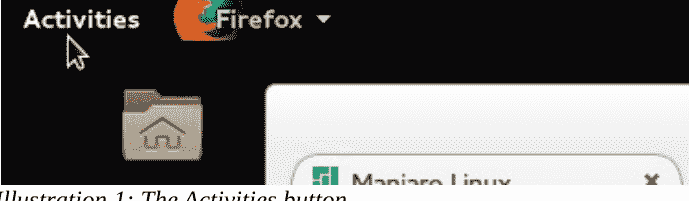
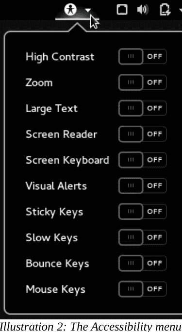
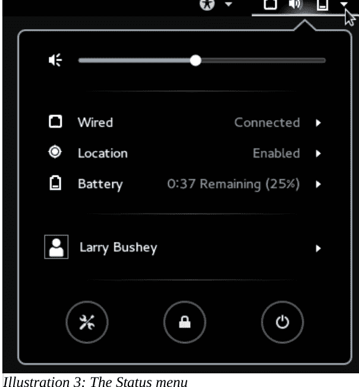
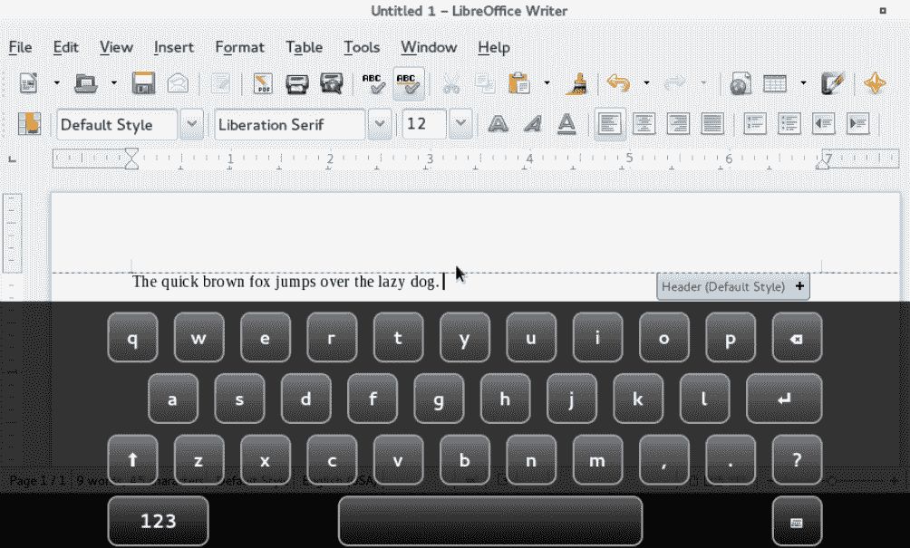
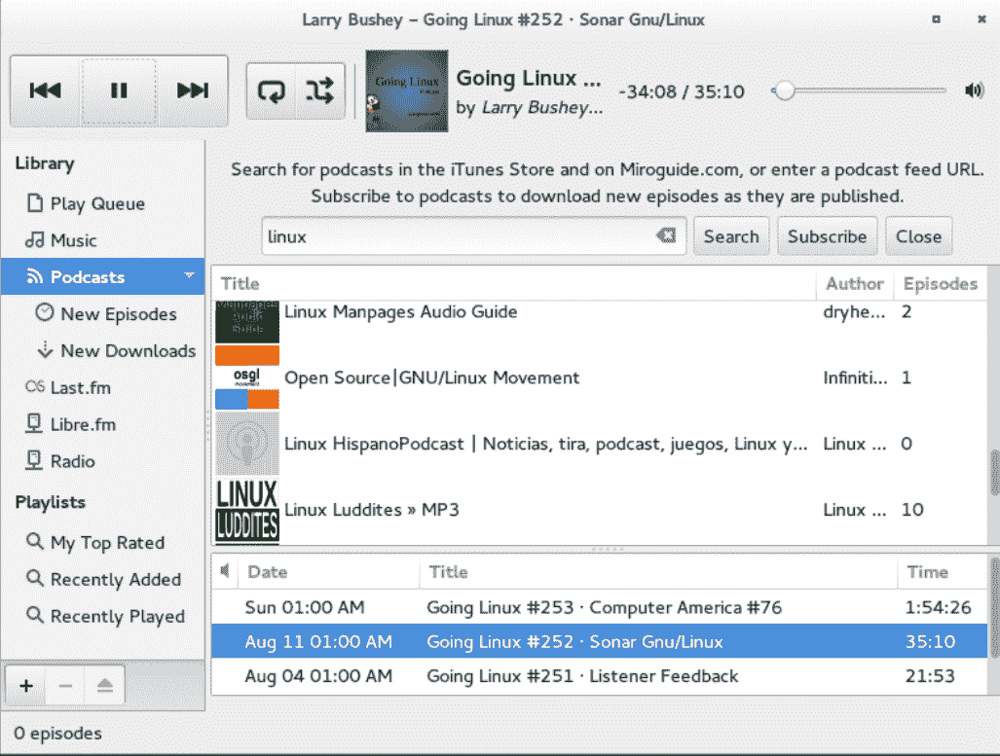
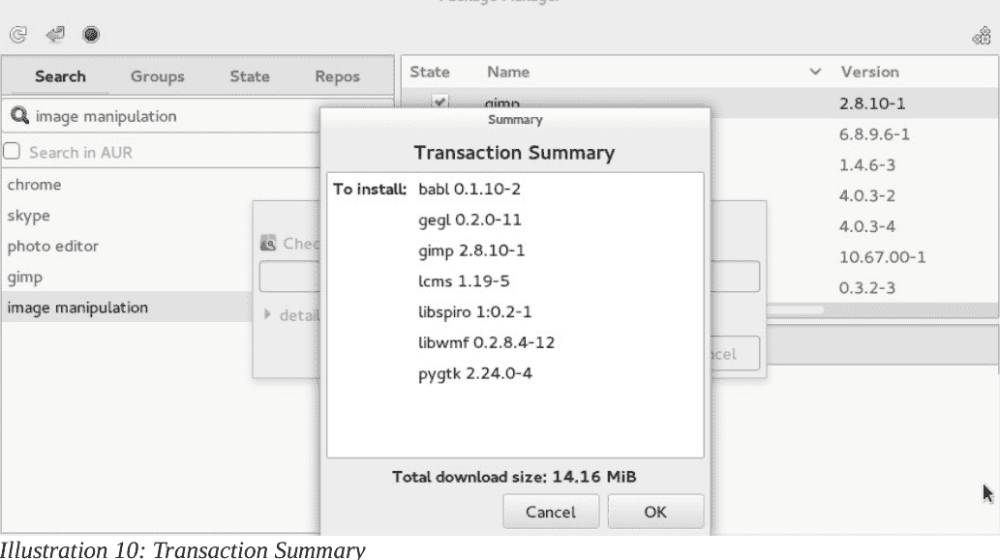
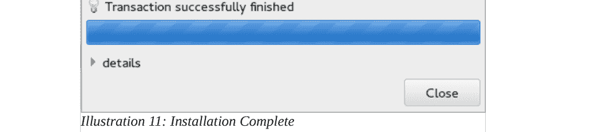

# Sonar GNU/Linux 快速启动指南：Sonar Gnome 2014.1

# 欢迎

恭喜！你已经从 Windows PC 切换到了 Sonar GNU/Linux 系统。Sonar GNU/Linux 与专有操作系统之间存在一些差异，你可能会遇到较小的学习曲线。无论你是 Linux 新手还是从 Windows 切换，本指南都将帮助你充分利用 Sonar 电脑。

# 关于 Sonar GNU/Linux

Sonar GNU/Linux (Sonar) 是你电脑的软件——一种操作系统。它与其他电脑预装的操作系统不同，例如苹果的 OSX、微软的 Windows 或谷歌的 Chrome。Sonar 专注于提供辅助技术。如果你需要一个无障碍的操作系统，你来对地方了。搜索此结束，Sonar 是你的完美选择。如果你不需要辅助技术，也不要感到落后。Sonar 是一个功能完整的 GNU/Linux 发行版，同样适用于你！

Sonar 是一个现代且安全的系统，提供了许多惊叹的功能和质量无伦的技术。它使用免费的辅助技术成为今天最无障碍的操作系统。Sonar 预装了以下自适应技术：

- 1. 为盲人及低视人士提供的屏幕阅读器。
- 2. 放大程序，帮助低视人士看清屏幕。
- 3. 为运动技能较差、使用键盘困难的人士提供的屏幕键盘。可以使用鼠标或轨迹球配合屏幕键盘来导航屏幕键盘。
- 4. 一种名为 OpenDyslexic 的字体，专为为阅读障碍者提高屏幕文本和打印文本的可读性而设计。

# 到底什么是“GNU”？

Sonar 是 GNU/Linux 的一个版本（发行版）。虽然“GNU”是操作系统的关键部分，但在日常对话中经常被省略。因此，Sonar GNU/Linux 通常被称为“Sonar Linux”，或者更简单地称为“Sonar”。在本文中，我们将交替使用这三个词。

你可能听过 Linux 是 Windows 等操作系统的开源替代方案，它是谷歌 Android 和 Chrome 操作系统的基础。另一方面，“GNU”可能是一个陌生的术语。事实上，通常被称为“Linux”的操作系统应该被称为“GNU/Linux”，因为如果没有让 Linux 内核与你交互的 GNU 工具，计算机将无法运作。如果你想了解更多 GNU 项目和软件自由，可以在项目网站 https://www.gnu.org 找到更多信息。

# 从 Windows 迁移到 Sonar Linux

你已经完成了从 Windows 到 Sonar Linux 的切换，现在你来到这里，可能会感到有些迷茫。我们整理了这张表格，方便你找到正在寻找的功能，无论是打印机设置、音频控制，还是所有文件所在的位置。

| 如果你在 Windows 中使用... | 在 Sonar 中查看这里... | 额外提示 |
|---|---|---|
| 音频控制 | 声音 | 状态菜单 > 设置按钮 > 声音 |
| 文档文件夹 | 主文件夹 | 主文件夹是你存放所有创建内容的地方。文档、音频文件、视频等。 |
| 文件资源管理器 | 文件管理器 | Sonar 的文件管理器是一个用于管理和搜索电脑中文件的强大工具。 |
| Microsoft Word | LibreOffice Writer | LibreOffice Writer 是一个文字处理器，可以创建、打开和保存你可以使用 Microsoft Word 共享的文档。 |
| 网络和共享 | 网络 | 状态菜单 > 设置按钮 > 网络 |
| 记事本 | 文本编辑器 | Gedit 是 Sonar 中文本编辑器的名称。 |
| 打印机传真 | 打印机 | 状态菜单 > 设置按钮 > 打印机 |
| 回收站 | 垃圾桶 | “垃圾桶”这个说法不那么“政治正确”，但如果你需要恢复已丢弃的内容，仍然可以回收它。 |
| Jaws 屏幕阅读器 | Orca 屏幕阅读器 | Orca 是一个免费、开源、灵活且可扩展的屏幕阅读器，提供对 Sonar 图形桌面和/或盲点的的支持。 |
| iTunes | Rhythmbox | 听音乐、播客等。你甚至可以将文件传输到 MP3 播放器以便移动收听。 |

Sonar GNU/Linux 入门指南 第 5 页

## 辅助功能

Sonar Linux 预装的辅助功能是它区别于任何其他计算机系统的特点。事实上，如果你自己手动安装 Sonar，你将会知道，即使在安装过程中，Orca 屏幕阅读器从一开始就是激活状态并为你提供帮助的

### 屏幕阅读器

Orca 屏幕阅读器为盲人和低视力用户提供服务。屏幕阅读器默认“开启”。要关闭或重新开启屏幕阅读器，请按下 Alt+Super+S。（“Super”键在你的键盘上可能标记为“Windows”图标。）

### 屏幕放大镜

提供了一个放大程序来帮助低视力人士看清屏幕。要开启放大，按下 Alt+Super+M。要放大，按下 Alt+Super+++（加号键）。要缩小，按下 Alt+Super+-（减号键）。

### 屏幕键盘

对于运动能力较低且有使用键盘经验的人来说，准备好了屏幕键盘。可以使用鼠标或触控板配合屏幕键盘来导航屏幕上的键盘。要开启或关闭屏幕键盘，按下 Alt+Super+K。要增大字体大小，按下 Alt+Super+L；要减小字体大小，按下 Alt+Super+D。

### 头部和眼跟踪软件

如果你的电脑安装了摄像头，或者你添加了一个摄像头，可以使用它来控制鼠标光标。结合屏幕键盘，这将允许运动能力较低的人导航软件并使用键盘。

### OpenDyslexic 字体

Sonar Linux 预装了 OpenDyslexic 字体。OpenDyslexic 设计旨在提高阅读障碍读者对屏幕文本和打印文本的可读性。

在 OpenDyslexic 的文档中，作者解释道：“大脑有时会对文本进行一些奇怪的操作。OpenDyslexic 有助于防止这些情况的发生。字母的底部经过加重，以提供方向指示，使其难以与其他相似字母混淆。一致的加重底部也有助于强化文本行。每个字母独特的形状可以防止翻转和交换。”

该字体在任何提供可选字体的应用程序中都可用，例如文字处理器和浏览器。OpenDyslexic 甚至可以在“系统设置”中被被选为默认系统字体。

## Sonar 桌面介绍

Sonar Linux 使用了流行的 Linux 桌面环境 Gnome。当你第一次登录时，你会看到一个显示有“主目录”和“垃圾桶”等图标的桌面，以及屏幕顶部的一条栏。这就是 Gnome 桌面环境。Gnome 的顶栏提供了访问你的窗口和应用程序、日历和预约，以及你可以在此处找到声音、网络、电源和辅助功能等内容的设置。

Sonar 顶栏有五个组件。从左到右它们分别是：活动按钮、应用程序菜单、时钟、辅助功能菜单和状态菜单。这些每一个组件都提供了对设置和功能的访问，让你能够充分利用你的计算机。让我们从对这些每个组件的概述开始吧。

## 活动按钮

顶栏最左侧的按钮是“活动”按钮。点击此按钮可以向你显示窗口和应用程序的概述。概述显示了你当前工作区上所有窗口的缩略图。在查看概述时，你也可以通过输入来搜索你的应用程序、文件、文件夹和网络。

在概述屏幕的左边缘，你会发现一个名为“启动栏”（Dash）的垂直区域。启动显示了你喜欢的应用程序和正在运行的应用程序。点击启动上的任何图标即可打开该应用程序。如果应用程序已经在运行，图标下方将通过一个区域高亮显示。点击正在运行的应用程序图标将调出该应用程序最常用的窗口。要打开新应用程序，或显示另一个已打开的窗口，你可以右键点击图标。

启动栏底部的网格显示“应用程序概述”。它显示了安装在你计算机上的所有应用程序。点击任何应用程序即可运行它。你也可以将应用程序拖到启动栏上将其设为收藏。即使在它们没有运行时，你收藏的应用程序也会留在启动栏中，这样你可以快速访问它们。

## 应用程序菜单

如果你至少运行了一个应用程序，应用程序菜单将出现在活动菜单的 바로右侧。它显示了当前运行的活动应用程序的图标，以及可以对该应用程序采取的操作列表。注意，应用程序窗口上的菜单栏也可能包含额外的菜单和操作。

## 时钟

Sonar 在顶栏中间、应用程序菜单和辅助功能菜单之间显示星期几和当天时间。时钟实际上是一个按钮，点击它会显示日历和一个允许你调整计算机日期和时间设置的菜单。你可以使用这些设置来更改顶栏显示的日期和时间格式。

## 辅助功能菜单

辅助功能菜单显示了一个方便的辅助功能列表，让你只需点击一下即可开启或关闭每一项。

## 状态菜单

顶栏最右侧的菜单是状态菜单。在状态菜单中，你可以更改音或屏幕亮度、编辑 Wi-Fi 连接、检查电池状态、注销、关闭计算机。菜单底部的三个按钮从左到右允许你启动“系统设置”应用程序、锁定屏幕以及注销/切换用户/关机。

## 使用辅助功能应用程序

## 在 Gnome 桌面上设置快捷键

虽然键盘快捷键技术上并不属于辅助功能菜单，但它们作为辅助技术非常有帮助。Sonar 没有为用户提供一套快捷键。我们将此留给每个使用 Sonar 的人。然而，有大量的键盘快捷键。对于每个使用 Sonar 的人，我们把此留给他们。然而，有大量的键盘快捷键。对于每个使用 Sonar 的人，我们将此留给他们。然而，有大量的键盘快捷键。对于每个使用 Sonar 的人，我们将此留给他们。然而，有大量的键盘快捷键。对于每个使用 Sonar 的人，我们将此留给他们。然而，有大量的键盘快捷键。对于每个使用 Sonar 的人，我们将此留给他们。

（此处：原文重复重复）

你可以使用以下可以设置的快捷键：
- 开启/关闭屏幕阅读器 Alt+Super+S
- 开启放大 Alt+Super+M
- 放大 Alt+Super+++（加号键）
- 缩小 Alt+Super+-（减号键）
- 开启屏幕键盘 Alt+Super+K
- 增大字体大小按下 Alt+Super+L
- 减小字体大小按下 Alt+Super+D
- 开启/关闭高对比度 Alt+Super+H

## 在 Gnome 桌面上设置键盘快捷键

虽然键盘快捷键技术上并不属于辅助功能菜单，但它们作为辅助技术非常有帮助。Sonar 没有为用户提供一套快捷键。我们将此留给每个使用 Sonar 的人。然而，有大量的键盘快捷键。

你可以使用以下可以设置的快捷键：
- 开启/关闭屏幕阅读器 Alt+Super+S
- 开启放大 Alt+Super+M
- 放大 Alt+Super+++（加号键）
- 缩小 Alt+Super+-（减号键）
- 开启/关闭屏幕键盘 Alt+Super+K
- 增大字体大小按下 Alt+Super+L
- 减小字体大小按下 Alt+Super+D
- 开启/关闭高对比度 Alt+Super+H

（注：由于提供的待翻译文本存在大量重复的段落，译文已根据逻辑进行了去重处理，以遵循“不要重复输出原文”的原则。）

# 使用屏幕键盘

按下 Alt+Super+K 可以切换屏幕键盘的开启和关闭。屏幕键盘仅在你需要时才可见。例如，当一个文档是活动窗口且光标位于可以打字的位置时，你将看到屏幕键盘。如果你点击 Solar 桌面或其他不接受输入字符的地方，键盘就会消失。

插图 4：屏幕键盘。

# 使用头部和眼动跟踪软件

启用 Viacam（通常缩写为 Eviacam）是一种鼠标替代软件，它可以随着你的头部移动而移动指针。如果你的运动能力较低，只需通过摄像头和 Eviacam 就能轻松使用电脑。使用 Eviacam 不需要任何其他设备——不需要电缆、标记点，也不需要额外的硬件。

通过 Eviacam，你可以通过直观的头部动作控制电脑。无需用手！它的设计是为了在安装后消除对辅助——请记住，它已经随 Sonar 预装好了！

让它成为你的专属。你可以自定义指针速度、运动加速度和流畅度、停留时间等！

要学习如何使用和配置 Eviacam，可以在软件内找到用户手册。它的在线地址为为 http://eviacam.sourceforge.net/help/en/en/contents.html。

# 使用应用程序

现在你已经安装了 Sonar，你可能已经知道安装了哪些应用程序以及如何使用它们。如果你想查看所有应用程序的列表，可以按下 Super+A。这将显示你系统上安装的所有应用程序列表。你可以从此列表中选择任何应用程序并按回车键或点击它来启动。我们在这里不会介绍任何预装的应用程序，但让我们讨论一下哪些最受欢迎。

## 网页浏览器

你可能想使用的第一个应用程序之一是网络浏览器 Firefox。要打开 Firefox，按下 Super 键（也称为 Windows 键）。这将打开概览（Overview）。你也可以像我们之前描述的那样，点击活动（Activities）按钮进入那里。现在概览已打开，开始输入“firefox”，它应该会自动填充文本框。一旦看到它，就可以按回车键，Firefox 就会打开。你可以对任何安装的应用程序执行同样的操作。

现在概览功能非常强大。你不仅可以按名称搜索应用程序，还可以按应用程序的功能搜索。例如，输入类似“music”（音乐）的词，Sonar 将找到你安装的任何与音乐相关的应用程序。因此你不需要知道程序的名称。Sonar 会通过概览为你找到。你还可以搜索文件和文件夹，只需输入文件或文件夹的名称，它就会出现在概览中。所以，概览真的是 Sonar 针对你整个系统的强大搜索工具。

## 文字处理器

你可能想创建一个简单的文档、撰写新闻通讯或撰写小说，然后将工作保存到文件中。文字处理器是此的完美工具，Sonar 已经为你准备了一个在等候使用。Sonar 预装了 LibreOffice 软件套，其中包含一个文字处理器（Writer）、一个电子表格应用程序（Calc）、一个用于创建专业演示文的程序（Impress）、一个用于科学或学校作业的公式编辑器（Math），以及一个用于编目任何你内容的数据库（Base）。

正如之前一样，通过按下 Super 键打开概览。开始输入“word processor”或“writer”，在你完成输入之前，文字处理器就会被高亮！按回车键打开 LibreOffice Writer。就像你用过的任何文字处理器一样，你可以在屏幕上打字、更改字体、使用粗体、下划线和斜体格式化文本、创建表格、插入图片等。点击保存图标保存你的工作，按 Control+P 打印，并使用 Control+Q 退出。

对于所有操作系统，Sonar 都提供了多种方法来完成这些操作，你将随着时间的推移学会它们。如果你是从 Windows 切换到 Sonar，你会很容易适应，因为大多数功能的工作方式与你的旧系统一样。

# 娱乐

如果你采取了我们之前的建议，你已经知道当在概览中输入“music”时，Rhythmbox 是一个可以与 Apple 的 iTunes 竞争的多媒体中心。无论你想听 Last.fm、你的 MP3 文件集，还是想订阅你喜喜欢的 Linux 播客，Rhythmbox 都能让你做到这一切以及更多。你可以从电脑上听，或将播放列表传输到手机、平板电脑或媒体播放器上随地听。

你可以通过点击应用程序菜单找到如何调整偏好、查看所有设置和阅读手册的详细说明。记住，它就在 Sonar 顶部面板活动按钮旁边。点击时请确保 Rhythmbox 是打开的。在探索 Sonar GNU/Linux 中提供的其他所有应用程序时，听一些音乐吧！

插图 5：Rhythmbox 媒体播放器

# 保持安全和更新

## 获取最新更新

当 Sonar 或其任何应用程序可用更新时，更新管理器（Update Manager）会在屏幕底部显示通知。

更新是免费的，并可以从软件源（也称为“repos”）下载。你使用更新管理器执行更新。

1. 点击活动按钮（或按下 Super 按钮）打开概览。
2. 输入“software update”并按回车键。更新管理器打开并暂停一、二秒以联系软件源。
3. 当列表刷新后，如果有更新，你只需点击应用（Apply）按钮并提供你的 Sonar 密码开始下载所有更新。
4. 进度条会在下载和安装进行时让你了解进度。

| 更新管理器 | |
| :--- | :--- |
| 33 个可用更新 | |
| bash 4.3.022-1 | 1.21 MiB |
| blue 5.22-1 | 439.3 KiB |
| cracklib 2.9.1-1 | 238.2 KiB |
| cups-filters 0.10.57-1 | 659.3 KiB |
| efootbmgr 0.7.0.16.g099e110-1 | 22.1 KiB |
| evifar 0.10.8.g8d0146-1 | 18.3 KiB |
| fakeroot 1.2.01-1 | 59.5 KiB |
| gnupg 2.0.26-1 | 1.51 MiB |
| gpgme 5-1 | 214 KiB |
| icedtea-web-7 1.5.1-1 | 24 MiB |
| inxi 2.29-1 | 107 KiB |
| kbd 2.0.2-1 | 1.07 MiB |
| krb 5.12-1 | 1.07 MiB |
| lib32-libxcb 11-1 | 156.3 KiB |
| libbsd 0.7.0 | 119.6 KiB |
| 总大小：77.02 MiB | |

img/d983c24f03486345a839503325e9c4b2_13_1.png

5. 进程完成后，窗口将显示消息“事务成功”。关闭继续。

img/d983c24f03486345a839503325e9c4b2_14_0.png

6. 更新管理器进行最后的检查并显示“系统是最新的”。关闭更新管理器。

你的系统现在已获得操作系统及其应用程序的最新更新和安全修复。

## 需要更多软件？

享受 Sonar 的免费软件。再也不用为下次升级或你一直在寻找的功能付费了。

请注意，Sonar Linux 基于 Manjaro 发行版，因此在使用 Sonar 时可以参考 Manjaro 仓库、工具、实用程序支持网站。如果你看到这些，不要担心。你在对的地方。Manjaro Linux 团队提供了 Sonar 巨大的支持。事实上，没有他们的支持，GNU/Linux 的发布是不可能的。

你使用软件包管理器从仓库获取新的应用程序。

1. 点击活动按钮（或按下 Super 按钮）打开概览。
2. 输入“add/remove software”并按回车键。打开软件包管理器。
3. 管理器提供四个标签来定位你需要的软件。寻找软件最简单的方法是搜索标签。该标签是默认的，你只需开始输入。你可以直接输入包名称，如“Skype”。如果你不知道名称，可以搜索你想的操作，如“image manipulation”。软件包管理器会在右上面板显示与你的搜索相关的可能包。
4. 点击列表中的包名称查看该软件的简要描述。

img/d983c24f03486345a839503325e9c4b2_15_0.png

插图 9：搜索软件包管理器

Sonar GNU/Linux 入门指南
第 13 页

6. 在列表中选中软件包后，按下空格键或双击复选框以表示你想要安装该软件包。复选框中将出现一个勾标记。如果你改变了主意，再次按下空格键或双击复选框即可取消勾选。

7. 在开始安装过程之前，你可以继续搜索并根据需要勾选任意数量的软件软件包。你所选择的所有软件，以及它们所需的任何其他工具或其他组件都将同时被安装。

8. 如需显示将安装的软件包的“事务摘要”，请点击窗口顶部看起来像蓝色箭头的图标。它位于左侧数第二个位置。

9. 点击 OK 开始安装。

10. 在下载和安装过程中，进度条会向你告知最新状态。进程完成后，窗口将显示消息“Transaction successfully finished”（事务成功完成）。点击 Close 即可完成。

