# StarOffice 使用指南

# 特别版 使用 StarOffice®

Michael Koch

Sarab Murray

witb

Werner Roth

# 特别版 使用 StarOffice®

01 00 99 3 2 1

# 警告与免责声明

我们已尽力使本书尽可能完整和准确，但不隐含任何保证或适用性。所提供的信息按“原样”提供。对于因书中包含的信息引起的任何损失或损害，作者和出版者对任何个人或实体均不承担责任。

- 执行编辑：Dean Miller
- 采买编辑：Maureen A. McDaniel
- 开发编辑：Maureen A. McDaniel
- 总编辑：Bruce Gosnell
- 项目编辑：Gretchen Uphoff
- 拷贝编辑：Chuck Hutchinson, Jetty Jarrett, Pamela Woolf
- 索引：Rebecca Salerno, Bruce Clingman
- 校对员：Andy Beaster
- 团队协调员：Cindy Teeters
- 技术编辑：Frank Becker, Lasse Becker, Michael Herger, Matthew Borowsky
- 室内设计：Dan Armstrong, Ruth Harvey
- 排版技术：Brandon Allen, Timothy Osborn, Staci Somers

- 引言 1
- I 介绍 StarOffice
- 1 恒星之诞生 11
- 介绍 StarOffice 12
- 为什么使用 StarOffice? 12
- StarOffice 包含什么? 13
- StarOffice 5.1 有何更新 16
- 使用 StarOffice 的优势 17
- 与 Office 兼容 18
- 无缝集成环境 18
- 网络感知 19
- 启用组件软件 19
- 成本效益且价格实惠 19
- 降低拥有成本 19
- 易于自定义 20
- StarOffice 的缺点 20
- 2 步 StarOffice 23
- 介绍 StarOffice 12
- 为什么使用 StarOffice? 12
- StarOffice 包含什么? 13
- StarOffice 5.1 有何更新 16
- 使用 StarOffice 的优势 17
- 与 Office 兼容 18
- 无缝集成环境 18
- 网络感知 19
- 启用组件软件 19
- 成本效益且价格实惠 19
- 降低拥有成本 19
- 易于自定义 20
- StarOffice 的缺点 20
- 2 步 StarOffice 23
- 介绍 StarOffice 12
- 为什么使用 StarOffice? 12
- StarOffice 包含什么? 13
- StarOffice 5.1 有何更新 16
- 使用 StarOffice 的优势 17
- 与 Office 兼容 18
- 无缝集成环境 18
- 网络感知 19
- 启用组件软件 19
- 成本效益且价格实惠 19
- 降低拥有成本 19
- 易于自定义 20
- StarOffice 的缺点 20
- 2 步 StarOffice 23
- 介绍 StarOffice 12
- 为什么使用 StarOffice? 12
- StarOffice 包含什么? 13
- StarOffice 5.1 有何更新 16
- 使用 StarOffice 的优势 17
- 与 Office 兼容 18
- 无缝集成环境 18
- 网络感知 19
- 启用组件软件 19
- 成本效益且价格实惠 19
- 降低拥有成本 19
- 易于自定义 20
- StarOffice 的缺点 20
- 2 步 StarOffice 23
- 介绍 StarOffice 12
- 为什么使用 StarOffice? 12
- StarOffice 包含什么? 13
- StarOffice 5.1 有何更新 16
- 使用 StarOffice 的优势 17
- 与 Office 兼容 18
- 无缝集成环境 18
- 网络感知 19
- 启用组件软件 19
- 成本效益且价格实惠 19
- 降低拥有成本 19
- 易于自定义 20
- StarOffice 的缺点 20

- 设置通用选项 76
- 修改您的用户数据 76
- 设置保存文件 77
- 设置默认位置 78
- 选择拼写和语言选项 79
- 创建颜色 82
- 设置全局打印警报 83
- 定义功能 83
- 定义桌面外观 84
- 设置其他选项 85

- 自定义桌面 112
- 设置桌面背景和图形 112
- 设置桌面图标 114
- 自定义开始菜单 114
- 设置程序选项 114
- 其他文件夹选项 115
- 自定义桌面工具和菜单 115

- 获取网络 85
- 使用自动设置设置网络账户 86
- 修改和自定义您的网络连接 94
- 创建邮箱 96
- 设置多账户 103

- 创建和管理多桌面 123
- 创建多桌面 123
- 为什么使用多桌面? 123
- 切换桌面 104

- 为身体障碍人士提高 StarOffice 易用性 125

- 故障排除 127

- 调整浏览器 105
- 设置内存和硬盘缓存 106
- 清空缓存文档 107
- 启用 Java 107
- 设置浏览器主页 108
- 选择如何处理脚本 108
- 管理插件 109
- 选择 Cookie 编辑选项 110
- 设置 HTML 文档格式 110
- 使用站点证书处理安全 110
- 管理和导入书签 111

- 桌面集成 132
- 创建和打开文档 132
- 创建新文档 132
- 打开现有文档 139
- 保存和关闭文档 147
- 使用密码保存文件 148
- 取消密码保护 148
- 使用自动扩展名保存 148
- 以格式保存和导出文件 149
- 跨桌面工作 150
- 发出命令菜单 150
- 理解对话框 150
- 通用桌面快捷键 153

- 引言 1
- I 介绍 StarOffice
- 1 恒星之诞生 11
- 介绍 StarOffice 12
- 为什么使用 StarOffice? 12
- StarOffice 包含什么? 13
- StarOffice 5.1 有何更新 16
- 使用 StarOffice 的优势 17
- 与 Office 兼容 18
- 无缝集成环境 18
- 网络感知 19
- 启用组件软件 19
- 成本效益且价格实惠 19
- 降低拥有成本 19
- 易于自定义 20
- StarOffice 的缺点 20
- 2 步 StarOffice 23
- 介绍 StarOffice 12
- 为什么使用 StarOffice? 12
- StarOffice 包含什么? 13
- StarOffice 5.1 有何更新 16
- 使用 StarOffice 的优势 17
- 与 Office 兼容 18
- 无缝集成环境 18
- 网络感知 19
- 启用组件软件 19
- 成本效益且价格实惠 19
- 降低拥有成本 19
- 易于自定义 20
- StarOffice 的缺点 20
- 2 步 StarOffice 23
- 介绍 StarOffice 12
- 为什么使用 StarOffice? 12
- StarOffice 包含什么? 13
- StarOffice 5.1 有何更新 16
- 使用 StarOffice 的优势 17
- 与 Office 兼容 18
- 无缝集成环境 18
- 网络感知 19
- 启用组件软件 19
- 成本效益且价格实惠 19
- 降低拥有成本 19
- 易于自定义 20
- StarOffice 的缺点 20
- 2 步 StarOffice 23
- 介绍 StarOffice 12
- 为什么使用 StarOffice? 12
- StarOffice 包含什么? 13
- StarOffice 5.1 有何更新 16
- 使用 StarOffice 的优势 17
- 与 Office 兼容 18
- 无缝集成环境 18
- 网络感知 19
- 启用组件软件 19
- 成本效益且价格实惠 19
- 降低拥有成本 19
- 易于自定义 20
- StarOffice 的缺点 20
- 2 步 StarOffice 23
- 介绍 StarOffice 12
- 为什么使用 StarOffice? 12
- StarOffice 包含什么? 13
- StarOffice 5.1 有何更新 16
- 使用 StarOffice 的优势 17
- 与 Office 兼容 18
- 无缝集成环境 18
- 网络感知 19
- 启用组件软件 19
- 成本效益且价格实惠 19
- 降低拥有成本 19
- 易于自定义 20


# StarOffice 的缺点 20

# 准备好工作 75

## 设置通用选项 76

## 修改您的用户数据 76

## 设置保存文件 77

## 设置默认位置 78

## 选择拼写和语言选项 79

## 创建颜色 82

## 设置全局打印警报 83

## 定义功能 83

## 定义桌面外观 84

## 设置其他选项 85

## 自定义桌面 112

### 设置桌面背景和图形 112

### 设置桌面图标 114

### 自定义开始菜单 114

### 设置程序选项 114

### 其他文件夹选项 115

### 自定义桌面工具和菜单 115

## 获取网络 85

### 使用自动设置设置网络账户 86

### 修改和自定义您的网络连接 94

### 创建邮箱 96

### 设置多账户 103

## 创建和管理多桌面 123

### 创建多桌面 123

### 为什么使用多桌面? 123

### 切换桌面 104

## 为身体障碍人士提高 StarOffice 易用性 125

## 故障排除 127

### 使用按键快速桌面导航 155

### 通过链接、书签和超链接进行导航 156

### 通过导航器导向文档 158

## 基础编辑和格式化 160

### 基础选择工具 160

### 基础编辑工具 161

### 查找和替换 163

## 格式、样式和模板 165

### 应用格式和样式 165

### 管理样式和模板 167

## 使用常用校对工具 170

## 文档之间的数据共享 171

### 理解链接数据 171

### 处理链接和链接数据 174

## 处理对象 176

### 插入插入的对象 177

### 控制对象 179

### 选择对象 179

### 调整大小、移动和复制对象 179

### 理解锚点 179

### 格式化对象 180

### 删除对象 180

## 介绍地址簿 180

### 将不同的地址簿设为默认值 181

### 使用地址簿 181

### 修改默认簿数据库 181

## 处理多个表格 182

### 导入现有书籍 182

### 使用 AutoBrowse 浏览网页和文件 183

## 发送和打印文档 184

### 设置你的 Windows 打印机 184

### 设置你的 Linux 打印机 184

### 预览你的打印任务 185

### 打印基础 185

### 从桌面发送文档和邮件 187

### 从桌面打印 188

### 打印到文件 188

### 故障排除 188

## 使用 StarOffice 进行桌面管理 192

### 在打开和保存对话框中管理文件夹和文件 192

### 在保存和打开对话框中导航 192

### 使用过滤器创建文件 197

### 检索文件和文件夹 206

### 保护文件和文件夹 213

### 保持你的桌面为最新状态 215

### 更新文件、文件夹和邮件 224

### 保持网络订阅的最新更新 215

# 6 创建和编辑文本文档 223

## 开始使用 StarWriter 224

### 启动 StarWriter - 224

### 探索工作空间 224

### 使用文本对象栏 226

### 使用 StarWriter 标尺 227

### 使用 StarWriter 主工具栏 228

### 使用 StarWriter 状态栏 229

### 使用滚动条 231

### 在文档中移动 231

## 格式化字符 263

### 为工作选择合适的字体 266

### 应用字符格式化 267

### 调整字符间距和位置 268

### 通过属性和颜色增加影响力 268

## 格式化段落 270

### 调整缩进和间距 271

### 更改对齐方式和文本流 274

### 设置和清除制表位 276

### 格式化首大字母 278

### 添加边界和背景颜色 278

## 输入文本、特殊字符和公式 232

### 打字和插入文本 232

### 使用语音光标插入文本 233

### 插入特殊字符和符号 234

### 使用 StarMath 创建和插入公式 235

### 使用 Auto 自动输入文本 240

### 使用自动补全功能 243

## 编辑和选择文本 243

### 在打字时纠正拼写 243

### 事后纠正拼写错误 245

### 选择和删除 245

### 复制和移动文本 247

### 剪切粘贴编辑 247

### 拖放编辑 247

### 探索你的基础格式化选项 248

### 撤销、重做和重复操作 248

## 格式化页面 280

### 设置你的基础布局选项 281

### 添加页眉、页脚和脚注 282

### 添加页面背景颜色和图形 283

## 创建编号列表和符号列表 283

### 使用编号对象 284

### 生成多级列表 285

### 按顺序对非连续段落编号 286

## 保存、关闭和打开文档 249

### 保存新文档 249

### 关闭和打开现有文档 252

### 开始一个新的文本文档 252

### 使用 AutoPilot 创建文档和模板 253

## 使用快捷键加速格式化 286

### 使用 AutoFormat 287

## 故障排除 289

## 故障排除 258

## 处理样式和模板 292

### 什么是样式和模板？292

### 为什么使用样式和模板？293

### 理解你的格式化选项 262

# 使用样式进行格式化 294

## 理解你的样式格式化选项 294

## 将表格转换为文本 327

## 在表格中输入并格式化文本 327

## 格式化和编辑表格 329

### 使用右键菜单和对象栏 330

### 在全格式模式下工作得更快 298

### 调整行高和列宽 332

### 使用对象栏 298

### 在页面上移动和定位表格 336

### 定义样式 298

### 复制和移动行与列 337

### 从零创建样式 298

### 插入和删除行与 337

### 通过示例创建样式 302

### 修改样式 303

### 更新样式 303

### 编辑和删除现有 304

### 传输样式 304

### 拆分和合并表格 338

### 拆分表格 339

### 添加边界和背景 339

### 使用样式目录管理 306

### 保护表格 343

### 处理表格 308

### 对表格数据排序 343

### 探索模板 311

### 使用模板 311

### 创建模板 312

### 使用表格 322

### 创建模板 322

### 插入新表格 323

### 导入现有表格 325

## 使用邮件合并创建信函 360

### 创建数据源 361

### 创建格式信函 362

### 合并数据 363

### 在邮件合并中使用条件 364

## 插入注释、脚注和尾脚 384

### 插入和移动脚注 385

### 编辑和格式化脚注和尾脚 386

## 故障排除 367

### 删除脚注和尾脚 387

### 打印注释 388

# 10 处理长文档 369-388

## 对长文档进行深度思考 370

### 使用行号 388

### 引入导航器 371

### 引入微型导航器 374

### 使用导航器定位对象 374

## 生成索引和参考表 389

### 创建索引和表格条目 390

### 编辑索引条目 394

### 编辑和格式化索引和参考表394

### 设置提醒 375

### 使用导航器进行拖放操作 375

### 更改目录大纲 395

### 更新索引或参考表 399

## 设置与设计出版物 416

### 探索您的视图和工作空间 418

### 排列您的视图 419

### 排练对象 421

### 使用对象的右键菜单和对象 422

### 更改堆叠顺序 423

### 对齐对象 424

### 理解锚点 424

### 在对象周围环绕文本 425

### 编辑和格式化对象 427

## 处理列操作 430

### 在页面上设置多列文本 430

### 调整列宽和间距 431

### 添加跨越两个或多个列的元素 432

### 对齐列中的文本 432

### 在同一页面上变化不同的列布局 434

## 处理文本框 435

### 插入文本框 435

### 在文本周围创建文本框 436

### 链接和取消链接文本框 437

### 将文本与列对齐 438

### 处理文本框中的文本 439

### 删除文本框 439

### 文本导航 439

## 处理图形对象 440

### 插入图形对象 440

### 缩放和裁剪图形 443

### 在图形对象周围环绕文本 444

### 使用轮廓编辑器 445

### 添加水平线作为分隔符 447

### 创建您自己的图形 447

### 向画廊库中添加新文件夹和文件 448

## 有效使用文本和字体 449

### 应用首字放大 450

### 使用 FontWork 451

### 旋转文本 452

## 准备打印文档 453

### 使用 StarWriter 进行 PostScript 脚本打印 454

### 使用高分辨率激光打印机 455

### 其他注意事项和提示 455

## 校对您的工作 460

### 使用查找和替换 460

### 检查拼写 464

### 使用同义词典查找单词 472

### 使用连字符 473

### 理解 StarOffice 中的字典 474

### 安装新字典 474

### 预览文档 475

### 理解页栏 475

### 在页面模式下工作 477

### 打印文本文档 478

### 打印小册 480

### 打印信封 481

### 打印标签 483

### 故障排除 485

## 在 StarCalc 中熟悉并确定方向 490

### 电子表格的结构 490

### 理解单元格地址 491

### StarCalc 窗口和右键菜单 492

### 电子表格对象栏 493

### 公式栏 494

### 主工具栏 495

### 状态栏 497

### 滚动条 499

### 在 StarCalc 中导航 500

#### 使用组合键移动 500

#### 使用单元格地址移动 501

#### 为单元命名单元格区域以便导航 501

#### 使用导航器移动 502

#### 在工作表间跳转 502

#### 使用超链接连接工作表和电子表格 503

## 选择单元格和区域 505

### 选择单元格 505

### 选择单元格区域 505

### StarCalc 中的选择模式 506

### 选择行和列 507

### 选择命名的、数据库和链接区域 507

### 选择工作表 507

### 取消工作表 508

## 输入数据 508

### 输入数字 509

### 输入文本 511

### 输入日期和时间 511

### 输入公式 512


# 使用自动完成功能加速数据输入 512

冻结标题行或列 513

拆分电子表格窗口 513

关闭列标题和行表头 514

使用值高亮 514

使用大纲 515

放大和缩小 516

创建简单的日期和数字趋势 518

创建几何增长序列 519

使用自动填充进行复制 520

创建自动序列 521

为单元格设置有效性 522

保护单元格、工作表和文档 523

使用命名的单元格区域输入数据 523

## 打开、保存和关闭电子表格 523

打开新电子表格 524

打开现有电子表格和数据库 525

保存电子表格 525

## 编辑和删除单元格及其内容 530

理解单元格内容 530

使用公式栏编辑 531

单元格内编辑 532

清除单元格输入 532

从单元格中清除选定的元素 533

从工作表中删除单元格 534

## 使用自动格式快速格式化 558

应用现有的自动格式 558

添加您自己的自定义格式 558

## 复制和移动单元格数据 535

使用剪切、复制和粘贴 535

在 StarOffice 文档之间剪切和粘贴 538

拖放 538

## 格式化单元格 559

## 格式化数字和货币 559

使用数值格式 551

## 重复和使用数据序列 517

创建简单的日期和数字趋势 518

创建几何增长序列 519

## 创建复杂的日期序列 520

使用自动填充进行复制 520

创建自动序列 521

## 预防输入错误 522

为单元格设置有效性 522

保护单元格、工作表和文档 523

使用命名的单元格区域输入数据 523

## 故障排除 527

*(注：由于输入文本存在大量重复内容，上述翻译已根据逻辑结构进行了整理，并确保所有唯一条目均已翻译且保留格式。)*

# 使用 StarOffice 的特别版

预览分页符 708

使用页面视图预览页面布局 709

连接器 757

为对象添加填充颜色和颜色 761

打印您的结果 710

使用贝塞尔曲线 767

理解贝塞尔曲线 767

使用贝塞尔工具 767

使用贝塞尔对象栏编辑曲线 770

故障排除 711

将位图（及其他对象）转换为矢量绘图 771

# IV 图形化——StarDraw 和 Starmilage

在 StarDraw 中使用文本 773

将文本转换为 3D 773

在绘图中添加内容 773

# 20 使用 StarDraw 画草图 715

## 开始使用 StarDraw 716

启动 StarDraw 716

探索 StarDraw 工作空间 717

选择视图 730

## 使用样式工作 774

保存并关闭图形 775

导出图形 775

为万维网保存图形 775

## 理解计算机图形 733

什么是矢量图形？733

什么是位图图像？734

在何时何时使用 StarDraw 和 Starmilage 735

## 打开现有图形 776

打印图形 776

## 图形对象进行工作 736

选择对象 736

移动和复制对象 738

复隆对象 738

按水平、垂直和等比例调整大小 740

旋转和倾斜对象 741

扭曲和弯曲对象 744

变形对象 746

镜像对象 746

排列、分组和组合对象 746

对齐对象 751

删除对象 751

## 绘图文档的额外提示 777

# 21 使用 StarImage 创建和修改图像 779

## 开始使用 StarImage 780

启动 StarImage 780

探索 StarImage 工作空间 781

理解位图的工作原理 785

使用基础绘图工具 752

使用几何绘图工具 752

绘制线条，以及

有效利用使用视图 767

# 目录

创建新图像 788

使用画笔和线条工具 788

使用矩形和椭圆 790

使用喷漆刷工具 790

导入扫描图像 790

打开现有图像 791

选择并复制现有图像 792

修改现有图像 792

翻和旋转图像 792

修改图像大小 794

使用吸管工具裁剪图像 795

选择和编辑颜色 795

理解色彩模型和模式 796

选择颜色 797

调整 RGB 颜色值 797

调整亮度和对比 798

转换和反转图像 798

使用颜色抽屉窗口 799

应用滤镜效果 800

破坏性滤镜 804

保存并关闭图像 806

选择色深 806

选择文件格式 806

打印您的图像 810

通过电子邮件发送图像 811

自定义 StarImage 811

设置颜色控制 812

设置效果默认值 812

项目：充分利用 StarImage 813

# V 演示结果——Starlimpress

# 22 开始使用 Starlimpress 817

探索环境 818

探索主视图 818

理解工作模式 823

选择视图 827

规划您的演示 829

开始新的演示 830

使用自动驾驶 (AutoPilot) 831

使用现有模板 835

使用现有演示文稿 836

从零开始布局 838

文本进行工作 838

在大纲视图中编辑 839

使用绘图工具 842

创建演讲者备注 845

从 StarWriter 导入 845

幻灯片工作 846

设置您的幻灯片（页面）847

插入幻灯片 848

删除幻灯片 851

在幻灯片之间移动 852

复制、复制和扩展幻灯片 853

重新排列幻灯片 854

修改幻灯片布局 855

更改幻灯片（背景）856

重命名幻灯片 857

创建总结幻灯片 857

显示/隐藏幻灯片 858

对象进行工作 858

样式工作 859

# 使用 StarOffice 的特别版

# 24 预览和演示您的演示文稿 891

保存并关闭演示文稿 861

预览演示文稿 892

保存不同版本的演示文稿 861

制作屏幕幻灯片 893

使用文件保存信息 861

开始和退出演示文稿 893

打开现有或新的演示文稿 863

运行标准演示 893

演示文稿计时 894

# 23 增强您的演示文稿 865

导航演示 895

更改字体、字体样式和颜色 866

设置并运行自定义幻灯片秀 898

列表工作 866

创建项目列表和编号列表 888

编辑自定义幻灯片秀 999

运行自定义幻灯片秀 900

增强背景设计 868

更改页面 869

修改背景样式 870

设置幻灯片秀 900


添加演讲者备注和讲义 903

打印您的演示文稿 906

连接器工作 871

插入 OLE 对象 872

打印演示文稿部分 807

准备高分辨率演示文稿 808

导出演示文稿、幻灯片或对象 809

创建 3D 效果 875

为世界保存演示文稿 810

整合交互控制 777

通过电子邮件发送演示文稿 814

为演示文稿添加声音 779

动画对象和文本 880

动画 GIF 884

使用 Writer/Web 开始 819

创建幻灯片切换 888

自动切换 890

定时切换 890

StarOffice 和网络 920

互联网和局域网 920

网页和 HTML 223

# 目录

为网络配置 StarOffice 224

使用 StarOffice 浏览网页 224

链接工作 936

为网页添加声音和视频 970

插入链接 937

编辑和删除链接 942

相对和绝对链接工作 943

导航链接文档 944

表格和文本工作 971

插入帧（Frames）772

帧组工作 773

创建帧组 774

保存帧组 776

编辑帧组 777

定义目标帧 777

规划站点和管理文件 944

使用图像 778

探索图像地图 778

创建图像 981

在 Writer/Web 开始新 HTML 文档 946

在 Writer/Web 编辑 HTML 文件 952

插入滚动文本 982

添加表单 883

按规则播放 883

保存和打印 HTML 文档 953

# 27 在网页上发布您的工作 985

StarOffice 作为 HTML 工具 957

HTML 页面结构 957

HTML 和浏览器兼容性 957

在 Writer/Web 编辑 HTML 代码 959

为网页准备工作 886

保存和测试您的网页 887

准备发布 888

获取 Web 服务器空间 888

通过互联网传输文件 888

项目：创建一个首页！ 963

通过 FTP 发布 988

设置 FTP 账户 889

从 Web 服务器或 FTP 站点加载文件 991

# 26 增强 HTML 文档 965

通过 FTP 传输文件 991

属性工作 966

在线更新 HTML 文件 992

选择背景或图像 966

项目：让您的页面工作 993

图形和图表工作 968

准备并插入网页 969

为图形添加链接 970

# 使用 StarOffice 的特别版

# 28 在工作中组队 995

+ StarOffice 联网 996

在网络上安装 StarOffice 996

在网络上处理文档 996

使用组映射网络驱动器 1000

保护文档和数据库 1001

交换和查看文档 1002

查看文档 1002

版本工作 1007

使用行号 1009

使用分区隐藏和保护文本 1009

跨网络共享数据 1010

使用联系簿 1011

理解联系簿数据库 1012

复制地址表结构 1013

使用联系簿拨号添加和删除联系人 1014

创建组 1018

在表格中附加数据处理地址表 1019

使用 StarSchedule 组织 1020

在网络上配置 StarSchedule 1021

开始使用 StarSchedule 1024

使用事件 1029

使用任务 1033

编辑事件和任务 1036

删除事件和任务 1037

搜索 StarSchedule 1037

使用过滤器和样式 1037

导入和导出数据 1040

+ 将 StarSchedule 与 PalmPilot 链接 1040

备份计划 1041

打印预约和任务 1041

故障排除 1042

# 29 与 StarMail 和 StarDiscussion 通信 1045

+ 在 StarMail 和 Discussion 中定位 1046

常用工具介绍 1047

在收件箱、发送箱和新闻窗口中定位 1048

在 StarMail 编写窗口中定位 1051

+ 创建并发送邮件 1053

选择电子邮件格式 1053

设置邮件选项 1055

添加签名 1055

记录和检索电子邮件地址 1057

保存电子邮件副本 1058

从桌面投递文档和网页 1059

+ 处理附件 1061

在邮件消息中附加文件 1062

保存和打开附件 1062

+ 使用 StarMail 创建邮件合并 1062

向单收件人列表发送邮件 1062

向收件人列表发送个性化邮件 1063

创建邮件表单 1064

插入链接 1065

+ 管理多个邮件账户 1067

# 目录

- 超越邮件：使用 StarDiscussion 加入新闻组 1068

- 创建新闻账户 1069

- 设置新闻存储选项 1071

- 设置查看限制 1071

- 下载新闻 1072

- 阅读和响应新闻组贴文 1073

- 在 StarBase 中熟悉环境 1091

- 在资源管理器中创建新数据库 1092

- 创建新数据库对象 1098

- StarBase 工具栏和上下文菜单 1099

- 离线工作 1074

- 规划和设计您的数据库 1110

- 管理邮件和新闻技巧 1075

- 创建前端数据库 1110

- 从表创建数据库 1110

- 更新和同步账户 1075

- 选择、移动和删除文件 1076

- 标记和取消标记消息 1077

- 隐藏和显示已标记内容 1078

- 减少可见和不可见的杂乱 1078

- 理解和管理发件箱 1079

- 导入和导出文件 1080

- 维护数据库 1113

- 备份 1113

- 压缩 1113

- 更新 1114

- 故障排除 1115

## 31 创建独立数据库 1117

## 理解创建表的选项 1118

## 通过自动驾驶（AutoPilot）创建表 1118

## 在设计中创建和修改表 1122

- 设置字段类型和属性 1123

- 应用字段格式 1125

- 保存表并退出数据库 1127

- 故障排除 1081

## VII 使用数据库——StarBase

- 30 数据库操作 1085

- 故障排除 1128

- 介绍 StarBase 1086

- 52 创建带关系的表 1131

- 将 StarBase 作为数据管理器 1087

- 将 StarBase 作为关系型数据库 1132

- 理解 StarBase 的导入和导出选项 1088

- 什么是关系型数据库？1132

- StarBase 数据库的元素 1091

- 为什么使用关系型数据库？1134

## 特别版：使用 StarOffice

- 关系型数据库的元素 1135

- 关系 1135

- 约束 1136

- 主键和外键 1136

- 操作表内容 1156

- 排序和过滤数据 1157

- 查找记录 1159

- 将数据移动到文本文档 1160

- 在文本中插入表、字段和文本列表 1160

- 在文本中插入邮件合并字段 1162

- 在 HTML 文档中创建到数据库的超链接 1162

- 将数据插入电子表格 1163

- 通过拖放动态创建多格式表单 1163

- 为关系准备表 1137

- 理解数据

- 规范化 1137

- 设置主键 1138

- 创建表之间的关系 1139

- 通过拖放创建连接 1139

- 管理您的关系 1141

- 删除关系 1142

- 为表索引以加速搜索 1143

- 为什么使用索引？1143

- 设置索引 1144

- 复制、追加和导入表 1164

- 通过拖放复制表数据 1164

- 故障排除 1167

- 修改关系 1145

## 创建方便数据输入的表单 1169

- 保护您的数据库 1147

- 使用表单 1170

- 故障排除 1147

- StarOffice 中的表单与数据库集成 1171

## 33 在表中处理数据 1149

- 设计表单 1171

- 修改您的表 1150

- 什么是表单？1173

- 表单控件 1173

- 表单属性 1174

- 显示和打开表 1150

- 查看表的方法 1150

- 打开表 1150

- 自动驾驶飞行 1174

- 选择您的数据源 1174

- 选择您的表单字段 1175

- 选择您的表单设计 1176

- 命名并保存您的表单 1177

- 在表中熟悉环境 1151

- 介绍 Beamer 工具 1152

- 在表中导航 1153

- 调整列宽和行高 1154

- 在数据模式下导航 1178

- 输入、保存和撤销记录 1178

- 输入、编辑和格式化表 1154

- 添加和编辑数据 1154

- 选择多条记录 1155

- 删除记录 1155

- 隐藏和显示字段 1155

- 数据格式化 1155

- 排序和过滤记录 1179

## 目录

- 构建和修改表单 1179

- 创建新查询 1210

- 创建新表单 179

- 自动驾驶 1205

- 从头开始 179

- 使用查询创建过滤器 1207

- 熟悉页面 1180

- 准则 1207

- 在设计模式下打开现有表单 1181


- 排序数据 1209
- 完成查询 1209
- 从数据模式切换到设计模式 1181
- 从头创建查询 1210
- 在设计模式下工作 1181
- 选择您的表(s) 1210
- 命名和删除表单 1182
- 创建多表查询 1211
- 介绍函数 1184
- 在设计空间熟悉环境 1112
- 浮动工具栏 1184
- 添加字段 1113
- 添加控件 1187
- 构建和修改查询 1114
- 介绍表单 1188
- 使用空字段消除重复记录 1115
- 导航器 1190
- 创建计算字段 1115
- 介绍表对象 1190
- 隐藏字段 1116
- 安排表单布局 1190
- 在 SQL 中编辑 1116
- 打开控件属性 1192
- 典型的 SQL 语句 1117
- 理解控件属性 1192
- 使用 SQL 创建计算字段 1117
- 命名控件 1194
- 保存您的查询 1219
- 设置标签页 1194
- 选择性插入数据 1219
- 屏幕上帮助 1194
- 创建组合框或列表 1194
- 准备合并 1220
- 插入字段 1220
- 创建命令按钮 1198
- 打印表单 1198
- 故障排除 1223
- 故障排除 1198

## 36 创建和打印报告 1225

## 35 通过查询和字段获取答案 1201

- 创建新报告 1226
- 理解报告 1226
- 自动驾驶 1226
- 查询是什么？1202
- 在 StarBase 中构建查询 1202
- 修改报告 1230
- 介绍图形查询 1203
- 介绍 SQL 1204
- 预览和打印报告 1232
- 使用其他 StarOffice 文档创建报告 1232
- 故障排除 1234

## VIII 自动化工作——StarBasic

## 37 熟悉 StarBasic 1239

- 介绍 StarBasic 1240
- 什么是 StarBasic？1240
- 什么是一个？1
- 为什么使用 StarBasic？1241
- 为日常任务创建宏 1242
- 创建文件 1242
- 录制宏 1243
- 分配快捷键 1245
- StarBasic IDE 快速之旅 1247
- 主窗口 1247
- 在 IDE 内运行宏 1250
- 在库和模块中组织宏 1252
- 什么是库？1252
- 查看示例库 1253
- 什么是模块？1254
- 创建库、模块和对话框 1255
- 访问您的模块和源代码 1257
- 从头开始 StarBasic 编程 1259
- 创建统计程序 1259
- 理解处理 StarBasic 程序的基本概念 1261
- 我必须处理对象吗？1262
- 在线帮助系统排除 1265

## 38 理解 StarBasic 结构和语句 1267

进入 StarBasic 世界 1268
- 编程介绍 1268
- 什么是程序？1269
- 程序的元素 1269
- 组织您的程序设计 1270
- 记录您的工作 1271
- 创建注释 1271
- 您应该记录什么？1272
- 运行时函数介绍 1272
- 使用变量和操作数 1275
- 声明变量 1275
- 变量数据类型 1276
- 表达式的有效名称 1278
- 常量 1279
- 变量的生命周期和范围 1280
- 使用算术运算符 1283
- 连接运算符 1284
- 关系Equality运算符 1284
- 逻辑运算符 1285
- 使用过程和函数 1286
- 子程序和函数的组织 1286
- 从参数列表开始 1287
- 用户定义函数 1288
- 通过什么调用？1290
- 可选参数 1291
- 使用控制语句 1293
- 决策语句 1293
- 循环语句 1293
- 跳转语句 1202
- Go、GoSub 和标签 1202
- Exit Sub 和 Exit Function 1203
- 错误处理 1204
- With 语句 1206

# 附录

## 安装 StarOffice 1353

## 39 使用 StarBasic 编程 1209

- 建议 1354
- 硬件需求 1354
- 硬件建议 1355
- 软件需求 1355
- 使用 StarBasic 解决日常问题 1310
- 软件需求：Linux 1356
- 介绍 StarOffice  1310
- 介绍集合 1311
- 活动对象 1312
- 为事件分配宏 1312
- 包含的安装包 1356
- 从 StarOffice 5.0 迁移 1357
- 日常任务生存 1316
- StarWriter 和 StarCalc 1316
- 操作 StarWriter 文档 1317
- 使用 StarCalc 表格 1330
- 选择您的安装类型 1358
- CD 内容 1360
- 使用语音识别 StarOffice 1361
- 使用 StarBasic 构建整个应用 1333
- 示例：设计手动函数 1333
- 入门 1334
- 绘制对话框 1335
- 为表单分配功能 1339
- 设计表单背后的应用 1340
- 将碎片组装成整个程序 1343
- 请联系我！1346
- 运行应用 1347

# StarOffice 特别版

安装 1374
安装 Java 运行环境 (JRE) 1375
安装后配置：Linux 1376
故障排除 1390
StarOffice 5.0 注册故障排除 1390
网络下载版本故障排除 1390
通用故障排除 1391
Linux 用户故障排除 1392
为多用户安装或在网络上安装 StarOffice 1376

# B 文件格式与扩展名 1395

从服务器单独安装 1377
导入和导出非图形文件 1396
理解 StarOffice 5.1 和 Java (Linux) 1379
导入和导出电子表格和数据库表 1398
安装 StarSchedule 服务器 1380
安装要求 1380
启动设置程序 1380
选择安装目录 1380
导入和导出图形文件格式（StarDraw/StarImage 和 StarImpress） 1400
进入 StarSchedule 设置 1381
运行和管理计划 1381
StarOffice 原生文档类型和文件扩展名 1402
安装打印机：Linux 打印机设置基础 1382
设置非 PostScript 打印机 1382
设置 PostScript 打印机 1383
安装字体 1385

# C StarOffice 程序目录与文件 1405

StarOffice 程序目录及内容 1406
检查目录结构 1385
选定的 StarOffice 程序目录和扩展名 1409
选定的 StarOffice 文件 1409
注册程序 1386
从 CD 安装后注册 1386
从从下载下载后注册 1388

# D 默认键盘快捷键 1413

常用的 StarOffice 快捷键 1414
常用的 StarWriter 快捷键 1416
修改、修复或删除 StarOffice 1388
修改您的安装 1388
修复 StarOffice 1389
为用户卸载 StarOffice 1389
从网络卸载 StarOffice 1390
通用文本框和对象快捷键 1419
常用的 StarCalc 快捷键 1420
StarImpress/StarDraw 快捷键 1422
常用的 StarImage 快捷键 1424
常用的 StarMail/StarDiscussion 快捷键 1425
常用的 StarSchedule 快捷键 1426
常用的 StarMath 快捷键 1427

# E StarBasic 错误代码 1429

# 索引 1435

# 关于作者

Michael Koch 拥有八年的杂志和书籍出版经验，目前担任出版顾问、编辑以及计算机和电脑游戏技术作家。作为一名热衷的 StarOffice 用户，Michael 曾在 GW Press、IDG Books 和 Prima Publishing 任职，现在于位于加利福尼亚州奥克兰的家中工作，他喜欢生活在地球上最美地方（湾区）的中心，偶尔会想起他的家乡德国。《使用 StarOffice》（Special Using StarOffice）是他在 With Publishing 出版社的第一本书。

Sarah E. Murray 拥有多年的新闻报道、学术和技术写作经验，包括在 Autodesk 工作了两年，并为 Netscape、富士通计算机产品和 Sun Microsystems 提供过自由职业项目。她放下了人类学论文和新的单口喜剧表演，转而编写这本手册——嗯，这在当时看起来是个好主意！她通常住在加利福尼亚州伯克莱，那里有一堆电脑、几台在 Linux 和 Windows 上运行 StarOffice 的电脑，以及一锅一直在炖的鸡汤。


Werner Roth 是德国帕德博恩大学（Universität Paderborn）计算机科学系的研究助理。他致力于寻找教育计算机科学学生的新方法，并向普通人介绍计算机和计算机软件的奥秘与可能性。从 StarWriter 2.0 时代起，Werner 就是 StarOffice 的忠实支持者。作为 TEAM StarOffice 的创始成员（这是一个在德国网络和教室中推广 StarOffice 的高级用户小组），Werner 与 TEAM StarOffice 的其他成员共同在德国合著了两本关于 StarOffice 5.0 的书籍。他还维护着一个网站（`http://www.wernerroth.de/staroffice/`），里面充满了关于如何充分利用 StarOffice 的技巧和提示。

# 谢谢

书可以由作者编写，但它们通过一群奉献精神者的共同努力而焕发生机，这些人出于某种或其他原因醒来并决定加入出版界。好吧，不完全如此，但这个陈述的前部分是真的——书籍是从作者到编辑的巨大团队的成果。在精神上，我们感谢 Macmillan 的朋友们：Grace Buelein 让我们有机会编写这本书；Dean Miller 授权了我们的支票并在截止日期临近时保持冷静；Maureen McDaniel 提供了她的专业指导和建议；Gretchen Woolf 对我们的文字宽容相待；以及我们遇到的许多无名人物，他们都是这本书出版创作过程的一部分。我们还要感谢 Macmillan Digital 的 Steve Schafer 为我们提供材料。在 StarDivision，我们感谢德国汉堡的 Frank Lehmann 在我们需要材料时提供支持；感谢位于弗里蒙特（Fremont）的 Oliver Petri 和 Dirk Meissner 提供的帮助和建议（说服我们相信 StarOffice 没有什么是做不到的——你只需要如何）。还有感谢 Lasse Becker（至少是认证 StarOffice 专家）以及他在 staroffice.org 的同仁；感谢澳大利亚墨尔本 R.M.IT 的计算机科学学生 Rachel Maen，她在对 StarBasic 章节保持批判性眼光的同时，仍在决定是否想成为一名系统分析师或鳄饲养员。最后，我们要感谢各种新闻组的贡献者，他们启发我们以以前从未想过的方式来观察这个程序。在亲近的，Michael 感谢 Sandra 和 Dan Gookin 的友谊并将他推向了正确的方向；感谢他的朋友和家人原谅他在苦于写作期间的缺席；感谢他母亲源源不断的巧克力；以及感谢 Deb，没有她，他就不会有今天的成就。Sarah 想要感谢 Norm 和 Janet 在项目早期阶段忍受她的陪伴；感谢她的邻居 Pete 他的灵感来源并不断让技术写作变得更好；感谢 Welcome 的远距离支持；以及感谢 Kris 在各种意义上“喂”了她，她真的需要这些。

# 告诉我们您的想法！

作为本书的读者，您是我们最重要的评论家和评述者。我们重视您的意见，并想知道我们做得对的地方、哪里可以做得更好、您希望我们出版哪些领域，以及任何其他见解。作为 Que 的出版社，我们欢迎您的反馈，请务必在信中注明书名和作者以及您的姓名、电话或传真。由于收到的邮件过多，我可能无法回复每一条信息。

传真 `317.5814666`

电子邮箱 `office_que@mcp.com`

邮寄：Dean Miller

201 West 103 Street

Indianapolis, IN 46290 USA


# 引言

它既火又酷，免费的，而且是 MicroScale 荣誉堂的有力竞争者。介绍 StarOffice 5.0，这款来自德国软件开发公司的办公软件引起了许多业内人士的关注。

StarOffice 无疑是目前市场上功能最全的办公软件，如果您正在寻找你-知道的那个（Microsoft Office）的替代品，无需他寻。

视觉精美、支持网络并与 Microsoft Office 兼容，StarOffice 在一个完全集成的环境中可以处理文字处理（Writer，注：此处原文笔误，应为 Writer）、电子表格（StarCalc）、演示文稿制作（StarImpress）、矢量图和位图处理（分别为 StarDraw 和 StarImage）、公式计算（StarMath）、邮件（StarMail）和新闻组（StarDiscussion）、网页浏览和 HTML 编辑，以及数据库（StarBase）。

而且如果您熟悉应用程序的编程和宏语言 StarBasic，您会发现 StarOffice 几乎无所做不到的——好吧，除了目前无法跨平台处理全关系型数据库（关系功能仅在 Win32 平台上实现）。这是这套出色的软件包中唯一的弱环节，其价格优势也是无可比拟的。

## 引言

在执行常见的业务任务过程中——例如，为正式演示创建一个电子表格，其中包含公司标志、公司使命宣言和当前的财务数据——你可能最终发现自己需要创建图片、文本、文档、复杂的图表和数值计算，以及幻灯片和其他视觉辅助。

传统的办公套件需要你打开四个或更多应用程序，并且在每个程序中可能需要不同的界面和工具集。

StarOffice 则完全不需要这些。

在“让你的创意变为现实”（Make Your Ideas Work）原则的指导下，程序的集成桌面将你执行全系列任务所需的所有工具置于你的指尖——但仅在你需要的时候的地方。

简而言之，StarOffice 的工作方式符合你的工作习惯——这是其他办公套件承诺但未能做到的。

### 谁应该读这本书？

《StarOffice 特别版》专为中高级高级计算机用户设计。

它是企业人员、家庭经营者的人士、学生、教师、计算机支持人员、小型企业、非营利组织以及任何想要快速上手 StarOffice 的人员的理想选择。由于免费版附带文档，个人用户可能会发现这本书特别有用，因为它提供了比目前英文版更深入的程序介绍。考虑切换到 Linux 但担心可用用户应用程序的企业 IT 专家，也会发现这本书是关于 StarOffice 跨平台功能和灵活性的有用介绍。

### 如何使用这本书

《StarOffice 特别版》由八部分组成，按应用程序和共用功能进行划分。

# 第一部分：介绍 StarOffice

第一部分“介绍 StarOffice”将带你对该办公套件进行基础介绍，并概述 StarOffice 中的常用工具和功能。

第 1 章“新星的诞生”将介绍 StarOffice 程序套件，并对每个独立模块进行回顾。

第 2 章“进入 StarOffice”将带你浏览 StarOffice 桌面（这是你在 StarOffice 中进行所有工作的中央命令提示符）以及在线帮助系统。

第 3 章“为工作做准备”将带你完成设置在线账户和配置 StarOffice 工作环境的步骤。

第 4 章“在 StarOffice 中工作”将向你介绍程序模块共享的常用工具和功能，并解释在 StarOffice 中打开、保存和关闭文件的基础知识。

第 5 章“管理文件夹、文件和邮件”将向你介绍文件和桌面管理原则，帮助你更高效地工作。

# 第二部分：创建文档——StarWriter

第二部分“创建文档——StarWriter”将带你进入 StarOffice 处理模块的核心，该模块正让 MS Word 感到压力。

第 6 章“创建和编辑文本文档”将向你介绍 StarWriter 工作空间和工具栏。它将带你学习输入、编辑、选择文本以及保存和打开文档的基础知识。

第 7 章“文档格式化”将解释字符、段落和页面直接格式化选项，包括编号列表和项目符号，以及自动格式功能。

第 8 章“使用样式和模板”涵盖了使用样式和模板的核心要，并向你展示如何更高效使用它们。

第 9 章“处理表格、图表和字段”将告诉你如何在 StarWriter 中创建、编辑和格式化表格，以及如何充分利用字段（包括邮件合并）。

第 10 章“处理长文档”将详细介绍创建复杂和长文档时涉及的挑战和工具，包括使用导航器、大纲、索引和主文档。

第 11 章“使用 StarOffice 进行桌面出版”将描述你如何通过多列布局以及向文档插入图形和对象来为文档增添桌面风格。

第 12 章“文档校对与精简”将讨论 StarWriter 的校对和拼写检查工具、搜索替换、预览、打印和传真选项。

# 第三部分：处理电子表格——StarCalc

第三部分“处理电子表格——StarCalc”将介绍 StarOffice 的主力工具 StarCalc，它提供了你预期的所有计算和分析能力，以及大量的数据库管理功能。

第 13 章“创建电子表格”将带你浏览 StarCalc 的工具和工作空间。它还提供了基础数据输入、选择和导航技术的深厚基础，并带你完成打开和保存文件的基础步骤。

第 14 章“编辑电子表格”将解释工作表单元格的隐藏奥秘，并介绍 StarCalc 中的基础编辑技术和工具，包括其卓越的拖放功能和 StarOffice 的移动办公助手——导航器。

第 15 章“格式化电子表格”将讨论格式化电子表格时需要考虑，并解释如何使用 StarCalc 中许多单元格、行和列格式选项。


# 第 16 章“使用公式和函数”
将解释如何在 `StarCalc` 中创建和使用公式，介绍 `StarCalc` 的许多内置函数之一，并向你展示如何使用函数自动辅助（Function AutoPilot）。

# 第 17 章“使用 StarCalc 创建列表和数据库”
将讨论使用 `StarCalc` 管理数据库的益处，并向你介绍所需的工具。

# 第 18 章“数据分析和图表”
将向你介绍 `StarCalc` 的一些高级数据排序和分析功能，包括透视表和 `DataPilot`（`StarCalc` 独特的数据分析向导），并带你完成使用 `StarChart` 创建图表的步骤。

# 第 19 章“准备和打印报告”
将解释页面格式化和页面样式，并带你完成准备打印报告的步骤，包括用图形装饰文档、设置打印范围以及检查页面。

# 第四部分：获取图形化——StarDraw 和 StarImage
第四部分“获取图形化——StarDraw 和 StarImage”将带你了解 `StarOffice` 绘图和图像模块的所有知识。

## 第 20 章“使用 StarDraw 绘图”
将提供矢量图形的基础介绍，解释其用途、绘制线条、形状和曲线以及创建对象。

## 第 21 章“使用 StarImage 创建和修改图像”
将涵盖图像转换并向你介绍图像格式。

# 第五部分：演示结果——StarCalc
第五部分“演示结果——StarCalc”将告诉你如何充分利用 `StarCalc` 进行演示。

## 第 22 章“开启 StarCalc 之旅”
将向你介绍演示的基础知识，包括规划、创建、保存和打开。

## 第 23 章“增强你的演示”
将解释如何通过过渡和动画效果增强演示。

## 第 24 章“预览和演示你的演示”
将告诉你如何预览屏幕幻灯片、创建演讲者备注和观众讲义。

# 第六部分：在网络上传播——StarOffice 网络与工作
第六部分“在网络上传播传播——StarOffice 网络与工作”将向你介绍 `StarOffice` 的 Web 功能和协作软件能力。

## 第 25 章“开启 StarWriter/Web”
将描述你如何使用 `StarWriter` 作为 HTML 编辑器，并涵盖基础 HTML 编辑和格式技术，包括添加超链接和对象。

## 第 26 章“增强 HTML 文档”
将展示如何利用 `StarOffice` 集成桌面创建精美的网页。

## 第 27 章“在网络上发布你的工作”
将详细介绍上传和下载文件以及设置 `StarOffice` FTP 服务器。

## 第 28 章“工作中的团队合作”
将提供如何在工作组或网络环境中使用 `StarOffice` 的技巧，包括充分利用时间管理文档管理功能，如计划和文档中的修订标记。

## 第 29 章“通过 StarMail 和 StarDiscussion 通信”
将告诉你关于使用 `StarOffice` 电子邮件和新闻组的所有信息，介绍如何创建邮件合并、处理附件以及有效地管理邮件和新闻组。

# 第七部分：处理数据库——StarBase
第七部分“处理数据库——StarBase”将向你介绍 `StarOffice` 较新的模块之一——`StarBase` 关系数据库。

## 第 30 章“在 StarBase 中处理数据库”
将解释 `StarBase` 作为 `StarOffice` 集成数据管理器的核心角色，以及数据库导入导出选项。它将向你介绍四种 `StarBase` 对象，并简要浏览它们的工具和菜单。

## 第 31 章“创建独立数据库表”
将带你完成通过自动辅助和从头创建列表数据库表的步骤，并在过程中向你介绍重要的数据库设计问题。

## 第 32 章“创建带关系的表”
将从第 31 章开始，介绍基础关系数据库概念，包括主键和数据规范化，并讨论以原生 `StarBase` 格式创建表（仅 `Win32` 平台可用）。

## 第 33 章“处理表中的数据”
将不仅讨论 `StarBase` 表中的输入和编辑数据，更重要的是将这些数据放入你想去的 `StarOffice` 文本和电子表格文档中。

# 引言

## 第 34 章“创建易于数据输入的表单”
向你展示如何使用 `AutoPilot` 创建查询并在之后对其进行修改，同时介绍了 `StarBase` 对 `SQL`（结构化查询语言）的实现，这用于查询外部数据源的语言。

## 第 35 章“通过查询和字段获取答案”
向你介绍 `StarOffice` 的表单构建工具，并解释了如何在 `StarBase` 中创建新表单。

## 第 36 章“创建和打印报告”
演示了如何使用 `AutoPilot` 在 `StarBase` 中生成数据库报告。它还讨论了另一种吸引人的方法：通过将 `StarBase` 数据和字段引入普通的 `StarOffice` 文档来创建报告和模板。

# 第八部分：自动化工作——StarBase
第八部分“自动化你的工作——StarBase”向你介绍 `StarOffice` 的宏和编程语言 `StarBase`，并展示了如何创建自己的宏、组织程序库，以及使用程序已包含的宏和命令来自定义你的桌面。

## 第 37 章“熟悉 StarBase”
向你介绍 `StarBase` 及其兄弟产品 `StarOne`，并带你进入创建和编辑宏以实现工作自动化的领域。它解释了 `StarOffice` 宏、模块和库的对象层次结构，并提供了组织 `StarBasic` 宏和程序的技巧。

## 第 38 章“理解 StarBase 结构和语句”
将带你深入研究 `StarBase` 的编程语句和结构。本章包含了大量详细的代码示例，你可以亲自输入。

## 第 39 章“使用 StarBasic 编程”
讨论了使用 `StarOffice` 对象进行编程，并以 `StarWriter` 和 `StarCalc` 为例。它解释了如何将宏分配给事件，并带你完成在 `StarBasic` 中创建一个整个应用程序——创建一个自定义对话框作为 `StarWriter` 自动补全功能的替代方案。

# 附录
附录提供了各种实用信息，帮助你启动 `StarOffice` 并使其达到运行水平。

## 附录 A“安装 StarOffice”
涵盖了在单用户系统和网络系统上安装 `StarOffice` 的基础知识，并解释了 `StarDivision` 注册过程，程序必须成功完成该注册才能在 30 天试用期后继续运行。

## 附录 B“文件格式和扩展名”
列出了 `StarOffice` 导入和导出的文件类型，以及 `StarBase` 原生格式的所有文件扩展名。

## 附录 C“StarOffice 程序目录和文件”
提供了一份精选程序文件列表及其位置，以及关于你可能编辑哪些文件以直接管理 `StarOffice` 环境的技巧。

## 附录 D“默认键盘快捷键”
列出了每个程序模块的默认键盘快捷键分配。

## 附录 E“StarBasic 错误代码”
提供了 `StarBasic` 中未记录错误代码的完整列表。

# 本书使用的约定
`StarOffice` 允许你使用键盘和鼠标选择菜单和对话框项目：你可以按下 `Alt` 键加键盘字母来打开菜单和菜单项，也可以打开菜单并用鼠标点击来选择项目。一个典型的命令序列可能是：选择“文件”，“打开”，或按下 `Ctrl+O`。

本书假设你的鼠标设置为右手操作。你使用左鼠标键点击工具栏按钮、菜单和对话框选项。你使用右鼠标键调出快捷菜单，“右键”指的是使用右键。

请注意，你的屏幕显示可能与本书中的示例略有不同。`StarOffice` 提供了许多方法来自定义和更改桌面及界面的外观。尽管我们已尽可能保持 `StarOffice` 的默认设置，但你在屏幕上看到的内容与截图中的内容之间可能存在差异——不过无需担心。

本书还使用了几个引人注目的图标，你应该熟悉它们：

| 注意事项 | 此图标强调了当前主题的特殊关注点 |
| :--- | :--- |
| 来自 Michael & Sarah 的提示 #1001 | 此图标通过指出关键技巧或快捷方式帮助你工作得更聪明、更快。 |
| 注意 | 有时谨慎是最好的。此图标提醒你注意这些情况。 |
* 此图标将你引导至书中其他位置，获取更多关于当前术语或主题的信息。
| 注意事项 | 这些图标强调了特定平台的问题。大多数情况下，`StarOffice` 在不同平台上的工作方式相同。这些图标突出了少数情况，即一个平台上的某些内容可能无法运行，或者工作方式略有不同。 |


`StarOffice` 带有许多工具栏，你可以使用它们来执行命令。

## StarOffice 包含哪些？ 13
应用程序，以及一个集成的 FTP 客户端。它还成功将处理文本、图形、电子表格、数据库的所有功能整合到一个集成式环境中。通过额外选项，你还可以连接 `PalmPilot` 和 `Dragon NaturallySpeaking` 软件。当你熟悉了应用程序的编程和宏语言 `StarBasic` 后，你会发现你在 Office 中几乎能做的任何事情，几乎没有是 `StarOffice` 不能至少做得很好、甚至做得更好的——除了跨平台处理关系型数据库之外。（关系型功能仅在 `Win32` 平台上实现。）

`StarOffice` 的设计采用了其自有的内部对象链接与嵌入（OLE）实现，这允许信息无缝地从一个应用程序传输到另一个应用程序——甚至可以将信息存储在任何 `StarOffice` 应用程序都可以随时获取的区域。如有必要，你可以让电子表格透明地将数据导出到文本文档中，而无需切换程序；或者你可以将图表嵌入电子表格中，并在编辑表格数据时更新它，只需进行几个选项设置。


## StarOffice 包含哪些？

由于外观非常重要，人们对任何程序时首先注意到的是它的样子——用户界面。StarOffice 让你对自己的用户界面拥有完全的控制权。StarOffice 的大部分框架和工具栏都可以“关闭”或停靠在主框架内。如果你喜欢，你还可以切换一切并将工作空间最大化到极致。

当你启动 StarOffice 时，你会发现与界面的交互与在 Windows 95 机器上操作并不相似。StarOffice 的外壳在形式和功能上类似于 Windows 95 的资源管理器。而且不同 StarOffice “模块”之间的集成，至少可以说实现得非常出色。

桌面（Desktop）是该 Office 套件设计的一个主要因素。它有自己的图标、文件夹和目录树，并确保了跨平台的一致性。当你在 StarOffice 中打开文档时，它出现在自己的私有任务栏中，该任务栏类似于 Windows 任务栏，带有“开始”按钮和系统托。如果你无法检测文档窗口并让它悬浮在 StarOffice 桌面之外，你可以选择是否希望将 StarOffice 作为集成式桌面运行。如果不是，StarOffice 将像其他 Windows 应用程序一样悬浮在你的桌面上。如果你不习惯 Windows 范式，起初可能会觉得在 StarOffice 中工作有些困惑。然而，在你熟悉了“StarSpace”并学会了导航桌面后，你会发现你的工作和速度得到了极大提高。StarOffice 的导航通过 Beamer 和 Explorer 简化——这些框架是你可以开启或关闭的，并显示目录结构和目录内容。当你想要将文件拖放到其他地方时，这些功能非常有用。

资源管理器（Explorer）位于应用程序窗口的左侧，让你能够组织你的工作以及工作的外围（包括剪贴、图像、声音等），以便你可以在不离开文档的情况下轻松访问它们。你可以将其分配链接到你喜的任何地方。你还可以创建文件夹来链接到系统或网络上的其他区域。例如，你理论上可以在 Explorer 中创建一个名为 `apps` 的新文件夹，将其链接到硬盘上的应用程序目录，然后结合 Beamer 像程序启动器一样样使用 StarOffice。

命名奇异的 Beamer 充当了你导入数据的中心。你可以在 Beamer 中打开窗口和查询，并可以将数据、合并字段和表单控件拖放到打开的文档中。无须复杂的对话框，无须在菜单中搜索正确的命令！你还可以使用数据库字段插入数据。你可以在 Explorer 中通过拖放来合并和复制表格。Beamer 位于应用程序窗口的顶部。如果 Explorer 设置为层级视图（Hierarchical view），它可以在 Beamer 中显示你选定的任何 Explorer 的内容。

Explorer 和 Beamer 结合使用时，可以让你反复组合和检索文档片段。惊讶的是，Explorer 和 Beamer 是一致的 StarOffice 特性，你可以切换它们的开启或关闭。无论如何，StarOffice 都能根据你的喜好创建各种 StarOffice 对象的。

Explorer 和 Beamer 结合使用时，让你能够快速组装和检索文档片段。令人惊讶的是，Explorer 和 Beamer 是一致的 StarOffice 特性，你可以切换它们的开启或关闭。无论如何，StarCalc 是一个功能强大的电子表格程序，类似于 Excel。它包含许多功能，可以让你在 StarOffice 中创建各种 3D 图表和图表。

- StarWriter 是一个强大的文字处理器，类似于 WordPad。它包含了许多版本和操作功能，包括位图工具控制亮度、对比度和其他图像属性；它还允许直接在多种图像格式上工作，包括 HTML，并且你可以以 HTML 格式保存你的演示文稿，并支持 Office 的许多功能。

- StarChart 是一个高效的图表创建工具。使用 StarDraw，你可以在文本、表格、绘图和演示文档中创建并导入任何尺寸的图表。StarChart 以 3D 格式渲染，并生成简单的饼图、柱状图和折线图。如果你想以更有视觉冲击力的方式展示复杂数据，可以使用 StarChart。

- StarDraw 具有矢量图形程序的力量，能够快速创建 3D 图形和贝塞尔曲线（事实上，它的功能类似于 CoreDRAW）。使用 StarDraw，你可以创建不同复杂度的图形。你可以为形状添加颜色、文本或纹理，为 Web 页面创建按钮和图标，或者设计组织图和技术图。通常情况下，你在 StarDraw 中创建的任何对象都可以作为图形插入到任何其他 StarOffice 文档中。由于 StarDraw 是符合 OLE 的应用程序，你可以使用 OLE 在 Draw 和其他 StarOffice 模块之间移动图像。简之，StarDraw 可以增强你的创作自由。StarOffice 的其他部分，StarDraw 完全集成在软件包中，并能够导入旧的图形格式。

- StarImage 是一个图形工具，类似于 Paint Shop，具有转换、过滤以及执行其他基本图像编辑任务的能力。它包含了许多版本和操作功能，包括位图工具控制亮度、对比度和其他图像属性；它还允许直接在多种图像格式上工作，包括 BMP、JPEG、GIF、TIF、XBM、EPS 和 PNG。与 StarOffice 的其他模块一样，StarImage 完全集成在套件中，并能够导入旧的图像格式。它运行速度很快，并具有多种效果和过滤器。

| 部分 |  |
|---|---|
| 1 |  |

- StarBase 是 StarOffice 内置的数据管理器。它在 5.1 版本通过切换到 rbase 的新 ODBC 数据库引擎得到了显著改进。此外，许多 Bug 得到了修复，Windows 和 Linux 平台上的 ODBC 和 JDBC 支持也得到了改进。如果你愿意，可以在其中创建关系型数据库。

# 第一章 明星诞生

Win32 平台上的原生 StarBase 格式。然而，StarBase 并不旨在作为一个完全健壮的数据库管理系统 (RDBMS)，因此在查看 StarBase 的功能时，请摘下你看 Microsoft Access 的眼镜！作为一个数据管理器，StarBase 能够让你轻松创建邮件合并，并将数据导入到你的 StarWriter 和 StarCalc 文档中。内置的通讯录是一个 StarBase 数据库（dBase 格式），因此熟悉通讯录是学习 StarBase 技巧的绝佳方法。你可以创建并导入 dBASE 格式的表格；导入文本格式的数据；并连接到 ODBC、JDBC、Oracle 和 DB2 客户端/服务器数据库。如果你安装了 Microsoft Jet Engine 和 DAO，还可以导入 Microsoft Access 97 数据库。

- StarMail 和 StarDiscussion 分别是该套件的电子邮件和新闻客户端。这两个模块都完全集成在 StarDesktop 中。随着 5.1 版本的发布，这些邮件和新闻功能得到了改进和扩展，安全性、舒适性和可靠性是开发的关键词。没有其他办公套件在处理新闻的存储和导出方面提供可比拟的易用性或灵活性。

- StarSchedule 是一个调度和任务管理器，你可以将其作为小组环境的一部分。StarSchedule 在跟踪事件和待办事项方面表现出色，允许你将两者与你的数据库通讯录结合在一个屏幕上。通过 StarSchedule，你可以定义单日或循环事件，检查你的空闲时间和预约，并更新你的待办事项列表。此外，它还具有提醒系统，不仅支持“弹出”对话框警报（带或不带声音），还能在指定时间发送电子邮件提醒你（最长在预约或事件前两天）——当你在途中旅行或在两台电脑之间分配时间时，这是一个非常受欢迎的功能。自然地，你可以直接与 3Com/U.S. Robotics PalmPilot 等手持数字助手同步数据。

- StarMath 是一个强大且易于使用的公式编辑器，支持所见即所得（WYSIWYG）编辑，并附有大量的符号运算符和参数。

## StarOffice 5.1 的新功能

忠实的 StarOffice 粉丝和 ABM（除微软之外的任何人）群体会在这款获奖软件的最新版本中发现许多喜爱之处，初进入 StarOffice 世界的新手也会发现很多吸引点。兼容性和效率是 Star 部门在此版本的主要目标。例如，在 StarOffice 5.1 中，你可以打开并保存早期的 StarOffice 文件格式。此版本还提供了以下便利性：

- 新型且更高效的 AutoPilot 向导——包括 Internet 设置向导（仅限 Windows）、用于文档和模板的 Microsoft 导入向导，以及用于演示文稿和图形的 HTML 导出向导——让快速无忧地创建专业文档变得极其简单。


## 使用 StarOffice 的优势

- 版本 5.1 为 Microsoft Office 用户提供了（近乎）无缝协作，不仅针对文档的导入和导出，还针对模板。


- 集成外部浏览器而非使用内置 StarOffice 的选项，使你能够使用最新的技术浏览互联网。StarOffice 5.1 支持 MS Explorer 4.0 和 5.0。未来计划集成 Navigator。
- 与操作系统的完美交互使你能够将书签导入到 StarOffice 工作环境中，并将程序的电子邮件客户端和新闻阅读器定义为邮件和新闻的默认应用程序。
- 版本 5.1 带有完全重新设计的“打开”和“保存”对话框。重点在于优化和改进导航以及文件管理选项。你现在可以以前更快、更专注地访问目录和文件。
- 新的 Explorer 单点击支持，并对文件、功能和对象提供了更有组织、更简单、更快速的。
- 改进的各种类型文档统一处理方法使得在 StarOffice 中工作更加直观。
- StarOffice 帮助系统（包括帮助代理和扩展功能）将逐步引导你完成工作流程，让你能够轻松实现任何目标。
- 将位图图像转换为矢量图形或 3D 对象的高效工具赋予了你创作自由和多种设计选择。
- 新的 3D 图表和共享图让你能够以令人震撼的方式将数据可视化。
- 版本 5.1 通过 PGP 加密支持为你的个人邮件提供了更好的安全性（仅限 Windows）。
- 此版本可以在几秒钟内完成个人配置。
- 高级的群软件功能使得在团队环境中工作文档和数据，以及在网络用户之间协调事件和任务变得简单。

| 部分 |
|---|---|
| 第 1 章 |

其他改进还包括增强的数据库、完全修订的公式编辑器，以及打印图形时性能的大幅。

## 使用 StarOffice 的优势

StarOffice 从头开始设计，旨在跨多个平台，并同时解决不同用户界面“体验”的问题。结果，它感觉就像是窗口管理器中的窗口管理器。它有自己的桌面、脚本语言、文件管理系统和任务栏，并配有一个外观时尚的界面，而不仅仅是深度皮肤。在使用 StarOffice 时，你将享受许多好处。

# 第一章 明星诞生

### 兼容 Microsoft Office

你可以导入现有的 Microsoft Office 文档和模板在 StarOffice 中创建电子表格、演示文稿和文档；然后将所有数据保存为 Microsoft 格式（或其他格式）或 HTML 文件以发布在 Web 服务器上。虽然它并非 100% 完美，但 StarOffice 与 Microsoft Office 之间的兼容性通常优于 Microsoft Office 不同版本之间的兼容性。然而在我们看来，StarOffice 提供了最好的过滤器。

### 无缝集成的工作环境

StarOffice 不仅是一个完全集成的套件，还是一个互联网应用程序。产品的许多方面使得跨互联网的访问和通信几乎变得无形。屏幕顶部的功能栏具有浏览器控件，允许你浏览 Web 和你的桌面文件。在相邻的 URL 文本框中，你可以输入网址或本地存储文件的位置和名称。你正在处理的文件路径访问就像在互联网上一样。本地文件通过 FILE 协议访问，而互联网服务器上的文档通过 FTP 和 HTTP 协议访问。最近打开文档的历史列表混合了访问过的网页、电子表格、信函和备忘录。从 StarOffice 的角度来看，本地硬盘上的文件与互联网服务器上的文件区别微乎其微。

此外，你可以轻松选择文本并使用链接栏为文本添加链接，该栏同时也常用搜索引擎的门户。产品还可以识别互联网上对象的引用，如 URL 或电子邮件地址。当你点击地址时，会启动 StarMail。电子邮件是完全集成的，因此你可以在几步内创建邮件邮件。套件在一个地方完成所有工作。如果你用过 Microsoft Office 等办公软件，可能已经体会过在一个应用程序中工作，找到另一个、点击其图标或菜单项并等待其启动的挫败。在 StarOffice 中，你不需要等待。一切都在一个应用程序中，这就是 StarOffice 本身。你只需从一个项目（或文档）开始，StarOffice 就会根据需要自动将所需的项目和命令放在你的桌面上。

## 使用 StarOffice 的优势

该套件最巧妙的技巧之一是它能够直接向互联网上的 FTP 和 HTTP 服务器打开并发布文档。Star Division 支持互联网协议和业务等行业标准，并对既有标准开放。通常情况下，如果你擅长 HTML，那么 StarOffice 绝对是你的目标。它的 HTML 集成无与伦比的，而且当你进行任何 Web 发布时，它的图像处理和创建能力无疑将大上用场。最后，同样重要的是，内置浏览器几乎与 Netscape Navigator 和 Microsoft Internet Explorer 平起；它支持 Java、JavaScript、插件、框架（frames）以及空白处理，并与 StarWriter 令人深刻的 HTML 支持集成。

第一部分

第 1 章

在目前的版本中，与其他商业浏览器相比，StarOffice 的浏览器仍然有些缓慢。

### 资源高效型

### 协作软件

StarOffice 的所有主要模块都包含了电子邮件和协作软件集成，允许您轻松地与任何个人或组织协作。StarOffice 还具有内置的卓越多账户电子邮件功能，并附带了一个实用的新闻阅读器。该程序通过其多语言语音检查器以及对国际键盘和字符的强大支持，展现了其欧洲背景（母公司位于德国）。StarOffice 将自身扩展为了全面的网络应用程序。它对于那些希望利用网络可能性的人来说，无论你使用的是 PC、Mac 还是异构系统，都是完美选择。

# 性价比高且价格实 way

得益于 Star Division 具有吸引力的许可优惠，个人和商业用户迁移到 StarOffice 的成本极低。因为 StarOffice 可以在各种操作系统上运行，而且它可以快速交换所有重要格式（包括微软格式），迁移到 StarOffice 降低了所有成本，为商业和私人使用都提供了巨大的优势。

### 降低所有成本

Star Division 充分意识到企业和个人已对 Office 套件投入了，正通过革命性的许可模式努力降低 Office 套件的总成本。例如，个人用户可以从 Star Division 网站 (`www.starddivision.com`) 免费下载功能完整的 StarOffice 个人版。对于教育市场，Star Division 以实惠的价格提供两种许可

# 第 1 章 星的诞生

（K-12 和校园版），这还让全球注册用户有权获得未来版本的免费更新和升级。对于企业和公司，StarOffice 提供三种站点许可供选择（小型、商业和企业级）。此外，Star Division 正在扩大其支持和服务网络，以巩固其作为领先办公解决方案提供商的市场地位。对于德国市场，它已经提供咨询服务和新的 StarOffice 认证用户计划 (CUP)：类似的计划也正在国际市场制定中。

# 定制化

StarOffice 是可用的定制程度最高的程序之一。使用 StarOffice 的每个应用程序都有其自己的工具和定制功能，允许您创建最适合您情况的工作环境。例如，每个应用程序都带有一套工具栏。这些工具栏是根据您的工作类型量身定制的。例如，如果你使用文档模板，StarWriter 会加载侧重于文档格式设置的工具栏；但如果你使用 HTML 模板，它会加载侧重于 Web 设计的工具栏。

此外，您可以通过工具栏功能（通过工具栏的配置和右键菜单）轻松地显示或隐藏图标，编辑菜单项，为喜爱的命令分配键盘快捷键，甚至保存配置方案，这样用户就可以共享同一台电脑而无需其中一人妥协自己的偏好（顺便说一下，工具栏图标是 16×16 位图，存储在 `StarOffice!config` 符号目录中，因此您可以将自己的位图存放在那里并在菜单栏中使用）。此外，您还可以通过创建 `StarBasic` 宏来自动化您的工作流。

## 使用 StarOffice 的劣势

坏消息。尽管 StarOffice 拥有所有功能，但程序中的某些组件并没有其竞争对手——首先是 Microsoft Office 和 Core'l Office那样强大——这些程序在 Office 套件概念出现很久以前就已经作为独立销售的程序了。顺便说一下，这一因素也可能防止那些既有套件像 Star Division 那样容易地将其组件整合在一起。因此存在一种权衡。例如，StarWriter 自带有一个实效的拼写检查程序，但不包含语法检查器，而且它的修订功能具有某种临时性，且与微软或 Core'l 不兼容。此外，如果一个应用程序崩溃，整个套件就会关闭，你通常需要重启才能再次启动套件。然而，对你有利的是人们称赞该套件恢复因崩溃丢失文档的能力——它非常出色。

到目前，文档仍在翻译成英文，因此在线帮助系统仍处于建设中（至少如此），而且少部分可以从更好的本地化工作中受益。然而，引导您穿过各种按钮和功能的工具提示和扩展提示不会让您完全孤立无援。此外，您还有这本书可以参考。

# StarOffice 对比 Microsoft Office 21


此外，许多用户对缺乏一个独立的数据库感到失望。然而，如前所述，StarBase 并不是旨在作为一个完全健壮的数据库管理系统（RDBMS）。相反，它旨在作为一个数据管理器，允许您在短时间内创建合并并将数据导入到 StarWriter 和 StarCale 文档中，并过滤和查询 Oracle、SQL 以及其他大型数据库。尽管 Linux 用户对拥有这样一个强大的套件感到高兴，但许多人反复请求原生的 LaserJet 驱动程序而不是 StarOffice 默认的 PostScript 驱动。在 Windows 95/98 或 Windows NT 下，StarOffice 使用 Windows 打印机驱动程序。

此外，尽管 StarOffice 在导入文档方面做得不错，但对于 Microsoft Office 所有更复杂和晦涩的功能，导入/导出功能可能无法 100% 覆盖，例如，微软不断更改它们以防止兼容并强制升级。（升级。）从这个角度来看，StarOffice 的兼容性比 Microsoft Office 与自身版本之间的兼容性更好。

- **选择的自由**——你可以为特定的工作选择最佳环境，只需保持一致性即可。Microsoft Office 的设计初是为了防止你使用非微软产品，即使在使用旧版本的微软产品时，即使这些版本可能更符合你的需求。相比之下，StarOffice 支持 Windows 95/98、Windows NT、OS/2、Linux 以及其他几种 UNIX 变体。因此，无论你使用什么种操作系统，都可以充分利用它的功能。

- **支持 Java**——StarOffice Java 客户端兼容新的组件架构和“薄客户端”，包括网络计算机（NCs）。通过 StarOne（编程 API）和 StarOffice Beans，你已经准备好应对新兴的低总拥有成本（TCO）环境。相比之下，Microsoft Office 仍然陷于 1984 年的单体编程实践中——尽管 Office 2000 最近大肆宣传 HTML 辅助文件格式和 Web 协作功能。

# 第 2 章 接入 StarOffice

## 本章中

- 首次启动 StarOffice 24
- 在 StarSpace 中确定方向 30
- 在桌面上使用鼠标 40
- 使用 Explorer 和 Beamer 43
- 理解任务和任务窗口 60
- 调整你的视图 68
- 在 StarSpace 中查找帮助 69
- 故障排除 73

## 首次启动 StarOffice

虽然 StarOffice 在不同平台上的安装过程非常相似，但根据你的平台、操作系统和设置情况，启动 StarOffice 的方式略有不同。

> 注意：无论你的平台是什么，你都会看到一个启动屏幕，提示你注册程序并配置 StarOffice 以供 Internet 联网使用。有关注册的说明，请参阅附录 A，“安装 StarOffice”。有关逐步进行 Internet 设置过程的说明，请参见第 85 页的“获取在线”。在启动程序之前，你可能希望参考“获取在线”，因为执行 Internet 向导需要你准备好一些信息，并对 StarOffice 如何处理你的 Internet 核心做出决策。

### Windows 用户

打开“开始”菜单并点击 StarOffice 5.1 图标。或者，打开 `Office51` 或 StarOffice 5.1 文件夹并双击 StarOffice 5.1 图标。

你的桌面看起来将类似于图 2.1 所示。

**图 2.1** Windows 版 StarOffice 桌面，已启用集成桌面。帮助代理程序窗口在首次启动时会自动打开，类似于 Internet 设置向导。


### Linux 用户

启动 StarOffice 的步骤取决于你的系统配置。本书假设你在 X Window 系统内启动 StarOffice，StarOffice 位于你的 `usr` 目录。请注意，你必须运行 X 才能启动 StarOffice。

启动 StarOffice 有两种常用方法。按照以下步骤直接从 X Window 提示符内部启动 StarOffice：

- 确保你处于 `usr/office61/bin` 目录。在默认安装中，启动 StarOffice 的脚本就安装在这里。
- 在 X Window 中输入 `.soffice`，作为你启动程序的 `xterm` 的后台应用程序，后面加一个空格和一个和符号 `&`，即：

```
.soffic e &
```
- 按回车。

大多数 Linux 发行版在你启动 X 时会自动启动你的窗口管理器。但是，如果你的系统没有这样配置，你需要在启动 StarOffice 之前从 X 内部启动窗口管理器。要先启动你的窗口管理器（在此情况下为 `fwm`），然后从窗口管理器桌面上启动 StarOffice，请按照以下步骤操作：

- 在 X Window 提示符处输入 `fwm`。
- 按回车。
- 双击 `fwm` 桌面上的 StarOffice 图标；如果你没有看到 StarOffice 图标，打开一个新的 shell，导航到你的 `/usr/office61/bin` 目录，输入 `.soffice` 并按回车。

请注意，首次启动 StarOffice 需要一分钟或更长时间，因为它正在运行初始化协议。

你的桌面看起来将类似于图 2.1 所示的 Windows 版本。但 Linux 版的特殊之处在于提供了一个打印机设置向导，可以通过双击桌面上的图标来启动。（注意，StarOffice 在 Linux 上仅支持 PostScript 打印机；如果你使用的是非 PostScript 打印机，则需要使用像 Ghostscript 的翻译程序。）

> 在本书中，所有 Linux 的插图和示例都是在 X Window 下运行的 StarOffice，使用 `fwm` 作为窗口管理器，并采用 Red Hat 实现。更多信息，请参阅附录 A。

如果你的操作系统的启动屏幕看起来和这里显示的不一样，请不要担心。桌面的外观取决于你拥有哪个版本的 StarOffice 以及你的系统是如何配置的。


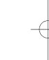

## 进入 StarOffice

如果你发现 StarOffice 接管了你的桌面让你感到困惑，可以通过点击“视图”菜单上的“集成桌面”（Integrated Desktop）命令来关闭它（当你打开文档时，该命令在“视图”菜单中以不同的名称“桌面模式”（Desktop mode）出现）（`Ctrl+Shift+1`）。StarOffice 将变成系统桌面上的一个窗口，可以像任何其他程序一样调整大小、移动并最小化为任务栏按钮。

StarOffice 在线帮助文档交替使用“桌面模式”（Desktop mode）和“集成桌面”（Integrated Desktop）。这些只是只是同一个命令（`Ctrl+Shift+I`）的两种名称。

### 理解桌面工作空间

程序首次启动时，它会自动创建一个默认的 StarOffice 桌面。在 Windows 下，此桌面包含了与 Windows 桌面相同的程序图标和文档。请注意，开始菜单中的图标也会出现在 StarOffice 的开始菜单中。在 Linux 下，如果你有一个桌面文件夹，它将包含该文件夹；否则，它将使用 StarOffice 桌面（`/user/office5/desktop`）作为你的默认桌面。它不会在内部复制你的 `fwm` 菜单。

> 来自 Michael & Sarah 的提示 #1：通过向 `Office5\config\start` 目录创建链接或将项目复制其中，你可以自定义开始菜单。

将你常用的桌面图标整合到 StarOffice 桌面中，使得从 StarOffice 内部轻松访问常用程序。

访问这些文件夹和程序非常简单。如果双击文件夹，StarOffice 会在桌面上打开一个窗口显示该文件夹的内容。如果双击程序图标，它将作为一个窗口在 StarOffice 桌面的顶部运行。你可以以多种方式更改和自定义此桌面工作空间的内容。你还可以选择另一个文件夹作为默认桌面，或者拥有多个桌面。然而，你必须始终有一个指定的桌面。当程序运行时，该桌面始终处于激活状态。你可以将此桌面想作你的根桌面。

- 有关自定义桌面以及创建和使用多个桌面的信息，请参阅“管理多个桌面（Managing Multiple Desktops）”。第 123 页。

## 首次启动 StarOffice

图 2.2

初始的 Windows 版 StarOffice 工作空间，关闭了集成桌面。StarOffice 桌面可见，但你可能会先看到你的系统桌面顶部。


欢迎使用 StarOffice！

每当你启动 StarOffice 时，帮助助手（Help Agent）都会为你提供提示。这些提示包含了你使用 StarOffice 工作时的有用信息。或者，你可以在“帮助 > 选项...”（Help > Options...）或“其他”选项卡中配置这些设置。

随着你打开和关闭文档以及文件夹，你的桌面工作空间的内容不断变化，每个打开的文档或窗口都会依次放在桌面工作空间之上。你一次可以打开多达 25 个文档；但不建议打开这么多，因为这会显著减慢你的系统性能——除非你有数百万兆字节的内存！

不过，你的默认设置始终在那里。

你还会注意到在窗口左上角的边缘以及屏幕底部帮助助手的顶部边缘有两个图标，一个箭头和一个大头针。这些图标是浮动桌面窗口的控件（请看后文第 2.3 节对这些标识的说明）。点击箭头可以隐藏或显示窗口——所以如果你想清理桌面，请点击箭头隐藏帮助助手。点击大头针会将窗口“钉”在桌面上。否则，它会浮在上方并可能会覆盖部分桌面内容。

点击左上角的箭头会显示（或隐藏）资源管理器（Explorer），这是 StarOffice 桌面的一个关键组件，在本章稍后的“使用资源管理器和显示（Using the Explorer and Beamer）”中详细讨论。

如图 2.3 所示的标题栏仅在关闭“集成桌面”功能时才显示。

## 在 StarSpace 中定位 | 31

标题栏列出了 StarOffice 的版本名称和数字。如果你尚未注册程序，该栏将显示 `[未注册]`（not registered）。标题栏还会列出桌面上活动窗口的名称，如图 2.4 所示。图 2.4 显示了打开了 StarWriter 文档且关闭了集成桌面的 StarOffice，这意味着程序控制按钮（最小化、最大化/还原和关闭）在右上角可见。

图 2.4

打开了 StarWriter 文档且关闭了集成桌面的 StarOffice，这意味着程序控制按钮（最小化、最大化/还原和关闭）在右上角可见。

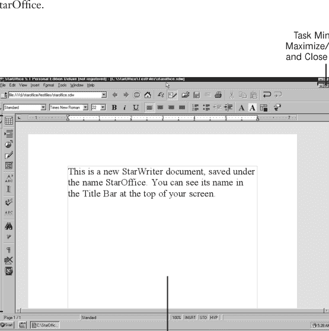

主工具栏

活动窗口

最小化、最大化/还原、关闭

当你打开新文档时，它们会被分配标题为“未命名”（Untitled），直到你第一次保存文档，此时标题栏会显示文件名。

你可以通过多种方式操作你的程序和任务：

- 右角有按钮，允许你控制 StarOffice 的大小和位置并关闭程序。
- 点击“最大化/还原”按钮会导致你的窗口浮动或全屏显示。

## 第2 章 进入 StarOffice

当程序处于“还原”模式并作为窗口浮动时，你可以用鼠标进行移动和调整大小。

- 要移动窗口，将光标置于桌面上的任何空处，并将窗口拖到所需位置。
- 要调整窗口大小，将鼠标移动到窗口边缘，直到光标变为双头箭头。然后，拖动边缘或角到所需尺寸。

程序只记住最近的窗口大小；因此，在整个会话期间调整窗口大，“还原”按钮会自动调整到上次窗口大小。

- 点击“最小化”按钮会将 StarOffice 缩小为任务栏上的一个按钮，点击“关闭”按钮将关闭 StarOffice 并返回系统。
- 左上角有一个代表 StarOffice 程序的图标。点击它会打开一个提供与按钮相同命令的菜单。

### 菜单栏

标题栏下方是菜单栏，包含当前桌面菜单的列表。这些菜单上的可用命令取决于你在桌面上打开的文档或对象的类型。某些命令可能是灰色的，这表示它们不适用于你的任务，因此暂时不可用。

当桌面上有打开窗口或文档时，菜单栏也会显示最大化/还原、最小化和关闭按钮，就像标题栏一样。这些按钮的功能相似，只是它们影响打开的窗口和文档，而不是整个 StarOffice 程序。

> 默认桌面没有最大化、最小化和关闭按钮，因为它不是一个任务，且无法与程序窗口独立关闭或调整大小。

菜单逻辑清晰，有助于快速找到命令而无需记忆其位置。一些最常用的菜单命令也分配给了功能栏和对象栏上的按钮，以及右键点击打开的菜单。

> 为了加速工作，你可以将自己的常用命令或宏分配给工具栏上的按钮。有关更多关于自定义工具栏的信息，请参阅第 3 章“准备工作（Getting Ready for Work）”。

## 在 StarSpace 33 中定位

要打开菜单，请点击其名称或按 `Alt` 键并配合带下划线的字母。要选择菜单命令，请点击它。某些命令还有键盘快捷键。这些快捷键显示在命令的右侧。

- 有关最常用的键盘快捷键列表，请参见“附录 E”，第 1429 页。

### 文件菜单

文件菜单与桌面和资源管理器（在本章稍后的部分描述）一起，是你执行最常用任务的启动台。

### 编辑菜单

编辑菜单包含删除、更改和移动数据的命令，以及插入对象、图像和链接的命令。它还包含非常重要的“撤销”命令 (`Ctrl+Z`)，它可以撤销你多达 20 步的悔错误。

> 技巧 #4，源自在“工具-选项-常规-保存”对话框中更改默认的撤销步数。你可以将撤销次数设置为 0–100 之间的任意数字。

“通讯录”命令会打开一个对话框，可以加快你在 StarOffice 通讯录数据库中输入和查找联系人的过程。通讯录是一个 dBase 数据库，完全集成到 StarDesktop 中，并帮助自动化办公任务，例如创建信函和备忘录。

- 有关使用通讯录的介绍，包括如何将通讯录导入 StarOffice 的提示，请参见“介绍通讯录”，第 180 页。

> 如果你更改了程序通讯录数据库的结构，此对话框将不再适用于该通讯录。

- 有关各种 StarOffice 菜单和子菜单的完整视觉展示，请参见“附录 D”，第 1413 页。

## 菜单

视图菜单允许你开启或关闭资源管理器、Beamer 和工具栏的显示。你可以在全屏视图（为你提供一个没有菜单或工具栏的整洁桌面）和普通桌面视图之间切换，并可以开启或关闭集成式桌面。

34 第 2 章 入门 StarOffice

### 工具菜单

工具菜单包含用于自定义桌面上的应用程序和工具的命令。“宏”和“配置”命令允许你创建和编辑宏，并将宏以及 StarBasic 模块与程序元素关联。“选项”命令会打开一个主对话框。左侧是功能和模块列表。点击 `+` 号打开对话框列表，允许你为该功能或模块设置选项。点击对话框名称显示该对话框。你可以修改的一些选项包括你的 StarOffice Internet 和浏览器设置、默认工作空间和外观，以及 StarOffice 模块环境的默认设置。

- 有关配置桌面和文档默认值的深度信息，请参见第 3 章，第 75 页。
- 有关在 StarOffice 中使用宏的更多信息，请参见第 37 章，第 1239 页。

### 窗口菜单

窗口菜单包含管理窗口的基本命令，以及当前打开窗口的动态列表。将当前隐藏的窗口置于桌面上方的方法之一是点击此列表中的名称。当前处于顶部的窗口用项目符号标识。

### 帮助菜单

帮助菜单包含允许你开启或关闭帮助助手和帮助提示，并打开《用户指南》的命令。它包含三个非常重要的命令：

- 注册——允许你注册你的 StarOffice 程序（见图 2,5）
- StarChannels——带你进入 StarDivision 网站的区域，你可以在那里下载程序补丁和更新
- 关于 StarOffice——包含有关你运行的 StarOffice 版本的信息

如果你输入了用户数据的关键部分，必须重新注册程序，否则它将过期。更多信息请参见附录 A。

## 探索桌面工具栏

StarOffice 还会将命令作为工具显示在桌面边缘的工具栏上。这些工具中的一些是菜单命令的快捷键，但另一些只存在于工具栏上。

## 在 StarSpace 35 中定位

图 2.5

从菜单中选择“注册”将启动向向，引导你完成注册过程。成功注册后，“注册”命令将变为灰色。


工具栏通过单击激活。通过按住 `Ctrl` 键并在工具栏空白区域双击，可以将所有工具栏变为浮动工具栏。你还可以按住 `Ctrl` 键并将工具栏拖向桌面边缘，工具栏会以轮廓形式预览停靠的大小和形状。当你松开鼠标按钮时，它会自动固定。

如果你想学习工具的名称，请在帮助菜单中开启“提示”。当你将鼠标指针悬停在工具上时，会弹出一个提示。你也可以在任何工具栏上点击右键打开右键菜单。反之，你可以打开与所有工具栏名称匹配的子菜单。

### 主工具栏

主工具栏仅在你桌面上方打开了文档时才出现。此工具栏默认显示在工作区的左侧。它的内容取决于你正在工作的内容，因为每种文档类型都有自己的工具栏。

> 技巧 #5，源自 Michael & Sarah

在主工具栏上带有绿色小箭的按钮上扩展点击，可以打开拆卸式浮动工具栏，你可以将其拖到桌面的任何地方。

36 第 2 章 入门 StarOffice

### 主工具栏

还有三个始终可用的通用工具栏：

- 功能栏
- 对象栏
- 超链接栏

### 功能栏

默认情况下，功能栏始终可见。要关闭或开启功能栏，点击“视图-工具栏-功能”命令（见图 2.6）。当功能栏开启时，其名称左侧会出现一个勾号。

**图 2.6**

功能栏打开关键工具


功能栏是跨任务保持不变的工具栏。通常，功能栏包含：

- 开启或关闭资源管理器和 Beamer 等关键组件的命令
- 保存、打开和发送电子邮件等常用编辑命令
- 允许浏览的功能

> 注意
> 
> URL 代表统一资源定位符，通常指 Web 地址。StarOffice 更广泛地使用 URL 指代任何地址。

## 在 StarSpace 37 中定位

### 技巧 #6，源自 Michael & Sarah

有关 Internet 术语的详细词表，请搜索帮助助手或在线索引

### 技巧 #7，源自 Michael & Sarah

如果你还原了 StarOffice，可能没有足够的空间一次显示所有功能栏工具。如果发生这种情况，功能栏的最右侧会出现一个双箭头（如图 2.7）。点击箭头可使缺失的部分变为可见。

图 2.7

将 StarOffice 还原窗口会减少工具的可见性，但它们仍然在那里。在这里，点击功能栏上的箭头可以显示隐藏的工具，包括资源管理器和 Beamer。


| 第 2 部分 |

### URL 定位、Web 浏览和本地驱动器

URL 定位是 StarOffice 不仅与操作系统集成，还与桌面之外更广泛计算机世界集成的显著标志。如果你已为 StarOffice 配置了 Internet 访问，浏览网页只需在定位符中输入 Web 地址并按回车即可。

有关在 StarOffice 内部设置 Internet 帐户的信息，请参见“上网”，第 85 页。

然而，URL 定位不仅仅是一个浏览器工具。StarOffice 将本地驱动器视为 Internet 或局域网的一部分。它将本地路径和 Internet 地址（包括 FTP、Web 和电子邮件地址）统称为 URL，并允许你搜索 URL 定位。输入本地路径的语法是 `file:///c/[文件名]`

例如，如果你想打开 C 盘中名为 `volunteer` 的文件夹下桌面上名为 `fundraising` 的文件，你可以在 URL 定位中输入以下内容，然后按回车：

```
file:///c/volunteer/fundraising
```

# 第二章 走进 StarOffice

来自 Michael & Sarah 的第 #8 号提示

在本示例中，用于分隔 `/c/` 和 `/volunteer` 的符号被称为“管道符”（pipe），它看起来类似于冒号。它在不同键盘上的位置各异，但通常位于标准键盘边缘附近的按键上，并且通常与反斜杠符号在同一个按键上。

### 对象栏

对象栏在默认启动时也是可见的。要关闭或打开它，请点击“视图”（`View`）菜单上的“工具栏”（`Toolbars`），对象栏”（`Object bar`）命令。当该栏开启时，菜单名称左侧会出现一个勾标记。

通常情况下，对象栏包含允许你更改和操作当前在桌面上打开对象的命令。对象栏的内容根据你当前的任务变化很大。图 2.8 显示了桌面对象栏，你可以用它在目录间移动、查看文件以及更改文件和文件夹的属性。

- 图标视图
- 预览开启/关闭
- 目录导航
- 文件描述开启/关闭
- 文件扩展名开启/关闭
- 多重搜索开启/关闭
- 窗口布局按钮
- 桌面

图 2.8

桌面对象栏具有用于浏览目录、预览内容和查看桌面对象属性的工具；虽然你只能在 Beamer 中预览图形，但你可以在桌面的预览窗中查看所有类型的文档。这是一个电子表格示例文档的预览。


## 在 StarSpace 39 中定位

然而，当文档打开时，对象栏包含可以更改文本颜色和布局的格式化工具。当电子表格打开时，对象栏包含一个公式输入框、自动求和（`AutoSum`）工具和工作表导航框。

本书遵循 StarOffice 自身的逻辑，在介绍程序模块和解释如何执行特定任务的上下文中，讨论每个程序模块的对象栏。因此，本节仅介绍当你在桌面上打开文件夹时出现的对象栏。桌面对象栏允许你执行基本的桌面管理任务：

- 最左侧（参考图 2.8）是“属性”（`Properties`）按钮，它可以打开所选对象的属性对话框。接下来是“上级目录”（`Up One Directory`）用于浏览，以及“源文件”（`Originals`）按钮，它可以帮助你找到链接的源文件。
- 接下来两个按钮“图标显示”（`Icon Display`）和“详细信息”（`Details`）更改桌面对象的显示方式。它们右侧的相邻分别开启或关闭文档预览和文档属性。当开启文档预览和文档属性时，桌面上会打开额外的窗格；你可以通过按住它们的边界并拖动来调整这些窗格的大小。
- 当以图标形式显示对象时显示文件扩展名，请点击带有星号的按钮。当开启列表显示时，该按钮将呈灰色，因为文件扩展名在列表视图中会自动显示。
- 接下来的四个按钮在你开启文档预览或文档属性时，更改桌面框架的排列布局。
- 最右侧的最后一个按钮用于开启或关闭多重搜索（`Multiple Search`）功能。StarOffice 中的搜索将在第 5 章“管理文件夹、文件和邮件”中详细描述。

### 超链接栏

超链接栏在启动时是不可见的。要开启或关闭它，请点击“视图”（`View`）、“工具栏”（`Toolbars`）、“超链接栏”（`Hyperlink bar`）（参见图 2.9）。

图 2.9 任何文档都可以开启超链接栏；它有助于创建和跟踪超链接，这些链接用于准备作为 Web 页面的文档。

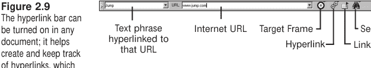

# 第二章 走进 StarOffice

超链接栏包含用于在文档中快速创建和导航超链接的工具。在文档中高亮文本，并在 URL 定位器（`URL Locator`）中输入 URL；你的文本现在就链接到了该地址。如果你按下回车键，会立即在桌面上看到该网页。URL 定位器的下拉列表列出了你高亮的短语，这样你就可以跟踪与超链接单词或短语相关的网站，也可以通过点击列表中的链接在文档链接间跳转。

你还可以将 URL 从 URL 定位器拖放到你的文档中以创建超链接。（释放后，必须按下空格或回车键它才会变成超链接）。你还可以点击“书签”（`Bookmark`）工具创建网站或本地路径的书签。超链接栏中显示的 URL 书签会自动创建在资源管理器的书签文件夹中。

- 有关在创建 Web 文档时使用超链接栏的信息，请参见第 VI 部分“传播——StarOffice 在网络及本地”，第 917 页。

> 注意 书签工具的名字与超链接书签工具相同，但书签工具功能不会自动创建书签。相反，它允许你将 URL 拖放到书签文件夹或打开的文档中。

点击末尾的双远镜图标可以打开在“工具（`Tools`）、选项（`Options`）、Internet（`Internet`）、搜索（`Search`）”标签中指定的全部 Web 搜索引擎列表；只需单击即可搜索 Web。在菜单底部，点击地址簿或书签名称可以将 URL 拖入地址簿的 URL 字段或创建一个新书签。

- 有关更改搜索引擎默认菜单列表的信息，请参见“连接网络”（Getting Online），第 85 页。

> 注意 要访问 Web，你必须先通过拨号连接连接到互联网。

## 在桌面上使用鼠标

虽然通过工具栏可以使用许多命令和工具，但 StarOffice 最大限地利用鼠标让命令触手可及。

### 击、双击和扩展点击

高亮、选择、拖动和释放都是你熟悉的鼠标点击操作。然而，StarOffice 中的某些功能通过不熟悉的扩展点击（extended-click）激活。

扩展点击是左鼠标按键的长按。工具通常对普通点击有响应——但会执行不同的命令。

> 来自 Michael & Sarah 的第 #9 号提示
> 
> 如果你无法使用扩展点击，请尝试更改鼠标速度。

例如，点击后退按钮可以返回到之前打开的文档或网页。然而，扩展点击会打开包含最近文件名和 URL 的子菜单。只需点击列表中的路径或 URL 即可返回该位置。

学习扩展点击最简单的方法是在开启“帮助、提示”时探索桌面。

### 拖放

通常，在 StarOffice 中最高效的方法是使用鼠标拖放。你不仅可以用这种方式复制和移动数据，还可以创建链接、插入对象并在文档中插入数据。可以在窗口、文档、Beamer 和资源管理器之间拖放。

- 有关 Beamer 和资源管理器的更多信息，请参见“使用资源管理器和 Beamer”，第 43 页。

拖放的一些方式汇总在表 2.1 中。

| 表 2.1 StarOffice 中选定的拖放功能 | 执行此操作... | 结果是... |
| --- | --- | --- |
| 从资源管理器的一个位置拖动文件、链接或邮件到另一个位置 | 将所选对象移动到新位置。 |
| `Ctrl+拖动`从资源管理器的一个位置到另一个位置的文件、链接或邮件 | 将所选对象复制到所选位置。 |
| `Ctrl+Shift+拖动`从资源管理器的一个位置到另一个位置的文件夹、链接或邮件 | 在对象与所选位置之间创建链接。 |
| 从资源管理器将文件或链接拖到桌面 | 在当前桌面目录中创建文件副本或链接并在桌面上打开。 |


| 从 Beamer 将文本、电子表格、HTML、文档或网页拖入打开的文档中 | 创建指向文件的链接。 |

# 表 2.1 续

| 执行此操作... | 结果是... |

|---|---|

| 从演示器（Beamer）将图形或演示文稿拖入打开的文档中。 | 打开“插入幻片、对象”对话框。选中的对象作为副本插入到打开的文档中。 |

| 从演示器将图像文件或公式拖入打开的文档或其他桌面窗口中。 | 在 `StarImage` 中打开图像文件，或在 `StarMath` 中打开公式。 |

| 按住 `Ctrl+Shift` 并从演示器将图像文件、演示文稿或公式拖入打开的文档中。 | 创建指向该对象的超链接或链接。 |

| 从演示器将素材库（Gallery）图像、声音或图形拖入打开的文档中。 | 将该对象的副本插入到打开的文档中。 |

| 从 URL 定位器将 URL 地址拖入打开的文档中。 | 创建指向该地址的超链接（互联网地址）或本地路径。 |

| 从资源管理器（Explorer）或打开的任务窗口将电子邮件账户拖放到桌面上。 | 在任务窗口中打开你的收件箱。 |

| 从地址录将条目拖入打开的文档中。 | 将数据复制到新位置。 |

| 拖动或按住 `Ctrl` 拖动表格从一个数据库到另一个。 | 打开“复制表格”对话框，允许你复制表格定义和数据、仅复制定义，或追加表格。 |

拖放操作的种类非常多，最好的学习方法就是尝试并观察会发生什么。如果发生了意外之外的情况，请立即调用“撤销”命令（`Ctrl+Z`）。指针的形状通常会提示这一点——当你拖动并只看到灰色轮廓时，对象会被移动；当你看到带有加号（`+`）的灰色轮廓时，对象会被复制；而带有箭头的灰色轮廓则表示将创建线条。

- Michael & Sarah 的第 10 条提示：通常情况下，StarOffice 中的拖放功能与 Windows 资源管理器中的相同。

如果你想确切知道拖放操作后发生了什么，打开“编辑”菜单并查看“撤销”命令，它会指明具体的动作。

- Michael & Sarah 的第 11 条提示：想并排查看两个任务吗？通过将一个任务按钮拖到另一个任务按钮上，将它们合并到一个任务窗口中。要再次分离它们，拖走顶部的任务按钮即可。

## 使用资源管理器和演示器

尽管你可以在 StarOffice 和应用程序之间进行拖放，但有时数据或对象的部分会丢失或发生系统崩溃。如果你遇到问题，请尝试在 StarOffice 中打开非 StarOffice 文件，在 StarOffice 内部进行拖放，然后根据需要重新在应用程序中打开它们。

### 右键点击和上下文菜单

上下文菜单包含了管理桌面所需的大多数命令。如果你不知道如何在 StarOffice 中执行某项操作，通常的方法是将指针置于你想执行操作的位置，或突出显示你想操作的对象，然后通过右键点击打开上下文菜单。

上下文菜单命令将在全书中与其相关的对象和任务一起进行讨论。查看“索引”可以找到特定命令的位置。另请参考附录 D“默认快捷键”，获取所有上下文菜单的插图。对于创建和管理桌面对象（使用 `StarBase` 数据库）至关重要的资源管理器菜单将在下一节中讨论。

## 使用资源管理器和演示器

如果你的桌面就像是飞船的驾驶舱，那么资源管理器就类似于船长的座椅——即你从这里指挥操作、调查并启动新项目的座位。演示器就是你的二副驾驶——协助执行各种重要任务的助手。虽然程序启动时桌面上不会显示资源管理器和演示器，但资源管理器是可见的，只是隐藏在左侧。你会经常一直使用其中一个或两者。

表 2.2 显示了你可以在资源管理器中找到的各种对象，并简要描述了它们的功能。本章稍将对每个对象进行详细说明。

### 表 2.2 默认资源管理器对象

| 图标 | 对象名称和功能 |

|---|---|

| 地址录 | 地址录是你用作联系人管理的 `StarBase` 数据库。 |

| 工作空间 | 工作空间显示系统的驱动器、卷和目录。它也会以组的形式出现。 |

| 工作文件夹 | 文件夹或是指向系统工作文件夹的链接，或者是 Office51/Explorer 目录下的文件夹。它也会以组的形式出现。 |

## 第 2 章进入 StarOffice

### 表 2.2 续

| 资源管理器图标 | 对象名称和功能 |

|---|---|

| 示例 | 示例文件夹包含带有示例、绘图、公式、演示文稿、电子表格和文本文档的子文件夹和文件。 |

| 书签 | 书签文件夹包含指向互联网网站的超链接。它也会以组的形式出现。 |

| 素材库 | 素材库包含你可以插入到文档中的剪贴和声音。 |

| 回收箱[15] | 回收箱存储从 StarOffice 内部删除的文件，直到你将其清空。 |

| StarSchedule | `StarSchedule` 是你在 StarOffice 内的个人预约规划和日历。 |

| 帮助 | 帮助包含指向在线帮助系统章节的链接，以及一个帮助书签文件夹，以便你可以在过程中创建自己的链接。 |

表 2.3 显示了你在资源管理器上下文菜单中创建并存储的各种对象。这些对象允许你连接到互联网账户和数据库等外部数据源。

### 表 2.3 在资源管理器中创建的对象

| 图标 | 名称和功能 |

|---|---|

| | POP3 邮件账户收件箱从 POP3 服务器下载电子邮件。 |

| | IMAP 邮件账户收件箱从 IMAP 服务器下载电子邮件。 |

| | VIM 账户从 VIM 系统下载电子邮件。 |

## 使用资源管理器和演示器

| 图标 | 名称和功能 |

|---|---|

| 🔍 | 搜索文件夹允许你将文件和文件夹带到桌面。 |

| 📧 | 订阅允许在网页内容更改时接收消息。 |

| 📷 | 模板文件夹包含 StarOffice 模板以及你用 `Auto` 创建 |

资源管理器自 5.0 版本以来得到了改进，并具有许多新功能，最直观的是可以创建组来组织你的桌面的能力。为了识别这些新功能，它现在被称为扩展资源管理器。你还可以通过选择组上下文菜单上的“显示”命令在资源管理器显示文件（而在 5 版本中仅在演示器中）。

此外，你可以在资源管理器中以三种视图显示对象：层级、小图标或大图标。当组设置为层级视图与其他视图时，对象对你的操作反应不同；某些功能仅在设置为层级时可用。本节重点讨论层级视图下的扩展资源管理器。

- 有关选择组视图的更多信息，请参见“在资源管理器中操作组”，第 49 页。

- 要将资源管理器设置为层级视图，右键点击资源管理器组标题按钮，并在上下文菜单中选择“层级视图”。

在层级视图下，双击资源管理器中的对象将打开它。点击对象左侧的加号将显示子目录的内容。如果你使用底部的工作空间图标，将看到所有卷和驱动器的分支列表。

当组设置为层级视图时，当你选择并右键点击时，演示器会显示大多数类型资源管理器对象的内容。在演示器中显示文件让你可以使用特殊的拖放功能。例如，当地址录在演示器中时，你可以将地址录条目或合并字段拖入打开的文档中。同样，你可以在演示器中显示资源管理器中任何文件夹的内容，双击演示器中的文件打开它们，并将素材主题的内容拖入打开的文档中。

- 为了显示对象的内容，必须在右键点击资源管理器中的对象之前打开演示器。

# 第 2 章 进入 StarOffice

> ### Michael & Sarah 的第 12 条建议：在桌面上显示一个文件夹的内容，在幻灯片（Beamer）中显示另一个，你可以通过拖放轻松复制文件并创建链接。

资源管理器（Explorer）是你创建你所说的“新界面”的起点——即那些让你能够连接并可能（如果你选择这样做的话）存储某些外部数据源数据和信息的对象。这些对象包括指向其他目录的链接、电子邮件账户收件箱、电子邮件新闻组、StarBase 数据库（最常用于从外部源导入数据）以及 FTP 账户。（另一方面，“任务”组、StarOffice 桌面以及“文件”->“新建”菜单是你更有可能开始新任务和文档的地方。）

## 操作资源管理器和幻灯片（Beamer）窗口

首次启动 StarOffice 5.1 时，资源管理器是打开的但隐藏在你的桌面上。点击桌面左边缘的箭头将其显示出来。

如果资源管理器关闭了，你可以通过点击功能栏上的图标、按下 `Ctrl+Shift+E`，或从“视图”菜单中选择“资源管理器”来打开它。点击功能栏上的图标（资源管理器图标的右侧）、按下 `Ctrl+Shift+B` 或从“视图”菜单中选择来打开幻灯片（Beamer）。你的桌面看起来类似于图 2.10。

图 2.10

通过点击标题栏展开组，标题将显示组名称。在默认布局下，双击资源管理器对象可以打开它们。你可以选择并右键点击对象以打开上下文菜单进行管理（无论是在桌面上未打开的状态，还是如此处所示）。

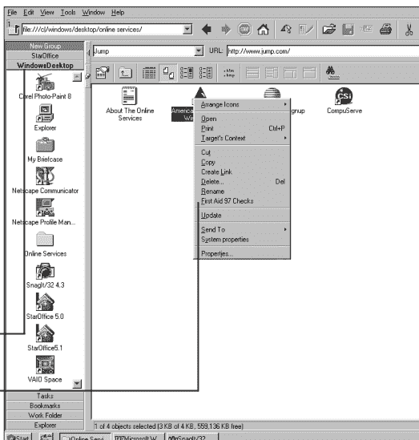

点击此处打开组。

右键点击打开上下文菜单。

## 使用资源管理器和幻灯片 47

资源管理器和幻灯片都是可停靠的浮动窗口。它们最初以浮动停靠状态打开。

要将它们固定到桌面，请点击大头针（Stickpin）图标。它们将自动整齐地排列在你的工作区旁边，而不是浮在你的任务之上。

就像资源管理器一样，你可以通过点击幻灯片上的小箭头来切换隐藏和显示。


要调整资源管理器的大小，请拖动其右边界；要调整幻灯片的大小，请拖动其底部。

要取消浮动窗口的停靠，按下 `Ctrl` 并双击窗口内部的空白区域。

要停靠窗口，按住 `Ctrl` 键的同时，通过标题栏拖动窗口到你想停靠的桌面边缘。当你靠近边缘时，窗口的轮廓将改变以预览其停靠状态。当你看到轮廓时，释放鼠标。

关于操作可停靠浮动窗口的更多信息，请参见本章后面的“其他浮动和可停靠窗口”章节。

### 资源管理器上下文菜单

通过资源管理器，你可以搜索文件和文件夹，在 StarOffice 和本地驱动器之间移动，并使用拖放功能管理对象。重要的是，你可以使用资源管理器菜单上的命令创建和管理大多数类型的 StarOffice 对象——包括数据库、新闻组、FTP 和电子邮件账户、文件夹和链接。你可以通过在空白区域右键点击或选择一个对象后右键点击来打开上下文菜单。命令在某种程度上取决于你选择的对象类型（如果），某些命令在对象类型之间是通用的。图 2.11 显示了未选择任何对象时打开的上下文菜单。

要创建一个新对象，将光标放在资源管理器的空白区域（或选择你想放置该对象的文件夹），右键点击并选择“新建”命令。你会看到图 2.11 中出现的子菜单。

要更改对象的名称或规则以及它在桌面上的更新和显示方式，请选择它并选择“属性”命令。

表 2.4 列出了特定文件管理和桌面任务的上下文菜单命令。这些命令出现在文件夹和链接上，也可以在其他类型对象的菜单中找到。请注意，回收站、画廊和帮助等特殊的 StarOffice 对象具有不同且有限的上下文菜单命令，这些命令与它们的特殊功能相关。

> 出现的命令还取决于你系统中安装的插件。

## 第 2 章 进入 StarOffice

图 2.11

资源管理器上下文菜单是你创建电子邮件和新闻组账户、数据库、文件夹、搜索文件夹和 Web 订阅的起点。某些命令（如 Paint Shop Pro 和 Core 命令）用于你系统上的其他程序，因此你看到的内容取决于你的系统配置。

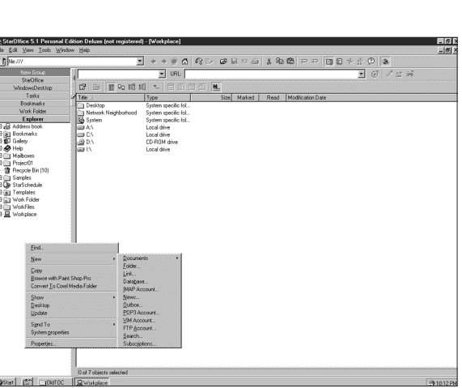

## 表 2.4 基本桌面上下文菜单命令

| 命令名称 | 用途 |
| --- | --- |
| 打开 (Open) | 在桌面上打开对象的内容。 |
| 查找 (Find) | 构建实时搜索，可以查看系统的任何地方或将对象检索到桌面。（此命令在 5.0 版本中称为 Search）。 |
| 新建 (New) | 创建新对象。 |
| 剪切 (Cut) | 从位置删除对象（移动到缓冲区）。 |
| 复制 (Copy) | 将对象复制到通用缓冲区。 |
| 创建链接 (Create Link) | 创建对象的链接。 |
| 显示 (Show) | 设置资源管理器中的对象。 |
| 桌面 (Desktop) | 将对象指定为桌面。 |
| 更新 (Update) | 更新选取对象的内容。 |
| 同步 (Synchronize) | 与服务器数据同步。 |

## 使用资源管理器和幻灯片

| 命令名称 | 用途 |
| --- | --- |
| 发送到 (Send To) | 将活动文档发送为电子邮件或传真。 |
| 系统属性 (System Properties) | 显示选取对象的基本属性。 |
| 属性 (Properties) | 显示并允许选择选取对象的广泛属性。 |

- 关于文件夹管理的搜索、更新和属性上下文菜单命令的讨论，请参见第5章“管理文件、文件夹和邮件”，第 191 页。
- 关于在资源管理器中设置电子邮件账户的说明，请参见“创建邮箱”，第 96 页。
- 关于桌面上下文菜单命令的讨论，请参见“管理桌面”，第 123 页。

### 在资源管理器中操作组

5.1 版本的新功能是在资源管理器中创建组。在之前的版本中，资源管理器很快就会变得混乱，特别是当你点击工作区图标打开驱动器和卷来管理整个网络或驱动器结构时。通过将经常访问的文件夹或驱动器指定为组，你可以点击按钮轻松打开它们，同时只显示所需的对象。

以下组在首次启动程序时会自动创建：

- 任务组：重复你通过“新建”菜单可以创建的新任务。
- 工作文件夹组：其内容取决于你的系统配置。
- 电子邮件和新闻组：包含新的空 StarOffice 收件箱和新闻账户，或从另一个程序导入的收件箱和新闻账户。
- 标记文件夹：包含 StarOffice 默认书签或来自另一个程序的书签。

在 StarOffice 中管理工作的最佳方法是为每个当前项目在资源管理器创建一个组。这样，你就可以将项目所需文档和模板存储在一个地方（无论是原始文件、副本还是链接），并始终能够访问。

> > Michael & Sarah 的第 13 条建议：如果你需要将不同位置的文档汇集到项目中，请在资源管理器中创建一个保存搜索。保存搜索允许你创建规则来搜索任何卷、驱动器或目录，并根据你设定的标准检索项目。有关创建保存搜索的更多信息，请参见第5章“检索远程文件和文件夹”。

注意：虽然从技术上可以创建一个包含特殊 Explorer 对象的组（例如画廊），但回收站不会在它们的组窗口中显示任何单独的文件。你可以从 Explorer 组中显示这些对象的内容。

### 创建和命名新组

要创建一个新组，请右键点击 Explorer 顶部的“新组”（New Group）按钮。你有两个选择：创建一个作为（空）文件夹的新组，或者创建一个作为指向现有文件夹的链接的新组。你可以链接到系统中的任何位置的文件夹。

如果你选择“添加为文件夹”（Add as Folder），将立即出现一个默认名为“新组”的新组。

如果你选择“将组添加为链接”（Add Group as Link），将打开一个带有两个选项卡的对话框。如果你已经知道想要创建链接的文件夹路径（称为目标文件夹），请将其输入“常规”（General）选项卡中的文本框中。如果你不知道路径，请跳过“常规”选项卡，进入右侧的“目录”（Directory）选项卡，这将打开文件浏览对话框。导航到文件夹的位置，点击并在框中输入其名称，然后点击“选择”（Select）。接下来，在“名称”（Name）文本框中输入组名称。该名称会自动填充到“常规”选项卡的名称框中。点击“确定”（OK），你的组及其所有对象将出现在 Explorer 中。

> **来自 Michael 的第 14 条提示**：创建作为链接的新组的快捷方法是将现有文件夹拖到“新建”按钮上。

要更改组的名称，右键点击其标题栏并选择“重命名组”（Rename Group）命令。组按钮上的名称将会被高亮显示；输入你的名称。重命名链接的文件夹对源文件夹没有影响；它只会影响你在 Explorer 显示中看到的名称。你也可以通过从右菜单中选择“属性”（Properties）并在“常规”选项卡上输入新名称来重命名组。

> **注意** 你的组可能只是文件夹的链接，目标文件夹中的对象只有在你最初将它们创建为链接时它们才是链接。如果你删除了它们，你是从源处删除它们，而不仅仅是从 Explorer 显示中删除。如果你发现自己不小心删除了某些内容，请打开桌面上的回收站并使用“还原”菜单。

### 重新排列组的顺序

要重新排列组的顺序，按住组按钮将其拖到它的新位置。

### 删除组

要删除组，打开组的右键菜单。根据你的组是 Explorer 中的实际文件夹还是指向其他地方文件夹的链接，你会看到“删除组”（Remove Group）或“删除组链接”（Remove Link to Group）。如果你的组是 Explorer 中的文件夹且你选择“删除组”，组中的所有内容都将被删除。如果你的组只是链接，删除组将删除链接且对目标文件夹没有影响。

### 更改组的源文件夹

如果你创建链接创建组，可以通过从组的右键菜单中选择“属性”命令，并分配新的目标 URL（换句话说，路径）来更改组的目标文件夹。

### 更改你的 Explorer 布局

5.1 版本新增，你可以通过右键点击组名打开右键菜单来更改 Explorer 中对象的布局。你有三种显示对象的选择：大符号（Large Symbols）、小符号（Small Symbols）和层级（Hierarchical）。“符号”通常被称为图标。层级视图是 Explorer 的默认视图，其中文件夹和目录以分支、分级的结构显示。

你的选择不仅影响对象的显示，还会影响你启动程序和打开对象的方式。在层级视图中，单击打开文件夹上的子目录，或双击打开桌面上的文件夹或启动程序。在大符号和小符号视图中，单击仅通过在组的右键菜单上选择“显示内容”（Display Contents）命令来在 Explorer 中显示文件夹的内容。当你的组被设置为层级视图时。（事实上，StarOffice 的许多特殊桌面管理功能仅在层级视图中可用，因此探索 Explorer 组的其他内容并没有意义。）

2.12 显示了组的右键菜单以及在大符号显示下打开的任务（Tasks）组。

## 数据库和 Explorer


在 5.0 版本中，数据库只能从 Explorer 右键菜单创建。用户觉得这很困惑，因此 5.1 版本在新菜单中包含了新的“数据库”命令。然而，数据库在本质上与文档是完全不同的对象——它更像是一个文件夹，因为它是许多数据库对象的容器——你仍然可以在 Explorer 中处理它。在创建新数据库后，你可以使用“文件，自动向导”（`File, AutoPilot`）创建表和其他元素；或者从外部源导入数据库对象。更多信息，请参阅第 VII 部分“使用数据库—StarBase”。

### 默认 Explorer 内容

你应该研究 Explorer，因为它包含了许多可以让你工作更轻松的文件、文件夹和对象；此外，它揭示了 StarOffice 的一些才能，并为你创建自己的项目提供了开头。


## 第 2 章 接入 StarOffice

图 2.12

使用组弹出菜单上的命令更改 Explorer 中对象的显示和响应。在两种图标视图中，程序启动且文件夹打开仅需单击。


## 通讯录

通讯录是一个可搜索的 dBase III StarBase 数据库，用于联系人管理器。它完全集成到桌面中，并适用于许多文本模板。

在文本、HTML 和邮件右键菜单中，如果你选择一个姓名并点击“通讯录”命令，StarOffice 会立即在桌面上弹出该地址。通过选择联系人或其他信息并选择“浏览”，你可以将其带到你工作的桌面。你还可以使用通讯录（或其他数据）来创建邮件。

- 有关使用通讯录的通用讨论以及导入应用程序数据库的信息，请参阅“介绍通讯录”，第 180 页。

添加、编辑和查找条目的最简单方法是使用通讯录命令打开的对话框如图 2.13 所示）。该对话框相比 5.0 有了显著改进，修复了一个反转国家和州字段的讨厌错误，使通讯录对美国用户完全可用。

- 有关创建表信的信息，请参阅“邮件合并创建表信”，第 360 页。
- 有关创建合并的信息，请参阅“使用 StarMail 创建合并”，第 1062 页。

### 使用 Explorer 和 Beamer

为了确保无人意外删除通讯录，它是受保护的。如果你尝试删除它，会出现错误消息，拒绝你对存储位置文件夹的访问。

如果 Beamer 已打开，按下 `F4` 可在 Beamer 表视图中打开通讯录，你可以在那里查看并编辑条目，或将地址拖入打开的文档（见图 2.13）。5.1 版本在 Beamer 工具栏上有一个新的“查找记录”（Lookup Record）按钮，让你能够直接从 Beamer 表显示中搜索记录。

### 查找按钮

图 2.13 通讯录数据库在 Explorer、Beamer 以及通讯录对话框中管理。

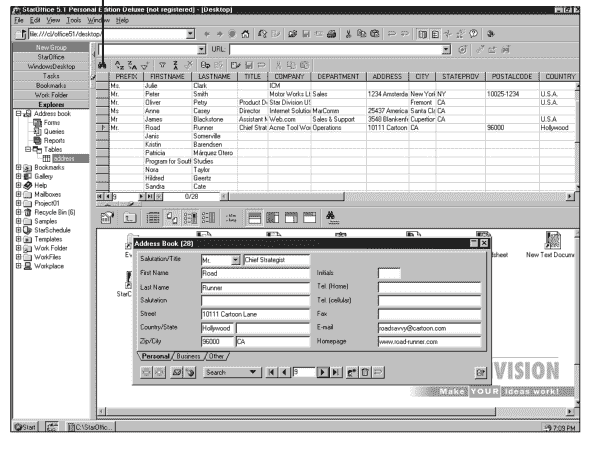

### 书签文件夹

Explorer 书签文件夹被设计为在 StarOffice 中存储书签的地方。如果你是在安装 StarOffice 时已安装 MS Internet Explorer 的 Windows 用户，此文件夹是一个自动创建到 Internet 书签文件夹的链接。如果你是 Linux 用户或没有 MS Internet Explorer 的 Windows 用户，你的 Explorer 书签文件夹将是 StarOffice51!Bookmarks 文件夹。如果你使用 Internet Explorer，可以在 Explorer 中创建一个指向 StarOffice 书签文件夹的链接，以便访问这组预设书签，或者可以将任何你感兴趣的书签复制到你的 Explorer 书签中。

除了出现在 Explorer 中之外，你的默认书签文件夹也有自己的书签组。

# 第 2 章 走进 StarOffice

StarOffice 书签文件夹包含常用网站的快捷方式，以及指向包含 StarOne 环境信息的本地 StarOffice 文档的链接。它还包含 Java 运行时控制台和监器的快捷方式，以及讨论使用 Java 编程语言的网站。

超链接栏上的书签工具会自动将当前显示的超链接 URL 拖入此文件夹，使其成为浏览时创建新书签最方便的地方。不过，你不必固守默认分配的书签文件夹。通过“工具-选项-路径”对话框可以轻松设置另一个文件夹作为默认文件夹。该项目的名称为“书签”，点击“编辑”即可修改路径。你选择的文件夹将显示在资源管理器中。

> 如果你删除或移动了书签文件夹，超链接工具的快捷方式将失效。

这些快捷方式与程序中创建的任何链接或书签一样；它们可以被移动、复制和删除。你还可以向现有文件夹添加自己的书签，或创建自己的书签子文件夹。

> 在 5.0 版本中，存在一个导致无法在不丢失链接的情况下重命名书签的错误。在 5.1 版本中，你可以无问题地重命名书签。

> 书签、链接和快捷方式本质上是同一种对象。每种都是指向文件的引用类型，当你点击书签、链接或快捷方式时，它可以跳转到文件位置或打开文件。

## 画库 (Gallery)

画库中充满了酷炫的照片、位图、图形、声音、动画图像和背景，准备好插入到你的网页、演示文稿、报告以及在 StarOffice 中创建的任何其他增添色彩。

你可以在显示器（Beamer）中预览所有图像和声音，还可以将它们从显示器拖放到打开的文档中。更多信息，请参见本章节后后的“在显示器中预览文件、声音和图像”。

要将你的图形或源文件添加到画库，请选择画库文件夹并选择“导入”命令。浏览网页时，还有一个方便的右键菜单命令可以让你轻松复制或下载任何图形文件并将其添加到画库。

## 资源管理器帮助链接

帮助信息遍布桌面各处，包括这里的资源管理器，它提供了一种访问《用户指南》的不同方式。要查看《用户指南》的内容，点击帮助图标左侧的加号 (`+`) 打开帮助文件夹。继续点击加号直到看到你感兴趣的章节。双击标题，其内容将出现在桌面窗口中。

## 回收站

当你从 StarOffice 中删除对象时，它们不会立即从硬盘中丢弃；它们被存储在回收站中，以防你可能仍需要它们。它们会一直留在回收站中，直到你使用“删除”命令显式地删除它们。

> 注意

回收站是 StarOffice 整体整合影响程序所需磁盘存储量的方式之一。请确保在分区或硬盘上留出足够的空间来容纳回收站。务必定期清空它，以免在硬盘上堆积垃圾。你也可以通过“工具-选项-常规-路径”对话框选择位于其他处的文件夹作为垃圾箱文件夹——但你会失去回收站的特殊功能。

回收站中当前存储的对象数量始终显示在资源管理器中名称右侧的括号内。

要从回收站中删除对象，请遵循以下步骤：
1. 在资源管理器中双击回收站图标，这将打开一个显示其内容的桌面任务窗口。
2. 选择你想删除的项目。
3. 从功能栏或“编辑”菜单中选择“删除”。
4. StarOffice 给了你另一个机会保存文件免受彻底破坏。确认你想删除该文件并完成处理，选择“是”或按回车键。

你移动到回收站的对象不能像桌面上的其他对象那样被拖放。要将回收站中的对象返回原始位置，请选择该对象，然后从右键菜单中选择同名的“还原”命令。

要清空回收站，请从右键菜单中选择同名的命令。

## 示例

为了让你领略 StarOffice 的可能性，程序中包含了一些在程序中创建的示例文档。某些示例（例如 StarPro 版本中的 Logo 工作坊）甚至会一步向你展示最终产品是如何创建的。

> 注意

你所拥有的示例可能有所不同，取决于你安装了哪个版本的 StarOffice。

你可以使用这些示例作为创建自己项目的模板。例如，其中包含了一个用于跟踪视频收藏的示例数据库。你可以自定义此数据库来组织你自己的视频收藏。

## StarSchedule

使用 StarSchedule 在桌面管理你的日程，为即将到来的事件设置自动提醒，并规划项目。虽然 StarSchedule 可以用于跟踪个人日历，但它在网络上使用时威力才会显现，此时你可以跟踪项目团队或部门的日程，同时允许所有团队成员访问该日程。StarSchedule 服务器允许你添加或删除具有访问权限的服务器。

你可以设置自动提醒在桌面上，或自动发送电子邮件给邮件列表中的所有成员。

StarSchedule 的美之处之一在于其简单——不再有臃肿、混乱的日历，只有简洁、直观的界面。在桌面上打开 StarSchedule 并双击“任务”；任务列表将打开。添加你的任务，它们会在你打开日历时自动出现。关于 StarSchedule 的详情，请参见“使用 StarSchedule”，第 102 页。

## 工作文件夹

当你启动 StarOffice 时，显示器（Beamer）会创建一个文件夹。根据你的系统配置，它还会显示属性。要查找文件夹，请使用“工具-选项-常规-路径”对话框。

## 工作空间 (Workplace)

双击工作空间图标将打开一个窗口，显示所有本地设备、所有网络驱动器和服务器（如果你连接了网络），以及完整的网络地图。然后你可以使用右键菜单上的工具进行导航。

- 提示：StarOffice 中的工作空间等于 Windows 中的“我的电脑”。

## 使用显示器的进一步探索


显示器（如图 2.14 所示）在本节开始处作为资源器的助手简单介绍，但是时候仔细观察它的功能了。显示器就像一盏灯笼，照亮你在资源管理器中找到的内容，显示文件详情。你可以通过显示器菜单管理单个文件。如前所述，按下 `F4` 还会显示地址录。当地址录打开时，你可以将姓名、地址和电话号码拖放到打开的文档中。你还可以在显示器中显示任何 StarBase 表，并将字段拖入文档。

要开启或关闭显示器，点击功能栏上的它，或在“视图”菜单中选择它的名称。你也可以通过按 `Ctrl+Shift+B` 开启显示器（但无法关闭）。

如果显示器已打开，扩展点击文件夹或其他对象将显示该对象的列表及其属性（如最后修改日期）。点击属性标题栏以更改排序顺序；拖动其右或左边界以缩小或扩展长度。双击某些表栏会自动缩小其尺寸。你还可以通过显示器菜单上的插入命令选择你想查看的属性显示。

要选择单个文件，点击其名称；要选择列表，点击列表中的第一个项目，然后按 `Shift` 并点击最后一个项目。按住 `Ctrl` 点击可以选择多个不连续的项目。

在你选择一个项目后，可以根据该项目进行搜索。你无法在显示器中创建保存搜索——你只能在桌面或资源管理器中这样做——也无法显示保存搜索的内容。

> 注意
> “删除”命令不会从显示器中删除文件；它只删除你当前在显示器中选中的属性显示。

## 第 2 章 进入 StarOffice

### 图 2.14

你在 Beamer（浏览器）中可以执行的操作包括打印和编辑文件、更新文件以及分配文件的默认模板。在图中，Beamer 上下文菜单允许你管理显示的文件属性。通过将指针置在属性标题栏上并点击右键可以打开此上下文菜单。


隐藏/显示按钮 大别针

### 在 Beamer 中预览文件、声音文件和图像

Beamer 不仅仅是一个本地管理器，还是一个预览窗口，你可以在其中查看或收听库（Gallery）片段（参见 2.16）。更棒的是，你可以将图形或声音文件从 Beamer 拖放到活动文档中。

要预览库文件夹的内容，当资源资源管理器（Explorer）被设置为分级视图时，长击其名称。这将打开一个名为“缩略图”的预览条（因为它们的尺寸很小）。要以大视图查看文件或收听声音文件，请双击它。双击可返回 Beamer 的缩略图浏览视图。要查看文件夹中的文件，请使用 Beamer 的滚动条。

其他对象也可以从 Beamer 拖放。例如，你可以通过将文件从 Beamer 拖到文本文档页面上将其插入另一个文档中。

### 其他浮动可停靠窗口

资源管理器和 Beamer 并不是孤立的；StarOffice 有许多特殊的浮动可停靠窗口，你可以在工作时保持它们打开。这些包括导航器（Navigator）和样式器（Stylist），它们都从功能栏打开（但仅在你的桌面上打开了文档时可用）。帮助助手（Help Agent）是一个可停靠窗口，如果你在学习程序时经常使用它，可能会发现将其停靠起来起来更方便，这样它就不会遮挡你的工作区域。

## 使用资源管理器和 Beamer 59

启动时打开的提示窗口是帮助助手的一个特殊部分，仅显示提示信息。它在工作时并不好用，因此你可能更希望停靠真正的帮助助手，它能提供上下文相关的程序。其他特殊工具可以从特定文档类型内部打开，包括 StarCalc 中的功能列表和表单导航器。

### 图 2.15 Beamer 充当库多媒体文件的缩略图查看器和播放器，这些文件包含30个让你的网页动的动画、声音和图形。当你找到想要的文件时，将其拖放进文档中。

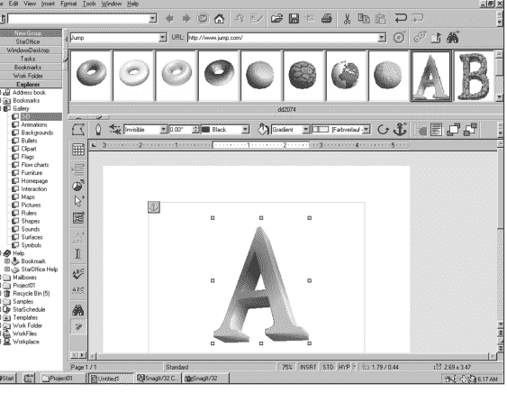

你可以像管理导航器和 Beamer 一样在桌面上管理这些窗口。当窗口处于浮动状态时（如图 2.16 所示的导航器），你可以抓住它的边缘并调整大小，使其不占用过多的实际空间。

双击标题栏可以在标题栏视图和打开视图之间切换窗口。你可以将标题栏拖动并放置在桌面上。（但请注意，当窗口处于标题栏形式时，无法将其停靠；窗口必须是打开状态。）使用 `Ctrl+点击` 可以停靠和解锁窗口，点击右上角的“关闭”按钮可以关闭它们。

### 浮动工具栏和对话框

你会遇到两种类型的浮动对象，它们是不可停靠的，并且与右侧的浮动对话框窗口有些其他不同。

主工具栏有许多工具，每个工具的右侧都有一个小小的绿色箭头。这些是双功能按钮。长击可以打开一个工具栏——实际上是一个微工具栏——它可以被拆卸并移动到桌面的任何地方。工具栏上的某些按钮还可以打开可拆卸的浮动面板或工具栏——例如 StarCalc 和 StarWriter 中的背景颜色调色板。另一个微工具栏是导航工具栏（参见图 2.16），在导航器内部或通过点击文档中的导航按钮打开。（请后阅图 2.17 以查看标识出的导航按钮。）与主程序的工具栏不同，浮动工具栏无法调整大小或停靠。点击角落的按钮 `(X)` 可以关闭它们。

### 图 2.16

桌面，资源管理器和导航器作为浮动窗口打开，且导航工具栏已打开。


当你使用位于主工具栏上的微工具栏时，“工具”按钮会显示你所选的工具。普通点击会激活所显示的工具。如果你需要不同的工具，长击该按钮以打开整个工具栏并选择你需要的工具。

几乎所有的对话框都以浮动对话框的形式打开，可以最小化为标题栏并移动到桌面的任何地方。它们无法调整大小。虽然你可以将对话框移出桌面，但在许多情况下，在关闭对话框之前你无法进行任何其他工作。

## 理解任务和任务窗口

StarOffice 是任务为导向的，你的大部分工作都在任务窗口中进行。

你可以在桌面上打开最多 255 个任务和许多打开的窗口——因此学习如何操作和管理多个任务窗口以及组织桌面上的工具是高效使用该程序的关键。

### 理解任务和任务窗口 61

> 注意
> 为了充分利用 StarOffice 桌面的功能，最好使用一个可视区域至少为 17 英寸的显示器，并设置为 1024×768 或更高的分辨率。如果你在较低分辨率或较小的显示器上运行，你会发现桌面变得非常拥挤，无法一次看到所有工具。

**Michael & Sarah 的第 #16 号提示**

保持许多窗口打开会占用系统内存。为了避免系统崩溃，请仅开启你真正需要的窗口。

#### 什么是任务？

任务是指你在 StarOffice 桌面的任务窗口中打开的任何内容。

StarOffice 中有六种基本任务：

- 创建和处理文档
- 调度和管理任务及事件
- 编写、阅读和发送电子邮件新闻
- 创建和管理数据库
- 管理文件、文件夹和其他对象
- 浏览网页和查看 HTML 文档

在 StarOffice 中，“文档”不仅指文本文档，还指电子表格、绘图、图像、演示文稿、网页以及你创建的其他类型的文件。

当你打开一个新文档、双击资源管理器（Explorer）中的一个对象，或者从 Beamer 拖放一个文件到桌面上时，就会打开一个新任务任务窗口。

**Michael & Sarah 的第 #17 号提示**

要在不关闭活动窗口的情况下在新的任务窗口中打开对象，请按 `Ctrl+Tab`。

#### 操作任务窗口

当你在桌面上打开任务窗口时，它会自动添加到“窗口”菜单中的打开任务列表中，成为活动窗口并置于任何其他任务之上。

即使它打开时是停靠在桌面上的，你也可以点击右上角的“最大化”按钮（如图 2.17 所示）将其变为浮动窗口。作为浮动窗口，它可以被拖动到任何地方、调整大小，并像资源管理器和 Beamer 一样缩小为标题栏。通过点击大别针（Stickpin），你还可以将任务固定在顶端并确保它始终可见。

### 图 2.17

虽然边界任务窗口的特定工具根据手头的任务而异，但所有任务窗口都可以以相同的方式进行操作。通过右键点击“任务”按钮打开任务窗口。还可以尝试长击状态栏字段；通常会出现实用的菜单。


**Michael & Sarah 的第 #18 号提示**

`Ctrl+Tab` 在所有已打开的任务窗口之间循环。

#### 状态栏

每当你有一个任务窗口时，窗口底部都会出现状态栏（参见 2.18），显示文档及其当前设置的基本信息。你看到的特定信息取决于任务类型。

所有状态栏都划分为若干区域。当你将鼠标指针移动到区域边界时，如果指针变成双双头箭头，你就可以拖动并调整该区域的大小。在许多区域中，右键点击会打开一个弹出式快捷菜单，而双击会打开对话框——只需点击并探索吧！

针对特定文档类型的状态栏显示内容将在每个文档类型的章节中讨论。请查看索引和目录以查找特定的页码。

## 使用任务栏和任务按钮管理任务

你可以使用以下任何一种方法来管理任务窗口：

- 窗口（Window）菜单上的命令
- 任务栏
- 窗口右键菜单
- 所有任务窗口右上角的“关闭”、“最大化”和“最小化”按钮

| 部分 |
| :--- |
| I |
| 第二章 |

> Michael & Sarah 的提示 #19：最重要的命令位于任务栏和任务窗口（Task window）菜单上。


在这些工具中，任务栏及其关联上下文菜单最容易使用，命令范围也广泛。任务栏还包含帮助你管理桌面的项目，包括桌面按钮、开始 `Start` 按钮、快速启动区域以及托盘图标。本节将更详细描述这些元素，以及如何使用任务按钮来管理已打开的任务。

当你打开一个新任务时，该任务的按钮会自动放置在 StarOffice 桌面底部的任务栏上。此任务按钮可以通过多种方式重新排列桌面上任务的顺序和外观。

右键点击任务按钮会打开任务窗口上下文菜单，它为你提供了一系列排列任务窗口的命令。

通过 `New Window` 命令，你可以在第二个窗口中打开所选任务的副本；如果你正在处理长文档或需要同时查看两个不同工作表的电子表格，这非常有用。`Tile`、`Horizontal` 和 `Vertical` 命令可按预设模式排列任务窗口。`Floating` 是一个切换开关，可以交替浮动和固定任务，而 `Task Always on Top` 则让任务即使在不是活动窗口也保持在最上方。

> Michael & Sarah 的提示 #20：如果你在两个任务窗口之间移动大量文件或数据，可以将其中一个设置为浮动窗口并设置为 `Task Always on Top`。两者都始终可见，你可以使用整个桌面进行工作——即使在打开 `Explorer` 和 `Beamer` 的情况下。

# 第二章 进入 StarOffice

图 2.18

你可以让任务层叠在一起，仅显示非活动任务的按钮，或者你可以使用 `最大化/还原` 按钮将文档变为浮动任务，以便它们一次覆盖并跨越多个任务。

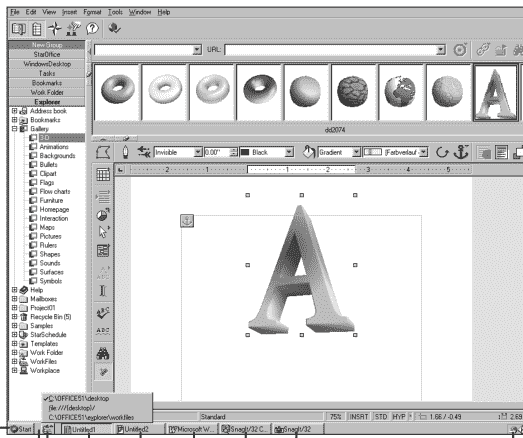

- 开始菜单
- 打开打开任务按钮
- 打开程序
- 邮件通知图标
- 系统时钟

如果只打开了一个任务副本，`关闭活动窗口` `Ctrl+W` 和 `关闭已打开任务` `Close Open Task` 的效果相同——它们都会关闭任务——但如果你打开了多个副本，`关闭活动窗口` 只会关闭该任务的活动副本。

> 如果启用了集成桌面，你将使用统一的任务栏。如果未开启，但你打开了多个副本，则 Windows 和 StarOffice 任务栏是分开的。如果 Windows 任务栏挡了路，请在空白区域点击它并将其拖到侧边。

> 有用户会遇到 StarOffice 任务栏隐藏在 `FVWM2-95` 任务栏之下的问题。如果你遇到此问题，请尝试编辑文件中的 `App-Window` 行，使其内容变为：

```
App-Window=0,0,16,1824,752;
```

这假设你运行的分辨率为 `1024×752`。

除了单独管理任务窗口外，你还可以通过拖动任务按钮来合并任务窗口。这里有三种基本方法可以实现：

## 理解任务和窗口

- 如果你 `Ctrl +` 拖动任务按钮到另一个，你可以在第二个窗口中打开所选任务的副本；这非常方便。
- 如果你 `Shift +` 拖动任务按钮到另一个，它会将任务合并到另一个窗口并保持非活动状态。
- 如果你 `Alt +` 拖动任务按钮到另一个，它会将任务合并到另一个窗口并使其成为活动窗口。
- 如果你直接拖动任务按钮到另一个，它会将任务合并到另一个窗口。

此功能让许多任务操作变得更简单。以下是一些可能的用途：

- 拖动任务按钮到另一个
- 拖动任务按钮到另一个
- 拖动任务按钮到另一个
- 拖动任务按钮到另一个
- 拖动任务按钮到另一个
- 拖动任务按钮到另一个


> Michael & Sarah 的提示 #21：你可以通过添加或删除条目来自定义开始菜单的外观。

# 第二章 进入 StarOffice

`文档` 文件夹包含了你处理过的文档列表，允许你一键打开。

> Michael & Sarah 的提示 #22：如果你右键点击开始菜单，会弹出一个菜单，你可以从中
> Michael & Sarah 的提示 #23：这里有一种自定义桌面的方法：
> Michael & Sarah 的提示 #24：在弹出菜单上选择 `Large Symbols` 命令可以增大桌面项目的字体大小。

### 快速启动区域
你可以通过将任何对象从桌面拖动并释放到快速启动区域，来创建一键启动的按钮。这对于经常打开的对象非常有用。

要移除某项，右键点击它并选择 `Remove`。

### 桌面菜单
就像你可能家里有一个桌面而办公室有一个桌面一样，你可以在 StarOffice 中创建多个桌面。默认情况下，StarOffice 文件夹和你的系统文件夹都被指定为桌面。你还可以通过在资源管理器或任务窗口中选择文件夹、右键点击打开文件夹上下文菜单并选择 `桌面` 命令来创建自己的桌面。

这些桌面通过桌面菜单管理，该菜单通过右键点击打开。图 2.20。要选择另一个桌面作为默认，请点击它的名称。

> 注意
> 如果你想将一个链接文件夹指定为桌面，在主上下文菜单中看不到 `桌面` 命令；你需要打开目标的子菜单。

扩展点击会打开桌面内容菜单，它显示了当前所选桌面中的所有项目。

## 理解任务与任务窗口

图 2.20

通过选择一个文件夹作为桌面，你可以更改桌面菜单上显示的项目。在这里，选择了工作文件夹 `Workfolder` 作为桌面，以便在处理其他任务时方便地定位和启动文档。

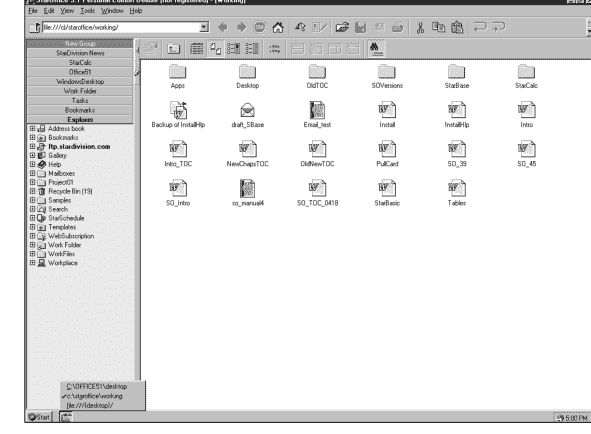

点击任务栏上的桌面图标可以在当前默认桌面和你最近打开的任务之间切换。

- 有关创建和使用多个桌面的更多信息，请参阅第 3 章 `准备工作` 第 75 页。

### 图标区与时钟

任务栏图标显示两个 StarOffice 特有的图标：系统时钟和地球，当你有新邮件时，地球的外观会发生。双击时钟，会打开你的 `StarSchedule` 桌面日历。

> 新邮件通知图标仅在你设置了 StarOffice 网上接连接并创建了电子邮件账户收件箱时才有效。

其他图标取决于你电脑的配置。

> 如果开启了集成桌面 `Integrated Desktop`，你的 Windows 系统图标将出现在 StarOffice 图标区。如果没有，只会显示 StarOffice 特有的图标。你可以从 `View` 菜单中选择集成桌面来开启或关闭它。

《用户指南》中的第 25 条提示：将帮助窗口设置为浮动任务，然后选择 `Task Always Visible` 命令，以便在学习程序时让帮助窗口随任务开启。

# 68 第 2 章 进入 StarOffice

### 关闭任务窗口

所有打开的桌面窗口都以相同的方式关闭，无论其内容是文档、网页、电子邮件还是你打开的文件夹内容。唯一的例外是指定的桌面，只要程序运行，它就会一直存在。

关闭打开的任务有三种方法：

- 点击桌面窗口右上角的 `Close` 按钮。如果你关闭了集成桌面，请注意点击下方的 `Close` 按钮，因为上面的 `Close` 按钮会退出 StarOffice。
- 从 `File` 菜单中选择 `Close`。不要选择 `Exit`，因为这会同时退出 StarOffice。
- 右键点击任务栏上的任务按钮，并选择 `Close Task`。

### 调整视图

除了操作桌面窗口外，你还可以更改桌面的视图，开启或关闭各种桌面工具的显示，并对任务进行放大缩小。这些操作可以通过 `View` 菜单上的命令或右键菜单完成。

### 在桌面上腾出更多空间

集成桌面的缺点之一是工作空间可能会变得非常杂乱。当你需要看到更多任务内容时，可以在 `View` 菜单中选择 `Full Screen view` 使其填满你的显示器。点击出现的显示器图标返回常规桌面视图。

### 开启和关闭工具栏

在桌面上腾出更多空间的另一种方法是关闭不需要工具的显示。要开启或关闭状态栏，请在 `View` 菜单上点击它的名称。要全局开启或关闭程序工具栏的显示——包括功能栏和对象栏——打开 `视图`、`Toolbars` 子菜单，并点击你想隐藏或显示的工具栏名称。注意，`Main toolbar` 可能被选中，但仍然可见，因为它只在你处于打开的桌面时才会显示。

要在特定上下文中关闭工具栏的显示，请将鼠标悬停在工具栏上并右键点击。这将打开工具栏右键菜单，其中仅列出当前打开的工具栏。取消选择或选择工具栏。如果你已经关闭了它们，则需要使用 `View` 命令将它们重新开启。

### 缩放

菜单中的 `Zoom` 命令只有在任务窗口中打开文档时变为激活。点击 `Zoom` 会打开一个对话框，允许你选择预设的缩放值或输入自己的值。你可以选择 20–200 之间的任何值。

### 查找帮助

只有当你在任务窗口中打开文档时，`缩放` 命令才会激活。点击 `缩放` 会打开一个对话框，允许你选择预设的缩放值或输入自己的值。你可以选择 20–200 之间的任何值。


# 只有当你在任务窗口中打开文档时，“缩放”命令才会激活...

## 在空间中查找帮助

StarOffice 提供了优越的功能和易用性，不幸的是，文档相对较弱。帮助代理（Help Agent）在某些区域。当你启动程序时，帮助窗口会自动打开。提示。

## 帮助代理、提示与扩展提示

当你第一次启动 StarOffice 时，集成桌面会自动打开并显示提示。如果你发现帮助代理很烦人，可以通过在帮助菜单中取消选择“自动”选项来关闭它。

帮助代理是一个可搜索的帮助文件，当你浏览某个章节时会创建一个书签。（注意，这与主书签文件夹不同。）点击书签会在 Explorer 辅助文件夹中的书签文件夹中为该章节创建一个超链接。点击注释会打开一个注释窗口，你可以在其中输入笔记——例如，你的提示或注释。在你

## 第 2 章 进入 StarOffice

点击 OK 确认注释，注释图标将出现在章节标题的左侧。当你再次浏览该章节并点击注释图标时，你之前的注释将弹出供复习。

《用户指南》中的特定章节也会作为程序启动菜单中的项目出现。

## 互联网资源

StarDivision Inc 维护着一个网站，为安装和使用 StarOffice 提供一些基础支持。有用的是，它提供了指向 StarOffice 网络简报的信息链接。这些网络简报介绍了特定应用程序的使用，并对一般的安装和桌面程序进行故障排除。简报内容生动，StarOffice 的人员和热心的用户提供了从德语文档到英语的翻译。截至本文写作，URL 为 http://www.stardivision.com/support/ek_news.html。旧的新闻帖子可以在 Deja News 网站 http://www.dejnews.com 找到。StarOffice 桌面和文件夹包含书签，可以一键访问 StarDivision 网站，这些书签可以引导你找到简报和其他帮助资源。StarDivision 和 StarOffice 概述链接分别跳转到通用主页和程序概述。点击页面顶部的 Support（支持），然后按照链接找到英文版的 StarOffice 资源列表。

> 注意：只有在 StarOffice 中配置了账户，才能使用 StarDivision 网页帮助。有关为互联网配置 StarOffice 的信息，请参见第 3 章。

对于德语读者，网上有大量的 StarDivision 文档可用。

- Michael 的提示 27：对 StarDivision Basic 感兴趣的读者可以从 `ftp.stardivision.de` 下载 `.pdf` 格式的 1,200 页 StarOffice 4.0 手册。（该参考仍然有用，尽管已经发生了变化。目前没有更详细的参考资料，至少对于公开分发。如果你有特定问题，请将其发布到 StarDivision 群组）。该文档为基础格式（非公开发）。以匿名身份登录；系统会要求你输入电子邮件地址作为密码。

## 其他 StarDivision 程序支持

当你用尽了程序和互联网资源时，StarDivision 的美国办公室在周一至周五上午 8 点至晚上 8 点（PST）提供电话支持热线：510) 505-1490。注册后，你有权享受 30 天的免费支持。公司表示，大多数问题可以在六分钟内得到解答。如果代表无法立即提供帮助，你将在 48 小时内收到客户支持的回复。

StarDivision 还为个人、商业和机构客户提供不同支持合同。如果你正在考虑在办公或网络系统上安装 StarOffice，你应该探索这些选项。

## 故障排除

如果你是免费下载的程序，请记住，公司无法负担投入资源为非付费客户提供无限免费支持。如果需要，请充分利用你的初始免费支持，但请体谅并意识到，许多最常见的问题已经在新闻组中有了答案。或者，如果你认为该程序值得付费，可以考虑购买支持合同。

### 常见问题

**突然，我无法在功能栏上找到 Explorer 和 Beamer 工具。救命！它们去哪儿了？**

你可能关闭了 StarOffice 集成桌面，缩小了 StarOffice 显示窗口的宽度；因此没有空间同时显示所有工具了。工具栏的右端会出现一个双头箭头——点击黑色箭头，其余的工具应该就会出现。

**每当我尝试退出 StarOffice 时，我的系统就会崩溃！**

Red Hat 中的某些 fvnl 版本与 StarOffice 冲突，如果你通过点击标题栏上的 Control 按钮退出程序，会导致系统锁定。尝试使用 Control 菜单命令，或者选择 File 菜单中的 Exit（退出）命令。

**启动时我一直收到一条消息，说插件管理器无法加载，我应该带有修复选项运行 Setup。我按照指示运行了 setup，但仍然收到该消息。**

StarOffice 正在查找你系统中已安装的 Netscape 或 Internet Explorer 插件，以将其整合到自己的浏览器和文件管理系统中。如果你目前没有安装其中任何一个浏览器，它将找不到任何可管理的插件，并生成你看到的消息。除非你的系统中能够加载适当的插件，否则 StarOffice 在大多数桌面上都可以在没有插件的情况下运行。

**我看不到我的桌面工作区，Beamer 和 Explorer 遮挡了它们。**

点击它们边缘上的图钉图标将它们固定到桌面。当它们未固定时，它们会悬浮在桌面工作区上。点击箭头按钮可以完全隐藏窗口。

**我找不到我删除的文件。**

StarOffice 拥有自己独立的回收站。请检查 StarOffice 回收站，通过在 Explorer 中双击图标可以打开它。

**我无法将文件从回收站中拖出。**

正如你发现的，回收站中的对象不支持拖放。要将对象恢复到原始位置，请选择该对象，右键打开上下文菜单，并选择 Restore（恢复）。


**我无法让文件夹在 Beamer 中显示其内容。**

如果文件夹只包含其他文件夹，其内容将不会显示。Beamer 只显示文件。如果文件夹确实包含文件，长按（extended-click）即可解决问题。（注：原文中大量重复内容已删除）

## 设置您的通用选项 77

最好在更改用户数据的同时进行重新注册，以免在某天启动 StarOffice 时遇到不愉快的惊喜。要重新注册，请选择“帮助”->“注册”，并选择“注册”按钮。如果您在线，只需几秒钟即可。如果您没有互联网帐户或由于某些原因在线注册失败，您将需要将注册信息通过邮件或传真发送给 StarDivision。

## 设置您的保存选项

当电脑成为强大的工具时，在使用它们时丢失工作也变得惊人地简单。停电、电脑崩溃、手指滑滑——一下，整个下午的工作就化乌有了。这种情况发生过在你身上吗？那么你就知道也可以保存工作了。

您应该通过点击功能区上的“保存”按钮或按下 `Ctrl+S` 定期保存桌面上的文档。为了增加安全性，您还应该在“选项”->“通用”->“保存”对话框中设置“自动保存备份”选项（参见图 3.2）。开始时花时间设置这两个选项可能会保护您的神经、精力以及工作！只需勾选“自动保存”复选框，并设置您希望在每次保存时是否提示确认的固定时间（默认）。如果您在工作时不希望被不断的“保存”对话框中断，则应该取消勾选“提示保存”。StarOffice 现在每隔 `x` 分钟保存一次已打开的文档（`x` 是您指定的时间间隔），替换之前保存的文档版本。

图 3.2

保存对话框允许您保存与保存文件相关的对象，包括错误。

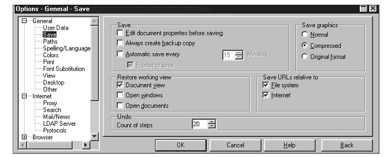

如果您希望保留文档和文件的备份副本，应该勾选“始终创建备份”复选框。每当您保存打开文档的新版本时，StarOffice 都会将上一个版本以 `.bak` 文件扩展名自动保存到 StarOffice 目录下的备份文件夹中。

## 78 第 3 章 准备工作

您可以在“选项”->“通用”类别下的“路径”对话框中更改保存备份文件的默认路径。但是，请确保您要指定的文件夹已经存在，否则您将收到错误消息。您可以在点击“编辑”后打开的“选择路径”对话框中创建新文件夹——从右侧第二个按钮将创建一个新文件夹（目录）。要在资源管理器内部双击打开具有 `.bak` 扩展的文件。

除了“自动”和“备份”选项外，您还可以设置“撤销步数”，这决定了您可以回溯多少步（例如通过按下 `Ctrl+Z`）来撤销文档中的更改。默认值为 20，但您可以设置 0–100 之间的任何数字。

如果您感到担心，可能会倾向于将该数字设置为 100。请记住，这些步骤会占用内存（RAM）和硬盘上的临时交换文件，还可能会降低系统性能。如果您的内存少于 64MB，您可能应该将此数字设置为 50 或更小。

StarOffice 在 StarWriter 中处理“撤销”的方式与您可能习惯的方式不同，因为它将单个添加的内容（如空格）视为一种操作，因此向后退 20 步可能比您想象的要小。


如果您特别担心跟踪文档的不同版本和内容，还可以勾选“保存每个之前编辑文档属性”。每当您使用“保存”命令保存文档时，都会出现“属性”对话框，允许您更新并保存文档信息。您在“属性”对话框中输入的信息稍后可以作为字段输入您的文档。这对于项目团队工作以及所有办公文档的存储和检索来说是一个非常有用的工具，因为您以后可以通过字段页眉页脚跟踪文档作者、关键词和文档标题等信息。

- 要需更多关于在文本文档中处理文件的信息，请参阅第 350 页的“使用字段”。

“恢复视图”选项影响 StarOffice 在您退出程序时保存的关于任务窗口布局的信息。如果您选择“Windows”或“打开的文档”选项，它将分别保存并重新打开您最后的桌面窗口布局以及最后打开的文档或文件夹。

## 更改重要文件的默认位置

所有默认文件搜索和存储的程序路径都是通过`选项`->`通用`类别下的`路径`对话框设置的。StarOffice 允许您创建自己的目录结构。

## 设置您的通用选项

> 注意

书签存储的默认位置是 `\Explorer\Bookmarks`。虽然您可以更改此路径（将其存储在另一个程序的目录中），但请记住，您必须将书签存储在 StarOffice 资源管理器的文件夹中，或者在资源管理器中创建该文件夹的链接，以便在 StarOffice 桌面上可用。

您可能考虑包含的路径有回收箱（`Store\Trash`）、互联网和网络下载路径（`download`）、邮件/新闻存储路径（`Store`）以及备份副本路径（`Backup`）。

要更改路径，选择您想要更改的类型，并点击“路径”对话框中的“编辑”按钮（参见图 3.3）。在“选择路径”的路径文本中输入新路径。点击“新建”按钮创建文件夹。完成后，点击“确定”将更改应用到所选类型。

图 3.3 在“路径”对话框中浏览默认路径列表可以帮助您理解 StarOffice 的组织和文件处理。您可以通过选择并选择它来更改任何路径。

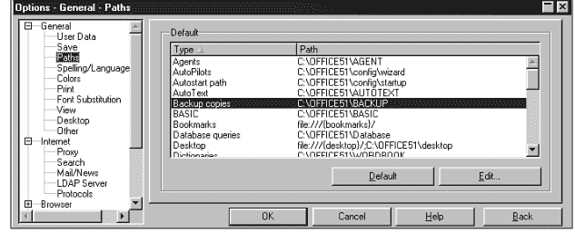

## 选择拼写和语言选项

“拼写/语言”对话框位于`选项`->`通用`，允许您设置将应用于所有文档的全局拼写和连字符规则（参见图 3.4）。此外，您还可以设置用于拼写检查的默认语言并管理已安装的字典。

## 80 第 3 章 准备工作

勾选此框以确保对脚注、文本框和其他文本进行拼写检查

图 3.4 拼写/语言对话框是用于创建和管理字典以及与连字符和拼写相关的全局选项的地方。

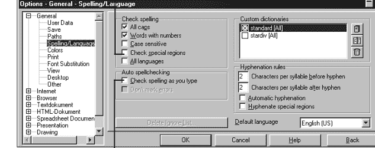

您可以在主工具栏上开启此功能

表 3.1 列出了您对文档进行拼写检查时的选项。

| 选项 | 选中时 |
| --- | --- |
| 全大写 | 拼写检查大写单词 |
| 带数字的单词 | 拼写检查包含数字单词 |
| 区分大小写 | 检查大小写 |
| 检查特殊区域 | 拼写检查页眉、页脚、脚注以及正文以外的其他区域 |
| 所有语言 | 使用所有安装的字典进行拼写检查 |

> #29 来自 Michael & Sarah

如果您在文档中使用外来词，或者经常用另一种语言编写句子或段落，您可能想选择“所有语言”复选框。只要您安装了相关语言的字典，StarOffice 就能发现您的拼写错误。您可以在 StarOffice 中最多安装三个字典。有关管理已安装字典的更多细节，请参阅第 12 章“校和打印文档”中的“理解 StarOffice 中的字典”。

如果您希望 StarOffice 在您打字时通过自动更正功能自动标记拼写错误，请选择拼写检查部分的“检查拼写框框当您选择此选项时，“不标记错误”选项将可用，允许您关闭自动高亮拼写错误。

# 设置常规选项

> 注意

> 虽然你可以通过主工具栏上的按钮开启或关闭自动拼写检查，但在此对话框中只能设置“不标记错误”（Don't Mark Errors）选项。

在“连字符规则”（Hyphenation Rules）部分，你可以开启或关闭自动连字符。如果处于关闭状态，StarOffice 将根据此处输入的连字符规则对单词进行连字符处理。

当你安装 StarOffice 时，安装程序会为你提供安装最多三个语言字典并设置默认语言的选项。如果你愿意，可以随时更改默认语言。只要你安装了相应语言的字典，StarOffice 就会继续检查你的拼写错误。

> 注意

> 下拉菜单列出了许多语言，尽管你被赋予安装三个（或更少）的选项。注意另一个本地化缺陷：它还列出了一些仅在欧洲版本中提供的语言——例如芬兰语。考虑到 Linux 目前的流行，谁知道呢？也许我们以后都会用芬兰语说话并进行拼写检查！

| 部分 | 章节 |
|---|---|
| 3 | |

虽然程序允许你将任何语言设置为默认语言，但因为你当前系统中可能尚未加载该语言，在你检查拼写之前，并不知道自己是否犯了错误。有关切换已安装字典的更多信息，请参阅第 12 章中的“安装新字典”部分。

目前，无法从 StarDivision 购买额外的字典，尽管一位高级产品开发经理表示，他们正在与第三方字典提供商努力解决。

> Michael & Sarah 的第 30 条提示

> 请务必将你最常用的语言设置为默认语言。

除了能够选择三个语言字典外，你还可以通过此对话框创建并制作自定义字典。自定义字典是专门字典（如果开启），是在当前所选语言字典之外添加的额外字典。由于你无法添加或更改语言字典，自定义字典允许你创建自己的常用词和缩写词字典，从而加快拼写检查速度。

程序带了两个自定义字典。“标准”（Standard）字典是 StarOffice 使用的默认字典，用于记录你在运行“拼写检查”命令时添加的单词。StarDiv 自定义字典包含许多特定于计算机和互联网的单词和术语。

# 82 第 3 章 准备工作

> 警告

> 程序依赖“标准”自定义字典进行拼写检查，因此请勿删除它！

→ 有关自定义字典的更多详细信息，请参阅“安装新字典”。第 474 页。

# 创建自定义颜色

虽然它还不能与 QuarkXPress、Adobe PageMaker 和 Adobe Photoshop 等专业出版和成像程序相比，但 StarOffice 5 包含了一些相当复杂的图形和颜色功能，包括分别混合你的 RGB 和 CMYK 自定义颜色以用于屏幕输出或显示输出。这些颜色在所有 StarOffice 模块中都可用。

→ 有关 RGB 和 CMYK 颜色的更多详细信息，请参阅“理解颜色模型和模式”，第 796 页。

要创建自定义颜色，请遵循以下操作：

- 1. 在“选项”对话框的“常规”类别中选择“颜色”。打开一个调色板，如图 3.5 所示。


| 选项 - 常规 - 颜色 | | | |
|---|---|---|---|
| 常规 | 标准颜色 | 名称：淡紫色 (Lilac) | 添加 |
| 使用数据 | | | |

- 2. 接下来，点击“标准颜色”调色板上的某种颜色，在“颜色样本”下拉框中选择 RGB 或 CMYK，并更改各个颜色（红、绿、蓝以及青、黄、品、黑）的百分比值。

- 3. 点击标准调色板上的颜色作为混合的基础。你的结果将显示在下方窗口的“预览”区域，而上方窗口显示应用更改之前的原始基础色。

- 4. 一旦你对选择满意，在文本框中输入名称为该颜色标记，然后点击“添加”按钮。该颜色将立即添加到“颜色”菜单中，但在点击此菜单中的你的名称之前，它不会出现在调色板上。

你也可以选择用自定义颜色替换标准调色板颜色，或者编辑或替换标准及自定义颜色。

# 设置常规选项

“重置”按钮将所有颜色恢复为你在当前会话中进行任何更改之前的值。“取消”则撤销更改并退出对话框。

# 选择全局打印机警报

你可以通过“选项”中“常规”类别下的“打印”对话框设置三个全局打印机警报。这些命令对于网络用户来说特别有用。

如果你正在处理涉及多台机器或跨网络的文档，但需要将其打印到特定的打印机，请勾选“未找到文档打印机”选项。选择与文档关联的打印机后，如果有人尝试从未连接特定打印机的机器上打印文档，StarOffice 将向你发送警报。

如果勾选了“纸张尺寸和方向”选项，当为你的页面选择的尺寸和方向与所连接打印机的当前设置不匹配时，你将收到警告。然后你可以打开“打印机设置”对话框，根据需要更改打印机设置，而无需浪费时间或电力。

# 选择字体替换

StarOffice 内置了自己的字体替换表。当你从另一个程序打开包含你当前未加载的字体、StarOffice 无法处理的字体或或导出文件时，它会自动应用此表。但是，你也可以选择使用自己的字体替换表，从而在 StarOffice 文档和桌面进行替换。桌面上使用的某些字体、数据显示由你无法更改的系统设置决定。通过创建并应用替换表，你可以实现相同的效果。通过“选项”中的“常规”类别选择“字体替换”（见图 3.6）。只有当勾选此选项时你才能创建表。左侧的字体框包含系统中所有可用字体。滚动列表直到找到要替换的字体，“替换为”下拉菜单也列出了所有可用字体。一旦选择了两个字体，右侧以前灰色的按钮将变为活动状态——“添加”和“删除”按钮。要添加表，请点击“添加”。


| 部分 | 章节 |
|---|---|
| I | 3 |

# 第 3 章 准备工作

图 3.6

字体替换表设置 `StarOffice` 内部的替换。务必勾选绿色以将条目添加到列表。

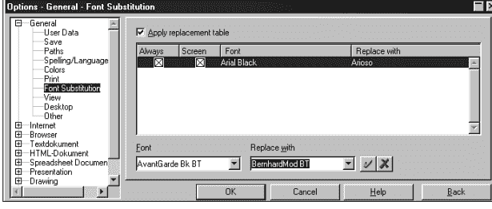

## Michael & Sarah 的提示

表中出现了两个额外的复选框。点击“始终”以始终此替换选项。点击“屏幕”使替换同时影响屏幕字体和打印字体。

## 定义桌面的外观

“常规选项”中的“视图”框允许你定义桌面窗口的总体外观、按钮大小、桌面图标之间的间距、鼠标位置以及列。例如，你可以为桌面赋予 `Macintosh`、`X Window`、`OS/2` 或 `StarDivision` 外观，每种外观都有其特定的标题栏样式和常用元素的颜色。“窗口拖动”下拉列表允许你在拖动窗口时将其处理为完整窗口或轮廓（框架）。你也可以更改你的操作系统 `OS`。

## Michael & Sarah 的提示

带有完整可见内容的窗口需要更多内存和功率，如果内存较小或频繁遇到内存故障，请将“窗口拖动”设置为“仅框架”。

## Michael & Sarah 的提示

如果你想让 `StarOffice` 启动快一点，请在“显示”部分的“标志”下拉列表中选择“不显示”。这将关闭你通常在启动期间看到的程序启动屏幕。

## 设置杂项选项

“选项”中的“常规”对话框允许你设置 3D 视图并影响帮助代理的行为。对于那些担心千禧虫问题的人，它还允许你确定程序如何处理两位数日期。

“3D 视图”选项允许你决定 `StarOffice` 如何显示在 3D 图表或 `StarDraw` 中创建的三维对象。如果你至少有 64MB 内存和奔腾速度的处理器，请选择所有这些选项。这将显著提高屏幕显示效果和打印效果。

默认情况下，帮助代理 `Help Agent` 被设置为在你调用许多程序命令时自动启动。有些人发现，在工作时，帮助代理在周围悬浮会令人烦恼。如果你也是其中之一，请取消勾选“自动启动”，这样你就能免受它突然出现的干扰。当你第一次调用 `StarOffice` 时，帮助代理窗口会显示在窗口的底部。如果你不满足于仅将其隐藏在桌面下方，可以全局关闭它，并将提示列表重置为循环的开始。

注意：此处提到的提示是在“帮助代理”中提供的，而不是你通过“帮助”菜单开启的“扩展提示” `Extended Tips`。

`StarOffice` 中的文档不会面临 `Y2K` 年问题，因为 `StarOffice` 在内部将日期存储为四位数数字而不是两位。然而，许多文档并非在处理四位数日期的系统中创建的。如你可能所知，两位日期处理在世纪交替时可能会导致问题，因为两位日期已无法区分 1905 年和 2005 年。`StarOffice` 的两位日期处理允许你设置年份日期，该日期定义了 `StarOffice` 解释哪些两位日期。

默认设置是从 1930 年的 1 月 1 日开始，但它会将 01/29 解释为 2029 年 1 月 29 日。这并不能完全解决 `Y2K` 问题，但稍微减轻了干扰。建议你将开始日期设置得尽可能接近当前日期——但请仔细考虑你选择的日期，因为这将影响导入到 `StarCalc` 的电子表格的所有日期处理。例如，如果你将开始日期设置为 1960 年，但你出生于 1955 年。如果你导入了一个自动计算你可以领取社会安全金年限的 Excel 表格，你会发现自己即使出生了，却得再工作 101 年！

注意：你选择的日期也会影响文件日期的解释方式；因此，请考虑你经常访问的非 `StarOffice` 计算机文件的年龄。

### 联网

为了利用 `StarOffice` 的所有功能，你需要将桌面连接到外部世界。虽然你可以选择运行第三方邮件、新闻、`FTP` 和浏览器应用程序，但 `StarOffice` 拥有良好的内置 Internet 程序。在网络上运行 `StarOffice` 时，`StarOffice` 全方位 Internet 集成的优势将尤为巨大。

| 部分 |
|---|---|
| 第 3 章 |

## 第 3 章 准备工作

如果你一直运行 `StarOffice` 并保持在线，你就可以直接在桌面完成所有操作——自动从服务器下载新邮件、浏览网页、向同事发送草稿文档——甚至可以在通用的 `StarSchedule` 日历上与同事同步日程！尽管如此，仍有一些技术问题需要考虑，因此在做出任何决定之前请继续阅读。

如果你通过调制解调器、电话线和 ISP 连接到 Internet，你必须在系统中安装拨号网络程序，并已设置好拨号你的 ISP。本节假设你已连接到局域网 `LAN` 或已设置好 ISP 网络。

你有两种 Internet 设置选择：

- 新版本 5.1，你可以使用 Internet 自动引导 `AutoPilot`，这是一个引导你完成整个过程的向导。自动引导会在第一次启动程序时自动启动，可以通过选择“文件”、“自动引导”、“Internet 设置”命令再次启动。
- 你手动输入设置并创建邮件帐户。Internet 和浏览器设置分别在“工具”、“选项”、“Internet”和“工具”、“选项”、“浏览器”对话框中输入。邮件和新闻账户通过资源管理器 `Explorer` 中的右键菜单命令创建。

虽然自动引导让联网变得更容易，但了解如何手动创建帐户仍然是明智的，因为你可能需要更改自动引导无法访问的设置。配置账户和选择默认 Internet 程序时，还有一些问题需要考虑。建议阅读“联网”章节。

> 如果你有多个邮件账户需要管理，由于 `StarOffice` 处理收件箱和发送箱的方式，设置这些账户可能会很困惑。如果你有……

### 使用自动引导设置 Internet

如果你需要帮助，可以使用 Internet 自动引导 `AutoPilot`，这是一个引导你完成整个过程的向导。自动引导会在第一次启动程序时自动启动，可以通过选择“文件”、“自动引导”、“Internet 设置”命令再次启动。

虽然自动引导让联网变得更容易，但了解如何手动创建帐户仍然是明智的，因为你可能需要更改自动引导无法访问的设置。配置账户和选择默认 Internet 程序时，还有一些问题需要考虑。建议阅读“联网”章节。

> 如果你有多个邮件账户需要管理，由于 `StarOffice` 处理收件箱和发送箱的方式，设置这些账户可能会很困惑。如果你有……

### 联网

### 选择系统默认程序

完成自动引导的第一步是选择你是否希望将 `StarOffice` 作为处理任何或所有 Internet 需求的默认程序。

如果你希望 `StarOffice` 处理任何任务，请点击“使用 Office 作为默认值”。一旦你选择了该项，对话框下半部分灰色的选项列表将变为激活状态，允许你选择你希望由 `StarOffice` 处理的任务。

你可以将 `StarOffice` 设置为以下五项任务的默认程序：

- 网页浏览
- 支持 `POP3` 和 `IMAP` 的邮件客户端
- 新闻客户端
- `FTP` 客户端
- 安全 `HTTP` 连接（安全 `HTTP`）

### 从其他程序导入设置和邮箱

如果你运行了 `Netscape Communicator` 或 `MS Internet Explorer` 和/或 `Outlook Express`，`AutoPilot` 会自动从这些程序导入现有的收件箱和发件箱（见图 3.8）。导入这些设置和文件与将它们集成到 `StarOffice` 及其菜单并不等同。在使用 `StarOffice` 菜单和命令执行任务时，你将使用 `StarOffice` 模块来浏览、邮件、`FTP` 和新闻账户——除非你在 `StarOffice` 桌面内使用其他程序并像往常一样运行它。

> 注意：从 5.1 版本开始，你可以选择将 `MS Internet Explorer` 浏览器导入到 `StarOffice` 桌面。此选项必须在安装 `StarOffice` 时选择，且系统中必须已经安装了 `MS Internet Explorer`。如果你已经安装了 `StarOffice` 但想使用此功能，则需要重新安装 `StarOffice`，并以自定义安装的方式进行安装。

无论你如何选择，如果你的系统中有 `MS Outlook Express`，你都可以通过 `Explorer Setup` 命令直接通过它发送邮件。

图 3.8

所有待安装的应用程序都列在 Internet Setup `AutoPilot` 的第二个屏幕上。选择你想要程序。如果你选择自动应用所有设置，则所有 Internet 连接的设置将从该程序导入。选择“应用单个” `Apply Single`，你可以在程序之间进行选择。

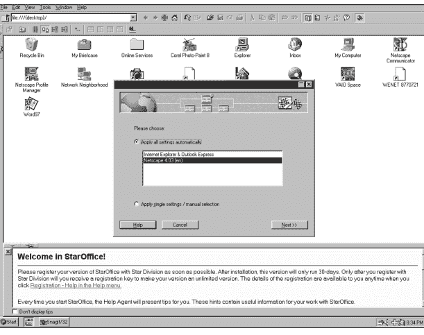

如果你选择不从这些其他程序导入设置和邮箱，可以在 `StarOffice` 中设置新的独立账户和邮箱。

## 第 3 章 准备工作


在不同的程序中维护不同的邮件或新闻账户可能很有用。如果你需要在它们之间交换文件，那么知道 `StarOffice` 直接从 `Explorer` 导入 `MS Outlook Express` 和 `ASCII` 文件，且仅以 `ASCII` 格式导出，将非常有帮助。你也可以使用 `AutoPilot` 导入 `Netscape` 或 `MS Outlook` 邮箱（尽管会覆盖该账户的条目）。`StarOffice` 的地址簿是一个数据库文件，可以轻松导入到许多联系人管理器和邮件程序中，包括 `MS Outlook Express`。`Netscape` 在导入或导出地址簿方面并不如。

Michael & Sarah 的第 34 条提示

自动导入设置：如果你选择两个程序中的一个并选择“自动应用所有设置”，然后点击“下一步”，`StarOffice` 将自动从你选择的程序导入所有 Internet 设置以及任何现有的邮箱和新文件夹。

注意

`StarOffice` 的发件箱构建方式不同。你不能在发件箱中创建子文件夹，只能通过发件箱属性将邮件重定向到普通文件夹过滤器，每条消息作为独立的文档文件存在。

如果你选择自动路线，你几乎就完成了！`AutoPilot` 会向你显示一个总结 `StarOffice` 将要执行的操作屏幕，类似于图 3.9 中的屏幕。创建它即表示你许可继续执行。

图 3.9

无论你采取自动还是手动路线，一旦你完成选择，`AutoPilot` 就会用一个最终对话框欢迎你，总结你的选择并请求你的许可以继续。

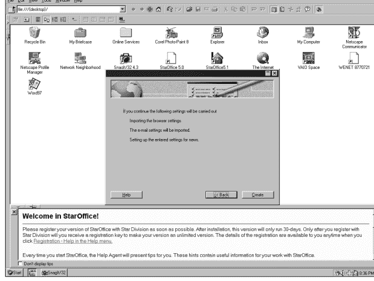

欢迎使用 `StarOffice`！

请尽快注册你的 `StarOffice` 版本。安装后，此版本将运行 30 天。只有在向 `StarOffice` 注册后，你才会收到注册密钥，使你的版本变为无限版本。注册详情可以随时通过帮助菜单中的“Star Registration - help”查看。

每当你使用 `StarOffice` 时，帮助助手都会为你提供提示。这些提示包含了你使用 `StarOffice` 工作时的有用信息。

## 上网 | 91

直接跳转到“使用 AutoPilot 创建账户”部分查看接下来会发生什么。

- 有关关于使用 `StarMail`（电子邮件）和 `StarDiscussion`（新闻组）的信息，你应该从第 1046 页的“在 `StarMail` 和 `StarDiscussion` 中定位”开始。

手动输入设置：如果你是那种喜欢对设置有更多控制权的人，你可以选择“应用设置 / 手动选择”（参考图 3.8）。这将引导你通过三个额外的对话框——一个用于浏览器，一个用于邮件，另一个允许你挑选并选择如何配置你的 Internet 设置。

采取手动路线赋予了你以下选项：

- 自动导入你的所有设置，但在 `Netscape` 和 `MS Explorer` 或 `Outlook Express` 之间混合使用
- 直接输入你的部分或全部设置

如果你选择后一种选项，你应该准备好以下信息：

- 浏览器设置（域网用户）：浏览器的代理设置（如果有）。请向你的系统管理员获取网络设置
- 手动邮件设置：入站（`POP3`、`IMAP` 或 `SMTP`）和出站（`SMTP` 或 `SMTP`）邮件服务器；你的用户名或登录名；以及（可选的）密码。
- 手动新闻订阅设置：新闻服务器的地址

选择手动选项并点击“下一步”后，你将看到图 3.10 所示的对话框，要求你输入设置。

你可以选择在此手动配置浏览器设置、从 `Netscape` 或 `Internet Explorer` 导入。无论你选择哪种方案，你都需要调整设置。

当你完成输入后，点击“下一步”进入邮件设置。你将有一组选择：不应用设置、从可用程序导入或手动输入。

- 有关配置浏览器的更多信息，请参见第 105 页的“调优你的浏览器”。

如果你选择手动选项并点击“下一步”，你将看到图 3.11 所示的对话框，要求你输入账户信息。


## 第 3 章 准备工作

图 3.10

如果你采取手动路线，首先会看到一个请求选择设置的对话框

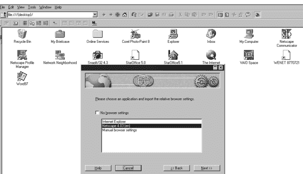

图 3.11

如果你选择手动设置，你将在 `AutoPilot` 的邮件设置对话框中输入邮件服务器、用户名（如果有）和密码。


## 上网 93

点击文本框并开始输入。你可以输入任何名称作为账户名称，这只是你在邮件/新闻组中显示的名称。其余信息应从你的 ISP 获取。注意，你不需要在这里输入密码。如果你选择不输入，`StarOffice` 会每次从程序登录时提示你输入。

以后，你可以根据需要从 `Explorer` 创建多个额外的收件箱。然而，你只能创建一个发件箱。其原因在本“上网”章节“创建邮箱”中解释。

- 注意 如果你的用户名需要使用 @ 符号，请确保将名称括在括号内，例如：`<runner@acme.com>`。否则，Office 将无法处理 @ 符号。

完成后后点击“下一步”，你将面对倒数第二个对话框（如图 3.12 所示），你可以在其中输入新设置。在这里再次输入账户名称和服务器名称——但指的是服务器名称。你可以输入任何公共的新闻服务器名称；或网络。例如，在图 3.12 中，输入了 `StarDivision` 服务器 `stardivision.com`。

图 3.12

`AutoPilot` 之旅的倒数第二步是输入服务器名称并为账户命名。

# 第 3 章 准备工作

输入完所需信息后，点击“下一步”进入最后的对话框，该对话框与之前在图 3.9 中所示的内容类似。检查您的选择摘要，如果满意，请点击“创建”以完成设置过程。如果您想进行任何更改，请点击过程中的“上一步”返回。点击“取消”将放弃所有设置并返回到桌面。

## 使用 AutoPilot 创建您的账户

点击“创建”后，根据您的邮件和新闻文件的大小，`StarOffice` 可能需要几分钟才能完成操作。

它将自动在“资源管理器/新闻”组中为您创建一个邮件收件箱（Inbox）和发送箱（Outbox），在“工具/选项/浏览器”系列对话框中创建相关的浏览器设置，并在“工具/选项/Internet”系列对话框中输入您的基本 Internet 连接信息。要打开邮件或新闻账户，请先点击桌面上您想要打开的电子邮件或新闻账户来打开“电子邮件/新建”组（如果您希望它显示在其他窗口上方，请按 `Ctrl+点击`）。如果设置为分级视图，双击（或 `Ctrl+双击`）打开。

> #35 来自 Michael Sarah：如果您将邮件和新闻组设置为分级视图，可以通过选择该组右键菜单上的“显示内容”命令来显示单条消息或新闻项目的列表。

## 修改和自定义您的 Internet 连接

虽然您的默认和导入的 Internet 设置可能对您已经足够，但有许多设置可以修改和自定义以更好地适应您的需求。在遇到连接问题时，您可能还需要对这些设置进行调整。

要输入或更改 Internet 设置，打开“工具/选项”主对话框并点击“Internet”字旁边的加号。您将看到五个对话框列表，每个对话框在之前都进行了简要介绍。

## 修改和自定义邮件和新闻设置

图 3.13 显示了“工具/选项/Internet/邮件/新闻”对话框。此对话框保存了您的默认 Internet 连接信息。这些设置用于确定所有发送邮件的路由方式，以及从桌面发送的电子邮件（即在不打开特定账户收件箱的情况下）。更改这些设置不会删除或更改您现有的任何收件箱；它只会更改邮件的路由。

### 在线 95

图 3.13

通过勾选“邮件/新闻”对话框上的“自动加载（Autoload）”选项，可以设置邮件格式默认值和新闻加载速度。

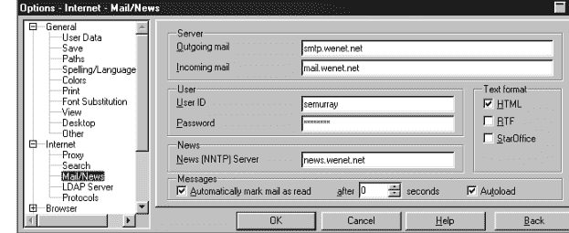您可以在此处设置邮件文件格式的默认值。消息始终采用 `ASCII` 格式；您也可以选择另外三种格式中的任何一种：`HTML`、`RTF` 或 `StarOffice`。在这些格式下创建邮件允许您以更精细的方式对消息进行格式化，例如应用**粗体**或*斜体*。如果您选择了这些选项之一或多个，默认将以 `ASCII` 格式和所选的格式发送您的消息。（不过，您可以在 `StarMail` 编写窗口内针对特定消息更改您的选项。）

仅在需要时才选择某个选项。许多电子邮件和新闻组仅接受标准的 `ASCII` 文本，您的 `HTML`、`RTF` 或 `StarOffice` 副本您的收件者可能无法读取。选择其中一种格式还会大幅增加您的消息的大小和传输时间。此外，用对方无法阅读的精美格式化邮件塞满别人的信箱是不礼貌的。

- * 若要讨论这些不同格式及其用途，请参阅第 1053 页的“创建和发送邮件”章节。

如果您勾选“自动加载”选项，当您打开新闻收件箱并开始滚动时，新闻帖子的内容会自动出现在您的视图中。如果您勾选“自动将邮件标记为已读”，您可以设置邮件在指定时间后被标记为已读——时间范围从 0–999 秒不等。

## 修改代理设置

您可以在“工具/选项/Internet/代理”对话框中更改代理设置。某些网络使用代理服务器作为缓存以确保网络安全并提高性能。


如果您在网络上工作，请向您的 ISP 支持人员咨询您的代理配置。如果他们告诉您没有代理，请选择“无”。否则，请按照指示设置。

## 添加网络搜索引擎

“`工具/选项/Internet/搜索`”对话框包含网络搜索引擎的名称和站点地址，您可以通过工具栏上的查找按钮调用它们。已经列了一些常用的搜索引擎。您可以编辑这些条目并添加新的。

## 添加 LDAP 目录

“`工具/选项/Internet/LDAP`”对话框包含目录服务（Web 版电话簿）的名称，您可以通过 StarOffice 电话簿对话框搜索它们。唯一的默认条目是。一旦您在这些目录中找到地址，可以将其自动添加到您的地址簿。

## 修改您的 Internet 协议

“协议”对话框包含了定义如何连接到服务器的选项。域名服务器（DNS）将人类读的 Internet 地址（如 `www.staroffice.com`）转换为真实的网协议（IP）地址。如果选项设置为“自动”（默认），StarOffice 将从操作系统读取服务器地址。如果选项设置为“手动”，您可以手动输入 DNS IP 地址。大多数用户会希望保持为自动。

> 提示 #36 来自 Michael Sarah：您的 Internet 设置保存在 `office.ini`（Windows）或 `officefile`（Linux）。HTTP 代表超文本传输协议，FTP 代表文件传输协议。

## 创建收件箱

在 StarOffice 中发送接收电子邮件时，可以使用同一个收件箱处理收发邮件。（参见本章的“设置多个账户”）。您的收件箱接收发送的所有邮件。发送箱处理所有出的邮件。离线时编写的消息将存储在发送箱中，直到您在线。

所有来邮件和新闻文件都保存在 `\Office1\Store` 文件夹中（扩展名为 `.xcs`）。如果您需要关注此文件夹的大小，它可能会迅速超出分配分区的大小，此时需要使用“`工具/选项/邮件/新闻/存储`”类别设置不同的路径（在不同的分区或硬盘上）。

您可以通过资源管理器菜单的“新建”命令创建收件箱和发送箱（见图 3.14）。

图 3.14 资源管理器菜单包含用于创建电子邮件账户收件箱和发送箱。您也可以在这里创建其他 Internet 账户——FTP 账户、新组账户和 Web 订阅。

| 结束 | 文档文件夹... |

| --- | --- |

| 新建 | 链接 |

| 复制并用 Paint Shop Pro 打开 转换为煤媒体 | 数据库... IMAP 账户... |

| 显示桌面 | 更新 | 新闻发送箱... POP3 账户... |

| 发送到 | 系统属性 | 账户... FTP 账户... 搜索... 订阅... | 新子菜单

## 创建帐户收件箱

StarOffice 将资源管理器右键菜单分为 POP3 账户、IMAP 账户和 IMAP 账户（参见图 3.14），它们实际上是实现同一目标的三个不同路径：创建邮箱收件箱。收件箱是接收并（根据您的选择）存储特定账户入站邮件的邮箱。之所以有不同的账户，是因为每种账户使用不同的邮件协议，并可以分配轻量级属性。

对于对 5.0 版本缺少 IMAP 支持感到沮丧的 Linux 用户来说，很高兴改进的 Linux IMAP 支持是 5.1 版本的主要特性之一。然而，由于特定的 IMAP 服务器对于您使用 StarOffice 作为电子邮件客户端的能力至关重要，在决定使用 StarOffice 之前请进行检查，因为它仍然不支持全范围的 IMAP 服务器。


POP3 账户是最常见的类型，我们将以创建一个 POP3 账户收件箱为例。无论是种种类型，创建账户收件箱的过程和原理都是完全相同的。

在创建邮件协议之前，请准备好您的 ISP 或服务器用于管理邮件的配置：

- 您的 ISP 或服务器用于管理邮件的邮件协议类型
- 您的入站和出站邮件服务器的名称
- 您的电子邮件和新闻组密码（可选）

> POP3、IMAP 和 IMAP 是管理入站邮件的三种常用协议。POP3 在面向个人拨号连接的商业 ISP 中非常流行，用户下载邮件并将其存储在自己的硬盘硬盘上。IMAP 被许多 UNIX 和 Linux 计算环境使用，因为它假设邮件在中央服务器上进行存储和管理。IMAP 是 Lotus Notes 和 cc:Mail 中使用的邮件协议，也被许多企业用户使用。如果您不确定或无法根据信息猜测应使用何种协议，请询问您的 ISP 或网络管理员。

有关使用 StarMail 发送和接收邮件以及管理新闻组的深入讨论，请参阅第 29 章“与 StarMail 和 StarDiscussion 通信”。第 1045 页。

准备好您的账户邮箱收件箱后，按照以下步骤操作：

- 1. 选择您计划存储账户的组/文件夹。
- 2. 右键点击打开资源管理器右键菜单。
- 3. 打开子菜单。
- 4. 选择您的服务器或 ISP 用于管理邮件的邮件协议名称（POP3、IMAP 或 IMAP）。这将打开一个新的账户收件箱对话框。图 3.15 显示了一个新的 POP3 账户收件箱对话框。

## 接入网络 | 99

图 3.15

常规、发送、接收、标题和内容标签页在 IMAP、POP3 和 IMAP 新收件箱命令中是通用的。每种类型的账户可能还有其独特的标签页。


- 5. 点击“接收”标签页。您的服务器名称、用户名和密码信息已从您的用户数据和任何现有 Internet 设置中自动复制并输入。
- 如果您为不同的账户创建收件箱，请选择当前信息并覆盖。替换这些信息不会影响您在“工具、选项、邮件/新闻组”对话框中保存的信息或您的用户数据。只要您担心安全，请保持密码为空即可。如果您没有在 Internet 对话框或发件箱中保存密码，每次连接时都会提示您输入密码，且该密码不会被保存。
- 6. 点击“发送”标签页以确定出站邮件的路由方式。如果您只有一个电子邮件账户，您的发件箱设置将决定出站邮件的发送方式（参考 Outlook ）。如果您有多个邮件账户，您将需要选择“自定义设置”选项，点击“自定义设置”按钮，并为第二个账户输入适当的信息。有关更多信息，请参阅本章的“管理多个账户”章节。
- 7. 点击“常规”标签页并为账户命名。如果您不分配名称，StarOffice 将自动根据您的邮件服务器进行命名。
- 8. “规则”和“视图”标签页允许您创建过滤器来管理收件箱消息。（在本章中学习使用这些命令。）
- 9. 点击“标题”标签页查看邮件头。
- 10. 点击“内容”标签页查看邮件正文和附件。有关更多信息，请参阅本章的“管理消息”章节。

## 第 3 章 准备工作

以下是从零开始创建 SMTP 发件箱（Outbox）的后续步骤；如果你在创建收件箱（Inbox）后直接创建发送箱，则从第 3 步开始。

1. 1. 选择您想要存储发送箱设置的文件夹。
2. 从资源管理器右键菜单子菜单选择“发送箱”。
3. 在“常规”（General）选项卡中为您的发送箱输入一个名称。
4. 点击“SMTP”选项卡。您的服务器、用户名和密码应该已经从 Internet 设置中复制完成。如果没有复制，请输入您的发件邮件服务器名称、您的电子邮件名称以及（如果需要的话）您的密码。（您的服务器将类似于 `smtp.wenet.com`。）如果您在此处没有输入用户名和/或密码，每次连接时系统都会弹出一个对话框提示您提供这些信息。这些设置决定了所有传出邮件的默认路由。


> 如果你输入了密码，其他人可能在未经你许可或不知情的情况下访问你的账户。

如果您在注册或 Internet 设置时输入了电子邮件地址，该地址将自动填充到您从默认收件箱或桌面编写的电子邮件邮件的“发件者”字段中。（如果您有多个收件箱，默认收件箱是使用“工具、选项、Internet、邮件/新闻数据”中电子邮件地址的那个收件箱。）如果您想返回发送到其他地方的邮件，请在“回复至”（Reply To）框中输入您的回邮地址。


> 请用尖括号包围您的电子邮件地址，例如：`<@jlopez.wenet.com>`。如果不使用这些括号，StarOffice 将无法识别地址中的 @ 符号。


> 您现在不需要担心任何其他选项卡。“规则”（Rules）和“视图”（View）选项卡将帮助您以后管理传出邮件，而 NNTP 选项卡与新闻组订阅有关。您已经输入了发送传出邮件所需的所有。

5. 6. 选择“确定”完成发送箱的创建。选择“取消”将取消发送箱的创建并返回桌面；选择“重置”将使发送箱恢复到初始设置并离开 Outlook 对话框。

如果您使用 VIM 协议，请忽略 SMTP 选项卡。在 VIM 选项卡上输入您的信息并点击“确定”。否则，步骤相同。


选择“确定”后，您的 Outlook 将出现在所选的资源管理器文件夹中。现在您准备好从桌面发送邮件了。您可以通过从“文件”菜单选择“新建、邮件”命令，或通过点击 StarOffice 桌面上的邮件图标从收件箱或发送箱发送邮件。

要读取和管理已发送邮件和新闻帖子副本，请双击发送箱在桌面上打开它。

| 来自 Michael G Sarah 的 #40 提示 | 要同时打开收件箱和发送箱，请在桌面上双击打开收件箱，并在双击发送箱时按住 `Ctrl` 键。 |

- *如需更多关于排序、过滤和管理发送箱的信息，请参阅“管理邮件和新闻技巧”，第 1075 页。

## 设置多个账户

StarOffice 通过账户索引（`account Indexes`）管理多个电子邮件账户。您可以创建任意数量的账户索引。（顺说一下，程序文档通常将账户索引称为邮件服务器，因为它们包含了从服务器接收邮件的信息。）

您为什么需要多个收件箱呢？例如，如果您在内网中，可能有多个账户。也许您在内网中拥有多个账户，或者您可能需要一个用于工作的收件箱，另一个用于个人的。

## 创建多个收件箱

设置多个收件箱非常简单。要通过不同的服务器发送邮件，您只需要按照在“创建多个收件箱”章节所述的方法创建一个新的收件箱。

1. 为收件箱分配一个不同的名称。
2. 在“Internet”选项卡中输入您的发件邮件服务器信息、用户名以及（如果需要）密码。
3. 忽略想要更改默认发送箱设置的 `SMTP` 设置。在此处输入的信息将覆盖所有其他发送箱的设置。
4. 在“内容”选项卡中，选择您要使用的服务器（请参见“创建多个收件箱”章节）。
5. 在“`SMTP`”选项卡上，输入您的用户名和密码。
6. 点击“确定”。

图 17 发送协议：

| 如图 17 所示的 |
| :--- |
| 1. 在“设置”选项卡上选了自定义选项 |
| 2. 在桌面上打开收件箱 |
| 3. 使用“新建邮件”工具创建邮件 |

完成后，点击“确定”确认您的设置，这将返回对话框。您现在已成功设置了账户！

无论如何发送邮件，所有收件箱都具有相同的设置。

更多信息请参阅“管理多个账户”。

## 创建多个发送箱

发送箱（Outbox）有两个不同的功能：

- 它包含路由邮件的默认服务器、用户名和密码（如果保存了的话）。
- 它存储并过滤已发送邮件。

您可以创建任意数量的发送箱。然而，您创建的所有发送箱都有相同的设置，因为您只能有一个默认服务器。如果您想通过不同的服务器发送邮件，不需要创建新的发送箱。您可以通过创建一个新的收件箱来管理，如在“创建多个收件箱”中所示。

然而，创建多个发送箱可以帮助您处理排序、过滤和归档已发送邮件的任务。通过使用发送箱属性的“规则”和“视图”选项卡，您可以创建不同的发送邮件视图，并创建将发送邮件复制或移动到不同文件夹和位置的过滤器。

创建第二个发送箱的步骤如下：

1. 从右键子菜单选择“发送箱”。
2. 为您的新发送箱指定一个唯一名称。
3. 忽略更改默认发送箱设置的 `SMTP`、`NNTP` 和 `VIM` 设置。
4. 在“规则”和“视图”选项卡上设置您想要的任何规则或查看选项。
5. 点击“确定”。

浏览器是读取 HTML 文并与互联网超文传输协议（`HTTP`，`WWW` 地址的第一部分）通信的程序。StarOffice 具有与程序文件搜索和管理工具完全集成的内置浏览器。只需在 `URL` 定位器中输入或粘贴 `WWW` 地址，网页就会出现在桌上，您可以像查看其他 StarOffice 文档一样查看或编辑它。非常酷！此浏览器配合 StarWriter 也是您用于创建、编辑和查看 HTML 文档的工具。

## 调整您的浏览器

# 第 3 章 准备工作

在功能方面，StarOffice 浏览器与 Netscape Navigator 和 Microsoft Internet Explorer 相比相当出色。你可以定义广泛的浏览器特性，包括图表的大小和 Cookie 的处理方式。如果你安装了 Java 运行环境，它还可以 Java applet 和 JavaScript。

当你第一次启动 StarOffice 时，可以选择将 StarOffice 设置为默认浏览器的选项。如果你这样设置，StarOffice 将成为处理你系统上所有 Web 浏览的程序。如果你选择不将其设置为默认浏览器，仍然可以使用从 StarOffice 桌面进行浏览。

> 5.1 版本新增了功能，你可以将 MS Internet Explorer 5 集成到你的 StarOffice 桌面中。`IE5` 必须先加载，如果你想将其集成但已经安装了 StarOffice，则需要卸载它、安装 `IE5` 并重启 StarOffice。

你所有的浏览器特性都在“工具 -> 选项 -> 浏览器”类别中设置（参阅图 3.18）。请注意，在“浏览器 HTML”对话框中，你可以确定从 StarOffice 创建和导出的 HTML 文档的文件格式。

设置期间最需要检查的对话框是“缓存（Cache）”、“脚本（Scripting）”和“其他（Other）”，因此你会首先查看它们。

### 设置内存和硬盘缓存大小

`WWW` 页面是复杂的文档，可以包含图形、视频片段、声音和文本。此类复杂文档跨越你的网络连接或电话线需要时间。为了让查看更快、更流畅，浏览器会将最近访问的 Web 页面同时存储在系统内存（`RAM`）和硬盘的文档缓存中。

你可以在“浏览器”对话框的“缓存”选项卡中设置缓存大小，还可以清除每个存储文档的缓存，并确定 StarOffice 比较缓存中的文档与实际网站比较的频率。如果你需要，可以在“缓存对象（Cache For）”框中输入你的机器或服务器名称来不使用缓存。

如图 3.18 所示，默认缓存大小为存储在 `RAM` 中的 10 个文档，并在硬盘上留出 10240KB (10MB) 的空间。你可以将 `RAM` 缓存设置为 0–999,000KB (500MB)。

内存和硬盘缓存的大小会影响你的浏览速度。另一个考虑是，如果缓存大小太低或太高，你可能会遇到崩溃。你也不想将缓存设置得太高，因为你不希望占用所有的系统资源——其他应用程序所需的内存和硬盘空间。

### 微调你的浏览器

**图 18**

“选项 -> 浏览器”类别中的“缓存”对话框允许你控制 Web 文档的内存和硬盘大小。顶部的“清除”按钮清除 `RAM` 缓存；底部的“清除”按钮清除硬盘。


当你将 Web 页面加载到 StarOffice 浏览器并将其保存到缓存后，如果发生了任何变化，StarOffice 并不总是返回原始站点。如果你使用 Web 始终比较缓存中的页面与原始站点，请在下拉菜单中选择“始终（Always）”。如果你选择“从不或会话一次（Once per Session）”，你需要点击功能栏上的“刷新”按钮从原始处重新加载。

### 从缓存中清除文档

StarOffice 在你浏览时缓存 Web 文档，可能会产生许多你不需要的垃圾。此外，如果你遇到内存管理问题或系统频繁崩溃，你可能想在浏览期间定期清除 `RAM` 缓存。你可以通过“缓存”选项卡上的两个“清除”按钮手动清除存储在 `RAM` 或硬盘中的所有文件。尽管按钮名称相同——顶部的“清除”清除 `RAM` 缓存，底部的“清除”清除硬盘缓存（参见图 18）。

### 启用 Java

Java 是一种运行在所有操作系统上的编程语言。许多 Web 网站都有称为 Java applet 的微程序，它们在你访问或执行特定操作时运行，只有当浏览器可以运行 Java 时才能正常工作。

如果你安装了 Java 运行环境（安装时的选项），并在图 19 所示的“其他”对话框的 Java 部分选择了启用，StarOffice 即可处理 Java。

图 19

“选项 -> 浏览器”类别中的“其他”对话框是你插件和 java 以及更改默认主页的地方。浏览器包含 Web 站点所需的信息。


如果你运行 java 程序，选择“启用安全检查”选项是一个好主意，因为 StarOffice 会检查程序源，并在可疑时提醒你。

由于 Java applet 是从源进入并在计算机上运行的程序，可能会带来安全风险。作为一项安全功能，你可以确定 applet 对网络的访问类型——无（None）、主机（Host，与计算机相同的访问）或无限制（Unrestricted，完全访问网络）。除非你有特定理由允许无限制，否则建议设置为 Host 或 None。

### 设置你的浏览器主页

功能栏有一个“主页”按钮，可以立即带你进入指定的页面。你的默认主页是 `www.stardision.com`。在“其他”对话框中，你可以将默认主页更改为任何喜欢的页面——删除 StarDivision 地址并在框中输入你的新 `URL`（参见图 19）。

### 如何处理脚本

某些网站带有脚本（微程序），设计用于连接时在你的机器上运行。虽然大多数脚本是无害的，例如帮助处理订单或注册网站，但大多数脚本是恶性的，带有计算机病毒或你不想要的东西。通过“选项 -> 浏览器”类别中的“脚本”框，你可以在一定程度上控制浏览器处理脚本的方式。


StarOffice 识别两种脚本：`JavaScript`（最常见的 Web 脚本语言）以及用于 StarDivision 网站（以及使用 StarOffice 创建的其他网站）的 `StarBasic`。`JavaScript` 与 `Java` applet 属于同一家族（在“启用 Java”部分讨论过）。

## 微调你的浏览器

如果你选择 `JavaScript`，StarOffice 将运行浏览期间遇到的所有 `JavaScript`。

对于 `StarBasic` 脚本，你有更高的控制权。你可以选择完全不识别它们、仅从你维护的授权站点列表运行，或运行所有遇到的脚本。默认选项是从授权站点运行脚本。

> 注意：你的本地驱动器被视为 Internet 上的另一个节点，必须勾选“来自”或“始终”选项才能运行 `StarBasic` 脚本。你计算机上的脚本将列为私有:脚本名。

如果不执行，某些网站将无法正常工作。

## 管理插件

插件是与浏览器配合以扩展其打开不同文件能力的程序。常见的插件包括 `RealAudio` 播放器（允许通过 Internet 收听广播或看电视）、自动解压缩程序文件的 `zip` 程序，以及允许打开文件附件的文档查看程序。

在安装时，StarOffice 会检查你的系统查看是否拥有 `Netscape` 或 `MS Internet Explorer`。如果有，它会在 StarOffice 中自动使用这些插件。你可以通过“文件”选项卡查看已加载插件的列表并添加新的插件。

> 注意：如果你目前没有安装浏览器，启动时可能会收到错误消息，显示 StarOffice 无法加载其插件管理器，并提示你带有 `-repair` 选项运行 `Setup`（Linux）或在向导中选择修复选项（Windows）。运行修复将没有任何效果，因为你没有任何插件，但某些浏览器功能将不可用，并且可能无法打开类型的邮件附件。

插件会自动打开任何分配给该插件的文件扩展名。“文件类型”列表显示 StarOffice 当前处理的所有文件类型。你可以通过输入 MIME 类型和文件扩展名更改指定文件类型与插件的关联，或添加新类型。选择“替换”更改当前的文件类型关联，或选择“添加”添加新关联。

选择“使用插件打开”，然后点击“过滤器”下拉菜单查看你版本 StarOffice 中已有的完整列表。

### 110 第 3 章 准备工作

> 注意
>
> 若要使插件工作，必须在“工具”>“选项”>“浏览器”类别的对话框的“插件”区域中勾选“启用”。

您还可以通过从“打开方式”下拉菜单中选择，将 `StarBasic` 宏和 StarOffice 应用程序模块与特定文件类型关联；或者通过“打开”菜单中选择“外部”，在本地驱动器上浏览并附加 StarOffice 目录之外的可执行程序。

## 选择 Cookie 选项

`Cookie` 是网站发送到您的浏览器的一段数据。每当您连接时，它都会存储关于您的信息（例如您的浏览器类型、名称和电子邮件地址）。`Cookie` 可以加快连接速度。它们在隐私方面存在争议，因为您实际上看不到 `Cookie` 中的内容。然而，`Cookie` 可能会泄露您尚未提供给网站的任何信息。

如果您在 `Cookies` 对话框（“工具”>“选项”>“浏览器”类别）中选择“接受”，StarOffice 将始终接受 `Cookie`。如果您选择“确认”，系统会询问您是否想要 `Cookie`，而“忽略”则忽略 `Cookie`。此外，当前缓存中保存的所有 `Cookie` 都会显示在列表中。您可以选择 `Cookie` 并使用“删除”按钮删除它们，或选择忽略它们。

> 注意
>
> 某些网站表现得非常“热情”，如果您的浏览器拒绝 `Cookie`，它们将不允许访问。

## 选择 HTML 文档格式

在浏览器 `HTML` 对话框（“工具”>“选项”>“浏览器”类别）中，您可以确定 `HTML` 页面如何导入和导出到 StarOffice，以及页面显示的字体大小。导出设置会影响您在 `StarWriterX` 中创建的 `HTML` 文档以及您导出的 `HTML` 格式文档的外观。

由于网页必须在许多不同的系统上显示，它们处理字体的方式与普通文档不同。它们不是嵌入特定的字体，而是引用从“大小 1”（最小）到“大小 7”（最大）的。您可以设置 StarOffice 分配给这些每个大小的字体大小，并决定页面字体在屏幕上的大小。最大字体大小为 50 磅。

## 使用站点证书处理安全

现在许多人通过网络发送财务信息（如信用卡号），这些信息需要安全保护。还记得童时的那些秘密解码器环吗？嗯，保护这些信息免受窥探的一种方法是加密——通过站点证书系统为您的计算机提供一个秘密解码器环——这样您

### 112 第 3 章 准备工作

要将您自己的模板设置为默认模板，请遵循以下步骤：

1. 打开包含您想要设置为模板的文档的文件夹，可以在桌面上或 `Beamer` 中。
2. 选择该文件。
3. 右键点击并选择“设置默认模板”。将打开一个子菜单，列出匹配的 StarOffice 模板。
4. 选择模板图标。

## 自定义桌面

由于 StarOffice 提供了许多自定义工作空间的方法，有时设置命令会分散在各种菜单和对话框中，例如更改桌面外观的设置，可以在三个地方找到：

- 桌面右键菜单
- “选项”>“常规”>“桌面”对话框
- “选项”>“常规”>“视图”对话框

实现其他类型桌面自定义的方法（例如从开始菜单中添加和删除项目，以及设置非 StarOffice 程序在 StarOffice 启动时启动）不涉及命令。然而，它们涉及 StarOffice 的目录结构和特殊程序目录，这些内容对新用户来说可能并不直观。

本节将引导您从桌面规范过渡到通用的桌面环境。它并没有涵盖所有的自定义可能性，但一旦您理解了通用原则和步骤，您将能够快速自定义在 StarOffice 工作空间中遇到的几乎任何内容。

## 设置桌面属性

桌面上的每个对象（包括您的桌面）都具有属性，您可以通过右键菜单上的“属性”命令查看并更改属性。（务必先选择正确的对象。）桌面属性对话框与所有 StarOffice 对象一样，其规则”、“视图”和“内容”选项卡允许您创建查看和保存文件，并确定该对象是否可以使用右键菜单的“更新”命令更新。这些选项卡上的选项将在第 5 章中详细讨论。

## 更改背景颜色和图形

在属性对话框的深处，还有一个更改桌面背景外观的选项卡（参见图 3.20）。在“背景”选项卡中，您可以更改桌面的背景颜色并分配一个显示的图形。

（注：原文后续部分存在大量重复，已根据逻辑去重。）

# 自定义您的桌面

## 其他自定义文件夹选项

除了“启动”（`Startup`）和“开始”（`Start`）文件夹外，`Office51\config` 目录下还有其他文件夹，它们允许您将快捷方式、模板、链接、文件和文件夹放在桌面的任何位置：

- 任务 (`Tasks`)
- 帮助菜单 (`Helpmenu`)
- 组 (`Groups`)
- 新建 (`New`)
- 快速启动 (`Quickstart`)

`Tasks` 文件夹包含出现在资源管理器“任务”组中的项目。`Helpmenu` 包含出现在“组”帮助子菜单下的项目；正如你预期的那样，它包含了你在资源管理器中创建的所有组文件夹。你可以轻松地从资源管理器创建组，但拖放整个文件夹（或文件夹的链接）让其出现也同样方便。`New` 文件夹包含“新建”菜单中的项目，而 `Quickstart` 文件夹包含出现在任务栏快速启动区域的项目。（有关快速启动区域的更多信息，请参阅第 2 章中的“理解任务和窗口”。）

# 自定义桌面工具和菜单

在之前的软件版本中，目标是做到用户友好。StarOffice 不仅仅是友好；它还想像家人一样，让你进来，四处看看，并重新布置家具。为此，它让自定义您所有的桌面工具变得异常简单。

您主要通过“配置”（`Configure`）对话框进行大部分自定义。你可以从“工具”菜单的底部或工具栏的上下文中打开配置对话框。对于工具栏，你可以从零开始构建自己的工具，而不仅仅是添加或删除元素；你也可以使用“自定义”（`Customize`）对话框。或者，你可以使用“可见按钮”（`Visible Buttons`）弹出菜单（见 5.1）进行即时工具栏自定义。

> 在 5.01（过滤器更新）中，有一个已知 Bug：创建自定义菜单会导致 StarOffice 在每次尝试打开菜单时崩溃——这导致你完全无法配置菜单。此 Bug 在 5.1 版本中已修复，因此请尽管尝试。如果在任何自定义中遇到程序运行不正常的问题，请退出 StarOffice，删除 `Office51\config` 目录下的 `soffice.cfg` 文件，并重新启动程序。StarOffice 将自动生成一个新的全新的 `soffice.cfg` 文件，您的程序应该无问题地运行。

# 使用配置对话框

当你选择“配置”命令时，会出现一个多标签页对话框。（你可以预先查看图 3.21 中的示例）。共有五个标签页：菜单、键盘、状态栏、工具栏和事件。所有五个标签页的操作流程相似，尽管每个标签页之间略有不同。状态栏和工具栏标签页不允许您分配命令，只能设置特定工具的显示开启或关闭。（你通过“自定义”对话框来分配工具。）对于“事件”标签页，你无法保存配置文件，只能将事件分配到标准的 StarOffice 配置文件中。


本节简要概述了桌面工具的配置流程，并讨论了每个标签页之间的区别。下一节将引导你逐步完成分配或重新分配键盘快捷键。分配菜单命令或事件的过程本质上是相同的；如需分步指导，请参考键盘快捷键部分。键盘部分中关于保存和加载配置文件的说明也适用于状态栏和工具栏标签页，这些部分将在键盘快捷键部分之后的章节中进行讨论。

对于那些熟悉文档设计和样式格式化概念的人来说，这些概念为理解您在此对话框中的选择提供了一个很好的比喻。你可以在对话框中进行新分配并选择“确定”`OK`，这将更改标准程序模板的设置（等同于默认格式化）。或者，你可以在对话框中进行新分配并选择“保存”`Save`，这将以你选择的名称保存一个新的配置文件（等同于创建一个新文件）。

- 有关样式格式和模板的详情，请参见第 8 章“使用样式和模板”，第 291 页。

你在所有标签页的底部都会发现组按钮。从左到右对齐的是确定`OK`、取消`Cancel`、帮助`Help`和重置`Reset`。这些按钮监控整个 `StarDesktop` 中的对话框。“确定”确认您的选择并完成与对话框的交互；取消”取消整个输入，“帮助”打开帮助代理，它为您提供（多或少）上下文相关的帮助提示；“重置”将对话框设置重置为打开对话框时的状态。

在所有“事件”标签页的右下角叠放在加载`Load`、保存`Save`和重置`Reset`按钮。这些按钮具有其特殊功能的核心：

- 加载 `\office\config` 目录允许您加载包含该程序菜单或键盘快捷键设置的配置文件。
- 将对话框中的当前菜单或键盘快捷键设置作为配置文件保存到 `\office\config` 目录中，并使用你指定的名称。通过这种方式保存文件允许您在稍后加载该文件，从而实现您的自定义桌面设计。
- 此处的“重置”的作用与其他 `StarOffice` 对话框或本对话框底部的重置功能不同。它不是将值重置为打开对话框时的生效值，而是将它们重置为 `StarOffice` 默认值。（此按钮在程序的其他地方通常被称为“默认”。）

在键盘、菜单和事件对话框中，你会在顶部分别看到键盘快捷键、菜单名称和项目的列表。在每个列表下方，你在左侧看到功能类别（或 `StarBasic` 模块）列表，以及你所在类别包含的命令（或 `StarBasic` 宏）。对于键盘快捷键，你会在右侧看到第三窗格，它列出了特定命令当前分配的键盘快捷键（如果有）。

基本上，你希望浏览“类别”列表以找到一个似乎描述你想要分配的命令（或）的类别。所有可用命令都列在键盘和菜单列表中，你自己创建的任何模块也是如此。事件列表显示 `StarBasic` 模块。然后，当你找到想要分配给组合键、添加到菜单或分配给事件的命令时，确保其名称已高亮。然后查看对话框左上部分的按钮来引导你的选择。

对于键盘快捷键，你将点击“分配”`Assign`按钮。如果该组合键已分配了不同的命令，它将被你选择的命令替换。

对于菜单，你可以选择添加新项`Entry`、修改现有条目`Modify`或完全创建一个新菜单`New Menu`。选择“删除”将删除菜单列表中选中的项而不添加任何新内容。向上和向下箭头允许菜单列表中的当前项按你想要的顺序移动。虚线符号是一个分隔符，会在你的菜单上创建一个细边界以帮助可视化你的命令。

对于事件，你可以在三种类型的命令之间进行选择：`StarBasic` 中的、 `StarScript` 中的或 `JavaScript` 中的（除非你将脚本复制到配置 目录，否则 `JavaScript` 类别是空的）。默认是 `StarBasic`；这里列出了一组内置宏供你分配。当你找到想要分配的宏时，点击“分配”。移除`Remove`按钮将变为活动状态，显然，你点击“移除”可以取消宏对事件的分配。

当你完成选择后，选择对话框底部的相应命令——保存或确定，你的新设置将保存到新的配置文件中，或立即应用于你当前的程序模块桌面。

> 分配是模块特定的，而不是程序范围。你通过“确定”按钮保存保存的更改将保存到该模块的默认模板中。

## 第 3 章 工作准备

在开始之前，在“帮助”菜单中开启扩展提示`Extended Tips`很有帮助——当你将鼠标悬停在命令列表中的名称上时，将获得这些程序命令的简要描述。

此外，重要的是，虽然键盘快捷键在 `StarOffice` 中通常是通用的，但实际的分配是针对特定应用程序的。因此，你在“键盘”`Keyboard`列表中看到的特定分配会有所不同，这取决于你打开“配置”`Configure`对话框时所在的文档类型。这意味着你可以为每种文档类型创建自定义的键盘分配。

有关默认键盘分配的完整列表，请参见附录 E，“默认键盘快捷键”，第 1429 页。

以下是操作步骤：

- 选择“工具”，“配置”`Configure`命令。将打开一个配置对话框（见图 3.21）。

点击“键盘”`Keyboard`选项卡。此选项卡的顶部是“键盘”区域，显示了所有当前的键盘分配。注意，所有可分配的按键和组合都列在其中，其中许多项旁边是空的。选项卡的底部是“功能”`Function`区域，它包含三个部分：
- 类别`Category`——命令类别列表（其中许多也是菜单名称，尽管并非全部）。
- 命令`Commands`——当前高亮类别内所有命令的列表。
- 按键`Keys`——该命令当前的按键分配（如果有）。列出了大量的可以进行分配的程序命令。

在“类别”列表底部是你创建的任何 `StarBasic` 库，这些命令也可以像其他命令一样进行分配。列表中还包含了程序自带的几个 `StarBasic` 命令，供你浏览。

- 3.向下滚动“键盘”列表，找到你想要分配命令的按键或按键组合，并将其高亮。
- 4.在“功能”区域中，选择你想要浏览或从中选择的命令类别。
- 5.向下滚动“命令”列表，直到找到想要分配的命令。
- 6.点击“分配”`Assign`。你将看到命令名称出现在“键盘”列表中，而键盘快捷键出现在“功能”区域的“按键”列表中。

到此时，如果你改变了主意，可以在“键盘”列表中高亮新条目时选择“删除”`Delete`，以恢复到打开对话框时的分配状态，或者通过选择对话框底部的“重置”`Reset`按钮 `Esc`。然后你可以按照之前的相同步骤进行另一次选择。

如果你选择“取消”`Cancel`，不仅你的更改会被取消，对话框还会关闭。

你可以继续分配按键，直到分配完所有按键。一旦你对所有分配满意，你有两个选择：

- **你可以选择“确定”`OK`来确认并返回桌面**——在选择“确定”之前，分配不会生效。这通过将默认键盘分配写入 `office.ini (Windows)` 或 `soffice (Linux)` 配置文件来个人更改默认键盘分配。
- **你可以选择使用“保存”`Save`命令将你的键盘分配保存到文件中**——“保存”会提示你保存到 `StarOffice` 配置目录，这可能是你保存它的最佳位置。勾选“自动文件扩展名”`Automatic File Extensions`，以便 `StarOffice` 在你打开它时能确保识别为配置文件。当你以此方式保存时，原始的 `StarOffice` 默认设置不会被更改，因为你创建了一个列出你分配的新独立配置文件。

然后你可以随时随时候使用“加载”`Load`命令应用你的新键盘配置。这允许你创建任意数量的自定义键盘配置，因此你可以为不同的工作创建不同的配置。

如果你想恢复到默认的程序键盘分配，请从 `\config` 目录加载 `soffice`。

## 配置状态栏

你也可以通过“配置”对话框配置状态栏。通过“工具”菜单或在任何工具栏的空白区域点击右键来打开对话框。


## 状态栏工作准备

状态栏是出现在任务窗口底部的条。除了通知你在 `StarOffice` 中的文档或桌面文件夹外，它还包含了快捷键上下文菜单和对话框快捷键等隐藏宝。。熟悉你的状态栏，它将帮助你工作更聪明而不是更费力。

与 `StarOffice` 的所有其他方面一样，状态栏分配针对你的特定模块，因此你在状态栏上看到的选项会有所不同。因此，请确保你的桌面上打开了想要配置其状态栏的文档类型。

当你打开文档时，将看到该程序可用的所有状态栏项目列表。所有标记为 X 的项目当前均已选中并开启。没有标记 X 的项目表示未选中。如果你开启了“扩展选项卡”`Extended Tabs`，将鼠标悬停在名称上将弹出关于该状态栏项目功能的简要描述。如果你不确定它具体作用是什么，可以通过选择或取消选择它来测试：点击“确定”，返回文档或桌面，查看出现了或消失了什么内容。（改回配置非常简单。）请确保在字段中双击和右键点击，以测试其功能。请注意，某些字段在你开始向文档中输入数据或执行特定操作之前，可能没有任何明显的功能。

## 自定义工具栏

在 5.1 版本中，你可以使用“可见按钮”`Visible Buttons`弹出菜单即时开启或关闭工具的显示。自定义可以变得更简单了。如果你在寻找一个桌面上本该在那里却找不到工具，你应该从这个菜单开始。


要为特定工具栏打开“可见按钮”弹出菜单，将光标置在工具栏的空白区域并点击右键。将鼠标悬停在“可见按钮”菜单上，会弹出一个菜单（见图 3.22）。此菜单包含所选工具栏上的所有可见按钮及其名称，以及若干未开启的与该工具栏功能相关的激活命令按钮。要开启或关闭按钮，请在菜单中选择其名称。

> 桌面对象栏没有“可见按钮”菜单。你看到的按钮就是你所拥有的按钮。

如果你想以永久保存到标准模板或配置文件的方式来自定义你的工具栏，可以使用两个对话框。第一个在相同的“配置”对话框中，你可以通过该对话框配置菜单、键盘快捷键和状态栏，以及为程序操作分配事件。第二个是用于指定工具栏的“自定义”（Customize）对话框。

“工具”，“配置”对话框中的“工具栏”（Toolbar）选项卡是你开启或关闭模块中特定工具栏显示的地方。默认，模块的所有可用工具栏都是开启的。你可以通过取消点击复选框来关闭工具栏显示。栏

## 自定义桌面

在列表中缩进的项目代表不持续显示、但在适当上下文中出现在特定位置的工具栏。

“自定义”（Customize）对话框是你深入操作并从头创建自己的工具栏或恢复现有工具栏分配的地方。

你只能从工具栏上下文菜单打开“自定义”对话框。在任何工具栏的区域点击右键，将弹出如图 3.22 左所示的上下文菜单。选择“自定义”打开“自定义”对话框。然而，先选择“可见按钮”命令并打开“可见按钮”子菜单（如图 3.22 右所示）是有用的，你可以在那里看到当前分配给工具栏的按钮及其名称（即其分配命令的名称）。

### 图 3.22

工具栏上下文菜单打开工具栏框（见下文图 3.23）以及这个实用的“按钮”弹出菜单，它允许你即时自定义工具栏并查看命令名称与按钮图标之间的关联。

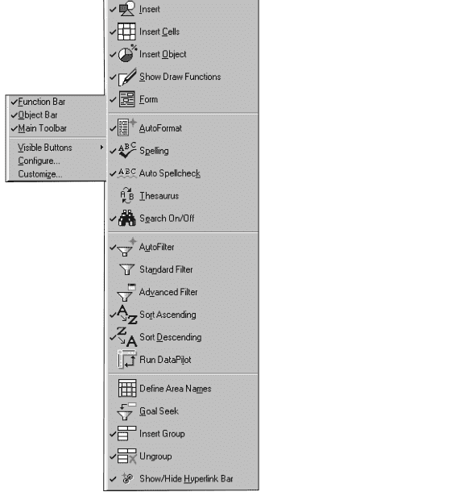

当你选择“自定义”时，会弹出一个如图 3.23所示所示对话框。（你看到的特定对话框可能会不同。）

# 第3章 准备工作

### 图 3.23

在“自定义工具栏”对话框中，你不仅可以从现有工具栏添加和删除按钮，还可以将自己的宏和编程模块分配给按钮。

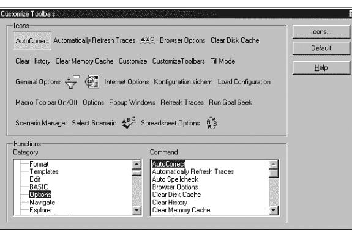

底部是“功能类别”列表和“命令”列表。功能类别列表将常用的命令按类别组织。功能类别列表显示了给定类别下所有可用命令、内置 `StarBas` 宏和脚本，以及你自行创建的任何宏和程序模块。

顶部部分是“图标”列表，它默认显示分配给当前选择类别中命令的所有工具栏按钮图标。你会发现许多按钮（如图 3.20 中的许多按钮）没有分配精美的图片。

不要沮丧——你可以点击“图标”按钮并浏览缩略图集，将任何现有的程序位图分配给命令。

要向工具栏添加新按钮，请遵循以下步骤：

- 1. 浏览“功能类别”列表以找到你感兴趣的类别。

> # Michael & Sarah 的 #43
>
> 许多 `StarMail` 命令都在 `Explorer`（资源）类别中，因为它们被认为是通用桌面命令。

- 2. 浏览“命令”列表以找到你需要的命令。注意，当你在此列表中选择一个命令时，与其关联的图标会出现在上方的“图标”列表中。

- 3. 如果不喜欢当前的图片分配，点击“图标”并浏览可用的“图标”列表以找到你喜欢的。点击该图标进行选择，并点击“确定”进行分配；然后返回“自定义”对话框。“默认”按钮会将工具按钮分配恢复为程序默认设置，因此不必担心弄乱它们。

## 创建和管理多个桌面

- 4. 将按钮拖到你想使其使用的工具栏上。系统将留出空间来容纳它。如果你向已经填满屏幕整个长度或高度的工具栏添加工具按钮，它会被添加但隐藏，并会出现一个双头箭头。点击双箭头中的深色箭头即可显示工具栏的隐藏部分。

- 5. 如果你想删除按钮，请将其拖出工具栏并放到桌面上的任何空白处，然后释放鼠标按钮。砰！它消失了。是从工具栏中消失，而不是从程序中。

如果你愿意，也可以将工具栏配置保存到单独的配置文件——虽然不能通过“自定义”对话框。你必须打开“配置”对话框来实现。否则，你在“自定义”对话框中做的更改将保存到当前的 `Standard` 模板中，并在每次创建该类型的新文档或打开使用该模板的现有文档时出现。

| 第一部分 |

| 第3章 |

## 创建和管理多个桌面

在 `StarOffice` 运行期间，你始终至少有一个桌面。但是，你可以根据需要创建任意数量的桌面并在工作期间它们之间切换。

### 多个桌面

从用户的角度来看，桌面是屏幕上一个带有启动程序和文档图标的空间。从程序的角度来看，桌面是一个文件夹，其名称为 `Desktop` 并存储在 `StarOffice` 和 `OS` 目录中；或者它是你通过选择某个文件夹并在 `Explorer` 菜单上应用“Desktop”命令创建的桌面。

要将一个文件夹变为桌面，请检查其内容中的“Desktop”条目。你会看到命令左侧有一个勾选。它在 `Explorer` 中的文件夹将被桌面图标取代。在任务栏上（如边边所示）右键点击桌面图标，会发现你新指定的桌面已添加到可用桌面的菜单中。此外，`Desktop` 文件夹中的项目已添加到 `Desktop` 菜单中（通过扩展点击打开）。（如果文件夹是空的，你的桌面和 `Desktop` 内容菜单也将为空。）


### 为什么要使用多个桌面？

为什么要使用多个桌面？想象一下你同时使用 `StarOffice` 处理个人事务和工作事务。你可以创建一个包含你经常用于个人事务的模板和程序的桌面，并创建另一个包含你经常用于工作的模板和程序的桌面。

然后将它们指定为桌面。它们都将作为桌面选项出现在 `Desktop` 快捷方式菜单中（见图 3.24）。当你选择其中一个作为默认（活动）桌面时，它包含的对象也会自动出现在 `Desktop` 菜单中。这意味着即使你的桌面上被多个任务覆盖，你也可以随时让你最需要的工具和文档触手可用。你可以轻松地在不同的桌面之间切换，而不会干扰你已打开任务的布局。

### 图 3.24

右键点击桌面图标可打开 `Desktop` 菜单，你可以从中设置默认桌面。常规双击可打开 `Desktop` 内容菜单，该菜单显示默认桌面文件夹的内容。


当你退出程序时，默认桌面是下次启动时打开的桌面。因此，通过创建自己的桌面，你还可以选择下次启动 `StarOffice` 会话时出现的工具。

### 在多个桌面之间切换

要设置不同的桌面为默认，打开 `Desktop` 菜单并点击其名称。你的桌面和 `Desktop` 内容菜单的内容都会发生。

你每次只能从此菜单选择一个桌面。但由于指定为桌面的文件夹是通过这种方式打开的，它可以像任何其他窗口一样进行操作。要将桌面降级为文件夹，在 `Explorer` 中选择该文件夹，右键点击打开上下文菜单，并点击 `Desktop` 命令。勾选标记消失，桌面的魔法结束了。

你无法取消选择 `StarOffice` 桌面或你的 `OS` 桌面。`StarOffice` 在首次启动时自动将这些文件夹放置在桌面路径上，然后在每次启动时搜索这些文件夹。你可以从 `StarOffice` 文件夹中添加和删除对象，最好不要删除文件夹本身。如果你确实删除，请务必也删除 `Tools\Options\General\Paths` 选项卡中的路径，否则 `StarOffice` 在下次启动时会产生困惑。

如果物理限制或残疾导致传统的 `StarOffice` 设置不理想，不用担心！你可以进行许多细微调整来提高 `StarOffice` 的易用性。本节提供了一些想法。然而，它并没有穷尽所有可能性，因此建议你进行自己的探索。

表 3.2 指向了可以提高桌面工具（如工具栏按钮和菜单）可见性和可用性的选项。

| 选项名称和操作 | 位置 | 结果 |
| --- | --- | --- |
| 将缩放计数器中的值增加到 100% 以上 | 工具菜单、选项、通用类别、视图对话框、显示部分 | 随着对话框尺寸和系统字体的增大，你可以更容易看到菜单和对话框。 |
| 选择大按钮 | 工具菜单、选项、通用类别、视图对话框、按钮部分 | 你可以更容易看到工具栏按钮。 |
| 取消勾选扁平按钮选项 | 工具菜单、选项、通用类别、视图对话框、按钮部分 | 你可以更容易区分工具栏按钮。 |
| 取消勾选“菜单跟随鼠标指针”选项 | 工具菜单、选项、通用类别、视图对话框、工具部分 | 菜单在打开后保持开启（而不是随着鼠标移动）；你可以更容易地使用某些类型的命令和控制软件。 |
| 在鼠标定位下拉列表中选择“对话框中心” | 工具菜单、选项、通用类别、视图对话框 | 节省手腕劳损，指针会自动定位自己（注：此处原文似乎有断句） |

# 第3章 准备工作

| 表 3.2 续 |
| 选项名称与操作 | 位置 | 结果 |
| :--- | :--- | :--- |
| | 在对话框的默认命令上方。 |
| 选择“彩色标签页控件”选项 | 它们菜单，“选项”，“常规”类别，“视图”对话框，“工具”部分 | 你可以比以前更轻松地看到并区分标签页对话框中的标签页，因为它们以彩色数组的形式出现，而不是灰色。 |


| 使用“自定义”命令向工具栏添加按钮 | 工具栏右键菜单，“自定义”命令；将光标置于你想要自定义的工具栏上；右键点击并选择“自定义” | 你可以将所有经常使用的工具都放在桌面上，减少对鼠标或键盘的使用。 |

| 在“内容”下拉列表中，仅选择图标和文本作为工具栏的显示内容 | 它们菜单，“配置”命令，“工具栏”选项卡，“内容”区域 | 你可以更容易地看到工具栏按钮；此外，选择文本可以让某些命令和控制程序更容易地识别命令。 |

- 有关自定义工具栏的更多信息，请参阅本章第 115 页的自定义桌面工具和菜单。

> 缩放视图可能会导致系统变得不稳定，特别是当你将缩放比例到很大的数字时。如果你发现无法启动 StarOffice 或程序运行经常崩溃，请从 `Office1config` 目录中删除 `.cfg` 文件。（或者，如果你将缩放设置保存到了不同的配置文件，请删除该文件。）请在程序未运行时执行此操作。你可以删除该文件或将其保存到其他位置。然后，重启程序。StarOffice 会自动生成一个新的默认配置文件，使程序能够运行。（或者，它将从源 `.cfg` 文件获取设置，而不是你的配置文件。）然而，这将丢失所有的自定义配置。如果你了解如何编辑配置文件并保存了损坏的文件，你可能简单地编辑缩放配置并重新使用该文件。否则，你需要自定义你的桌面。

### 注意

# 故障排除 127

你还应该利用 StarOffice 的自动化功能（如自动文本和自动格式）来让你的工作更轻松。

如果你手部或手臂有重复性压力损伤（RSI）而无法打字，或者有需要你向电脑说话的其它物理损伤，你可以安装 Dragon NaturallySpeaking API，它可以让你在 Windows 平台上使用 Dragon NaturallySpeaking。如果你在安装程序时没有选择此安装，你需要从 `Office51` 目录运行 `Setup`，选择“修改”并按照安装向导的说明操作。

## 故障排除

### 我需要做什么才能访问互联网？

首先，你必须拥有到局域网（LAN）或内网的网络连接，或者拥有一个来自 ISP 的互联网账户以及拨号网络连接。

告知 StarOffice 你的互联网账户信息的简单方法是使用互联网自动向导（Internet AutoPilot），你可以在在线获取它。它在你第一次启动 StarOffice 时会自动附加。如果你在第一次启动 StarOffice 时没有选择完成自动向导，可以从“文件”，“自动向导”菜单中启动它。请按照本章中“使用互联网自动向导设置互联网账户”节中的步骤操作。

如果你想自己设置账户，请参阅本章“连接网络”部分的相关内容。

一旦你检查了这些设置，点击 StarOffice 功能栏上的“在线”按钮，使其看起来已准备就绪。现在，你准备好浏览了！在资源管理器中点击“Web 书签”，当 StarOffice 检测到互联网连接，你的拨号网络对话框将打开。采取你通常用于连接的任何操作。连接后，你可以通过在 URL 定位字段或栏输入 Web 地址（URL）并按回车进行浏览。

如果你想使用 FTP 下载文件、使用新闻组或发送接收电子邮件，你需要在 StarOffice 中拥有 FTP 账户、新闻账户以及电子邮件收件箱和发件箱。如果你在首次启动程序时使用了 `Setup` 自动向导，你可能已经在扩展资源器的“电子邮件”和“新闻”组中拥有了电子邮件收件箱和/或新账户。如果你没有，设置电子邮件账户和/或新闻账户的最简单方法是选择“文件”，“自动向导”，“互联网”，并通过对话框，仅选择你想要添加的新选项。创建 StarDiscussion 账户的详细信息请见第 29 章中的“超越邮件：使用 StarDiscussion 加入新闻组”节。创建 FTP 账户的内容将在第 27 章“在 Web 上发布你的工作”中讨论。


# 128 | 第3章 准备工作

### 电子邮件在 StarOffice 中是如何工作的？

要接收电子邮件，你必须设置电子邮件账户收件箱。如果你在首次打开程序时完成了互联网向导，你应该已经在扩展资源器的“电子邮件”和“新闻”组中拥有了一个账户收件箱。由于某种原因你没有，或者你想设置第二个收件箱，你需要在资源管理器中创建它。右键点击你想存储电子邮件的文件夹并选择“新建”命令。从子菜单中，选择你想要创建的电子邮件账户类型——`POP3`（最常见的类型，如果你通过 ISP 连接，肯定用的是这种类型）、`IMAP` 或 `VIM`。要发送电子邮件，你必须首先通过相同的右键菜单“新建”创建一个收件箱。如果你完成了互联网自动向导，你已经有一个收件箱了，无需担心它。关于完成这些对话框的详细说明，请参阅本章前面的“连接网络”节。

一旦你检查了这些设置，点击 StarOffice 功能栏上的“在线”按钮，使其看起来已准备就绪。现在，你准备好浏览了！在资源管理器中点击“Web 书签”，当 StarOffice 检测到互联网连接，你的拨号网络对话框将打开。采取你通常用于连接的任何操作。连接后，你可以通过在 URL 定位字段或栏输入 Web 地址（URL）并按回车进行浏览。

如果你想使用 FTP 下载文件、使用新闻组或发送接收电子邮件，你需要在 StarOffice 中拥有 FTP 账户、新闻账户以及电子邮件收件箱和发件箱。如果你在首次启动程序时使用了 `Setup` 自动向导，你可能已经在扩展资源器的“电子邮件”和“新闻”组中拥有了电子邮件收件箱和/或新账户。如果你没有，设置电子邮件账户和/或新闻账户的最简单方法是选择“文件”，“自动向导”，“互联网”，并通过对话框，仅选择你想要添加的新选项。创建 StarDiscussion 账户的详细信息请见第 29 章中的“超越邮件：使用 StarDiscussion 加入新闻组”节。创建 FTP 账户的内容将在第 27 章“在 Web 上发布你的工作”中讨论。


# 电子邮件在 StarOffice 中是如何工作的？

要接收电子邮件，你必须设置电子邮件账户收件箱。如果你在首次打开程序时完成了互联网向导，你应该已经在扩展资源器的“电子邮件”和“新闻”组中拥有了一个账户收件箱。由于某种原因你没有，或者你想设置第二个收件箱，你需要在资源管理器中创建它。右键点击你想存储电子邮件的文件夹并选择“`新建`”命令。从子菜单中，选择你想要创建的电子邮件账户类型——`POP3`（最常见的类型，如果你通过 `ISP` 连接，肯定用的是这种类型）、`IMAP` 或 `VIM`。要发送电子邮件，你必须首先通过相同的右键菜单“`新建`”创建一个收件箱。如果你完成了互联网自动向导，你已经有一个收件箱了，无需担心它。关于完成这些对话框的详细说明，请参阅本章前面的“连接网络”节。


要接收电子邮件，你必须设置电子邮件账户收件箱。如果你在首次打开程序时完成了互联网向导，你应该已经在扩展资源器的“电子邮件”和“新闻”组中拥有了一个账户收件箱。由于某种原因你没有，或者你想设置第二个收件箱，你需要在资源管理器中创建它。右键点击你想存储电子邮件的文件夹并选择“新建”命令。从子菜单中，选择你想要创建的电子邮件账户类型——`POP3`（最常见的类型，如果你通过 ISP 连接，肯定用的是这种类型）、`IMAP` 或 `VIM`。要发送电子邮件，你必须首先通过相同的右键菜单“新建”创建一个收件箱。如果你完成了互联网自动向导，你已经有一个收件箱了，无需担心它。关于完成这些对话框的详细说明，请参阅本章前面的“连接网络”节。

# 电子邮件在 StarOffice 中是如何工作的？

要接收电子邮件，你必须设置电子邮件账户收件箱。如果你在首次打开程序时完成了互联网向导，你应该已经在扩展资源器的“电子邮件”和“新闻”组中拥有了一个账户收件箱。由于某种原因你没有，或者你想设置第二个收件箱，你需要在资源管理器中创建它。右键点击你想存储电子邮件的文件夹并选择“新建”命令。从子菜单中，选择你想要创建的电子邮件账户类型——`POP3`（最常见的类型，如果你通过 ISP 连接，肯定用的是这种类型）、`IMAP` 或 `VIM`。要发送电子邮件，你必须首先通过相同的右键菜单“新建”创建一个收件箱。如果你完成了互联网自动向导，你已经有一个收件箱了，无需担心它。关于完成这些对话框的详细说明，请参阅本章前面的“连接网络”节。

**抱歉，由于您提供的文本中存在大量重复，以下是基于原文去重复内容的完整译文：**

# 第3章 准备工作

| 表 3.2 续 |
| --- |
| 选项名称与操作 | 位置 | 结果 |
| :--- | :--- | :--- |
| | 在对话框的默认命令上方。 |
| 选择“彩色标签页控件”选项 | 它们菜单，“选项”，“常规”类别，“视图”对话框，“工具”部分 | 你可以比以前更轻松地看到并区分标签页对话框中的标签页，因为它们以彩色数组的形式出现，而不是灰色。 |
| 使用“自定义”命令向工具栏添加按钮 | 工具栏右键菜单，“自定义”命令；将光标置于你想要自定义的工具栏上；右键点击并选择“自定义” | 你可以将所有经常使用的工具都放在桌面上，减少对鼠标或键盘的使用。 |
| 在“内容”下拉列表中，仅选择图标和文本作为工具栏的显示内容 | 它们菜单，“配置”命令，“工具栏”选项卡，“内容”区域 | 你可以更容易地看到工具栏按钮；此外，选择文本可以让某些命令和控制程序更容易地识别命令。 |

- 有关自定义工具栏的更多信息，请参阅本章第 115 页的**自定义桌面工具和菜单**。

> 缩放视图可能会导致系统变得不稳定，特别是当你将缩放比例到很大的数字时。如果你发现无法启动 StarOffice 或程序运行经常崩溃，请从 `Office1config` 目录中删除 `.cfg` 文件。（或者，如果你将缩放设置保存到了不同的配置文件，请删除该文件。）请在程序未运行时执行此操作。你可以删除该文件或将其保存到其他位置。StarOffice 会自动生成一个新的默认配置文件，使程序能够运行。（或者，它将从源 `.cfg` 文件获取设置，而不是你的配置文件）。然而，这将丢失所有的自定义配置。如果你了解如何编辑配置文件并保存了损坏的文件，你可能简单地编辑缩放配置并重新使用该文件。否则，你需要自定义桌面。

注意

# 故障排除 127

你还应该利用 StarOffice 的自动化功能（如自动文本和自动格式）来让你的工作更轻松。

如果你手部或手臂有重复性压力损伤（RSI）而无法打字，或者有需要你向电脑说话的其它物理损伤，你可以安装 `Dragon NaturallySpeaking API`，它可以让你在 Windows 平台上使用 `Dragon NaturallySpeaking`。如果你在安装程序时没有选择此安装，你需要从 `Office51` 目录运行 `Setup`，选择“修改”并按照安装向导的说明操作。

## 故障排除

我需要做什么才能访问互联网？

首先，你必须拥有到局域网（LAN）或内网的网络连接，或者拥有一个来自 ISP 的互联网账户以及拨号网络连接。

告知 StarOffice 你的互联网账户信息的简单方法是使用互联网自动向导（Internet AutoPilot），你可以在在线获取它。它在你第一次启动 StarOffice 时会自动附加。如果你在第一次启动 StarOffice 时没有选择完成自动向导，可以从“文件”，“自动向导”菜单中启动。请按照本章中“使用互联网自动向导设置互联网账户”节中的步骤操作。

如果你想自己设置账户，请参阅本章“连接网络”部分的相关内容。

一旦你检查了这些设置，点击 StarOffice 功能栏上的“在线”按钮，使其看起来已准备就绪。现在，你准备好浏览了！在资源管理器中点击“Web 书签”，当 StarOffice 检测到互联网连接，你的拨号网络对话框将打开。采取你通常用于连接的任何操作。连接后，你可以通过在 URL 定位字段或栏输入 Web 地址（URL）并按回车进行浏览。

如果你想使用 FTP 下载文件、使用新闻组或发送接收电子邮件，你需要在 StarOffice 中拥有 FTP 账户、新闻账户以及电子邮件收件箱和发件箱。如果你在首次启动程序时使用了 Setup 自动向导，你可能已经在扩展资源器的“电子邮件”和“新闻”组中拥有了电子邮件收件箱和/或新账户。如果你没有，设置电子邮件账户和/或新闻账户的最简单方法是选择“文件”，“自动向导”，“互联网”，并通过对话框，仅选择你想要添加的新选项。创建 StarDiscussion 账户的详细信息请见第 29 章中的“超越邮件：使用 StarDiscussion 加入新闻组”节。创建 FTP 账户的内容将在第 27 章“在 Web 上发布你的工作”中讨论。


# 128 | 第3章 准备工作

电子邮件在 StarOffice 中是如何工作的？

要接收电子邮件，你必须设置电子邮件账户收件箱。如果你在首次打开程序时完成了互联网向导，你应该已经在扩展资源器的“电子邮件”和“新闻”组中拥有了一个账户收件箱。由于某种原因你没有，或者你想设置第二个收件箱，你需要在资源管理器中创建它。右键点击你想存储电子邮件的文件夹并选择“新建”命令。从子菜单中，选择你想要创建的电子邮件账户类型——`POP3`（最常见的类型，如果你通过 ISP 连接，肯定用的是这种类型）、`IMAP` 或 `VIM`。要发送电子邮件，你必须首先通过相同的右键菜单“新建”创建一个收件箱。如果你完成了互联网自动向导，你已经有一个收件箱了，无需担心它。关于完成这些对话框的详细说明，请参阅本章前面的“连接网络”节。

# 第 4 章

## 在 StarOffice 中工作

在本章中

- StarOffice 132 中的桌面集成 132
- 创建和打开文档 132
- 保存和关闭文档 147
- 跨桌面操作 150
- 使用正则表达式 153
- 在 StarOffice 中导航 155
- 基础编辑和格式设置 160
- 格式、样式和模板 165
- 使用常用校对工具 170
- 文档间的数据共享 171
- 对象的处理 176
- 通讯人录简介 180
- 发送和打印文档 184


# 第 4 章 在 StarOffice 中工作

## 故障排除 188

### StarOffice 中的桌面集成

StarOffice 提供的基础文字处理和电子表格应用程序与您今天在任何 Office 软件件中找到的程序相似。StarOffice 脱颖而出的地方在于，它将应用程序和网络程序紧密集成到一个桌面中——这个环境旨在无缝地融入办公网络、互联网以及各种平台。

这种集成包括跨应用程序共享命令、工具和桌面实用程序，这使得学习使用 StarOffice 变得相对快速简单。例如，如果您学会了如何使用 StarWriter 中的表格自动格式化功能，那么您已经知道如何在 StarCalc 中自动格式化表格了——即使您一生中从未打开过电子表格。

本章将为您概述 StarOffice 的常用对话框、工具和组织结构，并让您领略集成桌面的工作状态。它包含了许多技巧和窍门，以最大化工作产出并减少您在 StarSpace 中的工作量。后续章节将详细介绍当您各个应用程序模块中使用这些工具时，如何最好完成特定任务。

## 创建和打开文档

由于 StarOffice 是一个以任务为导向的程序，您从桌面开始创建和打开文件及文档，而不是打开应用程序。

### 创建新文档

要开始任务，您可以从桌面工作区域的多个位置打开新文档，也可以使用模板和 AutoPilot 向导（Wizard）创建文档。在 StarOffice 中，“文档”不仅指文本文档，还指许多其他类型的文档。

表 4.1 列出了您可以在 StarOffice 中创建的文档类型。

| 表 4.1 StarOffice 中使用的文档类型 | | |
| :--- | :--- | :--- |
| 使用此文档类型 | 用于创建 | |
| 文本 | 信函、传真、报告和其他文本文档 | |
| 电子表格 | 财务报告和分析、列表以及某些类型的数据库 | |
| 演示文稿 | 幻灯片、透明片、讲义以及口头报告的大纲 | |
| 绘图 | 高分辨率插图 | |
| HTML | 简单的网页和其他使用超链接的文档 | |
| 邮件 | 电子邮件信件 | |
| 框架集 (Frameset) | 将多个文件和文档合并到一个在线页面上的复杂网页 | |
| 使用此文档类型 | 用于创建 |
| :--- | :--- |
| 主文档 | 长文档的主文档，用于简化生成索引和目录等任务 |
| 图表 | 数值数据的图形化表示 |
| 图像 | 适用于在 Web 上发布的简单图表，或自定义的屏幕元素（如按钮和图标） |
| 数学公式 | 需要特殊字体和字符集的复杂数学公式 |

### 从零开始创建文档

要创建一个 StarOffice 文档，您可以从这些选项中进行选择：

- 您可以从菜单栏选择“文件 (`File`)、新建 (`New`)”，并在子菜单中选择文档类型。
- 您可以选择“文件 (`File`)、AutoPilot”来帮助创建文本、演示文稿和 Web 文档以及模板。
- 您可以从资源管理器（Explorer）右键菜单选择“新建 (`New`)、文档 (`Documents`)”，并在子菜单中选择文档类型。这些选项与“文件 (Web)”子菜单中的选项相同。
- 您可以通过点击标题栏在扩展资源管理器中打开“任务 (`Tasks`)”组。然后点击所需的文档图标以启动新文档。
- 您可以从任务栏打开“开始 (`Start`)”菜单，并点击所需的文档图标以启动新文档。

### 从模板创建文档

要创建一个 StarOffice 文档，您可以从这些选项中选择（但不限于此）：

模板是一种特殊的文档，可以作为其他文档的模板。将文件保存为模板最简单的方法是使用模板命令。在输入所有必要信息后，选择“创建 (`Create`)”。StarOffice 将一个基于模板的空白文档。对于普通的文本和演示文稿，它会在模板目录的标准子目录下创建并保存自定义模板，使用您在创建过程中输入的名称。即使您没有保存文档，它也会保存模板。对于 Web (HTML) 文档，您必须点击“保存模板 (`Save Template`)”来保存您的自定义模板。

### 创建和打开文档

您的活动文档（包含文本、样式等所有内容）已保存在模板目录中，下次打开任何模板时可以使用。您也可以在模板对话框中将文件保存为模板。

- 了解更多关于模板的信息，请参见“管理模板”。

### 使用 AutoPilot

AutoPilot 是一种文档和模板创建向导，通过引导有限的格式和布局选项，帮助创建常见文档类型（信函、传真、议程、备忘录、演示文稿和）的精排版本。

5.1 版本的新功能，特殊的 AutoPilot 向导可以将文档模板和文档导入 StarOffice。

要使用 AutoPilot 创建新文档和模板，选择“文件 (`File`)、AutoPilot”，然后选择您要创建的类型。StarOffice 将引导您通过一系列对话框，协助您创建符合要求的模板。如果出错或改变主意，可以点击“后退 (`Back`)”按钮返回步骤并进行修改。点击“取消 (`Cancel`)”取消整个过程并返回桌面。

- 更多关于在文本文档中使用 AutoPilot 信息，请参见“使用 AutoPilot 创建文档和模板”。
- 更多关于创建和使用模板的信息，请参见“工作模板”。

> 注意
> 你可以使用 AutoPilot 创建 StarBase 数据库元素。然而，处理 StarBase 元素与处理普通文档不同，但此处未对其进行讨论。请参阅第 30 章“在 StarBase 中处理数据库”。

导入 Microsoft 文档和模板 如果你从 Microsoft Office 切换过来，可以使用 AutoPilot 菜单上的“Microsoft Office 模板和文档导入向导”快速上手。你可以一次性将 Microsoft Word、Excel 和 PowerPoint 模板导入并转换为 StarOffice 模板，并将 Microsoft 文档导入并转换为相应的 StarOffice 文档——一切免费完成。（你的原始模板和文档将保持不变。）

> 注意
> StarOffice 针对 Microsoft Office 文档拥有一套非常良的过滤器，因此你不需要导入文档即可在 StarOffice 中打开它们。如果需要，你可以以原始格式对它们进行操作。

首先从“文件”菜单中的 AutoPilot 菜单中选择“导入 Microsoft”命令。然后，你将看到如图 4.1 所示的对话框。

### 图 4.1

Microsoft 导入向导的启动界面使用破碎的英语欢迎你，但导入过程本身是流畅且无故障的。


点击“继续”进入下一个对话框，该界面看起来如图 4.2 所示。

此对话框是你导入过程的关键。你需要为每个程序完成以下三个步骤：

1. 确定你是否想要导入该程序的模板，如果列出的模板路径不正确，请进行更改。你也可以选择搜索所选模板目录的子目录。
2. 确定你是否想要导入使用该程序创建的现有文档，如果列出的目录路径不正确，请进行更改。如果你选择了该选项，StarOffice 将导入存储在该目录（及其子目录）中的文档。
3. 确定导入的文档将放置的目标目录路径。

### 图 4.2

在导入向导的第二个对话框中，你可以选择导入 MS Word、Excel 和 PowerPoint 模板及文档的导入选项。

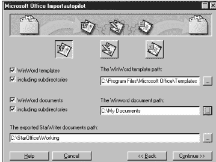


默认情况下，导入向导设置为导入列出目录及其子目录中的所有现有 Office 模板和文档。StarOffice 用于导入文档和模板的过滤器与通过“文件”菜单的“打开”对话框打开单个文档时使用的过滤器相同。你可能想在*批量*导入之前对所选文档的过滤器进行测试，以查看你的文档导入情况是否可以接受。当然，如果导入的文档不可用，你的原始文档仍然存在。

> 警告
> 
> 某些功能（如 Word 中的修订标记和某些 Excel 函数）可能无法进行转换。如果你说德语，你可以在 Star Division 的德国网站 `www.stardvision.de` 找到每个功能的导入/导出状态列表。

你初始化的设置仅适用于 Microsoft Word。要确认或更改 MS Excel 和 MS PowerPoint 的设置，你必须点击对话框上部分的相应按钮。

你不需要为导入的模板列出路径，因为 StarOffice 会在模板目录中自动为它们创建文件夹。

在在此对话框中确认设置后，点击“继续”。然后你将看到一个如图 4.3 所示的对话框，其中总结了你的选择。明智之举是滚动查看摘要以确认你的选择。

# 第 4 章在 StarOffice 中工作

## 图 4.3

导入向导的第三个对话框总结了你选择的选项；但你可以更改导入模板的文件夹名称。

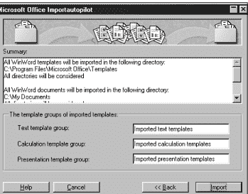

当摘要显示“将考虑所有目录”（`All Directories Will Be Considered`）时，意味着你为相关程序选择了“包含子目录”选项，而不是向导将从本地驱动器的任何地方导入模板和/或文档。

你本质上是在复制所有选定的模板和文件。确保你的硬盘或分区上有足够的空间来导入你选择的所有模板和/或文档。

这里列出了默认模板文件夹名称——导入的模板（针对 Microsoft Word 模板）、导入的计算模板（针对 MS Excel 模板）和导入的模板（针对 MS PowerPoint 模板）。你可以通过选择默认名称并覆盖来更改这些名称。

确认设置后，点击“导入”开始该过程。导入需要几分钟，请耐心等待。StarOffice 首先搜索你选择的文件夹，并统计具有适当格式的模板和/或文档的数量；你可以在对话框上看到数量（如果你看到一个惊人的数字并担心硬盘空间，请点击“取消”停止进程）。然后它会导入。

想看看导入向导做了什么吗？在 AutoPilot 完成后，打开功能栏上的 URL 定位列表。你将看到最后导入的 100 个模板和/或文档。

## 打开现有文档

StarOffice 包含了打开许多其他程序和其他主要平台创建的文档和文件类型的过滤器，以及打开旧版本的 StarOffice 文档。

要查看 StarOffice 处理的非原生文件类型的完整列表，请参阅附录 B，“文件格式”。

注意

StarOffice（个人版）带有有限的导入和导出功能。要获得完整功能，你必须购买专业版。

提示 #46

打开文件的快捷快捷是“文件”菜单底部的“最近文件”列表。只需点击文件名即可打开。列出的默认文件数量为四个，但你可以通过在 `soffice.ini` (Windows) 或 `sofficec` (Linux) 文件中添加一行来更改此数字。使用文本编辑器（如记事本或 Vi）打开该文件。然后搜索 `[soffice-Picklist]`。此部分记录了你的浏览和文件打开历史。接着，转到部分的末尾，添加行

`Pick=x`

其中 x 是你希望出现在“文件”菜单上的最近打开的文件数量。

最后保存文件并退出。更改将在下次启动 StarOffice 时生效。

打开文档的常用方法是使用“打开”对话框 (`Ctrl+O`)，你可以从“文件”菜单访问它（见图 4.4）。这种方法有许多优势。你可以导航到系统上的任何地方。你可以选择打开文件时想要使用的特定过滤器。你可以选择以只读模式打开文件，以防只想看不想动。

打开现有文档

使用非 StarOffice，你有多种选择：

- 你可以在“打开”对话框中选择“文件”命令（见图 4.4）。
- 你可以点击功能栏上的“打开”图标，这将打开一个与桌面相同的对话框。
- 你可以双击桌面文件。
- 你可以在 URL 字段中输入你的文件路径并按回车。
- 你可以打开 URL 下拉历史并点击（那里列出了最后 100 条记录，包括本地存储的文件和 Internet 地址）
- 你可以打开“Star”菜单并将指针移动到“文档”项。它会打开一个子菜单，列出你在系统任何地方打开的最后 30 个文档。只需点击文档即可打开。


图 4.4

“打开”对话框顶部的“上一级”和“默认目录”按钮允许你导航到系统的任何地方。你可以扩展点击它们来打开方便的快捷菜单。

创建新目录

默认目录

上一级

详细

列表视图

当你第一次在 StarOffice 中打开“打开”对话框时，它会打开你指定的工作文件夹。此后，它将打开上一次打开文件的目录。

对话框的上部分包含导航按钮。

对话框的主要部分列出了文件列表及其属性。如果你点击“详细视图”（Details View）按钮，就可以查看文件的更多细节，例如最后修改日期和文件大小。（图 4.4 显示了默认图标视图下的对话框，图 4.5 显示了详细视图下的对话框。）你也可以通过抓角并拖动来调整对话框的大小——这虽然不寻常，但在文件名很长的今天非常有用。调整对话框大小的能力也是你能够在此对话框中管理文件的功能之一。

对话框的下半部分包含文本框，你或程序可以在其中输入关于要打开的文件的信息。“版本”（`Version`）文本框与 StarOffice 特性有关，它允许你在单个文件中保存不同的不同的版本。

- 有关使用版本的更多信息，请参阅“使用版本”章节，第 107 页。

默认情况下，显示所有文件类型，但你可以通过“文件类型”（`File Type`）下拉列表搜索特定的文件类型，以此缩小目标并加快搜索。

### 用于搜索文件的通配符

你可以使用通配符 (`*`) 输入文件名的一部分，或使用通配符 (`*`) 输入扩展名，然后按回车键仅列出符合搜索标准的文件。例如，如果与特定项目的所有文件都以字母 ARC 开头，你可以在“文件名”（`Filename`）框中输入 `arc*` 并按回车键，仅列出这些文件。如果你的搜索标准的文件夹中只有一个文件，StarOffice 将在桌面上打开它。

> 不要将搜索字符串的开头放置星号，因为它会被解释为“搜索所有文件”。

使用问号字符 (`?`) 代替单个字符。例如，如果你正在寻找以数字 9 开头后接四个数字的 Microsoft Word 文件，你应该搜索 `????doc`。

### 打开文件

要从“打开”对话框打开一个文件，可以双击它，或选择它并点击“打开”（Open）按钮。文件将置于任何其他已打开任务之上。

如果你只想读取文档，可以选择“打开”对话框左下角的“只读”（`Read-only`）选项，以确保它在打开时不会被意外更改。

如果你无法打开文档，可能是模板损坏了。不过，你可以在不带模板的情况下加载文档。只需按 `Ctrl+Alt+L`，在弹出的对话框中点击“确定”，然后选择“打开”。StarOffice 会检查格式并并将任何损坏的样式替换为其标准格式。

### 在“打开”对话框中导航

在“打开”对话框中导航的基础知识可能已经通过其他程序让你熟悉。然而，一如往常，StarOffice 有一些意料之外的小技巧。

你可以通过双击文件夹查看其内容，或使用对话框顶部的导航按钮移动到目录结构的较高级或其他区域，从而在本地和网络驱动器上导航。

“向上一级”（`Up One level`）会让你的目录结构移动一个文件夹。如果不小心走得太远，再次双击你想打开的文件夹或图标即可。

“创建目录”（`Create Directory`）按钮会在当前位置创建一个新文件夹，你可以在打开和保存文件的同时轻松管理它们。

# 142 第 4 章 在 StarOffice 中工作

在 Microsoft 应用中，你可以经常将文件夹设为“收藏”并快速导航到它们。在 StarOffice 中，你可以进行类似的操作，但需要使用“默认目录”（`Default Directory`）按钮。点击默认目录按钮将带你进入你指定的工作文件夹。此按钮不仅适用于“打开”对话框，还适用于许多其他对话框，因此将你最常用的目录作为工作文件夹是一个好主意。这样做确实会加快你的导航速度。

> ### 来自 Michael & Sarah 的 #49
> 
> 你可以通过从 `Tools`、`Options` “主对话框”打开的常规类别路径（`Paths`）对话框中输入文件夹项，更改分配给默认目录按钮的目录。

“打开”对话框中意外之外的技巧与“向上一级”和“默认目录”按钮旁的小绿色箭头有关。箭头是 StarOffice 的信号，表示长按这些按钮可以打开某些特殊内容——在这种情况下，是带有导航快捷方式的便捷弹出菜单。这两者都可以让你访问“工作区”（列出你所有的驱动器和文件夹）以及指向 C 盘根目录的快捷方式。默认目录弹出菜单（如图 4.5 所示）为你提供了更多选择，包括 StarOffice 模板文件夹、资源管理器（Explorer）、组文件夹以及你所有指定的桌面。


将你经常使用的目录指定为桌面是确保快速导航的简单方法。在资源管理器或 Beamer 中选择文件夹，右键点击，并选择“桌面”（`Desktop`）命令。

> ### 来自 Michael & Sarah 的 #50
> 点击“打开”对话框中的文件名下拉列表，将打开最后 100 个访问文档的历史列表，这与从 URL 定位器字段打开的列表是相同的。只需点击列表上的文档即可在桌面上打开它。

## 创建和打开文档

图 4.5

默认目录快捷菜单比“一级”快捷菜单提供了更广泛的选择，并且更具定制性。


### 按文件属性显示排序

当你保存文件时，某些属性会随之保存，包括标题、路径（StarOffice 术语为 URL）、类型、大小和修改日期。当你在“打开”对话框中选择详细视图时，你可以在列表中显示这些属性。

默认情况下，显示所有文件类型，但你可以通过“文件类型”（`File Type`）下拉列表搜索特定的文件类型，以此缩小目标并加快搜索。

### 创建和打开文档操作

如果您想修改准则，请选择要修改的语句。该语句将显示在下方的文本框中。根据需要进行更改，然后点击“修改”（`Modify`）按钮。

要删除准则，请选择它并点击“删除”（`Delete`）。

在进行更改后，您可能需要点击“更新”（`Update`）来刷新显示。“更新”命令仅搜索符合您的准则的文件和文件夹；它不会匹配您正在搜索的目标目录和驱动器的内容。

然而，点击“同步”（`Synchronize`）则会执行此操作。因为它会根据您的准则匹配目标目录下的桌面文件夹内容，如果您更改了准则导致某些项目不再符合新准则，这些项目可能会从您的文件夹中消失。

## 搜索特定扩展名的文件

如果您想搜索特定扩展名的文件，首先需要确保您已点击了桌面对象栏上的文件扩展名（`File Extensions`）按钮。（要显示此工具，您必须在桌面上打开一个文件夹。）然后打开查找（`Find`）对话框，并输入您的准则标题（Title）内容（Contents）（您也可以在标题中使用文件类型（`File Type`）。）在表达式文本中，使用句号（ . ）后跟扩展名——例如 `.dw`。

在位置（Location）选项卡中，输入您的位置。如果您想进行广泛搜索，请搜索并选择“子文件夹”（`Subfolders`）选项。

注意，`.*dw` 而不是 `*.*dw` 均有效。

- 有关使用查找命令及其变体的更多信息，请参见“检索远程文件和文件夹”，第 206 页。

## 打开多个文件

使用 `Shift+点击`（允许您选择连续的文件列表）或 `Ctrl+点击`（允许您进行非连续选择）来选择您想要打开的文件。完成选择后，点击“打开”（`Open`）或按回车键。

取决于所选文件的数量和大小，加载所有文件可能需要几分钟。它们会一个一个放置在您的桌面上。然后可以使用 Windows 菜单或按 `Ctrl+Tab` 在文档之间移动。

## 从桌面打开文档

除了“文件”菜单中的“打开”对话框外，您还可以使用资源管理器（`Explorer`）和显示器（`Beamer`），或通过打开桌面上的文件夹来直接从桌面预览和打开文件。打开文件的快捷方式各不相同。如果您将资源管理器设置为图标之一，只需单击一次即可打开文件。否则，通过双击来打开文件。

无论文件是否在 StarOffice 中创建的都没有关系。如果不是，StarOffice 将根据文件扩展名用正确的应用程序打开该文件。如果文档没有 StarOffice 识别的文件扩展名，您需要使用文件的“打开”对话框来打开它，在那里您可以手动指定正确的文件类型。

| 部分 | 章节 |
|---|---|
| 4 | |

使用拖放操作，您还可以将显示器中的文件作为节插入打开的文档中。

| 来自 Michael Sarah 的第53 号提示 | 通常情况下，您无法通过从显示器拖放文件到桌面来打开。如果您将其释放到已打开的文档上方，可以通过这种方式打开表格。 |

**预览文件** 要预览文件，您必须先通过在资源管理器中选择并双击，或右键点击并选择“打开”来打开桌面上的文件夹。如果您双击，当前活动的任务（如果有）将关闭，并在其位置打开文件夹。如果您右键点击并选择“打开”，文件夹将在您当前活动的任务上方自动打开。

接下来，点击桌面对象栏上的“预览”（`Preview`）按钮。然后选择您想要预览的文件。加载片刻后，它将以只读副本出现在出现在窗口。

> 如果您想预览图形文件，您需要将它们导入图库（Gallery）。然后您可以在显示器中显示文件夹，显示器可以作为缩略图查看器。

**从资源管理器打开文件** 现在在5.1版本中，您可以通过三种方式之一直接从资源管理器显示并打开文档：

- 如果您的组设置为图标视图，可以点击文档来打开它。
- 如果您的组设置为层级视图（Hierarchical），只有当您也选择资源管理器上的“显示文档”命令时，才会列出单独文档。（将指针置于组上，右键点击。）双击文档即可打开它。
- 在所有三种视图中，您都可以选择文档、右键点击并从上下文菜单中选择“打开”来打开它。

**从显示器打开文件** 如果您在层级视图下打开显示器和文件夹，文件夹的内容将显示在显示器中。要打开文件，请选择它并右键点击。

**多个文件** 您可以在设置为层级视图的资源管理器中打开多个文件。要这样做，请使用 `Ctrl+点击`（非连续文件）或 `Shift+点击`（连续列表）选择要打开的文件。然后右键点击并从上下文菜单中选择“打开”。

**作为模板打开文件** 如果您想将文档副本作为模板，请选择它，右键点击并从上下文菜单中选择“打开为模板”。

**链接的目标** 经常，您的资源管理器中没有原始文件，只有保存到其他处的链接。您可以打开文件。然而，您无法打开链接作为模板。您可以轻松打开原始文件作为文档或模板。要这样做，选择您的链接，右键点击并选择目标。从打开的子菜单选择“打开”或“存为”。

**作为节插入文件** StarOffice 的拖放功能非常强大并大大提高了您的效率。将一个文档作为节插入另一个文档的快捷方法是在文档位于桌面打开时，将其拖入。节是一项涉及数据的复杂功能，因此在使用此功能之前您可能想考虑第10章“使用文档”。

有关节的信息，请参见第378页的“定义节”和第109页的“隐藏和保护”。

您无法通过选择编辑（或按 `Ctrl+Z`）来撤销节。要删除或管理节，必须使用“编辑”菜单的对话框。

## 保存和关闭文档

StarOffice 的保存命令有标准的：保存、另存为和全部保存。“保存”保存桌面上的活动任务。“保存”被称为快速保存，因为您可以使用 `Ctrl+S` 组合或点击功能栏上的“保存”按钮进行实时保存。“全部保存”所有打开的文档。

> 来自 Michael & Sarah 的第54 号 如果您的文档自上次保存以来未保存或已更改，状态栏会出现一个星号作为提示。

使用“保存”和“全部保存”会自动覆盖同名的之前的版本。如果保存或全部保存尚未为打开文档分配文件名，StarOffice 将弹出“另存为”对话框（见图4.6）。使用此对话框，可以命名当前文档并选择您希望保存工作的文件类型，还可以分配密码。

> 注意 在为打开文档命名之前，“保存”和“全部保存”命令呈禁用状态。

“另存为”对话框为您提供了保存文件的许多重要选择，您将在后续章节中学习。

# 第4章 在 StarOffice 中工作

图4.6

您可以在“另存为”对话框中以多种格式保存。从类型下拉菜单中选择文件类型。

| 类型 | 文件夹 | 大小 | 修改 | 日期 |
|---|---|---|---|---|
| 数据库 | Save(StarOffice) | 568 KB | 5/25/99, 11:32 AM | 5/25/99, 11:32 AM |
| FREEDB.ods | Save(StarOffice) | 568 KB | 5/25/99, 11:16 AM | 5/25/99, 11:16 AM |
| FREEDB.odt | Save(StarOffice) | 308 KB | 5/25/99, 11:16 AM | 5/25/99, 11:16 AM |
| Calc.ods | Save(StarOffice) | 18 KB | 5/25/99, 12:54 AM | 5/25/99, 12:54 AM |
| Cargo.ods | Save(StarOffice) | 128 KB | 5/25/99, 12:56 PM | 5/25/99, 12:56 PM |
| 15_light.ods | Save(StarOffice) | 17 KB | 3/26/99, 2:20 PM | 3/26/99, 2:20 PM |
| HouseCat.ods | Save(StarOffice) | 94 KB | 3/26/99, 3:13 AM | 3/26/99, 3:13 AM |

## 使用密码保存文件

您可以在“另存为”的左下角选择“密码保存”选项为密码保护您的文件。如果选择了此选项，在“另存为”对话框中点击确定将打开“输入密码”对话框，提示您输入密码。在输入密码并点击确定后，第二个对话框将提示您重新输入并确认密码。当您在“确认”对话框中点击确定时，您的文件将受到密码保护。


> 不要忘记您的文件密码！您无法打开忘记了密码的文件。

> 来自 Michael & Sarah 的第55 号提示

# 取消密码保护

如果您记得原始密码，取消密码保护是简单的。在这种情况下，您可以打开文档（需要密码），然后再次使用`另存为`保存。

# 使用自动文件扩展名保存

默认情况下，`另存为`对话框中的自动文件扩展名选项已被勾选。`StarOffice`会为程序内保存的所有文件分配正确的扩展名，包括在非`StarOffice`程序中保存的文件。这些扩展有助于更有效地搜索和管理文件，并使文件更易处理。（在 Windows 平台上，扩展名还允许您通过双击文档用其源应用程序打开它。）

# 保存并关闭文档 | 149

如果您想分配自己的文件扩展名，或者您没有任何文件扩展名，请选择此选项。建议仅高级用户取消此选项。

- 有关`StarOffice`支持的文件扩展名和外部文件格式的完整列表，请参阅录 B，`文件格式与扩展名`，第 1395 页。

## 以不同格式保存和导出文件

`保存`命令允许您选择保存文档的格式。默认情况下，`StarOffice`为新文档保存为`StarOffice`文档类型。如果您打开了一个以不同格式保存的文档（例如`Microsoft Word`），`StarOffice`会自动选择该类型作为您的保存格式。然而，如果您对文档进行了更改，而这些更改在以非`StarOffice`格式保存时可能会丢失，系统会提示并要求您确认保存格式。

所有支持的文档的格式都已通过`另存为`对话框中`文件类型`框的下拉菜单列出。要选择文件类型，请点击下拉列表，滚动找到您的选择，并点击选择。

要以非`StarOffice`格式保存文档和绘图文档，您必须在`文件`菜单上选择`导出`命令。

- 有关导出演示文片的信息，请参阅`导出演示文片、幻灯片或对象`，第 909 页。
- 有关导出图形的详情，请参阅`保存和关闭图形`，第 775 页。
- 有关保存和关闭位图图像的信息，请参阅`保存和关闭图像`，第 806 页。

## 可文件类型

可选的文件类型取决于您的`StarOffice`版本提供了多少过滤器，以及您在初始安装期间选择安装了多少。

- 可用文件格式和扩展名的列表，请参阅录 B，`文件格式与扩展名`，第 1395 页。

## 保存和导出电子邮件和新闻

您可以选择将邮件消息或`StarDiscussion`帖子保存为`Star .sd`格式的文件。如果您使用格式编写了消息……

要将您的收件箱、发送箱或新闻账户作为一个大文件进行备份，请使用资源管理器右键菜单中的`导出`命令。要访问此命令，首先选择您的收件箱、Outlook 或新闻账户。然后右键点击，并在右键菜单中选择`文件`、`导出`。您的

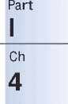

# 第 4 章在 StarOffice 中工作

邮箱或新闻文件夹将导出为 ASCII `.mtx`文本文件，可以在所有处理器程序中打开。

- 有关管理邮件和新闻的基本信息，请参阅`使用过滤器管理文件`，第 197 页。
- 有关管理`StarMail`和`StarDiscussion`账户的高级信息，包括对导入和导出文件的详细讨论，请参阅`管理邮件和新闻的技术`，第 1075 页。

## 跨桌面操作

如果您理解`StarOffice`通用工具的设计逻辑，无论您的任务是什么，您都能更高效、更有创意地工作。

## 发布命令

您可以在`StarOffice`中以多种方式发布命令。例如，您可以执行任何一种操作：

- 点击菜单上的命令
- 高亮显示菜单上的命令并按 `Enter` 键
- 点击工具栏上的按钮
- 点击对话框中的按钮
- 在对话框中按 `Enter` 键，这将激活当前焦点的按钮（由按钮周围较深、加粗的线条表示）
- 输入键盘快捷键组合
- 按 `Alt` 键结合程序菜单上命令带有下划线的字母
- 运行宏、`StarBasic` 或 `JavaScript`

如果您在使用指针进行识别/或执行命令和控制，可以配置`StarOffice`使菜单保持打开而不跟随您的鼠标指针；您在在使用`StarOffice`时还可以进行其他调整。

- 如果您有身体不便之处，有关自定义`StarOffice`的更多信息，请参阅`提高 StarOffice 对身体障碍者的易用性`，第 125 页。

## 理解菜单

菜单是任何带有图形用户界面（GUI）程序的根本部分，`StarOffice`也不例外。当然，您可以在菜单上执行命令，这是它们的主要功能。同样重要的是，通过以组织化、逻辑化可视化的方式为您列出命令，菜单是学习该程序的极佳工具。不要害怕点击命令查看会发生什么（当然，是在您已经保存了当前文件之后）。在大多数情况下，可以通过按 `Ctrl+Z` 轻松撤销任何不需要的操作。

您可以通过选择`工具`、`配置`来自定义菜单。然而，您无法更改菜单的长度；您只能删除或更改其列表。

有关自定义菜单的更多信息，请参阅`自定义桌面工具和菜单`，第 115 页。

## 使用键盘打开菜单

您可以通过按 `Alt` 键结合菜单或子菜单中带有下划线的字母（作为热键）来使用键盘打开菜单。同样的技巧也让您能够使用键盘执行许多命令。

## 理解 StarOffice 右键菜单

此技巧不会将你移动到对话框中的非按钮项目。要实现此操作，你必须使用 `Tab` 键。如果选择了下拉列表，可以使用向上和向下箭头键在按钮上移动，或者在列表中的各个选项之间移动。

当按钮处于焦点状态（即活动状态按钮）时，只需按 `Enter` 键即可激活它。获得焦点的按钮始终由一个深色、粗体边框以及带有命令文本的虚线框勾勒。

## 通用桌面键盘快捷键

你可以通过学习`StarOffice`键盘快捷键来提高工作。就像菜单命令一样，可用的快捷键可能取决于你当前的

- 如需程序键盘快捷键的完整列表，请参阅附录 E，`默认快捷键`。 1429。
- 如需自定义键盘快捷键的说明，请参阅`自定义桌面工具和菜单`。 115。

## 使用正则表达式

许多`StarOffice`对话框都提供了使用正则表达式进行搜索或过滤的选项。正则表达式是一组符号，你可以使用这些符号根据模式或更复杂的条件构建复杂的搜索或过滤。你可能熟悉通配符字符星号（`*`），用于搜索部分匹配。使用正则表达式比星号具有更大的功能和灵活性。使用它们并不简单，需要一些时间进行练习。另注意，某些表达式的执行结果不稳定（尽管正则表达式的实现较较前的版本有所改进）。

表 4.3 列出了接受的正则表达式。（此列表也打印在随附手册的抽拉卡片上。）

> 注意

在 4.3 中，粗体术语表示示例；你应该将它们替换为自己的搜索字符串。未带括号的术语表示你在查找所需对象或字符串时必须使用的精确字符。

表 4.3 在 StarOffice 中处理正则表达式

| 字符或字符串 | 用途 |
| :--- | :--- |
| `.` | 作为通配符字符。搜索词将同时匹配 grant（允许）和 grunt（抱怨）。你可以在搜索字符串的多个位置使用多个一个点。 |
| `"Begin"` | 仅当单词位于段落开头时，才查找其结尾的单词。忽略特殊对象或内容（例如锚定帧或注释）。 |
| `End$` | 仅当输入的单词位于段落末尾时，才查找该单词。忽略特殊对象或内容（例如锚定帧或注释）。 |
| `*` | 表示置此符号之前的字符可以出现无限次，也可以不出现。与 `.`（点）字符一起使用，此字符允许你搜索句子或短语的变体。例如，`Sales figures * have` 会找到五月份的销售额上升（Sales figures have risen）和第二个字符销售额一直良好（Sales figures have been promising）。组合 `*.*` 代表无限或无字符。 |
| `+` | 表示置此符号之前的字符必须至少出现一次，但不是无限次。由于空格被计为字符，因此 `Ctrl+drag` 会找到 `Ctrl + drag` 但不会找到 `Ctrl-1` |
| `\z` | 查找斜杠后输入的特定字符的所有实例。仅在选了`匹配（Match）`选项时才区分大小写。 |
| `\t` | 查找空格。此表达式也可以用于`替换为`框。 |
| `\n` | 查找 `StarOffice` 换行符。 |
| `\start` | 如果搜索内容位于单词末尾，则查找。此处显示的示例将找到 quickstart 而不是 starting again。 |
| `\<patch` | 如果搜索项位于单词末尾，则查找。此处显示的示例将找到 dispatch 而不是 patching。 |
| `~` | 查找空行。 |
| `$` | 查找段落末尾。 |
| `&top` | 用于`替换为`框。将单词或字符串附加到`搜索`框中输入的字符串的末尾。如果你在`搜索`框中输入 table，示例将所有 table 的实例替换为 tabletop。 |
| `[xyz]` | 查找括号内每个字符的所有实例。此处显示的示例将找到 tag、yes 和 xylophone。 |


| `[1-9]` | 查找 1-9 之间每个字符的所有实例。此处显示的示例将找到 tag、yes 和 xylophone。（*注：原文示例内容与描述不符，按逻辑翻译*）即：查找 1-9 之间每个字符的所有实例。 |
| `\<patch` | 查找搜索项位于单词末尾时则查找。示例示例找到 dispatch 项。 |
| `[xyz]` | 查找括号内每个字符的所有实例。此处显示的示例将找到 tag,yes 和 xylophone。 |
| `[1-9]` | 查找 1-9 之间每个字符的所有实例。 | 查找 搜索项。 |
| `\z` | 查找括号内每个字符的所有实例。 |
| `\t` | 查找空格。 |
| `\n` | 查找 StarOffice 换行符。 |
| `\start` | 如果搜索内容位于单词末尾，则查找。 |
| `\<patch` | 查找搜索项位于单词末尾时则查找。 |
| `~` | 查找空行。 |
| `$` | 查找段落末尾。 |

- 如需构建和使用过滤器的信息，请参阅“使用过滤器
- 如需更多关于过滤器的信息，请参阅“使用桌面工具

## 创建书签

URL 地址很难记忆。这就是书签大显用场的地方。它们是创建的图标，用于存储网页地址（URL）及其有用名称——例如 StarDivision 站点。你只需点击图标即可返回目标网页。

StarOffice 包含了各种网站的书签供你开始浏览。你从从有的 Microsoft Internet Explorer 或 Netscape 浏览器导入了书签。无论何种方式，你在 Explorer 中都有一个包含书签的书签组。

### 在 StarOffice 157 中导航

你可以通过点击功能栏上的书签工具，在 URL 定位器中为当前 URL 创建书签。此时会出现一个手形指针，表示你可以将 URL 拖动并释放到桌面上的任何文件夹、组或已打开的文档中。（如果插入到文档中，它将显示为超链接而不是书签。）由于 StarOffice 遵循以下 URL 命名规范，你可以使用相同的书签工具为任何本地文件或文件夹创建书签（换句话说，即链接）。点击书签将在桌面上打开选定的 URL。

你还可以使用超链接工具栏上的书签工具（称为“转换”）来创建书签。要要操作，请在“视图”、“工具”菜单中打开超链接工具栏。当在 Internet URL 文本框（右侧文本）中输入 URL 或路径时，“链接”命令处于激活。点击它，如果存在同名项，将根据你在“名称”文本框（左侧文本框）中输入的名称自动创建书签；否则，StarOffice 将根据 Internet URL 命名书签。你可以通过拖放将书签移动到另一个文件夹。

- * #56 来自 Michael Sarah：你可以在“工具”菜单的“选项”“主对话框”的“常规”类别“路径”对话框中更改你的默认书签文件夹。

## 创建指向文件和文件夹的链接

你可以通过选择桌面上的单个文件或文件夹，并按 `Ctrl+Shift` 拖动它到你想放置链接的位置，来创建链接。你会注意到指针的一部分有一个弯箭头；它是链接的符号。

要创建指向远程文件或文件夹的链接，将光标置于桌面上，右键单击打开资源管理器右键菜单，并选择“新建”、“链接”。将弹出一个对话框，允许你导航到文件所在的文件夹位置。点击选择文件或文件夹，然后选择“确定”。随后光标所在的位置（桌面、Beamer 或资源管理器）将创建一个链接。

像打开任何其他文件或文件夹一样打开链接；它会自动查找并打开目标。

与复制相比，创建链接是将存储在网络上的文档和文件带到桌面上的通常更好方法。因为你始终在原始文件上工作，所以不需要担心比较版本，更新文件只需选择、右键点击并选择“更新”即可。

如果你需要传阅文件的多个副本，请查看 StarWriter 和 StarCalc 的“版本与更改”功能，这些功能允许你在团队之间轻松交换文档。

- * 有关关于在团队环境中修订文档的更多信息，请参见“交换和评审文档”，第 1002 页。

| 第一部分 |
| 第 4 章 |

## 创建作为链接的组

你可以创建一个资源管理器组，该组是向你目录结构其他部分的链接。如果你在网络上工作，创建此类链接通常是将瞬时存储的文件带到桌面的最佳方法。例如，你可以对一个包含你经常使用的子目录的父目录创建链接，然后在资源管理器中打开这些子目录。

要创建一个作为链接的新组，请右键单击资源管理器组结构顶部的“新建组”，并选择“新建作为链接的组”。点击“书签”选项卡，然后点击“目录”按钮以导航到文件夹位置。当你找到文件夹后，选择它。最后，为组输入一个名称，并点击“确定”。

## 使用导航器穿过文档

资源管理器和 Beamer 是桌面及外部世界的导航工具，而导航器则用于进入 StarOffice 文档内部以及在文档之间快速移动数据（见图 4.7）。它是一个停靠的窗口，可以在你工作时保持在桌面打开。导航器是 StarOffice 特有的工具，你起初可能觉得用起来并不直观。但当你熟悉了它简单的拖放和点击界面后，你将再也不想在没有它的情况下工作。


### 开启导航器

当在 Internet URL 文本框（右侧文本）中输入 URL 或路径时，“链接”命令处于激活。点击它，如果存在同名项，将根据你在“名称”文本框（左侧文本框）中输入的名称自动创建书签；否则，StarOffice 将根据 Internet URL 命名书签。你可以通过拖放将书签移动到另一个文件夹。

### 导航器的开启与关闭

直到你打开了可导航的文档类型时，“链接”命令才处于激活状态。当你打开文档时，点击导航器图标，按下 `F5`，或者从“编辑”菜单中选择。要关闭导航器，点击其图标。

### 导航器的开启器

直到你打开了可导航的文档类型时，“导航器_185

### 导航器的开启与关闭

直到你打开了可导航的文档类型时，“链接”命令才处于激活状态。当你打开文档时，点击导航器图标，按下 `F5`，或者从“编辑”菜单中选择。要关闭导航器，点击其图标。

## 探索导航器

导航器允许你浏览文档的不同部分，如标题、表格、图像等。通过双击导航器中的项目，你可以直接跳转到该部分。导航器还允许通过拖放项目来组织你的文档。

## 文档间的导航

导航器允许你在打开文档之间切换。你可以使用导航器中的箭头按钮进行切换，这在处理多个文档时特别有用。

### 表 4.4 导航器按钮

| 按钮 | 功能 |
| :--- | :--- |
| 切换 | 移动到选定对象 |
| 模式 | 更改拖放模式 |
| 内容/开启/关闭 | 关闭或打开列表 |

# 第 4 章在 StarOffice 中工作

## 创建链接、超链接和副本

导航器不仅能够快速导航，你还可以通过从导航器拖放来轻松创建与其他文档的链接和超链接，或从其他文档复制元素。

如果你在桌面打开了两个文档并想将数据从一个移动到另一个，请遵循以下步骤：

1. 使你想复制的目标文档 (1) 为活动文档。
2. 打开导航器的文档下拉列表，点击你想复制的文档 (2)。它的跟踪对象都会出现。
3. 点击你想复制的类别旁边的加号 (`+`)。
4. 选择你想复制的对象，将其从导航器拖入文档并释放到你想插入的位置。

如果要将未打开文件的元素插入到打开的文档中，你需要在 Bamer 打开文件文件夹。然后你就可以打开导航器并将文件拖入。此时，你可以继续之前的示例。

## 基础编辑和格式设置

选择、移动、删除和复制文本、数据和对象适用于所有应用程序，StarOffice 提供了你预期工具，以及执行这些操作的一些工具。对于 StarOffice 中的大多数其他任务，桌面的提示是“记住右键菜单！”

## 基础选择工具

对象的选择技术与文本和数字不同。以下章节简要介绍了 StarWriter 和 StarCalc 中的选择，本章其他地方的“选择对象”部分将讨论对象的选择。

### 选择模式

在 StarWriter 和 StarCalc 中，你有三种选择模式：标准、附加和扩展。这些模式分别对应使用光标和鼠标的正常选择、`Ctrl+鼠标`选择以及 `Shift+鼠标`选择。

要从一种模式更改到另一种模式，点击文档状态栏中的相应字段；你会在字段中看到 `STD`、`ADD` 或 `EXT`，取决于你当前选择的模式。标准模式是默认模式。当你处于这些模式之一时，可以使用键盘或任何组合来选择文档中的文本和对象。

## 基础编辑与格式

> **注意**
>
> 你必须手动关闭选择模式。在完成选择后，它不会自动关闭。

### 使用键盘选择

在将光标置于你想要开始选择的位置后，可以通过按住 `Shift` 键并使用四个方向键来选择文本块或单元格。

### 使用鼠标选择

大多数情况下，使用鼠标选择符合通用惯例：将光标置于选择开始处，按住鼠标按钮，并拖动直到目标区域被高亮。

使用鼠标选择的功能与 Microsoft 的惯例略有不同。在 Microsoft 程序中，双击可以选择一个单词或字符串，而在本项目中，三击选择的是光标所在的行，而不是整个段落。在表格中，三击会选择单元格中的所有数据。

### 取消选择

你可以通过按 `Esc` 键来取消选择（这也会退出你可能启动的命令序列）。

你也可以点击选择区域外的任何地方。

## 基础编辑工具


StarOffice 的基础编辑命令遵循 Windows 惯例，你将在接下来的章节中学习到这些。但是，其中某些命令（如“撤销”和“重做”）的行为可能与你的预期不同，因此请确保至少浏览一下节。

# 第 4 章在 StarOffice 中工作

## 剪切、复制和粘贴

你有两种类型的剪切、复制和粘贴：用于编辑文档内的文本和对象，以及用于管理桌面上的文件、文件夹和其他对象。

仅用于文档内部：剪切、复制和粘贴出现在“编辑”菜单和功能栏上。它们遵循 Windows 键盘快捷键：`Ctrl+X` 剪切，`Ctrl+C` 复制和 `Ctrl+V` 粘贴。被剪切或复制的对象数据会被放在剪贴板或缓冲区中，直到你粘贴内容或通过剪切/粘贴其他内容来替换它们。在文档内部的剪切、复制和粘贴可以撤销（重做和重复）。

要管理桌面内的文件夹、文件和其他对象，剪切、复制和粘贴命令可在桌面右键菜单中可用。虽然这些命令的名称与“编辑”菜单上的相同，但它们实际上是程序中不同的功能，


因此键盘快捷键无效。通过右键菜单的“剪切”命令删除的对象会被放入回收站。

## 撤销、重做和重复

“撤销”、“重做”和“重复”位于“编辑”菜单顶部，你可以在功能栏上找到“撤销”和“重做”的快捷键。

你也可以通过按 `Ctrl+Z` 实时撤销。默认的可撤销步数为 20 步。请注意，StarOffice 中的撤销步骤非常短——例如，在 StarWriter 中，一次销只撤销一个字符，而不是整个单词。强烈建议你在第一次设置 StarOffice 时更改此设置。

> **Michael & Sarah 的第 #57 号提示** 你可以在“工具-选项”主对话框的“常规”类别“保存”对话框中更改撤销步数。最大可撤销步数为 100。

撤销、重做和重复仅在文档内有效，不适用于在 Explorer 或 Beamer 中执行的操作，也不适用于显示文件夹内容的任务窗口。撤销也不会撤销从收件箱或发送邮件箱中删除的邮件。在某些情况下，删除的对象（包括链接）会存储在回收站中，直到你彻底删除它们。

## 全选

全选 (`Ctrl+A`) 会选择活动文档中的所有内容，包括文本文档中的特殊文本区域（如页眉和页脚）。你可以轻松地剪切或复制整个文档。

## 删除

`Delete` 键被设置为直接删除当前光标位置选中的对象或项目，而不会将其放入剪贴板或向你确认。

如果你删除了 StarOffice 对象，它们会被放入回收站。然而，你可以在桌面执行许多非 StarOffice 任务，你删除的一些 StarOffice 对象可能会被放入回收站——例如，从软盘中删除的文件。

你可以使用“工具-配置”对话框中的“键盘”选项卡自定义 `Delete` 键以执行其他操作。

注意，用于 Beamer 和 Explorer 中对象的右键菜单删除命令与 `Delete` 键的功能不同；删除的对象存储在回收站中。

## 覆盖模式

你可以在 StarCalc、StarWriter 和 StarWriter/Web 中切换到覆盖模式。在这种模式下，你从键盘输入的字符将“覆盖”相同位置的任何现有字符。要更改模式，请按键盘上的 `Insert` 键，或点击文档状态栏上显示 INSERT（插入）的字段。点击此字段会将模式从“插入”更改为“覆盖”，你应该会在字段中看到 OVER（覆盖）缩写。你可以再次按 `Insert` 键或点击该字段以返回插入模式。

## 查找和替换

StarOffice 的查找替换功能 (`Ctrl+F`) 是一项非常强大且灵活的功能。你可使用的特定查找替换选项取决于具体的应用程序，但基本原理是相同的。

- *Michael & Sarah 的第 #58 号提示* 即使你关闭了查找替换对话框，也可以通过按 `Shift+Ctrl+F` 组合键继续搜索。

在 StarWriter 中，你还可以通过导航浮动工具控制搜索方向。你可以通过导航器或点击文档窗口右下角的圆形按钮打开它。

- *欲了解更多关于在 StarWriter 中使用查找替换的信息*，请参“查找和替换”，第 460 页。

- *欲了解更多关于在 StarCalc 中使用查找替换的信息*，请参“查找和替换”，第 547 页。

## 搜索基础

当你准备好搜索时，在搜索框中输入你想查找的单词或短语。如果你只想定位字符串而不替换任何内容，请将替换框留空。

搜索如何进行取决于你在框下部分选择的选项。表 4.5 列出了所有应用程序中可见的最基础选项；你可能会在你的应用程序中看到其他选项。

| 表 4.5 基础查找和替换选项 |  |

| :--- | :--- |

| 整个单词 (Whole Word) | 仅查找整个单词。Sale 不会返回 sales。 |

| 区分大小写 (Match Case) | 查找大小写相同的单词。Buddy 不会返回 buddy。 |

| 反向 (Backward) | 在文档中反向搜索。 |

| 仅当前选择 (Current Selection Only) | 仅在当前选中的文本块中搜索。如果在打开查找替换时没有选择内容，此选项将显示为灰色。 |

## 相似性搜索

通过勾选相似性搜索，你可以根据相似性对话框中设置的规则查找并替换单词或短语的偏差。例如，你可以在搜索框中输入 practice，使用相似性搜索可以找到 practiced 和 practical。你无法查找和替换格式特征（尽管属性选项仍然可用），也不能使用正则表达式。

要使用相似性搜索（也称为模糊搜索），首先选择相似性搜索选项。点击选项右侧的省略号按钮打开相似性对话框。在出现的对话框中，你可以设置搜索方式的规则。你可以从三种模糊类型中选择：

- 单词长度相同但字符位置不同——例如 beat 和 bear

- 与输入单词字符相同但具有额外字符——例如 bear 和 hearing

- 与输入单词共享字符但总字符数较少——例如 bread 和 bead

这些类型对应于三个计数器框——交换字符、添加字符和删除字符。

如果组合使用，这三个规则在搜索时被视为单一规则，符合任一条件的项目都会被返回。例如，在每个类别默认设置为 2 的情况下，组合规则会为 bread 返回 creed（它少了两个字母并进行了两次替换）。

> **Michael & Sarah 的第 #59 号提示**

查找替换会在搜索内容和替换框的下拉菜单中保留搜索和替换过的术语列表，通过单击即可重新搜索。

## 使用正则表达式搜索

如果你在替换对话框中选择正则表达式选项，可以极大地扩展你的搜索能力。但请注意，此功能仍然存在许多 Bug，并不总是如宣传描述的那样。

使用正则表达式进行搜索在处理文本或 HTML 文档时特别有用，因为你可以搜索单词的开头和结尾，还可以搜索替代表达方式。

请参阅本章前面的“使用正则表达式”章节，获取完整的表达式表格及简要示例。

## 格式、样式与模板

在每个应用程序中，你都会创建具有属性的对象。属性是对象外观的任何离散方面。例如，文本的字体和颜色是属性，文本框周围的边框的存在或图像的大小也是如此的。格式就是定义对象的属性。StarOffice 让你对对象的格式化具有无与伦比的控制力。

应用属性最高效的方法是创建并应用样式。样式是一组保存的格式属性集合，你可以反复应用它。由于样式是从一个对话框进行中心化管理的，因此你可以在几分钟内更改样式的属性。你所做的更改将全局应用于文档中所有使用该样式的对象，使你能够瞬间完成格式化。

你可以通过样式控制一系列文档属性。例如，在 StarWriter 文档中，你可以将样式应用于单个字符或单词、段落或页面。

创建模板是管理文档最高效的方法。模板是用于文档格式化所有方面方面的样式集合。

## 应用格式和样式

通常情况下，如果你想对某个特定对象进行格式化，可以选择它并右键单击，以打开包含一系列格式化命令的上下文菜单。应用程序的工具栏还提供了用于格式化的快捷工具。以这种方式应用格式是直接格式化（在 StarOffice 帮助系统中称为粗体格式化），这意味着一次一次将属性直接应用于选中的对象或一组对象。

然而，通过样式应用格式并将样式保存到模板中会更高效。StarOffice 提供了两个程序范围内的工具，帮助你跨应用程序创建和管理样式：样式器（Stylist）和样式目录（`Ctrl+Y`）。

## 介绍样式器

要开启或关闭样式器，点击功能栏上的样式器按钮，或按 `F11`。

要应用样式，选择要格式化的文本或对象，并点击样式器窗口中的样式名称。

你可以选择样式名称并右键单击，打开打开包含修改样式命令的上下文菜单。

图 4.8 显示了 StarCalc 和 StarDraw 中样式器的外观，并标识了其工具栏按钮的功能（数字与下述编号列表对应）。

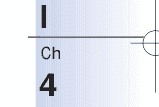

图 4.8

样式器是一个时尚的工具，让创建、应用和管理样式变得简单。

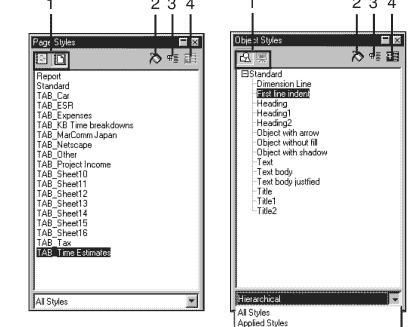

- 1. 点击图标切换样式器中列出的样式类型。

- 2. 点击根据你已应用于它的直接格式，更新应用到当前选定文本或对象的样式。

- 3. 点击根据你当前选中的文本或对象创建一个新样式。


点击进入填充模式，这会将你的光标变为样式应用器。无论你在哪里点击，都会应用当前选定的样式。

# 使用样式目录

使用样式目录，你可以创建、修改和管理样式，但不能应用它们。此功能有些冗余的，因为你可以使用样式器执行相同的任务，除非你需要使用按键而不是鼠标，否则这样做更好。（你无法使用按键导航样式器工具栏）。样式目录的唯一独特功能是，你可以通过点击组织器按钮打开样式和模板组织器。

有关在 StarWriter 中使用样式目录的详情，请参阅第 306 页的“使用样式目录管理样式”。

> 来自 Michael G Sarah 的提示 #60
>
> 如果你需要使用按键进行导航、使用命令或控制语音识别程序，请使用样式目录代替样式器。

# 管理样式和模板

你打开的每个文档都带有样式。模板是文档格式化所有方面的样式集合。由于样式是从一个对话框进行中心化管理的，你可以在几分钟内更改样式的属性。你所做的更改将全局应用于文档中所有使用该样式的对象，使你能够瞬间完成格式化。

# 附加模板的搜索

当你打开一个文档时，StarOffice 会搜索模板。如果 StarOffice 无法找到模板，它会询问你是否希望它搜索其他地方。如果你意外删除了某些模板，请查看它们是否在另一个目录中。如果是，你可以复制它们，或者可以运行 StarOffice 安装程序并选择修复选项。在 Office 目录的若干子目录（包括 `config/start` 目录）中，调用这些脚本并生成新文档的特殊链接。

# 管理模板

由于你打开的每个文档都基于模板。当你打开文档时，StarOffice 会搜索模板。如果 StarOffice 无法找到模板，它会通知你。否则，Office 将搜索 `.ini` 文件（位于 Office 目录）。在 `.ini` 文件的末尾，搜索 `=`。

你通过 `文件、模板` 打开此。由于你从模板对话框管理它们（参见图 4.9）。

图 4.9

你可以从文档即时创建新模板，也可以在模板对话框中编辑它们。


# 手动导入模板和样式

在组织器对话框中，你可以从 Microsoft Word、WordPerfect 和 Microsoft Excel 等程序导入模板。你可以使用命令完整导入模板，也可以从组织器的一个面板向另一个面板选择性地导入样式。

# 使用组织器

如果你使用的是下载的 StarOffice 个人版，你有一组限制。你可以从两个位置打开组织器：

字体 样式目录对话框（通过 `格式、样式和模板` 打开）。

模板对话框（通过 `文件、模板` 打开）。

只需点击名为组织器的按钮。

有关使用组织器导入样式的信息，请参阅第 303 页的“修改样式”以及第 306 页的“使用样式目录”。

> 曾经用过样式表吗？如果有，你就知道那不是一项很有趣的工作。有了组织器，你再也不需要样式表了。只需双击你想打印的模板或文档。选择样式图标，点击命令打开下拉菜单，并选择打印。

# 理解 StarOffice 标准模板

StarOffice 模板并不是普通的模板。它们是由 StarOffice 程序内部的脚本生成的。结果是标准模板可以执行许多用的技巧，例如在 StarCalc 中自动区分文本和数字。

> 不要删除指向标准模板的链接，否则你将无法打开新的空白文档。如果你不小心删除了一些，请查看它们是否在另一个目录中。如果是，你可以复制它们，或者可以运行 StarOffice 安装程序并选择修复选项。

# 编辑标准模板

你可以直接编辑三个标准模板：使用回复 (`Ctrl+R`) 命令回复邮件和新闻发布的模板 `rplxt` 和 `rplymail`，以及默认的 StarWriter 模板 `Standard`。

`rplxt` 模板在你以纯 ASCII 格式回复时使用，而 `rplymail` 模板在你选择任何额外格式（HTML、RTF 或 StarOffice）时使用。`Standard` StarWriter 模板在你通过 `文件、新建` 命令或任何伴随命令创建新文档时使用。

# 格式、样式与模板 169

你可以在模板目录下的 `Wizards` 文件夹中找到这些模板。（但是，你无法通过“编辑”菜单的模板对话框或“组织器”找到它们，必须通过管理器或“文件”菜单的“打开”对话框进行搜索。）编辑模板简单的方法是在 Beamer 中显示 `Wizards` 文件夹的内容，选择你想要编辑的模板，右键点击，并在右菜单中选择“作为模板编辑”。然后，你就可以像处理其他模板一样，进行任何所需的更改并在退出前保存。

> 来自 Michael & Sarah 的第 #62 条提示：你可以使用 AutoText 创建电子邮件签名，但每次编写邮件时都必须手动插入签名。如果你很懒，想让签名永久附加到你的邮件回复中，请将你的签名添加到两个回复模板中。你仍然需要使用 AutoText，通过选择“新建”、“命令”或“StarMail 新邮件”按钮来创建的邮件来附加签名。

## 更改默认模板

由于标准（`Standard`）模板与 StarOffice 模板不同，你可以编辑大多数模板。然而，你可以通过选择“文件”、“新建”，将你自己的模板设置为打开新文档的默认模板。

要将你的模板设置为默认模板，请遵循以下步骤：

1. 在管理器中导航到存储模板的文件夹。
2. 打开 Beamer。
3. 右键点击该文件夹以在 Beamer 中显示其内容。
4. 选择模板文件，右键点击打开其右菜单。
5. 将指针悬停在“设置默认模板”命令上打开子菜单，并点击出现的文档类型。

## 恢复标准模板为默认

要将任何标准模板恢复为默认，请遵循以下步骤：

1. 在管理器中导航到 `Office51\config\new` 文件夹。
2. 选择你想要恢复模板的文档类型。
3. 右键点击打开其右菜单。
4. 选择“恢复为默认”。

## 将样式重置为标准模板

某些对话框上有一个名为“标准”（`Standard`）的按钮。点击此按钮会将相关的样式设置还原为标准模板的设置——即你安装 StarOffice 时的程序默认。

## 使用常用校对工具

StarOffice 带有三种语言的词典，允许你在可以插入文本的 StarOffice 模块中检查拼写和语言用法。

> 来自 Michael & Sarah 的第 #63 条提示：StarBase 不具备拼写检查功能，但你可以在 StarCalc 中打开许多类型的数据库并使用它的拼写工具。

通过选择“工具”、“检索”，你可以检查单词含义并寻找同义词。

你可以使用自动拼写检查器 `AutoSpellCheck` 或从“工具”菜单打开的“拼写”对话框来检查拼写。StarWriter 还具有自动纠正功能，可以根据“工具”菜单打开的“自动纠正/自动格式”对话框中的条目和选选项自动纠正错误并设置格式。

当应用程序可用校对工具时，你可以通过点击工具栏来开启它们，`AutoSpellCheck` 是字母下方带有波浪线的那一个。你也可以通过“工具”菜单开启它们。

尽管设置了一种语言作为默认语言，但你仍然可以使用一种、两种或三种语言检查文档。你还可以创建一个与特定语言关联的样式。

有关使用已安装词典的信息，请参阅“检查拼写”，第 464 页和“理解 StarOffice 中的词典”，第 474 页。

你拥有的特定校对选项可能会根据文档类型而异。

关于在 StarWriter 中使用校对工具的信息，请参阅“检查你的工作”，第 460 页。

关于在 StarCalc 中使用校对工具的信息，请参阅“检查你的工作”，第 702 页。

除了安装的词典，你还可以创建任意数量的自定义字典。如果你激活了自定义词典，除了检查你选择的安装词典外，还会检查它们。默认安装中还包含两个自定义词典：`stardiv` 和 `standard`。

如果你没有创建任何自定义词典，你在拼写检查时添加的单词将附加到标准字典。

你可以通过开启或关闭自定义词典来控制拼写检查单词添加到哪个词典。

## 在文档之间共享数据

你可以通过“工具”、“选项”、“常规”、“语言”对话框以及“拼写”对话框（通过选择“工具”、“拼写”、“检查”、“更多”、“选项”打开）创建并控制自定义词典。

在集成 Office 套件中工作的优势之一是可以轻松在应用程序之间共享数据。StarOffice 在方面再次脱颖而出，通过在任何地方都可以使用的拖放技术让数据交换变得非常简单——对话框、管理器和 Beamer、导航器以及任务栏。

你还可以使用更传统的方式共享数据，使用“粘贴”和“特殊粘贴”命令创建动态数据交换（DDE）和对象链接嵌入（OLE）链接，以及数据的数据副本。

你还可以使用 Beamer 和各种自定义命令轻松地从 Star 数据库插入数据。

有关从 StarBase 向文档插入数据的通用介绍，请参阅*将 StarBase 作为数据管理器*；第 1087 页。

关于将 StarBase 数据插入文本文档的详情，请参阅*将数据移动到文本文档*。

关于从 StarBase 向 StarCalc 插入数据的详情，请参阅*导入和导出数据*；第 636 页。

如果你通过链接共享数据，你需要理解背后的技术。

## 理解链接数据


你用于共享数据的技术取决于你想要创建的链接类型。然而，你通过“`编辑`”菜单的“`链接`”对话框集中管理所有链接数据（无论是文本还是图形）。对于 DDE 链接，你无法直接从文档删除，只能通过该对话框删除。

# 动态交换 (DDE)

## DDE 链接

在动态交换（DDE）链接中，目标文档中的数据与源数据保持动态连接并可以随时更新。

## DDE 的局限性

你操作 DDE 链接的方式受到限制。例如，如果你将 `StarCalc` 表格插入 `StarWriter`，它将以表格的形式插入。你无法向此表格添加行或列，但你可以编辑表格的内容。

## 创建 DDE 链接的方法

你可以通过拖放在 `StarOffice` 文档之间创建 DDE 链接。如果你想与非 `StarOffice` 文本创建 DDE 链接，可以复制源数据，使用“`编辑`”菜单上的“`特殊粘贴`”命令并选择 DDE。

# 对象链接嵌入 (OLE)

对象链接嵌入（通常称为 OLE）最初由微软开发，作为在其应用程序之间共享数据的方法。你可以说它是在没有集成桌面的情况下的一种早期且有些笨拙的尝试。

OLE 对象保留了与原始应用程序的链接。当你双击 OLE 对象时，它会在原始应用程序中打开，以便你使用创建它时使用的工具进行编辑。原始应用程序被嵌入在你的文档中。

与 DDE 对象不同，OLE 对象通常不与其源数据链接；它只是一个副本。例如，如果你将 `StarCalc` 表格的一部分作为 OLE 链接插入文本文档，数据不再链接到原始的 `StarCalc` 表格。

| 第 部分 | 第 4 章 |
| :--- | :--- |
| 在 `StarOffice` 中工作 | |

# 文档间的数据共享

## 在 StarOffice 文档间创建 OLE 链接

在 `StarOffice` 中，`StarChart` 图表、`StarImage` 图像文件和 `StarDraw` 文件是原生 OLE 对象。这意味着它们始终作为 OLE 对象插入到其他 `StarOffice` 文档中。

你也可以选择将 `StarCalc` 表格、`StarWriter` 文档或 `StarImpress` 演示文稿的部分作为 OLE 对象插入。执行此操作，请选择“`插入`”、“`对象`”，或复制选定的文本并使用“`Ole`”。与 DDE 对象不同，这可以使用标准的图表鼠标和拖放技术来完成。

有关使用对象的概述，请参阅本章第 176 页的“使用对象”。

然而，你最好使用 DDE 链接（如果你希望数据与源文件保持链接以便更新）或在“粘贴”对话框中使用“带格式的文本”选项（这让你在格式化和处理输出时具有更高的灵活性）。

### 注意事项

与其他许多程序一样，OLE 仍然相当不稳定。如果你创建了包含许多 OLE 对象的大型文档，可能会遇到文件问题，例如崩溃、损坏或无法打开文档文件。请务必为任何文档保存多个备份。

要创建 OLE 链接，复制文本或对象，然后切换到目标文档。选择“`编辑`”、“`特殊粘贴`”。结果对话框列表中的第一个选项是将你的选择内容作为 `StarOffice` 数据类型粘贴；所使用的特定短语取决于你选择对象的类型。例如，如果剪贴板上是 `StarWriter` 选中内容，它会显示“文本(`StarWriter 5.1`)”。突出显示该内容并点击“确定”。

#### 从非 StarOffice 创建 OLE 链接

你也可以使用 OLE 将数据从非 `StarOffice` 复制到 `StarOffice`。要插入 OLE 对象，请从源程序的“`编辑`”菜单中选择“从源选择”，并切换到作为你对象目标的 `StarOffice` 文档。从“`编辑`”菜单中选择“`特殊粘贴`”，然后从选项列表中选择“OLE 对象”。

通常，与 `StarOffice` 丰富的数据共享和编辑功能相比，OLE 的灵活性较低。在 `StarOffice` 中，你手头拥有所需的所有工具，因此很少需要将另一个应用程序嵌入文档中。

### 注意

`Microsoft Office` 不支持复制 `StarOffice` 数据并将其作为 OLE 链接粘贴到 MS Office 文档中。

# 普通链接

当你使用“`插入`”、“`图片`”命令插入图片时，大多数情况下你会看到一个“插入图片”对话框。在对话框中，你有选项将你的图形作为原始文件的副本（默认值）或作为链接插入。这种类型的链接最常用于图形文件。你还可以将文档文件作为链接插入到 `StarWriter` 文档中。

## 链接插入图形

如果你正在创建一个包含许多图形文件的文档，强烈建议将你的文件作为链接插入。这样，文档不会在其内部存储图片，而仅存储指向图片位置的引用。该引用在文档中占用的空间要少得多。它可以防止文档出现因文件过大而可能产生的问题。

通过这种方式链接的图形与源文件没有动态连接。你可以以任何喜欢的方式更改图形文件，这些更改即使在你更新文档后也会保留。

# 处理链接和链接数据

你将使用不同的技术和命令来编辑和处理链接数据，这些命令与你在文档中从零创建数据时使用的命令不同。

> 注意 除非断开链接，否则你无法直接编辑或修改插入到 `StarWriter` 文档中的 DDE 链接数据或链接文本。你必须编辑源文件。

你的链接中心是“`编辑链接`”对话框，如图 4.10 所示。如果你在 `StarWriter` 文档中创建链接文本节，还会使用“`编辑`”菜单中的“`节`”对话框。

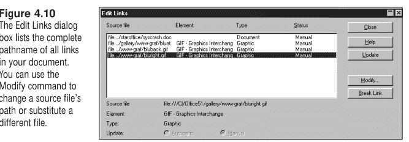

# 使用链接维护文件完整性

通过这种方式链接的图形与源文件没有动态连接。你可以以任何喜欢的方式更改图形文件，这些更改即使在你更新文档后也会保留。

为了维护文件完整性，你必须确保链接文件始终可用。在目标文档中更新所有链接时，如果你更改了源文件的位置，`StarOffice` 无法找到它。

`StarOffice` 记录在目标文档中的链接路径。路径，如果你更改了源文件的位置，`StarOffice` 无法找到它。

除非你断开链接，否则你无法直接编辑它。

为了维护文件完整性，你必须确保链接文件始终可用。理想情况下，将链接文件放置在源文件相同的文件夹中，或者子目录中。如果你需要移动或重命名源文件，你应该立即打开“`编辑`”、“`链接`”。在对话框中，选择要更新的链接，并点击“修改”。

# 更新链接

当你创建链接时，源文件和目标文档之间不是持续联系的。默认情况下，`StarOffice` 在关闭目标文档时提示你更新所有链接。然而，你可能需要在工作时更新链接以确保你拥有最新数据。

## 查找更新命令

你可以在打开文档内部通过“`链接`”对话框或选择“`工具`”、“`更新`”来更新链接。你可以在管理器或浏览器中选择文件、右键点击并在上下文菜单中选择“更新”。

## 更新的影响

当更新 DDE 链接时，你对目标数据的任何更改（包括格式）将被源文件覆盖。如果 `StarOffice` 找不到源文件，它将保持你的数据原不变。

当更新图形时，`StarOffice` 仅检查文件是否在其路径承诺的位置。当 `StarWriter` 中的链接节时，该节将刷新以反映你对源文件所做的任何更改。

更新 OLE 链接对 OLE 链接数据没有影响。

> 注意 如果你从原始位置移动源文件，`StarOffice` 在更新时不会给出无法找到文件的警告。更新可能会导致进程崩溃。

# 断开链接

如果你断开链接，数据将保留在目标中，但不再与源链接。它变成了源文件的副本。（对于图形文件，请记住这可能会增加文档的大小。）

要断开链接，选择“`编辑`”、“`链接`”。在打开的对话框中，选择要断开链接的文件名，并点击“断开链接”。

要重新建立链接，你必须将源文件重新插入到目标文档中。

# 处理节

如果你在 `StarWriter` 文档中将节作为链接，可以使用相同的“`编辑`”、“`链接`”对话框管理这些链接。然而，你也可以通过“`编辑`”菜单中的“`节`”对话框来管理单个节。

- 有关在 `StarWriter` 中处理节的更多信息，请参见第 378 页的“定义节”。

## 插入对象

你可以通过三种基本方式向 `StarOffice` 文档中插入对象：

- 你可以从一个应用程序复制内容并将其粘贴到另一个应用程序中，作为 OLE 对象。
- 你可以从 Beamer 中拖放图片，或从导航器（`Navigator`）中拖放对象到另一个文档中。
- 你可以使用“`插入`”（`Insert`）菜单上的命令。

有关如何从 Beamer 插入图片的简要概述，请参“在 Beamer 中预览文件、声音和图像”，第 58 页。

关于插入图形对象的详细信息，请参“使用图形对象”，第 440 页。

表 4.6 从“`插入`”菜单插入对象

| 选择命令 | 插入此类型的对象 |
| :--- | :--- |
| 文本框 | 一个可以在其中插入文本的框，该文本与文档正文分离。 |
| 表格 | 一个表格。 |
| 水平线 | 一条作为分隔符水平线。水平线是图片；此命令是创建网页的快捷方式，通常使用线条在视觉上组织页面布局。 |
| 图片 | 来自 `StarOffice` 图库或系统中保存在其他处的图形文件。 |
| 对象 | 一个 OLE 对象、`Java Applet`、`StarMath` 公式或插件程序。 |
| 图表 | 一个 `StarChart` 图表。 |
| 浮动框架 | 用于在使用框架集（framesets）的网页结构中的框架。 |


你可以以副本或链接的形式插入水平线和图片。作为链接插入占用的文档空间要少，但这意味着你必须确保在打开文档的任何系统上该图形都是可用的。

通过选择“插入”、“OLE 对象”、“对象”，你可以获得插入 OLE 对象最广泛的选项选择，包括来自非 StarOffice 应用程序的对象。

有关关于处理图表的更多信息，请参“图表数据化”，第 666 页，以及“插入图表”，第 348 页。

# 第 4 章 在 StarOffice 中工作

## 控制对象

要操作一个对象，你必须先选中它。当你选中它时，你的对象栏会自动调整，将正确的对象操作工具带到桌面上。不同类型的对象的工具略有不同。图 4.11 显示了三个对象栏——分别用于 OLE 对象、图表中的图表、文本框和图形。跨对象栏重复的工具仅在 OLE 对象栏上标识。注意，当选中一个对象时，对象的类型将显示在对象栏左侧的样式（Style）框中。

图 4.11 对象栏包含对齐和定位工具：对齐对象、更改其属性以及设置环绕特性。如果某个工具呈灰色，则它可能不支持你当前选择的对象类型。

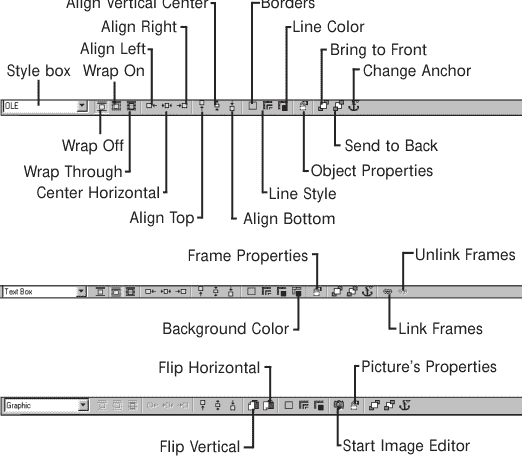

对象还有自己的右键菜单和属性对话框，对于大多数对象，它们提供相同的基础选项。

一如既常，要打开右键菜单，你需要选中对象并右键点击。上下文提供了对象上对齐和环绕命令的快捷方式（排列、对齐、锚定和环绕）。在这四个命令正下方（细线分隔）是打开对象属性对话框的命令。该命令的名称根据对象的类型而变化：OLE 对象为“对象”，图形为“图片”，文本框为“文本”，依此类推。

属性对话框汇总了全面的设置，你可以通过这些设置控制对象的显示。由于 StarOffice 中使用的所有对象都是嵌入对象，它们共享（有细微差异）的基础对话框页签：类型、选项、环绕、超链接、边框、背景和宏。熟悉对象的对话框，其页签允许你控制对象的整体外观和行为。

## 选择对象

如果你理解操作对象与操作其内容之间的区别，选择对象就很简单。

- 对象：一个 OLE 对象、Java Applet、StarMath 公式或插件程序。
- 图表：一个 StarChart 图表。
- 浮动框架：用于在使用框架集（framesets）的网页结构中的框架。


要操作一个对象，你必须先选中它。当你选中它时，你的对象栏会自动调整，将正确的对象操作工具带到桌面上。不同类型的对象的工具略有不同。图 4.11 显示了三个对象栏——分别用于 OLE 对象（图表中的图表）、文本框和图形。跨对象栏重复的工具仅在 OLE 对象栏上标识。注意，当选中一个对象时，对象的类型将显示在对象栏左侧的样式（Style）框中。

图 4.11 对象栏包含对齐和定位工具：对齐对象、更改其属性以及设置环绕特性。如果某个工具呈灰色，则它可能不支持你当前选择的对象类型。


对象还有自己的右键菜单和属性对话框，对于大多数对象，它们提供相同的基础选项。

一如既常，要打开右键菜单，你需要选中对象并右键点击。上下文提供了对象上对齐和环绕命令的快捷方式（排列、对齐、锚定和环绕）。在这四个命令正下方（细线分隔）是打开对象属性对话框的命令。该命令的名称根据对象的类型而变化：OLE 对象为“对象”，图形为“图片”，文本框为“文本”，依此类推。

属性对话框汇总了全面的设置，你可以通过这些设置控制对象的显示。由于 StarOffice 中使用的所有对象都是嵌入对象，它们共享（有细微差异）的基础对话框页签：类型、选项、环绕、超链接、边框、背景和宏。熟悉对象的对话框，其页签允许你控制对象的整体外观和行为。

## 选择对象

如果你理解操作对象与操作其内容之间的区别，选择对象就很简单。

- 对象的锚定“绑定”到特定的单元格、字符或段落。
- 默认情况下，StarOffice 将插入的对象锚定到光标所在的段落。你可以自由地在页内移动对象，锚定会移动到最近的段落。
- 如果你想将对象放置在页边界之外，必须将其锚定到页面或字符。
- 如果你将对象锚定为字符，它将留在你放置的位置，就像字母在周围添加新单词和字母时保持位置一样。

## 缩放、移动和复制对象

当选中对象的边界并显示绿色缩放句柄时，你可以通过拖放来操作。

- 移动对象：将光标放在对象中心，点击并拖动到新位置。
- 缩放对象：抓取一个句柄并拖动。
- 在缩放时保持对象的比例，请按住 `Shift` 键拖动。
- 复制对象：按住 `Ctrl` 键拖动。

## 介绍地址录

地址录是一个存储在资源管理器中的内置联系人管理器。它已经包含了一个名为 `address` 的 dBASE 格式表；它是存储联系信息的默认表。你可以基于此表创建表单、组和报告，以便管理、筛选和打印你的联系人。

## 设置不同的地址簿为默认值

如果你想将不同的数据库表设置为你的地址簿，请在资源管理器（`Explorer`）中选择所需的表，打开右键菜单，并点击“地址簿”命令。（此过程只是指定一个文件夹作为你的桌面。）下次你从应用程序激活“地址簿”命令时，该文件将在 `Beamer` 中打开。它也是当你选择合并命令时自动调用的表。

## 使用地址簿

你可以通过“编辑”菜单打开“地址簿”对话框来输入和提取数据。它一次显示一条地址簿记录。使用该方法是添加、编辑和搜索单个条目的最简单的方法。此外，还有其他工具仅在此对话框中可用（见图 4.12）。

图 4.12 使用地址簿对话框是将单个地址检索到文档和新联系人的最简单的方法。

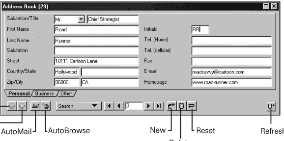

### 插入文本

更新字段

你也可以在 `Beamer` 中打开地址表。在此视图下，你可以通过将地址簿字段拖放到打开的文档中来创建信函。你还可以使用 `Beamer` 工具栏中的工具对数据进行过滤和排序，并使用新的“查找记录”工具轻松定位并插入多条记录。

在两种视图中，你都可以按 `Tab` 键向前移动记录字段，按 `Shift+Tab` 键向后移动。

你只能在“表格”视图中拖放地址；若要从对话框插入地址，你需要点击“插入文本”按钮，或者如果你在 `StarMail` 中，请点击“自动邮件”。

在 `StarMail` 和 `StarNews` 中，你可以在标题格中选择电子邮件地址，右键点击打开上下文菜单，并选择“添加到地址簿”以将电子邮件地址自动添加到地址簿中。

## 修改默认地址簿数据库

由于默认地址簿表以 dBASE 格式作为数据库文件（`address.dbf`）存在，你可以修改它的结构。但是，如果你更改了数据库文件的结构，或将具有不同结构的表指定为默认地址簿，你将无法再次使用“编辑”菜单中的地址簿对话框。因此，最好的方法是创建查询按照你的要求排序、过滤并展示信息，而不是编辑地址表的结构。

- 有关创建查询的更多信息，请参阅第 35 章“使用查询和字段获取答案”，第 1201 页。

## 处理多个地址簿表

虽然你一次只能有一个默认地址簿表，但你可以在多个用作地址簿的表之间切换。创建额外地址簿的最佳方法是复制程序地址表并对其重命名。

- 有关如何复制地址表结构的步骤，请参阅“复制地址表结构”，第 1013 页。

## 导入现有地址簿

如果你有一个想在 StarOffice 中使用的地址簿，它必须保存为 StarBase 可以读取的数据库格式，并放在地址簿数据库或 StarBase 数据库中。（默认情况下，地址簿数据库存储在 `office651\database` 文件夹中。）

首选应该是 dBASE。如果你无法以 dBASE 格式保存或导出地址簿，你应该将其导出或保存为分隔文件（`.txt` 或 `.csv`）。然后需要在 `StarCalc` 中打开它并保存为 dBASE 文件。

> 注意：文本数据库在 `StarBase` 中是只读的。你只能在 `StarCalc` 中编辑它们。

如果你将表放在数据库目录中，请按照以下步骤访问它：

1. 打开资源管理器（`Explorer`）。
2. 选择要导入该表的数据库。
3. 右键点击并从上下文菜单中选择“属性”。
4. 点击“选项卡”将其置于最顶端。你应该看到存储在该数据库相同目录下的所有 dBASE 文件（扩展名为 `*.dbf` 的文件）。
5. 点击表名左侧的复选框以显示 x。点击此框将选中要显示在资源管理器中的表。
6. 点击“确定”。
7. 回到资源管理器，点击数据库中“表”文件夹旁边的加号 (`+`)。将出现可用表列表；你导入的表应该出现在此列表中。要在桌面上打开它，请双击其名称。

输出文档最快的方法是输出为文件。通过“文件发送”命令和资源管理器右键菜单，你还可以将文档输出为文件，或输出到便携磁盘介质。

# 第 4 章在 StarOffice 中工作

## 发送和打印文档

在整个 StarOffice 中，你会发现处理打印具有同样的灵活性。你可以直接从资源管理器中通过右键菜单选择“打印”命令（`Ctrl+P`）打印文档。然而，将文档发送到常规打印机只是你输出文档的方式之一。

## 预览您的打印作业

在 `StarWriter` 中，你可以在“文件”菜单中找到“页面视图/预览”命令，这可以让你看到输出内容的实际效果，还可以通过“选项”对话框打印文档的缩略图。在 `StarCalc` 中，你有一个灵活性较低的“页面视图”命令，它可以让你查看所选打印区域在打印时的效果。

- * 来自 Michael & Sarah 的第 #66 号提示

想在普通视图下调整文档并查看其在打印预览中的效果吗？要这样做，请打开文档并选择“打印预览”，这将打开文档视图的第二个实例，该实例在任务栏上有其自己的任务按钮。将“预览”按钮拖动到“文档视图”任务栏上方并释放。你可以并排查看这两个视图。只需从任务栏上点击并拖动——预览任务按钮会再次出现——然后将其释放到任务栏的空白处即可。

在预览模式下，你可用的命令有限，且它们都与设置打印选项或操作视图有关。不要忘记右键点击以访问上下文菜单。

- * 有关在 `StarWriter` 中预览文档的详细信息，请参阅第 475 页“预览文档”。
- * 有关在 `StarCalc` 中预览电子表格的详细信息，请参阅第 709 页“使用页面视图预览工作表”。
- * 有关在 `Starimpress` 中预览演示文稿的详细信息，请参阅第 892 页“预览演示文稿”。

要退出预览模式，点击工具栏上的“关闭窗口”，或从任务按钮的上下文菜单中选择“关闭窗口”(`Ctrl+W`)。

## 打印基础

打印中最困难的通常是配置打印机以正确打印。完成这一步后，剩下的就很简单了。

要打印桌面上的文件或部分，请选择要打印的区域（如果想打印整个文档，则无需选择）。选择“文件”，“打印”。会出现一个打印对话框，类似于图 4.13 所示。你的默认打印机显示在“打印机名称”下拉列表中。要使用其他打印机或驱动程序，可以从列表中选择其名称。

在“打印范围”部分选择你的打印范围。默认是“所有页”。

你当前的页面位置会自动出现在“页”选项中，但当你选择该选项时，可以输入其他页码和范围。请注意，分隔页码的标点符号与 Microsoft Office 的习惯不同。要打印不连续的单页，必须用分号 (`;`) 分隔。要打印页码，必须输入第一个页码，后跟一个连字符 (`-`)，最后是页码。例如，`3,7;10-15;23` 将打印 3、7、10 到 15 页以及 23 页。如果你输入 `4-`，`StarWriter` 将从第 4 页开始打印文档。

图 4.13

你可以从打印对话框中设置除电子表格以外的所有文档类型的打印选项。你还可以选择打印机并调整打印机的属性。


只有当你已经在文档中进行了选择时，“选区”选项才可用。

接下来，在打印对话框的右下角选择想要打印的份数。

如果你需要调整打印机属性，请点击右上角的“属性”按钮。可用属性取决于你的打印机。

对于 StarCalc 之外的所有程序，你还可以点击“选项”按钮来设置各种打印选项。在 StarCalc 中，你需要在“格式”对话框的“工作表”选项卡上设置打印选项。图 4.14 显示了 StarWriter 和 Impress 的打印机选项对话框。

图 4.14

可用内容会根据你的文档类型发生变化，但打印机选项对话框的基本布局是相同的。

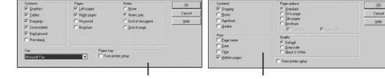

设置好属性和选项后，在主窗口中选择“确定”，开始打印。

# 第 4 章 在 StarOffice 中工作


- 有关在 StarWriter 中预览文档的详细信息，请参阅第 475 页“预览文档”。
- 有关在 StarCalc 中预览电子表格的详细信息，请参阅第 709 页“使用页面视图预览工作表”。
- 有关在 Starimpress 中预览演示文稿的详细信息，请参阅第 892 页“预览演示文稿”。


## 故障排除 189

这是一个复杂的问题，因为许多鼠标设备和其他外围设备并未并未官方支持 Linux 系统。请咨询您的鼠标制造商以获取更多帮助，或者（特别是 Linux 用户）在新闻组中浏览相关信息。

我的文档中有链接，但“编辑”菜单中的“链接”区域是灰色的（不可用）。

尝试将将光标置在其中一个链接区域，或选择其中一个链接区域。在 StarWriter 中插入的文档中，如果文档中没有包含其他链接文件，“链接”有时不会出现。你可以通过“编辑”菜单中的“节”对话框来管理这些区域，并通过选择“工具”->“更新”来更新它；或者，如果你真的想使用“链接”对话框，可以临时插入一个虚拟链接图形，选择该图形并打开“链接”。

我对图表做了一些我不喜欢的更改，我想恢复到原始外观。然而，当我点击“更新”时，什么都没有发生。

图形作为链接时的处理方式与字母数字数据不同。当你更新时，你的链接副本将与目标原始文件针对某些关键信息进行匹配，但你对大小、颜色和其他属性的更改不会被撤销。如果你想恢复原始状态，且已经来不及使用“撤销”命令，你需要重新插入原始图形文件。

我无法在我的框中输入文本。

如果你的框被选为一个对象（显示绿色的缩放手柄），则你无法输入文本。点击桌面上的对象之外的地方。将光标置于文本框的中心并点击。你的插入光标应该会出现，你就可以像往常输入文本了。

我按下 F4，但 Beamer 中打开了一个不同的表格，而不是我的地址簿。

默认情况下，当你按下 F4 时在 Beamer 中打开的表格是你定义为当前地址簿的任何表格；或者，如果你有一个带有合并字段的活动文档，则是作为这些字段源的表格。要定义不同的表作为地址簿，请在资源管理器中选择该值，右键点击并选择“地址簿”。要更改当前数据库，请选择“编辑”->“交换数据库”。滚动你的可用表格和查询列表，选择你想要的那一个。从现在起，当你按下 F4 时，该表将在 Beamer 中打开，直到你选择另一个表作为默认数据库。

我需要将我的文件保存为 WordPerfect 文件，但在“文件类型”列表中找不到 WordPerfect。

如果你正在使用从互联网下载的免费个人版（Personal Edition），你无法访问 WordPerfect 过滤器。如果你使用的是其他版本，你只需要运行 office61 目录下的 Setup 程序并选择“修改”。在可以选择应用程序模块和元素的窗口中，选择并打开“文本过滤器”列表。在里面，你将看到大量的 WordPerfect 过滤器。


# 第 5 章 管理文件夹、文件和邮件

本章内容

- 使用 StarOffice 192 管理桌面 192
- 通过“打开”和“另存为”对话框管理文件和文件夹 192
- 保持桌面处于最新状态 213
- 项目页面：为邮件创建过滤器 216

## 使用 StarOffice 管理桌面

计算机的出现引发了关于未来无纸化办公室的讨论。然而，我们不仅淹没在纸张中，而且几乎淹没在电子文件中。

如何管理如如其来的数据？当你理解了 StarOffice 的底层逻辑时，你会发现它比你想象的要简单。

StarOffice “万事一处办”的格言体现在平凡的“打开”和“另存为”对话框中，通过它们你不仅可以查找远程文件，还可以创建链接、复制和删除文件以及创建新文件夹。在 MS Office 中试试看！

在更深层次上，StarOffice 再次展示了它在互联网时代的起源，将电子邮件的概念扩展到文件和文件夹。你可以将“标记”、“订阅”和“读取”等命令应用于存储在计算机上的几乎任何对象，然后创建强大的过滤器，不仅可以处理你的邮件，还可以处理你的文件和文件夹。

本章将为你快速概述该程序存储和管理对象的底层逻辑，并向你展示如何使用最重要的工具来整理你的桌面。

## 通过“打开”和“另存为”对话框管理文件和文件夹

打开和保存文件的基础知识在第 4 章“在 StarOffice 中工作”的“打开现有文档”和“保存并关闭文档”节中讨论。在本节中，重点是使用“另存为”和“打开”对话框中的拖放工具来管理你的文件。

### 在“另存为”和“打开”对话框中导航

“编辑”、“打开”和“编辑”、“另存为”对话框（如图 5.1 和 5.2 所示）有一些细微区别，但共享相同的 Basic工具和组织结构。

两个对话框的主部分都填充了文件列表及其属性。默认情况下，对话框设置为“列表”视图；点击“详细信息”视图将变为类似于 Beamer 的显示方式，显示文件类型、大小和修改日期等详细信息。

默认情况下，这些对话框打开到资源管理器中名为“工作文件夹”（Work Folder）的文件夹。你可以使用工具栏上的导航按钮在系统的任何位置导航——左侧的“上级目录”和右侧的“默认目录”。

“上级”按钮让你每次移动一个文件夹目录。如果你不小心移动得太远，请双击你想要的文件或图标。

### 通过“另存为”和“打开”对话框管理文件和文件夹 | 193

| 特性 | 描述 |
| :--- | :--- |
| 图 5.1 | “打开”对话框默认显示当前文件夹。 |
| 图 5.2 | “另存为”对话框默认显示当前文件夹。 |

“上级”按钮让你每次移动一个文件夹目录。如果你不小心移动得太远，请双击你想要的文件或图标。


# 通过“另存为”和“打开”对话框管理文件和文件夹 | 193

| 特性 | 描述 |
| :--- | :--- |
| 图 5.1 | “打开”对话框默认显示当前文件夹。 |
| 图 5.2 | “另存为”对话框默认显示当前文件夹。 |

“上级”按钮让你每次移动一个文件夹目录。如果你不小心移动得太远，请双击你想要的文件或图标。


# 通过“打开”和“另存为”对话框管理文件和文件夹 | 193

| 特性 | 描述 |
| :--- | :--- |
| 图 5.1 | “打开”对话框默认显示当前文件夹。 |
| 图 5.2 | “另存为”对话框默认显示当前文件夹。 |

“上级”按钮让你每次移动一个文件夹目录。如果你不小心移动得太远，请双击你想要的文件或图标。

## 在“打开”和“另存为”对话框中管理文件和文件夹

注意

如果你正在处理指向服务器上文件的链接，请确保你处于“在线”模式。否则，你看到并操作的是存储在计算机缓存中的文件，而不是服务器上的最新副本。

备注

虽然你可以在“打开”对话框中从链接的文件夹打开文件，但无法在“另存为”对话框中将文件保存到链接文件夹。你必须导航到原始文件夹位置。

Michael & Sarah 的提示 #72

你也可以通过使用超链接工具栏插入超链接，从另一个文档内部链接任何本地存储的文档。它看起来与其他任何超链接无异。点击它会自动关闭第一个文件（带有相应的提示），并在桌面上打开链接的文件。

注意

小心不要创建指向或从可移动介质（如软盘或 zip 磁盘）的链接。如果你在点击链接时该介质不在你的系统中，你可能会遇到系统不稳定的情况。

# 在网络上保存文件

如果你在网络环境中，请务必始终在“在线”模式工作。（如果你已在线，功能栏中的“在线”按钮将会显示。）

当你尝试将文件保存到网络设备时，如果没有在线，你看到的将并不是你实际得到的。StarOffice 显示的是存储在缓存中的目录映射，而不是当前的实时映射，因为它无法更新。

# 保存用于在网站上使用的文件

如果你正在保存要发布到网站的 HTML 文件，你可能希望使用相对路径而非绝对路径来保存文件。

*绝对*路径是文件或链接的完整地址，用于标识并精确指定其位置——就像你的街道、城市和国家地址绝对且唯一地标识你的家一样。文件的绝对地址可能看起来所示：

```
file://h:/reports/june/sales1
```

其中，*file* 表示该对象是本地驱动器上的文件（而不是带有 HTTP 前缀标识的 Web 页面），*h* 是本地驱动器，*reports* 和 *june* 是文件夹（目录）名称，而 *sales1* 是报告名称。

*相对*路径仅指定文件的正确目录关系，而不是存储它的特定驱动器。例如，同一份报告的相对路径如下：

```
reports/june/sales1
```

# 第 5 章 管理文件夹、文件和邮件

使用相对路径保存文件？如果你正在创建用于 Web 页面的文档，这种保存方式非常有用，因为你可以在 Web 服务器上创建一个目录结构，使其与你创建内容的驱动器上的目录结构匹配。相对路径告诉你 Web 页面文件相对于主页或服务器上另一个页的位置，而无需指定任何特定的硬盘或计算机（域）位置。这就像告诉某人“我们的房子是右边最后一间”——足够你将带有 Web 页面的文件夹复制或上传到服务器，并且所有的路径名称将是有效的，即使你的网站位于映射到 C 盘 H 或 G 的驱动器上。（否则，Web 服务器可能会困惑，在服务器无法访问的 C 盘上寻找某个页面。）

StarOffice 的默认设置是用相对路径保存文件和链接。要更改此设置，请使用“工具”、““选项”->“常规”对话框，并点击“保存”选项卡（如图 5.3 所示）。

图 5.3 当你想让文件具有相对而非绝对路径时，选择“URL 相对选项”。


这里有两个选项，因为你可以以不同的方式对文件进行地址：你可能认为的本地国内地址和国际地址。文件系统地址包括对你计算机（如果你是单机）的引用。互联网地址包括对你计算机或网络域名的引用。

关于在 StarOffice 中创建 HTML 框架文档的更多信息，请参阅第 11 章“使用 StarOffice 进行排版”，第 415 页。

## 在“打开”和“另存为”对话框中管理文件和文件夹

我们将在相关处说明属性选项选项和对话框选项卡之间的任何差异。如果你在资源管理器中选择新文件夹并右键点击，选择“属性”命令，就会出现如图 5.4 所示的对话框。

5.4 在所有新文件夹中，属性对话框“视图”选项卡上的“活动”选项默认勾选。因此，你在“规则”选项卡上创建的过滤规则将影响文件夹内对象的显示。

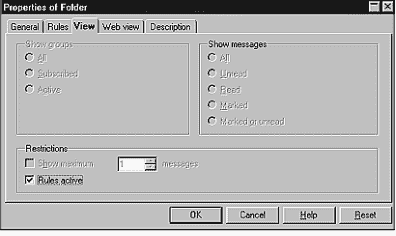

请注意，对于普通文件，“视图”选项卡上的命令是灰色且不可用的，除非你在文件夹的资源管理器右键菜单中使用“显示所有属性”命令。一旦你选择了“显示所有属性”，文件夹将以类似邮件的形式显示，你可以通过“规则”和“视图”选项卡在 Beamer 和视图中对文件夹内容进行过滤和排序。你还可以将文件标记为已标记、订阅和/或活动。

## 选择桌面上显示的内容

你是否曾和一个桌面非常凌乱的人共事过？那种看起来只要打个喷嚏，东西都会倒掉的桌面。你是否想过人如何在这样的桌子上生活？答案是，你的同事不再真正看到那些混乱，或者只是将它们过滤掉了。眼不见为不净。


在 StarOffice 中，你可以在虚拟空间中精确定义这个虚拟同事的内容——你可以过滤掉真实存在的对象，以便你只在桌面上看到你想看到的内容。区别在于，你过滤掉的对象即使存在，也不会显示在你的桌面上。

| 部分 |
|--- |
| 第 5 章 |

> 来自 Michael & Sarah 的第 #74 提示

如果你找不到一个确定存在的文档或文件，请尝试选择文件夹并检查其属性。你可能设置了视图/或选项，使其不显形。

你可以通过几种不同的方式创建过滤器，具体取决于你正在使用的文件夹类型（参见表 5.2）。

> 注意

不要被此处的在线帮助误导，它经常听起来好像这些命令只能应用于邮件和新闻。但如果你在文件夹的右键菜单中选择了“显示所有属性”命令，它们也可以应用于文件文件夹。

## 第 5 章 管理文件夹、文件和邮件

### 表 5.2 文件夹对象的过滤选项

| 文件夹对象 | 你可以应用的过滤器类型 |
| --- | --- |
| 📄 | 显示消息过滤器、组过滤器和规则。 |
| 📄 | 显示消息过滤器和规则。 |
| 📁 | 显示消息过滤器和规则。 |
| 📄 | 显示消息过滤器和规则。 |
| 📁 | 显示消息过滤器和规则。 |
| 🖼️ | 显示消息过滤器、组过滤器和规则。 |
| 📂 | 显示消息过滤器和规则。 |

你可以使用相同的逻辑和规则管理所有这些对象，但本节重点关注管理文件。

管理邮件和新闻的主题将在“管理邮件和新闻的技巧”第 1075 页进一步讨论。

### 文件夹和文件的分组与标记

分组和标记的原理非常简单。使用这些选项，你可以选择显示或隐藏具有共同属性的文件。这些属性如下：

- 已标记或未标记
- 已订阅
- 已读或未读
- 活动

你通过资源管理器和 Beamer 右键菜单上的命令为文件夹和文件分配标记、订阅和已读属性。StarOffice 决定文件是否为活动状态。

资源管理器文件夹右键菜单如图 5.5 所示，打开了“显示”子菜单，因此你可以看到所有管理分组和标记文件夹（或文件）的命令位于何。属性选项卡的一些相同选项也出现在这里，你可以随时更改它们。

版本 5.1 新增的功能，你可以在资源管理器中显示文档以及文件夹；你可以从资源管理器或 Beamer 管理单个文件。

已标记的文件夹是指你应用了资源管理器右键菜单“标记”命令 (`Ctrl+M`) 的文件夹。它会带有一个复选标记。这就像是在它上面贴了一张便利签，将其标记为注意。

#### 图 5.5

资源管理器文件夹右键菜单如图 5.5 所示，打开了“显示”子菜单。

> ### 来自 Michael & Sarah 的提示 #78：标记为“已订阅”（Subscribed）、“已读”（Read）或“已标记”（Marked）的文件和文件夹使用的是相同的标记符号，这对于标记的具体类型来说并不是很好的视觉提示。如果你标记了“已读”或“已标记”，请在 Beamer 中检查这些字段。对于文件夹，你必须打开属性对话框查看。对于已订阅的文件，在 Beamer 中选择它们并打开右键菜单。

**图 5.9**

由于在属性的“视图”选项卡中选择了“显示消息：已标记”，因此只有执行了“已标记”命令的文件会被显示。

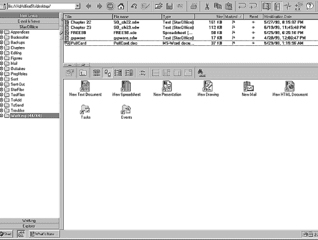

注意 Beamer 中出现了一个新字段“已标记”，并出现了小旗帜以指示这些文件已被标记。

> ### 来自 Michael & Sarah 的提示 #79：点击“已标记”旗帜图标和钻石形“已读”图标可以切换“已标记”和“已读”属性的开启。

要让未标记的文件再次可见，再次进入属性对话框，将“显示消息”从“已标记”更改为“所有”。只有这样你才能再次选择它们并取消标记。

> 注意：为了看到你新输入的过滤属性生效，你可能需要关闭文件夹然后重新打开，使其在 Beamer 或桌面工作区中重新显示。

这个简单的示例只是让你领略了这些命令的威力。

### 从打开和保存对话框管理文件和文件夹

> 来自 Michael & Sarah 的提示 #80：

文件和文件夹可以同时被标记为“已订阅”、“已读”和“已标记”，因此你可以让对象在不同的文件夹中选择性地出现。

在资源管理器（Explorer）中存储文件和文件夹，或者在资源管理器中创建链接组，而不是仅仅搜索单个链接文件夹的好理由是，你无法对链接文件夹应用过滤器。当然，如果你在网络上使用 StarOffice，可以对服务器或主机计算机上的文件夹应用过滤器。

### 使用规则创建过滤器

在“规则”选项卡上，你可以创建复杂的布尔过滤器，它不仅可以过滤显示内容，还可以对任何符合你规则设置的对象执行许多其他操作。你可以应用以下操作：

- 显示
- 隐藏
- 标记
- 取消标记
- 标记为已读
- 标记为未读
- 复制
- 移动

通过此功能，你可以为邮件收箱创建规则，以便所有具有相同主题行（例如，“年度会议”）的邮件邮件自动移动到名为 `AnnMeet` 的文件夹中。

规则功能的语法和操作非常复杂，本质上与用于构建搜索的方法相同；为了更好地了解如何创建和应用规则，请参见本章的“检索远程文件和文件夹”部分。

> 注意：如果你正在创建规则，请确保“视图”选项卡上勾选了“规则激活”选项，否则你的规则将无效。

### 使用文档属性跟踪文档

文档无法应用规则和过滤器（编辑和过滤它们是你的工作！），但它们有自己的文档属性，你可以在编辑菜单上的“属性”命令打开的对话框中进行设置（见图 5.10）。

#### 第5章 管理文件夹、文件和邮件

#### 5.10

你可以在“统计”选项卡上检查基本文档属性，如字符数、单词数、段落和页数。此选项卡还显示文档中的表格、图形和 OLE 对象数量。

| 包含内容的属性 | 说明 | 定义单位 | 统计数据 |
| --- | --- | --- | --- |
| 页数 | 132 | | |
| 表格数 | 2 | | |
| 图形数 | 154 | | |
| OLE 对象数 | 0 | | |
| 段落数 | 1545 | | |
| 单词数 | 27219 | 分隔符 | |
| 字符数 | 165895 | | |
| 行数 | | | |

**来自 Michael & Sarah 的提示 #81：**

你可以通过选择“工具-选项-常规-保存”对话框中的“保存前编辑文档属性”选项，让每次保存时自动出现此文档属性框。

对于文件夹，某些属性是由系统固定或预定义的，但你可以设置或修改其中的。这些属性可以帮助你在以后搜索时找到文件，并记录如文件的创建和发布历史、纸质副本的当前存储位置或之前的接收者等关键信息。

**来自 Michael & Sarah 的提示 #82：**

虽然你不能保存同名的不同文档，但你可以为同一主题分配不同的文档——例如，一组关于当前市场状况的报告，它们可能存储在不同的文件夹或驱动器中。相反，如果你需要区分同一文档的不同版本，你可以为相同的名称分配不同的标题。

**来自 Michael & Sarah 的提示 #83：**

使用“编辑-属性”对话框中的“Internet”选项卡将你的文档设置为网页加载。

### 检索远程文件和文件夹

StarOffice 的设计假设你在 StarOffice 桌面内工作，并将资源管理器作为主目录和常用文件、链接和文件夹的主要存储库。然而，你可能不想将所有工作都存储在资源管理器中。你的许多文件，包括你的邮件，可能

### 从“打开”和“另存为”对话框管理文件和文件夹 | 209

#### 表 5.3 可搜索或过滤的字段和属性

| 字段和属性 | 搜索 |
| :--- | :--- |
| 密抄 (Blind Copy To) | 电子邮件中的地址字段。 |


| 复制 (Copy To) | 电子邮件中的地址字段。 |
| 日期 (Date) | 文件、文件夹或文档创建日期。创建日期与最后保存日期不同。 |
| 文档计数 (Document Count) | 文件夹中保存的文档数量或文档中的单词数。 |
| 文件名 (Filename) | 保存的文件名。 |
| 关键字 (Keywords) | 使用文档属性对话框为文档定义的关键字。 |
|标记 (Marked) | 使用标记命令标记的电子邮件。 |
| 邮件 ID (Message ID) | 电子邮件邮件 ID 号。 |
| 修改日期 (Modification Date) | 文件最后修改并保存的时间。 |
| 下次更新 (Next Update) | 文件下次更新的计划时间。 |
| 优先级 (Priority) | 标记为优先级的电子邮件或文件。 |
| 回复 (Re:) | 电子邮件中的主题字段。 |
| 已读 (Read) | 你已经阅读的电子邮件，或标记为已读的文件或文件夹。 |
| 收件人 (Recipient) | 文件、文件夹或邮件的收件人。 |
| 引用 (References) | 到电子邮件的引用。 |
| 回复到 (Reply to) | 电子邮件中的地址字段。 |
| 发件人 (Sender) | 文件、文件夹或消息的发送者。 |
| 大小 (Size) | 文件、文件夹或邮件的大小，以 KB 或 MB 为单位。 |
| 状态 (Status) | 文件、文件夹或邮件当前状态。 |
| 目标 URL (Target URL) | 文件的目标路径、FTP 或 Web 地址。 |
| 标题 (Title) | 文档、文件夹或网页的文件名，或者你通过文档属性命令分配的文档标题。（如果你没有分配名称，则标题与原始名称相同。） |
| 收件人 (To) | 电子邮件中的地址字段。 |
| 类型 (Type) | 你在表达式框中指定的文件类型。（例如，你可以搜索所有 `.sdw` 类型的文件，以定位指定位置的所有 StarWriter 文字文档。） |
| URL | 文件的路径、FTP 或 Web 地址。 |

# 第 5 章 管理文件夹、文件和邮件

## 搜索布尔运算符

表 5.4 列出了可用的布尔运算符，这些运算符用于创建逻辑规则，以评估过滤器和搜索中找到的字符串。可用的特定运算符取决于你所选择的条件。任何使用过网络搜索引擎或在线图书馆目录的人都应该熟悉这些布尔逻辑运算符。

| 表 5.4 搜索命令中使用的布尔（逻辑）运算符 |
| 运算符名称 | 获取符合以下条件的文件和文件夹 |
| :--- | :--- |
| 包含 (Contains) | 包含你输入的表达式。这是默认运算符。对数字和字符均同样有效。 |
| 不包含 (Does not contain) | 不包含你输入的表达式。对数字和字符均同样有效。 |
| 等于 (Equal to) | 包含与你输入的表达式完全相同的文本字符串或字符串。。适用于日期和文件大小等数值类型的文本字符串。当你搜索在特定日期创建或具有你确定的特定地址信息的对象时非常有用。 |
| 不等于 (Not equal to) | 包含与你输入的表达式*不相等*的文本字符串。适用于日期和文件大小等数值类型的文本字符串。 |
| 较新或来自 (Newer or from) | 标记日期等于或晚于你输入的日期。 |
| 较旧或来自 (Older or from) | 标记日期等于或早于你输入的日期。 |
| 较新于 (Newer than) | 比你输入的日期更新。 |
| 较旧于 (Older than) | 比你输入的日期更旧。 |
| 大于等于 (Greater than or equal to) | 包含与你输入的表达式*大于或等于*的文本字符串。适用于日期和文件大小等数值类型的文本字符串。当你搜索特定日期范围内创建的对象时非常有用。 |
| 小于等于 (Less than or equal to) | 包含与你输入的表达式*小于或等于*的文本字符串。适用于日期和文件大小等数值类型的文本字符串。当你搜索特定日期范围内创建的对象时非常有用。 |

你还可以搜索两种排序方式：
- 普通文件名和单词
- 使用 StarOffice 正则表达式构建的字符串

默认类型是“标题”，它会搜索你在文档属性的标题字段中输入的标题，或者（如果你没有分配标题）文件名。

## 从“打开”和“另存为”对话框管理文件和文件夹

图 5.13 显示了使用“和”复选框构建的搜索示例，它将两个标准组合在一起以目标搜索。

**图 5.13**

当你使用“和”复选框一起创建字符串标准（规则）时，次要标准将出现在第一个标准下方：点击第一个标准左侧的 – 可以隐藏或（相应地）显示全部标准。

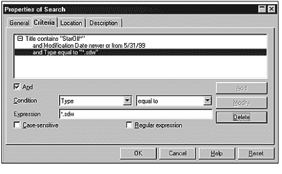

你可以继续向搜索中添加不关联的字符串，从而将许多不同的项目汇到同一个文件夹中。

你可以根据需要添加任意数量的字符串。但记住，复杂的搜索需要更长的时间并消耗更多系统资源。

一旦你构建了标准，就可以输入你希望消息自动复制或移动到的文件夹路径，或者你希望它们所在的路径。

## 选择搜索位置

图 5.13 显示位置看起来很熟悉，因为它与“打开”和“保存”对话框共享功能。

**图 5.14**

使用位置选项卡，你可以输入路径或 Web 地址（作为 URL），可以使用搜索来检索文件和文件夹。


注意你需要勾选“包含子文件夹”，此选项默认未勾选。

你可以直接在 URL 字段中输入路径或 URL，也可以通过“目录”按钮浏览你的目录。出现的搜索位置框（如 5.14 所示）具有与打开和保存对话框相同的导航按钮。它的字段是与位置选项卡上的字段分开管理。

## 查看搜索结果

任务窗口会自动显示搜索结果。如果没有找到内容，窗口将为空。

由于 StarOffice 缓存文件的方式，你可能需要选择搜索文件夹并在资源管理器菜单上选择“更新”，才能成功看到结果。

你可以通过选择资源管理器菜单上的“打开更新”命令来设置其自动更新，或通过选择同一菜单上的“更新”命令进行手动更新。

## 使用正则表达式进行搜索和过滤

不仅在你构建搜索和建立过滤器时，在 StarOffice 的许多其他对话框中（包括编辑菜单中的“查找和替换”），也会看到“正则表达式”选项。

你一定熟悉在许多程序和操作系统文件搜索中使用的通配符字符 (`*`)。那是正则表达式的一个示例，正则表达式是一组用于搜索更复杂文本字符串的符号。例如，你可能想搜索相似的单词或短语，而不是精确匹配。你还可以使用这些表达式来搜索作为格式代码的隐藏特性。（完整的正则表达式列表列在本书前面的教材中。）

## 保持您的桌面更新

能够使用正则表达式将极大扩展你的搜索、过滤和管理能力。它也让这些功能变得复杂，有时搜索和过滤并不会按照你的预期工作。

正则表达式运行得不符合你的预期，在搜索中并不是什么问题，尽管当它们不起作用时可能会让你感到沮丧。但在过滤中，你可以分配“隐藏”和“移动”等操作，可能会导致一些不尽人意的结果。在分配结果可能不会立即显示的之前，多次验证你的过滤器测试是一个好主意。（例如，你可以将“创建”而不是“移动”到你想要测试过滤器准确性的相同文件夹中。）

## 执行多次搜索

点击桌面对象栏上的“搜索”按钮可以开启或关闭搜索功能。开启此功能后，你可以在 Beamer 中、桌面详细视图或搜索结果中执行多次搜索。通常在文件搜索中（与邮件搜索不同，邮件搜索可以查找各种字段），你只能查找名称。开启“多次”后，你可以通过搜索文件类型、大小或修改日期来检索文件。

## 文件和文件夹

正如我们之前讨论过的，你可以通过将文件设置为只读来保护文件，无论是从“打开”对话框打开它，还是使用文档属性的“通用”选项卡上的只读选项。

由于任何知道如何使用 StarOffice 的人都可以关闭只读状态，保护关键文档的最安全方法是分配密码。你可以通过“另存为”命令为文档分配密码。

你无法在 StarOffice 内部为文件夹分配密码。但是，你可以通过在其属性对话框的“通用”选项卡中选择相应的选项将文件夹设置为只读。

## 保持您的桌面更新

在单个桌面上跟踪你的工作已经足够困难，但当你开始与网络上的他人协作，或依赖网站获取最新信息时，尝试让你的文件、网络引用和邮件保持更新可能会变得非常疯狂。

从系统的角度来看，当大量信息通过电话和网络线路发送接收时，保持文件更新也是一项挑战。StarOffice 有处理这种挑战的特殊方法，这影响了你的文件和邮箱的处理方式。

| 部分 |
| :--- |
| 第 5 章 |

## 更新文件、文件夹和邮件

通过理解 StarOffice 的“更新”和“订阅”命令，你可以帮助保持冷静并保持同步。

为了提供卓越的速度，StarOffice 使用内存缓存。当前使用的文件和对象的副本存储在内存或临时文件中，而不是不断从原始位置获取。这就像是在一个副本上进行工作一样。


这使得程序运行速度更快，但有时当你阅读网页或对邮箱排序时，你看到的可能不是当前版本。例如，你正在浏览的网站在你正在查看的页面上可能发生了变化，但你不知道，因为你查看的是缓存页面。

当你进行更新时，StarOffice 会搜索原始对象并从原始对象更新缓存版本。这个过程就像刷新你的显示器显示。

邮件和新闻账户每次打开时都会自动更新（如果你处于在线状态；如果未在线，你将看到连接错误消息）。你还可以通过使用资源管理器右键菜单上的“更新”命令来更新它们。

如果你想更新其他对象，需要从资源管理器属性对话框的“内容”选项卡中启用更新。

如果你在网络上工作并频繁处理存储在网络驱动器上的文件，设置此选项是一个好主意，这样你可以持续刷新本地系统中文件的工作副本。

> 只有当在资源管理器右键菜单中选中“显示”、“属性”命令时，某些对象上的“内容”选项卡才会可见。

在“内容”选项卡上，你可以设置任何对象（包括邮件和新闻文件夹）自动更新。

# 设置邮件、新闻和其他对象自动更新

你可以通过在文件夹属性的“内容”选项卡中选择“包含”来自动更新文件夹（除链接外）。

当选中此命令时，你可以设置自动更新间隔（分钟或小时）。例如，如果你选择你的收件箱并将其设置为 15 分钟，StarOffice 将自动检查你的账户。

# 保持您的桌面更新

# 图 5.15

“视图”（View）选项卡控制文件夹中显示的内容，包括确定过滤规则是否生效。

| POP3 账户属性 | | | | | | |
| 常用 | 接收 | 发送 | 视图 | 头部 | 内容 |
| --- | --- | --- | --- | --- | --- |
| | | | | | 显示消息 |
| | | | | | ○ 所有 |
| | | | | | ○ 未读 |
| | | | | | ○ 已发送 |
| | | | | | ○ 未读 |
| | | | | | ○ 已标记为未读 |
| | | | | | |
| 限制 | | | | | | |
| ☐ 遵循规则 | | | | | |

现在去勾选“已标记”（Marked）和“未读”（Unread）选项。勾选此选项将应用全局过滤器，隐藏你所有已读过的邮件，但你标记过的邮件除外。通过此选项，你可以标记保留已读过的非常重要的邮件，例如派对的说明或会议通知。

现在点击“规则”（Rules）选项卡——真正的工作开始了。

假设你订阅了若干邮件列表。邮件列表是邮件社区，其中由一个人作为中心节点，发送并重定向来自群组的消息。邮件列表的一个功能是，它们通常会在主题行中放置一个通用短语作为列表名称，以识别由列表生成的所有消息。你可以使用此功能来过滤和重定向这些消息。

假设你订阅了一个名为 TECHWRITER-L 的列表。要创建一个过滤器将所有此类邮件重定向到单独的文件夹，首先从下拉列表中选择“移动”（Move）作为操作。然后将条件设置为“标题”（Title），并输入 TECHWRITER-L。为了安全起见，勾选“区分大小写”（Case-Sensitive），因为该头部是大大写字母。现在务必点击“添加”（Add），否则规则将不会添加到列表中。

接下来，点击“浏览”（Browse）按钮选择重定向此封邮件的目录（文件夹）。会出现“选择路径”对话框（见图 5.16）。选择“新建”（Create New）按钮，并在文件夹将出现的资源管理器中的 Office/Explorer 目录中创建一个名为 TECH 的文件夹。

接下来，创建一个过滤器来删除标题中带有 CIE 的不同邮件列表的邮件。

“删除”（Delete）选项是一个危险的工具，使用时要小心（尽管删除的对象会像通常一样存储在回收箱中，直到你主动删除它们）。在这里，我们假设你已经检查了过滤器并确保它没有捕捉你可能想要保留的内容。

# 28 | 第 5 章 管理文件夹、文件和邮件

图 5.16

通过“规则”过滤器，你可以选择对本地目录结构中任何位置的文件进行复制、移动、删除或创建链接。

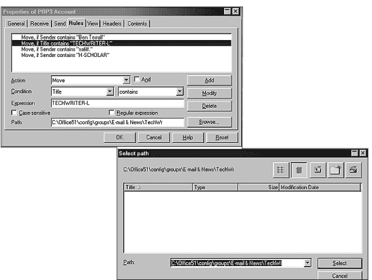

首先，从“操作”列表中选择“删除”（Delete）。注意“和”（And）框是灰色的；在点击点击“添加”并将第一条规则添加到规则列表后，它将变为激活状态。

输入“标题”（Title）和“包含”（contains）作为你的条件，并让 `CUE` 作为你的表达式。同样，“区分大小写”。没有出现“浏览”按钮，因为删除的对象会自动放入回收箱中。只有当你选择“移动”、“复制”或“创建链接”时，才会出现“浏览”。现在，选择“添加”。

接下来，你创建一个链接。由于你的办公室正在向在网络上使用 StarOffice 过，而你是接收支持邮件的联系人，你可能需要根据情况将邮件重定向给同事。你可以通过在另一个文件夹中为你设置的规则创建链接来自动实现这一点。

选择“链接”（Link）作为操作后，选择条件“发件人”（From）和“包含”（Contains）（如图 5.17 所示）。

图 5.17

根据邮件头部字段自动创建链接以指定特定邮件的能力，是 StarOffice 强大的过滤系统最有用的功能之一。


带有（With）

选择“添加”，然后选择“确定”（OK），因为你已经完成了过滤器的构建。就这样！

现在，每当你下载邮件时，你的邮件将根据你的规则和视图选项进行处理。（如果你将邮件存储在本地并从服务器删除删除，则现有邮件将不会被过滤。）

# 第一部分

## 第 5 章

# 创建文档—StarWriter

+ 6 创建和编辑文本文档 223
+ 7 格式化文本文档 261
+ 8 使用样式和模板 291
+ 9 处理表格、图表和字段 321
+ 10 处理长文档 369
+ 11 使用 StarOffice 进行桌面排版 415
+ 12 校对和打印你的文档 459

# 第 6 章

创建和编辑文本文档

在本章中：

- 开始使用 StarWriter 224
- 输入文本、特殊字符和公式 232
- 编辑和选择文本 243
- 保存、关闭和打开文档 249
- 故障排除 258

## 开始使用 StarWriter

StarWriter 不仅仅是文字处理。它支持框架、小程序和插件，这些让你能够保存和加载文档。在大多数情况下，StarOffice 的外观和感觉都非常像 Windows，但有几个显著的例外。

> 你可以激活所有这些右键菜单。我们对它们进行了排列，以便让你快速概览。

> 如果你是初学 StarOffice，可能想从“帮助”菜单选择“提示”（Tips）或“扩展提示”（Extended Tips）。当你激活这些功能并将光标指向图标、框或按钮时，你会看到一个描述图标（提示）或其功能的小气气泡。

### 启动 StarOffice

你可以通过选择“文件”、“新建”、“文本文档”来启动 StarWriter。打开新文档后，你可以使用在 MS Word 中熟悉的常用任务。

### 探索 StarWriter 工作空间

当你打开一个新文档时，屏幕包含一个空白文档（称为“未命名”），并由方便工具、按钮和状态显示包围，帮助你创建各种简单和复杂的文档，包括信函、报告、字体。图 6.1 显示了默认文档窗口和工作空间，以及通过右键点击某些区域打开的各种菜单。

开始使用 StarWriter | 225

- 编辑（不可用项目为灰色）
- 边距
- 状态栏
- 文本边界
- 文本上下文菜单
- 扩展提示
- 对象栏
- 功能栏
- 标尺
- 工作空间

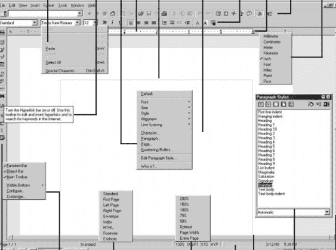

图 6.1

StarWriter 自带了一套方便的工具和菜单，让你能够即时创建专业的文档和网页。只需在指示区域点击右键即可访问这些菜单。

- 主工具栏
- 工具栏菜单
- 页面样式菜单
- 样式表
- 滚动条
- 导航

在文档中工作时，你可以在区域任何位置右键点击弹出“文本”菜单。此菜单让你可以使用 StarWriter 中最常用的格式化功能。在这里，你可以快速更改文本元素——例如文档的字体、大小、对齐和行间距——或调用对话框定义更高级的字符、段落、页面和编号/符号功能——例如不同的字体样式、超链接、宏、背景、段落和页面属性以及编号和符号样式。此外，你还可以编辑应用样式的属性（包括缩进和距离、文本流、首字、边框和背景），并调用“地址框”（是谁……？）来快速向文档或页面顶部插入关于某人的联系信息。

> **Michael & Sarah 的提示 #86** 若要撤销对段落或文本块的更改，请从右键菜单中选择“默认”（Default），StarWriter 将将其重写为原始格式和样式。然而，如果你应用了编号/项目符号更改、编辑了段落样式、更改了页面样式或插入了联系信息，你必须手动恢复到原始格式和样式。

### 使用文本对象栏


在窗口顶部，你会注意到文本对象栏，MS Word 用户将其称为格式栏。它包含了最常用的字符和段落格式化功能的一键快捷方式，让你能够快速更改文本的外观和布局。

根据上下文的不同，在处理单个文档时，你可能会看到各种对象栏。例如，如果你在文档中插入表格，一旦点击单元格内部，文本对象栏就会替换为表格对象栏。如果你正在插入编号或项目符号列表，只要你的插入点位于列表范围内，列表对象栏就会出现。如果你插入了一个对象，当你选中插入的对象时，将获得相应的对象栏。在任何情况下，StarWriter 都将所有必要的格式和编辑工具放置在鼠标点击即可触及的范围内。

表 6.1 列出了文本对象栏的各种菜单和图标，并解释了它们的功能。

| 表 6.1 使用文本对象栏 |
| :--- | :--- |
| 图标 | 如果你想 |
| 标准 (`Standard`) | 为你的文档分配现有样式。点击向下箭头从已应用的样式列表中选择样式。新文本的默认样式是“标准”。你可以通过样式表（Stylist）应用其他样式（详见第 8 章“使用样式表”、“使用样式和模板”）。 |
| Times New Roman | 更改选中文本的字体和大小。默认字体是 Times Roman，大小为 12。你的选择受限于系统上安装的字体数量。在任一框中点击鼠标右键可弹出快捷菜单。 |
| B i U | 更改单词或选中文本的属性样式——**粗体**、*斜体*、下划线。 |
|  | 更改当前段落的对齐方式——左对齐、居中、右对齐、两端对齐。 |
|  | 为文本添加编号或项目符号列表。 |
|  | 按定义的制表位距离减少或增加段落或行的缩进。 |

## 开始使用 StarWriter

点击此图标，如果你想：

更改选中段落的字体颜色、高亮选中文本，或为当前段落的背景添加颜色。（注意：这三个按钮都让你能够访问浮动工具栏，你可以将其放置在桌面的任何地方。）

切换 StarWriter 中的各种对象栏，包括文本、表格和列表对象栏，前提是你的文档包含表格、列表或其他元素（如图形对象），这些元素带有你的格式化和编辑工具集。

- 有关使用这些功能和选项的更多详情，请参见第 263 页“格式化字符”和第 270 页“格式化段落”。

Michael & Sarah 的提示 #87

右键点击对象栏或主工具栏可打开右键菜单，允许你自定义、配置和选择显示的工具栏。你有三个选项可选：功能栏（Function Bar）、对象栏（Object Bar）和主工具栏（Main Toolbar）。如果你选择“可见按钮”（Visible Buttons）选项，子菜单允许你选择在当前对象栏或工具栏上显示或隐藏的图标——这是自定义工具栏的快速方法。

Michael & Sarah 的提示 #88

如果你在文档中插入了一个或多个表格，可以点击表格单元格内部访问 StarCalc 对象栏并轻松编辑表格。如果你想操作表格单元格的内容，可以右键点击对象栏并在右键菜单中选择“文本对象栏”（Text Object Bar），或点击栏右侧的小箭头在两个对象栏之间切换。

## 使用 StarWriter 标尺

对象栏下方是标尺，允许你设置当前段落的制表位、缩进和页边距。除了水平标尺，你还可以显示垂直标尺。只需选择“工具”、“选项”、“文本文档”、“布局”，并在对话框的“Windows 选项部分选择“垂直标尺”。

- 有关使用标尺的更多详情，请参见第 276 页“设置和清除制表位”。

第二部分

第 6 章

Michael & Sarah 的提示 #89

在标尺的灰色区域双击可弹出“段落”对话框，允许你更改当前或选中段落的缩进、间距、对齐方式、文本流、编号、制表位、首字放大、边框和背景。右键点击可获取快捷菜单，允许你更改单位和测量系统——尝试英里、英尺、公里或米来获得一个困惑的微笑。

## 使用 StarWriter 主工具栏

文档窗口左侧是主工具栏，允许你向文档插入各种对象，并快速访问 StarWriter 中最常用的功能。表 6.2 列出了各种按钮并解释了它们的功能。

| 点击此处 | 如果你想 | 按钮名称 |
| :--- | :--- | :--- |
| ![ | 在文档中插入框架、图片或其他文档、脚注、多列、索引条目或书签。显示最近的图标。短点击弹出对话框（默认：表格）。 | 插入 |
| ![ | 在文档中插入日期、时间、页码、页数、主题、标题或作者字段。 | |
| ![ | 插入表、图片、数学公式、浮动框架、OLE 对象、插件或小程序。显示最近的对象。短点击激活最近的对象（默认：图表）。 | 插入对象 |
| ![ | 创建并插入绘图。点击此图标打开带有各种绘图工具的浮动工具栏。显示最近的图标。 | 绘图 |
| ![ | 创建数据库表单。点击此图标打开带有各种功能和字段的浮动工具栏。显示最近的字段或控件。 | 表单 |
| ![ | 插入常用的文本段落作为签名、标准短语或模板。短点击弹出 AutoText 对话框，按 F3 插入。 | AutoText |
| ![ | 检查文档的拼写。 | 拼写 |

## 开始使用 StarWriter

| ABC | 在输入时自动检查拼写（默认）。错误将用波浪线标出。如果你右键点击拼写错误的词，将获得更改建议的菜单。 | 自动检查 |
| icon | 在文档中查找并替换特定的术和短语。 | 查找和替换 |
| icon | 关闭（默认）或开启链接，编辑并插入链接并在互联网上搜索关键词。 | 超链接栏 |
| icon | 显示或隐藏文本中的非打印字符（如换行符、制表位、段落标记和空格）。 | 非打印字符 |
| icon | 开启或关闭图形显示（默认关闭）。在关闭模式下，你会看到图形占位符的空框。 | 隐藏图形 |
| icon | 激活直接光标功能，允许你在文档的任何位置放置光标并开始输入（默认关闭）。 | 直接光标 |
| icon | 在在线和默认布局之间切换。在线模式让你将文档视为连续的页面，无论长度如何。如果你正在处理 HTML 文档，请切换到在线模式。 | 在线布局 |

## 使用 StarWriter 状态栏

在 StarWriter 窗口底部，你会注意到状态栏（参见图 6.2）。它提供了当前文档的预览信息，并提供了特殊功能和功能的快捷方式。

图 6.2

关注状态栏。它提供了当前文档的详细信息以及常用格式化和编辑功能的快捷方式。


## 230 第6章 创建和编辑文本文档

在左侧的字段中，你将看到当前正在操作的页码以及文档的总页数。右键点击此字段可以打开上下文菜单，列出当前文档中的所有书签；选择一个标记即可导航到该位置。双击可以开启或导航器。

有关使用书签的更多信息，请参阅第 388 页的“为文档设置书签”。

> 注意
>
> 你必须先在文档中插入了书签，才能使用页码字段中的右键功能。如果你没有插入书签，则此功能不可用。

下一个字段指示你当前正在使用的页面样式（默认为标准）。右键点击可以切换到另一种样式（如果列出了多个样式）。双击可以打开页面样式对话框并编辑选定的页面样式。

第三个字段指示文档当前的缩放比例。右键点击会打开快捷菜单，允许你放大、缩小或优化视图。双击可以打开完整的缩放对话框。

接下来三个字段指示当前的插入模式、选择模式和超链接编辑模式。点击每个区域都会切换选项。

> 来自 Michael 和 Sarah 的第 #90 号提示
>
> 你也可以按键盘上的 `Insert` 键在插入模式和覆盖模式之间切换。

表 6.3 插入、选择和超链接模式说明

| 显示 | 模式 | 使用此模式，你可以 |
|---|---|---|
| INSRT | 插入 | 在光标插入点插入新字符。后续文本将向右移动。 |
| OVER | 覆盖 | 用新字符替换右侧的现有字符。 |
| STD | 标准 | 点击并拖动以选择文本（默认模式）。每次在页页上点击时，都会丢失之前的选择。 |
| EXT | 扩展 | 选择一段文本。点击将光标置于你想要选择区域的开头和结束。（按 `Esc` 键撤销并退出此模式。） |
| ADD | 累加 | 选择不连续的文本块。（按 `Esc` 键撤销并退出此模式。） |
| HYP | 超链接 | 直接跳转到 URL。 |
| SEL | 选择 | 编辑或更改超链接。 |

## 开始使用 StarWriter

超链接模式字段右侧的窄字段称为“文档已修改”，它表示自你保存文档以来，打开的文档发生了更改。

+ > **来自 Michael & Sarah 的第 #91 号提示** 更改字段中的星号（*）表示文档已发生但尚未保存的更改。

右侧的字段是一个组合显示区域，根据光标的位置，它列出当前日期和时间或其他文档相关的信息。例如，如果你在文档中有一个表格和一个单元格，日期和时间显示将被单元格编号显示取代。双击此可以打开“字段”对话框，允许你在光标插入点插入字段。

## 使用滚动条


默认情况下，StarWriter 显示垂直和水平滚动条。窗口右侧的垂直滚动条允许你在文档中向上或移动。如果你在右下角的双箭头之间看到导航图标，你将获得一个浮动工具栏，它允许你选择想要浏览文档的方式：按页（默认）、按标题、按图片、按对象、按节、按帧或按注释，具体取决于文档中包含的元素和对象。

窗口底部的水平滚动条允许你根据文档的当前视图向左或向右滚动。你可以通过右键点击状态栏中的“缩放”字段并从缩放快捷菜单中选择项目，来快速更改文档视图。

> **来自 Michael & Sarah 的第 #92 号提示** 在处理长文档时为了快速移动并节省时间，请使用导航工具栏。要打开它，点击导航图标（见图 6.1）。你可以根据文档包含的元素和对象，选择浏览文档的方式——按页（默认）、按标题、按图片、按对象、按节、按帧或按注释。

# 第6章 创建与编辑文本文档

**制表符（默认）**——通过此设置，你可以在任何预定义的制表位处开始打字。如果你将直接光标（Direct Cursor）放置在页面或表格单元格的中心，指针形状将从单箭头变为指向两个相反方向的箭头。当你将光标置于此插入点时，它会自动在行内或单元格内居中。在中心点左右侧的文本默认左对齐。放置在右侧边距的文本将右对齐。

**制表符和空格**——通过此设置，你可以在文档的任何地方开始打字。StarWriter 会在左边距和插入点之间自动插入所需的制表符和空格。

> 你可以通过观察直接箭头（箭头）来轻松修复在插入点输入文本的对齐方式。如果箭头指向右侧，文本将左对齐；如果箭头指向左侧，文本将右对齐。如果你看到两个方向相反的箭头，你输入的文本将在行内居中。

你还可以使用颜色下拉列表为直接光标定义新颜色。

要使用直接光标，请点击主工具栏上的直接光标图标；然后点击文档中的任意区域并开始打字。

图6.3 显示了一个使用直接光标创建的文档。

务必双击你的自动更正设置（通过“工具”，“自动更正/自动格式”）。如果在“选项”选项卡上选择了“删除空白段落”或“如果长度大于50%则合并单行”，当你使用自动格式（通过菜单栏中的“格式”，“自动格式”，“格式化文档”）时，插入的制表符或行可能会从你的文档中自动删除。在这种情况下，你必须决定哪个对你更重要。你鱼不可兼得——即使在 StarWriter 中也不行。

因为在直接光标模式下，自动格式会在你输入的新文本的首字母前设置制表符，因此由于手动或样式引起的对默认制表位的任何更改都会影响你在此模式下输入文本的模式。

## 特殊字符和符号

StarWriter 为每个可用字体都包含了多达 233 个特殊字符的广泛集合，外加上文本和数学符号（StarBats 和 StarMath）。如果你在文档中使用外语言单词、货币符号、版权或商标符号、常见分数等，你可能需要特殊字符。要插入字符或符号，请从菜单栏选择“插入特殊字符”，或在主工具栏上右键点击“插入”图标并点击“字符”图标（从左数第七个图标）来打开

## 输入文本、特殊字符和公式 235

特殊字符对话框。接下来，点击选择你想要插入的字符或字符组合。你可以在对话框底部的“字符”行中预览你的选择。如果要重做多次选择，请选择“删除”。完成后，选择“确定”。StarWriter 会自动将字符插入到文档中的插入点。

图6.3

此备忘录是使用显示隐藏字符的直接光标创建的。注意 StarWriter 如何插入相应数量的制表符和（或段落标记）。


直接光标命令

来自 Michael Sarah 的第97 号提示

如果你使用相同的特殊字符或符号，你应该记住特殊字符对话框右下角的数值。然后你可以通过在小键盘上按 `Alt`+[数值]在插入点输入字符对齐。（你可能需要先按 `NumLock` 键开启。）如果数值由三个数字组成，需要在数字前插入一个零（`0`）。相同的代码在不同字体中调用不同的字符；你在插入点插入的特殊字符。

| 第二部分 第6章 |

## 使用 StarMath 创建并插入公式

如果你正在处理科学文档，你可能需要向文本中添加公式。在 StarWriter 中，你有两种创建和插入公式的方法：使用 StarMath 字符集或公式编辑器。你可以通过特殊字符对话框（选择“插入”，“特殊字符”）——提供了最常用的关系符号和希腊字母来创建公式。你可以根据需要的顺序在文档中选择并插入符号。如果你想创建更复杂的公式，你需要使用

公式编辑器。公式编辑器只是一个创建公式的编辑器。

> 当你右键单击命令窗口时，可以使用选择窗口

### 使用公式编辑器创建公式

要启动公式编辑器并开始创建公式，请从菜单栏选择“插入”，“对象”，“公式”，或双击主工具栏上的“插入”图标。当你在文档工作时，工具将变为 StarMath，并在插入点插入一个空框架。

StarMath 拥有其标志和各种设置。简而言之，你的工具和工作区域包括选择窗口和命令窗口。选择窗口分为两个部分：类别（顶部两行），在选定的类别中，你可以从各种运算符、关系、函数、属性以及颜色格式属性中选择。如果你是 StarMath 初学者，务必从“帮助”菜单选择“扩展选项”，以便在悬停于各种图标时查看说明。

要创建公式，点击顶部选择一个类别；然后点击该类别内所需的元素或表达式。你的选择将带有占位符出现在命令窗口中，你可以将其替换为自己的占位符，或使用新的运算符、关系、函数、属性进行扩展。

## 输入文本、特殊字符和公式 237

对象框架

带有公式

类别

打开符号

文本文档

选择窗口

函数

图6.4

StarWriter 显示了 StarMath 公式编辑器。当你创建公式时，公式编辑器会自动将命令窗口的内容作为对象插入到文本文档中。


工具栏—

命令窗口

在 StarMath 中的公式

来自 Michael & Sarah 的第99 号提示

如果你想在几行中包含多个公式，需要在命令窗口中右键单击并选择“格式”，“换行”。按回车不起作用。

如果启用了自动重绘功能（视图，“自动重绘），StarMath 会在你创建公式时自动更新文档内容。如果未启用此功能，你可以点击主工具栏上的刷新图标（从上数第五个按钮）或按 `F9` 手动更新你的公式。

> 注意

放大、缩小、缩放 100% 和显示所有命令——通过“视图”菜单和主工具栏访问——仅在你在独立文档中创建公式时可用。

完成后后，您可以点击公式对象框外的任何地方返回熟悉的文本窗口。如需返回公式编辑器，请双击对象框，或点击对象以在公式对象和文本对象栏之间切换。

> StarOffice 自带了一系列公式，位于资源管理器中的 `Samples\Formula` 文件夹下，您可以根据需要使用或修改这些公式，包括投资回报率、利率、年金以及其他数学和统计函数。您可以通过选择“工具”、“导入公式”，然后找到所需的文件夹和公式来插入这些方程。

### 格式化您的公式

如果需要，可以访问“格式”菜单并选择相关选项，这将允许您更改公式元素的字体、字体大小和水平对齐方式。要更改特定公式元素的字体，选择“格式”，并在“字体类型”对话框中点击“修改”。在“修改”子菜单中，选择您想要定义新字体的元素。您可以更改公式字体（变量、函数、数字和文本）以及自定义字体（衬线、无衬线和等宽字体）。选择后，StarMath 会打开对话框，您可以在其中为所选元素选择新字体，并将其属性定义为**粗体**、*斜体*或**粗体**。点击“确定”接受更改。新字体将出现在相应元素的下拉列表中。如果您不喜欢该选择，可以从新字体下拉列表中选择它以返回之前的字体。点击“默认”将您的更改保存为新默认，然后点击“确定”返回 StarMath。

要更改公式元素的相对大小，请选择“格式”和“大小”，并通过滚动计数器框进行调整。StarMath 允许您相对于基字体大小更改文本、索引、函数、操作符和限制条件的字体大小（默认情况下，文本、函数和操作符的相对大小为100%，这意味着该大小等于定义的基大小）。

如果您对细节有严苛要求，还可以调整公式元素之间的间距，甚至是分式线超出长度与分子、分母之间的间距。从菜单栏选择“格式”、“间距”，并点击“类别”来探索您的选项。公式创建后，您还可以通过选择“格式”、“对齐”来定义其水平对齐。

> StarWriter 解析和插入公式与其他任何插入对象一样。有关在 StarOffice 中如何处理对象的通用介绍，请参阅第 176 页的“使用对象”（第 4 章，“在 StarOffice 中工作”）。有关更多关于在 StarWriter 中处理对象的细节，请参阅第 421 页的“练习对象”（第 11 章，“使用 StarOffice 进行桌面排版”）。


## 输入文本、特殊字符和公式 239

### 在 StarMath 中使用符号

有时您可能需要在公式中添加希腊字母或符号。StarMath 自带了符号和字体集，您可以通过主工具栏上的符号图标访问它们。您可以在希腊字母字体和特殊字体集之间进行选择。


此外，StarMath 还允许您创建自己的符号集并编辑现有的符号。在“符号”对话框中选择“编辑”，并在“编辑符号”对话框的“符号集”框中输入新名称。接下来，选择您想要包含在自定义集中的符号，在“符号”框中指定名称，并选择“添加”。通过这种方法，您可以从已安装的字体集中添加任意数量的符号到自定义集中。您也可以通过选择第一个字符、进行修改，然后在符号集中输入名称来编辑现有符号。选择“添加”，使该符号以新名称出现在所选集中。完成后，点击“确定”。您可以在“符号”对话框的“符号集”组合框中选择新创建的或修改的符号集。要删除某个集合，请进入“符号”对话框，在“符号集”框中高亮集合名称并选择“删除”。图 6.5 显示了创建自定义符号集或编辑现有符号集的各种步骤。

### 图 6.5

- StarMath 允许您为项目创建符号集。
- 点击打开符号对话框
- 选择编辑现有符号集或添加一个新的
- 选择符号并命名；然后将符号添加到所选的集中


从所选集中插入符号，选择它并点击“插入”。注意，如果您选择“确定”，将关闭符号对话框；您的选择将不会插入。符号名称将插入公式编辑器窗口的插入处，前面带有 `%`。

如果您记住了符号名称，也可以在命令窗口中直接输入，只要它前面有 `%` 符号。

> 注意：StarMath 的符号系统非常简单。在学习规则后，您可能会发现自己正在编辑公式、移动元素、组合诸如 `{ }` 的表达式，或者在公式元素之间使用波浪线 (`~`)。

## 使用 AutoText 自动输入文本

StarWriter 提供了一系列加速输入的功能，包括 AutoText 和自动更正。AutoText 从列表或通过主工具栏上的 AutoText 按钮插入各种文本。自动更正会处理各种输入错误，将在本节的“检查写法”部分讨论。AutoText 命令允许您快速插入单词、短语或段落。

> Tip #102 from Michael Sarah
>
> 随着 AutoText 类别和条目的增加，记忆所有快捷键将越来越越来越。在这种情况下，长按主工具栏上的 AutoText 图标，从可用类别列表中选择所需的条目。当您松开左鼠标时，您的选择将插入到光标处。

### 添加 AutoText 类别

您不必局限于现有的类别。StarWriter 允许您添加新类别。

输入名称和（自定义）快捷键

保存新的 AutoText 条目

图 6.6

通过添加对你有用的新项目来扩展 StarWriter 现有的 AutoText 库。


输入并选择文本 -

当提示帮助活动时点击显示 AutoText 名称

打开新文本文档

当你在网络或服务器上管理文件时，建议使用“相对保存链接”

### 更改类别路径

AutoText 条目会自动保存并注册在 StarOffice 根目录下 `mtext` 文件夹中的相应类别名称（`name.bau`）下。如果您以后决定将 AutoText 条目移动到不同的目录，可以在 AutoText 对话框中为类别分配新路径。按 `Ctrl+F3` 打开对话框，选择“路径”（Path），然后在“选择路径”对话框中选择“添加”（Add）。找到要添加到路径列表的目录，并选择“打开”（Open）。在“选择路径”对话框中选择“确定”（OK）以确认选择。新路径将添加到 AutoText 路径列表中。现在，您可以将类别文件移动到新分配的路径。AutoText 会自动找到并识别类别文件。

> 如果您在 AutoText 对话框中选择了“相对保存链接”的选项之一。

### 编辑现有的 AutoText 条目

有时您可能需要更新或更改现有 AutoText 条目的措辞。要操作，按 `Ctrl+F3` 打开 AutoText 对话框。找到您要编辑的条目，并选择 AutoText，“编辑”（Edit）。AutoText 将该条目作为新任务打开。完成更改应用后，按 `Ctrl+S` 保存更改并关闭任务。您选择的条目将被更新以供以后参考。

您还可以重命名或删除现有的文本块。找到想要更改的文本块名称，在 AutoText 对话框中选择 AutoText，“重命名”（Rename）。在“重命名块”对话框中，在旧名称和快捷键下方的相应字段输入新名称和快捷键。如果您想删除文本块，选择 AutoText，“删除”（Delete）并在“删除 AutoText”警报框中确认您的选择。

> “撤销”（Undo）命令不允许从 AutoText 对话框中删除。如果您不小心删除了文本块，将无法恢复。

### 使用自动补全功能

StarWriter 还包含自动补全功能。使用此功能，您可以存储指定数量、指定长度的单词。当您输入前三个字母时，StarWriter 会找到第一个匹配项并以深蓝色背景自动输入到文本中。随着您的继续输入，StarWriter 将找到更多匹配项。如果您在输入过程中看到了该单词，按回车键，StarWriter 将为您插入它。如果有多个单词以相同的三个字符开头，您可以输入组合键 `Ctrl+Alt+Tab` 从头开始搜索存储单词列表，或使用 `Shift+Ctrl+Tab` 搜索熟悉单词列表的结尾。

注意，此功能默认开启，可以通过 AutoCorrect 对话框（`Tools`，`AutoCorrect/AutoFormat`）中的“选项”进行控制。如果您想更改字符和单词的数量，请点击“编辑”（Edit）按钮并在“自动单词补全”对话框的“最小单词长度”（Min. Word Length）和“最大条目数”（Max. Entry）计数器框中指定新数字。如果此功能开始让您感到困扰，选择 `Tools`，`AutoCorrect/AutoFormat`，Options，并关闭“自动补全最小单词长度，10，最大条目数 500”旁边的勾选（移除 x）。

## 编辑和选择文本

写作后，您可能想对文档的部分或全部进行格式化、复制、移动或删除。StarWriter 提供了实现上述所有操作各种方法。本节涵盖了基本的编辑和格式化技术。有关格式化文本文档的详细信息，请参见第 7 章“格式化文档”。

## 在输入时纠正拼写

StarOffice 包含了强大的工具来检查并在必要时纠正您的拼写。例如，如果 AutoSpell（自动拼检查）功能处于，您将在每个未当前安装字典识别的错误单词或术语下方看到红色波浪线。要纠正拼写错误，右键点击拼错误的单词，从快捷菜单中选择正确的术语。如果您在建议替换列表中找不到该术语，且您确定该术语拼写正确，可以选择“忽略”（Ignore）让拼写检查器忽略未识别的术语；或者您可以选择“添加”（Add），将其添加到安装的标准字典看似有限的词汇表中。您还可以查找 AutoCorrect 以查看该术语是否来自替换列表。要开启 AutoSpellcheck 功能，点击主工具栏上的 AutoSpell 图标（带有波浪线的“ABC”）或选择 `Tools`，`AutoSpell`。

- StarOffice 允许您使用三种语言检查拼写。有关拼写检查器和已安装字典的更多信息，请参见“校对您的工作”，第 460 页。

### #103 来自 Michael Sarah

如果您在文档中没有看到任何波浪线，说明您要么忽略了错误，要么您的机器上禁用了 AutoSpellcheck。要开启此功能，选择主工具栏上的 AutoSpellcheck 按钮，或选择 `Tools`，`AutoSpell`。或者，可以在“通用语言”（General Linguistics）对话框的自动拼写检查中选择“不标记错误”（Don't Mark Error）选项（选择 `Tools`，`Options`, Linguistics）；

# 第 6 章 创建和编辑文本文档

如果您在文档中没有看到任何波浪线，说明您要么忽略了错误，要么您的机器上禁用了 AutoSpellcheck。要开启此功能，选择选择主工具栏上的 AutoSpellcheck 按钮，或选择 `Tools`，`AutoSpell`。或者，可以在“通用语言”（General Linguistics）对话框的自动拼写检查中选择“不标记错误”（Don't Mark Error）选项（选择 `Tools`，`Options`, Linguistics）；


如果您在文档中没有看到任何波浪线，说明您要么忽略了错误，要么您的机器上禁用了 `AutoSpellcheck`。要开启此功能，选择主工具栏上的 `AutoSpellcheck` 按钮，或选择 `Tools`，`AutoSpell`。或者，可以在“通用语言”（`General Linguistics`）对话框的自动拼写检查中选择“不标记错误”（`Don't Mark Error`）选项（选择 `Tools`，`Options`, `Linguistics`）；

### #103 来自 Michael Sarah

如果您在文档中没有看到任何波浪线，说明您要么忽略了错误，要么您的机器上禁用了 `AutoSpellcheck`。要开启此功能，选择主工具栏上的 `AutoSpellcheck` 按钮，或选择 `Tools`，`AutoSpell`。或者，可以在“通用语言”（`General Linguistics`）对话框的自动拼写检查中选择“不标记错误”（`Don't Mark Error`）选项（选择 `Tools`，`Options`, `Linguistics`）；

### #103 来自 Michael Sarah

如果您在文档中没有看到任何波浪线，说明您要么忽略了错误，要么您的机器上禁用了 `AutoSpellcheck`。要开启此功能，选择主工具栏上的 `AutoSpellcheck` 按钮，或选择 `Tools`，`AutoSpell`。或者，可以在“通用语言”（`General Linguistics`）对话框的自动拼写检查中选择“不标记错误”（`Don't Mark Error`）选项（选择 `Tools`，`Options`, `Linguistics`）；

# 编辑和选择文本 245

| 使用此选项卡 | 如果您想 |
|---|---|
| 选项 (`Options`) | ... |

### #104 来自 Michael Sarah

如果您在文档中没有看到任何波浪线，说明您要么忽略了错误，要么您的机器上禁用了 `AutoSpellcheck`。要开启此功能，选择主工具栏上的 `AutoSpellcheck` 按钮，或选择 `Tools`，`AutoSpell`。或者，可以在“通用语言”（`General Linguistics`）对话框的自动拼写检查中选择“不标记错误”（`Don't Mark Error`）选项（选择 `Tools`，`Options`, `Linguistics`）；

## 第 6 章 创建和编辑文本文档

## 选取文本

在选取文本时，你基本上有三种选择：可以使用鼠标、键盘，或两者兼用。以下是在标准模式下在 `StarWriter` 中选取文本的一些实用技巧：

- 若要选取连续的字符，请将插入点置于第一个字符的开头；然后点击并按住鼠标键，拖动通过最后一个字符。
- 若要选取一个单词，在单词的任何位置双击单击。你可以在第二次点击后按住鼠标键并拖动通过额外的单词，以选取相邻的单词。
- 若要选取一行，在行的任何位置连续三击单击。你可以在第三次点击后按住鼠标键并拖动通过其他行，以选取额外的行。
- 若要选取段落或文本块，点击所需选取区域的开始处，并拖动到选取区域的结束处，结束处不需要与起点在同一个屏幕视图中。如有必要，你可以跨页拖动。请注意，指针移出工作区域越远，文本滚动得越快。
- 若要选取整个文档，从菜单栏中选择“编辑 > 全选”，或按 `Ctrl+A`。

> Michael Sarah 的第 #105 条提示

如果你想选取非连续的文本，请双击状态栏上的选取字段以从标准 (`STD`) 模式切换到附加 (`Add`) 选取模式。你可以快速地在文档任何地方反复点击并拖动以选取非连续的文本。按 `Escape` 键（或点击选取字段）切换回标准模式。或者，你可以按住 `Ctrl` 键并拖动。

你还可以结合 `Shift` 键与方向键以及移动文档移动的快捷键（参见本章中的“在文档中移动”）来选取部分文本。例如，要选取从插入点到行尾的文本，请按 `Shift+End`。`Shift+Home` 选取从插入点到行开头的文本。

若要取消选取文本，单击一次（在选取区域或文档工作区内），或按 `Esc` 键。

## 删除文本

你可以通过多种方式删除文本。你可以使用键盘上的 `Backspace`（退格）和 `Delete`（删除）键一次删除一个字符。使用 `Backspace` 键删除插入点左侧的文本；使用 `Delete` 键删除右侧的文本。请注意，当你使用 `Delete` 键时，剩余字符会自动向左移动。

你也可以通过先选取想要删除的文本，然后按 `Delete` 或 `Backspace` 键，来删除整个连续文本块。

## 复制和移动文本

`StarWriter` 可以让你轻松地将现有文本复制并移动到新位置。新位置可以在同一文档之间，也可以在 `StarOffice` 的不同文档中，甚至可以在 `StarOffice` 与其他应用程序之间。首先，选取想要复制的文本；然后从菜单栏中选择“编辑 > 复制”。如果你更倾向于使用按钮和快捷键，也可以点击功能栏上的“复制”按钮或按 `Ctrl+C`。在 Windows 中，`StarWriter` 将选取的内容保存到剪贴板中（一个存储信息的内存区域）；在 Linux 中，它是通用缓冲区。接下来，将光标移动到所需位置，并选择“编辑 > 粘贴”以在插入点插入选取的内容。或者，你也可以使用功能栏上的“粘贴”按钮，或按 `Ctrl+V` 从剪贴板（Windows）或通用缓冲区（Linux）将选取的内容粘贴到新位置。

## 剪切粘贴编辑

如果你想实际上将信息从一个位置移动到另一个位置而不是复制，可以使用剪切和粘贴完成。选取想要剪切的文本；然后从菜单栏中选择“编辑 > 剪切”。如果你更倾向于使用按钮和快捷键，也可以点击功能栏上的“剪切”按钮或按 `Ctrl+X`。现在将光标移动到新位置，并选择“编辑 > 粘贴”以在插入点插入选取的内容。或者，你可以使用功能栏上的“粘贴”按钮或 `Ctrl+V` 从剪贴板（Windows）或通用缓冲区将选取的内容粘贴到新位置。

`StarOffice` 提供了三种保存文档的基本方法。您可以点击功能栏上的“保存”按钮；从菜单栏中选择“文件”->“保存”；或者在键盘上按 `Ctrl+S`。当您第一次尝试保存一个新的、从未保存过的文档时，`StarWriter` 会自动打开“另存为”对话框。在这里，您可以在“文件名”文本框中为文档输入名称，选择您想要保存文件的目录（默认：`...\office51\Explorer\nFolder`），或者在您所选的目录中创建一个新的（子）文件夹。完成后，选择“保存”即可返回您的文档。

- 当“另存为”对话框打开时，您可以根据自己的意愿随心地移动、复制和删除文件和文件夹。有关管理文件和文件夹的更多详细信息，请参阅“在打开和保存对话框中管理文件和文件夹”。第 192 页。

Michael & Sarah 的第 108 条提示

请务必勾选左下角的“自动文件扩展名”复选框。`StarWriter` 将以与所选文件类型对应的扩展名保存文件，如果您跨平台交换文件或处理其他格式的文件，这一点非常重要。否则，其他程序无法自动识别和打开该文件。如果您需要，还可以选择“保存密码”以保护文件免受好奇目光的窥视。只要不要丢失密码，否则您将无法找回。


当您接入网络时，请确保在“在线”模式下工作（选择功能栏上的“在线”按钮）。否则，您将看不到网络上的当前内容，只能看到在硬盘上缓存的信息。


当您处理框架时，“另存为”功能会被称为“保存帧集”。有关处理框架的更多详细信息，请参阅第 31 章“创建和保存 HTML 文档”。

# 保存现有文档的更改

在在“另存为”对话框中首次保存 `StarWriter` 文档后，后续保存只需快速按 `Ctrl+S`。练习这个组合键直到它成为您的习惯，这样您永远不必遇到“我刚刚丢失了一个小时的工作！”的情况。

Michael & Sarah 的第 109 条提示

您还可以让 `StarOffice` 在指定的时间间隔自动保存文档。如果您想使用“自动保存功能”，请启用自动保存功能：选择“工具”->“选项”->“常规”，并点击“保存”以验证您的保存选项。查看左上角的区域，必要时勾选“自动保存项目”复选框并在右侧的“分钟”计数器中输入数字，以便您的文档按指定的间隔自动保存。

- 有关自定义保存选项的更多详细信息，请参阅“设置您的保存选项”。第 77 页。

`StarWriter` 将以现有的文件名将当前文档保存到您的硬盘、网络或 Web 服务器上。

# 保存现有文档的多个版本

有时，您可能需要以不同的名称、文件格式或版本保存现有文件。在这种情况下，您可以选择“文件”->“另存为”并相应地命名现有文件。一种更快速方便的方法是保存 `StarWriter` 同一文件的不同版本，这可以让您的硬盘保持更整洁。

要将文件保存为不同版本，选择“文件”->“版本”，然后点击“新版本”按钮；在“插入版本”窗口中为任何引用输入注释；选择“确定”然后点击“关闭”。现有文档将作为新版本保存到同一个文件中（如果您保存现有文档的多个版本，该文件可能会变大）。在“版本”对话框中，通过保存时的日期时间、版本作者以及（可选的）作者输入的注释来识别版本。如果这些注释较长，您可以选择显示。


要比较版本，点击“比较”以查看更改。如果更改列表很长，或者有多个作者参与了文档，可以接受或拒绝更改。

- 版本功能在与他人共享文档时非常有用，但它仅在以原生格式保存时有效。

> 提示：要自动保存文档版本，请选择“文件”->“另存为”。

### 以不同格式保存

无论您处理的是全新的文档还是旧文档，您都可以以不同的格式保存。要更改格式，选择“文件”->“另存为”，然后使用文件类型列表。您的选择取决于过滤器的可用性。此外，您还可以将文件保存为 HTML，这见第 25 章“创建网页”。

### 第 6 章 创建和编辑文档

> 注意：以非标准格式保存可能会导致数据丢失。

- 有关文件类型的更多信息，请参阅附录 B。
- 安装未使用的过滤器请参阅附录 A，第 1353 页。

#### 保存打开的文档

如果您正在寻找快速保存所有打开文档的方法，请选择“文件”->“保存所有”，系统可能会根据您是否以原生格式保存进行确认。注意，此功能仅在打开两个任务时可用。

#### 关闭和打开现有文档

在完成并保存文档后，可以通过选择“文件”->“关闭”或右键点击文档按钮并在快捷菜单中选择“关闭”来关闭文档（任务）。

> 注意：如果您尝试关闭文档，或者在未保存最近更改的情况下切换任务，警告对话框将为您提供保存选项。此外，如果您尝试以非原生格式保存文件，系统会提示“以其他格式保存可能会导致丢失”，并提供继续的选项。

要打开现有文档，您可以点击功能栏上的“打开”按钮；从菜单栏选择“文件”；或者按 `Ctrl+O`。当文档打开时，您可以根据自己的意愿随心地移动、复制和删除文件和文件夹。您还可以通过选择文件然后从版本列表中选择版本来打开现有版本。

#### 创建新文档

启动 StarOffice 后（通过“开始”->“StarOffice 5.0”->“StarOffice 5.0”），可以通过双击工作区域中的新建文本图标开始使用 StarWriter。或者，您也可以从菜单栏选择“文件”->“新建文档”。一个空白文档（称为“未命名”）将出现在 StarOffice 工作区中——由实用的标题、按钮和状态显示组成，这些内容在上一节“StarWriter 窗口和上下文菜单”中讨论过。您可以通过闪烁的插入点开始输入。

与其从零开始，您可以使用向导引导您分步创建文档模板来节省时间，或者选择一个现成的模板，这将生成一个具有精美布局的文档，留给您来填写内容。

### 保存、关闭和打开文档 253

要使用 AutoPilot 向导，请从菜单栏中选择文件 (File)、AutoPilot，然后根据想要创建的 StarWriter 文档类型选择信函、传真、议程、备录或 HTML 文档。

要从模板创建新文档，请选择文件 (File)、新建 (New)、从模板 (From Template) 或按 `Ctrl+N`。你可以选择不同类别的各种模板（并非所有模板都是文档）。

- 有关使用模板的更多详情，请参阅“使用模板”，第 308 页。

#### 使用 AutoPilot 创建文档和模板

StarOffice 包含系列模板向导，可帮助您快速创建外观专业的文档和文档模板。要激活这些向导之一，请选择文件 (File)、Autopilot，然后选择适合您要创建的文档类型的 AutoPilot 向导。在 StarWriter 中的选项包括信函、传真、议程和备录。完成向导后，您创建的文档将保存为 `Office51` 目录中的 StarWriter 模板，并在桌面上将创建一个基于该模板的新文档，以便您开始工作。

> 注意
>
> 您可以从桌面或任何文档启动这些向导。在步骤结束时，许多情况下，StarOffice 将自动打开您需要处理所创建文档的模块。如果是文档，它将出现在 StarWriter 中；如果是演示文稿，它将出现在 StarImpress 中，依此类推。然而，对于 StarBase 对象（表、表单、查询和报告），您必须先在资源管理器 (Explorer) 中创建数据库，然后才能使用 AutoPilot 创建对象。

这些向导非常简单。在每个情况下，AutoPilot 向导都会引导您通过一系列对话框，让您定义最终文档的布局和内容区域。您只需要从选项列表中选择元素。在某些情况下，您可以在每个 AutoPilot 对话框的左侧预览布局选择的结果。点击“下一步 (Next)”进入下一个对话框；随时点击“上一步 (Back)”更改之前的选择。在文档创建过程结束时（预览窗口中用赛旗表示），您将被询问如何保存由向导创建的模板。下次您想使用此模板时，可以通过选择文件 (File)、新建 (New)、从模板 (From Template) 或按 `Ctrl+N` 轻松地加载它，而无需从头重新创建。

| 部分 |
| :--- |
| II |
| 章 |
| 6 |

- 有关打开现有模板的更多详情，请参阅“打开模板”，第 313 页。

#### 第 6 章 创建和编辑文本文档

注意

请注意，您不需要逐个通过每个对话框来创建所需的文档或模板；您可以随时点击“创建 (Create)”按钮。如果您熟悉模板创建过程中涉及的各个步骤，并知道向导提供的默认设置，只需进到需要进行所需更改的程度，然后点击“创建”；在这种情况下，AutoPilot 将为您创建文档，而不会询问您如何保存创建的文档。

例如，信函向导允许您创建自定义的个人和商务信函。以下是使用 AutoPilot 信函向导时需要执行的简单流程：

1. 选择文件 (File)、AutoPilot、信函 (Letter)。
2. 选择您想要创建的信函类型并选择布局样式（现代、经典、装饰性）。通常，您的 Logo 有不同的字体和位置选项。点击“下一步 (Next)”。
3. 选择要插入的 Logo 类型、大小和位置。当您选择“图片 (Picture)”（默认值）时，点击“选择图片 (Select Picture)”按钮


在您的系统中定位所需的 Logo。当您选择“文本 (Text)”时，您将看到 Logo 文本框列表右侧有“选择 (Select)”按钮，允许您为 Logo 输入所需的文本。点击对话框中“位置 (Position)”部分的左、中或右侧，以定义您是否希望 Logo 左对齐、居中或右对齐。例如，您可以指定 Logo 页面顶部的距离。如果您选择左对齐或右对齐，还可以指定 Logo 距离左右页边距的距离。使用对话框的“大小 (Size)”部分，如果不需要 Logo，请选择“无 Logo (No Logo)”并点击“下一步 (Next)”。
4. 为回信地址选择位置和大小。AutoPilot 自动认为创建信函的人也是发件人；AutoPilot 从创建信函的系统用户数据（工具、选项、常规、用户数据）中检索地址信息，并填充到“输入发件人地址 (Enter Sender Address)”框中。您可以随时手动更改发件人信息——只需在现有地址上输入发件人的公司、姓名和地址即可。有了 Logo，您还可以通过点击对话框中“位置 (Position)”和“大小 (Size)”部分的页面图标，定义发件人联系信息的位置和大小。您可以将地址放置在左上角、右上角、左下、右下或收件人地址旁边。（注意，如果您选择了页面左对齐或右对齐，则将无法将地址放置在页面的左上角或右上）。您还可以选择地址是否作为收件人地址字段上方的副本出现（如果您使用带透明窗的信封，这非常方便）。点击“下一步 (Next)”。
5. 选择包含所需地址的数据库。


## 256 | 第 6 章 创建和编辑文本文档

选择右侧所需的字段，然后点击收件人地址的右箭头。


## 保存、关闭和打开文档 | 257

9. 决定何时如何保存文档和创建的模板。您可以使用基于数据的名称（文档信息）保存模板，或使用自定义的“模板文件名”，在一种情况下，您可以在对话框的Info行中输入几个字。如果您将模板保存到 `01-template` 文件夹中，下次您选择新建、从模板或 `Ctrl+N` 时就可以检索它。您还可以通过选择“文件名，自动”选项为正在创建的文档自动分配文件名。否则，您的文档将以[未命名 (Untitled)]名称打开，您在第一次保存时需要分配文件名。

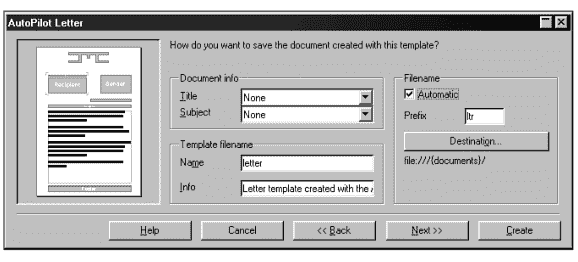

10. 指定在什么情况下打印 Logo 和发件人信息，并设置您的打印机。点击“创建 (Create)”。


### 第 6 章 创建和编辑文本文档


完成！你现在可以开始撰写信件，并根据此信件的具体情况进行任何修改。请注意，你的模板已经保存；如果你想对模板进行更改，需要在 `Office 5\template` 目录中打开它。

## 来自 Michael & Sarah 的第 111 条提示

如果你想在未来的信函中使用此模板，请务必保存任何通用更改，并在适用的情况下将格式化文本条目保存在当前模板下。然后，通过额外的文本条目来“个性化”你的信件，并以描述性名称将其保存为文档（而不是模板）。

按照此示例步骤，你还可以在 `StarWriter` 中创建传真、议程或备忘录 `StarWriter` 模板。传真 `Fax` 会创建一个可以自定义的传真页，类似于信件撰写器 `Letter Writer`。你可以选择现代、经典或装饰性的设计；选择不同尺寸和位置的标志；输入发送者地址和收件人（们）占位符字段；定义它们包含的元素。创建传真后，你可以通过使用信封编辑器 `Beamer` 中的地址框、选择收件人的联系信息并选择传真、邮件合并来填写收件人的姓名和地址。

- 有关地址簿的更多信息，请参阅“介绍地址簿”，第 180 页。
- 有关邮件合并命令的更多信息，请参阅“从邮件合并创建信件”，第 360 页。

议程撰写器 `Agenda Writer` 会创建一个自定义模板，你可以在同事到达并准时时将其分发给他们（好吧，至少他们下一次你召唤他们参加会议时就再没有借口了）。你可以选择现代、经典或装饰性的样式和逻辑；输入会议的日期、时间和地点；定义你希望在议程中的元素（场合、正在进行的事、请注意和备注）；选择议程应包含的名称字段；输入议程主题列表、员工职责以及分配给个人参与者的陈述任务。

备忘录撰写器 `Memo Writer` 可以帮助你创建备忘录。你可以选择样式（现代、经典、装饰性）和标题（文本或图片），备忘录应包含的元素（如日期、主题行、收件人和发件人等），以及应该放置在备忘录页眉或页脚区域的元素。

- 有关自动辅助 `AutoPilot` 的介绍，请参阅“创建新文档”，第 132 页。

## 故障排除

### 文本总是自动格式化的。我如何关闭它？

如果你想防止 StarOffice 更改你的文档格式，请选择“工具” `Tool`、`自动更正/自动格式` `AutoCorrect/AutoFormat`，并取消你想要的所有选项卡上的选项（通过取消勾选）。完成后，点击“确定”。接下来，选择“格式” `Format`、`自动格式` `AutoFormat` 并取消勾选“键入时” `While Typing`。

### 我如何让自动更正将 -> 转换为普通箭头（插入箭头）？在自动文本对话框的“替换为”字段中输入数字值似乎不起作用。

打开一个新的文本文档，选择“插入” `Insert`、`特殊字符` `Special Character`，从 `StarBats` 字符集中选择所需的箭头并点击“确定”。接下来，选择该箭头并打开自动更正对话框（工具，自动更正/自动格式）。使用“替换”选项卡，在“替换”框中输入你的“文本”（→）；确保未勾选“仅类型”选项，然后点击“下一步”。最后点击“确定”。下次你输入 → 并按空格键时，`StarWriter` 将插入所需的箭头。

### StarWriter 在尝试导入特定文档时总是崩溃。

在打开文档时在打开对话框中按下 `Ctrl+Alt+L`。你会看到“不带布局加载文档”对话框。点击“确定”，然后通过点击“打开”照常打开文档。`StarWriter` 将尝试通过忽略任何缺陷格式特征来打开文档。你也可以尝试将缺陷文档的内容复制并粘贴到新文档中，前提是 `StarWriter` 在你打算这样做时不会崩溃。

### 我找不到想要保存文本文档的特定文件格式。

有两种可能：要么你在安装过程中没有安装所有过滤器（在这种情况下，你必须运行 StarOffice 安装并选择“修改”），或者该过滤器仅作为导入过滤器存在，而不作为导出过滤器存在。如此，请尝试将文档保存为另一种通用格式，例如 `RTF` 或 `HTML`。

### 为什么 StarWriter 总是对我发生崩溃？

很有可能是你的 `office.cfg` 文件损坏了。简单地从 `\office61\config` 文件夹删除该文件即可。遗憾的是，你也将丢失所有自定义设置，除非你定期备份系统文件的副本。在这种情况下，你可以恢复早期版本的 `office.cfg` 文件。

### 当我从 StarMath 或 StarBats 字体集中插入字符或按下加号 (+) 号时，我只看到一个奇怪的符号，而不是我最初插入的内容。

你已识别自己为 Windows 用户。偶尔，`StarMath` `starmath.ttf` 和 `StarBats` `starbats.ttf` 字体没有在 Windows 注册表中正确注册。选择“开始”、“设置”、“控制面板”，并双击 `StarMath` 和 `StarBats`。当 Windows 控制面板打开时，找到并双击相应的字体集，使其看起来像这样：被新注册。

### 可以将我的公式对齐到这样吗？

是的，你可以使用“`Matrix`”命令（如果需要），


## 第 6 章创建和编辑文本文档

完成！你现在可以开始撰写信件，并根据此信件的具体情况进行任何修改。请注意，你的模板已经保存；如果你想对模板进行更改，需要在 Office 5\template 目录中打开它。

来自 Michael & Sarah 的第 111 条提示

如果你想在未来的信函中使用此模板，请务必保存任何通用更改，并在适用的情况下将格式化文本条目保存在当前模板下。然后，通过额外的文本条目来“个性化”你的信件，并以描述性名称将其保存为文档（而不是模板）。

按照此示例步骤，你还可以在 StarWriter 中创建传真、议程或备忘录 StarWriter 模板。传真（Fax）会创建一个可以自定义的传真页，类似于信件撰写器（Letter Writer）。你可以选择现代、经典或装饰性的设计；选择不同尺寸和位置的标志；输入发送者地址和收件人（们）占位符字段；定义它们包含的元素。创建传真后，你可以通过使用信封编辑器（Beamer）中的地址框、选择收件人的联系信息并选择传真、邮件合并来填写收件人的姓名和地址。

- 有关地址簿的更多信息，请参阅“介绍地址簿”，第 180 页。
- 有关邮件合并命令的更多信息，请参阅“从邮件合并创建信件”，第 360 页。

议程撰写器（Agenda Writer）会创建一个自定义模板，你可以在同事到达并准时时将其分发给他们（好吧，至少他们下一次你召唤他们参加会议时就再没有借口了）。你可以选择现代、经典或装饰性的样式和逻辑；输入会议的日期、时间和地点；定义你希望在议程中的元素（场合、正在进行的事、请注意和备注）；选择议程应包含的名称字段；输入议程主题列表、员工职责以及分配给个人参与者的陈述任务。

备忘录撰写器（Memo Writer）可以帮助你创建备忘录。你可以选择样式（现代、经典、装饰性）和标题（文本或图片），备忘录应包含的元素（如日期、主题行、收件人和发件人等），以及应该放置在备忘录页眉或页脚区域的元素。

- 有关自动辅助（AutoPilot）的介绍，请参阅“创建新文档”，第 132 页。

## 故障排除

文本总是自动格式化的。我如何关闭它？

如果你想防止 StarOffice 更改你的文档格式，请选择“工具”（Tool）、自动更正/自动格式”（AutoCorrect/AutoFormat），并取消你想要的所有选项卡上的选项（通过取消勾选）。完成后，点击“确定”。接下来，选择“格式”（Format）、自动格式”（AutoFormat）并取消勾选“键入时”（While Typing）。

我如何让自动更正将 -> 转换为普通箭头（插入箭头）？在自动文本对话框的“替换为”字段中输入数字值似乎不起作用。

## 故障排除 259

打开一个新的文本文档，选择“插入”（Insert）、“特殊字符”（Special Character），从 StarBats 字符集中选择所需的箭头并点击“确定”。接下来，选择该箭头并打开自动更正对话框（工具，自动更正/自动格式）。使用“替换”选项卡，在“替换”框中输入你的“文本”（→）；确保未勾选“仅类型”选项，然后点击“下一步”。最后点击“确定”。下次你输入 → 并按空格键时，StarWriter 将插入所需的箭头。

StarWriter 在尝试导入特定文档时总是崩溃。

在打开文档时在打开对话框中按下 Ctrl+Alt+L。你会看到“不带布局加载文档”对话框。点击“确定”，然后通过点击“打开”照常打开文档。StarWriter 将尝试通过忽略任何缺陷格式特征来打开文档。你也可以尝试将缺陷文档的内容复制并粘贴到新文档中，前提是 StarWriter 在你打算这样做时不会崩溃。

我找不到想要保存文本文档的特定文件格式。

有两种可能：要么你在安装过程中没有安装所有过滤器（在这种情况下，你必须运行 StarOffice 安装并选择“修改”），或者该过滤器仅作为导入过滤器存在，而不作为导出过滤器存在。如此，请尝试将文档保存为另一种通用格式，例如 RTF 或 HTML。

为什么 StarWriter 总是对我发生崩溃？

很有可能是你的 office.cfg 文件损坏了。简单地从 \office61\config 文件夹删除该文件即可。遗憾的是，你也将丢失所有自定义设置，除非你定期备份系统文件的副本。在这种情况下，你可以恢复早期版本的 office.cfg 文件。

当我从 StarMath 或 StarBats 字体集中插入字符或按下加号 (+) 号时，我只看到一个奇怪的符号，而不是我最初插入的内容。

你已识别自己为 Windows 用户。偶尔，StarMath (starmath.ttf) 和 StarBats (starbats.ttf) 字体没有在 Windows 注册表中正确注册。选择“开始”、“设置”、“控制面板”，并双击 StarMath 和 StarBats。当 Windows 控制面板打开时，找到并双击相应的字体集，使其看起来像这样：被新注册。

可以将我的公式对齐到这样吗：

是的，你可以使用“Matrix”命令（如果需要），

## 第 7 章格式化文本文档

在本章中你将：

- 理解选项 262
- 格式化字符 263
- 格式化页面 280
- 创建编号和符号列表 283
- 使用快捷键加速格式 286
- 使用自动格式 287
- 故障排除 289

## 理解选项

你打开的每一个新文档都有其标准（默认）字体、字体大小、段落对齐和行距。如果你想为代码增加个性和可读性，我们建议通过调整各种元素来修改这些默认设置。

来自 Michael G 的第 112 条提示

你可以使用“工具”、“选项”、“文本”类别下的“标准字体”选项控制默认字体。使用此选项，你可以更改标准、标题、列表、注释和索引样式的字体。如果你在左下角选择“仅当前文档”，更改将仅适用于当前文档；如果你忽略此选项，更改将应用于所有使用该模板的文档。有关模板和样式的更多信息，请参见第 8 章。

StarWriter 提供一系列格式选项，允许你控制文档的外观。使用 StarWriter 的独特功能和命令，你可以更改单个字符、段落以及整个面的样式。你可以将文本分列、为不同部分使用不同的字体、调整行间距和段间距，并在背景添加颜色或图形。你可以通过选择文本并从文本菜单、对象栏或格式菜单直接应用这些更改。或者，你可以通过样式来简化格式化过程，样式是多种格式选项的集合，可以一次应用于段落。

本章提供了你的直接格式选项的详细概述。样式格式将在第 8 章“使用样式”，第 291 页中详细介绍。

通常，你的格式选项可以映射到三个层级：

- 字符格式控制单个字母、数字、符号和标点符号的外观，通常用于突出文档中的某些单词或词组。字体、大小、颜色、加粗、斜体、下划线、特殊字体以及字符间距和定位属于此类。

- 通过段落格式，你可以指定影响整个段落的设置方式，包括对齐、缩进、制表设置、行距、段落前后间距、文本流和背景颜色。此外，每个段落都有一个样式，决定了单个字符的外观。

■ 页面格式控制整个文档的基本布局。页面格式包括对页边距、列、页眉和页脚，以及纸张尺寸和方向的设置。

## 字符格式

StarWriter 为更改单个字符外观提供了许多选项。你可以从各种字体和大小、字体效果和样式，以及字体颜色和背景颜色（高亮文本部分）中进行选择，以增强你作品的可读性。此外，你还可以为文本分配宏或语言，让拼写检查器识别这些术语或短语。由于 StarWriter 兼作 HTML 编辑器，你还可以将文档中的文本格式化为链接。

- 有关拼写检查的详细信息，请**参**“检查拼写”。*第 464 页*。
- 关于 StarWriter 作为 HTML 编辑器以及如何使用超链接格式选项的详情，请**参第 25 章**，“使用 StarWriter/Web 创建网页”。*第 919 页*。

完整的字符格式选项可以通过“字符”对话框（见 7.1）获得，你可以通过选择“格式”、“字符”或在文档中右键点击并选择上下文菜单中的第一项来打开它。

图 7.1(a)
StarWriter 的字符对话框是所有文本格式选项的控制中心。如果你想一次应用多个格式更改，请使用它。

输入字母，第一个匹配项将移动到顶部

| 字体 | 粗体 | 斜体 | 下划线 | 背景 | 样式 | 大小 |
|---|---|---|---|---|---|---|
| Arial | | | | | 常规 | 12 |
| Times New Roman | | | | | 常规 | 12 |
| Courier | | | | | 常规 | 12 |
| Gothic | | | | | 常规 | 12 |
| Garamond | | | | | 语言 | |


根据需要选择尽可能多的效果

查看此处关于字体如何打印的信息


## 264 | 第 7 章 文档格式

### 7.1(b)

调整字符间距
字距调整仅适用于可缩放字体
检查是否需要对单个单词加下划线


只有在“字体”中选择了“下划线”或“删除线”时，这些选项才可用。

### 7.1(c)


有关使用超链接选项卡的详细信息，请参阅第 25 章，“使用 StarWriter/Web 创建网页”

### 7.1(d)

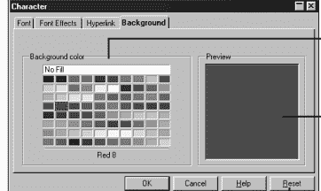

选择一种颜色并查看结果

如果你想恢复到默认设置，请点击此处

- 对于快速方便的格式任务，你还可以使用 StarWriter 上下文菜单或文本对象栏，它们为文档中最常用的字符格式提供了下拉列表和按钮，包括字体、大小、样式和颜色。要对所选文本应用任何样式属性的组合（粗体、斜体或下划线），只需点击 B、i 或 U 按钮，或按下 Ctrl+B、Ctrl+I 或 Ctrl+U。要添加字体颜色或背景高亮，请分别选择“字体颜色”或“背景颜色”按钮。

## 292 | 字符格式

完整的字符格式选项可以通过“字符”对话框（见 7.1）获得，你可以通过选择“格式”、“字符”或在文档中右键点击并选择上下文菜单中的第一项来打开它。

完整的字符格式选项可以通过“字符”对话框（见 7.1）获得，你可以通过选择“格式”、“字符”或在文档中右键点击并选择上下文菜单中的第一项来打开它。

完整的字符格式选项可以通过“字符”对话框（见 7.1）获得，你可以通过选择“格式”、“字符”或在文档中右键点击并选择上下文菜单中的第一项来打开它。

完整的字符格式选项可以通过“字符”对话框（见 7.1）获得，你可以通过选择“格式”、“字符”或在文档中右键点击并选择上下文菜单中的第一项来打开它。

完整的字符格式选项可以通过“字符”对话框（见 7.1）获得，你可以通过选择“格式”、“字符”或在文档中右键点击并选择上下文菜单中的第一项来打开它。

完整的字符格式选项可以通过“字符”对话框（见 7.1）获得，你可以通过选择“格式”、“字符”或在文档中右键点击并选择上下文菜单中的第一项来打开它。

完整的字符格式选项可以通过“字符”对话框（见 7.1）获得，你可以通过选择“格式”、“字符”或在文档中右键点击并选择上下文菜单中的第一项来打开它。

完整的字符格式选项可以通过“字符”对话框（见 7.1）获得，你可以通过选择“格式”、“字符”或在文档中右键点击并选择上下文菜单中的第一项来打开它。

完整的字符格式选项可以通过“字符”对话框（见 7.1）获得，你可以通过选择“格式”、“字符”或在文档中右键点击并选择上下文菜单中的第一项来打开它。

完整的字符格式选项可以通过“字符”对话框（见 7.1）获得，你可以通过选择“格式”、“字符”或在文档中右键点击并选择上下文菜单中的第一项来打开它。

完整的字符格式选项可以通过“字符”对话框（见 7.1）获得，你可以通过选择“格式”、“字符”或在文档中右键点击并选择上下文菜单中的第一项来打开它。

完整的字符格式选项可以通过“字符”对话框（见 7.1）获得，你可以通过选择“格式”、“字符”或在文档中右键点击并选择上下文菜单中的第一项来打开它。

完整的字符格式选项可以通过“字符”对话框（见 7.1）获得，你可以通过选择“格式”、“字符”或在文档中右键点击并选择上下文菜单中的第一项来打开它。

完整的字符格式选项可以通过“字符”对话框（见 7.1）获得，你可以通过选择“格式”、“字符”或在文档中右键点击并选择上下文菜单中的第一项来打开它。

完整的字符格式选项可以通过“字符”对话框（见 7.1）获得，你可以通过选择“格式”、“字符”或在文档中右键点击并选择上下文菜单中的第一项来打开它。

完整的字符格式选项可以通过“字符”对话框（见 7.1）获得，你可以通过选择“格式”、“字符”或在文档中右键点击并选择上下文菜单中的第一项来打开它。

完整的字符格式选项可以通过“字符”对话框（见 7.1）获得，你可以通过选择“格式”、“字符”或在文档中右键点击并选择上下文菜单中的第一项来打开它。

完整的字符格式选项可以通过“字符”对话框（见 7.1）获得，你可以通过选择“格式”、“字符”或在文档中右键点击并选择上下文菜单中的第一项来打开它。

完整的字符格式选项可以通过“字符”对话框（见 7.1）获得，你可以通过选择“格式”、“字符”或在文档中右键点击并选择上下文菜单中的第一项来打开它。

完整的字符格式选项可以通过“字符”对话框（见 7.1）获得，你可以通过选择“格式”、“字符”或在文档中右键点击并选择上下文菜单中的第一项来打开它。

完整的字符格式选项可以通过“字符”对话框（见 7.1）获得，你可以通过选择“格式”、“字符”或在文档中右键点击并选择上下文菜单中的第一项来打开它。

完整的字符格式选项可以通过“字符”对话框（见 7.1）获得，你可以通过选择“格式”、“字符”或在文档中右键点击并选择上下文菜单中的第一项来打开它。

完整的字符格式选项可以通过“字符”对话框（见 7.1）获得，你可以通过选择“格式”、“字符”或在文档中右键点击并选择上下文菜单中的第一项来打开它。

完整的字符格式选项可以通过“字符”对话框（见 7.1）获得，你可以通过选择“格式”、“字符”或在文档中右键点击并选择上下文菜单中的第一项来打开它。

完整的字符格式选项可以通过“字符”对话框（见 7.1）获得，你可以通过选择“格式”、“字符”或在文档中右键点击并选择上下文菜单中的第一项来打开它。

完整的字符格式选项可以通过“字符”对话框（见 7.1）获得，你可以通过选择“格式”、“字符”或在文档中右键点击并选择上下文菜单中的第一项来打开它。

完整的字符格式选项可以通过“字符”对话框（见 7.1）获得，你可以通过选择“格式”、“字符”或在文档中右键点击并选择上下文菜单中的第一项来打开它。

完整的字符格式选项可以通过“字符”对话框（见 7.1）获得，你可以通过选择“格式”、“字符”或在文档中右键点击并选择上下文菜单中的第一项来打开它。

完整的字符格式选项可以通过“字符”对话框（见 7.1）获得，你可以通过选择“格式”、“字符”或在文档中右键点击并选择上下文菜单中的第一项来打开它。

完整的字符格式选项可以通过“字符”对话框（见 7.1）获得，你可以通过选择“格式”、“字符”或在文档中右键点击并选择上下文菜单中的第一项来打开它。

292 | 字符格式

7.1 列出了字符对话框中可用的选项。

| 字体 | 粗体 | 斜体 | 下划线 | 背景 | 样式 | 大小 |
|---|---|---|---|---|---|---|
| Arial | | | | | 常规 | 12 |
| Times New Roman | | | | | 常规 | 12 |
| Courier | | | | | 常规 | 12 |
| Gothic | | | | | 常规 | 12 |
| Garamond | | | | | 语言 | |


根据需要选择尽可能多的效果

查看此处关于字体如何打印的信息


## 264 | 第 7 章 文档格式

### 7.1(b)

调整字符间距
字距调整仅适用于可缩放字体
检查是否需要对单个单词加下划线


只有在“字体”中选择了“下划线”或“删除线”时，这些选项才可用。

### 7.1(c)


有关使用超链接选项卡的详细信息，请参阅第 25 章，“使用 StarWriter/Web 创建网页”

### 7.1(d)


选择一种颜色并查看结果

如果你想恢复到默认设置，请点击此处

- 对于快速方便的格式任务，你还可以使用 StarWriter 上下文菜单或文本对象栏，它们为文档中最常用的字符格式提供了下拉列表和按钮，包括字体、大小、样式和颜色。要对所选文本应用任何样式属性的组合（粗体、斜体或下划线），只需点击 B、i 或 U 按钮，或按下 Ctrl+B、Ctrl+I 或 Ctrl+U。要添加字体颜色或背景高亮，请分别选择“字体颜色”或“背景颜色”按钮。

## 292 | 字符格式

完整的字符格式选项可以通过“字符”对话框（见 7.1）获得，你可以通过选择“格式”、“字符”或在文档中右键点击并选择上下文菜单中的第一项来打开它。

（注：此处原文重复段落已根据要求去重）

# 格式字符

或者 Unix 用户也可能会遇到这些情况。Mac 用户更可能使用 Adobe Type 格式，这是一种不同的可缩字体。当 Mac 用户加载您的文档（最可能保存为 Word 97 或 Word 95 文档）时，您的字体可能会被替换为新字体——PC 上的 Times New Roman 或 Arial 在 Mac 上可能会变成 Times 或 Helvetica。结果是，原本适合一页的内容可能会变得更长。

# 应用字符格式

为所选文本应用字符格式的最快方法是在文档的工作区域内点击鼠标右键，打开 StarWriter 上下文菜单。从其子菜单中，您可以选择所需的字体和大小，并应用**粗体**、*斜体*、下划线、删除线、阴影、轮廓、上标和下标等属性。如果您想将对段落的更改恢复回标准，请选择“默认”（Default）。

+ #114 来自 Michael Sarah

StarWriter 为您提供了一种快速方便的方法为单个单词应用字符格式。将插入点放在两个字母之间，然后通过选择相应的上下文菜单选项或按下其快捷键来应用所选的字符格式。

当您在应用格式更改之前想要预览、同时更改多处或对现有更改进行调整时，请从 StarWriter 上下文菜单中选择“字符”（Character）（或从菜单栏选择“格式”，“字符”）来打开“字符”对话框。使用“字体”（Font）标签页，您可以选择字体、样式和大小，并在“预览”（Preview）框中查看结果。

+ #115 来自 Michael Sarah

当从“字符”对话框中选择字体时，请注意“字体”标签页的底部。StarWriter 会告诉您所选字体是否为可缩字体（打印效果与屏幕显示一致），或者是否为打印机字体（情况下，屏幕显示可能与打印结果不符）。

“字体”标签页顶部的“字体”、“样式”和“大小”文本框出了当前的字体、样式和大小。要选择不同的字体、样式或大小，可以直接覆盖现有的名称和数字，也可以从下方相应的列表框中选择您所需的选项。注意，字体按字母顺序列出，且可用的样式和字体取决于所选字体和打印机。

+ #116 来自 Michael Sarah

如果您知道要查找的字体名称和字体族，就不必滚动字体字体列表。只需在列表上方的文本框中输入名称的首字母，匹配该字母的字体就会跳转到列表框顶部。

| 第二部分 | 第 7 章 |

# 第 7 章文本文档格式

当您对选择满意时，点击“确定”退出“字符”对话框。如果您想在不接受任何更改的情况下退出对话框，请点击“取消”（Cancel）。您也可以点击“重置”（Reset）在不更改对话框的情况下恢复默认设置。

# 调整字符间距和位置

如果您希望打印的文档看起来良好，请注意相邻字符之间间距的细节。“字体效果”（Font Effects）标签页中的间距部分提供了统一更改所选段落中所有字符间距的选项（标准、扩展、紧凑）或按指定量更改。由于 StarWriter 会修改每个单独字符后的间距，您也可以通过选择第一个字符并分配“扩展”或“紧凑”属性来更改两个字符之间的间距。此外，您还可以设置“成对光距”（Pair Kerning）来获得更好的行内效果，这会减少行内对字母之间的空间。注意，光距仅可用于大于 12 磅的等比例间距 TrueType 字体和类似的可缩字体。与其它格式一样，您可以在“预览”框中查看结果。

注意：虽然使用字符间距和光距选项可以让您的文档打印外观更好，但除非将文档交给 600 dpi 激光打印机，否则您无法看到格式的精细细节。

字符间距调整在您希望实现特定的字体密度或希望将段落放入有限空间时（例如，当单页文档的一或两行溢到下一页时）非常有用。在标题和页中使用大号字体时，“成对光距”最有意义。在较小字体下，它可能会导致字母看起来太近。

StarWriter 还允许您创建上标（升起）和下标（降低）文本；您可以通过在“字体效果”标签页的“位置”区域选择“上标”（Super）或“下标”（Sub）选项来实现。如果您不喜欢上标和下标命令应用的默认格式，可以定义自己的并调整它们的相对位置和大小。

# 使用颜色添加属性

当从“字符”对话框中选择字体时，请注意“字体”标签页的底部。StarWriter 会告诉您所选字体是否为可缩字体（打印效果与屏幕显示一致），或者是否为打印机字体（情况下，屏幕显示可能与打印结果不符）。

“字体”标签页顶部的“字体”、“样式”和“大小”文本框出了当前的字体、样式和大小。要选择不同的字体、样式或大小，可以直接覆盖现有的名称和数字，也可以从下方相应的列表框中选择您所需的选项。注意，字体按字母顺序列出，且可用的样式和字体取决于所选字体和打印机。

如果您知道要查找的字体名称和字体族，就不必滚动字体字体列表。只需在列表上方的文本框中输入名称的首字母，匹配该字母的字体就会跳转到列表框顶部。

当您对选择满意时，点击“确定”退出“字符”对话框。如果您想在不接受任何更改的情况下退出对话框，请点击“取消”（Cancel）。您也可以点击“重置”（Reset）在不更改对话框的情况下恢复默认设置。

# 尝试颜色

如果您希望打印的文档看起来良好，请注意相邻字符之间间距的细节。“字体效果”（Font Effects）标签页中的间距部分提供了统一更改所选段落中所有字符间距的选项（标准、扩展、紧凑）或按指定量更改。由于 StarWriter 会修改每个单独字符后的间距，您也可以通过选择第一个字符并分配“扩展”或“紧凑”属性来更改两个字符之间的间距。此外，您还可以设置“成对光距”（Pair Kerning）来获得更好的行内效果，这会减少行内对字母之间的空间。注意，光距仅可用于大于 12 磅的等比例间距 TrueType 字体和类似的可缩字体。与其它格式一样，您可以在“预览”框中查看结果。

注意：虽然使用字符间距和光距选项可以让您的文档打印外观更好，但除非将文档交给 600 dpi 激光打印机，否则您无法看到格式的精细细节。

字符间距调整在您希望实现特定的字体密度或希望将段落放入有限空间时（例如，当单页文档的一或两行溢到下一页时）非常有用。在标题和页中使用大号字体时，“成对光距”最有意义。在较小字体下，它可能会导致字母看起来太近。

StarWriter 还允许您创建上标（升起）和下标（降低）文本；您可以通过在“字体效果”标签页的“位置”区域选择“上标”（Super）或“下标”（Sub）来实现。如果您不喜欢上标和下标命令应用的默认格式，可以定义自己的并调整它们的相对位置和大小。

# 颜色格式化

如果您希望打印的文档看起来良好，请注意相邻字符之间间距的细节。“字体效果”（Font Effects）标签页中的间距部分提供了统一更改所选段落中所有字符间距的选项（标准、扩展、紧凑）或按指定量更改。由于 StarWriter 会修改每个单独字符后的间距，您也可以通过选择第一个字符并分配“扩展”或“紧凑”属性来更改两个字符之间的间距。此外，您还可以设置“成对光距”（Pair Kerning）来获得更好的行内效果，这会减少行内对字母之间的空间。注意，光距仅可用于大于 12 磅的等比例间距 TrueType 字体和类似的可缩字体。与其它格式一样，您可以在“预览”框中查看结果。

# 段落格式化

段落定义为以段落标记结束的文本块。StarWriter 在您每次按下回车键时都会在文本中放置段落标记。

[content] 当从“字符”对话框中选择字体时，请注意“字体”标签页的底部。StarWriter 会告诉您所选字体是否为可缩字体（打印效果与屏幕显示一致），或者是否为打印机字体（情况下，屏幕显示可能与打印结果不符）。


`=SUM(C10:C20)`


上例示例返回单元格 `C10`、`C11`、`C12` 以及直到单元格 `C20` 中所有值的之和。
`=DCOUNT(Sales;"turnover";Criteria.A3:E5)`

返回在名为 `Sales` 的命名数据区域中，名为 `turnover` 的列中，符合名为 `Criteria` 的工作表中 `A3` 单元格到 `E5` 单元格范围内指定条件的单元格计数。

在你在工作表上输入公式后，默认会显示结果。但是，你可以通过选择“工具-选项-电子表格-内容”选项卡上的“显示”`Display`选项，让公式直接显示在单元格中。当你正在检查和调试公式时，此功能非常有用。

## 在 StarCalc 中创建公式

你可以在单元格内输入公式，也可以在公式输入行中输入。为了方便工作，你可以使用函数符号工具，它位于输入行的正左。只需点击它和 `Σ` 符号，它处理求和，这是最常用的函数。点击在输入行中输入 `=` 和 `Σ` 函数。求和左侧是函数自动向导 `Function AutoPilot` 工具。点击它打开函数自动向导，它列出了 StarCalc 的所有函数，并允许你在将公式输入工作表之前对其进行构建和测试。

关于如何使用函数自动向导的详细说明将在本章稍后的“使用函数自动向导”部分中介绍。StarCalc 的插件函数列在表 16.4 中。

## 什么是公式？

来自 Michael Sarah 的第 #325 条提示

如果你觉得去按 `=` 键很别扭，只需输入公式并按 `Shift+Ctrl+Enter`。当你这样操作时，StarCalc 会自动在开头加上等号。

## 公式的元素

公式可以包含的元素列在表 16.1 中。

| 表 16.1 | StarCalc 公式元素 | |
| --- | --- | --- |
| 元素类型 | 解释 | 示例 |
| 数字和文本值（约束） | 直接输入到公式中的数字和文本字符串 12。 | 日期 |
| 单元格引用 | 等同于值，除了直接输入值外，你引用一个单元格或多个单元格，让 StarCalc 取值。 | `C12:D15` |
| 单元格和数据库区域名称 | 你电子表格中单元格区域的名称。你不能使用任何特殊字符（符号、StarCalc 保留的符号，包括运算符），但在其他情况下你可以这样命名区域，如。 | `Sales`, `Worksheet1` |
| 括号 | 将你的公式分为有意义的分段并帮助定义执行操作的逻辑顺序的标记。 | `( )` |
| 算术运算符 | 用于减法、除法、乘法等基本算术函数的运算符，以及指数等更高级的数学操作的运算符。 | `- + / *` |
| 比较运算符 | 在之间进行比较的运算符。 | |

## 运算符

运算符是用于在之间进行比较的运算符。

当你使用分号连接两个单元格时，StarCalc 的读取与 Excel 不同。Excel 使用逗号，StarCalc 使用感叹号。

## 引用单元格

单元格地址和引用在第 13 章“创建电子表格”中的“导航 StarCalc”章节中介绍过。我们将讨论引用推到这一节，是因为在构建公式时单元格引用至关重要。

## 理解绝对引用和相对引用

当你创建公式时，对单元格或区域的引用通常是相对于包含公式的单元格的位置。例如，在图 16.1 中，位于

`TOTALS` 行包含一个公式为 `SUM(C11:C18)` 的公式，尽管有三个工作表可用，且每个工作表都有可以识别为 `C11:C18` 的单元格范围，但 StarCalc 实际上在公式所在的区域内计算了对它的引用。

### 图 16.1

当你想要重复单个公式并将其应用于不同的单元格或列时，相对引用是非常用的。当你需要引用单元位置不改变的固定值集时，绝对引用是非常有用的。

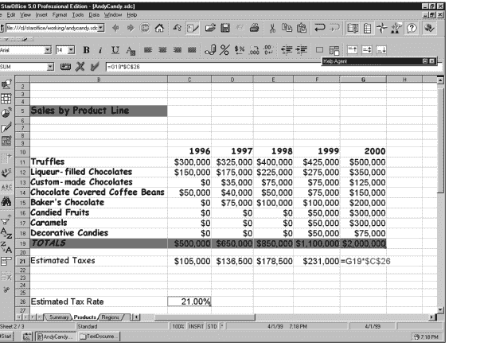

当你复制使用相对引用的公式时，粘贴公式中的引用会更新并引用不同的单元格，例如。在 16.1 中，`TOTALS` 行所有单元格的公式都是使用自动填充将公式从 `C19` 复制到相邻单元格的。由于公式使用了相对引用，StarCalc会自动调整单元格引用以匹配公式的新位置。在 `D19` 单元格中，公式现在变为 `SUM(D11:D18)`，在 `E19` 单元格中变为 `SUM(E11:E18)`，依此类推。

在许多情况下，你需要使用相对单元格引用，以便在复制和粘贴公式重用它们时引用发生偏移。但在其他情况下，你需要在公式中反复使用相同的值。一个很好的例子是引用表格的公式，其中包含适当值的单元格范围是固定的。

你可以在图 16.1 中看到绝对引用的示例，其中 `C19` 到 `G19` 的总和乘以相同的百分比，以估算收入应缴纳的税额。

在 StarCalc（以及 Excel）中，绝对引用用单元格地址前的美元符号 `$` 表示，例如 `C$26`。你可以将绝对引用放在行引用之前、仅列引用之前，或者两个都之前，例如 `G19` 单元格。

## 在公式中引用单元格

绝对和相对引用的概念与文件的绝对和相对路径名相似。

你可以通过按下 `Shift+F4` 轻松将公式栏输入行中的引用从相对转换为绝对，反之亦然。第一次按下此组合键时，你的行引用和列引用都变为绝对引用。第二次按下时，只有行引用被标记为绝对，第三次，只有列引用是绝对。如果你再次按下组合键，你的引用将返回相对形式。

## 输入单元格引用

你可以以多种方式在 StarCalc 公式中输入单元格引用。最简单最准确的方法是使用鼠标选择你想引用的单元格，让 StarCalc 完成其余工作。你可以使用所有标准选择方法来标记单元格和范围，即使在功能自动驾驶开启时也是。

- 有关在 StarCalc 中选择单元格的更多信息，请参见“单元格和范围”。505页。

注意，如果你连续点击单元格，StarCalc 会用新活动单元格替换之前的单元格。要进行选择，必须使用标准的拖动方法——`Shift`点击或 `Ctrl`点击。要输入单元格引用并移动输入另一个，必须在公式中输入分号，以便 StarCalc 知道你正在移动到公式中的下一个参数。

StarCalc会自动将单元格引用作为相对引用输入。使用 `Shift+F4` 组合键将相对引用更改为绝对。

## 插入命名区域和数据库范围

如果你喜欢直接在输入行中输入单元格引用，为你的单元格和数据范围命名将帮助你避免引用错误。然而，在公式输入行中开始创建和编辑公式后，下拉区域名称列表将转换为函数列表。要输入，你需要记住区域的确切名称，或使用 `插入、命名、粘贴` 命令（打开粘贴名称对话框）将名称粘贴到你的公式中。

或者，你可以在导航器中打开区域名称和数据库列表，点击你想引用的区域名称。然后你跳转到它的位置，在那里你可以点击范围的第一个单元格并 `Shift+点击` 最后一个单元格，以在你的公式中输入引用。

当你处于公式输入行的编辑模式时，你会继续在那里工作，直到按 `Enter` 确认公式或按 `Esc` 放弃它，你点击或高亮的每个单元格都将作为公式中的引用输入。

# 第 16 章 使用公式和函数

## 自动地址和区域识别

StarCalc 为你完成一切，这样就可以避免输入那些讨厌的列和行引用，即使你来不及为自己创建命名的单元格和区域。

默认情况下，StarCalc 将列行标签识别为数据的表头。因此你可以在公式中输入列或行标签名称，让 StarCalc 在该名称的下方和右侧搜索数据。如果它找到任何内容，它想要你包含在公式中的单元格并在后台添加它们的地址。你可以使用通常的复制方法复制以此创建的公式。

例如，在图 16.2 中，单元格 `K4` 使用输入行中的公式 `=SUM(January)` 创建。虽然没有命名为 `January` 的数据范围，但 StarCalc 假设引用的是列或行数据（它是一行），并输入了适当的值来交付总数。

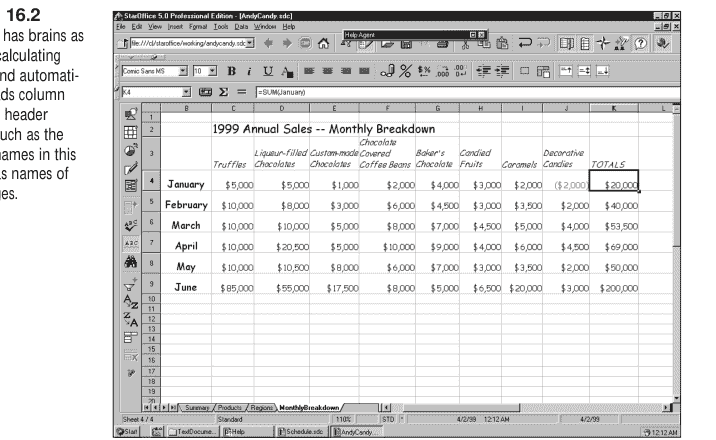

| 1999年销售额 | | | | | | | |
|---|---|---|---|---|---|---|---|
| 明细 | Truffles | Chocolates | Cookies | Dessert | Fruits | TOTALS |
| January | | | | | | | |
| February | | | | | | | |
| March | | | | | | | |
| April | | | | | | | |
| May | | | | | | | |
| June | | | | | | | |

## 在公式中引用单元格

> 注意
> 自动识别在旧版本中不起工作。

除了自动通过列行标题查找数据外，你可以通过取消勾选电子表格计算选项卡上的列行标签复选框来关闭此功能。

如果你想使用非字母字符（包括空格），必须使用单引号。要查看 StarCalc 如何分组数据，将光标放在区域中间并使用数字键盘上的 `Ctrl`。

| 部分 |
|---|
| Ch16 |

## 跨表引用（3D引用）

你可以引用位于一个或多个工作表中的单元格。它们被称为 3D 引用，因为你通过三个维度引用单元格——高度（行）、宽度（列）和深度（表）。

要引用多个工作表，要在引用中添加表名。例如，图 16.2 显示了一个包含四个工作表的表格：`Summary`、`Products`、`Regions` 和 `Monthly Breakdown`。要构造一个加上 `Summary` 表的 `F13` 与 `Products` 表的 `F21` 之值的公式，输入：
```


```
=SUM(Summary.F13:Products.F21)
```

如果你在表中引用多个单元格并需要使用冒号引用运算符，请使用分号分隔工作表引用，在此例中：

```
=SUM(Summary.F13;Products.F21:F23)
```

绝对和相对引用之间的相同区别也适用于工作表。你以相同的方式使用绝对引用，因此之前的引用将是 `$Sheet.$A1`。

对工作表使用绝对引用似乎没有必要，因为你不能有两个同名的工作表。然而，你可以引用其他电子表格，如果你引用的是特定于该表的信息，使用绝对引用是一个好主意。

## 引用其他电子表格

要引用其他电子表格，你必须引用文件的完整路径以及工作表引用。例如，以下是名为 `Annual Report` 的电子表格上的公式，引用了 `AndyCandy` 电子表格 `Products` 工作表中的 `D19` 单元格：

```
=SUM('file://C:/StarOffice/Working/AndyCandy.sdc'#Products.D19;C18)
```


# 598 第16章 使用公式和函数

请特别注意文件地址周围的单引号（以单词开头并文件名及其扩展名结尾）；以及 `#` 符号，在 StarOffice 的 URL 引用格式中，它表示文件内部的位置。你可以在驱动器引用后使用冒号或竖线（`|`）。

从阅读长度和不便的引用方式中你可以看出，在引用电子表格时很容易出错。如果你需要引用另一个电子表格中的单元格，最好的办法是并排打开文档，这样你就可以通过拖动或点击来选择它们。

| Michael Sarah 的 #326 提示 | 并排处理文档最简单的方法是将它们合并在同一个任务窗口中。这样做：打开两个电子表格，然后按住 `Ctrl` 并拖动一个电子表格的任务按钮到另一个的按钮上。要再次分离文档，反向执行该操作即可。 |

如果你已经在电子表格中创建了命名区域，可以使用更简单的方法。你只需将导航器（Navigator）中的命名区域拖放到到当前电子表格中，即可在第二个工作表中创建这些命名区域的链接。然后，你可以引用当前电子表格中链接这些数据的单元格，从而避免插入完整文件引用的麻烦。（事实上，StarCalc 在后台维护着此类引用，你不需要它，也不需要担心它。）

| Michael Sarah 的 #327 提示 | 你甚至不需要打开第二个电子表格即可将其区域链接到当前电子表格中。只需打开导航器，从幻灯片（Beamer）将第二个电子表格拖入导航器。务必选择“拖动以链接（Drag to Link）”（假设你希望信息持续更新），然后将区域从导航器拖动并释放到当前电子表格中。 |

当你打开和关闭文件时，系统会询问你是否要更新链接。你也可以在工作期间通过“编辑（Edit）、链接日志（Links log）”对话框手动更新链接。请注意，如果你同时操作多个电子表格，你在源数据中做的更改不会立即反映在链接位置中；你需要保存带有已更改数据的电子表格，然后在第二个电子表格中更新链接。

## 避免单元格引用错误

工作表上最大的危险在于那些从单元格中显眼显示“ERROR”的明显错误，以及那些因为你输入了看似合理但并非正确数值的值而隐藏起来的错误。

电子表格中最常见（且最容易避免）的错误来源之一是输入错误的单元格引用。检查这些提示以避免错误：

- 充分利用你命名范围、工作表甚至列和行标题的能力。大多数人对单词的记忆比数字更轻松。此外，一旦你为范围命名了，你就可以选择它并仅点击一或两次即可将其输入公式中。
- 不要手动输入单元格引用。使用箭头键、鼠标、导航器和/或函数自动飞行仪（Function AutoPilot）来选择相关单元格，让 StarCalc 输入正确的引用。创建包含隐藏式单元格引用的公式太危险了。

如果你的公式生成了错误且你想重试，也可以删除公式开头的 `=` 号，将其转换为文本，稍后回来进行故障排查。

Michael & Sarah 的 #328 提示

- 当你想编辑或更改单元格引用时，双击包含公式的单元格。公式会显示，其所有引用的单元格会在你的屏幕上用蓝色框勾勒出来。光标放置在引用的中间，方便编辑。如果你想输入新的单元格引用，只需点击该单元格（或选择范围）。如果你想直接编辑公式，请使用箭头键前后移动。如果你不想更改任何内容，只需按 `Enter` 保留当前公式，或按 `Esc` 取消并返回工作表。
- 这个强大的单元内编辑工具可能是一把双刃剑，因为当你双击单元格后，每当你点击其他地方，你都会将其地址作为新引用输入到公式中，直到你按 `Esc` 或 `Enter` 离开编辑模式。注意！
- 在剪切、复制或删除单元格时要小心。有时你可能会无意中复制单元格引用，这些引用会自动以你无意的方式更新，或者删除了重要的公式。在 StarCalc 中，你可能觉得拖动操作中的剪切和删除命令很烦人，但这些实际上是极佳的内置安全功能，用于防止此类错误，尽管它们仍然可能令人困惑。
- 如果你正在对工作表进行大量编辑，你可能希望在“电子表格选项（Spreadsheet Options）”对话框的选项卡上（通过选择“工具、选项、电子表格”打开）使公式单元内可见，这样你就不会意外删除或移动它们。
- 如果你需要引用其他电子表格或工作表上的单元格，可以利用动态数据交换（DDE）将数据的链接副本粘贴到构建公式的工作表单元格中。引用这些单元格非常轻而易举，因为你只需要点击正确的单元格；StarCalc 会处理其余工作。以下是创建 DDE 链接的方法：选择你想要使用的数据单元格并选择“复制（Ctrl+C）”命令。切换回构建公式的工作表，选择要粘贴数据的区域。然后从“编辑”菜单中选择“选择粘贴（Paste Special）”。在“选择”部分，选择“链接到选择”。在“选择”部分，勾选“全部”，然后点击确定。数据将粘贴到单元格中。当源数据发生变化时，单元格会自动更新。

# 第16章 使用公式和函数

Michael Sarah 的 #329 提示

如果你点击这些 DDE 单元格并查看公式行，你看到的不是单元格的数据，而是对源工作表的引用。如果你想在其他处引用此数据，可以复制并粘贴此引用，并确保引用是正确的。

## 编辑公式

当你选择了包含公式的单元格后，可以像编辑其他文本一样在输入行中编辑它。然而，你可以使用更简单的方法更改现有公式中的单元格引用：双击包含公式的单元格以激活编辑。（你也可以点击单元格并按 `F2`。）一个蓝色框出现，勾勒出公式中引用的单元格。你的单元格引用还会以不同的颜色显示以便区分。

Michael Sarah 的 #330 提示

经常使用单元内编辑？只需按 `Enter` 即可进入单元编辑模式，前提你在“工具、选项、电子表格”中选择了“按 Enter 到编辑模式”。

在公式输入行中，突出你想替换的特定单元格引用。现在点击或选择你想引用的新单元格。立即，它的地址就会出现在你之前引用的位置。按 `Enter`，公式即完成。按 `Esc` 退出更改，或按 `Ctrl+Z` 撤销更改。

Michael Sarah 的 #331 提示

你可以使用查找和替换（`Ctrl+F`）来快速查找公式。只需在查找框中输入等号（`=`）并选择“查找：继续查找”，即可循环工作表中的所有公式。

## 重新计算公式结果

默认情况下，StarCalc 的自动计算（AutoCalculate）功能对所有单元格开启。这意味着当你输入新数据并更新公式时，公式的结果会自动重新计算。包含 `NOW()` 函数的公式除外，因为将其设置为自动计算会导致电子表格不断更新并无必要地减慢你的工作。

要在“工具、单元内容”子菜单中点击其名称来开启或关闭自动计算。

要手动重新计算包含 `NOW()` 的公式或（如果关闭了自动计算）所有公式，请按 `F9`。

# 使用注释记录公式

如果你正在构建一个复杂的电子表格，在电子表格的不同部分构建并链接公式时，你可能想用注释来记录你的步骤和逻辑。现在花几分钟时间，可能可以节省你或你的同事以后花几分钟时间抓头挠腮。

要插入注释，首先选择你想要附加注释的单元格。然后选择“插入”。会出现一个黄色黄色正方形（类似于便签纸）。你不需要按回车键；完成后，只需点击工作区域的任意位置即可。

默认情况下，单元格的右上角会出现一个小红色正方形。要临时查看注释，将指针移过单元格中间；注释会弹出，并在指针移动到其他处时消失。

### 来自 Michael & Sarah 的 #332
你可以选择与电子表格一起打印注释，或者通过“页面样式”对话框中“工作”选项卡上的选项（通过选择“格式”，“页面”打开）单独打印注释。

要持续显示注释，选择该单元格并从单元格菜单中选择“显示注释”。要隐藏它，取消勾选“显示注释”。

# 使用函数

函数是通过其编程内置到 StarCalc 中的公式。由于它们比你手动构建的公式更快，因此对你来说更容易使用。例如，使用 `Average` 函数计算的速度比你用 `+` 和算术符号构建的公式要快（尽管在数值较少的公式中，你可能察觉不到差异）。

函数还会占用内存和你的电子表格空间。电子表格可能非常复杂且巨大，因此尽可能使用函数是除简单的算术运算外外的好主意。通过使用函数，你可以保持电子表格紧凑且节省资源，并可以在不产生问题的情况下扩展。

函数通过参数接受数据，参数输入在函数名称后的括号中。一个函数所需的特定参数取决于函数本身，但你的公式的结构始终是相同的：参数之间用分号（`;`）隔开，所有参数都包含在括号内，将函数本身的参数括起来。

一个典型的财务函数计算房屋的每月抵押贷款还。在 StarCalc 中，你使用 `PMT` 函数，它接受参数 `RATE`（年利率）、`NPER`（还款期数）、`PV`（贷款的现值或金额）、`FV`（贷款完成时的贷款终值）和 `type`（贷款类型）。`FV` 和 `Type` 参数是可选的。

# 602 第 16 章 使用公式和函数

使用 `PMT` 函数构建的公式可能如下：

```
=PMT(B15;120;B20)
```


进入`/path/to/xxx`目录，找到`xxx.json`。

在表达式`cvar = avar + bvar`中，加法运算符（`+`）将`avar`与`bvar`相加，得到它们的和`cvar`

在`List.of(arg0, arg1, arg2)`中，`List`接口的工厂方法`of()`接受一系列的元素，返回包含它们的只读列表。

之后我们这样调用`cmd`命令：`cmd arg0 arg1 arg2`。

```
if (condVar > someVal) {console.log("xxx")}
```


`C:\Office5\help.htm#test`

`C:\Office5\explorer\samples\presentations\recar-agm.sld#overview`


最后，将光标置于文档中想要插入链接的位置，如果要以文本形式插入链接，请点击超链接图标；或者扩展超链接图标并从下拉菜单中选择“作为按钮”，以标准按钮的形式插入链接（仅适用于普通 StarOffice 文档）。您可以使用本文后面“编辑和删除超链接”部分中的“属性按钮”对话框更改文本链接或插入按钮的属性。

## 从网上抓取链接

如果您在 Web 上遇到一个想在文档使用的感兴趣或相关的链接，请 `Alt+点击` 该链接，并将其拖到链接栏。然后您可以为链接命名，并按之前的方法将其插入到文档中。

## 编辑和删除超链接

要更改超链接显示的文本，您必须小心不要点击链接，因为点击会激活它。相反，请 `Alt+点击` 超链接。现在，您可以使用标准的编辑命令进行更改。

如果您想编辑 URL 本身，请 `Alt-点击` 超链接。超链接及其名称将自动显示在链接栏中。在此处，您可以修改超链接。完成后，按 `Enter` 键接受更改。或者，您也可以在“字符”对话框中更改 URL。只需从菜单栏选择 `格式`、`字符`，点击“超链接”选项卡，然后在 URL 文本框中输入所需的 URL，或点击浏览找到您要链接的文件。

要更改超链接的颜色、字体和样式，请在样式表（Stylist）中使用相应的文本样式。例如，要更改链接的属性，请在样式表中右键点击“Internet链接”，并从右键菜单中选择“修改”。然后您可以根据需要编辑属性了。同样，如果您想更改（例如）访问过的链接的颜色，请修改样式表中“访问过的Internet链接”文本样式。

如果超链接是一个插入的按钮，点击按钮的最外角进行选择。然后右键点击并从右键菜单中选择“控件”。在出现的“属性按钮”对话框中，您可以更改所选按钮的属性，包括名称（Label1）、链接（URL）、颜色等（参见图 25.4）。

## 使用超链接

> 注意
> 起初看起来，“属性按钮”中的可用选项似乎让人应接 overwhelming，但这些选项都非常直观易懂，并且与 StarOffice 中同名的其他选项保持一致。然而，您应该注意，不仅可以更改按钮的属性，还可以为某些鼠标和键盘操作分配事件。注意这些按钮在很多方式上都能帮助其他对象。您可以通过“位置和大小”对话框（通过按钮右键菜单中选择位置和大小）或通过拖动尺寸柄更改按钮的位置和大小。在文本中，您可以将按钮锚定到字符、段落或页面；在表格文档中，您可以将其锚定到单元格或页面。关于处理对象的更多信息，请参阅第11章“StarOffice 桌面出版”中的“练习对象”。


**图 25.4** 使用“属性：按钮”对话框更改超链接的常规属性，或为某些鼠标和键盘操作分配事件（宏）。

| 常规 | 事件 | |
|---|---|---|
| 名称 | CommandButton1 | |
| 标签 | Yes | |
| 打印 | Yes | |
| 制表停止 | Standard | |
| 样式 | | |
| 字符是 | | |
| 背景颜色 | Standard | |
| 按钮类型 | VI | |
| URL | http://www.starvision.com/ | |
| 目标框架 | | |
| 默认按钮 | http://E:/Office/sample/gallery/maps/ | |
| 图形 | | |
| 标签 | | |
| 测试 | Help URL | |

# 第六部分

## 第25章

如果您想编辑超链接对象（例如图形），请 `Alt+点击` 该对象以选择它而不激活超链接。您可以调整对象的大小、移动它，或右键点击对象打开其右键菜单，该菜单提供了各种格式、对齐等选项。

关于处理对象的更多信息，请参阅第421页的“练习对象”。

如果您想删除链接而不是文本，请选择整个超链接（所有字符），然后从右键菜单中选择“默认”，或从菜单栏中选择“格式`、`默认”。熟悉的超链接下划线和颜色将消失，超链接内容将变回普通文本或图形。

### 使用相对链接和绝对链接

当您创建超链接时，您必须区分相对链接和绝对链接。相对链接省略了 URL 中的协议和服务器部分，但保留了路径和文件名。绝对链接则指定了协议类型、域名、路径和文件名。这些选择的般含义将在本文的“规划您的站点和管理文件”部分进行讨论。

### 入门 StarWriter/Web

在插入指向另一个网站的超链接时，您应该指定绝对位置。相反，对于您创建的页面，通常应该指定相对路径。您这样做是因为在页面完成后，您将把它们移动到不同的计算机或 Web 服务器上。例外是您用于构建 Web 的计算机和 Web 服务器是同一台。在这种情况下，您对页面可以使用任何类型的路径。注意，只有当包含链接的文件和被链接的文件位于同一驱动器时，您才能创建相对链接。

### 文档导航

当您点击文档中的超链接时，StarOffice 会立即带您到达目标，无需打开新任务。可以通过连续链接打开任意（之前保存的）StarOffice 文档。要在通过超链接跳转的 StarOffice 文档之间导航，请使用功能栏上的“后退”和“向前”按钮。如果您喜欢作为新任务打开文档，请 `Ctrl+点击` 超链接。

若要在当前文档的超链接之间快速导航，请展开导航器中的“超链接”项目（按 `F5`），然后双击所需的超链接。StarOffice 将光标放置在超链接开头。

> 每当您打开链接时，StarOffice 都会为检索到的文档创建一个缓存图像，并存在 Office5 文件夹中。

### 规划您的站点和管理您的文件

网站不仅仅是 HTML 文档的集合。每一个图像——从最小的导航按钮到最大的图像映射——都是必须与您的 HTML 页面一起上传的独立文件。如果您添加任何额外元素，例如背景声音、数字视频或 Java Applet，您的文件也必须传输。为了在本地查看您的 Web 文档并在互联网上正确查看它们，您必须以特定方式组织材料。

> 由于每个 网站的大小和复杂性不相同，以下备注仅用于让您思考组织和跟踪您站点的方法。遗憾的是，StarOffice 的站点管理功能几乎不存在。如果您正在处理更复杂的站点，可能想寻找一个商业程序来帮助您管理站点。

当您开发或处理具有多个页面的 Web 站点时，必须进行仔细的规划，以避免随着站点的增长产生混乱。以逻辑化、结构化的方式绘制站点是一个好主意，就像组织架构图一样。

## 规划您的网站并管理文件

然后将该结构复制到您的 Web 服务器上。例如，假设您有一个网站，其中包含位于“关于我们”、“人员介绍”、“产品”、“招聘机会”和“反馈”等标题下的页面。您可以在硬盘上建立一个文件结构，其中包含一个名为“web”的主文件夹（例如 `c:\web`），以及为这些每个标题命名的子文件夹（例如 `c:\webabout`、`c:\webperson`、`c:\webprod` 等），可能还有另一个用于存放图片的子文件夹（`c:\webimages`）和一个用于存放多媒体文件的子文件夹（`c:\webmedia`）。

- 为了避免在 UNIX Web 服务器的世界中产生混淆，请务必对文件夹和文件名使用小写字母。

在创建页面时，请将它们保存到相应的文件夹中。例如，将页面（通常称为 `start.htm` 或 `index.htm`）放在 web 文件夹（`c:\web`）中，并将您将使用的图像、声音或视频文件分别放在 images 和 multimedia（多媒体）文件夹中。当“选项-常规-保存”对话框中勾选“相对于文件系统保存 URL”（打开该对话框通过选择“工具-选项-常规”）时，StarOffice 会自动保存所有链接（如根文件夹）的相对地址（例如 `SRC="mypic01.jpg"`）。当文档位于 Web 服务器上时，StarOffice 将在服务器上您在硬盘上找到的相同相对位置查找链接的项目。

例如，假设您在 HTML 文档中包含了一张存储在硬盘 `\images` 子文件夹中的图片（位于您创建的页面的文件夹目录下）。在将页面传输到服务器后，它将在服务器硬盘的 `\images` 子文件夹中查找图像（位于页面所在文件夹的目录下）。因此，您必须确保在服务器上与硬盘上相同的相对位置创建相同的文件夹，并将引文件复制到相应的文件夹中。

- 只有当原始文档和目标位于同一个驱动器时，才能使用相对地址。

相对地址的反面是绝对地址，通常在您链接到另一个服务器上的 Web 页面时使用它。如果您以绝对地址链接到自己的页面（即取消勾选“相对于文件系统保存 URL”选项），您将无法在存储在 Web 服务器上的 HTML 页面看到图像（或其他文件），因为完整的 URL（例如 `SRC="file:///c/images/mypic01.jpg"`）被保存到了文件中。当然，除非它在您的硬盘上，否则在 Web 服务器上找不到它。

## 第 25 章入门 StarWriter/Web

由于这些选项在创建 HTML 文档和将文档发布到 Web 服务器时可用，您可以在本章的“使用超链接”部分以及第 27 章的“为 Web 准备工作”部分找到相关信息。

> 注意
> 在您开始组织网站之前，需要处理信息、受众和预算这些至关重要的问题。设计 Web 出物与设计印刷出版物无异：您需要一个传达的信息（或概念）、目标受众、逻辑组织结构和定义的详细程度。您还需要考虑可用资源。创建 Web 页面意味着开发时间、材料（如自定义图形或素材照片）以及持续维护的结合。

## 在 StarOffice 中创建 Web 页面

StarWriter/Web 是一个视觉 Web 页面编辑器。作为 StarOffice 文字处理模块的同类产品，它精于文本编辑、布局和设计，并且足够能够在 WYSIWYG（所见即所得）环境中处理帧、表格和表单。此外，它兼具 HTML 编辑器的功能，因此如果您喜欢微调源代码或添加调整，您可以在正在使用的页面的两种视图——WYSIWYG 和 HTML 源代码之间切换。您在其中一个中进行的任何更改都会在切换源代码的瞬间在另一个视图中生效。

> 注意
> 本节假设您已经熟悉 StarWriter 的基本命令和功能，包括编辑和格式化文档以及插入表格。如果您想温习 StarWriter 基础，请参考第 6 章和第 7 章。

### 创建新的 HTML 文档

在 StarOffice 中启动新页面非常简单。您可以创建一个新文档，也可以将现有文本、电子表格或演示文稿转换为 HTML 进行显示。在创建新文档时，您有三个选项：可以使用 Web 向导、基于现有模板创建文档，或从零开始。例如，StarOffice 在 StarWriter/Web 模块中打开新文档，在某些例外情况下，它类似于默认的 StarWriter 界面。例如，StarWriter/Web 工具栏经过修改，增加了插入页眉、插入页脚、动画、打印布局/关闭和显示 HTML 源代码等相关功能，并替换了绘图、插入对象和光标图标。通常情况下，StarWriter/Web 让您可以使用与 StarWriter 相同的菜单命令，但那些 HTML 世界中缺乏等效功能的命令除外。（例如，您找不到“插入手动分页符”，因为每个 HTML 文档都是一个连续的页面。要“翻页”，读者必须跳转到另一个文档。）

图 25.5 您使用 StarWriter/Web 模块创建 Web 页面，其看起来与 StarWriter 界面相似。
- 插入页脚
- 文字动画
- 图片
- 打印布局/关闭
- 显示 HTML 源代码


对于其他 StarOffice 文档，当您处理 HTML 文档时，您可以即时访问创建这些文档所需的所有菜单和工具。尽管理论上您可以在 StarWriter/Web 中完成所有在 StarWriter 中能做的事，但菜单和对话框仅包含创建这些文档所需的选项。

### 使用 Web 向导

启动 HTML 文档最简单的方法是使用 Web 向导。通过选择 `文件-向导-Web 页面` 即可开始。StarWriter/Web 模块打开一个模板，Web 模板对话框出现，询问您想要哪种类型的 页面。您有很多选择，从简单的文档到复杂的注册表单。可以通过高亮选择并查看背景来查看每个页面的样式。（您可能需要移动对话框以获得更好的视图。）由于您将用自己的信息修改页面，如果您在可用选项中没有找到完全符合要求的，请担心。只需并选择最符合您预想结果的类型，然后点击样式切换到 Web 页面样式对话框。现在，选择您喜欢的视觉样式。在选择不同的样式时，背景会随之变化。根据您选择的样式，字体、颜色、背景、水平线可能会发生变化。在做出选择后，点击完成。此时，您可以使用熟悉的工具修改向导创建的 HTML 文件，并将其保存为模板。

> 如果您想将文档保存为模板，请选择创建模板选项（该选项在两个对话框中均可用）。

提示 #480 您可以随时将文档保存为模板。要这样做，只需从菜单栏选择 `文件`，在文档模板对话框中为模板命名，选择存储它的类别（在此情况下为 Online），然后点击确定。

### 基于模板新建 Web 页面

如果您认为少即是多，也可以按照以下步骤从现有的 HTML 模板开始：

1. 选择 `文件-从模板新建`，或按 `Ctrl+N`。新建模板对话框出现。
2. 点击更多按钮展开新建对话框；如果如果预览复选框未勾选，请勾选。
3. 在左侧的类别列表中选择 Online。
4. 在右侧的模板列表中选择模板。如果选了预览选项，您可以查看所选模板的缩略图。默认情况下，您有三个模板可供：
* **彩色 HTML 模板**——使用无衬线字体（Arial）、彩色的文本和标题以及蓝色背景。
* **现代 HTML 模板**——与彩色 HTML 模板相同，但没有颜色。
* **标准模板**——使用衬线字体（Times New Roman）和黑色文本及标题。
5. 点击确定打开所选模板并关闭对话框。

现在，您可以像处理 StarWriter 中的任何其他文档一样处理该文档。您可以输入和格式化文本、插入并定位对象，并使用或修改预定义的 HTML 文本，Stylist 中的段落和编号样式。完成后，您可以将文档保存为普通的 HTML 文件，或保存为可以放在“在线模板”文件夹中的 HTML 模板。StarOffice 在转换您的文档时，将尽力保留或近似现有的文本、对象和格式。

### 从头开始创建网页

要从头开始创建一个 HTML 文档，请从菜单栏中选择“文件”、“新建”、“HTML 文档”，或者选择“开始”、“更多”、“HTML 文档”。StarOffice 会在 StarWriter/Web 中打开一个空白的 HTML 文档，并带有标准的 HTML 头部和字符样式，这些样式允许您快速且安全地格式化网页内容。

- 有关 StarOffice HTML 样式的更多信息，请参阅本章第 957 页的“作为 HTML 工具的 StarOffice”。

### 将现有文本文档预览为网页

在将现有文档转换为 HTML 文档之前，如果能先查看它在 HTML 中的外观，那不是很好吗？只需点击主工具栏上的“布局”按钮（或从菜单栏选择“视图”、“在线布局”），StarWriter 就会像显示 HTML 文档一样显示您的文档。

> 遗憾的是，“在线布局”预览选项仅在 StarWriter 中可用。

当您在“在线布局”下工作时，当前页面将（临时）替换为标准 HTML 模板，让您大致了解导出当前文档到 HTML 后页面上的文本和对象将发生如何移动。无论文档中有多少（文本）页，在在线布局中，您的文档由一个连续的（“网络”）页面组成，因为互联网上没有“分页符”。

- Michael & Sarah 的第 #481 条建议

如果文档对于您的网页来说太长了，您可能想将其拆分为两个并插入超链接，例如在每个文档的末尾（即每个网页的底部）。这样，读者在到达页面底部时就可以点击链接进入下一页或上一页。链接可以是文本形式并分别显示为“下一页”或“上一页”，也可以是图标，例如指向右侧箭头（下一页）或指向左侧箭头（上一页），您可以从 StarOffice 图库中的主页文件夹导入这些图标或创建自己的。

- 有关超链接的更多信息，请参阅第 936 页的“使用超链接”。

在在线布局视图下，您每个任务或打开的文档只能看到一个窗口。如果您在给定任务中打开新窗口，StarOffice 在您切换到在线布局视图时关闭非活动窗口。

## 第 25 章开始使用 StarWriter/Web

请注意，在在线布局视图下，垂直滚动条是不可见的；当您更改文档的缩放比例时（或当您打开或关闭停工具栏时），StarWriter 会自动调整行长度（或页面宽度）。您的缩放选项包括绝对值（例如 200%、150%、100%、75%、50% 或您输入的任何可变百分比）；“最佳”、“页面宽度”和“整个页面”选项不可用（“页面视图/打印预览”也不可用——毕竟，您已经在在线布局中预览文档了）。使用缩放选项来寻找页面的最佳视图，并通过记录查看区域顶部垂直标尺上的测量值来记录页面的（近似）宽度。这样，您就可以对之后如何为了屏幕显示调整还原后的文档（页面）心中有数了。

> 当然，许多其他因素也会影响屏幕显示——最重要的是分辨率，它取决于显示器大小和用户偏好。因此，通过调整缩放比例您能做的只是盲目猜测。

最后，请记住，在线布局并不是真正的 HTML 文档预览。您无法看到当前文档中插入的元素或对象是否很好地转换为 HTML，因为 StarWriter 并不模拟 HTML 转换过程。您看到的只是一个在线布局，它可以帮助您从长度和宽度方面估计页面的外观。

### 将现有文档转换为网页

StarOffice 提供将现有的文本、电子表格、绘图和演示文稿转换为 HTML 文档的选项。根据文档类型，您可以将文档保存为 HTML 文档（StarWriter 和 StarCalc），或者将其导出为 HTML 文档（StarDraw 和 Impress）。

StarOffice 在转换过程中尝试保留现有文档的格式和样式，除非您是在 StarWriter/Web 中创建文档，否则在将现有文档转换为 HTML 文档时，不可避免会丢失一些（视觉和样式）信息。此外，取决于文档情况，您可能需要对元素的格式、样式定位进行编辑。请注意，当您将 StarOffice 文档保存为 HTML 文件时，该套件会将每个图形存储为单独的文件。有关 HTML 文档中图形的更多信息，请参阅第 26 章的“使用图形和图表”部分。

#### 转换文本文档

在转换文本文档时，您有两种选择：您可以选择“文件”、“另存为”，然后在保存对话框的“文件类型”列表中选择“HTML (StarWriter)”，或者选择“文件”、“发送”、“创建 HTML 文档”。如果您选择“创建 HTML 文档”选项，将打开“HTML 文档的名称和路径”对话框。使用此对话框，您可以为 HTML 文档分配名称，并点击对话框左下角的“模板”按钮根据模板自动拆分文档。在“选择模板”对话框中，选择您想要拆分文档的元素。例如，如果您的文档包含标题 1 和标题 2 样式，且您选择标题 1 作为模板，转换后，您将拥有一个将标题 1 样式列为标题的文档。点击链接，您将跳转到与该标题样式相关的内容。如果您选择标题 2 作为模板，您得到的第一个文档将包含所有的标题 1 样式及文本，而所有的标题 2 将以超链接的形式出现。其他模板选项包括左页脚、右页脚、框架、左页眉、右页眉、标题 1 至 4、目录、正文。

选择所需的模板后，点击确定返回到“HTML 文档的名称和路径”对话框，然后保存文档。在转换过程中，StarOffice 将根据您的原始名称为其他文档分配名称。例如，如果您将文档保存为 `mydoc`，`mydoc2` 等，

#### 转换电子表格文档

转换 StarCalc 电子表格的任何部分都像使用“文件”、“保存”命令将文档保存为 HTML 格式一样简单。只需在出现的“另存为”对话框的“文件类型”列表中选择“HTML (StarCalc)”并点击保存。

#### 转换绘图或演示文稿

StarDraw 和 Impress 带有一个 HTML 导出向导，允许您为互联网或内网创建高质量的网页。使用 HTML 导出，您可以定义演示文稿是否具有框架、用户将使用图形按钮还是文本链接导航演示文稿，以及原始的 StarDraw 或 Impress 演示文稿是否可以下载。每个最终的 HTML 页面包含一张作为 JPG 图形的演示幻灯片。如果有兴趣，可以在 StarWriter 中编辑这些页面，例如添加标题和额外的超链接。导出演示文稿和绘图文档在第 24 章“为全球网络保存演示文稿”以及“预览和演示您的演示文稿”中有详细讨论。

### 自定义 HTML 导出

StarOffice 支持 HTML 3.2 标准，并包含了一些专有扩展，这些扩展在您使用 StarOffice 浏览器加载页面时会被识别而不会“干扰”其他浏览器。微软 Internet Explorer 和 Netscape Navigator 也是如此。部分浏览器也可以识别部分内容，但以防万一，您可以使用“工具”、“选项”、“浏览器”、“HTML”对话框中的“导出”部分来定义您如何创建页面。

以下是您的选项：

- `HTML 3.2`—为了获得最佳兼容性，请选择此选项。（有关此此标准的更多详细信息，请参阅 http://www.w3.org/TR/REC-html132.html）。但请注意，这不包含 Netscape Navigator 和 Internet Explorer 的增强功能（如多列文本、动画文本、闪烁文本、浮动帧）。此外，HTML 3.2 不支持任何打印布局。

- `MS Internet Explorer 4.0`—包含用于动画文本的 `<MARQUEE>` 标签，此外你还可以在表格中使用浮动帧以及普通或平铺的背景图表。这些功能只能由 Microsoft Internet Explorer 和 StarOffice 读取。

- `Netscape Navigator 3.0`—导出带有 `<SPACER>` 标签的空文本框以及带有 `<MULTCOL>` 标签的多列文本框。（请注意 StarOffice 也可以读取这些标签。）

- `Netscape Navigator 4.0`—导出表格列 `<TABLE>` 标签和样式表。

- `StarWriter`—除了 HTML 3.2 之外，还导出 StarWriter/Web 已知的所有标签。如果你的读者大多数使用 StarWriter 作为他们的标准浏览器（例如，在内网上），你绝对应该选择此选项。它允许你导出段落框标签并绘制标题和打印内容。请注意，此选项可以读取所有其他选项。

对于 HTML 文档中的未知标签，请使用注释。例如，每个以 HTML: 开头并以 > 结尾的注释都会被解释为 HTML 代码。（注意 HTML: 不会被导出；重要的是在编码时使用这种方法。）

### 在 StarWriter/Web 中编辑 HTML 文件

现在你已经创建了一个新的 HTML 文件（无论是否使用向导），或者你已将现有的 StarOffice 文档保存为 HTML 文档，你已经准备好编辑 HTML 文件，直到它完全符合你的要求。尽管你创建和编辑 HTML 文档的时间相比打印出版物有限，但一旦你熟悉了 HTML 布局选项和辅助工具（如网格和线条）、图形文件格式、图像映射以及插件（通常取决于浏览器）效果，你仍然可以做很多事情来创建一个吸引人的主页或内网页面。

- 关于创建增强网页的更多详细信息，请参阅第 965 页开始的第 26 章“增强 HTML 文档”。
- 关于布局网格和视觉辅助的更多详细信息，请参阅第 421 页的“练习对象”。

### 在 StarOffice 中创建网页

> 提示 **来自 [Michael Sarah](https://example.com) 的技巧 #482**

> 发布网页的一个技巧是使用表格。表格允许你在页面上整齐地安排图形和文本元素。例如，如果你想分两列显示文本，请使用双列表格。如果你想让图形自动缩放，请将其放置在表格单元格中。有很多书籍编写了如何创建吸引人的网页。关于使用表格的更多详细信息，请参阅第 xxx (26) 页的“使用表格和框架”。

在 StarWriter/Web 中编辑文本与在 StarWriter 中编辑文本一样简单，且几乎完全相同。你不需要担心插入对象或应用不会转换为 HTML 的属性，因为 StarWriter/Web 只提供了适用于 Web 发布版的工具和功能。

在开始之前，请确保你处于 HTML 编辑模式。应该按下功能栏上的“编辑文件（Edit File）”按钮，主工具栏将出现在左侧。如果你不在该模式下，请点击功能栏上的“编辑文件”按钮。在编辑过程的任何时候，如果你想像浏览器一样查看你的网页，请点击“编辑文件”按钮退出编辑模式。

你可以使用从文本文档中熟悉的大部分直接格式和样式格式选项。当你的光标位于文本块时，你可以使用“文本对象栏”。将光标移动到表格上或插入表格时，你会看到“表格对象栏”，依此类推。每当你点击链接时，你都会带到适当的位置。


> 注意，HTML 编辑模式并不等同于在线布局（Online Layout）视图。在线布局视图主要为在屏幕上阅读文档设计，适用于你正在使用的 StarWriter 文档。在此视图中，文本将根据窗口大小换行，忽略段落格式。

#### 文本格式化

HTML 设计为一种通用平台语言，适用于具有不同文本和显示能力的计算机。HTML 并不是以文字处理器的方式设计文本——即指定字体、样式和大小——而是使用标签来解释其运行的系统。例如，要显示大标题，请使用 `<h1>` 标签而不是加粗，StarWriter/Web 会产生相同的结果（假设浏览器的默认字体是 Times）。

#### 更改字体

由于网页必须出现在许多不同的系统上，它们处理字体的方式与普通文档不同。它们不是处理嵌入其中的特定字体，而是引用从大小 1 号（最小）到大小 7 号（最大）的字体大小，其中 3 是默认值。使用“选项浏览器（Options Browser）”对话框（通过选择工具、选项来打开），你可以设置字体大小并决定网页字体的大小。最大字体大小为 50 磅。

选择 Arial/Helvetica 或 Times Roman 以外的任何字体几乎都会让某些用户产生意想不到的结果。另一方面，如果你发布到公司的内网，请使用左、居中或右按钮来对齐选定的文本、图像和表单。点击这些按钮会在 `<P>` 段落标签中添加 `ALIGN=Left` 或 Center 或 Right。使用对象栏上的增加和减少缩进按钮来左右移动选定的文本、图像和表单。虽然没有可用于缩进或制表的 HTML 标签，但此功能会向相应的标签添加页边距（margin）属性，例如创建 `<P Style="margin-bottom: .7in">` 来强制浏览器从左页边距创建缩进。

#### 其他属性

你可以点击加粗、斜体和下划线按钮将这些应用应用于任何选定的文本。点击这些按钮会将文本封装在 `<B>...</B>`、`<I>...</I>` 和 `<U>...</U>` 标签中。

#### 选择颜色

你可以使用对象栏上的字体颜色（Font Color）对你所选的内容应用新颜色。无论你选择什么背景或图案，都可以轻松地看到该颜色。关于背景和背景颜色的更多详细信息，请参阅“选择背景”。

#### 指定特定字体

在 HTML 中，`<FONT>` 标签允许你为选定的文本块选择字体族、样式和大小。如果你的网页用户没有你指定的字体，将用另一种字体（或浏览器的默认字体）替换它。如果你的页面将被普通读者看到，选择 Arial/Helvetica 或 Times Roman 可能会产生与预期的不同的结果。

#### 创建标准列表

你可以在 HTML 文档中创建两种列表：有序列表（ol）或无序列表（`<ul>`）。要开始任何一种列表，将光标放在你想放置列表的地方；点击对象栏上相应的列表按钮（编号或项目）。将显示第一个编号或项目。输入列表的第一个项目，按回，输入下一个项目，依此类推，直到完成。在最后一个项目后按回，然后按退格键退出编号或项目列表。

#### 插入有趣的项目和编号

如果你不喜欢 StarWriter/Web 的标准项目，可以轻松从编号对话框中使用漂亮的图形项目替换它们。添加项目的方法与早期 Office 中：选择 `格式`、`编号/项目`；从选项卡中选择你喜欢的样式；然后点击确定。StarWriter/Web 在你每次按回时创建一个带有相同项目的新段。（图形项目实际上是 .gif 图像，当你将其插入页面时会被复制到网页文件夹中。）编号列表像普通文档一样——数字是纯字符——但可以使用大纲式的编号列表。

#### 从网络打开并编辑页面

从网上加载页面后，你就可以编辑它。只需点击功能栏上的“编辑”图标。你就可以编辑文档、添加文本、删除文本并更改字体颜色或字体。你可以通过选择 `文件`、`另存为` 保存页面。除非你有包含该页面的 Web 服务器的访问权限，否则在编辑时无法保存。

#### 保存和打印 HTML 文档

保存和打印你的 HTML 文档与保存和打印文档几乎相同。保存文档时，你有三个基本选项。你可以点击功能栏上的保存按钮，从菜单栏中选择 `文件`、`保存`，或者在键盘上按 `Ctrl+S`。当你第一次尝试保存以前未使用的文档时，StarWriter 会自动打开保存对话框。在这里你可以在文件名文本框中为文档输入名称，选择要保存文件的目录，或者在你选择的目录内创建一个新的（子）文件夹。完成后，选择保存返回你的文档。（确保你确实是以 HTML (StarWriter) 格式保存该文档。）

| 第 VI 部分 | 第 25 章 |

## 第 25 章 入门 StarWriter/Web

> ### 来自 Michael & Sarah 的 #484 号提示

在创建 HTML 文档时，请务必从菜单栏选择“文件”、“属性”，并在出现的“属性”对话框中填写信息。例如，StarWriter/Web 使用你在“描述”选项卡上提供的信息来生成元标记（Meta tags），以便搜索引擎在 Web 上定位你的页面，并在浏览器中识别你的页面。你在“标题”框中提供的信息将显示在浏览器的标题栏中；“主题”、“关键字”和“注释”文本则为引擎提供了关于你 Web 页面的摘要信息。

在打印文档时，你可以选择是打印整个文档还是仅打印选部分；打印多份副本；包含图形、表格、控制字段、背景或注释；打印到纸张或文件；使用第三方传真驱动程序传真。

默认情况下，StarOffice 在打印 HTML 文档时会包含图形和表格，并将所有文本打印为黑色，忽略背景。这确保了无论打印到黑白打印机的背景和字体如何，你都能阅读 HTML 文档的信息。如果你有彩色打印机，在输出 HTML 文档时也可以包含背景。只需选择“文件”、“打印”来打开打印对话框，然后点击对话框左下角的“选项”按钮。在“打印机选项”对话框中，你可以为 HTML 文档的内容、页面和注释设置所需的打印选项。

> ### 来自 Michael & Sarah 的 #485 号提示

HTML 页面的长度各不相同。然而，你可以在一个打印页面上容纳很多内容。为了确保在打印时不丢失某行文本或图像，请点击 StarWriter/Web 主工具栏上的“开启/关闭打印布局”图标。状态栏上的“页码”字段指示打印的页数。请注意，如果你想打印来自的页面，必须先切换到编辑模式（点击功能栏上的“编辑文件”图标），然后才能开启“打印布局”功能。

使用“打印布局”功能打印时，StarOffice 会自动在文档中插入页眉和页脚区域。页眉区域列出打印文档的标题和 URL 以及打印时的日期和时间；页脚区域列出打印的总页数。

页眉和页脚的内容在 HTML 文档模板。你可以为当前文档更改这些设置（通过直接格式化）。如果你想让更改永久生效，请选择“文件”、“模板”。在出现的“文档模板”对话框中，在左侧的“类别”中选择“在线”，并在右侧的“模板”列表中所需的模板。然后点击“编辑”按钮，再点击主工具栏上的“打印布局”图标。现在你可以根据需要更改所选模板。要保存更改，请从菜单栏选择“文件”、“另存为”。

打印帧集（framesets）时可能会遇到一些问题。帧集无非一个被划分为若干帧的空白页面。每个帧都包含自己的文档。只有被选中的文档会被打印。

> 当你打印页面时，很大程度上取决于打印机设置和用户的浏览器。分页符、字体和字体大小以及其他特征在你的个人设置上可能会不同。

## 作为 HTML 编辑工具的 StarOffice

虽然在 StarWriter/Web 中创建页面不需要了解 HTML 编码的细节，但至少熟悉 HTML 概念以及 StarOffice 的 HTML 标签选项和 Web 页面的结构也是个好主意。

### HTML 页面的结构

HTML 页面是一组指令，建议你的浏览器显示其中包含的文本和图像。浏览器根据打开页面的标签（`<HTML>`）和关闭页面的标签（`</html>`）来识别它正在处理的是哪种页面。页面本身分为两个部分：`<HEAD>` 和 `<body>`。与整个文档相关的信息位于 `<HEAD>` 部分，如标题、描述或关键字。Web 页面的内容位于 `<body>` 部分。所有文本以及对图形、动画、Java Applet 和页面其他元素的引用都位于起始标签 `<body>` 和结束标签 `</body>` 之间。当你在 StarOffice 中开始一个新的 HTML 文档时，系统已经为你安排了以下基本格式：

```html
```


```
<HTML>
<HEAD>
<TITLE></TITLE>
<META NAME="GENERATOR" CONTENT="StarOffice/5.1 (Win32)">
</HEAD>
<body
<P><BR><BR></P>
</body>
</HTML>
```


# HTML 与浏览器的兼容性

HTML 是一门动态且快速演变的语言。微软和网景随着其浏览器的每个新版本向该语言添加了新标签，增加了允许创建日益复杂的网站的功能。这种进步的缺点是，旧版本的浏览器无法解释新命令，并且显示页的方式与新版本不同。不仅某些新功能（如表格格式）在旧版本上无法正确显示，文本的外观可能在不同版本的浏览器之间有所不同（换行位置不同）。浏览器窗口的宽度也会影响列宽和文本换行的的方式。为了让整个过程变得更加复杂，许多浏览器允许个人用户设置他们喜好的字体和大小。

| 第六部分 | 第 25 章 |
| :--- | :--- |

# 第 25 章 入门 StarWriter/Web

> 注意

让用户控制 Web 页面的视觉外观完全符合 Web 及其软件创建者的原始初衷。如果你追溯 HTML 的历史，你会发现今天对 HTML 的用法大多超出了原始意图。HTML 的初衷是作为描述文档结构的工具，而不是其视觉外观。这部分被留给了用户，准确地说是留给了浏览器。简而言之，可以选择字体是浏览器一直提供的基本功能之一——这让 Web 设计师感到沮丧。这意味着网页的大小会变化，列的位置会移动，并且文本可能会根据使用的设备显示不同的字体（如 Times 或 Helvetica）。

这些差异是避免的。我们的建议是：不要花费太多时间在调整字体大小和列布局上，为了适应最低标准的浏览器而修改 HTML 中的新标签。这种手动且繁琐的过程应该由对 HTML 有相当了解的人来进行。相反，你应该专注于内容的组织和安排，以确保你的文档能够顺利传输到互联网。毕竟，考虑到浏览器要么免费要么非常廉价，那些选择不更新浏览器的人对你或任何其他网站提供的内容并不感兴趣。然而，如果你需要适应这些人（没没错，数以百万），那么你可以使用 StarWriter/Web（或任何其他纯文本编辑器）按你想要编辑 Web 页面的 HTML 代码。如果你想了解更多 HTML 语言，可以找到关于该主题的本书。本课程本身就是一个极好的资源。在功能栏的“加载 URL”中输入 `#HTML` 或 `W3C`，按回车，让让你最喜欢的搜索引擎列出 HTML 语言的监督者万维网联盟（W3C）以及许多其他提供 HTML 规范、培训、提示和其他信息的网站。

> 注意 本节没有提到任何图形会根据查看位置而变化。图片在不同浏览器和平台之间也可能不同，尽管这种差异通常与不同的色调有关。Web 图形是位图的——由预定义的固定系列点组成——浏览器让你的图像看起来与你在 StarWriter 或 StarImage（或任何其他桌面出版 [DTP] 或图像编辑应用程序）中看到的完全不一样的几乎是不可能的。有关图形和 Web 出版的更多详细信息，请参阅第 26 章的“插入图形和图像”。

# 编辑 HTML 编写器/Web

如果你正在使用 StarOffice 作为你的编写工具，你应该知道该程序坚持在约 70 列处使用硬性换行符截断 HTML 代码行。当然，当你在浏览器中查看页面时，这些换行不会显示，但如果你喜欢编辑源代码，可能会发现自己受困于无法关闭的烦人功能。你还应该注意，StarOffice 在转换“已编码”的 HTML 时非常挑剔——它会丢弃它不认识标签，替换其他标签并重新格式化内容。因此，只有在绝对必要时你才将其作为 HTML 编写工具；它真的会搞乱你的文本。它真正的优势是所见即所得（WYSIWYG）编辑器。

StarOffice 生成 HTML 页面包含许多最新的 HTML 标签，旨在用于最新的浏览器查看。在大多数情况下，可以使用其他浏览器查看包含新标签的页面，但它们的显示可能会显著不同。如果你在互联网上发布页面，请注意，一小部分观众使用的浏览器已经过时，你的页面将无法按照你预期的方式显示。（在你的内网中也可能如此，但你可能对这种情况有一定的了解和控制。）差异的程度取决于浏览器的旧程度以及页面上新标签的数量。

- 注意
> 在“选项-浏览器 HTML”对话框中（你可以通过选择工具、选项……打开），你可以决定如何从 StarOffice 导入和导出 HTML 页面；你还可以确定 Web 页面的显示字体大小。使用“选项-文档源文本”对话框，你可以为源文本项目定义不同的颜色。

| 第六部分 |
|---|---|
| 第25 章 |

StarWriter/Web 导出 StarOffice 专有标签。专有标签包括特殊区域（如页眉和页脚）以及字段命令（如文档作者和（编辑）日期）。如果其他浏览器不识别这些标签，它们将被忽略，只显示标签之间的文本。在 StarWriter/Web 中创建的页眉在用 Netscape Navigator 查看时仅在顶部显示一次。相比之下，如果你使用 StarOffice 浏览器，页眉就是一个“真正的”页眉，当 HTML 文档保存为 StarOffice 文档时，它会保留其状态。

来自 来自 Michael Sarah 的第486 号提示

StarOffice 的专有标签允许在创建 HTML 文件时实现某些自动化。假设你想在每个页的页脚中显示最后修改日期。在这种情况下，你可以通过“字段”对话框插入日期。只需选择“插入”、“字段”、“其他”来打开字段对话框，然后点击“属性”选项卡，在左侧的“类型”列表中选择“修改”，并在中间选择“日期”。（如果你需要，也可以在右侧的“格式”框中选择所需的格式。）这样，你的页脚在任何浏览器中始终显示最后修改日期，但每当你保存文件时，它都会更新。

在 StarWriter/Web 的 HTML 编辑模式下，样式器（Stylist）提供了与 HTML 文本格式标签对应的段落和文本样式，如表 25.1所示所示感受这些标签如何修改文本外观的最佳方法是尝试它们。只需将它们应用于某些选中的（高亮）文本，然后点击“网页预览”按钮即可。

> 记住，你可以通过右键点击样式器中的样式并从上下文菜单中选择“修改”，来修改样式的某些属性。（有关使用样式和样式器的更多信息，请参见第 8 章“使用样式和模板”。）

| SO 样式/命令 | HTML 标签 | 浏览器显示 |
| --- | --- | --- |
| (页面属性) | `<HTML>...</HTML>` | 不见。 |
| (页面属性) | `<body>...</BODY>` | 不见。 |
| (页面属性) | `<head>...</head>` | 不见。浏览器读取头部以找到如何渲染使用的字符集——（西方或中文）；搜索引擎从页面头部提取简要搜索。 |
| (页面属性) | `<title>...</title>` | 不见。当你查看页面时，此处输入的文本出现在浏览器的标题栏中；此属性（如许多后续）可以通过使用“文件”、“属性”对话框设置。 |
| (页面属性) | `<meta>...</meta>` | 不见。此处输入的文本传递有关 Web 页面的摘要信息；像 TITLE 标签一样，它出现在 HEAD 部分。描述。 |
| 标题 1 | `<h1>...</h1>` | 非常大，粗体。 |
| 标题 2 | `<h2>...</h2>` | 非常大，粗体。 |
| 标题 3 | `<h3>...</h3>` | 大号，粗体。 |
| 标题 4 | `<h4>...</h4>` | 大，粗体。 |
| 标题 5 | `<h5>...</h5>` | 小，粗体。 |
| 标题 6 | `<h6>...</h6>` | 非常小，粗体。 |
| 发者 | `<address>...</address>` | 斜体文本。 |

| SO 样式/命令 | HTML 标签 | 浏览器显示 |
|---|---|---|
| (文本) | `<table>...</table>` | 表格（应用单元格属性时可见）。 |
| 粗体 | `<b>...</b>` | 粗体文本。 |
| 斜体 | `<i>...</i>` | 斜体文本。 |
| 下划线 | `<u>...</u>` | 带下划线的文本。 |
| 项目符号 | `<ul><li>...</li></ul>` | 项目列表项目。 |
| 编号 | `<ol><li>...</li></ol>` | 编号列表项目。 |
| 下标 | `<sub>...</sub>` | 下标文本。 |
| 上标 | `<sup>...</sup>` | 上标文本。 |
| 插入，注释 | `<!--note name -->` | 不见。 |
| 插入，章节 | `<div id='Section'>...</div>` | 不见。 |

表 25.2 列出了 StarOffice 的专有标签。

> 表 25.2 和 25.3 中的大多数格式选项在保存为 HTML 文档时接收标签；然而，许多浏览器无法翻译它们，因此像普通文本一样显示。

| 表 25.2 HTML 样式 | SO 样式 | HTML 样式 | 作用 |
|---|---|---|---|
| 引用 | `<BLOCKQUOTE>...</BLOCKQUOTE>` | 用于引用的缩进段落。 |
| | `<DT>...</DT><DD>...</DD>` | 格式化词表。例如，DT 标记词表中的一级主题；DD 应用于随后的文本，依此类推。 |
| 水平线 | `<HR>` | 插入横跨页面宽度的水平线。 |
| 预格式化文本 | `<PRE>...</PRE>` | 使用等宽字体格式化文本。你可以将此样式用于文本之外的无编号列表。 |

表 25.3 列出了 StarOffice 的逻辑标签。逻辑样式比显式样式更具上下文。当你想要传达含义时，选择一种样式。

| 表 25.3 StarOffice 中的 HTML 文本样式 | 文本样式 | 含义 |
|---|---|---|
| `<ABBREV>` | 缩写；识别缩写，以便在音频浏览器中进行特殊处理 | |
| `<ACRONYM>` | 首字母缩写词；识别缩写，以便在音频浏览器中进行特殊处理 | |
| `<AU>` | 作者；识别作者 | |
| `<BLINK>` | 闪烁内容（不受欢迎）；此标签随 MSI 引入，Netscape Navigator 不支持 | |
| `<CITE>` | 引用、标题和参考文献；通常显示为斜体 | |
| `<CODE>` | 代码；显示编程代码 | |
| `<DEL>` | 删除的文本；标记为已删除的内容 | |
| `<DFN>` | 定义实例；标记新术语的引入 | |
| `<EM>` | 强调；通常描为带下划线的斜体文本 | |
| `<INS>` | 插入的文本；标记为已插入的文本 | |
| `<KBD>` | 键盘文本；用户预期响应程序输出的内容（例如，Courier） | |
| `<LANG>` | 语言 | |
| `<PERSON>` | 人物；识别个人名（几乎过时） | |
| `<Q>` | 引用 | |
| `<SAMP>` | 示例；字面序列 | |
| `<STRONG>` | 强强调；通常渲染为热文本 | |
| `<TT>` | 打字机；使用等宽字体（如 Courier）显示 | |
| `<VAR>` | 变量；用于区分变量与其他编程代码 | |

此外，StarWriter/Web 使用了“互联网链接”和“访问过的互联网链接”文本样式，它们（默认）分别将下划线字符格式化为红色和蓝色。

要在 StarWriter/Web 中编辑 HTML 源代码，请遵循以下步骤：

- 1. 打开要编辑的 HTML 文档最新版本，并确保你处于编辑模式（功能栏上的“编辑”、“文件”按钮处于激活状态）。
- 2. 点击工具栏上的“显示源代码”图标，或从菜单栏选择“查看，HTML 源代码”。StarWriter/Web 以 HTML 编辑模式打开；你可以看到不同颜色的文本。例如，注释为红色，关键字为红色，实际代码为蓝色。（你可以通过从菜单菜单选择工具，选项，HTML 文档，源文本来自定义这些各种文本元素的外观。）
- 3. 开始编辑代码。（注意你只能使用 ASCII 文本；不能使用特殊字符。）

# 项目：创建主页——快快！

通常，当你创建一个主页时，必须按照以下步骤进行：

- 1. 创建一个目录结构。
- 2. 在 StarOffice 中创建 HTML 页面。
- 3. 创建或找到你想包含在主页中的图形元素。
- 4. 将图形或图像转换为 GIF 或 JPEG 文件。
- 5. 将图形元素插入你的 HTML 文档中。
- 6. 通过各种 Web 浏览器查看文档，测试页面的外观和导航。
- 7. 将页面上传到你的互联网服务提供商的 Web 服务器。

这些步骤每一步都涉及一系列子步骤。听起来工作量很大，不是吗？然而，对于更快速的方法——如果你只是想快速发布一个简历风格的“Hello World”——只需遵循以下步骤即可：

- 1. 从菜单栏中选择“文件”、“新建”、“HTML 文档”来打开一个新文档。
- 2. 输入文本，并按需要进行格式设置。
- 3. 插入图形。它们在你的系统中的位置并不重要。你可以通过从 Beamer 中拖放它们（在库中选择主题文件夹）或通过从菜单栏选择“插入”、“图片”来插入它们。
- 4. 将文档本地保存为 HTML 文件。所有指向图形的链接在 HTML 源代码中均显示为绝对路径（点击工具栏上的“显示 HTML 源代码”按钮）。
- 5. 选择“工具”、“选项”、“浏览器”、“HTML”。然后在弹出的对话框的“导出”部分选择“复制本地图形”。
- 6. 连接到互联网。
- 7. 从菜单栏选择“文件”、“另存为”来打开保存对话框。
- 8. 在文件名框中，输入托管 Web 页面的互联网服务提供商的 URL（例如，`http://myprovider.com/myname/homepages/index.htm`）。
- 9. 点击“保存”。

StarOffice 将文档中所有链接和嵌入的图形转换为 GIF 格式。链接以相对路径显示。StarOffice 将文档连同所有必要的图形上传到指定的路径。


# 第 25 章 开始使用 StarWriter/Web

通常，当你创建一个主页时，必须按照以下步骤进行：

- 1. 创建一个目录结构。
- 2. 在 StarOffice 中创建 HTML 页面。
- 3. 创建或找到你想包含在主页中的图形元素。
- 4. 将图形或图像转换为 GIF 或 JPEG 文件。
- 5. 将图形插入你的 HTML 文档中。
- 6. 通过各种 Web 浏览器查看文档，测试页面的外观和导航。
- 7. 将页面上传到你的互联网服务提供商的 Web 服务器。

这些步骤每一步都涉及一系列子步骤。听起来工作量很大，不是吗？然而，对于更快速的方法——如果你只是想快速发布一个简历风格或“Hello World”主页——只需遵循以下步骤即可：

- 1. 从菜单栏中选择“文件”、“新建”、“HTML 文档”来打开一个新文档。
- 2. 输入文本，并按需要进行格式设置。
- 3. 插入图形。它们在你的系统中的位置并不重要。你可以通过从 Beamer 中拖放它们（在库中选择主题文件夹）或通过从菜单栏选择“插入”、“图片”来插入它们。
- 4. 将在线文档本地保存为 HTML 文件。所有指向图形的链接在 HTML 源代码中均显示为绝对路径（点击主工具栏上的“显示 HTML 源代码”按钮）。
- 5. 选择“工具”、“选项”、“浏览器”、“HTML”。然后在弹出的对话框的“导出”部分选择“复制本地图形”。
- 6. 连接到互联网。
- 7. 从菜单栏选择“文件”、“另存为”来打开保存对话框。
- 8. 在文件名框中，输入托管 Web 页面的互联网服务提供商的 URL（例如，`http://myprovider.com/myname/homepages/index.htm`）。
- 9. 点击“保存”。

StarOffice 将文档中所有链接和嵌入的图形转换为 GIF 格式。链接以相对路径显示。StarOffice 将文档连同所有必要的图形上传到指定的路径。

# 第 26 章 增强 HTML 文档

在这一章中，你将增强 HTML 文档

- 使用属性 966
- 选择背景颜色或图像 966
- 使用表格 970
- 使用框架 971
- 使用分层 973
- 使用图像地图 978
- 使用滚动字体 982
- 使用表单 983
- 使用规则 983

即使你的 Web 页没有包含图形，你仍然可以通过以下简单技巧来增强外观：

- 使用不同的样式（如**粗体**、*斜体*或下划线）。
- 使用不同的字体。
- 使用背景颜色。

提示：在 StarWriter/Web 中更改属性与在设置 25 更改属性相同。

> 属性

Web 链接以相对路径显示。StarOffice 将文档连同所有必要的图形上传到指定的路径。

# 属性

在                                    页面。

提示：在 StarWriter/Web 中更改属性与在设置 25 更改属性相同。

> 选择背景颜色或图像

大多数浏览器允许用户通过以下方式查看背景颜色。如果你设置 HTML 导出为背景颜色，你可以通过“工具”、“选项”、“浏览器”、“HTML”来指定背景颜色。为了查看背景的预览，点击工具栏上的“背景颜色”按钮打开调色板。请注意，背景颜色只有对使用 IE4 或后续浏览器的用户可见。

如果你想用背景图像完善你的 Web 页面，请按照以下步骤操作：

- 1. 从 StarWriter/Web 菜单中选择“页面”，或选择“格式”、“页面”打开 HTML 样式对话框。
- 2. 点击“背景”选项卡，然后从下拉列表中选择“图形。“背景”选项卡的外观将从颜色色板变为两个新控件（见图 26.1）。
- 3. 点击“浏览”按钮以创建平铺背景（点击导航到所需的背景纹理；预览你的选择背景图像）。图形对话框打开。
- 4. 双击 www-back 文件夹在列表框显示内容；然后点击所需的背景纹理或材质。接下来，选择左侧的“预览”选项在右侧窗口中预览选定的文件。

> www-back 文件夹中的图像已针对 Web 显示进行了优化。如果你想选择自己的图像，请确保它的尺寸符合 Web 显示（小于 30KB）。页面加载时间可能过长。有关图像和 Web 的更多信息，请参阅本章的“使用图形和表格”。

- 5. 当你找到所需的图像时，点击“打开”打开图像并关闭图形对话框。如果 HTML 样式对话框“文件”部分的“预览”选项被选中，你将在预览区域看到图像。此外，确保对话框“类型”部分选中了“平铺”选项。此选项确保你选择的矩形图像以图案重复，就像地板上的瓷砖一样。（如果你选择“位置”，图像将出现在背景的特定区域，你可以通过点击右侧交互区域中的一个白点来定义该区域。注意，除“平铺”以外的选项仅在你将 HTML 导出设置为 StarWriter、MS Internet Explorer 4.0 或 Netscape Navigator 4.0 时可用。）在

## 第 26 章增强 HTML 文档

选项浏览器 HTML 对话框。（有关 HTML 导出的更多信息，请参阅第 25 章“StarWriter/Web 入门”中的**自定义 HTML 导出**。）

- 6. 点击确定以选择您的背景图案或纹理。

> 注意
> 注意不要选择糟糕的背景；您的文本应该是易于阅读的。如果您的页面只有一两段文字，浅色、平滑的背景有助于确保文字被阅读。黑色背景通常能产生戏剧性的视觉效果，但如果你包含的内容过多供访问者阅读，它可能是一个糟糕的选择。请亲自测试，并在必要时简化。

## 来自 Michael Sarah 的 #488
（注：此处原文标题似乎有重复或为特定标识符，根据语境保留 #488 格式，并翻译内容如下：）
你可以使用 StarDraw 或 StarMillpress 中的“绘图位图”来创建自己的位图图案并将其作为瓷砖插入。更多信息，请参阅第 20 章“使用 StarDraw 开始绘画”中的“创建自定义渐变和位图”。或者，你可以从 Web 上收集背景——在浏览时，只需右键点击包含喜欢背景的页面，并在上下文菜单中选择“保存背景”。

## 使用图形和图表

很少有网站完全由文字组成。大多数网站包含视觉元素或 Web 图形——照片、插图和图表。如果使用得当，Web 图形可以为你的页面做出巨大贡献，营造氛围并帮助访问者导航网站。然而，与所有的设计（或演示）效果一样，过犹未不及。廉价的剪贴画或过大的图像会干扰你试图传达的信息，更糟糕的是，它们会减慢页面的下载速度，因为视觉元素是与文本独立下载的单独图形文件。视觉元素越大越复杂，或者包含的颜色越多，下载所需的时间越长。

目前，浏览器仅完全支持两种图形文件格式：GIF 和 JPEG。第三种格式 PNG 图形格式正在获得有限但日益增长的认可。StarWriter/Web 不仅允许你在 Web 页面中使用 GIF、JPEG 或 PNG 文件，还允许使用剪贴画、图表和绘图，当你将页面保存为 HTML 文件时，这些内容会自动转换为 GIF 文件。

## 来自 Michael Sarah 的 #489
在插入图形时，务必使用 GIF 或 JPEG 格式。其他格式——例如 TIFF 或 BMP——在将在线文档保存为 HTML 文件时，会自动转换为 GIF 文件（同时在源代码中插入适当的 HTML 标签），在转换之前处理图像的优势是可以让你对版本过程有更多的控制。有关在 Web 上保存图像的更多详细信息，请参阅第 21 章“使用 StarImage 创建和修改图像”中的“选择文件格式”。

## 使用图形和图表

在创建页面和图形时，请记住并不是每台电脑都有大屏幕显示器或高端显卡。专业设计师通常拥有可以显示 24 位图像的机器，而许多消费者只有 8 位色，他们一次只能显示 256 种颜色。在创建图像时，请尽量保持 800×600 像素（更小）的尺寸以及 256 色或更少的颜色（针对 GIF）或 24 位（针对 JPEG）。对于扫描照片等内容，仅使用 16 位色彩。

另请注意，图形只能锚定在页面的左侧或右侧。如果你想在特定区域插入图形，必须将其插入单元格中。要定义插入图形的位置，请从上下文菜单中选择“对齐”，或从菜单栏中选择“格式”、“对齐”。

StarOffice 提供插入图片并将其锚定到字符的选项。选择并右键点击插入或链接的图像，从上下文菜单中选择“属性”。在图片属性对话框的“类型”框中，从“锚点”下拉列表中选择“字符”。此选项将不允许在图像周围环绕文本；但某些页面生成器喜欢在原本稀疏的页面上展示美丽的图片。

## 准备和插入 Web 图形

要向在线文档中插入图形，请执行以下步骤：

- 1. 在 StarImage 中打开要包含在 Web 页面上的图形，根据图形的大小和功能将其导出为 JPEG 或 GIF 文件——到 Web 页面目录的图形文件夹中。
- 2. 关闭 StarImage，切换到（或打开）想要插入图形的在线文档。
- 3. 将插入放在你想插入图形的地方。
- 4. 选择“插入”、“图片”，打开“插入图片”对话框。
- 5. 导航到包含所需 Web 图形的文件夹，选择它，然后点击“插入图片”对话框左下角的“属性”按钮。点击“预览”选项，在对话框右侧的预览窗口中查看所选文件。


如果你点击“插入图片”对话框左下角的“属性”按钮，可以访问图片属性对话框。在这里，你可以定义文本环绕、超链接、边界和其他图像属性。然而，你也可以稍后通过图像的上下文菜单或菜单栏访问此设置。

- 6. 点击“打开”。

StarOffice 将图形在插入点位置插入到当前文档中。如果你想在插入后编辑图形（例如更改尺寸或色深），最好在创建它的的程序中进行。

## 为 Web 图形添加超链接

有时，你可能想为插入的图形添加超链接，以便用户点击它可以跳转到其他地方。要向嵌入图形添加超链接，请遵循以下步骤：

- 1. 选择要添加超链接的图像。
- 2. 右键点击图像，从上下文菜单中选择“图片”，从菜单栏中选择“格式”、“图片”。
- 3. 点击“超链接”选项卡，然后点击“浏览”按钮找到你想要链接的文件。
- 4. 在“名称”框中输入一个名称。
- 5. 如果你使用框架，指定目标。
- 6. 点击“确定”。

> 来自 Michael Sarah 的提示 #491
> 注意你可以使用“图片”对话框的选项卡为图像定义边框。

## 为 Web 页面添加声音和视频

你可以通过选择菜单栏中的“插入”、“对象”、“插件”向 Web 页面插入声音文件、MIDI 音乐文件甚至 AVI 和 MOV 视频。

> 注意
用户必须拥有相应的软件来播放声音和视频。注意，你可以将文件作为超链接插入，以便用户将其下载到计算机并在以后播放。

StarOffice Windows 版兼容 Netscape Navigator 和 Microsoft Explorer 提供的大多数插件。程序在启动时会自动搜索并识别这些插件。

如果你没有 Netscape Navigator 或 Internet Explorer，新插件的安装程序会要求位置。在这种情况下，选择 Office 目录下的 Plugins 文件夹（office\plugins）（注意，如果文件夹不存在，你可能需要手动创建）。

如果你想查看 StarOffice 注册了哪些插件，选择“工具”、“选项”、“浏览器”、“文件类型”。滚动“文件类型”列表，你可以通过匹配扩展名查看应用程序文件类型。

# 第 26 章 增强 HTML 文档

> 注意
你可以向右或下方拖动超出初始的 5x5 网格。StarWriter 会自动向预设模板网格添加行和列。选定的行和列数显示在网格下方的字段中。

当你释放鼠标按钮时，StarWriter 会插入一个标准表格，第一行（如果有多行）的每个单元格或列具有“标题”样式，所有其他单元格具有“目录”样式，并且每个单元格周围都有 0.05 pt 的边框。

> 注意
请记住，StarOffice 允许你为单个单元格分配背景颜色或图案。只需将光标置于想要分配背景属性的单元格中，右键点击并从右菜单选择“段落”。使用“背景”选项卡，你可以为所选单元格选择所需的颜色或纹理。

在 HTML 文档中插入表格时，你可以将宽度定义为绝对或相对，取决于你是否希望表格在用户更改浏览器窗口大小时发生变化。如果你将表格的宽度和高度定义为绝对，则当用户放大浏览器窗口时，表格不会调整大小；相反，用户将获得垂直或水平滚动条以查看整个表格。相比之下，如果你选择“相对”，表格大小将根据浏览器窗口大小的变化比例调整。（当然，如果你在某些单元格中放入不同大小和数量的图像与文本，或者用大量文本或大图像过度负载，相对宽度可能会导致视觉效果不佳。）

你可以在“表格格式”对话框的“属性”部分定义此设置。

# 插入文本框

要插入框架，请将插入点放在文档中想要插入框架的位置。长按主工具栏上的“插入”按钮以打开“插入”拆卸工具栏，然后点击“框架”图标（从右侧第一个图标）。

> 当你在在线文档中插入框架时，受到 HTML 框架标签的限制。你只能将框架锚定在页面的左侧或右侧。框架及其内容将自动作为 JPEG 文件链接到文档中。如果你想导出框架，必须在导出文档之前进行。例如，多列框架接收 `<MULTicol>` 标签；空框架接收 `<SPACER>` 标签。（你可以将空框架用作 HTML 文档中的占位符。）然而，由于这些标签只能由 Netscape 浏览器解释，使用其他浏览器的用户将无法按预期查看页面。


# 使用框架和框架集

框架是将 Web 浏览器视图窗口分为多个部分的分割器。每个部分包含一个独立的网页，允许你同时显示多个文档（页面）。一个独立的文档——框架集，定义了框架的布局。

通过将屏幕分为两个或多个框架，你可以简化所有访问者的导航。例如，你网站的包含指向主要主题链接的导航栏可以出现在屏幕的顶部或左侧。相比之下，实际内容可以出现在导航框架的左侧或下方，由左侧的扩展 Explorer 和 StarOffice 桌面以及顶部的 Beamer（以及各种工具）进行框。有关框架的示例，请访问 StarDivision 网站 `www.stardivision.com`。

StarOffice 还允许插入未集成到框架中的框架。然而，此功能可以由 StarOffice 浏览器以及 MS Internet Explorer 4 或更高版本显示。因此，如果你不确定使用哪些浏览器，应该避免使用这些功能。如果你的页面是为公司内网设计的，你通常对框架的使用有更多控制权。例如，如果公司在内网中使用 StarOffice 浏览器，你可以根据喜好使用任何功能——在现代课程范围内，以免丢失你页面的最重要的点：消息或信息。

表 26.1 描述了框架集对象栏的元素。

| 表 26.1 使用框架集对象栏 | |
| 点击此按钮... | 如果你想... |
| :--- | :--- |
| | 切换框架集编辑模式的开启和关闭。 |
| 编辑框架集 | 为活动框架命名。 |
| 属性 | |
| file:///C/My Documents/outline.htm | 为当前框架输入内容文件。 |
| 内容 | 水平分割当前框架。框架被分为两个大小相相同的框架。 |
| 分割框架 水平 垂直分割框架 | 垂直分割当前框架。框架被分为两个大小相相同的框架。 |

| 表 26.1 续 | |
| 点击此按钮... | 如果你想... |
| :--- | :--- |
| n | 在当前框架下方插入一个新的水平框架。 |
| 水平分割框架集 | 在当前框架下方插入一个新的垂直框架。 |
| 垂直分割框架集 | |
| 框架属性 | 打开浮动框架对话框。使用此对话框，你可以为每个框架分配内容文件，并定义每个框架的属性。 |
| 框架集间距 | 增加各个框架之间的间距。注意，只有当间距不是从之前的框架集继承时，此选项可用。 |
| HTML 源代码 | 查看（并编辑）HTML源代码。 |

# 创建框架集

要在在线文档中包含框架，请执行以下步骤：

1. 选择文件，框架集。要在在线文档中包含框架，请执行以下步骤：
2. 使用“大小”选项卡，你可以相对于其他框架定义活动框架的宽度和高度（见图 26.3）。选择“像素”选项以获得框架的绝对值。如果你想指定相对于整个框架集的尺寸，请选择“百分比”。如果你希望此特定框架与已指定大小的其他框架共享剩余的可用框架空间，请勾选“相对”。
3. 点击对象栏上的“属性”图标打开浮动框架对话框。在此对话框中，你可以为每个框架分配内容文件，并定义每个框架的属性。
4. 使用“大小”选项卡，你可以定义活动框架的宽度和高度（见图 26.4）。选择“像素”选项以获得框架的绝对值。如果你想指定相对于整个框架集的尺寸，请选择“百分比”。如果你希望此特定框架与已指定大小的其他框架共享剩余的可用框架空间，请勾选“相对”。
5. 完成后，点击 OK 接受更改。对所有其他框架重复步骤 3 到 5。


# 使用框架和框架集

| 表 26.1 使用框架集对象栏 | |
| 点击此按钮... | 如果你想... |
| :--- | :--- |
| | 切换框架集编辑模式的开启和关闭。 |
| 编辑框架集 | 为活动框架命名。 |
| 属性 | |
| file:///C/My Documents/outline.htm | 为当前框架输入内容文件。 |
| 内容 | 水平分割当前框架。框架被分为两个大小相相同的框架。 |
| 分割框架 水平 垂直分割框架 | 垂直分割当前框架。框架被分为两个大小相相同的框架。 |

| 表 26.1 续 | |
| 点击此按钮... | 如果你想... |
| :--- | :--- |
| n | 在当前框架下方插入一个新的水平框架。 |
| 水平分割框架集 | 在当前框架下方插入一个新的垂直框架。 |
| 垂直分割框架集 | |
| 框架属性 | 打开浮动框架对话框。使用此对话框，你可以为每个框架分配内容文件，并定义每个框架的属性。 |
| 框架集间距 | 增加各个框架之间的间距。注意，只有当间距不是从之前的框架集继承时，此选项可用。 |
| HTML 源代码 | 查看（并编辑）HTML源代码。 |

# 创建框架集

要在在线文档中包含框架，请执行以下步骤：

1. 选择文件，框架集。要在在线文档中包含框架，请执行以下步骤：
2. 使用“大小”选项卡，你可以相对于其他框架定义活动框架的宽度和高度（见图 26.3）。选择“像素”选项以获得框架的绝对值。如果你想指定相对于整个框架集的尺寸，请选择“百分比”。如果你希望此特定框架与已指定大小的其他框架共享剩余的可用框架空间，请勾选“相对”。
3. 点击对象栏上的“属性”图标打开浮动框架对话框。在此对话框中，你可以为每个框架分配内容文件，并定义每个框架的属性。
4. 使用“大小”选项卡，你可以定义活动框架的宽度和高度（见图 26.4）。选择“像素”选项以获得框架的绝对值。如果你想指定相对于整个框架集的尺寸，请选择“百分比”。如果你希望此特定框架与已指定大小的其他框架共享剩余的可用框架空间，请勾选“相对”。
5. 完成后，点击 OK 接受更改。对所有其他框架重复步骤 3 到 5。

# 使用框架和框架集 | 977

在功能栏上，从菜单栏选择`文件`、`保存框架集`；或者在键盘上按 `Ctrl+S`。当你第一次尝试保存一个全新的、以前未使用过的框架集文档时，StarWriter 会自动打开“另存为”对话框。在此对话框中，你可以在“文件名”框中为文档输入名称，在“类型”下拉列表中选择“HTML (FrameSet)”，并选择你想要保存文件的目录，或在所选目录内创建一个新的（子）文件夹。完成后，选择“保存”以返回你的文档。

## 编辑框架集

在编辑框架集时，你必须区分是在编辑实际的框架集文档（包含各个框架的信息以及框架内部的内容）还是编辑单个框架的内容。

如果当前窗口是一个框架，按住 `Ctrl+点击` 点击功能栏上的“编辑文件”图标（必要时点击两次，但不要双击）以调出框架集对象栏。然后你可以使用此对象栏来编辑当前帧集。（注意，由于点击了“编辑文件”图标，意味着你正处于“编辑帧”模式）。

如果你想编辑特定帧的内容，请点击包含要编辑内容的帧内部，然后点击功能栏上的“编辑文件”图标。StarWriter/Web 会在帧内打开文档，以便按需要对其进行编辑和修改。完成后，只需点击功能栏上的“保存”图标保存编辑后的文档即可。


> 注意：如果你从互联网加载框架集，StarOffice 会提示你文档是只读的。你仍然可以修改它们，然后通过从菜单栏选择`文件`、`另存为`将它们保存为所选位置的副本。如果你有权访问包含在线文档的 Web 服务器，也可以通过点击功能栏上的“保存”按钮将更改保存到服务器。有关保存和上传 HTML 文件的更多信息，请参阅第 27 章“在 Web 上发布你的工作”中的“在线更新 HTML 文件”。

如果你想编辑框架集的内容，必须先保存它，重新加载，然后点击功能栏上的“编辑文件”图标。此时，你可以点击想要编辑的帧。

## 定义目标帧

为了应对用户点击帧内链接的情况，你必须定义一个目标帧，目标将在该中打开。虽然你可以为每个帧赋予单独的名称，但也可以使用 StarOffice 的默认名称。这样，你就可以快速定义内容应该出现在哪个帧中。

## 第 26 章增强 HTML 文档

你可以使用超链接栏上的“目标”图标，或通过所选对象“属性”对话框“超链接”选项卡上的“帧”下拉列表为超链接定义目标帧。以下是你的选项：

- **self**——在当前窗口中加载。
- **blank**——在一个新的浏览器窗口中打开目标，该窗口会出现在上一个窗口之前。
- **parent**——在帧层级中上一层的帧中打开目标。如果没有可用的父帧，目标将在同一帧中打开。
- **top**——将所有帧和目标在干净的浏览器窗口中指向指定的 URL。如果不存在顶层帧，目标将在同一帧中打开。

## 使用图像映射

许多页面并没有包含单个按钮、图标和指向网站其余页面的文本链接，而是使用图像映射（image map）。

图像映射只是一个包含多个不可见超链接的普通图像。与只指向一个目的地的普通链接图像不同，图像映射可以指向多个目标。网页的访问者通过点击图像内部的不同位置（或热点）来激活不同的超链接。根据链接，访问者将被带到网站的另一个页面或互联网上的某个位置。虽然图像映射看起来很直观并提供了视觉引导，但它们也可能会增加访问者的下载时间。此外，当你向网站添加新链接或页面时，你可能需要完成你的图像映射。

> **来自 Sarah 的 #493 提示**：当你向网页添加图像时，考虑也添加一组匹配的文本链接列表。使用关闭浏览器图像加载功能浏览 Web 的访问者无法看到普通图像和图像映射；因此，他们必须依靠文本链接才能移动。

## 探索图像映射编辑器

StarOffice 附带了一个实用的工具——图像映射编辑器（如图 26.5 所示），它允许你通过基本绘图工具在所选图像上绘制热点，从而将普通图像转换为图像映射。


## 图 26.5
你可以使用图像映射编辑器创建图像映射，在保留一组超链接实用性的同时，产生视觉冲击力。

| 备用名称 | 目标帧 | 热点 |
| :--- | :--- | :--- |
| 所选热点 | | 所选热点的 URL |


| 表 26.2 | 使用图像映射编辑器 |
| :--- | :--- |
| 点击此按钮... | 如果你想... |
| --- | |
| 选择 | |
| 矩形 | |
| 圆形 | |
| 多边形 | |
| 不规则多边形 | |
| 编辑点 | |
| 移动点、删除点 | |
| 撤销 | |
| 恢复 | |
| 激活 | |

| 表 26.2 | 增强 HTML 文档 |
| :--- | :--- |
| 点击此按钮... | 如果你想... |
| --- | |
| 选择 | |
| 矩形 | |
| 圆形 | |
| 多边形 | |
| 不规则多边形 | |
| 编辑点 | |
| 移动点、删除点 | |
| 撤销 | |
| 恢复 | |
| 激活 | |

| 表 26.2 | 使用图像映射编辑器 |
| :--- | :--- |
| 点击此按钮... | 如果你想... |
| --- | |
| 选择 | |
| 矩形 | |
| 圆形 | |
| 多边形 | |
| 不规则多边形 | |
| 编辑点 | |
| 移动点、删除点 | |
| 撤销 | |
| 恢复 | |
| 激活 | |

## 使用图像映射

## 点击此按钮...

## 如果你想

打开所选热点的描述对话框。URL 文本框、备用文本框和帧的下拉框与图像编辑器中的“地址”、“名称（文本）”和“帧”框功能相同。此对话框中唯一的额外文本框是“名称”框，它允许你为区域指定名称。注意，这仅供参考，不会显示在图中。当你将鼠标指针悬停在图像映射上时，可以看到。

## 属性

## 创建图像映射

创建图像映射非常简单，只需要图形和 StarOffice 图像映射编辑器。要创建图像映射，请按照以下步骤操作：

- 选择要转换为图像映射的图形或图像。

你不希望任何旧图像转换为图像映射。因为热点对访问者是不可见的，你选择的图像应该通过视觉隐喻或图像上的文本标签清晰地指示点击位置。

> 来自 Michael 的 #494 提示

- 2. 选择`编辑`、`图像映射` 打开图像映射编辑器。
- 3. 使用绘图工具（矩形、圆形、多边形）定义图像上的热点区域。
- 4. 点击属性打开描述对话框。在此对话框中，你可以输入 URL 和目标的备用名称，并选择打开目标的帧。或者，你也可以在图像映射编辑器的“地址”、“名称（文本）”和“帧”框中输入相同的信息（参见图 26）。

- 5. 每次更改后，点击“应用”图标以防止数据丢失。
- 6. 完成后，关闭图像映射编辑器。

> 注意
图像映射编辑器是一个浮动窗口，你可以在工作时将其放置在桌面的任何位置。

## 982 第26 章 增强 HTML 文档

> **来自 Michael & Sarah 的提示 #495** 你也可以在文档中使用图像映射（imagemaps）将用户引导至其他 StarOffice 文档，或者你可以创建一个“图像映射”引用表或目录。

## 插入滚动文本跑灯

跑灯（Marquee）是一个包含滚动文本的矩形横幅。你可以使用跑灯来突出显示网页 上的公告或其他重要信息。遗憾的是，只有 StarOffice 浏览器和 Microsoft Internet Explorer 支持跑灯；其他浏览器仅会将（部分）文本显示为静态文本。

> 注意：当然，你也可以通过其他方式包含滚动 banner。例如，你可以通过向页面插入 Java applet 来添加横幅，Java applet 是一种用 Java 编程语言编写的特殊微程序。

要插入跑灯，请按照以下步骤操作：

- 1. 点击主工具栏上的“文本动画”（Text Animation），然后点击并拖动在在线文档中画出一个矩形。

> 注意：选项（Options）对话框必须显示支持跑灯的浏览器。

- 2. 在文本框内输入所需的文本。
- 3. 通过从对象的右键菜单选择“文本”（Text）或从菜单栏选择“格式化文本”（Formatting Text）来打开“文本”对话框。
- 4. 点击“文本动画”，然后在标签页“效果”（Effects）部分的下拉框中选择一种效果。你的选项包括：无效果（No Effect）、闪烁（Blink）、穿过（Scroll Through）、反复滚动（Scroll Back and Forth）和滑入（Scroll In）。

> 方向（假设许多其他选项也是）无法随 HTML 文件保存。根据一个德国 HTML 来源（http://www.teameone.de/selfhtml），只有侧向滚动和左右移动是可能的。其他选项仅在 StarOffice 原生格式中存在。

- 5. 使用以下选项微调你的文本动画：
- **内部开始（Start Inside）**——如果你希望文本在效果开始时可见，请选择此选项。（注意，如果你在效果下拉列表中选择了“滑入”，则此选项不可用）
- **内部停止（Stop Inside）**——如果你希望文本在效果结束时可见，请选择此选项。的
- **计数（Count）**——在此区域，你可以指定效果发生的次数。如果你选择“连续”（Continuous），动画将呈现为无尽循环。
- **延迟（Delay）**——在此，你可以以毫秒为单位定义效果的速度。如果你选择“自动”（Automatic），程序将自动调整重复速度。
- 6. 完成后，点击确定。要查看动画效果，点击跑灯框外的任何地方。

## 添加表单

增强网页的另一种方法是使用交互式表单。当你的页面包含表单时，网络访问者可以通过输入信息或从列表中选择项目来填写字段。访问者完成表单后，他们点击按钮提交信息。

StarOffice 不仅带有创建表单内置功能，还包含了已包含表单的模板，你可以根据需要进行编辑。

在所有主要的 StarOffice 模块中，处理表单的方法几乎完全相同，并在第 34 章“创建易于数据输入的表单”中进行了详细讨论。

## 遵循规则

以下提示将帮助你改进你的 HTML 文档：

- 谨慎使用图形；使用两个较小的图形代替一个大图形。这样，你可以缩短连接较慢的访问者下载网页的时间。
- 注意你的图像大小。图像映射相当复杂，取决于映射的大小，它们可能会导致更长的下载时间。因此，你应该始终在图像映射中提供文本链接。
- 使用内部链接和锚点（书签）创建文档内导航，使用户能够快速浏览可用信息。
- 谨慎使用小技巧（如滚动跑灯）和框架。你不想让访问者从网站的实际内容分散注意力。
- 确保你的页面在不同浏览器中显示相同（或至少尽可能接近）。正如你在第 25 章“入门 StarWriter/Web”中学习到的，但并非所有浏览器都支持 HTML 标签——这意味着在 StarOffice 中有效的功能在 Netscape Navigator 或 Internet Explorer 中并不适用。
- 使用图形、Java applet 以及从网上获取的其他项目时要小心。询问原始所有者（你获取它们的来源）是否可以使用它们，否则可能会违反版权。
- 记住其他计算机用户的连接可能比你慢，显示器也比你小。这一事实应该影响你创建页面的大小。
- 滚动等功能虽然很棒，并鼓励用户互动。然而，你应该注意页面宽度和图像的大小。滚动会严重干扰注意力。
- 注意页面内容的结构和组织。在这里，就像打印一样，为你的网页内容绘制大纲和目录结构是有益的。
- 专注于创建比长文档加载更快的小型文档。如果你可以避免使用长文档，请在页面顶部通过小字提醒访问者事实（例如：由于本文的性质，你可能会遇到比通常更长的下载时间。请耐心等待）。
- 确保字体颜色与文档背景颜色或纹理之间的对比强烈。保持相同元素（列表、标题等）的格式一致也有益的。
- 务必测试你的页面在不同浏览器中显示相同（或至少尽可能接近）。

## 第27 章 将你的工作发布到网络上

在本章中

- 为网络准备你的工作
- 准备发布工作
- 通过 FTP 发布
- 更新 HTML 文件
- 项目：让你的页面发挥作用

# 为 Web 准备工作

# 注意事项

如果你是 Windows 用户（Linux 用户已经知道这一点），请记住，许多互联网服务提供商（ISP）和企业使用基于 UNIX/Linux 的 Web 服务器。UNIX/Linux 系统对文件名的读写非常敏感。例如，如果你的链接指向一个名为 `background.gif` 的文件，但你上传的文件名为 `Background.gif`，你将会遇到断链链接——这意味着预期的背景将无法显示。

# 保存并测试你的网页

在将页面上传到 Web 服务器之前，请务必按照以下步骤在本地机器上进行测试：

- 1. 关闭所有 StarOffice 文档。
- 2. 切换到离线模式（点击功能栏上的离线图标以将其禁用）。
- 3. 选择“文件”、“打开”，并找到你网站的起始页（例如 `start.html` 或 `index.html` 或你给它命名的任何名称）。你可能需要在“文件类型”下拉列表中选择 HTML 才能看到该文件。
- 4. 点击页面上的所有链接，查看它们是否按预期工作（如果你插入了指向并非网站部分的其他 Web 页的绝对链接，你将收到连接错误信息，因为你处于离线状态）。
- 5. 如果可能，使用不同的浏览器查看你的页面。正如第 25 章“入门 StarWriter/Web”中的“StarOffice 与网络”以及“StarOffice 作为 HTML 编辑工具”部分提到的，HTML 标签取决于浏览器。也就是说，当你通过不同的浏览器查看同一个页面时，你看到的可能并不是你想要的内容。
- 6. 当一切运行正常后，你就可以准备将文件和文件夹上传到你的 Web 服务器了（参见本章的“通过 FTP 发布”部分）。

> ### 来自 Michael & Sarah 的提示 #496

一旦你将文件从开发机传输到主机服务器，请务必以普通用户的身份登录网站。检查网站是否运行正常。测试所有链接以确保它们能按预期跳转。没有什么比一个看起来有效但实际上失效的链接更令人尴尬了。确保你可以轻松地在每个页面和页面之间移动。此外，尝试使用连接较慢或显示器更大或更小的电脑进行操作，看看它的易用性如何。

| 第六部分 第 27 章 |

> ### 来自 Michael & Sarah 的提示 #497

如果你想知道有多少人访问了你的页面，或者你想向访客宣布她是该网站的“第 x 位访客”，请考虑安装 Web 计数器。详情访问：`http://www.digits.com`。

# 准备发布

无论你是在创建一个只有少数朋友和/或同事看到的个人或主题页面，还是在为业务或内网创建一个网站，发布网页的实际过程都涉及两个基本步骤。首先，你需要获取 Web 服务器空间；然后，你需要将文件从本地机器传输到服务器。

# 获取 Web 服务器空间

Web 服务器是一台连接到网络的计算机，运行着允许向用户提供信息的软件。只有当你创建了自己的服务器或将文件放在别人的服务器上时，你的网站才能成为互联网的一部分。如果你为公司内网创建页面，可能已经存在服务器空间，你只需要连接。或者，你需要一个提供合理价格和支持的服务器提供商。

> 来自 Michael & Sarah 的 #498

大多数互联网服务提供商和在线服务都会为客户提供空间。这种空间范围从 2MB 到 8MB 不等。如果你想扩展业务网站，应该调查其他选项。或者，你可以在自己的服务器上托管网站。

# 跨网络传输文件

在 StarOffice 中通过网络加载文件非常简单，如果你知道 URL（地址）或可以浏览到它。你可能永远无法意识到这种能力的，直到你看到一个想要编辑的网页并发现只需点击鼠标即可将其切换到编辑模式。

要将更改（或上传 HTML 文件）保存到互联网上的目标（而不是计算机硬盘），你需要在本地机器和 Web 服务器之间建立传输服务。简而言之，你需要一个 FTP 账户。

# 通过 FTP 发布

FTP（即文件传输协议）是一种在不同机器之间传输文件的互联网服务。在 Web 流行之前，FTP 就让互联网流行了起来。Windows、Macintosh 和 UNIX 都有 FTP 程序，但 StarOffice 用户不需要担心这些。

# 设置 FTP 账户

设置 FTP 账户的过程与创建电子邮件账户非常相似。在创建账户之前，你需要：

- FTP 服务器的名称或 IP 地址
- 作为用户名的电子邮件地址
- 用户名和密码
- 目录

获取所有 FTP 信息后，按照以下步骤操作：

- 1. 选择计划存储帐户的组。
- 2. 右键点击所需的组并选择“新建”、“账户”。
- 3. 从子菜单中选择“FTP 账户”。这将打开“服务器”选项卡。
- 4. 在“常规”选项卡上输入 FTP 服务器的完整 URL。
- 5. 输入 FTP 服务器的名称。
- 6. 点击“描述”，选择你想在打开 FTP 账户时在桌面上显示的详情。
- 7. 点击“确定”确认你的输入。点击“重置”将设置恢复到打开对话框时的状态并保持对话框打开。点击“取消”将设置恢复原始状态并关闭对话框。

# 在 Web 上发布你的作品

# 图 27.1


# 从 Web 服务器或 FTP 站点加载文件

要从 FTP 站点加载文件，请双击资源管理器组中的 FTP 账户项（或您创建的任何其他组）。StarOffice 将连接到 FTP 服务器，更新账户内容，然后在您的桌面桌面上打开该账户，显示 Web 服务器上当前的文件和文件夹。（请记住，只有当您需要管理和更新文件时，才需要 FTP 条目。如果您只是想从公共源、应用程序或补丁下载文件，只需输入 FTP 服务器的 URL，或者在 StarOffice 资源管理器组中右键点击，从右键菜单中选择“新建”、“链接”，然后在弹出的对话框的“常规”选项卡中输入完整的 URL 即可创建 FTP 服务器的简单链接。）

> 注意：如果您打开 FTP 账户时未连接到您的 ISP 或网络，您可能会收到“连接失败”错误消息，或者可能会看到系统的拨号上网网络对话框；程序在此方面的表现可能不可预测的。如果您收到连接错误消息，可以手动拨打您的 ISP，然后打开您的 FTP 账户。如果您已连接但未在线，程序会向您发送一条消息并询问您是否要上线。当您已连接并在线时，StarOffice 将登录到您的 FTP 服务器。

# 通过 FTP 传输文件

使用 StarOffice 从本地机器向 Web 服务器传输文件是一种非常简单的拖放方法。

> 注意：以下步骤假设您正在以“层次”视图使用 StarOffice 资源管理器。若要切换资源管理器组中的视图，请右键点击组的标题栏，并从右键菜单中选择“层次”。

从您的开发机传输文件到 Web 服务器，请按照以下步骤操作：

- 双击打开连接到 Web 服务器的 FTP 账户。取决于您是否在 FTP 账户属性对话框的“服务器”选项卡上指定了初始路径，您将看到整个服务器目录或指定的文件夹。
- 导航到目录或文件夹的文件夹。
- 打开“工作区”（位于资源管理器组），导航到包含您的网站文件和子文件夹的文件夹。您有两个选项（图 27:2）：
- 如果您想移动单个文件，打开 Beamer（通过点击功能栏上的 Beamer 图标或按 Ctrl+Shift+B）显示所选工作区文件夹的内容；然后点击并拖动选的文件到 FTP 桌面区域。

# 在 Web 上发布您的作品

如果您想移动文件夹（包括子文件夹），请在资源管理器中选择该文件夹，并将其拖放到 FTP 桌面区域。

一旦您松开鼠标键，选中的文件或文件夹就会上传到 Web 服务器。

所选文件夹中带有 HTML 文件的 Beamer

FTP 账户

**图 27.2** 从您的系统传输文件到 Web 服务器是简单的拖放操作。您可以将单个文件（从 Beamer 中）或整个文件夹（从资源管理器中）拖放到桌面。


带有 HTML 文件的工作区文件夹

FTP 桌面

在将文件或文件夹拖动到 FTP 桌面时要小心。如果您在现有文件夹上方的松开鼠标键，您会将选中的文件或文件夹放入该文件夹中。此外，如果您的桌面区域已满文件和文件夹，您可能需要将选中的文件或文件夹拖到桌面区域才能放下它们。StarOffice 会自动向下滚动为它们留出空间（空白区域）。

# 在线更新 HTML 文件

如果您只想通过输入新文本或删除旧文本来更新现有的 Web 页面，则无需使用 FTP 将文件传输到 Web 服务器。如果您可以直接访问托管 HTML 文档的 Web 服务器，可以在 StarOffice 浏览器中加载要更新的页面，进行更改，并将其保存到服务器。

# 项目：让您的页面投入使用

要在线更新 HTML 文件，请按照以下步骤操作：

1. 在功能栏的“加载 URL”框中输入 URL 并按回车，在 StarOffice 浏览器中打开要更新的页面。StarOffice 浏览器将以只读模式加载页面。
2. 在 StarOffice 获取整个页面后，点击“编辑文件”按钮将重新加载页面，此时进入编辑模式。
3. 根据需要修改页面（或帧）。
4. 完成后，点击功能栏上的“保存”以将更改保存到您的 ISP 服务器上。将出现“需要用户名和密码”对话框。
5. 输入您的用户名和密码。如果您希望程序将来记住您的用户名和密码，请在下方的对话框中选择“记住密码”选项。
6. 点击“确定”以将您的更改直接保存到服务器。

> 如果页面包含帧，您必须先点击您想要编辑的帧的部分。然后您可以按 Ctrl 并点击“编辑文件”图标。

> 如果您添加了额外的图形，并且它们位于您的系统中，请确保在“选项”部分选择“从本地到互联网”。

# 项目：让您的页面投入使用

一旦您将文件从开发机传输到主机服务器，请确保以普通用户登录站点。

| VI 部分 | 27 章 |
| --- | --- |

# 第 28 章

# 工作中的协作

在本章中

- StarOffice 网络 996
- 文档交换和评审 1002
- 使用通讯录 1011
- 组织工作 1020
- 故障排除 1042

在“描述”和“定义”选项卡中，你可以输入自己的标题、关键词和其他术语，以加速文档的搜索和检索。（更多信息请参阅下一节“通过保存搜索加速网络导航”。）

在“Internet”选项卡中，你可以看到带有超链接并用作网页的文档。该选项卡将在本章稍后的“通过 HTML 共享文档”中讨论。

> 来自 Michael & Sarah 的第 500 条提示
如果你想鼓励组织中的每个人都使用“属性”对话框，请在“工具”、“选项”、“常规”、“保存”选项卡上选择“在保存前编辑文档属性”选项。通过选择此选项，当用户使用“保存”命令保存文件时，“属性”对话框会自动。

## 通过保存搜索加速网络导航

如果你需要处理存储在不同卷或不同服务器上的文档，定位文档最有效的方法是在资源管理器中创建“保存搜索”，并应用规则将你需要的所有链接汇集在一起。这种方法使文件的更新和同步变得轻而易举，因为你可以一次更新和或同步搜索中的所有文件。

> 注意
你可以像使用 Windows 桌面上的“手提箱”一样使用保存搜索。


如果你勾选“正则表达式”选项，则可以使用 StarOffice 支持的任何正则表达式；正则表达式允许你对文件进行撒网式搜索，而无需输入完整文件名。

> 注意
StarOffice 使用标准的 UNIX 正则表达式集，其中句号（.）代表任何单个字符，而不是 Windows 和 DOS 用户可能熟悉的问号（?）。

使用保存搜索需要在你的组织中进行一些高级的规划：你必须确保所有处理文档的人都分配了标题或其他文档属性（如关键词），以便于创建搜索。你还必须确保在不通知团队成员的情况下不移动文件或更改目录结构。

如果你通过其右键菜单将搜索设置为“通过其更新”，StarOffice 将自动更新现有文件并添加新的匹配项。然而，旧的匹配项不会被删除。你也可以随时通过从同一个右键菜单中选择“更新”命令来手动更新。

## 第 28 章工作中的团队协作

| 来自 Michael & Sarah 的第 501 条提示 | 如果你在三秒内对文件系统文件夹更新两次，内容将完全重新加载并更新系统信息（包括文件大小和日期），而不仅仅是更新文件数量。 |

如果你从资源管理器右键菜单中选择“同步”命令，你的保存搜索将针对你的目标目录/或卷进行匹配和刷新。这意味着你保存在缓存中但随后从系统中删除的旧文件将被被删除。

## 重新加载文档

你通常选择“文件”、“重新加载”来重新加载未正确加载、已从缓存中过期或自自你上次浏览以来发生更改的网页。然而，你也可以使用此命令重新加载系统上的任何文档，无论是公司内网的网页还是普通文档文件。如果你从网络打开的文档出现问题，应该尝试通过选择“文件”、“重新加载”来重新加载它。

| 来自 Michael & Sarah 的第 502 条提示 | 如果你正在重新加载一个框架测试文档并只想重新加载一个特定的帧，请在使用“重新加载”命令时按住 Shift 键。 |

注意，你可以使用功能上的“重新加载”快捷工具。

## 通过 HTML 共享文档

越来越多的公司正在创建内部网站并在本地网站上发布内部数据。由于 Web 在内部工作以及外部通信的使用日益增加，在业务世界中共享信息时，将文档保存为 HTML 文件变得越来越重要。

StarOffice 的整体集成使得在你的桌面和公司内网网站之间工作变得极其简单，因为你不会发现本地存储的文档与从公司服务器（或外部 Web 服务器，无论如何）访问的文档之间有区别。你不仅可以在桌面上查看文档，还可以编辑它们、将它们保存为 HTML 文件并从桌面上发送邮件。StarOffice 菜单包含一个特殊命令，允许你将任何文本、表格和演示文稿文档直接作为 HTML 文档保存到你的内网服务器。

> 注意
将文档导出为 HTML 文件时，你可能会丢失某些文档属性。HTML 是一种特殊的描述语言，使得使用 Web 浏览器显示信息成为可能。许多属性仅存在于 StarWriter 文件格式中，一旦你将文件导出为 HTML，你就会丢失它们！有关 HTML 和 StarOffice 的更多详细信息，请参阅第 25 章“开始使用 StarWriter/Web”中的“关于 HTML——Web 语言”章节。

## 保存文档以发布到内网

如果你想保存文档以发布到内网或 Web 服务器，请勿在保存对话框中通过选择 HTML 将文件保存为“其他类型”。相反，请使用专门为此目的的命令——“文件”、“保存”、“发送”、“创建 HTML 文档”（针对文本文档）或“文件”、“导出”（针对绘图和演示文稿）。

> 来自 Michael Sarah 的第 503 条提示
StarOffice 还可以处理级联样式表。你可以通过在“工具”、“选项”、“Internet”、“HTML”选项卡上设置 HTML 导出选项，确定 StarOffice 文档格式属性如何导出为样式表。如果你选择 Microsoft Internet Explorer 4.0 或 StarWriter 选项，格式将导出为样式。除非使用 MS Internet Explorer 或 StarWriter（分别）查看页面，否则这些样式表将被忽略，但当在应用程序中读取时，它们会创建一个更整洁、格式更好的文档。如果你使用 Netscape Navigator 4，可以使用动态 HTML，这使得在页面上以三维方式叠加对象成为。

例如，当你选择“文件”、“发送”、“创建 HTML 文档”时，会打开一个对话框提示你输入名称和存储位置。如果你想将文档发布到公司内网，最简单的方法将其保存到适当的网络卷。

点击“确定”后，将根据文档中的一级标题创建一组超链接文件，顶层文档将列出第一个标题之前的任何文本，并将所有一级标题作为超链接。生成的文件为 filename.html、filename2.html、filename3.html 等。所使用的 HTML 格式是你在“工具”、“选项”、“Internet”、“HTML”选项卡上指定的导出格式。如果你使用普通的“保存”命令，你的导出选择是 [StarWriter]，并且整个文档将整体保存，就像你以普通 StarWriter 格式保存一样。）因此，你可以将文档保存到网络，并立即创建一个网络可以访问并在 StarOffice 桌面编辑的网站。

文档生成后，你当然可以按需要打开并编辑它们。


如果你使用另一个浏览器作为默认浏览器，双击文件将在该浏览器中打开。检查文件在浏览器中的外观是一个好主意，因为 HTML 文件在不同的浏览器中显示可能不同。


## 设置发布到 Web 的文件的文档属性

当你保存作为网页保存的文档时，可以使用“文件”、“属性”对话框的“Internet”选项卡设置文件按你指定的时间间隔自动重新加载。如果超链接本身中未定义此设置，你还可以确定活动文档中所有超链接的默认目标框架。如果你将多个文档相互链接，你还可以创建自动运行的演示文稿。

## 第 28 章 工作中的团队协作

要利用此功能，请勾选“自动重新加载”复选框并在“秒”数值框中指定数字，以选择在指定的间隔后自动重新加载文档。在 URL 字段中，输入以下文档的完整 URL。最后，从“框架”下拉列表中为当前文档中的所有超链接选择目标框架。选项包括：

- _self—文档将在相同框架中重新加载。
- _blank—文档将在新的空白框架中创建。
- _parent—文档将在父级框架中创建；如果不存在父级框架，则在相同框架中创建。
- _top—文档将在框架层级结构中最高的框架中创建；如果不存在该框架，则在相同框架中创建。

### 与他人共享文本文档

如果您想保存一份文档以与没有 StarOffice 的其他人交换，一种方法是使用标准的“另存为”将文档保存为 HTML 文件。与保存为 Word 或 WordPerfect 等格式相比，使用这种格式的优势在于图形和某些其他格式可以转换为 HTML。请记住，HTML 是针对在 Web 上显示信息而优化的，它并没有针对旨在打印的文档共享进行优化。如果您想传达您的信息，还可以将文档保存为良好的富文本格式 (RTF)——这仍然是文本文档唯一真正独立的格式格式。

### 通过电子邮件共享文档

除了通过将文件保存到公共服务器并发布在公司内网上来共享文档外，您还可以从桌面发送文档副本（或您当前查看的 Web 页面）的电子邮件。您甚至不需要打开文档，只要文件在桌面或 Beamer 中可见即可。

如果文档在桌面上，您选择“文件”、“发送”、“作为电子邮件发送文档”。如果文件已关闭，您选择该文件并选择“文件”、“作为电子邮件发送文档”。

您可以选择将文档作为附件发送（在这种情况下它会被当前保存），或者将文档文本包含在它所在的文件格式中。

有关发送电子邮件的更多信息，请参阅“创建和发送邮件”，第 1053 页。

### 使用组映射网络驱动器

在大型网络上使用您的本地驱动器位置进行导航是非常耗时的。虽然您可以通过在资源管理器中打开“工作空间”来映射（或链接）网络驱动器，但使用资源管理器中的“组”功能可以更有效地进行导航。您可以轻松地创建一个组，例如，链接到特定的卷，甚至是您经常访问的卷的子文件夹。一旦创建了组，您只需点击打开组，一切都在那里。

要创建一个新组，请点击资源管理器中的“新建组”按钮。然后，在出现的对话框中点击“书签”选项卡。点击“目录”按钮导航到您想要访问的卷，用鼠标选择该卷并点击“选择”。最后，点击“确定”，您的新组就会出现在资源管理器中。

### 文档和数据库的安全

在网络上工作时，安全始终是一个关注的问题。StarOffice 包含了许多安全功能，可以帮助您维护文档和数据库的完整性。这些功能在书中结合其特定的应用场景进行了讨论。表 28.1 提供了可用命令的概述，并引导您查看其他地方的相关章节。

表 28.1 StarOffice 的安全功能

| 功能 | “文件”、“另存为”对话框 | 更多信息，请参见... |
|---|---|---|
| 使用密码保护已保存的文件 | | “保护文件和文件夹”，第 213 页 |
| 保护电子表格中的特定单元格或区域 | 使用“工具”、“保护文档”，结合“格式”、“单元格格式”对话框中的“单元格保护”选项卡 | “防止错误”，第 522 页 |
| 使用密码保护 StarBase 关系数据库 | 属性对话框，“管理”选项卡（设置 ODBC 访问）和 StarBase 标签（设置限制本地访问的密码） | “保护您的数据库”，第 1146 页 |
| 从 StarOffice 内部确定客户端计算机的网络访问级别并开启 Java 安全检查选项 | “工具”、“选项”、“浏览器”、“其他”选项卡 | “调整您的浏览器”，第 105 页 |
| 添加或编辑 Web 安全性接受的站点证书列表 | “工具”、“选项”、“浏览器”、“证书” | “调整您的浏览器”，第 105 页 |

### 文档的交换与评审

StarOffice 不仅允许您在团队组设置内共享文档，还提供了工具和功能，使您和团队成员能够协作处理文档。StarWriter、StarCalc、StarImpress 和 StarDraw 在不同程度上提供了特定功能，帮助您的小组跟踪文档中发生了哪些。

> 您不需要连接到网络就可以利用这些功能；它们对于通过电子邮件或磁盘进行的文档交换同样有效。

然而，这些功能是 StarOffice 环境原生的，这意味着如果您将文档导出为另一种格式（如 Microsoft Word 或 Microsoft Excel），这些功能将无法转换。

例如，许多 StarOffice 模块允许您和您的团队将不同版本的文档保存到同一个文件中。每个版本都通过保存的时间、日期以及保存者来标识。

此外，StarWriter 和 StarCalc 允许作者和评审人员对选文本和单元格插入注释。您可以通过将鼠标指针悬停在文本或单元格上查看这些内容。使用“编辑”、“更改”命令选项（红色标记或修订功能），您还可以用不同的颜色显示每位评审人员添加和删除的内容。

### 评审文档

当您与他人协作处理文档时，您会看到三个可以帮助您的命令：

- **编辑、更改、记录**——允许您跟踪
- **文件、版本**——允许您保存
- **编辑、比较**——允许您进行比较

### 跟踪更改

要在 StarWriter 或 StarCalc 中跟踪更改，请从菜单栏中选择“编辑”、“更改”、“记录”。通过这样做，您开启了跟踪。当您输入更改时，程序将使用根据作者不同而变化的预定义颜色进行记录。

跟踪功能的工作原理如下：作为作者 A，您将初稿发送给您的同事 B 和 C。在文本内部，您的同事可以进行标记。您收回文档。

> 注意
同一时间只有一个人可以编辑存储在网络上的文档

> 注意
某些类型的更改是不被记录的。例如，制表符更改不会被记录。但是，对文本的任何更改（添加和删除）以及常见的格式更改都会被记录。

当您对文本文档进行更改时，您添加或删除的文本将分别显示为预定义的下划线或删除线。如果您将鼠标指针悬停在更改的元素上，将会看到一个弹出气泡，告知更改的类型、作者和日期。如果帮助菜单开启了“扩展提示”，您还可以看到可能添加的任何（可选）注释。

> 来自 Michael Sarah 的提示 #504
如果您想对文档进行注释，请从菜单栏选择“插入”、“注释”，然后在注释对话框的文本区域中添加您的评论。注释功能为较长的注释提供了更多空间；每个作者都可以点击“插入注释”对话框中的“作者”按钮并在对话框中添加所需的文本来标识自己；并且您可以使用导航器快速在注释之间跳转。有关此的更多详细信息，请参阅第 10 章中的“添加注释、脚注和尾注”。

同样，当您对表格文档进行更改时，您会看到更改单元格周围有一个边框。当您的鼠标指针悬停在更改的单元格上时，您将看到与在文本文档中相同的信息。

要停止记录您的更改，再次选择“编辑”、“更改”、“记录”。勾号将消失，您就可以把文档还给发送给您的人。

# 第 28 章 工作中的团队协作

## 设置跟踪属性

默认情况下，每位作者（更准确地说，是作者工作的计算机）都有其特定的颜色和属性，用以指示修订的性质。对于文本文档，默认属性为：添加显示下划线、删除显示删除线、属性更改显示加粗。对于电子表格，单元格内容的更改、删除、插入或条目的移动移动将通过预定义的颜色来指示。当您在 StarWriter 或 StarCalc 中工作时，可以接受默认设置，也可以为更改定义自己的属性和颜色。

若要设置文本文档的更改跟踪，请选择“工具 -> 选项 -> 文本文档”。在“更改”对话框的“文本显示”部分，您可以为插入、删除或更改属性的修订定义不同的属性和颜色。例如，当选了“插入”选项时，您可以从“属性”下拉列表中选择不同的属性，每当您向“文档记录”功能添加文本时，该属性就会与之关联。如果您不喜欢（默认的）下划线属性，可以从列表中选择其他属性，包括双下划线、大写或小型大写字母。（您也可以选择“无”，但这样做将违背跟踪更改的目的。）在“颜色”框中，您可以选择一个与此特定更改相关的颜色，无论由谁执行该更改。如果您保留（默认的）“按作者”设置，添加将以不同的颜色显示，取决于谁插入了文本以及在什么计算机上。

- 基本，“按作者”设置根据进行更改的计算机的用户数据来识别文档作者。如果同一位作者在两台未连接到网络的不同计算机上处理同一份文档，StarOffice 可能会将该用户记录为两个不同的作者。进行网络安装并从服务器使用 StarOffice 的优势之一是，个人可以从网络上的任何计算机访问其个人配置文件（基于其登录名）。

同样地，您还可以为其他跟踪选项分配属性和颜色：删除（默认为删除线）和更改属性（默认为加粗）。您可以在右侧的窗口中预览您的设置。

如果您的文档已经包含了“有颜色”元素（例如超链接或字体），则查看记录的更改将变得困难。因此，在文本文档中，您可以使用额外的标记来指示更改——例如，在发生更改的侧边栏画一条线。在“更改”对话框的“更改行”部分，您可以定义标记出现的位置，并为它们分配颜色。使用“标记”框来指定您希望标记出现的位置——选择左边距、右边距、外侧边距（默认）或内侧边距——然后选择颜色。如果您不需要任何边距标记，请选择“无”。

当您在电子表格中工作时，您仅限于通过颜色跟踪更改。使用“电子表格 -> 更改”对话框，您可以从下拉列表中为特定类型的更改选择颜色。与文本文档一样，无论由谁执行更改，每次发生更改时都会使用特定更改的属性。如果您将设置留在“按作者”，更改将根据执行更改的计算机以不同的颜色显示。

## 为您的更改添加注释

您可以通过将光标置在更改的元素中并选择“编辑 -> 更改 -> 注释”，为每项更改添加注释。（此功能仅在您将光标置在更改区域时可用）。您也可以从菜单栏中选择“插入”，这样做的好处是不同的作者可以使用标识符附加注释；此外，您可以在导航器的帮助下快速浏览所有现有注释。

- 有关处理注释的更多详细信息，请参见“注释、脚注和尾注”，第 34 页。

如果文档中有许多更改，阅读所有更改可能会变得繁琐。在这种情况下，选择“编辑 -> 更改 -> 显示”，取消“显示”命令旁边的勾选。虽然更改仍然被记录，但您不会在屏幕上或打印时看到它们。

## 合并更改

作者并不总是对文档的同一副本进行标记。通常，向每位贡献者发送一个副本更有效，在这种情况下您将获得一个原始文档和您需要的任意数量标记副本。

重要的是，发送给您的所有副本仅在更改和删除方面有所不同；所有文本必须相同（即所有更改都必须在开启“记录”功能的情况下进行）。要将多个副本与原始文档合并，请遵循以下步骤：

1. 打开原始文档。
2. 选择“编辑 -> 更改 -> 合并文档”。
3. 在出现的“插入”对话框中，选择原始文档的一个或多个副本。
4. 点击“插入”。文档合并后，您将看到原始文档中标记出的所有更改。

## 完成您的文档

当您收回其他作者做过更改的文档时，您可以逐个或一次性接受或拒绝更改。（如果您分发了多份副本，则必须在执行此操作之前合并文档。）要查看更改，选择“编辑 -> 接受或拒绝”。随后您将看到“接受或拒绝”对话框。

当您在对话框列表中选择一个更改时，该更改将显示在文档中。然后您可以决定接受还是拒绝该更改。如果其他作者之一纠正了某人做的更改，而某人也对您的原始文档做了更改，则更改将按层级顺序排列，更改旁边有一个可以点击的加号。

如果更改列表太长，您可以切换到“筛选”选项卡，仅查看某个特定个人的更改（例如），或最近几天的更改。您可以根据执行的特定操作来限制列表。

对于文本文档，您将看到未接受的更改。接受的更改将从列表中移除。

对于电子表格，接受的更改位于条目下。

> 注意：一旦您接受了文档的更改并保存，将无法撤所有更改。

## 使用版本

当您与他人共享和交换文档时，您还可以通过保存同一文档的不同版本来跟踪更改。尽管您可以使用“文件 -> 另存为”命令维护文档的多个版本，但 StarOffice 为您提供了一种更简单（且更优雅）的方法来跟踪原始文档的不同版本。使用“版本”命令，您可以在一个文件中存储 StarWriter、StarCalc、StarDraw、StarImpress、StarChart 或 StarMath 创建的多个版本。

保存一个文档多个版本的程序在所有 StarOffice 模块中都是相同的。首先，您必须使用“另存为”命令保存原始文件。然后选择“文件 -> 版本”以打开版本控制对话框。使用此对话框保存和管理您的版本。

> 如果您使用“另存为”命令保存带有版本的的文件，则版本信息将不会保存。

# 1008 第28章 职场协作

### 图 28.1
版本对话框提供了一种在文件中定义同一个文档多个版本的优雅方式。


要保存现有文档的新版本，请点击版本对话框左上角的“保存新版本”（Save New Version）按钮，并（可选）在“插入版本注释”对话框中对版本更改的内容添加描述性注释。点击“确定”，您的文档当前版本将出现在“现有版本”（Existing Versions）列表框中，通过保存日期和时间、版本作者以及作者为了说明而添加的任何（可选）注释进行标识。点击“显示”（Show）按钮可以显示任何隐藏文本。

您可以通过版本对话框中的“关闭时始终保存版本”（Always Save a Version Closing）选项，让 StarWriter 在每次关闭文档时自动保存新版本。文档关闭时，系统会询问您是否要保存文档的新版本。请注意，您无法对自动保存的版本添加自己的注释。

使用“版本”（Versions）命令保存文档版本是处理多个作者所做修订的良好方法，特别是您需要一个审计轨迹时。在评审过程结束时，您可以使用版本对话框管理文档版本。点击“打开”（Open）可以将选定的版本作为新的只读文档打开，您可以对其进行查看但无法进行编辑。

如果您想将不同版本与原始文档进行比较，请点击“比较”（Compare）。点击此按钮时，您将看到“接受或拒绝更改”（Accept or Reject Changes）对话框，它列出了所有更改并在文档中用颜色突出显示。使用此对话框的“列表”（List）选项卡，您可以接受或拒绝列表的部分或全部更改。如果更改列表特别大，或者有多个作者对文档做出贡献，可以点击“过滤日期”（Filter Date）、“作者”（Author）或“操作”（Action）在列表选项卡上选择更改列表。（注意，版本对话框上的“比较”命令仅在您拥有文档的多个版本时可用。）

要删除不再需要的版本，请在版本对话框中选择它，并点击“删除”（Delete）。下次您使用该文档时，该版本将被永久删除。

注意

如果您在工作组环境中频繁与其他用户交换文档，“版本”功能将非常有帮助，但只有当您以 StarWriter 原生格式保存文件时才有效。如果您决定以不同的文件格式保存文档，所有更改都将自动接受，您将无法再次跟踪它们。

# 文档的交换与评审 109

# 来自 Michael & Sarah 的 #508 提示

您还可以单独保存想要与他人共享的文档特定版本。打开包含版本的文档，选择“文件。版本”。在版本对话框中，选择您想要发送的版本，并点击“打开”。选择“文件。另存为”，将该只读版本保存为单独的文件。在发送文件之前，您可以从版本对话框中选择“关闭时始终保存版本”（Always Save Version on Closing）选项，或者选择“编辑。更改。记录”或两者兼顾，以确保审阅者的任何更改都能被妥善记录。

注意

在撰写本文时，StarDivision 正在使用一种同步功能，该功能允许您比较和更新两个文件夹或两个驱动器器文件。一个文件可以在您的笔记本电脑上，另一个在网络或桌面电脑上。假设您在笔记本上复制了文件夹和文件。然后您可以在文件夹中处理这些文件，选择一些文件并添加新的。当您在办公室或继续在其他机器上工作时，您可以使用笔记本上最新的版本来更新网络或桌面上的文件。此功能类似于（但比其更强大）Windows 便携箱（Briefcase），定于随 StarOffice 的下一次升级一起发布，并将使更新文件和文件夹变得轻而易举。

# 使用行号

如果您发现自己正在使用 StarWriter 编写法律文件或技术文档，您可能对使用 StarWriter 的“行号”工具感兴趣。当您处理在两个或更多人之间传递的长文档（如书籍草稿或研究论文）时，行号非常有帮助。当您想确保每个人都在同一页上（字面意义上的）时，请务必开启“行号”功能并告诉您的同事也这样做。

要开启行号，请从菜单栏中选择“工具。行号”（Tools, Line Numbering）。在此对话框的“视图”部分，您可以控制行号的文本样式、格式和位置，并指定数字相对于文档左/右或内侧/外侧边距的偏移量。请注意，“内侧”在右页和左页上分别是左侧，“外侧”则反之。您可以尝试此功能并通过“文件。页面视图/预览”（File, Page View/Preview）查看结果，确定哪种样式最适合您。

此外，您还可以决定是否在最终计数中包含空行。您还可以添加分隔符（如连字符），以便读者扫描边距时眼睛更舒服。

# 使用章节隐藏和保护文本

如果您想从好奇的目光中隐藏某些文本段落，或防止他人对现有文本进行更改，请使用“插入章节”（Insert, Section）命令。（章节在您需要将文档分成比普通页面更小的区块时非常有用。）使用此命令，您

| 第六部分 |
| 第28章 |

# 第28章 职场协作

可以保护文档的重要部分，防止他人意外进行更改（通过“全部替换”命令等）、删除它们，或者您可以使用它来


news://starnews.stardiv.com/stardiv.com.support.desktop


进入`/path/to/xxx`目录，找到`xxx.json`。

在表达式`cvar = avar + bvar`中，加法运算符（`+`）将`avar`与`bvar`相加，得到它们的和`cvar`

在`List.of(arg0, arg1, arg2)`中，`List`接口的工厂方法`of()`接受一系列的元素，返回包含它们的只读列表。

之后我们这样调用`cmd`命令：`cmd arg0 arg1 arg2`。

```
if (condVar > someVal) {console.log("xxx")}
```


```sql
SELECT "Price", "Units", "Price" * "Units" AS "Subtotal" FROM "Invoice"
```

`AS` 命令用于创建一个原始表中不存在但由表达式得出结果的字段。该字段会在你运行查询时出现，但其数据并不被存储；只存储了表达式，结果会在每次你依赖查询时进行计算。`FROM` 命令指明存储该表的数据库。

这里有一组从跟踪员工工资和人员信息的数据库中提取的、更为复杂的示例。这个示例向你展示了多种算术函数的应用。

该数据库包含员工工资表 `Salaries` 等在多个表。如果你想计算员工工资的工资税，可以创建如下所示表达式：

```sql
SELECT DISTINCT "PersNo", "Name", "Income", "Income" * 0.015 AS "Tax"
FROM "Salaries"
```

该语句生成的查询按人员编号 `PersNo`、姓名和收入显示员工列表，并创建了一个名为 `Tax` 的计算字段，该字段是 `Income` 字段中的值乘以 `0.015` 的结果（因为工资税是收入的 1.5%）。`DISTINCT` 命令确保你只选择唯一的记录，即 `PersNo` 的单实例。

如果你想为每位员工计算预估税以帮助他们进行规划，你需要创建能够按收入对人员进行排序的查询。一种方法是使用 `WHERE` 子句，如下例所示：

```sql
SELECT DISTINCT "PersNo", "Name", "Income", "Income" * .25 AS "EstTax"
FROM "Salaries"
WHERE "Income" < 30000
```

如果部门有独立的记账系统，你可能想按部门使用工资税。要实现这一点，你可以使用 `SUM` 表达式：

```sql
SELECT DISTINCT "Department", SUM("Income" * 0.15 ) AS "DepTax"
FROM "Salaries"
GROUP BY "Department"
```

`GROUP BY` 子句正如其名，它按部门对数据进行排序和分组，使数据对齐以便 `SUM` 能够工作。

要计算每个部门的平均收入，你可以使用 `AVG`（平均值）表达式，如下例所示：

你还可以创建使用多个算术运算符的复杂表达式。例如，如果你有员工在预估税之外还从工资中额外扣除了 200 美，你可以修改之前计算预估税的表达式如下：

# 使用字段选择性地插入数据

```sql
SELECT DISTINCT "PersNo", "Name", "Income", "Income" * .25 + 200 AS "EstTax"
```


你也可以像使用用过的乘法 (`*`) 和加法 (`+`) 操作一样使用减法 (`-`) 和除法 (`/`) 操作。

# 保存你的查询

要保存查询，请点击功能栏中的保存图标，或从文件菜单选择“另存为”。如果你使用“另存为”命令，会在对话框中提示你为查询输入名称。正如你之前在使用 AutoPilot 创建查询的章节中所学习到的，使用标准的命名规范是一个良好的做法。命名查询涉及将 Query 一词的变体作为名称开头，后跟下划线，然后是你的查询所基于的表——例如，`Query_Address`。

如果你想将查询保存为 SQL 查询，你必须处于查询设计模式。一旦进入查询设计模式，点击查询模式选项卡。然后，原生 SQL 按钮出现，你可以通过文件菜单的“保存”或“另存为”命令保存你的查询。如果你正在创建原生和非原生查询的混合，你可能想注意某个查询在 SQL 中是原生的，例如命名为 `Nat_Query_Orders`。记住，一旦你将查询转换为 SQL，就无法在图形化查询模式下编辑它。（你可以随时复制 SQL 语句并将其粘贴到查询的查询模式窗口中，只要语句仅包含 StarBase 识别的 SQL 表达式。）

如果你不自己保存查询，StarOffice 会在你退出时提示你保存。

# 使用字段选择性地插入数据

字段是隐藏在文档中的特殊代码，指示 StarOffice 在你完成合并或生成文档时用数据替换字段。使用字段的一个关键优势是，生成的文本不是静态的；字段是动态的。它们可以在 StarOffice 将字段转换为文本时进行更新，以反映当时的最新信息。

字段在第 9 章“处理表格、图表和字段”中，已在使用 StarWriter 的背景下进行了广泛讨论，因为文本文档对字段的利用充分，其中许多字段是文本文档特定的，与数据库无关。然而，专门与合并字段配合使用的数据库字段——旨在从数据库提取数据到文本文档中——因此更适合在与数据库工作时讨论。

- 关于字段的通用介绍以及 StarWriter 中所有字段的细节，请参见“理解字段”，第 349 页和“处理字段”，第 350 页。

通常情况下，在邮件合并中，你会生成多份文档——即一组信，每封信都寄给不同的人。使用特殊字段代码结合合并字段（但不使用邮件合并对话框），你可以创建一个单-份 一个从你的数据库中提取数据的文档，例如目录。以这种方式使用数据库字段是创建报告的强大替代方案，因为在如何定位和格式化插入的数据方面，你有更大的灵活性。

# 第 35 章 通过查询和字段获取答案

## 准备合并

这里讨论的字段命令通过识别你正在处理的 Beamer 表格或查询中的编号来识别记录，并按顺序插入它们。因此，从你的数据库创建目录或合并文档的第一步，是按照你希望它们出现的顺序准备你想要包含的数据。（为了实现所需的排序，你可能需要专门为此任务创建一个字段并对你的记录进行编码。）例如，如果你正在创建一个目录，你可能会过滤掉不再销售或缺货的产品，然后按产品名称进行排序。

当你的查询准备好后，在 Beamer 中打开它。然后打开一个 StarWriter 文档，它将成为你的目录。你可能想准备你的文本以接收你的数据库字段；如果你愿意，可以在表格中插入目录信息，你可能想插入纯文本。你也可以进行一些格式设置，格式化你的查询等，尽管在插入字段之前你不想进行最终格式设置。

> 如果你正在处理关系数据库，可以从多个表插入数据。

## 插入数据库字段

当你的表或查询在 Beamer 中打开，StarWriter 文档在桌面打开时，你现在准备好插入数据库字段。只需按照步骤操作：

- 1. 通过插入、字段、其他或按 `Ctrl+F2` 打开对话框（见图35.12）。
- 2. 点击数据库选项卡将其置顶。
- 3. 在左侧的类型字段选择任意记录（Any Record）。
- 4. 在右侧选择要插入数据的表或查询。
- 5. 将条件保持为 TRUE。在记录编号框中输入数字 1。
- 6. 点击插入将任意记录字段插入你的文档。你的文档应该像图35.13 所示。如果你没有看到这里显示的字段名称，按 `Ctrl+F9` 在字段名称和内容之间切换。

你可以在工作时保持字段对话框打开。如果它挡住了你的视线，点击右上角的最小化按钮将其隐藏。

- 7. 如必要，重新定位 StarWriter 文档中的光标。（你之前插入的任意记录字段是唯一的控制字段，合并后不会产生文本，因此不必担心定位，但你即将插入的合并字段将产生文本，所以要适当放置它们。）注意字段将采用其插入段落的格式。

如果你没有在记录编号字段中输入数字，数据插入将导致字段为空。

## 第 35 章 通过查询和字段获取答案

- 8. 在“字段”对话框的“类型”列表中选择“邮件合并”。选择后，你会看到“数据库选择”窗口中列出的数据库左侧出现了 (+) 号。点击你所选表或查询旁边的符号以打开其字段列表。

> 来自 Michael & Sarah 的提示 #581
如果你愿意，可以从文档中通过拖放相应的列标题来插入邮件合并字段，而不是使用“字段”对话框。然而，你必须使用对话框插入其他字段。

- 9. 选择想要插入的第一个字段，并点击“插入”。
- 10. 选择任何想要插入的额外字段，并点击“插入”完成你的第一个目录条目。
- 11. 按 `Enter` 键开始新行，或在您想要开始第二个目录条目的地方放置光标。
- 12. 在“字段”对话框中，选择“下一记录”字段类型以及相同的表或查询。确保条件为“True”。点击“插入”。
- 13. 再次选择“邮件合并字段”类型，打开可用字段列表，并按照步骤 6 和 7 中所的操作在文档中插入相同的字段。
- 14. 重复步骤 11 和 12，直到你生成的条目数量与数据库中的记录数量一致。

> 注意
不要直接复制和粘贴字段。请通过“字段”对话框插入它们，否则合并将无法正常工作。

> 来自 Michael & Sarah 的提示 #582
你可以创建宏或 StarBasic 脚本来执行此类常规、重复性任务。

- 15. 在输入所有字段后，点击“退出”关闭“字段”对话框。
- 16. 按 `Ctrl+F9` 查看文档内容。确保所有字段都已正确插入。
- 17. 保存你的文档。
- 18. 完成文本添加并根据要求对文档进行格式化。
- 19. 将你的文档打印到打印机或文件。确保你仍关闭了字段名显示并开启了字段内容（参见步骤 13）。

如果你向表中插入了新记录，则需要向文档中插入额外的 StarWriter 字段；你的文档不会自动添加新记录。如果你更改了现有记录的上下文，可以在 Beamer 中打开源表或查询，选择整个表或查询，并点击“数据到字段”来更新 StarWriter 字段。选择整个表或查询的最简单方法是点击 Beamer 工具栏上“查找记录”按钮下方标记行标题和列标题交叉处的灰色按钮。

> 来自 Michael & Sarah 的提示 #583
如果你想避免数据库中的空字段转换为 StarWriter 文档中的空行，请尝试此技巧：在行开头插入“隐藏段落”字段。添加条件“not(fieldname)”。这可以防止 StarWriter 打印在该字段没有任何信息的记录。请注意，在普通视图和打印预览中仍然能看到空行。但是，段落块不会被打印。

## 故障排除

我想根据两个 StarBase 表创建一个查询，但我无法为我的表分配主键！它们处于只读视图，“编辑”按钮不可用。

选择你的数据库，右键点击并选择“属性”。在“属性”对话框中，点击“管理”选项卡查看是否选中了“独占访问”（默认选中的）。如果是，取消勾选并点击“确定”。现在看看你是否可以编辑你的表了。

你也可以尝试使用 StarOffice、重启并重试。

如果你仍然无法编辑，你的数据库可能已损坏。尝试将你的表复制到另一个数据库并从那里打开它们。（如果你已经设置了关系，请确保它也是 StarBase 数据库，否则你会丢失关系。）

我尝试打开我的查询，但得到一个错误对话框，告诉我无法解析我的字段名（见图 35.14）。

此对话框表示你重命名或删除了查询所在表中的字段。你应该以设计模式或 SQL 模式（取决于你觉得哪种更顺手）打开查询，并立即纠正查询中的字段分配，使其匹配表的新结构。否则，你可能会面临文件损坏并完全丢失的风险。

我在使用 Microsoft Access 数据库，但有时我无法更改布尔值或其他类型的值。

尝试使用 ODBC 连接到你的数据库。StarOffice 有一些 Bug，会导致它处理这些值的方式不同。

# 第 35 章 通过查询和字段获取答案

我创建了一个查询，但我的同事在数据库中找不到我的查询。
你可能正在使用 StarBase 连接到外部数据源（BC、JDBC 或 SQL 服务器数据库）。StarOffice 不会将任何查询（或表、报告）保存到外部数据源；它将它们保存到 StarOffice 文件中。如果你想与同事共享你的查询文件或其他数据库元素，你必须给他们你的 `.sdb` 文件的副本。（当然，他们必须有 StarOffice 才能在 StarBase 中打开 `.sdb` 文件。）

图25.14
由于查询是建立在表的基础上的，底层表的更改可能会产生错误甚至损坏查询文件。

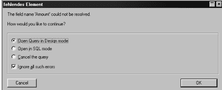

## 创建和打印报告

在本章中

- 创建新报告 1126
- 修改报告 1130
- 预览和打印报告 1132
- 使用其他文档创建报告 1132
- 故障排除 1134

# 创建新报告

由于 StarBase 全集成到 StarOffice 桌面，你有很多创意方法从表中提取数据。关于 StarWriter 和邮件的章节探讨了使用通讯录处理邮件以及使用数据库字段创建信函。第 35 章“通过查询和字段获取答案”讨论了使用数据库字段创建目录。然而，仍然有其他提取呈现数据的方法。

# 理解报告选项

创建报告有两种方法：

- 使用 AutoPilot 向导
- 从 Beamer 拖放数据到 StarWriter、StarCalc 或 HTML 文档

当你使用 AutoPilot 创建报告时，有一系列预设格式供你稍后以任何方式修改。你的数据被插入到一个表格中，你可以像在 StarWriter 中一样对它进行操作。事实上，你的 StarBase 报告只是另一种文本文档。巨大的区别在于你的报告链接到了源数据，并且每次打开时都会更新以反映最新数据。（你也可以从桌面手动更新报告。）

处理报告表格有时可能会觉得局限，但创建报告的方式并没有真正的限制，因为你还有另一种设计方案，可以将数据拖放到标准的 StarOffice 文档类型中。除了其他，你还可以将公式作为字段插入 StarWriter，这样你就可以创建一个可更新的报告模板（字段更新功能在 5.1 初版中似乎严重损坏）。你可以使用 StarWriter 公式栏或 StarCalc 公式来插入函数并创建小计。你还拥有相同的导出选项。然而，由于你已经熟悉在 StarWriter/Web 和 StarCalc 中创建文档的基础知识，本章大部分内容将如何使用 StarBase AutoPilot 创建和修改报告。最后部分详细介绍了如何使用 Beamer 和拖放将 StarBase 数据插入到非 StarBase 文档中。

# 运行 AutoPilot

通过在资源管理器数据库中的表对象右键菜单中选择“文件”、“AutoPilot”、“报告”或“新建”、“报告”来启动新报告。

如果你在资源资源管理器（Explorer）中尚未选择数据库，第一个对话框将向你显示所有数据库的下拉列表，其上方是当前选择数据库的名称列表。请先选择你所需的数据库，然后选择你想要创建报告的表。

如果你从选择“新建表报告”（Table New, Report）开始，你将看到“表选择”对话框（如图 36.1 所示），它列出了你所选数据库中的所有表和查询。

如果你正在处理 StarBase 数据库或维护关系的 ODBC 数据库，你可以创建从多个表中提取数据的报告。

**图 36.1** 创建报告的第一步是选择提供报告数据的表。

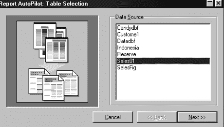

选择表后，点击“下一步”（Next）。在接下来的对话框中——如图 36.2 所示的“字段选择”对话框——你可以通过选择你想要出现在报告中的字段并点击箭头将其移动到标记为“已选字段”（Chosen Fields）的窗口中来选择这些字段。

**图 36.2** 要一次性选择所有字段，请点击双向箭头。要一次移动一个字段或一组选字段，请使用通常的技术进行选择并点击单向箭头。


点击“下一步”。出现“大纲”（Outline）对话框，允许你选择用于数据分组的字段（参见图 36.3）。你不需要选择任何字段，在这种情况下，你的数据将以简单列表显示。如果你选择了分组，数据将以更复杂的格式显示，分组字段将作为主数据的标题。

来自 Michael & Sarah 的 #584 提示

在接下来的对话框中，你可以选择对数据排序——但你不能对已作为分组标题的字段进行排序。

# 图 36.3

在这个示例中，正在创建一个很长的销售报告，对数据进行分组会使其更容易阅读。在这里，数据按年份然后按城市进行分组。


点击“下一步”进入可以确定数据简单排序顺序的对话框——“排序选项”（Sort Options）对话框（参见图 36.4）。你可以对最多四个字段进行排序，并支持升序和降序。

# 图 36.4

你可以从下拉列表中选择排序字段，或将它们全部保持为“设置”（Set）。

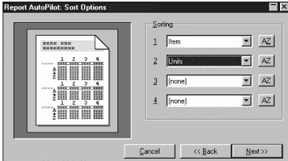

“样式选择”（Style Selection）对话框向你展示了即将实现的目标——在这里你可以开始做出格式选择（参见图 36.5）。默认页面方向为横向，因为这被假设是表格的最佳布局，但你可以将其更改为纵向。点击任何布局选项均将在左侧的预览区域显示其粗略预览。

# 图 36.5

你可以从报告的六种预设外观中进行选择——但你以后可以通过在设计视图中打开它来修改报告格式。


如图 36.6 所示的“样式”（Style）对话框允许你通过选择喜好的页面样式来完成格式选择。同样，你可以选择一种样式以查看左侧的预览。

# 来自 Michael & Sarah 的 #585 提示

为了获得更持久持久的设计解决方案，你可以自定义任何或所有报告模板向导。要打开向导，选择“文件”（File）、“打开”（Open）并导航到 `Office51\templates\wizard` 目录。如果你使用程序快捷方式访问模板文件夹，将找不到此目录——StarOffice 试图通过让进入 StarOffice 内部的目录向导变得困难来避免危险的需要（只需按常规方式导航即可）。报告向导按文档标题列出：紧凑（Compact）、专业（Professional）和标准（Standard）。

打开你想修改的模板，进行更改，并在“文件属性”（File Properties）对话框的“描述”（Description）选项卡上更改报告标题。这将使其在 AutoPilot 菜单中具有唯一名称。默认模板名为 `rpt01.vor...`，当你使用它时它会出现在 AutoPilot 菜单上。

# 图 36.6
选择页面样式是命名和创建报告的最后一步。


点击“下一步”后，你会看到最后的 AutoPilot 对话框，它挥着赛旗表示你即将完成。默认情况下，你的表（或查询）名称已作为报告名称插入，但你可以更改它。（注意，报告名称不受表和查询名称长度限制。）你还需要选择是否要查看报告。

来自 Michael & Sarah 的 #585 提示

为了获得更持久的设计解决方案，你可以自定义任何或所有报告模板向导。要打开向导，选择“文件”（File）、“打开”（Open）并导航到 `Office51\templates\wizard` 目录。如果你使用程序快捷方式访问模板文件夹，将找不到此目录——StarOffice 试图通过让进入 StarOffice 内部的目录向导变得困难来避免危险的需要（只需按常规方式导航即可）。报告向导按文档标题列出：紧凑（Compact）、专业（Professional）和标准（Standard）。

打开你想修改的模板，进行更改，并在“文件属性”（File Properties）对话框的“描述”（Description）选项卡上更改报告标题。这将使其在 AutoPilot 菜单中具有唯一名称。默认模板名为 `rpt01.vor...`，当你使用它时它会出现在 AutoPilot 菜单上。

由于你无法删除或重新排序任何表格字段，尽管你可能觉得样式很拥挤。由于它们与底层表格紧密相关，报告的处理方式显得有些生硬和僵化。不过，不必担心，你有一个强大的替代方案，在本章的最后一节中概述：将你的数据导入“普通”的 StarOffice 文档。

## 预览和打印报告

你可以选择文件（File）、页面视图/打印预览（Page View/Print Preview）来查看报告。同样，这与处理 StarWriter 文档相同。在打印之前在此视图检查文档是个好习惯，以确保数据跨页分页正确——你可以充分利用多页布局。

- 有关使用页面视图模式的更多信息，请参见“预览文档”，第 475 页。

## 使用其他 StarOffice 文创建报告

将数据从 StarBase 导入到 StarCalc 文档只需从显示器（Beamer）拖放即可。每个字段被插入到列中，每条记录插入到一行。

将数据导入文本文档或 HTML 文档几乎同样简单，但需要通过对话框进行导航。你可以选择将数据作为文本、表格或字段插入。

插入数据后，你就离开了 StarBase 的范畴，回到了普通 StarOffice 文档的世界。

要将数据拖放到 StarCalc 文档，请遵循此处提供的前五个步骤；要将数据引入 StarWriter 文档，请遵循完整的步骤序列：

1. 准备你的 StarBase 表格或查询，使其包含你想要的所有信息。不必太担心过滤数据，因为你以后也可以选择记录和字段。
2. 在显示器（Beamer）中打开你的表格或查询。
3. 根据需要应用任何排序或过滤命令。（例如，你可能想执行字母排序，或创建一个过滤器过滤掉特定字段中具有空值的记录）。
4. 打开你想要用于创建报告的文档。你可以使用现有文档或创建一个新文档。
5. 如果你想将所有数据导入文档，灰色矩形标记了显示器中表格或查询的左上角，该位置是列标题和行标题交叉的地方（参见图 36.9。这与你在 StarCalc 表格中点击选择整个工作表的操作相同）。表格或查询中的所有数据都将被选中。不要松开鼠标按钮，直接从矩形拖动到你的文档中。

图 36.9
将选定数据从显示器作为文本或字段拖放到 StarWriter 或 StarCalc 文档的能力，为你从 StarBase 数据创建报告提供了极大的活性。

点击此处选择表格或查询中的所有数据

点击行标题选择一条记录

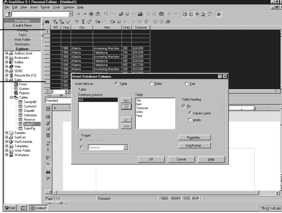

或者，如果你只想导入选定的记录，请使用标准的 Shift+点击和 Ctrl+点击方法选择这些记录。从其中一个行标题拖到你打开的文档中。

6. 出现一个如图 36.9 所示的插入数据库列对话框。在顶部，你有三种插入数据的选择：作为表格、字段或文本。点击你的选择。

注意
工具（Tools）菜单中的更新功能在 5.1 版本的初始发行无法运行，这导致“字段”选项失效。

7. 根据你选择的选项，将出现不同的格式选项。
如果你选择“表格”选项（参见图 36.9），你可以将字段名作为列标题；为以后可能显示（空）的标题留出空间；或通过取消勾选“开启”关闭列标题。点击属性按钮手动设置表格属性，或点击自动格式按钮从 StarOffice 的预设表格格式中选择。

- 有关格式化表格的更多信息，请参见“格式化和编辑表格”，第 329 页。
- 如果选择“字段”或“文本”选项，可以从当前加载的样式列表中选择要应用的段落样式。参见“定义样式”，第 298 页。
- 有关创建图表格式的更多信息，请参见“定义样式”。
- 在左侧的窗口中选择你想要插入的数据库列（字段），使用箭头按钮将它们移动到右侧窗口。
- 点击确定。

就是这样！数据已插入，你可以准备打印或继续编辑你的文档了。

> #589 来自 Michael 给 Sarah
如果你将数据作为字段插入，并想查看打印后的报告看起来什么样，可以按 `Ctrl+F9` 在显示字段名和显示实际数据之间切换；或者你可以选择页面预览命令，

## 故障排除

我在显示器中打开了团队以将数据移动到文档中，但我无法选择字段中的数据。
你无法选择是因为表格处于只读模式。不过，你仍然可以像往一样拖动字段内容。

我尝试了你建议的方法移动数据，但我一次只能移动一个字段的数据！你一定是在尝试一次选择或移动一个字段的数据！

# 什么是 StarOne？

Star Division 推出了 StarOne 作为 StarOffice 的应用程序编程接口 (API)。StarOne 的设计旨在用于 StarOffice 内部，也可以从其他应用程序控制 StarOffice。StarOne 接口旨在是通用的。在 StarOffice 的未来版本中，将能够使用 StarOffice 组件在屏幕上绘制文本，或者通过在你的 Java 开发软件中拖入 Star-Object 来使用完整的 StarOffice 程序。

然而，StarOne 仍处于开发的早期阶段。StarOne 的第一个版本包含在 StarOffice 5.0 中，作为 StarOffice 的内部接口。尽管它在 5.1 版本中得到了改进，但 StarOne 仍然是 StarBasic 的一个逊色表兄弟。

# 为什么使用 StarBasic？

你是否曾对反复重复相同的按键序列而感到沮丧？或者需要格式化表格以便它们看起来完全一致？手动执行这些任务，或者重复地进行这些单调的工作，是理所当然的。好了，你不再再需要感到沮丧了。相反，你可以创建一个小的 StarBasic 宏（或例程）来为你完成工作。

不要被编程语言和创建应用程序的提及所吓到。你不需要成为一名程序员，甚至不需要是经验丰富的 StarOffice 用户就可以利用 StarBasic。你可以轻松使用 StarBasic 宏录制器创建宏，而无需任何编程知识。

如果你需要创建比宏录制器能够实现的更复杂的例程，可以通过录制宏然后在 StarBasic 开发环境中对其进行剖析，即时学习 StarBasic 编程技术。

> StarBasic 的语言在在线帮助系统中有所记录。然而，导航该系统并不容易。有关提示，请参阅本章中的“排排除在线帮助系统”部分。

如果你是创建宏和编程的新手，你可能会发现很难想象用 StarBasic 能做什么。请参考以下想法，它们将让你领略它的强大之处并激发你的想象力：

- 将一组命令归为类；例如，取一个包含详细地址列表的纯文本文件，仅将名称、电话号码和电子邮件地址复制到新的 Calc 表格中。
- 为快捷键分配一种样式。
- 遍历文本文档中的所有相似对象并对其进行重新格式化。例如，将文档中的所有图形缩小到原始尺寸的 32%。
- 增强你的文字处理器的功能；例如，统计文本区域的单词数。
- 创建一个模板来增强同事的工作。例如，你可以为你的公司创建一个标准模板。每当有人使用此模板时，StarBasic 对话都会询问必要信息并将其保存到网络驱动器。

# 1242 第 37 章 熟悉 StarBasic

# 为日常任务创建宏

理解如何在 StarBasic 中创建宏的最好方法是通过一个自动化日常任务的示例。假设你需要复制存储在硬盘上目录中的文件列表，并对列表中的所有文件进行注释。你想创建一个三列的表格。第一列用于文件名，第二列用于文件日期，第三列用于你的注释。

这听起来可能是一项大量工作或一个复杂的宏程序——涉及你计算机的各个方面。然而，你可以创建一个执行此任务所有方面的宏。在这种情况下，简单快速的解决方案通常是手动工作和自动化工作的结合。

以下是解决方案概述：

1. 使用 DOS 中的 `dir` 命令创建文件列表。
2. 使用录制的宏重新格式化列表。
3. 通过选择“工具 ->文本转表格”创建表格。
4. 将其复制到你的文档。

你的操作系统可以创建纯文本格式的文件列表。因此，你可以使用 Windows 或 OS/2 系统的 `dir` 命令。如果你使用 UNIX 或 Linux 系统，无疑会非常熟悉。对于此示例，使用了 Windows 系统。如果你在 Linux 系统上，此任务的解决方案没有主要区别。

# 创建文件列表

通过选择“开始 -> 程序 -> 命令提示符”打开 DOS 窗口。如有必要，将目录更改为包含你想注释的文件的目录（例如 c:\Documents）。

DOS 命令 `DIR *.sdw` 会给你提供该目录下所有 StarWriter 文档列表。要将其写入名为 `temp.txt` 的文件，你需要输入 `DIR *.sdw >temp.txt`。DOS 然后创建该文件并将其保存在相同目录中。

关闭 DOS 窗口并在 StarOffice 中打开 `temp.txt` 文件。StarOffice 在编辑器中打开此文件（见图 37.1）。

# 为日常任务创建宏

图 37.1
你可以轻松地将 DOS 或 Linux 文件列表复制到 StarWriter 文档中，但通过此图，你仍然需要做一些清理，你可以用 StarBasic 将其自动化。

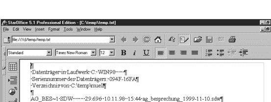

# 录制宏

你可以看到，此文件夹中的每个文件都有自己的一行。对于这个示例，你说你只需要每个文件的名称（长格式）和文件日期，并用制表符分隔。你可以手动从一行移动到另一行，剪切所有的...

# 为日常任务创建宏

图 37.3
你在宏中记录的操作会被 StarOffice 自动翻译为此处看到的 StarBasic 代码。

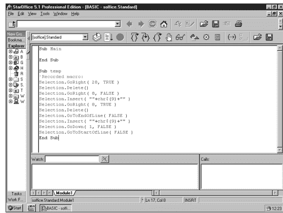

第八部分
第 37 章

如果你的代码运行完美，但与此处显示的代码略有不同，请不要担心。不同的按键组合可以产生相同结果的不同宏代码。

通过关闭 StarBasic IDE 或从 StarOffice 任务栏中选择 temp.txt 文件返回你的 temp.txt 文档。

# 分配键盘快捷键

你可以通过重复相同的步骤来重建整个文件——选择“工具”，“宏”；从列表框中选择宏；然后对文件中的每一行选择“运行”按钮。然而，你可以使用一种快得多的方法完成任务——为宏分配键盘快捷键。

> 来自 Werner Roth 的第 #591get提示
快捷键是分配给活动 StarOffice 程序的，因此请确保正确的程序处于激活状态（在本例中为 StarWriter）。你创建的快捷键组合会更改 StarWriter 程序的键盘配置。这意味着快捷键在每个文档中都可用。

> 警告
小心！如果 StarBasic IDE 窗口是当前当前的活动程序，你会将键盘快捷键分配给 StarBasic 编辑器。这是一个常见的错误。

# 第 37 章 熟悉 StarBasic

通过选择“工具”，“宏”打开宏对话框。然后选择宏 temp，点击“分配”按钮。出现配置对话框。在键盘列表框中选择组合键 `Ctrl+T`。相应的宏应该会被选中。你可以看到，该宏位于 Standard.Module1 中的“StarOffice BASIC 宏”类别下，命令名称为 temp。点击“分配”按钮。宏名称应该出现在键盘快捷键 `Ctrl+T` 旁边。分配完成后，点击“确定”按钮。

在此类对话框中一个常见的错误是选择所有需要的元素并简单地选择“确定”。然而，选择“确定”并不会完成分配。务必选择“分配”。

关闭配置和宏对话框，将光标置于文件中下一行的开头。按 `Ctrl+T` 运行宏。之后，你可以反复按 `Ctrl+T` 调用每个宏。你的文本应该看起来像这样：


`18.11.98`->`ag_besprechung_1999_11-10.sdw`->`n31.03.98`->`Carmen.sde`->

`17.02.99`->`din5008.sde`->

`30.07.98`->`Faxlandport.sdw`->

`12.08.98`->`fischeiverband.sdw`->

`23.11.98`->`korekureexemplar_an_arme_berger.sdw`->

`30.05.98`->`lush_starklei.sdw`->

`12.05.98`->`matik1.sdw`->

`26.08.98`->`rahmen.sdw`->

`18.12.98`->`rechnung_wchnen.sdw`->

`12.05.99`->`schulversion.sdw`->

`21.09.98`->`starmalim.sdw`->

`03.03.99`->`steam3.sdw`->

`14.08.98`->`stefan_ins_labor.sdw`->

`03.03.98`->`Team.sde`->

`18.06.98`->`vorlesungsplanung.sdw`->

`03.04.98`->`Workaround_1.sdw`->

要将行放入表格，高亮显示所有行，然后选择“`工具`”，“`转换为表格`”。对话框要求你确认分隔符。点击“`确定`”，`StarOffice` 会为你的注释生成一个表格。

在你创建此宏后，你可能会尝试选取另一个文件并尝试重新格式化——例如，基于 DOS 的程序输出或 HTML 格式的结果。

> 来自 Werner Roth 的第 #592get
如果你为宏分配键盘快捷键，然后用同名的宏替换它，快捷键将重新分配。

# 快速了解 StarBasic IDE

在记录文本操作时，请始终使用键盘。通过鼠标进行的选择是无法识别的。仅使用鼠标选择如“插入”、“特殊”等工具栏上的下拉列表。

在宏中使用 `End` 键时要小心。`End` 键会将你带到行的末尾，而不是段落的末尾。

## 快速了解 StarBasic IDE

我们的第一个宏让你对 StarBasic 开发环境 (`IDE`) 有一个初步了解。在接下来的步骤中，记录和播放宏不需要使用 `IDE`。查看此部分以获得概览，如果你想知道特定元素的用途，此部分是一个很好的参考。后续章节提供了创建和编辑所需的工具介绍。

## 主窗口

选择“`工具`”，“`宏`”并点击按钮后，会出现 StarBasic `IDE` 窗口。与任何 `StarOffice` 任务一样，你可以使用 `StarOffice` 任务栏轻松从 `IDE` 切换到另一个任务。

图 37.4 提供了 `IDE` 工具的概述。在顶部，你看到函数栏；下方是 StarBasic 对象栏。主窗口是 Basic 编辑器。下方有两个额外的面板用于观察变量和函数调用，称为函数栈。窗口底部是导航栏、状态栏和 `StarOffice` 任务栏。

第八部分 第 37 章

# 第 37 章 熟悉 StarBasic

单步 模块列表 停止 另存为

图 37.4 StarBasic 编辑器了一个简单的界面，包含了你在录制器创建宏后编辑和运行它们的所有工具。

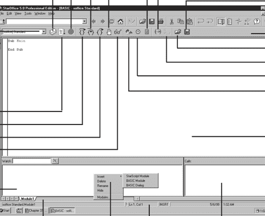

宏对象栏 插入源码 控件 对象目录 运行 步退 Basic 编辑器面板 变量栏 导航栏 状态栏 函数栈

## 探索宏对象栏

对于初学者来说，对图 37.4 显示的所有函数进行详细解释会导致信息过载。此外，通过窗口中的排列循环所有函数是无效的。相反，每个函数将在文中解释。

使用表 37.1 所示的宏简要概述，熟悉你感兴趣的任何元素。在深入探索 StarBasic 之后，你可以随时参考此处。

| 表 37.1 探索宏对象栏 | |
|---|---|
| 图标 | 说明 |
| 库列表 | 下拉列表让你快速访问所有 StarBasic 库。StarBasic 宏按库和模块层次组织。（你应该将完整项目存储在库中。）当你处理不同的项目时，你会喜欢使用这个下拉列表。 |

### 快速了解 StarBasic IDE

| 图标 | 说明 |
| --- | --- |
| 编译、运行和停止 | 你使用编译、运行和停止按钮与程序交互。编译检查程序的语法是否正确。停止停止程序，如果你陷入无限循环，这特别有用。你使用最多的按钮是运行。如果你选择运行，则将启动活动模块中的最高宏。注意，如果 `IDE` 打开着，宏任务将出现在所有任务中，允许在每个文档中使用。例如，如果你想为特定的文本文档编写宏，可以切换到该文档并使用运行按钮启动你的宏。 |
| 过程、单步、步退、断点和添加监视 | 你使用这组按钮——过程、单步、步退和添加监视来调试程序。这些命令允许你逐行循环程序，在关键点停止执行，并观察你正在使用的变量的作用范围和值。 |
| 对象目录、宏和模块 | 对象目录、宏和模块允许你组织宏、对话框和库。对象目录打开一个窗口来导航你的模块。点击组织器，可以在其中添加、删除、移动、复制和重命名模块以及库。你将在“在库和模块中组织宏”中学习更多这些工具。宏按钮打开图 3.3 所示的宏对话框。 |
| 搜索括号 | 你使用搜索括号控制算术表达式（如 `((2+4)*/5)`）中的括号嵌套。将光标置在你想要检查的括号前。搜索括号会选择文本直到到达相应的括号。 |
| 控件 | 控件按钮打开带有对话框控件字段的工具栏 (`控件`)。控件仅在对话框视图中启用。 |
| 插入源码和另存为 | 插入源码和另存为按钮将程序代码作为文本文件处理。要保存你的实际模块或对话框，你需要使用函数栏上的保存按钮。 |

## 介绍基础编辑器 (Basic Editor)

基础编辑器是内置的编程编辑器。如果你习惯了使用 StarWriter，那么你不会发现基础编辑器很难用。你可以像在 StarWriter（或其他 Office 模块）中那样，进行输入、复制、删除以及拖放文本。你甚至可以将文本从 StarBasic 程序拖放到到 StarWriter 文档中，反之亦然。

StarWriter 与在基础编辑器中编写代码的主要区别在于文本的格式。由于宏是一组指令，因此它必须以结构化的方式编写。在基础编辑器中，你无法自行格式化文本，因为它应用以下语法高亮：

- 作为控制结构的 Basic 关键字显示为蓝色。
- 作为变量和子程序名的表达式显示为绿色。
- 字符串或数字等数值显示为红色；未完成的字符串标记为红色。
- 注释为灰色。

与所有传统的编程编辑器一样，基础编辑器使用等宽字体。这种字体对于为程序提供结构至关重要。

你可能不需要缩进就能跟上一个 20 行程序的流程。然而，当你处理较大的项目时，对决策块或子程序进行缩进是非常重要的。

由于没有数据表示的宏纯粹是 ASCII 文本，你可以导入文本文件或将宏保存为纯文本文件。使用宏对象上的“插入源代码”(`Insert Source Text`)和“另存为源代码”(`Save Source As`)按钮来导出或导入源代码。StarBasic 源文件的标准文件扩展名为 `.bas`。

## 在 IDE 内部运行宏

在本章的“为日常任务创建宏”部分中，你记录了一个宏并将其重新格式化为文本。完成此后的自然步骤是在 `IDE` 编辑器中打开你的宏，以清理并增强 Basic 代码。

接下来的章节将为你提供改进录制宏或从零开始编写自己的宏的想法和知识。你可能会发现日常问题会带你更深入研究 StarBasic。随着你继续使用录制宏，你会逐渐越来越熟悉 StarBasic 对象。希望这能鼓励你调整宏以适应更通用或更复杂的任务。显然，通过阅读后续章节获取 StarBasic 知识也是一个好主意。接下来的章节将重点介绍编写自己的宏。

### 在 IDE 内部运行宏

如果你输入了额外的源代码或编写了一个完整的程序，可以通过点击宏对象栏上的“编译”(`Compile`)按钮来检查代码语法。然而，这种方法只检查代码的结构和语法。即使成功编译了程序，你的代码中仍可能存在错误（称为*运行时错误*）。

看看这里的两个小宏：

```
Sub Main
  dim result as integer
  result = 1/0
End Sub
```

在前面的示例中，如果你点击编译，第 3 行将检测到错误，因为除以零是不可能的。然而，代码的微小变化会让编译器忽略此错误。创建一个整数变量 `a`，并用它替换 `0`：

```
Sub Main
  dim result as integer
  a = 0
  result = 1/a
End Sub
```


现在编译器接受了代码，但在运行时抛出了除以零的错误。

添加并编译代码后，你可以运行宏进行测试。要在宏对话框中启动程序，选择“工具”（`Tools`），宏（`Macro`）来打开宏对话框，然后点击“运行”（`Run`）按钮。此操作将启动活动模块中最高的宏。记住确保你处于正确的程序中。

> 使用宏工具栏上的运行按钮非常简单。然而，它总是启动模块中最高的宏。对于测试子程序来说，启动这个宏是不恰当的。解决方案是让模块条目的最高子程序为空，只保留你想测试的宏的单个子程序调用。

在许多情况下，编译和运行是你调整宏唯一需要的两个按钮。但是，如果你找不到错误，或者你不理解为什么程序行为异常，可以使用 IDE 运行时函数（过程步进、单步执行、后退、断点和添加监视）来逐步执行程序。

图 37.5 显示了点击五次“单步执行”按钮后处于调试模式的 IDE。所有使用的变量都已添加到“监视”窗口，以便你观察它们的值。如果你在逐步执行程序时发现错误，可以点击“停止”按钮停止单步执行过程。

# 第 37 章 熟悉 StarBasic

## 37.5

在 `StarBasic` 编辑器中打开宏后，你可以通过点击宏对象栏上的按钮来调试宏。在这里，正在使用监视窗口来检查宏变量中的错误。

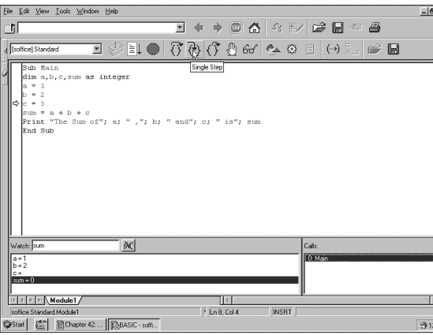

#594
warner Roth

在监视窗口中放置变量的数量时要保守。如果你想知道不在监视窗口中的变量值，只需将光标悬停在编辑窗口中的表达式上。将出现显示当前值的工具提示。这个实用的功能在程序的整个逐步执行期间一直有效。

## 在库和模块中组织宏

在 37.5 中，你看到窗口底部状态栏显示了路径后缀 `Standard.Module1`。接下来的章节将解释该路径的具体含义。

### 什么是库 (Library)?

`StarBasic` 将宏组织成库。库是宏源代码的集合。通常，一个库包含一个完整的应用程序。以计算器为例，它是一个由不同组件组成的完整应用程序，所有组件都存储在库中——一个用于输入数字和操作符的主表单、一个错误对话框、控制对话框的源代码、以及执行计算的源代码。

库可以属于 `StarOffice`，也可以属于一个文档。`StarOffice` 自带了一组用于数据库函数、向等的库。默认模板也带有宏，主要用于将当前日期插入新创建的文档中。

## 在库和模块中组织宏

你可以在 `StarOffice` 和每个 `StarOffice` 文档中找到标准库。安装后，`StarOffice` 中的标准库取决于一个模块 `Module1` 和一个名为 `Main` 的空过程。`Module1` 是所有录制宏的默认存储位置。当然，如果你愿意，可以选择另一个模块甚至存储你的宏。

`StarOffice` 标准库存储在文件 `C:\office1\basic\office.sbl` 中。你可以通过点击功能栏上的“保存”按钮或在 IDE 激活状态下选择“文件”、“保存”来保存此库。`StarOffice` 在每次退出程序时也会保存其库。

文档的所有库都保存在文档中。因此，你同时保存了文档及其库。在 IDE 中点击“保存”按钮与点击保存文档按钮的效果相同。

> 注意

理解保存文档与保存 `StarBasic` 库之间的关系很重要，因为除了使用编辑菜单上的撤销命令外，你无法撤销 `StarOffice` 库。如果你对文档中的库进行了修改但不想保留这些更改，应该直接不保存退出。但记住，`StarOffice` 库的所有更改在退出 `StarOffice` 时保存。因此，备份库至关重要——特别是标准库 `C:\office1\basic\office.sbl`。

### 查看示例库

你之前打开宏对话框时已经看到了库和模块的层级结构（参考图 37.3）。对象目录窗口也为你提供了所有可用库、模块和宏的良好概览（见图 37.6）。点击宏对象栏上的“对象目录”按钮打开它。

图 37.6
使用对象目录你可以访问所有的 `StarBasic` 库、模块和宏。


描述
帮助

# 第 37 章 熟悉 StarBasic

使用滚动条滚动到 `Gimmicks` 库。双击模块可以展开到下一层，其中包含其所有的模块和对话框。要打开一个模块，请选择它并点击对象目录（`Objects catalog`）对话框左上角的“显示”（`Show`）按钮。

### 什么是模块（Module）？

在之前的示例中，我们提到过一个完整的计算器应用程序存储在它自己的库中。计算器由一个主对话框、一个错误对话框、控制对话框的源代码以及计算的源代码组成。你不需要让这些组件的每个代码都挤同一个容器中。因此，每个组件都存储在自己的模块中。计算器源码和对话框的模块显示图 37.7 的标签页中。

图 37.7 当打开 `StarBasic` 库时，各个模块被放在不同的标签页上。你可以通过点击标签名称在它们之间导航。

| | | | | |
|---|---|---|---|---|
| `/WBC_Communicate` `/WBC_Calculate` | `/WBC_MainForm` | `/WBC_ErrDialog` | | |
| `/WBC_Library/WBC_Communicate` | ? Ln5;Col7 | INSERT | | |

将源代码划分为不同的模块以分离用于不同任务的代码是正常现象。在计算器示例中，一个模块用于对话框之间的通信以及应用程序的算术部分。

请注意，一个模块只能包含 64Kb 的源代码。如果你需要更多空间，请将代码划分为两个模块。

要调用另一个模块中的子程序或函数，只需输入其名称。`StarBasic` 会搜索同一库中的所有模块。如果两个子程序具有相同的名称，且位于该库的不同模块中，`StarBasic` 将调用第一个子程序。请务必为你所需的过程获取正确的路径：

```
ModuleName.NameOfSubprocedure
```

显然，更好的解决方案是不对为不同的过程使用相同的名称。

如果你想调用位于当前所在库之外的库中的子程序，你只需要将库名添加到路径中：

```
LibraryName.ModuleName.NameOfSubprocedure
```


例外情况是，如果你想调用标准库之外的子程序，不需要使用库名。事实上，标准库没有名称。只需将其视为默认库即可。此外，由于其特殊地位，即使你处于另一个库中，标准库中包含的宏也可用。因此，如果你想访问其中的内容，可以通过子程序名称调用它。然而，这样做不被认为是良好的编程风格。

## 在库和模块中组织宏

如你所见，为不同的模块和子程序使用相同的名称是灾难之源。解决这些困难的简单方法是为每个项目想一个短缩写——例如，Werner 的 StarBasic 计算器可以使用 `WSBC`。然后你用此缩写作为该项目所有模块、子程序和函数的前缀。你可以在图 37.7 中看到应用这种命名方法的结果。

## 创建库、模块和对话框

要为项目创建一个库，点击宏工具栏上的“模块”`Modules`按钮。宏组织器`Macro Organizer`打开后（见图 3.8），点击“库”`Libraries`标签页访问你的库列表。

图 3.8
使用宏组织器添加、移动、删除或创建 StarBasic 模块和库。


在下拉列表框中，选择你想组织库的区域。激活的列表列出了所有直接属于你的 StarOffice 安装的库；因此，你可以选择所有打开的文档和模板。

库前面的复选框表示该库是否已激活。你无法使用未激活库中的函数；但是，你可以手动激活库。回想一下宏对话框（参考图 37.3），你可以在那里看到所有库和模块的列表。未激活的库显示为灰色，激活的库显示为黑色。

如果库列表中的第二列显示密钥，则意味着该库受密码保护。你可以看到，所有随 StarOffice 的库都受密码保护。设置密码允许你创建一个完整的 StarBasic 应用程序并与他人共享，而不会让源代码超出你的控制。

你可以使用“密码”`Password`按钮对库进行密码保护。当你需要激活库时以启用该按钮。如果你想从应用程序调用一个未激活或受密码保护的子程序，你需要先加载该库。请在帮助系统中查找 `Application.LoadLibrary("NAME")` 方法。

要重命名库，选择它，等待几秒再次点击它——就像 Windows 资源管理器一样。或者，按 `F2`。

> **注意**
> | |
> | :--- |
> 你没有权限更改 StarOffice 标准库或文档的名称。我们强烈建议永远不要使用 StarOffice 删除或重命名任何库。

> **来自 *Warner Roth*** 的 #595 号提示**
> 旧版本的 StarOffice（包括 StarOffice 5.0）需要你使用 `Alt` 键加上鼠标点击来重命名。

# 第 37 章 熟悉 StarBasic

在 IDE 中工作时更改库，请点击宏对象栏上的库下拉列表（见图 37.10）。如果您想为文档或模板中的宏配备一些您存储在 StarOffice 库中的普通宏，此列表将非常有用。这涉及到在文档中的 Starbasic 库与 StarOffice 库之间进行频繁切换。

# 图 37.10

库下拉列表允许您在不同的库之间跳转。


只需从嵌套列表中选择一个宏，点击鼠标按钮，并将其拖入 Basic 编辑面板中的源代码中。您可以在图 37.11 中看到被拖入的 `InsertURL` 宏。

# 图 37.11

你可以跨越 StarOffice 桌面进行拖放。你甚至可以通过从对象库组织器`Object Library organizer`进行拖放，将宏添加到 Basic 例程中。


诚然，Basic IDE 缺乏 StarWriter、StarCalc 或其他 StarOffice 程序中的导航器`Navigator`。但是，对象目录`Objects catalog`允许您导航并加载模块，并轻松访问模块或元素的子过程和函数，或者访问对话框的属性和方法（参见图 37.6）。

# 从零开始 StarBasic 编程

你可以录制宏来操作文档。你可以使用它们来重新格式化文本、剪粘贴对象、搜索并替换字符串、导出文档——列表是无穷的。有时，你可能需要比宏能提供的更多功能。以收集信息为例。假设你想录制文档中的字符数。你可以通过选择“文件”、“属性”，然后在“属性”窗口中选择“统计”选项卡来获取此信息。但尝试录制这个过程。你最终只会得到一个空宏。

接下来的章节将通过示例深入探讨 StarBasic。在编写子例程时，你将学习到 StarBasic 程序的所有基本元素。

# 创建一个统计程序

通过选择“工具”、“宏”打开 StarBasic IDE。在“宏名称”文本框中输入 `Statistics`，并点击“新建”按钮。StarBasic IDE 出现，并插入了子过程的开始和结束语句：

```
Sub Statistics

End Sub
```

在这些语句之间输入以下源代码以产生所谓的“语句块”`statement-block`。此块使 Statistic 程序具有了功能。

如果您选择自己编写代码，可以忽略前面带有单引号（`'`）的行。这些仅仅是注释行，用于记录和解释程序。在运行宏时，任何以单引号（`'`）开头的行都会被忽略。

> 注意：不要重复编写语句块的开始和结束语句，否则您的程序将无法运行。

在 StarWriter 文档内部运行以下宏：选择“工具”、“宏”，在弹出的宏对话框中选择子例程 `Statistics`，并点击“运行”按钮：

```basic
1 Sub Statistics
2 '此子过程显示关于文本文档的统计信息
5 '定义变量以存储统计信息
dim NumberOfChars as long, NumberOfLines as long
dim NumberOfGraphics as integer, NumberOfTables as integer
8 '检查测试文档是否处于状态
10 IF ActiveModule.Name <> 'StarWriter' THEN
11 '如果不是，则显示错误消息并退出此子过程
12 MsgBox('This program is only available in text documents.\',0+16,"Error")
13 EXIT SUB
14 ENDIF
15
16 '收集信息
17 NumberChars = ActiveWindow.GetCharCount(2)
18 NumberOfLines = ActiveWindow.GetLineCount( FALSE)
19 NumberOfGraphics = ActiveWindow.Graphics.Count
20 NumberOfTables = ActiveWindow.Tables.Count
21
22 '在消息框中显示信息 & chr(13) &
23 MsgBox("Number of Chars: " & NumberOfChars &
24 "Number of Lines: " & NumberOfLines & chr(13) &
25 "Number of Graphics: " & NumberOfGraphics & chr(13) &
26 "Number of Tables: " & NumberOfTables & chr(13) &
27 064, Statistical Information about this Document")
28 End Sub
```


它应该产生一个类似于图 37.12 所示的消息框。

# 图 37.12

所有的编程工作——这里是最终结果，一个告知你统计信息的消息框。

| 关于此文档的统计信息 |
| :--- |
| 字符数: 4026 |
| 行数: 112 |
| 图形数: 14 |
| 表格数: 3 |
| 确定 |

如果宏产生带有警告“此仅在文本文档中可用”的消息框，则在运行宏时没有激活的文本文档。如果你在 StarBasic IDE 中运行宏，也会得到此错误消息。

以下是 Statistics 程序的详细说明：

- 第 1 行和第 28 行是构建程序的代码；它们是一个告知 StarOffice “子例程在此开始/结束”的框架。`Sub` 语句、后跟的语句块以及 `End Sub` 语句定义了一个子例程。在本例中，该子例程是一个完整的 StarBasic 程序。
- 第 2 行和第 3 行是描述程序的功能。良好的做法是在子例程开头描述其功能和使用的数据。任何以单引号（`'`）开头的行都会被忽略。
- 第 6 行和第 7 行定义了存储程序收集的信息的变量。变量是特殊类型数据的专用位置。`NumberOfChars` 和 `NumberOfLines` 是 `long` 类型变量。`NumberOfGraphics` 和 `NumberOfTables` 是 `integer` 类型变量。

# 理解 StarBasic 程序的基本概念

正如你在上一节的 Statistics 中看到的，StarBasic 程序是宏的集合。宏程序通常是一个单子例程。在子例程内部，可以有很多单个命令、控制语句、函数调用和子调用。

在 StarBasic 中，命令按行划分。标准做法是使用一行记录一个命令。相反，如果一个命令行太长而难以阅读，你可以中断命令并在下一行继续。你可能需要在末尾添加另一个字符（`...`）来指示该行已断开。你也可以在一行中放置多个命令：只需用冒号分隔命令即可。然而，这种编写方式会让程序变得混乱，并违反 StarBasic 的惯例。唯一的例外是变量的初始化，此时冒号的使用如下：

```
dim a as integer, b as integer, c as integer

a = € : b = € : c = €
```

StarBasic 不区分大小写；表达式可以是小写或大写形式。如果你调用变量 `NumberOfChars`，你可以输入 `numberofChars` 或 `NUMBEROfChars`，解释器都能识别它。你甚至可以用大写或小写输入 StarBasic 关键字。

StarBasic 在使用或不使用括号方面也非常灵活。请仔细看下面的示例：

- `Sub Main`
  - ' 下行不需要括号：
    `ShowThenName 'Scott', 'Peter'`
  - 相同的命令，仅使用括号：
    `ShowThenName('Scott', 'Peter')`
  - 在下方的行中，`SumArgs` 命令必须使用括号。
    否则，StarBasic 不知道哪些参数属于
    `MsgBox SumArgs(10, 20)`
  - 注意，我们在使用 `MsgBox` 运行时函数时没有使用括号！

- `Sub TheName(LastName as string, FirstName as string)`
  `MsgBox FirstName & " * " & LastName, 64, "Your Name here"`

```basic
Function SumArgs(a as integer, b as integer)

SumArgs = a + b
```

注意，函数 `SumArgs` 的 `a` 和 `b` 位于括号中。如果你想将结果赋值给函数，使用括号是必不可少的。为了避免处理这些差异，只需始终将参数放在括号中即可。

## 我必须处理对象吗？

前面的章节包含了许多对 StarOffice 对象的引用。此时，你可能在想对象到底是什么，以及在 StarBasic 中是否真的需要了解它们的知识。接下来的章节将解释什么是 StarOffice 对象。

### 我们是 StarOffice 对象吗？

StarOffice 的所有函数和属性都以对象层次结构表示。使用鼠标时，格式化字符的通常方法是点击“格式”，然后选择“字符”，随后出现“字符”对话框。然而，如果你想从 StarBasic 程序打开对话框，可以输入以下命令行：

```
ActiveWindow.Font.FontDialog()
```

因此，你调用了属于 `Font` 对象的 `FontDialog()` 方法，而 `Font` 是 `ActiveWindow` 的属性。`ActiveWindow` 是指向实际窗口的对象。你使用 `Font` 对象的这种方法来打开对话框。

## 从零开始 StarBasic 编程

看看 StarWriter 文本的一个属性。以下命令行会对文档中选中的任何文本加下划线：

```
ActiveWindow.Font.Underline = 1
```

该属性在选定的文本部分下方画一条单线——就像点击对象栏中的“下划线”按钮一样。区别在于，此命令无论文本是否已经下划线，都会在文本下方画线。此命令更改了特定 StarOffice 属性的值。

正如你已经所看到的，你可以通过名称使用方法或对象属性。方法和属性通过点（`.`）表示。回顾已经分析过的示例是有趣的，它们充满了 StarOffice 对象。如果这些内容对你来说像像乱码，请不要恐慌。熟悉 StarOffice 中的对象并不困难，你不需要学习它们所有的名称。重要的是熟悉它们的结构。

对象是 StarBasic 程序与 StarOffice 之间通信的手段。如果你想操作文本、自动填写表单或在电子表格中进行自动计算，都是通过 StarOffice 对象来实现的。属性——颜色、字体甚至值——都是 StarOffice 对象的属性。

你的程序将通过 StarOffice 对象的方法和属性构建。操纵 StarOffice 套件的潜力就在手边。你可以使用以下代码通过宏关闭 StarOffice：

```basic
Sub CloseOffice

Application.Quit()

End Sub
```

StarOffice 文档带有不同的函数和属性加载。这种潜力的主要困难在于不知道从何开始。在大多数情况下，使用宏录制器寻找你应用程序的方法和属性是最简单的。它会生成所用模块和更改属性的完整引用。即使它们证明对你的任务有用，你至少为搜索 StarBasic 帮助文档提供了一个起点。

寻找程序所需的预留 StarOffice 对象的三个主要途径如下：

- 将你希望编写的宏来处理的操作录制到临时宏中，并检查其代码。
- 使用 StarBasic 帮助系统寻找合适的对象。鉴于帮助系统的结构和内容可能有些复杂，下一节将介绍其用法。
- “借取”别人的代码。嗯，不是“偷取”；互联网上的人们称之为开源。看看他人的属性。StarOffice 本身带了一些代码示例。此外，你还可以查看 Gimmicks 库，并在帮助系统中找到大量代码段。

第 8 部分 第 37 章

## 第 37 章 熟悉 StarBasic

再次，你并不需要记忆大量的对象。只需学习 StarBasic 编程语言、其语句和表达式即可。它的结构与微软的 VBA 兼容（如 Word 97 和 Excel 97 中）。遗憾的是（尽管很有道理），StarOffice 的对象层次结构不等同于微软 Office。如果你同时用过 Word 和 StarBasic，很明显这些程序是不同的！它们有不同的使用范式，也有不同的函数和属性，因此有不同的对象需要处理。

成为一个 StarBasic 程序员通常意味着你在应用程序使用和用例方面熟悉 Microsoft Visual Basic。然而，使用 StarBasic 可以让你获得很少关于 StarOffice 使用的知识。StarOffice 对象的出现。

### StarOffice 对象的出现

StarOffice 的所有函数和属性都以对象层次结构表示。使用鼠标时，格式化字符的通常方法是点击“格式”，然后选择“字符”，随后出现“字符”对话框。然而，如果你想从 StarBasic 程序打开对话框，可以输入以下命令行：

```
ActiveWindow.Font.FontDialog()
```


因此，你调用了属于 `Font` 对象的 `FontDialog()` 方法，而 `Font` 是 `ActiveWindow` 的属性。`ActiveWindow` 是指向实际窗口的对象。你使用 `Font` 对象的这种方法来打开对话框。

## 解决在线帮助系统的问题

你可以在帮助系统中找到关于 `StarBasic` 的几乎所有知识。遗憾的是，它的结构并不方便；熟悉它可能是一项挑战。本节提供了一些如何在不浪费大量时间找到适当信息的提示。

`StarOffice` 帮助系统按程序组织划分为不同的块。如果你在 `StarWriter` 文档中选择“帮助”然后“内容”，将出现一个 `StarWriter` 特有的帮助窗口。点击对象栏中的双远镜图标对帮助系统进行索引搜索。

要打开 `StarOffice` 程序的帮助文件，请打开资源管理器中帮助树的帮助系统（如图 37.13 所示）。

图 37.13
进入梦寐以求的 `StarBasic` 帮助系统的方法是通过资源管理器中的 `StarOffice` 帮助。


### 第 37 章 熟悉 StarBasic

在 Basic 编辑器环境中，你可以通过按下 `F1` 键打开帮助代理（Help Agent）。帮助代理出现后，如果你将光标置于程序中的某个对象或命令上，帮助代理将从帮助系统中提取与上下文相关的解释。由于 `StarOne` 文件存在于 `StarBasic` 帮助文件中，帮助代理可能会显示错误的话。尽管如此，帮助代理在你当前的状态下仍然非常方便且实用。

使用帮助代理工具栏上的双远镜图标可以搜索 `StarBasic` 帮助文件。如果你找到了所需内容，别忘记点击“停止”按钮。否则，在你执行操作时，帮助代理会继续遍历内容。

如果你找到了关于某个方法或属性的信息，并想查看其父对象的所有方法或属性（正如你所希望的），某些情况下没有可用的链接。要解决这个问题，请遵循 `StarOffice` 浏览器中的帮助树（参见图 37.13）。当你到达属性和方法列表时，你应该能够通过第一个列表选择该对象。如果这种方法无效，请检查你想要探索的属性或方法的示例代码。坦率地说，这些示例非常直观，并且处理了引用对象的所有属性和方法。然而，缺点是，你无法从内部点击超链接跳转到该对象的解释。因此，你需要返回帮助文件并进行手动搜索。

如果你使用文本搜索功能查找属性，请省略括号。例如，如果输入 `FontDialog()`，应输入 `FontDialog`。不要进行嵌套搜索来查找对象的一部分（例如，`Font.FontDialog()`）；你的搜索将不会产生结果——即使你查找的是常见的对象属性如 `Name`。使用星号 `*` 来搜索字符串；你可以在表达式的前、后或两边放置星号（例如 `*Dialog*` 或 `*Dialog*`）。

+ 来自 Werner Roth 的 #596

在常规帮助窗口或通过帮助代理，你可以使用 `Ctrl+C` 复制代码段或其他内容。然而，这种方法并不总是完美有效。更可靠的方法是选择文本，右键点击，并从上下文菜单中选择“复制”。

熟悉帮助树中的 `StarBasic` 分支是一个好主意。它能帮助你在 `StarOffice` 对象层次结构中找到所需的方法（让你了解需要指定的路径）。你可以通过录制宏并对生成的代码进行搜索来发现出色的技巧。帮助中的代码段通常提供关于如何在程序中使用对象的实用入门示例。此外，你还可以很好地概述该对象的属性和方法。

+ 来自 Werner Roth 的 #597

你也可以通过在帮助系统中搜索“类结构”（Class Structure）来找到 `StarBasic` 对象层次结构。


- 进入 StarBasic 的世界 1268
- 编程简介 1268
- 工作文档化 1271
- 运行时函数简介 1272
- 变量与操作数的使用 1275
- 算术运算与运算符的使用 1283
- 过程与函数的使用 1286
- 控制语句的使用 1293
- 跳转以控制你的程序 1302

### 进入 StarBasic 的世界

第 37 章“熟悉 StarBasic”向你介绍了在 `StarBasic` 中创建微程序的自动化方法——使用宏录制器。使用宏录制器是为了让你在不知道 `StarBasic` 结构的情况下对任何项目进行编程。当你遇到需要调试和改进宏的 Bug 或是，或者想要创建自己的对话框或其他应用程序时，你需要深入研究通过动手操作的方式创建程序——通过直接在 `StarBasic` 编辑器窗口中输入 `StarBasic` 代码。本章以及第 39 章“使用 StarBasic 编程”，将为你提供关于这种使用 `StarBasic` 直接编程的基础介绍。

对 `StarBasic` 进行完全介绍已超出本书的范围，更不用说编程了。这样做需要专门的一整本书。相反，这些章节将向你介绍 `StarBasic` 语言和结构中一些有趣的特性，并提供足够的信息和示例代码来启动你对 `StarBasic` 世界的探索。本章重点在于教授宏是如何设计的，以及宏如何控制你的 `StarOffice` 文档。下一章将带你接触使用常用 `StarOffice` 对象处理日常任务的宏。

要了解更多未讨论的许多函数、命令和对象，请查看 `StarBasic` 帮助系统。你可以通过在帮助中搜索“通用函数”和“运行时函数”来调出 `StarBasic` 词汇表。你还会找到全局任务的不同分类。你可以通过跟踪程序执行的链接来定位控制语句。

尽管 `StarBasic` 词汇表是完整的，但除非你是经验丰富的程序员，否则它看起来也相当晦涩。坦率地说，`StarBasic` 使用了与著名的微软编程语言 `Visual Basic for Applications`（VBA）相同的编程结构。这意味着你可以通过研究一些关于 `Visual Basic for Applications` 的优秀书籍，轻松了解 `StarBasic` 程序中的语句和数据流。

> 如果你熟悉 Microsoft Basic，你会发现它使用了与 `StarBasic` 相同的语句。你可以通过查看 `Visual Basic` 生成的代码来熟悉这些方言。然而，要小心——`Visual Basic` 比 `StarBasic` 更强大。

### 编程简介

第 37 章向你介绍了一些编程原理。我们使用宏录制器创建了一个程序，并从零开始创建了另一个程序。创建一个 `StarBasic` 宏通常是这两种方式的结合。

#### 什么是程序？

一个 `StarBasic` 程序仅仅是 `StarBasic` 中的一组指令。为了使你的程序适应不同的情况，你可以使用控制语句来调整你的程序。第 37 章还向你介绍了 `StarOffice` 对象，这些是告诉 `StarOffice` 执行某些操作的命令。想象一下在 `StarWriter` 文档中使用鼠标执行一项任务。作为人类，你通常必须调用一系列动作。你无法用自然语言中的一句话，例如：“请格式化文档；我忘记分配段落样式了！”来告诉 `StarOffice` 执行这些动作。遗憾的是，计算机不像人类那样能够推理。它们会字面地执行每条命令，因此你需要显式地按逻辑顺序说明指令。你会猜 `StarBasic` 程序也不例外；它们由一系列单独的指令组成

#### 程序元素

构成程序的指令集被称为代码。单条指令由一个 `StarBasic` 命令及其参数组成。

`StarBasic` 拥有一整套特殊的命令，被称为语句。这些语句包括以下内容：

- `If`
- `Loop`
- `Function`
- `Sub`
- `End`
- `Do`
- `Else`

所有的 `StarBasic` 语句都是保留字。“保留”意味着你不能在代码语句中以其他方式使用这些词，因为 `StarBasic` 始终将这些词解释为命令。

### 第 38 章 理解 StarBasic 的结构与语句

> 请务必本本章示例使用的语法和符号。你必须严格遵守这些规定；否则你将得到错误并需要检查错在哪里。


如果你处理过电子表格函数，那么“命令”及其“参数”的概念对你来说已经熟悉了。像 `BSUM` 这样的电子表格函数本质上是一个命令；你输入参数的数据，如单元格引用和字母数字值（变量），以便该函数能够计算并返回答案。

变量是 Basic 程序中不可或缺的组件。变量在运行时存储数值、字符串或对象。变量可以被程序读取，其内容也可以被修改。当程序对变量进行操作或以某种方式更改时，变量有时被称为*操作数*。

总结以上这些点，如果你想写一个程序，你就编写一系列带有参数的修改命令。这些命令构成了你的程序。刚开始不要过于担心编写代码；宏会为你生成完美运行的代码。这让你能够通过熟悉生成的代码来“进入”编程领域。

#### 组织你的程序

如果你正在创建一个程序，通常的做法是将大型程序拆分成一系列相互调用的较小程序。这些较小的程序在 `StarBasic` 中被称为子程序（subroutines）和函数（functions）。拆分程序使其更容易测试和调试，因为你可以单独测试每个部分。你在第 37 章中接触了子程序，是因为宏就是一个子程序。

正如你在第 37 章中学到的，`StarBasic` 还为你提供了另外两个层级的对象来存储 `StarBasic` 代码：*模块*和*库*。

#### 规划程序设计

如果你想使用 `StarBasic` 创建一个大型程序，应该先进行设计。仅仅草草思考并立即编写代码往往只能产生垃圾程序。如果你只是写这些微型宏程序，恰当地设计它们同样重要。幸运的是，在这种情况下一张纸和内心的喜悦就足够。

程序员将创建新程序称为*开发程序*。开发一个 `StarBasic` 程序的六步骤如下：

- 1. 记下你的程序应该做什么。将其拆分为单个任务并分别列出。在这个“设计”过程中使用铅笔。在纸上画出程序的元素，并在旁边写下它们的任务。
- 2. 如果你的程序使用对话框（如第 39 章所示），在屏幕上和纸上都要设计程序的样式（即用户界面）。
- 3. 使用 `StarBasic` 编写指令来创建界面并让程序实现你的要求。
- 4. 运行你的程序查看它是否工作正常。
- 5. 修复任何错误（bug）。
- 6. 重复步骤 4 和 5，直到你的程序运行正常（或直到你无法继续为止，以先发生者为准）。

整个过程中最重要的部分是那些不在电脑前完成的工作：定义你想让程序做什么，以及决定界面应该什么样。如果你不清楚程序应该做什么，这两者就无法兼得，你也无法创建一个对用户有意义的界面。

这里的“两难困境”在于：在足够了解该语言以看到哪些可能性之前，很难定义你想让程序做什么。这就是为什么从创建和微调宏开始是一个好主意。这也是为什么本章和下一章为你提供了许多执行常见任务或使用命令的子程序示例。

| 第八部分 |
| 第 38 章 |

### 记录你的工作

编程中唯一在所有计算机语言中通用的命令就是：记录你的工作！

#### 创建注释

为了记录你的工作，你可以输入注释（也称为备注 remarks）。你在注释前会加一个撇号（`'`），这告诉 `StarBasic` 忽略随后的文本，而不是将其解释为编程语言。

你可以在行的开头放置撇号将整行定义为注释，也可以在命令行旁边放置撇号，如下：

```
' 这是一行注释
x = 1 ' 这是行尾注释
```


`[...]` 

`'这是一行被注释的代码`

`a = 42 '这是一个被注释的赋值`

`[...]` 

`End Sub`

```
如果你用过其他 Basic 语言，你可能很熟悉 `Rem` 语句（Rem 代表 remark，备注）。你也可以在 StarBasic 中使用此语句。

为代码注释。在开发过程中创建、测试和运行程序时，你可能觉得没有必要注释。妥善地解释和记录你的代码将使其具有可维护性。你会惊讶于你的程序变得陌生有多快。即使是优秀的程序员也会忘记他们是如何设计程序以及，以及在开发期间解决了哪些问题。而且，如果你是为一组用户创建程序或将代码交给他人，没有你的解释，他们将无法理解你的代码。
```

```vb
Sub HelloWorld

Print("Hello World", 42)

Print("Hello World", 42)

End Sub
```

### 图 38.1

`Print` 语句定义了一个类似于你在这里看到的对话框。


然而，`Print` 语句仅适用于有限的任务。如果用户选择了取消按钮，你的 StarBasic 宏将立即“中断”或停止。虽然 `Print` 命令在创建程序方面的用处有限，但它对于评估目的很有用——类似于一个“穷人的调试器”。

另一方面，`MsgBox` 允许你创建一个提供用户选项和信息的对话框。（MsgBox 代表 message box，消息框）。它的语法为：

`MsgBox [Text , Type , Dialogtitle ]`

其中 `Text` 和 `Dialogtitle` 是字符串，`Type` 是整数。调用 `MsgBox` 命令最简单的方法如下：

```vb
Sub PrintHelloWorld

MsgBox("Hello World")

End Sub
```

参数 `Type` 允许你指定对话框的元素和外观。（在这里，你可以画出你的界面设计草图。）你只需为按钮、图标和默认值添加相应的代码即可。表 38.1 列出了与不同元素相关的代码数字。

### 表 38.1 对话框按钮的代码数字

| 按钮 | 图标 | 默认按钮 |
|---|---|---|
| 0 OK | 16 Stop | 0 First |
| 1 OK and Cancel | 32 Question | 256 Second |
| 2 Retry and Cancel | 48 Exclamation | 512 Third |
| 3 Yes, No, and Cancel | 64 Information | |
| 4 Yes and No | | |
| 5 Retry and Cancel | | |

注：默认按钮是你打开对话框时高亮的按钮（除非你按下回车或其他）。该按钮也被称为焦点。

如果你想显示一个带有 OK 和取消按钮以及感叹号的对话框，并将焦点放在取消按钮上，使用类型代码 `1+48+256`。虽然你可以直接输入这些数字，但这不是良好的编程风格。StarBasic 足够识别 `1+48+256` 等于 `305`，留下代码数字可以让其他程序员看出对话框的样式。

# 第 38 章 理解 StarBasic 的结构与语句

以下代码的结果如图 38.2 所示：

```vb
Sub ImportantHelloWorld

MsgBox("Hello World!", 1+48+256, "Important")

End Sub
```

### 图 38.2
`MsgBox` 命令创建比 `Print` 语句更多的对话框，允许用户从多个选项中进行选择。

（注：此处未显示图片，但根据上下文应为图片 img/0c37bec6..._1301_0.png 的内容）

当用户按下消息框上的按钮时，它会返回一个特定的数值值，使程序能够解释按钮的意思。因此，程序可以对用户做出响应。表 38.2 显示了不同按钮返回的值。

### 表 38.2 按钮结果代码
| --- | --- |
| OK | 1 |
| Cancel | 2 |
| Retry | 4 |
| Yes | 6 |
| No | 7 |

如果你想与用户交互并对输入的数据进行操作，`Print` 或 `MsgBox` 命令都无法胜任。对于这项任务，你需要使用 `InputBox` 命令。

`InputBox` 命令的完整语法为：

```vb
InputBox( Msg , Title [, Default_Value [ , x_pos,y_pos] ]] )
```

其中 `Msg` 返回按钮编号（按钮结果），而输入框返回用户输入的字符串；即它允许用户向计算机输入数据。（如果取消了对话框，它将返回一个空字符串）。请考虑这个示例（见图 38.3）：

```vb
Sub EnterTheName

StrName = InputBox("Enter your Name:", "Authentication", "Guest")

End Sub
```

## 变量与操作数的使用

### 图 38.3
此输入对话框默认显示密码 Guest，但用户也可以输入不同的密码。

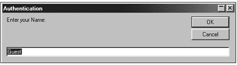

用户点击 OK 按钮后，输入的名称将存储在变量 `Str` 中。默认值（在代码中输入）是 Guest。

如果不指定位置，输入框将居中显示在 StarOffice 窗口。否则，你需要在 twips 中设置屏幕位置，twips 是编程中常用的一种与屏幕无关的测量单位。有关 twips 的更多信息，请参阅 StarBasic 词汇表。

来自 Werner Roth 的第 #598 条提示

`InputBox` 的结果始终是一个字符串。如果你想处理数值，则需要使用运行时函数 `Val()`，它可以将字符串转换为整数。或者，你也可以将 `InputBox` 函数的结果传递给数值数据类型的变量。StarBasic 会自动“强制转换”或将结果转换为数值。

## 变量与操作数的使用

变量和操作数用于控制你的程序。它们的值可以由程序提供，也可以由用户输入。变量和操作数用于使你的程序更具通用性（这意味着适用于各种情况）。本节将介绍如何使用它们。

### 声明变量

StarBasic 处理变量变得非常简单。你可以在不指定类型的情况下通过通过赋值来声明变量。这种声明被称为隐式声明。然而，这种声明变量的方法并不总是最好的编程实践，因此本节将介绍其他一些处理变量的方法。

为了熟悉 StarBasic 变量，你可以使用运行时函数 `TypeName()`，如下所示。`TypeName()` 的参数是一个变量，该函数返回变量的类型。

```vb
Sub Main

MyVariable = 1

print(TypeName(MyVariable)) '结果为 'Integer'

End Sub
```

在这里，你声明了一个初始化为数字 1 的整数变量 `MyVariable`。

## 第38 章 理解 StarBasic 结构和语句

通过 `Dim` 语句，你可以显式声明变量。以下是使用 `Dim` 语句的相同程序：

```vb
Sub Main

    Dim MyVariable as Integer

    MyVariable = 1

    print(TypeName(MyVariable)) ' "结果是 "Integer"

End Sub
```

为什么要使用 `Dim`？第一个原因是让你的代码更具可读性；第二个原因是让它更稳定。如果变量没有被显式声明，它的类型就是所谓的 `variant`（变体）。可以通过赋值将变量转换为任何类型：

```vb
Sub Main

    NextOne = 1

    print NextOne, TypeName(NextOne) ' "结果是 "1 Integer"

    NextOne = "A"

    print NextOne, TypeName(NextOne) ' "结果是 "A String"

End Sub
```

在程序中使用 `variant` 机制不是一个好主意。这种错误的示例是重用临时变量——换句话说，用一次存储字符，然后再次引用该变量时不小心犯了拼写错误（例如，使用这种类型的值不会提高性能或降低内存占用；你只会让自己变得非常困惑）。

隐式声明变量可能会导致程序出现严重问题。例如，假设你声明了一个字符串变量 `FirstName As String`（使用 `Dim` 语句）。在程序的稍后部分，你再次引用该变量但不小心犯了拼写错误（例如，写成了 `FirstName`）；这样做会无意中声明一个新变量。为了避免这种情况，StarBasic 提供了 `Option Explicit` 语句。在模块开头使用此语句（所示），以控制变量的声明：

`Option Explicit`

```vb
Sub Main

    Dim FirstName As String

    StrFirstName = "Rachel" '运行时错误：变量未定义

    print FirstName

End Sub
```


> Werner Roth：出于兼容性考虑，你仍然可以通过添加类型字符来声明变量，例如 `s` 表示字符串，`i` 表示整数值。然而，这种格式的变量声明用于之前的 Basic 变言，已经过时。

# 变量数据类型

你可以使用多种数据类型作为 StarBasic 变量。表 38.3 列出了所有这些类型并解释了它们的用途。

# 变量与操作数的使用

| 表 38.3 StarBasic 中可用的数据类型 |
| 类型 | 解释 |
| --- | --- |
| Boolean | 布尔变量存储逻辑值 True 和 False。它们用于控制条件；例如，它们可以控制对话框的结果 |
| Currency | 货币是一种数值类型，用于存储数值金额，而无需输入货币符号。它们以 64 位数字存储；你可以用它们进行高精度计算 |
| Date | Date 变量用于计算时间和日期值。你可以使用多种格式给变量赋值日期，例如 `myvar = "10/31/1999"` 或 `myvar = "10.31.1999"` |
| Double | Double 是高精度浮点数的类型。其范围大约从 4.9x10^-32 到 1.8x10^08。如果你不需要双倍精度，请使用 Single（后文详细介绍） |
| Integer | Integer 是通常用于存储数值的类型。它适用于 -32,768 到 32,767 之间的整数。只有当你需要对其进行计算时才仅使用数值。否则，使用字符串更安全：记住，客户编号可能包含前导零，例如 "007"。如果你将此数字存储为整数，前导零将被消除 |
| Long | Long 是长整数类型，处理数字 -2,147,483,648 和 2,147,483,647。在用户输入数字的地方使用 Long。如果你使用此数据类型，程序可以检查数字范围而不会引起溢出 |
| Object | Object 变量用于存储 StarOffice 对象（如文档）的引用。你可以使用变量附加单个文档 |
| Single | Single 用于存储单精度浮点值。单值的范围大约从 1.4x10^-45 到 3.4x10^38。对于更高的精度，请使用 Double |
| String | String 变量存储字符。它适用于存储名称、文档中选中的文本以及许多类型的数据。一个 String 变量最多可以包含 64,000 个字符 |
| Variant | Variant 可以包含不同类型的数据。它可以替换这里提到的所有类型。（尽管这不是一个好主意；你可以节省时间和内存）。在分配数据后，你可以对其进行检查 |

```
Sub ShowCustomerID
Dim CustomerNumber As Integer
IntCustomerNumber = 007
Print IntCustomerNumber
```
结果为 "7" 或 "007"

# 表达式的有效名称

变量的最大长度为 255 个字符。变量名必须以字母开头。变量的有效字符是 A 到 Z 以及下划线 `_`；甚至允许空格字符，尽管你需要将其括在括号中。此代码段为你提供了不同变量名的示例：

```
Sub TestSomeNames

    dim HelloWorldPhrase as string  '声明包含内容

    dim StartAtColumn_42 as boolean  大写和小写字母，

    dim Weight_In_Tons as integer  数字，以及

    dim [Your Age] as integer  下划线，以及
space（括号）

```

```
HelloWorldPhrase = "Hello World!"

StartAtColumn_42 = True

Weight_In_Tons = 16

[Your Age] = 42

End Sub
```

如前所述，StarBasic 语句中字母的大小写。因此，不能通过更改现有变量的大小写来声明新变量。变量名不能与 StarBasic 保留字相同。示例给出了一些非法表达式以及如何修正它们：

```
Sub TestSomeMore

    dim True as boolean  '错误，已定义的常量

    dim Sub as integer  '错误，Sub 是 StarBasic 关键字

    dim BoolTrue as boolean  '允许

    dim int_sub_counter as integer  '允许

End Sub
```

如果你想调用一个名称中带有空格的子程序，需要将其括在括号中。StarBasic 库或模块也是如此。在项目名称中使用空格可能更容易。相反，你可以使用下划线或大写字母。让我们调用其他库中的两个子程序：

```
Sub CallASubprocedure

    '调用另一个库的程序

    LibraryName.ModuleName.NameOfTheSubprocedure

    '调用名称带有空格的另一个库

    [library name].[module name].[name of the subroutine]

End Sub
```

数组存储相同类型元素的列表。为了让数组的每个元素都被视为单个变量并进行访问，每个数组元素都有一个独立的索引。使用 `dim` 语句声明数组。

例如，该行代码：

```
Dim Items(S) As String
```

# 使用变量和操作数

声明一个名为 `Items` 的数组，它包含六个字符串类型的元素（StarBasic 从零开始计数）。它们被称为 `Items(0)`、`Items(1)` 等直到 `Items(5)`。你可以像使用普通变量一样使用它们：

- `Items(0) = "Gem"`
- `Items(1) = "Magic flute"`（魔法笛子）

拥有六个数组元素而不是六个普通变量的优点是，你可以通过括号中的索引来访问它们。这意味着你可以通过一个小循环和一个索引计数器来循环遍历元素。默认情况下，数组的索引从零开始。要更改此数字，你可以显式地指定上限和下界，声明如下：

```
Dim Numbers(1 to 5) As Integer
```

在这个示例中，最低索引是 1，最高索引是 5。（该数组只有五个元素。）如果你需要多一个维度，只需在声明时分配用逗号分隔的新的一组边界即可：

```
Sub SubDimensions
Dim Matrix(5,5) As Double
Dim Element3d(-10 to 10, -10 to 10, -10 to 10) As Integer
Matrix(0,0) = 34.67
Element3d(-10, 0, 5) = 34
End
```

# 常量

常量与变量相似；然而，它们在程序的整个生存周期内保持不变，且在运行时无法更改。声明常量的语法如下：
`Const <常量名> = <值>`

常量不需要数据类型，因为数据类型通过值显而易见。当你声明一个常量时，编译器会在程序内部搜索 `<常量名>`。每当编译器在程序中找到该名称时，它就会将其替换为它的 `<值>`。从技术角度来看，常量并不是必要的。然而，它们可以帮助你的代码更易读、更灵活。

下面的示例展示了常量如何帮助记录程序。正如在这里看到的，你可以使用物理值、数学常量、测量或因子：

```
Sub Convert
Const Meter2Feet = 3.2809
Const SpeedOfFlight = 299792458
Const Minute2Hour = 1 / 60

''
'在此处编写常量和声明
''

Dim IntMinutes As Integer, IntHours As Integer
IntMinutes = InputBox("Number of minutes of minutes", "Minutes to Hours")
'通过乘以因子来计算转换
IntHours = IntMinutes * Minute2Hour
MsgBox("This you said " & IntHours & " hours!", 48, "Information")
End
```

| 第八部分 | 第 38 章 |
| --- | --- |

# 下一个示例展示了如何使用常量让你的程序更加灵活。假设你需要为一个 10x15 元素的网格创建一些常量。像往常一样，最好不要浪费内存（特别是使用数组时）。因此，你应该为网格声明一个大小为 10x15 的二维数组。如果你需要更大的网格？在这种情况下，你只需要更改常量 `MaxGridColumns` 和 `MinGridRows` 的值：

```
Sub TheGrid
Const MaxGridColumns = 10
Const MinGridRows = 15
Dim GridCells(1 To MaxGridColumns, 1 To MinGridRows) As Integer
...
  给 GridCells 数组赋值
For j = 1 To MinGridRows
  [...]
```


在此对 `GridCells(i,j)` 进行某些操作

[...

Next j

Next i

End Sub

```

让你的程序尽可能灵活是一个好主意。然而，当你更改常量值以适应程序时，不要忽略代码的其他部分。通过测试，确保新值与程序的其余部分兼容。偶尔，程序员可能会插入一个实际值而不是常量的名称。一年后，另一个程序员可能出于良好的意图想要调整程序以适应当前需求，此时第二个程序员只需要更改常量的值。你猜结果怎么着？一场小灾难就发生了！

# 变量的生命周期和作用域

当你声明变量时，StarBasic 将值保存在内存中，这样每当变量名在程序中出现时，StarBasic 都能识别它。变量的生命始于声明，但它何时结束呢？另一个问题是，谁可以访问该变量？一旦声明，是否每个人都能访问？请看下面的示例：

使用变量的显式声明是非常重要的，
'否则 StarBasic 将在使用时声明其值并将其
'替换为空字符串或零。当你尝试访问一个生命周期已结束的变量时，
'你不会收到错误消息。
'以下行行必须位于模块的顶部！

```
Option Explicit

Sub Test

Dim StrLocalPhrase As String

StrLocalPhrase = "Hello World!"

'调用子程序 PrintPhrase

PrintPhrase

End Sub
```

```
Sub PrintPhrase

    Print(StrLocalPhrase) = "Error variable not defined!"

End Sub
```

在之前的（不完整的）程序中，变量 `LocalPhrase` 在过程 `SetPhrase` 中声明。从子过程 `SetPhrase` 调用子程序 `PrintPhrase`。理想情况下，`PrintPhrase` 应该打印 "Hello World"。因为变量 `LocalPhrase` 不属于 `PrintPhrase`，它无法识别该变量并抛出运行时错误“Variable not defined”（变量未定义）。

变量的生命周期通常在其子结构内部。这的技术术语是局部变量；换句话说，它在声明时开始，在 `End Sub` 状态下结束。因为 `LocalPhrase` 是局部变量，`PrintPhrase` 无法看到它；就像该变量住在另一个国家一样。

变量默认在它们的子程序运行期间一直存在，这允许你在不同的子程序中使用相同的变量名。这种方法很常见，特别是在循环中使用名为 `i` 或 `j` 的计数器。

然而，如果你想与另一个子程序共享一个变量怎么办？下面的示例解决了这个问题：

```
Option Explicit

Dim StrGlobalPhrase As String
```

```
Sub SetPhrase

    StrGlobalPhrase = "Hello World!"

    调用子程序 PrintPhrase

End Sub
```

```
Sub PrintPhrase

    Print(StrGlobalPhrase) = "Hello World!"

End Sub
```

> 使用列表将信息传递给子程序。像 `PrintPhrase` 示例那样操作全局变量是不推荐的。它可能会导致巨大的影响。例如，如果程序员未能重置该值，可能会导致严重的后果。在某些情况下使用静态变量。

```
Option Explicit
```

```vb
Sub SetPhrase

    StrGlobalPhrase = "Hello World!"

    调用子程序 PrintPhrase

End Sub
```

```
Sub PrintPhrase

    Print(StrGlobalPhrase) = "Hello World!"

End Sub
```

# 使用算术运算符

## Sub FindTheSolution
`IntCallsUntilNow` 初始化为零。
'在第一次调用后 `intCallsUntilNow` 等于零
'将加 1
`Static IntCallsUntilNow As Integer`
每次调用都会让 `IntCallsUntilNow` 加1
`IntCallsUntilNow` 不会忘记它的值，因为它是一个静态变量
`IntCallsUntilNow = IntCallsUntilNow + 1`

```
If IntCallsUntilNow >= 3 Then

MsgBox("您的许可证每次会话仅允许 3 次调用。",

16,"权限限制")

End If

[...]

'有用的代码在这里！

```
End Sub

## 使用算术运算符

StarBasic 中的指令可以不仅包含命令和变量；它们还可以包含算术运算符，这些运算符告诉 StarBasic 如何处理某些类型的数据。

在 StarBasic 中，等号 (`=`) 用于将变量赋值给属性。第二种常用的算术运算符加号 (`+`) 用于相加两个值。表 38.4 给出了 StarBasic 算术运算符的完整列表。

| 运算符 | 名称 | 示例 | 值 |
|---|---|---|---|
| + | 加法 | a = 1 + 2 | 3 |
| | 减法 | a = 1 - 2 | -1 |
| * | 乘法 | a = 2 * 3 | 6 |
| / | 除法 | a = 12 / 6 | 2 |
| ^ | 幂 | a = 2^3 | 8 |
| mod | 取模 | a = 13 mod 6 | 1 |

你可以将表 38.4 所示的算术运算符用于整数和浮点数类型的变量。但事实上，你甚至可以对浮点值使用取模运算符。模是除法运算的余数。

StarBasic 根据运算符优先级层级评估包含多个运算符的表达式。括号中的表达式首先求值。运算符的优先级与 BODMAS 规则相关（回想一下小学数学）：

- 括号
- (Of)
- 除法
- 乘法和取模
- 加法
- 减法


# 第 38 章 理解 StarBasic 结构和语句

除法、乘法和取模的优先级相同，与数学不同，它们是从右向左读取的。加法和减法的优先级也相同，也是从右向左读取。

以下是这些原理在 StarBase 中运行的示例：

```
Sub Arithmetic

Print 2 + 3 * 4 '结果是 14

Print 3 * 4 + 2 '结果是 14

Print (2 - 3) * 4 '结果是 20

接下来两行产生不同的结果，因为除法、

乘法和取模的优先级相同。

因此使用了“从右到左”的结合律规则。

Print 8 mod 2 * 3 '结果是 2

Print 3 * 8 mod 2 '结果是 0

End Sub
```

# 连接运算符

StarBase 有一个用于字符串特殊连接运算符 (`&`)。你可以用它来连接字符串和其他数据。你也可以使用 `+` 运算符产生相同的结果，但这样做可能会引起混淆，如下例所示：

```
Sub PrintAmount

Dim SingleItem1 As Single, SingleItem2 As Single, SingleAmount As Single

Dim StrLastName As String, StrCustomerID As String

SingleItem1 = 12.45

SingleItem2 = 24.89

SingleAmount = SingleItem1 + SingleItem2

StrLastName = "Deckart"

StrCustomerID = "09789"

"' & & 运算符会将数据组合在一起，结果是：
"' of Order Deckart & StrLastName & " ID: " & StrCustomerID & "_"
"' Amount of Order " = & SingleAmount
" is $ &12452.89"

当连接字符串时，结果是：
"' Amount is $12452.89"

print "' Amount is $" + SingleItem1 + SingleItem2

当括号优先级更高时，结果是：
"' Amount is $37.34"

print "' Amount is $" " + (SingleItem1 + SingleItem2)

End Sub
```


很困惑，不是吗？最好的策略是使用 `&` 运算符并避免陷入麻烦。

# 关系和相等运算符

你在条件和循环语句中使用关系和相等运算符来做决策。布尔表达式的结果是 True 或 False。StarBase 内部将其表示为 -1 代表 True，0 代表 False。事实上，除0以外的任何值都代表 True。


## 表 38.5 StarBasic 中的关系和相等运算符

| 运算符 | 名称 | 示例 | 值 |
| --- | --- | --- | --- |
| = | 等于 | 1 = 1 | True |
| > | 大于 | 1 > 2 | False |
| < | 小于 | 1 < 2 | True |
| >= | 大于等于 | 1 >= 2 | False |
| <= | 小于等于 | 1 <= 2 | False |
| <> | 不等于 | 1 <> 2 | True |

# 逻辑运算符

如果你想测试一个数值是否在两个值之间，你需要进行两个检查：首先是大于，然后是小于。通过逻辑运算符你可以组合这些结果：

```
Sub CompareValues

Dim IntValue As Integer

IntValue = 5

'结果是 -1

Print IntValue > 0 AND IntValue < 10

'结果是 0

Print IntValue > 10 OR IntValue < 0

End Sub
```

## 表 38.6 StarBasic 中的逻辑运算符

| 运算符 | 组合 | 值 |
| --- | --- | --- |
| and | 交集 | True |
| or | 并集 | True |
| not | 取反 | True |
| xor | 异或 | True |
| imp | 蕴含 | False |
| eqv | 等价 | False |

表 38.7 展示了三个逻辑表达式示例。

| 表达式 | 解释 |
| --- | --- |
| Value1 and Value2 | 当 Value1 和 Value2 均为 True 时为 True。在所有其他情况下，该表达式的结果均为 False。 |
| Value1 or Value2 | 当 Value1 或 Value2 至少有一个为 True 时为 True。当 Value1 和 Value2 均为 False 时，该表达式为 False。 |
| not Value1 | 取反 Value1 的值。因此，如果 Value1 为 True，则表达式为 False，反之亦然。 |

# 使用过程与函数

以下示例演示了如何相对于 `Main` 子过程，将程序划分为不同的子过程：

```
Sub MainProgram

SolveTask1

Do While MyFunction(Value) < 10

    SolveTask2(Value)

  Loop

    SolveTask3

End Sub
```

```
Sub SolveTask1

  <Statement block>

End Sub
```

```
Sub SolveTask2(Value)

  '处理参数 "Value"

  <Statement block>

End Sub
```

```
Sub SolveTask3

  <Statement block>

End Sub
```

```
Function MyFunction(Value)

  '处理参数 "Value"

  <Statement block>

  MyFunction = <Statement>

End Function
```

在此程序中，`MainProgram` 调用了所有其他子过程和函数。
主任务被分为三个子任务：`SolveTask1`、`SolveTask2` 和 `SolveTask3`。`SolveTask1` 只被调用一次；它们是程序结构的泛指术语。`SolveTask2` 在循环中被多次调用。此外，它通过传递参数与 `MainProgram` 关联。自定义函数 `MyFunction` 接收一个参数并在循环结束时返回。

在这里，你可以看到问题是如何被分为三个部分，并通过函数来控制程序的。你可以在一个子过程中编写相同的程序。但是，看这个 `Main` 子程序；它依赖于两条命令行。将它们分离在不同的子过程中，代码会更清晰且便于调试。通过这样编写，你可以隔离开一段代码并检查其性能。

# 使用参数列表

要将信息从一个子过程传递到另一个子过程，你需要使用参数列表。在本节中，你将编写一个子过程来打印计算值，并在过程中使用参数列表：

```
Sub CalculateSomething

Dim IntTheResult As Integer

  [...

  '计算某些内容并赋值给变量 TheResult

  ...]
```

```
'调用过程 PrintOneResult

PrintOneResult(IntTheResult)

End Sub
```

```
Sub PrintOneResult(IntOneResult as integer)

MsgBox(
```

`Main` 子过程中的计算结果通过整数参数传递给 `PrintOneResult`。因此，`PrintOneResult` 是一个将任何整数值传递到屏幕的通用过程。通过语句 `PrintOneResult(TheResult)` 调用 `PrintOneResult` 子程序。`PrintOneResult(IntOneResult as integer)` 意味着你可以不受变量名的限制将任何整数值传递给 `PrintOneResult`。注意这两个参数有两个不同的名称——`IntTheResult` 和 `IntOneResult`。或者，你也可以通过行 `PrintOneResult(42)` 来调用该子过程。

如果你在子程序需要多个参数，请用逗号将它们分隔：

```
Sub PrintOneResult(IntOneResult As Integer, StrMsgBoxTitle As String)

MsgBox("The result is: " & IntOneResult, 64, StrMsgBoxTitle)

End Sub
```

你要求使用两个参数来调用此版本的子程序——结果和消息框的标题——如本例所示：

```
PrintOneResult(IntTheResult, "Result of CalculateSomething")
```

# 自定义函数

StarBasic 包含一个运行时函数 `sqr()`，用于计算参数的平方根。通常，你会将此函数的赋值传递给变量。`sqr` 的示例如下：

```
DoubleSquareRoot = sqr(9)
```

因此，变量 `DoubleSquareRoot` 的值被称为自定义函数。在这里，你可以创建一个数学函数 `Power` 作为一个自定义的 StarBasic 函数：

```
Function Power(DoubleTheBase As Double, DoubleThePower As Double) As Double

    Power = DoubleTheBase ^ DoubleThePower

End Function
```

`Power` 函数的参数是两个浮点值，将基数传递给函数。管理参数列表与子过程相同。主要的区别在于返回值。你的自定义函数返回一个浮点值。函数会自动在其范围范围内声明一个特定类型的变量。该变量被赋值为函数中的计算结果。在前面的示例中，这必须至少对结果变量（`Power`）进行一次赋值。函数中的变量可以像普通变量一样；也就是说，它们可以被多次赋值。

# 使用过程与函数

要调用自定义函数，你使用与运行时函数相同的语句。如下所示，按照顺序，你可以将其结果赋值给变量，或在计算中使用你的函数：

```
AVariable = Power(3,2) '此结果为 9

BVariable = (AVariable - Power(AVariable,2))/2 这意味着 (9 - 9*2) / 2 = -36
```

函数的语法如下：

```
Function <Name>[(VarName) [As <data type>][<other arguments>]] [As <data type>]

<statement>

<Name> = SomeValue

End Function
```

函数的数据类型通过最后一个 `[As <data type>]` 语句声明。声明数据类型是可选的，但不指定结果类型意味着编译器将自动指定 `variant` 类型，这是 StarBasic 的通用数据类型。通用使用这种数据类型可能会带来麻烦；尤其是在发生失误或分配返回值时。

# 使用过程与函数 129


`Sub Cube(DoubleResult As Double, ByVal DoubleValue As Double)`

`DoubleResult = DoubleValue*3`

`End Sub`

`DoubleTheResult` 是按引用传递的，而 `DoubleValue` 是按值传递的。然而，通过观察子程序调用 `Cube(DoubleTheResult, DoubleValue)`，这种区别并不直观。一个更好的解决方案是通过函数传递结果：

```
Sub CubeWithFunction

Dim DoubleResult As Double, DoubleValue As Double

DoubleValue = 3

DoubleResult = Cube(DoubleValue)

MsgBox("the cube of " & DoubleValue & " is " & DoubleTheResult,

64, "Cube")

End Sub
```

```
Function Cube(ByVal DoubleValue as double) as double

Cube = DoubleValue*3

End Function
```

对程序的修改使得情况变得清晰许多。`DoubleTheResult = Cube(DoubleValue)` 意味着变量 `DoubleValue` 没有发生任何变化。由于核心 Basic 语言没有任何用户定义对象，在任何情况下都不可能避免通过引用变量进行通信。当你使用不同的方法时，对子程序调用进行适当注释是非常重要的：

```
CalculateSumOfVectors(Rx, Ry, Ax, Ay, Bx, By)

call by reference

call by value
```

# 可选参数

在某些情况下，留空某个参数是方便的。考虑 `MsgBox` 命令。它的语法如下：

```
MsgBox Text [,Type, [[Dialogtitle]]
```

你可以只用一个参数调用 `MsgBox`：

```
MsgBox("I am the Text")
```

消息框以标准类型出现，没有图标，并带有标准的对话框标题 "soffice"。如果你用两个参数调用它，例如

```
MsgBox("I am the Text", 32)
```

那么类型 32 代表一个问题——带有一个问号图标。最后，如果你使用三个参数（如下所示），则不使用默认值：

```
MsgBox("I am the Text", 32, "I am the Title")
```

在接下来的示例中，你创建了自己的对话框来显示账单的金额。标准货币是美元；如果不将字符串 "$" 传递给打印子程序会更方便。同时，如果程序足够灵活，能够显示外币的金额就很好。为了实现这一结果，你可以在参数列表声明之前放置 `optional` 关键字来使用可选参数：


## 1292 | 第 38 章 理解 StarBase 结构与语句

```
Sub CalculateAmount
'使用默认货币在屏幕上打印金额
'结果将是 $ 33.45
PrintTheAmount(33.45)
'使用指定的货币在屏幕上打印金额
'结果将是 DM 33.45
PrintTheAmount(33.45, "DM")
End Sub
```

```
Sub PrintAmount(SingleAmount As Single, optional strCurrency As String)
'如果 strCurrency 不是字符串类型 (8)，则没有第二个参数
因此给 strCurrency 分配默认货币美元符号。
If VarType(strCurrency) <> 8 then strCurrency = "$"
MsgBox("The amount is " & strCurrency & " * " & SingleAmount, 64, "Yep")
End Sub
```

调用的过程 `PrintTheAmount(33.45, '')` 具有相同的结构。所有给定的参数都使得 `PrintAmount` 中的所有变量均有效。然而，`PrintTheAmount(33.45)` 的情况稍微复杂一些。第二个参数 `Currency` 被给出了，反过来该变量是无效的。在 `MsgBox` 语句中使用无效变量名会导致错误。因此，你首先需要检查是否提供了参数。如果没有原始提供，你需要给它赋值。你可以通过使用 `VarType()` 或 `TypeName()` 函数使用类型。如果 `strCurrency` 不是字符串类型，也可以使用 `If...Then...Else...` 语句来检查是否提供了参数。

表 38.8 给出了 `VarType()` 和 `TypeName()` 函数使用的值列表：

| VarType() | TypeName() | 说明 |
| --- | --- | --- |
| 0 | Empty | 变量未定义 |
| 1 | Null | 无数据 |
| 2 | Integer | 基础类型 |
| 3 | Long | 基础类型 |
| 4 | Single | 基础类型 |
| 5 | Double | 基础类型 |
| 6 | Date | 基础类型 |
| 7 | String | 基础类型 |
| 8 | Object | 基础类型 |
| 9 | Error | 传递参数 |
| 10 | Boolean | 基础类型 |
| 11 | Variant | 基础类型 |

# 控制语句

控制语句控制程序的流程。你需要决策、循环和退出语句来控制程序的流程。在接下来的章节中，你将使用之前提到的布尔表达式来制定决策。

## 决策语句

你经常需要根据不同情况使用决策语句。如果条件只有是或否（也就是说答案只有 True 或 False），你就使用 `If` 语句。`Select Case` 语句根据枚举的值执行不同的块。

`If...Then...Else...`块的语法如下：

```
If <Condition> Then
<Statement block>
```

如果条件结果为 True，则执行语句块。否则，程序在 `Endif` 之后继续运行，如下所示：

```
Sub UseDocuments
...
Dim BoolError As Boolean
Call CheckDocumentExists('c:\work\actual.doc')
检查其他内容并赋值给 Error
...
If BoolError Then
MsgBox("Can't find the Documents.", 16, "Error")
Endif
...
End Sub
```

如果语句块只包含一个命令，你可以将该命令与 `If` 语句放在同一行。在这种情况下不需要 `Endif`。

如果你有一个 True 的条件，想要执行特定的代码，而如果条件为 False 则执行另一段代码，你可以使用 `If...Then...Else` 语句：

```
If <Condition> Then
<Statement block No. 1>
Else
<Statement block No. 2>
Endif
```

## 1294 第 38 章 理解结构与语句

在这里，如果条件结果为 True，则执行语句块 1；否则，执行语句块 2。现在考虑这个示例：

```
Sub PrintAddress
...
If StrGender = "female" Then
StrSalutation = "Mrs."
Else
StrSalutation = "Mr."
Endif
...
End Sub
```

因为前面的示例赋值非常常见，StarBasic 提供了如下所示的 `IIF` 语句：

```
IIF(<Condition>, <Expression No. 1>, <Expression No. 2>)
```

`IIF` 实际上是一个函数，当条件为 True 时返回 `Expression No. 1`，在所有其他情况下返回 `Expression No. 2`。`If...Then...Else...End` 示例可以压缩为一行

```
StrSalutation = IIF("female", "Mrs.", "Mr.")
```

# 根据变量或函数的值执行不同的语句块，可以使用嵌套 `If` 语句。因此，你可以使用重复的 `Else` 语句来覆盖多个条件。看看下面的示例。StarBasic 调用 `GetStateType` 获取图形界面 (GUI)。它返回一个指向系统中给定的 GUI 的数值。（你可以在 StarBasic 帮助系统中找到关于 `GetStateType` 的更多信息。）然后，如果你想使用操作系统代码，这样做：

```
Sub InitializeForOS


```vb
If GetStateType() = 1 Then

  在此执行 Windows 特有代码

Else GetStateType() = 2 Then

  在此执行 OS/2 特有代码

Else GetStateType() = 3 Then

  在此执行 Macintosh 特有代码

Else GetStateType() = 4 Then

  在此执行 Motif 特有代码

Else GetStateType() = 5 Then

  在此执行 Open Window 特有代码

Else

  MsgBox("无法识别您的操作系统", 16, "Error")

Endif

End Sub
```

由于决策取决于来自函数结果的变量值，你可以使用 `Select Case` 语句代替：

```vb
Sub InitializeForOS

Select Case GetGUIType()

Case 1

  在此执行 Windows 特有代码

Case 2

  在此执行 OS/2 特有代码

Case 3

  在此执行 Macintosh 特有代码

Case 4

  在此执行 Motif 特有代码

Case 5

  在此执行 Open Window 特有代码

Case Else

MsgBox("无法识别您的操作系统", 16, "Error")

End Sub
```

`Select` 行指定条件。然后你将结果与每个 `Case` 语句比较。执行找到的第一个 `Case` 语句的语句。作为最后一个 `Case` 语句的 `Else` 语句在未找到匹配时执行代码。执行一个语句后，所有其他 `Case` 语句都会被跳过，程序从 `End Select` 语句恢复。

`Select Case` 语句的语法如下：

```vb
Select Case <Condition>

Case <Expression No. 1>

  <Statement block No. 1>

Case <Expression No. 2>

  <Statement block No. 2>

...

Case Else

  <最后一个语句块>

End Select
```

`Select` 接受任何具有绝对值的条件。甚至是浮点数或字符串也是有效的。`Case` 语句中的表达式应该涵盖条件的可能结果。以下是一些可能的表达式：

- '如果一个 case 语句对多个值有效，可以用逗号隔开
`Case 1-7`
- '如果条件小于 10，则执行语句块。使用 Is 运算符。
`Case Is < 10`
- '条件表达式必须在 5 到 15 之间'
`Case 5 To 15`
- '或者你可以将它们结合在一起！
`Case Is < 10, 2, 5 To 15`

# 第 38 章理解 StarBasic 结构与语句

大多数人并没有考虑到在字符串条件下使用 Case。以下是一个文本文档中导航程序的示例。自然地，如果程序能够直接跳转到目标文本，而不是仅仅在消息框中显示页码，效果会更好：

```vb
Sub DictionarySearch

Dim StrWord As String

'通过用户定义函数询问要查找的单词

StrWord = AskForWordDictionary()

'将给定的字符串转换为小写

StrWord = LCase(StrWord)

Select Case

Case "abacus" To "cycle"

MsgBox("Check page 23 for words "

&"abacus" to "cycle", 64, "Information")

Case "damage" To "fuzzy"

MsgBox("Check page 24 for words "

&"damage" to "fuzzy", 64, "Information")

...

'使用额外的 Case 语句遍历字母表的其余部分

'...

Case Else

MsgBox("Your word was not found in our dictionary", 16, "Error")

End Select

End Sub
```

# 循环语句

你使用循环语句来重复执行代码块。循环的常见用途是允许用户在输入无效后重新输入数据，或者对数组进行操作。

> 有时你在编写或测试带有循环结构的程序时，可能会“卡”在循环中；即循环永远终止。这被称为无限循环。你应该可以通过点击宏工具栏上的停止按钮来终止循环。然而，在某些情况下，你无法停止无限循环；例如，当循环每次运行时都会耗尽资源时，你必须完成 StarOffice 会话。在测试带有循环语句的程序之前，请确保保存所有文档；不要忘记点击 StarBasic IDE 中的保存按钮。

来自 Warner Roth 的第 `#601getget` 提示

## Do..Loop

`Do..Loop` 语句是 StarBasic 提供的最灵活的循环命令。你可以在循环开始之前检查条件，也可以在语句块第一次执行后检查条件。此外，你可以使用两个条件语句：`while` 和 `until`。

这两个条件语句共有四种基本结构。请在此处查看它们的语法：

| Until | While |
| :--- | :--- |
| Do Until `<condition>` | Do while `<condition>` |
| `<Statement block>` | `<Statement block>` |

## 使用控制语句

| Until | While |
| :--- | :--- |
| Loop | Loop |
| Do | Do |
| `<Statement block>` | `<Statement block>` |
| Loop Until `<condition>` | Loop while `<condition>` |

如果条件在进入循环之前受控制（在前两种结构中），那么当条件为 False 时，**`语句块`**可能不会被执行。

在某些情况下，条件可能取决于赋值给块内部变量的值。这意味着必须进入循环以初始化变量。一个完美的例子是处理密码对话框。用户必须输入密码；必须检查其有效性。如果密码无效，必须再次出现输入密码对话框让用户重新输入密码。以下简单的代码片段显示：

```vb
Sub AskForPassword

Dim StrPassword As String

Do

  '从输入对话框获取密码并发送它

  StrPassword = InputBox("Enter the Password!", "Login")

  '使用给定的字符串检查密码，当
  '给出正确的密码时跳出循环。

  Loop Until StrPassword = "Gafredo"

End Sub
```

有时，只有在条件有效时才进入循环；否则语句块中的某些命令可能会导致错误。下一个示例显示了一个文本文件，读取该文件的每一行，并将每行分配给字符串变量。只有当文件不为空时此示例才有意义，你首先需要检查文件是否包含：

```vb
Sub ScanFile

Dim IntFileNumber As Integer

Dim StrOneLine As String

  '获取一个属于底层的空编号
  '关于 StarBasic 中的文件处理，请在
  '帮助系统中搜索 "FreeFile"

  IntFileNumber = FreeFile()

  '打开 c:\temp 文件夹下的 "text.txt" 文件
  Open "c:\temp.txt" for Input Access Read As #IntFileNumber

  '读取每一行直到文件结束
  Do Until EOF(IntFileNumber)

  '读取每一行直到文件结束
  Line #IntFileNumber, StrOneLine

  '读取每一行直到文件结束
  If StrOneLine = "" Then Exit Do

  '读取每一行直到文件结束
  Close #IntFileNumber

End Sub
```


# 第 38 章理解 StarBasic 与语句

有时你在编写或测试带有循环结构的程序时，可能会“卡”在循环中；即循环永远终止。这被称为无限循环。你应该可以通过点击宏工具栏上的停止按钮来终止循环。然而，在某些情况下，你无法停止无限循环；例如，当循环每次运行时都会耗尽资源时，你必须完成 StarOffice 会话。在测试带有循环语句的程序之前，请确保保存所有文档；不要忘记点击 StarBasic IDE 中的保存按钮。

## 第 38 章 理解 StarBas 结构与语句

| 表格 38.9 StarBas 循环命令分析 |
| 步骤 | i | 计算 | 结果 (TheResult) |
| :--- | :--- | :--- | :--- |
| 1 循环开始 | 1 | `LongTheResult = 1 * 1` | 1 |
| 2 | 2 | `LongTheResult = 1 * 2` | 2 |
| 3 | 3 | `LongTheResult = 2 * 3` | 6 |
| 4 循环结束 | 4 | `LongTheResult = 6 * 4` | 24 |
| 循环结束后 | 5 | | 24 |

你最后做的是连续计算四个单次乘法，而不是一次大的乘法；这个概念被称为*迭代*。通过这种技术，你可以解决很多计算。想象一下计算账单的情况，其中每个单项的价格存储在数组中。

你只能用从 1 到 12 的值测试此宏，因为 `12! = 479,001,600`。数据类型 `long` 的最大值为 `2,147,483,647`，由于 `13` 等于 `6,227,020,800`，它会导致溢出。要计算大于 12 的数字，你可以将 `LongTheResult` 声明为 `double`，但结果将不再等于最低精度。

如果你仔细观察 `For...Next` 语句的语法，你可能会发现它提供了一些之前未提到的额外功能。你可以指定计数器在每次迭代时增加（或减少）。默认情况下，计数器增加 1：

```
<counter = <Start value> To <End value> Step <size of step>

<Statement block>

Next <counter>
```

就像你在 `Do...Loop` 语句中可以的那样，你可以使用 `Exit For` 语句跳出 `For...Next` 循环。然而，不建议在 `For...Next` 循环中实现这一点；这违背了循环的初衷。如果你需要在程序中遍历特定数量的元素，请使用 `Do...Loop` 或 `While...Wend` 代替。

在 `Next` 语句中使用计数器名称不是强制的；但当你使用嵌套的 `For...Next` 循环时，该语句可以让你有更好的控制。下一个程序使用 `For...Next` 循环来转置 StarCalc 电子表格的第一表（转置意味着列与行的交换）；

```
TransposeSpreadsheet

Dim IntMaxRow As Integer, IntMaxCol As Integer

Dim i As Integer, j As Integer

'输入要转置的列数和行数
'我们从第 1 列和第 1 行开始
```

## 使用控制语句

```
IntMaxCol = InputBox("输入要转置的列数!", "转置器(TM)")
IntMaxRow = InputBox("输入要转置的行数!", "转置器(TM)")
```

声明一个二维数组来保存电子表格中的值
用行和列覆盖它们
```
Dim DoubleArrSaveMatrix(IntMaxCol, IntMaxRow) As Double
```

将条目保存到数组并在之后删除
遍历所有列
```
For i = 1 to IntMaxCol
For j = 1 to IntMaxRow
```

```
DoubleArrSaveMatrix(i,j) = ActiveDocument.Cells(i,j,1).Value
```

为了转置不同数量的行和列

删除旧条目
```
ActiveDocument.Cells(i,j,1).Clear("SVDFN")
Next j
Next i
```

将所有内容反过来放回，即列转行
```
For i = 1 to IntMaxCol
For j = 1 to IntMaxRow
```

```
DoubleArrSaveMatrix(i,j) 被赋值给 Cells(j,i);
转置！
ActiveDocument.Cells(j,i)
Next j
Next i
```


`DoubleArrSaveMatrix(i,j)` = `ActiveDocument.Cells(i,j,1).Value`

为了转置不同数量的行和列

删除旧条目

`ActiveDocument.Cells(i,j,1).Clear("SVDFN")`

`Next j`

`Next i`

```
将所有内容反过来放回，即列转行
For i = 1 to IntMaxCol
For j = 1 to IntMaxRow
```

`DoubleArrSaveMatrix(i,j)` 被赋值给 `Cells(j,i)`;

转置！

`ActiveDocument.Cells(j,i)`

`Next j`

`Next i`

# 1304 第 38 章 理解 StarBasic 结构与语句

'如果活动文档不是电子表格，则抛出错误消息
`MsgBox("此程序仅在电子表格可用。",16,"Error")`
退出子程序 `TransposeSpreadsheet`
'调用此子程序后，程序将继续执行。
`Exit Sub`

`End If`
[...]
'在此执行转置
`End Sub`

如示例所示，检查子程序的执行是否有效甚至必要是使用 `Exit Sub` 和 `Exit Function` 的良好方法。在前面的示例中，如果不使用 `Exit Sub` 语句，你将不得不将此主代码放入 `if` 的 `Else` 块中。在其他示例中，你可以通过 `Exit Sub` 避免使用 `If` 语句。然而，考虑是否真的需要一个 `Sub` 来解决你的问题很重要。

## 错误处理

StarBasic 提供了控制程序错误的自由。`On...Error` 语句让你执行操作并在之后处理错误的自由。这种概念被称为“捕获错误”，它允许你捕获错误并进行处理，而不是简单地通过 StarBasic 产生运行时错误。

基本概念是通过使用 `Error Goto <label>` 告诉子程序在发生错误时该做什么。标签后面紧跟着处理错误的代码。下面的示例计算给定值的平方根。你预期的收到的错误是输入错误——例如，如果用户输入负值。自然地，在这种情况下，平方根是没有定义的。在下面的情况下，程序给了用户另一个输入值的机会：

```
Sub CalculateSquareRoot

'如果发生错误，跳转到标签 ErrorLabel。

'这里是处理所有错误的代码

On Local Error Goto ErrorLabel

Dim DoubleTheResult As Double,DoubleValue as Double

'我们需要以下内容来重新启动

'如果第一个值是错误的

StartInput:

DoubleValue = Input("大于或等于零的数值", "Calculating the square root")

'计算给定值的平方根

'使用内置的 StarBasic 函数 sqr()

'当 DoubleValue 为负数时，此行将发生错误。

DoubleTheResult = sqr(DoubleValue)

'如果一切顺利，显示结果

MsgBox("The square root of " & DoubleValue & " is " & DoubleTheResult,,64,"Finished")

'这里我们必须使用 Exit Sub 语句。否则程序将运行

'进入为错误处理指定的代码

Exit Sub

'ErrorLabel 提供了起始点。所有错误处理代码随其后。

ErrorLabel:
```

*

## 使用跳转控制你的程序

询问我们预期的错误。给定值小于零
`MsgBox("你不能使用小于 !! 的除数",16,"An error occurred")`
在标签 `StartInput` 处重新启动操作。在输入框之前直接
`Restart StartInput`
我们也处理了所有其他错误！
所以我们抛出一个通用的错误消息并取消子程序

```
MsgBox("The following error occurred" & chr(13) & Error() & chr(13) &
```


# 1304 第 38 章 理解 StarBasic 结构与语句

`MsgBox("此程序仅在电子表格可用。",16,"Error")`
退出子程序 `TransposeSpreadsheet`
`Exit Sub`

`End If`

如示例所示，检查子程序的执行是否有效甚至必要是使用 `Exit Sub` 和 `Exit Function` 的良好方法。在前面的示例中，如果不使用 `Exit Sub` 语句，你将不得不将此主代码放入 `if` 的 `Else` 块中。在其他示例中，你可以通过 `Exit Sub` 避免使用 `If` 语句。然而，考虑是否真的需要一个 `Sub` 来解决你的问题很重要。

## 错误处理

StarBasic 提供了控制程序错误的自由。`On...Error` 语句让你执行操作并在之后处理错误的自由。这种概念被称为“捕获错误”，它允许你捕获错误并进行处理，而不是简单地通过 StarBasic 产生运行时错误。

基本概念是通过使用 `Error Goto <label>` 告诉子程序在发生错误时该做什么。标签后面紧跟着处理错误的代码。下面的示例计算给定值的平方根。你预期的收到的错误是输入错误——例如，如果用户输入负值。自然地，在这种情况下，平方根是没有定义的。在下面的情况下，程序给了用户另一个输入值的机会：

```basic
Sub CalculateSquareRoot

'如果发生错误，跳转到标签 ErrorLabel。

'这里是处理所有错误的代码

On Local Error Goto ErrorLabel

Dim DoubleTheResult As Double,DoubleValue as Double

'我们需要以下内容来重新启动

'如果第一个值是错误的

StartInput:

DoubleValue = Input("大于或等于零的数值", "Calculating the square root")

'计算给定值的平方根

'使用内置的 StarBasic 函数 sqr()

'当 DoubleValue 为负数时，此行将发生错误。

DoubleTheResult = sqr(DoubleValue)

'如果一切顺利，显示结果

MsgBox("The square root of " & DoubleValue & " is " & DoubleTheResult,,64,"Finished")

'这里我们必须使用 Exit Sub 语句。否则程序将运行

'进入为错误处理指定的代码

Exit Sub

'ErrorLabel 提供了起始点。所有错误处理代码随其后。

ErrorLabel:
```

## 使用跳转控制你的程序

询问我们预期的错误。给定值小于零
`MsgBox("你不能使用小于 !! 的除数",16,"An error occurred")`
在标签 `StartInput` 处重新启动操作。在输入框之前直接
`Restart StartInput`
我们也处理了所有其他错误！
所以我们抛出一个通用的错误消息并取消子程序

```basic
MsgBox("The following error occurred" & chr(13) & Error() & chr(13) &
"In: " & Err() & chr(13) &
"In line: " & Err(1) & of the program",_
16,"Unknown Error")
```

`End If`

如所示，此程序的代码设计是为了处理你预期的错误。你知道这个错误，并且知道它不是致命的。因此，你可以抛出一个错误消息并给用户另一个。然而，可能存在其他你未预到的错误。为了让你的程序健壮，你需要处理错误发生的每一种可能性。当你测试新的或修改过的过程时，这一点尤为重要；如果不处理所有可能的错误，你可能会遇到严重的麻烦。

如果你生成一个建设性的错误消息，提供关于发生错误类型的提示，对用户非常有帮助。在 StarBas 中，三个函数提供了错误信息；它们显示在表 38.10 中。

| 表 38.10 返回错误信息的 StarBas 函数 |
| Function | 返回值 |
|---|---|
| `Error()` | 文本错误消息。`sqr(-9)` 产生错误文本 Invalid procedure call |
| `Err()` | 内部 StartOffice 错误号。`sqr(-9)` 产生错误号 5 |
| `Err1()` | 你的代码中产生错误的行。这是模块中的绝对行号。如果第一个值是错误的 |

## 第 39 章
## 使用 StarBasic 进行编程

本章由 Werner Roth 编写

- 如何使用 StarBasic 学习日常解决方案 1310
- 介绍 StarOffice 对象 1310
- 应对日常任务 1316
- 在 StarBasic 中构建整个应用程序 1333
- 接下来的路该往何方 1347
- 故障排除 1348

## 使用 StarBasic 学习日常解决方案

如前几个章节所示，StarBasic 宏可以执行属于 StarOffice 的方法和属性中的所有操作。

StarOffice 对象层次结构非常庞大，要将其全部表示出来超出了本书的范畴。事实上，展开整个对象层次结构需要再写一本书了！幸运的是，你不需要熟悉整个层次结构就能成功使用 StarBasic。

本章将向你介绍一些使用 StarBasic 处理日常工作的一些典型解决方案。你将学习如何组织你需要的对象，以及一些无法通过宏录制器进行记录的 StarOffice 对象。最后，通过所学知识，你将学习如何编写一个完整的 StarBasic 应用程序。

## 介绍 StarOffice 应用对象

正如你所知的，你可以更改文本的值或颜色，在 StarCalc 单元中输入公式，添加网格，并在 StarOffice 工具的帮助下执行类似的任务。然而，有时你需要访问 StarOffice 程序对象的功能或属性。这就是为什么编程对象层次结构中任何代表 StarOffice 的对象都被简单称为 `Application`。

你可以在一个简单的程序（如此处所示）中使用 `Application` 来打开你的地址簿录：

```basic
Sub OpenAddressBook

Application.AddressBook()

end Sub
```

要引用每个对象的属性和方法，你需要在对象与属性或方法名称之间放置一个点（`.`）。现在查看以下程序。它显示了你通常通过选择“工具”、“选项”以及“常规”对话框中的“用户数据”类别访问的地址。所有可用数据存储在对象的属性中，该对象由 `Application` 所有：

```basic
Sub ShowUserData
```


`MsgBox("当前用户是: " & chr(13) & &`

`"姓名: " & Application.Address.FirstName & & &`

`Application.Address.LastName & chr(13) & &`

`"ID: " & Application.Address.ID & chr(13) & &`

`"街道: " & Application.Address.Street & chr(13) & &`

`"城市: " & Application.Address.City & chr(13) & &`

`"邮编: " & Application.Address.ZIPCode & chr(13) & &`

`"电子邮箱: " & Application.Address.EMail & chr(13) & &`

`"电话（家庭）: " & Application.Address.PhonePrivate, _`

`48, "信息")`

`end Sub`

正如前面的代码所示，方法、属性和对象的归属关系通过元素之间的点来表示。在整个层次结构中，右侧的元素和左侧元素代表右侧元素的父级，以此类推，正如你在这里看到的：

- `Application.Address.FirstName`
- `Address` 对象的属性
- `Application` 对象

如果你需要反复引用属于某个对象的属性，可以使用 `With` 语句，该语句在第 38 章“理解 StarBasic 结构和语句”的末尾有解释。

有关使用 `With` 语句的详情和示例，请参见“跳转控制你的程序”，第 132 页。

下一个程序产生与之前版本相同的结果；相反，你使用了一个快捷方式来引用 `Application.Address` 对象：

```basic
Sub ShowUserData

With Application.Address

MsgBox("当前用户是:" & chr(13) & \
"姓名: " & .FirstName & & .LastName & chr(13) & \
"ID: " & .ID & chr(13) & \
"街道: " & .Street & chr(13) & \
"城市: " & .City & chr(13) & \
"邮编: " & & .ZIPCode & chr(13) & \
"电子邮箱: " & & .EMail | chr(13) & \
"电话（家庭）: " & .PhonePrivate, & \
48, "信息")

End With

End Sub
```

| 第八部分 | 第39 章 |
| :--- | :--- |
| 介绍集合 | |

在 StarOffice 层次结构中，有几个 `Collection`（集合）对象，例如 `Documents`（文档）、`Tables`（表格）和 `Windows`（窗口）。任何对象都可以有多个实例。这意味着在 StarOffice 中可以同时打开多个文档——例如，一个包含多个表格的电子表格。集合对象是对象的容器。你可以将它们看作访问同类型所有对象的方式（就像超市里的陈列架）。为了使这种访问成为可能，StarOffice 提供了几个集合对象来访问当前会话中该类型的所有打开对象。例如，`Windows(1)` 表示桌面窗口，`Documents(1)` 表示特定文档，`Graphics(1)` 表示文档中的第一个图表。在接下来的示例中，你将与集合工作。在那里，你将学习集合到底是什么以及在哪些任务中是有用的。

## 引用活动对象

你使用 `Documents` 访问新文档。这代表会话开始时出现的文档第一个窗口（而不是随后打开的同一文档的其他窗口）。这意味着你可以访问窗口的唯一实例。要引用文档对象，你使用 `Documents`。你可以访问文档中的所有项。

```basic
Sub WorkWithDocuments

Dim ActiveWindow As Object

Dim ActiveDocument As Object

ActiveWindow = ...

ActiveDocument = ...
```

正如前面的代码所示，方法、属性和对象的归属关系通过元素之间的点来表示。

## 赋值事件

如果你要引用一个属于某个对象的属性，可以使用 `With` 语句。

## 示例：记录历史

假设你想在每次打印文档时获取详细信息。要找到它，你可以选择“文件”、“属性”并打开“文档”选项卡，但这只能提供最后一次打印文档的详情。为了解决这个问题，你可以将每次打印的日期存储在属性对话框的注释字段中。你可以通过将宏分配给打印事件来实现。

```basic
Sub InsertHallo

If Selection.ClassName = "Text" Then

  MsgBox("没有选择文本", "错误")

Else

  Selection.Insert("Hello")

End If

End Sub
```

## 第 39 章 使用 StarBasic 编程

```basic
StrComment = ActiveDocument.DocumentInfo.Description

"If it's empty the document was never printed before,
go generate a header to inform the reader
If StrComment = "" Then

StrComment = "Printing dates:" & chr(13)

End If

Pass today's date and the user's name to the StrComment

StrComment = StrComment & Date() & " " & Time() & " & &

Application.Address.FirstName & " &

Application.Address.LastName & chr(13)

Write new StrComment to description tab

ActiveDocument.DocumentInfo.Description = StrComment
```


当调用此宏时，它会将今天的日期、时间以及用户名添加到属性对话框的描述（Description）字段中。

接下来，你需要将 `Print` 函数分配给你存储在文档中的此 StarBasic 宏。这意味着你可以将其分配给 `Print` 事件。

要分配此函数，请使 `DocumentWithEvent.sdw` 成为活动窗口，然后选择（Select），并配置（Configure）以打开配置对话框。点击“事件（Events）”选项页将其置于前端（见图 39.2）。或者，你也可以从“工具（Tools），宏（Macro）”对话框中点击“分配（Assign）”按钮，这将打开配置对话框）。

图 39.2：在配置对话框中，你可以将创建的宏和程序分配给程序事件。

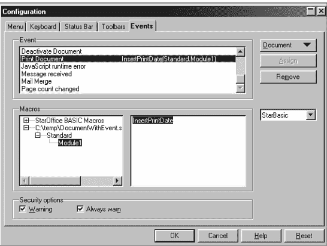

在“事件”选项页上，按照以下步骤操作：

1. 对话框右上有一个名为 StarOffice 的按钮。点击此按钮打开下拉列表，并选择 Document。否则，你会将事件全局分配给所有 StarOffice 文档。（在图 39.2 中，选择 Document 后可以看到该按钮。）

### 介绍 StarOffice 对象

2. 从左下角的宏列表中选择 `documentWithEvent.sdw`。
3. 点击 `+`（加号）文档打开标准库（Standard library）。
4. 从标准库中选择 `Module1`。
5. 选择宏 `InsertPrintDate`。
6. 从事件列表中选择 `Print Document` 事件。
7. 点击分配（assign）按钮。

当 `InsertPrintDate(Standard.Module1)` 出现在 `Print Document` 事件旁时，点击 OK 保存配置对话框并保存你的文档。

现在尝试该宏。打印文档。如果你选择了安全选项（图 39.2 对话框底部的选项框），则会出现一个消息框，警告配置了事件的宏将运行。点击执行（Execute）按钮打印文档。通过选择“文件（File），属性（Properties）”并打开“描述（Description）”选项页来查看是否成功。该选项页应会在注释（Comment）字段中显示如下详情：

下次打印文档时，注释字段中将添加一行带有打印详情的新行：
Printing dates:
07/07/1999 21:02:19 Werner Roth
08/09/1999 05:53:33 Rachel van Maanen
11/11/1999 23:36:59 Michael Herger

| Part |
| :--- |
| VIII |
| Ch |
| 39 |

### StarOffice 和文档的事件

如图 39.2 所示，配置对话框的“事件”选项页允许你在整个 StarOffice 的事件和文档的事件之间切换。将宏分配给文档事件是针对特定文档的。这意味着当使用文档或模板并发生特定事件时，宏就会启动。每当文档内启动事件时，将宏存储在此文档的 StarBasic 库是非常方便的。

StarOffice 事件特定于你的 StarOffice 安装。它们本质上是全局事件。如果你将 `InsertPrintDate` 宏分配给 StarOffice，那么你将在每个文档的属性中记录从你的系统打印的每份 StarOffice 文档的打印信息。

文档事件列表和 StarOffice 事件列表是相同的；StarOffice 不会调整该列表。某些事件永远不会出现在图 39.2 所示的事件列表中。为你的任务选择正确的事件是一个主观判断。将 `Start Application` 事件分配给文档是没有意义的。

### 应对日常任务

接下来的章节侧重于解决你在日常工作中会遇到的任务。为了实现这一目标，你将检查通用的解决策略，并学习如何使用 StarOffice 对象来解决它们。当然，掌握 StarOffice 对象的最佳方法是实验。你不会通过阅读这本书成为 StarBasic 专家。但是，你可能会通过解决日常问题成为 StarBasic 专家。

遗憾的是，没有许多日常任务需要在 StarCalc 中使用宏。它是一个强大的电子表格图表，你很少需要 StarBasic 宏。然而，这些章节将向你展示如何获取并将数据放置在你的电子表格中。这些知识可以作为编写填充单元格的复杂和例行程序的基础。

### StarWriter 和 StarCalc 的通用例程

你可以使用 `Documents` 集合通过索引号访问所有打开的文档。你将在下一个示例中使用此原理。此示例展示了如何将所有打开的 StarWriter 和 StarCalc 文档转换为格式，并在之后关闭它们。你可以使用相同的技术来管理你自己的工作文档。例如，假设你想将所有打开的 StarWriter 和 StarCalc 文档转换为一种类型。我的宏如下：

```basic
Sub ConvertOpenedDocuments

    Dim i As Integer

    Dim StrDocumentPath As String

    StrDocumentPath = "c:\Converted"

    If Dir(StrDocumentPath, 16) = "" Then

        'Create a folder on your disk

        MkDir(StrDocumentPath)

    End If

    For i = Application.Documents.Count To 2 Step -1

        'Check if we touched a Writer document

        If Application.Documents(i).ClassName = "TextDocument" Or Application.Documents(i).ClassName = "TableDocument" Then

            'Add the document name to the converted path

            StrDocumentPath = StrDocumentPath + "\" + Application.Documents(i).Name

            'Now we can add different extensions to the name in order

            'to save it in different formats.

            'Convert the StarWriter document into HTML

            Application.Documents(i).SaveAs(StrDocumentPath + ".html")

        End If

    Next

End
```


注意：此程序将在 UNIX 系统运行，因为使用了 DOS 风格的分隔符 `/` 只将其改为 `\\`

### 操作 StarWriter 文档

StarWriter 提供了许多方便程序来自动化并加速你在 StarCalc 中的工作，因此在接下来的章节中，你将探索许多基于文本文档的示例。

#### 样式快捷键

在 StarWriter 中，你无法为段落或文本样式分配快捷键。你并不需要快捷键，因为你可以在任何文档中使用样式表。然而，为常用样式（如标题 1 到标题 10 或正文）设置快捷键仍然很有用。你可以通过创建宏并将其分配给快捷键来应用这些样式。在下一个示例中，你将为段落 Heading 1 编写一个宏。为此，打开一个新文档，并通过“工具，宏”创建一个宏。将宏命名为 `Heading_1`，并点击录制开始记录。使用样式表应用段落样式 Heading 1，然后停止录制宏。

如果你打开 StarBasic IDE，你会看到以下记录的宏：

```vbasic
Sub Heading_1

  Selection.StyleApply("Heading 1", 2 ) '2代表段落样式

End Sub
```


现在，将宏 `Heading_1` 分配给你喜欢的键盘快捷键——就搞定了！没有这更简单的了。

关于如何将宏分配给 `FormatDefault` 快捷键的信息，请参阅“分配键盘快捷键”，第 1245 页。

## FormatDefault 函数的键盘快捷键

所有主要的 Office 程序都有强大的 `Default` 命令（在“格式”菜单中），它可以将选定对象重置为其样式的默认值。（将其想象成一个用于直接格式化的巨大橡皮擦。）假设你想重置一个带有文本样式格式的 Word 文档。你只需选择带有段落式的区域并调用 `Default` 命令。然而，如果你需要对大量的文本块执行此操作，这个过程很快就会变得非常麻烦。但如果你能以某种方式创建一个具有 `Default` 命令底层功能 `FormatDefault` 的宏呢？

如果你在“工具-配置-键盘”选项卡查找，你会找不到 `Format` 和 `Default`，因为“格式”菜单的内容取决于选定的对象。例如，如果光标在文本框中，你会看到的条目是“字符”和“段落”。如果你在文本文档中选择一张图片或文本框，你会看到的条目是“排列”和“对齐”。你不会看到任何名为 `Default` 的项。

在这种情况下最好的办法是使用与上一节相同的技巧——记录宏并将其分配给键盘快捷键：

1. 打开文档，选择“工具-宏”命令。
2. 在“宏名称”文本框中输入宏名——`FormatDefault`。
3. 点击“记录”开始记录。
4. 选择“格式”菜单并点击“默认”命令。
5. 点击右上角的“停止”按钮。
6. 将此宏分配给你喜欢的键盘快捷键。

你记录的宏看起来像这样：

```vbasic
Sub FormatDefault
  Selection.ResetAttributes()
End Sub
```

此宏将一直完美运行，直到你选择一个不具备 `FormatDefault` 能力的对象。此时 StarBasic 会抛出错误消息 `Property or method not found`（未找到属性或方法）。你可以分析选择对象的 `ClassName` 来确定给定对象是否具有名为 `ResetAttributes()` 的方法。相反，你可以使用 StarBasic 有效的错误处理能力。

## 应对日常任务

当用户选择一个对象（例如图片）并尝试运行宏时，应该发生什么？理想情况下，什么都不会发生。该操作对该对象不可用；最好是给出一个警告消息并就此结束。因此，你可以创建一个小程序，当错误为 `Property or method not found` 时进行询问。如果是这样，程序会发出友好的哔哔声；否则，它会给出一个通用的错误消息。此程序看起来如下：

```vbasic
Sub Default
  '错误处理在此子程序中处理
  On Local Error Goto ErrorLabel
  '这里是我们设置默认样式的函数
  Selection.ResetAttributes()
  '在此处退出子程序，不要运行错误处理代码
  Exit Sub
  '错误处理后续
ErrorLabel:
  '当选择文本文档中的图片时，预期错误 "Property or method not found"
  '此错误编号为423（见附录 F）
  If Err() = 423 Then
    '这个错误并不严重。只需发出警告音以表示宏正在运行
    Beep
  Else
    '发生其他错误时抛通用错误消息
    MsgBox("删除所有格式" & chr(13) & _
      "发生以下错误:" & chr(13) & _
      "错误编号: " & Err(), _
      16,"未知错误")
End Sub
```

## 重建搜索替换

在某些情况下，你可能需要遍历文档并访问字符串的所有出现处。让我们看看如何解决此类问题。首先看简单的解决方案：

```vbasic
Sub SearchAndReplaceGeneral
  '声明变量使子程序更灵活
  Dim SearchForWhat As String, ReplaceWith as String
  Dim activeWindow As Object
  '将 ActiveWindow 保存为对象有很多优点，
  '你的程序运行得更快，且访问此文档时没有问题。
  activeWindow = ActiveWindow
  '设置搜索设置，否则将使用之前的设置
  With activeWindow.Settings
    .Backward = False '从光标位置向后搜索
    .InSelection = False '仅在当前选择区域搜索
    .CaseSensitive = False '不区分大小写搜索
    .RegExp = False '使用通配符搜索
    .WordOnly = True '仅作为完整单词查找搜索字符串
  End With
```


```vbasic
'定义搜索和替换项的属性，
'使用 SearchAttributes 类。
'使用 StarBasic 帮助系统获取更多信息
SearchForWhat = "NCC701D"
StrReplaceWith = "NCC701D"
'使用 JumpToStartOfDoc 跳到文档开头。
'不要使用 GoStartOfDoc。这会将光标移动到
'当前对象的开头。
ActiveWindow.JumpToStartOfDoc()
'如果搜索成功，Search() 的结果将为真。
While ActiveWindow.Search(SearchForWhat)
  '我们找到了字符串。文档中的文本现在被选中。
  '通过插入新文本，旧文本将被删除。
  ActiveWindow.Insert(StrReplaceWith)
Loop
End Sub
```

## 搜索要应用样式的项

这种文档扫描程序的基本结构可以应用于不仅仅是搜索替换操作。你可能从互联网复制了一份带有手动大纲的纯文本文档，你想使用标题1到标题3样式对其进行重新格式化。假设手动大纲的格式如下：

- 1. 章
- 1.1. 第一节
- 1.1.1. 小节

你可以看到，格式是以金字塔形式工作的。

```vbasic
Sub CreateOutline
  '声明统计信息的变量
  - Dim LongHeading1 As Long
  - Dim LongHeading2 As Long
  - Dim LongHeading3 As Long
  '使用正则表达式
  With ActiveWindow.SearchSettings
    .Backward = False '从光标位置向后搜索
    .RegExp = True '开启正则表达式
  End With
```

```vbasic
'SearchAndReplaceStyles 函数将应用指定的样式和项的数量
LongNumberOfHeading1 = SearchAndReplaceStyles('..*t', 'Heading 1', 2)
LongNumberOfHeading2 = SearchAndReplaceStyles('..*t', 'Heading 2', 2)
LongNumberOfHeading3 = SearchAndReplaceStyles('..*..t', 'Heading 3', 2)
```

```vbasic
'提供发生情况的信息
MsgBox('章节数：' & LongNumberOfHeading1 & chr(13) & \
'节节数：' & LongNumberOfHeading2 & chr(13) & \
'小节数：' & LongNumberOfHeading3, _,
64, '替换信息')
End Sub
Function SearchAndReplaceStyles(StrSearchForWhat As String, 
StrTemplate As Object, LongFamily As Long)
  Dim activeWindow As Object
  set activeWindow = activeWindow
  activeWindow.JumpToStartOf(Doc)
```

```vbasic
'统计找到并格式化项的次数
SearchAndReplaceStyles = 0
Do While activeWindow.Search(SearchForWhat)
  '应用指定的样式
  activeWindow.Apply(StrTemplate, LongFamily)
  '增加格式化项的数量
  SearchAndReplaceStyles = SearchAndReplaceStyles + 1
Loop
End Function
```


有关搜索函数的更多文档，请查看上一个示例 `SearchAndReplaceGeneral`。

| 部分 |
| 章 |
| VIII |
| 39 |

## 1322 第39章 使用 StarBasic 进行编程

> 注意
> 在这个特定的示例中，你也可以使用 `ActiveWindow.SearchAll(SearchForWhat)` 方法。`SearchAll` 函数会找到文本中的所有表达式并将其高亮，然后自动对每个高亮区域应用段落样式。

使用查找和替换重新格式化文本之前的通过搜索扫描文本的示例让我们回到了查找和替换。StarOffice 中的“查找和替换”对话框非常强大。你可以用它解决许多复杂的情况，特别是当你处理正则表达式和“全部查找”按钮时。然而，在某些情况下，需要更具体的查找和替换功能。

如果你想搜索 α 并将其替换为 β，可以使用“查找和替换”对话框。通常，你可以使用 `Symbol` 字体查找 `a+`，并使用 `Symbol` 字体将其替换为 `b-`，但字符 `-` 的下标格式会丢失。在你的 `Standard` `Basic` 库（标准 Basic 库）中保留一个名为 `SearchAndReplaceGeneral` 的宏是很有用的。这样你只需要对其进行微小的修改即可完成此类任务。

你必须使用 Windows 的 `Symbol` 字体查找字符串 `a+`。当你找到它时，输入相同字体的 `b-` 并对字符应用正确的下标格式。然后，你需要在 `Do...Loop` 语句的语句块中输入格式指令来设置搜索字体属性，如下所示：

```basic
Sub SearchAndReplaceSpecial
Dim ActiveWindow As Object
ActiveWindow = ActiveWindow
'我们在特定字体中查找项目
'通过搜索检查字体。指定字体的属性
ActiveWindow.Attributes.IsFont = 2
ActiveWindow.Attributes.SetFont(,,"Symbol')
*** 别忘记在这里设置 SearchSettings
'使用语句对对象 ActiveWindow 进行剪切
ActiveWindow.JumpToStartOfDoc
'查找 "*" 即 "alpha plus"
' 它是在 "Symbol" 字体之外的
Do .Search("a")
'我们找到了一个 "a" 并选中它，用 "Symbol" 字体的 "b" 覆盖它
InsertSymbol("b", "Symbol")
GoLeft(1, True)         高亮 "b"
Font.SubScript = False  关闭 "b" 的下标
GoRight(1, False)       移动到 "b" 的右侧
InsertSymbol("-", "Symbol") 在 "b" 旁边输入 "-"
GoLeft(1, True)        高亮 "-"
Font.SubScript = True  开启下标
Loop
End Sub
```

## 应对日常任务

来自 Werner Roth 的提示 #603
确定需要哪些对象和方法将选中文替换为 β 的最佳方法是选择一段文本，开始录制临时宏，插入符号符号 β 和连字符，然后对它们进行格式设置。

## 查找文本并将其替换为图形

一位写儿童书的认识告诉我，他的处理器中没有办法搜索 `ball` 这个词并将其替换为球的图片。他指出某些为儿童设计的处理器具有此功能。我告诉他，大人可以使用 StarWriter 将文本替换为图形——不是使用“查找和替换”对话框，而是使用宏。当你想要查找和替换某些内容但无法通过普通对话框完成时，宏就是答案。

在这个示例中，你将搜索单词 `Australia` 并将其替换为澳大利亚旗帜的图片。你需要一个小比例的旗帜并作为字符锚定以适应文本流。`InsertGraphic` 方法按完整尺寸插入每张图片并将其锚定到段落。然后你需要一个小技巧。

在执行任何其他操作之前，你必须跳转到文档开头，插入一张链接图片，缩放它，作为字符锚定，并使用剪切命令 `Ctrl+X` 将其剪切到剪贴板。接下来，你再次使用搜索循环。在单词 `Australia` 出现的每个地方，从剪贴板粘贴图片。这就是那个小技巧：

```basic
Sub AndReplaceGraphic
Dim ActiveWindow As Object
Dim SingleSaveGraphicHeight As Single, SingleSaveGraphicWidth As Single
ActiveWindow = ActiveWindow
ActiveWindow.JumpToStartOfDoc(Doc)
'在这里我们对图片执行小技巧。嘘...
'插入一张澳大利亚旗帜图片作为链接
'你可能需要将图片更改更改你的安装路径
ActiveWindow.InsertGraphic("C:\Office\flags\australia.wmf", "file", True)
'复制高度和宽度以缩放
SingleSaveGraphicHeight = Selection.Height
SingleSaveGraphicWidth = Selection.Width
'缩放为原始的 32%
Selection.Height = SingleSaveGraphicHeight * 0.32
Selection.Width = SingleSaveGraphicWidth * 0.32
'将锚定改为“作为字符”
Selection.SetAnchorToChar()
'剪切此图片（到剪贴板）
ActiveWindow.Cut(Doc)
'别忘记在这里指定 SearchSettings
'新查找 'Australia'
Do While ActiveWindow.Search("Australia")
'当找到替换单词 "Australia" 的图片时
ActiveWindow.Paste()
Loop
End Sub
```

## 留在原地继续进行

在查找和替换的章节中，你跳转到了文档开头，执行了一些操作，最后离开了光标。如果你正在写作、执行宏然后继续你的工作，那么这种情况是不理想的。如果你想执行若干操作并将光标返回到起始点，你可以按照如下方式插入：

```basic
Sub StayYouAre
  '在当前光标位置插入书签 "MyBookmark"
  Selection.InsertBookmark("MyBookmark")
  '...
  '在此处执行你的操作
  '...
  '返回到保存的光标位置
  Selection.GotoBookmark("MyBookmark")
  '就结束了。
  Selection.DeleteBookmark("MyBookmark")
End Sub
```

本质上说，这个宏使用一个名为 `MyBookmark` 的书签作为标记，执行操作，跳转到此书签，然后将其删除。确保你删除了书签；否则会用一个需要的书签欺骗用户。如果你已经有一个名为 `MyBookmark` 的书签怎么办？StarBasic 会尝试设置此书签，失败且不抛出错误，执行操作，跳转到原始位置并将其删除。这并不好玩。无论如何，你能做什么呢？有些人可能不会担心，只会说“给书签起一个极少使用的名字”。他们是对的。如果你给书签命名，你真的会掉进这个陷阱。如果你觉得这有点长，你可以使用针对此问题的更合适、更优雅的解决方案。

解决方案是为书签随机生成一个名称并检查该名称是否已使用。如果是，你可以生成另一个名称并再次检查。为了创建它，我设计了一个自定义函数 `EmptyBookmarkName()`。此函数要求你提供书签名称，以便稍后返回并删除。此类任务的最终解决方案如下：

```basic
Sub ImprovedStayYouAre
  Dim StrGeneratedBookmark As String
  StrGeneratedBookmark = EmptyBookmarkName()
  Selection.InsertBookmark(StrGeneratedBookmark)
  '...
  '在此处执行你的操作
  '...
  Selection.GotoBookmark(StrGeneratedBookmark)
  Selection.DeleteBookmark(StrGeneratedBookmark)
End Sub
```

```basic
Function EmptyBookName As String
'i 是一个计数器，用于循环
Dim i As Long
'BoolFoundName 是一个用于循环的辅助变量
Dim BoolFoundName As Boolean
Randomize *初始化随机生成器 Rnd().
循环直到找到合适的名称
Do
    '使用随机生成器计算书签名
    EmptyBookName = "*0000*" & Fix(Int(100000) * Rnd()), 6
    BoolFoundName = False


```basic
    '直到确定它是已有的书签

    BoolFoundName = True

    '循环所有书签名并与生成的名称进行比较

    For i = 0 To Selection.Bookmarkcount - 1

        如果现有书签等于我们的新名称

            '我们必须再次循环

            BoolFoundName = False

            Exit For

        End If

    Next i

Loop Until BoolFoundName

End Function
```

现在来看 `"*0000*" & Fix(Int(100000) * Rnd()), 6)` 这个表达式，`Rnd()` 生成 0 到 1 之间的浮点数。所以 `100000*Rnd()` 生成一个 0 到 100000 之间的随机数——例如 1901.9131504415。`Fix()` 运行时函数删除数字的小数部分，结果为 1901。下一步是添加导零以确保每个生成的字符串长度为六位，你然后在生成的数字前面放置五个零 000001901。`Right` 函数返回右侧六个字符，示例最终结果是 01901。

现在你学会了如何获取书签名，你应该能够在任何需要临时对象的情况下使用 `EmptyBookmarkName` 函数的原理——临时文件名或数据库字段的不同值。

来自 Werner Roth 的提示 #604

现在你想测试此函数，了解创建了哪些随机数是个好主意。你可以将参数传递给 `Randomize` 函数来创建相同的随机数序列。这个技巧有效是因为 StarBase `Rand()` 函数生成伪随机数。它们是本质上是随机的，但同时取决于起始值的数字序列。如果没有给 `Randomize` 函数传递参数，StarBasic 使用计算机系统时间作为起始值。

## 让宏运行更快

当 StarWriter 通过宏对您的文本文档进行操作时，其行为与在任何普通编辑情况下完全一致。所有操作在屏幕上都是可见的。无疑，与键盘和鼠标的传统格式化相比，宏的性能要快得多。尽管如此，您的 StarBasic 程序执行了大量的格式化和插入操作，您可能希望关闭文档的可视格式化。关闭它可以提高程序的性能，并消除屏幕上恼人的的闪烁。您用于关闭可见格式化的方法称为 `ActionStart()`，而你需要通过 `ActionEnd()` 将其重新开启。你可以嵌套 `ActionStart()` 和 `ActionEnd()` 块。只需确保每个 `ActionStart()` 方法都有相应的 `ActionEnd()` 即可：

```basic
Sub NoVisibleFormatting

    'ActionStart() and ActionEnd() 仅适用于文本文档

    '检查文本文档是否已打开

    If ActiveModule.Name <> "StarWriter" Then

        MsgBox("此程序仅适用于文本文档。",16,"Error")

        Exit Sub

    Endif

End
```

`Application.EnterWait()` '切换到沙漏光标

```basic
ActiveWindow.ActionStart()
[...
    '在此执行您的操作
    ...]
ActiveWindow.ActionEnd()
```

`Application.LeaveWait()` '再次显示普通光标
'EnterWait() 和 LeaveWait() 也可以嵌套。

在 `ActionStart()` 中添加相应的 `ActionEnd()` 是非常重要的。否则，在您完成测试并使用新创建的宏后，当屏幕不再刷新时，您将苦恼。您也可以欺旧版本的 StarOffice；在早期版本中，可见格式化被简单地关闭。StarOffice 5.0 和 5.1 在您的 StarBasic 程序结束后会自动重新开启可见格式化。尽管如此，遗漏最后一个 `ActionEnd()` 是一种懒惰的编程习惯。供您参考，如果没有 `ActionStart()`，StarWriter 不介意执行 `ActionEnd()` 方法。

如前所述，StarBasic 可以通过将 `ActiveWindow` 等对象引用到其对象变量来提高宏程序的性能。然后您可以使用 `with` 语句来访问对象的三个或更多属性或方法。

## 应对日常任务

### 注意事项

吝用辅助变量并不一定是个好主意。从逻辑角度来看，您可能认为不需要这些变量，但它们确实使代码更具可读性，从而更具可维护性。省略几个变量只能节省几毫秒，而纠结于带有漏洞的程序只能节省纳秒。

## 等待——事出其因

在 StarBasic 中，您可以使用运行时函数 `wait`。该函数会挂起 StarBasic 程序执行指定的毫秒数，但不会阻塞 StarOffice 的执行。乍一看，程序中是不需要等待的，但在很多情况下，您必须等待 StarOffice 执行的某个操作完成后才能继续后续操作。

在许多情况下，您可以询问 StarOffice 是否已调用该操作。每毫秒询问一次 StarOffice 是否准备好是没有意义的。频繁询问会消耗的时间比操作本身还要多。在下面的示例中，您加载工作文件夹中的一个 StarWriter 文档，“等待”直到它加载，并在到达后进行一些更改：

```basic
Sub OpenFile

    Dim oDocument As Object

    Dim StrWorkFolder As String

    '获取标准工作文件夹

    StrWorkFolder = Application.DefaultFilePath

    '打开文档 "temp.sw" 并向其传递句柄

    '通过对象变量

    odocument = Documents.Open(Application.DefaultFilePath & "temp.sw")

    '询问文档是否已加载。

    '停止任何后续操作，因为 StarWriter 仍在加载文本

    '或图像

    Do While oDocument.IsLoading or oDocument.IsLoadingImages

        '每秒询问一次

        Wait 100

    Loop

    '在此再次暂停，给 StarWriter 机会

    '初始化文档数据

    Wait 100

    [...
    '在此处对您的文档进行某些操作
```

在处理需要一些时间的 StarOffice 对象时，请使用等待时间。如果没有它，您的程序会导致难以识别的错误。在某些情况下，您无法询问操作是否已经发生。等待估计的时间并不是最佳解决方案；它是唯一能做的事。

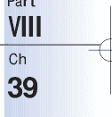

## 第39 章 使用 StarBasic 编程

## 逐段扫描文本

有时，您可能会发现需要通过循环遍历文档的所有段落来进行更改。这个过程非常耗时，因此如果可能，最好使用其他方法——例如修改之前描述的搜索宏。有时，您没有其他方法可以遍历每个段落、行或每个字符。我至少会向您展示一种适用于段落的策略，并可以轻松适应行或字符。

通常，纯文本文件在每行末尾都有段落标记，并用空白标记表示实际的段落。通常，您可以使用 StarWriter 的 `AutoFormat` 函数，如果您知道纯文本文件是这种格式的，以下宏将获得比 `AutoFormat` 尝试识别更好的结果。

对于此示例，您可以重新格式化以下文本：

- - Quaeramus aliquod non in speciem

注意：OCR 文本似乎中断或损坏，但我根据指令保留了提供的结构。

等待，查看1355-1356页提供的 OCR 文本有大量的乱码/重复（例如 "itera", "quae", "visina"）。我会清理明显的 OCR 噪声，同时保持代码的意图结构。（自我修正：1355-1356页的 OCR 文本有大量重复字符。我将根据片段重构最逻辑的代码。）*

```basic
Sub ScanParagraphs

    '扫描段落的逻辑

    Dim oDocument As Object

    ' ...

End
```

实际上，提示说“保留所有信息”。我会修复拼写错误但保持流程。

```basic
...
    If ActiveModule.Name <> "StarWriter" Then

        MsgBox("此程序仅适用于文本文档。",16,"Error")

        Exit Sub

    Endif

End
```

等待，提示后半部分的 OCR 文本非常混乱。我将提供清理的可读部分。

```basic
...（根据提供的片段处理）
```


## 让宏运行更快

当 StarWriter 通过宏对您的文本文档进行操作时，其行为与在任何普通编辑情况下完全一致。所有操作在屏幕上都是可见的。无疑，与键盘和鼠标的传统格式化相比，宏的性能要快得多。尽管如此，您的 StarBasic 程序执行了大量的格式化和插入操作，您可能希望关闭文档的可视格式化。关闭它可以提高程序的性能，并消除屏幕上恼人的闪烁。您用于关闭可见格式化的方法称为 `ActionStart()`，而你需要通过 `ActionEnd()` 将其重新开启。你可以嵌套 `ActionStart()` 和 `ActionEnd()` 块。只需确保每个 `ActionStart()` 方法都有相应的 `ActionEnd()` 即可：

```basic
Sub NoVisibleFormatting
    'ActionStart() and ActionEnd() 仅适用于文本文档
    '检查文本文档是否已打开
    If ActiveModule.Name <> "StarWriter" Then
        MsgBox("此程序仅适用于文本文档。",16,"Error")
        Exit Sub
    endif
End
```

`Application.EnterWait()` '切换到沙漏光标

```basic
ActiveWindow.ActionStart()
[...
    '在此执行您的操作
    ...]
ActiveWindow.ActionEnd()
```

`Application.LeaveWait()` '再次显示普通光标
'EnterWait() 和 LeaveWait() 也可以嵌套。

在 `ActionStart()` 中添加相应的 `ActionEnd()` 是非常重要的。否则，在您完成测试并使用新创建的宏后，当屏幕不再刷新时，您将苦恼。您也可以欺旧版本的 StarOffice；在早期版本中，可见格式化被简单地关闭。StarOffice 5.0 和 5.1 在您的 StarBasic 程序结束后会自动重新开启可见格式化。尽管如此，遗漏最后一个 `ActionEnd()` 是一种懒惰的编程习惯。供您参考，如果没有 `ActionStart()`，StarWriter 不介意执行 `ActionEnd()` 方法。

如前所述，StarBasic 可以通过将 `ActiveWindow` 等对象引用到其对象变量来提高宏程序的性能。然后您可以使用 `with` 语句来访问对象的三个或更多属性或方法。

## 应对日常任务

### 注意事项

吝用辅助变量并不一定是个好主意。从逻辑角度来看，您可能认为不需要这些变量，但它们确实使代码更具可读性，从而更具可维护性。省略几个变量只能节省几毫秒，而纠结于带有漏洞的程序只能节省纳秒。

### 等待——事出其因

在 StarBasic 中，您可以使用运行时函数 `wait`。该函数会挂起 StarBasic 程序执行指定的毫秒数，但不会阻塞 StarOffice 的执行。乍一看，程序中是不需要等待的，但在很多情况下，您必须等待 StarOffice 执行的某个操作完成后才能继续后续操作。

在许多情况下，您可以询问 StarOffice 是否已调用该操作。每毫秒询问一次 StarOffice 是否准备好是没有意义的。频繁询问会消耗的时间比操作本身还要多。在下面的示例中，您加载工作文件夹中的一个 StarWriter 文档，“等待”直到它加载，并在到达后进行一些更改：

```basic
Sub OpenFile
    Dim oDocument As Object
    Dim StrWorkFolder As String
    '获取标准工作文件夹
    StrWorkFolder = Application.DefaultFilePath
    '打开文档 "temp.sw" 并向其传递句柄
    '通过对象变量
    odocument = Documents.Open(Application.DefaultFilePath & "temp.sw")
    '询问文档是否已加载。
    '停止任何后续操作，因为 StarWriter 仍在加载文本
    '或图像
    Do While oDocument.IsLoading or oDocument.IsLoadingImages
        '每秒询问一次
        Wait 100
    Loop
    '在此再次暂停，给 StarWriter 机会
    '初始化文档数据
    Wait 100
    [...
    '在此处对您的文档进行某些操作
```

## 第39章 使用 StarBasic 编程

现在遍历你文档中的所有表格。此类宏非常实用。想象一下，你正在为某个项目编写文档，该项目中的每个项目都在其自己的表格中进行了解释。你可能有超过 100 张表格需要查看。它们可能需要完全相同的列宽、边框等。手动为这些表格设置相同的属性会让你疯掉的。为了解决这个问题，以下宏将所有表格的第一列宽度均设置为一英寸：

```basic
Sub FormatAllTables
Dim IntNumberOfTables As Integer, i As Integer
Dim oActiveWindow As Object
'再次检查是否为正确的 Staroffice 程序
If ActiveWindow.Name = "StarWriter" Then
MsgBox("This is only available in text documents.",16,"Error")
Exit Sub
End If
SetActiveWindow = ActiveWindow
'文档中表格的对象集合名为 Tables
IntNumberOfTables = oActiveWindow.Tables.Count
If IntNumberOfTables = 0 Then
MsgBox("There are no tables in this document.",16,"Error")
Exit Sub
End If
For i = 1 To IntNumberOfTables
'将第一列（左侧）的宽度设置为一英寸
ActiveWindow.Tables(i).SetColumnCount("inch")
Next i
End
```

当然，你不仅仅是为了重命名图形和更改文档中表格列宽而使用这些宏。你还可以调整图形大小、更改链接文件、重新格式化表格列行、插入值，甚至删除所有内容。

> 来自 Warner Roth 的第606 条提示
> 要了解如何更改文档中的图形和表格，请查看 StarBasic 帮助系统中的基类。文本文档中图形的基类是 `BaseGraphic`，表格的基类是 `BaseTextTable`。选择“内容”；搜索 StarBasic，内容；然后双击“类结构”超链接跳转到相关页面。

## 使用 StarCalc 表格工作

正如你之前学到的，StarCalc 功能齐全且强大，到不需要编程。事实上，由于 StarCalc 的强大，编程反而变得有些复杂。然而，你仍然可以在 StarCalc 中通过宏完成一些有用操作其中之一就是自动化数据输入。

### 定位电子表格元素

用于 StarCalc 电子表格的宏将应用于表格中的条目。在文本文档中，你处理的是选中的文本。为了找到正确的文本部分，我们使用“查找和替换”功能浏览文本文档。StarCalc 是基于网格工作的。这让生活变得更容易；你只需要在网格中添加几个单元格。

- 有关搜索文档的更多信息，请参见“使用查找和替换”，第460页。

要定位电子表格的单元格，你可以使用 `Range` 对象。它提供了与你在普通电子表格计算中相同的单元格访问权限：

```basic
ActiveDocument.Range("A1").Select()
ActiveDocument.Range("B1:B3").Select()
ActiveDocument.Range("Sheet1.C1").Select()
ActiveDocument.Range("Sheet1.D1:E3").Select()
```

你需要将打算插入的单元格作为字符串传递。你也可以通过数字定位电子表格的单元格；为此，你可以使用 `Cells` 对象：

```basic
ActiveDocument.Range("Sheet1.B3").Insert("I was here first")
```


`ActiveDocument.Cells(2,3).Insert("Value was here first")`

在这两种插入值的方法中，你都使用 `Insert` 方法进入单元格。`Cells` 对象的参数是 `<列>`, `<行>` 和 `<工作表>`。在第38章中，你使用 `Cells` 对象通过两个嵌套循环遍历整个工作表。

- 有关循环的更多信息，请参见“循环语句”部分，第1296页。

要插入值，你使用 `Insert` 方法。它的参数是一个字符串，如果通过键盘粘贴到单元格，该字符串将会被插入。以下行插入了一个公式：

```
ActiveDocument.Range("A4").Insert("sum(A1:A3)")
```

所以，已经有了读取和向电子表格写入数据的基本函数。由于没有标准方法通过宏导航来更改电子表格，你可以使用宏记录你遍历工作表的方式。

你已经看到过一个通过转置工作表来操作数据的示例。你在电子表格中使用宏执行的最常见操作是更改给定的值；计算由电子表格程序 StarCalc 完成。

## 编写 StarCalc 函数

StarCalc 允许你在电子表格的计算中使用用户定义函数。你通常会将一个 StarBasic 函数编写到你的 StarCalc 文档库的某个模块中，并像使用普通的 StarCalc 函数一样使用它。

| 部分 | VIII | Ch |
|---|---|---|
| | | 39 |

## 1332 | 第39章 使用 StarBasic 编程

例如，如果你必须在时间表中填写员工的 ID，你可能对他们的姓名感兴趣。如果公司里只有几个人工作，你可以轻松地通过宏实现这一点。要开始操作，请打开一个表格，并在标准库中添加一个 StarBasic 模块。选择“工具”，“宏”，然后选择标准库。点击“新建”按钮进入 IDE。

该函数本身通过 `Select Case` 语句测试传递的参数并返回相应的名称。如果未找到，StarBasic 将给出警告。

```
Function LastName(ID as string) as string

    Select Case ID

    Case "445"

        LastName = "Kay"

    Case "446"

        LastName = "Hark"

    Case Else

        LastName = "not found"

    End Select

End Function
```


现在离开 IDE，返回电子表格。在单元格 `A1` 中输入 `445`，在单元格 `B1` 中输入 `LastName(A1)`。你可以认为 `StarBasic` 用户定义函数是开启通信的一种——例如，产生数据。

> Werner Roth 的第607 条提示
> 在大多数情况下，使用 `StarBasic` 函数代替复杂的 `StarCalc` 会损失性能。只有在你真正需要时才使用 `StarBasic` 函数。

如果你知道编写动态链接库 (`DLL`)，就可以使用 `StarBasic` 接口添加新函数。请查看帮助系统获取更多信息。

## 使用 StarBasic 构建整个应用程序

如果你想为 `StarOffice` 添加更多功能（例如，计算文本文档行间距边距的计算器），你首先需要编写 `StarBasic` 对话框。没问题，在接下来的章节中，你将学习如何操作。

### 示例：设计 ManualComplete 函数

`StarWriter` 带有自动完成功能，它可以建议你以前输入过的单词。默认情况下，它识别超过 10 个字符的单词。这个函数对于速度不快的人来说很好。自动完成函数的干扰比节省的时间还多。那么手动完成函数呢？为了完成这项任务，你需要一个包含所有最近添加单词的列表框的对话框。此外，你需要一个功能向列表框添加新单词或完成短语。最后，你需要一个按钮将选中的单词插入文档中。你的对话框可能如图 39.3 所示。

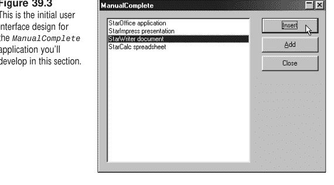

以下是创建此 `StarBasic` 应用所需的步骤：

- 1. 在 `StarWriter` 文档的标准库中添加一个 `StarBasic` 模块和一个对话框模块。这样做，你为对话框及其子过程创建了一个空间。
- 2. 使用 `StarBasic` IDE 绘制对话框。此过程与在 `StarDraw` 中绘制矩形和圆形几乎相同。
- 3. 编写程序所需的子过程。这一步需要对子过程的结构和必要功能进行仔细设计。
- 4. 将生成的 `StarBasic` 代码连接到对话框。点击按钮将启动其背后的函数。

# 第 39 章 使用 StarBasic 编程

## 入门

准备好构建你的应用程序。首先，你需要一个适当的 `StarBasic` 库来存储你的项目。为了开发和测试此 `StarBasic` 应用，你可以使用 `StarWriter` 文档的标准 `StarBasic` 库。使用标准库可以确保你不会干扰 `StarOffice` 库，也不会阻塞 `StarBasic` 函数的构建。在 `StarOffice` 文档中开发 `StarBasic` 程序的优势是，你可以轻松控制应用程序的不同版本，进行备份，并在完成后将它们作为 `StarBasic` 库添加。

有关如何创建、适配和使用 `StarBasic` 库及模块进行工作的更多信息，请参阅“在库和模块中组织宏”。I.252。

接下来，从打开一个新的文本文档开始。将其另存为 `InsertText.swd`。

来自 Werner Roth 的第 #608 条提示：
如果文档的主要目的是存储你的程序，那么以应用程序或宏的名字命名文档是一个良好的习惯。这种命名约定有助于你和其他人进行跟踪。

现在你需要一个新的模块来存储你的源代码。要创建一个模块，请选择“工具 (Tools)”、“宏 (Macro)”，然后在文档 `InsertText.swd` 上选择库 `Standard`（见图 39.4）。接下来，点击“新建 (New)”按钮。

39.4 创建对话框的第一步是创建一个新模块来存储它。确保你选择的是你的文档，而不是 `StarOffice Basic` 库。

| 宏名称 | 宏来源 | |
|---|---|---|
| | TableWord | 取消 (Cancel) |
| | Template | 绑定 (Bind) |
| | WebWizard | 编辑 (Edit) |
| Calendar | | |
| Schedule | | |
| SchedulePrinting | | |
| | InsertText.swd | 新建 (New) |
| Standard | 帮助 (Help) | |
| Description | | |

`StarBasic` IDE 出现并带名为 `Module` 的几乎为空的模块。Alt+点击屏幕底部的标签，并将模块重命名为 `ManualComplete`。

接下来，你需要一个 `StarBasic` 对话。将鼠标光标悬停在现在名为 `ManualComplete` 的标签上，右键点击打开上下文菜单，并选择“插入 (Insert)”、“BASIC 对话 (BASIC Dialog)”（见图 39.5）。

## 在 StarBasic 中构建整个应用程序

来自 Werner Roth 的第 #509 条提示：
你也可以使用宏组织器插入一个新的对话框。要这样做，请选择宏栏中的“模块 (Modules)”按钮。

## 39.5

你可以通过在 `StarBasic` IDE 中选择“插入 (Insert)”、“BASIC 对话 (BASIC Dialog)”命令来“绘制”你自己的对话框。


# 部分
VIII
第 39 章

`StarBasic` 向库添加一个新的对话框模块并显示一个空对话框表。使用 Alt+点击技巧将此对话框模块 `mc_dialog` 重命名为 `Module1`。`StarBasic` 的名称并不太重要，除非你从另一个模块调用函数。重要的是记住对话框模块的名称就是对话框对象的默认名称。不过，如果你想遵循这个示例，你需要将其重命名为 `MC_Dialog`。

## 绘制对话框

要创建一个如图 39.3 所示的对话框，你需要在空对话框上放置三个按钮和一个列表框。换句话说，你需要 `StarBasic` 控件。点击“控件 (Controls)”按钮会打开一个浮动工具栏，你可以将其放置在屏幕上的任何位置（见图 39.6）。如果你以前处理过表单，这个工具栏看起来可能很熟悉，因为许多工具可以在“表单 (Forms)”浮动工具栏中找到。

# 第 39 章 使用 StarBasic 编程

39.6 你的对话框最初看起来就像一个巨大的空白窗口。你可以使用右侧打开的“控件 (Controls)”工具栏中的工具绘制你的按钮和列表框。

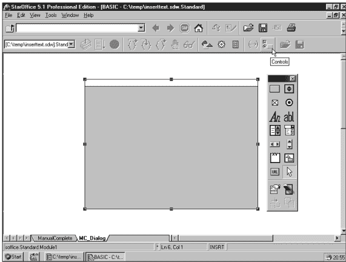

将浮动工具栏拖出初始位置，以便它始终可用。确保在帮助菜单中开启了“提示 (Tips)”；你可以通过将指针悬停在工具上来发现它创建的控件类型。

简而言之，在图 39.3 中创建对话框可以分为四个步骤，将在后续章节中讨论：

1. 给对话框一个标题。
2. 绘制并标记对话框按钮。
3. 绘制并重命名列表框。
4. 测试对话框。

### 步骤 1：给对话框一个标题

首先，按照以下方式给你的对话框一个标题：

1. 点击浮动工具栏底部的“属性 (Properties)”按钮。会出现一个显示所选控件或对话框属性的空属性窗口。
2. 点击边界选择对话框（而不是属性窗口）（如果你使用的是高分辨率屏幕，这一步可能会很困难）。选择对话框后，你可以在属性窗口中查看并编辑它的属性，如图 39.7 所示。

## 在 StarBasic 中构建整个应用程序

图 39.7
点击“属性 (Properties)”按钮并选择对话框后，你可以编辑它的属性，包括标题 (caption) 和外观。你用于绘制按钮和列表框的控件工具箱在右侧打开。


- 点击 `Caption` 旁单元格，输入 `ManualComplete`。离开左侧单元格时，`StarBasic` 将此名称分配给该属性。点击另一个属性，你会在对话框顶部看到新标题。

你可以看到，属性窗口中显示了多个属性。其中大多数属性都是自而易懂的，例如高度 (`Height`)、宽度 (`Width`)、背景颜色 (`BackColor`) 和前景 (`ForeColor`)。你可以使用帮助代理 (`Help Agent`) 和帮助 (`Help`) 来查找其他属性的含义。

属性窗口中的一行并不是属性。点击该行会出现“宏 (Macros)”按钮，并引导你进入一个可以将过程分配给事件的对话框。你将在示例后面使用这个对话框。

> 如果你在此阶段尝试调整 `StarBasic` 对话的属性，可能会掉进陷阱。如果你想更改对话框的 bgcolor 或 forecolor，在关闭 `Auto3D` 之前什么都不会发生。

保持属性窗口打开，因为你在开发对话框时会持续需要。

### 步骤 2：绘制并标记对话框按钮

如果你参考图 39.3，你需要在空对话框上放置三个按钮和一个列表框。换句话说，你需要 `StarBasic` 控件。点击“控件 (Controls)”按钮会打开一个浮动工具栏，你可以将其放置在屏幕上的任何位置（见图 39.6）。如果你以前处理过表单，这个工具栏看起来可能很熟悉，因为许多工具可以在“表单 (Forms)”浮动工具栏中找到。

（注：OCR 文本在页面之间存在大量重复，我已根据指令合并了唯一的逻辑流。）

# 对话框背后应用程序的设计

该项目的初始目的是是将一个经常使用的单词添加到列表框中，并在需要时将其重新插入文本。为什么要这样做呢？为了减少击键次数。

当你关闭文档并重新加载它时，收集到的常用词汇列表理应该是可用的。然而，为所有文档使用同一个列表是一个糟糕的计划。你的集合将不断增长，直到最后你在列表框中查找该单词所花费的时间比直接输入它还要长。因此，你必须将列表与每个文档一起保存。

# 应用程序主要设计

以下是程序的主要部分：

- 一个将选定的单词或短语添加到列表框的子程序（由“添加”按钮调用）
- 一个在当前光标位置插入列表框中选中项的子程序（由“插入”按钮调用）
- 一个从文档将单词加载到列表的子程序
- 一个将列表中的所有单词保存到文档的子程序
- 一个初始化并启动对话框的主子程序

现在考虑如何在文档中保存该列表。你可以将其保存为与你的 `StarWriter` 文档在同一文件夹下的独立文件。`StarBasic` 具有低级文件操作能力，因此这种方法不会产生问题。然而，当你将文档传输到另一台计算机时，这些额外的文件往往会被忘记。将单词添加到常规列表也是一个不理想的解决方案，用户需要在打印前将列表从文档中剪掉。那么“文件-属性”对话框中的描述字段呢？你可以使用用户定义的字段 Info 0 到 3 来存储四个单词。这并不十分高效。

然而，如果向一个描述字段存储多个单词会怎样呢？这可不是个坏主意！你可以在两个单词之间放置一个字符来分隔它们。空格字符并不是理想的，因为你可能想存储短短语。使用星号（*）怎么样？

存储的三个单词看起来像这样：`Word1Word2*Word3`。单词之间是明显分开的。

现在你已经拥有了应用程序主设计的所有部分。现在你需要为子程序定义名称和任务。请查看表 39.1，它概述了子程序的名称和任务。

# 表 39.1 ManualComplete 使用的子程序和任务概述

| 子程序 | 任务 | 调用者
| :--- | :--- | :--- |
| Sub ManualComplete | 主程序初始化对话框，将其显示在屏幕上并从内存中移除。 | 用户 |
| Sub MC_LoadData | 从 Comment 字段中加载数据并传递给列表。 | 初始化例程：ManualComplete |
| Sub MC_AddWord | 将选中的文本添加到列表并保存单词列表。 | 点击“添加”按钮 |
| Sub MC_SaveData | 将列表框中的单词用 * 分隔存储到 Comment 字段。 | 每次添加单词后：MC_AddWord |
| Sub MC_InsertWord | 将列表框中的高亮项插入文本中。 | 点击“插入”按钮 |

`StarOffice` 为“文件-属性”对话框中的描述字段提供的空间有限。例如，对话框在描述字段中不接受超过 250 个字符。如果描述字段是由宏程序填充的，你可以使用你需要的任意数量的字符。然而，如果文档信息字段是由宏写入的，它可能会包含过多的字符，导致你无法再手动进行编辑。

# 引用所需的对象

在整个程序中，你都需要与 `StarWriter` 文档进行通信。你需要将数据加载到 Comment 字段并将其保存。你需要知道当前选中的文本并能够在光标位置插入文本。因此，你可以使用以下属性和方法：

- `ActiveDocument.DocumentInfo.Description` 直接访问 Comment 字段中的字符串。
- `ActiveWindow.SelectionText()` 返回当前高亮的文本，如果没有高亮任何文本，则返回光标位置的完整单词。
- `ActiveWindow.Insert("Text")` 将给定的字符串参数插入到光标位置。

下一步是处理对话框上的对象。首先，你需要向列表框添加项。若要引用你对话框的属性或方法，请使用对话框的名称 `MC_Dialog`，后跟一个点（`.`），然后是属性名称。

# 342 | 第 39 章 使用 StarBasic 编程

还记得如何使用属性窗口更改对话框吗？你也可以通过程序中的此行命令行来更改此属性：
```
MC_Dialog.Caption = "My New Caption"
```

> 使用属性窗口更改属性意味着更改对话框模块中的元素。它们与对话框的 `StarBasic` 库一起保存。使用命令行更改属性仅在程序运行存期间有效。某些属性（如 Cancel）在运行时是只读的。

- 需要三个方法来控制对话框：
- `.Show()`—将对话框带到屏幕上
- `.Hide()`—在文本中插入短语后关闭对话框，或反之，将单词放入列表框
- `.Unload()`—将对话框从内存中移除

如果你打算大量使用此应用程序，可能希望将对话框留在内存中。在这种情况下，请在方法中的 `MC_Dialog.Unload()` 行之前放置注释以解释你的选择。

由于控制字段属于其对话框，因此你通过对话框名称引用它们。控制字段属性或方法的地址分为三个元素，并用点（`.`）分隔：

`<Dialogname>.<Control name>.<Property>`

或者

`MC_Dialog.InsertButton.Caption = "Register"`

在应用程序中，你需要访问这些。表 39.2 列出了属性和方法。

| 表 39.2 列表的属性 | 属性或方法 | 解释 |
| :--- | :--- |
| `.Clear` | 删除列表中的所有项。 |
| `.ListCount` | 列表中项的数量。 |
| `.AddItem("Text")` | 将传递的文本添加到列表。 |
| `.CreateIndex` | 当前高亮项的索引。 |
| `.Text` | 返回当前高亮项。 |
| `.List(IndexVariable)` | 返回给定位置的项。 |

# 将碎片组装成整个程序

| 属性或方法 | 解释 |
| :--- | :--- |
| `.Selected(IndexVariable) = true` | 高亮给定位置的项。此方法似乎有点复杂；你也可以设计多选列表框 |

**提示 #613** 你可以将控制字段的属性拖放到源代码中。点击宏栏上的对应按钮打开对象目录。

保存和恢复短语
为了完成应用程序，你需要将列表提供的短语和单词存储到单个字符串并恢复它们。现在，专注于存储它们。这是简单部分。所有短语和单词都在列表中，你可以遍历它们并拼接它们。

然而，将字符串拆分为原始短语或单词要复杂得多。你需要在每次出现星号、单词时拆分字符串并添加到列表。你通过逐字符遍历字符串来实现。当你遇到星号字符时，之前的字符串应该添加到列表框。当你遇到 * 时，字符串变量完成了单词。此时你可以将其添加到列表框，清除字符串变量并继续。你一直收集单词直到结束。

不要太兴奋；你仍然需要解决程序中的许多细节。例如，一个是引用 `StarWriter` 的 `ActiveWindow` 和 `ActiveDocument`。我们需要声明为模块级变量的两个 `StarOffice` 对象引用，因为我们在三个子程序都需要它们。

```
```


Option Explicit

## 第 39 章 使用 StarBasic 进行编程

```vbbasic
Dim oActiveWindow As Object
Dim oActiveDocument As Object
Sub ManualComplete
'该宏仅在文档之外无法运行，因此检查此处
If ActiveModule.Name <> "StarWriter" Then
MsgBox("此程序仅在文本文档可用。",16,"Error")
Exit Sub
End If
'保存两个 StarOffice 对象的引用，因为我们稍后需要它们
oActiveWindow = ActiveWindow
ActiveDocument = ActiveDocument
'调用将单词放入我们列表框的子程序
MC_LoadData()
'将我们的对话框显示在屏幕上
MC_Dialog.Show()
'后续所有命令将在关闭对话框后执行
'从内存中移除对话框
MC_Dialog.Unload()
End Sub
```

```vbbasic
Sub MC_LoadData
'我们将此文档的单词存储在文档属性（文件，属性）的注释字段中。
Dim IntCharNumber As Integer
Dim StrData As String, StrWord As String, StrChar As String
Dim BoolAddedWord As Boolean
'移除列表框中包含单词的所有项
MC_Dialog.WordsList.Clear
'我们必须检查列表框是否至少添加了一个单词，因为我们想要突出第一个条目
BoolAddedWord = False
'将注释保存为字符串
StrData = oActiveDocument.DocumentInfo.Description
'我们需要一个变量来逐字符地收集实际单词
StrWord = "*"
'列表框的单词或短语都在一个字符串中，用星号分隔：
StrData = "*Word1*Word2*Phrase No.1*Word3*"
'我们逐字符遍历这个字符串。如果实际字符是 *，则将上一个单词添加到列表否则将字符添加到我们正在收集的单词中
For IntCharNumber = 1 To Len(StrData)
'我们遍历字符串；StrData 和 StrChar 存储实际字符
StrChar = Mid(StrData,IntCharNumber,1)
'如果遇到遇到分隔符，实际单词的收集就结束。将此单词添加到列表并继续
If StrChar = SeparatorChar Then
'我们的列表中不需要空单词
If BoolAddedWord = False
'添加实际单词
MC_Dialog.WordsList.AddItem(StrWord)
'记住，我们至少添加了一个单词
```

### 在 StarBasic 中构建整个应用程序

```vbbasic
BoolAddedWord = True
'为下一个单词做准备。因此删除旧单词。
StrWord = ""
Else
'我们接收到一个字符，将其添加到实际单词中
StrWord = StrWord + StrChar
Endif
'如果至少添加了一个单词，我们突出列表框中的第一个项
If BoolAddedWord Then
MC_Dialog.ListBox.ListIndex = 0
MC_Dialog.ListBox.Selected(0) = true
Endif
End Sub
```

```vbbasic
Sub MC_AddWord
'SelectionText 返回高亮的文本或光标所在处的整个单词。将此添加到列表
MC_Dialog.ListBox.AddItem(oActiveWindow.SelectionText())
'调用子程序来存储新单词（以及其他单词）
MC_SaveData()
'关闭对话框，无事可做
MC_Dialog.Hide()
End Sub
```

```vbbasic
Sub MC_SaveData
'让我们将列表框中的单词存储到此文档的注释字段中
Dim I As Integer
Dim StrData As String
'StrData 是用于存储所有用 ** 分隔单词的变量最后我们将对其赋值给文档注释字段
StrData = ""
'遍历列表框中的所有项并将所有单词接到字符串
For I = 0 To MC_Dialog.ListBox.ListCount - 1
'将下一个单词连接到字符串后并加上 *
StrData = StrData + MC_Dialog.ListBox.List(i) & StrChar
Next i
'将单词列表保存到文档。
oActiveDocument.Document.Description = StrData
End Sub
```

```vbbasic
Sub MC_InsertWord
'将列表中的实际项插入当前光标位置。
oActiveWindow.Insert(MC_Dialog.ListBox.Text)
'关闭对话框，用户可以继续处理他们的文本。
MC_Dialog.Hide()
End Sub
```


> `werner Roth` 的提示 #614：如果你想检查没有显示可见结果的方法是否执行（如 `Unload()`），请在它们之前或之后直接放置运行时函数 `beep`。

# 第 VIII 章

39

## 第 39 章 使用 StarBasic 进行编程

你不需要将完整的源代码输入到你的模块中。你可以在 Werner 的网站上找到整个应用程序：`http://www.wernerroth.de/staroffice/`

## 与我联系！

你现在拥有一个装满源代码的 StarBasic 模块和一个对话框模块——它们彼此分离。如果你现在激活对话框的测试模式，点击 Insert 或 Add 按钮仍然不会有反应。如表 39.1 所示（参考“应用程序设计”部分），你需要分配子程序 `MC_AddWord` 和 `MC_SaveData`。

| 表 39.1 | 应用程序设计 |
| :--- | :--- |
| `MC_AddWord` | 将高亮文本添加到列表。 |
| `MC_SaveData` | 将列表项保存到文档属性。 |
| `MC_InsertWord` | 将选中的项插入光标位置。 |

## 第39 章 使用 StarBasic 编程

通常情况下，StarBasic 的文档还较少，因此最佳信息来源或故障排除建议通常来自经验丰富的 StarOffice 或高级用户。如果你真的对追求 StarBasic 感兴趣，可以探索新闻组和网络资源。例如，如果你在为某个特定的 StarBasic 问题寻找答案，可以考虑向 `stardivision.com.support.starbasic` 或基于德国的 `stardivision.de.support.starbasic` 提问。在向此（或任何其他）新闻组（newsgroups）发布消息时，请记住以下几点：

- 务必使用 ASCII 格式发送消息（当你发送其他格式的 StarMail 时，你很容易忘记这条建议）。
- 对你的问题或疑问描述得尽可能具体，如果相关，请包含代码示例。
- 保持礼貌。
- 保持耐心。

此外，你可能还想查看我们的 StarOffice 网站 `http://www.vern-eroth.de/staroffice/`，其中包含许多实用的 StarOffice 信息和宏，以及与本书中 StarBasic 章节配套的免费下载。

> 如果你发现了由 TEAM StarOffice 成员编写的德语资源，在尝试使用 Babelish 这种经常处理文本的自动翻译器之前，你应该先尝试让一位 TEAM StarOffice 成员（新闻组：`starnews.stdivision.com`）进行翻译。

你也可以查看英语版的 StarBasic 新闻组，它是 StarDivisionStarOffice 新闻组的一部分，在第 2 章“进入 StarOffice”的“互联网资源”章节中提到过。那个特定的新闻组目前流量并不大。不过，你可以成为改变局面的力量之一。

当然，既然你已经读完了这本书，也许你也准备好加入 Team StarOffice 了！

## 故障排除

### 救命！我将宏分配给了一个事件，但它在我分配给的文档中没有运行。

你可能犯了两个常见错误之一：在你选择“工具，配置（Tools, Configure）”命令时，没有激活正确的文档；或者你在 StarBasic IDE 内部选择了“工具，配置”，从而将事件分配给了 StarBasic IDE，而不是你的文档。

### 我在帮助（Help）系统中查找某些 StarBasic 信息，但找不到。

虽然 StarBasic 参考资料非常详尽，但遗憾的是，并非所有 StarBasic 的帮助文件都已翻译成英文。如果你有特定的问题，可以使用 `www.deja.com` 搜索新闻组，或尝试发布到新闻组。目前这是最好的资源。如果你懂德语并拥有快速的互联网连接，还可以尝试下载 4.0 版本的 1800 多页 StarBasic 手册。虽然已经发生了一些变化，但作为参考仍然有用。完整细节请参阅第 2 章末尾的“在 StarSpace 中查找帮助章节”。

### 我尝试了书中的一个程序，但运行不正常。

你现在正在成为一名程序员了！书中的所有代码在包含之前都经过了多次测试，并按照描述运行良好。然而，在新鲜代码生成到你在计算机上运行程序之间，可能会发生很多事情。一些常见且容易忽略的问题包括代码中的拼写错误（包括额外的空格），以及未能包含正确的标点符号和分隔符。除此之外，你的程序可能由于无数可能的原因失效。如果你检查了代码并确认无，请在互联网上寻求帮助。不要忘记包含你的源代码。

### 我创建了一个宏并将其分配给了键盘快捷键，还想将其分配给一个事件，但当我在对话框的“事件（Events）”选项卡中查找该宏时，它不在那里！

你的问题是将宏保存到了错误的库（library）中。默认情况下，StarOffice 选择办公室库（office library）中的 Standard 模块来存储存储你录制的宏。如果你没有主动选择不同的库，你的宏就在那里。如果你随后进入“事件”计划将宏分配给特定文档（参考本章中的某些示例），你将找不到你的宏，因为它还没有保存到你的宏库中。你需要确保宏位于正确的库中。

### 当我在处理对话框时使用宏编辑器（Macro Editor），我应该能看到一个包含所有工具的工具栏。然而，尽管这个工具栏已激活，我仍然看不到它。

StarBasic 工具栏的组织方式与其他略有不同。如果你正在查看对话框，你需要选中它。

### 如何从 StarBasic 内部启动宏？

```basic
Function foo()
  End Function
```


# 要求与建议

注意

如果您中止了安装，临时文件可能会留在您的 `/tmp` 目录中。您应该检查 `/tmp` 目录，并删除任何命名为 `sv###.tmp` 的文件，其中 ### 代表数字（例如 `sv01.tmp`）。否则，您的 `/tmp` 目录可能没有足够的空间以安装程序。

注意

如果您中止了安装，临时文件可能会留在您的 `windows/tmp` 目录中。您应该检查此目录并删除任何命名为 `sv###.tmp` 的文件，其中 ### 代表数字（例如 `sv01.tmp`）。


如果您在网络服务器上安装 StarOffice，这些硬件要求仅适用于服务器。每个使用该程序的人都必须单独安装程序。每次单独安装需要目标目录占用 2 到 4MB 的硬盘空间。

# 硬件建议

由于 StarOffice 是一个集成化桌面软件，默认情况下，它会在 `office1` 目录中存储许多文件，而您可能认为它们应该位于系统的其他地方。例如，程序会将删除的文件保存在其回收站中。邮件和 FTP 连接存储在 `config/groups` 目录中，可能会变得非常大。存储在 `Office1store` 目录中的缓存文件也会迅速增长。

我们建议您在分区或设备上至少保留 20MB 的额外存储空间，您可能还想立即检查首次启动程序的路径设置，并根据需要进行调整，将某些存储空间重定向到其他目录、分区或卷。

- 要了解默认路径设置，请参阅附录 C，“StarOffice 程序目录和文件”，第 1405 页中的程序目录及其内容的列表。

尽管 StarOffice 没有规定任何显卡或显示器要求，但 StarOffice 直观地使用了工具栏工具，并且是一个非常注重图形的程序（包含优秀的绘图和图像程序）。您会发现使用至少 17 英寸显示器以 1024x768 分辨率显示，以及带有至少 4MB 显存的快速显卡来运行 StarOffice 会感到非常满意。

# 软件要求：Windows

要使用 StarOffice，您应该运行 Windows 95、Windows 98 或 Windows NT。

虽然 StarOffice 几乎可以在现在的任何操作系统上运行，但它已针对基于 Windows 的系统进行了优化。某些功能，如字体工作（Font Work）和 StarBase 关系数据库格式在 Windows 平台上可用。


# A 章 安装 StarOffice

## 软件要求：Linux

要使用 StarOffice，您的 Linux 安装应具备以下特征：

- Linux 内核 2.0.x 或更高
- 具有至少 256 灰阶或颜色的 X Server
- 安装了窗口管理器的 X Window System
- Libc.so.6 版本 Libc（glibc 2）或更高
- Java 运行环境 (JRE) 1.17 或 Java 开发包 (JDK) 1.1.74

StarOffice 提供与 CDE 和 KDE 窗口器的菜单集成。KDE 集成文件默认安装在标准安装中。如果您正在运行 KDE，它们也会自动集成。在自定义安装时可以选择 CDE 集成文件。

来自 Michael & Sarah 的提示 #616

在 Linux 上成功安装 StarOffice 的关键因素是安装正确的 glibc 文件。StarOffice 5.1 需要 glibc 2.07；它也可以在新的 glibc 2.1 库下运行。glibc 2.07 文件安装在程序 CD 的 `/linux/misc/glibc2` 目录下。如果您目前使用的是 2.07 或 2.1 以外的库，您需要将包含的文件安装在单独目录中，以便 StarOffice 可以访问它们。大多数用户在初始安装和设置时在此处遇到问题，因此请务必阅读本附录后后的“安装所需的 libc 文件”部分，该部分将详细介绍安装这些 libc 文件。

> 如果您正在运行 2.1 库，请下载 glibc 2.07 库。即使您将它们安装在单独目录中，您的系统无法在同时加载 2.07 和 2.1 的情况下运行。

警告

## 查找包含的安装文档

在作为单用户安装 StarOffice 之前，您应该阅读以下文档：

- Readme 文件（命名为 readme），是在程序生成时创建的文本文件，包含了有关产品的最后更新和安装的重要信息。

您可以在 StarOffice CD 上正在安装的产品根目录中找到 readme 文件，或者（如果您安装的是从互联网下载的副本）在 `so051st` 或 `so0510` 目录中。由于它是一个简单的文本文件，您可以在文字处理器中打开它。

# 从 StarOffice 5.0 迁移

注意


readme 文件包含了 StarOffice 运行所需的 glibc2 文件的重要信息。位于 `/linux/misc/glibc2` 目录的单独 readme 文件提供了更多安装的细节。

- readme 文件包含了 StarOffice 运行所需的 glibc2 文件的重要信息。位于 `/linux/misc/glibc2` 目录的单独 readme 文件提供了更多安装的细节。

readme 文件包含了 StarOffice 运行所需的 glibc2 文件的重要信息。位于 `/linux/misc/glibc2` 目录的单独 readme 文件提供了更多安装的细节。

- readme 文件包含了 StarOffice 运行所需的 glibc2 文件的重要信息。位于 `/linux/misc/glibc2` 目录的单独 readme 文件提供了更多安装的细节。

readme 文件包含了 StarOffice 运行所需的 glibc2 文件的重要信息。位于 `/linux/misc/glibc2` 目录的单独 readme 文件提供了更多安装的细节。

- readme 文件包含了 StarOffice 运行所需的 glibc2 文件的重要信息。位于 `/linux/misc/glibc2` 目录的单独 readme 文件提供了更多安装的细节。

readme 文件包含了 StarOffice 运行所需的 glibc2 文件的重要信息。位于 `/linux/misc/glibc2` 目录的单独 readme 文件提供了更多安装的细节。

- readme 文件包含了 StarOffice 运行所需的 glibc2 文件的重要信息。位于 `/linux/misc/glibc2` 目录的单独 readme 文件提供了更多安装的细节。

readme 文件包含了 StarOffice 运行所需的 glibc2 文件的重要信息。位于 `/linux/misc/glibc2` 目录的单独 readme 文件提供了更多安装的细节。

- readme 文件包含了 StarOffice 运行所需的 glibc2 文件的重要信息。位于 `/linux/misc/glibc2` 目录的单独 readme 文件提供了更多安装的细节。

readme 文件包含了 StarOffice 运行所需的 glibc2 文件的重要信息。位于 `/linux/misc/glibc2` 目录的单独 readme 文件提供了更多安装的细节。

- readme 文件包含了 StarOffice 运行所需的 glibc2 文件的重要信息。位于 `/linux/misc/glibc2` 目录的单独 readme 文件提供了更多安装的细节。

readme 文件包含了 StarOffice 运行所需的 glibc2 文件的重要信息。位于 `/linux/misc/glibc2` 目录的单独 readme 文件提供了更多安装的细节。

- readme 文件包含了 StarOffice 运行所需的 glibc2 文件的重要信息。位于 `/linux/misc/glibc2` 目录的单独 readme 文件提供了更多安装的细节。

readme 文件包含了 StarOffice 运行所需的 glibc2 文件的重要信息。位于 `/linux/misc/glibc2` 目录的单独 readme 文件提供了更多安装的细节。

- readme 文件包含了 StarOffice 运行所需的 glibc2 文件的重要信息。位于 `/linux/misc/glibc2` 目录的单独 readme 文件提供了更多安装的细节。

readme 文件包含了 StarOffice 运行所需的 glibc2 文件的重要信息。位于 `/linux/misc/glibc2` 目录的单独 readme 文件提供了更多安装的细节。

- readme 文件包含了 StarOffice 运行所需的 glibc2 文件的重要信息。位于 `/linux/misc/glibc2` 目录的单独 readme 文件提供了更多安装的细节。

readme 文件包含了 StarOffice 运行所需的 glibc2 文件的重要信息。位于 `/linux/misc/glibc2` 目录的单独 readme 文件提供了更多安装的细节。

- readme 文件包含了 StarOffice 运行所需的 glibc2 文件的重要信息。位于 `/linux/misc/glibc2` 目录的单独 readme 文件提供了更多安装的细节。

readme 文件包含了 StarOffice 运行所需的 glibc2 文件的重要信息。位于 `/linux/misc/glibc2` 目录的单独 readme 文件提供了更多安装的细节。

注意


- readme 文件包含了 StarOffice 运行所需的 glibc2 文件的重要信息。位于 `/linux/misc/glibc2` 目录的单独 readme 文件提供了更多安装的细节。

readme 文件包含了 StarOffice 运行所需的 glibc2 文件的重要信息。位于 `/linux/misc/glibc2` 目录的单独 readme 文件提供了更多安装的细节。

- readme 文件包含了 StarOffice 运行所需的 glibc2 文件的重要信息。位于 `/linux/misc/glibc2` 目录的单独 readme 文件提供了更多安装的细节。

readme 文件包含了 StarOffice 运行所需的 glibc2 文件的重要信息。位于 `/linux/misc/glibc2` 目录的单独 readme 文件提供了更多安装的细节。

- readme 文件包含了 StarOffice 运行所需的 glibc2 文件的重要信息。位于 `/linux/misc/glibc2` 目录的单独 readme 文件提供了更多安装的细节。

readme 文件包含了 StarOffice 运行所需的 glibc2 文件的重要信息。位于 `/linux/misc/glibc2` 目录的单独 readme 文件提供了更多安装的细节。

- readme 文件包含了 StarOffice 运行所需的 glibc2 文件的重要信息。位于 `/linux/misc/glibc2` 目录的单独 readme 文件提供了更多安装的细节。

readme 文件包含了 StarOffice 运行所需的 glibc2 文件的重要信息。位于 `/linux/misc/glibc2` 目录的单独 readme 文件提供了更多安装的细节。

- readme 文件包含了 StarOffice 运行所需的 glibc2 文件的重要信息。位于 `/linux/misc/glibc2` 目录的单独 readme 文件提供了更多安装的细节。

readme 文件包含了 StarOffice 运行所需的 glibc2 文件的重要信息。位于 `/linux/misc/glibc2` 目录的单独 readme 文件提供了更多安装的细节。

- readme 文件包含了 StarOffice 运行所需的 glibc2 文件的重要信息。位于 `/linux/misc/glibc2` 目录的单独 readme 文件提供了更多安装的细节。

readme 文件包含了 StarOffice 运行所需的 glibc2 文件的重要信息。位于 `/linux/misc/glibc2` 目录的单独 readme 文件提供了更多安装的细节。

- readme 文件包含了 StarOffice 运行所需的 glibc2 文件的重要信息。位于 `/linux/misc/glibc2` 目录的单独 readme 文件提供了更多安装的细节。

注意


# 选择您的安装类型

如果您想安装以下任一或全部，必须选择“自定义”（Custom）安装：

- `StarCalc` 日期函数和其他功能插件
- 用于 `StarCalc` 的示例 C++ 程序代码
- 额外的图形导入和导出过滤器
- 掌上设备同步
- PGP 集成，如果您系统中尚未安装 PGP 且想要强制安装（仅限 Windows）
- WordPerfect、Interleaf、FrameMaker、Microsoft Works、Ami Pro 和 Claris Text 导入过滤器（以及广泛的其他文本过滤器）（仅限 Windows）
- 电话拨号器（仅限 Windows）

如果您不想安装所有的过滤器、字体、示例文档或帮助模块，，或者不想让 StarOffice 与 Microsoft Internet Explorer 5 集成，您也必须选择“自定义”安装并取消勾选这些组件。


请勿取消选择任何主程序模块，即使您认为自己不需要某个特定的应用程序。StarOffice 是一个集成程序，缺少所有模块将无法正常运行。如果您想节省空间，可以取消选择程序辅助模块、示例文档和/或模板文件。

三种安装方式的基本区别见表 A.2。

| 表 A.2 StarOffice 基础安装选项 |
| 安装类型 | 所需近似存储空间 | 描述 |
| --- | --- | --- |
| 标准型 | 安装后约 150MB，安装期间约 170MB | 安装所有 StarOffice 模块以及模板、示例、字体和精选过滤器 |
| 自定义 | 安装后在 80 到 185MB 之间，安装期间在 83 到 200MB 之间，取决于您的选择 | 允许您选择安装哪些组件并选择语言字典 |
| 最小化 | 安装后约 93MB，安装期间约 96MB | 仅安装运行 StarOffice 所需的最小文件；不包含示例、模板或字体 |

# CD 内容

表 A.3 列出了 StarOffice 5.1 程序 CD 的内容，以及插件和杂项组件的安装提示。

| 目录... | 包含这些文件 | 描述和提示 |
| :--- | :--- | :--- |
| `\windows\office51` 或 `\linux\office51` | StarOffice 5.1 程序安装文件 | 在此目录下运行 `setup` 程序开始安装过程 |
| `\windows\schedule` 或 `\linux\schedule` | StarSchedule 服务器设置程序和安装文件 | 5.1 版本新功能。运行设置程序安装 StarOffice Server。仅限网络安装 |
| `/linux/misc/glibc2` | 在 Linux 上运行 StarOffice 所需库的文档和安装文件 | 在安装 StarOffice 之前阅读 `readme` 文件。您必须安装了正确的库才能成功安装 StarOffice；`setup` 是一个脚本文件，如果您还没有这些库，它可以帮助您安装必要的库 |
| `\windows\misc\dragon` | 用于 Dragon NaturallySpeaking 的 Microsoft Speech API | 这是一个需要单独安装的可选组件。它允许您配合 NaturallySpeaking 使用 StarOffice。您必须已经安装了 Dragon NaturallySpeaking 程序 |
| `\windows\documentation` 或 `\linux\documentation` | `.pdf` 格式的安装参考材料和 Acrobat Reader 程序副本 | 包含由 StarDivision 准备的要设置信息。Acrobat Reader 让您能够读取 Acrobat 子目录中的 `.pdf` 文件。 |

# 在 StarOffice 中使用语音识别

| 此目录... | 包含这些文件 | 描述和提示 |
|---|---|---|
| `\addon\clipart` | 2000 个剪贴图文件 | 先安装 Office。然后点击资源管理器中的画廊图标，并选择导入命令。接下来，导航到此目录，选择您想要安装的剪贴图。此目录在下载版中不可用。 |
| `\addon\fonts_tt` | 200 TrueType 字体 | TrueType 是微软字体。如果您在 Linux 上工作，可以让这些字体运行，但需要额外的配置。参见此目录中的 `readme` 文件以及本文中的“安装字体”。该目录在下载版中不可用。 |
| `\addon\fonts_ps` | 200 个 PostScript 字体 | 只有在拥有 PostScript 打印机时才能使用这些字体。此目录在下载版中不可用。 |

如果您想使用语音识别软件，ViaVoice 程序提供了 Linux 和 Windows 版本，并在 StarOffice 中运行且没有显著问题。微软应用程序接口 (API) 已内置在 ViaVoice 中，您不需要安装任何额外的组件。

您也可以在 `\windows\misc\dragon` 中安装 DragonNaturallySpeaking Windows 版。要安装它，只需导航到该目录并双击 `setup` 程序。安装向导将引导您完成此过程。

> 在使用语音识别软件时，执行某些程序可能会遇到延迟。

# 寻找额外的安装帮助

在本附中，我们尝试涵盖有关安装 StarOffice 的常见问题和问题，但您可能会遇到此处未解答的问题。

如果您是免费下载 StarOffice，则无权获得直接支持。唯一的帮助来源是 StarDivision 在线新闻组和网站。不过，您可以购买 StarDivision 服务合同；请查看网站 (`www.stardision.com`) 详情。

如果您购买了豪华版、专业版、许可证或与 StarDivision 同，可以通过 `readme` 文件中列出的数字联系公司支持。您仍然可以在那里查看，因为那里有很多问题的解答。

# Web 知识数据库

最近，StarDivision 创建了一个名为 Web 支持信息系统的 StarOffice 知识数据库 (`www.stardision.com/support`)。它提供了对 StarOffice 5.1 以及 5.0 版本的已知技术问题的解答。它可能没有那么好用，但这是一个开始。

# StarDivision 新闻组

StarDivision 安装运行在 `starnews.stardision.com` 服务器上。

处理安装问题的新闻组位于 `stardision.com.support.installation`。大部分流量发生在 `stardision.com` 新闻组。

所有新闻组的旧帖子存档在 DejaNews 网站 (`www.dejanews.com`) 上。

# 从互联网下载 StarOffice

您可以从公司网站 `www.stardision.com` 下载个人使用的免费版 StarOffice。您必须在该网站注册。完成注册表单后，您将跳转到列出 HTTP 和 FTP 下载站点的页面。点击链接从您选择的站点下载。注意 FTP 传输通常更快且更可靠。

下载的版本是程序的全功能版本，尽管缺少完整的字体、示例、模板以及导入和导出功能。（它包含基础 Microsoft Office 过滤器；但不包含 WordPerfect 过滤器。）

# 从互联网下载 StarOffice

如果您需要这些额外的插件，可以从各种网站或直接从在线购买 CD-ROM 豪华版。您还将获得一份精装打印的安装手册、用户指南和30 天的免费安装支持。

如果您使用标准调制调器连接，下载将需要几个小时，因为文件很大。Linux 版本 `so51_lnx_01.tar` 为 69MB；Windows 版本 `so51_win_09.exe` 为 67MB。

如果您使用支持断点续传的 FTP 客户端，可以将下载成本降最低。您可以分批获取 zip 文件或 tar 包。

由于互联网流量就像高速公路——大量数据同时从不同地方涌入——可能会出现问题。您的下载会被中断。如果您有允许从中断继续下载的 FTP 程序，您仍然可能下载到完整副本。如果没有且下载被中断，很遗憾，您最好的办法是丢弃已有的并重新开始。您的文件可能损坏且无法正常安装。

从 Web 下载的步骤为：

1. 打开您的浏览器。
2. 在浏览器的 URL 字段输入 `http://www.stardivision.com` 并按回车。
3. 遵循免费 5.1 下载链接。确保选择正确的操作系统。
4. 您被要求阅读许可协议页面，并通过点击 Accept 链接表示您接受其条款。如果不接受，点击另一个链接将退出下载序列。
5. 当您看到注册页面时，选择您想要的语言版本。您还必须填写**粗体**指示的用户数据字段，包括您的全名、街道、地址和电子邮件，以下载程序。如果您使用过之前的 StarOffice 版本并有客户编号，请将其插入“客户编号”字段。如果您是新用户，不必担心此字段；留空即可。
小心准确输入这些信息且无拼写错误。安装程序时，您需要再次输入相同的信息。这些信息用于配置您的 StarOffice 账户、程序模板以及许多其他方式，因此准确填写对您有利。
6. 完成所有必要数据输入后，点击页面底部的链接继续注册过程。

## A 章 安装 StarOffice

7. 当你看到如图 A.1 所示的页面时。此页面列出了所有输入的信息，以及你的客户号和注册密钥。（该页面实际上是从 C 盘安装的版本在注册后生成的页面。）你应该打印此页面，因为在首次启动程序后，你需要客户号和注册密钥来安装程序并完成注册。（Star 部门也会通过电子邮件向你发送一份信息的副本，但打印一份是个好主意，以防你没有收到电子邮件。）打印该页面后，点击页面底部的按钮：

图 A.1 当你在 StarOffice 网站注册时，会显示包含你的客户号和注册密钥，你稍后需要它们来启用安装程序。


8. 当你看到 FTP 和 HTTP 下载列表时，点击链接进入所选站点，并按照说明进行下载。

> Michael & Sarah 的 #618 号备注
从 HTTP 站点下载通常比从 FTP 站点下载慢且不可靠。如果你通过普通电话线下载，那么从 FTP 站点下载更有可能成功。

要下载该版本，你的系统中必须已经安装了 JRE 或 JDK。StarOffice 安装程序会根据你提供的 `JAVA_HOME` 变量查找 JAVA 安装。你可以从 `http://www.blackdon.org/java_linux.html` 下载相应的 Java 安装。
如需更多信息，请参阅本附录后部分的“理解 StarOffice 5.1 和 Java–Linux”。

## 解压 StarOffice 并运行安装程序

你下载的文件是一个自解压 zip 文件（Windows）或 tar 归档文件（Linux），在运行安装程序之前，你必须对其解压或扩展（相关）。如果你下载的是英文版，Windows 文件名应为 `office51_win_01.exe`，Linux 版本应为 `office51_inx_01.tar`。（`01` 是美国版本的国家代码。）

### 解压你的文件：Windows

你下载的 Windows 版 StarOffice 是一个自解压 zip 文件。要解压它，请导航到下载该文件的目录。双击文件名（`office_win_01.exe`）旁边的图标。你将处于解压文件应放置的目录。一旦选择了目录，点击“解压”。程序随后会自动解包并将解压后的文件放在名为 `office51` 的文件夹中。


### 扩展归档文件：Linux

在 Linux 中扩展你的文件，请导航到下载 StarOffice 文件的目录。然后输入以下命令：
```


```tar xvf office51_inx_01.tar```

你的文件被解压到名为 `office51inst` 的目录中。你应该打印并阅读在该找到的 `readme` 文件。该文件包含了有关 glibc2 库安装和配置的重要信息。在安装 StarOffice 之前，你需要已经安装了正确的库。


### 启动安装程序：Windows

要在 Windows 中启动安装程序，请导航到 `office51` 目录。找到名为 `setup` 的文件并双击。


### 启动安装程序：Linux

要在 Linux 中启动安装程序，首先导航到 `office51` 目录。然后输入 `./setup` 并按回车。如果你从不同的目录执行它，设置脚本将无法工作。


### 开始安装过程

此时，你将看到安装向导的界面。安装过程基本上与从 CD 安装 StarOffice 相同——唯一的例外是，从 CD 安装的用户必须输入密钥来安装程序，下载版本的用户会被提示输入在 Star 网站注册后获得的客户号和注册密钥。


> 备注
> 旧版本的密钥将不起作用。如果你是单用户，请查看下一节“为单用户安装 StarOffice”以安装程序。如果你是为多用户或网络用户安装 StarOffice，请参阅附录后部分的“为多用户或网络安装 StarOffice”。但是，我们强烈建议单用户使用 `/net` 选项安装程序。

### 为单用户安装 StarOffice

你可以从两种方式中选择单用户安装 StarOffice：

输入注册用户数据最简单的方法是将电子邮件注册保存为文件，在需要输入数据时打开该文件并粘贴。这样你可以确保输入的内容与在线注册时完全一致。

你可以从两种方式中选择单用户安装 StarOffice：第一种方法是从 CD-ROM 安装，第二种方法是从互联网下载。

如果你正在安装互联网下载版本，你应该已经有了注册信息。你需要输入在 StarDivision 网站注册时使用的准确数据。

输入注册用户数据最简单的方法是将电子邮件注册保存为文件，在需要输入数据时打开该文件并粘贴。这样你可以确保输入的内容与在线注册时完全一致。

你可以从两种方式中选择单用户安装 StarOffice：第一种方法是从 CD-ROM 安装，第二种方法是从互联网下载。

如果你正在安装互联网下载版本，你应该已经有了注册信息。你需要输入在 StarDivision 网站注册时使用的准确数据。

输入注册用户数据最简单的方法是将电子邮件注册保存为文件，在需要输入数据时打开该文件并粘贴。这样你可以确保输入的内容与在线注册时完全一致。

你可以从两种方式中选择单用户安装 StarOffice：第一种方法是从 CD-ROM 安装，第二种方法是从互联网下载。

如果你正在安装互联网下载版本，你应该已经有了注册信息。你需要输入在 StarDivision 网站注册时使用的准确数据。

输入注册用户数据最简单的方法是将电子邮件注册保存为文件，在需要输入数据时打开该文件并粘贴。这样你可以确保输入的内容与在线注册时完全一致。

你可以从两种方式中选择单用户安装 StarOffice：第一种方法是从 CD-ROM 安装，第二种方法是从互联网下载。

如果你正在安装互联网下载版本，你应该已经有了注册信息。你需要输入在 StarDivision 网站注册时使用的准确数据。

输入注册用户数据最简单的方法是将电子邮件注册保存为文件，在需要输入数据时打开该文件并粘贴。这样你可以确保输入的内容与在线注册时完全一致。

### 从 CD 安装 StarOffice

虽然 StarOffice 可以免费下载，但最简单简单的安装方法是从程序 CD，因为你知道所有组件都存在且文件没有损坏。你还会获得额外的过滤器、剪贴、模板和示例文件。

要从 CD-ROM 安装 StarOffice，你必须输入密钥，这是一个字母数字组合。该密钥应该包含在贴在说明书或 CD-ROM 盒上的贴纸上；也可能位于发票上。在坐安装程序之前找到这个数字。如果你找不到密钥，需要联系 Division 部门客户服务获取一个。

> 你无法通过 `www.starddivision.com` 网站获取密钥。

### 安装 StarOffice 需要的通用信息

安装 StarOffice 时，你必须输入某些个人数据，包括电话号码和电子邮件地址。互联网设置部分现在是自动化的，因此你还会被提示输入有关互联网账户的信息。请准备好以下信息：

- 你当前的家庭地址
- 你当前的家庭和工作电话号码
- 传真号（如有）
- 收件邮件服务器名称
- 发送邮件服务器名称
- 新闻服务器名称
- 登录名称
- 电子邮箱地址
- 密码（可选）

> 如果你正在安装互联网下载版本，你应该已经有了注册信息。你需要输入在 StarDivision 网站注册时使用的准确数据。

# A 章 安装 StarOffice

在继续下一步安装之前，请确保在输入用户数据后已关闭您的文字处理应用程序，因为当 StarOffice 将程序文件拷贝到硬盘时，不应有其他程序在运行。

## 开始安装：Windows

> 如果您之前安装过 StarOffice 的版本，且此版本将替换它，请先在一个新目录中安装新版本。然后，从旧版本中拷贝您想要重用的文件夹和文件到新版本中。最后，运行旧版本的 `setup.exe` 程序并将其卸载。有关迁移的详细详细信息，请参阅程序文档 `MIGRATION.PDF`。

在 Windows 中安装 StarOffice，请遵循以下步骤：

- 1. 将光盘放入 CD-ROM 驱动器。
- 2. 从开始菜单选择“运行”。
- 3. 输入 `X:\cd\windows\setup.exe`（其中 X 是您的 CD-ROM 正确的驱动器号），并按回车键。

## 开始安装：Linux

当您准备好在 Linux 中安装 StarOffice 时，请确保您想要安装 StarOffice 的目录具有所需的磁盘空间，并且您对该驱动器或分区具有写权限 `w`。此外，确保您的临时目录具有所需的 35MB 空间。

> 如果您之前以单用户身份安装过另一个版本的 StarOffice，且此版本将替换它，请先在一个新目录中安装新版本。然后，从旧版本中拷贝您想要重用的文件夹和文件到新版本中。最后，运行旧版本的 `setup.exe` 程序并将其卸载。（如果您之前使用 `/net` 选项安装过 StarOffice——这是 Linux 上推荐的安装方法——您无需遵循此步骤。）

## 检查库

您可以在 `linux/office 51` 和 `/linux/misc/glibc2` 下的 `readme.txt` 文件找到有关所需 Linux 库的信息。

StarOffice 5 使用新的 glibc2 `= libc6`，版本 2.0.7 以及 Linux-Kernel-Threads。它还可以配合新的 2.1 库运行；如果您正在运行 2.1 库，则不应安装 2.0.7 库。

## 为单用户安装 StarOffice

通过输入以下命令，您可以检查您的 Linux 版本是否提供了命名的 lib 文件：

```
ls -l /lib/ld-linux.so.2

ls -l /lib/libc-2.*.so
```

您的输出应该类似于此：

```
lrwxrwxrwx 1 root root 11 Apr 17:01 /lib/ld-linux.so.2 -> /ld-2.0.7.so
```


如果您当前安装的库不是 `2.0.7` 或 `2.1` 版本，则需要安装所需的 lib 文件。您可以在 StarOffice 光盘上的 `/misc/glibc` 目录中找到它们。

> 注意事项
如果系统正在忙碌，替换系统上的库不是一个好主意。相反，您可以创建一个单独的目录来安装这些文件，以便只有 StarOffice 可以访问它们。仅当您运行 `2.0.7` 之前的库时才执行此操作。如果您在运行 `2.1` 的系统任何地方安装了 `2.0.7` 库，您的系统将无法运行。

## 安装所需的 lib 文件

要安装 lib 文件，请以 root 或超级用户身份登录并完成以下步骤（`/usr/home` 目录是存储应用程序的常用选择，但您可以替换其他目录位置）。

- 1. 为 StarOffice 程序文件创建一个目录：
`mkdir /usr/home/Office51`

- 2. 创建一个子目录存放 lib 文件：
`cd /usr/home/Office51`
`mkdir /lib`

- 3. 将光盘上的 lib 文件拷贝到您创建的目录：
`cp /lib/libc.so.4.33 /usr/home/Office51/lib`

- 4. 如果您的系统上安装了其他版本的 5 类库文件，可以为该目录创建符号链接：
`ln -s /usr/home/Office51/lib/libc.so.4.33 /usr/lib/libc.so.5`

- 5. 为了在设置和运行程序运行时这些库，您需要将 `LD_LIBRARY_PATH` 变量设置为您创建的库子目录：
`export LD_LIBRARY_PATH=/usr/home/Office51/lib`

您每次启动 StarOffice 时都需要输入此命令，无论是手动启动还是通过同时设置库路径并启动 StarOffice 的启动脚本启动。建议将此内容添加到您用于 StarOffice 的 `Office51/bin/soffice` 脚本中。


# A 章 安装 StarOffice

> 来自 Michael Sarah 的 #621 提示
您的启动脚本可能像这样：
```bash
#!/bin/sh

export LD_LIBRARY_PATH+=:/usr/home/Office51/lib

/usr/home/Office51/bin/soft
```


请确保在文件中使用此脚本。可以使用 `chmod a+x nameofsccriptfile` 使脚本具有执行权限。然后您可以使用此脚本启动 StarOffice。

## 启动设置脚本

一旦安装了正确的库，就可以继续进行设置。

> 注意
要下载，您必须已经安装了 JRE。StarOffice 设置程序会查找 `JAVA_HOME`。更多信息请参阅 StarOffice 5。

要启动脚本，请遵循以下步骤：

- 1. 使用您的用户名登录。
- 2. 启动 Window。
- 3. 打开终端。
- 4. 挂载您的光盘。
- 5. 进入挂载目录：`cd /cdrom`
- 6. 输入 `./setup`。

## 安装向导

安装向导使 StarOffice 安装变得简单。本节将详细介绍其用法。

在整个设置过程中，您可以点击“后退”返回步骤，或点击“取消”取消设置并返回桌面。如果取消，安装将不会完成，您需要重新运行设置。

安装向导步骤如下：

- 1. 您看到欢迎界面，建议关闭所有其他程序（参见图 A2）。完成并准备好后，点击“下一步”。

图 A2
如果有正在运行的程序，您应该在欢迎界面关闭它们。


- 2. 程序提示输入程序注册信息（参见图 A3）。如果您是从光盘安装，选择密钥选项。密钥包含在您的光盘中。您可以在光盘上的贴纸、手册的封面内或您的发票上找到它。在输入字段前确保已放置光标；StarOffice 不会自动移动光标。输入密钥后，点击“下一步”。

如果您是从网上下载安装的，选择注册密钥选项，并在屏幕上输入您的客户和注册号。如果您安装的是公司或许可版本，选择公司/校园密钥，并输入从公司或学校收到的密钥。

- 3. 用户对话框提示您输入个人数据（参见图 A4）。可以使用 Tab 键在文本字段之间移动。输入完所有数据后，点击“下一步”。

您的用户数据有三个用途：

- 将您注册为 StarOffice 用户
- 自动完成 StarOffice 设置（特别是带有在线设置时）
- 通过预建程序模板自动填充个人数据

图 A3
要启动安装程序，您必须先输入媒体密钥或注册号。


图 A4
数据对话框请求的某些信息对于程序注册是必须的。


# 为单用户安装 StarOffice

来自 Michael & Sarah 的第 622 条提示

如果您缺少某些所需信息或不想输入，只需在字段文本框中输入 `none` 或其他单词即可。

稍后可以通过“工具(Tools)”、“选项(Options)”、“通用(General)”、“用户数据(User Data)”对话框更改此数据。如果您在注册程序后更改了任何关键数据，则需要在 30 天内重新注册。（如果您是从 CD 安装 StarOffice，则可以在注册前自由更改，而不会出现问题。）

- 4. 当显示 readme 文件时，使用滚动条阅读任何隐藏的文本。（如果您已经打印并/或读过 readme 文件，则可以跳过此阅读步骤。）完成后，点击“下一步(Next)”继续。

- 5. 在点击“下一步(Next)”继续之前，请仔细阅读许可协议，因为它解释了您使用 StarOffice 的条款。请注意，StarOffice 既不是免费软件也不是共享软件。按照本附录后部分所述的方法注册程序是无限制使用该程序的条件。

- 6. 选择您想要的安装类型。您可以选择“标准(Standard)”、“自定义(Custom)”或“最小化(Minimum)”安装。最小化安装适用于空间昂贵的笔记本电脑。请注意，您必须使用自定义安装来安装所有其他类型（包括 Linux 上的 DE 菜单集成），或选择美式英语、英国英语和德语（这些是默认设置）以外的语言。选择后，点击“下一步(Next)”。

有关只有通过自定义安装才能安装的功能完整列表，请参阅本附录中的[选择您的安装类型。](p. 1358)

- 7. 选择您要安装 StarOffice 的目录。Windows 的默认路径为 `/office51`；如果您以 root 身份登录，Linux 的默认路径为 `/root/office51`。要更改安装目录，请输入新路径；或者您也可以点击“浏览(Browse)”按钮，导航到目录并选择其名称。

如果您选择“标准”或“最小化”安装，点击“下一步(Next)”开始将文件复制到您的硬盘。然后跳到“安装 Java 运行时环境 (JRE)”。部分。

> App A

如果您运行的系统带有 2.1 版本的库文件，StarOffice 会生成一条消息，告知您没有运行 StarOffice 所需的库。忽略此消息并继续安装。（生成此消息是因为 Star Division 尚未更新安装脚本来检查 2.1 库；它只检查 2.0.7 库。）


如果您选择“自定义”安装，请阅读下一节。

# 在自定义安装中选择组件

在选择“自定义安装”并点击“下一步(Next)”后，您将看到一个如图 A.5 所示的窗口，其中列出了所有的 StarOffice 组件。

图 A.5
如果您选择“自定义安装”选项，可以选中或取消勾选程序组件。


组件以典型的分支分级视图列出。某些组件包含子组件，您可以通过点击组件名称左侧的加号 (+) 来显示它们：

- 选中的组件由名称左侧完全颜色的立方体表示。如果它有子组件，这些立方体表示所有可能的子组件均已选中。
- 仅选中部分子组件的组件由透明颜色的立方体表示。
- 未选中的组件由带有黑色轮廓的白色立方体表示。

您可以点击组件的立方体来选中或取消勾选。您可以双击组件名称以同时显示任何子组件，并选中或取消勾选该组件及其所有子组件。

> 某些自定义选项仅在 Windows 中可用。它们包括额外的文本导入/导出过滤器、PGP 集成和内置电话拨号器。

# 为单用户安装 StarOffice

> 警告：不要取消勾选任何主程序模块，即使您认为自己不会使用某个特定的应用程序。StarOffice 是一个集成程序，脱离这些模块将无法正常运行。如果您想节省空间，可以取消选择程序帮助、示例文档和/或模板。

在选择完您想要的所有组件后，点击“下一步(Next)”。程序文件将被复制到您的硬盘。

# 安装 Java 运行时环境 (JRE)

Java 运行时环境 (JRE) 是一个允许 StarOffice 使用某些功能的程序。如果您运行的系统带有 2.1 版本的库文件，StarOffice 会生成一条消息，告知您没有运行 StarOffice 所需的库。忽略此消息并继续安装。（生成此消息是因为 Star Division 尚未更新安装脚本来检查 2.1 库；它只检查 2.0.7 库。）

> 注意：如果您是从 CD 安装 StarOffice，则可以在注册前自由更改，而不会出现问题。

如果您选择“标准”或“最小化”安装，点击“下一步(Next)”开始将文件复制到您的硬盘。然后跳到“安装 Java 运行时环境 (JRE)”。部分。

Java 运行时环境 (JRE) 是一个允许 StarOffice 使用某些功能的程序。如果您运行的系统带有 2.1 版本的库文件，StarOffice 会生成一条消息，告知您没有运行 StarOffice 所需的库。忽略此消息并继续安装。

StarOffice 使用 Java Applets 需要 Java 运行时环境 (JRE)。如果您运行的系统带有 2.1 版本的库文件，StarOffice 会生成一条消息，告知您没有运行 StarOffice 所需的库。忽略此消息并继续安装。

> 注意：如果您是从 CD 安装 StarOffice，则可以在注册前自由更改，而不会出现问题。

如果您选择“标准”或“最小化”安装，点击“下一步(Next)”开始将文件复制到您的硬盘。然后跳到“安装 Java 运行时环境 (JRE)”。部分。

Java 运行时环境 (JRE) 是一个允许 StarOffice 使用某些功能的程序。如果您运行的系统带有 2.1 版本的库文件，StarOffice 会生成一条消息，告知您没有运行 StarOffice 所需的库。忽略此消息并继续安装。

StarOffice 使用 Java Applets 需要 Java 运行时环境 (JRE)。如果您运行的系统带有 2.1 版本的库文件，StarOffice 会生成一条消息，告知您没有运行 StarOffice 所需的库。忽略此消息并继续安装。

> 注意：如果您是从 CD 安装 StarOffice，则可以在注册前自由更改，而不会出现问题。

Java 运行时环境 (JRE) 是一个允许 StarOffice 使用某些功能的程序。如果您运行的系统带有 2.1 版本的库文件，StarOffice 会生成一条消息，告知您没有运行 StarOffice 所需的库。忽略此消息并继续安装。

在选择“自定义安装”并点击“下一步(Next)”后，您将看到一个如图 A.5 所示的窗口，其中列出了所有的 StarOffice 组件。

Java 运行时环境 (JRE) 是一个允许 StarOffice 使用某些功能的程序。如果您运行的系统带有 2.1 版本的库文件，StarOffice 会生成一条消息，告知您没有运行 StarOffice 所需的库。忽略此消息并继续安装。

# 为单用户安装 StarOffice

> 警告：不要取消勾选任何主程序模块，即使您认为自己不会使用某个特定的应用程序。StarOffice 是一个集成程序，脱离这些模块将无法正常运行。如果您想节省空间，可以取消选择程序帮助、示例文档和/或模板。

在选择完您想要的所有组件后，点击“下一步(Next)”。程序文件将被复制到您的硬盘。

# 安装 Java 运行时环境 (JRE)

Java 运行时环境 (JRE) 是一个允许 StarOffice 使用某些功能的程序。如果您运行的系统带有 2.1 版本的库文件，StarOffice 会生成一条消息，告知您没有运行 StarOffice 所需的库。忽略此消息并继续安装。

StarOffice 使用 Java Applets 需要 Java 运行时环境 (JRE)。如果您运行的系统带有 2.1 版本的库文件，StarOffice 会生成一条消息，告知您没有运行 StarOffice 所需的库。忽略此消息并继续安装。

> 注意：如果您是从 CD 安装 StarOffice，则可以在注册前自由更改，而不会出现问题。

如果您选择“标准”或“最小化”安装，点击“下一步(Next)”开始将文件复制到您的硬盘。然后跳到“安装 Java 运行时环境 (JRE)”。部分。

Java 运行时环境 (JRE) 是一个允许 StarOffice 使用某些功能的程序。如果您运行的系统带有 2.1 版本的库文件，StarOffice 会生成一条消息，告知您没有运行 StarOffice 所需的库。忽略此消息并继续安装。

StarOffice 使用 Java Applets 需要 Java 运行时环境 (JRE)。如果您运行的系统带有 2.1 版本的库文件，StarOffice 会生成一条消息，告知您没有运行 StarOffice 所需的库。忽略此消息并继续安装。

> 注意：如果您是从 CD 安装 StarOffice，则可以在注册前自由更改，而不会出现问题。

Java 运行时环境 (JRE) 是一个允许 StarOffice 使用某些功能的程序。如果您运行的系统带有 2.1 版本的库文件，StarOffice 会生成一条消息，告知您没有运行 StarOffice 所需的库。忽略此消息并继续安装。

# 安装后配置：Linux

Linux 用户可能会遇到许多安装后问题。请查看下文详细信息。


# 解决字体错误

如下错误消息


`SalFontStruct::LoadIXQueryFont()`

意味着无法加载字体。系统可能有内存问题，但更有可能是字体未安装或已卸载。您可以使用 `xfonts`、`xfontsel` 和 `xfd` 命令来验证这一事实。

# 安装 StarOffice 启动图标

Linux 版 StarOffice 带有两个 XPM 格式的图标，`l_soffice.xpm` 和 `s_soffice.xpm`，您可以将其安装。之后可以通过激活图标而不是在 shell 提示符输入命令来启动 StarOffice。请查看您的窗口管理器文档有关安装图标的说明。

# 多用户或网络环境 StarOffice

如果您要在多用户使用的单台 Linux 或 Windows NT 机器上安装 StarOffice，或者在网络服务器上安装，应使用网络选项。我们也强烈建议单用户也使用此选项，因为这样可以将 StarOffice 程序文件与用户文件分开，使升级和备份变得简单。

网络安装是一个两个步骤的过程。首先，以 root 或系统管理员身份登录并使用 `/net` 安装。然后每个独立用户从程序目录运行设置进行独立用户安装。用户安装需要 2 到 4MB 的硬盘空间。

标准安装方法是将程序文件安装在网络上，从网络服务器运行 StarOffice，并将用户文件安装在本地机器的硬盘上。

如果您运行的是旧式网络（10 MBit），这可能不是您的最佳选择。从服务器加载 StarOffice 产生的流量会引起严重的性能问题。每当用户加载文档时，都需要从服务器加载几个库。

这不仅会减慢 StarOffice 的运行速度（因为你的硬盘速度可能比慢速的网络连接快 5 到 10 倍！），还会阻碍网络上的任何其他工作。你可以通过将服务器安装程序拷贝到本地硬盘（或从一开始在本地机器上安装 StarOffice）来减轻此问题。然而，通过额外的安装和维护工作所获得的性能提升可能是值得的。

另一方面，在客户端工作站上安装用户文件会导致网络管理和使用的的效率低下。当用户将数据保存在其本地计算机上时，备份数据将变得困难得多。此外，如果用户更换了新机器，所有数据都可以从旧电脑复制到新电脑。你可能希望将用户文件安装在服务器上，而不是用户的本地硬盘器上。如果用户文件存储在网络上，用户可以通过登录网络轻松地访问他们的个人 StarOffice 配置和数据文件。

你可以将这种标准方法的变体称为“反向服务器/用户安装”。

登录成功后，你可以按照如下方式运行带有 `/net` 选项的设置脚本：

- 如果你是 Windows NT 用户，进入 DOS 提示符或“运行”命令窗口，其中 `d:` 是 CD-ROM 的驱动器号：
  `d:\windows\setup /net`
- 如果你是 Linux 用户，在 `/mnt/cdrom/prod_lnx`（或相应的安装）目录内部的外部窗口中输入以下内容：
  `./setup /net`


安装过程在很大程度上与之前描述的从 CD 进行单用户安装相似。然而，你不需要输入任何用户数据，单个工作站在会在你运行单用户安装的设置程序时输入这些信息。

> 有关安装过程中各个步骤的详细信息，请参阅本附录中第 1366 页的“为单用户安装 StarOffice”。

如果你在网络驱动器上安装程序文件，则你应该选择“自定义”安装并安装所有可用组件，以便单个用户能够访问所有的 StarOffice 组件。

## 从服务器进行个人安装

每个网络用户都必须经过一个简短的安装过程。该过程会创建个性化的配置文件，通过用户的登录名称，可以在网络上的任何计算机上访问这些文件（如果文件存储在网络上）。

如果新用户尝试启动 StarOffice，设置程序会自动启动。


## A 章节 安装 StarOffice

在此过程中，每个用户都被要求输入以下内容：

字体 用户数据
- 由 StarDivision 提供的媒体密钥或其他注册码

每个用户都必须有一个唯一的密钥，这意味着你必须确保拥有的许可证和密钥数量足够。当你准备好作为新用户开始此过程时，请按照以下步骤操作：

- 1. 使用你的用户名登录系统。
  
  > 注意：如果你尚未进入 X 窗口界面，请切换或启动该界面。
- 2. 切换到服务器上的安装目录。
- 3. 输入 `./setup` 并按回车开始安装过程。

此时，安装过程与为单用户安装 StarOffice 类似，区别在于在“标准安装”、“自定义安装”和“最小安装”之间进行选择时，需要在“工作站安装”或“标准安装（本地）”之间进行选择，如图 A.6 所示。

图 A.6 当从网络安装时，你可以选择从网络运行 StarOffice（这将占用客户端机器最少的空间），或者安装一个完整的 StarOffice 副本。在较旧、较慢的网络上，你可能在客户端机器上安装完整副本，并仅在网络上存储个人配置和用户文件。


## 了解 StarOffice 5.1 和 Java (Linux)

标准工作站安装仅创建本地配置文件，并且你从网络运行 StarOffice。标准安装（本地）则将整个 StarOffice 程序安装在你的本地驱动器上。

有关安装过程中各个步骤的详细信息，请参阅本附录中第 1366 页的“为单用户安装 StarOffice”。

有一个支持 StarOffice 原生线程所需的 Java 库。该库也支持 Java JNI。

你可以通过 `www.oracle.com/java/linux` 下载 Java 安装。在那里，你可以下载三个安装版本之一：

- 运行时环境 `JRE`
- 最小运行时环境
- Java 开发工具包 `JDK`

每个版本都包含存档文件。要激活 Java，你必须首先修改初始化文件，该文件存储在 `bin` 目录（单用户安装）或相应的服务器目录（网络安装）。取决于 Java 组件的路径。

# 安装您的打印机：Linux

在 Linux 上安装打印机比在 Windows 平台上更具挑战性，因此我们包含了一个关于安装 Linux 打印机的特殊章节。尽管如此，本书并不是 Linux 手册。这里提供的信息给了一个通用的概述，但没有详细介绍编辑打印机文件或让 Ghostscript 与 StarOffice 协同工作的细节。如果您需要比提供的更多的信息，请查阅 `lpd` 和 `lprq` 命令的页面，以及关于您可能遇到的打印问题的其他 Linux 文档、Star 分组新闻组以及后续章节列出的网站。

- 有关安装和配置 Windows 计算机的信息

## 打印机设置基础

在 Linux 中，您可以通过两种方式打印：

- 您可以直接将文件发送到打印机。
- 您可以将文件溢打印到打印队列中，并在进行其他任务的同时作为后台进程进行打印。

溢打印打印文件利用了 Linux 的多任务处理能力，可以在打印期间更有效地利用系统资源。这是推荐的打印方法。如果您从 StarOffice 打印到非 PostScript 打印机，您将没有选择；您必须溢打印数据，因为您的文件在打印之前必须从 PostScript 语言翻译过来。

溢打印的数据由打印守护进程管理，该守护进程通常在启动时加载并在后台持续运行，寻找新的待打印文件。该守护进程（位于名为 `lpd` 的文件中）默认位于 `/usr/sbin` 目录。如果由于某种原因，您的打印守护进程在启动时没有加载，可以通过输入以下命令加载它：

```bash
lpd [options]
```


查看 `lpd` 页面获取可用选项列表。

守护进程需要关于连接到计算机的打印机以及如何与其工作的信息。这些信息存储在名为 `/etc/printcap` 的文件中。如果您正在安装 PostScript 打印机并使用内置的打印机设置工具 `spmin`，StarOffice 会为您必要的更改。如果您正在安装非 PostScript 打印机，您需要使用您的 Linux 发行版的打印工具，或手动编辑 `/etc/printcap` 文件来定义您的打印机。

## 设置非 PostScript 打印机

StarOffice 直接支持 PostScript 打印机（UNIX 标准）。如果您想使用非 PostScript 打印机打印，您必须将 StarOffice 生成的打印文件过滤为您的打印机可以理解的语言。`Ghostscript` 是通常用于此目的程序。您可能已经安装了 `Ghostscript`，因为它包含在大多数 Linux 发行版中。您可以从 `http://www.cs.wisc.edu/~ghost/` 下载它。该地也有关于 `Ghostscript` 的文档。

要启用过滤，您必须创建一个队列，以便将输出发送到临时文件而不是直接发送到打印机。这个过程被称为数据溢打印。要创建队列，请创建一个名为 `spool` 的目录（通常，您会在 `/usr` 下创建它），并在 `/etc/printcap` 中输入路径信息，以便打印守护进程知道存储数据的位置。您还必须在 `/etc/printcap` 中输入有关打印机的信息，以便守护进程知道在过滤后将数据发送到哪里。

在适当编辑了 `/etc/printcap` 后，您可以从 StarOffice 桌面运行 StarOffice 打印管理器 (`spadin`)。

最后，选择通用 PostScript 驱动程序作为打印机。

## 设置 PostScript 打印机

StarOffice 内置支持将输出直接打印到 PostScript 打印机。您可以使用 StarOffice 打印管理器 `spadin` 配置打印机。运行 `spadin` 请遵循以下步骤：

1. 打开一个 `xterm`。
2. 导航到包含 StarOffice 程序文件的 `/office5/bin` 目录。
3. 输入 `./spadin` 并按回车。

打开打印机安装对话框，从中执行以下操作：

- 管理已安装的打印机
- 安装新的打印驱动程序
- 卸载不需要的打印驱动程序
- 安装和管理字体
- 打印测试页

> 您可以对您的 PostScript 设备过滤输出，但无法访问额外的纸盒或执行双面打印。

PostScript 打印机使用 PostScript 描述文件（PPD，也称为驱动程序），描述特定打印机的功能，以便程序知道如何与其通信。如果您没有打印机的正确 PPD，可能会打印出乱码、页边距错误、无法从备纸盒或双面文档打印，或遇到其他打印问题。

StarOffice 打印管理器 `spadin` 拥有大量 PostScript 打印机的 PPD 文件。滚动列表查看是否列出了您的打印机的 PPD。如果您看到


您的打印机在列表中，选择它并点击“添加新打印机”（或双击打印机名称）。打印机名称出现在“已安装打印机”列表中。然后您可以按照这些步骤：

1. 点击“重命名”打开输入对话框。
2. 如果喜欢，为打印机输入一个名称。选择所有用户都能轻松识别的名称。然后点击确定。
3. 在出现的打印机管理对话框中，在“已安装打印机”中选择您的打印机，并点击“连接”按钮。打开连接对话框。
4. 在“队列”框中，输入打印机名称（默认名称或您刚刚分配的名称）和一个等号 (`=`)，然后是打印您的打印队列所需的命令和您的打印队列名称。例如，如果您的打印机是 `printername`，则输入：

```bash
printername=lpd -P queuename
```


5. 在适当编辑了 `/etc/printcap` 后，您可以从 StarOffice 桌面运行 StarOffice 打印管理器 (`spadin`)。
6. 最后，选择通用 PostScript 驱动程序作为打印机。

## 注册程序

Star Division 针对 5.1 版本更改并精简了注册程序。如果您之前注册过不同的版本，您会发现流程已经发生了变化。请注意，您旧的客户编号和注册密钥将不再有效。

如果您是从光盘安装的程序，程序在启动时会弹出一个对话框提示您进行注册。注册需要您提交某些个人数据并将这些数据传输给公司。作为回报，您将获得客户编号和注册密钥，使您能够对程序副本进行完整注册以实现无限制的使用。

正如 Star Division 为 5.1 版本更改了注册流程和密钥一样，他们也可能在未来再次更改密钥。如果发生这种情况，即使您输入正确，您的注册所生成的密钥也可能无法与程序配合使用。如果您在密钥上遇到问题且不知道原因，请检查 `starnews.stardivision.de` 上的 `*.com.chat`、`*.com.announce` 或 `*.com.misc` 的 Star Division 新闻组。

## 如果您从光盘安装进行注册

如果您是从光盘或网络安装的 StarOffice，您需要注册程序才能能够使用超过 30 天。如果您未在 30 天内注册，程序将自动删除运行所需的关键文件并将无法再次运行。您将需要运行安装程序（该程序仍然有效）来卸载程序文件，然后重新安装程序以再次使用。

要注册，您需要一个客户编号和一个注册密钥。这些编号在您向公司提交个人数据后生成。由于这些编号是根据您的个人数据（姓名、地址、电子邮箱地址等）生成的，如果您更改了数据的某些部分，您可能需要重新注册程序。此外，如果您重新安装了程序，您需要像注册程序时一样输入您的个人数据。

> 注意
> 当您升级到新版本或更改用户数据时，您的客户编号可能会发生，不要假设旧的客户编号仍然有效。

如果您不想提交这些数据，那您就没运气了，因为没有办法绕过这一点（除非您想每 30 天重新安装一次程序）。如果您担心 Star Division 滥用这些数据，Star Division 向客户保证仅出于内部目的存储和使用您的个人数据。Star Division 在德国运营了近 15 年，没有用户投诉过滥用这些数据，这很好很好的证明，因为欧洲对于共享此类个人信息的法律和习俗要严格得多。

要获取您的客户编号和注册密钥，请执行注册命令。您可以在程序启动时提示注册时选择此命令，或者通过“帮助”菜单选择“注册”。随后将由注册向导接管工作。

最简单的注册方式是通过电子邮件，在这种情况下，您的编号将通过公司自动生成并输入您的程序中。编号将立即作为 StarWriter 文档发送给您。您应该保存并打印此消息，以防您以后需要安装程序。

> 注意
> 返回给您的底部的注册文档显示，Star Division 将通过电子邮件向您发送客户编号。事实上，您的客户编号已经列在同一文档上，尽管也会通过邮寄发送副本。

有时在线注册过程并不成功，通常是与您无关的原因。例如，Star Division 服务器可能宕机，或者您的互联网连接可能故障；只需重试即可。

如果您无法通过电子邮件注册，可以改为传真或邮件注册。如果您选择通过邮件注册，您需要打印由注册向导生成的注册单，确保您的打印机配置为可以与 StarOffice 工作。请注意，使用这些方法注册速度较慢——有时无法在初始使用的 30 天内完成。如果您自己无法访问电子邮件，最好尝试从朋友或同事的机器发送电子邮件——如果您拥有个人版豪华版或其他更高版本，可以这样做。

您的编号将发送给您，您必须手动输入。要进行操作，请从“帮助”菜单选择“注册”命令，输入您的客户编号和注册密钥，并点击确定。

> 注意
> 注册密钥结合了数字和字母，您很容易混淆字母 O 和数字 0。混淆两者是注册失败的常见原因。其他常见原因还包括字符颠倒、在输入开头或结尾不小心输入空格以及打字错误。这将帮助您区分字母 O 和数字 0。

## 如果您从互联网下载进行注册

如果您通过互联网下载了 StarOffice，您需要注册程序才能能够使用超过 30 天。如果您未在 30 天内注册，程序将自动删除运行所需的关键文件并将无法运行。您将需要运行安装程序（该程序仍然有效）来卸载程序文件，然后重新安装程序以再次使用。

要注册，您需要一个客户编号和一个注册密钥。这些编号在您向公司提交个人数据后生成。由于这些编号是根据您的个人数据（姓名、地址、电子邮箱地址等）生成的，如果您更改了数据的某些部分，您可能需要重新注册程序。此外，如果您重新安装了程序，您需要像注册程序时一样输入您的个人数据。

## 修改您的安装

如果您想更改语言、添加额外功能或其他进行安装或卸载，您将看到所有组件的列表。

- 要选择要安装的新项目，请点击立方体。
- 要选择要卸载的项目，请点击立方体。
- 对于您想要保留的项目，留空立方体。

## 修复 StarOffice

如果 StarOffice 启动异常，例如崩溃、无法启动或反复报错，您应该尝试运行 Setup 的修复选项。您也可以运行修复来恢复意外删除的文件。

要修复您的安装，请从 Office 目录运行 `Setup`，选择修复选项并点击下一步。如果它发现任何文件损坏，它将重新安装它们。此过程不会危害您的数据或更改 StarOffice 的其他内容。

如果您是互联网下载版本，且 StarOffice 提示文件损坏但运行修复未能解决您的问题，您可能需要下载程序副本并安装新副本。

## 单用户用户卸载 StarOffice

如果您想完全从硬盘中删除 StarOffice，最安全、干净的方法是运行 `Setup` 并选择卸载选项。

- 如果您在网络安装上卸载 StarOffice，请参见附录中的“从网络卸载 StarOffice”，第 1390 页。

运行卸载将删除硬盘上所有的 StarOffice 组件，以及程序安装期间对非 StarOffice 系统文件的大部分更改。它会保留 `Office51` 目录中您创建或过的任何文件或文件夹。

完成卸载后，您应该手动删除软件文件（Linux）或 Windows 目录下的 `software.ini` 文件（Windows）。如果您不删除此文件并尝试重新安装 StarOffice，可能会遇到问题。

# 从网络卸载 StarOffice

设置程序的的卸载功能对于网络安装无效。要卸载网络安装程序，你必须以管理员（Windows）或超级用户（Linux）身份登录，并删除整个服务器目录。这样做将禁用各个工作站上的用户安装，随后你也应该手动删除这些安装程序。

## 故障排除

本故障排除章节提供了许多常见问题的解决方案。尽管安装向导简化了安装过程，但所有平台的用户通常会在以下两个关键点遇到问题：启动安装过程，以及注册程序。

# StarOffice 5.0 注册故障排除

我有一份 StarOffice 5.0，但我没有注册密钥。我能能从网上获取一个适用于此版本的注册密钥吗？

不能。StarDivision 不再支持 5.0 或 5.1 版本（更新版），而且由于它更改了网站上生成的密钥，因此这些密钥无法与上述版本配合。如果您通过许可使用 StarOffice，请联系您的 StarDivision representative 以寻求帮助。否则，通常情况下，如果您有旧版本但缺少必要的介质和注册密钥，那就没办法了。

# 网上下载故障排除

在下载 StarOffice 时，我无法获取注册表。每当我点击“提交”时，表单就会重启！在您的浏览器配置中，您必须勾选启用 cookie。如果您的浏览器不接受 cookie，它无法工作。

我读了 StarDivision 关于注册 5.1 的 FAQ，我非常困惑，因为里面一直提到注册密钥。我没有密钥。

不。此 FAQ 没有经过妥善的更新。如果您是从 StarDivision 网站自行下载的程序，您在下载过程中已经注册过了。如果您是从其他地方下载的，您需要去 StarDivision 网站注册（`www.stardivision.com`）。完成注册过程后，您将收到一个注册密钥。这就是您安装和注册程序所需的全部内容。如果您仍然遇到问题，请参考本节中的其他故障排除问题。

我正尝试安装从网上下载的 StarOffice 5.1，但我没有注册密钥。

## 故障排除

访问 StarDivision 首页（`www.stardivision.com`），并点击 StarOffice 5.1 个人版下载链接。从那里，您可以到达注册页面。在字段中填入适当的数据。要提交并处理这些数据，您的浏览器必须设置为接受 cookie。确认您输入的数据。然后您将获得一个注册密钥，并能够无问题地安装 StarOffice。

# 通用故障排除

我使用了正确的注册密钥但仍然无法安装程序！以下是安装失败的三个原因：

- 您在用户数据中使用了特殊字符，例如 `#` 或名称上的重音符号。StarOffice 可能会在这些字符上出错。请消除任何标记（`#` 符号除外，您应该可以在电子邮件地址中使用它）。
- 您输错了注册密钥，将字母 O 误认为零 (`0`) 反之亦然。注意，注册表单上的所有数字都有下划线，以帮助您区分字母和数字。
- 您以某种方式更改了用户数据。您的数据必须与您在注册表单中输入的完全匹配。这包括名称前后的无意空格、大小写以及在姓名中使用首字母等。确保您输入了正确信息的一种方法是将您的注册信息保存为文本文件，在进入“输入数据”对话框时打开该文件，并将数据从文件中剪切粘贴到 Star Data 表单的相应字段中。

我顺利地安装了程序，但当我尝试打开新文档时，它崩溃了。

您可能由于许多可能的原因遇到问题。其中之一是如果您系统中同时安装了 Microsoft Internet Explorer（版本 4 或 5）和 Netscape，可能会发生冲突。在安装 StarOffice 之后安装 Internet Explorer 5 也会导致冲突。

此问题的发生是因为文件命令没有打开模板，而是运行了基础脚本。这些脚本是由一个 URL（路径）调用的。例如，如果 StarOffice 没有正确注册执行此 URL——例如 IE4、IE5 或 Netscape 尝试执行这些 URL——所有文件命令都无法工作。

如果您的系统中安装了 IE 和 Netscape，请卸载其中一个程序。

如果您的系统中只有 IE，在硬盘上保留 IE，然后卸载并重新安装 StarOffice，可以让 StarOffice 正确识别并注册 IE 的存在以防止冲突。

我一直顺利使用 StarOffice，但突然收到了需要重新注册程序的消息。这是是怎么回事？

您可能在用户对话框（通过 `工具>选项` 打开）中更改了数据。StarOffice 每次启动时都会将这些数据与内部注册文件进行比对。如果两组数据不匹配，它就会生成注册请求。StarDivision 这样做是为了执行其许可协议，协议要求每个用户向公司提交某些数据。

要使用新数据重新注册，只需打开帮助菜单并选择注册。

# Linux 用户故障排除


按照说明安装了 Java 运行环境，但我无法让 Java 工作。


# Java

`Java`=1

`Classpath`=`/usr/rt117_v1a/lib`

# Net

`JavaScript`=1

`Applets`=1


此外，确保您的操作系统可以处理 Java 线程，因为 StarOffice 5.1 使用了它们。

如果您仍然遇到问题，请访问 StarDivision 新组或浏览 DejaNews 网站（www.dejanews.com）。

# 附录
## 文件格式与扩展名

在本附录中：

- 导入和导出非图形文件 1396
- 导入和导出电子表格和数据库表 1398
- 导入和导出图形文件格式（StarDraw/StarImage 和 StarImpress）1400
- StarOffice 原生文档类型和文件扩展名 1402

## 附录 B 文件格式与扩展名

想知道 StarOffice 支持哪些文件格式来打开（导入）和保存（导出）非 StarOffice 文档吗？无需另作寻找。下表列出了在 StarOffice 中工作或在 StarOffice 与程序之间交换文件时可能会遇到的最常见文件格式。

随着 5.0 版本的更新，StarOffice 增加了大量的新的文本过滤器，几乎可以导入你可能拥有的任何文本格式，包括许多旧格式，如 Wang、WordStar、X-Write 和 MultiMate。它还导入一些特殊格式，如 FrameMaker MIF 和 Interleaf。最重要的是，它包含了一套完整的 WordPerfect 导入和导出过滤器。

这些新过滤器太多了，无法在此处列出。如果你正在寻找某个未列出的特定过滤器，请从 `type65` 目录运行 `Setup` 并选择 Method。当你点击 Next（下一步）时，会出现一个窗口，列出 StarOffice 5.1 程序模块和其他程序组件。点击 StarWriter 5.1 模块旁边的加号，你将看到一个项目 Text Filter。点击它的加号，文本过滤器列表将级联打开。点击你想要选择的任何文本过滤器左侧，并按照日志框中的说明完成安装。

由于 StarOffice 整合了你可能在 Netscape 或 MS Internet 浏览器中安装的插件，你可能还可以打开此处列表之外的文件类型。

- #6267 来自 Michael Er Sarah 如果你想查看系统上安装了哪些过滤器，请找到 `install.ini` 文件，将其作为简单文本文件打开、打印，然后不保存并关闭。

### 导入和导出非图形文件

表 B.1 列出了 StarOffice 可以处理文字处理和 Web 页面（HTML）编辑的最常见文件格式。如果你正在导入文本文件用于 HTML 页面，请务必使用 StarWriter 文本过滤器而不是标准的 StarWriter 过滤器。

| 文件类型 | 导入 | 导出 | 扩展名 |  |
|---|---|---|---|---|
| HTML | X | X | .htm 或 .html | 超文本标记语言页面。用于创建 Web 页面和内部网文档以及跨平台交换文档。此过滤器是通用 HTML 过滤器，带有特殊的 StarOffice 代码。 |
| HTML (StarWriter) | X | X | .htm 或 .html | StarWriter 原生 HTML 格式。 |
| Text | X | X | .txt | 仅限 Windows——等同于 Linux上的 Text ANSI。 |

| 文件类型 | 导入 | 导出 | 扩展名 | | |
|---|---|---|---|---|
| Text ANSI | X | X | .txt | 仅限 Linux。 |
| Text UNIX | X | X | .txt | 仅使用换行符作为分隔。 |
| Text Mac | X | X | .txt | 同时使用回车和换行符作为分隔。 |
| Text DOS | X | X | .txt | 文本采用 ASCII 编码。Microsoft 文件格式，保存所有排版格式（但不保存布局信息），因此可以在程序之间交换文件而不丢失字符和文本格式。 |
| MS Word97 | X | X | .doc | 若要导入，文件必须在关闭 Fast Save（快速保存）的情况下保存。导出文件似乎以 Word 95 格式保存，而不是 Word 97。 |
| MS Word95 | X | X | .doc | 若要导入，文件必须在关闭 Fast Save 的情况下保存。 |
| MS WinWord 6.0 | X | X | .doc | 若要导入，文件必须在关闭 Fast Save 的情况下保存。 |
| MS Excel 4.0 (StarWriter) | X | X | .ds | 以 StarWriter 导入。 |
| MS Excel 5.0 (StarWriter) | X | X | .ds | 以 StarWriter 导入。 |
| MS Excel95 (StarWriter) | X | X | .ds | 以 StarWriter 导入。 |
| Lotus 1-2-3 1.0 (DOS) | X | X | .ds | 以 StarWriter 导入。（StarWriter） |
| Lotus 1-2-3 1.0 (Windows) | X | X | .ds | 以 StarWriter 导入。（StarWriter） |
| Text ANSI (StarWriter Web) | | | .ansi .txt | 仅限 Linux。 |
| Text (StarWriter Web) | X | X | .txt | 仅限 Windows——等同于 Linux上的 Text ANSI。 |
| Text UNIX (StarWriter Web) | X | X | .txt | 仅使用换行符作为分隔。 |
| Text Mac (StarWriter Web) | X | X | .txt | 使用回车和换行符作为分隔。 |

| 文件类型 | 导入 | 导出 | 扩展名 | |
|---|---|---|---|---|
| Text DOS (StarWriter Web) | X | X | .txt | 采用 ASCII 编码。使用回车和换行符作为分隔。 |
| WordPerfect (Win 6.1) | | | .wpd | |
| WordPerfect (Win 7.0) | | | .wpd | |
| WordStar (Win.x2.0) | | | .d | |
| Ami Pro 1.1-2.0 | X | | .sam | |
| Ami Pro 2.0-3.1 | X | | .sam | |
| MS Mac 5.0 | X | | .doc | |

| 文件类型 | 导入 | 导出 | 扩展名 | |
|---|---|---|---|---|
| MS Excel 4.0 (StarWriter) | X | | .xls | |
| MS Excel 5.0 (StarWriter) | X | | .xls | |
| MS Excel95 | X | X | .xls | |
| Access97 | X | X | .xls | |

| 文件类型 | 导入 | 导出 | 扩展名 | |
|---|---|---|---|---|
| Lotus 1-2-3 1.0 (DOS) | X | | | |
| Lotus 1-2-3 1.0 (Windows) | X | | | |
| DBase | X | X | .dbf | |
| Text (csv) | X | X | .csv | |
| Rich Text Format (StarCalc) | X | | .rtf | |
| SYLK | X | X | .syk | |
| DIF | X | X | .dif | |
| HTML (StarCalc) | X | X | .htm .html | |

### 导入和导出电子表格

表 B.2 列出了 StarOffice 可以处理的最常见电子表格格式。有关导入和导出数据库的更多信息，请参见“使用数据库”或第 30 章。

| 文件类型 | 导入 | 导出 | 扩展名 | |
|---|---|---|---|---|
| MS Excel 4.0 (StarWriter) | X | | .xls | |
| MS Excel 5.0 (StarWriter) | X | | .xls | |
| MS Excel95 | X | X | .xls | |
| Access97 | X | X | .xls | |

| 文件类型 | 导入 | 导出 | 扩展名 | |
|---|---|---|---|---|
| Lotus 1-2-3 1.0 (DOS) | X | | | |
| Lotus 1-2-3 1.0 (Windows) | X | | | |
| DBase | X | X | .dbf | |
| Text (csv) | X | X | .csv | |
| Rich Text Format (StarCalc) | X | | .rtf | |
| SYLK | X | X | .syk | |
| DIF | X | X | .dif | |
| HTML (StarCalc) | X | X | .htm .html | |

### 导入和导出图形文件格式（StarDraw/StarImage 和 StarImpress）

文件格式通常属于特定的应用程序。例如，在 StarDraw 中创建的绘图存储为 `.sda` 文件。StarOffice 能够导入几乎所有的图形格式，以及一些奇特的格式。表 B.3 列出了 StarOffice 可以处理的最常见文件格式。在处理对于某些用途（例如 Web 发布）比其他用途更好的图形格式时，请注意。

| 表 B.3 StarOffice 支持的图形和演示文稿格式 |
| 扩展名 | 名称 | 格式 | 导入 | 导出 | 注释 |
|---|---|---|---|---|---|
| .bmp | 位图 (Bitmap) | 像素 | x | x | 由微软创建的计算机图形格式，由多种 Windows、DOS 和 OS/2 程序支持。StarOffice 支持多达 16 色的 BMP 。你还可以使用行程长度编码 (RLE)，这是一种专门适用于 BMP 格式的无损压缩方案。BMP 图像通常用于创建帮助文件和 Windows 壁纸。标准分辨率为 96dpi。BMP 文件通常很大。 |
| .cmg | 计算机矢量图形元文件 | | | | 此格式导入矢量图形。 |
| .dxf | AutoCAD 矢量 | | | AutoCAD。打开使用 Autodesk 的 AutoCAD 程序创建的文件，该程序是 2D 工程和建筑图的 PC 标准。 |
| .gif | 交互图形格式 (Graphics Interchange Format) | 像素 | x | x | GIF 是由 Comprowse 开发的标准，每个像素最多支持 256 颜色。最初开发是为了压缩照片，以便通过调制解调器器与公司的商业公告板之间快速传输照片，GIF 格式成为 WWW 图像和插图的主流。由于色彩深度低，它们几乎从不用于专业打印。 |

# 导入和导出图形格式 StarDraw/StarImage 和 StarImpress

| 扩展名 | 名称 | 格式 | 导入 | 导出 | 注释 |
| --- | --- | --- | --- | --- | --- |
| .jpg | 联合图像专家小组 (JPEG) | 像素 | x | x | 目前可用最高压缩格式。JPEG 是一种损压缩方案，意味着它牺牲质量来节省磁盘空间。在为 WWW 压缩图像时最适合 JPEG。 |
| .met | MET 元文件 | x | x | 这是用于 OS/ 的演示管理器图形格式。 |
| .pbm | 便携式 | 原始/ 二进制 | x | x | 该格式最初开发用于电子邮件。 |
| .pcx | PC 画刷 | 像素 | x | | 一种流行的剪贴画格式，可以追溯到旧 DOS 时代。StarOffice 支持多达 1600 万色的 PCX 图像。你可以在这种格式中找到大量的艺术品（通常是剪贴画）。 |
| .pgm | 便携式灰度图 | 原始/ | x | | 该格式最初开发用于电子邮件。 |
| .png | 便携式网络图形 | 像素 | x | | 读作 "ping"，PNG 格式允许你为 WWW 保存不压缩的 1600 万色彩色图像。然而，只有少数浏览器支持 PNG，包括 Netscape。 |
| .pct | Mac | 矢量/ PixelPict | x | | | Pict 是少数同时处理面向对象和位图图像的格式之一。它支持任何位深、大小或分辨率。StarOffice 可以打开 PICT 格式，但无法以该格式保存。 |
| .ppm | 便携式映射 | 原始/ 二进制 | x | x | 该格式被开发用于电子邮件。 |
| .psd | Adobe Photoshop | 像素 | x | | Adobe Photoshop 原生文件。PSD 文件可以处理 1 位、灰度和色彩（多达 32 位）图像。虽然 StarOffice 可以打开 PSD 文件，但它无法在 StarDraw 中将文件或修改后的文件导出为 PSD 文件。 |
| .PS 或 .EPS | Postscript；封装的 Postscript | 矢量 | x | x | StarOffice 支持以 EPS 或 PS 格式保存的面向对象的文件。EPS 设计用于保存你打算打印到 PostScript 输出设备的面向对象图形。 |

# 附录 B 文件格式和扩展名

| 表 B.3 继续 | | | | | |
| 扩展名 | 名称 | 格式 | 导入 | 导出 | 注释 |
| --- | --- | --- | --- | --- | --- |
| .ras | Sun Raster 文件 | 像素 | x | x | RAS 是 UNIX 平台的原始位图格式。该过滤器支持带 RLE 的 1 位、2 位和 24 位图像。 |
| .sda | StarDraw | 矢量 | | | | StarDraw 格式： |
| .svm | StarView Metabase | 矢量 | x | x | 如果你想跨平台工作，或者你使用 StarImpress 创建了想要嵌入 StarWriter 的图形，则可以使用 StarDivision 图形格式。 |
| .tif | 标记图像文件格式 (TIFF) | 像素 | x | x | TIFF 是 Macintosh 和 PC 平台上支持最广泛的图像打印格式。 |
| .tga | Targa | 像素 | x | | 由 TrueVision 开发的格式，支持能够显示实时视频的图像。 |
| .wmf | Windows Metabase | 矢量 | x | x | Windows GDI 元文件扩展名。 |
| .xpm | | 像素 | x | x | XPM 过滤器支持多达 256 色。XPM 图形的优势是可以合并到 C 源代码中。 |
| .ppt | MS PowerPoint | | x | x | MS PowerPoint 97 演示文件。 |

# StarOffice 原生文档类型和文件扩展名

B.4 列出了原生 StarOffice 5.0/5.1 格式和文件扩展名。在使用“自动文件扩展名”选项（默认开启）保存时，StarOffice 会添加文档扩展名。我们建议你保留此选项。但是，如果你关闭了它，可以手动添加扩展名。

| 表 B.4 原生文件格式和文件扩展名 | | |
| 扩展名 | 文件类型/模块 | 位置/注释 |
| --- | --- | --- |
| $$$ | 临时 StarBase 文件 | 如果这些文件堆积，只要你当前没有使用 StarBase 数据库，就可以删除它们。 |

| 扩展名 | 文件类型/模块 | 位置/注释 |
| --- | --- | --- |
| .bak | 备份文件 | \Office50\backup |
| | | 在“工具”、“选项”、“常规”对话框中选择保存备份选项时保存。 |
| .bau | 自动文本文件 (StarWriter) | \Office50\Autotext |
| .bmp | StarImage | MS 位图格式 |
| .cal | StarSchedule | \Office50\store\schedule.cal |
| | | \Office50\store\format.cal |
| .dat | 字典文件 | \Office50\autotext |
| .dbf | dBase III 格式的数据库文件 | \Office50\database |
| .dic | 自定义字典文件 | \Office50\wordbook |
| | | 可以手动编辑。 |
| .dnl | StarDownload | |
| .htm | StarWriter/Web | StarOffice HTML 文件包含一些专利代码，并非纯 HTML，但也存储为纯 HTML，因此它们与 HTML 标准完全兼容。 |
| .sbl | StarBasic 程序向导 | \Office50\basic |
| | | StarOffice 向导均为 .sbl 格式。 |
| .scc | StarOffice Explorer | \Office50\explorer |
| .scc | StarOffice Explorer | \Office50\explorer |
| .scc | StarOffice Explorer | \Office50\explorer |
| .scc | StarOffice Explorer | \Office50\explorer |
| .scc | StarOffice Explorer | \Office50\explorer |
| .scc | StarOffice | \Office50\work, 用于。 |
| .sda | StarDraw | |
| .sdb | StarDatabase | |
| .sdc | StarCalc | |
| .sdm | StarImpress | |
| .sds | StarChart | |

| 扩展名 | 文件类型/模块 | 位置/注释 |
| --- | --- | --- |
| .sdw | StarWriter | |
| .sfs | StarOffice | |
| .sgl | StarWriter | |
| .smd | StarMail | |
| .smf | StarMath | |
| .sms | StarMath | |
| .sob | StarOffice | |
| .soc | StarOffice | |
| .sod | StarOffice | |
| .soe | StarOffice | |
| .sog | StarOffice | |
| .soh | StarOffice | |
| .sv | StarOffice | |
| .vor | StarOffice | |
| .sv | StarOffice | |

# StarOffice 程序目录与内容 | 1407

| 目录名称 | 内容 |
|---|---|
| \Office51\bin (仅限 Linux) | 包含二进制程序文件。 |
| \Office51\bookmark | 包含由 StarDivision 预设的书签文件夹。包括一些指向 Java 网站和 StarOffice 文档的快捷链接。取决于你安装时的系统配置。（或者，你可能会在资源管理器中看到书签文件夹。你可能有一个指向 StarOffice 在安装期间在系统中发现的现有书签文件夹的链接。） |
| \Office51\config | 包含基础配置文件 (*.cfg) 和配置目录。你可以通过删除或停用此处子目录中的快捷方式来自定义许多菜单程序。建议备份你的 *.cfg 文件（邮箱和 Internet 账户）以防发生紧急情况（如重新格式化硬盘）。如果你删除了 *.cfg 文件，StarOffice 将恢复到默认设置。如果你在运行 StarOffice 时遇到问题，删除当前的 .cfg 文件并重启程序以重新创建一个 .cfg 文件通常可以解决问题。 |
| \Office51\groups | 包含指向你在资源管理器中定义为组的目录的链接。 |
| \Office51\config\help | 包含程序帮助文件。StarOffice 根据国家代码区分文件（以及字典文件）。例如，桌面帮助文件名为 desktop.0。 |
| \Office51\config\helpmenu | 包含显示在开始菜单中的在线帮助主题的超链接。 |
| \Office51\config\more | 存储“更多”子文件夹的内容。通过在此处添加和删除链接进行自定义。 |
| \Office51\config\new | 存储“新建”的文件。通过在此处添加和删除链接进行自定义。 |
| \Office51\config\quickstart | 存储你拖放到任务栏“快速启动”区域的程序和文档的链接。更多信息请参阅第 2 章“进入 StarOffice”。 |
| \Office51\config\start | 包含出现在 StarOffice 开始菜单中的元素。通过添加或删除项目进行自定义。 |
| \Office51\config\startup | 安装时为空。将你希望在启动 StarOffice 时同时启动的链接或程序放在此处。请注意：某些程序从启动项运行效果非常好，包括某些 StarOffice 程序。 |
| \Office51\config\symbol | 包含所有程序工具的位图图像。如果你有兴趣，可以在此处添加自己的。 |
| \Office51\config\tasks | 包含用于资源管理器任务组的 StarOffice 任务快捷链接。你可以在此处添加自己的链接或模板。 |
| \Office51\config\wizard | 包含用于创建文档的 AutoPilot 向导（仅限 Windows 版本）。 |

## 附录 C StarOffice 程序目录与文件

| 目录名称 | 内容 |
| --- | --- |
| \Office51\database | 指向所有注册数据库的链接。如果地址簿或邮件合并功能出现问题，请关闭 StarOffice 并查看此处。如果你看到类似 *01* 之类的文件，请将其删除并使用文本编辑器检查地址簿的内容。 |
| \Office51\Desktop | 存储 StarOffice 桌面的内容。初始内容全部为链接。内容与 Windows 桌面类似。 |
| \Office51\download | Internet 下载的默认目录。可以通过“工具-选项-常规-路径”选项卡设置你喜欢的任何文件夹作为目标。 |
| \Office51\explorer | 存储资源管理器（StarOffice 桌面控制中心）的内容。 |
| \Office51\explorer\Samples | StarOffice 中可以创建的各种类型文档示例。这些示例还展示了 StarOffice 的广泛用途，可能会给你一些创意灵感。如果你喜欢，可以使用它们。 |
| \Office51\explorer\Workfolder | 取决于系统，这可能是指向你已指定的默认存储位置文件夹的链接（以防你在此处看不到 Workfolder 目录）。或者它是一个空目录文件夹，方便你在资源管理器中作为初始文档存储位置。它也是执行“文件-打开”或“保存”时的默认位置。 |
| \Office51\filter | 包含导入和导出过滤器。将 SO 专业版的所有过滤器拷贝到此文件夹；此外，你还需要复制 \Office51\install.ini。 |
| \Office51\fonts | 桌面安装：Linux（仅 Windows 通过 Windows 操作系统处理）；服务器安装：用于安装在客户端计算机上的 StarOffice 字体。 |
| \Office51\gallery | 包含你可以导入并插入到 StarOffice 文档中的声音和图形文件。还包含 *.SDG、*.SDV 和 *.SGM 文件，这些包含缩略图数据库和其他信息。你可以将画库文件导入画库中，也可以在资源管理器中。选择画库并右键点击打开并管理其内容。 |
| \Office51\help | 包含 001 子目录下的程序文件 (*.svn)。 |
| \Office51\kde (仅限 Linux) | 包含与 KDE 窗口管理器程序集成菜单的图标。 |
| \Office51\kino (仅限 Linux) | 包含与 kino 窗口管理器程序集成菜单的图标。 |
| \Office51\lib | Java 类库。扩展了 StarWriter/Web 和桌面浏览器的功能。 |
| \Office51\palpilot | 包含 starsync.prc 文件，用于需要将 PalmPilot 与 StarSchedule 进行同步。只有当你选择“自定义”安装并选择 PalmPilot 插件作为选项时，你才能看到它。如果你想在初始程序安装后添加此项，请从 \Office51 目录运行 Setup 并选择“修改”。 |

## 选择的 StarOffice 文件和扩展名

| 目录名称 | 内容 |
| :--- | :--- |
| \Office51\bookmark | 仅限 Linux 包含书签文件夹。 |
| \Office51\config | 包含基础配置 (*.cfg) 文件和配置目录。你可以通过删除或停用此处子目录中的快捷方式来自定义许多菜单程序。建议备份你的 *.cfg 文件（邮箱和 Internet 账户）以防发生紧急情况（如重新格式化硬盘）。如果你删除了 *.cfg 文件，StarOffice 将恢复到默认设置。如果你在运行 StarOffice 时遇到问题，删除当前的 .cfg 文件并重启程序以重新创建一个 .cfg 文件通常可以解决问题。 |
| \Office51\groups | 包含指向你在资源管理器中定义为组的目录的链接。 |
| \Office51\config\help | 包含程序帮助文件。StarOffice 根据国家代码区分文件（以及字典文件）。例如，桌面帮助文件名为 desktop.0。 |
| \Office51\config\helpmenu | 包含显示在开始菜单中的在线帮助主题的超链接。 |
| \Office51\config\more | 存储“更多”子文件夹的内容。通过在此处添加和删除链接进行自定义。 |
| \Office51\config\new | 存储“新建”的文件。通过在此处添加和删除链接进行自定义。 |
| \Office51\config\quickstart | 存储你拖放到任务栏“快速启动”区域的程序和文档的链接。更多信息请参阅第 2 章“进入 StarOffice”。 |
| \Office51\config\start | 包含出现在 StarOffice 开始菜单中的元素。通过添加或删除项目进行自定义。 |
| \Office51\config\startup | 安装时为空。将你希望在启动 StarOffice 时同时启动的链接或程序放在此处。请注意：某些程序从启动项运行效果非常好，包括某些 StarOffice 程序。 |
| \Office51\config\symbol | 包含所有程序工具的位图图像。如果你有兴趣，可以在此处添加自己的。 |
| \Office51\config\tasks | 包含用于资源管理器任务组的 StarOffice 任务快捷链接。你可以在此处添加自己的链接或模板。 |
| \Office51\config\wizard | 包含用于创建文档的 AutoPilot 向导（仅限 Windows 版本）。 |

## 附录 C StarOffice 程序目录与文件

| 目录名称 | 内容 |
| --- | --- |
| \Office51\database | 指向所有注册数据库的链接。如果地址簿或邮件合并功能出现问题，请关闭 StarOffice 并查看此处。如果你看到类似 *01* 之类的文件，请将其删除并使用文本编辑器检查地址簿的内容。 |
| \Office51\Desktop | 存储 StarOffice 桌面的内容。初始内容全部为链接。内容与 Windows 桌面类似。 |
| \Office51\download | Internet 下载的默认目录。可以通过“工具-选项-常规-路径”选项卡设置你喜欢的任何文件夹作为目标。 |
| \Office51\explorer | 存储资源管理器（StarOffice 桌面控制中心）的内容。 |
| \Office51\explorer\Samples | StarOffice 中可以创建的各种类型文档示例。这些示例还展示了 StarOffice 的广泛用途，可能会给你一些创意灵感。如果你喜欢，可以使用它们。 |
| \Office51\explorer\Workfolder | 取决于系统，这可能是指向你已指定的默认存储位置文件夹的链接（以防你在此处看不到 Workfolder 目录）。或者它是一个空目录文件夹，方便你在资源管理器中作为初始文档存储位置。它也是执行“文件-打开”或“保存”时的默认位置。 |
| \Office51\filter | 包含导入和导出过滤器。将 SO 专业版的所有过滤器拷贝到此文件夹；此外，你还需要复制 \Office51\install.ini。 |
| \Office51\fonts | 桌面安装：Linux（仅 Windows 通过 Windows 操作系统处理）；服务器安装：用于安装在客户端计算机上的 StarOffice 字体。 |
| \Office51\gallery | 包含你可以导入并插入到 StarOffice 文档中的声音和图形文件。还包含 *.SDG、*.SDV 和 *.SGM 文件，这些包含缩略图数据库和其他信息。你可以将画库文件导入画库中，也可以在资源管理器中。选择画库并右键点击打开并管理其内容。 |
| \Office51\help | 包含 001 子目录下的程序文件 (*.svn)。 |
| \Office51\kde (仅限 Linux) | 包含与 KDE 窗口管理器程序集成菜单的图标。 |
| \Office51\kino (仅限 Linux) | 包含与 kino 窗口管理器程序集成菜单的图标。 |
| \Office51\lib | Java 类库。扩展了 StarWriter/Web 和桌面浏览器的功能。 |
| \Office51\palpilot | 包含 starsync.prc 文件，用于需要将 PalmPilot 与 StarSchedule 进行同步。只有当你选择“自定义”安装并选择 PalmPilot 插件作为选项时，你才能看到它。如果你想在初始程序安装后添加此项，请从 \Office51 目录运行 Setup 并选择“修改”。 |

## 选择的 StarOffice 文件和扩展名

| 目录名称 | 内容 |
| :--- | :--- |
| \Office51\bookmark | 仅限 Linux 包含书签文件夹。 |
| \Office51\config | 包含基础配置 (*.cfg) 文件和配置目录。你可以通过删除或停用此处子目录中的快捷方式来自定义许多菜单程序。建议备份你的 *.cfg 文件（邮箱和 Internet 账户）以防发生紧急情况（如重新格式化硬盘）。如果你删除了 *.cfg 文件，StarOffice 将恢复到默认设置。如果你在运行 StarOffice 时遇到问题，删除当前的 .cfg 文件并重启程序以重新创建一个 .cfg 文件通常可以解决问题。 |
| \Office51\groups | 包含指向你在资源管理器中定义为组的目录的链接。 |
| \Office51\config\help | 包含程序帮助文件。StarOffice 根据国家代码区分文件（以及字典文件）。例如，桌面帮助文件名为 desktop.0。 |
| \Office51\config\helpmenu | 包含显示在开始菜单中的在线帮助主题的超链接。 |
| \Office51\config\more | 存储“更多”子文件夹的内容。通过在此处添加和删除链接进行自定义。 |
| \Office51\config\new | 存储“新建”的文件。通过在此处添加和删除链接进行自定义。 |
| \Office51\config\quickstart | 存储你拖放到任务栏“快速启动”区域的程序和文档的链接。更多信息请参阅第 2 章“进入 StarOffice”。 |
| \Office51\config\start | 包含出现在 StarOffice 开始菜单中的元素。通过添加或删除项目进行自定义。 |
| \Office51\config\startup | 安装时为空。将你希望在启动 StarOffice 时同时启动的链接或程序放在此处。请注意：某些程序从启动项运行效果非常好，包括某些 StarOffice 程序。 |
| \Office51\config\symbol | 包含所有程序工具的位图图像。如果你有兴趣，可以在此处添加自己的。 |
| \Office51\config\tasks | 包含用于资源管理器任务组的 StarOffice 任务快捷链接。你可以在此处添加自己的链接或模板。 |
| \Office51\config\wizard | 包含用于创建文档的 AutoPilot 向导（仅限 Windows 版本）。 |

## 附录 C StarOffice 程序目录与文件

| 目录名称 | 内容 |
| --- | --- |
| \Office51\database | 指向所有注册数据库的链接。如果地址簿或邮件合并功能出现问题，请关闭 StarOffice 并查看此处。如果你看到类似 *01* 之类的文件，请将其删除并使用文本编辑器检查地址簿的内容。 |
| \Office51\Desktop | 存储 StarOffice 桌面的内容。初始内容全部为链接。内容与 Windows 桌面类似。 |
| \Office51\download | Internet 下载的默认目录。可以通过“工具-选项-常规-路径”选项卡设置你喜欢的任何文件夹作为目标。 |
| \Office51\explorer | 存储资源管理器（StarOffice 桌面控制中心）的内容。 |
| \Office51\explorer\Samples | StarOffice 中可以创建的各种类型文档示例。这些示例还展示了 StarOffice 的广泛用途，可能会给你一些创意灵感。如果你喜欢，可以使用它们。 |
| \Office51\explorer\Workfolder | 取决于系统，这可能是指向你已指定的默认存储位置文件夹的链接（以防你在此处看不到 Workfolder 目录）。或者它是一个空目录文件夹，方便你在资源管理器中作为初始文档存储位置。它也是执行“文件-打开”或“保存”时的默认位置。 |
| \Office51\filter | 包含导入和导出过滤器。将 SO 专业版的所有过滤器拷贝到此文件夹；此外，你还需要复制 \Office51\install.ini。 |
| \Office51\fonts | 桌面安装：Linux（仅 Windows 通过 Windows 操作系统处理）；服务器安装：用于安装在客户端计算机上的 StarOffice 字体。 |
| \Office51\gallery | 包含你可以导入并插入到 StarOffice 文档中的声音和图形文件。还包含 *.SDG、*.SDV 和 *.SGM 文件，这些包含缩略图数据库和其他信息。你可以将画库文件导入画库中，也可以在资源管理器中。选择画库并右键点击打开并管理其内容。 |
| \Office51\help | 包含 001 子目录下的程序文件 (*.svn)。 |
| \Office51\kde (仅限 Linux) | 包含与 KDE 窗口管理器程序集成菜单的图标。 |
| \Office51\kino (仅限 Linux) | 包含与 kino 窗口管理器程序集成菜单的图标。 |
| \Office51\lib | Java 类库。扩展了 StarWriter/Web 和桌面浏览器的功能。 |
| \Office51\palpilot | 包含 starsync.prc 文件，用于需要将 PalmPilot 与 StarSchedule 进行同步。只有当你选择“自定义”安装并选择 PalmPilot 插件作为选项时，你才能看到它。如果你想在初始程序安装后添加此项，请从 \Office51 目录运行 Setup 并选择“修改”。 |

## 选择的 StarOffice 文件和扩展名

| 目录名称 | 内容 |
| :--- | :--- |
| \Office51\bookmark | 仅限 Linux 包含书签文件夹。 |
| \Office51\config | 包含基础配置 (*.cfg) 文件和配置目录。你可以通过删除或停用此处子目录中的快捷方式来自定义许多菜单程序。建议备份你的 *.cfg 文件（邮箱和 Internet 账户）以防发生紧急情况（如重新格式化硬盘）。如果你删除了 *.cfg 文件，StarOffice 将恢复到默认设置。如果你在运行 StarOffice 时遇到问题，删除当前的 .cfg 文件并重启程序以重新创建一个 .cfg 文件通常可以解决问题。 |
| \Office51\groups | 包含指向你在资源管理器中定义为组的目录的链接。 |
| \Office51\config\help | 包含程序帮助文件。StarOffice 根据国家代码区分文件（以及字典文件）。例如，桌面帮助文件名为 desktop.0。 |
| \Office51\config\helpmenu | 包含显示在开始菜单中的在线帮助主题的超链接。 |
| \Office51\config\more | 存储“更多”子文件夹的内容。通过在此处添加和删除链接进行自定义。 |
| \Office51\config\new | 存储“新建”的文件。通过在此处添加和删除链接进行自定义。 |
| \Office51\config\quickstart | 存储你拖放到任务栏“快速启动”区域的程序和文档的链接。更多信息请参阅第 2 章“进入 StarOffice”。 |
| \Office51\config\start | 包含出现在 StarOffice 开始菜单中的元素。通过添加或删除项目进行自定义。 |
| \Office51\config\startup | 安装时为空。将你希望在启动 StarOffice 时同时启动的链接或程序放在此处。请注意：某些程序从启动项运行效果非常好，包括某些 StarOffice 程序。 |
| \Office51\config\symbol | 包含所有程序工具的位图图像。如果你有兴趣，可以在此处添加自己的。 |
| \Office51\config\tasks | 包含用于资源管理器任务组的 StarOffice 任务快捷链接。你可以在此处添加自己的链接或模板。 |
| \Office51\config\wizard | 包含用于创建文档的 AutoPilot 向导（仅限 Windows 版本）。 |

# 定的 StarOffice 程序文件和扩展名

| 文件名 | 位置 | 文件类型 | 注释 |
|---|---|---|---|
| srcheng.ini | \Office51\ | 初始化 | 包含 StarWeb 默认搜索的网页搜索引擎列表。可以通过“工具”、“选项”、“Internet”选项卡手动编辑这些设置。 |
| wizard.ini（仅限 Windows） | \Office51\ | 初始化 | 包含使用 AutoPilot 创建的模板的格式信息。 |
| sointgr.exe | \Office51\ | 程序 | 执行 StarOffice 系统集成的关键文件。由于该文件的技术问题，某些用户在任务栏的系统图标上可能会遇到问题。如果是这样，您可以在 StarOffice 安装目录中输入以下命令来禁用此集成：`sointgr.exe -u`。重启 Windows 后，该服务不会重新激活。输入以下命令再次启用：`sointgr.exe -1` |
| setup.exe | \Office51\ | 程序 | 一个可执行文件或二进制文件，用于运行 StarOffice 安装，以便您可以卸载或修复安装，或安装新组件。 |
| install-kde file | \Office51（仅限 Linux） | 卸载 | 卸载 KDE 图标和菜单集成。KDE 图标和集成文件默认复制到您的驱动器，因此如果您不想进行自定义安装，您将在系统中找到此文件以及一个 `install-kde` 文件。如果您不运行 KDE，则不需要其中任何一个；如果您运行，则可以运行程序本身。还有一个 CDE 菜单选项，您可以通过运行“设置”、选择“修改”并选择 CDE 来安装它。 |

> 您永远不要终止正在运行的 sointgr 程序！

# 附录

# 默认快捷键

在本录中

- 常见的 StarOffice 快捷键 1414
- 常见的 StarWriter 快捷键 1416
- 通用文本框和对象快捷键 1419
- 常见的 StarCalc/StarDraw 快捷键 1422
- 常见的 StarImage 快捷键 1424
- 常见的 StarMail/StarDiscussion 快捷键 1425
- 常见的 StarSchedule 快捷键 1426
- 常见的 StarMath 快捷键 1427

# 附录 D 默认快捷键

StarOffice 在右键菜单中提供了您可能需要的每一个命令，它并没有忽视偏好使用键盘的用户。

本附录列出了按模块划分的预设快捷键，因为键分配是模块特定的。如果您不喜欢默认分配，或发现自己缺少在其他程序中使用的快捷键，可以使用“工具”、“配置”对话框重新配置所有组合（使用 Alt 键除外）的快捷键。Alt 键快捷是通过程序硬编码的。

关于自定义键盘快捷键的更多详情，请参阅“自定义桌面工具和菜单”。第 115 页。

然而，在自定义快捷键之前，您可能希望等候您熟悉了 StarOffice 的结构和右键菜单。您可能会发现，除了少数例外，您需要的一切触手可及。

# 常见的 StarOffice 快捷键

| 表 D.1 大多数 SO 模块可用的通用文件命令 |
| 快捷键组合 | 执行的操作 |
|---|---|
| Ctrl+N | 从模板打开新文档 |
| Ctrl+O | 打开文档 |
| Ctrl+P | 使用当前打印机打印所选或当前文档 |
| Ctrl+S | 保存文档 |

| 表 D.2 大多数 SO 模块可用的通用 Windows 命令 |
| 快捷键组合 | 执行的操作 |
|---|---|
| Alt+F4 | 关闭应用程序 |
| 方向键 | 在对话框中：移动到其他按钮 |
| Ctrl+F4 | 关闭当前任务 |
| Ctrl+Q | 关闭应用程序 |
| Ctrl+Shift+B | 打开 Beamer；如果 Beamer 已打开，则在 Beamer 和活动任务之间切换 |
| Ctrl+Shift+E | 打开资源管理器；如果管理器已打开，则在管理器和活动任务之间切换 |
| Ctrl+Shift+I | 开启/关闭集成模式；仅限 Windows |
| Ctrl+Shift+J | 开启/关闭全屏模式 |
| Ctrl+Tab | 切换到下一个文档 |
| Enter | 在对话框中：按下默认 |

# 常见的 StarOffice 快捷键

| 快捷键组合 | 执行的操作 |
|---|---|
| --- | --- |
| Esc | 取消 |
| F1 | 开启帮助 |
| Shift+Ctrl+Tab | 切换到上一个文档 |
| Shift+F1 | 显示提示 |
| Shift+F10 | 打开右键菜单 |
| Shift+Tab | 在对话框中：移动到上一个字段 |
| Tab | 在对话框中：移动到下一个字段 |

| 表 D.3 大多数模块可用的编辑和格式快捷键 |
| 快捷键组合 | 执行的操作 |
|---|---|
| --- | --- |
| Ctrl+A | 全选 |
| Ctrl+C | 复制 |
| Ctrl+V | 粘贴 |
| Ctrl+X | 剪切 |
| Ctrl+Z | 撤销 |
| Ctrl+B | 加粗 |
| Ctrl+I | 斜体 |
| Ctrl+U | 下划线 |
| Ctrl+D | 双下划线 |
| Ctrl+E | 居中对齐 |
| Ctrl+L | 左对齐 |
| Ctrl+R | 右对齐 |
| Ctrl+J | 两端对齐 |
| F5 | 关闭导航 |
| F7 | 检查写 |
| Ctrl+F7 | 打开同义词典 |
| F1 | 开启样式 |
| Ctrl+Y | 打开查找和替换 |
| Ctrl+Shift+R | 重绘 |

# 常见的 StarWriter 快捷键

| 表 D.4 通用的 StarWriter 快捷键 |
| 快捷键组合 | 执行的操作 |
|---|---|
| F2 | 插入公式 |
| Ctrl+F2 | 打开字段 |
| F3 | 插入自动文本 |
| Ctrl+F3 | 打开自动文本对话框 |
| F4 | 打开 Beamer；显示当前 |
| Shift+F5 | 跳转到下一帧 |
| Ctrl+Shift+F5 | 打开导航并将光标置于页码 |
| F8 | 选择 |
| Ctrl+F8 | 关闭字段阴影 |
| Shift+F8 | 增量选择 |
| F9 | 更新字段 |
| Ctrl+F9 | 关闭字段名 |
| Shift+F9 | 更新表格 |
| Ctrl+F10 | 关闭非打印字符 |
| Shift+F11 | 创建样式 |
| Ctrl+Shift+F11 | 更新样式 |
| F12 | 关闭编号 |
| Shift+F12 | 关闭项目 |
| Ctrl+Shift+F12 | 关闭编号/项目 |
| Ctrl+F12 | 插入表格 |

| D.5 文档格式快捷键 |
| 快捷键 | 执行的操作 |
|---|---|
| Ctrl+Shift+P | 上标 |
| Ctrl+I | 单倍行距 |
| Ctrl+2 | 双倍行距 |
| Ctrl+5 | 1.5 倍行距 |
| Ctrl++ | 计算选择 |

# 常见的 StarWriter 快捷键

| 快捷键 | 执行的操作 |
|---|---|
| --- | --- |
| Ctrl+- | 插入软连 |
| Ctrl* | 执行宏 |
| Ctrl+Spacebar | 插入不间断空格 |
| Shift+Enter | 插入换行 |
| Ctrl+Enter | 插入分页 |
| Ctrl+Shift+Enter | 插入列符 |
| Shift+左箭头 | 选择左侧字符 |
| Ctrl+左箭头 | 跳到单词开头 |
| Ctrl+Shift+左箭头 | 选择到单词末尾 |
| Shift+右箭头 | 选择右侧字符 |
| Ctrl+右箭头 | 跳到单词末尾 |
| Ctrl+Shift+右箭头 | 选择单词右侧 |
| Shift+上箭头 | 向上选择 |
| Shift+向下 | 跳到行开头 |
| Home | 跳到行开头 |
| Shift+Home | 选择到行尾 |
| End | 跳到行尾 |
| Shift+End | 选择到行尾 |
| Ctrl+Home | 跳到文档开头 |
| Ctrl+Shift+Home | 选择文档开头 |
| Ctrl+End | 跳到文档结尾 |
| Ctrl+Shift+End | 选择文档结尾 |
| Ctrl+Page Up | 到页眉并返回 |
| Ctrl+Page Down | 到页脚并返回 |
| Shift+Page Up | 选择上一页 |
| Shift+Page Down | 选择下一页 |
| Ctrl+Delete | 删除到单词末尾 |
| Ctrl+Backspace | 删除到单词开头 |
| Ctrl+Shift+Delete | 删除到句末 |
| Ctrl+Shift+Backspace | 删除到句首 |

| 表 D.6 移动段落和更改标题 |
| 快捷键组合 | 执行的操作 |
|---|---|
| Ctrl+上箭头 | 向上移动所选段落 |
| Ctrl+向下 | 向下移动所选段落 |
| Tab | 标题 x；x = 1-4 降级* |
| Shift+Tab | 标题 x；x = 2-5 升级* |
| Ctrl+Tab | 在标题文本前插入制表符 |

*在 StarWriter 表格工作起始放置光标

| 表 D.7 在 StarWriter 表格中工作的快捷键 |
| 快捷键组合 | 执行的操作 |
|---|---|
| Ctrl+A | 如果当前单元格为空：标记整个表格；如果当前单元格包含数据：标记当前单元格；再次按 Ctrl+A 标记整个表格 |
| Ctrl+Home | 如果光标在单元格开头：跳转到表格开头；如果光标不在单元格开头：跳转到当前单元格开头；再次按 Ctrl+Home 跳到表格开头；第三次按跳转到文档开头 |
| Ctrl+End | 如果光标在单元格末尾：跳转到表格末尾；如果光标不在单元格末尾：跳转到当前单元格末尾；再次按 Ctrl+End 跳到表格末尾；第三次按跳转到文档结尾 |
| Ctrl+Tab | 插入制表位 |
| Ctrl+Shift+上箭头 | 跳到表格开头 |
| Ctrl+Shift+向下 | 跳到表格末尾 |

# 通用文本框和对象快捷键

| 快捷键组合 | 执行的操作 |
| --- | --- |
| Alt+Shift+向上箭头+向下箭头 | 从单元格上边界增加/减少行数 |
| Alt+Ctrl+左箭头 | 从当前单元格右侧列边界增加/减少列宽 |
| Alt+Ctrl+Shift+左箭头 | 从当前单元格左侧列边界增加/减少列宽 |
| Alt+Insert; 然后按向上箭头或向下箭头 | 激活 3 秒插入模式；按向上箭头或向下箭头插入新行 |
| Alt+Insert; 然后按左箭头或右箭头 | 激活 3 秒插入模式；按左方向键或右箭头插入新列；按 Ctrl+左箭头或右箭头插入新单元格 |
| Alt+Delete; 然后按向上箭头或向下箭头 | 激活 3 秒删除模式；按向上箭头或向下箭头删除行 |
| Alt+Delete; 然后按左箭头或右箭头 | 激活 3 秒删除模式；按左方向键或右箭头删除列 |
| Ctrl+Shift+T | 按 Ctrl+左箭头或右箭头合并当前单元格与相邻单元格 /移除选中单元格的保护；如果没有标记表格，则移除所有表格的保护 |
| Shift+Ctrl+Delete | 如果未选中：删除单元格内容 / 如果选中了单元格：删除选中单元格的所有行 / 如果部分或全部选中了行：删除整个表格 |


# 通用文本框和对象快捷键

| 快捷键组合 | 执行的操作 |
| --- | --- |
| Alt+方向键 | 按箭头方向移动对象 |
| Alt+Ctrl+向上箭头或向下箭头 | 从下边界改变框或对象的高度 |
| Alt+Ctrl+右箭头或左箭头 | 从右边界改变框或对象的宽度 |
| Alt+Ctrl+Shift+ 向上箭头或向下箭头 | 从上边界改变框或对象的高度 |
| Alt+Ctrl+Shift+右箭头或左箭头 | 从左边界改变框或对象的高度 |

# 常用 StarCalc 快捷键

| 快捷键组合 | 执行的操作 |
| --- | --- |
| Insert | 特殊粘贴 |
| Backspace | 删除内容 |
| Del | 打开删除内容对话框 |
| Ctrl+Home | 移动到数据起始 |
| Ctrl+End | 移动到数据结束 |
| Ctrl+Spacebar | 选择列 |
| Home | 移动到行首 |
| End | 移动到行尾 |
| Enter | 移动到下一个单元格（在工具->选项中设置：默认方向为向下） |
| Ctrl+左箭头 | 移动到左边距块 |
| Ctrl+右箭头 | 移动到右边距块 |
| Ctrl+向上箭头 | 移动到上边距块 |
| Ctrl+向下箭头 | 移动到下边距块 |
| Ctrl+Page Up | 移动到上一个表格 |
| Ctrl+Page Down | 移动到下一个表格 |
| Alt+Page Up | 向左滚动一屏 |
| Alt+Page Down | 向右滚动一屏 |
| F2 | 设置输入 |
| Ctrl+F2 | 打开 AutoPilot |
| Ctrl+F3 | 定义区域 |
| F4 | 导入数据（打开 Beamer） |
| Ctrl+F4 | 关闭窗口 |
| Shift+F4 | 切换相对引用和绝对引用 |
| Shift+F5 | 追踪依赖项 |
| Shift+F6 | 追踪引用项 |
| F8 | 开启扩展选择 |

# 常用 StarCalc 快捷键

| 快捷键组合 | 执行的操作 |
|---|---|
| Shift+F8 | 开启加性选择模式 |
| Ctrl+F8 | 打开/关闭值显示 |
| F9 | 重新计算 |
| Ctrl+Shift+F9 | 强制重新计算 |
| Shift+F11 | 另存为模板 |
| F12 | 创建组 |
| Ctrl+F12 | 解组 |
| Shift+Space | 选择行 |
| Shift+Backspace | 取消选择 |
| Ctrl+D | 选择列表 |
| Ctrl+Shift+T | 转到区域输入 |

# StarCalc 单元格格式快捷键

| 快捷键组合 | 执行的操作 |
|---|---|
| Ctrl+Shift+1 | 使用小数格式 |
| Ctrl+Shift+2 | 使用指数格式 |
| Ctrl+Shift+3 | 使用日期格式 |
| Ctrl+Shift+4 | 使用货币格式 |
| Ctrl+Shift+5 | 使用百分比格式 |
| Ctrl+Shift+6 | 使用标准格式 |
| Shift+Alt+Enter | 在选中单元格输入数据后按此键，切换为数字格式 |
| Ctrl | 选择区域 |
| Alt+向上箭头 | 按默认行高减少（英寸）高度 |
| Alt+向下箭头 | 按默认行高增加（英寸）高度 |
| Alt+右箭头 | 按默认列宽增加（英寸）宽度 |
| Alt+左箭头 | 按默认列宽减少（英寸）宽度 |
| Alt+Shift+方向键 | 将当前单元格的行高列宽设为最佳尺寸 |

# StarImpress/Draw 快捷键

| 快捷键组合 | 执行的操作 |
|---|---|
| F2 | 选择工具 |
| Ctrl+F2 | 打开演示（仅限 StarImpress） |
| F3 | 进入组 |
| Ctrl+F3 | 退出组 |
| Shift+F3 | 复制 |
| F4 | 打开选中对象的演示和大小对话框 |
| F8 | 编辑点 |
| Ctrl+Shift+F8 | 适应大小 |
| F12 | 进入轮廓模式（仅限 StarImpress） |
| Ctrl+F12 | 进入绘制模式（仅限 StarImpress） |

# 演示播放快捷键

| 快捷键组合 | 执行的操作 |
|---|---|
| Esc | 结束演示 |
| Spacebar | 进入下一个对象（动画或幻灯片） |
| Enter | 切换到下一个幻灯片 |
| Enter | 切换到第 n 张幻灯片 |
| 左方向键 | 切换到上一个幻灯片 |
| 右方向键 | 切换到下一个幻灯片 |
| Home | 跳转到第一张幻灯片 |
| End | 跳转到最后一张幻灯片 |
| Page Up | 跳转到上一页 |
| Page Down | 跳转到下一页 |

# StarImpress/Draw 绘制模式/快捷键

| 快捷键组合 | 执行的操作 |
|---|---|
| Page Up | 切换到上一页 |
| Page Down | 切换到下一页 |
| + | 放大视图 |

# StarImpress/Draw 快捷键

| 快捷键组合 | 执行的操作 |
| --- | --- |
| Ctrl+Shift+G | 缩小视图 |
| Ctrl+Shift+Alt+G | 解组 |
| Shift+左点击 | 组对象（按 Shift 直到选中所有对象） |
| Ctrl+左点击 | 编辑（组）对象 |
| Ctrl+Shift+K | 创建组合 |
| Ctrl+Shift+Alt+K | 移除组合 |
| Ctrl+Shift++ | 置于顶层 |
| Ctrl++ | 移向前 |
| Ctrl+- | 移后 |
| Ctrl+Shift+- | 置于底层 |

# 演示和绘制特殊按键组合

| 快捷键组合 | 执行的操作 |
| --- | --- |
| 方向键 | 按方向键移动选中对象 |
| Ctrl+方向键 | 按方向移动页面视图 |
| Shift+拖动 | 按所需方向水平或垂直移动选中对象 |
| Ctrl+拖动 | 如果未勾选对齐网格：在拖动对象时临时激活对齐网格选项，对象将对齐网格。如果勾选了对齐网格：移动时对象不会对齐网格。如果勾选了“移动时复制”：移动期间临时激活对齐网格功能，并创建原始对象的副本 |
| Alt | 当对象重叠或更改大大，使更改从对象中心向外发生 |
| Alt+点击 | 选择重叠对象；同时选中目标对象后的对象 |
| Alt+Shift+点击 | 选择重叠对象；同时选中目标对象前的对象 |
| 选取时按 Shift | 根据之前是否属于选择范围，向当前选择中添加/移除对象 |

# 附录 D 默认快捷键

| 快捷键组合 | 执行的操作 |
|---|---|
| Shift 增大/创建 | 按比例增大对象；直线只能线性放大 |
| Tab | 按创建顺序选择单个对象，从第一个到最后一个 |
| Shift+Tab | 按创建顺序选择单个对象，从最后一个到第一个 |
| Shift+拖动（在编辑模式下） | 允许更改测量线的长度 |
| Esc | 当工具激活状态时：切换到选择模式。当对象被选中状态时：取消选择。当对象处于文本输入模式时：取消输入模式；对象保持被选中 |

# 常用 StarImage 快捷键

| 快捷键组合 | 执行的操作 |
|---|---|
| F2 | 水平翻转 |
| Shift+F2 | 垂直翻转 |
| F3 | 向左旋转 90 度 |
| Shift+F3 | 向右旋转 90 度 |
| F4 | RGB: 减少红色 |
| Shift+F4 | RGB: 增加红色 |
| F5 | RGB: 减少绿色 |
| Shift+F5 | RGB: 增加绿色 |
| F6 | RGB: 减少蓝色 |
| Shift+F6 | RGB: 增加蓝色 |
| F7 | 减少亮度 |
| Shift+F7 | 增加亮度 |
| F8 | 减少对比度 |
| Shift+F8 | 增加对比度 |

# 常用 StarMail/StarDiscussion 快捷键

| 快捷键组合 | 执行的操作 |
|---|---|
| F9 | 应用炭条素描效果 |
| Shift+F9 | 应用海报效果 |
| Ctrl+Shift+F9 | 应用定义 |
| F11 | 应用马赛克效果 |
| Shift+F11 | 应用流行艺术效果 |
| Ctrl+F11 | 应用色彩反转效果 |
| Ctrl+Shift+F11 | 应用平滑效果 |
| F12 | 应用浮雕效果 |
| Ctrl+F12 | 应用瓷砖纹效果 |
| Shift+F12 | 应用旧化效果 |
| Ctrl+Shift+F12 | 移除噪声效果 |

| 快捷键组合 | 所执行的操作 |
|---|---|
| Ctrl+左方向键 | 移动到下一个未读消息，向上 |
| Ctrl+右方向键 | 移动到下一个未读消息，向下 |
| Ctrl+M | 将消息标记为已读 |
| Ctrl+S | 将消息标记为未读 |
| Ctrl+H | 打开所选邮件或新闻消息的属性对话框 |
| Ctrl+R | 回发发送者；打开引用了消息的 StarMail 编写窗口 |
| Ctrl+F | 转发 |
| Ctrl+T | 将讨论线程标记为已读 |
| Ctrl++ | 移动到线程中的下一个未读消息（使用数字小键盘上的 +，不要用主键盘） |
| Ctrl+- | 关闭帖子和所有子条目 |
| 空格键 | 移动到下一个未读消息；在阅读新闻组时，切换到下一个有未读消息的分组 |

1426 附录 D 默认快捷键

# 常用 StarSchedule 快捷键

| 表 D.17 通用 StarSchedule 快捷键 |
| 快捷键组合 | 执行的操作 |
|---|---|
| 光标/左 | 进一/向后移动一天 |
| 光标上/下 | 在日视图/周视图下：按时间向上/向下浏览 |
| | 在月视图下：浏览到上周/下周的的同一天 |
| Ctrl+光标右/左 | 在日视图/周视图下：浏览到下周/上周 |
| | 在月视图下：浏览到下个月/上个月 |
| Ctrl+光标上/下 | 在日视图/周视图下：切换日计划和所有小时 |
| | 在月视图下：浏览到上个月/下个月 |
| Home 或 End | 在月视图下：浏览到上一年/下一年（或对象栏设置的年份） |
| Tab | 浏览当前筛选下的所有日期，包括当前选择 |
| Shift+Tab | 回溯浏览当前筛选下的所有日期，包括当前选择 |
| Esc | 退出文本输入模式；保留选择 |
| Delete | 在非文本输入模式下：删除 |

| 表 D.18 StarSchedule 窗口键 |
| 快捷键组合 | 执行的操作 |
|---|---|
| 光标右/左 | 设置焦点向前/向后 |
| 光标上/下 | 向上/向下浏览当前可见的任务（取决于筛选器） |
| Ctrl+光标上 | 在空行放置插入点 |
| Ctrl+光标下 | 将插入点从空行移动到上一个选择的条目 |

# 常用 StarMath 快捷键

| 表 D.19 通用 StarMath 快捷键 |
| 快捷键组合 | 执行的操作 |
|---|---|
| F2 | 转到下一个标记 |
| Shift+F2 | 转到上一个标记 |
| F3 | 转到下一个错误 |
| Shift+F3 | 转到上一个错误 |
| F9 | 刷新

# StarBasic 错误代码

# 附录 E StarBasic 错误代码

如果你对 StarBasic 中的错误代码感到困惑，请在此查看。为了方便起见，我们在 StarOffice 中包含了错误代码列表。

| 错误编号 | 错误文本 |
|---|---|
| 2 | 语法错误 |
| 3 | 无 Gosub |
| 4 | 条目错误；请重试 |
| 5 | 无效调用 |
| 6 | 溢出 |
| 7 | 内存不足 |
| 8 | 数组已定义 |
| 9 | 索引超出范围 |
| 10 | 重复定义 |
| 11 | 除以零
| 12 | 变量未定义 |
| 13 | 类型不匹配 |
| 14 | 无效参数 |
| 18 | 被用户中断 |
| 20 | 无 Resume  |
| 28 | 栈内存不足 |
| 35 | 子程序或函数未定义 |
| 48 | 加载 DLL 文件错误 |
| 49 | 约定错误 |
| 51 | 内部错误 |
| 52 | 无效文件名或编号 |
| 53 | 未找到文件 |
| 54 | 模式错误 |
| 55 | 文件已打开 |
| 57 | I/O 错误 |
| 58 | 文件已存在 |
| 59 | 数据长度不正确 |
| 61 | 磁盘或硬盘已满 |

# StarBasic 错误代码 | 1431

| 错误编号 | 错误文本 |
|---|---|
| 62 | 读取超出 EOF |
| 63 | 错误文件 |
| 67 | 文件过多 |
| 68 | 设备就绪 |
| 70 | 拒绝访问 |
| 71 | 磁盘就绪 |
| 73 | 未实现 |
| 74 | 未找到路径 |
| 75 | 文件访问 |
| 76 | 找到消息 |
| 91 | 对象未设置 |
| 93 | 无效字符串 |
| 94 | 意外变量 |
| 250 | DDE 错误 |
| 280 | 等待响应 |
| 281 | DDE 通道 |
| 282 | DDE 连接 |
| 283 | DDE 初始化 |
| 284 | DDE 锁定 |
| 285 | 外部应用程序 |
| 286 | DDE 超时 |
| 287 | DDE 期间意外 |
| 288 | 外部应用程序 |
| 289 | 未找到数据 |
| 290 | 数据格式错误 |
| 291 | 外部应用程序已终止 |
| 292 | DDE 连接 |
| 293 | DDE 方法 |
| 294 | DDE 格式 |
| 295 | 消息队列满 |
| 296 | DDE 执行 |
| 297 | 无效链接 |

# 附录 E StarBasic 错误代码 续

| 错误编号 | 错误文本 |
|---|---|
| 298 | DDE链接 |
| 323 | 无效 DLL 文件 |
| 341 | 对象索引 |
| 366 | 对象不可用 |
| 380 | 属性值不正确 |
| 382 | 属性只读 |
| 394 | 属性只写 |
| 420 | 对象引用 |
| 423 | 未找到方法 |
| 424 | 使用对象 |
| 430 | 不支持 OLE 自动化 |
| 440 | OLE 错误 |
| 445 | 给定对象不支持该操作 |
| 446 | 给定对象不支持命名参数 |
| 447 | 对象不支持当前本地设置 |
| 448 | 未找到命名参数 |
| 449 | 参数数量无效 |
| 450 | 对象不是列表 |
| 451 | 无效序号 |
| 452 | 无效属性 |
| 453 | 未找到指定函数 |
| 460 | 剪贴板格式 |
| 951 | 意外符号 |
| 952 | 预期 |
| 953 | 预期符号 |
| 954 | 预期变量 |
| 955 | 预期标签 |
| 956 | 无法应用 |
| 957 | 变量已定义 |

| 错误编号 | 错误文本 |
|---|---|
| 958 | 子程序或函数已定义 |
| 959 | 标签已定义 |
| 960 | 未找到变量 |
| 961 | 未找到数组或函数 |
| 962 | 未找到过程 |
| 963 | 标签未定义 |
| 964 | 未知数据类型 |
| 965 | 预期退出 |
| 966 | 语句块未终止 |
| 967 | 括号不匹配 |
| 968 | 符号定义不一致 |
| 969 | 参数与过程不符 |

# 索引

## 符号

- [xyz] 正则表达式, 154
- #NAME? 错误值, 612
- [w-z] 正则表达式, 154
- #NUM? 错误值, 612
- \backslash, 1406
- #REF! 错误值, 612
- \patch 表达式, 154
- #VALUE? 错误值, 154
- \n 正则表达式, 154
- 绝对单元引用, 595
- & 正则表达式, 155
- \t 正则表达式, 154
- 删除单元格, 534
- \xXX 正则表达式, 153
- 美元符号 ($), 594
- $ (美元符号), 绝对单元引用, 594
- $ 正则表达式, 154
- top 正则表达式, 154
- \Z 正则表达式, 154
- 接受或拒绝更改对话框, 549
- 接受或拒绝对话框, 1006
- ^$ 正则表达式, 154
- 'note' 正则表达式, (幻灯片) 演示
- ^Begin 正则表达式, 153
- 与 StarBase 比较, 1086
- 从 StarBase 导出文件, 1089-1090
- 在绘视图中, 842-843
- 在大纲视图中, 839-842
- 向 StarBase 导入文件, 1089-1090
- * (星号) 正则表达式, 154, 1159
- 访问 (Microsoft)
- 3Com PalmMint, 链接
- StarSchedule, 1040-1041
- 模块 (宏), 1257
- 模板, 135, 409
- 通配符, 141
- + 正则表达式, 154
- . 正则表达式, 153
- 使用 AutoPilot 创建, 94
- 多个, 103
- 收件箱, 103
- 发件箱, 105
- mbx 扩展, 150
- sdc 扩展, 148
- ssdm 扩展, 149
- sdw 扩展, 148
- vor_ 扩展, 134
- 发件箱, 161
- 使用 Internet AutoPilot 设置,
- / 正斜杠, 1046
- = (等号), 590
- ? (问号) 通配符, 141
- Acrobat Reader (Adobe), 934, 1357
- 安装, 934
- 注册, 934
- 操作
- 重做, 162
- 重复, 617
- 撤销, 150, 612
- 撤销级别, 162
- @ 符号, 用户名, 93
- [1-9] 正则表达式, 154
- [a-w] 正则表达式, 154
- 激活选择列表 com (StarCalc), 625
- 活动对象, 引用,
- * 星号
- 3 个图表, 683-684
- 3D 控制器 (StarDraw), 720
- 3 效果演示幻灯片, 875-887
- 3D 命令格式菜单, 876
- 3D 对象将 2D 对象转换为 3D 对象, 755-756
- 绘图, 719, 754-755
- 效果, 757
- 合并, 755
- 3D 对话框, 877
- 3 个对象工具 (StarDraw), 719, 754-755
- 3 个引用, 597
- 文本, 773-774
- 3D 视图 一般选项, 84, 1312
- ActiveCell 对象, 1312
- ActiveDocument 对象, 1312
- ActiveWindow 对象, 1312, 1326
- 添加自动格式对话框, 324, 695
- 向日历添加节假日对话框, 1027
- 添加表格对话框, 1140
- 插件, 607
- 加性选择模式, 52, 180, 1011
- 通讯录, 附加, 1019-1020
- 自动更正, AutoMail, 1016, Beamer 选项, 1018-联系
- 删除, 1014-1016
- 组, 1013
- 插入, 1014-1015
- 在文档中插入, 1017-1018
- 搜索, 1016-1017
- 表结构, 1014
- 默认通讯录, 181, 默认, 1012-1016
- 桌面操作, 1016, 编辑, 181-182
- AutoMail, 1058
- 搜索地址, 1057-1058
- 导入, 182
- Internet 目录搜索功能, 920
- Outlook, 1042
- 打印, 483
- 切换, 182
- 通讯录对话框, 1011-1012, 1015, 1057
- 书, 导入/导出, 695
- 视图, 490-492
- 电子表格, 501
- 导航, Internet 目录搜索功能, 920
- 亮度, 798
- 对比度, 798
- RGB 颜色, 797-798
- 列/行, StarBase 表, 1154
- StarSchedule Server, 1387
- 安装, 934
- 注册, 934
- 网站, 934
- Application 对象, 1310-1311
- 编程接口,
- 常见错误源, 612
- 自动排列 桌面图标, 114
- 箭头工具 (StarDraw), 721
- 箭头 (线条), 721
- 升部字母, 270
- ASCII, 电子邮件设置, 95
- 分配按钮, 117
- 应用替换表格复选框, 83
- 分配宏对话框, 117
- 分配属性, 182
- 宏快捷键, 1245-1246
- 命令到宏, 517
- 宏事件, 1312-1315
- 手动选择选项, 91
- 格式化, 165
- 场景, 665
- 电子表格, 775
- AutoText, 240, 463
- 建筑图, 731-752
- 绘图, 753-754
- 自动计算, 开启, 600
- 自动完成, 243, 1333
- Area 对话框, 625, 722, 761, 847
- 更正, 465
- 拼写选项, 80
- 通讯录命令, 33
- 通讯录对话框, 53
- 地址, 196
- 区域 (电子表格), 295
- Area 标签卡, 761
- 颜色标签卡, 762-764
- 渐变标签卡, 764-766
- 填充标签卡, 764-765
- 阴影标签卡, 762
- Area 工具 (StarDraw), 722
- 选择, 507
- 粘贴数据, 537
- 数据库, 631
- Arrange 命令 (StarDraw), 720
- Arrange 菜单 (StarWriter), 423
- Arrange 工具 (StarDraw), 720
- 排列对象, 720, 748-749
- 对象, 423-424
- 幻灯片 (演示), 820-821, 854-855
- AutoFormat 命令 (StarWriter 格式菜单), 287
- AutoFormat 对话框, 287, 324, 558
- oload选项, 95
- 属性, 165
- 观众手册 (幻灯片), 903-904
- 审核, 610-617
- 自动识别功能 (单元引用), 596–597
- 自动标记邮件为已读, 95
- AutoPilot 命令 (文件菜单), 133, 312, 1092
- AutoPilots, 135, 253, 281
- 文档, 创建, 135, 253–258
- Report 命令 (StarBase 文件菜单), 1226-1230
- StarBase 报告创建, 1226–1230
- 表创建, 1118–1122
- Table 命令 (StarBase 文件菜单), 1191
- 模板, 创建, 135, 253–258
- 网页, 920, 947–948
- AutoSpellCheck, 170
- 自动拼写检查功能, 243–244
- AutoText 命令 (StarMail 编辑菜单), 1056
- smail 条目, 169
- 条目创建, 241
- 编辑, 242
- 新类别, 添加, 241
- 类别路径, 更改, 242
- 激活选择列表, 625
- 活动对象, 引用,
- 账户
- 使用 AutoPilot 创建, 94
- de-
- com (StarCalc), 625
- de-
- 删除单元格, 534
- de-
- 定义, 424-425
- de-
4, -4254-5
- 编辑, 182
- 编辑, 181
- 编辑, 181
- 编辑, 182
- 视图, 490
- 电子表格, 501
- 导航, Internet 目录搜索功能, 920
- 亮度, 798
- 对比度, 798
- RGB 颜色, 797-798
- 列/行, StarBase 表, 1154
- StarSchedule Server, 1387
- 安装, 934
- 注册, 934
- 网站, 934
- Application 对象, 1310-1311
- 编程接口,
- 常见错误源, 612
- 自动排列 桌面图标, 114
- 箭头工具 (StarDraw), 721
- 箭头 (线条), 721
- 升部字母, 270
- ASCII, 电子邮件设置, 95
- 分配按钮, 117
- 应用替换表格复选框, 83
- 分配宏对话框, 117
- 分配属性, 182
- 宏快捷键, 1245-1246
- 命令到宏, 517
- 宏事件, 1312-1315
- 手动选择选项, 91
- 格式化, 165
- 场景, 665
- 电子表格, 775
- AutoText, 240, 463
- 建筑图, 731-752
- 绘图, 753-754
- 自动计算, 开启, 600
- 自动完成, 243, 1333
- Area 对话框, 625, 722, 761, 847
- 更正, 465
- 拼写选项, 80
- 通讯录命令, 33
- 通讯录对话框, 53
- 地址, 196
- 区域 (电子表格), 295
- Area 标签卡, 761
- 颜色标签卡, 762-764
- 渐变标签卡, 764-766
- 填充标签卡, 764-765
- 阴影标签卡, 762
- Area 工具 (StarDraw), 722
- 选择, 507
- 粘贴数据, 537
- 数据库, 631
- Arrange 命令 (StarDraw), 720
- Arrange 菜单 (StarWriter), 423
- Arrange 工具 (StarDraw), 720
- 排列对象, 720, 748-749
- 对象, 423-424
- 幻灯片 (演示), 820-821, 854-855
- AutoFormat 命令 (StarWriter 格式菜单), 287
- AutoFormat 对话框, 287, 324, 558
- oload选项, 95
- 属性, 165
- 观众手册 (幻灯片), 903-904
- 审核, 610-617
- 自动识别功能 (单元引用), 596–597
- 自动标记邮件为已读, 95
- AutoPilot 命令 (文件菜单), 133, 312, 1092
- AutoPilots, 135, 253, 281
- 文档, 创建, 135, 253–258
- Report 命令 (StarBase 文件菜单), 1226-1230
- StarBase 报告创建, 1226–1230
- 表创建, 1118–1122
- Table 命令 (StarBase 文件菜单), 1191
- 模板, 创建, 135, 253–258
- 网页, 920, 947–948
- AutoSpellCheck, 170
- 自动拼写检查功能, 243–244
- AutoText 命令 (StarMail 编辑菜单), 1056
- smail 条目, 169
- 条目创建, 241
- 编辑, 242
- 新类别, 添加, 241
- 类别路径, 更改, 242
- 激活选择列表, 625
- 活动对象, 引用,
- 账户
