# Linux 系统管理使用指南（特别版）

  - VESA 省电协议（DPMS）显示器 778
  - 触摸屏 778
  - 串口终端 778
  - 操纵杆 778
  - 视频采集卡/帧捕获器/电视调谐器 780
  - 数码相机 782
  - UPS 784
  - 多功能板卡 785
  - 数据采集 785
  - 看门狗定时器接口 786
  - 杂项 786
- 相关信息来源 786
- 致谢 786
- XFree86 3.3.x 支持的 S3 显卡 787
- 支持的 PCMCIA 卡 791
  - 以太网卡 791
  - 快速以太网（10/100BASE-T）适配器 795
  - 令牌环适配器 796
  - 无线网络适配器 796
  - ISDN 797
  - 调制解调器和串行卡 797
  - 内存卡 797
  - SCSI 适配器 798
  - ATA/IDE CD-ROM 适配器 799
  - 多功能卡 799
  - ATA/IDE 卡式驱动器 800
  - ATA/IDE 接口卡 800
  - 并行端口卡 801
  - 杂项卡 801
  - 开发中…… 802
  - 不支持的 802
- 支持的并口设备 802
  - 以太网 803
  - 磁带机 803
  - CD-ROM 驱动器 803
  - 可移动驱动器 803
  - IDE 适配器 804
  - SCSI 适配器 804
  - 数码相机 804
  - PCMCIA 并口卡 804
- 即插即用设备 804
- 与 Linux 不兼容的硬件 805
  - 打印机 805
  - 调制解调器 805
- 术语表 807


## 关于作者

**阿尔曼·丹内什**正在加拿大不列颠哥伦比亚省温哥华的西蒙弗雷泽大学攻读计算机科学高级学位。他曾任瑞士私立国际大学兰代格学院（www.landegg.edu）的MIS经理，负责管理一个由Linux桌面和服务器组成的网络。他做了近七年的科技记者，为远东地区的报纸撰稿。他曾供职于《南华早报》，目前以自由职业者身份为该公司撰稿，定期撰写互联网和共享软件专栏，以及产品评测和操作指南类文章。阿尔曼还是总部位于香港的印刷与网络出版商Juxta Publishing（www.juxta.com）的编辑总监。他为多个非政府组织管理网站，包括巴哈伊国际社团官方网站《巴哈伊世界》（www.bahai.org）。阿尔曼撰写、参与撰写并修订了多本书籍，包括《精通Red Hat Linux 6.0》、《精通Linux》、《精通Linux豪华版》、《Sams一周学会JavaScript》、《JavaScript 1.1开发者指南》、《JavaScript交互式教程》和《Sams 14天学会用HTML进行Web发布》。阿尔曼与妻子塔希里住在温哥华。

**高塔姆·达斯**在以色列海法的巴哈伊世界中心担任系统与网络管理员。他拥有印度理工学院卡拉格普尔分校的化学工程学士学位，从事UNIX系统和网络的管理工作已超过14年。在移居以色列之前，他曾是伊利诺伊州莱尔市Tellabs公司的技术团队成员，为数据通信系统编写软件。他还曾在伊利诺伊州埃文斯顿的Shure公司从事了几年的麦克风设计工作。

**拉姆·萨穆德拉拉**是斯坦福大学的博士后研究员，研究方向是利用计算方法研究蛋白质折叠、结构、功能和进化。他的工作成果已发表在多家期刊上，并开发出可自由复制的分子建模软件（该软件运行在他管理的一组Linux机器集群上，该集群即将扩展到300多个处理器）。除了科学研究之外，拉姆还是一位音乐家，以化名Twisted Helices发行了一张专辑；该完整专辑已在网上免费发布，不受任何知识产权限制（第二张专辑正在制作中）。他是《自由音乐哲学》以及其他关于知识产权文章的作者，这些文章曾被《福布斯》、《热线》和《纽约时报》引用。与自由软件一样，这些哲学思想预示着一种在互联网上分发音乐和其他创造性表达形式的新范式。拉姆的个人网页地址是 http://www.ram.org。

## 献辞

献给我的祖母哈迪杰。愿你的眼眸永远明亮。

*-阿尔曼·丹内什*

献给我的母亲希拉·达斯和父亲已故的乔蒂什·钱德拉·达斯，感谢他们鼓励我永不停歇地追寻知识与真理。献给我的妻子卡罗琳以及我们的儿子乔蒂和克里斯托弗，感谢他们为我的生活带来许多欢乐。

*-高塔姆·达斯*

## 致谢

为一本如此广度的书籍做出贡献的人数众多，他们都值得被感谢。最重要的是Que出版社的同事们——格雷琴·甘瑟、莫琳·麦克丹尼尔、娜塔莉·哈里斯和布莱恩·沃尔特斯——以及其他贡献者为这个项目付出了大量心血。我也非常感谢我的合著者高塔姆·达斯，他为本书带来了必要的专业知识，并帮助本书成为一本高级参考书。

一如既往，我由衷感谢我的妻子塔希里。她容忍了我为这个项目投入的漫长而难熬的时间，并帮助我承受了压力。没有她，我的任何一本书都不可能完成。

*-阿尔曼·丹内什*

我要感谢阿尔曼·丹内什邀请我与他一并合著这本书。我从Linux诞生之初就开始使用它，也很高兴有机会撰写关于它的内容。我衷心感谢林纳斯·托瓦兹创造了Linux这一伟大的操作系统，并让所有人都能免费使用它。我感谢伊利诺伊州芝加哥市德保罗大学的乔治·蒂鲁瓦图卡，是他在Linux早期向我介绍了它。

我想向麦克米伦的编辑们——莫琳·麦克丹尼尔、布莱恩·沃尔特斯、曼迪·罗威尔、辛西娅·菲尔兹和凯蒂·罗宾逊——表达我衷心的感谢，感谢他们在准备手稿的过程中与我紧密合作，确保所有细节准确无误，并为原作提出了许多改进建议。

我还要感谢我在巴哈伊世界中心的同事们——斯蒂芬·古斯罗、罗伯特·弗朗西斯和肖艾布·安普尔，感谢他们在我努力按时完成各章节并交付给出版商期间给予我的持续鼓励、支持和理解。

*-高塔姆·达斯*

## 告诉我们您的想法！

作为本书的读者，您是我们最重要的批评者和评论者。我们珍视您的意见，想知道我们做对了什么、哪些地方可以做得更好、您希望我们出版哪些领域的书籍，以及您愿意向我们传递的任何其他真知灼见。

作为Que出版社的副出版人，我欢迎您的评论。您可以通过传真、电子邮件或直接写信的方式告诉我您对这本书喜欢或不喜欢的方面，以及我们如何能让我们的书籍更出色。

*请注意，我无法帮助您解决与本书主题相关的技术问题，而且由于我收到的邮件量很大，可能无法回复每一条消息。*

来信时，请务必注明本书的书名和作者，以及您的姓名和电话或传真号码。我会仔细审阅您的意见，并与本书的作者和编辑分享。

| | |
|---|---|
| 传真： | 317-581-4666 |
| 电子邮件： | quetechnical@macmillanusa.com |
| 邮寄地址： | Tracy Dunkelberger<br>副出版人<br>Que<br>201 West 103rd Street<br>Indianapolis, IN 46290 USA |

### 引言

作为操作系统市场中增长最快的竞争者之一，Linux已经从黑客的玩具和学生眼中廉价的UNIX替代品，发展成为这个由微软主导的市场中一个可敬的参与者。

事实上，Linux在服务器领域已经非常成功，并已证明其可靠性和稳定性足以被企业信息系统环境所接纳，如今许多组织都有Linux服务器充当Web服务器、邮件服务器、文件服务器和数据库服务器。Linux曾经饱受缺乏商业级企业软件的困扰，而现在则面临着来自Adobe、Corel、Sun、Oracle和Allaire等众多厂商将商业应用移植和发布到Linux平台的热潮。事实上，现在完全可以将基于Linux的系统部署为内联网服务器，运行那些通常在昂贵的商业UNIX系统上运行的商业工具。

本书专注于将Linux作为组织信息系统的操作系统进行安装、配置和管理。它涵盖了Linux在企业中可能扮演的所有主要角色，并探讨了诸如编译内核和管理RAID磁盘阵列等高级主题。

Linux是一个可自由再分发的类UNIX操作系统，因此它以极低的成本提供了UNIX环境的大部分优势。这些优势包括：

- **多任务处理：** Linux是一个多任务操作系统，能够以理想的方式同时运行大量应用程序，非常适合企业服务器和高性能工作站。
- **多用户：** Linux是一个真正的多用户操作系统，多个用户可以同时登录并使用；这使得Linux可以被用作桌面计算机或终端用户的应用服务器。
- **稳定：** Linux已被证明极其稳定。众所周知，Linux系统可以连续运行数周或数月而无需重启系统，而且一个编写糟糕的应用程序很少会导致整个Linux系统崩溃。
- **可管理性：** 与UNIX系统一样，Linux可以完全通过命令行提示符进行控制和管理，无需借助效率较低的图形工具；因此，Linux系统可以通过简单的串行或Telnet连接进行完全远程管理。

## 谁应该使用本书？

本书面向那些在工作中需要负责管理Linux系统的个人，包括：

- 现在需要在环境中支持新增的Linux系统的UNIX和Windows NT网络系统管理员


-   在办公室或小型企业中负责管理基于 Linux 的小型工作组服务器的资深用户
-   需要工作指南和参考手册的 Linux 系统管理员

由于这是一本关于系统管理的书籍，它并非为初次接触 Linux 的用户或仅仅对学习如何安装和使用 Linux 以供个人使用感兴趣的读者而设计。本书假定读者拥有足够的计算和网络知识，能够管理一个系统或小型网络，并在此已有知识的背景下介绍 Linux 管理。

因此，本书假定读者具备以下条件：

-   熟悉计算机及其基本硬件
-   具备基本的网络知识
-   熟悉系统和网络管理中的基本问题，包括安全性、稳定性和健壮性
-   对自己的技能有足够的信心，能够尝试新任务并从中学习和实验，而不必担心出错

## 谁不应该阅读本书？

就其性质而言，本书面向的是高级读者。因此，本书略去了许多基本主题的讨论，或者仅作简要的粗略介绍，以便专注于管理 Linux 系统和网络所需的高级技能和知识。

如果你是一位普通计算机用户，因为 Linux 在媒体上获得关注而好奇地想学习使用它，那么本书可能不适合你。在这种情况下，不妨参考 Que 出版社的《Special Edition Using Linux》或作者在 Sybex 出版的《Mastering Linux Premium Edition》。

同样，如果你是一位高级用户，更感兴趣的是将 Linux 作为强大的工作站操作系统或开发平台，而非企业信息系统平台，那么本书的侧重点可能并不适合你的需求。

#### 硬件要求

Linux 的硬件要求并不是一个简单的话题。选择适合的硬件完全取决于你将如何在环境中使用 Linux，以及将有多少用户使用它。这些细节将在第 12 章“容量规划”中讨论。

Linux 可用于多种硬件平台，包括 Intel x86 系统、基于 Compaq Alpha 的系统、Sun SPARC 平台、基于 PowerPC 的计算机、MIPS 环境以及许多其他平台。

尽管在不同环境中安装和配置 Linux 存在一些细微差别，但本书将重点介绍 Intel x86 环境中的 Linux。这是最常见的 Linux 平台，而且绝大多数企业级商业软件仅适用于 Intel x86 硬件上的 Linux。

## 本书的组织结构

本书共分为五个部分：

-   **第一部分——Linux 部署与安装：**本部分涵盖与安装 Linux 相关的各种硬件、命名和配置问题，并介绍 Linux 的远程安装和自动安装。
-   **第二部分——一般系统管理：**本部分涵盖基本管理主题，包括用户管理、Linux 启动过程、X Window 应用程序服务器、分布式网络用户身份验证、任务调度以及备份和恢复流程。
-   **第三部分——网络管理：**本部分涵盖网络特定问题，包括使用 TCP/IP 进行网络配置、与 UNIX 和 Windows 网络的打印机和文件共享、路由以及 Linux 电子邮件服务。
-   **第四部分——安全性与稳定性：**本部分涵盖安全问题和主题，包括物理安全、网络安全、防火墙以及日志管理和分析。
-   **第五部分——互联网与内联网：**本部分涵盖 Internet 技术在 Linux 中的应用，包括将 Linux 部署为 DNS、Web、FTP、数据库和新闻服务器。

此外，两个附录提供了 Linux 命令参考和 Linux 硬件兼容性 HOWTO 的副本。

## LINUX 部署与安装

1. Linux 安装中的问题 ................................ 7
2. 自动安装 ................................................ 21

## Linux 安装中的问题

本章内容包括：

-   安装与发行版 8
-   硬件问题 8
-   Linux 设备命名 10
-   Linux 分区方案 14

## 安装与发行版

与 Windows 不同，Linux 有许多变体，称为*发行版*。每个发行版由一组独特的 Linux 应用程序组成，它们运行在特定版本的 Linux 内核（操作系统的核心）之上。

此外，每个发行版都有自己的安装程序和方法。因此，Linux 没有标准化的安装方法。每个安装程序的运行方式各不相同，每个程序以不同的顺序执行基本步骤。出于这个原因，我们不会试图提供安装过程的逐步指南。每个发行版的文档通常都能在这方面提供足够的指导。相反，我们将考虑更广泛的与安装相关的问题。

这并不是说没有共同点。首先，大多数 Linux 发行版都可以通过从软盘或发行版的 CD-ROM 启动来安装。此外，你还可以选择安装介质：

-   CD-ROM
-   硬盘映像
-   NFS 挂载的网络目录
-   远程 FTP 服务器

在安装所有版本的 Linux 过程中，会出现几个常见问题：

-   硬件和硬件兼容性问题
-   Linux 设备命名
-   磁盘分区方案
-   选择交换分区的大小

这些问题将在本章其余部分讨论。

##### 硬件问题

在尝试安装 Linux 之前，务必准备好目标系统中所有硬件的完整清单。了解这些信息将使安装和配置 Linux 的过程更快、更容易。你需要尽可能制定一份精确的清单，包括所有相关硬件的以下信息：

-   品牌名称
-   型号名称或编号
-   IRQ 设置
-   I/O 地址
-   连接的端口
-   可用内存
-   任何其他相关的硬件设置

Matt Welsh 等人编写的《Linux Installation and Getting Started Guide》建议在安装前使用以下工作表来汇总系统的硬件。

### 常规

| 项目 | 详细信息 |
|---|---|
| 处理器 | 类型：386、486、Pentium、PPro |
| 速度（可选） |  |
| 制造商 | Intel、AMD、Cyrix |
| 主板 | 品牌；芯片组 |
| 示例 | 品牌：未知；芯片组：Triton II |
| 鼠标 | 制造商；类型：总线、PS/2、串口 |
| 如果是串口 | COM1 (ttyS0)；COM2 (ttyS1) |
| 硬盘驱动器 | 类型：IDE/MFM/RLL/ESDI；SCSI |
| 容量 | 列出每个驱动器 |
| 如果是 SCSI 控制器 | 制造商；型号 |
| 示例 | 制造商：BusLogic；型号：948 |
| 引导 | Linux；DOS/Windows；OS/2；其他 |
| 磁盘 | 分区；大小；引导 |
| 磁盘 | 分区；大小；引导 |
| 磁盘 | 分区；大小；引导 |
| 磁盘 | 分区；大小；引导 |
| CD-ROM | IDE/ATAPI；SCSI；专有 |
| 制造商 | 型号 |
| 仅限专有 |  |
| X Window |  |
| 显卡 | 制造商；型号 |
| 内存 | 1MB；2MB；4MB；8MB；16MB |
| 显示器 | 制造商；型号；最大扫描速率 |

### 网络

| 项目 | 详细信息 |
|---|---|
| 调制解调器 | 制造商；型号 |
| 串口 | COM1 (ttyS0)；COM2 (ttyS1)；COM3 (ttyS2)；COM4 (ttyS3) |
| 计算机主机名 | 示例：rainier |
| NIC 类型 | 以太网；令牌环；FDDI；其他 |
| NIC 制造商 | 型号 |
| 网络域名 | 示例：mountains.net |
| IP 地址 | 示例：192.168.1.2 |
| 网络地址 | 示例：192.168.1.0 |
| 子网掩码 | 示例：255.255.255.0 |
| 广播地址 | 示例：192.168.1.255 |
| 网关 | 示例：无或 192.168.1.1 |
| DNS | 示例：192.168.1.2 |

在确定了硬件清单之后，建议花时间查阅硬件兼容性 HOWTO（转载于附录 A），以确保 Linux 与你系统上的所有硬件兼容。这样，你就可以在尝试安装 Linux 之前更换不兼容的硬件。否则，你将在安装和使用 Linux 时遇到麻烦。

可能引发问题的硬件类型包括：

-   USB 设备（Linux 不支持）
-   某些即插即用设备
-   仅适用于 Windows 的调制解调器，称为 Winmodem（Linux 不支持）
-   由 Windows 驱动的打印机，称为 GDI 打印机（Linux 不支持）
-   某些类型的显卡

## Linux 设备命名

Linux 使用一种特殊的文件系统来访问设备。所有设备都通过 `/dev` 目录中的设备文件进行访问。这些设备文件包含有关设备权限、类型和唯一标识符的信息。

表 1.1 列出了一些较常见的 Linux 设备文件及其关联的设备。要查看所有设备文件的名称，请查看 `/dev` 目录的列表。


## 表 1.1 一些常见的 Linux 设备

| Linux 设备文件 | 典型的 DOS 设备名 | 描述 |
|---|---|---|
| `/dev/ttyS0` | `COM1:` | 串行端口 |
| `/dev/ttyS1` | `COM2:` | 串行端口 |
| `/dev/ttyS2` | `COM3:` | 串行端口 |
| `/dev/ttyS3` | `COM4:` | 串行端口 |
| `/dev/lp0` | `LPT1:` | 并行端口 |
| `/dev/lp1` | `LPT2:` | 并行端口 |
| `/dev/lp2` | `LPT3:` | 并行端口 |
| `/dev/psaux` |  | PS/2 鼠标端口 |
| `/dev/fd0` | `A:` | 主软盘驱动器 |
| `/dev/fd1` | `B:` | 辅助软盘驱动器 |
| `/dev/hda` |  | 主 IDE 链上的第一个 IDE 硬盘或 CD-ROM 驱动器 |
| `/dev/hda1` |  | 主 IDE 链上第一个 IDE 硬盘的第一个主分区 |
| `/dev/hda2` |  | 主 IDE 链上第一个 IDE 硬盘的第二个主分区 |
| `/dev/hda3` |  | 主 IDE 链上第一个 IDE 硬盘的第三个主分区 |
| `/dev/hda4` |  | 主 IDE 链上第一个 IDE 硬盘的第四个主分区 |
| `/dev/hda5 and up` |  | 主 IDE 链上第一个 IDE 硬盘的逻辑分区 |
| `/dev/hdb` |  | 主 IDE 链上的第二个 IDE 硬盘或 CD-ROM 驱动器 |
| `/dev/hdb1` |  | 主 IDE 链上第二个 IDE 硬盘的第一个主分区 |
| `/dev/hdb2` |  | 主 IDE 链上第二个 IDE 硬盘的第二个主分区 |
| `/dev/hdb3` |  | 主 IDE 链上第二个 IDE 硬盘的第三个主分区 |
| `/dev/hdb4` |  | 主 IDE 链上第二个 IDE 硬盘的第四个主分区 |
| `/dev/hdb5 and up` |  | 主 IDE 链上第二个 IDE 硬盘的逻辑分区 |
| `/dev/hdc` |  | 从 IDE 链上的第一个 IDE 硬盘或 CD-ROM 驱动器 |
| `/dev/hdc1` |  | 从 IDE 链上第一个 IDE 硬盘的第一个主分区 |
| `/dev/hdc2` |  | 从 IDE 链上第一个 IDE 硬盘的第二个主分区 |
| `/dev/hdc3` |  | 从 IDE 链上第一个 IDE 硬盘的第三个主分区 |
| `/dev/hdc4` |  | 从 IDE 链上第一个 IDE 硬盘的第四个主分区 |
| `/dev/hdc5 and up` |  | 从 IDE 链上第一个 IDE 硬盘的逻辑分区 |
| `/dev/hdd` |  | 从 IDE 链上的第二个 IDE 硬盘或 CD-ROM 驱动器 |
| `/dev/hdd1` |  | 从 IDE 链上第二个 IDE 硬盘的第一个主分区 |
| `/dev/hdd2` |  | 从 IDE 链上第二个 IDE 硬盘的第二个主分区 |
| `/dev/hdd3` |  | 从 IDE 链上第二个 IDE 硬盘的第三个主分区 |
| `/dev/hdd4` |  | 从 IDE 链上第二个 IDE 硬盘的第四个主分区 |
| `/dev/hdd5 and up` |  | 从 IDE 链上第二个 IDE 硬盘的逻辑分区 |
| `/dev/sda` |  | 第一个 SCSI 硬盘 |
| `/dev/sda1` |  | 第一个 SCSI 硬盘的第一个主分区 |
| `/dev/sda2` |  | 第一个 SCSI 硬盘的第二个主分区 |
| `/dev/sda3` |  | 第一个 SCSI 硬盘的第三个主分区 |
| `/dev/sda4` |  | 第一个 SCSI 硬盘的第四个主分区 |
| `/dev/sda5 and up` |  | 第一个 SCSI 硬盘的逻辑分区 |
| `/dev/sdb` |  | 第二个 SCSI 硬盘 |
| `/dev/sdb1` |  | 第二个 SCSI 硬盘的第一个主分区 |
| `/dev/sdb2` |  | 第二个 SCSI 硬盘的第二个主分区 |
| `/dev/sdb3` |  | 第二个 SCSI 硬盘的第三个主分区 |
| `/dev/sdb4` |  | 第二个 SCSI 硬盘的第四个主分区 |
| `/dev/sdb5 and up` |  | 第二个 SCSI 硬盘的逻辑分区 |
| `/dev/sdc` |  | 第三个 SCSI 硬盘 |
| `/dev/sdc1` |  | 第三个 SCSI 硬盘的第一个主分区 |
| `/dev/sdc2` |  | 第三个 SCSI 硬盘的第二个主分区 |
| `/dev/sdc3` |  | 第三个 SCSI 硬盘的第三个主分区 |
| `/dev/sdc4` |  | 第三个 SCSI 硬盘的第四个主分区 |
| `/dev/sdc5 and up` |  | 第三个 SCSI 硬盘的逻辑分区 |
| `/dev/sdd` |  | 第四个 SCSI 硬盘 |
| `/dev/sdd1` |  | 第四个 SCSI 硬盘的第一个主分区 |
| `/dev/sdd2` |  | 第四个 SCSI 硬盘的第二个主分区 |
| `/dev/sdd3` |  | 第四个 SCSI 硬盘的第三个主分区 |
| `/dev/sdd4` |  | 第四个 SCSI 硬盘的第四个主分区 |
| `/dev/sdd5 and up` |  | 第四个 SCSI 硬盘的逻辑分区 |
| `/dev/st0` |  | 第一个 SCSI 磁带驱动器 |
| `/dev/st1` |  | 第二个 SCSI 磁带驱动器 |
| `/dev/st2` |  | 第三个 SCSI 磁带驱动器 |
| `/dev/scd0` |  | 第一个 SCSI CD-ROM 驱动器 |
| `/dev/scd1` |  | 第二个 SCSI CD-ROM 驱动器 |
| `/dev/scd2` |  | 第三个 SCSI CD-ROM 驱动器 |
| `/dev/sonycd` |  | 专有控制器上的 Sony CD-ROM 驱动器 |
| `/dev/sbpcd0` |  | 连接到 SoundBlaster 控制器的第一个 CD-ROM 驱动器 |
| `/dev/sbpcd1` |  | 连接到 SoundBlaster 控制器的第二个 CD-ROM 驱动器 |
| `/dev/sbpcd2` |  | 连接到 SoundBlaster 控制器的第三个 CD-ROM 驱动器 |

> **注意**
>
> 表 1.1 中列出的 DOS 设备与 Linux 设备文件之间并非固定对应关系，而是典型的对应关系。例如，在 DOS 中，`LPT1:` 指定一个特定的并行端口，而 `/dev/lp0` 指定 Linux 中第一个可用的并行端口。因此，`LPT1:` 通常对应于 `/dev/lp0`。但是，如果您的系统上不存在 `LPT1:`，而只有 `LPT2:`，那么 `LPT2:` 对应于 `/dev/lp0`。

通常，鼠标设备和 CD-ROM 驱动器等常见设备在 `/dev` 目录中有特殊链接以便访问。例如，大多数 Linux 发行版都会创建 `/dev/cdrom` 作为指向您特定 CD-ROM 驱动器正确设备文件的链接，这样无论实际用作 CD-ROM 驱动器的硬件是什么，您都可以在所有系统上轻松地将 CD-ROM 驱动器作为 `/dev/cdrom` 访问。同样，大多数 Linux 发行版也会为您的鼠标创建 `/dev/mouse` 链接。

## Linux 分区方案

在 Linux 安装过程中，您需要确定如何以最佳方式对硬盘进行分区。Linux 系统既可以作为计算机上的唯一操作系统安装，也可以与 Windows 或其他操作系统组成双启动。我们将考虑将 Linux 作为计算机上的唯一操作系统安装，因为这通常是在公司或机构网络中基于 Linux 的服务器和工作站上发现的环境。

> **注意**
>
> 在本节中，术语 *分区* 用于指系统上的任何分区。它可以是一个跨越整个硬盘的单一分区，也可以是单个硬盘上的众多分区之一。

为了理解可能的分区策略，有必要了解 Linux 如何处理多个分区。在 DOS 和 Windows 中，每个分区被分配一个单独的驱动器号，通过该驱动器号访问。每个驱动器号都有一个单独的根目录，所有其他目录都是该驱动器单独树结构中的子目录。

然而，在 Linux 中，所有分区都可以通过一个单一的文件系统层次结构访问，该层次结构从根目录 (/) 开始，并通过子目录树继续延伸。任何分区都挂载在树中的特定位置以使其可访问。至少，您必须有一个 Linux 分区挂载为根目录。理想情况下，您将有多个 Linux 分区挂载。

对 Linux 而言，最简单的分区策略是拥有两个分区：一个挂载为根目录的 Linux 分区和一个用于提供虚拟内存和交换空间的交换分区。尽管在没有交换分区的情况下运行 Linux 是可能的，但这样做是不可取的，而且很少使用。

然而，除了最基本的安装之外，这种简单策略在实践中很少使用。这种双分区方法不太理想的原因有几个：

- 它使升级变得困难。
- 它使增加磁盘空间变得困难。
- 它会造成严重的瓶颈，因为操作系统、应用程序和用户数据的所有磁盘流量都发生在一个分区上。

对于大多数用户，您应该将 Linux 安装分布在两个或三个分区以及交换分区中。例如，在有大量用户的系统上，将用户主目录（通常在 /home 目录下）放在单独的分区中是一个好主意。这意味着您需要将分区挂载在 /home。

这样，随着用户数据的增长，您可以在磁盘空间需求增长时将用户主目录升级到更大的分区，而不会影响核心操作系统或应用程序文件。

此外，如果主目录分区位于单独的物理磁盘上，您将分散磁盘的工作负载并提高性能。

类似地，如果您发现应用程序通常会定期启动和停止，您可能需要将大部分已安装的应用程序存储在单独的物理分区上，最好是在单独的物理磁盘上。通常，Linux 应用程序存储在文件系统层次结构的 /usr 或 /opt 分支下。根据您的系统配置和偏好，您可以在这些位置之一挂载单独的分区。

> **警告：** 并非所有目录都可以放在已挂载的分区上，除了挂载为根分区的分区。任何包含启动系统和挂载其他分区所需文件的目录都必须位于根挂载分区上。在


特别是 `/bin`、`/dev`、`/etc`、`/lib`、`/lost+found`、`/proc`、`/root` 和 `/sbin` 必须位于根分区上，不能从其他分区挂载。

通常，以下目录适合从单独的分区挂载：

- `/home`
- `/opt`
- `/usr`
- `/var`

## 交换分区

如何确定交换分区的大小是一个尚无明确答案的问题。交换分区用作虚拟内存，当物理内存被占满时，内存页会被交换到其中。

关于交换分区大小的建议来自两个阵营。支持低配置方案的人认为，如果你有充足的 RAM，就不需要太多交换空间。他们声称大多数系统只需 16MB 的交换空间就够了。另一些人则建议交换空间应与物理内存相匹配，因此拥有 64MB RAM 的系统应配备 64MB 的交换空间。

由于磁盘空间很便宜，交换空间多一点总比少一点好，这样在需要时可以随时使用。需要记住以下几点交换空间限制：

- 交换分区不能超过八个。
- 某些版本的 Linux 将交换分区的大小限制为 128MB。
- 一些旧版本的 Linux 将交换分区的大小限制为 16MB。如果超过 16MB，只有前 16MB 会被使用。

在负载很高的服务器上，将交换分区放在单独的物理磁盘上可以显著提高系统性能。

## 使用 `fdisk`

从历史上看，大多数 Linux 发行版在安装过程中使用 fdisk 程序来提供磁盘分区功能。尽管一些发行版现在有自己用于安装过程的分区工具（例如 Red Hat Linux 的 Disk Druid），fdisk 仍然是事实上的标准分区工具，并且所有发行版在安装后都可以使用它。此外，通过理解 fdisk，你可以快速轻松地使用所选发行版在安装过程中提供的任何其他分区工具。

`fdisk` 使你可以创建、删除和修改分区。`fdisk` 使用简单的基于菜单的界面，让你可以执行所有操作。

虽然 fdisk 可以用于多种用途，但以下是最常见的操作：

- 创建主分区
- 创建逻辑分区
- 设置分区类型
- 显示现有分区
- 删除现有分区
- 将更改写入磁盘

### 创建主分区

要使用 fdisk 创建主分区，请按照以下步骤操作：

1. 使用 n 菜单选项创建新分区。
2. 出现提示时，输入 p 表示要创建主分区。
3. 出现提示时，输入 1-4 中的数字，指定要创建哪个主分区。
4. 出现提示时，输入分区起始柱面。
5. 出现提示时，输入分区结束柱面或输入大小（例如，+32M 表示 32MB 分区）。

一个典型的创建主分区的 fdisk 对话框如下：

```text
Command (m for help): m
Command action
   e   extended
   p   primary partition (1-4)
p
Partition number (1-4): 1
First cylinder (1-810, default 1): 1
Last cylinder or +size or +sizeM or +sizeK (1-810, default 810): +32M

Command (m for help):
```

### 创建逻辑分区

要使用 fdisk 创建逻辑分区，首先需要创建一个扩展分区来容纳一个或多个逻辑分区。为此，请按照以下步骤操作：

1. 使用 n 菜单选项创建新分区。
2. 出现提示时，输入 e 表示要创建扩展分区。
3. 出现提示时，输入 1-4 中的数字，指定要创建哪个扩展分区。
4. 出现提示时，输入分区起始柱面。
5. 出现提示时，输入分区结束柱面或输入大小（例如，+3200M 表示 3200MB 分区）。

> > **注意**
> > 请记住，你创建的扩展分区必须足够大，以容纳你计划在其中创建的所有逻辑分区。

要使用 fdisk 在扩展分区中创建逻辑分区，请按照以下步骤操作：

1. 使用 **n** 菜单选项创建新分区。
2. 出现提示时，输入 **l** 表示要创建逻辑分区。
3. 出现提示时，输入分区起始柱面。
4. 出现提示时，输入分区结束柱面或输入大小（例如，**+3200M** 表示 3200MB 分区）。

> > **注意**
> > 请记住，你创建的逻辑分区不能大于所在扩展分区的剩余可用空间。

一个典型的创建逻辑分区的 fdisk 对话框如下：

```text
Command (m for help): m
Command action
   l   logical (5 or over)
   p   primary partition (1-4)
1
First cylinder (262-522, default 262): 262
Last cylinder or +size or +sizeM or +sizeK (1-810, default 810): +16M
```

### 设置分区类型

每个分区都必须关联一个类型。默认情况下，所有分区都创建为 Linux 分区。但是，如果你想把分区用作交换分区或 DOS/Windows 分区，则必须更改分区类型。要更改分区类型，请按照以下步骤操作：

1. 使用 **t** 菜单选项创建新分区。
2. 出现提示时，输入要更改类型的分区编号。
3. 出现提示时，输入所选分区的分区类型十六进制代码。

当提示输入分区类型的十六进制代码时，你可以输入 **L** 显示所有分区类型及其代码：

```text
Command (m for help): t
Partition number (1-5): 1
Hex code (type L to list codes): L
```

```text
0  Empty                 17  Hidden HPFS/NTFS     5c  Priam Edisk       a6  OpenBSD
1  FAT12                 18  AST Windows 5?       61  SpeedStor         a7  NeXTSTEP
2  XENIX root            1b  Hidden Win95 FA      63  GNU HURD or Sys   b7  BSDI fs
3  XENIX usr             1c  Hidden Win95 FA      64  Novell Netware    b8  BSDI swap
4  FAT16 <32M            1e  Hidden Win95 FA      65  Novell Netware    c1  DRDOS/sec (FAT-
5  Extended              24  NEC DOS              70  DiskSecure Mult    c4  DRDOS/sec (FAT-
6  FAT16                 3c  PartitionMagic       75  PC/IX             c6  DRDOS/sec (FAT-
7  HPFS/NTFS             40  Venix 80286          80  Old Minix          c7  Syrinx
8  AIX                   41  PPC Prep Boot        81  Minix / old Lin    d0  CP/M / CTOS / .
9  AIX bootable          42  SFS                  82  Linux swap         e1  DOS access
a  OS/2 Boot Manag       4d  QNX4.x               83  Linux              e3  DOS R/O
b  Win95 FAT32           4e  QNX4.x 2nd part      84  OS/2 hidden C:     e4  SpeedStor
c  Win95 FAT32 (LB       4f  QNX4.x 3rd part      85  Linux extended     eb  BeOS fs
e  Win95 FAT16 (LB       50  OnTrack DM6          86  NTFS volume set    f1  SpeedStor
f  Win95 Ext'd (LBA)     51  OnTrack DM6 Aux      93  Amoeba             f2  DOS secondary
10  OPUS                  52  CP/M                 94  Amoeba BBT          fd  Linux raid auto
11  Hidden FAT12          53  OnTrack DM6          a0  IBM Thinkpad hi     fe  LANstep
12  Compaq diagnost       54  OnTrackDM6           a5  BSD/386             ff  BBT
14  Hidden FAT16          55  EZ-Drive
16  Hidden FAT16          56  Golden Bow
```

表 1.2 列出了常见的分区类型及其代码。

**表 1.2. 常见的 fdisk 分区类型代码**

| 类型 | 十六进制代码 |
|---|---|
| FAT 16 | 6 |
| NTFS | 7 |
| Windows 95 FAT 32 | b |
| Linux 交换分区 | 82 |
| Linux | 83 |

### 显示现有分区

你可以使用 fdisk 的 p 菜单选项显示现有分区：

```text
Command (m for help): p

Disk /dev/hdb: 4 heads, 63 sectors, 810 cylinders
Units = cylinders of 252 * 512 bytes

   Device Boot    Start       End   Blocks   Id  System
/dev/hdb1           1        261    32854+  83  Linux
/dev/hdb2         262        782    65646    5  Extended
/dev/hdb5         262        505    30712+  83  Linux

Command (m for help):
```


## 删除现有分区

要删除现有分区，请使用 `d` 菜单选项：

```
Command (m for help): p
Partition number (1-5): 5

Command (m for help):
```

> **注意**
>
> 如果删除包含任何逻辑分区的扩展分区，这些逻辑分区也将被删除。

## 将更改写入磁盘

完成磁盘分区表的编辑后，必须将分区表写入磁盘。为此，请使用 `w` 菜单选项。`fdisk` 将应用更改，然后退出：

```
Command (m for help): w
The partition table has been altered!

Calling ioctl() to re-read partition table.
Syncing disks.

WARNING: If you have created or modified any DOS 6.x
partitions, please see the fdisk manual page for additional
information.
```

> **注意**
>
> 如果要对正在运行的系统进行更改，通常建议在使用 `fdisk` 编辑分区表后重新启动系统。这样可以使所有应用程序都了解这些更改。在安装过程中，使用 `fdisk` 编辑分区表后通常不必重新启动。

> **提示**
>
> 由于 `fdisk` 会在低级别操作硬盘，因此在使用 `fdisk` 之前备份磁盘始终是明智之举。

## 第 2 章 自动安装

#### 本章内容

- 自动安装中的问题 22
- 使用 Red Hat 的 Kickstart 进行自动安装 22
- 故障排除 29

### 自动安装中的问题

尽管 Linux 的安装已经变得相当简单，但在某些情况下，安装过程仍然可能过于繁琐或耗时。具体来说，存在以下问题：

- 当需要安装大量相似的系统时，手动逐一安装每个系统会耗费太多时间。
- 如果希望允许用户自行安装系统，典型的 Linux 安装过程可能过于复杂。

在这两种情况下，系统管理员都需要一个自动安装过程，以回答安装 Linux 时出现的所有提示。理想情况下，应设计一种无人值守安装方法，完全消除或尽量减少启动安装过程所需的人工干预。

大多数 Linux 系统都无法自动安装。但是，Red Hat Linux 提供了一种称为 *Kickstart* 的自动安装方法。

### 使用 Red Hat 的 Kickstart 进行自动安装

当需要构建大量硬件和软件配置相同的 Linux 工作站时，自动安装非常有用。在需要安装大量相同或相似的系统时，Kickstart 安装过程可以节省大量时间。

#### Kickstart 概念

Kickstart 方法使用一个文本配置文件，为 Red Hat 安装过程中的所有问题提供答案，从而实现系统自动安装。Kickstart 配置文件可以放置在启动软盘上，也可以放置在网络上的 DHCP 服务器上。

将配置文件放在启动软盘上时，安装过程只需将软盘插入计算机并启动计算机即可。在普通系统上，安装将在 15 到 20 分钟后完成。使用启动软盘方法时，需要一张最新的启动软盘、Kickstart 配置文件以及安装 CD-ROM。

当需要在大量计算机上安装 Red Hat Linux 时，使用 Kickstart 进行网络安装更加合适。此方法需要 DHCP 或 BOOTP 服务器、NFS 服务器和 DNS 服务器。当然，也可以将所有这些服务组合在一台安装服务器上。

#### 构建 Kickstart 配置文件

Red Hat Linux 6.2 附带一个名为 mkkickstart 的实用程序。如果系统中尚未安装该程序，可以通过挂载 Red Hat Linux CD-ROM，然后使用类似以下的命令，从 Red Hat CD-ROM 添加该软件包：

```
# rpm -i /mnt/cdrom/mkkickstart-1.2-1.i386.rpm
```

要使用 **mkkickstart** 构建一个示例 Kickstart 配置，请使用以下命令：

```
# mkkickstart > ks.cfg
```

然后可以编辑示例 Kickstart 配置文件，以满足特定需求。Kickstart 配置文件由三个主要部分组成：

- 安装前部分
- 软件包部分
- 安装后部分

#### 安装前部分

安装前部分用于回答有关系统配置的问题。此部分描述安装语言、安装介质来源（可以是 CD-ROM 驱动器或网络）以及键盘类型。安装前部分还描述分区信息、安装类型（升级或全新安装）、鼠标类型、时区信息、X Server 参数、root 账户密码、身份验证方案以及 lilo 参数。以下是 Kickstart 配置文件中典型的安装前部分：

```
lang en
network --ip 10.2.0.101 --netmask 255.255.0.0 --gateway 10.2.0.254 --nameserver 10.2.0.1
cdrom
device ethernet 3c59x
keyboard us
zerombr yes
clearpart --linux
part /boot --size 10
part swap --size 128
part / --size 1000
part /home --size 500
install
mouse ps/2
timezone Israel
xconfig --server "Mach64" --monitor "Sony wwm-15mu2"
rootpw --iscrypted $1$B4Psev3d$YZ4kPMhvi6ni0WQ8fm6QF0
auth --nisdomain bwc --useshadow
lilo --location mbr
```

可以根据需要调整这些条目。例如，将 `lang en` 条目改为 `lang fr`，即可将安装语言更改为法语。表 2.1 概述了 Kickstart 配置文件安装前部分中关键条目的含义。

**表 2.1。Kickstart 配置文件的安装前部分**

| 条目 | 描述 |
| --- | --- |
| `lang <language code>` | 指定安装期间使用的语言，采用两字母 ISO 国家代码。 |
| `network <network definition>` | 指定 Kickstart 获取网络配置信息的方式。对于动态分配网络配置信息，可以使用 `--bootproto dhcp` 或 `--bootproto bootp`；也可以组合使用 IP 地址、网络掩码、默认网关和名称服务器 IP 地址。 |
| `nfs` | 指定 NFS 安装方法。 |
| `cdrom` | 指定 CD-ROM 安装方法。 |
| `device <device definition>` | 指定可选的设备信息，例如以太网卡、SCSI 卡以及非 SCSI、非 IDE 的 CD-ROM 驱动器。对于 PCI 设备，通常不需要此项。 |
| `keyboard <language code>` | 使用两字母语言代码指定 Linux 中使用的键盘布局。 |
| `zerombr <yes or no>` | 指示安装程序是否应清除目标系统上的当前分区表。 |
| `clearpart <options>` | 指示是否要删除与 Linux 相关的分区（使用 `--linux` 选项），或删除所有分区（使用 `--all` 选项）。 |
| `part <mount point> --size <size>` | 指定要创建的分区、其挂载点以及以 MB 为单位的大小。 |
| `install` | 指定全新安装 Linux。 |
| `upgrade` | 指定升级安装 Linux。 |
| `mouse <mouse type>` | 指定系统的鼠标类型。 |
| `timezone <timezone>` | 指定时区。 |
| `xconfig <X Windows configuration options>` | 指定系统的 X 配置。 |
| `rootpw --iscrypted <encrypted password>` | 指定新安装系统的 root 密码的加密形式。 |
| `lilo --location <location>` | 指示 LILO 的安装位置。 |

> **注意：** 安装前条目的完整详细信息，请参阅商业版 Red Hat Linux 随附的《Red Hat Linux 安装指南》中的“Kickstart 安装”一章。

#### 软件包部分

软件包部分以关键字 `%packages` 开头，后面跟随要安装的所有软件包列表。定义软件包有两种方式。一种方式是使用预定义的软件包组，这些软件包组类似于手动安装过程中列出的软件包组。这些组的名称以 `@` 符号开头。典型的预定义软件包组示例包括 @Base 和 @C-Development。除了使用预定义软件包组之外，另一种方式是按名称列出每个软件包。以下是典型的软件包部分：

```
%packages
@Networked Workstation
@Kernel Development
bind-utils
dhcpd
```

在此示例中，同时使用了预定义的软件包组和单独的软件包名称。在 Red Hat Linux 6.2 中，可以使用以下软件包组：

- @Base
- @Printer Support
- @X Window System
- @GNOME
- @KDE @Mail/WWW/News Tools
- @DOS/Windows Connectivity
- @Graphics Manipulation
- @Games
- @Multimedia Support
- @Networked Workstation
- @Dialup Workstation
- @SMB (Samba) Server
- @IPX/Netware(tm) Connectivity


- @匿名FTP服务器
- @Web服务器
- @开发
- @内核开发
- @实用工具

Red Hat Linux 安装光盘上文件 `RedHat/base/comps` 中提供了完整的软件包组和单独软件包列表。

### 安装后部分

安装后部分以关键字 `%post` 开头。您可以在此添加任何安装后的任务，包括使用 `rpm` 添加额外软件包、运行自定义启动脚本、添加 crontab 条目以及任何其他必要任务。

此处展示了一个示例安装后部分。它演示了如何将启动命令添加到 `/etc/rc.local` 文件，以及如何向 root 账户的 crontab 添加新条目：

```text
%post
cat <<EOF >>/etc/rc.local
echo 8192 > /proc/sys/kernel/file-max
echo 32768 > /proc/sys/kernel/inode-max
EOF
cat <<EOF >/tmp/crontab.root
# Keep all the time up to date
0,15,30,45 * * * * /usr/sbin/ntpdate -s eqtimer 2>&1 >/dev/null
```

基本上，安装后部分由在系统安装完成并可用后执行的一个 shell 脚本组成。这里的命令应按照 shell 脚本中的写法来指定。请注意，在 Kickstart 的安装后部分中，无法执行任何交互式安装操作。

### 安装自定义软件包

您可以通过在 Kickstart 配置文件的安装后部分中添加 `rpm -i` 安装命令来安装自己的 RPM 软件包。例如，假设您有两个自定义软件包 `sudo.rpm` 和 `ssh.rpm`，它们位于 NFS 服务器上的 `/kickstart/RPMS` 目录中，而该 NFS 服务器用于 Linux 软件的网络安装。您可以通过在配置文件的安装后部分中添加指令来安排这些软件包自动安装，如下所示：

```text
%post
rpm -i /kickstart/RPMS/sudo.rpm
rpm -i /kickstart/RPMS/ssh.rpm
```

安装后命令在操作系统完全安装且系统完全可用后执行。所示的两个 rpm 命令将执行，sudo 和 ssh 软件包将被自动安装。

### 使用启动软盘进行 Kickstart 安装

要从启动软盘运行 Kickstart 安装，需要将 Kickstart 配置文件复制到启动软盘中。可以在您创建 Kickstart 配置文件的系统上使用以下命令完成此操作：

```text
# mcopy ks.cfg a:
```

如果 Red Hat 启动软盘已满，没有空间添加 ks.cfg 文件，可以使用以下命令删除启动软盘上的消息文件：

```text
# mdel a:\*.msg
```

要从启动软盘启动 Kickstart 安装，在系统从安装软盘启动时，在启动提示符处输入以下命令：

```text
LILO boot: linux ks=floppy
```

您可以编辑启动软盘上的 syslinux.cfg 文件，以便在从软盘启动时自动进入 Kickstart 安装模式。要实现自动 Kickstart 安装，请将 syslinux.cfg 文件编辑为以下内容：

```text
default ks
        prompt 0
        label ks
                kernel vmlinuz
                append ks=floppy initrd=initrd.img
```

### 使用 DHCP 服务器进行 Kickstart 安装

可以从网络获取 Kickstart 配置文件。这需要设置 DHCP 服务器、NFS 服务器和 DNS 服务器。

Kickstart 配置文件必须针对网络安装进行修改。必须配置 DHCP 和 NFS 选项，以便使用 DHCP 启动，并从 NFS 服务器接收 Linux 发行版。以下清单显示了用于网络安装的 Kickstart 配置文件的示例安装前部分：

```text
lang en
network --bootproto dhcp
nfs --server linux.bwc.org --dir /redhat/i386
device ethernet 3c59x
keyboard us
zerombr yes
clearpart --linux
part /boot --size 10
part swap --size 128
part / --size 1000
install
mouse microsoft --emulthree
timezone Israel
xconfig --server "SVGA" --monitor "Sony CPD100SF"
rootpw --iscrypted $1$1SlZGxZx$yL5tB2qwsJzzNBlA9kt5A0
auth --useshadow --enablemd5
timezone --utc
```

#### DHCP 服务器设置

DHCP 服务器为将要安装 Linux 的客户端提供 IP 地址、网络掩码、网关、DNS 域名和 DNS 服务器地址。以下清单显示了适用于 Kickstart 安装的示例 dhcpd.conf 文件：

```text
subnet 10.2.0.0 netmask 255.255.0.0 {
        range 10.2.0.101 10.2.0.110;
        default-lease-time 600;
        max-lease-time 7200;
        option subnet-mask 255.255.0.0;
        option broadcast-address 10.2.255.255;
        option routers 10.2.0.254;
        option domain-name-servers 10.2.0.252;
        option domain-name "bwc.org";
}
# Work stations can be assigned fixed IP addresses matching the
# hardware Ethernet addresses.
host ws1 {
        hardware ethernet 00:c0:4f:a9:f9:26;
        fixed-address 10.2.0.101;
        filename "/kickstart/ks.cfg";
}
host ws2 {
        hardware ethernet 00:c0:4f:a9:f9:10;
        fixed-address 10.2.0.102;
        filename "/kickstart/ks.cfg";
}
```

在此示例 DHCP 配置文件中，目标工作站 ws1 和 ws2 分别获得 IP 地址 10.2.0.101 和 10.2.0.102，并从 DHCP 服务器获取 Kickstart 配置文件 `/kickstart/ks.cfg`，该服务器也被设置为 NFS 服务器。必须导出 `/kickstart` 目录，以允许客户端工作站使用 NFS 挂载它，如第 14 章“使用 NFS 和 Samba 进行打印和文件共享”中所述。下一节介绍用于 Kickstart 安装的 NFS 服务器的具体配置。

#### NFS 服务器设置

NFS 服务器提供 Kickstart 配置文件和 Linux 软件发行版。

在我们的示例配置中，ks.cfg 文件放置在 `/kickstart` 目录中。接下来创建指向 ks.cfg 文件的符号链接。符号链接的名称必须采用 `IPAddress-kickstart` 的形式。这是因为 Kickstart 期望在 DHCP 服务器上找到名为 `/kickstart/<IPAddress>-kickstart` 的配置文件。以下命令将在 DHCP/NFS 服务器上设置 `/kickstart` 目录：

```text
# cp ks.cfg /kickstart
# cd /kickstart
# ln -s ks.cfg 10.2.0.101-kickstart
# ln -s ks.cfg 10.2.0.102-kickstart
...
# ln -s ks.cfg 10.2.0.110-kickstart
...
```

现在您必须设置 Red Hat 发行版目录。例如，您可以将 Linux 发行版 CD-ROM 挂载到 `/mnt/cdrom`。

必须同时导出 Red Hat 发行版目录和 `/kickstart` 目录，以便客户端工作站可以使用 NFS 挂载它们。为此，请在 DHCP/NFS 服务器上的 `/etc/exports` 文件中添加以下目录条目：

```text
# Contents of /etc/exports file
/kickstart
/mnt/cdrom
```

接下来，重新启动 NFS：

```text
# killall -HUP /usr/sbin/mountd
# killall -HUP /usr/sbin/nfsd
```

#### DNS 服务器设置

DNS 服务器为 DHCP 服务器分配的 IP 地址提供正向和反向名称查找。必须将 DNS 记录添加到 DNS 服务器，否则 Kickstart 将暂停并提示输入系统名称、域名和其他与 DNS 相关的信息。在 DNS 中添加 `ws1=10.2.0.101`、`ws2=10.2.0.102` 等条目，具体数量取决于您要运行 Kickstart 安装的系统数量。

添加 DNS 条目后，不要忘记向 DNS 服务器发送 SIGHUP 信号（HUP），如第 22 章“DNS”所述。

### KICKSTART 安装过程

要启动 Kickstart 安装，请从 Red Hat 启动软盘启动，并在 LILO 提示符处输入 linux ks，如下所示：

```text
LILO boot: linux ks
```

这指定从网络进行 Kickstart 安装，而不是使用 linux ks=floppy（后者从软盘读取 Kickstart 配置文件）。

您可以通过在控制台上切换虚拟终端来检查安装进度或获得 root shell 访问权限。为此，请使用以下按键组合：

- Alt+F1：安装屏幕
- Alt+F2：Root shell
- Alt+F3：安装日志
- Alt+F4：系统日志
- Alt+F5：其他消息

#### 故障排除

每当 Kickstart 遇到某种问题时，它会暂停并请求从控制台输入。


一个常见的错误是在启动 Kickstart 安装之前忘记为工作站设置 DNS。其结果是安装过程会暂停，并提示输入域名和系统名称。以下是几种可能的原因及建议的修复方法：

- DNS 未正确设置；修复 DNS 后重试。
- 你为客户端使用了固定 IP 地址；请改用 DHCP。
- 检查 DHCP 服务器上的 `dhcpd.conf` 文件，确保 DNS 服务器和域名的信息被正确地下发给客户端。

此外，Kickstart 安装有时无法识别 PS/2 鼠标，导致安装暂停。这似乎是 Kickstart 软件中的一个 bug 所致。要绕过此问题，请使用 Tab 键选择“重试”按钮，然后按 Enter 键。从那时起，安装应该会顺利进行。

## 通用系统管理

- 3. 用户和组管理 — 33
- 4. 启动与关闭 — 53
- 5. 使用 xdm 创建 X Window 应用服务器 — 71
- 6. 用户与网络资源的认证 — 83
- 7. 任务调度 — 103
- 8. Linux 进程管理与守护进程 — 117
- 9. 安装与使用 RAID — 143
- 10. 备份与恢复 — 157
- 11. 构建 Linux 内核 — 193
- 12. 容量规划 — 213

### 第 3 章：用户和组管理

**本章内容**

- Linux 中的用户和组 34
- 创建用户 38
- 删除和禁用用户 45
- 密码安全与影子密码 48
- 故障排除 50

### Linux 中的用户和组

用户和组构成了 Linux 中安全和系统访问的基础。系统中的每个用户都有一个账户，该账户关联着主目录、密码和一个默认组。用户账户的创建使得在多用户系统中能够区分不同用户。如果没有用户账户，系统将无法确定哪些文件属于哪个用户，也无法确定应该授予用户哪些资源的访问权限。

Linux 中的用户通过数字用户 ID（即 UID）来标识。内核使用 UID 来识别每个用户。UID 映射到基于文本的用户名，用户使用这些用户名访问系统，同时这也提供了一种对用户友好的方式来识别系统用户。

用户账户存储在位于 `/etc/passwd` 的用户数据库文件中。该文件包含系统中每个用户的一个条目，每个条目标识了用户的 UID、用户名、密码、默认组 ID、全名、主目录和默认 shell。

账户可以属于某个组，这样可以方便地应用针对文件、目录和服务的安全限制和权限，而不必为组中的每个成员单独定义这些安全设置。

### `/etc/passwd` 文件

`/etc/passwd` 文件是一个用户账户的文本数据库。它包含系统中每个账户的一个条目，每个条目独占一行。每个条目包含一系列用冒号分隔的字段：

```
<用户名>:<密码>:<UID>:<GID>:<全名>:<主目录>:<默认shell>
```

这些字段的含义如下：

- **用户名：** 用户用来登录系统并由人类识别该用户账户的用户名。用户名不应包含空格，并且必须以字母或数字开头。
- **密码：** 该字段包含用户密码的编码版本。通常，这些编码密码是通过 `passwd` 命令生成的，不会直接在 `/etc/passwd` 文件中编辑。
- **UID：** 系统中的每个用户都必须有一个唯一的 UID，这是一个由系统和内核用来标识用户账户的数值标识符。你可以定义任意方案来分配 UID，如下面的“选择 UID”一节所述。
- **GID：** 系统中的每个用户都必须属于一个默认组。该组必须是 `/etc/group` 文件中的有效组，该文件将在“`/etc/group` 文件”一节中讨论。组在 `/etc/passwd` 文件中以其数值 GID 来标识。
- **全名：** 对于每个用户账户，你可以为用户提供一个全名。当应用程序想要完整地标识某个用户时（例如在发送的电子邮件的发件人行中，会同时使用全名和用户名），会用到这个全名。
- **主目录：** 每个账户都需要一个主目录，这是用户存储文件和创建目录的默认位置。主目录的位置完全是任意的，应该遵循某种一致的策略，如后面“在哪里放置主目录”一节所述。
- **默认 Shell：** 当用户登录时，系统会启动其默认 shell，以提供命令行环境。通常，Linux 系统使用 Bash 作为账户的默认 shell，但你也可以使用系统上可用的任何有效 shell。有效 shell 是那些已安装在系统中并列在 `/etc/shells` 文件中的 shell，该文件包含所有有效 shell 的列表。在此字段中，你需要提供 shell 可执行二进制文件的完整路径和文件名。

虽然 `/etc/passwd` 文件是一个纯文本文件，但你不应使用惯用文本编辑器直接编辑它。而应使用 `vipw` 命令进行编辑，如“编辑 `/etc/passwd` 文件”一节所述。

### 选择 UID

选择一种分配 UID 的策略，该策略既能保证每个用户的 ID 编号唯一，又能以逻辑方式保持用户账户的组织性。

UID 是 0 到 65,534 范围内的整数值；UID 不必按顺序出现，你可以自行创建使用这些数字的方案。

通常，低于 100 的 UID 保留给系统账户（如 root 和 bin），以及应用程序创建供其使用的账户（如 ftp 和 gdm）。

默认情况下，大多数 Linux 发行版对普通账户使用一种简单的编号方案，这适用于工作站或小型服务器。例如，Red Hat Linux 从 UID 500 开始分配用户账户，并为每个新账户递增 1。

对于小型站点，这类简单的 UID 递增方式已经足够。但是，如果你管理大量的用户账户，根据某种组织原则将可用 UID 范围划分为逻辑组是很有用的。例如，你可以根据用户的地理位置、组织部门/单位，甚至姓氏，将 UID 编号空间划分为 1,000 或 10,000 个离散组。

这种 UID 分段方式使 UID 分配不再随意，也更容易在大型用户数据库中找到用户账户。

这种 UID 分组也可以与用户的默认组关联起来。例如，如果你为组织中的每个部门创建一个组，你可能希望将 UID 范围分段，使得特定组中的用户拥有的 UID 也反映出这一组成员身份。

### 在哪里放置主目录

通常，Linux 系统将主目录作为 `/home` 目录的子目录放置。每个主目录都以账户的用户名命名，因此账户 user1 的主目录将位于 `/home/user1/`。

与 UID 一样，这是一种简单的组织方案，适用于用户数量有限的小型系统。但是，在拥有大量用户的系统上，这种方案是有问题的。不仅很难跟踪 `/home` 下的大量子目录，而且所有子目录都将存在于单个硬盘分区上。这会立即产生问题，因为即使使用最大的硬盘，主目录也会面临严重的存储限制。例如，如果为 `/home` 目录分配了一个 20GB 的硬盘，但你有 1,000 个主目录，那么每个主目录平均只能消耗大约 20MB 的磁盘空间。

因此，对于大型站点，你需要将主目录划分为逻辑结构。通常，你会希望创建几个包含主目录的目录。例如，你可能希望进一步将 `/home` 细分为反映某种逻辑结构（如用户的地理位置或组织部门）的子目录。

例如，如果一个组织的用户分布在加拿大、瑞士、以色列、香港和美国，你可能希望创建以下目录来存放主目录：

- `/home/ca`
- `/home/ch`
- `/home/il`
- `/home/hk`
- `/home/us`

然后，香港的 user1 的主目录将位于 `/home/hk/user1`，加拿大的 user2 的主目录将位于 `/home/ca/user2`。

### 编辑 `/etc/passwd` 文件

永远不要直接编辑 `/etc/passwd` 文件。相反，应使用 `vipw` 命令来设置必要的锁，以安全编辑 passwd 文件，然后在编辑器中打开该文件。

`vipw` 命令使用由 `EDITOR` 环境变量指示的默认编辑器；如果未设置，则默认为 `vi` 编辑器。如果你有偏好的编辑器，请设置 `EDITOR` 环境变量，然后启动 `vipw` 来编辑 `/etc/passwd` 文件：

```
export EDITOR=emacs
/usr/sbin/vipw
```

> **注意**
>
> 如果你使用的是 C Shell 而不是 Bash，请使用命令 `setenv EDITOR emacs` 来设置 `EDITOR` 环境变量。


#### /etc/group 文件

`/etc/group` 文件定义了 Linux 系统上的用户组。它包含一系列以下形式的条目：

```
<group name>:<password>:<GID>:<user list>
```

每个条目中的字段具有以下含义：

- **组名：** 用户识别组的名称。组名不应包含空格，并且必须以字母或数字开头。
- **密码：** 该字段包含组密码的编码版本。通常，组不需要密码。
- **GID：** 系统上的每个组都必须有一个唯一的 GID，它是系统和内核用于识别组的数字标识符。您可以按照“选择组和 GID”一节中讨论的内容，定义任何分配 GID 的方案。
- **用户列表：** 以逗号分隔的用户名列表，表示属于该组的用户。

您可以使用自己喜欢的文本编辑器直接编辑组文件。

#### 选择组和 GID

GID 是 0-65534 范围内的数值。每个组在此范围内应具有唯一的 GID。您可以自由地以对您的站点有意义的任何方式划分此范围，并且不必按连续顺序分配 GID。

当前的 Linux 发行版在分配组时采用两种方法之一。某些发行版（如 Red Hat Linux）为每个用户创建一个单独的组，作为该用户的默认组。例如，如果 user1 的 UID 为 550，则其默认组将是 user1，GID 为 550。

这提供了一种强大的安全机制，因为没有其他用户会属于用户的默认组，这意味着其主目录上的组所有权权限不会将他们的数据暴露给其他用户访问。

但是，这种方法在使用组向广泛的用户分配权限方面缺乏灵活性。

相比之下，其他发行版会创建一个单一的 users 组，并使所有新用户成为该组的成员。这样可以通过将 users 组设为文件或目录的组所有者，轻松地授予所有用户访问文件或目录的权限。然而，这种方法无法提供细粒度的访问控制，并且根据用户主目录的权限设置，可能会将用户的所有数据暴露给系统上的所有用户查看。

如果您的组织结构复杂或用户数量众多，这两种方案都不理想。例如，如果您的用户基数很大，为每个用户创建单独的默认组的方案意味着您需要同时管理 `/etc/passwd` 中的大型用户数据库和 `/etc/group` 中的大型组数据库。相比之下，如果您采用将所有用户置于单个 users 组中的方法，您将拥有一个单一且难以编辑的组，这对于向组织部门授予权限没有任何价值。

通常，您需要创建一组与组织内逻辑部门相对应的组。该部门可以是部门级或地理级的。然后，可以为用户默认分配这些组中的一个，以便以某种逻辑方式轻松地授予大量用户访问资源的权限。例如，某个部门的所有用户按理说应该能够共享一台打印机，但另一个部门的用户可能不需要访问该打印机。通过按部门划分组，可以这样授予权限。

通常，您需要多种组方案，其中可以有地理和部门组，用户属于其中一个或两个，其中一个作为其默认组。然后，可以通过授予对正确组的访问权限，基于不同标准授予用户权限。

#### 创建用户

为新用户创建用户帐户通常由 root 用户执行。标准系统用户没有创建新用户帐户所需的权限。

创建用户帐户的过程包括几个基本步骤：

- 为用户选择 UID
- 为用户选择组
- 在 `/etc/passwd` 文件中创建条目
- 设置用户密码
- 为用户创建主目录
- 填充用户的主目录

这些过程可以手动执行，也可以使用诸如 `adduser` 或 `useradd` 之类的系统实用程序自动执行。

##### 手动创建用户

手动创建用户帐户虽然不难，但很繁琐，并且不适合需要频繁创建用户帐户的站点。尽管如此，了解手动创建帐户的过程可以让您更好地使用可用的自动化工具，并创建适合您需求的自定义自动化工具。

首先，您需要选择基本帐户信息：

- **用户名：** 每个用户都需要在系统上拥有一个唯一的用户名，以便于识别帐户。请遵循前面“`/etc/passwd` 文件”一节中概述的选择有效用户名的规则。
- **UID：** 每个用户都需要在系统上拥有唯一的 UID。按照前面“选择 UID”一节中建议的 UID 分配策略，为新帐户选择 UID。
- **GID：** 每个用户都需要一个由 GID 指定的默认组。按照前面“选择组”一节中建议的组分配策略，为新帐户选择默认组的 GID。
- **全名：** 每个帐户可以指定一个全名。
- **主目录：** 系统上的每个帐户都需要一个主目录。这是用户可以创建文件和目录以及保存个性化配置文件的默认位置。按照前面“主目录的位置”一节中建议的策略，为帐户选择主目录。
- **默认 Shell：** 每个帐户都需要一个默认 shell。默认 shell 表示用户登录时将启动的命令行 shell。在大多数 Linux 系统上，默认 shell 是 Bash，但您可以选择系统上可用的任何有效 shell。您需要指定 shell 二进制可执行文件的完整路径，例如 Bash 的 `/bin/bash`。

使用这些信息，您需要在 `/etc/passwd` 文件中为帐户创建一个新条目。如前面“`/etc/passwd` 文件”一节所述，密码文件中的条目采用以下形式：

```
<username>:<password>:<UID>:<GID>:<full name>:<home directory>:<default shell>
```

将密码字段留空，因此新帐户的典型条目可能如下所示：

```
someuser::501:501:A new user account:/home/someuser:/bin/bash
```

> **警告**
> 切勿直接编辑 `/etc/passwd` 文件，这一点至关重要。如前面“`/etc/passwd` 文件”一节所述，请使用 `vipw` 命令编辑 `/etc/passwd` 文件。

将条目添加到帐户后，使用 `passwd` 命令为帐户分配初始密码。例如，要为 someuser 帐户分配密码，请使用以下命令：

```
# passwd someuser
Changing password for user someuser
New UNIX password:
Retype new UNIX password:
passwd: all authentication tokens updated successfully
```

`passwd` 命令将加密密码并将其添加到 `/etc/passwd` 文件中帐户条目的相应字段：

```
someuser:fog4fihy6UjI:501:501:A new user account:/home/someuser:/bin/bash
```

分配密码后，您需要在 `/etc/passwd` 文件中帐户条目指定的位置创建该帐户的主目录。对于 someuser 帐户，此目录是 `/home/someuser`。使用 `mkdir` 命令创建该目录：

```
# mkdir /home/someuser
```

这将创建一个空的主目录，其中没有默认资源或配置文件。除非您需要为系统设计一套默认文件，否则这没有问题。通常，新主目录的默认文件保存在 `/etc/skel` 目录中。大多数 Linux 发行版都会在此目录中放置一组默认文件，例如 shell 资源文件以及 X Windows 和窗口管理器或桌面环境配置文件。

要创建填充了 `/etc/skel` 目录中文件的新主目录，请通过复制 `/etc/skel` 目录来创建主目录，而不是使用 `mkdir` 命令：

```
# cp -R /etc/skel /home/someuser
```

创建主目录后，将该新帐户设为主目录的所有者，并将该帐户的组设为目录的组。例如，如果 someuser 的默认组是 somegroup，请使用以下命令：

```
# chown -R someuser:somegroup /home/someuser
```

您还必须为目录分配适当的权限。这些权限在很大程度上取决于其他用户对该目录所需的访问级别。默认情况下，用户应具有对该目录的完全访问权限。您可以使用以下命令为目录分配这些权限：

```
# chmod 700 /home/someuser
```

如果您希望扩展权限，以便用户默认组的成员对该帐户的主目录具有读取访问权限，请使用以下命令：

```
# chmod 750 /home/someuser
```

> **注意**
> `chmod` 命令允许您设置文件和目录权限。`chmod` 命令在 chmod 手册页中有详细描述，您可以使用命令 `man chmod` 阅读该手册页。该手册页可在附录 A“Linux 命令参考”中找到。

##### 使用系统实用程序创建用户

如上一节所述，手动创建用户并不是一项困难的任务。但是，很明显，该过程耗时且耗费人力资源。

为了简化此过程，Linux 提供了 `useradd` 命令，使您可以通过一条命令向系统添加帐户。在最简单的形式中，您只需向 `useradd` 提供一个用户名：

```
# useradd newuser
```


在大多数 Linux 系统上，此命令将按如下方式创建账户 newuser：

- 将在 `/etc/passwd` 文件中为该用户创建一条不含密码的条目。
- 将使用当前发行版的默认方案自动为该账户分配 UID。
- 将使用当前发行版的默认方案为该账户分配一个默认组。
- 将通过复制 `/etc/skel` 目录的内容为用户创建主目录。

你可以使用表 3.1 中列出的参数来覆盖 `useradd` 的默认设置。

**表 3.1. useradd 命令中用于覆盖默认设置的参数**

| 参数 | 描述 |
|---|---|
| `-c <comment>` | 使用指定的注释作为该账户的全名。 |
| `-d <directory>` | 使用指定的目录作为该账户的主目录。 |
| `-g <group name or GID>` | 使用指定的组作为该账户的默认组。 |
| `-m` | 强制创建用户的主目录，即使默认情况下不创建主目录。 |
| `-s <shell>` | 使用指定的 shell 作为该账户的默认 shell。 |
| `-u <UID>` | 使用指定的 UID 作为该账户的 UID。 |

例如，要添加账户 someuser，其 UID 为 11202，默认组为 support，主目录为 `/home/ca/someuser`，请使用以下命令：

```bash
# useradd -u 11202 -g support -d /home/ca/someuser someuser
```

> **注意：** 使用 `useradd` 创建账户后，你仍然必须使用 `passwd` 命令为其分配密码。`useradd` 不会自动完成此操作。

#### 更改新用户的默认设置

使用 `useradd` 命令创建新用户时，除非你通过命令行参数另行指定，否则它将使用默认设置。你可以使用 `useradd` 命令的 `-D` 参数显示默认设置：

```bash
# /usr/sbin/useradd -D
GROUP=100
HOME=/home
INACTIVE=-1
EXPIRE=
SHELL=/bin/bash
SKEL=/etc/skel
```

此示例显示，新账户默认会被分配到 GID 为 100 的组中，并且其主目录默认会作为 /home 目录的子目录创建。如果未指定 shell，则默认使用 Bash 作为默认 shell，并会从 /etc/skel 复制主目录内容。

你可以使用 `useradd` 命令的 `-D` 参数，后跟表 3.2 中列出的一个或多个参数来更改这些设置。

**表 3.2 — 用于更改默认设置的 useradd 命令参数**

| 参数 | 描述 |
|---|---|
| `-b <directory>` | 对于创建时未指定主目录的账户，使用指定的目录作为其主目录的前缀。 |
| `-g <Group name or GID>` | 对于创建时未指定组的账户，使用指定的组作为其默认组。 |
| `-s <shell>` | 对于创建时未指定 shell 的账户，使用指定的 shell 作为其默认 shell。 |

例如，你的站点可能有以下特殊要求：

- 所有用户的主目录都应采用 `/u/<username>` 的形式，而不是 `/home/<username>`。
- 所有用户都应使用 C shell 而不是 Bash。

在这种情况下，你可以使用以下命令更改 `useradd` 的默认设置，这样就不必在每次创建账户时都列出这些特殊要求：

```bash
# useradd -D -b /u -s /bin/csh
```

完成此操作后，使用 `useradd -D` 将显示 `useradd` 的默认设置，这些设置应反映上述更改：

```text
# /usr/sbin/useradd -D
GROUP=100
HOME=/u
INACTIVE=-1
EXPIRE=
SHELL=/bin/csh
SKEL=/etc/skel
```

#### 更改用户信息（用户名、默认 shell 等）

你可以根据要更改的信息通过多种方式更改用户信息，具体如下：

- **用户名：** 编辑 `/etc/passwd` 文件，如有需要，更改主目录的名称。
- **密码：** 使用 `passwd` 命令。
- **UID：** 理想情况下，你不应更改用户的 UID，但如果确实需要更改，请编辑 `/etc/passwd` 文件，然后使用 `find` 和 `chown` 命令更改该用户拥有的所有文件的所有权。
- **GID：** 编辑 `/etc/passwd` 和 `/etc/group` 文件。
- **全名：** 编辑 `/etc/passwd` 文件。
- **主目录：** 如有必要，将用户的主目录移动到新位置，然后编辑 `/etc/passwd` 文件。
- **默认 shell：** 使用 `chsh` 命令或手动编辑 `/etc/passwd` 文件。

#### 更改账户的用户名

要更改账户的用户名，只需按照前面“编辑 /etc/passwd 文件”部分所述，使用 `vipw` 命令编辑 `/etc/passwd` 文件。由于内核使用 UID 来识别用户，因此所有对用户名的引用（例如目录列表中的所有权标识）都会反映用户名的更改，因为 UID 并未改变。

例如，如果你将某个账户的用户名从 `user1` 更改为 `user2`，在更改之前，该账户拥有的文件在目录列表中显示为：

```text
-rw-rw-r-- 1 user1 somegrp 12 Jan 28 18:31 foo
```

在编辑 `/etc/passwd` 文件中的用户名之后，同一文件在目录列表中显示为：

```text
-rw-rw-r-- 1 user2 somegrp 12 Jan 28 18:31 foo
```

除了编辑 `/etc/passwd` 文件之外，你还需要编辑 `/etc/group` 文件，并将其中对 `user1` 的引用全部更改为 `user2`。

如果你希望主目录与账户用户名保持同步，则需要移动主目录并编辑 `/etc/passwd` 中该账户的条目以反映更改。例如，如果更改前用户的主目录是 `/home/user1`，你可能希望将其更改为 `/home/user2`。

首先，使用以下命令将主目录移动到新位置：

```text
# mv /home/user1 /home/user2
```

接下来，使用 `vipw` 命令编辑 `/etc/passwd` 文件以反映更改。

#### 更改账户的密码

root 用户可以使用 `passwd` 命令更改任何用户的密码，具体格式为：`passwd <username>`。作为 root 用户，更改用户密码时不需要知道该用户的现有密码。例如，要更改用户密码，请使用以下命令：

```text
# passwd user1
Changing password for user user1
New UNIX password:
Retype new UNIX password:
passwd: all authentication tokens updated successfully
```

#### 更改账户的 UID

更改账户的 UID 是一项剧烈的操作，应尽量避免。它会改变账户的标识符，实际上会使内核将其视为不同的账户。如果你更改某个账户的 UID，该账户将立即失去其之前拥有的所有文件或目录的所有权，而且如果应用程序配置为通过 UID 而非用户名来识别该账户，它们将不再识别该账户。

要更改账户的 UID，首先按照前面“编辑 `/etc/passwd` 文件”部分所述，使用 `vipw` 命令编辑 `/etc/passwd`，更改该账户条目中的 UID。请务必记下该账户的原始 UID，因为你将需要它来更改该账户拥有的所有文件的所有权。

在 `/etc/passwd` 文件中更改 UID 后，该账户将不再拥有其文件。例如，如果你将 user1 的 UID 从 500 更改为 999，在更改之前，该账户拥有的文件和目录在目录列表中显示如下：

```text
-rw-rw-r--  1 user1  somegrp     12 Jan 28 18:31 foo
```

更改之后，该文件在目录列表中显示如下：

```text
-rw-rw-r--  1 500    somegrp     12 Jan 28 18:31 foo
```

请注意，该文件不再归属于 user1，但仍然归属于 UID 500。

一旦在 `/etc/passwd` 文件中更改了 UID，你就需要查找所有由 UID 500 拥有的文件，并将所有权更改为 user1 账户。为此，请使用 `find` 命令查找所有由 UID 500 拥有的文件和目录，然后使用 `-exec` 选项调用 `chown` 命令来更改文件的所有权：

```text
# find / -uid 500 -print -exec chown user1 {} \;
```

#### 更改账户的 GID

要更改账户的默认组，请按照前面“编辑 `/etc/passwd` 文件”部分所述，使用 `vipw` 编辑 `/etc/passwd` 文件，并将该账户的 GID 字段更改为新默认组的 GID。

接下来，编辑 `/etc/group` 文件，将用户从原始默认组的用户列表中删除。然后将该用户添加到新默认组的用户列表中。

#### 更改账户的全名

要更改账户的全名，只需按照前面“编辑 `/etc/passwd` 文件”部分所述，使用 `vipw` 命令编辑 `/etc/passwd` 文件并进行必要的更改。


更改账户的全名不会影响账户的运行，因为系统或其应用程序不会以任何方式使用全名来标识账户。全名仅用于描述目的，绝不影响系统或任何应用程序的运行。

#### 更改账户的主目录

要更改账户的主目录，你需要移动主目录，然后编辑 `/etc/passwd` 文件中该账户的条目以反映更改。首先，使用 `mv` 命令将主目录移动到新位置：

```
# mv <old location> <new location>
```

接下来，使用 `vipw` 命令编辑 `/etc/passwd` 文件以反映更改。

#### 更改账户的默认 Shell

你可以使用 `chsh` 命令将账户的默认 Shell 更改为 `/etc/shells` 文件中列出的任何有效 Shell。其最简单的形式是，向 `chsh` 命令指定账户的用户名，`chsh` 会提示你输入新的默认 Shell：

```
# chsh user1
Changing shell for user1.
New shell [/bin/bash]: /bin/csh
Shell changed.
```

如果你输入的 Shell 未在 `/etc/shells` 文件中列出，`chsh` 会警告你该 Shell 无效，但仍会更改账户的默认 Shell：

```
# chsh user1
Changing shell for user1.
New shell [/bin/csh]: /bin/false
Warning: "/bin/false" is not listed in /etc/shells
Shell changed.
```

你也可以使用 `chsh` 命令的 `-s` 选项在命令行中指定 Shell：

```
# chsh -s /bin/bash user1
Changing shell for user1.
Shell changed.
```

#### 删除和禁用用户

如果用户不再需要访问系统，或必须暂时禁止使用系统，则有必要禁用或删除该账户。禁用账户会使用户无法登录其账户，而删除账户则会将账户从系统中移除。如果用户的账户已被删除，且他们需要再次获得系统访问权限，则必须为用户创建一个新账户。

##### 禁用用户

要禁用用户的账户，你需要使用户无法登录。你可能需要禁用用户账户的原因有多种：

- 你按时间、磁盘空间或 CPU 使用量限制系统使用，而用户已超出其阈值。
- 当用户违反组织的使用策略时，你限制其对系统的访问。
- 用户长期不在工作岗位上，不让账户对未经授权的登录尝试保持开放会更安全。

要禁用账户，你必须使任何密码（包括用户的实际密码）都无法登录该账户。如果你想用用户的原始密码重新启用账户，可以通过编辑 `/etc/passwd` 中该用户的条目，并在密码字段开头添加星号（*）来禁用账户。确保你使用 `vipw` 编辑 passwd 文件，如前面“编辑 `/etc/passwd` 文件”一节所述。

密码字段开头的星号会改变密码字段，使其不代表任何可能的编码密码，但保留原始编码密码不变，这样只需编辑 passwd 文件并删除星号即可重新启用账户。

举例来说，假设某用户在 passwd 文件中的条目如下：

```
someuser:fog4f1hy6UjJ:501:501:A new user account:/home/someuser:/bin/bash
```

禁用后，该条目将变成这样：

```
someuser:*fog4f1hy6UjJ:501:501:A new user account:/home/someuser:/bin/bash
```

禁用用户账户的另一种方法是将账户的默认 Shell 更改为一个特殊脚本，该脚本向用户显示一条消息，然后退出，不提供任何命令提示符。你可以使用 `tail` 脚本实现这一点。

为此，首先在合理的位置（如 `/usr/local/bin/disabled`）创建一个脚本来显示消息。该脚本应类似于以下内容：

```
#!/usr/bin/tail +2
This account has been disabled by the system administrator.
Contact the administrator at root@localhost for more information.
```

你可以在该文件中放置任何文本消息，只要第一行以 `#!/usr/bin/tail` 开头，并且将 `+2` 改为与消息行数相符。

创建文件后，使用以下命令使其可执行：

```
# chmod +x /usr/local/bin/disabled
```

然后，要禁用账户，请将该账户的默认 Shell 更改为这个脚本。例如，要禁用 someuser 账户，请使用以下命令：

```
# chsh -s /usr/local/bin/disabled someuser
Changing shell for someuser.
Warning: "/usr/local/bin/disabled" is not listed in /etc/shells
Shell changed.
```

要重新启用该账户，只需将 Shell 改回标准 Shell（如 bash）：

```bash
# chsh -s /bin/bash someuser
Changing shell for someuser.
Shell changed.
```

##### 删除用户账户

删除用户账户是一个更彻底、更永久的行为，通常不可逆。删除账户的原因包括：

- 用户离开组织
- 有迹象表明账户正被用于攻击你的系统或其他系统

许多组织不会在用户离开后立即删除其账户，而是延迟数天、数周或数月后再删除，以便在用户离开后需要时仍可访问其数据。在这种情况下，在用户离开和账户删除之间的期间内禁用账户是很常见的。

删除账户是一个多步骤的过程：

1. 编辑 `/etc/passwd` 文件并移除该用户的条目。务必使用 `vipw` 程序编辑 passwd 文件，如前面“编辑 `/etc/passwd` 文件”一节所述。记下该用户的 UID 以备后用。
2. 编辑 `/etc/group` 文件，从该文件的用户列表中移除所有对该用户的引用。如果每个用户有独立的默认组，请从组文件中移除该用户的组。
3. 如果你想保留用户主目录中所有数据的归档，请使用 `tar` 命令创建用户目录的归档。例如，如果要删除用户 someuser，可以使用以下命令：

   ```
   # tar czvf someuser.tar.gz /home/someuser/
   ```

4. 使用以下命令删除用户的主目录：

   ```
   # rm -rf /home/someuser
   ```

   > **警告**
   > 
   > 请记住，此 `rm` 命令是最终的。执行后，你将只能从备份磁带或主目录的归档中重新创建用户的主目录。

   > **警告**
   > 
   > 使用 `rm -rf` 命令功能强大，因为它可以递归地删除整个目录，而不会逐个文件提示你确认。然而，以 root 用户身份使用时，它也很危险，因为如果命令输入错误，可能会删除你的文件系统。例如，如果你不小心在末尾斜杠前多加了一个空格（`rm -rf /home/someuser /`），你实际上是在递归删除两个目录：`/home/someuser` 目录和系统根（`/`）目录。

5. 如果用户系统上有邮件假脱机文件，请使用类似以下命令删除该文件：

   ```bash
   # rm /var/spool/mail/someuser
   ```

   邮件假脱机文件将在第 16 章“使用 sendmail 的 Linux 邮件服务”中讨论。

6. 如果你想在系统中搜索该用户拥有的其他文件并删除它们，可以使用 `find` 命令。例如，如果 someuser 的 UID 是 900，请使用以下命令删除该用户拥有的任何文件：

   ```bash
   # find / -uid 900 -type f -print -exec rm {} \;
   # find / -uid 900 -type d -print -exec rmdir {} \;
   ```

#### 密码安全与影子密码

在 `/etc/passwd` 中存储编码密码的标准 UNIX 和 Linux 模型存在两个严重缺陷：

- 存储在 passwd 文件中的密码通常使用 UNIX `crypt` 命令编码，解码只需时间和一台计算机。这不是一种高度安全的格式。
- passwd 文件包含 UID、GID 和主目录等信息，这些信息必须对系统上所有用户可读。因此，尽管普通用户不能直接更改 passwd 文件，但他们可以复制其内容并在闲暇时解码其中包含的密码。

完全保护你的密码数据库需要两个步骤：

- 使用更强大的加密方案（如 MD5 加密）来存储用户密码，而不是标准的 UNIX crypt。
- 使用影子密码套件将加密密码移动到并非所有用户都可读的文件中。

##### 使用 MD5 加密

某些 Linux 发行版提供使用 MD5 加密来加密密码的选项。Red Hat 就是这样一个发行版，它在安装期间允许你启用或禁用用户密码的 MD5 加密。

MD5 加密是影子密码套件的一部分，下一节将讨论该套件。使用 MD5 加密后，密码会更加安全，因为密码可以超过八个字符（标准 Linux 密码的限制），并且使用的加密方案不允许快速轻松地破解密码。


#### 使用影子密码套件

影子密码套件（Shadow Password Suite）旨在消除未经授权或恶意用户复制 `/etc/passwd` 文件内容（包括任何加密或编码的密码）并在闲暇时自行破解的风险。

为此，它将 `/etc/passwd` 中的信息拆分成两个文件：

- **`/etc/passwd`**：包含与标准 passwd 文件相同的字段，只是密码被替换为占位符（`x`）。该文件对所有用户可读。
- **`/etc/shadow`**：包含出现在 `/etc/passwd` 文件中的每个账户的用户名、密码以及其他与密码相关的信息。该文件仅 root 用户可访问。

影子密码套件还提供了密码过期机制，允许你定义密码何时需要更改，并在密码过期而用户未更改时强制拒绝其访问系统。

大多数发行版都包含了影子密码套件，如果你的系统默认没有安装它，则应安装随系统提供的版本。包括 Red Hat Linux 6.2 在内的许多主流发行版都默认安装影子密码套件。

如果你的发行版不包含影子密码套件，则需要从 `ftp://ftp.icm.edu.pl/pub/Linux/shadow/shadow-current.tar.gz` 安装它。安装该套件前，请参阅文件附带的文档以及 `http://www.linuxdoc.org/HOWTO/Shadow-Password-HOWTO.html` 上的 Shadow Password HOWTO。许多依赖密码验证机制的应用程序（如 IMAP、Samba、FTPD 和 xlock）在安装该套件时可能会出故障，并且在安装影子密码支持后需要修补并重新构建。

`/etc/shadow` 文件包含以下格式的条目：

```text
<username>:<password>:<last change>:<allow changes>:<require change>:<warning>:<expiry>:<days disable>:<reserved>
```

这些字段具有以下含义：

- **用户名：** 与 `/etc/passwd` 文件中的用户名相对应的用户名。
- **密码：** 账户的加密或编码密码。
- **最后更改：** 自 1970 年 1 月 1 日以来密码最后一次更改的天数。
- **允许更改：** 用户更改密码之前所需经过的天数。如果希望允许随时更改，请将此值设置为 `-1`。
- **要求更改：** 用户必须更改密码之前所需经过的天数。如果希望防止密码过期，请将此值设置为一个任意大的值，例如 99,999。
- **警告：** 在要求更改日期之前，应警告用户密码将到期的天数。
- **过期：** 在要求更改日期之后，如果密码尚未更改，则用户账户应被禁用的天数。
- **禁用天数：** 自 1970 年 1 月 1 日以来账户被禁用的天数。
- **保留：** 保留给影子密码软件使用。

影子密码套件包括 `passwd` 和 `useradd` 等系统工具的修改版本，这些版本支持影子密码软件。此外，系统的 `/bin/login` 程序会被替换为支持影子密码的版本，以便安装影子密码支持后用户可以登录。

`useradd` 程序有几个额外参数，可以让你为 `/etc/shadow` 文件指定日期相关信息：

- **`-e <date>`：** 指定账户密码过期的日期，格式为 `MM/DD/YYYY`。
- **`-f <days>`：** 指定密码过期后多少天，如果密码未更改，账户应被禁用。

此外，`passwd` 命令还有一些额外参数，root 用户可以用它们来控制密码过期：

- **`-x <days>`：** 指定密码在到期前应保持有效的最大天数。
- **`-n <days>`：** 指定两次密码更改之间的最小天数（以防止用户更改密码后立即改回原来的值）。
- **`-w <days>`：** 指定密码过期前多少天应警告用户。
- **`-i <days>`：** 指定密码过期后多少天，如果密码尚未更改，账户应被禁用。

#### 故障排除

管理账户时会出现几个常见问题，包括以下情况：

- **你被拒绝添加新用户或更改用户密码的权限：** 这通常是因为你以普通用户而不是 root 用户身份尝试执行其中任一操作。请成为 root 用户，然后重试添加新用户或更改用户密码。
- **`vipw` 程序打开时进入了一个奇怪的编辑器：** 默认情况下，`vipw` 使用 `vi` 编辑器，许多较新的 Linux 用户和管理员对其不熟悉。要覆盖此编辑器，请在运行 `vipw` 之前使用 `export EDITOR=<editor>`（Bash）或 `setenv EDITOR <editor>`（C Shell）命令将 `EDITOR` 环境变量设置为你偏好的编辑器。
- **当你将用户的 shell 更改为新安装的 shell 时，收到该 shell 无效的警告：** 这是因为 `/etc/shells` 文件必须包含有效 shell 的列表。请将新 shell 添加到该文件列表的末尾。
- **安装影子密码套件后，FTPD、IMAP 和 Samba 等系统服务不再允许用户登录：** 这是因为影子密码套件更改了密码验证程序，这些应用程序必须重新构建以支持影子密码。请参阅 `http://www.linuxdoc.org/HOWTO/Shadow-Password-HOWTO.html` 上的 Shadow Password HOWTO 了解更多详细信息。

#### 实用脚本

如果你要进行大量用户管理，应考虑创建脚本来自动化一些较常见的过程。在本节中，我们提供两个脚本作为你可能希望为系统创建的用户管理脚本示例：

- `disableuser`
- `enableuser`

##### disableuser

如前面“禁用用户”一节所述，你可以通过将用户的 shell 更改为 tail 脚本来禁用用户。下面的 `disableuser` 脚本就以这种方式禁用用户，前提是你按照“禁用用户”一节的说明，在 `/usr/local/bin/disabled` 处有一个带有适当消息的 tail 脚本。

以下是该脚本的源代码：

```sh
#!/bin/sh

/usr/bin/chsh -s /usr/local/bin/disabled $1
echo User $1 is disabled.
```

将此脚本创建为文件 `/usr/local/bin/disableuser` 并使其可执行：

```sh
# chmod o+x /usr/local/bin/disableuser
```

你可以使用该脚本禁用用户，如下所示：

```sh
# disableuser <username>
```

##### enableuser

如前面“禁用用户”一节所述，你可以通过将用户的 shell 更改为 tail 脚本来禁用用户。下面的 `enableuser` 脚本用于重新启用以这种方式被禁用的用户。

以下是该脚本的源代码：

```sh
#!/bin/sh

/usr/bin/chsh -s /bin/bash $1
echo User $1 is enabled.
```

将此脚本创建为文件 `/usr/local/bin/enableuser` 并使其可执行：

```sh
# chmod o+x /usr/local/bin/enableuser
```

你可以使用该脚本启用用户，如下所示：

```sh
# enableuser <username>
```

### 第 4 章

## 启动与关闭

本章内容

- 启动 54
- 关闭 65
- 故障排除 67

#### 启动

Linux 是一个复杂的操作系统，启动或关闭 Linux 不仅仅是拨动电源开关那么简单。必须以正确的方式启动和关闭系统，才能保持系统正常运行。

*启动*是从停机或断电状态启动系统的过程。在启动期间，操作系统加载到内存并开始执行。系统要经过一系列初始化阶段，然后才能让用户登录。

系统管理员理解启动顺序非常重要。系统无法正常启动的可能原因有很多，但如果你清楚了解这一过程，就能对这些问题进行故障排除和修复。启动过程依赖于硬件，并非在所有系统上都相同，但一般原理适用于所有 Linux 系统。

在正常情况下，系统启动序列会持续到系统准备好进行多用户操作。这是默认行为。然而，有时你需要将系统启动到单用户模式。这可以通过向引导加载程序手动发出特定命令来完成。当你需要在系统崩溃后修复文件系统、添加新硬件或更换旧硬件，或执行其他管理功能时，就必须启动到单用户模式。

启动过程涉及的各种步骤如下：

- 将 Linux 加载到内存
- 内核初始化和硬件配置
- 启动特殊的内核线程
- 运行 `/etc/rc.d` 目录中的初始化脚本
- 进入可选的单用户模式以进行系统维护
- 进入多用户操作模式

#### 将 Linux 加载到内存

第一个启动任务是将 Linux 操作系统加载到内存并开始执行。操作系统是一个名为 `vmlinux` 或 `vmlinuz` 的程序。后者是操作系统内核的压缩版本，也是更常用的版本。`vmlinuz` 这个名字代表“虚拟内存 Linux 内核”，末尾的 `z` 用于区分它是压缩的内核映像。根据你运行的 Linux 发行版的不同，内核文件的路径名可以是 `/vmlinuz` 或 `/boot/vmlinuz`。文件名还可以指定内核版本号，例如 `/boot/vmlinuz-2.2.15mp`，这表示版本号为 2.2.15 的压缩 Linux 内核映像，适用于对称多处理机器。


操作系统以两步过程加载：

- 1. 一个名为 LILO（Linux Loader）的小型引导程序由系统的 BIOS 加载。
- 2. LILO 加载 Linux 内核文件。

#### LILO

LILO 是面向基于 x86 的 Linux 系统的引导加载程序。它可以从软盘和硬盘引导 Linux 内核镜像，也可用于引导其他操作系统，如 DOS、OS/2、Windows 9x 和 Windows NT。

LILO 由一组程序、数据文件和一个配置文件组成。它包含映射安装程序 `/sbin/lilo`、位于 `/etc/lilo.conf` 的配置文件、若干数据文件以及引导加载程序本身。这些数据文件和引导加载程序通常位于 `/boot` 目录中，分别名为 `boot.b`、`map` 和 `chain.b`。LILO 的引导加载程序部分由 BIOS 加载，随后加载 Linux 内核或其他操作系统的引导扇区。

LILO 引导加载程序本身分为两部分。第一部分非常小，存储在软盘或硬盘的引导扇区中。引导加载程序的这一部分知道从何处加载第二阶段的引导加载程序。引导加载程序的两部分通常都存储在文件 `/boot/boot.b` 中。

当通过运行映射安装程序 `/sbin/lilo` 安装 LILO 时，它会把引导加载程序的第一部分写入软盘的引导扇区或主硬盘的主引导记录。参数通常通过配置文件 `/etc/lilo.conf` 传递给 LILO。下面显示了一个典型的 `lilo.conf` 文件：

```text
boot=/dev/sda
map=/boot/map
install=/boot/boot.b
prompt
timeout=50
delay=100
image=/boot/vmlinuz-2.2.12smp
        label=linux
        root=/dev/sda1
        initrd=/boot/initrd-2.2.12smp.img
        read-only
image=/boot/vmlinuz-2.2.5-15smp
        label=linux-old
        root=/dev/sda1
        initrd=/boot/initrd-2.2.5-15.smp.img
        read-only
```

此配置会将 LILO 引导加载程序安装到主硬盘 `/dev/sda` 的主引导记录上。LILO 将使用引导加载程序 `/boot/boot.b` 和映射文件 `/boot/map`。`root=/dev/sda1` 这一行告诉 LILO Linux 根文件系统位于分区 `/dev/sda1` 上。`image=/boot/vmlinuz-2.2.12smp` 行指定了 Linux 内核的名称。第二行 `image=/boot/vmlinuz-2.2.5-15smp` 告诉 LILO，备用的旧内核镜像 `/boot/vmlinuz-2.2.5-15smp` 可用于引导，并可通过命令行选项传递给 LILO 来指定。`initrd=` 行指定了可用的 RAM 磁盘镜像，如果你需要为系统维护而在 RAM 磁盘中引导备用根文件系统，可以使用这些镜像。这些内核镜像名称和位置存储在 LILO 映射文件中。

`prompt` 选项指示引导加载程序始终提示输入可在引导时输入的命令行选项。`timeout=50` 选项为提示设置五秒超时。如果没有输入命令行选项，系统会在等待五秒后继续引导。

`delay=100` 指示引导加载程序在引导期间按下 Shift 键时等待十秒。否则，将引导提到的第一个内核镜像。如果按下了 Shift 键，引导加载程序会提示输入要引导的内核镜像名称。当你安装新内核时，此选项非常有用。LILO 提供了一种引导旧内核的方法，以防新内核出现问题。

LILO 提供了许多可能性和选项。要了解 LILO，请阅读通常位于 `/usr/doc/lilo-0.21` 目录下的文档——`Technical_Guide.ps` 和 `User_Guide.ps`。

#### 内核初始化与硬件配置

在引导的这一阶段，内核已被 LILO 加载，开始执行并初始化自身。内核最先做的事情之一是检查系统上可用的内存。内核为自身、内部数据存储和缓冲区保留固定数量的内存。相关信息会打印到系统控制台上，并记录在 `/var/log/dmesg` 中。例如，会打印类似以下消息，说明可用系统内存以及其中有多少被内核保留。

```text
Memory: 387200k/393216k available (1044k kernel code, 416k reserved,\
  4184k data, 68k init)
```

内核完成自身初始化后，开始探测系统以查看存在哪些设备。当构建自定义内核时，通常会配置包含一组用于系统上预期设备的驱动程序。通用内核可能包含比你系统上实际拥有的更多设备的支持。当内核检测到这些设备时，它会打印关于它们的非常简短的消息。以下是双 CPU 机器上的启动消息示例输出，显示了内核检测并配置的各种设备。你系统上的输出消息将根据安装的硬件和外设类型而有所不同：

```text
Linux version 2.2.5-15smp (root@porky.devel.redhat.com) (gcc version egcs-2.91.66
 19990314/Linux (egcs-1.1.2 release)) #1 SMP Mon Apr 19 22:43:28 EDT 1999
Intel MultiProcessor Specification v1.4
        Virtual Wire compatibility mode.
OEM ID: COMPAQ Product ID: PROLIANT  APIC at: 0xFEE00000
Processor #1 Pentium(tm) Pro APIC version 16
Processor #0 Pentium(tm) Pro APIC version 16
I/O APIC #2 Version 1 at 0xFEC00000.
Processors: 2
mapped APIC to ffff0000 (fe000000)
mapped IOAPIC to ffffd000 (fec00000)
Detected 19943487 Hz processor.
Console: colour VGA+ 80x25
Calibrating delay loop... 199.07 BogoMIPS
Memory: 387200K/393216K available (1044K kernel code, 416K reserved,\
 4184K data, 68K init)
VFS: Diskquota version 6.4.0 initialized
Checking 386/387 coupling... OK, FPU using exception 16 error reporting.
Checking 'hlt' instruction... OK.
POSIX conformance testing by UNIFIX
rtr: v1.26 (19981001) Richard Gooch (rgooch@atnf.csiro.au)
per-CPU timeslice cutoff: 50.10 usecs
CPU1: Intel Pentium Pro stepping 09
calibrating APIC timer...
..... CPU clock speed is 199.4250 MHz.
..... system bus clock speed is 66.4747 MHz.
Booting processor 0 eip 2000
Calibrating delay loop... 199.07 BogoMIPS
OK.
CPU0: Intel Pentium Pro stepping 09
Total of 2 processors activated (398.13 BogoMIPS).
enabling symmetric I/O mode... ...done.
ENABLING IO-APIC IRQs
init IO APIC IRQs
 IO-APIC pin 0, 16, 17, 18, 19, 20, 21, 22, 23 not connected.
...MP BIOS bug: 8254 timer not connected to IO-APIC
...trying to set up timer as ExtINT... ... (found pin 0) ... works.
number of MP IRQ sources: 16.
number of IO-APIC registers: 24.
testing the IO APIC....................
..... register #0: 02000000
....... physical APIC id: 02
..... register #1: 0170011
....... max redirection entries: 0017
....... IO APIC version: 0011
..... register #2: 02000000
....... arbitration: 00
.... IRQ redirection table
NR Log Phy Mask Trig IRR Pol Dest Deli Vect:
00 001 00 0 0 0 0 0 7 51
01 000 00 0 0 0 0 0 1 59
02 000 00 0 0 0 0 0 1 51
03 000 00 0 0 0 0 0 1 61
04 000 00 0 0 0 0 0 1 69
05 0FF 0 1 1 0 0 1 1 71
06 000 00 0 0 0 0 0 1 79
07 000 00 0 0 0 0 0 1 81
08 000 00 0 0 0 0 0 1 89
09 0FF 0 1 1 0 1 1 1 91
0a 000 00 0 0 0 0 0 1 99
0b 000 00 0 0 0 0 0 1 A1
0c 000 00 0 0 0 0 0 1 A9
0d 000 00 1 0 0 0 0 0  A0
0e 000 00 0 0 0 0 0 1  B1
0f 000 00  0  0  0  0  1  1  B9
10 000 00  1  0  0  0  0  0  00
11 000 00  1  0  0  0  0  0  00
12 000 00  1  0  0  0  0  0  00
13 000 00  1  0  0  0  0  0  00
14 000 00  1  0  0  0  0  0  00
15 000 00  1  0  0  0  0  0  00
16 000 00  1  0  0  0  0  0  00
17 000 00  1  0  0  0  0  0  00
IRQ to pin mappings:
IRQ0 -> 1
IRQ1 -> 1
IRQ3 -> 3
IRQ4 -> 4
IRQ5 -> 5
IRQ6 -> 6
IRQ7 -> 7
IRQ8 -> 8
IRQ9 -> 9
IRQ10 -> 10
IRQ11 -> 11
IRQ12 -> 12
IRQ13 -> 13
IRQ14 -> 14
IRQ15 -> 15
.............................. done.
PCI: PCI BIOS revision 2.10 entry at 0xf005e
PCI: Using configuration type 1
PCI: Probing PCI hardware
PCI: Device 00:00 not found by BIOS
PCI: BIOS reporting unknown device 00:a2
PCI: 00:00 [8086/1237]: Passive release enable (00)
PIIX3: Enabling Passive Release
Linux NET4.0 for Linux 2.2
Based upon Swansea University Computer Society NET3.039
NET4: Unix domain sockets 1.0 for Linux NET4.0.
NET4: Linux TCP/IP 1.0 for NET4.0
IP Protocols: ICMP, UDP, TCP, IGMP
Initializing RT netlink socket
Starting kswapd v 1.5
Detected PS/2 Mouse Port.
Serial driver version 4.27 with MANY_PORTS MULTIPORT SHARE_IRQ enabled
ttyS00 at 0x03f8 (irq = 4) is a 16550A
ttyS01 at 0x02f8 (irq = 3) is a 16550A
pty: 256 Unix98 ptys configured
Real Time Clock Driver v1.09
RAM disk driver initialized: 16 RAM disks of 4096K size
PIIX3: IDE controller on PCI bus 00 dev 01
PIIX3: 100% native mode: will probe irqs later
    ide0: BM-DMA at 0x1000-0x1007, BIOS settings: hda:pio, hdb:pio
hda: HITACHI CDR-7930, ATAPI CDROM drive
ide0 at 0x1f0-0x1f7,0x3f6 on irq 14
hda: ATAPI 8X CD-ROM drive, 128KB Cache
Uniform CDROM driver Revision: 2.54
Floppy drive(s): fd0 is 1.44M
FDC 0 is a National Semiconductor PC87306
md driver 0.90.0 MAX_MD_DEVS=256, MAX_REAL=12
```


```text
raid5: 正在测量校验和计算速度
  8regs  : 337.947 MB/秒
  32regs : 242.316 MB/秒
使用函数 : 8regs (337.947 MB/秒)
scsi : 0 个主机
scsi : 检测到总数。
md.c: sizeof(md_super_t) = 4096
分区检查：
RAMDISK：在块 0 处发现压缩映像
自动检测 RAID 阵列
自动运行 ...
... 自动运行完成。
VFS：已挂载根文件系统（ext2 文件系统）。
ncr53c8xx: 使用 PCI 总线 1，设备 4，功能 0
ncr53c8xx: 检测到 53c875
ncr53c875-0: rev=0x03, base=0x40101000, io_port=0x7000, irq=9
ncr53c875-0: ID 7, Fast-20, 奇偶校验
ncr53c875-0: 片上 RAM 位于 0x40100000
ncr53c875-0: 重启（scsi 复位）
ncr53c875-0: 正在下载 SCSI SCRIPTS。
scsi0 : ncr53c8xx - 修订版 3.1h
scsi : 1 个主机。

  厂商: FUJITSU   型号: M2954Q-512       修订版: 0153
  类型:   直接访问                          ANSI SCSI 修订版: 02
在 scsi0，通道 0，id 0，lun 0 处检测到 SCSI 磁盘 sda
  厂商: FUJITSU   型号: M2954Q-512       修订版: 0153
  类型:   直接访问                          ANSI SCSI 修订版: 02
在 scsi0，通道 0，id 1，lun 0 处检测到 SCSI 磁盘 sdb
  厂商: FUJITSU   型号: M2954Q-512       修订版: 0153
  类型:   直接访问                          ANSI SCSI 修订版: 02
在 scsi0，通道 0，id 2，lun 0 处检测到 SCSI 磁盘 sdc
  厂商: SONY      型号: SDX-300C        修订版: 0400
  类型:   顺序访问                          ANSI SCSI 修订版: 02
在 scsi0，id 6，lun 0 处检测到 SCSI 磁带机 st0
ncr53c875-0-<0,0>: 标记命令队列深度设置为 8
ncr53c875-0-<0,1>: 标记命令队列深度设置为 8
ncr53c875-0-<0,2>: 标记命令队列深度设置为 8
ncr53c875-0-<0,*>: FAST-20 WIDE SCSI 40.0 MB/s (50 ns, offset 15)
SCSI 设备 sda: 硬件扇区= 512 字节. 扇区数= 8498506 [4149 MB] [4.1 GB]
  sda: sda1 sda2 < sda5 sda6 sda7 sda8 >
ncr53c875-0-<1,*>: FAST-20 WIDE SCSI 40.0 MB/s (50 ns, offset 15)
SCSI 设备 sdb: 硬件扇区= 512 字节. 扇区数= 8498506 [4149 MB] [4.1 GB]
  sdb: sdb1 sdb2
ncr53c875-0-<2,*>: FAST-20 WIDE SCSI 40.0 MB/s (50 ns, offset 15)
SCSI 设备 sdc: 硬件扇区= 512 字节. 扇区数= 8498506 [4149 MB] [4.1 GB]
  sdc: sdc1 sdc2
自动检测 RAID 阵列
自动运行 ...
... 自动运行完成。
VFS：已挂载根文件系统（ext2 文件系统）为只读。
切换根目录：旧根目录的 d_count=1
尝试卸载旧根目录 ... 成功
释放未使用的内核内存：释放了 68k
添加交换空间：530108k 交换空间（优先级 -1）
```

#### 特殊内核线程的启动

内核启动的第一个进程是 init。init 的进程 ID 为 1。内核本身的进程 ID 为 0，但用 `ps` 命令是看不到的。可以通过运行 `ps` 命令并查找 init 的父进程 ID（PPID）来间接推断，如下所示：

```text
UID       PID  PPID  C STIME TTY          TIME CMD
root        1     1  0 2:17:38 ?      00:00:03 init [S]
```

init 进程会启动一些特殊的系统进程：kflushd、kpiod、kswapd 和 mdrecoveryd。这些都是内核线程。kflushd 是一个内核线程，取代了以前称为 bdflush 的用户空间进程。它负责将脏缓冲区写回磁盘。kpiod 是一个负责页面输入和输出的内核线程。kswapd 是内核交换守护进程，当内存碎片化或已满时负责释放内存。mdrecoveryd 是一个监控 RAID 元设备的内核线程。

至此，内核本身的启动已经完成。但是，接受用户登录的进程或其他守护进程尚未启动。

#### LINUX 运行级别

Linux 的启动过程之所以复杂，是因为它可以启动到多种不同的状态。这些操作模式被称为 init 状态或运行级别，由 init 程序维护。表 4.1 总结了 Linux 的不同运行级别。

| 运行级别 | 描述 |
|---|---|
| 0 | 关闭机器电源 |
| 1 或 S | 单用户模式 |
| 2 | 无 NFS 的多用户模式 |
| 3 | 完整的多用户模式 |
| 4 | 未使用 |
| 5 | 带 X-Windows 的完整多用户模式 |
| 6 | 关闭并重新启动 |

> **注意**
>
> 表 4.1 中所示的运行级别在大多数 UNIX 系统（包括 Linux）中被普遍接受为标准。对于运行级别 2-5，可以任意选择在这些 init 状态下运行的服务。上述 init 状态是一个很好的经验法则。

运行级别由一个 init 读取的配置文件 `/etc/inittab` 控制。默认运行级别始终是完整的多用户操作模式，即运行级别 3 或 5。下面显示了一个示例 `/etc/inittab` 文件：

```text
#
# inittab       此文件描述了 INIT 进程应如何在某个运行级别
#               设置系统。
#
# 作者:          Miquel van Smoorenburg, <miquels@drinkel.nl.mugnet.org>
#               由 Marc Ewing 和 Donnie Barnes 为 RHS Linux 修改
#
# 默认运行级别。RHS 使用的运行级别为：
#   0 - 停机（不要将 initdefault 设置为此值）
#   1 - 单用户模式
#   2 - 多用户，不带 NFS（如果没有网络，则与 3 相同）
#   3 - 完整的多用户模式
#   4 - 未使用
#   5 - X11
#   6 - 重启（不要将 initdefault 设置为此值）
#
id:3:initdefault:
# 系统初始化。
si::sysinit:/etc/rc.d/rc.sysinit
l0:0:wait:/etc/rc.d/rc 0
l1:1:wait:/etc/rc.d/rc 1
l2:2:wait:/etc/rc.d/rc 2
l3:3:wait:/etc/rc.d/rc 3
l4:4:wait:/etc/rc.d/rc 4
l5:5:wait:/etc/rc.d/rc 5
l6:6:wait:/etc/rc.d/rc 6
# 在每个运行级别都要运行的内容。
ud::once:/sbin/update
# 捕获 CTRL-ALT-DELETE
ca::ctrlaltdel:/sbin/shutdown -t3 -r now
# 当 UPS 告知电源出现故障时，假定我们还有几分钟
# 的电力。安排从现在起 2 分钟后关机。
# 当然，这需要你安装了电源并且你的
# UPS 已连接且工作正常。
pf::powerfail:/sbin/shutdown -f -h +2 "电源故障；系统正在关机"
# 如果在关机执行前电源已恢复，则取消关机。
pr:12345:powerokwait:/sbin/shutdown -c "电源已恢复；关机已取消"
# 在标准运行级别下运行 getty
1:2345:respawn:/sbin/mingetty tty1
2:2345:respawn:/sbin/mingetty tty2
3:2345:respawn:/sbin/mingetty tty3
4:2345:respawn:/sbin/mingetty tty4
5:2345:respawn:/sbin/mingetty tty5
6:2345:respawn:/sbin/mingetty tty6
# 在运行级别 5 下运行 xdm
# xdm 现在是一个单独的服务
x:5:respawn:/etc/X11/prefdm -nodaemon
```

只要系统在运行，init 进程就会保持活动状态。它确保所有守护进程都已启动。例如，当你登录时，监控终端的 getty 进程（在 Linux 中为 `/sbin/mingetty`）会被你的登录 shell 替换。因此，该终端的 getty 进程不再存在。然而，当你注销时，shell 退出，留下一个无法使用的死终端端口。init 进程会检测到 shell 何时结束，并为该终端端口生成另一个 getty 进程。这就在终端上提供了 `login:` 提示符。

正如我们之前所述，init 进程从文件 `/etc/inittab` 获取关于需要运行哪些守护进程的指令。inittab 文件是一个典型的面向行的 UNIX 控制文件，包含几个条目，每个条目由四个以冒号分隔的字段组成。以 `#` 符号开头的行是注释行，会被忽略。这些字段的用法如下：

- 每行的第一个字段是一个标识符，用于命名该行，并且必须唯一。
- 第二个字段定义该行有效的运行级别。它可以指定多个运行级别，例如 2345，表示该条目在运行级别 2、3、4 和 5 下有效。如果此字段为空，则它在所有运行级别下均有效。例如，示例 inittab 文件中的 `si`（系统初始化）、`ud`（更新）、`ca`（control-alt-delete）和 `pf`（电源故障）行的运行级别列表都为空，因此适用于所有运行级别。
- 第三个字段描述当 init 处于第二个字段指定的某个运行级别时应采取的操作。此字段的一些典型值是 once、respawn、wait 和 initdefault。`once` 告诉 init 在进入指定运行级别时执行该程序，但不等待其完成。而 `wait` 则告诉 init 在继续之前，要等到指定程序的执行完成。`respawn` 指示 init 在进入相应运行级别时启动指定程序，并且每当 init 检测到该程序未运行时，就重新启动它。最后，`initdefault` 值具有特殊含义，包含此值的条目在第三个字段中不包含第四个字段。它指定系统默认的运行级别，并指示 init 在系统首次启动时进入此运行级别。
- 最后一个字段指定当系统处于第二个字段指定的运行级别时，init 要执行的命令行。这可以是一个 shell 脚本或一个可执行程序，并且支持命令行参数和 shell 重定向。

在上面显示的示例 inittab 文件中，默认运行级别是 3。这指示 init 在首次启动时将系统带到运行级别 3，除非通过传递给 LILO 的命令覆盖，要求系统启动到单用户模式。

#### 运行 `/etc/rc.d` 目录中的初始化脚本

系统初始化脚本位于 `/etc/rc.d` 目录中。init 程序首先运行名为 `rc.sysinit` 的脚本。`rc.sysinit` 设置各种系统变量并执行其他启动初始化功能。接下来，init 运行为默认运行级别指定的所有脚本。最后，init 运行名为 `rc.local` 的脚本。

以下是 `/etc/rc.d` 目录内容的典型列表：

```text
 # ls -l
 total 25
 drwxr-xr-x  2 root     root          1024 Nov 30 19:14 init.d
 -rwxr-xr-x  1 root     root          2722 Apr 15  1999 rc
```


```text
-rwxr-xr-x  1 root root   693 Aug 17 1998 rc.local
-rwxr-xr-x  1 root root  9822 Apr 14 1999 rc.sysinit
drwxr-xr-x  2 root root  1024 Nov 30 19:14 rc0.d
drwxr-xr-x  2 root root  1024 Nov 30 19:14 rc1.d
drwxr-xr-x  2 root root  1024 Nov 30 19:14 rc2.d
drwxr-xr-x  2 root root  1024 Nov 30 19:17 rc3.d
drwxr-xr-x  2 root root  1024 Dec 26 12:46 rc4.d
drwxr-xr-x  2 root root  1024 Nov 30 19:17 rc5.d
drwxr-xr-x 2 root root  1024 Nov 30 19:14 rc6.d
```

`/etc/rc.d/init.d` 目录包含了用于切换运行级别的初始化和终止脚本。这些脚本会被适当地链接到 `/etc/rc.d/rc[0-6].d` 目录中的文件。

`rc[0-6].d` 目录中的文件名格式为 `[SK]nn<init.d 文件名>`，其中 S 表示程序应在此运行级别启动，K 表示程序应在此运行级别终止。数字 nn 是用于终止或启动程序的相对顺序号。

当进入某个运行级别（0、1、2、3 等）时，会先执行 `/etc/rc.d/rc[0-6].d` 目录中带有 K 前缀的脚本，然后执行带有 S 前缀的脚本。当执行 `rc[0-6].d` 目录中的每个脚本时，会向脚本传递一个参数。参数 `stop` 传给以 K 为前缀的脚本，参数 `start` 传给以 S 为前缀的脚本。多个脚本使用相同的顺序号不会造成问题。在这种情况下，两个脚本都会被执行，但执行顺序不可预测。

K 和 S 脚本是指向 `init.d` 目录中实际脚本的链接。例如，当 init 调用 `rc0.d/K30sendmail` 时，等同于运行以下命令：

```text
# /etc/rc.d/init.d/sendmail stop
```

类似地，当 init 运行 `rc3.d/S80sendmail` 时，它等效于运行以下命令：

```text
# /etc/rc.d/init.d/sendmail start
```

> **注意**
>
> 作为管理员，有时您必须手动运行启动脚本来重新配置服务。手动运行这些脚本时，请记得使用 `/etc/rc.d/init.d` 目录中的实际脚本，并带上 `stop`、`start` 和 `restart` 参数。

举例来说，下面的列表列出了系统进入运行级别 3（完整多用户状态之一）时执行的脚本：

```text
# ls /etc/rc.d/rc3.d
K05innd       K20rwhod       K45named       K96pcmcia      S40crond       S85httpd
K08autofs     K25squid       K50snmpd       S10network     S50inet        S86squid
K15postgrey   K28amud        K55routed      S11portmap     S55ntpd        S90xfs
K15sound      K30mcserv      K60mars-nwe    S13ypbind      S60lpd         S99linuxconf
K20bootparamd K34ppp          K75gated       S15netfs       S60nfs         S99local
K20rstatd     K35dhcpd       K80nscd        S20random      S75keytable
K20rusersd    K35smb         K88ypserv      S30syslog      S80sendmail
K20rwalld     K45arpwatch    K92apmd        S40atd         S85gpm
```

在上面的列表中，所有 K 和 S 脚本都是指向 `/etc/rc.d/init.d` 目录中文件的链接，但 `S99local` 例外，它是指向 `/etc/rc.d` 目录中 `rc.local` 的链接。首先执行 K 脚本，然后执行 S 脚本，从最小编号开始逐步到最大编号。如上表所示，指向 `../rc.local` 的脚本 `S99local` 最后执行。

> **注意**
>
> 在 `/etc/rc.d` 目录中还有另一个名为 `rc` 的脚本。该脚本用于更改运行级别。它接受一个参数，该参数是对应于新运行级别的数字。

#### 单用户模式

单用户运行模式可以在启动时通过向引导加载程序 LILO 发出特殊指令来调用。在 `LILO:` 提示符下输入以引导系统进入单用户模式的命令如下所示：

```text
LILO: linux single
```

> **注意**
>
> 上述命令假定您正在将 `/etc/lilo.conf` 中标记为 `linux` 的默认内核映像引导到单用户模式。例如，如果您想将标记为 `linux-new` 的不同内核映像引导到单用户模式，则在 `LILO:` 提示符下输入的命令应为 `linux-new single`。

当发出此命令时，内核会通知 `init` 进入单用户运行模式。将执行 `rc1.d` 中的启动脚本。然后 init 会在系统控制台上启动一个 shell，并等待该 shell 终止，然后继续执行系统启动过程的其余部分。当您通过退出 shell 离开单用户模式时，系统将转入默认的多用户状态。在 Linux 中，单用户 shell 是 bash，并以超级用户 root 身份运行。

某些系统维护任务（如文件系统修复）可以在系统处于单用户模式时执行。

当系统处于单用户模式时，示例 `ps` 输出如下所示：

```text
# ps -aef
UID       PID  PPID  C STIME TTY          TIME CMD
root        1     0  2 17:38 ?        00:00:03 init [S]
root        2     1  0 17:38 ?        00:00:00 [kflush]
root        3     1  0 17:38 ?        00:00:00 [kpiod]
root        4     1  0 17:38 ?        00:00:00 [kswapd]
root        5     1  0 17:38 ?        00:00:00 [mdrecoveryd]
root       90     1  0 17:38 tty1     00:00:00 init [S]
root       91   90  0 17:38 tty1     00:00:00 /bin/sh
root       93   91  0 17:40 tty1     00:00:00 ps -aef
```

#### 多用户运行模式

要进入多用户模式，将执行运行级别 3 或 5 的初始化脚本。所有初始化脚本运行完毕后，系统即可完全运行。一旦生成 getty 进程，用户就可以登录。当 `/etc/rc.d` 脚本全部执行完成后，init 会启动 getty 进程。

#### 关机

与启动系统（基本上只能通过一种方式完成）不同，关闭 Linux 系统有几种不同的方式。原则上，正确的关机应在系统关闭前通知用户注销，并应正确终止非必要进程、更新系统文件和日志、将磁盘与内存缓冲区中的内容同步，最后终止剩余进程并停机。

以下命令都可以用不同的方式关闭 Linux 系统：

- shutdown
- telinit 和 init
- reboot
- halt
- Ctrl+Alt+Del（仅适用于 x86 机器）

典型系统关机推荐使用的命令是 shutdown 命令。

#### shutdown

shutdown 命令是最受推荐的命令，因为它是启动停机、重启或将系统切换到单用户模式的最安全、最彻底的方式。然而，由于其彻底性，它也是最慢的。

shutdown 以一种安全的方式关闭系统，所有登录用户都会收到系统即将关闭的通知，并且 shutdown 会创建 `/etc/nologin` 文件来阻止新的登录尝试。该命令的语法如下：

```text
/sbin/shutdown -t <seconds> -r -k -h -n -c -f -F <time> <warning-message>
```

各选项的用法如下：

- `-t` 选项指定在系统通过向所有进程发送 SIGTERM 信号而关闭之前等待的秒数。此选项是可选的，如果省略，shutdown 将立即开始。
- `-r` 和 `-h` 选项分别用于重启系统（运行级别 6）和停止系统（运行级别 0）。如果两者均未指定，shutdown 将切换到单用户模式（运行级别 1）。
- `-k` 选项会发送一条虚假的关机消息，但并不会真正关闭机器。
- `-n` 选项使 shutdown 自行终止进程，而不调用 `init`。它会关闭配额、账户和交换功能，并卸载所有文件系统。不建议使用此选项，因为它的行为可能不完全符合预期。
- `-f` 选项指示 `init` 在重启时跳过运行 `fsck`。`shutdown` 会创建一个文件 `/fastboot`，该文件在启动时会被检查，如果存在，则删除该文件并跳过 `fsck`。
- `-F` 选项强制在重启时运行 `fsck`。`shutdown` 会创建一个文件 `/forcefsck`，该文件在启动时会被检查，如果存在，则删除该文件并运行 `fsck`。
- `-c` 选项用于取消正在运行的 shutdown 命令。
- 时间参数指定何时关闭机器。它可以采用绝对时间格式（`hh:mm`），或相对“从现在起多少分钟”的格式。相对格式使用加号；例如，`+5` 表示从现在起五分钟后关机。特殊时间 `now` 可用于立即启动系统关机。
- 警告消息是发送给所有已登录用户的消息。

下面是一个典型的 shutdown 示例：

```text
shutdown -h +5 "System maintenance shutdown - Please log out now"
```

此命令表示系统将在五分钟后停止，并且消息 `System maintenance shutdown - Please log out now` 将发送给所有已登录用户。

#### telinit 和 init

程序 telinit 和 init 可用于关闭机器。使用这些关机方法时，不会向已登录用户发送任何消息。当不希望向所有用户广播关机消息时，这些命令非常有用，例如在重启没有登录用户的专用服务器（如 DNS 或 DHCP 服务器）时。使用 telinit 和 init 关闭机器的示例如下：

```text
# telinit 0

or

# init 0
```

这些命令指示 init 切换到运行级别 0，即停止状态。类似地，`telinit 1` 或 `init 1` 将系统置于单用户模式，`telinit 6` 和 `init 6` 通过切换到运行级别 6 来重启系统。

#### halt

运行 halt 会执行 `shutdown -h` 命令，halt 会记录关机过程、终止系统进程、执行 sync 系统调用以将内存缓冲区中的数据写入磁盘、等待写入完成，然后停止处理器。


halt 命令有多个标志：`-n`、`-w`、`-d`、`-f`、`-i` 和 `-p`。`-n` 标志阻止同步调用。在用 `fsck` 修复根文件系统后，有时需要以这种方式停止系统。`-f` 标志用于紧急关闭系统。它会立即停止，不同步文件系统、不终止进程、也不写日志。这不是关闭机器的推荐方式。

`-w` 标志不会停止机器，而只写入一条 `wtmp` 记录。`-d` 标志在停止机器时阻止写入 `wtmp` 记录。`-i` 标志使所有网络接口在停止前关闭。`-p` 标志告诉 `halt` 在停止后关闭机器电源。

#### reboot

`reboot` 与 `halt` 类似，不同之处在于它会在停止之后从头重启机器。使用 `reboot` 命令类似于运行 `shutdown -r`。`reboot` 命令与 `halt` 命令具有相同的标志。

#### CTRL+ALT+DEL

另一种关闭或重启基于 x86 的 Linux 机器既简单又安全的方法是使用我们再熟悉不过的 Ctrl+Alt+Del 组合键。这会使 `init` 处理 `/etc/inittab` 文件中的以下行：

```text
ca::ctrlaltdel:/sbin/shutdown -t3 -r now
```

当你按下 Ctrl+Alt+Del 时，`init` 会运行命令 `/sbin/shutdown -t3 -r now`。如参数 `now` 所指定，shutdown 立即开始。`-t3` 参数告诉 `init` 在向所有进程发送终止信号前等待三秒。`-r` 参数告诉系统在 shutdown 后重启。

> **注意**
>
> 有时需要禁用 Ctrl+Alt+Del 命令，以防止新手用户意外重启机器。要禁用此命令，请将 `/etc/inittab` 文件中以 `ca:` 开头的那一行改为以下内容：
>
> 编辑完 `/etc/inittab` 文件后，用 `telinit` 命令通知 `init` 重新读取其配置文件，如下所示：
>
> `# telinit q`

#### 故障排除

你可能会遇到系统无法成功启动的情况。这可能是由硬件问题、文件系统损坏、配置不当的新构建内核或启动脚本错误引起的。

##### 硬件问题

如果某件硬件出现故障，则必须更换。如果出现故障的硬件是磁盘驱动器，你需要更换磁盘、创建新的文件系统，然后从备份磁带恢复文件。

内存芯片损坏是启动失败的另一个可能原因。在这种情况下，任务是找出损坏的芯片、更换它们，然后继续启动机器。

电源故障可能导致系统故障。最好检查每台设备的电源。确保冷却风扇正常工作。还要检查松动的网络电缆、SCSI 电缆和 SCSI 终结器。确保所有磁盘驱动器都在线。这些事情看似显而易见，但很容易被忽视。

有时只需对所有设备重新通电即可解决启动问题。关闭所有设备的电源。首先为所有外围设备和外部磁盘驱动器通电，最后为 CPU 通电。

最后，运行适合你的硬件的硬件诊断程序，以隔离问题区域。

有时，定期检查系统日志可以避免灾难性的系统故障。通常，出现故障的硬件会开始记录错误，如果及早发现，你可以安排系统停机时间并更换它，从而避免重大的系统崩溃和随后的重建。

##### 文件系统损坏

如果系统因突然断电而宕机，可能会导致文件系统损坏。这通常可以通过以单用户模式引导系统并在所有文件系统上运行 `fsck` 来修复。

你需要密切关注启动消息。任何有关 inode、超级块或其他磁盘相关主题的消息都表明文件系统存在问题，而运行 `fsck` 是修复这些问题的方法。当然，这假设你没有物理损坏的磁盘，在这种情况下，你必须更换磁盘并从备份磁带恢复文件。

##### 新构建的内核无法启动

当你构建新内核时，如果内核配置错误，可能会遇到问题，系统可能拒绝启动。构建新内核时，始终确保你创建了一个备份 LILO 条目以启动旧内核。本章前面的 LILO 部分已讨论过如何在 `lilo.conf` 中指定备用 Linux 引导映像的示例。

另一种方法是使用紧急引导盘引导，挂载硬盘上的根分区，正确地重新配置和重建内核，然后使用新的、已修复的内核重新引导。

#### 启动脚本中的错误

这是一个常见问题，幸运的是不难修复。通常发生的情况是，你在 `/etc/rc.d` 中添加或修改了启动脚本，然后重新引导；系统拒绝进入多用户模式。

解决方案是以单用户模式引导系统，查找最近对启动脚本所做的更改，识别并修复任何错误，然后重新引导系统。


### 第 5 章

## 使用 *xdm* 创建 X Windows 应用程序服务器

本章内容：

- 什么是 X 应用程序服务器？72
- 使用 `xdm` 为 X 工作站和终端创建基于 Linux 的登录 73
- 故障排除 80

#### 什么是 X 应用程序服务器？

X Windows System 是 UNIX 和 Linux 的图形环境，它提供了在网络上的远程主机上显示应用程序的能力。这意味着在一台主机上运行的应用程序可以在另一台主机上显示并进行交互式使用。分发 X 应用程序的能力，有效地将用户界面与处理分开，使得部署 X 应用程序服务器成为可能。

X Windows System 应用程序服务器是一种接受来自 X 桌面（可以是特殊的硬件 X 终端）的登录，然后运行在这些桌面上显示的应用程序的系统。使用这种机制，你可以将 X 应用程序部署在集中管理的服务器上，从而将处理和运行这些应用程序的硬件能力集中到少数服务器上。这限制了对桌面上强大、复杂硬件的需求。

这种集中管理的应用程序环境有望降低总体拥有成本，因为桌面基本上变成了哑图形终端，不需要单独配置，并且出现故障时可以轻松更换。

#### 理解 X Windows System 中客户端与服务器之间的关系

当 X 应用程序以上述方式远程运行时，一件奇怪的事情发生了：术语“客户端”和“服务器”变得混淆不清。需要对 X 应用程序与 X Windows System 加以区分。

在请求和运行应用程序的上下文中，用户坐在作为客户端的工作站前，从该工作站发出在远程 X 应用程序服务器上运行 X 应用程序的请求。应用程序在远程 X 应用程序服务器上执行，但其输入从客户端工作站接收，输出显示在客户端工作站上。这非常直接明了，因为客户端和服务器术语的用法与通常理解一致。

然而，在 X Windows System 环境本身的上下文中，术语被颠倒了。X 由两个组件组成：X 服务器和 X 客户端。X 服务器程序运行在客户端工作站上，并渲染应用程序的图形显示。X 应用程序是客户端，向运行在客户端工作站上的 X 服务器程序发出渲染命令。X 客户端程序可以运行在本地工作站或远程 X 应用程序服务器上。注意在 X Windows System 上下文中，客户端和服务器角色是如何颠倒的。

在 X Windows System 应用程序服务器的分布式 X 环境中，X 服务器运行在客户端桌面上，而应用程序（这些 X 服务器的客户端）运行在 X 应用程序服务器上。

因此，客户端终端运行 X 服务器，而 X 应用程序服务器运行 X 应用程序，这些应用程序是 X 服务器的客户端。运行在 X 应用程序服务器上的应用程序实际上是 X 客户端，这其实是合乎逻辑的：应用程序请求……的服务

X 服务器来渲染它们的图形显示。如果没有 X 服务器的服务，这些客户端将无法运行。

#### 使用 xdm 为 X 工作站和终端创建基于 Linux 的登录

通常，Linux 发行版会在安装过程中安装 X Window 系统。当 X 在 Linux 系统上本地运行时，X 服务器和作为 X 服务器客户端的 X 应用程序都运行在同一个本地系统上。然而，从实际目的来看，前面远程场景中描述的客户端/服务器环境仍然存在：X 应用程序和 X 服务器并不会因为运行在同一个系统上而有所区别或行为不同。

这意味着你可以使用 Linux 的标准登录提示符登录到本地系统，然后本地启动 X Window。但在分布式场景中，你的客户端桌面应仅启动一个 X 服务器，然后允许 X 应用程序服务器显示图形登录提示符，而不是提供本地登录提示符。这样，用户就可以直接登录到他们将要使用的 X 应用程序服务器，而不是先登录本地系统，再连接到远程的 X 应用程序服务器。

通过这种方式，可以构建基于硬件的 X 终端，将 X 服务器和网络功能嵌入硬件中，而无需其他实际功能。当这些终端开启时，X 服务器启动，并轮询网络以寻找能够显示登录提示符的 X 应用程序服务器。

为了让 X 应用程序服务器能在 X 终端上显示登录提示符，必须使用 X 显示管理器控制协议（XDMCP）。该协议的支持由 xdm 守护进程提供。xdm 可以用来在本地系统上显示图形登录提示符，以替代基于文本的标准 Linux 登录；也可以用来在远程系统上显示登录提示符，允许远程系统上的用户登录到运行 xdm 的系统。X 终端正是采用后一种方法来在终端上显示登录提示符。

要使用 xdm 创建一个提供登录提示符的 X 应用程序服务器，必须满足以下几个条件，包括：

-   **X Window 系统应已在服务器上安装并正常运行：** 你的 Linux 发行版应包含 X Window 系统，并在安装过程中默认安装。如果没有，请参阅发行版文档中有关安装所需软件包的指南。
-   **应向 X 应用程序服务器用户提供的任何 X 应用程序都应已安装并可用。**
-   **应安装 xdm：** 你的 Linux 发行版应包含 xdm，并在安装过程中默认安装。如果没有，请参阅发行版文档中有关安装所需软件包的指南。

满足这些条件后，你就可以配置 X 应用程序服务器来使用 xdm 了。xdm 使用 Xsession 或 .xsession 文件来确定 X Window 系统的行为方式。通常，文件 `/etc/X11/xdm/Xsession` 或 `/etc/X11R6/xdm/Xsession` 是全局文件，如果用户主目录中存在 `.xsession` 文件，则会覆盖该全局文件。

Xsession 脚本决定了用户通过 xdm 登录提示符成功登录后应启动哪些应用程序。通常，Xsession 被配置为首先尝试读取用户的个人 `.Xclients` 文件。如果该文件不存在，则执行全局 `/etc/X11/xinit/Xclients` 或 `/etc/X11R6/xinit/Xclients` 文件。这些文件与在本地系统上手动启动 X 时用于确定要运行的应用程序的文件是相同的。

以下是一个典型的 Xsession 文件（取自 Red Hat 6.2）：

```sh
#!/bin/bash -login
# 1999 Red Hat Software, Inc.

# redirect errors to a file in user's home directory if we can
for errfile in "$HOME/.xsession-errors"
do
    "${TMPDIR:-/tmp}/xses-$USER" "/tmp/xses-$USER"
    if ( cp /dev/null "$errfile" 2> /dev/null )
    then
        chmod 600 "$errfile"
        exec > "$errfile" 2>&1
        break
    fi
done

xsetroot -solid '#356390'

# clean up after xbanner
if [ -x /usr/X11R6/bin/freetemp ]; then
    /usr/X11R6/bin/freetemp
fi

userresources=$HOME/.Xresources
usermodmap=$HOME/.Xmodmap
sysresources=/usr/X11R6/lib/X11/xinit/.Xresources
sysmodmap=/usr/X11R6/lib/X11/xinit/.Xmodmap

# merge in defaults and keymaps
if [ -f $sysresources ]; then
    xrdb -merge $sysresources
fi

if [ -f $sysmodmap ]; then
    xmodmap $sysmodmap
fi

if [ -f $userresources ]; then
    xrdb -merge $userresources
fi

if [ -f $usermodmap ]; then
    xmodmap $usermodmap
fi

# we see if xdm/gdm/kdm has asked for a specific environment
case $# in
1)
    case $1 in
        failsafe)
            exec xterm -geometry 80x24-0-0
            ;;
        gnome)
            exec gnome-session
            ;;
        kde)
            exec startkde
            ;;
        anotherlevel)
            # we assume that switchdesk is installed.
            exec /usr/share/apps/switchdesk/Xclients.anotherlevel
            ;;
        esac
        ;;
esac

# otherwise, take default action
if [ -x "$HOME/.xsession" ]; then
    exec "$HOME/.xsession"
elif [ -x "$HOME/.Xclients" ]; then
    exec "$HOME/.Xclients"
elif [ -x /etc/X11/xinit/Xclients ]; then
    exec /etc/X11/xinit/Xclients
else
    exec xsm
fi
```

通常，如果你启动 xdm 程序，它会在本地系统上启动 X Window 并显示图形登录提示符。当用户登录时，xdm 使用 Xsession 文件来确定在本地 X Window 会话中运行哪些应用程序。

然而，在 X 应用程序服务器上，你不希望 xdm 在本地运行 X 并显示登录提示符。相反，你希望它等待通过 XDMCP 来自远程系统的登录提示符请求，然后在那些远程系统上显示提示符。这种行为由 /etc/X11/xdm/Xaccess 或 /etc/X11/gdm/Xaccess 文件控制。该文件控制通过 XDMCP 对 xdm 服务器的访问。在 Xaccess 文件中可以使用四种类型的条目：

-   **控制直接查询访问的条目：** 直接查询是指来自桌面的查询，xdm 应通过显示登录提示符来响应这些查询。条目的形式为：
    `<主机名或主机名模式>`
    任何与主机名或模式匹配的桌面都将由 xdm 直接处理。主机名模式可以包含星号（*）来匹配零个或多个字符，或问号（?）来匹配任意单个字符。
-   **控制间接查询访问的条目：** 间接查询是指来自桌面的查询，xdm 应将这些查询重定向到另一个 xdm 系统来处理。条目的形式为：
    `<主机名或主机名模式> <备用 xdm 主机列表>`
    任何与主机名或模式匹配的桌面都将被重定向到备用 xdm 主机之一。备用 xdm 主机列表以空格分隔。
-   **向桌面显示选择器的条目：** 选择器允许桌面从可用 xdm 服务器列表中选择一个，然后登录到其中一台服务器。条目的形式为：
    `<主机名或主机名模式> CHOOSER <xdm 主机列表>`
    任何与主机名或模式匹配的桌面都将看到选择器。xdm 主机列表将显示在选择器中。可以使用关键字 `BROADCAST` 来代替 xdm 主机列表，这将导致 xdm 在网络中广播，以发现所有可用的 xdm 服务器，这些服务器将处理来自连接桌面的请求，并将它们显示在选择器列表中。
-   **定义宏的条目：** 宏允许你为某个主机列表定义一个名称，然后在其他 Xaccess 条目中需要任何主机列表的地方使用该宏名称。条目的形式为：
    `%<宏名称> <主机列表>`
    例如，如果你定义一个名为 `%mymacro` 的宏，并将其主机列表赋值为 `host1 host2 host3`，那么你就可以在其他 Xaccess 条目中使用 `%mymacro` 来表示这三个主机。

这意味着最简单的 Xaccess 文件只包含一个条目：

```text
*
```

使用这个条目，任何通过 XDMCP 请求服务的主机都会看到一个登录窗口，用户可以继续登录并使用该服务器。在只有一个 X 应用程序服务器的环境中，这就足够了，因为用户只能选择登录到一台服务器。

你可能拥有多个 X 应用程序服务器，并且希望允许用户选择登录到任意一台服务器。为此，请在 Xaccess 文件中使用以下两个条目，以便 xdm 向用户显示包含所有 xdm 服务器的选择器列表：

```text
*
* CHOOSER BROADCAST
```

更复杂的 Xaccess 文件可能如下所示：

```text
fin*
per* per-x-server
mis* CHOOSER BROADCAST
```


此 Xaccess 文件控制三类终端的 xdm 访问权限：主机名以 fin 开头（财务部门的终端）、以 per 开头（人事部门的终端）以及以 mis 开头（信息系统部门的终端）。

财务部门的终端由 xdm 直接处理。人事部门的终端被重定向到在 X 应用服务器 per-xserver 上运行的 xdm。信息系统终端通过一个选择器（chooser）启用，使用户可以登录到任何运行 xdm 的有效 X 应用服务器。

要使 xdm 在开机时启动，从而让您的 X 应用服务器随时准备响应 XDMCP 查询，您必须将默认运行级别从 3 改为 5。第 4 章“启动与关闭”中会更详细地讨论运行级别。

要更改默认运行级别文件，请编辑 /etc/inittab 文件，并将以下行：

```text
id:3:initdefault:
```

改为以下内容：

```text
id:5:initdefault:
```

您还必须确保 xdm 将进入运行级别 5。检查 inittab 文件中是否有类似于以下内容的条目：

```text
x:5:respawn:/usr/bin/X11/xdm -nodaemon
```

如果缺少此行，请将其添加到文件中。

> **注意：**
>
> Red Hat Linux 6.2 使用 `prefdm` 脚本在运行级别 5 中启动 xdm。这意味着相关条目是 `x:5:respawn:/etc/X11/prefdm -nodaemon`。为了确保 xdm 将由 `prefdm` 启动（而不是其他登录管理器，如 kdm 或 gdm），请编辑 `/etc/X11/prefdm` 文件，并将第 6 行的首选变量设置为 `preferred=xdm`。

默认情况下，当 xdm 在您的 X 应用服务器上启动时，它也会在本地系统上启动 X，并在那里显示登录提示。这不必要地消耗了应用服务器的资源，而应用服务器实际上并不需要在控制台上运行 X Windows。`/etc/X11/xdm/Xservers` 或 `/etc/X11R6/xdm/Xservers` 文件包含一个应由 xdm 管理的本地 X 服务器列表。要阻止 xdm 启动本地 X 服务器，请在文件的所有行开头加上井号（#）来注释掉文件中的所有条目。在大多数默认安装中，有一条条目需要您注释掉：

```text
:0 local /usr/X11R6/bin/X
```

#### 自定义 xdm 登录提示

`/etc/X11/xdm/Xresources` 或 `/etc/X11R6/xdm/Xresources` 文件控制 xdm 登录窗口的外观。该文件包含一系列定义 xdm 外观和行为的 X 资源条目。以下是一个典型的 Xresources 文件：

```text
! $XConsortium: Xresources /main/8 1996/11/11 09:24:46 swick $
xlogin*login.translations: #override\
        Ctrl<Key>R: abort-display()\n\
        <Key>F1: set-session-argument(failsafe) finish-field()\n\
        <Key>Return: set-session-argument(failsafe) finish-field()\n\
        <Key>Return: set-session-argument() finish-field()\n
xlogin*borderWidth: 3
xlogin*greeting: CLIENTHOST
xlogin*namePrompt: login:\040
xlogin*fail: Login incorrect
#ifdef COLOR
xlogin*greetColor: CadetBlue
xlogin*failColor: red
*Foreground: black
*Background: #ffffff
#else
xlogin*Foreground: black
xlogin*Background: white
#endif

XConsole.text.geometry: 480x130
XConsole.verbose:       true
XConsole*iconic:        true
XConsole*font:          fixed

Chooser*geometry:        700x500+300+200
Chooser*allowShellResize: false
Chooser*viewPort.foreBars: true
Chooser*label.font:      *-new century schoolbook-bold-i-normal--*-240-*
Chooser*label.label:     XDMCP Host Menu from CLIENTHOST
Chooser*list.font:       -*-*-medium-r-normal--*-230-*-c-*-iso8859-1
Chooser*Command.font:    *-new century schoolbook-bold-r-normal--*-180-*
```

X 资源条目被分组到各个类中，通常一个应用程序或资源有自己的类。例如，在 Xresources 文件中，xlogin 类控制 xdm 登录窗口的外观和行为，而 chooser 类处理选择器的外观和行为。

资源条目采用以下标准形式：

```text
<class name>*<resource name>: <value>
```

在上面的 Xresources 示例文件中，有几个关键条目控制 xdm 登录窗口的外观：

- **xlogin*borderWidth:** 指定登录窗口边框的宽度（以像素为单位）。
- **xlogin*greeting:** 指定在 xdm 登录窗口顶部显示的问候标题。特殊关键字 CLIENTHOST 将被替换为 xdm 系统的主机名。
- **xlogin*namePrompt:** 指定用于询问用户账户名的提示。
- **xlogin*fail:** 指定用户身份验证失败时显示的文本。
- **xlogin*greetColor:** 指定在 xdm 登录窗口顶部显示的问候标题的颜色。
- **xlogin*failColor:** 指定用户身份验证失败时显示的文本颜色。
- **xlogin*Foreground:** 指定 xdm 登录窗口的前景色。
- **xlogin*Background:** 指定 xdm 登录窗口的背景色。

在 Xresources 示例文件中，以下关键条目控制 xdm 选择器的外观：

- **Chooser*geometry:** 指定选择器窗口的位置和尺寸。
- **Chooser*label.font:** 指定选择器标签的字体。
- **Chooser*label.label:** 指定在选择器窗口中显示的标签文本。
- **Chooser*list.font:** 指定用于显示可用 xdm 主机列表的字体。

#### 配置 Linux 客户端从远程 XDM 服务器获取其登录提示

如果您想将 Linux 系统用作连接到 X 应用服务器并远程运行应用程序的终端，则必须配置 Linux 终端系统，以便在终端系统上启动 X 时从应用服务器获取 xdm 登录提示。

为此，您有两种选择：

- 让 X 服务器在网络上广播以寻找可用的 xdm 服务器。
- 让 X 服务器向特定的 xdm 服务器查询登录窗口。

要为 xdm 服务器进行广播，请使用 `startx` 将 `-broadcast` 参数传递给 X 服务器，如下所示：

```text
# startx -- -broadcast
```

要查询特定 xdm 服务器以获取登录窗口，请使用 X 服务器的 `-query` 参数：

```text
# startx -- -query <xdm server host name>
```

要在终端系统启动时启动 X Windows，请按照以下步骤编辑终端系统上的 `/etc/inittab`：

1. 通过更改以下行，将默认运行级别设置为 5：

   ```text
   id:3:initdefault:
   ```

   改为以下内容：

   ```text
   id:5:initdefault:
   ```

2. 找到以下命令行之一：

   `x:5:respawn:/etc/X11/xdm -nodaemon`

   `x:5:respawn:/etc/X11/prefdm -nodaemon`

   将其改为以下任一内容：

   `x:5:respawn:/usr/X11R6/bin/startx -- -broadcast`

   `x:5:respawn:/usr/X11R6/bin/startx -- -query <xdm server host name>`

> **注意：**
>
> 如果网络中有大量 X 客户端，强烈建议您使用前面所示的 `-query` 选项，将特定的 X 应用服务器分配给特定的 X 客户端。这可确保 X 客户端查询定向到预定义的 X 应用服务器，并避免广播流量。在大型网络中，产生额外的广播流量不是个好主意，因为它会严重影响网络性能。

#### 故障排除

如果 X 服务器没有按预期显示登录窗口，请先确保 X 服务器进程正在客户端工作站上运行，方法是移动鼠标并验证光标是否随之移动。

如果客户端配置为登录到 xdm 登录服务器，请确保该客户端已被授予适当的访问权限，以连接到 X 应用服务器上的 xdm 进程。通过在 `/etc/X11/xdm/Xaccess`、`/etc/X11R6/xdm/Xaccess` 或 `/usr/lib/X11/xdm/Xaccess` 文件中添加客户端名称或匹配的通配符模式来提供访问权限。编辑 Xaccess 文件后，不要忘记向 xdm 进程发送 SIGHUP 信号。当 xdm 进程收到 SIGHUP 信号时，它会重新扫描其配置文件。

> **提示：**
>
> 切勿在 xdm 登录服务器上终止并重新启动父 xdm 进程。这将导致所有正在为 X 客户端工作站服务的 xdm 子进程终止。请识别父 xdm 进程并向其发送 SIGHUP 信号。在 Red Hat Linux 系统上，父 xdm 进程的 PID 记录在 `/var/run/xdm.pid` 文件中。检查 `/etc/X11/xdm/xdm-config` 文件，了解您的系统上 xdm.pid 文件写入的位置。

在 X 应用服务器上，确保运行了适当数量的 xdm 进程。应该有一个父 xdm 进程和若干个 xdm 子进程。每个需要登录窗口的 X 服务器对应一个 xdm 子进程。如果您使用 ps 命令列出所有 xdm 进程，您将看到各个显示的名称，这些显示正在……

由每个 xdm 进程管理。xdm 会修改其命令行参数，以显示它所管理的显示器的名称。这是一个极好的调试辅助手段。

如果客户端工作站无法连接到 xdm，或莫名其妙地崩溃，错误日志会写入 xdm 的错误日志文件中。错误日志文件的位置在 xdm-config 文件中指定，该文件通常位于 /etc/X11/xdm 或 /etc/X11R6/xdm 目录下。在 Red Hat Linux 中，xdm 错误日志文件的默认位置是 /var/log/xdm-error.log。请检查 xdm-error.log 文件的内容以寻找线索。资源问题（例如找不到字体）也会显示在这个日志文件中。

如果登录过程似乎失败，您可以尝试使用 failsafe 选项。这通常意味着在输入用户名和密码后，在登录时按 F1 键而不是 Enter 键。failsafe 选项提供了一个用于调试的最小会话。默认情况下，此选项会启动一个单独的 xterm 应用程序。

如果没有任何 X 客户端能够获得 xdm 登录提示，除非存在网络连接问题，否则问题几乎可以肯定是 xdm 登录服务器上的父 xdm 进程已停止。通过检查 /var/run/xdm.pid 文件的内容来确定父 xdm 进程的进程 ID。确认该进程已停止，然后启动一个新的 xdm 父进程。现在 X 客户端应该能够获得 xdm 登录窗口了。您会注意到，随着客户端工作站开始连接到 xdm 登录服务器，子 xdm 进程会相继启动。

xaccess 文件的一个常见问题是，它包含了已退役主机的名称，这些主机的 IP 地址已无法再解析。在此无效主机名之后出现的任何有效主机名都无法被 xdm 识别，这些主机也就无法获得 xdm 登录窗口。解决办法是从 xaccess 文件中删除无效的主机名，并向父 xdm 进程发送 SIGHUP 信号。

如果一切都失败了，您可以使用 -debug 命令行选项以调试模式运行 xdm。然而，从 X Window 系统管理的角度来看，这并不十分有用。此选项是为 X Window 系统开发人员准备的。

### 用户认证与网络资源

#### 本章内容

- UNIX 和 Linux 中的网络认证 84
- NIS 网络配置 84
- NIS 映射 86
- 设置 NIS 主服务器 87
- 设置 NIS 客户端 89
- 添加 NIS 从服务器 91
- 将 NIS 主服务器功能迁移到另一台机器 91
- 移除 NIS 从服务器 95
- 维护 NIS 映射 96
- 理解名称服务交换机 98
- 实用脚本 99
- 故障排除 101

#### Unix 和 Linux 中的网络认证

在网络环境中的 Unix 和 Unix 类操作系统，通常使用一种集中式的用户认证和资源信息（如用户数据库或主机表）分发形式。

通常，这些服务是通过网络信息服务（NIS）提供的。NIS 最初由 Sun Microsystems 设计，以前称为 Yellow Pages，后来发现这个名称是英国电信拥有的注册商标。因此，名称被改为 NIS。

NIS 的目的是将网络信息放在一个集中的数据库中，网络上的任何机器都可以使用该数据库。以下是 NIS 最常分发的信息：

- hosts 映射（`/etc/hosts`）
- passwd 映射（`/etc/passwd`）
- group 映射（`/etc/group`）
- netgroup 映射（`/etc/netgroup`）
- services 映射（`/etc/services`）

通过运行 NIS，可以减轻系统管理的负担。例如，更改 NIS 数据库中的密码条目，会将更改反映到网络上所有运行 NIS 客户端程序的系统。无需在每台机器上维护单独的密码条目，也不必在每次密码更改时更新所有这些数据库。

NIS 使用客户端/服务器架构运行。NIS 数据库在一个或多个服务器上复制。通常，一个网络会有一个 NIS 主服务器，以及一个或多个可选的 NIS 从服务器。主服务器持有可读写的 NIS 数据库。该数据库的只读副本被复制到从服务器上。从服务器提供负载均衡，并响应客户端的广播查询。数据库内容的更改在主服务器上进行。

#### NIS 网络配置

最简单的 NIS 网络配置是创建一个具有一个 NIS 主服务器和一个或多个 NIS 客户端系统的网络，如图 6.1 所示。

然而，大多数网络比这个简单示例要复杂得多。例如，在需要高可用性的大型网络上，设置从服务器是一个好主意。这些服务器不仅有助于最大限度地减少任一 NIS 服务器上的负载，从而提高响应速度，而且还提供了冗余，因此如果一台 NIS 服务器无法工作，另一台服务器可以响应 NIS 服务的请求。

**图 6.1**  
一个具有单个 NIS 主服务器的简单 NIS 网络。

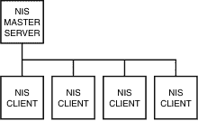

一个典型的具有一个 NIS 主服务器和两个从服务器的网络如图 6.2 所示。

**图 6.2**  
一个具有单个 NIS 主服务器和两个从服务器的 NIS 网络。

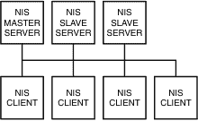

#### 路由网络

前面展示的简单单服务器和多服务器 NIS 网络的示例有一个共同点：所有客户端和服务器机器都在同一个单一网络上。然而，典型的企业网络会有多个通过网络路由器连接的子网。这些独立的物理网络可能反映了组织的地理分布，或者仅仅是工作组之间的划分。

通常在这些网络上，整个组织的所有网络都需要访问相同的用户数据库。然而，NIS 使用广播让客户端系统查找服务器来服务请求。由于 NIS 主服务器只能存在于一个物理网络上，因此需要从服务器在每个物理网络上复制 NIS 数据库并响应这些网络上的服务请求。

在图 6.3 中，整个组织的基础设施由两个通过路由器连接的物理网络组成。NIS 主服务器位于网络 A 上。然而，网络 B 上的 NIS 客户端将无法找到主服务器，因为它们搜索服务器的广播请求不会穿过路由器。通过网络 B 上的从服务器，网络 B 上的客户端将与从服务器通信以服务其所有 NIS 请求。然后，从服务器和主服务器通过路由器进行通信，以将主 NIS 服务器的更改同步到从服务器。

> **注意**  
> 虽然 NIS 客户端经常通过广播查找服务器来处理其请求，但您可以将 NIS 客户端配置为使用特定主机作为其 NIS 服务器。在这种情况下，NIS 客户端可以跨路由器与 NIS 服务器通信，因为服务器的主机名和 IP 地址已硬编码在客户端的配置中。在这种情况下，NIS 服务器的名称和 IP 地址需要包含在客户端系统的 `/etc/hosts` 文件中。

**图 6.3**  
一个路由网络配置，主 NIS 服务器和从 NIS 服务器位于不同的物理网络上。

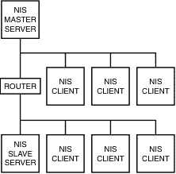

#### NIS 映射

NIS 旨在为大量标准 Unix 配置文件提供集中位置，这些文件通常存储在 `/etc` 目录中。因此，NIS 有大量可用的表，称为 *映射*，如表 6.1 所示。

**表 6.1 — NIS 映射**

| 映射名称 | 描述 |
|---|---|
| `bootparams` | 列出无盘客户端以及启动所需文件的位置 |
| `ethers.byaddr` | 列出主机的以太网地址及其对应名称 |
| `ethers.byname` | 列出主机的名称及其对应的以太网地址 |
| `groups.bygid` | 以组 ID 为键列出组的成员信息 |
| `groups.byname` | 以组名为键列出组的成员信息 |
| `hosts.byaddr` | 以 IP 地址为键列出主机的名称和 IP 地址 |
| `hosts.byname` | 以主机名为键列出主机的名称和 IP 地址 |
| `mailaliases` | 列出所有邮件别名 |


**表6.1 续**

| 映射名称 | 描述 |
|---|---|
| `netgroup` | 包含以组名为键的netgroup信息 |
| `netgroup.byhost` | 包含以主机名为键的netgroup信息 |
| `netgroup.byuser` | 包含以用户名为键的netgroup信息 |
| `netid.byname` | 包含主机和用户的安全RPC网络名，以及它们的UID和GID |
| `netmasks.byaddr` | 包含IP子网所使用的网络掩码，以地址为键 |
| `networks.byaddr` | 包含命名空间中的网络名称和地址，以地址为键 |
| `networks.byname` | 包含命名空间中的网络名称和地址，以网络名为键 |
| `passwd.byname` | 包含以用户名为键的密码信息 |
| `passwd.byuid` | 包含以用户ID为键的密码信息 |
| `protocols.byname` | 列出所使用的网络协议 |
| `protocols.bynumber` | 列出以协议号为键的网络协议 |
| `publickey.byname` | 包含用于安全RPC的公钥和私钥 |
| `rpc.bynumber` | 列出已知的RPC程序名称和编号 |
| `services.byname` | 列出可用的互联网服务 |
| `ypservers` | 列出命名空间中所有NIS服务器及其IP地址 |

#### 设置NIS主服务器

设置NIS主服务器包括三个基本步骤：

1. 设置NIS域名。
2. 填充NIS映射的配置文件。
3. 运行ypinit。

##### 设置NIS域名

NIS网络通过域名来标识。一个NIS服务器服务于特定域，客户端配置为属于特定域，并使用该域的一个或多个服务器来处理其发出的任何NIS请求。

同一物理网络上可以存在不同的NIS域。每个域都有自己的NIS主服务器和一个或多个从服务器，各个客户端系统将配置为属于网络上的其中一个域。

每个域通过名称标识。通常，NIS域与DNS域名不同。域名使用`domainname`命令设置。该命令接受系统应加入的NIS域名。例如，如果你想将NIS域命名为`mydomain`，你需要执行以下命令，使你的主服务器成为`mydomain`域的服务器：

```bash
# /bin/domainname mydomain
```

##### 填充NIS映射的配置文件

在NIS主服务器上，NIS映射是基于`/etc`目录中的标准Linux配置文件构建的。

- `/etc/passwd`：用户数据库
- `/etc/group`：组数据库
- `/etc/hosts`：主机到IP地址表
- `/etc/networks`：网络地址
- `/etc/services`：网络端口号和服务名称
- `/etc/protocols`：网络协议名称和编号
- `/etc/netgroup`：netgroup定义
- `/etc/rpc`：远程过程调用程序编号

按照正常方式配置这些文件，加入任何你想通过NIS传播到整个网络的数据。

##### 运行ypinit

在填充了`/etc`中的配置文件之后，使用`ypinit`命令从这些文件生成必要的NIS映射。使用以下命令：

```bash
# /usr/lib/yp/ypinit -m
```

这将创建`/var/yp/<domainname>`目录，并使用`makedbm`生成dbm类型的数据库文件。每个NIS映射都会生成一对dbm文件。例如，对于`hosts.byname`映射，将有两个文件：`hosts.byname.dir`和`hosts.byname.pag`。此外，主机可以通过地址而不是名称进行查找，因此还会有一个`hosts.byaddr`映射，由`hosts.byaddr.dir`和`hosts.byaddr.pag`组成。同样地，在`/var/yp/<domainname>`目录中，还会为各种NIS映射创建其他dbm文件。

##### 确保一切正常运行

在主服务器上设置好NIS后，你需要启动以下程序：

- `ypserv`
- `ypbind`
- `rpc.ypasswdd`
- `rpc.ypxfrd`

> **注意**
>
> `rpc.ypasswdd`是一个只在NIS主服务器上运行的程序，允许用户更改他们的NIS密码。`rpc.ypxfrd`也只在NIS主服务器上运行，可加速向NIS从服务器传输映射。

要启动`ypserv`和`ypbind`，请使用以下命令：

```bash
# /etc/rc.d/init.d/ypserv start
# /etc/rc.d/init.d/ypbind start
```

要启动`rpc.ypasswdd`，请使用此命令：

```bash
# /etc/rc.d/init.d/ypasswdd start
```

要启动`rpc.ypxfrd`，请使用此命令：

```bash
# /usr/sbin/rpc.ypxfrd
```

当系统重新启动时，这些程序将自动启动。在某些Linux系统上，`rpc.ypxfrd`可能未配置为在引导时启动，你需要编辑`/etc/rc.d/init.d/`中的脚本，以确保程序在系统启动时启动。有关启动过程及`/etc/rc.d/init.d/`中脚本的详细信息，请参阅第4章“启动和关闭Linux”。

#### 设置NIS客户端

完成NIS主服务器的设置后，你可以配置NIS客户端，让主服务器处理NIS服务请求。配置NIS客户端需要以下三个步骤：

1. 在`/etc/yp.conf`文件中设置NIS域名
2. 运行`ypbind`
3. 编辑`/etc/passwd`文件

##### 在`/etc/yp.conf`文件中设置NIS域名

在NIS客户端上，你在`/etc/yp.conf`文件中设置NIS域名。该文件由`ypbind`守护进程读取，它负责将你的NIS客户端连接到相应的NIS域。

- 在`yp.conf`文件中你有两个选择：
  - **配置ypbind守护进程广播寻找正确域名的NIS服务器：** 包含指令`domain domainname broadcast`。该指令表示客户端应连接到指定域名，并广播寻找服务器来处理请求。
  - **配置ypbind守护进程连接到特定的NIS服务器：** 包含指令`ypserver hostname`。该指令用于使用特定主机作为NIS服务器。主机名及其IP地址必须列在客户端的`/etc/hosts`中。

##### 运行ypbind

在`/etc/yp.conf`中输入正确的配置后，你需要运行`ypbind`，将客户端绑定到NIS域。使用以下命令：

```sh
# /etc/rc.d/init.d/ypbind start
```

如果`ypbind`已经在你的系统上运行，你应当先停止`ypbind`，然后使用上述命令重新启动它。要停止`ypbind`，请使用以下命令：

```sh
# /etc/rc.d/init.d/ypbind stop
```

##### 编辑`/etc/passwd`文件

当你的系统成为NIS网络的客户端后，你需要配置它，使其对NIS映射执行用户认证。为此，请在`/etc/passwd`文件末尾添加以下行：

```text
+::::::
```

加号告诉系统，对于本地`/etc/passwd`文件中未定义的用户名，将通过NIS进行查找。

但是，如果某个用户已经在本地`/etc/passwd`文件中有一个出现在+条目之前的条目，并且`/etc/nsswitch.conf`文件配置为先查阅本地密码文件、再查阅NIS数据库，那么该密码条目将覆盖NIS密码条目。关于`nsswitch.conf`文件的使用说明，请参阅“理解名称服务器开关”一节。

通常应避免密码文件覆盖，除非用户确实有充分理由在特定机器上拥有不同的UID、GID、主目录或本地密码。在单个机器上维护本地用户账户会产生NIS旨在避免的相同管理开销。

#### 添加NIS从服务器

将系统配置为NIS从服务器需要两个步骤：

1. 设置NIS域名
2. 运行`ypinit`

##### 设置NIS域名

域名使用`domainname`命令设置。该命令接受系统应加入的NIS域名。例如，如果你的主服务器已配置了NIS域`mydomain`，你需要执行以下命令，使你的从服务器成为`mydomain`域的一部分：

```bash
# /bin/domainname mydomain
```

##### 运行ypinit

与主服务器一样，`ypinit`用于在你的NIS从服务器上初始化所有必需的文件。NIS从服务器上命令的格式为：

```bash
# /usr/lib/yp/ypinit -s masterhostname
```

其中`masterhostname`是NIS主服务器的主机名。该主机名及其IP地址必须存在于NIS从服务器的`/etc/hosts`文件中。

与使用`ypinit`创建主服务器时一样，从服务器上也会创建`/var/yp/<domainname>`目录。然后，NIS映射将从主服务器复制到从服务器的该目录中。

#### 将NIS主服务器功能迁移到另一台机器

一旦你配置了担任主、从NIS服务器角色的机器，就没有直接简便的方法来更改这些角色。然而，有时有必要更换主服务器系统。

例如，如果你的NIS主服务器运行在一个需要升级或退役的旧系统上，你需要将主服务器服务迁移到新系统。

粗暴的方法是全新构建一个新的主服务器，然后重建所有从服务器。然而，这是一个耗时且不必要的过程。这个过程可以简化。

尽管如此，这并不像将从服务器提升为主服务器，或者构建一个新的主服务器然后要求所有从服务器开始接受新主服务器的NIS映射那样简单。


困难在于，从服务器一旦配置完成，就期望从特定的主服务器接收映射更新，并且会拒绝其他系统推送过来的映射。这构成了一种安全机制，可以防止未经授权的系统和用户为某个域设置备用主服务器，并尝试向所有从服务器推送无效的映射数据。

要解决此问题，需要执行以下几个步骤：

- 1. 将新主服务器创建为从服务器
- 2. 将新主服务器添加到 ypservers 数据库中
- 3. 将旧主服务器上的 /etc 配置文件复制到新主服务器
- 4. 删除新主服务器上 /var/yp 中的时间戳文件
- 5. 使用 NOPUSH=1 选项运行 make
- 6. 将新的 NIS 映射从新主服务器传输到旧主服务器
- 7. 将新映射从旧主服务器推送到所有从服务器
- 8. 淘汰旧主服务器

#### 将新主服务器创建为从服务器

请按照本章前面的“添加 NIS 从服务器”一节中的说明，将新的主服务器机器设置为 NIS 域中的从服务器。总而言之，相关步骤如下：

- 1. 设置 NIS 域名。
- 2. 运行 ypinit -s masterhostname。

#### 将新主服务器添加到 ypservers 数据库中

ypservers 数据库是包含 NIS 域中所有 NIS 服务器主机名的 NIS 映射。必须将新主服务器的名称添加到 ypservers 数据库中。为此，请在旧的 NIS 主服务器上执行以下步骤：

- 1. 将数据库快照保存到文本文件中。
- 2. 编辑文本文件。
- 3. 根据该文件重新生成 ypservers 数据库。
- 4. 将新数据库推送到所有从服务器。

##### 获取 ypservers 数据库的快照

您可以使用 ypcat 命令获取任何 NIS 数据库的快照并将其保存到文件中。本章后面将详细讨论 ypcat 命令。

以下命令会将 ypservers NIS 映射的副本转储到 /etc/ypservers 文件中：

```sh
# /usr/lib/yp/makedbm -u ypservers > /etc/ypservers
```

##### 编辑 `/etc/ypservers` 文件

一旦将 ypservers NIS 数据库的内容以文本形式保存到 `/etc/ypservers` 文件中，您就需要编辑该文件。该文件通常具有以下格式：

```
foo foo
YP_MASTER_NAME linux
YP_LAST_MODIFIED 942365535
linux linux
```

此文件包含两个 NIS 服务器（foo 和 linux）的条目，并指示 linux 是该域的主 NIS 服务器。

要将新主服务器添加到文件中，请删除前两行包含 `YP_MASTER_NAME` 和 `YP_LAST_MODIFIED` 的内容，并在文件末尾添加一行，将服务器的主机名重复两次并用空格分隔：

```
newhostname newhostname
```

##### 重新生成 `ypservers` 数据库

一旦新主服务器的主机名出现在 `/etc/ypservers` 文件中，您就需要根据该文件重新生成 ypservers NIS 映射。这可以通过将文本文件的内容传递给 makedbm 程序来生成 NIS 映射文件来完成。

这需要以下两个步骤：

- 1. 使用以下命令将您的工作目录更改为包含您域的 NIS 映射的目录：

  ```sh
  # cd /var/yp/<domainname>
  ```

- 2. 使用 cat 将 `/etc/ypservers` 的内容显示到标准输出，并通过管道传递给 makedbm 以生成最终的 NIS 映射：

  ```sh
  # cat /etc/ypservers | /usr/lib/yp/makedbm - ypservers
  ```

##### 将新数据库推送到从服务器

使用 ypush 命令，您可以将 ypservers 映射推送到域中的所有从服务器：

```sh
# ypush ypservers
```

#### 复制 `/etc` 配置文件

主 NIS 服务器上 `/etc` 中的几个配置文件用于生成 NIS 映射：

- `/etc/passwd`：用户数据库
- `/etc/group`：组数据库
- `/etc/hosts`：主机到 IP 地址表
- `/etc/networks`：网络地址
- `/etc/services`：网络端口号和服务名称
- `/etc/protocols`：网络协议名称和编号
- `/etc/netgroup`：netgroup 定义
- `/etc/rpc`：远程过程调用程序编号
- 为之创建了 NIS 映射的任何其他 `/etc` 文件。

因此，您需要将这些文件从旧的 NIS 主服务器复制到新的主服务器。根据您的系统和网络配置，有多种选项可供选择。

- 使用 FTP 将文件从一个系统传输到另一个系统。
- 使用 NFS 将一个系统的 `/etc` 挂载到另一个系统，然后使用 `cp` 命令复制文件。
- 使用 `rcp` 或 `rdist` 命令在系统之间复制文件。
- 使用 `tar` 命令将文件写入软盘并将其传输到新的主服务器。

#### 删除新主服务器上 `/var/yp` 中的时间戳文件

NIS 会在 `/var/yp` 中生成时间戳文件，这些文件用于确定数据何时发生变化。您需要从新主服务器中删除任何此类文件，以强制重建数据库。这些文件的扩展名都是 `.time`，可以使用以下 `rm` 命令删除：

```sh
# rm -f /var/yp/*.time
```

#### 使用 NOPUSH=1 选项运行 `make`

删除时间戳文件后，您需要在新主服务器上重建 NIS 映射。这将重新创建包含新主服务器名称的映射。生成这些新映射时使用 NOPUSH=1 选项，以便映射不会自动推送到从服务器。这是必要的，因为从服务器仍然没有准备好接受来自新主服务器的 NIS 映射。要构建映射，请将当前工作目录更改为 `/var/yp` 并执行以下 `make` 命令：

```sh
# cd /var/yp
# make NOPUSH=1
```

#### 将新的 NIS 映射从新主服务器传输到旧主服务器

您可以通过在旧主服务器上使用 `ypxfr` 命令来强制将 NIS 映射从新主服务器传输到旧主服务器。如果新 NIS 主服务器的主机名是 `newmaster`，则 `ypxfr` 命令的形式如下：

```sh
# ypxfr -h newmaster -f mapname
```

您需要对每个 NIS 映射发出一次此命令。本章前面概述了 NIS 映射的完整列表。如果本地站点添加了自定义映射，这些映射也需要传输。您可以列出 `/var/yp/<domainname>` 的内容来查找该站点使用的所有 NIS 映射。

#### 将新映射从旧主服务器推送到所有从服务器

一旦旧主服务器拥有了新映射，您就可以将它们推送到仍然只接受来自旧主服务器映射的从服务器。一旦从旧主服务器收到新映射，它们将开始将新主服务器视为 NIS 主服务器，因为新映射包含指向新主服务器的指针。

要将映射推送到从服务器，请将您的工作目录更改为 `/var/yp/<domainname>`，然后使用以下 yppush 命令：

```sh
# yppush mapname
```

与上一步中将新映射传输到旧主服务器一样，您需要对每个 NIS 映射使用一次 yppush 命令。

#### 淘汰旧主服务器

现在传输已完成，新主服务器已取代旧主服务器负责 NIS 域。明智的做法是编辑新主服务器上的 ypservers NIS 映射，以删除旧主服务器的条目。这与上一步中用于将新主服务器添加到 ypservers 映射的过程类似：

- 1. 使用以下命令将 ypservers 映射转储到文本文件：

  ```sh
  # ypcat -k ypservers > /etc/ypservers
  ```

- 2. 从 `/etc/ypservers` 文本文件中删除包含旧主服务器主机名的行。
- 3. 使用以下命令根据文本文件重新生成 ypservers 数据库：

  ```sh
  # cd /var/yp/<domainname>
  # cat /etc/ypservers | /usr/lib/yp/makedbm - ypservers
  ```

- 4. 使用以下命令将新数据库推送到所有从服务器：

  ```sh
  # yppush ypservers
  ```

#### 移除 NIS 从服务器

有时需要从网络中移除 NIS 从服务器。这可能是由于多种原因，例如当前的从服务器被淘汰或迁移到新位置，或被分配了新的执行功能。

您可以简单地从网络中移除 NIS 从服务器，NIS 将继续运行；但是，未来的 NIS 更新将花费更长的时间，因为主服务器将尝试将更新的数据库推送到不存在的从服务器。主服务器必须等待超时发生，然后才会失败并继续处理下一个从服务器。这可能会非常令人烦恼。


为了防止这种情况发生，你需要从 ypservers 数据库中移除已停用的从服务器的条目。

本章前面已经详细介绍了编辑 ypservers 映射的方法。

#### 编辑 ypservers 的另一种方法

编辑 ypservers 文件的四步方法灵活且通用。它可以用于删除条目、添加条目和编辑条目。但是，也可以用一条命令删除服务器。例如，如果要为 NIS 主域从 ypservers 数据库中删除名为 foo 的服务器，请将当前工作目录更改为 `/var/yp/mydomain/`，然后在 NIS 主服务器上使用以下命令：

```
ypcat -k ypservers | grep -v '^foo$' | /usr/lib/yp/makedbm - ypservers; yppush ypservers
```

此命令实际上是由分号分隔的两个命令。这两个命令将按顺序执行。第一个命令是一个复合命令，通过管道将数据传递给三个命令。`ypcat -k ypservers` 的输出（即 ypservers 数据库的内容）通过管道传递给 `grep`，`grep` 使用 `-v` 选项显示任何不包含 foo 的行。插入符号（^）和美元符号（$）是元字符，分别匹配一行的开头和结尾。然后，这个 grep 命令的输出传递给 `makedbm`，以重新生成 ypservers。第二个命令将新的数据库推送到网络上的从服务器。

> **警告**
>
> 不要使用 `grep -v foo` 替代，因为它会匹配所有包含字符串 foo 的服务器名称，并将其从 ypservers 数据库中删除。

#### 维护 NIS 映射

NIS 映射通常几乎不需要维护或关注。但是，仍需要做一些工作来使一切保持完美的运行状态。特别是，对 NIS 映射的任何更改都必须在主服务器上进行，并在更改之后重新构建 NIS 映射。此外，还应安排多个脚本自动运行，以确保所有 NIS 服务器上的 NIS 映射保持同步。

#### 编辑 NIS 映射

通常，如果要更改 NIS 映射，你应当修改主服务器上 `/etc` 中的源文件，然后重建 NIS 映射。例如，要添加用户，应将其添加到主服务器上的 `/etc/passwd` 文件中。类似地，应将新主机添加到 NIS 主服务器上的 hosts 表 `/etc/hosts` 中。

完成此类更改后，你需要重新生成 NIS 映射。为此，将当前目录更改为 `/var/yp`，然后执行以下命令：

```
# make
```

NIS 映射将被重新构建并推送到从服务器。你可以参阅 `/var/yp/Makefile` 的内容，以便更详细地了解这些映射是如何构建并推送到从服务器的。

#### 按计划同步 NIS 映射

NIS 服务器软件包提供了三个脚本，以确保所有服务器上的 NIS 映射保持同步。这些脚本如下：

- `/usr/lib/yp/ypxfr_1perday`：此脚本需要每天自动运行一次。
- `/usr/lib/yp/ypxfr_1perhour`：此脚本需要每小时自动运行一次。
- `/usr/lib/yp/ypxfr_2perday`：此脚本需要每天自动运行两次。

确定你要在何时运行这些脚本，然后按照第 7 章“计划任务”中的说明，将它们添加到 root 用户的 crontab 文件中。

#### 其他 NIS 程序

以下三个 NIS 程序对于管理与使用 NIS 映射非常有用：

- `ypwhich`：此命令返回为使用该命令的 NIS 客户端提供服务的 NIS 服务器的名称。
- `ypcat`：此命令显示特定 NIS 映射中所有键的值。
- `ypmatch`：此命令显示特定 NIS 映射中一个或多个指定键的值。

##### ypwhich 命令

ypwhich 命令用于显示当前客户端正在用来处理其 NIS 请求的 NIS 服务器名称。其最简单的形式是直接不带参数使用该命令，如下所示：

```
# ypwhich
```

你也可以使用 `-m` 参数运行 ypwhich，以显示特定 NIS 映射的主服务器。例如，要显示 ypservers 映射的主服务器，请使用以下命令：

```
# ypwhich -m ypservers
```

类似地，你可以通过指定主机名，使用 ypwhich 显示为另一台主机处理请求的 NIS 服务器。例如，要显示为主机 foo 提供服务的服务器，请使用以下命令：

```
# ypwhich foo
```

##### ypcat 命令

ypcat 命令允许你显示指定 NIS 映射中所有键的值。例如，要显示 ypservers 映射中的值，请使用以下命令：

```
# ypcat ypservers
```

此外，你可以使用 ypcat 的 -k 参数来同时显示键和值，每个键值对单独占一行：

```
# ypcat -k ypservers
```

##### ypmatch 命令

ypmatch 命令允许你显示指定 NIS 映射中一个或多个特定键的值。该命令的基本形式如下：

```
ypmatch <key list> <map name>
```

键列表是以空格分隔的键名列表。例如，要显示 passwd.byname 映射中 user1 条目的值，请使用以下命令：

```
# ypmatch user1 passwd.byname
```

要显示多个用户（例如 user1 和 user2）的值，请在以下命令中将它们全部列出：

```
# ypmatch user1 user2 passwd.byname
```

如果希望在显示每个值的同时显示键名，请添加 -k 参数，如下所示：

```
# ypmatch -k user1 user2 passwd.byname
```

#### 了解名称服务器切换

使用 NIS 可能会带来潜在的混淆。考虑一个简单的例子：在一台 NIS 客户端上，你还在 /etc/passwd 中维护着本地用户数据库，以允许有限的本地登录。系统如何知道应该尝试对本地用户数据库还是对 NIS 用户数据库进行身份验证？

这是通过存储在 /etc/nsswitch.conf 的名称服务器切换文件来完成的。该文件指定了应该从以下三种可能来源中获取数据的顺序：

- 本地 /etc 文件
- NIS 映射
- 用于主机特定数据的 DNS 服务器

请考虑以下示例 nsswitch.conf 文件：

```
passwd:      files nis
group:       files nis
shadow:      files nis
hosts:       nis files dns

services:    nis [NOTFOUND=return] files
networks:    nis [NOTFOUND=return] files
protocols:   nis [NOTFOUND=return] files
rpc:         nis [NOTFOUND=return] files
ethers:      nis [NOTFOUND=return] files
netmasks:    nis [NOTFOUND=return] files
netgroup:    nis [NOTFOUND=return] files
bootparams:  nis [NOTFOUND=return] files
publickey:   nis [NOTFOUND=return] files
automount:   files nis
aliases:     nis [NOTFOUND=return] files
```

在这个文件中，有几个条目值得注意，以突出说明该文件的工作方式。请考虑以下条目：

```
passwd:   files nis
```

此条目表明，用户查找应首先针对本地 `/etc/passwd` 文件执行；如果未找到该用户，再针对 NIS 用户数据库执行用户查找。相比之下，请考虑以下条目：

```
hosts:    nis files dns
```

此条目表明，主机名查找应首先针对 NIS 主机数据库执行。如果未找到匹配的条目，则应查阅本地 `/etc/hosts` 文件。如果仍然找不到主机，则应尝试 DNS 查询，以将主机名解析为地址。

以下条目

```
services:  nis [NOTFOUND=return] files
```

是几个包含 `[NOTFOUND=return]` 的条目的示例。这表示，仅当 NIS 查找因“数据库中无匹配项”以外的原因失败时，查找才会从相关的 NIS 数据库映射继续到 `/etc` 中的相关文件。

例如，如果你尝试进行查找，但在 NIS 数据库中没有找到匹配的条目，则查找失败并停止。但如果你尝试进行查找，而对 NIS 服务器的请求超时，则查找将继续，并使用 `/etc` 中的本地文件。

#### 有用的脚本

创建一些管理脚本可以简化 NIS 管理。特别是，使用脚本来添加和删除 NIS 域中的服务器非常有用。下面的脚本 `add-rm-ypservers` 可让这一管理任务变得更轻松。


#### add-rm-ypservers

以下脚本可用于在 ypservers NIS 映射中添加或删除条目。请在 NIS 主服务器上的 /usr/local/bin/add-rm-ypserver 文件中创建此脚本，并将该文件设为可执行：

```
# chmod 755 /usr/local/bin/add-rm-ypserver
```

要向映射中添加服务器，请按如下方式使用该脚本：

```
# add-rm-ypserver add hostname
```

同样，要从映射中删除服务器，请按如下方式使用该脚本：

```
# add-rm-ypserver remove hostname
```

该脚本的逻辑很简单：

- 在第 13–16 行，会检查是否提供了两个参数。如果没有，则显示用法消息并退出脚本。
- 在第 18 行，执行脚本的系统的主机名会被存储起来以备后用。
- 在第 19 行，通过 `ypwhich` 获取提供 ypservers 数据库主服务器的系统的主机名，并将其存储起来以备后用。
- 在第 21–25 行，会检查当前主机名和 ypservers 数据库主服务器的名称是否相同。如果不相同，则说明脚本不是在 NIS 主服务器上执行的。此时显示错误消息并退出脚本。
- 在第 18 行，执行脚本的系统的主机名会被存储起来以备后用。
- 在第 27–42 行，会决定要执行的操作。如果用户指示应添加记录，则 ypservers 的内容会存储到一个临时文本文件中，向该文件添加新条目，然后重新生成 ypservers 数据库并推送到从服务器。如果用户指示应删除记录，则按照本章前面所述删除该条目，然后重新生成数据库并推送到从服务器。如果命令行中未指定这两个选项中的任何一个，则显示用法消息。

##### 源代码

以下是 add-rm-ypservers 脚本的源代码：

> **注意：** 行号仅供参考。

```sh
01: #!/bin/sh
02: # File: add-rm-ypserver
03: # Description: Add or remove a ypserver from the ypservers NIS map
04: # This script needs to execute on NIS master only
05:
06: PATH=/bin:/usr/bin:/usr/lib/yp
07: export PATH
08:
09: usage(){
10:         echo "Usage: $0 [add | remove] [ypserver]"
11: }
12:
13: if [ $# -ne 2 ]; then
14:         usage
15:         exit 0
16: fi
17:
18: thishost=`hostname`
19: ypmaster=`ypwhich -m ypservers`
20:
21: if [ "$thishost" != "$ypmaster" ]; then
22:         echo "This script needs to run on ypmaster only"
23:         echo "This host does not appear to be the ypmaster ... exiting"
24:         exit 0
25: fi
26:
27: case $1 in
28:         add)
29:                 ypcat -k ypservers > /tmp/ypservers
30:                 echo "$2 $2" >> /tmp/ypservers
31:                 cd /var/yp/`domainname`
32:                 cat /tmp/ypservers | makedbm - ypservers
33:                 rm -f /tmp/ypservers
34:                 yppush ypservers
35:                 ;;
36:         remove)
37:                 cd /var/yp/`domainname`
38:                 ypcat -k ypservers | grep -v $2 | makedbm - ypservers
39:                 yppush ypservers
40:                 ;;
41:         default)
42:                 usage
43:                 ;;
44: esac
```

#### 故障排除

一般来说，NIS 运行得很顺利，尤其是在您的发行版安装并执行初始 NIS 设置的情况下（如 Red Hat 6.0 所做的那样）。不过，您仍可能遇到一些与 NIS 相关的问题；以下是一些常见问题：

- 如果您使用的 ypbind 版本早于 3.3，并且 NIS 停止后重新启动，ypbind 可能会生成类似 `yp_match: clnt_call: RPC: Unable to receive; errno = Connection refused` 的错误消息。此后，登录将失败。要解决此问题，请以 root 身份登录服务器，终止并重新启动 ypbind。或者，升级到 ypbind 3.3 或更高版本。
- 您无法使用 ypcat shadow 访问影子密码映射。正确的映射名称是 shadow.byname，因此正确的命令应为 `ypcat shadow.byname`。
- `libc` 的库版本对 NIS 的正确运行至关重要。具体来说，libc 4.5.19 版本不适用于 NIS。高于 5.4.20 的库版本或 glibc 2.x 需要使用 yp-clients 2.2 版和 yp-tools 2.x 版。即便如此，对于 libc 5.4.21 至 5.4.35 版本，`yp_maklist` 将无法工作，因此您需要更高版本的库以确保 ypwhich 能够工作。如果 NIS 是您发行版的一部分，您应该拥有与所安装的 NIS 版本相匹配的正确库。如果您是自己安装 NIS，则应仔细检查您的库版本，然后确保您要安装的 NIS 版本能够正常工作。

### 第 7 章

#### 调度任务

本章内容包括

- Linux 中的任务调度 104
- 使用 crond 守护进程 104
- 使用 at 守护进程 109
- 实用脚本 111
- 故障排除 115

#### Linux 中的任务调度

多任务操作系统只有在处理用户交互使用之外的任务时，才能实现其全部用途。也就是说，多任务操作系统通常会在用户继续进行交互式任务的同时，处理用户看不到或不与之交互的后台任务。

这些后台任务中，有些是用于处理 FTP、HTTP 和其他网络请求的服务器进程，而另一些则是按计划自动启动和运行的任务，用于处理日常维护任务、执行定期备份或完成任何其他周期性工作。

Unix 系统从早期开始就被设计为全天候运行，只有在需要维护任务时才会关闭。在这类系统上，日常管理任务通常安排在深夜运行，因为此时使用系统的用户预计最少。Linux 也不例外：任何 Linux 服务器或工作站都可能需要配置为在低使用率时段（通常是在夜间）处理一些日常任务。

#### 使用 crond 守护进程

crond 守护进程是负责运行计划任务的守护进程。在第 8 章“Linux 进程管理与守护进程”中，我们将详细讨论守护进程。一般来说，守护进程是响应客户端网络请求或定期唤醒以执行特定任务的进程。例如，响应 Web 浏览器 HTTP 请求或处理电子邮件投递的服务器进程就是守护进程。

crond 实际上是一个简单的应用程序：它读取包含命令列表及其运行时间的配置文件。配置文件还指定了运行这些命令所使用的用户标识符（UID）。然后，crond 会在指定时间以指定用户身份启动指定命令。任何您可以手动执行的应用程序或脚本都可以使用 crond 进行调度。

系统启动时，crond 会从 /etc/rc.d 目录中的脚本启动。当 crond 启动时，它会扫描 /var/spool/cron/crontabs 目录（在包括 Red Hat 6.2 在内的某些 Linux 系统上，该目录为 /var/spool/cron/）中的 crontab 文件。在 Red Hat Linux 6.2 上，也会扫描 /etc/crontab 文件。该文件调度 /etc/cron.hourly、/etc/cron.daily、/etc/cron.weekly 和 /etc/cron.monthly 脚本的执行。crontab 文件按用户名组织，列出特定用户的所有计划任务。每个 crontab 文件都以与之关联的用户的登录名命名。

此外，在 Linux 中，crond 还会查看 /etc/cron.d 目录以获取计划任务。该目录用于存储由系统调度的任务。所有 crontab 文件都会被读取并加载到内存中。然后，crond 每分钟唤醒一次，检查是否有要运行的任务，如果有，则运行这些任务。此外，在 Linux 系统上，crond 在每分钟唤醒时都会检查 /var/spool/cron/crontabs 目录的修改时间。如果检测到更新的时间戳，


然后它会查找所有 crontab 条目的修改时间戳，并将任何已更改文件中的新增或变动条目重新加载到内存中。

> **注意**
>
> crond 不会记住系统关机期间未能运行的定时任务。如果你必须关闭系统进行维护、硬件升级，或从罕见系统崩溃中恢复，请记住：计划在这段停机时间内运行的任务不会运行，也不会在系统重启后由 crond 启动。如果这些定时任务至关重要，请手动启动它们。或者，你可以等待这些任务在下一次计划运行的时间点自动执行。

#### crontab 配置文件

crond 的配置文件称为 crontab 文件。crontab 文件的格式相当直接。这些文件包含一系列条目，每行一个。注释行以井号开头，持续到行尾。每个条目将特定任务安排在特定时间运行。

每个用于调度作业的条目采用以下格式：

```
<分钟> <小时> <日期> <月份> <星期> <命令>
```

构成每个 crontab 条目的六个字段的具体格式和限制见表 7.1。

**表 7.1 — crontab 条目的字段**

| 条目 | 描述与用法 |
|---|---|
| 分钟 | 指示计划的作业的时间中的分钟部分。可能值为 0 到 59。 |
| 小时 | 指示计划的作业的时间中的小时部分。可能值为 0 到 23（使用 24 小时制）。 |
| 日期 | 指示在当月中的哪一天运行计划的作业。可能值为 0 到 31。 |
| 月份 | 指示在哪个月份运行计划的作业。可能值为 0 到 12，或给定月份名称的前三个字母。0 和 12 都表示一月。 |
| 星期 | 指示在一周中的哪一天运行计划的作业。可能值为 0 到 7，或给定星期名称的前三个字母。0 和 7 都表示星期日。 |
| 命令 | 在计划时间要执行的命令。 |

对于除最后一个（命令字段）之外的所有字段，在表达这些值时有一定的灵活性：

- 多个值可以用逗号分隔。例如，要在每月的第 1 天和第 15 天安排任务，可以在日期字段中使用 `1,15`。
- 可以使用 `a-b` 形式的数字范围。例如，要安排在下午 4:00、下午 5:00 和下午 6:00 运行任务，可以在小时字段中使用 `16-18`。
- 可以使用 `a-b/c` 形式按增量步进遍历数字范围，其中 `a-b` 是范围，`c` 是增量。例如，要安排在上午 10:00 到晚上 10:00 之间每隔一小时运行一次任务，可以在小时字段中使用 `10-22/2`。
- 可以使用星号表示字段中的整个可能值范围。例如，要安排任务在每月的每一天都运行，请在日期字段中放入星号。

请考虑以下来自 `crontab` 条目的时间和日期字段示例：

- `0 4 * * *`：计划每天凌晨 4:00 运行的作业。
- `30 4 * * 1`：计划每周一凌晨 4:30 运行的作业。
- `0 2,4,6 * * 1`：计划每周一凌晨 2:00、4:00 和 6:00 运行的作业。
- `0 16 2 * *`：计划在每月第二天下午 4:00 运行的作业。
- `30 16 * 3 thu`：计划在三月的每个星期四下午 4:30 运行的作业。
- `0 12 4 jun *`：计划在每年 6 月 4 日中午运行的作业。

命令字段需要特别注意。特别值得注意的是，计划运行的命令是通过 `/bin/sh` shell 传递给 crontab 来执行的。

然而，当应用程序期望通过标准输入获得交互式输入时，通过 crontab 运行命令的非交互性就会带来问题。你可以使用百分号将数据通过标准输入传递给命令。命令后的第一个百分号标记被视为标准输入的数据的开始，其后的每个百分号在命令运行时充当标准输入中的换行符。例如，考虑命令字段中的以下命令：

```
0 8 * * 5 /bin/mail -s '星期五!' user@some.host%今天是星期五%感谢上帝%我。
```

此命令将发送电子邮件消息：

```
今天是星期五

感谢上帝

我。
```

在每周五上午 8:00 发送给 user@some.host。

以下示例说明如何解释完整的 crontab 条目：

- `15 3 * * * find / -fstype ext2 -name .nfs\* -mtime +7 -exec rm -f {} \;`：此 crontab 条目规定每天凌晨 3:15 crond 应运行 find 命令，清理文件系统中超过 7 天的临时 `.nfs*` 文件。
- `0,5,10,15,20,25,30,35,40,45,50,55 * * * * /usr/local/mrtg/mrtg -c /usr/local/mrtg/mrtg.cfg`：此 crontab 条目表示 crond 应每 5 分钟运行一次程序 `/usr/local/mrtg/mrtg`。
- `*/5 * * * * /usr/local/mrtg/mrtg -c /usr/local/mrtg/mrtg.cfg`：该条目说明了表示 crond 应每 5 分钟运行一次程序 `/usr/local/mrtg/mrtg` 的另一种方法，但使用的是扩展步长语法。
- `10 7-18 * * 1-5 /usr/local/bin/syscheck`：此 crontab 条目表示 crond 应在周一至周五的上午 7 点到下午 6 点之间，每小时的第 10 分钟运行一次 `/usr/local/bin/syscheck` 程序。
- `5 4 * * 6 /usr/lib/newsyslog >/dev/null 2>&1`：此 crontab 条目表示 crond 仅在周六凌晨 4:05 运行 `/usr/lib/newsyslog` 程序。
- `0 4 28 * * /usr/local/arbitron/arbitron.bwc`：此 crontab 条目表示 crond 应每月一次，在每月第 28 天的凌晨 4:00 运行 `/usr/local/arbitron/arbitron.bwc` 程序。

除了包含每个计划作业的条目之外，crontab 文件还可以包含两个环境变量的定义：SHELL 和 MAILTO。SHELL 变量指示用于运行作业的 shell（默认为 /bin/sh）。MAILTO 变量指示应接收 crond 运行的任何作业输出的用户（默认为正在运行该作业的用户）。

#### 编辑用户的 crontab 文件

通常，你不会直接编辑用户的 crontab 文件的内容，而是使用 crontab 命令来操作这些文件的内容。

使用 crontab 命令，你可以查看 crontab 文件的内容，用另一个文件的内容替换 crontab 文件的内容，或者编辑 crontab 文件。

##### 查看 crontab 文件的内容

用户可以使用带 -l 标志的 crontab 命令查看自己的 crontab 文件的内容：

```shell
$ crontab -l
# 每日作业
0  *  *  *  *  $HOME/bin/daily.job >> $HOME/daily.out 2>&1
# 每月作业 -- 输出邮寄给 paul
15 14 1 * *  $HOME/bin/monthly
```

root 用户可以通过添加 -u 标志查看任何用户的 crontab 文件的内容：

```shell
# crontab -u <用户名> -l
```

##### 创建 `crontab` 文件

用户创建新的 crontab 文件或替换现有 crontab 文件内容的最简单方法是在其主目录中创建一个包含所需 crontab 内容的文件，然后使用 crontab 命令将该数据加载到其 crontab 文件中：

```
$ crontab cronjobs
```

此命令会用 cronjobs 文件的内容覆盖用户 crontab 文件的当前内容。

root 用户可以通过添加 -u 标志将文件内容加载到任何用户的 crontab 文件中：

```
# crontab -u <用户名> cronjobs
```

##### 编辑 `crontab` 文件

用户可以使用 crontab 命令的 -e 标志直接编辑其 crontab 文件。crontab 将使用用户默认编辑器（由 EDITOR 环境变量指定）打开 crontab 文件进行编辑。如果不存在 EDITOR 环境变量，则 crontab 将使用 vi 编辑器来编辑文件。

如果要使用特定编辑器编辑 crontab 文件，请先设置 EDITOR 环境变量。例如，如果你想使用 pico 编辑器编辑 crontab 文件，请使用以下命令设置 EDITOR 环境变量：

```
$ export EDITOR=pico
```

一旦设置了 EDITOR 环境变量，用户就可以使用以下命令在指定的编辑器中打开其 crontab 文件：

```
$ crontab -e
```

root 用户可以通过添加 crontab 命令的 -u 标志来编辑任何用户的 crontab 文件：

```
# crontab -u <用户名> -e
```

##### 删除 `crontab` 文件

用户可以使用 crontab 命令的 -r 标志擦除其 crontab 文件的内容：

```
$ crontab -r
```

root 用户可以通过添加 crontab 命令的 -u 标志来擦除任何用户的 crontab 文件的内容：

```
# crontab -u <用户名> -r
```

#### 使用 `cron.allow` 和 `cron.deny` 控制 `crontab` 的使用

默认情况下，所有用户都可以使用 crontab 命令，因此可以通过编辑其个人 crontab 文件来安排任务。然而，这并非总是明智之举。普通用户可以很容易地安排任务在夜间运行。这可能会消耗过多的系统资源，或者被用来在夜间运行试图破解密码数据库或执行其他不良活动的进程。


由于大多数普通用户不需要能够运行计划任务，明智的做法是将 `crontab` 命令的使用限制在那些必须作为工作一部分运行计划任务的用户。

如果文件 `/etc/cron.allow` 存在，则只有该文件中列出的用户才被允许运行 `crontab` 命令。这通过指明谁可以使用 `crontab` 来限制使用，并且在可以使用该命令的用户列表较小且易于管理，且大多数用户被拒绝访问的情况下非常有效。

相比之下，如果文件 `/etc/cron.deny` 存在，则该文件中列出的用户被拒绝访问 `crontab`，但所有其他用户可以使用 `crontab`。如果应被拒绝访问 `crontab` 的用户列表较小且易于管理，那么 `cron.deny` 文件是控制对 `crontab` 命令访问的有效方式。

#### 使用 at 守护进程

at 守护进程 `atd` 运行由 `at` 命令创建的计划任务。`atd` 提供了将任务安排到以后执行的能力。与用于安排任务在设定时间重复运行的 `crond` 相比，`atd` 通常用于安排任务在将来的某个特定时间执行一次。

> **提示**
> 
> 虽然可以通过在已调度的脚本中包含 `at` 命令来重新调度任务，从而使用 `atd` 创建重复的计划任务，但建议使用 `cron` 来调度这些任务。`crond` 提供了更优越的调度控制。

任何可以在 shell 提示符下交互执行的命令或 shell 脚本都可以通过 `at` 命令排队由 `atd` 进行计划执行。在调度任务时，`at` 命令采用以下形式：

```
# at <time>
```

然后，`at` 命令会提示你输入要调度的命令。命令可以在多行中输入。使用 Ctrl-D 组合键来表示正在调度的命令序列结束。

```
# at 12:30
at> mail -s "This is a test" user@some.host
at>
```

或者，你可以准备一个包含要由 `at` 调度的命令序列的脚本文件，然后使用 `at` 命令的 `-f` 标志加载文件内容进行调度：

```
# at <time> -f <script file name>
```

当使用 **at** 调度任务时，at 命令会显示一个任务 ID 以及该任务将要执行的时间。即使调度任务的用户已注销，使用 at 调度的任务也会运行。如果系统在任务计划运行的时间关机，则该任务将不会运行。

在你使用 at 命令调度任务时，at 会记录当前的环境变量、当前目录、umask 和 ulimit；当任务在计划时间运行时，atd 将使用这些信息来创建运行环境。计划任务产生的任何输出或错误都会由 atd 通过邮件发送给调度该任务的用户。

##### at 命令的时间格式

at 命令使用许多不同的格式来指定时间。以下示例说明了这些格式：

- `at 16`：将任务安排在下午 4:00。
- `at 4pm`：将任务安排在下午 4:00。
- `at 8:00 January 1, 2000`：将任务安排在 2000 年 1 月 1 日上午 8:00。
- `at now + 30 minutes`：将任务安排在延迟 30 分钟后运行。
- `at midnight December 31, 1999`：将任务安排在 1999 年 12 月 31 日午夜运行。
- `at noon`：将任务安排在中午运行。

at 接受这些日期格式的大多数标准变体，包括月份名称和星期几的缩写。如果你尝试以 at 不理解的格式指定日期，它将返回“bad date specification”错误消息。

##### 检查 atd 队列

用户可以使用 `atq` 命令或 `at` 命令的 `-l` 标志来检查其 atd 队列。以下命令：

```
$ atq
```

与以下命令效果相同：

```
$ at -l
```

两者都会显示发出命令的用户调度的所有任务列表，以及任务 ID 和计划运行任务的时间。如果根用户使用其中一个命令，则会显示所有用户调度的所有任务。

##### 从 atd 队列中删除任务

用户可以使用以下格式的 `at` 命令的 `-r` 选项从其 atd 队列中删除先前调度的任务：

```
$ at -r <jobid>
```

用户只能删除自己已经调度的任务。根用户可以从任何用户的 atd 队列中删除任务。

##### 使用 `at.allow` 和 `at.deny` 限制对 `at` 的访问

默认情况下，所有用户都可以使用 at 命令，因此可以调度任务。然而，这并不总是明智的。普通用户可以轻松地将任务安排在夜间运行。这可能会消耗过多的系统资源，或者利用你的系统资源来运行试图破解密码数据库或执行其他不良活动的进程。

由于大多数普通用户不需要能够运行计划任务，明智的做法是将 at 命令的使用限制在那些必须作为工作一部分调度任务的用户。

如果文件 `/etc/at.allow` 存在，则只有该文件中列出的用户才被允许运行 at 命令。at 命令有两种通过指明谁可以使用 at 来限制使用的方式，并且在可以使用该命令的用户列表较小且易于管理，且大多数用户被拒绝访问的情况下非常有效。

相比之下，如果文件 `/etc/at.deny` 存在，则该文件中列出的用户被拒绝访问 at，但所有其他用户可以使用 at。如果应被拒绝访问 at 的用户列表较小且易于管理，那么 `at.deny` 文件是控制对 at 命令访问的有效方式。

#### 有用的脚本

调度任务的能力对于系统管理非常有用，因为它允许管理员定期检查其系统的状态。本节讨论两个系统管理脚本，一旦使用 crond 进行调度，它们可以帮助管理员监控其系统的健康状况：

- `fschecker`：检查文件系统是否即将满，并告知系统管理员错误日志中的新错误消息。
- `syscheck`：监控系统负载和交换空间。

##### fschecker

以下脚本可用于检查超过 90% 满的文件系统，并通过电子邮件将任何超过此阈值的文件系统告知系统管理员，同时向管理员发送系统日志中的新错误消息列表。在 `/usr/local/sbin/fschecker` 中创建此脚本，并使文件可执行：

```sh
# chmod 755 /usr/local/sbin/fschecker
```

该脚本应被安排在根用户的 crontab 中，并带有类似于以下内容的条目：

```cron
30 4 * * * /usr/local/sbin/fschecker
```

此条目将 fschecker 安排在每天早上 4:30 运行。

脚本的逻辑很简单：

- 在第 19-21 行，正在检查的系统的 hostname 以及当前日期和时间存储在报告中。
- 在第 29 行，使用 df 命令将超过 90% 满的文件系统列表追加到报告文件中。
- 在第 37-40 行，使用 grep 命令将过去两天内的所有新错误消息添加到报告文件的末尾。
- 在第 42 行，使用 mail 命令将报告文件的内容邮寄给管理员。
- 在第 45 行，删除报告文件。

##### 源代码

> **注意**
> 
> 行号仅供参考。

```
01: #!/bin/sh
02: #
03: # Name: fschecker - Run once a day from root's crontab
04: # Description: 1. Check if any (local) filesystems are getting full
05: #              and mail warning message if necessary.
06: #              2. Check for new error messages since yesterday and today
07: #                 in /var/log/messages and mail warning message
08: #
09: # Add to root's crontab as follows:
10: 30 4 * * * /usr/local/bin/fschecker
11: PATH=/bin:/usr/bin:/sbin:/usr/sbin:/usr/ucb:/usr/local/bin:.
12: export PATH
13: MAILTO=root
14: progname=`basename $0`
15: thishost=`hostname`
16: fsreport=/tmp/fsreport.$$
17: # write the header for our logfile
18: #
19: cat <<EOF > $fsreport
20: `hostname` : File system report: `date`
21: EOF
22: #
23: # Check local file systems and report those that are over 90% full
24: #
25: # Print a header line
26: cat <<EOF >> $fsreport
27: Filesystems over 90% full:
28: EOF
```


```sh
29: df -k | \
30:     awk '/dev/ { if ($5 > 90) print "Over 90%: " $0 }' >> $fsreport
31: #
32: # Check for errors in /var/log/messages dated today and yesterday
33: # Print a header line
34: cat <<EOF >> $fsreport
35: Errors reported in /var/log/messages:
36: EOF
37: today=`date | awk '{printf "%s %s\n", $2, $3}'`
38: yesterday=`date | awk '{printf "%s %s\n", $2, $3-1}'`
39: grep "$yesterday" /var/log/messages | grep -i error >> $fsreport
40: grep "$today" /var/log/messages | grep -i error >> $fsreport
41:
42: mail -n -s "Resource@$thishost: File system report:`date`" \
       $MAILTO < $fsreport
43:
44: #clean up temp files
45: rm -f /tmp/fsreport.$$
```

#### syscheck

将该脚本创建在文件 `/usr/local/sbin/syscheck` 中，并使其可执行：

```sh
# chmod 755 /usr/local/sbin/syscheck
```

该脚本应通过类似于以下的条目安排在 root 用户的 crontab 中：

```cron
0,10,20,30,40,50 * * * * /usr/local/sbin/syscheck 3 10
```

此条目使 syscheck 每 10 分钟运行一次。参数 3 和 10 表示：如果平均系统负载超过 3，或可用交换空间小于 10MB，则应发送警告。如果未指定负载和交换限制，脚本将使用系统负载 3 和 10MB 交换空间作为默认阈值。

该脚本的逻辑很简单：

- 在第 32–36 行，使用内核的 /proc/loadavg 伪文件系统检查系统负载。如果超过阈值，ps 的输出会同警告一起通过邮件发送给系统管理员。
- 在第 48–54 行，使用 free 命令确定当前可用交换空间。如果该值小于指定阈值，则通过邮件向系统管理员发送包含 free 命令输出的警告消息。

##### 源代码

**注意** 行号仅供参考。

```sh
01: #!/bin/sh
02: # Script name: /usr/local/sbin/syscheck
03: # Description: A system maintenance script, runs out of cron every hour.
04: #              It checks the system load and swap space and send warning messages
05: #              if a system load exceeds a specified value
06: #              or b) system swap space drops below a specified value.
07: #
08: # Usage: syscheck loadlimit swaplo
09: #
10: # Create an entry in root's crontab as follows:
11: # 1 * * * * /usr/local/sbin/syscheck 3 10
12: #
13: # Set the load limit and minimum swap space in megabytes per your needs.
14: #
15: # To run script in debug mode uncomment the next line
16: #set -x
17: PATH=/bin:/usr/bin:/sbin:/usr/sbin:/usr/ucb:/usr/local/bin:.
18: export PATH
19: MAILTO=root
20: progname=`basename $0`
21: thishost=`hostname`
22: # set default load limit to 3 unless passed in argv
23: if [ "$1" = "" ]; then
24:     loadlimit=3;
25: else
26:     loadlimit=$1;
27: fi
28: #
29: #
30: # Check the load average using uptime. If load limit exceeds $loadlimit
31: # send a warning
32:     load=`cat /proc/loadavg | awk -F'.' '{print $1}'`
33: if [ `expr $load` -ge `expr $loadlimit` ]; then
34:     ps aux > /tmp/load.log$$
35:     mail -s "Warning from $progname@$thishost" \
        $MAILTO < /tmp/load.log$$
36: fi
37: #
38: #
39: # Set default free swap to 10M, unless passed in argv
40: #
41: if [ "$2" = "" ]; then
42:     SWAPLO=10
43: else
44:     SWAPLO=$2
45: fi
46: # Check the Swap space usage, if less than 10M is left send
47: # a message. The number 10M may need to be adjusted.
48: swapfree=`free -m|grep Swap|awk -F " " '{print $4}'`
49: if [ `expr $swapfree` -le `expr $SWAPLO` ]; then
50:     date > /tmp/swap.log$$
51:     echo "Swap space less than $SWAPLO Megs" >> /tmp/swap.log$$
52:     free >> /tmp/swap.log$$
53:     mail -n -s "Warning from $progname@$thishost" \
        $MAILTO < /tmp/swap.log$$
54: fi
55:
56: #
57: # Clean up temp files
58: #
59: rm -f /tmp/load.log$$ /tmp/swap.log$$
60: exit 0
```

#### 故障排除

用户和管理员在使用 crond 安排任务时面临的最常见问题是任务无法运行。例如，考虑这样一种情况：某个用户的正常路径中有一个名为 testjob 的脚本，并且他们已安排它通过 crond 运行。然而，每次 crond 尝试运行该脚本时都会失败，反而会向安排该任务的用户回发一封类似于以下的电子邮件：

```text
Date: Sun, 23 Jan 2000 09:16:01 -0800
From: Some User <someuser@linux.juxta.com>
To: someuser@linux.juxta.com>

/usr/bin:/bin
```

问题在于，从 crontab 文件运行的进程是在高度受限的环境中运行的，在该环境中，路径不会是用户通常的完整路径。例如，在 Red Hat 6.2 上，从 crond 运行的任务具有以下路径：/usr/bin:/bin

为了解决问题，在安排程序和脚本通过 crond 运行时，需要遵守两条规则：

- 在 crontab 文件中，指定所安排程序或脚本的完整路径。
- 如果安排的是脚本，请指定脚本调用的所有外部程序的完整路径。

### 第 8 章

#### Linux 进程管理和守护进程

本章内容

- Linux 进程和守护进程 118
- 理解进程 119
- 进程的属性和特性 120
- 进程优先级 120
- 进程创建 120
- 使用 ps 命令监控进程 121
- 使用 top 命令监控进程 124
- 守护进程的作用 126
- 使用 kill 命令停止进程 127
- Linux 信号 129
- 更改进程优先级 131
- 使用 vmstat 跟踪系统负载和性能 133
- 实用脚本 137
- 故障排除 140

#### Linux 进程和守护进程

Linux 是一个多用户、多任务操作系统。因此，在任意给定时刻，Linux 系统上会运行不止一个程序。这些正在运行的程序被称为*进程*。虽然操作系统让所有进程看起来像是在同时执行，但现实远非如此。相反，系统会进行复杂的管理和调度，以便为每个进程分配足够的资源，从而使 Linux 既能完成自己的工作，又能向用户提供一个响应迅速、可用的系统。

与进程管理相关的是守护进程。*守护进程*是指在系统后台运行、响应特定类型服务请求的程序。例如，FTP 守护进程响应 FTP 连接请求，而行式打印机守护进程则响应打印机服务请求。

由于所有这些后台守护进程都在运行，即使系统看似空闲，普通的 Linux 系统也会有大量混合进程在运行。因此，牢牢掌握进程以及可用于管理进程的工具，对于正确的系统管理至关重要。

#### 理解进程

在任意给定时刻，一个 CPU 上只能执行一个进程。这意味着在典型的单处理器台式 PC 上，同一时间只能执行一个进程。在多处理器系统上，任意给定时刻每个可用的 CPU 上可以执行一个进程。

操作系统可能给人的印象是所有这些程序都在同时运行，但事实并非如此。对于多处理器系统，您可以同时运行多个进程，数量等于系统拥有的处理器数量。本章重点讨论单处理器系统；这些概念也适用于多处理器系统。

许多进程同时执行的表象是通过一种称为*时间片*（也称为分时）的技术实现的。操作系统内核使用时间片在活动进程之间快速切换，依次为每个进程分配一小段处理器时间。结果是让人感觉多个进程在同时执行。

进程的概念可能有些模糊。看待进程的最佳方式是将其视为正在运行的程序的一个实例。这意味着，如果您运行一个程序（如 ls），实际上会启动一个作为 ls 程序实例的进程。如果多个人运行 ls 程序，那么就会创建并运行多个作为 ls 实例的进程。

需要切记，不能简单地将进程等同于特定命令的执行。例如，考虑以下命令：

```sh
$ ls -l
```

此命令会创建一个单一进程并执行。然而，下面的命令则做了更多事情：

```sh
$ ls -lS | sort -n
```


这里创建了两个进程，一个用于 `ls` 程序，另一个用于 `sort` 程序。命令中的管道表示 `sort` 和 `ls` 进程之间进行通信的机制。

#### 进程的属性和特性

以下属性是所有进程的特征：

- **进程地址空间：** 内核为特定进程分配的一块虚拟内存。通常，每个进程都有独特的地址空间，并受到保护，其他进程无法使用。进程地址空间由三个子空间组成：代码空间、数据空间和栈空间。
- **内部数据结构：** 内核为每个进程维护一组内部数据结构。这些内部数据结构跟踪有关进程及其当前状态的广泛信息，包括：
    - 进程所有者
    - 地址空间映射
    - 当前状态
    - 优先级
    - 内存使用情况
    - 信号掩码

表 8.1 描述了进程最重要的属性。

**表 8.1 — 进程属性**

| 属性名称 | 描述 |
|---|---|
| PID | PID 代表进程标识号（Process Identification number）。内核为每个新进程分配一个新的 PID。PID 的目的是唯一标识一个进程。随着新进程的创建，PID 按递增顺序分配。如果内核用完了 PID，它会重新开始编号过程，并跳过仍在使用的 PID。 |
| PPID | PPID 是父进程的 PID。父进程是创建当前进程的进程，当前进程称为其子进程。即使父进程退出，子进程也可以继续运行。 |
| UID | UID 代表用户标识号（User Identification number）。进程的 UID 是创建该进程的用户。用户的 UID 在 `/etc/passwd` 文件中设置。该用户是此进程的所有者，可以更改进程的某些操作参数。除了该用户之外，唯一可以这样做的其他用户是超级用户或 root。 |
| EUID | EUID 代表有效用户标识号（Effective User Identification number）。EUID 用于确定进程有权访问哪些资源。通常，UID 和 EUID 相同，但 setuid 程序除外。 |
| GID | GID 是组标识号（Group Identification number）。GID 在 `/etc/group` 文件中设置。进程启动时，通常会继承其父进程的 GID。 |
| EGID | EGID 与 GID 的关系，如同 EUID 与 UID 的关系。EGID 代表有效组标识（Effective Group Identification）。如果进程因缺少所有者权限而无法访问某个资源，内核将检查是否可以根据进程的 EGID 授予权限。 |

#### 进程优先级

进程的优先级决定了它能获得多少 CPU 时间。当当前进程用完了其时间片，内核选择下一个要运行的进程时，它会选择优先级最高的进程。在 Unix 中分配优先级时，数字越小，优先级越高。

新创建的进程将继承其父进程的优先级。大多数进程从交互式 shell 启动时，会以系统范围内的默认值开始。进程的所有者可以降低其优先级，但不能提高它。只有超级用户才能提高进程的优先级。

进程的优先级并不是调度器在分配 CPU 时间时考虑的唯一因素。如果真是这样，那么低优先级进程可能永远无法运行。内核使用专门的算法来确保，在要求 CPU 资源的进程数量一定的情况下，所有进程都能获得足够份额的 CPU。较高的优先级仅仅意味着进程获得的份额将高于较低优先级的进程。

#### 进程创建

内核启动后不久，它会启动第一个进程。在 Linux 系统上，这个初始进程是 init 程序，并且它的 PID 始终为 1。init 进程是系统上所有进程的“始祖”，因为它启动了所有其他关键的系统进程。其中一些系统进程以守护进程（daemon）的形式运行，通常会一直存在，直到系统关闭或重新启动。

> **注意**
>
> 为了知道在引导时要启动哪些进程，init 程序会读取 `/etc/inittab` 文件，并将系统带到指定的默认运行级别。在指定的运行级别下，init 进程将启动子进程来设置关键的系统服务。init 程序将在第 4 章“启动与关闭”中更深入地讨论。

#### 使用 `ps` 命令监控进程

`ps` 工具用于显示系统上正在运行的进程的信息。使用此工具，可以显示当前进程的 UID、PID、PPID、优先级、控制终端（TTY）、当前状态、CPU 使用率、内存使用率、启动时间、CPU 时间等信息。`ps` 手册页提供了可以使用 `ps` 命令显示的所有进程信息的完整详细信息。

#### 进程状态

`ps` 程序可用于了解进程的当前状态。在任何给定时间，进程可以处于表 8.2 中列出的五种状态之一。

**表 8.2 进程状态**

| 状态 | 描述 |
|---|---|
| 可运行 | 可运行进程是等待在调度器运行队列中的进程。它拥有所需的所有资源，只是在等待 CPU 时间。 |
| 睡眠 | 睡眠进程正在等待某件事情发生。交互式 shell 处于睡眠状态，等待终端输入。进程可能处于睡眠状态，等待文件读取或写入完成。守护进程可能处于睡眠状态，直到有人需要服务时内核将其唤醒。睡眠进程会被信号唤醒。信号将在本章后面讨论。 |
| 交换 | 交换进程是已完全从计算机主内存中移除并写入磁盘的进程。 |
| 僵尸 | 僵尸进程是已经死亡但没有干净退出的进程，关于该死进程的一些残留信息仍然潜伏在内核的数据结构中。从实际应用角度来看，可以安全地忽略僵尸进程。有时僵尸进程会在其父进程退出后消失。但在大多数情况下，清理僵尸进程的唯一方法是重新启动系统。 |
| 停止 | 停止进程是内核标记为不可运行的进程。停止进程的最佳示例是，当你在 bash 或 csh 中运行交互式进程时按 Ctrl+Z。进程停止运行，直到你使用 shell 的 bg（用于后台）命令将其放入后台，此时进程在后台恢复运行，你可以继续将 shell 用于其他交互式用途。停止程序（然后恢复它）的过程将在本章后面的“Linux 信号”一节中讨论。 |

#### `ps` 输出示例

`ps` 程序可以根据命令使用的参数以多种不同的方式显示进程信息。在其最基本的形式中，`ps` 命令只显示执行命令的用户在当前终端（tty）中运行的进程的简单列表，不显示任何其他用户拥有的进程。

```text
$ ps
  PID TTY      TIME CMD
  411 tty2    00:00:00 login
  440 tty2    00:00:00 bash
  459 tty2    00:00:00 grep
  460 tty2    00:00:00 ps
```

一些扩展使得 `ps` 命令能够显示更多信息。例如，用户通常希望查看自己拥有的所有进程，而不仅仅是发出 `ps` 命令的当前终端上的进程。这可以通过 `ps` 命令的 `x` 标志来实现：

```text
# ps x
  PID TTY      STAT   TIME COMMAND
    1 ?        S      0:05 init[3]
    2 ?        SW     0:00 [kflushd]
    3 ?        SW     0:00 [kpiod]
    4 ?        SW     0:00 [kswapd]
    5 ?        SW<    0:00 [mdrecoveryd]
  299 ?        S      0:00 syslogd -m 0
  310 ?        S      0:00 klogd
  342 ?        S      0:00 inetd
  410 tty1     S      0:01 login -- root
  411 tty2     S      0:00 login -- root
  413 ?        S      0:00 update (bdflush)
  414 tty1     S      0:00 -bash
  440 tty2     S      0:01 -bash
  459 tty2     T      0:00 grep foo
  460 tty2     R      0:00 ps x
```

关于此输出，有两点需要注意：

- **进程会出现在多个终端中：** 一个终端可能与多个进程关联。而有些进程与任何终端都不关联（如 TTY 列中的问号所示）；这些进程就是守护进程。内核进程和后台守护进程没有与之关联的控制终端。
- **显示每个进程的状态：** 进程状态在 STAT 列中以一个字母代码表示，后面可跟附加的单字母代码。初始的单字母代码是以下之一：D 表示不可中断的睡眠，R 表示可运行（等待运行队列），S 表示睡眠，T 表示被跟踪或停止，Z 表示僵尸进程。附加的可能字母是：W 表示没有驻留页面的进程，`<` 表示高优先级进程，N 表示低优先级进程，L 表示内存中有页面锁定的进程。

`ps` 命令的另一个有用功能是，使用 `ps` 命令的 `a` 标志查看当前终端中所有用户拥有的进程：`ps a`。与 `x` 标志结合使用时，你可以查看任何终端上所有用户拥有的所有进程，如下例所示：

```text
# ps ax
  PID TTY      STAT   TIME COMMAND
    1 ?        S      0:05 init[3]
    2 ?        SW     0:00 [kflushd]
```


这里的输出与单独使用`x`标志时基本相同，只是现在显示的是所有系统用户拥有的进程。难点在于没有指示哪些用户拥有哪些进程。通过添加`u`标志，会显示这些信息以及有关进程的其他信息：

```text
# ps aux
```

| USER | PID | %CPU | %MEM | VSZ | RSS | TTY | STAT | START | TIME | COMMAND |
| --- | --- | --- | --- | --- | --- | --- | --- | --- | --- | --- |
| root | 1 | 0.1 | 3.2 | 1096 | 472 | ? | S | 19:39 | 0:05 | [init] |
| root | 2 | 0.0 | 0.0 | 0 | 0 | ? | SW | 19:39 | 0:00 | [kflushd] |
| root | 3 | 0.0 | 0.0 | 0 | 0 | ? | SW | 19:39 | 0:00 | [kpiod] |
| root | 4 | 0.0 | 0.0 | 0 | 0 | ? | SW | 19:39 | 0:00 | [kswapd] |
| root | 5 | 0.0 | 0.0 | 0 | 0 | ? | SW | 19:39 | 0:00 | [mdrecoveryd] |
| bin | 252 | 0.0 | 2.5 | 1084 | 354 | ? | S | 19:40 | 0:00 | portmap |
| root | 299 | 0.0 | 4.0 | 1264 | 592 | ? | S | 19:40 | 0:00 | syslogd -m 0 |
| root | 310 | 0.0 | 4.8 | 1372 | 708 | ? | S | 19:40 | 0:00 | klogd |
| root | 324 | 0.0 | 3.2 | 1112 | 472 | ? | S | 19:40 | 0:00 | /usr/sbin/atd |
| root | 342 | 3.8 | 3.8 | 1236 | 556 | ? | S | 19:40 | 0:00 | inetd |
| xfs | 371 | 0.0 | 6.6 | 1988 | 968 | ? | S | 19:40 | 0:00 | xfs |
| root | 410 | 0.0 | 8.0 | 2136 | 1178 | tty1 | S | 19:41 | 0:01 | login -- root |
| root | 411 | 0.0 | 8.0 | 2136 | 1178 | tty2 | S | 19:41 | 0:00 | login -- root |
| root | 413 | 0.0 | 1.9 | 1052 | 280 | ? | S | 19:41 | 0:01 | update (bdflush) |
| root | 414 | 0.0 | 6.7 | 1732 | 976 | tty1 | S | 20:19 | 0:00 | -bash |
| root | 440 | 0.7 | 4.1 | 1832 | 1080 | tty2 | S | 20:20 | 0:01 | -bash |
| root | 459 | 2.6 | 2.6 | 1148 | 392 | tty2 | T | 20:22 | 0:00 | grep foo |
| root | 480 | 0.0 | 5.8 | 2472 | 878 | tty2 | R | 21:01 | 0:00 | ps aux |

注意，此输出比之前的示例多了几列：

- **%CPU：** 显示时进程正在使用的CPU资源百分比。
- **%MEM：** 显示时进程正在使用的系统内存百分比。
- **VSZ：** 进程正在使用的虚拟内存总量（以字节为单位）。
- **RSS：** 进程正在使用的物理内存总量（以字节为单位）。
- **START：** 进程启动的时间。

#### 提示

`ps aux` 命令的替代方案是 `ps -aef` 命令，它提供类似的输出。`ps aux` 是 BSD Unix 风格的 `ps`，而 `ps -aef` 是 System V 风格的 `ps`。Linux 同时支持这两种风格。此命令选择与 tty 终端关联的所有进程，但不包括会话领导者（`-a` 标志；注意这与不带短横线的 `a` 标志不同），并显示完整列表（`-f` 标志）。生成的输出如下所示：

```text
# ps -aef
```

| UID | PID | PPID | C | STIME | TTY | TIME | CMD |
| --- | --- | --- | --- | --- | --- | --- | --- |
| root | 1 | 0 | 0 | 19:39 | ? | 00:00:03 | [init] |
| root | 2 | 1 | 0 | 19:39 | ? | 00:00:00 | [kflushd] |
| root | 3 | 1 | 0 | 19:39 | ? | 00:00:00 | [kpiod] |
| root | 4 | 1 | 0 | 19:39 | ? | 00:00:00 | [kswapd] |
| root | 5 | 1 | 0 | 19:39 | ? | 00:00:00 | [mdrecoveryd] |
| bin | 252 | 1 | 0 | 19:40 | ? | 00:00:00 | portmap |
| root | 299 | 1 | 0 | 19:40 | ? | 00:00:00 | syslogd -m 0 |
| root | 310 | 1 | 0 | 19:40 | ? | 00:00:00 | klogd |
| daemon | 324 | 1 | 0 | 19:40 | ? | 00:00:00 | /usr/sbin/atd |
| root | 342 | 1 | 0 | 19:40 | ? | 00:00:00 | inetd |
| xfs | 371 | 1 | 0 | 19:40 | ? | 00:00:00 | xfs |
| root | 410 | 1 | 0 | 19:41 | tty1 | 00:00:00 | login -- root |
| root | 411 | 1 | 0 | 19:41 | tty2 | 00:00:00 | login -- root |
| root | 413 | 1 | 0 | 19:41 | ? | 00:00:00 | update (bdflush) |
| root | 414 | 410 | 0 | 20:19 | tty1 | 00:00:00 | -bash |
| root | 440 | 411 | 0 | 20:20 | tty2 | 00:00:01 | -bash |
| root | 459 | 440 | 0 | 20:22 | tty2 | 00:00:00 | grep foo |
| root | 527 | 440 | 0 | 21:55 | tty2 | 00:00:00 | ps -aef |

此输出提供了与 `ps aux` 命令类似的全面进程列表，但格式不同。特别是显示了不同的列布局和信息。有些列是相同的，包括 UID（显示与 USER 列相同的用户名信息）、PID、STIME（显示与 START 列相同的启动时间信息）、TTY、TIME 和 CMD（显示与 COMMAND 列相同的命令信息）。除了这些常见列外，还显示了父进程 ID（PPID），位于 PPID 列中。

#### 使用 `top` 命令监控进程

另一个用于监控进程的实用工具是 `top` 程序。该程序是一个全屏应用程序，会定期更新显示进程信息。通常，`top` 命令不带任何标志使用，会显示定期更新的进程列表，并按每个进程使用的 CPU 资源百分比降序排列：

```text
10:26pm  up  2:39, 3 users,  load average: 0.07, 0.03, 0.00
44 processes: 42 sleeping, 2 running, 0 zombie, 0 stopped
CPU states: 1.3% user, 0.7% system, 0.1% nice, 97.7% idle
Mem:  30736K av, 29868K used,   868K free, 30700K shrd,  660K buff
Swap: 72288K av,  5900K used, 66388K free             13228K cached
```

| PID | USER | PRI | NI | SIZE | RSS | SHARE | STAT | %CPU | %MEM | TIME | COMMAND |
| --- | --- | --- | --- | --- | --- | --- | --- | --- | --- | --- | --- |
| 661 | root | 16 | 0 | 94 | 944 | 77 | S | 3.8 | 3.0 | 0:00 | top |
| 383 | root | 18 | 0 | 8484 | 7876 | 1144 | R | 1.9 | 25.6 | 2:04 | X |
| 1 | root | 0 | 0 | 64 | 0 | 0 | SW | 0.0 | 0.0 | 0:03 | init |
| 2 | root | 0 | 0 | 0 | 0 | 0 | SW | 0.0 | 0.0 | 0:00 | kflushd |
| 3 | root | 0 | 0 | 0 | 0 | 0 | SW | 0.0 | 0.0 | 0:00 | kupdated |
| 4 | root | 0 | 0 | 0 | 0 | 0 | SW | 0.0 | 0.0 | 0:00 | kswapd |
| 163 | bin | 0 | 0 | 64 | 0 | 0 | SW | 0.0 | 0.0 | 0:00 | portmap |
| 186 | root | 0 | 0 | 224 | 160 | 120 | S | 0.0 | 0.5 | 0:00 | syslogd |
| 197 | root | 0 | 0 | 244 | 0 | 0 | SW | 0.0 | 0.0 | 0:00 | klogd |
| 211 | daemon | 0 | 0 | 136 | 104 | 64 | S | 0.0 | 0.3 | 0:00 | atd |
| 225 | root | 0 | 0 | 236 | 188 | 152 | S | 0.0 | 0.6 | 0:00 | crond |
| 239 | root | 0 | 0 | 216 | 172 | 148 | S | 0.0 | 0.5 | 0:00 | inetd |
| 267 | root | 0 | 0 | 96 | 56 | 36 | S | 0.0 | 0.1 | 0:00 | gpm |
| 290 | xfs | 0 | 0 | 1684 | 1488 | 1040 | S | 0.0 | 4.8 | 0:00 | xfs |
| 312 | uucp | 0 | 0 | 672 | 4 | 0 | SW | 0.0 | 0.0 | 0:00 | faxq |
| 314 | uucp | 0 | 0 | 440 | 0 | 0 | SW | 0.0 | 0.0 | 0:00 | hfaxd |
| 323 | root | 0 | 0 | 136 | 0 | 0 | SW | 0.0 | 0.0 | 0:00 | dhcpd |
| 355 | root | 0 | 0 | 244 | 0 | 0 | SW | 0.0 | 0.0 | 0:00 | login |
| 356 | root | 0 | 0 | 60 | 0 | 0 | SW | 0.0 | 0.0 | 0:00 | mingetty |
| 357 | root | 0 | 0 | 60 | 0 | 0 | SW | 0.0 | 0.0 | 0:00 | mingetty |
| 358 | root | 0 | 0 | 60 | 0 | 0 | SW | 0.0 | 0.0 | 0:00 | mingetty |
| 359 | root | 0 | 0 | 60 | 0 | 0 | SW | 0.0 | 0.0 | 0:00 | mingetty |
| 360 | root | 0 | 0 | 60 | 0 | 0 | SW | 0.0 | 0.0 | 0:00 | mingetty |
| 363 | root | 0 | 0 | 204 | 0 | 0 | SW | 0.0 | 0.0 | 0:00 | bash |
| 375 | root | 0 | 0 | 124 | 0 | 0 | SW | 0.0 | 0.0 | 0:00 | startx |
| 382 | root | 0 | 0 | 124 | 0 | 0 | SW | 0.0 | 0.0 | 0:00 | xinit |
| 386 | root | 0 | 0 | 1532 | 1376 | 1208 | S | 0.0 | 4.4 | 0:00 | gnome-session |
| 395 | root | 0 | 0 | 488 | 236 | 156 | S | 0.0 | 0.7 | 0:00 | gnome-smproxy |
| 401 | root | 2 | 0 | 1820 | 1700 | 1252 | S | 0.0 | 5.5 | 0:02 | enlightenment |
| 414 | root | 0 | 0 | 780 | 688 | 588 | S | 0.0 | 2.2 | 0:03 | xscreensaver |
| 416 | root | 0 | 0 | 3388 | 3388 | 2688 | S | 0.0 | 11.0 | 0:00 | panel |
| 418 | root | 0 | 0 | 4620 | 4616 | 3328 | S | 0.0 | 15.0 | 0:01 | gmc |
| 420 | root | 0 | 0 | 4784 | 4784 | 3276 | S | 0.0 | 15.5 | 0:00 | gnome-help-brow |
| 428 | root | 0 | 0 | 1176 | 1176 | 976 | S | 0.0 | 3.8 | 0:00 | gnome-name-serv |
| 434 | root | 1 | 0 | 2988 | 2988 | 2456 | S | 0.0 | 9.7 | 0:01 | gnomepager_appl |
| 436 | root | 0 | 0 | 2808 | 2808 | 2300 | S | 0.0 | 9.1 | 0:00 | gen_util_applet |
| 440 | root | 0 | 0 | 3112 | 3112 | 2436 | S | 0.0 | 10.1 | 0:02 | gnome-terminal |
| 441 | root | 0 | 0 | 552 | 552 | 464 | S | 0.0 | 1.7 | 0:00 | gnome-pty-helper |
| 442 | root | 0 | 0 | 984 | 984 | 772 | S | 0.0 | 3.2 | 0:00 | bash |
| 445 | root | 0 | 0 | 3820 | 3504 | 1672 | S | 0.0 | 11.4 | 0:23 | emacs |
| 592 | root | 1 | 0 | 3060 | 3060 | 2436 | S | 0.0 | 9.9 | 0:01 | gnome-terminal |

在 `top` 显示的开头有五行特殊信息：

- 第一行显示 `uptime` 命令的输出。此行指示系统已运行的时间（自上次重新启动以来）、登录的用户数以及系统负载。


- 第二行显示进程总数以及处于睡眠、运行、僵尸状态和停止状态的进程数。
- 第三行显示用户模式、系统模式、负优先级任务和空闲状态下所占CPU时间的百分比。
- 第四行显示内存使用信息，包括总可用内存、已用内存、空闲内存、共享内存量以及分配给缓冲区的内存量。
- 第五行显示交换空间信息，包括总交换空间、已使用的交换空间量以及仍可使用的交换空间量。

#### 守护进程的作用

如本章前面所述，守护进程是一种特殊类型的进程。与几乎总是与控制终端关联的普通进程不同，守护进程没有控制终端。查看本章前面ps输出中inetd或init等守护进程的TTY列，你会发现它们没有关联的tty终端。

在UNIX中，守护进程是一组执行特定系统任务的专业程序。下表列出了常见的Linux守护进程。

**表 8.3 常见的 Linux 守护进程**

| 守护进程 | 描述 |
|---|---|
| `init` | 这是系统中所有进程的始祖。如果init被终止或因任何原因停止运行，系统将重新启动。 |
| `kupdate` | 这是内核更新进程。它每30秒执行一次sync系统调用，并将所有超级块的最新版本写入磁盘。保持磁盘上的超级块最新非常重要，因为这会降低系统崩溃时文件系统受损的风险。 |
| `kswapd` | 该进程负责将页面从主内存交换到磁盘，并在需要时将其重新加载回内存。 |
| `inetd` | 这是Internet超级守护进程。它通过读取其配置文件`/etc/inetd.conf`启动。该文件告诉`inetd`应监听哪些端口。它监视这些端口以接收传入的网络连接请求。当请求到达时，它会生成一个适当的守护进程实例来处理该请求。关于此守护进程的更详细讨论见第18章“一般安全问题”。 |
| `crond` | 这是cron守护进程。它定期唤醒并运行`/var/spool/cron/crontab`目录中列出的作业。关于此守护进程的详细讨论见第7章“调度任务”。 |
| `named` | 这是Internet名称服务器守护进程。它映射主机名和IP地址。关于此守护进程的完整讨论见第22章“DNS”。 |
| `dhcpd` | 这是动态主机配置协议守护进程。该守护进程管理从预定义地址池向DHCP主机租用IP地址。关于此守护进程的完整讨论见第13章“Linux网络配置与TCP/IP”。 |
| `gated` | 这是一个路由守护进程，它支持OSPF、RIP和BGP等多种路由协议。关于`gated`的讨论见第15章“使用Linux进行路由”。 |
| `innd` | 这是Internet网络新闻守护进程。它提供Usenet新闻的传输、阅读和张贴。关于此守护进程的完整讨论见第26章“新闻服务”。 |
| `syslogd` | 这是系统日志守护进程。它为所有使用其服务的程序写入日志文件。关于此守护进程的完整讨论见第20章“日志管理与分析”。 |
| `ftpd` | 该守护进程处理FTP（文件传输协议）请求。关于此守护进程的完整讨论见第27章“FTP服务器”。 |
| `httpd` | 该守护进程处理HTTP（超文本传输协议）请求。关于Apache HTTP守护进程的详细讨论见第23章“Apache与万维网”。 |
| `sendmail` | 该守护进程负责在互联网上的系统之间发送和接收邮件。关于sendmail的详细讨论见第16章“使用sendmail的Linux邮件服务”。 |
| `lpd` | 该守护进程是行式打印机守护进程。它处理来自用户程序的打印请求。更多细节见第14章“使用NFS和Samba进行打印机与文件共享”。 |

#### 使用 `kill` 命令停止进程

`kill`程序用于向进程发送信号。这些信号可以停止正在运行的进程、继续已停止的进程，或告知进程其他各种事项。然而，正如命令名称所示，`kill`程序最常用于停止或终止正在运行的进程。

用户可以对自己拥有的进程使用`kill`程序发送信号，而root用户可以向系统上的任何进程发送信号。该命令的语法如下：

```text
$ kill -signal PID
```

在这种情况下，指定的信号被发送到指定PID所指示的进程。在最简单的形式中，会假定一个默认信号，命令可以简单地写成：

```text
$ kill PID
```

默认信号是SIGTERM信号（信号编号15）。Linux信号的完整列表将在本章后面的“Linux信号”一节中概述。顾名思义，SIGTERM信号是一种进程终止信号，它要求进程终止并退出。

信号通过其编号或名称来表示。例如，要明确指定SIGTERM信号并将其发送到PID 459的进程，可以使用以下命令之一：

```text
$ kill -15 459
$ kill -TERM 459
```

当信号的符号名称传递给kill命令时，为了简洁起见，省略开头的SIG部分。例如，要向PID 123的进程发送SIGQUIT信号，kill命令将采用以下形式：

```text
$ kill -QUIT 123
```

有时，进程可能不会响应SIGTERM信号。实际上，进程可以选择忽略该信号。在这种情况下，发出标准的kill PID命令将无法终止进程。相反，你需要使用SIGKILL信号（信号编号9）。进程不能选择忽略该信号。在这种情况下，以下两个命令之一应能终止忽略SIGTERM信号的进程：

```text
$ kill -9 PID
$ kill -KILL PID
```

kill命令的另一个常见用途是发送挂断信号（SIGHUP；信号编号1）。某些守护进程被设计为在收到SIGHUP信号时重新读取其配置文件。这样就可以在不停止并重新启动正在运行的守护进程的情况下更改其配置。例如，SIGHUP信号通常用于inetd和named守护进程，使它们在保持运行的同时更新配置。要向进程发送SIGHUP信号，请使用以下命令之一：

```text
# kill -HUP PID
# kill -1 PID
```

> **警告**
>
> 密切注意你使用SIGKILL和SIGTERM等信号终止的进程非常重要。你不仅可能因终止打开的活动应用程序而导致用户丢失数据，而且如果终止inetd或init等关键系统进程，重要的系统服务可能会停止工作，或者系统可能会完全停止运行。

#### Linux信号

*信号*是一种中断进程正在进行的工作并告知其停止并处理该信号的方式。当信号发送到进程时，进程可以选择处理该信号或忽略它。这取决于谁发送了信号以及信号类型。

Linux支持大量可以发送给进程的信号。通常，在之前讨论kill命令时提到的三种信号是你平时唯一需要使用的信号。但有时，有必要使用更不常用的信号。表8.4概述了Linux可用的信号。这些信息取自Linux程序员手册的第7节，该手册可在所有Linux系统上在线查阅。要查看该手册页，请执行以下命令：

```text
% man 7 signal
```

**表 8.4 Linux信号**

| 信号 | kill命令的标志 | 值（Intel平台） | 默认操作 | 注释 |
|---|---|---:|---|---|
| SIGHUP | `-HUP` | 1 | 终止 | 控制终端挂起或控制进程死亡 |
| SIGINT | `-INT` | 2 | 终止 | 键盘中断 |
| SIGQUIT | `-QUIT` | 3 | 终止 | 键盘退出 |
| SIGILL | `-ILL` | 4 | 终止 | 非法指令 |
| SIGTRAP | `-TRAP` | 5 | 转储核心；不符合POSIX.1 | 跟踪或断点陷阱 |
| SIGABRT | `-ABRT` | 6 | 转储核心 | 来自abort系统调用的终止信号 |
| SIGIOT | `-IOT` | 6 | 转储核心；不符合POSIX.1 | 来自abort系统调用的终止信号 |
| SIGBUS | `-BUS` | 7 | 终止；不符合POSIX.1 | 总线错误 |
| SIGFPE | `-FPE` | 8 | 转储核心 | 浮点异常 |
| SIGKILL | `-KILL` | 9 | 终止；无法捕获或忽略 | 终止信号 |
| SIGUSR1 | `-USR1` | 10 | 终止 | 用户自定义信号1 |
| SIGSEGV | `-SEGV` | 11 | 转储核心 | 无效内存引用 |


**表 8.4（续）**

| 信号 | `kill` 命令的标志 | 值（Intel 平台） | 默认操作 | 注释 |
|---|---:|---|---|---|
| `SIGUSR2` | `-USR2` | 12 | 终止 | 用户自定义信号 2 |
| `SIGPIPE` | `-PIPE` | 13 | 终止 | 管道破裂（向无读取者的管道写入） |
| `SIGALRM` | `-ALRM` | 14 | 终止 | 来自 alarm 系统调用的定时器信号 |
| `SIGTERM` | `-TERM` | 15 | 终止 | 终止信号 |
| `SIGSTKFLT` | `-STKFLT` | 16 | 终止；不符合 POSIX.1 | 协处理器上的栈故障 |
| `SIGCHLD` | `-CHLD` | 17 | 忽略 | 子进程停止或终止 |
| `SIGCONT` | `-CONT` | 18 |  | 若已停止则继续 |
| `SIGSTOP` | `-STOP` | 19 | 停止；无法捕获或忽略 | 停止进程 |
| `SIGTSTP` | `-TSTP` | 20 | 停止 | 在 tty 终端发出的停止 |
| `SIGTTIN` | `-TTIN` | 21 | 停止 | 后台进程接收到 tty 输入 |
| `SIGTTOU` | `-TTOU` | 22 | 停止 | 后台进程产生 tty 输出 |
| `SIGURG` | `-URG` | 23 | 忽略；不符合 POSIX.1 | 套接字上的紧急情况 |
| `SIGXCPU` | `-XCPU` | 24 | 终止；不符合 POSIX.1 | 超出 CPU 时间限制 |
| `SIGXFSZ` | `-XFSZ` | 25 | 终止；不符合 POSIX.1 | 超出文件大小限制 |
| `SIGVTALRM` | `-VTALRM` | 26 | 终止；不符合 POSIX.1 | 虚拟闹钟 |
| `SIGPROF` | `-PROF` | 27 | 终止；不符合 POSIX.1 | 剖析闹钟 |
| `SIGWINCH` | `-WINCH` | 28 | 忽略；不符合 POSIX.1 | 窗口大小调整信号 |
| `SIGIO` | `-IO` | 29 | 终止；不符合 POSIX.1 | I/O 现在可行 |
| `SIGPWR` | `-PWR` | 30 | 终止；不符合 POSIX.1 | 电源故障 |
| `SIGUNUSED` | `-UNUSED` | 31 | 终止；不符合 POSIX.1 | 未使用 |

#### 更改进程优先级

进程具有与之关联的优先级，这些优先级决定了它们在尝试与其他进程共享 CPU 时所能获得的 CPU 资源量。幸运的是，进程的优先级并不是固定不变的。通常，新进程会继承父进程的优先级。然而，使用 nice 命令，可以在启动程序时指定不同的优先级。

作为普通用户，你只能降低所启动进程的优先级。作为超级用户（即 root 用户），你可以提高或降低进程的优先级。通常，优先级以数值形式指定，范围为 -20 到 19，数值越小表示优先级越高。因此，优先级为 -5 的进程比优先级为 5 的进程优先级更高。

nice 命令采用以下形式：

```text
# nice -adjustment command
```

例如，要启动一个新的 bash shell 并将其优先级降低 5，可以使用以下命令：

```text
$ nice -5 /bin/bash
```

类似地，你可以使用以下命令以调整（提高）-10 的方式启动同一个 shell：

```text
# nice -10 /bin/bash
```

注意这里使用了双短划线：第一个短划线是标志所需的，第二个是负优先级值的一部分。

虽然能够在程序启动时改变进程优先级很有用，但能够调整正在运行的进程的优先级同样重要。当你试图控制运行中机器的负载时，这一点尤其重要，特别是当该机器是一台必须提供最佳性能的高负载服务器时。

考虑一个例子：你管理一台应用服务器，多个用户可以 telnet 登录并运行交互式或后台进程。某个用户登录后，开始对大型数据集进行计算密集型的统计分析。这很容易对所有其他用户的进程产生负面影响，尤其是系统上的交互性能。在这种情况下，作为管理员，你有两种选择：

-   终止该用户计算密集型的进程。
-   将该进程的优先级调低。

你采取何种行动取决于具体情况。如果用户运行高需求任务违反了你的使用策略，你可能需要终止该进程。但是，如果该进程执行的任务是合理的，你可以通过降低该进程的优先级，让它继续运行，同时为其他用户的进程提供更多 CPU 资源。最终的结果将是其他进程获得更好的性能，但代价是完成 CPU 密集型统计分析所需的时间会更长。

要改变进程的优先级，可以使用 renice 命令。普通用户可以使用该命令降低自己拥有的进程的优先级。root 用户可以使用 renice 命令提高或降低任何进程的优先级。

renice 命令最简单的形式如下：

```text
# renice priority -p PID
```

例如，你可以使用以下命令将正在运行的进程（比如 PID 为 459 的进程）的优先级降低 5：

```text
# renice 5 -p 459
```

类似地，你可以使用以下命令将同一进程的优先级提高 -10：

```text
# renice -10 -p 459
```

你还可以通过提供以空格分隔的 PID 列表来更改多个进程的优先级：

```text
# renice -10 -p 459 623 720
```

该命令将 PID 为 459、623 和 720 的进程的优先级提高 -10。

除了通过指定 PID 来设置运行中进程的优先级外，你还可以使用以下形式的 renice 命令更改属于某个用户的所有进程的优先级：

```text
# renice priority -u username
```

例如，要将用户 someuser 拥有的所有进程的优先级降低 15，可以使用以下命令：

```text
# renice 15 -u someuser
```

与 PID 类似，你可以使用以空格分隔的列表指定多个用户名：

```text
# renice 15 -u user1 user2 user3
```

#### 使用 vmstat 跟踪系统负载和性能

另一个用于收集进程、内存、分页和 CPU 活动信息的实用工具是 vmstat。该工具用于定期生成更新的报告，报告内容包括进程数、内存使用量、CPU 使用率等。

典型的 vmstat 运行如下所示：

```text
# vmstat 5 50
      procs                      memory      swap          io    system      cpu
 r  b  w   swpd   free   buff  cache   si   so   bi   bo   in   cs  us  sy  id
 1  0  0   1588    644    656  11260    2   26   98  112  237  320  237   2  91
 2  0  0  13788    540    652  10864   46  447  557  116  187  320   52   5  44
 1  2  0  14516    492    660  11500  394  202 1020   55  178  222    4   2  94
 2  1  0  15964   1016    656  12160  125  315  834   81  218  323    6   2  92
 1  4  0  16628    336    656  12940  147  143  560   51  222  306    5   3  93
 1  1  0  17100    544    660  12344  152  114 1093   37  219  514    8   3  89
 2  1  1  17680    348    660  12400  110  122  626   37  184  467    9   3  88
 2  2  0  21228    852    652  11940   61  714  763  187  189  458   35   6  59
 2  1  0  21088    784    652  15116  114    0  726    8  205  551   37   8  55
 2  0  0  21556    696    652  11620    0  118  285   30  155  248   47   4  49
 4  0  0  22396    688    652  12256    0  168  267   68  165  247   38   5  57
 3  0  0  22396   1084    680  12124    0    0   19    0  105  203   91   6   3
 2  0  0  22396   1300    696  12160    0    0    5   15  109  274   89  11   1
 2  0  0  22364   1376    716  12172   20    0   16   28  114  351   90   9   1
 2  0  0  22364   1368    732  12200    0    0    4    0  102  339   90  10   0
 3  0  0  22364   2928    748  12292    0    0   17   20  111  224   85   3   2
 3  0  0  22364   4660    864  12596    0    0   77    3  116  221   85   8   7
 2  0  0  22344    292    840  12656  313    0  153   47  204  450   83  10   7
 2  0  0  22808    824    652  10788   21   98   23   29  161  423   94   4   1
 3  0  0  22832   2320    688  11288   56   11  181   23  183  313   83   6  12
 3  0  0  23196    772    652  11576  344   74  128   19  150  287   92   5   3
 5  0  0  23148    756    652  10684   62    0   91   25  118  176   99   0   0
 2  0  0  23148   4008    732  12064    0    0  267    1  145  240   60   3  37
 2  0  0  23496   3368    668  12412    0   70   38   48  124  245   88   9   3
 3  0  0  23496   1460    688  12448    0    0    8    0  107  243   90  10   0
 3  0  0  23496   1304    672  12280    0    0   10   26  116  241   92   8   0
 3  0  0  23868    820    652  12172    0   74   28   19  106  196   95   4   0
 4  0  0  23860   5356    912  12480   34    0   76   19  123  198   86   4  10
 3  0  0  23444   1396    964  13596  126    0  179    2  144  302   74  12  14
11  0  0  23928    624    764  12468   89  119   96  108  195  336   91   5   4
 2  0  0  23928   5028    696  12048   24    0   66    0  140  349   85   3  12
 2  0  0  23928   1064    708  12292    0    0   39    0  108  226   85  10   6
 2  0  0  23920   1796    740  12504   11    0   34   24  112  198   94   5   1
 2  0  0  23920    808    740  12464    0    0   13   26  111  203   92   7   1
 2  0  0  23920   1756    768  12504    0    0    8    0  102  194   96   4   0
 2  0  0  23920   4040    800  12704    0    0   37   21  113  229   87  11   2
 2  0  0  23920   1472    660  12376    0    0    7   24  110  214   95   5   0
 2  0  0  23920   4280    680  12408    0    0    6    0  102  192   93   7   0
 2  0  0  23920   3512    888  13172    0    0  155   16  139  258   64   7  29
```


```text
3  0  0  23920  528   992  13408  0   0   97   6   117  236  80  11  9
3  0  0  23920  1568  900  11724  0   0   3    91  124  185  98  2   0
4  0  0  24452  6636  832  11436  0   100 35   50  120  219  84  6   10
4  0  0  24452  2876  848  11564  0   0   21   0   131  268  83  14  4
4  0  0  24452  5032  968  12064  0   0   91   18  209  428  75  11  14
5  0  0  24448  2124  984  12612  18  0   97   4   206  451  82  15  3
7  0  0  24420  1668  1000 13128  76  0   50   38  194  442  78  14  9
3  0  0  24096  380   652  13220  428 0   508  26  202  387  88  11  1
3  0  0  23928  4340  676  12408  73  0   47   0   130  264  93  7   0
3  0  0  23764  3096  696  12348  18  0   8    16  144  327  92  7   0
3  0  0  23760  3712  712  12464  0   0   22   5   115  260  91  9   1
```

此示例使用带有两个参数的 vmstat 命令。第一个参数表示生成每行报告之间的延迟时间，第二个参数表示在退出之前生成多少份报告。在本例中，每 5 秒生成一行报告，共生成 50 份报告（因此，命令为 `vmstat 5 50`）。

两个参数都不是必需的。如果省略第二个参数，vmstat 将无限期运行，直到被停止（例如通过按 Ctrl+C 取消）。如果同时省略第一个参数，vmstat 会生成一份报告然后退出：

```text
# vmstat
     procs                   memory      swap      io    system         cpu
r  b  w  swpd  free  buff  cache  si  so  bi  bo  in  cs  us  sy  id
1  0  0  11588  644  656  11260  2   26  98  12  130  237  7   2   91
```

vmstat 显示的数值是自上次重启以来到每次报告时的平均值，但进程和内存列除外，这两列反映的是系统的当前状态。

要完全理解输出，你需要依次了解输出的每个部分。

#### Procs 部分

Procs 部分显示系统中进程及其当前状态的信息。这些信息分为三列显示：

- **r**：等待 CPU 的可运行进程数
- **b**：阻塞进程数（等待某些 I/O 完成；这些进程处于不可中断睡眠状态）
- **w**：被换出的可运行进程数

#### Memory 部分

内存部分显示报告时的内存使用情况。这些信息分为四项：

- **swpd**：已使用的虚拟内存量
- **free**：空闲内存量
- **buff**：用作缓冲区的内存量
- **cache**：用于缓存的内存量

所有值均以千字节为单位。

#### Swap 部分

Swap 部分显示有关交换内存的信息，分为两个子类别：

- **si**：从磁盘换入的内存量
- **so**：换出到磁盘的内存量

这些值以每秒千字节数显示，为自上次系统重启以来的平均值。

#### I/O 部分

I/O 部分显示发送到 I/O 设备以及从 I/O 设备接收的数据块信息，分为两个值：

- **bi**：从块设备接收的块数
- **bo**：发送到块设备的块数

这些值以每秒块数显示，为自上次系统重启以来的平均值。

#### System 部分

System 部分显示有关进程切换的信息，以两个值表示：

- **in**：每秒中断数，包括时钟中断
- **cs**：每秒上下文切换次数

#### CPU 部分

CPU 部分显示自上次重启以来总 CPU 时间使用情况的平均值：

- **us**：用户时间（花在用户进程上的 CPU 时间）
- **sy**：系统时间（花在内核进程上的 CPU 时间）
- **id**：空闲时间（处于空闲状态所花费的 CPU 时间）

这些值以可用总 CPU 时间的百分比表示。

#### 解释 vmstat 输出

在理解 vmstat 输出中各列的含义后，你可以学习如何以有用的方式解释这些数据。

通常，vmstat 用作识别系统瓶颈的工具。简单的经验法则是关注前三列。如果在正常负载下系统在 Procs 部分的 r 列中始终显示大量进程，则说明存在 CPU 瓶颈。更换更快的 CPU，或者对于多处理器机器增加更多 CPU，将会有所帮助。如果 Procs 部分的 b 列持续显示许多进程，则说明系统正遭受 I/O 瓶颈。更换更快的磁盘和 I/O 通道将会有所帮助。最后，Procs 部分的 w 列中进程过多是系统交换过多的明显标志，增加更多内存将会有所帮助。

例如，考虑本章前面显示的 50 行 vmstat 示例输出。此输出是在一台相对低端的 Linux 系统上进行内核编译时生成的。此输出中有几个值得注意的点：

- 开始时，CPU 空闲值（CPU 部分的 id 列）约为 90%。随着编译的进行，空闲值逐渐下降，直到达到约 1%。这表明编译占用的 CPU 时间越来越多，留给 CPU 空闲的时间越来越少。
- 开始时，进程运行队列（Procs 部分的 r 列）中只有 1 个进程在等待。随着编译的进行，这一数字达到了 5 个进程在等待。这是因为编译会生成许多子进程，它们开始争抢有限的 CPU 资源。CPU 无法足够快地处理每个请求，运行队列随之增长。
- 在显示的时间段内，有时会显示进程被阻塞并等待 I/O 完成（Procs 部分的 b 列）。在大多数情况下，这表示进程正在等待文件读取或写入操作完成。
- 进程很少被换出到磁盘（如 Procs 部分的 w 列所示）这一事实表明内存需求并不过度。

综合起来，这些信息有助于识别系统性能的瓶颈。在所讨论的示例中，编译过程使 CPU 成为了瓶颈。

如果你在编译完成后查看同一系统的 vmstat 输出，你会看到 CPU 空闲时间已升至 99%（与编译高峰时低至 1% 相比有巨大变化），这有力地表明该系统的 CPU 是瓶颈：

```text
# vmstat 5 5
             procs                         memory                   swap        io    system         cpu
r  b  w   swpd   free  buff  cache  si  so     bi    bo    in   cs   us   sy   id
0  0  0  24244  1404  2616  15956  0  11     41    10   122  225  25   3    71
0  0  0  24244  1404  2616  15956  0   0      0   101   143    0   1  99
0  0  0  24244  1404  2616  15956  0   0      0   101   139    0   0  99
0  0  0  24244  1404  2616  15956  0   0      0   101   140    0   0  99
0  0  0  24244  1404  2616  15956  0   0      0   101   140    0   0  99
```

#### 有用的脚本

以下是用于管理系统进程和守护进程的三个有用脚本：

- **chkdaemon**：检查守护进程是否正在运行，如果已停止则重新启动它。
- **chkload**：检查系统负载是否过高，如果超过阈值，则提醒管理员。
- **chkswap**：检查可用交换空间量，如果低于阈值，则提醒管理员。

##### chkdaemon

以下脚本可用于检查守护进程是否正在运行；如果没有运行，它将重新启动该守护进程。在 `/usr/local/bin/chkdaemon` 文件中创建此脚本，并使文件可执行：

```sh
# chmod 755 /usr/local/bin/chkdaemon
```

要使用此脚本，只需将守护进程的名称作为参数传递给它。例如，要检查 dhcpd 是否正在运行，如果没运行则重新启动它，可以使用命令：

```sh
# chkdaemon dhcp
```

脚本的逻辑很简单：

- 在第 6 行，设置了脚本的路径。只能检查和重新启动存在于该路径中的守护进程。如果你需要为其他目录中的守护进程使用脚本，请更改路径。
- 在第 11–14 行，检查指定的守护进程是否存在于路径中，如果不存在，脚本将退出并显示错误。
- 第 16 行使用 `pidof` 命令确定指定守护进程的 PID。
- 在第 17–21 行，脚本首先检查是否找到了守护进程的 PID。如果没有，则将一条消息回显到日志文件中，启动守护进程，并发送一封电子邮件给 root 用户，说明守护进程已启动。

如果你有关键的系统服务，可以按照第 7 章“计划任务”中的说明，定期安排此脚本运行。

##### 源代码

> **注意**
> 提供行号仅供参考。

```sh
01: #!/bin/sh
02: # Script to check if a daemon is running.
03: # If not start it and notify root
```


```sh
04: # Name of daemon is passed as a command line argument
05: #
06: # May be distributed under the terms of the GNU Public License
07:
08: PATH=/bin:/usr/sbin:/bin:/usr/bin
09: export PATH
10:
11: if [ $# -ne 1 ] ; then
12:     echo "$0 <name of daemon>"
13:     exit 0
14: fi
15:
16: pid=`pidof $1`
17: if [ "$pid" = "" ] ; then
18:     echo "`date`: Restarting $1" >> /var/log/$1.restart.log
19:     $1 >> /var/log/$1.restart.log
20:     Mail -s 'hostname: $1 restarted' root < /var/log/$1.restart.log
21: fi
```

#### chkload

下面的脚本可用于检查当前系统负载，并在负载超过 3 时提醒系统管理员。将此脚本创建在文件 /usr/local/bin/chkload 中，并使其可执行：

```sh
# chmod 755 /usr/local/bin/chkload
```

要使用该脚本，直接不带参数运行即可：

```sh
#### chkload
```

该脚本的逻辑很简单：

- 在第 9 行，解析 uptime 程序的输出以提取当前系统负载。
- 在第 12-16 行，如果负载超过 3，则将消息写入日志文件，将 uptime 的输出写入日志文件，并向 root 用户发送一封电子邮件。

理想情况下，你应该按照第 7 章所述安排此脚本定期运行。

##### 源代码

> **注意**
> 行号仅供参考。

```sh
01: #!/bin/sh
02: # Description: Alert sysadmins if system load goes above 3
03: #
04: # May be distributed under the terms of the GNU Public License
05:
06: PATH=/bin:/usr/sbin:/bin:/usr/bin
07: export PATH
08: load=`uptime | awk -F " " '{print $10}' | awk -F"," '{print $1}' | awk -F'-'
09: '{print $1}'`
10:
11:
12: if [ `expr $load -ge 3` ]; then
13:     date > /var/log/chkload.log
14:     uptime >> /var/log/chkload.log
15:     Mail -s "`hostname`: load > 3.0" root < /var/log/chkload.log
16: fi
```

#### chkswap

下面的脚本可用于检查当前交换空间使用情况，并在可用空间少于 10MB 时提醒系统管理员。将此脚本创建在文件 `/usr/local/bin/chkswap` 中，并使其可执行：

```sh
# chmod 755 /usr/local/bin/chkswap
```

要使用该脚本，直接不带参数运行即可：

```sh
#### chkswap
```

该脚本的逻辑很简单：

- 在第 8 行，解析 `free` 程序的输出以提取可用的交换空间量。
- 在第 9 行，将可用交换空间的最低阈值设置为 10MB。
- 在第 10–14 行，如果可用交换空间低于指定阈值，则将消息写入日志文件，将 `free` 的输出写入日志文件，并向 root 用户发送一封电子邮件。

理想情况下，你应该按照第 7 章所述安排此脚本定期运行。

##### 源代码

> **注意：** 行号仅供参考。

```sh
01: #!/bin/sh
02: # Description: Alert sysadmins if less than 10 MB of swap space is available
03: #
04: # May be distributed under the terms of the GNU Public License
05: PATH=/sbin:/usr/sbin:/bin:/usr/bin
06: export PATH
07:
08: swapfree=`free -m|grep Swap|awk -F" " '{print $4}'`
09: SWAPLOW=10
10: if [ `expr $swapfree -le $SWAPLOW` ]; then
11:     date > /var/log/swap.log
12:     free -m >> /var/log/swap.log
13:    Mail -s "hostname: Less than 10m swap free" root < /var/log/swap.log
14: fi
```

#### 故障排除

仅通过观察正在运行的进程，你就能了解系统的大量信息。识别出消耗系统大部分内存和 CPU 资源的进程并不困难。以下是一些处理常见进程相关问题的技巧：

- 有时你可能会发现系统中加载了许多由同一用户创建的相同任务。根据情况的严重程度，你可能需要终止这些任务。这样做时，最好告知该用户你的操作并说明原因。这将有助于教育用户，从而避免将来再次出现这种情况。这种情况通常是由新手程序员编写了有缺陷的 shell 脚本或 C 程序导致的。

- 有时你可能会遇到一个运行了很长时间并积累了异常大量 CPU 时间的进程。该进程很可能处于无限循环中，这通常表示出现了问题。你应该与该用户确认该进程是否仍在执行有用的工作；如果不是，则应终止它。

- 有时你可能会观察到某个进程在长时间内消耗了很大比例的 CPU。如果该进程造成的 CPU 负载影响了其他用户，你可以使用 `renice` 命令降低该任务的优先级，然后通知该用户。

- 有时你会遇到失控进程。*失控进程*是指进入无限循环并不断生成新进程的进程。这可能导致进程表溢出，从而无法启动任何新进程。新进程会失败，并显示“无法派生进程”或“系统暂时资源不足”等错误消息。在这种情况下，你需要识别并停止失控进程。这并非总是容易。通常，你应该寻找一个消耗 CPU 时间超过合理范围的程序，或者大量运行同一程序且具有共同父进程的进程。一旦识别出失控进程，你应终止它，然后杀掉它的所有子进程。`pgrep` 和 `pstree` 命令有助于以树形格式显示进程，可用于快速识别父进程和子进程。

  > **注意**
  > 如果先杀死失控进程的子进程，你可能无法成功终止失控进程。当子进程被终止后，父进程可能会立即生成新的子进程来替代被终止的子进程。有时，在杀死父失控进程之前试图杀死其子进程，会导致新子进程快速生成，直到解决问题的唯一办法是重启系统，因为启动的子进程过多，系统会变得无响应。

- 有时进程会拒绝通过标准的 `kill PID` 命令停止。正如本章前面所述，这通常可以通过在 kill 命令中使用 `SIGKILL (9)` 信号来处理，例如以下任一示例：

  ```
  kill -9 PID
  kill -KILL PID
  ```

### 第 9 章

#### 安装和使用 RAID

本章内容包括

- 了解 RAID  144
- 在 Linux 中安装和配置 RAID  148
- 故障排除  155

##### 了解 RAID

RAID 是“廉价（或独立）磁盘冗余阵列”（Redundant Array of Inexpensive (or Independent) Disks）的缩写。该术语最早由 Patterson、Gibson 和 Katz 提出，用来描述如何将多个廉价或独立的磁盘组合成一个对计算机来说类似于单个存储单元的整体，其性能可与大容量磁盘相媲美（参见图 9.1）。

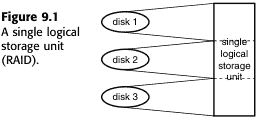

###### 为什么应使用 RAID

使用 RAID 的主要原因包括：更大的存储容量、因冗余而在磁盘故障时具备容错能力，以及速度。磁盘故障的经济成本可能极高（不仅因为停机，还因为生产力损失和恢复成本）。RAID 系统通常使人们能够快速、透明地从单块磁盘故障中恢复，且无需停机。因此，对于希望为传统备份系统增加*额外*支持层，并且不希望每次磁盘故障时都要费心恢复备份的用户来说，RAID 是一个不错的选择。

###### 条带化

理解 RAID 工作原理的基础是“数据条带化”的概念。数据条带化是指将每个驱动器的存储空间划分成小块数据（或条带），然后将这些条带交错分布在阵列中的不同驱动器上（参见图 9.2）。合并后的数据由来自每个驱动器的连续条带组成。条带可以小到一个扇区（512 字节），也可以大到数兆字节，具体取决于阵列使用的环境。

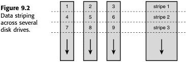


#### 不同的 RAID 架构

六种公认的 RAID 架构类型是 RAID-0 到 RAID-5。每种架构都提供不同类型的磁盘容错能力，并在功能和性能方面提供不同的权衡。容错能力是 RAID 系统的关键，因为阵列的平均故障时间等于每个驱动器平均故障间隔时间除以驱动器总数。因此，在数据存储中加入某种冗余以弥补整个阵列磁盘平均故障间隔时间的缩短是必不可少的。容错级别也会影响阵列的性能和功能。

下面将介绍每种 RAID 类型。表 9.1 对各种 RAID 类型及其功能进行了快速比较：

- RAID-0 阵列是一组条带化的磁盘驱动器，数据存储中没有冗余（因此它并不完全符合 RAID 这个缩写词的含义），因此也没有任何容错能力。这类阵列通常配置为适合需要密集 I/O 的应用的大条带，因为数据分布在多个驱动器上会带来更高的吞吐量和数据存储效率。但是，单个驱动器故障将导致整个阵列崩溃。此级别也称为磁盘条带化，是最快且效率最高的阵列类型。
- RAID-1 阵列由成对的磁盘驱动器组成，用于存储重复数据。因此具有完全冗余性：如果一个驱动器发生故障，该对中的另一个驱动器仍然可用。级别 1 阵列在读取方面的性能通常优于写入（因为两个驱动器可以同时执行读取），而在写入方面则较差（因为每次写入都必须在成对的两个驱动器上完成）。对于单对驱动器，不使用条带化。此级别提供了不错的性能和容错能力，但在所有 RAID 级别中存储效率最低。此级别也称为磁盘镜像，最适用于性能关键型的容错环境。
- RAID-2 阵列与 RAID-0 阵列类似，不同之处在于它存储纠错（ECC）信息以实现磁盘容错。此级别如今很少使用，因为现代磁盘驱动器的每个扇区内都嵌入了 ECC 信息。
- RAID-3 阵列与 RAID-2 阵列类似，不同之处在于由单个驱动器包含奇偶校验信息，并且数据以字节级别条带化分布在多个驱动器上。因此，RAID-3 一次只能执行一个 I/O 操作，从而限制其在单用户系统中的使用。然而，它非常适合需要访问长顺序记录的数据密集型单用户环境。
- RAID-4 阵列与 RAID-3 阵列类似，但使用较大的条带大小。此级别在读取方面性能非常好（与 RAID-0 相同），但在写入方面则不太好（因为每次都必须更新奇偶校验信息）。大量顺序写入相当快，但少量随机写入可能非常慢。所有奇偶校验数据都存储在单个驱动器上，因此此级别具有成本效益。
- RAID-5 阵列通过将奇偶校验信息均匀分布在阵列中的所有驱动器之间（参见图 9.3），避免了 RAID-4 中因将奇偶校验存储在单个驱动器上而造成的瓶颈。因此，可以同时处理多个写入操作，从而提高性能。阵列中相当于一个驱动器的存储空间用于存储奇偶校验数据。RAID-5 阵列非常灵活，因为它们可以配置为使用大条带（适用于多任务和多用户环境）或小条带（适用于最大化传输速率）。此级别的成本效率与 RAID-4 相同。此级别是当今最常用的级别之一，并且是不太注重写入性能的多用户环境中的最佳选择。

> **注意：** 重要的是要记住，RAID 通常要求阵列中的所有磁盘大小相同。

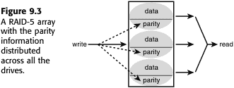

**表 9.1  不同 RAID 级别功能比较**

| 功能 | RAID-0 | RAID-1 | RAID-2 | RAID-3 | RAID-4 | RAID-5 |
| --- | --- | --- | --- | --- | --- | --- |
| 容错能力 | 无 | 最佳 | 良好 | 良好 | 良好 | 良好 |
| 存储效率 | 最佳 | 最差 | 良好 | 良好 | 良好 | 良好 |
| 读取性能 | 最佳 | 良好 | 良好 | 良好 | 良好 | 良好 |
| 写入性能 | 最佳 | 良好 | 尚可 | 尚可 | 尚可 | 尚可 |

有关 RAID 的更多信息，请参阅 Michael Neuffer 编写的“什么是 RAID？”常见问题解答，网址为 `http://www.uni-mainz.de/~neuffer/scsi/what_is_raid.html`，以及 DPT 的“了解 RAID”入门指南，网址为 `http://www.dpt.com/library/library.html`。

#### RAID 的实现

RAID 可以在硬件中实现，即采用管理阵列的专用控制器形式；也可以在软件中实现，即作为内核的一部分，位于底层磁盘驱动程序和其上方的文件系统之间。

##### 硬件 RAID

基于硬件的 RAID 可以采取两种形式：

- 基于主机的控制器，即适配卡插入计算机中的 ISA/EISA/PCI 插槽。
- SCSI 到 SCSI 控制器，即通过普通 SCSI 控制器连接到主机的外部“盒子”，对主机而言表现为单个磁盘。

在前一种情况下，适配器/控制器卡独立于主机管理 RAID。使用控制器卡的主要优势在于它能够利用多个 SCSI 通道从 RAID 阵列读取和写入，从而提高 SCSI 总线上的传输速率。在后一种情况下，包含控制器和外部磁盘子系统的机器可完成所有 RAID 处理。必须使用单条 SCSI 通道来控制 RAID，这可能会造成瓶颈。因此，基于主机的控制器是硬件 RAID 系统的首选。

##### 软件 RAID

RAID 也可以完全通过软件实现，无需额外硬件，只需一组内核模块和管理工具即可。Linux 下的 MD 驱动程序（多设备驱动程序）就是这种 RAID 实现的一个例子（它实现了级别 0、1、4 和 5）。Linux RAID 驱动程序作为内核层实现，位于块设备接口（文件系统驻留其上）和底层磁盘驱动程序（用于 IDE 和 SCSI 驱动程序）之间。有关更多信息，请参阅位于 http://www.linuxdoc.org/HOWTO/mini/Software-RAID.html 的《软件 RAID HOWTO》。

##### 硬件 RAID 与软件 RAID 的比较

基于软件的阵列像系统上的任何其他应用程序一样运行，因此会消耗大量 CPU 周期。它们还依赖于操作系统。基于软件的 RAID 的性能会受到系统上同时运行的其他应用程序的极大影响。相比之下，基于硬件的阵列通常不依赖于主机 CPU 的性能和负载。

基于硬件的 RAID 方案与基于软件的 RAID 系统几乎没有共同之处，除非在阵列功能方面。基于硬件的阵列具有真正的多任务处理能力，因为控制器中的处理器可以独立于操作系统类型和功能执行多条指令。基于硬件的 RAID 控制器还具有板载内存缓存，可以向大型控制器缓存提供高传输速率。基于硬件的 RAID 系统更可靠，因为引导系统不需要专门的软件。


基于硬件的 RAID 阵列对操作系统是透明的，这使得它们的管理更加容易。软件 RAID 实现具有多种配置选项，往往使管理变得复杂。

相比之下，基于软件的 RAID 系统极具成本效益（因为可以使用更便宜的 IDE 磁盘，而无需额外的硬件）。对于基于软件的系统，可以将单个磁盘中的不同分区组合在一起以创建冗余和容错能力，而基于硬件的系统则是将整个驱动器组合在一起。此外，在 Linux 下，软件 RAID 管理完全可以在操作系统内完成，而针对 Linux 硬件实现的专用管理工具可能不可用。

#### 在 Linux 中安装和配置 RAID

要在 Linux 系统上安装和配置 RAID，首先必须决定使用哪种类型的控制器。有几种类型的控制器可用，包括以下这些：

- DPT 控制器
- ICP Vortex 控制器
- Mylex 控制器

##### 受支持的控制器

目前，一个受良好支持的基于主机的硬件 RAID 控制器（即在 Linux 下存在一个或多个受良好支持的驱动程序的控制器）是由 DPT (http://www.dpt.com) 制造的。然而，也存在其他可以在 Linux 下工作的基于主机的控制器和 SCSI 到 SCSI 控制器。其中包括 Syred (http://www.syred.com)、ICP-Vortex (http://www.icp-vortex.com) 和 Mylex (http://www.mylex.com) 制造的控制器。有关更多信息，请参阅 Linux RAID 解决方案页面 http://linas.org/linux/raid.html。

##### DPT 控制器

基本上所有 SmartRAID IV 和 V 控制器都受支持。安装和配置部分将重点介绍基于 SCSI 的硬件 RAID 的设置，主要针对 DPT 基于主机的适配器，尽管此处应用的原理相当通用。具体来说，Smartcache IV PM2144UW 和 PM3334UW 控制器已在 Linux 2.0.3x 和 2.2.x 内核上使用 DPT 提供的机箱进行了测试。SmartRAID V Decade 卡需要额外的软件。有关更多详细信息和最新信息，请查阅位于 http://www.ram.org/computing/linux/dpt_raid.html 的《DPT 硬件 RAID HOWTO》。

##### ICP Vortex 控制器

ICP Vortex 拥有一整套支持 Linux 的磁盘阵列控制器。ICP 驱动程序自 Linux 内核 2.0.3 版本起就包含在内。所有主要的 Linux 发行商——SuSE、LST Power Linux、Caldera 和 Red Hat——都支持将 ICP 控制器用作引导/安装控制器。


RAID 系统可以方便地通过其 ROM 设置程序进行配置（无需启动 MS-DOS 进行配置）。借助其监控实用程序 `gdtmon`，可以在运行期间管理整个 ICP RAID 系统（检查传输速率、设置控制器和硬盘的参数、更换有缺陷的硬盘等）。

该实用程序使 ICP Vortex 控制器在 Linux 硬件 RAID 控制器中脱颖而出。

#### Mylex RAID 控制器

DAC960 驱动程序支持所有当前的 Mylex PCI RAID 控制器，包括 eXtremeRAID 1100 (DAC1164P)、AcceleRAID 150/200/250 以及较旧的 DAC960PJ/PG/PU/PD/PL 型号。Red Hat Linux 6.0+ 和 SuSE Linux 6.2 包含对这些控制器的支持。除了安装驱动程序外，还需要一组特殊的实用程序，这些程序提供 lilo 和 fdisk 的源代码路径和静态链接可执行文件，以便识别 DAC960 RAID 设备。驱动程序、实用程序和其他信息可通过 Dandelion Digital 的 Linux DAC960 页面获取：http://www.dandelion.com/Linux/DAC960.html。

#### 应该使用什么硬件？

在选择 RAID 硬件时，需要考虑两个因素：

- 控制器类型的选择（例如 SCSI 到 SCSI 或基于主机的）
- 磁盘机箱类型的选择（这决定了热插拔、警告和其他功能）

##### 控制器类型

鉴于这些选项，如果你正在寻找 RAID 解决方案，需要仔细考虑你的需求。根据你的具体用途以及要使用的 RAID 级别，某些卡可能比其他卡更好。例如，SCSI 到 SCSI 适配器可能不如基于主机的适配器。请参阅 EATA-DMA 驱动程序作者 Michael Neuffer 在其 Linux 高性能 SCSI 和 RAID 页面上的讨论：http://www.uni-mainz.de/~neuffer/scsi/。

##### 机箱类型

机箱类型会影响驱动器的热插拔功能、警告系统（即是否会有故障指示，以及你是否会知道哪个驱动器发生了故障），以及驱动器的工作条件（例如冗余冷却和电源）。DPT 提供的机箱工作效果非常好，但价格昂贵。Wetex (http://www.wetex.com) 的机箱缺乏 DPT 机箱的热插拔能力，但在其他方面表现良好。


#### 安装

安装分为两部分：配置硬件和配置内核。

##### 安装和配置硬件

请参阅说明手册以安装控制器和驱动器。对于 DPT，由于尚不存在适用于 Linux 的存储管理器，你必须创建一张包含系统文件的 MS-DOS 格式化磁盘（通常在 MS-DOS 提示符下使用 format /s 命令创建）。你还需要使用适用于 MS-DOS 的 DPT 存储管理器，为了安全起见，最好为其制作一份副本。

硬件就位后，使用 DOS 系统盘启动。将 DOS 磁盘替换为存储管理器，然后使用以下命令调用存储管理器：

```
a:\dptmgr
```

大约等待一分钟左右，你会看到一个选项菜单。将一组磁盘配置为硬件 RAID（单个逻辑阵列）。选择“other”作为操作系统。

MS-DOS 存储管理器使用鼠标操作要容易得多，因此你可能希望在创建的系统启动盘上包含鼠标驱动程序。

从技术上讲，应该可以在 Linux 下运行 SCO 存储管理器，但这可能得不偿失。在 Linux 下运行 MS-DOS 存储管理器可能更容易。

#### 配置内核

你需要配置内核以支持 SCSI 和相应的底层驱动程序。有关编译内核的指导，请参阅第 11 章“构建 Linux 内核”。或者，查阅 Kernel HOWTO http://sunsite.unc.edu/mdw/HOWTO/Kernel-HOWTO.html 获取有关如何编译内核的信息。在 SCSI 支持选项中选择“yes”后，在底层驱动程序部分，选择你需要的驱动程序（对于大多数符合 EATA DMA 的 (DPT) 卡，选择 EATA DMA 或 EATA ISA/EISA/PCI；对于 DPT 非常古老的 PM2001 和 PM2012A，选择 EATA PIO）。大多数驱动程序，包括 EATA DMA 和 EATA ISA/EISA/PCI 驱动程序，在最近的内核版本中应该可用。

内核编译完成后，重新启动；如果一切设置正确，你应该会看到驱动程序将 RAID 识别为单个 SCSI 磁盘。如果使用 RAID-5，你会看到此磁盘的大小是实际可用磁盘空间的三分之二。

##### 启动消息

如果你使用 EATA DMA 驱动程序，启动时看到的消息应该类似这样：

```
EATA (Extended Attachment) driver version: 2.59b
developed in co-operation with DPT
(c) 1993-96 Michael Neuffer, mike@i-Connect.Net
Registered HBAs:
HBA no. Boardtype   Revis  EATA Bus  BaseIO IRQ DMA Ch Id Pr QS S/G IS
scsi0 : PM334UW      v07L.0 2.0c PCI  0xef90 10  DM3  7  N  64 252 Y
scsi1 : PM2144UW     v07L.2 0.0c PCI  0xef50  9  BMST 1  7  N  64 252 Y
scsi2 : PM2044UW     v07K.2 0.0c PCI  0xef10 11  BMST 1  7  N  64 252 Y
scsi0 : EATA (Extended Attachment) HBA driver
scsi1 : EATA (Extended Attachment) HBA driver
scsi2 : EATA (Extended Attachment) HBA driver
scsi : 3 hosts.
  Vendor: DPT       Model: RAID-5              Rev: 07L0
  Type: Direct-Access                      ANSI SCSI revision: 02
Detected scsi disk sda at scsi0, channel 0, id 0, lun 0
scsi0: queue depth for target 0 on channel 0 set to 64
  Vendor: DPT       Model: ATOS                Rev: 07LY
  Type: Direct-Access                      ANSI SCSI revision: 02
Detected scsi disk sdb at scsi1, channel 0, id 8, lun 0
scsi1: queue depth for target 8 on channel 0 set to 64
  Vendor: SONY      Model: SDT-9000            Rev: 0200
  Type: Sequential-Access                  ANSI SCSI revision: 02
scsi2: queue depth for target 0 on channel 0 set to 64
SCSI device sda: hdwr sector=512 bytes. Sectors=105676800 [51600 MB] [51.6 GB]
sda: sda1
SCSI device sdb: hdwr sector=512 bytes. Sectors=35561984 [17364 MB] [17.4 GB]
sdb: sdb1
```

以上显示内容对应的是一个使用三个 DPT SCSI 控制器的设置，其中包含两个 RAID-5 阵列，大小分别为 51.6GB（七个 9GB 磁盘）和 17.4GB（三个 9GB 磁盘）。

如果你使用 EATA ISA/EISA/PCI 驱动程序，启动时看到的消息应该类似这样：

```
EATA0: IRQ 11 mapped to IO-APIC IRQ 16.
EATA/DMA 2.0x: Copyright 1994-1999 Dario Ballabio.
EATA config options -> tc:y, lc:n, mq:16, eh:y, rs:y, et:n.
EATA0: 2.0C, PCI 0xef10, IRQ 16, BMST, SG 122, MB 64.
EATA1: SCSI channel 0 enabled, host target ID 7.
EATA1: IRQ 9 mapped to IO-APIC IRQ 18.
EATA1: 2.0C, PCI 0xef50, IRQ 18, BMST, SG 122, MB 64.
EATA1: wide SCSI support enabled, max_id 16, max_lun 8.
EATA1: SCSI channel 0 enabled, host target ID 7.
scsi0 : EATA/DMA 2.0x rev. 5.10.00
scsi1 : EATA/DMA 2.0x rev. 5.10.00
scsi : 2 hosts.
  Vendor: SONY      Model: SDT-9000            Rev: 0200
  Type: Sequential-Access                  ANSI SCSI revision: 02
EATA0: scsi0, channel 0, id 0, lun 0, cmds/lun 2.
  Vendor: DPT       Model: ATOS                Rev: 07LY
  Type: Direct-Access                      ANSI SCSI revision: 02
Detected scsi disk sda at scsi1, channel 0, id 8, lun 0
EATA1: scsi1, channel 0, id 8, lun 0, cmds/lun 16, unsorted, tagged.
SCSI device sda: hdwr sector=512 bytes. Sectors=35561984 [17364 MB] [17.4 GB]
sda: sda1
```

以上显示内容对应的是一个使用两个 DPT SCSI 控制器的设置，其中包含一个大小为 17.4GB（三个 9GB 磁盘）的 RAID-5 阵列。

#### 配置和测试阵列

现在，你可以开始将 RAID 5 阵列视为普通磁盘来使用。你需要做的第一件事是对磁盘进行分区（使用 fdisk）。然后，你需要建立一个 ext2 文件系统。这可以通过以下命令完成：

```
# mke2fs /dev/sdXN
```

/dev/sdXN 是 SCSI 分区的名称。完成此操作后，你就可以挂载这些分区，并像使用任何其他磁盘一样使用它们（包括在 /etc/fstab 中添加条目）。

#### 热插拔

要测试阵列的热插拔功能，只需在系统运行期间从阵列中移除一个驱动器。如果 RAID 5 阵列配置正确且工作正常，系统应该在移除一个磁盘的情况下继续运行。性能会有所下降，因为缺失的数据必须在访问磁盘时即时重建。

如果你重新插入移除的磁盘或新磁盘，系统将继续运行，同时重建该磁盘的数据。重建期间性能会受到影响，如果阵列使用频繁，用户会明显感觉到。

> **提示：**请记住，RAID 5 仅提供有限的冗余。你不能同时从阵列中移除两个驱动器。如果这样做，阵列将停止工作，数据将丢失，你需要从备份中恢复。

#### 性能

你可以使用 bonnie 程序测试 RAID 阵列的性能。bonnie 是一个文件系统基准测试工具，可从 http://www.textuality.com/bonnie/ 获取。

bonnie 是可用的最佳“开放系统”基准测试工具之一，用于衡量系统 I/O 性能。它和其他基准测试工具都可以在 AC&NC RAID 和磁盘存储基准测试页面 http://www.acnc.com/benchmarks.html 获取。

> **提示：**无论你使用哪种类型的 RAID 或哪种基准测试工具，请务必也在真实的应用环境中测试性能。不要只依赖基准测试结果！

以下是使用 3344 UW 控制器的阵列的 bonnie 计时输出示例：


| 文件大小 (MB) | 顺序输出每字符 K/秒 | 顺序输出每字符 %CPU | 顺序输出块 K/秒 | 顺序输出块 %CPU | 顺序输出重写 K/秒 | 顺序输出重写 %CPU | 顺序输入每字符 K/秒 | 顺序输入每字符 %CPU | 顺序输入块 K/秒 | 顺序输入块 %CPU | 随机寻道 /秒 | 随机寻道 %CPU |
|---:|---:|---:|---:|---:|---:|---:|---:|---:|---:|---:|---:|---:|
| 1000 | 1714 | 17.2 | 1689 | 6.0 | 1200 | 5.7 | 5263 | 40.2 | 7023 | 12.1 | 51.3 | 2.2 |

#### EATA DMA 驱动程序的功能

本节介绍 Linux 下可用于检查 RAID 配置的一些命令。需要再次说明的是，虽然这里提到的是 eata_dma 驱动程序，但这些命令也可用于检查任何 SCSI 驱动程序。

要查看驱动程序的配置，请键入以下命令：

```shell
# cat /proc/scsi/eata_dma/N
```

*N* 是控制器的主机 ID。您应该会看到类似下面的内容：

```text
EATA (Extended Attachment) driver version: 2.59b
queued commands:                 17664
processed interrupts:             17664

scsi0 : HBA PM3334UW
Firmware revision: V07L.0
Hardware Configuration:
IRQ: 0, edge triggered
DMA: BUSMASTER
CPU: MC68000 @ 0MHz
Base IO: 0xef90
Host Bus: PCI
SCSI Bus: Speed: 5MB/sec.
SCSI channel expansion Module: not present
SmartRAID hardware: not present.
        Type: -
        Max array groups:              7
        Max drives per RAID 0 array:   7
        Max drives per RAID 3/5 array: 7
Cache Module: not present.
        Type: -
        Bank0: 0MB without ECC
        Bank1: 0MB without ECC
        Bank2: 0MB without ECC
        Bank3: 0MB without ECC
Timer Mod.: not present
NVRAM     : not present
SmartROM  : enabled
Alarm     : off
Host<->Disk command statistics:
```

| 大小 | 读取 | 写入 |
|---:|---:|---:|
| 1k | 0 | 0 |
| 2k | 0 | 0 |
| 4k | 0 | 0 |
| 8k | 0 | 0 |
| 16k | 0 | 0 |
| 32k | 0 | 0 |
| 64k | 0 | 0 |
| 128k | 0 | 0 |
| 256k | 0 | 0 |
| 512k | 0 | 0 |
| 1024k | 0 | 0 |
| >1024k | 0 | 0 |
| 总计 | 0 | 0 |

```text
Attached devices:
Host: scsi0 Channel: 00 Id: 00 Lun: 00
      Vendor: DPT     Model: RAID-5              Rev: 07L0
      Type:  Direct-Access                         ANSI SCSI revision: 02
```

要获取高级命令统计信息，请键入以下命令：

```shell
# echo "eata_dma latency" > /proc/scsi/eata_dma/N
```

然后您可以输入以下命令：

```shell
# cat /proc/scsi/eata_dma/N
```

要获取更详细的统计信息，可使用以下内容：

```text
EATA (Extended Attachment) driver version: 2.59b
queued commands:           17737
processed interrupts:      17737

scsi0 : HBA PM3334UW
Firmware revision: V07L.0
Hardware Configuration:
IRQ:  0, edge triggered
DMA: BUSMASTER
CPU: MC68000 @ 0MHz
Base IO: 0xef90
Host Bus: PCI
SCSI Bus: Speed: 5MB/sec.
SCSI channel expansion Module: not present
SmartRAID hardware: not present.
             Type: -
       Max array groups:       7
       Max drives per RAID 0 array:     7
       Max drives per RAID 3/5 array:   7
Cache Module: not present.
             Type: -
       Bank0: 0MB without ECC
       Bank1: 0MB without ECC
       Bank2: 0MB without ECC
       Bank3: 0MB without ECC
Timer Mod.: not present
NVRAM      : not present
SmartROM   : enabled
Alarm      : off
Host Latency Command Statistics:
Current timer resolution: 10ms
```

| 大小 | 计数 | 最小 (ms) | 最大 (ms) | 平均 (ms) |
|---|---:|---:|---:|---:|
| **读取** |  |  |  |  |
| 1k | 36 | 0 | 30 | 9 |
| 2k | 0 | 0 | 0 | 0 |
| 4k | 3 | 0 | 10 | 6 |
| 8k | 0 | 0 | 0 | 0 |
| 16k | 0 | 0 | 0 | 0 |
| 32k | 0 | 0 | 0 | 0 |
| 64k | 0 | 0 | 0 | 0 |
| 128k | 0 | 0 | 0 | 0 |
| 256k | 0 | 0 | 0 | 0 |
| 512k | 0 | 0 | 0 | 0 |
| 1024k | 0 | 0 | 0 | 0 |
| >1024k | 0 | 0 | 0 | 0 |
| **写入** |  |  |  |  |
| 1k | 24 | 0 | 0 | 0 |
| 2k | 0 | 0 | 0 | 0 |
| 4k | 0 | 0 | 0 | 0 |
| 8k | 0 | 0 | 0 | 0 |
| 16k | 0 | 0 | 0 | 0 |
| 32k | 0 | 0 | 0 | 0 |
| 64k | 0 | 0 | 0 | 0 |
| 128k | 0 | 0 | 0 | 0 |
| 256k | 0 | 0 | 0 | 0 |
| 512k | 0 | 0 | 0 | 0 |
| 1024k | 0 | 0 | 0 | 0 |
| >1024k | 0 | 0 | 0 | 0 |

```text
Attached devices:
Host: scsi0 Channel: 00 Id: 00 Lun: 00
  Vendor: DPT     Model: RAID-5        Rev: 07L0
  Type: Direct-Access              ANSI SCSI revision: 02
```

要关闭高级命令统计信息，请键入以下命令：

```shell
# echo "eata_dma.nolatency" > /proc/scsi/eata_dma/N
```

#### 故障排除

下面是在本节中讨论的几个典型 RAID 5 问题：

- 启动时未检测到任何 SCSI 主机
- RAID 配置显示为 N 个不同的磁盘
- 格式化过程中机器或控制器关闭
- 初始文件系统格式化期间产生 SCSI_ABORT_BUSY 错误

###### 启动时未检测到任何 SCSI 主机

有时，在引导系统时不会检测到任何 SCSI 主机。这可能是多种原因造成的，但通常表明尚未配置相应的驱动程序。要解决此问题，请检查并确保已安装和配置相应的驱动程序（例如 EATA-DMA 或用于 DPT 卡的 EATA ISA/EISA/PCI）。您可以使用 lsmod 命令查看是否已加载相应的模块，并应参阅系统日志中有关 SCSI 驱动程序的引导时错误。

> **提示**
> 通常，在执行任何故障排除操作之前，最好对数据进行完整备份。

###### RAID 配置显示为 N 个不同的磁盘

如果 RAID 阵列配置不当，其显示的磁盘数量可能与实际安装的磁盘数量不同。对于 DPT 存储管理器，您必须将 RAID 磁盘配置为单个逻辑阵列。使用存储管理器配置控制器时，请使用参数 /FW0 启动它，或选择 Solaris 作为操作系统。这将使阵列设置由控制器在内部管理。

###### 格式化过程中机器或控制器关闭

如果在磁盘格式化操作期间关闭系统或控制器，某些 RAID 控制器可能会出现严重问题。问题可能非常严重，在某些情况下，磁盘不得不退回给制造商。

如果发生这种情况，您可以对磁盘执行低级格式化来尝试恢复磁盘的使用。对于 DPT 控制器，其工具网页 http://www.dpt.com/techsup/ 上提供了一个名为 clmft 的特殊格式化程序。解压 clmft.zip 文件后，请阅读其中的说明。完成低级格式化后，您或许可以将这些磁盘当作新磁盘来使用。

###### 初始文件系统格式化期间产生 SCSI_ABORT_BUSY 错误

当您在 SCSI 驱动器上执行 mke2fs 时，可能会看到如下形式的错误：

```text
scsi: aborting command due to timeout : pid xxx, scsi0, channel 0, id 2, lun 0
write (10) xx xx xx xx xx xx xx xx xx xx
eata_abort: called pid xxx target: 2 lun: 0 reason: 3
Returning: SCSI_ABORT_BUSY
```

这可能会导致机器死机。通常，您可以通过使用 dd 命令从 RAID 阵列读取 100 或 200 MB 数据来解决此问题，如下所示：

```shell
# dd if=/dev/sdX of=/dev/null bs=1024k count=128
```

在格式化期间，会快速产生大量对可直接访问的内存块的请求，有时内存管理器无法在合理的时间内处理这些请求。上面介绍的 dd 解决方案是一种变通方法，它会按顺序生成这些请求，而不是一次性生成一大堆（后者在格式化时很常见）。


### 第 10 章 备份与恢复

#### 本章内容

- 备份为何重要 158
- 规划备份策略 158
- 磁带驱动器 159
- 使用何种备份软件 162
- 灾难恢复 184
- 故障排除 189

#### 备份为何重要

备份和恢复是极其重要的系统管理活动。备份文件系统意味着将其复制到可移动介质上，其中磁带是最常见的类型。在大多数网络中，需要备份的数据量通常非常大，以至于使用其他形式的可移动介质（如软盘或 Jaz 磁盘）是不切实际的。这些介质可用于快速备份和检索较小的数据集，例如关键的系统配置文件。

备份的重要性不容低估。它们是防止意外数据丢失的主要保障。一个精心设计的备份计划，实施对关键文件系统的系统性备份流程，对于以下方面至关重要：

- 保证你能从磁盘崩溃中恢复
- 确保你能恢复用户意外删除的文件
- 防范系统升级或应用程序补丁失败

此外，备份还可用于将数据从一个系统传输到另一个系统，或重新组织现有系统的文件系统，并用更大容量的磁盘驱动器替换较小容量的磁盘驱动器。

无论你多么精心地维护系统，也无论你的用户多么有经验，迟早你都会面临文件丢失的情况。这可能从用户意外删除的几个文件，到磁盘崩溃瞬间摧毁整个文件系统。尽管备份对于大型系统来说是常态，但许多小型系统和网络未能实施充分的备份流程。备份对于各种规模的系统都很重要。

#### 规划备份策略

数据备份得越频繁，就越安全，不易丢失。这表明理想的备份计划应实施频繁备份，甚至每天不止一次。

然而，备份过程本身代价高昂。特别是，备份会占用系统资源和操作员时间，因此不能过于频繁地执行。相反，管理员还必须分析系统上存储的数据，以确定哪些数据需要备份以及备份的频率。

例如，用户文件通常变化频繁。因此，每天备份它们是一个好策略。相比之下，系统文件通常变化较少，每周备份一次可能就足够了。在 Linux 环境中，/ 和 /usr 文件系统通常很少变化，是每周备份的理想候选。相比之下，/home 和 /var 目录树包含的数据（包括主目录中的用户文件和邮件收件箱）变化频繁。理想情况下，这些应该每天备份。

由于网络速度、磁盘占用和 CPU 时间方面的成本，备份需要在系统其他使用量最低时运行。此外，备份应在所备份数据最不可能发生变化时运行。通常，这意味着对于大多数网络和系统，备份应安排在夜间或凌晨时段运行。在大多数环境中，此时没有用户登录，数据也最稳定。

为了节省磁带介质和备份时间，一个好的备份策略是每周执行一次完全备份（例如在周末），并在工作日内每天执行增量备份。完全备份将整个文件系统复制到备份介质，而增量备份仅复制自上次完全备份以来发生变化的文件。这样既节省了磁带介质，也大幅缩短了工作日的备份时间。

这并不意味着将每周完全备份与每日增量备份相结合的策略没有缺陷。特别是，这种策略意味着从备份恢复时至少需要使用两组备份：首先必须恢复最新的完全备份，然后必须在已恢复的完全备份之上恢复来自更新的增量备份中发生变化的文件。不过，总体而言，该计划在磁带介质成本上的节省和更短的备份时间远远超过了处理多组磁带的些许不便。

## 磁带驱动器

有多种不同类型的磁带驱动器可供选择。驱动器分为两大类：

- SCSI 驱动器
- IDE 驱动器

一般来说，SCSI 驱动器性能更好，除非是在最小的网络和系统中，否则你应该选择 SCSI 磁带驱动器进行备份。有多种不同类型的 SCSI 磁带驱动器可供选择，包括以下几种：

- **高级智能磁带（AIT）：** AIT 是大容量网络和服务器备份的首选磁带技术。AIT 技术由索尼开发，采用 8mm 磁带格式。AIT-1 提供高达 6.0Mbps 的速度、35GB 的本机容量，以及单盘磁带高达 70GB 的压缩存储容量。AIT-2 向后兼容 AIT-1，提供 50GB 本机容量，以及每盘磁带高达 100GB 的压缩存储容量。这种高速度和高存储容量使得该技术成本较高，但非常适合高需求的备份。
- **数字线性磁带（DLT）：** DLT 是一种极快的磁带技术，提供 35GB 本机容量、每盘磁带高达 70GB 的压缩容量，以及 5Mbps 的传输速率。据报道，DLT 磁带具有很高的数据可靠性，保证可承受多达 500,000 次通过。由于高速度和高可靠性，DLT 驱动器通常是一种昂贵的选择。
- **数字音频磁带（DAT）：** DAT 最初是一种音频录制格式，后来被改造用于计算机备份。DAT 磁带的容量范围从 2GB 到 16GB，与 QIC 和 Travan 等一些竞争技术相比，其介质成本较低，但驱动器成本较高。DAT 驱动器提供高于平均速度的性能，使其适用于小型工作组和网络备份。
- **Exabyte 8mm：** Exabyte 8mm 格式是对摄像机中使用的 8mm 技术的改编。磁带容量最高可达 7GB，传输速率据报道高达 0.3MBps。由于驱动器成本低，8mm 驱动器常用于网络备份解决方案。
- **Exabyte Mammoth：** Exabyte Mammoth 格式是一种 8mm 技术，与其他 Exabyte 8mm 技术向后兼容，同时提供每盘磁带高达 43GB 的压缩数据存储容量，数据传输速率高达 3MBps。
- **Travan：** Travan 驱动器被广泛用作台式计算机的备份技术，因为它们为家庭用户和小型企业提供了良好的价格点。Travan NS 8 提供 4GB 的本机容量、高达 8GB 的压缩容量，以及 0.6Mbps 的速度。Travan NS 20 提供 10GB 本机容量、高达 20GB 的压缩容量，以及 1.5Mbps 的驱动器速度。Travan NS 36 即将上市。它拥有 18GB 的本机容量、高达 36GB 的压缩容量，最大速度能力为 4Mbps。Travan 驱动器同时支持 SCSI 和 EIDE 接口。

在本章中，我们使用了连接到运行 2.2.15-smp Linux 内核的 Linux 系统上的 Sony AIT 驱动器。所有示例都假定你使用的是 SCSI 磁带驱动器，因为这些驱动器在网络和服务器环境中最为常见。

#### 测试磁带驱动器

将磁带驱动器连接到系统后，你应该对其进行测试，以确保其正常工作。可以使用 mt 命令来测试驱动器的基本功能。

首先，在重新启动后检查 /var/log/messages，以确保你的系统检测并识别了磁带驱动器。你可以使用 dmesg 命令来完成此操作。如果驱动器被成功检测到，dmesg 命令的输出应包含类似于以下内容的摘录，概述你安装的磁带驱动器的品牌和类型：

```
Vendor: SONY      Model: SDX-300C        Rev: 0400
  Type: Sequential-Access                 ANSI SCSI revision: 02
  Detected scsi tape st0 at scsi0, channel 0, id 6, lun 0
```

在此示例中，驱动器的 SCSI ID 为 6，并被分配到设备 /dev/st0。

> **注意**  
> 如果你的系统上只有一个 SCSI 磁带驱动器，它通常会被分配到设备 /dev/st0。我们在本章中均假定如此。


> **提示**
>
> 如果 `dmesg` 的输出表明驱动器未被检测到和识别，请检查您的硬件。确保所有电缆都已紧密连接，仔细检查您的 SCSI 链的端接，并确保磁带驱动器的 SCSI ID 在链上是唯一的。通电后，您应该会看到适配器打印的 SCSI 卡 BIOS 消息，然后是检测到的 SCSI 设备。

当驱动器被识别后，将一盘磁带插入驱动器，以便您可以使用 `mt` 命令测试基本的磁带操作。`mt` 命令可以接受许多选项，这些选项都列在 `mt` 的手册页中，可通过命令 `man mt` 访问。

要检查磁带驱动器和插入磁带的状态，请使用 `mt` 命令的 status 选项。`-f` 标志用于指定磁带驱动器：

```text
# mt -f /dev/nst0 status
SCSI 2 tape drive:
File number=0, block number=0, partition=0.
Tape block size 512 bytes. Density code 0x30 (unknown to this mt).
Soft error count since last status=0
General status bits on (81010000):
  EOF ONLINE IM_REP_EN
```

> **注意**
>
> 在上面的示例中，使用的是 `/dev/nst0` 而不是 `/dev/st0`。这指的是与 `/dev/st0` 相同的设备，但作为非回绕磁带设备。当作为非回绕磁带设备（如 `/dev/nst0`）引用时，磁带在读写操作后不会回绕。

> **提示**
>
> 在备份情况下，通常最好使用非回绕磁带设备（例如，使用 `/dev/nst0` 而不是 `/dev/st0`）。这允许备份软件决定磁带回绕的方式和时间。

在此示例中，我们使用了 `-f` 选项来指定要测试的特定磁带设备。我们可以将某个磁带设备设为默认磁带设备，这样就不需要使用 `-f` 标志来指定它。这很有用，因为许多系统只有一个磁带驱动器，将此驱动器指定为默认设备可以使操作更加方便。

要将您的驱动器设为默认驱动器，请创建一个指向磁带设备的符号链接 `/dev/tape`：

```shell
# ln -s /dev/nst0 /dev/tape
```

当以这种方式指定默认磁带设备后，您只需在使用 `mt` 命令操作其他磁带驱动器时使用 `-f` 选项。因此，我们可以按如下方式测试默认驱动器的状态：

```text
# mt status
SCSI 2 tape drive:
File number=5, block number=0, partition=0.
Tape block size 512 bytes. Density code 0x30 (unknown to this mt).
Soft error count since last status=0
General status bits on (81010000):
    EOF ONLINE IM_REP_EN
```

检查完磁带驱动器的状态后，使用 `mt` 命令的 erase 选项擦除驱动器中的磁带。此命令不应产生任何错误：

```shell
# mt erase
```

除了擦除磁带外，您还应该能够回绕和弹出磁带。要回绕磁带，请使用 `mt` 命令的 rewind 选项：

```shell
# mt rewind
```

要弹出磁带，请使用 `mt` 命令的 offline 选项使驱动器离线：

```shell
# mt offline
```

> **提示：** 您可以使用一个命令回绕并弹出磁带：`mt rewoffl`。

#### 使用什么备份软件

Linux 发行版通常包含一些标准的数据归档应用程序，可用于执行备份和从备份中恢复。具体来说，Linux 发行版包括以下内容：

- `tar`：磁带归档程序
- `dump` 和 `restore`：一对用于创建完整备份和增量备份以及从这些备份恢复的程序

此外，免费提供的 Amanda 软件包提供了一个完整的环境，用于创建强大的网络备份体系。

#### 使用 `tar` 进行备份

*tar* 这个名字代表 *磁带归档器*。`tar` 是一个归档程序，它获取多个文件和目录并将它们存储到单个文件中，可以写入磁带或硬盘上的文件。

Linux 包含 GNU 版本的 `tar`，它提供多卷支持以及增量备份和完整备份功能。

`tar` 可以通过第一个标志以三种模式操作：

- `tar c`：创建模式，用于创建归档和向归档追加内容
- `tar x`：提取模式，用于从归档中提取文件
- `tar t`：列表模式，用于列出归档的目录内容

通过将初始模式标志与 `tar` 可用的各种其他标志相结合，您可以对 `tar` 的操作方式进行细粒度控制。

##### 将 tar 文件写入磁带

要将整个目录层次结构备份到磁带，请按如下方式使用 `tar`：

```text
tar cvf <device or file for backup> <directory to backup>
```

例如，要将 `/usr` 目录备份到磁带驱动器，请使用以下命令：

```shell
# tar cvf /dev/tape /usr
```

`v` 标志表示 `tar` 应以详细模式运行。这意味着每个写入备份文件的文件的完整路径名都会显示在控制台上。如果您希望静默操作，请省略 `v` 标志。`f` 标志应位于备份应存储到的文件（或设备）之前。在本例中，它位于 `/dev/tape` 之前，表示 `/dev/tape` 是备份文件的目标位置。

> **注意**
>
> 没有 `f` 标志时，`tar` 将尝试备份到其默认设备 `/dev/rmt0`。这是某些 Unix 系统上典型的默认磁带设备，在 Linux 系统上通常不可用。因此，在 Linux 中使用 `tar` 时，您始终需要使用 `f` 标志。


##### 列出磁带上的 tar 文件内容

要详细列出磁带上 tar 文件的内容，请使用以下步骤：

- 1. 回绕磁带：
  `# mt rewind`
- 2. 将磁头定位到所需文件的开头。例如，要将磁头定位到第五个文件的开头，请使用以下命令：
  `# mt fsf 5`
- 3. 显示文件的目录内容列表：
  `# tar tf /dev/tape | more`

请注意，这里使用 `tar` 命令的 `f` 标志来指定包含要列出内容的备份文件的设备。输出通过 `more` 进行管道传输，因为备份文件通常包含大量文件，需要一屏一屏地查看列表。

#### 从磁带恢复文件

如果您想将磁带上的 tar 文件中的所有内容提取到当前 Linux 目录结构中的位置，您可以使用如下 `tar` 命令：

```text
tar xf <location of backup file>
```

通常，您希望将文件恢复到与原始备份位置不同的位置，然后将它们移动到实际位置。这比直接覆盖现有文件更安全，因为如果备份在完成前失败或备份介质中存储的数据损坏，可以避免引入问题。

例如，如果您想将 `/usr` 目录从其磁带备份文件恢复到 `/restore` 目录，然后将文件移动到 `/usr` 目录，请使用以下步骤：

- 1. 将当前目录更改为 `/restore`：

  ```shell
  # cd /restore
  ```

- 2. 使用 `df` 命令确保有足够的磁盘空间。
- 3. 回绕磁带：

  ```shell
  # mt rewind
  ```

- 4. 使用以下命令提取备份文件的内容：

  ```shell
  # tar xf /dev/tape ./usr
  ```

- 5. 检查文件，然后将它们移动到 `/usr`。

如果要从备份文件中指定要提取的文件，请在 `tar` 命令中指定它们：

```text
tar xf <location of backup file> <filename to extract> <filename to extract>...
```

如果不指定任何文件名，则 `tar` 会提取整个备份文件。

> **警告**
>
> `tar` 会将文件提取到当前工作目录，并使用文件归档时的相同名称。请注意不要覆盖同名的现有文件。

#### 使用 dump 和 restore

使用 `dump` 程序，您可以执行完整备份或增量备份。`dump` 命令在名为 `/etc/dumpdates` 的文件中跟踪以前备份的时间。该程序会构建自上次备份以来发生更改的文件列表，然后可以创建一个包含所有这些文件的大归档，并将其写入磁带或其他介质。

根据您站点的需求，您可以决定每天运行完整备份，也可以每周、每两周或每月运行一次完整备份，然后在这些完整备份之间定期运行增量备份。


备份类型通过转储级别（dump levels）指定。转储级别以数字指定。转储级别 0 表示完整备份，转储级别 1-9 表示应执行增量备份，其中自上次运行（其级别小于或等于指定的转储级别）以来修改的所有文件都将被归档。

要使用 dump 执行备份，请使用以下语法：

```
dump <dump level>usf <tape length> <tape device> <partition to back up>
```

u 标志表示 dump 应更新 `/etc/dumpdates`，以便可以进行增量备份。将在 `/etc/dumpdates` 文件中创建如下格式的条目：

```
<partition> <dump level> <date and time>
```

例如，以下条目表示 `/dev/sdb2` 分区已在 12 月 27 日进行了备份，并执行了完整备份（转储级别 0）：

```
/dev/sdb2     0 Mon Dec 27 22:18:47 1999
```

s 标志与磁带长度值结合使用，用于指定所用磁带的长度（以英尺为单位）。如果你不知道磁带的长度，可以使用任意大的数字，例如 650,000，因为默认长度仅为 2,300 英尺，这意味着 dump 会在磁带完全填满之前就提示你更换磁带。最后，f 标志与磁带设备结合使用，用于指示备份应存储的位置。

例如，考虑以下命令：

```
# dump 9usf 650000 /dev/tape /opt
```

此命令表示，挂载在 /opt 的分区应使用级别 9 增量备份备份到磁带设备。

dump 命令生成的输出指示正在备份的分区、备份每个阶段的成功情况以及完成备份所花费的时间，如下例所示：

```
# dump 0usf 650000 /dev/tape /opt
DUMP: Date of this level 0 dump: Tue Dec 28 22:14:04 1999
DUMP: Date of last level 0 dump: The epoch
DUMP: Dumping /dev/sda6 (/opt) to /dev/tape
DUMP: mapping (Pass I) [regular files]
DUMP: mapping (Pass II) [directories]
DUMP: estimated 14685 tape blocks on 0.34 tape(s).
DUMP: dumping (Pass III) [directories]
DUMP: dumping (Pass IV) [regular files]
DUMP: 14852 tape blocks on 1 volumes(s)
DUMP: finished in 11 seconds, throughput 1350 KBytes/sec
DUMP: Closing /dev/tape
DUMP: DUMP IS DONE
```

#### 恢复文件和文件系统

restore 命令允许你从使用 dump 命令创建的备份中恢复文件和目录。restore 命令可用于从级别 0 转储及其后的增量转储中恢复整个文件系统层次结构，也可用于从一个或多个转储磁带中恢复一个或多个文件。


restore 命令必须由 root 用户运行，以便文件属主、模式和修改时间能够还原为与原始文件一致。

以下命令将恢复整个文件系统层次结构：

```sh
# restore rf /dev/tape
```

r 标志表示你要恢复整个文件系统，f 标志与 /dev/tape 一起指定备份数据的来源。

restore 命令可以使用 i 标志以交互方式恢复文件。当使用 i 标志调用时，restore 命令会提供一个交互式 shell，你可以在其中更改备份集内的目录、列出目录内容以及提取文件。

考虑以下示例，其中文件 `/opt/src/amanda-2.4.1p1.tar.gz` 被恢复到临时 `/restore` 目录：

```text
# cd /restore
# mt rewind
# restore if /dev/tape
restore > ls
.:
lost+found/  src/
restore > cd src
restore > ls
./src:
README                  amanda-2.4.1p1.tar.gz  glibc22.patch
amanda-2.4.1p1/         glibc21.patch
restore > add amanda-2.4.1p1.tar.gz
restore > extract
You have not read any tapes yet.
Unless you know which volume your file(s) are on you should start
with the last volume and work towards the first.
Specify next volume #: 1
set owner/mode for './'? [yn] n
restore > quit
# ls
lost+found  src
# cd src
# ls -l
total 697
-rw-r--r-- 1 root root 709624 Nov 21 1998 amanda-2.4.1p1.tar.gz
```

在交互式 restore shell 中，有两个命令至关重要：

- `add <filename>`：将文件添加到要恢复的文件集合中
- `extract`：将指定的文件集合从备份恢复到当前位置

#### 使用 AMANDA 进行备份

Amanda 是一个免费提供的备份软件程序，由马里兰大学开发。AMANDA 这个名称代表 Advanced Maryland Automated Network Disk Archiver（高级马里兰自动化网络磁盘归档器）。其主要作者是马里兰大学的 James da Silva。

Amanda 非常适合备份中大型网络。它允许你将多台机器的网络备份到中央备份服务器。Amanda 使用 GNU tar 或大多数 Linux 系统自带的原生 dump 程序来执行备份。与 Samba 结合使用时，Amanda 还可以备份 Windows 95 和 NT 机器。

Amanda 背后的理念是将多台机器的备份集中到一个主磁带服务器上，该服务器拥有一个或多个磁带驱动器和一个大容量暂存磁盘。许多系统的备份可以通过网络完成，备份到备份服务器上的暂存磁盘。多个网络备份也可以并行进行。一旦数据备份到暂存磁盘，就会以连续流模式写入快速磁带驱动器。这可以确保高效地写入磁带，而无需中断磁带。

> **注意**
>
> Amanda 可以在没有暂存磁盘的情况下运行：来自网络客户端的数据可以直接写入磁带，但性能会下降，总备份时间可能会增加数倍。

Amanda 备份软件由一套客户端和服务器软件组成。Amanda 提供自己的网络协议，这些协议运行在标准 UDP 和 TCP 协议之上。目前，Amanda 使用 UDP 端口 10080 以及 TCP 端口 10082 和 10083 在 Amanda 客户端和服务器之间进行通信。Amanda 提供了一种非常灵活的数据压缩方案，可以配置为在磁带服务器上压缩数据以减少客户端机器的负载，也可以配置为在客户端上压缩数据以减少客户端与磁带服务器之间的网络流量。

Amanda 是一个功能强大的软件；要完全理解并掌握它需要时间。可以考虑向 `amanda-users-request@amanda.org` 发送消息来订阅 Amanda 邮件列表。这是了解更多关于 Amanda 的信息以及从运行 Amanda 的其他管理员那里获得帮助的好资源。

#### 从源代码构建 AMANDA

你可以从 `http://www.amanda.org` 下载 Amanda 源代码。撰写本文时最新的稳定版本是 2.4.1p1。在编译该软件之前，Amanda 要求系统上存在某些其他软件包：

- GNU tar 1.12 或更高版本
- Perl 5.004 或更高版本
- GNU readline 2.2.1 或更高版本
- GNU awk 3.0.3 或更高版本
- Gnuplot 3.5 或更高版本

如果你打算使用 Amanda 备份 Windows 95、98、NT 或 2000 客户端系统，还需要在 Amanda 备份服务器上安装 Samba 1.9.18p10 或更高版本。

##### 构建过程

使用以下步骤从源代码安装 Amanda：

1. 下载 Amanda 归档文件并将其保存到方便的位置，例如 `/usr/local/src`。在撰写本文时，源代码归档的当前版本是 `amanda-2.4.1p1.tar.gz`。

2. 将当前目录更改为 `/usr/local/src`：

   ```
   # cd /usr/local/src
   ```

3. 解压源代码归档：

   ```
   # tar xzf amanda-2.4.1p1.tar.gz
   ```

   源代码将被解压到子目录 `amanda-2.4.1p1` 中。

4. 将当前目录更改为新的子目录：

   ```
   # cd amanda-2.4.1p1
   ```

5. 使用以下命令配置软件：

   ```
   # ./configure --with-user=bin --with-group=backup \
   --with-tape-device=/dev/nst0 --with-amandahosts
   ```

   `with-user` 选项指定软件将以哪个用户身份运行，`with-group` 选项指定软件将以哪个组身份运行，`with-tape-device` 选项指示默认磁带设备，`with-amandahosts` 选项指示在配置 Amanda 时将使用 `.amandahosts` 文件而不是 `.rhosts` 文件。运行 Amanda 的用户需要拥有足够的权限来读写你将使用的任何磁带驱动器；为此，典型的选择是 bin、amanda 或 backup。常见的组选择包括 backup、disk 或 operator。

   此命令将使用名为 Daily 的默认备份配置来配置 Amanda。如果你想要使用不同的配置名称，请在 configure 命令中添加 `--with-config=<your configuration name>`。如果你仅是为了在客户端上运行而编译 Amanda，而不需要提供 Amanda 服务器功能，请在 configure 命令中添加 `--without-server` 选项。

   默认情况下，Amanda 将被配置为安装在表 10.1 中列出的目录中。

**表 10.1 — Amanda 安装目录**

| 目录 | 描述 |
|---|---|
| `/usr/local/sbin` | 包含服务器端二进制的目录。 |
| `/usr/local/libexec` | 包含客户端二进制的目录。 |
| `/usr/local/lib` | 包含 Amanda（共享）库的目录。 |
| `/usr/local/man` | 包含手册页的目录。 |
| `/usr/local/etc/amanda` | 存放运行时文件的目录。Amanda 支持每个站点多个配置；这些配置包含在此目录的子目录中。 |


**表 10.1（续）**

| 目录 | 说明 |
|---|---|
| `/usr/local/var/amanda/gnutar-lists` | 指定 gnutar 存放其用于执行增量备份的所列增量目录列表的目录。 |
| `/tmp/amanda` | 存放各个 Amanda 程序调试输出的目录。 |

configure 命令将为你的系统构建一个 makefile。

- 6. 使用以下命令编译 Amanda：

  ```
  # make >& make.out
  ```

- 7. 使用以下命令安装编译后的软件：

  ```
  # make install >& make.install.out
  ```

- 8. 在文本编辑器中打开 Amanda 服务器和所有 Amanda 客户端上的 `/etc/services` 文件。如果你正在运行 NIS，请在 NIS 主服务器上打开该文件。

- 9. 将以下行添加到 `/etc/services` 文件：

  ```
  amanda   10080/udp
  amandaidx 10082/tcp
  amidxtape 10083/tcp
  ```

- 10. 保存 `/etc/services` 并关闭文本编辑器。

- 11. 如果你正在运行 NIS，请在 NIS 主服务器上重建 NIS 映射。

- 12. 在文本编辑器中打开 Amanda 服务器上的 `/etc/inetd.conf` 文件。

- 13. 将以下条目添加到 `/etc/inetd.conf` 文件：

  ```
  amanda   dgram  udp wait bin /usr/local/libexec/amanda  amandad
  amandaidx stream tcp nowait bin /usr/local/libexec/amindexd amindexd
  amidxtape stream tcp nowait bin /usr/local/libexec/amidxtaped amidxtaped
  ```

- 14. 保存 `/etc/inetd.conf` 并关闭文本编辑器。

- 15. 在文本编辑器中打开所有 Amanda 客户端上的 `/etc/inetd.conf` 文件。

- 16. 将以下条目添加到这些 `/etc/inetd.conf` 文件中：

  ```
  amanda   dgram  udp wait bin /usr/local/libexec/amanda  amandad
  ```

- 17. 保存这些文件并关闭文本编辑器。

- 18. 在编辑过 inetd.conf 的所有系统上，使用以下命令向 inetd 发送 SIGHUP 信号：

  ```
  # kill -1 `cat /var/run/inetd.pid`
  ```

#### 配置 Amanda

在 Amanda 客户端机器以及服务器上，安装 Amanda 二进制文件并将所需条目添加到 `/etc/services` 和 `/etc/inetd.conf` 之后，你需要创建一个 `.amandahosts` 文件（如果你没有使用 configure 命令的 with-amandahosts 选项，则创建 `.rhosts` 文件）。

`.amandahosts` 或 `.rhosts` 文件必须创建在 Amanda 用户的主目录中。该文件需要包含以下形式的单个条目：

```
<Amanda server host name or IP address> <Amanda user name>
```

例如，如果你的服务器是 `tape.some.host`，Amanda 用户是 `bin`，则条目应为：

```
tape.some.host bin
```

此外，你需要在 Amanda 服务器上创建 `amanda.conf` 和 disklist 文件。Amanda 附带了默认的 `amanda.conf` 和 disklist 文件，你可以将其用作配置的基础。

你可以按如下方式安装这些文件：

- 1. 为你的配置选择一个名称。

- 2. 在 `/usr/local/etc/Amanda/` 中按如下方式创建一个以该名称命名的配置目录：

  ```
  # mkdir /usr/local/etc/Amanda/<configuration name>
  ```

- 3. 将源发行版 examples 目录中的 `amanda.conf` 和 disklist 文件复制到该新目录：

  ```
  # cp /usr/local/src/amanda-2.4.1p1/examples/amanda.conf.in \
  /usr/local/etc/Amanda/<configuration name>
  # cp /usr/local/src/amanda-2.4.1p1/examples/disklist \
  /usr/local/etc/Amanda/<configuration name>
  ```

- 4. 按照下一节所述，编辑这些文件以满足你所在站点的需求。

#### 编辑 amanda.conf 文件

要正确编辑适用于你所在站点的 `amanda.conf` 文件，需要以下几项信息：

- 你将使用的磁带设备
- 暂存磁盘的名称和大小
- 你的转储周期
- 你偏好的备份程序（dump 或 tar）
- 你想要压缩的任何分区

如果你决定使用暂存磁盘，暂存磁盘的容量应至少足以容纳最大的两个备份映像，以获得最佳性能。这样，当一个映像正在从磁盘读取并写入磁带时，另一个映像可以继续写入磁盘。

转储周期表示你需要执行完全转储的频率。转储周期越短，恢复越容易，因为增量磁带更少；较长的转储周期能更好地分散负载，且所需的磁带更少。

此处列出了一个示例 `amanda.conf` 文件。每个选项旁边的注释简要说明了该选项的含义。

```
#
# amanda.conf - sample Amanda configuration file.
#

org "BWC"          # your organization name for reports
mailto "root"      # space separated list of operators at your site
dumpuser "bin"     # the user to run dumps under
inparallel 4       # maximum dumpers that will run in parallel
netusage 6000 Kbps # maximum net bandwidth for Amanda in KB/sec
dumpcycle 4 weeks  # the number of days in the normal dump cycle

runspercycle 20    # the number of amdump runs in dumpcycle days
# (4 weeks * 5 amdump runs per week -- just weekdays)

tapecycle 25 tapes # the number of tapes in rotation
# 4 weeks (dumpcycle) times 5 tapes per week (just
# the weekdays) plus a few to handle errors that
# need amflush and so we do not overwrite the full
# backups performed at the beginning of the previous
# cycle
### ### ###
# WARNING: don't use `inf' for tapecycle, it's broken!
### ### ###

bumpsize 20 Mb     # minimum savings (threshold) to bump level 1 -> 2
bumpdays 1         # minimum days at each level
bumpmult 4         # threshold = bumpsize * bumpmult^(level-1)
etimeout 300       # number of seconds per filesystem for estimates.
#etimeout -600     # total number of seconds for estimates.
# a positive number will be multiplied by the number of filesystems
# on each host; a negative number will be taken as an absolute total
# time-out.
# The default is 5 minutes per filesystem.

#
# Specify tape device and/or tape changer.  If you don't have a tape
# changer, and you don't want to use more than one tape per run of
# amdump, just comment out the definition of tapchanger.
# Some tape changers require tapedev to be defined; others will use
# their own tape device selection mechanism. Some use a separate
# tape changer device (changerdv), others will simply ignore this
# parameter. Some rely on a configuration file (changerfile) to
# obtain more information about tape devices, number of slots, etc;
# others just need to store some data in files, whose names will
# start with changerfile. For more information about individual
# tape changers, read docs/TAPE.CHANGERS.
# At most one changerfile entry must be defined; select the most
# appropriate one for your configuration.  If you select
# man-changer, keep the first one; if you decide not to use a tape
# changer, you may comment them all out.
runtapes 1        # number of tapes to be used in a single run of amdump
#tchanger 'chg-manual'  # the tape-changer glue script
tapedev "/dev/nst0"    # the no-rewind tape device to be used
rawtapedev "/dev/null" # the raw device to be used (ftape only)
#changerfile "/usr/adm/amanda/bwc/changer"
#changerfile "/usr/adm/amanda/bwc/changer-status"
#changerfile "/usr/local/etc/amanda/bwc/changer.conf"
#changerdv "/dev/null"

tapetype SONY-AIT        # what kind of tape it is (see tapetypes below)
labelstr ^bcw[0-9]-$ # label constraint regex: all tapes must
#                         match
#
# Specify holding disks. These are used as a temporary staging area
# for dumps before they are written to tape and are recommended for
# most sites.
# The advantages include: tape drive is more likely to operate in
# streaming mode (which reduces tape and drive wear, reduces total
# dump time); multiple dumps can be done in parallel (which can
# dramatically reduce total dump time.
# The main disadvantage is that dumps on the holding disk need to be
# flushed (with amflush) to tape after an operating system crash or
# a tape failure.
# If no holding disks are specified then all dumps will be written
# directly to tape. If a dump is too big to fit on the holding disk
# then it will be written directly to tape. If more than one
# holding disk is specified then they will all be used round-robin.
holdingdisk hd1 {
comment "main holding disk"
directory "/disk4"    # where the holding disk is
use 2 Gb              # how much space can we use on it
# a negative value means:
#       use all space except that value
chunksize 1 Gb # size of chunk if you want big dump to be
# dumped on multiple files on holding disks
# N Kb/Mb/Gb split disks in chunks of size N
# 0 split disks in INT_MAX/1024 Kb chunks
# -1              same as -INT_MAX/1024 (see below)
# -N Kb/Mb/Gb dump split, dump larger
#               filesystems directly to tape
#               (example: -2 Gb)
}
holdingdisk hd2 {
directory "/disk2"
use 2 Gb
}
# If amanda cannot find a tape on which to store backups, it will
# run as many backups as it can to the holding disks. In order to
# save space for unattended backups, by default, amanda will only
# perform incremental backups in this case, i.e., it will reserve
# 100% of the holding disk space for the so-called degraded mode
# backups.
# However, if you specify a different value for the `reserve'
# parameter, amanda will not degrade backups if they will fit in the
# non-reserved portion of the holding disk.
# reserve 30 # percent
# This means save at least 30% of the holding disk space for
# degraded mode backups.
# Amanda needs a few Mb of disk space for the log and debug files,
# as well as a database. This stuff can grow large, so the conf
# directory isn't usually appropriate. Some sites use
# /usr/local/var and some /usr/adm.
# Create an amanda directory under there. You need a separate
# infofile and logfile for each configuration, so create
# subdirectories for each conf and put the files there. Specify the
# locations below.
# Note that, although the keyword below is infofile, it is only so
```


```text
# 由于历史原因，现在这里应该是一个目录
# （除非你选择了不同于
# “text”默认格式的某种数据库格式）
infofile "/var/adm/amanda/bwc/curinfo"     # 数据库目录
logdir   "/var/adm/amanda/bwc"             # 日志目录
indexdir "/var/adm/amanda/bwc/index"      # 索引目录
tapelist "/var/adm/amanda/bwc/tapelist"   # 已使用磁带列表
# 默认情况下，tapelist 存储在包含
# amanda.conf 的目录中

# tapetypes（磁带类型）
#
# 在这里定义你使用的磁带类型，并在上面的“tapetype”中使用它。
# 此处包含了一些典型的磁带类型。
# tapetype 告诉 amanda 磁带能容纳多少 MB、
# 文件标记（filemark）有多大，以及磁带设备的速度有多快。
# 每当一个磁带区段结束时，filemark 是浪费的空间量。
# 如果你在 tape-src 中运行 `make tapetype`，你会得到一个
# 生成 tapetype 条目的程序，但它慢得要命，
# 只有在确实需要时才使用它；如果使用，请确保将数据
# 发布到 amanda 邮件列表，以便其他人可以通过搜索归档
# 来利用你发现的结果。
# 为完整起见，Amanda 也应该计算记录间间隔（inter-record gaps），
# 但它没有。对于 EXABYTE 和 DAT 磁带来说，这没问题。
# 有谁在 amanda 中使用 9 轨磁带并且需要 IRG 计算吗？
# 如果有，请给我留言。
# 如果你希望 amanda 打印 PostScript 纸质磁带标签，
# 请在 tapetype 格式的注释后添加一行：
# lbl-temp1 /pathto/postscript/tapetype/labels.ps
# 如果你希望标签发送到系统默认打印机以外的打印机，
# 还可以在上面添加一行来指定不同的打印机。
# （我通常将该行添加在 dumpuser
# 规范之后）
# dumpuser "operator"     # 运行转储的用户
# printer "mypostscript"  # 打印纸质标签的打印机
# 以下是我对 EXB-8500 的定义示例
# define tapetype EXB-8500 {
# ...
#       lbl-temp1 "/usr/local/amanda/config/lbl.exabyte.ps"
# }
define tapetype SONY-AIT {
comment "Sony AIT "
length 51783 mbytes
filemark 772 kbytes
speed 6783 kbytes
}

define tapetype QIC-60 {
comment "Archive Viper"
length 60 mbytes
filemark 100 kbytes          # 不知道更好的值
speed 100 kbytes       # 知道的
}

define tapetype DEC-DLT2000 {
comment "DEC Digital Linear Tape 2000"
length 15000 mbytes
filemark 8 kbytes
speed 1250 kbytes
}
# goluboff@butch.Colorado.EDU in amanda-users (Thu Dec 26 01:55:38 MEZ 1996)

define tapetype DLT {
comment "DLT 磁带驱动器"
length 20000 mbytes        # 20 Gig 磁带
filemark 2000 kbytes             # 我不知道这意味着什么
speed 1536 kbytes        # 1.5 Mb/s
}

define tapetype SURESTORE-1200E {
comment "HP 自动加载器"
length 3900 mbytes
filemark 100 kbytes
speed 500 kbytes
}

define tapetype EXB-8500 {
comment "运行于较好机器上的 Exabyte EXB-8500 驱动器"
length 4200 mbytes
filemark 48 kbytes
speed 474 kbytes
}

define tapetype EXB-8200 {
comment "运行于较好机器上的 Exabyte EXB-8200 驱动器"
length 2200 mbytes
filemark 2130 kbytes
speed 240 kbytes
}

define tapetype HP-DAT {
comment "DAT 磁带驱动器"
# 数据由 Rob Browning 提供 <rlb@cs.utexas.edu>
length 1930 mbytes
filemark 111 kbytes
speed 468 kbytes
}

define tapetype DAT {
comment "DAT 磁带驱动器"
length 1000 mbytes          # 这些数字不准确
filemark 100 kbytes              # 但你明白了
speed 100 kbytes
}

define tapetype MIMSY-MEGATAPE {
comment "通过 Vax 8600 上的 Emulex 接口连接的 Megatape（基于 Exabyte）驱动器"
length 2200 mbytes
filemark 2130 kbytes
speed 170 kbytes       # 受限于 Emulex 总线接口
}

# dumptypes（转储类型）
#
# 这些由 disklist 文件引用。dumptype
# 指定转储的某些参数，包括：
#   auth     - 服务器与客户端之间使用的认证方案。
#              有效值为 "bsd" 和 "krb4"。 默认值: [auth bsd]
#   comment  - 只是一个注释字符串
#   compress - 设置默认压缩率。后面应跟
#              一个或两个数字，可选择用逗号分隔。
#              第一个数字是完整压缩率；第二个是
#              增量压缩率。如果省略第二个数字，则假定
#              它与第一个相同。
#              这些数字表示压缩文件预期占
#              原始文件的大小比例。
#              默认值: [compress 0.50, 0.50]
#   compress - 指定备份数据的压缩方式。有效
#              值为：
#              "none"        - 不压缩转储输出。
#              "client best" - 在客户端使用最佳
#                              （可能也是最慢的）算法进行压缩。
#              "client fast" - 在客户端使用快速
#                              算法进行压缩。
#              "server best" - 在磁带主机上使用最佳
#                              （可能也是最慢的）算法进行压缩。
#              "server fast" - 在磁带主机上使用快速
#                              算法进行压缩。当快速
#                              磁带主机备份缓慢时，这可能很有用。
#              默认值: [compress client fast]
#   dumpcycle - 设置转储周期中的天数，即设置
#              应多久执行一次完整转储。
#              默认值: 来自上面的 DUMPCYCLE
#   exclude - 指定要从转储中排除的文件和目录。
#              仅适用于 gnutar；dump 会静默忽略，
#              samba 也会静默忽略。
#              有效值为：
#              "pattern"    - 一个 shell glob 模式，用于定义
#                             要排除的文件。
#                             gnutar 会得到 --exclude="pattern"
#              list "filename" - 客户端上的一个文件，包含定义要排除哪些文件的正则表达式（每行一个）。
#                                这些正则表达式用于定义
#                                要排除的文件。
#                                gnutar 会得到 --exclude-from="filename"
#              注意，文件相对于其文件系统的完整路径名以 './' 开头，
#              这是因为 amanda 运行
#              gnutar 的方式：`tar -C $mountpoint -cf - --files-from .`
#              （注意最后的点！）因此，如果你正在备份 '/usr'
#              使用类似 'host /usr gnutar-root' 的 disklist 条目，但
#              你不想备份 /usr/tmp，你的排除列表应
#              包含模式 './tmp'，因为这是相对于
#              上面的 '/usr' 的。更多信息请参阅 gnutar 的手册页，
#              了解更多信息。
#              默认值: 包含所有文件
#
#   holdingdisk   - 本次转储是否应使用 holding disk（暂存盘）。
#              对于转储 holding disk 本身很有用。
#              默认值: [holdingdisk yes]
#   ignore - 不备份此文件系统。适用于在多种配置中共享
#              同一个 disklist。
#   index  - 保留所备份文件的索引。
#              默认值: [index no]
#   kencrypt - 加密客户端和
#              服务器之间的数据流。
#              默认值: [kencrypt no]
#   maxdumps - 在客户端上运行的最大并发转储数。
#              默认值: [maxdumps 1]
#   priority - 转储的优先级级别。有效级别为 "low"、
#              "medium" 或 "high"。这些实际上仅在
#              Amanda 因某种错误而无磁带可写时使用。在
#              那种“降级模式”下，暂存盘能容纳多少增量转储就执行多少，
#              优先级高的先执行，以确保
#              重要磁盘最后被转储。
#              默认值: [priority medium]
#   program - 指定要使用的转储系统。有效值为
#              "DUMP" 和 "GNUTAR"。默认值: [program "DUMP"]。
#   record - 在 /etc/dumpdates 中记录转储信息。默认值:
#              [record yes]
#   skip-full - 当需要执行层级 0 转储时跳过该磁盘，以允许在 Amanda 之外进行完整备份，
#              即使机器处于
#              单用户模式。
#   skip-incr - 当不需要执行层级 0 转储时跳过该磁盘。这
#              用于归档配置，其中只进行完整转储，
#              并保存磁带。
#   starttime - 是否延迟转储的开始时间？默认值: 不延迟
#   strategy - 设置转储策略。有效策略
#              目前为：
#              "standard" - 标准策略。
#              "nofull" - 每次都执行层级 1 转储。这可以
#                 用于例如小型根文件系统，这些系统
#                 相对于站点级原型只发生微小变化。
#                 Amanda 随后只备份变更部分。
#              "noinc" - 每次都执行层级 0 转储。
#                 遗憾的是，目前尚未
#                 实现。请改用 'dumpcycle 0'
#                 代替。
#              "skip" - 跳过所有转储。适用于在多种配置中
#                 共享同一个 disklist。
#
#              默认值: [strategy standard]
#
# 注意，你可以将先前定义的 dumptype 作为
# 定义参数的简写方式。

define dumptype global {
comment "全局定义"
# 这对于设置全局参数非常有用，这样你就不必
# 在每个地方都输入它们。此示例文件中的所有 dumptype 定义
# 都包含了这些定义，要么直接，要么
# 间接。
# `global` 这个名字并没有什么特别之处；如果你创建任何
# dumptype，只要它不包含 `global` 这个词，也不包含任何包含它的其他 dumptype 的名称，
# 那么这些定义就不会
# 生效。
# 请注意，这些定义可能会在其他
# dumptype 中被覆盖，如果重新定义出现在 *之后* 的 `global'
# dumptype 名称。
# 你可能想用它来全局启用或禁用
# 索引、记录等。一些示例：
index yes
# record no
}

define dumptype always-full {
global
comment "始终对该文件系统执行完整转储"
compress none
priority high
dumpcycle 0
}
```

```text
define dumptype root-tar {
  global
  program "GNUTAR"
  comment "root partitions dumped with tar"
  compress none
  index
  exclude list "/usr/local/etc/amanda/bwc/exclude.gtar"
  priority low
}
define dumptype user-tar {
  root-tar
  comment "user partitions dumped with tar"
  priority medium
}
define dumptype high-tar {
  root-tar
  comment "partitions dumped with tar"
  priority high
}
define dumptype comp-root-tar {
  root-tar
  comment "Root partitions with compression"
  compress client fast
}
define dumptype comp-user-tar {
  user-tar
  compress client fast
}
define dumptype holding-disk {
  global
  comment "The master-host holding disk itself"
  holdingdisk no # do not use the holding disk
  priority medium
}
define dumptype comp-user {
  global
  comment "Non-root partitions on reasonably fast machines"
  compress client fast
  priority medium
}
define dumptype nocomp-user {
  comp-user
  comment "Non-root partitions on slow machines"
  compress none
}
define dumptype comp-root {
  global
  comment "Root partitions with compression"
  compress client fast
  priority low
}
define dumptype nocomp-root {
  comp-root
  comment "Root partitions without compression"
  compress none
}
define dumptype comp-high {
  global
  comment "very important partitions on fast machines"
  compress client best
  priority high
}
define dumptype nocomp-high {
  comp-high
  comment "very important partitions on slow machines"
  compress none
}
define dumptype nocomp-test {
  global
  comment "test dump without compression, no /etc/dumpdates recording"
  compress none
  record no
  priority medium
}
define dumptype comp-test {
  nocomp-test
  comment "test dump with compression, no /etc/dumpdates recording"
  compress client fast
}
# network interfaces
#
# These are referred to by the disklist file.  They define the attributes
# of the network interface that the remote machine is accessed
# through.
# Notes: - netusage above defines the attributes that are used when
#          the disklist entry doesn't specify otherwise.
#        - the values below are only samples.
#        - specifying an interface does not force the traffic to
#          pass through that interface. Your OS routing tables do
#          that. This is just a mechanism to stop Amanda trashing your
#          network.
# Attributes are:
#   use          - bandwidth above which amanda won't start
#                  backups using this interface. Note that if
#                  a single backup will take more than that,
#                  amanda won't try to make it run slower!
define interface local {
  comment "a local disk"
  use 1000 kbps
}
define interface le0 {
  comment "10 Mbps ethernet"
  use 400 kbps
}
# You may include other amanda configuration files, so you can share
# dumptypes, tapetypes and interface definitions among several
# configurations.
#include "/usr/local/amanda.conf.main"
```

该文件中的若干条目需要进一步分析，因为你需要针对自己的站点对其进行定制。这些条目在表10.2中概述。

#### 表10.2 定制 `amanda.conf` 文件

| 条目 | 描述 |
|---|---|
| `org "BWC"` | 该条目指定你的组织名称，用于Amanda生成的报告中。在本例中，组织名称为BWC。 |
| `mailto "root"` | 该条目指定一个以空格分隔的用户账户列表，供备份系统的操作员使用。 |
| `dumpuser "bin"` | 该条目指定Amanda用户，本例中为`bin`。 |
| `inparallel 4` | 该条目指定可并行运行的最大转储数量。 |
| `netusage 6000 Kbps` | 该条目表示允许Amanda消耗的最大带宽，以便为其他网络活动保留足够的网络带宽。 |
| `dumpcycle 4 weeks` | 该条目指定你为站点选择的转储周期长度。 |
| `runspercycle 20` | 该条目指定每个周期内将执行的转储次数。这决定了每次完整备份之间的增量备份数量。 |
| `tapespercycle 25 tapes` | 该条目指定备份周期中可用的物理磁带数量。 |
| `runtapes 1` | 该条目指定每次备份转储使用的磁带数量。 |
| `tapedev "/dev/nst0"` | 该条目指定用于备份的磁带设备，本例中为`/dev/nst0`。 |
| `tapetype SONY-AIT` | 该条目指定默认磁带设备中使用的磁带类型名称。指定的名称指向`amanda.conf`文件中稍后定义的tapetype定义。 |
| `holdingdisk <holding disk name> ...` | 该条目块定义holding disk区域的目录和大小。可以使用多个holdingdisk块来定义多个holding disk区域。 |
| `define tapetype <tape type name> ...` | 该条目块定义磁带设备的长度、文件标记和速度。默认的`amanda.conf`文件包含了大多数常见磁带设备类型的此类条目块。你也可以定义自己的磁带设备类型。 |
| `define dumptype <dump type name> ...` | 该条目块定义一种转储类型，随后可在disklist文件中引用。这些块定义了将备份转储到磁带的具体方法，包括使用的程序、是否需要压缩，以及要排除的文件和目录。默认的`amanda.conf`文件包含一组预定义的转储类型。你还可以定义自己的附加类型。 |
| `define interface <interface name> ...` | 该条目块定义如何使用网络接口，指定Amanda可以使用该接口的多少带宽。这些接口随后可在disklist文件中定义实际备份时被引用。默认的`amanda.conf`文件包含一组预定义的接口定义。如果需要，你可以定义额外的定义。 |

#### 编辑disklist文件

disklist文件指定要备份的分区以及如何备份。它由一系列条目组成，每行一个，形式如下：

```
<主机名> <磁盘设备> <转储类型>
```

可选地，一个条目可以包含spindle和interface规范：

```
<主机名> <磁盘设备> <转储类型> <spindle> <interface>
```

主机名指定要从中备份的Amanda客户端系统的主机名。磁盘设备是该主机上要备份的分区的挂载点，转储类型表示来自amanda.conf文件的一种转储类型，该类型指示如何备份该分区。interface字段表示amanda.conf中的一个接口定义，该定义指定如何使用网络连接进行备份（例如限制带宽消耗）。

典型的条目如下所示：

```
host.to.backup /directory dump-type
```

#### 测试Amanda

要测试你的Amanda配置，请使用以下步骤：

1. 将空白磁带插入磁带驱动器。

2. 使用`amlabel`命令为磁带贴标签。每个磁带都需要一个唯一的标签，并采用常见的命名方案，如`<配置名称>-<磁带编号>`，例如`Daily-00`或`mis-99`。要为`Daily-00`贴标签，请使用以下命令：

    ```text
    # /usr/local/sbin/amlabel Daily-00
    ```

3. 切换到Amanda用户。如果`bin`是Amanda用户，请使用以下命令：

    ```text
    # su - bin
    ```

4. 使用`amcheck`测试你的Amanda设置。如果你的配置名为Daily，请使用以下命令：

    ```text
    $ /usr/local/sbin/amcheck Daily
    Amanda Tape Server Host Check
    -----------------------------
    /disk2: 1946168 KB disk space available, that's plenty.
    /disk1: 1940746 KB disk space available, that's plenty.
    NOTE: Tape capacity test.
    Tape Daily-00 label ok.
    Server check took 16.071 seconds.
    Amanda Backup Client Hosts Check
    --------------------------------
    Client check: 2 hosts checked in 0.209 seconds, 0 problems found.
    (brought to you by Amanda 2.4.1p1)
    ```

    此输出报告holding disk上的可用空间，指示磁带标签，报告服务器检查结果，并报告客户端的可用性。

5. 如果`amcheck`运行无误，使用`amdump`命令执行一次测试转储：

    ```text
    # amdump -m Daily
    ```


`-m` 标志会使转储结果报告通过电子邮件发送给 amanda.conf 文件中指定的操作员。

#### 设置 Amanda 通过 cron 运行

成功运行一些 Amanda 测试后，就可以添加与 Amanda 相关的 crontab 条目，以进行无人值守的定时备份。请在 Amanda 用户的 crontab 文件中创建以下两个 crontab 条目：

```
0 16 * * 1-5 /usr/local/sbin/amcheck -m Daily
45 0 * * 2-6 /usr/local/sbin/amdump Daily
```

将 Daily 替换为你的备份配置名称。另外，请根据你所在环境的需求更改这些 cron 任务的执行时间。amcheck 任务应在计划的转储之前提前运行，以便操作员可以审阅生成的电子邮件报告；如果存在问题，可以在夜间备份之前处理。

#### 使用 Amanda 进行恢复

Amanda 提供两个工具来执行数据恢复操作：amrecover 和 amrestore。在以下章节中，我们将同时讨论 amrecover 和 amrestore。

##### amrecover

你可以通过在备份客户端机器上运行 amrecover 程序来恢复由 Amanda 备份的文件。使用 amrecover 的前提条件如下：

- 在 Amanda 服务器上的 amanda.conf 中，必须将 dumptype 的 index 参数设置为 yes。
- 必须在 Amanda 服务器的 inetd.conf 中安装并启用 amindexd 和 amidxtaped 服务。
- 必须将客户端机器的完全限定名称和 root 用户添加到 Amanda 服务器的 `.amandahosts` 或 `.rhosts` 文件中。这是必要的，因为 amrecover 需要在客户端上以 root 身份运行才能恢复文件。它还会连接 Amanda 服务器以访问索引数据库和磁带机。

作为转储过程的一部分，每个转储映像中已备份文件的索引都会生成并存储在数据库中。使用 amrecover，你可以浏览此数据库并选择要恢复的文件和目录。完成选择后，你可以开始恢复操作，该操作会从磁带读取所选文件并将其写回磁盘。

amrecover 程序的语法如下：

```
amrecover -C <backup configuration> -s  <index server> \\
-t <tape server>  -d <tape device>
```

备份配置是 Amanda 服务器上指定的备份配置的名称。索引服务器是包含备份索引数据库的 Amanda 服务器。磁带服务器是包含磁带设备的 Amanda 服务器，而磁带设备是该磁带服务器上磁带设备的完整设备名（例如 `/dev/nst0`）。通常，索引服务器和磁带服务器是同一台服务器。

调用 `amrecover` 程序后，它会提供一个交互式 shell，你可以在其中选择和恢复文件。下面是一个 `amrecover` 会话示例：

```text
# cd /
# amrecover -C Daily -s tapeserver -t tapeserver -d /dev/tape
AMRECOVER Version 2.4.1p1. Contacting server on tapeserver...
220 AMANDA index server (2.4.1p1) ready.
200 Access OK
Setting restore date to today (2000-01-03)
200 Working date set to 2000-01-03.
200 Config set to Daily.
200 Dump host set to clientsystem.
$CWD '/' is on disk '/' mounted at '/'.
200 Disk set to /.
/
amrecover> ls
2000-01-01 .
2000-01-01 bin/
2000-01-01 boot/
2000-01-01 dev/
2000-01-01 etc/
2000-01-01 export/
2000-01-01 home/
2000-01-01 lib/
2000-01-01 lost+found/
2000-01-01 misc/
2000-01-01 mnt/
2000-01-01 opt/
2000-01-01 root/
2000-01-01 sbin/
2000-01-01 tmp/
2000-01-01 u/
2000-01-01 usr/
2000-01-01 var/
amrecover> cd /opt/src
/opt/src
amrecover> ls
2000-01-01 .
2000-01-01 amanda-2.4.1p1.tar.gz
2000-01-01 amanda-2.4.1p1/
2000-01-01 glibc21.patch
amrecover> add amanda-2.4.1p1.tar.gz glibc21.patch
Added /opt/src/amanda-2.4.1p1.tar.gz at date 2000-01-01
Added /opt/src/glibc21.patch
amrecover> lcd /var/tmp
amrecover> extract
Extracting files using tape drive /dev/tape on host cstlx001.
The following tapes are needed: BWC1Vol001
Restoring files into directory /var/tmp
Continue? [Y/n]: Y
Load tape BWC1Vol001 now
Continue? [Y/n]: Y
/opt/src/amanda-2.4.1p1.tar.gz
./opt/src/glibc21.patch
amrecover> quit
200 Good bye.
```

这个 amrecover 会话相当简单：

- `ls` 命令会列出备份索引中当前目录的内容。
- `cd` 命令会更改备份索引中的目录。
- `add` 命令会将索引中的一个文件添加到要恢复的文件列表中。
- `lcd` 命令会更改文件要恢复到的本地目录。在本例中，文件将恢复到临时目录 `/var/tmp`。
- `extract` 命令会启动恢复过程。amrecover 会提示你插入需要放入 Amanda 磁带服务器的磁带。
- `quit` 命令会结束 amrecover 会话。

##### amrestore

虽然 amrecover 对于交互式恢复单个文件和目录非常方便，但它并不太适合恢复整个文件系统。amrestore 更适合这项任务。

`amrestore` 命令从磁带恢复完整的备份映像。在使用 `amrestore` 之前，你必须找到包含要恢复的备份映像的磁带。有几种方法可以做到这一点：

- 每次运行 `amdump` 后，转储报告都会发送给备份管理员。作为备份管理员，你应该将这些邮件存档。这些报告会告诉你已备份系统的主机名、磁盘或文件系统名称、备份级别（增量或完整）、磁带标签以及转储状态（成功或失败）。你可以使用这些报告来找到恢复特定主机的特定文件系统所需的磁带。
- 使用 Amanda 自带的 `amadmin` 工具，你可以获得包含特定文件系统的磁带报告。命令语法为 `amadmin <configuration name> <host name> <partition>`，例如 `amadmin Daily clientsystem /directory`。
- `amdump` 运行后，你可以使用 `amtoc` 命令生成磁带的目录表。

选定要用于恢复的磁带后，应使用 `mt rewind` 和 `mt fsf <file number>` 命令将磁带预定位到所需文件处。这会大大减少恢复所需的时间。

`amrestore` 会从磁带中提取与命令行中给出的主机名、磁盘名和日期戳模式匹配的文件。

amrestore 命令有几个命令行选项：

- **-p:** `-p` 选项使 amrestore 将恢复的内容通过标准输出返回，以便通过管道传给另一个程序，而不是将文件存储在当前目录中。
- **-c:** `-c` 选项允许你以压缩格式将文件恢复到临时区域，之后解压缩并将它们移动到正确的位置。
- **-r:** `-r` 选项会按磁带上的原始映像原样写出，包括 amdump 文件头。此选项适用于调试目的。
- **-h:** `-h` 选项会在每个文件的开头写出磁带头块。amrecover 程序使用头块中的信息来确定运行哪个恢复程序。

要交互式恢复主机 somesystem 上使用 dump 备份的 sdb2 分区，请使用以下命令：

```
$ amrestore -p /dev/tape somesystem sdb2 | restore ivbf 2 -
```

以下命令恢复磁带上属于主机 somesystem 的所有文件：

```
$ amrestore -p /dev/nst0 somesystem
```

#### 灾难恢复

这里介绍的过程是一种通用的灾难恢复方法，适用于任何 Linux 发行版。*灾难恢复*是从系统磁盘故障等灾难中恢复的过程。

如果发生系统磁盘故障，你将需要使用紧急根启动软盘启动受影响的系统。由于明显的空间限制，这种磁盘只能容纳启动系统以及从本地磁带设备或网络文件存储恢复文件所需的最少工具集。因此，有必要使用系统自带的归档工具（如 tar 或 cpio）备份操作系统。

此外，你应将系统的分区表数据单独备份到网络存储或磁带上。在给新磁盘分区时，这些数据是必需的，以便使其与故障系统磁盘完全匹配。

将操作系统恢复到新磁盘所涉及的步骤如下：

1. 在网络磁带系统上定位并挂载包含操作系统最近备份的磁带。
2. 将操作系统和分区表数据恢复到有足够可用空间的文件系统中。你可能需要打印一份分区表的纸质副本，以备日后参考。
3. 导出该文件系统，以便客户端计算机可以通过 NFS 挂载它。
4. 将故障操作系统磁盘更换为容量相同或更大的新磁盘。


- 5. 使用紧急根引导软盘启动新系统。
- 6. 根据分区表打印输出，使用`fdisk`工具对新磁盘进行适当分区。将根分区标记为活动。创建交换分区。根据需要在新创建的分区上创建文件系统，并准备交换分区。
- 7. NFS挂载包含已恢复操作系统文件的网络文件系统。
- 8. 使用原始工具（如`tar`或`cpio`，即创建备份映像时所用的工具）将操作系统文件恢复到新磁盘上。
- 9. 使用`lilo`在新系统磁盘上安装引导块。
- 10. 重新启动系统，一切就完成了。

通常，使用连接到现有网络备份服务器的磁带驱动器来执行恢复，比将备用SCSI控制器和磁带机连接到新系统更方便。但如果你更喜欢使用本地磁带驱动器，也可以直接从磁带恢复到新磁盘，而不必通过中间NFS挂载的网络文件系统。最终目标是快速恢复系统，任何在特定环境中效果更好的方法都应采用。

#### 将操作系统恢复到新磁盘

下面的示例演示了系统恢复的步骤。在此示例中，你将考虑使用现有的备份服务器和一个中间网络文件系统——可以通过你正在恢复的计算机通过NFS访问该文件系统来获取备份数据。

在此示例中，使用Tom的根引导磁盘作为紧急修复盘。可以从ftp://metalab.unc.edu/pub/Linux/sys/emergency/tomsrtbt-1.7.185.tar.gz下载。Tom的根引导磁盘带有常用SCSI控制器的SCSI驱动，以及各种网络适配器的以太网驱动。它还包含执行恢复所需的所有工具，如`ls`、`mount`、`umount`、`fdisk`、`mke2fs`、`mkswap`、`tar`、`cat`、`chroot`和`lilo`。

解压缩`tomsrtbt-1.7.185.tar.gz`归档文件，并根据`tomsrtbt.FAQ`文件中的说明构建根引导软盘。你需要一张没有坏块的1.44MB软盘。解压后，目录内容将如下所示：

```text
$ ls tomsrtbt-1.7.185
buildit.s  fdflush   install.s  tomsrtbt.FAQ  unpack.s
clone.s    fdformat  settings.s  tomsrtbt.raw
```

将软盘放入软驱并运行`install.s`。这将把软盘格式化为1722KB容量，将`tomsrtbt.raw`映像写入磁盘，并将一些其他文件复制到软盘上。在使用这张软盘之前，需要自定义`settings.s`文件中的某些设置，本节后面会说明。

如前所述，必须将分区表数据保存在网络存储或磁带上。在此示例中，你将系统文件和分区表备份到网络文件系统，之后用它来重建系统。在实际情况下，你首先需要将这些文件从磁带恢复到该网络存储中。

假设你的本地系统名为`client1`，并且你有一台带有磁带驱动器的服务器，名为`tapeserver`，它有一个名为`/backup`的文件系统，已导出供NFS挂载。以下命令将写入分区表、复制`/etc/fstab`文件，并使用tar和gzip将操作系统备份到tapeserver:/backup上：

```text
client1# mount tapeserver:/backup /mnt
client1# fdisk -l > /mnt/client1-partition-table
client1# cd / ; tar cf - . | gzip -c > /mnt/client1-root.tar.gz
```

现在假设系统磁盘已崩溃，你需要从备份中恢复系统。为了简化，考虑一个只有一个`/`文件系统的系统。如果你有单独的`/boot`、`/usr`和`/var`文件系统，也必须使用tar和gzip进行备份。

在使用根引导软盘之前，必须编辑`settings.s`文件。首先挂载软盘，然后编辑此文件，再卸载软盘。需要更改的值是IP地址、DNS域、网络地址和网络掩码。

使用以下命令挂载根引导软盘：

```text
# mount -o minix /dev/fd0u172 /mnt/floppy
```

> **注意**
> 
> 软盘上的文件系统类型为`minix`，你的内核必须支持此文件系统类型。如果不支持，则必须重新编译内核以添加`minix`文件系统支持，或找到另一台支持该文件系统的Linux系统来挂载和编辑软盘上的文件。

可以通过运行以下命令显示`settings.s`文件前几行的未编辑列表：

```text
# cd /mnt/floppy
# more settings.s
DOMAIN=rb.com
IF_PORT=10baseT
DNS_1=192.168.1.1
IPADDR=192.168.1.9
NETWORK=192.168.1.0
NETMASK=255.255.255.0
....
```

必须根据你的网络配置编辑这些默认值。下面是一个示例编辑后的`settings.s`文件，其中包含适合我们网络的值：

```text
DOMAIN=bwc.org
IF_PORT=100baseT
DNS_1=10.0.0.2
IPADDR=10.2.0.101
NETWORK=10.2.0.0
NETMASK=255.255.0.0
```

你必须使用适合根引导软盘上系统网络设置的值。保存编辑后的文件并卸载根引导软盘：

```text
# cd /
# umount /mnt/floppy
```

现在你可以使用此根引导软盘启动要恢复的系统了。

##### 启动系统

将定制的根引导软盘插入软驱并启动系统。确保系统BIOS设置为首先从软盘启动，而不是从硬盘或CD-ROM驱动器启动。在启动提示符处按Enter。接下来会提示你选择键盘类型。选择适当的选项并按Enter；要选择美国键盘类型，只需按Enter。接下来会提示你登录。以root身份登录，并输入默认密码xxxx。如果你想更改此默认密码，可以通过编辑前面讨论的settings.s文件来实现。

##### 创建分区、文件系统和交换空间

接下来，你可以对硬盘进行分区。挂载包含分区表和已备份操作系统的NFS文件系统，并检查目录列表：

```text
# mount tapeserver:/backup /mnt
# ls /mnt
client1-partition-table        client1-root.tar.gz
```

显示client1系统的分区表内容：

```text
# cat /mnt/client1-partition-table
Disk /dev/hda: 64 heads, 63 sectors, 1023 cylinders
Units = cylinders of 4032 * 512 bytes
   Device Boot    Start       End   Blocks   Id  System
/dev/hda1   *       1       900  1814368+ 83 Linux
/dev/hda2         901      1023   247968    5 Extended
/dev/hda5         901      1023   247936+ 83 Linux
```

使用此信息将磁盘完全按旧系统进行分区。这可以通过fdisk命令来完成。一个示例分区会话如下所示：

```text
# fdisk /dev/hda
Command (m for help): p
Disk /dev/hda: 64 heads, 63 sectors, 1023 cylinders
Units = cylinders of 4032 * 512 bytes
   Device Boot  Start  End  Blocks  Id  System
Command (m for help): n
Command action
   e extended
   p primary partition (1-4)
p
Partition number (1-4): 1
First cylinder (1-1023): 1
Last cylinder or +size or +sizeM or +sizeK ([1-1023]): 900
Command (m for help): n
Command action
   e extended
   p primary partition (1-4)
e
Partition number (1-4): 2
First cylinder (901-1023): 901
Last cylinder or +size or +sizeM or +sizeK ([901]-1023): 1023
Command (m for help): n
Command action
  l logical (5 or over)
  p primary partition (1-4)
l
First cylinder (901-1023): 901
Last cylinder or +size or +sizeM or +sizeK ([901]-1023): 1023
```

将分区类型更改为Linux交换分区：

```text
Command (m for help): t
Partition number (1-5): 5
Hex code (type L to list codes): 82
Changed system type of partition 5 to 82 (Linux swap)
```

将根分区标记为活动：

```text
Command (m for help): a
Partition number (1-5): 1
```

检查分区表的最终状态，应如下所示：

```text
Command (m for help): p
Disk /dev/hda: 64 heads, 63 sectors, 1023 cylinders
Units = cylinders of 4032 * 512 bytes
   Device Boot    Start       End    Blocks   Id  System
/dev/hda1   *       1       900    1814368+  83  Linux
/dev/hda2           901      1023    247968    5  Extended
/dev/hda5           901      1023    247936+  83  Linux
```

将新分区表写入磁盘并退出：

```text
Command (m for help): w
The partition table has been altered!
Calling ioctl() to re-read partition table.
Syncing disks.
```

现在必须使用mke2fs命令在/dev/hda1上创建Linux文件系统：

```text
# mke2fs /dev/hda1
```

接下来必须使用mkswap命令创建交换空间：

```text
# mkswap /dev/hda5
```

##### 恢复数据

此时，你可以将操作系统恢复到刚在新磁盘上创建的文件系统上。创建一个合适的挂载点，如/restore，将新的根文件系统挂载到/restore上，并使用以下命令从压缩的tar映像中恢复操作系统：

```text
# mkdir /restore
# mount /dev/hda1 /restore
# cd /restore
# gzip -dc /mnt/client1-root.tar.gz | tar xf -
```


#### 安装引导块

使用 LILO 将引导块安装到新磁盘上。注意，我们需要运行 `chroot` 命令才能对挂载在 `/restore` 上的磁盘执行此操作。如果直接运行 LILO 而不使用 `chroot`，将会覆盖根引导软盘上的引导块，这不是你想要的结果：

```shell
# chroot /restore /sbin/lilo
```

现在从软盘驱动器中取出软盘，并使用 `init` 命令重新启动机器：

```shell
# init 6
```

你的系统应该已完全恢复。

在此示例中，你使用网络文件系统作为暂存区，以访问备份系统的操作系统文件和分区表数据。之所以需要这种两步方法，是因为 Tom 的根引导盘缺少 `rsh` 和 `rlogin` 工具。如果这些工具可用，你就可以使用它们直接访问并恢复挂载在远程系统上的磁带驱动器。也许在未来版本的 Tom 根引导软盘中，`rsh` 工具会变得可用。

如果你不想使用中间网络文件系统来访问备份数据，可以安装一块 SCSI 卡并连接本地 SCSI 磁带驱动器。这样你就可以直接将备份文件从磁带恢复到新磁盘上。

#### 故障排除

Amanda 的新用户经常会遇到一些常见问题，例如：

- Amanda 错误地报告暂存磁盘和 `/tmp` 上的可用空间。
- `amdump` 报告所有磁盘均失败。
- `amcheck` 报告权限问题。
- Amanda 在写入磁带时出现问题。

#### Amanda 错误地报告暂存磁盘和 `/tmp` 上的可用空间

在使用 Amanda 2.4.1p1 版本的 Linux 系统上，Amanda 通常会在暂存磁盘和 `/tmp` 上报告零可用空间。Amanda 可以正确编译和安装，但 `amcheck` 仍然会报告这些错误：

```text
Amanda Tape Server Host Check
-----------------------------
WARNING: /holdingdisk2: only 0 KB free (1024000 KB requested).
WARNING: /holdingdisk2: only 0 KB free (1048576 KB requested).
.....
Amanda Backup Client Hosts Check
---------------------------------
ERROR: some.host: [dir /tmp needs 64KB, only has 0KB available.]
ERROR: some.host: [dir /tmp/amanda needs 64KB, only has 0KB available.]
```

此错误的原因是由 GNU libc 2.1 引入的头文件导致的。它破坏了 Amanda 计算文件系统大小的方法，导致其始终报告为零。解决方法是应用补丁 `glibc21.patch`，该补丁可从 www.amanda.org 获取。

#### amdump 报告所有磁盘均失败

`amdump` 报告所有磁盘失败的最可能原因是 Amanda 客户端系统配置错误。确保在首次尝试运行 `amdump` 之前运行 `amcheck`，并且 `amcheck` 以与 `amdump` 相同的用户身份运行。`amcheck` 生成的报告将帮助你定位配置错误的客户端，然后你可以重新配置它。

#### amcheck 报告权限问题

`amcheck` 可能会报告不允许特定用户名。这表明 `.amandahosts` 或 `.rhosts` 文件配置错误。确保这些文件中出现完全限定的主机名和正确的用户名，并与编译进 Amanda 中的名称对应。另外，检查你在 `/etc/inetd.conf` 中的 Amanda 条目，以验证那里使用了正确的用户名。

#### Amanda 在写入磁带时出现问题

有时 Amanda 在写入磁带时可能会出现问题。转储映像随后保存在暂存磁盘上。Amanda 提供了一个名为 `amflush` 的工具，用于手动将这些映像写入磁带。

`amflush` 通常以配置名称作为参数调用，如下所示：

```shell
$ amflush Daily
```

`amflush` 会在 `/usr/local/etc/amanda/<configuration name>` 中的 `amanda.conf` 文件所指定的暂存磁盘上查找非空的 Amanda 工作目录。然后系统会提示你从这些目录中选择一个目录。暂存磁盘上的 Amanda 工作目录以运行 `amdump` 的日期命名。例如，如果工作目录名为 `20000105`，则表示为 2000 年 01 月 05 日。

在 `amflush` 将数据写入磁带后，它会更新数据库并向备份管理员发送邮件报告，这与 `amdump` 的情况相同。

> **注意**
>
> 通常，`amflush` 会脱离控制 TTY 并以后台模式运行。如果你想强制 `amflush` 在前台模式运行，可以指定 `-f` 标志。如果 `amflush` 作为脚本的一部分运行，而你希望在 `amflush` 运行完毕后运行 `mt fsf`、`mt rewind` 或其他命令，这将非常有用。

#### 使用 amstatus

`amstatus` 是一个有用的故障排除工具，用于在 `amdump` 运行时对其进行监控：

```text
$ amstatus Daily
Using /var/adm/amanda/Daily/amdump
wagner:/m/wagner/2                         0 9617152k finished
bach:/m/bach/3                             0 9538816k finished
bach:/m/bach/6                             0 10547104k writing to tape
SUMMARY              part    real estimated
                     size    size
partition       :    3
estimated       :    3             29703383k
failed          :    0                    0k
wait for dumping :    0                    0k
dumping to tape :    0                    0k
dumped          :    3 29703072k 29703383k
wait for writing :    0                    0k
writing to tape :    1 10547104k 10547234k
failed to tape  :    0                    0k
taped           :    2 19155968k 19156149k
8 dumpers idle  : not-idle
taper writing, tapeq: 0
network free kps: 114400
holding space   : 34645138
```

你可以监控 `amdump` 来调试备份问题或分析性能瓶颈。

### 第 11 章

#### 构建 Linux 内核

本章内容：

- 内核概述 194
- 为什么要重建内核？ 195
- 获取新版本内核 196
- 配置内核 197
- 编译内核 199
- 测试你的新内核 200
- 安装模块 201
- 安装新内核 202
- 修补内核 203
- 理解模块 204
- 理解 `/proc` 文件系统 205
- 对称多处理 207
- 故障排除 209

##### 内核概述

内核是操作系统的核心。内核可以描述为位于硬件和应用程序之间的软件层。表 11.1 提供了内核所扮演角色及其与硬件、应用程序和系统库之间关系的简化视图。

|  |  |
|---|---|
| **用户级** | **用户和应用程序**<br>*（vi、Emacs、gcc、Netscape...）*<br>**系统库**<br>*（libc、libm、libresolv...）* |
| **内核级** | 系统调用接口 *（fork、exec、open、close...）*；文件子系统；设备驱动程序；进程控制子系统；调度程序；内存管理；进程间通信 |
| **硬件级** | 硬件 |

操作系统内核在某些方面与普通程序相似，但同时又非常不同。在 Linux 中，内核被称为 **vmlinuz**。与普通程序不同，进程列表不会显示内核进程，你也不能从命令 shell 启动内核。

内核代表用户进程和系统进程执行各种底层操作。内核提供的众多服务大致可分为以下几类：

- **进程控制：** 内核创建、终止、挂起和恢复进程，并提供进程间通信机制。
- **调度：** 内核以公平的方式调度进程在 CPU 上执行。当一个进程的时间配额用尽时，内核会调度另一个进程在 CPU 上运行。被挂起的进程会在稍后重新调度运行。
- **内存管理：** 内核为正在执行的进程分配内存。当系统可用内存不足时，内核会将某些挂起进程的内存页写入交换设备。当进程准备再次运行时，这些被换出的页会读回内存。
- **文件系统管理：** 内核执行文件读/写操作，分配和回收存储空间，并提供访问控制。
- **外围设备管理：** 内核管理对所有外围设备的访问，例如终端、磁盘驱动器、CD-ROM 驱动器、打印机、调制解调器、网络设备和磁带设备。


内核将操作系统功能的复杂性隐藏在简化的程序接口后面。例如，当进程想要打开文件时，内核会验证访问权限，将文件名转换为*inode*编号，在磁盘上找到其位置，将其读入内存，然后向调用进程返回文件句柄。进程只需进行一次简单的`open()`系统调用，所有复杂的活动都透明地由内核处理。

内核使用设备驱动程序来执行大部分任务。例如，当打开文件时，内核将文件打开请求转换为一系列I/O请求，例如从设备号5读取块12345，并将该任务交给磁盘设备驱动程序执行。

内核透明地提供服务。它代表用户进程执行许多功能，如读取终端输入、生成进程、同步进程执行、读写文件、创建管道、重定向I/O、执行网络操作以及许多其他任务。如果内核不完成所有这些工作，那么编写一个执行最简单任务的程序也将是一项艰巨的任务。

#### 为什么要重建内核？

-   当您安装新的Linux系统时，会安装随发行版提供的通用内核。通常，这个通用内核可以在您的硬件环境中运行，但出于效率原因，您应该考虑重新编译内核。通用内核是为支持各种设备而构建的，以便它们能在您将安装Linux的大多数系统上工作。通常，这些内核启用了大多数内核选项，并包含大量设备驱动程序。这导致内核功能多样但非常庞大：它消耗的内存超出实际需要，加载时间更长，运行效率也更低。通过重新编译内核，只包含系统所需的设备驱动程序和选项，可以生成更精简、更快的内核。

-   然而，这种高效的小内核是以牺牲将来可能需要的附加设备支持为代价的。只要有可能，就应该为不常用设备构建可动态加载的内核模块。这样可以防止内核不必要地膨胀，并且在需要时，稀有设备驱动程序模块会被动态加载。这种方法提供了一种最佳解决方案，既保持内核精简，同时仍然提供额外的硬件设备支持。但是，并非所有设备都可以通过可加载内核模块来支持。更多详情请参阅标题为“理解模块”的小节。


-   如果向系统添加了新硬件，而内核没有编译相应的支持，则需要重新配置和重新编译内核，将新设备驱动程序集成到您的环境中。

-   随着新内核版本的发布，如果您想升级到这些更新版本的Linux内核，则需要编译新内核。通常，最好将内核保持在最新的稳定版本。较新的版本不仅提供新功能，还提供错误修复、性能改进和安全漏洞修复。

-   内核在固定内存空间中运行。这将进程、文件句柄和文件系统缓冲区的最大数量限制为编译内核时指定的固定值。如果系统开始达到这些阈值，将出现异常行为。例如，新进程可能无法启动，或者现有进程在尝试打开文件时可能失败。要解决此问题，可能需要重新编译内核并增大这些表的大小。

#### 获取新版本的内核

内核源代码可以通过匿名FTP从`ftp.kernel.org`的`/pub/linux/kernel`目录或其任何其他镜像站点获取。为节省Internet带宽，建议从离您较近的镜像站点下载。文件以压缩tar归档形式分发。命名约定为`linux-n.n.n.tar.gz`，其中n.n.n是主版本号.次版本号.补丁号。例如，撰写本文时内核的当前稳定版本是`linux-2.2.13.tar.gz`。归档文件也提供`.bz2`压缩格式。Linux内核开发团队遵循一种版本命名约定：如果次版本号为奇数，则该内核是开发版本；而偶数次版本号是生产版本。例如，2.3.x内核是开发版本，2.2.x内核是生产版本。除非您计划进行内核黑客开发，否则建议只使用生产版本。

下载归档文件后，需要将其解包。解包前，请确保`/usr/src`中有足够的可用空间。`/usr/src`是存储内核源代码的标准位置。目前，源代码文件大小约为14 MB，要成功编译内核，还需要额外的70 MB磁盘空间。

您系统上保留的每个Linux内核版本的源代码树将存储在`/usr/src`的子目录中。通常，当前系统正在使用的内核源代码应存储在`/usr/src/linux`中。假设您想从内核版本2.2.5升级到2.2.13，并已将新的源代码归档下载到`/tmp`，请使用以下步骤安装新内核的源代码：

```sh
# cd /usr/src
# mv linux linux.2.2.5
# tar zxvf /tmp/linux-2.2.13.tar.gz
# mv linux linux.2.2.13
# ln -s linux.2.2.13 linux
```

#### 配置内核

要配置内核进行编译，需要掌握系统上所有硬件的详细信息。应准备一份硬件清单，至少包括以下设备的详细信息：

-   磁盘驱动器
-   磁盘控制器
-   软盘驱动器
-   协处理器
-   网络适配器
-   磁带驱动器和控制器
-   RAID控制器和阵列
-   图形适配器
-   鼠标
-   终端接口
-   调制解调器
-   打印机
-   扫描仪
-   声卡
-   其他专用设备

掌握这些信息后，您需要配置内核以进行编译，该过程将生成定制的makefile。

您可以使用以下三个命令之一来完成此操作：

-   **make config**：该命令运行一个命令行程序，通过它您可以选择内核选项和硬件驱动程序。
-   **make menuconfig**：该命令运行一个基于控制台、菜单驱动的应用程序，通过它您可以从分层结构中选择内核选项和硬件驱动程序。
-   **make xconfig**：该命令运行一个X Window System程序，通过它您可以从分层结构中选择内核选项和硬件驱动程序。

`make menuconfig`和`make xconfig`更易于使用，因为它们会在上下文中显示内核选项和驱动程序，从而更容易定位、识别和选择它们。使用`make xconfig`，您还可以查看每个选项的详细说明以及这些选项的建议默认值。使用X Window选项，您还可以在做出选择时回溯，并在完成整个配置后才提交选择。X Window方法还允许您在多个会话中完成配置。

在多次调用`make xconfig`之间，您的选择会被记住。当您最终在X Windows中完成配置并保存更改时，生成的配置信息将存储在名为`.config`的文件中。

在所有三种配置方法中，每个选项都可以通过选择y（是）或n（否）来启用或禁用。设备驱动程序有第三个选项：m表示模块。此选项适用于编译为可动态加载模块的设备驱动程序，可以在启动时有选择地加载和卸载。这些模块可以在系统启动后按需加载。

正确选择几个关键内核选项非常重要：

-   **处理器系列：**一系列处理器系列选项允许您选择处理器类型，以确保将使用内核的目标系统获得最佳性能。如果您想构建一个能在任何Intel x86级处理器上运行的内核，则应选择386选项。

-   **内核数学模拟：**数学协处理器内置于486和Pentium级处理器中。如果您拥有其中之一，则不应启用此选项。如果您的系统CPU类型是386或486SX，且主板没有387或487数学协处理器芯片，那么您需要数学模拟，应启用该选项。

-   **增强型（MFM/RLL）磁盘和IDE磁盘/CD-ROM支持：**除非您的磁盘都是SCSI，否则您需要启用此选项。如果启用，则必须在新的IDE驱动程序和旧的IDE驱动程序之间进行选择。新的IDE驱动程序可以在单个接口上支持4个IDE设备（磁盘和CD-ROM），而旧的驱动程序仅支持两个。新驱动程序还在更新的EIDE型硬件上提供更好的性能。

-   **网络支持：**几乎在所有情况下，您都需要启用网络支持。即使是通过拨号连接接入Internet的家庭系统也需要启用网络。此外，没有任何形式网络的独立系统仍然需要在内核中启用此支持，许多应用程序才能正常工作。

-   **System V IPC：**IPC代表进程间通信。许多程序需要此功能来与其他进程通信，因此应启用此选项。

-   **SCSI支持：**如果您有任何SCSI硬件，则必须启用此选项。如果启用，则需要按照内核配置帮助文件中的说明在多个子选项中进行选择。

-   **网络设备支持：**如果系统有网卡，或将参与拨号网络，则应启用此选项。如果启用网络设备支持，系统将提示您选择要启用的网络设备类型以及您需要支持的协议。

-   **文件系统：**Linux支持多种文件系统。第二扩展（ext2）文件系统是必需的，必须启用，因为它是标准的Linux文件系统。


此外，如果你需要访问 CD-ROM，应启用 ISO9660 文件系统；如果你有 MS-DOS 分区或使用 MS-DOS 软盘，则应启用 MSDOS 或 VFAT 文件系统。VFAT 文件系统支持长文件名，而 MSDOS 选项不支持。如果你需要访问网络中其他 Unix 或 Linux 系统上的共享目录，则应启用 NFS 文件系统。其他常见的文件系统包括：UFS（Solaris）、NTFS（Windows NT）和 HPFS（OS/2）。`/proc` 伪文件系统也应启用，因为许多重要的 Linux 工具依赖它作为与内核和进程交互的接口。

- **字符设备：** 这些选项提供对打印机、鼠标和其他设备的支持。请阅读帮助主题并做出适当选择。
- **声音：** 如果你有声卡，则应启用此选项，并进入子选项。在完成这些选项之前，请阅读帮助文件和 Sound HOWTO 文件，以了解有关你的特定声卡的更多信息。
- **内核调试：** 如果你不是内核开发人员，并且将 Linux 系统用于生产工作，则应禁用此选项。

#### 编译内核


内核配置完成后，你可以使用以下两条命令为编译做准备：

```shell
# cd /usr/src/linux
# make dep
# make clean
```

make dep 命令是 make depend 的缩写，为配置好的内核准备所有依赖关系。它确保所有必需的包含文件都可用。make clean 命令确保在编译前删除所有旧的目标文件。这对于确保所有新选择的选项都编译进新内核至关重要。

在编译之前，你还应确认你的 gcc（GNU C 编译器）版本至少是你所用内核版本的 README 文件中指定的版本。在撰写本文时，编译最新内核需要 gcc 2.7.2 版本。

如果你有正确版本的 gcc，可以使用以下命令编译新内核：

```shell
# cd /usr/src/linux
# make bzImage 2>&1 | tee make.out
```

在 make 命令中，tee 命令会将所有状态和错误消息同时发送到屏幕和 make.out 文件中。这样，如果你的内核编译失败，你可以分析这些消息。编译过程可能需要几分钟到几个小时，具体取决于你系统的速度。你应在编译过程中注意观察是否有错误。如果检测到任何错误，make 将中止。如果你无法在编译过程中实时监控，可以在之后查看 make.out 文件的内容来检查输出。

如果编译中止，可能是你的配置有误，或者 gcc 版本不正确。你应重新检查配置和 gcc 版本，然后再次编译。不过，一般来说，稳定版本应该能顺利编译通过。

> **注意**
>
> 在解压源代码归档后立即运行 `make mrproper` 可能会有所帮助。这可以确保源树在开始配置和安装之前处于尽可能干净的状态。

编译过程成功完成后，你将在 `/usr/src/linux/arch/i386/boot` 目录中获得一个新构建的内核压缩映像，名为 `bzImage`。

如果你选择将某些设备驱动程序配置为模块，现在是构建模块的时候了。为此，请使用以下命令：

```shell
# make modules 2>&1 | tee make_modules.out
```

#### 测试新内核

编译完新内核后，你需要先测试再安装，以确保你的系统能够使用该内核运行。

在不替换当前内核的情况下测试新内核的最安全方法是将其安装到软盘上。为此，请在软驱中插入一张 1.44MB 的软盘，并执行以下命令：

```shell
# cd /usr/src/linux
# fdformat /dev/fd0H1440
# make zdisk
```

fdformat 命令将格式化软盘。如果它报告有坏块，请更换一张没有缺陷的软盘。make zdisk 命令会将压缩的内核映像写入软盘。

现在你可以尝试使用新创建的启动软盘来引导系统。如果新内核无法引导，你可以取出软盘，直接使用系统现有的内核引导。如果你能成功引导新内核，那么就可以安装模块，然后安装新内核了。如果你配置了一些驱动程序作为模块加载，从软盘引导时可能会看到一些找不到模块的错误。这是可以理解的，因为你还没有将新模块安装到 `/lib/modules` 中。

#### 不使用启动软盘测试内核

你可以测试新构建的内核，而不必先将其安装到软盘上。这可以通过 LILO 来完成，因为你可以配置 LILO 从备用内核映像引导。例如，如果你的新内核存储在 `/usr/src/linux/arch/i386/boot/bzImage`，请将内核映像复制到 `/boot`，并命名为 `vmlinuz-2.2.14` 之类的名称，然后将以下行附加到 `/etc/lilo.conf` 文件中：

```text
image = /boot/vmlinuz-2.2.14
label = linux.new
root = /dev/hda1
```

image 语句指定新内核映像的位置。label 语句为这个映像指定一个新名称，root 语句指定根文件系统所在的硬盘分区。确保你指定的根分区正确匹配你的系统配置。

> **提示**
>
> 在测试之前，请确保将新内核映像复制到 `/boot` 或 `/`，并使用一个替代名称，如 `/boot/vmlinuz-2.2.13`。如果内核映像放在超过 1023 柱面的分区中，你将无法引导系统。这是 PC BIOS 的限制，它在引导时无法访问超过 1023 的磁盘柱面。

编辑好 lilo.conf 文件后，运行 lilo：

```text
# /sbin/lilo
```

当你重新启动系统时，在 LILO 启动时按下 Shift 键，你会看到 LILO 提示符，在那里你可以输入 linux.new 来从新内核引导。

#### 安装模块

无论你是使用启动软盘还是使用 LILO 引导备用内核映像成功启动了新内核，现在都可以安装任何新编译的模块了。

要安装模块，请使用以下命令：

```shell
# cd /usr/src/linux
# mv /lib/modules /lib/modules.old
# make modules_install
```

这会将模块二进制文件安装到 `/lib/modules` 目录中。请注意，我们已将旧模块保存为 `/lib/modules.old`。如果我们发现新模块有问题，就可以回退到旧内核和旧模块。

安装模块后，再次使用包含新内核映像的启动软盘重新引导系统，或告知 LILO 引导新映像。现在系统应该可以干净地引导，你不应再看到任何找不到模块的错误。

#### 安装新内核

当你对新内核感到满意，并且它按照你想要的方式工作时，就可以将其安装为系统的默认内核了。

首先，保存现有内核并按如下方式安装新内核：

```text
# cp /vmlinuz /vmlinuz.old
# cd /usr/src/linux
# make install 2>&1 | tee make.install.out
```

请注意，这些命令将现有内核保存为 /vmlinuz.old，然后安装你的新内核（即 /vmlinuz）。如有需要，vmlinuz.old 内核文件可用于回退到之前的内核。

接下来，你需要配置 LILO，使其默认引导新内核。为此，你需要编辑 /etc/lilo.conf 文件。

通常，你现有的 lilo.conf 文件应该类似于下面这样：

```text
prompt
delay = 300
image = /vmlinuz
        label = linux
        root = /dev/hda1
```

编辑此文件，为你的旧内核添加条目。编辑后，lilo.conf 文件将类似于下面这样：

```text
prompt
delay = 300
image = /vmlinuz
        label = linux
        root = /dev/hda1
image = /vmlinuz.old
        label = linux.old
        root = /dev/hda1
```

此文件告诉 lilo 在引导默认内核映像（/vmlinuz）之前等待 30 秒。该文件还允许使用 linux.old 标签引导旧内核。这提供了一种机制，使你在需要时可以引导回之前的内核。

编辑完 lilo.conf 后，运行 lilo 以应用更改：

```text
# /sbin/lilo
```

当你重新启动系统时，将使用新内核。如果出现任何问题，我们已经采取了必要的预防措施，仍然可以引导旧内核。再次重新启动系统，这次在引导提示符下输入 linux.old。这将引导名为 /vmlinuz.old 的旧内核。


在成功运行新内核几天之后，你可以通过执行以下命令来删除旧内核和旧模块：

```bash
# rm -f /vmlinuz.old
# rm -f /lib/modules.old
```

#### 修补内核

随着内核中的错误被修复，内核补丁会陆续发布。内核的命名约定为 `kernel-name-major.minor.patch-level` 的形式。例如，内核 `linux-2.2.12` 名为 linux，主发行版号为 2，次发行版号为 2，补丁级别为 12。当该内核的补丁发布时，它将作为 `patch-2.2.13.gz` 在 kernel.org 和其他镜像站点上提供。

从 `ftp.kernel.org` 或镜像站点下载补丁，并切换到目录 `/pub/linux/kernel`。根据你运行的内核版本，切换到相应目录；例如，如果你运行的是 2.2 版本，就切换到目录 `v2.2`。该目录的列表将显示各种内核软件包和补丁文件。下载你感兴趣的特定补丁文件，例如 `patch-2.2.13.gz`。

将补丁文件复制到 `/usr/src`。在应用补丁之前，建议保存一份源代码树的副本，以防出现问题需要重新开始。首先运行 `make clean`，然后将源代码树保存为压缩的 tar 归档：

```bash
# cd /usr/src/linux
# make clean
# tar czvf linux.old.tar.gz linux
```

接下来，使用以下命令将补丁应用到源代码树：

```bash
# cd /usr/src/linux
# zcat patch-2.2.13.gz | patch -p0 2>&1 | tee patch.out
```

补丁将被应用到源代码树，此过程会在屏幕上生成大量输出，报告所有正在应用的补丁。如果你希望输出不那么冗长，可以在 patch 命令中添加 `-s` 标志，告诉补丁程序只报告错误。使用 tee 命令，我们可以将输出同时发送到文件和屏幕。如果 patch 遇到错误，它会创建带有 `.rej` 扩展名的拒绝文件。你可以通过运行以下命令找到所有这些文件：

```bash
# find . -name '*.rej' -print
```

如果 patch 产生错误，可能的原因之一是它发现 `config.in` 文件与 patch 预期的并不完全一致。这是因为在早期的内核构建过程中，可能已对该文件进行了自定义修改。要解决此问题，请查看 `config.in.rej` 文件。`.rej` 文件指出了补丁中仍未应用的部分。更改通常以行首的 `+` 和 `-` 标记。如果你熟悉 UNIX 程序 diff 的工作方式，这看起来就不会陌生。


`+` 符号表示该行应添加到 `config.in` 文件中，`-` 表示该行应从 `config.in` 中删除。相应地编辑 `config.in` 文件，并使用以下命令重新应用 `config.in.rej` 文件的其余部分：

```bash
# patch -p0 < config.in.rej
```

如果没有报告错误，你可以删除 `config.in.rej` 文件。patch 不会自动删除它。接下来，你可以继续进行配置和编译步骤，正如本章前面“配置内核”和“编译内核”小节中所讨论的那样。

不按顺序安装补丁或应用非标准补丁是导致错误的另一个原因。如果错误持续出现，最好是从一个未经任何修改的干净源代码树重新开始。例如，解压你用来构建当前版本的原始 `linux-2.2.12.tar.gz`。运行 `make mrproper` 清理源代码树，然后应用 `patch-2.2.13`。

##### 修补后的清理

多次修补源代码树后，你会注意到带有 `.orig` 扩展名的文件名开始积累。你可以通过运行如下 find 命令来删除它们：

```bash
# cd /usr/src/linux
# find . -name '*.orig' -exec rm -f {} \;
```

早期版本的 patch 创建的是波浪号（tilde）文件，而不是 `.orig` 文件。要删除这些文件，你可以改为运行以下 find 命令：

```bash
# find . -name '*~' -exec rm -f {} \;
```

##### 理解模块

自 Linux 2.0.x 起，模块被引入。这些模块改变了内核的构建方式。过去，你需要访问的任何设备驱动程序或文件系统类型都必须编译进内核。对于某些系统配置，内核偶尔需要支持大量不同设备，这会使内核体积变得非常大，占用大量系统资源并导致性能下降。为了解决这种情况，模块化内核被设计出来。这样可以为不经常使用的驱动程序或文件系统构建模块。这些模块可以按需加载，并在不再需要时卸载。

适合作为模块的候选对象包括多种以太网驱动程序、CD-ROM 驱动程序、某些文件系统支持驱动程序以及其他各种模块。

内核支持模块的方式已经发生了一些变化。在早期的内核中，内核守护进程会按需加载和卸载模块。在目前的内核中，`kerneld` 已被 `kmod` 取代。`kmod` 同样按需加载和卸载模块，但不需要外部程序运行；它作为内核中的一个线程运行。当内核需要加载模块时，kmod 会被唤醒并生成一个 modprobe 进程，由该进程实际加载模块。

与 kerneld 相比，kmod 具有以下几个优点：

- 与 kerneld 不同，kmod 不需要 Sys V IPC 支持。这使 Sys V IPC 本身可以成为一个模块。
- 从 Sys V IPC 中移除 kerneld 使其体积缩小了 40%。
- 与作为独立守护进程运行的 kerneld 不同，kmod 作为内核线程运行。
- kmod 使用正常的内核机制报告错误，而 kerneld 需要 Unix 域套接字，因此无法模块化。

要定期卸载未使用的模块，你可以为 root 用户创建一个 crontab 条目，如下所示：

```
0-59/5 * * * * /sbin/rmmod -a
```

按照第 7 章“调度任务”中的说明，将这行添加到 root 用户的 crontab 文件中。

为了让 kmod 能够生成 modprobe，内核必须知道 modprobe 的路径。可以使用 /proc 伪文件系统进行设置，如下所示：

```bash
# echo "/sbin/modprobe" > /proc/sys/kernel/modprobe
```

#### 理解 /proc 文件系统

/proc 文件系统是一个伪文件系统，它充当了内核内部数据结构的一个窗口。它可以用来收集有关内核的信息，也可以在运行时修改某些内核参数。如果你将目录切换到 /proc 并列出目录内容，你会发现每个运行中的进程都有一个子目录。要获取特定进程的信息，你可以列出它的各种属性，这些属性以子目录和文件的形式出现在进程目录中。请看下面的 /proc 文件系统示例列表。

```text
# ls /proc
1    304   421   441   476   bus        interrupts  misc      slabinfo
2    332   422   460   481   cmdline    ioports     modules   sound
22   355   423   467   482   cpuinfo    kcore       mounts    stat
251  377   424   468   5     devices    kmsg        net       swaps
262  379   425   469   540   dma        ksyms       partitions sys
276  388   426   470   541   filesystems loadavg     pci       tty
290  4     430   471   543   fs         locks       scsi      uptime
3    420   431   472   545   ide        meminfo     self      version
```

要查看与 PID 1 进程相关的信息，请列出 /proc/1 的内容：

```text
# ls /proc/1
cmdline  cwd  environ  exe  fd  maps  mem  root  stat  statm  status
```

如果你想查看 init 进程（PID 1）的状态信息，请查看 /proc/1/status 的内容：

```text
# cat /proc/1/status
Name:   init
State:  S (sleeping)
Pid:    1
PPid:   0
Uid:    0       0       0       0
Gid:    0       0       0       0
Groups:
VmSize:         1096 kB
VmLck:             0 kB
VmRSS:             0 kB
VmData:           32 kB
VmStk:             8 kB
VmExe:            24 kB
VmLib:          1000 kB
SigPnd: 0000000000000000
SigBlk: 0000000000000000
SigIgn: 7fffffffffd7d8fc
SigCgt: 0000000000002603
CapInh: 00000000ffffffff
CapPrm: 00000000ffffffff
CapEff: 00000000ffffffff
```

/proc 文件和目录列表以及文件内容所生成的信息，与 ps 命令可以报告的数据类型类似。

通过列出 /proc 文件系统的各个子目录，你可以获取大量有关内核的信息。例如，要列出系统当前加载的模块，你可以查看 /proc/modules 的内容：

```text
# cat /proc/modules
ppp_deflate             40536   0 (unused)
bsd_comp                 3620   0 (unused)
```

##### 使用 /proc 调整内核参数

/proc 的一个非常实用的功能是能够更改内核参数。当然，如果不小心使用，这也可能是一种危险的权限。

要更改某个值，你只需将新值写入 /proc 层次结构中相应的伪文件。要使更改永久生效，你可以将此操作添加到系统启动脚本中，这样每次系统重启时，内核都会使用你提供的新值重新初始化。

/proc/sys 中的文件可用于调整某些内核参数。例如，你可以通过更改 /proc/sys/fs/file-max 和 /proc/sys/fs/inode-max 的内容来增加内核中文件表的大小。如下面的命令所示，这些文件各自包含一个整数：

```text
# cd /proc/sys/fs
# ls
binfmt_misc  dquot-max  file-max  inode-max  inode-state  super-nr
dentry-state dquot-nr   file-nr   inode-nr  super-max
```


```text
# cat file-max
4096
# cat inode-max
4096
```

要令文件表的大小加倍，我们只需将这两个值都加倍：

```text
# echo 8192 > /proc/sys/fs/file-max
# echo 8192 > /proc/sys/fs/inode-max
```

#### 对称多处理

对称多处理是一种专门的计算机架构，通过让多个处理器共同运行进程来显著提升系统性能。对称多处理基于共享内存架构，所有处理器通过同一条系统总线访问同一物理内存。这种架构对可以有效并行运行的 CPU 数量施加了一些实际限制。大多数 SMP 系统在使用两到十六个处理器时扩展性良好；超过这个范围后，继续增加处理器所带来的性能提升幅度会下降。SMP 架构的主要瓶颈之一在于共享总线。不过，随着新技术和更高总线速度的出现，有效利用更多处理器已成为可能。

其基本概念很简单：多个处理器协同工作，共同分担系统的工作负载。然而，实际实现相当复杂，而且扩展性并非线性——这意味着将 CPU 数量翻倍并不会带来双倍的性能。

操作系统必须经过专门设计才能发挥 SMP 架构的优势。高效而智能的任务调度是对称多处理系统的核心。调度是一种将进程分配到不同 CPU 上运行的机制。在对称多处理操作系统中，只存在一个运行队列。进程从该运行队列中被取出，并根据不同的算法分配到各个 CPU 上。整个进程可以映射到某个 CPU，也可以将不同线程映射到不同 CPU。多线程进程在对称多处理环境中获益最大。

SMP 是在 Linux 2.0 内核中引入的。相关代码一直在不断改进，并且在 2.2.x 内核中引入了更细粒度的锁定机制。这使得进程访问内核时能够获得更好的性能。

要构建支持 SMP 的内核，您只需在配置内核时对“Symmetrical MultiProcessing Support”选项回答“Yes”。内核构建过程的其余部分与单处理器内核的情况相同。

在 SMP 机器上编译内核时，可以通过使用 `-jX` 选项调用 make 来运行并行编译进程，其中 X 是最大编译进程数。

构建并安装 SMP 内核后，您可以通过查询 `/proc` 文件系统中的 `cpuinfo` 值来确认所有 CPU 是否都已被使用。在双 Pentium 系统上，典型输出如下：

```text
# cat /proc/cpuinfo
processor       : 0
vendor_id       : GenuineIntel
cpu family      : 6
model           : 1
model name      : Pentium Pro
stepping        : 9
cpu MHz         : 199.434636
cache size      : 256 KB
fdiv_bug        : no
hlt_bug         : no
sep_bug         : no
f00f_bug        : no
fpu             : yes
fpu_exception   : yes
cpuid level     : 2
wp              : yes
flags           : fpu vme de pse tsc msr pae mce cx8 apic sep mtrr pge mca cmov
bogomips        : 199.07
processor       : 1
vendor_id       : GenuineIntel
cpu family      : 6
model           : 1
model name      : Pentium Pro
stepping        : 9
cpu MHz         : 199.434636
cache size      : 256 KB
fdiv_bug        : no
hlt_bug         : no
sep_bug         : no
f00f_bug        : no
fpu             : yes
fpu_exception   : yes
cpuid level     : 2
wp              : yes
flags           : fpu vme de pse tsc msr pae mce cx8 apic sep mtrr pge mca cmov
bogomips        : 199.07
```

您还可以使用 `dmesg` 命令检查系统的启动信息。双 CPU 系统的典型 dmesg 输出如下：

```text
# dmesg
Linux version 2.2.5-15smp (root@porky.devl.redhat.com) (gcc version egcs-2.91.66\
19990314/Linux (egcs-1.1.2 release)) #1 SMP Mon Apr 19 22:43:28 EDT 1999
Intel MultiProcessor Specification v1.4
        Virtual Wire compatibility mode.
OEM ID: COMPAQ   Product ID: PROLIANT    APIC at 0xFEE00000
Processor #1 Pentium(tm) Pro APIC version 16
Processor #0 Pentium(tm) Pro APIC version 16
I/O APIC #2 Version 1 at 0xFEC00000.
Processors: 2
mapped APIC to ffff0000 (fee00000)
mapped IOAPIC to fffffd000 (fec00000)
Detected 199.434636 Hz processor.
Console: colour VGA+ 80x25
Calibrating delay loop... 199.07 BogoMIPS
Memory: 387200k/393216k available (1044k kernel code, 416k reserved, 4184k data, 68k init)
VFS: Diskquotas version quota_6.4.0 initialized
Checking 386/387 coupling... OK, FPU using exception 16 error reporting.
Checking 'hlt' instruction... OK.
POSIX conformance testing by UNIFIX
mtrr: v1.26 (19981001) Richard Gooch (rgooch@atnf.csiro.au)
per-CPU timeslice cutoff: 50.0 usecs.
CPU1: Intel Pentium Pro stepping 09
calibrating APIC timer ...
..... CPU clock speed is 199.4418 MHz.
..... system bus clock speed is 66.4804 MHz.
Booting processor 0 eip 2000
Calibrating delay loop... 199.07 BogoMIPS
OK.
CPU0: Intel Pentium Pro stepping 09
Total of 2 processors active (398.13 BogoMIPS).
enabling symmetric IO mode... ...done.
ENABLING IO-APIC IRQs
init IO-APIC 0
IO-APIC pin 0, 16, 17, 18, 19, 20, 21, 22, 23 not connected.
...MP-BIOS bug: 8254 timer not connected to IO-APIC
...trying to set up timer as ExtINT... .. (found 0) ... works.
number of MP IRQ sources: 16.
number of IO-APIC registers: 24.
testing the IO APIC:.......................
.... register #0: 02000000
........ : physical APIC id: 02
........ register #1: 00170011
........ : max redirection entries: 0017
........ : IO APIC version: 0011
........ register #2: 00000000
........ : arbitration: 00
```

#### 故障排除

在构建、安装和使用新内核的过程中，可能会出现大量问题。其中包括：

- 您的内核无法编译。
- 您的新内核无法启动。
- 您的系统无法启动。
- 您的系统找不到压缩的内核映像文件。
- 内核升级后，您无法编译其他程序。
- 您的内核太大且太慢。
- 您的并口或打印机出现问题。
- 您的 CD-ROM 驱动器出现问题。

##### 内核无法编译

您的新内核无法编译可能有以下几种原因：

- 补丁操作失败。
- 您的内核源代码树已损坏。
- 您的 gcc 版本太旧。
- 您到 `/usr/include/linux` 的链接可能错误或缺失；请参阅内核的 `README` 文件，了解如何正确设置这些链接。

如果一个标准、稳定、干净的内核源代码树无法编译，这说明系统存在严重问题，许多工具可能需要重新安装。同时也不应排除硬件问题，例如内存故障。

##### 新内核无法启动

您的系统无法用新构建并测试过的内核启动，可能的原因包括：

- 您忘记运行 lilo。
- LILO 配置不正确；例如，启动条目中的一个小错误就可能阻止 LILO 启动您的新内核。
- 您忘记添加 ext2fs 文件系统支持。这对 Linux 系统至关重要。

##### 系统无法启动

如果即使正确配置并安装了 LILO，您的系统仍然无法启动，那么请用软盘或 CD-ROM 启动系统，并准备另一张可启动软盘。

要制作一张可启动软盘，请按以下步骤操作：

1. 使用一张启动/根分区组合软盘启动系统，例如可以从 `ftp://metalab.unc.edu/pub/linux/recovery` 获取的软盘。

2. 确定您拥有可用内核映像的位置。这通常是以下位置之一：
   - `/vmlinux`
   - `/boot/vmlinuz`
   - `/usr/src/linux/arch/i386/boot/bzImage`

3. 确定存放您的根文件系统（`/`）和 `/usr` 文件系统的磁盘分区。例如，在简单的系统上，`/dev/hda1` 可能同时包含 `/` 和 `/usr`。

4. 您的启动/根分区组合软盘应该带有一个 ram disk 启动。如果 ram disk 上不存在 `/mnt` 目录，请创建一个：

   ```text
   # mkdir /mnt
   ```


- 5. 将你的根分区挂载到 `/mnt`：

```
# mount -t ext2 /dev/hda1 /mnt
```

- 6. 切换到你的工作内核映像所在的目录。例如，如果你想要 `/usr/src/linux/arch/i386/boot/bzImage` 内核映像，就将目录切换到 `/usr/src/linux/arch/i386/boot`：

```
# cd /mnt/usr/src/linux/arch/i386/boot
```

- 7. 取出引导/根软盘，插入一张空白软盘，以便为你的系统创建一张新的可引导软盘。

- 8. 格式化软盘：

```
# fdformat /dev/fd0H1440
```

- 9. 将 bzImage 文件写入软盘：

```
# dd if=/mnt/usr/src/linux/arch/i386/boot/bzImage of=/dev/fd0
```

- 10. 使用以下命令配置引导软盘，使其知道你的根文件系统所在位置：

```
# rdev /dev/fd0 /dev/hda1
```

- 11. 卸载 `/mnt`：

```
# cd /
# umount /mnt
```

现在你应该可以使用这张新制作的引导软盘来引导你的系统了。

##### 你的系统找不到压缩的内核映像文件

如果你在引导时看到错误消息“Not a compressed kernel image file”（不是压缩的内核映像文件），那么你使用的是 `/usr/src/linux` 中的未压缩内核映像 `vmlinux`。请改用 `/usr/src/linux/arch/i386/boot/bzImage` 中的压缩内核映像。

##### 内核升级后你无法编译其他程序

如果你在安装新内核后无法编译程序，那么你的包含文件（include files）有问题。Linux 内核源代码树提供了许多由 Linux 系统的标准 `/usr/include/` 目录树引用的包含文件。通常，从 `/usr/include/linux` 到 `/usr/src/linux/include` 存在一个链接。如果这个链接已损坏、指向其他位置或缺失，大多数程序将无法编译。

要解决此问题，请使用正确的权限将 Linux 包含文件重新安装到正确的位置：

```
# cd /usr/src
# tar xzpvf linux.2.2.13.tar.gz linux/include
```

`tar` 命令的 `p` 选项会让 `tar` 在展开归档文件时保留文件权限。

##### 你的内核太大且太慢

如果你的内核太大且太慢，那么你可能在内核中编译了太多的选项和驱动程序。要解决此问题，你需要重新配置内核，只包含所需的最少选项和驱动程序。你可以通过查看 `/proc/meminfo` 的内容来检查内核的内存和交换空间使用情况。

##### 你遇到并行端口或打印机问题

打印机设备命名在内核 2.1 中发生了更改。在新内核下，以前是 `lp1` 的设备现在是 `lp0`。查看系统日志有助于你追踪正在使用哪些设备名称。

配置内核时，请确保你在 `General Setup` 下配置了并行端口支持和 PC 风格硬件。你还必须在 `Character devices` 下配置并行打印机支持。

##### 你的 CD-ROM 驱动器有问题

许多人在使用 IDE/ATAPI CD-ROM 驱动器时遇到问题。如果你的 CD-ROM 驱动器是 IDE 接口上的唯一驱动器，请确保它的跳线设置为主盘（master）。

如果你的 CD-ROM 驱动器连接到声卡的 IDE 接口，你可能会遇到麻烦，并且可能会发现将驱动器连接到计算机的主 IDE 接口时工作得更好。

### 第 12 章

#### 容量规划

本章包括

- 增长规划 214
- 容量规划的原因 215
- 服务器规模确定 215
- 案例研究：数据收集与分析实用技巧 220

##### 增长规划

*容量规划*是预测工作站、服务器、存储设备、网络、备份设备等未来容量需求的过程。它试图预测信息系统资源何时会发生饱和。此类预测越准确，你作为信息技术经理就越有准备，能够部署足够的计算资源，以满足用户社区不断变化和持续增长的需求。将用户期望、系统和网络响应时间与有限的 IT 预算进行匹配，是一种走钢丝般的平衡行为。要想在这场游戏中保持领先，绝非易事。

容量规划隶属于容量管理这一更大的范畴。如果不了解用户期望和性能测量，就不可能充分规划容量。容量管理方案涉及三个主要领域，即服务水平协议、性能管理和容量规划。当容量管理能够基于定义明确的服务水平协议成功预测未来的工作负载资源需求时，它就具有了可信度。服务水平协议的目标是以明确无歧义的条款量化必须向用户提供的服务水平。它试图消除容量评估中的猜测成分，并让数据中心遵守与用户社区商定的服务标准。

性能管理的目标是衡量信息技术资源的性能。这是一项持续的活动，包括收集性能数据、对其进行评估，并判断性能是否达到已发布的服务水平协议的要求。当检测到性能问题时，这些数据提供了一种系统化的方法，可以识别出需要升级或增强以满足所需性能水平的系统组件。性能测量有助于找出可以改进以提升整体系统吞吐量的领域。当使用最少的系统资源满足所有服务水平协议时，即可实现最佳效率。

容量规划是一项复杂的活动。它是对满足未来信息技术需求所需的信息系统资源的评估。容量规划不是一门精确的科学。它使用历史和当前的系统使用情况与工作负载数据，并结合对未来增长和新应用程序部署的预估。这些为支持未来工作负载所需的资源提供了最佳估算。为了从每一笔 IT 支出中获取最大收益，必须及时了解信息技术不同领域的最新进展。

现在，我们来考察容量规划的一些具体领域，这些领域适用于文件服务器、应用服务器、数据库服务器、Web 服务器、代理服务器、邮件服务器，以及网络基础设施的容量规划。

##### 容量规划的原因

硬件价格持续下降的趋势引发了一个问题：是否还有必要费心进行容量规划。然而，人们普遍认为，即使在这种环境下，容量规划也总比对未来需求的仓促猜测要好。

容量规划至关重要的原因有多个。首先，硬件过时的速度极快。几乎每天都有更新、更快、更便宜的组件问世。过去，系统的整体使用寿命较长，新系统可以进行粗略估算后推出。之后，用户会逐渐增加，系统也会升级以应对新增的工作负载。这个过程通常会持续数年。

相比之下，在当今环境中，系统一旦就位，很快就会成为整个网络不可或缺的一部分。这些系统的生命周期要短得多。考虑到系统更短的使用寿命，停机执行升级在生产时间损失方面就更加昂贵。这些原因使得在系统投入生产前进行仔细规划至关重要。

此外，适当的容量规划可以显著降低总体拥有成本。虽然进行正式的容量规划需要在员工时间和资源方面进行一些初始投资，但如果不进行规划，可能造成的潜在损失是惊人的。系统停机造成的财务损失、升级成本，以及因最初估算错误而在日后更换不足硬件所产生的成本，提供了充分理由证明容量规划的成本是合理的。

##### 服务器规模确定

确定 Linux 或 UNIX 服务器的规模并非易事。低估服务器容量会导致性能不佳和用户沮丧。另一方面，高估则会导致机器过于庞大，不适合实际工作。最终结果是服务器利用不足，IT 资金被浪费。服务器规模确定的最佳目标是规定恰如其分的资源量，以提供所需的服务器性能，并在可接受的服务水平下处理峰值和平均负载。

首先，必须明确定义性能目标。大多数用户关心他们所用应用程序的快速响应时间。他们不关心批处理作业是否受影响，也不关心其他用户的应用程序性能是否不佳。通常，服务器经过调整，优先处理交互式会话，代价是批处理作业以慢得多的速度运行。然而，如果系统延迟数小时才交付结果，运行大型财务批处理流程的人是不会高兴的。通常，计算机系统仅根据峰值负载来确定规模，这会导致系统在几个小时内得到最佳使用，而在一天中的其余时间里则被严重利用不足。然而，整体生产率的大幅提升完全可以证明实施这种系统的成本是合理的。


计算机系统由多个组件组成，如CPU、主内存、高速缓存、网络接口和磁盘子系统。系统的整体性能由这条链路中最慢的环节决定。大多数情况下，最慢的组件是I/O子系统。固态组件（如处理器和内存）与机械设备（如磁盘驱动器）之间的速度存在巨大差异。因此，有必要了解如何加速链路中最慢的环节，以获得有效的性能提升。例如，SCSI磁盘的性能远优于IDE磁盘。通过将I/O负载分散到多个磁盘而不是集中在一个大磁盘上，也可以获得显著的性能提升。这一原理在RAID系统中得到了应用，如第9章“安装和使用RAID”中所述。例如，如果你需要20GB的存储空间，使用多个较小容量的磁盘组成阵列，而不是使用单个20GB磁盘，将获得显著更快的性能。

网络接口通常也是性能瓶颈的主要来源。当网络成为瓶颈时，添加多个网卡或使用更快的网络技术（如更新的千兆以太网环境）可以提供所需的网络吞吐量并提高整体系统性能。毋庸置疑，要提高网络吞吐量，必须提高整个网络的速度。仅仅进行局部改进不会产生理想的结果。共享介质以太网应让位于交换式以太网。交换机和各个网络段又必须通过高带宽骨干网络连接。幸运的是，快速以太网交换机和千兆以太网路由器及路由交换机正变得越来越实惠和普及。

#### 估算工作负载

在实施任何容量规划之前，准确估算工作负载的重要性不容忽视。不同应用程序之间的工作负载差异很大。例如，数据库服务器与文件服务器或Web服务器相比，工作负载完全不同。此外，即使是同一台服务器，工作负载也会因客户端连接数量的不同而不同。对于数据库服务器，所执行的查询类型以及报告和分析的数量是额外的考虑变量。对于Web服务器，动态内容的百分比、服务器端CGI和Java处理以及数据库查询都必须纳入工作负载估算的考虑范围。此外，所有这些情况在不同组织之间差异很大，没有一种神奇的配置可以满足所有不同的需求。

性能预期也必须合理。无论你向数据库服务器投入多少资源，某些操作仍需要最短处理时间，这不应被误解为响应时间不佳。

#### 理解性能测量

在深入研究服务器性能测量之前，首先有必要了解将使用哪些指标，以及这些指标的可接受值。下面列出了一些用于衡量性能的常用指标：

- **带宽：**带宽是网络容量的度量。它是在单位时间内可以通过网络接口传输的数据量。例如，T1连接提供1.544 Mbps的带宽。换句话说，每秒可以通过T1连接传输150万比特的数据。在计算Internet Web服务器的容量时，这可能是限制因素。
- **每分钟事务数：**每分钟事务数是某一类型事务在一分钟内可以执行的数量的度量。该指标通常用于衡量数据库和Web性能。例如，如果你调整数据库服务器的规模，并且知道平均每个用户每分钟发出3个事务，那么要支持100个并发用户，你的服务器必须能够处理每分钟300个事务。这是你的平均工作负载。你可以使用此工作负载定义来决定数据库服务器的CPU数量、内存容量以及RAID和网络I/O通道的类型。
- **响应时间：**响应时间是从事务发出到结果开始流回事务请求源所需时间的度量。响应时间因事务类型不同而差异很大。例如，数据库事务花几分钟计算并返回月度财务报告完全可以接受，而Web服务器花那么长时间才开始返回页面则过于漫长。换句话说，可接受的响应时间不是绝对值；它们取决于应用程序上下文。此外，响应时间在查看最小值、平均值和最大值时更有意义。
- **检索时间：**检索时间是从服务器开始返回结果到返回所有结果所需时间的度量。检索时间因事务类型而异。与响应时间类似，检索时间的最小值、平均值和最大值在指定性能要求时很有用。

我们现在将考察决定各类应用服务器整体性能的一些具体因素。这些知识将有助于服务器容量规划。表12.1概述了影响不同类型服务器性能的通用因素，尽管你需要针对每种情况进行单独考虑，尤其要关注访问服务器的客户端数量。

**表12.1 影响服务器性能的因素**

| 服务器类型 | 磁盘 | CPU | 内存 | 网络 | 说明 |
|---|---|---|---|---|---|
| 数据库 | X | X | X | X | 数据库将各种硬件资源推至极限。 |
| 新闻 | X | X | X | X | 新闻服务器对资源要求很高，尤其对磁盘和网络带宽需求特别高。 |
| DNS |  |  |  |  | DNS服务器几乎不需要多少硬件资源。 |
| FTP |  |  | X | X | 一般而言，除极端情况外，FTP服务器不需要大型系统，对硬件要求较低。 |
| X应用程序 |  | X | X | X | X系统受CPU、内存和网络限制。 |
| 邮件服务器 | X |  | X |  | sendmail大量使用磁盘写入临时文件，并需要大量内存来处理打开的连接。 |
| Web（静态文件） |  |  | X | X | 提供静态文件服务对磁盘和CPU压力很小。内存和网络带宽是主要瓶颈。 |
| Web（动态内容） |  |  | X | X | 内存和CPU对于Web服务器良好的动态内容性能至关重要。 |
| Web（搜索引擎） | X |  | X | X | Web搜索需要相当的磁盘性能。 |

#### 数据库服务器注意事项

在尝试估算数据库服务器容量之前，你必须了解影响数据库应用程序的变量。当这些变量及其相互关系被更好地理解后，就更容易得出容量数字。

为了优化Linux系统上诸如Oracle之类的数据库应用程序的性能，需要关注三个方面：

- 正确选择硬件
- UNIX系统管理员对操作系统参数进行调整
- 数据库管理员对特定数据库参数进行微调

数据库应用程序通常受CPU、内存和I/O限制。所有这些方面都很重要。由于内存访问比磁盘访问快得多，如果数据请求通过访问内存而不是磁盘来满足，数据库的性能会更好。当UNIX和Linux系统内存不足时，就会开始分页。分页是一种管理内存限制的机制。分页将单个进程页从内存移到磁盘，从而为其他等待的进程回收内存。尽管在某个阶段必然会发生在一定程度上进行分页，但过度的分页活动会迅速降低系统性能，必须加以纠正。添加更多物理内存通常是解决此问题的最简单方法。因此，在为数据库服务器进行容量规划时，最好添加多余的内存，而不是面临内存可用性受限的问题。

粗略估算数据库服务器的内存需求并不困难。通常数据库文档会提供一个公式来计算系统的总内存需求。例如，操作系统本身需要内存来运行，通常至少16MB，而数据库引擎的内存占用有其自身需求，通常高达512MB。每个用户都需要连接内存。例如，要支持50个并发用户，每个用户需要10MB，你就需要500MB。最后，你还需要一些内存用于缓冲活动，通常高达256MB。因此，此示例的总内存需求约为1.3GB。

接下来，你必须评估存储需求。例如，数据库可能需要50GB的初始存储容量，并且必须有增长空间。在这种情况下，规划一个90-120GB的RAID系统是明智的。此外，你必须为日志文件规划一个或多个独立磁盘。大多数数据库都会写入大量日志文件，这些文件在实际更新数据库表之前先写入。日志文件成功写入后，事务即被视为完成。这些日志文件用于在系统崩溃时恢复数据库。为操作系统、交换文件、临时文件和日志文件使用单独的磁盘会将I/O操作分散到多个磁盘，从而实现最佳性能。

最后，网络容量必须充分设计。在客户端/服务器环境中，如果你想确保数据库客户端系统具有良好的性能，就不能忽视快速网络的重要性。在慢速网络上配置快速数据库服务器将违背有效调整服务器需求规模的初衷。

#### 电子邮件服务器注意事项

简单邮件传输协议（SMTP）是Internet上使用最广泛的邮件协议。SMTP在UNIX和Linux系统中大量使用临时文件。这是必要的，以便在消息传输过程中发生某种故障时可以恢复邮件文件。繁忙的邮件服务器每天处理数百万条消息。因此，这些服务器上会持续不断地创建和删除大量文件。


邮件传输守护进程 sendmail 在系统拥有充足内存的情况下运行效果更佳；因此，对于邮件服务器，不要吝惜内存。此外，建议将 /tmp、/var 和交换分区放在独立的磁盘上。这些文件系统会被 sendmail 大量使用，将 I/O 分散到多块磁盘上是一个好主意。对于非常大的邮件服务器，邮件假脱机存储应放在 RAID 系统上，这既是出于性能考虑，也是出于可靠性考虑。

#### Web 服务器考量

除非您是一个拥有高带宽互联网连接的大型站点，否则您不需要一台大型系统来充当 Web 服务器。一台运行在标准 Pentium III 300MHz PC 上的 Linux Apache Web 服务器，假设静态页面的平均文档大小为 5KB，就可以使一条 T1 线路达到饱和，每小时处理超过 100,000 次事务。这相当于每天处理约 200 万次事务。对于动态内容，您可能需要额外的 CPU 算力和内存。

设计 Web 服务器时，有用的服务器指标是服务器必须支持的总数据速率以及服务器必须处理的事务数量。如果服务器无法足够快地处理事务，并发事务的数量就会上升。在某个临界点，过多并发连接带来的调度开销可能成为一个问题。系统必须配置为限制并发事务的数量，并尽可能快地处理事务。

搜索引擎会给 Web 服务器带来显著的负载。除了 CPU 需求之外，搜索引擎还会消耗大量内存。如果搜索条件与索引策略匹配不佳，搜索可能会成为磁盘密集型操作。因此，需要执行大量搜索功能的 Web 服务器应围绕搜索活动来设计，而不是围绕点击次数来设计。

服务器端 Java 和 CGI 脚本处理会给 Web 服务器增加更多工作负载。如果您的 Web 内容是动态生成的，您必须考虑增加额外的 CPU 算力和额外内存，因为这种处理将成为性能的主要制约因素，而不是点击次数。

#### 案例研究：数据收集与分析实用技巧

到目前为止，本章我们一直在讨论容量规划的理论层面。现在我们将研究一些实用方法，从现有服务器收集数据并对其进行分析，以帮助您确定新系统的规模。尽管整体任务看起来可能非常艰巨，但一旦将其分解为较小的组成部分，您就可以应用简单的工具并获得良好结果。

所有系统管理员面临的任务之一，是估算未来的存储需求。使用像 df 这样简单的 Linux 工具，就可以研究磁盘空间使用情况并预测未来需求。您可以编写一个每日 cron 任务，记录所有服务器上的磁盘空间使用情况。收集了一个月的数据后，您可以汇总所有系统的磁盘使用情况，并将数据绘制成图表。这将给出一个月内的增长率。重复此任务，以获得磁盘空间使用量和增长率的季度、半年度和年度报告。拥有一年的数据后，您就具备了充分的能力来预测下一个财年的需求。

类似的方法也可以用于研究 Web、数据库或邮件服务器的性能。uptime、top、ps 和 vmstat 等 Linux 工具在分析系统的 CPU、内存和 I/O 性能方面非常有用。像 Oracle 这样的数据库提供了自己的工具来分析数据库性能。请查阅数据库文档以了解这些工具。

您可以通过每五分钟从 cron 运行 uptime 来收集系统负载数据。将结果绘制成图表。这将提供系统负载的 24 小时视图。您可以扩展此方法来可视化每周的负载模式。如果您发现一天中负载达到不可接受上限的时间段，请在这些时间运行 vmstat，并收集可分析的数据以定位系统瓶颈。利用 vmstat 的输出，您可以判断系统是内存不足，还是需要更多 CPU 周期；检查系统是否缺乏磁盘或网络 I/O 性能。关于如何解读 vmstat 输出的详细讨论见第 8 章“Linux 进程管理与守护进程”。以现有系统的容量和性能为基础，来确定新系统的规模。

要研究网络带宽使用情况，您应该考虑使用多路由器流量绘图器（MRTG）。MRTG 对于监控租用连接到互联网服务商的带宽非常有用，并提供宝贵的数据来帮助您确定互联网连接的规模。

#### 使用 MRTG 来规划互联网连接规模

MRTG 是一种监控网络链路上流量负载的工具。它在 GNU 通用公共许可证下免费提供。该工具对于监控到您的 ISP 的互联网链路尤为有用。MRTG 收集并绘制成图的数据可用于规划您互联网连接的容量。

MRTG 支持网络流量的实时监控。它将流量报告转换为 HTML 页面和图像文件，可以使用任何 Web 浏览器查看。MRTG 是一组用 Perl 和 C 编写的程序集合。它使用简单网络管理协议（SNMP）读取路由器的流量计数器，并记录流量数据。这些日志被用于生成入站和出站流量的图表。

一个典型的 MRTG 报告显示了 256Kbps 网络链路上的流量，如图 12.1 所示。

每个图表中的实心部分显示进入站点的流量。穿过图表的线条表示出站流量。图表的左边缘代表当前时间。入站和出站流量的最大、平均和当前流量速率以数字形式显示在图表下方。

**图 12.1**  
一个典型的 MRTG 图表报告

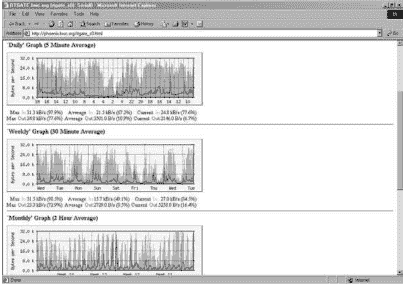

除了每日图表之外，MRTG 还创建每周、每月和每年的图表，这些图表对于在更长的时间窗口内监控流量模式非常有用。

MRTG 不仅限于监控网络流量。它可以监控任何 SNMP 变量。您可以发挥创意，使用 MRTG 监控磁盘使用情况、系统负载、调制解调器可用性以及其他数据。如果您希望做这类事情，建议您加入 MRTG 邮件列表，在那里您可以与其他 MRTG 用户分享想法。请访问 MRTG 网站 `http://www.mrtg.org/`，了解如何加入邮件列表或搜索列表档案以获取贡献的解决方案。

#### 在 Linux 系统上运行 MRTG

您可以从 `http://ee-staff.ethz.ch/~oetiker/webtools/mrtg/pub/` 下载最新版本的 MRTG。发布文件名为 `mrtg.tar.gz`。下载后，将归档文件解包到一个合适的位置，例如 `/usr/local/src`。MRTG 程序要求系统上安装 Perl 5.004 或更高版本。所有 Linux 系统默认都安装了 Perl。如果您系统上的 Perl 版本低于 5.004，那么您可能运行的是非常旧版本的 Linux，应考虑升级您的 Linux 发行版。

要安装 MRTG，请运行 configure 脚本以创建适合您 Linux 系统的 Makefile，然后运行 make 来编译 MRTG 程序。撰写本书时 MRTG 的最新版本是 2.8.12。您应该在 `/usr/local/mrtg` 创建一个链接，指向位于 `/usr/local/src/mrtg-2.8.12` 的 MRTG 源码树，如下所示：

```
# ln -s /usr/local/src/mrtg-2.8.12 /usr/local/mrtg
```

除了安装 MRTG 之外，您必须在系统上运行诸如 Apache 之类的 Web 服务器。MRTG 生成的图表和 HTML 页面必须放在 Web 服务器的文档树内，以便使用 Web 浏览器查看这些页面。

MRTG 构建并安装完成后，必须对其进行配置，以便从目标路由器（一台或多台）收集数据。MRTG 使用 SNMP 从路由器收集流量数据。MRTG 附带了一个名为 cfgmaker 的工具，可用于创建 MRTG 配置文件。要运行 cfgmaker 工具，您必须知道目标路由器的 SNMP 只读团体名。假设只读团体名为 public，您可以运行以下命令为此路由器创建 MRTG 配置文件：

```
# cd /usr/local/mrtg/run
# ./cfgmaker public@router.do.main > mrtg.cfg
```

将 SNMP 只读团体名 public 替换为您在路由器上设置的只读团体名。将命令中的主机名 router.do.main 替换为路由器的正确主机名。Cfgmaker 将配置文件保存为 mrtg.cfg。

cfgmaker 命令的示例输出如下所示：

```text
# Add a WorkDir: /some/path line to this file

#######################################################################
# Description: Cisco Internetwork Operating System Software (tm) 2500
# Software (C2500-I-L), Version 11.2(7a), RELEASE SOFTWARE (fc1) Copyright
# 1986-1997 by cisco Systems, Inc. Compiled Tue 01-Jul-97 14:53 by kyung
# Contact: Gautam Das <gautam@bwc.org>
# System Name: RTGATE.bwc.org
# Location: Arc and Terraces Communication Centre
#
#######################################################################
Target[rtgate_s0]: 3:public@rtgate
MaxBytes[rtgate_s0]: 32000
Title[rtgate_s0]: RTGATE.bwc.org (rtgate_s0): Serial0
PageTop[rtgate_s0]: <H1>Traffic Analysis for Serial0
  </H1>
<TABLE>
  <TR><TD>System:</TD><TD>RTGATE.bwc.org in ATCC</TD></TR>
  <TR><TD>Maintainer:</TD><TD>Computer Technology Group &lt;ctg@bwc.org&gt;</TD></TR>
  <TR><TD>Interface:</TD><TD>Serial0 (3)</TD></TR>
  <TR><TD>IP:</TD><TD>rtgate_s0 (194.80.88.213)</TD></TR>
  <TR><TD>Max Speed:</TD>
    <TD>32.0 kBytes/s (propPointToPointSerial)</TD></TR>
</TABLE>
```

正如上面示例 mrtg.cfg 文件所示，cfgmaker 工具会生成一个 HTML 页面。在此示例中，目标路由器是 Cisco 2500。cfgmaker 检测到路由器的每个接口，并为该接口创建一个 HTML 部分。上面的示例中只显示了感兴趣的串行接口，即串行 0。cfgmaker 检测到的其他接口未包含在示例 mrtg.cfg 文件中。


`mrtg.cfg` 文件中的第一行提示你要向该文件添加工作目录（work directory）规范。你所指定的目录是 MRTG 将写入其生成的 HTML 页面和图像文件的位置。在 Red Hat Linux 系统上，假设你在该服务器上运行 Apache 服务器，并使用 Red Hat 默认的文档根目录（`/home/httpd/html`），那么 WorkDir 的一个合适位置是 `/home/httpd/html/mrtg`。

要指定工作目录，请编辑 `mrtg.cfg` 文件，并添加类似于以下内容的一行：

```
WorkDir: /home/httpd/html/mrtg
```

WorkDir 应为 `mrtg.cfg` 文件中的第一个指令。指定目录必须存在。如果不存在，请按如下方式创建：

```
# mkdir /home/httpd/html/mrtg
```

接下来，手动运行 mrtg，以验证 mrtg 能否读取其配置文件并写入 HTML 文档目录。运行 mrtg 的命令及该命令的示例输出如下所示：

```
# /usr/local/mrtg/run/mrtg /usr/local/mrtg/run/mrtg.cfg
Rateup WARNING: rateup could not read the primary log file for rtgate_s0
Rateup WARNING: Rateup The backup log file for rtgate_s0 was invalid as well
Rateup WARNING: rateup Can't remove rtgate_s0.old updating log file
Rateup WARNING: rateup Can't rename rtgate_s0.log to rtgate_s0.old updating log file
```

这些警告无害，可以忽略。

检查 mrtg 在 `/home/httpd/html/mrtg` 目录中创建的数据文件。该目录中应存在一个或多个 HTML 文件、日志文件和图像文件。

MRTG 要求在 HTML 文档目录中存在某些图像文件。请使用类似于下面的命令，将 MRTG 发行版中 images 子目录下的 `*.png` 文件复制到 Web 文档目录：

```
# cp /usr/local/mrtg/images/*.png /home/httpd/html/mrtg
```

现在，你可以准备每五分钟从 cron 运行一次 mrtg，以从所需路由器收集流量数据。你必须按如下方式为 mrtg 创建 root crontab 条目：

```
0,5,10,15,20,25,30,35,40,45,50,55 * * * * /usr/local/mrtg/run/mrtg /usr/local/mrtg/run/mrtg.cfg > /dev/null 2>&1
```

关于如何添加 crontab 条目的详细信息，将在第 7 章“调度任务”中讨论。MRTG 发行版附带一个名为 indexmaker 的工具，它将为你创建 index.html 文件。你可以按如下方式运行 indexmaker 命令：

```
# cd /usr/local/mrtg/run
# ./indexmaker -t 'Router Stats' -r ./*.cfg > /home/httpd/html/mrtg/index.html
```

你可以使用 Web 浏览器打开 URL `http://mrtg-server.do.marin/mrtg` 来查看 MRTG 生成的 HTML 页面。请将服务器名称更改为提供 MRTG 页面的 Web 服务器的相应名称。

MRTG 创建的日志文件和图像文件会被合并，以保存两年的数据记录，它们是自限的，并且无需维护。

MRTG 图表将让你实时监控互联网带宽使用情况。如果你发现链路在长时间内持续饱和，那么很明显，你要么必须购买更多互联网带宽，要么加强防火墙规则和/或代理规则，以阻止将互联网用于与业务无关的活动。

## 网络管理

- 13. Linux 网络配置与 TCP/IP — 229
- 14. 使用 NFS 和 Samba 进行打印和文件共享 — 267
- 15. 使用 Linux 进行路由 — 289
- 16. 使用 sendmail 的 Linux 邮件服务 — 309
- 17. 传真服务器 — 343

### 第 13 章

#### LINUX 网络配置与 TCP/IP

本章内容

- 理解 TCP/IP 网络 230
- 配置 Linux 网络 240
- 故障排除 254

##### 理解 TCP/IP 网络

TCP/IP 是一组数据通信协议，是互联网和许多组织网络的核心。

术语 TCP/IP 源自两个关键协议的名称：传输控制协议（TCP）和互联网协议（IP）。在这一组合中，IP 充当将 TCP 数据包导向其目的地的机制，而 TCP 则被 FTP 和 HTTP 等更高级别的应用程序用来构建要在网络上传递的数据包。

TCP/IP 的基础始于 1969 年，当时国防高级研究计划局（DARPA）启动了一个项目，旨在创建一个实验性的分组交换网络。这个网络被称为 ARPANET，它为我们今天所知的互联网奠定了基础。

到 1975 年，这个实验性网络被转换为一个运营性网络。ARPANET 持续增长和发展，基本的 TCP/IP 协议正是在 ARPANET 中开发的。后来在 1983 年，TCP/IP 在 Berkeley Unix 中得以实现。随着互联网的普及，TCP/IP 也随之流行，其他操作系统也开始将其作为其支持的联网协议的一部分。

TCP/IP 变得流行并一直保持其受欢迎程度，原因如下：

- 它是一个开放的协议标准。
- 它独立于任何特定的供应商、计算机硬件或操作系统。
- 它是免费可用的。
- 它独立于任何特定的网络硬件。TCP/IP 网络可以使用以太网、令牌环、X.25、拨号线路、光纤、无线电、激光、红外线以及其他目前尚不为人知的传输介质来实现。
- 它提供标准化的高层协议。
- 它提供了一种通用的寻址方案，使得连接到全球网络的所有主机都能被唯一标识。

TCP/IP 的成功可以归因于这样一个事实：它迎合了异构网络，提供了独立于操作系统和架构的开放协议。这些协议对所有人免费开放，并通过共识不断演进和发展。目前的做法是将有关协议和标准的信息作为免费提供的文档发布在互联网上；这些文档被称为请求评论（RFC）。

###### OSI 参考模型

OSI 参考模型是一套指南，为讨论通信提供了参考框架。虽然 TCP/IP 是在 OSI 模型出现之前开发的，但它具有相似的参考框架。因此，熟悉 OSI 模型有助于研究 TCP/IP。

OSI 模型通过将协议划分为七个层次来定义数据通信协议的功能，如图 13.1 所示。

**图 13.1**  
OSI 参考模型的协议层堆栈。

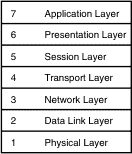

**表 13.1 — OSI 参考模型的层次**

| 层 | 描述 |
|---:|---|
| 1 | **物理层** — 提供计算机之间的物理连接，例如以太网硬件层 |
| 2 | **数据链路层** — 将数据打包成帧以进行通信，例如以太网帧 |
| 3 | **网络层** — 提供跨网络路由数据包的能力，例如互联网协议 |
| 4 | **传输层** — 执行端到端的错误检查，并确保接收方获得与发送方完全相同的数据，例如传输控制协议（TCP） |
| 5 | **会话层** — 建立和终止通信链路；该层在 TCP/IP 层次结构中不存在，TCP/IP 使用套接字和端口与远程系统建立连接 |
| 6 | **表示层** — 确定参与的应用程序的数据交换格式；在 TCP/IP 中，由各个应用程序处理此任务 |
| 7 | **应用层** — 提供用户程序与网络协议之间的接口；在 TCP/IP 中，该层属于用户与之交互的网络应用程序 |

本地系统上的每个协议层都与远程系统上的对等层通信。然而，这仅仅是逻辑通信：除物理层之外，各层之间没有直接的对等通信。

以 FTP 为例。FTP 客户端将数据从应用层向下传递到物理层，此时数据通过物理网络介质传输到 FTP 服务器，然后在服务器上向上传递到应用层。

虽然这是数据包所走的物理路径，但 FTP 客户端和 FTP 服务器只意识到它们在应用层相互通信。

在某种程度上，每个协议层只关心其在远程系统上的对等层，它不需要了解其他层的任何信息。上层只是依赖下层将数据传输到网络。同样，下层将数据向上传递到应用层。因此，可以添加新的网络硬件和驱动程序，而无需重写应用程序。

虽然 TCP/IP 协议套件并不完全符合 OSI 参考框架，但在此框架内考虑 TCP/IP 对于理解 TCP/IP 的工作原理是很有用的。

###### TCP/IP 协议栈

TCP/IP 协议栈由四个层组成，如图 13.2 所示。

**图 13.2 — TCP/IP 协议套件的协议层堆栈。**

| 层 | 描述 |
|---|---|
| 4 | 应用层 |
| 3 | 主机到主机传输层 |
| 2 | 互联网层 |
| 1 | 网络访问层 |

与 OSI 模型一样，发送系统将数据向下传递到物理网络，接收端则将数据向上传递到协议栈。

网络访问层是 TCP/IP 协议层次结构中的最低层。该层提供了将数据传递到直接连接网络上的其他设备的手段。TCP/IP 的网络访问层包含了 OSI 参考模型的下三层。

互联网层位于 TCP/IP 协议栈中网络访问层之上。互联网协议（IP）是互联网的基本构建模块之一。IP 是一种无连接协议。这意味着它依赖于更高级别的协议来建立连接（如果这些协议需要面向连接的服务）。互联网协议不进行任何错误纠正。同样，它将此任务留给更高级别的协议，在后者需要错误纠正时执行。互联网协议定义了 IP 数据报和互联网寻址方案。它将数据报路由到远程主机，并执行数据报的分片和重组。


互联网层之上的协议层是主机到主机传输层。该层有两个协议：用户数据报协议（UDP）和传输控制协议（TCP）。UDP 提供无连接的数据报服务。UDP 是一种低开销协议，不进行纠错。使用 UDP 的应用程序需要自行设计纠错方法。TCP 则提供带有纠错功能的端到端可靠数据传递服务。

应用层位于 TCP/IP 协议栈的顶部。任何使用传输层传递数据的进程都被视为 TCP/IP 应用程序。其中一些应用程序使用 TCP，另一些则使用 UDP。使用 TCP 的应用程序示例包括 Telnet、FTP 和 SMTP。使用 UDP 的应用程序示例包括 NFS、DNS 和 RIP。较新版本的 NFS 现在使用 TCP 而非 UDP。

图 13.3 展示了两台通过以太网连接并运行 `tftp` 程序的计算机。它通过一个简单的示例总结了到目前为止我们关于 TCP/IP 通信中对等协议和层的内容。

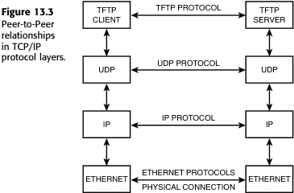

在图 13.3 中，最底层的方框之间进行物理通信。每一层方框之间的水平线表示对等协议。数据的实际传输路径是：从 tftp 客户端方框向下到 UDP 方框，再向下到 IP 方框，再向下到以太网方框，然后通过物理链路传到另一个系统，再向上传递。

#### IP 地址

互联网协议要求，连接到基于 IP 的网络上的每台主机都必须分配一个唯一的 32 位数字，即其 IP 地址。拥有多个网络接口的主机称为路由器或多宿主主机，它们会被分配多个 IP 地址——每个网络接口至少一个。

IP 地址由两部分组成。第一部分唯一标识主机所在的网络，第二部分唯一标识该网络上的主机。IP 地址的网络部分位于主机部分之前；这两部分的大小因 IP 地址所用网络的类别而异。无论如何，网络部分和主机部分的总位数必须为 32。

IP 网络的三大主要类别分别称为 A 类、B 类和 C 类网络。表 13.2 概述了这三类网络中 IP 地址的网络部分和主机部分的位数。

**表 13.2 互联网地址类别**

| 网络类别 | 网络部分大小 | 主机部分大小 |
| --- | ---: | ---: |
| A | 8 位 | 24 位 |
| B | 16 位 | 16 位 |
| C | 24 位 | 8 位 |

对于每类网络，网络部分中的位按特定方式使用：

- 对于 A 类网络，网络位的最左边一位始终为 0，用于识别网络类别。网络部分中剩余的 7 位用于标识网络地址。主机部分的 24 位允许 A 类网络拥有 16,777,214 个主机地址。
- 对于 B 类网络，网络部分的最左边两位始终为 10，用于识别网络类别。网络部分中剩余的 14 位用于标识网络地址。主机部分的 16 位允许 B 类网络拥有 65,534 个主机地址。
- 对于 C 类网络，网络部分的最左边三位始终为 110，用于识别网络类别。网络部分中剩余的 21 位用于标识网络地址。主机部分的 8 位允许 C 类网络拥有 254 个主机地址。

除了上述三大主要网络类别之外，还存在第四种特殊用途的网络类别：D 类网络。D 类网络用于组播地址。组播用于将共享同一协议的多台机器分组，这与共享同一网络的其他网络类别不同。对于 D 类网络，网络部分的最左边三位始终为 111。然而，绝大多数网络安装并不使用 D 类网络，本书也不会对其进行详细讨论。

IP 地址通常以点分十进制格式书写。32 位地址被分成四个 8 位（即 1 字节）数字，以十进制数表示，地址的四个部分各自落在 0 到 255 的整数范围内。这种表示方式使地址非常容易理解。有效的 IP 地址包括 194.148.43.193 和 204.50.107.151，而 192.115.144.294 则是无效的。

利用上述网络类别最左边位的标准分配规则，我们可以根据 IP 地址第一个字节的值来判断其网络类别：

- A 类 IP 地址的第一个字节始终小于 128。
- B 类 IP 地址的第一个字节始终在 128 到 191 之间。
- C 类 IP 地址的第一个字节始终在 192 到 223 之间。

第一个字节大于 223 表示保留网络，例如用于组播的 D 类网络。除了这些保留网络之外，还有三个地址块被保留用于不直接连接到互联网的私有内网：

- 10.0.0.0 到 10.255.255.255
- 172.16.0.0 到 172.31.255.255
- 192.168.0.0 到 192.168.255.255

这些保留地址块不会在公共互联网上路由，因此任何组织都可以使用这些地址中的任何一个，而无需向互联网注册机构注册。所有其他 IP 地址都需要注册，以确保公共互联网上已分配的地址之间不会发生冲突。

#### 子网与网络掩码

将网络划分为更小网络的过程称为子网划分或 *子网化*。划分网络为更小片段的动机是为了节省地址。

如果每个只需要一台主机连接到互联网的组织都被分配一个 C 类网络（最小的完整网络类别），那么可用网络很快就会枯竭。然而，C 类网络中的单个地址不能简单地分配给互联网上的主机，因为那会产生路由问题。

为了解决这个问题，我们使用子网划分。在子网中，网络地址位和主机地址位之间的分界线被移动，从而创建出额外的网络。其结果是增加了网络数量，同时减少了每个网络所拥有的主机数量。

子网通过将一个掩码应用于 IP 地址来定义，该掩码称为子网掩码，也称为网络掩码或 *netmask*。在子网掩码中，如果某一位为 1，则将其解释为网络位，反之亦然。如果该位为 0，则属于地址的主机部分。

通过一些示例，这个概念会更容易理解。对于 A 类网络，子网掩码为 255.0.0.0。如前所述，子网掩码的第一个字节必须全为 1（十进制值为 255），因为 A 类地址的第一个字节是网络部分；这些位被解释为 8 个网络位。另外三个字节全为 0。主机位有 24 位。

类似地，B 类网络的子网掩码为 255.255.0.0。这对应 2 个字节即 16 个网络位，以及 2 个字节即 16 个主机位。同样，C 类网络的子网掩码为 255.255.255.0，即 24 个网络位和 8 个主机位。

现在考虑一个子网划分示例：你有一个 C 类网络，希望将其划分为四个子网。为此，你需要从地址主机部分的左端借用一些位，并将其用于地址的网络部分。

对于普通的 C 类网络，网络掩码为 255.255.255.0。此时，有 24 位设为 1，8 位设为 0，如图 13.4 所示。


要将一个 C 类网络细分为四个部分，你需要从地址的主机部分借用足够的位来表示这四个子网，并将这些位添加到地址的网络部分。在这种情况下，可以用两位来表示四个子网，因此将这些位添加到网络中，得到的子网掩码为 255.255.255.192（见图 13.5）。每个子网由地址主机部分剩余的 6 位定义 64 个 IP 地址。

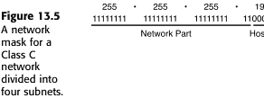

> **注意：** 子网或网络中可用的地址数量可能具有误导性。这是因为所有主机位均为 0 的情况表示网络本身的地址，而所有主机位均为 1 的情况保留为广播地址。因此，对于 C 类网络 204.50.107.0，IP 地址 204.50.107.0 是网络地址，204.50.107.255 是广播地址，剩下 254 个可用 IP 地址可以分配给网络上的实际主机。

表 13.3 展示了将各种子网掩码应用于 IP 地址的效果。


**表 13.3 将子网掩码应用于 IP 地址**

| IP 地址 | 子网掩码 | 解释 |
|---|---|---|
| 192.115.145.1 | 255.255.255.0 | 子网 192.115.145.0 上的主机 1 |
| 192.115.144.66 | 255.255.255.192 | 子网 192.115.144.64 上的主机 2 |
| 192.115.144.17 | 255.255.255.252 | 子网 192.115.144.16 上的主机 1 |

上表中第一行很容易理解，因为它不涉及子网划分。它代表一个完整的 C 类网络。主机地址为 1，所在网络从 192.115.145.0 开始，到 192.115.145.255 结束。

第二行和第三行则稍微复杂一些。在第二行中，使用掩码 255.255.255.192 表示一个包含 64 个地址的网络，从 192.115.144.64 开始，到 192.115.144.127 结束。主机地址 192.115.144.66 实际上成为网络 192.115.144.64 中的主机 2。

在第三行中，使用掩码 255.255.255.252 表示一个由 4 个地址组成的网络，从 192.115.144.16 开始，到 192.115.144.19 结束。主机地址 192.115.144.17 实际上成为网络 192.115.144.16 中的主机 1。

#### 分类寻址的局限性

互联网的指数级增长是其最初设计者未曾预料到的。在互联网早期，IP 地址池看起来是一种似乎无限的资源。地址是根据组织的请求而非实际需求分配的。结果，大量地址块被分配出去，却没有人担心这一资源终将耗尽。

IPv4 标准化为 32 位地址空间，对应 2³² 即 4,294,967,296 个地址。如果当初选择了更大的地址空间，我们现在就不会面临当前的地址短缺问题。

此外，尽管将网络划分为 A 类、B 类、C 类的分类寻址方式易于理解，但它并不利于地址块的高效分配。这种按 8 位、16 位或 24 位边界划分网络的方案，产生了要么极大、要么极小的网络。因此过去，需要几百台主机的站点却被分配了可支持 65,534 台主机的 B 类网络，浪费了其中大部分地址，而该网络根本无法全部使用它们。

#### 无类别域间路由（CIDR）

CIDR 于 1993 年 9 月在 RFC 1517、1518、1519 和 1520 中进行了描述。CIDR 的设计目标是为了解决以下问题：

- IPv4 32 位地址空间的最终耗尽
- 互联网路由表规模的迅速增长
- B 类网络地址空间在近期内的耗尽

关于扩大 IP 地址池的第一个问题，目前正由互联网工程任务组（IETF）的 IPv6 工作组解决。

超网（Supernetting）或无类别域间路由（CIDR）的概念涵盖了另外两个问题。

CIDR 消除了传统的 A 类、B 类和 C 类网络概念。它使 IPv4 地址空间得以更高效地分配，并将支持互联网在 IPv6 部署之前持续增长。

CIDR 支持路由聚合，即一条路由表项可以代表数千条传统的分类路由。路由聚合通过减少骨干路由器必须维护的路由信息量，为它们提供了帮助。

超网的概念最好通过以下示例说明。假设一个组织拥有以下 8 个连续的 C 类网络：

- 192.115.144.0/24
- 192.115.145.0/24
- 192.115.146.0/24
- 192.115.147.0/24
- 192.115.148.0/24
- 192.115.149.0/24
- 192.115.150.0/24
- 192.115.151.0/24

> **注意：** 语法 `<网络起始地址>/<网络位数>` 通常用于指定网络范围。

通过从网络部分移除 3 位，这些网络可以合并指定为单个超网，如下所示：

```
192.115.144.0/21
```

另一种得到相同结果的方法是指定网络掩码 255.255.248.0。例如，网络地址 192.115.144.0 配合网络掩码 255.255.248.0 将提供从 192.115.144.0 到 192.115.151.255 的地址范围。

这正是当前用来向需要多个 C 类地址的组织分配地址块的方法。

#### 路由

一个互联网络（inter-network）或 Internet 连接是指两个或多个不同物理网络之间的连接，使一个网络中的主机能够与另一个网络中的主机通信。

为了实现这些网络间连接，需要使用称为网关（或路由器）的专用计算机来连接这些不同的物理网络。网关计算机拥有两个或更多网络接口，并运行专门设计的软件，以便正确地在网络之间路由流量。图 13.6 展示了通过一台路由器连接的两个网络。

**图 13.6**  
通过一台路由器连接的两个网络。

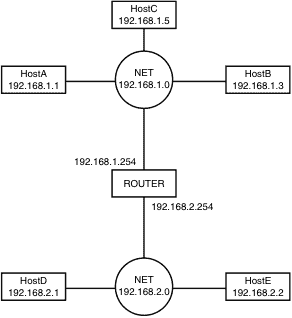

在此示例中，网络 192.168.1.0 有三台主机：

- **HostA:** 192.168.1.1
- **HostB:** 192.168.1.3
- **HostC:** 192.168.1.5

网络 192.168.2.0 有两台主机：

- **HostD:** 192.168.2.1
- **HostE:** 192.168.2.2

连接这两个网络的路由器有两个网络接口：一个连接到 192.168.1.0 网络，IP 地址为 192.168.1.254；另一个连接到 192.168.2.0 网络，IP 地址为 192.168.2.254。路由器不仅将数据从一个网络传送到另一个网络，还决定哪些数据包的目的地是哪个网络。

当 HostA 想要与 HostB 或 HostC 通信时，它可以直接向这些主机发送数据包，因为它们位于同一网络中。但如果 HostA 想要与 HostD 或 HostE 通信，则不能直接进行，因为这些主机位于不同网络中。在这种情况下，HostA 将数据包发送给路由器；路由器查看数据包的目的地址，并通过相应的网络接口将其转发到另一个网络。

当一台主机需要向另一台主机发送数据包时，它必须在两种可能的情况中做出选择：

- 如果数据包的目的主机位于同一网络，则直接发送到目的主机。
- 如果数据包的目的主机位于另一个网络，则需要进行路由。在这种情况下，数据包必须发送到网关系统进行投递。通常，主机配置了默认路由器或网关。每当主机有发往自身网络之外主机的数据包时，它只需将数据包发送到默认网关，然后由默认网关负责确定如何投递该数据包。

在后一种情况下，局域网上的主机会将自身网络之外的一切视为一个黑盒。它们无法直接看到或与自身网络之外的任何主机通信；然而，当它们将数据包交给路由器进行外部投递，而这些数据包又最终到达目的地时，它们就知道这样的主机是存在的。

路由器有一项特殊任务：收到数据包时，必须确定通过哪个网络接口将其发送出去，以便它到达目的地。为此，路由器维护路由表，路由表指明哪些网络接口可用于到达哪些网络。通常情况下，其中一个网络接口被指定为默认接口。如果待投递数据包的某个目的地址没有明确关联到任何接口，路由器就会将该数据包引导到默认接口。连接另一端的路由器随后也面临投递该数据包的任务。

#### 配置 Linux 网络

配置 Linux 网络有两种方法：使用发行版提供的自动化工具，或手动编辑配置文件。

##### 配置 Red Hat Linux 6.2 网络

Red Hat Linux 6.2 提供了一个便捷的网络配置工具 netconf。netconf 提供菜单和表单驱动的界面，用于指定网络设置。您可以在 xterm 窗口内或 Linux 控制台上通过以下命令启动 netconf：

```bash
# netconf
```


**注意**

您需要以 root 用户身份运行 `netconf`，才能对配置文件进行必要的更改。

将显示 netconf 主菜单，如图 13.7 所示。

**图 13.7**
netconf 主菜单。

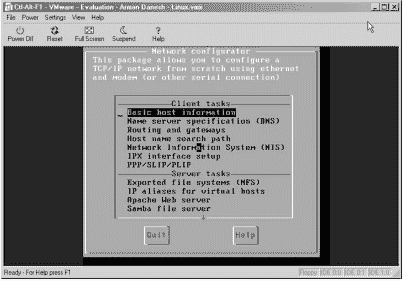

您可以使用上下方向键选择菜单项，按回车键打开选中的菜单项。

要为系统启用网络功能，只需编辑“基本主机信息”部分中的值。此外，编辑“名称服务器规格”、“路由和网关”和“主机名搜索路径”部分中的信息，可以定义额外功能，以便与本地局域网之外的主机通信、使用 DNS 名称服务器将主机名解析为 IP 地址等。

#### 设置基本主机信息

至少，您需要编辑 `netconf` 中“基本主机信息”部分的数据，才能在 Red Hat Linux 6.2 系统上启用网络功能。要编辑基本主机信息，请在 netconf 主菜单的“客户端任务”部分选择“基本主机信息”项，然后按回车键。将显示“基本主机信息”屏幕，如图 13.8 所示。

在此屏幕中，您可以使用方向键在字段之间上下移动。需要设置以下信息：

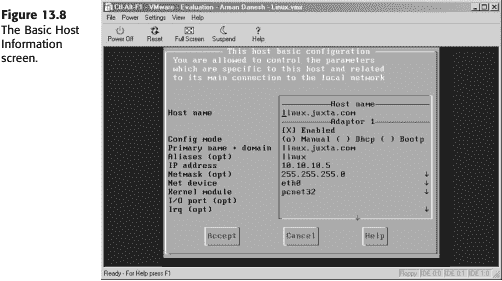

- **主机名：** 在“主机名”字段中输入系统的主机名。如果您最初安装系统时没有网络支持，该值通常是 `localhost`。应输入网络管理员为您的系统分配的主机名。
- **适配器 1：** 您的 PC 中至少需要一个网络适配器，网络功能才能正常工作。使用 `netconf`，您可以配置最多四个网络适配器。我们将只介绍如何配置第一个适配器；每个适配器的原理相同。“适配器 1”部分的第一个字段是一个复选框，用于启用该适配器。请确保选中该复选框；如果未选中，请按空格键切换复选框。
- **配置模式：** 您的 Red Hat Linux 系统可以通过以下三种方式之一确定其网络配置：
  - **手动：** 您需要手动指定 IP 地址、名称服务器和网关信息。
  - **DHCP：** 您的系统自动从网络中的动态主机配置协议（DHCP）服务器获取 IP 地址和其他网络配置信息。
  - **BOOTP：** 您的系统自动从网络上的 BOOTP 服务器获取其网络配置信息。

  本章将介绍手动网络配置。在“配置模式”字段中使用左右方向键选择“手动”、“DHCP”或“BOOTP”。
- **主主机名 + 域名：** 许多系统有多个主机名。您可以在该字段中指定系统的主主机名和 DNS 域名。
- **别名：** 可以在此字段中指定系统的其他主机名，用空格分隔。
- **IP 地址：** 应在此字段中指定为您的系统分配的 IP 地址。
- **子网掩码：** 应在此字段中指定本地局域网的子网掩码。
- **网络设备：** 使用 `netconf` 配置的每个适配器都需要与一个设备关联。通常，系统上的以太网适配器命名为 `ethX`，其中 X 是从零开始的数字。因此，如果您只有一个以太网适配器，它很可能是 `eth0`，并且应将其输入到“网络设备”字段中。您可以使用鼠标单击“网络设备”字段右端的向下箭头，以显示设备名称的下拉列表。
- **内核模块：** 系统上的每个硬件设备都必须关联一个内核模块才能工作。内核模块相当于 Windows 术语中的驱动程序。对于您的网卡，正确模块的选择高度取决于您的网卡。如果不确定哪个模块适合您的硬件，请查阅位于 `http://www.linuxdoc.org/HOWTO/Ethernet-HOWTO.html` 的 Ethernet HOWTO，了解为网络硬件选择模块的详细信息。您可以使用鼠标单击“内核模块”字段右端的向下箭头，以显示内核模块的下拉列表。
- **I/O 端口：** 某些内核模块可以自动检测网卡的 I/O 端口，而其他模块则不能。如果不确定您的模块是否检测此信息，请在此字段中输入网卡的 I/O 端口。
- **IRQ：** 某些内核模块可以自动检测网卡的 IRQ 设置，而其他模块则不能。如果不确定您的模块是否检测此信息，请在此字段中输入网卡的 IRQ。您可以使用鼠标单击“IRQ”字段右端的向下箭头，以显示可能 IRQ 的下拉列表。

完成系统相关数据输入后，按 Tab 键高亮“接受”按钮，然后按回车键返回主菜单。

#### 设置名称服务器信息

如果您的系统位于连接到互联网的网络上，或者您在局域网中使用 DNS 来分发主机名到 IP 地址的映射，则需要使用 `netconf` 指定此信息。要编辑 DNS 信息，请在 `netconf` 主菜单的“客户端任务”部分选择“名称服务器规格”项，然后按回车键。将显示“名称服务器规格”屏幕（见图 13.9）。

在此屏幕中，使用方向键在字段之间上下移动。需要设置以下信息：

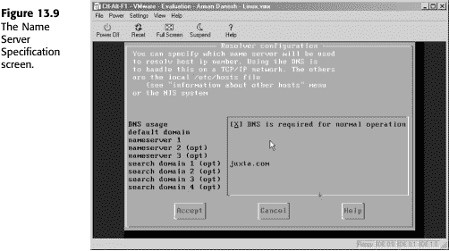

- **默认域：** 应将最常用的域名输入到此字段。通常，这是您所在局域网的域名。
- **名称服务器 1：** 应在此处输入主名称服务器的 IP 地址。每当系统尝试使用 DNS 将名称解析为 IP 地址时，都会首先尝试查询此服务器。
- **名称服务器 2：** 如果存在辅助名称服务器，应在此处输入其 IP 地址。每当系统尝试使用 DNS 将名称解析为 IP 地址时，都会首先尝试主名称服务器。如果连接失败，则会尝试查询辅助名称服务器。
- **名称服务器 3：** 如果存在第三个名称服务器，应在此处输入其 IP 地址。每当系统尝试使用 DNS 将名称解析为 IP 地址时，都会首先尝试主名称服务器和辅助名称服务器；如果连接这两台服务器均失败，则会尝试查询第三个名称服务器。

完成系统相关数据输入后，按 Tab 键高亮“接受”按钮，然后按回车键返回主菜单。

#### 设置路由和网关

如果您的系统所在网络通过路由器连接到其他内部或外部网络，则需要使用 `netconf` 指定此信息。要编辑路由信息，请在 netconf 主菜单的“客户端任务”部分选择“路由和网关”项，然后按回车键。将显示“路由和网关”菜单，如图 13.10 所示。

在此屏幕中，您可以使用方向键在菜单项之间上下移动，并按回车键选择菜单项。至少需要设置一条默认路由。请按照以下步骤操作：

**图 13.10**
“路由和网关”菜单。

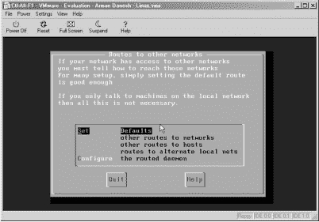

1. 从“路由和网关”菜单中选择“默认值”项。将显示“默认值”屏幕。
2. 在“默认网关”字段中输入网络默认网关的 IP 地址。
3. 按 Tab 键高亮“接受”按钮，然后按回车键返回“路由和网关”菜单。

如果您有到特定网络的备用网关，可以通过“到其他网络的路由”项指定；如果您有到特定主机的备用网关，可以通过“到其他主机的路由”项指定。

完成路由配置后，按 Tab 键高亮“退出”按钮，然后按回车键返回主菜单。

#### 设置主机名搜索路径

通常，您的系统有以下三种可能的方式将主机名解析为 IP 地址：

- 使用本地 `/etc/hosts` 文件，其中包含将主机映射到 IP 地址的条目
- 使用 NIS 服务器
- 使用 DNS 服务器

根据系统可用的服务，您可以指定系统尝试将名称解析为地址的顺序。默认情况下，Red Hat Linux 6.2 首先尝试通过检查 `/etc/hosts` 文件来解析名称，如果失败，则尝试通过 DNS 解析名称。不使用 NIS。如果此路径不适合您的网络环境，则需要使用 `netconf` 进行更改。


> **注意**
> 
> 虽然你可以指定包含上述三种可用选项任意组合的搜索路径，但通常明智的做法是将本地 hosts 文件包含在路径中，最好作为第一个选项。你应该将常用查找的名称（包括你自己的主机）放入该文件中，这样这些查找就不需要通过网络连接到服务器进行解析。这将减少网络带宽需求，并加快常用主机名的解析速度。

要编辑主机名搜索路径，请在 netconf 主菜单的“客户端任务”部分选择“主机名搜索路径”条目，然后按 Enter。将显示“主机名搜索路径”菜单（见图 13.11）。

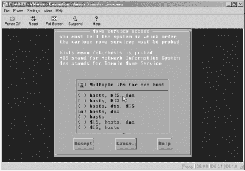

在此屏幕中，你可以使用箭头键在菜单中的条目之间上下移动，按 Enter 选择菜单项。此屏幕显示一个预定义的路径列表。使用上下箭头键高亮显示你首选的路径，然后按空格键选择此路径。按 Tab 键高亮显示“接受”键，然后按 Enter 返回主菜单。

##### 完成配置

要完成网络配置，请保存更改。请按照以下步骤操作：

1. 在主菜单中，按 Tab 键高亮“退出”按钮，然后按 Enter。将显示图 13.12 所示的菜单。
2. 选择“激活更改”条目，按 Tab 键高亮“退出”按钮，然后按 Enter。

更改将被应用并激活，netconf 将退出并返回命令行。如果你正确输入了网络设置，你的网络应该已激活。

**图 13.12**  
系统菜单的状态。

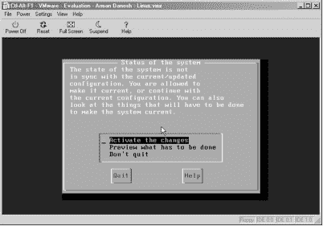

#### 手动 Linux 网络配置

虽然 netconf 等工具对于快速编辑网络配置很有用，但它们隐藏了用于配置和启用网络的实际 Linux 工具和命令。在本节中，我们将讨论手动启用网络的技术。

> **注意**
> 
> 这里的示例来自 Red Hat Linux 6.2，但可推广到大多数 Linux 版本。如果你在特定发行版上使用这些技术时遇到问题，请查阅该发行版的文档。

手动网络配置有五个关键步骤：

- 配置网络接口
- 指定名称服务器
- 编辑本地 hosts 文件
- 定义路由
- 自动化网络设置

> **注意**
> 
> 此讨论假设你的网卡对应的正确内核模块已在启动时加载，并被检测为 `/dev/eth0`。如果你使用的是常见网卡，如 3COM 卡或 NE 2000 兼容卡，在大多数现代发行版中这都是一个安全的假设。否则，请参阅第 9 章“安装和使用 RAID”中关于安装网络适配器模块的讨论。

> **提示**
> 
> 此讨论中的所有步骤都应作为 root 用户执行。如果你尝试以普通用户身份配置网络，则在过程中的某个时刻很可能会遇到权限问题。

##### 配置网络接口

配置 Linux 系统的网络支持时，第一步是配置并启用网络接口。你可以使用 ifconfig 命令完成此操作。

考虑一个示例：你的网络接口 eth0 连接到网络 192.168.147.0，该网络的网络掩码为 255.255.255.0，你的系统 IP 地址为 192.168.147.5。要配置接口以连接到此网络，请使用以下命令：

```bash
# /sbin/ifconfig eth0 192.168.147.5 netmask 255.255.255.0 up
```

你可以测试此配置是否成功。使用不带任何参数或标志的 ifconfig 命令来显示当前已启用网络接口的状态。

```text
# ifconfig
eth0      Link encap:Ethernet  HWaddr 00:20:AF:EB:41:69
          inet addr:192.168.147.5  Bcast:192.168.147.255  Mask:255.255.255.0
          UP BROADCAST RUNNING MULTICAST  MTU:1500  Metric:1
          RX packets:14583 errors:9 dropped:0 overruns:0 frame:9
          TX packets:521 errors:0 dropped:0 overruns:0 carrier:9
          collisions:6 txqueuelen:100
          Interrupt:10 Base address:0x300

lo        Link encap:Local Loopback
          inet addr:127.0.0.1  Mask:255.0.0.0
          UP LOOPBACK RUNNING  MTU:3924  Metric:1
          RX packets:8 errors:0 dropped:0 overruns:0 frame:0
          TX packets:8 errors:0 dropped:0 overruns:0 carrier:0
          collisions:0 txqueuelen:0
```

如果你正确使用了 ifconfig 命令来启用网络接口，那么你应该会看到类似本例中所示的 eth0 条目。通常也会有一个本地回环设备（lo）的部分；这通常由你的发行版在安装 Linux 时预先配置。本地回环设备提供了一种机制，使网络应用程序可以在不使用外部网络接口的情况下与本地主机通信。由于 Linux 中的许多应用程序假定存在网络，因此通常需要启用回环设备。

一旦你知道 ifconfig 能够正确配置网络接口，就可以使用 ping 命令测试系统是否能够与局域网上的另一台主机通信。例如，如果你想 ping 一个 IP 地址为 192.168.147.1 的主机，请使用以下命令：

```bash
# ping 192.168.147.1
```

##### 指定名称服务器

你可以通过在 `/etc/resolv.conf` 文件中创建条目，来指定连接到网络或解析本地网络名称到 IP 地址所需的任何 DNS 名称服务器。此文件中需要两种关键类型的条目：

- **domain：** domain 条目指定你本地网络的域名。例如，如果你的本地网络域名为 `juxta.com`，则 `resolv.conf` 的第一行可以是：

  `domain juxta.com`

- **nameserver：** nameserver 条目指定 DNS 服务器的名称。你拥有的每个可用 DNS 服务器都需要一个条目，按优先顺序排列。因此，主名称服务器应列在最前面，辅助服务器列在第二位，依此类推。例如，如果你有两个名称服务器，主服务器在 192.168.147.200，辅助服务器在 192.168.147.201，那么你将有两个 nameserver 条目：

  `nameserver 192.168.147.200`
  `nameserver 192.168.147.201`

##### 编辑本地 hosts 文件

正如本章前面在介绍使用 `netconf` 工具在 Red Hat Linux 6.2 中配置网络时所讨论的，大多数系统使用本地 `/etc/hosts` 文件作为主机名到 IP 地址映射信息的第一个来源。

要使用此文件，请确保你的名称服务器搜索路径已正确配置。例如，如果你希望名称服务器查找首先检查本地 hosts 文件，然后尝试对 DNS 服务器进行查找，那么你需要在 `/etc/host.conf` 文件中添加以下条目：

```
order hosts,bind
```

此条目表示主机查找从 hosts 文件开始，然后转向 bind，即 Berkeley Internet Name Daemon（或 DNS）。

定义搜索路径后，你需要为经常访问的主机在 `/etc/hosts` 文件中创建条目。每个条目的格式如下：

```
`<IP 地址> <主机名> <别名> <别名> ...`
```

每个条目至少需要 IP 地址和主主机名。此外，你可以指定一个或多个别名，表示该主机的替代名称。例如，考虑来自 `/etc/hosts` 文件的以下一系列条目：

```
127.0.0.1       localhost.localdomain    localhost
192.168.147.30  linux.juxta.com           linux
192.168.147.50  foo.juxta.com
```

第一个条目为本地回环地址提供映射。第二个条目将本地域中的一台主机映射为两个名称（`linux.juxta.com` 和 `linux`），指向 `192.168.147.30`。最后一个条目将主机名 `foo.juxta.com` 指向 `192.168.147.50`。

##### 定义路由

要访问网络上的主机，请定义必要的路由，以便你的 Linux 系统知道如何引导数据包。至少，你需要为系统定义以下两条路由：

- 一条路由指定通过回环设备访问本地机器。
- 一条路由指定所有发往本地网络的数据包都需要通过特定的网络接口（本章示例中为 `eth0`）发送出去。

使用 `route` 命令定义路由。要指定到特定主机的路由，请使用以下语法：

```
route add -host <IP 地址或主机名> <设备>
```

例如，要通过回环网络设备创建到本地主机（IP 地址为 `127.0.0.1`）的路由，请使用以下命令：

```
# /sbin/route add -host 127.0.0.1 lo
```

添加网络路由使用类似的语法：

```
route add -net <网络地址> netmask <网络掩码> <设备>
```

例如，在我们的手动配置示例中，你的系统连接到网络 `192.168.147.0`，网络掩码为 `255.255.255.0`。要通过设备 `eth0` 定义到此网络的路由，请使用命令：

```
# /sbin/route add -net 192.168.147.0 netmask 255.255.255.0 eth0
```

最后，如果你的局域网通过路由器连接到外部网络（如 Internet），你需要定义到此外部网络的默认网关。为此，请使用以下语法的 route 命令：

```
route add default gw <IP 地址或主机名> <设备>
```

例如，如果你局域网的默认网关是 `192.168.147.1`，你可以使用以下命令将发往外部网络主机的数据包通过 `eth0` 设备引导到此主机：

```
# /sbin/route add default gw 192.168.147.1 eth0
```

配置完路由后，你可以使用不带任何参数或标志的 route 命令显示已定义路由的表：

```
 # /sbin/route
Kernel IP routing table
Destination     Gateway         Genmask         Flags Metric Ref    Use Iface
192.168.147.0   *               255.255.255.0   U     0      0      0   eth0
127.0.0.0       *               255.0.0.0       U     0      0      0   lo
default         192.168.147.1   0.0.0.0         UG    0      0      0   eth0
```


#### 自动化网络设置

你可以通过编辑两个关键的系统配置文件来自动化使用 `ifconfig` 和 `route` 配置网络：

- `/etc/sysconfig/network`
- 每个网络接口的配置脚本

`/etc/sysconfig/network` 文件指示网络是否启用，并指定主机名、网关和网关设备等关键信息。一个典型的 Red Hat Linux 网络文件如下所示：

```text
NETWORKING=yes
FORWARD_IPV4=no
HOSTNAME=linux
GATEWAY=192.168.147.1
GATEWAYDEV=eth0
```

该文件中有几个关键条目：

- **NETWORKING：** 设置为 yes 或 no，此条目指示系统上是否启用了网络。
- **HOSTNAME：** 此条目指示系统的主机名。
- **GATEWAY：** 此条目指示网络默认网关的 IP 地址或主机名。
- **GATEWAYDEV：** 此条目指示系统用于与默认网关通信的网络接口。

除了这个通用网络文件之外，你还需要为系统上的每个网络接口指定具体的网络设置。在目录 `/etc/sysconfig/network-scripts/` 中，系统上的每个接口都会有一个对应的文件。这些文件以网络设备命名，格式为 `ifcfg-<device>`。例如，`eth0` 的配置文件是 `/etc/sysconfig/network-scripts/ifcfg-eth0`。一个典型的接口配置文件如下所示：

```text
DEVICE="eth0"
IPADDR="10.10.10.50"
NETMASK="255.255.255.0"
ONBOOT="yes"
BOOTPROTO="none"
IPXNETWORK_802_2=""
IPXPRIMARY_802_2="no"
IPXACTIVE_802_2="no"
IPXNETNUM_802_3=""
IPXPRIMARY_802_3="no"
IPXACTIVE_802_3="no"
IPXNETNUM_ETHII=""
IPXPRIMARY_ETHII="no"
IPXACTIVE_ETHII="no"
IPXNETNUM_SNAP=""
IPXPRIMARY_SNAP="no"
IPXACTIVE_SNAP="no"
```

该文件中有几个与 TCP/IP 网络相关的关键条目：

- **DEVICE：** 此条目指示该文件所适用的设备。
- **IPADDR：** 此条目指示与该接口关联的主 IP 地址。
- **NETMASK：** 此条目指示该接口的网络掩码。
- **ONBOOT：** 设置为 yes 或 no，此条目指示设备是否应在启动时激活。
- **BOOTPROTO：** 指示用于配置网络接口设置的引导协议（如果有）。可能的值有 none（网络设置手动定义）、dhcp（应使用 DHCP 服务器）和 bootp（应使用 BOOTP 服务器）。

一旦编辑了这些文件，系统将在启动时从这些文件中获取网络设置。

#### 配置多宿主主机

到目前为止，我们一直在讨论具有单个网络接口的主机的网络配置。现在需要考虑具有多个网络接口的主机，也称为多宿主主机。

主机拥有多个网络接口的原因有多种，包括以下原因：

- 主机充当两个或多个网络之间的路由器或网关。
- 主机需要通过使用多个网络接口来最大化网络吞吐量，从而有效提高其在网络上的通信速度。

配置多宿主主机是配置单网络接口主机的一个简单扩展：

- 每个接口都关联一个内核模块。
- 每个接口都关联一个设备，如 `eth0`、`eth1` 或 `eth2`。
- 对于每个接口，需要发出相应的 `ifconfig` 命令来启用接口并分配 IP 地址。你可以创建单独的接口配置文件，如 `ifcfg-eth1` 或 `ifcfg-eth2`，以便在启动时自动执行此过程。
- 需要设置适当的路由，包括通过正确接口到达计算机所连接的每个网络的路由。

> **提示**
>
> 请记住，无论系统有多少个网络接口，也无论系统连接到多少个网络，系统只能通过一个网络接口拥有一个默认网关。

第 15 章“使用 Linux 进行路由”中更详细地讨论了多宿主主机。Linux 系统要充当路由器，至少需要两个网络接口，而路由是部署多宿主服务器的最常见原因。

#### 实现多个虚拟 IP 地址

在本章中到目前为止，我们只讨论了为每个网络接口配置单个 IP 地址的 Linux 系统。然而，有时需要将多个 IP 地址与单个网络接口关联。这些 IP 地址称为虚拟 IP 地址，因为 IP 地址与可用网络硬件之间不再是一一对应的关系。

使用多个 IP 地址的原因有多种：

- 你的 Linux 系统正在为多个网站提供 Web 托管服务。理想情况下，每个网站的主机名都应关联一个唯一的 IP 地址。为此，你的系统必须响应所有这些 IP 地址的请求。这通常通过虚拟地址来实现。
- 你的 Linux 系统正在为多个域提供邮件服务。你可能希望服务器为每个邮件域使用不同的主机名和 IP 地址来标识。同样，这通常通过虚拟地址来实现。

假设你已经正确配置了系统以与本地局域网通信，那么添加对虚拟地址的支持只需为每个虚拟地址额外执行一条 `ifconfig` 命令即可。

在本章前面的手动配置示例中，你看到了一个配置了 IP 地址 `192.168.147.5` 的单个以太网设备（`eth0`）的系统：

```text
# /sbin/ifconfig eth0 192.168.147.5 netmask 255.255.255.0 up
```

唯一的问题是要使用哪个以太网设备。如果你尝试为设备 `eth0` 分配第二个 IP 地址，`ifconfig` 只会更改与该设备关联的 IP 地址。因此，需要使用虚拟设备。`eth0` 与特定的物理网络接口关联，而 `eth0:1`、`eth0:2`、`eth0:3` 等是与同一物理网络接口关联的虚拟设备。

因此，如果你想为 `eth0` 分配一个虚拟 IP 地址 `192.168.147.10`，请使用以下命令：

```text
# /sbin/ifconfig eth0:1 192.168.147.10 netmask 255.255.255.0 up
```

同样，要为同一个网络接口分配第三个 IP 地址 `192.168.147.15`，请使用以下命令：

```text
# /sbin/ifconfig eth0:2 192.168.147.15 netmask 255.255.255.0 up
```

完成上述操作后，使用 `ifconfig` 命令显示网络设备的当前状态时，会分别显示每个虚拟设备：

```text
# ifconfig
eth0      Link encap:Ethernet  HWaddr 00:20:AF:EB:41:69
          inet addr:192.168.147.5  Bcast:192.168.147.255  Mask:255.255.255.0
          UP BROADCAST RUNNING MULTICAST  MTU:1500  Metric:1
          RX packets:14583 errors:9 dropped:0 overruns:0 frame:9
          TX packets:521 errors:0 dropped:0 overruns:0 carrier:9
          collisions:6 txqueuelen:100
          Interrupt:10 Base address:0x300

eth0:1    Link encap:Ethernet  HWaddr 00:20:AF:EB:41:69
          inet addr:192.168.147.10  Bcast:192.168.147.255  Mask:255.255.255.0
          UP BROADCAST RUNNING MULTICAST  MTU:1500  Metric:1
          RX packets:14583 errors:9 dropped:0 overruns:0 frame:9
          TX packets:521 errors:0 dropped:0 overruns:0 carrier:9
          collisions:6 txqueuelen:100
          Interrupt:10 Base address:0x300

eth0:2    Link encap:Ethernet  HWaddr 00:20:AF:EB:41:69
          inet addr:192.168.147.105  Bcast:192.168.147.255  Mask:255.255.255.0
          UP BROADCAST RUNNING MULTICAST  MTU:1500  Metric:1
          RX packets:14583 errors:9 dropped:0 overruns:0 frame:9
          TX packets:521 errors:0 dropped:0 overruns:0 carrier:9
          collisions:6 txqueuelen:100
          Interrupt:10 Base address:0x300

lo        Link encap:Local Loopback
          inet addr:127.0.0.1  Mask:255.0.0.0
          UP LOOPBACK RUNNING  MTU:3924  Metric:1
          RX packets:8 errors:0 dropped:0 overruns:0 frame:0
          TX packets:8 errors:0 dropped:0 overruns:0 carrier:0
          collisions:0 txqueuelen:0
```

#### 故障排除

由于成功配置涉及众多变量（网络接口、内核模块、DNS 服务器、路由、网络拓扑等），故障排除是一个广泛的主题。很难给出针对所有可能问题的具体建议。

对 TCP/IP 网络进行故障排除需要深入理解基本的网络原理、熟悉网络环境，并熟练使用一组诊断网络工具。此外，还需要有条理地分析当前问题，并能够将问题分解为更小的部分，从而定位问题的根本原因。

在分析问题时，第一步是收集有关当前情况的详细信息。其中一些细节包括出现故障的应用程序名称、所涉及机器的主机名和 IP 地址，以及报告的错误消息。登录到有问题的机器并尝试重现问题。在不同的系统上运行相同的应用程序。

当用户报告运行特定网络应用程序时出现问题，需要检查以下可能的情况：


- 如果所有其他网络应用都运行正常，那么这个特定应用可能存在配置错误，需要找出并修复。
- 检查该应用的问题是否出现在所有主机上。这可能指向提供该特定应用的某个远程主机，而问题可能就出在那里。
- 查看远程主机是否与应用试图联系的网络不在同一网络中。如果是，到达该主机可能存在路由问题。

另外，在调试网络问题时，需要牢记一些一般性提示：

- 不要忽视显而易见的东西。检查以太网线缆、故障集线器、配置错误的交换机端口、坏的连接器和松动的线缆。
- 有条不紊地解决问题。从正常工作的部分开始测试，然后向不正常的部分推进。
- 记录你已完成的测试及其结果。
- 密切注意错误消息。错误消息记录在系统日志文件中。有时它们并不能准确告诉你问题所在，但通常能提供有助于解决问题的线索。
- 不要把帮助台人员或用户提供的问题描述当作最终定论。尝试自己复现。你常常会发现问题描述中存在不一致之处。在验证并纠正问题描述后，通常就能找到解决方案。
- 不要排除人为错误的可能。有时问题是由缺乏经验的信息系统工作人员造成的。修复问题后与他们沟通，以避免将来重复类似的错误。
- 学会熟练使用一些简单的故障排查工具。在 TCP/IP 中，你可以用少数几种工具诊断网络问题。我们将在下一节中介绍其中一些。
- 在尝试联系远程系统的网络管理员之前，确保你已彻底测试了自己这边的所有环节。如果所有测试都表明问题出在你无法控制的远程系统上，那么你应该已收集了足够的测试结果，可以与远程管理员共享，以帮助其诊断工作。

#### Linux 网络故障排查工具

所有 Linux 发行版都捆绑了多个有用的网络故障排查工具。利用这些工具，可以诊断和修复绝大多数网络问题。虽然有第三方商业网络故障排查工具可用，但它们通常不是必需的，本书对此不做讨论。

表 13.4 概述了可用于问题诊断和故障排查的标准 Linux TCP/IP 工具。

**表 13.4  Linux TCP/IP 工具**

| 工具 | 描述 |
|---|---|
| `ping` | 测试基本网络连通性 |
| `traceroute` | 跟踪数据包从源系统到目标系统所经过的路由 |
| `netstat` | 显示网络连接信息；常用于检查系统路由表 |
| `ifconfig` | 显示网络接口信息，并设置接口的 IP 地址、网络掩码和广播地址 |
| `arp` | 显示本地网络上主机的 IP 地址及对应的以太网 MAC 地址 |
| `nslookup` | 查询主机名、IP 地址以及存储在 DNS 数据库中的各种其他与主机和域相关的信息 |
| `tcpdump` | 显示网络上的数据包以供分析 |

##### 使用 `ping`

ping 是 Packet Internet Groper（数据包互联网探测器）的缩写。该工具用于测试远程主机的可达性。其工作原理是向远程主机发送 ICMP 回显请求。该回显请求要求远程系统必须作出响应。如果系统正常运行并收到回显请求，它就必须响应。

通常，ping 会不断发出回显请求，直到用户取消为止。它传输的每个数据包都带有一个时间戳和一个唯一的序列号。这些信息可用于判断是否有数据包被丢弃、重复或乱序，也可用于计算数据包到达远程系统再返回所需的往返时间（RTT）。

除了报告这些数据外，ping 还会报告它从通往远程系统的路径上的路由器处收到的任何 ICMP 消息。典型的 ICMP 消息包括 “ICMP host unreachable”（ICMP 主机不可达）和 “ICMP redirect”（ICMP 重定向），二者都表明与目标系统通信时存在问题。

如果在使用 ping 命令时，除了远程主机地址外不带任何选项或参数，它将永远运行，不断向远程主机发送回显请求，直到用户用 Ctrl+C 取消该命令：

```text
$ ping 10.10.10.1
64 bytes from 10.10.10.1: icmp_seq=0 ttl=253 time=0.8 ms
64 bytes from 10.10.10.1: icmp_seq=1 ttl=253 time=0.7 ms
64 bytes from 10.10.10.1: icmp_seq=2 ttl=253 time=0.8 ms
64 bytes from 10.10.10.1: icmp_seq=3 ttl=253 time=0.7 ms
64 bytes from 10.10.10.1: icmp_seq=4 ttl=253 time=0.7 ms
etc.
```

你可以使用 -c 参数控制 ping 向远程主机发送多少个回显请求。例如，要将 ping 限制为向主机 10.10.10.1 发送五个回显请求，请使用以下命令：

```text
$ ping -c 5 10.10.10.1
64 bytes from 10.10.10.1: icmp_seq=0 ttl=253 time=0.8 ms
64 bytes from 10.10.10.1: icmp_seq=1 ttl=253 time=0.7 ms
64 bytes from 10.10.10.1: icmp_seq=2 ttl=253 time=0.8 ms
64 bytes from 10.10.10.1: icmp_seq=3 ttl=253 time=0.8 ms
64 bytes from 10.10.10.1: icmp_seq=4 ttl=253 time=0.7 ms
--- 10.10.10.1 ping statistics ---
5 packets transmitted, 5 packets received, 0% packet loss
round-trip min/avg/max = 0.7/0.7/0.8 ms
```

上面的输出显示了远程主机的 IP 地址、ICMP 序列号和往返时间。由于使用了 -c 5 选项调用，它会运行五次然后退出。它还会打印一份汇总报告，显示已传输的数据包数量、已接收的数据包数量，以及最小、平均和最大往返时间。

如果 ping 无法将主机名解析为 IP 地址，它会显示一条错误消息：

```text
$ ping foo.bwc.org
ping: unknown host foo.bwc.org
```

收到此类错误时，表示你的系统存在名称解析问题。你应该检查 NIS 和 DNS 服务器及其数据库，并确保相关系统能够与所需服务器通信，且这些服务器能够解析该名称。

如果 ping 可以将主机名解析为 IP 地址，但没有收到对其回显请求的响应，那么这一点会反映在 ping 显示的汇总统计信息中：

```text
$ ping -c 5 www.juxta.com
PING www.juxta.com (204.50.107.151): 56 data bytes
--- www.juxta.com ping statistics ---
5 packets transmitted, 0 packets received, 100% packet loss
```

注意，没有收到任何数据包，并且报告了 100% 的数据包丢失。这表明主机 www.juxta.com 可能已宕机，或者某种网络故障阻碍了与远程主机的通信。不过，许多站点配置了防火墙来阻止 ICMP 流量，以保护自己免受拒绝服务攻击。对于此类站点，ping 不能用来确切地测试连通性。

当你试图用 ping 隔离网络故障时，建议先用 ping 测试本地主机，以确保本地网络接口已启动并运行。之后，测试本地网络上的主机，然后测试网络的默认网关，再测试越来越远的系统，以确定网络问题的程度。

如果 ping 工作正常，但无法使用 telnet 或 ftp，那么你就知道问题不在于路由或与远程系统通信的能力；相反，你已经找到了一个应用层问题。有时，系统会对 ping 作出响应，但其他操作都不正常。如果 Internet 守护进程（inetd）停止运行，或者发生其他更高级别的系统问题，就可能会出现这种情况。通常，重启 `inetd` 可以解决问题。如果不行，重启受影响的系统可能是唯一的选择。

##### 使用 `traceroute`

`traceroute` 工具跟踪从本地主机到远程目标的 UDP 数据包的路由。它会打印本地主机与远程主机之间的所有路由器的主机名（如果可解析）和 IP 地址。如果 ping 无法到达某个远程主机，并不总是意味着该远程主机已宕机。问题可能存在于你的系统与远程主机之间的某个网关处。`traceroute` 程序可用于定位此类问题。

`traceroute` 使用两种特殊技术，强制其路径上的每个路由器发回一条错误消息。它使用一个较小的 TTL 值（生存时间）和一个无效端口号。当数据包到达路由器时，该路由器会发回一条“time exceeded”（已超时）错误消息。`traceroute` 利用这条错误消息来识别数据包已到达某个特定路由器，并计算往返时间。这使 `traceroute` 能够确定到达第一个路由器所需的跳数时间。通过增大 TTL 值并重新发送数据包，使数据包到达通往目标路径上的第二个路由器，该路由器会返回另一条“time exceeded”消息，于是就可以计算出关于第二个路由器的信息，依此类推。最终，如果目标可以到达，`traceroute` 就会确定数据包到达目标的时刻。通过这种方式，`traceroute` 会生成一份到达目标主机所经过的路由器列表。

下面是一个从本地主机（`cstlx001`）到远程主机（`www.bahai.org`）的示例输出：

```text
# traceroute www.bahai.org
traceroute to www.bahai.org (207.217.239.32), 30 hops max, 40 byte packets
cstr001 (10.2.0.254) 1.840 ms 1.720 ms 1.657 ms
cstr001-g2 (10.0.2.1) 1.702 ms 1.623 ms 1.606 ms
fw-nat (10.0.0.1) 0.987 ms * *
rtgate (192.115.144.18) 3.631 ms 3.102 ms 3.357 ms
tlv-1f10.netvision.net.il (19.17.193.204) 177.789 ms 16.479 ms 15.654 ms
nyc-s1-0-5-n011.netvision.net.il (194.90.0.54) 360.101 ms 360.117 ms 452.812 ms
nj-ny6t-H5-0-1.netvision.net.il (194.90.0.89) 367.297 ms 384.195 ms 466.206 ms
serial0-1-1.gw2.har1.alter.net (157.130.25.245) 371.438 ms 382.126 ms 372.043 ms
422.ATM9-0-0.GW1.HAR1.ALTER.NET (137.39.30.249) 365.694 ms 366.808 ms 377.897 ms
136.Hssi9-0-0.RNYC2.ALTER.NET (137.39.69.49) 428.716 ms 384.896 ms 387.397 ms
142.ATM3-0.XR1.NYC1.ALTER.NET (146.188.177.34) 391.450 ms 398.219 ms 395.866 ms
195.ATM3-0.TR1.NYC1.ALTER.NET (146.188.178.182) 391.084 ms 382.795 ms 421.005 ms
104.ATM7-0.TR1.LAX2.ALTER.NET (146.188.137.129) 525.664 ms 448.192 ms 516.039 ms
299.ATM6-0.XR1.LAX4.ALTER.NET (146.188.248.249) 447.762 ms 451.041 ms 473.453 ms
193.ATM6-0.GW4.LAX4.ALTER.NET (152.63.113.89) 478.369 ms 486.643 ms 462.203 ms
earthlink-gw.customer.alter.net (157.130.231.222) 477.392 ms 534.410 ms 453.205 ms
18  f9-0-0-cr01-pas.neteng.itd.earthlink.net (207.217.1.107) 537.557 ms 458.573 ms 449.132 ms
19  * f10-1-0-fr01-pas.neteng.itd.earthlink.net (207.217.2.106) 449.583 ms 518.765 ms
20  207.217.208.166 (207.217.208.166) 574.278 ms 514.836 ms 496.682 ms
21  207.217.239.32 (207.217.239.32) 516.840 ms 519.242 ms 526.422 ms
```


这里我们看到了本地主机与远程主机之间的 20 台路由器。输出的每一行代表通往远程主机路径上的一个跃点。对于每个跃点，我们会看到主机名（如果有）、网关路由器的 IP 地址，以及到达该主机的三个采样往返时间。这三个时间是通过发送三个数据包并报告直到收到返回的错误数据包所经历的时间而得到的。如果没有错误数据包返回，则在相应位置显示一个星号：

```
# traceroute ftp.is.co.za
traceroute to ftp.is.co.za (196.4.160.12), 30 hops max, 40 byte packets
 1 cstr001 (10.0.25.4) 1.906 ms 1.677 ms 1.657 ms
 2 atcr001 (10.0.2.1) 1.720 ms 1.644 ms 1.608 ms
 3 fw-nat (10.0.0.1) 1.014 ms * *
 4 rtgate (192.115.144.181) 3.561 ms 3.327 ms 3.342 ms
 5 tlv-fe10.netvision.net.il (199.203.4.200) 15.325 ms 19.331 ms 15.053 ms
 6 nyc-s4-0-4.n0002.netvision.net.il (194.90.0.85) 367.383 ms 336.807 ms 374.334 ms
 7 nj-nyc0-H5-0-1.netvision.net.il (194.90.0.89) 387.460 ms 375.801 ms 369.297 ms
 8 serial0-1-1.gw2.har1.alter.net (157.130.25.245) 374.683 ms 393.632 ms 374.661 ms
 9 422.ATM9-0-0.GW1.HAR1.ALTER.NET (137.39.30.249) 377.170 ms 373.443 ms 448.300 ms
10 136.Hss19-0.HR2.NYC2.ALTER.NET (137.39.69.49) 401.138 ms 392.110 ms 441.235 ms
11 442.ATM3-0.XR1.NYC1.ALTER.NET (146.188.177.34) 397.832 ms 391.710 ms 398.259 ms
12 195.ATM6-0.XR1.NYC4.ALTER.NET (146.188.178.82) 417.984 ms 394.524 ms 389.993 ms
13 189.ATM9-0-0.GW4.NYC4.ALTER.NET (146.188.179.161) 398.030 ms 399.579 ms 393.061 ms
14 iscoza-gw.customer.alt.net (157.130.22.182) 388.323 ms 399.139 ms 393.250 ms
15 168.209.0.129 (168.209.0.129) 956.494 ms 966.903 ms 969.841 ms
16 168.209.100.8 (168.209.100.8) 973.092 ms 963.411 ms 945.400 ms
17 * * *
18 * * *
19 * * *
20 * * *
```

这一连串的星号表示无法到达远程主机，且跟踪已经中断。这表明在成功跃点列表中的最后一个网关之后存在路由问题或网络故障。如果最后一个路由器在你的控制之下，那么你已经找到了一个问题点，可以由此开始查找通信问题的根源。

#### 使用 netstat

netstat 命令显示当前的网络状态。它有许多选项可用于过滤状态数据。最有用的 netstat 选项在表 13.5 中概述。

##### 表 13.5 选定的 netstat 选项

| 选项 | 描述 |
|---|---|
| `-a` | 显示所有活动的网络连接及其状态 |
| `-i` | 显示每个网络接口的摘要信息 |
| `-s` | 按协议排序显示数据包摘要 |
| `-r` | 显示路由表及其状态的信息 |
| `-c` | 每秒更新并显示连续输出 |
| `-N` | 显示有关接口或路由创建或删除的消息 |

netstat 的默认操作是列出打开的套接字来显示网络连接的状态。下面的示例输出显示了协议、发送和接收队列、本地主机名或 IP 地址、远程主机名或 IP 地址，以及每个打开连接的状态：

```text
# netstat
Active Internet connections (w/o servers)
Proto Recv-Q Send-Q Local Address           Foreign Address         State
tcp        0      0 cstlx001.bwc.org:8083  mcpsw099.bwc.org:4185  TIME_WAIT
tcp        0      0 cstlx001.bwc.org:8083  allws025.bwc.org:3533  TIME_WAIT
tcp        0      0 cstlx001.bwc.org:8083  sjwjs159.bwc.org:1669  TIME_WAIT
tcp        0      0 cstlx001.bwc.org:8083  allws057.bwc.org:2542  TIME_WAIT
tcp        0      0 cstlx001.bwc.org:8083  allws057.bwc.org:2541  TIME_WAIT
tcp        0      0 cstlx001.bwc.org:8083  allws057.bwc.org:2540  TIME_WAIT
tcp        0      2 cstlx001.bwc.org:telnet 192.115.144.86:1034   ESTABLISHED
tcp        0      0 cstlx001.bwc.org:telnet 192.115.144.72:1030   ESTABLISHED
tcp        0      0 cstlx001.bwc.org:telnet 192.115.144.76:1028   ESTABLISHED
tcp        0      0 localhost:3410          localhost:3411          ESTABLISHED
tcp        0      0 localhost:3411          localhost:3410          ESTABLISHED
tcp        0      0 localhost:3408          localhost:3409          ESTABLISHED
tcp        0      0 localhost:3409          localhost:3408          ESTABLISHED
tcp        0      0 localhost:3406          localhost:3407          ESTABLISHED
tcp        0      0 localhost:3407          localhost:3406          ESTABLISHED
tcp        0      0 localhost:3404          localhost:3405          ESTABLISHED
tcp        0      0 localhost:3405          localhost:3404          ESTABLISHED
tcp        0      0 localhost:3402          localhost:3403          ESTABLISHED
tcp        0      0 localhost:3403          localhost:3402          ESTABLISHED
Active UNIX domain sockets (w/o servers)
Proto RefCnt Flags       Type       State     I-Node Path
unix  1      [ ]         STREAM     CONNECTED 606442 @0000000d
unix  1      [ ]         STREAM     CONNECTED 486    @0000001d
unix  1      [ ]         STREAM     CONNECTED 606860 @0000007e
unix  1      [ ]         STREAM     CONNECTED 566507 @0000000a
unix  1      [ ]         STREAM     CONNECTED 606804 @000000e2
unix  1      [ ]         STREAM     CONNECTED 767    @00000030
unix  0      [ ]         STREAM     CONNECTED 134    @00000015
unix  1      [ ]         STREAM     CONNECTED 564    @00000023
unix  1      [ ]         STREAM     CONNECTED 608661 /dev/log
unix  1      [ ]         STREAM     CONNECTED 606805 /dev/log
unix  1      [ ]         STREAM     CONNECTED 606443 /dev/log
unix  1      [ ]         STREAM     CONNECTED 566508 /dev/log
unix  1      [ ]         STREAM     CONNECTED 768    /dev/log
unix  1      [ ]         STREAM     CONNECTED 623    /dev/log
unix  1      [ ]         STREAM     CONNECTED 487    /dev/log
```

-i 选项可用于提供有关本地网络的有用诊断信息：

```text
# netstat -i
Kernel Interface table
Iface  MTU   Met  RX-OK  RX-ERR  RX-DRP  RX-OVR  TX-OK  TX-ERR  TX-DRP  TX-OVR  Flg
eth0   1500  0    4253182  0      0       0       4355313  0       0       0       BRU
lo     3924  0    48448    0      0       0       48448   0       0       0       LRU
```

在此示例中，为每个网络接口显示了输出。对于每个接口，发送和接收错误的数量分别显示在 TX-ERR 和 RX-ERR 列中。通常，这两个值应为零或接近零。如果你看到任何一列中出现较大数字或不断增长的值，这很可能是网络问题的强烈迹象，例如本地网络饱和、网络接口故障或线缆缺陷。

在 Linux 和大多数其他 Unix 系统上，-r 选项会使 netstat 显示有关路由表的信息：

```text
$ netstat -r
Kernel IP routing table
Destination     Gateway         Genmask         Flags   MSS Window  irtt Iface
10.2.0.244      *               255.255.255.255 UH      0   0        0    eth0
10.2.0.0        *               255.255.0.0     U       0   0        0    eth0
127.0.0.0       *               255.0.0.0       U       0   0        0    lo
default         cstrt001        0.0.0.0         UG      0   0        0    eth0
```

在此示例输出中，Destination 列指示为其定义路由的主机或网络。Gateway 列指示与该主机或网络通信时需要使用的网关（如果有）。

最后一行显示默认路由。默认路由是一个兜底路由。每当没有到某个目标的具体路由时，数据包就会被发送到默认路由器或网关。在上面的示例中，cstrt001 是默认路由器。请注意，此条目的 Flags 列的值为 UG。U 表示该路由是启用的（即可用的），G 表示该路由使用网关。

#### 使用 `ifconfig`

如前文关于手动网络配置一节所述，`ifconfig` 用于配置网络接口。在启动时，脚本 `/etc/rc.d/init.d/network` 会调用 ifconfig 来按需设置接口。之后，它可以用于故障排除和调试。它还可以用于调整某些网络接口参数。

当不带任何参数调用时，`ifconfig` 会显示当前活动网络接口的状态。如果给定一个接口参数，则仅显示该接口的状态。如果使用 -a 选项调用，则显示所有接口的状态，包括已停用的接口。

下面显示了 `ifconfig -a` 的示例输出：

```text
# /sbin/ifconfig -a
eth0      Link encap:Ethernet  HWaddr 00:80:5F:6D:CF:C2
          inet addr:10.2.0.244  Bcast:10.2.255.255  Mask:255.255.0.0
          UP BROADCAST RUNNING MULTICAST  MTU:1500  Metric:1
          RX packets:4261292 errors:0 dropped:0 overruns:0 frame:0
          TX packets:4363313 errors:0 dropped:0 overruns:0 carrier:0
```


```
lo
        collisions:0 txqueuelen:100
        Interrupt:5 Base address:0x6000
        Link encap:Local Loopback
        inet addr:127.0.0.1 Mask:255.0.0.0
        UP LOOPBACK RUNNING MTU:3924 Metric:1
        RX packets:48474 errors:0 dropped:0 overruns:0 frame:0
        TX packets:48474 errors:0 dropped:0 overruns:0 carrier:0
        collisions:0 txqueuelen:0
```

第一行显示接口名称（此处为 eth0）、封装方法和以太网硬件地址。第二行显示接口的 IP 地址、子网掩码和广播地址。第三行显示接口的状态（UP 或 DOWN）。其后各行给出接收和发送数据包的统计信息以及错误计数器。

一些常见的接口配置问题是使用了错误的子网掩码或 IP 地址。如果两个系统意外配置了相同的 IP 地址，就会出现一种非常奇怪的情况。发往主机 A 的数据包会被冒名顶替者 B 截获。两个主机都无法正常工作。如果其中一台主机是某种服务器，并且有许多客户端连接，情况会变得严重得多。在这种情况下，所有试图连接到此服务器的应用程序都会出现长时间延迟。要排查此类问题，最合适的工具是 arp 命令，我们将在下一节中介绍它。

处理此类问题的一种方法是立即断开肇事系统的网络连接。这样网络就能恢复正常，更大的问题也就解决了。此外，您还必须删除重复机器的 arp 条目，并临时为合法系统添加一个静态条目。现在您应该能够检查并纠正肇事系统的 IP 地址了。

要将 eth0 的 IP 地址改为 10.1.0.5、子网掩码改为 255.255.0.0，可以使用以下步骤：

```
# ifconfig eth0 down
# ifconfig eth0 10.1.0.5 netmask 255.255.0.0
# ifconfig eth0 up
```

此外，您还应该更改本地 /etc/hosts 文件中的 IP 地址，并修正 NIS 和 DNS 数据库。

#### 使用 arp

arp 命令显示 IP 地址到以太网 MAC 地址的转换。这使它成为一个极好的调试工具，因为您可以通过它跟踪 IP 地址与特定网络接口之间的关系。

例如，在上一节中，我们讨论了当 IP 地址被意外分配给两台机器时会发生什么情况。如果发生这种情况，系统会报告并记录重复 IP 地址错误。检查 IP 地址被其他系统盗用的系统上的 /var/log/messages 日志，应该会看到类似下面的条目：

```
Dec  6 14:42:56 saturn vmunix: duplicate IP address!!
sent from ethernet address 00:C0:4F:A9:F9:26
```

从这些信息中，我们可以确定重复的 IP 地址来自以太网地址为 `00:C0:4F:A9:F9:26` 的系统。

在尝试物理定位具有肇事网络接口的系统之前，第一步是删除 saturn 的包含错误以太网地址的虚假 arp 条目，并手动添加一个具有正确以太网地址的静态 arp 条目。这个静态 arp 条目不能被删除，并且可以防止发往 saturn 的数据包被传送到肇事主机。

这样，在您识别试图使用 saturn IP 地址的系统并修复该系统上的配置问题的同时，saturn 可以继续正常运行。

要删除 saturn 的 arp 条目，请使用 arp 命令的 `-d` 选项：

```
# arp -d saturn
```

要为 saturn 添加静态 arp 条目，请使用 arp 命令的 `-s` 标志：

```
# arp -s saturn 00:03:E3:C0:05:07
```

接下来，您可以使用 arp 命令的 `-a` 标志获取 arp 缓存中所有系统的列表，从而开始查找肇事系统：

```
# arp -a
vered (10.2.0.100) at 08:00:20:07:55:0C [ether] on eth0
linux (10.2.0.252) at 00:C4:AF:91:E9:11 [ether] on eth0
saturn (10.2.0.254) at 00:0E:01:6E:7F:81 [ether] on eth0
saturn (10.2.0.248) at 00:03:E3:C0:05:07 [ether] on eth0
cronus (10.2.0.249) at 00:80:F1:00:0C:33 [ether] on eth0
```

#### 使用 nslookup

如果您在使用 ping 等命令时收到未知主机错误，但确信使用的主机名正确，那么您面临的是名称解析问题，需要修复 DNS 数据库中的错误。DNS 将在第 22 章“DNS”中详细讨论。

nslookup 命令允许您查询 DNS 服务器并查看其数据库的内容。您可以用它来检查数据库中存储的特定主机的值：

```
# nslookup cobra
Server:  bwdc001.bwc.org
Address:  10.0.0.2
*** bwdc001.bwc.org can't find cobra: Non-existent host/domain
```

在此示例输出中，nslookup 未能找到主机 cobra 的条目。以下输出是使用 nslookup 成功查找名称时的情况示例：

```
# nslookup saturn
Server:  bwdc001.bwc.org
Address:  10.0.0.2
Name:    saturn.bwc.org
Address:  10.2.0.248
```

> **注意：** 如果您在站点上除了使用 DNS 之外还使用 NIS，那么您还应该检查主机名是否也能通过 NIS 正确解析。为此，您需要使用第 6 章“验证用户和网络资源”中所述的 `ypmatch` 命令。

#### 使用 tcpdump

`tcpdump` 是一个用于网络监控和数据采集的强大工具。该程序允许您生成有关网络流量的报告。它可以用来检查网络接口上与给定表达式匹配的数据包头部。但您应该注意，`tcpdump` 只能嗅探到达其网络接口的数据包。在使用共享介质或集线器的网络中，这不是问题。在交换式以太网环境中，它的有效性会大大降低，因为您只能看到广播数据包以及源自或发往运行 `tcpdump` 的主机的其他流量。无论如何，该工具仍然非常有用。

您可以使用此工具来排查网络问题、检测“ping 攻击”或监控网络活动。要获取完整的选项列表，请参阅 `tcpdump` 的手册页。

在这里，您将学习一些有关如何使用 `tcpdump` 收集有用网络流量信息的示例。在 Linux 中，您必须以 root 身份登录才能运行此 `tcpdump`。

> **警告：** 如果 `tcpdump` 以 setuid root 方式设置，则任何用户都可以运行它，但极不推荐这样做，因为这可能带来重大安全风险。该程序可能被滥用，以嗅探网络上的明文密码。

如果您不带任何参数调用 `tcpdump`，它将捕获网络上的所有数据包并显示它们。下面显示了 `tcpdump` 的一个小示例输出：

```
# tcpdump
23:39:41.638705 allws025.bwc.org.3743 > cstlx001.bwc.org.8083: . ack 2172208734
    win 8760 (DF)
23:39:41.638835 cstlx001.bwc.org.8083 > allws025.bwc.org.3743: FP 1:187(186) ack
    0 win 32120 (DF)
23:39:41.642321 cstlx001.bwc.org.886 > saturn.bwc.org.657: udp 80
23:39:41.679044 allws025.bwc.org.3743 > cstlx001.bwc.org.8083: . ack 188 win 857
    4 (DF)
23:39:41.690320 allws025.bwc.org.3743 > cstlx001.bwc.org.8083: F 0:0(0) ack 188
    win 8574 (DF)
23:39:41.690424 cstlx001.bwc.org.8083 > allws025.bwc.org.3743: . ack 1 win 32119
    (DF)
23:39:41.696803 saturn.bwc.org.657 > cstlx001.bwc.org.886: udp 64
23:39:41.698009 cstlx001.bwc.org.887 > saturn.bwc.org.657: udp 80
23:39:41.700371 saturn.bwc.org.657 > cstlx001.bwc.org.887: udp 124
23:39:41.703604 shjws159.bwc.org.1879 > cstlx001.bwc.org.8083: S 43808644:43808644(0) win 8192 <mss 1460> (DF)
23:39:41.703732 cstlx001.bwc.org.8083 > shjws159.bwc.org.1879: S 2162833501:2162833501(0) ack 43808645 win 30600 <mss 1460> (DF)
23:39:41.704168 shjws159.bwc.org.1879 > cstlx001.bwc.org.8083: . ack 1 win 8760 (DF)
23:39:41.705443 cstlx001.bwc.org.888 > saturn.bwc.org.657: udp 80
23:39:41.706955 shjws159.bwc.org.1879 > cstlx001.bwc.org.8083: P 1:451(450) ack
    1 win 8760 (DF)
23:39:41.707061 cstlx001.bwc.org.8083 > shjws159.bwc.org.1879: . ack 451 win 306
    6 (DF)
23:39:41.709400 cstlx001.bwc.org.8083 > shjws159.bwc.org.1879: . 1:1461(1460) ac
    k 451 win 32120 (DF)
23:39:41.714870 saturn.bwc.org.657 > cstlx001.bwc.org.888: udp 60
23:39:41.826279 shjws159.bwc.org.1879 > cstlx001.bwc.org.8083: . ack 1461 win 87
    60 (DF)
23:39:41.826379 cstlx001.bwc.org.8083 > shjws159.bwc.org.1879: FP 1461:1653(192)
    ack 451 win 32120 (DF)
23:39:41.826924 shjws159.bwc.org.1879 > cstlx001.bwc.org.8083: . ack 1654 win 85
    68 (DF)
23:39:41.849289 shjws159.bwc.org.1879 > cstlx001.bwc.org.8083: . 451:451(0) ack
    1654 win 8568 (DF)
23:39:41.849381 cstlx001.bwc.org.8083 > shjws159.bwc.org.1879: . ack 452 win 321
    19 (DF)
23:39:41.853015 192.115.144.85.1037 > cstlx001.bwc.org.telnet: . ack 3722964229
    win 8495 (DF)
23:39:41.853092 cstlx001.bwc.org.telnet > 192.115.144.85.1037: P 1:29(28) ack 0
    win 32696 (DF)
23:39:41.853936 cstlx001.bwc.org.889 > saturn.bwc.org.657: udp 84
23:39:41.864642 saturn.bwc.org.657 > cstlx001.bwc.org.889: udp 32
23:39:41.865619 cstlx001.bwc.org.2178 > bwdc001.domain: 9100+ (45)
23:39:41.867214 bwdc001.domain > cstlx001.bwc.org.2178: 9100 NXDomain 0/1/0 (99)
23:39:41.868653 cstlx001.bwc.org.890 > saturn.bwc.org.657: udp 76
23:39:41.870835 saturn.bwc.org.657 > cstlx001.bwc.org.890: udp 52
23:39:42.159239 192.115.144.85.1037 > cstlx001.bwc.org.telnet: . ack 29 win 8467
    (DF)
23:39:42.496991 cstlx001.bwc.org.890 > ospfvl2-hello 44: rtrid 22.98.192.
    0 backbone [ ospf ] [tos 0xc0] [ttl 1]
23:39:42.496972 cstlx001.bwc.org.891 > saturn.bwc.org.657: udp 80
23:39:42.505288 saturn.bwc.org.657 > cstlx001.bwc.org.891: udp 64
23:39:42.505972 cstlx001.bwc.org.892 > saturn.bwc.org.657: udp 80
23:39:42.508210 saturn.bwc.org.657 > cstlx001.bwc.org.892: udp 72
23:39:42.508904 cstlx001.bwc.org.893 > saturn.bwc.org.657: udp 80
23:39:43.000856 saturn.bwc.org.657 > cstlx001.bwc.org.893: udp 32
23:39:43.001115 cstlx001.bwc.org.2178 > bwdc001.domain: 9101+ (42)
23:39:43.001727 bwdc001.domain > cstlx001.bwc.org.2178: 9101 NXDomain 0/1/0 (116)
```

如上所示，每个数据包都带有时间戳。每个条目中的字段因协议类型（如 UDP 或 TCP）而异。

对于 UDP 数据包，条目的一般格式如下：

`<time stamp> <source host>.<port> > <destination host>.<port>: <other optional fields> packet length`

对于具有关联名称的端口号，将打印名称而不是数字。以下两行显示了域名查询和响应：


23:39:43.001115 cstlx001.bwc.org.2178 > bwdcc001.domain: 9101+ (42)
23:39:43.001727 bwdcc001.domain > cstlx001.bwc.org.2178: 9101 NXDomain 0/1/0 (116)

TCP 数据包的一般格式如下：

```
<time stamp> <source host>:<port> > <destination host>:<port>: <flags> <data sequence number> <other fields>
```

以下示例展示了与运行在 8083 端口的 squid 服务器之间的 TCP 数据包：

```
23:39:41.826279 shjws159.bwc.org.1879 > cstlx001.bwc.org.8083: ack 1461 win 8760 (DF)
23:39:41.826379 cstlx001.bwc.org.8083 > shjws159.bwc.org.1879: FP 1461:1653(192) ack 451 win 32120 (DF)
```

如果你想检查与特定主机之间的数据包，可以使用 host 选项调用 tcpdump，如下所示：

```
[root@cstlx001 /root]# tcpdump host saturn
tcpdump: listening on eth0
23:52:52.355364 arp who-has saturn.bwc.org tell cstsw043.bwc.org
23:52:52.356495 cstlx001.bwc.org.909 > saturn.bwc.org.657: udp 80
23:52:52.366790 saturn.bwc.org.657 > cstlx001.bwc.org.909: udp 60
23:52:55.167137 arp who-has saturn.bwc.org tell cstlx001.bwc.org
23:52:55.167730 arp reply saturn.bwc.org is-at 0:3:3:e0:5:7
5 packets received by filter
0 packets dropped by kernel
```

这里我们可以看到与主机 saturn 之间的数据包。这展示了一个关于 saturn 以太网地址的有趣的 arp 查询和应答。

你也可以通过以下 tcpdump 输出监控特定端口上的流量。这里涉及的服务器正在 8083 端口上运行代理服务器 squid：

```
[root@cstlx001 /root]# tcpdump port 8083
tcpdump: listening on eth0
23:55:26.067300 cstlx001.bwc.org.8083 > shjws100.bwc.org.2613: F 3141079005:3141079005(0) ack 213785301 win 32120 (DF)
23:55:26.067691 shjws100.bwc.org.2613 > cstlx001.bwc.org.8083: . ack 1 win 8760 (DF)
23:55:26.880615 shjws100.bwc.org.2613 > cstlx001.bwc.org.8083: R 213785301:213785301(0) win 0 (DF)
```

tcpdump 还提供了许多其他选项。根据你正在处理的问题，你需要决定哪些选项最适合你的需求。建议你通过以下命令详细阅读 tcpdump 的手册页：

```
$ man tcpdump
```

#### 使用 NFS 和 SAMBA 进行打印机和文件共享

#### 本章内容

- 什么是 Samba？ 268
- 让 Samba 启动并运行 268
- smb.conf 文件 270
- 使用 Samba 共享 Linux 文件 273
- 使用 Samba 共享 Linux 打印机 275
- 将 Linux 用作 Samba 客户端 276
- 什么是 NFS？ 280
- 配置 NFS 281
- 使用 NFS 访问远程共享目录 283
- 配置 lpd 进行远程打印 283
- 故障排除 286

##### 什么是 Samba？

Linux 非常适合在 Windows 网络中充当文件和打印服务器，同时也适合作为同类网络中的客户端。Windows 网络通常使用服务器消息块协议（或 SMB）进行文件和打印机共享，而 Linux 上的 Samba 软件包允许 Linux 系统通过 SMB 协议同时作为服务器和客户端工作。

使用 Samba 软件包，Linux 系统可以在 Windows 网络上执行许多任务，包括以下内容：

- 提供文件和打印机服务
- 作为 NetBIOS 名称服务器运行，包括扮演主浏览器的角色
- 通过类似 FTP 的界面访问其他 SMB 服务器上的文件
- 从 Linux 命令行限制 Windows NT 的管理功能

借助相关软件包，还可以使用 Samba 实现以下功能：

- 直接在 Linux 中挂载 SMB 共享的文件系统
- 使用 tcpdump 查看 SMB 活动
- 通过一组库在任何应用程序中集成 SMB 功能

大多数完整的 Linux 发行版都包含 Samba，并且默认安装。一些发行版（如 Corel Linux）在其 Linux 实现中紧密集成了 SMB，以至于这些 Linux 系统在安装后即可无缝地在 Windows 网络上运行。

如果你的发行版不包含 Samba，或者你想下载最新版本的 Samba，可以在 Samba 网站 http://www.samba.org/ 上获取完整的详细信息和源代码。此外，SMB HOWTO 为不同目的安装和配置 Samba 提供了广泛的指导。SMB HOWTO 在线地址为 http://www.linuxdoc.org/HOWTO/SMB-HOWTO.html。

##### 让 Samba 启动并运行

虽然大多数发行版会执行运行 Samba 所需的必要初始配置，但在初次使用 Samba 之前，自己检查一下是值得的。

为了使 Samba 能够运行，/etc/services 文件中必须包含一些端口定义。请检查 /etc/services 文件是否有以下条目，如果有缺失，请将其添加到文件中：

```
netbios-ns      137/tcp       nbns
netbios-ns      137/udp       nbns
netbios-dgm     138/tcp       nbdgm
netbios-dgm     138/udp       nbdgm
netbios-ssn     139/tcp       nbssn
```

如果这些条目被注释掉了（以井号开头），请删除行首的井号（#）以取消注释。

接下来，决定你是想通过 `inetd` 运行 Samba，还是直接作为独立守护进程运行。作为独立守护进程运行时，Samba 的运行速度会稍快一些；如果你打算将 Linux 系统上的 Samba 作为网络的主要文件或打印服务器，那么最好将 Samba 作为独立守护进程运行。

如果你通常通过 `inetd` 运行网络守护进程，并希望 Samba 也这样做，请将以下两行添加到你的 `/etc/inetd.conf` 文件中：

```
netbios-ssn stream tcp nowait root /usr/sbin/smbd smbd
netbios-ns dgram udp wait root /usr/sbin/nmbd
```

编辑完 `/etc/inetd.conf` 文件后，使用以下命令重新启动 inetd：

```
# kill -HUP `cat /var/run/inetd.pid`
```

或者，如果你的系统有 inetd 的启动脚本，可以使用以下命令重新启动 inetd：

```
# /etc/rc.d/init.d/smb stop
# /etc/rc.d/init.d/smb start
```

接下来，根据需要为你的系统编辑 Samba 配置文件 `/etc/smb.conf`。在本章中，我们将在讨论如何配置 Linux 以在 Windows 网络上扮演不同角色时，结合上下文讨论 smb.conf 文件的细节。不过，一般来说，smb.conf 文件由一系列部分（section）组成，每个部分都包含多个条目：

```
[<section name>]
<entry>
<entry>
<entry>
...
```

条目既可以采用单个指令的形式：

```
<directive>
```

也可以采用赋值的形式：

```
<setting name> = <value>
```

编写完 smb.conf 文件后，你可以使用以下命令手动启动 Samba：

```
# /usr/sbin/smbd -D
# /usr/sbin/nmbd -D
```

或者，如果你的系统有 Samba 的启动脚本，可以使用以下命令启动 Samba：

```
# /etc/rc.d/init.d/smb start
```

#### smb.conf 文件

Samba 使用 `/etc/smb.conf` 文件进行配置。在查看不同用途的具体 Samba 配置之前，我们需要了解 smb.conf 文件的基本结构。以下是一个典型的 smb.conf 文件：

```
====================== Global Settings ==================================
[global]
    workgroup = MYGROUP
    server string = Samba Server
    printcap name = /etc/printcap
    load printers = yes
    log file = /var/log/samba/log.%m
    max log size = 50
    security = user
    socket options = TCP_NODELAY SO_RCVBUF=8192 SO_SNDBUF=8192
    dns proxy = no

========================= Share Definitions ===============================
[homes]
    comment = Home Directories
    browseable = no
    writable = yes

[printers]
    comment = All Printers
    path = /var/spool/samba
    browseable = no
    guest ok = no
    writable = no
    printable = yes

[mydir]
    comment = My Directory
    path = /usr/somewhere/private
    valid users = someuser
    public = no
    writable = yes
    printable = no
```

smb.conf 文件被分为多个部分。每个部分以 [global] 或 [printers] 这样的节标题开头，后面跟着一行一个或多个指令。标题指定了该部分的名称。smb.conf 文件中的注释会被忽略，它们以井号（#）或分号（;）开头，一直持续到行尾。

smb.conf 文件每个部分中的指令采用以下两种形式之一：

- 值赋值的形式为：
  `<directive name> = <value>`
- 简单指令的形式为：
  `<directive name>`


所有 `smb.conf` 文件都包含一个全局节。该节包含所有必要的指令，用于指明特定 Samba 系统应如何与网络中的其他部分交互，包括指定工作组或域名、定义安全与身份验证模型，以及设置其他常规设置。

除全局节外，Samba 服务器还包含一个或多个共享定义节，这些节定义了系统上需要与网络共享的资源以及共享方式。Samba 客户端不一定要在网络中共享这些资源，尽管它也可以这样做。在本章中，随着我们研究各种 Samba 配置示例，将会更深入地讨论共享定义节的用法。

如 `smb.conf` 手册页所述，全局节中可以出现大量指令，可通过命令 `man smb.conf` 阅读该手册页。表 14.1 列出了全局节中一些较常用的指令。

**表 14.1. smb.conf 文件全局节中的常见指令**

| 指令 | 描述 |
|---|---|
| `workgroup = <name>` | 按名称指定系统所属的工作组或域。 |
| `server string = <description>` | 提供 Samba 系统的描述，当用户浏览网络时会显示此描述。 |
| `hosts allow = <host list>` | 指定允许访问 Samba 服务器的 IP 地址或网络地址列表，以空格分隔；如果未指定，则不会对 Samba 服务器实施基于地址的限制。 |
| `printcap name = <printcap file>` | 指定包含要共享打印机定义的 printcap 文件的位置。 |
| `load printers = <yes or no>` | 指明是否应从 printcap 文件加载打印机，以便自动共享打印机，而不必手动共享每台打印机。 |
| `guest account = <user name>` | 指明当用户尝试以访客用户身份访问 Samba 服务器时应使用哪个 Linux 用户账户；默认情况下为 nobody 账户。 |
| `log file = <log file name>` | 指明 Samba 应将其日志文件写入何处；`%m` 符号表示应为每个连接的客户端单独写入一个日志文件，并使用每个客户端的主机名使文件名唯一。 |
| `max log size = <size>` | 指定日志文件的最大大小（以千字节为单位）。 |
| `security = <security level>` | 指定要使用的安全类型；有关安全级别的更多详细信息，请参阅 `smb.conf` 手册页；通常你会希望使用用户级安全。 |
| `password server = <host name>` | 指定当安全级别设置为 server 时使用的密码服务器的主机名。 |
| `username map = <map file>` | 指定一个映射文件的名称，该文件包含将 Samba 用户名与本地 Linux 用户名关联起来的映射。 |
| `domain controller = <host name>` | 指定你所在域的主域控制器的主机名。 |
| `dns proxy = yes or no` | 指明 Samba 是否应使用 DNS 来解析 NetBIOS 主机名。 |

之前示例 `smb.conf` 文件中的全局节只使用了其中部分指令：

```
01: [global]
02:     workgroup = MYGROUP
03:     server string = Samba Server
04:     printcap name = /etc/printcap
05:     load printers = yes
06:     log file = /var/log/samba/log.%m
07:     max log size = 50
08:     security = user
09:     socket options = TCP_NODELAY SO_RCVBUF=8192 SO_SNDBUF=8192
10:     dns proxy = no
```

> **注意：** 为了便于参考，在上述代码片段中添加了行号。

该全局节可分解如下：

- **第 2 行：** 指定 MYGROUP 是 Samba 系统所属的工作组。
- **第 3 行：** 指定 Samba 系统应使用描述 Samba Server 来标识。
- **第 4 行和第 5 行：** 指明应自动加载 `/etc/printcap` 中的打印机以实现共享。
- **第 6 行：** 指明应在 `/var/log/samba/` 中为每个客户端创建单独的日志文件。
- **第 7 行：** 指定日志大小应限制为 50KB。
- **第 8 行：** 指明应使用用户级安全。
- **第 9 行：** 创建有助于改善 Samba 网络性能的设置。
- **第 10 行：** 指明不应使用 DNS 来解析 NetBIOS 主机名。

#### 测试你的 `smb.conf` 文件

Samba 套件包含 `testparm` 实用工具，你可以使用它来测试 `smb.conf` 文件的有效性。要使用此工具测试你的 `smb.conf` 文件，请使用以下命令：

```
# testparm /etc/smb.conf
```

`testparm` 在测试每个节时会进行报告，如果所有节都正确有效，则会报告文件分析成功：

```
Load smb config files from smb.conf
Processing section "[homes]"
Processing section "[printers]"
Processing section "[mydir]"
Loaded services file OK.
```

#### 使用 Samba 共享 Linux 文件

为了在 Samba 服务器上与网络中的其他部分共享目录及其包含的文件，你必须按照上一节所述配置 smb.conf 文件的全局节。你的 Samba 系统必须正确连接到网络，并且你必须为所有想要共享的文件系统创建共享定义。smb.conf 文件中有两种主要的共享定义类型：

- homes 节，用于将 Samba 系统上用户的宿主目录作为单独的共享提供给用户访问。以下是一个典型的 homes 节：

  ```
  [homes]
      comment = Home Directories
      browseable = no
      writable = yes
  ```

- 单独的共享定义节，用于以特定参数共享特定目录。例如，以下节创建了一个名为 `mydir` 的共享，它共享 Samba 系统上的目录 `/usr/somewhere/private`：

  ```
  [mydir]
      comment = My Directory
      path = /usr/somewhere/private
      valid users = someuser
      public = no
      writable = yes
      printable = no
  ```

homes 节通常非常简单。通常，它包含两个重要的指令。一个是 browseable 指令，当设置为 no 时，可确保用户在浏览网络时，服务器的可用共享列表中不会显示所有宿主目录共享。第二个是 writable 指令，当设置为 yes 时，可确保用户对其宿主目录拥有完全的读写访问权限。

将 browseable 指令设置为 no 尤其重要，可以防止用户浏览网络时共享列表过长，并使用户的宿主目录共享更加安全，因为其共享名称不会在网络上公开。

每个用户都可以使用自己的用户名访问其宿主目录共享。例如，如果 Samba 服务器 someserver 共享了用户 `someuser` 的宿主目录，则可以通过共享路径 `\\someserver\someuser` 访问该共享。

homes 节中另外两个有用的指令是：preserve case 和 short preserve case。它们使文件名中的大小写变得重要，这对于在大小写不敏感的 DOS 和 Windows 系统与大小写敏感的 Linux 系统之间保持一致性至关重要。这些指令还可确保你不会在 Linux 系统上最终得到两个文件名大小写不同但实际上是同一个文件的情况。

> **注意：** Samba 使用用户在 `/etc/passwd` 文件中的账户条目来确定其用于共享目的的宿主目录。

单独的共享定义节指定必须在网络上共享的各个目录。请考虑上面的示例共享定义节：

```ini
[mydir]
    comment = My Directory
    path = /usr/somewhere/private
    valid users = someuser
    public = no
    writable = yes
    printable = no
```

该节将目录 `/usr/somewhere/private` 以名称 mydir 在网络上共享。如果 Samba 服务器是主机 someserver，则共享在网络上的完整路径为 `\\someserver\mydir`。

valid users 指令指明哪些用户被允许访问该共享，并指定一个以空格分隔的用户列表。如果未指定，则 Linux 中目录的权限将是该目录唯一的访问限制来源。public 指令在设置为 no 时，可确保该目录不可公开访问（例如，供访客用户访问）。printable 指令在设置为 no 时，指明该资源不是打印机，这样远程客户端就不会试图将其当作打印机。

如 smb.conf 手册页所述，共享定义节可以使用多个指令，可通过命令 `man smb.conf` 查看该手册页。表 14.2 列出了常见的指令。

**表 14.2 — 常见的 smb.conf 共享定义节指令**

| 指令 | 描述 |
|---|---|
| `comment = <description>` | 为共享指定描述性注释，该注释会显示给浏览网络的客户端，以帮助他们识别该共享。 |
| `browseable = <yes or no>` | 指明当客户端浏览网络时，该共享是否出现在可用共享列表中。 |


**表 14.2（续）**

| 指令 | 描述 |
|---|---|
| `read only = <yes or no>` | 指示共享是否以只读模式访问，或者当设置为 no 时，以读写模式访问。 |
| `writable = <yes or no>` | 指示共享是否以读写模式访问，或者当设置为 no 时，以只读模式访问。 |
| `preserve case = <yes or no>` | 指示在命名文件时大小写是否重要。 |
| `short preserve case = <yes or no>` | 指示在短格式 DOS 文件名（通常称为 8.3 格式文件名）中大小写是否重要。 |
| `create mode = <mode>` | 指定在共享目录中创建的任何文件的文件权限模式。文件权限应以数字方式指定，就像使用 chmod 命令一样。如果没有指定创建模式，默认值为 750。 |
| `guest ok = <yes or no>` | 指示是否允许来宾访问该目录。 |
| `public = <yes or no>` | 指示该目录是否可公开访问。 |
| `valid users = <user list>` | 指定一个空格分隔的用户列表，这些用户被允许访问该共享。 |
| `printable = <yes or no>` | 指示共享资源是否为打印机。 |
| `only guest = <yes or no>` | 指示共享目录是否仅允许来宾用户访问。 |

#### 使用 Samba 共享 Linux 打印机

与 SMB 网络共享 Linux 打印机的最简单方法是配置 smb.conf 文件的全局部分，如前文“smb.conf 文件”一节所述。Samba 系统必须正确连接到网络，然后必须在 smb.conf 文件中创建一个 printers 部分。

一个典型的 printers 部分如下所示：

```ini
[printers]
    comment = All Printers
    path = /var/spool/samba
    browseable = no
    guest ok = no
    writable = no
    printable = yes
```

关于此部分，有几点关键需要注意：

- printers 部分会自动共享 printcap 文件（按照 smb.conf 文件全局部分中定义的 printcap 名称指定）中列出的所有打印机。
- path 指令指示 Samba 应使用哪个目录来假脱机打印作业。
- writable 指令在设置为 no 时，使客户端无法通过共享直接写入打印机。这是明智的做法，并强制打印通过 Samba 假脱机机制进行。

#### 将 Linux 用作 Samba 客户端

为了访问其他 SMB 服务器（包括 Windows 或 Linux SMB 服务器）共享的文件系统，可以使用 smbclient 或 smbmount 程序来访问远程文件系统。smbclient 程序使用类似 FTP 的界面，使您能够将文件复制到 SMB 服务器上的远程文件系统或从其中复制出来。smbmount 使您能够像挂载其他文件系统一样，将文件系统挂载到 Samba 客户端系统，并使用标准 Linux 文件系统命令（如 ls、cp 或 mv）访问远程 SMB 文件系统的内容。

使用 smbclient 程序，您可以使用 -L 标志列出服务器共享的资源：

```
# smbclient -L <host name>
```

-I 标志允许您使用 UNIX 风格的 DNS 主机名格式指定远程 SMB 系统的主机名。例如，如果远程 SMB 服务器是 myhost.some.domain，命令将如下所示：

```
# smbclient -L -I myhost.some.domain
```

确定要访问的文件系统资源后，您可以按如下方式使用 smbclient 连接到该资源：

```
# smbclient '<resource name>' -I <host name> -U <user name>
```

以这种方式连接到远程资源时，需要考虑以下几点：

- 您必须以标准的 UNC 样式指定完整的资源名称，形式为 `\\<NetBIOS 主机名>\<共享名>`。
- 如果 Linux 客户端无法解析 NetBIOS 主机名，则需要使用 `-I` 标志指定 SMB 服务器的 DNS 风格主机名。
- 如果您需要以特定用户身份进行身份验证以访问资源，请使用 `-U` 标志指定用于访问资源的用户名。如果需要密码，smbclient 将提示您输入密码。

与 Linux FTP 客户端一样，smbclient 提供自己的命令提示符，您可以在其中发出特殊命令来传输和访问远程共享资源上的文件。smbclient 提示符如下所示：

```
smb: \
```

smbclient 工具使用表 14.3 中的命令来处理远程共享资源上的文件。

**表 14.3 — smbclient 命令**

| 命令 | 描述 |
|---|---|
| `cd <directory>` | 更改远程系统上的目录。 |
| `del <file>` | 删除远程系统上的文件。 |
| `dir` | 显示远程系统上当前目录的内容。 |
| `exit` | 退出 smbclient。 |
| `get <file>` | 将文件从远程系统上的当前目录复制到本地系统上的当前目录。 |
| `lcd <directory>` | 更改本地系统上的目录。 |
| `ls` | 显示远程系统上当前目录的内容。 |
| `md <directory>` | 在远程系统上创建目录。 |
| `mkdir <directory>` | 在远程系统上创建目录。 |
| `mget <file list>` | 将多个文件从远程系统上的当前目录复制到本地系统上的当前目录。 |
| `mput <file list>` | 将多个文件从本地系统上的当前目录复制到远程系统上的当前目录。 |
| `put <file>` | 将文件从本地系统上的当前目录复制到远程系统上的当前目录。 |
| `quit` | 退出 smbclient。 |
| `rd <directory>` | 删除远程系统上的目录。 |
| `rmdir <directory>` | 删除远程系统上的目录。 |

访问 SMB 共享远程目录上的文件的另一种方法是使用 smbmount 命令。使用 smbmount，您可以将远程 SMB 目录挂载到本地系统上的挂载点。

smbmount 命令的语法很简单：

```text
# smbmount '<resource name>' -c 'mount <mount point>' \
-u <local user> -g <local group>
```

例如，如果您想将 SMB 资源 `\\someserver\somedir` 挂载到 Linux 系统中的 /sambamount 目录（该目录必须作为空目录存在），可以使用以下形式的命令：

```text
# smbmount \\someserver\somedir -c 'mount /sambamount' \
-u <local user> -g <local group>
```

此命令告诉 smbmount 使用指定的挂载命令挂载指定目录。然而，在 Linux 中，所有文件和目录都必须有相关联的本地用户和本地组。这就是 -u 和 -g 标志的作用。它们指定被视为已挂载文件系统所有者的本地用户和组。共享资源的 SMB 服务器不会提供此信息，因此这些标志是必需的。

例如，如果在本地 Linux 系统上挂载时，您希望此共享资源由用户 **someuser** 和组 **somegroup** 所有，请使用以下 **smbmount** 命令：

```text
# smbmount \\someserver\somedir -c 'mount /sambamount -u someuser -g somegroup'
```

如果您的 Linux 系统无法通过 NetBIOS 主机名（在本例中为 **someserver**）识别 SMB 服务器，则需要使用 **-I** 标志指定服务器的实际 IP 地址。例如，如果 someserver 的 IP 地址是 **10.20.30.40**，则命令将变为：

```text
# smbmount \\someserver\somedir -I 10.20.30.40 \
-c 'mount /sambamount -u someuser -g somegroup'
```

如果需要为共享资源指定 NetBIOS 用户名或工作组，请使用 **-U** 和 **-W** 标志。例如，如果需要以工作组 `mygroup` 中的用户 **sambauser** 身份连接到共享资源，请使用以下命令：

```text
# smbmount \\someserver\somedir -I 10.20.30.40 -U sambauser -W mygroup -c 'mount
    /sambamount -u someuser -g somegroup'
```

#### 使用 Samba 访问共享打印机

要从 Linux 向 SMB 服务器共享的打印机打印，可以使用 **smbprint** 脚本，该脚本包含在 Samba 源代码发行版和某些二进制 Samba 发行版中。**smbprint** 是一个脚本，用作由 **lpd** 管理的打印机队列的输入过滤器。

为了正确使用此脚本，需要满足以下几点：

- 您必须能够在 `/etc/printcap` 中为目标打印机设置条目。这包括在目标打印机类型为 PostScript 或 PCL 时，使用任何必要的配置。有关配置 `/etc/printcap` 文件的更多详细信息，请参阅 `lpd` 文档。
- 您必须在 `/etc/printcap` 文件的打印机队列条目中添加以下 `if` 条目：

  ```
  if=/usr/bin/smbprint
  ```

- 例如，一个典型的打印机队列条目可能如下：

  ```text
  myprinter:\
      :cm=Remote Samba Printer:\
      :lp=/dev/lp1:\
      :sd=myprinter:\
      :af=myprinter:\
      :mx#0:\
      :if=/usr/bin/smbprint:
  ```


> **注意**  
> `lp=/dev/lp1` 条目必须指向一个有效设备，尽管 smbprint 脚本会将打印作业重定向到远程打印机，而不是打印到指定的本地打印机。

以下是 smbprint 脚本的源代码。如果你的 Samba 发行版尚未包含此脚本，请将其创建在 `/usr/bin/smbprint`，并使用命令 `chmod +x /usr/bin/smbprint` 使其可执行：

```
#!/bin/sh

# This script is an input filter for printcap printing on a unix machine. It
# uses the smbclient program to print the file to the specified smb-based
# server and service.
# For example you could have a printcap entry like this
#
# smb:lp=/dev/null:sd=/usr/spool/smb:sh:if=/usr/local/samba/smbprint
# which would create a unix printer called "smb" that will print via this
# script. You will need to create the spool directory /usr/spool/smb with
# appropriate permissions and ownerships for your system.

# Set these to the server and service you wish to print to
# In this example I have a WfWG PC called "lapland" that has a printer
# exported called "printer" with no password.
#
#
# Script further altered by hamilton@ecnz.co.nz (Michael Hamilton)
# so that the server, service, and password can be read from
# a /var/spool/lpd/PRINTNAME/.config file.
#
# In order for this to work, the /etc/printcap entry must include an
# accounting file (af=...):
#
#   cdcolour:\
#     :cm=CD IBM Colorjet on 6th:\
#     :sd=/var/spool/lpd/cdcolour:\
#     :af=/usr/local/etc/smbprint/acct:\
#     :if=/usr/local/etc/smbprint:\
#     :mx=0:\
#     :lp=/dev/null:
#
# The /var/spool/lpd/PRINTNAME/.config file should contain:
#   server=PC_SERVER
#   service=PR_SHARENAME
#   password="password"
#
# E.g.
#   server=PAULS_PC
#   service=CJET_371
#   password=""
#
# Debugging log file, change to /dev/null if you like.
#
# logfile=/tmp/smb-print.log
logfile=/dev/null

#
# The last parameter to the filter is the accounting file name.
# Extract the directory name from the file name.
# Contact with this w/config to get the config file.

eval acct_file=\${$#}
spool_dir=`dirname $acct_file`
config_file=$spool_dir/.config

# Should read the following variables set in the config file:
#   server
#   service
#   password
eval `cat $config_file`

#
# Some debugging help, change the >> to > if you want to save space.
#
echo "server $server, service $service" >> $logfile

(
# NOTE You may wish to add the line `echo translate` if you want automatic
# CR/LF translation when printing.
#       echo translate
echo 'print .'
cat
) | /usr/bin/smbclient "\\\\$server\\$service" $password -U $server -N -P >>
$logfile
```

> **注意：** 某些 Linux 发行版（如 Red Hat Linux 和 Corel Linux）提供了简单的图形化工具，用于设置与共享 SMB 打印机的连接。

#### 什么是 NFS？

NFS 代表 *网络文件系统*（Network File System）。它最初由 Sun Microsystems 为其 UNIX 系统开发，现在已成为通过 TCP/IP 网络协议在 UNIX 和 Linux 系统之间共享文件和目录的事实标准。除了用于在 Linux 和 UNIX 系统之间共享文件和目录外，还有其他操作系统（如 Windows 和 Novell NetWare）的扩展，使它们能够与 NFS 服务器通信，并与 NFS 客户端共享文件和目录。

如果你不需要与基于 SMB 的 Windows 网络共享文件和目录，可以考虑使用 NFS 进行文件和目录共享，因为它更紧密地集成到 Linux 网络环境的核心中，并且更容易配置和保持平稳运行。

> **警告：** NFS 存在一些众所周知的安全问题，应谨慎使用，并且仅在必要时使用。通常，你只应考虑在防火墙后面的受保护内网中使用 NFS。

#### 配置 NFS

维护一个正在运行的 NFS 服务器需要多个程序。这些程序包括：

- **portmap（或 rpc.portmap，取决于你的 Linux 发行版）：** 该程序提供端口到远程过程调用（RPC）程序的映射，以便 NFS 能够工作。如果你打算运行 NFS 服务器，应在引导时启动该程序。请参阅第4章“启动与关闭”，了解如何将系统配置为在引导时启动 portmap。你可以使用以下命令检查 portmap 是否正在运行：

  ```
  # rpcinfo -p
      program vers proto  port
      100000  2   tcp    111 portmapper
      100000  2   udp    111 portmapper
  ```

- **mountd（或 rpc.mountd，取决于你的 Linux 发行版）：** 如果你正在运行 Linux NFS 服务器，该程序应在引导时启动。

- **nfsd（或 rpc.nfsd，取决于你的 Linux 发行版）：** 如果你正在运行 Linux NFS 服务器，该程序应在引导时启动。

在 mountd 和 nfsd 运行之后，`rpcinfo -p` 应报告它们的存在：

```
# rpcinfo -p
    program vers proto  port
    100000  2   tcp    111 portmapper
    100000  2   udp    111 portmapper
    100005  1   tcp    747 mountd
    100005  1   udp    745 mountd
    100003  2   tcp    2049 nfs
    100003  2   udp    2049 nfs
```

所有导出目录的配置都在 `/etc/exports` 文件中完成。exports 文件包含一系列条目，每行一个，一般形式为：

```
<directory> <host name>(<permissions>) <host name>(<permissions>) \
<host name>(<permissions>) ...
```

指定的 directory 就是要共享的目录。每个 hostname 是被授予访问共享目录权限的主机名称，权限列表是一个逗号分隔的列表，列出了授予指定主机上用户的权限，这些权限取自你在表 14.4 中看到的权限列表。

| 权限 | 描述 |
| --- | --- |
| `rw` | 允许以读写模式访问该目录 |
| `ro` | 允许以只读模式访问该目录 |
| `insecure` | 允许所有未经认证的访问该目录 |
| `kerberos` | 使用 Kerberos 认证来访问该目录 |
| `link_absolute` | 保持符号链接不变 |
| `link_relative` | 根据需要将符号链接转换为相对链接 |
| `root_squash` | 拒绝远程客户端上的 root 用户在 NFS 服务器上获得 root 访问权限 |
| `secure-rpc` | 使用 RPC 认证来访问该目录（默认开启） |

通常，如果 `root_squash` 提供的额外安全性是必需的，则只需 `rw` 或 `ro` 之一。例如，要使用 NFS 共享目录 /somedir，并允许 host1 上的用户具有完全读写访问权限，host2 上的用户具有受限的只读访问权限且不进行根账户映射，请在 /etc/exports 中使用以下条目：

```
/somedir host1(rw) host2(ro,root_squash)
```

/etc/exports 文件中的主机名也可以使用通配符指定。例如，要允许所有以 mydomain.com 结尾的主机访问相关目录，请在 /etc/exports 文件的条目中使用 `*.mydomain.com` 作为主机名。

每当你更改 /etc/exports 文件时，通过向 mountd 和 nfsd 发送 SIGHUP 信号，强制它们重新加载该文件：

```
# killall -HUP /usr/sbin/mountd
# killall -HUP /usr/sbin/nfsd
```

#### 用户权限与 NFS

当远程系统上的用户尝试通过 NFS 访问共享目录时，NFS 服务器首先检查 /etc/exports 文件，以确定客户端主机上的用户是否被允许访问该目录。如果允许，则进行用户和组映射。如果 NFS 客户端和服务器共享相同的用户和组 ID 号，则使用尝试挂载目录的用户的 UID 和 GID，根据目录的本地 Linux 文件权限来确定该用户是否具有足够的访问权限来连接该目录。

当客户端和服务器具有不同的 UID 和 GID 编号空间时，NFS 守护进程会尝试在客户端的 UID 和 GID 空间与服务器的空间之间进行转换，以确定是否应授予访问权限。

#### 使用 NFS 访问远程共享目录

要访问远程 NFS 服务器共享的目录，请在客户端使用 mount 命令。mount 命令可用于挂载本地文件系统，也可用于挂载使用 nfs 文件系统类型的远程 NFS 文件系统。要挂载远程文件系统，请使用以下语法：

```
# mount -t nfs <host name>:<directory> <local mount point> -o <options>
```

`<host name>:<directory>` 组合是远程共享目录的主机名和目录。例如，要访问远程 NFS 服务器 someserver 上的 /somedir 目录，你需要挂载 someserver:/somedir。本地挂载点是本地系统上某个目录的路径，最好为空目录，远程目录应通过该路径挂载并使其可访问。

一系列选项是可选的，是从表 14.5 中给出的选项列表中选取的逗号分隔列表。

**表 14.5 使用 mount 挂载 NFS 目录的选项**

| 选项 | 描述 |
| --- | --- |
| `hard` | 创建硬挂载。这是默认选项。当硬挂载目录的尝试失败时，它会超时并生成错误消息，然后以更大的超时值再次尝试。此过程将重复进行，直到挂载成功。 |
| `intr` | 允许对 NFS 调用进行中断。这通常不是必需的。 |
| `rsize=<datagram size>` | 指定读请求的数据报大小（以字节为单位）。默认值 1024 字节通常就足够了。 |
| `soft` | 创建软挂载。当软挂载目录的尝试失败时，仅生成主要的超时，且不会报告。你通常可以更快地重新控制系统。 |
| `timeo=<time>` | 以十分之一秒为单位指定 NFS 请求的超时时间。默认值为十分之七秒。 |
| `wsize=<datagram size>` | 指定写请求的数据报大小（以字节为单位）。默认值 1024 字节通常就足够了。 |

例如，要将 someserver:/somedir 目录本地挂载到 /nfsmount，并为较差的网络连接指定 1 秒的超时时间，请使用以下命令：

```
# mount -t nfs someserver:/somedir /nfsmount -o timeo=10
```

#### 配置 lpd 以实现远程打印

Linux 通常使用 lpd 守护进程进行打印。lpd 可以管理一个或多个本地和远程打印机的打印队列。在本章前面讨论 Samba 时，你看到了

使用 `lpd` 配置 Linux 系统打印到远程 SMB 共享打印机的示例。对于两个 Linux 系统之间的打印机共享，你只需要使用 `lpd`。

Linux 打印机共享涉及以下步骤：

- 1. 使用 `lpd` 配置打印机服务器以进行本地打印。
- 2. 配置打印机服务器以允许远程系统打印到它。
- 3. 配置打印机客户端以打印到远程打印服务器。

#### 配置本地打印机

为了打印到本地打印机，必须满足以下几个要求：

- 打印机必须通过串行或并行电缆物理连接。
- 必须在 `/etc/printcap` 文件中为打印机添加一个条目。
- `lpd` 守护进程必须正在运行。

`printcap` 文件为 `lpd` 将处理的每个打印机队列包含一个条目。每个条目的形式类似于以下内容：

```text
myprinter:\
        :lp=/dev/lp0:\
        :sd=/var/spool/lpd/myprinter:\
        :lf=/var/spool/lpd/myprinter/errors:\
        :sh:\
        :mx#0:\
        :sf:
```

该条目包含六个字段，定义了一个名为 `myprinter` 的打印机队列：

- **lp：** 指明打印机所连接的设备。
- **sd：** 指明打印时临时文件可存储的目录；通常是 `/var/spool/lpd/` 的子目录。
- **lf：** 指明一个用于记录错误消息的文件。通常该文件位于队列的假脱机目录（由 `sd` 指定）中。
- **sh：** 指明打印到此打印机时应抑制页眉；页眉会生成标题页。
- **mx：** 指明可发送到此打印机的打印作业的最大大小；大小以 1KB 块为单位指定。如果大小为零块，则没有大小限制。
- **sf：** 指明打印到此打印机时应抑制作业结束时的换页符。通常，你只需要为较老的针式打印机使用这些换页符。

`printcap` 条目中还可以使用许多其他字段。使用命令 `man printcap` 查看 printcap 手册页，可以获取这些字段的完整列表。

在 `printcap` 文件中为本地打印机创建条目后，你应该使用以下命令重启 `lpd`：

```bash
# /etc/rc.d/init.d/lpd stop
# /etc/rc.d/init.d/lpd start
```

`lpd` 重启后，你应该能够使用 `lpr` 命令打印到打印机：

```bash
# lpr -Pmyprinter <file name>
```

> **提示**
>
> 通常，Linux 应用程序会生成 PostScript 或 ASCII 文本数据发送到打印机。这可能会带来问题。例如，PostScript 打印机无法打印纯 ASCII 文本文件，而使用惠普打印机控制语言（PCL）的打印机无法处理 PostScript 数据。此外，将 Linux ASCII 文本文件发送到 PCL 打印机时会以不正确的格式打印。要解决此问题，你可以使用打印过滤器，这些过滤器是 `lpd` 在将数据发送到打印机之前用于预处理数据的特殊程序。许多发行版都带有打印机过滤器。此外，流行的 APS 打印机过滤系统可以从 `ftp://metalab.unc.edu/pub/Linux/system/printing` 下载。按照发行档案中包含的说明，APS 很容易安装和配置。

#### 允许远程打印机连接

为了允许远程客户端打印到你已经按照前述步骤配置为本地打印的打印机，你必须指明允许哪些客户端系统打印到此打印机。为此，你必须在 `/etc/hosts.lpd` 文件中指定每个客户端的主机名或 IP 地址。每个远程客户端的名称和地址应分别出现在 `hosts.lpd` 文件中的单独一行上。

#### 配置远程客户端打印到 Linux 打印服务器

要配置客户端系统打印到由另一个 Linux 系统共享的打印机，你需要在客户端系统的 `/etc/printcap` 文件中创建一个适当的条目。以下是打印到远程打印机的典型 printcap 条目：

```text
myremoteprinter:\
        :lp=/dev/null:\
        :sd=/var/spool/lpd/myprinter:\
        :lf=/var/spool/lpd/myprinter/errors:\
        :sh:\
        :mx#0:\
        :sf:\
        :rm=someserver:\
        :rp=myprinter:
```

此条目中有三个字段需要仔细检查：

- **lp：** 所有 printcap 条目都必须有一个 `lp` 字段。设备 `/dev/null` 是一个你可以用来代替实际物理设备的设备；因为你不是打印到本地连接的打印机，所以对于远程打印机条目，你应该使用 `/dev/null`。
- **rm：** 指定你要打印到的远程打印机服务器的主机名。
- **rp：** 指定你要打印到的远程打印服务器上打印机的打印机队列名称。

你需要重启 `lpd` 以强制它重新读取 printcap 文件：

```bash
# /etc/rc.d/init.d/lpd stop
# /etc/rc.d/init.d/lpd start
```

如果你随后在打印机客户端上指向 `myremoteprinter` 队列，打印作业将被发送到名为 `someserver` 的主机上的 `myprinter` 队列。

#### 故障排除

如果你在使用 NFS 时遇到问题，你可以检查几项内容以确定系统是否正常工作：

- 检查 `portmap`、`mountd` 和 `nfsd` 是否仍在运行。它们可能会停止运行，并且可能需要重新启动。
- 检查 `portmap` 是否根据 `/etc/hosts.deny` 中的条目而不允许响应请求。
- 检查 `/etc/exports` 中的相关条目格式是否正确，并指向正确的目录。
- 检查 NFS 服务器系统是否可以解析 `/etc/exports` 文件中的主机名，并且是否与试图访问服务器的正确客户端匹配。
- 检查服务器和所有客户端系统上的系统时钟是否同步且日期一致。
- 检查访问服务器的用户是否不在超过八个组中。

NFS 的另一个困难来源是慢速网络连接问题。默认的 NFS 设置假定有一个合理、快速的连接，这使得在较慢的连接上使用 NFS 变得不可行。

尝试通过慢速连接挂载远程 NFS 目录的客户端可以通过调整 mount 命令的一些选项来弥补这一点：

- 永远不要使用 *软* 挂载。只使用硬挂载。
- 增大 `timeo` 的值，直到你能够不需要多次重试即可获得连接。

对于 Samba，在正确配置安装后，最常见的问题是 `smbd` 或 `nmbd` 守护进程可能会变得无响应或产生虚假的身份验证错误，需要重新启动。

### 第 15 章 使用 Linux 进行路由

本章包括

- 基本路由原理 290
- 用于路由的 Linux 软件 292
- 使用 Linux 创建局域网到局域网路由器 296
- 动态路由 297
- 故障排除 306

#### 基本路由原理

在网络化世界中，路由是一个基本概念。路由提供了将数据包看似复杂而混乱的互联网络迷宫引导到正确目的地的能力。

要理解路由的必要性，首先考虑一个未连接到任何其他网络的基本 LAN。在这种环境中，网络上的主机可以简单地将 TCP/IP 数据包引导到正确的目的地。它们只需通过网络接口将数据包放置在网络上，目标主机就会在网络中看到寻址到它的数据包并接收它。

然而，当两个网络连接起来时，事情就变得复杂了。考虑图 15.1 中连接的网络。这里，属于同一组织的两个 C 类网络连接在一起：`10.10.10.0` 网络和 `10.10.20.0` 网络。

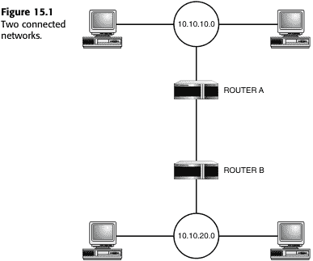

现在，一个问题出现了：如果 `10.10.10.0` 网络上的主机向该网络上的另一台主机发送一个寻址到该主机的数据包，接收主机看到寻址到自己的数据包并进行收集。由于两个主机位于同一网络上，因此不涉及路由，主机可以直接相互发送数据包，而无需任何中间路由器。

然而，如果 `10.10.10.0` 网络上的主机想要向 `10.10.20.0` 网络上的主机发送数据包，它不能简单地将数据包放置在网络上，因为 `10.10.20.0` 网络上的主机无法看到该数据包。这意味着数据包永远不会到达。


这里就是路由器发挥作用的地方：路由器是一台计算机或专用硬件设备，物理连接到两个网络。它被配置为将数据包从一个网络发送到另一个网络。在本示例中，当路由器 A 收到目标为 `10.10.10.0` 网络的数据包时，它会通过相应的网络接口将其发送到 `10.10.10.0` 网络。当它收到目标为 `10.10.20.0` 网络的数据包时，会将其发送给路由器 B，由路由器 B 相应地路由该数据包。

如果两个网络上的主机都将各自的路由器配置为默认网关，则会发生以下情况：如果 `10.10.10.0` 网络上的主机希望向 `10.10.20.0` 网络上的主机发送数据包，它不会简单地将数据包放到 `10.10.20.0` 网络上，而是将数据包放到网络上，以便交付给网关而不是实际目的地；路由器 A 收到该数据包后将其发送给路由器 B，路由器 B 再将其放到 `10.10.20.0` 网络上，以便交付给最终收件人。

再进一步推演这个场景：如图 15.2 所示，`10.10.10.0` 网络与 Internet 有直接连接。

这里，`10.10.10.0` 网络通过两个不同的路由器同时连接到 `10.10.20.0` 网络和 Internet。这就引出一个问题：`10.10.10.0` 网络上的主机如何决定将目标为 `10.10.20.0` 网络上主机的数据包发送到哪里？

存在两种可行的方法：

-   将路由器 C 指定为默认网关，目标为 `10.10.20.0` 网络的数据包会被发送到那里，并且该路由器被配置为知道这些数据包应被重新路由到路由器 A，以便传送到 `10.10.20.0` 网络。
-   `10.10.10.0` 网络上的每台主机都配置了两个网关：一条通过路由器 A 到 `10.10.20.0` 的硬编码路由，以及一条默认网关，用于将目标为所有其他网络的数据包通过路由器 C 发送。

> **注意**
>
> 这里引入的概念是静态路由；也就是说，这种路由指示目标为特定主机、网络或一组网络的数据包应通过某个特定的网关进行路由。这与默认网关路由不同，默认网关路由是一个兜底路由器，负责处理所有未被静态路由覆盖的数据包。

`10.10.20.0` 网络上的主机也需要能够与 Internet 和 `10.10.10.0` 网络通信。这里的任务更简单，因为该网络到 `10.10.10.0` 网络只有一个外部连接。路由器 B 应该是所有主机的默认网关。当它收到目标为任何外部网络的数据包时，这些数据包都会被发送到路由器 A。路由器 A 将目标为 `10.10.10.0` 网络的数据包放到网络上，以便交付到其目的地。对于目标为 Internet 的数据包，它会将其发送到默认网关，即路由器 C，以便交付。

**图 15.2**
两个互联网络，并带有到 Internet 的连接。

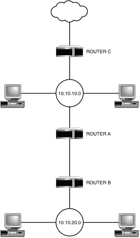

从 `10.10.20.0` 网络的角度看，整个外部世界，包括 `10.10.10.0` 网络在内，都是一个黑盒；`10.10.20.0` 网络上的主机不需要知道不同的外部主机位于何处，也不需要知道数据包到达这些主机所经过的路由。所有目标为本地网络之外的主机的数据包都以相同的方式交付：它们都被发送到路由器 B。

#### 用于路由的 LINUX 软件

Linux 有多个与路由相关的软件组件，包括：

-   提供 Linux 在网络间转发数据包能力的内核模块。
-   用于在主机上定义和查看路由的 route 实用程序。

此外，还有一些专门的 Linux 发行版，它们使得创建基于 Linux 的路由器比使用包含大量路由器不需要的额外软件的完整发行版更为简单。

##### 用于路由的内核模块

Linux 系统要路由 TCP/IP 数据包，需要在你的内核中启用必要的 IP 转发内核模块。IP 转发是 Linux 将在一个网络接口上收到的数据包通过另一个网络接口转发出去的过程。

你可以通过检查 `/proc` 文件系统中的 `ksyms` 文件来确认系统中是否启用了 IP 转发：

```text
# cat /proc/ksyms | grep ip_forward
c00141364 ip_forward_Rf71ac834
```

如果该命令没有返回类似 `c00141364 ip_forward_Rf71ac834` 的条目，说明你的内核未启用 IP 转发。你需要重新编译内核，并加入对 `CONFIG_IP_ROUTER` 选项的支持。请参阅第 11 章“构建 Linux 内核”，了解如何在你的系统上编译新的 Linux 内核。

##### route 实用程序

route 实用程序使你可以为路由器定义所需的路由。你可以用它来创建指向特定主机和网络的静态路由，也可以用它来定义默认网关的路由。

如果不带任何参数使用 route 命令，它会显示主机上已定义的路由：

```text
# /sbin/route
```

| 目标 | 网关 | 子网掩码 | 标志 | 跃点数 | 引用计数 | 使用次数 | 接口 |
|---|---|---|---|---|---|---|---|
| 10.10.10.10 | * | 255.255.255.255 | UH | 0 | 0 | 0 | eth0 |
| 10.10.10.0 | * | 255.255.255.0 | U | 0 | 0 | 0 | eth0 |
| 127.0.0.0 | * | 255.0.0.0 | U | 0 | 0 | 0 | lo |

该输出显示了若干静态路由：

-   `10.10.10.0` 网络和 `10.10.10.10` 主机可以通过 `eth0` 接口访问。
-   本地回环网络 `127.0.0.0` 可以通过 `lo` 接口访问。

此外，网关地址一栏没有出现任何地址，这一事实表明这些路由是通向本地网络的；换句话说，目标为这些目的地的数据包不应发送到网关系统，而应直接交付到指定以太网接口的本地网络上。

要添加默认网关，请按如下方式使用 route 命令：

```text
# /sbin/route add default gw <router IP address> dev <ethernet device>
```

例如，要将 IP 地址为 `10.10.10.1` 的路由器添加为默认网关，并指示主机通过 `eth0` 接口将数据包发送到该路由器，请使用以下命令：

```text
# /sbin/route add default gw 10.10.10.1 dev eth0
# /sbin/route
Kernel IP routing table
```

| 目标 | 网关 | 子网掩码 | 标志 | 跃点数 | 引用计数 | 使用次数 | 接口 |
|---|---|---|---|---|---|---|---|
| 10.10.10.10 | * | 255.255.255.255 | UH | 0 | 0 | 0 | eth0 |
| 10.10.10.0 | * | 255.255.255.0 | U | 0 | 0 | 0 | eth0 |
| 127.0.0.0 | * | 255.0.0.0 | U | 0 | 0 | 0 | lo |
| default | 10.10.10.1 | 0.0.0.0 | UG | 0 | 0 | 0 | eth0 |

请注意，route 命令的输出现在包含一条默认路由，通过位于 `10.10.10.1` 的网关。

如果你想添加一条到某个网络的静态路由，请按如下方式使用该命令：

```text
# /sbin/route add -net <network address>/<network bits> gw <router IP address> dev <ethernet device>
```

例如，若要创建一条到 C 类网络 `10.10.20.0`、通过 IP 地址为 `10.10.10.2` 的路由器，并通过 `eth0` 接口将数据包发送到该路由器的静态路由，请使用以下命令：

```text
# /sbin/route add -net 10.10.20.0/24 gw 10.10.10.2 dev eth0
# /sbin/route
Kernel IP routing table
```

| 目标 | 网关 | 子网掩码 | 标志 | 跃点数 | 引用计数 | 使用次数 | 接口 |
|---|---|---|---|---|---|---|---|
| 10.10.10.10 | * | 255.255.255.255 | UH | 0 | 0 | 0 | eth0 |
| 10.10.20.0 | 10.10.10.2 | 255.255.255.0 | UG | 0 | 0 | 0 | eth0 |
| 10.10.10.0 | * | 255.255.255.0 | U | 0 | 0 | 0 | eth0 |
| 127.0.0.0 | * | 255.0.0.0 | U | 0 | 0 | 0 | lo |
| default | 10.10.10.1 | 0.0.0.0 | UG | 0 | 0 | 0 | eth0 |

> **注意**
>
> 请注意，这里使用 `10.10.20.0/24` 的形式来指定 `10.10.20.0` C 类网络的网络地址。第 13 章“Linux 网络配置与 TCP/IP”中讨论了这种语法。

你也可以使用类似的命令，通过网关添加一条到特定主机的静态路由。例如，要定义一条到主机 `10.10.30.100`、通过 IP 地址为 `10.10.10.3` 的路由器并使用 `eth0` 设备的路由，请使用以下命令：

```text
# /sbin/route add -host 10.10.30.100 gw 10.10.10.3 dev eth0
# /sbin/route
Kernel IP routing table
```

| 目标 | 网关 | 子网掩码 | 标志 | 跃点数 | 引用计数 | 使用次数 | 接口 |
|---|---|---|---|---|---|---|---|
| 10.10.10.10 | * | 255.255.255.255 | UH | 0 | 0 | 0 | eth0 |
| 10.10.30.100 | 10.10.10.3 | 255.255.255.255 | UG | 0 | 0 | 0 | eth0 |
| 10.10.20.0 | 10.10.10.2 | 255.255.255.0 | UG | 0 | 0 | 0 | eth0 |
| 10.10.10.0 | * | 255.255.255.0 | U | 0 | 0 | 0 | eth0 |
| 127.0.0.0 | * | 255.0.0.0 | U | 0 | 0 | 0 | lo |
| default | 10.10.10.1 | 0.0.0.0 | UG | 0 | 0 | 0 | eth0 |


请注意，为主机指定静态路由时，应使用 `-host` 选项而不是 `-net`。

route 命令也将在第 13 章中讨论。

#### 预打包的路由发行版

虽然任何 Linux 发行版都可以用来创建基于 Linux 的路由器，但这通常是低效的。例如，完整的 Red Hat Linux 发行版包含大量额外的软件和内核模块，这意味着它比 Linux 路由器所必需的内存和磁盘占用空间更大。如果你希望严格地将 Linux 系统作为路由器运行，有些发行版甚至可以装进一张软盘，从而在有限内存且无硬盘的情况下创建 Linux 路由器。

基于软盘的方法创建 Linux 路由器的优点包括以下内容：

- 无需通过关闭标准发行版中通常运行的所有额外网络服务来对路由器进行额外的安全配置。
- 无需重新编译支持 IP 转发的 Linux 内核。
- 易于灾难恢复，因为你可以手边保留多份路由器软盘副本，如果一张出现故障，可以更换使用。
- 无需执行备份。所有内容都保存在一张软盘上，该软盘易于复制并保存以备将来使用。

有多个单软盘发行版可用于创建基于 Linux 的路由器和防火墙，包括以下这些：

- **Linux 路由器项目（www.linuxrouter.org）：** 这是领先的单软盘路由器发行版。该发行版可用于构建以太网路由器、ISDN 路由器、远程访问服务器、瘦客户端、防火墙和网络设备。
- **floppyfw（http://www.zelow.no/floppyfw/）：** `floppyfw` 是一款基于 Linux 的静态路由器，具有网络地址转换（IP 伪装）和数据包过滤功能。它不能用于复杂的防火墙，但非常适合作为快速而简易的数据包过滤路由器和防火墙。
- **MuLinux（http://sunsite.auc.dk/mulinux/）：** MuLinux 是一个基于软盘的 Linux 发行版，虽然它并非专门针对路由器创建，但非常适合此用途。根据配置方式的不同，MuLinux 可以包含面向 X 终端客户端的 NFS 启动、DHCP 支持、电子邮件处理和读取、Samba 支持、声音支持以及 X Windows 功能。
- **DLX（http://www.wien.at/usr/h93/h9301726/dlx.html）：** DLX 是一个用于通用目的的单软盘发行版。它包括网络支持和并行端口 ZIP 驱动器支持。它可用于构建路由器，也非常适合网络故障排除。


#### 使用 Linux 创建局域网到局域网路由器

为了说明基本 Linux 路由器的创建过程，请实现一个直接连接两个 C 类网络（`10.10.10.0` 和 `10.10.20.0`）的路由器。图 15.3 概述了你要实现的网络配置。

**图 15.3**  
两个网络通过路由器连接。

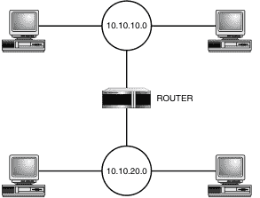

你可以使用标准 Linux 发行版为该网络拓扑创建一个局域网到局域网路由器，步骤如下：

1. 检查 IP 转发是否已编译到你的内核中，如果没有，则编译并安装它。此过程已在本章前面的“用于路由的内核模块”一节中介绍。

2. 在你的系统中安装两块网卡，并确保它们按照第 13 章“配置多宿主主机”一节中的说明正常运行。

3. 按照第 13 章中的说明，将 `eth0` 配置为连接到 `10.10.10.0` 网络。假设路由器在 `10.10.10.0` 网络上的 IP 地址为 `10.10.10.1`。

4. 按照第 13 章中的说明，将 `eth1` 配置为连接到 `10.10.20.0` 网络。假设路由器在 `10.10.20.0` 网络上的 IP 地址为 `10.10.20.1`。

5. 使用 `route` 命令检查你的路由表。你应该有通过相应接口到达这两个网络的静态路由，如下所示：

   ```text
   10.10.10.0    *    255.255.255.0    U    0    0    0    eth0
   10.10.20.0    *    255.255.255.0    U    0    0    0    eth1
   ```

6. 如果到 `10.10.10.0` 网络的静态路由不存在，请使用以下命令创建该路由：

   ```bash
   # /sbin/route add -net 10.10.10.0/24 dev eth0
   ```

7. 如果到 `10.10.20.0` 网络的静态路由不存在，请使用以下命令创建该路由：

   ```bash
   # /sbin/route add -net 10.10.20.0/24 dev eth1
   ```

`10.10.10.0` 网络上的主机需要配置为使用 `10.10.10.1` 处的路由器作为其默认网关。

```bash
# /sbin/route default gw 10.10.10.1 dev eth0
```

同样，`10.10.20.0` 网络上的主机需要配置为使用 `10.10.20.1` 处的路由器作为其默认网关：

```bash
# /sbin/route default gw 10.10.20.1 dev eth0
```

当你的路由器运行时，需要考虑路由器上的安全性：

- 路由器是否应接受通过 telnet 或 rsh 进行的远程登录以进行远程管理？如果不，应使用 ssh 启用远程管理，或只允许在控制台上进行管理。
- 路由器不应是你的 NIS 域的一部分，以防止普通用户帐户登录到路由器。
- 除系统帐户和 root 帐户之外，路由器上应只存在数量最少的用户帐户。
- 应禁用路由器上所有不必要的网络服务，包括 sendmail、FTP、Telnet、NFS、Samba、LPD。不运行不需要的服务有助于防止对路由器的未授权访问。
- 请参阅第 18 章“一般安全问题”和第 19 章“Linux 与防火墙”，以获取有关保护 Linux 路由器系统安全的指导。适用于保护防火墙安全的规定同样适用于保护路由器安全。

#### 动态路由

前面几节讨论了静态路由。然而，静态路由有一个主要缺点：在不断变化的网络环境中维护路由是一项艰巨的任务。路由协议提供了一种处理简单和复杂路由环境的机制。

路由协议有多种，它们基本上都执行相同的功能：确定到达目标主机或网络的最佳路由。在本章中，你将了解两种此类协议：路由信息协议（RIP）和开放最短路径优先（OSPF）协议。你还将考虑用于部署这些协议的两个守护进程：实现 RIP 的 routed，以及支持 RIP、OSPF 和其他路由协议的 gated。

#### 路由协议的类型

有两类路由协议：内部协议和外部协议。内部路由协议用于独立网络系统内部。独立网络系统称为自治系统（AS）。RIP 和 OSPF 是被广泛使用的内部路由协议。

外部路由协议用于在独立网络或自治系统之间交换路由信息。边界网关协议（BGP）和外部网关协议（EGP）是外部路由协议的示例。对外部路由协议的讨论超出了本书的范围。BGP 是从 EGP 获得的经验中发展出来的较新协议。有关 BGP 的更多信息，请参阅以下 RFC：

- RFC-1771，“边界网关协议 4（BGP-4）”
- RFC-1773，“使用 BGP-4 协议的经验”
- RFC-1774，“BGP-4 协议分析”
- RFC-1965，“用于 BGP 的自治系统联盟”
- RFC-1966，“BGP 路由反射：全网状 IBGP 的一种替代方案”
- RFC-1997，“BGP 团体属性”
- RFC-1998，“BGP 团体属性的一种应用”
- RFC-2283，“BGP-4 的多协议扩展”
- RFC-2385，“通过 TCP MD5 签名选项保护 BGP 会话”
- RFC-2439，“BGP 路由抖动抑制”
- RFC-2545，“使用 BGP-4 多协议扩展实现 IPv6 域间”
- RFC-2547，“BGP/MPLS VPN”


RIP 版本 2（通常称为 RIPv2）为 RIP 增加了更多功能。RIPv2 使用 IP 多播来分发路由更新，而 RIP 则使用广播消息。RIPv2 使用 IP 多播是为了防止版本 1 路由器对仅适用于版本 2 路由器的路由信息感到困惑。RIPv2 的增强功能包括对下一跳、网络掩码和身份验证的支持。

#### routed

在许多 UNIX 系统（包括 Linux）中，路由信息协议由名为 routed 的路由守护进程运行。该守护进程根据通过 RIP 更新接收到的路由信息动态构建路由表。当 routed 启动时，它会广播一个路由更新请求，然后开始侦听对该请求的回复。配置为响应 RIP 请求的其他主机或路由器会以更新数据包作为回复。更新数据包包含来自路由表的目标地址以及与每个目标地址关联的路由度量。除了响应 RIP 请求外，还会定期发出更新数据包，以使所有参与 RIP 路由器和主机上的路由信息保持最新。

当收到 RIP 更新时，routed 会用这些信息更新其路由表。如果收到通往新目标的路由，则会将其添加到路由表中。如果收到针对路由表中已存在路由的度量值更低的更新路由，则使用新路由。如果路由度量大于 15，也会从路由表中删除该路由。如果在指定时间段内未收到来自某个网关的更新，则删除到该网关的所有路由。路由更新通常每 30 秒发布一次。一般来说，如果在 180 秒内未收到来自某个网关的更新，则该网关被视为已失效，并且通过该网关的所有路由都会从路由表中删除。

要使用 routed 守护进程运行 RIP，请输入以下命令：

```
# /sbin/routed
```

另一种启动和停止 routed 的方法是通过 /etc/rc.d/init.d 中的启动脚本，如下所示：

```
# /etc/rc.d/init.d/routed start
# /etc/rc.d/init.d/routed stop
```

通常，routed 在启动时不带任何命令行参数。但是，如果您希望 routed 永不向其他主机和路由器通告其路由，而只侦听由其他运行 routed 的系统通告的路由，则可以使用 -q 选项。

#### /etc/gateways 文件

在大多数情况下，routed 只需侦听来自提供 RIP 数据的主机和路由器的 RIP 更新，即可了解并构建其路由表。但是，有时您可能需要向 routed 提供额外的路由数据。例如，如果您的网络上有一台运行 OSPF 或 EIGRP 协议且不提供 RIP 更新的 Cisco 路由器，您需要向 routed 提供此数据。要使 routed 识别这样的路由器，您需要在 /etc/gateways 文件中添加一个条目，该文件通常用于定义默认路由器的条目。/etc/gateways 文件中条目的语法如下：

```
net|host <name or address> gateway <name or address> metric <number> active|passive
```

默认路由的条目示例为：

```
net 0.0.0.0 gateway 10.2.0.254 metric 1 passive
```

条目以关键字 net 或 host 开头，表示该路由是通往目标网络或主机的。其后是网络或主机的名称或 IP 地址。在示例中，0.0.0.0 表示默认路由。接下来是关键字 gateway，其后是网关的名称或 IP 地址。关键字 metric 后面是其数值。当存在多条到同一目标主机或网络的路由时，使用 metric 非常有用。在路由选择中，较低的度量值具有优先权，因为它应表示到目标的更短路由。

路由条目中的最后一个值是关键字 passive 或 active。标记为 passive 的路由意味着网关不需要提供 RIP 更新。这样可以防止在未从该网关收到 RIP 更新时删除该路由。被动路由会放入系统的路由表中，并在系统运行期间一直保留。从功能上讲，这等同于向系统添加静态路由。而标记为 active 的路由是由 RIP 更新的路由。routed 期望从活动路由的网关接收路由信息，如果更新未在指定时间内到达，该路由将被删除。

#### 开放最短路径优先路由协议

开放最短路径优先（OSPF）是一种最短路径优先或链路状态协议。OSPF 是一种内部网关协议，在单个自治系统内的路由器之间分发路由信息。在 OSPF 中，开销最小的路径被视为最佳路径。OSPF 适用于非常复杂的网络以及由大量路由器组成的网络。

在 OSPF 中，网络被划分为多个区域。OSPF 使用四种类型的路由。按优先级排列，它们分别是：

- **区域内路由：** 目标位于同一区域内的路由
- **区域间路由：** 目标位于其他 OSPF 区域内的路由
- **类型 1 外部路由：** 通往自治系统外部目标的路由
- **类型 2 外部路由：** 通往自治系统外部目标的路由

在链路状态协议中，每个 OSPF 路由器都维护一个描述整个自治系统拓扑的数据库。该数据库由所有路由器收集到的链路状态通告构建而成。每个参与路由器在整个自治系统内通告其本地状态，即其运行中的接口和可到达的邻居。根据拓扑数据库，每个路由器以自身为根构建一棵最短路径树。这棵最短路径树给出自治系统内到达每个目标的路由。当同一网络骨干区域中有多个 OSPF 路由器时，会进行选举，其中一个路由器成为指定路由器，第二个路由器成为备份指定路由器。

指定路由器负责收集来自其他路由器的链路状态更新。指定路由器保存着所有路由器的大量链路状态信息。如果指定路由器发生故障，重建该链路状态数据库将需要很长时间。因此，链路状态数据库会与备份指定路由器共享，这样在指定路由器突然不可用时，备份指定路由器可以迅速承担起指定路由器的角色。

OSPF 使用数据包头中的目标地址和服务类型（TOS）信息来确定数据包的路由。在确定最短路径路由时，OSPF 使用多个开销度量，例如路由速度、流量、可靠性和安全性。OSPF 使用 HELLO 协议在路由器之间传递状态信息。HELLO 协议使用跳与跳之间所花费的时间来计算最佳路由，而不是像 RIP 和大多数其他协议那样使用跳数。

当数据包被路由到自治系统外部时，OSPF 将其称为外部路由。如前所述，OSPF 支持两种类型的外部路由：类型 1 和类型 2。对于类型 1 外部路由，OSPF 使用与计算内部路由相同的算法来计算外部路由。而类型 2 外部路由则是从外部 EGP 或 BGP 路由器学习到的。

OSPF 允许将大型网络划分为多个较小的区域，每个区域都有自己的路由器和路由算法。区域之间的路由通过骨干区域完成。OSPF 定义了多种适用于不同 OSPF 区域的路由器类型。它们分类如下：

- **内部路由器：** 所有连接都属于单个区域，或仅建立骨干连接的路由器。
- **区域边界路由器：** 在其区域之外具有连接的路由器。
- **骨干路由器：** 具有到骨干区域接口的路由器。
- **自治系统边界路由器：** 与另一个自治系统有连接的路由器。

OSPF 路由器之间会相互发送有关网络间连接的消息。这些消息称为路由通告，通过 HELLO 协议发送。OSPF 中有四种类型的路由通告：

- **路由器链路通告：** 提供有关本地路由器在 OSPF 区域内连接的信息。它们被广播到自治系统内所有参与 OSPF 路由器。
- **网络链路通告：** 提供连接到该网络的路由器列表。它们被广播到自治系统内所有参与 OSPF 路由器。
- **汇总链路通告：** 提供有关区域外部路由的信息。这些通告由 OSPF 区域边界路由器发送给参与 OSPF 的区域路由器。
- **自治系统外部链路通告：** 包含通往外部自治系统的路由，供 OSPF 自治系统边界路由器使用。


OSPF 是一种动态且自适应的协议。它能适应网络中出现的问题，并提供极短的收敛时间来稳定路由表。它旨在防止网状网络中或使用多个网桥连接不同局域网时出现流量环路。

OSPF 是 RIP 的替代方案。它克服了 RIP 的所有局限性。RIP 是距离矢量协议，而 OSPF 是链路状态协议。在链路状态协议中，每台路由器都会主动测试自己到每个邻居的链路状态，并将该链路状态信息发送给相邻路由器。每台路由器都使用这些链路状态信息来构建自己的路由表。这种方法能比距离矢量协议更快地完成路由收敛，并且非常适合拓扑频繁变化的大型网络。OSPF 还有其他几个特性使其优于 RIP，包括以下方面：

- **服务类型：** OSPF 可以为每种服务类型（TOS）计算一组单独的路由。
- **负载均衡：** 当存在多条到同一目的地的等成本路由时，OSPF 可以在这些路由之间均匀地分配数据。
- **VLSM：** OSPF 支持变长子网掩码（VLSM）。

> **注意**
>
> 与 RIP 不同，RIP 版本 2 也支持子网。

- 每个接口都会根据往返时间、流量、可靠性和安全性分配一个开销度量值。此外，还可以针对服务类型分配单独的开销。
- OSPF 使用组播进行路由通告，以减轻未参与 OSPF 的系统的负载。

OSPF 是管理由多厂商系统组成的复杂网络的解决方案。常见的路由协议（如 RIP）是为只有少量路由器且冗余度极低的简单网络而设计的。在大型网络中，路由消息会占用大量网络带宽，这些协议的效率不高。OSPF 通过使用组播与参与的路由器交换路由信息来解决这个问题。

对 OSPF 协议的完整阐述超出了本书的范围。要了解 OSPF 的详细信息，可以参考以下资源：

- RFC-1131，“OSPF 规范”
- RFC-1245，“OSPF 协议分析”
- RFC-1246，“OSPF 协议使用经验”
- RFC-1364，“BGP 与 OSPF 的交互”
- RFC-1850，“OSPF 版本 2 管理信息库”
- RFC-2154，“带数字签名的 OSPF”
- RFC-2328，“OSPF 版本 2”
- RFC-2329，“OSPF 标准化报告”
- RFC-2370，“OSPF 不透明 LSA 选项”
- RFC-2676，“QoS 路由机制与 OSPF 扩展”
- RFC-2740，“面向 IPv6 的 OSPF”
- *TCP/IP 网络互连（第 I 卷）*，Douglas Comer 著
- *TCP/IP 详解，卷 I：协议*，W. Richard Stevens 著

#### gated

gated 是一个一体化路由守护进程，支持 RIP、RIP II、Hello、BGP、EGP 和 OSPF。由于 gated 能理解所有这些协议，因此它更适合在同一网络中使用多种路由协议的复杂网络。gated 会综合从所有这些协议学到的路由信息，并选择最佳路由。然而，gated 的配置文件比 routed 的更为复杂；如果你的网络很简单，你可以选择运行 routed 来代替。仅启用 RIP 或 RIP II 来运行 gated 非常简单，而且比运行 routed 更可取。

##### gated 配置示例

为主机系统配置 gated 非常简单，只需几条配置语句。gated 启动时，会从文件 `/etc/gated.conf` 读取配置。

以下显示的配置模拟了 routed。使用的协议是 RIP。当多个网络接口处于活动状态且内核启用了 IP 转发时，就会发送更新：

```
#
rip yes ;
#
```

要启用内核中的 IP 转发，请使用以下命令：

```sh
# echo "1" > /proc/sys/net/ipv4/ip_forward
```

> **提示**
>
> 必须在内核中启用 UDP 校验和。通常，Linux 默认已启用此功能。此外，还必须在内核中启用 IP 组播支持。RIP 版本 2 使用 IP 组播。这在内核编译期间配置 Linux 内核时完成。关于重新编译内核的讨论，请参阅第 11 章。

以下配置以安静模式运行 RIP；它只侦听数据包，无论配置了多少接口：

```
#
rip yes {
        no broadcast ;
};
#
```

下一个示例适用于运行 RIP 且只有一个网络接口的主机系统。它还演示了如何指定默认路由：

```text
# Define the only network interface as passive to prevent timing out
# the only network interface.
interfaces {
        interface eth0 passive ;
} ;

# enable RIP version 2 with multicast.
rip yes {
        broadcast ;
        defaultmetric 5 ;
        interface eth0 version 2 multicast ;
} ;

# Define a default static route
static {
        0.0.0.0 mask 0.0.0.0 gateway 10.2.0.254 retain ;
}
```

关键字 passive 用于 interface 命令中。在这种情况下，通过使用关键字 passive，你可以确保经过主机唯一网络接口的永久路由不会被 gated 从路由表中删除。通常，当 gated 认为某个网络接口已关闭时，会将其从路由表中删除。在本例中，主机只有一个网络接口，即使 gated 认为该接口已关闭，你也不希望 gated 将其从路由表中删除。将该接口声明为 passive 即可实现此目的。

static 语句用于定义静态路由。在前面的示例中，定义了一条使用默认网关的静态路由，该网关的 IP 地址为 10.2.0.254。

以下示例说明了 RIP II 和 OSPF 两种路由协议的使用：

```text
interfaces {
        interface eth0 passive ;
} ;

rip yes {
        broadcast ;
        defaultmetric 5 ;
        interface eth0 version 2 multicast ;
} ;

ospf yes {
        backbone {
                authtype simple;
                networks {
                10.2.0.0 mask 255.255.0.0;
                10.3.0.0 mask 255.255.0.0;
                };
                interface eth {
                enabled;
authkey "secret";
};
};
};
static {
    0.0.0.0 mask 0.0.0.0 gateway 10.2.0.254;
};
```

`rip yes` 语句可启用 RIP 协议。如果未指定任何 rip 语句，则默认启用该协议。如果系统是只有一个接口的主机，默认选项为 `nobroadcast`。在前面的配置示例中，你指定的是 RIP `broadcast`。指定 `broadcast` 后，无论存在多少接口，RIP 数据包都会被广播。当你想把静态路由或通过其他协议学到的路由传播到 RIP 中时，这非常有用。`defaultmetric` 指令定义了在通过 RIP 通告从其他协议学到的路由时使用的度量值。`interface` 命令控制通过指定接口发送 RIP 的属性。在这里，你已指定在接口 `eth0` 上通过 IP 组播使用 RIP 版本 2。

`ospf yes` 语句启用 OSPF 协议。`backbone` 指令将 OSPF 区域指定为骨干网络。如果配置了多个区域，则至少有一个区域必须是骨干区域。骨干区域也称为区域 `0`。两个术语都可用来指定骨干区域。`authtype` 指令的值可以是 `none` 或 `simple`。如果指定为 `none`，则无需认证；而 `simple` 使用简单的密码认证方法。OSPF 在每个区域使用一种认证方案。每个区域必须使用相同的认证方案。`networks` 指令描述区域的范围。条目以网络地址和网络掩码对的形式指定。`interface` 指令后跟 `eth` 用于指定所有以太网接口。`enable` 指令使所有以太网接口能够参与 OSPF 路由。`authkey` 指令后跟 OSPF 用来验证 OSPF 报文头中认证字段的密码字符串。

> **提示**
>
> 有关所有 gated 选项的完整详细信息以及如何编写 `gated.conf` 文件，请运行 `man gated` 参阅在线手册页。另请参阅《Gated 配置指南》和《Gated 操作指南》，它们位于常规 gated 安装的 `/usr/doc/gated-3.5/doc` 目录中。

#### 启动和停止 gated

gated 发行版附带一个名为 `gdc` 的程序，用于启动和停止 gated，并检查 `gated.conf` 文件是否正确。有关 `gdc` 的完整详细信息，请运行 `man gdc` 查看在线手册页。以下是 `gdc` 的一些示例用法。

要使用 gdc 启动 gated，请使用以下命令：

```sh
# /usr/sbin/gdc start
```

要使用 gdc 停止 gated，请使用以下命令：

```sh
# /usr/sbin/gdc stop
```


要使用gdc重启gated，请使用以下命令：

```sh
# /usr/sbin/gdc restart
```

要检查gated的状态，请使用以下命令：

```sh
# /usr/sbin/gdc running
```

创建或修改gated.conf文件后，可以使用gdc测试其正确性，方法如下：

```sh
# /usr/sbin/gdc checkconf
```

修改gated.conf文件后，可以使用以下命令让gated重新读取其配置文件：

```sh
# /usr/sbin/gdc reconfig
```

默认情况下，gated从文件/etc/gated.conf读取其配置。gdc程序还可以维护多个版本的配置文件，这些文件具有特殊名称，例如/etc/gated.conf+、/etc/gated.conf-等。例如，您可以创建一个名为/etc/gated.conf+的新配置文件，并指示gdc安装它。当gdc安装新的配置文件/etc/gated.conf+时，会将其重命名为/etc/gated.conf。配置文件的先前版本会被移动到/etc/gated.conf-。如果已存在名为/etc/gated.conf-的旧配置文件，则该文件会被重命名为/etc/gated.conf--。

要检查新的配置文件/etc/gated.conf+，请使用以下命令：

```sh
# /usr/sbin/gdc checknew
```

此命令与checkconf类似，只不过它检查的是新配置文件而不是当前文件。

要将/etc/gated.conf+文件安装为/etc/gated.conf文件，请使用以下命令：

```sh
# /usr/sbin/gdc newconf
```

要回退到较旧的配置文件，请使用以下命令：

```sh
# /usr/sbin/gdc backout
```

这将把较旧的配置文件/etc/gated.conf-轮换为/etc/gated.conf。

#### 故障排除

本节介绍一些与网络连接和路由相关的常见问题，然后探讨可能的解决方案。具体而言，您将考虑以下问题：

- 本地主机无法访问远程主机
- 某些应用程序的主机连接失败
- 性能不佳
- 主机和路由器子网掩码不匹配
- OSPF路由器未建立邻居关系

##### 本地主机无法访问远程主机

考虑以下场景：一个网络上的主机无法与远程网络上的主机通信。这些网络由一个或多个路由器分隔，可能包含WAN或其他链路。路由器上运行着一种或多种路由协议。在这种情况下，可能存在几种可能的问题：

- 本地或远程主机上未指定默认网关，或默认网关配置错误。
- `routed`配置错误或缺少默认路由。
- 某个主机可能缺少DNS条目。
- 两个主机之间的一个或多个路由器可能配置不当。

##### 本地或远程主机上未指定默认网关或默认网关配置错误

如果主机未运行routed，则应配置默认网关。确定本地和远程主机是否指定了默认网关。使用netstat命令确定是否配置了默认网关，方法如下：

```sh
# netstat -rn
```

检查此命令的输出中是否有默认网关规范。如果默认网关规范不正确或根本不存在，您可以在主机上使用以下命令更改或添加默认网关：

```sh
# /sbin/route add default gw <IP address> 1
```

此处，`<IP address>`是默认网关的IP地址。值1是度量值，表示指定的网关距离一跳。

##### `routed`配置错误或缺少默认路由

如果主机正在运行routed，请使用netstat -rn命令查看主机的路由表。目标为default的条目表示默认路由。

默认路由条目应指向具有通往远程主机路由的路由器。如果没有默认路由条目，请使用route命令手动配置默认网关，如前一节所述。要永久解决问题，请在`/etc/gateways`文件中添加默认路由条目并重新启动routed。

##### 主机缺少DNS条目

使用nslookup工具查看是否能够解析主机地址，方法如下：

```sh
$ nslookup <remote hostname>
```

如果nslookup无法解析主机地址，但您可以通过使用其IP地址访问远程主机，则说明是名称解析问题。请确保为该主机添加了正确的DNS条目。

##### 两个主机之间的路由器配置不当

检查连接两个网络的路由器上的路由，并修复任何配置错误或缺失的路由。缩小具体症状范围，并使用第13章中概述的过程来排查问题。使用`netstat -nr`命令检查Linux路由器上的路由表。

##### 某些应用程序的主机连接失败

如果使用某些应用程序的连接尝试成功，而其他应用程序失败，则两个主机之间可能存在防火墙，不允许特定协议通过。检查相关主机之间任何防火墙上的防火墙规则，并在需要时进行修改。

##### 性能不佳

如果一个或多个网络主机的性能缓慢，或者与服务器的连接需要很长时间才能建立，可能的原因是DNS客户端上的`resolv.conf`文件配置错误。

检查受影响客户端机器上的`/etc/resolv.conf`文件。如果该文件配置错误，客户端会一直等到对第一个DNS服务器的查询超时后才尝试第二个服务器。这会导致长时间延迟。此外，DNS可能未针对反向查找进行设置，这会导致终端系统的反向查找尝试超时。这可能会导致尝试建立连接的主机出现过度延迟。修复`/etc/resolv.conf`文件中的名称服务器条目以及其他现有的DNS问题，例如反向查找。

##### 主机和路由器子网掩码不匹配

在有类IP网络中，同一主网络中的每台路由器和主机必须共享一个共同的子网掩码。如果子网掩码的长度不一致，数据包将无法正确路由。请确保所有主机和路由器上的网络掩码保持一致。

##### OSPF路由器未建立邻居关系

如果OSPF路由器未正确建立邻居关系，结果是路由信息不会在路由器之间交换。请确保OSPF路由器位于同一区域，并共享相同的身份验证类型（authtype）和密钥（authkey）。区域内定义的网络和网络掩码在整个OSPF区域中也应相同。

### 第16章：使用Sendmail的Linux邮件服务

本章内容

- 电子邮件系统 310
- 使用sendmail 315
- IMAP和POP3服务器 335
- 使用procmail 336
- 故障排除 337

#### 电子邮件系统

为企业设置或维护电子邮件服务并非易事。作为系统管理员，您可能会面临设置全新邮件系统或维护、扩展现有系统的任务。以下各节概述了电子邮件系统，并简要介绍了一些基本概念和术语。我们还将介绍Linux领先的电子邮件服务器软件sendmail及其配置。最后，我们将简要讨论IMAP和POP3邮件服务。

#### 邮件网络的物理组件

构成电子邮件系统的基本组件有四个。这些组件可以组合在同一系统上，也可以在不同的系统上提供。具体如下：

- 邮件客户端
- 邮件服务器
- 邮件主机
- 邮件网关

图16.1展示了典型的企业电子邮件配置。

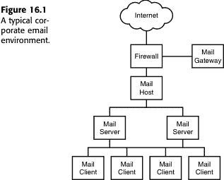

#### 邮件客户端

邮件客户端是从邮件服务器读取邮件的机器。它不运行邮件服务器应用程序，例如sendmail、smail或qmail守护进程，也不直接接收邮件。

通常，运行sendmail的Linux邮件服务器接收邮件，并将其存储在目录`/var/spool/mail`中的用户邮箱中。可以配置Linux邮件客户端使用NFS挂载邮件目录（如第14章“使用NFS和Samba进行打印机和文件共享”所述），并直接访问这些邮箱。

在混合环境中，尤其是那些具有混合邮件客户端平台的环境中，邮件客户端通常使用POP3或IMAP协议访问邮件服务器上的邮箱。在这种情况下，邮件服务器可以是基于Linux的邮件服务器，也可以是商业服务器，例如Microsoft Exchange或Netscape的邮件服务器。

#### 邮件服务器

在Linux环境中，有多个邮件服务器可用。到目前为止，最突出的邮件服务器是sendmail。

在运行sendmail的服务器上，邮件直接投递到用户的邮箱。这些邮箱是存储在`/var/spool/mail`目录中的文件，每个文件代表一个用户的收件箱，并以用户的登录名命名。当邮件客户端要求sendmail投递外发邮件时，邮件会在目录`/var/spool/mqueue`中排队，直到消息成功投递。

在Linux环境中，邮件客户端直接访问和操作这些sendmail收件箱，并始终将邮件保留在邮件服务器上，这是很常见的。通常通过NFS将`/var/spool/mail`目录挂载到邮件客户端来访问收件箱。这种方法的优点是将邮箱集中起来，便于备份、调试和管理。但一个显著的缺点是，如果邮件服务器停机，用户将无法访问其收件箱。

与邮件客户端管理集中维护的收件箱相比，另一种方法是让邮件客户端将消息从这些中央收件箱移动到其主目录中的邮箱。通常，可以通过NFS挂载直接操作收件箱，或者通过POP3或IMAP等邮件检索协议来实现。虽然这种方法提供了即使邮件服务器停机也能保持邮箱可访问的优点，但它也存在将邮件收件箱数据分发到许多客户端系统的缺点。这会使备份更加复杂，但并非不可能。

#### 邮件主机

邮件主机是指定作为网络主邮件服务器的机器。它是站点上其他服务器将无法投递的邮件转发到的系统。它充当中央邮件集线器，将邮件路由到内部服务器或外部邮件网关。任何需要发送到域外的邮件都将交给邮件主机。

邮件主机上的sendmail配置比简单邮件服务器机器上的配置更复杂。


#### 邮件网关

邮件网关是处理不同网络之间邮件连接的机器。通常，邮件网关是在域名的 DNS 记录中被定义为该域邮件交换器的系统。DNS 记录在第 22 章“DNS”中讨论。

作为邮件交换器，邮件网关是来自 Internet 的某个域名入站邮件的主要接触点。不过，它通常不是入站消息的最终目的地。

通常，邮件网关的任务是在不同的网络和邮件协议之间进行转换。例如，邮件网关可以将运行互联网标准 SMTP 邮件的外部 TCP/IP 网络连接到运行 Microsoft Exchange 邮件的内部 Windows 网络。

> **注意：** 由于基于 Linux 的网络通常使用 TCP/IP 和 SMTP，因此这是我们关注的邮件环境。

通常，与简单的邮件服务器系统相比，网关机器上的 sendmail 配置相当复杂。邮件服务器系统通常只处理某个组织中单个部分的邮件，而邮件网关的任务则是接收来自 Internet 的整个组织的所有邮件，然后将其引导到正确的内部邮件主机，再由这些主机进一步分发到目标邮件服务器。

因此，邮件网关需要做更多的决策：它不像邮件服务器那样简单地接收消息并将其放入相应用户的收件箱中。

#### 邮件系统的软件组件

在上一节“邮件系统的物理组件”中，我们讨论了构成典型企业电子邮件环境的实际物理机器。除了这种物理分工之外，我们还需要考虑运行在这些物理系统上以提供实际电子邮件功能的各种软件包。

电子邮件系统由多个软件组件组成，包括：

- 邮件用户代理
- 邮件传输代理
- 邮件投递代理

#### 邮件用户代理

邮件用户代理是用户用来阅读、撰写、发送和处理电子邮件的程序。Linux 可用的邮件用户代理有很多，包括基于文本的控制台应用程序（如 Pine 和 Elm），以及用于 X Windows 的图形邮件软件（如 Netscape Messenger 和 Kmail）。

这些邮件用户代理与邮件传输代理通信，以处理电子邮件的检索和投递。邮件用户代理通常运行在邮件客户端系统上。

#### 邮件传输代理

邮件传输代理解析邮件地址并路由邮件消息。邮件传输代理通常处理以下任务：

- 从邮件用户代理接收邮件
- 解析邮件地址
- 选择邮件并将其投递给邮件投递代理
- 从邮件投递代理接收入站邮件

邮件传输代理通常运行在邮件服务器系统上。目前 Linux 上最著名的邮件传输代理是 sendmail。sendmail 是一个庞大、复杂且功能强大的邮件服务器产品，广泛用于大型邮件安装环境。

除了 sendmail 之外，Linux 还有几个可供选择的邮件传输代理，包括两个流行的软件包：

- Smail（ftp://ftp.uu.net/networking/mail/smail/）
- Qmail（http://www.qmail.org/top.html）

在本书中，我们重点介绍如何将 sendmail 用作 Linux 的邮件服务器，因为它代表了 Linux 公认的标准邮件服务器。

#### 邮件投递代理

邮件投递代理是实现特定投递协议的程序。在 Linux 世界中，邮件投递代理通常是大型邮件服务器软件包（如 sendmail）的组件。例如，sendmail 包含用于 UUCP、SMTP 和本地投递的投递代理。

此外，像 sendmail 这样的邮件传输代理也可以使用外部邮件投递代理进行邮件投递。例如，较新版本的 sendmail 使用 procmail 作为本地邮件投递的邮件投递代理。

#### 邮箱

邮箱是邮件服务器上的一个文件或一组文件，是电子邮件消息的最终目的地。在使用 sendmail 的 Linux 邮件服务器上，用户邮箱的名称将是用户的登录名。这些收件箱文件存储在 `/var/spool/mail` 目录中。

#### 邮件别名

邮件别名是另一种邮件名称。这些别名将电子邮件地址与特定的收件箱关联起来。

例如，在一台邮件服务器上，可能有 `user1` 和 `user2` 的收件箱。然后可以创建一个别名，使发往 `userA` 的邮件被投递到 `user1` 的邮箱。`userA` 本身不会有邮箱。类似地，别名也可以让发往 `userB` 的邮件投递到 `user2` 的收件箱。

别名还可以用于将邮件重定向到其他邮件服务器上的外部邮箱。例如，在一台服务器上，可以创建一个别名，将 `user3` 指向 `userC@some.server`。这个别名表示服务器收到的所有发往 `user3` 的邮件实际上都应该发送到邮件服务器 `some.server`，以投递到邮箱 `userC`。实际上 `user3` 不会有收件箱。

邮件别名还可以用于创建简单的邮件列表：一个别名可以指向一组邮件接收者，这样发往该别名的电子邮件实际上会投递给所有接收者。例如，如果别名 `allusers` 指向用户列表 `user1`、`user2` 和 `user5`，那么所有发往 `allusers` 的邮件都会被投递给 `user1`、`user2` 和 `user5`，并且 `allusers` 不会有收件箱。

在 sendmail 系统中，邮件别名通常存储在文件 `/etc/aliases` 或 `/etc/mail/aliases` 中，具体取决于你的 Linux 发行版和 sendmail 版本。这是一个每行包含一个条目的文本文件，每个条目的形式如下：

```text
<alias>: <destination>
```

例如，上面讨论的所有别名在 `aliases` 文件中会显示如下：

```text
userA: user1
userB: user2
user3: userC@some.server
allusers: user1, user2, user5
```

> **注意：** 当使用别名创建简单邮件列表时，作为邮件列表成员的地址会以逗号分隔的地址列表形式出现在 aliases 文件条目中的目的地部分。

sendmail 不会直接读取 aliases 文件。相反，它使用 `newaliases` 命令将其转换为哈希表或 dbm 数据库文件。每次修改 aliases 文件后，都应先执行 `newaliases` 程序，然后 sendmail 才能访问新的别名。`newaliases` 程序不需要任何参数或选项：

```text
# newaliases
/etc/aliases: 14 aliases, longest 10 bytes, 152 bytes total
```

除了使用 `newaliases` 命令从 aliases 文件重建哈希表或 dbm 文件之外，你也可以直接使用 sendmail 程序：

```
# sendmail -bi
/etc/aliases: 14 aliases, longest 10 bytes, 152 bytes total
```

`newaliases` 程序将创建一个名为 `aliases.db` 的哈希表文件，或者创建组成 dbm 数据库的两个文件 `aliases.dir` 和 `aliases.pag`。

如果你在网络中使用 NIS 来分发网络信息（如第 6 章“对用户和网络资源进行身份验证”中讨论的），那么 aliases 数据库实际上可以在 NIS 主服务器上作为 NIS 表进行维护，并在 NIS 从服务器上进行复制。

#### 邮件地址

互联网电子邮件地址通常由两部分组成：用户地址和域名。例如，考虑地址 user@example.com。这个地址可以分解为两个由 @ 符号分隔的部分。@ 符号左边是本地地址（user），右边是域名（example.com）。

邮件投递代理使用地址中的域名部分，通过查询 DNS 服务器来确定该域名对应的邮件交换器的主机名和 IP 地址。然后，邮件投递代理尝试连接到该邮件交换器，并使用 SMTP 投递消息。

#### 使用 sendmail

虽然 sendmail 并不是唯一的邮件传输代理，而且 Smail 和 Qmail 也是流行的替代品，但 sendmail 仍然是 Linux 上使用最广泛的邮件传输代理，因此也是本书所讨论的平台。

遗憾的是，sendmail 的配置相当复杂。要完全理解 sendmail 的配置和管理超出了本书的范围。事实上，有一本专门讨论这个主题的书：Bryan Costales 和 Eric Allman 所著的 *sendmail*（O’Reilly，1997）。Eric Allman 是 sendmail 软件包的原始设计者和开发者。

电子邮件系统通常使用各种程序和协议进行邮件投递；这是 sendmail 复杂性的重要来源。例如，SMTP 用于 TCP/IP 网络上的投递，UUCP 用于 UUCP 网络上的投递，而 procmail 或 /bin/mail 等外部应用程序用于本地投递。对于每种投递机制，都会使用不同的投递代理和寻址方案。

sendmail 通过分析消息收件人的电子邮件地址来决定使用哪个投递代理。sendmail 接收来自 Pine 或 Netscape Messenger 等邮件用户代理的消息，解释目标地址，根据相应邮件投递代理的要求重新格式化地址，然后将消息路由到投递代理。


图16.2说明了一条消息从邮件用户代理到被移交给邮件投递代理进行投递所经过的路径。

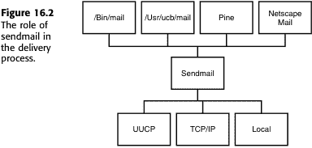

除了路由邮件之外，sendmail 还接收和投递 SMTP 邮件，并提供邮件别名功能。

为了从互联网或内部网接收 SMTP 邮件，sendmail 以守护进程方式运行，监听 TCP 25 端口。系统启动时，`/etc/rc.d/init.d` 中的启动脚本会自动启动 sendmail。下面是在启动过程中用于启动 sendmail 的 `/etc/rc.d/init.d` 典型代码：

```bash
if [ -f /etc/sysconfig/sendmail ] ; then
        . /etc/sysconfig/sendmail
else
        DAEMON=yes
        QUEUE=1h
fi
[ -f /usr/sbin/sendmail ] || exit 0
# See how we were called.
case "$1" in
    start)
        # Start daemons.
        echo -n "Starting sendmail: "
        /usr/bin/newaliases > /dev/null 2>&1
        for i in virtusertable access domaintable mailertable ; do
            if [ -f /etc/mail/$i ] ; then
                makemap hash /etc/mail/$i < /etc/mail/$i
            fi
        done
        /usr/sbin/sendmail $([ "$DAEMON" = yes ] && echo -bd) \
                $([ -n "$QUEUE" ] && echo -q$QUEUE)
        ;;
```

脚本首先检查 `/etc/sysconfig/sendmail` 文件是否存在。如果存在，则执行（source）该文件的内容。该文件设置两个环境变量的值：DAEMON 和 QUEUE。如果 DAEMON 设置为 yes，则表示 sendmail 应以守护进程模式运行。QUEUE 变量的值告诉 sendmail 应该以多频繁的间隔处理邮件队列。例如，如果 `/etc/sysconfig/sendmail` 的内容如下：

```
DAEMON=yes
QUEUE=15m
```

那么需要用两个参数调用 sendmail 程序：-bd 表示程序应以守护进程模式运行并监听 TCP 25 端口以接收传入的 SMTP 邮件；-q15m 表示邮件队列处理间隔为 15 分钟：

```bash
/usr/sbin/sendmail -bd -q15m
```

在启动 sendmail 程序之前，脚本会运行另外两个程序：newaliases 和 makemap。

`/usr/sbin/newaliases` 程序是 `/usr/sbin/sendmail` 的一个链接。当以 newaliases 程序名调用 sendmail 时，它会重建别名数据库。

makemap 程序从 sendmail 配置文件创建 hash 或 dbm 格式的数据库文件。上面的脚本以参数 hash 调用 makemap，告诉它以哈希表格式构建数据库。脚本会检查下面的文本文件是否存在，如果存在，则将其转换为哈希表文件：virtusertable、access、domaintable 和 mailertable。

#### sendmail 的文件和目录

sendmail 软件包使用大量文件和目录进行配置和处理：

- `/usr/sbin/sendmail`
- `/etc/sendmail.cf`
- `/usr/bin/newaliases`
- `/usr/bin/hoststat`
- `/usr/bin/purgestat`
- `/var/spool/mqueue`
- `/usr/bin/mailq`
- `/var/spool/mqueue/.hoststat`
- `/etc/aliases`
- `/usr/lib/sendmail.hf`
- `/etc/sendmail.st`

我们接下来将逐一讨论这些文件。

##### `/usr/sbin/sendmail`

在 Linux 中，sendmail 可执行程序位于 `/usr/sbin` 目录中。它具有 setuid root 属性，这意味着无论谁启动该程序，它都会以 root 用户身份运行。出于安全原因，`/`、`/usr` 和 `/usr/sbin` 目录应该由 root 拥有，并且权限模式为 755。这意味着只有 root 用户才能更改这些目录的内容。

这样可以防止恶意用户替换 sendmail 二进制文件，避免其利用 sendmail 始终以 root 用户运行这一事实来危害系统安全。

##### `/etc/sendmail.cf`

当 sendmail 启动时，它会从 `/etc/sendmail.cf` 文件读取配置。sendmail.cf 文件的位置被硬编码到 sendmail 二进制文件中。因此，要更改 sendmail 配置文件的位置，只有两种方式：

- 将文件移动到新位置，并使用下面的命令在 `/etc` 下创建一个指向新位置的链接：

  ```bash
  # ln -s <new location of configuration file> /etc/sendmail.cf
  ```

- 修改 sendmail 源代码后重新编译 sendmail 软件包。

##### `/usr/bin/newaliases`

newaliases 命令不是一个独立的文件，而是 sendmail 可执行文件的一个链接。如果由于某种原因 newaliases 链接未指向你的 sendmail 可执行文件，可以按以下方式重新创建链接：

```bash
# rm -f /usr/bin/newaliases
# ln -s /usr/sbin/sendmail /usr/bin/newaliases
```

当 sendmail 以 newaliases 命令的形式被调用时，效果等同于以 -bi 参数启动 sendmail，这会使 sendmail 重建别名哈希表或 db 文件。

newaliases 的实际作用已在本章前面关于邮件别名的部分讨论过。

##### `/usr/bin/hoststat`

hoststat 命令与 newaliases 一样，不是一个独立的文件，而是 sendmail 可执行文件的一个链接。如果由于某种原因 hoststat 链接未指向你的 sendmail 可执行文件，可以按以下方式重新创建链接：

```bash
# rm -f /usr/bin/hoststat
# ln -s /usr/sbin/sendmail /usr/bin/hoststat
```

当 sendmail 以 hoststat 命令的形式被调用时，它会使 sendmail 显示与每个曾经通信过的远程主机的最后一次邮件事务列表。

要使 hoststat 命令正常工作，必须执行以下准备步骤：

1. 必须在 sendmail.cf 文件中设置 `HostStatusDirectory` 选项。
2. 必须使用以下命令在 `/var/spool/mqueue` 目录中创建 `.hoststat` 目录：

   ```bash
   # mkdir /var/spool/mqueue/.hoststat
   ```

##### `/usr/bin/purgestat`

purgestat 命令与 newaliases 一样，不是一个独立的文件，而是 sendmail 可执行文件的一个链接。如果由于某种原因 purgestat 链接未指向你的 sendmail 可执行文件，可以按以下方式重新创建链接：

```bash
# rm -f /usr/bin/purgestat
# ln -s /usr/sbin/sendmail /usr/bin/purgestat
```

当 sendmail 以 purgestat 命令的形式被调用时，它会清除 HostStatusDirectory 目录树中的所有信息。

##### `/var/spool/mqueue`

`/var/spool/mqueue` 目录是 sendmail 默认的邮件队列目录。该目录应由 root 拥有，权限模式应设置为 700。

sendmail.cf 文件中的 Q 条目定义了 sendmail 队列目录的位置。该条目的默认值为 `/var/spool/mqueue`。通常无需更改，除非你的 sendmail 配置非常特殊。

在运行过程中，sendmail 会在 `/var/spool/mqueue` 中创建带前缀的邮件文件。这些前缀具有特定含义，如表 16.1 所示。

| 前缀 | 描述 |
| --- | --- |
| lf | 锁文件 |
| qf | 消息的控制文件 |
| df | 消息的数据文件 |
| tf | 重建队列文件时所用的控制文件临时版本 |
| xf | 当前会话的转录文件 |

##### `/usr/bin/mailq`

mailq 命令与 newaliases 一样，不是一个独立的文件，而是 sendmail 可执行文件的一个链接。如果由于某种原因 mailq 链接未指向你的 sendmail 可执行文件，可以按以下方式重新创建链接：

```bash
# rm -f /usr/bin/mailq
# ln -s /usr/sbin/sendmail /usr/bin/mailq
```

当 sendmail 以 mailq 命令的形式被调用时，sendmail 会以 -bp 参数启动，从而显示 `/var/spool/mqueue` 目录中的当前内容。

##### `/var/spool/mqueue/.hoststat`

如果你在 sendmail.cf 中启用了 `HostStatusDirectory` 选项，该条目的默认值为 `/var/spool/mqueue/.hoststat`。这个目录包含一个文件，对应每一个最近与 sendmail 通信过的主机，hoststat 命令使用这些文件显示与每个主机的最后一次事务。

##### `/etc/aliases`

邮件别名存储在 `/etc/aliases` 文件中。通常在首次安装 sendmail 时会创建一个示例别名文件。示例文件也随 sendmail 源代码发行版提供。别名文件包含必需的别名以及为你的站点自定义的别名。必需的别名包括 postmaster 邮件地址的别名。

如果你是从零开始安装 sendmail 系统，应将 sendmail 源代码发行版中 `lib/aliases` 目录下的别名文件复制为 `/etc/aliases`，然后编辑它以适合你站点的需要。

newaliases 程序将 `/etc/aliases` 文本文件转换为 hash 文件或 dbm 数据库格式。sendmail 使用该文件的数据库版本，而不是实际的 `/etc/aliases` 文本文件。别名数据库的默认格式是 ndbm 格式。别名文件的路径由 sendmail.cf 文件中的 AliasFile 条目定义。

##### `/usr/lib/sendmail.hf`

sendmail.hf 文件是 SMTP HELP 命令使用的帮助文件。该文件的路径由 sendmail.cf 文件中的 HelpFile 选项设置。

##### `/etc/sendmail.st`

如果你使用以下命令创建一个空的 `/etc/sendmail.st` 文件：

```bash
touch /etc/sendmail.st
```

那么 sendmail 将收集有关你邮件流量的统计信息。该文件本身不会更改或增大，只是向 sendmail 表明开始收集统计信息。该文件的路径由 sendmail.cf 文件中的 S 条目设置。

#### sendmail.cf 配置文件

sendmail 配置文件是 `/etc/sendmail.cf`。该文件的位置被编译进 sendmail 可执行文件。sendmail 在每次启动时都会读取它。

> **提示**
>
> 如果你想快速配置 sendmail 并使其运行起来，请先阅读下一节“使用 m4 配置 sendmail”，之后再回到本节来了解 sendmail 配置文件的复杂细节。


由于 sendmail.cf 文件在设计上是为了让 sendmail 快速高效地读取和解析，因此它的格式和语法对人类阅读来说远非易事。举例而言，请看下面摘自 sendmail.cf 的内容：

```
H?P?Return-Path: <$g$>
HReceived: $p$rom $s $?$_($$ $from $.$_)
        $.by $; (y/sz? $7? with $r$, id $i$u)
            for $u; $i;
            $. $b
H?D?Resent-Date: $a
H?D?Date: $a
H?F?Resent-From: $x$x <$g>$ $a$.
H?x?Full-Name: $w
# HPosted-Date: $a
# H?I?Received-Date: $b
H?M?Resent-Message-Id: <$t.$i$e$>
H?M?Message-Id: <$t.$i$e$>
```

> **注意**
>
> sendmail.cf 文件中的这段示例展示了该文件中较为晦涩的一部分。文件中的某些部分对人类读者来说相对易读，但总体而言，该文件是难以理解的，正如这个例子所示。

尽管该文件难以阅读，sendmail.cf 文件的内容却控制着 sendmail 的行为。该文件向 sendmail 提供了若干关键信息，包括以下内容：

- sendmail 在常规运行期间需要使用的文件和目录的位置
- sendmail 在重写地址时使用的定义
- sendmail 在路由消息时应该修改或原样传递的邮件头行
- sendmail 用于选择合适的投递代理的规则集
- 邮件投递代理的定义

#### sendmail.cf 文件的总体结构

幸运的是，我们并不需要从头编写 sendmail.cf 文件。通常，你可以使用 sendmail 发行版自带的默认 sendmail.cf 文件，然后修改它以满足站点的需要。文件的结构通常保持不变，你只需编辑特定的条目。

遗憾的是，这仍然不是一件轻松的工作。sendmail.cf 配置命令使用简洁的语法和命令集，难以记忆，也难以熟练运用。每条配置命令由行首的一个字母组成。这个命令字符后面跟着与该命令相关的其他信息。以井号（#）开头的行为注释行，命令延续到行尾。

表 16.2 概述了主要的 `sendmail.cf` 配置命令字符。

**表 16.2 — `sendmail.cf` 配置命令字符**

| 命令字符 | 说明 | 示例/含义 |
|---|---|---|
| `#` | 注释行 | 注释行会被忽略 |
| 空格 | 延续上一行 |  |
| 制表符 | 延续上一行 |  |
| C | 定义一个类宏 | `C0 @ % !` 将类 0 定义为字符 @、% 和 ! 的列表 |
| D | 定义一个宏 | 例如，`D$host.some.domain` 将 `s` 定义为 some.host.domain |
| F | 从文件或管道定义一个类宏 | `Fw/etc/sendmail.cw` 表示 `w` 的值从文件 `/etc/sendmail.cw` 中读取 |
| H | 定义一个邮件头 | `H?P?Return-Path: <$g>` |
| K | 创建一个键控映射条目 | `Kaccess hash -o /etc/mail/access` 定义访问列表数据库 |
| M | 定义一个邮件投递代理 | `Mprocmail` 将程序 `procmail` 定义为邮件投递代理 |
| O | 定义一个选项 | 例如，`OAliasFile=/etc/aliases` 定义别名文件的位置 |
| P | 定义投递优先级 | `Pfirst-class=0` 表示名称 first-class 被赋予数字 0 |
| R | 定义一个规则 |  |
| S | 声明规则集的开始 | `S0` 声明规则集 0 的开始 |
| T | 声明可信用户 | `Troot` 将 root 定义为可信用户 |
| V | 配置文件的版本号 | `V8/Berkeley` 将配置文件版本定义为 V8/Berkeley |

##### 定义类命令

两个命令用于定义类：C 和 F。类定义了一个值数组。当多个值以相同方式处理时，可以使用类定义。类允许 sendmail 与一列值进行比较，而不是只与单个值比较。

例如，要将值 bwc 和 dmz 赋给该类，可以使用以下命令：

```
Cw bwc dmz
```

也可以通过多行来指定列表值，从而定义一个类：

```
Cw bwc
Cw dmz
```

可以使用 F 命令从文件加载类值。例如，要从文件读取类 w 的值，可以使用以下命令：

```
Fw/etc/sendmail.cw
```

文件 /etc/sendmail.cw 应包含你想赋给类 w 的所有字符串。例如，要使用 /etc/sendmail.cw 文件将值 bwc 和 dmz 赋给类 w，该文件应包含这些值，每行一个，如下所示：

```
bwc
dmz
```

##### 定义宏命令

D 命令定义一个宏并在其中存储一个值。定义后，该值可以被 sendmail.cf 文件中的其他命令使用。这样一来，不同系统之间就可以共享同一个配置文件；唯一需要做的更改是定义几个特定于系统的宏。

用户自定义宏使用大写字母。小写宏名保留给 sendmail 内部使用。如果定义了一个名为 x 的宏，之后可以使用 `$x` 获取它的值。下面是一些宏定义的示例：

```
Dwphoenix
DDbwc.org
Dj$w.$D
```

这里有一个用户自定义宏和两个系统宏。小写字母 w 是保留给主机名的系统宏；在本例中，我们将 w 定义为 phoenix。字母 D 是用于域名的用户自定义宏；我们将 D 定义为 bwc.org。sendmail 系统宏定义 `Dj$w.$D` 将宏 j 定义为 `$w.$D`。小写字母 j 是保留给站点域名的系统宏。展开 `$w` 和 `$D` 的值后，j 的最终值变为 phoenix.bwc.org。

##### 定义邮件头命令

邮件头格式使用 H 命令定义。通常，标准 sendmail.cf 文件自带的邮件头格式定义不需要修改。标准邮件头如下所示：

```
H?P?Return-Path: <$g>
HReceived: $?{from} $s $?{_($s?from $._)
    $.by $j ($?/$? $d) with $i; $i?$u
    for $u; $i;
    $.$b
H?D?Resent-Date: $a
H?D?Date: $a
H?F?Resent-From: $x?$x <$g$;|$g$.
H?F?From: $?x$ <$g$>
H?X?Full-Name: $x
H?M?Resent-Message-Id: <$t.$i@$j>
H?M?Message-Id: <$t.$i@$j>
```

邮件头命令的语法是：字母 H，后面跟着一个用两个问号括起来的可选标志、邮件头名称、冒号和邮件头模板。邮件头模板由字面值和宏组成。在邮件头插入消息之前，宏会被展开。

邮件头标志控制是否将邮件头插入发送给特定邮件投递代理的邮件中。上例中的标志定义如下：

- **P：** 当邮件投递代理需要 `Return-Path` 行时使用。
- **D：** 当邮件投递代理需要 `Date:` 邮件头行时使用。
- **F：** 当邮件投递代理需要 `From:` 邮件头行时使用。
- **X：** 当邮件投递代理需要 `Full-Name:` 邮件头行时使用。
- **M：** 当邮件投递代理需要 `Message-Id:` 邮件头行时使用。

有关邮件投递代理标志的完整列表，请参阅《Sendmail 安装与操作指南》（Sendmail Installation and Operations Guide）。该文档随标准 Linux 发行版提供，为 PostScript 文件 `/usr/doc/sendmail/ops.ps`。也可以从 `http://www.sendmail.org` 下载。

##### 定义键控映射条目

sendmail 第 8 版引入了对外部键控数据库的使用。外部键控数据库可以提供某些信息，例如 UUCP 主机列表，以实现更快的访问。键控数据库有多种形式，例如哈希表或 dbm 格式的文件。对键控映射的引用通过 `sendmail.cf` 文件中的 `K` 命令完成。

例如，以下命令表示哈希表文件 `/etc/mail/uucphosts` 包含 UUCP 主机列表：

```
Kuucp hash /etc/mail/uucphosts
```

K 命令的其他典型应用包括使用访问数据库来控制垃圾邮件：

```
Kaccess hash -o /etc/mail/access
```

或者提供虚拟用户列表：

```
Kvirtuser hash -o /etc/mail/virtusertable
```

##### 定义邮件投递程序

邮件投递程序使用 `sendmail.cf` 文件中的 M 命令来定义。该命令的语法如下：

```
M<program>, <field1>=<value1>, <field2>=<value2>, etc.
```

考虑一个示例：

```
Mprocmail,       P=/usr/bin/procmail, F=DFMSPhnu9, S=11/31, R=21/31,
    T=DNS/RFC822/X-Unix, A=procmail -Y -m $h $f $u
```

这里将 procmail 邮件程序定义为投递代理：

- `Mprocmail` 定义了邮件程序的名称。
- `P=/usr/bin/procmail` 指定了邮件程序的路径。
- `F=DFMSPhnu9` 是该邮件程序使用的标志。
- S 和 R 字段指定了需要应用于发件人和收件人地址的重写规则集。当两个规则集用斜杠隔开时，表示将第一个规则集应用于信封，第二个规则集应用于消息头。因此，S=11/31 表示应用规则集 11 重写发件人信封地址，应用规则集 31 重写发件人头地址。类似地，R=21/31 表示应用规则集 21 重写收件人信封地址，应用规则集 31 重写收件人头地址。
- T 字段设置 MIME 错误消息中使用的类型信息。它包含 3 个用斜杠分隔的值：邮件传输代理类型（描述主机如何命名）、地址类型（指定电子邮件如何寻址）和诊断类型（提供错误诊断代码的描述）。在上面的示例中，这三个值分别是 DNS、RFC822 和 X-Unix。
- A 字段指定程序以及传递给它的所有命令行参数。宏会被展开后传递给程序。例如，这里的 $h、$f 和 $u 宏是 sendmail 系统的内部宏。$h 展开为收件人主机，$f 是发件人的发件地址，$u 是收件人用户。

#### 定义选项

选项通过 O 命令赋值。定义选项非常简单。语法如下：

```
O <option name>=<value>
```

例如，AliasFile 选项指定别名文件的位置：

```
O AliasFile=/etc/aliases
```

MinFreeBlocks 选项表示文件系统上应保持的最小可用块数：

```
O MinFreeBlocks=100
```

MaxMessageSize 对邮件消息的大小设置上限，包括所有附件：

```
O MaxMessageSize=1000000
```

sendmail.cf 包含所有可能的选项，并带有说明选项含义和用法的注释。通常这些选项的默认值就能很好地工作，除非你的邮件站点需要一些独特设置。

#### 定义邮件优先级

进入邮件队列的每条消息都会被 sendmail 分配一个优先级。`sendmail.cf` 文件中的 P 命令定义了可供用户使用的优先级值。默认情况下，除非另有说明，消息的优先级为 0。负优先级值会降低消息优先级，正优先级值会提高消息优先级。

> **提示**  
> 除了优先级较低之外，具有负优先级值的消息不会生成错误消息。这意味着负优先级值对于可能生成大量邮件消息的批量邮件列表非常有用。

默认的 `sendmail.cf` 文件包含以下优先级定义：

```
Pfirst-class=0
Pspecial-delivery=100
Plist=-30
Pbulk=-60
Pjunk=-100
```

#### 定义规则和规则集

在本节中，我们将简要介绍地址重写的概念。对此主题的详细讨论超出了本书的范围。如需完整讨论此主题，请参阅 O'Reilly 出版的 Brian Costales 和 Eric Allman 所著的 *sendmail*。

规则和规则集放在一起看会更有意义。地址重写规则由 R 命令定义。规则集由 S 命令定义。一个规则集可以包含零个或多个单独的规则。下面显示了 R 和 S 命令的语法：

```
S0
R<left side>    <right side>    <comment>
```

行 `S0` 标记规则集 0 的开始。下一行以 `R` 开头，定义一条规则。

规则中的字段必须由一个或多个制表符分隔，而不是由空格分隔。字段内部可以使用空格。注释字段会被忽略。

规则的语法极其晦涩。因此，如果在编写规则时没有编写良好的注释，日后可能很难确定该规则的用途。

我们将使用缩写术语 LHS（左端）和 RHS（右端）来描述语法。输入地址会应用于左端的模式。如果左端计算结果为真，则执行右端。如果 LHS 计算结果为假，则跳过该规则，并继续执行规则集中的下一条规则。

##### 左端模式

左端模式由普通单词和元符号组成。普通单词会直接匹配。元符号使用美元符号指定。表 16.3 概述了规则 LHS 中使用的元符号。

**表 16.3 左端元符号**

| 符号 | 含义 |
|---|---|
| `$*` | 匹配零个或多个标记 |
| `$+` | 匹配一个或多个标记 |
| `$-` | 恰好匹配一个标记 |
| `$=x` | 匹配类 x 中的任何短语 |
| `$~x` | 匹配不在类 x 中的任何单词 |

如果任何符号在左端匹配，它们会被分配给符号 $n 以在右端进行替换，其中 n 是 LHS 中的索引。例如，如果 LHS 如下：

```
$-@$+
```

并且将以下输入地址

```
user@some.domain
```

应用于 LHS 规则时，它将匹配。元符号 $- 匹配 user，字面量 @ 匹配地址中的 @，元符号 $+ 匹配 some.domain。

传递给 RHS 的 $n 值将是 $1（user）和 $2（some.domain）。

##### 右端模式

当重写规则的左端匹配时，输入会被右端替换。标记会直接从右端复制，除非它们以美元符号开头，在这种情况下，它们会被视为宏或元符号并展开。

右端元符号在表 16.4 中概述。

**表 16.4 右端元符号**

| 符号 | 含义 |
|---|---|
| `$x` | 展开宏 x |
| `$&{n}` | 替换来自 LHS 的不定标记 n；n 是一个数字 |
| `$>n` | 调用规则集 n；n 是一个数字 |
| `$#<mailer>` | 解析为 *邮件程序* |
| `$@<host>` | 指定主机 |
| `$:<user>` | 指定用户 |
| `${host}` | 映射到主主机名 |

为了说明如何测试左端并将值赋给右端，请考虑以下示例。

```
R$*<$*>$*      $2      basic RFC822 parsing
```

如果你将以下输入地址应用于该规则：

```
Full Name <user@some.domain>
```

在 LHS 中，第一个 `$*` 匹配字符串 Full Name，该值被赋给 $1；`<` 匹配地址中的字面量 `<`；第二个 `$*` 匹配 user@some.domain，并被赋给变量 $2。字面量 `>` 匹配地址中的 `>`。第三个 `$*` 匹配一个空值。

RHS 被赋值为 $2，它解析为 user@some.domain。

第三个字段是注释。

#### 规则集的语义

规则集是一组规则，可以作为一个整体被引用，并且该集合会被赋予一个编号。`S<n>` 命令标记规则集的开始，其中 n 是引用该规则集的编号。

规则集类似于处理电子邮件地址的子程序或函数。它们可以从单个规则、邮件程序定义以及 sendmail 本身直接调用。有六个规则集具有特殊功能，并由 sendmail 直接调用：

- 规则集 3 首先应用于所有地址。它将地址转换为规范形式：`local.part@host.domain`。如果地址不包含 @ 符号，则 sendmail 可能会附加 host.domain 部分。仅当邮件来自设置了 C 标志的邮件程序时，才会发生这种情况。SMTP 邮件程序会设置此标志。

- 规则集 0 在规则集 3 之后应用，仅应用于实际用于邮件投递的收件人地址。它将地址解析为邮件程序、主机和用户三要素。该三要素由邮件程序的名称、收件人的主机名和收件人的用户名组成。

- 规则集 1 应用于消息中的所有发件人地址。它通常不使用。标准的 `sendmail.cf` 文件不会包含规则集 1 的定义。某些站点会编写自定义的规则集 1，以使所有外发邮件看起来都来自中央邮件服务器。

- 规则集 2 应用于消息中的所有收件人地址。与规则集 1 一样，规则集 2 通常也不使用。规则集 2 有时用于调试目的。

- 规则集 4 应用于消息中的所有地址，用于将内部地址格式转换为外部地址格式。就像规则集 3 最先应用于所有地址一样，规则集 4 最后应用于所有地址。其目的是撤销规则集 3 执行的任何特殊处理。它会从完全限定的域名中删除尾部的点。如果规则集 3 已将源路由地址中的逗号转换为冒号，规则

规则集 4 恢复逗号。它移除规则集 3 插入的任何尖括号，以聚焦于地址的主机部分。它将规则集 3 修改过的任何 UUCP 地址转换回原始形式。

- 规则集 5 应用于所有没有别名的本地地址。如果本地地址经过别名处理后保持不变，则将其交给规则集 5，规则集 5 可能会选择新的投递代理。别名展开后的任何特殊重写都可以由规则集 5 完成。

#### 定义受信任用户

受信任用户通过 T 命令定义。受信任用户被允许使用 mailer 的 -f 标志覆盖发件人地址。通常，受信任用户被定义为 root、uucp、daemon 和 users。默认的 sendmail.cf 文件包含以下 T 命令：

```
Troot
Tdaemon
Tuucp
```

通常无需修改这个默认的受信任用户列表。受信任用户的概念在 sendmail 第 8 版中已被取消。如果你的系统使用第 8 版，那么你无需定义或使用受信任用户。

#### 定义版本号

配置文件版本号使用 DZ 命令定义。默认版本号不需要任何修改。但是，如果你更改了 sendmail.cf，最好通过版本号来跟踪你所做的更改。

例如，如果版本号最初定义如下：

```
DZ8.9.3
```

那么在修改 sendmail.cf 文件后，你可以将版本号改为 8.9.3-1：

```
DZ8.9.3-1
```

#### 使用 M4 配置 SENDMAIL

如上一节所见，通过编辑 sendmail.cf 文件直接配置 sendmail 是困难的，而且从零开始这样做的尝试几乎是不可能的。幸运的是，sendmail 提供了一种通过 m4 宏处理器进行配置的机制。

使用一组为 sendmail 设计的宏，你可以使用比 sendmail.cf 文件中的任何指令都更简洁、更清晰的指令来构建配置文件。例如，一个基础的 sendmail 服务器 m4 配置文件可以不到 10 行：

```
include('../m4/cf.m4')
OSTYPE('linux')
undefine('UUCP_RELAY')
undefine('BITNET_RELAY')
FEATURE(redirect)
FEATURE(always_add_domain)
MAILER(local)
MAILER(smtp)
```

这个 m4 配置生成一个相当标准的 sendmail.cf 文件，负责将来入邮件投递到本地用户邮箱，并通过 SMTP 投递外发邮件。

该文件中的指令具有以下作用：

- **include('../m4/cf.m4')**：该指令包含所有 sendmail.cf 文件所必需的通用配置指令。
- **OSTYPE('linux')**：该指令表明你正在为基于 Linux 的 sendmail 系统构建 sendmail.cf 文件，并强制包含必要的 Linux 特定配置信息。
- **undefine('UUCP_RELAY')**：该指令表明你的 sendmail 系统不需要支持邮件的 UUCP 路由，因此 sendmail.cf 的相关部分会被排除。
- **undefine('BITNET_RELAY')**：该指令表明你的 sendmail 系统不需要支持邮件的 BITNET 路由，因此 sendmail.cf 的相关部分会被排除。
- **FEATURE(redirect)**：该指令表明，任何形如 `<address>.REDIRECT` 的邮件都应被拒绝，并附上指示用户新地址的回复消息。当用户离开你的组织时，他们的电子邮件地址可以被别名设置为 `<address>.REDIRECT`，以便尝试联系他们的人能够得知其新地址。
- **FEATURE(always_add_domain)**：该指令表明，所有发出邮件的 From 行都应包含地址的域部分；如果 From 行没有域部分，则应附加本地域。
- **MAILER(local)**：该指令表明 sendmail 应该允许通过标准的 sendmail 本地投递程序将邮件投递到本地 Unix 邮箱。
- **MAILER(smtp)**：该指令表明 sendmail 应该允许使用 SMTP 将邮件投递到远程服务器。

正如这个例子所示，使用 m4 大大简化了 sendmail.cf 文件的生成。m4 提高了配置过程的清晰度，并生成简明的配置文件。然而，m4 还提供了大量配置指令，使你可以控制 sendmail 配置中更精细的方面。m4 配置所呈现的丰富可能性超出了本书的范围。事实上，光是 sendmail 的 m4 配置所提供的大量可能性，就可以写好几章。

关于如何使用 m4 配置 sendmail 的出色讨论可以在 sendmail 网站 http://www.sendmail.org/m4/readme.html 找到。

#### 从 m4 配置文件生成 sendmail.cf 文件

当然，我们讨论的 m4 文件并不是由 sendmail 直接使用的。相反，我们必须用 m4 宏处理器处理 m4 配置文件，以生成最终的 sendmail.cf 文件。

通常，m4 配置文件创建并存储在目录 `/usr/lib/sendmail-cf/cf` 中，文件扩展名为 `.mc`。例如，我们可以创建一个示例 m4 配置文件 `/usr/lib/sendmail-cf/test.mc`。

文件创建后，使用以下步骤从 m4 配置文件创建并安装你的 sendmail.cf 文件：

1. 将当前目录更改为 `/usr/lib/sendmail-cf/cf/`：

   ```
   # cd /usr/lib/sendmail-cf/cf/
   ```

2. 用 m4 处理你的 m4 配置文件，以生成一个 sendmail.cf 风格的文件：

   ```
   # m4 test.mc > test.cf
   ```

3. 备份现有 sendmail.cf 文件：

   ```
   # cp /etc/sendmail.cf /etc/sendmail.cf.old
   ```

4. 将你生成的新的 sendmail.cf 文件复制到 `/etc`：

   ```
   # cp test.cf /etc/sendmail.cf
   ```

5. 通过向 sendmail 发送 SIGHUP 信号，强制其重新加载新的配置文件：

   ```
   # kill -HUP `cat /var/run/sendmail.pid`
   ```

#### 应对 SENDMAIL 的安全问题

使用像 sendmail 这样的邮件传输代理是一把双刃剑：在当今的在线世界中，电子邮件是必不可少的通信工具，但邮件守护进程是最容易受到攻击的目标之一。

尤其是 sendmail，有着长期的安全问题历史；虽然当前版本解决了这些问题中的大部分，但明智的做法是让系统保持最新可用的 sendmail 版本。它始终可以从 sendmail 网站 `http://www.sendmail.org/` 下载。

sendmail 最知名的两个安全问题是：

- **邮件中继滥用：** 根据你的 sendmail 版本，远程个人很容易滥用你的 sendmail 系统作为大量垃圾邮件的中继转发器。这会让大量垃圾邮件看起来像是源自你的网络，并利用你的服务器资源来投递大量消息。从 sendmail 8.9 版开始，默认拒绝此类邮件中继，因此你必须选择性允许来自外部主机的邮件中继。相比之下，早期版本的 sendmail 默认允许来自外部主机的邮件中继。管理员必须知道这一点才能禁用该功能。

- **获取根访问权限：** 各种版本的 sendmail 出现了一些漏洞，如果未加处理，它们会允许远程或本地用户获取系统的根访问权限。例如，sendmail 8.8.4 版的一个知名漏洞允许拥有 shell 访问权限的用户创建供自己使用的 root 账户。另一个类似漏洞直到 8.8.2 版仍有报告，它为拥有 shell 访问权限的用户提供了一种获取根访问权限的机制。

据各方面称，8.9.3 版修复了早期 sendmail 版本中发现的大部分已知安全漏洞。尽管如此，保持警惕仍然值得：

- 确保你的 sendmail 始终更新为来自 `http://www.sendmail.org/` 的最新稳定版本。
- 注意卡内基梅隆大学 CERT/CC 在 `http://www.cert.org` 发布的安全警报。加入他们的安全邮件列表，以便在发现新漏洞时立即通过电子邮件收到提醒。CERT 本意为 Computer Emergency Response Team（计算机应急响应小组），但现在并不代表任何特定含义。
- 监控诸如 `comp.mail.sendmail` 之类的新闻组。
- 定期阅读讨论 sendmail 安全性和一般安全性的网页，包括以下内容：
  - 计算机事件咨询能力（The Computer Incident Advisory Capability），网址为 `http://ciac.llnl.gov/ciac/`。
  - Rootshell，网址为 `http://www.rootshell.com/`。
  - Bugtraq，网址为 `http://www.securityfocus.com/`。
- 定期审查系统日志，留意可疑活动。

#### SENDMAIL 日志

sendmail 使用标准的 Unix 系统日志工具来记录其日志。syslogd 守护进程提供了系统日志工具，如第 20 章“日志管理与分析”中所述。来自 sendmail 的所有消息都使用 LOG_MAIL 工具记录。系统日志可以在 `/var/log/syslog` 找到。

sendmail 生成的系统日志中的每一行由时间戳、生成日志的机器名称、单词 sendmail: 和一条消息组成。大多数消息是 `<name>=<value>` 键值对的序列。

sendmail 最常见的日志条目是在处理消息时生成的。对于每一条被处理的消息，会创建两个日志条目：


-   记录消息接收的条目。
-   记录消息每次投递尝试的条目。每条消息可能关联多个这种条目。

消息接收条目日志可能包含以下部分或全部字段：

-   **from:** 发件人地址。
-   **size:** 消息的大小（以字节为单位）。
-   **class:** 消息的类别。
-   **pri:** 消息的初始优先级。
-   **rcpts:** 此消息的收件人数量（在应用别名和转发之后）。
-   **msgid:** 来自消息头的消息ID。
-   **proto:** 用于接收此消息的协议（如ESMTP或UUCP）。
-   **relay:** 接收消息的主机。

对于每次投递尝试，日志条目可能包含以下部分或全部字段：

-   **to:** 以逗号分隔的消息收件人列表。
-   **ctladdr:** 控制用户；即用于投递的凭据所属的用户名。
-   **delay:** 从接收消息到投递消息之间的总延迟。
-   **xdelay:** 本次投递尝试所需的时间（通常表示连接的速度）。

#### 日志级别

有关sendmail活动的大量信息可以被记录。日志按一系列级别排列。在最低级别，只记录极其异常的情况。在最高级别，即使是最平凡、最无趣的事件也会被记录。

日志级别以数字标识。低于10的级别通常被认为是有用的。高于64的级别应仅用于调试目的。11到64之间的级别提供了一些站点可能想要的详细信息，但通常不需要用于监控系统健康状况。

标准配置文件中设置的默认日志级别为9级。这意味着级别9及以下的消息将被记录。当使用m4生成sendmail.cf时，您可以通过定义变量confLOG_LEVEL的值来设置所需的日志级别。该变量的默认值为9，如/usr/lib/sendmail.cf/m4/cfhead.m4中所定义。各级别的含义如表16.5所述。

| 级别 | 描述 |
|---|---|
| 0 | 最少日志记录 |
| 1 | 记录严重的系统故障和潜在的安全问题 |
| 2 | 记录丢失的通信连接（网络问题）和协议失败 |
| 3 | 记录其他严重故障、格式错误的地址、短暂的转发/包含错误以及连接超时 |
| 4 | 记录次要故障、过时的别名数据库以及通过检查规则拒绝的连接 |
| 5 | 记录消息收集统计信息 |
| 6 | 记录错误消息、VRFY和EXPN命令的创建 |
| 7 | 记录投递失败（主机或用户未知等） |
| 8 | 记录成功投递和别名数据库重建 |
| 9 | 记录被延迟的消息（由于主机宕机等） |
| 10 | 记录数据库扩展（别名、转发和用户数据库查找） |
| 11 | 记录NIS错误和作业处理结束 |
| 12 | 记录所有SMTP连接 |
| 13 | 记录错误的用户shell、权限不正确的文件以及其他可疑情况 |
| 14 | 记录被拒绝的连接 |
| 15 | 记录所有传入和传出的SMTP命令 |
| 20 | 记录尝试运行锁定的队列文件，这有助于确定您的队列是否似乎被堵塞 |
| 30 | 记录丢失的锁（仅当使用`lockf`而不是`flock`时） |

64以上的值保留用于极其详细的调试输出。任何正常站点都不会使用这些值。

#### 汇总Sendmail在系统日志中生成的统计信息

Internet上有几个免费工具可以汇总写入系统日志的sendmail日志信息：

-   **syslog_stats**: ftp://ftp.his.com/pub/brad/sendmail/syslog_stats。该脚本假定syslog文件每天轮转，每份副本的名称以点号和数字结尾，如syslog.0、syslog.1等。它汇总每个文件，打印传入和传出消息的统计信息，以及大小和延迟的平均值。
-   **ssl:** `ftp://ftp.his.com/pub/brad/sendmail/ssl`。该脚本按用户汇总传入和传出的邮件。打印总消息数和消息流量，以及所有用户的总计。
-   **smtpstats:** `ftp://ftp.his.com/pub/brad/sendmail/smtpstats`。该脚本打印有关消息数、消息流量以及平均和最大延迟的统计信息。

如需汇总POP统计数据，可使用名为`popstats.pl`的工具，该工具位于`ftp://ftp.his.com/pub/brad/sendmail/popstats`。

#### IMAP和POP3服务器

IMAP（Internet消息访问协议）提供了一种访问存储在远程邮件服务器上的邮件消息的方法。对于IMAP电子邮件客户端而言，远程邮件存储似乎是本地的。在IMAP中，消息存储在邮件服务器上并进行操作。这允许电子邮件客户端从不同位置访问邮件存储。例如，存储在IMAP服务器上的电子邮件消息可以从您的工作计算机、家用计算机和旅行时的笔记本电脑上访问，而无需在这些客户端机器之间传输消息。

POP（邮局协议）第3版是一种比IMAP古老得多的协议。与IMAP相反，在POP3中，客户端连接到服务器，并在身份验证后将邮件存储传输到客户端。如果用户从不同的客户端机器连接，那么邮件消息会分散在这些机器上。与IMAP相比，这是POP3最大的缺点之一。然而，POP3的优势在于一旦邮件存储传输到客户端，就可以离线工作。IMAP通常需要在整个电子邮件会话期间保持与IMAP服务器的开放连接。

大多数Linux发行版都包含IMAP和POP3服务器。IMAP和POP3服务器分别是`imapd`和`ipop3d`。默认情况下，这些守护进程未启用。要启用该服务，需要编辑`/etc/inetd.conf`和`/etc/services`文件。请按照以下步骤操作：

1. 在文本编辑器中打开`/etc/inetd.conf`。
2. 找到类似以下内容的一行：
   `#pop-3 stream tcp nowait root /usr/sbin/tcpd ipop3d`
3. 删除行首的井号（`#`）。
4. 找到类似以下内容的一行：
   `#imap stream tcp nowait root /usr/sbin/tcpd imapd`
5. 删除行首的井号（`#`）。
6. 保存文件并关闭文本编辑器。
7. 在文本编辑器中打开`/etc/services`。
8. 检查文件中是否有类似以下两行内容，如果没有则添加，或者取消注释：

   ```
   pop-3        110/tcp
   pop-3        110/udp
   ```

9. 检查文件中是否有类似以下两行内容，如果没有则添加，或者取消注释：

   ```
   imap2        143/tcp    imap
   imap2        143/udp    imap
   ```

10. 保存文件并关闭文本编辑器。
11. 通过向inetd发送SIGHUP信号，强制其重新读取配置文件：

```
# kill -HUP `cat /var/run/inetd.pid`
```

启用IMAP和POP3后，您需要确保服务正在响应请求。您可以通过使用Telnet连接到每个服务的相应端口来实现这一点。

要在名为somehost的主机上测试POP3，请Telnet到somehost的110端口：

```
$ telnet somehost 110
Trying 10.20.30.40 ...
Connected to somehost.
Escape character is '^]'.
+OK POP3 somehost v7.59 server ready
^]telnet> q
```

要在名为somehost的主机上测试IMAP，请Telnet到somehost的143端口：

```
$ telnet somehost 143
Trying 10.20.30.40 ...
Connected to somehost.
Escape character is '^]'.
* OK somehost IMAP4rev1 v12.250 server ready
^]
telnet> q
```

如果两个测试都成功，您的IMAP和POP3服务器正在工作，并且在服务器上拥有登录帐户的用户可以使用任一协议访问他们的邮箱。

#### 使用PROCMAIL

如本章前面所讨论的，sendmail可以使用外部邮件程序作为邮件投递代理。其中一种外部邮件程序是procmail，它是专为替代本地邮件程序而设计的。

由于procmail通常被认为比其他本地邮件程序快约30%，并且以极其安全稳定著称，因此procmail经常与sendmail一起用作本地邮件程序。

procmail最重要的特性是，它提供了一种标准方式，可以在邮件消息被添加到邮箱之前创建处理这些消息的规则（procmail术语中称为“recipes”）。


这些规则可用于创建邮件过滤器。应用此类过滤器可以自动化处理大量常规邮件相关工作。

可以通过以下两种方式之一将 procmail 作为 sendmail 版本 8 的本地邮件程序启用：

- 使用 m4 配置指令 `FEATURE(local_procmail)` 替代标准本地邮件程序。
- 使用 m4 配置指令 `FEATURE(procmail)` 为标准本地邮件程序添加额外的邮件程序。

> **注意**
> 用户也可以自行安装 procmail，并通过其 `.forward` 文件运行它，这样当邮件到达其邮箱时便由 procmail 处理。与将 procmail 作为 sendmail 本地邮件程序运行相比，这种方式的效率较低。

更多关于 procmail 的信息可在 `http://www.procmail.org/` 找到，最新版本可在 `ftp://ftp.procmail.org/pub/procmail/` 找到。

> **提示**
> procmail 是名为 SmartList 的邮件列表管理包的核心。如果你已经在使用 procmail，可以考虑将 SmartList 作为可选的邮件列表系统。虽然 SmartList 的用户数量少于最广泛使用的邮件列表包 Majordomo 和 Listserv，但你可能会发现它更可取且更易于使用。

##### 故障排查

使用 sendmail 系统时需要考虑以下几个问题：

- `.forward` 文件的问题
- 了解何时手动处理邮件队列
- 确定所使用的 sendmail 版本
- SMTP 连接耗时过长
- 中继被拒绝的错误
- 文件和目录权限相关问题
- 使用通配符邮件交换器

##### `.forward` 文件的问题

在排查针对特定用户的邮件投递问题时，请检查受影响的用户在其主目录中是否有 `.forward` 文件。问题往往出在配置错误的 `.forward` 文件上。对于在两个或多个机器上拥有帐户的用户，可能会通过在 hostA 上使用 `.forward` 将邮件转发到 hostB，再在 hostB 上使用另一个 `.forward` 文件将邮件转发回 hostA，从而形成邮件循环。

##### 手动处理邮件队列

有时主机无法立即处理消息。例如，远程主机可能已关闭或过于繁忙，因而拒绝连接。发送主机随后会将消息保存在其邮件队列中，并稍后尝试投递。

在正常情况下，邮件队列会被透明地处理。然而，有时有必要进行手动干预。例如，如果某台重要主机长时间宕机，`/var/spool/mqueue` 目录可能会被成百上千条消息填满。通常，当远程主机恢复后，sendmail 会优雅地恢复，但与此同时，由于队列规模庞大，sendmail 可能会花费大量时间对队列进行排序，从而导致性能受到严重影响。

如果发生这种情况，你可以将当前队列重命名为诸如 `mqueue.old` 的名称，为 sendmail 创建新的队列，并在远程主机重新上线后，按照以下步骤手动处理旧队列：

1. 列出当前队列的内容。
2. 重命名当前队列。
3. 创建新队列。
4. 强制投递旧队列。

##### 列出当前队列的内容

你可以使用 `mailq` 命令打印当前队列的内容。也可以使用命令 `mailq -bp` 显示当前队列内容的列表。

生成的列表将包含队列中每条消息的队列 ID、大小、日期、发件人和收件人。使用此信息可以判断队列是否变得过大，以及是否需要手动干预。

##### 重命名队列

如果需要手动干预，请按照以下步骤操作：

1. 使用以下命令停止 sendmail：

```bash
# /etc/rc.d/init.d/sendmail stop
```

2. 按如下方式重命名队列：

```bash
# mv /var/spool/mqueue /var/spool/mqueue.old
```

##### 创建新队列

要创建新队列，请按照以下步骤操作：

1. 创建新目录：

```bash
# mkdir /var/spool/mqueue
```

2. 更改目录的组所有权：

```bash
# chgrp daemon /var/spool/mqueue
```

3. 更改目录的文件权限：

```bash
# chmod 700 /var/spool/mqueue
```

4. 重新启动 sendmail：

```bash
# /etc/rc.d/init.d/sendmail start
```

##### 强制投递旧队列

你可以通过使用以下标志运行 sendmail 来强制处理旧邮件队列：

```bash
# /usr/sbin/sendmail -oQ /var/spool/mqueue.old -q -v
```

`-oQ` 标志指定一个备用的队列目录，`-q` 标志表示只运行队列中的每个任务。`-v` 标志表示以详细模式运行，以便你可以监视队列处理的进度。如果你希望队列在静默模式下处理而不显示进度信息，可以去掉 `-v` 标志。旧队列清空后，应删除旧队列目录：

```bash
# rmdir /var/spool/mqueue.old
```

##### 确定 sendmail 的版本

有两种方法可以确定你所运行的 sendmail 的版本。

- 使用 Telnet 连接到运行 sendmail 的主机的 25 端口。在此示例中，使用的是 sendmail 8.9.3 版本。

  ```text
  $ telnet somehost 25
  Trying IP address 10.20.30.40
  Connected to somehost
  Escape character is '^]'.
  220 somehost ESMTP Sendmail 8.9.3/8.9.3; Mon, 2 Aug 1999 11:39:34 -0700
  telnet> q
  ```

- 使用 sendmail 的调试标志，该标志会强制显示版本号以及域名和地址测试的结果：

  ```text
  $ echo $Z | /usr/sbin/sendmail -bt -d0
  Version 8.9.3
  Compiled with: LOG MATCHGECOS MIME7TO8 MIME8TO7 NAMED_BIND NETINET
                 NETUNIX NEWDB NIS QUEUE SCANF SMTP USERDB
  =========== SYSTEM IDENTITY (after readcf) ===========
     (short domain name) $w = cstlx001
  (canonical domain name) $j = cstlx001.bwc.org
      (subdomain name) $m = bwc.org
           (node name) $k = cstlx001.bwc.org
  =======================================================
  ADDRESS TEST mode (ruleset 5 NOT automatically invoked)
  Enter <ruleset> <address>
  > 8.9.3
  ```

```text
collect: I/O errors on connection
Syslog shows sendmail logging the following errors:
"collect: I/O error on connection"
or
"reply: read error from host.name"
```

通常，以这种方式使用 sendmail 产生的任何错误都可以忽略。它们通常表示 sendmail 在某个时候与远程主机通信时出现问题，并且邮件投递将稍后重试。

##### SMTP 端口连接耗时过长

如果你从 sendmail 的早期版本升级到版本 8，你可能会发现 SMTP 连接会花很长时间。在某些系统上，sendmail 版本 8 会尝试回调连接主机以验证用户名。通常，如果连接主机不支持此服务，连接应迅速失败。然而，某些类型的防火墙和 TCP/IP 实现会等待超时发生，从而导致与你的 sendmail 系统建立 SMTP 连接时出现延迟。

若要解决此问题，请通过将 IDENT 超时设置为零来禁用 IDENT 协议的使用。在配置 sendmail 时使用以下 m4 指令：

```text
define(`confTO_IDENT',`0s')dnl
```

如果将 IDENT 超时设置为零仍然无法解决问题，则可能与名称服务器配置错误有关。请仔细检查你的 `/etc/resolv.conf` 文件，并确保其中列出的所有名称服务器都正常工作。如果你控制相关 sendmail 系统上 `resolv.conf` 中列出的任何名称服务器，请按照第 22 章“DNS”中的说明，仔细检查你的根缓存文件，确保它是最新的。

##### 中继被拒绝的错误

如果你的 sendmail 系统返回中继被拒绝的错误，你需要将允许通过该 sendmail 系统发送邮件的每个客户端的完全限定主机名或 IP 地址列表添加到 `/etc/mail/relay-domains` 文件中。每个主机名或 IP 地址应在文件中单独占一行。编辑完 relay-domains 文件后，向 sendmail 守护进程发送 SIGHUP 信号：

```text
# kill -HUP `cat /var/run/sendmail.pid`
```

> **注意**
> 此问题及相关解决方案仅适用于 sendmail 8.9 及更高版本。

##### sendmail 8.9 及更高版本的文件和目录权限

为了让 sendmail 正常运行而不产生报错，你必须确保按照以下命令中的说明设置正确的文件和目录所有权及权限：

```text
# chown root / /etc /etc/mail /usr /var /var/spool /var/spool/mqueue
```

```bash
# chmod go-w /etc/mail/usr /var /var/spool /var/spool/mqueue
```

要检查是否存在文件或目录权限问题，请按如下方式运行 sendmail：

```bash
# sendmail -v -bi
```

sendmail 将尝试初始化别名数据库。如果您看到类似以下的错误，则说明您设置的目录和文件权限不正确，需要修复该问题以确保 sendmail 系统的最大安全性：

```text
WARNING: writable directory /etc
WARNING: writable directory /usr/spool/mqueue
```

##### 为您的域名使用通配符邮件交换器

虽然在技术上是可以在 DNS 记录中为你的域名定义通配符邮件交换器，但应尽可能避免这样做。使用通配符定义邮件交换器的主机名或 IP 地址会导致几个问题。尤其是，寄往你域内无效主机的邮件可能会被投递到你的邮件服务器。你可能会在退信（发送给来信发件人的退回邮件）中看到诸如“MX list for hostname somehost points back to somehost”或“config error: mail loops back to myself”之类的错误。

##### 其他邮件中继问题

你可能会看到如下退信错误：

```text
553 MX list for do.main points back to relay.do.main
554 <user@do.main>... Local configuration error
```

这意味着你为发送到 do.main 的邮件设置了一条 MX 记录，该记录指向主机 relay.do.main。但是，中继机器没有将 do.main 指定为其中继邮件的合法域。要解决此问题，请在 /etc/mail/relay-domains 中添加 do.main 并重新启动 sendmail。

### 第17章

#### 传真服务器

本章内容包括

- 什么是传真服务器？344
- Linux 的传真软件 344
- HylaFAX 345
- 使用 Efax 371
- 使用 Qfax 扩展 Efax 377
- Efax 和 Qfax 故障排查 384

##### 什么是传真服务器？

在个人家庭计算机环境中，用户通常拥有自己的传真调制解调器，可以使用它们从计算机发送传真。然而，在一个需要允许用户从计算机发送传真的组织中，为每台 PC 或工作站配备传真调制解调器意义不大：既昂贵又难以控制。

你不仅要承担每台 PC 上传真调制解调器的硬件成本和传真软件的软件许可费用，而且无法集中控制传真服务的访问权限，也无法集中管理和分析使用情况及计费信息。

传真服务器解决了这个问题：一台传真服务器可以拥有一组传真调制解调器，并代表网络上的用户发送和接收传真。与在每个桌面上放置调制解调器相比，这样可以使用更少的调制解调器，并降低硬件成本。用户仍然可以通过打印到传真服务器或向传真服务器发送电子邮件的方式，从桌面应用程序发送传真。服务器可以配置为根据传真发起人、目的地电话号码，甚至一天中的时间段来控制传真服务的访问。传真服务器还可以降低成本，例如，将非紧急的长途传真排队在非高峰、低成本的时段发送。

传真服务器还改善了管理：传真服务器和软件的设置控制以及通话记录的访问都集中在中央位置维护。管理员无需在每台桌面上支持调制解调器和传真软件，通话日志信息也可以轻松集成到企业会计系统中。

##### Linux 的传真软件

Linux 有多个商业和免费软件包可用于将 Linux 系统配置为传真服务器：

- **Fax2Send (http://www.fax.2send.com/):** Fax2Send 是 Linux 下的商业传真服务器软件包。它提供面向四个用户的免费版本，以及面向无限用户的完整商业版本。服务器可以通过 Web 浏览器进行配置和管理。用户可以通过浏览器或电子邮件撰写和发送消息。服务器提供所有传真传输的集中日志记录。
- **HylaFAX (http://www.hylafax.org/):** HylaFAX 是 Unix 系统上历史悠久的传真服务器平台。它是免费提供的。HylaFAX 具备人们期望的稳健传真服务器的所有功能，包括发送和接收传真、自动生成封面页，以及电子邮件到传真网关功能。提供完整的访问控制，并且可以安排出站传真在非高峰时段发送。虽然 HylaFAX 未随默认 Linux 发行版打包，但它是目前 Linux 和 Unix 系统上最好的免费传真服务器软件，本章将详细介绍。
- **Efax (http://metalab.unc.edu/pub/Linux/apps/serialcomm/fax/):** Efax 是大多数 Linux 系统通常捆绑的传真软件。虽然它不太适合大规模传真服务器安装，但它提供了通过打印发送传真的功能，并且可以使用与 Efax 同一站点提供的 Qfax 包扩展为传真电子邮件服务器。由于 Efax 包含在大多数 Linux 发行版中，我们将简要介绍使用 Efax 安装和配置 Linux 传真服务器的过程。
- **Faximum Messaging Server (http://www.faximum.com/):** Faximum 是一个基于电子邮件的传真服务器产品，供个人非商业用途免费使用，但公司或企业使用必须购买。传真通过电子邮件发送和接收。服务器提供集中的成本控制和传真流量管理。
- **VSI-FAX (www.vsifax.com):** 该软件为 Linux 提供了一个高度集成的网络传真解决方案。它非常适合大型企业环境。VSI-FAX 不是免费软件。

##### HYLAFAX

HylaFAX 是一款免费提供的企业级传真软件。Silicon Graphics 的 Sam Leffler 是该软件的主要开发者，不过许多其他人也为它的开发和测试做出了贡献。HylaFAX 最初于 1990 年以 FlexFAX 为名起步，随后更名为 HylaFAX。HylaFAX 名称的版权归 Silicon Graphics 所有。

HylaFAX 是面向 UNIX 系统的客户端/服务器传真解决方案。除了发送和接收传真外，它还可用于发送字母数字寻呼。传真服务器可以在单个网络系统上运行，并连接一个或多个传真调制解调器。客户端可以从网络上的任何地方提交出站传真。HylaFAX 非常健壮可靠，并且可以通过在多个调制解调器之间共享作业来支持繁重的流量负载。支持广播传真和非高峰时段调度。还可以进行访问控制，以限制使用某些类别的电话号码。

HylaFAX 支持所有提供标准传真操作接口的调制解调器，例如 Class 1、Class 2 和 Class 2.0。出站传真会从文档格式（如纯文本或 PostScript）转换为 TIFF Class F 文件，并传输到远程传真机。HylaFAX 需要一个 PostScript 到传真的成像工具。在 Linux 系统上，这由免费提供的 Ghostscript 软件提供。

##### 获取 HylaFAX

适用于 Linux 的 HylaFAX 二进制发行版可以从 ftp://ftp.hylafax.org/pub/hylafax/binary/linux 以 RPM 或 tar-gzipped 格式下载。此位置提供的版本是针对 Red Hat Linux 4 和 5 编译的。要获取 Red Hat Linux 6 的最新二进制 RPM 版本，请访问 `ftp://ftp.hylafax.org/pub/hylafax/hylafax-4.1/binary/linux/i386/RPMS/i386/`。根据你所运行的 Linux 版本，下载 hylafax-4.0pl2-3rh5.i386.rpm 或 hylafax-4.1beta1-1rh6.i386.rpm。旧版本可以在 Linux 6.x 上运行。

除了 HylaFAX 软件包之外，你还会发现其他 Ghostscript 字体包，在继续安装 HylaFAX RPM 软件包之前，可能有必要先安装这些字体包。

##### 安装 HylaFAX

在安装 HylaFAX 二进制文件之前，建议你移除系统上可能存在的任何其他传真软件。如果安装了旧版本的 HylaFAX 或 FlexFAX，则必须将其移除。建议在删除旧版本的 HylaFAX 或 FlexFAX 之前先进行备份，以便日后需要参考时，可以恢复任何配置、日志或设置。

要安装 HylaFAX，请运行以下命令：

```bash
# rpm -Uv hylafax-4.1beta1-1rh6.i386.rpm
```

当 rpm 使用 -U 标志运行时，它会安装一个新软件包，或将当前已安装的软件包升级到较新版本。这与使用 -i（安装）标志运行 rpm 类似，不同之处在于，系统会首先移除该软件包的任何其他版本。

HylaFAX 是一个大型软件包，会在系统上安装许多文件。安装后了解所有这些文件的位置是很有好处的。

以下程序、脚本和守护进程安装在 `/usr/sbin` 中：

- choptest
- cqtest
- dialtest
- faxabort
- faxaddmodem
- faxanswer
- faxconfig
- faxcon
- faxgetty
- faxinfo
- faxmodem
- faxmsg
- faxq
- faxqclean
- faxquit


- faxsend
- faxstate
- faxwatch
- hfaxd
- lockname
- ondelay
- pagesend
- recvstats
- tag
- test
- textfmt
- tiffcheck
- tsitest
- typetest
- faxsetup
- faxsetup.bsdi
- faxsetup.irix
- faxsetup.linux
- probemodem
- xferfaxstats

HylaFAX 还在 `/usr/lib:` 中安装以下共享库：

- libfaxserver.so
- libfaxserver.so.4.0.1
- libfaxutil.so
- libfaxutil.so.4.0.1

以下客户端程序和实用程序安装在 `/usr/bin:` 中：

- faxalter
- faxcover
- faxmail
- faxrm
- faxstat
- sendfax
- sendpage

系统启动脚本安装为 `/etc/rc.d/init.d/hylafax`，用于在系统启动和关机时启动和停止 HylaFAX 守护进程。

由 crond 运行的两个脚本安装为 `/etc/cron.daily/hylafax` 和 `/etc/cron.hourly/hylafax`。

HylaFAX 日志文件的轮转由脚本 `/etc/logrotate.d/hylafax` 完成。

以下 PostScript 模板和配置文件安装在 `/usr/share/fax` 中：

- `faxcover.ps`
- `faxmail.ps`
- `hfaxd.conf`
- `pagesizes`
- `typerules`

此外，大量 Adobe 字体度量文件安装在 `/usr/share/fax/afm` 中。

HylaFAX 将传入和传出的传真队列、调制解调器配置文件以及各种脚本和二进制文件放置在 `/var/spool/fax` 及其子目录中。子目录如下：

- `archive`
- `bin`
- `client`
- `config`
- `dev`
- `docq`
- `doneq`
- `etc`
- `faxrcvd`
- `info`
- `log`
- `pollq`
- `recvq`
- `sendq`
- `status`
- `tmp`

处理发送和接收队列时使用的几个程序和脚本位于 `/var/spool/fax/bin` 中：

- `mkcover`
- `notify`
- `notify.awk`
- `pcl2fax`
- `pollrcvd`
- `ps2fax`
- `ps2fax.dps`
- `ps2fax.gs`
- `ps2fax.imp`
- `tiff2fax`
- `wedged`

`/var/spool/fax` 下的 etc 目录包含更多配置文件、模板和传真传输日志文件。具体如下：

- `cover.templ`
- `dialrules`
- `dialrules.europe`
- `dialrules.sf-ba`
- `dpsprinter.ps`
- `hosts`
- `lutRS18.pcf`
- `xferfaxlog`

纯文本和 HTML 文档安装在 `/usr/doc/hylafax-n.n.n` 中，其中 `n.n.n` 是软件版本号。

#### 配置 HYLAFAX 服务器

术语 HylaFAX 服务器用于定义一台安装了一个或多个传真调制解调器并能够处理来自自身和网络客户端机器的传真请求的机器。基本上，服务器机器安装了完整的传真客户端和服务器软件。

在将 HylaFAX 用作传真服务器之前，必须运行 faxsetup 程序对其进行配置。然而，在运行 faxsetup 之前，必须在传真服务器上安装一个或多个能正常工作的传真调制解调器。如果尚未完成，现在是安装和测试将用于服务器的传真调制解调器的时候了。调制解调器安装后，确保它连接到电话线，如果是外置调制解调器还要打开电源。使用 `cu` 或 `minicom` 验证调制解调器是否正常工作。下面是一个使用 `cu` 程序检查连接到 `/dev/ttyS1` 的调制解调器的示例：

```
# cu -l /dev/ttyS1
Connected.
at
OK
at+fclass=?
0,1,2
OK
~[localhost].

Disconnected.
```

使用 `cu` 连接到调制解调器后，尝试几条调制解调器 AT 命令以验证调制解调器通信是否正常。`at+fclass=?` 命令查询调制解调器以确定其支持的类别。此示例中的回复 0,1,2 表示调制解调器支持类别 0、1 和 2。类别 0 用于数据使用。类别 1 和 2 是传真功能。HylaFAX 可以使用任何支持类别 1、2 和 2.0 的调制解调器。支持数字语音的调制解调器将报告其他类别。接下来，如上所示，使用波浪号 (~) 后跟点 (.) 命令退出 `cu`。

> **提示**
> 关于调制解调器类别的说明：Class 2.0 是最好的，其次是 Class 2，然后是 Class 1。如果您的调制解调器支持，请选择最高的类别。

在确认调制解调器正常工作后，您可以通过发出以下命令运行 `faxsetup`：

```
# /usr/sbin/faxsetup
```

faxsetup 程序会询问许多问题，您需要提供答案。除电话号码和本地标识字符串外，在大多数情况下，默认答案即可。您还必须提供调制解调器所连接的串行端口。此外，默认情况下，可以传出的页数没有限制。您可能想要设置一个限制。以下代码清单显示了一个典型的运行 faxsetup 的过程。输出中已添加行号以帮助讨论：

```
01: # /usr/sbin/faxsetup

02: Setup program for HylaFAX (tm) 4.1beta1.

03: Created for i686-pc-linux on Thu Jul 1 15:05:50 BST 1999.

04: Checking system for proper client configuration.
05: Checking system for proper server configuration.
06: Warning: /sbin/vgetty does not exist or is not an executable program!
07: The file:

08: /sbin/vgetty

09: does not exist or this file is not an executable program.  The
10: HylaFAX software optionally uses this program and the fact that
11: it does not exist on the system is not a fatal error.  If the
12: program resides in a different location and you do not want to
13: install a symbolic link for /sbin/vgetty that points to your program
14: then you must reconfigure and rebuild HylaFAX from source code.

15: Warning: /bin/egetty does not exist or is not an executable program!

16: The file:

17: /bin/egetty

18: does not exist or this file is not an executable program.  The
19: HylaFAX software optionally uses this program and the fact that
20: it does not exist on the system is not a fatal error.  If the
21: program resides in a different location and you do not want to
22: install a symbolic link for /bin/egetty that points to your program
23: then you must reconfigure and rebuild HylaFAX from source code.

24: Make /var/spool/fax/bin/ps2fax a link to /var/spool/fax/bin/ps2fax.gs.

25: You do not appear to have a "fax" user in the password file.
26: HylaFAX needs this to work properly, add it [yes]?
27: Added user "fax" to /etc/passwd.

28: Modem support functions written to /var/spool/fax/etc/setup.modem.
29: Configuration parameters written to /var/spool/fax/etc/setup.cache.

30: No scheduler config file exists, creating one from scratch.
31: Country code [1]? 972
32: Area code []? 4
33: Long distance dialing prefix [1]? 0
34: International dialing prefix [011]? 00
35: Dial string rules file (relative to /var/spool/fax) ["etc/dialrules"]?
36: Tracing during normal server operation [1]?
37: Default tracing during send and receive sessions [0xffffffff]?
38: Continuation cover page (relative to /var/spool/fax) []?
39: Timeout when converting PostScript documents (secs) [180]?
40: Maximum number of concurrent jobs to a destination [1]?
41: Define a group of modems []?
42: Time of day restrictions for outbound jobs ["Any"]?
43: Pathname of destination control file (relative to /var/spool/fax) []?
44: Timeout before purging a stale UUCP lock file (secs) [30]?
45: Max number of pages to permit in an outbound job [0xffffffff]? 25
46: Syslog facility name for ServerTracing messages [daemon]?

47: The non-default scheduler parameters are:

48: CountryCode:        972
49: AreaCode:           4
50: LongDistancePrefix:      0
51: InternationalPrefix:     00
52: MaxSendPages:             25

53: Are these ok [yes]?

54: Creating new configuration file /var/spool/fax/etc/config...

55: Restarting HylaFAX server processes.
56: Should I restart the HylaFAX server processes [yes]?

57: /etc/rc.d/init.d/hylafax start
58: HylaFAX: faxq hfaxd (without old protocol or SNPP support).

59: You do not appear to have any modems configured for use.  Modems are
60: configured for use with HylaFAX with the faxaddmodem(1M) command.
61: Do you want to run faxaddmodem to configure a modem [yes]?
62: Serial port that modem is connected to []? ttyS1
63: Hmm, there does not appear to be a fuser command on your machine.
64: This means that I am unable to insure that all processes using the
65: modem have been killed.  I will keep going, but beware that you may
66: have competition for the modem.

67: Ok, time to setup a configuration file for the modem.  The manual
68: page config(4F) may be useful during this process.  Also be aware
69: that at any time you can safely interrupt this procedure.

70: Reading scheduler config file /var/spool/fax/etc/config.

71: No existing configuration, let's do this from scratch.

72: Country code [1]? 972
73: Area code [415]? 4
74: Phone number of fax modem [+1.999.555.1212]? +972.4.8331039
75: Local identification string (for TSI/CIG) ["NothingSetup"]? "MyFaxServer"
76: Long distance dialing prefix [1]? 0
77: International dialing prefix [011]? 00
78: Dial string rules file (relative to /var/spool/fax) [etc/dialrules]?
79: Tracing during normal server operation [1]?
80: Tracing during send and receive sessions [11]?
81: Protection mode for received facsimile [0600]?
82: Protection mode for session logs [0600]?
83: Protection mode for ttyS1 [0600]?
84: Rings to wait before answering [1]?
85: Modem speaker volume [off]?
86: Command line arguments to getty program ["-h %l dx_%s"]?
87: Pathname of TSI access control list file (relative to /var/spool/fax) [""]?
88: Pathname of Caller-ID access control list file (relative to /var/spool/fax) [""]?
89: Tag line font file (relative to /var/spool/fax) [etc/lutRS18.pcf]?
90: Tag line format string ["From %s|%c|Page %p of %t"]?
91: Time before purging a stale UUCP lock file (secs) [30]?
92: Hold UUCP lockfile during inbound data calls [Yes]?
93: Hold UUCP lockfile during inbound voice calls [Yes]?
94: Percent good lines to accept during copy quality checking [95]?
95: Max consecutive bad lines to accept during copy quality checking [5]?
96: Max number of pages to accept in a received facsimile [25]?
```


```
97: Syslog facility name for ServerTracing messages [daemon]?
98: Set UID to 0 to manipulate LOCAL [""]?

99: Your facsimile phone number (+972.4.8331039) does not agree with your
100: country code (972) or area code (4).
101: should be a fully qualified international dialing number of the form:

102: +972 4 <local phone number>

103: Spaces, hyphens, and periods can be included for legibility. For example,

104: +972.4.555.1212

105: is a possible phone number (using your country and area codes).

106: The non-default server configuration parameters are:

107: CountryCode:          972
108: AreaCode:             4
109: FAXNumber:            +972.4.8331039
110: LongDistancePrefix:   0
111: InternationalPrefix:  00
112: DialStringRules:      etc/dialrules
113: SessionTracing:        11
114: RingsBeforeAnswer:     1
115: SpeakerVolume:         off
116: GettyArgs:             "-h %s -b %s"
117: LocalIdentifier:       "MyFaxServer"
118: TagLineFont:           etc/lutRS18.pcf
119: TagLineFormat:         "From %s|%c|Page %sP of %sT"
120: MaxRecvPages:          25

121: Are these ok [yes]?

122: Now we are going to probe the tty port to figure out the type
123: of modem that is attached. This takes a few seconds, so be patient.
124: Note that if you do not have the modem cabled to the port, or the
125: modem is turned off, this may hang (just go and cable up the modem
126: to turn it on, or whatever).

127: Probing for best speed to talk to modem: 38400 OK.

128: This modem looks like to have support for both Class 1 and 2;
129: how should it be configured [2]? 1

130: Hmm, this looks like a Class 1 modem.
131: Product code (ATI0) is "28800".
132: Other information (ATI3) is "V1.302-V34_DP".
133: DTE-DCE flow control scheme [default]?
134: grep: defaults: Is a directory
135: Modem manufacturer is "ROCKWELL".
136: Modem model is "RC288DPi".

137: Using prototype configuration file rc288dpi-1...
138: The modem configuration parameters are:

139: ModemDialCmd:        ATDT%s
140: ModemFlowControl:    rtscts
141: ModemHardFlowCmd:    AT&K3
142: ModemMfrQueryCmd:     !Rockwell
143: ModemModelQueryCmd:   !RC288?Di
144: ModemNoFlowCmd:       AT&K0
145: ModemRate:            38400
146: ModemRevQueryCmd:     AT13
147: ModemSetupDCDCmd:     AT&C1
148: ModemSetupDTRCmd:     AT&D2
149: ModemSoftFlowCmd:     AT&K4

150: Are these ok [yes]?

151: Creating new configuration file /var/spool/fax/etc/config.ttyS1...
152: Creating fifo /var/spool/fax/FIFO.ttyS1 for faxgetty... done.
153: Done setting up the modem configuration.

154: Checking /var/spool/fax/etc/config for consistency...
155: ...some parameters are different.

156: The non-default scheduler parameters are:

157: CountryCode:          972
158: AreaCode:             4
159: LongDistancePrefix:   0
160: InternationalPrefix:  00
161: DialStringRules:      etc/dialrules
162: MaxSendPages:         25

163: Are these ok [yes]?

164: Creating new configuration file /var/spool/fax/etc/config...
165: ...saving current file as /var/spool/fax/etc/config.sav.

166: Don't forget to run faxmodem(1M) (if you have a send-only environment)
167: or configure init to run faxgetty on ttyS2.
168: Do you want to run faxaddmodem to configure another modem [yes]? no

169: You do not appear to be using faxgetty to notify the HylaFAX scheduler
170: about new modems and/or their status. This means that you must use the
171: faxmodem program to inform the new fax process about the modems you
172: want to have scheduled by HylaFAX. Beware that if you have modems that
173: require non-default capabilities specified to faxmodem then you should
174: read faxmodem(1M) manual page and do this work yourself (since this
175: script is not intelligent enough to automatically figure out the modem
176: capabilities and supply the appropriate arguments).

177: Should I run faxmodem for each configured modem [yes]?
178: /usr/sbin/faxmodem ttyS1

179: Done verifying system setup.
180: #
```

本次会话可作如下分析：

- 在第6-23行，faxsetup程序发出找不到vgetty和egetty程序的警告。这些警告可以安全忽略。
- 在第24行，faxsetup指示需要从`/var/spool/fax/bin/ps2fax`创建一个指向`/var/spool/fax/bin/ps2fax.gs`的软链接。Linux系统使用ghostscript作为成像引擎，而不是其他默认程序。RPM安装会自动处理此事，可以安全忽略，除非你是从源代码编译并安装HylaFAX的。
- 在第25-27行，创建fax用户。HylaFAX以该用户身份运行其守护进程。然而，当你之后用ps检查进程时，会发现HylaFAX守护进程以用户uucp身份运行。这没问题，HylaFAX创建fax用户时使用了与uucp相同的UID。
- 在第28和29行，faxsetup告知你它写入调制解调器支持函数和配置参数的文件名。如果你之后需要调整这些文件中的任何值，这是有用的信息。
- 在第31-34行，你向faxsetup提供传真调制解调器的国家代码、区号和本地电话号码。
- 在第45行，你有机会更改传出传真作业的最大页数。
- 在第54行，faxsetup告知你新配置文件保存的位置。
- 在第55-58行，通过运行脚本`/etc/rc.d/init.d/hylafax`启动HylaFAX守护进程hfaxd和faxq。同时也会告知你这些守护进程不支持较旧的传真协议或SNPP。如果你需要支持较旧的传真客户端或寻呼机，必须从源代码重新编译并启用这些选项。
- 在第61和62行，系统提示你运行faxaddmodem程序。该程序查询连接传真调制解调器的串行端口，然后继续配置它以供HylaFAX使用。
- 在第71-98行，配置连接到第62行指定的串行端口上的调制解调器。
- 在第99-120行，显示当前配置。在第121行，系统提示你接受配置或进行修改。
- 在第122-149行，faxsetup运行probemodem程序，并尝试了解其所有能力。此部分的输出是特定于调制解调器的，可能与你的faxsetup输出不匹配。
- 在第150行，系统提示你接受调制解调器配置参数。接受后，配置被写入，并告知其位置。
- 在第151行，创建一个供HylaFAX使用的FIFO缓冲区。
- 在第164和165行，配置文件被保存，任何先前运行产生的旧配置文件都会被备份。
- 在第166和167行，提醒你：如果这是仅发送的调制解调器，则运行`faxmodem`；若要同时发送和接收，则运行`faxgetty`。
- 在第168行，系统提示你配置另一个传真调制解调器。
- 在第177行，此示例中已告知`faxsetup`运行`faxmodem`程序，并在第178行通知用户它已完成此操作。

#### 配置 faxgetty

建议在调制解调器端口上运行faxgetty，即使该端口未配置为提供入站服务也是如此。faxgetty在调制解调器使用时通知HylaFAX调度进程，并识别调制解调器的能力，将该信息传递给调度器，调度器利用该信息做出更好的调度决策。此外，faxgetty在重置难以处理的调制解调器方面也表现出色。

要运行faxgetty，你必须编辑/etc/inittab文件，并向该文件添加一行类似于以下内容的行：

```
t2:2345:respawn:/usr/sbin/faxgetty ttyS1
```

> **提示**
>
> 上面的示例假设你的调制解调器连接到`/dev/ttyS1`。如果实际连接的是`/dev/ttyS2`，别忘了将行首的`t2`改为`t3`。串行端口1或`t1`对应`ttyS0`；串行端口2或`t2`对应`ttyS1`，以此类推。不要使用较旧的串行设备，如`/dev/cua0`或`/dev/cua1`。

接下来，按如下方式通知init程序重新扫描/etc/inittab文件：

```
# telinit q
```

现在你可以测试传真服务器了。

#### 测试 HYLAFAX

检查HylaFAX守护进程是否正在运行。请记住，出于安全原因，这些守护进程不以root用户身份运行。它们以fax用户身份运行，该用户与uucp用户相同。使用如下ps命令查找传真守护进程：

```
# ps -aef|grep uucp
uucp      331     1  0 14:42 ?        00:00:00 /usr/sbin/faxq
uucp      333     1  0 14:42 ?        00:00:00 /usr/sbin/hfaxd -i hylafax
uucp      396     1  0 14:44 ?        00:00:00 /usr/sbin/faxgetty ttyS1
root      424   378  0 14:48 tty1     00:00:00 /usr/bin/uucp
```

你应该会看到三个守护进程在运行：faxq、hfaxd和faxgetty，如上面的输出所示。


现在使用 `faxstat` 命令按如下方式检查守护进程的状态：

```text
# faxstat
HylaFAX scheduler on orion.bwc.org: Running
Modem ttyS1 (+972.4.8331039): Running and idle
```

#### 发送测试传真消息

在传真服务器主机上按如下方式创建一个快速测试消息：

```text
# cat > /tmp/testfax
This is a fax message to test the newly installed HylaFAX server.
FaxMaster
^D
```

现在使用 sendfax 命令将此测试消息发送到远程传真机或服务器，命令如下：

```text
# sendfax -n -D -d 8358525 /tmp/testfax
```

不需要提前准备传真文件；sendfax 也可以从标准输入读取内容。要使用标准输入将消息传递给 sendfax，请使用以下命令：

```text
# sendfax -n -D -d 8358525 <
This is a fax message to test the newly installed HylaFAX server.
FaxMaster
^D
```

请记住使用不同的目标传真号码，而不是示例中显示的号码。

以下是示例中使用的各个标志的含义：

- `-n`：告诉 sendfax 不要发送封面页。
- `-D`：告诉 sendfax 在作业完成后通过电子邮件发送状态。
- `-d`：此标志后跟目标传真号码。

发送消息后，使用 faxstat 命令检查传真服务器的状态，如下所示：

```text
# faxstat
HylaFAX scheduler on orion.bwc.org: Running
Modem ttyS1 (+972.4.8331039): Sending job 1
```

应该会打印出类似于上述内容的状态报告。大约一分钟后再次运行 faxstat，您应该会看到类似下面的内容：

```text
# faxstat
HylaFAX scheduler on orion.bwc.org: Running
Modem ttyS1 (+972.4.8331039): Running and idle
```

除了您刚刚使用 faxstat 检查状态以验证消息是否成功发送之外，您还应收到传真服务器通过电子邮件发送给您的状态报告。检查 root 用户的邮箱，应该会有一条类似于以下内容的消息：

```text
From fax@orion.bwc.org Mon Mar 20 18:59:12 2000
Date: Mon, 20 Mar 2000 15:00:17 +0200
From: Facsimile Agent <fax@orion.bwc.org>
To: root@orion.bwc.org
Subject: facsimile job 1 to 8358525 completed

Your facsimile job to 8358525 was completed successfully.

Pages: 1
Quality: Fine
Page Width: 215 (mm)
Page Length: 279 (mm)
Signal Rate: 9600 bit/s
Data Format: 1-D MR
Submitted From: orion.bwc.org
JobID: 1
GroupID: 1
CommID: C000000002

Processing time was 0:59.
```

#### 接收测试传真消息

既然您已成功发送了测试传真消息，现在是时候验证您是否也能接收传真消息了。

从传真机或某个其他传真服务器，向您新安装的 HylaFAX 服务器发送一条测试消息。发送消息后，立即使用 faxstat 命令开始监视传真状态，如下所示：

```text
# faxstat -a
HylaFAX scheduler on orion.bwc.org: Running
Modem ttyS1 (+972.4.8331039): Receiving from "+972 4 8358591"
```

应该会显示类似于上述内容的状态报告，表明正在接收传真消息，并且通常会标识发送传真调制解调器的号码，除非发送调制解调器出于安全原因将其隐藏。

接收到传真消息后，FaxMaster（在本例中为 root 用户）会收到通知，告知有传真消息到达并位于 /var/spool/fax/recvq 目录中。此情况下的电子邮件消息如下所示：

```text
From orion.bwc.org Mon Mar 20 15:49:48 2000
Date: Mon, 20 Mar 2000 15:47:32 +0200
From: The HylaFAX Receive Agent <fax@orion.bwc.org>
To: FaxMaster@orion.bwc.org
Subject: facsimile received from +972 4 8358591

recvq/fax00002.tif (ftp://orion.bwc.org:4559/recvq/fax00002.tif):
    Sender: +972 4 8358591
    Pages: 1
    Quality: Normal
    Page: ISO A4
    Received: 2000:03:20 15:47:17
TimeToRecv: 0:49
SignalRate: 4800 bit/s
DataFormat: 1-D MR
ReceivedOn: ttyS2
CommID:    c000000003 (ftp://orion.bwc.org:4559/log/c000000003)
```

我们可以通过检查 `/var/spool/fax/recvq` 目录的内容来验证传真消息确实已被接收。目录列表会显示指定的文件。

```text
# ls /var/spool/fax/recvq
fax00002.tif
```

FaxMaster 可以使用合适的 TIFF 查看器（如 xv、viewfax 或 kfax）查看该文件。由于电子邮件中包含传真消息的 URL，因此只需单击该 URL 即可查看，前提是您使用的邮件客户端已配置为启动外部 TIFF 查看器（如 xv）。然后，FaxMaster 可以将收到的传真转发给预期的收件人。由于 HylaFAX 协议支持 FTP 协议，您可以使用任何 FTP 客户端连接到传真服务器的 4559 端口，从服务器检索传入的传真。但是，要使此方案生效，`/var/spool/fax/recvq` 中文件的权限必须开放以供所有人读取。

这就引出了如何自动化处理收到的传真并尽可能减少人工干预的问题。这将在下一节中讨论。

#### 自动分发收到的传真

入站传真由程序 `/var/spool/fax/bin/faxrcvd` 处理。该程序是一个 shell 脚本，可以轻松扩展以实现一定程度的自动化。

有两种可能性。第一种是将入站传真发送到网络打印机。在这种情况下，接收入站传真类似于在传真机上接收传真。这可以通过略微修改 faxrcvd 脚本来完成。必须添加一行，首先将收到的传真转换为 postscript 格式，然后将其发送到 postscript 打印机。例如，添加以下行会将所有入站传真发送到名为 faxprinter 的打印机：

```text
$TIFFBIN/fax2ps $1 | lpr -Pfaxprinter
```

TIFFBIN 变量在文件 `/var/spool/fax/etc/setup.cache` 中定义。如有必要，您可以在 setup.cache 文件中更改 TIFFBIN 的默认路径。

第二种可能性是使用电子邮件将来自已知发件人的传真定向到指定的收件人。这可以通过在 `/var/spool/fax/etc` 目录中添加一个名为 FaxDispatch 的 shell 脚本来完成。下面显示了一个 FaxDispatch 脚本示例。添加行号是为了便于讨论；它们不是实际脚本的一部分。

```text
01: #!/bin/sh
02: # File: /var/spool/fax/etc/FaxDispatch
03: # Description: Email inbound faxes to designated recipients based on
04: #              sender's TSI.
05:
06: case "$SENDER" in
07:     *9724*8358519) SENDTO="gautam@bwc.org" ;; 
08:     *9724*8358599) SENDTO="armand@juxta.com" ;;
09:    *)              SENDTO="FaxSec@bwc.org" ;;
10: esac
```

该脚本非常简单。它从 /var/spool/fax/bin/faxrcvd 脚本内部调用。可以分析如下：

- 第 1-5 行是注释行。
- 第 6-10 行是一个 case 语句的一部分。case 语句将每个 TSI 与已知的 TSI 进行匹配。如果找到匹配项，则 SENDTO 变量被赋值为指定用户的电子邮件地址。最后，我们有一个默认情况，匹配所有之前未匹配的内容。这些传真消息会发送给作为传真处理人员的个人，由其打印并将纸质副本分发给收件人。

HylaFAX 目前不支持直接拨入（DID）服务，因为 DID 硬件设备使用非标准的编程接口。将来，当商业传真调制解调器支持更新版本的 ITU 传真协议时，HylaFAX 将能够使用协议中提供的路由信息来自动投递入站传真。

#### HylaFAX 客户端设置

到目前为止，您所做的所有操作都是在传真服务器机器上进行的。现在是时候设置一台传真客户端机器，并确保您可以使用 HylaFAX 服务器从该机器发送传真了。

HylaFAX 使用客户端/服务器架构。单个服务器能够为多个网络客户端机器提供服务。客户端和服务器机器使用运行在 TCP/IP 协议之上的特殊 HylaFAX 协议相互通信。客户端还可以使用其他方法向服务器提交传真作业，例如电子邮件。电子邮件-传真网关将在下一节中讨论。

客户端机器需要在 /usr/bin 目录中安装以下程序：

- `sendfax`
- `sendpage`
- `faxstat`
- `faxrm`
- `faxalter`
- `fax2ps`

此外，在 /usr/share/fax 目录中还需要以下配置和支持文件：

- `afm`
- `faxcover.ps`
- `faxmail.ps`
- `hfaxd.conf`


- pagesizes
- typerules

afm 是包含 HylaFAX 使用的 Adobe 字体度量文件的目录。

您可以使用 `rdist` 将客户端程序和整个 `/usr/share/fax` 目录从传真服务器传输到客户端机器。这假设所有机器都是兼容的 x86 架构。如果架构不同，则必须从源代码编译并仅安装客户端软件。下载源代码并解压后，运行 `configure` 和 `make install.client` 来安装客户端程序和支持文件。

#### 测试 HYLAFAX 客户端

接下来，您可以继续测试客户端是否能够使用传真服务器发送外发传真消息。然而，在您可以使用传真服务器之前，必须将其设置为允许客户端访问。传真服务器在 `/var/spool/fax/etc` 目录中维护一个名为 `hosts` 的文件。检查该文件的默认内容。它应该类似于以下内容：

```
localhost
127.0.0.1
```

这些条目允许在本地主机（即传真服务器）上运行的传真客户端程序使用 HylaFAX 服务器的服务。要允许您即将测试的客户端机器访问，请将其完全限定域名或 IP 地址添加到该文件中。例如，如果您的传真客户端名为 `client1.bwc.org`，请将其添加到 `hosts` 文件中，该文件现在应如下所示：

```
localhost
127.0.0.1
client1.bwc.org
```

使用 `sendfax` 命令从 `client1` 向传真服务器发送测试传真消息。替换传真服务器的主机名和接收传真机的电话号码，如下例所示，使用您的传真服务器的主机名和您可以使用附近的传真机的电话号码。

```
$ sendfax -h orion.bwc.org -D -n -d 5551212 test
request id is 14 (group id 14) for host orion.bwc.org (1 file)
```

如果一切顺利，您将看到与上面类似的输出。如果您收到密码提示，则说明您没有正确编辑 `hosts` 文件。修正任何错误并重试。

`hosts` 文件提供了比我们刚才讨论的更高层次的访问控制。您可以提供用户名和密码，以仅允许某些用户使用传真服务器。下面显示了一个指定用户和密码访问控制的 `hosts` 文件示例：

```
localhost
127.0.0.1
^user1@client1\.bwc\.org$:10:xxxxxxxxxxxx:yyyyyyyyyyyy:
^user2@client2\.bwc\.org$:11:xxxxxxxxxxxx:
^user3@client3\.bwc\.org$:12:xxxxxxxxxxxx:
!^client4\.bwc\.org$
```

`hosts` 文件中条目的格式由四个以冒号分隔的字段组成。最常见的形式是：

```
<client>:<UID>:<password>:<admin-password>
```

只有第一个字段是必需的。所有其他字段都是可选的。客户端字段可以是 `user@hostname` 格式，或仅 `hostname` 格式。此字段支持正则表达式。为避免不良副作用，建议使用 `^` 和 `$` 符号标记字符串的开头和结尾。如果客户端字符串不包含 `@` 符号，则该字符串被视为主机名，并且允许来自该主机的任何用户访问。客户端名称前面的否定（`!`）拒绝来自该客户端的服务器访问。

`UID` 字段是 0-6002 范围内的数值。您可以为此范围内的用户分配任何数字 ID 号。多个用户可以分配相同的 UID。`hfaxd` 使用 UID 来控制对服务器资源（如作业和文档）的访问。该值用于设置由客户端创建的文件的组 ID。如果未指定 UID，`hfaxd` 使用默认值 6002。

密码字段包含 Unix 风格的加密密码。这可以从 `/etc/shadow` 文件中复制。如果此字段为空，则不要求用户提供密码即可使用传真服务器。最后一个字段包含加密的管理员密码。用户可以通过提供此密码获得管理权限。如果此字段为空，则不允许用户拥有管理权限。

尝试向 `hosts` 文件中添加一个包含用户名和密码字段的条目，然后访问传真服务器。以 `user1` 身份连接的示例如下所示：

```
$ sendfax -h orion.bwc.org -D -d 8523 -n -f user1 test
Password:
request id is 15 (group id 15) for host orion.bwc.org (1 file)
```

`sendfax` 的 `-f` 标志用于指定与您当前登录用户不同的用户。在上面的示例中，我们使用 `-f user1` 以 `user1` 身份发送传真消息。由于我们在 `hosts` 文件中有匹配 `user1@client1.bwc.org` 的条目，并且该条目还包含 UID 和密码字段，因此 `hfaxd` 会提示输入密码。提供 `user1` 的正确密码后，传真消息即被接受发送。

您可以使用 `faxstat` 命令查看已提交传真消息的状态，如下所示：

```text
$ faxstat -h orion.bwc.org -s
HylaFAX scheduler on localhost: Running
Modem ttyS1 (+972.4.8331039): Waiting for modem to come free
```

| JID | Pri | S | Owner | Number | Pages | Dials | TTS | Status |
|-----|-----|---|-------|--------|-------|-------|-----|--------|
| 14  | 127 | W | gautam | 8523 | 0:0 | 0:12 |     |        |
| 15  | 127 | W | user1  | 8523 | 0:0 | 0:12 |     |        |

> **提示**
>
> 在 `faxstat` 命令中使用 `-s` 标志列出发送队列的内容。要列出已到达并等待接收队列的传真，请使用 `faxstat` 命令的 `-r` 标志。

#### 设置客户端默认值

可以使用名为 `hyla.conf` 的配置文件设置 HylaFAX 客户端的系统范围默认设置。HylaFAX 安装不会创建此文件。您必须在 `/usr/share/fax` 目录中创建它。

到目前为止，我们在使用 `sendfax` 命令时使用 `-h` 标志指定了传真服务器的主机名。如果您在 `hyla.conf` 文件中设置了默认传真服务器的值，则无需这样做。将如下行添加到 `/usr/share/fax/hyla.conf`：

```
Host: orion.bwc.org
```

将 `orion.bwc.org` 替换为您的传真服务器的完全限定域名。下次使用 `sendfax` 时，它将使用此主机作为默认传真服务器主机。

也可以通过设置环境变量 `FAXSERVER` 的值为传真服务器名称来实现相同的目的。此外，可以创建每个用户的 `.hylarc` 文件来为 `sendfax` 和其他 HylaFAX 客户端程序设置默认值。查看 `sendfax` 的手册页，获取可以使用 `hyla.conf` 或 `.hylarc` 文件设置的所有参数的完整列表。

#### 设置电子邮件-传真网关

HylaFAX 源代码发行版附带几个 shell 脚本和有关如何设置电子邮件-传真网关的说明。下载 HylaFAX 源代码发行版并将其解压到合适的位置，例如 `/usr/local/src`。将当前目录更改为 HylaFAX 源代码目录，并查找名为 `faxmail` 的子目录。在此子目录中提供了三个用于设置电子邮件-传真网关的脚本。它们如下：

- `faxmail/mailfax.sh-sendmail`：适用于使用 sendmail 的系统
- `faxmail/mailfax.sh-qmail`：适用于使用 qmail 的系统
- `faxmail/mailfax.sh-smail`：适用于使用 smail 的系统

我们将查看该脚本的 sendmail 版本。如果您使用 smail 或 qmail，则过程非常相似。请遵循这些脚本文件中提到的说明。

查看设置电子邮件-传真网关所涉及的不同部分。首先，我们必须定义如何寻址消息的规范。其次，我们必须为 sendmail 添加一个地址重写规则，以识别我们特殊的地址规范。第三，我们必须定义一个自定义 FAX 邮件程序。最后，我们必须编写邮件程序脚本。

我们将描述编辑 `sendmail.cf` 文件以添加地址重写规则和传真邮件程序定义的过程。但是，有一种更简单的方法可以做到这一点。您可以使用 `m4` 宏生成带有 HylaFAX 邮件程序支持的 sendmail 配置。您的 Linux 系统上的 sendmail 发行版中包含一个用于 HylaFAX 的 `m4` 邮件程序定义。本章在“使用 m4 向 sendmail.cf 添加 HylaFAX 支持”一节中进一步描述了此过程。

##### 定义地址规范

幸运的是，我们不必设计新的地址规范。已经定义了一个，我们只需使用它即可。电子邮件地址的一般格式为 `<user>@<number>.<fax>`（`<用户全名>`）。

例如，要向用户 `patsmith`（其传真号码为 `5551212`，全名为 Pat Smith）发送传真，电子邮件地址将为 `patsmith@5551212.fax`（Pat Smith）。括号中的全名是可选的。它用于传真封面页。如果您发送的传真消息省略了封面页，则不会使用全名。

##### 添加地址重写规则

此步骤需要编辑 `sendmail.cf` 文件。您必须在 `/etc/sendmail.cf` 中的规则集 0 中添加以下地址重写规则：

```text
# forward FAX messages to HylaFAX software
R$+$@.FAX        $#fax $@ $: $1                 user@host.FAX
```

此外，必须确保规则集 3 不会尝试对 FAX 地址执行主机名查找。这是通过创建名为 FAX 的伪域来实现的。

在 `sendmail.cf` 文件中添加以下行将创建伪域 FAX：

```text
CPFAX
```

##### 定义传真邮件程序

接下来编辑 `sendmail` 配置文件以包含以下邮件程序定义：

```text
Mfax, P=/usr/share/fax/mailfax, F=DFMshu, M=100000,
        A=mailfax $u $h $f
```

##### 编写 mailfax 邮件程序脚本

最后一步是编写邮件程序脚本 `/usr/share/fax/mailfax`。这非常简单。此脚本使用 HylaFAX 发行版附带的 `faxmail` 程序。一个可能的 `mailfax` 脚本如下所示：

```sh
#!/bin/sh
/usr/bin/faxmail -n -d "$1" "$2"
```

`mailfax` 脚本由 sendmail 调用，并传递三个参数：`$u`、`$h` 和 `$f`。这个默认的 `mailfax` 脚本不使用 sendmail 传递的最后一个参数（全名）。这

这是因为 `faxmail` 在调用时使用了 `-n` 标志来抑制封面页的生成。参数 `$1` 会被 `$u` 替换，`$u` 是目标传真号码。参数 `$2` 会被 `$h` 替换，`$h` 是发送者的 UID。

#### 使用 M4 向 Sendmail 添加 HylaFAX 支持

在 Red Hat Linux 系统上向 sendmail 添加 HylaFAX 支持的步骤相当简单。具体如下：

1. 使用命令 `cd /usr/lib/sendmail.cf/cf/` 将当前目录切换到包含 m4 定义文件的目录。

2. 使用命令 `cp redhat.mc redhat+hylafax.mc` 复制当前的 Red Hat m4 配置文件。

3. 编辑新的 m4 定义文件，并添加以下行：

   ```m4
   MAILER(fax)
   ```

4. 运行 make 命令：

   ```sh
   # make redhat+hylafax.cf
   rm -f redhat+hylafax.cf
   m4 ../m4/cf.m4 redhat+hylafax.mc > redhat+hylafax.cf || \
       (rm -f redhat+hylafax.cf && exit 1)
   chmod 444 redhat+hylafax.cf
   ```

5. 浏览新创建的配置文件 `redhat+hylafax.cf`，确保可以看到邮件程序定义 Mfax、支持 `.FAX` 地址格式的地址重写规则，以及伪域定义 CPFAX。在 Mfax 邮件程序部分，确认 faxmail 程序的路径正确。如果不正确，请手动修复。现在您可以安装新生成的 sendmail 配置文件。首先，停止 sendmail：

   ```sh
   # /etc/rc.d/init.d/sendmail stop
   ```

6. 保存当前配置文件：

   ```sh
   # mv /etc/sendmail.cf /etc/sendmail.cf.old
   ```

7. 将新的配置文件复制为 sendmail.cf：

   ```sh
   # cp redhat+hylafax.cf /etc/sendmail.cf
   ```

8. 重新启动 sendmail 守护进程：

   ```sh
   # /etc/rc.d/init.d/sendmail start
   ```

#### 测试电子邮件-传真网关

现在您可以测试新配置的电子邮件-传真网关。这可以使用任何邮件程序来完成。命令行邮件工具 `/bin/mail` 非常适合从命令行快速发送电子邮件。运行以下命令：

```sh
# mail -v joe@551212.fax < test
```

不用说，您必须将上述命令中的目标传真号码替换为可以接收传真的有效传真号码。

通过运行 `faxstat` 命令来检查传真服务器上的发送队列，如下所示：

```sh
faxstat -h faxhost.bwc.org -s
```

同样，请将传真主机的名称替换为您的传真服务器的正确名称。

如果您看到作业已排队或正在处理，则说明您已成功安装了电子邮件-传真网关。

**提示**

要使 `faxmail` 正常工作，必须确保用户无需提供密码即可访问传真服务器。这是必要的，因为 `faxmail` 程序以通过 `sendmail` 提交作业的用户的 UID 运行。传真服务器上的 hosts 文件必须允许所有用户访问，而无需询问密码。由于 `faxmail` 程序在后台运行且不是交互式的，因此无法从用户处收集密码并将其提供给传真服务器上的 `hfaxd` 进程。

#### HylaFAX 传输日志

HylaFAX 会在日志文件 `/var/spool/fax/etc/xferfaxlog` 中准确记录所有发送和接收的传真。该文件的默认名称是 `xferlog`，在 RPM 包中已更改为 `xferfaxlog`，以区别于 WU-FTPD 使用的 `xferlog` 文件。

该文件每个入站或出站呼叫包含一行，但通过轮询接收的传真除外，因为单次呼叫可能对应多个条目。记录是固定格式，字段之间用制表符分隔。

传输记录格式如下：

```text
date  SEND  commid  modem  jobid  jobtag  sender  dest-number  CSI  params  #pages  job-time contime reason
```

接收记录格式如下：

```text
date  RECV  commid  modem  <null>  <null>  fax  local-number  TSI  params  #pages  jobtime contime reason
```

下面显示的是 `xferfaxlog` 文件中两个典型的示例条目。

```text
# more xferfaxlog
03/20/00 14:59  SEND   00000002   ttyS1   1   ""   gautam  "8358525" "972 4 8358525"   33031   1   0:55   0:37   ""
03/20/00 15:46  RECV   00000003   ttyS1   ""   fax   "+972.4.8331039" "+972 4 8358591"   258   1   1:02   1:02   ""
```

显而易见，这些数据包含有价值的信息，例如呼叫时间、用户名、本地和远程电话号码、发送或接收的页数以及连接时间。如有必要，可以通过脚本轻松处理这些数据以生成计费信息。

#### HylaFAX cron 任务

HylaFAX 附带两个由 crond 运行的程序。一个每天运行一次，另一个每小时运行一次。我们来简要看看这些程序的作用。

`/usr/sbin/faxqclean` 程序每隔一小时由 crond 运行。它处理已完成的作业，并删除未被引用的文档文件。faxqclean 扫描 `/var/spool/fax/doneq` 目录，并根据作业描述文件中指定的 doneop 处理每个文件。标记为删除的作业会被删除，对它们的任何引用也会被移除。

标记为归档的作业会被移动到 `/var/spool/fax/archive` 目录。在扫描 doneq 目录之后，faxqclean 会检查 `/var/spool/fax/docq` 目录。未被任何作业引用的文件以及超过指定时间阈值的文件都会被删除。

`/usr/sbin/faxcron` 脚本每天由 crond 运行一次。它生成关于发送和接收传真的每日和每周统计数据。它会报告任何可疑失败的近期呼叫，并返回相关的跟踪日志文件。它会从远程机器信息目录中清除超过 30 天的数据。它会从会话跟踪日志文件中删除超过 30 天的信息。它会清理 `/var/spool/fax/tmp` 目录，删除超过一天的旧文件。它会清理 `/var/spool/fax/recv` 目录，删除超过 7 天的已接收传真。它会报告当前正在拒绝传真的站点。它会确保所有会话日志文件归属于用户 fax，并且文件保护模式为 644。摘要报告会邮寄给传真主管。

#### HylaFAX 故障排除

现在我们来讨论设置或运行 HylaFAX 时可能遇到的一些常见问题。我们将分别看待服务器端和客户端的问题。要进行有效的故障排除，您必须对 HylaFAX 的各个组件有一个全面的了解。

客户端组件包括 sendfax、faxstat、faxrm 和 sendpage。

服务器端组件支持四种不同的作业功能。hfaxd 守护进程的功能是与客户端程序通信。faxq 守护进程调度出站作业。faxsend 和 pagesend 程序负责发送传真和传呼。faxgetty 守护进程负责管理调制解调器并接收入站传真。

此外，faxqclean 和 faxcron 等定期进程由 crond 运行。

当您遇到问题时，首先需要确定是客户端问题、服务器端问题，还是与 crond 运行的定期作业相关的问题。

一般来说，HylaFAX 是一款非常稳定可靠的软件，专为不间断运行而设计。一旦正确设置，它几乎不需要系统管理员干预。

##### 客户端问题示例

客户端无法联系传真服务器。您运行 `faxstat` 程序，看到类似下面的输出：

```text
$ faxstat
Can not reach server at host 'faxhost1.bwc.org', port 4559.
```

确保服务器名称正确。如果不正确，请在 `/usr/share/hyla.conf`、`.hylarc` 或环境变量 FAXSERVER 中设置正确的服务器名称。不能排除一般的网络连接问题。使用 ping 和其他 TCP/IP 诊断程序来验证客户端能否访问远程传真服务器。

修复服务器名称或任何网络问题后，再次运行 `faxstat`，您应该会看到类似下面的内容：

```text
$ faxstat
HylaFAX scheduler on orion.bwc.org: Running
Modem ttyS1 (+972 4 833-1029): Running and idle
```

如果输出如下所示，则说明您的客户端正在与服务器通信，但服务器存在问题：

```text
HylaFAX scheduler on faxhost.bwc.org: Not running.
```

##### 服务器端问题示例

如果 `faxstat` 输出显示调度器未运行，如下面的 faxstat 输出所示，那么 `faxq` 守护进程要么已停止，要么存在问题：

```text
$ faxstat
HylaFAX scheduler on orion.bwc.org: Not running
Modem ttyS1 (+972.4.8331039): Running and idle
```

要修复此问题，请列出进程并检查 `faxq` 进程是否正在运行。如果它没有运行，您可以以 root 用户身份运行以下命令来启动它：

```sh
# /usr/sbin/faxq
```

该程序会将自己置于后台，并将其 UID 更改为 fax。

如果 ps 输出显示 faxq 正在运行，但 faxstat 报告调度器未运行，您应该检查 faxq 的服务器跟踪日志以了解问题所在。`faxstat` 与传真服务器上的 hfaxd 通信以获取状态信息。hfaxd 根据它能否打开 FIFO 特殊文件 `/var/spool/fax/FIFO` 来判断 faxq 是否正在运行。确保该文件类型正确且具有适当的权限。FIFO 文件的正确所有者和权限如下面的 ls 列表所示：

```text
# ls -l /var/spool/fax/FIFO
prw------- 1 uucp uucp 0 Mar 22 17:43 FIFO
```

faxq 在启动时会创建 FIFO 文件（如果该文件尚不存在）。如果存在问题，请停止 faxq，停止 hfaxd，删除该文件，并使用以下命令重新启动 faxq 和 hfaxd：


# /usr/sbin/faxquit
# /etc/rc.d/init.d/hylafax stop
# rm -f /var/spool/fax/FIFO
# /etc/rc.d/init.d/hylafax start

运行 faxquit 后，请确认 faxq 进程确实已经终止。否则，您可能需要使用 kill -9 来结束该进程。这是一个极端的例子，可能永远不会发生。在以这种方式终止 faxq 之前，请确保没有正在进行的发送作业。在发送作业处理期间终止 faxq 可能会导致系统处于不一致状态，并可能需要重新启动服务器。

#### 调试通信问题

可以通过查看会话日志文件来调试调制解调器通信问题。会话日志文件存储在 /var/spool/fax/log 目录中。会话日志易于理解。下面是一个会话日志文件的示例摘录：

```text
Mar 20 14:59:22.38: [ 492]: SESSION BEGIN 00000002 97248358525
Mar 20 14:59:22.38: [ 492]: SEND FAX JOB 1 DEST 8358525 COMMID 00000002
Mar 20 14:59:22.38: [ 492]: DELAY 260 ms
Mar 20 14:59:24.98: [ 492]: <-- [15:ATE0V1Q0S0=0H0\r]
Mar 20 14:59:24.99: [ 492]: <-- [2:OK]
Mar 20 14:59:24.99: [ 492]: --> [21:AT+FCLASS=2&CID=1\r]
Mar 20 14:59:25.00: [ 492]: <-- [2:OK]
Mar 20 14:59:25.00: [ 492]: --> [12:AT+FCLASS=1\r]
Mar 20 14:59:25.01: [ 492]: <-- [2:OK]
Mar 20 14:59:25.01: [ 492]: <-- [5:ATM0\r]
Mar 20 14:59:25.02: [ 492]: <-- [2:OK]
Mar 20 14:59:25.02: [ 492]: --> [12:AT+FCLASS=1\r]
Mar 20 14:59:25.15: [ 492]: DIAL 8358525
Mar 20 14:59:25.15: [ 492]: --> [12:ATD8358525\r]
Mar 20 14:59:40.22: [ 492]: --> [7:CONNECT]
Mar 20 14:59:41.56: [ 492]: <-- [2:OK]
Mar 20 14:59:41.56: [ 492]: --> [9:AT+FTH=3\r]
Mar 20 14:59:41.57: [ 492]: --> [7:CONNECT]
Mar 20 14:59:42.26: [ 492]: <-- [2:OK]
Mar 20 14:59:42.26: [ 492]: REMOTE CSI "972 4 8358525"
Mar 20 14:59:42.27: [ 492]: <-- [9:AT+FNH=3\r]
Mar 20 14:59:42.52: [ 492]: --> [7:CONNECT]
Mar 20 14:59:42.52: [ 492]: <-- [2:OK]
Mar 20 14:59:42.52: [ 492]: REMOTE best rate 9600 bit/s
Mar 20 14:59:42.52: [ 492]: REMOTE max page width 1728 pixels in 215 mm
Mar 20 14:59:42.52: [ 492]: REMOTE max unlimited page length
Mar 20 14:59:42.52: [ 492]: REMOTE best vres 7.7 line/mm
Mar 20 14:59:42.52: [ 492]: REMOTE best format 1-D MR
Mar 20 14:59:42.52: [ 492]: REMOTE best 20 ms, 10 ms/scanline
Mar 20 14:59:42.52: [ 492]: USE 9600 bit/s
Mar 20 14:59:42.52: [ 492]: USE 20 ms, 10 ms/scanline
Mar 20 14:59:42.52: [ 492]: SEND file "docq/doc1.ps;31"
Mar 20 14:59:42.52: [ 492]: USE page width 1728 pixels in 215 mm
Mar 20 14:59:42.52: [ 492]: USE unlimited page length
Mar 20 14:59:42.52: [ 492]: USE 7.7 line/mm
Mar 20 14:59:42.52: [ 492]: USE 1-D MR
Mar 20 14:59:42.52: [ 492]: SEND training at v.29 9600 bit/s
Mar 20 14:59:42.52: [ 492]: <-- [9:AT+FH=3\r]
Mar 20 14:59:42.59: [ 492]: --> [7:CONNECT]
Mar 20 14:59:42.56: [ 492]: <-- data [23]
Mar 20 14:59:42.56: [ 492]: <-- data [2]
Mar 20 14:59:44.38: [ 492]: --> [7:CONNECT]
Mar 20 14:59:44.38: [ 492]: <-- data [6]
Mar 20 14:59:44.38: [ 492]: <-- data [2]
Mar 20 14:59:44.79: [ 492]: --> [2:OK]
Mar 20 14:59:44.79: [ 492]: DELAY 75 ms
Mar 20 14:59:44.87: [ 492]: <-- [10:AT+FT=96\r]
Mar 20 14:59:44.91: [ 492]: --> [7:CONNECT]
Mar 20 14:59:44.91: [ 492]: <-- data [1024]
Mar 20 14:59:44.91: [ 492]: <-- data [776]
Mar 20 14:59:44.91: [ 492]: <-- data [2]
Mar 20 14:59:46.86: [ 492]: <-- [9:AT+FRH=3\r]
Mar 20 14:59:47.47: [ 492]: --> [7:CONNECT]
Mar 20 14:59:48.35: [ 492]: --> [2:OK]
Mar 20 14:59:48.35: [ 492]: TRAINING succeeded
Mar 20 14:59:48.35: [ 492]: <-- [10:AT+FT=96\r]
Mar 20 14:59:48.38: [ 492]: --> [7:CONNECT]
Mar 20 14:59:48.38: [ 492]: SEND begin page
Mar 20 14:59:48.39: [ 492]: <-- data [1027]
... ... ...
Mar 20 15:00:06.18: [ 492]: <-- data [270]
Mar 20 15:00:06.67: [ 492]: SENT 25870 bytes of data
Mar 20 15:00:06.67: [ 492]: <-- data [1033]
Mar 20 15:00:07.15: [ 492]: <-- data [1029]
Mar 20 15:00:08.12: [ 492]: <-- data [124]
Mar 20 15:00:08.12: [ 492]: SENT 2172 bytes of data
Mar 20 15:00:08.12: [ 492]: SEND 10 RTC
Mar 20 15:00:08.12: [ 492]: <-- data [29]
Mar 20 15:00:08.12: [ 492]: <-- data [2]
Mar 20 15:00:08.12: [ 492]: SEND end page
Mar 20 15:00:12.24: [ 492]: --> [2:OK]
Mar 20 15:00:12.24: [ 492]: DELAY 95 ms
Mar 20 15:00:12.34: [ 492]: SEND end of (no more pages or documents)
Mar 20 15:00:12.34: [ 492]: <-- [9:AT+FH=3\r]
Mar 20 15:00:12.38: [ 492]: --> [7:CONNECT]
Mar 20 15:00:12.38: [ 492]: <-- data [3]
Mar 20 15:00:12.38: [ 492]: <-- data [2]
Mar 20 15:00:13.70: [ 492]: --> [2:OK]
Mar 20 15:00:13.70: [ 492]: <-- [9:AT+FRH=3\r]
Mar 20 15:00:14.20: [ 492]: --> [7:CONNECT]
Mar 20 15:00:15.12: [ 492]: --> [2:OK]
Mar 20 15:00:15.12: [ 492]: SEND recv MCF (message confirmation)
Mar 20 15:00:15.12: [ 492]: SEND FAX (00000002): FROM root@orion.bwc.org TO 8358525 (page 1 of 1 sent in 0:33)
Mar 20 15:00:15.12: [ 492]: SEND FAX (00000002): FROM root@orion.bwc.org TO 8358525 (docq/doc1.ps;31 sent in 0:33)
Mar 20 15:00:15.12: [ 492]: <-- [9:AT+FH=3\r]
Mar 20 15:00:15.16: [ 492]: --> [7:CONNECT]
Mar 20 15:00:15.16: [ 492]: <-- data [3]
Mar 20 15:00:15.16: [ 492]: <-- data [2]
Mar 20 15:00:16.47: [ 492]: --> [2:OK]
Mar 20 15:00:16.47: [ 492]: <-- [5:ATH0\r]
Mar 20 15:00:17.15: [ 492]: --> [2:OK]
Mar 20 15:00:17.15: [ 492]: SESSION END
```

发送到调制解调器的消息是标有 <-（左箭头）的行。从调制解调器接收的数据是标有 ->（右箭头）的行。时间戳显示日期和时间。时间戳以 10 毫秒的精度显示，这是 UNIX 系统上实时时钟的典型特征。不重要的二进制数据通常显示为 data。

这些日志文件可以定位在与不同传真机和传真调制解调器通信时出现的与调制解调器相关的问题。强烈建议您不要在传真服务器上使用普通调制解调器。试图在调制解调器上省钱必然会引入问题。购买一个名牌高端调制解调器，您将省去很多麻烦。曾在 HylaFAX 中使用的调制解调器列表可在 HylaFAX 网站上找到：

```text
http://www.hylafax.org/modems.html
```

#### 使用 EFAX

通过使用 Efax，您可以轻松设置以下内容：

- 使用 Linux 打印假脱机程序发送传真的传真服务器，其发送方式与打印文档相同。
- 使用附加 Qfax 软件的电子邮件转传真网关。
- 一个自动日志记录系统，可以生成用户呼叫的日志。

尽管 Efax 不提供大型企业传真系统所需的功能，并且对于较大的安装，您应该考虑使用 HylaFAX 或 Fax2Send 等全功能产品，但 Efax 对于小型安装来说易于设置和使用。具体来说，Efax 不太适合需要使用带多个传真调制解调器的传真服务器的站点，也不太适合充当能够通过电子邮件自动路由传入传真的接收传真服务器。

##### 安装 EFAX

Efax 的当前版本是 0.9，可从 http://metlab.unc.edu/pub/Linux/apps/serialcomm/fax/efax-0.9.tar.gz 获取文件 efax-0.9.tar.gz。下载该文件，并使用以下命令将其解压到方便的位置：

```text
# tar xzvf efax-0.9.tar.gz
```

Efax 将被解压到目录 efax-0.9 中。切换到该目录并使用以下命令编译软件：

```text
# make
```

使用以下命令安装编译后的二进制文件、Efax 脚本和手册页：

```text
# make install
```

以下 Efax 文件将安装到 `/usr/bin` 中：

- **efax**：发送和接收传真
- **efix**：在传真格式与文本、位图和灰度格式之间进行转换
- **fax**：用于创建、发送、查看、接收和打印传真的主控制脚本

##### 配置 Efax

要在安装了传真调制解调器的本地系统上使用 Efax 发送和接收传真，只需最少的配置。您只需使用自己偏好的文本编辑器编辑 `/usr/bin/fax` 脚本，并按照脚本中的说明设置以下变量的值：

- **DEV**：您的调制解调器设备。通常这是一个串行设备，例如 `ttys0` 或 `ttys1`。

  > **注意**
  > 
  > 关于 DEV 变量的注释指的是诸如 `cua0` 和 `cua1` 之类的拨出设备。这些是对旧版 Linux 的引用，旧版 Linux 区分输出串行设备和输入串行设备。在所有当前版本的 Linux 中，这种区别已不存在。

- **FROM**：您的传真号码，应以标准国际格式书写。此格式允许数字、空格和加号 (+)，加号表示在拨号之前需要先拨国际接入码。如果您在北美且电话号码是 416-555-1212，则该变量的值应为 “+1 416 555 1212”。

  > **注意**
  > 
  > 请注意值两边的引号，由于值中包含空格，这些引号是必需的。

- **NAME**：您的姓名，将按此显示在传出传真的页眉上。如果姓名中包含空格，应在姓名两边加上引号。
- **PAGE**：您偏好的页面大小。可能的值为 `letter`、`legal` 和 `a4`。在北美以外地区，`a4` 是典型的信纸尺寸。
- **PRTYPE**：您的打印机类型。通常，您应根据拥有的是 PostScript 打印机还是 Hewlett-Packard PCL 兼容打印机来选择 `ps` 或 `pcl`。此设置控制 Efax 如何打印接收到的传真。


- **PRCMD：** 你的打印机命令。在大多数 Linux 系统上，这将是 `lpr`，但如果你使用的是非标准打印假脱机程序，你可以在这里提供相应的命令。该命令应能从标准输入接受要打印的数据。
- **VIEWCMD：** 用于查看传真的命令。通常这将是一个 X Windows 应用程序，例如能够查看 TIFF 图像的 `xloadimage` 或 `xv`。默认值为 `xloadimage`，除非你需要功能更多的查看器，否则可以使用此默认值。
- **GS：** 你的 Ghostscript 可执行文件的名称，Efax 将使用它来发送 PostScript 传真。通常这将是 `gs`。
- **DIALPREFIX：** 你的拨号字符串的前缀。这应包括用于音频拨号的 `T` 或用于脉冲拨号的 `P`，后跟获取外线所需的任何号码。
- **DIALSUFFIX：** 你的拨号字符串的后缀。

传真文件中的其他变量通常不需要更改。你可以查看文件中的注释来确定是否要更改这些值。

编辑完文件后，保存你的更改。

#### 使用 EFAX 发送传真

配置好 Efax 后，你可以通过尝试发送传真来测试它。尽管 Efax 由三个组件组成，但传真脚本是你用来与 Efax 大部分功能交互的工具。传真脚本将 efax、ifax 和其他 Linux 应用程序整合在一起，为你的传真软件提供一个单一的接触点。

发送传真的传真命令的一般形式是：

```bash
$ fax send <options> <phone number> <file to send>
```

你可以使用以下选项：

- `-l`：以每英寸 96 点的低分辨率模式发送传真。
- `-v`：在发送传真时显示详细的详细状态消息。
- `-m`：假定电话号码已经拨出。

要拨打的电话号码可以用带或不带连字符的标准形式指定。例如，4165551212 和 416-555-1212 都可以使用。

你可以使用 Efax 轻松发送文本文件、PostScript 文件和传真格式的 TIFF 图像文件。例如，如果你有一个位于 /tmp/foo.txt 的文本文件，你可以使用以下命令将其发送到 416-555-1212：

```bash
$ fax 416-555-1212 /tmp/foo.txt
```

如果你有多个文本文件，可以在命令行中列出它们，将它们放入同一传真中发送：

```bash
$ fax 416-555-1212 /tmp/foo.txt /tmp/foo2.txt
```

> **注意**  
> 你只能通过在命令行中列出文件来发送多个文本文件。如果你列出多个 PostScript 文件，或在同一命令中组合文本文件和 PostScript 文件，Efax 将无法准备和发送传真。

#### 使用 EFAX 接收传真

你可以使用传真命令的 wait 选项将 efax 配置为自动接收传真：

```bash
$ fax wait
```

Efax 将作为守护进程运行，等待来电，在第二次响铃后接听电话，然后保存传真，并重置自身以等待下一个电话。

> **提示**  
> 在等待传入传真时，你的调制解调器不会被锁定，因此可以在 Efax 在同一调制解调器上等待传入传真时发送传出传真。

所有传入的传真都存储在目录 `/var/spool/fax/` 中。每个传真以其接收的日期和时间命名，为一个 10 位数字，例如 `1201104531`，表示 1 月 12 日 10:45:31。传真按页拆分到单独的文件中，扩展名从 `001` 开始，并逐一递增。例如，如果你在 1 月 12 日 10:45:31 收到一份三页的传真，则该传真的页面将存储在三个文件中，分别名为 `1201104531.001`、`1201104531.002` 和 `1201104531.003`。所有三个传真均以传真格式的 TIFF 图像保存在 `/var/spool/fax/` 目录中。

要查看传真假脱机目录的内容，请使用传真队列命令：

```bash
$ fax queue
```

```text
Fax files in /var/spool/fax:

-rw-r--r--  1 root  root  247 Jan 12 10:45 1201104531.001
-rw-r--r--  1 root  root  247 Jan 12 10:45 1201104531.002
-rw-r--r--  1 root  root  247 Jan 12 10:45 1201104531.003
```

你可以使用传真查看命令查看传真假脱机目录中存储的任何传真的任何页面：

```bash
$ fax view 1201104531.002
```

根据你在 `/usr/bin/fax` 文件中为 VIEWCMD 变量设置的值，你可能需要运行 X Windows 才能查看传真页面。

要打印传真假脱机目录中存储的任何传真的任何页面，请使用传真打印命令：

```bash
$ fax print 1201104531.002
```

当 Efax 正在等待传入传真时，你可以使用传真状态命令检查 Efax 守护进程的状态：

```text
$ fax status
USER       PID %CPU %MEM  SIZE   RSS TTY STAT START   TIME COMMAND
root       253  0.1  0.6   936    456 p0  S <   13:22  0:00 /usr/bin/efax -d/dev/
ttys0

from: /var/spool/fax/modem.253

```

```text
efax: 28:14 opened /dev/ttys0
efax: 28:16 waiting for activity
```

如果 Efax 正在作为守护进程运行以等待传入传真，你可以使用传真停止命令停止该守护进程。

> **提示**  
> 如果你希望 Efax 在系统每次启动时进入等待模式，请将 fax wait 命令添加到系统的 /etc/rc.d/rc.local 启动文件中，守护进程将在每次启动时运行。

#### 设置传真打印服务器

Efax 可以轻松地与你的打印假脱机程序集成，允许用户通过打印来发送传真。使用 Efax 配置传真打印服务器涉及三个步骤：

1. 配置打印机队列。
2. 准备 `faxlpr` 脚本。
3. 准备假脱机目录。

##### 配置打印机队列

要通过 Efax 打印到传真，请编辑你的 `/etc/printcap` 文件，为传真打印机队列创建一个条目，该条目使用输入过滤器将打印作业发送到 `faxlpr` 脚本。通常，此条目如下所示：

```text
fax:\
        :sd=/var/spool/fax:\
        :lp=/dev/null:\
        :if=/usr/bin/faxlpr:
```

此条目创建了一个名为 `fax` 的打印机队列，该队列使用打印假脱机目录 `/var/spool/fax`。`lp=/dev/null` 字段表示输入过滤器生成的任何输出都被发送到空设备，因此不会到达打印机。`if=/usr/bin/faxlpr` 字段表示 `lpr` 应将发送到此打印机的所有文件重定向到 `/usr/bin/faxlpr` 脚本。

##### 准备 `faxlpr` 脚本

传真脚本有一个特殊属性。如果它以名称 `faxlpr` 被调用，则假定你正在尝试通过 lpd 打印机守护进程发送传真，而不是在命令行上发送。

这意味着你需要创建一个名为 `faxlpr` 的指向传真脚本的链接，以便它可以以该名称作为打印机队列的输入过滤器被调用。使用 `ln` 命令创建链接：

```bash
# ln /usr/bin/fax /usr/bin/faxlpr
```

##### 准备假脱机目录

在 `/etc/printcap` 文件中创建的打印机队列使用假脱机目录 `/var/spool/fax`。你需要检查此目录是否存在，如果不存在，则使用适当的权限（全局可读和可写）创建它：

```bash
# mkdir /var/spool/fax
# chmod 777 /var/spool/fax
```

假脱机目录需要一个锁定文件，该文件对所有用户可读，但仅对 root 用户可写。按如下方式创建此文件：

```bash
# touch /var/spool/fax/lock ; chmod 644 /var/spool/fax/lock
```

##### 通过打印机队列发送传真

将 Fax 配置为接受通过打印机队列 `fax` 的打印作业后，你可以通过将文档打印到该队列来通过传真发送文档。为此，你需要使用 `lpr` 命令的 `-J` 选项指定目标电话号码：

```bash
$ lpr -Pfax -J 14165551212 <file to fax>
```

任何使用 lpr 打印并向打印机生成 PostScript 输出的应用程序都可以通过这种方式打印到传真队列。

通过利用 Linux 打印到远程打印队列的功能，你可以使用此打印服务器为网络提供打印服务。为此，需要以下步骤：

1. 确保你的传真服务器系统具有必要的安全设置，以允许每个需要使用传真服务器的客户端进行打印。这通过使用 `hosts.allow`、`hosts.equiv` 和 `hosts.lpd` 文件来完成，如第 18 章“一般安全问题”中所述。

2. 在每个需要打印到传真打印队列的客户端系统上，将以下条目添加到 `/etc/printcap`：

```text
fax:\
    :sd=/var/spool/lpd/fax:\
    :mx#0:\
    :sh:\
    :rm=<fax server host name>:\
    :rp=fax:
```


- 3. 在每个将打印到传真队列的客户端系统上，创建假脱机目录 `/var/spool/lpd/fax`。

#### 使用 Qfax 扩展 Efax

尽管 Efax 可以轻松用于为小型企业和工作组部署传出传真服务器，但它缺少构建更强大、大规模传真服务器所需的一些关键功能。其中一些缺失功能由 Qfax 软件包提供：

- 通过电子邮件发送传出传真
- 自动生成封面页
- 对传出传真进行假脱机处理

##### 安装 Qfax

Qfax 的当前版本是 1.3，可从 `http://metalab.unc.edu/pub/Linux/apps/serialcomm/fax/qfax1.3.tar.gz` 获取文件 `qfax1.3.tar.gz`。下载该文件并使用以下命令将其解压到方便的位置：

```bash
tar zxvf qfax1.3.tar.gz
```

Qfax 会被解压到当前目录中，因此请确保你正位于想要放置源代码发行版的确切目录中。Qfax 不会解压到当前目录的子目录中。

解压 Qfax 之后，安装需要以下几个步骤：

- 1. 创建传真用户。
- 2. 创建 FaxMaster 邮件别名。
- 3. 创建电子邮件到传真网关。
- 4. 为传真创建假脱机目录。
- 5. 创建传真配置目录。
- 6. 配置 Qfax。
- 7. 指定特权用户。
- 8. 编辑 `fax.rc` 文件。
- 9. 创建 `fax.db` 文件。
- 10. 创建 `.fax` 文件。
- 11. 编译并安装 Qfax。
- 12. 安排传真队列处理。

这些步骤假定你已经安装并配置好了 Efax。

> **提示**
>
> 如果你想在网络环境中使用 Efax，你可能需要在 Sendmail 服务器上安装 Efax、Qfax 和传真调制解调器，该服务器将处理你网络中用户发送的所有邮件消息。

##### 创建传真用户

安装 Qfax 时，它会以非 root 用户身份运行 Efax，这在单用户系统上并不常见。相反，Efax 应配置为以 uucp 用户身份运行。uucp 用户在大多数 Linux 系统上都很常见。然而，这个名称在脚本中不太容易识别和使用。因此，比较方便的做法是创建第二个用户 fax，其用户 ID 和组 ID 与系统上的 uucp 用户相同。例如，如果你的 uucp 用户在 `/etc/passwd` 中的条目是：

```
uucp:*:10:15:UUCP Agent:/usr/lib/uucp:/bin/false
```

那么你需要在 `/etc/passwd` 文件中添加以下条目：

```
fax:*:10:15:Fax Agent:/var/spool/fax:/bin/false
```

请注意，该帐户的主目录是你的传真假脱机目录，这将在安装过程的后续步骤中发挥作用。

要将此条目添加到 `/etc/passwd` 文件中，你可以使用 vipw 命令编辑该文件，该命令会在你的默认文本编辑器中安全地打开该文件。

##### 创建 FaxMaster 邮件别名

Qfax 将出于管理目的向 FaxMaster 邮件帐户生成消息。要在 sendmail 系统上创建此别名，你需要在 `/etc/aliases` 文件中添加一个条目。该条目的格式如下：

```
FaxMaster: <user name>
```

用户名应该是接收 Qfax 发送到 FaxMaster 邮件别名的所有电子邮件的用户的名称。

当条目位于 `/etc/aliases` 文件中并保存该文件后，你需要使用 newaliases 命令重建 sendmail 别名数据库。

##### 创建电子邮件到传真网关

Qfax 期望由电子邮件生成的传出传真使用 `<person>@<company>.fax` 的形式来寻址。为了使其正常工作，sendmail 需要知道如何重定向发送到 `.fax` 域的传真。

这需要三个步骤：

- 1. 创建地址重写规则。
- 2. 创建邮件程序定义。
- 3. 绕过名称服务。

##### 创建地址重写规则

`/etc/sendmail.cf` 文件包含一系列称为规则集 0 的规则，如第 16 章“使用 sendmail 的 Linux 邮件服务”中所讨论的。在本节中，你会看到一系列与错误消息相关的消息，包括几个 `$#error` 条目，例如：

```
R@>                         $@ <@>                    special case error msgs
R$* : $* , <@>              $#error $@ 5.1.3 $:
        $: "List; syntax illegal for recipient" $@ < $* >
             catch (@host' bogusity

R@ $+                       $#error $@ 5.1.3 $: "User address required"
R$*                         $: $1
R$* > $* < @ [ $* ] > $*    $: $1 < @ [ $2 ] > $3
R$* > $* < $* > $*          $#error $@ 5.1.3 $: "Colon illegal in host name part"
R$* > $*                    $: $1
R$* < @ . $* > $*           $#error $@ 5.1.2 $: "Invalid host name"
R$* < @ $* . $* > $*        $#error $@ 5.1.2 $: "Invalid host name"
```

紧随这一系列条目之后，添加以下地址重写规则：

```
R$+ < @ $+ .fax >   $#fax $@ $2 $: $1  user@company.fax
```

此条目会将传真消息转发给 Qfax。

##### 创建邮件程序定义

`/etc/sendmail.cf` 文件包含一系列邮件程序定义，如第 16 章所讨论。在该文件的这一部分，你需要为传真消息添加以下邮件程序定义：

```
MFax,  P=/usr/bin/qfax, F=lsDFheu, S=14, R=24, M=1000000,  A=qfax $u
```

##### 绕过名称服务

`/etc/sendmail.cf` 文件包含一系列用于处理特殊名称情况的规则，称为规则集 96，如第 16 章所讨论。在本节中，你会看到以下条目：

```
R$* < @ $* $~P > $*       $: $1 < @ $* [$2 $3] > $4
```

通过在该行开头放置一个 # 来注释掉此条目。

```
#R$* < @ $* $~P > $*      $: $1 < @ $* [$2 $3] > $4
```

此条目通常会将主机名传递给名称服务器以使其规范化。这通常不是必需的，因为名称几乎总是规范化的。通过避免这一操作，`.fax` 域不会引发问题。

##### 为传真创建假脱机目录

你需要创建五个目录用于假脱机目的：

- `/var/spool/fax/recvq`：用于保存传入传真的目录。
- `/var/spool/fax/sendq`：用于假脱机传出传真的目录。
- `/var/spool/fax/docq`：用于存储非活动传真（例如无法正确发送的传真）的目录。
- `/var/spool/fax/log`：用于写入日志文件的目录。
- `/var/spool/fax/result`：用于存储最近一次传真操作的目录。

所有这些目录的权限都需要设置为所有用户都可读：

```bash
# mkdir /var/spool/fax
# cd /var/spool/fax
# mkdir recvq sendq docq log result
# chmod 755 recvq sendq docq log result
```

##### 创建传真配置目录

Qfax 需要一个目录来存储其配置文件。该目录的可能位置包括 `/conf/fax` 和 `/etc/conf/fax`。我们将使用后者。

创建该目录，然后将 `fax.rc`、`fax.db` 和 `cover-template.ps` 文件从 Qfax 源目录复制到新的配置目录。

##### 配置 Qfax

在编译 Qfax 之前，自定义 Qfax 源目录中的 `config.h` 文件以满足你系统的特定要求。该文件包含一系列以下形式的条目：

```c
#define variable_name <value>
```

表 17.1 概述了需要在 `config.h` 文件中设置的变量。

**表 17.1 — QFAX `config.h` 文件中的变量**

| 变量名 | 描述 |
|---|---|
| `DATABASE` | `fax.db` 文件的位置。如果你将该文件复制到 `/etc/conf/fax`，则该值应为 `/etc/conf/fax/fax.db`。 |
| `CONFIG` | `fax.rc` 文件的位置。如果你将该文件复制到 `/etc/conf/fax`，则该值应为 `/etc/conf/fax/fax.rc`。 |
| `TEMPLATE` | `cover-template.ps` 文件的位置。如果你将该文件复制到 `/etc/conf/fax`，则该值应为 `/etc/conf/fax/cover-template.ps`。 |
| `FAXQUEUE` | 用于存储传出传真的目录（本例中为 `/var/spool/fax/sendq`）。 |
| `STOREDIR` | 用于存储非活动传真的目录（本例中为 `/var/spool/fax/docq`）。 |
| `FAXSCRIPT` | `Efax` 传真脚本的位置（通常为 `/usr/bin/fax`）。 |
| `RESULT` | 应包含上次发送传真尝试状态的文件名（本例中为 `/var/spool/fax/result/result`）。 |
| `LS` | 你的 `ls` 命令（通常就是 `ls`）。 |
| `MAXFAXES` | 应在传出传真队列中存储的最大传真数量（默认值为 15）。 |
| `MAXTRIES` | 在放弃之前尝试发送失败传真的最大次数（默认值为 3）。 |


**表 17.1（续）**

| 变量名 | 描述 |
|---|---|
| `LDPERIOD` | 可以拨打长途电话的时间段，格式为 `<start time>-<end time>`，其中时间使用 24 小时制表示，如 `2200-0700`。 |
| `FAXGROUP` | 包含允许立即发送传真而无需等待定期排队处理的用户的用户组名称。默认组名 faxnow 是一个不错的选择。 |
| `USE_DAEMON` | 此定义不需要取值。如果您允许 Qfax 接收传入的传真，请保持该条目不变；如果您不打算接收传真，请在该条目的开头添加一个额外的 `#` 将其注释掉。 |

#### 指定特权用户

通常，Qfax 只在处理传出假脱机目录时按计划的时间间隔发送传真。在 Qfax 源目录的 config.h 文件中由 FAXGROUP 变量指定的组中所列出的用户可以覆盖此设置并立即发送传真。通常，这个组被称为 faxnow。您需要在 /etc/group 文件中创建相应的条目来创建 faxnow 组：

```text
faxnow:: <group ID>:<user1>,<user2>,<user3>,...
```

该组 ID 在 /etc/group 文件中的所有组中应该是唯一的。

#### 编辑 fax.rc 文件

fax.rc 文件存储在安装过程中早些时候创建的 Qfax 配置目录中，您可以在其中定义显示在传真页眉和传真封面上的信息，并指定封面上使用的字体。

文件中的注释不言自明。请根据您的需要编辑该文件。

#### 创建 fax.db 文件

fax.db 文件存储在安装过程中早些时候创建的 Qfax 配置目录中，是全局电话簿文件，其中包含将格式为 `<person>@<company>.fax` 的传真电子邮件地址映射到传真号码所需的信息。该电话簿文件中的条目对所有用户开放。

每个条目长度至少为五行，格式如下：

```text
<company alias>    <company name>
<voice phone number>
<fax number>
<person alias 1>    <person name 1>
<person alias 2>    <person name 2>
...
+
```

单独一行的 `+` 表示条目的结束。公司和人员别名随后用作您通过电子邮件发送传真的地址，格式为 `<person alias>@<company alias>.fax`。电话号码和传真号码可以采用任何标准格式，包括 1-604-555-1212 和 1 416 555 1212。长途号码前导的 1 或 0 对于 Qfax 正确拨号至关重要。

#### 创建 .fax 文件

除了全局电话簿 fax.db 之外，用户还可以在其主目录中的 .fax 文件中创建个人电话簿。此文件的格式与刚才描述的全局电话簿文件格式相同。

#### 编译并安装 Qfax

编译和安装 Qfax 只需一步。将当前目录更改为 Qfax 源目录，并使用以下命令：

```bash
# make install
```

Qfax 将被编译，二进制文件将被复制到其安装目录（即 /usr/bin）。此外，Qfax 手册页也将被安装。

#### 计划传真队列处理

当通过 Qfax 以电子邮件方式发送传真时，Qfax 会将它们保存在安装过程中先前指定的传出假脱机目录中。传真将一直保留在那里，直到 Qfax 处理该假脱机目录。qrun 命令负责处理假脱机目录。您可以手动运行 qrun，但确实需要安排它按一定时间间隔自动运行。例如，当您需要快速发送传真时，15 分钟的时间间隔效果很好。否则，安排 qrun 每天运行一次或两次可能就足够了。

按照第 7 章“计划任务”中的概述，安排 qrun 从传真用户的 crontab 文件中运行。简而言之，以 root 用户身份，您可以使用以下命令打开传真用户的 crontab 文件进行编辑：

```bash
# crontab -u fax -e
```

如果希望安排 qrun 每 15 分钟执行一次，请将以下条目添加到 crontab 文件中：

```text
0,15,30,45 * * * * /usr/bin/qrun
```

如果希望每天早晨 6:00 运行 qrun，请添加以下条目：

```text
0 6 * * * /usr/bin/qrun
```

#### 通过电子邮件发送传真

用户只需将文本消息发送到 `<person alias>@<company alias>.fax` 即可通过电子邮件发送传真，其中人员别名和公司别名反映全局 Qfax 电话簿或用户个人 Qfax 电话簿中的条目。

要通过传真发送的电子邮件必须是纯文本消息。它们不应包含任何附件。如果用户希望在传出传真的封面上添加注释，则需要使用在 `fax.rc` 文件中定义的传真注释开始和结束分隔符。

`fax.rc` 文件有两个字段：`Fax-Comment-Start` 和 `Fax-Comment-End`，它们分别表示封面注释的开始和结束。例如，如果您已将 `Fax-Comment-Start` 定义为 `<COMMENT>`，将 `Fax-Comment-End` 定义为 `</COMMENT>`，则可以按如下方式为传真添加封面注释：

1. 将电子邮件消息的第一行设为 `<COMMENT>`。如果它不是第一行，Qfax 会将其视为消息正文的一部分。
2. 在 `<COMMENT>` 后的行中，编写您的封面注释。
3. 在封面注释后面的行中，将 `</COMMENT>` 单独放在一行上。
4. 在 `</COMMENT>` 后面的行中，编写传真的正文。

例如，完整的消息可能如下所示：

```text
<COMMENT>
Cover page
comment here
</COMMENT>
Body text
goes here
```

#### 管理 Qfax

Qfax 提供了两个用于管理基于 Qfax 的传真服务器的工具：

- **qstat**：用户可以使用 `qstat` 命令查看他们已排队等待投递的传真列表。当 root 用户使用时，qstat 命令将显示所有已排队传真的列表。每个传真都有唯一标识，格式如下：`fax.<user name>.<timestamp>`，例如 `fax.user1.10Jan220311`。对于列出的每个传真，将显示以下信息：
    - **前缀：** 传真的唯一标识符
    - **发件人：** 发件人的用户名
    - **收件人：** 收件人的拨号字符串和姓名
    - **主题：** 传真的主题
    - **排队时间：** 传真进入队列的时间
    - **状态：** 传真的当前状态
- **qdel**：用户可以使用 `qdel` 命令删除他们已排队但尚未发送的传真。要删除队列中的所有传真，请使用命令 `qdel -a`。要删除特定的传真，请在命令行中指定该传真的前缀。例如，`qdel <prefix>` 应与 `qstat` 命令为该传真显示的前缀匹配。root 用户可以使用 `qdel` 删除队列中的任意或所有传真。

#### Efax 和 Qfax 故障排除

安装和配置 Efax 和 Qfax 时可能会遇到一些常见问题，包括表 17.2 中列出的问题。

**表 17.2 常见传真问题**

| 问题 | 可能的解决方案 |
|---|---|
| Efax 无法拨号。 | Efax 可能未针对您的调制解调器进行正确配置。请检查 `/usr/bin/fax` 脚本中的调制解调器设备。 |
| 使用 Efax 时，您被拒绝发送传真。 | Efax 通常需要以 root 用户身份运行；如果您未以 root 身份登录，请尝试以 root 用户身份登录并发送传真。 |
| 通过打印队列发送传真时，传真未发送。 | 可能是您的打印队列在 `/etc/printcap` 文件中未正确指定，或者您忘记了使用 `lpr` 的 `-J` 选项指定电话号码。检查 `/etc/printcap` 中传真队列定义的内容，并确认您已指定电话号码。 |
| 使用 Qfax 发送传真时，传真不会立即发送。 | 可能是您忘记了在传真用户的 crontab 文件中安排 qrun 以合理的时间间隔运行，或者您发送了长途传真但不在 `config.h` 文件中的 `LDPERIOD` 变量指定的长途时间段内。确保已使用命令 `crontab -u fax -e` 安排好 qrun 的运行，并仔细检查您的长途时间段。如果您不在长途时间段内且已发送长途传真，传真将保留在队列中，直到 qrun 在长途时间段内执行。 |
| Qfax 不会生成发送给传真管理员的邮件消息。 | 检查您是否已在 `/etc/aliases` 中正确定义 FaxMaster 别名，然后重新运行 `newaliases`。 |


## 第四部分：安全性与稳定性

- 第 18 章 一般安全问题 387
- 第 19 章 Linux 与防火墙 399
- 第 20 章 日志管理与分析 431

### 第 18 章：一般安全问题

**本章内容：**

- 网络世界中的安全 388
- 安全工具 393
- 保持系统安全 395

#### 网络世界中的安全

在现代计算世界中，安全至关重要。只有当一台计算机被关闭在一个无门无窗的房间里，并且磁盘或静态存储器上没有存储任何数据时，它才能被认为是完全安全的。

当今存在一种挑战文化，使得任何计算机都容易遭受攻击。随着网络和互联网的普及，安全成为一个严峻的问题：组织不仅希望保护数据安全、保持系统平稳运行，还希望防止其网络资源被未经授权使用或滥用。

安全问题源于多种原因：

- 许多软件包，包括操作系统，在出厂时其安全设置都处于相当开放的模式。
- 许多操作系统附带安全工具，但这些工具在默认情况下处于禁用状态。
- 许多软件包存在安全漏洞。
- 系统经常被错误配置。

安全大致可以分为五个层次：

- **物理安全：**你的系统在物理上是否安全？未经授权的人员能否接触它们？它们会不会被盗？
- **使用与安全策略：**你的用户访问策略是什么？你的密码策略是什么？你是否审查过自己的安全策略和流程？
- **系统安全：**网络上的每个系统是否都实施了必要的安全策略？系统上是否存在不必要的用户账户？数据是否安全，并且如有必要是否已加密？系统是否有允许拨入访问的调制解调器？是否部署了足够的病毒防护？
- **网络安全：**是否有不必要的服务在运行？你是否使用 `hosts.allow` 和 `hosts.deny` 来拒绝对你系统的访问？密码是否以明文形式在网络中传输？
- **互联网安全：**你是否部署了合适的防火墙？是否需要 DMZ？你是否容易遭受拒绝服务攻击？

虽然这些安全层次看起来大多是相互独立的，但实际上它们是层层递进、相互依托的。例如，如果你不采用强密码策略，或者允许任何人完全自由地在物理上接触网络中的任意系统，那么再强大的网络安全也毫无意义。基本上，你必须沿着这条链条全面落实每一层安全，才能确保你的安全策略完整而有效。

#### 物理安全

说系统必须做到物理安全很简单。然而，尽管这看起来很简单，但由于互联网上广为人知的安全入侵事件，人们在关注软件和网络安全时，往往忽略了物理安全。

考虑这样一个两难困境：如果你运行着最好的安全软件、部署了有效的防火墙，并密切监视系统日志以发现潜在入侵，但与此同时你却允许人们不受限制地接触服务器控制台，那么你就制造了一个安全漏洞。这个漏洞至少与完全不实施任何系统或网络安全一样严重。潜在攻击者不仅可以直接走到服务器前尝试突破其安全防护，恶意分子甚至可以直接走到服务器前，拔掉电源线，把它偷走。

服务器并非唯一需要充分物理安全的地方。你还必须考虑桌面系统的安全：虽然开放式办公室使得无法对每台主机进行单独的安全访问控制，但你仍应注意不要将主机放置在陌生人可以在无人察觉的情况下非法物理接触网络中系统的位置。

此外，要考虑桌面机是否需要配备任何类型的可移动介质驱动器。如果你运行集中式应用服务器、文件服务器和信息服务器，那么大多数桌面机可能都不需要可移动介质。通过取消这些驱动器或从物理上锁定它们，你可以防止攻击者使用启动软盘或光盘重新启动这些系统，从而绕过这些系统上的任何安全措施。

此外，还要考虑锁定公共区域中所有系统电源开关的访问权限，以防止它们被关机并从（可能是预期内部硬盘之外的）其他介质重新启动。

在园区环境中也必须考虑物理安全。例如，如果多栋建筑通过一个大型园区局域网相连，就需要考虑这些线缆是否容易被接触。如果它们易于访问（例如铺设在室外或容易进入的管道中），攻击者就可能利用对这些线缆的接触来嗅探你网络上的数据包，甚至获得对网络的访问权限。

此外，如果你在建筑物内部或建筑物之间使用无线通信，就必须考虑攻击者是否很容易架设未经授权的接收器或发射器，从而访问你的网络或网络流量。

#### 使用与安全策略

在着手实施任何安全系统之前，请考虑制定一套健全、全面的安全与使用策略，其中应涉及（但不限于）以下问题：

- 你会依据什么标准来决定为哪些人提供用户账户？
- 你会依据什么规则来决定哪些用户可以访问哪些系统和哪些服务？
- 你是否需要制定使用指南和策略，以帮助你的用户群体成为网络安全的主动参与者？
- 你应该要求用户多长时间更换一次密码？
- 你的密码指南是什么？你是否要求用户在选择密码时遵守一套规则？
- 你是否需要额外的安全措施，如生物识别安全或智能卡，以帮助防止未经授权的系统访问？
- 你的网络是否需要连接到互联网？如果需要，哪些服务和系统实际上需要互联网访问权限？
- 你是否需要为移动用户提供远程拨号访问？如果需要，他们需要远程访问哪些资源？

#### 用户账户策略

制定合理的用户账户策略至关重要。该策略应考虑以下因素：

- 网络上的账户数量绝不要超过必要数量。每多一个用户账户，就多一个攻击者可能借以访问你系统和网络的潜在入口。
- 考虑何时删除过期账户。在一些组织中，个人一旦离开，立即删除其用户账户是合理的。在另一些组织中，个人离开后账户仍需以某种受限形式存在，例如用于提供邮件转发或对其个人文件和数据的受限访问。
- 除非绝对必要，否则不要创建任何形式的访客账户来为访客提供系统访问权限。虽然访客账户通常被配置为对系统资源拥有最低访问权限，但它们仍然为攻击者提供了一个容易进入你网络的初始入口。
- 考虑监控用户账户中的用户活动。通过监控用户运行的应用及其磁盘和 CPU 使用模式，你可以检测到可疑行为，这些行为可能是由攻击者取得某用户账户的访问权限所致，也可能是某个用户本人正在攻击你的网络。

#### 密码安全

实施合理的密码策略，有助于防止密码猜测成为攻击者轻松进入你网络的途径。许多攻击都是从攻击者运行软件反复猜测用户密码直到找到匹配项开始的。

这对攻击者来说是一种合理的攻击方法，因为在许多网络上并没有实施严格的密码策略。这会导致如下问题：


## 第四部分

### 第18章

- 密码太短。
- 密码是简单的字典单词。
- 密码更换不够频繁。

为防止这些问题，你必须制定类似于以下的密码策略：

- 密码不应包含用户名或亲属姓名的任何部分。
- 密码不应使用重要日期。
- 密码不应使用字典单词。
- 密码不应是纯数字。
- 密码应同时包含大写和小写字母。
- 密码应同时包含字母和数字。
- 密码应包含标点符号。
- 密码应足够长（最好八个字符或更长）。
- 密码应定期更换。

实施这些策略的实际方式取决于你的网络具体情况。例如，密码更换的频率取决于你的环境。敏感密码每周或每月更换一次，而普通用户账户的密码可保留长达六个月，这种情况并不少见。如果你打算在策略中加入密码有效期限，务必确保有相应的机制来强制更换密码。

你可以使用影子密码套件来强制实施密码更换策略，该套件是许多现代Linux发行版（包括Red Hat Linux 6.2）的标准配置。影子密码套件将用户账户信息（如用户名、用户ID和组ID，这些信息都存在于`/etc/passwd`文件中，所有用户均可读取）与密码本身（存储在`/etc/shadow`文件中，仅root用户可读取）分离开来。

影子文件中的条目采用以下形式：

```
testuser:$1$QzucRzC5m5DvX4MNDkDv5dmJeiQ1SgV:10960:-1:99999:-1:1:-1:135481524
```

每个条目由冒号分隔的字段组成：

```text
<user name>:<encrypted password>:<date of last password change>:<days before password may be changed>:<days after which password must be changed>:<days after expiry that account is disabled>:<date that the account is disabled>:<reserved for system use>
```

上次密码更改日期和账户禁用日期以自1970年1月1日以来的天数表示。

使用这些字段，你可以定义密码何时过期（相对于上次更改时间或作为绝对日期），并且如果用户在过期后合理时间内未能更改密码，你可以强制禁用账户。

如果你的系统未安装并启用影子密码，你可以从 ftp://1717linuxb.ists.pwr.wroc.pl/pub/linux/shadow/shadow-current.tar.gz 启用该软件套件。影子密码HOWTO文档可在 http://linux.com/howto/Shadow-Password-HOWTO.html 在线查阅。

除了密码过期之外，在密码中使用多种字符的重要性也不容低估。例如，如果你使用六个字符的密码，但只使用数字，则可能的密码数量为10^6或1000000。相比之下，一个短得多的四个字符的密码，由大写字母、小写字母、数字和标点符号的任意组合组成，可产生72^4或26873856个可能的密码（甚至更多，具体取决于允许使用哪些标点字符）。如果将如此多的可能字符与8个或更多字符的较长随机选择密码相结合，你将得到722204136308736个可能的密码，从而使猜测密码的任务变得困难得多。

> **提示**
>
> 为确保遵守此类策略，可考虑向用户提供随机生成的密码，并且不允许用户自行更改密码。然而，希望自行选择密码的用户通常不喜欢这种强硬做法。

#### 系统安全

必须注意保护每个单独系统的安全，无论是服务器还是工作站，使其能够相当安全地抵御攻击。要保护系统安全，需要做几件事，包括以下内容：

- 确保任何系统上都不存在不需要的用户账户。
- 确保任何敏感数据都使用加密方案（如PGP公钥加密）进行保护。
- 你的系统是否连接了调制解调器？如果是，是否有必要？如果是，它们是否处于自动应答模式？如果可能，工作站或普通服务器上的调制解调器不应接受传入连接。相反，拨号访问应通过专门用于该任务的拨号服务器进行路由。
- 网络上的每个系统是否都包含必要的病毒防护？
- 用户是否需要登录每台工作站，还是你有无需登录即可使用的工作站？后者是个坏主意，因为它绕过了其他安全策略，例如注意只向应有访问权限的用户发放账户，以及不创建访客账户。

##### 网络安全

连接到局域网（LAN）的每个系统都应尽可能高度防范来自网络的攻击。有几种关键策略可用于帮助保护系统安全：

- 尽可能多地关闭服务。默认的Linux发行版通常会运行大量不必要的服务。如果你不通过FTP向网络提供内容，请关闭`ftpd`。如果不需要Telnet进行远程访问和管理，请关闭`telnetd`。
- 移除通过`inetd`启动的不必要守护进程。对于其他服务，如果可能，请使用TCP包装器从`inetd`内部启动这些服务。这样可以提供更精细的控制和更高的安全性。
- 按照第13章“Linux网络配置与TCP/IP”中的说明，使用`/etc/hosts.allow`和`/etc/hosts.deny`来控制对系统上运行的服务的访问。
- 尽量防止未加密的密码在网络中传输。例如，Telnet在远程登录时会在网络中发送明文密码。你可以使用`ssh`代替Telnet进行远程登录来避免这种情况。`ssh`是Telnet和`rsh`的安全替代品，可从 http://www.ssh.org/ 下载。

##### 互联网安全

如果你的网络将连接到互联网，则必须在连接互联网的网关上实施足够的安全措施。否则，你将使网络上的所有系统面临互联网上任何用户潜在攻击的风险，最终安全漏洞或错误配置会被攻击者发现并利用。

在保护网络免受来自互联网的攻击时，必须采取两个关键步骤：

- 创建防火墙，防止不需要的数据包从互联网到达你的内部网络。
- 将必须从互联网访问的服务移至非军事区，并允许从互联网对这些服务进行有限访问，同时阻止从互联网对所有其他系统的访问。适合此方案的服务包括电子邮件、Web、FTP和DNS。

防火墙和DMZ的创建将在第19章“Linux与防火墙”中讨论。

##### 安全工具

有各种各样的工具可用于实施和监控你的安全策略。这些工具大多专注于互联网和网络安全。这些工具包括：

- **AIDE** (http://www.cs.tut.fi/~rammer/aide.html)：高级入侵检测环境，可用于监控关键系统文件的完整性并报告文件的变化。AIDE是自由软件。
- **Bastille Linux** (http://bastille-linux.org/)：Bastille Linux致力于打造一种全面的、具有教育意义的工具，用于加固Red Hat Linux 6.0或6.2系统的安全性。它借鉴了众所周知的Linux安全信息来源，只有在就特定安全问题的相关细节对系统管理员进行教育之后，才会向其提出安全措施。
- **Check-PS** (http://checkps.alcmaon.com.uk/)：Check-PS试图查找对系统管理员隐藏的进程，因为这些进程不会出现在`ps`生成的输出中。攻击者常常会将软件安装到系统上，在管理员不知情的情况下运行。这些软件可以收集密码等安全信息并将其发送给攻击者，或提供进入系统的后门。Check-PS会查找/proc文件系统中的进程列表与`ps`生成的输出之间的差异，并警告管理员存在隐藏进程，甚至自动终止它们。
- **Check.pl** (http://opop.nols.com/proggie.html)：Check.pl扫描你的文件系统，查找安全防护不足的目录。该脚本还会查找suid、sgid、sticky和可写文件。
- **The Deception Toolkit** (http://all.net/dtk/dtk.html)：欺骗工具包旨在让防御者获得对攻击者的优势。它使系统看起来具有大量已知漏洞，从而使攻击系统变得更加困难，因为表面上成功的攻击实际上是攻击者不会立即察觉的失败。例如，如果攻击者试图窃取你的密码文件，他实际上会获得欺骗工具包提供的虚假文件，并在意识到文件是假的之前浪费时间和资源来破解密码。此外，如果攻击者尝试多次攻击，还可以跟踪其活动。
- **Dsniff** (http://www.monkey.org/~dugsong/dsniff/)：Dsniff是一套用于渗透测试的工具。这些工具允许你对系统模拟不同类型的攻击，查看系统如何响应，以及你的安全系统是否有效。
- **HostSentry** (http://www.psionic.com/abacus/hostsentry/)：HostSentry执行登录异常检测，以识别异常的登录行为。该系统会学习用户正常的登录行为，然后尝试识别超出这些模式的活动。
- **John the Ripper** (http://www.openwall.com/john/)：John the Ripper是一款密码破解工具，你可以使用它尝试破解系统密码，以找出任何弱密码。
- **Linux Intrusion Detection System** (http://www.lids.org/)：Linux入侵检测系统（LIDS）是一个内核补丁，提供入侵检测功能，并允许有选择地限制许多系统操作，甚至包括root用户的操作。


- **Nessus (http://www.nessus.org/):** Nessus 是一款免费的远程安全扫描器，可用于对你的网络执行 300 多种安全扫描，以确定你遭受攻击的风险程度。
- **Osiris (http://www.shmoo.com/osiris/):** Osiris 会对系统上的关键可执行文件进行编目，然后监视这些文件的变化，并在这些可执行文件发生变化时警告管理员。
- **PortSentry (http://www.psionic.com/abacus/portsentry/):** PortSentry 检测针对你网络上主机的扫描，并通过实时阻塞端口来响应。这可以防止攻击者扫描你的系统以寻找漏洞。
- **Saint (http://www.wwdsi.com/saint/):** Saint 是一种基于臭名昭著的 SATAN 套件的安全评估工具。它可用于检查网络服务中的安全缺陷。Saint 可以穿过防火墙进行扫描，并提供基于 HTML 的界面。
- **Tripwire (http://www.tripwiresecurity.com/):** Tripwire 维护关键系统文件的目录，并监视这些文件的变化，并将这些变化报告给管理员。

#### 保持系统安全

一旦你制定并实施了安全策略，就可以采取以下步骤来确保系统的持续安全：

- 监视日志条目
- 应用软件更新
- 应对安全破坏
- 监视安全信息来源

##### 监视日志条目

系统日志记录工具 syslogd 会将许多与安全相关的事件记录到系统日志文件中。在大多数 Linux 系统上，这些信息会记录到 /var/log/messages。你可以通过查看 /etc/syslog.conf 文件来检查你的系统将信息记录在哪里。

扫描日志文件以查找以下两个主要问题：

- 可疑的登录活动，例如尝试使用 su 命令成为 root 用户、一个或多个用户反复登录失败，以及以 root 用户身份进行的奇怪活动。
- 表明日志文件已被篡改的迹象，包括日志文件中无法解释的长时间空白。

##### 应用软件更新

Linux 开源软件开发模式的一个好处是，开发者社区通常能迅速响应影响 Linux 及 Linux 软件的安全漏洞和其他警报。因此，最好让系统保持最新的稳定 Linux 内核、网络软件以及你所运行的任何网络服务。你还应查阅你的发行版的网站，了解最新的安全警报和修复程序，因为这些比从其他来源升级发行版软件更容易安装和管理。

##### 应对安全破坏

一旦你意识到发生或可能发生安全破坏，立即采取行动。如果你认为自己在破坏行为发生时发现了破坏安全的企图，可考虑采取以下部分或全部措施：

- 如果有人似乎正试图通过现有用户的账户破坏安全，请首先与该用户核实，确认你所看到的活动不是他造成的。
- 如果试图入侵的行为来自网络，请将你的网络与受影响的一个或多个系统断开，并断开与外部网络（如 Internet 和拨号服务器）的所有连接。
- 通过更改路由器或防火墙上的包过滤器，或更改你的 `/etc/hosts.allow` 和 `/etc/hosts.deny` 设置，拒绝来自攻击来源主机或网络的系统访问。
- 将所有用户注销出系统。
- 在重新连接后监视你的站点，看看攻击者是否再次尝试。

如果你事后发现确实发生了破坏，请采取以下纠正措施：

- 确定被利用的漏洞并将其封堵。
- 评估损失。如果你运行了诸如 TripWire 之类的产品（它可以识别关键系统文件的变化），请查阅其报告以查看哪些文件已更改。
- 如果入侵者获得了 root 访问权限，请重新安装系统并从备份中恢复用户数据。不要从备份中恢复操作系统或应用程序：你备份的软件可能已被攻击者篡改，如果从备份中恢复，你会将这些篡改重新引入系统。
- 追查入侵者，并在必要时对其进行起诉。

##### 监视安全信息来源

存在大量安全信息来源，你应该定期监视其中至少一部分来源，以跟踪新的发展和安全警报。一些主要的安全站点包括：

- **Rootshell.com (http://www.rootshell.com/):** 该站点提供有关当前破解者（cracker）漏洞利用的信息。
- **BugTRAQ 档案 (http://www.securityfocus.com/):** 该站点提供新闻和安全更新。
- **计算机应急响应小组 (http://www.cert.org/):** CERT 是应对 Internet 上安全破坏的主要响应机构，也是公告和安全警报的极佳来源。
- **计算机事件咨询能力 (http://ciac.llnl.gov/cgi-bin/index/bulletins):** 该机构隶属于美国政府，负责跟踪安全漏洞并提出应对措施。

### 第 19 章：Linux 与防火墙

本章内容

- 防火墙与 Internet 400
- 防火墙类型 401
- 防火墙与网络架构 404
- 设置 Linux 防火墙 406
- 故障排除 429

#### 防火墙与 Internet

Internet 正以惊人的速度发展。每天都有新的组织加入 Internet。企业和机构出于各种目的使用 Internet，包括交换电子邮件、通过 FTP 和 Web 服务器共享机构信息以及开展研究。许多组织将其局域网连接到 Internet。虽然连接到 Internet 有许多好处，但安全性是一个重要的考虑因素。许多安全风险对新手来说并不那么显而易见。黑客（hacker）在 Internet 上大肆活动，利用系统漏洞侵入专用网络。网络管理员担心将专用网络暴露给来自 Internet 黑客的攻击是完全合理的。

本章重点讨论 Internet 防火墙，它是网络管理员可用的安全工具库中保护站点免受 Internet 攻击的一种机制。强烈建议组织使用防火墙技术来过滤连接并限制访问。

Internet 防火墙通过实施安全策略来为组织提供保护，该策略可防止未经授权访问其专用网络的计算资源。Internet 防火墙可以是单个系统或一组系统，在组织的内部网络与 Internet 之间执行安全策略。防火墙决定哪些内部服务可以从网络外部访问，以及哪些外部服务可以从网络内部访问。

要拥有有效的防火墙，所有进出站点的流量都必须通过它。如果专用网络有多个到 Internet 的连接，则必须确保所有这些网络连接都通过防火墙系统。如果这不可能，则必须安装多个防火墙系统来保护所有 Internet 访问点。毋庸置疑，防火墙系统本身必须尽可能做到不被渗透。防火墙主机并不是保证站点安全的唯一组件。相反，它是实现组织安全策略的大型安全系统的一个元素。

拥有防火墙最重要的好处之一是，所有对 Internet 的访问都在防火墙机器上进行管理。保护一台防火墙机器并制定定义明确的安全策略即可保证内部网络的安全。如果没有防火墙，所有内部主机都将受到攻击，任何一台存在漏洞的主机都会危及整个内部网络的安全。

运行防火墙的另一个优势是其网络地址转换（NAT）能力。Internet 网络地址已经是一种稀缺资源。为任何组织获取大量新 IP 地址即使不是不可能，也可能极其困难。借助能够运行 NAT 的防火墙，组织只需为关键 Internet 系统（如 DNS、邮件、Web 和 FTP 服务器）配备少量合法 IP 地址即可。专用网络中的所有其他系统都可以使用 IANA 为专用用途保留的非常大的 IP 地址空间。这些特殊的保留地址不会在 Internet 上路由，因此任何组织都可以在内部自由使用它们。


使用 NAT 时，当数据包从使用这些保留内部 IP 地址的系统穿过防火墙时，防火墙会将私有地址转换为已注册的合法 IP 地址，这些地址可以访问互联网上的任何系统。当来自互联网上的系统发往私有网络主机的应答数据包返回时，防火墙会执行反向地址转换。不同的防火墙系统实现网络地址转换的方式有很多种。我们将研究 IP 伪装（IP masquerade）方法，该方法用于在基于 Linux 的防火墙中执行 NAT。

#### 防火墙的类型

如今使用的防火墙技术有很多种。在本章中，我们将重点讨论以下类型：

- 包过滤
- 代理服务
- IP 伪装

通过结合这三种技术，我们可以在 Linux 系统上构建有效的防火墙，在性能和功能上都可以媲美许多昂贵的商业防火墙系统。

#### 包过滤防火墙

实现防火墙的一种方式是将其作为包过滤路由器运行。这是一种非常强大的能力，用于实现许多防火墙功能。包过滤能力内置于 Linux 内核中。

包过滤是一种过程，在此过程中，通过路由器转发的每个数据报或数据包都会根据一组规则进行检查。过滤规则基于数据包头信息，内核的 IP 转发进程可以使用这些信息。IP 数据包头提供以下信息：

- IP 源地址
- IP 目的地址
- 协议：UDP、TCP、ICMP 或 IP 隧道
- UDP 或 TCP 的源端口
- UDP 或 TCP 的目的端口
- ICMP 消息类型
- 数据包的入接口
- 数据包的出接口

包过滤规则可以使用 IP 头中的任何字段来允许或拒绝将数据包转发到其目的接口。

包过滤规则在防火墙中用于根据服务类型、源 IP 地址和目的 IP 地址允许或拒绝流量。大多数互联网服务使用知名端口来提供特定服务。例如，FTP 服务使用 TCP 端口 20 和 21，Telnet 使用 TCP 端口 23，SMTP 使用 TCP 端口 25，DNS 使用 UDP 端口 53。有些服务使用默认端口，但也可以配置为使用其他端口。例如，HTTP 的默认端口是 TCP 端口 80，但可以轻松配置为使用任意 TCP 端口。

使用包过滤，例如，您可以只允许传入的 SMTP 流量到达内部网络上指定的邮件交换主机，并阻止所有传入的 Telnet。同时，可以允许传入的 FTP 和 HTTP 连接到达特定的 FTP 和 Web 服务器。使用包过滤，这些规则很容易定义和实现。

包过滤还用于抵御 IP 欺骗攻击。在 IP 欺骗中，攻击者从外部发送看似来自内部主机的数据包；换句话说，数据包头错误地包含内部主机的源地址。这种攻击很容易被检测到并将数据包丢弃；路由器只需检查到达外部网络接口的数据包，如果其源地址是内部主机的地址，则不允许这些数据包进入网络。

包过滤还有助于防御微小碎片和源路由攻击。微小碎片攻击利用 IP 分片功能创建非常小的数据包，将 TCP 头信息拆分成多个单独的数据包碎片。这种攻击的目的是欺骗过滤规则，过滤规则在允许初始碎片后，可能会让后续碎片在未经进一步检查的情况下通过。可以通过拒绝所有将 IP 分片偏移头设置为 1 的 TCP 数据包来避免微小碎片攻击。同样，创建丢弃所有包含源路由选项的数据包的规则可以击败源路由攻击。

表 19.1 总结了包过滤的若干优点和缺点。

**表 19.1  包过滤防火墙的主要优点和缺点**

| 优点 | 缺点 |
| --- | --- |
| 低开销 | 不检查数据包的有效载荷，只检查头部 |
| 低延迟 | |
| 对用户和应用程序透明 | |
| 高效 | |

#### 代理服务器防火墙

代理服务器主要用于监视和控制出站流量。例如，您可以运行 squid 代理服务器为网络中的所有用户缓存 Web 和 FTP 数据。这可以降低互联网带宽需求，并通过提供缓存数据来加快访问速度。代理还提供所有数据传输的详细日志。由于代理服务器可以检查数据包的有效载荷，它们也可以用于过滤不合适的内容。

代理服务器有两种类型：

- **应用代理服务器**——为需要通过代理服务器运行的每种协议提供单独的代理服务。应用代理服务器的一个典型示例是 squid 代理服务器，它提供 HTTP 和 FTP 应用代理服务。Squid 可在 `http://www.squid-cache.org/` 获取。
- **SOCKS 代理服务器**——为知道如何与 SOCKS 代理服务器通信的应用程序提供通用代理服务。有关 SOCKS 代理服务器的信息可在 `http://www.socks.nec.com/` 获取。

#### IP 伪装

Linux 使用 IP 伪装来提供一对多 NAT（网络地址转换）功能。NAT 作为防火墙工具具有两大优点：

- 使用不在互联网上路由的地址作为私有网络地址，使内部网络成为一个无法从互联网直接检查的黑盒。内部网络的拓扑结构对外部网络隐藏，这显著增强了内部网络的安全性。
- 无需为网络中的每台主机配备大量已注册的有效 IP 地址，只需要少量有效地址即可。

IP 伪装允许所有内部机器隐藏在防火墙机器后面，并使用其 IP 地址访问互联网。对于互联网上的所有机器，来自内部主机的流量看起来都来自单个伪装防火墙机器。这为非常安全的内部网络奠定了基础。互联网只能看到受到良好保护的防火墙机器，而看不到其后的任何东西。突破配置得当的 Linux IP 伪装主机进入内部网络，是一项极其困难的任务，通常被认为几乎不可能。

> **注意：** 这里的关键是您的 IP 伪装防火墙必须正确配置并确保安全。如果配置或安全措施不正确，您的内部网络很容易就像根本没有防火墙一样可被访问。

#### 防火墙与网络架构

构建使用防火墙的网络架构有多种方式。最简单的架构是拥有两个网络：一个内部网络和一个外部网络，防火墙系统位于这两个网络之间，如图 19.1 所示。

**图 19.1**  
将内部网络连接到互联网的防火墙。

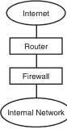

典型的公司防火墙架构很可能在内部和外部网络之外还包含多个附加网络。通常，会创建一个单独的网络来容纳公共访问服务器，例如邮件、DNS、FTP 和 Web 服务器，在防火墙术语中，这个网络通常被称为非军事区或 DMZ 网络。DMZ 网络被配置为允许从互联网对特定公共信息服务器进行有限访问。此外，可能还有一个网络来容纳远程访问服务器和调制解调器池，我们将其称为 RAS 网络。如果您的公司订阅了 Bloomberg 等私人金融服务，您可能需要在防火墙上增加额外的网络分支来支持这些服务。图 19.2 展示了典型的公司网络防火墙架构。

**图 19.2**  
典型的公司网络防火墙架构。

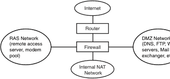

创建这些不同网络的目的是允许对这些不同网络应用不同的安全规则集。


例如，一个安全策略可能如下所示：

- 内网可以不受限制地访问 DMZ 和 Internet 上的所有服务
- Internet 主机：
  - 被拒绝访问私有内部网络
  - 被允许访问 DMZ 邮件交换机的 TCP 端口 25
  - 被允许访问 DMZ DNS 服务器的 UDP 端口 53
  - 被允许访问 DMZ Web 服务器的 TCP 端口 80
  - 被允许访问 DMZ FTP 服务器的 TCP 端口 20 和 21
- 新闻订阅主机被允许访问 DMZ 新闻服务器的端口 119
- DMZ 主机具有以下权限：
  - DMZ 邮件交换机被允许访问内部邮件服务器的 TCP 端口 25
  - DMZ DNS 服务器被允许访问内部 DNS 服务器的 UDP 端口 53
- RAS 网络由 RAS 服务器组成，这些服务器使用主叫号码识别验证，并允许来自授权员工家庭电话的经过身份验证的拨号访问。RAS 网络中的调制解调器池仅允许使用回拨到授权员工家庭电话的方式进行拨号访问。身份验证在一台 RADIUS 服务器上完成。RAS 具有以下权限：
  - 远程访问服务器被允许在相应端口上访问 RADIUS 服务器
  - RAS 网络被允许访问内部邮件服务器。
  - RAS 网络被允许通过 Telnet 访问特定内部主机

> **警告**
>
> 许多站点允许拨号访问位于站点各处不同位置的调制解调器。这是一个潜在的后门，会使防火墙提供的所有保护失效。提供拨号访问的一种正确方式是将拨号服务器放置在防火墙之外，并像对待任何其他入站连接一样对其应用安全规则。除了密码认证之外，还必须使用主叫号码识别验证和回拨到授权号码，才能提供安全的拨号访问。

> **注意**
>
> 此安全方案仅仅是一个建议性指南。您必须确定符合组织需求的安全策略，并设计自己的防火墙规则。

#### 设置 Linux 防火墙

在接下来的章节中，我们将介绍如何编译、安装和配置一个 Linux 防火墙系统，该系统使用 IPCHAINS 进行 IP 数据包过滤，并使用 IP 伪装来提供一个安全的私有 NAT 网络。

> **注意**
>
> 本章中的示例基于 Linux 2.2.14 版本。请勿使用早于 2.2.11 的内核源代码版本。早于 2.2.11 的内核存在 IPCHAINS 分片缺陷。

要配置内核以实现防火墙功能，其中包括使用 IPCHAINS 进行 IP 数据包过滤以及使用 IP 伪装进行网络地址转换，必须启用以下选项：

- **CONFIG_EXPERIMENTAL**—该选项允许内核创建伪装模块，并启用端口转发选项。
- **CONFIG_MODULES**—该选项允许加载内核 IP 伪装模块。
- **CONFIG_NET**—该选项启用网络子系统。
- **CONFIG_PACKET**—该选项允许使用 tcpdump 来调试 IP 伪装问题。
- **CONFIG_NETLINK**—该选项允许记录防火墙命中日志。
- **CONFIG_FIREWALL**—该选项启用 IPCHAINS 防火墙工具。
- **CONFIG_INET**—该选项启用 TCP/IP 协议。
- **CONFIG_IP_ROUTE_VERBOSE**—如果您希望在路由器上丢弃 IP 欺骗数据包，该选项非常有用。
- **CONFIG_IP_FIREWALL**—该选项启用防火墙功能。
- **CONFIG_IP_FIREWALL_NETLINK**—该选项增强防火墙命中日志记录。
- **CONFIG_IP_ALWAYS_DEFRAG**—该选项是启用 IP 伪装或透明代理功能所必需的，并且还能优化 IP 伪装连接。
- **CONFIG_IP_MASQUERADE**—该选项启用 IP 伪装，将内部 TCP/IP 数据包重新寻址为外部数据包。
- **CONFIG_IP_MASQUERADE_ICMP**—该选项启用对 ICMP ping 数据包的支持，这对故障排除很有用。
- **CONFIG_IP_MASQUERADE_MOD**—该选项使得可以启用 TCP/IP 端口转发，从而允许外部计算机直接连接到特定的内部伪装系统。
- **CONFIG_IP_MASQUERADE_IPPORTFW**—该选项启用 TCP/IP 端口转发，以允许外部计算机直接连接到特定的内部伪装系统。
- **CONFIG_IP_ROUTER**—该选项为网络子系统优化内核，尽管显著的性能优势尚待记录。
- **CONFIG_SYN_COOKIES**—该选项对基本网络安全很有用。
- **CONFIG_NETDEVICES**—该选项启用 Linux 网络子系统。
- **CONFIG_DUMMY**—该选项在调试问题时很有帮助。
- **CONFIG_PROC_FS**—该选项是启用 Linux 网络转发系统所必需的。

应按照第 11 章“构建 Linux 内核”中的概述，在启用这些选项的情况下编译内核。

内核安装并重新启动系统后，IPCHAINS 和 IP 伪装功能应该可用。可以通过查找文件 `/proc/net/ip_fwchains` 和 `/proc/net/ip_masquerade` 来检查这一点。如果这些文件存在，则说明功能已启用。

##### 使用 IPCHAINS 进行 IP 数据包过滤和 IP 伪装

ipchains 工具用于在内核的数据包过滤部分添加和删除规则。

> **提示**
>
> 在旧版内核（2.0.x 版本）中，使用的是 ipfwdadm 而不是 ipchains。如果您正在运行旧版内核，强烈建议您升级到 2.2.x 版本，而不是使用更新的防火墙代码和 ipchains。

内核有三条内置的规则列表，称为链。它们分别是输入链、输出链和转发链。例如，当一个数据包到达防火墙的外部以太网接口时，内核会使用一条特殊的链来决定如何处理该数据包。如果根据该链中的规则允许其通过，内核就会路由该数据包。如果数据包是发往另一台机器的，内核在转发之前会查阅转发链。最后，当数据包准备发送出去时，内核会查阅输出链。

链是规则的列表。每条规则相当于一个 if-then 语句。规则的 if 部分尝试将数据包头部与指定条件进行匹配。如果规则的 if 部分匹配，则应用规则的 then 部分。如果不匹配，则由链中的下一条规则检查该数据包。最后，在应用完链中的所有规则后，内核会查询链策略来决定数据包的最终处理。最终处理通常是允许或拒绝该数据包。

除了使用内核内置的链之外，您还可以定义自己的链。内置链（input、output 和 forward）无法删除。

ipchains 命令接受多个标志。表 19.2 提供了 ipchains 标志的简要说明。有关 ipchains 命令的完整详细信息，请运行 `man ipchains` 参考在线手册页。

**表 19.2 *ipchains* 命令的标志**

| 标志 | 描述 |
|---|---|
| `-N` | 创建一个新链 |
| `-X` | 删除一个空链 |
| `-L` | 列出链中的规则 |
| `-F` | 清空链中的规则 |
| `-Z` | 将链中所有规则的数据包和字节计数器归零 |
| `-A` | 向链中追加一条新规则 |
| `-I` | 在链中的某个位置插入一条规则 |
| `-R` | 替换链中某个位置的规则 |
| `-D` | 删除链中某个位置的规则 |
| `-M -L` | 列出当前被伪装的连接 |
| `-M -S` | 设置伪装超时值 |
| `-C` | 根据所选链检查数据包 |
| `-s [!] <address>/<mask>` | 指定源 IP 地址/掩码 |
| `-d [!] <address>/<mask>` | 指定目标 IP 地址/掩码 |
| `-p [!] <protocol>` | 指定协议 |
| `-j` | 指定要跳转到的目标 |
| `-i` | 网络接口的名称 |
| `[!] -f` | 规则仅适用于分片数据包的第二个或后续分片 |
| `-b` | 双向——规则匹配两个方向的 IP 数据包 |
| `-v` | 详细输出 |
| `-n` | 以数字格式打印 IP 地址和端口号 |
| `-l` | 启用匹配数据包的内核日志记录 |
| `-o <maxsize>` | 将匹配的数据包复制到用户空间设备 |
| `-m <markvalue>` | 标记匹配的数据包 |
| `-t <mask>` | 用于修改 TOS 字段的掩码 |
| `-x -L` | 显示数据包计数器和字节计数器的精确值 |
| `[!] -y` | 仅匹配设置了 SYN 位的数据包 |


#### 添加规则

可以使用 `-A`（追加）、`-I`（插入）和 `-R`（替换）选项为 ipchains 命令添加规则。规则指定了数据包必须满足的一组条件。例如，要拒绝所有来自 IP 地址 `10.0.0.1` 的 ping 数据包，请将以下规则添加到输入链中：

```bash
# ipchains -A input -s 10.0.0.1 -p icmp -j DENY
```

您可以通过如下方式列出输入链中的规则，来验证该规则已添加到输入链中：

```text
# ipchains -n -L input
Chain input (policy ACCEPT):
target     prot opt     source               destination          ports
DENY       icmp - -----  10.0.0.1            0.0.0.0/0             any -> *
```

#### 删除规则

可以通过两种方式删除规则：指定链中的确切规则编号，或指定确切规则。如果我们知道要删除的规则是输入链中的第一条规则，可以使用以下命令将其删除：

```bash
# ipchains -D input 1
```

或者，如果我们知道规则定义，可以用添加规则时相同的方式删除规则，只需将 `-A` 标志替换为 `-D`。例如，以下命令将删除我们之前添加到输入链中的规则：

```bash
# ipchains -D input -s 10.0.0.1 -p icmp -j DENY
```

#### 指定源和目标 IP 地址

规则中可以通过多种方式指定源或目标 IP 地址：

- 作为简单的 IP 地址，如 `10.10.10.1`。
- 作为 IP 地址和网络掩码的组合，如 `10.10.10.1/255.255.255.0`。
- 作为 IP 地址和属于地址网络部分的位数组合，如 `10.10.10.1/24`。

要指定任意及所有 IP 地址，应将地址和网络掩码的组合指定为 `0.0.0.0/0` 或 `0.0.0.0/0.0.0.0`。

#### 指定协议

使用 `-p` 标志将协议指定为名称或数字。当按名称指定协议时，大小写无关紧要；例如 `tcp` 和 `UDP` 表示相同的协议。

#### 指定 UDP 和 TCP 端口

当指定 UDP 或 TCP 协议时，可以传递额外参数来指定 UDP 或 TCP 端口号，或端口号范围。例如，以下命令接受目标为主机 10.10.10.1 的 WWW 端口（即端口 80）的 TCP 数据包：

```bash
# ipchains -A input -p TCP -d 10.10.10.1/24 www -j ACCEPT
```

以下命令使用端口范围来拒绝目标为主机 10.10.10.1、端口在 6000 到 6009 之间的数据包：

```bash
# ipchains -A input -p TCP -d 10.10.10.1/24 6000:6009 -j DENY
```

也可以定义开放式的端口范围，如下面的命令所示，该命令定义了一条规则，拒绝所有目标为任何主机、端口低于 1024 的数据包：

```bash
# ipchains -A input -p TCP -d 0.0.0.0/0 :1023 -j DENY
```

#### 指定反转

许多 ipchains 标志（例如 `-s`、`-d` 和 `-p`）前面可以加上 `!`（非）标志，以反转匹配的含义。例如，在规则中使用 `! 10.10.10.1` 将表示除 10.10.10.1 之外的所有其他 IP 地址。

以下示例允许所有目标 IP 地址（10.10.10.1 除外）的 WWW 流量：

```bash
# ipchains -A input -p TCP -d ! 10.10.10.1 www -j ACCEPT
```

类似地，以下规则允许所有传入流量，但发往所有目标主机的 WWW 流量除外：

```bash
# ipchains -A input -p TCP -d 0.0.0.0/0 ! www -j ACCEPT
```

#### 指定 ICMP 类型和代码

有几种 ICMP 数据包类型用于不同的目的，例如 ping 命令和路由。`ipchains -h icmp` 命令将显示所有 ICMP 类型名称的列表。表 19.3 列出了常用的 ICMP 数据包类型及其各自的名称和代码。

**表 19.3 常用的 ICMP 数据包类型和代码**

| 编号 | 名称 | 所需方 |
|---:|---|---|
| 0 | echo-reply | ping |
| 3 | destination-unreachable | 任何 TCP/UDP 流量 |
| 5 | redirect | 路由 |
| 8 | echo-request | ping |
| 11 | time-exceeded | traceroute |

> **注意**
> 
> `!`（非）标志不能用于 ICMP 名称。

> **提示**
> 
> 不要阻止 ICMP 类型 3 的消息。它们被 TCP 和 UDP 应用程序使用。ICMP 数据包用于指示 TCP 和 UDP 等协议的故障。如果您阻止这些数据包，将永远不会收到“主机不可达”或“无到主机的路由”错误；连接只会一直等待永远不会到来的回复。虽然在大多数情况下这不是致命的，但在排查连接问题时，无法收到这些消息可能会令人恼火并造成困扰。
> 
> ICMP 数据包也用于 MTU 发现。Linux 中的 TCP 实现使用 MTU 发现来计算可以发送到目的地而无需分片的最大数据包大小。分片会降低性能，尤其是当偶尔有分片丢失时。MTU 发现的工作原理是发送设置了“不分片”位的数据包，然后在收到指示“需要分片但设置了 DF”的 ICMP 数据包（`fragmentation-needed`）时发送更小的数据包。这是一种 `destination-unreachable` 数据包，如果从未收到它，本地主机将不会减小 MTU，性能将极其糟糕甚至根本无法工作。

通常阻止所有 ICMP 重定向消息（类型 5），因为这些消息可能被用来操纵路由。然而，良好的 IP 协议栈对此类操纵具有防护措施，因此这通常不被认为是重大风险。

#### 指定接口

要匹配的接口使用 `-i` 选项指定。接口是数据包到达防火墙系统或通过其离开防火墙系统的物理设备。输入链控制传入数据包的接口。输出链和转发链控制传出数据包的接口。

您可以指定当前不存在但预期将来会启用的接口。当该接口启用时，任何现有规则将开始应用于该接口。这对于拨号 PPP 链路非常有用，因为这类接口会定期地出现然后消失。

以 `+` 结尾的接口名称将匹配所有以该字符串开头的接口。例如，`eth+` 选项将匹配所有以太网接口。

`!`（非）标志可以放在接口名称之前，这将匹配除指定接口之外的所有接口。

#### 指定 TCP SYN 数据包

有时您可能希望允许一个方向上的 TCP 连接，而不允许另一个方向上的 TCP 连接。例如，您有一台外部 Web 服务器，希望允许连接到它，但不希望允许从该服务器发起的连接。

这可以通过仅阻止那些用于请求连接的数据包来实现。这些数据包称为 SYN 数据包；它们设置了 SYN 标志，并清除了 FIN 和 ACK 标志。通过仅禁止 SYN 数据包，可以阻止连接尝试。

`-y` 标志用于此目的：它仅适用于 TCP 协议。例如，要拒绝来自 10.10.10.1 的 TCP 连接尝试，可以使用以下命令：

```bash
# ipchains -A input -p TCP -s 10.10.10.1 -y -j DENY
```

`!`（非）标志可以放在 `-y` 选项之前，以匹配除 SYN 数据包之外的所有数据包。

#### 分片数据包

当数据包太大而无法放入单个帧时，它会被分成多个片段，并作为多个数据包发送。这些片段在接收端重新组装以重建完整的数据包。

过滤分片存在困难，因为只有第一个片段包含某些报头信息，例如源端口、目标端口、ICMP 类型、ICMP 代码和 TCP SYN 标志。第二个及后续片段没有这些信息。因此，试图匹配此类信息的过滤规则将在第一个片段上成功，但无法匹配后续片段。通常让后续片段通过是安全的，因为过滤将丢弃第一个片段，没有它，目标主机上的数据包重组将失败。然而，已知存在一些错误，仅通过向系统发送大量分片就能使其崩溃。

如果防火墙机器是到外部网络的唯一连接，则可以在编译内核时启用 `IP: always defragment` 选项。此选项告诉 Linux 内核重新组装所有通过它的分片。这是一个简洁的解决方案。

另一种选择是使用 `-f` 标志在规则中禁止所有分片数据包，如下例所示：

```bash
# ipchains -A output -f -d 10.10.10.1 -j DENY
```

此规则将丢弃任何目标为 10.10.10.1 的分片。

#### 过滤过程

我们已经了解了规则用于匹配数据包的所有不同方式。现在我们考虑当数据包与规则匹配时会发生什么：


- 该规则的字节计数器会增加数据包的大小，包括包头。
- 该规则的数据包计数器会递增。
- 如果规则请求记录日志，则记录该数据包。
- 如果规则请求，则更改数据包的服务类型（Type Of Service）字段。
- 如果规则请求，则标记数据包（仅限 2.2.x 内核）。
- 检查规则的目标，以决定数据包的命运。

目标告诉内核如何处理与规则匹配的数据包。`ipchains` 命令的 `-j` 标志用于指定目标的名称。目标名称长度最多为八个字符，并且区分大小写。

可以指定一条没有目标的规则。这些规则有时称为记账规则，用于统计特定类型的数据包。例如，要统计来自 `10.10.10.1` 的数据包数量，可以按如下方式创建一条新规则：

```text
# ipchains -N mycntr
# ipchains -A mycntr -s 10.10.10.1
# ipchains -A input -j mycntr
```

现在，向 `10.10.10.1` 发送一些测试 ping 数据包，并通过运行带有 `-L`、`-v` 和 `-n` 标志的 ipchains 来检查计数器，如下所示：

```text
# ping -c 5 10.10.10.1
# ipchains -L mycntr -v -n
Chain mycntr (1 references)
pkts bytes target prot opt tos tosx ifname mark outsize source        destination ports
    5   420 -      all  ... 0xFF 0x00 *                  10.10.10.1   0.0.0.0/0  n/a
```

这份报告显示从源 IP `10.10.10.1` 收到了 5 个数据包和 420 字节。`-n` 标志以数字格式显示 IP 地址。

有六个预定义的目标。前三个目标是 ACCEPT、REJECT 和 DENY。ACCEPT 允许数据包通过。DENY 丢弃数据包，就像从未收到过一样。REJECT 丢弃数据包，如果它不是 ICMP 数据包，则向源地址发送一个目标不可达的 ICMP 应答。

目标 MASQ 告诉内核对该数据包进行伪装。要使此功能生效，内核编译时必须启用 IP 伪装。此目标仅对经过转发链（forward chain）的数据包有效。

目标 REDIRECT 告诉内核将数据包发送到本地端口，而不是其原始目的地。这只能用于指定 TCP 或 UDP 作为协议的规则。可选地，可以在 `-j REDIRECT` 后面指定一个端口（名称或数字），这会使数据包被重定向到该特定端口，即使它原本发往另一个端口。此目标仅对经过输入链（input chain）的数据包有效。

最后一个预定义目标是 RETURN，它等同于立即从链的末端离开。

任何其他目标都表示一个用户自定义链。数据包将开始遍历该链中的规则。如果该链没有决定数据包的命运，则遍历将继续当前链中的下一条规则。

为了理解规则如何被遍历，让我们看一个例子。考虑两个链：内建的输入链和一个名为 mycntr 的用户自定义链。

输入链由三条规则组成：

- `-j mycntr`
- `-p TCP -j ACCEPT`
- `-p UDP -j REJECT`

mycntr 链只有一条规则。这是一条指定源地址 `-s 10.10.10.1` 的记账规则。

考虑一个来自 `10.10.10.1` 的 ping 应答数据包。它进入输入链，并与规则 1 进行匹配。它匹配了，并跳转到用户自定义链 mycntr。mycntr 中的规则 1 匹配，但没有指定目标，因此计数器增加，然后它返回到输入链的规则 2。然后它遍历输入链的第二和第三条规则。

#### 日志记录

可以在规则中指定 `-l` 标志，以请求记录匹配的数据包。通常你不会想记录所有数据包，因为那会产生非常大的日志并对性能产生负面影响。然而，能够跟踪异常数据包是一个有用的功能。

例如，要记录来自源地址 `192.115.144.5` 的被拒绝的 ICMP ping 数据包，请使用以下命令：

```text
ipchains -N TEST
ipchains -A TEST -p ICMP -s 192.115.144.5 -l -j REJECT
ipchains -A input -j TEST
ping 192.115.144.5
```

由这些规则记录的一个示例数据包日志如下所示：

```text
Jan 28 22:54:11 linux kernel: Packet log: TEST REJECT eth0 PROTO=1 192.115.144.5 :0 10.2.0.252:0 L=84 S=0x00 I=4153 F=0x4000 T=252 (#1)
```

日志消息可以分解如下：

- **TEST** — 包含与数据包匹配的规则、从而导致日志消息的链。
- **REJECT** — 规则指定的目标。
- **eth0** — 接口名称。因为这是输入链，所以意味着数据包到达了 eth0。
- **PROTO=1** — 这意味着数据包是协议 1。
- **192.115.144.5** — 数据包的源 IP 地址。而 `:0` 表示它是一个 ICMP 回显应答数据包。
- `10.2.0.252` — 目标 IP 地址，而 `:0` 表示请求了一个 ICMP 回显应答。
- `L=84` — 表示数据包长度为 84 字节。
- `S=0x00` — 这是服务类型字段。
- `I=4153` — 这是 IP 标识。
- `F=0x4000` — 这是 16 位分片偏移加上标志。
- `T=252` — 这是数据包的生存时间（Time To Live）。每经过一跳，此值减一，它通常初始为 15 或 255。
- `(#1)` — 这表示 TEST 链中的规则 1 导致了该数据包日志条目。

#### 服务类型

IP 头中有四个称为服务类型（TOS）的位。这些位可以被操作以改变数据包的处理方式。这四个位分别是最小延迟、最大吞吐量、最高可靠性和最低成本。其中只能设置一个位。

TOS 位最常见的用法是将 Telnet 和 FTP 控制连接设置为最小延迟，将 FTP 数据设置为最大吞吐量。可以按如下方式完成：

```sh
# ipchains -A output -p tcp -d 0.0.0.0/0 telnet -t 0x01 0x10
# ipchains -A output -p tcp -d 0.0.0.0/0 ftp -t 0x01 0x01
# ipchains -A output -p tcp -s 0.0.0.0/0 ftp-data -t 0x01 0x08
```

`-t` 标志接受两个参数，均为十六进制。这些参数允许修改 TOS 位：第一个掩码与数据包当前的 TOS 进行 AND 运算，第二个掩码与其进行 XOR 运算。表 19.4 列出了为实现所需结果应使用的合适掩码值。

**表 19.4  服务类型位**

| TOS 名称 | 值 | 典型用途 |
|---|---|---|
| 最小延迟 | 0x01 0x10 | ftp, telnet |
| 最大吞吐量 | 0x01 0x08 | ftp-data |
| 最高可靠性 | 0x01 0x04 | snmp |
| 最低成本 | 0x01 0x02 | nntp |

#### 使用链

用户自定义链可以按任何方式命名，只要名称最大长度为 8 个字符且区分大小写。

使用 `-N` 标志创建新链。例如，要创建名为 `mychain` 的链，请使用以下命令：

```sh
# ipchains -N mychain
```

可以使用 **-X** 标志删除链，如下所示：

```sh
# ipchains -X mychain
```

链必须为空才能被删除。此外，内建的 input、output 和 forward 链不能被删除。

可以使用 **-F** 标志刷新链中的所有规则，如下所示：

```sh
# ipchains -F mychain
```

如果未指定链，则刷新所有链。

可以使用 **-L** 标志列出链，如下所示：

```text
# ipchains -L
Chain input (policy ACCEPT):
target     prot opt source              destination        ports
mycntr     all  ------ anywhere          anywhere           n/a
TEST       all  ------ anywhere          anywhere           n/a
Chain forward (policy ACCEPT):
Chain output (policy ACCEPT):
Chain mycntr (1 references):
target     prot opt source              destination        ports
-          all  ------ bwc.org           anywhere           n/a
Chain TEST (1 references):
target     prot opt source              destination        ports
REJECT     icmp ----  storm.bwc.org      anywhere           any -> any
```

当 **-v** 选项与 **-L** 一起使用时，会显示有关数据包和计数器的更多详细信息。使用 **-n** 选项会显示数字 IP 地址，而不是主机名。

可以使用 **-Z** 标志将计数器重置为零。

##### 设置链策略

每条链都可以有一个策略，作为数据包的默认目标。策略可以是前四个特殊目标中的任意一个：ACCEPT、DENY、REJECT 或 MASQ。MASQ 仅对转发链有效。

#### 使用 IP 伪装进行网络地址转换

IP 伪装是 Linux 中的一项网络功能，它执行许多商业路由器和防火墙中常见的一对多网络地址转换（NAT）功能。伪装增强了网络安全性。它将许多内部主机隐藏在防火墙上的一个 IP 地址后面。这允许内部网络中的主机使用私有网络地址。当这些主机与 Internet 上的主机通信时，不可路由的私有 IP 地址会被 IP 伪装 Linux 内核转换为防火墙的 IP 地址。IP 伪装非常强大且灵活。它具有过滤和记账功能，可以配置以应对复杂的网络拓扑。

Linux IP 伪装不仅执行纯 NAT（即重写 IP 数据包头部），还执行“隐式”NAT（即重写数据包），以满足防火墙后面的 FTP、IRC、quake、RealAudio、CUseeMe、VDO Live 和 Microsoft PPTP 等服务。


IP端口转发是NAT的一种变体，在Linux中已以“端口转发”为名实现。这是针对最新Linux内核中伪装代码的一个补丁，它允许将发往伪装防火墙特定端口的IP流量转发到内部主机。与伪装一样，IP地址会被重写，以便转发传入的IP（TCP和UDP）数据包，而回复数据包也会被重写，使其看起来像是来自防火墙。有关更多详细信息，请参阅本章后面的“IP端口转发”一节。

#### 设置伪装参数

IP伪装标志是 `-M`。它可以与 `-L` 组合以列出当前被伪装的连接，或与 `-S` 组合以设置伪装参数。

`-L` 命令可附带 `-n` 以显示数字而非主机名和端口名，或附带 `-v` 以显示伪装连接的序列号增量。

`-S` 命令后应跟三个超时值，每个以秒为单位：分别针对TCP会话、收到FIN数据包后的TCP会话以及UDP数据包。如果你不想更改其中一个值，直接给0即可。默认值目前分别为15分钟、2分钟和5分钟。

要将默认超时值改为：

- TCP会话超时为2小时（=7200秒）
- 收到TCP FIN数据包后超时为10秒
- UDP流量超时为160秒

可以使用以下 `ipchains` 命令：

```sh
# /sbin/ipchains -M -S 7200 10 160
```

#### 使用 ipchains-save 和 ipchains-restore 保存和恢复已定义的链

使用 `ipchains` 命令定义好防火墙链之后，这些链会被安装在内存中，并在系统重启后丢失。有两个脚本可用于将已定义的 ipchains 保存到文件中，并在启动时将其恢复。

`ipchains-save` 是一个将当前定义的链保存到文件的脚本。`ipchains-save` 可以保存单个链或所有链。如果未指定任何链，则保存所有链。如果使用 `ipchains-save` 时指定了 `-v` 标志，它会在保存链时将规则打印到 STDERR。input、output 和 forward 链的策略也会被保存：

```text
# ipchains-save > firewall-rules
Saving `input'.
Saving `output'.
Saving `forward'.
Saving `mychain'.
```

`ipchains-restore` 恢复已由 `ipchains-save` 保存的链。`ipchains-restore` 有两个标志：`-v` 和 `-f`。`-v` 标志使脚本在添加每条规则时进行描述。如果在输入中发现用户自定义链，`ipchains-restore` 会检查该链是否已存在。若存在，`ipchains-restore` 将提示是刷新链还是跳过恢复该链。为 `ipchains-restore` 指定 `-f` 标志会使用户自定义链被静默刷新，且不会出现提示。要使用此命令，请在标准输入中提供包含已保存链的文件内容：

```text
# ipchains-restore < firewall-rules
Restoring `input'.
Restoring `output'.
Restoring `forward'.
Restoring `mychain1'.
Chain `mychain1' already exists. Skip or flush? [s/f] s
Skipping `mychain1'.
Restoring `mychain2'.
Chain `mychain2' already exists. Skip or flush? [s/f] f
Flushing `mychain2'.
```

#### 综合应用

现在我们将考虑一个实现IP数据包过滤和IP伪装的防火墙完整示例。设置防火墙规则的方法有很多，我们将介绍其中一种。

> **注意**
>
> 这只是一个用于说明典型防火墙规则的示例；你必须根据自己站点的要求进行调整。

我们的示例防火墙网络如图19.3所示。

该示例网络包含一个内部伪装网络、一个非军事区和一个连接到互联网的外部网络。防火墙机器有三个以太网接口连接这三个网络。防火墙机器名为FW。

外部网络将防火墙连接到一台路由器，该路由器通过ISP的路由器连接到互联网。外部网络名为EXT。该网络使用从192.115.144.16到192.115.144.19范围内的四个IP地址。该网络的网络掩码为255.255.255.252。防火墙外部以太网接口（eth0）的IP地址为192.115.144.17/255.255.255.252。

被伪装的内部网络名为PRIV，表示这是一个使用私有IP地址的网络。这是一个使用10.0.0.0/255.0.0.0地址范围的A类私有网络。防火墙上服务于该网络的以太网接口（eth1）的IP地址为10.0.0.1/255.0.0.0。如果你想改用B类或C类私有网络，可以适当调整网络掩码。

公共服务器将位于非军事区。该网络名为DMZ。该网络使用已注册的互联网IP地址。该网络被划分为子网，使用从192.115.144.0到192.115.144.15共16个IP地址。该网络的网络掩码为255.255.255.240。DMZ网络中有四个服务器：

**图 19.3** 防火墙网络。

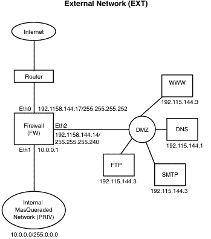

- 一个DNS服务器，IP地址为192.115.144.1/255.255.255.240
- 一个SMTP邮件服务器，IP地址为192.115.144.2/255.255.255.240
- 一个FTP服务器，IP地址为192.115.144.3/255.255.255.240
- 一个WWW服务器，IP地址为192.115.144.4/255.255.255.240

> **注意**
>
> 这里使用的互联网IP地址已在以色列海法的巴哈伊世界中心注册。请确保不要在自己的脚本中尝试使用它们，因为它们无法正常工作。请将DMZ和EXT网络上的IP地址替换为适合你网络的IP地址。

首要任务是记录我们希望在此防火墙上实施的安全策略。防火墙网络各组件的安全目标如下：

- **防火墙机器（FW）：**
  - 保护防火墙机器本身。
  - 保护防火墙机器的网络接口免受IP欺骗。
  - 防火墙机器必须能够ping任何网络。这有助于测试网络连通性。
  - 防火墙机器必须能够对任何网络执行traceroute。这也适用于诊断。
  - 防火墙机器必须能够访问DNS服务器以进行名称查找。
- **DMZ网络：**
  - 名称服务器：
    - 必须响应来自内部网络、外部网络和防火墙机器的DNS查询。
    - 必须允许对外部网络中的辅助DNS服务器进行区域传送。
  - SMTP邮件服务器：
    - 必须允许向外部邮件服务器发送SMTP。
    - 必须接受来自内部和外部邮件服务器及客户端的SMTP。
  - FTP服务器
    - 必须允许来自内部和外部主机的FTP。
  - Web服务器
    - 必须接受来自内部和外部主机的HTTP。
- **内部网络：**
  - 必须允许所有流量到达内部机器。

#### 保护防火墙机器

确保防火墙机器本身不对攻击敞开是极其重要的。必须关闭所有不必要的服务。重命名或删除当前的 `/etc/inetd.conf` 文件，并创建一个新文件，其中只包含如下一行：

```text
telnet stream tcp nowait root /usr/sbin/in.telnetd in.telnetd
```

这仅允许Telnet服务用于防火墙系统的远程管理。如第8章“Linux进程管理与守护进程”所述，在创建新的inetd.conf文件后，向inetd发送SIGHUP信号。

防火墙系统的 `/etc/passwd` 文件和相应的 `/etc/shadow` 文件应包含最必要的账户，如 root、bin、daemon、sync、shutdown、halt 和 operator，以及防火墙管理员的本地账户。该系统不应被用于防火墙管理和操作以外的任何目的。系统不应是NIS域的一部分。

应禁止通过Telnet直接以root身份登录防火墙系统。密码应该是安全的（例如，你可以强制执行一个包含最小密码


长度、不使用字典单词，以及大小写字母与数字和标点符号的组合），并且应频繁更改（甚至每三个月一次）。

防火墙系统上不应运行 X Windows 以及不需要的守护进程，包括 `nfsd`、`named`、`dhcpd`、`atd` 和其他非必要服务。

> **提示**
> 
> 要禁止特定守护进程在运行级别 3 启动，请将当前目录更改为 `/etc/rc.d/rc3.d`，并为要禁用的每个服务将以大写 `S` 开头的链接重命名为小写 `s`。例如，要禁用 NFS，请将 `S60nfs` 重命名为 `s60nfs`。

为了增强安全性，请考虑禁用 Telnet 和 inetd，在防火墙系统上安装 SSH 软件包，并且只从指定的安全主机通过 SSH 进行连接。

SSH（安全外壳）是一种安全的登录程序，即使在互联网上使用也应该是安全的。它使用强加密技术来保护所有传输的数据，包括密码、二进制文件和管理命令。

可以从 `ftp://ftp.cs.huji.fi/pub/ssh` 下载 SSH 软件包。撰写本文时最新的稳定版本是 2.0.13。下载 `ssh-2.0.13.tar.gz`，然后进行配置、编译和安装。阅读软件包附带的 `SSH2.QUICKSTART` 文件。它提供了关于如何构建和安装软件包、生成公钥和私钥、在本地和远程系统上安装密钥，以及编辑 `/etc/ssh/sshd2_config` 文件以仅允许指定主机连接到计算机的说明。最后，请记住创建一个启动脚本，以便在启动时启动 `/usr/local/sbin/sshd`。

> **注意**
> 
> SSH 不是开源软件。它仅用于非商业和教育用途，但不能自由用于任何其他用途或再分发。

#### 防范 IP 欺骗

为了保护防火墙机器以及与其相连的网络免受 IP 欺骗，可以使用内核内置的反欺骗功能为所有接口开启反欺骗。要做到这一点，请运行以下命令：

```sh
# for f in /proc/sys/net/ipv4/conf/*/rp_filter; do echo 1 > $f; done
```

#### 设置过滤规则

在设置过滤规则时，最安全的做法是先拒绝所有流量，直到防火墙规则就位。然后，只有在定义了所有链和规则之后，才允许获准的流量进入你的各个网络。

要拒绝防火墙系统上除环回流量外的所有流量，请使用以下命令：

```bash
# ipchains -A input -i lo -j DENY
# ipchains -A output -i lo -j DENY
# ipchains -A forward -j DENY
```

如果需要加载特定的协议伪装模块，则应接着加载它们。可以使用 depmod 和 modprobe 命令加载各协议模块，如下所示：

```bash
# /sbin/depmod -a
# /sbin/modprobe ip_masq_ftp
# /sbin/modprobe ip_masq_raudio
# /sbin/modprobe ip_masq_irc
# /sbin/modprobe ip_masq_quake ports=26000,27000,27910,27960
# /sbin/modprobe ip_masq_cuseeme
# /sbin/modprobe ip_masq_vdolive
```

> **注意**
> 
> 只需要为你的站点想要支持的协议加载模块。

此时，你必须启用 IP 转发，默认情况下该功能是禁用的。

对于 Red Hat Linux，可以通过将 /etc/sysconfig/network 中的变量 FORWARD_IPV4=false 改为 FORWARD_IPV4=true 来实现。

对于其他 Linux 系统，可以通过执行以下命令将内核参数 ip_forward 的值设置为 1 来实现：

```bash
# echo "1" > /proc/sys/net/ipv4/ip_forward
```

由于我们使用 IP 伪装，最好使用 forward 链进行过滤。我们将根据连接到防火墙机器的三个网络，将 forward 链拆分为各种用户自定义的链。

使用 ipchains -N 创建用户自定义的链。链的名称根据其源网络和目标网络进行选择，如下所示：

```bash
# ipchains -N priv-dmz
# ipchains -N dmz-priv
# ipchains -N ext-dmz
# ipchains -N dmz-ext
# ipchains -N priv-ext
# ipchains -N ext-priv
```

创建这些链之后，必须配置 forward 链以调用这些用户自定义的链。forward 链只知道传出接口；因此，必须检查数据包的源地址以确定数据包来自何处。由于系统已针对 IP 欺骗进行了保护，因此使用源地址而不是传入接口来确定数据包的来源不会有风险。以下规则根据数据包的来源和传出接口将所有传出数据包定向到适当的链：

```text
# ipchains -A forward -s 10.0.0.0/255.0.0.0 -i eth2 -j priv-dmz
# ipchains -A forward -s 10.0.0.0/255.255.255.240 -i eth0 -j priv-ext
# ipchains -A forward -s 192.115.144.0/255.255.255.240 -i eth1 -j dmz-priv
# ipchains -A forward -s 192.115.144.0/255.255.255.240 -i eth0 -j dmz-ext
# ipchains -A forward -i eth2 -j ext-dmz
# ipchains -A forward -i eth1 -j ext-priv
```

虽然不太可能遇到与这六条规则之一不匹配的数据包，但仍应实施以下规则，以记录所有不匹配任一条规则的 ipx 数据包：

```text
# ipchains -A forward -j DENY -l
```

此外，应创建一个链来接受 ICMP 错误，如下所示：

```text
# ipchains -N icmp-err
```

属于错误 ICMP 类型之一的数据包将被接受；否则，控制权将传回调用链。这可以通过以下规则实现：

```text
# ipchains -A icmp-acc -p icmp --icmp-type destination-unreachable -j ACCEPT
# ipchains -A icmp-acc -p icmp --icmp-type source-quench -j ACCEPT
# ipchains -A icmp-acc -p icmp --icmp-type time-exceeded -j ACCEPT
# ipchains -A icmp-acc -p icmp --icmp-type parameter-problem -j ACCEPT
```

##### 定义 priv-dmz 链

priv-dmz 链的设置如下：

```text
# ipchains -A priv-dmz -p udp -d 192.115.144.1 domain -j ACCEPT
# ipchains -A priv-dmz -p tcp -d 192.115.144.1 domain -j ACCEPT
# ipchains -A priv-dmz -p tcp -d 192.115.144.2 smtp -j ACCEPT
# ipchains -A priv-dmz -p tcp -d 192.115.144.3 ftp -j ACCEPT
# ipchains -A priv-dmz -p tcp -d 192.115.144.3 ftp-data -j ACCEPT
# ipchains -A priv-dmz -p tcp -d 192.115.144.4 www -j ACCEPT
# ipchains -A priv-dmz -p icmp -j icmp-err
# ipchains -A priv-dmz -j DENY -l
```

这些规则允许 DNS 连接到 DNS 服务器，SMTP 连接到邮件服务器，FTP 连接到 FTP 服务器，HTTP 连接到 Web 服务器，以及 ping 连接到任何主机。

##### 定义 ext-dmz 链

ext-dmz 链的设置如下：

```text
# ipchains -A ext-dmz -p udp -d 192.115.144.1 domain -j ACCEPT
# ipchains -A ext-dmz -p tcp -d 192.115.144.1 domain -j ACCEPT
# ipchains -A ext-dmz -p tcp -d 192.115.144.2 smtp -j ACCEPT
# ipchains -A ext-dmz -p tcp -d 192.115.144.3 ftp -j ACCEPT
# ipchains -A ext-dmz -p tcp -d 192.115.144.3 ftp-data -j ACCEPT
# ipchains -A ext-dmz -p tcp -d 192.115.144.4 www -j ACCEPT
# ipchains -A ext-dmz -p icmp -j icmp-err
# ipchains -A ext-dmz -j DENY -l
```

这些规则允许 DNS 连接到 DNS 服务器，SMTP 连接到邮件服务器，FTP 连接到 FTP 服务器，HTTP 连接到 Web 服务器，以及 ping 连接到任何主机。

##### 定义 priv-ext 链

priv-ext 链的设置如下：

```text
# ipchains -A priv-ext -j MASQ
```

此规则允许使用 IP 伪装从内部网络到 Internet 的所有连接。

##### 定义 dmz-priv 链

dmz-priv 链的设置如下：

```text
# ipchains -A dmz-priv -p udp -s 192.115.144.1 domain -j ACCEPT
# ipchains -A dmz-priv -p tcp ! -y -s 192.115.144.1 domain -j ACCEPT
# ipchains -A dmz-priv -p tcp ! -y -s 192.115.144.2 smtp -j ACCEPT
# ipchains -A dmz-priv -p tcp ! -y -s 192.115.144.3 ftp -j ACCEPT
# ipchains -A dmz-priv -p tcp ! -y -s 192.115.144.3 ftp-data -j ACCEPT
# ipchains -A dmz-priv -p tcp ! -y -s 192.115.144.4 www -j ACCEPT
# ipchains -A dmz-priv -p icmp -j icmp-acc
# ipchains -A dmz-priv -j DENY
```

这些规则允许从 DMZ 到内部机器的 DNS、MAIL、FTP、Web 和 ping 流量。

##### 定义 dmz-ext 链

dmz-ext 链的设置如下：

```text
# ipchains -A dmz-ext -p udp -s 192.115.144.1 domain -j ACCEPT
# ipchains -A dmz-ext -p tcp -s 192.115.144.1 domain -j ACCEPT
# ipchains -A dmz-ext -p tcp -s 192.115.144.2 smtp -j ACCEPT
# ipchains -A dmz-ext -p tcp -s 192.115.144.3 ftp -j ACCEPT
# ipchains -A dmz-ext -p tcp -s 192.115.144.3 ftp-data -j ACCEPT
# ipchains -A dmz-ext -p tcp ! -y -s 192.115.144.4 www -j ACCEPT
# ipchains -A dmz-ext -p icmp -j icmp-err
# ipchains -A dmz-ext -j DENY -l
```

这些规则允许从 DMZ 到外部网络的 DNS、MAIL、FTP、Web 和 ping 流量。

##### 定义 ext-priv 链

ext-priv 链的设置如下：

```text
# ipchains -A ext-priv -j REJECT
```

此规则不允许任何流量从外部网络（Internet）进入私有内部网络。内部网络使用私有 IP 地址，无法从外部网络向内部网络发送数据包。如果你需要提供从 Internet 到私有内部网络中特定主机的访问，可以使用 IP 端口转发（IPPORTFW）来实现。

#### 创建防火墙链

要过滤进入防火墙主机本身的数据包，你必须在 input 链上进行过滤。这需要为每个目标接口创建一个链，如下所示：

```text
# ipchains -N ext-if
# ipchains -N dmz-if
# ipchains -N priv-if
```


input 链必须配置为使用用户自定义链，如下所示：

```bash
# ipchains -A input -d 192.115.144.17 -j ext-if
# ipchains -A input -d 192.115.144.14 -j dmz-if
# ipchains -A input -d 10.0.0.1 -j priv-if
```

#### 定义 ext-if 链

ext-if 链的设置如下：

```bash
# ipchains -A ext-if -i ! eth0 -j DENY
# ipchains -A ext-if -p TCP --dport 61000:65096 -j ACCEPT
# ipchains -A ext-if -p UDP --dport 61000:65096 -j ACCEPT
# ipchains -A ext-if -p ICMP --icmp-type pong -j ACCEPT
# ipchains -A ext-if -j icmp-err
# ipchains -A ext-if -j DENY
```

这些规则允许来自任何外部网络的 DNS、traceroute 和 ping 连接到防火墙机器。Linux IP 伪装代码使用目标端口 61000 及以上。默认情况下，为此目的保留了 4096 个端口，因此我们得到范围 61000-65096。因此我们制定了规则来接受所有带有这些目标端口的 UDP 和 TCP 数据包。

#### 定义 dmz-if 链

dmz-if 链的设置如下：

```bash
# ipchains -A dmz-if -i ! eth2 -j DENY
# ipchains -A dmz-if -p TCP -s 192.115.144.1 domain -j ACCEPT
# ipchains -A dmz-if -p UDP -s 192.115.144.1 domain -j ACCEPT
# ipchains -A dmz-if -p ICMP --icmp-type pong -j ACCEPT
# ipchains -A dmz-if -j icmp-err
# ipchains -A dmz-if -j DENY
```

这些规则允许来自 DMZ 的 DNS 应答、ping 应答和 ICMP 错误到达防火墙。

#### 定义 priv-if 链

priv-if 链的设置如下：

```bash
# ipchains -A priv-if -i ! eth1 -j DENY
# ipchains -A priv-if -p ICMP --icmp-type ping -j ACCEPT
# ipchains -A priv-if -p ICMP --icmp-type pong -j ACCEPT
# ipchains -A priv-if -j icmp-err
# ipchains -A priv-if -j DENY
```

这些规则允许防火墙的内部接口接收 ping 应答和 traceroute 数据包。

#### 解除 input、output 和 forward 链的阻塞

定义完所有规则后，可以按如下方式移除来自 input、forward 和 output 链的阻塞规则：

```bash
# ipchains -D input 1
# ipchains -D forward 1
# ipchains -D output 1
```


#### 创建防火墙脚本

定义完所有这些规则后，必须创建一个启动脚本 `/etc/rc.d/init.d/firewall`，以便每次启动防火墙系统时重新创建链和规则。必须在 rc3.d 目录中添加一个指向此脚本的链接，如下所示：

```sh
# cd /etc/rc.d/rc3.d
# ln -s /etc/rc.d/init.d/firewall S90firewall
```

> **注意**
> 名称 S90firewall 只是一个示例。请参阅第 4 章“启动与关闭”，其中解释了如何添加启动脚本。

根据本章使用的示例，完整脚本应如下所示：

```sh
#!/bin/bash
PATH=$PATH:/bin:/usr/sbin:/bin:/usr/bin
export PATH
# Set up anti-spoofing
for f in /proc/sys/net/ipv4/conf/*/rp_filter; do echo 1 > $f; done
# Block input, output, and forward chains while firewall \
rules are being installed
iptables -A input -i ! lo -j DENY
iptables -A output -i ! lo -j DENY
iptables -A forward -j DENY
# Load protocol specific special masquerade modules
/sbin/modprobe -a
/sbin/modprobe ip_masq_ftp
/sbin/modprobe ip_masq_raudio
/sbin/modprobe ip_masq_irc
/sbin/modprobe ip_masq_quake ports=26000,27000,27910,27960
/sbin/modprobe ip_masq_cuseeme
/sbin/modprobe ip_masq_vdolive
# Make sure IP source forwarding is turned on
echo "1" > /proc/sys/net/ipv4/ip_forward
# Create user-defined chains
iptables -N prv-dmz
iptables -N dmz-priv
iptables -N ext-dmz
iptables -N priv-ext
iptables -N ext-priv
# Set up the user-defined chains to be called from the forward chain
iptables -A forward -s 10.0.0.0/255.0.0.0 -i eth2 -j priv-dmz
iptables -A forward -s 10.0.0.0/255.0.0.0 -i eth0 -j eth0
iptables -A forward -s 192.115.144.0/255.255.255.240 -i eth1 -j dmz-priv
iptables -A forward -s 192.115.144.0/255.255.255.240 -i eth0 -j ext-dmz
iptables -A forward -i eth2 -j ext-dmz
iptables -A forward -i eth1 -j ext-priv
# Log anything that doesn't match any of these
# This should never happen
iptables -A forward -j DENY -l
```

```bash
# Create a chain to ACCEPT ICMP errors
iptables -N icmp-err
iptables -A icmp-err -p icmp --icmp-type destination-unreachable -j ACCEPT
iptables -A icmp-err -p icmp --icmp-type source-quench -j ACCEPT
iptables -A icmp-err -p icmp --icmp-type time-exceeded -j ACCEPT
iptables -A icmp-err -p icmp --icmp-type parameter-problem -j ACCEPT
# priv-dmz chain
# Allow DNS to DNS server, SMTP to mail server, FTP to FTP server, HTTP
# to Web server, and ping to any host.
iptables -A priv-dmz -p udp -d 192.115.144.1 domain -j ACCEPT
iptables -A priv-dmz -p tcp -d 192.115.144.1 domain -j ACCEPT
iptables -A priv-dmz -p tcp -d 192.115.144.2 smtp -j ACCEPT
iptables -A priv-dmz -p tcp -d 192.115.144.3 ftp -j ACCEPT
iptables -A priv-dmz -p tcp -d 192.115.144.3 ftp-data -j ACCEPT
iptables -A priv-dmz -p tcp -d 192.115.144.4 www -j ACCEPT
iptables -A priv-dmz -p icmp -j icmp-err
iptables -A priv-dmz -j DENY
# ext-dmz chain
# Allow DNS to DNS server, SMTP to mail server, FTP to FTP server, HTTP
# to Web server and ping to any host.
iptables -A ext-dmz -p udp -d 192.115.144.1 domain -j ACCEPT
iptables -A ext-dmz -p tcp -d 192.115.144.1 domain -j ACCEPT
iptables -A ext-dmz -p tcp -d 192.115.144.2 smtp -j ACCEPT
iptables -A ext-dmz -p tcp -d 192.115.144.3 ftp -j ACCEPT
iptables -A ext-dmz -p tcp -d 192.115.144.3 ftp-data -j ACCEPT
iptables -A ext-dmz -p tcp -d 192.115.144.4 www -j ACCEPT
iptables -A ext-dmz -p icmp -j icmp-err
iptables -A ext-dmz -j DENY
# priv-ext chain
# Allow everything from the internal network to the Internet using IP
# masquerading.
iptables -A priv-ext -j MASQ
# dmz-priv chain
# Allow DNS, MAIL, FTP, Web, and ping traffic from the DMZ to the
# internal machines.
iptables -A dmz-priv -p udp -s 192.115.144.1 domain -j ACCEPT
iptables -A dmz-priv -p tcp ! -y -s 192.115.144.1 domain -j ACCEPT
iptables -A dmz-priv -p tcp ! -y -s 192.115.144.2 smtp -j ACCEPT
iptables -A dmz-priv -p tcp ! -y -s 192.115.144.3 ftp -j ACCEPT
iptables -A dmz-priv -p tcp ! -y -s 192.115.144.3 ftp-data -j ACCEPT
iptables -A dmz-priv -p tcp ! -y -s 192.115.144.4 www -j ACCEPT
iptables -A dmz-priv -p icmp -j icmp-err
iptables -A dmz-priv -j DENY -l
# dmz-ext chain
# Allow DNS, MAIL, FTP, Web, and ping traffic from DMZ to external
# network.
iptables -A dmz-ext -p udp -s 192.115.144.1 domain -j ACCEPT
iptables -A dmz-ext -p tcp -s 192.115.144.1 domain -j ACCEPT
iptables -A dmz-ext -p tcp -s 192.115.144.2 smtp -j ACCEPT
iptables -A dmz-ext -p tcp -s 192.115.144.3 ftp -j ACCEPT
iptables -A dmz-ext -p tcp -s 192.115.144.3 ftp-data -j ACCEPT
iptables -A dmz-ext -p tcp -s 192.115.144.4 www -j ACCEPT
iptables -A dmz-ext -p icmp -j icmp-err
iptables -A dmz-ext -j DENY -l
# ext-priv chain
# Reject everything from external to private internal network
iptables -A ext-priv -j REJECT
```

```sh
# Create firewall interface chains
ipchains -N ext-if
ipchains -N dmz-if
ipchains -N priv-if
# Setup input chain to use the user-defined chains
ipchains -A input -d 192.115.144.17 -j ext-if
ipchains -A input -d 192.115.144.14 -j dmz-if
ipchains -A input -d 10.0.0.1 -j priv-if
# ext-if chain
# Allow DNS, traceroute, and ping from any external network to the
# firewall machine.
ipchains -A ext-if -i ! eth0 -j DENY -l
ipchains -A ext-if -p TCP --dport 61000:65096 -j ACCEPT
ipchains -A ext-if -p UDP --dport 61000:65096 -j ACCEPT
ipchains -A ext-if -p ICMP --icmp-type pong -j ACCEPT
ipchains -A ext-if -j icmp-err
ipchains -A ext-if -j DENY
# dmz-if chain
# Allow DNS replies, ping replies and ICMP errors to the firewall from
# the DMZ.
ipchains -A dmz-if -i ! eth2 -j DENY
ipchains -A dmz-if -p TCP ! -y -s 192.115.144.1 domain -j ACCEPT
ipchains -A dmz-if -p UDP -s 192.115.144.1 domain -j ACCEPT
ipchains -A dmz-if -p ICMP --icmp-type pong -j ACCEPT
ipchains -A dmz-if -j icmp-err
ipchains -A dmz-if -j DENY -l
# priv-if chain
# Allow the internal interface of the firewall to receive ping replies
# and traceroute packets.
ipchains -A priv-if -i ! eth1 -j DENY
ipchains -A priv-if -p ICMP --icmp-type ping -j ACCEPT
ipchains -A priv-if -p ICMP --icmp-type pong -j ACCEPT
ipchains -A priv-if -j icmp-err
ipchains -A priv-if -j DENY -l
# Unblock input, output, and forward chains
ipchains -D input 1
ipchains -D forward 1
ipchains -D output 1
```

#### IP 端口转发

如果你必须从 Internet 提供对内部伪装主机的访问，则需要 IP 端口转发。一般来说，最好将需要从 Internet 访问的服务器置于 DMZ 网络中。然而，这并不总是可行的，你可能需要设计一种方法，从外部网络访问内部伪装服务器之一。

在 Linux 内核 2.2.x 上，使用名为 ipmasqadm 的工具可以最好地实现这一点。你还必须在内核编译时选择 IPPORTFW 选项，以使 IP 端口转发功能可用。你可以从 http://juanjox.kernelnotes.org 下载 ipmasqadm-0.4.2.tar.gz 包。


接下来，在 `/usr/src` 目录下解压源代码，并按如下方式编译和安装 `ipmasqadm` 工具：

```
# cd /usr/src
# tar xzvf ipmasqadm-0.4.2.tar.gz
# cd ipmasqadm-0.4.2
# make
# make install
```

这将把 ipmasqadm 工具安装到 /usr/sbin 目录，并将 autofw.so、mfw.so、portfw.so 和 user.so 模块安装到 /usr/lib/ipmasqadm 目录。同时，ipmasqadm 的手册页也会安装到 /usr/man/man8 目录。

IP 端口转发最好通过一个示例来说明。设想你的内部伪装网络中有一台 HTTP 服务器，你希望允许从互联网直接访问它。假设该服务器的 IP 地址为 10.0.0.10，防火墙机器外部接口的 IP 地址为 192.115.144.17。要实现所需的端口转发，你必须在防火墙启动脚本中添加以下命令：

```
# /usr/sbin/ipmasqadm portfw -a
# /usr/sbin/ipmasqadm portfw -a -P tcp -L 192.115.144.17 80 -R 10.0.0.10 80
```

第一个命令用于清空端口转发表。第二个命令添加一条端口转发条目，将到达防火墙外部接口 192.115.144.17 端口 80 的所有流量转发到内部主机 10.0.0.10 的端口 80。

#### 故障排除

在实现基于 Linux 的防火墙时，可能会遇到以下几个常见问题：

- `ipchains -L` 命令挂起。
- DNS 查找有时失败。
- IP 伪装无法工作。
- 4096 条伪装 TCP 和 UDP 连接不够用。

##### ipchains -L 命令挂起

如果 DNS 流量被阻断，`ipchains -L` 命令可能会挂起，因为该命令会尝试通过 DNS 将 IP 地址转换为域名。在命令中添加 `-n` 标志可以禁止名称查找。

或者，你可以放行 UDP 端口 53 和 TCP 端口 53 的流量，从而允许 DNS 流量通过。

##### DNS 查找有时失败

如果只允许 UDP 端口 53 进行 DNS 查询，某些 DNS 查询可能会失败。这是因为 DNS 服务器的某些响应会超过 512 字节，导致客户端使用端口 53 上的 TCP 连接来获取数据。如果要允许 DNS 查找，防火墙应同时放行 UDP 和 TCP 的 53 端口。

##### IP 伪装无法工作

要使 IP 伪装正常工作，必须启用数据包转发。可以通过 `/proc` 文件系统调整内核变量来实现，具体如下：

```bash
# echo 1 > /proc/sys/net/ipv4/ip_forward
```

伪装功能使用 forward 链；如果未启用 `ip_forwarding`，数据包将永远无法到达该链。

> **提示**  
> 在 Red Hat Linux 6.2 中，你可以通过编辑 `/etc/sysconfig/network` 文件并设置 `IP_FORWARDING = Yes` 来启用数据包转发。

##### 4096 条伪装 TCP 和 UDP 连接不够用

Linux 内核将伪装连接数限制为 4096 个 TCP 和 UDP 端口。可以通过调整 `/usr/src/linux/include/net/ip_masq.h` 中 `PORT_MASQ_BEGIN` 和 `PORT_MASQ_END` 常量的值来更改此限制。这两个常量的默认值分别为 61000 和 65096。你可以选择一个合适的目地端口号范围，起始值高于 32768，结束值低于 65536。更改这些值后，必须重新编译内核。如果调整了这些值，别忘了修改你使用 61000-65096 目的端口范围定义的所有防火墙规则。请注意，当你增大内核限制时，内核将使用更多内存。

### 第 20 章：日志管理与分析

本章内容包括

- Linux 中的日志记录活动 432
- syslog 守护进程 433
- 日志轮转 436
- 案例研究：实用脚本 441

#### Linux 中的日志记录活动

Linux 和其他 UNIX 系统提供了一种标准化的机制，用于记录系统中运行的守护进程和程序所产生的系统活动日志。这些日志不仅可用于分析和调试系统问题，还可用于跟踪系统使用情况和安全性。日志有时还能对硬件故障提供提前预警，如果及时加以重视，将有助于提高系统的正常运行时间。所有用户对系统的访问都会被记录，包括失败的登录尝试。

其中最为重要的是超级用户成功登录和获取 root 访问权限失败的日志。此类安全日志可以提醒系统管理员注意恶意用户或黑客可能试图破坏系统安全的行为，并提供一个机会，在实际危害发生之前采取预防措施来阻止此类尝试。如果不幸发生安全入侵事件并在事后才被发现，系统日志仍可提供有价值的线索，帮助了解黑客的目标，并帮助确定系统所遭受的损害程度。然而，一旦系统被入侵，日志很可能已被篡改，无法再被信任。

在 Linux 系统中，所有日志通常都会写入 `/var/log` 目录下的文件和子目录中。当 Linux 系统启动时，会创建多个日志文件，或将日志条目追加到现有日志文件中。这些文件包括 `/var/log/dmesg`、`/var/log/boot.log` 和 `/var/log/messages` 等。`/var/log/messages` 文件记录系统启动和系统守护进程启动期间产生的所有消息。系统会继续向该文件写入其他各种日志消息。在系统启动期间，特定的启动消息会被复制到 dmesg 文件中。这些消息与系统硬件探测、Linux 内核初始化以及驱动程序有关。`boot.log` 文件包含系统守护进程启动消息和文件系统检查器输出的日志。以下 `/var/log/` 目录列表展示了典型 Linux 服务器上的 Linux 日志文件和目录：

```
boot.log        lastlog      messages.2      savacct       spooler.2  xferlog.1
cron            lastlog.1    messages.3      secure        spooler.3  xferlog.2
cron.1          maillog      messages.4      secure.1      spooler.4  xferlog.3
cron.2          maillog.1    netconf.log     secure.2      squid/     xferlog.4
cron.3          maillog.2    netconf.log.1   secure.3      usracct
cron.4          maillog.3    netconf.log.2   secure.4      wtmp
dmesg           maillog.4    news/           sendmail.st   wtmp.1
htmlaccess.log  messages     pacct           spooler       xferlog
httpd/          messages.1   samba/          spooler.1
```

此列表显示了系统生成的各种日志。其中一些文件是系统特有的，而另一些则是应用程序特有的日志文件和目录。例如，boot.log、dmesg、lastlog、messages\*、netconf.log\*、secure\* 和 wtmp\* 是系统特有的日志文件，而 cron、maillog、httpd/\*、news/\*、squid/\*、uucp/\* 和 xferlog 文件则分别由 cron、sendmail、httpd、news、squid、uucp 和 ftp 守护进程生成。系统提供了一个名为 syslogd 的特殊日志守护进程，它允许集中配置日志级别和日志文件的位置。

#### syslog 守护进程

系统日志由名为 syslogd 的 syslog 守护进程生成。syslogd 在系统启动时启动。启动时，它会读取控制 syslogd 行为的配置文件 /etc/syslog.conf。虽然大多数程序使用 syslog 功能来记录消息，但消息并不需要全部记录到同一个文件中。syslog.conf 文件控制日志消息的处理方式。

syslog 配置文件的默认路径是 /etc/syslog.conf。可以通过在调用 syslogd 时使用 -f 标志并跟上 syslog.conf 文件的路径来指定其他路径。该文件包含供 syslog 守护进程使用的路由命令。该文件的语法稍显复杂，因为它设计用于记录许多程序的消息。syslog.conf 文件中的条目具有以下格式：

```
<facility>.<level>  <target>
```

facility 表示产生日志消息的程序类型。例如，Linux 内核使用 facility 类型 kern 来记录内核消息。

syslog 手册页描述了各种 facility 和严重级别。所有 facility 类型的完整列表如表 20.1 所示。

**表 20.1 syslog.conf 文件中的日志 facility 类型**

| Facility | 用途 |
| --- | --- |
| auth | 授权子系统 |
| authpriv | 授权子系统（私有） |
| cron | crond 和 at 守护进程 |
| daemon | 系统守护进程 |
| ftp | FTP 守护进程 |
| kern | 内核 |
| lpr | 打印子系统 |
| mail | 邮件子系统 |
| mark | 由 syslogd 内部生成的时间戳 |
| news | 网络新闻子系统 |
| security | 授权子系统（请改用 auth） |
| syslog | 由 syslogd 内部生成的消息 |
| user | 用户进程 |
| uucp | UUCP 子系统 |
| local0-7 | 保留供本地使用的 facility |
| * | 以上所有类型 |


日志级别表示日志消息被处理所需的最低严重级别。完整的日志级别列表如表20.2所示。

**表20.2  `syslog.conf`文件中的日志级别**

| 日志级别 | 含义 |
|---|---|
| `emerg` | 紧急情况，系统不可用 |
| `alert` | 需要立即采取纠正措施的情况 |
| `crit` | 严重情况 |
| `err` | 其他错误 |
| `warning` | 警告消息 |
| `notice` | 非错误情况，可能需要特殊处理 |
| `info` | 信息性消息 |
| `debug` | 调试级别消息 |
| `none` | 不记录此级别的日志消息 |

目标有几种可能性，包括将日志发送到运行`syslogd`守护进程的远程主机。可能的目标列于表20.3中。

**表20.3  `syslog.conf`文件中的目标**

| 目标 | 描述 |
|---|---|
| `@host` | 将消息转发到指定的主机 |
| `Filename` | 将消息追加到指定的文件 |
| `user,user,...` | 如果用户已登录，则将消息写入用户屏幕 |
| `*` | 写入所有已登录用户的屏幕 |

下面的`syslog.conf`文件说明了如何从这些元素构建条目：

> **注意**
>
> `syslog.conf`文件中的注释以井号（`#`）开头，一直延续到行尾。

> **注意**
>
> 出于参考目的，以下文件中添加了行号，这些行号不是文件的一部分。

```text
01: # Log all kernel messages to the console.
02: kern.*                         /dev/console
03:
04: # Messages of the priority alert will be directed to the operators
05: *.alert                         root,gautam,armand
06:
07: # Log everything of level info or higher, except mail, news, or
08: # private authentication messages in /var/log/messages
09: *.info;mail.none;news.none;authpriv.none    /var/log/messages
10:
11: # Log private authentication messages to /var/log/secure file.
12: # This file has restricted access.
13: authpriv.*                      /var/log/secure
14:
15: # Sitewide sendmail logs are stored in a central loghost machine
16: mail.*                          @localhost
17:
18: # Emergency messages are broadcast to all logged in users
19: *.emerg                         *
20:
21: # Save uucp errors in /var/log/spooler file.
22: uucp                            /var/log/spooler
23:
24: # Save boot messages also to boot.log
25: local7.*                        /var/log/boot.log
26:
27: # Separate news log messages of varying severity in different log files
28: news.=crit                      /var/log/news/news.crit
29: news.=err                       /var/log/news/news.err
30: news.notice                     /var/log/news/news.notice
```

首先需要注意的是，日志消息被分离并定向到不同的文件。这提供了对各个文件的灵活性和控制，并允许应用不同的老化规则。例如，某些日志文件需要保留较长时间，而其他文件可以每天删除。此外，通过不将所有日志消息合并到一个庞大的日志文件中，可以更好地管理日志文件的大小。

按类别对日志文件进行分区也使得在需要时更容易浏览和识别特定消息。如果所有消息都在单个文件中，那么在大批量日志消息中，这种浏览和搜索任务将难以管理。

上面的示例配置文件可分解如下：

- 第2行指示`syslogd`将所有内核消息发送到系统控制台。
- 第5行指定所有系统警报消息都应发送给root用户和其他系统操作员。
- 第9行指定除邮件、新闻或私有认证消息外，所有级别为info或更高的日志消息都应记录在`/var/log/messages`文件中。
- 第13行指示`syslogd`将用户登录认证消息存储在`/var/log/secure`文件中。
- 第16行指定所有邮件日志消息都应发送到名为`loghost`的远程主机。loghost上的`syslog.conf`文件将决定邮件日志的存储位置。例如，将站点中所有机器的sendmail日志消息集中存储在中央日志机器上是很有用的。
- 第28-30行指定新闻程序的特殊日志处理。语法`=level`与更通用的`.level`规范含义不同。通用语法`.level`表示指定级别及更高级别的日志消息应发送到指定目标。使用等号（`=`）时，日志记录仅限于指定的级别。因此，第28行指示`syslogd`仅将新闻程序生成的严重消息记录到`/var/log/news/news.crit`文件中。

#### 更改`syslog.conf`文件

标准Linux发行版附带的示例`syslog.conf`文件可能足以满足您的需求，或者您可能想要自定义它以适合您站点的特定需求。要更改日志记录策略，请编辑`syslog.conf`文件，然后通知`syslogd`重新读取其配置文件。如下命令所示，向`syslogd`发送SIGHUP信号即可完成此操作：

```sh
# kill -HUP `cat /var/run/syslogd.pid`
```

#### 日志轮转

为了使日志保持有用，并防止文件系统被日志文件填满，必须定期轮转它们。日志文件轮转将日志文件大小缩减到可管理的水平，并从系统中清除旧的无用信息，从而重新获得宝贵的磁盘空间。

日志文件可以通过以下两种方式之一进行管理：

- 在Red Hat Linux和其他发行版中，有一个名为`logrotate`的程序可用于轮转。
- 您可以编写自己的简单脚本来删除旧的日志文件并重新启动syslogd。然后可以安排这些脚本从crond运行。

以下示例脚本说明了如何编写自己的日志轮转实用程序来管理`/var/log/messages`日志文件：

```sh
#!/bin/sh
# File: /usr/local/sbin/rotate-messages
# Example script to manage /var/log/messages
# To run from cron once a day
# Keep a week's worth of old logs online
cd /var/log
[ -f messages.5 ] && mv messages.5 messages.6
[ -f messages.4 ] && mv messages.4 messages.5
[ -f messages.3 ] && mv messages.3 messages.4
[ -f messages.2 ] && mv messages.2 messages.3
[ -f messages.1 ] && mv messages.1 messages.2
[ -f messages.0 ] && mv messages.0 messages.1
[ -f messages ] && mv messages messages.0
touch messages
chmod 600 messages
kill -HUP `/var/run/syslogd.pid`
```

将上述脚本保存到文件中，例如`/usr/local/sbin/rotate-messages`，并使用chmod命令使其可执行，如下所示：

```sh
# chmod +x /usr/local/sbin/rotate-messages
```

接下来，在root用户的crontab中添加如下条目，使其每晚运行一次：

```cron
15 3 * * * /usr/local/sbin/rotate-messages
```

> **提示**
>
> 您可以扩展此思路来管理系统上的所有日志文件，创建每月、每周或每日的crontab条目以控制日志文件的老化，并保持适合您站点需求的日志历史级别。

##### logrotate实用程序

logrotate实用程序随多个Linux发行版一起打包，包括Red Hat Linux。如果您的Linux系统没有此实用程序，可以从其中一个Linux发行版站点下载并安装它。logrotate提供了预构建的RPM包。本书编写时的当前版本是logrotate-3.3-1。

logrotate实用程序是一种非常优雅的方式，通过在单个配置文件中编写规范来管理大量日志文件的轮转。logrotate实用程序旨在简化生成大量日志文件的系统上的日志文件管理。logrotate允许自动轮转、压缩、删除和邮寄日志文件。可以指示logrotate按每日、每周或每月的时间间隔管理日志文件，或者在文件超过大小阈值时进行管理。通常，logrotate作为每日任务从root用户的crontab文件中运行。

请考虑以下示例`logrotate.conf`文件。当logrotate运行时，它会读取`/etc/logrotate.conf`文件，该文件类似于以下内容：

```text
01: # File: /etc/logrotate.conf
02: # Description: sample logrotate configuration file
03: # Global options can be overridden by local options
04: weekly
05: rotate 4
06: errors root@some.host
07: compress
08: create
09: # Also read configuration directives in logrotate.d directory,
10: # where rotation instructions for individual applications
11: # are specified
```


```text
12: include /etc/logrotate.d
13: /var/log/messages {
14: rotate 5
15: weekly
16: nocompress
17: postrotate
18:         /sbin/killall -HUP syslogd
19: endscript
20: }
21: /var/log/httpd/access.log {
22: rotate 5
23: mail webmaster@some.host
24: errors webmaster@some.host
25: size=100k
26: postrotate
27:         /sbin/killall -HUP httpd
28: endscript
29: }
30: /var/log/wtmp {
31: monthly
32: create 0664 root utmp
33: rotate 1
34: }
35: /var/log/lastlog {
36: monthly
37: rotate 1
38: }
```
```

> **注意**
>
> 以井号（#）开头的行是注释行，logrotate 程序会忽略这些行。

> **注意**
>
> 以下文件中添加了行号，仅供参考，并非文件的实际内容。

第4至8行设置了全局选项。`weekly` 指令将默认的日志轮转间隔设置为每周一次。`rotate 4` 指令指定保留4个历史文件。`errors` 指令指定将日志处理过程中产生的错误发送给谁。在此示例中，所有错误输出都发送给 `root@some.host`，除非被局部选项覆盖。`compress` 指令指定历史日志在轮转后应进行压缩。

第12行的 `include` 指令指定可能需要从 `/etc/logrotate.d` 目录读取额外的日志轮转配置文件。在某个特定的 Linux 系统上，该目录的内容显示如下：

```text
# ls /etc/logrotate.d
apache  ftpd      mars-nwe.log  samba    slrnpull  syslog
cron    linuxconf mgetty        sendfax  squid     uucp
```

这些文件包含针对特定守护进程的日志轮转指令。使用 Red Hat 的 RPM 包管理器安装的软件包会将日志轮转脚本放置在该目录中。

第13至20行定义了如何处理日志文件 `/var/log/messages`。该日志在删除前将进行五次每周轮转。注意第14行的局部轮转指令覆盖了第5行的全局轮转指令。`nocompress` 局部指令覆盖了全局的 `compress` 指令。这意味着 messages 的历史文件（messages.0、messages.1 等）不会被压缩。`postrotate` 节指定了日志轮转后必须运行的命令。在此例中，向 syslogd 守护进程发送 SIGHUP 信号。该节以 `endscript` 指令结束。

第21至29行定义了 `/var/log/httpd/access.log` 的参数。当日志文件的大小超过 100KB 时，它就会被轮转。该文件会被邮寄到 webmaster@some.host，并保留五个压缩格式的历史版本。如果在处理日志文件时发生任何错误，错误消息会发送到 webmaster@some.host，而不是全局选项中指定的 root@some.host。这是对全局 `errors` 指令的局部覆盖。

第30至38行为 wtmp 和 lastlog 文件设置了轮转选项。这些文件按照每月一次的日程进行轮转，而不是全局指定的每周日程。此外，新的 `/var/log/wtmp` 文件的创建模式被指定为 0644。创建该文件时，其所有者和组将被调整，使其由 root 拥有并属于 utmp 组。这些日志文件将只保留一个历史文件。

logrotate 的状态被写入文件 `/var/lib/logrotate.status`。

logrotate 配置文件可以包含许多指令，上述示例并未涵盖全部。所有 logrotate 指令的完整列表见表20.3。

##### 表20.3 LOGROTATE 指令

| 指令 | 说明 |
|---|---|
| `compress` | 使用 GNU gzip 压缩旧版本的日志文件。 |
| `copytruncate` | 在创建副本后，直接截断原始日志文件，而不是移动旧日志文件并可选地创建一个新文件。当无法告知某个程序关闭其日志文件，因而该程序可能继续向之前的日志文件追加内容时，可以使用此选项。请注意，在复制文件和截断文件之间存在非常短的时间间隔，因此可能会丢失少量日志数据。使用此选项时，`create` 选项不会生效，因为旧日志文件仍保留在原位置。 |
| `create <mode> <owner> <group>` | 在轮转之后、运行 postrotate 脚本之前，立即使用刚轮转的日志文件相同的名称创建日志文件。mode 指定日志文件的模式（如同 chmod 中使用的），owner 指定日志文件的所有者，group 指定日志文件所属的组。如果省略任何日志文件属性，新文件的属性将保持与原始日志文件相同。`nocreate` 选项会覆盖此指令。 |
| `daily` | 每天轮转日志文件。 |
| `delaycompress` | 在下一次轮转周期之前，不压缩上一次的日志文件。此选项仅在与 `compress` 结合使用时有效。当无法告知某个特定程序关闭其日志文件，因而该程序可能在一段时间内继续写入之前的日志文件时，可使用此选项。 |
| `errors address` | 日志文件处理过程中发生的任何错误都会被邮寄到指定的地址。 |
| `ifempty` | 即使日志文件为空也进行轮转，覆盖任何全局的 `notifempty` 选项。`ifempty` 默认启用。 |
| `include file; directory` | 内联包含其他配置文件。如果给出的是目录，则读取该目录中的文件。唯一被忽略的文件是那些非常规文件（如目录和命名管道），以及文件名以 `tabooext` 指令指定的禁忌扩展名结尾的文件。`include` 指令不能出现在日志文件定义内部。 |
| `mail address` | 当日志被轮转并移除时，将其邮寄到指定地址。`nomail` 指令覆盖此指令。 |
| `missingok` | 如果日志文件缺失，则继续处理下一个文件，而不发出错误消息。 |
| `nocopytruncate` | 创建副本后不直接截断原始日志文件。此选项覆盖 `copytruncate` 选项。 |
| `nocreate` | 不创建新的日志文件。此选项覆盖 `create` 选项。 |
| `nodelaycompress` | 不将上一次日志文件的压缩推迟到下一个轮转周期。此选项覆盖 `delaycompress` 选项。 |
| `nomissingok` | 如果日志文件不存在，则发出错误。这是默认行为。 |
| `noolddir` | 日志在其通常所在的同一目录中进行轮转。此选项覆盖 `olddir` 选项。 |
| `notifempty` | 如果日志为空，则不进行轮转。此选项覆盖 `ifempty` 选项。 |
| `olddir <directory>` | 日志被移动到指定目录进行轮转。该目录必须与正在轮转的日志文件位于同一物理设备上。使用此选项时，日志的所有旧版本都会存放在指定目录中。此选项可以被 `noolddir` 选项覆盖。 |
| `postrotate/endscript` | `postrotate` 和 `endscript` 指令必须单独成行。位于两者之间的命令在日志文件轮转后执行。这些定义必须出现在日志文件定义内部。 |
| `prerotate/endscript` | prerotate 和 endscript 指令必须单独成行。位于两者之间的命令在日志文件轮转前执行。这些指令必须出现在日志文件定义内部。 |
| `rotate <number>` | 日志文件在删除或邮寄到 mail 指令指定的地址之前，将进行指定次数的轮转。如果次数为零，旧版本将被删除而不是轮转。 |
| `size <size>` | 当日志文件的大小超过指定的大小（以字节为单位）时进行轮转。大小通过附加 K 或 M 来指定为千字节或兆字节，例如 100K 或 10M。 |
| `tabooext [+] <list>` | tabooext 指令与 include 指令配合使用。使用 tabooext 指令指定的文件名扩展名在 logrotate 扫描包含目录以查找 logrotate 规范文件时会被忽略。如果扩展名列表前有 + 号，则当前禁忌扩展名列表被扩充，否则被替换。启动时，禁忌扩展名列表包含 `.rpmorig`、`.rpmsave`、`v` 和 `~`。 |
| `weekly` | 如果当前星期几小于上次轮转的星期几，或者距离上次轮转已超过一周，则轮转日志文件。这通常等同于在每周的第一天轮转日志，但如果 logrotate 不是每晚运行，则此选项效果更好。 |

#### 案例研究：有用的脚本

有两个脚本可以帮助您监视系统日志中的安全信息：

- `su-report` 检查 `/var/log/messages` 文件，生成过去两天内所有成功的超级用户登录报告，并将报告邮寄给 root。
- `failed-su` 查找过去两天内所有获取超级用户访问权限的失败尝试，生成报告并邮寄给 root。

您应该将这些脚本创建在方便的位置，例如 `/usr/local/bin/`，然后使用以下命令使其可执行：

```sh
# chmod +x /usr/local/bin/su-report
# chmod +x /usr/local/bin/failed-su
```

理想情况下，您应该定期安排这些脚本运行，例如每天运行，方法是在 root 用户的 crontab 文件中添加相关条目，如第7章“调度任务”所述。要将脚本安排为每天凌晨1点运行，请使用以下条目：

```cron
0 1 * * * /usr/local/bin/su-report
0 1 * * * /usr/local/bin/failed-su
```


#### su-report 的源代码

```sh
#!/bin/sh
#
# File: su-report
# Description: Report all successful super user
# Logins during past 2 days to root.
# Runs from cron once every 24 hours
#
# Create an entry in root's crontab as follows:
# 0 12 * * * /usr/local/bin/su-report
PATH=/bin:/usr/bin:/sbin:/usr/sbin:/usr/ucb:/usr/local/bin:.
export PATH
MAILTO=root
progname=`basename $0`
thishost=`hostname`
sureport=/tmp/sureport.$$
# write the header for our logfile
#
cat <<EOF > $sureport
`hostname`: SU report `date`
EOF
#
# Check super user logins over the past 2 days
#
# Print a header line
cat <<EOF >> $sureport
Super user logins reported in /var/log/messages
EOF
today=`date | awk '{printf "%s %s\n", $2, $3}'`
yesterday=`date | awk '{printf "%s %s\n", $2, $3-1}'`
grep "$yesterday" /var/log/messages | grep '(su)' >> $sureport
grep "$today" /var/log/messages | grep '(su)' >> $sureport

Mail -n -s "SU Report: `date`" $MAILTO < $sureport

rm -f $sureport
```

#### failed-su 的源代码

```sh
#!/bin/sh
#
# File: failed-su
# Description: Report all failed attempts to gain super user access
# during past 2 days to root.
# Runs from cron once every 24 hours
#
# Create an entry in root's crontab as follows:
# 0 12 * * * /usr/local/bin/failed-su

PATH=/bin:/usr/bin:/sbin:/usr/sbin:/usr/ucb:/usr/local/bin:.
export PATH
MAILTO=root
progname=`basename $0`
thishost=`hostname`
report=/tmp/failed-su-report.$$
# write the header for our logfile
#
cat <<EOF > $report
`hostname`: Failed SU report: `date`
EOF
#
# Check failed attempts to gain super user access over the past 2 days
#
# Print a header line
cat <<EOF >> $report
Failed super user login attempts reported in /var/log/messages
EOF
today=`date | awk '{printf "%s %s\n", $2, $3}'`
yesterday=`date | awk '{printf "%s %s\n", $2, $3-1}'`
grep "$yesterday" /var/log/messages | grep 'authentication failure' \
    | grep 'su service' >> $report
grep "$today" /var/log/messages | grep 'authentication failure' \
    | grep 'su service' >> $report

Mail -n -s "Failed SU Report: `date`" $MAILTO < $report

rm -f $report
```

## 互联网与内联网

- 21. 使用 Linux 作为内联网服务器 447
- 22. DNS 455
- 23. Apache 与万维网 481
- 24. Linux 数据库服务器 517
- 25. 动态、数据驱动的 Web 站点 545
- 26. 新闻服务 569
- 27. FTP 服务器 591

### 第21章

#### 使用 Linux 作为内联网服务器

在本章中

- 理解内联网 448
- 硬件需求 453

##### 理解内联网

服务器市场是推动 Linux 作为操作系统迅速崛起的主要力量。Linux 已迅速崛起为部署企业内联网的首选平台，仅次于 Windows NT。

从最简单的意义上讲，内联网是一种网络，它利用互联网技术和协议（如 HTTP、FTP 和 SMTP）在封闭的企业网络内分发和共享信息。

通常，内联网使用 Web 浏览器和服务器在网络内共享文档和信息，并使用运行 SMTP 的互联网标准邮件服务器和客户端进行内联网内的电子邮件通信。内联网还可以通过 Lotus Notes 或 Microsoft Exchange 等平台，或通过标准的互联网新闻组技术，提供讨论功能。

此外，通过将 Web 技术与后端数据库集成，企业数据库通常可在各部门之间进行访问。这使得整个组织内的信息访问变得更加简单和高效。

Linux 提供了一个可快速、高效且低成本地部署所有这些技术的平台。该平台包括以下内容：

- **HTTP：** Linux 提供了实现 Web 服务器的理想平台。
- **数据库访问：** Linux 可提供众多免费和商业数据库服务器。即使你选择在其他平台上运行企业数据库，基于 Linux 的 Web 服务器仍然可以为你的内联网提供这些数据库的 Web 浏览器前端。
- **NNTP：** Linux 通过使用互联网标准的 NNTP 协议提供了完整的新闻组系统。众多客户端（包括 Microsoft Outlook 和 Netscape Communicator）都可以访问 NNTP 服务器。
- **SMTP：** Linux 为提供简单邮件传输协议（SMTP）服务提供了一个强大、可扩展的平台。SMTP 是邮件投递的互联网标准，几乎所有邮件客户端（包括 Microsoft Outlook 和 Netscape Communicator）都可以与 SMTP 服务器通信。

##### Linux 作为 Web 服务器

Linux 是 Web 服务器的热门平台。Web 服务器使用超文本传输协议（HTTP）将文档透明地提供给任何支持 HTTP 的客户端。所有 Web 浏览器都是支持 HTTP 的客户端。Web 服务器将在第23章“Apache 与万维网”中详细讨论。HTTP 是一种用于文档投递的无状态协议。一个典型的 HTTP 事务过程如下：

1. 客户端使用 URL 请求文档。
2. 相应的 Web 服务器接收请求并解释 URL，将其映射到系统上的物理文件。
3. Web 服务器检查客户端是否有权限获取该文件。
4. 如果客户端有权接收该文件，服务器将其返回给客户端并终止连接。

除了简单检索静态文件之外，Web 服务器还可用于提供客户端与服务器之间有限程度的交互性。你每天在万维网上都可以看到这种交互性，例如用于提交信息的表单、带有“购物车”的电子商务网站以及互联网搜索引擎。

这种交互性是通过基本 Web 服务器概念的两种扩展类型之一提供的：通用网关接口和服务器应用程序接口。

##### 通用网关接口

通用网关接口（CGI）是在万维网上部署交互式内容的历史最悠久的机制。CGI 是一种简单的机制：

1. 客户端使用 URL 请求一个 CGI 程序。
2. 相应的 Web 服务器接收请求并解释 URL，将其映射到系统上的一个 CGI 脚本。
3. Web 服务器检查客户端是否有权限访问该脚本。
4. 如果客户端有权访问该脚本，服务器将用户提交的表单数据传递给 CGI 脚本，并等待程序运行和返回数据。
5. CGI 程序运行并返回数据（通常为 HTML 形式）给 Web 服务器。
6. Web 服务器将 CGI 程序返回的数据发送给客户端。

尽管 CGI 一直运行良好，但这种在万维网上提供交互式应用程序的方法也出现了一些问题，包括：

- **严重的安全漏洞：** 如果应用程序编写不当，可能会使 Web 服务器面临严重的安全破坏。CGI 脚本作为服务器上的独立程序运行，并带有一切特权以及由此产生的安全风险。编写不当的脚本可能允许攻击者在服务器上运行任意命令。
- **效率低下：** 每次客户端请求 CGI 程序时，Web 服务器都会将该程序作为单独进程启动。如果站点繁忙，则需要在短时间内启动大量新的 CGI 进程。对于 CGI 应用程序的多个请求而言，这是一种效率极低的处理方式。

##### 服务器应用程序接口

应用程序接口（API）为传统的 CGI Web 应用程序编程提供了强大的替代方案。使用 API，开发人员可以编写与 Web 服务器紧密结合的应用程序。通常，基于 API 的应用程序作为 Web 服务器的一部分加载，不需要为每个请求单独创建进程。

通常，基于 API 的应用程序执行与 CGI 程序相同的任务，包括处理从表单提交的数据、根据数据库中存储的数据生成动态 HTML 页面，以及验证信用卡号。关键区别在于，基于 API 的编程通常更高效、更易扩展，使 Web 服务器能够比使用 CGI 应用程序处理更多的并发请求。此外，基于服务器 API 的开发环境通常会缓存对动态页面的请求，从而显著提高性能，而传统 CGI 程序则不会这样做。

API 编程的一个主要缺点是每种 Web 服务器都有自己的 API。将基于 API 的应用程序迁移到新服务器通常需要大量重新编程。通常，为基于 API 的开发环境编写的应用程序仅限于实现该 API 的平台，不能像 Perl CGI-BIN 脚本或 C CGI-BIN 程序那样真正实现多平台。

服务器 API 通常解决了 CGI 脚本的主要安全风险：为服务器 API 环境编写的应用程序不会作为独立进程在服务器上运行。这意味着，当它们编写不当时，破坏系统安全的能力仅局限于服务器 API 自身的权限和安全漏洞。设计良好的服务器 API 环境可以防止编写不当的脚本在服务器上打开不必要的安全漏洞。同样，设计不良的 API 理论上也可能比传统 CGI 应用造成更大的安全风险。

虽然 Web 开发人员可以使用 C 或 C++ 等高级语言直接在 Web 服务器的 API 之上编写应用程序，但更常见的做法是使用基于 API 实现的开发环境来开发 Web 应用程序。通常，这些开发环境实现一种专为 Web 应用程序开发而设计的自定义编程语言。常见的基于 API 的开发环境包括：

- Microsoft 的 Active Server Pages
- Allaire 的 ColdFusion
- TalentSoft 的 Web+
- PHP
- Zope

PHP 是一个免费可用的开发环境，它利用 Apache Web 服务器的 API 进行 Web 服务器集成。关于 PHP 的更多细节将在第25章“动态、数据驱动的 Web 站点”中讨论。

##### 参考资源

关于在互联网上使用 Linux 作为 Web 服务器，有大量有用的信息可供参考。以下是一些很好的起点：


- Linux WWW HOWTO（http://www.linuxdoc.org/HOWTO/WWW-HOWTO.html）
- Apache 网站（http://www.apache.org/）
- Linux.com Web 服务器列表（http://www.linux.com/links/Software/Web_servers/）
- 万维网联盟（http://www.w3.org/）

#### Linux 作为数据库服务器

直到不久以前，Linux 尚未获得广泛认可的领域之一是数据库服务。Linux 长期以来拥有全套免费的关系数据库软件包，包括著名的 PostgreSQL（简称 Postgres）、mSQL 和 MySQL。

然而，自 1998 年以来，这种情况已逐渐改变。大多数主要的商业数据库厂商现在都提供其产品的 Linux 版本，包括 Oracle、Sybase 和 Informix。这使 Linux 进入了可扩展、全面支持的数据库平台领域，并使其成为那些希望将部分或全部后端处理迁移到基于 Linux 的系统的组织的一个可行选择。

以下是 Linux 上一些领先的商业和免费数据库平台：

- **IBM：** IBM 的 DB2 数据库服务器可用于 Linux。它提供 Java 支持，并且据称具有很高的可扩展性。该软件的免费开发与测试版本可从 http://www.software.ibm.com/data/db2/linux 获取。
- **Informix：** Informix 在 Linux 商业数据库平台中排名前五。该公司提供两款 Linux 服务器：Informix SE——一款免费提供的小规模数据库系统；以及 Informix Dynamic Server Linux Edition Suite——一个更强大的数据库环境。完整细节请访问 http://www.informix.com/。
- **Mini SQL：** Mini SQL，简称 mSQL，是 Linux 上最知名、使用最广泛的关系数据库之一。mSQL 最初是共享软件，可免费用于非商业和教育用途；如今已发展为一款价格适中、高效的商业产品，并仍在 http://www.hughes.com.au/ 免费提供非商业和教育用途。
- **MySQL：** MySQL 是一款来自瑞典的关系数据库服务器，可免费用于非 Microsoft 系统。只要服务器不被出售、安装不收费，且软件不包含在商业发行版中，就无需付费。MySQL 以卓越性能著称，可从 http://www.mysql.com/ 下载。
- **PostgreSQL：** PostgreSQL 被认为是 Linux 上以开源许可证提供的最稳健的服务器。PostgreSQL 可从 http://looking-glass.usask.ca/ 下载。
- **Oracle：** Oracle 是顶级数据库厂商，按某些统计口径，它是企业数据库市场的领导者。Oracle 传统上只在商业 Unix 和 Windows NT 系统上提供，现在则提供其旗舰产品 Oracle 8 数据库系统的 Linux 版本。可从 http://platforms.oracle.com/linux/index_lx.htm 获取免费的 30 天试用版。
- **Sybase：** 作为排名前五的数据库厂商之一，Sybase 在 Linux 上免费提供其 Adaptive Server Enterprise（ASE）产品。ASE 几乎不受限制，可用于 Linux 系统上的任何用途。更多信息请访问 http://www.sybase.com/。

有关将 Linux 部署为数据库服务器的详细讨论，请参阅第 24 章“Linux 数据库服务器”。

#### Linux 作为新闻服务器

许多企业内联网的一个常见功能是某种形式的讨论论坛，例如 Microsoft Exchange 或 Lotus Notes 所提供的论坛。互联网标准的 NNTP 协议是互联网上著名的 Usenet 新闻组网络的基础。

新闻组提供非实时讨论。也就是说，用户可以随时发布帖子，然后随时阅读其他帖子，因为帖子会保留在组内供以后阅读和参考。这与聊天系统形成对比，聊天系统要求参与者之间进行实时互动。

在 Linux 系统上，NNTP 服务通过 INN 软件包提供。有关 INN 新闻服务器的安装和管理，请参阅第 26 章“新闻服务”。

#### Linux 作为邮件服务器

邮件服务通常分为两个部分：

- **邮件用户代理（MUA）：** MUA 通常是用户看到的邮件客户端软件，如 Eudora、Pegasus、Pine、Netscape Messenger 或 Outlook Express。
- **邮件传输代理（MTA）：** MTA 是后端服务器系统，为 MUA 提供邮件投递和存储功能。

在互联网术语中，MTA 使用简单邮件传输协议（SMTP）来路由和投递电子邮件。互联网电子邮件系统中的大部分邮件都通过基于 SMTP 的 MTA 进行路由。

在 UNIX 世界（包括 Linux）中，领先的 MTA 是 sendmail。作为占主导地位的 MTA，sendmail 不仅被广泛部署，而且其复杂性和功能也在不断增长，以满足这一庞大用户群的多样化需求。这种复杂程度体现在：大多数邮件管理员从不试图精通 sendmail，而是依赖印刷参考资料。事实上，有整本书专门介绍 sendmail 系统的安装、配置和维护。

许多 Linux 发行版都带有 sendmail 系统。第 16 章“使用 sendmail 的 Linux 邮件服务”更深入地介绍了基于 sendmail 的邮件服务器的安装和实现。除 sendmail 外，Linux 还有其他几种 MTA 可用，它们提供更好的安全性、性能或简化的配置和管理。这些包括：

- **smail：** smail 在 Linux 世界中广泛用作 MTA。对于大多数安装场景，它提供比 sendmail 更简单的配置。
- **qmail：** qmail 专注于安全性，试图解决 sendmail 中众所周知的安全漏洞。qmail 尽量避免隐藏漏洞，并力求提供卓越的投递可靠性，同时将收件箱损坏的可能性降至最低。

#### 硬件需求

要评估内联网的硬件需求，没有简单的方法。这在很大程度上取决于你计划提供的内联网服务数量、用户数量以及他们的使用程度。

尽管如此，以下几点准则仍然适用：

1. 除非你在运行一个极小的内联网，否则你不希望在同一台 Linux 系统上运行多个内联网服务。也就是说，为 Web、数据库、新闻和邮件服务器提供独立的硬件是明智之举。这不仅提供了更好的性能和扩展空间，还消除了单点故障。如果你在没有冗余系统的情况下将所有服务运行在单个系统上，并且系统硬件发生故障，那么所有服务都会失败，而不是只有一个服务失败。
2. 如果你的硬件预算允许，可以通过运行至少两台 Web、数据库、新闻和邮件服务器来实现冗余。对于数据库和新闻服务器，所有服务都可以进行自动数据镜像。多台服务器可以分担负载，当一台服务器发生故障时，另一台可以在你修复或更换故障服务器的同时接管工作。这可以帮助你实现接近 100% 的正常运行时间。
3. 新闻服务器往往有较高的硬件需求。如果你计划建立本地新闻组，并部分订阅互联网新闻组，那么一台单处理器 Pentium 300、配备 256MB 内存和 16GB Ultra Wide SCSI-2 硬盘空间应该就能满足需求。如果你想为内联网用户提供完整的互联网新闻订阅，可能需要高达 4 个 CPU、2GB 内存和 1 TB 磁盘空间。将新闻服务器与其他内联网服务共用是极不明智的。第 26 章将详细讨论新闻服务器。
4. Web 服务器的性能主要取决于可用 RAM，尤其是在 Web 服务器上部署了交互式或数据驱动应用程序的情况下。目标是防止 Web 服务器上发生任何内存交换，因为这会显著影响最终用户的性能体验。快速的 CPU 和网卡很重要，但如果它们的成本意味着可用 RAM 将不够充足，就不应使用。第 23 章将详细讨论 Web 服务器。


-   始终在内网服务器中使用可用的最快磁盘。通常最好的选择是 Ultra-Wide SCSI 2 磁盘。
-   如果你的邮件服务器有大量用户，磁盘空间很容易变得紧张。请确保你有足够的空间来存储邮件队列以及存储在你的邮件服务器上的所有收件箱。第 16 章已详细讨论了邮件服务器。

不同类型内网服务的具体硬件要求将在相关章节中更详细地讨论。

### 第 22 章：DNS

#### 本章内容

- 域名系统 456
- DNS 名称解析 457
- 使用 DNS 进行负载均衡 473
- 保护 DNS 474
- 实用脚本 476
- 故障排查 476

#### 域名系统

Paul Mockapetris 于 1984-85 年编写了 DNS 的原始版本。该系统被称为 JEEVES。Kevin Dunlap 为伯克利的 4.3BSD UNIX 系统编写了后续版本。它被称为 BIND，代表 *伯克利互联网名称域*。自那时起，BIND 软件经历了许多修订。

本章讨论的 BIND 版本是第 8 版，由互联网软件联盟（www.isc.org）编写和维护。BIND 提供域名系统服务。

域名系统是互联网的基本构建块之一。它是一个分布式主机数据库，用于将主机名转换为 IP 地址。它是一个分层的树状结构系统；一个连接世界各地众多网络的庞大网络。

组织通过申请成员资格加入互联网。它们可以加入组织域或地理域。域名树的根是 `.`。在 `.` 之下，有许多*顶级域*（TLD），例如 `.com`、`.org`、`.net`、`.gov`、`.edu`、`.mil`、`.int`，还有诸如 `.au`（澳大利亚）、`.in`（印度）、`.uk`（英国）、`.il`（以色列）、`.us`（美国）等两字母国家代码。

表 22.1 概述了互联网组织域。

**表 22.1 — 互联网组织域**

| 域 | 用途 |
|---|---|
| `.com` | 商业组织 |
| `.org` | 非营利组织 |
| `.edu` | 教育机构 |
| `.gov` | 政府机构 |
| `.net` | 主要网络支持中心 |
| `.mil` | 军事组织 |
| `.int` | 国际组织 |

地理层级为世界上每个国家分配两字母或三字母标识符。你可以在 `ftp://rs.internic.net/netinfo/iso3166-countrycodes` 找到完整的国家代码列表。

*二级域*在层级上位于这些 TLD 之下。这些包括通常由组织控制的域，如 `.sun.com`、`.linux.org` 和 `nasa.gov`，以及其他必须进一步细分以供个别组织使用的二级域，例如 `ac.il`（以色列的教育机构）。

在这些二级域之下，你会找到两种类型的名称：

- 单个主机名，例如 `metallab.unc.edu` 或 `www.cnn.com`。
- 进一步细分出的域，例如 `ca.bahai.org`，它可以分为 `www.ca.bahai.org` 等主机名以及更下层的子域。

DNS 的设计考虑到了分散式管理。域被委派给各个组织。被委派的组织负责维护其域的主机和子域数据。该组织可以更改其域数据，而不必担心父域。父域只保留指向子域名称服务器的指针，并可将查询指向这些服务器。例如，`bahai.org` 域被委派给巴哈伊世界中心。巴哈伊世界中心可以委派 `us.bahai.org` 这样的子域。该子域可以自行维护其数据，而无需打扰 `bahai.org` 的域管理员。`bahai.org` 所要做的只是保留指向 `us.bahai.org` 名称服务器的指针。这就是分散式 DNS 管理的强大与便利之处。

#### DNS 名称解析

DNS 提供了将主机名转换为 IP 地址以及将 IP 地址反向转换为主机名的机制。

名称查找从树的根 `.` 开始，遍历各个分支，直到到达一个叶节点（其中包含主机名）。名称中的每个 `.` 都是一个分支点。当我们查看使用 `nslookup` 工具的示例时，分支点的概念会变得清晰。

将名称转换为 IP 地址的过程称为*名称解析*。DNS 将域中所有主机名称和 IP 地址存储在一组映射中，这些映射称为*区域文件*。

你也可以根据 IP 地址查找名称。此过程称为*反向名称解析*。为此，DNS 使用一个名为 `in-addr.arpa` 的特殊域。我们将在本章后面详细讨论反向查找。

DNS 区域由一组资源记录组成，这些记录定义主机名、管理信息以及其他可以存储在 DNS 数据库中的信息。表 22.2 概述了一些最常用的记录类型。

**表 22.2 — 常见 DNS 记录类型**

| 记录标识符 | 记录名称 | 描述 |
|---|---|---|
| SOA | 起始授权机构 | 标记权威区域的起始。每个区域必须包含且仅包含一条 SOA 记录。 |
| A | 地址 | 定义域中主机名的 IP 地址。 |
| NS | 名称服务器 | 指定域的名称服务器。 |
| MX | 邮件交换器 | 指定处理该域入站电子邮件的邮件交换器。 |
| CNAME | 规范名称 | 指定主机名的别名。 |
| NULL | 空 | 一条不包含格式或数据信息的空记录。 |
| RP | 负责人 | 指定负责该域的人员。 |
| PTR | 指针 | 指定一个指针（通常用于反向名称查找）。 |
| HINFO | 主机信息 | 指定有关主机的信息，例如 CPU 和操作系统类型。 |
| TXT | 文本信息 | 指定主机的文本描述。 |

#### 设置名称服务器

要以最佳方式设置名称服务器，你必须首先明确服务器的用途。特别是，你需要确定该服务器将是互联网上已注册域名的权威名称服务器，还是将在防火墙后面为你的内部域提供私有名称服务。

对于任何域，无论是注册域还是私有内部域，都可以创建两种类型的名称服务器：主服务器和辅助服务器。一个域始终有一个主服务器，并且可以有任意数量的辅助服务器。主服务器是必需的，而辅助服务器是可选的。

主服务器从运行主服务器的系统上存储的区域文件中获取数据，而辅助服务器则从主服务器获取数据。每次辅助服务器启动时，它都会联系主服务器以获取区域数据的副本，此过程称为*区域传送*。这种安排使 DNS 管理员只需编辑主服务器上的文件，并允许更改自动传播到该域的其他 DNS 服务器。

> **注意：** 由于维护辅助主名称服务器很简单，建议你至少维护一个。这样，当主名称服务器宕机时可以提供冗余，并且在主名称服务器一段时间内处于高负载时可用于负载均衡。

##### 主名称服务器配置（对已注册域具有权威性）

为已注册的互联网域设置主名称服务器涉及三个步骤：

1. 创建 `named.conf` 文件。
2. 创建区域文件。
3. 启动 `named`。

为了本节示例的需要，我们将为虚构的 `foo.edu` 域创建一个主名称服务器。

> **提示：** 此外，要使名称解析器正常工作，你必须创建 `/etc/resolv.conf` 文件。在某些系统（如 Linux 或 Solaris）上，你可能还需要修改名称服务器切换文件（`/etc/nsswitch.conf`）。

> **注意：** 自 BIND 第 8 版起，named 配置文件的格式已完全改变。早期版本的 BIND 使用名为 `named.boot` 的文件，其格式与当前的 `named.conf` 文件不同。有一个 shell 脚本可用于将 BIND 版本 4 的 `named.boot` 文件转换为新的 `named.conf` 格式。该脚本名为 `named-bootconf`，如何获取它将在本章末尾提及。

##### 创建 named.conf 文件

> **注意：** 在这些示例中，我们为虚构的 `foo.edu` 域创建名称服务器。你必须用你自己的域名替换该域。此外，即使在为外部服务器提供示例时，这些示例也使用私有 IP 地址。这样可防止你在不更改 IP 地址的情况下尝试在服务器上使用这些文件时出现问题。

`foo.edu` 域的主服务器的 `named.conf` 文件如下：

```
// File: /etc/named.conf
// Primary Name Server for foo.edu
//
options {
    directory "/var/named";
};
zone "." {
    type hint;
    file "root.hints";
};
```

```conf
zone "foo.edu" {
        type master;
        file "zone.foo.edu";
};
zone "1.168.192.in-addr.arpa" {
        type master;
        file "zone.192.168.1";
};
zone "0.0.127.in-addr.arpa" {
        type master;
        file "zone.127.0.0";
};
```

> **注意** 以 `//` 开头的行是注释。

该文件包含一个 options 部分，后面是几个 zone 部分。options 部分包含一条指令，它定义了 named 查找 named.conf 文件中引用的所有其他配置文件所在的目录：

directory "/var/named";

每个 zone 部分定义了服务器所服务的区域、区域的类型以及相关文件的位置。该文件包含了三个区域的信息：

- `.`：这是一个 hint 类型区域。它指示服务器应在何处查找用于开始解析名称的初始名称服务器集，这些名称不属于该服务器作为主服务器的区域。在本例中，文件 `root.hints` 位于目录 `/var/named` 中。该文件的内容由 FTP 服务器 `rs.internic.net` 提供，并会定期更新。下面显示了一个典型的 `root.hints` 文件：

    ```text
    ; root.hints
    ;
    .                  6D IN NS     G.ROOT-SERVERS.NET.
    .                  6D IN NS     J.ROOT-SERVERS.NET.
    .                  6D IN NS     K.ROOT-SERVERS.NET.
    .                  6D IN NS     L.ROOT-SERVERS.NET.
    .                  6D IN NS     M.ROOT-SERVERS.NET.
    .                  6D IN NS     A.ROOT-SERVERS.NET.
    .                  6D IN NS     H.ROOT-SERVERS.NET.
    .                  6D IN NS     B.ROOT-SERVERS.NET.
    .                  6D IN NS     C.ROOT-SERVERS.NET.
    .                  6D IN NS     D.ROOT-SERVERS.NET.
    .                  6D IN NS     E.ROOT-SERVERS.NET.
    .                  6D IN NS     I.ROOT-SERVERS.NET.
    .                  6D IN NS     F.ROOT-SERVERS.NET.
    G.ROOT-SERVERS.NET.   5w6d16h IN A  192.112.36.4
    J.ROOT-SERVERS.NET.   5w6d16h IN A  198.41.0.10
    K.ROOT-SERVERS.NET.   5w6d16h IN A  193.0.14.129
    L.ROOT-SERVERS.NET.   5w6d16h IN A  198.32.64.12
    M.ROOT-SERVERS.NET.   5w6d16h IN A  202.12.27.33
    A.ROOT-SERVERS.NET.   5w6d16h IN A  198.41.0.4
    H.ROOT-SERVERS.NET.   5w6d16h IN A  128.63.2.53
    B.ROOT-SERVERS.NET.   5w6d16h IN A  128.9.0.107
    C.ROOT-SERVERS.NET.   5w6d16h IN A  192.33.4.12
    D.ROOT-SERVERS.NET.   5w6d16h IN A  128.8.10.90
    E.ROOT-SERVERS.NET.   5w6d16h IN A  192.203.230.10
    F.ROOT-SERVERS.NET.   5w6d16h IN A  192.5.5.241
    I.ROOT-SERVERS.NET.   5w6d16h IN A  192.36.148.17
    ```

- **foo.edu:** 这是 foo.edu 域的主区域（master zone）。它表示该名称服务器是 foo.edu 域的主主服务器（primary master），并且可以在文件 `/var/named/zone.foo.edu` 中找到区域定义。
- **1.168.192.in-addr.arpa:** 这是 foo.edu 域反向名称查找的主区域。区域信息包含在文件 `/var/named/zone.192.168.1` 中，并指定了与特定 IP 地址对应的主机名。
- **0.0.127.in-addr.arpa:** 这表示该服务器是本地回环网络 127.0.0 反向名称查找的主主服务器。该信息与 Internet 无关，但它允许对本地系统进行反向名称查找。区域信息存储在文件 `/var/named/zone.127.0.0` 中。

#### 创建区域文件

配置好 named.conf 之后，你必须创建配置中指示的区域文件。具体来说，必须在目录 /var/named 中创建三个文件：zone.foo.edu、zone.192.168.1 和 zone.127.0.0。

foo.edu 域的区域文件（zone.foo.edu）演示了 Internet 注册域名在主主服务器上的典型区域文件：

```text
; zone.foo.edu file
;
@       IN      SOA     fake.foo.edu.    hostmaster.foo.edu. (
                                1999042800      ;Serial
                                8H              ;Refresh
                                2H              ;Retry
                                1W              ;Expire
                                1D              ;Minimum
;
; Name-servers
;
                IN      NS      fake.foo.edu.
;
; Addresses for canonical names
;
fake            IN      A       192.168.1.1
pinky           IN      A       192.168.1.2
brain           IN      A       192.168.1.3
www             IN      CNAME   brain.foo.edu.
;
; Mail exchangers
;
foo.edu.        IN      MX      10 mail.foo.edu.
foo.edu.    IN    MX    20 mail2.foo.edu.
mail        IN    A     192.168.1.4
mail2       IN    A     192.168.1.5
```

> **提示**
> 在 DNS 区域文件中，注释从分号 (;) 到行尾结束，named 会将其忽略。

区域文件中的第一个条目跨越多行：

```text
@        IN     SOA       fake.foo.edu.       hostmaster.foo.edu. (
                              1999042800          ;Serial
                              8H                  ;Refresh
                              2H                  ;Retry
                              1W                  ;Expire
                              1D                  ;Minimum
```

该条目的分解如下：

- **@:** 一个特殊符号，它映射到域名，在本例中为 foo.edu。
- **IN:** 一个特殊符号，代表 Internet。
- **SOA:** 表示这是一个起始授权机构（Start of Authority）记录，每个区域都需要该记录，并且它应该是区域文件中的第一条记录。
- **fake.foo.edu.:** 表示定义 SOA 记录的服务器。通常，这是该域的主主 DNS 服务器的名称，也是承载区域文件的主机。

> **注意**
> 请注意，主机名 `fake.foo.edu.` 末尾包含一个点。区域文件中的所有完全限定主机名都包含末尾的点，这表示该名称是相对于全局根 `.` 域编写的。如果不包含这个点，则假定名称相对于区域文件定义的域。例如，如果省略 `fake.foo.edu.` 中的点，实际上将表示主机名 `fake.foo.edu.foo...`

- **hostmaster.foo.edu.:** 表示 DNS 服务器管理员的电子邮件地址，在本例中为 `hostmaster@foo.edu`。在区域文件中，电子邮件地址中不能使用 `@` 符号，因为它具有前面所述的特殊含义。因此，用点号来代替它。
- **括号内是用逗号分隔的一系列值：** 这些值如下：

    - **序列号：** 表示区域文件的当前修订版本。每次对区域文件进行更改时，它必须至少增加 1，因为该域的辅助名称服务器依赖此号码来决定是否从主名称服务器更新其区域信息。一种常见做法是使用日期作为序列号，格式为 YYYYMMDDNN，其中 YYYY 是年份，MM 是月份，DD 是月中的日期，NN 是当天的特定修订号。这意味着在任意一天内，最多可以对区域文件进行 100 次更改（从 00 到 99）。
    - **刷新值：** 表示辅助名称服务器应多久咨询一次主服务器，以查看是否需要下载更改。通常，此值以秒为单位，但也可以用其他单位指定，例如 8H 表示 8 小时。
    - **重试值：** 表示辅助名称服务器在从主服务器进行区域传输失败后，在再次尝试之前应等待多长时间。通常，此值以秒为单位，但也可以用其他单位指定，例如 2H 表示 2 小时。
    - **过期值：** 表示辅助名称服务器在必须从主服务器刷新其区域信息之前可以使用区域信息的最大时间量。通常，此值以秒为单位，但也可以用其他单位指定，例如 1W 表示 1 周。
    - **最小值：** 表示生存时间（TTL）值。名称服务器必须在缓存中保留来自主服务器的应答至少这段时间，之后才能再次查询同一信息。通常，此值以秒为单位，但也可以用其他单位指定，例如 1D 表示一天。

该区域文件的其余部分包含四种类型的记录：

- NS 记录
- A 记录
- CNAME 记录
- MX 记录

NS 记录指示作为该区域名称服务器的服务器。区域文件可以包含多条记录，指示该域的主服务器和辅助服务器。在本例中，存在一条如下形式的记录：

```text
IN  NS  <host name>
```

> **注意：** 对于属于该区域文件所定义域的任何名称服务器，你都应该拥有 A 记录。如果你使用属于另一个域的备份名称服务器，则区域文件中不需要 A 记录，该记录将出现在另一个域的主名称服务器的区域文件中。

A 记录将域中的默认主机名与 IP 地址关联起来。例如，记录

```text
fake    IN  A   192.168.1.1
```


表示 foo.edu 域中的主机 fake（即主机 fake.foo.edu.）拥有 IP 地址 192.168.1.1。A 记录采用以下形式：

```text
<host name>  IN  A  <IP address>
```

CNAME 记录表示主机名的别名。在此示例中，www 是主机 brain.foo.edu. 的别名：

```text
www    IN  CNAME  brain.foo.edu.
```

这意味着，任何解析 www.foo.edu 的请求实际上都会像针对 brain.foo.edu. 的请求一样被解析。

MX 记录指明该域的邮件交换器的主机名。当邮件消息发送到 foo.edu 域时，投递邮件的邮件服务器会利用此信息来决定将邮件投递到哪个邮件交换器。MX 记录采用以下形式：

```text
<domain>  IN  MX  <preference><host name>
```

优先数字表示尝试投递邮件的顺序：优先数字越低，访问该服务器的优先级就越高。在此示例中，mail.foo.edu 的优先级为 10，mail2.foo.edu 的优先级为 20。这意味着 mail.foo.edu 是主邮件交换器，而 mail2.foo.edu 是备份。如果由于某种原因无法将邮件投递到 mail.foo.edu，则会尝试投递到 mail2.foo.edu。

> **注意**
>
> 对于属于该区域文件所定义域的任何邮件交换器，你都应有相应的 A 记录。如果使用的备份邮件交换器属于另一个域，则无需在该区域文件中添加 A 记录，该记录将出现在另一个域的主名称服务器的区域文件中。

用于 foo.edu 反向名称查找的区域文件 /var/named/zone.192.168.1 与 foo.edu 的区域文件类似，但包含一些不同的记录：

```text
; File: zone.192.168.1
;
1.168.192.in-addr.arpa.  IN  SOA     fake.foo.edu. hostmaster.foo.edu. (
                           1998021700     ;Serial
                           8H             ;Refresh
                           2H             ;Retry
                           1W             ;Expire
                           1D             ;Minimum
                         )
              IN  NS      fake.foo.edu.
1             IN  PTR     fake.foo.edu.
2             IN  PTR     pinky.foo.edu.
3             IN  PTR     brain.foo.edu.
4             IN  PTR     mail.foo.edu.
5             IN  PTR     mail2.foo.edu.
```

与 foo.edu 区域文件一样，该文件包含一个 SOA 记录和至少一个 NS 记录。

此外，它还包含一系列 PTR 记录，这些记录定义了可用于反向名称查找的 IP 地址指针。PTR 记录的形式如下：

```text
<IP address>  IN  PTR  <host name>
```

请注意，IP 地址在指定时没有末尾的点。这使得它们相对于该区域文件提供反向名称查找数据的网络。因此，以下条目：

```text
3  IN  PTR  brain.foo.edu.
```

表示 IP 地址 192.168.1.3 指向主机 brain.foo.edu。

用于本地回环网络的反向名称查找文件 /var/named/127.0.0 与 foo.edu 的反向查找区域类似：

```text
;
; File: zone.127.0.0
@       IN      SOA     fake.foo.edu.        hostmaster.foo.edu. (
                19960101401              ;Serial
                8H                       ;Refresh
                2H                       ;Retry
                1W                       ;Expire
                1D                       ;Minimum
        IN      NS      fake.foo.edu.
1       IN      PTR     localhost.
```

该文件包含一个 SOA 记录、一个或多个 NS 记录以及一个或多个 PTR 记录。

#### 启动 named

现在我们可以启动 named 了。在版本 8 中，引入了一个名为 ndc 的新程序来管理和控制 named，但如果你愿意，仍然可以直接调用 named。不过，ndc 提供了一种简洁的方式来启动、停止和检查 named 的状态。

使用配置文件 /etc/named.conf 以及 /var/named 中定义的区域文件，我们可以通过以下方式使用 ndc 启动 named：

```text
# ndc start
```

启动 named 后，检查 /var/log/messages，确保没有报告错误。如果存在错误，日志条目会让你了解问题所在。你需要修复配置或区域文件中可能出现的任何错误，然后重新启动 named。

启动后，你可以使用以下命令检查 named 的状态：

```text
# ndc status
```

你也可以使用 ndc 命令停止 named：

```text
# ndc stop
```

#### 防火墙后专用网络的主名称服务器

以下是一个位于企业防火墙后的专用网络的主名称服务器的典型 named.conf 文件：

```conf
 // File: /etc/named.conf
 // Primary Name Server for foo.dom
 //              Internal Network
 options {
     directory "/var/named";
     // Uncommenting this might help if you have to go through a
     // firewall and things are not working out:
     fake-iquery yes;
     query-source address * port 53;
     forward first;
     forwarders {
         192.168.1.1
     }
 };
 zone "." {
     type hint;
     file "root.hints";
 };
 zone "foo.dom" {
     type master;
     file "zone.foo.dom";
 };
 zone "10.in-addr.arpa" {
     type master;
     file "zone.10";
 };
 zone "0.0.127.in-addr.arpa" {
     type master;
     file "zone.127.0.0";
 };
```

请注意，此 named.conf 文件与前面用于说明已注册域的主名称服务器的文件之间存在若干差异：

- 在 options 部分中，添加了几个新的指令：

```text
     fake-iquery yes;
     query-source address * port 53;
     forward first;
     forwarders {
         192.168.1.1
     }
```

  fake-iquery 和 query-source 指令在某些防火墙环境中是必需的，它们允许内部 DNS 服务器查询外部 DNS 服务器。forward 和 forwarders 指令表示，对于任何不是此服务器作为主主服务器处理的域的查询，都应转发到 192.168.1.1 进行解析，而不是直接尝试解析这些查询。请求被转发到的服务器将返回对查询的任何响应。

- 已定义了一个 `foo.dom` 域，并带有相关的反向查找区域。该域供专用网络内部使用，目的是利用 DNS 解析内部主机名。`foo.dom` 域不属于标准域名层次结构的一部分，不会影响互联网，也不需要注册。`foo.dom` 域中的名称仅在本地有效，不能用作互联网上的主机名。

可以使用本章前面“创建区域文件”一节中所述的区域和反向查找区域的相同技术来创建区域文件。

完成此操作后，按照前面“启动 named”一节中的说明启动 named。

#### 辅助名称服务器

在了解如何设置主名称服务器之后，为域创建辅助名称服务器就相当简单了。对于辅助服务器，只需要一个 named.conf 文件。当辅助服务器启动时，所有区域文件信息都将从主名称服务器传输过来。

foo.edu 域的辅助名称服务器的 named.conf 文件类似于以下内容：

```conf
// Secondary Name Server for foo.edu
options {
        directory "/var/named";
};
zone "." {
        type hint;
        file "root.hints";
};
zone "0.0.127.in-addr.arpa" {
        type master;
        file "zone.127.0.0";
};
zone "foo.edu" {
        type slave;
        file "zone.foo.edu";
        masters {
                192.168.1.1;
        };
};
zone "1.168.192.in-addr.arpa" {
        type slave;
        file "zone.192.168.1";
        masters {
                192.168.1.1;
        };
};
```

该文件与主主服务器的 named.conf 文件非常相似，不同之处在于某些区域被定义为从区域。对于每个从区域，你都必须指定一个区域文件，以便将下载的信息保存到该文件中。此外，你还需要指定该域的主名称服务器（主服务器）的 IP 地址，辅助服务器可以从该主服务器获取区域信息。

你必须按照前面关于为已注册互联网域创建主名称服务器一节中的说明，为回环网络定义一个区域文件。

在 named.conf 文件、回环网络的区域文件以及 root.hints 文件都就绪后，按照前面“启动 named”一节中的说明启动 named。

#### 解析名称

*解析器* 是库例程，用于在需要解析名称的系统上对 DNS 名称空间执行名称查找。这些通过 `/etc/resolv.conf` 配置。此外，解析名称时搜索不同名称空间（如 DNS 和 NIS）的顺序在 `/etc/nsswitch.conf` 文件中指定。

考虑一下位于专用网络中的企业防火墙后的主机所使用的以下 resolv.conf 文件：

```conf
; File: /etc/resolv.conf
domain foo.dom       ; internal private domain
search foo.dom foo.edu  ; foo.edu is the internet domain
nameserver      10.0.0.1 ; primary for foo.dom
nameserver      10.0.0.2 ; secondary for foo.dom
```

该文件的工作方式如下：

- 注释以分号 (;) 开头，直到行尾结束。
- domain 指令指定主机所属的域。
- search 指令指定一个或多个域，当尝试解析未使用域名完全限定的不完整主机名时，应在这些域中进行搜索。
- nameserver 指令按你应查询的顺序指定名称服务器的 IP 地址。解析名称时，你的系统会查询列出的第一个服务器；如果该服务器不可用或无法响应，系统将继续查询下一个指定的服务器，并依次类推。你可以拥有与名称服务器数量一样多的 nameserver 指令。

根据你的系统配置，你可能需要将 DNS 解析添加到 `/etc/nsswitch.conf` 文件中。例如，假设该文件包含一个类似以下的条目：

```text
hosts: files nis
```

你需要按如下方式将 dns 添加到该行：

```text
hosts: files nis dns
```


这会告诉主机的名称解析库按照以下顺序执行名称解析：首先查阅 `/etc/hosts` 文件，然后检查网络的 DNS 服务器，最后查询你的 DNS 服务器。如果你不运行 NIS，可以按如下方式将其从 `/etc/nsswitch.conf` 文件的列表中移除：

```
hosts: files dns
```

#### 使用 `nslookup` 解析名称

你可以使用 `nslookup` 工具检查主机上的名称解析配置是否正确。该工具会向你已在 `resolv.conf` 中指定的 DNS 服务器查询名称。若要查找特定主机名，请将该主机名作为参数传给 nslookup：

```
$ nslookup www.yahoo.com
Server:  fake.foo.edu
Address:  192.168.1.1

Non-authoritative answer:
Name:    www.yahoo.com
Addresses:  204.71.200.67, 204.71.200.74, 204.71.200.75, 204.71.200.68
          204.71.202.160
```

你还可以以交互方式使用 nslookup：

```
$ nslookup
Default Server:  fake.foo.edu
Address:  192.168.1.1

> www.cnn.com
Default Server:  fake.foo.edu
Address:  192.168.1.1

Name:    www.cnn.com
Address:  207.25.71.20

> www.bahai.org
Default Server:  fake.foo.edu
Address:  192.168.1.1

Name:    www.bahai.org
Address:  207.217.239.32

> cfcomm.juxta.com
Default Server:  fake.foo.edu
Address:  192.168.1.1

Name:    cfcomm.juxta.com
Address:  204.50.107.166

> exit
```

你可以在不指定完整域名的情况下查询本地域中的主机，如下所示：

```
> pinky
Default Server:  fake.foo.edu
Address: 192.168.1.1

Name:    pinky.foo.edu
Address: 192.168.1.2
```

要执行反向名称查找，请向 nslookup 提供 IP 地址，它应返回相应主机名：

```
> 192.168.1.2
Default Server:  fake.foo.edu
Address: 192.168.1.2

Name:    pinky.foo.edu
Address: 192.168.1.2
```

当你查询由 CNAME 记录定义的别名时，它会返回主机的实际名称、别名以及 IP 地址：

```
> www
Server:  fake.foo.edu
Address: 192.168.1.1

Name:    brain.foo.edu
Address: 192.168.1.3
Aliases:  www.foo.edu
```

如果你想从域中获取特定类型的记录（如名称服务器记录），可以使用 set type 命令：

```
> set type=ns
> foo.edu.
Default Server:  fake.foo.edu
Address: 192.168.1.1

foo.edu nameserver = fake.foo.edu
fake.foo.edu    internet address = 192.168.1.1
```

这里的 set type=ns 命令表示你要查找 NS 记录，而对 foo.edu. 域进行查询的结果会返回该域的名称服务器名称和地址。

类似地，你可以使用 set type=mx 检查域的 MX 记录：

```
> set type=mx
> foo.edu.
Default Server:  fake.foo.edu.
Address: 192.168.1.1

foo.edu preference = 10, mail exchanger = mail.foo.edu
foo.edu preference = 20, mail exchanger = mail2.foo.edu
foo.edu nameserver = fake.foo.edu
mail.foo.edu    internet address = 192.168.1.4
mail2.foo.edu   internet address = 192.168.1.5
fake.foo.edu    internet address = 192.168.1.1
```

也可以使用 set type 命令获取域的起始授权机构（SOA）记录：

```
> set type=soa
> foo.org.
Default Server:  fake.foo.edu.
Address:  192.168.1.1
foo.org
        origin = fake.foo.edu
        mail addr = hostmaster.foo.edu
        serial = 1999042800
        refresh = 28800 (8H)
        retry   = 7200 (2H)
        expire  = 604800 (1W)
        minimum ttl = 86400 (1D)
foo.edu name server = fake.foo.edu
fake.foo.edu    internet address = 192.168.1.1
```

> **注意**
>
> 在本节的一些示例中，你会注意到查询响应包含 Non-authoritative answer（非权威应答）指示符。这表示名称服务器的缓存中已有该数据，因此它直接返回这些数据，而不是向所查询域或主机的名称服务器发起查询。

你可以使用 debug 或 d2 选项获取有关查询的额外调试信息：

```
> set d2
> cnn.com.
Server:  bwc.bwc.org
Address:  192.115.144.1

;; res_nmkquery(QUERY, cnn.com, IN, A)
-----------------
Got answer:
        HEADER:
                opcode = QUERY, id = 59442, rcode = NOERROR
                header flags:  response, want recursion, recursion avail.
                questions = 1, answers = 18, authority records = 0, additional = 0
        QUESTIONS:
                cnn.com, type = A, class = IN
        ANSWERS:
        -> cnn.com
                internet address = 207.25.71.199
                ttl = 280 (4m40s)
        -> cnn.com
                internet address = 207.25.71.5
                ttl = 280 (4m40s)
        -> cnn.com
                internet address = 207.25.71.6
                ttl = 280 (4m40s)
        -> cnn.com
                internet address = 207.25.71.7
                ttl = 280 (4m40s)
............
        -> cnn.com
                internet address = 207.25.71.82
                ttl = 280 (4m40s)
............
Non-authoritative answer:
Name:    cnn.com
Addresses: 207.25.71.199, 207.25.71.5, 207.25.71.6, 207.25.71.7
          207.25.71.8, 207.25.71.9, 207.25.71.12, 207.25.71.20, 207.25.71.22
          207.25.71.23, 207.25.71.24, 207.25.71.25, 207.25.71.26, 207.25.71.27
          207.25.71.28, 207.25.71.29, 207.25.71.30, 207.25.71.82
```

你可以使用 `nodebug` 选项禁用额外调试信息：

```
> set nodebug
```

要退出 nslookup，请使用 exit 命令：

```
> exit
```

要了解更多有关 nslookup 及其他选项的详细信息，请使用 `man nslookup` 命令查阅 nslookup 手册页。

> **提示**
>
> 另一个有用的 DNS 工具是 `dig`（域名信息探测器，Domain Information Groper），可用于从 DNS 服务器收集信息。要了解有关 `dig` 及使用该工具技巧的详细信息，请使用 `man dig` 命令查阅 `dig` 手册页。

#### DNS 维护

所有 DNS 区域数据的更新和管理都应在主服务器上完成。需要记住的关键是：在区域文件中添加、删除或更改任何资源记录后，务必增大该文件中 SOA 记录的序列号。否则，域的辅助服务器会忽略这些更改，而不会在应该获取新数据时获取这些数据。只要序列号增大，具体的增量大小并不重要；在增加序列号时始终遵循自己的编号方案，就不会有问题。

更改区域文件内容后，你必须向主服务器上的 `named` 发送信号，使其重新读取配置文件。你可以通过向 named 进程发送 `SIGHUP` 信号来实现：

```
# kill -HUP `cat /var/run/named.pid`
```

或者，使用 `ndc` 命令重启 named：

```
# ndc restart
```

> **提示** 每当你重启 named 时，最好使用 nslookup 验证名称服务器的运行情况。或者，你可以检查系统日志文件 `/var/log/messages`，以确保 named 已正确重启。

#### 使用 DNS 进行负载均衡

如“使用 `nslookup` 解析名称”一节中的一些示例所示，单个主机名可以解析到多个 IP 地址。在这种情况下，DNS 服务器在为客户端应用程序解析名称时，会以轮询（round-robin）方式在这些 IP 地址之间轮转。

这种具有多个 IP 地址的轮询方法提供了一种简单机制，可将负载分布到多个并行服务器上。

以本章使用的示例域 foo.edu 为例：你在 www.foo.edu 上有一个访问量很大的网站，该名称是 brain.foo.edu 的别名。为了应对高负载，你需要将此流量分布到三台服务器上，但又希望 www.foo.edu 始终是访问该网站所使用的主机名，而无论哪个物理服务器响应 HTTP 查询。

为此，首先在 zone.foo.edu 文件中为 brain 创建三条 A 记录：

```
; zone.foo.edu    file
;
@       IN      SOA     fake.foo.edu.    hostmaster.foo.edu. (
                                1999042800      ;Serial
                                8H              ;Refresh
                                2H              ;Retry
                                1W              ;Expire
                                1D)             ;Minimum
;
; Name-servers
;
                        IN      NS      fake.foo.edu.
;
; Addresses for canonical names
;
fake                    IN      A       192.168.1.1
pinky                   IN      A       192.168.1.2
brain                   IN      A       192.168.1.3
                        IN      A       192.168.1.4
                        IN      A       192.168.1.5
www                     IN      CNAME   brain.foo.edu.
;
; Mail exchangers
;
foo.edu.                IN      MX      10 mail.foo.edu.
                        IN      MX      20 mail2.foo.edu.
mail                    IN      A       192.168.1.4
mail2                   IN      A       192.168.1.5
```


注意为 host brain 设置的三条 A 记录。重启 named 之后，使用 nslookup 查询 www 或 www.foo.edu 时会报告三个 IP 地址的列表，但每次查询都会轮换它们的顺序：

```text
> www
Default Server:  fake.foo.edu
Address:  192.168.1.1

Name:    brain.foo.edu
Addresses:  192.168.1.3, 192.168.1.5, 192.168.1.4
Aliases:  www.foo.edu

> www
Default Server:  fake.foo.edu
Address:  192.168.1.1

Name:    brain.foo.edu
Addresses:  192.168.1.4, 192.168.1.3, 192.168.1.5
Aliases:  www.foo.edu

> www
Default Server:  fake.foo.edu
Address:  192.168.1.1

Name:    brain.foo.edu
Addresses:  192.168.1.5, 192.168.1.4, 192.168.1.3
Aliases:  www.foo.edu
```

#### 保护 DNS 安全

作为域管理员，你必须时刻警惕安全问题。

> **提示**
>
> 可以考虑加入 CERT 邮件列表，方法是发送邮件至 cert-advisory-request@cert.org。该列表包含新漏洞公告及建议的修复措施。虽然这些安全问题并非特定于 DNS，但它对于你所有的服务器和网络来说都是一个很好的安全信息来源。

BIND 版本 8 相比旧版本提供了一些额外的安全特性，包括：

- 仅允许将区域传输限制到指定的从属服务器
- 限制从辅助服务器的区域传输
- 限制对你的名称服务器的查询

#### 限制区域传输到指定的从属服务器

你可以使用 named.conf 文件 options 段中的 `allow-transfer` 指令，将区域传输限制到指定的从属服务器：

```text
allow-transfer {
    <IP address of secondary 1>;
    <IP address of secondary 2>;
    ...
};
```

这会限制该服务器作为主 DNS 服务器的所有域的区域传输。或者，你也可以在 named.conf 文件的 zone 段中逐区域限制区域传输：

```text
zone "foo.edu" {
    type master;
    file "zone.foo.edu";
    allow-transfer {
        <IP address of secondary 1>;
        <IP address of secondary 2>;
        ...
    };
};
```

将区域传输限制到指定的从属服务器是一个很好的安全措施。这可以防止黑客列出你区域的内容，获取关于你网络的主机统计信息。你让黑客了解到的网络信息越少，你就越安全。

#### 限制从辅助服务器的区域传输

除了限制从主服务器到辅助名称服务器的区域传输之外，你还应该限制从辅助服务器的区域传输。

如果你使用动态更新，请在主服务器上 named.conf 文件的 zone 段中使用 allow-update 指令来限制该域名的动态更新：

```text
zone "foo.edu" {
    type master;
    file "zone.foo.edu";
    allow-update {
        <IP address of updater 1>;
        <IP address of updater 2>;
        ...
    };
};
```

另外，你可以在名称服务器的 options 段中使用 recursion 指令禁用递归，以防止欺骗：

```text
recursion no;
```

#### 限制对你的名称服务器的查询

你可以将对权威区域（即你的服务器作为主服务器或辅助服务器的区域）之外记录的查询，限制在一组受限制的主机中（通常仅为内部网络主机或权威区域中的域名）。要实现这种限制，可以使用访问控制列表（ACL）：在 named.conf 文件中添加一个 acl 段，然后在文件的 options 段中添加 allow-query 指令：

```text
acl internal {
    <network or host address>;
    <network or host address>;
};
options {
    ...
    allow-query {
        ... internal;
    };
};
```

你可以使用标准的 `<network address>/<bits>` 记法来指定主机网络，例如用 10.10.10.0/24 表示 10.10.10.0 C 类网络。

#### 有用的脚本

BIND 版本 8 源码发行版中提供了一个有用的脚本 named-bootconf，用于将版本 4 的 named.boot 文件转换为版本 8 的 named.conf 文件。要获取这个脚本，请从 http://www.isc.org 下载并解压 BIND 源码发行版。

此外，还有其他一些实用工具可以帮助简化 DNS 区域文件的管理，包括：

- **h2n**：一个 Perl 脚本，将主机表（如 `/etc/hosts`）转换为区域数据文件。这个脚本在将网络上现有的基于主机表的名字解析环境迁移到基于 DNS 的解决方案时非常有用。你可以通过匿名 FTP 从 `ftp://ftp.uu.net/published/oreilly/nutshell/dnsbind/dns.tar.Z` 获取 h2n。
- **makezones**：一个 Perl 脚本，从具有特殊语法（用于特殊情形）的特殊文件生成区域文件。该脚本包含在当前版本的 BIND 中，可以通过 FTP 从 `ftp://ftp.uu.net/published/software/programs/DNS/makezones` 获取。

#### 故障排除

DNS 问题通常由 named 配置和区域文件中的细微错误引起。其他 DNS 错误则是由父域和子域管理员之间缺乏沟通造成的。本节列出了一些常见的 DNS 错误，并讨论如何避免它们。

##### 域名缺少末尾点

这个细微的错误可能造成潜在的灾难性后果。在 BIND 中，当域名不以点结尾时，它会被视为相对于当前正在定义的域的相对名称。

例如，如下条目：

```
foo.edu.     IN   NS   fake.foo.edu
```

将产生如下结果：

```
foo.edu.     IN   NS   fake.foo.edu.foo.edu
```

显然这完全不是本意。注意主机名 `fake.foo.edu` 末尾缺少一个点。如果没有末尾的点，该主机名会被视为相对名称，当前域名会被追加到它后面。因此，最终的主机名变成了 `fake.foo.edu.foo.edu`。

在区域文件中定义主机名和域名时，要特别注意末尾的点。始终使用 nslookup 测试你添加到区域文件中的条目，以确保名字解析符合你的预期。

##### 忘记递增 SOA 序列号

这是导致 DNS 错误的一个非常常见的原因。对区域数据做出更改后，你必须记得递增起始授权记录中的序列号。如果序列号没有递增，辅助名称服务器将不会注意到主名称服务器上的区域数据已发生更改，这些更改也不会被辅助服务器下载。

对主名称服务器区域数据所做的任何更改，都必须同时更改 SOA 记录中的序列号。每次对区域文件进行更改时，序列号至少必须递增 1。域的辅助名称服务器会检查该编号，以决定主名称服务器上的区域信息是否已更新。当检测到序列号已递增时，它会从主名称服务器下载更新后的区域文件。每当你更改区域数据时，记得测试辅助名称服务器，以确保它识别到了该更改。辅助名称服务器多久查询一次主服务器以确定是否需要下载更改，取决于 SOA 记录中的刷新值或辅助名称服务器的设置。

如果需要强制立即更新辅助名称服务器上的区域数据，请在该辅助名称服务器上重启 named。当 named 在辅助名称服务器上启动时，它会检查主名称服务器区域文件的序列号，并下载所有已更新区域的新副本。

##### 更改区域数据后忘记向 named 发送信号

有时，在更改 named.conf 文件或区域数据文件后，你会忘记向主名称服务器发送信号。名称服务器将不知道需要加载新数据。结果，你已做的更改将不会生效。

在更改区域数据并向 named 发送重启信号后，检查系统日志以确保名称服务器正确重新初始化非常重要。配置或区域文件中的语法错误可能会阻止 named 启动。还建议运行


使用 `nslookup` 或 `dig` 验证你所做的更改是否符合预期。如果存在细微错误，例如遗漏了结尾的点，`nslookup` 的输出将揭示这一点，你可以迅速修复该错误。

##### 忘记反向 DNS 记录

向区域文件添加新主机时，请记住添加反向 DNS 或 PTR 记录。许多网络应用程序会对 IP 地址进行反向 DNS 查找。缺少反向 DNS 记录的一个常见症状是，执行反向 DNS 查找的客户端应用程序启动非常缓慢。例如，`traceroute` 程序在追踪缺少反向 DNS 记录的主机时运行非常缓慢。

##### 无效的胶水记录

无效胶水记录的一个常见症状是，你可以使用 IP 地址访问另一个域中的主机，但无法使用其域名访问。

此问题通常发生在委派子域中。当委派子域的主或辅助名称服务器的 IP 地址或别名发生变化时，委派子域必须通知父域更改其胶水记录。如果委派子域未将变更通知其父域，父域维护的相关胶水记录将变为无效。

##### DNS 管理员之间缺乏协调

DNS 的分布式管理是其优势。然而，如果父区域和子区域的管理员未能就区域变更进行沟通，这也可能成为其弱点。

由此产生的两个常见错误是失效委派（lame delegation）和缺失委派（missing delegation）。当父域在其区域文件中为委派子域列出一个名称服务器，但该名称服务器完全不知道其被分配的角色时，就会发生*失效委派*。另一方面，*缺失委派*则是相反的情况。此时，父域没有为委派子域列出名称服务器。当组织主服务器的 IP 地址发生更改，而未通知父域将该更改并入其区域数据时，就会发生缺失委派。缺失委派的常见症状是，你域中的主机可以访问 Internet 上的其他主机，但域外的主机却无法访问你的主机。

##### 配置错误的 `resolv.conf` 文件

`resolv.conf` 文件中可能有多种错误悄悄出现。该文件包含组织的域名。此域名会自动附加到任何不完全限定（fully qualified）的主机名上。如果 `resolv.conf` 文件包含错误的域名条目，错误域名会被附加到主机名，导致主机不存在和名称查找失败。

`resolv.conf` 文件列出了名称服务器的 IP 地址。文件中排在最前面的名称服务器会最先被查询。确保 `resolv.conf` 文件中列出的所有名称服务器都可用非常重要。一个不可用的名称服务器条目后面跟着一个可用的名称服务器条目，名称查找仍可工作，但会导致名称查找出现长时间延迟。

检查 `resolv.conf` 文件的内容，确保其中所有信息都是最新且准确的。

##### 过时的 `root.hints` 文件

`root.hints` 文件包含每个域的根服务器的域名和 IP 地址。对 `root.hints` 文件的更改不会自动传播到你的名称服务器。你必须手动更新此文件。可在 `rs.internic.net` 查看更新的根服务器信息。你可以通过运行以下命令从 `rs.internic.net` 获取最新的根服务器信息。

```sh
# dig @rs.internic.net . ns > root.hints.new
```

`dig` 命令的输出被保存到 `root.hints.new` 文件中。将此文件的内容与你当前的 `root.hints` 文件进行比较，如果存在差异，则使用新的 `root.hints` 文件。可以设置一个 cron 作业，每月自动获取一次根服务器信息，安装更新后的信息，重启 named，并通过电子邮件通知管理员更新情况。执行此功能的现成脚本列在 Linux DNS HOWTO 文件中，该文件可在 `/usr/doc/HOWTO` 目录中在线获取。

### 第 23 章 Apache 与万维网

在本章中

- Linux 作为 Web 服务器平台 482
- Apache 作为 Linux HTTP 服务器的角色 482
- 配置 Apache 483
- Apache 模块 499
- 管理 Apache 501
- 使用 Apache 进行虚拟主机托管 502
- 通过日志监控你的 Web 站点 507
- 基本 Web 站点安全 512
- 故障排除 515

#### Linux 作为 Web 服务器平台

随着 Linux 从默默无闻中崛起，并被接受为通用服务器和网络操作系统，它经历了多个阶段，逐渐获得认可，甚至作为特定任务的操作系统而声名显赫。

Linux 最早获得这种显赫地位的领域之一是作为 Web 服务器。作为一个拥有强大 HTTP（超文本传输协议）守护进程的免费操作系统，Linux 非常适合作为低成本的 Web 服务器，而当时 Windows 并不适合这项任务，缺乏必要的工具和健壮性。

这使 Linux 成为许多组织中 Web 服务器的首选平台，包括互联网提供商和大学。

#### Apache 作为 Linux HTTP 服务器的角色

有许多不同的 HTTP 守护进程可用于让 Linux 充当 Web 服务器。其中包括大量免费可用的守护进程和商业服务器，例如 Netscape FastTrack Web 服务器。

在所有这些中，Apache Web 服务器显然是 Linux 事实上的标准 Web 服务器。几乎每个 Linux 发行版都附带 Apache Web 服务器，且 Apache 的开发速度很快。

Apache 是一个免费可用的 Web 服务器，于 1995 年出现，作为当时标准的 NCSA HTTPd 守护进程的替代品，它源于修补 NCSA 守护进程的集体努力。不到一年，Apache 就被评为互联网上排名第一的 Web 服务器，如今它的使用量比所有其他可用 Web 服务器的总和还要广泛。

Apache 作为商业级的参考实现存在，提供了众多领先功能，包括：

- 符合 HTTP 1.1 规范
- 可通过第三方插件模块支持进行配置
- 无需修改即可运行在大多数 UNIX 版本上
- 支持用于认证的 DBM 数据库
- 提供自定义错误消息
- 允许无限数量的别名和重定向
- 支持内容协商
- 支持虚拟主机

#### 配置 Apache

Apache 通过三个文件进行配置：

- **httpd.conf**：此文件是 Apache 的主配置文件，控制 Apache 的运行方式。
- **srm.conf**：此文件用于配置 Apache 提供的资源。
- **access.conf**：此文件用于定义 Apache 所提供资源的访问权限。

> **提示**
> 
> `httpd.conf` 文件是 Apache 唯一必需的配置文件。通常放在 `srm.conf` 和 `access.conf` 中的所有配置指令也可以放在 `httpd.conf` 中，这样你可以在一个地方维护 Apache 配置。尽管当前的 Apache 文档建议将所有指令放在 `httpd.conf` 文件中，而不使用 `srm.conf` 和 `access.conf` 文件，但许多站点仍然采用三文件方法，随 Red Hat 6.2 发行的 Apache 1.3.9 版本仍使用三文件结构来存放 Apache 配置指令。许多管理员发现，将配置拆分为三个文件简化了配置文件的组织，并限制了单个配置文件的大小。

这些文件存储在一个配置目录中，该目录的位置因 Linux 发行版而异。如果你从 `http://www.apache.org/` 下载并安装 Apache 源代码，默认配置目录为 `/usr/local/apache/conf/`。Red Hat Linux 捆绑的 Apache 发行版将其配置文件放在 `/etc/httpd/conf/`。

> **注意**
> 
> Apache 的配置文件可以存储在任何位置，无需存储在默认位置。如本章后面“启动和停止 Apache”一节所述，你可以在启动 Apache 时为配置文件指定备用位置。

所有 Apache 配置文件都是文本文件，可以使用任何标准文本编辑器（如 Emacs）进行编辑。

#### httpd.conf 文件

httpd.conf 是 Apache 使用的主配置文件。它通常位于默认的 Apache 配置目录中（如果使用默认设置从源代码发行版安装 Apache，则为 `/usr/local/apache/conf/httpd.conf`）。


通常，此配置文件定义 Apache 服务器的核心运行参数。该文件由一系列通用格式的指令组成：

```
<Directive Name> <Directive Value>
```

典型的 `httpd.conf` 文件可能包含表 23.1 所列的指令。

#### 表 23.1 常见的 `httpd.conf` 指令

| 指令名称 | 描述 |
|---|---|
| `AddModule` | 指定 Apache 启动时要启用的预编译模块。该模块必须通过 `LoadModule` 指令加载，才能通过 AddModule 指令启用。`httpd.conf` 通常包含多条 AddModule 指令，默认的 `httpd.conf` 包含大量 AddModule 指令，用于启用 Apache 发行版附带的一组标准模块。本章后面的“Apache 模块”一节将对 Apache 模块进行更详细的讨论。 |
| `ClearModuleList` | 指定应清除 Apache 默认的已启用模块列表。这样，AddModule 指令就可以指定要启用的模块，而不是使用默认预加载的列表。 |
| `CustomLog` | 指定记录成功访问尝试的日志文件的位置。它还标识要写入的日志条目类型。值的格式为 `<Complete path of log file> <Entry type>`。该文件必须可由 Apache 守护进程运行所针对的用户写入；Apache 守护进程的用户和组通过 User 和 Group 指令指定。条目类型应为通过 LogFormat 指令指定的日志格式的别名。 |
| `ErrorLog` | 指定用于记录错误消息的文件位置。该文件应可由 Apache 守护进程运行所针对的用户写入；Apache 守护进程的用户和组通过 User 和 Group 指令指定。 |
| `Group` | 指定 Apache 守护进程运行所针对的组。这应为 `/etc/group` 文件中指定的有效 Linux 用户组。注意通过使用访问权限受限的组来限制 Apache 守护进程的访问权限。通常，Apache 守护进程在 nobody 组中运行。 |
| `HostNameLookups` | 指定当客户端连接时，Apache 是否应尝试使用 DNS 查找客户端的主机名。这允许 Apache 记录客户端的主机名而不是 IP 地址，但会带来相当大的开销，因为 DNS 查找可能非常耗时。此外，如果启用且连接失败，客户端连接可能会超时。可能的值为 `on` 或 `off`。 |
| `KeepAlive` | 指定当服务器以 ServerType 指令指定的独立模式运行时，是否应启用 Apache 的 KeepAlive 功能。启用后，Apache 会与客户端建立持久连接，从而提升性能，因为无需为每个页面请求创建新连接。可能的值为 on 或 off。默认值为 on，符合 HTTP 1.1 规范，即启用该功能。 |
| `KeepAliveTimeout` | 指定当服务器以 ServerType 指令指定的独立模式运行时，持久连接在多少空闲时间后关闭。时间以秒为单位，默认值 100 秒通常比较合适。 |
| `LoadModule` | 指定 Apache 启动时要加载的已编译模块。值的格式为 `<External module name> <compiled module object file>`。通常，Apache httpd.conf 文件包含大量在启动时加载的预先指定的模块。除非您要添加没有自动安装过程的第三方模块，否则无需更改此列表。 |
| `LogFormat` | 指定日志文件条目类型的格式。通常，httpd.conf 文件中会出现多条 LogFormat 指令。LogFormat 指令的值的格式为 `<Entry definition> <Entry alias>`。条目别名用于其他指令（如 CustomLog 指令）中，以指示要写入日志文件的日志条目类型。默认的 httpd.conf 文件通常包含四条 LogFormat 条目，别名分别为：combined、common、referer 和 agent。referer 和 agent 格式指定了随后用于 combined 和 common 日志格式的日志格式。common 日志格式定义了通用日志格式（Common Log Format），这是一种标准的 Web 服务器日志条目格式，也是 CustomLog 指令中使用的默认格式。combined 格式是 common 格式的一种替代，它在通用日志格式的基础上添加了 referer 和 agent 格式中指定的引用页和用户代理信息。 |
| `LogLevel` | 指定 Apache 应执行的错误日志记录级别。可能的级别有：emerg（记录所有紧急错误）、alert（记录警报条件）、critical（记录严重错误）、warn（记录所有警告）和 debug（记录服务器的几乎所有消息）。debug 错误级别对于确定服务器配置问题很有用，但会产生过多的磁盘写入活动，可能影响服务器性能。默认级别 warn 通常最适合正常服务器使用。 |
| `MaxClients` | 指定当服务器以 `ServerType` 指令指定的独立模式运行时，所支持的最大同时请求数。最大值为 256。需要仔细考虑此设置的值，尤其是在通过 `KeepAlive` 指令启用持久连接的情况下。如果启用了持久连接，并且您将最大客户端数设置得太小，则当新客户端连接时会出现连接资源争用。同时，随着开放连接数量的增加，您将面临性能损失，这在较小的 Web 服务器上可能非常显著。 |
| `MaxKeepAliveRequests` | 指定当服务器以 `ServerType` 指令指定的独立模式运行时，每个持久连接在必须关闭之前所能服务的最大请求数。这有助于防止客户端通过反复请求文档来维持永久的持久连接。对于大多数服务器，默认值 100 都能很好地工作。请记住，值为 0 实际上会禁用持久连接，即使 `KeepAlive` 设置为 on 也是如此。 |
| `MaxRequestsPerChild` | 指定当服务器以 `ServerType` 指令指定的独立模式运行时，每个子服务器进程处理的最大请求数。在独立模式下运行时，Apache 守护进程会启动一定数量的子进程来监听连接，并尽量保持最少数量的子进程等待新的传入连接。子进程处理完指定数量的请求后，将终止并被新的子进程替换。对于大多数服务器，默认值 30 都能很好地工作。 |
| `MaxSpareServers` | 指定当服务器以 `ServerType` 指令指定的独立模式运行时，任意时刻等待传入连接的最大子服务器数。在独立模式下运行时，Apache 守护进程会启动一定数量的子进程来监听连接，并尽量保持最少数量的子进程等待新的传入连接。子进程处理完指定数量的请求后，将终止并被新的子进程替换。在繁忙的服务器上，此值会对服务器性能产生显著影响。随着备用服务器数量的增加，您可以快速响应更多传入连接。但这意味着资源被分配给等待中的服务器进程，实际上您允许在 `MaxClients` 指令指定的限制内发生更多同时连接。 |


#### 表23.1：Apache指令

| 指令名称 | 描述 |
|---|---|
| `MinSpareServers` | 指定当服务器以ServerType指令指定的独立模式运行时，在任何时刻等待传入连接的最小自服务器数量。在独立模式下运行时，Apache守护进程会启动多个子进程来监听连接，并努力保持最小数量的子进程可用于等待新的传入连接。子进程在服务完指定数量的请求后会消亡，并由新的子进程替换。在繁忙的服务器上，该值会对服务器性能产生显著影响。随着备用服务器数量的增加，您可以快速响应更多传入连接。这意味着资源被分配给等待的服务器进程，并且您实际上允许在MaxClients指令指定的限制范围内发生更多数量的并发连接。您不应将此值设置得太高，因为这会不必要地浪费资源。Apache将根据当前系统负载，在MinSpareServers和MaxSpareServers指定的最小值和最大值之间调整备用服务器的数量。如果将此值设置得太高，Apache将无法根据负载需求按需减少备用服务器的数量。 |
| `PidFile` | 指定当服务器以ServerType指令指定的独立模式运行时，用于存储主Apache服务器守护进程的进程ID的文件名。 |
| `Port` | 指定当服务器以ServerType指令指定的独立模式运行时，Apache服务器将监听传入连接的端口。HTTP传入连接的默认端口是80。除非您想在非标准端口上运行服务器，否则不要更改此值。 |
| `ServerAdmin` | 指定服务器管理员的电子邮件地址，该地址显示在Apache向用户显示的默认错误消息中。 |
| `ServerName` | 指定您的Web服务器的默认主机名。该名称应具有指向运行Apache的服务器的有效DNS条目。 |
| `ServerRoot` | 指定保存Apache配置、错误和日志文件的顶级目录。如果您从源代码归档安装Apache，则此目录很可能是`/usr/local/apache/`。 |
| `ServerType` | 指定您希望将Apache作为独立进程运行，还是通过标准inetd机制调用Apache。可能的值是standalone和inetd。有关选择standalone或inetd操作的问题将在后面的“选择独立运行还是通过inetd运行Apache”一节中讨论。 |
| `StartServers` | 指定当服务器以ServerType指令指定的独立模式运行时，Apache将启动的等待传入连接的初始子服务器数量。在独立模式下运行时，Apache守护进程会启动多个子进程来监听连接，并努力保持最小数量的子进程可用于等待新的传入连接。您可以将其保持为默认值，因为Apache将根据当前系统负载，在`MinSpareServers`和`MaxSpareServers`指定的最小值和最大值之间调整备用服务器的数量。 |
| `Timeout` | 指定Apache服务器在放弃之前等待客户端响应的时间（以秒为单位）。默认值300对大多数服务器都很适用。 |
| `UseCanonicalNames` | 指定Apache是否应使用`ServerName`和`Port`指令中指定的服务器和端口，或使用客户端在文档请求中指定的服务器名称和端口，来构建自引用链接的URL。自引用链接是相对于当前文档指定的链接类型。当设置为on时，启用该功能，并使用指令中指定的服务器和端口。当设置为off时，禁用该功能，并使用客户端请求中指定的值。 |
| `User` | 指定Apache守护进程运行的用户。这应该是在`/etc/passwd`文件中指定的有效Linux用户组。您需要注意通过使用具有有限访问权限的用户来限制Apache守护进程的访问权限。通常，Apache守护进程以nobody身份运行。不要允许Apache以root用户身份运行，因为这可能会使交互式Web服务器功能（如CGI-BIN脚本）的用户以root用户身份访问您的系统，尤其是当CGI-BIN脚本编写不佳时。 |

#### 选择独立运行还是通过inetd运行Apache

Apache守护进程可以以独立模式运行，也可以通过`inetd`守护进程运行：

- 在独立模式下，Apache始终运行多个子Apache进程来处理传入请求。这些进程会持续一段时间，然后消亡并由新的子进程替换。
- 通过inetd运行时，不运行任何Apache进程。相反，inetd监听传入的Web连接，当有连接建立时，它会启动一个新的Apache进程。

模式的选择由`httpd.conf`文件中的`ServerType`指令定义。（请参阅表23.1。）

#### 配置Apache以通过`inetd`运行

如果您选择通过inetd运行Apache，如前面“选择独立运行还是通过inetd运行Apache”一节所述，则必须在`/etc/inetd.conf`文件中为Apache创建适当的条目。inetd的使用将在第13章“Linux网络配置和TCP/IP”中详细讨论。

对于Apache，请将以下条目添加到inetd.conf文件中：

```
httpd stream tcp nowait httpd /usr/local/apache/conf/httpd.conf
```

此示例中的httpd二进制文件和httpd.conf配置文件的路径假定您已使用默认设置从源代码安装了Apache。此条目表示，每次inetd收到HTTPD连接时，都应使用指定的httpd.conf文件启动httpd。

此外，您必须指定传入HTTPD连接将使用的端口。这是在`/etc/services`文件中指定的。该文件必须具有以下条目，以支持标准端口80上的HTTPD：

```
httpd 80/tcp httpd
```

创建这些条目后，应使用以下命令重启inetd：

```
# /etc/rc.d/init.d/inet stop
# /etc/rc.d/init.d/inet start
```

或者，您可以通过向inetd发送SIGHUP信号来强制其重新加载配置文件：

```
# kill -1 `cat /var/run/inetd.pid`
```

> **提示**  
> 如果您通过inetd运行Apache，则不希望它包含在用于启动的rc脚本中。检查您的启动脚本，确保您没有在启动时启动`httpd`。有关rc启动脚本的详细信息，请参阅第4章“启动和关闭”。


#### 一个典型的`httpd.conf`文件

Apache Web服务器的典型`httpd.conf`文件可能如下所示：

```apache
ServerType standalone
Port 80
HostnameLookups off
User nobody
Group nobody
ServerAdmin requests@juxta.com
ServerRoot /usr/local/apache
ServerName www.juxta.com
ErrorLog /usr/local/apache/logs/error_log
LogLevel warn
LoadModule env_module        modules/mod_env.so
LoadModule config_log_module modules/mod_log_config.so
LoadModule agent_log_module  modules/mod_log_agent.so
LoadModule referer_log_module modules/mod_log_referer.so
LoadModule mime_module       modules/mod_mime.so
LoadModule negotiation_module modules/mod_negotiation.so
LoadModule status_module     modules/mod_status.so
LoadModule info_module       modules/mod_info.so
LoadModule includes_module   modules/mod_include.so
LoadModule autoindex_module  modules/mod_autoindex.so
LoadModule dir_module        modules/mod_dir.so
LoadModule cgi_module        modules/mod_cgi.so
LoadModule asis_module       modules/mod_asis.so
LoadModule imap_module       modules/mod_imap.so
LoadModule action_module     modules/mod_actions.so
LoadModule userdir_module    modules/mod_userdir.so
LoadModule proxy_module      modules/libproxy.so
LoadModule alias_module      modules/mod_alias.so
LoadModule rewrite_module    modules/mod_rewrite.so
LoadModule access_module     modules/mod_access.so
LoadModule auth_module       modules/mod_auth.so
LoadModule anon_auth_module  modules/mod_auth_anon.so
LoadModule db_auth_module    modules/mod_auth_db.so
LoadModule digest_module     modules/mod_digest.so
LoadModule expires_module    modules/mod_expires.so
LoadModule headers_module    modules/mod_headers.so
LoadModule usertrack_module  modules/mod_usertrack.so
LoadModule setenvif_module   modules/mod_setenvif.so
ClearModuleList
AddModule mod_env.c
AddModule mod_log_config.c
AddModule mod_log_agent.c
AddModule mod_log_referer.c
AddModule mod_mime.c
AddModule mod_negotiation.c
AddModule mod_status.c
AddModule mod_info.c
AddModule mod_include.c
AddModule mod_autoindex.c
AddModule mod_dir.c
AddModule mod_cgi.c
AddModule mod_asis.c
AddModule mod_imap.c
```

```text
AddModule mod_actions.c
AddModule mod_userdir.c
AddModule mod_proxy.c
AddModule mod_alias.c
AddModule mod_rewrite.c
AddModule mod_access.c
AddModule mod_auth.c
AddModule mod_auth_anon.c
AddModule mod_auth_db.c
AddModule mod_digest.c
AddModule mod_expires.c
AddModule mod_headers.c
AddModule mod_usertrack.c
AddModule mod_so.c
AddModule mod_setenvif.c
LogFormat "%h %l %u %t \"%r\" %>s %b \"%{Referer}i\" \"%{User-Agent}i\"" combined
LogFormat "%h %l %u %t \"%r\" %>s %b" common
LogFormat "%{Referer}i -> %U" referer
LogFormat "%{User-agent}i" agent
CustomLog /usr/local/apache/logs/access_log common
PidFile /var/run/httpd.pid
UseCanonicalName on
Timeout 300
KeepAlive On
MaxKeepAliveRequests 100
KeepAliveTimeout 15
MinSpareServers 8
MaxSpareServers 20
StartServers 10
MaxClients 150
MaxRequestsPerChild 100
```

> **注意**
>
> `httpd.conf` 文件通常包含大量描述各条目及其用途的注释。为使本书内容简洁清晰，已将这些注释删除。注释以井号（#）开头，一直到行尾结束，这与大多数 Linux 配置文件的典型做法一致。

> **注意**
>
> 如果未指定某个文件的完整绝对路径（例如在 LoadModule 指令中），则该文件的指定路径是相对于 ServerRoot 指令所指定目录的路径。因此，如本例所示，文件 modules/mod_env.so 实际上就是 /usr/local/apache/modules/mod_env.so。

#### `srm.conf` 文件

`srm.conf` 文件通常用于指定与 Apache Web 服务器所提供资源相关的配置信息。例如，Web 服务器的文档根目录、支持的语言以及目录别名都在该文件中定义。`srm.conf` 文件通常位于默认的 Apache 配置目录中（如果 Apache 是使用默认设置从源代码发行版安装的，则路径为 `/usr/local/apache/conf/srm.conf`）。

> **注意**
>
> 如前所述，这里列出的配置指令也可以放在 `httpd.conf` 文件中。Apache 建议将这些指令放在 `httpd.conf` 中，但两种方法都可以使用。

通常，该配置文件定义的是决定 Apache 服务器运行方式的核心参数。该文件由一系列通用形式的指令组成：

`<Directive Name> <Directive Value>`

一个典型的 `srm.conf` 文件可能会包含表 23.2 中列出的指令。

**表 23.2  典型的 `srm.conf` 指令**

| 指令名称 | 说明 |
|---|---|
| `AccessFileName` | 指定访问控制文件的名称。可以将指定名称的访问控制文件放在服务器文档树中的某个目录里，以指定特定于服务器的访问控制设置，从而覆盖在 `access.conf` 文件中定义的通用设置。通常该文件名为 `.htaccess`，这也是 AccessFileName 指令的默认值。由于这是一个常见文件名，你可以通过更改 Web 服务器的这个文件名来增强系统安全性。文件名应始终以点开头，这样它就不会出现在目录列表中；否则，更改文件名的目的（使攻击者更难猜出名称并下载该文件进行查看和分析）就会落空。 |
| `AddEncoding` | 为具有特定文件扩展名的文件指定一种 MIME 编码。多个 AddEncoding 指令通常出现在 `srm.conf` 文件中，默认文件包含一组预定义的编码，你可以向其中添加自己的条目。 |
| `AddHandler` | 为具有给定文件扩展名的文件指定一个应用程序处理器。该指令的值采用 `<Handler name> <File name extension>` 的形式。 |
| `AddIcon` | 指定启用 FancyIndexing 时，在目录列表中为具有特定文件扩展名的文件显示的图标。该指令的值采用 `<Icon file name> <File name extension>` 的形式。图标文件名应为从网站根目录开始的路径。也就是说，如果你以 `http://my.host/icons/file.gif` 访问该文件，则应将 `/icons/file.gif` 指定为文件名。文件扩展名应包含前导点，如 `.txt`。默认的 `srm.conf` 包含一组图标定义，你可以根据需要向其中添加自己的 AddIcon 指令。 |
| `AddIconByEncoding` | 指定启用 FancyIndexing 时，在目录列表中为具有特定 MIME 编码的文件显示的图标。MIME 编码必须通过 AddEncoding 指令定义。该指令的值采用 `<Text name>,<Icon file name> <MIME Encoding>` 的形式。图标文件名应为从网站根目录开始的路径。也就是说，如果你以 `http://my.host/icons/file.gif` 访问该文件，则应将 `/icons/file.gif` 指定为文件名。文本名称是在纯文本浏览器中代替图标显示的文本。MIME 编码应使用在 AddEncoding 指令中指定的 MIME 编码。默认的 `srm.conf` 包含一组图标定义，你可以根据需要向其中添加自己的 AddIconByEncoding 指令。 |
| `AddIconByType` | 指定启用 FancyIndexing 时，在目录列表中为具有特定 MIME 类型的文件显示的图标。MIME 编码必须已通过 AddEncoding 指令定义。该指令的值采用 `<Text name>,<Icon file name> <MIME type>` 的形式。图标文件名应为从网站根目录开始的路径。也就是说，如果你以 `http://my.host/icons/file.gif` 访问该文件，则应将 `/icons/file.gif` 指定为文件名。文本名称是在纯文本浏览器中代替图标显示的文本。MIME 类型应为标准化 MIME 类型（如 `text/html`），或使用通配符指定的 MIME 类型大组（如 `image/*`）。默认的 `srm.conf` 包含一组图标定义，你可以根据需要向其中添加自己的 AddIconByType 指令。 |
| `AddLanguage` | 指定要与特定文件扩展名关联的特定语言 MIME 编码。该指令的值采用 `<MIME language> <Filename extension>` 的形式。MIME 语言是两位字母的 MIME 语言代码，例如 `en` 表示英语，`de` 表示德语。文件扩展名指定给定语言文件的扩展名；扩展名应包含前导点，如 `.en`。默认的 `srm.conf` 文件包含默认的语言编码列表，你可以根据需要向其中添加自己的 AddLanguage 指令。 |
| `Alias` | 为物理目录指定别名。该指令的值采用 `<Alias directory> <Physical directory>` 的形式。例如，如果你希望通过 URL `http://my.domain/foo` 将物理目录 `/some/directory` 作为 `/foo` 在你的网站上访问，则需要以下指令：`Alias /foo /some/directory`。 |
| `BrowserMatch` | 根据浏览器提供的用户代理 HTTP 头指定环境变量。每个浏览器都会提供标识其制造商和版本的用户代理头。通过 BrowserMatch 指令，你可以根据此头的值定义环境变量。该指令的值采用 `<Regular expression> <Variable name>=<Variable value> <Variable name>=<Variable value> ...` 的形式。正则表达式应为标准的 POSIX.2 正则表达式，例如 `Mozilla` 或 `Mozilla/[3-4]`。变量名/值对采用以下三种形式之一：要将变量设置为 1，只需使用其名称，例如 `foo` 会将环境变量 foo 设为 1；如果变量已设置而要将其移除，请使用 `!` 符号，例如 `!foo` 会从环境中删除变量 foo；如果要为变量赋予实际值，请使用 `=` 符号，例如 `foo="Some value"` 会将 foo 设置为字符串 Some value。 |


**表 23.2（续）**

| 指令名称 | 描述 |
|---|---|
| `DefaultIcon` | 指定当启用 FancyIndexing 时，在目录列表中为没有指定其他图标的文件显示的默认图标。图标文件名应为网站根目录下的路径。也就是说，如果你以 `http://my.host/icons/file.gif` 访问该文件，则指定 `/icons/file.gif` 作为文件名。 |
| `DefaultType` | 指定对于没有关联其他 MIME 类型的文件所使用的默认 MIME 类型。默认值 `text/plain` 与 `text/html` 都是不错的选择。 |
| `DirectoryIndex` | 指定当浏览器请求一个目录但未指定文件名时，默认从该目录提供服务的文件名。例如，如果浏览器向你的系统请求 `http://my.domain/`，Apache 必须知道根文档目录中的哪个文件应发送给浏览器。此指令以一个由空格分隔的文件名列表作为其值。Apache 会搜索该列表，直到在请求的目录中找到匹配文件，然后将该文件发送给客户端。在列表中指定多个文件名很有用，因为你可能在某些目录中提供 HTML 文件，而在另一些目录中提供特殊应用程序文件（如 PHP 应用程序或 ColdFusion 应用程序）。但你应当注意将目录索引文件列表保持在最小限度，原因有二。服务器每次被请求一个目录时都必须搜索该列表，列表越长效率越低。如果目录中有两个文件与列表中的文件匹配，你希望发送给浏览器的文件可能不是 Apache 会选择的那一个。 |
| `DocumentRoot` | 指定用作 Web 服务器根文档目录的物理目录。例如，如果你希望站点的根 URL（如 `http://my.domain/`）指向物理目录 `/usr/local/apache/htdocs/`，请使用以下指令：`DocumentRoot /usr/local/apache/htdocs`。 |
| `FancyIndexing` | 指定在网站上显示目录中的文件列表时是否使用花式索引。启用花式索引后，你在 `srm.conf` 文件中指定的图标将用于目录列表中的文件显示。要启用花式索引，请将该指令设置为 on；要禁用该功能，请将该指令设置为 off。 |
| `HeaderName` | 指定将在目录列表之前显示的文件的名称。此指令的值指定一个必须存在于被列出目录中的文件名。这允许你指定一个文件名，并在不同目录中使用该文件的不同版本。 |
| `IndexIgnore` | 指定将被忽略且不在显示给用户的目录列表中出现的文件名。此指令的值为一个或多个文件名或 POSIX.2 正则表达式，以空格分隔。 |
| `LanguagePriority` | 设置向浏览器提供内容的语言优先顺序，浏览器会指明可接受的语言列表。此指令的值是一个以空格分隔的 MIME 语言编码列表，例如 en de。默认 `srm.conf` 文件中指定的值对于仅使用英语的站点非常理想。 |
| `ReadmeName` | 指定将在目录列表末尾显示的文件的名称。此指令的值指定一个必须存在于被列出目录中的文件名。这允许你指定一个文件名，并在不同目录中使用该文件的不同版本。 |
| `TypesConfig` | 指定服务器 MIME 类型配置文件的名称和位置。除非你在其他位置创建自定义文件，否则请保持此指令的默认值。 |
| `UserDir` | 指定用户主目录中的一个子目录名称，该子目录可用作用户个人 Web 文件的文档根目录。这允许用户将文件放置在此目录中，并通过 Web 以 `http://my.domain/~<username>/` 访问这些文件。 |

#### 根文档目录的权限与安全

使用由 DocumentRoot 指令指定的根文档目录的目的是防止 Web 浏览器通过 Web 服务器访问你的整个系统。这有效地将访问限制在 DocumentRoot 指令指定的文档树内，除非你使用诸如 Alias 这样的指令来允许访问其他目录。在选择根文档目录以及任何其他目录（如别名目录）时应格外小心，以确保 Apache 只提供你希望在 Web 上可用的文件。

然而，仅仅注意选择合适的文档根目录和别名还不足以保护你的文件系统。例如，如果在根文档目录树中的某处有指向此层级之外目录或文件的符号链接，你就相当于允许访问位于文档树之外的数据，从而使你通过将 Apache 限制在特定根文档目录树上所获得的安全性失效。

> **注意**
>
> 正如我们稍后将在“access.conf 文件”一节中了解到的，如果对某个目录禁用了 FollowSymLinks，这就不是问题，因为禁用此功能可防止此安全漏洞。

#### 一个典型的 srm.conf 文件

Apache Web 服务器的一个典型 `srm.conf` 文件可能如下所示：

```
DocumentRoot /home/httpd/html
UserDir public_html
DirectoryIndex index.html index.shtml index.cgi
FancyIndexing on
AddIconByEncoding (CMP,/icons/compressed.gif) x-compress x-gzip
AddIconByType (TXT,/icons/text.gif) text/*
AddIconByType (IMG,/icons/image2.gif) image/*
AddIconByType (SND,/icons/sound2.gif) audio/*
AddIconByType (VID,/icons/movie.gif) video/*
AddIcon /icons/binary.gif .bin .exe
AddIcon /icons/binhex.gif .hqx
AddIcon /icons/tar.gif .tar
AddIcon /icons/world2.gif .wrl .wrl.gz .vrml .vrm .iv
AddIcon /icons/compressed.gif .Z .z .tgz .gz .zip
AddIcon /icons/a.gif .ps .ai .eps
AddIcon /icons/layout.gif .html .shtml .htm .pdf
AddIcon /icons/text.gif .txt
AddIcon /icons/c.gif .c
AddIcon /icons/p.gif .pl .py
AddIcon /icons/f.gif .for
AddIcon /icons/dvi.gif .dvi
AddIcon /icons/uuencoded.gif .uu
AddIcon /icons/script.gif .conf .sh .shar .csh .ksh .tcl
AddIcon /icons/tex.gif .tex
AddIcon /icons/bomb.gif core
AddIcon /icons/back.gif ..
AddIcon /icons/hand.right.gif README
AddIcon /icons/folder.gif ^^DIRECTORY^^
AddIcon /icons/blank.gif ^^BLANKICON^^
DefaultIcon /icons/unknown.gif
ReadmeName README
HeaderName HEADER
IndexIgnore .??* *~ *# HEADER* README* RCS
AccessFileName .htaccess
TypesConfig /etc/mime.types
DefaultType text/plain
AddEncoding x-compress Z
AddEncoding x-gzip gz
AddLanguage en .en
AddLanguage fr .fr
AddLanguage de .de
AddLanguage da .da
AddLanguage el .el
AddLanguage it .it
LanguagePriority en fr de
Alias /icons/ /home/httpd/icons/
ScriptAlias /cgi-bin/ /home/httpd/cgi-bin/
AddType text/html .shtml
AddHandler server-parsed .shtml
AddHandler imap-file map
BrowserMatch "Mozilla/2" nokeepalive
BrowserMatch "MSIE 4\.0b2;" nokeepalive downgrade-1.0 force-response-1.0
BrowserMatch "RealPlayer 4\.0" force-response-1.0
BrowserMatch "Java/1\.0" force-response-1.0
BrowserMatch "JDK/1\.0" force-response-1.0
```


> **注意**
>
> `srm.conf` 文件通常包含大量描述条目及其用途的注释。为简明和本书展示清晰起见，这些注释已被删除。注释以井号（#）开头，一直延续到行尾，这与大多数 Linux 配置文件的做法一致。

#### access.conf 文件

`access.conf` 文件通常用于指定 Apache Web 服务器所服务资源的访问控制信息。`access.conf` 文件通常位于默认的 Apache 配置目录中（如果 Apache 是从源代码分发包安装并使用默认设置，则为 `/usr/local/apache/conf/access.conf`）。

> **注意：** 如前所述，这里列出的配置指令也可以放在 `httpd.conf` 文件中。Apache 建议将指令放在 `httpd.conf` 中，但两种方式都可以使用。

此文件的格式不同于 `httpd.conf` 和 `srm.conf` 文件，因为前者由跨多行的指令块组成，从类似于 `<Directory ...>` 的开头标记或标签开始，一直到类似于 `</Directory>` 的结束标签。

在这些指令块内部，使用一个或多个指令来指定对特定目录的访问控制。开头的 `<Directory ...>` 标签采用以下形式：

`<Directory <Directory name>>`

这指示块中的指令应用于哪个目录。在 `<Directory ...>` 块内，你会看到如下一般形式的指令：

`<Directive Name> <Directive Value>`

一个典型的 `access.conf` 文件很可能会在其 `<Directory ...>` 块中包含表 23.3 中列出的指令。

**表 23.3 典型的 access.conf 指令**

| 指令名称 | 描述 |
|---|---|
| `allow from` | 指定允许访问此目录及其子目录的主机名或 IP 地址。以空格分隔主机，规则如下：特殊关键字 `all` 允许所有客户端访问；主机名的尾部可用于匹配以该尾部结尾的所有主机（如 `cnn.com`）；IP 地址的前部可用于匹配以该前部开头的所有 IP 地址（如 `192.168.147`），或者使用 `<网络地址>/<网络掩码>` 对。 |
| `AllowOverride` | 指定哪些功能可以被存储在特定目录中的本地访问文件（通常是 `.htaccess`）覆盖。可能的值包括 `AuthConfig`（允许覆盖与身份验证和授权相关的指令）；`FileInfo`（允许覆盖与文档类型和语言相关的指令）；`Indexes`（允许覆盖与目录索引相关的指令）；`Limit`（允许覆盖与主机访问控制相关的指令）；以及 `Options`（允许覆盖 `Options` 和 `XBitHack` 指令）。多个值可以以空格分隔列出。 |


**表 23.3（续）**

| 指令名称 | 描述 |
|---|---|
| `deny from` | 指定不允许访问此目录及其子目录的主机名或 IP 地址。主机之间以空格分隔列出，遵循以下规则：特殊关键字 `all` 允许所有客户端访问；可以使用主机名的尾部来匹配所有以该尾部结尾的主机（如 `cnn.com`）；可以使用 IP 地址的前缀部分来匹配所有以该前缀开头的 IP 地址（如 `192.168.147`），或者使用一个 `<network address>/<network mask>` 对。 |
| `Options` | 指定在该目录及其子目录中启用的服务器选项。可能的值有：`None`（不启用任何选项）、`All`（启用所有选项）、`ExecCGI`（可以执行 CGI 脚本）、`FollowSymLinks`（可以跟随符号链接）、`Includes`（允许服务器端包含）、`IncludesNOEXEC`（允许服务器端包含，但 `#exec` 和 `#include` 除外）、`Indexes`（允许目录列表）、`SymLinksIfOwnerMatch`（仅当目标文件或目录与链接本身具有相同所有者时，才可以跟随符号链接），以及 `MultiViews`（应根据文档的语言进行内容协商）。该指令的值中可以包含由空格分隔的多个选项列表。 |
| `order` | 指定 `allow` 和 `deny` 指令的处理顺序。可能的值有：`deny,allow`（先评估 deny 指令，再评估 allow 指令）、`allow,deny`（先评估 allow 指令，再评估 deny 指令），以及 `mutual-failure`（只允许出现在 allow 列表中且不出现在 deny 列表中的主机）。 |

这些指令也可以用于本地访问控制文件（如 `.htaccess`），以覆盖 `access.conf` 中的设置，前提是 `access.conf` 中的 `AllowOverride` 指令允许这样做。

> **注意：**请记住，子目录中的访问配置会覆盖父目录中的配置。因此，在使用多个 `<Directory ...>` 块时，必须确保系统中所有目录都已设置必要的访问控制设置。

#### 一个典型的 `access.conf` 文件

Apache Web 服务器的一个典型 `access.conf` 文件可能如下所示：

```apache
<Directory />
Options None
AllowOverride None
</Directory>

<Directory /home/httpd/html>
Options Indexes Includes FollowSymLinks
AllowOverride None
order allow,deny
allow from all
</Directory>

<Directory /home/httpd/cgi-bin>
AllowOverride None
Options ExecCGI
</Directory>

<Directory /usr/doc>
order deny,allow
deny from all
allow from localhost
Options Indexes FollowSymLinks
</Directory>
```

> **注意**
>
> access.conf 文件通常包含大量描述条目及其用途的注释。为了本书表述简洁清晰，这些注释已被删除。与大多数 Linux 配置文件一样，注释以井号（#）开头，直到行尾。

#### APACHE 模块

Apache 提供了在启动时动态加载预编译模块的能力，而无需将这些模块编译进 httpd 二进制文件本身。Apache 随附了大量此类预编译二进制文件，它们提供了 Apache 的大部分功能，包括访问控制、目录别名和授权。表 23.4 概述了这些模块。

**表 23.4 — Apache 预编译模块**

| 模块名称 | 功能 |
|---|---|
| `mod_access` | 根据客户端的主机名或 IP 地址提供访问控制。 |
| `mod_actions` | 通过 HTTP 请求头的文件 MIME 类型提供 CGI-BIN 脚本支持。 |
| `mod_alias` | 提供创建目录别名的能力。 |
| `mod_asis` | 提供无需标准 HTTP 头即可向浏览器发送文档的能力。 |
| `mod_auth` | 针对包含用户帐户的标准 Apache htpasswd 文本文件提供基本 HTTP 认证。 |
| `mod_auth_anon` | 以类似 FTP 匿名访问的方式，提供对受认证区域的匿名访问。 |
| `mod_auth_db` | 针对存储在 Berkeley DB 文件中的用户帐户提供基本 HTTP 认证。 |
| `mod_auth_dbm` | 针对存储在 DBM 文件中的用户帐户提供基本 HTTP 认证。 |
| `mod_auth_external` | 使用外部程序执行实际授权，提供基本 HTTP 认证。 |
| `mod_autoindex` | 控制 Apache 生成自动目录索引的方式。 |
| `mod_cern_meta` | 提供对附加元信息（如附加 HTTP 头）的支持。 |
| `mod_cgi` | 提供 CGI-BIN 脚本支持。 |
| `mod_digest` | 使用 MD5 摘要认证方案提供用户认证。 |
| `mod_dir` | 提供重定向任何不包含尾部斜杠的目录请求的能力。 |
| `mod_env` | 提供将环境变量传递给 CGI-BIN 脚本或服务器端包含文件的能力。 |
| `mod_expires` | 控制 Apache 对 Expires HTTP 头的处理。 |
| `mod_headers` | 提供操作 HTTP 头的能力。 |
| `mod_imap` | 提供图像映射支持。 |
| `mod_include` | 提供服务器端包含支持。 |
| `mod_info` | 提供服务器运行和状态的概览。 |
| `mod_log_agent` | 提供在日志文件中存储用户代理信息的能力。 |
| `mod_log_config` | 提供控制日志条目格式的能力。 |
| `mod_log_referer` | 提供在日志文件中存储传入 Referer 头的能力。 |
| `mod_mime` | 向客户端提供关于文件的元信息。 |
| `mod_mime_magic` | 提供通过 magic 文件确定文件 MIME 类型的能力。 |
| `mod_negotiation` | 提供内容协商支持。 |
| `mod_proxy` | 提供 HTTP 代理功能。 |
| `mod_rewrite` | 提供 URL 重写功能。 |
| `mod_setenvif` | 提供创建自定义环境变量以供后续决策使用的能力。 |
| `mod_spelling` | 提供处理客户端请求的 URL 拼写错误和大小写错误的能力。 |
| `mod_status` | 提供通过 Web 监控 Apache 服务器状态的能力。 |
| `mod_unique_id` | 为每个请求提供唯一 ID。 |
| `mod_usertrack` | 提供 HTTP Cookie 支持。 |

这些模块中的每一个在 `httpd.conf` 文件中启用后，都会提供可用于配置该模块功能的配置指令。有关这些指令的完整详细信息以及这些模块的用法，请参阅 Apache 文档，网址为 `http://www.apache.org/`。

> **注意**
>
> Apache 有大量第三方模块可用。位于 `http://modules.apache.org/` 的 Apache 模块注册表是获取这些模块的良好来源。

#### 管理 Apache

Apache Web 服务器通常需要执行几项管理任务，包括：

- 启动服务器
- 停止服务器
- 重启服务器
- 检查服务器状态
- 测试服务器配置文件

##### 启动服务器

只需启动 `httpd` 守护进程即可启动 Apache 服务器，该守护进程通常位于 `/usr/sbin/` 目录中：

```bash
# /usr/sbin/httpd
```

请以 root 用户身份启动 Apache。Apache 将使用 `httpd.conf` 文件中指定的用户和组继续启动守护进程以监听连接。

如果你的 Apache 配置文件不在 Apache 安装的默认位置，或者你想确保 Apache 使用正确的文件，请使用 `-f` 标志指定你的 `httpd.conf` 文件的路径：

```bash
# /usr/local/apache/httpd -f /usr/local/apache/conf/httpd.conf
```


Apache 会在与 `httpd.conf` 相同的目录中查找其他配置文件，或者遵循 `httpd.conf` 中的任何指令，以指向备用 `access.conf` 和 `srm.conf` 文件的位置。

#### 停止服务器

你可以使用 kill 命令停止服务器。Apache 将其进程 ID 存储在文件 `/var/run/httpd.pid` 中，因此你可以使用以下命令终止 Apache：

```sh
# kill `cat /var/run/httpd.pid`
```

#### 重启服务器

你可以通过使用 kill 命令向正在运行的 Apache 守护进程发送 `SIGHUP` 信号，强制其重新加载配置文件：

```sh
# kill -HUP `cat /var/run/httpd.pid`
```

如果你确实需要停止 Apache 并重新启动它，可以使用以下命令：

```sh
# kill `cat /var/run/httpd.pid`
# /usr/sbin/httpd
```

#### 测试服务器的状态和配置文件

你可以使用 `httpd` 命令的 `-t` 和 `-s` 标志来检查 Apache 配置文件的准确性：

```sh
# /usr/sbin/httpd -t -S
```

`-t` 标志测试你的配置语法，`-S` 标志显示虚拟主机配置的解析结果（如果有的话）。如果你需要指定配置文件的确切位置，请使用 `-f` 标志指明 `httpd.conf` 文件的位置：

```sh
# /usr/sbin/httpd -t -S -f /usr/local/apache/conf/httpd.conf
```

#### 使用 Apache 进行虚拟主机托管

尽管许多 Web 服务器只服务单个网站，但内联网和互联网 Web 服务器托管多个站点的情况并不少见，每个站点都有自己独特的文档树和域名。例如，互联网服务提供商可能向其客户提供 Web 托管，或者组织中的每个部门可能在内联网上拥有一个独立且不同的网站。

要支持从单个 Web 服务器托管多个站点，需要使用虚拟主机。虚拟主机可以通过两种方式实现：

- 基于 IP 地址的虚拟主机（或硬件虚拟主机）：Web 服务器拥有多个 IP 地址，每个站点关联一个不同的 IP 地址。
- 基于主机名的虚拟主机（或软件虚拟主机）：Web 服务器响应单个 IP 地址，但该地址关联多个主机名，每个主机名与服务器上的一个不同网站相关联。

基于 IP 地址的主机托管具有一个优点：客户端无需向服务器提供任何特殊信息，服务器即可选择并提供正确的站点。然而，由于 IP 地址日益短缺，对于在公共互联网上提供网站的服务器来说，这种选择缺乏吸引力。

基于名称的虚拟主机要求客户端提供一个主机头字段，在其中指明所需站点的主机名。这是 HTTP 1.1 的一项功能，所有较新的浏览器都支持，但一些较旧的浏览器不支持。对于这些浏览器，服务器将在其 IP 地址上收到请求，但没有信息来确定要服务哪个站点。尽管如此，这种类型的软件虚拟主机正日益成为常态，因为它不会不必要地占用 IP 地址资源。在本章中，我们将讨论基于主机名的虚拟主机的实现。

实现基于名称的虚拟主机需要三个步骤：

- 为每个站点创建 DNS 条目
- 为站点创建目录层次结构
- 配置 Apache 以服务每个站点

##### 为每个站点创建 DNS 条目

互联网上的 Web 服务器需要一条自身的 A 记录，以指明服务器的主域名。如果你的 Web 服务器的主域名是 www.my.domain，且其 IP 地址是 1.2.3.4，那么该服务器的 DNS A 记录将是：

```
www.my.domain.   IN   A   1.2.3.4
```

对于你希望使用基于名称的虚拟主机在系统上托管的每个附加站点，你必须创建一条规范名称（CNAME）记录，作为服务器的别名。例如，要将第二个域名 fun.my.domain 关联到同一台服务器，你可以使用以下 CNAME 记录：

```
fun.my.domain.   IN   CNAME   www.my.domain.
```

即使你想在主主机名所在域之外的其他域中创建虚拟主机，你仍然可以使用 CNAME 记录。例如，你可以通过在 another.domain 的 DNS 记录中使用以下 CNAME 条目，将 www.another.domain 别名指向 www.my.domain：

```
www.another.domain.   IN   CNAME   www.my.domain.
```

关于 DNS 管理以及 DNS 区域文件的创建和编辑的完整细节，将在第 22 章“DNS”中讨论。

##### 为站点创建目录层次结构

你的 Apache 系统所服务的每个站点都需要一个独立且不同的文档根目录，用于提供文件。通常，建议将这些文档根目录集中在一个位置以便于管理。例如，如果你的单站点 Web 服务器通常使用 `/usr/local/apache/htdocs/` 作为其文档根目录，那么当你转向虚拟主机时，你可能希望在此位置创建子目录，每个子目录作为不同站点的文档根目录。考虑前面为服务器定义的三个主机名：`www.my.domain`、`fun.my.domain` 和 `www.another.domain`。

在这种情况下，你可以为这些站点创建三个目录：

- `/usr/local/apache/htdocs/www.my.domain`
- `/usr/local/apache/htdocs/fun.my.domain`
- `/usr/local/apache/htdocs/www.another.domain`

你可以对网站的根文档目录使用任何组织方案。使用一致的方案（例如这里创建的方案）有助于确保随着站点的发展和增长，管理仍然轻松。

##### 配置 Apache 以服务每个站点

你可以通过两种方式配置 Apache 以服务多个虚拟站点：

- 为每个站点运行独立的 Apache 守护进程
- 为所有站点运行共享的 Apache 守护进程

除非你计划为每个站点提供显著不同的配置，包括不同的 ServerRoot 值、不同的用户和组，或不同的 ServerType 值，否则请考虑后一种选择。运行单个 Apache 守护进程使管理更加容易：你只需维护一组配置文件，并且只需监控一个守护进程即可跟踪站点的健康状况。

使用单个 Apache 守护进程配置基于名称的虚拟主机的第一步，是将 NameVirtualHost 指令添加到你的 `httpd.conf` 文件中。该指令指明 Apache 应监听哪个 IP 地址以接受虚拟主机连接，其形式如下：

```
NameVirtualHost 1.2.3.4
```

`1.2.3.4` 是服务器的 IP 地址。

接下来，你需要在 `httpd.conf` 文件中添加特殊的 `<VirtualHost ...> ... </VirtualHost>` 部分。VirtualHost 部分允许你指定特定虚拟服务器的设置，包括唯一的文档根目录和服务器名称。每个 VirtualHost 部分采用以下一般形式：

```
<VirtualHost <IP Address>>
    <Directives>
</VirtualHost>
```

在基于名称的虚拟主机情况下，每个 `VirtualHost` 部分都与同一个 IP 地址关联，但其中的 `ServerName` 指令标识了服务器关联的名称。例如，在前面的三个虚拟 Web 服务器（`www.my.domain`、`fun.my.domain` 和 `www.another.domain`）示例中，你需要三个 `VirtualHost` 部分，每个部分至少包含一个 `ServerName` 和一个 `DocumentRoot` 指令：

```apache
<VirtualHost 1.2.3.4>
    ServerName www.my.domain
    DocumentRoot /usr/local/apache/htdocs/www.my.domain
</VirtualHost>

<VirtualHost 1.2.3.4>
    ServerName fun.my.domain
    DocumentRoot /usr/local/apache/htdocs/fun.my.domain
</VirtualHost>

<VirtualHost 1.2.3.4>
    ServerName www.another.domain
    DocumentRoot /usr/local/apache/htdocs/www.another.domain
</VirtualHost>
```

在每个 `VirtualHost` 部分中，你还可以放置其他指令，以创建每个站点特定的设置。

为你的虚拟站点配置 Apache 后，请重启 Apache 守护进程以重新加载其配置文件，如本章前面“重启服务器”一节所述。

##### 提供向后兼容性

基于名称的虚拟主机为在单台服务器上运行多个网站的需求提供了一种简单、优雅的解决方案，无需过度使用稀缺的 IP 地址。然而，它与不使用 HTTP 1.1 Host 头字段来指示所请求站点名称的旧版 Web 浏览器存在不兼容问题。对于这些浏览器，你必须设置一个逻辑上的默认网站，用户可以从该网站链接到各个虚拟站点。

基本模型如下：

- 使用上述 `VirtualHost` 部分定义每个虚拟站点，但要在该部分中添加一个 `ServerPath` 指令。
- 添加一个默认的 `VirtualHost` 部分，用于捕获任何对未指定或不存在的站点的连接。该站点应包含指向所有虚拟站点的链接。

最终结果是，以下指令可用于定义本章示例服务器的虚拟主机：

```apache
<VirtualHost 1.2.3.4>
    DocumentRoot /usr/local/apache/htdocs/
</VirtualHost>
```


```apache
<VirtualHost 1.2.3.4>
    ServerName www.my.domain
    DocumentRoot /usr/local/apache/htdocs/www.my.domain
    ServerPath /www.my.domain/
</VirtualHost>
```

```apache
<VirtualHost 1.2.3.4>
    ServerName fun.my.domain
    DocumentRoot /usr/local/apache/htdocs/fun.my.domain
    ServerPath /fun.my.domain/
</VirtualHost>
```

```apache
<VirtualHost 1.2.3.4>
    ServerName www.another.domain
    DocumentRoot /usr/local/apache/htdocs/www.another.domain
    ServerPath /www.another.domain/
</VirtualHost>
```

第一个 VirtualHost 片段不包含 `ServerName` 指令。这意味着当 Apache 无法将连接与其他 VirtualHost 片段中的任何一个匹配时，它将使用这个片段。这样做时，它会默认使用所有其他站点的根目录的父目录（`/usr/local/apache/htdocs`），并从该目录提供默认的索引文件。这个文件可以包含指向相对目录 `www.my.domain/`、`fun.my.domain/` 和 `www.another.domain/` 的链接，而无需指定主机头名称。

`ServerPath` 指令的作用是确保对 `http://www.my.domain/` 和 `http://www.my.domain/` 的连接最终访问到相同的位置，其他站点也类似。

所有这些意味着以下内容：

- 来自支持 HTTP 1.1 的 `Host` 头字段的主机对 `http://www.my.domain/`、`http://fun.my.domain/` 或 `http://www.another.domain/` 的连接，将分别访问目录 `/usr/local/apache/htdocs/www.my.domain/`、`/usr/local/apache/htdocs/fun.my.domain/` 和 `/usr/local/apache/htdocs/www.another.domain/`。
- 来自不支持 HTTP 1.1 的 `Host` 头字段的主机对 `http://www.my.domain/`、`http://fun.my.domain/` 或 `http://www.another.domain/` 的连接，将访问目录 `/usr/local/apache/htdocs/`。
- 来自任何主机对 `http://www.my.domain/www.my.domain/`、`http://fun.my.domain/fun.my.domain/` 或 `http://www.another.domain/www.another.domain/` 的连接，将分别访问目录 `/usr/local/apache/htdocs/www.my.domain/`、`/usr/local/apache/htdocs/fun.my.domain/` 和 `/usr/local/apache/htdocs/www.another.domain/`。

> **提示**
> 
> 要使这种向后兼容的解决方案生效，关键在于你站点中的所有链接都必须是相对链接，或者在它们的 URL 中包含前导的 `ServerPath` 目录。例如，在 `www.my.domain` 站点中，文件 `/usr/local/apache/htdocs/www.my.domain/index.html` 可以使用相对 URL `test.html` 或绝对 URL `/www.my.domain/test.html` 链接到文件 `/usr/local/apache/htdocs/www.my.domain/test.html`。

> **注意**
> 
> 虚拟主机的一个主要限制是当提供的站点数量变得过大时。每个进程只能使用有限数量的文件句柄，通常为 64 个。Apache 为它打开的每个日志文件使用一个文件句柄，加上 10-20 个用于内部使用。如果你为每个虚拟服务器创建单独的日志文件，而不是让它们共享主 Apache 日志文件，你可能会发现自己很快就会用完文件句柄。要解决这种情况，请考虑减少你使用的独特日志文件的数量。

#### 通过日志监控你的网站

Apache 可以配置为将其日志写入任意数量的文件，也可以将某些消息写入 syslog 日志守护进程。默认情况下，大多数 Apache 站点都被配置为将日志消息写入两个文件：

- **logs/access_log（相对于 ServerRoot 目录）：** 此文件包含每次系统访问的日志条目。
- **logs/error_log（相对于 ServerRoot 目录）：** 此文件包含错误、警告消息和通知。

##### 访问日志文件

访问日志文件（通常为 `access_log`）包含它收到的每个访问连接的一个条目。这意味着对于从 Web 服务器请求的每个单独文档、图形或其他文件，都有一个条目。

通常，日志条目以通用日志格式（CLF）编写，如本章前面关于 `httpd.conf` 文件的部分所述。CLF 使 Apache 日志可以被任何标准的日志分析工具读取，以生成全面的流量报告。虽然可以使用 `LogFormat` 指令扩展条目的格式，但 CLF 条目通常包含足够的信息以满足大多数报告需求。

CLF 条目采用以下格式：

```text
<host name> <client identity> <user name> <date> <request> <status> <bytes>
```

这些字段表示以下信息：

- **主机名：** 这是请求文档的客户端的主机名或 IP 地址。
- **客户端身份：** 如果客户端运行 identd 且 `IdentityCheck` 指令已启用，则客户端提供的身份信息会放在此字段中。
- **用户名：** 如果请求的 URL 需要基本的 HTTP 认证，则用于认证的用户名会出现在此字段中。
- **日期：** 请求的日期和时间，格式为 `[dd/mm/yyyy:hh:mm:ss zzzz]`。例如，典型的日期可能是 `[30/Jan/2000:04:23:35 -0800]`。字段的 `zzzz` 部分（此处为 `-0800`）是时区相对于 GMT 的偏移量。
- **请求：** 此字段包含客户端请求头的确切文本，用双引号括起来。此字段可以确定请求的是哪个文档。典型条目类似于 `GET /manual/mod/core.html HTTP/1.1`。
- **状态：** 此字段包含一个三位数字，指定 Apache 返回的 HTTP 状态码。HTTP 状态码在表 23.5 中列出。
- **字节：** 此字段包含传输的字节数。

如果某个字段不包含任何信息（例如客户端身份和用户名字段可能出现这种情况），则该字段只包含一个短划线（-）。状态字段将包含表 23.5 中列出的状态码之一。

**表 23-5 HTTP 1.1 状态码**

| 状态码 | 名称 | 描述 |
|---|---|---|
| 100 | 继续 | 服务器已准备好接收来自客户端的其余请求。 |
| 101 | 切换协议 | 服务器愿意切换到客户端在 `Upgrade` 头中指定的应用协议。 |
| 200 | 成功 | 服务器已成功处理请求并将其返回给客户端。 |
| 201 | 已创建 | 服务器已根据 `Location` 头创建了一个新的 URL。 |
| 202 | 已接受 | 服务器已接受请求并将处理它。 |
| 203 | 非权威信息 | 响应头中的信息是从另一台服务器复制的。 |
| 204 | 无内容 | 服务器已成功处理请求，但客户端无需显示任何新信息。 |
| 205 | 重置内容 | 客户端应重置当前显示的文档。 |
| 206 | 部分内容 | 服务器已成功处理了部分 GET 请求。 |
| 300 | 多种选择 | 请求的资源与一组文档相关联，而不是单个文档。 |
| 301 | 永久移动 | 请求的资源在服务器上不再存在，服务器正在提供 `Location` 头，指示资源的新位置。 |
| 302 | 临时移动 | 请求的资源暂时在服务器上不存在，服务器正在提供 `Location` 头，指示资源的新位置。 |
| 303 | 查看其他 | 请求的资源位于不同的位置，服务器正在提供 `Location` 头，指示资源的正确位置。 |
| 304 | 未修改 | 请求的文档自客户端指定的日期以来未被修改。 |
| 305 | 使用代理 | 指示客户端应使用服务器提供的 `Location` 头中指定的代理服务器。 |
| 307 | 临时重定向 | 请求的资源暂时重定向到服务器提供的 `Location` 头中指定的位置。 |
| 400 | 错误请求 | 客户端请求中存在语法错误。 |
| 401 | 未授权 | 客户端请求的资源需要认证，正如服务器返回的 `Authenticate` 头所示。 |
| 402 | 需要付款 | 保留供将来使用。 |
| 403 | 禁止 | 禁止访问请求的资源。 |
| 404 | 未找到 | 请求的资源在服务器上不存在。 |
| 405 | 方法不被允许 | 客户端使用了不可接受的方法来请求资源，客户端应使用服务器返回的 `Allow` 头中指定的方法。 |
| 406 | 不可接受 | 根据客户端 Accept 头中指示的信息，无法以客户端可以使用的格式提供请求的资源。 |
| 407 | 需要代理认证 | 客户端必须先通过代理服务器进行认证，然后才能获得访问权限。 |
| 408 | 请求超时 | 请求未能在服务器使用的超时时间内完成。 |
| 409 | 冲突 | 请求与另一个请求冲突。 |
| 410 | 已删除 | 请求的资源已从服务器上永久删除。 |
| 411 | 需要长度 | 客户端必须提供 `Content-Length` 头。 |


**表 23.5（续）**

| 状态码 | 名称 | 描述 |
|---|---|---|
| 412 | 先决条件失败 | 请求未通过客户端提供的 If 头所设定的条件。 |
| 413 | 请求实体过大 | 请求的消息体过大，服务器将不处理该请求。 |
| 414 | 请求 URL 过长 | 客户端指定的 URL 过长，服务器将不处理该请求。 |
| 415 | 不支持的媒体类型 | 请求的消息体采用不支持的格式，服务器将不处理该请求。 |
| 417 | 预期失败 | 服务器无法满足客户端在其请求的 Expect 头中指定的要求。 |
| 500 | 内部服务器错误 | 服务器配置无效，或服务器调用的外部程序产生了错误。 |
| 501 | 未实现 | 服务器不支持完成请求所需的功能。 |
| 502 | 错误网关 | 服务器从上游的另一台服务器或代理收到了无效响应。 |
| 503 | 服务不可用 | 请求的服务暂时不可用。 |
| 504 | 网关超时 | 网关或代理超过了超时限制。 |
| 505 | 不支持的 HTTP 版本 | 客户端使用了服务器不支持的 HTTP 版本。 |

综合起来，一个典型的访问日志文件会包含类似于以下内容的条目：

```
10.10.10.10 - - [30/Jan/2000:04:24:35 -0800] "GET /manual/mod/core.html \
HTTP/1.0" 200 118574
10.10.10.10 - - [30/Jan/2000:04:44:02 -0800] "GET /manual/mod/mod_access.html \
HTTP/1.0" 200 8819
10.10.10.10 - - [30/Jan/2000:14:15:17 -0800] "GET /manual/mod/index.html \
HTTP/1.0" 200 5296
10.10.10.10 - - [30/Jan/2000:14:27:20 -0800] "GET /manual HTTP/1.0" 301 235
10.10.10.10 - - [30/Jan/2000:14:27:21 -0800] "GET /manual/ HTTP/1.0" 200 2277
10.10.10.10 - - [30/Jan/2000:14:27:25 -0800] "GET /manual/invoking.html \
HTTP/1.0" 200 8759
10.10.10.10 - - [30/Jan/2000:14:27:39 -0800] "GET /manual/stopping.html \
HTTP/1.0" 200 8466
10.10.10.10 - - [02/Feb/2000:15:34:00 -0800] "GET / HTTP/1.0" 200 1945
```

#### 错误日志文件

错误日志文件（通常是 `error_log`）包含达到 `httpd.conf` 文件中 `LogLevel` 指令所指定级别的错误通知，如本章讨论 `httpd.conf` 文件的小节所述。

以下是错误日志文件中条目的格式：

```
[<date>] [<error level>] [<error message>]
```

各字段的含义如下：

- **日期：** 表示错误发生的日期和时间。日期和时间采用 `ddd mm dd hh:mm:ss yyyy` 格式。例如，一个典型的日期为 Sun Jan 30 04:02:02 2000。
- **错误级别：** 该字段表示错误消息的类型，可以是以下之一：
  - **emerg：** 紧急消息
  - **alert：** 警报消息
  - **crit：** 严重消息
  - **error：** 错误消息
  - **warn：** 警告消息
  - **notice：** 通知消息
  - **info：** 信息消息
  - **debug：** 为调试目的而记录的消息
- **错误消息：** 该字段包含错误消息的文本。

典型的错误日志条目如下所示：

```
[Sun Jan 30 04:02:02 2000] [notice] Apache/1.3.9 (Unix) \
[Red Hat/Linux] configured - resuming normal operations
[Sun Jan 30 04:02:02 2000] [notice] suexec mechanism enabled \
(wrapper: /usr/sbin/suexec)
[Sun Jan 30 21:12:46 2000] [notice] caught SIGTERM, shutting down
[Mon Jan 31 05:14:31 2000] [notice] Apache/1.3.9 (Unix) \
[Red Hat/Linux] configured - resuming normal operations
[Mon Jan 31 05:14:31 2000] [notice] suexec mechanism enabled \
(wrapper: /usr/sbin/suexec)
[Mon Jan 31 11:17:18 2000] [notice] Apache/1.3.9 (Unix) \
[Red Hat/Linux] configured - resuming normal operations
[Mon Jan 31 11:17:18 2000] [notice] suexec mechanism enabled \
(wrapper: /usr/sbin/suexec)
[Mon Jan 31 13:46:08 2000] [notice] caught SIGTERM, shutting down
[Tue Feb 1 16:53:17 2000] [notice] Apache/1.3.9 (Unix) \
[Red Hat/Linux] configured - resuming normal operations
[Tue Feb 1 16:53:18 2000] [notice] suexec mechanism enabled \
(wrapper: /usr/sbin/suexec)
[Wed Feb 2 08:34:25 2000] [notice] caught SIGTERM, shutting down
[Wed Feb 2 11:43:27 2000] [notice] Apache/1.3.9 (Unix) \
[Red Hat/Linux] configured - resuming normal operations
[Wed Feb 2 11:43:27 2000] [notice] suexec mechanism enabled \
(wrapper: /usr/sbin/suexec)
```

#### 管理日志

不要让日志文件过度增长。它们不仅会占用一般服务器上大量磁盘空间，而且随着体积过大，它们的用处也会降低，因为它们无法提供逻辑时间段内活动的完整概览。因此，应定期轮转日志文件：每天、每周或每月，具体取决于 Web 服务器所面临的流量。Apache 为此提供了 rotatelogs 工具。通常，该工具位于 `/usr/sbin/rotatelogs`。

要使用 `rotatelogs` 管理日志轮转，请添加或替换通常用于定义 access_log 文件的 CustomLog 指令，改为使用 TransferLog 指令。该指令会将所有采用通用日志格式（CLF）的日志消息发送到 rotatelogs 程序：

```
TransferLog "| path to rotatelogs <path to log files> <rotation time in seconds>"
```

rotatelogs 程序会将日志消息写入指定文件，但会按照旋转时间指定的间隔轮转日志文件，并使用 `<log file name>.<arbitrary log number>` 的名称创建当前日志文件的备份。

例如，要每周（604,800 秒）轮转 `/usr/local/apache/logs/access_log` 日志文件，请在 `httpd.conf` 中使用以下条目：

```
TransferLog "| /usr/sbin/rotatelogs /usr/local/apache/logs/access_log 604800"
```

> **注意**
> 也可以使用标准的 logrotate 工具来轮转 Apache 的日志，如第 20 章“日志管理与分析”中所述。

#### 基本网站安全

Web 服务器安全性是一个很大的主题，完全可以单独写一本书，或者至少在网络管理和管理文本中占几章。尽管如此，仍应将一些基本原则应用于所有网站，以确保最起码的安全性。这些原则包括：

- 正确设置文件和目录权限。
- 谨慎考虑服务器端包含的使用。
- 谨慎考虑是否允许用户访问 CGI-BIN 脚本。
- 检查你的 CGI-BIN 脚本。
- 不允许用户覆盖全局设置。
- 拒绝默认访问。

##### 正确设置文件和目录权限

Apache 通常由 root 用户启动，然后按照 `httpd.conf` 中的指定以非特权用户身份运行。但是，请确保服务器根目录中的所有文件（文档树除外，文档树可由其他用户编辑）只能由 root 用户修改。例如，如果将 Apache 安装在默认的 `/usr/local/apache` 中，请确保安装目录以及 `bin`、`conf` 和 `logs` 目录只能由 root 用户修改：

```text
# cd /usr/local
# chown root apache
# chgrp root apache
# chmod 755 apache
# cd apache
# chown -R root bin conf logs
# chgrp -R root bin conf logs
# chmod -R 755 bin conf logs
```

此外，请记住，httpd 二进制文件只能由 root 用户执行。如果您的 Apache 二进制文件位于 `/usr/local/apache/bin/httpd`，请使用以下命令适当限制访问：

```text
# chown root /usr/local/apache/bin/httpd
# chgrp root /usr/local/apache/bin/httpd
# chmod 511 /usr/local/apache/bin/httpd
```

##### 谨慎考虑服务器端包含的使用

服务器端包含（Server-side includes）是 HTML 文件的一个功能强大的扩展。它们使你可以在 HTML 文件中包含其他文件，也可以从 HTML 文件中执行任意程序，并将输出作为发送给用户的文档的一部分包含进来。

然而，这是一个严重的安全风险，只有在极少数特殊情况下才应允许使用。理想情况下，你应完全禁用服务器端包含，即不包含 Options 指令的 Includes 选项，如本章前面讨论 `access.conf` 文件的小节所述。

如果你需要有限的服务器端包含功能，但希望禁用服务器上执行任意程序的能力，请将 Options 指令的 Includes 选项改为 IncludesNOEXEC。

##### 谨慎考虑允许用户访问 CGI-BIN 脚本

如果你允许在服务器上开发自己的 Web 内容的用户访问 CGI-BIN 脚本，你就在制造一个潜在的安全漏洞：

- 如果你允许非脚本别名的 CGI-BIN 脚本，那么用户可以在其个人 Web 文档根目录中的任何位置放置可执行内容。在这种情况下，你需要隐含地信任用户不会使用可能意外或故意攻击系统或在网络中制造安全漏洞的脚本。
- 如果你允许脚本别名的 CGI-BIN 脚本，那么你可以控制脚本的放置位置，但任何对这些位置拥有写权限的用户仍然必须得到隐含信任。
- 任何形式的 CGI-BIN 脚本，如果脚本代码中存在错误，都有可能造成安全漏洞和风险。


如果你能避免允许用户直接创建他们自己的CGI-BIN脚本，就能防止一个巨大的安全风险。然而，这意味着要么拒绝所有拥有个人Web内容的用户的CGI-BIN访问，要么限制他们使用集中存储和维护的、并经过管理员审查的脚本。这会带来一项潜在的重大管理任务。

##### 检查您的CGI-BIN脚本

所有你需要运行的CGI-BIN脚本都必须仔细检查。所有CGI-BIN脚本都以同一用户身份运行，这意味着它们可能有意或无意地干扰其他脚本使用的数据。此外，CGI-BIN脚本可以在服务器上执行任意应用程序，这意味着当脚本存在安全漏洞时，它可能被用作某些攻击的中转站。

编写安全的CGI-BIN应用程序这一主题相当复杂，但以下基本原则适用：

-   在处理数据之前，验证用户提供给脚本的所有输入。
-   扫描输入数据中的非法字符，以防止嵌入的系统调用被传递到脚本中。尤其要注意查找正斜杠、分号、括号、重定向符号和竖线。
-   调用外部程序时要格外小心。尤其不要依赖`PATH`变量，并指定每个可执行文件的准确路径。同时，避免将未经解析和检查的用户数据直接传递给外部应用程序。
-   如果用Perl编写CGI-BIN脚本，请使用Perl的污点检查，避免将未检查的用户变量传递给shell。要启用污点检查，请在CGI-BIN脚本第一行的Perl调用中添加`-T`标志：

```perl
#!/usr/bin/perl -T
```

##### 不允许用户覆盖全局设置

如果你在access.conf文件中使用AllowOverride指令，允许通过.htaccess文件覆盖某个目录的安全设置，然后你又允许开发Web内容的非管理员写入内容目录，那么他们就可以覆盖你精心设计的安全策略。

最好在access.conf文件的开头添加以下内容，拒绝所有目录上的覆盖：

```apache
<Directory />
    AllowOverride None
    Options None
    Allow from all
</Directory>
```

这将防止任何目录的安全策略被覆盖（同时也防止服务器端包含），除非你在access.conf文件中的另一个Directory块中明确允许这样做。

##### 拒绝默认访问

默认情况下，如果用户从内容目录创建指向Linux顶级目录（/）的符号链接，那么Web服务器的整个文件系统都可以通过Web浏览。为了防止这种情况，必须在access.conf文件开头的Directory块中拒绝所有目录的访问，然后在随后的Directory块中明确允许对各个目录的访问：

```apache
<Directory />
    Order deny, allow
    Deny from all
</Directory>
```

你可以将其与适当的Options和AllowOverride指令结合使用，以进一步限制默认行为：

```apache
<Directory />
    AllowOverride None
    Options None
    Order deny, allow
    Deny from all
</Directory>
```

##### 故障排查

启动Apache守护进程时可能会遇到几个问题：

-   **启动httpd时出现“setgid: Invalid argument”错误：** 此问题是由`httpd.conf`文件中的group指令指定了一个不存在的组引起的。确保该指令指定的是存在于`/etc/group`文件中的组名。
-   **启动httpd时错误日志中出现“httpd: could not set socket option TCP_NODELAY”错误：** 这表明客户端在Apache为该连接创建套接字之前断开了连接。这并非严重问题的迹象，只应发生在1%或更少的请求中。
-   **启动httpd时出现“shmget: function not found”错误：** 此错误表明你的Linux内核没有编译SysV IPC支持。你需要按照第11章“构建Linux内核”中的说明重新构建内核以包含此支持。

其他问题的讨论可以在Apache文档中找到，网址为`http://www.apache.org/docs/`。

### LINUX数据库服务器

本章包括

-   Linux作为数据库服务器 518
-   创建Linux数据库服务器 519
-   数据库管理 528
-   故障排查 542

#### Linux作为数据库服务器

Linux进入数据库服务器市场较晚。Linux早期的成功来自Web服务器和邮件服务器领域，直到最近Linux才作为企业级数据库服务器获得认可。

Linux最初在这个市场面临的问题有两方面：

-   早期Linux版本的技术限制制约了其在关键任务数据库应用中的可扩展性。
-   明显缺乏适用于Linux的商业数据库服务器。

在许多方面，第一个问题加剧了后者：只要Linux在这方面的技术限制被认为是存在的，企业数据库供应商就不会有需求将其产品移植到Linux。随着Linux技术的成熟，它已在企业信息技术架构中站稳脚跟，如今每个主要的数据库供应商都为其产品提供Linux版本，包括：

-   Oracle (http://www.oracle.com/)
-   Sybase (http://www.sybase.com/)
-   Informix (http://www.informix.com/)
-   IBM (http://www.ibm.com/)

甚至在这些商业产品出现之前，Linux上就有许多数据库平台可用，其中许多提供了商业同类产品所承诺的功能和性能。以下是这些数据库服务器中最著名的几个：

-   **PostgreSQL** (http://www.postgresql.org/)：被广泛认为是除商业产品外功能最全面、最强大的Linux数据库服务器，PostgreSQL至今仍是Linux服务器上使用最广泛的数据库平台之一。
-   **MySQL** (http://www.mysql.org/)：这是一个以稳定和快速著称的轻量级数据库服务器。虽然它的功能不如PostgreSQL多，但它更轻量，更易于学习和使用。
-   **mSQL** (http://www.hughes.com.au/)：这是另一个功能特性与MySQL类似的轻量级数据库服务器平台。除非常有限的使用外，这是一个商业产品，但被广泛认为是需要高效处理大表的服务器的优秀数据库平台。

在本书中，我们考虑部署使用MySQL作为数据库平台的Linux系统，因为这是一个易于安装和管理的产品。它对Linux免费提供，不需要获取昂贵的商业产品。

#### 创建Linux数据库服务器

在本章中，我们将考虑使用MySQL安装和配置Linux数据库系统，MySQL是Linux上广泛使用且免费提供的数据库环境，可从`http://www.mysql.org/`获取。

> **注意**
> 
> 每个数据库服务器环境都有其各自的安装、配置和使用技术，这些技术可能有很大差异。如果你不使用MySQL，请查阅所选服务器的文档以获取相关指导。

让数据库服务器启动并运行涉及以下几个步骤：

1.  确定数据库服务器的硬件要求。
2.  获取并安装MySQL。
3.  配置并测试MySQL。

#### 确定数据库服务器的硬件要求

运行一个成功的数据库服务器需要什么样的硬件，这个问题在很大程度上取决于你将在服务器上运行的数据库应用程序类型、数据库中表的大小和数量，以及同时用户的数量。

以下一些经验法则可应用于此评估：

-   将MySQL数据库放在有充足剩余空间的分区上。为数据库提供足够的增长空间比被迫将它们迁移到新分区更容易。例如，如果你预计数据库在未来一年内将达到10GB的大小，请考虑为这些数据库使用15-20GB的分区。
-   尽可能使用最快的磁盘。磁盘寻道被认为是MySQL最大的性能瓶颈。如果磁盘性能成为数据库的严重瓶颈，请考虑使用磁盘条带化，即数据分布在多个磁盘上，这些磁盘在操作系统看来就像一个大型磁盘。或者，考虑某种形式的RAID，它提供冗余磁盘以获得额外的可靠性（有关Linux下RAID的讨论，请参阅第9章“安装和使用RAID”）。
-   对于较大的表和查询，内存可以提供额外的性能优势，因为它能避免交换到磁盘。数据库服务器上务必使用充足的内存，尤其是当它们将被大量使用时。

第五部分——第24章


#### 获取并安装 MySQL

在撰写本文时，MySQL 的最新稳定版本是 3.22，可从 http://www.mysql.org/download_3.22.html 获取 Linux 平台的源代码形式。下载的源代码归档文件名为 mysql-3.22.30.tar.gz。下载该文件后，使用以下命令解压归档：

```
tar zxvf mysql-3.22.30.tar.gz
```

源代码将被解压到 mysql-3.22.30 子目录中。将当前目录切换到该目录：

```
cd mysql-3.22.30
```

接下来，使用 configure 命令配置发行版以进行编译：

```
./configure
```

默认情况下，MySQL 将被配置为安装在 /usr/local/ 目录下。本章假设您已将 MySQL 安装在默认位置。如果您希望安装到其他目录，请使用 configure 命令的 --prefix 参数：

```
./configure --prefix=<目录>
```

接下来，使用以下命令编译并安装 MySQL 软件：

```
make
make install
```

MySQL 将安装在 /usr/local/ 目录下。文件将按表 24.1 所述进行安装。

| 目录 | 目录内容 |
|---|---|
| `/usr/local/bin/` | 包含客户端程序和脚本的子目录 |
| `/usr/local/include/mysql/` | 头文件 |
| `/usr/local/info/` | 文档 |
| `/usr/local/lib/mysql/` | 库 |
| `/usr/local/libexec/` | mysqld 二进制文件 |
| `/usr/local/share/mysql/` | 错误消息文件 |
| `/usr/local/sql-bench/` | 基准测试 |
| `/usr/local/var/` | 数据库和日志文件 |

有几个有用的互联网资源提供关于 MySQL 的信息和支持：

- MySQL 文档（`http://web.mysql.com/doc.html`）
- Developer Shed（`http://www.devshed.com/Server_Side/MySQL/`）
- 搭建基于 MySQL 的网站（`http://www.linuxplanet.com/linuxplanet/tutorials/1046/1/`）

##### 配置选项

用于配置发行版以进行编译的 configure 命令可以接受许多选项。最有用的选项在表 24.2 中列出。

**表 24.2 有用的配置选项**

| 选项 | 描述 |
|---|---|
| `--prefix=<目录>` | 将安装目录设置为其他位置（默认为 `/usr/local/`）。 |
| `--without-server` | 仅构建并安装客户端软件。不安装服务器软件。 |
| `--localstatedir=<目录>` | 将日志文件和数据库安装到其他位置（默认为 `/usr/local/var/`）。 |
| `--with-mysqld-ldflags=all-static` | 静态链接 mysqld 守护进程。这可以提高性能或解决在某些发行版上构建 MySQL 时遇到的一些问题。 |
| `--with-client-ldflags=all-static` | 静态链接客户端软件。这可以提高性能或解决在某些发行版上构建 MySQL 时遇到的一些问题。 |
| `--with-charset=<字符集>` | 将默认字符集从 ISO-8859-1（Latin 1）更改为以下之一：big5、cp1251、cp1257、czech、danish、dec8、dos、euc_kr、gb2312、gbk、german1、hebrew、hp8、hungarian、koi8_r、koi8_u、latin1、latin7、latin2、sjis、swe7、tis620、ujis、usa7、win1251 或 win1251ukr。 |
| `--with-debug` | 配置 MySQL 以启用调试选项进行编译。 |

##### 配置和测试 MySQL

编译并安装后，在执行某些配置步骤之后才能使用 MySQL 创建数据库和应用程序：

1. 安装授权表。
2. 启动 mysqld。
3. 验证服务器正在运行。
4. 编辑配置文件。

##### 安装授权表

在使用 MySQL 之前，您需要安装授权表。授权表是一个包含用户信息和权限的数据库。您可以使用位于 /usr/local/bin/ 目录下的 mysql_install_db 脚本来安装初始授权表：

```
# /usr/local/bin/mysql_install_db
Creating db table
Creating host table
Creating user table
Creating func table
Creating tables_priv table
Creating columns_priv table

To start mysqld at boot time you have to copy support-files/mysql.server
to the right place for your system

PLEASE REMEMBER TO SET A PASSWORD FOR THE MySQL root USER!
This is done with:
/usr/local/mysql/bin/mysqladmin -u root password 'new-password'
See the manual for more instructions.

Please report any problems with the /usr/local/mysql/bin/mysqlbug script!

The latest information about MySQL is available on the web at http://www.mysql.com
Support MySQL by buying support/licenses at http://www.tcx.se/license.html.
```

初始授权表包含以下设置：

- 创建了一个具有超级用户权限的 MySQL root 用户。该 root 用户只能用于从本地服务器主机的连接。
- 创建了一个匿名用户，该用户可以对名为 test 的数据库或以 test_ 开头的数据库执行任何操作。该匿名用户只能用于从本地服务器主机的连接。
- 其他权限被拒绝。

##### 启动 mysqld

要启动 mysqld 守护进程，不要直接调用 /usr/local/libexec/mysqld 程序，而应使用 /usr/local/bin/safe_mysqld 脚本，该脚本会设置必要的环境，然后启动 mysqld：

```
# cd /usr/local
# bin/safe_mysqld &
Starting mysqld daemon with databases from /usr/local/var
```

##### 验证服务器正在运行

您可以使用 `mysqladmin` 命令验证 MySQL 安装是否正常工作。首先，显示当前版本信息：

```
# /usr/local/bin/mysqladmin version
/usr/local/bin/mysqladmin  Ver 7.15 Distrib 3.22.30, for pc-linux-gnu on i686
TCX Datakonsult AB, by Monty

Server version          3.22.30
Protocol version        10
Connection              Localhost via UNIX socket
UNIX socket             /tmp/mysql.sock
Uptime:                 3 min 10 sec

Threads: 1  Questions: 1  Slow queries: 0  Opens: 6  Flush tables: 1  Open tables: 2
```

接下来，您可以显示 MySQL 变量的当前值：

```
# /usr/local/bin/mysqladmin variables
```

| 变量名 | 值 |
|---|---|
| back_log | 5 |
| connect_timeout | 5 |
| basedir | /usr/local/ |
| datadir | /usr/local/var/ |
| delayed_insert_limit | 1000 |
| delayed_insert_timeout | 300 |
| delayed_queue_size | 1000 |
| join_buffer | 131072 |
| flush_time | 0 |
| key_buffer | 8388600 |
| language | /usr/local/share/mysql/english/ |
| log | OFF |
| log_update | OFF |
| long_query_time | 10 |
| low_priority_updates | OFF |
| max_allowed_packet | 1048576 |
| max_connections | 100 |
| max_connect_errors | 10 |
| max_delayed_insert_threads | 20 |
| max_join_size | 4294967295 |
| max_sort_length | 1024 |
| max_write_lock_count | 4294967295 |
| net_buffer_length | 16384 |
| pid_file | /usr/local/var/micron.pid |
| port | 3306 |
| protocol_version | 10 |
| record_buffer | 131072 |
| skip_locking | ON |
| skip_networking | OFF |
| socket | /tmp/mysql.sock |


```
sort_buffer              | 2097144
table_cache              | 64
thread_stack             | 65536
tmp_table_size           | 1048576
tmpdir                   | /tmp/
version                  | 3.22.30
wait_timeout             | 28800
```

最后，你可以使用 `mysqlshow` 命令做进一步测试，以显示现有的数据库、表和记录。例如，要显示现有表的列表，可直接使用不带任何参数的命令：

```
# /usr/local/bin/mysqlshow
+-----------+
| Databases |
+-----------+
| mysql     |
| test      |
+-----------+
```

#### 设置 root 密码

当初始授权表安装完成后，root 用户没有密码。这是一个巨大的安全漏洞，因为任何拥有 shell 访问权限的用户都可以作为 root 数据库用户使用 MySQL 服务器。在确认服务器正常运行后，你的首要任务就是设置 root 密码。

为此，请使用 `mysqladmin` 命令：

```
# /usr/local/bin/mysqladmin -u root password <new password>
```

设置密码后，大多数操作都需要指定用户名和密码。例如，上面用到的 `mysqladmin version` 命令现在需要这样执行：

```
# /usr/local/bin/mysqladmin -u root --password=<password> version
```

#### 编辑配置文件

你可以使用选项文件为所有 MySQL 应用程序（如 `mysqladmin`、`mysql` 或 `mysqld`）指定默认启动选项。可以创建三个可能的选项文件：

-   `/etc/my.cnf`
-   `/usr/local/var/my.cnf`
-   `~/.my.cnf`

MySQL 应用程序将按此顺序读取这些文件，后面选项文件中的设置始终优先于前面的文件。

选项文件由一系列一般形式的节组成：

```
    [<section name>]
    <option entry>
    <option entry>
    <option entry>
    etc.
```

节名称通常是将应用选项条目的应用程序名称，因此一个典型的选项文件可能采用以下形式：

```
[mysqld]
<option entry>
<option entry>
<option entry>
etc.
```

```
[mysqladmin]
<option entry>
<option entry>
<option entry>
etc.
```

```
[mysql]
<option entry>
<option entry>
<option entry>
etc.
```

选项条目反映了可以在命令行中发出的可能的长选项。对于任何命令，你都可以使用该命令的 `--help` 选项获取可能的选项列表：

```
# /usr/local/bin/mysqladmin --help
/usr/local/bin/mysqladmin  Ver 7.15 Distrib 3.22.30, for pc-linux-gnu on i686
TCX Datakonsult AB, by Monty
This software comes with NO WARRANTY: see the file PUBLIC for details.

Administer program for the mysqld daemon
Usage: bin/mysqladmin [OPTIONS] command....

  -#, --debug=...        Output debug log. Often this is `d:t:o,filename`
  -f, --force            Don't ask for confirmation on drop database; with
                        multiple commands, continue even if an error occurs
  -?, --help             Display this help and exit
  -C, --compress         Use compression in server/client protocol
  -h, --host=#           Connect to host
  -p, --password[=...]   Password to use when connecting to server
                        If password is not given it's asked from the tty
  -P, --port=...         Port number to use for connection
  -i, --sleep=sec        Execute commands again and again with a sleep between
  -r, --relative        Show difference between current and previous values
                        when used with -i. Currently works only with
                        extended-status
  -s, --silent           Silently exit if one can't connect to server
  -S, --socket=...       Socket file to use for connection
  -t, --timeout=...      Timeout for connection to the mysqld server
  -u, --user=#           User for login if not current user
  -V, --version          Output version information and exit
  -w, --wait[=retries]   Wait and retry if connection is down

Where command is one or more of: (Commands may be shortened)
    create database        Create a new database
    drop database          Delete a database and all its tables
    extended-status         Gives an extended status message from the server
    flush-hosts             Flush all cached hosts
    flush-logs              Flush all logs
    flush-status            Clear status variables
    flush-tables            Flush all tables
    flush-privileges        Reload grant tables (same as reload)
    kill id,id,...          Kill mysql threads
    password new-password   Change old password to new-password
    ping                    Check if mysqld is alive
    processlist              Show list of active threads in server
    reload                  Reload grant tables
    refresh                 Flush all tables and close and open logfiles
    shutdown                Take server down
    status                  Gives a short status message from the server
    variables               Prints variables available
    version                 Get version info from server

Default options are read from the following files in the given order:
/etc/my.cnf -> ~/.my.cnf
The following groups are read: mysqld, mysqladmin, client
The following options may be given as the first argument:
--print-defaults             Print the program argument list and exit
--no-defaults                Don't read default options from any options file
--defaults-file=#            Only read default options from the given file #
```

长选项是指以两个破折号开头的选项，例如 `--compress` 或 `--port=<port>`。

这些选项在选项文件中采用了略有不同的形式，如表 24.3 所示。

**表 24.3 选项文件中的选项**

| 命令行格式 | 选项文件格式 |
|---|---|
| `--<option>` | `<option>` |
| `--<option>=<value>` | `<option>=<value>` |
| `--set-variable`<br>`<variable>=<value>` | `set-variable=<variable>=<value>` |

例如，在 `/etc/my.cnf` 或 `/usr/local/var/my.cnf` 中的典型全局选项文件可能如下所示：

```
[client]
port=3306
socket=/tmp/mysql.sock

[mysqld]
port=3306
socket=/tmp/mysql.sock
set-variable = max_allowed_packet=1M

[mysqldump]
quick
```

**注意：** client 节适用于多个应用程序，包括 `mysql`、`mysqladmin` 和 `mysqldump`。

请注意这三种选项类型的使用：无值的选项、有值的选项以及设置为默认值的变量。

`mysql` 客户端、`mysqld` 和 `mysqladmin` 的常用选项如表 24.4 所示。

#### 表 24.4 `mysql`、`mysqld` 和 `mysqladmin` 的常用选项

| 选项 | 应用程序 | 描述 |
|---|---|---|
| `--basedir=<directory>` | `mysqld` | 使用指定路径作为安装目录。 |
| `--bind-address=<IP address>` | `mysqld` | 在具有多个 IP 地址的系统上绑定到指定地址。 |
| `--compress` | `mysql`, `mysqladmin` | 在客户端/服务器协议中使用压缩。 |
| `--database=<database>` | `mysql` | 连接到服务器上指定的数据库。 |
| `--datadir=<directory>` | `mysqld` | 使用指定路径作为数据库和日志文件目录。 |
| `--execute=<command>` | `mysql` | 执行指定命令然后退出。 |
| `--force` | `mysql`, `mysqladmin` | 删除数据库时不要请求确认。 |
| `--host=<host>` | `mysql`, `mysqladmin` | 连接到指定的主机。 |
| `--html` | `mysql` | 生成 HTML 输出。 |
| `--log=<file>` | `mysqld` | 将错误记录到指定文件。 |
| `--password` | `mysql`, `mysqladmin` | 提示输入密码。 |
| `--password=<password>` | `mysql`, `mysqladmin` | 使用指定的密码。 |
| `--port=<port>` | `mysqld`, `mysql`, `mysqladmin` | 使用指定端口连接到服务器。 |
| `--skip-name-resolve` | `mysqld` | 不解析主机名。 |
| `--skip-networking` | `mysqld` | 不启用通过 TCP/IP 的连接。 |


| 选项 | 适用程序 | 说明 |
|---|---|---|
| `--socket=<socket文件>` | `mysqld, mysql, mysqladmin` | 用于连接的套接字文件。 |
| `--table` | `mysql` | 以表格格式生成输出。 |
| `--timeout=<秒>` | `mysqladmin` | 以秒为单位指定连接服务器的超时时间。 |
| `--user=<用户>` | `mysql, mysqladmin` | 连接时使用的用户（默认为当前登录用户）。 |
| `--user=<用户>` | `mysqld` | 以指定用户身份运行守护进程。 |
| `--vertical` | `mysql` | 以垂直方式生成行输出。 |

#### 数据库管理

管理 MySQL 数据库包含以下几项任务：

- 启动和停止服务器
- 连接到服务器
- 创建和删除数据库与表
- 使用 SQL 与数据库交互
- 备份数据库
- 管理用户和权限

##### 启动和停止服务器

`mysqld` 守护进程通过 `safe_mysqld` 脚本启动。该脚本会检查系统状态，并确保在调用 `mysqld` 守护进程之前，系统的环境变量已正确设置。

要启动服务器，只需使用不带任何参数的命令：

```sh
# /usr/local/bin/safe_mysqld &
```

末尾的与符号（`&`）会在后台运行该程序，这样 MySQL 守护进程便已启动，同时你仍可使用自己的 shell。

要停止 mysqld，请使用 mysqladmin 命令：

```sh
# /usr/local/bin/mysqladmin -u root --password=<密码> shutdown
```

##### 连接到服务器

与正在运行的 MySQL 服务器交互最直接的方式是使用 `mysql` 客户端，它是 MySQL 软件包的一部分。要连接到服务器，请使用以下命令：

```text
# /usr/local/bin/mysql -u <用户名> --password=<密码>
Welcome to the MySQL monitor.  Commands end with ; or \g.
Your MySQL connection id is 1 to server version: 3.22.30

Type 'help' for help.

mysql>
```

在命令提示符下，所有发给 SQL 服务器的命令都必须以分号或 `\g` 组合结尾。客户端处理但不会发送到服务器的任何命令不需要以分号或 `\g` 结尾，例如 `help` 命令，它只是显示客户端的本地帮助信息：

```text
mysql> help

MySQL commands:
help    (\h)    Display this text
?       (\h)    Synonym for `help`
clear   (\c)    Clear command
connect (\r)    Reconnect to the server. Optional arguments are db and host
edit    (\e)    Edit command with $EDITOR
exit    (\q)    Exit mysql. Same as quit
go      (\g)    Send command to mysql server
ego     (\G)    Send command to mysql server; Display result vertically
print   (\p)    Print current command
quit    (\q)    Quit mysql
rehash  (\#)    Rebuild completion hash
status  (\s)    Get status information from the server
use     (\u)    Use another database. Takes database name as argument

Connection id: 1 (Can be used with mysqladmin kill)

mysql>
```

要断开与服务器的连接，请使用 `\q` 命令：

```text
mysql> \q
Bye
```

或者，你也可以使用 Ctrl+D 关闭客户端并断开与服务器的连接。

##### 创建和删除数据库与表

使用 MySQL 创建数据库是通过 mysqladmin 工具完成的：

```sh
# /usr/local/bin/mysqladmin -u <用户> --password=<密码> create <数据库名称>
```

例如，要创建一个名为 mydbase 的数据库，请使用以下命令：

```sh
# /usr/local/bin/mysqladmin -u root --password=<密码> create mydbase
Database "mydbase" created.
```

要删除已创建的数据库，同样使用 mysqladmin 命令：

```sh
# /usr/local/bin/mysqladmin -u <用户> --password=<密码> drop <数据库名称>
```

> **警告**
>
> 当你删除数据库时，`mysqladmin` 会提示你确认是否真的要删除该数据库。此时务必小心。如果你确认删除该数据库，数据库中的所有表及其包含的数据都将被删除，并且只能从备份中恢复。除非你完全确定不再需要其中包含的数据，否则不要在没有备份其内容的情况下删除数据库。

创建数据库后，必须先使用 `mysql` 客户端连接到服务器：

```sh
# mysql -u <用户名> --password=<密码>
```

接下来，使用 USE 命令选择要使用的数据库：

```sql
mysql> USE <数据库名称>;
Database changed
```

例如，要使用 mydbase 数据库，请使用以下命令：

```sql
mysql> USE mydbase;
```

如果你不确定要使用的数据库名称，可以使用 SHOW DATABASES 命令：

```sql
mysql> SHOW DATABASES;
```

| Database |
|----------|
| mydbase  |
| mysql    |
| test     |

3 rows in set (0.00 sec)

连接到数据库后，可以使用 CREATE TABLE 命令创建表，其一般形式为：

```sql
mysql> CREATE TABLE <表名称> (<字段名> <字段类型>, <字段名> <字段类型>,
<字段名> <字段类型> ...);
```

由于 MySQL 在收到分号之前不会将命令发送到服务器，因此你实际上可以将一条长命令拆分为多行：

```sql
mysql> CREATE TABLE <表名称> (
    -> <字段名> <字段类型>,
    -> <字段名> <字段类型>,
    -> <字段名> <字段类型> ...);
```

记录中的字段可以是表 24.5 中列出的类型之一。

**表 24.5：MySQL 数据类型**

| 数据类型 | 说明 |
|---|---|
| `TINYINT` | 整数，范围 -128–127 |
| `TINYINT UNSIGNED` | 整数，范围 0–255 |
| `SMALLINT` | 整数，范围 -32768–32767 |
| `SMALLINT UNSIGNED` | 整数，范围 0–65535 |
| `MEDIUMINT` | 整数，范围 -8388608–8388607 |
| `MEDIUMINT UNSIGNED` | 整数，范围 0–16777215 |
| `INT` | 整数，范围 -2147483648–2147483647 |
| `INT UNSIGNED` | 整数，范围 0–4294967295 |
| `INTEGER` | 整数，范围 -2147483648–2147483647 |
| `INTEGER UNSIGNED` | 整数，范围 0–4294967295 |
| `BIGINT` | 整数，范围 -9223372036854775808–9223372036854775807 |
| `BIGINT UNSIGNED` | 整数，范围 0–18446744073709551615 |
| `FLOAT` | 浮点数，范围 -3.402823466E+38–-1.175494351E-38 和 1.175494351E-38 到 3.402823466E+38，以及 0 |
| `DOUBLE` | 浮点数，范围 -1.7976931348623157E+308–-2.2250738585072014E-308 和 2.2250738585072014E-308 到 1.7976931348623157E+308，以及 0 |
| `DOUBLE PRECISION` | 浮点数，范围 -1.7976931348623157E+308–-2.2250738585072014E-308 和 2.2250738585072014E-308 到 1.7976931348623157E+308，以及 0 |
| `REAL` | 浮点数，范围 -1.7976931348623157E+308–-2.2250738585072014E-308 和 2.2250738585072014E-308 到 1.7976931348623157E+308，以及 0 |
| `DECIMAL` | 浮点数，范围 -1.7976931348623157E+308–-2.2250738585072014E-308 和 2.2250738585072014E-308 到 1.7976931348623157E+308，以及 0；该数字以字符串形式存储，而不是数值 |
| `NUMERIC` | 浮点数，范围 -1.7976931348623157E+308–-2.2250738585072014E-308 和 2.2250738585072014E-308 到 1.7976931348623157E+308，以及 0；该数字以字符串形式存储，而不是数值 |
| `DATE` | 日期，范围 1000-01-01–9999-12-31 |
| `DATETIME` | 日期和时间，范围 1000-01-01 00:00:00–9999-12-31 23:59:59 |
| `TIMESTAMP` | 时间戳，范围 1970-01-01 00:00:00 到 2037 年 |
| `TIME` | 时间，范围 -838:59:59 到 838:59:59 |
| `YEAR` | 年份，范围 1901 到 2155，以及 0000 |
| `CHAR(<长度>)` | 指定字符数的字符串，最多 255 个字符 |
| `VARCHAR(<最大长度>)` | 可变长度字符串，最大长度不超过指定字符数，最多 255 个字符 |
| `TINYBLOB` | 二进制大对象，最多 255 个字符 |
| `TINYTEXT` | 字符串，最多 255 个字符 |
| `BLOB` | 二进制大对象，最多 65535 个字符 |
| `TEXT` | 字符串，最多 65535 个字符 |
| `MEDIUMBLOB` | 二进制大对象，最多 16777215 个字符 |
| `MEDIUMTEXT` | 字符串，最多 16777215 个字符 |
| `LONGBLOB` | 二进制大对象，最多 4294967295 个字符 |
| `LONGTEXT` | 字符串，最多 4294967295 个字符 |
| `ENUM('值 1', '值 2', ...)` | 字符串，其值取自枚举列表中的某个值 |
| `SET('值 1', '值 2', ...)` | 字符串，其值为枚举列表中的零个或多个值 |

例如，以下表定义创建了一个名为 mytable 的表，包含四个字段：一个整数类型的 ID 字段、一个 255 字符字符串类型的姓氏字段、一个 255 字符字符串类型的名字字段，以及一个日期类型的出生日期字段：

```sql
mysql> CREATE TABLE mytable (
    -> ID INTEGER,
    -> last_name TINYTEXT,
    -> first_name TINYTEXT,
    -> birth_date DATE);
```

要删除已创建的表，可以使用以下命令：

```sql
mysql> drop table <表名称>;
```

> **警告**
>
> 当你删除表时，表中的所有数据都将被删除，并且只能从备份中恢复。除非你完全确定不再需要其中包含的数据，否则不要在没有备份其内容的情况下删除表。


#### 使用 SQL 与数据库交互

通过 MySQL，你可以使用结构化查询语言（SQL）与数据库及其内容进行交互。许多现代数据库都使用 SQL 作为查询数据库、向表中插入新记录以及更新现有记录的基础。

SQL 是一种丰富的语言，可执行的操作非常广泛。不过，三个基本命令如下：

- SELECT
- INSERT
- UPDATE

连接到 mydbase 数据库后，就可以在 mysql 客户端的提示符处输入所有这些命令：

```text
$ /usr/local/bin/mysql
Welcome to the MySQL monitor. Commands end with ; or \g.
Your MySQL connection id is 1 to server version: 3.22.30

Type 'help' for help.

mysql> USE mydbase;
Database changed
```

> **提示**
> 
> 互联网上有几个不错的 SQL 支持与信息来源，包括位于 http://www3.one.net/~jhoffman/sqltut.htm 的 SQL 教程，以及位于 http://photo.net/sql/ 的面向 Web 开发者的 SQL。

为了讨论这些命令，我们以本章前面创建的 mydbase 数据库为例，其中的 mytable 表有四个字段：ID 号、姓氏、名字和出生日期。

假设该数据库最初包含三条记录，如表 24.6 所示。

**表 24.6：mytable 表中的记录**

| ID | 姓氏 | 名字 | 出生日期 |
|----|-----------|------------|------------|
| 1 | Smith | Joe | 14-Jun-1965 |
| 2 | Sawyer | Jane | 22-Oct-1973 |
| 3 | Walters | Bob | 01-Jan-1969 |

##### 使用 SELECT 语句查询数据库

SELECT 语句可用于从数据库表中提取部分或全部记录。其最简单的形式是，你可以使用它从 mytable 中选择所有记录的所有字段：

```text
mysql> SELECT * FROM mytable;
+----+----------+------------+------------+
| ID | last_name | first_name | birth_date |
+----+----------+------------+------------+
|  2 | Sawyer    | Jane       | 1973-10-22 |
|  1 | Smith     | Joe        | 1969-06-14 |
|  3 | Walters   | Bob        | 1969-01-01 |
+----+----------+------------+------------+
3 rows in set (0.00 sec)
```

SELECT 语句中的 * 表示你要选择表中的所有字段。

你可以使用 WHERE 子句指定特定记录。例如，要选择 ID 号为 2 的记录，请使用以下命令：

```text
mysql> SELECT * FROM mytable WHERE ID = 2;
+----+----------+------------+------------+
| ID | last_name | first_name | birth_date |
+----+----------+------------+------------+
|  2 | Sawyer    | Jane       | 1973-10-22 |
+----+----------+------------+------------+
1 row in set (0.01 sec)
```

你可以使用布尔运算符 AND 或 OR 在 WHERE 子句中指定多个条件：

```text
mysql> SELECT * FROM mytable WHERE last_name = 'Smith' OR first_name = 'Jane';
+----+----------+------------+------------+
| ID | last_name | first_name | birth_date |
+----+----------+------------+------------+
|  2 | Sawyer    | Jane       | 1973-10-22 |
|  1 | Smith     | Joe        | 1969-06-14 |
+----+----------+------------+------------+
2 rows in set (0.00 sec)
```

请注意两个名字周围使用的单引号。在 SQL 中，字符串由单引号括起来。

有时你可能不想显示每条记录中的每个字段。例如，如果你只想要一份姓名列表，可能只想显示姓氏和名字。在这种情况下，你需要将 * 替换为你想从表中提取的字段名列表（以逗号分隔）：

```text
mysql> SELECT last_name, first_name FROM mytable;
+-----------+------------+
| last_name | first_name |
+-----------+------------+
| Sawyer    | Jane       |
| Smith     | Joe        |
| Walters   | Bob        |
+-----------+------------+
3 rows in set (0.00 sec)
```

你可以使用 ORDER BY 子句指定结果的顺序。例如，要按 ID 号对结果排序，请使用以下命令：

```text
mysql> SELECT * FROM mytable ORDER BY ID;
+----+----------+------------+------------+
| ID | last_name| first_name | birth_date |
+----+----------+------------+------------+
|  1 | Smith    | Joe        | 1969-06-14 |
|  2 | Sawyer   | Jane       | 1973-10-22 |
|  3 | Walters  | Bob        | 1969-01-01 |
+----+----------+------------+------------+
3 rows in set (0.00 sec)
```

如果你想按多个字段排序，可以在逗号分隔的列表中全部指定。结果将首先按指定的第一个字段排序，再按第二个字段排序，依此类推。例如，先按名字再按姓氏排序，请使用以下命令：

```text
mysql> SELECT * FROM mytable ORDER BY first_name, last_name;
+----+----------+------------+------------+
| ID | last_name| first_name | birth_date |
+----+----------+------------+------------+
|  3 | Walters  | Bob        | 1969-01-01 |
|  2 | Sawyer   | Jane       | 1973-10-22 |
|  1 | Smith    | Joe        | 1969-06-14 |
+----+----------+------------+------------+
3 rows in set (0.00 sec)
```

要按降序对某个字段排序，请在字段名后添加 DESC 关键字：

```text
mysql> SELECT * FROM mytable ORDER BY last_name DESC;
+----+----------+------------+------------+
| ID | last_name| first_name | birth_date |
+----+----------+------------+------------+
|  3 | Walters  | Bob        | 1969-01-01 |
|  1 | Smith    | Joe        | 1969-06-14 |
|  2 | Sawyer   | Jane       | 1973-10-22 |
+----+----------+------------+------------+
3 rows in set (0.00 sec)
```

当你同时使用 WHERE 子句和 ORDER BY 子句时，WHERE 子句应放在前面：

```text
mysql> SELECT * FROM mytable WHERE last_name = 'Smith' or first_name = 'Jane'
ORDER BY last_name DESC;
+----+----------+------------+------------+
| ID | last_name| first_name | birth_date |
+----+----------+------------+------------+
|  1 | Smith    | Joe        | 1969-06-14 |
|  2 | Sawyer   | Jane       | 1973-10-22 |
+----+----------+------------+------------+
2 rows in set (0.00 sec)
```

##### 使用 INSERT 语句添加新记录

INSERT 命令可让你向表中添加记录。其最简单的形式是，你指定一个值列表，该列表与表中字段的数量和顺序相对应。例如，要向 mytable 表添加第四条记录，请使用以下命令：

```text
mysql> INSERT INTO mytable VALUES (4,'Roberts','Susan','1982-11-15');
Query OK, 1 row affected (0.00 sec)
```

现在，如果你显示表中的所有记录，表中将有四条记录：

```text
mysql> SELECT * FROM mytable;
+----+----------+------------+------------+
| ID | last_name | first_name | birth_date |
+----+----------+------------+------------+
|  2 | Sawyer    | Jane       | 1973-10-22 |
|  1 | Smith     | Joe        | 1969-06-14 |
|  3 | Walters   | Bob        | 1969-01-01 |
|  4 | Roberts   | Susan      | 1982-11-15 |
+----+----------+------------+------------+
4 rows in set (0.00 sec)
```

如果你想插入一条记录，但只想为部分字段指定数据，则需要指定一个字段名列表，然后仅列出这些字段的值。例如，要插入一条未指定出生日期的记录，请使用以下命令：

```text
mysql> INSERT INTO mytable (ID, last_name, first_name)
-> VALUES (5,'Phillips','Peter');
Query OK, 1 row affected (0.00 sec)
```

如果你显示该表的内容，会注意到出生日期为 null 值，因为它在 INSERT 命令中未指定：

```text
mysql> SELECT * FROM mytable;
+----+----------+------------+------------+
| ID | last_name | first_name | birth_date |
+----+----------+------------+------------+
|  2 | Sawyer    | Jane       | 1973-10-22 |
|  1 | Smith     | Joe        | 1969-06-14 |
|  3 | Walters   | Bob        | 1969-01-01 |
|  4 | Roberts   | Susan      | 1982-11-15 |
|  5 | Phillips  | Peter      | NULL       |
+----+----------+------------+------------+
5 rows in set (0.00 sec)
```

##### 使用 UPDATE 语句更改现有记录

UPDATE 命令可让你更改现有记录中一个或多个字段的值。例如，要为我们添加的最后一条记录设置出生日期字段，可以使用以下命令：

```text
mysql> UPDATE mytable SET birth_date = '1999-02-01' WHERE ID = 5;
Query OK, 1 row affected (0.00 sec)
Rows matched: 1  Changed: 1  Warnings: 0
```


此命令表示要为出生日期字段分配一个新值。WHERE 子句用于指定应受影响的记录，其方式与 SELECT 命令中 WHERE 子句指定要显示的记录相同。结果是在正确字段中的出生日期：

```text
mysql> SELECT * FROM mytable;
+----+----------+------------+------------+
| ID | last_name | first_name | birth_date |
+----+----------+------------+------------+
|  2 | Sawyer   | Jane       | 1973-10-22 |
|  1 | Smith    | Joe        | 1969-06-14 |
|  3 | Walters  | Bob        | 1969-01-01 |
|  4 | Roberts  | Susan      | 1982-11-15 |
|  5 | Philips  | Peter      | 1999-02-01 |
+----+----------+------------+------------+
5 rows in set (0.00 sec)
```

请务必指定 WHERE 子句并正确指定。例如，如果未能指定 WHERE 子句，所有记录都将被更新：

```text
mysql> UPDATE mytable SET birth_date = '2000-02-02';
Query OK, 5 rows affected (0.00 sec)
Rows matched: 5  Changed: 5  Warnings: 0
```

```text
mysql> SELECT * FROM mytable;
+----+----------+------------+------------+
| ID | last_name | first_name | birth_date |
+----+----------+------------+------------+
|  2 | Sawyer   | Jane       | 2000-02-02 |
|  1 | Smith    | Joe        | 2000-02-02 |
|  3 | Walters  | Bob        | 2000-02-02 |
|  4 | Roberts  | Susan      | 2000-02-02 |
|  5 | Philips  | Peter      | 2000-02-02 |
+----+----------+------------+------------+
5 rows in set (0.00 sec)
```

你可以通过列出所有用逗号分隔的字段来指定要更新的多个字段：

```text
mysql> UPDATE mytable SET last_name = 'Kent', first_name = 'Clark' WHERE ID = 5;
Query OK, 1 row affected (0.00 sec)
Rows matched: 1  Changed: 1  Warnings: 0
```

```text
mysql> SELECT * FROM mytable;
+----+----------+------------+------------+
| ID | last_name | first_name | birth_date |
+----+----------+------------+------------+
|  2 | Sawyer   | Jane       | 2000-02-02 |
|  1 | Smith    | Joe        | 2000-02-02 |
|  3 | Walters  | Bob        | 2000-02-02 |
|  4 | Roberts  | Susan      | 2000-02-02 |
|  5 | Kent     | Clark      | 2000-02-02 |
+----+----------+------------+------------+
5 rows in set (0.00 sec)
```

你还可以指定多个条件来定义要更新的记录：

```text
mysql> UPDATE mytable SET ID = 10 WHERE last_name = 'Kent' and first_name = 'Clark';
Query OK, 1 row affected (0.00 sec)
Rows matched: 1  Changed: 1  Warnings: 0
```

```text
mysql> SELECT * FROM mytable;
+----+----------+------------+------------+
| ID | last_name | first_name | birth_date |
+----+----------+------------+------------+
|  2 | Sawyer   | Jane       | 2000-02-02 |
|  1 | Smith    | Joe        | 2000-02-02 |
|  3 | Walters  | Bob        | 2000-02-02 |
|  4 | Roberts  | Susan      | 2000-02-02 |
| 10 | Kent     | Clark      | 2000-02-02 |
+----+----------+------------+------------+
5 rows in set (0.00 sec)
```

#### 备份你的数据库

要备份你的数据库，请锁定表，使其无法被更改，然后备份 /usr/local/var/ 目录中包含你数据库文件的文件。在 /usr/local/var/ 目录中，你会为创建的每个数据库找到一个子目录。该目录包含使数据库正常运行所需的全部文件。你应该按如下方式一次备份一个数据库：

1. 运行 mysql 并连接到你要备份的数据库。例如，要备份本书中用作示例的 mydatabase 数据库，请使用以下命令：

   ```text
   # /usr/local/bin/mysql -u <user name> --password=<password>
   Welcome to the MySQL monitor. Commands end with ; or \g.
   Your MySQL connection id is 12 to server version: 3.23.20

   Type 'help' for help.

   mysql> use mydatabase;
   Reading table information for completion of table and column names
   Database changed
   mysql>
   ```

2. 锁定所有表以仅允许读取。这将使用户能够继续查询数据库，同时确保在备份表时不向表写入新数据。要锁定表以供读取，请使用 LOCK TABLES 命令：

   ```text
   mysql> LOCK TABLES <table name> READ, <table name> READ, ...;
   ```

   锁定你计划备份的数据库中的所有表。对于 mydatabase 数据库，我们只有一个表：

   ```text
   mysql> LOCK TABLES mytable READ;
   Query OK, 0 rows affected (0.00 sec)
   ```

3. 备份 /usr/local/var/mydatabase/ 目录中的所有文件。理想情况下，你应该快速将它们复制到另一个位置，该位置随后可以通过常规系统备份备份到磁带或其他备份介质。通过这样做，你可以快速解锁表，以便数据库恢复正常运行。

4. 使用 UNLOCK TABLES 命令解锁表：

   ```text
   mysql> UNLOCK TABLES;
   Query OK, 0 rows affected (0.00 sec)
   ```

你可以自动化此过程，以便自动备份你的数据库。例如，你可以安排将数据库文件复制到 /backups 目录，然后将 /backups 目录包含在常规系统备份中。

以下脚本将在 mydatabase 数据库中锁定表，复制相关文件，然后解锁表：

```sh
#!/bin/sh

/usr/local/bin/mysql --user=<user name> --password=<password> --database=mydatabase --execute='LOCK TABLES mytable READ'
cp /usr/local/var/mysql/mydatabase/* /backups
/usr/local/bin/mysql --user=<user name> --password=<password> --database=mydatabase --execute='UNLOCK TABLES'
```

在合理的位置（例如 /usr/local/bin/）创建此脚本，并为其指定一个描述性名称，例如 backupmysql。使脚本可执行：

```sh
# chmod 755 /usr/local/bin/backupmysql
```

然后，你可以使用 crond 安排脚本定期运行，如第 7 章“计划任务”中所述。例如，要每天下午 11:00 运行此脚本一次，请将以下条目添加到 root 用户的 crontab 文件中：

```cron
* 23 * * * /usr/local/bin/backupmysql
```

#### 管理用户和权限

MySQL 允许使用你在 MySQL 授权表中创建的用户帐户来控制对数据库和表的访问。

你可以在四个级别上创建用户帐户并分配系统访问权限：

- **全局：** 适用于所有数据库的权限
- **数据库：** 适用于特定数据库中所有表的权限
- **表：** 适用于特定表中所有列的权限
- **列：** 适用于给定表中单个列的权限

GRANT 语句使你能够授予访问权限，其通用形式如下：

```text
mysql> GRANT <privilege>, <privilege>, ... ON <object to which privileges apply>
    -> TO <user name> IDENTIFIED BY <password>, <user name> IDENTIFIED BY <password>,
...
```

可能的权限如表 24.7 所示。

**表 24.7 MySQL 访问权限**

| 权限 | 描述 |
|---|---|
| `ALL PRIVILEGES` | 授予对所有操作的超级用户访问权限。 |
| `ALTER` | 授予使用 ALTER 命令的权限。 |
| `CREATE` | 授予使用 CREATE 命令的权限。 |
| `DELETE` | 授予使用 DELETE 命令的权限。 |
| `DROP` | 授予使用 DROP 命令的权限。 |
| `FILE` | 授予执行文件访问的权限。 |
| `INDEX` | 授予对表建立索引的权限。 |
| `INSERT` | 授予使用 INSERT 命令的权限。 |
| `PROCESS` | 授予查看服务器中活动线程列表的权限。 |
| `RELOAD` | 授予发出 reload、refresh 和 flush 命令的权限。 |
| `SELECT` | 授予使用 SELECT 命令的权限。 |
| `SHUTDOWN` | 授予关闭服务器的权限。 |
| `UPDATE` | 授予使用 UPDATE 命令的权限。 |
| `USAGE` | 不授予任何权限。 |

所授予权限的范围由 ON 子句决定，如下所示：

- 要授予全局权限，请使用以下 ON 子句：`ON *.*`。
- 要授予数据库权限，请使用以下 ON 子句：`ON <database name>.*`。或者，使用 `USE <database name>` 连接到所需数据库，然后使用以下 ON 子句：`ON *`。
- 要授予表权限，请使用以下 ON 子句：`ON <database name>.<table name>`。或者，使用 `USE <database name>` 连接到相关数据库，然后使用以下 ON 子句：`ON <table name>`。
- 要授予列权限，请在 ON 子句中指定表名称，然后在权限列表中指定列和权限的列表：`GRANT <privilege> <column name>, <privilege> <column name>, ... ON <database name>.<table name>`。

TO 子句指定被授予权限的用户。用户名可以通过以下几种方式指定：

- **`<user name>`**：对应从任何主机连接的用户。
- **`<user name>@%`**：对应从任何主机连接的用户。
- **`<user name>@<host name>`**：对应从特定主机连接的用户。
- **`<user name>@localhost`**：对应从服务器机器本身连接的用户。


对于任何给定的 GRANT 语句，权限仅适用于指定的主机。

> **注意**  
> 如果 MySQL 的用户数据库中不存在指定的用户名，则会创建该用户。

> **提示**  
> 始终使用 `<用户名>@localhost` 为用户指定本地主机系统上的特定权限，否则当用户从本地主机连接时，将获得匿名用户权限，而不是 `<用户名>%` 或 `<用户名>` 条目所指定的任何权限。

IDENTIFIED BY 子句允许你为相关用户指定密码。表 24.8 提供了一些授予权限的示例。

**表 24.8 — MySQL 中授予权限的示例**

| GRANT 命令 | 结果 |
|---|---|
| `GRANT ALL PRIVILEGES ON *.* TO someuser@localhost IDENTIFIED BY somepassword` | 允许用户 someuser 从本地系统连接时拥有全局超级用户权限。 |
| `GRANT SELECT, INSERT, UPDATE ON somedatabase.* TO someuser IDENTIFIED BY somepassword` | 允许用户 someuser 在 somedatabase 数据库中的任意表上执行选择、插入和更新操作。 |
| `GRANT ALTER, SELECT, INSERT, UPDATE ON somedatabase.sometable TO someuser@somehost IDENTIFIED BY somepassword` | 允许用户 someuser 从主机 somehost 连接时，在 somedatabase 数据库的 sometable 表上使用 ALTER、SELECT、INSERT 和 UPDATE 语句。 |
| `GRANT USAGE ON *.* TO someuser@% IDENTIFIED BY somepassword` | 拒绝用户 someuser 从任何主机连接时对任何对象拥有任何权限。 |

要撤销已授予用户的权限，请使用 REVOKE 命令。REVOKE 命令与 GRANT 命令类似，但有两处不同：

- 使用 FROM 子句而不是 TO 子句来指定 REVOKE 命令所应用的用户。
- 不使用 IDENTIFIED BY 子句。

例如，考虑以下 GRANT 命令：

```
mysql> GRANT SELECT, INSERT, UPDATE ON somedatabase.*
    -> TO someuser IDENTIFIED BY somepassword
```

你可以使用以下 REVOKE 命令撤销此命令授予的权限：

```
mysql> REVOKE SELECT, INSERT, UPDATE ON somedatabase.* FROM someuser
```

#### 故障排除

在设置和学习使用 MySQL 时，可能会遇到许多问题。以下是一些更常见的问题：

- 收到 MySQL server has gone away 错误。
- 收到 Host `<host name>` is blocked 错误。
- 收到 Too many connections 错误。
- 执行 SQL 命令时收到 Out of memory 错误。
- 收到 Access Denied 错误。

除了这些问题，MySQL 参考手册中还讨论了其他许多问题。相关章节在线地址为 http://www.mysql.org/Manual_chapter/manual_Problems.html。

#### 收到 MySQL server has gone away 错误

当你有一个打开的连接（例如 mysql 客户端的一个打开实例）并且长时间闲置时，会发生此错误。如果连接上没有任何活动，mysqld 守护进程将在八小时后关闭该连接。如果你关闭连接并重新连接，服务器应该正常运行。

如果你通常需要让连接保持打开但闲置超过八小时，可以在启动 mysqld 时设置 wait_timeout 变量，方法是将以下行添加到 MySQL 选项文件的 mysqld 部分，并附带适当的时间值：

```
set-variable = wait_timeout = <time>
```

或者，在命令行中将变量定义传递给 safe_mysqld：

```sh
# /usr/local/bin/safe_mysqld --set-variable wait_timeout=<time>
```

#### 收到 Host `<host name>` is blocked 错误

如果从某个主机收到的连接过多，而这些连接在关闭之前随后被中断，mysqld 将停止接受来自该主机的连接。在主机被阻止之前允许的此类连接数由 max_connect_errors 变量决定，默认值为 10。你可以通过添加以下内容来更改阻止前的连接数：

```
set-variable = max_connect_errors = <number of connections>
```

将其添加到 MySQL 选项文件的 mysqld 部分，并附带适当的时间值。或者，在命令行中将变量定义传递给 safe_mysqld：

```sh
# /usr/local/bin/safe_mysqld --set-variable max_connect_errors=<number of connections>
```

如果已超过中断连接数，可以使用 mysqladmin 程序重置计数器。

```sh
# /usr/local/bin/mysqladmin -u root --password=<password> flush-hosts
```

#### 收到 Too many connections 错误

如果你收到 Too many connections 错误，则表示到服务器的打开连接过多。默认情况下，mysqld 允许最多 100 个同时连接到服务器。允许的最大连接数由 max_connections 变量决定。你可以通过添加以下行来更改最大连接数：

```
set-variable = max_connections = <number of connections>
```

将其添加到 MySQL 选项文件的 mysqld 部分，并附带适当的时间值。或者，在命令行中将变量定义传递给 safe_mysqld：

```sh
# /usr/local/bin/safe_mysqld --set-variable max_connections=<number of connections>
```

#### 执行 SQL 命令时收到 Out of memory 错误

当你收到 Out of memory 错误时，这表示问题是由 mysql 客户端引起的，而不是 mysqld 守护进程。该错误表明运行 mysql 的系统没有足够的内存来存储对服务器查询的整个结果。

有时这是由错误构造的查询导致的，该查询在结果中生成过多行。如果这不是问题，并且你无法向服务器添加更多内存，请尝试使用 --quick 参数运行 mysql：

```sh
# /usr/local/bin/mysql -u <user name> --password=<password> --quick
```

这会给服务器带来更多负载，但会释放客户端，从而可以消除内存错误。

#### 收到 Access Denied 错误

连接到 mysqld 时，可能收到 Access Denied 错误的原因有很多。这些原因包括：

- 如本章前面所述，安装 MySQL 后未运行 `mysql_install_db` 脚本。这意味着必要的授权表不存在。请尝试按照本章安装部分中的说明运行该脚本。
- 如果你直接使用 SQL INSERT 和 UPDATE 命令更改授权表，则必须发出 `FLUSH PRIVILEGES` 命令或执行 `mysqladmin flush-privileges`，以便 mysqld 重新读取表并建立新权限。
- user 表可能已损坏。尝试连接到 mysql 数据库并使用命令 `SELECT * FROM user` 来显示表的内容。

有关 Access Denied 错误及其原因和解决方案的详细讨论，请参阅
`http://www.mysql.org/Manual_chapter/manual_Privilege_system.html#Access_denied`。

### 第 25 章

#### 动态、数据驱动的 Web 站点

##### 本章内容包括

- 理解动态、交互式 Web 站点 — 546
- 用于将 Web 站点连接到数据库的软件 — 549
- 安装 PHP — 551
- PHP 脚本编写概述 — 560
- 故障排除 — 565

##### 理解动态、交互式 Web 站点

虽然过去 Web 站点由静态 HTML 文档和图像文件的集合组成，但除了最小、最简单的站点之外，这种情况已不再适用。

即使是中等复杂度的站点也可以从存储在后端数据库中受益，而任何需要交互性的站点几乎肯定需要以编程方式从服务器上的数据存储生成。

Web 站点由数据库驱动的原因有以下几个：

- 需要为站点内容提供简单、分布式的管理工具。
- 需要频繁、定期地更改站点内容。
- 需要通过 Web 提供动态数据，例如目录信息。
- 需要创建交互式应用程序，例如搜索引擎和购物车。

要创建由动态数据源驱动的 Web 站点，请使用动态内容生成机制。在此模型中，当用户请求文档时，该文档并不以静态文档的形式存在，而是该请求会导致某种脚本或程序执行。该程序从某个动态数据源获取数据，然后即时构建 HTML 文档以返回给用户的浏览器。

存在两种主要模型来生成这种类型的动态生成的 Web 站点：

- 传统的 CGI-BIN 编程
- 服务器 API 编程

##### CGI-BIN 编程

公共网关接口是 Web 动态编程的原始模型。在 CGI-BIN 下，每次用户请求执行脚本或程序时，Web 服务器都会将脚本或二进制程序作为单独的进程执行。用户提供的任何数据都被定向到执行所需处理的应用程序，然后将 HTML 返回到 Web 服务器，再由 Web 服务器发送到浏览器（参见图 25.1）。

CGI-BIN 脚本或程序可以使用任何支持从标准输入读取数据并向标准输出输出结果的语言来开发。这包括 Perl、TCL、Bash 和 C Shell 等 shell 语言，以及 C、C++ 和 Java 等编译语言。

CGI-BIN 编程的优点是它与服务器无关。所有现代 Web 服务器都支持 CGI-BIN，因此 CGI-BIN 程序可以轻松地在 Web 服务器平台之间移动，尤其是当它使用 Perl 等解释型语言编写时，Perl 可用于任何操作系统。


**图 25.1**  
典型的 CGI-BIN 交互。

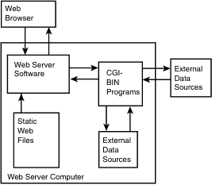

然而，CGI-BIN 编程也有缺点。特别是，每当有一个请求访问 CGI-BIN 脚本或程序时，都必须启动该应用程序的一个独立实例作为一个独立进程。Web 服务器每启动一个进程都会产生开销，而对于解释型语言，这种开销甚至更大，因为还需要额外启动一个独立的语言解释器实例。

对于任何请求量很大、尤其是同时请求很多的网站来说，这都会带来严重的效率和性能问题，因此许多网站选择基于 API 的解决方案，而不是 CGI-BIN 编程。

此外，CGI-BIN 通常使用通用编程语言，而不是许多基于 API 的开发环境所用的编程语言。这些环境所拥有的语言针对特定任务进行了优化：创建从后端数据源获取数据、然后根据数据生成 HTML 的应用程序。

当然，这并不意味着 CGI-BIN 没有优点。CGI-BIN 编程对通用编程语言的依赖也带来了一些优势，包括：

- 易于与其他应用程序集成
- 可使用完整编程语言的功能，例如自定义数据类型和链表
- 可选择使用完整的面向对象编程进行应用开发
- 可在底层访问系统，包括在需要时访问堆栈和寄存器

#### 服务器 API 编程

现代 Web 服务器（如 Apache）都包含应用程序接口（API），允许应用程序直接与服务器交互。这样就可以创建作为 Web 服务器组成部分的应用开发环境，这些环境要么作为 Web 服务器进程本身的一部分运行，要么作为独立的外部进程运行。

当通过该应用开发环境运行的应用程序收到请求时，Web 服务器只需通过 API 将请求定向到应用程序引擎，而无需像 CGI-BIN 那样启动新进程或启动命令解释器。应用程序可以生成动态 HTML，并直接通过 Web 服务器的 API 将其返回给浏览器，而不是将数据发送到标准输出，然后让 Web 服务器再从那里读回数据。图 25.2 展示了基于 API 的应用开发环境与 Web 服务器之间的关系。

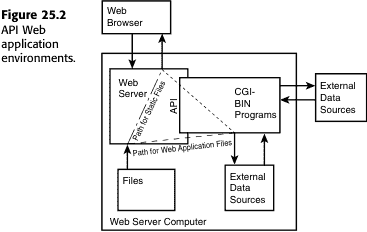

Web 服务器与应用程序引擎之间的这种直接交互，使得动态和交互式 Web 应用程序更加高效，在同一系统上通常能够比 CGI-BIN 解决方案处理更多请求和更多并发请求。因此，如今基于 API 的解决方案常用于交互式和动态网站。

与 CGI-BIN 编程相比，基于 API 的解决方案除了效率优势外，还提供了以下潜在优势：

- 通过 API 轻松访问 Web 服务器的功能
- 与 Web 服务器的安全和身份验证机制集成

然而，Web 应用环境也有缺点。最显著的是，这些环境中的大多数编程语言都专注于特定任务：获取动态数据并用它生成供浏览器使用的 HTML。这种专注意味着这些语言缺乏 CGI-BIN 编程中常用的通用编程语言的许多功能。

此外，基于 API 的解决方案常常使您被锁定在特定的 Web 服务器上，有时甚至是特定的操作系统平台上，这意味着您的应用程序更难在不同系统之间迁移。

#### 将网站连接到数据库的软件

Linux 得益于大量面向 Apache 服务器的免费和商业的基于服务器 API 的 Web 应用开发环境。这些环境包括：

- PHP
- Zope
- Web+
- ColdFusion

##### PHP

PHP 是 Apache 和 Linux 上最流行的 Web 应用开发环境之一。作为一个免费提供的 Web 应用框架，它遵循 Linux 和 Apache 的开源理念，因此成为许多 Linux Web 服务器富有吸引力的选择。

它采用类似 Perl 的语法，并提供了 Perl 和其他通用编程语言的许多功能。PHP 广泛支持外部数据源，包括 Linux 上所有可用的数据库，如 Oracle、Sybase、Informix、MySQL、mSQL、PostgreSQL 和 Adabas D，还支持 IMAP 和 LDAP 数据源以及 FTP 服务器。

此外，PHP 可以与多个 Linux 库集成，包括允许 PHP 即时生成动态图形的 GD 库、为 PHP 提供 TrueType 字体支持的 FreeType，以及用于在 PHP 中处理 PDF 文件的 PDFLib。

PHP 以源代码形式提供下载，适用于包括 Linux 在内的更多平台，可从 http://www.php.net/ 获取。在本章中，我们将把 PHP 作为数据库集成的示例 Web 应用环境进行更详细地讨论，因为它被广泛使用，并且可以免费获得，还包含在包括 Red Hat Linux 6.2 在内的许多 Linux 发行版中。

##### Zope

Zope 是开源模式下一种较新的、基于 API 的 Linux Web 应用环境。尽管它很新，但因其独特的 Web 应用开发方法而备受关注。

Zope 是用 Python 开发的，可以使用 Python 和 C 进行扩展。不过，应用程序开发人员在大多数开发工作中并不需要了解或使用 Python 编程语言。

相反，Zope 在 Web 应用开发问题领域提供了一种独特的解决方案。与大多数提供一种语言来开发生成 HTML 页面的脚本的应用开发环境不同，Zope 提供了一个完整的内容管理和开发环境，使开发人员能够将数据、逻辑和设计清晰分离。Zope 处理数据持久化和访问控制的所有问题，而这些任务在其他应用环境和 CGI-BIN 中通常需要手动编程。

Zope 提供了完整的基于 Web 的管理和开发环境。该系统支持完全访问控制、将网站不同部分的开发责任委派给不同人员、数据共享和搜索工具。Zope 非常适合创建复杂的、分布式的、需要将责任委派给广泛人群的网站。

Zope 可以从 http://www.zope.org/ 下载。

##### Web+

Web+ 是一种商业应用开发环境，是最早可用于 Linux 和 Apache 的应用开发环境之一。Web+ 由 TalentSoft 出品。

Web+ 使用一种简单的基于标签的语言进行应用开发，这使得它对于从较强的 HTML 背景而来但缺乏扎实编程背景的开发人员来说很有吸引力。使用这种基于标签的语言，开发人员可以构建与大多数 Linux 数据库、文件系统、Web 服务器以及通过直接套接字通信的 TCP/IP 应用程序交互的应用。

Web+ 还可以通过 Web+Shop 进行扩展，Web+Shop 提供基于 Web+ 构建的完整电子商务解决方案。Web+Shop 允许构建完整的在线购物应用，并提供库存管理、客户管理和在线事务处理。Web+Shop 与 CyberCash Register 完全集成，用于在线支付处理。可以从 http://www.webplus.com/ 下载 Web+ 的试用版。

##### ColdFusion

ColdFusion 是 Allaire 公司备受好评的商业 Web 应用开发环境。最初仅适用于 Windows 和 Solaris，现在 Linux 版已提供测试版，而且当你读到本书时，Linux 版应该已经正式发布。

与 Web+ 一样，ColdFusion 提供了一种基于标签的语言，对于没有编程背景但经验丰富的 HTML 开发人员来说很容易学习。ColdFusion 可以轻松集成大多数后端数据源，包括 Linux 主流关系数据库、Linux 文件系统、FTP 和 HTTP 服务器、IMAP 和 POP3 服务器以及 LDAP 服务器。

ColdFusion 可以通过创建自定义标签进行扩展，这些标签可以用 ColdFusion 标记语言编写，也可以作为用 C++ 或 Java 编写的已编译可执行文件。这样就能遵循“编写一次代码，然后尽可能广泛地重用”的原则。


ColdFusion 以 ColdFusion Studio 的形式提供集成的开发环境，并支持远程开发。ColdFusion 还包含一套完整的安全模型，用于构建安全的应用程序，并可通过基于 XML 的 WDDX 协议与用其他语言编写的应用程序集成。

可以从 http://www.allaire.com/ 下载 ColdFusion 的试用版。

#### 安装 PHP

最新版本的 PHP 以源代码形式可从 http://www.php.net/ 下载。本书出版时可用的版本是 PHP 3.0.14，以压缩的磁带归档文件形式提供，文件名为 php-3.0.14.tar.gz。

下载该归档文件并使用以下命令解压：

```
# tar zxvf php-3.0.14.tar.gz
```

接下来，将目录切换到包含解压后源代码的子目录：

```
# cd php-3.0.14
```

你可以通过以下两种方式之一从源代码构建 PHP：

- **作为 Apache 的动态共享对象（DSO）：** 使用此选项，你无需重新编译 Apache。Apache 将从外部文件加载 PHP 模块。这是编译和安装 PHP 的首选方法。如果你使用的是 Apache 1.3.6 或更高版本，可以使用此选项。本章将介绍如何将 PHP 构建为 Apache 的 DSO。
- **作为 Apache 的静态对象：** 使用此选项，你需要使用 PHP 支持重新编译 Apache。对于早期版本的 Apache，或者如果你选择不使用动态 Apache 模块，请使用此方法。

> **注意：** 本章中的安装说明假定 Apache 已按照第 23 章“Apache 与万维网”中的说明安装。

编译和安装需要四个步骤：

1. 使用 configure 命令配置源代码以进行安装。以下是最基本的 configure 命令：

   ```
   # ./configure --with-apxs=/usr/local/apache/bin/apxs
   ```

   `--with-apxs` 参数的值应为 Apache 发行版附带的 apxs 脚本的完整路径。如果你使用默认设置从 Apache 源代码安装 Apache，则此路径为 /usr/local/apache/bin/apxs。

   在 Red Hat 6.2 上，此脚本通常安装在 `/usr/sbin/apxs`。除了 `--with-apxs` 选项之外，PHP 的 configure 脚本还支持大量参数，允许你自定义 PHP 支持的功能。这些参数将在本章后面的“PHP 安装配置参数”中讨论。

2. 使用以下命令编译源代码：

   ```
   # make
   ```

3. 使用此命令安装编译后的软件：

   ```
   # make install
   ```

4. 使用此命令重启 Apache：

   ```
   # /usr/local/apache/bin/apachectl restart
   ```

   在 Red Hat Linux 上，你可以使用以下命令重启 Apache：

   ```
   # /etc/rc.d/init.d/httpd restart
   ```

安装并运行 PHP 后，最好测试一下安装是否成功。为此，请创建一个测试 PHP 文档。最简单的 PHP 文档将包含一条命令：

```php
<? phpinfo(); ?>
```

在 Web 服务器的文档根目录中创建一个包含此命令的文件。该文件的名称应具有 `.php3` 扩展名，例如 `test.php3`。

> **注意**
>
> PHP 文档通常具有 `.php3` 扩展名。你可以使用 Apache 配置文件 `srm.conf` 中的 `AddType` 指令更改此扩展名。要为 PHP 定义扩展名，请使用如下形式的指令：`AddType application/x-httpd-php3 <扩展名>`。

如果你用浏览器请求此文档，只要 PHP 安装正确且 Apache 正在运行，PHP 就会生成一个 PHP 信息页面，如图 25.3 所示。

**图 25.3** PHP 信息页面。

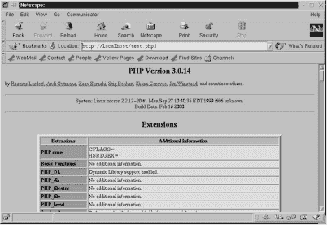

#### PHP 安装配置参数

上述 PHP 安装的配置步骤使你可以非常灵活地控制编译到 PHP 模块中的功能，以及模块和安装过程的配置。这些配置指令通常可分为以下几类：

- 通用参数
- 目录和文件参数
- 功能和包参数

##### 通用参数

表 25.1 中列出的通用参数允许你指定 `configure` 脚本运行的基本方面。

**表 25.1 Apache 通用安装配置参数**

| 参数 | 描述 |
|---|---|
| `--cache-file=<文件名>` | 将执行过程中运行的测试结果缓存到指定文件中，以供以后参考。 |
| `--help` | 显示完整的配置参数列表，而不是配置源代码。 |
| `--no-create` | 运行配置但不创建生成的配置文件，以便测试配置过程。 |
| `--quiet, --silent` | 配置期间不打印测试消息。 |
| `--version` | 显示用于创建配置的 autoconf 版本，而不是配置源代码。 |

##### 目录和文件名参数

表 25.2 中列出的目录和文件名安装参数指定了安装期间文件应放置的位置，以及配置和安装过程可以找到所需文件的位置。

**表 25.2 — 目录和文件名安装/配置参数**

| 参数 | 描述 | 默认值 |
|---|---|---|
| `--prefix=<目录>` | 将独立于体系结构的文件安装到指定目录（在本表的其余部分中，此值称为 PREFIX） | `/usr/local` |
| `--exec-prefix=<目录>` | 将与体系结构相关的文件安装到指定目录（在本表的其余部分中，此值称为 EPREFIX） | `--prefix` 参数的值。 |
| `--bindir=<目录>` | 将用户可执行二进制文件安装到指定目录 | `EPREFIX/bin` |
| `--sbindir=<目录>` | 将系统管理可执行文件安装到指定目录 | `EPREFIX/sbin` |
| `--libexecdir=<目录>` | 将程序可执行文件安装到指定目录 | `EPREFIX/libexec` |
| `--datadir=<目录>` | 将只读、独立于体系结构的数据文件安装到指定目录 | `PREFIX/share` |
| `--sysconfdir=<目录>` | 将只读的单机数据安装到指定目录 | `PREFIX/etc` |
| `--sharedstatedir=<目录>` | 将可修改的独立于体系结构的数据安装到指定目录 | `PREFIX/com` |
| `--localstatedir=<目录>` | 将可修改的单机数据安装到指定目录 | `PREFIX/var` |
| `--libdir=<目录>` | 将目标代码库安装到指定目录 | `EPREFIX/lib` |
| `--includedir=<目录>` | 将 C 头文件安装到指定目录 | `PREFIX/include` |
| `--oldincludedir=<目录>` | 将用于非 gcc 编译器的 C 头文件安装到指定目录 | `/usr/include` |
| `--infodir=<目录>` | 将 info 格式的文档安装到指定目录 | `PREFIX/info` |
| `--mandir=<目录>` | 将 man 格式的文档安装到指定目录 | `PREFIX/man` |
| `--srcdir=<目录>` | 包含源代码的目录 | 包含 configure 脚本的目录 |
| `--x-includes=<目录>` | X 包含文件位于指定目录 |  |
| `--x-libraries=<目录>` | X 库文件位于指定目录 |  |
| `--program-prefix=<目录>` | 已安装程序名称的目录前缀 |  |
| `--program-suffix=<目录>` | 附加到已安装程序名称的后缀 |  |
| `--program-transform-name=<程序名>` | 对已安装的程序名称运行 `sed <程序名>` |  |

##### 功能和包参数

表 25.3 中列出的功能和包安装配置参数使你可以指定编译 PHP 时，除核心功能之外还要构建 PHP 的哪些功能。这些功能包括对不同数据库的支持以及对特殊库（如 gd 图形生成库）的支持。

**表 25.3 功能和包安装配置参数**

| 参数 | 描述 |
|---|---|
| `--with-apxs=<文件名>` | 指示应将 PHP 构建为 Apache 的动态共享对象，并可选地指定 apxs 脚本的路径。 |
| `--enable-versioning` | 指示 PHP 应利用 Solaris 2.x 和 Linux 中的版本控制和作用域功能。 |
| `--with-apache=<目录>` | 指示应将 PHP 构建为 Apache 的静态对象，并可选地指定 Apache 顶级目录的路径。如果未指定路径，则默认值为 `/usr/local/etc/httpd`。 |
| `--with-system-regex` | 使用系统的正则表达式库构建 PHP，而不是使用 PHP 的正则表达式库。 |
| `--with-mod_charset` | 在俄语 Apache 中为 Apache mod_charset 模块启用传输表支持。 |
| `--with-fhttpd=<目录>` | 指示应将 PHP 构建为 fhttpd 模块，并可选地指定 fhttpd 源代码目录的路径。如果未指定路径，则默认值为 `/usr/local/src/fhttpd`。 |
| `--with-imap=<目录>` | 指示应使用 IMAP 支持构建 PHP，并可选地指定 IMAP 包含目录。 |
| `--with-imsp=<目录>` | 指示应使用 IMSP 支持构建 PHP，并可选地指定包含 `libimsp.a` 的 IMSP 包含目录。 |
| `--with-aspell=<目录>` | 指示应使用 ASPELL 支持构建 PHP，并可选地指定 ASPELL 文件的路径。 |
| `--with-mcal=<目录>` | 指示应使用 MCAL 支持构建 PHP，并可选地指定 MCAL 文件的路径。 |
| `--with-ftp` | 使用 FTP 支持构建 PHP。 |


#### 表25-3（续）

| 参数 | 说明 |
|---|---|
| `--without-gd` | 构建PHP时不包含GD图形库支持。 |
| `--with-gd=<directory>` | 表示构建PHP时应启用GD图形库支持，并可选择指定GD安装目录的路径。 |
| `--with-ttf=<directory>` | 表示构建PHP时应启用FreeType字体库支持，并可选择指定FreeType文件的路径。 |
| `--enable-freetype-4bit-antialias-hack` | 构建PHP时包含支持FreeType 2字体库所需的补丁。 |
| `--enable-t1lib` | 为PHP构建GD支持时启用t1lib支持。 |
| `--with-gettext=<directory>` | 表示构建PHP时应启用GNU gettext支持，并可选择指定GNU gettext文件的路径。如果未指定路径，默认值为`/usr/local`。 |
| `--with-imagick=<directory>` | 表示构建PHP时应启用ImageMagick支持，并可选择指定ImageMagick的路径。如果未指定路径，PHP将尝试自动确定其位置。 |
| `--with-x` | 构建PHP时启用X Windows支持。 |
| `--with-oracle=<directory>` | 表示构建PHP时应启用Oracle数据库支持，并可选择指定Oracle主目录的路径。如果未指定路径，默认使用`ORACLE_HOME`环境变量的值。 |
| `--with-iodbc=<directory>` | 表示构建PHP时应启用iODBC ODBC驱动程序包支持，并可选择指定iODBC基础安装目录的位置。如果未指定路径，默认值为`/usr/local`。 |
| `--with-openlink=<directory>` | 表示构建PHP时应启用OpenLink ODBC驱动程序包支持，并可选择指定OpenLink基础安装目录的位置。如果未指定路径，默认值为`/usr/local/openlink`。 |
| `--with-adabas=<directory>` | 表示构建PHP时应启用Adabas D数据库支持，并可选择指定Adabas D基础安装目录的位置。如果未指定路径，默认值为`/usr/local`。 |
| `--with-sybase=<directory>` | 表示构建PHP时应启用Sybase数据库支持，并可选择指定Sybase主目录的位置。如果未指定路径，默认值为`/home/sybase`。 |
| `--with-sybase-ct=<directory>` | 表示构建PHP时应启用Sybase-CT支持，并可选择指定Sybase主目录的位置。如果未指定路径，默认值为`/home/sybase`。 |
| `--with-mysql=<directory>` | 表示构建PHP时应启用MySQL数据库支持，并可选择指定MySQL安装目录的位置。如果未指定路径，PHP将尝试自动确定安装目录的位置。 |
| `--with-msql=<directory>` | 表示构建PHP时应启用mSQL数据库支持，并可选择指定mSQL安装目录的位置。如果未指定路径，默认值为`/usr/local/Hughes`。 |
| `--with-pgsql=<directory>` | 表示构建PHP时应启用PostgreSQL数据库支持，并可选择指定PostgreSQL基础安装目录的位置。如果未指定路径，默认值为`/usr/local/pgsql`。 |
| `--with-ibm-db2=<directory>` | 表示构建PHP时应启用IBM DB2数据库支持，并可选择指定DB2基础安装目录的位置。如果未指定路径，默认值为`/home/db2inst1/sqllib`。 |
| `--with-solid=<directory>` | 表示构建PHP时应启用Solid数据库支持，并可选择指定Solid基础安装目录的位置。如果未指定路径，默认值为`/usr/local/solid`。 |
| `--with-empress=<directory>` | 表示构建PHP时应启用Empress数据库支持，并可选择指定Empress基础安装目录的位置。如果未指定路径，默认使用`EMPRESSPATH`环境变量的值。 |
| `--with-ldap=<directory>` | 表示构建PHP时应启用LDAP支持，并可选择指定LDAP基础安装目录的位置。如果未指定路径，默认值为`/usr`和`/usr/local`。 |
| `--with-mck=<directory>` | 表示构建PHP时应启用Cybercash MCK支持，并可选择指定Cybercash MCK构建目录的位置。如果未指定路径，默认值为`/usr/src/mck-3.2.0.3-linux`。 |
| `--with-snmp=<directory>` | 表示构建PHP时应启用SNMP支持，并可选择指定SNMP基础安装目录的位置。如果未指定路径，PHP将尝试定位SNMP安装目录。 |
| `--with-velocis=<directory>` | 表示构建PHP时应启用Velocis支持，并可选择指定Velocis基础安装目录的位置。如果未指定路径，默认值为`/usr/local/velocis`。 |
| `--with-informix=<directory>` | 表示构建PHP时应启用Informix数据库支持，并可选择指定Informix基础安装目录的位置。 |
| `--with-interbase=<directory>` | 表示构建PHP时应启用Interbase数据库支持，并可选择指定Interbase基础安装目录的位置。如果未指定路径，默认值为`/usr/interbase`。 |
| `--with-custom-odbc=<directory>` | 表示构建PHP时应启用用户自定义的ODBC驱动程序支持，并可选择指定ODBC驱动程序的位置。如果未指定路径，默认值为`/usr/local`。 |
| `--with-hyperwave` | 构建PHP时启用Hyperwave支持。 |
| `--with-xml` | 构建PHP时启用XML支持。 |
| `--with-yp` | 构建PHP时启用YP（NIS）支持。 |
| `--with-zlib=<directory>` | 表示构建PHP时应启用zlib支持，并可选择指定zlib安装目录的位置。如果未指定路径，默认值为`/usr`。 |
| `--with-pdflib=<directory>` | 表示构建PHP时应启用pdflib支持，并可选择指定pdflib安装目录的位置。如果未指定路径，默认值为`/usr/local`。 |
| `--with-zlib-dir=<directory>` | 指定pdflib 2.0所需的zlib目录；或者，如果未包含pdflib，则表示应包含zlib支持。 |
| `--with-jpeg-dir=<directory>` | 指定pdflib 2.0所需的JPEG目录。 |
| `--with-tiff-dir=<directory>` | 指定pdflib 2.0所需的TIFF目录。 |
| `--with-cpdflib=<directory>` | 表示构建PHP时应启用ClibPDF支持，并可选择指定CLibPDF安装目录的位置。如果未指定路径，默认值为`/usr/local`。 |
| `--with-fdftk=<directory>` | 表示构建PHP时应启用fdftk支持，并可选择指定fdftk安装目录的位置。如果未指定路径，默认值为`/usr/local`。 |
| `--with-dbase` | 表示构建PHP时应包含Dbase数据库的内置支持。 |
| `--with-filepro` | 表示构建PHP时应包含FilePro数据库的内置只读支持。 |
| `--with-mod-dav=<directory>` | 表示应在构建Apache时通过Apache的`mod_dav`模块启用DAV支持，并指明`mod_dav`安装目录的位置。 |
| `--disable-unified-odbc` | 表示如果启用了iODBC、Adabas、Solid、Velocis或自定义ODBC，则应禁用统一ODBC支持。 |
| `--with-config-file-path=<directory>` | 指定PHP查找`php3.ini`文件的路径。默认情况下，PHP会在`/usr/local/lib`中查找。 |
| `--enable-debug` | 构建PHP时启用调试符号。 |
| `--enable-safe-mode` | 构建PHP时默认启用安全模式。 |
| `--with-exec-dir=<directory>` | 表示在安全模式下运行时，PHP只允许在指定目录中执行脚本。默认情况下，安全模式下PHP只允许执行`/usr/local/php/bin`中的可执行文件。 |
| `--enable-track-vars` | 表示默认应启用对GET、POST和Cookies跟踪变量的支持。 |
| `--enable-magic-quotes` | 表示默认应启用魔术引号。 |
| `--enable-debugger` | 构建PHP时启用远程调试支持。 |
| `--disable-bcmath` | 构建PHP时不支持bc风格的高精度数学运算。 |
| `--enable-force-cgi-redirect` | 表示应启用内部服务器的安全检查。 |
| `--enable-discard-path` | 允许将PHP CGI二进制文件放置在Web文档目录之外，以在使用CGI方式运行PHP时提高安全性。 |
| `--enable-memory-limit` | 构建PHP时启用内存限制支持。 |
| `--disable-short-tags` | 默认禁用短格式`<?`起始标签的支持。 |
| `--disable-url-fopen-wrapper` | 禁用支持URL的fopen包装器，该包装器允许PHP通过HTTP或FTP访问文件。 |
| `--enable-sysvsem` | 构建PHP时启用System V信号量支持。 |
| `--enable-sysvshm` | 构建PHP时启用System V共享内存支持。 |
| `--disable-display-source` | 构建PHP时不支持显示源代码。 |


| 参数 | 说明 |
|---|---|
| `--with-gdbm=<directory>` | 指示 PHP 在构建时支持 GDBM，并指定 GDBM 文件的位置。 |
| `--with-ndbm=<directory>` | 指示 PHP 在构建时支持 NDBM，并指定 NDBM 文件的位置。 |
| `--with-db2=<directory>` | 指示 PHP 在构建时支持 Berkeley DB2，并指定 DB2 文件的位置。 |
| `--with-dbm=<directory>` | 指示 PHP 在构建时支持 DBM，并指定 DBM 文件的位置。 |
| `--with-cdb=<directory>` | 指示 PHP 在构建时支持 CDB，并指定 CDB 文件的位置。 |
| `--with-mcrypt=<directory>` | 指示 PHP 在构建时支持 mcrypt，并指定 mcrypt 安装目录的位置。 |
| `--with-mhash=<directory>` | 指示 PHP 在构建时支持 mhash，并指定 mhash 安装目录的位置。 |
| `--enable-ucd-snmp-hack` | 构建 PHP 时支持 UCD SNMP hack。 |
| `--without-pcre-regex` | 构建 PHP 时不支持 Perl 兼容正则表达式。 |
| `--without-posix` | 构建 PHP 时不包含 POSIX 函数。 |
| `--with-recode=<directory>` | 构建 PHP 时支持 GNU recode。 |
| `--enable-dmalloc` | 构建 PHP 时支持 dmalloc。 |

#### PHP 脚本概述

完整的 PHP 开发教程超出了以 Linux 系统管理为主题的书籍的范围。不过，如果你计划管理一个运行 PHP 的网站，当你需要与开发人员协作分析和调试 Web 及 PHP 服务器出现的明显系统问题时，对 PHP 开发的基本了解会有所帮助。

PHP 文件将 HTML 和 PHP 代码无缝集成。为了让 PHP 引擎知道文件的哪些部分应作为 PHP 代码处理，哪些部分应作为 HTML 代码保留，PHP 代码可以通过以下四种方式之一进行标记：

- 使用 `<?` 和 `?>` 开始和结束标签：

  ```php
  <?
  PHP code goes here
  ?>
  ```

- 使用 `<?php` 和 `?>` 开始和结束标签：

  ```php
  <?php
  PHP code goes here
  ?>
  ```

- 使用 `<SCRIPT LANGUAGE="php">` 和 `</SCRIPT>` 开始和结束标签：

  ```html
  <SCRIPT LANGUAGE="php">
  PHP code goes here
  </SCRIPT>
  ```

- 使用 `<%` 和 `%>` 开始和结束标签：

  ```php
  <%
  PHP code goes here
  %>
  ```

到目前为止，最常见的 PHP 代码格式是 `<? PHP code goes here ?>` 格式。

PHP 代码通常由一系列语句组成。一条语句可以是以下形式之一：

- 以分号结尾的单条语句：

  ```php
  phpinfo();
  ```

- 用花括号括起来的一系列语句：

  ```php
  {
      $a = 1;
      $b = 2;
      $c = $a + $b;
  }
  ```

- 一条流程控制命令后跟一条语句（以下任一形式）：

  ```php
  if ($x > 1)
      phpinfo();

  if ($x > 1) {
      $a = 1;
      $b = 2;
      $c = $a + $b;
  }
  ```

PHP 支持多种基本数据类型：

- 整数
- 浮点数
- 字符串

还提供复杂数据类型：

- 数组
- 对象


变量名与 Perl 一样，以 `$` 开头标识：`$<variable name>`。例如，`$x`、`$myvar` 和 `$some_var` 都是变量名。PHP 中的变量不需要初始化，可以在脚本中的任何位置使用。它们还可以轻松地在类型之间转换；例如，将整数赋值给字符串会将其转换为字符串。

可以使用多种运算符来构建表达式：

- 算术运算符，例如 `+`、`-`、`*`、`/` 和 `%`。
- 赋值运算符，例如 `=`、`+=` 和 `-=`。
- 位运算符，例如 `&`、`|`、`~`、`<<` 和 `>>`。
- 比较运算符，例如 `==`、`===`、`!=`、`<`、`>`、`<=` 和 `>=`。
- 递增和递减运算符，例如 `++` 和 `--`。
- 逻辑运算符，例如 `and`、`or`、`xor`、`!`、`&&` 和 `||`。

关于 PHP 运算符的完整讨论可在在线 PHP 手册中找到：`http://www.php.net/manual/language.operators.string.php3`。

PHP 提供了大量内置函数，这些函数提供了 PHP 的功能，包括对所有外部数据源和集成库的支持。程序员还可以在 PHP 中创建自己的函数。关于函数的完整讨论以及所有内置函数的完整参考，请参见 PHP 在线手册：`http://www.php.net/manual/`。

#### 使用 PHP 创建简单的动态网站

为了说明如何使用 PHP 创建动态网站，请考虑以下简单场景：你有一个名为 mydbase 的 MySQL 数据库，其中有一个名为 mytable 的表，每条记录包含四个字段：ID 编号、姓氏、名字和出生日期（该数据库和表是在第 24 章“Linux 数据库服务器”中创建的）。你想要创建一个简单的 Web 应用程序，允许用户输入 ID 编号或姓氏，并查看所有匹配的记录。

这需要两个文件：

- 一个用于显示表单的文件，用户可以使用该表单指定要显示的记录的 ID 编号或姓氏。我们称这个文件为 `form.html`。
- 一个用于处理表单提交的数据内容，并显示数据库中任何匹配记录的文件。我们称这个文件为 `query.php3`。

`form.html` 文件是一个简单的 HTML 表单：

```html
<HTML>
    <HEAD>
        <TITLE>form.html PHP example</TITLE>
    </HEAD>
    <BODY>
        <FORM METHOD=POST ACTION="query.php3">
            ID Number : <INPUT TYPE=TEXT NAME="ID"><BR>
            Last Name: <INPUT TYPE=TEXT NAME="Name"><BR>
            <INPUT TYPE=SUBMIT>
        </FORM>
    </BODY>
</HTML>
```

这将生成一个如图 25.4 所示的表单。

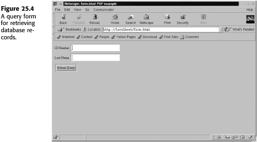

该表单将提交到 query.php3 文件：

```php
01: <?
02:     $link = mysql_connect("localhost","root","");
03:     $dbase = mysql_select_db("mydbase",$link);
04:     if ($ID <> '') {
05:         $result = mysql_query('SELECT * FROM mytable WHERE ID = $ID',$dbase);
06:     } else {
07:         $result = mysql_query("SELECT * FROM mytable WHERE last_name = $Name",$link);
08:     }
09:     $numresults = mysql_num_rows($result);
10: ?>
11: <HTML>
12:     <HEAD>
13:         <TITLE>Query.php3 Results</TITLE>
14:     </HEAD>
15: <BODY>
16:     <H1>Search Results</H1>
17:     <?
18:         if ($numresults > 0) {
19:             echo "
20:                 <TABLE BORDER=0 CELLPADDING=3>
21:                     <TR VALIGN=TOP>
22:                         <TD ALIGN=LEFT><STRONG>ID</STRONG></TD>
23:                         <TD ALIGN=LEFT><STRONG>Last Name</STRONG></TD>
24:                         <TD ALIGN=LEFT><STRONG>First Name</STRONG></TD>
25:                         <TD ALIGN=LEFT><STRONG>Birth Date</STRONG></TD>
26:                     </TR>
27:             ";
28:             for ($i = 1; $i <= $numresults; $i ++) {
29:                 $row = mysql_fetch_array($result);
30:                 echo "
31:                     <TR VALIGN=TOP>
32:                         <TD ALIGN=LEFT>$row[0]</TD>
33:                         <TD ALIGN=LEFT>$row[1]</TD>
34:                         <TD ALIGN=LEFT>$row[2]</TD>
35:                         <TD ALIGN=LEFT>$row[3]</TD>
36:                     </TR>
37:             ";
38:             }
39:             echo "</TABLE>";
40:         } else {
41:             echo "No matches.";
42:         }
43: ?>
44: </BODY>
45: </HTML>
```

> **注意**
>
> 前面文件中的行号是为方便参考而添加的，并非脚本的一部分。

这个 PHP 文件会产生与图 25.5 所示类似的结果。

**图 25.5**

使用 PHP 得到的搜索结果。

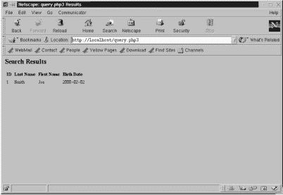

该脚本生成并发送到浏览器的最终 HTML 代码类似于以下内容：

```html
<HTML>
    <HEAD>
        <TITLE>query.php3 Results</TITLE>
    </HEAD>
    <BODY>
        <H1>Search Results</H1>

        <TABLE BORDER=0 CELLPADDING=3>
            <TR VALIGN=TOP>
                <TD ALIGN=LEFT><STRONG>ID</STRONG></TD>
                <TD ALIGN=LEFT><STRONG>Last Name</STRONG></TD>
                <TD ALIGN=LEFT><STRONG>First Name</STRONG></TD>
                <TD ALIGN=LEFT><STRONG>Birth Date</STRONG></TD>
            </TR>

            <TR VALIGN=TOP>
                <TD ALIGN=LEFT>1</TD>
                <TD ALIGN=LEFT>Smith</TD>
                <TD ALIGN=LEFT>Joe</TD>
                <TD ALIGN=LEFT>2000-02-02</TD>
            </TR>
        </TABLE>
    </BODY>
</HTML>
```

query.php3 脚本可以分解如下：

- 第 1-10 行：这些命令连接到 MySQL 服务器，打开 mydbase 数据库，然后根据用户提交的是 ID 编号还是姓氏来执行相应的查询。
- 第 17-40 行：为返回结果中的每条记录显示一行表格。对于每条记录，从结果中取出该记录并存储到数组中，然后将数组的内容显示在相应的表格单元格中。
- 第 42 行：如果未从数据库中获取任何结果，则显示此信息。

#### 故障排除

在安装和使用 PHP 时，可能存在各种问题，包括与特定数据库和数据源交互相关的问题。不过，也会出现一些常见的通用问题，包括以下这些：

- 为 Apache 安装 FrontPage 扩展后，PHP 停止工作。
- Apache 将 PHP 文件显示为源代码。
- PHP 因缺少库而无法编译。
- PHP 无法连接到我的数据库。


#### 安装适用于 Apache 的 FrontPage 扩展后 PHP 停止工作

当你安装 FrontPage 扩展时，它们会改变一些 Apache 结构。在此更改之后，PHP 将需要重新编译。在你的 PHP 源代码目录中，使用以下命令重新编译并安装 PHP：

```text
# make clean
# make
# make install
```

之后，重启 Apache。

#### Apache 将 PHP 文件显示为源代码

如果你从 Apache 服务器请求一个 PHP 文件，而它返回的是该文件的源代码而不是处理后的结果，那么你在 Apache 配置文件 srm.conf 中缺少一条适当的 AddType 指令。在 srm.conf 中添加一条类似以下的条目，然后重启 Apache：

```text
AddType application/x-httpd-php3 .php3
```

#### PHP 因缺少库而编译失败

如果你尝试使用外部功能构建 PHP，例如 GD 支持、FreeType 或 LDAP，则必须安装相应的开发库并使其可用，PHP 才能成功编译。部分库及其位置的列表可以在 http://www.php.net/FAQ.php3#1 的 PHP FAQ 中找到，包括以下内容：

- LDAP：ftp://ftp.openldap.org/pub/openldap/openldap-stable.tgz
- Berkeley DB2：http://www.sleepycat.com/
- GD：http://www.boutell.com/gd/#buildgd
- mSQL：http://www.hughes.com.au/
- MySQL：http://www.mysql.com/
- IMAP：ftp://ftp.cac.washington.edu/imap/old/
- FreeType：http://www.freetype.org/
- ZLib：http://www.cdrom.com/pub/infozip/zlib/
- expat XML 解析器：http://www.jclark.com/xml/expat.html
- PDFLib：http://www.pdflib.com
- mcrypt：ftp://argeas.cs-net.gr/pub/unix/mcrypt/
- mhash：http://sasweb.de/mhash/
- t1lib：http://www.neuroinformatik.ruhr-uni-bochum.de/ini/PEOPLE/rmz/t1lib/t1lib.html
- dmalloc：http://www.dmalloc.com/
- aspell：http://metalab.unc.edu/kevin/aspell/
- Readline：ftp://prep.ai.mit.edu/pub/gnu/readline/

#### PHP 无法连接到我的数据库服务器

假设你为服务器使用了正确的用户名和密码，那么当 PHP 服务器和数据库服务器位于网络中的不同机器上时，此问题最有可能发生。如果你的数据库服务器根据连接来源主机进行限制，请务必将 PHP 服务器添加到数据库服务器上的有效客户端列表中。否则，连接将被拒绝。

此外，请确保 PHP 服务器上的主机表（/etc/hosts）中有数据库服务器的条目，并且数据库服务器上的主机表中有 PHP 服务器的条目。

使用 PHP 访问数据库时的另一个问题是，你的 PHP 安装可能没有针对你要访问的数据库服务器编译相应的库。在这种情况下，你应该按照前面“安装 PHP”一节中的说明重新编译 PHP。

### 第 26 章：新闻服务

本章包括

- Usenet 简史 570
- 新闻组层级 570
- 硬件要求 571
- 安装 INN 2.2.1 571
- INN 概述 572
- 配置 INN 574
- 理解 INN 日志文件 586
- 管理 INN 587
- 故障排除 588

#### Usenet 简史

1979 年末，在带有 UUCP 的 V7 UNIX 发布后不久，北卡罗来纳大学的研究生 Steve Bellovin 发布了第一个版本的新闻软件。它被安装在两台计算机上，一台在北卡罗来纳大学，另一台在杜克大学。第一个版本是用 shell 脚本编写的，后来用 C 语言重写。这使得两所大学之间能够进行共享讨论。

自那时起，人们编写了许多版本的新闻软件；其中主要的有 A News、B News、C News、NNTP 和 INN。此外，还有一些商业化的新闻类软件实现，例如 DNews 和 Netscape Collabra。

1986 年，一个使用 TCP/IP 上的 NNTP 协议而非 UUCP 进行新闻传输的新闻软件发布。它被称为 NNTP，由加州大学圣迭戈分校开发。不久之后，1987 年，多伦多大学开发了一个非常流行的新闻版本，称为 C News。C News 在互联网上被广泛使用。

目前互联网上几乎唯一使用的新闻软件是 INN。它最初由 UNET 的 Rich Salz 开发，并于 1992 年发布。它同时支持基于 NNTP 和 UUCP 的新闻投递。

自 INN 1.4 版本以来，互联网软件联盟（Internet Software Consortium）负责该软件的开发。现在 INN 已到 2.2.1 版本，可以从 ftp://ftp.isc.org/isc/inn 获取。我们将在本章中介绍 INN 2.2.1 版本。

#### 新闻组层级

互联网上新闻组的当前结构被称为 Usenet。Usenet 是一个交换新闻文章的站点去中心化集合。成员站点上的用户阅读和撰写文章，并将新文章发布到本地服务器，然后本地服务器再一个接一个地将它们馈送给 Usenet 社区的其他站点。

新闻组按层级结构组织，详细程度各不相同。组的名称表示该组在层级中的位置。例如，一个名为 `comp.languages` 的组位于 comp 类别中，可能一般性地讨论计算机语言；而 `comp.languages.pascal` 组则更为精细，它是 comp 类别中 languages 子类别的一部分，讨论 Pascal 语言。

最著名且使用最广泛的顶级类别如下：

- **alt**：替代主题
- **comp**：计算机主题
- **rec**：娱乐主题
- **soc**：社会与社交主题

此外，还存在许多有针对性的顶级类别，包括国家顶级类别，如用于加拿大讨论的 can，以及与主题相关的类别，如用于幼儿园到 12 年级讨论的 k12。

除了这些公共 Usenet 类别之外，Usenet 站点还可以创建自己的本地类别，这些类别既可保密，也可提供给希望接收这些类别中新闻组馈送的站点共享。

#### 硬件要求

运行一个可用的 INN 新闻服务器所需的硬件取决于两个因素：

- 你计划接收的新闻馈送的大小：你计划接收完整的 Usenet 新闻馈送，还是只接收选定组的部分馈送？
- 你预期将使用该服务器的并发新闻阅读器数量。

对于部分馈送站点，系统可以小到只有一台 Pentium II 300，配备 256MB 内存和 16GB 的 ultra-wide SCSI-2 硬盘空间，并通过 T1 连接与你的新闻提供商相连。通常，这种部分馈送不会接收 alt.* 层级和任何 *binaries 组。

在高端的全馈送站点，拥有大量用户时，很容易就需要 4 个 Pentium III 500 CPU、2GB 内存和超过 1TB 的硬盘容量。这些硬盘可以是 ultra-wide SCSI-2 硬盘，通过多个 ultra-wide SCSI 控制器（如 Adaptec 2940 UW 控制器）连接。对于全馈送站点，建议通过 T3 连接接入互联网，或者至少你必须有 4 或 5 条到新闻提供商的 T1 连接。

#### 安装 INN 2.2.1

> **提示**
> 
> 要安装 INN，你首先必须安装 Perl 5.004 或更高版本。Perl 是所有主要 Linux 发行版的一部分；你可以从 http://www.perl.com/ 获取最新版本的 Perl。

预编译的 INN 软件随许多标准 Linux 发行版一起打包，例如 Red Hat 6.2。你可以使用 RPM 软件包添加命令将其安装到你的服务器上。但是，如果你想从源代码构建 INN 二进制文件，可以按照以下步骤操作：

1. 从 `ftp://ftp.isc.org/isc/inn/inn-2.2.1.tar.gz` 下载 INN 存档到你系统上的方便位置，例如 `/usr/local/src`。
2. 将当前目录更改为你下载 INN 的目录：

   ```text
   # cd /usr/local/src
   ```


3. 解压INN发行版归档：

    ```
    # tar xzvf inn-2.2.1.tar.gz
    ```

4. 将当前目录切换到解压归档时创建的目录：

    ```
    # cd inn-2.2.1
    ```

5. 创建组 news：

    ```
    # groupadd news
    ```

6. 创建用户 news 并将该账户的主目录设置为 `/usr/local/news/`：

    ```
    # useradd -g news -d /usr/local/news/ news
    ```

7. 使用以下命令配置INN源代码以进行编译：

    ```
    # ./configure --with-perl
    ```

8. 该配置脚本将根据你的系统构建一个用于编译的 Makefile。

9. 编译INN软件：

    ```
    # make
    ```

10. INN源代码将被编译成二进制文件。

11. 安装编译后的INN软件：

    ```
    # make install
    ```

12. 编译后的二进制文件以及INN手册页和其他文档将被安装到默认位置。

#### INN总体概述

INN执行的操作可分为五个主要领域：

- 接收传入的新闻源
- 处理传出的新闻源
- 服务新闻阅读器，并促进文章的阅读和发布
- 让旧文章过期
- 记录所有活动

当运行INN的系统启动时，它会启动脚本 `/etc/rc.d/rc.news`。该脚本以 root 用户身份运行，并启动 INN 守护进程 innd，出于安全原因，innd 以 news 用户身份运行。`rc.news` 实际上通过 `innstart` 脚本启动 innd，该脚本打开 NNTP 端口，将端口的用户 ID 和组 ID 设置为 news 用户和组，然后使用 `-p` 标志启动 innd。

对 innd 进行多级启动以及切换用户的目的是防止安全问题。如果像INN这样的服务以 root 用户身份运行，那么该软件就拥有 root 权限，而如果有人破坏了该服务，他们就可能获得 root 权限。运行 rc.news 后不久执行的 ps 命令显示 innd 以 news 用户身份运行：

```text
# ps auxw|grep news
news       13735  0.3  4.6  6212 2932 ?        S    16:33  0:01 /usr/local/news/
➥bin/innd -d4
root       13737  0.0  1.5  1836  988 pts/0    S    16:33  0:00 sh /usr/local/news/
➥bin/rc.news
news       13741  0.0  0.9  1516  616 ?        SN   16:33  0:00 /usr/local/news/
➥bin/overchan
news       13742  0.0  1.2  1760  804 ?        SN   16:33  0:00 /usr/local/news/
➥bin/inndfeed
root       13761  0.0  1.5  1852 1008 pts/0    S    16:34  0:00 sh /usr/local/news/
➥bin/innfeed
news       13981  0.0  1.2  1756  772 pts/0    S    16:40  0:00 /usr/local/news/
➥bin/activated
```

innd 是主守护进程，负责执行某些任务，同时它会调用其他程序来完成其他任务。该守护进程处理所有传入的文章源，并将其写入磁盘。为了发送文章，它使用 nntpsend 或 innfeed 等外部程序。

启动时，innd 会读取三个配置文件：

- `~news/etc/active`
- `~news/etc/newsfeeds`
- `~news/etc/incoming.conf`

> **注意**
>
> news 前面的波浪号（`~`）是一个特殊的 shell 变量，它会导致 `~news` 被替换为 `/etc/passwd` 映射中指定的 news 用户的主目录。换句话说，如果 news 用户的主目录是 `/usr/local/news`，shell（csh、ksh 或 bash）会将 `~news` 替换为此路径。

加载配置后，innd 会监听 119 端口上的传入 NNTP 连接请求。

> **注意**
>
> 如果你使用的是 Red Hat Linux 6.2 附带的 INN 版本，则 INN 配置文件存储在 `/etc/news/` 中，而不是 `~news/etc`。

##### 接收传入的新闻源

当收到来自 `incoming.conf` 文件中列出的授权新闻源站点的连接时，将接受文章源。

##### 处理传出的新闻源

对于传出的新闻源，innd 使用 `nntpsend` 或 `innfeed` 将已发布的文章发送到新闻源站点。这些进程由 cron 按计划运行（如第7章“计划任务”所述），以定期扫描并发送传出文章。

##### 服务新闻阅读器并促进文章的阅读与发布

如果请求来自 `~news/etc/nnrp.access` 文件中标识的授权新闻阅读器，innd 将启动一个 nnrpd 进程来处理该阅读器的连接。这使 innd 可以空闲出来处理传入的新闻源连接。

##### 文章过期

在INN模型中，文章不会永久保留在新闻组中。相反，它们会按照计划过期，以确保新闻组不会增长到难以管理的大小。文章的过期由脚本 `news.daily` 处理，该脚本由 cron 调度（如第7章所述）；通常 `news.daily` 计划每天运行一次。`news.daily` 脚本读取 `~news/etc/expire.ctl` 配置文件，该文件定义了文章过期的策略。

##### 记录所有活动

大多数INN日志消息都会写入 `/usr/local/news/log` 目录中的日志文件。此外，一些日志消息会写入 `/var/log/messages`。当然，这取决于系统 `/etc/syslog.conf` 文件中如何配置新闻消息的日志记录。

#### 配置INN

INN通常将其配置文件存储在 `~news/etc/` 中。随 Red Hat Linux 6.2 一同发布的INN版本将这些文件存储在 `/etc/news/` 中。

这些文件用于完成多个配置任务。我们将考虑以下任务：

- 为新闻文章选择存储方法
- 编辑 `inn.conf`
- 编辑 `newsfeeds` 文件
- 编辑 `incoming.conf`
- 将 `cycbuff.conf` 文件用于 CNFS
- 为 CNFS 和 timehash 编辑 `storage.conf`
- 将 `overview.ctl` 文件与 CNFS 和 timehash 存储一起使用
- 使用 `nnrp.access` 文件控制客户端访问
- 使用 `expire.ctl` 控制文章过期
- 为 CNFS 存储创建文章缓冲池
- 使用 `nntpsend.stl` 文件指定要供稿的站点
- 使用 `news.daily` 工具控制每日维护
- 使用 `rc.news` 在引导时启动INN

##### 选择新闻文章的存储方法

有三种方法可用于在INN中存储新闻文章：

- **传统方法：** 此方法由旧版INN使用。文章以单独的文件存储，文件名按文章编号命名。这些文件存储在基于新闻组名称的目录层次结构中。例如，`comp.os.linux.networking` 中的文章 12345 存储在 spool 目录中；通常位于 `/usr/local/news/spool/comp/os/linux/networking/12345`。传统方法基于久经考验的代码，与第三方INN应用程序具有广泛的兼容性。该方法还提供对文章过期时间的精细控制。但其代价是在单个目录中存储大量文件，这会产生性能瓶颈。此方法要求极为快速的计算机、磁盘和磁盘控制器，才能支持大型新闻源站点。
- **Timehash：** 此方法是传统方法的一种变体。文章仍以单独的文件存储，但目录层次结构基于文章的到达时间。这避免了包含大量文件的目录（很容易出现这种情况）带来的瓶颈。目录按组名结构化。该方法还允许对文章过期时间进行精细控制，但代价是仍然需要非常快的计算机、磁盘和磁盘控制器来处理基于文件的文章存储的性能要求。
- **CNFS：** 此方法按顺序将文章存储在预先配置的循环缓冲区文件中。当达到缓冲区末尾时，新文章会从缓冲区开头开始存储，覆盖缓冲区中最旧的文章。此方法提供了极快的性能：操作期间无需创建或删除文件，也无需运行过期流程，因为文章会随着缓冲区填满而自动覆盖。此外，INN使用的磁盘空间保持不变，将它们分配到不同大小的固定缓冲区可以控制各个组的大小。这些好处的代价是对文章过期的控制较少。但是，如果你希望某个组的保留时间更长，而该组突然开始接收非常大的流量，则CNFS存储方法可能会造成问题。

一般来说，经验丰富的新闻管理员会选择CNFS而非其他存储方法，因为CNFS方法的优点远远超过其唯一的缺点。I/O性能极快，而且永远不必担心文件系统被填满，这两点足以成为考虑使用此方法的理由。


#### 编辑 `inn.conf`

你应当配置的第一个也是最重要的文件是 `inn.conf`。INN 自带的示例 `inn.conf` 文件中的大多数设置都可以使用提供的默认值，无需更改。我们只关注那些必须更改的设置。表 26.1 概述了这些关键设置。

| 设置 | 描述 |
|---|---|
| `organization` | 将此设置为你组织的名称。 |
| `pathhost` | 将此设置为你的新闻服务器的完全限定域名（FQDN）。如果留空，INN 将尝试使用服务器的 FQDN。 |
| `domain` | 将此设置为你的服务器的域名。 |
| `complaints` | 你可能希望将此设置为 `postmaster@your.domain`。如果未指定，它将尝试使用 `newsmaster@your.domain` 地址。 |
| `storageapi` | 如果文章应使用 CNFS 或 timehash 方法存储，则设置为 true。 |
| `overviewmap` | 如果设置为 true，概览数据将被映射到内存中，读取概览的速度会更快。 |
| `allownewnews` | 如果设置为 yes，INN 将为新闻阅读器支持 NEWNEWS 命令。这会对服务器性能产生不利影响，因此建议设置为 no。 |
| `nnrpdoverstats` | 如果设置为 yes，nnrpd 将记录在读取文章概览信息的各个阶段所花费时间的统计信息。建议设置为 no。 |
| `hiscachesize` | 此设置用于指定最近使用的历史文件条目的缓存大小（以千字节为单位）。要禁用历史记录缓存，请将值设置为 0。不过，为了获得更好的服务器性能，如果你有足够的内存，强烈建议你设置 16MB 的缓存大小。 |

#### 编辑 `newsfeeds` 文件

`newsfeeds` 文件指定了传入文章应如何分发到其他站点和其他 INN 进程。文章的发送位置以及发送方式由该文件的内容决定。在本章中，我们将介绍 `newsfeeds` 文件的基础知识。要了解所有选项，你需要使用命令 `man newsfeeds` 查看手册页。

`newsfeeds` 文件由一系列新闻馈送条目组成。一个新闻馈送条目由四个以冒号分隔的字段组成：

```
sitename:pattern:flag:param
```

第一个字段是馈送（feed）的名称。它必须是唯一的。最好使用远程服务器的完全限定域名作为馈送名称，因为这样更简单。馈送名称后面可以跟一个斜杠和一个排除列表。如果馈送名称或排除列表中的任何名称出现在文章的 Path 行中，则该文章将不会被转发到该馈送，因为这被认为已经通过该站点一次了。当服务器名称与其在文章路径头中使用的名称不同，或者你不想接收来自某个来源的文章时，排除列表非常有用。

第二个字段指定一组期望的新闻组和分发列表。该模式是一种通配符匹配模式，但有一个附加规则。以 @ 开头的模式会导致投递到与该模式匹配的组的任何文章被丢弃，即使它们与期望的组的模式匹配也是如此。否则，同时匹配“想要”和“不想要”模式的文章会被发送。

第三个字段是一个以逗号分隔的标志列表，用于确定馈送类型并为该条目设置一些参数。可能的标志汇总在表 26.2 中。

**表 26.2  newsfeeds 条目的标志**

| 标志 | 描述 |
|---|---|
| `<size>` | 文章必须小于指定的大小（以字节为单位）。 |
| `>size` | 文章必须大于指定的大小（以字节为单位）。 |
| `A<items>` | 一个或多个文章检查项的列表：d（文章必须具有分发头）、p（INN 不应检查路径头中的站点）、c（不允许控制消息）、C（仅允许控制消息）、e（文章的目标组必须全部存在）。 |
| `B<high or low>` | 将文章写入输出之前的内部缓冲区大小。 |
| `F<name>` | 指示该馈送的 spool 文件名称。 |
| `G<count>` | 将交叉张贴限制为 count 个组。 |
| `H<count>` | 文章的跳数（hops）必须小于指定值。如果未指定值，默认跳数为 1。 |
| `I<size>` | 使用文件馈送时的内部缓冲区大小。 |
| `Nm` | 仅允许与该条目模式匹配的受审核组（moderated groups）。 |
| `Nu` | 仅允许与该条目模式匹配的未受审核组（unmoderated groups）。 |
| `P<priority>` | 设置频道（channel）或馈送的优先级。 |
| `O<originator>` | 文章 X-Trace 的第一个字段必须与指定的发起者（originator）匹配。 |
| `S<size>` | 如果排队等待的字节数超过指定值，则开始对馈送进行 spool 处理。 |
| `T<type>` | 指示该条目所指定的馈送类型。可能的字段类型有：f（文件）、m（漏斗）、p（通过管道传输到程序）、c（将馈送发送到参数子进程的标准输入）、x（仅记录条目）。 |
| `W<items>` | 一个或多个要写入的项的列表：b（文章大小，以字节为单位）、f（文章的完整路径）、g（文章张贴的第一个新闻组）、h（文章的消息 ID 哈希）、m（消息 ID）、n（文章的相对路径）、p（文章的张贴时间）、s（提供该文章的站点）、t（文章接收时间）、*（漏斗馈入（funnel feed-ins）的名称或接收文章的所有站点）、N（文章的新闻组头）、d（文章的分发头）、H（文章的所有头）、o（文章的概览数据）、P（文章的路径头）、R（文章的复制信息）。 |

第四个字段是一个多用途参数。其用法取决于第三个字段中使用的标志类型。

#### newsfeeds 条目示例

`newsfeeds` 文件控制本地站点张贴的文章如何馈送到其他 NNTP 服务器。由于 `newsfeeds` 文件中的条目本身就比较复杂，掌握条目用法的最简单方法是分析一些示例条目。

首先，考虑以下条目：

```
ME:*;!junk,!control*,!local*\
/world,usa,na,gnu,bionet,pubnet,u3b,eunet,vmsnet,inet,ddn,k12::
```

每个 `newsfeeds` 文件都需要一个 ME 站点条目。该条目列出了一组默认值，这些默认值会影响 `newsfeeds` 文件中的所有其他条目。ME 条目中的订阅列表会自动添加到所有其他条目订阅列表的开头。在本示例中，订阅列表是 `*;!junk,!control*,!local*/world,usa,na,gnu,bionet,pubnet,u3b,eunet,vmsnet,inet,ddn,k12`。该订阅列表有两个部分：正斜杠之前的部分和正斜杠之后的例外列表。

正斜杠之前的部分是 `*;!junk,!control*,!local*`。这表示本地张贴、控制张贴和垃圾张贴不会被传播，除非条目的订阅列表中明确指明了某个组。

如果 ME 条目中出现了分发字段，则只接受与分发列表匹配的文章，所有其他文章都将被拒绝。

除了必需的 ME 条目之外，还有一些特殊条目为 overchan、innfeed、controlchan 和 crosspost 工具提供程序馈送。这些条目随默认的 `newsfeeds` 文件提供，如果你需要使用它们，只需取消注释即可。

对于传统存储方法，请取消注释以下条目：

```
overview!*:Tc,Wo:/usr/local/news/bin/overchan
crosspost!*:Tc,Ap,WR:/usr/local/news/bin/crosspost
innfeed!*:Tc,Wnm,S16384:/usr/local/news/bin/startinnfeed -y
```

对于 CNFS 或 timehash 存储方法，请取消注释以下条目：

```
overview!*:Tc,Ao,Wh:/usr/local/news/bin/overchan
innfeed!*:Tc,Wm*,S16384:/usr/local/news/bin/startinnfeed -y
```

要启用 controlchan 以从 innd 中接管处理控制消息的任务，请取消注释以下条目：

```
controlchan!:*,control,control.*,!control.cancel\
:Tc,Wm:/usr/local/news/bin/controlchan
```

建议使用 controlchan，因为它可以减少处理控制消息的负载，尤其是在短时间内收到多条控制消息时。

除了必需的 ME 条目和特殊条目之外，你还需要为你将向其馈送新闻的每个站点创建条目。

```
news-feed.netvision.net.il\
:*,!junk,!control,!bwc.*,!general.*:/!bwc:Tf,Wnm\
:news-feed.netvision.net.il
```

第一个字段（news-feed.netvision.net.il）是我们馈送新闻文章的目标站点的完全限定域名。

第二个字段指定了应发送到该站点的文章。该字段表示，除了本地组 bwc.*、general.*、junk 和控制消息之外，所有张贴的文章都应发送。字段中的 `/!bwc` 部分表示带有本地分发头 bwc 的文章不应发送到 news-feed.netvision.net.il。

第三个字段指定了标志。这里使用的标志表示馈送类型（Tf 表示文件馈送）以及要写入文件的数据（Wnm 表示应写入文章的相对路径名和消息 ID）。

最后一个字段是可选的，其含义取决于第三个字段中指示的馈送类型。对于文件馈送，第四个字段指定馈送文件在 `~/news/spool/outgoing` 目录中的相对路径名。在本示例中，第四个字段表示应在 `~/news/spool/outgoing` 目录中创建一个输出文件，文件名为 news-feed.netvision.net.il；每个发往该站点的文章的文件名和消息 ID 都将写入该文件。

#### 编辑 incoming.conf

`incoming.conf` 文件控制传入的新闻馈送，并且相当简单明了。该文件指定了哪些机器被允许连接到你的新闻主机并馈送文章。在早期版本的 INN 中，该文件名为 hosts.nntp，此后格式已更改。一个简单的 `incoming.conf` 文件可能如下所示：

```
streaming:             true
max-connections:       8

peer ME {
    hostname:           "localhost, 127.0.0.1"
}
```


此文件可分解如下：

- streaming 条目表示默认允许新闻源的流式传输。
- max-connections 条目表示每个新闻源允许的最大连接数。
- 每个 peer 部分表示接受传入新闻源的主机。通常，localhost 和任何其他作为传入新闻源来源的外部系统都会列为 peer。

#### 将 `cycbuff.conf` 文件用于 CNFS

CNFS 将文章存储在称为 *metacycbuff* 的逻辑对象中。每个 metacycbuff 由一个或多个称为 *cycbuff* 的物理缓冲区组成。每个 cycbuff 可以分布到多个物理磁盘上以实现负载均衡。

这些 cycbuff 在 `cycbuff.conf` 文件中定义。请考虑以下 `cycbuff.conf` 文件：

```
cycbuff:ONE:/disk1/cycbuffs/one:20480000
cycbuff:TWO:/disk1/cycbuffs/two:20480000
cycbuff:THREE:/disk2/cycbuffs/three:20480000
cycbuff:FOUR:/disk2/cycbuffs/four:20480000
cycbuff:FIVE:/disk3/cycbuffs/five:20480000
cycbuff:SIX:/disk3/cycbuffs/six:20480000
metacycbuff:SMALLAREA:ONE,TWO
metacycbuff:BIGAREA:THREE,FOUR,FIVE,SIX
```

该文件指定了两个名为 SMALLAREA 和 BIGAREA 的 metacycbuff。SMALLAREA 由名为 ONE 和 TWO 的两个 cycbuff 组成，而 BIGAREA 由名为 THREE、FOUR、FIVE 和 SIX 的四个 cycbuff 组成。

这些 cycbuff 的实际创建将在本章后面的“为 CNFS 存储创建文章存储池”一节中讨论。

#### 为 CNFS 和 TIMEHASH 编辑 `storage.conf`

`storage.conf` 文件将新闻组映射到存储类别。这决定了文章的存储位置和方式。每一行定义一种文章存储类别。第一条匹配的存储类别用于存储任何给定的文章；如果没有存储类别与文章匹配，则 INN 将拒绝该文章。

一般来说，存储类别的定义如下：

```
method <methodname> {
        newsgroups: <wildcard expression>
        class: <storage class>
        size: <minsize>,<maxsize>
        expires: <mintime>,<maxtime>
        options: <options>
}
```

方法名是 cnfs 或 timehash，表示该类别所应用的存储方法。也可以使用一种名为 trash 的特殊方法来定义存储类别，所有消息都将被丢弃。

每个类别中有五个参数：

- **newsgroups:** 一个通配符表达式，指示该存储类别接受哪些新闻组。
- **class:** 标识存储类别的唯一编号。该编号应在 0 到 255 之间，并且在 `storage.conf` 中的所有存储类别中应是唯一的。
- **size:** 该类别接受的文章的最小字节数，以及可选的该类别接受的文章最大字节数。最大大小为 0 表示文章大小没有上限，最小大小为 0 表示文章大小没有下限。
- **expires:** 该类别接受的文章的最小过期时间，以及可选的该类别接受的文章最大过期时间。最大时间为 0 表示该类别接受的文章的过期时间没有上限。
- **options:** 用于存储此存储类别接受的文章的 metacycbuff 名称。此参数仅用于 CNFS 存储类别。

以下是一个示例 `storage.conf` 文件：

```
method cnfs {
    newsgroups: alt.binaries.*
    class: 0
    size: 0,1000000
    expires: 0,4d
    options: SMALLAREA
}
method cnfs {
    newsgroups: *
    class: 2
    size: 0,0
    expires: 0,0
    options: BIGAREA
}
```

第一个存储类别表明，发送到名称以 `alt.binaries` 开头的组的文章，大小在 0 到 1MB 之间且会在 4 天内过期，应存储在 SMALLAREA metacycbuff 中。第二个存储类别接受被第一个存储类别拒绝的所有文章，并将它们存储在 BIGAREA metacycbuff 中。

如果您的系统使用 timehash 存储，则可以使用以下 `storage.conf` 文件来实现类似的结果：

```
method timehash {
    newsgroups: alt.binaries.*
    class: 0
    size: 0,1000000
}
method timehash {
    newsgroups: *
    class: 2
}
```

对于 timehash 方法，存储类别 ID（在 class 参数中指定）用于将文章存储在不同的目录树中，以便每个存储类别可以应用不同的过期策略。必须根据这些组中文章的保留时间来划分新闻组，并为每个集合创建一个存储类别。分配的存储类别 ID 在 expire.ctl 文件中用于控制文章的过期。

#### 将 overview.ctl 文件用于 CNFS 和 TIMEHASH 存储

overview.ctl 文件确定每个新闻组的文章概览信息将存储在哪里。概览信息存储在一个或多个存储文件中，这些文件由 0 到 254 之间的唯一编号标识。每行由存储文件编号、一个冒号和通配符模式列表组成，该列表指示哪些新闻组将存储在该文件中。与 storage.conf 一样，第一条匹配的行用于确定给定文章的概览信息的存储位置。

目标是将概览文件分散到多个较小的文件中，而不是一个大型文件。一种建议的方法是创建 27 个存储区；前 26 个用于新闻组 a* 到 z*，第 27 个用于 *，以捕获所有与前 26 个条目中的字母通配符模式不匹配的文章。以后可以通过编辑 overview.ctl 文件并运行 expire 来修改这种布局。概览数据将在过期过程中重新排列。

#### 使用 nnrp.access 文件控制客户端访问

nnrp.access 文件控制谁可以使用新闻客户端作为读者访问新闻服务器。请考虑以下 nnrp.access 文件：

```
stdin:RP::*
localhost:RP::*
127.0.0.1:RP::*
*.bwc.org:RP::*
192.115.144.*:RP::*
```

该文件中的每一行采用以下格式：

```
<host>:<access privileges>:<username>:<password>:<newsgroups>
```

这五个字段的用法如下：

- host 字段可以是主机名（如示例中的第 2 行）、IP 地址（如示例中的第 3 行）、IP 地址范围或通配符模式（如示例中的最后一行）。该字段指定规则适用于哪个或哪些主机。

- access privileges 字段是从以下列表中选择的一组字母：R（客户端可以阅读文章）、N（客户端可以发布新文章）、X（客户端可以覆盖全局设置）和 L（客户端可以发布文章到通常禁止本地发布的新闻组）。使用这些字母，该字段指示授予从指定客户端连接的用户权限。在示例中的所有情况下，客户端既可以阅读现有文章，也可以发布新文章。

- username 字段表示客户端向新闻服务器进行身份验证时必须使用的用户名。如果留空，则不需要用户名。

- password 字段表示客户端向新闻服务器进行身份验证时必须使用的密码。如果留空，则不需要密码。

- newsgroups 字段是一组通配符模式，指示客户端有权访问哪些新闻组。在该集合中，逗号将每个单独的通配符模式与其他模式分隔开。例如，`*,!alt.binaries.*` 允许访问除 alt.binaries 层次结构之外的所有新闻组。

#### 使用 `expire.ctl` 控制文章过期

旧文章的过期是一个非常重要的过程，因为它可以控制新闻服务器上新闻存储的大小。如果没有文章过期，新闻组消耗的磁盘空间将无限增长，新闻组将变得不可读且难以管理。

过期策略的控制通过 `expire.ctl` 配置文件进行管理。请考虑来自 `expire.ctl` 文件的以下摘录：

```
/remember/:14
*:A:1:10:21
*.answers:M:1:35:90
news.announce.*:M:1:35:90
```

`/remember/:14` 条目告诉 expire 程序在文章过期后保留历史记录 14 天。在一段时间内保留已过期文章记录的原因是处理以下情况：feed 源提供了先前已被接受并已过期的旧文章。在这种情况下，服务器将能够拒绝这些旧文章。如果没有保留记录，服务器将再次接受旧文章。

示例中的所有其他条目采用以下基本格式：

`<pattern>:<modification flag>:<keep>:<default>:<purge>`

每个条目包含五个以冒号分隔的字段：

- pattern 字段是一个通配符模式，指示该规则适用于哪些新闻组。
- modification flag 字段指示该规则适用于与 pattern 字段匹配的哪些类型的新闻组。modification flag 字段的可能值为：A（所有新闻组）、M（仅限受审核的新闻组）、U（仅限不受审核的新闻组）。


第四个特殊值是可能的（x），它表示应移除交叉张贴的文章，即使这些文章仍然列在尚未使其过期的新闻组中。

- keep 字段表示文章应保留在新闻组中的最短时间（以天为单位）。
- default 字段表示当文章未通过 Expires 头提供替代过期时间时，文章应保留在新闻组中的默认天数。
- purge 字段表示无论 Expires 头指定了任何替代过期时间，文章应保留在新闻组中的最长时间（以天为单位）。

请记住，当您使用 CNFS 存储方法时，过期时间实际上是自动的，因为新闻组的大小受到预先存在的缓冲文件大小的限制。在这种情况下，expires.ctl 文件中只有 /remember/ 条目会被使用。实际上，storage.conf 文件中的条目控制着 CNFS 存储方法中文章的过期时间，如前文“为 CNFS 和 timehash 编辑 storage.conf”一节所述。

#### 为 CNFS 存储创建文章池

如果您使用 CNFS 存储方法，可以按如下方式创建文章池：

1. 对于每个 cycbuff，您需要创建一个缓冲文件。这可以使用 dd 命令完成。例如，要创建我们在示例 cycbuff.conf 文件中提到的 cycbuffs，我们需要执行以下操作：

   ```
   # dd if=/dev/zero of=/disk1/cycbuffs/one bs=1k count=2048000
   # dd if=/dev/zero of=/disk1/cycbuffs/two bs=1k count=2048000
   # dd if=/dev/zero of=/disk2/cycbuffs/three bs=1k count=2048000
   # dd if=/dev/zero of=/disk2/cycbuffs/four bs=1k count=2048000
   # dd if=/dev/zero of=/disk3/cycbuffs/five bs=1k count=2048000
   # dd if=/dev/zero of=/disk3/cycbuffs/six bs=1k count=2048000
   # chmod 0644 /disk1/cycbuffs/one
   # chmod 0644 /disk1/cycbuffs/two
   # chmod 0644 /disk2/cycbuffs/three
   # chmod 0644 /disk2/cycbuffs/four
   # chmod 0644 /disk3/cycbuffs/five
   # chmod 0644 /disk3/cycbuffs/six
   ```

2. 每个 dd 命令都会创建一个文件，文件大小由 count 参数指定，并用零填充。chmod 命令确保 cycbuffs 具有必要的权限。

#### 创建新闻历史数据库文件

要构建新闻历史数据库，您需要两个文件——newsgroups 文件和 active 文件。makehistory 命令使用这些文件来创建初始历史数据库。以下是创建历史数据库所涉及的各个步骤：

1. 获取 newsgroup 和 active 文件。如果您的 INN 发行版中没有这些文件，请从 ftp.isc.org:/pub/usenet/CONFIG 下载，并将它们保存到 news 用户主目录的 db 子目录（~news/db）中。
2. 使用命令 `su news` 切换为 news 用户。
3. 切换到 db 子目录：

   ```
   $ cd ~/news
   ```

4. 使用以下命令为您的新闻存储池创建新的历史文件：

   ```
   $ makehistory -I
   ```

5. 此命令会创建两个文件：`history.n.dir` 和 `history.n.pag`。
6. 将 `history.n.dir` 重命名为 `history.dir`：

   ```
   $ mv history.n.dir history.dir
   ```

7. 将 `history.n.pag` 重命名为 `history.pag`：

   ```
   $ mv history.n.pag history.pag
   ```

8. 设置 db 目录中所有文件的权限：

   ```
   $ chmod 644 *
   ```

#### 使用 nntpsend.ctl 文件指定要馈送的站点

nntpsend.ctl 文件指定从您的服务器接收馈送的站点。该文件由 nntpsend 进程读取，由一系列条目组成，每行一个。每个条目由四个冒号分隔的字段组成：

```
<site>:<domain name>:<maximum size>:<arguments>
```

字段的使用方式如下：

- site 字段指示 newsfeeds 文件中用于此站点的名称。该名称用于为馈送创建批处理文件。
- domain name 字段是接收馈送站点的完全限定域名，该名称将作为参数传递给 innxmit 进程。
- maximum size 指示批处理文件的大小限制。文件将在此大小处截断。
- arguments 是传递给 innxmit 进程的其他可选参数。

例如，考虑以下来自 nntpsend.ctl 文件的条目：

```
news-feed.netvision.net.il:news.netvision.net.il:4m:T800 :t300
```

此条目表示文章应发送到主机 news-feed.netvision.net.il，并且批处理文件应命名为 news-feed.netvision.net.il。站点的完全限定域名在下一个字段（news.netvision.net.il）中指定。maximum size 字段指示最大批处理文件大小为四兆字节。最后一个字段指示传递给 innxmit 的参数。

为了确保有序、定期地将文章发送给馈送接收者，您必须从 cron 守护进程调用 nntpsend。为此，请按照第 7 章中的说明，在 news 用户的 crontab 文件中创建一个类似于以下内容的 cron 条目：

```
0,10,20,30,40,50 * * * * /usr/local/news/bin/nntpsend
```

此 crontab 条目使 nntpsend 每 10 分钟运行一次，并发送已排队等待传输的已发布文章。

##### 使用 `news.daily` 脚本控制日常维护

INN 需要执行每日服务器维护任务，例如使旧文章过期和轮转日志文件。为此，您需要为 `news.daily` 创建一个 cron 条目，如下所示：

```
0 3 * * * /usr/local/news/bin/news.daily expireover lowmark
```

在 news 用户的 crontab 文件中创建此条目。该条目将使 `news.daily` 每天凌晨 3 点运行，以执行日常维护任务，例如文章的过期处理。文章过期处理可能是一项繁重的过程，因此应在使用率较低的非高峰时段运行。

`news.daily` 脚本在运行时创建摘要报告，并通过邮件发送给新闻管理员。该报告包括磁盘使用信息、日志文件大小、日志条目数、传入文章和新闻组统计信息、文章过期数据以及过期后数据。

##### 使用 `rc.news` 在启动时启动 INN

通常，您会希望在启动时启动 INN。一些包含 INN 的 Linux 发行版已经配置为这样做。如果没有，您可以通过将以下命令添加到 `/etc/rc.d/rc.local` 文件的末尾来配置您的系统：

```
su news -c /usr/local/news/bin/rc.news
```

##### 了解 INN 日志文件

INN 将其活动记录在 `/usr/local/news/log/news` 文件中。文件中的条目采用以下格式：

```
<date> <time> +<feed> <message ID> <site>
```

根据 `inn.conf` 文件中的配置，可选地，在 message ID 字段之后可能会出现两个字段：

```
<date> <time> <status> <feed> <message ID> <host name> <size> <site>
```

feed 字段指示发送文章的站点。message ID 字段是文章的 ID。

关键字段是 status 字段。该字段可以采用表 26.3 中列出的几个可能值。

**表 26.3 — INN 日志文件中的状态**

| 值 | 描述 |
|---|---|
| `+` | 文章已被接受。 |
| `j` | 文章已被接受，但被归档到 junk 新闻组中。 |
| `c` | 在原始文章到达之前已接受一条取消消息；文章被接受。 |
| `-` | 文章被拒绝。 |

如果文章被接受，则 site 字段包含一个以站点分隔的列表，列出文章将被发送到的站点。

#### 其他日志文件

INN 还会生成其他几个日志文件，包括以下内容：

- **`expire.log`**：记录文章过期活动。
- **`innfeed.log`**：如果您使用 innfeed 而不是 nntpsend，则生成此文件。
- **`innfeed.status`**：记录 innfeed 连接。
- **`nntpsend.log`**：记录使用 nntpsend 进行出站连接的启动和停止时间。
- **`unwanted.log`**：记录被提供的、不需要的新闻组。

INN 还会通过系统日志工具 syslog 记录条目。要配置 syslog 存储新闻相关日志文件的位置，请编辑 `/etc/syslog.conf` 文件。

#### 管理 INN

INN 附带了一个名为 `ctlinnd` 的工具，用于管理 innd 守护进程。`ctlinnd` 向 innd 的控制通道发送消息，请求执行操作。innd 执行所请求的操作，并向 `ctlinnd` 发送回消息。

常见的 ctlinnd 命令包括表 26.4 中列出的那些。

**表 26.4 — 常见 ctlinnd 命令**

| 命令 | 描述 |
|---|---|
| `ctlinnd mode` | 检查服务器的当前模式。 |
| `ctlinnd shutdown reason` | 关闭服务器并在新闻日志文件中记录原因。 |
| `ctlinnd pause reason` | 暂停服务器并在新闻日志文件中记录原因。 |
| `ctlinnd reload all reason` | 强制服务器重新加载其所有配置文件。 |


**表 26.4——续**

| 命令 | 说明 |
|---|---|
| `ctlinnd newgroup <group name>` | 使用指定的组名创建新的新闻组。 |
| `ctlinnd rmgroup <group name>` | 删除指定的新闻组。 |
| `ctlinnd checkfile` | 检查 INN 配置的正确性。 |

#### 故障排除

INN 会出现以下几种常见的故障排查情况：

- 处理服务器被节流（throttling）的问题
- 处理过大的 history 文件
- 管理多个 `innwatch` 进程
- 编辑 active 文件
- 处理 `history.n.*` 文件
- 处理损坏或被删除的 active 文件

##### 当服务器被节流时

当 innd 正在写入 active 文件、文章文件或 history 数据库时，如果系统空间或 inode 耗尽，innd 会向自身发送一条节流（throttle）命令。在节流状态下，innd 仍会继续接受读者连接，但会停止接收来自 nnrpd 或 rnews 进程的新闻源和文章投递。

当问题源于磁盘空间不足时，要让服务器摆脱节流状态，必须释放一些磁盘空间。释放空间的最佳方法是运行 expire。首先，编辑 `expire.ctl`，按照本章前面“使用 expire.ctl 控制文章过期”一节所述，缩短文章的保留时间，然后运行 expire。

在运行 expire 之前，请检查包含 history 数据库的分区是否有足够空间写入该数据库的副本，因为 expire 会在旧数据库仍在使用时尝试构建新副本。新副本构建完成后，旧数据库会被删除。

如果 inode 耗尽，问题比磁盘空间耗尽更为严重。要解决这个问题，你需要重新创建承载文章暂存（spool）目录的文件系统，使其 inode 数量多于最初创建时的数量。

如果经常遇到服务器被节流，可考虑改用 CNFS 存储，这样可以确保永远不会耗尽磁盘空间或 inode。

##### 当 history 文件过大时

history 文件本就应当很大，因此如果你发现它不断变大，也不必采取任何措施。乍看起来，把 `expire.ctl` 文件中 remember 条目的值从通常的 14 天改为更少的天数似乎是明智之举。虽然这会减小 history 文件的大小，但可能会导致你重新接受一些已过期的文章——这些文章在过期 7 天之后又被服务器重新提供。

##### 当有多个 `innwatch` 进程运行时

当你运行 `ctlinnd shutdown` 关闭新闻服务器以进行维护时，该命令会终止 innd，但不会影响 innwatch。之后，当你运行 `rc.news` 重新启动 inn 时，它也会启动 innwatch。

> **提示** 手动关闭 innd 后，请务必记得终止 `innwatch`。

##### 编辑 active 文件

使用 `ctlinnd newgroup` 和 `ctlinnd rmgroup` 命令来添加或删除 active 文件中的条目，远比手动操作好。不过，如果你必须创建或删除大量条目，按以下步骤直接编辑 active 文件会更高效：

1. 暂停服务器：
   `$ ctlinnd pause "edit active"`
2. 编辑 active 文件。
3. 运行 `inncheck` 以检查 active 文件是否正确。
4. 强制 innd 重新读取 active 文件：
   `$ ctlinnd reload active "edit active"`
5. 重新启动已暂停的服务器：
   `$ ctlinnd go "edit active"`

> **提示** 除非使用 `ctlinnd` 暂停或关闭 innd 进程，否则绝不要手动编辑 active 文件。

##### 处理 `history.n.*` 文件

当 expire 运行时，它会重新创建 history 数据库文件。具体做法是：先创建 `history.n`、`history.n.pag` 和 `history.n.dir` 文件，待这些文件创建完成后，再将它们重命名为 `history`、`history.pag` 和 `history.dir`。

但有时，你可能会发现在运行 `expire` 之后遗留下了 `history.n.*` 文件。这可能是由以下两个原因之一造成的：

- 包含 history 数据库文件的分区磁盘空间不足。
- history 文件中有错误的行。

无论是哪种情况，expire 都会中止，并留下 `history.n.*` 文件。

如果 expire 因磁盘空间不足而中止，可以将 history 文件移动到另一个分区，在原始位置为这些文件创建软链接，然后重新运行 expire 直至完成。

> **提示**
>
> 最好尽量避免新闻服务器上出现文件系统已满的情况。密切关注新闻服务器上的磁盘空间使用情况，并在磁盘占满之前重新整理文件以释放空间。如第 7 章所述，可通过 cron 运行诸如 `fschecker` 之类的脚本来自动监控磁盘空间使用情况。

##### 当 `active` 文件损坏或被删除时

从损坏的 active 文件中恢复的最佳方式是使用一个较旧的副本。expire 会将旧版 active 文件副本压缩并保存在 `~news/log/OLD` 目录中。要按此方式恢复，请执行以下步骤：

1. 关闭 innd。
2. 复制并解压缩一个较旧的 active 文件。
3. 重新启动 innd。

如果在复制旧版本之后需要强制对 active 文件重新编号，请使用命令 `ctlinnd renumber "active"`。

### FTP 服务器

本章内容

- 理解 FTP 592
- 华盛顿大学 FTP 服务器——WU-FTPD 593
- 专业 FTP 守护进程——ProFTPD 611
- 实用脚本 618
- 故障排除 621

#### 理解 FTP

*FTP* 即文件传输协议（File Transfer Protocol）。与 Web 服务器和邮件服务器一样，FTP 服务器是互联网信息服务器中最常见的类型之一。所有互联网主机上都提供 FTP 客户端软件，既可作为独立客户端软件使用，也可通过任意 Web 浏览器使用。

事实上，FTP 的应用非常广泛，NSFNET 1999 年 9 月的流量统计显示，其骨干流量中有 34% 是 FTP 流量。NSFNET 是美国国家科学基金会（National Science Foundation）的骨干网络，连接着美国多个超级计算中心。这一比例如此之高，是因为如今大多数互联网用户访问 FTP 服务器的方式与访问网站相同：通过 Web 浏览器。从用户的角度来看，FTP 服务器的使用是透明的，不再需要像过去那样使用单独的命令行客户端软件。Web 浏览器将使用 FTP 服务器的复杂性隐藏在简单的点击式界面之后。

作为一种协议，FTP 可用于传输任何类型的数据，包括文本文件、PostScript 文件、图像，以及诸如 ZIP 文件、音频文件和视频文件之类的压缩文件归档。该协议既支持无需密码的匿名访客访问，也支持经过认证的用户访问。该协议提供了用于目录和文件操作以及文件上传和下载的命令。可以对特定用户所能执行的操作设置限制。

> **注意**
>
> > 说匿名访问无需密码其实是一种误解。实际上，匿名访问是指用户以两个不同用户名之一（`ftp` 或 `anonymous`）登录，然后提供一个电子邮件地址作为密码。然而，该电子邮件地址仅用于记录日志，并非用于身份验证。

当匿名用户登录时，ftp 守护进程会执行一个 `chroot` 系统调用。该系统调用会将用户的 FTP 主目录设为根目录。这样一来，匿名用户的系统访问权限就会受到限制：用户无法在目录树中切换到主目录之上的任何目录。例如，如果 FTP 用户的主目录是 `/home/ftp/`，那么匿名用户会把 `/home/ftp/` 视为 `/`，并且无法切换到 `/home/ftp/` 之上的任何目录。只有 `/home/ftp/` 之下的文件和目录对匿名用户可访问。

因此，匿名 FTP 访问可以成为一种安全的方式，在不致无意中向未经认证的用户提供广泛系统访问权限的前提下，向公众提供文件访问。这使得 FTP 成为在互联网上部署大规模文件归档的理想选择。


#### 华盛顿大学 FTP 服务器——WU-FTPD

所有主流的 Linux 发行版都包含 FTP 服务器软件。虽然有多种不同的 FTP 服务器软件包可用，但大多数 Linux 发行版都包含来自密苏里州圣路易斯华盛顿大学的 WU Ware FTP 服务器（WU-FTPD）。WU-FTPD 在 Linux 发行版中被广泛使用，因为它提供了许多在 Unix 系统上常见的标准 FTP 守护进程所不具备的功能。WU-FTPD 的最新版本可从 `ftp://ftp.wu-ftpd.org/` 获取。

WU-FTPD 的优点之一是非常适合处理存储有大量文件的 FTP 站点。WU-FTPD 之所以非常适合这项任务，原因有如下几点：

- 服务器在传输文件和目录时，可以自动对它们进行 tar 打包、压缩和解压缩。
- 服务器可以根据用户类别限制同时进行的 FTP 连接的最大数量。这些限制可以根据一天中的时间和一周中的星期几进行调整。用户类别可以由管理员定义和管理。例如，可以允许作为归档维护人员的一类用户随时访问，且不受任何连接限制。同时，可以对匿名用户施加最大连接数限制，在高峰时段允许更少的连接。还可以根据客户端连接时使用的主机名、域名或 IP 地址来限制访问。
- 服务器可以记录所有文件传输以及 FTP 客户端发出的所有命令。还可以按用户类别跟踪访问情况。
- 服务器通过提供一种优雅的关机方法简化了关机和维护工作。您可以先禁止新用户连接，然后通过简单的步骤通知当前用户即将关机，如果用户仍处于连接状态，则将其注销。

#### WU-FTPD 配置文件

为了提供广泛的功能，WU-FTPD 拥有多个配置文件，如表 27.1 所示。

**表 27.1 — WU-FTPD 配置文件**

| 文件名 | 描述 |
| --- | --- |
| `ftphosts` | 您可以拒绝来自特定主机的访问，并只允许某些账户从指定主机进行访问。`ftphosts` 文件允许您指定要拒绝或允许访问的主机的 IP 地址和主机名。 |
| `ftpconversions` | 使用 `ftpconversions` 文件，您可以指定用于即时压缩和解压缩文件及归档的工具。 |
| `ftpaccess` | `ftpaccess` 文件用于根据被访问的账户和用户连接时所用的主机来定义用户类别。您还可以在此文件中拒绝某类用户的访问，或限制他们在每周特定时段的连接数量，并指定谁有权执行特定操作，如创建目录和上传文件。 |
| `ftpusers` | 列在 `ftpusers` 文件中的用户名不允许访问 FTP 服务器。 |
| `ftpservers` | `ftpservers` 文件允许您实现对 FTP 虚拟域的支持。通过此文件，您可以为不同的虚拟服务器指定不同的配置文件集，这些虚拟服务器可以通过其 IP 地址或虚拟域名来区分。 |
| `ftpgroups` | `ftpgroups` 文件为 FTP 站点组和 FTP 站点密码提供支持。 |

本章将在各种任务中讨论这些文件的使用。

#### 从源代码构建 WU-FTPD

通常，WU-FTPD 会以预构建的二进制软件包形式随大多数 Linux 发行版一起提供。因此，通常没有必要从源代码构建 WU-FTPD。但是，如果您的发行版尚无可用的二进制软件包，而您想升级到较新版本的 WU-FTPD，或者您的发行版包含的是其他 FTP 服务器而您想使用 WU-FTPD，那么您可能需要从源代码构建 WU-FTPD。

WU-FTPD 的源代码可在 `ftp://ftp.wu-ftpd.org/` 在线获取。该软件当前版本为 2.6，可从 `ftp://ftp.wu-ftpd.org/pub/wu-ftpd/wu-ftpd-2.6.tar.gz` 获取。

> **提示**
> 当您下载软件时，最新的稳定版本可能已经发生变化，但您应始终使用最新的稳定版本，以确保拥有最新的安全修复和错误修复。

您可以按以下步骤解压并构建 WU-FTPD：

1. 将归档文件下载到方便的位置，例如 `/tmp/`。

2. 将源代码解压到您保存所有软件源代码的合适位置，例如 `/usr/local/src/` 或 `/opt/src/`。要将归档文件解压到 `/usr/local/src/`，请使用以下命令：

   ```bash
   # cd /usr/local/src/
   # tar zxvf /tmp/wu-ftpd-2.6.tar.gz
   ```

3. 这将创建一个名为 `/usr/local/src/wu-ftpd-2.6` 的目录。使用以下命令将当前目录切换到该新目录：

   `# cd wu-ftpd-2.6`

4. 阅读 INSTALL 文件以确认安装所需的步骤。此处列出的步骤适用于 2.6 版本，但对于更新版本可能有所更改。您可以使用以下命令阅读该文件：

   `# less INSTALL`

5. 使用 configure 工具配置源代码以进行编译：

   `# ./configure`

   如果 configure 运行无误，它将生成一个为您的系统量身定制的名为 Makefile 的文件。

6. 使用以下命令编译软件：

   `# make >& make.out`

   命令中的 `>& make.out` 部分会将所有输出重定向到 make.out 文件。您可以使用 `tail -f make.out` 命令监视该文件中不断新增的数据，编译完成后该文件仍会保留。这样，如果编译失败，您可以稍后查阅该文件。

7. 如果编译成功，请使用以下命令安装编译后的软件：

   `# make install`

8. 此命令将安装以下二进制文件，并将 WU-FTPD 的手册页安装到 `/usr/man/` 目录中：

   - `/usr/sbin/in.ftpd`
   - `/usr/sbin/ftpshut`
   - `/usr/bin/ftpcount`
   - `/usr/bin/ftpwho`
   - `/usr/sbin/ckconfig`
   - `/usr/sbin/ftprestart`

9. 如果这是您首次安装 WU-FTPD，还会创建默认的 `/etc/ftpaccess` 和 `/etc/ftpconversions` 文件。

10. 按照本章后面“使用 ftpaccess 文件”一节中的说明自定义 `/etc/ftpaccess` 文件。

11. 默认的 `/etc/ftpconversions` 文件可以直接使用，无需任何自定义。要完全理解该文件，请参阅本章后面的“使用 ftpconversions 文件”一节。

12. 检查 `/etc/inetd.conf` 中是否有类似以下内容的一行：

    `ftp stream tcp nowait root /usr/sbin/tcpd in.ftpd -l -a`

13. 如果 `inetd.conf` 中缺少此行，请添加该行，保存文件，然后按照第 8 章“Linux 进程管理与守护进程”中的说明，向 `inetd` 发送 SIGHUP 信号以重启它。

按照这些步骤安装后，您将拥有一个标准的受密码保护的 FTP 服务器。

#### 测试新的 WU-FTPD 安装

安装 WU-FTPD 后，您应再次确认它是否正常运行。为此，请使用 Linux 发行版附带的 FTP 客户端连接到新的 FTP 服务器，并以已在 `/etc/ftpaccess` 中被授予 FTP 服务器访问权限的现有用户身份登录：

```text
# ftp localhost
Connected to localhost.
220 linux.juxta.com FTP server (Version wu-2.6.0 (1) \
    Mon Apr 19 09:21:53 EDT 1999) ready.
Name (localhost:root):
331 Password required for username.
Password:
230 User username logged in.
Remote system type is UNIX.
Using binary mode to transfer files.
ftp> pwd
257 "/home/username" is the current directory.
ftp> bye
```

如果您能够成功连接到服务器、登录并像示例中那样显示当前目录，则说明您已成功安装 WU-FTPD。

#### 匿名 FTP 设置

当您拥有一个可正常运行的 FTP 服务器（无论是随发行版安装，还是从源代码编译而来）时，可以使用以下步骤将其配置为接受匿名访问：

> **注意：** 许多以二进制软件包形式安装 WU-FTPD 的 Linux 发行版会预先配置该软件以接受匿名连接。您可以通过以匿名用户身份连接到 FTP 服务器来确认这一点。

1. 创建一个用于匿名访问的用户。通常，该用户名为 `ftp`。您创建的账户应具有一个唯一的家目录。在大多数 Linux 系统上，这个家目录将是 `/home/ftp/`。您可以按照第 3 章“用户和组管理”中介绍的过程创建该用户和家目录。


2. 将您创建的用户的默认 shell 设置为 `/bin/false`。您可以通过编辑 `/etc/passwd` 文件来完成此操作，使用 `useradd` 或 `/sbin/vipw` 命令，并将 ftp 账户条目中的最后一个字段改为 `/bin/false`，如下面的 `/etc/passwd` 文件示例条目所示：

`ftp:x:14:50:Anonymous FTP User:/home/ftp:/bin/false`

3. 当有人以匿名用户或 ftp 用户身份登录时，服务器会执行 `chroot()`（更改根目录）系统调用，并将 ftp 用户的主目录更改为服务器的根目录。因此，ftp 用户主目录之外的任何内容对服务器和匿名用户都不可见。

4. 为了允许匿名用户执行有用的操作，请在 `/home/ftp/` 目录中创建一个受限环境，该环境包含支持一个可用 FTP 环境所需的最少工具。为此，首先创建以下目录：

- `/home/ftp/bin/`
- `/home/ftp/etc/`
- `/home/ftp/lib/`
- `/home/ftp/pub/`

5. 您可以使用以下命令创建这些目录：

```
mkdir /home/ftp/bin/
mkdir /home/ftp/etc/
mkdir /home/ftp/lib/
mkdir /home/ftp/pub/
```

> **注意**
> 
> 您可以自由创建额外的目录。例如，许多 FTP 服务器会有一个 incoming 目录，匿名用户可以在其中上传文件。为此，您可以创建 `/home/ftp/incoming/` 目录。

> **警告**
> 
> 仅在绝对必要时才创建 incoming 目录。incoming 目录可能很快就会成为第三方在互联网上进行可疑材料不道德传输的中转站。

6. 任何您希望允许匿名用户使用的命令（例如 `ls` 或 `cp`）都需要复制到 `/home/ftp/bin/`。要创建一个高度受限的环境，请将 `ls` 程序复制到此目录。如果希望支持即时压缩和解压缩，也请将必要的程序（如 `tar`、`compress` 或 `gzip`）复制到 `/home/ftp/bin/`。

> **警告**
> 
> 请记住，匿名用户需要一个受限环境，因为他们相当于可以访问您系统一部分的未认证用户。只将必要的工具放在 `/home/ftp/bin/` 中。

7. `/home/ftp/etc/` 目录需要包含一个 passwd 文件和一个 group 文件。不要在这些文件中添加任何真实用户。passwd 文件应包含最少的条目，例如以下内容：

```text
root:*:0:0::/
bin:*:1:1:::
ftp:*:14:50:::
```

8. 同样，一个最小的 group 文件应包含以下条目：

```text
root::0:
bin::1:
daemon::2:
wheel::10:
ftp::50:
```

9. 在 `/home/ftp/lib/` 目录中，放置 `/home/ftp/bin/` 目录中程序所需的任何动态库。通常，这会包括 `ld` 和 `libc` 库，可能还包括 `libnsl` 和 `libnss` 库。

10. 在 `/home/ftp/pub/` 目录中，放置您希望提供给匿名 FTP 用户下载的任何文件。

#### 匿名 FTP 的所有权和权限

由于匿名 FTP 用户实际上是可访问您系统一部分的未认证用户，因此必须正确使用文件和目录权限，以防止通过匿名 FTP 访问滥用您的系统。您应遵循几个关键原则：

- 匿名 FTP 用户的主目录（即本章所有示例中的 `/home/ftp/`）应由 root 用户和 root 或 wheel 组拥有。
- 匿名 FTP 用户的主目录权限应为 555：对所有用户可读可执行。
- bin 目录（即本章所有示例中的 `/home/ftp/bin/`）应由 root 用户和 root 或 wheel 组拥有。
- bin 目录的权限应为 111：对所有用户可执行。这种极其严格的限制意味着匿名用户可以执行存储在此目录中的命令，但他们无法查看存储在该目录中的命令列表。这有助于确保他们只使用您希望向他们提供的有限命令集。
- bin 目录中的应用程序的权限应设置为 111：对所有用户可执行。
- etc 目录（即本章所有示例中的 `/home/ftp/etc/`）应由 root 用户和 root 或 wheel 组拥有。
- etc 目录的权限应为 111：对所有用户可执行。
- etc 目录中的 passwd 和 group 文件的权限必须为 444：对所有用户可读。
- lib 目录（即本章所有示例中的 `/home/ftp/lib/`）应由 root 用户和 root 或 wheel 组拥有。
- lib 目录中的所有文件的权限应为 555：对所有用户可读可执行。
- pub 目录（即本章所有示例中的 `/home/ftp/pub/`）应由 root 用户或被指派维护归档的用户拥有。
- pub 目录的权限应为 555：对所有用户可读可执行。

以下目录列表显示了示例 FTP 站点上匿名 FTP 用户目录中的文件和目录权限：

```
 # cd /home/ftp
 # ls -l
 d--x--x--x  2 root     root          1024 Nov 11 21:14 bin
 d--x--x--x  2 root     root          1024 Nov 11 21:14 etc
 d--x--x--x  2 root     root          1024 Nov 11 21:14 lib
 dr-xr-xr-x  2 root     root          1024 Nov 11 21:14 pub
 # ls -l etc
 -r--r--r--  1 root     root            29 Nov 10 20:26 group
 -r--r--r--  1 root     root            91 Nov 10 20:25 passwd
 # ls -l bin
 -r-x--x--x  1 root     wheel        50148 Nov 10 20:20 ls
 # ls -l lib
 -r-xr-xr-x  1 root     root        342206 Nov 10 22:29 ld-2.1.1.so
 lrwxrwxrwx  1 root     root            11 Nov 10 22:29 ld-linux.so.2 -> \
 ld-2.1.1.so
 -r-xr-xr-x  1 root     root       4016683 Nov 10 22:30 libc-2.1.1.so
 lrwxrwxrwx  1 root     root            13 Nov 10 22:30 libc.so.6 -> \
 libc-2.1.1.so
 -r-xr-xr-x  1 root     root       364235 Nov 10 22:38 libnsl-2.1.1.so
 lrwxrwxrwx  1 root     root            15 Nov 10 22:40 libnsl.so.1 -> \
 libnsl-2.1.1.so
 -r-xr-xr-x  1 root     root       239464 Nov 10 22:39 libnss_files-2.1.1.so
 lrwxrwxrwx  1 root     root            21 Nov 10 22:39 libnss_files.so.2 -> \
 libnss_files-2.1.1.so
```

#### 测试匿名 FTP 服务器

当您为匿名访问配置了 WU-FTPD 后，请再次检查它是否正常运行。为此，请使用您的 Linux 发行版随附的 FTP 客户端连接到新的 FTP 服务器，并以匿名用户身份登录。连接后，您需要测试以下几项内容：

- 确认您可以以匿名用户身份登录。
- 通过尝试 `ls` 命令，检查 bin 目录中的命令是否可以使用。
- 通过切换到 pub 目录并列出其中的文件，检查 pub 目录是否可访问。

以下是一个示例 FTP 客户端会话，演示了这些测试：

```
# ftp localhost
Connected to localhost.
220 linux.juxta.com FTP server (Version wu-2.6.0 (1) \
        Mon Apr 19 09:21:53 EDT 1999) ready.
Name (localhost:root): ftp
331 Guest login ok, send your complete e-mail address as password.
Password:
230 Guest login ok, access restrictions apply.
Remote system type is UNIX.
Using binary mode to transfer files.
ftp> ls
200 PORT command successful.
150 Opening ASCII mode data connection for /bin/ls.
total 4
d--x--x--x  2 root  root       1024 Nov 11 19:42 bin
d--x--x--x  2 root  root       1024 Nov 20 20:23 etc
d--x--x--x  2 root  root       1024 Nov 11 19:14 lib
dr-xr-xr-x  2 root  root       1024 Nov 11 19:14 pub
226 Transfer complete.
ftp> cd pub
250--Please read the file README
250-  it was last modified on Wed Nov 10 20:37:24 1999 - 2 days ago
250 CWD command successful.
ftp> ls
200 PORT command successful.
150 Opening ASCII mode data connection for /bin/ls.
total 1
-r--r--r--  1 ftp   ftp          27 Nov 10 18:37 README \
226 Transfer complete.
ftp> bye
```

#### 使用 ftpaccess 文件

ftpaccess 文件用于根据所访问的账户和用户连接时所在的主机来定义用户类别。您可以在此文件中拒绝访问某一类用户，或限制他们在每周特定时间内的连接数量。您还可以指定哪些人具有执行特定操作的权限，例如创建目录和上传文件。

#### 指定用户类别

WU-FTPD 提供三类用户，如表 27.2 所述。


| 类 | 描述 |
|---|---|
| `real` | 这个类用于可以使用 FTP 服务器上的常规账户访问的用户。当这些用户连接时，服务器不会执行 chroot 系统调用到 FTP 用户的主目录（本书所有示例中为 `/home/ftp/`）。 |
| `anonymous` | 这个类用于访问 anonymous 或 ftp 账户的用户。当这些用户连接时，服务器会执行 chroot 系统调用到匿名 FTP 用户的主目录。 |
| `guest` | 这个类用于使用唯一的用户名和密码访问并具有特殊访问权限的用户，其权限高于匿名用户但低于真实用户。当这些用户连接时，服务器会执行 chroot，但指向指定位置。有关访客用户将在本章后面的“Guest Users”部分讨论。 |

#### ftpaccess 指令

ftpaccess 文件由一系列指令组成，每行一条。ftpaccess 文件中可以使用超过 60 种不同的指令。这些指令都在 ftpaccess 手册页中定义，可通过命令 `man ftpaccess` 查看。

通常，然而，ftpaccess 文件中只使用其中一小部分指令。大多数 FTP 服务器配置都很简单。以下 ftpaccess 代表了使用匿名访问的服务器的典型文件。我们将分析它以了解基本指令的使用方法：

```
01: class    all   real,guest,anonymous  *
02: email root@localhost
03: deny     *.denied.com       /etc/ftpmessages/deny.msg
04: limit    anonymous 100     SaSu     /etc/msg.full.capacity
05: limit    anonymous 50      Any      /etc/msg.full.capacity
06: message /welcome.msg              login
07: message .message       cwd=*
08: compress             yes          all
09: tar                   yes          all
10: chmod                 no           guest,anonymous
11: delete                no           guest,anonymous
12: overwrite             no           guest,anonymous
13: rename                no           guest,anonymous
14: readme  README*       login
15: readme  README*       cwd=*
16: log transfers anonymous,real inbound,outbound
17: shutdown /etc/shutmsg
```

> **Note:** 行号仅为参考目的而添加，并非 ftpaccess 文件的一部分。

让我们逐行考虑此文件。

**第 1 行**  class 指令允许你定义复合类。该指令的格式如下：

```
class <class name> <class members> <address expression>
```

类名是你正在定义的类的名称。类成员是一个或多个基本用户类（anonymous、guest 或 real），用逗号分隔。地址表达式指定一个或多个主机名；可以使用星号作为通配符，并且主机可以通过名称或 IP 地址指定。指定的类将仅适用于来自指定主机或主机的连接。

在我们的示例中，定义了一个名为 all 的类，它涵盖了来自任何主机的所有 real、guest 和 anonymous 用户。此类名随后可以在 ftpaccess 文件中需要指定类的地方使用。

ftpaccess 文件中可以指定多个类。

**第 2 行**  email 指令指定 FTP 服务器管理员的电子邮件地址。在我们的示例中，此电子邮件地址为 root@localhost。

**第 3 行**  deny 指令用于指定应被拒绝访问的特定主机。该指令的格式如下：

```
deny <address expression> <message file>
```

地址表达式指定一个或多个主机名；可以使用星号作为通配符，并且主机可以通过名称或 IP 地址指定。指定的消息文件将在拒绝指定主机或主机的访问时显示给用户。

在此示例中，任何从 denied.com 域中的任何主机连接的用户都将被拒绝访问，并且当访问被拒绝时，文件 /etc/ftpmessages/deny.msg 中的消息将呈现给用户。

**第 4 行和第 5 行**  limit 指令用于指定在特定时间允许连接到服务器的用户数量的限制。该指令的格式如下：

```
limit <user class> <maximum users> <time> <message file>
```

用户类指示限制适用于哪些用户组或组（例如 anonymous、real 或 guest）。最大用户字段是指定允许从特定类连接的最大用户数量的数值。时间字段指定限制生效的时间。消息文件是在用户尝试连接时最大连接数已在使用中时显示的消息。

时间以 UUCP L.sys 文件中使用的格式指定。这是一种灵活的格式，允许你按星期几和时间指定时间。首先，考虑在每天 12:00 至 14:00 之间限制连接。为此，时间应指定为 Any1200-1400。Any 表示限制适用于一周中的任何一天，而 1200-1400 指定每天的时间范围。相比之下，如果你希望限制全天每天生效，只需省略时间范围：Any。如果希望指定仅在星期六和星期日适用的限制，将时间设置为 SaSu。

你还可以通过垂直管道分隔多个时间定义来指定过滤器适用的多个时间。例如，SaSu|Any1200-1400 表示过滤器在整个周末以及每天 12:00 至 14:00 之间适用。

ftpaccess 文件可以包含多个 limit 指令。在这种情况下，将应用与连接匹配的第一个指令。因此，在我们的示例中，第一个指令表示在周末匿名连接将限制为 100 个用户，但在工作日仅允许 50 个用户。在每种情况下，如果用户尝试连接时最大连接数已在使用中，则会显示文件 /etc/msg.full.capacity 中的消息。

**第 6 行和第 7 行**  message 指令用于指定在登录时或发出更改目录命令时显示的文本文件。该指令的格式为：

```
message <message file> <time> <class>
```

指定的消息文件将在指令指示的时间显示。可以使用两种可能的时间：LOGIN 或 CWD=directory，其中 directory 是触发消息显示的目录；你可以使用星号指定所有目录。对于 LOGIN 时间，消息文件指示要显示的文件的路径。但是对于 CWD 时间，指定的文件相对于正在更改到的目录。class 字段是可选的，用于指定应显示消息的用户类（例如 anonymous、real 或 guest）。

在我们的示例中，第 6 行表示 root FTP 目录中的文件 welcome.msg 应在用户登录时显示，第 7 行表示每个目录中的文件 .message 应在用户更改当前目录时显示。

**第 8–13 行**  这些指令表示特定功能（包括即时压缩（compress 和 tar）、更改文件权限（chmod）、删除文件（delete）、覆盖文件（overwrite）和重命名文件（rename））的权限。

每行中的第二个字段可以是 yes 或 no，表示指令是用于显示谁可以或不可以执行特定操作。第三个字段指示指令适用的用户类（例如 guest、anonymous 或 real）。

在我们的示例中，第 8 行和第 9 行表示所有用户都可以使用 compress 和 tar 进行即时压缩。第 10–13 行表示 guest 和 anonymous 用户不能更改文件权限、删除文件、覆盖文件或重命名文件。

**第 14 行和第 15 行**  readme 指令用于指定被视为特定目录的 readme 文件的文本文件。当用户更改到给定目录时，他们将被告知文件是否可用以及文件的修改日期。该指令的格式如下：

```
readme <message file> <time> <class>
```

指定的消息文件将在指令所指示的时间显示。可以使用两个可能的时间：`LOGIN` 或 `CWD=directory`，其中 directory 是触发消息显示的目录；您可以使用星号指定所有目录。对于 `LOGIN` 时间，消息文件指示要显示的文件的路径；而对于 `CWD` 时间，指定的文件相对于要切换到的目录。class 字段是可选的，用于指定应显示消息的用户类别（例如 anonymous、real 或 group）。

在我们的示例中，目录中任何名称以 README 开头的文件都将被视为该目录的 readme 文件。

**第16行**  log transfers 指令用于指示应将哪些类型的传输记录到日志文件（通常是 `/var/log/xferlog`）。该指令采用以下形式：

```
log transfers<$class><direction>
```

class 字段指示应记录哪些用户类别的传输，direction 字段指示要记录哪种类型的传输。可能的传输方向是 inbound 或 outbound。您可以通过逗号分隔来指定两个方向：`inbound,outbound`。

在我们的示例中，anonymous 和 real 用户的入站和出站传输将被记录。

**第17行**  shutdown 指令指向一个文件，该文件指示何时将发生关机，以及要在关机前向用户显示的警告消息。通常，此文件将由 `ftpshut` 程序创建，本章稍后在“其他 WU-FTPd 程序”一节中讨论该程序。

#### **使用 _ftpconversions_ 文件**

`ftpconversions` 文件用于告诉 WU-FTPd 在文件传输期间使用 `tar`、`compress` 或 `gzip` 执行即时压缩和归档。

该文件由多个条目组成。每个条目单独占一行，形式如下：

```
<strip prefix>:<strip postfix>:<addon postfix>:
<external command>:<types>:<options>:<description>
```

strip prefix 和 addon postfix 目前未被 WU-FTPd 使用，是为将来使用而保留的。

strip postfix 表示具有指定结尾的文件应通过指定的外部命令处理并移除扩展名。相比之下，addon postfix 表示当使用特定外部命令压缩时，添加到文件上的扩展名。

external command 指示如何执行特定的压缩或解压缩。在命令中，`%s` 是一个符号，用于指示 WU-FTPd 应在命令中插入文件名的位置。

types 字段指示条目影响的文件类型。例如，`T_ASCII` 指示该条目适用于 ASCII 文件。多种类型用竖线分隔，如 `T_REG:T_ASCII`。options 字段指示条目是用于压缩（`O_UNCOMPRESS`）还是解压（`O_DECOMPRESSION`）。

description 字段用于提供条目的有意义的描述，以供将来参考。

以下文件是一个示例 ftpconversions 文件：

```
01:  :.: : /bin/compress -d -c %s:T_REG:T_ASCII:O_UNCOMPRESS:UNCOMPRESS
02:  :.:../bin/compress -c %s:T_REG:O_COMPRESS:COMPRESS
03:  :.:gz: : /bin/gzip -cd %s:T_REG:T_ASCII:O_UNCOMPRESS:GUNZIP   :   :
04:  :.:gz: : /bin/gzip -9 -c %s:T_REG:O_COMPRESS:GZIP
05:  :.:tar:/bin/tar -c -f - %s:T_REG:T_DIR:O_TAR:TAR   :   :
06:  :.:tar.Z:/bin/tar -c -f - %s:T_REG:T_DIR:O_COMPRESS:
    O_TAR:TAR+COMPRESS   :   :
07:  :.:tar.gz:/bin/tar -c -z -f - %s:T_REG:T_DIR:O_COMPRESS:O_TAR:TAR+GZIP
```

> **注意**
>
> 行号仅为参考而添加，不属于 ftpconversions 文件的一部分。

在此示例中，前两行允许使用 compress 工具对 `.Z` 文件进行即时压缩和解压。类似地，第3行和第4行允许使用 gzip 工具对 `.gz` 文件进行即时压缩和解压。第5至7行提供 tar 打包，以及使用 gzip 或 compress 进行即时压缩打包。

#### 允许上传到 incoming 目录

默认情况下，WU-FTPD 服务器不允许匿名 FTP 用户上传。但是，某些 Linux 发行版可能以不同方式预配置 WU-FTPD，允许匿名上传。您可以通过在 ftpaccess 文件中查找类似以下内容的一行来仔细检查：

```
upload /home/ftp/* no
```

关键是存在 upload 指令，指定了适当的目录（此处为 `/home/ftp/`）和用户（在这种情况下为所有用户），并且存在 no 以指示拒绝权限。

如果您想允许匿名用户上传，则需要注意适当地限制他们的访问。通常，您需要实施以下限制：

- 匿名用户不应能够在 incoming 下创建目录。
- 匿名用户不应能够查看 incoming 的内容。

要实现这些限制并启用匿名上传，请使用以下步骤：

1. 创建一个特殊用户来拥有 incoming 目录。通常，该用户名为 `ftpadmin`。按照第3章“用户和组管理”中的说明创建该用户。用户的主目录应为 `/home/ftp/`。

2. 在 `/etc/group` 文件中创建一个名为 `ftpadmin` 的组，并在 `/etc/passwd` 文件中使 `ftpadmin` 成为该组的成员。这些过程在第3章中有说明。

3. 使用以下命令将 `ftpadmin` 设置为 incoming 目录的所有者和组所有者：

```
# chown ftpadmin.ftpadmin /home/ftp/incoming/
```

4. 使用以下命令对 incoming 目录应用权限，使该目录仅非所有者可写：

```
# chmod 3773 /home/ftp/incoming/
```

5. 在这里，其他用户（即不是所有者或组所有者成员的用户）的权限仅允许写权限（最后一位为3）。

6. 通过将以下行添加到 `/etc/ftpaccess` 来启用上传访问：

```
upload /home/ftp/incoming yes ftpadmin ftpadmin 0440 nodirs
```

7. 此行允许上传到 `/home/ftp/incoming`，并使上传的文件由 `ftpadmin` 和组 `ftpadmin` 拥有。模式 `0440` 使文件仅对 `ftpadmin` 可读，确保匿名 FTP 用户无法下载它们。最后，不授予在 incoming 下创建目录的权限（使用 `nodirs`）。

对于此处实施的场景，用户在上传文件后必须通过电子邮件通知 FTP 管理员，以便在适当的情况下将这些文件移动到 FTP 用户可见的目录。

您还应考虑对上传文件的文件名实施控制。例如，禁止创建名称以点或破折号开头的文件是一个好主意。您可以在 `/etc/ftpaccess` 文件中使用 path-filter 指令来实现这些限制。

建议使用 path-filter 来控制用户可以创建的上传文件名。例如，您可能不希望允许匿名用户上传以点 (.) 或破折号 (-) 开头的文件。为此，您需要在 ftpaccess 文件中添加一个 path-filter 指令。WU-FTP 发行版提供了一个很好的指令：

```
path-filter anonymous,guest /etc/pathmsg ^[-A-Za-z0-9_\.]*$ ^\.
```

此指令中有几个字段：

- **anonymous,guest**：此字段指示该指令适用的用户类别。在这种情况下，所有 anonymous 和 guest 用户都受 path-filter 指令影响。
- **/etc/pathmsg**：此字段指示包含一条消息的文件，当用户试图违反 path-filter 指令的限制时显示该消息。
- **^[-A-Za-z0-9_\.]*$**：此字段是一个正则表达式，指示有效的上传文件名只能以字母数字字符或点、下划线或破折号开头。


- `^\.`：该字段是一个正则表达式，表示禁止以点开头的文件名。
- `^-`：该字段是一个正则表达式，表示禁止以连字符开头的文件名。

#### 使用隐藏目录

允许文件上传的另一种方法是只允许授权用户上传文件。这可以通过为每个此类用户在 incoming 目录下提供一个隐藏目录来实现，用户可以在其中上传文件，而该目录的名称只有相应的用户知道。

要上传文件，用户必须知道他们将上传文件的隐藏目录的确切名称。由于这些目录是隐藏的，目录名称实际上起到了密码的作用，只允许授权用户读写这些目录。

考虑一个示例：将在 incoming 下创建一个名为 secret 的隐藏目录，并且该名称只会告知授权用户。按照本章前一节所述设置好 incoming 目录后，通过以下步骤即可实现：

- 1. 将当前工作目录更改为 incoming 目录：
  ```
  # cd /home/ftp/incoming/
  ```
- 2. 创建一个名为 secret 的子目录：
  ```
  # mkdir secret/
  ```
- 3. 将 secret 目录的所有者设置为 ftpadmin 用户和组：
  ```
  # chown ftpadmin.ftpadmin secret/
  ```
- 4. 使该目录对所有用户可读可写：
  ```
  # chmod 777 secret/
  ```
- 5. 在 /etc/ftpaccess 文件中添加一个 upload 指令，允许上传到 secret 目录：
  ```
  upload /home/ftp/incoming/secret yes ftpadmin ftpadmin 0440 nodirs
  ```

此时，知道 secret 目录存在的用户可以将其工作目录更改为该目录，并且可以向该目录上传文件，还可以查看和读取该目录中的文件。您可以通过以匿名用户身份连接到 FTP 服务器来测试这一点：

```text
# ftp localhost
Connected to localhost.
220 linux.juxta.com FTP server (Version wu-2.6.0 (1) \
    Mon Apr 19 09:21:53 EDT 1999) ready.
Name (localhost:ftp):
331 Guest login ok, send your complete e-mail address as password.
Password:
230 Guest login ok, access restrictions apply.
```

```
Remote system type is UNIX.
Using binary mode to transfer files.
ftp> ls
200 PORT command successful.
150 Opening ASCII mode data connection for /bin/ls.
total 5
......... 1 root      root          0 Nov 12 15:52 .notar
d--x--x--x 2 root      root       1024 Nov 11 19:42 bin
d--x--x--x 2 root      root       1024 Nov 12 16:02 etc
drwxrwxrwx 3 ftpadmin  ftpadmin    1024 Nov 11 19:09 incoming
d--x--x--x 2 root      root       1024 Nov 11 19:14 lib
dr--x--x--x 2 root      root       1024 Nov 11 19:14 pub
226 Transfer complete.
ftp> cd incoming
250 CWD command successful.
ftp> ls
200 PORT command successful.
150 Opening ASCII mode data connection for /bin/ls.
226 Transfer complete.
ftp> cd secret
250 CWD command successful.
ftp> put test
local: test remote: test
200 PORT command successful.
150 Opening BINARY mode data connection for test.
226 Transfer complete.
50 bytes sent in 0.0067 secs (2.9e+02 Kbytes/sec)
ftp> ls
200 PORT command successful.
150 Opening ASCII mode data connection for /bin/ls.
total 1
-r--r--r-- 1 ftpadmin ftpadmin 50 Nov 12 19:02 test
226 Transfer complete.
ftp> bye
```

在 incoming 目录中执行 ls 不会显示 secret 目录的存在，但如果您知道该目录的名称，则可以使用 cd 切换到该目录。

#### 其他 WU-FTPD 实用工具

WU-FTPD 包含几个对管理 FTP 服务器很有用的实用工具：

- **ftpwho**：此实用工具显示在任何给定时间连接到服务器的所有用户的当前进程信息。
- **ftpcount**：此实用工具显示在任何给定时间连接到服务器的每个类别的用户数量。
- **ftpshut**：此实用工具启动 FTP 服务器的关闭，并在关闭完成前阻止新的连接。
- **ftprestart**：此实用工具删除 `/etc/shutmsg` 文件，并允许用户连接和使用服务器。

#### ftpwho 输出示例

以下内容说明了 `ftpwho` 实用工具的典型输出：

```text
# ftpwho
Service class all:
    ?       S       0:05
ftpd: localhost: anonymous/user@some.host: IDLE    -   1 users (50 maximum)
```

#### ftpcount 输出示例

以下内容说明了 `ftpcount` 实用工具的典型输出：

```text
# ftpcount
Service class all                  -   1 users (50 maximum)
```

#### 使用 ftpshut

`ftpshut` 实用工具允许您安排 FTP 服务器的关闭。在其最基本的形式中，`ftpshut` 命令需要提供一个关闭时间：

```text
# ftpshut time
```

*时间*可以指定为 *HHMM* 形式的特定时间（即 1430 表示下午 2:30），也可以指定为 *+分钟数* 形式的分钟偏移量（即要 30 分钟后关闭服务器，使用 +30），或者使用 now 立即关闭。

在计划关闭前 10 分钟，FTP 服务器将停止接受新连接。如果计划关闭时间不足 10 分钟，则会立即阻止新登录。这个 10 分钟的阈值可以通过 `ftpshut` 命令的 -l 参数来更改。例如，要 30 分钟后关闭 WU-FTPD，并在关闭前 20 分钟开始阻止登录，请使用以下命令：

```text
# ftpshut -l 20 +30
```

在计划关闭前 5 分钟，FTP 服务器将终止所有现有连接。如果计划关闭时间不足 5 分钟，则会立即终止所有连接。这个 5 分钟的阈值可以通过 `ftpshut` 命令的 -d 参数来更改。例如，要在下午 2:30 关闭 WU-FTPD，并在关闭前 10 分钟断开现有登录，请使用以下命令：

```text
# ftpshut -d 10 1430
```

可选地，您可以通过在 `ftpshut` 命令的最后一个参数中提供警告消息来警告用户服务器即将关闭。消息应该是用双引号括起来的文本字符串。您可以在消息文本中使用几个特殊符号来强制包含动态信息。这些符号在表 27.3 中列出。

| 符号 | 描述 |
|---|---|
| `%s` | FTP 服务器关闭的时间 |
| `%r` | FTP 服务器拒绝新连接的时间 |
| `%d` | FTP 服务器终止现有连接的时间 |
| `%c` | 当前工作目录 |
| `%E` | `/etc/ftpaccess` 中定义的 FTP 管理员的电子邮件地址 |
| `%F` | 当前工作目录中可用的可用空间（以千字节为单位） |
| `%L` | 本地主机名 |
| `%M` | 用户类别中允许的最大用户数 |
| `%N` | 当前登录到用户类别的用户数 |
| `%R` | 远程主机名 |
| `%t` | 本地时间 |
| `%U` | 登录时提供的用户名 |

#### FTP xferlog 文件

wu-FTPd 守护进程将传输信息记录到 xferlog 文件中。通常，此日志文件创建在 `/var/log/` 目录中。xferlog 文件由一系列条目组成，每行一个，每个条目采用以下形式：

```
<current time> <transfer time> <remote host> <file size> <filename>
<transfer type> <special action flag> <direction> <access mode>
<username> <service name> <authentication method>
<authenticated user ID> <completion status>
```

这些字段的含义如下：

- **当前时间：** 传输的日期和时间
- **传输时间：** 总传输时间（以秒为单位）
- **远程主机：** 远程主机名
- **文件大小：** 传输文件的大小（以字节为单位）
- **文件名：** 传输文件的名称
- **传输类型：** 传输类型（a 表示 ASCII，b 表示二进制）
- **特殊操作标志：** 指示是否执行了特殊操作（如压缩、解压缩、tar 打包或不执行任何操作）的标志
- **方向：** 传输方向（o 表示传出，i 表示传入）
- **访问模式：** 用户的访问类别（a 表示匿名，g 表示来宾，r 表示真实）
- **用户名：** 匿名用户提供的电子邮件地址


- **服务名称：**所使用的服务（通常为`ftp`）
- **认证方法：**指明所使用的认证方法（通常是没有认证或RFC931认证）
- **已认证用户ID：**已认证用户的用户名，或使用`*`表示用户未经过认证（例如匿名用户）
- **完成状态：**指示传输的状态（`c`表示完成或`i`表示未完成`)

以下是匿名FTP用户的典型条目示例：

```
Fri Nov 12 21:23:20 1999 1 localhost 27 /home/ftp/pub/README \\
        b__ 0 a user@some.host ftp 0 *
Fri Nov 12 21:23:25 1999 1 localhost 33 /home/ftp/pub/README \\
        b 0 a user@some.host ftp 0 * i
Fri Nov 12 21:24:29 1999 1 localhost 50 /home/ftp/incoming/test \\
        b__ i a user@some.host ftp 0 *
```

#### 专业FTP守护进程——ProFTPD

ProFTPD是一个新兴的开发项目，正日益流行，尤其在Linux社区中，因为它提供了更好的安全性和对虚拟FTP服务器的出色支持。

ProFTPD的开发者受到了Apache Web服务器设计的启发。ProFTPD服务器比WU-FTPd具有更多功能。他们没有尝试扩展WU-FTPD代码，而是决定从头开始编写服务器。设计目标之一就是更好的安全性。尽管WU-FTPD很可能是使用最广泛的FTP守护进程，并且性能很好，但在过去几年中它经历了多个安全漏洞。因此，ProFTPD的开发者决定从头开始编写一个全新的FTP守护进程，使其具有更严格的安全性和更多功能。

ProFTPD可以在许多Unix版本上编译和运行，Linux就是其中之一。实际上，Linux是ProFTPD重点测试的核心平台之一。

ProFTPD提供以下功能：

- 它使用一个类似于Apache Web服务器的主配置文件。配置指令设计得直观易用，尤其便于已经管理Apache Web服务器的管理员。
- 它通过使用类似于Apache的`.htaccess`文件的`.ftpaccess`文件提供基于目录的访问控制。
- 它对虚拟FTP服务器有出色的支持。
- 配置匿名访问非常容易。
- 它既可以作为独立守护进程运行，也可以从`inetd`守护进程启动。
- 它不需要在其`bin`或`lib`目录中放置任何特殊二进制文件即可支持匿名FTP。
- 与大多数FTP服务器不同，为了更好的安全性，它不支持任何SITE EXEC命令。此外，它不使用任何外部程序，而外部程序也是大多数FTP守护进程中安全问题的重大来源。
- 它以一个可配置的非特权用户身份运行，从而提供更高级别的安全性。
- 它支持隐藏目录和文件。
- 它提供与WU-FTPd日志兼容的日志。还可以进行更扩展的日志记录。
- 它支持影子密码。

#### 安装预编译的二进制文件

适用于Linux的ProFTPD预编译二进制发行版可从 ftp://ftp.proftpd.net/pub/proftpd 获得。撰写本文时的最新版本是 proftpd-1.2.0pre10。请注意，这些是开发版本；稳定版本尚未发布。

要在一台支持Red Hat软件包文件的Intel架构机器上安装独立版本，请下载 proftpd-core-1.2.0pre10-1.i686.rpm 和 proftpd-standalone-1.2.0pre10-1.i686.rpm，然后运行以下命令：

```bash
# rpm -i proftpd-core-1.2.0pre10-1.i686.rpm
# rpm -i proftpd-standalone-1.2.0pre10-1.i686.rpm
```

如果要改为安装inetd版本，请下载 proftpd-core-1.2.0pre10-1.i686.rpm 和 proftpd-inetd-1.2.0pre10-1.i686.rpm，然后运行以下命令：

```bash
# rpm -i proftpd-core-1.2.0pre10-1.i686.rpm
# rpm --install proftpd-inetd-1.2.0pre10-1.i686.rpm
```

ProFTPD RPM软件包会安装以下文件：

- `/usr/sbin/proftpd`
- `/usr/sbin/ftpshut`
- `/usr/bin/ftpwho`
- `/usr/bin/ftpcount`
- 一个指向 `/usr/sbin/proftpd` 的符号链接 `/usr/sbin/in.proftpd`

此外，一个默认配置文件 proftpd.conf 被放置在/etc目录中。

ProFTPD inetd版本的RPM安装会编辑/etc/inetd.conf文件，并向inetd发送SIGHUP信号。它会添加一个条目，以便在检测到对端口21的连接尝试时启动proftpd。

ProFTPD standalone版本的RPM安装也会编辑/etc/inetd.conf文件，以移除对FTP守护进程的任何调用，并向inetd发送SIGHUP信号。此外，它会在/etc/rc.d/init.d目录中放置一个名为proftpd的启动脚本。独立版本安装完成后，可以通过执行以下命令启动ProFTPD：

```
# /etc/rc.d/init.d/proftpd start
```

#### 从源代码构建

从源代码构建ProFTPD相当简单。将ProFTPD源代码归档文件 proftpd-1.2.0pre10.tar.gz 下载到合适的目录，例如 /usr/local/src。按如下方式解包：

```
# cd /usr/local/src
# tar xzf proftpd-1.2.0pre10.tar.gz
```

这将创建一个名为 proftpd-1.2.0pre10 的目录。将当前目录更改为该目录，并按如下方式运行configure：

```
# cd proftpd-1.2.0pre10
# ./configure --prefix=/usr
```

configure脚本执行后，将创建一个顶层makefile和modules子目录中的makefile。现在运行make来构建可执行文件：

```
# make
```

这将创建proftpd守护进程和三个实用程序：ftpwho、ftpcount和ftpshut。

现在安装二进制文件：

```
# make install
```

这会将proftpd和ftpshut安装到/usr/sbin，将工具ftpwho和ftpcount安装到/usr/bin。如果您想将可执行文件安装到不同的路径，请在运行configure时相应地指定prefix的值。之后，必须运行make和make install。

> **提示**
> 
> 在安装ProFTPD之前，您可能希望移除系统上可能安装的任何其他FTP守护进程。这并不是绝对必要的，只要您知道这一点，并且知道如何在启动FTP会话时确保正确的FTP服务器做出响应即可。

#### 配置ProFTPD

安装ProFTPD后，下一步就是配置它。此时您必须决定是从inetd运行ProFTPD还是作为独立程序运行。如果您安装的是预构建的二进制文件，那么您在安装inetd版本或独立版本时就已经做出了这个选择。

##### 从`inetd`运行ProFTPD

如果您是从源代码发行版构建的ProFTPD，则需要编辑`/etc/inetd.conf`以从inetd运行ProFTPD。在`inetd.conf`文件中，找到类似于以下内容的一行：

```
ftp stream tcp nowait root /usr/sbin/in.ftpd in.ftpd -l -a
```

将其替换为以下行：

```
ftp stream tcp nowait root /usr/sbin/proftpd proftpd
```

如果您决定使用TCP包装器运行proftpd，则改用以下行：

```
ftp stream tcp nowait root /usr/sbin/tcpd proftpd
```

编辑inetd.conf后，必须向inetd守护进程发送SIGHUP信号以重新加载其配置文件，使用以下命令：

```
# kill -HUP `cat /var/run/inetd.pid`
```

##### 以独立模式运行ProFTPD

如果您决定以独立模式运行ProFTPD，请确保inetd.conf文件未被配置为启动FTP守护进程。如果是，则从`/etc/inetd.conf`中删除相关行，并向inetd发送SIGHUP信号。

您可以使用以下命令以独立模式启动ProFTPD守护进程：

```
# /usr/sbin/proftpd
```

要在系统重新启动时以独立模式自动启动proftpd，请在`/etc/rc.d/init.d`中添加一个启动脚本。有关如何添加启动脚本的详细信息，请参阅第4章“启动和关闭”。

##### `proftpd.conf`文件

启动时，proftpd根据软件包的编译方式，从`/etc/proftpd.conf`、`/usr/etc/proftpd.conf`或`/usr/local/etc/proftpd.conf`读取配置。如果您安装了预构建的RPM二进制文件，则会使用配置文件`/etc/proftpd.conf`。

这里显示了一个示例配置文件。接下来是对该文件逐行的解释。已添加行号以帮助讨论。它们不是真实配置文件的一部分：

```
01: # This is a basic ProFTPD configuration file
02: # It establishes a single server and a single anonymous
03: # login.  It assumes that you have a user/group
04: # "nobody" and "ftp" for normal and anonymous operation.
05: ServerName             "ProFTPD Default Installation"
06: ServerType             standalone
07: User                   nobody
08: Group                  nobody
09: Port                   21
10: Umask                  022
```


```
11: MaxInstances                 30
12: <Directory />
13: AllowOverwrite                 on
14: </Directory>
15: # A basic anonymous configuration, no upload directories.
16: <Anonymous ~ftp>
17: User                           ftp
18: Group                          ftp
19: UserAlias                      anonymous ftp
20: MaxClients                     10
21: DisplayLogin                   welcome.msg
22: DisplayFirstChdir              .message
23: <Limit WRITE>
24: DenyAll
25: </Limit>
26: </Anonymous>
```

从该配置文件的结构中可以清楚地看出，它与 Apache Web 服务器的配置文件极为相似。以井号（#）开头的行是注释行，守护进程会忽略这些行。该文件可分析如下：

- 第5行为服务器指定了一个名称。将默认名称更改为你希望服务器使用的任何名称。当用户通过 FTP 客户端连接到服务器时，该名称会作为登录横幅的一部分显示。
- 第6行设置了服务器的运行模式。可在 standalone（独立）或 inetd 模式之间选择。
- 第7行和第8行设置了服务器运行时所使用的用户和组。默认值 `nobody` 是一项良好的安全措施。
- 第9行指定使用标准的 FTP 端口 21。
- 第10行指定了 umask。umask 为 022 是一个不错的选择。它可以防止新目录和新文件被创建为组可写或全局可写。
- 第11行的 `MaxInstances` 指令设置在 standalone（独立）模式下，父 proftpd 进程最多可以生成的子进程数量。当服务器以 inetd 模式运行时，该指令无效。这是防范 DoS 攻击的一项良好安全措施。
- 第12、13和14行指定了 `AllowOverwrite` 指令。该指令允许新传输的文件覆盖现有文件。默认情况下，FTP 客户端不能覆盖现有文件。
- 第15至26行指定了一个典型的匿名 FTP 配置。`Anonymous` 配置块用于创建匿名 FTP 登录。该块在第27行的匹配 `</Anonymous>` 指令处结束。第17行中 `Anonymous` 后面的 `~ftp` 指定：对于匿名登录，守护进程将执行 `chdir` 到用户 ftp 的主目录，然后执行 `chroot` 系统调用。`chroot` 操作完成后，子进程（以及登录用户）将无法访问更高级别的目录。
- 第18行和第19行指定匿名 FTP 会话将以用户 ftp 和组 ftp 的身份运行。
- 第20行允许匿名用户使用 `anonymous` 或 `ftp` 的用户 ID 登录。
- 第21行设置了同时匿名 FTP 连接的最大数量限制。
- 第23行和第24行指定在登录时显示 `welcome.msg` 文件，并在用户切换到包含 `.message` 文件的任何目录时显示 `.message` 文件。
- 第24至26行拒绝所有匿名用户的写入访问。
- 第27行结束 Anonymous 部分。

#### 虚拟 FTP 服务器

最初，一台机器上只能托管一个 FTP 服务器。随着互联网的飞速发展，很快就需要设计一种机制，使同一台服务器上能够托管多个站点。这种在一台服务器上托管多个站点的能力称为虚拟主机。

ProFTPD 提供了一种处理虚拟主机的优雅机制，这与 Apache Web 服务器使用的方法非常相似。托管多个主机的方法是：为机器分配多个 IP 地址，然后让 ProFTPD 对这些不同的 IP 地址进行不同的绑定。例如，一台主机可以被分配两个 IP 地址 192.115.144.3 和 192.115.144.4，它们分别与名为 ftp.site1.org 和 ftp.site2.org 的虚拟服务器关联。当发起与 192.115.144.3 的连接时，该连接被定向到虚拟服务器 ftp.site1.org，而与 192.115.144.4 的连接则被定向到 ftp.site2.org。ProFTPD 允许其虚拟服务器拥有完全独立的环境。

虚拟主机通过在 `proftpd.conf` 中使用 `<VirtualHost ...>` 配置块进行配置。该块以 `</VirtualHost>` 指令结束。通过查看一个示例配置文件可以最好地说明这一点。这里显示了一个 proftpd.conf 文件中与两个虚构主机 ftp.site1.org 和 ftp.site2.org 相关的虚拟主机配置部分。为便于讨论，已添加行号。它们不是实际配置文件的一部分：

```
01: # Anonymous access, and no incoming

02: <VirtualHost ftp.site1.org>
03: ServerAdmin             ftpmaster@site1.org
04: ServerName              "Site1 FTP Server"
05: TransferLog             /var/spool/syslog/xfer/ftp.site1.org
06: MaxLoginAttempts        3
07: RequireValidShell       no
08: DefaultRoot             /home/ftp/ftp.site1.org
09: User                    site1
10: Group                   site1
11: AllowOverwrite          yes
12: # Auth files...
13: AuthUserFile       /var/conf/ftp/authfiles/passwd.ftp.site1.org
14: AuthGroupFile      /var/conf/ftp/authfiles/group.ftp.site1.org

15: <Anonymous /home/ftp/ftp.site1.org>
16:     User                  ftp
17:     Group                 ftp
18:     UserAlias             anonymous ftp
19:     RequireValidShell     no
20:     MaxClients            10

21:     <Limit WRITE>
22:         DenyAll
23:     </Limit>
24: </Anonymous>
25: </VirtualHost>

26: # ftp.site2.org
27: # Anonymous ftp, and no incoming

28: <VirtualHost ftp.site2.org>
29:     ServerAdmin            ftpmaster@site2.org
30:     ServerName             "Site 2 FTP Server"
31:     TransferLog            /var/spool/syslog/xfer/ftp.site2.org
32:     MaxLoginAttempts       3
33:     RequireValidShell      no
34:     DefaultRoot            /home/ftp/ftp.site2.org
35:     User                   site2
36:     Group                  site2
37:     AllowOverwrite         yes

38: # Auth files....

39: AuthUserFile       /var/conf/ftp/authfiles/passwd.ftp.site2.org
40: AuthGroupFile      /var/conf/ftp/authfiles/group.ftp.site2.org

41: <Anonymous /home/ftp/ftp.site2.org>
42:     User                  ftp
43:     Group                 ftp
44:     UserAlias             anonymous ftp
45:     RequireValidShell     no
46:     MaxClients            10

47:     <Limit WRITE>
48:         DenyAll
49:     </Limit>

50: </Anonymous>
51: </VirtualHost>
```

以井号（#）开头的行是注释行，ProFTPD 守护进程会忽略这些行。该文件可分析如下：

- 第2至25行定义了一个名为 `ftp.site1.org` 的虚拟主机。
- 第26至51行定义了第二个名为 `ftp.site2.org` 的虚拟主机。
- 第3行指定了第一个站点管理员的电子邮件地址。第3行还指定了当您连接到该服务器时横幅页面所显示的服务器名称。
- 第5行指定了第一个站点虚拟主机的传输日志文件的位置。
- 第8行指定了第一个站点的根目录。

> **注意：** 每个虚拟主机都有其私有的根目录和独立的传输日志文件。

- 第9行和第10行指定为这个虚拟主机服务的 ProFTPD 守护进程将以用户 `site1` 和组 `site1` 的身份运行。不用说，在设置虚拟站点时，必须定义所指定的用户和组。
- 第13行和第14行指定了 AuthUserFile 和 AuthGroupFile 的位置。AuthUserFile 指定一个备用密码文件，其格式与系统 `/etc/passwd` 文件相同。当指定该文件时，它用于身份验证和目录访问控制。

> **注意：** 备用密码文件不必位于 chroot 的目录结构中，即可用于匿名或普通登录。

- 第15至24行使用我们在上一节已经讨论过的指令定义了一个匿名 FTP 访问。
- 第25至51行定义了名为 `ftp.site2.org` 的第二个虚拟主机，并使用与定义 `ftp.site1.org` 时类似的指令。

有关 ProFTPD 配置选项的更多详细信息，请使用 `/usr/local/src/proftpd-1.2.0pre10/doc` 目录中的在线文档，或访问 ProFTPD 网站 `http://www.proftpd.net`。

#### 有用的脚本

通常保存在 `xferlog` 文件中的数据很有价值，但难以使用。因为每次单独传输的文件都会按时间顺序记录在该文件中，所以仅通过阅读日志文件很难掌握服务器的使用情况。


WU-FTPD 包含一个名为 `xferstats` 的实用工具，用于分析和汇总存储在 `xferlog` 文件中的日志信息。xferstats 的输出包括以下信息：

-   传输的总字节数和日均字节数
-   每日统计
-   按每个服务器目录发送的文件和字节数的明细
-   每小时流量统计

`xferstats` 程序接受多个参数，包括 `-f filename` 用于指定 `xferlog` 文件的完整路径和文件名；`-r` 用于在统计中包含真实用户；`-a` 用于在统计中包含匿名用户；`-h` 用于生成每小时流量报告；`-d` 用于生成特定域名的流量报告；`-t` 用于按部分生成总流量报告。

以下是 `xferstats` 的示例输出：

```text
# xferstats -f /var/log/xferlog -r -a -h -t
TOTALS FOR SUMMARY PERIOD Sun Nov 7 1999 To Sat Nov 13 1999
Files Transmitted During Summary Period                  107
Bytes Transmitted During Summary Period                8217300
Systems Using Archiving                                  43

Average Files Transmitted Daily                          15
Average Bytes Transmitted Daily                      1173900
```

##### 每日传输统计

| 日期 | 发送文件数 | 发送字节数 | 平均传输速率 | 发送文件百分比 | 发送字节百分比 |
|---:|---:|---:|---:|---:|---:|
| 1999年11月7日（星期日） | 29 | 2756399 | 2.2 KB/s | 27.10 | 33.54 |
| 1999年11月8日（星期一） | 11 | 161878 | 3.2 KB/s | 10.28 | 1.97 |
| 1999年11月9日（星期二） | 12 | 506230 | 2.9 KB/s | 11.21 | 6.16 |
| 1999年11月10日（星期三） | 10 | 602695 | 0.9 KB/s | 9.35 | 7.33 |
| 1999年11月11日（星期四） | 9 | 498994 | 1.2 KB/s | 8.41 | 6.07 |
| 1999年11月12日（星期五） | 19 | 1904576 | 0.6 KB/s | 17.76 | 23.18 |
| 1999年11月13日（星期六） | 17 | 1786625 | 1.7 KB/s | 15.89 | 21.74 |

##### 每个存档部分的总传输量（按字节）

| 存档部分 | 发送文件数 | 发送字节数 | 发送文件百分比 | 发送字节百分比 |
|---:|---:|---:|---:|---:|
| /bahai/authors/bahaullah | 38 | 3072276 | 35.51 | 37.39 |
| /bahai/authors/other | 14 | 2269853 | 13.08 | 27.62 |
| /bahai/authors/abdulbaha | 9 | 1463654 | 8.41 | 17.81 |
| /bahai/authors/shoghi_eff | 9 | 897391 | 8.41 | 10.92 |
| /bahai/authors/bab | 2 | 211318 | 1.87 | 2.57 |
| /bahai | 32 | 159146 | 29.91 | 1.94 |
| /bahai/compilations/bahai | 1 | 55624 | 0.93 | 0.68 |
| /bahai/compilations/peace | 1 | 51099 | 0.93 | 0.62 |
| /bahai/compilations/schol | 1 | 36939 | 0.93 | 0.45 |

##### 每小时传输统计

| 时间 | 发送文件数 | 发送字节数 | 平均传输速率 | 发送文件百分比 | 发送字节百分比 |
|---:|---:|---:|---:|---:|---:|
| 00 | 4 | 344770 | 3.2 KB/s | 3.74 | 4.20 |
| 01 | 30 | 2607905 | 2.1 KB/s | 28.04 | 31.74 |
| 02 | 5 | 422711 | 3.7 KB/s | 4.67 | 5.14 |
| 03 | 2 | 37908 | 0.7 KB/s | 1.87 | 0.46 |
| 04 | 1 | 3127 | 3.1 KB/s | 0.93 | 0.04 |
| 05 | 1 | 1826 | 1.8 KB/s | 0.93 | 0.02 |
| 06 | 13 | 721616 | 0.8 KB/s | 12.15 | 8.78 |
| 07 | 6 | 1121640 | 0.9 KB/s | 5.61 | 13.65 |
| 09 | 4 | 40445 | 0.5 KB/s | 3.74 | 0.49 |
| 10 | 1 | 4992 | 2.5 KB/s | 0.93 | 0.06 |
| 12 | 1 | 1826 | 1.8 KB/s | 0.93 | 0.02 |
| 13 | 3 | 89864 | 0.7 KB/s | 2.80 | 1.09 |
| 15 | 8 | 1353325 | 1.9 KB/s | 7.48 | 16.47 |
| 16 | 1 | 92 | 0.1 KB/s | 0.93 | 0.00 |
| 17 | 2 | 28298 | 4.0 KB/s | 1.87 | 0.34 |
| 18 | 5 | 116513 | 2.9 KB/s | 4.67 | 1.42 |
| 19 | 4 | 153783 | 4.0 KB/s | 3.74 | 1.87 |
| 20 | 4 | 399828 | 4.3 KB/s | 3.74 | 4.87 |
| 21 | 4 | 203706 | 0.1 KB/s | 3.74 | 2.48 |
| 22 | 2 | 226956 | 2.1 KB/s | 1.87 | 2.76 |
| 23 | 6 | 332629 | 2.3 KB/s | 5.61 | 4.09 |

除了 xferstats 之外，还有几个免费可用的第三方工具用于汇总 xferlog 文件的内容：

-   `dumpxfer` 处理 xferlog 文件并给出更易读的输出（可通过匿名 FTP 在 `ftp://tnt.microimages.com/tools/` 获取；需要 Perl）。
-   Koos van den Hout 编写了一个 Perl 脚本，用于处理 xferlog 文件、邮寄每日统计信息和上传文件，并创建下载次数最多的文件列表（可在 `ftp://ftp.cetis.nvu.nu/pub/koos/ftplogcheck` 获取）。
-   `iisstat` 可从 xferlog 文件和许多其他来源生成漂亮的传输图表（可从 `ftp://ftp.support.lotus.com/pub/utils/InternetServices/iisstat/iisstat.html` 获取）。
-   `Webalizer` 可从 `ftp.mrunix.net/pub/webalizer` 获取。它分析 WU-FTPD 格式的日志文件，并在 HTML 页面中创建报告，这些页面可以用 Web 浏览器查看。

#### 故障排除

配置 WU-FTPD 服务器时经常遇到两个问题：

-   **ls 对真实用户有效，但对匿名用户不产生输出。** 要解决此问题，你需要在 FTP 用户主目录下的 `lib` 目录（本章示例中的 `/home/ftp/lib/`）中放置 `ls` 使用的动态库。你可以使用以下命令测试 `ls` 是否对 FTP 用户有效：

    ```sh
    # chroot ~ftp /bin/ls
    ```

    如果 `ls` 不工作，你可以使用 `ldd` 命令确定 `ls` 命令需要哪些库，并将这些文件复制到 `/home/ftp/lib/`：

    ```text
    # ldd /bin/ls
            libc.so.6 => /lib/libc.so.6 (0x40000000)
            /lib/ld-linux.so.2 => /lib/ld-linux.so.2 (0x40000000)
    ```

    同样的原则也适用于 `/bin` 目录中的其他程序，例如 `compress` 和 `gzip`。如果 FTP 用户无法使用它们，请使用 `ldd` 检查所需的库是否存在。

-   **ls 工作正常，但不显示文件和目录的所有者和组名；显示的是 UID 和 GID 编号而不是名称。** 此问题有两个可能的原因。一个是 UID 和 GID 对应的用户和组名尚未添加到 `/home/ftp/etc/passwd` 和 `/home/ftp/etc/group` 中。另一个可能的原因是 `/home/ftp/lib/` 中缺少动态库。WU-FTPD 在 Linux 上需要 `libnsl.*` 和 `libnss_files.*` 库才能显示这些信息。

启动 ProFTPD 服务器时可能遇到两个常见问题：

-   首次安装 ProFTPD 后，当你尝试从 inetd 或作为独立守护进程启动它时，可能会看到错误“找不到组 nogroup。”这是因为默认的 `proftpd.conf` 文件要求使用用户 nobody 和组 nogroup 来运行守护进程。通常，Linux 系统在 `/etc/group` 中没有定义 nogroup 组。要修复此问题，你可以在 `/etc/group` 中定义 nogroup 组，或者修改 `proftpd.conf` 文件以改用 nobody 组。

-   以独立模式启动 ProFTPD 时，你可能会看到错误“无法绑定到端口/地址已在使用中。”当 `/etc/inetd.conf` 文件中存在 FTP 服务的行时，就会出现此问题。要解决此问题，请注释掉 `/etc/inetd.conf` 中以“ftp”开头的行，并向 inetd 发送挂断信号。或者，确保没有另一个 ProFTPD 副本或其他 FTP 守护进程已经在独立模式下运行。

## 附录

-   **A** Linux 命令参考
-   **B** Linux 硬件支持

### Linux 命令参考

以下是随 Red Hat Linux 6.2 一起发布的部分手册页的复制品。它们由各自的作者或版权所有者拥有版权，并且与 Linux 本身一样可以自由重新分发。

#### AT

##### 名称

`at`、`batch`、`atq` 和 `atrm` 用于排队、检查或删除稍后执行的作业。

##### 概要

```text
at [-V] [-q queue] [-f file] [-mldbv] TIME
at -c job [job...]
atq [-V] [-q queue] [-v]
atrm [-V] job [job...]
batch [-V] [-q queue] [-f file] [-m] [-v] [TIME]
```

##### 描述

`at` 和 `batch` 在稍后执行，它们使用 `/bin/sh` 从标准输入或指定文件读取命令。

-   **at**——在指定时间执行命令。
-   **atq**——列出用户的待处理作业，除非用户是超级用户；在这种情况下，将列出所有人的作业。
-   **atrm**——删除作业。
-   **batch**——当系统负载水平允许时执行命令；换句话说，当平均负载降至 0.8 以下，或降至调用 `atrun` 时指定的值时。

`at` 允许相当复杂的时间规范，扩展了 POSIX.2 标准。它接受 HH:MM 形式的时间，以便在一天中的特定时间运行作业。（如果该时间已过，则假定为第二天。）你还可以指定午夜、正午或茶点时间（下午 4 点），并且可以让一天中的时间带有 AM 或 PM 后缀，以在早上或晚上运行。你还可以通过给出 month-name day 形式的日期（带有可选的


年份，或者以 `MMDDYY`、`MM/DD/YY` 或 `DD.MM.YY` 的形式给出日期。日期的指定必须位于一天中时间指定的后面。你也可以给出像 `now + count time-units` 这样的时间，其中 time-units 可以是分钟、小时、天或周，并且你可以通过在时间后加上 `today` 后缀来告诉 `at` 在今天运行该作业，或者通过加上 `tomorrow` 后缀来告诉 `at` 在明天运行该作业。

例如，要在从现在起三天后的下午 4:00 运行一个作业，你可以输入 `at 4pm + 3 days`；要在 7 月 31 日上午 10:00 运行一个作业，你可以输入 `at 10am Jul 31`；要在明天凌晨 1:00 运行一个作业，你可以输入 `at 1am tomorrow`。

时间规范的准确定义可以在 `/usr/doc/at-3.1.7/timespec` 中找到。

对于 `at` 和 `batch`，命令从标准输入或通过 `-f` 选项指定的文件读取并执行。工作目录、环境（除了变量 `TERM`、`DISPLAY` 和 `_`）以及 umask 在调用时被保留。从 `su(1)` shell 调用的 `at -` 或 `batch -` 命令将保留当前用户 ID。如果用户的命令产生了标准错误和标准输出，这些内容将通过邮件发送给用户。邮件将使用命令 `/usr/sbin/sendmail` 发送。如果 `at` 是从 `su(1)` shell 执行的，那么登录 shell 的所有者将收到邮件。

超级用户在任何情况下都可以使用这些命令。对于其他用户，使用 `at` 的权限由文件 `/etc/at.allow` 和 `/etc/at.deny` 决定。

如果文件 `/etc/at.allow` 存在，则只有其中提到的用户名才被允许使用 `at`。

如果 `/etc/at.allow` 不存在，则检查 `/etc/at.deny`，凡未在其中提到的用户名均被允许使用 `at`。

如果这两个文件都不存在，则只有超级用户被允许使用 `at`。

一个空的 `/etc/at.deny` 表示每个用户都被允许使用这些命令；这是默认配置。

##### 选项

- `-V`—将版本号输出到标准错误。
- `-q queue`—使用指定的队列。

队列名称由一个字母组成；有效的队列名称范围为 a 到 z 和 A 到 Z。`at` 的默认队列是 a 队列，`batch` 的默认队列是 b 队列。字母越靠后的队列以越高的 niceness 值运行。特殊队列 `=` 保留给当前正在运行的作业。如果作业被提交到以大写字母指定的队列，则视为该作业是在那一刻提交给 `batch` 的。如果给 `atq` 指定了特定队列，它将只显示该队列中等待中的作业。

- `-m`—即使没有输出，也在作业完成时向用户发送邮件。
- `-f file`—从文件而不是标准输入读取作业。
- `-l`—是 `atq` 的别名。
- `-d`—是 `atrm` 的别名。
- `-v`—对于 `atq`，显示队列中已完成但尚未删除的作业；否则显示作业将要执行的时间。显示的时间将以 “1997-02-20 14:50” 的格式呈现，除非设置了环境变量 `POSIXLY_CORRECT`；在这种情况下，将显示为 “Thu Feb 20 14:50:00 1996”。
- `-c`—将命令行中列出的作业输出到标准输出。

##### 文件

- `/var/spool/at`
- `/var/spool/at/spool`
- `/proc/loadavg`
- `/var/run/utmp`
- `/etc/at.allow`
- `/etc/at.deny`

##### 另请参阅

`cron(1), nice(1), sh(1), umask(2), atd(8)`

#### 错误

Linux 下 `batch` 的正确运行依赖于挂载在 `/proc` 上的 proc 类型目录的存在。

如果文件 `/var/run/utmp` 不可用或已损坏，或者用户在调用 `at` 时未登录，则邮件将发送到环境变量 `LOGNAME` 中的用户 ID。如果该变量未定义或为空，则假定为当前用户 ID。

当前实现的 `at` 和 `batch` 不适用于用户争用资源的情况。如果你的站点属于这种情况，你可能需要考虑其他批处理系统，例如 nqs。

#### 作者

`at` 主要由 Thomas Koenig 编写，`ig25@rz.uni-karlsruhe.de`。

#### CAT

##### 名称

`cat` — 连接文件并输出到标准输出。

##### 概要

```
cat [选项] [文件]...
```

##### 描述

将 FILE 或标准输入连接到标准输出。

- `-A`、`--show-all`—等同于 `-vET`
- `-b`、`--number-nonblank`—对非空输出行进行编号
- `-e`—等同于 `-vE`
- `-E`、`--show-ends`—在每行末尾显示 `$`
- `-n`、`--number`—对所有输出行进行编号
- `-s`、`--squeeze-blank`—压缩连续空行，最多保留一个空行
- `-t`—等同于 `-vT`
- `-T`、`--show-tabs`—将 TAB 字符显示为 `^I`
- `-u`—（忽略）
- `-v`、`--show-nonprinting`—使用 `^` 和 `M-` 表示法，但 LFD 和 TAB 除外
- `--help`—显示此帮助并退出
- `--version`—输出版本信息并退出

如果没有 FILE，或 FILE 为 `-`，则从标准输入读取。

##### 报告错误

请将错误报告发送至 <bug-textutils@gnu.org>。

##### 另请参阅

cat 的完整文档以 Texinfo 手册的形式维护。如果 info 和 cat 程序已在你的站点正确安装，命令

```
info cat
```

将为你提供完整手册的访问权限。

### 版权

版权所有 © 1999 Free Software Foundation, Inc. 这是自由软件；有关复制条件，请参阅源代码。不提供任何担保；甚至不保证适销性或特定用途的适用性。

#### CHGRP

##### 名称

`chgrp`—更改组所有权。

##### 概要

```
chgrp [选项]... 组 文件...
chgrp [选项]... --reference=参考文件 文件...
```

##### 描述

将每个 FILE 的组更改为 GROUP。

- `-c, --changes`—类似于 verbose，但仅在发生更改时报告
- `-h, --no-dereference`—影响符号链接本身，而不是其引用的文件（仅在具有 lchown 系统调用的系统上可用）
- `-f, --silent, --quiet`—抑制大多数错误消息
- `--reference=RFILE`—使用 RFILE 的组，而不是使用 GROUP 值
- `-R, --recursive`—递归更改文件和目录
- `-v, --verbose`—为处理的每个文件输出诊断信息
- `--help`—显示此帮助并退出
- `--version`—输出版本信息并退出

##### 报告错误

请将错误报告发送至 <bug-fileutils@gnu.org>。

##### 另请参阅

chgrp 的完整文档以 Texinfo 手册的形式维护。如果 info 和 chgrp 程序已在你的站点正确安装，命令

```
info chgrp
```

将为你提供完整手册的访问权限。

#### CHMOD

##### 名称

chmod—更改文件访问权限。

##### 概要

```
chmod [选项]... 模式[,模式]... 文件...
chmod [选项]... 八进制模式 文件...
chmod [选项]... --reference=参考文件 文件...
```

##### 描述

本手册页介绍的是 GNU 版本的 chmod。chmod 根据 *mode* 更改每个给定文件的权限，*mode* 可以是表示要做出的更改的符号表示，也可以是表示新权限位模式的八进制数字。

符号模式的格式为：

```
`[ugoa...][[+-=][rwxXstugo...]]...[,...]`
```

可以给出多个符号操作，用逗号分隔。

字母 ugoa 的组合控制将更改哪些用户对文件的访问权限：拥有该文件的用户（u）、文件所在组中的其他用户（g）、不在文件所在组中的其他用户（o），或所有用户。如果没有给出这些字母中的任何一个，其效果等同于给出了 a，但 umask 中已设置的位不受影响。

运算符 + 使选定的权限被添加到每个文件的现有权限中；- 使它们被删除；= 使它们成为文件仅有的权限。

字母 rwxXstugo 为受影响用户选择新的权限：读（r）、写（w）、执行（或对目录的访问）（x）、仅当文件是目录或某些用户已经具有执行权限时才执行（X）、执行时设置用户或组 ID（s）、在交换设备上保存程序文本（t）、文件所有者当前拥有的权限（u）、文件所在组中其他用户拥有的权限（g），以及不在文件所在组中的其他用户拥有的权限（o）。

数字模式由一到四位八进制数字（0-7）组成，通过将值为 4、2 和 1 的位相加得到。任何省略的数字均假定为前导零。第一位数字选择设置用户 ID（4）、设置组 ID（2）和保存文本映像（1）属性。第二位数字选择文件所有者的权限：读（4）、写（2）和执行（1）；第三位为文件所在组中的其他用户选择权限，值与上述相同；第四位为不在文件所在组中的其他用户选择权限，值与上述相同。

chmod 绝不会更改符号链接的权限；chmod 系统调用无法更改它们的权限。这不是问题，因为符号链接的权限永远不会被使用。但是，对于命令行中列出的每个符号链接，chmod 会更改其指向文件的权限。相比之下，chmod 会忽略在递归遍历目录时遇到的符号链接。

##### 选项

- `-c`, `--changes`—类似于 verbose，但仅在发生更改时报告
- `-f`, `--silent`, `--quiet`—抑制大多数错误消息
- `-v`, `--verbose`—为处理的每个文件输出诊断信息
- `--reference=RFILE`—使用 RFILE 的模式，而不是使用 MODE 值


#### CHMOD

- `-R, --recursive`—递归更改文件和目录
- `--help`—显示此帮助信息并退出
- `--version`—输出版本信息并退出

每个 MODE 由一个或多个字母 `ugoa`、一个符号（`+`、`-`、`=`）以及一个或多个字母 `rwxXstugo` 组成。

##### 报告错误

将错误报告发送至 `<bug-fileutils@gnu.org>`。

##### 另请参阅

chmod 的完整文档以 Texinfo 手册的形式维护。如果 `info` 和 `chmod` 程序已正确安装在您的站点上，则命令

```
info chmod
```

应能让您访问完整手册。

#### CHOWN

##### 名称

`chown`——更改文件所有者和组。

##### 概要

```
chown [OPTION]... OWNER[.[GROUP]] FILE...
chown [OPTION]... .GROUP FILE...
chown [OPTION]... --reference=RFILE FILE...
```

##### 说明

本手册页介绍 GNU 版本的 chown。chown 根据其第一个非选项参数更改每个给定文件的所有者或组所有权，该参数的解释如下。如果只给出了用户名（或数字用户 ID），则该用户成为每个给定文件的所有者，并且文件的组不会更改。如果用户名后跟冒号或点以及组名（或数字组 ID），且之间没有空格，则文件的组所有权也会更改。如果用户名后跟冒号或点但没有组名，则该用户成为文件的所有者，并且文件的组更改为该用户的登录组。如果给出了冒号或点和组，但省略了用户名，则仅更改文件的组；在这种情况下，chown 执行与 chgrp 相同的功能。

##### 选项

将每个 FILE 的所有者和/或组更改为 OWNER 和/或 GROUP。

- `-c, --changes`—每当发生更改时进行详细说明
- `--dereference`—影响每个符号链接所指向的对象，而不是符号链接本身
- `-h, --no-dereference`—影响符号链接而不是任何被引用的文件（仅在可以更改符号链接所有权的系统上可用）
- `-f, --silent, --quiet`—抑制大多数错误消息
- `--reference=RFILE`—使用 RFILE 的所有者和组，而不是显式的 OWNER.GROUP 值
- `-R, --recursive`—递归操作文件和目录
- `-v, --verbose`—解释正在执行的操作
- `--help`—显示此帮助信息并退出
- `--version`—输出版本信息并退出

如果缺少所有者，则所有者保持不变。如果缺少组，则组保持不变，但如果由句点暗示，则更改为登录组。冒号可以代替句点。

##### 报告错误

将错误报告发送至 `<bug-fileutils@gnu.org>`。

##### 另请参阅

chown 的完整文档以 Texinfo 手册的形式维护。如果 `info` 和 `chown` 程序已正确安装在您的站点上，则命令

```
info chown
```

应能让您访问完整手册。

#### CP

##### 名称

`cp`——复制文件和目录。

##### 概要

```
cp [OPTION]... SOURCE DEST
cp [OPTION]... SOURCE... DIRECTORY
```

##### 说明

- 将 SOURCE 复制到 DEST，或将多个 SOURCE 复制到 DIRECTORY。
- `-a, --archive` — 等同于 `-dpR`
- `-b, --backup` — 在删除前制作备份
- `-d, --no-dereference` — 保留链接
- `-f, --force` — 删除现有目标文件，从不提示
- `-i, --interactive` — 覆盖前提示
- `-l, --link` — 链接文件而不是复制
- `-p, --preserve` — 尽可能保留文件属性
- `-P, --parents` — 将源路径附加到 DIRECTORY
- `-r` — 递归复制，非目录作为文件处理
- `--sparse=WHEN` — 控制稀疏文件的创建
- `-R, --recursive` — 递归复制目录
- `-s, --symbolic-link` — 创建符号链接而不是复制
- `-S, --suffix=SUFFIX` — 覆盖通常的备份后缀
- `-u, --update` — 仅当 SOURCE 文件比目标文件新或目标文件缺失时才复制
- `-v, --verbose` — 解释正在执行的操作
- `-V, --version-control=WORD` — 覆盖通常的版本控制
- `-x, --one-file-system` — 仅停留在此文件系统上
- `--help` — 显示此帮助信息并退出
- `--version` — 输出版本信息并退出

默认情况下，稀疏 SOURCE 文件会通过粗略的启发式方法检测，相应的 DEST 文件也会被生成为稀疏文件。这就是 `--sparse=auto` 选择的行为。指定 `--sparse=always` 可在 SOURCE 文件包含足够长的零字节序列时创建稀疏的 DEST 文件。使用 `--sparse=never` 可禁止创建稀疏文件。

备份后缀为 ~，除非使用 SIMPLE_BACKUP_SUFFIX 设置。版本控制可以通过 VERSION_CONTROL 设置。值为：

- `t`, numbered — 制作编号备份
- `nil`, existing — 如果存在编号备份则编号，否则简单备份
- `never`, simple — 始终制作简单备份

特殊情况下，当同时给出强制和备份选项，且 SOURCE 和 DEST 是现有常规文件的同名时，cp 会备份 SOURCE。

##### 报告错误

将错误报告发送至 `<bug-fileutils@gnu.org>`。

##### 另请参阅

cp 的完整文档以 Texinfo 手册的形式维护。如果 `info` 和 `cp` 程序已正确安装在您的站点上，则命令

```
info cp
```

应能让您访问完整手册。

#### CRONTAB

##### 名称

`crontab`——维护各个用户的 crontab 文件（V3）。

##### 概要

```
crontab [ -u user ] file
crontab [ -u user ] { -l | -r | -e }
```

##### 说明

crontab 是用于安装、卸载或列出用于驱动 Vixie Cron 中 cron(8) 守护进程的表的程序。每个用户都可以拥有自己的 crontab，尽管这些是 /var 中的文件，但它们是用于直接编辑的。

如果存在 *allow* 文件，您必须被列在其中才能使用此命令。如果 *allow* 文件不存在但 *deny* 文件存在，则您必须未被列在 deny 文件中才能使用此命令。如果这两个文件都不存在，则取决于站点相关的配置参数，只有超级用户可以使用此命令，或者所有用户都可以使用此命令。

如果给出了 -u 选项，它指定要修改其 crontab 的用户名。如果未给出此选项，crontab 会检查您的 crontab，即执行命令者的 crontab。请注意，su(8) 可能使 crontab 混淆，如果您在 su(8) 中运行，为了安全起见，应始终使用 -u 选项。

此命令的第一种形式用于从某个命名文件或标准输入（如果给出了伪文件名“-”）安装新的 crontab。

-l 选项使当前 crontab 显示在标准输出上。

-r 选项使当前 crontab 被移除。

`-e` 选项用于使用 VISUAL 或 EDITOR 环境变量指定的编辑器编辑当前 crontab。退出编辑器后，修改后的 crontab 将自动安装。

##### 另请参阅

`crontab(5)`, `cron(8)`

##### 文件

- `/etc/cron.allow`
- `/etc/cron.deny`

#### 标准

crontab 命令符合 IEEE Std1003.2-1992（“POSIX”）。此新命令语法与先前版本的 Vixie Cron 以及经典的 SVR3 语法不同。

##### 诊断

如果您使用错误的命令行运行它，会出现一条相当详细的用法消息。

#### 作者

Paul Vixie `paul@vix.com`

#### DF

##### 名称

`df` — 报告文件系统磁盘空间使用情况。

##### 概要

```
df [OPTION]... [FILE]...
```

##### 说明

本手册页介绍 GNU 版本的 `df`。`df` 显示包含每个文件名参数的文件系统上的可用磁盘空间量。如果未给出文件名，则显示当前所有已挂载文件系统上的可用空间。默认情况下，磁盘空间以 1K 块为单位显示，除非设置了环境变量 POSIXLY_CORRECT，在这种情况下使用 512 字节块。

如果参数是包含已挂载文件系统的磁盘设备节点的绝对文件名，`df` 将显示该文件系统上的可用空间，而不是包含该设备节点的文件系统（通常是根文件系统）上的可用空间。这个版本的 `df` 无法显示未挂载文件系统上的可用空间，因为在大多数系统上，这样做需要对文件系统结构有非常不可移植的深入了解。


##### 选项

显示每个 FILE 所在文件系统的信息，默认显示所有文件系统。

- `-a, --all` — 包括具有 0 个块的文件系统
- `--block-size=SIZE` — 使用 SIZE 字节的块
- `-h, --human-readable` — 以人类可读格式打印大小（例如 1K 234M 2G）
- `-H, --si` — 类似，但使用 1000 的幂而不是 1024
- `-i, --inodes` — 列出 inode 信息而不是块使用情况
- `-k, --kilobytes` — 相当于 `--block-size=1024`
- `-l, --local` — 将列表限制为本地文件系统
- `-m, --megabytes` — 相当于 `--block-size=1048576`
- `--no-sync` — 在获取使用情况信息之前不调用 sync（默认）
- `-P, --portability` — 使用 POSIX 输出格式
- `--sync` — 在获取使用情况信息之前调用 sync
- `-t, --type=TYPE` — 将列表限制为 TYPE 类型的文件系统
- `-T, --print-type` — 打印文件系统类型
- `-x, --exclude-type=TYPE` — 将列表限制为非 TYPE 类型的文件系统
- `-v` — （已忽略）
- `--help` — 显示此帮助并退出
- `--version` — 输出版本信息并退出

##### 报告错误

将错误报告发送至 <bug-fileutils@gnu.org>。

#### 参见

df 的完整文档以 Texinfo 手册形式维护。如果 info 和 df 程序已在您的站点正确安装，则命令

```
info df
```

应该可以让您访问完整手册。

#### DU

##### 名称

`du` — 估算文件空间使用情况

##### 概要

`du [OPTION]... [FILE]...`

##### 描述

汇总每个 FILE 的磁盘使用情况，对目录则递归处理。

- `-a, --all` — 写入所有文件的计数，而不仅仅是目录
- `--block-size=SIZE` — 使用 SIZE 字节的块
- `-b, --bytes` — 生成总计
- `-c, --total` — 生成总计
- `-D, --dereference-args` — 当路径为符号链接时取消引用
- `-h, --human-readable` — 以人类可读格式打印大小（例如 1K 234M 2G）
- `-H, --si` — 类似，但使用 1000 的幂而不是 1024
- `-k, --kilobytes` — 相当于 `--block-size=1024`
- `-l, --count-links` — 取消引用所有符号链接
- `-L, --dereference` — 取消引用所有符号链接
- `-m, --megabytes` — 相当于 `--block-size=1048576`
- `-S, --separate-dirs` — 不包括子目录的大小
- `-s, --summarize` — 仅显示每个参数的总计
- `-x, --one-file-system` — 跳过其他文件系统上的目录
- `-X FILE, --exclude-from=FILE` — 排除与 FILE 中任何模式匹配的文件
- `--exclude=PAT` — 排除与 PAT 匹配的文件
- `--max-depth=N` — 仅当目录（或与 `--all` 一起时的文件）位于命令行参数之下 N 层或更少层时，才打印其总计；`--max-depth=0` 与 `--summarize` 相同
- `--help` — 显示此帮助并退出
- `--version` — 输出版本信息并退出

##### 报告错误

将错误报告发送至 <bug-fileutils@gnu.org>。

#### 参见

du 的完整文档以 Texinfo 手册形式维护。如果 info 和 du 程序已在您的站点正确安装，则命令

```
info du
```

应该可以让您访问完整手册。

#### FDISK

##### 名称

`fdisk` — Linux 的分区表操作工具。

##### 概要

```text
fdisk [-l -u] device
fdisk -l [-u] device ...
fdisk -s partition ...
fdisk -v
```

##### 描述

硬盘可以被划分为一个或多个称为分区的逻辑磁盘。这种划分在磁盘第 0 扇区的 `partition` 表中描述。

在 BSD 领域，人们谈论的是*磁盘切片*和*磁盘标签*。

Linux 至少需要一个分区，即其根文件系统。它可以使用交换文件或交换分区，但后者更高效。通常，人们会希望将第二个 Linux 分区专门用作交换分区。在 Intel 兼容硬件上，引导系统的 BIOS 通常只能访问磁盘的前 1024 个柱面。因此，拥有大磁盘的人通常会创建第三个分区，大小只有几 MB，通常挂载在 `/boot` 上，用于存储内核映像和启动时所需的一些辅助文件，以确保 BIOS 可以访问这些内容。出于安全、易于管理和备份或测试等原因，可能需要使用超过最少数量的分区。

`fdisk`（以第一种调用形式）是一个菜单驱动的程序，用于创建和操作分区表。它支持 DOS 类型的分区表和 BSD 或 SUN 类型的磁盘标签。

*设备*通常是以下之一：

```text
/dev/hda
/dev/hdb
/dev/sda
/dev/sdb
```

（`/dev/hd[a-h]` 用于 IDE 磁盘，`/dev/sd[a-p]` 用于 SCSI 磁盘，`/dev/ed[a-d]` 用于 ESDI 磁盘，`/dev/xd[ab]` 用于 XT 磁盘）。设备名指的是整个磁盘。

*分区*是后跟分区号的设备名。例如，`/dev/hda1` 是系统中第一块 IDE 硬盘上的第一个分区。IDE 磁盘最多可以有 63 个分区，SCSI 磁盘最多 15 个。另请参阅 `/usr/src/linux/Documentation/devices.txt`。

BSD/SUN 类型的磁盘标签可以描述 8 个分区，其中第三个应该是整个磁盘分区。不要在柱面 0 处启动实际使用其第一个扇区的分区（例如交换分区），因为这会破坏磁盘标签。

IRIX/SGI 类型的磁盘标签可以描述 16 个分区，其中第十一个应该是整个卷分区，而第九个应该标记为卷头。卷头也会覆盖分区表，也就是说，它从块零开始，默认延伸五个柱面。卷头中的剩余空间可用于头目录条目。任何分区都不能与卷头重叠。也不要更改其类型并在其上创建文件系统，因为您将丢失至关重要的分区表。仅在 Linux 系统上处理 IRIX/SGI 机器或 IRIX/SGI 磁盘时使用这种类型的标签。

DOS 类型的分区表可以描述无限数量的分区。在第 0 扇区中有空间描述四个分区（称为主分区）。其中之一可以是扩展分区；这是一个容纳逻辑分区的容器，其描述符位于扇区的链表中，每个描述符位于相应逻辑分区之前。四个主分区，无论是否存在，编号为 1-4。逻辑分区从 5 开始编号。

在 DOS 类型的分区表中，每个分区的起始偏移量和大小以两种方式存储：作为绝对扇区数（以 32 位给出）和作为柱面/磁头/扇区三元组（以 10+8+6 位给出）。前者没问题——对于 512 字节扇区，这可以工作到 2TB。后者有两个不同的问题。首先，只有当磁头数和每磁道扇区数已知时，才能填写这些 C/H/S 字段。其次，即使我们知道这些数字应该是什么，可用的 24 位也不够。DOS 只使用 C/H/S，Windows 两者都使用，而 Linux 从不使用 C/H/S。

如果可能，fdisk 将自动获取磁盘几何参数。它不一定是物理磁盘几何参数（实际上，现代磁盘并没有真正意义上的物理几何结构，当然也不是可以用简单的柱面/磁头/扇区形式描述的东西），而是 MS-DOS 用于分区表的磁盘几何参数。

通常默认情况下一切正常，如果 Linux 是磁盘上唯一的系统，则没有问题。但是，如果磁盘必须与其他操作系统共享，通常最好让另一个操作系统的 fdisk 至少创建一个分区。当 Linux 启动时，它会查看分区表并尝试推导出与其他系统良好协作所需的（虚拟）几何参数。

每当打印分区表时，都会对分区表条目执行一致性检查。此检查验证物理和逻辑起点和终点是否相同，以及分区是否在柱面边界上开始和结束（第一个分区除外）。

某些版本的 MS-DOS 创建的第一个分区不是从柱面边界开始，而是从第一个柱面的第二个扇区开始。从柱面一开始的分区不能从柱面边界开始，但这不太可能造成困难，除非您的机器上有 OS/2。


当分区表已更新时，在退出前会执行一次 `sync()` 和一次 `BLKRRPART ioctl()`（从磁盘重新读取分区表）。很久以前，使用 `fdisk` 后必须重新启动。我认为现在不再是这样了——事实上，过快重新启动可能会导致尚未写入的数据丢失。请注意，内核和磁盘硬件都可以缓冲数据。

#### DOS 6.x 警告

DOS 6.x 的 FORMAT 命令会在分区数据区域的第一个扇区中查找某些信息，并将这些信息视为比分区表中的信息更可靠。DOS FORMAT 期望 DOS FDISK 在发生大小变化时清除分区数据区域的前 512 字节。即使给出了 /U 标志，DOS FORMAT 仍会查看这些额外信息——我们认为这是 DOS FORMAT 和 DOS FDISK 的一个缺陷。

总而言之，如果你使用 `cfdisk` 或 `fdisk` 更改 DOS 分区表条目的大小，那么在使用 DOS FORMAT 格式化该分区之前，还必须使用 `dd` 将该分区的前 512 字节清零。例如，如果你使用 `cfdisk` 为 `/dev/hda1` 创建 DOS 分区表条目，（在退出 `fdisk` 或 `cfdisk` 并重新启动 Linux 以使分区表信息有效之后）你应该使用命令 `dd if=/dev/zero of=/dev/hda1 bs=512 count=1` 将该分区的前 512 字节清零。

如果你使用 `dd` 命令，请极其小心，因为一个小的拼写错误就可能使磁盘上的所有数据失效。

为获得最佳效果，请始终使用特定于操作系统的分区表程序。例如，使用 DOS FDISK 程序创建 DOS 分区，使用 Linux `fdisk` 或 Linux `cfdisk` 程序创建 Linux 分区。

##### 选项

- `-v`—打印 `fdisk` 程序的版本号并退出。
- `-l`—列出 `/dev/hd[a-d]`、`/dev/sd[a-h]`、`/dev/ed[a-d]` 的分区表，然后退出。
- `-u`—在列出分区表时，以扇区而不是柱面为单位给出大小。
- `-s partition`—分区的大小（以块为单位）打印到标准输出。

##### 缺陷

存在多个 `fdisk` 程序，每个都有其问题和优点。请按 `cfdisk`、`fdisk`、`sfdisk` 的顺序尝试它们。（事实上，`cfdisk` 是一个出色的程序，它对接受的分区表有严格的要求，并且能生成高质量的分区表。如果可以，请使用它。`fdisk` 是一个有缺陷的程序，会做模糊的事情——通常能产生合理的结果。它唯一的优势是它对 BSD 磁盘标签和其他非 DOS 分区表有一定的支持。如果可以，请避免使用它。`sfdisk` 仅供黑客使用——用户界面很糟糕，但它比 `fdisk` 更正确，并且比 `fdisk` 和 `cfdisk` 更强大。此外，它可以非交互式使用。）

IRIX/SGI 类型的 `disklabel` 目前不受内核支持。而且，IRIX/SGI 头目录尚未完全支持。

选项 `dump partition table to file` 缺失。

#### 查找

##### 名称

`find`—在目录层次结构中搜索文件。

##### 概要

```
find [path...] [expression]
```

##### 描述

本手册页记载的是 GNU 版本的 `find`。`find` 按照优先级规则（参见“操作符”一节）从左到右计算给定的表达式，直到结果确定（对于“与”操作，左侧为假；对于“或”操作，左侧为真），然后 `find` 移动到下一个文件名，以此搜索以每个给定文件名为根的目录树。

第一个以 `-`、`(`、`)`、`,` 或 `!` 开头的参数被视为表达式的开始；它之前的任何参数都是要搜索的路径，之后的任何参数都是表达式的其余部分。如果没有给定路径，则使用当前目录。如果没有给定表达式，则使用表达式 `-print`。

如果所有文件都处理成功，`find` 以状态 0 退出；如果出现错误，则以大于 0 的状态退出。

##### 表达式

表达式由选项（影响整体操作而非特定文件的处理，并且始终返回真）、测试（返回真或假值）和动作（具有副作用并返回真或假值）组成，它们全部由操作符分隔。在省略操作符的地方，假定为 `-and`。如果表达式中除了 `-prune` 之外没有其他动作，则对所有表达式为真的文件执行 `-print`。

##### 选项

所有选项始终返回真。它们始终生效，而不是仅在表达式中的位置被到达时才被处理。因此，为了清晰起见，最好将它们放在表达式的开头。

- `-daystart`—从今天开始时而不是从 24 小时前开始计算时间（用于 `-amin`、`-atime`、`-cmin`、`-ctime`、`-mmin` 和 `-mtime`）。
- `-depth`—在处理目录本身之前，先处理每个目录的内容。
- `-follow`—解引用符号链接。隐含 `-noleaf`。
- `-help`, `--help`—打印 `find` 命令行用法摘要并退出。
- `-maxdepth levels`—最多下降到命令行参数之下 `levels`（一个非负整数）层目录。`-maxdepth 0` 表示仅将测试和动作应用于命令行参数。
- `-mindepth levels`—在小于 `levels`（一个非负整数）的级别上不应用任何测试或动作。`-mindepth 1` 表示处理除命令行参数之外的所有文件。
- `-mount`—不下降到其他文件系统上的目录。这是 `-xdev` 的另一个名称，用于与其他某些版本的 `find` 兼容。
- `-noleaf`—不通过假设目录包含比其硬链接数少两个的子目录来优化。在搜索不遵循 UNIX 目录链接约定的文件系统（如 CD-ROM 或 MS-DOS 文件系统或 AFS 卷挂载点）时，需要此选项。正常 UNIX 文件系统上的每个目录至少有两个硬链接：其名称和其 `.` 条目。此外，其子目录（如果有）每个都有一个指向该目录的 `..` 条目。当 `find` 检查目录时，在它 stat 了比目录链接数少两个的子目录之后，它就知道该目录中的其余条目是非目录（目录树中的叶文件）。如果只需要检查文件的名称，则无需 stat 它们；这可以显著提高搜索速度。
- `-version`, `--version`—打印 `find` 版本号并退出。
- `-xdev`—不下降到其他文件系统上的目录。

#### 测试

数值参数可以指定为

- `+n`—表示大于 n。
- `-n`—表示小于 n。
- `n`—表示恰好为 n。
- `-amin n`—文件最后一次访问是在 n 分钟前。
- `-anewer file`—文件最后一次访问的时间比 file 的修改时间更近。只有 `-follow` 在命令行中位于 `-anewer` 之前时，`-anewer` 才会受到 `-follow` 的影响。
- `-atime n`—文件最后一次访问是在 n*24 小时前。
- `-cmin n`—文件状态最后一次更改是在 n 分钟前。
- `-cnewer file`—文件状态最后一次更改的时间比 file 的修改时间更近。只有 `-follow` 在命令行中位于 `-cnewer` 之前时，`-cnewer` 才会受到 `-follow` 的影响。
- `-ctime n`—文件状态最后一次更改是在 n*24 小时前。
- `-empty`—文件为空，并且是普通文件或目录。
- `-false`—始终为假。
- `-fstype type`—文件位于类型为 *type* 的文件系统上。有效的文件系统类型在不同 UNIX 版本之间有所不同；一个不完整的、在一个或另一个 UNIX 版本上接受的文件系统类型列表是：`ufs`、`4.2`、`4.3`、`nfs`、`tmp`、`mfs`、`S51K`、`S52K`。你可以使用 `-printf` 的 `%F` 指令来查看你的文件系统类型。
- `-gid n`—数字组 ID 为 *n*。
- `-group gname`—文件属于组 *gname*（允许数字组 ID）。
- `-iname pattern`—类似于 `-name`，但不区分大小写。例如，模式 “foo” 和 “F??” 匹配文件名 ‘Foo’、‘FOO’、‘foo’、‘fOo’ 等等。
- `-inum n`—文件的 inode 号为 *n*。
- `-ipath pattern`—类似于 `-path`，但不区分大小写。
- `-iregex pattern`—类似于 `-regex`，但不区分大小写。
- `-links n`—文件有 *n* 个链接。
- `-lname pattern`—文件是一个符号链接，其内容匹配 shell 模式 *pattern*。元字符不会特殊对待 `/` 或 `.`。
- `-mmin n`—文件数据最后修改于 *n* 分钟前。
- `-mtime n`—文件数据最后修改于 n*24 小时前。
- `-name pattern`—文件名的基本部分（去掉前导目录的路径）匹配 shell 模式 *pattern*。元字符（`*`、`?` 和 `[]`）不匹配基本名称开头的 `.`。要忽略一个目录及其下的文件，请使用 `-prune`；参见 `-path` 描述中的示例。
- `-newer file`—文件的修改时间比 *file* 更近。只有 `-follow` 在命令行中位于 `-newer` 之前时，`-newer` 才会受到 `-follow` 的影响。
- `-nouser`—没有用户对应文件的数字用户 ID。
- `-nogroup`—没有组对应文件的数字组 ID。
- `-path pattern`—文件名匹配 shell 模式 *pattern*。元字符不会特殊对待 `/` 或 `.`；因此，例如，
  ```
  find . -path './src*'
  ```
  将为名为 `./src/misc` 的目录（如果存在）打印一个条目。要忽略整个目录树，请使用 `-prune`，而不是检查树中的每个文件。例如，要跳过目录 `src/emacs` 及其下的所有文件和目录，并打印找到的其他文件的名称，可以这样做：
  ```
  find . -path './src/emacs' -prune -o -print
  ```
- `-perm mode`—文件的权限位正好是 *mode*（八进制或符号）。符号模式使用模式 `0` 作为出发点。
- `-perm -mode`—文件设置了 *mode* 的所有权限位。


#### 测试

- `-perm +mode` — 文件的权限位 mode 中任意位被设置。
- `-regex pattern` — 文件名匹配正则表达式 pattern。这是对完整路径的匹配，而不是搜索。例如，要匹配名为 `./fubar3` 的文件，使用正则表达式 `.*bar.` 或 `.*b.*3`，但不能使用 `b.*r3`。
- `-size n[bckw]` — 文件使用 n 个空间单位。默认单位为 512 字节块；如果 n 后跟 b，则为 512 字节块；如果 n 后跟 c，则为字节；如果 n 后跟 k，则为千字节；如果 n 后跟 w，则为 2 字节字。该大小不计算间接块，但会计算稀疏文件中并未实际分配的块。
- `-true` — 始终为真。
- `-type c` — 文件类型为 c：
  - `b` — 块（缓冲）特殊文件。
  - `c` — 字符（非缓冲）特殊文件。
  - `d` — 目录。
  - `p` — 命名管道（FIFO）。
  - `f` — 普通文件。
  - `l` — 符号链接。
  - `s` — 套接字。
- `-uid n` — 文件的数字用户 ID 为 n。
- `-used n` — 文件在状态最后一次更改后 n 天时被最后访问。
- `-user uname` — 文件由用户 uname 拥有（允许数字用户 ID）。
- `-xtype c` — 与 `-type` 相同，除非文件是符号链接。对于符号链接：如果未给出 `-follow`，当文件是指向类型为 c 的文件的链接时为真；如果给出了 `-follow`，则当 c 为 l 时为真。换句话说，`-xtype` 检查的是 `-type` 不检查的文件类型。

#### 操作

- `-exec command ;` — 执行命令；如果返回状态 0 则为真。`find` 之后的所有参数都被视为命令的参数，直到遇到一个由 `;` 组成的参数为止。字符串 `{}` 在命令参数中出现的每个位置都会被替换为当前正在处理的文件名，而不仅仅是在它单独出现的参数中（某些版本的 `find` 仅在这种情况下替换）。这两种结构可能都需要转义（使用 `\`）或加引号，以防止被 shell 展开。命令在起始目录中执行。
- `-fls file` — 真；类似于 `-ls`，但像 `-fprint` 一样写入文件。
- `-fprint file` — 真；将完整文件名打印到文件 file 中。如果运行 `find` 时 file 不存在，则创建它；如果已存在，则将其截断。文件名 `/dev/stdout` 和 `/dev/stderr` 会被特殊处理；它们分别指标准输出和标准错误输出。
- `-fprint0 file` — 真；类似于 `-print0`，但像 `-fprint` 一样写入文件。
- `-fprintf file format` — 真；类似于 `-printf`，但像 `-fprint` 一样写入文件。
- `-ok command ;` — 类似于 `-exec`，但首先（在标准输入上）询问用户；如果响应不以“y”或“Y”开头，则不运行该命令并返回 false。
- `-print` — 真；在标准输出上打印完整文件名，后跟换行符。
- `-print0` — 真；在标准输出上打印完整文件名，后跟空字符。这使得包含换行符的文件名可以被处理 find 输出的程序正确解释。
- `-printf format` — 真；在标准输出上打印 format，解释 `\\` 转义和 `%` 指令。字段宽度和精度可以像 C 语言中的 `printf` 函数一样指定。与 `-print` 不同，`-printf` 不会在字符串末尾添加换行符。转义和指令如下：

  - `\a` — 报警铃
  - `\b` — 退格
  - `\c` — 立即停止从此格式打印并刷新输出
  - `\f` — 换页
  - `\n` — 换行
  - `\r` — 回车
  - `\t` — 水平制表符
  - `\v` — 垂直制表符
  - `\\` — 字面反斜杠（`\`）

  一个 `\` 字符如果后跟任何其他字符，则会被视为普通字符，因此这两个字符都会被打印。

  - `%%` — 字面百分号。
  - `%a` — 文件最后访问时间，格式由 C 语言 `ctime` 函数返回。
  - `%Ak` — 文件最后访问时间，格式由 `k` 指定，`k` 为 `@` 或 C 语言 `strftime` 函数的一个指令。`k` 的可能值在以下文本中列出；由于不同系统的 `strftime` 存在差异，其中一些可能并非在所有系统上都可用。
    - `@` — 自 1970 年 1 月 1 日 00:00 GMT 以来的秒数
    - 时间字段：
      - `H` — 小时（00..23）
      - `I` — 小时（01..12）
      - `k` — 小时（ 0..23）
      - `l` — 小时（ 1..12）
      - `M` — 分钟（00..59）
      - `p` — 区域设置的上午或下午（AM 或 PM）
      - `r` — 时间，12 小时制（hh:mm:ss [AP]M）
      - `s` — 秒（00..61）
      - `T` — 时间，24 小时制（hh:mm:ss）
      - `x` — 区域设置的时间表示（H:M:S）
      - `z` — 时区（例如 EDT），如果无法确定时区则为空
    - 日期字段：
      - `a` — 区域设置的缩写星期名（Sun..Sat）
      - `A` — 区域设置的完整星期名，长度可变（Sunday..Saturday）
      - `b` — 区域设置的缩写月份名（Jan..Dec）
      - `B` — 区域设置的完整月份名，长度可变（January..December）
      - `c` — 区域设置的日期和时间（Sat Nov 04 12:02:33 EST 1989）
      - `d` — 月份中的日期（01..31）
      - `D` — 日期（mm/dd/yy）
      - `h` — 同 b
      - `j` — 年中的第几天（001..366）
      - `m` — 月份（01..12）
      - `u` — 年中以星期日为每周第一天的周数（00..53）
      - `w` — 星期几（0..6）
      - `W` — 年中以星期一为每周第一天的周数（00..53）
      - `x` — 区域设置的日期表示（mm/dd/yy）
      - `y` — 年份的后两位数字（00..99）
      - `Y` — 年份（1970...）

  - `%b` — 文件大小，以 512 字节块为单位（向上取整）。
  - `%c` — 文件最后状态更改时间，格式由 C 语言 `ctime` 函数返回。
  - `%Ck` — 文件最后状态更改时间，格式由 k 指定，与 `%A` 相同。
  - `%d` — 文件在目录树中的深度；0 表示该文件是命令行参数。
  - `%f` — 文件名，移除所有前导目录（仅保留最后一个元素）。
  - `%F` — 文件所在文件系统的类型；此值可用于 `-fstype`。
  - `%g` — 文件的组名，如果组没有名称则为数字组 ID。
  - `%G` — 文件的数字组 ID。
  - `%h` — 文件名的前导目录（除最后一个元素外的所有部分）。
  - `%H` — 找到文件所依据的命令行参数。
  - `%i` — 文件的 inode 编号（十进制）。
  - `%k` — 文件大小，以 1K 块为单位（向上取整）。
  - `%l` — 符号链接的对象（如果文件不是符号链接则为空字符串）。
  - `%m` — 文件的权限位（八进制）。
  - `%n` — 文件的硬链接数。
  - `%p` — 文件名。
  - `%P` — 文件名，移除找到它时所依据的命令行参数的名称。
  - `%s` — 文件大小，以字节为单位。
  - `%t` — 文件最后修改时间，格式由 C 语言 `ctime` 函数返回。
  - `%Tk` — 文件最后修改时间，格式由 `k` 指定，与 `%A` 相同。
  - `%u` — 文件的用户名，如果用户没有名称则为数字用户 ID。
  - `%U` — 文件的数字用户 ID。

  一个 `%` 字符后跟任何其他字符时，`%` 被丢弃（但其他字符会被打印）。

- `-prune` — 如果未给出 `-depth`，则为真；不递归进入当前目录。如果给出了 `-depth`，则为假；无效果。
- `-ls` — 真；在标准输出上以 `ls -dils` 格式列出当前文件。除非设置了环境变量 `POSIXLY_CORRECT`，否则块计数为 1K 块；如果设置了该变量，则使用 512 字节块。

#### 运算符

按优先级递减的顺序列出：

- `( expr )` — 强制优先级
- `! expr` — 如果 `expr` 为假则为真
- `-not expr` — 同 `! expr`
- `expr1 expr2` — 与（隐含）；如果 `expr1` 为假，则不计算 `expr2`
- `expr1 -a expr2` — 同 `expr1 expr2`
- `expr1 -and expr2` — 同 `expr1 expr2`
- `expr1 -o expr2` — 或；如果 `expr1` 为真，则不计算 `expr2`
- `expr1 -or expr2` — 同 `expr1 -o expr2`
- `expr1 , expr2` — 列表；`expr1` 和 `expr2` 始终都会被计算。`expr1` 的值被丢弃；列表的值为 `expr2` 的值。

##### 另请参阅

`locate(1L)`, `locatedb(5L)`, `updatedb(1L)`, `xargs(1L)`

查找文件（在线 Info 文档，或打印版）

#### GREP

##### 名称

grep, egrep, fgrep — 打印匹配模式的行。

##### 概要

```
grep [-[AB] NUM] [-[CEFGVbchilnqsvwx]] [-e PATTERN] [-f FILE] [-d ACTION]
[--directories=ACTION] [--extended-regexp] [--fixed-strings] [--basic-regexp]
[--regexp=PATTERN] [--file=FILE] [--ignore-case] [--word-regexp] [--line-regexp]
[--no-messages] [--revert-match] [--version] [--help] [--byte-offset]
[--line-number] [--with-filename] [--no-filename] [--quiet] [--silent] [--text]
[--files-without-match] [--files-with-matches] [--count] [--before-context=NUM]
[--after-context=NUM] [--context] [--binary] [--unix-byte-offsets] [--recursive]
files...
```

##### 描述

grep 在指定的输入 *文件*（如果未指定文件，或给定文件名 `-`，则为标准输入）中搜索包含与给定 *模式* 匹配的行。默认情况下，grep 打印匹配的行。

grep 的三种主要变体由以下选项控制：

- `-G`, `--basic-regexp` — 将模式解释为基础正则表达式（参见下文）。这是默认选项。
- `-E`, `--extended-regexp` — 将模式解释为扩展正则表达式（参见下文）。
- `-F`, `--fixed-strings` — 将模式解释为固定字符串列表，以换行符分隔，匹配其中任意一个字符串。

此外，还有两个变体程序 egrep 和 fgrep 可用。egrep 类似于（但不完全相同）grep -E，并且与历史上的 UNIX egrep 兼容。fgrep 等同于 grep -F。

所有 grep 变体都支持以下选项：

- `-A NUM`, `--after-context=NUM` — 在匹配行之后打印 NUM 行尾随上下文。
- `-B NUM`, `--before-context=NUM` — 在匹配行之前打印 NUM 行前导上下文。
- `-C`, `--context[=NUM]` — 打印 NUM 行（默认 2）输出上下文。
- `-NUM` — 与 `--context=NUM` 相同，打印 NUM 行前导和尾随上下文。但是，grep 永远不会多次打印任何给定行。


- `-v, --version`—将 grep 的版本号打印到标准错误输出。所有 bug 报告都应包含此版本号（见下文）。
- `-b, --byte-offset`—在输出的每一行前面打印该行在输入文件中的字节偏移量。
- `-c, --count`—抑制正常输出；而是为每个输入文件打印匹配行数。使用 `-v, --revert-match` 选项（见下文）时，统计的是不匹配的行数。
- `-d ACTION, --directories=ACTION`—如果输入文件是目录，则使用 ACTION 来处理它。默认情况下，ACTION 为 read，表示目录会被当作普通文件一样读取。如果 ACTION 为 skip，则静默跳过目录。如果 ACTION 为 recurse，则 grep 会递归读取每个目录下的所有文件；这等价于 `-r` 选项。
- `-e PATTERN, --regexp=PATTERN`—使用 PATTERN 作为匹配模式；可用于保护以 `-` 开头的模式。
- `-f FILE, --file=FILE`—从 FILE 获取模式，每行一个。空文件包含零个模式，因此不匹配任何内容。
- `-h, --no-filename`—当搜索多个文件时，抑制输出中的文件名前缀。
- `-i, --ignore-case`—忽略模式与输入文件中的大小写区别。
- `-L, --files-without-match`—抑制正常输出；而是打印那些通常不会产生输出的每个输入文件的名称。扫描将在第一次匹配时停止。
- `-l, --files-with-matches`—抑制正常输出；而是打印那些通常会产生输出的每个输入文件的名称。扫描将在第一次匹配时停止。
- `-n, --line-number`—在输出的每一行前面加上其在输入文件中的行号。
- `-q, --quiet, --silent`—安静模式；抑制正常输出。扫描将在第一次匹配时停止。另请参阅下面的 `-s` 或 `--no-messages` 选项。
- `-r, --recursive`—递归读取每个目录下的所有文件；这等价于 `-d recurse` 选项。
- `-s, --no-messages`—抑制关于不存在或不可读文件的错误消息。可移植性说明：与 GNU grep 不同，BSD grep 不符合 POSIX.2，因为 BSD grep 缺少 `-q` 选项，且其 `-s` 选项的行为类似于 GNU grep 的 `-q` 选项。旨在可移植到 BSD grep 的 shell 脚本应避免使用 `-q` 和 `-s`，而应将输出重定向到 `/dev/null`。
- `-a, --text`—不要抑制包含二进制数据的输出行。通常，如果文件的前几个字节表明文件包含二进制数据，grep 只会输出一条消息，说明该文件与模式匹配。此选项使 grep 将文件视为文本文件，即使它原本会被当作二进制文件处理。
- `-v, --revert-match`—反转匹配的意义，选择不匹配的行。
- `-w, --word-regexp`—只选择那些包含能构成完整单词的匹配的行。测试要求匹配的子串要么位于行首，要么前面是非单词组成字符。同样，它必须位于行尾，或者后面跟着非单词组成字符。单词组成字符是字母、数字和下划线。
- `-x, --line-regexp`—只选择那些与整行完全匹配的匹配项。
- `-y`—`-i` 的同义词。
- `-U, --binary`—将文件视为二进制文件。默认情况下，在 MS-DOS 和 MS-Windows 下，grep 通过查看从文件中读取的前 32KB 内容来猜测文件类型。如果 grep 判定文件是文本文件，它会从原始文件内容中剥离 CR 字符（以使包含 `^` 和 `$` 的正则表达式能正常工作）。指定 `-U` 会否决这种猜测，导致所有文件被逐字读取并传递给匹配机制；如果文件是每行末尾带有 CR/LF 对的文本文件，这会导致某些正则表达式失败。此选项仅在 MS-DOS 和 MS-Windows 上受支持。
- `-u, --unix-byte-offsets`—报告 UNIX 风格的字节偏移量。此选项使 grep 报告字节偏移量时，就像文件是 UNIX 风格的文本文件一样，即去除 CR 字符。这将产生与在 UNIX 机器上运行 grep 相同的结果。除非同时使用 `-b` 选项，否则此选项无效；它仅在 MS-DOS 和 MS-Windows 上受支持。

#### 正则表达式

正则表达式是描述一组字符串的模式。正则表达式的构造方式类似于算术表达式，通过使用各种运算符组合较小的表达式。

grep 支持两种不同版本的正则表达式语法：基本正则表达式和扩展正则表达式。在 GNU grep 中，使用任一语法在可用功能上没有差异。在其他实现中，基本正则表达式的功能较弱。以下描述适用于扩展正则表达式；基本正则表达式的差异将在后文总结。

最基本的构建单元是匹配单个字符的正则表达式。大多数字符（包括所有字母和数字）都是匹配自身的正则表达式。任何具有特殊含义的元字符都可以通过在其前面加上反斜杠来转义。

用 `[ ]` 括起来的字符列表匹配该列表中的任意单个字符；如果列表的第一个字符是脱字符 `^`，则匹配不在该列表中的任意字符。例如，正则表达式 `[0123456789]` 匹配任意单个数字。可以通过给出首尾字符并用连字符分隔来指定一个 ASCII 字符范围。最后，还预定义了一些命名的字符类。它们的名称不言自明，分别是 `[:alnum:]`、`[:alpha:]`、`[:cntrl:]`、`[:digit:]`、`[:graph:]`、`[:lower:]`、`[:print:]`、`[:punct:]`、`[:space:]`、`[:upper:]` 和 `[:xdigit:]`。例如，`[[:alnum:]]` 表示 `[0-9A-Za-z]`，但后一种形式依赖于 ASCII 字符编码，而前一种形式是可移植的。（请注意，这些类名中的方括号是符号名称的一部分，除了用于界定括号列表的方括号外，还必须包含这些方括号。）大多数元字符在字符列表内部会失去其特殊含义。若要包含字面意义上的 `]`，请将其放在字符列表首位。类似地，若要包含字面意义上的 `^`，请将其放在除首位以外的任何位置。最后，若要包含字面意义上的 `-`，请将其放在最后。

句点 `.` 匹配任意单个字符。符号 `\w` 是 `[[:alnum:]]` 的同义词，`\W` 是 `[^[:alnum:]]` 的同义词。

脱字符 `^` 和美元符号 `$` 是元字符，分别匹配行首和行尾的空字符串。符号 `\<` 和 `\>` 分别匹配单词开头和结尾的空字符串。符号 `\b` 匹配单词边界处的空字符串，而 `\B` 匹配不在单词边界处的空字符串。

正则表达式后面可以跟以下几种重复运算符之一：

- `?`—前面的项将被匹配零次或一次。前面的项是可选的，最多匹配一次。
- `*`—前面的项将被匹配零次或多次。
- `+`—前面的项将被匹配一次或多次。
- `{n}`—前面的项将被匹配恰好 n 次。
- `{n,}`—前面的项将被匹配 n 次或更多次。
- `{,m}`—前面的项是可选的，最多匹配 m 次。
- `{n,m}`—前面的项至少匹配 n 次，但不超过 m 次。

两个正则表达式可以连接起来；所得的正则表达式匹配由两个子串连接而成的任何字符串，这两个子串分别匹配被连接的子表达式。

两个正则表达式可以通过中缀运算符 `|` 连接；所得的正则表达式匹配与任一子表达式匹配的任何字符串。

重复的优先级高于连接，而连接的优先级高于选择。可以将整个子表达式括在括号中，以覆盖这些优先级规则。

反向引用 `\n`（其中 n 是单个数字）匹配先前由正则表达式的第 n 个带括号的子表达式匹配的子串。

在基本正则表达式中，元字符 `?`、`+`、`{`、`}`、`(` 和 `)` 会失去其特殊含义；此时应使用带反斜杠的版本 `\?`、`\+`、`\{`、`\}`、`\(` 和 `\)`。

在 egrep 中，元字符 `{` 会失去其特殊含义；此时应使用 `\{`。


##### 诊断信息

通常情况下，如果找到匹配项，退出状态为0；如果没有找到匹配项，退出状态为1。（`-v`选项会反转退出状态的含义。）如果模式中存在语法错误、输入文件无法访问或其他系统错误，退出状态为2。

##### 缺陷

请将错误报告通过电子邮件发送至bug-gnu-utils@gnu.org。务必在“主题：”字段中的某处包含grep一词。

{m,n}结构中的大重复次数可能导致grep使用大量内存。此外，某些其他晦涩的正则表达式需要指数级的时间和空间，并可能导致grep内存耗尽。

反向引用非常慢，可能需要指数级的时间。

#### GZIP

##### 名称

gzip、gunzip、zcat——压缩或展开文件。

##### 概要

```
gzip [-acdfhlLnNrtvV] [-S suffix] [ name ... ]
gunzip [-acfhlLnrtvV] [-S suffix] [ name ... ]
zcat [-fhLV] [ name ... ]
```

##### 描述

gzip使用Lempel-Ziv编码（LZ77）减小指定文件的大小。只要可能，每个文件都会被替换为带有`.gz`扩展名的文件，同时保持相同的所有者模式、访问时间和修改时间。（对于VMS，默认扩展名为`.gz`；对于MSDOS、OS/2 FAT、Windows NT FAT和Atari，默认扩展名为`.z`。）如果未指定文件，或文件名是`-`，则将标准输入压缩到标准输出。gzip只尝试压缩普通文件。特别是，它会忽略符号链接。

如果压缩后的文件名对于其文件系统来说太长，gzip会将其截断。gzip只尝试截断文件名中超过3个字符的部分。（部分由点分隔。）如果名称仅由短部分组成，则截断最长的部分。例如，如果文件名限制为14个字符，则gzip.msdos.exe会被压缩为gzi.msd.exe.gz。在没有文件名长度限制的系统上，名称不会被截断。

默认情况下，gzip会在压缩文件中保留原始文件名和时间戳。当使用`-N`选项解压文件时，会使用这些信息。当压缩文件名被截断或文件传输后时间戳未被保留时，这很有用。

可以使用`gzip -d`、`gunzip`或`zcat`将压缩文件恢复到原始形式。如果压缩文件中保存的原始名称不适用于其文件系统，则会根据原始名称构造一个新名称以使其合法。

`gunzip`在其命令行上接收一个文件列表，并将每个文件名以`.gz`、`.z`或`.Z`结尾且以正确幻数开头的文件，替换为不带原始扩展名的未压缩文件。`gunzip`还将特殊扩展名`.tgz`和`.taz`分别识别为`.tar.gz`和`.tar.Z`的简写。压缩时，`gzip`在必要时使用`.tgz`扩展名，而不是截断带有`.tar`扩展名的文件。

`gunzip`目前可以解压由`gzip`、`zip`、`compress`、`compress -H`或`pack`创建的文件。输入格式的检测是自动的。使用前两种格式时，`gunzip`会检查32位CRC。对于`pack`，`gunzip`会检查未压缩长度。标准compress格式的设计不支持一致性检查。然而，`gunzip`有时能够检测出损坏的`.Z`文件。如果在解压`.Z`文件时遇到错误，不要仅仅因为标准uncompress没有报错就认为`.Z`文件是正确的。这通常意味着标准uncompress不检查其输入，并乐于生成垃圾输出。SCO compress `.H`格式（lzh压缩方法）不包含CRC，但也允许进行一些一致性检查。

只有包含单个经*deflation*方法压缩的成员的`zip`文件才能被`gzip`解压。此功能仅用于帮助将`tar.zip`文件转换为`tar.gz`格式。要解压包含多个成员的zip文件，请使用`unzip`而不是`gunzip`。

`zcat`与`gunzip -c`相同。（在某些系统上，`zcat`可以安装为`gzcat`，以保留与`compress`的原始链接。）`zcat`解压命令行上的文件列表或标准输入，并将解压后的数据写入标准输出。`zcat`会解压具有正确幻数的文件，无论它们是否具有`.gz`后缀。

`gzip`使用`zip`和PKZIP中使用的Lempel-Ziv算法。获得的压缩量取决于输入的大小和公共子串的分布。通常，源代码或英文等文本会减少60-70%。压缩效果通常远优于LZW（如`compress`所用）、霍夫曼编码（如`pack`所用）或自适应霍夫曼编码（`compact`）所实现的效果。

即使压缩文件比原始文件略大，也始终执行压缩。最坏情况下的膨胀为gzip文件头的几个字节，加上每32 KB块5字节，对于大文件而言膨胀率为0.015%。请注意，实际使用的磁盘块数几乎不会增加。`gzip`在压缩或解压时保留文件的模式、所有权和时间戳。

##### 选项

- `-a --ascii`—ASCII文本模式：使用本地约定转换行尾。此选项仅在某些非UNIX系统上受支持。对于MSDOS，压缩时将CR LF转换为LF，解压时将LF转换为CR LF。
- `-c --stdout --to-stdout`—将输出写入标准输出；保持原始文件不变。如果有多个输入文件，则输出由一系列独立压缩的成员组成。为了获得更好的压缩效果，请先连接所有输入文件，然后再进行压缩。
- `-d --decompress --uncompress`—解压。
- `-f --force`—强制压缩或解压，即使文件有多个链接或相应文件已存在，或者压缩数据是从终端读取或写入终端的。如果输入数据不是gzip识别的格式，并且同时给出了`--stdout`选项，则将输入数据原样复制到标准输出；让`zcat`表现得像`cat`一样。如果未给出`-f`，且不在后台运行时，gzip会提示确认是否应覆盖现有文件。
- `-h --help`—显示帮助屏幕并退出。
- `-l --list`—对于每个压缩文件，列出以下字段：
  - `compressed size: size of the compressed file`
  - `uncompressed size: size of the uncompressed file`
  - `ratio: compression ratio (0.0% if unknown)`
  - `uncompressed_name: name of the uncompressed file`

  对于非gzip格式的文件（例如压缩的`.Z`文件），未压缩大小显示为`-1`。要获取此类文件的未压缩大小，请使用：

  ```
  zcat file.Z | wc -c
  ```

  结合`--verbose`选项时，还会显示以下字段：

  ```
  method: compression method
  crc: the 32-bit CRC of the uncompressed data
  date & time: time stamp of the uncompressed file
  ```

  当前支持的压缩方法有deflate、compress、lzh（SCO compress -H）和pack。对于非gzip格式的文件，crc显示为ffffffff。

  使用`--name`时，未压缩名称、日期和时间是压缩文件内存储的（如果存在）。

  使用`--verbose`时，还会显示所有文件的大小总计和压缩比，除非某些大小未知。使用`--quiet`时，不显示标题和总计行。
- `-L --license`—显示gzip许可证并退出。
- `-n --no-name`—压缩时，默认不保存原始文件名和时间戳。（如果名称必须被截断，则始终保存原始名称。）解压时，不恢复原始文件名（如果存在）（仅从压缩文件名中去除gzip后缀），也不恢复原始时间戳（如果存在）（从压缩文件中复制）。此选项是解压时的默认选项。
- `-N --name`—压缩时，始终保存原始文件名和时间戳；这是默认行为。解压时，恢复原始文件名和时间戳（如果存在）。此选项在文件名长度受限的系统上或文件传输后时间戳丢失时很有用。
- `-q --quiet`—抑制所有警告。
- `-r --recursive`—递归遍历目录结构。如果命令行上指定的任何文件名是目录，gzip将进入该目录并压缩其中找到的所有文件（对于gunzip则是解压）。
- `-S .suf --suffix .suf`—使用后缀`.suf`代替`.gz`。可以指定任何后缀，但不应使用`.z`和`.gz`以外的后缀，以避免文件传输到其他系统时产生混淆。空后缀将强制gunzip尝试对所有给定文件进行解压，无论其后缀如何，例如：`gunzip -S "" *`（在MSDOS上为`*.*`）。早期版本的gzip使用`.z`后缀。为避免与pack(1)冲突，此行为已更改。
- `-t --test`—测试。检查压缩文件的完整性。
- `-v --verbose`—详细模式。显示每个压缩或解压文件的名称和缩减百分比。
- `-V --version`—版本。显示版本号和编译选项，然后退出。
- `-# --fast --best`—使用指定的数字#调节压缩速度，其中`-1`或`--fast`表示最快的压缩方法（压缩率较低），`-9`或`--best`表示最慢的压缩方法（压缩率最佳）。默认压缩级别为`-6`（即以牺牲速度为代价偏向高压缩率）。

##### 高级用法

多个压缩文件可以连接在一起。在这种情况下，gunzip将一次性提取所有成员。例如：

```
gzip -c file1 > foo.gz
gzip -c file2 >> foo.gz
```


那么

```
gunzip -c foo
```

等价于

```
cat file1 file2
```

如果 .gz 文件的一个成员损坏，其他成员仍然可以恢复（如果损坏的成员被移除）。然而，通过一次性压缩所有成员，可以获得更好的压缩率：

```
cat file1 file2 | gzip > foo.gz
```

其压缩效果优于：

```
gzip -c file1 file2 > foo.gz
```

如果你想重新压缩连接的文件以获得更好的压缩率，请执行：

```
gzip -cd old.gz | gzip > new.gz
```

如果压缩文件由多个成员组成，`--list` 选项报告的未压缩大小和 CRC 仅适用于最后一个成员。如果你需要所有成员的未压缩大小，请使用：

```
gzip -cd file.gz | wc -c
```

要创建包含多个成员的单个归档文件，以便以后可以独立提取各个成员，请使用 tar 或 zip 等归档程序。GNU tar 支持 `-z` 选项来透明地调用 gzip。gzip 被设计为 tar 的补充，而不是替代品。

#### 环境

环境变量 GZIP 可以保存一组 gzip 的默认选项。这些选项会被首先解释，并可以被显式的命令行参数覆盖。例如：

```
for sh: GZIP='-8v --name'; export GZIP
```

```
for csh: setenv GZIP '-8v --name'
```

```
for MSDOS: set GZIP=-8v --name
```

在 Vax/VMS 上，环境变量的名称是 GZIP_OPT，以避免与调用程序时设置的符号冲突。

#### 参见

```
znew(1), zcmp(1), zmore(1), zforce(1), gzexe(1), zip(1),
unzip(1), compress(1), pack(1), compact(1)
```

##### 诊断信息

退出状态通常为 0；如果发生错误，退出状态为 1。如果发生警告，退出状态为 2。

以下是可能出现的诊断信息：

- `gzip [-cdfhLnNrtvV19] [-S suffix] [file ...]`
  在命令行中指定了无效的选项。
- `file: not in gzip format`
  指定给 gunzip 的文件未经压缩。
- `file: corrupt input`
  使用 zcat 来恢复一些数据。压缩文件已损坏。可以使用 `zcat file > recover` 恢复直到出错点为止的数据。
- `file: compressed with xx bits, can only handle yy bits`
  该文件是由一个能处理比本机解压代码更多位的程序（使用 LZW）压缩的。请用 gzip 重新压缩该文件，gzip 压缩效果更好且占用更少内存。
- `file: already has .gz suffix -- no change`
  假定该文件已经被压缩。请重命名文件后重试。
- `file already exists; do you wish to overwrite (y or n)?`
  如果你想替换输出文件，回答 y；否则回答 n。
- `gunzip: corrupt input`
  检测到 SIGSEGV 违规，这通常意味着输入文件已损坏。
- `file: xx.x% -- replaced with file.gz`
  压缩节省的输入百分比是 xx.x%。（仅与 `-v` 和 `-l` 相关。）
- `file: not a regular file or directory: ignored`
  当输入文件不是普通文件或目录（例如符号链接、套接字、FIFO 或设备文件）时，保持不变。
- `file: -- has xx other links -- unchanged`
  输入文件有链接；保持不变。更多信息参见 ln(1)。使用 `-f` 选项强制压缩多链接文件。

### 注意事项

将压缩数据写入磁带时，通常需要用零将输出填充到块边界。当读取数据并将整个块传递给 gunzip 解压缩时，gunzip 会检测到压缩数据后有多余的尾部垃圾，并默认发出警告。你必须使用 `--quiet` 选项来抑制该警告。此选项可以在 GZIP 环境变量中设置，如下所示：

```
for sh: GZIP='-q' tar -xzf --block-compress /dev/rst0
for csh: (setenv GZIP -q; tar -xfz --block-compr /dev/rst0)
```

在之前的示例中，gzip 由 GNU tar 的 -z 选项隐式调用。在调用 gzip 并将压缩数据写入磁带之前，请确保 gzip 可用（tar 的 -b 选项）。（此示例假定你使用的是 GNU 版本的 tar。）

##### 缺陷

如果大小超过 2 GB，`--list` 选项会报告不正确的大小。如果压缩文件位于不可寻址的介质上，`--list` 选项会将大小报告为 -1，将 crc 报告为 ffffff。

在少数情况下，`--best` 选项的压缩效果比默认压缩级别（-6）更差。在一些高度冗余的文件上，compress 的压缩效果比 gzip 好。

#### HALT（停机）

##### 名称

`halt, reboot, poweroff`—停止系统。

##### 概要

```
/sbin/halt [-n] [-w] [-d] [-f] [-i] [-p]
/sbin/reboot [-n] [-w] [-d] [-f] [-i]
/sbin/poweroff [-n] [-w] [-d] [-f] [-i]
```

##### 描述

`halt` 在文件 `/var/log/wtmp` 中记录系统正在关闭，然后通知内核停止（halt）、重启（reboot）或关闭系统电源（poweroff）。如果在系统不在运行级别 0 或 6 时调用 halt 或 reboot，则将改为调用 shutdown(8)（带有 `-h` 或 `-r` 标志）。

##### 选项

- `-n`—重启或停止前不要同步。
- `-w`—并不真正重启或停止，只写入 wtmp 记录（在 `/var/log/wtmp` 文件中）。
- `-d`—不写入 wtmp 记录。`-n` 标志隐含 `-d`。
- `-f`—强制停止或重启，不调用 shutdown(8)。
- `-i`—在停止或重启之前关闭所有网络接口。
- `-p`—停止系统时执行关机。当 halt 以 `poweroff` 方式调用时，这是默认行为。

##### 诊断信息

如果你不是超级用户，你会收到 `must be superuser` 的消息。

##### 注释

在以前的 sysvinit 版本中，不应直接调用 reboot 和 halt。从本版本开始，如果系统不在运行级别 0 或 6，halt 和 reboot 将调用 shutdown(8)。

#### 作者

Miquel van Smoorenburg, miquels@cistron.nl

#### 参见

```
shutdown(8), init(1)
```

#### KILL（终止进程）

##### 名称

kill—终止进程。

##### 概要

```
kill [ -s signal ] [ -p ] [ -a ] pid ...
kill -l [ signal ]
```

##### 描述

kill 向指定进程发送指定的信号。如果未指定信号，则发送 TERM 信号。TERM 信号将终止那些未捕获此信号的进程。对于其他进程，可能需要使用 KILL (9) 信号，因为该信号无法被捕获。

大多数现代 shell 都有一个内建的 kill 函数。

##### 选项

- `pid ...`—指定 kill 应发送信号的进程列表。每个 `pid` 可以是以下四种之一：
  - 进程名，将向具有该名称的进程发送信号；
  - `n`，其中 `n` 大于 0（将向 pid 为 `n` 的进程发送信号）；
  - `-1`，将向从 MAX_INT 到 2 的所有进程发送信号，这是发出命令的用户所允许的；或
  - `-n`，其中 `n` 大于 1，此时将向进程组 `n` 中的进程发送信号。如果给出了负参数，则必须先指定信号；否则它将被当作要发送的信号。
- `-s`—指定要发送的信号。信号可以指定为信号名称或编号。
- `-p`—指定 kill 只打印指定进程的进程 ID（pid），并且不向它发送信号。
- `-l`—打印信号名称列表。这些可在 `/usr/include/linux/signal.h` 中找到。

#### 参见

```
bash(1), tcsh(1), kill(2), sigvec(2)
```

#### 作者

取自 BSD 4.4。将进程名转换为进程 ID 的能力由 Salvatore Valente `<svalente@mit.edu>` 添加。

#### LN（创建链接）

##### 名称

`ln`—在文件之间创建链接。

##### 概要

```
ln [OPTION]... TARGET [LINK_NAME]
ln [OPTION]... TARGET... DIRECTORY
```

##### 描述

使用可选的 LINK_NAME 创建到指定 TARGET 的链接。如果 TARGET 多于一个，则最后一个参数必须是目录；在 DIRECTORY 中为每个 TARGET 创建链接。默认创建硬链接，使用 `--symbolic` 创建符号链接。创建硬链接时，每个 TARGET 必须存在。

##### 选项

- `-b`, `--backup`—为每个现有的目标文件创建备份
- `-d`, `-F`, `--directory`—硬链接目录（仅限超级用户）
- `-f`, `--force`—删除现有的目标文件
- `-n`, `--no-dereference`—将指向目录的符号链接目标视为普通文件
- `-i`, `--interactive`—提示是否删除目标
- `-s`, `--symbolic`—创建符号链接而不是硬链接
- `-S`, `--suffix=SUFFIX`—覆盖通常的备份后缀
- `-v`, `--verbose`—在链接前打印每个文件的名称
- `-V`, `--version-control=WORD`—覆盖通常的版本控制
- `--help`—显示此帮助并退出
- `--version`—输出版本信息并退出

备份后缀为 `~`，除非使用 SIMPLE_BACKUP_SUFFIX 设置。版本控制可以通过 VERSION_CONTROL 设置，其值为：

- `t`, `numbered` — 进行编号备份
- `nil`, `existing` — 如果存在编号备份则进行编号备份，否则进行简单备份


#### LN

简单，绝不——始终进行简单备份

##### 报告错误

将错误报告发送至 <bug-fileutils@gnu.org>。

##### 另请参阅

ln 的完整文档以 Texinfo 手册的形式维护。如果 info 和 ln 程序已在您的系统上正确安装，则命令

`info ln`

应能让您访问完整手册。

#### LS

##### 名称

`ls` — 列出目录内容。

##### 概要

`ls [OPTION]... [FILE]...`

##### 说明

列出 FILE（默认为当前目录）的信息。如果未指定 -cftuvSUX 或 --sort，则按字母顺序排序条目。

- `-a, --all` — 不要隐藏以 `.` 开头的条目
- `-A, --almost-all` — 不要列出隐含的 `.` 和 `..`
- `-b, --escape` — 以八进制转义序列打印非图形字符
- `--block-size=SIZE` — 使用 SIZE 字节的块
- `-B, --ignore-backups` — 不要列出以 `~` 结尾的隐含条目
- `-c` — 按更改时间排序；与 `-l` 一起使用：显示 ctime
- `-C` — 按列列出条目
- `--color[=WHEN]` — 控制是否使用颜色区分文件类型。WHEN 可以是 'never'、'always' 或 'auto'
- `-d, --directory` — 列出目录条目本身，而不是其内容
- `-D, --dired` — 生成专为 Emacs 的 dired 模式设计的输出
- `-f` — 不排序，启用 `-a`，禁用 `-l`
- `-F, --classify` — 向条目追加指示符（`*/=@|` 之一）
- `--format=WORD` — across（`-x`）、commas（`-m`）、horizontal（`-x`）、long（`-l`）、single-column（`-1`）、verbose（`-l`）、vertical（`-C`）
- `--full-time` — 同时列出完整日期和完整时间
- `-g` —（已忽略）
- `-G, --no-group` — 禁止显示组信息
- `-h, --human-readable` — 以人类可读的格式打印大小（例如 1K 234M 2G）
- `-H, --si` — 同样，但使用 1000 的幂而不是 1024
- `--indicator-style=WORD` — 以 WORD 样式向条目名称追加指示符：none（默认）、classify（`-F`）、file-type（`-p`）
- `-i, --inode` — 打印每个文件的索引号
- `-I, --ignore=PATTERN` — 不列出与 shell PATTERN 匹配的隐含条目
- `-k, --kibibytes` — 类似 `--block-size=1024`
- `-l` — 使用长列表格式
- `-L, --dereference` — 列出符号链接所指的条目
- `-m` — 用逗号分隔的条目列表填满宽度
- `-n, --numeric-uid-gid` — 列出数字 UID 和 GID，而不是名称
- `-N, --literal` — 打印原始条目名称（例如，不要以特殊方式处理控制字符）
- `-o` — 使用无组信息的长列表格式
- `-p, --file-type` — 向条目追加指示符（`/=@|` 之一）
- `-q, --hide-control-chars` — 打印 `?` 而不是非图形字符
- `--show-control-chars` — 按原样显示非图形字符（默认）
- `-Q, --quote-name` — 将条目名称括在双引号中
- `--quoting-style=WORD` — 对条目名称使用引用样式 WORD：literal、shell、shell-always、c、escape
- `-r, --reverse` — 排序时反转顺序
- `-R, --recursive` — 递归列出子目录
- `-s, --size` — 以块为单位打印每个文件的大小
- `-S` — 按文件大小排序
- `--sort=WORD` — extension（`-X`）、none（`-U`）、size（`-S`）、time（`-t`）、version（`-v`）
- `--time=WORD` — 将 WORD 显示为时间，而不是修改时间：atime、access、use、ctime 或 status；如果使用 `--sort=time`，则使用指定时间作为排序键
- `-t` — 按修改时间排序
- `-T, --tabsize=COLS` — 假设制表位每隔 COLS 列设置一次，而不是 8
- `-u` — 按最后访问时间排序；与 `-l` 一起使用：显示 atime
- `-U` — 不排序；按目录顺序列出条目
- `-v` — 按版本排序
- `-w, --width=COLS` — 假设屏幕宽度为 COLS，而不是当前值
- `-x` — 按行而不是按列列出条目
- `-X` — 按条目的扩展名字母顺序排序
- `-1` — 每行列出一个文件
- `--help` — 显示此帮助并退出
- `--version` — 输出版本信息并退出

默认情况下，不使用颜色来区分文件类型。这相当于使用 `--color=none`。使用不带可选 WHEN 参数的 `--color` 选项等同于使用 `--color=always`。使用 `--color=auto` 时，仅当标准输出连接到终端（tty）时才输出颜色代码。

##### 报告错误

将错误报告发送至 `<bug-fileutils@gnu.org>`。

##### 另请参阅

ls 的完整文档以 Texinfo 手册的形式维护。如果 info 和 ls 程序已在您的系统上正确安装，则命令 `info ls` 应能让您访问完整手册。

#### MAIL

##### 名称

`mail` — 发送和接收邮件。

##### 概要

```
mail [-iInNv] [-s subject] [-c cc-addr] [-b bcc-addr] to-addr...
mail [-iInNv -f] [name]
mail [-iInNv [-u user]]
```

### 引言

`mail` 是一个智能邮件处理系统，其命令语法类似于 ed(1)，只是将行替换为消息。

- `-v` — 详细模式 — 传递的详细情况显示在用户的终端上。
- `-i` — 忽略 tty 中断信号。在使用 mail 通过有噪声的电话线通信时尤其有用。
- `-I` — 即使输入不是终端，也强制 mail 以交互模式运行。特别是，发送邮件时，`-` 特殊字符仅在交互模式下有效。
- `-n` — 启动时禁止读取 `/etc/mail.rc`。
- `-N` — 读取邮件或编辑邮件文件夹时，禁止初始显示消息头。
- `-s` — 在命令行指定主题（只有 `-s` 标志后的第一个参数用作主题；注意引号中包含空格的主题）。
- `-c` — 向用户列表发送抄送副本。
- `-b` — 向列表发送密送副本。列表应为逗号分隔的名称列表。
- `-f` — 读取您的 mbox（或指定文件）的内容进行处理；当您退出 mail 时，将未删除的消息写回该文件。

`-u` 等同于：

```
mail -f /var/spool/mail/user
```

##### 发送邮件

要发送消息给一个或多个人，可以使用参数调用 mail，参数是接收邮件的人的姓名。然后您需要输入消息，并在行首按 Ctrl-D。下一节“回复或撰写邮件”介绍了一些可用的 mail 功能，帮助您撰写信件。

##### 读取邮件

在正常使用中，mail 不带参数运行，并从邮局收取您的邮件。然后它会打印出找到的每条消息的一行标题。当前消息最初是第一条消息（编号为 1），可以使用 print 命令（可缩写为 p）打印。您可以像在 ed(1) 中移动行之间一样在消息之间移动，使用 + 和 - 命令前后移动，也可以使用简单的数字。

##### 处理邮件

检查完消息后，您可以删除（d）或回复（r）它。删除会使 mail 程序忘记该消息。这不是不可逆的；可以通过给出消息编号来取消删除（u），或者通过给出退出（x）命令中止邮件会话。然而，删除的消息通常会消失，再也不会出现。

##### 指定消息

诸如 print 和 delete 之类的命令可以接受一组消息编号作为参数，同时应用于多个消息。因此，delete 1 2 删除消息 1 和 2，而 delete 1-5 删除消息 1 到 5。特殊名称 * 表示所有消息，$ 表示最后一条消息；因此，命令 top（打印消息的前几行）可以用于 top *，以打印所有消息的前几行。

##### 回复或撰写邮件

使用 reply 命令来设置对消息的回复，并将其发送回原始发件人。您输入到文件结尾的文本定义了消息的内容。在撰写消息时，mail 会以特殊方式处理以 ~ 字符开头的行。例如，输入 ~m（单独一行）会将当前消息的副本放入回复中，并使其右移一个制表位（参见下一节中的 indentprefix 变量）。其他转义可设置主题字段、添加和删除消息的收件人，并允许您转义到编辑器修改消息或转义到 shell 运行一些命令。（这些选项在下面的摘要中给出。）

##### 结束邮件处理会话

您可以使用 quit（q）命令结束邮件会话。已检查的消息会进入您的 mbox 文件，除非它们已被删除，在这种情况下它们会被丢弃。未检查的消息会送回邮局。（请参阅上面的 -f 选项）。

##### 个人和系统范围的分发列表

还可以创建个人分发列表，例如，您可以向 cohorts 发送邮件，而它会被发送给一组人。此类列表可以通过在您主目录中的 .mailrc 文件中放置一行来定义，例如：

```
alias cohorts bill ozalp jkf mark kridle@ucbCory
```

您可以使用 mail 中的 alias 命令显示当前此类别名列表。系统范围的分发列表可以通过编辑 /etc/aliases 来创建（参见 aliases(5) 和 sendmail(8)）；这些列表使用不同的语法。在您发送的邮件中，个人别名会在发送给其他人的邮件中展开，以便他们能够回复收件人。系统范围的别名在发送邮件时不会展开，但任何返回本机的回复都会展开系统范围的别名，因为所有邮件都经过 sendmail。

##### 网络邮件（ARPA、UUCP、BERKNET）

网络地址的说明请参见 mailaddr(7)。

Mail 有许多可以在 .mailrc 文件中设置的选项，以改变其行为；例如，set askcc 启用 askcc 功能。（这些选项在下面汇总。）


#### 概述

*改编自《邮件参考手册》*

每个命令单独占一行，并可在命令词后面带参数。命令不必完整输入——使用与所输入前缀匹配的第一个命令。对于以消息列表为参数的命令，如果未给出消息列表，则使用下一则满足命令要求的后续消息。如果当前消息之后没有消息，则向前搜索；如果完全没有符合条件的消息，mail 会打印适用消息并中止命令。

- `.`—打印前一条消息。如果给定数字参数 `n`，则跳至前第 `n` 条消息并打印。
- `?`—打印简短的命令摘要。
- `!`—执行后面的 shell（参见 `sh(1)` 和 `csh(1)`）命令。
- `Print`—（`P`）与 print 类似，但也会打印被忽略的头部字段。另见 print、ignore 和 retain。
- `Type`—（`T`）与 Print 命令相同。
- `alias`—（`a`）无参数时，打印当前定义的所有别名。带一个参数时，打印该别名。带多个参数时，创建新别名或修改旧别名。
- `alternates`—（`alt`）如果你在几台机器上都有账户，alternates 命令很有用。它可用来告知 mail 所列地址实际上是你本人。当你回复消息时，mail 不会将消息副本发送到 alternates 列表中列出的任何地址。如果 alternates 命令不带参数，则显示当前的备用名称集合。
- `chdir`—如果指定了目录，则切换用户的当前工作目录；若未指定目录，则切换到用户的登录目录。
- `copy`—（`co`）copy 命令与 save 功能相同，区别在于它不会在退出时把所处理的消息标记为删除。
- `delete`—（`d`）将消息列表作为参数，并将它们全部标记为已删除。已删除的消息不会保存在 mbox 中，也不会用于大多数其他命令。
- `dp`—（也可写作 `dt`）删除当前消息并打印下一条消息。如果没有下一条消息，mail 会显示“at EOF”。
- `edit`—（`e`）接收消息列表，并依次为每条消息打开文本编辑器。从编辑器返回后，消息会重新读入。
- `exit`—（`ex` 或 `x`）立即返回 Shell，不修改用户的系统邮箱、mbox 文件，或 `-f` 模式下的编辑文件。
- `file`—（`fi`）与 folder 相同。
- `folders`—列出文件夹目录中的文件夹名称。
- `folder`—（`fo`）folder 命令切换到新的邮件文件或文件夹。不带参数时，它告诉你当前正在读取哪个文件。如果给定了参数，它会将你对当前文件所做的更改（如删除）写入并读入新文件。名称支持一些特殊约定：`#` 表示上一个文件，`%` 表示你的系统邮箱，`%user` 表示用户的系统邮箱，`&` 表示你的 mbox 文件，`+folder` 表示你的文件夹目录中的一个文件。
- `from`—（`f`）接收消息列表并打印它们的消息头。
- `headers`—（`h`）列出当前范围的头部，即 18 条消息的组。如果给定 `+` 参数，则打印下 18 条消息组；如果给定 `−` 参数，则打印前 18 条消息组。
- `help`—与 `?` 同义。
- `hold`—（`ho`，也可写作 `preserve`）接收消息列表并将每条消息标记为保存到用户系统邮箱，而不是 mbox。不覆盖 delete 命令。
- `ignore`—将指定的头部字段列表添加到忽略列表。打印消息时，忽略列表中的头部字段不会显示在终端上。此命令对于抑制某些机器生成的头部字段非常有用。Type 和 Print 命令可用来完整打印消息，包括被忽略的字段。如果 ignore 不带参数执行，它会列出当前被忽略的字段集合。
- `mail`—（`m`）接受登录名和分发组名作为参数，并向这些人发送邮件。
- `mbox`—指示在退出时将消息列表发送到你家目录中的 mbox。如果你未设置 hold 选项，这是消息的默认操作。
- `next`—（`n`）类似于 `+` 或回车。转到序列中的下一条消息并打印它。带参数列表时，打印下一条匹配的消息。
- `preserve`—（`pre`）与 hold 同义。
- `print`—（`p`）接收消息列表并在用户终端上逐条打印每条消息。
- `quit`—（`q`）终止会话，将所有未删除、未保存的消息保存在用户登录目录的 mbox 文件中，保留所有标记为 hold 或 preserve 或从未引用过的消息在系统邮箱中，并从系统邮箱中移除所有其他消息。如果会话期间有新邮件到达，会给出“You have new mail”的消息。如果在使用 `-f` 标志编辑邮件文件时退出，则重写编辑文件。随后返回 Shell，除非编辑文件重写失败，在这种情况下用户可以使用 exit 命令逃脱。
- `reply`—（`r`）接收消息列表，并向指定消息的发送者和所有收件人发送邮件。默认消息不能已删除。
- `respond`—与 reply 同义。
- `retain`—将指定的头部字段列表添加到保留列表。打印消息时，终端上仅显示保留列表中的头部字段。所有其他头部字段被抑制。Type 和 Print 命令可用来完整打印消息。如果 retain 不带参数执行，它会列出当前保留的字段集合。
- `save`—（`s`）接收消息列表和文件名，并将每条消息依次追加到文件末尾。文件名加引号，后跟行数和字符数，会回显在用户终端上。
- `set`—（`se`）不带参数时，打印所有变量值。否则，设置选项。参数形式为 `option=value`（`=` 前后不能有空格）或 option。赋值语句的任何部分都可以用引号括起来以引用空格或制表符，例如 “set indentprefix=.”。
- `saveignore`—saveignore 之于 save，正如 ignore 之于 print 和 type。保存消息时，使用 save 或自动保存到 mbox 时，会过滤掉标记为这样的头部字段。
- `saveretain`—saveretain 之于 save，正如 retain 之于 print 和 type。使用 save 保存或自动保存到 mbox 时，只有这些头部字段会随消息保存。saveretain 覆盖 saveignore。
- `shell`—（`sh`）调用交互式 shell 版本。
- `size`—接收消息列表并打印每条消息的字符大小。
- `source`—source 命令从文件读取命令。
- `top`—接收消息列表并打印每条消息的前几行。打印的行数由变量 toplines 控制，默认为五行。
- `type`—（`t`）与 print 同义。
- `unalias`—接收由 alias 命令定义的名称列表，并丢弃记住的用户组。这些组名不再具有任何意义。
- `undelete`—（`u`）接收消息列表，并将每条消息标记为未删除。
- `unread`—（`u`）接收消息列表，并将每条消息标记为未读。
- `unset`—接收选项名称列表，并丢弃它们记住的值；是 set 的反向操作。
- `Visual`—（`v`）接收消息列表，并对每条消息调用显示编辑器。
- `write`—（`w`）与 save 类似，但仅保存消息正文（不含头部）。对于通过消息系统发送和接收源代码文本等任务非常有用。
- `xit`—（`x`）与 exit 同义。
- `z`—mail 按 headers 命令中描述的方式在窗口中显示消息头。你可以使用 `z` 命令将 mail 的焦点移到下一个窗口。还可以使用 `z-` 移到上一个窗口。


#### 波浪号/转义

以下是波浪号转义的摘要。这些转义在编写消息时用于执行特殊功能。波浪号转义仅在行首被识别。*波浪号转义*这个名称有点用词不当，因为实际的转义字符可以通过选项`escape`设置。

- `~! command`—执行指定的shell命令，然后返回到消息。
- `~b name ...`—将给定名称添加到抄送收件人列表，但不在Cc:行中显示这些名称（“密送”）。
- `~c name ...`—将给定名称添加到抄送收件人列表。
- `~d`—从您的主目录读取文件`dead.letter`到消息中。
- `~e`—对已收集的消息调用文本编辑器。编辑会话结束后，您可以继续向消息追加文本。
- `~f messages`—将指定的消息读入正在发送的消息中。如果未指定消息，则读入当前消息。当前被忽略（通过ignore或retain命令）的消息头不会被包含。
- `~F messages`—与`~f`相同，但包含所有消息头。
- `~h`—编辑消息头字段，依次键入每个字段，并允许用户使用当前终端的擦除和删除字符在末尾追加文本或修改字段。
- `~m messages`—将指定的消息读入正在发送的消息中，使用制表符或`indentprefix`的值进行缩进。如果未指定消息，则读入当前消息。当前被忽略的消息头不会被包含。
- `~M messages`—与`~m`相同，但包含所有消息头。
- `~p`—打印已收集的消息，前面附有消息头字段。
- `~q`—中止正在发送的消息，如果设置了`save`，则将消息复制到您主目录中的`dead.letter`。
- `~r filename`—将指定文件读入消息。
- `~s string`—使指定的字符串成为当前主题字段。
- `~t name ...`—将给定名称添加到直接收件人列表。
- `~v`—对已收集的消息调用备用编辑器（由VISUAL选项定义）。通常，备用编辑器是屏幕编辑器。退出编辑器后，您可以继续向消息末尾追加文本。
- `~w filename`—将消息写入指定的文件。
- `~| command`—将消息作为过滤器通过命令处理。如果命令没有输出或异常终止，则保留消息的原始文本。命令`fmt(1)`经常用作重新调整消息格式的命令。
- `~ mail-command`—执行给定的mail命令。但并非所有命令都被允许。
- `~ string`—在消息中插入文本字符串，前面加上单个`~`。如果您更改了转义字符，则应该将该字符双写才能发送。

#### 邮件选项

选项通过set和unset命令控制。选项可以是二进制选项，此时只需关注它们是否被设置；也可以是字符串选项，此时实际值才有意义。二进制选项包括以下内容：

- `append`—使保存在mbox中的消息追加到末尾而不是开头。应始终设置此选项（可能是在`/etc/mail.rc`中）。
- `ask, asksub`—使mail在您发送每条消息时提示输入主题。如果您只输入一个换行符，则不会发送主题字段。
- `askcc`—使您在每条消息末尾被提示输入额外的抄送收件人。输入换行符表示您对当前列表满意。
- `askbcc`—使您在每条消息末尾被提示输入额外的密送收件人。输入换行符表示您对当前列表满意。
- `autoprint`—使delete命令表现得像dp，因此在删除一条消息后，下一条消息将自动打印。
- `debug`—设置二进制选项debug与在命令行中指定`-d`相同，使mail输出各种对调试mail有用的信息。
- `dot`—二进制选项dot使mail将单独一行的句点解释为正在发送消息的终止符。
- `hold`—该选项用于默认将消息保留在系统邮箱中。
- `ignore`—使来自终端的中断信号被忽略并回显为`@s`。
- `ignoreof`—与dot相关的选项是ignoreof，它使mail拒绝接受control-d作为消息的结束。Ignoreof也适用于mail命令模式。
- `metoo`—通常，当包含发送者的组被展开时，发送者会从展开中移除。设置此选项会使发送者包含在组中。
- `noheader`—设置noheader选项与在命令行中给出`-N`标志相同。
- `nosave`—通常，当您用两个RUBOUT（擦除或删除）中止消息时，mail会将部分信件复制到您主目录中的`dead.letter`文件。设置二进制选项nosave可防止这种情况。
- `replyall`—反转reply和Reply命令的含义。
- `quiet`—在首次调用时抑制版本信息的打印。
- **searchedheaders**—如果设置此选项，形式为`/x:y`的消息列表指定符将展开为在头部字段`x`中包含子字符串`y`的所有消息。对字符串`x`的搜索不区分大小写。
- **verbose**—设置verbose选项与在命令行中使用`-v`标志相同。当mail以verbose模式运行时，消息的实际投递情况会显示在用户终端上。

#### 选项字符串值

- **EDITOR**—在edit命令和`~e`转义中使用的文本编辑器的路径名。如果未定义，则使用默认编辑器。
- **LISTER**—在folders命令中使用的目录列表程序的路径名。默认为`/bin/ls`。
- **PAGER**—在more命令或设置crt变量时使用的程序的路径名。如果未定义此选项，则使用默认的分页程序more(1)。
- **SHELL**—在`!`命令和`~!`转义中使用的shell的路径名。如果未定义此选项，则使用默认shell。
- **VISUAL**—在visual命令和`~v`转义中使用的文本编辑器的路径名。
- **crt**—有值的选项crt用作阈值，用于确定一条消息必须有多长才使用PAGER来阅读。如果crt未带值设置，则使用系统中存储的终端屏幕高度来计算阈值（参见stty(1)）。
- **escape**—如果定义了此选项，该选项的第一个字符指定用于代替`~`表示转义的字符。
- **folder**—用于存储消息文件夹的目录名。如果该名称以`/`开头，mail将其视为绝对路径名；否则，文件夹目录相对于您的主目录来确定。
- **MBOX**—mbox文件的名称。它可以是文件夹的名称。默认是用户主目录中的mbox。
- **record**—如果定义了，给出用于记录所有外发邮件的文件的路径名。如果未定义，则不保存外发邮件。
- **indentprefix**—`~m`波浪号转义用于缩进消息的字符串，代替普通的制表符（`^I`）。如果值包含空格或制表符，请务必将其括在引号中。
- **toplines**—如果定义了，给出使用`top`命令打印的消息行数；通常打印前五行。

#### 环境

mail使用HOME和USER环境变量。

##### 文件

- `/var/spool/mail/*`—邮局
- `~/mbox`—用户的旧邮件
- `~/.mailrc`—提供初始mail命令的文件
- `/tmp/*`—临时文件
- `/usr/lib/mail.*.help`—帮助文件
- `/etc/mail.rc`—系统初始化文件

##### 另请参阅

fmt(1)、newaliases(1)、vacation(1)、aliases(5)、mailaddr(7)、sendmail(8)以及《Mail参考手册》。

##### 历史

mail命令出现在AT&T System v6中。本手册页源自最初由Kurt Shoens编写的《Mail参考手册》。

#### 错误

此处未记录某些标志。大多数对一般用户没有用处。

#### MAN

##### 名称

`man`—格式化并显示在线手册页。

`manpath`—确定用户用于man页面的搜索路径。

##### 摘要

```
man [-acdfhKkTwW] [-m system] [-p string] [-C config_file] [-M path] [-P pager]
↪ [-S section_list] [section] name ...
```

##### 描述

man格式化并显示在线手册页。此版本知道MANPATH和(MAN)PAGER环境变量，因此您可以拥有自己的个人man页面集，并选择任何想要的程序来显示格式化后的页面。如果指定了section，man只在手册的该章节中查找。您还可以使用命令行选项或环境变量指定搜索条目时章节的顺序，以及要在源文件上运行的预处理器。如果name包含`/`，则首先尝试将其作为文件名，因此您可以执行`man ./foo.5`，甚至`man /cd/foo/bar.1.gz`。

##### 选项

- `-C config_file`—指定要使用的man.conf文件；默认为/etc/man.config。（参见man.conf(5)。）


- `-M path` — 指定要搜索手册页的目录列表。如果未给出此选项，则使用环境变量 MANPATH。如果未找到该环境变量，则通过查阅 `/etc/man.config` 来获取默认列表。MANPATH 中的空子字符串表示默认列表。
- `-P pager` — 指定要使用的分页程序。此选项覆盖 MANPAGER 环境变量，而 MANPAGER 又覆盖 PAGER 变量。默认情况下，man 使用 `/usr/bin/less -is`。
- `-S section_list` — `section_list` 是一个以冒号分隔的手册章节列表，用于指定要搜索的章节。此选项覆盖 MANSECT 环境变量。
- `-a` — 默认情况下，man 在显示找到的第一个手册页后退出。使用此选项会强制 man 显示所有匹配 name 的手册页，而不只是第一个。
- `-c` — 即使存在最新的 cat 页，也重新格式化源手册页。如果 cat 页是为具有不同列数的屏幕格式化的，或者预格式化页面已损坏，此选项可能很有意义。
- `-d` — 不真正显示手册页，但会打印大量调试信息。
- `-D` — 不真正显示手册页，但会打印大量调试信息。既显示又打印调试信息。
- `-f` — 等同于 whatis。
- `-F` 或 `--preformat` — 仅格式化，不显示。
- `-h` — 打印一行帮助信息并退出。
- `-k` — 等同于 apropos。
- `-K` — 在所有手册页中搜索指定字符串。警告：这可能会非常慢！指定一个章节会有帮助。（仅给一个大致概念：在我的机器上，每 500 个手册页大约需要一分钟。）
- `-m system` — 根据给定的系统名称指定要搜索的替代手册页集合。
- `-p string` — 指定在 nroff 或 troff 之前运行的预处理程序序列。并非所有安装都具备全套预处理程序。部分预处理程序及其指定字母为：eqn、grap (g)、pic (p)、tbl (t)、vgrind (v)、refer (r)。此选项覆盖 MANROFFSEQ 环境变量。
- `-t` — 使用 `/usr/bin/groff -Tps -mandoc` 格式化手册页，并将输出传递到 stdout。`/usr/bin/groff -Tps -mandoc` 的输出在打印前可能需要经过某种过滤器处理。
- `-w` 或 `--path` — 不真正显示手册页，但会打印将被格式化或显示的文件的路径。如果未给出参数，则在 stdout 上显示 man 搜索手册页时使用的目录列表。如果 manpath 是 man 的链接，则 manpath 等同于 man -path。
- `-W` — 与 -w 类似，但每行只打印一个文件名，不附带其他信息。这在 `man -aw man | xargs ls -l` 之类的 shell 命令中很有用。

#### CAT 页

man 会尝试保存格式化后的手册页，以便下次需要这些页面时节省格式化时间。传统上，`DIR/manX` 中页面的格式化版本会保存到 `DIR/catX`，但也可以在 `/etc/man.config` 中指定从 man 目录到 cat 目录的其他映射。当所需的 cat 目录不存在时，不会保存任何 cat 页。

可以让 man 成为用户 man 的 suid 程序。这样，如果 cat 目录的所有者是 man 且权限为 0755（仅 man 可写），并且 cat 文件的所有者是 man 且权限为 0644 或 0444（仅 man 可写，或完全不可写），则普通用户无法更改 cat 页或在该 cat 目录中放入其他文件。如果 man 未设置为 suid，则若所有用户都应能在 cat 目录中存放 cat 页，该目录的权限应设为 0777。

选项 -c 强制重新格式化页面，即使存在最新的 cat 页也是如此。

#### 环境变量

- **MANPATH** — 如果设置了 `MANPATH`，其值将用作搜索手册页的路径。
- **MANROFFSEQ** — 如果设置了 `MANROFFSEQ`，其值将用于确定在 `nroff` 或 `troff` 之前运行的预处理程序集。默认情况下，页面在 `nroff` 之前会经过表格预处理程序。
- **MANSECT** — 如果设置了 `MANSECT`，其值将用于确定要搜索的手册章节。
- **MANWIDTH** — 如果设置了 `MANWIDTH`，其值将用作手册页显示时的宽度。否则，页面可以在你屏幕的整个宽度上显示。
- **MANPAGER** — 如果设置了 `MANPAGER`，其值将用作显示手册页的程序名。如果未设置，则使用 PAGER。如果该变量也没有值，则使用 `/usr/bin/less -is`。
- **LANG** — 如果设置了 `LANG`，其值定义了 man 首先查找手册页的子目录名称。因此，命令 `LANG=dk man 1 foo` 将导致 man 在 `.../dk/man1/foo.1` 中查找 foo 手册页；如果找不到这样的文件，则在 `.../man1/foo.1` 中查找，其中 `...` 是搜索路径上的一个目录。
- **NLSPATH、LC_MESSAGES、LANG** — 环境变量 `NLSPATH` 和 `LC_MESSAGES`（如果后者不存在，则为 `LANG`）在定位消息目录时起作用。（但英文消息是编译在内的，英文不需要目录。）请注意，man 调用的 `col(1)` 等程序也使用例如 `LC_CTYPE`。
- **PATH** — `PATH` 用于构建 man 页面的默认搜索路径。
- **SYSTEM** — `SYSTEM` 用于获取默认的备用系统名称（用于 `-m` 选项）。

#### 参见

`apropos(1), whatis(1), less(1), groff(1).`

#### 错误

-t 选项仅在安装了类似 troff 的程序时才有效。如果你看到闪烁的 \255 或 <AD> 而不是连字符，请在环境中设置 LESSCHARSET=latin1。

#### 提示

如果你将以下行

```
(global-set-key [(f1)] (lambda () (interactive) (manual-entry (current-word))))
```

添加到你的 .emacs 文件中，按 F1 将显示当前光标位置处库调用的手册页。

#### 更多

##### 名称

more — 用于 CRT 终端查看的文件浏览过滤器。

##### 概要

```
more [-dlfpcsu] [-num] [+/{pattern}] [+linenum] [file ...]
```

##### 描述

more 是一个一次一屏地翻页显示文本的过滤器。这个版本极为原始。用户应认识到 less(1) 提供了 more(1) 仿真和大量增强功能。

##### 选项

命令行选项在下面的列表中说明。选项也可以从环境变量 MORE 中获取（请确保在它们前面加上短划线 (-)），但命令行选项会覆盖它们。

- `-n` — 此选项指定一个整数，表示屏幕大小（以行计）。
- `-d` — more 会提示用户“［按空格键继续，按‘q’退出］。”当按下非法键时，它会显示“［按‘h’获取说明］。”而不是响铃。
- `-l` — more 通常将 `^L`（换页符）视为特殊字符，并会在包含换页符的任何行之后暂停。`-l` 选项将阻止此行为。
- `-f` — 使 more 计算逻辑行而不是屏幕行（例如，长行不会折行）。
- `-p` — 不滚动。而是清除整个屏幕，然后显示文本。
- `-c` — 不滚动。而是从顶部绘制每一屏，并在显示时清除每行的剩余部分。
- `-s` — 将多个空行压缩为一行。
- `-u` — 禁止下划线。
- `+/` — `+/` 选项指定一个字符串，在显示每个文件之前将搜索该字符串。
- `+num` — 从第 `num` 行开始。

##### 命令

more 的交互命令基于 vi(1)。某些命令前可以加上一个十进制数，在接下来的描述中称为 k。在以下描述中，^X 表示 Control-X。

- `h or ?` — 帮助：显示这些命令的摘要。如果你忘记了所有其他命令，请记住这条。
- `SPACE` — 显示接下来的 k 行文本。默认为当前屏幕大小。
- `z` — 显示接下来的 k 行文本。默认为当前屏幕大小。参数成为新的默认值。
- `RETURN` — 显示接下来的 k 行文本。默认为 1。参数成为新的默认值。
- `d or ^D` — 滚动 k 行。默认值为当前滚动大小，初始为 11。参数成为新的默认值。
- `q or Q or INTERRUPT` — 退出。
- `s` — 向前跳过 k 行文本。默认为 1。
- `f` — 向前跳过 k 屏文本。默认为 1。
- `b or ^B` — 向后跳过 k 屏文本。默认为 1。转到上一次搜索开始的位置。
- `=` — 显示当前行号。
- `/ pattern` — 搜索正则表达式的第 k 次出现。默认为 1。
- `n` — 搜索上一个正则表达式的第 k 次出现。默认为 1。
- `!<cmd> or :!<cmd>` — 在子 shell 中执行 <cmd>。
- `v` — 在当前行启动 /usr/bin/vi。
- `^L` — 重绘屏幕。
- `:n` — 转到后面第 k 个文件。默认为 1。
- `:p` — 转到前面第 k 个文件。默认为 1。
- `:f` — 显示当前文件名和行号。
- `.` — 重复上一条命令。


#### 环境变量

more 会利用以下环境变量（如果存在）：

- `MORE`——此变量可设置为 more 的偏好选项。
- `SHELL`——当前使用的 shell（通常在登录时由 shell 设置）。
- `TERM`——指定终端类型，more 用它来获取操作屏幕所需的终端特性。

#### 参见

```
vi(1) less(1)
```

#### 作者

Eric Shienbrood，加州大学伯克利分校

由 Geoff Peck（UCB）修改，添加下划线和单倍行距

由 John Foderaro（UCB）修改，添加 -c 和 MORE 环境变量

##### 历史

more 命令出现在 BSD 3.0 中。本手册页记录的是 more 5.19 版本（Berkeley 6/29/88），该版本目前用于 Linux 社区。本文档参考了其他几个版本的手册页，并广泛检查了源代码后编写而成。

#### 挂载

##### 名称

`mount`——挂载一个文件系统。

##### 概要

```
mount [-hV]
mount -a [-fF nrsvw] [-t vfstype]
mount [-fnrsvw] [-o options[,...]] device | dir
mount [-fnrsvw] [-t vfstype] [-o options] device dir
```

##### 描述

在 UNIX 系统中，所有可访问的文件都排列在一棵树中，即文件层次结构，其根为 /。这些文件可以分布在多个设备上。mount 命令用于将某个设备上的文件系统挂载到文件树上。相反，umount(8) 命令会将其再次卸载。

mount 命令的标准形式是

```
mount -t type device dir
```

这会告诉内核将 device（其类型为 type）上的文件系统挂载到目录 dir 处。dir 原有的内容（如果有）、所有者和模式将变为不可见；只要该文件系统保持挂载，路径名 dir 就指向 device 上文件系统的根。

有三种调用形式实际上并不挂载任何东西：

- `mount -h`——打印帮助信息。
- `mount -V`——打印版本字符串。
- `mount [-t type]`——列出所有已挂载的文件系统（类型为 type）——请参见下文。

proc 文件系统不与特殊设备相关联，挂载它时，可以使用任意关键字（例如 proc）来代替设备说明。（通常选择的 `none` 并不太合适：umount 产生的错误信息 “none busy” 可能会令人困惑。）

大多数设备通过文件名（块特殊设备的文件名）来表示，例如 `/dev/sda1`，但也有其他可能。例如，对于 NFS 挂载，device 可能看起来像 `knuth.cwi.nl:/dir`。可以使用卷标或 UUID 来指定块特殊设备（参见下面的 -L 和 -U 选项）。

文件 `/etc/fstab`（参见 `fstab(5)`）可以包含若干行，描述通常将哪些设备挂载到何处，以及使用哪些选项。该文件有三种用途：

- **命令**

  ```
  mount -a [-t type]
  ```

  （通常在引导脚本中给出）会使 `fstab` 中提到的（适当类型的）所有文件系统按指示挂载，但那些包含 `noauto` 关键字的行除外。加上 `-F` 选项会使 mount 派生子进程，从而并行挂载这些文件系统。

- 当挂载 `fstab` 中提到的文件系统时，只需给出设备名或挂载点即可。

- 通常只有超级用户才能挂载文件系统。但是，当 `fstab` 的某行包含 `user` 选项时，任何人都可以挂载相应的系统。

因此，对于这样一行：

```
/dev/cdrom /cd iso9660 ro,user,noauto,unhide
```

任何用户都可以使用以下命令挂载其 CDROM 上的 iso9660 文件系统：

```
mount /dev/cdrom
```

或

```
mount /cd
```

更多细节请参见 `fstab(5)`。只有挂载了某个文件系统的用户才能再次卸载它。如果希望任何用户都能卸载，请在 `fstab` 行中使用 users 而不是 user。

mount 和 umount 程序在文件 `/etc/mtab` 中维护当前已挂载的文件系统列表。如果 mount 不带任何参数，则打印此列表。当 `proc` 文件系统被挂载（比如在 `/proc`）时，文件 `/etc/mtab` 和 `/proc/mounts` 的内容非常相似。前者包含更多信息，例如所使用的挂载选项，但不一定是最新的（参见下面的 `-n` 选项）。可以用指向 `/proc/mounts` 的符号链接替换 `/etc/mtab`，但这样会丢失一些信息，尤其是使用 loop 设备时会不太方便。

##### 选项

mount 一次调用所使用的完整选项集按以下方式确定：首先从 `fstab` 表中提取该文件系统的选项，然后应用 `-o` 参数指定的任何选项，最后，如果存在 `-r` 或 `-w` 选项，则再应用它们。

mount 命令可用的选项：

- `-V`——输出版本。
- `-h`——打印帮助信息。
- `-v`——详细模式。
- `-a`——挂载 `fstab` 中提到的（指定类型的）所有文件系统。
- `-F`——（与 `-a` 一起使用。）为每个设备派生一个新的 mount 实例。这样可以在不同的设备或不同的 NFS 服务器上并行执行挂载。其优点是速度更快；NFS 超时也会并行处理。缺点是以未定义的顺序执行挂载。因此，如果您想同时挂载 `/usr` 和 `/usr/spool`，则不能使用此选项。
- `-f`——除实际系统调用外，其他所有操作都会执行；如果不明显的话，这就是模拟挂载文件系统。此选项与 `-v` 标志结合使用，有助于确定 mount 命令正在尝试做什么。它还可用于为之前使用 `-n` 选项挂载的设备添加条目。
- `-n`——关闭写入 `/etc/mtab` 的功能。例如，当 `/etc` 位于只读文件系统上时，这是必要的。
- `-s`——容忍不严谨的挂载选项，而不是直接失败。这会忽略文件系统类型不支持的挂载选项。并非所有文件系统都支持此选项。此选项是为基于 Linux autofs 的自动挂载器而存在的。
- `-r`——以只读方式挂载文件系统。同义词为 `-o ro`。
- `-w`——以读写方式挂载文件系统。这是默认值。同义词为 `-o rw`。
- `-L label`——挂载具有指定标签的分区。
- `-U uuid`——挂载具有指定 UUID 的分区。这两个选项要求文件 `/proc/partitions`（自 Linux 2.1.116 起存在）存在。
- `-t vfstype`——`-t` 后面的参数用于指明文件系统类型。当前支持的文件系统类型列在 `linux/fs/filesystems.c` 中：minix、xiafs、ext、ext2、msdos、umsdos、vfat、proc、autofs、devpts、nfs、iso9660、smbfs、ncpfs、adfs、affs、coda、hfs、hpfs、ntfs、qnx4、romfs、ufs、sysv、xenix、coherent。请注意，最后三种类型是等价的，并且 xenix 和 coherent 将来某个时候会被移除——请改用 `sysv`。自内核版本 2.1.21 起，`ext` 和 `xiafs` 类型已不再存在。

对于大多数类型，mount 程序只需发出一个简单的 mount(2) 系统调用，不需要详细了解文件系统类型。然而，对于少数类型（如 nfs、smbfs 和 ncpfs），则需要专门的代码。nfs 代码是内置的，但 smbfs 和 ncpfs 有一个单独的 mount 程序。为了以统一的方式处理所有类型，当使用 smb 或 ncp 类型调用时，mount 将执行程序 `/sbin/mount.type`（如果存在）。由于 smbmount 程序的不同版本具有不同的调用约定，`/sbin/mount.smb` 可能需要是一个 shell 脚本，用于建立所需的调用。

默认类型为 iso9660。如果未给出 `-t` 选项，或指定了 auto 类型，则会探测超级块以确定文件系统类型（支持 minix、ext、ext2、xiafs、iso9660 和 romfs）。如果探测失败，mount 将尝试读取文件 `/etc/filesystems`，如果该文件不存在，则读取 `/proc/filesystems`。将尝试其中列出的所有文件系统类型，但标记为 nodev 的类型除外（例如 proc 和 nfs）。

auto 类型对于用户挂载软盘很有用。创建文件 `/etc/filesystems` 有助于更改探测顺序（例如，在 msdos 之前尝试 vfat），或者如果您使用内核模块自动加载器。警告：探测使用启发式方法（是否存在适当的“魔数”），可能会识别错误的文件系统类型。

可以在逗号分隔的列表中指定多种类型。文件系统类型列表可以加上 no 前缀，以指定不应对其执行操作的文件系统类型。（这与 `-a` 选项一起使用时很有意义。）

例如，命令：

```
mount -a -t nomsdos,ext
```

挂载除 msdos 和 ext 类型之外的所有文件系统。

- `-o`——选项通过 `-o` 标志后跟逗号分隔的选项字符串来指定。其中一些选项只有在出现在 `/etc/fstab` 文件中时才有用。以下选项适用于任何正在挂载的文件系统：

  - `async`——对文件系统的所有 I/O 都应以异步方式完成。
  - `atime`——每次访问时更新 inode 访问时间。这是默认值。
  - `auto`——可以使用 `-a` 选项进行挂载。
  - `defaults`——使用默认选项：rw、suid、dev、exec、auto、nouser 和 async。
  - `dev`——解释文件系统上的字符或块特殊设备。


- `exec`—允许执行二进制文件。
- `noatime`—不更新此文件系统上的 inode 访问时间（例如，为了加快新闻存储区的访问速度，从而提高新闻服务器的速度）。
- `noauto`—只能显式挂载（例如，`-a` 选项不会导致文件系统被挂载）。
- `nodev`—不解释文件系统上的字符或块特殊设备。
- `noexec`—不允许在挂载的文件系统上执行任何二进制文件。此选项对于包含非本机架构二进制文件的服务器可能很有用。
- `nosuid`—不允许 set-user-identifier 或 set-group-identifier 位生效。（这看起来安全，但如果你安装了 `suidperl(1)`，实际上相当不安全。）
- `nouser`—禁止普通（例如非 root）用户挂载文件系统。这是默认设置。
- `remount`—尝试重新挂载一个已挂载的文件系统。这通常用于更改文件系统的挂载标志，特别是使只读文件系统变为可写。
- `ro`—以只读方式挂载文件系统。
- `rw`—以读写方式挂载文件系统。
- `suid`—允许 set-user-identifier 或 set-group-identifier 位生效。
- `sync`—对文件系统的所有 I/O 都应同步进行。
- `user`—允许普通用户挂载文件系统。此选项隐含 `noexec`、`nosuid` 和 `nodev` 选项（除非被后续选项覆盖，如选项行 `user, exec, dev, suid`）。

#### 文件系统特定的挂载选项

以下选项仅适用于某些文件系统。我们按文件系统对它们进行归类。它们都跟在 `-o` 标志之后。

##### affs 的挂载选项

- `uid=value` 和 `gid=value`—设置文件系统根目录的所有者和组（默认：`uid=gid=0`，但如果选项 `uid` 或 `gid` 未指定值，则采用当前进程的 uid 和 gid）。
- `setuid=value` 和 `setgid=value`—设置所有文件的所有者和组。
- `mode=value`—将所有文件的模式设置为 value & 0777，忽略原始权限。为具有读权限的目录添加搜索权限。该值以八进制给出。
- `protect`—不允许对文件系统上的保护位进行任何更改。
- `unsem`—在第一次同步或卸载时，将文件系统根目录的 uid 和 gid 设置为挂载点的 uid 和 gid，然后清除此选项。很奇怪……
- `verbose`—每次成功挂载后打印一条信息消息。
- `prefix=string`—跟随链接时，在卷名之前使用的前缀。
- `volume=string`—跟随符号链接时，在 `/` 之前使用的前缀（长度最多为 30）。
- `reserved=value`—（默认值：2。）设备开头未使用的块数。
- `root=value`—显式给出根块的位置。
- `bs=value`—给出块大小。允许的值为 512、1024、2048、4096。
- `grpquota` / `noquota` / `usrquota`—这些选项会被接受，但会被忽略。

##### coherent 的挂载选项

无。

##### ext 的挂载选项

无。请注意，ext 文件系统已过时。不要使用它。自 Linux 2.1.21 版本起，extfs 已不再属于内核源代码的一部分。

##### ext2 的挂载选项

ext2 文件系统是标准的 Linux 文件系统。由于一个内核错误，它可能挂载时带有随机的挂载选项（已在 Linux 2.0.4 中修复）。

`bsddf` / `minixdf`

设置 statfs 系统调用的行为。minixdf 行为是在 f_blocks 字段中返回文件系统的总块数，而 bsddf 行为（这是默认行为）则减去 ext2 文件系统用于开销且不可用于文件存储的块。因此

```
% mount /k -o minixdf; df /k; umount /k
```

| 文件系统 | 1024-块 | 已用 | 可用 | 容量 | 挂载点 |
| --- | ---: | ---: | ---: | ---: | --- |
| /dev/sda6 | 26306655 | 86954 | 2421169 | 3% | /k |

```
% mount /k -o bsddf; df /k; umount /k
```

| 文件系统 | 1024-块 | 已用 | 可用 | 容量 | 挂载点 |
| --- | ---: | ---: | ---: | ---: | --- |
| /dev/sda6 | 2543714 | 13 | 2412169 | 0% | /k |

（请注意，此示例表明可以向 `/etc/fstab` 中给出的选项添加命令行选项。）

- `check` / `check=normal` / `check=strict`—设置检查级别。当设置了这些选项中的至少一个（并且默认设置 `check=normal`）时，挂载时会检查 inode 和块位图（在大磁盘上可能需要大约半分钟）。使用严格检查时，块释放会检查要释放的块是否在数据区中。
- `check=none` / `nocheck`—不进行任何检查。
- `debug`—在每次（重新）挂载时打印调试信息。
- `errors=continue / errors=remount-ro / errors=panic`—定义遇到错误时的行为。（忽略错误并将文件系统标记为错误状态后继续，或重新以只读方式挂载文件系统，或使系统 panic 并停止。）默认设置在文件系统超级块中，可以使用 `tune2fs(8)` 更改。
- `grpid or bsdgroups / nogrpid or sysvgroups`—这些选项定义新建文件获得的组 ID。当设置了 `grpid` 时，它采用创建该文件的目录的组 ID。否则（默认）它采用当前进程的 gid，除非目录设置了 setgid 位，在这种情况下它采用父目录的 gid。如果它本身是个目录，它也会获得 setgid 位。
- `resgid=n` 和 `resuid=n`—ext2 文件系统保留一定百分比的可用空间（默认 5%，参见 `mke2fs(8)` 和 `tune2fs(8)`）。这些选项决定谁可以使用保留块。（大致上，是指定 uid 的用户或属于指定组的用户。）
- `sb=n`—使用块 n 作为超级块，而不是块 1。当文件系统已损坏时，这可能很有用。通常，超级块的副本每 8192 个块出现一次：在块 1、8193、16385……（因此，在一个大的文件系统上会得到数百甚至数千个超级块副本。）我不知道 `mke2fs` 有哪些选项会导致写入更少的副本。
- `grpquota / noquota / quota / usrquota`—这些选项会被接受，但会被忽略。

##### fat 的挂载选项

（注意：fat 不是独立的文件系统，而是 msdos、umsdos 和 vfat 文件系统的公共部分。）

- `blocksize=512 / blocksize=1024`—设置块大小（默认 512）。
- `uid=value 和 gid=value`—设置所有文件的所有者和组。（默认：当前进程的 uid 和 gid。）
- `umask=value`—设置 umask（不存在的权限的位掩码）。默认值是当前进程的 umask。该值以八进制给出。
- `check=value`—可以选择三种不同的严格级别：
  - `r[elaxed]`—接受大写和小写并且它们等效，长名称部分会被截断（例如，`verylongname.foobar` 变为 `verylong.foo`），每个名称部分（名称和扩展名）中允许前导空格和中间空格。
  - `n[ormal]`—类似“relaxed”，但许多特殊字符（`*`、`?`、`<`、空格等）会被拒绝。这是默认级别。
  - `s[trict]`—类似“normal”，但名称不能包含长部分，并且 Linux 上有时使用但 MS-DOS 不接受的特殊字符（`+`、`=`、空格等）会被拒绝。
- `conv=binary / conv=txt / conv=a[uto]`—fat 文件系统可以在内核中执行 CRLF↔NL（MS-DOS 文本格式到 UNIX 文本格式）转换。可用的转换模式如下：
  - `binary`—不进行任何转换。这是默认模式。
  - `text`—对所有文件执行 CRLF↔NL 转换。
  - `auto`—对所有没有公认二进制扩展名的文件执行 CRLF↔NL 转换。已知扩展名列表位于 `fs/fat/misc.c` 的开头。（从 2.0 版本起，列表为：exe、com、bin、app、sys、drv、ovl、ovr、obj、lib、dll、pif、arc、zip、lha、lzh、zoo、tar、z、arj、taz、tzp、tpz、gz、tgz、deb、gif、bmp、tif、gl、jpg、pcx、tmf、vf、gf、pbx、pl、……）

执行计算查找的程序不会喜欢内核内的文本转换。一些人已经因为这个转换而毁了他们的数据。当心！

对于以二进制模式挂载的文件系统，可以使用转换工具（`fromdos`/`todos`）。

- `debug`—打开调试标志。将打印版本字符串和文件系统参数列表（如果参数看起来不一致，也会打印这些数据）。
- `fat=12` / `fat=16`—指定 12 位 fat 或 16 位 fat。这将覆盖自动 FAT 类型检测例程。请谨慎使用！
- `quiet`—打开安静标志。对文件进行 chown 或 chmod 的尝试不会返回错误，尽管它们会失败。请谨慎使用！
- `sys_immutable`, `showexec`, `dots`, `nodots`, `dots=OK=[yes|no]`—各种试图将 UNIX 或 DOS 约定强加于 FAT 文件系统的错误尝试。

##### hpfs 的挂载选项

- `uid=value` 和 `gid=value`—设置所有文件的所有者和组。（默认：当前进程的 uid 和 gid。）
- `umask=value`—设置 umask（不存在的权限的位掩码）。默认值是当前进程的 umask。该值以八进制给出。
- `case=lower` / `case=asis`—将所有文件名转换为小写，或者保持不变。（默认：`case=lower`。）
- `conv=binary` / `conv=text` / `conv=auto`—对于 `conv=text`，在读取文件时删除一些随机的 CR（特别是所有后面跟着 NL 的 CR）。对于 `conv=auto`，在 `conv=binary` 和 `conv=text` 之间或多或少随机选择。对于 `conv=binary`，只读取文件中的内容。这是默认设置。
- `nocheck`—当某些一致性检查失败时，不中止挂载。

##### ISO 9660 的挂载选项

普通的 ISO 9660 文件名以 8.3 格式出现（即类似 DOS 对文件名长度的限制），而且所有字符都是大写。此外，也没有文件所有权、保护、链接数、块/字符设备支持等字段。


Rock Ridge 是 ISO 9660 的一个扩展，提供了所有这些类 UNIX 特性。基本上，每个目录记录都有扩展来提供所有附加信息，当使用 Rock Ridge 时，文件系统与普通 UNIX 文件系统无法区分（当然，除了它是只读的）。

- `norock`— 禁用 Rock Ridge 扩展的使用，即使可用。（与 map 比较。）
- `check=r[elaxed] / check=s[trict]`— 使用 check=relaxed 时，在执行查找之前先将文件名转换为小写。这可能只有与 norock 和 map=normal 一起使用才有意义。（默认：check=strict。）
- `uid=value and gid=value`— 为文件系统中的所有文件指定所指示的用户或组 ID，可能覆盖 Rock Ridge 扩展中找到的信息。（默认：uid=0,gid=0。）
- `map=n[ormal] / map=o[ff]`— 对于非 Rock Ridge 卷，正常的名称转换会将大写 ASCII 映射为小写，去掉末尾的 ;1，并将 ; 转换为 .。使用 map=off 时不进行名称转换。参见 norock。（默认：map=normal。）
- `mode=value`— 对于非 Rock Ridge 卷，为所有文件赋予指定的模式。（默认：所有人可读。）自 Linux 2.1.37 起，不再需要以十进制指定模式。（八进制以开头 0 表示。）
- `unhide`— 同时显示隐藏文件和关联文件。
- `block=[512|1024|2048]`— 将块大小设置为指定值。（默认：block=1024。）
- `conv=a[uto] / conv=b[inary] / conv=m[text] / conv=t[ext]`—（默认：conv=binary。）自 Linux 1.3.54 起，此选项不再生效。（而且非二进制设置曾非常危险，经常导致静默数据损坏。）
- `cruft`— 如果文件长度的高字节包含其他垃圾数据，可设置此挂载选项以忽略文件长度的高位。这意味着文件不能大于 16MB。如果整个 CD-ROM 具有奇怪的大小（负数或超过 800MB），cruft 选项会自动设置。当看到卷序号不是 0 或 1 时，也会设置该选项。

#### minix 的挂载选项

无。

#### msdos 的挂载选项

请参阅 fat 的挂载选项。如果 msdos 文件系统检测到不一致，它会报告错误并将文件系统设置为只读。可以重新挂载该文件系统使其再次可写。

#### ncp 的挂载选项

与 nfs 一样，ncp 实现期望向 mount 系统调用传递一个二进制参数（`struct ncp_mount_data`）。该参数由 mount.ncp(8) 构造，当前版本的 mount（2.6h）对 ncp 一无所知。

#### nfs 的挂载选项

nfs 文件系统不是让内核解析文本选项字符串，而是期望一个类型为 `struct nfs_mount_data` 的二进制参数。mount 程序解析以下 tag=value 形式的选项并将它们放入上述结构中：size=n、wsize=n、timeo=n、retrans=n、acregmin=n、acregmax=n、acdirmin=n、acdirmax=n、actimeo=n、retry=n、port=n、mountport=n、mountdport=n、mountvers=n、nfsprog=n、nfsvers=n 和 namlen=n。选项 addr=n 被接受但被忽略。同时识别以下布尔选项，可能带有 no 前缀：bg、fg、soft、hard、intr、posix、cto、ac、tcp、udp 和 lock。详细信息参见 nfs(5)。

特别有用的选项包括：

- `rsize=8192,wsize=8192`— 这会使你的 nfs 连接比使用默认缓冲区大小 1024 时快得多。
- `hard`— 当服务器崩溃时，访问 NFS 挂载文件系统上文件的程序将会挂起。除非你还指定了 intr，否则该进程无法被中断或杀死。当 NFS 服务器重新上线时，程序将从原处不受干扰地继续运行。这大概是你想要的。
- `soft`— 此选项允许内核在 nfs 服务器一段时间无响应时超时。时间可以通过 `timeo=time` 指定。如果你的 nfs 服务器有时无响应，或当某个进程试图从服务器获取文件时服务器将被重启，此选项可能有用。通常它只会带来很多麻烦。
- `nolock`— 不使用锁定。不启动 lockd。

#### proc 的挂载选项

- `uid=value` 和 `gid=value`— 这些选项会被识别，但据我所知没有效果。

#### romfs 的挂载选项

无。

#### smbfs 的挂载选项

与 nfs 一样，smb 实现期望向 mount 系统调用传递一个二进制参数（`struct smb_mount_data`）。该参数由 smbmount(8) 构造，当前版本的 mount（2.6c）对 smb 一无所知。

#### sysv 的挂载选项

无。

#### ufs 的挂载选项

无。

#### umsdos 的挂载选项

请参阅 msdos 的挂载选项。dotsOK 选项会被 umsdos 显式禁用。

#### vfat 的挂载选项

首先，会识别 fat 的挂载选项。dotsOK 选项会被 vfat 显式禁用。此外，还有：

- `uni_xlate`— 将未处理的 Unicode 字符转换为特殊的转义序列。这样你可以备份和恢复包含任意 Unicode 字符的文件名。如果没有此选项，当无法转换时会使用 ?。转义字符是 :，因为否则它在 vfat 文件系统上是不合法的。所用的转义序列（其中 u 是 Unicode 字符）是：:、(u & 0x3f)、((u>>6) & 0x3f)、(u>>12)。
- `posix`— 允许两个文件名仅大小写不同的文件。
- `nomulti`— 在尝试 name~num.ext 之前，先尝试创建不带序号的短文件名。

#### xenix 的挂载选项

无。

#### xiafs 的挂载选项

无。虽然 xiafs 没有什么问题，但它使用不多且不再维护。大概不应使用它。自 Linux 2.1.21 起，xiafs 已不再是内核源码的一部分。

##### 循环设备

另一种可能的挂载类型是使用循环设备。例如，命令

```
mount /tmp/fdimage /mnt -t msdos -o loop=/dev/loop3,blocksize=1024
```

将循环设备 /dev/loop3 设置为对应于文件 /tmp/fdimage，然后将该设备挂载到 /mnt。这种挂载类型知道三个选项，即 loop、offset 和 encryption，它们实际上是 losetup(8) 的选项。如果没有指定显式的循环设备（而只是给出了选项 -o loop），mount 将尝试找到某个未使用的循环设备并使用它。如果你没有蠢到将 `/etc/mtab` 设为指向 `/proc/mounts` 的符号链接，那么任何由 `mount` 分配的循环设备都会被 `umount` 释放。你也可以使用 `losetup -d`（参见 `losetup(8)`）手动释放循环设备。

##### 文件

- `/etc/fstab` 文件系统表
- `/etc/mtab` 已挂载文件系统表
- `/etc/mtab~` 锁文件
- `/etc/mtab.tmp` 临时文件

##### 另请参阅

`mount(2)`, `umount(2)`, `fstab(5)`, `umount(8)`, `swapon(8)`, `nfs(5)`, `mountd(8)`, `nfsd(8)`, `mke2fs(8)`, `tune2fs(8)`, `losetup(8)`

##### 缺陷

损坏的文件系统可能导致崩溃。

某些 Linux 文件系统不支持 `-o sync`（ext2fs 在使用 sync 选项挂载时的确支持同步更新（类似 BSD））。

`-o remount` 可能无法更改挂载参数（例如，除 sb 之外的所有 ext2fs 特定参数都可以通过 remount 更改，但你不能更改 fatfs 的 gid 或 umask）。

##### 历史

mount 命令最早出现在 AT&T UNIX 第 5 版中。

#### MV

##### 名称

`mv`— 移动（重命名）文件。

##### 概要

```
mv [OPTION]... SOURCE DEST
mv [OPTION]... SOURCE... DIRECTORY
```

##### 描述

将 SOURCE 重命名为 DEST，或将 SOURCE 移动到 DIRECTORY。

- `-b`, `--backup`— 在删除前进行备份
- `-f`, `--force`— 移除现有目标，从不提示
- `-i`, `--interactive`— 覆盖前提示
- `-s, --suffix=SUFFIX`— 覆盖通常的备份后缀
- `-u, --update`— 仅移动更旧的或全新的非目录文件
- `-v, --verbose`— 解释正在执行的操作
- `-V, --version-control=WORD`— 覆盖通常的版本控制
- `--help`— 显示此帮助并退出
- `--version`— 输出版本信息并退出

备份后缀为 ~，除非通过 SIMPLE_BACKUP_SUFFIX 设置。版本控制可以通过 VERSION_CONTROL 设置。值为：

- `t, numbered` — 进行编号备份
- `nil, existing` — 如果存在编号备份则编号，否则简单备份
- `never, simple` — 始终进行简单备份

##### 报告缺陷

向 <bug-fileutils@gnu.org> 报告缺陷。

##### 另请参阅

mv 的完整文档以 Texinfo 手册形式维护。如果 info 和 mv 程序已正确安装在你的站点，命令 `info mv` 即可让你访问完整手册。

#### PASSWD

##### 名称

`passwd`— 更新用户的认证令牌。

##### 概要

```
passwd [-k] [-l] [-u [-f]] [-d] [-S] [username]
```

##### 描述

`passwd` 用于更新用户的认证令牌。

`passwd` 被配置为通过 Linux-PAM API 工作。本质上，它将自己初始化为 Linux-PAM 的 passwd 服务，并利用配置的密码模块进行身份验证，然后更新用户密码。


该服务的 Linux-PAM 配置文件中的一个简单条目如下：

```
#
# passwd service entry that doesn't strength-checking of
# a proposed password before updating it.

#
passwd password requisite \
/usr/lib/security/pam_cracklib.so retry=3
passwd password required \
/usr/lib/security/pam_pwdb.so use_authtok
#
```

请注意，此应用程序正常运行不需要其他模块类型。

##### 选项

- **-k**——该选项用于指示更新应仅针对已过期的认证令牌（密码）；用户希望像以前一样保留其未过期的令牌。
- **-l**——此选项用于锁定指定账户，且仅对 root 用户可用。锁定操作通过将加密密码转换为无效字符串（在加密字符串前加上 !）来实现。
- **-u**——这是前一个选项的反向操作——它将通过移除 ! 前缀来解锁账户密码。此选项仅对 root 用户可用。默认情况下，passwd 会拒绝创建无密码账户（它不会解锁仅以 ! 作为密码的账户）。强制选项 -f 将覆盖此保护。
- **-d**——这是禁用账户密码的快速方法。它会使指定账户无密码。仅对 root 用户可用。
- **-s**——这将输出关于给定账户密码状态的一些信息。仅对 root 用户可用。

#### 请记住以下两条原则

##### 保护你的密码

不要将密码写下来——要记住它。尤其不要把它写下来并留在任何地方，也不要将其放入未加密的文件中！对于由不同组织控制的系统，请使用互不相关的密码。不要将密码给予或分享给他人，尤其是那些自称来自计算机支持部门或供应商的人。不要让任何人看到你输入密码。不要在你并不信任的电脑上输入密码。在有限的时间内使用密码，并定期更改。

##### 选择难以猜解的密码

passwd 会尽力阻止你选择一个非常糟糕的密码，但它并非万无一失；请明智地创建你的密码。不要使用字典中能查到的任何内容（无论是任何语言或行话）。不要使用名字（包括配偶、父母、孩子、宠物、幻想角色、名人或地点的名字）或你个人或账户名称的任何变体。不要使用容易获取的个人信息（例如你的电话号码、车牌号或社会保险号）或你的环境信息。不要使用生日或简单的模式（例如倒序、后接数字或前接数字）。相反，应使用大小写字母以及数字或标点符号的混合。选择新密码时，确保它与任何以前的密码无关。使用较长的密码（例如 8 个字符长）。你可以使用插入标点符号的单词对、一个口令短语（一段可理解的单词序列），或口令短语中每个单词的首字母。

这些原则已由系统部分强制执行。你自身的警惕性将使系统更加安全。

#### 退出代码

成功完成其任务后，passwd 将以退出代码 0 结束。退出代码 1 表示发生了错误。文本错误信息会写入标准错误流。

#### 遵循标准

Linux-PAM（Linux 可插拔认证模块）。如果你的 Linux-PAM 发行版符合 Linux 文件系统标准，你可以在 `/lib/security/` 目录中找到这些模块，而不是示例中所示的 `/usr/lib/security/` 目录。

##### 文件

`/etc/pam.d/passwd` — Linux-PAM 配置文件

##### 缺陷

暂无已知缺陷。

##### 另请参阅

pam(8) 和 pam_chautok(2)。

有关如何使用 Linux-PAM 配置此应用程序的更完整信息，请参阅 Linux-PAM 系统管理员指南，网址为：

```
<http://parc.power.net/morgan/Linux-PAM/index.html>.
```

#### 作者

Cristian Gafton <gafton@redhat.com>

#### PS

##### 名称

ps——报告进程状态。

##### 概要

```
ps [options]
```

##### 描述

ps 提供当前进程的快照。如果你想要持续更新此状态，请使用 top。本手册页介绍基于 /proc 的 ps 版本，或者说试图这样做。

#### 命令行选项

此版本的 ps 接受多种类型的选项。

UNIX98 选项可以分组，且必须以短横线（-）开头。BSD 选项可以分组，但不能使用短横线。GNU 长选项以两个短横线（--）开头。

不同类型的选项可以自由混合。

设置 I_WANT_A_BROKEN_PS 环境变量可以强制使用 BSD 语法，即使选项前带有短横线也是如此。PS_PERSONALITY 环境变量（下文描述）提供了对 ps 行为更详细的控制。

#### 简单进程描述

| 选项 | 描述 |
|---|---|
| `-A` | 选择所有进程 |
| `-N` | 取反选择 |
| `-a` | 选择所有具有 tty 的进程，但会话领导者除外 |
| `-d` | 选择所有进程，但省略会话领导者 |
| `-e` | 选择所有进程 |
| `T` | 选择此终端上的所有进程 |
| `a` | 选择终端上的所有进程，包括其他用户的进程 |
| `g` | 真正所有进程，包括组领导者（如果没有 SunOS 设置，则不执行任何操作） |
| `r` | 将输出限制为正在运行的进程 |
| `x` | 选择没有控制终端的进程 |
| `--deselect` | 取反选择 |

#### 按列表选择进程

| 选项 | 描述 |
|---|---|
| `-c` | 按命令名称选择 |
| `-G` | 按 RGID 选择（支持名称） |
| `-U` | 按 RUID 选择（支持名称） |
| `-g` | 按会话领导者或组名称选择 |
| `-p` | 按 PID 选择 |
| `-s` | 选择属于指定会话的进程 |
| `-t` | 按 tty 选择 |
| `-u` | 按有效用户 ID 选择（支持名称） |
| `u` | 为指定用户选择进程 |
| `p` | 按进程 ID 选择 |
| `t` | 按 tty 选择 |
| `--Group` | 按真实组名称或 ID 选择 |
| `--User` | 按真实用户名称或 ID 选择 |
| `--group` | 按有效组名称或 ID 选择 |
| `--pid` | 按进程 ID 选择 |
| `--sid` | 按会话 ID 选择 |
| `--tty` | 按终端选择 |
| `--user` | 按有效用户名称或 ID 选择 |
| `-123` | 隐含 `--sid` |
| `123` | 隐含 `--pid` |

#### 输出格式控制

| 选项 | 描述 |
|---|---|
| `-o` | 预载为‘-o’ |
| `-c` | 为 -l 选项提供不同的调度器信息 |
| `-f` | 输出完整列表 |
| `-j` | 作业格式 |
| `-l` | 长格式 |
| `-o` | 用户自定义格式 |
| `-y` | 不显示标志；显示 rss 而非 addr |
| `O` | 预载为‘o’（重载） |
| `X` | 旧的 Linux i386 寄存器格式 |
| `i` | 作业控制格式 |
| `l` | 显示长格式 |
| `o` | 指定用户自定义格式 |
| `s` | 显示信号格式 |
| `u` | 显示面向用户的格式 |
| `v` | 显示虚拟内存格式 |
| `--format` | 用户自定义格式 |

#### 输出修饰符

| 选项 | 描述 |
|---|---|
| `-H` | 显示进程层次结构（树状） |
| `-m` | 显示线程 |
| `-n` | 设置名称列表文件 |
| `-w` | 宽输出 |
| `C` | 使用原始 CPU 时间作为 %CPU，而不是衰减平均值 |
| `N` | 指定名称列表文件 |
| `O` | 指定排序顺序（重载） |
| `S` | 包含一些已终止的子进程数据（与父进程求和） |
| `c` | 真实命令名称 |
| `e` | 在命令后显示环境变量 |
| `f` | ASCII 艺术进程层次结构（树状） |
| `h` | 不打印标题行（在 BSD 个性中重复标题行） |
| `m` | 所有线程 |
| `n` | 为 WCHAN 和 USER 输出数字 |
| `w` | 宽输出 |
| `--cols` | 设置屏幕宽度 |
| `--columns` | 设置屏幕宽度 |
| `--cumulative` | 包含一些已终止的子进程数据（与父进程求和） |
| `--forest` | ASCII 艺术进程树 |
| `--html` | HTML 转义输出 |
| `--headers` | 重复标题行 |
| `--no-headers` | 完全不打印标题行 |
| `--lines` | 设置屏幕高度 |
| `--nul` | 包含 NUL 的未对齐输出 |
| `--null` | 包含 NUL 的未对齐输出 |
| `--rows` | 设置屏幕高度 |
| `--sort` | 指定排序顺序 |
| `--width` | 设置屏幕宽度 |
| `--zero` | 包含 NULL 的未对齐输出 |

#### 信息

| 选项 | 描述 |
|---|---|
| `-V` | 打印版本 |
| `L` | 列出所有格式说明符 |
| `v` | 显示版本信息 |
| `--help` | 打印帮助信息 |


| 选项 | 描述 |
|---|---|
| `--info` | 打印调试信息 |
| `--version` | 打印版本 |

#### 已废弃

| 选项 | 描述 |
|---|---|
| `A` | 增大参数空间（DecUnix） |
| `M` | 使用替代核心（请尝试使用 -n 或 N） |
| `W` | 从 ... 获取交换信息，而非 /dev/drum（请尝试使用 -n 或 N） |
| `k` | 使用 /vmcore 作为核心转储文件（请尝试使用 -n 或 N） |

### 注意事项

-g 选项可以按会话领导者或组名进行选择。按会话领导者选择是许多标准所规定的，但按组名选择是其他几种操作系统采用的逻辑行为。当列表完全是数字时（由于会话就是数字），此 ps 将按会话领导者选择。仅当同时指定某些组名时，组 ID 号才有效。

不应使用 m 选项。请使用 -m 或带有列表的 -o。（m 显示内存信息、显示线程，或按内存使用情况排序。）

h 选项存在问题。标准 BSD ps 使用该选项在每页输出上打印标题，但旧版 Linux ps 使用该选项完全禁用标题。此版本的 ps 遵循 Linux 的用法，除非选择了 BSD 模式，否则不打印标题；在 BSD 模式下，它会在每页输出上打印标题。无论当前模式如何，您都可以使用长选项 --headers 和 --no-headers 来分别启用每页打印标题和完全禁用标题。

终端（ttys，即文本输出屏幕）可以用多种形式指定：/dev/ttyS1、ttyS1 或 S1。支持过时的‘ps t’（您自己的终端）和‘ps t?’（没有终端的进程）语法，但应改用现代选项（‘T’、带列表的‘t’、‘x’、带列表的‘t’）。

BSD o 选项可以像 -O（用户定义的输出格式，预定义了一些常见字段）一样工作，也可以用于指定排序顺序。系统使用启发式规则来确定此选项的行为。为确保获得所需行为，请以其他方式指定另一选项（排序或格式化）。

对于排序，BSD o 选项语法为 o[+|-]k1,[+|-]k2,[...] 根据 SORT KEYS 中的短键序列 k1, k2, ... 指定的多级排序来排列进程列表。+ 是相当可选的，只是重申某个键的默认方向。- 只反转其前面键的方向。o 选项必须是单个命令行参数中的最后一个选项，但连续参数中的规范会拼接在一起。

GNU 排序语法为 --sortX[+|-]key[,+|-]key[,...]。从排序键（SORT KEYS）部分选择一个多字母键。X 可以是任何方便的分隔字符。要具有 GNU 风格，请使用‘-’。由于默认方向是数值或字典序递增，‘+’实际上可选；例如，ps ax --sort=-uid,-ppid,pid。

此 ps 通过读取 /proc 中的虚拟文件来工作。此 ps 不需要 suid kmem 或任何特权即可运行。不要为此 ps 授予任何特殊权限。

此 ps 需要访问 namelist 文件才能正确显示 WCHAN。namelist 文件必须与当前 Linux 内核完全匹配才能正确输出。

为了生成 WCHAN 字段，ps 需要读取内核编译时创建的 System.map 文件。搜索路径为：

```
$PS_SYSTEM_MAP
/boot/System.map-`uname -r`
/boot/System.map
/lib/modules/`uname -r`/System.map
/usr/src/linux/System.map
```

task_struct 的成员 used_math 不会显示，因为 crt0.s 会检查是否存在数学协处理器。这导致所有进程都设置了数学标志，因此该字段毫无价值。（请有人修复 libc 或内核。）

换出到磁盘的程序将不显示命令行参数，并且除非给出 c 选项，否则会显示在方括号中。

%CPU 显示 CPU 时间/实时时间的百分比。除非你幸运，否则总和不会达到 100%。它是已用时间除以进程已运行的时间。

SIZE 和 RSS 字段不计入进程的页表和 task_struct；这部分至少有 12KB 内存始终驻留。SIZE 是进程的虚拟大小（代码+数据+栈）。

标记为 <defunct> 的进程是已死进程（所谓的‘僵尸’进程），它们之所以保留，是因为其父进程没有妥善销毁它们。如果父进程退出，这些进程将被 init(8) 销毁。

#### 进程标志

| 标志 | 值 | 描述 |
|---|---:|---|
| ALIGNWARN | 001 | 打印对齐警告消息 |
| SIGNALLED | 002 | 正在创建 |
| EXITING | 004 | 正在关闭 |
| PTRACED | 010 | 如果已调用 ptrace (0)，则设置 |
| TRACEDSYS | 020 | 正在跟踪系统调用 |
| FORKNOEXEC | 040 | 已 fork 但未 exec |
| SUPERPRIV | 100 | 使用了超级用户权限 |
| DUMPCORE | 200 | 已转储核心 |
| SIGNALED | 400 | 被信号杀死 |

#### 进程状态代码

| 代码 | 描述 |
|---|---|
| D | 不可中断的睡眠（通常是 IO） |
| R | 可运行（在运行队列中） |
| S | 睡眠 |
| T | 被跟踪或停止 |
| Z | 僵死（‘僵尸’）进程 |

对于 BSD 格式以及使用 stat 关键字时，可以显示附加字母：

| 代码 | 描述 |
|---|---|
| W | 没有驻留页 |
| < | 高优先级进程 |
| N | 低优先级任务 |
| L | 有页面锁定在内存中（用于实时和自定义 IO） |

#### 排序键

排序所使用的值是 ps 使用的内部值，而不是某些输出格式字段中使用的已处理值。如果要对已处理值进行排序，请将 ps 输出通过管道传给 sort(1) 命令。

| 键 | 长键 | 描述 |
|---|---|---|
| c | cmd | 可执行文件的简单名称 |
| C | cmdline | 完整命令行 |
| f | flags | 标志，如长格式 F 字段中的标志 |
| g | pgrp | 进程组 ID |
| G | tpgid | 控制终端进程组 ID |
| i | cutime | 累计用户时间 |
| J | cstime | 累计系统时间 |
| k | utime | 用户时间 |
| K | stime | 系统时间 |
| m | min_flt | 次要缺页次数 |
| M | maj_flt | 主要缺页次数 |
| n | cmin_flt | 累计次要缺页次数 |
| N | cmaj_flt | 累计主要缺页次数 |
| o | session | 会话 ID |
| p | pid | 进程 ID |
| P | ppid | 父进程 ID |
| r | rss | 驻留集大小 |
| R | resident | 驻留页数 |
| s | size | 内存大小（以千字节为单位） |
| S | share | 共享页数量 |
| t | tty | tty 的次设备号 |
| T | start_time | 进程启动时间 |
| u | uid | 用户 ID 号 |
| U | user | 用户名 |
| v | vsize | 总 VM 大小（以字节为单位） |
| y | priority | 内核调度优先级 |

#### AIX 格式描述符

此 ps 支持 AIX 格式描述符，其工作方式有些类似于 printf(1) 和 printf(3) 的格式化代码。例如，可以使用以下命令生成正常的默认输出：

```
ps -eo '%p %y %x %c'
```

| 代码 | 正常字段 | 标题 |
|---|---|---|
| %C | pcpu | %CPU |
| %G | group | GROUP |
| %P | ppid | PPID |
| %U | user | USER |
| %a | args | COMMAND |
| %c | comm | COMMAND |
| %g | rgroup | RGROUP |
| %n | nice | NI |
| %p | pid | PID |
| %r | pgid | PGID |
| %t | etime | ELAPSED |
| %u | ruser | RUSER |
| %x | time | TIME |
| %y | tty | TTY |
| %z | vsz | VSZ |

#### 标准格式说明符

这些说明符既可用于控制输出格式，也可用于控制排序；例如：

```
ps -eo pid,user,args --sort user
```

| 代码 | 标题 |
|---|---|
| %cpu | %CPU |
| %mem | %MEM |
| alarm | ALARM |
| args | COMMAND |
| blocked | BLOCKED |
| bsdstart | START |
| bsdtime | TIME |
| c | C |
| caught | CAUGHT |
| cmd | CMD |
| comm | COMMAND |
| command | COMMAND |
| cputime | TIME |
| drs | DRS |
| dsiz | DSIZ |
| egid | EGID |
| egroup | EGROUP |
| eip | EIP |
| esp | ESP |
| etime | ELAPSED |
| euid | EUID |
| euser | EUSER |
| f | F |
| fgid | FGID |
| fgroup | FGROUP |
| flag | F |
| flags | F |
| fname | COMMAND |
| fsgid | FSGID |
| fsgroup | FSGROUP |
| fsuid | FSUID |
| fsuser | FSUSER |
| fuid | FUID |
| fuser | FUSER |
| gid | GID |
| group | GROUP |
| ignored | IGNORED |
| intpri | PRI |
| lim | LIM |
| longtname | TTY |
| lstart | STARTED |
| m_drs | DRS |
| m_trs | TRS |
| maj_flt | MAJFLT |
| majflt | MAJFLT |
| min_flt | MINFLT |
| minflt | MINFLT |
| ni | NI |
| nice | NI |
| nwchan | WCHAN |
| opri | PRI |
| pagein | PAGEIN |
| pcpu | %CPU |
| pending | PENDING |


| 字段 | 格式 |
|---|---|
| `pgid` | `PGID` |
| `pgrp` | `PGRP` |
| `pid` | `PID` |
| `pmem` | `%MEM` |
| `ppid` | `PPID` |
| `pri` | `PRI` |
| `rgid` | `RGID` |
| `rgroup` | `RGROUP` |
| `rss` | `RSS` |
| `rssize` | `RSS` |
| `rsz` | `RSZ` |
| `ruid` | `RUID` |
| `ruser` | `RUSER` |
| `s` | `S` |
| `sess` | `SESS` |
| `session` | `SESS` |
| `sgi_p` | `P` |
| `sgi_rss` | `RSS` |
| `sgid` | `SGID` |
| `sgroup` | `SGROUP` |
| `sid` | `SID` |
| `sig` | `PENDING` |
| `sig_block` | `BLOCKED` |
| `sig_catch` | `CATCHED` |
| `sig_ignore` | `IGNORED` |
| `sig_pend` | `SIGNAL` |
| `sigcatch` | `CAUGHT` |
| `signore` | `IGNORED` |
| `sigmask` | `BLOCKED` |
| `stack` | `STACK` |
| `start` | `STARTED` |
| `start_stack` | `STACKP` |
| `start_time` | `START` |
| `stat` | `STAT` |
| `state` | `S` |
| `stime` | `STIME` |
| `suid` | `SUID` |
| `suser` | `SUSER` |
| `svgid` | `SVGID` |
| `svgroup` | `SVGROUP` |
| `svuid` | `SVUID` |
| `svuser` | `SVUSER` |
| `sz` | `SZ` |
| `time` | `TIME` |
| `timeout` | `TMOUT` |
| `tmout` | `TMOUT` |
| `tname` | `TTY` |
| `tpgid` | `TPGID` |
| `trs` | `TRS` |
| `trss` | `TRSS` |
| `tsiz` | `TSIZ` |
| `tt` | `TT` |
| `tty` | `TT` |
| `tty4` | `TTY` |
| `tty8` | `TTY` |
| `ucomm` | `COMMAND` |
| `uid` | `UID` |
| `uid_hack` | `UID` |
| `uname` | `USER` |
| `user` | `USER` |
| `vsize` | `VSZ` |
| `vsz` | `VSZ` |
| `wchan` | `WCHAN` |

#### 环境变量

以下环境变量可能会影响ps：

| 环境变量 | 描述 |
|---|---|
| `COLUMNS` | 覆盖默认显示宽度 |
| `LINES` | 覆盖默认显示高度 |
| `PS_PERSONALITY` | 设置为posix、old、linux、bsd、sun、digital之一 |
| `CMD_ENV` | 设置为posix、old、linux、bsd、sun、digital之一 |
| `I_WANT_A_BROKEN_PS` | 强制使用过时的命令行解释方式 |
| `LC_TIME` | 日期格式 |
| `PS_FORMAT` | 覆盖默认输出格式 |
| `PS_SYSMAP` | 默认名称列表（System.map）的位置 |
| `PS_SYSTEM_MAP` | 默认名称列表（System.map）的位置 |
| `POSIXLY_CORRECT` | 不要为忽略不良特性寻找借口 |
| `UNIX95` | 不要为忽略不良特性寻找借口 |
| `_XPG` | 取消CMD_ENV=irix的非标准行为 |

一般来说，设置这些变量不是一个好主意。两个例外是CMD_ENV（或PS_PERSONALITY），用于设置所需的默认风格；以及POSIXLY_CORRECT（或UNIX95），为符合UNIX98标准应予以设置。

| PS_PERSONALITY | 描述 |
|---|---|
| `none` | “做正确的事” |
| `aix` | 类似AIX ps |
| `bsd` | 类似FreeBSD ps |
| `compaq` | 类似Digital UNIX ps |
| `debian` | 类似旧版Debian ps |
| `digital` | 类似Digital UNIX ps |
| `gnu` | 类似旧版Debian ps |
| `hp` | 类似HP-UX ps |
| `hpux` | 类似HP-UX ps |
| `irix` | 类似Irix ps |
| `linux` | 仅为方便而偏离POSIX98 |
| `old` | 类似原始Linux ps |
| `posix` | 标准 |
| `sco` | 类似SCO ps |
| `sgi` | 类似Irix ps |
| `sun` | 类似SunOS 4 ps |
| `sunos` | 类似SunOS 4 ps |
| `sysv` | 标准 |
| `unix` | 标准 |
| `unix95` | 标准 |
| `unix98` | 标准 |

##### 示例

使用标准语法查看系统上的每个进程：

- `ps -e`

使用BSD语法查看系统上的每个进程：

- `ps ax`

查看除root（真实ID和有效ID）之外的所有进程：

- `ps -U root -u root`

以用户自定义格式查看所有进程：

- `ps -eo pid,tt,user,pmem,tmout,f,wchan`

使用AIX字段描述符的另类显示：

- `ps -o '%u : %U : %p : %P : %a'`

仅输出syslogd的进程ID：

- `ps -C syslogd -o pid=`

##### 另请参阅

`top(1) pstree(1) proc(5)`

#### 标准

此ps可设置为符合单一UNIX规范版本2。

#### 作者

ps最初由Branko Lankester编写。 <lankeste@fwi.uva.nl>

Michael K. Johnson <johnsonm@redhat.com>对其进行了重大重写，以使用proc文件系统，并在过程中更改了一些内容。

Michael Shields <shields@msrl.com>添加了pid-list功能。

Charles Blake <cblake@bbn.com>添加了多级排序、dirent风格库、设备名称到编号的映射数据库、直接在System.map上进行近似二分搜索，以及许多代码和文档的清理工作。

David Mosberger-Tang为psupdate编写了通用BFD支持。

Albert Cahalan <acahalan@cs.uml.edu>重写了ps，以全面支持UNIX98和BSD，并针对过时和外部语法进行了一些不优雅的临时处理。

Michael K. Johnson <johnsonm@redhat.com>是当前的维护者。

请将缺陷报告发送至 <procps-bugs@redhat.com>。

#### PWD

##### 名称

pwd — 输出当前/工作目录的名称。

##### 概要

```
pwd [OPTION]
```

##### 描述

输出当前工作目录的完整文件名。

```
--help
```

显示此帮助并退出。

```
--version
```

输出版本信息并退出。

##### 报告缺陷

向 <bug-sh-utils@gnu.org> 报告缺陷。

##### 另请参阅

pwd的完整文档以Texinfo手册的形式维护。如果您的站点上正确安装了info和pwd程序，命令

```
info pwd
```

将让您访问完整手册。

### 版权

版权所有 © 1999 自由软件基金会（Free Software Foundation, Inc.）。这是自由软件；请参阅源代码以了解复制条件。不提供任何担保；甚至不保证适销性或特定用途的适用性。

#### RM

##### 名称

rm — 移除文件或目录。

##### 概要

```
rm [OPTION]... FILE...
```

##### 描述

本手册页介绍GNU版本的rm。rm移除每个指定文件。默认情况下，它不会移除目录。如果文件不可写、标准输入是tty，且未提供-f或--force选项，rm会提示用户是否移除该文件。如果响应不以“y”或“Y”开头，则跳过该文件。

GNU rm与每个使用getopt函数解析参数的程序一样，允许您使用--选项来表示所有后续参数都是非选项。要移除当前目录中名为-f的文件，您可以输入

```
rm -- -f
```

或

```
rm ./-f
```

UNIX rm程序为此目的使用单个-的做法早于getopt标准语法的发展。

##### 选项

移除（取消链接）指定的文件。

- `-d, --directory` — 取消链接目录，即使非空（仅限超级用户）
- `-f, --force` — 忽略不存在的文件，从不提示
- `-i, --interactive` — 在移除任何文件前提示
- `-r, -R, --recursive` — 递归移除目录内容
- `-v, --verbose` — 解释正在执行的操作
- `--help` — 显示此帮助并退出
- `--version` — 输出版本信息并退出

##### 报告缺陷

向 <bug-fileutils@gnu.org> 报告缺陷。

##### 另请参阅

rm的完整文档以Texinfo手册的形式维护。如果您的站点上正确安装了info和rm程序，命令

`info rm`

将让您访问完整手册。

#### SHUTDOWN

##### 名称

`shutdown` — 关闭系统。

##### 概要

`/sbin/shutdown [-t sec] [-arkhnecF] time [warning-message]`

##### 描述

shutdown以安全的方式关闭系统。所有登录用户都会收到系统即将关闭的通知，并且login(1)将被阻止。可以立即关闭系统，或在指定延迟后关闭。首先通过SIGTERM信号通知所有进程系统即将关闭。这给了类似vi(1)的程序保存正在编辑文件的时间，给邮件和新闻处理程序干净退出并处理事务的机会，等等。shutdown通过向init进程发送信号，要求其更改运行级别来完成其工作。运行级别0用于停止系统，运行级别6用于重启系统，运行级别1用于将系统置于可以执行管理任务的状态；如果shutdown未给出-h或-r标志，则这是默认行为。要查看在停止或重启时执行哪些操作，请参阅文件 /etc/inittab 中这些运行级别的相应条目。

##### 选项

- `-a` — 使用 `/etc/shutdown.allow`。
- `-t sec` — 告诉init(8)在向进程发送警告和终止信号之间等待sec秒，然后再切换到另一个运行级别。
- `-k` — 并不真正关闭；只向所有人发送警告消息。
- `-r` — 关闭后重启。
- `-h` — 关闭后停止。
- `-n` — [已弃用] 不调用init(8)来执行关闭，而是自行执行。不鼓励使用此选项，其结果并不总是您所期望的。
- `-f` — 重启时跳过fsck。
- `-F` — 重启时强制执行fsck。


- `-c` — 取消正在进行的关机操作。使用此选项时，当然不能再指定时间参数，但可以在命令行中输入一条解释性消息，该消息将发送给所有用户。
- `time` — 指定何时关机。
- `warning-message` — 发送给所有用户的消息。

时间参数可以有不同格式。可以是绝对时间，格式为 `hh:mm`，其中 `hh` 是小时（1位或2位数字），`mm` 是小时中的分钟（用两位数字表示）。也可以是 `+m` 格式，其中 `m` 是等待的分钟数。单词 `now` 是 `+0` 的别名。

如果 shutdown 被延迟调用，它会创建提示文件 `/etc/nologin`，该文件会使得诸如 login(1) 之类的程序不允许新用户登录。只有在 shutdown 于通知 init 之前被停止（即被取消或出现问题）时，它才会删除该文件。否则，删除此文件以允许用户登录是系统关闭或启动脚本的责任。

`-f` 标志表示“快速重启”。这只会创建一个提示文件 `/fastboot`，系统在再次启动时可以检测该文件。启动 rc 文件可以测试该文件是否存在，如果系统已以正确方式关闭，则决定不运行 fsck(1)。之后，启动过程应删除 `/fastboot`。

`-F` 标志表示“强制 fsck”。这只会创建一个提示文件 `/forcefsck`，系统在再次启动时可以检测该文件。启动 rc 文件可以测试该文件是否存在，并决定以特殊的“强制”标志运行 fsck(1)，以便即使已正常卸载的文件系统也会被检查。之后，启动过程应删除 `/forcefsck`。

`-n` 标志使 shutdown 不调用 init，而是自行终止所有正在运行的进程。然后 shutdown 将关闭配额、记账和交换功能，并卸载所有文件系统。

##### 访问控制

当按下 Ctrl-Alt-Del 键时，可以通过在 `/etc/inittab` 中创建适当的条目来从 init(8) 调用 shutdown。任何能够物理访问控制台键盘的人都可以关闭系统。为防止这种情况，shutdown 可以检查是否有授权用户登录到某个虚拟控制台。如果 shutdown 带有 `-a` 参数调用（将此参数添加到 `/etc/inittab` 中 shutdown 的调用中），它会检查文件 `/etc/shutdown.allow` 是否存在。然后，它会将该文件中的登录名与在虚拟控制台上登录的用户列表（来自 `/var/run/utmp`）进行比较。只有这些授权用户之一或 root 登录时，它才会继续。否则，它将在（物理）系统控制台上写入消息

`shutdown: no authorized users logged in`

`/etc/shutdown.allow` 的格式是每行一个用户名。允许空行和注释行（以 `#` 开头）。目前此文件中的用户数限制为 32 个。

##### 文件

- `/fastboot`
- `/etc/inittab`
- `/etc/init.d/halt`
- `/etc/init.d/reboot`
- `/etc/shutdown.allow`

##### 缺陷

这算不上真正的缺陷，但大多数用户忘记提供时间参数，然后对 shutdown 产生的错误消息感到困惑。时间参数是必需的；在 90% 的情况下，该参数是单词“now”。

#### 作者

Miquel van Smoorenburg，`miquels@cistron.nl`

##### 另见

`fsck(8), init(1), halt(8), reboot(8)`

#### SU

##### 名称

`su`—使用替代用户和组 ID 运行 shell

##### 摘要

```
su [OPTION]... [-] [USER [ARG]...]
```

##### 描述

将有效的用户 ID 和组 ID 更改为 USER 的。

- `-, -l, --login` — 使 shell 成为登录 shell
- `-c, --command=COMMAND` — 通过 `-c` 将单个 COMMAND 传递给 shell
- `-f, --fast` — 将 `-f` 传递给 shell（用于 csh 或 tcsh）
- `-m, --preserve-environment` — 不重置环境变量
- `-p` — 与 `-m` 相同
- `-s, --shell=SHELL` — 如果 `/etc/shells` 允许，则运行 SHELL
- `--help` — 显示此帮助并退出
- `--version` — 输出版本信息并退出

仅使用 `-` 表示 `-l`。如果未给出 USER，则假定为 root。

##### 报告错误

将错误报告发送至 <bug-sh-utils@gnu.org>。

##### 另见

su 的完整文档以 Texinfo 手册的形式维护。如果 `info` 和 su 程序已在您的站点上正确安装，则命令

```
info su
```

应允许您访问完整手册。

### 版权

版权所有 © 1999 自由软件基金会（Free Software Foundation, Inc.）。这是自由软件；有关复制条件，请参阅源代码。不提供任何担保；甚至不保证适销性或针对特定用途的适用性。

#### SYNC

##### 名称

sync—刷新文件系统缓冲区

##### 摘要

```
sync [OPTION]
```

##### 描述

强制将更改的块写入磁盘，更新超级块。

- `--help` — 显示此帮助并退出
- `--version` — 输出版本信息并退出

##### 报告错误

将错误报告发送至 <bug-fileutils@gnu.org>。

##### 另见

sync 的完整文档以 Texinfo 手册的形式维护。如果 `info` 和 sync 程序已在您的站点上正确安装，则命令

```
info sync
```

应允许您访问完整手册。

#### TAR

##### 名称

tar—GNU 版本的 tar 归档实用程序。

##### 摘要

```
tar [ - ] A --catenate --concatenate [ -c --create ] [ -d --diff --compare ]
[ -r --append ] [ -t --list ] [ -u --update ] [ -x --extract --get ] [ --atime-preserve ]
[ -b, --block-size N ] [ -B, --read-full-blocks ] [ -C, --directory DIR ] [ --checkpoint ]
[ -f, --file [HOSTNAME:]F ] [ -F, --info-script F --new-volume-script F ]
[ -G, --incremental ]
[ -g, --listed-incremental F ] [ -h, --dereference ] [ -i, --ignore-zeros ]
[ --ignore-failed-read ] [ -k, --keep-old-files ] [ -K, --starting-file F ]
[ -l, --one-file-system ] [ -L, --tape-length N ] [ -m, --modification-time ]
[ -M, --multi-volume ] [ -N, --after-date DATE, --newer DATE ]
[ -O, --to-stdout ] [ -o, --old-archive, --portability ]
[ -p, --same-permissions, --preserve-permissions ] [ -P, --absolute-paths ] [ --preserve ]
[ -R, --record-number ] [ --remove-files ] [ -s, --same-order, --preserve-order ]
[ --same-owner ] [ -S, --sparse ] [ -T, --files-from F ] [ --null ]
[ --totals ] [ -v, --verbose ] [ -V, --label NAME ] [ --version ]
[ -w, --interactive, --confirmation ] [ -W, --verify ]
[ --exclude FILE ] [ -X, --exclude-from FILE ] [ -Z, --compress, --uncompress ]
[ -z, --gzip, --ungzip ] [ --use-compress-program PROG ] [ --block-compress ]
[ -[0-7][lmh] ] filename1 [ filename2, ... filenameN ] directory1
[ --directory, ...directory ]
```

##### 描述

本手册页介绍了 GNU 版本的 tar，这是一个归档程序，用于将文件存储到称为 tarfile 的归档文件中，或从中提取文件。tarfile 可以制作在磁带驱动器上；然而，将 tarfile 写入普通文件也很常见。tar 的第一个参数必须是以下选项之一：Acdrtux，后跟任何可选功能。tar 的最后参数是要归档的文件或目录的名称。使用目录名总是意味着其下的子目录也应包含在归档中。

##### 功能字母

- `-A, --catenate, --concatenate` — 将 tar 文件附加到归档中
- `-c, --create` — 创建新的归档
- `-d, --diff, --compare` — 查找归档与文件系统之间的差异
- `--delete` — 从归档中删除（不适用于磁带！）
- `-r, --append` — 将文件追加到归档末尾
- `-t, --list` — 列出归档的内容
- `-u, --update` — 仅追加比归档中副本更新的文件
- `-x, --extract, --get` — 从归档中提取文件

##### 其他选项

- `--atime-preserve` — 不更改已转储文件的访问时间
- `-b, --block-size N` — 块大小为 Nx512 字节（默认 N=20）
- `-B, --read-full-blocks` — 读取时重新分块（用于读取 4.2BSD 管道）
- `-C, --directory DIR` — 切换到目录 DIR
- `--checkpoint` — 读取归档时打印目录名称
- `-f, --file [HOSTNAME:]FILE` — 使用归档文件或设备 F（默认为 /dev/rmt0）
- `--force-local` — 即使归档文件包含冒号，也将其视为本地文件
- `-F, --info-script F --new-volume-script F` — 每盘磁带结束时运行脚本（隐含 -M）
- `-G, --incremental` — 创建/列出/提取旧版 GNU 格式增量备份
- `-g, --listed-incremental F` — 创建/列出/提取新版 GNU 格式增量备份
- `-h, --dereference` — 不转储符号链接；转储它们指向的文件
- `-i, --ignore-zeros` — 忽略归档中的零块（通常表示 EOF）
- `--ignore-failed-read` — 遇到不可读文件时不要以非零状态退出
- `-k, --keep-old-files` — 保留现有文件；不要用归档中的文件覆盖它们
- `-K, --starting-file F` — 从归档中的文件 F 开始
- `-l, --one-file-system` — 创建归档时停留在本地文件系统中
- `-L, --tape-length N` — 写入 N*1024 字节后更换磁带
- `-m, --modification-time` — 不提取文件的修改时间
- `-M, --multi-volume` — 创建/列出/提取多卷归档
- `-N, --after-date DATE, --newer DATE` — 仅存储比 DATE 更新的文件
- `-o, --old-archive, --portability` — 写入 V7 格式归档，而非 ANSI 格式
- `-O, --to-stdout` — 将文件提取到标准输出
- `-p, --same-permissions, --preserve-permissions` — 提取所有保护信息
- `-P, --absolute-paths` — 不从文件名中去除开头的“/”


- `--preserve`—相当于 `-p -s`
- `-R, --record-number`—在每条消息中显示归档中的记录编号
- `--remove-files`—将文件添加到归档后删除它们
- `-s, --same-order, --preserve-order`—要提取的名称列表经过排序以匹配归档
- `--same-owner`—创建具有相同所有权的提取文件
- `-S, --sparse`—高效处理稀疏文件
- `-T, --files-from F`—从文件 F 中获取要提取或创建的名称
- `--null`—处理以空字符结尾的名称，禁用 `-C`
- `--totals`—使用 `--create` 时打印写入的总字节数
- `-v, --verbose`—详细列出已处理的文件
- `-V, --label NAME`—创建卷名为 NAME 的归档
- `--version`—打印 tar 程序的版本号
- `-w, --interactive, --confirmation`—对每个操作都请求确认
- `-W, --verify`—写入后尝试验证归档
- `--exclude FILE`—排除文件 FILE
- `-X, --exclude-from FILE`—排除 FILE 中列出的文件
- `-Z, --compress, --uncompress`—通过 compress 过滤归档
- `-z, --gzip, --ungzip`—通过 gzip 过滤归档
- `--use-compress-program PROG`—通过 PROG 过滤归档（PROG 必须接受 `-d`）
- `--block-compress`—将压缩程序的输出分块以用于磁带
- `[0-7][lmh]`—指定驱动器和密度

#### TOUCH

##### 名称

`touch`—更改文件时间戳。

##### 摘要

```
touch [OPTION]... FILE...
```

##### 描述

或 `../src/touch [-acm] MMDDhhmm[YY] FILE...`（过时）—将每个 FILE 的访问时间和修改时间更新为当前时间

- `-a`—仅更改访问时间
- `-c`—不创建任何文件
- `-d, --date=STRING`—解析 STRING 并用它代替当前时间
- `-f`—（忽略）
- `-m`—仅更改修改时间
- `-r, --reference=FILE`—使用此文件的时间戳代替当前时间
- `-t STAMP`—使用 `[[CC]YY]MMDDhhmm[.ss]` 代替当前时间
- `--time=WORD`—访问 `-a`，atime `-a`，mtime `-m`，modify `-m`，使用 `-a`
- `--help`—显示此帮助信息并退出
- `--version`—输出版本信息并退出

如果未使用 `-drt` 中的任何一个选项，也未使用 `-`，则可以不使用 `-t` 而直接使用 STAMP。请注意，`-d` 和 `-t` 选项以及过时参数所识别的三种时间日期格式各不相同。

##### 报告错误

将错误报告发送至 `<bug-fileutils@gnu.org>`。

##### 另请参阅

touch 的完整文档以 Texinfo 手册的形式维护。如果 info 和 touch 程序已在你的系统中正确安装，那么命令

```
info touch
```

应该可以让你访问完整手册。

#### UMOUNT

##### 名称

`umount`—卸载文件系统。

##### 摘要

```
umount [-hV]
umount -a [-nrv] [-t vfstype]
umount [-nrv] device | dir [...]
```

##### 描述

umount 命令会将所提及的文件系统从文件层次结构中分离。可以通过给出文件系统挂载的目录，或给出其所在的特殊设备来指定文件系统。

请注意，当文件系统处于忙碌状态时无法卸载；例如，当其中有打开的文件、某个进程的工作目录位于其中，或者其中的交换文件正在使用时。导致问题的进程甚至可能是 umount 本身——它会打开 libc，而 libc 又会打开例如 locale 文件。

umount 命令的选项：

- `-v`—详细模式。
- `-h`—打印帮助信息并退出。
- `-V`—打印版本信息并退出。
- `-n`—卸载时不写入 `/etc/mtab`。
- `-r`—如果卸载失败，尝试以只读方式重新挂载。
- `-a`—卸载 `/etc/mtab` 中描述的所有文件系统。（在 umount 2.7 及更高版本中，不会卸载 proc 文件系统。）
- `-t fstype`—表示只应对指定类型的文件系统执行操作。可以在逗号分隔的列表中指定多种类型。文件系统类型列表可以以 `no` 为前缀，以指定不应对其执行操作的文件系统类型。
- `-f`—强制卸载（适用于无法访问的 NFS 系统）。（需要内核 2.1.116 或更高版本。）

##### 循环设备

如果 umount 命令在 `/etc/mtab` 中发现 loop=... 选项，它将释放与该挂载关联的循环设备（如果有）。任何挂起的循环设备都可以使用 `losetup -d` 释放，参见 losetup(8)。

##### 文件

`/etc/mtab`—已挂载文件系统的表

##### 另请参阅

umount(2)、mount(8)、losetup(8)。

##### 历史

umount 命令出现在 AT&T UNIX 第 6 版中。

#### UPTIME

##### 名称

`uptime`—显示系统已运行了多长时间。

##### 摘要

```
uptime
uptime [-v]
```

##### 描述

uptime 以单行显示以下信息：当前时间、系统已运行时间、当前登录用户数，以及过去 1、5 和 15 分钟的系统平均负载。

这与 w(1) 显示的标题行中包含的信息相同。

##### 文件

- `/var/run/utmp`—关于当前登录用户的信息
- `/proc`—进程信息

#### 作者

uptime 由 Larry Greenfield <greenfie@gauss.rutgers.edu> 和 Michael K. Johnson <johnsonm@sunsite.unc.edu> 编写。

请将错误报告发送至 <procps-bugs@redhat.com>。

##### 另请参阅

ps(1)、top(1)、utmp(5)、w(1)

#### WHICH

##### 名称

which—显示命令的完整路径。

##### 摘要

```
which [options] [-] programname [...]
```

##### 描述

which 接受一个或多个参数。对于每个参数，它会在 stdout 上打印出当该参数在 shell 提示符下输入时本应执行的可执行文件的完整路径。它通过使用与 bash(1) 相同的算法，在环境变量 PATH 列出的目录中搜索可执行文件或脚本来实现这一点。

##### 选项

- `--all, -a`—打印 `PATH` 中所有匹配的可执行文件，而不仅仅是第一个。
- `--read-alias, -i`—从 stdin 读取别名，在 stdout 上报告匹配的别名。与为 which 自身设置别名结合使用时非常有用。例如 `alias which='alias | which -i'`。
- `--skip-alias`—忽略 `--read-alias` 选项（如果有）。当在 which 的别名中使用 `--read-alias` 选项时，此选项有助于明确搜索普通二进制文件。
- `--skip-dot`—跳过 `PATH` 中以点开头的目录。
- `--skip-tilde`—跳过 `PATH` 中以波浪号（~）开头的目录，以及位于 `HOME` 目录中的可执行文件。
- `--show-dot`—如果 `PATH` 中的某个目录以点开头，并且在该路径下找到了匹配的可执行文件，则打印 `/programname` 而不是完整路径。
- `--show-tilde`—当目录与 `HOME` 目录匹配时，输出一个波浪号（~）。当以 root 身份调用 which 时，此选项将被忽略。
- `--tty-only`—如果不在 tty（终端）上，则停止处理右侧的选项。
- `--version, -v, -V`—在标准输出上打印版本信息，然后成功退出。

##### 返回值

which 返回失败参数的数量，如果没有给出程序名称，则返回 -1。

##### 示例

使用此实用程序的一个有用方法是为 which 添加如下别名：

```
alias which='which --tty-only --show-tilde --show-dot'
```

这样，当从提示符启动 which 时，会打印可读的 ~/ 和 ./；而在脚本中使用时，仍会打印完整路径：

```
> which q2
~/bin/q2
> echo 'which q2' /home/carlo/bin/q2
```

通过为 which 设置别名，也可以支持别名。使用此功能的 which 别名示例如下：

```
alias which='alias | which --tty-only --read-alias --show-tilde --show-dot'
```

对于与给定参数之一匹配的每个别名，这将打印该别名的输出；例如，在 tcsh 中对 itself 使用此别名：

```
$ alias which alias | /usr/bin/which -i !* $ which which which
→ alias | ./which -i !* /usr/bin/which
```

##### 缺陷

HOME 目录通过查找 HOME 环境变量来确定，当该变量不存在时程序会中止。如果其中一个目录包含带有符号链接的路径，这会将两个等价目录视为不同。


#### 作者

Carlo Wood <carlo@gnu.org>

#### 另请参见

bash(1)

### 附录 B

## Linux 硬件支持

本附录包含

- 计算机/主板/BIOS 720
- CPU/FPU 722
- 内存 723
- 显卡 723
- 控制器 751
- 网络适配器 752
- 声卡 758
- 硬盘 765
- 磁带机 766
- CD-ROM 驱动器 766
- CD 刻录机 768
- 可移动驱动器 769
- 调制解调器 771
- 打印机/绘图仪 772
- 扫描仪 774
- XFree86 3.3.x 支持的 S3 显卡 787
- 支持的 PCMCIA 卡 791
- 支持的并口设备 802
- 即插即用设备 804
- Linux 不兼容的硬件 805

## Linux 硬件兼容性 HOWTO

本附录是 Patrick Reijnen 所著《Linux 硬件兼容性 HOWTO》的完整文本。它是安装、升级和排查 Linux 系统硬件问题时的有用参考。本文档基于 http://www.linuxdoc.org/HOWTO/Hardware-HOWTO.html 处的 HTML 版本 HOWTO。本附录使用的版本为 99.3，日期为 1999 年 9 月 28 日。

### 引言

> **注意：** Linux 尚不支持 USB。

#### 欢迎

欢迎阅读《Linux 硬件兼容性 HOWTO》。本文档列出了 Linux 所支持的大部分硬件组件（不包括内置组件的计算机），因此通过阅读本文档，你可以为自己的 Linux 计算机选择组件。由于 Linux 支持的组件列表增长迅速，本文档永远不会完整。如果某些组件未在本文档中提及，那是因为我并不知道它们受支持。要么是我没有找到该组件的支持，要么是没有人告知我其支持情况。

标题为“Alpha、Beta 驱动程序”的小节会列出具有 alpha 或 beta 驱动程序、可用性程度不一的硬件。请注意，某些驱动程序仅存在于 alpha 内核中，因此如果你看到某个组件被列为受支持，但你的 Linux 内核版本中没有，请升级内核。

某些设备由仅二进制模块支持；应尽可能避免使用这些模块。仅二进制模块是为某一个内核版本编译的模块。这些模块的源代码尚未发布。这可能会妨碍你升级或维护系统。Linus Torvalds 曾说过：“我允许仅二进制模块，但我想让人们知道，它们只应能用于它们为之编译的那个内核版本。”关于组件源代码可用性的信息，请参见 http://www.kt.opensrc.org/kt19990211_5.html#10。

本文档的最新版本可以在 http://users.bart.nl/~patrickr/hardware-howto/Hardware-HOWTO.html、SunSite 以及所有常见的镜像站点上找到。本 HOWTO 及其他 Linux HOWTO 的翻译版本可以在 http://metalab.unc.edu/pub/Linux/docs/HOWTO/translations 和 ftp://metalab.unc.edu/pub/Linux/docs/HOWTO/translations 找到。

如果你知道任何此处未列出的 Linux 硬件不兼容情况，请告诉我；直接发送邮件即可。

阅读本文档后仍然需要帮助选择组件？请查看“Build Your Own PC”网站：http://www.verinet.com/pc/。

想要一个预配置的 Linux 系统？请访问 http://www.linuxresources.com/web/。

### 版权

版权所有 1997、1998、1999 Patrick Reijnen

本 HOWTO 是自由文档；你可以根据自由软件基金会发布的 GNU 通用公共许可证的条款重新分发或修改它；可以是许可证的第 2 版，或者（由你选择）任何后续版本。

本文档的发布基于以下希望：它将对您有用，但不提供任何保证，甚至不提供适销性或特定用途适用性的默示保证。有关更多详情，请参阅 GNU 通用公共许可证。您可以通过致信以下地址获取 GNU 通用公共许可证副本：Free Software Foundation, Inc., 675 Mass. Ave, Cambridge, MA 02139, USA。

如果您在商业发行版中使用了本 HOWTO 或任何其他 Linux HOWTO，最好能向作者寄送一份您的产品赠品。

### 系统架构

本文档仅涉及面向 Intel 平台的 Linux。对于其他平台，请查看以下内容：

- ARM Linux
  - `http://www.arm.uk.linux.org/`
- Linux/68k
  - `http://www.clark.net/pub/lawrence/linux/index.html`
- Linux/8086（可嵌入式 Linux 内核子集）
  - `http://www.linux.org.uk/ELKS-Home/index.html`
- Linux/Alpha
  - `http://www.azstarnet.com/~axplinux/`
- Linux/MIPS
  - `http://www.linux.sgi.com`
- Linux/PowerPC
  - `http://www.linuxppc.org/`
- 面向 Acorn 的 Linux
  - `http://www.ph.kcl.ac.uk/~amb/linux.html`
- 面向 PowerMac 的 Linux
  - `http://ftp.sunet.se/pub/os/Linux/mklinux/mkarchive/info/index.html`

### 计算机/主板/BIOS

ISA、VLB、EISA 和 PCI 总线均受支持。

#### 特定系统/主板/BIOS

- 自内核版本 2.0.7 起，IBM PS/2 MCA 系统便已受支持，但仅限于稳定内核版本。如需信息，可查看 Micro Channel Linux 主页（http://www.dgmicro.com/default.htm）。MCA 系统的软件可在 ftp://ftp.dgmicro.com/pub/Linux/mca 找到。关于 MCA SCSI 子系统的信息可参见 http://www.uni-mainz.de/~langm000/linux.html。
- EFA ESTX-AT 主板在与 Red Hat Linux 5.0 及可能其他版本的 Linux 配合使用时存在一个可解决的问题。它在探测硬件时会自发重启。解决方法是将 BIOS 更新到 1.01 版。可在 http://www.efacorp.com/download/bios/estx103.exe 获取 BIOS 更新。
- Edom MP080 主板需要刷新 BIOS 才能让 Linux 正常工作。若不刷新 BIOS，Linux 将在硬件扫描期间重启。关于 BIOS 刷新，请查看 http://www.edom.com/tech/tech.htm 和 http://www.edom.com/download。
- 配有 PII Intel LX 芯片组的 Zida 6MLX 主板据说只有在 BIOS 中禁用 PII 缓存后才能与 Linux 协同工作。升级 BIOS 无法解决此问题。症状是系统启动期间或启动后不久随机重启。

许多新型 PCI 板卡在启动时进行“正在探测 PCI 硬件”操作期间会产生一些错误消息。该过程会显示以下消息：

```
Warning : Unknown PCI device (8086:7100). Please read include/linux/pci.h
```

它提示你阅读 pci.h 文件。以下是该文件中的一段引文：

```
PROCEDURE TO REPORT NEW PCI DEVICES
    We are trying to collect information on new PCI devices, using
    the standard PCI identification procedure. If some warning is
    displayed at boot time, please report
        - /proc/pci
              your exact hardware description.  Try to find out
              which device is unknown.  It may be your mainboard chipset.
              PCI-CPU bridge or PCI-ISA bridge.
        - If you can't find the actual information in your hardware
          booklet, try to read the references of the chip on the board.
        - Send all that to linux-pcisupport@cao-vlsi.ibp.fr,
          and I'll add your device to the list as soon as possible
```

在发送邮件之前，请检查最新的 Linux 发行版，确保该设备尚未被最近添加。

感谢 Frederic Potter。

通常情况下，你的主板和未知 PCI 设备会正常工作。

#### 不受支持

- Supermicro P5MMA，BIOS 版本为 1.36、1.37 和 1.4。Linux 无法在这块主板上启动。一个使 Linux 能够启动的 BIOS 新（测试版）可在 `ftp.supermicro.com/mma9051.zip` 获取。
- Supermicro P5MMA98。Linux 无法在这块主板上启动。一个使 Linux 能够启动的 BIOS 新（测试版）可在 `ftp.supermicro.com/a8905.zip` 获取。
- DataExpert Corp. 的 ExpertColor TX531 V1.0 主板，采用 ACER M1531（日期：9729，TS6）和 ACER M1543（日期：9732 TS6）芯片组，在高负载和磁带访问时似乎会出现无法重现的段错误、内核 oops 和内核挂起。问题似乎出在 PCI 总线上，或者说出在 ACER 芯片组上。

#### 笔记本电脑

关于 Linux 与笔记本电脑的更多信息，以下网站是一个很好的起点：

- Linux 笔记本电脑主页
  - `http://www.cs.utexas.edu/users/kharker/linux-laptop/`

其他与笔记本电脑相关的信息可以在以下网站找到：

- 高级电源管理
  - `ftp://ftp.cs.unc.edu/pub/users/faith/linux/`
- 笔记本电池状态
  - `ftp://metlab.unc.edu/pub/Linux/system/power/`
- 不闪烁的光标
  - `ftp://metlab.unc.edu/pub/Linux/kernel/patches/console/noblink-1.7.tar.gz`
- 其他一般信息
  - `ftp://tsx-11.mit.edu/pub/linux/packages/laptops/`

#### 特定笔记本电脑

- Compaq Concerto（笔式驱动程序）
  - `http://www.cs.nmsu.edu/~pfeiffer/`
- Compaq Contura Aero
  - `http://domen.uninett.no/~hta/linux/aero-faq.html`


- IBM ThinkPad
  `http://peipa.essex.ac.uk/tp-linux/tp-linux.html`
- IBM ThinkPad 770 系列
  `http://resources.ibm.com/linux/thinkpad770`
- NEC Versa M 和 P
  `http://www.swan.ac.uk:80/~nelson/versa-linux/`
- Tadpole P1000
  `http://www.tadpole.com/support-trdi/plans/linux.html`
- Tadpole P1000（另一个）
- TI TravelMate 4000M
  `ftp://ftp.batman.jussieu.fr/pub/linux/TM4000M-mini-HOWTO.txt.Z`
- TI TravelMate 5100
- Toshiba Satellite Pro 400CDT
  `http://terra.mpimg-teltow.mpg.de/~burger/T400CDT-Linux.html`

## PCMCIA

- PCMCIA
  `http://hyper.stanford.edu/HyperNews/get/pcmcia/home.html`

PCMCIA 驱动程序目前支持所有常见的 PCMCIA 控制器，包括 Databook TCIC/2、Intel i82365SL、Cirrus PD67xx 和 Vadem VG-468 芯片组。某些 Hyundai 笔记本电脑中使用的 Motorola 6AHC05GA 控制器不受支持。有关受支持的 PCMCIA 卡列表，请参阅“受支持的 PCMCIA 卡”。

## CPU/FPU

支持 Intel/AMD/Cyrix 386SX/DX/SL/DXL/SLC、486SX/DX/SL/SX2/DX2/DX4。Intel Pentium、Pentium Pro、Pentium II、Pentium III（普通版和 Xeon 版）以及 Celeron 也能正常工作。AMD K5 和 K6 运行良好，但应避免使用较旧版本的 K6，因为它们存在缺陷。在 BIOS 设置中禁用“内部缓存”可以作为一种解决办法。AMD K6-2 和 K6-3 同样可以工作。一些早期的 K6-2 300MHz 芯片在与系统芯片搭配时存在问题。Cyrix 6x86 开箱即用。

IDT Winchip C6-PSME2006A 处理器在 Linux 下也受支持（`http://www.winchip.com`）。

如果你没有数学协处理器，Linux 内置了 FPU 仿真。

实验性 SMP（多 CPU）支持包含在 1.3.31 及更新版本的内核中。详情和更新请查看 Linux/SMP 项目页面。

- Linux/SMP 项目
  `http://www.linux.org.uk/SMP/title.html`

Cyrix MediaGX 内置的高级多媒体效果不受支持。

极少数早期的 AMD 486DX 在特殊情况下可能会死机。所有当前芯片应该都没问题，而且旧 CPU 更换芯片应该不是问题。

ULSI Math*Co 系列在 FSAVE 和 FRSTOR 指令中存在缺陷，这会导致所有保护模式操作系统出现问题。一些较老的 IIT 和 Cyrix 芯片也可能存在此问题。

在非常老的内核（1.1.x）中，UMC U5S 芯片存在 TLB 刷新问题。

- 在 Cyrix 处理器上启用缓存
  `ftp://metlab.unc.edu/pub/Linux/kernel/patches/CxPatch030.tar.z`

- Cyrix 软件缓存控制
  `ftp://metlab.unc.edu/pub/Linux/kernel/patches/linux.cxpatch`

- Cyrix 5x86 CPU 寄存器设置
  `ftp://metlab.unc.edu/pub/Linux/kernel/patches/cx5x86mod_1.0c.tgz`

## 内存

所有类型的内存，如 DRAM、EDO 和 SDRAM，都可以与 Linux 一起使用。有一点你必须考虑：通常内核不支持超过 64MB 的内存。当你添加超过 64MB 的内存时，必须在 LILO 配置文件中添加以下行：

```
append="mem=[number of Mb]M"
```

所以，当你有 96MB 内存时，应该变成这样：

```
append="mem=96M"
```

不要输入比你实际拥有的 MB 数更高的数字。这可能会导致不可预料的崩溃。

## 显卡

Linux 在文本模式下可以与所有显卡一起工作。下文中未列出的 VGA 卡可能仍可使用单色 VGA 或标准 VGA 驱动程序。

如果你打算购买一块便宜的显卡来运行 X，请记住，加速卡（ATI Mach、ET4000/W32p、S3）比非加速或部分加速（Cirrus、WD）卡快得多。

32 bpp 实际上是按 32 位边界对齐的 24 位颜色。这并不意味着这些卡能够显示 32 位颜色；它们仍然显示 24 位颜色（16,777,216 种颜色）。XFree86 不支持 24 位打包像素模式，因此在其他操作系统中可以通过 24 位模式获得更高分辨率的显卡，在使用 XFree86 的 X 中却无法做到这一点。这些卡包括 Mach32、Cirrus 542x、S3 801/805/868/968、ET4000 等。

AGP（加速图形端口）支持正在迅速发展。大多数 X 服务器（无论是免费版本还是商业版本）都或多或少地支持 AGP。

## DIAMOND 显卡

当前版本的 XFree86 支持目前大多数可用的 Diamond 卡。早期的 Diamond 卡可能不受 XFree86 官方支持，但有一些方法可以让它们工作。Diamond 现在积极支持 XFree86 项目。

## SVGALIB（控制台图形）

- VGA
- EGA
- ARK Logic ARK1000PV/2000PV
- ATI VGA Wonder
- ATI Mach32
- Cirrus 542x, 543x
- OAK OTI-037/67/77/87
- S3（有限支持）
- Trident TVGA8900/9000
- Tseng ET3000/ET4000/W32

## XFREE86 3.3.2

### 加速

- ARK Logic ARK1000PV/VL, ARK2000PV/MT
- ATI Mach8
- ATI Mach32（支持带有 RAMDAC ATI 68875、AT&T 20C49x、BT481 和 2MB 显存的卡以 16 bpp 运行）
- ATI Mach64（支持带有 RAMDAC ATI 68860、ATI 68875、CH8398、STG1702、STG1703、AT&T 20C408、3D Rage II、内部、IBM RGB514 的卡以 16/32 bpp 运行）
- Chips & Technologies 64200, 64300, 65520, 65525, 65530, 65535, 65540, 65545, 65546, 65548, 65550, 65554
- Cirrus Logic 5420, 542x/5430（16 bpp）, 5434（16/32 bpp）, 5436, 544x, 546x, 5480, 62x5, 754x
- Diamond Viper 330
- Gemini P1（ET6000 芯片）
- IBM 8514/A
- IBM XGA-1, XGA-II
- IIT AGX-010/014/015/016（16 bpp）
- Matrox MGA2044W（Millennium）
- Matrox MGA1064SG（Mystique）
- Number Nine Imagine I128
- Oak OTI-087
- S3 732（Trio32）, 764（Trio64）, Trio64V+, 801, 805, 864, 866, 868, 86C325（ViRGE）, 86C375（ViRGE/DX）, 86C385（ViRGE/GX）, 86C988（ViRGE/VX）, 911, 924, 928, 964, 968
- 有关受支持的 S3 卡列表，请参阅“XFree86 3.3.x 支持的 S3 卡”
- SiS 86c201, 86c202, 86c205
- Trident 9440, 96xx, Cyber938x
- Tseng ET4000/W32/W32i/W32p, ET6000
- Weitek P9000（16/32 bpp）
- Diamond Viper VLB/PCI
- Orchid P9000
- Western Digital WD90C24/24A/24A2/31/33

### 非加速

- Alliance AP6422, AT24
- ATI VGA Wonder 系列
- Avance Logic AL2101/2228/2301/2302/2308/2401
- Cirrus Logic 6420/6440, 7555
- Compaq AVGA
- DEC 21030
- Genoa GVGA
- MCGA（320x200）
- MX MX68000/MX68010
- NCR 77C22, 77C22E, 77C22E+
- NVidia NV1
- Oak OTI-037C, OTI-067, OTI-077
- RealTek RTG3106
- SGS-Thomson STG2000
- Trident 8800CS, 8200LX, 8900x, 9000, 9000i, 9100B, 9200CXr, 9320LCD, 9400CXi, 9420, 9420DGi, 9430DGi
- Tseng ET3000, ET4000AX
- VGA（标准 VGA，4 位，速度慢）
- Video 7/Headland Technologies HT216-32
- Western Digital/Paradise PVGA1, WD90C00/10/11/30

### 单色

- Hercules 单色
- Hyundai HGC-1280
- Sigma LaserView PLUS
- VGA 单色

### ALPHA、BETA 驱动程序

- EGA（古老的，约 1992 年）
  - `ftp://ftp.funet.fi/pub/Linux/BETA/Xega/`

## SuSE X 服务器

SuSE 正在基于 XFree86 代码构建一系列 X 服务器。这些 X 服务器支持新的显卡，并且是 XFree86 X 服务器的错误修复版本。SuSE 正在与 The XFree86 Project, Inc. 一起构建这些 X 服务器。这些 X 服务器将包含在下一个 XFree86 版本中，可以在 http://www.suse.de/index.html 找到。目前，SuSE X 服务器可用于以下显卡：

- XSuSE Elsa GLoria X 服务器
  - ELSA GLoria L、GLoria L/MX、Gloria S
- 采用 Alliance Semiconductor AT3D（以及 AT25）芯片的显卡
  - Hercules Stingray 128 3D
- XSuSE NVidia X 服务器（支持 PCI 和 AGP、NV1 芯片组和 Riva128）
  - ASUS 3DExplorer
  - Diamond Viper 330
  - ELSA VICTORY Erazor
  - STB Velocity 128
- XSuSE Matrox。支持 Mystique、Millennium、Millennium II 和 Millennium II AGP
- XSuSE Trident。支持 9685（包括 ClearTV）和最新的 Cyber 芯片组
- XSuSE Tseng。支持 W32、W32i ET6100 和 ET6300。

## 商业 X 服务器

商业 X 服务器为 XFree86 不支持的显卡提供支持，并且可能为 XFree86 支持的显卡提供更好的性能。总的来说，它们支持的显卡比 XFree86 多得多，因此这里我只列出 XFree86 不支持的显卡。请直接联系供应商或查看 Commercial HOWTO 以获取更多信息。

### XI GRAPHICS, INC

Xi Graphics, Inc，前身为 X Inside, Inc（http://www.xig.com），销售三种 X 服务器产品。（支持的显卡按制造商排序。）：

### ACCELERATED-X DISPLAY SERVER

- 3Dlabs
  - 300SX
  - 500TX Glint
  - 500MX Glint
  - Permedia 4MB/8MB
  - Permedia II 4MB/8MB
- Actix
  - GE32plus 1MB/2MB
  - GE32ultra 2MB
  - GraphicsENGINE 64 1MB/2MB
  - ProSTAR 64 1MB/2MB
- Alliance
  - ProMotion-3210 1MB/2MB
  - ProMotion-6410 1MB/2MB
  - ProMotion-6422 1MB/2MB
- ARK Logic
  - ARK1000PV 1MB/2MB
  - ARK1000VL 1MB/2MB
  - ARK2000PV 1MB/2MB
- AST
  - Manhattan 5090P (GD5424) 512KB
- ATI
  - 3D Xpression 1MB/2MB
  - 3D Pro Turbo PC2TV 4MB/8MB
  - 3D Pro Turbo PC2TV 6144


- **ATI**
  - 3D Xpression+ PC2TV 2MB/4MB
  - 3D Xpression+ 2MB/4MB
  - ALL-IN-WONDER 4MB/8MB
  - ALL-IN-WONDER PRO 4MB/8MB
  - Graphics Ultra (Mach8) 1MB
  - Graphics Pro Turbo (Mach64/VRAM) 2MB/4MB
  - Graphics Pro Turbo 1600 (Mach64/VRAM) 2MB/4MB
  - Graphics Ultra Plus (Mach32) 2MB
  - 8514/Ultra (Mach8) 1MB
  - Graphics Ultra Pro (Mach32) 1MB/2MB
  - Graphics Vantage (Mach8) 1MB
  - VGA Wonder Plus 512KB
  - VGA Wonder XL 1MB
  - Video Xpression 1MB
  - XPERT@Play 4MB/6MB/8MB
  - XPERT@Work 4MB/6MB/8MB
  - Video Xpression 2MB
  - WinBoost (Mach64/DRAM) 2MB
  - WinTurbo (Mach64/VRAM) 2MB
  - Graphics Wonder (Mach32) 1MB
  - Graphics Xpression 1MB/2MB
  - Rage II (SGRAM) 2MB/4MB/8MB
  - Rage II+ (SGRAM) 2MB/4MB/8MB
  - Rage Pro 2MB/4MB/8MB

- **Avance Logic**
  - ALG2101 1MB
  - ALG2228 1MB/2MB
  - ALG2301 1MB/2MB

- **Boca**
  - Voyager 1MB/2MB
  - Vortek-VL 1MB/2MB

- **Colorgraphic**
  - Dual Lightning 2MB
  - Pro Lightning Accelerator 2MB
  - Quad Pro Lightning Accelerator 2MB
  - Twin Turbo Accelerator 1MB/2MB

- **Chips & Technology**
  - 64300 1MB/2MB
  - 64310 1MB/2MB
  - 65510 512KB
  - 65520 1MB
  - 65530 1MB
  - 65535 1MB
  - 65540 1MB
  - 65545 1MB
  - 65550 2MB
  - 82C450 512KB
  - 82C451 256KB
  - 82C452 512KB
  - 82C453 1MB
  - 82C480 1MB/2MB
  - 82C481 1MB/2MB

- **Cirrus Logic**
  - GD5402 512KB
  - GD5420 1MB
  - GD5422 1MB
  - GD5424 1MB
  - GD5426 1MB/2MB
  - GD5428 1MB/2MB
  - GD5429 1MB/2MB
  - GD5430 1MB/2MB
  - GD5434 1MB/2MB
  - GD5436 1MB/2MB
  - GD5440 1MB/2MB
  - GD5446 1MB/2MB
  - GD5462 2MB/4MB PCI 和 AGP
  - GD5464 2MB/4MB PCI 和 AGP
  - GD5465 2MB/4MB PCI 和 AGP
  - GD54M30 1MB/2MB
  - GD54M40 1MB/2MB

- **Compaq**
  - ProLiant Series 512KB
  - ProSignia Series 512KB
  - QVision 1024 1MB
  - QVision 1280 1MB/2MB
  - QVision 2000+ 2MB
  - QVision 2000 2MB

- **DEC**
  - DECpc XL 590 (GD5428) 512KB

- **Dell**
  - 466/M & 466/ME (S3 805) 1MB
  - 板载 ET4000 1MB
  - DGX (JAWS) 2MB
  - OptiPlex XMT 590 (Vision864) 2MB

- **Diamond**
  - Fire GL 1000 Pro 4MB/8MB
  - Fire GL 1000 4MB/8MB
  - Stealth 3D 2000 2MB/4MB
  - Stealth 3D 3000XL 2MB/4MB
  - Stealth 64 Graphics 2001 1MB/2MB
  - Stealth 64 Graphics 2121XL 1MB/2MB
  - Stealth 64 Graphics 2201XL 2MB
  - SpeedStar 1MB
  - SpeedStar 64 Graphics 2000 1MB/2MB
  - SpeedStar 24 1MB
  - SpeedStar 24X 1MB
  - SpeedStar 64 1MB/2MB
  - SpeedStar Hicolor 1MB
  - SpeedStar PCI 1MB
  - SpeedStar Pro 1MB
  - SpeedStar Pro SE 1MB/2MB
  - Stealth 1MB
  - Stealth 24 1MB
  - Stealth 32 1MB/2MB
  - Stealth 64 VRAM 2MB/4MB
  - Stealth 64 DRAM 1MB/2MB
  - Stealth 64 Video VRAM (175MHz) 2MB/4MB
  - Stealth 64 Video DRAM 1MB/2MB
  - Stealth 64 Video VRAM (220MHz) 2MB/4MB
  - Stealth Hicolor 1MB
  - Stealth Pro 1MB/2MB
  - Stealth SE 1MB/2MB
  - Stealth 64 Video 2001TV 2MB
  - Stealth 64 Video 2121 1MB/2MB
  - Stealth 64 Video 2121TV 1MB/2MB
  - Stealth 64 Video 2201 2MB
  - Stealth 64 Video 2201TV 2MB
  - Stealth 64 Video 3200 2MB
  - Stealth 64 Video 3240 2MB/4MB
  - Stealth 64 Video 3400 4MB
  - Viper 1MB/2MB
  - Viper Pro 2MB
  - Viper Pro Video 2MB/4MB
  - Viper SE 2MB/4MB

- **ELSA**
  - VICTORY 3D 2MB/4MB
  - WINNER 1000 1MB/2MB
  - WINNER 1000AVI 1MB/2MB
  - WINNER 1000ISA 1MB/2MB
  - WINNER 1000PRO 1MB/2MB
  - WINNER 1000TRIO 1MB/2MB
  - WINNER 1000TRIO/V 1MB/2MB
  - WINNER 1000VL 1MB
  - WINNER 2000 2MB/4MB
  - WINNER 2000AVI 2MB/4MB
  - WINNER 2000AVI/3D 2MB/4MB
  - WINNER 2000PRO 2MB/4MB
  - WINNER 2000PRO/X 2MB/4MB/8MB
  - WINNER 3000-L 4MB
  - WINNER 3000-L 2MB
  - WINNER 3000-S 2MB
  - WINNER 1024 1MB
  - WINNER 1280, TLC34075 调色板 2MB
  - WINNER 1280, TLC34076 调色板 2MB
  - Gloria-XL
  - Gloria-MX
  - Gloria-L
  - Synergy

- **Everex**
  - ViewPoint 64P 1MB/2MB
  - VGA Trio 64P 1MB/2MB

- **Gateway**
  - Mach64 Accelerator (Mach64/VRAM) 2MB

- **Genoa**
  - 5400 512KB
  - 8500/8500VL 1MB
  - Phantom 32i 8900 2MB
  - Phantom 64 2MB

- **Hercules**
  - Dynamite 1MB
  - Dynamite Pro 1MB/2MB
  - Dynamite Power 2MB
  - Dynamite 3D / GL
  - Graphite 1MB
  - Stingray 64 1MB/2MB
  - Stingray Pro 1MB/2MB
  - Stingray 1MB
  - Terminator 3D 2MB/4MB
  - Terminator 64/Video 2MB
  - Graphite Terminator Pro 2MB/4MB

- **HP**
  - NetServer Lf/LC/LE (TVGA9000i) 512KB
  - Vectra VL2 (GD5428) 1MB
  - Vectra XM2i (Vision864) 1MB/2MB
  - Vectra XU (Vision864) 1MB/2MB

- **IBM**
  - 8514/A 1MB
  - PC 300 Series (GD5430) 1MB
  - PC 300 Series (Vision864) 1MB/2MB
  - PC 700 Series (Vision864) 1MB/2MB
  - PS/ValuePoint Performance Series (Vision864) 1MB/2MB
  - VC550 1MB
  - VGA 256KB
  - XGA-NI 1MB
  - XGA 1MB

- **IIT**
  - AGX014 1MB
  - AGX015 1MB/2MB

- **Integral**
  - FlashPoint 1MB/2MB

- **Leadtek**
  - WinFast L2300 4MB/8MB

- **Matrox**
  - Comet 2MB
  - Marvel II 2MB
  - Impression (MGA-IMP/3/A/H, MGA-IMP/3/V/H, MGA-IMP/3/M/H) 3MB
  - Impression Lite (MGA-IMP+/L/TE/P) 2MB
  - Impression Plus Lite (MGA-IMP+/L/TE/V) 2MB
  - Millennium (MGA-MIL) 2MB/4MB/8MB
  - Millennium 220 (MGA-MIL) 2MB/4MB/8MB
  - Millennium PowerDoc (WRAM) 2MB/4MB/8MB
  - Millennium II (WRAM) 2MB/4MB/8MB PCI 和 AGP
  - Mystique (MGA-MYS) 2MB/4MB
  - Mystique 220
  - Impression Plus (MGA-IMP+/P, MGA-IMP+/A) 2MB/4MB
  - Impression Plus 220 (MGA-IMP+/P/H, MGA-IMP+/A/H) 2MB/4MB
  - Impression Pro (MGA-PRO/4.5/V) 4.5MB
  - Ultima Plus (MGA-PCI/2+, MGA-VLB/2+) 2MB/4MB
  - Ultima (MGA-ULT/2/A, MGA-PCI/2, MGA-VLB/2) 2MB
  - Ultima (MGA-ULT/2/A/H, MGA-ULT/2/M/H) 2MB
  - Ultima Plus 200 (MGA-PCI/4/200, MGA-VLB/4/200) 4MB

- **MaxVision**
  - VideoMax 2000 2MB/4MB

- **Metheus**
  - Premier 801 1MB
  - Premier 928-1M 1MB
  - Premier 928-2M 2MB
  - Premier 928-4M 4MB

- **Micronics**
  - Mpower 4 Plus (Mach64) 1MB

- **MIRO**
  - miroCRYSTAL 10AD 1MB
  - miroCRYSTAL 12SD 1MB
  - miroCRYSTAL 12SD 2MB
  - miroCRYSTAL 20PV 2MB
  - miroCRYSTAL 20SD 2MB
  - miroCRYSTAL 20SV 2MB
  - miroCRYSTAL 22SD 2MB
  - miroCRYSTAL 40SV 4MB
  - miroCRYSTAL VR2000 2MB/4MB
  - miroMAGIC 40PV 4MB
  - miroMAGIC plus 2MB
  - miroVIDEO 12PD 1MB/2MB
  - miroVIDEO 20SD 2MB
  - miroVIDEO 20SV 2MB
  - miroVIDEO 20TD 2MB
  - miroVIDEO 22SD 2MB
  - miroVIDEO 40SV 4MB

- **NEC**
  - Versa P Series 1MB

- **Nth Graphics**
  - Engine/150 2MB
  - Engine/250 2MB

- **Number Nine**
  - GXE Level 10, AT&T 20C491 调色板 1MB
  - GXE Level 10, Bt485 或 AT&T20C505 调色板 1MB
  - GXE Level 11 2MB
  - GXE Level 12 3MB
  - GXE Level 14 4MB
  - GXE Level 16 4MB
  - GXE64 1MB/2MB
  - GXE64pro 2MB/4MB
  - GXE64pro (-1600) 2MB/4MB
  - Imagine 128 2MB
  - Imagine 128 (-1280) 4MB
  - Imagine 128 Series 2 (DRAM) 2MB/4MB
  - Imagine 128 Pro (-1600) 4MB/8MB
  - Imagine 128 Series 2 (VRAM) 2MB/4MB/8MB
  - Imagine 128 Series III (Revolution 3D) (WRAM) 8MB/16MB PCI 和 AGP
  - Revolution 3D “Ticket to Ride” (WRAM) 8MB/16MB PCI 和 AGP
  - 9FX Motion331 1MB/2MB
  - 9FX Motion531 1MB/2MB
  - 9FX Motion771 2MB/4MB
  - 9FX Reality332 2MB
  - 9FX Reality772 2MB/4MB
  - 9FX Reality 334 PCI 和 AGP
  - 9FX Vision330 1MB/2MB

- **Oak Technology**
  - OTI-067 512KB
  - OTI-077 1MB
  - OTI-087 1MB
  - OTI-107 1MB/2MB
  - OTI-111 1MB/2MB

- **Orchid**
  - Fahrenheit 1280 Plus, AT&T 20C491 调色板 1MB
  - Fahrenheit 1280 1MB
  - Fahrenheit 1280 Plus, SC15025 调色板 1MB
  - Fahrenheit ProVideo 64 2MB/4MB
  - Fahrenheit Video 3D 2MB
  - Kelvin 64 1MB/2MB
  - Kelvin Video64 1MB/2MB
  - P9000 2MB

- **Packard Bell**
  - Series 5000 主板 1MB

- **Paradise**
  - 8514/A 1MB
  - Accelerator 24 1MB
  - Accelerator Value card 1MB
  - Bahamas 64 1MB/2MB
  - Bali 32 1MB/2MB
  - VGA 1024 512KB
  - VGA Professional 512KB

- **Pixelworks**
  - WhirlWIN WL1280 (110MHz) 2MB
  - WhirlWIN WL1280 (135MHz) 2MB
  - WhirlWIN WW1280 (110MHz) 2MB
  - WhirlWIN WW1280 (135MHz) 2MB
  - WhirlWIN WW1600 1MB

- **Radius**
  - XGA-2 1MB

- **Reveal**
  - VC200 1MB
  - VC300 1MB
  - VC700 1MB

- **S3**
  - ViRGE 2MB/4MB
  - ViRGE/DX 2MB/4MB
  - ViRGE/GX 2MB/4MB


- ViRGE/GX /2 2MB/4MB
- ViRGE/VX 2MB/4MB
- Trio32 1MB/2MB
- Trio64 1MB/2MB
- Trio64V+ 1MB/2MB
- Trio64V2/DX 1MB/2MB
- Trio64V2/GX 1MB/2MB
- 801 1MB/2MB
- 805 1MB/2MB
- Vision864 1MB/2MB
- Vision866 1MB/2MB
- Vision868 1MB/2MB
- 911 1MB
- 924 1MB
- 928 1MB
- 928 2MB/4MB

- Sierra（西拉）
  - Falcon/64 1MB/2MB

- Sigma（西格玛）
  - Legend 1MB
  - SPEA/V7
  - Mercury P64 2MB
  - Storm Pro +4MB
  - ShowTime Plus 2MB

- STB
  - Evolution VGA 1MB
  - Horizon Plus 1MB
  - Horizon VGA 1MB
  - Horizon 64 1MB/2MB
  - Horizon 64 Video 1MB/2MB
  - Horizon Video 1MB
  - LightSpeed 2MB
  - LightSpeed 128 2MB
  - Nitro 3D 2MB/4MB
  - Nitro 64 1MB/2MB
  - Nitro 64 Video 1MB/2MB
  - PowerGraph VL-24 1MB
  - PowerGraph X-24 1MB
  - PowerGraph 64 3D 2MB
  - PowerGraph 64 1MB/2MB
  - PowerGraph 64 Video 1MB/2MB
  - PowerGraph Pro 2MB
  - Velocity 3D 4MB
  - Velocity 64V 2MB/4MB

- 东芝（Toshiba）
  - T4900CT 1MB

- Trident（泰鼎）
  - TGUI9400CXi 1MB/2MB
  - TGUI9420DGi 1MB/2MB
  - TGUI9440 1MB/2MB
  - TGUI9660 1MB/2MB
  - TGUI9680 1MB/2MB
  - TVGA8900B 1MB
  - TVGA8900C 1MB
  - TVGA8900CL 1MB
  - TVGA8900D 1MB
  - TVGA9000 512KB
  - TVGA9000i 512KB
  - TVGA9200CXr 1MB/2MB

- Tseng Labs
  - ET3000 512KB
  - ET4000 1MB
  - ET6000 2MB/4MB
  - VGA/16 (ISA) 1MB
  - VGA/16 (VLB) 1MB/2MB
  - VGA/32 1MB/2MB
  - ET4000/W32 1MB
  - ET4000/W32i 1MB/2MB
  - ET4000/W32p 1MB/2MB

- VLSI
  - VL82C975 (AT&T RAMDAC) 2MB
  - VL82C975 (BrookTree RAMDAC) 2MB
  - VL82C976 (Internal RAMDAC) 2MB

- 西数（Western Digital）
  - WD90C00 512KB
  - WD90C11 512KB
  - WD90C24 1MB
  - WD90C26 512KB
  - WD90C30 1MB
  - WD90C31 1MB
  - WD90C33 1MB
  - WD9510-AT 1MB

- Weitek
  - P9100 2MB
  - P9000 2MB
  - W5186 1MB
  - W5286 1MB

## 笔记本电脑 ACCELERATED-X 显示服务器

- Broadax
  - NP8700 (Cyber 9385)

- Chips & Technologies
  - 65510 512KB
  - 65520 1MB
  - 65530 1MB
  - 65535 1MB
  - 65540 1MB
  - 65545 1MB
  - 65554 2MB/4MB
  - 65555 2MB

- Cirrus Logic
  - GD7541 1MB/2MB
  - GD7543 1MB/2MB
  - GD7548 2MB

- 康柏（Compaq）
  - LTE 5400 (Cirrus Logic CL5478)
  - Presario 1090ES (NM 2093)

- 戴尔（Dell）
  - Latitude XPi 896 (NeoMagic 2070)
  - Latitude XPi (NM 2070)
  - Latitude XPi CD 1MB (NM 2090)
  - Latitude LM (NM 2160)
  - Latitude CP (NM 2160)
  - Inspiron 3000 (NM 2160)

- 迪吉多（Digital，DEC）
  - HiNote VP (NeoMagic 2090)

- 富士通（Fujitsu）
  - Lifebook 435DX (NeoMagic 2093)

- Gateway 2000
  - Solo 2300 (NeoMagic 2160)
  - Solo 2300 SE (NM 2160)
  - Solo 9100 (C&T 65554)
  - Solo 9100XL (C&T 65555)

- 惠普（Hewlett Packard）
  - OmniBook 800 (NM 2093)

- 日立（Hitachi）
  - Notebook E133T (NeoMagic 2070)

- IBM
  - VGA 256KB
  - Thinkpad 380D (NeoMagic 2090)
  - Thinkpad 385ED (NeoMagic 2090)*
  - Thinkpad 560E (Cyber 9382)
  - Thinkpad 760XD (Cyber 9385)
  - Thinkpad 770 (Cyber 9397)

- Micron
  - TranSport XKE (NeoMagic 2160)
  - Millennia Transport (Cirrus Logic GD7548)

- NEC
  - Versa P Series 1MB
  - Versa 6230 2MB (NeoMagic 2160)

- NeoMagic
  - MagicGraph128 / NM2070 896
  - MagicGraph128 / NM2070
  - MagicGraph128V / NM2090
  - MagicGraph128V+ / NM2097
  - MagicGraph128ZV / NM2093
  - MagicGraph128XD / NM2160

- 索尼（Sony）
  - VAIO PCG-505 (NeoMagic 2097)

- 东芝（Toshiba）
  - T4900CT 1MB
  - Tecra 740CDT (C&T 65554)

- Trident（泰鼎）
  - Cyber 9397
  - Cyber 9385
  - Cyber 9382

- Twinhead
  - Slimnote 9166TH (Cyber 9385)

\* 众多 XiG 客户已确认支持。

## 多显示器 ACCELERATED-X 显示服务器

**METRO-X 4.3.0** Metro Link sales@metrolink.com

### 表 B.1 支持的显卡

| 显卡 | 显卡芯片组 |
|---|---|
| ATI 3D RAGE | 3D RAGE |
| ATI 3D RAGE II | 3D RAGE II |
| ATI ALL-IN-WONDER PRO AGP | 3D RAGE PRO |
| ATI ALL-IN-WONDER PRO PCI | 3D RAGE PRO |
| ATI Graphics Pro Turbo | Mach64 |
| ATI Graphics Ultra | Mach8 |
| ATI Graphics Xpression | Mach64 |
| ATI Mach32 | Mach32 |
| ATI Mach64 | Mach64 |
| ATI VGA STEREO-F/X | ATI 28800 |
| ATI Winturbo PCI | Mach64 |
| ATI XPERT@Play | 3D RAGE PRO |
| ATI XPERT@Play AGP | 3D RAGE PRO |
| ATI XPERT@Work | 3D RAGE PRO |
| ATI XPERT@Work AGP | 3D RAGE PRO |
| Diamond Fire GL 1000Pro | PERMEDIA 2 |
| Diamond SpeedStar 24X | Western Digital 90C31 |
| Diamond SpeedStar Pro SE | Cirrus 5430 |
| Diamond Stealth 24 | S3 801 |
| Diamond Stealth 32 | ET4000/W32p |
| Diamond Stealth 3D 2000 | S3 ViRGE |
| Diamond Stealth 64 | S3 964, Bt485KPJ135 |
| Diamond Stealth 64 DRAM | S3 Trio64 |
| Diamond Stealth 64 DRAM (SDAC) | S3 864, S3 SDAC |
| Diamond Stealth 64 Graphics 2000 Series | S3 864, S3 SDAC |
| Diamond Stealth 64 Graphics 2200 | S3 Trio64 |
| Diamond Stealth 64 VRAM | S3 968, IBM RGB526CF22 |
| Diamond Stealth 64 Video 3000 Series | S3 968, TI 3026-175 |
| Diamond Stealth 64 Video VRAM | S3 968, TI 3026-175 |
| Diamond Stealth Video (SDAC) | S3 868, S3 SDAC |
| Diamond Stealth Video 2000 Series | S3 868, S3 SDAC |
| Diamond Viper (110 MHz RAMDAC) | P9000 |
| Diamond Viper (135 MHz RAMDAC) | P9000 |
| ELSA Gloria Synergy | PERMEDIA 2 |
| ELSA Victory 3D | S3 ViRGE |
| ELSA WINNER 2000 Office AGP | PERMEDIA 2 |
| ELSA Winner 2000 TRIO/V | S3 Trio64V+ |
| ELSA Winner 2000 AVI | S3 968, TI 3026-175 |
| ELSA Winner 2000 PRO/X-2, -4 | S3 968, TI 3026-220 |
| ELSA Winner 2000 PRO/X-8 | S3 968, IBM RGB5280CF25 |
| EPS Apex L-200 | C&T 65550 |
| 通用 | ATI 28800 |
| 通用 | Alliance ProMotion |
| 通用 | Ark 2000 |
| 通用 | Avance Logic 22xx/23xx/24xx |
| 通用 | Chips & Technologies |
| 通用 | Cirrus 5420 |
| 通用 | Cirrus 5422/5424 |
| 通用 | Cirrus 5426/5428 |
| 通用 | Cirrus 5429 |
| 通用 | Cirrus 5430 |
| 通用 | Cirrus 5434 |
| 通用 | Cirrus 5436 |
| 通用 | Cirrus 5446 |
| 通用 | Cirrus 5462 |
| 通用 | Cirrus 5462/5465 |
| 通用 | Cirrus 5480 |
| 通用 | Cirrus 62x5 |
| 通用 | Cirrus 6410/6412/6420/6440 |
| 通用 | Cirrus 754x |
| 通用 | ET3000 |
| 通用 | ET4000/W32P |
| 通用 | ET4000AX |
| 通用 | ET6000 |
| 通用 | Mach32 |
| 通用 | Mach64 |
| 通用 | Mach8 |
| 通用 | P9000 |
| 通用 | PERMEDIA 2 |
| 通用 | S3 864/868/924/928/964 |
| 通用 | S3 968 |
| 通用 | S3 Trio64 |
| 通用 | S3 Trio64V+ |
| 通用 | S3 ViRGE |
| 通用 | S3 ViRGE/GX/DX |
| 通用 | SiS 86c201/86c202/86c205 |
| 通用 Trident | TGUI9440 |
| 通用 Trident | TGUI96xx |
| 通用 | Trident8900 |
| 通用 | VGA |
| 通用 | Western Digital SVGA |
| Genoa Phantom 64 | S3 Trio64V+ |
| Genoa WindowsVGA 8500VL | Cirrus 5426 |
| Hercules Dynamite 128/Video | ET6000 |
| Hercules Dynamite 3D/GL | PERMEDIA 2 |
| Hercules Dynamite 3D/GL AGP | PERMEDIA 2 |
| Hercules Stingray | Advance Logic 2301 |
| Hercules Stingray 128/3D | Alliance ProMotion AT3D |
| Hercules Stingray 64 | Ark 2000 |
| Hercules Terminator 3D | S3 ViRGE/DX |
| IBM VGA |  |
| Matrox Marvel | ET4000 |
| Matrox Marvel II | ET4000 |
| Matrox Millennium | MGA Storm |
| Matrox Millennium II AGP | MGA 2164, TI 3026-250 |
| Matrox Millennium II PCI (220 MHz) | MGA 2164, TI 3026-220 |
| Matrox Millennium II PCI (250 MHz) | MGA 2164, TI 3026-250 |
| Matrox Mystique | MGA 1064 |
| Matrox Mystique 220 | MGA 1164 |
| Number Nine GXE64 | S3 864 |
| Number Nine Imagine 128 | Imagine 128 |
| Number Nine Imagine 128 Series 2 | Imagine 128 Series 2 |
| Number Nine Motion 531 | S3 868 |


**表 B.1 续**

| 显卡 | 显卡芯片组 |
| --- | --- |
| Number Nine Motion 771 | S3 968 |
| Number Nine Revolution 3D | Ticket to Ride |
| Number Nine Vision 330 | S3 Trio64 |
| Orchid Kelvin 64 | Cirrus 5434 |
| SPEA Mirage Video | S3 Trio64V+ |
| STB NITRO 3D | S3 ViRGE/GX |
| STB/Symmetric GLyder MAX-2 | PERMEDIA 2 |
| Sigma Designs VGA Legend | ET4000 |
| Tech Source Raptor | Imagine 128 Series 2 |
| Trident 64-Bit ProVidia 9685 |  |
| Trident 8900 | Trident 8900 |
| Trident 9440 | TGUI9440-2 |
| V PCI-53 | Cirrus 5434 |

## 控制器（硬盘）

Linux 可以配合标准的 IDE、MFM 和 RLL 控制器工作。使用 MFM/RLL 控制器时，格式化磁盘务必使用 ext2fs 并启用坏块检查选项。

支持增强型 IDE（EIDE）接口，最多可连接两个 IDE 接口和四个硬盘或 CD-ROM 驱动器。Linux 可识别以下 EIDE 接口：

- CMD-640（在 2.2 内核中支持有缺陷的接口）
- DTC 2278D
- FGI/Holtek HT-6560B VLB（在 2.2 内核中支持辅助接口）
- RZ1000（在 2.2 内核中支持有缺陷的接口）
- Triton I（82371FB）（支持总线主控 DMA）
- Triton II（82371SB）（支持总线主控 DMA）

模拟 ST-506（MFM/RLL/IDE）接口的 ESDI 控制器也可以使用。关于坏块检查的说明同样适用于这些控制器。

通用的 8 位 XT 控制器也可以使用。

从 pre-patch-2.0.31-3 开始提供 IDE/ATAPI 支持。

### Alpha、Beta 驱动程序

- UMC 8672 接口（2.2 内核中的实验性支持）
- Promise DC4030VL 缓存接口卡（2.2 内核中的实验性支持）

## 控制器（硬盘 RAID）

- Tekram D690CD IDE PCI 缓存控制器（支持 RAID 1 镜像和缓存）
- ARCO Inc. DupliDisk IDE 磁盘镜像控制器
    - 支持 ATA、IDE、E-IDE 和 UDMA 驱动器。可用的控制器可插入 ISA 和 PCI 插槽，也可直接插入 IDE 控制器。此外，还提供适用于相应驱动器托架的 3.5 英寸和 5.25 英寸托架安装单元。更多信息请访问 `http://www.arcoide.com`。确保固件版本至少为 3.00。
- Mylex RAID 控制器
    - 更多信息可在 `http://www.dandelion.com/Linux/DAC960.html` 找到。

## 控制器（SCSI）

仔细选择 SCSI 控制器非常重要。许多廉价的 ISA SCSI 控制器是为驱动 CD-ROM 而设计的，而非用于其他设备。这种低端 SCSI 控制器并不比 IDE 好。购买 SCSI 卡之前，请参阅 SCSI HOWTO 并查看性能数据。

### 已支持

- AMI Fast Disk（**VLB/EISA**）（兼容 BusLogic）
- Adaptec AVA-1502E（**ISA/VLB**）（AIC-6360）（AHA1520）
- Adaptec AVA-1505/1515（**ISA**）（兼容 Adaptec AHA-152x）
- Adaptec AVA-1825（**VLB**）（兼容 Adaptec AHA-152x）
    - 此卡具有 SCSI、EIDE 和软盘端口，均能正常工作。
- Adaptec AHA-1510/152x（**ISA/VLB**）（AIC-6260/6360）
- Adaptec AHA-154x（**ISA**）（所有型号）
- Adaptec AHA-174x（**EISA**）（增强模式）
- Adaptec AHA-274x/274x-T（**EISA**）（AIC-7771）。自 2.1.x 内核系列起支持 274x-T（AHA2740）
- Adaptec AHA-284x（**VLB**）（AIC-7770）（AHA2740）
- Adaptec AHA-2910B（**PCI**）（自 2.1.x 内核系列起支持）
- Adaptec AHA-2920（PCI）。使用 Future Domain 驱动程序。用于硬盘时需要 LILO 参数。
- Adaptec AHA-2920C（PCI）
- Adaptec AHA-2930/U/U2（PCI）
- Adaptec AHA-2940/U/UW/AUW/U2W/U2/U2B/U2B OEM（PCI）（AIC-7861、AIC-7871、AIC-7844、AIC-7881、AIC-7884）。其中一些仅自 2.1.x 内核系列起支持（AHA2740）。
- Adaptec AHA-2944D/WD/UW/UWD（PCI）。其中一些仅自 2.1.x 内核系列起支持（AHA2740）。
- Adaptec AHA-2950U2/U2B/U2W
- Adaptec AHA-3940/U/W/UW/AUW/U2W（PCI）（AIC-7872、AIC-7882）（自 1.3.6 起）。其中一些仅自 2.1.x 内核系列起支持。
- Adaptec AHA-3950U2B/U2D
- Adaptec AHA-3985U/W/UW（PCI）（AIC-7873、AIC-7883）。其中一些仅自 2.1.x 内核系列起支持。
- 使用 AIC-7850、AIC-7855、AIC-7860 的 Adaptec PCI 控制器
- 使用 AIC-777x（EISA）、AIC-785x、AIC-786x、AIC-787x（PCI）、AIC-788x（PCI）、AIC-789x、AIC-3860、AIC-7869x 的 Adaptec 板载控制器自 2.1.x 内核系列起支持。
- Advansys ABP510/5150 总线主控（ISA）：`http://advansys.com/support/software/os/linux.htm`
- Advansys ABP5140 总线主控（ISA）即插即用：`http://advansys.com/support/software/os/linux.htm`
- Advansys ABP5142 总线主控（ISA）即插即用（带软盘）：`http://advansys.com/support/software/os/linux.htm`
- Advansys ABP920 总线主控（PCI）：`http://advansys.com/support/software/os/linux.htm`
- Advansys ABP930/U 总线主控（PCI/Ultra）：`http://advansys.com/support/software/os/linux.htm`
- Advansys ABP960/U 总线主控（PCI/Ultra）MAC/PC：`http://advansys.com/support/software/os/linux.htm`
- Advansys ABP542 总线主控（ISA）带软盘（单通道）：`http://advansys.com/support/software/os/linux.htm`
- Advansys ABP742 总线主控（EISA）（单通道）：`http://advansys.com/support/software/os/linux.htm`
- Advansys ABP842 总线主控（VL）（单通道）：`http://advansys.com/support/software/os/linux.htm`
- Advansys ABP940/U 总线主控（PCI/Ultra）（单通道）：`http://advansys.com/support/software/os/linux.htm`
- Advansys ABP970/U 总线主控（PCI/Ultra）MAC/PC（单通道）：`http://advansys.com/support/software/os/linux.htm`
- Advansys ABP752 双通道总线主控（EISA）（双通道）：`http://advansys.com/support/software/os/linux.htm`
- Advansys ABP852 双通道总线主控（VL）（双通道）：`http://advansys.com/support/software/os/linux.htm`
- Advansys ABP950 双通道总线主控（PCI）（双通道）：`http://advansys.com/support/software/os/linux.htm`
- Always IN2000
- AMD AM53C974
- BusLogic FlashPoint LT/DL/LW/DW（BT-930(R)、BT-920、BT-932(R)、BT-950(R)、BT-952(R)）：`http://www.dandelion.com/Linux/`
- Compaq Smart Array 2
- DPT PM2001、PM2012A（EATA-PIO）
- DPT Smartcache/SmartRAID Plus、III、IV 系列（ISA/EISA/PCI）
    - 请查看 `http://www.uni-mainz.de/~neuffer/scsi/dpt/`（EATA-DMA）
    - 这些系列中的卡包括 PM2011、PM2021、PM2041、PM3021、PM2012B、PM2022、PM2122、PM2322、PM2042、PM3122、PM3222、PM3332、PM2024、PM2124、PM2044、PM3124、PM3224 和 PM3334。
- DTC 3180/3280
- DTC 329x（EISA）（兼容 Adaptec 154x）
- Future Domain TMC-16x0、TMC-3260（PCI）
- Future Domain TMC-8xx、TMC-950
- Future Domain 芯片 TMC-18C00、TMC-18C50、TMC-18C30、TMC-36C70
- ICP-Vortex PCI-SCSI 磁盘阵列控制器（支持多种 RAID 级别）
    - 适用于 Linux 2.1.13 和 2.0.29 的补丁可在 `ftp://icp-vortex.com/download/linux/` 获取。支持以下控制器：GDT6111RP、GDT6121RP、GDT6117RP、GDT6127RP、GDT6511RP、GDT6521RP、GDT6517RP、GDT6527RP、GDT6537RP 和 GDT6557RP。也可以使用 pre-patch-2.0.31-4 至 pre-patch-2.0.31-9。
- ICP-Vortex EISA-SCSI 控制器（支持多种 RAID 级别）
    - 适用于 Linux 1.2.13 和 2.0.29 的补丁可在 `ftp://ftp.icp-vortex.com/download/linux/` 获取。支持以下控制器：GDT3000B、GDT3000A、GDT3010A、GDT3020A 和 GDT3050A。也可以使用 pre-patch-2.0.31-4 至 pre-patch-2.0.31-9。
- Iomega PPA3 并行端口 SCSI 主机总线适配器（内置于 ZIP 驱动器中）
- Initio Corp. INI-9090U/INI-9100-NU/INI-9100W/UW、INI-9200U/UW、INI-9400U/UW、INI-9520U/UW、INI-A100U2W
- Initio Corp. INIC-950
- Media Vision Pro Audio Spectrum 16 SCSI（ISA）
- Mylex（原 BusLogic）W 系列（PCI）（BT-948、BT-958、BT-958D）
- Mylex（原 BusLogic）C 系列（ISA/EISA/VLB/PCI）（BT-946C、BT-956C、BT-956D、BT-445、BT-747C、BT-757C、BT-757CD、BT-545C、BT-540CF）
- Mylex（原 BusLogic）S 系列（ISA/EISA/VLB）（BT-445S、BT-747S、BT-747D、BT-757S、BT-757SD、BT-545S、BT-542D、BT-742A、BT-542B）
- Mylex（原 BusLogic）A 系列（ISA/EISA）（BT-742A、BT-542B）
- NCR 5380 通用卡
- NCR 53C400（Trantor T130B）（使用通用的 NCR 5380 SCSI 支持）
- NCR 53C406a（Acculogic ISA 支持/Media Vision Premium 3D SCSI）
- NCR 芯片 53C7x0（53C710 仅支持 PCI 版本）
- NCR 芯片 53C810、53C815、53C820、53C825、53C860、53C875、53C895（53C895 “理论上”支持）
- QLogic/Control Concepts SCSI/IDE（FAS408）（ISA/VLB）
- QLogic FASXXX/FASXX 芯片系列（ISA/VLB）
- QLogic IQ-PCI、IQ-PCI-10、IQ-PCI-D（PCI）（ISP1020 芯片）
- Quantum ISA-200S、ISA-250MG
- Seagate ST-01/ST-02（ISA）
- SIIG Ultrawide SCSI Pro（Initio 芯片组）。驱动程序和内核补丁可在 `http://www.initio.com/suse.htm` 找到。
- SoundBlaster 16 SCSI-2（兼容 Adaptec 152x）（ISA）
- Tekram DC-390、DC-390W/U/F
- Trantor T128/T128F/T228（ISA）
- UltraStor 14F（ISA）、24F（EISA）、34F（VLB）
- Western Digital WD7000 SCSI


### Alpha、Beta 驱动程序

- AMD AM79C974（PCI）（Compaq、HP、Zeos 板载 SCSI）
  `ftp://metalab.unc.edu/pub/Linux/kernel/patches/scsi/AM79C974-0.3.tgz`
- Adaptec ACB-40xx SCSI-MFM/RLL 桥接板
  `ftp://metalab.unc.edu/pub/Linux/kernel/patches/scsi/adaptec-40xx.tar.gz`
- Always Technologies AL-500
  `ftp://metalab.unc.edu/pub/Linux/kernel/patches/scsi/al500-0.2.tar.gz`
- Iomega PC2/2B
  `ftp://metalab.unc.edu/pub/Linux/kernel/patches/scsi/iomega_pc2-1.1.x.tar.gz`
- Ricoh GSI-8
  `ftp://tsx-11.mit.edu/pub/Linux/ALPHA/scsi/gsi8.tar.gz`

### 不支持

- Adaptec AHA 2940UW Pro
- Adaptec AAA-13x RAID 适配器
- Adaptec AAA-113x RAID 端口卡
- Adaptec AIC-7810
- NCR 53C710 芯片（ISA）（过时的老芯片，但仍在某些 Compaq 型号中使用）
- 非 Adaptec 兼容的 DTC 板卡（327x、328x）

## 控制器（I/O）

任何标准的串行/并行/游戏杆/组合卡均可。Linux 支持 8250、16450、16550 和 16550A UART。支持非标准 IRQ（IRQ 9）的卡也可以使用。

参见 Neal Samuelson 的《Application Note AN-493》，作者 Martin S. Michael。第 5.0 节详细描述了 NS16550 与 NS16550A 之间的差异。简而言之，NS16550 的 FIFO 电路存在缺陷，而 NS16550A（及后续）芯片修复了这些问题。然而，National 很久以前生产的 NS16550 数量极少，因此现在应该非常罕见。而且，现代板卡上实际使用的许多“16550”器件来自众多生产多器件的制造商，可能并不使用 National 的“A”后缀。此外，一些多端口板卡会使用 16552 或 16554，或 National 及其他供应商的各种多端口或多功能芯片（通常为焊接在板上的密集封装，而非 40 引脚 DIP）。除非你遇到一颗非常古老的、散装或装在旧板上的 National“NS16550”（无 A）40 引脚 DIP 芯片，否则不必担心；若真遇到，应将其视为 16450（无 FIFO），而非 16550A——Zdhahai Stewart（zstewart@hisys.com）。

## 控制器（多端口）

### 非智能卡

**支持的型号**

- AST FourPort 及仿制卡（4 端口）
- Accent Async-4（4 端口）
- Arnet Multiport-8（8 端口）
- Bell Technologies HUB6（6 端口）
- Boca BB-1001、1008（4、8 端口）- 无 DTR、DSR 和 CD
- Boca BB-2016（16 端口）
- Boca IO/AT66（6 端口）
- Boca IO 2by4（4 串口/2 并口，使用 5 个 IRQ）
- Computone ValuePort（4、6、8 端口）（与 AST FourPort 兼容）
- DigiBoard PC/X、PC/Xem、PCI/Xem、EISA/Xem、PCI/Xr（4、8、16 端口）
- Control Hostess 550（4、8 端口）
- PC-COMM 4 端口（4 端口）
- SIIG I/O Expander 4S（4 端口，使用 4 个 IRQ）
- STB 4-COM（4 端口）
- Twincom ACI/550
- Usenet Serial Board II（4 端口）

非智能卡通常有两种类型：一种使用标准 COM 端口地址和 4 个 IRQ；另一种与 AST FourPort 兼容，使用可选的地址块和单个 IRQ。（地址和 IRQ 通过 setserial 设置。）如果你要购买这类卡，务必确认它符合哪种标准；价格并不能说明问题。

### 智能卡

**支持的型号**

- Computone IntelliPort II（4/8/16 端口）
  `ftp://ftp.computone.com/pub/bbs/beta/ip2linux-1.0.2.tar.gz`
- Cyclades Cyclom-Y（基于 RISC，8-32 端口）（ISA/PCI）
  `http://www.cyclades.com/`
- Cyclades-Z（高端，16-64 端口）（PCI）
  `http://www.cyclades.com/`
- DigiBoard PC/Xe（ISA）、PC/Xi（EISA）和 PC/Xeve
  `ftp://ftp.digibd.com/drivers/linux/`
- Equinox SST 智能串行 I/O 卡
  `http://www.equinox.com`
- Hayes ESP 1、2 和 8 端口版本
  自 2.1.15 起包含在内核中。适用于 2.0.x 内核版本的驱动程序可在以下位置找到：
  `http://www.nyx.net/~arobins...`
- Stallion EasyIO（ISA）/EasyConnection 8/32（ISA/MCA）/EasyConnection 8/64（PCI）
  有关 DIP 开关设置和配置文件，请查看 `http://www.stallion.com`。
- Stallion EasyConnection 8/64（ISA/EISA）/OnBoard（ISA/EISA）/Brumby（ISA）
  最新驱动程序可在 `ftp://ftp.stallion.com/drivers/ata5/Linux/v544.tar.gz` 找到。

### Alpha、Beta 驱动程序

- Control RocketPort（8/16/32 端口）
  `ftp://metalab.unc.edu/pub/Linux/kernel/patches/serial/control-1.04.tar.gz`（适用于 1.2.x 内核）。适用于 2.x 内核的驱动程序可在以下位置找到：
  `http://ftp.leidenuniv.nl/linux/tsx-11/packages/control/.`
- DigiBoard COM/Xi
- Moxa C102、C104、C168、C218（8 端口）、C320（8/16/24/32 可扩展）和 C320T
  `ftp://ftp.moxa.com.tw/drivers/linux/`
- RISCcom/8
- Specialix SIO/XIO（模块化，4 到 32 端口）
  `ftp://metalab.unc.edu/pub/Linux/kernel/patches/serial/sidrv.taz`
- Specialix IO8+
  - 联系 `devices@BitWizard.nl`。

## 网络适配器

以太网适配器的性能差异很大。一般来说，设计越新越好。有些非常老的卡，如 3Com 3c501，之所以还有用，只因为能在废品堆里以每个 5 美元的价格找到。对兼容卡要小心——并非所有兼容卡都是好的，劣质兼容卡在 Linux 下常常导致莫名其妙的死机。请阅读 Ethernet HOWTO（`http://metalab.unc.edu/LDP/HOWTO`），了解各种网卡的详细说明。

### 支持的以太网

对于采用 DECchip DC21x4x 系列的以太网卡，可使用“Tulip”驱动程序。有关此驱动程序的更多信息，请访问 http://cesdis.gsfc.nasa.gov/linux/drivers/tulip.html。

- 3Com 3c501——尽量避而远之（3c501 驱动）
- 3Com 3c503（3c503 驱动）、3c505（3c505 驱动）、3c507（3c507 驱动）、3c509/3c509B（ISA）/3c579（EISA）
- 3Com Etherlink III Vortex 以太网卡（3c590、3c592、3c595、3c597）（PCI）、3Com Etherlink XL Boomerang（3c900、3c905）（PCI）和 Cyclone（3c905B、3c980）以太网卡（3c59x 驱动）以及 3Com Fast EtherLink 以太网卡（3c515）（ISA）（3c515 驱动）
  - 这些驱动程序的更新版本可在 http://cesdis.gsfc.nasa.gov/linux/drivers/vortex.html 获取。
  - 尽量避开 3c900 卡，因为驱动程序对该卡支持不佳。
- 3Com 3cFE575 Cyclone Cardbus（3c59x 驱动）
- 3Com 3c575 系列 Cardbus（3c59x 驱动）（全部 PCMCIA ??）
- AMD LANCE（79C960）/ PCnet-ISA/PCI（AT1500、HP J2405A、NE1500/NE2100）
- AT&T GIS WaveLAN
- Allied Telesis AT1700
- Allied Telesis LA100PCI-T
- Allied Telesyn AT2400T/BT（“ne”模块）
- Ansel Communications AC3200（EISA）
- Apricot Xen-II / 82596
- Cabletron E21xx
- Cogent EM110
- Crystal Lan CS8920、Cs8900
  - http://www.cirrus.com/private/drivers/ethernet/edrivers.html
- Danpex EN-9400
- DEC DE425（EISA）/DE434/DE435（PCI）/DE450/DE500（DE4x5 驱动）
- DEC DE450/DE500-XA（dc21x4x）（Tulip 驱动）
- DEC DEPCA 和 EtherWORKS
- DEC EtherWORKS 3（DE203、DE204、DE205）
- DEC QSilver（Tulip 驱动）
- Digi International RightSwitch
- DLink DE-220P、DE-528CT、DE-530+、DFE-500TX、DFE-530TX
  - 更多信息请参见 `http://www.dlink.ca/linux.html`。
- Fujitsu FMV-181/182/183/184
- HP PCLAN（27245 和 27xxx 系列）
- HP PCLAN PLUS（27247B 和 27252A）
- HP 10/100VG PCLAN（J2757、J2573、27248B、J2585）（**ISA/EISA/PCI**）
  - 更多信息请参见 `http://cesdis1.gsfc.nasa.gov:80/linux/drivers/100vg.html`。
- ICL EtherTeam 16i/32（**EISA**）
- Intel EtherExpress
- Intel EtherExpress Pro
- KTI ET16/P-D2、ET16/P-DC ISA（无需跳线，且支持硬件配置选项）
- Macromate MN-220P（PnP 或 NE2000 模式）
- NCR WaveLAN
- NE2000/NE1000（注意仿冒品）
- Netgear FA-310TX（Tulip 芯片）
- New Media Ethernet
- PureData PDUC8028、PDI8023
- SEEQ 8005
- SMC Ultra/EtherEZ（ISA）
- SMC 9000 系列
- SMC PCI EtherPower 10/100（Tulip 驱动）
- SMC EtherPower II（epic100.c 驱动）
- Sun LANCE 适配器（内核 2.2 及更高版本）
- Sun Intel 适配器（内核 2.2 及更高版本）
- Schneider & Koch G16
- Western Digital WD80x3
- Zenith Z-Note/IBM ThinkPad 300 内置适配器
- Znyx 312 etherarray（Tulip 驱动）

### ISDN

- Linux ISDN WWW 页面
    - 这个页面似乎已经不存在了。
- ISDN4Linux 工具可从 `ftp://ftp.franken.de/pub/isdn4linux/v2.0` 获取。


### ISDN

- 3Com Sonix Arpeggio
  - `ftp://metalab.unc.edu/pub/Linux/kernel/patches/network/sonix.tgz`
- ASUSCOM Network Inc. ISDNlink 128K PC 适配器 (HiSax)
- AVM A1 (HiSax)
- AVM B1 (avmb1)
- Combinet EVERYWARE 1000 ISDN
  - `ftp://metalab.unc.edu/pub/Linux/kernel/patches/network/combinet1000isdn-1.02.tar.gz`
- Compaq ISDN S0 (ISA) (HiSax)
- Creatix PnP S0 (HiSax)
- Dr. Neuhaus Niccy PnP/PCI (HiSax)
- Dynalink IS64PH (HiSax)
- Eicon Diehl Diva 2.0 (ISA/PCI) (S0 和 U 接口，无 PRO 版本) (HiSax)
- Eicon Diehl Diva Piccolo (HiSax)
- Elsa Microlink PCC-16、PCF、PCF-Pro、PCC-8 (HiSax)
- ELSA QuickStep 1000/1000PCI/3000 (HiSax)
- 基于 HFC-2BS0 的卡 (HiSax)
- IBM Active 2000 (ISA) (act2000)
- ICN ISDN 卡 (icn)
- Ith Kommunikationstechnik GmbH MC 16 (ISA) (HiSax)
- ITK ix1-micro Rev.2 (HiSax)
- Octal PCBIT (pcbit)
- Sedlbauer Speed Card (HiSax)
- Teles S0-8/S0-16.0/S0-16.3/S0-16.3c/S0-16.4 及兼容型号 (HiSax)
- Traverse Technologie NETjet PCI S0 (HiSax)
- USR Sportster 内置 TA (HiSax)

模拟标准调制解调器或常见以太网适配器的 ISDN 卡无需任何特殊驱动程序即可工作。

### 帧中继

- Emerging Technologies Inc 同步适配器 (`http://www.etinc.com`)
- ET/5025 (1 端口，8 位 ISA)
- ET/5025-16 (2 端口，16 位 ISA)
- ET/5025-25 (2 端口，16 位 ISA)
- ET/5025pq (4 端口，PCI)

## 无线网络

- ZCOM WL2420 ISA
  - 产品信息可在 `http://www.zcom.com.tw` 找到。内核目标文件驱动程序可在 `www.boerde.de/~matthias/airnet/zcom_v12` 获取。

## X.25

- Emerging Technologies Inc 同步适配器 (`http://www.etinc.com`)
- ET/5025 (1 端口，8 位 ISA)
- ET/5025-16 (2 端口，16 位 ISA)
- ET/5025-25 (2 端口，16 位 ISA)
- ET/5025pq (4 端口，PCI)

## 袖珍型和便携式适配器

有关 Linux 以及并行端口使用的更多信息，请访问 Linux 并行端口主页 `http://www.torque.net/linux-pp.html` 或 `http://www.torque.net/parport/`。请查阅“受支持的并行端口设备”，以获取受支持的并行端口设备（不包括打印机）的完整列表。

## 无插槽

- SLIP/CSLIP/PPP（串行端口）
- EQL（串行 IP 负载均衡）
- PLIP（并行端口）—使用 LapLink 电缆或双向电缆

## ARCNET

适用于所有 ARCnet 卡。

## 令牌环

- `http://www.linuxtr.net`
- 3Com 3C619/B/C Tokenlink 16/4 (ibmtr)
- 3Com 3C319 Velocity ISA (ibmtr)
- IBM PCI 令牌环适配器
- IBM Wake on LAN TR 适配器
- IBM 16/4 TR PCI Adapter 2、Adapter 2 Wake on LAN、Adapter 2 Wake on LAN Special
- IBM High Speed 100/16/4 令牌环
- IBM ISA 16/4、MCA 16/4 (ibmtr)
- IBM Tropic 芯片组卡
- Olicom RapidFire 3139、3140、3141、3540
  - `http://www.olicom.com`
- Olicom OC-3136、OC-3137、OC-3138、OC-3129
  - `http://www.olicom.com`
- Madge Smart 100/16/4 PCI、16/4 PCI Mk3、16/4 PCI Mk2
  - `http://www.madge.com`
- Madge Presto PCI、16/4 CardBus
  - `http://www.madge.com`
- SysKonnect TR4/16(+) SK-4190 ISA、SK-4590 PCI、SK-4591 PCI (sktr)

## FDDI

- DEC DEFEA (EISA)/DEFPA (PCI) (内核 2.0.24 及更高版本)

## 业余无线电 (AX.25)

- Gracilis PacketTwin
- Ottawa PI/PI2
- 大多数基于 8530 的通用 HDLC 板卡

## PCMCIA 卡

- 请参阅“受支持的 PCMCIA 卡”获取完整列表，或访问 David Hinds 的网页 `http://hyper.stanford.edu/HyperNews/get/pcmcia/home.html`。

### Alpha、Beta 驱动程序

### 以太网

- Racal-Interlan NI5210（i82586 以太网芯片）。在内核 2.2 及更高版本中获得改进支持。
- Racal-Interlan NI6510（am7990 Lance 芯片）。从内核 1.3.66 开始支持超过 16MB 的 RAM。
- Racal-Interlan PCI 卡（AMD PCnet 芯片 Am79C970）

### ISDN

- SpellCaster 的 Datacomute/BRI、Telecomute/BRI (ISA) (sc)

### ATM

- Efficient Networks ENI155P-MF 155Mbps ATM 适配器 (PCI)
  - `http://lrcwww.epfl.ch/linux-atm/`

### 帧中继

- Sangoma S502 56K 帧中继卡
  - `ftp://ftp.sovereign.org/pub/wan/fr/`

### 无线

- Proxim RangeLAN2 7100 (ISA)/630x (OEM mini-ISA)
  - `http://www.komacke.com/distribution.htm`

## 不支持的设备

- 3Com 3C359 Velocity XL PCI
- 3Com 3C339 Velocity PCI
- IBM PCI LANStreamer、MCA LANStreamer 令牌环
- Intel TokenExpress PRO、TokenExpress 16/4
- SysKonnect/Schneider & Koch 令牌环卡（全部）

## 声卡

有关声音驱动程序和声卡的更多信息，请访问 `http://www.opensound.com/ossfree` 或 `http://www.opensound.com/oss.html`。

### 支持的设备

- 4Front Technology Virtual Mixer（包含 SoftOSS）
- 4Front Technology Virtual Synth (SoftOSS)
- 6850 UART MIDI
- A-Plus Sound of Music (OPL3-SA)
- A-Trend Harmony 3D S751 (PCI)
- AcerMagic S23
- AdLib FM 合成器卡
- AdLib MSC 16 PnP (CS4235)
- AMD Interwave 参考卡
- ARC Probook
- Audio Excel DSP16
- 基于 Avance Logic ALS-007 芯片的卡。
  - 此芯片的代码已集成在 Sound Blaster 16 驱动程序中。应使用 Isapnptools 进行配置。
- AW32 Pro (R2.2-W2)
- AW35 (CS4237)
- AW37 Pro (CS4235)
- Aztech Sound Galaxy NX Pro、NX Pro 16、WaveRider 32+
- Aztech Washington
- BTC Mozart Sound System
- BTC-1831 声卡 (Opti 1688)
- Bravo 声卡 (Opti 82C930)
- Bull PowerPC 内置音频
- CRD4235-6/-8
- CS32-3DI
- Compaq Deskpro XL 集成 Business Audio
- Creative EMU8000 附加卡 (PnP)
- Creative Phone Blaster 28.8/33.6
- Creative Sound Blaster 1.0 至 2.0
- Creative Sound Blaster Pro
- Creative Sound Blaster 16
- Creative Sound Blaster 16 ASP
- Creative Sound Blaster 16 PnP (type-1 至 type-10)
- Creative Sound Blaster 16 Vibra
- Creative Sound Blaster 2.x
- Creative Sound Blaster 32/AWE
- Creative Sound Blaster 32/AWE PnP (type-1 至 type-10)
- Creative Sound Blaster AWE64 (type-1 至 type-7)
- Creative Sound Blaster AWE64 Gold (type-1 和 type-2)
- Creative Sound Blaster PCI64/128
- Creative Sound Blaster AWE64/Gold 和 16/32/AWE PnP 卡需要使用 autoprobe 激活。
- Creative ViBRA16C/CL/S (type-1 和 type-2) PnP
- Creative ViBRA16X PnP（仅半双工）
- Crystal Lake Crystal Clear Series 100
- Crystal Audio (CS4235)
- Crystal CRD4236B-1E
- Crystal CRD4237B-5/-8
- Crystal CSC0B35 (CS4236B)
- Crystal CX4237B-SIDE
- Crystal 板载 PnP 音频 (CS4235)
- Dell Latitude 内置音频
- Diamond Crystal MM PC/104
- Digital AXP 内置音频
- ECHO-PSS 卡 (Orchid SoundWave32、Cardinal DSP16)
- ESS 1868、1869 (type-1 和 type-2)、1878、1879、1968 PnP AudioDrive
- Ensoniq AudioPCI (ES1371)
- Ensoniq AudioPCI/SoundBlaster PCI (ES1370)
- Ensoniq Soundscape Elite
- Ensoniq Soundscape PnP (型号 1 和 2)
- Ensoniq Soundscape S-2000
- Ensoniq Soundscape VIVO、VIVO90
- Ensoniq ActionNote 880 C/CX
- Gallant 声卡（基于 SC-6000 和 SC-66000）
- 基于 AD1815 的通用声卡 (PnP)
- 基于 CMI8330 的通用声卡 (PnP)
- 基于 Crystal CS4232 的通用声卡或主板（非 PnP）
- Acer 的通用 Crystal CS4232（PnP 模式）
- 通用 Crystal CS4232 type-1 至 type-3（PnP 模式）
- 通用 Crystal CS4235 type-1
- 通用 Crystal CS4236（type-1 至 type-3）
- 基于 Crystal CS4236 的通用声卡或主板（非 PnP）
- 通用 Crystal CS4236A（type-1 和 type-2）、CS4236B
- 基于 Crystal CS4237 的通用声卡或主板（非 PnP）
- 通用 Crystal CS4237B（type-1 和 type-2）
- 基于 Crystal CS4238 的通用声卡或主板（非 PnP）
- 基于 ESS ES688、ES1688、ES1788、ES1868、ES1869、ES1887、ES1888 的通用声卡或主板
- 基于 Jazz16 的通用声卡
- 通用 MAD16 (OPTi 82C928)、MAD16 Pro、MAD16 Pro（双工）(OPTi 82C929)
- 通用 Mozart 声卡（OAK OTI-601 芯片）
- 基于 OPTi 82C924、82C925 的通用声卡 (PnP)
- 通用 OPTi 82C924 声卡（非 PnP 模式）。使用 MSS 驱动程序和 isapnp 工具。
- 通用 OPTi 82C930
- 通用 OPTi 82C931
  - 参见 `http://spoke.nols.com/~drees/opti931.html`。


- 基于通用 Soundscape 的声卡
- 兼容通用 Windows 声音系统
- 基于通用 Yamaha OPL3-SA1 (YMF701) 的声卡
- 基于通用 Yamaha OPL3-SA2 (YMF711) 的声卡（类型 1、类型 3、类型 4）
- 基于通用 Yamaha OPL3-SA3 (YMF715) 的声卡
- 通用 Yamaha OPL3-SAx (YMF715/YMF719) 非 PnP 声卡
- Gravis Ultrasound
- Gravis Ultrasound Extreme
- Gravis Ultrasound 16 位采样子卡
- Gravis Ultrasound MAX
- Gravis Ultrasound ACE
- Gravis Ultrasound PnP（带 RAM）、PnP Pro
- HP OmniBook 2100 (CS4236)
- Home Studio 64（仅模拟音频）
- IBM Audio Feature (CS423x)
- Logitech SoundMan Games（SBPro，支持 44kHz 立体声）
- Logitech SoundMan Wave (Jazz16/OPL4)
- Logitech SoundMan 16（兼容 PAS-16）
- MED3201 声卡
- Maxi Sound 32 PnP（仅模拟音频）
- Maxi Sound 64 Dynamic 3D（仅模拟音频）
- Media Sound SW/32（非 PnP 模式）
- Media TriX AudioTriX Pro、3D XG
- Media Vision Premium 3D (Jazz16)
- Media Vision Pro Sonic 16 (Jazz)
- Media Vision Pro Audio Spectrum 16 (PAS-16)
- Media Vision Pro Audio Studio 16
- Media Vision Thunderboard
- Microsoft Windows Sound System 板 (AD1848)
- MiroSound PCM1-pro
- MultiWave AudioWave Green 16
- Music Quest MIDI 连接卡 (MCC)
- Music Quest MQX-16、MQX-16S MIDI 适配器
- Music Quest MQX-32、MQX-32M MIDI 适配器
- Music Quest PC MIDI 卡
- NEC Harmony
- Orchid SoundDrive 16EZ
- Pine PT201
- Primax SoundStorm FM 16、SoundStorm Wave
- Pro Audio Spectrum 16、Studio 16
- RME Digi32、Digi32 Pro、Digi32/8
- Reveal SC300
- Reveal WaveXtreme Pro（带 RAM）
- Roland MPU IPC-T MIDI 适配器
- S3 SonicVibes
- Shark Mako
- Sharp PC8800
- Shuttle Sound System 48
- Spacewalker HOT-255 PCI 3D (PCI)
- TerraTec Maestro 32/96
- Terratec EWS64XL（仅音频）
- Terratec Sound System Base 1 (AD1816)
- Terratec Sound System Base 64 (AD1816)
- Tomato Sound System (OPTi 82C930)
- Trust Sound Expert De Luxe Wave 32
- Turtle Beach Classic/Tahiti/Monterey
- Turtle Beach Maui
- Turtle Beach Monte Carlo 928、Monte Carlo 929
- Turtle Beach Pinnacle/Fiji
- Turtle Beach Tropez、Tropez Plus（仅音频）
- Turtle Beach Daytona（仅音频）
- Wearnes Classic 16
- Yamaha Sound Edge SW20-PC
- Zefiro Acoustics ZA2（不推荐）
- Zenith Z-Player
- AWE32/64 支持从 2.1.x 内核系列开始提供（安装详情请参阅 Marcus Brinkmann 编写的 SoundBlaster AWE mini-HOWTO）。
- MPU-401 MIDI 智能模式（不要盲目启用）
- MPU IPC-T
- MQX-32M
- MPU-401 MIDI UART 仅限哑端口（不要盲目启用）
- Yamaha FM 合成器（OPL2、OPL3、OPL3-SA(x)（自 2.1.x 内核系列起）和 OPL4）
- OSS 支持所有 MIDI 子卡，包括 Wave Blaster、TB Rio 和 Yamaha DB50XG。唯一的要求是“宿主”卡受 OSS 支持。请注意，只有“宿主”卡需要使用 soundconf 配置。子卡将通过“宿主”卡的 MIDI 自动访问。

### 1.3.2 Alpha、Beta 驱动程序

- 4Front Tech. Waveloop 音频设备
- Acer FX-3D（基于 AD1816）
- AVM Apex Pro 卡（基于 AD1816）
- Aztech AZT1008、AZT12320、AZT3000
- Aztech SC-16 3D（基于 AD1816）
- Creative Sound Blaster Vibra16x
- Creative Sound Blaster Live! 和 Live! Value Edition
- Creative Labs 为这款卡提供了测试版驱动程序。它们适用于内核 2.0.36 和 2.2.5（很可能也适用于这些系列中更新的内核）。驱动程序可以在 http://www.creativelabs.com 的软件下载区域获取。
- Highscreen Sound-Booster 32 Wave 3D（基于 AD1816）
- Highscreen Sound-Booster 16（基于 AD1816）
- HP Kayak（基于 AD1816）
- IBM MWave
- Newcom SC-16 3D（基于 AD1816）
- PC 扬声器/并行端口 DAC
  `ftp://ftp.informatik.hu-berlin.de/pub/os/linux/hu-sound/`
- Rockwell WaveArtist 芯片组
- Sonorus STUDI/O
- SY-1816（基于 AD1816）
- Terratec Base 1、Base 64（基于 AD1816）
- Terratec EWSS64S（基于 AD1816）
- Turtle Beach Malibu `ftp://ftp.cs.colorado.edu/users/mccreary/archive/tbeach/multisound/`

基于 AD1816 音效芯片的声卡需要 isapnptools 进行配置。

### 不支持

- A-Trend Harmony 3DS724 (PCI)
- Atech PCI 388-A3D
- Adaptec AME-1570
- Aureal Vortex (PCI)
- Cardinal DSP 16
- 贡献的低级驱动程序
- Crystal CS4614 (PCI)
- Cyrix MediaGX 内置音频
- Diamond Monster Sound MX300
- Diamond Sonic Impact
- Dream 94PnP Home Studio
- EON Bach SP901 (A3D)
- ESS (PCI)
- ESS Maestro-1 (PCI)、Maestro-2 (PCI)
- ESS Solo-1 (PCI)
- Echo Personal Sound System
- 基于通用 ALS007、ALS100 的声卡
- Orchid NuSound 3D
- Orchid SoundWave 32
- Paradise DSP-16
- Quicknet Internet LineJACK
- Terratec XLerate (A3D)
- Turtle Beach Montego
- Turtle Beach TBS-2000
- Videologic SonicStorm
- Wearnes Beethoven ADSP-16
- Western Digital Paradise DSP-16
- Yamaha YMF724 (PCI)

Sound Blaster 16 系列上的 ASP 芯片不受支持。AWE32 板载的 E-mu MIDI 合成器也不受支持。

Nathan Laredo（laredo@gnu.ai.mit.edu）愿意编写 AWE32 驱动程序，但前提是你送他一块免费的卡。如果你寄送免费的硬件样品，他也几乎愿意为任何硬件编写驱动程序。

带有 DSP 4.11 和 4.12 的 Sound Blaster 16 存在一个硬件缺陷，当同时播放 MIDI 和数字音频时，会导致音符悬挂/卡住。这个问题可能发生在 Wave Blaster 子卡或连接到 MIDI 端口的 MIDI 设备上。目前尚无已知的修复方法。

## 硬盘驱动器

如果控制器受支持，所有硬盘驱动器都应该能工作。

（摘自 SCSI HOWTO）所有块大小为 256、512 或 1024 字节的直接访问 SCSI 设备都应该能工作。其他块大小将无法工作（请注意，通常可以使用 MODE SELECT SCSI 命令更改块或扇区大小来解决此问题）。

大容量 IDE（EIDE）驱动器与较新的内核配合良好。由于 PC BIOS 的限制，启动分区必须位于前 1024 个柱面内。

某些 Conner CFP1060S 驱动器可能与 Linux 和 ext2fs 存在兼容性问题。症状包括 e2fsck 期间出现 inode 错误以及文件系统损坏。Conner 已发布固件升级来解决此问题。请致电 Conner，电话号码：1-800-4CONNER（美国）或 +44-1294-315333（欧洲）。致电时请准备好微代码版本（位于驱动器标签上，9WA1.6x）。

据报道，许多 Maxtor 和 Western Digital IDE 驱动器无法与另一制造商的驱动器在同一条 IDE 电缆上愉快地共存。通常其中一个驱动器会在运行期间发生故障。解决方案是将它们放在不同的 IDE 电缆上。

某些 Micropolis 驱动器与 Adaptec 和 BusLogic 卡存在兼容性问题。如果怀疑有问题，请联系驱动器制造商获取固件升级。

- 多设备驱动程序（RAID-0、RAID-1）
  `ftp://sweet-smoke.ufr-info-p7.ibp.fr/public/Linux/`

### 不支持

以下硬盘被提及不受 Linux 支持。请阅读可用的错误报告。

- NEC D3817、D3825、D3827、D3847
  - 这些驱动器在 Mode Sense Page 3 报告的值中略微不符合 SCSI-2 规范。在 Mode Sense Page 3 中，所有 NEC D38x7 驱动器报告的扇区大小均为零。NEC 驱动器是我们遇到的第一种将扇区大小报告为零的驱动器品牌。不幸的是，Mode Sense Page 3 中的该字段不可修改，并且无法更新 D38x7 驱动器的固件来解决此问题。问题在 D3825 和 D3827（均为修订版 0407）上被提及。这两个硬盘的修订版 0410 似乎解决了此问题。

## 磁带驱动器

### 支持

- SCSI 磁带驱动器
  - （摘自 SCSI HOWTO）支持使用小于驱动程序缓冲区长度（在发行版源码中设置为 32k）的固定和可变长度块的驱动器。几乎所有驱动器都应该能工作。（如果您知道任何不兼容的驱动器，请发送邮件告知。）
- Seagate Sidewinder 50 AIT（在 ICP 6527 RAID 控制器上）
- QIC-02 驱动器
- Iomega Ditto 内置（ftape 3.04c 及更新版本）

### Alpha、Beta 驱动程序

- QIC-117、QIC-40/80、QIC-3010/3020 (QIC-WIDE) 驱动器
  - 大多数使用软盘控制器的磁带驱动器应该能工作。各种专用控制器（Colorado FC-10/FC-20、Mountain Mach-2、Iomega Tape Controller II）也受支持。
  - `ftp://metalab.unc.edu/pub/Linux/kernel/tapes`
- ATAPI 磁带驱动器
  - 对于这些驱动器，内核中提供了 alpha 驱动程序（ide-tapec）。支持的 ATAPI 磁带驱动器有：
  - Seagate TapeStor 8000
  - Conner CTMA 4000 IDE ATAPI Streaming 磁带驱动器

### 不支持

- Emerald 和 Tecmar QIC-02 磁带控制器卡——Chris Urlich
  - `insom@math.ucr.edu`
- 连接到并行端口的驱动器（例如：Colorado Tracker）
- 某些高速磁带控制器（Colorado TC-15）
- Irwin AX250L/Accutrak 250（不是 QIC-80）
- IBM 内置磁带备份单元（不是 QIC-80）
- COREtape Light

### CD-ROM 驱动器

有关 CD-ROM 驱动器的更多信息，请查看 `http://metalab.unc.edu/LDP/HOWTO/` 上的 CDROM-HOWTO。


## 受支持的硬件

### 常见 CD-ROM 驱动器

- SCSI CD-ROM 驱动器
  - (摘自 CD-ROM HOWTO) 任何块大小为 512 或 2048 字节的 SCSI CD-ROM 驱动器都应在 Linux 下正常工作；这涵盖了市面上绝大多数 CD-ROM 驱动器。
- EIDE (ATAPI) CD-ROM 驱动器 (IDECD)
  - 几乎所有双倍速、四倍速和六倍速驱动器均受支持，包括：
    - Mitsumi FX400
    - NEC-260
    - Sony 55E

### 专有 CD-ROM 驱动器

- Aztech DAZ68-01A, Orchid CDS-3110, Okano/Wearnes CDD-110, Conrad TXC, CyCDROM CR520ie/CR540ie/CR940ie (AZTCD)
- Creative Labs CD-200 (SBPCD)
- Funai E2550UA/MK4015 (SBPCD)
- GoldStar R420 (GSCD)
- IBM 外部 ISA (SBPCD)
- Kotobuki (SBPCD)
- Lasermate CR328A (OPTCD)
- LMS Philips CM 206 (CM206)
- Longshine LCS-7260 (SBPCD)
- Matsushita/Panasonic CR-521/522/523/562/563 (SBPCD)
- MicroSolutions Backpack 并口驱动器 (BPCD)
- Mitsumi CR DC LU005S (MCD/MCDX)
- Mitsumi FX001D/F (MCD/MCDX)
- Optics Storage Dolphin 8000AT (OPTCD)
- Sanyo CDR-H94A (SJCD)
- Sony CDU31A/CDU33A (CDU31A)
- Sony CDU-510/CDU-515 (SONYCD535)
- Sony CDU-535/CDU-531 (SONYCD535)
- Teac CD-55A SuperQuad (SBPCD)

### Alpha、Beta 驱动

- LMS/Philips CM 205/225/202
  `ftp://metalab.unc.edu/pub/Linux/kernel/patches/cdrom/lmscd0.4.tar.gz`
- NEC CDR-35D (旧版)
  `ftp://metalab.unc.edu/pub/Linux/kernel/patches/cdrom/linux-neccdr35d.patch`
- Sony SCSI 多会话 CD-XA
  `ftp://tsx-11.mit.edu/pub/linux/patches/sony-multi-0.00.tar.gz`
- 并口驱动
  `http://www.torque.net/linux-pp.html`

### 注意事项

所有 CD-ROM 驱动器在读取数据方面的表现应基本相同。音频 CD 播放工具存在各种兼容性问题 (尤其是较新的低端 NEC 驱动器)。一些 Alpha 驱动可能尚不支持音频。

早期 (单倍速) NEC CD-ROM 驱动器可能无法与当前可用的 SCSI 控制器正常配合。

支持 PhotoCD (XA)。Hadmut Danisch 编写的 `hpcdtoppm` 程序可将 PhotoCD 文件转换为可移植位图格式。该程序可从 `ftp://ftp.gwdg.de/pub/linux/hpcdtoppm` 获取，或作为 PBM 工具集的一部分获得。

此外，从 2.1.3x 及更高版本的内核系列开始支持读取视频 CD。内核 2.0.30 有一个补丁可用。

最后，大多数 IDE CD-ROM 换盘器均受支持。

### CD 刻录机

Linux 现在支持许多 CD 刻录机。要获取受支持的 CD 刻录机的最新列表，请查看位于 `http://metalab.unc.edu/LDP/HOWTO/CD-Writing-HOWTO.html` 的 CD-Writing mini-HOWTO，或查看 `http://www.shop.de/cgi-bin/winni/lsc.pl`，或查看 `http://www.gwdg.de:8080/cgi-bin/winni/lsc.pl`。`ftp://metalab.unc.edu/pub/Linux/utils/disk-management/` 中的程序以及 `cdrecord` (`http://www.fokus.gmd.de/research/cc/glone/employees/joerg.schilling/private/cdrecord.html`) 可用于刻录 CD。Linux 的 X-CD-Roast 软件包是使用 CD 刻录机的图形前端。该软件包可在 `ftp://metalab.unc.edu/pub/Linux/utils/disk-management/xcdroast-0.96d.tar.gz` 找到。

- Grundig CDR 100 IPW
- HP CD-Writer+ 7100
- HP SureStore 4020i
- HP SureStore 6020es/i
- JVC XR-W2010
- Kodak PCD 225
- Mitsubishi CDRW-226
- Mitsumi CR-2600TE
- Olympus CDS 620E
- Philips CDD-5210/522, 2000, 2600, 3610
- Pinnacle Micro RCD-5020/5040
- Plextor CDR PX-24CS
- Ricoh MP 1420C
- Ricoh MP 6200S/6201S
- Sanyo CRD-R24S
- Smart and Friendly Internal 2006 Plus 2.05
- Sony CDU 920S/924/926S
- Taiyo Yuden EW-50
- TEAC CD-R50S
- WPI (Wearnes) CDR-632P
- WPI (Wearnes) CDRW-622
- Yamaha CDR-100
- Yamaha CDR-200/200t/200tx
- Yamaha CDR-400t/400tx

### 可移动驱动器

只要控制器受支持，所有 SCSI 驱动器都应能正常工作，包括磁光 (MO)、WORM、软光盘 (floptical)、Bernoulli、Zip、Jaz、SyQuest、PD 等。

Panasonic MO 将 CD-ROM 驱动器与可移动光盘结合在一起。在配置内核时，你必须设置一个开关，才能使这两部分同时工作。

- 并口 Zip 驱动器
  `ftp://gear.torque.net/pub/`
- 并口 Avatar Shark-250
  `http://www.torque.net/parport/`

可移动驱动器的工作方式与硬盘和软盘类似，只需使用 fdisk/mkfs 分区并挂载磁盘即可。如果你的驱动器支持，Linux 还提供驱动器锁定功能。如果磁盘为 MS-DOS 格式，也可以使用 mtools。

CD-R 驱动器需要特殊软件才能工作。请阅读 CD-R Mini-HOWTO。

Linux 支持 512 字节/扇区和 1024 字节/扇区的磁盘。从内核 2.1.32 开始，Linux 还支持 2048 字节/扇区。内核 2.0.30 的补丁可从 http://liniere.gen.u-tokyo.ac.jp/2048.html 获取。

以下设备需要 2048 字节/扇区的支持：

- Fujitsu 磁光磁盘驱动器 M2513

从 pre-patch-2.0.31-3 开始，IDE/ATAPI 内置 Zip 驱动器、软光盘 (floptical) 和 PD 均受支持。

- LS-120 软光盘 (floptical)
- PD-CD

## 鼠标设备

### 受支持

- Microsoft 串口鼠标
- Mouse Systems 串口鼠标
- Logitech Mouseman 串口鼠标
- Logitech 串口鼠标
- ATI XL Inport 总线鼠标
- C&T 82C710 (QuickPort) (Toshiba、TI Travelmate)
- Microsoft 总线鼠标
- Logitech 总线鼠标
- PS/2 (辅助设备) 鼠标

### Alpha、Beta 驱动

- Sejin J-mouse
  ```
  ftp://metalab.unc.edu/pub/Linux/kernel/patches/console/jmouse.1.1.70-jmouse.tar.gz
  ```
- MultiMouse——将多个鼠标设备当作一个鼠标使用
  ```
  ftp://metalab.unc.edu/pub/Linux/X/system/misc/MultiMouse-1.0.tgz
  ```
- Microsoft IntelliMouse

### 注意事项

触摸板设备 (如 Alps Glidepoint) 只要与其他鼠标协议兼容，也能正常工作。

较新的 Logitech 鼠标设备 (Mouseman 除外) 使用 Microsoft 协议，并且三个按钮都能正常工作。尽管 Microsoft 的鼠标设备只有两个按钮，但该协议支持三个按钮。

ATI Graphics Ultra 和 Ultra Pro 上的鼠标端口使用 Logitech 总线鼠标协议。(详见 Busmouse HOWTO。)

### 调制解调器

所有连接到串口的内置调制解调器或外置调制解调器都应能正常工作。遗憾的是，一些制造商制造了仅适用于 Windows 95 的调制解调器。请查阅“Linux 不兼容硬件”以了解 Linux 不兼容的硬件。此外，许多支持闪存升级的调制解调器只有 Win95/NT 的闪存程序，这些调制解调器无法在 Linux 下升级。

少数调制解调器附带 DOS 软件，可在运行时下载控制程序。这些调制解调器通常需要在 DOS 下加载该程序并执行热启动。这类调制解调器最好避免使用，因为今后你将无法在非 PC 硬件上使用它们。

所有 PCMCIA 调制解调器都应能与 PCMCIA 驱动配合工作。

传真调制解调器需要适当的传真软件才能运行。另外，请确保调制解调器的传真部分支持 Class 2 或 Class 2.0。一般而言，UNIX 上的任何传真软件似乎都不支持 Class 1.0。

唯一的例外是 Linux efax 程序，它同时支持 Class 1 和 Class 2 传真调制解调器。在某些情况下，Class 1 调制解调器可能会存在一些 (较小的) 技术问题。如果可以选择，建议你购买 Class 2 调制解调器。

- Digicom Connection 96+/14.4+——DSP 代码下载程序  
  `ftp://metalab.unc.edu/pub/Linux/apps/serialcomm/smdl-linux.1.02.tar.gz`
- Motorola ModemSURFR 内置 56K。如果 IRQ 和端口不是标准配置，请在 RC.SERIAL 中添加几行进行配置。
- ZyXEL U-1496 系列——ZyXEL 1.4，调制解调器/传真/语音控制程序  
  `http://www.pe1chl.demon.nl/ZyXEL/ZyXEL-1.6.tar.gz`
- ZyXEL Elite 2864 系列——调制解调器/传真/语音控制程序  
  `http://www.pe1chl.demon.nl/ZyXEL/ZyXEL-1.6.tar.gz`
- ZyXEL Omni TA 128——调制解调器/传真/语音控制程序  
  `http://www.pe1chl.demon.nl/ZyXEL/ZyXEL-1.6.tar.gz`

Linux 也支持多调制解调器卡。

- Moreton Bay RASTel 多调制解调器卡  
  请查看 `http://www.moreton.com.au/linux.htm` 获取 Linux 驱动。


以下调制解调器不受支持：

- Aztech MDP3858 56.6 (PCI)

## 打印机/绘图仪

所有连接到并行端口或串行端口的打印机和绘图仪都应能正常工作。可惜的是，一些制造商制造了仅支持Windows 95的打印机。请查看“Linux不兼容硬件”以了解Linux兼容硬件。

- HP LaserJet 4系列——free-lj4，打印模式控制程序
  `ftp://metalab.unc.edu/pub/Linux/system/printing/free-lj4-1.1p1.tar.gz`
- BiTronics并行端口接口
  `ftp://metalab.unc.edu/pub/Linux/kernel/patches/misc/bt-ALPHA-0.0.1.module.patch.gz`
- Epson Stylus Color 850。请使用Magicfilter和以下过滤器之一：`stylus800-filter`、`stylus_color_360dpi-filter`或`stylus_color_720dpi-filter`。

### Ghostscript

许多Linux程序会输出PostScript文件。非PostScript打印机可以使用Ghostscript模拟PostScript Level 2。

- Ghostscript
  `ftp://ftp.cs.wisc.edu/pub/ghost/aladdin/`

### Ghostscript 5.1 支持的打印机

- Apple Imagewriter
- Apple 点阵打印机
- Apple StyleWriter 2x00 (bjc600)
- Brother HL-660 (jet4)
- C. Itoh M8510
- Canon BubbleJet BJ10e, BJ20 (bj10e)
- Canon BubbleJet BJ100, BJ200, BJC-210 (仅黑白), BJC-240 (仅黑白), BJC-250 (仅黑白), BJC-70 (仅黑白) (bj200)
- Canon BubbleJet BJC-600, BJC-610, BJC-4000, BJC-4100 (仅黑白), BJC-4200, BJC-4300, BJC-4400, BJC-4550, BJC-210, BJC-450, MultiPASS C2500, BJC-240, BJC-70 (bjc600)
- Canon Bubblejet BJC-800, BJC-7000 (bjc800)
- Canon Bubblejet BJC-610 (uniprint)
- Canon LBP-8II, LIPS III
- DEC LA50/70/75/75plus
- DEC LN03, LJ250 (decl250)
- Epson 9针、24针、LQ系列、AP3250
- Epson Stylus Color/Color II/400/500/600/800 (stcolor)
- Epson Stylus Color/Color II/500/600/800/1520 (uniprint)
- Fujitsu 3400, 2400, 1200
- HP 2563B
- HP DesignJet 650C
- HP DeskJet, DeskJet Plus (deskjet)
- HP Deskjet 500, Deskjet Portable (djet500)
- HP Deskjet 500C (deskjet)
- HP Deskjet 550C (uniprint)
- HP DeskJet 400/500C/520C/540C/690C/693C (cdj500)
- HP DeskJet 550C/560C/600/660C/660Cse/682C/683C/693C/694C/695C/850/870Cse (cdj550)
- HP DeskJet 850/855/870Cse/870Cxi/890C/672C/680/1100C (cdj850)
- HP DeskJet 550C/510/520/540C/693C 仅打印黑色 (cdjmono)
- HP DeskJet 600 (lj4dith)
- HP DeskJet 600/870Cse, LaserJet 5/5L/6L (ljet4)
- HP DeskJet 600/1200C (pixl300)
- HP Deskjet 500/500C/510/520/540/550C/560C/850C/855C 以及其他PCL3打印机
  `ftp://ftp.pdb.sni.de/pub/utilities/misc/hpdj-2.1.tar.gz`
- HP Deskjet 710, 720, 820 和 1000 系列
  `http://www.hptech.com/ppa/`
- HP Paintjet (pjtest)
- HP Paintjet XL (pjxltest)
- HP PaintJet XL300 (pjxl300)
- HP LaserJet/Plus/II/III/4/5/6
- IBM 3853 Jetrinter color
- IBM Proprinter
- Imagen ImPress
- Lexmark Optra E+ (ljet4)
- Mitsubishi CP50 color
- NEC P6/P6+/P60
- NEC Pinwriter P2X (uniprint)
- NEC SuperScript 860 (jetplus)
- Okidata OL410ex LED (jet4)
- Okidata MicroLine 182
- Ricoh 4081/6000 (r4081)
- SPARCprinter
- StarJet 48 喷墨打印机
- Tektronix 4693d 彩色 2/4/8 位
- Tektronix 4695/4696 喷墨绘图仪
- Xerox XES 打印机（2700、3700、4045 等）

### ALPHA、BETA 驱动程序

- Epson Stylus Color 440

## 扫描仪

关于扫描仪支持，有SANE（Scanner Access Now Easy，现在即可轻松访问扫描仪）软件包。相关信息可在http://www.mostang.com/sane/找到。可从ftp://ftp.mostang.com/pub/sane/下载。这是一个通用扫描仪接口，附带完整文档以及多个前端和后端。

更多关于手持扫描仪的信息可在http://www.willamowius.de/scanner.html找到。

许多扫描仪还有各自的扫描仪专用软件包，其中包含驱动程序。

### 受支持的设备

- A4 Tech AC 4096 / AS 8000P (a4scan)
  ftp://ftp.informatik.hu-berlin.de/pub/local/linux/a4scan/a4scan.tgz
- Adara Image Star I
  http://fb4-1112.uni-muenster.de/ffwd/
  ftp://fb4-1112.uni-muenster.de/pub/ffwd/mtekscan-0.2.tar.gz
- Conrad Personal Scanner 64、P105 手持扫描仪 (scan-driver)
  ftp://tsx-11.mit.edu/pub/linux/ALPHA/scanner/scan-driver-0.1.8.tar.gz
- Epson GT-5500 (SANE epson)
- Epson GT-6000
  ftp://metalab.unc.edu/pub/Linux/apps/graphics/capture/ppic0.5.tar.gz
- Escom Image Scanner 256 (SANE umax)
- Fujitsu SCSI-2 扫描仪
  请联系 Dr. G.W. Wettstein，邮箱：greg%wind.UUCP@plains.nodak.edu
- Genius ColorPage-SP2
  http://fb4-1112.uni-muenster.de/ffwd/
  ftp://fb4-1112.uni-muenster.de/pub/ffwd/mtekscan-0.2.tar.gz
- Genius GS-B105G 手持扫描仪 (gs105)
  ftp://tsx-11.mit.edu/pub/linux/ALPHA/scanner/gs105-0.0.1.tar.gz
- Genius GeniScan GS-4500、GS-4500A 手持扫描仪 (gs4500)
  ftp://tsx-11.mit.edu/pub/linux/ALPHA/scanner/gs4500-2.0.tar.gz
- HighScreen Greyscan 256 手持扫描仪（仅黑白）(gs4500)
  ftp://tsx-11.mit.edu/pub/linux/ALPHA/scanner/gs4500-2.0.tar.gz
- HP ScanJet II 系列 SCSI
  ftp://metalab.unc.edu/pub/Linux/apps/graphics/capture/hpscanpbm-0.3a.tar.gz
- HP ScanJet IIc, IIcx, IIp, 3c, 4c, 4p, 5p, 5pse, plus
  http://www.tummy.com/xvscan/
- Linotype Hell Jade, Jade2 (SANE umax)
- Logitech Scanman+、Scanman 32、Scanman 256 手持扫描仪 (logiscan)
  ftp://tsx-11.mit.edu/pub/linux/ALPHA/scanner/logiscan-0.0.4.tar.gz
- Microtek ScanMaker E3、E6、II、IIXE、II 和 35t 型号
  http://fb4-1112.uni-muenster.de/ffwd/
  ftp://fb4-1112.uni-muenster.de/pub/ffwd/mtekscan-0.2.tar.gz
  E3 和 E6 扫描仪也受 http://www.tummy.com/xvscan/ 支持。
- Mustek M105 手持扫描仪 (scan-driver)
  ftp://tsx-11.mit.edu/pub/linux/ALPHA/scanner/scan-driver-0.1.8.tar.gz
- Mustek HT800 Turbo、Matador 105、Matador 256 手持扫描仪 (scan-driver)
  ftp://tsx-11.mit.edu/pub/linux/ALPHA/scanner/scan-driver-0.1.8.tar.gz
- Mustek Paragon 6000CX
  ftp://metalab.unc.edu/pub/Linux/apps/graphics/capture/muscan-2.0.6.taz
- Nikon Coolscan SCSI 35mm 胶片扫描仪
  ftp://metalab.unc.edu/pub/Linux/apps/graphics/capture/coolscan-0.2.tgz
- Nikon AX-210 (SANE umax)
- Pearl 256 手持扫描仪 (scan-driver)
  ftp://tsx-11.mit.edu/pub/linux/ALPHA/scanner/scan-driver-0.1.8.tar.gz
- Polaroid DMC (SANE dmc)
- Vobis/Highscreen ScanBooster Premium (SANE umax)
- UMAX SCSI 扫描仪
  ftp://tsx-11.mit.edu/pub/linux/ALPHA/scanner/umax-0.5.5.tar.gz
- UMAX Vista S6, S6E, T630, Supervista S-12 (SANE umax)
- UMAX S-6E, S-6EG, S-12, S-12G (SANE umax)
- UMAX Astra 600S, 610S, 1200S, 1220S (SANE umax)
- UMAX UC 630, 840, 1200S, 1200SE (SANE umax)
- UMAX UG 80, 630 (SANE umax)
- UMAX PSD, Gemini D-16 (SANE umax)

> **注意**
>
> Mustek 驱动程序仅适用于 GI1904 接口卡。Eric Chang（eric.chang@chrysalis.org）创建了一个补丁，使其可用于 IF960 接口卡。

### ALPHA、BETA 驱动程序

- Abaton Scan 300/S (SANE abaton)
- Abaton Scan 300/GS (SANE abaton)
- Agfa Focus, Focus II (SANE agfafocus)
- Agfa Focus Color, Focus Color Plus (SANE agfafocus)
- Agfa Focus Lineart (SANE agfafocus)
- Agfa Arcus II (SANE microtek)
- Agfa StudioScan II, IIsi (SANE microtek)
- Agfa SnapScan 300, 310, 600 (SANE snapscan)
- Apple Scanner, OneScanner, ColorOneScanner (SANE apple)
- Artec/Ultima AT3, AT6, AT12 (SANE artec)
- Artec A6000C+ (SANE artec)
- Canon CanoScan 300, CanoScan 600, CanoScan 2700F (SANE canon)
- Genius Colorpage-Vivid+
  - 相关信息可在 http://thor.prohosting.com/~chrordig/primax/index.html 找到。驱动程序也可以在这里找到。
- Genius GS-4000、ScanMate/32、ScanMate/GS 手持扫描仪 (gs4500)
  - ftp://tsx-11.mit.edu/pub/linux/ALPHA/scanner/gs4500-2.0.tar.gz
- HP ScanJet IIc, IIp, IIcx, 3c, 4c, 3p, 4p, 5p, 6100c, 6200c (SANE hp)
- HP PhotoSmart PhotoScanner (SANE hp)
- Kodak DC210 (SANE dc210)
- Kodak DC20, DC25 (SANE dc25)
- Microtek ScanMaker E2, E3, E6, II, IIG, IHR, IISP, III, 35t+, 600Z(S), 600G(S) (SANE microtek)
- Microtek ScanMaker E3plus, 330, 630, 636, X6 (SANE microtek2)


## 第六部分

### 附录 B

- Microtek Phantom 636（SANE microtek2）
- Mustek MFC-600S、MFC-600CD、MFC-800S（SANE mustek）
- Mustek MFS-6000CX、MFS-6000SP、MFS-8000SP、MFS-1200SP、MFS-12000CX（SANE mustek）
- Mustek SE-6000SP、SE-12000SP（SANE mustek）
- Mustek HT105、M800 手持扫描仪（scan-driver）
  - `ftp://tsx-11.mit.edu/pub/linux/ALPHA/scanner/scan-driver-0.1.8.tar.gz`
- Network Scan MM100
  - 相关信息可在 `http://thor.prohosting.com/~chrordig/Primax/index.html` 找到。驱动程序也可在此处找到。
- Nikon LS-20、LS-30、LS-1000（SANE Coolscan）
- Plustek OpticPro 4830P、OpticPro 4831P、OpticPro 9630P/PL、OpticPro 600P、OpticPro FBIII、OpticPro FBIV（SANE plustek）
  - SANE 驱动程序可在 `http://www.efn.org/~rick/plustek/` 找到。
- Primax Colorado Direct 300、Colorado Direct 600/30bit、Storm Totalscan
  - 相关信息可在 `http://thor.prohosting.com/~chrordig/Primax/index.html` 找到。驱动程序也可在此处找到。
- Siemens S9036（SANE agfafocus）
- Tamarack Artisan 6000C、8000C、12000C（SANE tamarack）
- UMAX Vista-S8、UC-1260、Mirage IIse、PL-II（SANE umax）
- Vobis HighScan（SANE microtek2）
- Voelkner Personal Scanner 64 手持扫描仪（scan-driver）
  - `ftp://tsx-11.mit.edu/pub/linux/ALPHA/scanner/scan-driver-0.1.8.tar.gz`
- Vuego 310S（SANE snapsan）

## 不支持的设备

- Acer 扫描仪。Acer 未发布任何编程信息。
- Escom 256（Primax Lector Premier 256）手持扫描仪
- Genius ScanMate/256、ScanMate/Color、EasyScan 手持扫描仪
- Mustek CG 8000 手持扫描仪
- Primax Colorado Direct 9600、Colorado 1200p、Colorado USB 19200
  - 相关信息可在 `http://thor.prohosting.com/~chrordig/Primax/index.html` 找到。
- Trust Ami Scan 手持扫描仪
- UMAX 并口扫描仪

## 其他硬件

### 业余无线电

支持以下卡及其他设备：

- 基于 KISS 的终端节点控制器
- Ottawa PI 卡
- Gracilis PacketTwin 卡
- 其他基于 Z8530 SCC 的卡
- 并口和串口 Baycom 调制解调器
- Soundblaster 卡
- 基于 Crystal 芯片组的声卡

### VESA 省电协议（DPMS）显示器

Linux 内核包含省电支持。使用 setterm 在 Linux 控制台中启用支持，使用 xset 在 X 下启用支持。

### 触摸屏

Metro-X X 服务器支持以下触摸屏控制器：

- Control Touch 串口触摸屏
  - `http://www.controltouch.com`
- EloGraphics
- Lucas Deeco
- MicroTouch

### 串口终端

旧终端只需连接到系统的串口，即可轻松在 Linux 下使用。支持以下所有终端：

- VT52
- VT100
- VT220
- VT320
- VT420

### 操纵杆

最新的 XFree86 发行版（3.3.x）以及 2.1.xx 和 2.2.xx 内核版本中提供了操纵杆支持。对于较旧的内核，以下链接很有用。

### 操纵杆驱动程序

有关操纵杆驱动程序的信息：http://atrey.karlin.mff.cuni.cz/~vojtech/joystick。FTP 存档可在 ftp://atrey.karlin.mff.cuni.cz/pub/linux/joystick 找到。

目前支持的操纵杆如下：

- Amiga 操纵杆（适用于 Amiga）
- 兼容 CH Flightstick Pro，带附加两个苦力帽和两个按钮
- DirectPad Pro 并口操纵杆接口（http://www.ziplable.com/dpadpro/index.html）
- FP Gaming Assassin 3D（http://www.fpgaming.com/portfolio/assn3d.html）
- 带 6 个和 8 个按钮的游戏手柄
- Genius Flight2000 Digital F-23（http://www.genius.kye.de/english/product/game.html）
- Gravis Blackhawk Digital（http://www.gravis.com/products/js_blackhawkdigital.html）
- Gravis GamePad Pro（http://www.gravis.com/products/gp_gamepadpro.html）
- Gravis Xterminator GamePad（http://www.gravis.com/products/xterminator.html）
- Logitech CyberMan 2（http://www.cyberman2.de）
- Logitech ThunderPad Digital（http://www.logitech.ch/Game+Controllers/ThunderPadDigital.html）
- Logitech WingMan Extreme Digital（http://www.logitech.ch/Game+Controllers/WingManExtremeDigital.html）
- MadCatz Panther（http://www.fpgaming.com/portfolio/panther.html）
- MadCatz Panther XL（http://www.fpgaming.com/portfolio/panthx1.html）
- Microsoft SideWinder 3D Pro（http://www.eu.microsoft.com/products/hardware/sidewinder/3Dpro/default.htm）
- Microsoft SideWinder Force Feedback Pro（http://www.eu.microsoft.com/products/hardware/sidewinder/force-feedback/default.htm）
- Microsoft SideWinder GamePad（http://www.eu.microsoft.com/products/hardware/sidewinder/gamepad/default.htm）
- Microsoft SideWinder Precision Pro（http://www.eu.microsoft.com/products/hardware/sidewinder/precision-pro/default.htm）
- 多系统操纵杆（Atari、Amiga、Commodore、Amstrad）
- 使用 0.8.0.2 硬件接口的多系统操纵杆
- Nintendo Entertainment System（以及兼容机——SVI、Pegasus……）游戏手柄
- PPDJ Lightning L4 游戏卡（http://www.ppdj.net）
- Sega Genesis（MegaDrive）游戏手柄
- Sega Master System 游戏手柄
- Sega Saturn 游戏手柄
- SNESKey 并口操纵杆接口
- Sony PlayStation 游戏手柄
- 具有 2、3 或 4 个轴以及最多 4 个按钮的标准操纵杆
- Super Nintendo Entertainment System 游戏手柄
- 兼容 ThrustMaster FCS，带附加苦力帽
- ThrustMaster Millennium 3D Inceptor（http://www.thrustmaster.com/products/millennium.htm）
- ThrustMaster Rage 3D（http://www.thrustmaster.com/products/rage3d.htm）
- TurboGraFX 并口操纵杆接口（http://www2.burg-halle.de/~schwenke/parport.html）

### 视频采集卡/帧捕捉器/电视调谐器

以下是支持电视调谐器的可用程序：

- BTTV http://www.thp.Uni-Koeln.DE/~rjkm/linux/bttv.html
- Xawtv
- Xtvscreen
- 支持所有带有 Bt848/Bt848a/Bt849/Bt878/Bt879 芯片和标准 Composite/S-VHS 输入的卡。通过软件中的 VBI 采样解码，支持图文电视和 Intercast（仅限 PAL）。
- Adlink 7200 数字 I/O 设备
  - ftp://metalab.unc.edu/pub/Linux/science/lab/adl7200-0.60.tar.gz
- Adlink 7300A 数字 I/O 设备
  - ftp://ftp.systemy.it/pub/develop/adl7300-0.04.tar.gz
- CMOS 视频会议套件。视频采集卡采用 Bt849 芯片组，配有 CCD 摄像头。
- Data Translation DT2803
- Data Translation DT2851 帧捕捉器
  - ftp://metalab.unc.edu/pub/Linux/apps/video/dt2851-2.01.tar.gz
- Data Translation DT3155
  - http://krusty.eecs.umich.edu/people/ncowan/linux/welcome.html
- Diamond DTV2000（基于 Bt848）
- Dipix XPG1000/FPG/PPMAPA（基于 TI C40 DSP）。支持大多数附加卡。
  - http://www.thp.Uni-Koeln.DE/~rjkm/linux/bttv.html 或 http://www.atlantek.com.au/USERS/www/linux/frame.html。驱动程序可在以下位置找到：
  - ftp://ftp.atlantek.com.au/pub/dipix.
- Epix SVM
- Epix Silicon Video MUX 系列视频帧采集板
  - http://www.ssc.com/lj/issue13/npc13c.html
- FAST Screen Machine II
  - ftp://metalab.unc.edu/pub/Linux/apps/video/ScreenMachineII.2.0.tgz
- Hauppauge Wincast TV PCI（基于 Bt848）
  - http://www.thp.Uni-Koeln.DE/~rjkm/linux/bttv.html
- Imaging Technology ITI/IC-PCI
  - ftp://ftp.gom-online.de/pub/IC-PCI/icpci-0.3.2.tar.gz
- ImageNation Cortex I
  - ftp://metalab.unc.edu/pub/Linux/apps/video/cortex.drv.1.1.tgz
- ImageNation CX100
  - ftp://metalab.unc.edu/pub/Linux/apps/video/cxdrv-0.86.tar.gz
- ImageNation PX500
  - ftp://ftp.systemy.it/pub/develop
- ImageNation PXC200
  - ftp://ftp.systemy.it/pub/develop
- Imaging Technology Inc. IC-PCI 帧采集板
  - http://gandalf.expmech.ing.tu-bs.de/pub/driver/icpci-0.2.0.tar.gz
- Matrix Vision MV-Delta
  - http://www.matrix-vision.de/
- Matrox Meteor
  - ftp://metalab.unc.edu/pub/Linux/apps/video/meteor-1.4a.tgz
- Matrox PIP-1024
  - http://www.powerup.com.au/~sobeyp/pip_tar.gz
- MaxiTV/PCI（基于 ZR36120）
  - ftp://metalab.unc.edu/pub/Linux/kernel/misc-cards/zr36120-971127.tgz
- Miro PCTV（基于 Bt848）
  - http://www.thp.Uni-Koeln.DE/~rjkm/linux/bttv.html
- MuTech MV1000 PCI
  - ftp://metalab.unc.edu/pub/Linux/apps/video/mv1000drv-0.33.tgz


-   MuTech MV200
    http://www.powerup.com.au/~sobeyp/mu_tar.gz
-   Philips PCA10TV（已不再生产）
    ftp://ftp.ilf.th.hse.nl/pub/tv1000/pctv1000.02.tgz
-   Pinnacle PCTV（基于 Bt848）
-   Pro Movie Studio
    ftp://metalab.unc.edu/pub/Linux/apps/video/PMS-grabber.3.0.tgz
-   Quanta WinVision 黑白视频采集卡
    ftp://metalab.unc.edu/pub/Linux/apps/video/fgrabber-1.0.tgz
-   Quickcam
    ftp://metalab.unc.edu/pub/Linux/apps/video/qcam-0.7c-5.tar.gz
-   Nomadic Technologies Sensus 700
    http://www.robots.com/ 提供常规信息。可惜的是，Nomadic Technologies 已删除关于 Sensus 700 的页面。
-   Smart Video Recorder III（基于 Bt848）
    http://www.thp.Uni-Koeln.DE/~rjkm/linux/bttv.html
-   STB TV PCI 电视调谐卡（基于 Bt848）
    http://www.thp.Uni-Koeln.DE/~rjkm/linux/bttv.html
-   Tekram C210（基于 ZR36120）
    ftp://metalab.unc.edu/pub/Linux/kernel/misc-cards/zr36120-971127.tgz
-   Video Blaster、Rombo Media Pro+
    ftp://metalab.unc.edu/pub/Linux/apps/video/vid_src-0.7.tgz
-   VT1500 电视卡
    ftp://metalab.unc.edu/pub/Linux/apps/video/vt1500-1.0.9.tar.gz

### 数码相机

目前有五个程序可与数码相机配合使用。

-   Camediaplay（http://www.itojun.org/itojun.html）
    您可以从 ftp://ftp.itojun.org/pub/digicam/C-400L/unix/ 下载它。
-   Photopc（http://www.average.org/digicam/）
    可以从 ftp://ftp.average.org/pub/photopc/ 下载。
-   Qvplay（http://www.asahi-net.or.jp/~XG2K-HYS/index-e.html）
    可以从 http://www.asahi-net.or.jp/~XG2K-HYS/qvplay-0.93.tar.gz 下载。
-   JCAM，一个 Java 应用程序，允许数码相机用户访问各种流行的数码相机并从中下载照片（http://www.jcam.com）。可以从 http://www.jcam.com/jcam/download.shtml 下载。
-   gPhoto（http://www.gphoto.org）可以从 http://www.gphoto.org/download.php3 下载。

Photopc 可以通过图形化的 Tk 前端进行扩展。可以在 http://www.mediacity.com/~pwhite/Photok/photokt.html 找到。同样，Qvplay 也可以通过图形化的 Tk 前端进行扩展，该前端可以在 http://www.bekkoame.or.jp/~tomota/pub/qvplaytk-0.73c.tar.gz 找到。

### 已支持

-   Agfa ePhoto 系列相机（photopc、camediaplay、JCAM）
    http://www.agfahome.com/ephoto/
-   Apple QuickTake 200（JCAM）
-   Casio QV10、QV-10A、QV-11、QV-30、QV-70、QV-100、QV-200、QV-300、QV-700、QV-770（qvplay）
    http://www.casio.com/digitalimaging/digital-results.cfm?ObjectGroup_ID=171
-   Casio QV-10A、QV-11、QV-30、QV-70、QV-100、QV-300、QV-700、QV-770（JCAM）
-   Chinon ES-1000（与 Kodak DC20 的硬件、协议和图像格式相同）（JCAM）
    http://www.planet-interkom.de/oliver.hartmann/dc20secr.htm
-   Epson “Colorio Photo” CP-100（PhotoPC）（photopc、camediaplay）
    http://www.epson.com/cam_scan/
-   Epson “Colorio Photo” CP-200（PhotoPC 500）（photopc、camediaplay、JCAM）
    http://www.epson.com/cam_scan/
-   Epson “Colorio Photo” CP-200（PhotoPC 550）（JCAM）
-   Epson “Colorio Photo” CP-500（PhotoPC 600）（photopc、camediaplay、JCAM）
    http://www.epson.com/cam_scan/
-   Epson “Colorio Photo” CP-500（PhotoPC 700）（JCAM）
-   Epson PhotoPC 550（photopc、camediaplay）
    http://www.epson.com/cam_scan/
-   Fuji DS-7、DX-5（DS-10）、DX-7（DS-20）、DX-9（DS-30）、DS-300、MX-700（JCAM）
-   HP Photo Smart 数码相机（有人说支持，有人说不支持！）
-   Kodak DC-20、DC-25、DC-200/210（JCAM）
    http://www.planet-interkom.de/oliver.hartmann/dc20secr.htm
-   Olympus C-300L、C-320L、C-420L、C-800L、C-840L、C-1000L、C-1400L（JCAM）
    http://www.olympusamerica.com/digital/dhome.html
-   Olympus “Camedia” C-400L（D-200L）（photopc、camediaplay、JCAM）
    http://www.olympusamerica.com/digital/dhome.html
-   Olympus “Camedia” C-820L（D-320L）（photopc、camediaplay、JCAM）
    http://www.olympusamerica.com/digital/dhome.html
-   Olympus C2000Z（photopc）
-   Sanyo VPC-G200/G200EX（photopc、camediaplay）
    http://www.sanyo.co.jp/AV/CMedia_e/products/digicam/digicam.html
-   Sanyo DSC-V1（VPC-G200E）（photopc、camediaplay）
    http://www.sanyo.co.jp/AV/CMedia_e/products/digicam/digicam.html
-   Sanyo DSC-X1（VPC-X300）（photopc）
-   Sanyo DSC-X300（photopc、camediaplay）
    http://www.sanyo.co.jp/AV/CMedia_e/products/digicam/digicam.html
-   Nikon Coolpix 600/900（Coolpix 600 未经测试）（photopc）
    http://www.nikonusa.com/products/products.taf?id=128 和
    http://www.nikonusa.com/products/products.taf?id=129
-   Sierra Imaging SD640（photopc）
    http://www.sierraimaging.com/support/supimgchex.html
-   Toshiba PDR-2（不确定是否支持 photopc）
    http://www.toshiba.com/taisid/dsc/index.htm

### 不支持

-   Casio QV-120、QV-5000SX、QV-7000SX
-   Kodak DC40、DC50、DC120

## UPS

其他各种 UPS 也受支持；请阅读 UPS HOWTO。

-   APC SmartUPS
    http://www.dyer.vanderbilt.edu/server/apcupsd
-   APC-BackUPS 400/600、APC-SmartUPS SU700/1400RM
    http://www.dyer.vanderbilt.edu/server/apcupsd
-   Fenton PowerPal
    ftp://megatec.com.tw/Rups2/UNIX/v3.0.1 提供下载和手册。网站信息可在 http://www.fentonups.com/index2.htm 找到。
-   Fenton Tele-UPS
    ftp://megatec.com.tw/Rups2/UNIX/v3.0.1 提供下载和手册。网站信息可在 http://www.fentonups.com/index2.htm 找到。
-   Fenton PowerOn
    ftp://megatec.com.tw/Rups2/UNIX/v3.0.1 提供下载和手册。网站信息可在 http://www.fentonups.com/index2.htm 找到。
-   带 RS-232 监控端口的 UPS（genpower 软件包）
    ftp://metalab.unc.edu/pub/Linux/system/ups/genpower-1.0.1.tgz
    http://www.mgeups.com/download/softlib.htm 和 http://www.mgeups.com/download/software/linux/ups.htm
-   一个用于关闭和启动连接 UPS 的计算机的守护进程。它具有网络感知能力，并支持服务器和客户端模式。
    ftp://metalab.unc.edu/pub/Linux/system/ups/powerd-2.0.tar.gz

## 多功能板卡

-   Pro Audio Spectrum 16 SCSI/声音接口卡

## 数据采集

Linux Lab Project 站点收集用于数据采集硬件的驱动程序，并维护一些与此主题相关的邮件列表。本人没有数据采集的经验，因此请查阅该站点了解更多详情。

-   Linux Lab Project
    http://www.llp.fu-berlin.de/
-   CED 1401
-   DBCC CAMAC
-   IEEE-488（GPIB、HPIB）板卡
-   Keithley DAS-1200
-   National Instruments AT-MIO-16F / Lab-PC+
-   Analog Devices RTI-800/815 ADC/DAC 板卡
    请联系 Paul Gortmaker，邮箱为 gpg109@anu.edu.au。

## 看门狗定时器接口

-   Berkshire Products PC Watchdog 卡（ISA 卡修订版 A 和 C）
    请查看 ftp://ftp.bitgate.com/pub/bitgate/pc/ 获取 PC Watchdog 程序。最近的内核中已包含驱动程序。有关此产品的更多信息可在 http://www.berkprod.com/wdog.htm 找到。
-   ICS WDT500-P
    http://www.indcompsrc.com/products/data/html/wdt500-p.html
-   ICS WDT501-P（带和不带风扇转速表）
    http://www.indcompsrc.com/products/data/html/wdt500-p.html
-   Outsource Engineering & Manufacturing Inc. 基本看门狗定时器板（ISA）
    信息可在 http://www.ctec.net/basicwdt 找到。驱动程序目前可在 2.0.29、2.0.33 和 2.0.36 内核上运行。

## 杂项

-   Mattel Powerglove
-   AIMS Labs RadioTrack FM 收音机卡
    ftp://metalab.unc.edu/pub/Linux/apps/sound/radio/radiotc/rack-1.1.tgz
-   Reveal FM 收音机卡
    ftp://magoo.wpi.edu/docs/radio.html
-   Videotext 卡
    ftp://metalab.unc.edu/pub/Linux/apps/video/videotext-0.6.tar.gz

## 相关信息来源

-   Cameron Spitzer 的硬件 FAQ 存档
    ftp://ftp.rpuh.net/pub/cameron/PC-info/
-   计算机供应商指南
    http://guide.sbanetweb.com/
-   系统优化信息
    http://www.dfw.net/~sdw/

## 致谢

感谢其他所有 HOWTO 的作者和贡献者，本 HOWTO 中的许多内容都是“毫不客气”地从他们的作品中借鉴而来；感谢 FRiC、Zane Healey 和 Ed Carp 作为本 HOWTO 的原作者；也感谢所有其他提供更新和反馈的人。特别感谢 Eric Boerner 和 lilo（这是指人名，不是那个程序）所做的合理性检查。还要感谢 Dan Quinlan 完成了最初的 SGML 转换。


## XFree86 3.3.x 支持的 S3 显卡

**表 B.2 — XFree86 3.3.x 支持的 S3 显卡**

| 芯片组 | RAMDAC | 时钟芯片 | BPP | 显卡 |
|---|---|---|---|---|
| 801/805 | AT&T 20C490 |  | 16 | Orchid Actix GE 32 / 32+ 2MB<br>Fahrenheit 1280(+) |
| 801/805 | AT&T 20C490 | ICD2061A | 16 | STB PowerGraph X.24 |
| 801/805 |  |  |  | Dell S3 805<br>Miro Crystal 8S<br>Orchid Fahrenheit VA<br>VL-41 |
| 805 | S3 GENDAC |  | 16 | Miro 10SD VLB/PCI<br>SPEA Mirage VLB |
| 801/805 | SS2410 | ICD2061A | 8 | Diamond Stealth 24 VLB/ISA |
| 801/805 | AT&T 20C490 | Ch8391 | 16 | JAX 8321/8241<br>SPEA Mirage |
| 801/805 | S3 GENDAC |  | 16 | Miro Crystal 10SD |
| 805i |  |  |  | Actix GE 32i<br>ELSA Winner 1000 ISA |
| 928 | AT&T 20C490 |  | 16 | Actix Ultra |
| 928 | Sierra SC15025 | ICD2061A | 32 | ELSA Winner 1000 ISA/VLB/EISA |
| 928 | Bt485 | ICD2061A | 32 | STB Pegasus VL |
| 928 | Bt485 | SC11412 | 16 | SPEA (V7) Mercury VLB |
| 928 | Bt485 | ICD2061A | 32 | #9 GXE Level 10/11/12 |
| 928 | Ti3020 | ICD2061A | 32 | #9 GXE Level 14/16 |
| 928 |  |  |  | 928 Movie<br>Diamond Stealth Pro<br>ELSA Winner 1000 TwinBus<br>ELSA Winner 1000VL<br>ELSA Winner 2000<br>Miro Crystal 16S |
| 864 |  | ICD2061A |  | Miro Crystal 20SD (BIOS 2.xx) |
| 864 | AT&T 20C498 | ICS2494 | 32 | Miro Crystal 20SD (BIOS 1.xx) |
| 864 | AT&T 20C498 / STG1700 | ICD2061A / ICS9161 | 32 | ELSA Winner 1000 PRO VLB/PCI<br>Miro 20SD (BIOS 2.x) |
| 864 | STG1700 | ICD2061A | 32 | Actix GE 64 VLB |
| 864 | AT&T 20C498<br>AT&T 21C498 | ICS2595 | 16 | SPEA (V7) Mirage P64 DRAM (BIOS 3.x) |
| 864 | S3 86C716 SDAC |  | 32 | Miro 20SD (BIOS 3.x)<br>SPEA Mirage P64 DRAM (BIOS 4.x)<br>Diamond Stealth 64 DRAM<br>Genoa Phantom 64i<br>Miro Crystal 20SD VLB (BIOS 3.xx)<br>ELSA Winner 1000 PRO |
| 864 | ICS5342 | ICS5342 | 32 | Diamond Stealth 64 DRAM (部分) |
| 864 | SDAC |  |  | Diamond Stealth 64 Graphics 2001 |
| 864 | AT&T 20C498-13 | ICD2061A | 32 | #9 GXE64 PCI |
| 864 |  |  |  | ASUS Video Magic PCI V864<br>VidTech FastMax P20 |
| 964 |  |  |  | ELSA Winner 2000 PRO-2,4<br>Spider Tarantula 64 |
| 964 | AT&T 20C505 | ICD2061A | 32 | Miro Crystal 20SV PCI/40SV |
| 964 | Bt485 | ICD2061A | 32 | Diamond Stealth 64 |
| 964 | Bt9485 | ICS9161A | 32 | SPEA Mercury 64 |
| 964 | Ti3020 | ICD2061A | 8 | ELSA Winner 2000 PRO PCI |
| 964 | Ti3025 | Ti3025 | 32 | Miro Crystal 40SV<br>#9 GXE64 Pro VLB/PCI |
| 964 | IBM RGB |  | 32 | Hercules Graphite Terminator 64 |
| 868 | S3 86C716 SDAC |  | 32 | Miro Crystal 20SD PCI<br>ELSA Winner 1000 AVI |
| 868 | AT&T 29C409 |  |  | ELSA Winner 1000 AVI |
| 868 |  |  |  | Diamond Stealth Video DRAM<br>Diamond Stealth 64 Video 2120/2200<br>ELSA Winner 1000 PRO/X<br>#9 FX Motion 531<br>VideoLogic GrafixStar 500 |
| 968 |  |  |  | Diamond Stealth 64 Video 3200<br>ELSA Gloria-4/8<br>ELSA Winner 2000 AVI<br>ELSA Winner 2000 PRO/X, X-2/X-4/X-8<br>Genoa VideoBlitz III AV<br>Hercules Graphite Terminator Pro 64<br>LeadTek WinFast S430<br>LeadTek WinFast S510<br>Miro Crystal 80SV<br>Miro Crystal 30SV<br>#9 FX Motion 771<br>VideoLogic GrafixStar 700<br>WinFast S430/S510 |
| 968 | TVP3026 |  | 32 | Diamond Stealth 64 Video VRAM<br>ELSA Winner 2000 PRO/X |
| 968 | IBM RGB |  | 32 | Hercules Terminator Pro 64<br>STB Velocity 64 Video<br>#9 FX Motion 771<br>Diamond Stealth 64 Video 3240/3400<br>Genoa VideoBlitz III AVI |
| 968 | TI RAMDAC |  |  | Diamond Stealth 64 Video 3240/3400 |
| 732 | (Trio32) |  | 32 | (所有基于 Trio32 的显卡)<br>Diamond Stealth 64 DRAM SE |
| 764 | (Trio64) |  | 32 | Diamond Stealth 64 DRAM<br>Diamond Stealth 64 Graphics 2xx0<br>#9 FX Vision 330<br>STB PowerGraph 64<br>(所有基于 Trio64 的显卡)<br>SPEA Mirage P64 (BIOS 5.x) |
|  | (Trio64V+) |  |  | DSV3326<br>Diamond Stealth 64 Video 2001<br>DataExpert DSV3365<br>ExpertColor DSV3365<br>MAXColor S3 Trio64V+<br>ELSA Winner 1000 TRIO/V<br>Hercules Terminator 64/Video<br>#9 FX Motion 331<br>STB PowerGraph 64 Video<br>VideoLogic GrafixStar 400 |
|  | (Trio64V2) |  |  | ELSA Winner 1000/T2D |
|  | (ViRGE) |  |  | Canopus Co. Power Window 3DV<br>DSV3325<br>DataExpert DSV3325<br>Diamond Multimedia Stealth 3D 2000<br>Diamond Multimedia Stealth 3D 2000 PRO<br>Diamond Stealth 3D 2000 PRO<br>Diamond Stealth 3D 3000<br>ELSA Victory 3D<br>ELSA Victory 3DX<br>ELSA Winner 3000-S<br>ExpertColor DSV3325<br>Hercules Terminator 64/3D<br>LeadTek WinFast 3D S600<br>MELCO WGP-VG4S<br>#9 FX Motion 332<br>Orchid Tech. Fahrenheit Video 3D<br>STB Systems PowerGraph 3D<br>WinFast 3D S600 |
|  | (ViRGE/DX) |  |  | Hercules Terminator 3D/DX |
|  | (ViRGE/GX) |  |  | STB Nitro 3D |
|  | (ViRGE/VX) |  |  | ELSA Winner 2000 AVI/3D<br>ELSA Winner 3000<br>ELSA Winner 3000-L-42/-M-22<br>MELCO WGP-VX8<br>STB Systems Velocity 3D |
| 911/924 |  |  |  | Diamond Stealth VRAM |
| 924 | SC1148 DAC |  |  |  |

> **注意**
>
> 对于 Virge/VX、DX、GX、GX2 芯片组，你需要 XFree86 3.3.1 或更新版本。你应该使用 XF86_SVGA 服务器。某些 Virge 芯片组就是无法工作，目前对此也无能为力。

## 支持的 PCMCIA 卡

这些卡受 David Hinds 的 PCMCIA 软件包支持，此列表取自他的网页 (http://hyper.stanford.edu/HyperNews/get/pcmcia/home.html)。

CardBus 卡列在每节的末尾。目前，所有 CardBus 驱动程序都应视为实验性的。请注意，有些卡的 16 位和 CardBus 版本名称非常相似。如果此处未明确列出支持的 CardBus 版本，那么你就不应指望它能工作。

### 以太网卡

- SMC、Megahertz 和 Ositech 卡使用 smc91c92_cs 驱动程序。
- 3Com 和 Farallon 卡使用 3c589_cs 驱动程序。
- Fujitsu、TDK、RATOC、CONTEC、Eagle 和 Nextcom 卡使用 fmvj18x_cs 驱动程序。

所有其他卡均使用 pcnet_cs 驱动程序。列表中未包含的其他 NE2000 兼容卡也很可能适用于 pcnet_cs。

- 3Com 3c589, 3c589B, 3c589C, 3c589D (3c589_cs)
- 3Com Megahertz 3C5E589E, 3CXE589D, 3CXE589EC (3c589_cs)
- Accton EN2212, EN2216 EtherCard (pcnet_cs)
- Accton SOLO BASIC EN220 (pcnet_cs)
- Addtron EtherNet (pcnet_cs)
- AlBrain EPCM-T (pcnet_cs)
- Allied Telesis CentreCOM CE6001, LA-PCM, LA-PCM V2 (pcnet_cs)
- AmbiCom AMB8002, AMB8002T (pcnet_cs)
- AnyCom ECO Ethernet (pcnet_cs)
- Apollo RE450CT (pcnet_cs)
- Argosy EN210 (pcnet_cs)
- Asante FriendlyNet (pcnet_cs) (新卡似乎无法工作!)
- AST 1082 Ethernet (pcnet_cs)
- Billionton LNT-10TB, LNT-10TN (pcnet_cs)
- California Access LAN Adapter
- CeLAN EPCMCIA (pcnet_cs)
- CNet CN30BC, CN40BC Ethernet (pcnet_cs)
- Compaq Ethernet Adapter (xirc2ps_cs)
- Compex/ReadyLINK Ethernet Combo (pcnet_cs)
- Compex Linkport Ethernet (pcnet_cs)
- COMPU-SHACK BASEline Ethernet (pcnet_cs)
- Connectware LANDingGear Adapter (pcnet_cs)
- Corega Ether PCC-T, PCMI-T (pcnet_cs)
- CyQ’ve ELA-010 10BaseT (pcnet_cs)
- CONTEC C-NET(PC)C (fmvj18x_cs)
- Danpex EN-6200P Ethernet (pcnet_cs)
- Datatrek NetCard (pcnet_cs)
- Dayna Communications CommuniCard E (pcnet_cs)
- Digital DEPCM-AA, PCP78-AC Ethernet (pcnet_cs)
- Digital EtherWORKS Turbo Ethernet (pcnet_cs)
- D-Link DE-650, DE-660 (pcnet_cs)
- DynaLink L10C Ethernet (pcnet_cs)
- Eagle NE200 Ethernet (fmvj18x_cs)
- Edimax Technology Ethernet Combo (pcnet_cs)
- EFA InfoExpress 205, 207 Combo (pcnet_cs)
- Eiger Labs EPX-ET10T2 Combo (pcnet_cs)
- Eiger Labs EPX-10BT, EPX-ET 10BT, EPX-ET 10TZ (fmvj18x_cs)
- ELECOM Laneed LD-CDWA, LD-CDX, LD-CDNIA, LD-CDY, LD-CDF (pcnet_cs)
- EP-210 Ethernet (pcnet_cs)
- Epson Ethernet (pcnet_cs)
- EtherPRIME Ethernet (pcnet_cs)
- Explorer NE-10000 Ethernet (pcnet_cs)
- EZLink 4109 Ethernet (pcnet_cs)


## 第六部分

附录 B

- Farallon Etherwave、EtherMac（3c589_cs）
- Fiberline FL-4680（pcnet_cs）
- 富士通 FMV-J181、FMV-J182、FMV-J182A、FMV-J183（fmvj18x_cs）
- 富士通 Towa LA501、FMV-1080、FM50N-183（fmvj18x_cs）
- Gateway 2000 以太网卡（pcnet_cs）
- Genius ME3000II 以太网卡（pcnet_cs）
- Grey Cell 以太网卡（pcnet_cs）
- GVC NIC-2000P 以太网 Combo 卡（pcnet_cs）
- 日立 HT-4840-11 EtherCard（fmvj18x_cs）
- Hypertec HyperNet（pcnet_cs）
- IBM 信用卡式以太网适配器（pcnet_cs）
- IC-Card 以太网卡（pcnet_cs）
- Infotel IN650ct 以太网卡（pcnet_cs）
- I-O Data PCLA/T、PCLA/TE（pcnet_cs）
- Katron PE-520 以太网卡（pcnet_cs）
- KingMax Technology EN10-T2 以太网卡（pcnet_cs）
- Kingston KNE-PC/M、KNE-PC2、KNE-PC2T（pcnet_cs）
- KTI PE-520 Plus（pcnet_cs）
- LANEED LD-CDW 以太网卡（pcnet_cs）
- LanPro EP4000A（pcnet_cs）
- Lantech 以太网卡（pcnet_cs）
- Level One EPC-0100TB（pcnet_cs）
- Linksys EtherCard（pcnet_cs）
- Logitec LPM-LN10T、LPM-LN10BA、LPM-LN20T 以太网卡（pcnet_cs）
- Longshine ShineNet LCS-8534TB 以太网卡（pcnet_cs）
- Macnica ME-1 以太网卡（pcnet_cs）
- Maxtech PCN2000 以太网卡（pcnet_cs）
- Megahertz XJ10BT、XJ10BC、CC10BT 以太网卡（smc91c92_cs）
- Melco LPC-TJ、LPC-TS、LPC-T、LPC2-T（pcnet_cs）
- Microdyne NE4200 以太网卡（pcnet_cs）
- Midori LANNER LT-PCMT（pcnet_cs）
- Micronet Etherfast 适配器（pcnet_cs）
- NDC Instant-Link（pcnet_cs）
- Network General “Sniffer”（pcnet_cs）
- New Media EtherLAN（nmclan_cs）
- New Media LanSurfer（pcnet_cs）
- New Media LiveWire（非 LiveWire+）（nmclan_cs）
- New Media BASICS 以太网卡（smc91c92_cs）
- NextCom NC5310（fmvj18x_cs）
- Novell/National NE4100 InfoMover（pcnet_cs）
- Ositech Four of Diamonds（smc91c92_cs）
- OvisLink 以太网卡（pcnet_cs）
- 松下 CF-VEL211P-B（pcnet_cs）
- Planet Smart 2000、3500、ENW-3501-T、ENW-3502-T（pcnet_cs）
- Pretec 以太网卡（pcnet_cs）
- PreMax PE-200 以太网卡（pcnet_cs）
- Proteon 以太网卡（pcnet_cs）
- Ratoc REX-9822、REX-5588A/W、REX-R280（fmvj18x_cs）
- Relia RE2408T 以太网卡（pcnet_cs）
- Reliasys 2400A 以太网卡（pcnet_cs）
- RPTI EP400、EP401 以太网卡（pcnet_cs）
- SCM 以太网卡（pcnet_cs）
- Sky Link Express（pcnet_cs）
- SMC 8020BT EtherEZ（非 EliteCard）（smc91c92_cs）
- SMC 8022 EZCard-10（pcnet_cs）
- Socket Communications EA LAN 适配器（pcnet_cs）
- Socket Communications LPE 低功耗以太网卡（pcnet_cs）
- SOHOWare 以太网卡（pcnet_cs）
- SuperSocket RE450T（pcnet_cs）
- Surecom 以太网卡（pcnet_cs）
- SVEC PN605C（pcnet_cs）
- TDK LAC-CD02x、LAK-CD021、LAK-CD022A、LAK-CD021AX、LAK-CD021BX（fmvj18x_cs）
- Thomas-Conrad 以太网卡（pcnet_cs）
- Trust 以太网 Combo 卡（pcnet_cs）
- UNEX NexNIC MA010（pcnet_cs）
- Volktek NPL-402C 以太网卡（pcnet_cs）
- Xircom CreditCard CE2（xirc2ps_cs）

### 快速以太网（10/100BASE-T）适配器

epic_cb 和 tulip_cb 驱动程序为实验性驱动，需要 2.2.x 或更新版本的内核。

- 3Com 3c574TX、3CCFE574BT（3c574_cs）
- 3Com 3c575TX、3CCFE575BT、3CXFE575BT CardBus（3c575_cb，存在性能问题）
- Abocom LinkMate FE1000（pcnet_cs）
- Accton Fast EtherCard-16（xirc2ps_cs）
- Accton EN2220 CardBus（tulip_cb）
- Allied Telesyn AT-2800（tulip_cb）
- AmbiCom AMB8100（tulip_cb）
- AnyCom ECO 以太网 10/100（pcnet_cs）
- Apollo 快速以太网卡（pcnet_cs）
- Argosy EN220（smc91c92_cs）
- Compaq Netelligent 10/100（xirc2ps_cs）
- Compex Linkport TX（tulip_cb）
- COMPU-SHACK FASTline 10/100（pcnet_cs）
- Corega FastEther PCC-TX（pcnet_cs）
- D-Link DFE-650（pcnet_cs）
- D-Link DFE-660TX（tulip_cb）
- Dynalink L100C（smc91c92_cs）
- EXP ThinLan 100（pcnet_cs）
- Fiberline 快速以太网卡（pcnet_cs）
- Hamlet FE1000 10/100（pcnet_cs）
- Intel EtherExpress PRO/100（xirc2ps_cs，16 位而非 32 位）
- IO DATA PCET/TX（pcnet_cs）
- Kingston KNE-CB4TX（tulip_cb）
- KTI KF-C16（pcnet_cs）
- Laneed LD-10/100CD（pcnet_cs）
- Lantech FastNet/TX（smc91c92_cs）
- LevelOne FPC-0100TX（pcnet_cs）
- LevelOne FPC-0101TX 10/100Mbps CardBus（tulip_cb）
- Linksys PCMPC100 EtherFast 10/100（pcnet_cs）
- Linksys PCMPC200 EtherFast CardBus（tulip_cb）
- Logitec LPM-LN100TX（pcnet_cs）
- Melco LPC2-TX（pcnet_cs）
- Melco/SMC LPC-TX（smc91c92_cs）
- Microm TravelCard 10/100（pcnet_cs）
- Micronet EtherFast 适配器（pcnet_cs）
- NetGear FA410TXC（pcnet_cs）
- Ositech Seven of Diamonds（smc91c92_cs）
- Ositech Seven of Spades CardBus（epic_cb）
- Planet FNW-3600T（pcnet_cs）
- SMC EZ CardBus 10/100 以太网卡（tulip_cb）
- SVEC FD606 10/100 以太网卡（tulip_cb）
- TDK NetworkFlyer LAK-CB100X、LAK-CB100AX CardBus（tulip_cb）
- 东芝 IPC5008A、Advanced Network 10/100（xirc2ps_cs）
- UMAX Technologies UMAX250（tulip_cb）
- WiseCom WC-PC400（smc91c92_cs）
- Xircom CBEII-10/100（tulip_cb）
- Xircom CreditCard CE3（xirc2ps_cs，新卡可能无法使用！）

### 令牌环适配器

你至少需要内核 1.3.72。

- 3Com 3c389 Tokenlink Velocity（ibmtr_cs）
- 3Com 3c689 TokenLink III（ibmtr_cs）
- IBM 令牌环适配器（ibmtr_cs）
- IBM Turbo 16/4 令牌环网卡（ibmtr_cs）

### 无线网络适配器

- Aironet PC4500、PC4800 无线网络适配器（airco_cs）（Ben Reed reed@madam.ibm.com）
- AT&T/NCR/Lucent WaveLAN 2.0 版（wavelan_cs）
- DEC RoamAbout/DS（wavelan_cs）
- Harris PRISM/AM79C930 IEEE 802.11 无线局域网 http://www.absoval.com/linux-wlan（Mark Mathews mark@absoval.com）
- Lucent WaveLAN/IEEE 无线网络适配器（wavelan2_cs）（Lucent Technologies betasupport@wavelan.com）
- Raylink 无线网络 http://world.std.com/~corey/raylink.html（Corey Thomas corey@world.std.com）
- WaveLAN/IEEE 无线网络适配器 http://www.fasta.fh-dortmund.de/users/andy/wvlan（Andreas Neuhaus andy@fasta.fh-dortmund.de）
- Xircom CreditCard Netwave（netwave_cs）

### ISDN

- Elsa MicroLink ISDN 适配器（elsa_cs）（Klaus Lichtenwalder Klaus.Lichtenwalder@WebForum.DE）
- MPS ISDN/one ISDN 适配器（mpsuni_cs）（Detlef Glaschik glaschick@mps-software.de）
- Sedlbauer Speed Star ISDN 适配器（sedlb_cs）（Marcus Niemann niemann@www-bib.fh-bielefeld.de）
- Teles ISDN 适配器（teles_cs）（Christof Petig ea0141@uni-wuppertal.de）

### 调制解调器和串行卡

几乎所有调制解调器卡、简单串口卡和数字蜂窝调制解调器都应能正常工作。支持模拟标准 UART 的 ISDN 调制解调器也同样受支持。

- Advantech COMpad-32/85 双串口卡（serial_cs）
- Argosy 双串口卡（serial_cs）
- Black Box 1114A RS-422/485（serial_cs）
- National Instruments PCMCIA-232、PCMCIA-232/2、PCMCIA-232/4（serial_cs）
- National Instruments PCMCIA-485、PCMCIA-485/2（serial_cs）
- Omega Engineering QSP-100（serial_cs）
- Quatech、IOTech 双 RS-232 卡（serial_cs）
- Quatech 四串口 RS-232 卡（serial_cs）
- Socket Communications 双 RS-232 卡（serial_cs）
- Trimble Mobile GPS（serial_cs）

### 存储卡

所有 SRAM 卡都应能正常工作。不受支持的闪存卡可以读取，但不能写入。

- Epson 2MB SRAM
- IBM 8MB 闪存卡（memory_cs）
- Intel Series 2、Series 2+ 和 Value Series 100 闪存卡（memory_cs）
- Maxtor MobileMax 16MB 闪存卡（memory_cs）
- New Media SRAM
- RATOC SmartMedia 适配器（memory_cs）
- TDK Flash Memory SFM20W/C 20MB（memory_cs）

### SCSI 适配器

请注意。许多厂商（尤其是 CD-ROM 厂商）似乎会随意更换控制器芯片。通常他们会使用不同的产品代码，但并不总是如此：旧款（受支持的）New Media Bus Toaster 卡与当前（不受支持的）Bus Toaster 卡不易区分。

- Adaptec APA-1450A、APA-1460、APA-1460A/B/C/D SlimSCSI（aha152x_cs）
- Adaptec SlimSCSI 1480 Cardbus（apa1480_cb，实验性驱动，需要内核 2.2.2.x 或更新版本）
- Digital SCSI II 适配器
- Eiger Labs SCSI（qlogic_cs）
- Epson SC200（qlogic_cs）
- Future Domain SCSI2GO（fdomain_cs）
- IBM SCSI（fdomain_cs）
- Iomega ZIP 和 JAZ 卡（PPA3）（aha152x_cs）
- IO-DATA PCSC-II、PCSC-II-L
- IO-DATA CDG-PX44/PCSC CD-ROM
- Logitec LPM-SCSI2
- Logitec LCD-601 CD-ROM
- MACNICA mPS110、mPS110-LP SCSI（qlogic_cs）
- Melco IFC-SC2、IFC-DC
- Midori CN-SC43（qlogic_cs）
- NEC PC-9801N-J03R（qlogic_cs）
- New Media Bus Toaster SCSI（仅限旧卡）（aha152x_cs）
- New Media Toast 'n Jam（仅 SCSI）（aha152x_cs）
- Noteworthy Bus Toaster SCSI（aha152x_cs）
- 松下 KXL-D740、KXL-DN740A、KXL-DN740A-NB 4X CD-ROM
- Pioneer PCP-PR1W、PCP-PR2W CD-ROM
- Qlogic FastSCSI（qlogic_cs）
- Raven CD-Note 4X（qlogic_cs）
- RATOC REX-9530 SCSI-2（qlogic_cs）
- Simple Technologies SCSI（fdomain_cs）
- Sony CD-ROM Discman PRD-250
- Taxan ICD-400PN
- 东芝 NWB0107ABK、SCSC200A、SCSC200B（qlogic_cs）


## ATA/IDE CD-ROM 适配器

你至少应使用内核 1.3.72。

- Argosy EIDE CD-ROM (ide_cs)
- Caravelle CD-36N (ide_cs)
- CNF CARDport CD-ROM (ide_cs)
- Creative Technology CD-ROM (ide_cs)
- Digital Mobile Media CD-ROM (ide_cs)
- EXP CD940 CD-ROM (ide_cs)（部分可用，部分不可用）
- EXP Traveler 620 CD-ROM (ide_cs)
- H45 Technologies Quick 2x CD-ROM (ide_cs)
- H45 Technologies QuickCD 16X (ide_cs)
- IBM Max 20X CD-ROM (ide_cs)
- IO DATA CDP-TX4/PCIDE、CDP-TX6/PCIDE、CDV-HDN6/PCIDE (ide_cs)
- IO DATA CDP-TX10/PCIDE、CDP-FX24/CBIDE、MOP-230/PCIDE (ide_cs)
- IO DATA HDP-1G/PCIDE、HDP-1.6G/PCIDE (ide_cs)
- Microtech International MicroCD (ide_cs)
- Microtech Mii Zip 100 (ide_cs)
- NOVAC NV-CD410 (ide_cs)
- Sony PCGA-CD5 CD-ROM (ide_cs)
- TEAC IDE Card/II (ide_cs)

## 多功能卡

你至少应使用内核 1.3.73。

- 3Com 3c562、3c562B/C/D、3c563B/C/D (3c589_cs)
- 3Com Megahertz 3CCEM556、3CXEM556、3CCEM556B (3c589_cs)
- 3Com Megahertz 3CCFEM556 (3c574_cs)
- 3Com 3CCFEM556B (3c575_cb，仅以太网！！)
- Accton UE2218 (pcnet_cs)
- ActionTec ComNet 33.6 (pcnet_cs)
- AnyCom 快速以太网 + 56K 组合卡 (pcnet_cs)
- 华硕组合卡 (pcnet_cs)
- Billionton LMSL7-10B (pcnet_cs)
- Compaq Microcom CPQ550 调制解调器 + 10/100 LAN (xirc2ps_cs)
- Dayna Communicard (pcnet_cs)
- D-Link DME336T、DMF560TX (pcnet_cs)
- Gateway Telepath Combo (smc91c92_cs)
- Grey Cell GCS3400 (pcnet_cs)
- GVC LAN 调制解调器 (pcnet_cs)
- IBM Home and Away、Home and Away 28.8 (pcnet_cs)
- IO DATA PCMCIA-336T (pcnet_cs)
- Intel EtherExpress PRO/100 LAN/调制解调器 (xirc2ps_cs)
- Linksys LANmodem 28.8 (PCMLM28)、33.6 (PCMLM336) (pcnet_cs)
- Linksys EtherFast LANmodem 56K (PCMLM56) (pcnet_cs)
- Megahertz/U.S. Robotics EM1144、EM3288、EM3336 (smc91c92_cs)
- Motorola Mariner (smc91c92_cs)
- Motorola Marquis (3c589_cs)
- Ositech Jack of Diamonds、Jack of Hearts (smc91c92_cs)
- Ositech Jack of Spades CardBus (epic_cb，实验性，需要内核 2.2.x 或更高版本)
- PREMAX LAN 调制解调器 (pcnet_cs)
- Psion V.34 Gold Card (pcnet_cs)
- Psion Gold Card Netglobal 56K+10Mb (pcnet_cs)
- Rover ComboCard 33.6 (pcnet_cs)
- TDK 3000/3400/5670 (pcnet_cs)
- Telecom Device SuperSocket LM336 (pcnet_cs)
- Xircom CreditCard CEM28、CEM33、CEM56 (xirc2ps_cs)
- Xircom RealPort REM10BT、REM56G-100 (xirc2ps_cs)
- Xircom RBEM56G-100BTX、CEM56G-100BTX (tulip_cb，实验性，需要内核 2.2.x 或更高版本)

## ATA/IDE 卡式驱动器

这些卡式驱动器从内核 1.3.72 开始受到支持。Flash-ATA 卡和旋转介质卡均受支持。非常老式的 Western Digital 40MB 驱动器不受支持，因为它们不符合 PCMCIA ATA 规范。

## ATA/IDE 接口卡

- Archos Zip100 MiniDrive (ide_cs)
- Microtech International XpressDock (ide_cs)
- DataStor Technology PCMCIA ATA/ATAPI Card (ide_cs)
- Creo DNBoy (ide_cs)
- GREYSTONE DD-25 (ide_cs)
- Shining Technology CitiDISK 250PE (ide_cs)
- Sicon Peripheral Micro Mate (ide_cs)

## 并口卡

请参阅关于受支持的并口设备的附录。

## 其他杂项卡

- GemPlus GPR400 智能卡读卡器 http://www.linuxnet.com/smartcard/code.html (Wolf Geldmacher wgeldmacher@...)
- IBM Smart Capture (iscc_cs)（Koji Okamura oka@ec.kyushu-u.ac.jp）
- IBM 以太网 (cs89x0_cs)（Danilo Beuche danilo@cs.uni-magdeburg.de）
- National Instruments DAQcard700 ftp://ftp.rtlinux.org/pub/rtlinux/sources/DAQcard700/ (Oleg Subbotin)
- Netwave AirSurfer Plus (asplus_cs) http://ipoint.vlsi.uiuc.edu/wireless/asplus.html (Jay Moorman jmoorma@uiuc.edu)
- New Media Bus Toaster SCSI（新版本）(sym53c500_cs)（Tim Corner tcorner@via.at）
- New Media BASICS SCSI (sym53c500_cs)（Tim Corner tcorner@via.at）
- Nokia/InTalk ST-500A http://www.absoval.com/linux-wlan（Mark Mathews mark@absoval.com）
- Proxim RangeLAN2 和 Symphony 无线 LAN 卡 http://www.komacke.com/distribution.html（Dave Koberstein davek@komacke.com）
- RATOC REX-9590 (iscc_cs)（Koji Okamura oka@nanotsu.kobe-u.ac.jp）
- Samsung MagicWave SWL-1000N http://www.absoval.com/linux-wlan（Mark Mathews mark@absoval.com）
- Silicom SPE 以太网、SEM EtherModem、SES EtherSerial http://www.silicom.co.il/linux.htm
- SIMA TECH SCSI9000 (sym53c500_cs)（Tim Corner tcorner@via.at）
- SST 5136-DN-PC DeviceNet 接口 (ss5136_cs) http://www.gnofn.org/~marksu/ss5136man.html
- Trimble Mobile GPS（使用串口/调制解调器驱动）
- Y-E Data FlashBuster 软驱适配器 (floppy_cs)（David Bateman dbateman@eng.uts.edu.au）
- Zoom Telephonics ZoomAir 4000 http://www.absoval.com/linux-wlan（Mark Mathews mark@absoval.com）

## 正在开发中……

以下卡片的支持正在开发中：

- Roland SC-55 MIDI（Toshiyuki Nakatsu ir9k-nkt@asahi.net.or.jp）
- CyberRom CD-ROM（David Rowntree rowntree@dircon.co.uk）
- IO DATA PCSC-II（Katayama Nobuhiro kata-n@po.iijnet.or.jp）
- Macnica mPS-1x0（Katayama Nobuhiro kata-n@po.iijnet.or.jp）
- Proxim RangeLAN/2 http://students.ou.edu/D/James.R.Duchek-1/rangelan2.htm（Jim Duchek jimduchek@primary.net）
- TView Prose（Brenden Tuck friar@zendragon.com）

## 不支持的设备

- Adaptec/Trantor APA-460 SlimSCSI
- Eiger Labs SCSI（FCC ID K36..）
- New Media WAVjammer 及所有其他声卡
- New Media LiveWire+
- Nikon CoolPix100
- Panasonic KXL-D720、KXL-D745、KXL-D783
- SMC 8016 EliteCard
- Xircom CE II 以太网/调制解调器
- Xircom CE-10BT 以太网

## 受支持的并口设备

并口正越来越多地被用于连接打印机以外的设备。为了支持这种用法，人们编写了相应的并口驱动程序，使这些设备能够正常工作。本节列出了已编写并口支持的设备。

需要说明的是：本附录没有列入打印机，因为这些并口支持项目不支持打印机。

更多信息请查看 Linux 并口支持页面 http://www.torque.net/parport。在那里你可以找到：

- 用于并口 IDE 设备的 Paride 子系统（http://www.torque.net/parport/paride.html）
- 并口 SCSI 设备的支持（http://www.torque.net/parport/psscsi.html）

### 以太网

- Accton EtherPocket 适配器
- AT-Lan-Tec/RealTek 并口以太网适配器
- D-Link DE600/DE620 并口以太网适配器

### 硬盘

- H45 Quick HD
- KingByte IDE/ATAPI 磁盘
- KT Technologies HD 便携式硬盘
- MicroSolutions backpack 硬盘
- SyQuest EZ-135
- SyQuest EZ-230
- SyQuest SparQ
- ValueStor 外置硬盘

### 磁带机

- Hewlett-Packard Colorado Tracker 250 磁带机（T1000e 除外）
- Hewlett-Packard HP Colorado 5GB 磁带机
- Iomega Ditto 磁带机
- MicroSolutions backpack 8000t、8000td 磁带机

### CD-ROM 驱动器

- Freecom Power CD
- Freecom Traveller CD-ROM
- H45 Quick CD
- Hewlett-Packard HP 7100e/7200e CD-R
- KingByte IDE/ATAPI CD-ROM
- MicroSolutions backpack CD-ROM。并口驱动器支持 163550 及之后的型号。对于 160550 和 162550 型号，可提供单独的驱动程序。
- MicroSolutions backpack PD/CD 驱动器
- SyQuest SyJet

### 可移动驱动器

- Avatar Shark 250
- Imation Superdisk
- Iomega ZIP、ZIP Plus 驱动器

### IDE 适配器

- Arista ParaDrive 系列产品
- DataStor Commuter 磁盘
- Fidelity International Technologies TransDisk 系列产品
- Freecom IQ Cable Parallel
- Shuttle Technology EPAT/EP EZ 并口 IDE 适配器
- Shuttle Technology EPIA 并口 IDE 适配器

### SCSI 适配器

- Adaptec APA-348 mini-SCSI plus 适配器线缆
  - 驱动程序可从 `http://www.torque.net/parport/parscsi.html` 获取
- Adaptec APA-358 mini-SCSI EPP 适配器线缆
  - 驱动程序可从 `http://www.torque.net/parport/parscsi.html` 获取
- Shuttle Technology EPSA-2 并口 SCSI 适配器
  - 驱动程序可从 `http://www.torque.net/parport/parscsi.html` 获取
- Shuttle Technology EPST 并口 SCSI 适配器
  - 驱动程序可从 `http://www.torque.net/parport/parscsi.html` 获取

### 数码相机

- Connectix QuickCam

### PCMCIA 并口卡

parport_cs 驱动程序需要内核 2.2.x 或更高版本。

- Quatech SPP-100
- IOtech DBK35、WBK20A

## 即插即用设备

如果你在让即插即用设备正常工作时遇到困难，可以使用 Peter Fox 编写的 ISA PnP 工具。以下内容引自 README：

```
These programs allow ISA Plug-And-Play devices to be configured
on a Linux machine.

This program is suitable for all systems, whether or not they
include a PnP BIOS.
```


命令取自即插即用 ISA 规范 1.0a 版。

有关 ISA PnP 实用程序的更多信息，可在 Peter Fox 的网站 http://www.roestock.demon.co.uk/isapnptools/ 上找到。

如果您知道某些硬件（通常在 Linux 下不受支持）可以借助这些实用程序正常工作，请告诉我。这份硬件的列表将放在本附录中。

## 与 Linux 不兼容的硬件

一些硬件制造商制造了仅与 MS-DOS 和 Windows 95/98 兼容的设备。他们似乎通过随设备一起出售的软件包，在设备中模拟了部分通常可用的硬件。这些设备的规格未公之于众，因此几乎不可能为这些设备编写驱动程序。下一节列出了据称与 Linux 不兼容的设备。

简而言之，最好避免那些声称“需要 Windows”或“仅限 Windows”的硬件。

### 打印机

- Brother HL-820 打印机
- Canon LBP-465 打印机
- HP Deskjet 710、720、820 和 1000 系列打印机（尽管仅适用于 Windows）在 Linux 下受支持。请查看 http://www.hptech.com/ppa/。注意：支持仍处于早期开发阶段。
- Lexmark 1000 喷墨打印机
- Lexmark 3200。在 Windows 下，它有用于 HP500 和 HP500C 的仿真驱动程序。在 Linux 下，使用 HP500 或 HP500C 驱动程序将无法使此打印机工作。
- Lexmark 5000 打印机
- Lexmark CJ5000（ColorJet）打印机
- OkiData OkiPage 4w
- Sharp JX-9210 打印机

### 调制解调器

- 3Com 3CXM356/3CCM356 和 3CXM656/3CCM656 PCMCIA
- AOpen FM56-P 和 FM56-H
- AT&T/Lucent WinModem
- Boca Research 28.8 内置调制解调器（型号 MV34AI）
- Boca Research 33.6 内置调制解调器（型号 MV34）。（Joe Harjung 已成功在 Win95 下配置了该调制解调器，然后软启动进入 Linux，调制解调器仍然工作。Filippo 在 Linux 下直接使用该调制解调器，没有任何问题，也无需从 Windows 软启动。我绝对需要更多关于这些 Boca Research 调制解调器的信息。）据说 Boca Research 33.6 调制解调器（型号 M336I）可在 Linux 下工作。唯一需要做的便是禁用即插即用。该调制解调器的规格如下：
  - 三个标签，分别写着 “MC2920A-3.3”、“E6030D 4035-01” 和 “1721 8011 A”
  - 电路板上的芯片等
  - Cirrus Logic CL-MD3450D-SC-B
  - Cirrus Logic MD1724-11VC-D
  - Datatronic VLM301-??
  - Omron G5V-1（2 个）
  - AST（？）M628032-20E1
  - Cirrus Logic CL-MD4450C-SC-A
  - Abracon 23-040-20
  - 用于附加芯片的两个空位，其中一个可能是 Cirrus Logic CL-MD1724D
  - 用于 COM 端口选择的 4 个跳线
  - 用于 IRQ 选择的 10 个跳线
  - 其他未知跳线
- Compaq 192 PCMCIA 调制解调器/串行卡
- HP Fastmodem D4810B
- IBM Mwave（“Dolphin”）卡。此卡是声音、调制解调器、传真、语音控制和听写的组合。软件正在替代部分硬件功能，因此需要加载此软件才能使这些功能正常工作。
- Multiwave Innovation CommWave V.34 调制解调器（http://www.multiwave.com/）
- Megahertz XJ/CC2560 PCMCIA
- New Media Win/Insurcer PCMCIA 调制解调器/串行卡
- Rockwell SoftK56
- US Robotics WinModem 系列
- Zoltrix 33.6 Win HSP 语音/免提电话调制解调器
- Zoltrix Phantom 56K，型号 FM-HSP56PCI，芯片组 PCTel（PCI）

## 术语表

**AGP：** 加速图形端口。一种旨在提高 3D 图形应用性能的总线互连机制。AGP 是从图形子系统到核心逻辑芯片组的专用总线。相关信息可在 http://www.euro.dell.com/intl/euro/r+d/r+ndws/vectors/vect_2-1/v2-1_agp.htm 找到。

**ATAPI：** AT 附件数据包接口。一种类似于 SCSI 协议的控制大容量存储设备的新协议。它基于 ATA（AT 附件）接口，也就是为硬盘驱动器开发的 IDE 接口的官方 ANSI 标准名称。ATAPI 通常用于硬盘、CD-ROM 驱动器、磁带驱动器和其他设备。

**ATM：** 异步传输模式

**CDDA：** 光盘数字音频。CD-ROM/刻录机读取音频轨道的能力。

**DMA：** 直接存储器访问

**EGA：** 增强图形适配器

**EIDE：** 增强型 IDE

**EISA：** 扩展工业标准架构

**FDDI：** 光纤分布式数据接口。高速环形局域网。

**IDE：** 集成驱动电子设备。每个驱动器都内置控制器。

**ISA：** 工业标准架构

**ISDN：** 综合业务数字网

**MCA：** 微通道架构

**MFM：** 改进频率调制

**MMX：** 多媒体扩展。新增至最新一代英特尔奔腾处理器中，提供更好的音频和视频质量。

**PCI：** 外设组件互连。英特尔设计的 32 位总线。相关信息可在 http://www.pcisig.com 和 http://infoserver.ee.siue.edu/~jbutter/EE580_1.html 找到。

**PPA：** 打印性能架构。惠普为其 DeskJet 打印机系列开发的协议。实质上，该协议将数据的低级处理移交给主计算机而非打印机。这样便可以使用内存和计算能力较低、且驱动程序灵活的低成本打印机。然而，这是以兼容性为代价的。惠普决定只为此打印机开发 Windows 95 驱动程序。

第六部分 附录 B

**RAID：** 廉价磁盘冗余阵列。RAID 的基本思想是将多个小型廉价磁盘驱动器组合成一个磁盘阵列，使其性能超过单个大型昂贵驱动器。五种冗余阵列架构类型为 RAID-1 至 RAID-5。非冗余磁盘驱动器阵列称为 RAID-0。某些 RAID 系统可以混合格式。相关信息可在 http://www.uni-mainz.de/~neuffer/scsi/what_is_raid.html 获取。

**RLL：** 游程长度受限

**SCSI：** 小型计算机系统接口。为计算机中所有设备定义的标准接口。它使得所有设备都可以使用单个适配器。

http://www.uni-mainz.de/~neuffer/scsi/what_is_scsi.html

**SVGA：** 超级视频图形适配器

**UART：** 通用异步收发器

**USB：** 通用串行总线。Linux 尚不支持。

**VGA：** 视频图形适配器

**VLB：** VESA 局部总线。用于某些 486 个人计算机。

**WORM：** 一次写入多次读取

## 符号

- ^（脱字符），96
- $（美元符号），96
- #（井号），438
- ~（波浪号），573，669

## A

- A（地址）记录，457，463
- A News 软件，570
- 加速图形端口（AGP），724，807
- 加速视频卡，724-725
- accelerated-X 显示服务器，727-739
- 访问，at 命令，111
- 访问控制文件，492，499
- 访问权限
  - Apache，默认设置，483，497-499，515
  - crontab 文件，限制，108-109
  - 错误消息，543-544
  - 主机，602
  - INN，582-583
  - 限制，602-603
  - 日志文件，507-510
  - 远程项目，256-257，283
  - 共享打印机，278-280
- 记账规则，413
- 活动文件，589-590
- 活动路由器，298
- Active 视频卡，727
- Adabas D 数据库，PHP，556
- 适配器
  - 业余无线电，757
  - ARCnet，756
  - ATA/IDE CD-ROM，799-800
  - FDDI，757
- Frame Relay，755
- IDE，804
- ISDN，754-755，797
- 网络，242，796-797
- PCMCIA，757
- 便携式，756
- SCSI，798，804
- 无插槽，756
- 令牌环，756-757，796
- 无线，756
- X25，756
- *另请参阅* 卡
- 适配器服务器企业版（ASE），452
- add-rpm-servers 脚本，99-101
- 添加
  - Apache 模块，484
  - 数据库记录，536
  - 默认网关，293
  - 硬件，195
  - NIS 主服务器，92-93
  - 规则，407-409
  - 将服务器添加到域，99-101
  - 从服务器，91
  - 网络的静态路由，294
- 地址
  - 压缩，234-235
  - 电子邮件，315，602
  - HylaFAX，364
  - Qfax，379
  - 记录，457
  - TCP/IP，237
- 管理员，479，487
- Advance Logic 视频卡，728
- 高级智能磁带（AIT），159
- 高级入侵检测环境（AIDE），394
- affs，mount 命令，681
- AGP（加速图形端口），724，807
- AIDE（高级入侵检测环境），394
- AIT（高级智能磁带），159
- AIX 描述符，ps 命令，698
- 警报日志级别，434
- 别名
  - Apache，493，499
  - 电子邮件，314-315
  - 网络，242
  - sendmail，318，320
- Alliance 视频卡，727
- 分配，内存，194
- Alpha Beta 驱动程序
  - ACTM，757
  - 控件，750，752
  - 以太网，757
  - Frame Relay，758
  - ISDN，757
  - 扫描仪，776-777
  - 无线，758
- ALTER 命令，540
- 替代新闻组，570
- Amanda
  - 备份，166
  - 带宽，17
  - 配置，169-170
  - crontab，181
  - 磁盘故障，190
  - disklist 文件，179-180
  - 转储周期，170，179
  - 可用空间，189-190
  - 暂存磁盘，167，179
  - 安装，168-169
  - 库，168
  - 网络，167
  - 权限，191
  - 恢复，181-184
  - 源代码，167
  - 测试，180-181
  - 故障排除，189-191


- UDP 端口，167
- 写入磁带，190
- 业余无线电，757, 778
- amcheck 实用程序，190
- amdump 实用程序，190-191
- amflush 实用程序，190
- amrecover 实用程序，181-183
- amrestore 实用程序，183-184
- amstatus 实用程序，191
- **匿名访问**
    - Apache，499
    - 文件，上传，605-607
    - FTP，592, 596-600
    - 用户（WU-FTPD），600-601
- **Apache**
    - 访问控制文件，492, 497-499, 515
    - 管理员，487
    - 别名，493, 499
    - 匿名访问，499
    - 认证处理程序，492
    - 认证，499-500
    - 规范名称（CNAME）记录，503
    - CGI-BIN 脚本，499-500, 513-514
    - 子服务器，486-487
    - 客户端请求，486
    - 注释，491
    - 兼容性，505-507
    - 配置，483, 504-505
    - Cookie，501
    - 指令，483
    - 目录，500, 504
    - DNS 条目，503
    - 动态共享对象（DSO），551
    - 环境变量，493, 500
    - 错误消息，484-485, 515
    - 文件，483-484, 494-495
    - 组，484
    - 标头，494, 500
    - 托管，虚拟，502-507
    - 主机名，484, 487
    - HTTP，482
    - httpd.conf 文件，483-488, 490-491
    - 图标，492-494
- 图像映射，500
- 索引，500
- inetd 守护进程，488-489
- IP 地址，497
- KeepAlive 功能，485
- 语言，493-494
- 启动，488
- 日志文件，484, 500
    - 访问，507
    - 错误，510-511
    - 格式，485
    - 管理，511-512
    - 监控，507
    - 轮转，512
- MIME 编码，492, 495, 500
- 模块，484-485, 499-501
- 选项，488
- 覆盖，497, 514
- 权限，498, 512-513
- 端口，487
- 进程 ID，487
- 代理，500
- 重启，502
- 根目录，487, 494
- 安全，495, 512-514
- 自引用链接，488
- 服务器端包含，513
- 源代码，566
- srm.conf 文件，483, 492-496
- 启动/停止，501-502
- 静态对象，551
- 状态，501
- 子目录，495
- 测试，502
- 超时，485, 488
- 故障排除，515
- 唯一 ID，501
- URL 重写，500
- 用户帐户，488
- Web 站点，451
- **API（应用程序接口）**，194, 449-450, 548-549
- 追加规则，408
- **应用层**，231, 233
- **应用程序**
    - 处理程序，Apache，492
    - 程序接口（API），194, 449-450, 548-549
    - 服务器，403
    - apxs 脚本，PHP，555
- **体系结构**
    - 网络，防火墙，404-405
- sendmail 文件，321
- 归档，tar 实用程序，709-711
- ARCnet，适配器，756
- 参数，vmstat 实用程序，134
- ARK Logic 显卡，727
- arp 实用程序，256, 262-263
- **数组**，197
    - 热插拔，152
    - 性能，152
    - PHP，561
    - 测试，152
- ASPELL，PHP，555
- 分配，虚拟 IP 地址，253
- 赋值运算符，562
- AST 显卡，727
- 异步传输模式（ATM），807
- AT 附加分组接口（ATAPI），807
- at 命令，109-111, 625-627
- **ATA/IDE**
    - CD-ROM 适配器，799
    - 驱动器，800
    - 接口卡，800
- ATAPI（AT 附加分组接口），807
- atd 队列，任务，110
- ATI 显卡，727
- ATM（异步传输模式），757, 807
- atq 命令，625
- atrm 命令，625
- 属性，进程，119-120
- **认证**
    - Apache，499-500
    - Linux，84
    - UNIX，84
- 用户帐户，689-691
- xdm 服务器，79
- authpriv 子系统，433
- **自动安装**
    - KickStart，22
    - 引导软盘，27
    - 配置文件，22-23
    - DHCP 服务器，27-28
    - DNS 服务器，29
    - 安装，23–26
    - NFS 服务器，28–29
    - RPM 软件包，26–29
    - 启动，29
- **自动化**
    - HylaFAX 传真，360–395
    - 网络，247, 251–252
- 自治系统（AS），OSPF，297, 301

## B

- B News 软件，570
- 骨干路由器，301
- 背景，xdm 服务器，79
- 备份
    - 集中化，167
    - 每日，158
    - 数据库，538–539
    - dump 程序，164–166
    - 完整，159
    - 分区表数据，184
    - 原始，184
    - restore 程序，164–166
    - 调度，158
    - tar，162–164
    - 每周，159
- 向后兼容性，505–507
- 带宽
    - Amanda，179
    - 数据收集，221
    - 服务器，216
- Bastille Linux，394
- batch 命令，625, 627
- Bellovin，Steve，570
- 二进制文件，168
- BIND（伯克利互联网名称域），456, 459, 474
- 按位运算符，562
- 阻止
    - 链，425
    - SYN 数据包，412
- Boca 显卡，728
- 引导时间，586
- 引导
    - 块，189
    - 软盘，27, 210–211
- 硬件，配置，56–59
- 内核，210
    - 初始化，56–60
    - 运行级别，60–62
    - 多用户操作模式，65
- 操作系统，54–56, 187, 210–211
- Shift 键，56
- 单用户模式，64
- BOOTP，网络，242
- bootparams，86
- 启动消息，RAID，150–151
- 边界网关协议（BGP），298
- 边界
    - 路由器，301
    - xdm 服务器，78
- 瓶颈
    - 故障排除，216
    - vmstat 实用程序，136
- 边界路由器，OSPF，301
- Broadcast 显卡，739
- 广播地址，79, 236
- 缓冲区，134, 708
- 缺陷，740, 765
- 构建。另请参阅创建
- 绕过 Qfax 名称服务，379

## C

- C-News 软件，570
- 缓存，内存，134
- 相机，数码，782–784, 804
- 规范名称（CNAME）记录，458, 503
- 容量规划，服务器，214–215
- 卡，PCMCIA，799–800
    - 以太网，791–794
    - 快速以太网，795–796
    - 智能/非智能，751–752
    - 内存，797
    - 其他，801
    - 多功能，799–800
    - S3（XFree86 3.3.x），795–798
    - 支持，802
    - 另请参阅适配器
- cat 命令，627–628
- CD-R 驱动器，770
- CD-ROM 驱动器，803
    - 内核，212
    - 速度，767
    - Web 站点，766–768
- CD 刻录机，769
- CDB 文件，PHP，560
- CDDA（光盘数字音频），807
- 集中化，备份，167
- CERT（计算机应急响应小组），397, 474
- cfgmaker 实用程序，223
- CGI（公共网关接口），536–547
    - BIN 脚本，499–500, 513–514
    - HTTP，449
    - PHP，559
    - 安全，449
- 链
    - 阻止，425
    - 创建，408, 415, 424–425
    - 删除，408, 416
    - dmz-ext，424
    - dmz-if，425
    - dmz-priv，424
    - ext-dmz，423
    - ext-if，425
    - ext-priv，424
    - 防火墙，415–416
    - 刷新，416
    - 转发，407
    - 输入，407
    - 列出，416
    - 输出，407
    - 数据包，407
    - 策略，416
    - priv-dmz，423
    - priv-ext，424
    - priv-if，425
    - 恢复，417–418
    - 规则，409
    - 保存，417–418
    - TCP 端口，410
    - UDP 端口，410
- 更改
    - 目录，277
    - 超时值，417
- 字符设备，内核，199
- Check-PS，394
- Check.pl，394
- chgrp 命令，628-629
- 子服务器，Apache，486-487
- Chips & Technology 显卡，729
- chkdaemon 脚本，137-138
- chkload 脚本，138
- chkswap 脚本，139-140
- chmod 命令，603, 629-631
- 选择器，桌面，76
- chown 命令，631-632
- chsh 命令，45
- CIDR（无类域间路由），237-238
- Cirrus Logic 显卡，729, 739
- 类
    - 地址，234-235
    - 命令，322-323
    - 定义，602
    - 指令，602
    - FTP，594
- 无类域间路由（CIDR），237-238
- 清除 Apache 模块，484
- ClibPDF，PHP，558
- 客户端
    - Apache，请求，486
    - 二进制文件，168
    - 电子邮件，310-311
    - HylaFAX，360-363, 368
    - lpd 守护进程，285-286
    - NIS，89-90
    - X 应用程序，72-73
    - xdm 服务器，80-81
- CNAME（规范名称）记录，458, 463-464
- CNFS
    - cyph?conf 文件，580
    - INN，575, 579
    - 新闻文章，假脱机，584
    - storage.conf 文件，580-582
- 协处理器，197-198
- 代码，ICMP 数据包，410-411
- coherent，mount 命令，682
- ColdFusion，550-551
- 收集，数据服务器，220
    - 带宽，221
    - Internet，221-222, 225
    - MRTG，221-222, 225
    - 性能，221
    - 存储，221
    - 系统负载，221
- 颜色，xdm 服务器，79
- Colorgraphic 显卡，728
- 列，权限，539-540
- 命令字段（crontab 文件），105
- 命令统计，启用/禁用，154-155
- 命令。另请参阅具体命令
- 注释，105, 491
- 商业 X 服务器，显卡，727
- 公共网关接口。另请参阅 CGI
- 通用日志格式（CLF），507
- 光盘数字音频（CDDA），807
- Compaq 显卡，730, 740
- 比较运算符，562
- 兼容性
    - Apache，向后，505-507
    - 硬盘，765
    - 硬件，718, 805
    - 调制解调器，805-806
    - 绘图仪，772
    - 打印机，772, 805
- 编译
    - 内核，199-200, 210
    - PHP，551, 566
    - 程序，211
    - Qfax，382
- 压缩/解压缩
    - 指令，439, 603
    - 文件，184, 652-656, 658
    - FTP，593
    - 内核映像文件，211
    - Wu-FTPD，604-605
- 计算机应急响应小组（CERT），397
- 计算机主题新闻组，570
- 计算机供应商，786
- 连接文件，627-628
- 配置
    - Amanda，169-170, 180-181
    - Apache，483, 504-505
    - access.conf 文件，483, 497-499
    - 文件存储，483
    - httpd.conf 文件，483, 490-491
    - inetd 守护进程，488-489
    - 安全，495
    - srm.conf 文件，483, 492-496
- crontab 文件，105-107
- 数据库服务器，521
- 域名，91
- Exaf，371-373
- faxgetty 程序，356
- /etc 文件，93
- 防火墙，规则，421-423
- gated 守护进程，303-305
- 硬件，56-59
- HylaFAX，349-356, 360-361, 363
- INN，574
- IP 伪装，417
- 内核，197-199, 206-207
- lpd 守护进程，283-286
- MRTG，223
- MySQL 文件，524-528
- 名称服务器，458
- 网络，261-262
    - 自动化，251-252
    - 接口，248
    - 手动，242, 247
    - 保存，246
- NFS，281-282
- NIS，87-90
- PHP，552, 559
- 主名称服务器，459
- Qfax，380-381
- RAID，150-151, 156
- Red Hat Linux 6.2，248-249
- 路由器，308
- sendmail，315, 320-322, 329-331


- 设置，自动化，247
- 假脱机目录，376
- 变量，380-381
- WU-FTP，593-594
- xdm 服务器，74，79
- 配置目录，Qfax，380
- configure 脚本，553
- 连接/断开连接，MySQL，529
  - 主机，308
  - MySQL，528-529
  - PHP，567
  - SMTP，340
  - 故障排除，543
- 内容
  - 目录，661-663
  - 邮件队列，打印，338
  - tar，163
- 上下文切换，操作系统，135
- 控制器
  - Alpha、Beta 驱动程序，750，752
  - 错误，750
  - 硬盘驱动器，745-746
  - I/O，750
  - 智能/非智能卡，751-752
  - RAID，148-149，746
  - SCSI，746-749
- cookie，Apache，501
- 复制
  - 配置，93
  - 目录，632-634
  - 文件，277，632-634
  - 内核到软盘，200
- copytruncate 指令，439
- 国家代码，456
- cp 命令，632-634
- CPU
  - 硬件支持，722-723
  - 使用时间，135
  - vmstat 工具，135
- 创建，439，540
  - 可引导软盘，210-211
  - 链，408，415，424-425
  - crontab 文件，108
  - 数据库，529-532
  - 目录，277
  - 防火墙脚本，426-428
- LAN到LAN路由器，296-297
- 逻辑分区，17-18
- 邮件队列，338
- named.conf 文件，459-461
- NIS，主服务器，92
- 主分区，17
- 进程，120
- Qfax
  - 地址重写规则，379
  - 配置目录，380
  - 电子邮件网关，378
  - 传真用户，378，381-382
  - FaxMaster 邮件别名，378
  - 邮件，定义，379
  - 假脱机目录，379
- 表，529-532
- 用户账户，38-41
- Web 站点，动态，562-565
- xdm 服务器，登录提示，73
- 区域文件，461-465
- crit 日志级别，434
- crond 命令，HylaFAX，367
- crond 守护进程脚本，126，433
- crontab 文件，105-107
  - fschecker 脚本，111-113
  - 程序，路径，115
  - Red Hat Linux 6.2，112
  - syscheck 脚本，113-115
  - 系统关机，运行任务，105
  - 故障排除，115
- crontab 文件
  - 访问，限制，108-109
  - Amanda，181
  - 注释行，105
  - 创建，108
  - 编辑，107-108
  - 字段，105
  - 移除，108
  - 故障排除，635
  - 值，106-107
  - 查看，107
- ctlind 工具，587-588
- Ctrl+Alt+Del 快捷键，67
- cu 命令，350
- Cybercash MCK，PHP，557
- cucbconf 文件，CNFS，580

## D

- d2 命令，471
- 守护进程，126-127，137-138，421，433
- 每日备份，158
- daily 指令，440
- DAT 磁带驱动器，160
- 数据
  - 采集，785
  - 带宽，221
  - Internet，221-222，225
  - MRTG，221-222，225
  - 性能，221
  - 存储，221
  - 系统负载，221
  - 类型，530-532
  - Web 站点，785
- 数据链路层（OSI模型），231
- 数据库，451-452
  - 备份，538-539
  - 创建，529-532
  - 删除，529-532
  - OSPF，300
  - 权限，539-540
  - 平台，448
  - 查询，534-535
  - 记录，536-538
  - 服务器，217-219，518-521，567
  - SQL，533
- 日期与时间格式，at 命令，110
- DAV，PHP，559
- 日字段（crontab 文件），105
- DB2 文件，PHP，560
- dBASE，PHP，558
- DBM 文件，PHP，560
- 调试
  - 启用/禁用，472
  - 防火墙，407
  - HylaFAX，369-371
  - 日志级别，434
  - 模式，81
  - PHP，559
  - 查询，471
  - 故障排除，255
- DEC 显卡，730
- 欺骗工具包，394
- 解压缩，文件，593，652-656，658
- 递减运算符，562
- 默认运行级别，xdm 服务器，77
- 默认设置
  - Apache，494，515
  - 网关，293，307
  - HylaFAX，客户端，363
  - sendmail，319
  - 用户账户，41-42
- 定义类，602
- 定义部分（smb.conf 文件），273-275
- decompress 指令，440
- DELETE 命令，540
- delete 指令（WU-FTPD），603
- 删除
  - 链，408，416
  - 目录，277
  - 传真，从队列，383
  - 文件，277
  - 作业，625，627
  - 邮件，664
  - 主服务器，时间戳，94
  - 分区，20
  - 规则，408-409
  - 用户账户，47-48
- Dell 显卡，730
- deny 指令（WU-FTPD），602
- 拒绝，权限，50
- 指定，OSPF，301
- 设计
  - 数据库服务器，218-219
  - Web 服务器，220
- 桌面，选择器，76
- 目标 IP 地址，规则，409
- 开发，HylaFAX，345
- 设备驱动程序，内核，194-195
- 设备，命名，10-14
- df 命令，635-636
- DHCP，27-28，242
- 拨入访问，防火墙，405
- Diamond 显卡，724，730
- dig 工具（域名信息探测器），472
- Digital（DEC）显卡，740
- 数字音频磁带（DAT），160
- 数码相机，782-784，804
- 数字线性磁带（DLT），159
- 直接内存访问（DMA），807
- 指令
  - Apache，484-488
  - ftpaccess 文件，601-604
  - logrotate 工具，436-437，439-441
- 目录
  - Apache，500，504
  - 更改，277
  - 配置，380
  - 内容，661-663
  - 复制，632-634
  - 创建，277
  - 删除，277
  - 显示，277
  - Efax，374
  - 文件，605-607，641-647
  - 隐藏，607-608
  - 名称，打印，703
  - 权限，340-341，380
  - PHP，551，553-554
  - 远程，283
  - 移除，704-705
  - sendmail，317-318，320
  - 假脱机，379
- disabler 脚本，51
- 灾难恢复
  - 引导块，189
  - 硬盘驱动器，187-188
  - 操作系统，184-188
  - 交换空间，188
- 断开连接。参见连接/断开连接
- disklist 文件，Amanda，179
- 磁盘
  - Amanda，故障，190
  - 控制器，197
  - 驱动器，197
- 紧急引导盘，184
- 文件系统，空间，635-636
- 分区，638-640
- 显示
  - 目录，277
  - 消息，603
  - 分区，19
  - PHP 源代码，566
  - xdm 服务器，登录提示，73
- 发行版
  - 安装，8
  - 邮件，665
- DLT 磁带驱动器，159
- DLX 静态路由，295
- DMA（直接内存访问），807
- dmalloc，PHP，560
- DMZ 网络，防火墙，420
- dmz-ext 链，424
- dmz-if 链，425
- dmz-priv 链，424
- DNS（域名系统）
  - 管理员，479
  - Apache，503
  - 域名，477-478
  - 粘合记录，479
  - 负载均衡，473-474
  - 查找，429
  - 管理，472-473
  - 名称解析，457，468-469，478
  - nslookup 工具，469-472
  - 主名称服务器，459-461，465-467
  - 记录类型，457-458
  - resolv.conf 文件，479-480
  - 反向记录，479
  - 根提示文件，480
  - 辅助名称服务器，467-468
  - 安全，474
  - 序列号，472，478
  - 服务器，29，218
  - 故障排除，263-264，307
  - 区域传送，474，476
- 美元符号（$），96
- 域
  - 指令，468
  - 电子邮件，315
  - FTP，594
  - MX 记录，470
  - 名称，87，89-91，477-478
  - 网络，242
  - 二级，456
  - 服务器，99-101，249
  - 起始授权记录，471
  - 顶级，456
  - *另请参阅* DNS
- DOSx6，fdisk 命令，640
- 下载
  - Amanda，源代码，167
  - HylaFAX，345
  - 内核，196
  - MySQL，520
  - 补丁，203
  - Perl，571
  - PHP，551
  - Samba，268
- DPT 控制器，RAID，148
  - 驱动器
    - ATA/IDE，800
    - CD-ROM，803
    - 硬盘，803
    - 可移动，803
    - 磁带，803
- DROP 命令，540
- Dsniff，394
- du 命令，636-637
- 转储周期，Amanda，170，179
- 转储程序（备份），162，164-166
- dumpster 工具，WU-FTPD，620
- 重复，254-255
- 动态路由
  - OSPF，300-306
  - 协议，297-298
  - RIP，298-300
- 动态共享对象（DSO），551
- 动态 Web 站点，PHP，218，562-565

## E

- EATA DMA 驱动程序，153-155
- 编辑
  - active 文件，589
  - amanda.conf 文件，170-179
  - crontab 文件，107-108
  - 数据库，记录，536-538
  - /etc/passwd，36，90
  - /etc/ypservers 文件，92-93
  - 组所有权，631-632
  - 主机名，搜索路径，246
  - hosts 文件，247，249
  - incoming.conf 文件，579-580
  - inn.conf 文件，576
  - MySQL，配置文件，524-528
  - newsfeeds 文件，576-579
  - NIS 映射，96
  - 分区，将更改写入磁盘，20
  - 优先级，132
  - Qfax，fax.rc 文件，381
  - storage.conf 文件，580-582
  - syslog.conf 文件，436
  - 时间戳，711-712
  - 用户账户
    - *默认设置*，41-42
    - *全名*，44
    - GID，44
    - *主目录*，45
    - *密码*，43
    - *shell*，45
    - UID，44
    - *用户名*，43
  - ypservers 文件，95-96
- EDITOR 变量，108
- Efax，345
  - 配置，371-373
  - 传真，373-377
  - faxplr 脚本，376
  - 安装，371-372
  - 打印服务器，375
  - 打印机队列，375
  - 假脱机目录，374，376
  - 故障排除，384
  - 变量，372-373
- 有效组标识（EGID），120
- 有效用户标识（EUID），119
- EGA（增强图形适配器），807
  - 适配器，807
- egrp 命令，648-652
- EIDE（增强型IDE），765，807
- EISA（扩展工业体系结构），807
- ELSA 显卡，731
- 电子邮件
  - 地址，315，602
  - 别名，314-315
  - 客户端，310-311
  - 域，315
  - 传真，发送，382-383
  - 网关，310，312，365，378
  - 主机，310-311
  - HylaFAX，363-364
  - 邮件，312-313
  - 服务器，218-220，310-311
- emerg 日志级别，434
- 紧急引导盘，184
- 启用/禁用
  - 命令统计，154-155
  - Ctrl+Alt+Del 快捷键，67
  - 守护进程，421
  - 调试，472
  - 防火墙，406
  - ICMP ping 数据包，406
  - IP 转发，303
  - IP 伪装，406-407
  - 网络转发，407
  - 端口转发，406，429
  - 用户账户，45-47，51-52
- 机箱类型，RAID，硬件，149
- 加密，密码，48
- 作业结束换页，284
- endscript 指令，440
- 增强型磁盘，198
- 增强图形适配器（EGA），807


- 增强型IDE（EIDE），807
- 环境变量，493, 500, 701-702
- err 日志级别，434
- 错误日志文件，监控，510-511
- 错误消息
  - 地址指令，440
  - Apache，484-485，515
  - 日志文件，284
  - MySQL，542-544
  - SCSI ABORT BUSY 错误，156
  - 故障排除，255
- /etc/configuration 文件，复制，93
- /etc/gateways 文件（RIP），299-300
- /etc/group 文件，用户账户，37-38
- /etc/passwd 文件，34-36，90
- /etc/rc.d 目录，62-64
- /etc/ypservers 文件，编辑，92-93
- 以太网，803
  - 适配器，753-754
  - Alpha、Beta 驱动程序，757
  - 网卡，791-794
  - 设备，虚拟 IP 地址，253
- ethers.byaddr，86
- ethers.byname，86
- EUID 属性，进程，119
- Everex 显卡，732
- Exabyte 磁带驱动器，160
- 执行作业，625-626
- exit 命令，472
- 过期，新闻文章，574
- expire.cf 文件，INN，583-584
- expire.log 文件，587
- ext，mount 命令，682
- ext-dmz 链，423
- ext-if 链，425
- ext-priv 链，424
- ext2，mount 命令，682-683
- 扩展工业系统架构（EISA），807
- 扩展分区，639
- 扩展，FrontPage，566
- 外部网关协议（EGP），298
- 外部协议，297-298
- 外部项
  - 模型，771-772
  - 数据包，406
  - 路由（OSPF），300-301
- 提取，Qfax，377

## F

- facility 类型，syslog.conf 文件，433
- failed-su 脚本，441-443
- 花式索引，Apache，494
- 快速以太网，网卡，795-796
- fat，mount 命令，683-684
- .fax 文件，Qfax，创建，382
- FAX 邮件程序，HylaFAX，364
- Fax2Send，344
- 传真
  - 删除，383
  - 调制解调器，771
  - 打印服务器，375
  - Qfax，发送，382-383
  - 服务器，384
  - 状态，383
  - 另请参阅 Efax；HylaFAX；Qfax
- faxgetty 程序，356
- Faximum Messaging Server，345
- faxlpr 脚本，376
- FaxMaster 邮件别名，Qfax，378
- faxrm 组件，367
- faxsetup 程序，350-354
- faxstat 命令，357，367
- FDDI（光纤分布式数据接口），757，807
- fdisk 实用程序，16-20，638-640
- fgrep 命令，648-652
- fhttpd 源代码，PHP，555
- 光纤分布式数据接口（FDDI），807
- 文件系统
  - 缓冲区，刷新，708
  - crontab 文件，105-107
  - 磁盘空间，635-636
  - fschecker，111-112
  - 内核，198
  - 挂载，677-684
    - .ufs，681
    - coherent，682
    - ext2，682-683
    - fat，683-684
    - bpf，684
    - ISO9660，684-685
    - loopdevice，687
    - minix，685
    - msdos，685
    - ncp，686
    - nfs，686
    - proc，686
    - romfs，686
    - smbfs，686
    - sysv，687
    - ufs，687
    - umsdos，687
    - vfat，687
    - xenix，687
    - xiafs，682，687
  - sendmail，日志文件，333
  - 故障排除，68
  - 卸载，712-713
- 文件传输协议。参见 FTP
- FilePro，PHP，559
- 文件
  - Apache，483，494
  - at 命令，627
  - 压缩，184，652-656，658
  - 连接，627-628
  - 复制，277，632-634
  - 解压缩，652-656，658
  - 删除，277
  - 目录，641-647
  - 链接，660-661
  - 内存，636-637
  - 移动，688-689
  - 名称，494-495
  - 所有权，631-632
  - 权限，340-341，629-631
  - PHP，553-554
  - 读取，626
  - 移除，704-705
  - Samba，273-278
  - sendmail，317-320
    - 架构，321
    - 类命令，322-323
    - 命令，322
    - 配置，320-322
    - 标头，322-324
    - 键控数据库，324
    - 左侧模式，326-327
    - 位置，321
    - 宏，322-323
    - 邮件传递，324-326
    - 选项，325
    - 解析，321
    - 重写地址，321
    - 右侧模式，327-328
    - 路由，321
    - 规则，322，326，328
    - 受信任用户，322，329
    - 版本，322，329
  - 临时，284
  - 时间戳，编辑，711-712
  - 上传，605-608
- 过滤
  - 防火墙，401-402，421-423
  - 数据包，412-414
- find 命令，204，641-647
- 防火墙，393
  - 链，415-416
  - 阻止，425
  - 创建，415，424-425
  - 删除，416
  - dmz-ext，424
  - dmz-if，425
  - dmz-priv，424
  - ext-dmz，423
  - ext-if，425
  - ext-priv，424
  - 刷新，416
  - 列出，416
  - 策略，416
  - priv-dmz，423
  - priv-ext，424
  - priv-if，425
- 调试，407
- 拨入访问，405
- DMZ 网络，420
- 启用/禁用，406
- 命中，406
- ICMP 数据包，410-411
- 接口，411
- 互联网，400，405
- 反转，410
- IP 地址
  - 伪装，403，406，416-417
  - 端口转发，428-429
  - 源/目标，409
  - 欺骗，保护，421
- 网络，404-406
- 数据包
  - 过滤，401-402，412-414
  - 分段，412
  - 日志记录，414-415
  - 端口转发，406
- 主名称服务器，466-467
- 协议，410
- 代理服务器，403
- 远程访问服务器（RAS），405
- 规则，418-419
  - 添加/删除，407-409
  - 配置，421-423
  - 脚本，创建，426-428
  - 安全，419-421
- SSH（安全外壳）登录程序，421
- SYN 数据包，412
- TCP/IP 协议，406，410
- tcpdump 实用程序，406
- Telnet，根登录，420
- 超时值，417
- 故障排除，429
- 服务类型位（TOS），415
- UDP 端口，410
- 标志，407-408，410，696
- 浮点数，561，722-723
- 软盘，200，210-211
- 软盘驱动器，197
- 软盘静态路由器，295
- 刷新
  - 链，416
  - 文件系统，缓冲区，708
- 字体，xdm 服务器，79
- fopen 包装器，PHP，559
- 前台，xdm 服务器，79
- form.html 文件，562
- 格式
  - Apache，日志文件，485
  - 软盘，200
  - PHP，561
  - ps 命令，698-701
- forward 链，407，425
- .forward 文件，故障排除，337
- 4096 个伪装连接，429-430
- 分段数据包，412
- 帧中继
  - 适配器，755
  - Alpha、Beta 驱动程序，758
- 空闲空间，Amanda，189-190
- FreeType 字体，PHP，556
- FrontPage，扩展，安装，566
- fschecker 脚本，111-113
- FTP（文件传输协议），592
  - 访问权限，限制，602-603
  - 匿名，592，596-601
  - 类，602
  - 压缩，604-605
  - 配置，593-594
  - 守护进程，127，433
  - 电子邮件地址，602
  - 文件，593-594，605-607，609
  - guest 用户，600-601
  - 隐藏目录，607-608
  - 主机，访问权限，602
  - 安装，594-596
  - 消息，显示，603
  - NSFNET，592
  - 权限，598-599
  - PHP，555
  - ProFTP 守护进程，611
    - 配置，614-616
    - 安装，613
    - 预编译二进制，612
    - 独立模式，614
    - 故障排除，621
    - 虚拟主机，616-618
  - 真实用户，600-601
  - 服务器，218，420
  - 测试，596
  - WU-FTPd，608-611，620-621
- Fujitsu 显卡，740
- 完整备份，159
- 全名，用户账户，39，43-44

## G

- 门，144
- 网关
  - 添加，293
  - 电子邮件，310，312
  - HylaFAX，363，365-366
  - 网络，244-245
  - 故障排除，307
  - 显卡，732
- GD 图形，PHP，556
- GDBM 文件，PHP，560
- Genoa 显卡，732
- gettext，PHP，556
- Ghostscript，打印机，772-774
- GID，用户账户，43-44
  - 属性，120
  - 创建，39
  - /etc/group 文件，37-38
- 全局设置
  - 覆盖，514
  - 权限，539-540
  - 部分，272
- 粘合记录，故障排除，479
- GNU C 编译器，199
- 授予，MySQL，权限，541-542
- 授权表，安装，522
- 图形
  - 适配器，f205
  - PHP，556
  - 显卡，741-745
- 问候语，xdm 服务器，78
- grep 命令，648-652
- 组账户。参见用户账户
- 组标识。参见 GID，120
- 组所有权，628-629，631-632
- grun 命令，382
- guest 用户（WU-FTPd），600-601
- gunzip 命令，652-656，658
- gzip 命令，652-656，658

## H

- h2n 脚本，477
- 内核修改，199
- halt 命令，66，658
- 手持扫描仪，774
- 硬盘，803
  - 兼容性，765
  - 控制器，745-746
  - 分区，187-188
  - 分区，14
    - 磁盘实用程序，16-20
    - 挂载，15-16
    - 交换，15-16
- 硬挂载，283
- 硬件
  - 添加，195
  - 业余无线电，778
  - 兼容性，718，805
  - 配置，56-59
  - CPU，722-723
  - 数据采集，785
  - 数据库服务器，519
  - 数码相机，782-784
  - 浮点单元（FPU），722-723
  - 不兼容，805
  - INN 新闻软件，571
  - 内联网，453
  - 操纵杆，778-780
  - 内核，194
  - 调制解调器，805-806
  - 主板，720-721
  - 多功能板，785
  - 打印机，805
  - RAID，147-150
  - 需求，3，8-10
  - 支持，718
  - 终端，778
  - 触摸屏，778
  - 故障排除，10，68
  - 电视调谐器，780-782
  - UPS，784-785
  - VESA 省电模式，778
- 井号（#），438
- 哈希表文件，sendmail，317
- 标头
  - Apache，494，500
  - 恢复，184
  - sendmail 文件，322-324
  - 抑制，284
- 帮助文件，320
- Hercules 显卡，732
- 惠普显卡，740
- 隐藏目录，607-608
- 层次结构
  - Apache 目录，504
  - 新闻组，570-571
- HINFO（主机信息）记录，458
- 历史文件，INN，589-590
- 日立显卡，740
- 命中，防火墙，406
- 暂存磁盘，Amanda，167，179
- 主目录，用户账户，36，39-40，43，45
- homes 部分（smb.conf 文件），273-274
- 跳数，298
- 主机信息（HINFO）记录，458
- “主机被阻止”错误消息，542-543
- 主机到主机传输层（TCP/IP 协议栈），233
- 主机
  - 访问权限，602
  - 地址，86
  - Apache，虚拟，484，487，502-507
  - 连接，308
  - 电子邮件，310-311
  - 文件，247，249
  - 内核模块，243
  - 查找，469-470
  - 多宿主，252-253
  - 名称，86，245-246

## W

- 看门狗定时器接口，786
- 网站，786


- 网络, 242
- 查询, 470
- sendmail, 320
- 虚拟, 616-618
- HostSentry, 394
- hoststat命令, 318, 320
- 主机交换, 152
- 小时字段（crontab文件）, 105
- HP显卡, 732
- hpfs, mount命令, 684
- HTML, PHP, 560
- HTTP（超文本传输协议）
  - Apache, 482-483, 490-491
  - API, 449-450
  - CGI, 449
  - 守护进程, 127
  - 指令, 484-488
  - 平台, 448
  - 状态码, 508-510
  - Web服务器, 448-449
- HylaFAX, 344
  - 地址, 364
  - 客户端, 361-363
  - 配置, 349-356
  - crond命令, 367
  - 调试, 369-371
  - 开发, 345
  - 下载, 348
  - 传真邮件程序, 364
  - 传真
    - 自动化, 359-360
    - 客户端, 360-361
    - 接收, 358-359
    - 读取, 357-358
  - faxgetty程序, 356
  - 网关, 364-366
  - 安装, 346-349
  - 日志文件, 348, 369-371
  - mailfax脚本, 364-365
  - 调制解调器, 350
  - sendmail, 365
  - 测试, 356-357
  - 传输日志文件, 366
  - 故障排除, 367-369
  - UNIX, 345
- 超文本传输协议。参见HTTP
- Hyperwave PHP, 558

## I
- I/O端口, 网络, 243, 750
- IBM
  - 数据库, 451
  - DB2, PHP, 557
  - 显卡, 733, 740
- ICMP
  - 消息, 411
  - MTU, 发现, 411
  - 数据包, 410-411
  - ping数据包, 406
- 图标, Apache, 492-494
- ICP涡旋控制器, RAID, 148
- IDE（集成驱动器电子接口）
  - 适配器, 804
  - 磁盘, 198
  - 驱动器, 159, 765
- 空闲时间, CPU, 135
- IETF, TCP/IP, 238
- ifconfig实用程序
  - 故障排除, 256, 261-262
  - 虚拟IP地址, 253
- ifempty指令, 440
- 忽略, Apache, 文件, 494
- istat实用程序, WU-FTPD, 620
- IIT显卡, 733
- 图像语句, 201
- ImageMagick, PHP, 556
- 图像映射, Apache, 500
- IMAP（互联网消息访问协议）, 335-336, 555
- IMSP, PHP, 555
- 包含文件, 目录指令, 440
- incoming.conf文件, 编辑, 579-580
- 不兼容性, 805-806
- 递增运算符, 562
- 索引, Apache, 500
- indexmaker实用程序, 224
- 间接查询, xdm服务器, 76
- 行业系统架构（ISA）, 807
- inetd守护进程, 126, 488-489
- inetd.conf文件, ProFTPD, 614
- infeed.status日志文件, 587
- 信息日志级别, 434
- Informix数据库, 451, 558
- init进程, 60, 66, 126
- 初始化
  - 内核, 56-59
  - 脚本, 62-64
- INN
  - 访问权限, 582-583
  - 活动文件, 590
  - 配置, 574, 576
  - ctlinnd实用程序, 587-588
  - cycbuff.conf文件, 580
  - expire.ctl文件, 583-584
  - 历史文件, 589
  - history.n.*文件, 589-590
  - incoming.conf文件, 编辑, 579-580
  - inn守护进程, 127, 587-588
  - innwatch进程, 589
  - 安装, 571-572
  - 日志文件, 574, 586-587
  - 新闻文章, 574-575, 578-579, 584
  - 新闻源, 572-574, 576-579
  - 新闻历史数据库, 584-585
  - nntpnd.ctl文件, 585-586
  - overview.ctl文件, 582
  - 进程, 589
  - 服务器, 586, 588
  - 软件, 570-571
  - 启动, 586
  - storage.conf文件, 580-582
- 输入链, 407, 425
- INSERT命令, 536, 540
- 安装
  - Amanda, 168-169
  - 引导块, 189
  - 发行版, 8
  - Efax, 371-372
  - FrontPage扩展, 566
  - 授权表, 522
  - 硬件要求, 8-10
  - HylaFAX, 346-349
  - INN 2.2.1, 579-580
  - 内核, 202-203
  - KickStart, 22
    - 引导软盘, 27
    - 配置文件, 22-23
    - 软件包安装, 25
  - 安装后, 26
  - 安装前, 23-25
  - RPM软件包, 26
  - 服务器, 27-29
  - 启动, 29
  - 模块, 201-202
  - MRTG, 222
  - MySQL, 520-524
  - 分区, 14
    - fdisk实用程序, 16-20
    - 挂载, 15-16
    - 交换空间, 15-16
  - 补丁, 204
  - Perl, 222
  - PHP, 551-553
  - ProFTPD, 612-613
  - Qfax, 377-378, 382
  - RAID, 148-150
  - WU-FTPD, 594-596

## J
- 作业
  - 删除, 625, 627
  - 执行, 625-626
  - 参见任务, 104
- John the Ripper, 394
- 操纵杆, 778-780
- JPEG, PHP, 558

## K
- KeepAlive特性, Apache, 485
- kern子系统, 433
- 内核, 194
  - 应用程序, 194
  - 启动, 210
  - CD-ROM驱动器, 212
  - 字符设备, 199
  - 编译, 199-200, 210
  - 压缩内核映像文件, 211
  - 配置, 197-199
  - 复制到软盘, 200
  - 设备驱动程序, 194-195
  - 下载, 196
  - 文件系统, 198
  - 防火墙, 406
  - 转发链, 407
  - 修改（hacking）, 199
  - 硬件, 194
  - init进程, 60
  - 初始化, 56-59
  - 输入链, 407
  - 安装, 202-203
  - kmod守护进程, 205
  - 数学协处理器, 198
  - 内存, 分配, 194
  - 模块, 204-205
  - 网络, 198
  - 操作系统, 195
  - 优化, 407
  - 输出链, 407
  - 并行端口, 212
  - 参数, 206-207
  - 补丁, 203-204
  - 外围设备, 194
  - /proc文件系统, 205-206
  - 进程, 194, 198
  - RAID, 150
  - 重建, 195-196
  - 重新编译, 195
  - 重新配置, 195-196
  - 规则, 添加/删除, 407
  - 运行级别, 60-62
  - SCSI, 198
  - 大小, 212
  - 声音, 199
  - 源代码树, 196
  - 速度, 212
  - 存储, 194
  - 对称多处理, 207-209
  - 测试, 200-201
  - 故障排除, 68
  - 更新, 196
  - 升级, 211
  - 用户程序, 194
  - vmlinuz, 194
- 内核模块, 路由, 293
- 键值, NIS映射, 97-98
- 键盘组合, 67
- 键控数据库, sendmail, 文件, 324
- KickStart, 22
  - 引导软盘, 27
  - 配置文件, 22-23
  - DHCP服务器, 27-28
  - DNS服务器, 29
  - NFS服务器, 28-29
  - 软件包安装, 25
  - 安装后, 26
  - 安装前, 23-25
  - RPM软件包, 26
  - 启动, 29
  - 故障排除, 29-30
- kill命令, 127-128, 141, 659-660
- kmod守护进程, 205
- Koening, Thomas, 627
- kswapd, 守护进程, 126
- kupdate, 守护进程, 126

## L
- 标签语句, 79, 201
- 局域网到局域网路由器, 296-297
- 语言, 24, 493-494
- 笔记本电脑accelerated-X显示服务器, 739-741
- 笔记本电脑, 721-722
- 启动。参见启动
- LDAP, PHP, 557
- Leadtek显卡, 733
- 左侧模式, 326-327
- 级别, RAID, 145-146
- lf字段（lpd守护进程）, 284
- libc, 故障排除, 102
- 库
  - Amanda, 168
  - PHP, 555, 566
- LIDS（Linux入侵检测系统）, 394
- LILO, 55-56, 189
- limit指令（WU-FTPD）, 602
- 限制, 访问权限, 602-603
- 链路状态协议, 302
- 链接, 488, 661
- Linux
  - 身份验证, 84
  - 入侵检测系统（LIDS）, 394
  - 路由器项目, 295
  - 网站, 451
- 列出
  - 链, 408, 416
  - tar内容, 163
- ln命令, 660-661
- 负载均衡, 302, 473-474
- 加载Apache, 模块, 485
- 本地登录, NIS, 98-99
- 本地打印, 284-285
- 位置, sendmail文件, 321
- 日志文件
  - Apache, 484, 500
    - 访问, 507
    - 错误, 510-511
    - 格式, 485
    - 管理, 511-512
    - 监控, 507
    - 轮转, 512
  - 错误消息, 284
  - 设施类型, 433
  - FTP, 610-611
  - HylaFAX, 348, 366, 369-371
  - INN, 574, 586-587
  - 日志级别, 434
  - 监控, 395
  - 操作系统, 432, 441
  - 数据包, 414-415
  - 轮转, 436-441
  - sendmail, 332-335
  - syslog守护进程, 433-436
  - 目标, 434
- 日志传输指令（WU-FTPD）, 604
- 逻辑运算符, 562
- 逻辑分区, 17-18, 639
- 登录
  - 失败, 441
  - 日志文件, 441
  - NIS, 98-99
  - 提示符, 73-74, 78-79
  - SSH（安全外壳）, 421
  - 超级用户, 432
  - Telnet, 420
- logrotate实用程序, 436-437, 439-441
- 查找, 主机名, 469-470
- 回环设备, 网络接口, 248
- 循环设备, 687, 713
- lp字段（lpd守护进程）, 284, 286
- lpd守护进程, 127, 283-286
- lpr命令, 376, 433
- ls命令, 661-663

## M
- m4, HylaFAX支持, 329-331, 365
- MAC地址, 262-263
- 宏
  - sendmail文件, 322-323
  - xdm服务器, 76
- 魔术引号, PHP, 559
- 邮件
  - 别名, 86
  - 投递, sendmail文件, 313, 324-325
  - 指令, 440
  - 交换器（MX）记录, 458
  - MAIL变量, 107
  - 优先级, sendmail文件, 326
  - 队列, 338-339
  - 服务器, 452-453
  - 子系统, 433
  - 传输代理, 313, 452
  - 用户代理, 312, 452


## M

- mail 命令，663-664
  - 删除，664
  - 分发列表，665
  - 网络，665
  - 选项，670-671
  - 读取，664
  - 回复，665
  - 发送，664
  - 会话，665
  - 波浪号转义，669
- 邮箱，电子邮件，313
- 邮件程序定义，Qfax，创建，379
- mailfax 脚本，364-365
- mailq 链接，sendmail，319
- 维护，INN，服务器，586
- make 命令
  - bzdisk，200
  - clean，199
  - config，197
  - dep，199
  - menuconfig，197
  - mrproper，200
  - NIS，94
  - xconfig，197
- makehistory 命令，584
- makezones 脚本，477
- 管理
  - DNS，472-473
  - 日志文件，511-512
  - Qfax，383
- man 命令，672-674
- 映射，NIS，86-87
  - 配置，88
  - 编辑，96
  - 键值，97-98
  - 同步，97
  - 传输，94-95
- 标记订阅，433
- 标记，PHP，560-561
- 伪装，406-407, 413
- 主服务器
  - NIS，91-93
  - 退役，95
  - 传输，94-95
  - 时间戳，删除，94
  - 另请参见数据库服务器；服务器
- 数学协处理器，内核，198
- 数学支持，PHP，559
- Matrox 显卡，733
- MaxVision 显卡，734
- MCA（微通道架构），807
- MCAL，PHP，555
- mcrypt 目录，PHP，560
- MD5 加密，48
- 内存，723
  - 分配，194
  - 缓冲区，134
  - 缓存，134
  - 文件，636-637
  - 空闲，134
  - 引导期间加载，54-56
  - PHP，559
  - 故障排查，543
  - 虚拟，134
- 内存卡，797
  - 要求，219
  - vmstat 实用工具，134
- 消息，411, 603
- metacycbuffs，580
- Metheus 显卡，734
- MFM（改进调频制），807
- mhash 目录，PHP，560
- 微通道架构（MCA），807
- Micron 显卡，740
- Micronics 显卡，734
- MIDI，声卡，763
- MIME 编码，Apache，492, 495, 500
- Mini SQL 数据库，451
- minix，mount 命令，685
- 分钟字段（crontab 文件），105
- MIRO 显卡，734
- misrouting 指令，440
- mkkickstart 实用工具，22
- MMX（多媒体扩展），807
- Mini Linux 静态路由器，295
- 调制解调器，197
  - 卡，797
  - 兼容性，805-806
  - 外部，771-772
  - 传真，771
  - HylaFAX，350
  - 不兼容性，805-806
  - 内部，771-772
- 改进调频制（MFM），807
- 模块
  - Apache，484-485, 499-501
  - 安装，201-202
  - 内核，204-205
- 监控
  - 访问日志文件，507-510
  - ampdump 实用工具，191
  - Apache，507
  - 错误日志文件，510-511
  - 日志文件，395
  - 数据包，264-266
  - 进程，118, 121, 124-126, 205
  - 安全，395-397
  - 任务，110
  - 用户账户，390
- 单色显卡，726
- 月份字段（crontab 文件），105
- more 命令，675-677
- 主板，硬件支持，720-721
- mount 命令，283, 677-684
  - affs，681
  - coherent，682
  - ext，682
  - ext2，682-683
  - fat，683-684
  - hpfs，684
  - ISO9660，684-685
  - loopdevice，687
  - minix，685
  - msdos，685
  - ncp，686
  - nfs，686
  - proc，686
  - romfs，686
  - smbfs，686
  - sysv，687
  - ufs，687
  - umsdos，687
  - vfat，687
  - xenix，687
  - xiafs，685, 687
- 挂载
  - affs，681
  - coherent，682
  - ext，682
  - ext2，682-683
  - fat，683-684
  - hpfs，684
  - ISO9660，684-685
  - loopdevice，687
  - minix，685
  - msdos，685
  - ncp，686
  - nfs，686
  - 分区，15-16
  - proc，686
  - romfs，686
  - smbfs，686
  - sysv，687
  - ufs，687
  - umsdos，687
  - vfat，687
  - xenix，687
  - xiafs，687
- 鼠标，197
  - alpha、beta 驱动程序，770
  - 支持，770
  - 触摸板设备，770
- 移动
  - 文件，688-689
  - NIS 主服务器，91-92
- MRTG
  - 配置，223
  - 数据收集，221-222, 225
  - 安装，222
  - 要求，222
  - 运行，222-225
- msdos，mount 命令，685
- mSQL 数据库服务器，518, 557
- MTA（邮件传输代理），411, 452-453
- MUA（邮件用户代理），452
- 多头加速 X 显示服务器，741
- 多宿主主机，252-253
- 多路由器流量绘图器（MRTG），221
- 多功能板，785, 799-800
- 多媒体扩展（MMX），807
- 对称多处理，207-209
- 多任务，2, 104
- 多用户操作模式，65
- mv 命令，45, 688-689
- MX（邮件交换）记录，458, 463-464, 470
- mx 字段（lpd 守护进程），284
- Mylex 控制器，RAID，149
- MySQL 数据库，451, 518
  - 备份，538-539
  - 配置文件，编辑，524-528
  - 连接，528-529
  - 守护进程，522
  - 数据类型，530-532
  - 下载，520
  - 安装，520-521, 523-524
  - 权限，539-542
  - PHP，557
  - root 密码，524
  - 启动/停止，528
  - 故障排查，542-544
  - 用户账户，539-542
  - 另请参见数据库服务器；服务器

## N

- 名称解析，468-469
  - 查找，457
  - nslookup，469-472
- 名称服务器
  - 配置，458-461
  - 守护进程，126
  - 指令，468
  - 网络，243-244, 247, 249
  - 主服务器，466-467
    - 配置，459
    - named，465
    - 区域文件，461-465
  - Qfax，绕过，379
  - 查询，限制，476-477
  - 记录，463-467
  - 辅助服务器，467-468
  - 切换文件，98-99
- named-bootconf 脚本，477
- named.conf 文件，459-461, 478
- 设备命名，10-14
- 国家科学基金会，592
- National Semiconductor，750
- NDBM 文件，PHP，560
- ncp，mount 命令，686
- NEC 显卡，734, 741
- NeoMagic 显卡，741
- Nessus，395
- net 设备，网络，243
- NetBIOS，用户名，278
- netcfg 实用工具，240-241
- netgroup，87
- netid.byname，87
- 网络掩码，87, 235, 243
- netstat 实用工具，故障排查，256, 259-261
- 网络适配器。参见适配器；卡，适配器
- 网络文件系统。参见 NFS
- 网络层（OSI 模型），231-232
- 网络
  - 适配器，242
  - 别名，242
  - Amanda 备份，167
  - BOOTP，242
  - 配置，261-262
    - 自动化，247, 251-252
    - 手动，242, 247
    - 保存，246
  - DHCP，242
  - 域，242
  - 防火墙，架构，403-406, 416-417
  - 转发，407
  - 网关，244-245
  - 主机名，242
  - hosts 文件，247, 249
  - I/O 端口，243
  - 接口，216, 247-248
  - 内联网，448
  - IP 地址，233-235, 243
  - IRQ，243
  - 内核模块，243
  - 链路，301
  - 邮件，665
  - 名称服务器，243-244, 247, 249
  - net 设备，243
  - NIS，85-86
  - root 用户，248
  - 路由器，233, 244-245, 247, 250, 290-292
  - 安全，388, 393, 407
  - 静态路由，294
  - 状态，259-261
  - 子网划分，235-237
- networks.byaddr，87
- newaliases 链接，318
- 新闻文章
  - 过期，574
  - 馈送，572-574, 576-579
  - INN，存储，575, 578-579
  - 投递，574
  - 服务器，217
  - 软件，570
  - 假脱机目录，584
  - 子系统，433
- 新闻历史数据库，INN，584-585
- news.daily 脚本，INN，586
- 新闻组，层次结构，570-571
- NFS（网络文件系统），280
  - 配置，281-282
  - 目录，访问，283
  - Kickstart 安装，28-29
  - mount 命令，686
  - 权限，282
  - 故障排查，286-287
- nice 命令，进程，131
- NIS（网络信息服务），84
  - add-rm-ypservers 脚本，99-101
  - 别名，315
  - 客户端，89-90
  - 域名，87, 91
  - libc，101
  - 登录，本地，98-99
  - make 命令，94
  - 映射，86-87
    - 配置，87-88, 91
    - 编辑，96
    - 键值，97-98
    - 同步，97
    - 传输，94-95
  - 主服务器，91-92, 95
  - 网络，85-86
  - 服务器，97
  - 从属服务器，91, 95-96
  - 故障排查，101
  - ypinit，运行，91
  - ypservers，92-93
- nnrp.access 文件，INN，582-583
- NNTP，448, 452
- nntp 新闻软件，570
- nntpsend.ctl 文件，INN，585-586
- nntpsend.log 文件，587
- nocrypto 指令，440
- nocreate 指令，440
- nodebug 命令，472
- nodelaycompress 指令，440
- nonimaging 指令，440
- 非权威回答指示符，471
- 非智能卡，751
- none 日志级别，434
- noolddir 指令，440
- notice 日志级别，434
- notimepty 指令，440
- NS（名称服务器）记录，458, 463
- NSFNET（国家科学基金会），592
- nslookup 实用工具
  - 名称解析，469-472
  - 退出，472
  - 故障排查，250, 263-264
- Nth Graphics 显卡，735
- NULL 记录，458
- Number Nine 显卡，735

## O

- Oak Technology 显卡，735
- 对象，PHP，561
- ODBC，PHP，556, 558-559
- olddir 指令，440
- 在线手册页，672-674
- 开放最短路径优先。参见 OSPF
- OSPF
- OpenLink ODBC，PHP，556
- 操作系统
  - 引导，54-56, 187
  - 编译，210-211
  - 上下文切换，135
  - 灾难恢复，184
  - 中断，135
  - 内核，195
  - 日志文件，441
  - 日志记录，432
  - 重启，67
  - 恢复，184-187
  - 还原，188
  - 运行，713-714
  - 安全，388, 392
  - 关闭，65-67, 705-707
  - 停止，658
  - syscheck 脚本，113-115
  - 网站，786
- 运算符，PHP，562
- 优化，内核，407
- 选项
  - Apache，498
  - at 命令，626
  - chmod 命令，630-631
  - chown 命令，632
  - df 命令，636
  - fdisk 命令，640
  - mail 命令，670-671
  - sendmail，文件，325
- Oracle，452, 556
- Orchid 显卡，736
- OSI 模型，231
- Osiris，395
- OSPF（开放最短路径优先）
  - 自治系统（AS），301
  - 骨干路由器，301
  - 边界路由器，301
  - 自治系统边界路由器，301
  - 数据库，300
  - 指定，301
  - 外部路由器，300
  - 外部路由，301
  - gated 守护进程，303-306
  - 负载均衡，302
  - 网络链路，301
  - 路由器，300-301
  - 汇总链路，301


- 故障排除，308
- 服务类型（TOS），301-302
- VLSM，302
- 内存不足错误消息，543
- 输出
  - 进程，121-124
  - 重启实用程序，135-136
- 输出链，407, 425
- 覆盖
  - Apache，497, 514
  - 密码，90
  - overview.ctl 文件，INN，582
- 覆盖指令（WU-FTPD），603
- 所有权，628-629, 631-632

## P

- 软件包部分，Kickstart
  - 安装，25-26
- Packard Bell 显卡，736
- 分组网间探测器（ping 实用程序），256-257
- 数据包
  - 链，407
  - 外部，406
  - 过滤，412-414
  - 防火墙，401-402
  - 分段，412
  - ICMP，410-411
  - 内部，406
  - 日志记录，414-415
  - 伪装，413
  - 监控，264-266
  - ping，406
  - 往返时间（RTT），256
  - 欺骗的，406
  - SYN，阻止，412
  - TCP，265
  - UDP，258-259, 265
- 分页，219
- Paradise 显卡，736
- 并行端口，802
  - CD-ROM 驱动器，803
  - 数码相机，804
  - 以太网，803
  - 硬盘驱动器，803
  - IDE 适配器，804
  - 内核，212
  - PCMCIA，804
  - 可移动驱动器，803
  - SCSI 适配器，804
  - 磁带驱动器，803
- 参数，206-207, 555
- 解析 sendmail 文件，321
- 分区
  - 备份，184
  - 更改，写入磁盘，20
  - 删除，20
  - 磁盘，638-640
  - 显示，19
  - 扩展，639
  - fdisk 实用程序，16-20
  - 硬盘驱动器，187-188
  - 安装，14-16
  - 逻辑，17-18, 639
  - 挂载，15-16
  - 主，17, 639
  - 交换，15-16
- 被动路由器，298
- passwd 命令，39, 87, 689-691
- 密码
  - 加密，48
  - FTP，594
  - 覆盖，90
  - root，524
  - 影子，101
  - 影子密码套件，49-50
  - 存储，48
  - 故障排除，101
  - 用户账户，43, 390-392, 541
- 补丁，内核，203-204
- 路径
  - 命令，714-716
  - 程序，115
- 模式匹配，打印，648-652
- PCI（外设组件互连），807
- PCL（打印机控制语言），285
- PCMCIA 卡
  - 适配器，757
  - ATA/IDE，799-800
  - 驱动程序，722
  - 以太网，791-794
  - 快速以太网，795-796
  - ISDN，797
  - 存储卡，797
  - 其他卡，801
  - 调制解调器，797
  - 网络适配器，796-797
  - SCSI 适配器，798
  - 串行端口卡，797
  - 卡支持，802
  - 令牌环适配器，796
- pdflib，PHP，558
- 对等协议，233
- 性能
  - 阵列，152
  - 数据收集，221
  - 内联网，453
  - 服务器，215-216
  - 故障排除，308
- 外设组件互连（PCI），807
- 外围设备，内核，194
- Perl
  - 下载，571
  - 安装，222
  - PHP，560
- 权限
  - Amanda，190
  - Apache，498, 512-513
  - 列，539-540
  - 数据库，539-540
  - 拒绝，50
  - 目录，380
  - 文件，629-631
  - FTP，598-599
  - 全局，539-540
  - MySQL，539-542
  - NFS，282
  - sendmail，340-341
  - 表，539-540
  - 用户账户，40, 541
  - 另请参阅安全性
- PHP，549
  - Adabas D 数据库，556
  - apxs 脚本，555
  - 数组，561
  - ASPELL，555
  - CDB 文件，560
  - CGI 二进制文件，559
  - ClibPDF，558
  - 配置，552-553, 559
  - 连接，567
  - Cybercash MCK，557
  - DAV，559
  - DB2 文件，560
  - dBASE，558
  - DBM 文件，560
  - 调试，559
  - 目录，551, 553-554
  - dmalloc，560
  - 下载，551
  - 动态网站，562-565
  - Empress 数据库，557
  - fdf tk，558
  - fhttpd 源代码，555
  - FilePro，559
  - 文件，553-554
  - 浮点数，561
  - fopen 包装器，559
  - 格式，561
  - FreeType 字体，556
  - FrontPage 扩展，安装，566
  - FTP，555
  - GD 图形，556
  - GDBM 文件，560
  - gettext，556
  - HTML，560
  - Hyperwave，558
  - IBM DB2，557
  - ImageMagick，556
  - IMAP，555
  - IMSP，555
  - Informix 数据库，558
  - 安装，551-553
  - 整数，561
  - Interbase，558
  - 内部服务器，559
  - JPEG，558
  - LDAP，557
  - 库，555
  - 魔术引号，559
  - 标记，560-561
  - 数学支持，559
  - MCAL，555
  - mcrypt 目录，560
  - 内存，559
  - mhash 目录，560
  - MySQL，557
  - NDBM 文件，560
  - 对象，561
  - ODBC，556, 558-559
  - OpenLink ODBC，556
  - 运算符，562
  - Oracle，556
  - 参数，555
  - pdflib，558
  - Perl，560
  - POSIX，560
  - PostgreSQL，557
  - recode，560
  - 安全模式，559
  - 作用域，555
  - 脚本，559
  - SNMP，557
  - Solid 数据库，557
  - 源代码，559, 566
  - 起始标签，559
  - 语句，561
  - 静态对象，555
  - 字符串，561
  - Sybase，556-557
  - System V，559
  - tlib，556
  - TIFF，558
  - 跟踪变量，559
  - 传输表，555
  - 故障排除，565-566
  - UCD SNMP，560
  - Velocis，558
  - 版本控制，555
  - X Windows，556
  - XML，558
  - YP（NIS），558
  - zlib，558
- 物理环境，安全性，388-389
- 物理层（OSI 模型），231
- PID 属性，进程，119
- ping 实用程序，故障排除，256-257
- Pixelworks 显卡，736
- 平台，448, 719-720
- 绘图仪，兼容性，772
- 即插即用设备，804-805
- 指针（PTR）记录，458
- 策略，388, 390, 416
- POP3（邮局协议），335-336
- POP3，336
- 便携式适配器，756
- 端口，406, 487
- PortSentry，395
- POSIX，PHP，560
- post 转发，内核，406
- 邮局协议（POP3），335-336
- 安装后部分，Kickstart，26
- PostgreSQL，451, 557
- PostgreSQL 数据库，451, 518
- 发布，新闻文章，574
- postrotate 指令，440
- 电源，68, 778
- poweroff 命令，658
- PPA（打印性能架构），808
- PPID 属性，进程，119
- 安装前部分，Kickstart，23-25
- 预编译二进制文件，ProFTPD，612
- prefdm 脚本，77
- prerotate 指令，441
- 表示层（OSI 模型），231
- 主名称服务器，466-467
  - 配置，458-459
  - named，465
  - named.conf 文件，459-461
  - 区域文件，461-465
- 主分区，创建，17
- 主分区，639
- 打印服务器，Efax，375
- 打印机控制语言（PCL），285
- 打印机，197
  - 兼容性，772, 805
  - 设备，284
  - Ghostscript，772-774
  - 不兼容性，805
  - 内核，212
  - 队列，375-377
  - 共享，访问，275-280
  - 临时文件，存储，284
- 打印
  - 目录名称，703
  - lpd 守护进程，283-286
  - 邮件队列，338
  - 模式匹配，648-652
  - 队列，626
  - 版本号，626
- 打印性能架构（PPA），808
- 优先级
  - 编辑，132
  - 进程，120, 131-133, 140
- priv-dmz 链，423
- priv-ext 链，424
- priv-if 链，425
- 特权。另请参阅权限
- /proc 文件系统，内核，205-206
- proc，mount 命令，686
- 进程，时间分片，118
- 进程 ID，Apache，487
- 进程
  - 创建，120
  - EGID 属性，120
  - EUID 属性，119
  - GID 属性，120
  - 内部数据结构，119
  - 内核，194
  - kill 命令，127-128, 141
  - 监控，118, 121, 124-126, 205
  - nice 命令，131
  - 输出，121-124
  - PID 属性，119
  - PPID 属性，119
  - 优先级，120, 131-133, 140
  - 失控，140
  - 运行，118, 121
  - 调度，194
  - 信号，129-131
  - 休眠，121
  - 状态，121
  - 已停止，121
  - 已交换，121
  - 对称多处理，207-209
  - 终止，127-128, 140, 659-660
  - top 命令，124-126
  - 故障排除，140-141
  - UID 属性，119
  - 虚拟内存，119
  - 僵尸，121
  - 另请参阅守护进程
- 状态，692-696, 701
  - AIX 描述符，698
  - 环境变量，701-702
  - 标志，696
  - 格式说明符，698-701
  - 输出修饰符，694
  - 选择，693
  - 排序键，697-698
  - 标准，702
  - 状态代码，697
  - 语法，702
- 处理器系列，198
- procmail，336-337
- 进程部分，vmstat 实用程序，134
- protocols.bynumber，87
- ProFTPD 守护进程，611
  - inetd.conf 文件，614
  - 安装，613
  - 预编译二进制文件，612
  - proftpd.conf 文件，614-616
  - 独立模式，614
  - 故障排除，621
  - 虚拟主机，616-618
- 程序
  - 编译，211
  - 路径，115
  - 另请参阅守护进程
- 保护，防火墙，IP 欺骗，421
- 协议栈（TCP/IP），232-233
- 协议
  - 外部，297-298
  - 内部，297-298
- IPCHAINS 实用程序，408
  - 对等，233
  - 指定，410
- protocols.byname，87
- 代理服务器
  - Apache，500
  - 应用程序，403
  - 防火墙，403
  - IP 伪装，防火墙，403
  - SOCKS，403
- ps 命令，121-124, 356, 692, 695
  - AIX 描述符，698
  - 环境变量，701-702
  - 标志，696
  - 格式说明符，698-701
  - 输出修饰符，694
  - 选择，693
  - 排序键，697-698
  - 标准，702
  - 状态代码，697
  - 语法，702
- PTR（指针）记录，458
- publickey.byname，87
- purgetest 链接，sendmail，319
- 推送，数据库，93
- pwd 命令，703

## Q

- qated，守护进程，127
- qdel 命令，383
- Qfax
  - 地址重写规则，379
  - 编译，382
  - 配置，380-381
  - 电子邮件网关，378
  - 提取，377
  - .fax 文件，382
  - 传真用户，378
  - 传真，发送，381-383
  - FaxMaster 邮件别名，创建，378
  - 安装，377-378, 382
  - 邮件程序定义，创建，379
  - 管理，383
  - 名称服务，379
  - 队列，调度，382
  - 假脱机目录，创建，379
  - 故障排除，384
  - 用户账户，指定，381
  - 变量，380-381
- qmail，453
- qstat 命令，383
- 查询
  - 数据库，534-535
  - 调试，471


- 直接，75
- 主机，470
- 间接，76
- 限制，476-477
- 脚本，565
- xdm 服务器，75, 79
- 队列
  - 删除传真，383
  - 作业，625-627
  - 打印机，375, 626
  - Qfax，调度，382
- 退出 smbclient 程序，277
- 魔术引号，559

## R
- 业余无线电硬件，778
- RAID（廉价磁盘冗余阵列），144, 807
  - 阵列，152
  - 启动消息，150-151
  - 控制器，148-149, 197, 746
  - EATA DMA 驱动程序，153-155
  - 硬件，147-150
  - 内核，150
  - 级别，145-146
  - SCSI 主机，155-156
  - 关闭，156
  - 软件，147-148
  - 条带化，144
  - 故障排除，155
- 原始备份，184
- rc.news 文件，INN，586
- 读取
  - 文件，626
  - 邮件，664
- readme 指令（WU-FTPD），603
- 真实用户（WU-FTPD），600-601
- 重新引导，67, 658
- 重建内核，195-196
- 接收
  - Efax 传真，374-375
  - HylaFAX 传真，358-359
  - 新闻订阅源，572-573
- recode，PHP，560
- 重新编译内核，195
- 重新配置内核，195-196
- 记录
  - 添加，536
  - DNS，457-458
  - 编辑，536-538
- 灾难恢复，184
  - 引导块，安装，189
  - 硬盘，分区，187-188
  - 操作系统，184-188
  - 交换空间，188
- 休闲话题新闻组，570
- Red Hat Linux 6.2
  - 配置，240-241
  - crond 守护进程，104
- 廉价磁盘冗余阵列。参见 RAID
- 重新生成 ypservers 数据库，93
- 中继拒绝错误，故障排除，340
- 远程主机
  - 访问，256-257, 307
  - 目录，283
  - 防火墙，405
  - 打印，283, 285
  - 路由器，258-259
- 删除
  - crontab 文件，108
  - 目录，704-705
  - 驱动器，769-770, 803
  - 文件，704-705
  - NIS 从属服务器，95-96
  - 规则，407
  - 从 atd 队列中删除任务，110
- rename 指令（WU-FTPD），603
- 重命名邮件队列，338
- renice 命令，132
- 回复邮件，665
- Apache 客户端请求，486
- resolv.conf 文件，故障排除，479-480
- 解析器，468
- 服务器响应时间，217
- 负责人（RP）记录，458
- 重启 Apache，502
- 恢复
  - Amanda，181-184
  - 备份，164-166
  - 链，417-418
  - 文件压缩，184
  - 标头，184
  - 操作系统，188
  - 原始备份，184
  - 从磁带恢复 tar，164
- 限制
  - at 命令访问，111
  - crontab 文件访问，108-109
  - 查询，476-477
  - DNS 区域传输，474, 476
- 退役主服务器，95
- 检索时间，217
- 返回 NIS 服务器名称，97
- Reveal 显卡，736
- 反向名称解析，457, 470, 479
- 撤销 MySQL 权限，541-542
- 重写 sendmail 地址，321
- 右侧模式，326-328
- RIP（路由信息协议），298-300
- RLL（游程长度受限），808
- rm 字段（lpd 守护进程），286
- rm 命令，704-705
- romfs，mount 命令，686
- 根用户
  - 目录，487, 494
  - 网络，248
  - 密码，524
  - 语句，201
- root.hints 文件，更新，480
- 轮转日志文件，437-441, 512
- 往返时间（RTT），数据包，256
- route 工具，293-294
- routed 守护进程，299, 307
- 路由器
  - 活动，298
  - 跳数，298
  - IP 欺骗数据包，406
  - 创建 LAN 到 LAN，296-297
  - 链路，301
  - 网络，233, 244-245, 247, 250
  - OSPF，故障排除，308
  - 被动，298
  - 远程主机，258-259
  - TCP/IP，239-240
  - 故障排除，308
- 路由
  - 内核模块，293
  - 网络，290-292
  - 哨兵文件，321
  - TCP/IP，239
  - 故障排除，306
  - 另请参阅动态路由；静态路由
- 路由信息协议（RIP），298-300
- RP（负责人）记录，458
- rp 字段（lpd 守护进程），286
- rpc.bynumber，87
- rpc.yppasswd，启动，89
- rpc.yppxfrd，启动，89
- rpm 命令，346
- RPM 软件包，26
- 规则
  - 记账，413
  - 添加/删除，407-409
  - 地址重写，364, 379
  - 防火墙，418-419, 421-423
  - procmail，336
  - sendmail 文件，322
  - 集合，326, 328
  - 源 IP 地址，409
- 游程长度受限（RLL），808
- 运行级别，60-62
- 失控进程，121, 140
- 运行
  - Amanda，crontab，181
  - 初始化脚本，62-64
  - MRTG，222-225
  - 操作系统，713-714
  - 进程，118
  - 任务，104-105
  - vmstat 工具，133-134
  - ypbind，90
  - ypinit，88

## S
- S3 显卡，736, 787-790
- 安全模式，PHP，559
- Saint，395
- Salz, Rich，570
- Samba
  - 下载，268
  - 文件，273-278
  - 打印机，275-280
  - smb.conf 文件，270-273
  - 启动，268-269
- SANE（扫描仪轻松访问接口），774
- SATAN，395
- 保存
  - 链，417-418
  - 网络配置，246
- 扫描仪，197
  - alpha、beta 驱动程序，776-777
  - 手持式，774
  - 扫描仪轻松访问接口（SANE），774
  - 网站，774-777
- 调度，115
  - 备份，158
  - 进程，194
  - Qfax 队列，382
  - 脚本，115
  - 任务，104, 109-110
- 作用域，PHP，555
- 屏幕，675-677, 778
- 脚本
  - add-rm-ypservers，99-101
  - apas，555
  - chkdaemon，137-138
  - chkload，138
  - chkswap，139-140
  - configure，553
  - 启用/禁用，51-52
  - failed-su，441-443
  - faxlpr，376
  - 防火墙，426-428
  - fschecker，111-113
  - h2n，477
  - 初始化，62-64
  - mailfax，364-365
  - makezones，477
  - named-bootconf，477
  - news.daily，586
  - PHP，559
  - prefdm，77
  - query.php，565
  - 调度，115
  - smbprint，278-279
  - 启动，69
  - su-report，441-442
  - syscheck，113-115
  - WU-FTPD，618-620
  - Xsession，74
- SCSI（小型计算机系统接口），808
  - ABORT BUSY 错误，156
  - 适配器，798, 804
  - 控制器，746-749
  - 主机，155
  - 内核，198
  - 磁带驱动器，159, 766
- sd 字段（lpd 守护进程），284
- search 指令，468
- 搜索引擎，218, 220
- 主机名搜索路径，246
- 二级域名，456
- 辅助服务器，467-468
  - 配置，458
  - 限制，476
- 安全
  - Apache，495, 512-514
  - API，450
  - 入侵，395-396
  - CGI，449
  - DNS，474-477
  - 防火墙，419-421
  - 互联网，388, 393
  - 日志文件，395
  - 监控，395-397
  - 网络，388, 393, 407
  - 操作系统，388, 392
  - 权限，629-631
  - 物理环境，388-389
  - sendmail，331-332
  - 服务器，389
  - 软件更新，395-396
  - 子系统，433
  - 用户账户，388-390
  - 实用工具，393-395
  - 网站，396
  - *另请参阅* 权限
- SELECT 命令，534-535, 540
- 自引用链接，Apache，488
- sendfax 组件，367
- 发送
  - Efax 传真，373, 376-377
  - HylaFAX 传真，357-358
  - 邮件，339, 664
  - 新闻订阅源，572-574
  - Qfax 传真，382-383
- sendmail
  - 地址，321
  - aliases 文件，320
  - 架构，321
  - 命令，322-323
  - 配置，315, 320-322
  - 守护进程，127
  - 默认设置，319
  - 投递，324-325
  - 目录，317-320
  - 文件，317-318, 320
  - .forward 文件，337
  - 哈希表文件，317
  - 标头，322-324
  - 帮助文件，320
  - hoststat 命令，318, 320
  - HylaFAX 支持，365
  - 键控数据库，324
  - 左侧模式，326-327
  - 位置，321
  - 日志文件，332-334
  - m4 宏处理器，329-331
  - 宏，322-323
  - 邮件队列，338-339
  - mailq 链接，319
  - newaliases 链接，318
  - 选项，325
  - 解析，321
  - 权限，340-341
  - 优先级，326
  - purgestat 链接，319
  - 中继拒绝错误，340
  - 右侧模式，327-328
  - 路由，321
  - 规则，322, 326, 328
  - 安全，331-332
  - SMTP，316
  - 统计信息，320, 334-335
  - 故障排除，337, 341
  - 受信任用户，322, 329
  - 版本，322, 329, 339-340
  - 通配符邮件交换器，341
- sendmail（MTA），452
- sendpage 组件，367
- 序列号
  - DNS，478
  - 递增，472
- 串行端口，778, 797
- Apache 服务器端包含，168, 368-369, 513
- 服务器，2
  - 添加，91
  - 带宽，216, 221
  - 容量规划，214-215
  - 数据收集，220
  - 数据库，217, 219
  - DNS，218
  - 域，99-101, 249
  - 电子邮件，218-220, 310-311
  - FTP，218
  - INN 维护，586
  - 互联网，221-222, 225
  - 主服务器，91-93
  - MRTG，221-222, 225
  - 名称，243-244, 247, 249
  - 新闻，217
  - NIS，95-97
  - 性能，215-216, 221
  - 主服务器，459-461, 465-467
  - 响应时间，217
  - 辅助服务器，467-468
  - 安全，389
  - 从属服务器，95-96
  - 存储，221
  - 节流，588
  - 每分钟事务数，217
  - Web，218, 220
  - 工作负载，216
  - X 应用程序，72-73, 218
  - ypserv 映射，93
  - 区域传输，限制，474, 476
  - *另请参阅* 数据库服务器；MySQL
- services.byname，87
- 会话层（OSI 模型），231
- 会话
  - 日志文件，369-371
  - 邮件，665
- set type 命令，471
- sf 字段（lpd 守护进程），284
- sh 字段（lpd 守护进程），284
- 影子密码套件，密码，49-50
- 共享
  - 目录，283
  - 文件，Samba，273-278
  - 打印机，Samba，275-276
- shell，用户账户，39, 43, 45, 707-708
- SHELL 变量，107
- Shift 键，启动过程，56
- 快捷键，重启（Ctrl+Alt+Del），67
- SHOW DATABASES 命令，530
- 关闭，105
  - 命令，705-707
  - 指令，604
  - ftp，609-610
  - 操作系统，65-67
- Sierra 显卡，737
- Sigma 显卡，737
- 信号，129-131
- 简单邮件传输协议。*参见* SMTP
- 单用户模式，64
- 站点，ntpasswd.ctl 文件，585-586
- 调整大小
  - 指令，441
  - 内核，212
  - 交换分区，16
- 从属服务器。*参见* 数据库服务器；服务器
- 休眠进程，121
- 无插槽适配器，756
- smail，453
- 小型计算机系统接口。*参见* SCSI


- SmartList，337
- SMB 服务器，参见 Samba
- smb.conf 文件，270-275
- smbclient 程序，276-277
- smbfs，mount 命令，686
- smbmount 程序，276
- smbprint 脚本，278-279
- SMP 架构，207, 723
- SMTP（简单邮件传输协议），219-220
  - 连接，340
  - 帮助文件，320
  - 邮件服务器，420
  - MTA，452
  - PHP，557
  - 平台，448
  - sendmail，316
- 快照，vserver，92
- SOA（起始授权），462, 472, 478
- 社交/社会新闻组，570
- SOCKS 代理服务器，403
- 软挂载，283
- 软件
  - RAID，147-148
  - 更新，395-396
- Solid 数据库，PHP，557
- Sony 显卡，741
- 排序键，ps 命令，697-698
- 声卡，197
  - 缺陷，765
  - 内核，199
  - MIDI，763
  - 网站，758-764
- 源代码
  - add-mm-ypservers 脚本，100-101
  - Amanda，167-170
  - chkdaemon 脚本，137-138
  - chkload 脚本，138-139
  - chkswap 脚本，139-140
  - failed-su 脚本，442-443
  - fschecker 脚本，112-113
  - PHP，552, 559, 566
  - su-report 脚本，442
  - syscheck 脚本，114-115
- 源 IP 地址，规则，409
- 源树，内核，196
- 指定，协议，410
- 速度
  - CD-ROM 驱动器，767
  - 内核，212
- 欺骗，防火墙，防护，421
- 假脱机目录，374, 376, 584
- SQL，数据库，533
- srm.conf 文件，Apache，483, 492-496
- SSH（安全外壳）登录程序，421
- 独立模式，ProFTPD，614
- 标准，进程，702
- 起始授权（SOA）记录，457, 462, 471
- 起始标签，PHP，559
- 启动
  - Apache，488, 501-502
  - gated 守护进程，305-306
  - INN，586
  - Kickstart，29
  - MySQL，528
  - mysqld 守护进程，522
  - named，465
  - rpc 文件，89
  - Samba，268-269
  - xdm 服务器，77
  - ypbind，89
  - ypserv，89
- 启动脚本，故障排查，69
- 语句，PHP，561
- 状态，进程，121
- 静态文件，Web 服务器，218
- 静态对象，PHP，555
- 静态路由，295
  - 添加，294
  - DLX，295
  - 软盘，295
  - Linux Router Project，295
  - MnLinux，295
- 统计信息，sendmail，日志文件，334-335
- 统计文件，sendmail，320
- 状态
  - Apache，501
  - 传真，383
  - HTTP，508-510
  - 网络，259-261
  - 进程，692-696, 701
    - AIX 描述符，698
    - 环境变量，701-702
    - 标志，696
    - 格式说明符，698-701
    - 输出修饰符，694
    - 选择，693
    - 排序键，697-698
    - 标准，702
    - 状态码，697
    - 语法，702
- 停止
  - Apache，502
  - gated 守护进程，305-306
  - MySQL，528
  - 操作系统，658
  - 进程，121, 127-128, 140, 659-660
- 存储
  - 配置文件，483, 580-582
  - 数据收集，221
  - INN，新闻文章，575, 578-579
  - 内核，194
  - 新闻文章，584
  - 密码，48
  - 临时文件，打印机，284
- 字符串，PHP，561
- 条带化（RAID），144
- su-report 脚本，441-442
- 子目录，Apache，495
- 子网掩码，故障排查，308
- 子网划分，235-237
- su 命令，707-708
- 汇总链接，OSPF，301
- 超级用户登录，432
- 超级视频图形适配器（SVGA），808
- 抑制
  - 作业结束时的换页，284
  - 页眉，284
- SuSE X 服务器，显卡，726

## SVGA（超级视频图形适配器）

- SVGA（超级视频图形适配器），808
- SVGALIB 显卡，724
- 交换分区，15-16
- Swap 部分，vmstat 实用工具，135
- 交换空间，灾难恢复，188
- 交换使用情况，chkswap 脚本，139-140
- 被交换的进程，121
- Sybase 数据库，452, 556
- SYN 数据包，阻止，412
- sync 命令，708
- 同步，NIS 映射，96-97
- 语法
  - faxsetup 程序，350-354, 356
  - ps 命令，702
- syscheck 脚本，113-115
- syslog 守护进程，127, 433-436
- 系统负载
  - chkload 脚本，138
  - 数据收集，221
- System 部分，vmstat 实用工具，135
- 系统关机，crond 守护进程，105
- 系统时间，CPU，135
- System V，PHP，559
- sysv，mount 命令，687

## T

- tlib，PHP，556
- 表，529-532, 539-540
- tabooext 指令，441
- 磁带驱动器，197, 766, 803
  - AIT，159
  - 控制器，197
  - DAT，160
  - DLT，159
  - Exabyte 8mm，160
  - Exabyte Mammoth，160
  - IDE，159
  - SCSI，159
  - 测试，160-162
  - Travan，160
- tar 备份，162
- tar 命令，709-711
  - 指令，603
  - 文件，从磁带恢复，164
  - 列出内容，163
  - 写入磁带，163
- 目标，syslog.conf 文件，434
- 任务
  - 守护进程，126
  - dhcpd，127
  - 删除，110
  - 运行，104-105
  - 调度，104, 109-110
- TCP/IP（传输控制协议/网际协议），230
  - 地址，237
  - CIDR，237-238
  - 外部数据包，406
  - 防火墙，406
  - IPv4，238
  - 内部数据包，406
  - 数据包，265, 412
  - 端口，410, 430
  - 协议栈，232-233
  - 路由器，239-240
  - 故障排查，254-255
- tcpdump 实用工具
  - 防火墙，406
  - 故障排查，256, 264-266
- tee 命令，199
- telinit 实用工具，66
- Telnet，防火墙，420
- 终端接口，197
- 终端
  - 串行端口，778
  - xdm 服务器，73
- 终止，参见停止
- 测试
  - Amanda，180-181
  - 匿名 FTP，599-600
  - Apache，502
  - 数组，152
  - HylaFAX，356-357
    - 客户端，361-362
    - 网关，365-366
    - 消息，375-379
  - 内核，200-201
  - 调制解调器，350
  - PHP 安装，552
  - smb.conf 文件，273
  - 磁带驱动器，160-162
  - 故障排查，255
  - WU-FTPD，596
- testparm 实用工具，273
- 文本信息（TXT）记录，458
- 3Dlabs 显卡，727
- 服务器节流，588
- TIFF，PHP，558
- 波浪号（~），573
- 时间戳，编辑，711-712
- 时间片，118
- 时间戳，storage.conf 文件，575, 579-582
- 超时，94, 417, 485, 488
- 令牌环适配器，756-757, 796
- 连接过多错误，543
- top 命令，124-126
- 顶级域，456
- TOS 位（服务类型），415
- Toshiba 显卡，738, 741
- touch 命令，711-712
- 触摸屏，778
- 触摸板设备，770
- traceroute 实用工具，故障排查，256, 258-259
- 跟踪变量，PHP，559
- 传统存储，INN，575, 578
- 尾随点，域名，477-478
- 每分钟事务数，服务器，217
- 传输日志文件，HylaFAX，366
- 传输表，PHP，555
- 传输，NIS 映射，94-95
- 传输控制协议，另见 TCP/IP
- 传输层（OSI 模型），231
- Travan 磁带驱动器，160
- Trident 显卡，738, 741
- Tripwire，395
- 故障排查，67
  - arp 实用工具，256, 262-263
  - at 命令，627
  - batch 命令，627
  - 瓶颈，216
  - cat 命令，628
  - CD-ROM 驱动器，212
  - chgrp 命令，629
  - chmod 命令，631
  - chown 命令，632
  - cp 命令，634
  - crond 守护进程，115
  - crontab 命令，635
  - 调试，255
  - df 命令，636
  - DNS，263-264, 307, 429, 477-479
  - du 命令，637
  - 重复，254-255
  - Efax，384
  - 错误消息，255
  - 传真服务器，384
  - fdisk 命令，640
  - 文件系统，68
  - 防火墙，429
  - 网关，307
  - 硬件，10, 68
  - 主机连接，308
  - HylaFAX，367-369
  - ifconfig，256, 261-262
  - INN，588-590
  - IP 伪装，429-430
  - ipchains -L，429
  - 内核，68
    - 启动，210
    - 编译，210
    - 压缩映像文件，211
    - 打印机，212
    - 速度，212
    - 升级，211
  - KickStart，29-30
  - libc，102
  - MySQL，542-544
  - named.conf 文件，478
  - netstat 实用工具，256, 259-261
  - NFS，286-287
  - NIS，101
  - nslookup 实用工具，256, 263-264
  - 操作系统，210-211
  - 密码，101
  - 性能，308
  - PHP，565-567
  - ping 实用工具，256-257
  - 即插即用设备，804-805
  - 电源，68
  - 进程，140-141
  - ProFTPD，621
  - Qfax，384
  - RAID，155-156
  - 远程主机访问，307
  - resolv.conf 文件，479-480
  - root.hints 文件，480
  - 路由器，OSPF，306-308
  - sendmail，337, 341
    - .forward 文件，337
    - 邮件队列，338-339
    - 权限，340-341
    - 中继拒绝错误，340
    - 版本，339-340
  - shutdown 命令，707
  - SMTP，连接，340
  - 启动脚本，69
  - 子网掩码，308
  - TCP/IP，254-255
  - tcpdump 实用工具，256, 264-266
  - 测试，255
  - traceroute 实用工具，256-259
  - 用户账户，50-52
  - which 命令，715
  - 通配符邮件交换器，341
  - WU-FTPD，621
  - X 服务器，80-81
  - ypbind，101
- 受信任的用户，sendmail，322, 329
- Tseng Labs 显卡，738
- 电视调谐器，780-782
- Twinhead 显卡，741
- TXT（文本信息）记录，458
- 服务类型（TOS），OSPF，301-302, 415

## U

- UART（通用异步收发器），808
- UCD SNMP，560
- UDP（用户数据报协议）
  - 数据包，258-259, 265
  - 端口，167, 410, 430
  - 协议，233
- ufs，mount 命令，687
- UID（用户标识符），34-35, 39, 43-44, 104, 119
- umount 命令，712-713
- umsdos，mount 命令，687
- 非加速显卡，725-726
- 唯一 ID，Apache，501
- 通用异步收发器（UART），808
- 通用串行总线（USB），808
- UNIX，84, 345
- 卸载，文件系统，712-713
- unwanted.log 文件，587
- UPDATE 命令，536-538, 540
- 更新
  - 内核，196
  - root.hints 文件，480
  - 软件，395-396
- 升级，内核，211
- 上传，文件，605-608
- UPS，网站，784-785
- uptime 命令，713-714
- URL 重写，Apache，500
- USB（通用串行总线），808
- Usenet
  - 历史，570
  - 新闻组，570-571
  - 版本，570
  - 另见 INN
- 用户账户
  - Apache，488
  - 身份验证，689-691
  - 创建，38, 40-41
  - crontab 文件，编辑，107
  - 默认设置，41-42
  - 删除，47-48
  - 电子邮件地址，315
  - 启用/禁用，45-47
  - /etc/group 文件，37-38
  - FTP，594


## U

### 用户账户

- 全名，39，43-44
- GID，39，43-44
- 主目录，39-40，43，45
- 监控，390
- 多个，2
- MySQL，539-542
- 名称，540
- NetBIOS，278
- 密码，34-36，43，48-50，390-392，541
- 权限，40，541
- 策略，388，390
- 程序，194
- Qfax，指定，381
- 安全，388-390
- shell，39，43，45
- 替代，707-708
- 故障排除，50-52
- 受信任，322，329
- UID，34，39，43-44
- 用户名，38，43
- 验证，396

- 用户数据报协议。*参见* UDP
- 用户标识符（UID），34-35，39，43-44，104，119
- userid 命令，41
- 工具，安全，393-395
- uucp 子系统，433

## V

- VESA 省电模式，778，808
- vfat，mount 命令，687
- VGA（视频图形适配器），808
- 显卡，723
  - 商业 X 服务器，727
  - diamond，724
  - SuSE X 服务器，726
  - SVGALIB，724
  - XFree86 3.3.2，732-734
  - Xi Graphics, Inc.
    - accelerated-X，727-739
    - 图形，741-745
    - 笔记本电脑，739-741
    - 多显示器，741
- 视频图形适配器（VGA），808
- 查看
  - crontab 文件，107
  - 联机手册页，672-674
  - 屏幕，675-677
- vipw 命令，36
- vipw 程序，50
- Virge 芯片，791
- 虚拟主机
  - Apache，502-507
  - FTP，594
  - ProFTPD，616-618
- 虚拟 IP 地址，253-254
- 虚拟内存，119，134
- VLB（VESA 局部总线），808
- VLSI 显卡，739
- VLSM（可变长度子网掩码），302
- vmlinuz 内核，194
- vmstat 工具
  - 参数，134
  - 瓶颈，136
  - CPU 部分，135
  - I/O 部分，135
  - 内存部分，134
  - 输出，135-136
  - Procs 部分，134
  - 运行，133-134
  - Swap 部分，135
  - 系统部分，135
  - 值，134
- VSI-FAX，345
- 值
  - crontab 文件，106-107
  - NIS 映射，97-98
  - vmstat 工具，134
- 可变长度子网掩码（VLSM），302
- crontab 文件，107
  - Efax，372-373
  - Qfax，380-381
  - 跟踪，559
- Velocis，PHP，558
- 供应商，网站，786
- 验证
  - MySQL，安装，523-524
  - 用户账户，396

## W

- 警告日志级别，434
- 华盛顿大学 FTP 服务器。*参见* wu-FTPD
- 看门狗定时器接口，786
- Web 服务器，218，420
  - 设计，220
  - HTTP，448-449，482
  - 搜索引擎，218，220
  - *另请参阅* Apache
- 网站
  - Apache，451
  - CD-ROM 驱动器，766-768
  - 计算机供应商，786
  - 数据采集，785
  - 数码相机，782-784
  - 动态，562-565
  - 硬件，786
  - 游戏杆，778-780
  - 笔记本电脑，721
  - Linux WWW HOWTO，451
  - 操作系统，786
  - 平台，719-720
  - 扫描仪，774-777
  - 安全，396
  - 声卡，758-764
  - 触摸屏，778
  - 电视调谐器，780-782
  - UPS，784-785
  - 看门狗定时器接口，786
- Web+，550
- 星期字段（crontab 文件），105
- 每周备份，159
- 每周指令，441
- Weitek 显卡，739
- Western Digital 显卡，739
- which 命令，714-716
- 通配符邮件交换器，故障排除，341
- Windows
  - 兼容性，805-806
  - xdm 服务器，79
- 无线适配器，756，758
- 工作负载，服务器，216
- 工作站。*参见* 客户端
- WORM（一次写入，多次读取），808
- 写入磁带，163，190
- WU-FTPD（华盛顿大学 FTP 服务器），608，611
  - 访问权限，限制，602-603
  - 匿名，596-601
  - 类，定义，602
  - 压缩，604-605
  - 配置，593-594
  - dumpxfer 工具，620
  - 电子邮件，地址，602
  - 文件，上传，605-607
  - ftpaccess 文件，594，600-604
  - ftpconversions 文件，593
  - ftpcount 工具，609
  - ftpgroups 文件，594
  - ftphosts 文件，593
  - ftpservers 文件，594
  - ftpshut 工具，609
  - ftpusers 文件，594
  - ftpwho 工具，609
  - 访客用户，600-601
  - 隐藏目录，607-608
  - 主机，访问权限，602
  - xferstats 工具，620
  - 安装，594-596
  - 消息，显示，603
  - 权限，598-599
  - 真实用户，600-601
  - 脚本，618-620
  - 测试，596
  - 故障排除，621
  - xferlog 文件，610-611，620
  - xferstats 工具，619-620

## X

- X 应用程序，72-73，218
- X 显示管理器控制协议（XDMCP），73
- X 服务器，故障排除，80-81
- X Windows，PHP，556
- X.25，适配器，756
- x86 机器
  - LILO，55-56
  - 关机，67
- Xaccess 文件，81
- xdm 服务器
  - 身份验证，79
  - 背景/前景，79
  - 边框，78
  - 广播，79
  - 客户端，80-81
  - 颜色，79
  - 配置，74
  - 调试模式，81
  - 默认运行级别，77
  - 桌面，选择器，76
  - 字体，79
  - 问候语，78
  - 间接查询，76
  - 标签，79
  - 登录提示，73，78-79
  - 宏，76
  - 查询，75，79
  - 启动，77
  - 终端，73
  - 窗口，79
- xenix，mount 命令，687
- xferlog 工具，WU-FTPD，610-611，620
- xferstats 工具，WU-FTPD，619-620
- XFree86 3.3.2 显卡，732-734，795-798
- Xi Graphics, Inc. 显卡
  - accelerated-X，727-739
  - 图形，741-745
  - 笔记本电脑，739-741
  - 多显示器，741
- xiafs，mount 命令，687
- XML，PHP，558
- Xsession 脚本，74

## Y

- ypbind，101
- YP（NIS），PHP，558
- ypbind，89-90
- ypcat 程序（NIS），97-98
- ypinit 命令，88，91
- ypmatch 程序（NIS），97-98
- yppasswd 命令，93
- ypservers，87，89，92-93，95-96
- ypwhich 程序（NIS），97

## Z

- zcat 命令，652-656，658
- zlib，PHP，558
- 僵尸进程，121
- 区域文件，457
  - 主名称服务器，461-465
  - 序列号，462
  - 传输，458，474，476
- Zope，549-550

## *特别版* **使用**

### 综合解决方案的唯一来源™

作为资深用户的一站式之选，*特别版使用* 让读者透彻理解软件与技术。中高级用户可以获得清晰呈现、切中要点的详细内容。

### 其他特别版使用图书

- **Caldera OpenLinux**  
  Allan Smart 等人  
  0789720582  
  39.99 美元

- **KDE**  
  Nicholas Wells  
  0789722143  
  39.99 美元

- **UNIX（第三版）**  
  Peter Kuo  
  0789717476  
  39.99 美元

- **TCP/IP**  
  John Ray  
  0789718979  
  29.99 美元

- **Microsoft SQL Server 7.0**  
  Stephen Wynkoop  
  0789715236  
  39.99 美元

- **Lotus Notes and Domino R5**  
  Randy Tamura  
  0789718146  
  49.99 美元


### Linux（第五版）

Jack Tackett Jr. 和 Steven Burnett  
0789721805  
49.99 美元

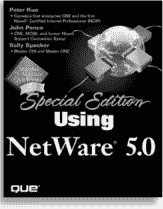

### NetWare 5.0

Peter Kuo、John Pence 和 Sally Specker  
0789720566  
39.99 美元


### StarOffice

Michael Koch 等人  
0789719932  
39.99 美元

## 其他相关图书

- **实用 KDE**  
  *Dennis Powell*  
  078972216X  
  29.99 美元

- **Red Hat Linux 安装与配置手册**  
  *Duane Hellums*  
  0789721813  
  39.99 美元

- **Caldera OpenLinux 安装与配置手册**  
  *Gary Wilson*  
  0789721058  
  39.99 美元

- **从零开始学 C++**  
  *Jesse Liberty*  
  0789720795  
  29.99 美元

- **使用 Linux**  
  *Bill Ball*  
  0789716232  
  29.99 美元

- **白金版：使用 HTML 4、XML 和 Java 1.2**  
  *Eric Ladd*  
  078971759X  
  59.99 美元

- **实用 Internet**  
  *Barbara Kasser*  
  0789722267  
  24.99 美元


**PC 升级与维修（Linux 版）**  
*Scott Mueller*  
0789720752  
59.99 美元


**Linux XFree86 简明指南**  
*Aaron Hsiao*  
0789721821  
34.99 美元

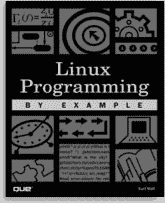

**Linux 编程实例**  
*Kurt Wall*  
0789722151  
24.99 美元

