# Linux 入门指南 (Spring Into... 系列)


# 概览

最快的真正的 Linux 精通指南！你对 Windows（或者可能也熟悉 Mac，甚至是 UNIX）了如指掌。现在，你准备好学习 Linux 了。而且你一分钟时间都不会浪费。欢迎你。这本书就是为你准备的。Janet Valade 已经花了十三个 years帮助新用户掌握 Linux 及相关技术。她了解那些能帮你快速完成任务的“魔法词”（而且完全清楚如何避开麻烦）。

你将通过几十个专注且短小易懂的示例来学习 Linux，每个示例都经过精心设计，以在你已学过的知识基础上进行构建。需要特定的解决方案吗？这本书精心设计的效率格式可以即时为你提供这些方案……正在 Fedora 上工作吗？Mandrake？还是 SUSE？没关系。这本书都是为你准备的。

没有哪本 Linux 介绍能像这样全面、如此详尽、如此快速。开始吧，采取行动，获取成果！你满足个人或业务需求对最佳 Linux 发行版所需的一切：
- 快速安装并让 Linux 稳定运行
- 处理日常任务并高效管理文件
- 掌握 KDE、GNOME 和 Linux 命令行
- 使用 OpenOffice 处理文档、文档和表格
- 设置网络访问、电子邮件和即时消息
- 使用 Linux 多媒体和图形软件进行工作，安装并运行新的 Linux
- 配置打印机以在 Linux 上工作
- 使用 Shell 脚本和自定义配置极大提升性能
- 包含简洁的 Linux 命令参考以及构建强大的正则表达式的快速指南

《Spring Into...》系列是 Addison-Wesley Professional 出版社推出的全新快节奏教程。该系列中的每本书都旨在让你快速进入状态。复杂的技术被简化为其核心组件，每个组件都会在一页或两页的跨页设计中以极高的效率进行处理。只需你开始工作所需的信息……现在！

而且由于这些书籍示例丰富且易于导航，在你掌握基础知识后，它们将成为极佳的工作参考工具。


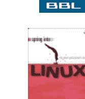


- 前言
  - 关于作者
  - 关于系列编辑


# vi 编辑会话示例

摘要

## 第 19 章 Shell 脚本

- 简单的 Shell 脚本
- 变量与数组基础
- 将数据读入变量
- 特殊字符与引号
- 流程控制
- 条件测试
- If 语句
- Case 语句
- For 循环
- While 循环与 Until 循环
- 无限循环
- 设置脚本自动运行
- 示例脚本
- 总结

## 附录 A. 正则表达式

- 匹配单个字符 (.)
- 指定位置 (*) ($
- 字符分组 ()
- 匹配一组字面字符中的一个 ([])
- 排除一组字面字符 ([^])
- 匹配字符串 (+) (*)
- 匹配一组备选字面字符串 (|)
- 使用正则表达式
- 示例

## 附录 B. 命令参考

- basename (仅显示文件名)
- bunzip (解压 bz2 文件)
- bcat (显示 bz2 文件)
- bzip2 (压缩文件)
- bzip2recover (恢复 bzip2 文件)
- cal (显示日历)
- cat (显示文件)
- cdage (更改密码过期时间)
- chgrp (更改组)
- chmod (更改权限)
- chown (更改所有者)
- clear (清除屏幕)
- cmp (比较文件)
- colrm (从文本文件中删除列)
- comm (比较两个排序的文件)
- cp (复制文件)
- crontab (调度命令)
- date (显示日期和时间)
- df (显示磁盘空间)
- diff (比较两个文件)
- diff3 (比较 3 个文本文件，合并文件)
- dir (列出文件名)
- du (显示磁盘占用)
- echo (显示文本)
- env (显示并设置环境变量)
- file (显示文件类型)
- find (查找文件)
- finger (显示用户信息)
- fold (在指定列折行)
- ftp (传输文件)
- gawk (处理文本)
- grep (在文件中查找文本)
- groupadd (添加组)
- groupdel (删除组)
- groups (显示组)
- gunzip (解压 gzip 文件)
- gzip (压缩文件)
- info (显示在线文档)
- less (逐页显示文件)
- lplq (检查打印队列)
- lpr (打印)
- plrm (从打印队列中删除作业)
- ls (文件名)
- man (显示手册页)
- merge (合并 3 个文件)
- mkdir (创建新目录)
- more (将文件显示到屏幕)
- mmv (移动或重命名文件)
- password (更改密码)
- pwd (显示当前目录)
- quota (显示磁盘占用)
- rename (重命名系列文件)
- rm (删除文件)
- rmdir (删除目录)
- sed (编辑文本)
- sleep (暂停)
- sort (排序文件内容)
- tar (将文件复制归档或从归档恢复文件)
- touch (更新访问和修改日期)
- uniq (删除重复行)
- unset (移除环境变量)
- useradd (添加账户)
- userdel (删除账户)
- w (显示系统信息)
- wc (统计字符、单词和行数)
- who (显示登录用户)
- whoami (显示当前用户)

索引


制造商和销售商为了区分其产品而使用的许多标识均声称为商标。当这些标识出现在书中且出版者知晓商标主张时，这些标识以首字母大写或全大写形式打印。

作者和出版商在准备本书时付出了努力，但不对任何形式提供任何明示或隐含保证，并对错误或遗漏不承担责任。对于使用书中包含的信息或程序有关或由此引起的间接或后果性损害，不承担任何责任。

出版商在批量订购本书时提供优惠的折扣，并可能包含针对您的业务目标、营销重点和品牌兴趣的电子版本和定制封面。更多信息请联系：
美国企业和政府销售部 (800) 382-3419
corp@pearson.com

美国以外的销售，请联系：
国际销售部
international@pearson.com

访问我们的网站：www.awprofessional.com/spring/

美国国会图书馆控制编号：200592019

版权 © 2005 Pearson Education, Inc.

保留所有权利。美国于美国印刷。本出版物受版权保护，在以任何形式复制、存储在检索系统中或以任何形式或机械形式传输之前，必须获得出版者的许可。有关许可的信息请写信至：
Pearson Education, Inc.
Rights Department
One Lake Street
Upper Saddle River, NJ 07458

第一次印刷，2005年4月。

# 献辞

致我的母亲，感谢她传给了写作基因以及许多其他东西。

# spring into 系列

Spring Into... 一系列为转型到新技术的专业人士设计的简短、快速教程。欢迎在网上 www.awprofessional.com/springinto/ 找到我们。

- Spring Into Windows XP Pack 2 - Brian Culp ISBN 0-13-167983-X
- Spring Into PHP 5 - Steven Holzner ISBN 0-13-149862-2
- Spring Into HTML and CSS - Molly E. Holzschlag ISBN 0-13-185586-7
- Spring Into Technical Writing for Engineers - Barry J. Rosenberg ISBN 0-13-149863-0
- Spring Into Linux - Janet Valade 0-13-185354-6
- Spring Into... 您的意见对我们非常重要！

# Spring Into

我们希望听到您对 Spring Into... 系列的意见。请访问 www.awprofessional.com/springinto/ 完成我们的调查卷。参与调查的人将获得特别优惠。

# 系列编辑

Barry J. Rosenberg

年前，我发现自己处于一项必须快速掌握许多新技能的工作中。不需要立即成为专家，但我必须变得胜任。

照片由 Edlund 提供 (fd2e743227b41522712350.png)

我去了书店，但震惊于出版界发生的巨大变化。在一个曾经智慧受推崇的地方，现在笨蛋却受到崇拜。发生了什么？

嗯，我打了几个电话，让 Barbara 姨妈缝制了几件衣服，并说服了 Ed 让我们把谷仓当作舞台。或者等等……那是另一个问题。实际上，我打了几个电话，让了一些非常有才华的人编写了聪明人读起来不害羞的书。我们把系列命名为“Spring Into...”，因为所有的好名字都被占用了。

通过 Spring Into...，我们认为为忙碌专业人士创造了完美的系列。然而，在您告诉我们之前，我们无法确定。也许我们正像贝克汉那样把球击出球场并穿过灯柱，空心入网。另一方面，也许我们只是旋转了一个陈词滥调的球。只有您能告诉我们。因此，如果您对这些书有任何正面或负面的想法，请发送电子邮件给我：barry.rosenberg@gmail.com。我承诺不会将您添加到任何邮件列表中，不会发送垃圾邮件，也不会对您的地址进行任何不道德的行为。

诚诚地，


# 本书是如何组织的？

本书由 19 章组成。每章都聚焦于一个主题，提供概述和操作信息。章节如下：

- **第 1 章**，理解开源软件：描述开源理念和实践，以及它们与专有软件中流行的理念和实践有何不同。
- **第 2 章**，选择 Linux 发行版：提供在许多 Linux 版本中进行选择所需的信息。
- **第 3 章**，准备安装 Linux：为你的计算机准备安装 Linux 的指令。
- **第 4 章**，**安装**：安装步骤。
- **第 5 章**，与 Linux 交互：如何使用 KDE 和 GNOME 两大桌面完成工作。
- **第 6 章**，使用你的桌面：如何在不使用桌面的情况下直接在 Linux 中输入命令。
- **第 8 章**，**Linux 账户**：没有 Linux 账户无法在 Linux 系统上进行工作。本章介绍了如何创建账户以及密码、所有者、组等信息。
- **第 9 章**，文件管理：如何创建、复制、重命名、删除以及其他管理 Linux 文件的方法
- **第 10 章**，应用程序和程序：如何下载、安装和运行 Linux 应用程序和程序。
- **第 11 章**，文字处理：如何使用 OpenOffice 文字处理应用程序。
- **第 12 章**，电子表格：如何使用 OpenOffice 电子表格应用程序。
- **第 13 章**，图形：如何创建、编辑和处理不同类型的图形文件。
- **第 14 章**，打印：如何在 Linux 上设置和使用打印机。
- **第 15 章**，互联网：如何访问和浏览互联网。
- **第 16 章**，多媒体：如何在 Linux 上播放音频和视频文件。
- **第 17 章**，电子邮件、消息传递和新闻：如何通过互联网与他人通信。
- **第 18 章**，编辑文本文件：如何创建和编辑文本文件，如 HTML 文件、程序源代码和 Linux 配置。
- **第 19 章**，Shell 脚本：如何编写和使用 Shell 脚本。

还包含两个附录：

- **附录 A**，正则表达式：如何构建许多不同 Linux 应用程序使用的正则表达式模式。
- **附录 B**，命令参考：关于命令行界面（CLI）可用命令的描述信息。

```
BBL
```

# 本书有什么不同之处？

本书与“Spring Into...”系列中的其他书籍一样，具有以下特点：

- 每个主题都在一个独立的单页或双页单元中解释，该单元被称为“知识块”（chunk）。
- 每个知识块都建立在该章中之前的知识块之上。
- 大多数块包含一个或多个示例。我通过示例学习得最快。我不认为我的风格是独特的，我相信我对示例的欣赏有很多志同道合的人。
- 每个块的标题都会出现在目录中。较小的块尺寸意味着块标题指向的是极小量的信息。查找信息非常容易。

每个块中的信息都非常密集。我付出了努力让每一个字都对你理解 Linux 做出贡献。结果就是你可以在需要时可以找到的重点信息。

当然，有话要说是不够的。你必须清晰、准确地说出来。编辑有一项艰巨的工作是引导作者朝着清晰准确的方向努力。我的编辑在这一工作中表现得极其出色。如果没有我的编辑，这本书会更加偏向“世界上那样是那个意思吗”和“那可能是的”这类模糊表述。

# 关于 Valade

Janet Valade 在计算领域有 20 年经验。她的背景包括担任几家公司的技术作家、一家工程公司的 Web 设计师/程序员，以及在大学环境中担任系统分析师。在超过 10 年的时间里，她监督了计算资源的安装和运行，设计并开发了州级数据存档，为教职和员工提供技术支持，撰写了大量的技术论文和文档，并设计和介绍了各种技术主题的研讨会和工作。

Janet 目前有两本著作：《PHP & MySQL for Dummies, Second Edition》和《PHP 5 for Dummies》。此外，她还为几本 Linux 和 Web 开发书籍编写了章节。

# 关于系列编辑

**Barry Rosenberg** 编写了经典之作 *KornShell Programming Tutorial*（Addison-Wesley, 1991），该书开创了“Spring Into...”系列中发现的许多基于块的技术。他编写了六多本企业技术手册，主要关于编程。作为一名丰富的讲师，Barry 教过从高中物理到为期一周的企业数据结构企业研讨会的所有课程。

最近， Barry 在麻省理工学院（MIT）度过了四个学期的高级技术写作。Barry 还是一名职业杂耍演员，表演过超过 1200 场节目，包括在日本的三个周演出。杂耍是他小说 *Cascade*（尚未出版）的背景。Barry 目前担任 170 Systems 的文档经理。

# 第 1 章 理解开源软件

如果你是第一次尝试开源软件，你需要理解开源理念和实践。如果你来自 Windows 或或其他商业专有软件背景，你会发现开源观点与专有软件供应商的观点完全不同。开源软件的开发和分发方式不同。你获取软件及其更新的方法也不同。本章解释了开源社区的哲学和实践。

# 开源软件

开源意味着源代码是开放的，人人可用。源代码是用编程语言（如 C 或 Java）编写的。许多人都认识这种语言。因此，开源软件在提供软件的同时提供源代码。

开源开发被组织为一个项目。志愿者开发者通常位于世界各地，通过互联网协调工作。开源项目通过提供软件下载的项目网站与用户以及整个世界进行通信。Web 还提供了关于软件及其开发者的信息、软件文档、数据库以及向数据库输入报告的程序、用户讨论软件的邮件列表或论坛以及其他相关信息。

开源开发是开放的。也就是说，软件在开发过程中就会发布在 Web 上，供任何感兴趣的人进行工作。用户是一个多样化的群体，对软件的用途和使用水平各不相同，他们通过网站网站直接访问开发者。结果是能够快速发现 Bug 和问题、对有用或无用功能的反馈、用户修复的 Bug，以及对新功能和或实现的建议。

开源支持者认为，通过这种过程产生的软件通常经过大量的测试、投入、评审、批评和讨论，质量更高。开发者受兴趣而非雇佣考虑驱动这一事实被认为可以提高质量。某些开源项目取得了成功。Apache 可能是著名的成功案例，是一个非常成功的开源项目。Apache 占据了 67% 的 Web 服务器市场。Linux 作为开源软件将在本章稍后讨论。

开源世界中的商业软件公司并不依赖专有软件获利。客户为软件的增强或相关服务付费，如下例所示：

- 开发并提供组合工作的软件包


- 开发具有简单安装程序的软件版本
- 为软件用户提供技术支持
- 为软件提供咨询和编程专业知识
- 为特殊用途提供软件的修改版本

唯一的限制是，开源软件不得出于任何目的转换为专有软件。源代码必须保持开放。

商业专有软件的用户期望在遇到问题时有一个他们可以拨打的电话号码。商业开源软件的用户也可以期待获得同样的待遇。这并不意味着对于自己下载和安装开源软件的用户没有帮助。恰恰相反，开源用户之间相互支持。信息可以从许多来源获得，而不仅仅是一个来源。网络上有许多开源软件的邮件列表和论坛，数百个包括开发者在内的资深用户在那里自愿地帮助新手。当你在邮件列表中提问时，答案通常会在几秒钟内出现在你的收件箱里。

开源软件的发布是不规律且随机的。当开发者认为软件准备就绪时，就会发布新版本，通常很少预先通知。新版本可能会在一天内针对漏洞或安全问题发布。使用开源软件的用户必须让自己信息灵通。否则，解决某个恼人问题的新版本或对安全问题的发现可能会被忽略。

## 开源许可证

软件受版权法保护。书面程序代码默认情况下是自动受版权保护的。如果有人未经版权所有者的许可就使用这些代码，那就是盗窃。是盗版行为。当然，版权所有者可以允许任何人使用软件，并设定所有者选择的任何条件。软件许可证提供了版权所有者允许你使用该软件的条件。

如果你曾经购买或安装过软件，你可能遇到过许可证。商业软件通常包含一份书面许可证。如果你下载软件，会有一个屏幕要求你在实际安装/使用软件之前同意该许可证。这种许可证被称为最终用户许可协议，也被一个不那么亲切的名称称为 EULA。

当你阅读 EULA 时，你会发现你并没有购买软件。相反，你购买的是使用该软件的许可。EULA 规定了你可以使用软件的条件或条款。EULA 可能会包含一些限制性条件，例如将软件限制在单台计算机上安装。阅读 EULA 是明智之举，这样你就能知道自己的法律权利和责任。EULA 通常是不开放谈判的。

开源软件也附带许可证。最常见的开源许可证是通用公共许可证（GPL）。GPL 是非常不受限制的。它规定你可以出于任何目的使用该软件。如果你愿意，可以更改它。如果你愿意，可以重新发行它。然而，你不能将其作为专有软件重新发行。任何接收你软件的任何人都有权获得源代码，并权对其进行更改或重新发行。

GPL 由 GNU 开发（在本章稍后部分讨论）。它通常被称为“左拷贝”（copyleft），被 GNU 定义为一种让程序成为自由软件的通用方法，并要求程序的所有修改和扩展版本也必须是自由软件。你可以在 www.gnu.org/licenses/licenses.html#TOCPL 看到 GPL 的全文以及关于其使用的其他信息。

还有其他开源许可证可用，例如用于文档的许可证。你可以在 www.gnu.org/licenses/licenses.html 查看有关开源许可证的信息。

## Linux 是开源软件

Linux 是一个操作系统。它让你的计算机硬件变成一台可用的机器。它与硬件交互以执行你需要完成的任务，例如在文件中存储信息、在屏幕上显示信息、将数据发送到打印机、将两个数字相加。你在计算机上做的任何操作都是由操作系统调解的。

Linux 不是一个巨大的、单式的程序。它是许多程序的集合，让你的计算机变成一个非常有用的工具。Linux 的核心是内核，低级操作在那里发生。没有内核，一切都没有。然而，光有内核是不够的。许多其他程序组合成了运行在你计算机上的 Linux 操作系统。关于程序的更多细节请见第 2 章。

Linux 基于 UNIX 操作系统，UNIX 开发于 20 世纪 70 代，运行在大型机和小型计算机上。林斯·托瓦尔兹（Linus Torvalds）希望在他的 PC 上有一个像 UNIX 一样的操作系统。因为当时没有符合他要求的系统被开发出来。目前的 Linux 内核是全球范围内在托瓦尔兹协调下的开发成果。当他这么早地将项目发布到网上并投入其中时，Linux 几乎每周发布一次，在万维网快速增长的推动下，数百用户的即时反馈被整合到其开发中。

从一开始开始，Linux 就是开源的。它免费分发给任何想要它的人。Linux 的官方网站（那里可以获取最新消息并下载当前源码）是 www.linuxhq.org（Linux 总部）。

让 Linux 在你的计算机上变得有用的其他程序可以从各种网站下载。Linux 工具程序、编译器、应用程序和其他软件的中心来源是 GNU（在本章稍后部分讨论）。许多其他个人项目和公司网站也提供了完整、已安装的 Linux 系统部分的软件。

虽然任何用户都可以下载 Linux 内核并下载完整 Linux 系统的所有组件，但这并不简单。很少用户以这种方式安装 Linux。相反，大多数 Linux 系统是由一个小组或公司组合在一起的程序发行版安装的，并带有简化的安装程序。Linux 发行版将在第 2 章中讨论。

## 什么是 GNU？

GNU 代表 GNU' Unix，是理查德·M·斯托曼（Richard M. Stallman）于 1984 年启动的项目。其目标是开发一个开源操作系统，免费分发给任何想要它的人。在当时，还没有非专有的可行的操作系统。GNU 旨在解决这一局面。

GNU 旨在开发产生完整操作系统所需的所有程序，包括内核、壳（用户与内核之间交互的程序）、工具程序、编译器、编辑器、邮件软件等。GNU 旨在提供所有必要的程序，以便用户不需要使用任何专有软件。GNU 在哲学上反对专有软件。


## 摘要

开源观点与专有软件供应商的观点大不相同。软件源代码必须是开放的、对所有人可用，而不是秘密。任何人都可以自由地出于任何目的使用该程序、修改程序或重新分发程序。无需许可。

大多数开源软件开发是以项目形式组织的，由志愿者开发者组成，这些开发者通常遍布世界各地，通过互联网协调他们的工作。开源软件在开发过程中就会发布在网络上，供任何感兴趣的人使用或参与。开源世界中的商业公司对软件的增强或相关软件的服务收费，而不是像专有软件公司那样对软件本身收费。

与任何其他软件一样，开源软件也附有许可证。最常见的开源许可证是通用公共许可证（GPL）。GPL 是非常不受限制的。它规定你可以出于任何目的使用软件。如果你愿意，可以更改它。如果你愿意，可以重新分发它。但是，你不能将其作为专有软件重新分发。任何接收软件的人都拥有源代码，并有权对其更改或重新分发。

Linux 是一个开源操作系统。Linux 的核心是内核，但还需要许多额外的程序让你的计算机变成实用的工具。许多额外程序是由 GNU（GNU's Not UNIX）项目开发的。Linux 内核加上 GNU 程序加上额外的程序和应用程序，成了运行在现代计算机上的 Linux 系统。

尽管任何用户都可以下载 Linux 内核并下载完整 Linux 系统的所有组件，但这并不简单。极少数用户会这种方式安装 Linux。相反，大多数 Linux 系统是从由小组或公司汇集而成的程序集合（发行版）安装的，通常带有简化的安装程序。

Linux 发行版的特征将在第 2 章中讨论。文中解释了可用发行版的范围以及每个版本的重点。

## 第 2 章。选择 Linux 发行版

安装在你的计算机上的 Linux 操作系统并不是单一巨大的程序。它是许多程序的集合。你可以自己获取 Linux 系统的每个组件，分别下载并安装它们，以创建完全符合你需求的系统。然而，这并不简单；你必须非常熟悉 Linux 才能做到。大多数用户不会自己安装这些部分。相反，他们安装一个 Linux 发行版。

发行版（通常称为 distro）是由小组或公司汇集的程序集合。它包含了在你的计算机上安装时提供完整 Linux 系统所需的所有组件。然而，不同的发行版在包含的组件上可能有所不同，侧重于不同的方面。例如，一个发行版可能强调易用性和安装，而另一个发行版则强调提供大量的应用程序。

Fedora Core 是非常流行的红帽 Linux 的继任者，也是本书讨论的主要发行版。此外，书中还描述了 Mandrake 和 SuSE 发行版。这三个发行版面向桌面用户，并提供与 Windows 发行版类似的安装程序。还有许多其他发行版。本章描述了主要的发行版。可以在 www.distrowatch.org 获取更全面的发行版覆盖，该网站维护了一个包含 320 个发行版的数据库。

## 发行版内容

Linux 发行版可能包含以下组件：

- **Linux内核**: Linux 的核心。内核与硬件交互以执行你要求计算机的任务，如在文件中保存文本、在屏幕上显示文本或图形，或将文本或图形发送到打印机。没有内核就没有操作系统。
- **Shell**: 在计算机用户和内核之间提供接口的程序。Linux 上常用的 shell 是 Bash（Bourne shell），命名是因为源自更早的称为 Bourne shell 的 shell。Linux 的接口将在第 5 章中进一步描述。
- **Linux 命令、实用程序和应用程序**: 执行任务的程序。任务可能是简单的，如显示文件内容，也可能是复杂的，如具有复杂功能的文字处理。每当你运行 Linux 命令或启动应用程序时，你都是在运行一个提供你所需功能的程序。
- **编译器**: 编译器将人类能理解的语言进行翻译。也就是说，使用类似于人类语言的语言（如 C 语言或 Java）来编写程序。计算机将 C 或 Java 代码转换为机器语言，以便计算机运行该程序。
- **桌面**: 为 Linux 提供图形界面的应用程序。有多个桌面可供选择，让你选择符合你需求的。某些桌面提供了与 Windows 界面相似的界面。Linux 的接口将在第 5 章中进一步描述。

某些组件是提供可用的 Linux 系统所必需的，例如内核以及许多 Linux 命令和实用程序。所有发行版都提供最低要求。然而，许多发行版提供的多于最低要求。不同发行版在以下特征上有所不同：

- **更多或更少的应用程序**: 发行版提供不同的应用程序。例如，几乎所有的发行版都提供文字处理应用程序。事实上，许多发行版包含了 OpenOffice，这是一个类似于 Microsoft Office 的办公应用程序。然而，并非所有的发行版都包含它。还有其他文字处理应用程序可用，例如为 KDE 桌面开发的办公套件 KOffice。某些发行版提供一个以上的办公应用程序。

一个发行版可能包含数百或数千个应用程序。你可以在网上查看发行版包含了哪些应用程序。此外，DistWatch 会报告应用程序列表，显示哪个发行版包含了哪些应用程序。例如，Fedora 的应用程序列表位于 www.distwatch.org/table.php?distribution=fedora。

任何单个应用程序的存在与否并不是选择发行版的充分理由。在 Linux 安装后可以添加任何应用程序。然而，如果一个发行版在安装过程中包含了你所需的所有应用程序，这比单独下载和添加应用程序要容易得多。

- **更多或更新的组件版本**: Linux 软件更新频繁。某些发行版包含了最新发布，力求处于前沿。其他发行版则增强稳定性，在版本证明稳定之前不包含新发布。某些发行版提供了在安装后保持 Linux 新新的程序。例如，Fedora 包含一个名为 up2date 的工具，它可以跟踪你的当前版本并在可用时自动为你获取安装。安装和更新软件将在第 10 章讨论。

- **不同的桌面**: 大多数发行版都提供桌面。两个主要的桌面是 KDE 和 GNOME，但还有更多。大多数发行版提供 KDE、GNOME 或两者都有。

- **专门为发行版开发的实用程序**: 一些公司专门为发行版开发实用程序，让用户的维护和管理变得更容易。例如，SUSE 开发了 YaST（另一个设置工具）来简化发行版的安装和配置。

- **不同的安装程序**: 过去，Linux 有安装困难的声誉。作为回应，几个发行版开发了更简单的安装程序。例如，Mandrake 专注于开发一种能够高效检测硬件并于使用的安装程序。自从易于安装和使用的声誉传开，Mandrake 的人气有所增加。

- **不同的支持级别**: 某些 Linux 发行版提供官方支持，等同于专有软件支持。例如，Mandrake 提供30天的电话支持，可以购买更多；SUSE 提供免费的安装支持，其他支持需付费。其他发行版要求用户自己解决问题。

每个发行版都有提供有关发行版信息的网站。你通常可以在网上下载发行版。你下载的文件通常是光盘镜像（ISO 镜像），你将其刻录光盘；然后从光盘安装。某些发行版还以盒装形式出售，包含光盘和可能的手手册。


## Red Hat/Fedora

即使你没有 Linux 经验，可能也听说过红帽，它是 Linux 最知名的商业版本。红帽最近经历了组织架构的调整。免费的 Red Hat Linux 已由 Fedora Core 取代，后者由 Fedora 项目发布，该项目由红帽发起、支持并提供贡献。Fedora 是一个开源开发者项目，包含测试、参与和反馈。有关 Fedora 的信息可以在 fedora.com 获取。红帽现在仅销售供企业级使用的 Red Hat Enterprise 商业软件，强调稳定性、可靠性和舒适性。

你无法从红帽处购买 Fedora。红帽只销售 Red Hat Enterprise，这是 Linux 的商业版本。要获取 Fedora，你需要从 Fedora 项目网站下载文件：fedora.redhat.com/download/。这些文件是 CD 镜像（images），你可以将其写入 CD 或制作成安装盘。有关安装过程将在第 4 章中讨论。然而，这些文件非常大，通过拨号连接下载是非常痛苦的。你可以通过各种供应商购买安装 CD。这些供应商并不提供精美的软件盒和说明书，就像你购买 Windows 或商业 Linux 发行版时收到的那样；一份供应商列表可以在 fedora.redhat.com/download/vendors.html 获取。

Fedora 的特性包括：

- **多个桌面环境：** 同时提供 GNOME 和 KDE。KDE 是默认设置。
- **软件更新：** 红帽提供了 up2date，它可以跟踪你当前的版本，并在更新可用时自动为你安装。
- **系统实用程序：** 提供由 Fedora 项目开发的系统工具。这些工具具有易于使用的图形界面，以及文本界面。工具名称以 redhat-config-network 开头。
- **安装程序：** 为安装过程提供图形或文本界面，使用其自带的安装程序 Anaconda。安装程序会检测并配置系统硬件。红帽提供了 Kickstart，这是一个允许脚本化、无人值安装的工具，对系统管理员非常有用。
- **支持良好：** 支持最最好的发行版之一。红帽在 www.redhat.com/mailing/listinfo/fedora-list 维护了一个邮件列表。还可以尝试 fedforum.org 上的 Fedora 论坛以及 www.linuxquestions.org/questions/forumid=35 上的 Fedora 问题论坛。

## Mandrake

Mandrake Linux 特别面向 Linux 初学者和家庭用户。Mandrake 专注于用户友好的图形化安装和实用程序。它是最容易安装发行版，允许没有任何 Linux 经验的用户也能成功安装。它在安装过程中识别硬件的能力非常出色。

Mandrake 有两个主要版本：

- **Mandrake Distribution：** 稳定的官方 Mandrake 发行版可以在网站 (mandrakelinux.com) 下载，格式为 CD 镜像（ISO 文件）。它还提供三种盒装版：
  - **Discovery：** 一个精简包，为桌面用户提供基本功能，具有自动化安装过程和人工精选的应用程序。它包含 2 张 CD 和一本说明书。
  - **Power Pack：** 一个高级桌面包，提供数千个开源和商业用应用程序。它包含 6 张 CD 和 2 本说明书。
  - **Power Pack Plus：** 一个高级包，提供强大的桌面环境以及创建和管理中小型网络所需的服务器工具。它包含 8 张 CD、1 张 DVD 和 2 本说明书。
- **Cookie：** Mandrake Linux 的开发版本在不断进化。每天都会出现新的软件包。它频繁发布以便进行测试、错误报告和反馈。当一个 cooker 版本被认为就绪时，它会被冻结，意味着不再添加新功能，仅修复错误，并成为官方 Mandrake 发行版的测试版（beta）。

如果你想要尖端软件，请安装 Cooker。如果你喜欢软件更稳定一点，请安装官方发行版。

Mandrake 的特性包括：

- **多个桌面环境：** 同时提供 GNOME 和 KDE。KDE 是默认设置。
- **Mandrake Club：** 提供帮助论坛等。提供早期软件下载。提供额外软件。加入需要支付少量费用。
- **Mandrake Experts：** 一个志愿者专家回答问题的网站 (www.mandrakeexpert.com)。提供专家列表。也可以公开发布你的问题供任何人选择。可以与专家进行电话咨询。

## SuSE

两个盒装版：

- **Personal（个人版）：** 为桌面用户提供基本功能的版本，包括办公应用、电子邮件软件、互联网应用等。文档仅包含一份安装指南。用户指南仅在线可用。
- **Professional（专业版）：** 包含更多软件的版本。除了个人桌面应用外，它还提供服务器和网络实用程序以及开发工具。它包含纸质用户指南和管理员指南。

SuSE 还提供如企业服务器等业务软件。

SuSE 提供了直接从 FTP 免费安装其软件的机会。FTP 版本与大部分相同，但删除了 CD 中包含的一些商业软件。这不是你希望通过拨号连接完成的操作。

SuSE 的特性包括：

- **多个桌面环境：** 同时提供 GNOME 和 KDE。KDE 是默认设置。
- **带 Windows 的 Linux：** Linux with Windows：SuSE 与 Windows 并存安装。
- **支持良好：** SuSE 在 http://www.suse.co.uk/private/support/online/ 有一个非常活跃的邮件列表。可以在 linuxforums.org/forum.php?f=36 查看论坛。

## 其他发行版

Fedora、Mandrake 和 SuSE 是书中讨论的。其他流行的发行版包括：

- **Slackware：** 最长存的 Linux 发行版。最适合想要深入学习的用户。Slackware 没有专注于易用性。它的优势是一致性、稳定性和安全性，对服务器非常有用。slack.org
- **Debian：** 一个开源项目。Debian 随时提供三个版本：stable（当前的稳定版）；testing（尚未被进入稳定版的包）；unstable（正在活跃开发的发行版）。Debian 的声誉是在如果不熟悉硬件的话安装很难，但改进安装过程是值得的。一旦安装，它很容易更新。debian.org
- **MEP：** 最新的成员。MEPIS 基于 Debian 发行版。它自带了许多应用程序，如 Java 和 Macromedia Flash。安装 MEPIS 比在其他发行版上单独安装这些应用程序要简单得多。mepis.org
- **Xandros：** 所有中最简单的 Linux。面向初学者。包含的应用程序较少，但包含的程序运行良好。它基于 Debian，但设计得尽可能像 Windows。它包含了为 Xandros 设计的图形工具，让文件管理等任务对用户来说更容易。xanders.org
- **Linspirit：** 另一个简单的 Linux，面向初学者。它的特点是安装快速方便。它提供了一个一键软件安装功能，从自己的软件池中安装软件。linspirit.com
- **Gentoo：** 一个基于源码的 Linux。Gentoo 强调从源代码安装大部分 Linux 系统并在你的计算机上进行编译。安装过程更复杂、耗时更长，但结果是针对你的硬件和需求定制的系统。Gentoo 拥有卓越的文档。gentoo.org

DistroWatch 数据库目前包含超过 300 个活跃发行版。大多数发行版都是 Red Hat/Fedora 或 Debian 的修改版。如果你对 Linux 有特定的用途，你可能找到提供你所需的发行版。


## 现场光 (Live CDs)

Live CD 是一种可以运行计算机的 CD。你可以从 CD 启动并获得一个从 CD 运行的正常工作的 Linux 计算机。你可以在不向硬盘上安装任何内容的情况下使用 Linux 工具和应用程序。通过即时解压缩技术，Live CD 可以包含许多应用程序。Live CD 上的 Linux 可以访问软盘和 CD 驱动器、打印机和其他硬件。Live CD 用于以下场景：

- 评估：你可以尝试 Linux。你可以在不向硬盘上安装任何内容的情况下查看它的工作原理/或学习如何使用它。
- 测试：在购买电脑之前，你可以先用 Linux 对该电脑进行测试。
- 便携性：你可以轻松地将 Linux 在不同电脑之间移动。你可以将你的 Linux 随身携带，并在任何有电脑的地方使用它。无论你在何处，可以使用你的办公软件。或者你可以将 Live CD 用于演示或培训目的。

某些 Live CD 包含了安装软件。你可以从 CD 启动 Linux 并尝试它。然后，如果你喜欢，可以从运行中的 Linux 将其安装到硬盘上。

以下是一些流行的 Live CD：

- Knoppix：一种基于 Debian 的发行版，具有出色的硬件检测功能。Knoppix 提供了 KDE 桌面和许多应用程序，包括 Konqueror 浏览器、OpenOffice、GIMP 等。通过解压缩，Knoppix 存储了 2GB 的软件。www.knoppix.com（输入 www.knoppix.org 会进入一个德语页面。）
- Mandrake Move：在可启动的 CD 上提供完整的 Mandrake Linux 系统。内置的应用程序允许你创建和编辑办公文档、听音乐、访问互联网等。数据和配置文件可以存储在 USB 闪存上以便与 CD 一起使用。此外，Mandrake Move 还允许你从另一张 CD 读取数据。www.mandrakesoft.com/products/mandrakemove
- MEPIS：提供一个作为安装程序的可启动 CD。你可以从 CD 启动并运行 MEPIS 进行尝试。该可启动 CD 包含一个安装程序，因此你可以从同一张 CD 将 Linux 安装到硬盘上。MEPIS 是第一个将 Live CD 与安装程序结合的。www.MEpis.org

## 总结

安装在你的计算机上的 Linux 操作系统是许多程序的集合，被称为“发行版”，由一个小组或公司组合而成。所有发行版都包含核心组件，这些组件对于 Linux 运行你的计算机是必要的。然而，大多数发行版包含的内容比基本要素更多。它们在包含的应用程序数量、安装步骤、系统实用程序、支持级别和其他因素方面可能有所不同。

发行版可以通过网站下载或通过 CD 获取。可下载的软件由 CD 镜像组成，你可以将其写入 CD。然后你从自己创建的 CD 中安装 Linux。某些发行版提供带有 CD 和说明书的盒装版。

Fedora 是非常流行的红帽 Linux (Red Hat Linux) 的继任者，也是书中讨论的主要发行版。它的优势是支持强大、具有图形化安装程序和管理工具。Fedora 不以盒装形式提供。你必须自己下载它，或从制作 CD 的供应商处购买。没有纸质说明书，但你的系统和网站上可以找到文档。

此外，书中还描述了 Mandrake 和 SuSE 发行版。两者都强调安装和使用的简易性。这三个发行版面向桌面电脑用户，并提供了与 Windows 安装程序类似的安装步骤。其他流行的发行版还有 Slackware、Debian、MEPIS、Xandros、Linspire 和 Gentoo，本章进行了简要介绍。还有可以让你从 CD 运行电脑的 Live CDs。有非常多的发行版。可以在 www.distrowatch.org 获取更全面的发行版覆盖，那里维护了一个包含 320 个发行版的数据库。

选择发行版是你的第一步。接下来，你需要准备安装选择的 Linux。你需要确保拥有了必要的计算机资源，获取 Linux 软件，并决定你想要的安装类型。第 3 章提供了你准备安装所需的信息。

## 第 3 章 准备安装 Linux

准备 Linux 需要一些思考，可能还需要一些工作。在开始安装 Linux 之前，你需要执行以下操作：

- 检查硬件：Linux 需要某些最小硬件资源。此外，Linux 需要与你的硬件通信，例如你的显示器和鼠标。你可以检查你的硬件以确保它与你的 Linux 发行版兼容。
- 获取 Linux 软件：获取 Linux 最简单的方法是购买。当你购买 Linux 发行版时，准备好的 Linux CD 会直接送到家门口。另一方面，获取 Linux 最快的方法是从发行版网站下载。但是，你必须将下载的文件复制到 CD 中。
- 规划你首选的操作系统：Linux 可以单独安装在你的计算机上，也可以与 Windows 等其他操作系统一起安装。
- 为多个操作系统准备你的计算机：如果你计划运行多个操作系统，你需要为每个操作系统准备硬盘的独立区域（分区）。
- 设置你的计算机从 CD 驱动器启动：要从 CD 安装 Linux，你需要从 CD 驱动器启动你的计算机。你需要确定你的计算机是否可以从 CD 启动。如果不能，你可以更改设置让它能够从 CD 启动。或者，你可以从软盘启动。

## 硬件要求

Linux 需要某些硬件资源。不同的 Linux 发行版有不同的要求。某些 Linux 发行版专门开发设计为安装在非常小的空间或旧的、异常的计算机上。然而，本书提供了有关完整 Linux 发行版的信息，包括桌面和通用应用（办公或图形应用）。因此，本节讨论的硬件考虑因素指的是完整的 Linux 发行版，如 Fedora、Mandrake 和 SuSE。一般要求如下：

- **计算机类型**：等同 Pentium II 的 Pentium 类计算机，速度 400MHz 或更高。
- **内存**：Fedora 建议的最小内存需求为 192MB，推荐 256MB。SuSE 给出的最小值为128MB，推荐 256MB。Mandrake 给出的最小值为64MB，推荐 128MB 或更多。
- **硬盘空间**：与大多数软件一样，Linux 发行版随着改进和功能的增加而变得越来越。例如，Mandrake 9.2 最小化安装需要 100MB，推荐 1GB；而 Mandrake 10 需要 500MB，推荐 1GB。最好检查网站获取你想要安装的 Linux 发行版和版本的硬盘要求。

软件包的数量和类型也是一个考虑因素。事实上，某些最小化安装可能不包含这些软件包……（此处原文存在大量重复内容，已按翻译要求处理逻辑）……（检测到重复错误）。

## 硬件兼容性

安装在你的计算机上的 Linux 操作系统是许多程序的集合，被称为发行版，由一个小组或公司组合而成。所有发行版都包含核心组件，这些组件对于 Linux 运行你的计算机是必要的。然而，大多数发行版包含的内容比基本要素更多。它们在包含的应用程序数量、安装步骤、系统实用程序、支持级别和其他因素方面可能有所不同。

发行版可以通过网站下载或通过 CD 获取。可下载的软件由 CD 镜像组成，你可以将其写入 CD。然后你从自己创建的 CD 中安装 Linux。某些发行版提供带有 CD 和说明书的盒装版。

Fedora 是非常流行的红帽 Linux 的继任者，书中讨论的主要发行版。它的优势是支持强大、具有图形化安装程序和管理工具。Fedora 不以盒装形式提供。你必须自己下载它，或从制作 CD 的供应商处购买。没有纸质说明书，但你的系统和网站上可以找到文档。

此外，书中还描述了 Mandrake 和 SuSE 发行版。两者都强调安装和使用的简易性。这三个发行版面向桌面电脑用户，并提供了与 Windows 安装程序类似的安装步骤。其他流行的发行版还有 Slackware、Debian、MEPIS、Xandros、Linspire 和 Gentoo，本章进行了简要介绍。还有可以让你从 CD 运行电脑的 Live CDs。有非常多的发行版。可以在 www.distrowatch.org 获取更全面的发行版覆盖，那里维护了一个包含 320个发行版的数据库。

选择发行版是你的第一步。接下来，你需要准备安装选择的 Linux。你需要确保拥有了必要的计算机资源，获取 Linux 软件，并决定你想要的安装类型。第 3 章提供了你准备安装所需的信息。

## 第 3 章 准备安装 Linux

准备 Linux 需要一些思考，可能还需要一些工作。在开始安装 Linux 之前，你需要执行以下操作：

- 检查硬件：Linux 需要某些最小硬件资源。此外，Linux 需要与你的硬件通信，例如你的显示器和鼠标。你可以检查你的硬件以确保它与你的 Linux 发行版兼容。
- 获取 Linux 软件：获取 Linux 最简单的方法是购买。当你购买 Linux 发行版时，准备好的 Linux CD 会直接送到家门口。另一方面，获取 Linux 最快的方法是从发行版网站下载。但是，你必须将下载的文件复制到 CD 中。
- 规划你首选的操作系统：Linux 可以单独安装在你的计算机上，也可以与 Windows 等其他操作系统一起安装。
- 为多个操作系统准备你的计算机：如果你计划运行多个操作系统，你需要为每个操作系统准备硬盘的独立区域（分区）。
- 设置你的计算机从 CD 驱动器启动：要从 CD 安装 Linux，你需要从 CD 驱动器启动你的计算机。你需要确定你的计算机是否可以从 CD 启动。如果不能，你可以更改设置让它能够从 CD 启动。或者，你可以从软盘启动。

## 硬件要求

Linux 需要某些硬件资源。不同的 Linux 发行版有不同的要求。某些 Linux 发行版专门开发设计为安装在非常小的空间或旧的、异常的计算机上。然而，本书提供了有关完整 Linux 发行版的信息，包括桌面和通用应用（办公或图形应用）。因此，本节讨论的硬件考虑因素指的是完整的 Linux 发行版，如 Fedora、Mandrake 和 SuSE。一般要求如下：

- **计算机类型**：等同 Pentium II 的 Pentium 类计算机，速度 400MHz 或更高。
- **内存**：Fedora 建议的最小内存需求为 192MB，推荐 256MB。SuSE 给出的最小值为128MB，推荐 256MB。Mandrake 给出的最小值为64MB，推荐 128MB 或更多。
- **硬盘空间**：与大多数软件一样，Linux 发行版随着改进和功能的增加而变得越来越。例如，Mandrake 9.2 最小化安装需要 100MB，推荐 1GB；而 Mandrake 10 需要 500MB，推荐 1GB。最好检查网站获取你想要安装的 Linux 发行版和版本的硬盘要求。

软件包的数量和类型也是一个考虑因素。事实上，某些最小化安装可能不包含这些软件包……（此处原文存在大量重复内容，已按翻译要求处理逻辑）……（检测到重复错误）。


## Linux

获取 Linux 最简单的方法就是购买。事实上，获取 Linux 最简单的方法是购买一台已经安装了 Linux 的电脑。虽然购买一台预装 Linux 的电脑显然不像购买一台预装 Windows 的电脑那么容易，但这是可能的。销售 Linux 工作站的一些公司包括 Monarch Computer Systems (www.monarchcomputer.com) 和 Penguin Computing (www.penguincomputing.com)。这些公司也可以出售预装 Linux 的笔记本电脑，专门从事笔记本电脑的 Emperor Linux (www.EmperorLinux.com) 也可以买到。

此外，如果你想在自己拥有的、没有操作系统或已安装 Windows 的电脑上安装 Linux。若要购买 Linux，可以从发行版网站或分发 Linux CD 的网站购买。你可以购买两种类型的 Linux：

-   *盒装版 (Boxed sets)*：Linux 发行版提供盒装版，类似于 Windows 软件，可以从发行公司购买（通常在公司的网站上）。CD 包装在精美的盒子里，并附有手册和其他文档。当你购买盒装版时，通常会获得技术支持。价格从 30 美元起。以下是一些提供盒装版的 Linux 发行版：
    - Mandrake (www.mandrakesoft.com/products)，49.90 美元起
    - SuSE (www.suse.com/us/private/index.html)，29.95 美元起
    - Slackware (store.slackware.com)，39.95 美元
-   *CD 盘*：你可以只订购 CD，这与你自己下载 CD 镜像（ISO 镜像）文件并将其复制到 CD 中得到的 CD 是一样的。以合理的价格，你可以购买 CD 以省去麻烦。如果你的互联网连接是拨号上网，下载将是一个漫长而痛苦的过程。一个 650MB 的 ISO 镜像可能需要下载 27 小时。Fedora 发行版仅通过这种方式提供；没有盒装版。某些发行版仅以 CD 形式提供。购买 Linux CD 的两个地方如下：
    - www.cheapbytes.com：销售许多 Linux发行版 CD。也销售其他产品。
    - www.easylinuxcds.com：提供许多不同的 Linux发行版。还提供培训。

# 下载 Linux

获取 Linux 最快的方法是下载。你下载的文件是 CD 镜像，也称为 ISO 镜像。下载后，你将镜像拷贝到 CD 上并从这些安装 CD 安装 Linux。例如，下载 Fedora，请遵循以下步骤：

-   1. 转到 fedora.redhat.com/download/。
-   2. 向下滚动页面到“Downloading the ISO Images”（下载 ISO 镜像）标题。
-   3. 点击链接：http://download.fedora.redhat.com/pub/fedora/linux/core/2/i386/iso/。
-   4. 下载以 disc.iso 结尾的文件，其中 n 是数字。这些是 CD 的 ISO 镜像。这些是 Fedora Core 2 的文件：

```
FC2-i386-disc1.iso
FC2-i386-disc2.iso
FC2-i386-disc3.iso
FC2-i386-disc4.iso
```

-   5. 将四个 ISO 镜像写入四张 CD 中。写入 CD 的具体步骤取决于你使用的刻录软件。请阅读手册以了解如何写入 ISO 镜像。

你现在已经有了可以安装 Linux 的安装 CD。安装说明在第 4 章中提供。

你也可以使用类似的程序从 DVD 安装 Linux。下载 DVD 镜像而不是 CD 镜像。DVD 存储的信息更多，因此你下载的文件较少（可能只有一个），但文件可能大得多，高达 4GB。

大多数 Linux 发行版都提供一个可以下载镜像的网站。例如，Mandrake 的下载位置是 www.mandrakelinux.com/en/ftp.php3，Debian 是 www.debian.org/CD/http-ftp/。

SuSE 有一种特殊的下载程序。你通过 FTP 直接从 SuSE 网站安装 Linux。该网站是 www.suse.com/us/private/download/suse_linux/

## 注意

如果你使用的是拨号连接，下载 Linux 是不可行的。在拨号速度下，一个安装盘的单个 ISO 镜像下载可能需要长达 27 小时。

## 规划你的计算机系统

Linux 可以单独安装在你的电脑上，也可以与另一个操作系统（如 Windows）一起安装。如果与另一个操作系统一起安装，当你启动电脑时会看到一个菜单，让你选择想要启动的操作系统。这种系统被称为双启动系统（dual-boot system），如果你有两个以上的操作系统，则称为多启动系统。你的第一个决定是想让 Linux 在你的电脑上独立运行，还是与另一个操作系统一起运行。运行多个操作系统的原因包括：

-   为了学习系统。
-   在不放弃 Windows 的情况下学习 Linux。
-   使用特定操作系统的应用程序。应用程序软件无法同时在 Windows 和 Linux 上运行，尽管某些软件在 Linux 上有两个版本，在 Windows 上有一个版本。你可能想使用一个运行在 Linux 上的应用程序和另一个运行在 Windows 上的应用程序。
-   在两个系统上测试应用程序。如果你开发了一个计算机应用程序，可以测试它是否在两个系统上运行。

双启动系统有以下缺点：

-   启动速度较慢。每次都要经过启动菜单。
-   每个操作系统的磁盘空间较少。
-   需要更多的维护工作。两个系统比一个系统需要更多维护。
-   需要更多的组织。如果你想在分区之间共享文件，你需要组织你的工作。

如果你计划在电脑上只安装 Linux，那么你的准备工作非常简单。你完全不需要准备硬盘。如果你计划与另一个操作系统一起运行 Linux，你需要准备硬盘。有关共同运行 Linux 的信息请参见下一节。

## 与 Windows 一起运行 Linux

你可以在电脑上安装 Linux 和 Windows，尽管任何时候只有一个操作系统在运行。系统会显示一个菜单，允许你选择启动哪个操作系统。每个操作系统都安装在硬盘的独立区域，称为“分区”（partition）。

要在硬盘上安装 Windows，你需要在一个分区中已经安装了 Windows，并且硬盘上有足够的空闲空间。Windows 安装说明将告诉你如何操作。例如，在没有任何 Windows 版本的硬盘上安装 Windows 时，你将看到一个显示分区的屏幕，为你提供安装 Windows 的选择。唯一的可能是可能是显示为你的硬盘的“未分区空间”（unpartitioned space）。选择“从未分区空间创建新分区”（Create a new partition from unpartitioned space）。当显示新分区时，选择一个小于硬盘的大小，为 Linux 留出空间。

当你安装 Windows 2000 或 XP 时，可以为 Windows 分区选择文件系统类型。NTFS 和 FAT32 是常用类型。尽管 NTFS 有许多优点（如安全性和效率），但在双启动系统中也有缺点。此时，Linux 很难读取/写入 NTFS 文件系统，从而阻止了分区之间的文件共享。此外，如果你想为另一个分区留出空间，NTFS 文件系统无法轻松调整大小。对于双启动 Linux，FAT32 可能更好。

如果 Windows 已经安装在电脑上占据了硬盘，你需要缩小 Windows 分区的大小以为 Linux 留出空间。你可以使用 Linux CD 上一个名为 FIPS 的工具来实现。然而，FIPS 无法调整 Windows XP NTFS 分区的大小。截至本文编写，解决方案是购买 Partition Magic（它可以调整大小），或者安装 Mandrake Linux（它可以在安装时调整 Windows 分区并留出空间）。另一个建议是安装另一块硬盘并将 Linux 安装在那里。如果该分区不是 Windows 分区，请参见本章的“安装前为 Linux 留出空间”（Making Room for Linux Before Installation）。

如果你不知道一个或两个硬盘，或者不知道你的硬盘是如何分区的，可以使用 Windows 管理工具查看你的硬盘，如下一节“检查你的硬盘”（Exining Your Hard Drive）所示。


## 检查您的硬盘

如果你不知道哪些分区可用，可以使用 Windows 管理工具来查找。在 Windows XP 中，选择开始 -> 控制面板 -> 管理工具 -> 计算机管理 -> 磁盘管理。图 3-1 所示的窗口显示了硬盘及其分区。

## 图 3-1. Windows 2000 中的磁盘分区信息。

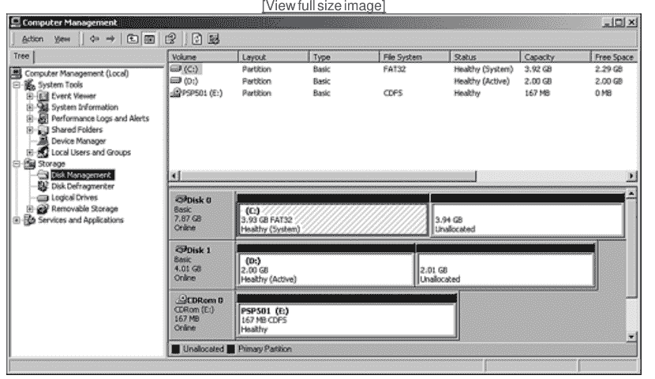

图 3-1 中的显示显示了两个硬盘（C 和 D）和一个驱动器（E）。每个硬盘都有一个分区和一个未分配空间。在 C 盘上，分区为 3.93GB，使用 FAT32 文件系统格式化。未分配空间为 3.94GB。Linux 可以安装在 C 盘上的未分配空间中。

注意顶部的面板，C 盘上的分区显示容量为 3.92GB，其中 2.29GB 为可用空间。如果有必要，可以缩小 C 盘上的分区而不会丢失任何数据，因为 2.29GB 中不包含数据。

## 注意

安装 Linux 时，它通常会安装到多个分区中，以便于某些 Linux 安全功能和技术。大多数发行版的安装程序会在安装期间在未分配空间中创建 Linux 分区。

## 安装期间为 Linux 留出空间

如果你的 Windows 分区没有为 Linux 留出空间，你需要调整 Windows 分区的大小，将其部分未使用的空间划分为 Linux 分区。Mandrake 和 SuSE（但不包括 Fedora）可以在安装过程中调整 Windows 分区。

在调整分区之前，你需要对 Windows 分区进行碎片整理，将文件移动到分区的开头。在 Windows 2000/XP 中，选择：

```
开始->程序->附件->系统工具->磁盘碎片整理
```

对于你的 NTFS 文件系统（虚拟内存）可能会留在分区的末尾。你可以在安装期间临时关闭虚拟内存，并在安装后启动虚拟内存。此外，在调整 Windows 分区之前备份你的数据是一个好主意，以防万一。

Mandrake 可以与 Windows 轻松安装。在安装过程中，Mandrake 会显示一个屏幕询问 Linux 应该安装在何处。选择：

- 使用 Windows 分区上的可用空间

此选择会导致 Mandrake 调整任何 Windows 分区（甚至是 NTFS 分区）的大小为自己留出空间。在此过程之后，Windows 分区变小。

SuSE 允许你手动分区。在安装过程中，会显示一个建议分区的屏幕。选择：

```
创建自定义分区：设置
```

屏幕将显示让你为 Linux 安装选择一个硬盘。如果硬盘包含 Windows 分区且没有足够的空间安装 Linux，将显示一个屏幕询问是否删除或调整 Windows 分区。当你选择“调整 Windows 分区”时，SuSE 会显示一个屏幕允许你为分区选择新大小。

## 安装前为 Linux 留出空间

安装某些 Linux 发行版时你可以调整 Windows 分区的大小，但并不是所有的。例如，Mandrake 和 SuSE 可以在安装期间为 Linux 留出空间，但 Fedora 不能。当你无法在安装期间调整时，需要在开始安装之前调整 Windows 分区。最好是获取一个 Partition Magic 副本（https://www.symantec.com/partitionmagic/）。

在某些情况下，你可以使用 FIPS 工具调整 Windows 分区的大小。然而，由于 Windows 分区中的不可移动块，FIPS 通常无法成功。

## 注意

在开始安装之前，请确保如上一节所述对你的硬盘进行碎片整理和备份。

FIPS 位于 Linux 安装光上，可能在 dosutils\fips20 中，但也可能在不同的目录中。你需要将其复制到可以启动的软磁盘上以调整分区：

- 1. 打开命令提示符窗口。
- 2. 如果你的光驱器是 D 且软盘是 A，输入：

```
copy D:\dosutils\fips20\*.* A:
```
- 3. 制作软磁盘后，关闭电脑。
- 4. 开启电脑，从软盘启动。
- 5. 开启电脑，从软盘启动。
- 6. FIPS 显示分区。
- 7. FIPS 显示分区。
- 8. FIPS 显示分区。
- 9. FIPS 显示分区。

## 安装后为 Linux 留出空间

如果你的 Windows 分区没有为 Linux 留出空间，你需要调整 Windows 分区的大小，将其部分未使用的空间划分为 Linux 分区。Mandrake 和 SuSE（但不包括 Fedora）可以在安装过程中调整 Windows 分区。

在调整分区之前，你需要对 Windows 分区进行碎片整理，将文件移动到分区的开头。在 Windows 2000/XP 中，选择：

```
开始->程序->附件->系统工具->磁盘碎片整理
```

对于你的 NTFS 文件系统（虚拟内存）可能会留在分区的末尾。你可以在安装期间临时关闭虚拟内存，并在安装后启动虚拟内存。此外，在调整 Windows 分区之前备份你的数据是一个好主意，以防万一。

Mandrake 可以与 Windows 轻松安装。在安装过程中，Mandrake 会显示一个屏幕询问 Linux 应该安装在何处。选择：

- 使用 Windows 分区上的可用空间

此选择会导致 Mandrake 调整任何 Windows 分区（甚至是 NTFS 分区）的大小为自己留出空间。在此过程之后，Windows 分区变小。

SuSE 允许你手动分区。在安装过程中，会显示一个建议分区的屏幕。选择：

```
创建自定义分区：设置
```

屏幕将显示让你为 Linux 安装选择一个硬盘。如果硬盘包含 Windows 分区且没有足够的空间安装 Linux，将显示一个屏幕询问是否删除或调整 Windows 分区。当你选择“调整 Windows 分区”时，SuSE 会显示一个屏幕允许你为分区选择新大小。

## 从光驱或软盘启动

要进行安装，你需要从光驱启动。大多数电脑的启动顺序如下：

1. **从软盘**：如果有软盘，则从软盘启动。
2. **从光驱**：如果有光驱，则从光驱启动。
3. **从硬盘**：如果没有找到软盘或光驱，则尝试从硬盘启动。

设置你的电脑从光驱启动。某些旧电脑或笔记本电脑可能拒绝从光驱启动，因此你需要制作软磁盘。为 Mandrake 制作软磁盘：

- 1. 开始。程序位于第一张光盘的 dosutils 中。点击窗口中的程序或其名称。等待后会出现用户界面。
- 2. 选择镜像文件。大多数情况下，镜像文件应该是 ..image\cdrom.img。
- 3. 将软磁盘插入驱动器。
- 4. 确保选择的软磁盘是正确的。A: 通常是。
- 5. 点击写入。

制作软磁盘后，你可以用软盘启动电脑，从而开始安装。安装将继续使用光盘。

## 注意

Fedora Core 1 提供了类似的步骤。但从 Fedora 2 开始，光盘上不再提供 dosutils 目录。

## 总结

为 Linux 准备需要一些思考和工作。

- 检查你的硬件，确保 CPU 足够强大、内存足够且硬盘空间足够。你还需要检查你的硬件（如显卡、显示器、调制解调器、打印机等）是否兼容 Linux。
- 获取你计划的 Linux 发行版。购买或下载它。
- 决定是单独安装 Linux 还是与其他操作系统（如 Windows）一起安装。你可以将每个操作系统安装在硬盘的不同区域，称为分区。
- 为计划的系统准备硬盘。如果你计划与 Windows 同时安装 Linux，则需要先安装 Windows。使用 Windows 检查硬盘是否存在适用于安装 Linux 的分区。如果没有，你可以在安装前或安装期间为 Linux 留出空间。
- 设置你的电脑从光驱启动。

当你的电脑准备好 Linux 后，按照第 4 章的说明进行安装。


## 第 4 章 安装

安装软件不仅仅是将软件拷贝到硬盘上。软件必须根据其执行任务所需的信息进行配置。操作系统是一个复杂的软件，需要大量信息来运行其工作。大多数软件（包括操作系统）都带有一个安装程序。要安装软件，你需要运行安装程序，它会向你提问并安装软件，同时根据安装过程中获得的信息对其进行配置。

如果你在 Windows 机器上安装过软件，你就会知道安装程序会向你提问，例如你想将软件安装在何处以及注册码是什么。在你回答这些问题后，安装程序将根据你提供的信息安装软件。

大多数 Linux 发行版都带有一个安装程序，该程序根据安装过程中获取的信息来安装软件。信息的获取既通过探测计算机硬件，也通过提问来实现。

本书讨论的 Fedora、Mandrake 和 SuSE 这三个主要 Linux 发行版的安装程序已经经过开发和优化，非常易于使用。本章将详细介绍这些发行发行的安装方法。

## 安装概述

Linux 安装程序执行两个任务：

- 收集信息
- 安装 Linux

为了正确完成安装，Linux 安装程序需要以下信息：

- **本地信息**：用户偏好的语言。本地时区。
- **硬件信息**：Linux 与计算机硬件通信以便在显示器上显示信息、将文档发送到打印机、将数据存储在硬盘文件中、通过调制解调器发送信息。为了正确通信，Linux 需要知道了哪些硬件，包括显示器类型、打印机类型等。
- **安装位置**：Linux 是安装在整个硬盘还是部分硬盘？是否与另一个操作系统共享磁盘？是新安装还是替换之前的 Linux 安装？第 3 章。
- **账户**：Linux 要求用户在使用计算机之前必须拥有账户。账户在安装过程中创建。账户将在第 8 章中讨论。
- **软件**：要安装哪些软件包？大多数发行版包含成百上千甚至万个包。并不是所有的包都需要、甚至必须安装。
- **网络设置**：为了跨网络通信，Linux 需要知道将使用什么类型的网络和连接。网络将在第 16 章中详细讨论。

任何 Linux 发行版都需要安装在 Linux。在过去，安装 Linux 的人员需要提供这些信息。因此，人员需要具备相关知识，特别是硬件方面的知识。随着时间的推移，许多 Linux 发行版开发了安装程序，使安装过程变得简单得多。安装程序可以通过探测计算机硬件和设置获取大部分所需信息。

本书讨论的三个发行版（Fedora, Mandrake, SUSE）提供的安装程序非常易于遵循。这三个发行版在收集信息方面采取不同的方法：

- **Fedora**：安装程序逐项处理所需的每个信息，如果需要筛选键盘或鼠标等，则会进行提问。
- **SUSE**：从探测计算机开始，收集信息并对所有设置进行估算。它会在屏幕上显示估算出的设置。你可以接受或更改这些设置。
- **Mandrake**：像 Fedora 一样提问。但在问题结束后，会显示一个显示设置的屏幕，类似于 SUSE 的屏幕，给你更改任何设置的机会。

收集信息后，将安装软件。安装包括：

- 根据收集的信息配置软件
- 将程序拷贝到硬盘上的相应位置。

Fedora 和 Mandrake 一次拷贝所有软件包。SuSE 安装基础系统，重启，然后使用基础系统安装剩余的软件。

Linux 安装可能需要一个小时或更长时间，取决于发行版和安装的软件数量。在安装过程中让安装等待一会儿是可以的，但如果你停止了进程（例如通过关闭电脑），你将必须从头开始。

接下来的页面将详细描述 Fedora、Mandrake 和 SuSE 的安装程序。

## 开始 Fedora 安装程序

将第一张安装 CD（磁盘 1）或 DVD 放入 CD 或 DVD 驱动器，并开启电脑电源。计算机将从 CD 启动并显示安装启动界面。（如果你的机器无法从 CD 启动，请参见[第 3 章](#)）

**图 4-1。Fedora 的启动界面。**

按 <Enter> 开始图形化安装程序。Fedora 会执行若干任务，并在纯屏幕上显示进度，如[图 4-2](#) 所示。你不需要响应或理解屏幕上的行。

**图 4-2。Fedora 中的一个过渡屏幕。**

```
VFS: Disk quotas dquot_6.5.1
dquot-cache hash table entries: 1024 (order 0, 4096 bytes)
gevent: Registering notifier for hooks
Initializing Cryptographic API
Limiting direct PCI/PCI transfers
pci_bus: help() PCI Core version: 0.5
HCI: Processor (CPUID) (supports C1, 8 throttling states)
isiseup: Scanning for PnP cards
isiseup: also Plug and Play device found
Real Time Clock Driver v1.12
Linux apart v8.100 (c) Dave Jones
```

在继续下一步之前，Fedora 提供了一个测试安装 CD 的机会。测试并非必须，但这是明智的。如果你在安装过程中 CD 无法使用，将导致安装停止。图 4-3 显示了 CD 测试屏幕。

**图 4-3。CD 测试界面。**

如果你选择测试 CD，介质检查将持续一段时间。检查完成后，你将看到类似图 4-4 的屏幕。

**图 4-4。Linux 的 CD 测试结果。**

结果屏幕显示 PASS（通过）或 FAIL（失败）。如果你的 CD 失败，可以清理 CD 或再次测试。有时第一次失败的 CD 实际上没问题。按 Enter 将显示图 4-3 的屏幕，允许你测试其他 CD。测试完所有需要的 CD 后，选择 Skip（跳过）继续安装。

Fedora 显示几行。然后显示欢迎界面。

**图 4-5。Fedora 的欢迎界面。**

Fedora 安装程序在每个屏幕上提供按钮，用于在准备好后进入下一个屏幕（Next），或返回（Back）上一个屏幕。

## 为 Fedora 硬件信息

Fedora 收集安装 Linux 所需的硬件信息。作为安装程序的一部分，它探测硬件确定鼠标、键盘和显示器类型。根据探测结果，Fedora 可能需要为某个硬件项显示屏幕。可能会显示的有：

- **语言**：选择安装界面的语言。如果高亮的语言不对，请选中正确的语言。
- **键盘**：选择键盘布局。高亮一种布局。如果有其他偏好，可以选择不同的布局。
- **鼠标**：Fedora 高亮鼠标名称且几乎总是正确的。如果选中的鼠标不对，请选中正确的鼠标。
- **显示器**：Fedora 显示一个选择显示器的屏幕。安装程序识别出的显示器被高亮。

在图 4-6 中，程序无法识别显示器，因此高亮了一个通用代码。如果正确的显示器未被高亮，请在列表中找到显示器。点击制造商旁边的三角形会下拉模型列表。如果你找不到正确的模型，可以输入某些规格（水平同步、垂直同步），以便 Fedora 能够正确显示在你的显示器上。你可以在显示器用户手册或制造商网站上找到这些规格。

**图 4-6。Fedora 的显示器界面。**


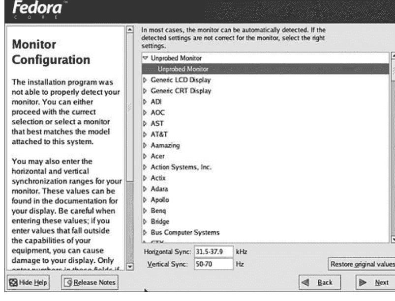

BBL

## 选择 Fedora 的安装类型

如果安装程序在您的硬盘上发现了 Fedora，它会询问您是想升级还是安装新版本。本章的说明适用于全新安装。

Linux 计算机可以有许多用途。下一个屏幕允许您为计算机选择一种安装类型。如图 4-7 所示。

### 图 4-7. Fedora Core 中的安装类型屏幕。

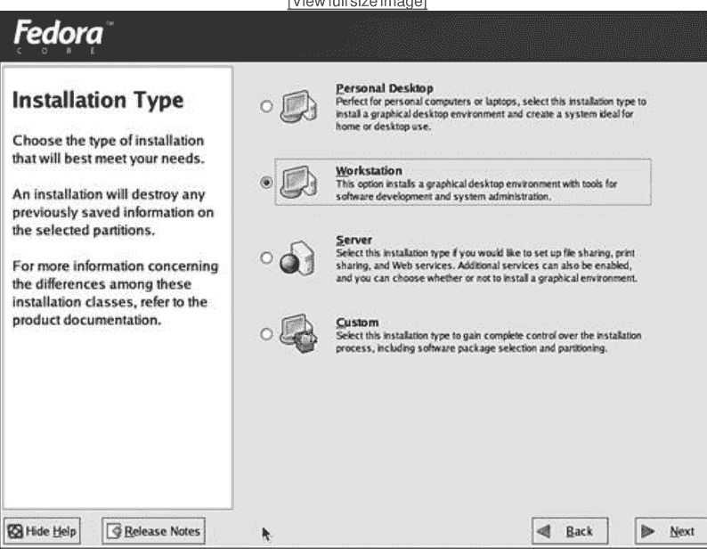

选择以下其中一项：

- **个人桌面 (Personal Desktop)** 提供桌面和一系列桌面应用程序。这将删除您硬盘上所有现有的 Linux 软件，但会保留任何 Windows 软件。
- **工作站 (Workstation)** 包含桌面提供的应用程序，并为软件开发人员和系统管理员增加了工具。
- **服务器 (Server)** 不为桌面使用设计。此选项将从您的硬盘上删除所有其他软件，包括 Windows。
- **自定义 (Custom)** 允许更大的灵活性，但您必须了解自己在做什么。

在后续的 Fedora 说明中，这些选择将基于工作站安装。如果您选择了其他类型，可能会在显示的屏幕上看到细微差异。


## 选择安装 Fedora 的位置

后续屏幕允许您选择安装 Fedora 的位置。如果您在目前目前没有操作系统的机器上单独安装 Fedora，您可能希望使用整个硬盘。如果您的计算机上已经有了操作系统（Linux 还是 Windows），Fedora 可以替换当前的操作系统或与其共存，每个操作系统都有自己在硬盘上的特定区域，称为“分区”。第 3 章讨论了使用多个操作系统的情况。此外，Fedora 需要将其分区划分为子分区。您有机会告诉 Fedora 如何组织您的分区。

第一个分区屏幕提供了自动分区或手动分区的选择，如右所示。除非您有特殊需求进行手动分区（例如您的计算机有非常特殊的用途），否则请选择“自动”。手动分区需要您具备相当的知识。

- 自动分区 (Automatically partition)
- 使用 Disk Druid 手动分区 (Manually partition with Disk Druid)

如果您选择自动分区，将显示图 4-8 所示。

### 图 4-8. Fedora Core 2 中的分区屏幕。

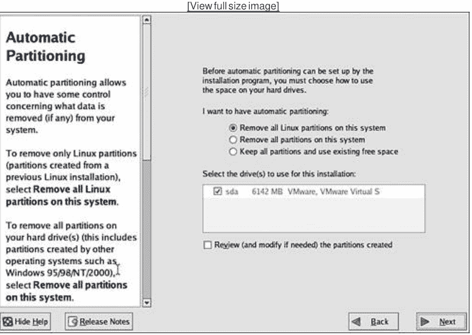

根据您的硬盘上目前的内容，可能会提供不同的选择。如果您选择“删除所有分区 (Remove all partitions)”，所有数据将被删除，包括任何 Windows 分区。屏幕中的列表框显示将安装 Fedora 的硬盘。如果您有多个硬盘，请确保选中了正确的硬盘。列表中的可能项目包括：

- hda: 您的第一块硬盘
- hdb: 您的第二个硬盘
- sda: 第一个 SCSI 驱动器
- sdb: 第二个 SCSI 驱动器

引导加载程序决定哪些操作系统可以启动您的系统。Fedora 使用 GRUB（统一引导加载程序）引导程序，但您也可以选择使用 LILO（Linux 加载器）。图 4-9 显示了引导安装屏幕。

### 图 4-9. Fedora Core 2 中的引导加载程序屏幕。

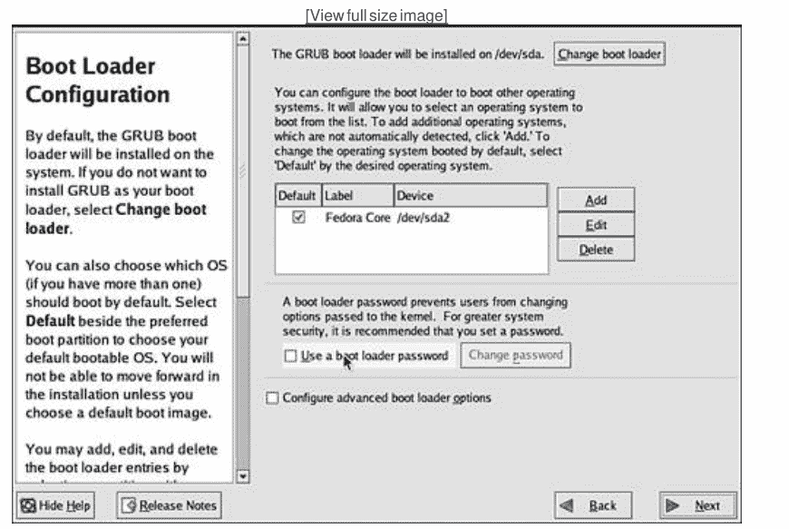

如果您有特殊原因，请使用 GRUB。如果硬盘上安装了操作系统，它将出现在列表中。系统安装后，每次启动或重启计算机时，GRUB 都会显示一个操作系统菜单供您选择。如果您不选择，默认操作系统将在短暂暂停后（通常为 10 秒）启动。请务必检查您想要自动启动的操作系统默认值。

对于大多数系统，没有必要为引导加载程序设置密码。

## 为 Fedora收集网络信息

后续屏幕允许您配置网络。只有当 Fedora 安装程序检测到您的计算机中有网卡时，这些屏幕才会出现。如果您的计算机没有网卡，Fedora 将跳过这些屏幕。图 4-10 显示了第一个网络屏幕。

### 图 4-10. Fedora Core 2 中的网络配置。

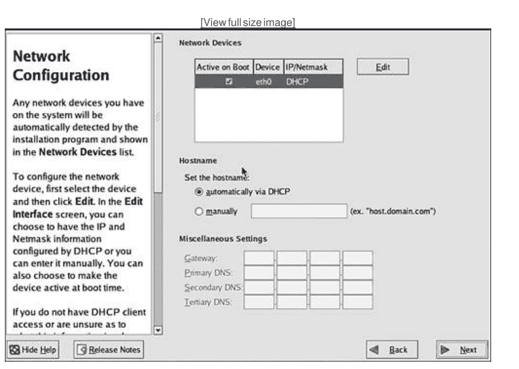

Fedora 安装程序检测到的网络硬件显示在屏幕顶部的列表中。此图显示了一个网络连接器 eth0。配置了两个设置：

- 启动时开启 (On Boot): 当您的计算机启动时激活网络连接。
- IP/网络 (IP/Network): 每个网络连接器都有一个地址，称为 IP 地址，允许网络定位计算机并向其传输信息。IP 地址可以通过 DHCP 自动设置，或者您可以手动输入 IP 地址。

您可以通过高亮网络连接器并点击“编辑 (Edit)”来输入或更改设置。如果您需要静态 IP，可以在此处输入详细信息。如果您偏于自动配置，请选择 DHCP。您可以通过高亮网络连接器并点击“编辑 (Edit)”来输入或更改设置。如果您需要静态 IP，可以在此处输入详细信息。包含防火墙。防火墙可以帮助计算机免受外部访问。

### 图 4-11. Fedora Core 2 中的防火墙配置。

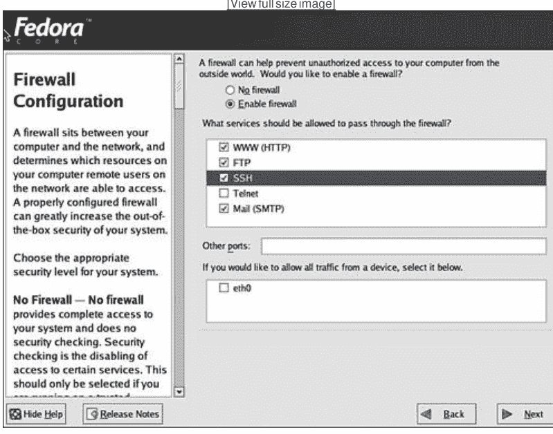

如果您有特殊原因，请使用 GRUB。如果硬盘上安装了操作系统，它将出现在列表中。系统安装后，每次启动或重启计算机时，GRUB 都会显示一个操作系统菜单供您选择。如果您不选择，默认操作系统将在短暂暂停后（通常为 10 秒）启动。请务必检查您想要自动启动的操作系统默认值。

对于大多数系统，没有必要为引导加载程序使用密码。

## Fedora 的语言和时区

Linux 可以支持多种语言。在此时，请选择要使用的语言。在系统安装后，您可以切换到任何您选择的语言。

### 图 4-12. Fedora Core 2 中的语言屏幕。

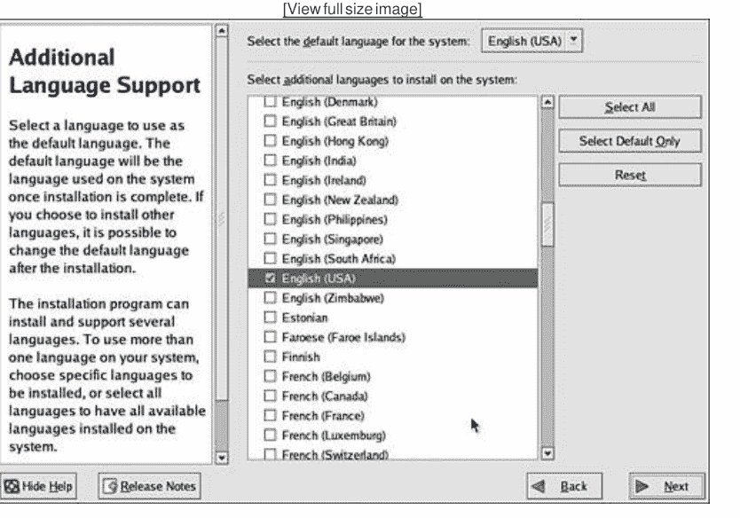

在屏幕顶部，选择默认使用的语言。如果您希望可以使用其他语言，请在列表中勾选。

## 时区选择

通过选择计算机所在的位置设置时区。

在交互式地图上点击特定城市（用黄色点标记），将出现一个红色的 X 表示您的选择。您也可以滚动查看列表并选择您的时区。

| 位置 | 描述 |
|---|---|
| America/Lima | |
| America/Los_Angeles | 太平洋时间 |
| America/Louisville | 东部时间 - 肯塔基地区 |

请选择您时区最近的城市：

您可以点击地图或从列表中选择。

## 为 Fedora 创建根账户

用户必须拥有账户才能 Linux。启动时，第一个屏幕将要求您登录账户。需要根账户。根用户通常被称为超级用户。通常安装其他用户账户。第 8 章详细介绍了账户。

### 图 4-14. Fedora Core 2 中的根密码屏幕。

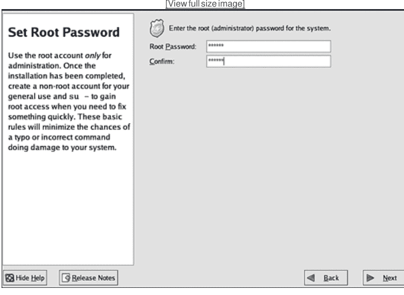

为根账户输入密码。再次输入相同的密码以确保没有没有错误。记住这个密码至关重要。没有根账户，您无法对 Linux 系统进行任何更改。即使您以后安装了账户并可以登录用户账户，除非可以使用根账户，否则您无法执行许多需要执行的操作。

选择您的密码时尽可能安全、易于记忆但难以猜到：

- 使用至少 8 个字符。
- 使用以下各项中的至少一个或多个：大写字母、小写字母、数字和标点符号。


- 不要使用字典中存在的单词。
- 不要使用真实的姓名、电话号码或日期。


# 在 Fedora 上选择要安装的软件包

软件界面列出了 Fedora 打算安装的软件包。该列表取决于你之前建议的安装类型。工作站软件列表显示在上方。你可以选择安装建议的软件列表，也可以修改软件列表，删除或添加要安装的软件包包名称。如果你选择底部的“自定义软件包包”（Customize software packages）选项，屏幕将如图 4-15 所示，这将为你提供添加或删除软件包的机会。

| 桌面环境 (GNOME) |
| :--- |
| 办公套件 (OpenOffice.org) |
| Web 浏览器 (Mozilla) |
| 邮件 (Evolution) |
| 即时消息工具 |
| 音频和视频应用程序 |
| 游戏 |
| 软件开发工具 |
| 管理工具 |

- 安装默认软件包
- 自定义要安装的软件包

图 4-15. Fedora Core 2 中的软件包选择。

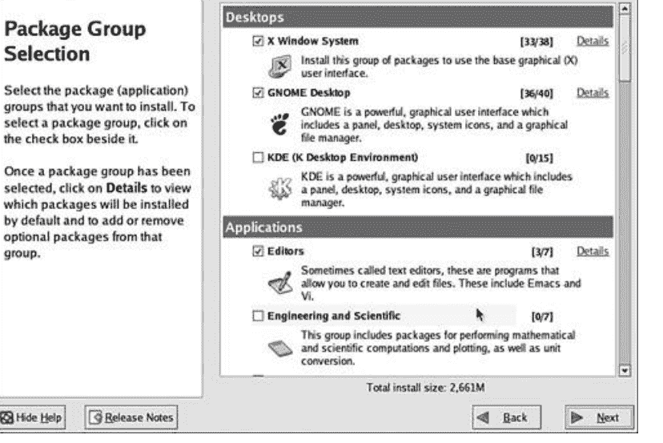

软件包选择界面显示了你可以勾选或取消勾选安装的软件组。例如，GNOME 桌面是 Fedora 的默认设置。你可以在图 4-15 中看到 GNOME 已勾选，而 KDE 桌面未勾选。如果你是 Linux 新手，可能想尝试两种桌面，看看你喜欢哪一个。勾选 KDE 以与 GNOME 桌面一起安装 KDE 桌面。

软件列在包含多个软件包的类别中，例如编辑器。点击“详情”（Details）将显示一个显示该类别具体包含哪些软件包的屏幕，允许你进行挑选。

在这里做的选择并不是最终的。在 Fedora 安装后，你可以随时添加和删除软件。

# 安装 Fedora 系统

到目前，Fedora 一直在收集信息；你的硬盘没有发生变化。安装程序的下一个部分是将文件复制到你的硬盘上，从而改变你的硬盘。Fedora 显示了一个警告屏幕，如图 4-16 所示。

## 图 4-16. Fedora Core 2 中的警告屏幕。

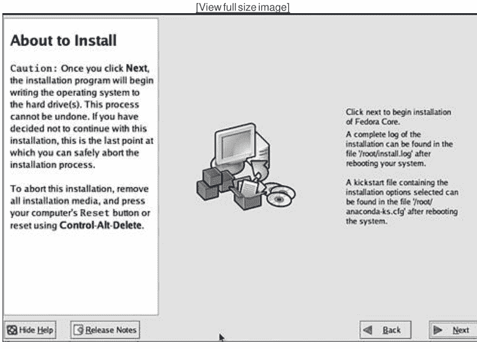

安装步骤如下：

- 1. 格式化硬盘，并在进行过程中显示状态条
- 2. 显示安装所需的 CD 列表
- 3. 安装软件，并如下所示报告其进度


剩余时间：30 分钟
正在安装 cpdump-3.8.2-3.i386 (740 KB)
一种流量监控工具。

- 4. 在需要时请求不同的 CD，如下所示


请插入第 2 盘以继续。

- 5. 执行一些安装后配置


正在执行安装后配置...

当软件安装完成后，Fedora 显示图 4-17 所示的屏幕。

# 图 4-17. Fedora Core 2 安装完成。

对于你新的 Fedora 系统，你需要重启。从 CD 或 DVD 驱动器中取出 CD 或 DVD 并点击“重启”。重启后，Fedora 显示如图 4-18 所示的引导加载程序菜单。只显示了一个系统：Fedora。如果你安装了另一个操作系统（例如 Windows），请选择你想要启动的系统。

### 图 4-18. Fedora Core 2 的引导加载菜单。

```
GNU GRUB version 0.94 (638K lower / 260832K upper memory)
Fedora Core (2.6.5-1.358)
使用 < 和 > 键选择要高亮的条目。
按回车键启动选定的 OS，按 'e' 在启动前编辑命令，按 'a' 在启动前修改内核参数，或按 'c' 进入命令行。
高亮的条目将在3 秒后自动启动。
```

选择 Fedora Core 以进入你新的 Fedora Linux 系统。

# 启动 Mandrake 安装程序

将 CD 或 DVD 放入 CD 或 DVD 驱动器并打开电脑电源。电脑将从 CD 或 DVD 启动并显示安装启动界面。（如果你的机器无法从 CD/DVD 启动，请参见第3章。）

Mandrake 的启动屏幕在此：

# 图 4-19. Mandrake 10 的启动屏幕。

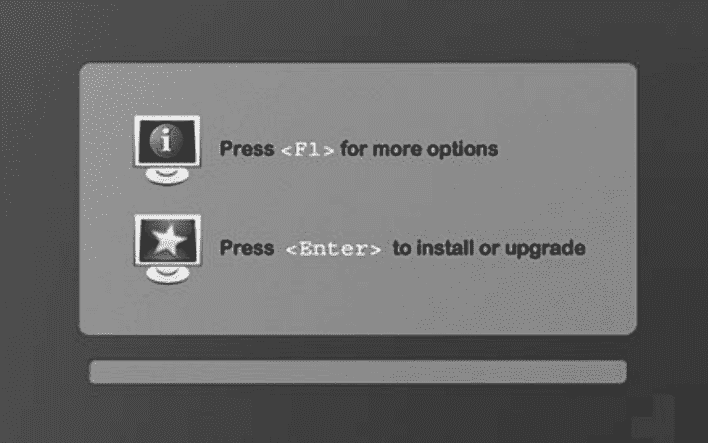

按 <Enter> 开始图形化安装程序，其启动过程如下：

1. 执行若干任务，如下所示显示其进度。你不需要响应或理解屏幕上的行。

2. 将安装程序加载到内存中，如下所示显示状态条。

# 为 Mandrake 收集信息

Mandrake 收集安装 Linux 所需的信息。在安装过程中，它探测硬件。如果它无法识别硬件，会显示以下屏幕：

- **语言**：如果选定的语言错误，请高亮正确的语言。显示语言列表。
- **许可协议**：Mandrake 显示许可协议。在继续之前你必须点击“同意”。
- **类型**：如果 Mandrake 发现硬盘上已有 Linux，会显示“新”安装或“升级”选项。
- **安全级别**：Mandrake 允许你选择安全级别。标准安全级别对于大多数目的都是足够的。输入接收安全问题的地址。
- **选择安装 Linux 的位置**：根据硬盘的情况，Mandrake 提供以下选择：

**使用空闲空间**：如果尚未安装任何操作系统，则在空闲空间上安装 Linux。
**使用现有分区**：如果你想在现有分区上安装 Linux，请选择此项。
**使用 Windows 分区上的空闲空间**：如果你的电脑目前仅运行 Windows，Mandrake 可以使用 Windows 空间创建 Linux 分区。Linux 安装后 Windows 分区将缩小。
**抹除磁盘**：替换所有操作系统，包括硬盘上的所有数据。
**删除 Windows**：替换当前的 Windows 分区，在此过程中删除所有数据。
**自定义分区**：允许你手动创建分区。除非你对分区有特殊需求（例如非常不寻常用途），否则不要选择此选项。手动分区需要一定的知识。

# 在 Mandrake 上选择要安装的软件包

Mandrake 选择软件包组的屏幕如图 4-20 所示。

## 图 4-20. Mandrake 10 的软件包选择屏幕。

img/8fd2e743227b42de3b4152272123250b_80_0.png

勾选框表示 Mandrake 计划安装的软件包组。你可以勾选额外的组或取消勾选某些组。例如，如果你是 Linux 新手，可能想勾选 GNOME 桌面，以便 Mandrake 同时安装 KDE 和 GNOME，让你在决定之前测试两者。

底部的行显示所有勾选软件包的“总大小”，以便确保你有足够的磁盘空间。

如果你勾选“单个软件包选择”并点击“下一步”，Mandrake 将显示一个允许你选择单个软件包的屏幕，而不是软件包组。

除非你非常确定 Mandrake 显示列表中没有包含某些东西，否则最好是接受 Mandrake 的选择。在你的 Linux 系统安装后，你可以随时添加或删除软件。你现在不需要做决定。


# 安装 Mandrake 系统

到目前为止，Mandrake 一直收集信息；您的硬盘尚未发生变化。安装程序的下一步将是将文件复制到您的硬盘中，从而更改您的硬盘。在安装软件时，Mandrake 会显示进度屏幕，类似于图 4-21 所示的屏幕，显示剩余时间。

图 4-21。Mandrake 10 安装进度屏幕。

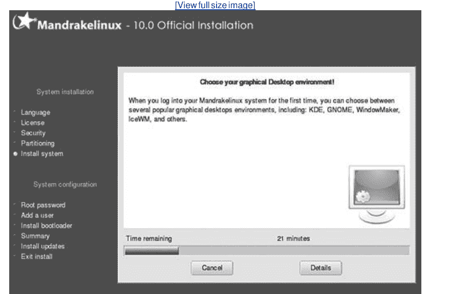

根据你选择安装的包数量，安装可能需要一张以上的 CD。当 Mandrake 需要时，它会请求另一张 CD，如图 4-22 所示。

图 4-22。Mandrake 10 的更换 CD 屏幕。

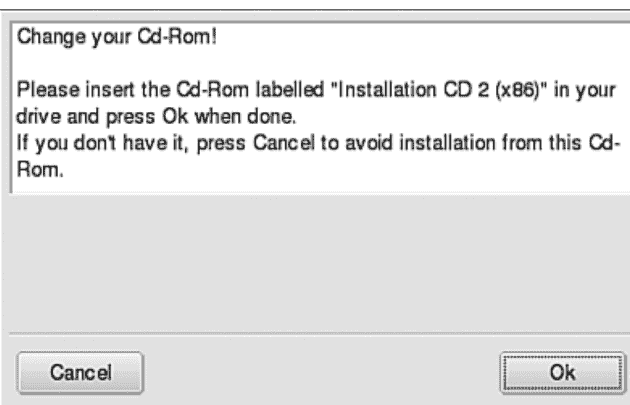


# 为 Mandrake 创建账户

用户必须拥有账户才能使用 Linux。需要一个 root 账户（通常称为超级用户）。至少还需要另一个账户。第 8 章将详细讨论账户相关问题。用户账户创建屏幕如图 4-23 所示。

# 图 4-23。Mandrake 10 的账户创建屏幕。

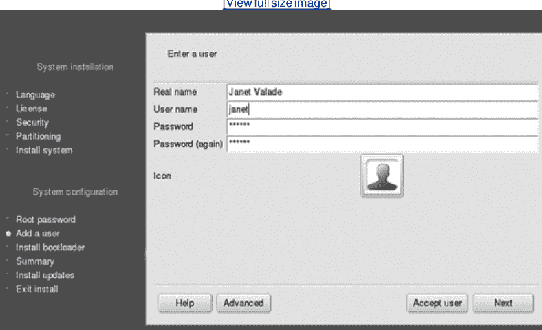

Mandrake 首先创建 root 账户。创建 root 账户的屏幕不包含“姓名”（Real name）和“用户名”（User name）字段，因为该账户必须命名为 root。为 root 账户输入密码。输入两次相同的密码以确保你没有写错。记住这个密码极其重要。没有 root 账户，你无法对你的 Linux 系统进行更改。

请仔细选择你的密码以维护系统的安全性。密码应至少包含 8 个字符，字母和数字混合，且不应该是字典中存在的单词。

在创建 root 账户后，你必须为自己自己至少创建一个用户账户。你可以创建任意数量的账户。你应该为每个将使用该电脑的人创建一个账户。

按下“Accept”（接受）会再次显示屏幕，你可以输入另一个用户账户。当你创建了所有需要的账户后，按下“Next”（下一步）。

屏幕会询问你是否想要自动登录某个账户。通常情况下，出于安全考虑，最好不要选择此功能。


# Mandrake 配置摘要

此时，Mandrake 会显示一个显示当前配置设置摘要的屏幕，如图 4-24 所示。

# 图 4-24。Mandrake 10 的配置摘要。

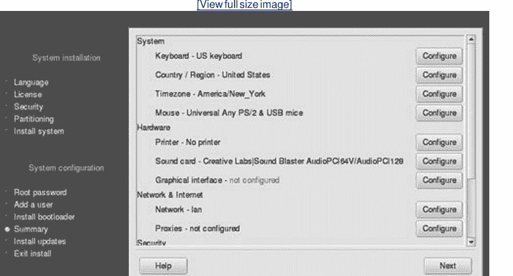

如果此屏幕上的任何内容不正确，按下“Configure”（配置）进行更改。例如，时区列为 America/New_York。如果这不正确，按下“Configure”并选择不同的时区，例如用于太平洋时区的 Los_Angeles。

注意，这里显示图形界面未进行配置。它必须对其进行配置才能使用桌面。按下“Configure”允许你从列表中选择显示器，并设置你想要的屏幕分辨率。

当你对摘要屏幕中的配置感到满意并点击“Next”（下一步）时，Mandrake 将提供提供更新软件包的机会。除非你刚刚下载了带有最新软件包的 Mandrake，否则更新它是一个好主意。你需要连接互联网才能更新。

# 图 4-25。Mandrake 10 的更新软件包屏幕。


你现在有机会下载更新后的软件包。这些软件包在发行发布后已经更新。它们可能包含安全修复或错误修复。要下载这些软件包，你需要一个可用的 Internet 连接。你想要安装更新吗？

- 是
- 否

BBL
PREV NEXT

# 完成 Mandrake 安装

Mandrake 显示图 4-26 所示的屏幕显示安装完成。

# 图 4-26。Mandrake 10 的安装完成屏幕。

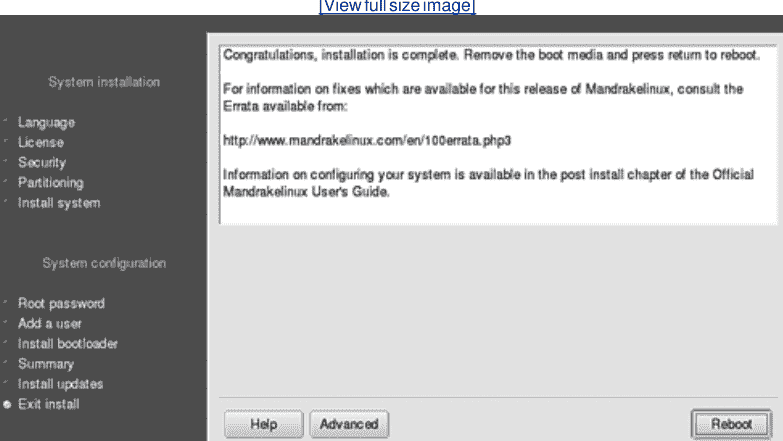

要使用你新的 Mandrake 系统，你需要重启。从 CD 或 DVD 驱动器中取出 CD 或 DVD 并点击“Reboot”（重启）。重启后，Mandrake 将显示图 4-27 所示的启动菜单。除非你安装了其他操作系统（如 Windows），否则它将从 CD 或 DVD 引导。你可以从中选择要启动的系统。

图 4-27。Mandrake 的引导加载菜单。

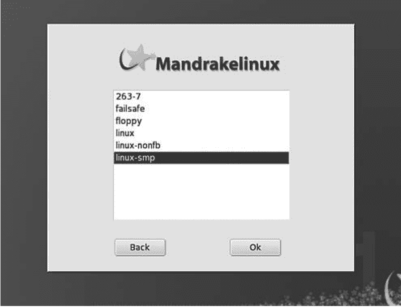

# 开始 SuSE 安装过程

将 CD 或 DVD 放入 CD 或 DVD 驱动器并打开电脑电源。计算机将从 CD 或 DVD 引导并显示启动屏幕。SuSE 的启动屏幕是 YaST。

图 4-28。SuSE 的启动屏幕。

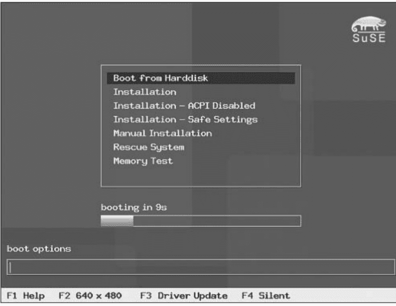

SuSE 屏幕提供了多个选项。使用方向键（↓）高亮一个选项并按下 <Enter> 开始。

图 4-29。SuSE 的过渡屏幕。


# SuSE 配置设置

SuSE 的安装程序是 YaST。第一个图形屏幕是图 4-30 所示的语言选择屏幕。

图 4-30。SuSE 的语言选择屏幕。

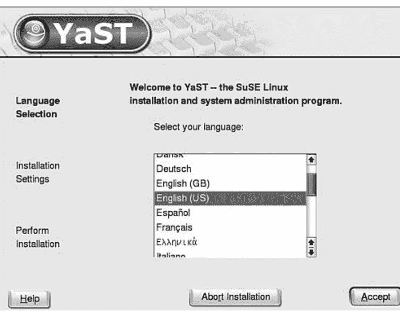

如果 YaST 在你的硬盘上检测到 Linux 系统，将显示一个屏幕让你选择安装类型：

- 新安装：替换现有 Linux。
- 更新现有系统：更新现有 Linux 并保留数据。
- 修复已安装系统：如果当前 Linux 无法启动，此选项尝试诊断和修复。
- 启动已安装系统：启动发现的 Linux。
- 取消安装

选择一个选项并点击 OK。

如果没有检测到当前的 Linux，YaST 将假设为“新安装”并跳过安装类型屏幕。它探测硬件和设置以估算安装设置。显示设置的屏幕如图 4-31 所示。

图 4-31。SuSE 的设置摘要屏幕。

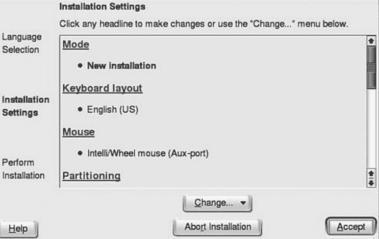


设置正确后，点击 `Accept`。


# 在 SuSE 上选择安装的软件包

摘要屏幕显示了所选安装的软件包，如所示。如果你选择“软件”（Software），将看到[图 43-32](https://example.com/fig4332)所示的选项。

图 43-32。SuSE 9.0 的系统类型。

| 软件 (Software) |
| :--- |
| - 默认系统 (Default system) |
| + 帮助与支持文档 (Help & Support Documentation) |
| + KDE桌面环境 (KDE Desktop Environment) |
| + 办公应用程序 (Office Applications) |
| + 图形基础系统 (Graphical Base System) |

如果你选择“最小化”（Minimum）或“最小化图形系统”（Minimum graphical system），你的 Linux 系统将不包含桌面，因此通常“默认”（Default）是最好的。要更改默认系统的软件包选择，点击“详细选择”（Detailed selection）查看[图 43-33](https://example.com/fig4333)所示的屏幕。

图 43-33。SuSE 9.0 的软件选择屏幕。

# 文件软件包额外帮助

| 筛选器：选择 (Filter: Selections) | 软件包 (Package) | 摘要 (Summary) |
|---|---|---|
| | OpenGame 类似于电影的 F |
| 选择 (Selection) | Beneath a Steel Sky (Adventur) |
| 图形基础系统 (Graphical Base System) | 带有 exp 的3D动作突破 |
| KDE 桌面环境 (KDE Desktop Environment) | 32 网络多人游戏 Tai |
| 所有 KDE (All of KDE) | 垂直滚动空间射击游戏 |
| GNOME 系统 (GNOME system) | Atari 2600 游戏的克隆 |
| 帮助与支持文档 (Help & Support Document) | 用于写作的可移植接口 |
| 办公应用程序 (Office Applications) | 象棋程序 |
| 游戏 (Games) | 3D乒乓球 |
| 多媒体 (Multimedia) | | |
| LSB 运行时环境 (LSB Runtime Environment) | | |
| 带有 Apache 的简单 Web 服务器 (Simple Webserver with Apac) | | |
| 简单 Web 服务器 (Simple Webserver) | | |
| LDAP 服务器和工具 (LDAP Server and Tools) | | |

| 说明 (Description) | 数据 (Technical Data) | 依赖 (Dependencies) |
|---|---|---|
| armagetron-OpenGame 类似于电影的 | | |

在这个游戏中，你与其他玩家进行比赛。

| 名称 (Name) | 磁盘占用 (Disk Usage) | 已用 (Used) |
|---|---|---|
| | 49742.13 | |
| 检查依赖项 (Check Dependencies) | Autocheck | 取消 (Cancel) 接受 (Accept) |

图 4-33 中的软件选择包含以下三个选择：

- 软件包组（左上角）：勾选了选定的软件包组。勾选或取消勾选组以更改软件包选择。例如，KDE 是默认桌面。但是，如果你是新的 Linux 用户，可能想在决定喜好哪种之前尝试一下 KDE 和 GNOME。你可以勾选 GNOME，这样 KDE 和 GNOME 都会被安装。

- 软件包（右上角）：此面板列出了所高亮组的单个软件包。例如，在图 4-33 中，左侧面板中的“游戏”（Games）被高亮。在此面板中，你可以勾选或取消勾选单个软件包。

- 软件包描述（右下角）：右上方面板中高亮的单个软件包的描述将显示在此面板中。例如，在图 4-33 中，顶部面板选中了 Armagetron 软件包，其描述将显示在此面板中。

当你选择了你需要的软件包后，点击 `Accept`。

所选的软件包将在 Linux 安装过程中进行安装。如果你确定了需要的软件包，在安装系统时安装它们是很方便的。然而，这个选择并不是最终的。在 Linux 系统安装后，可以很容易安装或删除软件。第 10 章将讨论添加和删除软件。


# 安装 SuSE 系统

当摘要屏幕（图 4-31）中的所有设置正确时，点击 `Accept`。到此为止，SuSE 一直在收集信息，没有对你的硬盘做任何更改。现在它开始安装系统，对你的硬盘进行更改。在开始之前，它会显示图 3-34 所示的警告屏幕。

图 3-34。SuSE 9.0 的安装警告屏幕。

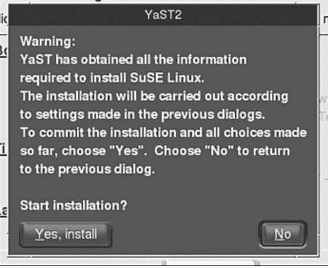

SuSE 分 3 步安装系统：

1. 安装基本系统，并在进行时显示进度。注意它在右上面板显示了所需的磁盘空间。

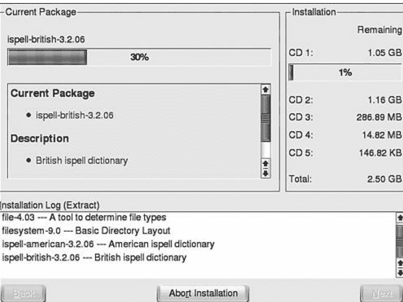

2. 重启：

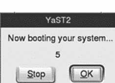

紧接着执行

```
Restore device permissions done
Setting up the date clock done
Setting up timezone data done
Setting scheduling times unused
Setting up hostname "linux" done
Setting up loopback interface done
```

3. 使用基本系统安装剩余软件包，并在需要时请求新的 CD。

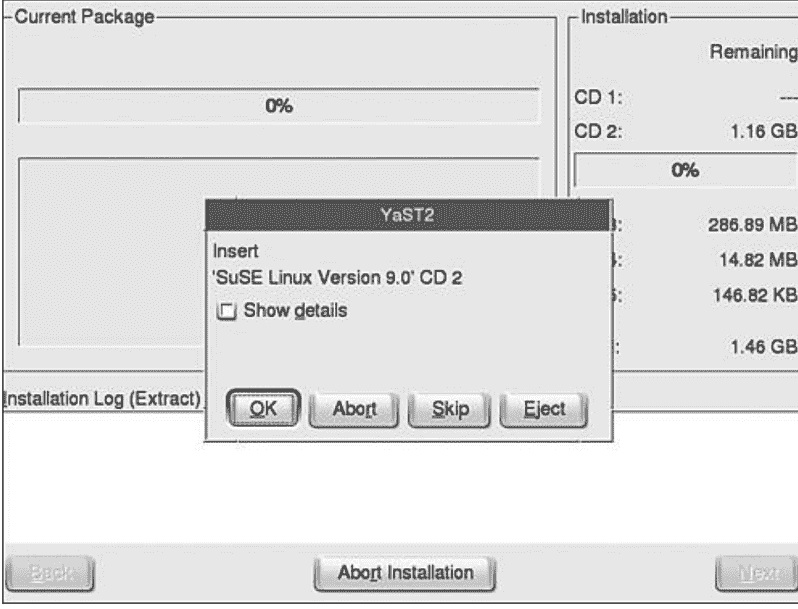

在安装所有软件后，SuSE 安装 Linux 系统所需的 root 账户，如[图 4-35](#)所示。

图 35。SuSE 9.0 的 root 账户安装。

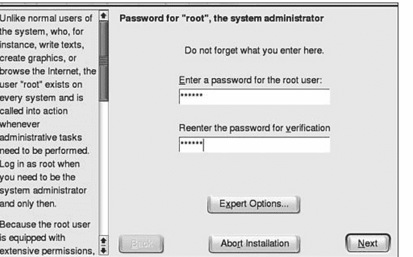

root 账户的密码。输入相同的密码两次以确保没有错误。记住这个密码至关重要。如果没有 root 账户，你无法对 Linux 系统进行任何更改。即使你以后安装了用户账户并登录用户账户，如果不使用 root 账户，你无法完成许多操作。


# 配置 SuSE 系统

接下来的屏幕为系统添加：

- 网络设置：建议设置见图 4-31。你可以在 Linux 系统安装后更改设置。
- 网络配置：Linux 安装可能需要一小时或更。
- 网络测试：测试网络。如果连接正常，将下载任何可用软件。
- 身份验证方法：提供两种验证用户的方法。
- 添加用户：你可以创建新账户。
- 系统配置：Linux 正在显示其进度。
- 发布说明：供你阅读的发布说明。
- 硬件配置：建议设置显示类似于图 4-31 的屏幕。

# 完成 SuSE 安装

当 YaST 完成时，它会显示安装完成屏幕，如图 4-36 所示。

图 4-36。SuSE 9.0 的安装完成屏幕。

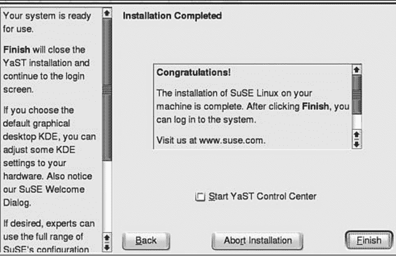

点击 `Finish`。系统在黑屏上显示一些行，然后显示图 4-37 所示的登录屏幕。

图 4-37。SuSE 9.0 的登录屏幕。


# 第 5 节。与 Linux 交互

Linux 是一个操作系统。它将一系列电子元件转换为一个可用的工具，接收你的指令并在文件中存储信息、向打印机发送数据、在屏幕上显示信息、启动应用程序并执行许多其他任务。Linux 提供了两种基本类型的界面供你使用以完成计算机工作：

- **图形用户界面：** 一种图形用户界面（GUI），你可以在其中选择菜单项并点击图标来完成计算机任务。如果你有 Windows 背景，那么你会熟悉 GUI。
- **命令行界面：** 一种文本界面，你可以在其中输入 Linux 执行的命令。如果你有 UNIX 背景，那么你会熟悉命令行界面（CLI）。或者，如果你在 DOS 中工作或在 Windows 计算机的命令行提示符下工作过，那么你对 CLI 有一些经验。

当你操作计算机时，界面提供了你与 Linux 内核之间的通信，内核是 Linux 中负责执行低级工作的部分。内核直接与硬件通信，以便在硬盘上保存文件、向打印机发送数据流、向网络发送信息以及执行其他基本任务。你的指令会被界面接收、处理并传递给内核。

## Linux 上的图形用户界面

图形用户界面（GUI）在屏幕上提供图形图像，可以使用鼠标进行选择。最熟悉的计算机 GUI 是窗口系统。许多窗口可以同时存在于屏幕上，每个窗口中执行着独立的任务。用户可以打开、关闭、移动、调整大小并以其他方式操作窗口。

Windows 用户熟悉的桌面环境是一个旨在代表你办公桌面顶部的窗口系统。当你启动计算机时，你拥有一个空白的工作表面。执行任务所需的工具在桌面上可用，例如图标和菜单、工具栏、时钟、计算器和其他工具。你可以在工作面上打开任何你需要的应用程序。事实上，你可以同时在不同的窗口中打开你需要的任意应用程序。

Linux 提供了两种流行的桌面环境：

- *GNOME：* GNU 网络对象模型环境（GNOME）是一项开源软件，是 GNU 项目的一部分。第一个公共版本 GNOME 1.0 于 1999 年 3 月发布。
- *KDE：* K 桌面环境（KDE）是由 KDE 项目制作的免费开源软件。第一个公共版本 KDE 1.0 于 1998 年 7 月发布。

两者都模拟了桌面，它们在许多方面都是相似的。这两个桌面都提供以下内容：

- 一个带有图标的工作表面。
- 一个带有可启动应用程序或菜单图标的底部面板。
- 许多应用程序，例如电子邮件软件、浏览器、文件编辑器等。
- 用于启动应用程序的菜单，与 Windows 启动菜单几乎完全相同。
- 虚拟桌面。也就是说，备用桌面。你可以为一个项目设置一个虚拟桌面（例如图标、菜单和打开的软件），并为另一个项目设置另一个带有工具的虚拟桌面。然后你可以根据正在处理的项目在桌面之间切换。你可以拥有多个虚拟桌面。
- 配置工具，允许你更改和控制桌面的大部分外观和感受。
- 用于管理系统的管理工具。

GNOME 和 KDE 之间的区别主要在于管理实用程序、配置桌面的工具以及为桌面安装时选择的默认应用程序。例如，KDE 和 GNOME 都提供了一个画图程序，但它们不是同一个 Paint 程序。另一个例子是，KDE 附带了一个名为 Kword 的文字处理器，而 GNOME 附带了 AbiWord，但提供了对 OpenOffice 的访问。

几乎所有的 Linux 发行版都提供 GNOME 或 KDE。某些发行版允许你在安装 Linux 时选择安装哪种桌面。许多发行版允许你在登录时选择你的桌面。使用哪一个主要取决于个人偏好。你可能在决定之前想尝试这两种。

某些软件包仅在一种桌面环境（GNOME 或 KDE）下运行。然而，某些为一个桌面设计的包也可以在另一个桌面下运行。有些包同时随两个桌面一起发布，例如 GIMP。当 GNOME 和 KDE 都被安装时，所有随两个桌面附带的包都会被安装，形成单一的软件包池。桌面提供了访问任何可以与之运行的包的能力。例如，如果一个 GNOME 包也可以在 KDE 下运行，那么启动菜单将显示该包，即使该包实际上是随 GNOME 带的。

## 其他 GUI

除了 KDE 和 GNOME 之外，还有许多可用 GUI，Linux 体现了灵性和可配置性，并尽可能提供选择。几乎所有的 Linux 发行版都包含 GNOME 和 KDE，但许多还包含其他 GUI。例如，Mandrak 包括一个名为 IceWM 的桌面，它比 GNOME 或 KDE 更小、更快。

大多数用户为了特殊目的会安装大两个之外的桌面，例如在资源有限的机器上安装 Linux 时，这种情况需要一个占用更少磁盘空间和/或内存的 GUI。当然，有些人选择使用不同的 GUI 是因为他们喜欢。如果你愿意花时间进行自定义，你的 Linux GUI 可以非常复杂且具有个性化。在未来，当你成为一名 Linux 大师时，你可能想研究其他的 GUI。

## GNOME

GNOME（GNU 网络对象模型环境）是一种流行的桌面环境，如图 5-1 所示。

## 图 5-1. Mandrake 9.1 中的 GNOME 桌面。

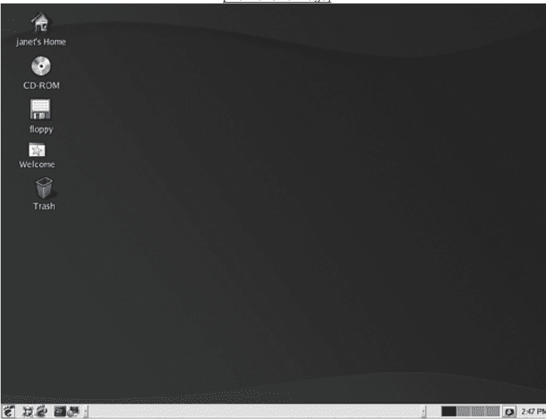

注意空白的工作表面、桌面上的图标以及底部的面板。桌面底部的图标是 GNOME 标志（面板左侧的图标）。该图标打开一个启动应用程序的菜单（与 Windows 启动菜单几乎相同）。由于该桌面是 Mandrake 提供的，图标和内容是由 Mandrake 创建的。

GNOME 项目由 Red Hat 支持。Red Hat 和 Fedora 的默认桌面是名为 Bluecurve 的自定义 GNOME 桌面。Bluecurve GNOME 的启动菜单使用的是红帽标志，而不是 GNOME 标志。

在下一页（图 5-2）显示的 KDE 桌面非常相似。它们都拥有工作区域、图标和面板。区别在于桌面上的图标和面板的组织。桌面的使用将在第 6 节中讨论。

# 图 5-2. Mandrake 9.1 中的 KDE 桌面。

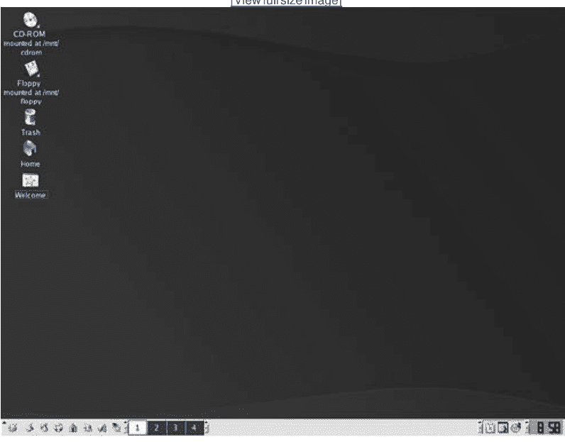

## KDE

KDE（K 桌面环境）是最流行的桌面环境，如图 5-2 所示。

注意空白的表面、桌面上的图标以及底部的面板。面板左侧第一个图标是巨大的 K，即 KDE 标志。该图标打开一个应用程序菜单（与 Windows 启动菜单非常相似）。由于该桌面是在 Mandrake 的发行版中提供的，图标和面板内容是由 Mandrake 定制的，正如桌面上的 Mandrake 欢迎图标。

尽管 GNOME 是 Red Hat 和 Fedora 的默认桌面，但它们也提供了名为 Bluecurve KDE 的自定义 KDE 版本。Bluecurve KDE 的启动菜单图标使用的是红帽标志，而不是 K 标志。当然，Bluecurve KDE 并没有 Mandrake 欢迎图标。


## Linux 上的命令行界面

命令行界面（CLI）是一个文本环境，你在该环境中输入命令让 Linux 执行，而 Linux 则相应地显示消息。在 CLI 中，你使用键盘而不是鼠标向 Linux 发送指令。当你使用 CLI 工作时，你正在与一个名为 shell（壳）的程序进行交互。shell 接受你的命令，对它们进行处理，并将它们传递给内核——内核是 Linux 中执行基本工作的部分。Linux 提供了多种 shell 可供，但本书仅提供关于 Bash 的信息，它是最流行的 shell。

Linux 可以直接启动到命令行环境。你会看到一个主要在等待你输入的屏幕。你看到的不是登录窗口，而是在空白的命令行行上输入你的账户 ID 和密码。在这种类设置下，你将完全使用 CLI。使用这种设置的用户通常完全不使用桌面。

通常，用户想对某些任务使用 GUI（图形用户界面）。这些用户将 Linux 设置为启动时进入桌面。当他们想使用 CLI 时，可以打开一个 CLI 窗口。GUI 比 CLI 更容易使用。在桌面上，你从菜单中选择任务。在 CLI 中，你需要输入命令。了解哪种命令、如何拼写、哪些参数和选项可以产生预期效果以及如何解释文本输出，取决于你自己。然而，CLI 具有一些优点，使其在某些情况下变得极具吸引力：

- *执行速度更快*：GUI 会带来一定的开销，因为在屏幕上绘制图形需要时间。当你直接在 CLI 中输入命令时，命令将在没有 GUI 开销的情况下执行执行。
- *命令输入时间更短*：在某些情况下，输入命令花费的时间比浏览菜单要短。通常，通过菜单在命令行下可以更快地完成文件管理和其他系统任务。此外，CLI 允许你将命令链在一起，产生单一输出，这在菜单中是不可能的。
- *资源占用更少*：GUI 需要磁盘空间、内存和其他计算机资源。在性能有限的计算机上运行 Linux 时，可能需要不带 GUI 运行。
- *功能更多*：某些命令和命令选项在菜单中不可。它们只能从命令行执行。

第 7 章将详细讨论使用命令行界面。

## 选择界面

大多数 Linux 发行版的安装程序都提供了选择想要安装的软件的机会。通常，有一组默认应用程序，或者不同的应用程序组供你选择。此外，你可能还有机会从正在安装的集合中包含或删除任何应用程序。

例如，在 Fedora 安装期间，会显示一个屏幕，列出要安装的默认软件包列表，包括 GNOME。该屏幕提供了安装默认集合或自定义要安装的软件包的选择。如果你选择“自定义”，一个屏幕将允许你勾选或取消勾选软件包。GNOME 默认被勾选。你可以在 GNOME 之外勾选 KDE，或者代替 GNOME。你甚至可以两个都不勾选。

如果你安装了 GNOME 或 KDE，你的系统将启动到已安装的桌面。如果你安装了两者，大多数发行版都提供了登录时选择你想要的哪个桌面的机会。如果两个桌面都没有安装，你的计算机在登录时将进入命令行环境。

如果你的计算机启动到 GUI 而你想启动到 CLI（或者反之），你可以通过编辑名为 `initab` 的文件来更改默认启动界面。Linux 在启动时会读取此文件获取指令。你需要找到这个文件，可能在 /etc 中。第 9 章告诉你如何查找文件。要更改你的界面，你需要编辑 initab 中的以下行行（第 18 章讨论了如何编辑文本文件）：

```
id:initdefault:
```

n 是一个导致 Linux 启动到 GUI 或 CLI 的数字；5 表示 GUI，3 表示 CLI。将 n 更改为你偏好界面的数字。


## 登录

要访问桌面，你必须使用 Linux 账户进行登录。当你开启电脑时，过程如下：

- 1. 计算机启动。

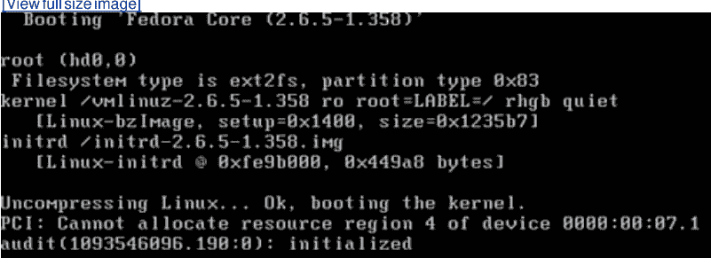

- 2. 计算机提示你进行登录。

- 3. 你输入密码登录账户。

- 4. 桌面显示。

在计算机启动（第 1 步）后，你会看到登录界面。Fedora Core、Mandrake 和 SuSE 的登录界面如图 6-1 所示。

## 图 6-1 登录界面。


注意，Mandrake 和 SuSE 提供了账户选择。在这种情况下，只有一个账户 (janet) 可用。如果安装了更多账户，它们也会出现在登录界面上。第 8 章将讨论这些账户。

通过点击账户来选择它。在 SuSE 中，账户名称出现在“登录”字段中。在“密码”字段中输入密码并点击“Go!”进行登录。在 Mandrake 中，会出现第二个屏幕，如图 6-2 所示。

## 图 6-2 Mandrake 的第二个登录界面。

许多 Linux 用户直接点击密码登录。

Fedora 要求你输入账户名称。当你输入账户名并按 <Enter> 时，`username` 字段会变为 `password` 字段，要求输入密码。输入密码并按 <Enter> 即可登录。

许多发行版允许你在登录时选择要使用的桌面。当然，你只能在已安装的桌面中进行选择。本书讨论了 KDE 和 GNOME，但还有其他桌面可用，并且可能在安装过程中默认安装了它们。例如，注意图 6-2，Mandrake 的登录界面有一个选择会话类型（Session type）的按钮。如果你点击该按钮，将出现右侧所示的列表。默认桌面是 KDE，但你可以更改它。GNOME 出现在列表中是因为它在安装期间被专门添加了，如第 4 章所示。Failsafe 是不带桌面的 Linux 启动方式（仅带 CLI），将在第 7 章中讨论。

会话类型：

| KDE |
| :--- |
| KDE |
| GNOME |
| IceWM |
| Default |
| Failsafe |

注意，图 6-1 中的三个登录界面都提供了一个按钮（关机 Shutdown，停止 Halt），这允许你在需要时停止登录过程。

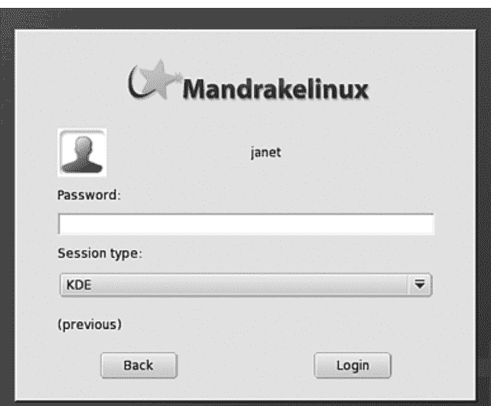

## 首次登录

在安装后首次登录系统时，Linux 可能需要一些安装后设置。例如，Fedora 在你首次登录新系统时创建一个用户账户。Mandrake 和 SuSE 在安装期间创建用户账户，但 Fedora 只创建 root 账户，直到现在才创建用户账户。

首次登录 Mandrake 时，它会运行一个名为 Mandrakfirsttime Wizard 的程序。第一个屏幕介绍了该向导，说明它将帮助你：

- 在几步内配置桌面的基础设置。
- 注册你的产品以便轻松打开 Mandrakelub 账户，并从其所有产品和服务中快速受益。

向导的下一个屏幕显示一个“选择桌面”（Choose Desktop）按钮。点击它时，会弹出一个可能的桌面列表。KDE 是默认的，但你可以选择另一个。选择桌面后，屏幕允许你选择多个主题中的一个。主题是颜色和图像的统一集合，将桌面的所有部分整合到单一的外和感受中，包括窗口框、字体、图标等。演示屏幕显示了默认 Galaxy 2 主题的外观。如果你勾选不同的主题，演示屏幕的外观将改变，显示新主题。当演示显示你最喜欢的外观时，点击“下一步”（Next）。

Mandrakfirsttime Wizard 还帮助你设置和配置 Mandrakelub 账户。Mandrakelub 为每月少量费用提供软件下载、论坛、特别折扣和其他福利。第一个月是免费的，你可以尝试。

向导完成后，桌面将显示一条欢迎消息。点击“关闭”（Close）关闭欢迎消息而不关闭桌面。当你不再希望每次启动电脑时都看到此屏幕时，取消勾选“启动时”（Open on startup）。

在首次登录期间，SuSE 还会显示带有指向 SuSE 主页链接的欢迎消息。

## 桌面结构

大多数桌面都有共同的基础组件，如图 6-3 所示。这个桌面对于 Windows 用户来说应该非常熟悉。

## 图 6-3 桌面。


桌面工作区包含图标（在这种情况下有两个图标），点击时执行操作，就像 Windows 桌面图标一样。你可以自定义桌面内边距。

（注：原文后续存在大量重复文本，已根据要求进行去重处理。）


## 桌面操作

桌面是一个放置了一些工具的工作空间。当你想要执行某项任务时，你会启动一个应用程序，它会在桌面的一个窗口中打开。你可以同时打开多个窗口，每个窗口使用相同或不同的应用程序执行不同的任务。

桌面提供了许多功能来帮助你。以下许多功能对于 Windows 用户来说会很熟悉：

-   **图标**：你可以点击桌面或面板上的图标来启动应用程序或跳转到某个位置。在大多数发行版中，桌面图标通过双击激活，而面板图标通过单击激活。然而，这是可以配置的，某些发行版通过单击即可启动图标。你可以在桌面上添加、删除或重新组织图标，这将在本章稍后的部分讨论。
-   **菜单**：Linux 提供了一个主菜单和许多针对特定组件的菜单。你可以添加、删除或编辑菜单项。当你安装新应用程序时，通常会在主菜单中添加一个菜单项。
    -   **主菜单**：包含可用应用程序和实用程序作为菜单项或子菜单中的项目，类似于 Windows 的开始菜单。通过点击面板上的图标（通常是最左侧的）打开主菜单。对于 KDE 来说，主菜单是一个大字母“K”，对于 GNOME 来说是一个脚印。然而，各个发行版使用自己的 Logo 作为菜单图标，例如 Fedora 的红帽子和 SuSE 的绿龙头。
    -   **组件特定菜单**：右键点击某个组件时会打开该组件的菜单。如果你右键点击桌面背景，你会看到一个菜单；如果你右键点击面板，你会看到另一个菜单。如果你在打开的窗口内部右键，你会看到第三个菜单。菜单包含特定于对象的选项。
-   **工具提示**：当你将鼠标指针移动到对象上并保持一段时间时显示的信息，被称为“悬停”。你可以开启或关闭提示。
-   **窗口操作**：窗口可以移动、最小化、最大化、调整大小、移开空间或关闭。
    -   **移动**：点击窗口顶部的栏并使用鼠标在桌面上拖动窗口。点击左上角的按钮并选择“移动”。
    -   **调整大小**：使用鼠标拖动窗口的侧边或边角。要将窗口最大化为全屏尺寸，点击右上角的中间按钮。
    -   **移开空间**：双击窗口的标题栏。窗口会像窗帘一样卷起来。要展开，双击卷起来的窗口。点击右上角的按钮将窗口最小化。如果你的面板有“显示桌面”图标，点击它可以一次性最小化所有打开的窗口。如果不存在“显示桌面”图标，你可以将其添加到面板，正如本章稍后描述的那样。
    -   **关闭**：点击右上角的“x”按钮，或从左上角的下拉菜单中选择“关闭”。
-   **外观与效果**：Linux 桌面的外观和效果是高度配置的。例如，桌面背景显示由发行版提供的默认外观。Fedora、Mandrake 和 SuSE 的背景是蓝色的。Fedora 和 Mandrake 的背景包含 Logo。然而，你可以将此背景更改为任何你颜色、图案、设计或图片。

你可以更改桌面所有元素的外观，例如窗口边框、标题栏和面板。Linux 用户通常使用统一的颜色、图像，甚至是声音来配置桌面，将桌面的所有部分整合成单一的外观和效果。你的发行版包含了一些主题，你可以使用。其他主题可以从网上下载。有些人会开发自己的主题。

桌面组件的某些行为也可以更改。例如，图标可以配置为单击或双击激活。窗口可以在点击时或鼠标指针经过它们时变为激活状态。当鼠标指针经过组件时显示的工具提示信息可以开启或关闭。

记住，几乎所有内容都是可配置的。本节描述了桌面组件的通常行为。然而，大多数外观和行为都可以配置。任何发行版都可能以不同的方式配置你的桌面。系统的之前的用户可能更改了某些功能。如果系统的行为与本章的描述不同，你可以将其更改为喜好的外观或行为。配置 Linux 将在本章稍后描述。


## 配置桌面

你可以更改桌面和面板的许多设置。事实上，很多人不惜努力通过桌面表达自己的创意。你可以在 www.lynxucs.org/index.php?p=featured 看到一些创意丰富的桌面。

关于桌面的几乎所有内容都是可配置的。某些更改是在桌面和面板菜单以及 kde 菜单中进行的。在某些情况下，一个设置可以通过多种方法更改。通常情况下，KDE 和 GNOME 为配置桌面提供了不同的、通常相似的程序。

本章提供了最常用更改设置的特定说明。然而，没有足够的空间提供所有可能的桌面配置的说明。如果你想对桌面进行更改并在书中找到相关说明，这并不意味着该更改是不可行的。它很可能是可能的。

在 KDE 中，许多更改可以在 KDE 控制中心中进行，可以通过主菜单直接访问，或通过“偏好（Preferences）”子菜单访问。当你启动 KDE 控制中心时，你会看到与图 6-7 所示类似的屏幕。

# 图 6-7. KDE 控制中心。

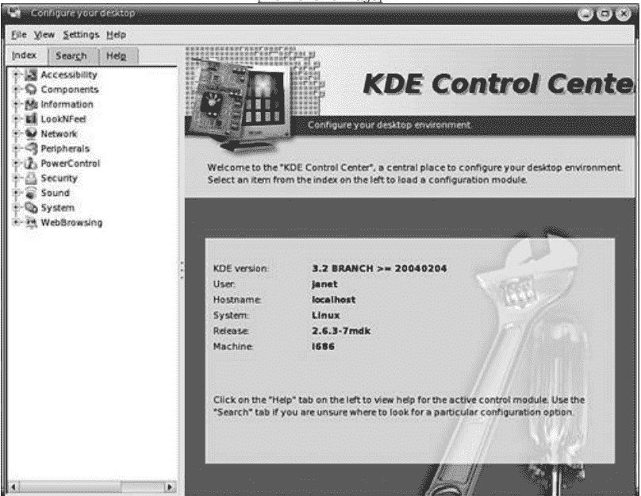

在 KDE 中，许多更改的界面如图 6-7 所示。

大多数桌面外观和行为的配置可以通过点击左侧面板中的“外观与效果（Look and Feel）”来实现。

GNOME 没有像 KDE 控制中心那样的单一应用程序。相反，它提供了分开的菜单项。对于 Fedora 来说，通常在“偏好（Preferences）”中，对于 SuSE 来说，如图 6-8 所示。

# 图 6-8. GNOME 桌面偏好。

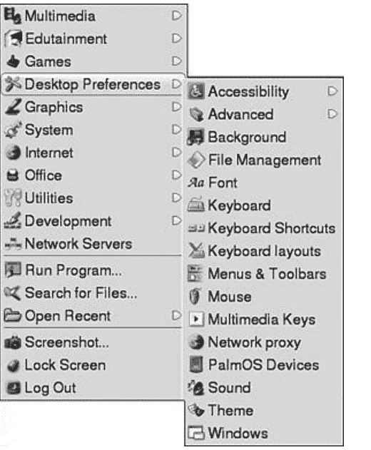

桌面偏好配置工具。本章剩余部分将描述如何更改某些桌面设置。涉及设置：

-   **背景**：桌面背景和面板背景。更改颜色或使用图片作为背景。
-   **图标**：添加或删除桌面和面板图标。
-   **字体**：更改字体样式和大小。
-   **屏幕保护**：设置屏幕保护和延迟。
-   **面板**：更改长度、宽度和位置。重新组织面板上的对象。

KDE 和 GNOME 的桌面配置都已涵盖。


## 修改 KDE 背景

你可以更改桌面和面板的背景。背景可以是纯色、图案或存储在文件图片。文件在第 9 章中讨论，图形在第 13 章中。

要更改桌面背景，右键点击桌面并选择“配置桌面（Configure desktop）”。左侧面板显示一个屏幕。点击“背景（Background）”。图 6-9 显示了配置窗口。

# 图 6-9. 背景配置窗口。

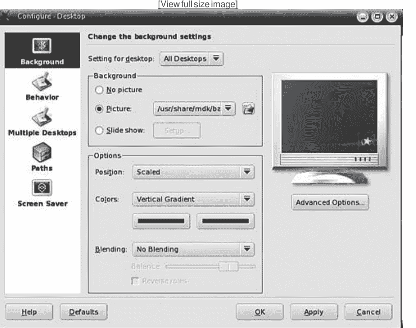

当你做出更改时，屏幕预览将显示你的选择效果。右下角的“应用（Apply）”按钮会在离开配置窗口之前将桌面更改为新外观。

要使用图片作为背景，如图 6-9 所示勾选“图片（Picture）”。使用列表从可用图片列表中选择。或者使用列表右侧的“浏览（Browse）”按钮导航到图片文件。

要使用颜色而不是图片作为背景，勾选“无图片（No picture）”。如果你点击“颜色（Colors）”按钮，会出现一个颜色下拉列表，例如水平渐变。点击图案


出现一个“设置（Setup）”按钮，点击后会显示一个包含可选图案列表的屏幕。该屏幕包含一个“添加（Add）”按钮，允许你输入包含图案的图形文件路径。

你可以为背景选择一种或两种颜色。如果你选择了两种不同的颜色，它们将作为垂直或水平背景渐变的两个端点。

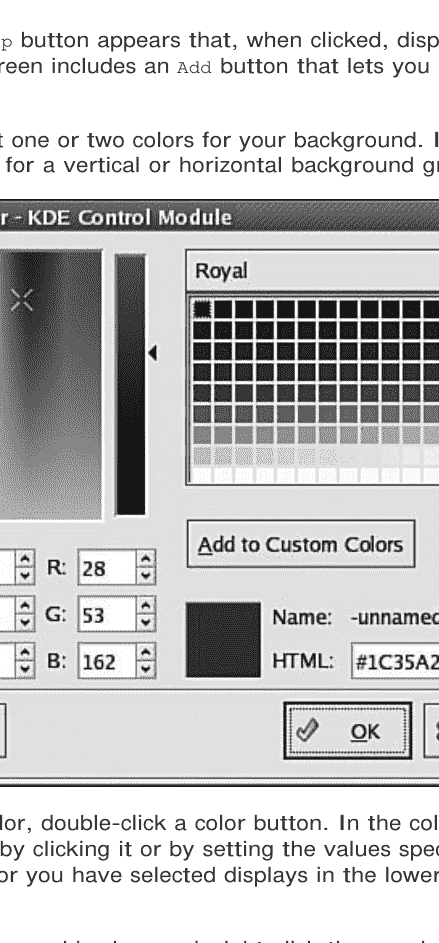

要选择颜色，请双击颜色按钮。在右侧显示的颜色选择屏幕中，你可以通过点击或特定设置值（例如设置 R、G、B 的数值）来选择颜色。你选择的颜色将显示在下方的框中，这样你就可以看到是否得到了你喜爱的颜色。

要更改面板背景，右键点击面板（面板上的空白区域，而不是按钮）并选择“配置面板（Configure Panel）”。在左窗格的图标列表中点击“外观（Appearance）”。如果列表中没有出现“外观”图标，那么点击“布局（Layout）”时应该有一个“外观”选项卡。屏幕将显示类似于图 6-10 的界面。

# 图 6-10。面板背景窗口。

[查看全尺寸图像]

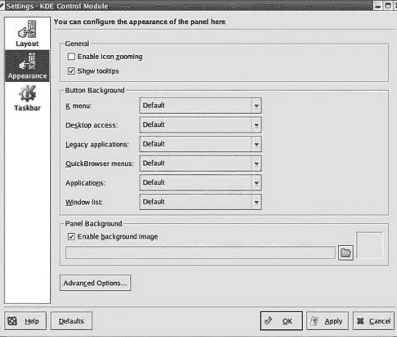

你可以通过从特定项目的下拉列表中选择背景，单独配置每个组件的背景，例如主菜单（K菜单）或应用程序图标。

你可以通过勾选“启用背景图像（Enable background image）”为整个面板添加背景。你可以输入图片的路径，或使用右侧的文件夹按钮浏览图片文件。任何图形文件都可以作为你面板的背景。文件将在第 9 章讨论。图形将在第 13 章讨论。


## 更改 GNOME 背景

你可以更改桌面和面板的背景。背景可以是颜色，也可以存储在文件中的图片。第 9 章讨论文件，第 13 章讨论图形。

桌面背景可以设置为任何纯色或颜色样式（例如垂直或水平渐变），或使用图片作为背景。要更改背景，右键点击桌面并选择“桌面背景（desktop background）”。显示的屏幕如图 6-11 所示，提供了两种背景选择：“无壁纸”和“图片”。

# 图 6-11。背景配置屏幕。

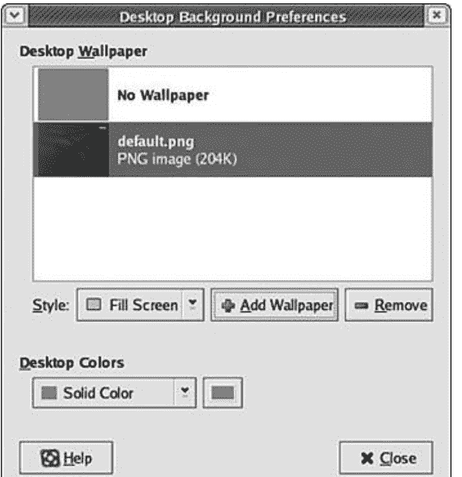

在图中，选择了一个名为 `default.png` 的文件图片作为桌面背景。要使用不同的图片作为背景，你需要将其添加到屏幕上的选项中。通常会有一些图片供你选择，或者你也可以添加自己的图片。

要添加图片，点击“添加壁纸（Add wallpaper）”，这将显示一个文件选择窗口，类似于 Windows（Windows 资源管理器）中的文件选择，左窗格列出目录，右窗格列出文件。列出的文件包含 Linux 发行版中提供的任何图形文件。你可以选择这些文件之一，或使用自己的文件。要使用你的文件，请将其添加到显示的桌面，或导航到不同位置的文件。第 9 章。

当你选择好想要的文件后，点击“确定”返回主背景配置屏幕。你选择的图片将添加到窗口的背景选项列表中。

对于背景，在窗口中突出显示“无壁纸（No Wallpaper）”，它显示当前颜色为蓝色。使用“桌面颜色（Desktop Colors）”部分的下拉列表和颜色按钮来设置颜色背景。

下拉列表提供三种背景样式：纯色、垂直渐变和水平渐变。点击颜色按钮将显示图 6-12 所示的颜色选择界面。

# 图 6-12。GNOME 颜色选择屏幕。

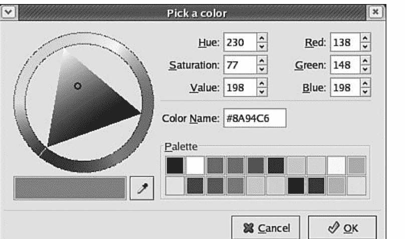

要选择颜色，点击你需要的颜色。或者输入颜色值，例如红、绿、蓝的数值。左下角的颜色条预览当前选中的颜色。当你对选定的颜色满意时，点击“确定”返回主背景配置窗口。

对背景选择满意后，点击主配置窗口中的“关闭（Close）”。

要更改面板背景，点击面板并选择“属性（Properties）”。在属性窗口中，点击“背景（Background）”选项卡显示三种背景选择。

- **无（None）**：面板使用与桌面或其他元素相同的颜色。这是默认设置。
- **纯色（Solid Color）**：将面板设置为纯色。点击颜色条选择颜色。使用滑块调整面板的透明度。
- **背景图像（Background）**：使用图片作为面板背景。文本框需要用于背景图片的路径。输入路径或使用“浏览”导航到文件。

要更改面板背景，点击面板并选择“属性”。在属性窗口中，点击“背景”选项卡显示三种背景选择。

- **无（None）**：面板使用与桌面或其他元素相同的颜色。这是默认设置。
- **纯色（Solid Color）**：将面板设置为纯色。点击颜色条选择颜色。使用滑块调整面板的透明度。
- **背景图像（Background Image）**：使用图片作为面板背景。文本框需要用于背景图片的路径。输入路径或使用“浏览”导航到文件。

## 设置字体（Setting Fonts）
*(注：原文此处标题为“Setting Fonts”，但内容实际关于面板背景。根据要求保留原文标题。)*


## 更改面板的位置和大小

可以更改面板的大小的位置。在 KDE 中，右键点击面板并选择“配置面板”（Configure Panel），这将显示图 6-16 所示屏幕。

### 图 6-16. KDE 面板配置屏幕。

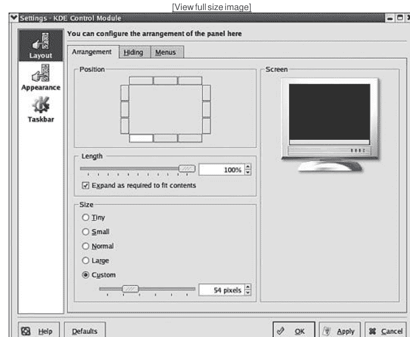

“部分”屏幕中的计算机终端会预览当前设置。任何更改都会立即显示在预览屏幕上。图中的面板跨整个底部。在“位置”（Position）部分，选择了左下角的正方形。点击不同的正方形可以移动面板。移动滑动块可以更改面板的长度。当前“大小”（Size）的设置为 54 像素的自定义大小。大小指的是面板的高度或宽度。使用滑动块更改自定义大小，或选择不同的大小（例如，“小” Small 或“极小” Tiny）。点击“确定”保留新设置。

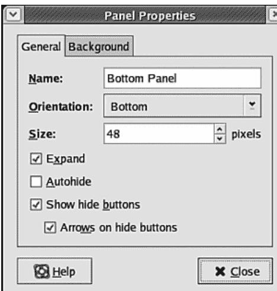

对于 GNOME，右键点击面板并选择“属性”（Properties）。右侧显示的屏幕。“方向”（Orientation）按钮允许你选择顶部、底部、左侧或右侧。你可以选择或输入像素值来设置大小。

对设置满意后，点击“关闭”（Close）。

## 配置多个虚拟桌面

Linux 不仅允许你配置桌面的几乎一切设置，还允许你拥有多个桌面，每个桌面的配置都不同。你可以拥有一个用于财务工作的桌面，另一个用于艺术项目的桌面。不同的桌面可以有不同的可用应用程序，以及适用于桌面功能的任何其他配置更改。

多个桌面也被称为虚拟桌面。面板中与虚拟桌面相关的部分如[图 6-17]() 所示。

### 图 6-17. KDE 面板部分。

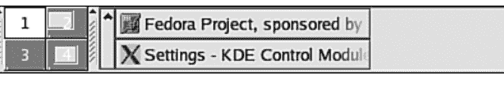

带有四个正方形的对象称为“页器”（pager），代表可用的虚拟桌面。代表桌面 1 的正方形 1 是白色的，意味着桌面 1 正在使用中。注意，桌面 2 和桌面 4 显示已打开的应用程序，而桌面 1 和桌面 3 没有。任务栏显示两个已打开的应用程序，代表所有窗口中的应用程序。点击数字可进入特定桌面。点击任务栏上的应用程序按钮可进入该应用程序打开的地方。如果它在不同的桌面上，该桌面将打开。

应用程序可以轻松从一个桌面移动到另一个桌面。当点击打开的应用程序中的左上角箭头时，你会看到一个包含[图 6-18]() 所示项目的菜单。

### 图 6-18. KDE 面板部分。

| 置于所有工作空间 |
| 移动到工作空间 1 |
| 移动到工作空间 2 |
| 移动到工作空间 3 |
| 移动到工作空间 4 |

选择相应的项目将应用程序从一个桌面移动到另一个桌面或多个桌面。

尽管页器显示四个桌面，但如果你需要，实际上可以拥有更多。要设置更多桌面，右键点击桌面并选择“配置桌面”（Configure Desktop）。从左窗中选择“多个窗口”（Multiple Windows）。[图 6-19]() 所示的窗口将打开。

### 图 6-19. KDE 面板部分。

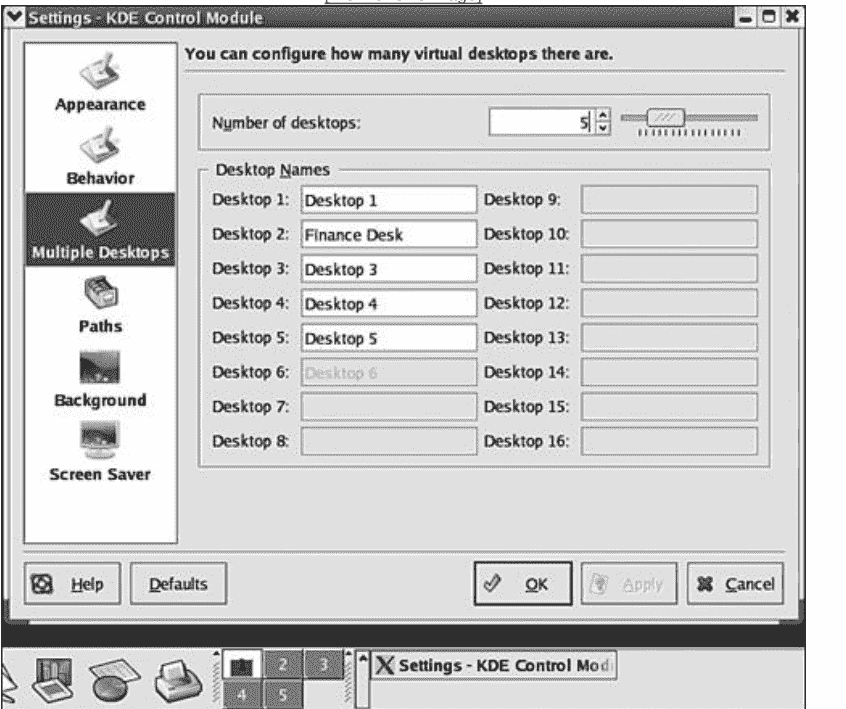

在此图中，五个桌面可用。注意页器显示了五个桌面正方形，窗口 1 激活并打开着一个应用程序。

使用屏幕顶部的“桌面数量”（Number of desktops）字段更改可用桌面的数量。如果你愿意，可以为桌面命名以帮助组织桌面。当你将鼠标指针悬停在页器正方形上，名称将显示在工具提示中。

## 注销

在不注销的情况下直接关闭机器可能会导致问题。Linux 可能正在运行你计算机所需的某些后台活动，可能无法完成其任务。

要选择，请在主菜单或在右键点击桌面时显示的桌面菜单上选择“注销”（Log Out）。在大多数情况下，会显示一个带有三个选项的窗口，类似于图 6-20 所示的 SuSE 窗口。

### 图 6-20. SuSE 注销窗口。

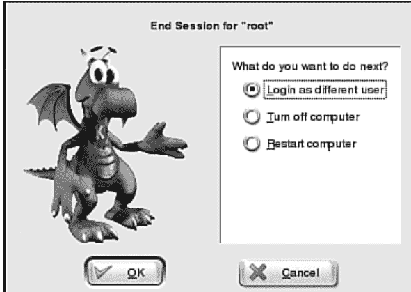

通常一个选项是“注销”（Log Out），或者在这种情况下是“以不同用户登录”（Login as different user）。选择此选项将注销会话，但会显示登录界面以便以不同的用户（或使用不同的桌面）登录。Linux 不关闭。第二个选项“重启”（restarts）计算机。Linux 在没有你协助的情况下关闭。

第三个选项是“关机”（Shut Down）或“关闭计算机”（Turn off computer）。这将关闭一切。计算机可能会自动关机，或显示已准备好关机的消息。

关机并非必要。Linux 可以无进程无限运行。这节省了时间，也许也对计算机更好。如果你由于别人尝试使用计算机而不愿离开，你可以锁定屏幕。要锁定屏幕，请从主菜单中选择“锁定屏幕”（Lock screen）。


## 输入命令

要使用命令行，你可以打开一个终端窗口（有时也称为控制台），你可以在其中直接在 shell 中工作。这类似于在 Windows 中打开 DOS 或命令提示符窗口。

某些发行版在面板上提供一个图标，你可以点击它可以打开终端窗口。该图标包含一个显示器屏幕。其他发行版则不提供终端图标。通常桌面菜单（在桌面上右键点击）包含一个打开终端窗口的选项。你始终可以在主菜单中找到它，作为主菜单项，或者位于系统下的子菜单中。

终端窗口显示系统提示符，随后是光标，表示它正在等待你输入命令。

当你输入一个命令并按下 <Enter> 时，命令就会执行。

系统提示符是可以配置的。不同的 Linux 发行版在安装期间设置不同的系统提示符。它可能简单如 $$，也可能包含额外的有用信息。图 7-1 中的系统提示符提供了额外信息：当前账户 (janet@localhost) 和目录 (janet)。此提示符是在 Fedora、Mandra 等发行版的安装过程中设置的。

# 图 7-1. 打开 KDE 终端窗口。

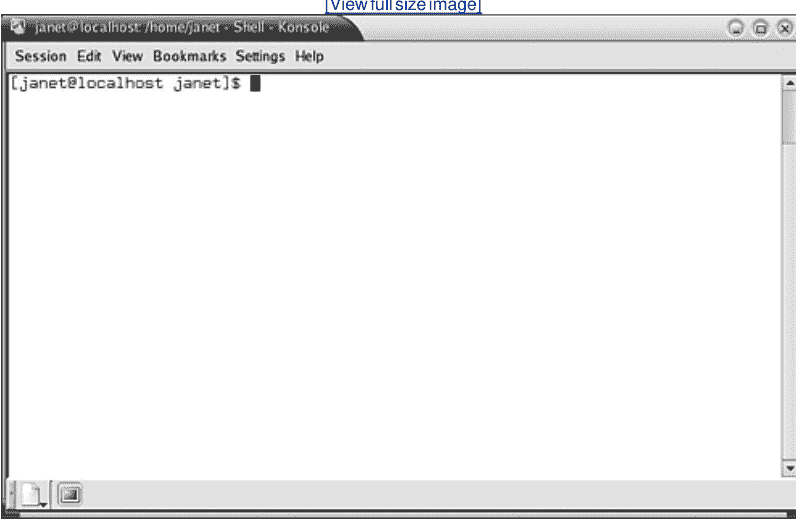

## 输入单个命令

偶尔，你可能想要输入单个命令，例如启动应用程序的命令。开始菜单上提供了一个“运行”（Run）选项，类似于 Windows 中的“运行”选项，它是输入单个命令的快捷方式。当你从菜单中选择“运行”选项（快捷键：<Alt+F2>）时，会打开一个你可以在其中输入命令的窗口。

左侧的 KDE 对话框提供了一个框，你可以在其中输入命令，并通过“运行”按钮执行命令。

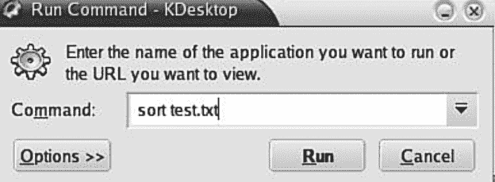

右侧 Gnome 中的“运行”对话框提供了一个可用应用程序列表，允许你通过选择而不是输入应用程序名称，并有一个按钮允许你浏览并由程序或你启动的应用程序运行文件。当然，你也可以输入你想要的命令。

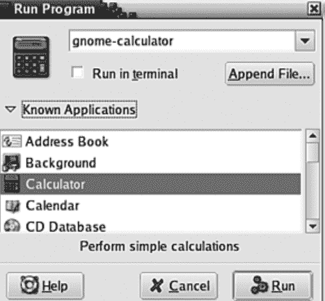

如果你想执行产生输出的命令，需要勾选“在终端中运行”（Run in terminal），该选项会打开一个显示输出的窗口。（在 KDE 中，点击选项按钮来选择“在终端中运行”复选框。）例如，上述 KDE 对话框中的 sort 命令不会重新格式化文件中的信息。相反，它按排序顺序输出文件信息。因此，要按排序顺序查看信息，你需要勾选“在终端中运行”框，这将打开一个显示排序输出的窗口。

## 命令行语法

在命令提示符后输入命令。当你输入命令后按下 <Enter>，命令就会执行。在命令执行期间，不会显示系统提示符。当命令运行完成后，显示系统提示符，表示 shell 已准备好接受另一个命令。

### 提示

当命令执行时，你可以通过 <Ctrl+c> 停止它。

命令由命令、选项和参数组成，格式如下：

```
commandname options arguments
```

其中

- Commandname 是命令的名称。
- Options（选项）是影响命令执行的关键字。选项由一个字符（前面带有一个连字符 (-)）或一个字符字符串 (--) 组成。连字符告诉 shell 接下来的字符是一个选项。对于大多数命令，选项是可选的。
- Arguments（参数）是命令在执行期间使用的信息。例如，命令可能会处理一个文件，因此你需要传递文件名作为参数。你可以根据需要传递任意数量的参数。所有命令都需要参数。某些命令在你不传递参数时需要默认值。如果参数包含空格或特殊字符，请在命令行上用引号括起来，这样 shell 就会知道它是一个参数，而不是两个。

以下命令显示了一个名称、一个选项和一个参数：

```
ls -l /home/janet
```

ls 命令列出目录中的文件。参数是通往目录的路径；参数（ls）所指定目录中的文件将显示在屏幕上。然而，ls 是一个不需要参数的命令，当你不传递参数时它会使用默认值。如果你不包含目录名，ls 命令将列出当前目录下的文件。

-l 是你可以配合 ls 命令一起使用的许多选项之一，用于确定显示的信息及其格式。-l 选项产生的输出比标准 ls 输出包含更多信息。不带 -l 的标准命令输出是 /home/janet 目录下的下列文件列表：

```
ls /home/janet
text.txt
text2.txt
```

而带有 -l 的 ls 命令输出则较长，如下所示：

```
ls -l /home/janet
-rw-r-- 1 janet janet 50 Apr 25 11.09 test.txt
-rw-r-- 1 janet janet 52 Apr 25 11.15 test2.txt
```

你可以按照如下方式输入多个选项：

```
ls -ld /home/janet
```

你可以通过分号 (;) 分隔输入多个命令：

```
ls /home/janet; ls /etc
```

### 提示

你可以输入多行的命令。通过在行尾输入反斜杠 (\) 然后按下回车键，第二行将被视为第一行的延续。

## 为长命令创建快捷方式

你可能有一个经常使用的长命令。如果是这样，你可以为该命令创建一个短别名（alias），这样你就不需要每次都输入该长命令了。例如，以下命令创建了 listall 别名：

```
alias listall='ls /home/janet; ls /etc; ls /tmp'
```

现在你可以输入 listall 来显示所有目录的文件。

## 重定向输入和输出

通常命令需要从键盘接收输入并将输出发送到屏幕。当数据从一个程序或设备移动到另一个设备时，是以流传输的。当程序运行时，它会自动连接到输入和输出流：stdin 和 stdout。默认情况下，stdin 连接到键盘，stdout 连接到屏幕。

ls 命令将文件列表输出到 stdout，默认连接到屏幕。你可以使用重定向字符大于号 (>) 来更改输出位置：

```
ls > dirlist
```

文件列表被重定向到 dirlist 而不在屏幕上显示。如果 dirlist 不存在，则会创建。如果 dirlist 存在，则会被替换。如果你不想覆盖现有文件，可以使用 >> 代替 > 将输出追加到现有文件，或者你可以设置 noclobber，这是一个防止覆盖文件的 shell 选项，而是打印一条提示信息，例如“Can't overwrite existing file，”

```
set -o noclobber
```

stdin 的重定向字符是小于号 (<)。例如：

```
mail < message
```

mail 命令从名为 message 的文件输入文本，而不是从键盘，并通过电子邮件发送消息。

第三个流 stderr 连接到运行的程序。错误消息使用 stderr 流，该流默认连接到屏幕。当你使用 > 重定向输出时，stderr 不会被重定向；它仍然显示在屏幕上。要重定向 stderr，使用类似的命令：

```
ls > dirlist
```

现在，文件列表和任何错误消息都发送到文件 dirlist。

有时你想将 stdout 连接到另一个程序的 stdin。建立这种连接被称为管道（piping），通过字符 | 来完成。假设你想将目录中所有文件的列表直接发送到打印机。你可以使用以下命令：


```
ls | lpr
```

## 在后台运行命令

某些命令需要很长时间才能执行完毕。例如，以下命令会将你计算机上每个文件的名称存储在 `allfiles` 中：

```
ls -lR / allfiles
```

此命令会长时间占用你的命令行，直到任务完成。如果你不想等待命令执行完毕，你可以在后台执行该任务，从而允许在第一个命令执行时输入其他命令。你可以通过在命令末尾添加 am培符号（`&`）来在后台启动命令，如下所示：

```
ls -lR / &
```

后台作业会按连续顺序分配一个数字。任务号在提交命令时会显示，并用于监控后台作业的状态。
你也可以通过以下方式将已经在运行的任务发送到后台：

```
Ctrl-z
bg
```

第一行挂起（暂停）任务。第二行在后台启动该任务。
你可以通过输入 `jobs` 来列出正在运行的任务：

```
jobs
1 ls -lR /
```

你可以使用 `fg jobnumber` 命令将任何任务带回前台：

```
fg jobnumber
```

例如：

## 命令行编辑

若干命令行功能可以帮助你输入命令。例如，可以使用通配符，这些与你在 Windows 中使用的通配符相同。星号（`*`）可以替换字符串，问号（`?`）可以替换单个字符。因此，以下命令列出了包含 `var` 且以单个字符结尾的文件名：

```
ls *var?
xvar1
Study_varA
```

当你按下 `Tab` 键时，会自动补全文件名和目录名。当你输入的名称足够长，使其仅指代一个文件时，按下 `Tab` 键，剩余的文件名将填充到命令行。

Shell 会存储你输入的命令历史记录。你可以通过输入 `history` 来查看，它会列出所有命令并在每行开头添加一个行号。

你可以重复使用以感叹号（`!`）开头的命令：

- `!!` 重复最后输入的命令。
- `!string` 输入感叹号，后跟一个或多个作为命令开头的字母。重复上一次以这些字母开头的命令。例如，如果你输入 `!c`，将重复上一次以 `c` 开头的命令。
- `!n` 输入感叹号，后跟一个行号。重复历史记录中对应行显示的命令。例如，如果你输入 `!6`，将重复历史记录中第六行的命令。

你也可以使用上方向键重复之前的命令。每次按下`<上方向键>`，都会显示上一个命令。继续按下`<上方向键>` 直到你想要重复的命令为止。

你可以使用 `^old^new` 编辑上一个命令并重新输入它。该命令将把刚刚执行的第一个命令中的 `string1` 替换为 `string2`：

```
srot test.txt
ro^or*
```

如所示，你不小心输入了 `srot`，而本意是输入 `sort`。第二行告诉 Shell 重新输入命令，将 `ro` 改为 `or`。

## 命令行帮助

Linux 提供了几个命令，可以提供其许多命令的细节帮助：

- **help**: 给出一个 Shell 命令列表，它是 Linux 命令的子集，包括 `cd`、`alias`、`bg`、`jobs` 等。输入 `helpcommand` 查看详情。
- **man**: 手册（manual）页文档记录了 Linux 上所有的程序。要查看任何命令的详情，输入 `mancommand`。如果你不知道命令名称，可以使用 `-k` 选项搜索所有描述。例如，如果你输入 `man -k copy`，将显示所有描述中包含 `copy` 的命令列表。
- **info**: 该程序通过一个你可以选择的主题分级菜单显示在线文档。此外，相关信息带有超链接。info 通常包含的信息比 man 手页更完整、包含更多概念性信息。当你不带任何参数输入 `info` 时，会显示顶层手册。如果你知道主题名称，可以输入 `infopickname`。
- **help option**: 许多程序都有一个显示关于使用该程序信息的选项。尝试输入程序名后接 `-h` 或 `--help` 是值得尝试的。例如，输入 `info --help` 会显示一个简短的帮助文件。

手册页根据命令类型分为若干有编号的章节，例如可执行程序、系统调用或游戏。你感兴趣的学习 Linux 的命令大多数位于第 1 节（可执行程序或 shell 命令）中。如果你指定了章节号，`man` 命令就不需要搜索所有的手册页，只需搜索一个章节，从而大大加快命令速度。例如，你可能使用以下命令来查找 `ls` 命令的所有可用选项：

```
man ls
```

软件安装在 Linux 上时，相关的帮助、man 和/或 info 文件会安装在相应的位置。`man` 命令在特定目录中查找文件，每个章节有自己的子目录。要查看手册页的位置，请在命令行输入 `manpath`。

## 一些常用命令

下表列出了一些最实用的 Linux 命令。表格显示了命令名称、命令的功能以及在哪里可以找到更多信息。此外，`sort` 和 `grep` 这两个较为复杂的命令在本章中也有记录，以展示 shell 脚本的使用。

### 表 7-1. 一些常用文件命令

| 命令 | 作用 | 详情见 |
| :--- | :--- | :--- |
| cat | 显示文件内容。 | 第 9 章 |
| cd | 切换目录。 | 第 9 章 |
| chgrp | 修改文件的所属组。 | 第 9 章 |
| chmod | 更改文件的权限。 | 第 9 章 |
| chown | 更改文件的所有者。 | 第 9 章 |
| cp | 复制文件或目录。 | 第 9 章 |
| diff | 比较两个文件的内容。 | 第 9 章 |
| dif3 | 比较三个文件的内容。 | 第 9 章 |
| find | 在硬盘上查找文件。 | 第 9 章 |
| grep | 查找包含指定内容的文件。 | 第 9 章 |
| less | 在屏幕上一次显示一页文件内容。 | 第 9 章 |
| ls | 列出目录下的文件名。 | 第 9 章 |
| mkdir | 创建新目录。 | 第 9 章 |
| mv | 移动文件位置。 | 第 9 章 |
| pwd | 显示当前目录的路径。 | 第 9 章 |
| rmdir | 删除空目录。 | 第 9 章 |
| touch | 更新文件的访问/修改日期。 | 第 9 章 |

### 表 7-2. 一些常用账户管理命令

| 命令 | 作用 | 详情见 |
| :--- | :--- | :--- |
| env | 设置或显示环境变量。 | 附录 B
| groupadd | 添加新组。 | 第 8 章 |
| groups | 显示所属组列表。 | 第 8 章 |
| password | 修改密码。 | 第 8 章 |
| quota | 显示账户使用的和可用磁盘空间。 | 附录 B |
| su | 切换到超级用户或其他账户。 | 第 8 章 |
| unset | 移除环境变量。 | 附录 B |
| useradd | 添加新账户。 | 第 8 章 |
| userdel | 删除账户。 | 第 8 章 |
| whoami | 显示当前账户。 | 第 8 章 |

### 表 7-3. 一些常用打印作业管理命令

| 命令 | 作用 | 详情见 |
| :--- | :--- | :--- |
| lpr | 将文件发送到打印队列。 | 第 14 章 |
| lprm | 从打印队列删除文件。 | 第 14 章 |
| lpq | 显示队列中作业的信息。 | 第 14 章 |

### 表 7-4. 一些杂项常用命令

| 命令 | 作用 | 详情见 |
| :--- | :--- | :--- |
| where | 查找程序的位置。 | 附录 B |
| tar | 将文件放入归档并从归档文件中提取。 | 第 10 章 |
| ftp | 在计算机之间传输文件。 | 附录 B |
| clear | 清除屏幕。 | 附录 B |
| date | 显示当前日期和时间。 | 附录 B |
| gzip | 压缩文件。 | 附录 B |
| gunzip | 解压缩文件。 | 附录 B |


## sort 命令

如果你想对纯文本文件的内容进行排序，可以将其导入文字处理器并进行排序。然而，Linux 有一个 `sort` 命令，它的速度快得多，而且通常更容易使用。对名为 `unsorted.txt` 的文件排序命令为：

```
sort unsorted.txt
```

文件中未排序前和排序后的内容如下：

| 未排序前 | 排序后 |
| --- | --- |
| Little Boy Blue | |
| Jack Horner | Little Bo Peep |
| Little Bo Peep | Little Boy Blue |

这是 `sort` 最简单的形式，足以满足许多需求。此外，`sort` 命令有几个可以影响排序过程的选项。表 7-5 显示了最有用的选项。

## 表 7-5. sort 命令的选项

| 选项 | 功能 |
| --- | --- |
| -filename | 将输出保存到指定文件中 |
| -r | 反序排序 |
| -u | 删除重复行 |
| -k | 指定按哪个键进行排序 |
| -t | 定义字符作为文本行中键的分隔符 |

使用 `-k` 和 `-t` 选项可以进行复杂的排序。这些选项允许你精确指定要排序哪一行，而不仅仅是从行的开头开始排序。例如，你可以使用以下命令：

```
sort -k2 -t" " unsorted.txt
```

`-t` 定义一个空格作为分隔键的字符。`-k2` 指定第 2 个键为排序的键。因此，`sort` 将根据行中的第二个单词对行进行排序：此排序的输出为：

```
Little Bo Peep
Little Boy Blue
```


## grep 命令

`grep` 命令深受 Linux 用户喜爱，以至于都有了自己的 T 恤。`grep` 命令查找包含指定内容的文件并输出它找到的每一行。`grep` 命令的通用格式为：

```
grep options pattern files
```

其中：

- pattern 指定要搜索的文本。`pattern` 可以是字面字符串，例如 `abc` 或 `xxx`。`pattern` 可以是正则表达式，即要匹配的模式，例如任何大写字母或以 Q 开头的单词。正则表达式将在附录 A 中讨论。
- files 指定要搜索字符串的文件。`files` 可以指定文件名（需要使用通配符）或目录。

例如，以下是一个简单的 `grep` 命令及其输出：

```
grep "Mary Poppins" *
file1.txt:I like Mary Poppins!
file7.txt:Mary Poppins is a great movie.
```

该命令在当前目录下的所有文件中查找字符串 `Mary Poppins`。显示包含搜索结果的行，并在前面加上文件名。你可以使用路径（例如使用 `/home/jane` 而不是 `.`）来指定目录并搜索该目录下的所有文件。

`grep` 命令有许多选项，其中一些显示在表 7-6。

## 表 7-6. grep 命令的选项

| 选项 | 功能 |
| --- | --- |
| -c | 输出找到的行数，而不是行本身。 |
| -i | 匹配时忽略大小写。 |
| -l | 输出匹配项的文件名，而不是实际行。 |
| -n | 包含匹配项的行号：file1.txt:16:Text on line。 |
| -r | 检查指定目录下的所有子目录。 |
| -v | 输出所有不匹配的行。 |
| -x | 仅当模式匹配整行时才输出行。 |


## 配置终端窗口

你可以根据自己的喜好配置终端窗口。你可以更改颜色、字体大小、打开窗口、声音以及终端窗口的其他特性。KDE 和 Gnome 都允许配置，但实施更改的方法有所不同。

终端窗口顶部有一个菜单。右侧是“设置”（Settings）下拉菜单，你可以在那里更改窗口设置。你可以显示或隐藏菜单栏（顶部）和工具栏（底部）。你可以将滚动条放在左侧或右侧。你可以将窗口大小更改为全屏，或者选择“大小”（Size）菜单项来指定窗口大小。如果你选择“字体”（Font），你会看到一个允许更改字体大小的菜单。“历史记录”（History）允许你设置执行过的命令历史列表的选项。“Schema”是高亮显示的项目，允许你设置文本和背景颜色。

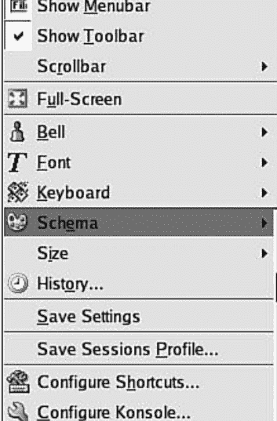

如果你选择“保存设置”（Save Settings），当前生效的设置将被保存。当你打开终端窗口时，这些设置将继续生效。

Gnome 提供了相同的选项，但通过不同的机制。Gnome 允许你设置一个配置。在终端菜单上选择 `edit->profile`，你就会看到右侧的面板。

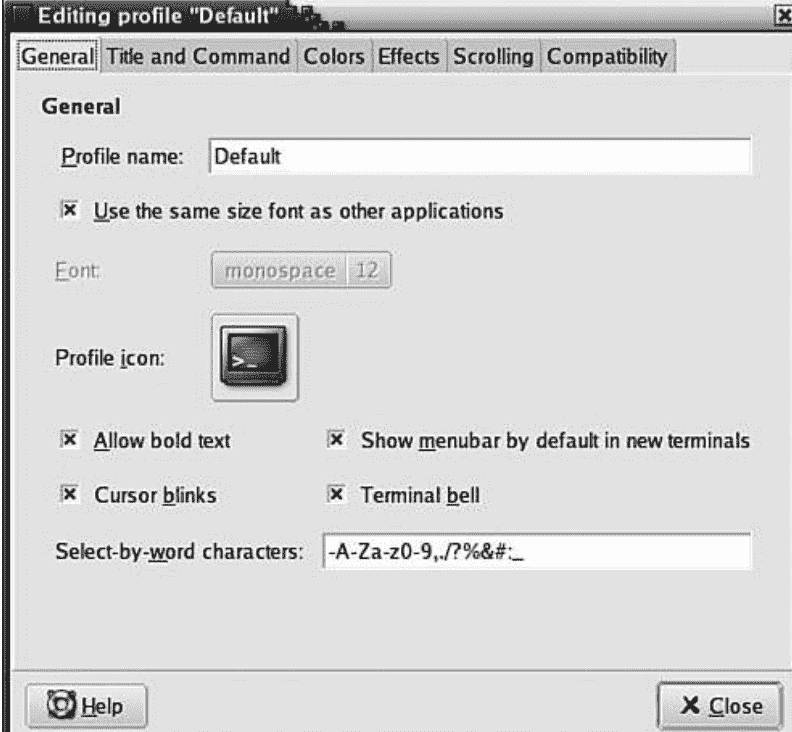

注意通用、颜色、效果和滚动标签卡。点击标签卡允许你设置配置。默认配置是生效，除非你更改它。

## 总结

Linux 提供了两种基本的界面供你工作使用：GUI（图形用户界面）和 CLI（命令行界面）。本章描述了如何使用 CLI，包括：

- 输入命令
- 重定向输入输出
- 在后台运行
- 获取帮助
- 配置终端

此外，还提供了常用命令总结。`sort` 和 `grep` 命令将详细介绍。在下一章中将介绍 Linux 账户的管理。

## 第8章 账户

Linux 是一个多用户操作系统，允许许多用户在同一台计算机上工作。为了这项工作，每个用户的工作必须保持分离。不允许用户干扰他人的工作，无论是无意还是恶意。Linux 账户使用户的工作保持私并受到保护。你可能是这台计算机上唯一的人。如果是这样，用户账户对你来说可能是必要的。然而，没有账户你就无法运行 Linux。因此，至少一个账户。

你会在系统中看到你没有创建的账户。这些是运行系统和应用程序的特殊账户。有些在安装期间创建，另一些是在安装软件应用程序时创建的。然而，这些不是你可能登录的账户。只有系统管理员可能需要理解或处理特殊账户。

## 账户类型并不是所有的账户都是平等的。每个账户都有其被允许执行的操作权限集。有两种类型的账户：

- **root**：安装期间创建了一个 root 账户以及可能的一个多个用户账户，并赋予了密码。不要忘记 root 密码。你必须使用 root 账户对系统进行更改。root 可以随时添加新账户。大多数情况下登录并使用你的用户账户是明智的。事实上，除非真的需要，否则不要使用 root 账户。root 拥有无限权限，会导致灾难性的错误。

- **用户**：用户账户可以临时获得 root 权限。当你以用户账户登录桌面时需要执行需要权限的任务，可以输入 root 密码并执行该任务。例如，当你以用户账户登录时打开主菜单->系统设置并选择用户和组，或者为了 root 密码，将弹出图 8-1 所示的窗口。

# 图 8-1 root 密码提示。

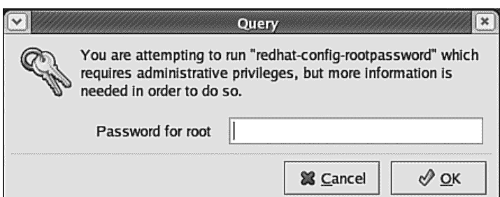

当在终端窗口的 shell 中工作时，只要知道密码，你可以从一个账户切换到任何其他账户。使用以下命令切换账户：

```
su accountname
```


除非你以 root 身份登录，否则系统会提示输入密码。root 可以可以直接切换到任何账户而不需要密码。


## 组 (Groups)

每个账户在创建时都会被分配到一个组成员。分配给组的权限对该组内的所有账户可用。一个账户可以同时属于多个组。

组是授予账户权限的一种非常用的方法。例如，假设你有一个名为 `destroy` 的程序，只有某些人应该使用。你可以设置该程序，使其仅供专家组（expert group）可用，而不是所有用户都可用。在安装一个需要运行 `destroy` 程序的新账户时，将该账户分配给专家 组。如果你为这组人员安装了一个新程序 `destroy2`，你可以设置该新程序使得只有专家 组可以运行它。

每个账户在创建时至少必须为其分配一个组。在将任何账户分配给组之前，该组必须已经存在。Linux 允许你设置一个默认组，分配给每个新账户。某些 Linux 系统会将相同的组（通常名为 `users`）分配给所有新账户。用户组没有特殊的权限。其他 Linux 系统会为每个新账户分配一个独立的组。例如，当 Fedora 创建用户账户时，它还会创建一个同名的组，并将该组分配给该新账户。因此，账户 `jan` 属于 `janet` 组。`janet` 组没有额外的权限。

Linux 默认安装几个组。`root` 是 Linux 安装的一个组；`root` 账户是 root 组的成员。如果将新账户分配到 root 组，该新账户将拥有与 root 账户相同的权限。

你可以根据自己的需要创建组。组名应该代表该组的，例如销售组（sales group）或邮件组（mail group）。组名限制为 16 个字符或更少。

组通过文件权限为账户提供权限。文件权限将在第 9 章中讨论。

## 账户信息 (Account Information)

你可以查看和/或编辑账户信息。在 Fedora 上，选择主菜单 -> 系统设置 -> 用户和组，即可获得图 8-2 所示的窗口。

# 图 8-2。账户管理窗口。


选中一个账户并点击“属性”。打开图 8-3 所示的窗口。

# 图 8-3。账户管理窗口。

主目录是属于账户的文件存储区域。除非账户所有者允许，否则没有用户可以访问主目录。事实上，除了 root 之外，没人可以去做什么。主目录最常见的位置是 `/home/accountname`。

点击窗口中的标签页查看有关账户的附加信息。图 8-4 显示了“账户信息”和“密码信息”屏幕。

# 图 8-4。账户和密码信息屏幕。


账户信息屏幕允许为账户设置过期日期。密码信息屏幕允许你设置密码过期日期，强制用户定期更改密码。这两个设置都能提高具有大量用户的系统的安全性。

组屏幕提供了系统上所有组的列表。该账户所属的组会被勾选。如有需要，你可以勾选或取消勾选任何组。图中组是 Fedora 在安装期间设置的。取消勾选 Fedora 已勾选的任何组是不明智的。

# 图 8-5。组列表。


大多数发行版都有类似的实用程序来管理账户。SuSE 有 YaST，通过主菜单 -> 控制中心访问。Mandrake 在“系统 -> 配置 -> 配置你的计算机”中有一个控制中心。

## 添加账户 (Adding Accounts)

使用查看和更改账户信息的实用程序添加新账户。在 Fedora 上，选择主菜单 -> 系统设置 -> 用户和组，即可获得图 8-2 所示的窗口。要添加新账户，点击“添加用户”。打开图 8-6 所示的窗口。

# 图 8-6。创建新用户。


填写新账户的信息。账户名必须少于 32 个字符，且不能以数字开头。系统会为登录 shell（Login Shell）和主目录（Home Directory）输入默认值。当你点击 OK 时，新账户会被添加。系统会创建一个与账户同名的组。其他系统（如 SuSE）使用通用组（如 User）创建账户，而不是使用私有的个人组。

新账户也可以在终端窗口的命令行中创建。在以 root 身份登录时，输入：

```bash
useradd janet
```

新的 `janet` 账户还没有密码。接下来，输入：

```bash
passwd janet
```

系统将按照如下所示提示输入密码，并再次提示进行双重检查：

更改用户 janet 的密码：
新密码：


## 密码 (Passwords)

密码对于系统的安全性至关重要。除了 root 之外，没人可以去任何地方做任何事情。密码应该是复杂的，例如，应包含大写字母、小写字母、数字和特殊字符。为了提高安全性，建议：

- 密码长度至少为 8 个字符。
- 包含不同类型的字符。
- 避免使用简单的单词或个人个人信息。
- 定期更改密码。

## 组信息 (Group Information)

你可以查看账户所属的组信息。使用前文讨论的账户管理实用程序来查看和更改账户信息。在 Fedora 上，选择主菜单 -> 系统设置 -> 用户和组，即可获得图 8-2 所示的窗口。点击“组”标签页。打开图 8-7。

# 图 8-7。组信息显示。


组屏幕提供了系统上所有组的列表。该账户所属的组会被勾选。你可以勾选或取消勾选任何组。图中组是 Fedora 在安装期间设置的。取消勾选 Fedora 已勾选的任何组是不明智的。

## 添加组 (Adding Groups)

要添加组，使用前文讨论的账户管理实用程序来查看和更改账户信息。在 Fedora 上，选择主菜单 -> 系统设置 -> 用户和组，即可获得图 8-2 所示的窗口。点击“组”标签页。点击“添加组”。打开图 8-8 所示的窗口。

# 图 8-8。添加组对话框窗口。


输入新组名称并点击 OK。组名必须少于 17 个字符，且不能以数字开头。新组将被添加到窗口 8-7 中，但没有成员。要将账户添加到该组：

1. 点击“账户”标签页。
2. 选中一个账户。
3. 点击“属性”。
4. 点击“组”标签页。
5. 在组列表中勾选新组旁边的复选框。


```
groupmod -G group user
```

其中 group 是组名，user 是账户名，例如：

```
groupmod -G sales janet3
```


## 忘记 root 密码

忘记 root 密码并不是一个无法解决的问题。你可以通过以单用户模式（single user mode）启动计算机来设置新的 root 密码。这是一种特殊的模式，主要供系统管理员执行特定任务。你可以利用它来恢复丢失的 root 密码。

在系统启动时，从启动加载程序界面进入单用户模式。图 4-18 所示了 Fedora 的启动加载程序。请注意，它包含了一些操作说明：按 'e' 可以在启动前编辑命令。要进入单用户模式：

-   当启动加载程序屏幕显示时，按下 <e>。将显示配置文件的内容，类似于下面的示例。

```
root (hd0,0)
kernel /vmlinuz-2.42.12-2115.npt1 ro=LABEL=/ rhgb
initrd /initrd-2.42.12-2115.npt1.img
```

-   使用方向键移动到内核行。

-   按下 <e> 编辑该行。

-   在行末尾添加 `single` 单词，如下所示，然后按 <Enter> 保存更改：

```
grub edit kernel /vmlinuz-2.42.12-2115.npt1 ro=LABEL=/ rhgb single
```

-   按下 <Enter> 启动。

在 Mandrake 中，你可以通过在启动加载程序选择 Failsafe（安全模式）进入单用户模式。对于其他发行版，请阅读相关文档。如果你在 GRUB 内部使用 LILO，在启动提示符处输入 `linux single`。

当系统完成启动后，会显示提示符。如果要求登录，输入 root。此时，你可以更改 root 密码。输入：

```
passwd root
```

在提示提示时输入两次新密码。然后输入：

```
reboot
```

以正常的多用户模式重启你的计算机。

## 总结

Linux 是一个多用户操作系统。Linux 账户使用户的工作相互隔离、私且受保护。所有信息都组织成文件，每个文件都由一个账户所有，并防止其他账户访问。因此，没有账户，你无法在 Linux 上进行任何操作。

所有文件都由一个账户和一个组所有。查看、修改或运行文件的权限被分配给用户、组以及所有用户。这种权限系统保护了每个用户的工作和信息。

本章解释如何如何以下操作：

-   *检查并更改账户信息，如用户名、主目录和组组成情况*
-   添加账户
-   添加或修改密码。提供安全密码规则。
-   添加组
-   设置新的 root 账户密码

下一章将解释如何设置和更改文件权限。它还将解释如何创建、移动、重命名、删除以及其他管理文件。

## 第 9 章 文件管理

Linux 上的所有信息都组织成文件。所有信息，无例外。文件是 Linux 用于存储信息的机制。你可能需要了解并管理包含以下类型信息的文件：

-   ***数据文件：包含存储在计算机上的信息的文件。数据文件有两种类型：**
    -   **特定应用程序文件：** 由特定应用程序创建的信息，以只有该应用程序才能解释的格式存储。创建、更改、存储或打印数据文件必须使用该应用程序完成。许多文字处理器创建的文档存储在特定应用程序文件中。
    -   **文本文件：**存储在通用格式（ASCII）中的信息，大多数应用程序都可以读取。Linux 系统命令可以读取并修改此类文件。尽管默认是特定应用程序文件，但你的文字处理器允许你专门将文件另存为文本。

-   ***程序和应用程序：包含指令的文件。** 当你运行程序时，Linux 会读取文件中的指令并按指示执行任务。

-   ***图像文件：包含图片的文件。**你需要使用理解图形内容的软件来查看或修改这些文件。图形文件将在第 14 章中描述。

-   ***配置文件：包含应用程序执行工作所需信息的文件。** 例如，你桌面的设置存储在配置文件中。当桌面启动时，它会读取该文件以查看背景是什么颜色、使用何种字体。

在很多情况下，你使用应用程序创建和操作数据。应用程序管理文件；你只需要知道数据文件名。然而，有时你需要直接处理文件。本章描述了文件的存储方式，以及如何创建、复制、移动、删除以及其他管理文件。

## 文件组织

文件被组织成目录，也称为文件夹。Windows 用户可能对文件夹很熟悉。目录可以包含文件和其他目录，数量不限。目录甚至可以是空的，不包含任何文件或目录。

## 注意

由于 Linux 上的所有信息都存储在文件中，目录实际上是一个包含访问分配给它的文件所需信息的文件。

目录在硬盘上按层级结构组织，称为文件系统。虽然从技术上讲目录可以按任意方式命名和组织，但大多数 Linux 系统都是按照认可的 Linux 方式组织的。顶层目录称为 root，用斜杠 (/) 表示。


## 从桌面查看文件

图 9-1 显示了 Konqueror 文件管理器。它是在 Fedora Core 2 系统上，通过点击 KDE 桌面上的“主目录”图标或菜单中的“Home”在用户主目录中打开的。

# 图 9-1. Fedora Core 2 上的 Konqueror。


主区域上方的“位置”（Location）字段显示了当前目录路径：/home/home。右侧的大窗格显示目录中文件的图标，在这种情况下只有一个文件：Desktop（桌面）。如果你双击文件夹图标（例如 Desktop），你将进入该文件夹并查看其内容；双击文件图标，文件将在其关联的应用程序中打开（在本章稍后讨论）。

窗口左侧的一行按钮控制左侧窗格的内容。此时，根目录按钮处于打开状态，因此左侧窗格显示根目录的内容。点击左侧窗格中的文件夹将进入该文件夹目录。

你还可以使用工具栏上的上移、后退和前进箭头在文件系统中移动。你可以点击工具栏上的主目录图标返回主目录。

如果你点击“查看（View）->显示隐藏文件（Show Hidden Files）”，将显示许多额外文件。这些是系统文件，是为了让账户正常运行的文件。在变得足够熟悉之前，最好不要动这些文件。

要查看文件信息，右键点击文件图标并选择“属性（Properties）”。

左侧窗口显示文件名、类型、位置、大小以及修改和访问日期。在此，显示了 Linux 文件系统的总磁盘空间和可用磁盘空间。

点击“权限（Permissions）”选项卡会打开右侧窗口。显示了你所示文件的权限和所属组。你可以从此界面更改权限。更改权限将在在本章稍后解释。

图 9-1 显示了目录和图标的形式。你可以更改文件列表样式。点击“视图”（View Mode）并从右侧列表中选择。图 9-1 的左侧窗格显示的是“树视图”（Tree view）。“详细列表”（Detailed List）视图非常有用。它为每个文件和目录显示文本列表，大部分信息都包含在一个摘要行中，如下格式所示。此列表显示文件名、以 KB 为单位的大小、类型、最后修改日期/时间、权限、所有者和组。


[查看全尺寸图像]

| | | 大小 | 文件类型 | 修改 | 权限 | 所有者 | 组 |
|---|---|---|---|---|---|---|---|
| 主目录 (Home Directory) | | | | | | | |
| 桌面 (Desktop) | | 4.0 KB | 目录 | 2004-10-09 21:24 | rwxr-xr-x | janet | janet |
| 垃圾箱 (Trash) | | | | | | | |

在本章的“文件权限”部分提供了对权限符号的解释。


## 从命令行查看文件

要使用命令行，请打开终端窗口。你会看到正在使用的账户的主目录。要查看目录中的文件列表，请使用 `ls` 命令，如下所示：

```
ls
Desktop  Images  test.txt
```

所示输出列出了名称。某些发行版会输出彩色列表以显示文件类型，例如用蓝色表示目录。其他一些会在目录名称后显示正斜杠（/），如下所示所示：

```
ls
Desktop/  Images/  test.txt
```

要查看有关文件的更多信息，请使用 `ls` 命令的选项。所有选项都记录在 `ls` 的手册（man page）中，通过输入以下命令访问：

```
man ls
```

一个实用的选项是 -1，用于获取长列表，如下：

```
ls -1
drwx------ 3 janet janet 4096 Oct 2 13:21 Desktop/
```

第一个字符 `d` 表示目录。文件的第一个字符将显示为 `-`。接下来的 9 个字符是权限，正如文件的“文件权限”部分所解释的。第一个 `janet` 是用户所有者。第二个 `janet` 是组所有者。`4096` 是文件大小。`Oct 2 13:21` 是文件最后修改的日期/时间。`Desktop` 是文件名。

你可以通过指定名称来使用 `ls` 列出目录内容，如下所示：

```
ls /home/robert
Desktop  mysecretstuff
```

实际上，只有在你拥有权限的情况下才能查看 robert 目录的内容。如果你没有权限，你会看到类似下方的错误消息：

```
ls: /home/robert: Permission denied
```

你可以使用以下命令将目录列表保存到文件中，而不是显示在屏幕上：

```
ls > dir_listing
```

文件列表存储在名为 `dir_listing` 的文本文件中，格式与其在屏幕上显示的格式相同。你可以查看该文件或打印它。

使用 `ls` 命令列出的文件和目录不包括系统文件，除非你使用 `-a` 选项。


```
chmod g+w file1
```

该命令为名为 file1 的文件赋予组写入权限。它不会更改该文件的任何其他权限。如果该组已经具有读取权限，它将仍然拥有读取权限。另一个命令可能是：

```
chmod g-w file1
```

该命令移除该组对该文件的写入权限，而不改变该文件的任何其他权限。另一个命令可能是：

```
chmod go=x file1
```

该命令赋予组和所有账户对该文件的执行权限。该组和所有其他账户没有被赋予读取或写入权限。由于此命令中没有指定 u，因此所有者的权限不会发生改变。你可以使用以下命令一次性设置所有权限：

```
chmod a=r file2
```

a 代表所有三种类型的用户账户。现在系统上的所有用户账户都可以查看 file2 的内容。然而，它们无法对该进行写入或执行。

## 管理所有者和组

文件的权限被授予所有者、组或所有账户。你可能想要将创建的文件转移给另一个所有者。更多情况下，你可能想通过更改文件的组来允许特定用户访问它。

在许多系统中，当创建一个文件时，该文件的组名与创建它的所有者相同。例如，由 yet 创建的文件可能属于 janet 组。如果你通过将其他账户添加到 janet 组来向其他账户授予文件权限，你将允许他们访问你创建的所有文件。更好的解决方案是创建一个新组，将你想要访问该文件的成员添加到新组，并更改文件的组。然后，如果你为该文件授予组写入权限，所有组内成员（但不是所有账户）都拥有写入权限。

在某些系统中，用户账户的组不是一个包含所有用户账户的通用组。你需要根据此设置你文件的权限。为了限制对你文件的访问，你可以更改组。

你可以在命令行中使用以下更改 file2 所有者或组的命令之一更改更改：

```
chown salesmanager file2 (将所有者更改为账户 salesmanager)
chgrp sales file2 (将组更改为 sales)
```

如果你在 Konquer 文件管理器中，可以使用“运行命令”（Run Command）菜单快速执行单条命令。或者通过“工具->打开终端”（Tools->Open Terminal）使用终端窗口。

在授予某个组文件所有权之前，该组必须已经存在。创建组是使用“用户和组”（User and Groups）工具完成的，参考第 8 章。要在 Fedora 上创建组，选择主菜单->系统设置->用户和组进入图 8-2 所示的窗口。点击“添加组”（Add Group）。在对话框中输入新组名。点击“确定”（OK）。或者通过命令行输入以下命令更快地创建组：

```
groupadd group
```

要将账户添加到组，在“用户和组”窗口中，高一个账户并点击“组”（Group）选项卡。勾选组名旁的复选框将账户添加到该组。或使用命令行命令：

```
usermod -G group username (注意大写的 G)
```

你用于更改所有者和组的账户必须拥有更改它们的权限。如果你看到类似“不允许的操作”（Operation not permitted）的消息，说明该账户无法执行你输入的更改。切换到 root （su root）可以解决问题。

## 文件类型

尽管 Linux 处理其他类型的文件（如块设备），但本章只讨论普通文件（称为正常文件）和符号链接。普通文件包括数据、配置、文本、图形、目录和其他文件。链接是仅指向另一个文件的文件名。普通文件根据其包含的信息进行分类。Linux 桌面和应用程序通过文件扩展名识别文件类型，就像 Windows 识别 .doc 为 MS Word 文件一样。

文件扩展名与应用程序关联。当双击文件时，文件扩展名决定了文件在哪个应用程序中打开。扩展名为 .sxw 的文档将在 OpenOffice 中打开。新应用程序通常在安装期间为其的文件扩展名创建关联。

如有必要，你可以更改关联。要添加或编辑关联，高亮带有扩展名的文件，右键点击并选择“编辑文件类型”（Edit File Type）查看右侧的屏幕。顶部面板显示 .HTML、.htm 和 .HTM 正由 Konqueror 打开。点击“添加”（Add）使用模式添加扩展名，例如 .abcdef。Linux 扩展名可以是任意数量的字符，而不只是三个。


下方窗格可以列出多个应用程序。例如，你可以在 Konqueror 之前添加 Mozilla。如果可能，文件将在 Mozilla 中打开；如果不可，文件将在 Konqueror 中打开。点击“添加”按钮将显示供选择的应用程序列表。

虽然桌面和应用程序识别扩展名，但 Linux 不识别。它通过查看文件内部来确定文件类型。你可以在命令行使用 `file` 命令查看实际的文件类型，无论扩展名如何，如下：

```
file testfile
tfile: ASCII text
```

`file` 命令拥有非常大的识别文件类型列表。通常，文件类型中包含“text”的文件（例如“c program text”）可以使用 Linux 工具进行查看和编辑。数据是 Linux 可以处理时的一种文件类型。


## 查找文件

Linux 在桌面和命令行都提供了优秀的查找工具。在桌面上，点击“查找”（Find）。


`find` 命令用于搜索文件。语法为：

```
find pathname conditions
```

pathname 指定了搜索开始的目录。通常使用点表示当前目录，使用 / 搜索整个系统。conditions 设置搜索参数。


## 创建目录、文件和链接

你可以使用 Konqueror 从桌面创建新的目录、文件和链接。在 Konqueror 中，导航到要存放新项目的目录。点击“编辑 (Edit)”并选择“新建 (Create New)”。将打开一个可以创建的项目菜单：

- **目录 (Directory)**：输入目录名称。
- **HTML 文件**：输入文件名。新文件包含 HTML 骨架代码。
- **文本文件**：输入文件名。
- **应用程序链接 (Link to Application)**：类似于 Windows 快捷方式。点击链接将启动应用程序。在显示的第一个屏幕上，输入链接名称。然后选择“执行 (Execute)”选项卡。在执行界面中，输入启动应用程序的命令，或点击“浏览 (Browse)”按钮选择应用程序。
- **位置链接 (Link to Location)**：位置的快捷方式。点击链接时，该位置将在 Konqueror 中打开。在显示的屏幕上，输入链接文件名。输入位置的 URL 或点击“浏览 (Browse)”按钮导航到该 URL。

名称长度可达 255 个字符。Linux 允许文件名包含任何字符，但某些字符对 Linux Shell 具有特殊含义，在文件名中使用它们会增加复杂性。最好在文件名中仅使用字母、下划线、连字符和点。大写字母和小写字母是不相同的（file1 不是 File1！）。文件名不需要扩展名，尽管许多文件使用了特定的扩展名。从技术上讲，点只是另一个字符，因此你可以将文件命名为 file.test.mine。特殊系统文件以点开头，因此不要用点作为其他类型文件的文件名。

你可以在任何具有写入权限的目录中通过命令行 `mkdir` 命令创建目录：

```
mkdir path/dirname
```

如果你的路径包含不存在的目录，可以使用 `-p` 选项在一条命令中创建它们，如下：

```
mkdir -p /usr/local/newparent/mydir
```

如果 newparent 不存在，则会创建它，然后在 newparent 内部创建 mydir。

文件可以通过应用程序（如文字处理器）创建。文件编辑器可以创建和编辑纯文本，例如 Windows 记事本。可以在命令行使用 `ln` 命令创建链接（见附录 A）。

## 复制、重命名和移动文件

Konqueror 允许你复制、重命名和移动目录及文件。当你复制或移动目录时，其所有内容也会被复制或移动。

高亮要复制或移动的目录或文件。使用 **Ctrl** 键或鼠标配合 **Shift** 键来选择多个图标。右键点击高亮的图标并选择“剪切 (Cut)”或“复制 (Copy)”将文件复制到剪贴板（或 Windows 剪贴板）。在需要的地方**粘贴 (Paste)** 文件。选择“重命名 (Rename)”为文件指定一个新名称。“复制到 (Copy to)”和“移动到 (Move to)”提供了目录列表，你可以在其中创建文件的新副本。在目标目录中选择“复制到此处 (Copy Here)”。

你也可以通过将文件拖到新位置来复制或移动文件。例如，你可以高亮 Conqueror 右侧格中的文件图标，并使用鼠标将其拖到 Conqueror 左侧格中的任何文件夹。或者拖到另一个窗口中打开的目录。或者拖到另一个窗口中打开的应用程序中。

你可以在命令行使用 `cp` 和 `mv` 命令复制、重命名和移动目录及文件。要复制或移动文件，输入：

```
cp path/sourcename path/targetname (复制文件)
cp -r path/sourcename path/targetname (复制目录)
mv path/sourcename path/targetname (移动文件或目录)
```

在执行 `cp` 命令后，会存在两个具有不同名称的目录或文件副本。在执行 `mv` 命令后，源目录或文件将消失，只存在新副本 `targetname`。因此，`mv` 起到了重命名命令的作用。基本规则如下：

- 如果 *targetname* 不存在，则创建 *sourcename* 的副本并命名为 *targetname*。
- 如果 *targetname* 存在且是一个文件，如果 *sourcename* 是文件，则会覆盖它；但如果 *sourcename* 是目录，则完全不复制。
- 如果 *targetname* 存在且是一个目录，则 *sourcename* 的副本将被写入 *targetname* 中并保留其原始名称。

要复制或移动文件，你的账户需要对正在复制或移动该文件的目录具有写入权限。

## 查看和编辑文本文件

文本文件仅包含文本字符的文件，没有格式信息。文本文件包含 ASCII 编码信息，大多数应用程序都能理解这种编码。HTML 文件、程序源代码和许多 Linux 配置文件存储在文本文件中。虽然你可以使用文字处理器查看和编辑文本文件的内容，但通常在仅具有编辑所需功能的文本编辑器中进行编辑更快、更简单。某些文本编辑器：

- **Kate**：带有 GUI 界面的基础文本编辑器，类似于记事本。Kate 在第 18 章中有详细介绍介绍。
- **KWrite**：与 Kate 类似的文本编辑器，多了一些实用的功能，例如拼写检查器。KWrite 是默认编辑器。
- **Emacs**：由 GNU 开发的流行编辑器，具有高级功能。
- **vi**：基于命令的编辑器，对程序员很有用。*vi* 在第 18 章中有详细描述。
- **vim**：*vi* 的更新版本。许多 Linux 发行版都提供了 *vim*。

你可以在命令行查看文件内容而不打开文件：

```
cat filename
```

整个文件一次性显示。你可以通过以下命令一次显示一屏内容：

```
less filename
```

输出在一个屏幕后暂停。按 `<space>` 显示下一页。按 `<q>` 退出命令。

Linux 提供了两个用于自动化重复编辑的应用程序：

- **sed**：强大且快速的搜索替换工具。你的搜索词可以是一个模式（正则表达式，在 A 中讨论）。
- **gawk**：一种简单、用途有限的脚本语言。gawk 处理文件的每一行。

## 删除文件和目录

在 Konqueror 中删除文件或目录，高亮图标并右键点击。选择“移动到回收站 (Move to Trash)”或“删除 (Delete)”。移动到回收站是安全的选项，只要回收箱未清空，就可以从回收箱中恢复。被删除的文件是无法恢复的。

Konqueror 允许你通过鼠标将文件或目录拖到桌面的回收箱来删除。

要从命令行删除文件，输入：

```
rm filename
```

你可以使用通配符（例如 `ch*` 或 `ch?`）一次删除多个文件。在使用通配符时要非常小心。Linux 允许你发布如下命令：

```
rm *
```

它会删除当前目录下的所有文件。使用通配符极易导致灾难性的错误。使用通配符列出文件，例如使用

```
ls *
```

可以显示将要删除的文件。花几秒钟小心是值得的。要目录请使用命令：

```
rmdir dirname
```

但是

```
rm -r dirname
```

这将删除 dirname 及其所有内容，包括嵌套目录。此命令需要谨慎。在发布此命令之前，请确保你知道目录中的内容并且想要删除它。

要删除文件，你必须对包含文件的目录具有写入权限。你不需要对文件本身具有写入权限。但是，如果你对要删除的文件没有写入权限，系统会询问你是否真的要删除该文件。如果你回答是，文件将被删除。


## 摘要

Linux 上的所有信息都组织成文件。所有信息，无例外。你可能需要了解和管理的某些文件包括数据文件、程序、图像文件和配置文件。虽然你通常使用应用程序创建和制作文件，但在某些情况下，你需要直接创建、复制、移动、删除以及其他方式管理文件。

文件位于目录（也称为文件夹）中，并按分层文件系统进行组织。每个账户都有一个家目录，可以在其中存储文件。每个文件都通过绝对文件路径唯一标识，该路径列出了从 /（根目录）下的所有目录以及该文件。

每个文件都有属性，例如名称、位置、大小和创建日期。每个文件都受权限系统的保护，该系统定义了只有用户所有者、组所有者还是任何人可以访问它，以及每个人可以对其做什么。

你可以创建和删除文件。你可以从桌面或命令行检查并更改文件的属性和权限。你可以使用文本编辑器文件内容。本章解释了如何进行以下操作：

- 检查并更改文件权限
- 检查并更改所有者和用户组
- 将文件类型与应用程序关联
- 查找文件
- 创建目录、文件和链接
- 复制、重命名、移动和删除文件及目录
- 编辑文本文件的内容

第 10 章讨论了程序和应用程序。特别是，你将了解到如何在你的 Linux 系统上安装和更新软件。

## 第 10 章 应用程序与程序

Linux 上的所有信息都组织成文件。程序和应用程序也不例外。程序是包含 Linux 遵循以执行任务的指令的文件。应用程序是执行工作的或多个程序。你创建的文字处理文档存储在一个文件中。你用于创建和存储该文件的文字处理应用程序也存储在一个程序文件中。或者更有可能是，许多程序协同工作。

一个程序可以非常简单，只包含一条告诉 Linux 在屏幕上显示“Hello World”的指令。应用程序可能非常复杂，例如文字处理应用程序。程序包含了在你点击按钮或输入单词时告诉 Linux 该做什么的指令。这些指令可能是复杂的，同时执行许多任务，但其原理与显示 Hello World 的简单程序是相同的。程序包含了 Linux 遵循的指令。

本章讨论了程序和应用程序。包含了关于运行程序、启动应用程序和管理软件应用程序的信息。

## 程序

程序是包含计算机执行的指令的文件。然而，计算机需要机器语言的指令，而不是人类使用的语言。解决方案是使用解释器和编译器将人类可读的文件翻译成计算机可以执行的机器语言。

编程语言是人类用来编写程序的语言。编程语言各不相同。每种语言都有详细的语法，允许编译器识别其指令并转换为机器语言。用于编写程序的流行语言有 C、C++、Java 和 Perl。

包含编程语言指令的文件被称为源代码。源代码由特定于该语言的编译器或解释器转换。解释器转换程序并立即执行。编译器将程序保存为机器语言，这样程序每次运行时就不需要重新转换。保存的程序是一个二进制文件（计算机理解的文件），称为可执行文件。某些编译器可以理解一种以上的语言。

可执行文件中的程序通过输入程序名称来运行。名称包含路径。例如，你在自己的目录中编写并编译的程序会在执行以下操作运行时：

```
./programname
```

程序员将在大多数 Linux 系统上找到由 GNU 开发的开源 C 和 C++ 编译器。编译 C 程序的简单命令是：

```
gcc -o myprogram myprogram.c
```

-o 选项为可执行文件提供一个名称。源代码在 myprogram.c 文件中。在 gcc 编译它之后，你可以输入 ./myprogram 来运行程序。编译器有许多选项。输入 man gcc 查看更多关于 gcc 编译器的信息。

大多数 Linux 系统还包含 Perl 和 Python 两种源语言。许多管理员使用 Perl 编写程序来管理他们的 Linux 系统。系统管理员也经常使用 Shell 脚本。第 19 章讨论的 Shell 脚本是包含 Linux 指令的程序。

除非它们的权限包含了对于要执行它们的账户类型的 x 权限，否则程序无法执行。即使是所有者，没有 x 权限也无法执行程序。

## Linux 命令

Linux 命令是由 GNU 或项目开发的程序，并包含在 Linux 发行版中。你可以通过输入来查看一些 Linux 命令：

```
ls /bin
```

输出包含了你使用的许多 Linux 命令。例如，上面用于显示 bin 目录内容的 `ls` 命令运行了存储在 bin 目录中的程序，如 `ls` 命令的输出所示。这些命令都是二进制文件。要查看文件类型，输入：

```
file /bin/ls
/bin/ls: ELF 32-bit LSB 80386 version...
```

这是一个可执行文件。如果你尝试用类似 `cat /bin/ls` 的命令在屏幕上显示它，输出将是乱码。

你可以在任何命令行输入 `ls` 来运行此程序。你不需要路径，因为程序在系统路径上。当你在命令行输入任何命令时，Linux 会搜索系统路径并执行找到的与你输入的命令匹配的程序。你可以通过输入查看系统路径：

```
echo $PATH
/usr/kerberos/bin:/usr/local/bin:/usr/bin:/bin:/usr/X11R6/bin:/home/janeet/bin
```

系统路径是一系列目录路径，用冒号（:）隔开。注意目录名为 bin，代表 binary（二进制）。这个名称不是强制要求的，只是自定义的。不同的发行版使用不同的路径。这是 Fedora 用户账户的路径。root 有不同的路径，包含系统管理命令的目录。以下是 SuSE 用户账户的路径：

```
/home/janeet/bin:/usr/local/bin:/usr/bin:/usr/X11R6/bin:/usr/games:/gnome:/opt/ojde3/bin:/usr/lib/java/gre/bin
```

你可以通过将程序复制到系统路径上的任何目录来向你的 Linux 系统添加命令！你可以添加你自己编写的命令或从互联网下载的命令。习惯上是将用户添加的命令放在 /usr/local/bin 或 /usr/bin 中。SuSE 在家目录中提供了一个默认的 bin 目录，可以用于你想自己运行或可能仅供其他几个账户使用的命令。

Linux 命令可以保存在名为 shell 脚本的文件中。当脚本运行时，它会逐执行命令。Shell 脚本还可以包含控制语句，例如 if 语句和循环。第 19 章讨论了编写 Shell 脚本。

## 应用程序

应用程序是程序。你工作时使用的大多数应用程序都是复杂的应用程序，如文字处理器、电子表格或数据库。许多应用程序在系统安装时就已经安装了。需要时你可以安装新应用程序。安装应用程序将在本章稍后讨论。

不同的 Linux 发行版包含不同的软件，数百或数千个应用程序。发行版定义了要安装的默认软件集。你可以在安装期间修改该集合，安装更多、更少或不同的应用程序。

大多数发行版会安装一组常用应用程序。Linux 命令会被安装。管理系统的实用程序会被安装。通常会安装桌面。某些类型的应用程序会被安装，尽管不同的发行版可能会选择不同的特定应用程序。例如，所有应用程序都会安装文本编辑器，但可能会安装不同的编辑器。大多数发行版包含文字处理器（通常是 OpenOffice）和图形应用程序（通常是 Gimp）。

应用程序是一个程序或一组程序，因此它通过输入程序名称来启动。当你点击菜单项或图标启动应用程序时，程序名称会被发送给 Linux。例如，当你点击菜单上的 OpenOffice Writer 时，程序名称 oowriter 会被发送给 Linux。

你可以在主菜单上添加或删除应用程序。右键点击主菜单图标并选择菜单编辑器。右侧窗口显示内容，左侧窗格显示当前菜单。


要添加应用程序，请突出显示想要放置新项目的位置并点击“新建项目”（New Item）。在“命令”（Command）字段中，输入路径/程序名称，或浏览到选择此菜单项时运行的程序。你可以点击右侧的 ? 按钮来选择图标。如果你想要一个启动该应用程序的桌面图标，可以将新添加的菜单项拖到桌面。

## 管理应用程序软件

在 Linux 使用的某个时刻，你可能需要为系统添加或更新应用程序软件。你可能在安装期间没有安装所有需要的软件。或者，你当前的软件发布了带有你真正需要的的新功能的新版本。或者你想执行一个当前软件似乎无法处理的任务，通过 Google 搜索和/或咨询同事，找到了一个你认为可以处理该任务的包。

应用程序以包的形式提供，包提供了应用程序程序以及安装它所需的任何文件和程序。应用程序可以从源代码或从专门为 Linux 安装创建的软件包安装。

- *RPM 文件*：为了使用 RPM（红帽软件包管理器）工具创建的文件，该工具用于安装、更新和删除软件。如果可以从 RPM 安装，最好就这样做。这比从源码安装要简单得多。
- *源代码*：包含源代码的文件。由你自己编译并安装软件。有时从源码安装是必要的，可能是因为你正在安装的软件没有 RPM，或者因为你需要使用与 RPM 提供的不同的配置来安装软件。

## 注意

Debian 开发了 DEB 文件，功能与 RPM 文件类似。如果你正在使用 Debian，请查看 DEB 文件以及安装它们的 apt 软件。

你可以从以下软件安装：

- *安装 CD*：大多数发行版都提供一个实用程序，可以显示 CD 上的可用内容并安装请求的包。仅限非常最近的 CD，因为软件包更新非常频繁。CD 可能不包含最新版本。
- *发行版网站*：你所使用的 Linux 发行版的网站提供许多软件包。大多数发行版包含实用程序，可以从网站查看可用软件包并下载和安装包。
- *互联网*：更专业或不寻常的软件可能发行版网站上无法找到。或者版本可能不是最新的。在这种情况下，你可能需要在互联网上寻找该软件并下载它，并可以在归档 RPM 的网站或特定软件的网站（例如你的项目网站）上找到它。

许多软件包会使用其他软件；包依赖于其他包的存在。所需的包被称为“依赖项”（dependencies）。RPM 工具和桌面实用程序会在安装软件时通知你任何未满足的依赖项，有时会自动安装所需的软件。

## 从发行版 CD 安装

大多数发行版都包含几张 CD，其中包含许多可以安装的包。安装期间会安装一组默认包。你可以在安装期间修改要安装的包列表。然而，这个过程并不是限制性的。如果需要，你以后可以从发行版 CD 安装包。

大多数发行版都包含一个从 CD 安装软件的 GUI 应用程序。在 Fedora 中，打开主菜单并选择 `System->Install/Remove Packages` 以查看[图 10-1]所示的窗口。

## 图 10-1。软件包管理器。

[图 10-1]中的屏幕列出了你可以勾选以安装的包组。当勾选某个组时，“详细信息”（Details）链接将提供一个可以勾选安装的单个包列表。取消勾选任何当前选中的包以将其删除。

当勾选了你想安装的包时，点击“更新”（Update）。窗口将告诉你将安装或删除多少个包以及所需的磁盘空间。点击“继续”（Continue）。进度条会监控更新。需要时系统会提示你插入 CD。

Mandrake 和 SuSE 拥有类似的实用程序。在 Mandrake 中，通过主菜单->System->Configuration->Configure your computer 进入 Mandrake 控制中心。点击“软件管理”图标。在 SuSE 中，使用 YaST 从 CD 安装软件。

## 从发行版网站安装

大多数发行版网站都提供发行版 RPM。大多数发行版提供了你可以从网站安装软件的实用程序。Fedora 包含了 YUM，这是一个用于连接到红帽网站并下载和安装包的命令行工具。Fedora 还包括 Update，这是一个为 YUM 提供图形界面的实用程序。Update 在 Fedora 安装期间安装，并要求你在红帽网站注册。

- *Update 需要连接互联网。它在你的桌面面板上提供一个图标，通知你的更新状态。带有勾选标记的蓝色图标表示你系统上的所有包都是最新的。如果图标是红色的带有感叹号，则你的系统有可用更新。当你将鼠标指针悬停在图标上时，会显示带有状态的提示框。*

要更新，右键点击状态图标。启动 Update。显示一个信息屏幕。当软件更新时，你可能在互联网上找到该软件并下载它，并可以在归档 RPM 的网站或特定软件的网站（例如你的项目网站）上找到它。

下载格式各不相同。例如，开源数据库 MySQL 的主页提供以下格式的文件：

使用 YaST 从 CD 安装软件。打开主菜单。System->Configuration->Configure your computer。点击“软件管理”图标。点击“更新”。

## 在互联网上寻找包

你想执行某项任务，但你当前的软件似乎无法完成。在通过 Google 搜索网页并咨询同事后，你得到了一个你认为可以胜任的包名。它可能是一个新包，或者是你当前软件的更新版本。首先，确定该包未安装。输入以下命令时，RPM 会列出所有已安装的包：

```bash
rpm -qa | more
```

列表一次显示页。如果包未安装、不在你的发行版 CD 上，也不在发行版网站上，你需要在互联网上寻找该包。大多数软件都有主页，你可以在那里获取有关包及其依赖项的信息并下载最新版本。

通常，在 URL 中使用软件名称可以找到包的主页。例如，多余包可以在 www.superuseful.com 或 www.superuseful.org 找到。如果找不到，你可以通过 Google 搜索。

许多软件包可以在 Web 上维护的 RPM 仓库可用。你可以在那里搜索包、检查其依赖项并一站式下载所需的所有软件。然而，仓库中的包通常比主页上提供的包旧一两个版本。


## 使用 RPM 安装软件包

RPM 是几乎在所有发行版中都包含的命令行实用。RPM 维护一个数据库，用于跟踪已安装的软件包及其版本。如果你的发行版网站上没有提供某个软件包，你可以在本章前面的部分找到如何查找并下载它的描述。下载完成后，你可以使用 `rpm` 命令安装软件。

RPM 包含了包名、版本和机器类型。例如，一个 MySQL 数据库服务器 rpm 可能命名为 `MySQL-server-4.1.7-0.1386.rpm`。它是为 i386 机器封装的，这意味着几乎任何 Intel 或 AMD 计算机。将软件包下载到系统上存储 RPM 的目录中。

要安装 RPM 包，请切换到 RPM 文件存储的目录并输入：

```
rpm -Uvh filename
```

例如：

```
rpm -Uvh MySQL-server-4.1.7-0.1386.rpm
```

 RPM 将告诉你该软件包是否已经安装。它会在安装之前检查依赖项，并对任何缺缺的依赖项显示错误消息，例如：

```
Error: Failed dependencies: dependencypackagename >=5.3 needed by packageName
```

该消息意味着软件包 (packageName) 依赖于 dependencypackagename，版本为 5.3 或更高。在安装你的新软件包之前，你需要下载并安装缺失的软件包。

使用 `-U` 选项会安装或更新，取决于哪种合适。你可以使用 `-i` 选项安装所有。`-v` 选项产生信息性输出。`-h` 选项产生状态报告，即一行 ******。

你可以通过输入以下命令来显示有关软件包的信息：

```
rpm -qi packageName
rpm -qip packageName
(针对已安装的软件包)
(针对未安装的软件包)
```

安装软件包需要 root 权限。

## 从源码安装软件包

有时，从源代码安装软件包是必要的。也许你需要的软件包仅以源码形式提供。也许你需要的软件包需要以 RPM 无法提供的配置进行安装。你可以下载源代码，在自己的计算机上对其进行编译，然后进行安装。

安装说明在软件包的主页网站上提供，并包含在软件包中。通常，从源码安装的步骤如下：

- 1. 下载源代码。文件名名为 `packageName.version.tar.gz`。例如，PHP 的源码文件可能命名为 `php-5.0.2.tar.gz`。目录 `/src` 或 `/local/src` 通常用于存储源代码。

- 2. 解压 tar 包。

```
cd /local/src
gunzip -c packageName.tar.gz | tar -xf -
```

创建一个名为 `packageName` 的新目录，其中包含几个子目录。切换到新目录（例如 `cd packageName`）。

- 3. 读取任何安装说明。通常你会看到如 `INSTALL.TXT` 之类的文件。

- 4. 设置编译所需的配置文件。输入：

```
./configure
```

通常你会在使用 `configure` 命令时带有选项，如下：

```
./configure option option
```

当 `configure` 过程运行时，安装说明将解释可用选项。此步骤可能需要几分钟。如果出现问题，会显示信息错误消息。

- 5. 编译软件。输入：

```
make
```

你将看到很多输出。此步骤可能需要几分钟。可执行文件将在此步骤被创建。

- 6. 安装软件。输入：

```
make install
```

此步骤将文件复制到适当的位置。

某些软件包需要额外的或独特的步骤。请务必阅读可用文档。

## 总结

Linux 上的程序和应用程序组织成文件。程序是包含 Linux 遵循以执行任务指令的文件。应用程序是执行工作的一个或多个程序。程序可以非常简单，也可以复杂，但原理是相同的。程序包含了指令。

程序和应用程序被组织在文件中。程序是包含 Linux 执行任务的指令的文件。程序包含了 Linux 遵循的指令。你可以自己编写程序，也可以使用他人开发的程序。不同的发行版包含了不同的软件。发行版定义了集合，你可以在安装时修改它，或者在安装后使用。不同的软件。

本章解释了：
- 什么是程序以及如何运行它们
- 如何使用应用程序
- 应用程序的各种格式
- 如何从 CD 和互联网下载应用程序
- 如何使用 RPM
- 如何从源码安装应用程序

下一章将介绍最常用的应用程序文字处理。

## 第11 章：文字处理

我想可以安全地假设你熟悉文字处理。文字处理用于创建像信件一样简单的或像企业报告、法律文件一样复杂的文档。主要的文字处理器是 Microsoft Word 和 WordPerfect。

OpenOffice 是一个办公软件，类似于 Microsoft Office。OpenOffice Writer 是 OpenOffice 中的文字处理器。它具有与领先文字处理器同等的功能。它包含了拼写检查、邮件合并、在文档中存储图形等高级功能。

文字处理应用程序存储文档的内容以及格式化文本的信息。文字处理文件包含关于边距、字体大小、缩进、字体样式和类型等许多信息。不同的文字处理文档存储信息的方式不同。因此，一个文字处理程序无法打开另一个文字处理程序的文档。然而，大多数文字处理器都提供交换文档的功能。例如，Word 可以转换 WordPerfect 文件，反之亦然。

OpenOffice Writer 可以读取 Word 文件。事实上，它比任何其他应用程序都能转换 Word 文件。Word 无法读取 OpenOffice 格式，但 OpenOffice Writer 可以以 Word 格式。Writer 还可以读取和写入其他格式，例如 HTML 和 RTF，这些是通用格式，允许与其他文字处理应用程序交换。有关文档格式的信息见“文档格式”。

## 创建文档

当你启动 OpenOffice Writer 时，会打开如图 11-1 所示的窗口。

### 图 11-1. OpenOffice Writer.

它打开一个空白文档，准备好输入内容。

所有文档都基于模板。图中显示的是使用 OpenOffice Writer 安装的空白模板打开的。使用空白模板是因为没有定义默认模板。模板将在本章后续讨论。

你可以通过点击文件并选择 New->Text document（新建文本文档）来创建文档。文件将使用你创建的默认模板打开，或者在你没有创建默认模板时使用空白 New->template（新建模板）。

如果你想用你创建的默认模板以外的模板打开，点击文件并选择 New->Documents and Templates（新建文档和模板）。

窗口右侧的框被称为样式表器。它用于应用字符、段落、页面和其他类型的样式。样式将在本章后续讨论。


## 菜单和工具栏

OpenOffice Writer 窗口顶部的菜单和工具栏看起来与 Word 的菜单和工具栏非常相似。然而，菜单中并不包含“表格”项目。表格是通过“插入”菜单项插入，并使用“格式”项目进行格式化的。

与 Word 类似，顶部的工具栏（称为功能栏）提供了打开、保存、打印、复制和撤销等操作。同样与 Word 类似，第二个工具栏（称为对象栏）包含当前选中对象的图标。默认对象工具栏包含格式文本的图标，如字体大小、*斜体*、**粗体**和颜色。如果你选择表格或图形，对象工具栏将更改以提供更多实用的图标。左侧的字段显示你正在编辑的文档 URL。你可以直接在此框中输入 URL 来打开文件。

与 Word 不同，另一个称为“主工具栏”的工具栏显示在窗口左侧。它提供了快速访问插入、拼写检查或查找文件等功能。

Writer 提供弹出式工具栏（fly-out toolbars）。向下或向右的箭头表示有弹出式工具栏。要访问该工具栏，长按图标（按下并按住鼠标按钮）。左侧栏上的图标是“插入”按钮。注意指向右侧的箭头。长按按钮将打开右侧的弹出式工具栏。要在弹出式工具栏上选择项目，将鼠标指针滑动到所需的图标并释放按钮。你可以将工具栏拆卸并将其移动到屏幕的其他位置。


注意弹出式工具栏上的某些图标带有箭头，这表示它们也有弹出式工具栏。如果你长按“表格”图标，左侧的弹出式工具栏允许你设置正在插入的表格的行和列数。


工具提示默认开启，显示每个按钮的信息。你可以通过点击“帮助”并选择“扩展提示”获取有关每个按钮的更多信息。

所有菜单和工具栏都是可配置的。你可以选择要显示的工具栏，并添加、删除或重排按钮和菜单项。你可以创建全新的工具栏。

## 格式化

OpenOffice Writer 有与 Word 相同的格式选项：

- **手动格式化：**通过高亮文本或选择段落并点击工具栏按钮进行格式化。你也可以从“格式”菜单手动进行格式化。你可以格式化字符（字体、大小、颜色等）、段落（缩进、间距、边框等）或页面（页边距、背景、页眉/页脚等）。从“格式”菜单还可以更改列和编号。手动格式化适用于对少量文本进行偶尔格式化。然而，大多数格式使用样式效果更好。

- **样式：**样式是格式集合，你可以使用它们来开发文档。在 OpenOffice Writer 中，你可以创建页面、段落、字符、图形以及编号/项目列表样式。例如，Writer 包含了首页、左页和右页样式。样式还可以与同事共享，以用于公司范围内的标准文档。本章将讨论创建和应用样式。

- **模板：**模板可以用作文档的蓝图。模板存储了特定类型文档的样式。例如，你可能希望一份备忘录看起来与给股东的年度报告完全不同。你使用模板来格式化文档的组件。模板可以与同事共享。本章将讨论创建和使用模板。

使用样式和模板格式化你的文档需要一些规划。然而，使用样式节省的时间远大于开发和创建样式所花费的时间。样式和模板允许你轻松地对整个文档进行格式更改。例如，如果你使用指定了某种字体的正文样式，只需更改正文样式的字体即可更改整个文档的字体。此外，公司范围内的文档很难标准化。使用样式和模板可以使标准化更容易实现。

如果你需要更改文档中的某些手动格式化，可以使用“编辑”菜单中的“查找和替换”来完成。要仅更改格式，请保持文本框为空，点击“格式”并在列表中选择格式。例如，你可以通过在搜索框中选择下划线，并在替换文本框中选择*斜体*，将下划线字符改为*斜体*。然而，如果文本是使用字符样式格式化的，更改格式将将简单得多。你只需要在样式中将下划线改为*斜体*，即可更改文档中的所有实例。你还可以在搜索字段中输入文本并选择格式（如**粗体**），并将其更改不同的单词，同时保留**粗体**格式。

## 样式

OpenOffice Writer 安装了许多内置样式。要应用样式，请使用图 11-1 所示的样式器（Stylist）列表，按类型列出了可用样式。样式器顶部的图标选择样式类型（段落、字符、帧、页面和编号）。要从样式器应用样式，点击要格式化的对象（例如，点击某个段落或高亮某些字符），点击样式器顶部的相应图标，然后双击列表中所需的样式。你也可以像在 Word 中那样使用对象工具栏上的下拉列表来应用样式。下拉列表包含文档中当前使用的样式。

要创建或修改样式，点击菜单栏上的“格式”并选择“样式目录”。打开图 11-2 所示窗口。

# 图 11-2 样式窗口。


当选中 Default 时，按下“新建”或“修改”时打开的窗口将显示该样式的设置。根据你修改或创建的样式类型，会有不同的窗口。“修改”对所选样式进行更改。“新建”创建一个具有当前设置的新样式。在进行修改后，为新样式命名。使用后，你将拥有旧样式加上新设置的新样式。

点击“组织器”允许你从一个模板拷贝样式到另一个模板。本章稍后讨论。

## 使用模板

模板是文档的蓝图。模板包含了文档中使用的样式以及可能包含文本、图形和任何其他内容。例如，备忘录模板可以包含所需的间距、样式和备忘录页头，用户只需填写页头的特定信息，例如日期和主题。事实上，可以包含一个字段自动为用户填写当前日期。月报模板可能包含一个带有标题的表格，只需填充单元格即可。

要从模板创建文档，点击“文件->新建->模板和文档”。打开图 11-3 所示的窗口。

# 图 11-3 模板窗口。


注意左侧窗格中选中的模板图标。窗口首次打开时，中间窗格显示类别（文件夹）列表。双击类别以查看模板。图中显示了 Default 类别中的模板。高亮模板可以在右侧窗格中查看其属性或预览。右侧上方的两个按钮切换预览和属性。图中显示了名为 Default 的模板的属性。

双击模板打开基于模板的文档。默认模板用于在你选择“新建->文本文档”时创建文本文档。在本章后面你可以将任何模板指定为默认模板。


## 创建模板

要创建模板，你只需创建一个包含所有所需内容的文档，例如备忘录页眉、页脚、标题、公司标志等以及你需要的所有样式。然后通过点击“文件”并选择“模板->保存”将文档保存为模板。使用该模板创建的每个文档都与该模板关联；模板名称将显示在属性窗口（文件->属性）中。如果你更改了模板样式，然后打开一个使用未更改模板所创建的文档，对话框会提示你样式已更改，并询问你是否希望更改文档以匹配当前样式。

## 注意

如果你使用“文件->另存为->模板”保存模板，则从该模板创建的文档将与其不再关联，且当模板更改时不会自动更新。

要更改模板，点击“文件”并选择“模板->编辑”。

模板必须位于模板文件夹中。要查看模板的位置，点击“工具”并选择“选项”。点击“路径”选项卡查看文件所在的路径列表。找到模板的路径。该路径可能如下：

```
/opt/OpenOffice.org/share/templates/English/;home/OpenOffice.orgl/user/template.
```

上述模板位置指定了两个用分号分隔的目录。你可以编辑此路径，以将模板存储在不同或额外的位置。

你可以通过点击“文件”并选择“模板->组织”打开组织器。在左窗格中突出显示任意文件夹。点击“命令”并选择“新建”。新文件夹未命名。输入一个新名称并按回车键。

当你创建新文本文档时，将使用默认设置。你可以编辑模板名称或选择不同的模板作为默认模板。要将某个模板指定为默认模板，打开组织器并突出显示你想设为默认的模板（它必须位于默认模板文件夹中）。点击“命令 设为默认模板”。

模板中包含打印机。要定义打印机，打开组织器，突出显示模板“命令”，然后点击“打印机设置”。

你可以将样式从一个模板复制到另一个模板。在组织器中，将两个窗格都设置为“模板”，使用窗格之间的下拉菜单。双击模板，然后点击“样式”图标查看样式。要移动样式，将样式从一个模板拖动到另一个窗格中的模板。拖动时按住 Ctrl 键可以复制样式。

## 编辑文档内容

添加和编辑文档内容的过程对于文字处理用户来说是熟悉的。输入文本；使用 `<Backspace>` 或 `<Del>` 删除文本；通过高亮显示并在其上方输入新文本来替换文本；使用 `插入` 菜单项插入图形、表格、符号、文件和其他对象。“编辑” 菜单包含熟悉的项目，如复制、剪切、粘贴以及查找和替换。

OpenOffice 提供了导航器，这是一个用于编辑文档的实用工具。要打开导航器，点击 `编辑`。选择 `导航器`。窗口将在右侧打开。显示文档组件的列表，当前文档中的元素旁有一个加号 (+)。点击 + 可以查看文档中的元素，例如图中的标题列表。双击列表中的元素可以跳转到文档中的该位置。或者将元素从导航器拖动到你的文档中，以便在新位置插入该元素的副本。


顶行图标提供导航功能。第二个图标提供了一个飞出式工具栏，你可以在其中选择要查找的文档对象类型。点击并按住鼠标按钮可查看左侧的工具栏。表格图标被突出显示。导航器中的接下来两个图标代表“下一个”和“上一个”，指的是表格。数字框允许你选择要跳转到哪个表格。其余图标允许你设置导航器的属性，例如打开和关闭列表。

导航器还作为你文档的大纲。当你打开标题列表时，可以移动文档的各个部分。工具栏右侧顶部的两个图标可以将突出显示的区域（例如 Poodle）向上移动一个节或向下移动一个节。最底部的两个图标可以将一个区域的大纲级别向上或向下调整一个级（例如，将标题 3 升为标题 2）。

你可以像在 Word 中一样撤销一系列操作。默认情况下，你可以撤销 20 步。你可以通过点击“工具”并选择“选项”来更改允许的步数。点击“内存”。更改步数。步数越多，使用的内存越多。

## 自动更正

当你输入或编辑内容时，OpenOffice Writer 会通过更改它识别为错误的文本来为你提供帮助。你可能会发现它的某些或全部操作令人困扰。你可以更改设置以停止或修改令人反感的点击。点击“工具”并选择“自动更正”。打开的窗口带有以下选项卡：

- **选项**：一个你可以勾选和取消勾选的更正列表，例如“句首字母大写”。
- **替换**：一个字符字符串与单词或符号的表格，当这些内容出现时会替换它们。例如，如果你输入 hte，Writer 会将其写入 the。你可以向表中添加更多错误。只需在顶部的框中输入错误及其更正，并点击“新建”。你可以通过高亮显示它并点击“删除”来移除更正。
- **异常**：Writer 两个自动更正功能的异常列表。这两个功能有时会纠正不幸的错误，但有时又会产生错误。你可以在“选项”选项卡中关闭更正。或者，你可以修改这些更正。
    - **句首字母大写**：句尾由句号识别。然而，这可能导致缩写词后的第一个字母变为大写。Writer 维护了一个缩写词列表。缩写词不会被大写。你可以向列表添加缩写词并移除它们。
    - **第二个字母小写**：当 Writer 看到单词的两个字母为大写时，会将其改为小写，假设那是错误。Writer 维护了一个以两个大写字母开头的单词列表，如 CDs 和 PCs。你可以向此列表添加单词并移除它们。
    - **单词完成**：一组常用单词列表。当你输入与这些单词匹配的三个字母时，Writer 会为你完成该单词。你可以在“单词完成”选项卡中禁用此功能。或者，你可以向列表添加单词或移除单词。

## 拼写检查

OpenOffice Writer 提供了拼写检查和同义词，类似于 Word。两者都在“工具”菜单中。当拼写检查发现错误的单词时，打开图 11-4 所示的窗口。

# 图 11-4 拼写检查窗口。


你可以替换单词或忽略它。你可以在同义表中查找单词。你可以通过点击“添加”将单词添加到字典中。


# 图 11-5。编辑字典窗口。


第二个列表框包含用户定义的字典。要创建一个新字典，点击“新建 (New)”。按照提示为字典输入一个名称。勾选新字典旁边的框框，以便将其用于拼写检查。此时，它是空的。

要向字典中添加单词，请选中它并点击“编辑 (Edit)”。会打开一个窗口，其中的列表框显示字典中当前的单词。在标记为“单词 (Word)”的文本框中输入单词，然后点击“新建 (New)”将该单词添加到字典中。您可以通过选中单词并点击“删除 (Delete)”从字典中删除单词。

只要单词拼写正确，拼写检查器就不会发现使用不当的。你可能需要手动检查文档中某些经常用错误的单词，例如 your/or 或 to/too。你可以创建一个异常字典，其中包含你希望拼写检查器标记为错误的单词，即使这些单词拼写是正确的。要这样做，请按照上述说明创建一个新字典。当上面的窗口提示字典名称时，勾选“异常 (Exception)”框。添加到此字典的任何单词都将被拼写检查器标记为错误。


## 表格与列

OpenOffice Writer 没有用于表格的菜单项。表格是从主工具栏（左侧）上的**插入 (Insert)** 菜单（顶部按钮）插入的。当从插入菜单选择**表格 (Table)** 时，会打开一个窗口，您可以在其中选择行、列数以及边框。系统将应用默认表格样式。您可以通过点击“工具 (Tools)”选项”来更改默认表格样式。点击“文本文档 (Text document)”。点击“表格 (Table)”。更改设置并点击“确定 (OK)”。

Writer 存储了格式、阴影集合、颜色和边框，您可以将这些应用于页面。点击**自动格式 (Autoformat)** 按钮可以查看您可以选择的预定义表格格式列表。您可以将格式添加到您的作者格式（authorformats）中。将光标置于格式化表格中，点击“格式 (Format)”和“自动格式 (Autoformat)”。点击“添加 (Add)”。在提示时为格式输入一个名称。

你可以将文本转换为表格。选中文本。点击“工具 (Tools)”。选择“文本->表格 (Text->Table)”。您也可以将表格转换为文本。

当光标位于表格中时，**格式 (Format)** 菜单包含用于格式化表格的项目。如果您选择**表格 (Tables)**，会打开一个窗口，您可以在可以在其中设置间距和对齐方式、文本流、列宽、边框和背景颜色。菜单还包括格式化数字、单元格、列和行的项目。

当段落样式证明不够用时，可以使用表格来控制页面布局。例如，侧边标题布局（如简历）可以格式化为关闭了边框的单元格。选择布局的表格对于在页面上定位图形也有用。

您可以在页面上设置多个列布局。列布局是页面样式的一部分。要设置列布局，点击“格式 (Format)”和“列 (Column)”。在打开的窗口中，您可以选择列数、宽度、分隔符以及列之间的间距。设置适用于整个页面以及所有具有相同页面样式的页面。如果您希望不同页面具有不同的列布局，则需要定义不同的页面样式。

要在同一页面上具有不同的列布局，您必须使用节（sections）。从**插入 (Insert)** 菜单插入一个节。窗口允许您以列的形式格式化该节。您还可以格式化间距、背景和脚注。

## 框架 (Frames)

框架是您可以在其中输入文本或插入图形或音频文件的框。框架可以移动和格式化。框架可以锚定到页面、段落或字符上。当页面/段落/字符移动时，锚定的框架随之移动，并保持相同的方向，将其内容带走。框架也可以像字符一样处理。框架对于布局文档页面非常有用。

要插入框架，点击“插入 (Insert)”并选择“框架 (Frames)”。打开图 11-6 所示窗口。

# 图 11-6。框架格式化窗口。


图 11-6 中的窗口显示了许多格式化框架的选项。在“类型 (Type)”选项卡中设置宽度和高度。默认情况下，它锚定到段落。水平和垂直位置相对于锚点设置，例如段落。

您可以随时更改格式。点击框架边框选中框架，显示框架手柄。拖动框架进行移动，或向内/向外拖动手柄来调整大小。框架工具栏包含了排列和对齐框架的图标。或者，点击“格式 (Format)”并选择“框架 (Frames)”查看图 11-6 中的窗口。

您可以将文本框架链接在一起，使一个框架的内容流到另一个框架中。选中第一个框架后，点击工具栏上的链接图标，然后点击第二个框架。会出现一条线，显示从一个框架到下一个框架的流向。

## 文档中的图形

OpenOffice Writer 提供了两种方法向文档中添加图形。此外，您还可以通过以下方式添加图形：

- **插入 (Inserting)**：从文件插入。
- **绘制 (Drawing)**：使用 Writer 的内置绘制工具。

您可以通过两种方法插入图形：

- **嵌入 (Embedding)**：将图形嵌入。
- **链接 (Linking)**：链接到文件。

图形或框架可以锚定到某些地方，例如页面、段落或字符。当页面/段落/字符移动时，锚定的框架随之移动，并保持相同的方向。

如果您想从文件插入图形，点击“插入 (Insert)”并选择“图形 (Graphics)”。会打开一个窗口，您可以在其中浏览图形。要链接而不是嵌入，请勾选“链接 (Link)”。也可以预览。

要为图形添加说明，选中图形，点击“插入 (Insert)”并选择“说明 (Caption)”。屏幕会出现。输入新的说明（例如：图）。系统会自动添加编号。说明放在底部。


您可以使用几种方式更改图形。选中它后，拖动它进行移动，或拖动手柄向内/向外来调整大小。右键点击可以查看更改对齐、置于文字下方、更改锚点或允许文字环绕它的选项。或者从右键菜单中选择“图形 (Graphics)”查看类似于图 11-6 的窗口。

您可以直接在页面或框架中创建绘制。绘制工具位于右侧的浮出工具栏上，通过长按左侧的绘制图标打开。点击您想要绘制的形状。光标会发生变化。点击文档中的位置并使用鼠标绘制形状。每个形状都是独立的图形，但可以将多个图形组合以创建一个精复杂的绘制。您还可以使用绘制工具栏上的文本工具在绘制中添加文本。

当选中绘制时，对象工具栏提供了绘制功能的图标。

您可以更改样式（箭头、虚线等）、宽度和线条的颜色。您可以设置填充形状的颜色，如圆形。您可以更改绘制的锚定点，例如页面、段落或字符。

形状有一个比其他手柄更大的柄。当鼠标指针移动到大手柄时，它会变成手。当手拖动手柄时，矩形的边角会变成圆角。


你可以同时选择多个图形。先选择一个绘图，然后按住 Shift 键并点击一个或多个额外的绘图。句柄将变为括号，以包围所有选中的图形。

你可以对图形进行垂直或水平对齐。选择所有要对齐的图形。点击对象工具栏最右侧的图标。将显示对齐选项菜单。你可以对齐图形的顶部、底部或中间部分。

你可以将图形组合在一起，这样它们就会一起移动。选择要分组的绘图。右键点击选中的绘图，并选择“组合 -> 组合”。如果你选择了一组图形并右键点击，可以选择“取消组合”，这会将组拆拆回单个图形；或者选择“编辑”，这允许你在不拆分组的情况下更改组中的单个图形。


## 画库 (The Gallery)

OpenWriter 提供了一个画库来组织你的图形和声音文件。Writer 在画库中包含了若干对象，你也可以向其中添加文件。要访问画库，点击“工具”并选择“画库”。画库会在文档顶部、两个工具栏之间打开，如图 11-8 所示。

## 图 11-8. 画库。


当你选择一个主题时，右侧面板中会显示图形。你可以选择任何对象并将其拖入文档中。

图形文件可以添加到画库中，而无需移动到画库目录。要向画库添加图形，点击“新建主题”或高亮显示主题、右键点击并选择“属性”。点击“查找文件”来定位包含你要添加图形的目录。当你选择一个目录时，该目录中的所有图形文件都会显示在列表框中。选中文件名并点击“添加”。或者点击“全部添加”。

画库顶部新建主题右侧有两个按钮，允许你切换画库的显示方式：如图所示的图标或包含画库对象文件路径的列表。

## 文档格式 (Document File Formats)

OpenOffice Writer 使用 XML 来存储其文档。XML 是一种广泛使用的标准格式，用于以独立于程序的格式存储信息。OpenOffice Writer 文档存储在具有 .swx 扩展名的文件中。然而，该文件并不是单个文件；它是一个包含管理 XML 文档所需的多个文件的 zip 存档。.swx 文件无法在另一个文字处理器中打开。

你可以将文档保存为其他类型的文件：

- Microsoft Word：从 Word 6.0 回到以前所有版本的 Word，扩展名为 .doc。
- RTF：一种大多数文字处理程序都能理解的格式，用于在不同应用程序之间传输程序。如果你不确定哪个程序可能需要打开文档，可以使用 RTF。文件以 .rtf 扩展名保存。
- StarOffice：由 Sun发布的文字处理应用程序。OpenOffice 是从 StarOffice 演变而来的。文件以 .sdw 扩展名保存。
- 文本：仅包含内容而不包含任何格式的文件。它被赋予 .txt 扩展名。
- HTML：文档保存为包含 HTML 代码的文件，扩展名为 .html。

如果你经常与 Word 用户交换文档，可以设置 Writer 默认以 Word 格式保存文档。点击“工具”。选择“选项”。点击“加载/保存”旁边的加号 (+)。在“始终保存为”下拉列表中，选择你偏好的文件格式。

Writer 可以读取格式为 Word 文档的文件。当你打开文件时，Writer 会将其识别为 Word 文档并正确打开。尽管 Writer 可以打开该文档，但某些高级或复杂的元素可能无法正确转换。文档越简单，越容易无转换。某些可能转换错误并需要手动修正的元素包括：自动形状、修订标记、OLE 对象、表单字段、索引、表格、框架、多栏格式、超链接、书签、Microsoft WordArt 图形以及动态字符/文本。

你可以以 PDF 格式保存文档。点击“文件”。选择“导出为 PDF”。

## 修订修订 (Tracking Changes)

如果有或多人与你一起制作文档，你可以标记文档中进行的所有更改，以便你的协作者能够看到你做了什么。你还可以向文档添加注释。

要标记更改，点击“编辑”并选择“修订 -> 记录”。开始标记更改，但是否能看到修订取决于是否勾选了“显示”。点击“编辑”并选择“修订 -> 显示”来切换开启或关闭。

你可以更改修订的标记方式。点击“工具”。选择“选项”。点击“文本文档”旁边的加号 (+)。点击“修订”。打开图 11-9 中的窗口。

## 图 11-9. 修订选项。


你可以更改插入或删除内容的标记方式。注意“颜色”是“按作者”。这意味着每个作者的修订将用不同的颜色标记。

你可以添加注释和/或备注。注释与特定的修订相关；注释可以添加到文档的任何地方。要添加注释，点击修订标记，点击“编辑”并选择“修订 -> 注释”。打开一个窗口，你可以在其中输入注释。点击“确定”。当指针悬停在修订标记上时，注释会在工具提示中显示。

要添加链接，点击文档中的任何文本。点击“插入”。选择“注释”。输入类型。点击“确定”。注释的位置用黄色标记。如果你将鼠标指针悬停在黄色区域，注释会出现在工具提示中。

更改可以被接受或拒绝。当更改被接受时，修订标记将从文档中移除，更改历史将无法恢复。当更改被拒绝时，它将从文档中移除。也就是说，删除的文本会被还原。点击“编辑 -> 接受或拒绝”。打开 11-10 中的窗口。

## 图 11-10. 接受或拒绝修订窗口。


你可以单独接受或一次接受所有更改。点击“筛选”仅显示特定更改，例如按作者的更改或按日期的更改。

要停止记录修订，再次选择“编辑 -> 修订 -> 记录”来切换记录。

你可以将两个文档合并为一个，并将两个文档中的更改都标记在文档中。点击“编辑 合并文档”。选择要合并的文档。所选文档中的更改将合并到当前文档中。如果需要，你可以合并更多文档。选择“修订 -> 合并文档”，多次选择文档，直到所有文档都合并到当前文档中。

## 总结 (Summary)

OpenOffice 是一个办公套件，类似于 Microsoft Office 或 WordPerfect Office。该套件中的文字处理程序称为 Writer。本章解释了如何在 Writer 中使用以下功能：

- 样式
- 模板
- 自动纠正
- 拼写检查
- 表格
- 分栏
- 框架
- 图形
- 修订

OpenOffice 套件中另一个流行的应用程序是电子表格程序。OpenOffice Calc 在第 12 章中介绍。


## 第 12 章 电子表格

电子表格应用程序被广泛使用。电子表格将数据组织成行和列。你可以向电子表格中输入数字并对它们进行数学运算，无论是简单的操作还是非常复杂的操作。电子表格有助于分析和“如果……会怎样”的问题。你还可以输入文本列标签或行标签、注释、备注等。电子表格可以是简单的，也可以是极其复杂的。

Calc 是 OpenOffice 中的电子表格应用程序。它的功能与 Microsoft Excel 平等，包含了所有高级功能，如函数、图表、在文档中存储图形、在文档中绘图等。

电子表格应用程序存储了电子表格的内容以及格式化它所需的信息。电子表格文件包含有关边距、字体大小、缩进、字体样式和类型、颜色以及许多其他信息。不同的电子表格以不同的应用程序存储格式信息。因此，一个电子表格无法打开另一个应用程序的文件。然而，大多数电子表格应用程序都提供了与主要应用程序交换电子表格的功能。例如，Excel 可以转换 Lotus、QuattroPro 和 dBASE 文件。

OpenOffice Calc 可以读取 Excel 文件。Excel 无法读取 Calc 格式的 OpenOffice Calc 文件，但 Excel 可以打开它们。Calc 还能读写 HTML 和 SYLK 等通用格式的文档，允许应用程序之间交换电子表格。在“保存和打印”章节中了解更多关于文档格式的知识。

## 创建电子表格

当你从主菜单（Office->OpenOffice Calc）启动 OpenOffice Calc 时，会打开图 12-1 所示的窗口。

### 图 12-1. OpenOffice Calc。


它以一个空白电子表格打开，准备供你输入内容。

你可以在 OpenOffice 的任何时候（无论你在 Calc 中还是在 Writer 中），通过点击文件并新建 -> 电子表格来创建一个新的电子表格。

每个电子表格创建时都包含三个页面（或工作表），默认命名为 Sheet1、Sheet2 和 Sheet3。你可以通过右键点击屏幕底部的工作表标签并选择“重命名工作表”来更改工作表名称。如果不够，你可以添加更多工作表。点击“插入”并选择“工作表”。

窗口右侧的框是样式表（Stylist）。它用于应用单元和页面样式。样式将在在本章稍后讨论。

## 菜单和工具栏

OpenOffice Calc 窗口顶部的菜单和工具栏看起来非常像 Excel 的菜单和工具栏。菜单栏提供了与 Excel 相同的选择。

与 Excel 一样，顶部的工具栏（称为功能栏）执行操作，如打开、保存、打印、复制和撤销。左侧的字段显示当前打开的电子表格的 URL。你可以直接在此框中输入 URL 来打开文件。

同样像 Excel 一样，第二个工具栏（称为对象工具栏）包含当前选中对象的图标。默认工具栏包含格式选择，如字体大小、颜色和数字格式。如果你选择了不同的对象（例如图形），对象工具栏将更改以提供更多实用的图标。第三个工具栏提供了输入公式的地方，也与 Excel 类似。

与 Excel 不同，另一个称为主工具栏的工具栏显示在窗口左侧。它提供了快速访问插入、滚动、拼写检查或排序等功能。

Calc 提供了弹出工具栏（fly-out toolbars）。指向下方或图标上的箭头表示可用弹出工具栏。要访问该工具栏，长按图标（按下鼠标键并按住）。主工具栏上的第二个图标是 `Insert Cell` 按钮。注意指向右侧的箭头。长按右侧显示的弹出工具栏。要选择弹出工具栏上的项目，将鼠标滑动到目标图标并释放按钮。你可以拆卸工具栏并将其移动到屏幕上的任何地方。


工具提示（Tips）显示关于单元格的信息。所有菜单和工具栏都是可配置的。通过“显示”菜单选择“工具栏”可以查看更多设置。点击“显示”选择“工具栏自定义”可以添加或删除工具栏。

## 格式化单元格

OpenOffice Calc 有两种格式化选项：

- **手动格式化**：通过高亮单元格、列或行进行格式化。你可以从格式菜单进行格式化（字体、对齐等）。
- **样式**：样式是你可以应用于单元的格式集合。Calc 自带了样式。在本章稍后讨论创建样式。样式允许你轻松地对整个电子表格进行格式更改。例如，当你使用默认样式时，可以更改字体。

样式允许你根据单元格中的值应用条件格式。例如，你可以引导 Calc 对值大于 100 的单元格应用“大字体”样式。

从格式菜单选择单元格，可以查看图 12-2 所示的格式化选项。

### 图 12-2. 单元格格式化窗口。


使用鼠标移动行列的高度。将鼠标指针悬停在两个字母或数字之间。指针会变成线条。拖动线条使行或列变大或变小。你也可以从格式菜单设置宽度和高度。选择“列”设置列宽或选择“行”设置行高。

对象工具栏提供了快速格式化。你可以通过下拉列表设置字体和大小。你可以点击图标进行粗体、斜体和下划线，设置文本和背景颜色，对齐单元格内容，并开启边框。你可以反复点击图标将数字格式化为比率或更改小数位数。

OpenOffice Calc 安装了内置样式。要应用样式，使用图 12 中的样式表列表，它按类型列出了可用样式。列表框上面的两个图标显示单元格和页面列表。要将样式应用于单元格，双击列表中的样式。

要创建或修改样式，点击菜单栏上的“格式”并选择“样式目录”。样式目录窗口打开（图 11-2），你可以在其中创建或修改样式。当你按下“新建”或“修改”时，会显示图 12-2 所示的当前选中样式的值。修改会对选中样式进行更改。新建创建一个具有当前样式的新样式。完成所需的修改后，为新样式提供名称。使用修改后，你拥有相同的样式但设置不同。使用新建后，你拥有旧样式加上新样式的样式。


电子表格中的高亮区域。你可以高亮整个电子表格。点击“自动格式”按钮查看你可以选择的预定义格式列表。你可以将格式添加到自动格式选择中，但你必须使用 OpenOffice Writer 添加。请参见第 11 章的“表格和列”部分。

你可以将两个或多个单元格合并为一个单元格。选择你想要合并的单元格。点击“格式”。选择“合并单元格->定义”。


## 页面格式

你可以从“格式”菜单设置电子表格页面。选择“页面”查看图 12-3 所示窗口。

### 图 12-3.页面设置窗口。


从此窗口中，你可以设置页面大小、方向、页边距、背景、边框等。要设置页眉，点击“页眉”选项卡。窗口允许你开启页眉并设置页边距和间距。“更多”按钮允许你设置页眉的边框和背景。点击“编辑”按钮向页眉添加内容。输入内容和/或按钮以添加文件名、页码、日期和时间。

你可以像上一节描述创建和使用单元格样式一样创建和使用页面样式。你可以使用样式表应用页面格式。你可以从“格式”菜单创建或修改页面样式，选择“样式目录”，在列表框上面的下拉列表中选择“页面样式”，然后点击“新建”或“修改”。

## 编辑电子表格内容

添加和编辑电子表格内容非常熟悉。在单元格中输入数字、文本或公式；使用 <退格> 或 <删除> 删除单元格内容；通过高亮文本并输入新内容来替换文本。“编辑”菜单包含熟悉的项目，如复制、粘贴以及查找替换。你可以通过点击数字或字母来插入行或列。你可以点击单元格来插入单元格。

Calc 提供了自动填充功能。当你选择一个单元格时，右下角会显示一个小方框。如果你将该框拖动到单元格上，则单元格的内容将插入到所有高亮的单元格中。如果单元格包含数字或月份，则值会在每个单元格中递增。

当你拆分电子表格（水平或垂直）时，可以同时编辑电子表格的两个部分。在行中高亮任意单元格（A1 除外）垂直拆，或在 A 列中水平拆。点击“视图->拆分窗口”。窗口将在选定的单元格处分开。你可以拖动调整窗口大小。要返回单窗口，再次选择“视图->拆分窗口”。

你可以选择任何行、列或非滚动区域以保持标签显示在屏幕上。点击“窗口”。选择不想滚动的行下方和不想滚动的列右侧的单元格。点击“窗口”。选择“冻结”。例如，如果你选择 B2，滚动时第 1 行和 A 列都将留在屏幕上。如果你选择单元格 A2，只有第 1 行将留在屏幕上。

OpenOffice 提供了一个导航器，这是一个在电子表格中移动以及将电子表格元素移动到不同位置的工具。导航器的使用见第 11 章的“编辑文档内容”部分。

你可以像向文档一样向电子表格添加图形。可以从另一个文件插入图形，或使用 OpenOffice 绘图工具直接在电子表格中绘制。电子表格中的图形处理方式与文字处理文档中的相同，见第 11 章。

你可以在电子表格中创建和编辑图表。高亮你想包含在图表的单元格。点击“插入”。选择“图表”。将打开一个向导，允许你选择图表类型（柱状图、饼图等）、标签和其他特征，并创建更改以提供电子表格。在主工具栏（左侧），你可以双击几个按钮来更改图表的外观。要进行更多更改，你可以双击图表中的任何元素，以显示特定于元素的窗口，允许你更改边框、颜色、字体、标签、透明度等。

## 公式和函数

在任何其他电子表格中，Calc 都允许你输入公式。公式可以进行加法 (+)、减法 (-)、乘法 (*)、除法/) 或 或 (^n)。它们可以包括大于 (>)、小于 (<)、大于等于 (>=)、小于等于 (<=) 或不等于 (<)。

要输入公式，选择一个单元格并输入 `=`。所有公式必须以等号开头。在 `=` 后面输入公式。

有许多函数可以辅助输入公式。函数接受由冒号 (:) 表示的单元格范围，例如 B2:B5，以及由分号 (;) 表示的一系列单元格，例如 B2;B4;B8。例如，你可以计算单元格 B3、B4 和 B5：

```
=SUM(B3:B5)
```

Sum（求和）是一个非常流行的函数，公式工具栏中间有一个有一个按钮。要进行更多更改，你可以双击图表中的任何元素，以显示特定于元素的窗口，允许你更改边框、颜色、字体、标签、透明度等。

### 图 12-4. 页面设置窗口。（等等，根据上下文纠正：这里应该是图 12-3 页面设置窗口。）

## 保存和打印

OpenOffice Calc 使用 XML 存储其文档。XML 是一种广泛使用的标准格式，用于以独立于格式存储信息。OpenOffice Calc 使用 .ods 扩展名。

你可以将文档保存为其他类型的文件：

- Microsoft Excel：(.xls)
- StarCalc：Sun 出版的电子表格程序：(.sdc)
- dBASE：电子表格数据格式为：(.dbf)
- Data Interchange Format：用于电子表格应用程序交换文件的格式：(.dif)
- SYLK：常用于应用程序交换表格数据的文本文件：(.slk)
- Text：仅包含内容而不含任何格式的文件：(.txt)
- HTML：包含 HTML 代码的文件：(.html)

你可以开启显示分页位置的视图。点击“视图->分页预览”。打印时会开启新页。你可以从菜单插入手动分页符。

你可以打印电子表格的一部分。选择要打印的单元格，点击“格式”，选择“打印范围->定义”。你可以在每页上打印行或列标签。高亮要重复的行或列。点击“插入”并选择“名称->定义”。为高亮区域输入名称并点击“添加”。在列表中选择你添加的名称，点击“更多”，并勾选“重复列”或“重复行”。

你可以防止打印单元格。右键点击高亮单元格并选择“单元格格式”。点击“保护”选项卡。勾选“打印时隐藏”。

你可以以 PDF 格式保存文档。点击“文件->导出为 PDF”。

## 总结

电子表格应用程序被广泛使用。Calc 是 OpenOffice 中的电子表格应用程序。它具有与领先电子表格应用程序 Microsoft Excel 等的功能。

OpenOffice Calc 使用 XML 存储其文档。XML 是一种广泛使用的标准格式，用于以独立于格式存储信息。OpenOffice Calc 可以读取 Excel 文件。Excel 无法读取 XML 格式的 OpenOffice Calc 文件，但 OpenOffice Calc 可以将其保存为 Excel 格式以便 Excel 打开。Calc 还可以读取和写入 HTML 和 SYLK 等通用格式，允许在应用程序之间交换电子表格。

本章介绍了如何：

- 创建电子表格
- 格式化单元格和页面
- 编辑电子表格
- 使用公式和函数
- 保存和打印

下一章将讨论 Linux 上的图形，包括绘图、演示文稿和图片。


## 第 13 章. 图形

Linux 提供了满足最常见需求的图形工具：

-   **图片 (Pictures)**：应用程序可以创建和编辑包含数字图像的图形文件。你可以在图形应用程序中创建图片，也可以编辑另一个文件中包含的图片。例如，你可以编辑用数码相机或扫描仪拍摄的照片。在 Linux 上，最强大、功能全的创建或编辑应用程序是 GIMP（GNU 图像管理程序）。GIMP 提供了类似于 Photoshop 的功能。
-   **图表 (Diagrams)**：图表由形状和连接形状的线条组成。组织图和网络图由形状和线条组成。Dia 是一个绘图程序，类似于 Visio。
-   **绘图 (Drawings)**：绘图是线条画，通常只有黑白色。卡通和 Logo 通常用绘图应用程序制作。OpenOffice 提供了一个名为 Draw 的程序，允许你创建和编辑绘图。你可以按照第 11 章所述直接在 OpenOffice 文档中绘图。或者，你可以将 Draw 创建的绘图导出为通用图形格式，供其他图形应用程序使用。
-   **演示图形 (Presentation Graphics)**：创建随演讲和演示配套的幻灯片是图形的常见用途。OpenOffice 提供了 Impress 应用程序来创建幻灯片，类似于使用 MS Office 中的 PowerPoint。

你的图形来源可以是你创作的原始艺术或绘图，也可以是你自己拍摄的照片。如果你在使用他人提供的艺术作品或照片，你需要确保可以合法地使用该图片。图片默认受版权保护，未经许可不能使用。

网上可以找到图片存档。有些图片需要购买，有些是免费的。你需要阅读随你想要使用的任何图片所附带的信息。如果没有提供公开使用的显式许可，你需要从版权所有者处获得特定许可。

## 图形文件格式

图形文件包含描述图像的信息。应用程序必须能够解释图形格式才能读取或显示图形文件。文本编辑器或文字处理程序无法正确打开图形文件以生成图片，尽管你可以将图形文件插入到 OpenOffice 文档中。

存储在图形文件中的可以是多种格式之一，具有不同的用途。通常，文件具有一个用于识别格式类型的扩展名。图形应用程序使用相应的扩展名保存文件。然而，由于 Linux 通过文件内部信息而不是扩展名来识别文件类型，在使用 Linux 应用程序时，你可能会看到消息说文件扩展名与文件格式不匹配。表 13-1 所示了一些常见格式。

### 表 13-1. 图形文件格式

| 扩展名 | 名称 | 用途 | 优点/缺点 |
| --- | --- | --- | --- |
| .bmp | MS Windows 位图格式 | MS Windows 图形 |大多数 Windows 应用程序识别。 |
| .gif | 图形交换格式 | 网页图像：线条画、卡通 | 对于 256 色或更少色的图像，质量比 .jpg 好。用于动画图形。 |
| .jpg | 联合摄影专家组便携式格式 | 最用于网页图像：照片、艺术品 | 照片的质量比 .gif 好。尺寸比 .png 小。 |
| .png | 网络图形 | 通用图形图像；被浏览器识别 | 旨在取代 .gif 的新格式。无专利限制的通用格式。尺寸比 .gif 小。具有更好的透明度支持。不支持动画。 |
| .tif | 标记图像文件格式 | 适用于操作系统之间交换的图形 | 早期类型，设计为独立于硬件和操作系统。新的 .png 格式更适合在许多环境中交换。 |

你可以将文件从一种格式转换为另一种格式。你可以在应用程序中读取文件并使用“保存”将文件另存为不同格式。如果你想快速转换而不编辑，请在命令行使用 `convert` 命令。例如，要将现有的 .gif 文件转换为 .jpg 文件，请使用：

```
convert rose.gif rose.jpg
```

## 查看图形文件

图像只能由能够解释图形文件中信息的应用程序显示。应用程序必须理解图形文件存储的特定格式。某个应用程序可能理解 .jpg 文件，但不能理解 .bmp 文件。

Konqueror 可以显示大多数图形格式。当 Konqueror 显示目录中的文件时，它可以显示图形文件的缩略图。缩略图是图像的小版本。要配置 Konqueror 显示缩略图，检查“查看 (View)”并选择“预览 (Preview)”查看右侧显示的菜单。选择“显示预览 (Show Previews)”，选中或取消你想看到的预览类型。对于图形缩略图，勾选“图片 (Pictures)”和“图像 (Images)”。


开启预览后，大多数图形文件的缩略图都会显示，但并非所有。例如，不显示 .bmp 文件和 .tif 文件的缩略图。然而，这并不意味着 Konqueror 不能渲染该图形格式。如果你双击 .bmp 或 .tif 文件，图像会在 Konqueror 中显示。

图形文件扩展名与应用程序关联，如第 9 章所述。要查看哪个应用程序与特定文件类型关联，高亮带有扩展名的文件，右键点击并选择“编辑文件类型 (Edit File Type)”。你可以查看并更改使用给定扩展名打开文件的应用程序。

Konqueror 可以解释大多数图形类型，但并非所有。例如，Konqueror 无法解释 .svg 文件，这是一种使用 XML 的图形文件类型。如果你双击 .svg 图标，它会在应用程序中打开。

## 扫描文档

如果你有扫描仪，就可以扫描文档。你可以扫描两种类型的文档：

-   **图像 (Images)**：文档被扫描并存储为图形格式。图像必须使用显示它的软件进行查看。
-   **文本 (Text)**：文档包含你想要转录的文本。通过光学识别 (OCR) 技术，字符被扫描并读取存储为文本文件。OCR 并非 100% 准确。其准确性取决于扫描文档的质量。然而，扫描并编辑 OCR 错误通常比从头输入快。

在 Linux 上扫描，Kooka 使用 SANE（Scanner Access Now Easy）库。Kooka 在扫描文档的同时还提供 OCR。SANE 网站允许你通过制造商和型号搜索是否支持该扫描仪 (www.sane-project.org/cgi-bin/driver.pl)。在扫描之前检查支持情况。

如果你想在扫描仪上使用 OCR，需要额外的软件。你可能需要安装它。检查你的发行版软件是否有包。如果你在系统或安装盘中找不到，可以从 jocr.sourceforge.net 安装。安装软件包的信息见第 10 章。

在图形或多媒体菜单中启动 Kooka，或者选择“运行”并输入 kooka。当 Kooka 启动时，它会扫描系统并提供找到的扫描仪列表。选择你想使用的扫描仪。

当 Kooka 打开时，查看左下部分的扫描仪设置。你使用的扫描仪上可以更改的内容。你通常可以设置颜色、分辨率和其他选项。你可以尝试设置以获得最佳扫描效果。高分辨率可以提高图像质量，但会导致图像文件较大。对于扫描仪显示和网页图像，默认值为 72。然而，如果你想使用 OCR 转录文本，请选择更高的分辨率。

先预览图片。当文档在扫描仪时点击“扫描”。扫描完成后，在图像预览视图中点击“预览”，你可以扫描图片的一部分而不是整张图片。使用鼠标选择扫描区域。点击“ImageCanvas”并选择“从选择创建”。当你对预览满意时，点击“最终扫描”。

最终扫描完成后，会打开一个窗口（在右侧），你可以在其中选择图像的格式。当你选中列表框中的格式时，会显示该格式的描述。


# Kooka 存档助手 - Kooka


如果你勾选列表框下方的“不再询问”复框，Kooka 将以所选格式保存所有后续图像。以后点击格式，点击“设置”并选择“配置 Kooka->保存图像->始终显示内存助手”。

选择好所需的格式后，点击“确定”。

最终图像将显示在 Kooka 窗口的右侧。右键点击图像查看“查看选项”，例如“缩放比例”或“旋转图像”。

你可以点击“画库”（Gallery）标签页查看扫描过的图像列表。当你准备好保存扫描图像时，在画库中右键点击其名称并选择“保存图像”。

如果你扫描的图像是你想要使用 OCR 转写的文档，点击“画布”（ImageCanvas）并选择“OCR 图像”。弹出的窗口允许你更改某些设置细节。同样，你可能需要反复尝试以获得最佳结果。你可以从默认设置开始。点击“OCR”。过程可能需要一些时间。完成后，将出现一个显示 OCR 处理输出结果的窗口以及一个编辑窗口。你可以尝试不同的设置以获得更准确的结果。

当你对 OCR 输出满意时，点击“在 Kate 中打开”。Kate 是 KDE 的文本编辑器，在第 18 章中有描述。必要时可以使用 Kate 编辑文件，包括使用拼写检查检查文件，这对于查找文件中的 OCR错误很有用。你可以从 Kate 将文件保存为文本文件。你可以在任何文本编辑器或文字处理器中打开它以便进一步使用或编辑。

## 演示文稿

你可以使用 OpenOffice 创建演示文稿，类似于 MS Office 中的 PowerPoint。可以通过主菜单中的 Office->演示文稿启动 Imp，或者从 Writer 的文件->新建->演示文稿启动。当你启动 Imp 时，会运行一个 OpenAutoPilot 并询问相关问题。首先，选择你想打开“空演示文稿”、从“模板”打开还是“打开现有演示文稿”。如果你勾选空演示文稿并点击“下一步”，系统将要求你选择背景和输出媒介。选择“原始”使用你自己的背景。接下来，要求你从下拉列表中选择切换效果和演示文稿类型。默认意味着演示文稿从一张幻灯片移动到下一张。自动意味着演示文稿从一张幻灯片移动到下一张。当你点击“创建”时，打开图 13-1 所示屏幕。

### 图 13-1. Imp 布局。


该窗口提供了幻灯片的布局。如果你想创建自己的布局，请从空白页开始选择第一个布局。例如，左下角的布局顶部有一个标题，左侧有一个区域，右侧有一个项目符号列表。选择一种布局。点击“确定”。

### 图 13-2. OpenOffice Impress。


该窗口为你的内容提供了说明。点击添加文本，双击添加图形。注意这个小菜单。注意底部的标签页，显示当前打开了哪张幻灯片。演示文稿中每张幻灯片的显示器。

如果你选择空白页，可以根据布局添加你自己的内容。主工具栏（左侧）和对象工具栏提供了绘图工具（在 OpenOffice Draw 中描述）。例如，点击 `T` 图标（顶部）来选择添加水平文本框、垂直文本框和注记框的选项。“插入”菜单还提供了你可以添加到幻灯片中的对象，如电子表格、图表和特殊字段（日期、作者、文件名）。

你可以将演示文稿保存为 Impress 格式（扩展名为 .od）或 PowerPoint 格式。你还可以将演示文稿导出为 PDF、HTML、Flash 或多种图形格式之一，如 .gif 或 .jpg。

## 数码相机

Konqueror 是将照片从相机移动到电脑的最简单方法。Konqueror 使用一个名为 gphoto2 的包（该包通常安装在你的 Linux 系统上）来从相机读取照片。

Linux 提供对许多数码相机的支持。要查看你的相机是否被支持，打开终端并输入：

```
gphoto2 --list-cameras
```

将显示一个长长的相机列表（目前超过 400 个）。如果你在列表中没有找到相机，请检查网站 (gphoto.sourceforge.net) 获取最新版本。如果有可用的新版本，请安装它。安装软件包将在第 10 章讨论。

要移动照片，将你的 USB 数码相机连接到电脑。相机通常会提供说明书。在许多 Linux 发行版中，当你连接相机时，桌面上会出现相机图标。如果你双击图标，就可以看到相机的目录并将文件复制到磁盘中。

如果没有出现相机图标，你可以通过 Konqueror 导航到照片。打开打开了导航面板的 Konqueror。如果未显示导航面板，点击“窗口”并选择“导航面板”。在“位置”字段中输入以下内容：

```
camera:/
```

主窗口中会出现你的数码相机的图标。点击该图标查看与你的相机相关的文件夹。导航到你的照片目录。复制图片文件或将其拖放到左侧导航窗口中的文件夹中。

## 截屏

你可以使用软件对屏幕截图并将其存储在图形文件中。你可以使用 Ksnapshot 来此。对于 KDE，从主菜单的“图形”或“工具”中打开 Ksnapshot。它可能在 GNOME 主菜单中。如果不是，从主菜单选择“运行”，Ksnapshot 将打开图 13-3 所示的窗口。

### 图 13-3. Ksnapshot 窗口。


当 Ksnapshot 打开时，它会拍摄屏幕，并在“当前截图”部分显示 Linux 桌面。你可以打印或保存截图。截图以 .png 格式保存。

你可以更改设置并拍摄另一个截图。你可以设置延迟，以便你有时间在屏幕上显示软件。你可以设置为仅捕捉指针所在的窗口，而不是整个屏幕。当设置更改后，点击“新截图”。Ksnapshot 将关闭窗口。点击你想拍摄的窗口。Ksnapshot 将打开新截图预览。

如果你打算编辑截图，可以直接在 GIMP 中拍摄截图。当 GIMP 运行时，点击“文件”并选择“获取->屏幕”。检查“单个窗口”或“全屏”。确定。屏幕将在 GIMP 中打开，你可以在那里编辑。

## 使用 Dia 绘图

Dia 设计用于绘图，例如组织结构图或网络图。Dia 使用形状和线条创建图形图像，类似于 Visio。你插入形状并用线条连接它们。

Dia 可能在主菜单可用。在 Fedora 中，它位于“图形”子菜单中。如果你的系统中没有它，可以从 www.gnome.org/projects/dia 下载。安装软件包将在第 10 章讨论。

从主菜单启动 Dia。打开图 13-4 所示的窗口。

### 图 13-4. Dia 工具箱窗口。


图 13-4 显示了 Dia 打开窗口的两个版本。窗口的顶部部分相同。底部部分不同。顶部部分包含用于绘图的基本工具集。第二行包含基本形状，如矩形和圆形。第三行包含多种样式的线条：直线、弯线、锯齿线。顶行的大 `T` 是插入文本的工具。

要创建一个图，点击“文件”并选择“新建”。图 13-5 所示的窗口将打开。


# 图 13-5. Dia 图窗口。


在你的绘图中插入形状。从图 13-4 所示的窗口中点击一个形状，然后点击此窗口。拖动形状可以移动或调整其大小。根据需要插入尽可能多的形状。

用线条连接形状。点击 Dia 工具箱中的线条。点击一个形状，然后点击另一个形状，即可用线条将它们连接起来。如果线端没有连接到形状上，请将线条末端拖到形状上的句柄上。当线端锁定到形状句柄上时，线端会变为红色。

Dia 可以为你对齐形状。使用 `shift-click` 选择要对齐的形状。对象选择相应的对齐方式（垂直或水平）。

Dia 的底部区域允许你选择颜色和线条样式。例如，图 13-4 中的左侧窗口显示了在右下角窗口线条上添加的箭头。点击任何按钮或线条显示来选择不同的样式。

线条和设置区域上方显示的是形状库。图 13-4 左侧窗口中显示了“杂项”（Assorted）库。提供了三角形、五边形和其他形状。右侧窗口中显示的是“流程图”（Flowchart）库。用于创建流程图的可用形状。下拉列表允许你选择多个库中的一个。此外，你还可以创建并添加自己的形状库。

在 Dia 中保存你的绘图。只有 Dia 文档以后可以进行编辑。Dia 格式为 XML。如果你需要通用图形格式的图表（例如用于网页），可以导出图表。点击“文件”（File）并选择“导出”（Export）。如果你不知道需要什么格式，`png` 是一个灵活的选择。

## 使用 OpenOffice Draw 绘制

从 OpenOffice 子菜单中的主菜单启动 OpenOffice Draw。你也可以从 Writer 中通过点击“文件”（File）并选择“新建->绘图”（New->Drawing）来打开绘图。图 13-6 显示了一个打开的绘图窗口。

图 13-6. OpenOffice Draw。


当你创建一个新绘图时，页面是空白的。对象工具栏和主工具栏提供了与绘制相关的选择。对象工具栏指定了蓝色填充的线条，可以通过从列表中选择来更改。

在图中，绘图中添加了一个矩形。通过长按主工具栏上的第四个图标可以打开矩形形状。弹出菜单在图中被拉出并移动到靠近绘图的地方。矩形被选中，显示出它的句柄。用鼠标拖动矩形以调整其大小。光标在矩形内部，但显示为十字星而不是指针。十字星允许你将矩形拖到绘图页的任何位置。窗口的左侧和顶部是编号尺。用于识别光标位置的标记。目前，标记显示光标位于 3,3。

矩形按钮下两个形状允许你添加椭圆、圆形和 3D 形状。大 `T` 图标添加文本框，你可以在其中插入文本。

这些按钮下方是允许向绘图中添加线条的按钮。长按第一个线条按钮会打开一个你可以选择的线条样式的弹出菜单，如右侧所示。对象工具栏上提供了更多线条选择。下拉列表允许你设置线条的宽度样式，例如实线、虚线、点线等。你可以选择箭头样式添加到线条的任一端。点击线条样式下拉列表左侧的箭头按钮查看左侧所示的弹出菜单。


当绘图页面上有多个形状时，你可以对齐它们。使用 `shift-click` 选择所有你想对齐的形状。长按主工具栏上的对齐按钮，从右侧显示的弹出工具栏中选择对齐方法。


你可以对形状进行分组，这样它们在拖动时就会一起移动。使用 `shift-click` 选择所有要分组的形状。右键点击形状并选择“分组”（Group）。形状现在是一个组，整体移动。你仍然可以编辑组中的单个形状。右键点击组并选择“进入组”（Enter Group）。你现在可以选择一个形状并进行更改，而无需取消形状分组。

你可以翻转和旋转形状或形状组。右键点击要旋转的形状并选择“垂直翻转”（Flip Select Vertically）或“水平翻转”（Flip Select Horizontally）。要旋转，右键点击形状并选择“位置和大小”（Position and Size）。点击“旋转”（Rotation）选项卡查看右侧的窗口。你可以选择旋转的轴。（默认是中心。）然后，选择旋转角度，例如 90 度。记住，你可以撤销。


Dia 的底部区域允许你选择颜色和线条样式。例如，图 13-4 中的左侧窗口显示了在右下角窗口线条上添加的箭头。点击任何按钮或线条显示来选择不同的样式。

线条和设置区域上方显示的是形状库。图 13-4 左侧窗口中显示了“杂项”（Assorted）库。提供了三角形、五边形和其他形状。右侧窗口中显示的是“流程图”（Flowchart）库。用于创建流程图的可用形状。下拉列表允许你选择多个库中的一个。此外，你还可以创建并添加自己的形状库。

在 Dia 中保存你的绘图。只有 Dia 文档以后可以进行编辑。Dia 格式为 XML。如果你需要通用图形格式的图表（例如用于网页），可以导出图表。点击“文件”（File）并选择“导出”（Export）。如果你不知道需要什么格式，`png` 是一个灵活的选择。


Dia 的底部区域允许你选择颜色和线条样式。例如，图 13-4 中的左侧窗口显示了在右下角窗口线条上添加的箭头。点击任何按钮或线条显示来选择不同的样式。


Dia 的底部区域允许你选择颜色和线条样式。例如，图 13-4 中的左侧窗口显示了在右下角窗口线条上添加的箭头。点击任何按钮或线条显示来选择不同的样式。

## 在 GIMP 中创建和打开图像

你可以从主菜单中的子菜单启动 GIMP。当你启动 GIMP 时，它会打开右侧的工具箱。如果你选择“新建”（New），窗口会打开，如图 13-7。

图 13-7. GIMP。


工具箱的底部区域显示与所选工具相关的选项。在图中，选择了画笔。下方框中的选项适用于画笔，例如不透明度（Opacity）和画笔大小（Brush）。如果你点击“Brush”旁边的空间，可以选择不同的画笔尺寸。如果选择了文本工具，底部区域将提供文本选项，例如字体类型和大小。

底部四个按钮中的第一个按钮将选中选项设置为默认值。第二个按钮恢复最近保存的默认值。右侧的按钮恢复到开发人员设置的默认值。

## GIMP 工具箱

当你启动 GIMP 时，它会打开右侧的工具箱。工具箱的顶部包含一组工具，通过点击图标激活。有用于选择图像区域的工具以及更改图像的工具。例如，第一个工具用于选择矩形区域。其他工具包括画笔、铅笔、橡皮擦、向图像添加文本的工具、更改颜色的工具。在图中，选中了画笔。当你点击一个图标时，鼠标光标会变成相应的形状。然后你使用鼠标编辑窗口中的图像。


工具图标下方的左侧用于选择你可以使用的颜色，在这种情况下是灰色（前景）和白色（背景）。要更改颜色，请双击其中一个彩色方块。


## 在 GIMP 中更改图像大小

你可以通过三种方式之一更改图像大小：

- **裁剪 (Crop)**：保留图像的部分部分并丢弃其他部分。
- **缩放 (Scale)**：更改图像的大小，同时保留图像的所有内容。例如，如果你将图像缩放较小，图像的所有部分都会缩小以适应新的图像大小。
- **调整大小 (Resize)**：更改窗口的大小，同时保持图像大小不变。这通常用于增大窗口，从而为向图像添加新元素留出空间。

要裁剪图像，你需要选择你想要保留的部分并放弃其他部分。使用工具箱中的工具来选择要保留的图像部分。例如，点击第一个工具来使用选择图像矩形区域的工具。然后，将鼠标移动到图像窗口。鼠标指针旁边会显示一个矩形，让你知道哪个工具处于激活状态。点击并拖动鼠标以包围你想保留的图像区域。要取消选择，右键点击并选择 `Selection-None`（选择-无）。

点击图像菜单栏上的 `Image`（图像）并选择 `Crop to Selection`（裁剪到选择）。选择区域外的图像将消失。你可以撤销裁剪操作以返回被裁剪的图像部分。

要缩放图像，点击 `Image` 并选择 `Scale Image`（缩放图像）。会打开一个对话框，允许你指定新尺寸的宽度和高度。或者在比例字段中，你可以指定缩放百分比，如 .60 (60%) 或 1.5 (150%)。默认情况下，宽度比例保持不变。如果你想更改图像的形状，点击比例字段右侧的链接图标。它分为两个链接。然后你就可以独立设置高度和宽度。

要调整图像大小，点击 `Image` 并选择 `Canvas Size`（画布大小）。会打开一个对话框，与缩放图像对话框类似。你可以设置窗口的宽度和高度。如果你将窗口调整得小，你只能在窗口中看到图像的一部分。如果你将窗口调整得大，窗口将增加额外的空间，你可以在其中向图像添加元素。

## 在 GIMP 中移除图像中的元素

从图像中移除元素简单的方法是使用橡皮擦工具。然而，擦除图像的一部分会在元素被移除的地方留出空隙。从图像中移除元素的更好方法是将其遮盖。你可以选择图像区域，并使用工具箱中的油漆桶工具（填充工具）用纯色或图案来覆盖它。该区域将用你选择的前景颜色/背景颜色填充。

然而，用实色移除要删除的元素通常不是解决办法。在大多数情况下，元素位于草地、水面、雪或其他背景上。该元素需要被其背景遮盖。例如，在图 13-7 中，背景中有一根电线杆，位于相机和远处的有雪房屋之间，房屋、房屋和天空保持原样。你可以通过用雪的颜色覆盖底部部分，用房子的颜色覆盖中间部分，用天空的颜色覆盖顶部部分来移除电线杆。

GIMP 工具箱中的仿隆工具（clone tool）对于用背景遮盖元素非常有用。仿隆工具从图片的某处复制部分内容并将其添加到另一个地方。因此，你可以复制背景的一个部分，并将其放置在要移除的元素之上。

工具箱中的仿隆图标看起来像一把尺子。它位于本章前面“GIMP 工具箱”部分中所示工具图标的底行。当你点击仿隆工具按钮时，仿隆选项会显示在工具箱的底部。画笔大小决定了所复制部分的大小。点击 `Brush`（画笔）来选择画笔大小。

要将图像的一部分从一个位置移动到另一个位置，请遵循以下步骤：

1. Ctrl-点击作为源的部分。将选择一个与画笔大小匹配的部分。
2. 将鼠标指针移动到你想遮盖的元素上。
3. 移动到新位置。源部分将替换目标部分。如果你按住点击并拖动鼠标，源区域的相应部分将复制到目标区域。

通过练习，图像中的任何图形都可以通过用背后的背景遮盖来移除，使替换看起来很自然。

## 在 GIMP 中向图像添加元素

可以使用工具箱中的工具和菜单中的项目直接将元素添加到图像中。然而，通常为图像添加图层并在新图层上添加元素更好。添加图层就像给图像添加一页。新图层不会影响现有图像；它只是将新图层放置在现有图像之上。你可以在新图层上添加元素。

新图层的大小可以是图像大小、更小或更大。当你添加较小元素时，较小的图层有用。例如，你可以通过为图形添加一个鸟大小的宽度在天空中添加一只鸟。你可以拖动图像周围的新图层以确定其位置。你可以缩放图像以匹配图像的比例比例。而且，你可以在任何时候删除新图层，从而删除新元素，使图像恢复原始状态。

要添加图层，点击 `Layer`（图层）并选择 `New`（新建），这会打开右侧的窗口。你可以为图层起一个有意义的名字。两个字段允许你输入图形宽度和高度。默认显示为图像大小。你可以为图层输入宽度和高度。底部部分选择新图层的填充。它可以是透明的，这意味着你可以看到底下的图层。或者你可以让图层变为实色，白色或背景。

当你保存图像时，将其作为 GIMP 文件 (.xcf) 可能会，以防以后需要更改。gif 或 .jpg 图像不包含层信息。在以不同格式保存之前，你需要合并图层。点击 `Layers` 并选择

## 在 GIMP 中处理图层

许多图像由两个或多个图层组成。图像通常更容易操作，因为元素位于不同的图层上，允许在不干扰其他元素的情况下处理单个元素。图层有四个基本属性：

- 激活/非激活 (Active/inactive)：你只能更改激活图层。
- 透明度 (Opacity)：图像是图层的堆。透明度是看透下方图层的程度。
- 可视 (Visible)：图层可以是可见或不可见的。你完全看不见不可见的图层。然而，它仍然在那里。
- 位置 (Position)：图层在堆中的位置，底部或中间位置。

要查看图层信息，点击 `Dialogs`（对话框）并选择 `Layers`（图层），这会打开右侧的窗口。对话框显示图像中的图层，带有缩略图。使用此窗口操作属性。

突出显示图层使其激活（在本图中，第一个图层）。这并不意味着你可以看到图层。其他图层可能会覆盖它。然而，在本图中，可以看到激活图层，因为它在最上方。

左侧的眼睛意味着图层是可见的。如果一个图层覆盖了激活图层，工具栏工具影响激活图层，但你不知道正在发生什么。点击眼睛使图层变为不可见，你可以看到激活图层。

眼睛和缩略图之间的框是一个链接。当点击两个图层的此框时，它们在使用移动工具移动时会一起移动。


背景层是底部的图像。它无法移动。然而，上方的两个层可以移动。如果你点击向下箭头，高亮的层将向下移动一个位置。向上箭头将其向上移动一个位置。

活动层可以接受工具箱中任何工具的操作。它可以使用工具箱中的移动工具对其进行移动。它可以被删除。菜单中的任何效果都可以应用于它。图像可以粘贴到其中。可以使用图层对话框底部的中间按钮对其进行复制。


## 总结

图形图像存储在具有几种图形格式之一的文件中。.bmp（主要用于 Windows 文件）、.gif、.jpg、.png（Web 的 3 种格式）和 .tif（用于在不同操作系统之间交换图形文件）。要在屏幕上查看图形图像，你必须使用理解特定图形格式的应用程序。Konqueror 可以理解并显示大多数图形格式。

图像可以从几个来源获取。本章讨论了如何从以下来源获取图像：

- 扫描仪：描述了如何使用 Kooka 应用程序进行扫描
- 数字相机：描述了如何使用 Konqueror 将图片从相机移动到计算机
- 截图：显示了如何使用 Ksnapshot 或 GIMP 拍摄截图
- 使用应用程序创建：你可以创建自己的图像。或者你可能需要编辑图像。本章描述了如何使用安装在几乎所有 Linux 发行版中的应用程序创建和编辑三种类型的图形：

- 绘图：描述了如何使用 OpenOffice Draw 创建和编辑绘图
- 演示文稿：描述了如何使用 OpenOffice Impress 创建和编辑幻灯片
- 图像：描述了如何使用 GIMP 创建和编辑图像

## 第 14 章 打印

在 Linux 上打印与在 Windows 上一样，需要连接到你计算机的打印机的专用驱动程序。打印机驱动程序以特定打印机能理解的格式将来自计算机的信息发送到打印机。因此，Linux 需要知道打印机的制造商和型号，以便使用正确的打印机驱动程序。

打印机可以直接连接到你的计算机。如果你的计算机连接到局域网（LAN），你可以将文件发送到连接到局域网另一台计算机的打印机，或直接发送到局域网。你在安装打印机时指定连接类型。

发送到打印机的文件会被发送到与打印机关联的队列中。打印作业在队列中等待，直到轮到它的打印。你可以为一台打印机创建多个队列，尽管你可能不需要这样做。如果打印机是网络打印机，来自网络上多台计算机的打印作业可以发送到同一个队列。

处理大多数 Linux 系统打印任务的软件称为 CUPS（通用 UNIX 打印系统），CUPS 处理了从点击应用程序上的“打印”按钮到以打印机能理解的格式将数据传递给打印机的所有细节。LPRng 是大多数 Linux 系统上可用的另一种打印系统，但你很少会选择使用它而不是 CUPS。

## 在 Fedora 上安装打印机

在 Linux 上，要打印的文件首先被发送到队列中，它们在队列中等待在特定打印机上打印。在可以使用打印机之前，你需要为打印机设置至少一个队列。大多数 Linux 发行版都提供了一个带有图形界面（GUI）的实用程序，可以方便地设置打印机。

在开始安装打印机之前，请确保它已连接到计算机并已开启，并且 Linux 可以识别它。你必须使用 root 账户。

在 Fedora 主菜单上，选择系统设置->打印。显示图 14-1 中的窗口。

### 图 14-1。打印机配置窗口。


如果配置窗口打开，说明操作成功。在该窗口中，可以显示任何已配置的打印机。点击“新建（New）”来添加打印机。点击“下一步（Next）”进入下一步，点击“返回（Back）”返回上一步。

1. “添加打印机”窗口打开。
2. 要求你输入打印机的名称和描述。
3. “选择类型（Select a type）”窗口打开。选择连接类型。如果你的打印机直接连接到计算机，请选择“本地连接（Locally-connected）”。选项可能是“网络打印机（Networked）”（连接到局域网另一台计算机）或“网络 CUPS（Networked CUPS）”（直接连接到局域网）。
4. 下一个窗口允许你选择制造商和型号。默认选择“通用（Generic）”。点击“通用”可以查看制造商列表，如图 14-22 所示。选择你的制造商。

### 图 14-22。打印机型号窗口。


5. 在下一个窗口中，点击“完成（Finish）”创建打印队列。
6. 系统询问你想要打印测试页。最好点击“是（Yes）”。然后询问测试页是否打印正确。点击“是”或“否”。如果你回答“否”，系统将提供相关信息以帮助你确定并纠正问题，通常是制造商或型号错误。如果你回答“是”，你的新打印机已添加，如图 14-3 所示。

### 图 14-3。已安装的打印机。


图 14-3 显示了可用的两个打印队列。显示的名称和描述是第 2 步中输入的。Hpd450 是连接到局域网另一台计算机的打印机。Laser 是默认打印机，除非你指定其他队列。要设置默认值，请显示打印队列并点击“默认（Default）”。


## 在其他发行版上安装打印机

大多数发行版都提供与 Fedora 类似的实用程序，允许你安装打印机。你必须使用 root 账户安装打印机。

Mandra 提供了名为 Printrake 的打印机管理工具，位于 Mandrake 控制中心中。确保你的打印机已连接并开启。打开主菜单。选择配置计算机->硬件->打印机。

当打印实用程序启动时，它会扫描硬件以检测任何连接的打印机。如果检测到尚未安装的打印机，它会询问你现在是否安装。如果你同意，安装程序将运行。Mandra 可能需要安装软件。例如，它可能需要更新 CUPS 软件。可能会要求你插入安装光盘。

### 图 14-4。Mandra 打印机管理窗口。


从此窗口中，你可以添加、编辑或删除打印机。或者将打印机设为默认值。

SuSE 上的打印机使用 YaST 安装。点击硬件。点击打印机。实用程序将自动检测打印打印机列表。选择要安装的打印机并点击配置。如果你的打印机未被检测到，选择“其他”并点击配置，以启动手动配置和测试打印机的程序。


## 打印

大多数打印都是通过创建文件的应用程序完成的。应用程序中的“打印”按钮会将文件发送到默认打印机。当你按下“打印”按钮时，你会看到一个与 Windows 打印窗口非常相似的窗口，你可以在其中选择打印机、打印页码、份数和其他选项。

KDE 桌面提供了 kprinter，这是一个可以打印到打印机或 PDF 文件的应用程序。如果你在主菜单中找不到它，请选择“运行”并输入 `kprinter`。在打开的窗口中，点击“展开”查看图 14-5 所示的窗口。

## 图 14-5. kprinter 窗口。


在“名称”处你可以选择打印机。你也可以选择“打印到文件 (PDF)”。列表框右侧的文件夹允许你浏览要打印的文件。点击标签可以选择打印页码、份数并为打印任务调度时间。

你可以通过命令行使用以下命令将文件发送到打印机：

```
lpr -Pname filename
```

`name` 是打印队列的名称，例如 Laser。如果你省略了 `-P` 选项，文件将发送到默认打印队列。


## 管理打印任务

打印任务会在队列中等待，直到轮到它们打印。在整个文件发送到打印机之前，它们一直留在队列中。即使是重启可能也不会从队列中移除打印任务。你可以从 KDE 控制中心查看打印队列并管理队列中的任务。从主菜单打开中心。点击“外”。点击“打印机”。或者，如果你无法在主菜单中找到打印管理器，点击“运行”并输入 `kjobviewer`。将打开图 14-6 所示的窗口。

## 图 14-6. 打印任务管理器。


图中的打印任务显示状态为“处理中”，意味着它正在打印。在大多数情况下，任务会打印。不需要其他操作。然而，偶尔打印任务可能会显示为“错误”状态。任务可能会遇到问题并无法打印。或者，有时任务向打印机输出乱码内容，通常会消耗大量的纸。打印管理器允许你从队列中删除打印任务。你还可以添加和恢复任务、将任务发送到打印机、重启任务、提高或降低任务优先级以及其他管理任务。

你可以通过命令行使用以下命令检查打印队列：

```
lpq
Laser is ready
no entries
```

`lpq` 显示打印队列中没有任务。你可以使用 `-1` 选项获取附加信息。你可以通过以下命令删除打印任务：

```
lprm jobid
```

你还可以使用 `lpstat` 查询有关队列的信息（见附录 B）。

## 总结

发送到打印机的文件会被发送到与打印机关联的队列。打印任务在队列中等待直到轮到打印。你可以为打印机创建多个队列，尽管你可能不需要这样做。如果打印机是网络打印机，来自网络上多台计算机的打印任务可以发送到同一个队列。

大多数 Linux 系统处理打印的软件称为 CUPS（通用 UNIX 打印系统）。CUPS 处理从点击应用程序上的“打印”按钮到将数据以可理解的格式传递给打印机的所有所有细节。

本章描述了如何：

- 在 Fedora、Mandrake 和 SuSE 中安装打印机
- 从桌面和命令行将文件发送到打印机
- 管理队列中的打印任务

第 15 章描述了如何连接互联网以及如何访问万维网资源。

## 第 15 章 互联网

对于现在的大多数计算机来说，连接互联网是标准配置。我相信可以假设你已经有了互联网的经验，可能使用的是 Microsoft Internet Explorer。你的 Linux 系统也可以访问互联网。其过程基本相同：

1. 建立互联网连接。你可能在安装期间已经设置了连接。如果没有，你现在可以进行设置。
2. 使用浏览器访问互联网。

如果你在工作使用电脑，你可能已经连接到了公司网络。上述第一步由你的公司处理。然而，你可以从家中的电脑连接互联网。在过去，从 Linux 连接是比较困难的。最近，许多 Linux 发行版设计了实用程序，使连接变得像 Windows 一样简单。

## 访问互联网

要连接到互联网，你需要网络硬件和访问互联网的权限。访问通过以下方式之一：

- 办公局域网 (LAN)：工作电脑连接到公司局域网。你可能需要在 Linux 中配置连接，或者这可能是自动的。你的系统管理员将为你提供所需的信息。或者，你的 IT 部门可能会配置连接。从局域网到互联网由公司处理。
- 家庭宽带：家庭电脑通过宽带电缆、DSL 或无线连接。

## 访问互联网的硬件

连接互联网需要调制解调器（拨号）或以太网端口。宽带连接需要不同的设置。

- 办公局域网 (LAN)：工作电脑连接到公司局域网。你可能需要在 Linux 中配置连接，或者这可能是自动的。你的系统管理员将为你提供所需的信息。或者，你的 IT 部门可能会配置连接。从局域网到互联网由公司处理。
- 家庭宽带：家庭电脑通过宽带电缆、DSL 或无线连接。

宽带连接需要在计算机和宽带源之间使用硬件。每个类型都需要不同的设置。

- 电缆调制解调器：缆调制解调器信号传输在引入电视信号的电缆上。缆调制解调器（而不是电话调制解调器）连接到你的以太网端口和电缆以翻译信号。
- DSL：由你的 DSL 服务商提供的 DSL 调制解调器连接到你的以太网端口电话线。它不是电话调制解调器。
- 无线：无线服务需要一个硬件单元，包括接收和传输无线信号的电子设备和天线，通常安装在室外。一根线从该单元连接到你的以太网端口。


## 检查您的网络连接

您的连接可能在安装期间已设置。测试连接最快的方法是直接尝试。如果你有宽带连接，请尝试使用浏览器。或者，使用拨号连接拨接您的 ISP。又或者，您也可以使用 Linux 发行版提供的实用程序检查您的网络连接。

要查看 Fedora 上的网络连接设置，打开主菜单并选择“系统设置（System Settings）->网络（Network）”。图 15-1 显示了网络配置窗口。

### 图 15-1. Fedora 上的网络配置。


图 15-1 左侧窗口显示显示已设置的网络设备。在这种情况下，它显示设备 eth0 上有一个活动网络连接。如果是以太网连接，计算机已配置好宽带连接。如果双击条目，会打开一个显示设备配置的窗口。

如果你点击“硬件（Hardware)”选项卡，右侧窗口将打开。在这种情况下，Linux 找到了一个网卡（NIC）和一个调制解调器。如果双击条目，你可以看到硬件配置。

图 15-1 所示的 Linux 系统检测到了调制解调器，但没有配置网络设备使用该调制解调器。你可以为调制解调器配置连接。如果在 Linux 安装期间已连接了网卡和宽带，那么你的系统可能已配置为使用网卡。你可以随时添加连接设备。下一节将将讨论设备。

## 添加拨号网络连接

如果您的调制解调器已安装且 Linux 识别了它，但您无法访问互联网，可以使用图 15-1 打开的窗口配置网络连接。点击“新建（New）->选择调制解调器（Select Modem）”显示图 15-2 所示的窗口。

### 图 15-2. Fedora 上的调制解调器配置。


不要选择国家。输入你从 ISP 或系统管理员处获得的信息。“提供者名称（Provider name）”是此连接的一个自定义标签。

当你点击“下一步（Forward)”时，会打开一个带有两个选项的窗口：“自动获取 IP 地址设置（Automatically obtain IP Address Settings）”或“静态设置 IP 地址（Statically set IP address）”。这些信息由你的 ISP 提供。之后，你的调制解调器连接配置完成。图 15-1 网络配置窗口将显示调制解调器的新的一行。状态显示为“未激活（Inactive）”。点击“激活（Activate）”将状态改为激活。

你可以向面板添加图标以启动连接。在主菜单中，选择“系统设置”。右键点击“网络”并选择“将此启动器面板（Add This Launcher to Panel）”。

如果你有问题，可能是你的调制解调器设置不准确。在图 15-1 的硬件窗口（右侧），突出调制解调器并点击“编辑（Edit）”。你可以在那里更改调制解调器配置。调制解调器可能显示为 `/dev/modem`。这可能是错误的。如果你还在运行 Windows COM2、`/dev/tty1`，请查看调制解调器的安装位置。如果是 COM1，在 Linux 上对应 `/dev/tty0`；`/dev/ttyS` 等。

关于设置调制解调器的更多信息，可以在 www.tldp.org 的《调制解调器教程（Modem How To）》中找到。


## 添加宽带网络连接

如果在安装 Linux 时已连接了网卡和宽带调制（电缆或 DSL），你的连接可能已经可用。如果你在工作的系统中添加连接硬件，Linux 会在下次重启时检测并配置它。配置过程会询问你是“从 DHCP 自动获取 IP 地址”还是“静态设置 IP 地址”。选择这些选项所需的信息由你的 ISP 提供。

如果你需要配置连接，可以在图 15-1 所示的网络配置窗口中添加。点击“新建（New）”。选择“xDSL”显示图 15-3 所示的窗口。

### 图 15-3. Fedora 上的宽带配置。


你的 ISP 提供此配置窗口所需的信息。

在此屏幕之后，你的电缆或 DSL 连接配置完成。网络配置窗口（图 15-1）将显示连接的新的一行，与当前图中的行类似。状态显示为“未激活（Inactive）”。点击“激活（Activate）”将状态改为激活。

大多数宽带连接都是“始终在线”连接。当你的计算机运行时，连接始终可用并开启状态。你不需要像拨号连接那样去“启动”它。只需打开浏览器并连接即可。

## Web 浏览器

浏览器从万维网（WWW）上的网站获取页面并在你的屏幕上显示网页。对于动态 Web 信息，通常也会从浏览器发送到网站，例如用户 ID/密码、表单中提供的信息以及产品订单。

-   Konqueror：用于 KDE 桌面环境的网络浏览器。
-   Nautilus：用于 GNOME 桌面环境的网络浏览器。
-   Firefox：一种流行且快速的网络浏览器。
-   Lynx：基于文本的网络浏览器。
-   Netscape：经典的网络浏览器。

## 使用 Mozilla 浏览

图 15-4 显示了 Mozilla 浏览器。

### 图 15-4. Mozilla。


要访问网页，请在位置栏中输入你的 URL。要进行搜索，使用搜索栏。你可以通过点击“编辑（Edit）”并选择“选项（Preferences）”来设置主页、更改搜索引擎以及许多其他选项。

## Mozilla 菜单和工具栏

与 IE 菜单栏类似，不同的是 Mozilla 使用“书签（Bookmarks）”而不是“收藏（Favorites）”。Windows 菜单是你可以在其中打开套件中其他应用程序的地方，例如电子邮件或地址簿。“前往（Go）”菜单与“历史（History）”类似。

有两个工具栏。工具栏上有后退、前进、搜索、主页等常用按钮。你可以通过点击“编辑（Edit）”并选择“选项（Preferences）”来选择工具栏上显示的项目。在页面的底部，勾选你想要在工具栏显示的项目：主页（Home）、搜索（Search）、打印（Print）、书签（Bookmarks）和前往（Go）。

第二个工具栏是个人工具栏（personal toolbar），是你存放经常使用的网页的地方。个人工具栏上的书签是 Red Hat 网页，由 Fedora 开发人员添加。如果你自己下载并安装了 Mozilla，mozilla.org 和 mozillaZine 的链接将出现在个人工具栏上。


# Mozilla 侧边栏

Mozilla 侧边栏是一个存放经常使用的项目的区域。每个项目都通过标签页访问。如果侧边栏不可用，点击“视图”并选择“显示/隐藏->侧边栏”。你可以从侧边栏中添加或删除项目。

默认情况下，侧边栏包含默认项目：搜索、书签和历史记录。如果你点击某个标签页，该项目的功能会在侧边栏中打开。例如，如果你点击“搜索”标签页，搜索功能的功能会在右侧窗口中打开。你会看到一个输入搜索术词的字段。在下拉列表中点击一个搜索引擎（当前选中的是 Google）。点击“搜索”。搜索结果将显示在侧边栏中。点击结果将在浏览器窗口中打开网页。侧边栏会保留搜索结果以供你使用。


如果你点击“书签”标签页，所有的书签都会显示在侧边栏中（如图 15-4 所示）。你可以通过点击书签来打开已保存的页面。“历史记录”标签页类似，列出了你之前访问过的页面。

你可以向侧边栏添加项目：新闻、天气、地址簿、股票报价、FedEx 以及许多其他项目。或者你也可以移除项目。点击侧边栏上角的“标签页”。选择“自定义侧边栏”。下方会打开窗口。

左侧窗显示可用标签页。右侧窗显示当前的侧边栏标签页。要向侧边栏添加标签页，点击左侧窗中的标签页并点击“添加”。你可以在点击“添加”之前点击“预览”。


要从侧边栏中移除标签页，点击右侧窗中的标签页并点击“移除”。

注意侧边栏中间右侧边界上的虚线区域，可以通过它可以移除侧边栏。点击此区域，侧边栏将关闭。再次点击它，侧边栏将打开。


# Mozilla 中的标签页浏览

Mozilla 中的标签页浏览允许你在单个浏览器窗口中打开多个网页。你可以使用标签页将某个网页置于前面。

标签页浏览如图 15-4 所示。图 15-5 显示了图 15-4 中的标签页浏览部分。

## 图 15-5. Mozilla 标签页。


图 15-4 中打开了 Fedora 项目页面。图 15-5 显示了 Fedora 网页的标题。注意图片顶部。有三个标签页。标签页显示网页标题，即在网页标题栏中显示的标题（取决于空间允许的长度）。

第一个标签页当前是 Fedora 项目。第二个标签页显示 Janet Valade 的主页。第三个标签页显示 RealPlayer 10。如果你点击此标签页，就能看到主页。第三个标签页显示 RealPlayer 网页显示。

要查看另一个网页，你可以替换当前网页中的一个标签页，或打开一个新标签页。当选中一个标签页且网页可见时，你可以输入 URL 在所选的标签页中打开一个新网页。例如，在 Fedora 网页打开的情况下，你可以在位置框中输入 URL，新页面将替换 Fedora 网页，且仍在当前标签页中。

要打开新标签页，在显示标签页的栏的空白处点击鼠标右键。选择“新标签页”。新标签页将在当前浏览器窗口中打开。新标签页将是空白的，标记为（无）。你也可以通过点击标签栏开头、第一个标签页左侧的“新标签页”按钮来打开新标签页。

如果你浏览器窗口中只有一个页面，且当前没有打开任何标签页，可以通过点击“文件”并选择“新建->新标签页”来获得标签页浏览。当前网页将保留并获得一个标签页，浏览器窗口中将打开一个新的空白标签页。

# 使用 Mozilla 控制弹出窗口

有些人不希望出现弹出窗口和后置窗口。然而，某些网站会在弹出窗口中提供某些功能。例如，网站可能会在弹出窗口中提供登录页面，或允许通过弹出窗口进行打印。Mozilla 允许你阻止弹出窗口。它还允许你设置一个弹出阻止的例外站点列表。

要配置弹出窗口设置，点击“编辑”并选择“选项”。展开“隐私与安全”（点击+）。点击“弹出窗口”。打开图 15-6 中的窗口。

## 图 15-6. Mozilla 弹出窗口。


“阻止未请求的弹出窗口”。当弹出窗口被阻止时，你可以播放声音。“允许的站点”会打开一个窗口，你可以在其中输入例外站点，即你希望接受弹出窗口的站点。在“站点”窗口中，输入 URL 并点击“添加”。


## 摘要

你的 Linux 系统可以访问互联网。其过程基本上与从 Windows 访问互联网的过程相同：

- 建立互联网连接。你可能在安装期间已经设置了连接。如果没有设置，你现在可以设置。

本章描述了：

- * 有哪些类型的互联网访问方式可用
- 需要哪些硬件
- 如何配置网络连接

- 使用浏览器访问互联网。

本章描述了：

- * 有哪些浏览器可用
- 如何使用 Mozilla 浏览互联网
- 如何使用 Mozilla 菜单、工具栏、侧边栏和标签页
- 如何使用 Mozilla 控制弹出窗口
- 如何使用 Mozilla 管理下载、Cookie、密码和表单
- 如何添加插件

## 第 16 节. 多媒体

多媒体指的是数字音频和视频。在计算机上，音频和视频的可能用途是无边际的——从播放 CD 和 DVD，到通过音频和视频进行远距离通信，再到提供能够说话和理解人类语言的虚拟之旅。这是一个增长迅速且变化快速的应用领域。昨天还无法做到的事情，今天就变得可行的。

音频和视频无处不在。在网络游览时，你经常会遇到想要探索的音频或视频。虽然处理多媒体文件比以前要容易得多，但对于 Windows 和 Linux 来说，偶尔仍会出现问题。你在这个领域遇到问题的概率比在任何其他领域都要高。

本章描述了多媒体文件更常见的用途。本章讨论的大多数应用程序都可以开箱即用。其中一些包含在 Linux 中，另一些则需要安装。还有适用于更高级多媒体应用的软件（对音乐家和视频制作者有用），例如音频录音器、视频编辑器等。这里不讨论高级应用程序。更多信息请参见 linux-sound.org。

开源软件有一个特有的一个问题是 MP3 的法律状态。MP3 编码（将音乐写入 MP3 文件）是一种专利产品。能够以 MP3 格式编码的软件必须支付许可费，这一要求与开源许可不兼容。因此，Linux 应用程序在不支付许可费的情况下不能包含任何 MP3 编码器。某些 Linux 发行版包含了可以编码多种类型文件（包括 MP3 文件）的应用程序，但禁用了 MP3 编码。或者根本不包含……认为个人使用 MP3 编码软件（只要你不售卖任何 MP3）是完全合法的。许可适用于编码器的开发者，而不是用户。更多信息请访问 http://www.mp3licensing.com/

然而，一种开源文件格式 Ogg Vorbis 在相同比较下具有比 MP3 更好的音质。如果你正在保存供你的 Linux 系统使用的的音频文件，Ogg Vorbis 是比 MP3 更好的选择。

## 配置你的声卡

在大多数情况下，你的声卡在安装期间被检测并配置了。它可能在安装期间也经过了测试。如果你不确定声卡是否已正确检测和配置，可以使用你发行版的配置程序进行测试，这些程序通常位于主菜单中。

- Fedora：选择 Settings（设置）->Soundcard Detection（声卡检测）。Fedora 会探测你的声卡并显示一个显示检测到哪些卡的屏幕。该窗口包含一个 Play test sound（测试播放）按钮。
- Mandrake：选择 Configure your computer（配置你的电脑）->Hardware->Hardware。Mandrake 应用程序在左窗格中显示所有检测到的硬件。点击声卡项可以在右窗格中查看详情。
- SuSE：选择 System（系统）->YaST。点击左栏中的 Hardware（硬件）和 Sound（声音）来检测和配置声卡。Mandrake 会探测声卡，然后打开一个列出检测到的声卡的窗口。提供了按钮来添加声卡并配置选项。

如果你的声卡没有在列表中，你可能需要找到并安装你声卡的驱动程序。你的声卡可能不受支持。检查你 Linux 发行版的网页以查看声卡是否受支持。也许你需要下载驱动程序。还要检查制造商网站获取信息。

大多数发行版都提供了一个混合器应用程序，允许你配置声音。在 Fedora 中，打开主菜单并选择 Sound &->Volume Control（音量控制）。打开图 16-1 所示窗口。

### 图 16-1. Fedora 音量控制。


在 Mandrake 中，打开主菜单并选择 Multimedia（多媒体）->Sound（声音）->Kmix。在 SuSE 中，在打开的窗口中点击 Volume（音量）。

## 播放音频 CD

大多数 Linux 发行版在安装时都带了 CD 播放器。当 CD 放入驱动器时，播放器会自动启动。或者，通常桌面面板的系统托盘中有一个 CD 播放器图标。或者从主菜单启动 CD 播放器。

两种常见的 CD 播放器是：

- CD Player：一个简单的 CD 播放器，通常是 GNOME 中默认的 CD 播放器。它在以下窗口打开。


播放器包括常用的播放/暂停、停止、后退、快进、上一曲、下一曲和退出按钮。当 CD 播放时，通常会显示正在播放的 CD 名称。

- KsCD：KDE 简单 CD 播放器通常是 KDE 桌面上的默认 CD 播放器。它在以下窗口打开。


该播放器包括常用的播放/暂停、停止、后退、快进、上一曲、下一曲和退出按钮。当 CD 播放时，通常会显示正在播放的 CD 名称。

## 下载音乐

许多合法的音乐文件可以在网上找到。网上既有提供免费下载的网站，也有对音乐收费的网站。

网上的绝大多数音乐文件都是 MP3 格式。MP3 因为结合了良好的音质和……是流行的格式之一。

发行版提供了一个应用程序……格式，例如：

- Xms：Xms（X 多媒体系统）在许多 Linux 发行版中默认安装。然而，在某些发行版中（如 Fedora），MP3 支持被禁用了。你可以从……添加 MP3 支持。在……上，Rhyth 不包含 MP3……可以从 rhythmmbox.org 添加 MP3。
……详见第 10 节。

## Xms

Xms 是一款流行的音频播放器，安装在许多 Linux 发行版中并可在主菜单中使用。例如，在 Fedora 主菜单中，你可以通过选择 Sound &->Audio Player（音频播放器）启动 xmms。如果你在发行版中找不到它，可以从 www.xmms.org 安装，详见第 10 节。

## 注意

在 Fedora 上，安装了 xmms 但没有 MP3 支持。你可以从带有 MP3 支持的项目网站下载并安装 xmms。

当你启动 xmms 时，它会打开右侧所示窗口，带有所有预期的按钮，如播放/暂停、停止、下一曲等。当音频文件播放时，会显示其名称、长度和其他信息。窗口下方的左滑块是音量控制。右滑块控制扬声器之间的平衡。Xms 还有其他在需要时才会显示的功能。如果你点击 EQ，均衡器如左侧所示会在 xmms 窗口下方打开，允许你根据需要调整声音。


PL 按钮打开右侧的播放列表编辑器。你可以从硬盘的任何位置添加和删除歌曲。你可以创建并保存不同的播放列表，并使用你想要的任何播放列表。在主窗口中，你可以勾选 SHUFF 随机播放播放列表中的曲目，或者选择 REP 让播放列表循环播放。


xmms 的许多功能通过插件提供。默认情况下安装了几个插件。还有更多插件可供选择。你可以根据需要添加插件。例如，每种音频文件格式都有其自己的插件。Fedora 不包含 MP3 插件。一个输入插件可以从 CD 播放音乐。还有一些输出插件可以改变声音，例如回声插件。

如果你在 xmms 窗口上点击鼠标右键，可以打开一个窗口，允许你配置许多设置，例如 xmms 播放时显示哪些信息以及显示信息的格式。

## Rhythmbox

Rhythmbox 是适用于 GNOME 的音乐播放器。例如，Fedora 将 Rhythmbox 作为 GNOME 的默认播放器。

Rhythmbox 会打开图 16-2 所示的窗口。

### 图 16-2。Rhythmbox 音乐播放器。

左侧栏让你可以在库（硬盘上的音乐）、电台（你设置的电台）和播放列表（如果你创建了列表）之间切换。

图中显示正在播放选定的音乐，显示了艺术家、专辑（文件夹）和两条曲目。第二条歌曲正在播放，总长度 5:47，已播放 24 秒。要向 Rhythmbox 库添加音乐，点击“音乐”。你可以选择“从 CD 导入”，这会打开 Sound Juicer，这是一个从音频光盘复制音乐的应用程序，在本章稍后会讨论。

如果你点击侧边栏中的“电台”，在 Rhythmbox 中设置的电台将显示在主面板中。你只需点击电台，它就会开始播放。

## 视频播放器

视频播放器可以播放声音也可以播放视频。然而，它们是为视频设计的。两个实用的视频播放器是：

- **RealPlayer**：RealPlayer 是 Windows 上非常喜欢的应用程序。Linux 版 RealPlayer 10（10.0 版本于 2004 年 8 月发布）相比之前的 Linux RealPlayer 版本有了巨大改进。它基于开源播放器 Helix。Helix 播放器支持许多开源格式，如 Ogg Vorbis。RealPlayer 构建在 Helix 播放器之上，并支持多种非开源格式，如 RealAudio、RealVideo 和 MP3。

大多数 Linux 发行版没有安装 RealPlayer，但从 Real 网站（www.real.com）安装非常简单。本章稍后会描述如何安装 RealPlayer。此外，Mozilla 的 RealPlayer 插件允许你在浏览器中播放视频片段，而不是打开 RealPlayer 窗口。

- **MediaPlayer**：Movie Player 是一个优秀且流行的视频播放器，你可以在 Linux 系统上使用它。MPlayer 支持最常见的视频格式，如 MPEG、AVI、WMA/WMV、MOV 等，包括 RealPlayer 使用的 REALMEDIA (.rm) 文件。大多数 Linux 系统没有预装 MPlayer，因此你需要自己下载并安装它。本章稍后会讨论如何安装 MPlayer。

## RealPlayer

RealPlayer 是一个可以播放多种格式声音和视频的应用程序。如果你有 Windows 经验，可能在该环境中使用过 RealPlayer。Linux 版 RealPlayer 10 相比以前的 Linux 版本有了很大改进。它在播放 .mp3 和 .mpeg 文件时特别有用。

目前，许多发行版不包含 RealPlayer，因此你可能需要自己安装。未来它可能会被包含，因此在安装之前请检查主菜单。

RealPlayer 为 Linux 提供了一个安装程序。该安装程序对于 Linux 来说有些反常，与第 10 章描述的包安装过程不同。要安装 RealPlayer 10：

- 1. 打开 Mozilla 并访问 www.real.com。你应该能看到以下网页。

### 图 16-3。RealPlayer 网站。

## 注意
如果你从 Windows 访问 RealPlayer 网站，你会看到一个不同的网页，适用于 Windows 版的 RealPlayer。

- 2. 点击黄色按钮下载 RealPlayer。
- 3. 下载安装程序。
- 4. 安装程序。
- 5. 按照提示。
- 6. 运行程序。
- 7. 运行 RealPlayer。
- 8. 完成安装。


## 听收广播

许多人在工作时喜欢听音乐，或其他其他的声音。你可以像本章前面介绍的那样播放 CD。你也可以通过网络广播（Internet Radio）在计算机上收听广播。目前有数千个广播电台供选择。其中一些需要 Windows Media Player，但并非全部都是。许多广播节目是 MP3 格式，可以使用支持 MP3 的音频播放器或多媒体播放器播放，这在本章早前的“下载音乐”节中讨论过。

许多广播电台的节目是在互联网上直播的。如果你有喜欢的电台，可以检查它们的网站，看看它们是否可以在互联网上收听。有一个电台定位网站（www.radio-locator.com），你可以在那里搜索广播电台。然后，检查它们的网站以查看它们是否提供网络广播。此外，许多广播节目是由网络广播者发起的。这些广播仅在互联网上可用，没有“真实”的广播电台。

只要浏览器可以播放该音频格式，你就可以通过浏览器收听电台。或者你可以使用音频或多媒体播放器访问广播电台。有些播放器允许你设置电台的 URL，这样你就可以通过播放器播放它们，而不是通过浏览器。例如，Rhythmbox、RealPlayer 和 Windows Media Player 都允许你设置电台。

一些网站提供了许多广播电台。例如，Shoutcast（www.shoutcast.com）提供了数千个网络广播节目。你可以通过名称、歌曲、艺术家或流搜索电台。当你找到想收听的电台时，点击“调频”（Tune In）。Shoutcast 还允许你设置使用哪种媒体播放器的偏好。另一个网站是 www.live-radio.net，它仅提供许多国家的真实广播电台。如果你愿意，可以直播收听非洲电台。然而，你必须忍受大量的广告。广播电台并不稀缺。在 Google 上搜索网络广播会有数百万条结果。

通过 Mozilla 浏览器播放广播电台时，它可能会识别格式并无问题地播放，可能使用了你安装的插件。在某些情况下，Mozilla 无法识别文件格式并显示图 16-4 所示的窗口。

## 图 16-4. Mozilla 文件类型提示窗口。


你可以选择第一个或第二个选项。第一个选项显示将重放作为默认应用程序，因此你可以选择该选项。第二个选项允许你指定使用哪个应用程序处理文件。如有必要，你可以浏览找到该应用程序。在这种情况下，已经指定了默认应用程序，因此应该选择第一个选项。你可能已经输入 `/usr/bin/xmms` 作为“用...打开”的应用程序。

注意屏幕底部的复选框。当你勾选此选项时，Mozilla 将记住如何处理 `audio/x-scpls` 类型的文件，并在将来处理它们时不再显示此窗口。


## 从 CD 复制音乐文件到硬盘硬盘

你可以将音乐曲目从 CD 复制到硬盘上。这对于在想听音乐时无需寻找并插入 CD 很有用。复制音乐并分发给他人是违法的。将音乐复制到计算机并退回 CD 获取退款是纯粹的盗窃行为。将音频 CD 中的音乐数字文件传输到硬盘的过程被称为“抓取”（ripping）。传输音乐曲目的应用程序称为 CD 抓取器（CD Ripper）。

将音乐从 CD 传输到计算机硬盘涉及将文件转换为格式。最流行的格式是 MP3。然而，你可以将音乐存储在原始格式 Ogg Vorbis 中，它具有更好的压缩率。如果一段音乐存储在 MP3 和 Ogg Vorbis 相同的文件的文件，Ogg Vorbis 文件的音听效果更好。

Sound Juicer CD 抓取器在大多数 Linux 发行版的主菜单可用。Sound Juicer 窗口如图 16-5 所示。

## 图 16-5. Sound Juicer CD 抓取器。


Sound Juicer 读取 CD 驱动器中的 CD 并列出曲目。当你点击 Ext 时，选中的曲目将被复制到硬盘上。你可以选择保存文件的格式。

## 总结

多媒体指的是数字声音和视频，这是一个快速增长和变化的应用领域。尽管对于 Windows 和 Linux，处理多媒体文件都比以前简单得多，但偶尔仍可能出现问题。你在这个领域遇到问题的概率比任何其他领域都高。

本章介绍了多媒体文件更常见的用途。它解释了如何：

- 配置你的声卡
- 收听音频 CD
- 收听下载的音乐文件
- 收听网络广播
- 将 CD 曲目复制到你的硬盘
- 播放视频文件

Linux 同样提供高级多媒体应用，但本书未进行讨论。更多信息，请参阅 www.linux-sound.org。

下一章将讨论电子邮件应用程序、如何选择以及如何使用它。

## 第 17 章：电子邮件、即时消息和新闻组

互联网使全球通信成为可能。最流行的三种通信形式是：

- **电子邮件 (Email)**：互联网最早的应用程序之一，早于 WWW。我预计所有人都有电子邮件的经验，可能在 Windows 上使用 Outlook 或 Outlook Express。电子邮件模仿邮政服务，发送消息到邮箱。接收者不需要在线即可接收电子邮件；他们可以方便地阅读和回复消息。
- **即时消息 (Instant messaging)**：虽然电子邮件模仿邮政服务，但即时消息模仿电话服务。即时消息会类似于对话，参与者需要在线。消息是即时发送的。所有连接互联网的计算机用户都可以使用。
- **新闻组 (Newsgroups)**：Usenet 新闻组也是互联网上的早期应用程序，将兴趣相似的人聚集在一起。每个新闻组就像一个致力于特定主题的公告板。任何人发布消息并阅读现有消息。新闻组中的知识非常丰富。关于某个主题的问题都能得到解答。有数以万的新闻组，涵盖了各种想象的主题。

本章提供了这三种方法的说明。

## 电子邮件帐户

要发送和接收电子邮件，你需要一个电子邮件帐户，即电子邮件地址。电子邮件帐户由系统管理员为你建立。这可能是你所在地的系统管理员，也可能是你 ISP 或 Web 托管公司的系统管理员。ISP 为你提供多个帐户。每个电子邮件帐户包含一个存储入来邮件的邮箱。

电子邮件通过名为 SMTP 服务器的软件应用程序发送到邮箱。它接收所有指向特定域的电子邮件并将其发送到邮箱。SMTP 服务器还处理发出的邮件，将其跨网络发送到目标地。此外，如果你的电子邮件邮件接收并存储在远程服务器（如你的 ISP 计算机）上，则必须下载到你的计算机。额外的软件应用程序处理下载，即 POP3 服务器或 IMAP 服务器。

帐户上的邮件软件允许你阅读、发送并以此管理邮箱中的消息。有多种电子邮件软件可用。下一节将介绍一些主要的电子邮件软件。

你需要为你使用的每个电子邮件帐户设置你的电子邮件软件。电子邮件软件需要与 SMTP 服务器通信。如果你需要从 ISP 下载电子邮件，电子邮件软件需要与处理下载的服务器通信。在设置电子邮件帐户时，向电子邮件软件提供服务器地址。


# 电子邮件软件

Linux 上可用的某些电子邮件软件有：

-   **Evolution**: 一个开源电子邮件软件包。Evolution 与 Outlook 非常相似。有 Outlook 或 Outlook Express 经验的人会在 Evolution 中感到如宾。Evolution 具有集成的日历和联系人簿。与 Outlook 类似，侧边栏提供了对收件箱、日历、任务和联系人的访问。Evolution 由 Novell 提供，通常是默认安装的。更多信息请参阅 www.novell.com/products/desktop/features/evolution.html。

-   **KMail**: KDE 桌面环境的一部分应用程序。KMail 仅作为 KDE 的一部分提供，而不作为一个独立的包。

-   **Mozilla**: 一套应用程序，包括一个功能全的电子邮件应用程序。许多 Linux 发行版默认包含 Mozilla。然而，并非所有的 Mozilla 安装版都包含邮件程序。例如，Fedora 默认安装 Mozilla 但不包含邮件程序。你可以稍后从安装光盘添加，如第 1 节所述。

-   **Thunderbird**: 下一代 Mozilla 电子邮件软件。Thunderbird 是电子邮件软件，而不是套件。它比 Mozilla 更快、更好用。Thunderbird 可以在 Windows 和 Linux 上运行。目前，大多数发行版均未包含 Thunderbird，因此你必须自己下载并安装。安装软件的操作将在第 10 章中讨论。（www.mozilla.org）

-   **Netscape**: 基于 Mozilla 邮件客户端。功能与 Thunderbird 类似。

本章讨论了 Mozilla 邮件。大部分信息也适用于 Thunderbird。Thunderbird 具有基本相同的功能，外一些额外功能，但它们可能位于不同的位置。例如，Mozilla 设置位于 `Edit`（编辑） $\rightarrow$ `Preferences`（偏好设置）；而 Thunderbird 设置位于 `Tools`（工具） $\rightarrow$ `Options`（选项）。大部分信息也适用于 Netscape。

在 Linux 上并不非要使用电子邮件软件。如果你倾向于使用 Webmail（网页邮箱），Webmail 指你通过浏览器访问的电子邮件账户，例如 Yahoo! 或 Hotmail 账户。电子邮件软件和消息存储在互联网上的某台计算机上。你通过浏览器登录以阅读、发送邮件、从联系人簿中获取地址等。Webmail 与你的操作系统无关。你可以轻松地从 Linux 或 Windows 使用 Webmail 账户。

# 设置电子邮件账户

在使用电子邮件软件之前，你必须提供由系统管理员或 ISP（互联网服务提供商）提供的信息来设置电子邮件账户。当你第一次启动 Mozilla 邮件时，你会看到图 17-1 所示所示。

### 图 17-1. Mozilla 邮件设置界面。


检查电子邮件账户。新新闻组（Newgroups）将在本章稍后讨论。

下一个屏幕要求你输入名称和电子邮件地址。每当你发送邮件时，你输入的名称将显示给收件者。你的电子邮件地址由你的 ISP 提供，例如 janet@ispname.com。

下一个屏幕请求的信息如图 17-2 所示。

### 图 17-2. Mozilla 邮件设置邮件服务器。

选择你正在使用的入站服务器类型。

-   POP
-   IMAP

输入你的入站服务器名称（例如 "mail.example.net"）。

入站服务器： ]

输入你的出站服务器（SMTP）名称（例如 "smtp.example.net"）。

出站服务器： ]

输入由 ISP 或系统管理员提供的服务器信息。

请求的信息如图 17-3 所示。

### 图 17-3. Mozilla 邮件设置用户名。

输入你的邮件提供商给你的入站用户名（例如 "jsmith"）。

入站用户名：jvalade

输入你的邮件提供商给你的出站用户名（这通常与你的入站用户名相同）。

出站用户名：jvalade

输入由 ISP 提供的信息。请求的信息如图 17-4 所示。

### 图 17-4. Mozilla 邮件设置邮件服务器。

输入你想要用来称呼此账户的名称（例如“工作账户”、“家庭账户”或“新闻账户”）。

账户名称：jvalade@eoni.com

输入一个对你有意义的名称。

完成信息输入后，会弹出一个标题为“Congratulations!”（恭喜！）的窗口，显示你输入的所有信息。检查其准确性。点击 Finish（完成）设置你的账户。

其他电子邮件软件需要相同的信息，并为输入信息提供类似的程序。大多数软件在你第一次启动电子邮件软件时会自动运行账户设置程序。如果你需要设置另一个账户，选择 New->Account（新建->账户），你可以从菜单手动启动该程序。例如，在 Mozilla 中，点击 File（文件）并选择 New->Account（新建->账户）。


# 配置 Mozilla 邮件

许多邮件操作都可以进行配置。Mozilla 提供了两种类型的配置。一组设置适用于通用软件；另一组设置专门针对你正在使用的电子邮件账户。

要更改特定账户的设置，请突出显示侧边栏中的账户。点击 Edit（编辑）。选择 Mail & Newsgroup Account Settings（邮件与新闻组账户设置）。你可以更改的一些设置包括：

-   Signature（签名）：添加到每条发出消息的内容。创建一个包含每条消息签名的文本文件。突出包含该签名的账户。
-   Server Names（服务器名称）：入站服务器名称。
-   Downloads（下载）：获取消息的频率。
-   Layout（布局）：窗口外观。
-   Spell Check（拼写检查）：检查输入错误。
-   Autocomplete（自动补全）：填充地址。


# Mozilla 邮件过滤器

你可以设置一组规则，将收到的邮件重定向到文件夹中，而不是收件箱。如果你收到大量邮件，整理你的邮件将非常有帮助。点击“工具”、“邮件过滤器”。图 17-7 所示的窗口将打开。

# 图 17-7。Mozilla 邮件过滤器窗口。


该窗口显示了当前过滤器规则集的列表。

你可以创建新过滤器、删除过滤器或编辑现有的过滤器。你还可以使用“上移”和“下移”更改更改列表中过滤器的顺序。

每个过滤器都包含一个或多个规则。规则用于测试收到的邮件是否符合特定标准。如果邮件匹配成功，则按照规则定义的方式进行处理。例如，一条规则可以匹配来自 mom@home.com 的邮件，并将任何来自该地址的邮件发送到“Family”（家庭）文件夹。

你可以记录过滤器的操作。点击“过滤器日志”。勾选“启用过滤器日志”。

点击“立即运行”将过滤器应用到窗口底部下拉列表中选中的过滤器。任何发现的与现有过滤器匹配的邮件将立即被处理。

下一节将讨论如何创建邮件过滤器。

# 在 Mozilla 中创建邮件过滤器

当你点击图 17-7 所示窗口中的“新建”时，图 17-8 所示的窗口将打开。

匹配条件在顶部面板中设置。第一个字段指定要匹配的内容，例如主题、发送者、正文、日期。第二个字段指定匹配类型，例如包含、不包含、开头为、结尾为。在第三个字段中，输入匹配的字符。例如，匹配项可以是“正文包含 big raise”。要添加另一个匹配条件，点击“更多”。如果你有多个匹配条件，请勾选“匹配以下所有项”或“匹配以下任一项”。

底部面板指定找到匹配项时要执行的操作。常见的选择是将邮件移动到文件夹。点击“移动到文件夹”并指定哪个文件夹。下拉列表允许你选择任何现有文件夹。你可以点击“新建文件夹”为匹配此过滤器的邮件创建一个文件夹。处理匹配邮件的其他操作包括标记邮件、标出邮件或更改其优先级。

在顶部的“过滤器名称”字段中为过滤器输入名称。输入任何对你有意义的名称。

你也可以从邮件创建过滤器。右键点击打开邮件的“发件人”行，选择“从邮件创建过滤器”。

# 垃圾邮件

垃圾邮件（Mozilla 称为 junk mail）是出现在邮箱中的未请求邮件。大多数人不希望收到垃圾邮件。然而，大多数人宁愿收到垃圾邮件也不愿漏掉合法邮件。因此，垃圾过滤器必须在允许过多邮件通过、漏掉某些垃圾邮件以及通过邮件太少之间取得平衡，从而避免“真实”邮件识别为垃圾邮件（误报）。

Mozilla 包含贝叶斯垃圾邮件过滤器。这类垃圾控制查看真实邮件样本和垃圾邮件样本，并对邮件内容进行统计分析以识别垃圾邮件。因此，拥有的垃圾/非垃圾邮件越多，它识别垃圾邮件的能力就越强。

Mozilla 邮件控制在使用前必须经过“训练”。你应该尽可能识别大量的邮件样本。要标记邮件，请高亮它们。点击“邮件”、“标记->不是垃圾邮件”。垃圾邮件会用蓝色垃圾桶标记。你也可以通过点击垃圾列中的圆形图标将邮件标记为垃圾邮件，这在你点击邮件阅读时可能会意外发生。垃圾邮件控制会同时处理垃圾和非邮件进行分析。

右侧的垃圾邮件控制通过高亮账户、点击“工具”并选择“垃圾邮件控制”打开。勾选或取消勾选框以启用垃圾邮件处理。

### 垃圾邮件控制
帐户：[jalade@eoni.com] [垃圾邮件日志]
垃圾邮件控制评估你的收到的邮件并识别出最可能是垃圾邮件或未请求邮件。如果邮件被识别为垃圾邮件，将显示垃圾图标。
可以使用垃圾邮件工具栏按钮对垃圾邮件进行微调，以适当标记垃圾邮件。

☑ 启用邮件控制
☑ 如果发送者在我的地址录中，则不将邮件标记为垃圾邮件：
  个人地址录
☑ 将确定为垃圾邮件的邮件移动到：
  ☑ “垃圾”文件夹 [jalade@eoni.com]
  ☐ 其他：本地文件夹上的垃圾邮件
  ☑ 自动删除此文件夹中超过 14 天的垃圾邮件
  ☐ 当我手动标记邮件为垃圾邮件时：
    ☐ 将它们移动到“垃圾”文件夹
    ☐ 删除它们
[确定] [取消] [帮助]

检查当邮件来自地址录中的发送者时是否要将其标记为垃圾邮件。虽然垃圾邮件可能并非来自熟悉的地址，但病毒很有可能从熟悉的地址发送邮件。

你可以记录你的垃圾邮件活动。点击“垃圾邮件日志”并勾选“启用”框。

经常检查你的垃圾文件夹是否有误报。将它们标记为不是垃圾邮件。垃圾邮件数据库中的分类邮件越多，Mozilla 正确识别垃圾邮件且不产生误报的能力就越强。


# Mozilla 地址录

Mozilla 提供了一个功能强大的地址录，你可以在其中存储电子邮件地址、电话号码、头衔等。默认设置了两个地址录：个人地址录和收集的地址。要访问地址录，点击右侧的地址图标。图 17-9 所示的窗口将打开。

# 17-9。Mozilla 地址录。


在地址录中，每个联系人都有一个卡片。侧边栏显示用户创建的地址录。要创建一个，点击“文件”并选择“新建->地址录”。

要对地址录排序，点击“视图”。选择“视图->排序方式”。要搜索地址录，点击“工具”并选择“搜索”。打开一个与 17-8 相似的窗口。第一个字段提供了一个定义任意名称、电子邮件等等的下拉列表。第二个字段指定匹配类型，例如包含、不包含、开头为、结尾为。你在第三个字段中输入搜索词。例如，你可以定义一个如“Name Smith”的搜索。

当你点击图 17-7 所示窗口中的“新建”时，图 17-8 所示的窗口将打开。

匹配条件在顶部面板中设置。第一个字段指定要匹配的内容，例如主题、发送者、正文、日期。第二个字段指定匹配类型，例如包含、不包含、开头为、结尾为。在第三个字段中，输入匹配的字符。例如，匹配项可以是“正文包含 big raise”。要添加另一个匹配条件，点击“更多”。如果你有多个匹配条件，请勾选“匹配以下所有项”或“匹配以下任一项”。

底部面板指定找到匹配项时要执行的操作。常见的选择是将邮件移动到文件夹。点击“移动到文件夹”并指定哪个文件夹。下拉列表允许你选择任何现有文件夹。你可以点击“新建文件夹”为匹配此过滤器的邮件创建一个文件夹。处理匹配邮件的其他操作包括标记邮件、标出邮件或更改其优先级。

在顶部的“过滤器名称”字段中为过滤器输入名称。输入任何对你有意义的名称。

你也可以从邮件创建过滤器。右键点击打开邮件的“发件人”行，选择“从邮件创建过滤器”。

# 图 17-8。Mozilla 邮件窗口。


# 添加和编辑地址卡片

当你打开地址卡片时，窗口会在右侧显示信息。如果你正在创建地址卡片，字段将为空。


要创建新的地址卡片，在地址录中点击“新建卡片”。从顶部的下拉列表中选择存储该卡片的地址录。

窗口有三个标签页，可以收集大量信息。如果需要额外信息，你可以自定义字段。

此外，你也可以从收到的邮件添加新地址。点击打开的邮件中的“收件人”、“抄送”或“密送”行，选择“添加到地址录”。窗口打开时已填充电子邮件地址。

如果双击地址录中的地址行，将打开此窗口显示所点击地址的信息，以便编辑地址卡片。

Mozilla会自动存储你发送邮件的任何地址。要更改地址录设置，选择一个地址录。点击“编辑”并选择“选项”。双击“邮件和新闻组”。点击“地址”。勾选或取消勾选“添加地址”。从下拉列表中选择要存储地址的地址录。默认设置为收集的地址录。

Mozilla可以从其他邮件软件导入地址录。点击“工具”并选择“导入”，启动导入地址录的向导。

你可以创建一个邮件列表。点击“新建列表”。为列表添加地址。你可以将地址卡片从地址录拖到邮件列表中。


## 即时通讯

即时通讯（IM）是一项允许你与其他进行实时通信的服务。如果你们两人同时在线，就可以发送消息进行通信，消息会立即弹出在对方的屏幕上。对话的双方都会显示在消息窗口中，并标有发送者的名称，因此你可以看到正在进行的对话。

有多种即时通讯工具。最流行的有：

- AIM: AOL 即时通讯 (www.aim.com)
- MSN: MSN Messenger (messenger.msn.com)
- Yahoo: Yahoo Messenger (messenger.yahoo.com)
- ICQ: I Seek You (www.icq.com)
- Jabber: 一个基于 XML 的开源即时通讯服务 (www.jabber.org)

你只能与登录到你所在的即时通讯服务的人进行即时消息通信。然而，你可以同时登录多个服务，并同时与不同服务的人聊天。本章提供了使用 AIM 和 MSN 这两个最流行服务的说明。

进行即时消息通信需要两个步骤：

1. 注册你想要使用的服务。你可以在该即时通讯服务的网站上完成此项操作。
2. 登录服务并发送/接收消息。这一步需要适用于其服务的 Windows 版即时通讯客户端软件。只有 Jabber 提供 Linux 软件。如果你在 Windows 上使用过即时通讯，你可能已经使用过即时通讯客户端软件。

在 Linux 上，你可以使用名为 Gain 的开源即时通讯客户端软件，它提供基本的即时通讯服务，且没有随即时通讯专用软件提供的无关功能和广告。Gain 可以让你登录上述列出的任何即时通讯服务，如果你愿意，可以同时登录多个。

## 注册 AIM

你需要注册一个 AOL 屏幕名称（Screen Name）来使用 AIM 服务。要创建屏幕名称，请访问网页 my_screenname.aol.com。在页面右侧，点击链接“需要帐户？免费创建一个”。右侧会打开一个带有表单的网页。


当你填写表单并提交时，可能会看到“屏幕名称可用（Screen name not available）”的消息，这意味着其他人正在使用该名称。请输入另一个名称。

当你输入了一个没有人使用的名称后，你会看到一个显示消息“恭喜！您的屏幕名称是：name”的屏幕。

你需要使用在此处输入的屏幕名称和密码来使用 AIM。

## 注册 MSN Messenger

需要注册一个 .NET Passport 来使用 MSN Messenger 服务。你可以使用 hotmail 账户。你也可以使用自己的邮箱地址注册。

要注册并创建一个新的 hotmail 账户，请访问 registernet.passport.net。将打开一个显示右侧所示表单的网页。表单请求相关信息，如姓名、邮政编码和出生日期。输入一个新 hotmail 账户的邮箱账号。


协议列在表单末尾。输入你的姓名并点击“同意（Agree）”提交 Passport 表单。网页显示“注册完成（Registration is Complete）”。它显示了作为你 Passport 的邮箱地址。要使用自己的邮箱地址注册，请访问 registernet.passport.net。将打开一个带有较短表单的网页。你只需要在此处填写你的邮箱地址和选择的密码即可使用 MSN Messenger。


## 登录 Gaim

Gaim 是一种即时通讯客户端软件。许多 Linux 发行版包含了 Gaim。如有必要，你可以从 gaim.sourceforge.net 下载 Gaim。在连接到即时通讯服务之前，你需要在 Gaim 中输入你的账户信息。你可以在主菜单的 Internet->IM 处找到它。当你启动 Gaim 时，账户窗口会打开，如图 17-10 所示。


当你首次启动 Gaim 时，账户窗口是空的。你需要输入账户。点击“添加（Add）”。账户窗口打开，如右侧所示。选择协议 AIM 或 MSN。填写你的账户信息。

如果你勾选了“自动登录（Auto-login）”，你的账户将在启动 Gaim 时自动登录。如果你勾选了“记住密码（Remember password）”，Gaim 可以在不提示你密码的情况下登录你的账户。在图 17-10 中，目前没有任何账户已登录。当你启动 Gaim 时，如果你在输入账户时勾选了“自动登录”，你的账户将自动登录。如果没有，你会看到一个登录窗口。从下拉列表中选择账户。输入密码。点击“登录（Sign on）”。


当账户登录后，系统托盘会添加该账户的图标，如左所示。你可以右键点击此图标发送消息并执行其他操作。


## 即时通讯对话

即时通讯（IM）是一项允许你与其他进行实时通信的服务。如果你们两人同时在线，就可以发送消息进行通信，消息会立即弹出在对方的屏幕上。对话的双方都会显示在消息窗口中，并标有发送者的名称，因此你可以看到正在进行的对话。

有多种即时通讯工具。最流行的有：

- AIM: AOL 即时通讯 (www.aim.com)
- MSN: MSN Messenger (messenger.msn.com)
- Yahoo: Yahoo Messenger (messenger.yahoo.com)
- ICQ: I Seek You (www.icq.com)
- Jabber: 一个基于 XML 的开源即时通讯服务 (www.jabber.org)

你只能与登录到你所在的即时通讯服务的人进行即时消息通信。然而，你可以同时登录多个服务，并同时与不同服务的人聊天。本章提供了使用 AIM 和 MSN 这两个最流行服务的说明。

进行即时消息通信需要两个步骤：

1. 注册你想要使用的服务。你可以在该即时通讯服务的网站上完成此项操作。
2. 登录服务并发送/接收消息。这一步需要适用于其服务的 Windows 版即时通讯客户端软件。只有 Jabber 提供 Linux 软件。如果你在 Windows 上使用过即时通讯，你可能已经使用过即时通讯客户端软件。

在 Linux 上，你可以使用名为 Gain 的开源即时通讯客户端软件，它提供基本的即时通讯服务，且没有随即时通讯专用软件提供的无关功能和广告。Gain 可以让你登录上述列出的任何即时通讯服务，如果你愿意，可以同时登录多个。

## 注册 AIM

你需要注册一个 AOL 屏幕名称（Screen Name）来使用 AIM 服务。要创建屏幕名称，请访问网页 my_screenname.aol.com。在页面右侧，点击链接“需要帐户？免费创建一个。”右侧会打开一个带有表单的网页。


当你填写表单并提交时，可能会看到“屏幕名称可用（Screen name not available）”的消息，这意味着其他人正在使用该名称。请输入另一个名称。

当你输入了一个没有人使用的名称后，你会看到一个显示消息“恭喜！您的屏幕名称是：name”的屏幕。

你需要使用在此处输入的屏幕名称和密码来使用 AIM。

## 注册 MSN Messenger

需要注册一个 .NET Passport 来使用 MSN Messenger 服务。你可以使用 hotmail 账户。你也可以使用自己的邮箱地址注册。

要注册并创建一个新的 hotmail 账户，请访问 registernet.passport.net。将打开一个显示右侧所示表单的网页。表单请求相关信息，如姓名、邮政编码和出生日期。输入一个新 hotmail 账户的邮箱账号。


协议列在表单末尾。输入你的姓名并点击“同意（Agree）”提交 Passport 表单。网页显示“注册完成（Registration is Complete）”。它显示了作为你 Passport 的邮箱地址。要使用自己的邮箱地址注册，请访问 registernet.passport.net。将打开一个带有较短表单的网页。你只需要在此处填写你的邮箱地址和选择的密码即可使用 MSN Messenger。


## 登录 Gaim

Gaim 是一种即时通讯客户端软件。许多 Linux 发行版包含了 Gaim。如有必要，你可以从 gaim.sourceforge.net 下载 Gaim。在连接到你的即时通讯服务之前，你需要在 Gaim 中输入你的账户信息。你可以在主菜单的 Internet->IM 处找到它。当你启动 Gaim 时，账户窗口会打开，如图 17-10 所示。


当你首次启动 Gaim 时，账户窗口是空的。你需要输入你的账户。点击“添加（Add）”。账户窗口打开，如右侧所示。选择协议 AIM 或 MSN。填写你的账户信息。

如果你勾选了“自动登录（Auto-login）”，你的账户将在启动 Gaim 时自动登录。如果你勾选了“记住密码（Remember password）”，Gaim 可以在不提示你密码的情况下登录你的账户。在图 17-10 中，目前没有任何账户已登录。当你启动 Gaim 时，如果你在输入账户时勾选了“自动登录”，你的账户将自动登录。如果没有，你会看到一个登录窗口。从下拉列表中选择账户。输入密码。点击“登录（Sign on）”。


当账户登录后，系统托盘会添加该账户的图标，如左所示。你可以右键点击此图标发送消息并执行其他操作。


## 即时通讯对话

即时通讯（IM）是一项允许你与其他进行实时通信的服务。如果你们两人同时在线，就可以发送消息进行通信，消息会立即弹出在对方的屏幕上。对话的双方都会显示在消息窗口中，并标有发送者的名称，因此你可以看到正在进行的对话。

有多种即时通讯工具。最流行的有：

- AIM: AOL 即时通讯 (www.aim.com)
- MSN: MSN Messenger (messenger.msn.com)
- Yahoo: Yahoo Messenger (messenger.yahoo.com)
- ICQ: I Seek You (www.icq.com)
- Jabber: 一个基于 XML 的开源即时通讯服务 (www.jabber.org)

你只能与登录到你所在的即时通讯服务的人进行即时消息通信。然而，你可以同时登录多个服务，并同时与不同服务的人聊天。本章提供了使用 AIM 和 MSN 这两个最流行服务的说明。

进行即时消息通信需要两个步骤：

1. 注册你想要使用的服务。你可以在该即时通讯服务的网站上完成此项操作。
2. 登录服务并发送/接收消息。这一步需要适用于其服务的 Windows 版即时通讯客户端软件。只有 Jabber 提供 Linux 软件。如果你在 Windows 上使用过即时通讯，你可能已经使用过即时通讯客户端软件。

在 Linux 上，你可以使用名为 Gain 的开源即时通讯客户端软件，它提供基本的即时通讯服务，且没有随即时通讯专用软件提供的无关功能和广告。Gain 可以让你登录上述列出的任何即时通讯服务，如果你愿意，可以同时登录多个。

## 注册 AIM

你需要注册一个 AOL 屏幕名称（Screen Name）来使用 AIM 服务。要创建屏幕名称，请访问网页 my_screenname.aol.com。在页面右侧，点击链接“需要帐户？免费创建一个。”右侧会打开一个带有表单的网页。


当你填写表单并提交时，可能会看到“屏幕名称可用（Screen name not available）”的消息，这意味着其他人正在使用该名称。请输入另一个名称。

当你输入了一个没有人使用的名称后，你会看到一个显示消息“恭喜！您的屏幕名称是：name”的屏幕。

你需要使用在此处输入的屏幕名称和密码来使用 AIM。

## 注册 MSN Messenger

需要注册一个 .NET Passport 来使用 MSN Messenger 服务。你可以使用 hotmail 账户。你也可以使用自己的邮箱地址注册。

要注册并创建一个新的 hotmail 账户，请访问 registernet.passport.net。将打开一个显示右侧所示表单的网页。表单请求相关信息，如姓名、邮政编码和出生日期。输入一个新 hotmail 账户的邮箱账号。


协议列在表单末尾。输入你的姓名并点击“同意（Agree）”提交 Passport 表单。网页显示“注册完成（Registration is Complete）”。它显示了作为你 Passport 的邮箱地址。要使用自己的邮箱地址注册，请访问 registernet.passport.net。将打开一个带有较短表单的网页。你只需要在此处填写你的邮箱地址和选择的密码即可使用 MSN Messenger。


## 登录 Gaim

Gaim 是一种即时通讯客户端软件。许多 Linux 发行版包含了 Gaim。如有必要，你可以从 gaim.sourceforge.net 下载 Gaim。在连接到你的即时通讯服务之前，你需要在 Gaim 中输入你的账户信息。你可以在主菜单的 Internet->IM 处找到它。当你启动 Gaim 时，账户窗口会打开，如图 17-10 所示。


当你首次启动 Gaim 时，账户窗口是空的。你需要输入你的账户。点击“添加（Add）”。账户窗口打开，如右侧所示。选择协议 AIM 或 MSN。填写你的账户信息。

如果你勾选了“自动登录（Auto-login）”，你的账户将在启动 Gaim 时自动登录。如果你勾选了“记住密码（Remember password）”，Gaim 可以在不提示你密码的情况下登录你的账户。在图 17-10 中，目前没有任何账户已登录。当你启动 Gaim 时，如果你在输入账户时勾选了“自动登录”，你的账户将自动登录。如果没有，你会看到一个登录窗口。从下拉列表中选择账户。输入密码。点击“登录（Sign on）”。


当账户登录后，系统托盘会添加该账户的图标，如左所示。你可以右键点击此图标发送消息并执行其他操作。


## 即时通讯对话

即时通讯（IM）是一项允许你与其他进行实时通信的服务。如果你们两人同时在线，就可以发送消息进行通信，消息会立即弹出在对方的屏幕上。对话的双方都会显示在消息窗口中，并标有发送者的名称，因此你可以看到正在进行的对话。

有多种即时通讯工具。最流行的有：

- AIM: AOL 即时通讯 (www.aim.com)
- MSN: MSN Messenger (messenger.msn.com)
- Yahoo: Yahoo Messenger (messenger.yahoo.com)
- ICQ: I Seek You (www.icq.com)
- Jabber: 一个基于 XML 的开源即时通讯服务 (www.jabber.org)

你只能与登录到你所在的即时通讯服务的人进行即时消息通信。然而，你可以同时登录多个服务，并同时与不同服务的人聊天。本章提供了使用 AIM 和 MSN 这两个最流行服务的说明。

进行即时消息通信需要两个步骤：

1. 注册你想要使用的服务。你可以在该即时通讯服务的网站上完成此项操作。
2. 登录服务并发送/接收消息。这一步需要适用于其服务的 Windows 版即时通讯客户端软件。只有 Jabber 提供 Linux 软件。如果你在 Windows 上使用过即时通讯，你可能已经使用过即时通讯客户端软件。

在 Linux 上，你可以使用名为 Gain 的开源即时通讯客户端软件，它提供基本的即时通讯服务，且没有随即时通讯专用软件提供的无关功能和广告。Gain 可以让你登录上述列出的任何即时通讯服务，如果你愿意，可以同时登录多个。

## 新闻组

新闻组组是由 Usenet 提供的互联网讨论组。每个新闻组都致力于一个特定主题，你可以想象到的任何主题以及许多你从未想过的主题。新闻组类似于特定主题的公共公告板。任何人都可以新闻组发布消息。任何人都可以阅读所有发布的消息。任何人都可以对任何消息做出回应，发布回复。新闻组有两种访问方式：

- 网站：许多网站提供新闻组访问。使用你的浏览器，你在网站上阅读和发布消息。某些网站提供新闻组的子集。其他只让你读取但不发布。某些网站因新闻组访问而变化。

例如，Google 提供 Usenet 新闻组。在 Google 搜索页面上，点击“群”。结果页面上的一个选项是“所有 Us闻组”。你可以阅读公共消息。如果你想向新闻组发布消息，你需要创建一个 Google 账户。
- 新闻组服务器：你可以从新闻组服务器直接接收新闻组。许多 ISP 提供新闻组服务器，尽管只有可用新闻组的一部分。大型组织可能会提供。或者，你也可以每月从新闻服务独立购买新闻组服务器的权限，例如 www.newshosting.com 和 www.easynews.com。

要从服务器直接访问 Usenet 组，你的电脑上需要新闻阅读器应用程序。Mozilla 提供了一个新闻阅读器。在处理电子邮件的同一个应用程序中接收和发布新闻组消息可能会非常方便。本节其余部分描述了使用 Mozilla 阅读新闻组。

使用 Mozilla 邮件，新闻组帖子出现在你的邮件窗口中，看起来与电子邮件非常相似。在阅读和发布消息之前，需要两个步骤：

1. 创建新闻组账户。
2. 订阅感兴趣的新闻组。


当打开时，列表框是空的。新闻组名称完整列表包含数千个组，读取需要一些时间，更不用说查看了。列表上方的搜索框允许你搜索感兴趣的列表。要订阅某个组，请点击其名称并点击“订阅”（Subscribe）。

你已订阅的组名称列在 Mozilla 侧边栏的新闻组账户下。处理新闻组消息的方式与本章早些描述的处理电子邮件消息的方式基本相同。

要读取新闻组中的消息，选择该新闻组并点击“获取消息”（Get Messages）。一次性会下载 500 条消息，除非你在“编辑->邮件和新闻组账户设置->服务器设置”中更改此设置。通过点击“撰写”（Compose）来发布消息。点击“回复”（Reply）来响应消息。

BBL PREV NEXT

## 总结

互联网使全球通信成为可能。三种最流行的通信形式是电子邮件、即时消息和 Usenet 新闻组。本章提供了以下信息：

-   *电子邮件账户*
- 电子邮件软件
- 使用 Mozilla 阅读和发送消息
- 过滤电子邮件消息
- 垃圾邮件
- 通讯录
- 新闻组

下一章将讨论文本文件的编辑。文本文件仅包含文本字符而不包含格式信息的文件。HTML 文件、程序源代码和许多 Linux 配置文件都是文本文件。

## 第 18 章 编辑文本文件

文本文件是仅包含文本字符而不包含格式信息的文件。HTML 文件、程序源代码和许多 Linux 配置文件都是文本文件。尽管可以使用文字处理器编辑文本文件，但通常使用具有所有编辑文本所需功能的文本编辑器应用程序更为简单。

许多文本编辑器都有 GUI 图形用户界面。如果你在桌面上操作，GUI 编辑器会很有用。然而，有时你需要一个基于命令的编辑器在命令行中使用。本章提供了使用 GUI 编辑器和命令行编辑器的说明：

-   Kate (KDE 高级文本编辑器) - 一个带有 GUI 的基础文本编辑器，类似于记事本。然而，Kate 的功能比记事本更多。

-   vi：一种基于命令的文本编辑器，适用于命令行。vi 安装在每个 Linux 和 UNIX 系统上，无论安装了哪些文本编辑器。许多 Linux 发行版提供了一个名为 vim 的 vi 更新版本。在 vi 中有效的任何命令在 vim 中同样有效。

如果你有 Windows 背景，基于 vi 的环境对你来说可能很陌生。在 vi 中，你通过按键来执行更改文件内容的编辑命令。你可能更习惯点击图标或选择菜单项来更改文件。

这两个编辑器都允许基本的编辑，如插入文本、删除文本、替换文本、复制文本。这两个编辑器还具有主要的高级功能以及对程序员有用的功能，例如：

-   多文档编辑：可以同时打开多个文档。可以从一个文档复制到另一个文档。

-   插件：可以添加插件以实现额外功能。例如，Kate 有一个拼写检查插件。

-   语法高亮：对源代码语法进行彩色高亮。

## 在 Kate 中打开文件

可以从 KDE 主菜单启动 Kate（编辑器->Kate）。你也可以通过命令行输入 Kate 命令启动它，可以使用“运行”框或在 KDE 和 GNOME 的终端窗口中运行。Kate 如图 18-1 所示。

### 图 18-1. Kate 文本编辑器。

该图显示了空的 Kate，没有打开任何文件。默认情况下，Kate 会打开最后编辑的文件。要停止在启动时打开文件，点击“设置”并选择“配置 Kate”。取消勾选“启动时重新打开文件”。
你可以从“文件”菜单项打开文件，或者通过从桌面、Konqueror或其他来源将文件拖入 Kate 来打开。

在图中，在“标签页”页中，打开了显示所有文件的文件列表。目前只打开了一个名为 Untitled1 的文件。点击“文件夹”，打开“文件选择器”，你可以在其中定位并打开文件。

编辑窗口可以拆分，允许你一次编辑多个文件或同一个一个文件中的两个位置。点击“视图”并选择“水平分割”或“垂直分割”。选择“关闭当前”来关闭窗口的一个区域。选择“新视图”来打开一个新的编辑窗口。

## 在 Kate 中编辑

添加和编辑文档内容的过程对于文本编辑器（如记事本）或文字处理器（如 Word 或 WordPerfect）的用户来说是熟悉的。在光标处通过输入插入文本。使用退格键（Backspace）或 Del 键删除文本。通过高亮并在其上方输入新文本来替换文本。“编辑”菜单包含熟悉的项目，如复制、粘贴和替换。“撤销”可以连续撤销多达 25 次操作。

Kate 允许你选中行而不是列。要切换到列选择，点击“编辑”并切换“块选择”（Block Selection）。再次选择即可切换回行选择。

Kate 有许多可用插件，可以增强其基础功能。例如，提供了一个拼写检查插件。你必须在使用插件之前对其进行激活。要这样做，点击“工具”并“配置 Kate”（点击加号，+）并点击“插件”。将显示一个你可以勾选或取消勾选的插件列表。如果你勾选了“拼写检查”旁边的框框并点击确定，“工具”菜单中将添加一个“拼写”项目。

Kate 提供了“查找”命令，允许你根据内容查找并打开文件。点击“工具”并选择“在文件中查找”（Find In）查看右侧的窗口。在“模式”字段中输入你正在搜索的文本。在“文件”字段中指定要搜索的文件名。“目录”字段指定搜索位置。勾选“递归”以搜索子目录。找到的文件显示在列表框中。如果双击，文件将在 Kate 中打开。

此窗口中的“模式”字段允许你输入正则表达式，即一种可用于匹配文本字符串的模式。例如，你可以搜索数字或以 S 开头的单词。“编辑”菜单中的“查找”和“查找替换”命令也允许你搜索正则表达式。使用正则表达式在附录 A 中介绍。

## 程序员的 Kate 功能

Kate 有几个对编写代码非常有用的功能：

-   行号：Kate 可以在文件的开头添加临时行号。行号对于程序员调试程序非常有用。点击“视图”。选择“行号”。

-   语法高亮：Kate 对编程语言进行高亮，从 C 和 C++ 到 HTML 和 JavaScript。点击“工具”。选择“高亮模式”。默认启用“普通模式”，这意味着没有语法高亮。从源、标记、脚本或其它中选择一个类别，并选择你编写代码的语言。

-   自动换行：默认启用自动换行。可以通过“设置”并选择“配置 Kate”将其关闭。展开“编辑器”（点击 +）。点击“编辑”。取消勾选“启用自动换行”框。

-   缩进：可以使用“工具”菜单中的“缩进”和“取消缩进”项目对高亮文本块进行缩进。可以在设置->配置 Kate 中设置缩进的空格数。展开“编辑器”。点击“编辑”。在“制表符和缩进宽度”文本框中选择一个数字。如果需要，还可以勾选“将制表符替换为空格”。可以通过点击“缩进”并勾选“自动缩进”，让 Kate 在括号内自动缩进。

-   注释：Kate 可以根据开启高亮模式时选择的语言为你的代码添加注释。在没有高亮文本的情况下，可以通过点击“工具”并选择“注释”来插入注释标记。你可以高亮某些文本并选择“注释”，Kate 将注释掉代码并并适用于所选语言的方法。你也可以通过高亮注释并从“工具”菜单选择“取消注释”来取消现有注释。


## 在 vi 中打开文件

vi 是一个命令行编辑器，用于终端窗口。要用 vi 中打开一个文件，请输入：

```
vi testfile
```

testfile 是文件名。在图 18-2 中，testfile 并不存在，因此会打开一个新文件。

图 18-2 vi 文本编辑器。


波浪号（~）表示文件中不存在的行。当你向文件中插入文本时，波浪号会消失。文件名显示在打开的文件下方。

大多数 Linux 发行版都提供 vi 作为主要的文本编辑器。vim 是 vi 的高级版本。在大多数情况下，你应该使用 vim。对于许多发行版来说，`vi` 命令实际上打开的是 vim。如果不是这样，你可以输入：

```
vim testfile
```

本章描述的命令在 vi 或 vim 中均同样有效。


## 使用 vi 编辑和保存文件

vi 以两种模式之一运行。它的行为取决于它处于哪种模式：

- **普通模式 (Normal mode)**：你输入的字符是编辑命令，用于对你的文件执行操作，例如移动光标、删除字符或行等。命令有两种类型：
  - **按键序列 (Keys sequences)**：按下按键会向 vi 发出命令。例如，按下 x 会删除光标后的字符。
  - **命令行 (Command line)**：按下分号允许你输入带参数的命令。
  - **插入模式 (Insert mode)**：当你输入内容时，字符会被插入到文件中。输入某些命令，如 *i*（插入命令），会将 vi 置于插入模式。按下 <Esc> 键结束插入模式，返回普通模式。

vi 以普通模式打开。每当你输入一个向文件中插入文本的命令时，vi 会切换到插入模式。vi 会切换到插入模式并允许你输入文本，一直保持插入模式，直到你按下 <Esc>这将结束插入模式并返回普通模式。另一个将 vi 切换到插入模式的命令是 <a>，追加命令，它允许你在光标后插入文本。

在普通模式下，按键即命令。大多数命令都是单键的，尽管有些命令需要双按键序列。几乎所有命令都允许在命令前输入一个数字。该命令将重复该数字指定的次数。例如，<dd> 是删除行的命令。<3dd> 会删除 3 行。如果你在命令前没有输入数字，则认为数字为 1。

本章描述了一小部分 vi 命令。这对于大多数编辑任务是足够的。然而，vi 还有许多这里没有介绍的能力。如果你经常在命令行进行编辑，你将会喜欢学习更多 vi 的功能。请查看系统上的 vi (或 vim) 文档以获取完整文档。

按照在本章后续部分的描述添加/编辑文件内容后，按下 <zz> 保存文件（注意 ZZ 是大写的）。你可以通过输入以下命令在不保存任何更改的情况下关闭文件：

```
:q!
```

你可以通过命令 :w 保存文件而不退出 vi。

## 在 vi 中在文件中移动

通常情况下，你可以使用键盘上的方向键在 vi 打开打开的文件中移动。在某些情况下（例如，非常老旧或非常精简的 Linux 安装中），方向键不起作用。

你始终可以使用 [表 18-1] 中的按键命令在文件中移动。

### 表 18-1 在文件中移动的命令

| 键位 | 作用 |
| :--- | :--- |
| j | 向下移动一行。 |
| k | 向上移动一行。 |
| l | 向右移动一个字符。 |
| h | 向左移动一个字符。 |
| G | 移动到文件的最后一行。 |
| L | 移动到屏幕的最后一行。 |
| Ctrl-d | 向下一屏。 |
| Ctrl-u | 向上一屏。 |
| :n | 将光标移动到 n。例如，:1 移动到文件的第一行。 |
| $ | 移动到当前行尾。 |
| ^ | 移动到当前行的第一个非空格字符。 |
| 0 (零) | 移动到行首。 |
| w | 移动到下一个单词的开头。 |
| b | 移动到上一个单词的开头。 |
| e | 移动到单词末尾。 |

## 注意

确保使用正确的大小写。vi 是区分的。它不会认为 a 和 A 是同一个命令。

除了移动光标的命令外，你还可以通过搜索特定的文本字符或字符串来移动位置。你可以使用 `f` (查找) 命令搜索行中的某个字符。语法为 `fx`，其中 `x` 是要查找的字符。例如，`fh` 移动到下一个 `h`。

要搜索整个文件，按下 /。光标移动到屏幕。按下 <Enter> 后，光标将移动到下一个实例。使用 ? 反向搜索文件。


## 编辑命令

vi 响应按键更改文件内容。表 18-2 显示了：

| 操作 | 作用 |
| :--- | :--- |
| i | 在光标前插入。 |
| a | 在光标后插入。 |
| o | 在当前行后插入一行。 |
| O | 在当前行前插入一行。 |
| A | 在行尾插入。 |
| I | 在行首插入。 |
| x | 删除字符。 |
| dd | 删除当前行。 |
| dw | 删除下一个单词。 |
| D | 从光标删除到行尾。 |
| s | 替换字符。 |
| cw | 替换单词。 |
| cc | 替换当前行。 |
| Y | 复制当前行。 |
| y | 复制下一个单词。 |
| p | 在光标后粘贴缓冲区。 |
| P | 在光标前粘贴缓冲区。 |
| u | 撤销上一次更改。 |
| U | 撤销该行的所有更改。 |
| :help | 显示帮助。 |
| <Esc> | 插入模式 |

## 编辑会话

本节描述了一个示例 vi 会话。要编辑的文件包含：

- One fish
- Two fish
- Red fish
- Blue fish

文件打开时，vi 处于普通模式。输入以下命令：

```
/f<Enter>
```

现在包含：

- One fish
- Two fish
- Red fish
- Blue fish

输入以下命令：

```
2j
```

光标移动到屏幕底部。按下 <Enter> 后，光标将移动到下一个实例。使用 ? 反向搜索文件。

```
?h<Enter>
```

现在包含：

- One fish
- Two fish
- Red fish
- Blue fish


## 第 19 章 Shell 脚本

Shell 脚本是包含命令的文本文件。第 7 章解释了在命令行界面使用命令的方法，包括它们的语法和功能。相同的命令可以使用相同的语法存储在 Shell 脚本中。当你运行脚本时，这些命令将从开始逐个执行，就像你一个一个直接将它们输入到 shell 中一样。通常情况下，通过将经常输入的命令放入 Shell 脚本中，你可以大量的大量的输入工作。

Shell 脚本通常用于执行例行的系统维护任务。例如，你可能会编写一个 Shell 脚本，将特定文件备份到网络上的另一台计算机。或者，你可能想重命名目录中的所有文件。又或者你可能想通过将公司地址从旧地址更改为新地址来编辑公司网站上的所有文件。

本章将解释如何编写 Shell 脚本。本章是对 Shell 脚本的介绍，尚未开始展示 Shell 脚本提供的高级功能。你可以学习如何为日常任务创建简单的 Shell 脚本；然而，如果你想进行高级 Shell 脚本编写，你需要阅读关于该主题的更全面的介绍。目前有很多关于 Shell 脚本编写的著作。

本章将不再解释命令。第 7 章解释了使用命令的语法。附录 B 提供了常用命令的详细参考。

## 一个简单的 Shell 脚本

Shell 脚本是一个包含系列命令的文本文件，这些命令在脚本运行时按顺序执行。Shell 脚本允许你一次运行多个命令。在文本编辑器中创建以下简单的 Shell 脚本（第 18 章讨论了如何使用文本编辑器），并将其另命名为 `dir2file`：

```bash
#!/bin/bash
# Script Name: dir2file - 一个将目录列表保存到文件的简单 shell 脚本。
ls -l dirlist
echo Directory is saved
```

前两行不是命令，所以它们不会运行。这些行以井号（#）开头，也称为哈希标记，shell 不会执行它们。第一行告诉 Linux 使用什么种程序来运行此脚本。在这种情况下，该行（通常称为 shebang）调用了 Bash shell。Perl 脚本的第一行会调用 Perl 而不是 shell。在这种情况下，你可以在没有 shebang 的情况下运行该程序，但加上这一行后脚本会更清晰。

第二行是一条注释。需要注意的是，shell 会忽略注释。

最后两行是 Shell 脚本执行的命令。这些行的命令与你手动输入的命令完全相同。第 7 章解释了如何使用命令行界面。附录 B 是命令的参考。在脚本中，使用了 `ls` 和 `echo` 命令。`ls` 命令将目录的详细列表保存到名为 `dirlist` 的文件中。当 `ls` 完成后，`echo` 命令会在屏幕上显示“Directory is saved”。

脚本必须具有执行权限才能运行。（权限在第 9 章中讨论过）。以下命令更改并检查文件权限，为文件所有者赋予执行权限：

```bash
ls -l dir2file
rw-r--r-- 1 janet   79 2005-01-09 15:57 dir2file
chmod u+x dir2file
ls -l dir2file
rw-r--r-- 1 janet   79 2005-01-09 15:59 dir2file
```

现在你可以按照如下方式运行程序并查看输出。

```bash
./dir2file
Directory is saved
```

如果你列出目录，现在你会在目录中看到文件 `dirlist`。如果你将文件 `dirlist` 显示在屏幕上 (`cat dirlist`），你会发现它包含 `ls -l` 的输出。

## 变量和数组的基础

变量是具有名称并存储信息、数字或文本的容器。变量名可以由字母、数字和下划线（_）组成。名称可以是字母或下划线开头，但不能以数字开头。要创建一个变量，向其中存储信息。以下是存储信息的有效命令：

```bash
var1=3
_var2=Hello
full_name="John Smith"
```

在 `=` 前后都不允许有空格。注意前两个命令没有在信息周围使用引号。第三条命令需要引号，因为其中包含空格。如果没有引号，shell 会将 John 和 Smith 视为一个新命令。

当你使用变量值时，在变量名前面加一个 `$`，例如：

```bash
echo $_var
Hello
```

当你按照如下方式将一个变量设置为另一个变量时：

```bash
new_name=$full_name
echo $new_name
John Smith
```

下面对上一节的简单脚本进行了修改，以使用变量：

```bash
#!/bin/bash
# Script Name: dir2file - 一个将目录列表保存到文件的简单 shell 脚本
status="Directory is saved"
ls -l > dirlist
echo $status
```

当你运行此脚本时，输出与上一节的输出完全相同。

你可以将一组值存储在单个变量名下，这在值相互相关时非常有用。存储一组值的复杂变量被称为“数组”。例如，你可能会设置以下数组：

```bash
full_name[1]=John
full_name[2]=Smith
```

当你使用数组的值时，用大括号括起名称，如下所示：

```bash
echo ${full_name[2]}
```

## 将数据读入变量

你可以从以下来源将数据存储到变量中：

- 使用等号进行赋值。
- 使用反引号存储命令的输出。
- 在命令行中传递信息。
- 提示用户输入数据。

本节描述了如何使用这些方法。使用等号进行赋值：

```bash
let sum=10
```

你可以进行加法 (+)、减法 (-)、乘法 (*), 或除法 (/)。你可以使用模运算 (%)，它返回除法的余数。

使用反引号存储命令的输出：

```bash
today=`date`
```

shell 执行命令如下：

```bash
echo $today
Sun Jan 9 15:37:45 PST 2005
```

启动脚本时可以在命令行传递变量值：

```bash
./dir2file 21 33 44
```

值存储在内置 shell 变量中，从 $0 开始：

```bash
echo $0
dirfile
echo $1
21
echo $2
33
echo $3
44
```

对上一节的简单脚本进行了修改，以使用命令行信息：

```bash
#!/bin/bash
# Script Name: dir2file - 一个将目录列表保存到文件的简单 shell 脚本。
ls -l > dirlist
echo $1
```

要为变量 $1 传递值，如下所示运行脚本：

```bash
./dir2file "Directory is saved"
Directory is saved
```

对同一脚本进行了修改，以向用户请求信息：

```bash
#!/bin/bash
# Script Name: dir2file - 一个将目录列表保存到文件的简单 shell 脚本。
echo -n "Enter text: "
read status
ls -l > dirlist
echo $status
```

当脚本运行第三行 (echo -n) 时，它显示文本。当它到达下一行 (read) 时，它等待键盘输入。当用户按下 <Enter> 时，执行剩下的两行。会话如下：

```bash
./dir2file
Enter text: Directory is saved
Directory is saved
```

粗体文本是由用户输入的。非粗体文本是由脚本显示的。

Shell 脚本提供了你可以使用的内置变量。一个非常有用的变量是 HOME，它包含运行脚本的帐户的主目录路径。另一个变量是 PWD，它包含当前目录的路径。要查看所有内置变量的描述，请查看 builtin 页面 (man builtins)。你可以像使用自己创建的变量一样使用内置变量：

```bash
echo $HOME
```


## 特殊字符与引号

Shell 脚本可以利用赋予某些字符的特殊含义。常用的特殊字符有：

- * 代表文件名中的任何字符字符串。单独使用时，* 会列出当前目录下的所有文件名，但不包括以点（.）开头的文件。
- ? 代表文件名中的单个字符。使用 `file?` 将导致列出包含 `file1`、`file3` 的文件名列表，但不包含 `file10`、`file20` 等。
- `[...]` 替换列表，包含一组要规避的字符。例如，如果你使用 `file[xyz]`，结果列表将包含 `filex` 和 `filey`，但不包含 `fileq`。
- `[!...]` 替换列表，包含一组要规避的字符。例如，使用 `file[!xyz]` 生成的列表将包含 `file` 和 `filet`，但不包含 `filex` 或 `orz`。
- $ 符号标记变量名的开头。

你可以通过将特殊字符在引号内来关闭它们的含义。双引号和单引号的效果不同。双引号会关闭某些特殊字符，但允许替换变量的值。单引号会关闭所有特殊字符，不允许任何变量替换，如下命令所示：

```
city="San Diego"
echo $city "$city" '$city'
San Diego San Diego $city
```

你可以看到，单引号关闭了 $ 以及引号之间的字面字符。你可以通过在特殊字符前加上反斜杠 \ 来告诉 shell 将其视为字面量，如下所示：

```
echo \$city
$city
```

## 流程控制

脚本中的流程执行从第一行流到最后一行。然而，可以改变语句执行的顺序。Shell 提供了两种类型改变语句执行顺序的命令：

- 条件语句：条件语句中的命令仅在发现条件为真（true）时才执行。某些命令在脚本运行时不会执行，因为它们它们执行的条件永远不会发生。通过仅在满足特定条件时执行语句，脚本为响应多变化条件提供了更强的灵活性。例如，如果今天是周五，脚本可以删除垃圾文件，但如果今天是周一则不会。
  Shell 提供了两种条件语句：

  - if 语句：测试一个或多个条件。当条件为真时执行命令。你可以定义备选部分，当所有条件都不为真时执行。
  - case 语句：在 case 语句中设置备选部分，每个部分包含一组命令。每个部分都设置一个模式。case 语句测试一个字符串。然后 case 语句执行与字符串匹配的模式部分中的命令。

- 循环：循环中的命令会重复。命令可以根据需要重复多次。例如，脚本可以使用相同的命令处理目录中的每个文件。命令会为每个文件重复一次。或者，可以设置循环重复指定的次数，例如 10 次。
  Shell 提供了三个有用的循环语句：

  - for 循环：循环中的命令只要条件为真就会一直重复。通常用于设置一个重复指定次数的循环。
  - while 循环：while 循环中的命令只要指定的条件为真就会持续重复。
  - until 循环：until 循环中的命令将持续重复，直到条件为真（true）为止。

## 测试条件

Shell 了一个了一个 `test` 命令用于测试条件。`test` 命令测试表达式以查看表达式是否为真，如下所示：

```
test $age -eq 21
[ $age -eq 21 ]
```

这两个语句是等价的。本章使用第二种格式。每个方括号前后都需要一个空格。如果 $age 等于 21，则 `test` 返回真。

表 19-1 列出了你可以用于 test 值的值的选项。

## 表 19-1. 测试表达式时的选项

| 选项 | 测试内容 | 示例 |
|---|---|---|
| = | 相等的文本字符串 | [ $name = "John" ] |
| != | 不相等的文本字符串 | [ $name != $name2 ] |
| -eq | 相等的整数 | [ $age -eq $adult ] |
| -gt | 整数1 大于整数2 | [ $age -gt 20 ] |
| -ge | 整数1 大于或等于整数2 | [ $age -ge 21 ] |
| -lt | 整数1 小于整数2 | [ $age -lt 18 ] |
| -le | 整数1 小于或等于整数2 | [ $age -le 17 ] |
| -ne | 不相等的整数 | [ $age ne $age2 ] |
| -n | 字符串长度大于 0 | [ -n $name ] |
| -z | 字符串长度为 0 | [ -z $name ] |

`test` 命令也可以用于测试文件特性。表 19-2 列出了测试文件最有用的选项。

## 表 19-2. 测试文件的选项

| 选项 | 测试内容 | 示例 |
|---|---|---|
| -nt | 文件1 比文件2 新 | [ test1 -nt test2 ] |
| -ot | 文件1 比文件2 旧 | [ test1 -ot test2 ] |
| -d | 文件存在是一个目录 | [ -d $dirname ] |
| -f | 文件存在且是普通文件 | [ -f $filename ] |
| -r | 文件存在且可读 | [ -r $filename ] |
| -s | 文件存在且大小大于 0 | [ -s test2 ] |
| -w | 文件存在且可写 | [ -w $filename ] |
| -x | 文件存在且可执行 | [ -x $filename ]

你可以通过在开头加上感叹号来测试任何表达式的反反，如下：

```
[ ! $name = "Sam" ]
```

该条件当 $name 不等于 Sam 时成立。它可以等于任何内容。测试多个条件的选项有：

-o (或)
-a (与)

-o 测试是否两个表达式中的任意一个为真。-a 测试是否两个表达式都为真。例如：

```
[ $age -le 50 -a $age -gt 30 ]
```

对于该条件为真，两个表达式都必须为真。你可以测试多个条件，如下：

```
[ $city = "Miami" -a $name = "John" ]
```

## if语句

测试条件并在条件为真时执行命令。if 语句有以下通用格式：

```
if [ 条件 ]
then
  命令
elif [ 条件 ]
then
  命令
else
  命令
fi
```

if 语句以 if 开头并以 fi（if 的反写）结束。这三个部分并非都是必须的。只有 if 部分是必须。elif 和 else 部分是可选的。另外，注意 if 部分和 elif 部分以 then 开头，但 else 部分不是。你可以使用多个 elif 部分，但只能有一个 if 和 else 部分。if 语句可以简单如：

```
if [ $x -eq 1 ]
then
  echo Hello
fi
```

更复杂的语句是：

```
if [ $day = "Saturday" -o $day = "Sunday" ]
then
  echo Sleep in
elif [ $day = "Monday" ]
then
  echo Call in sick
else
  echo Go to work
fi
```

可以将 if 语句嵌套在 if 语句中，如下：

```
if [ $city = "Miami" ]
then
if [ $name = "John" ]
    then
        echo Hello John in Miami
    else
        echo Hello friend in Miami
    fi
fi

## case语句

case 语句允许使用一系列模式测试字符串，仅执行匹配模式的命令。case 语句的通用格式为：

```
case 字符串 in
  模式_1)
    命令
    ;
  模式_2)
    命令
    ;
  模式_3)
    命令
    ;
  ...
esac
```

你可以使用的模式有：

- * 匹配任何字符字符串。
- ? 匹配任何单个字符。
- [...] 匹配括号内的任何字符或字符范围。范围用连字符指定（例如 A-Z 或 1-4）。
- | 匹配 | 符号两侧的模式（例如 John|Sam）。

一个 case 语句的示例是：

```bash
#!/bin/bash
name=John
case $name in
  john|John)
    echo Welcome $name
    ;
  sam|Sam)
    echo Hello $name
    ;
  *)
    echo You're not invited
    ;
esac
```


`*` 用于最后一种情况，处理 `case` 语句中之前章节未具体列出的所有条件。任何不包含 John 或 Sam 名的字符串都会匹配最后一个 `case`。

## 循环 (For Loops)

`for` 循环会对参数列表中的每个项目重复执行命令。`for` 循环的标准格式如下：

```
for index in list
do
    commands
done
```

`index` 是一个变量名。在循环的每次迭代中，它获取列表中的一个值。`list` 是循环遍历的参数列表。一个简单的 `for` 循环如下：

```
for name in John Sam Paul
do
    echo $name
done
```

列表中的项目可以用空格或行尾分隔。

你可以通过执行命令来为 `for` 循环提供参数列表。例如，以下脚本处理了 `date` 命令的输出。

```bash
#!/bin/bash
# Script name: splitdate - 以列的形式输出日期的部分
for part in `date'
do
    echo $part
done
```

当你运行该脚本时，你会看到：

```
./splitdate
Mon
Jan
10
15:02:34
PST
2005
```

创建参数列表另一种方法是将它们存储在文件中并读取该文件，如下：

```bash
for item in `cat file`
do
  echo $item
done
```

如果你省略了 `in` 参数，脚本会在编号变量中查找列表，假设你在命令行上输入了列表。因此，你可以使用以下语法在命令行输入你的列表：

```bash
for name
do
  echo $name
done
```

然后使用以下命令运行脚本：

```
./listnames John Sam Paul
John
Sam
Paul
```

`for` 循环用于处理目录中的每个文件。以下 `for` 循环会显示当前目录下的每个文件：

```bash
for file in *
do
  if [ ! -s $file ]
    then
      echo Removing $file
      rm $file
  fi
done
```

该代码测试文件是否为空。如果为空，则显示文件名并删除该文件。
`*` 代表当前目录下的所有文件。你可以通过下面这一行指定不同的目录：

```bash
for file in /home/jane/*
```

# While 循环与 Until 循环 (While Loops and Until Loops)

`while` 循环中的命令只要条件为就会持续执行。`while` 循环的标准格式如下：

```bash
while [ condition ]
do
    commands
done
```

`while` 循环首先测试条件。如果条件为真，则执行命令。当脚本到达 `done` 时，它会返回到 `while` 行并再次测试条件。如果条件仍然为真，则再次执行命令。如果条件为假，则继续执行 `while` 循环之后的命令。

以下简单的 shell 执行了四次 `while` 循环：

```bash
#!/bin/bash
# Script name: numbers - 输出数字列表
n=0
while [ $n -lt 3 ]
do
    echo $n
    let n=$n+1
done
echo After loop
```

程序的执行结果所示：

```
./numbers
0
1
2
After loop
```

`until` 循环非常相似，不同之处在于它在条件为真时停止循环。为了得到上述输出，你会使用以下 `until` 循环，将 `-lt` 改为 `-eq`：

```bash
n=0
until [ $n -eq 3 ]
do
    echo $n
    let n=n+1
done
echo After loop
```

# 无限循环 (Infinite Loops)

循环可以是无限循环。也就是说，即无限重复的循环。无限循环很少是故意编写的，它们通常是由脚本错误导致的。没有人能幸免。

以下程序会导致无限循环：

```bash
#!/bin/bash
while [ $n -lt 10 ]
do
 n=0
echo $n
let n=$n+1
done
```

该程序的输出为：

```
0
0
0
0
...
```

并无限持续，因为在每次循环的开始时，错误地 $n$ 都被设置为 0。因此，$n$ 永远不会等于 0。所以，循环永远不会停止。

另一个脚本错误是漏掉了增加被测试值值的语句。例如，如果你在上面的脚本中漏掉了 `let` 命令，你就会创建一个无限循环。

你可以通过 `<Ctrl-c>` 停止无限循环。可能需要多次 `<Ctrl-c>`。它应该跳出脚本。此外，`<Ctrl-z>` 也有效，它会停止脚本。有时输出会继续显示一段时间，但很快就会停止。

# 自动运行脚本调度 (Scheduling Scripts to Run Automatically)

Linux 允许你在指定时间调度运行命令。你可以利用这一功能调度脚本自动运行。你使用 `crontab` 命令来调度任务。

当你第一次调度任务时，你会创建一个包含你想要调度的命令的文件。每个命令单独占一行。`crontab` 格式要求每行有六项，并用空格分隔。这些项目按出现顺序为：

- Min: 运行的分钟。值范围为 0-59。
- Hour: 运行的小时。
- Day of month: 运行的日期。
- Month: 运行的月份。
- Day of week: 运行的星期几。
- Command: 运行的命令。

要查看你的调度任务，请使用 `crontab -l`。要编辑调度任务，使用 `crontab -e`。要删除调度任务，使用 `crontab -r`。

要在特定时间调度脚本，请使用以下格式：

```
* * * * /path/to/script
```

例如，每天凌晨 5:30 运行脚本：

```
30 5 * * * myscript.sh
```

# 示例脚本 (Sample Script)

以下是一个示例脚本。它备份选定的文件：

```bash
#!/bin/bash
# Script name: backup
# Description: 将文件备份到目录
for file in proj1*
do
  fback=$file.bak
  if [ $file -nt $fback ];
    then
      cp $file $fback
      echo $file backed up
  else
      echo $file is up to date
  fi
done
```

脚本遍历以 proj1 开头的文件。它检查当前文件是否比备份文件新。如果是，将其备份并加上 .bak 扩展名。此外，任何尚未备份的文件都会复制到备份目录。

## 总结 (Summary)

脚本是包含命令的文本文件，可以在命令行界面使用的命令。当你运行脚本时，命令将从头到尾逐个执行。本章介绍了编写脚本的语法，包括如何：

- 创建脚本
- 使用变量和数组
- 使用特殊字符
- 使用条件语句和循环控制流程
- 在指定时间调度脚本运行

第 7 章介绍了编写命令。附录 B 提供了常用命令的参考。

## 正则表达式 (Regular Expressions)

正则表达式用于模式匹配字符串，而不仅仅是字面字符字符串。正则表达式（有时称为 regex）是你想要匹配的模式，例如匹配所有以 B 开头的名称或所有电话号码。许多 Linux 命令和应用程序使用正则表达式来查找特定文本。你可以在 grep, vi, sed, awk, Perl, PHP, OpenOffice 等许多应用程序中使用正则表达式。

正则表达式是以下内容的组合：

- Literal：没有特殊含义的普通字符。B 只是字母表中的第二个字母，它没有其他含义。
- 特殊字符：在正则表达式中使用具有特殊含义的字符。

你可能对特殊字符有经验。例如，星号 (*) 在 Windows 和 Linux 中都表示文件名中的任何字符字符串。你会使用 *.txt 查找目录下的所有文本文件，或使用 prog* 查找所有以 prog 开头的文件，无论其余如何。

创建正则表达式需要理解特殊字符的含义以及何时使用它们。本附录描述了最常用的特殊字符，并附有用法示例。


# 匹配单个字符 (. ) (?)

你可以使用点号 (.) 匹配任意单个字符。点号表示字符串中必须有一个字符。

你可以通过在单个字符后面加上问号 (?) 使该字符变为可选（可选的）。

| 正则表达式 | 匹配项 | 不匹配 |
| --- | --- | --- |
| .t | at, xt | ax, xx |
| m.x | mix | mx, miix |
| mi? | mix, mx | miix |
| m.? | mix, max, mx | miix, maax |

# 指定位置 (^) ($)

你可以使用脱字符符号 (^) 指定字符串仅在出现在行开头时才匹配。你可以使用美元符号 ($) 指定字符串仅在出现在行尾时才匹配。

| 正则表达式 | 匹配项 | 不匹配 |
| --- | --- | --- |
| ^Sir | Sir, Sir John | Dear Sir, |
| ^Sir$ | John, Sir John | Dear Sir, Sir John |
| ^.$ | Sir | aa (任何仅包含一个字符的行) |
| ^?$ | a (任何包含零或一个字符的行) | aa (任何少于一个字符的行) |
| ^$ | (任何行) | (任何非空行) |

# 字符分组 ( )

你可以使用括号将字符分组，使它们被视为一个整体。

| 正则表达式 | 匹配项 | 不匹配 |
| --- | --- | --- |
| a(bc)?x | abcx, ax, 1ax | abx, acx |
| ^.(bc)5 | axbc5, aqbc56 | axb5, aqc5, 1axb |

# 匹配一组字面字符 ( [ ])

你可以将一组字面字符放在方括号内。该模式匹配集合中找到的任意字符。你可以通过使用连字符 (-) 在括号内指定一个字符范围。

## 注意

如果你想将连字符作为字面字符包含，请将其放在集合的开头或结尾。

| 正则表达式 | 匹配项 | 不匹配 |
|---|---|--|
| a[bcd]ef | abef, acef, adef | aef, abcef |
| a[b-d]ef | abef, acef, adef | aef, abcef |
| a[..]b | a,b, a,b, a-b | ab, axb, a,-b |
| file[1-2][0-9]? | file1, file15, file20 | file3, file40 |

# 排除一组字面字符 ([ ^] )

你可以将一组字面字符放在方括号内，并在前面加上脱字符符号 (^)。只有在未找到集合中的任意字符时，该模式才会匹配。

| 正则表达式 | 匹配项 | 不匹配 |
| --- | --- | --- |
| a[bcd]ef | axef, akef | abef, acef, adef, axk |
| a[b-d]ef | axef, akef | abef, acef, adef, axk |

# 匹配字符字符串 (+) (*) ( { n })

你可以通过在字符后面添加加号 (+) 来匹配一个或多个字符的字符串。

你可以通过在字符后面添加星号 (*) 来匹配零或多个字符的字符串。

你可以通过在字符后面添加包含数字的大括号 { n } 来匹配指定数量的字符字符串。

你可以通过在大括号中包含两个数字来指定重复的范围。

| 正则表达式 | 匹配项 | 不匹配 |
| --- | --- | --- |
| ab+c | abc, abbc, abbbbc | ac, axc |
| ab*c | ac, abc, abbbbc | axc |
| ab{3} c | abbbbc | abc, abc, abbbbc |
| ab(2,3) c | abbbbc | ac, abc, abbbbc |
| a[bc]+d | abd, abccd, abbcccd | abd, acd, axd |
| a(bc)*d | ad, abcd, abcbcd | abd, acd, axd |
| ^+$ | a, aaa (任何包含一个或多个字符的行) | (空行) |

# # 匹配交替的字面字符串 ((|))

你可以将一组字面字符串放在括号之间，每个字符串之间用管道符 (|) 隔开。如果字符串包含其中任何一个交替的字面字符串，则匹配成功。

| 正则表达式 | 匹配项 | 不匹配 |
|---|---|---|
| a(bc|def)x | abcx, adex, afgx | ax, abx, abcdex |
| I(love)carrots | I love carrots | I like carrots |

许多特殊字符和字面字符可以混合在一起形成一个正则表达式。可以构建非常长且复杂的正则表达式来匹配任何可以想象的字符串。

特殊字符有时是字面字符串的一部分。如果你想在正则表达式中包含特殊字符并将其视为字面字符，你需要在特殊字符前面插入一个反斜杠 (\)。例如，看以下两个正则表达式：

```
^.\$$
\.\.$
```

第一个模式匹配包含一个字符（任意字符）的行。第二个表达式匹配包含一个点的行。点前面的 \. 使它变成一个字面上的点，而不是代表任意一个字符的特殊字符。在特殊字符前面使用 \ 是对字符进行转义。

# 使用正则表达式

你如何使用正则表达式取决于你的需求。正则表达式可以用于文本搜索、替换和验证。例如：

```
a man, a plan, a canal, Panama
```
这个正则表达式可以匹配上述字符串。正则表达式是强大的强大的工具，可以用于各种数据处理任务。

在许多编程语言中，正则表达式是内置的。例如，在 Python 中：

```python
import re
re.search("pattern", "text")
```

通过掌握正则表达式，你可以更高效地处理文本数据。


## bzip2 (压缩文件)

压缩一个或多个文件。为压缩后的文件添加 .bz2 扩展名。压缩率比 gzip 高。

```
Format:    bzip2 filenames
Examples:  bzip2 file1.txt file2.txt ...
```

压缩后，文件将被重命名为 file1.txt.bz2, file2.txt.bz2, 等。

## bzip2recover (恢复损坏的 bzip2 文件)

尝试恢复损坏的 bzip2 文件。

```
Format:    bzip2recover filenames
Examples:  bzip2recover file1.txt file2.txt ...
```

## cal (显示日历)

显示当前月的月度日历。

```
Format: cal
Examples: cal
```

| 选项 | 作用 | 示例 |
| --- | --- | --- |
| -j | 显示儒略历日期 | cal -j (日期为 1-365) |
| -m | 显示以周一为每周第一天的日历 | |
| -y | 显示全年日历 | cal -y |

## cat (显示文件)

显示一个或多个文件。也可用于合并文件。

```
Format:   cat filenames
Examples: cat file1 file2
           cat
           cat file1 file2 > file3
           cat > file_out
```

示例 2：如果你输入 cat 而不带文件名，cat 将等待你通过键盘输入文本。当你输入一些文本并按 <Enter> 键时，你输入的文本将显示出来。

示例 3：你可以使用 cat 将多个文件合并为一个文件。文件将根据 cat 命令中命名的顺序逐一存储。

示例 4：你可以创建一个包含你所入入文本的文件。在输入命令后，cat 将等待你输入文本并将你输入的文本存储在 file_out 中。当你完成文本输入后，按 <Ctrl-d>。

## cdage (更改密码过期时间)

更改账户的密码过期数据。

```
Format: cdage userid
Examples: cdage
cdage janet
```

如果你在不带选项的情况下输入命令，它会提示你输入所需的信息。

| 选项 | 作用 | 示例 |
| --- | --- | --- |
| -d | 列出上次修改密码的日期 | chage -d |
| -E expired | 设置账户过期日期 | chage -E |
| -l | 显示当前值 | chage -l |
| -mn | 密码更改之间最小间隔 n 天 | chage -m 2 |
| -M n | 密码更改之间最大间隔 天 | chage -M 10 |

## chgrp (更改组)

更改文件的组所有者。

Format: chgrp newgroup filename
Examples: chgrp janet file27.txt

文件 file27.txt 现在的组所有者为 janet。只有文件的所有者或超级用户才能更改组。如果你尝试将组更改为不存在的组，将显示错误信息。

| 选项 | 作用 | 示例 |
| --- | --- | --- |
| -c | 显示关于文件更改的信息 | `chgrp -c janet file2 changed group of 'file2' to janet` |
| -R | 在所有子目录中进行更改 | `ls -R janet file3 changes file3 in any subdirectories, as well` |

## chmod (更改权限)

更改一个或多个文件的权限。可以使用代码或数字指定权限。

代码：u (所有者),g (组),c (其他),a (+ 添加到当前权限),-( 从当前权限中减),^ (替换当前权限),r (读),w (写), x (执行)。

数字：1=执行，2 = 4=读

```
Format:
chmod modep filenames
Examples:
chmod a+x file7
chmod 754 file8 file9
```

示例 1：赋予所有者、组和每个人对 file7 的执行权限。参见第 9 章。

示例 2：为用户赋予读、写、执行权限；为组赋予读和执行权限；通过分别为每个类别添加权限数字来赋予读权限；例如，1(执行)+2(写)+4(读)=7。

只有文件的所有者或超级用户才能更改组。

| 选项 | 作用 | 示例 |
|---|---|---|
| -c | 显示关于文件更改的信息 | chgrp -c jan file2 changed group of 'file2' to jan |
| -R | 在所有子目录中进行更改 | ls -R jan file3 changes file3 in any subdirectories, as well |

## chown (更改所有者)

更改文件的所有者。

```
Format: chown newcomer filename
Examples: chown janet file29.txt
```

文件 file29.txt 现在的所有者为 janet。只有文件的所有者或超级用户才能更改所有者。

| 选项 | 作用 | 示例 |
|---|---|---|
| -c | 显示关于文件更改的信息 | chown -c janet file2 changed group of 'file2' to janet |
| -R | 在所有子目录中进行更改 | chown -R janet file3 changes file3 in any subdirectories, as well |

## clear (清屏)

清空屏幕。移除屏幕上的任何文本。

```
Format:    clear
Examples: clear

## cmp (比较文件)

比较两个文件以查看它们是否相同。此命令比较二进制文件。要比较文本文件，请使用 diff。

```
Format:   cmp1 file2
```

输出取决于所使用的选项。

| 选项 | 作用 | 示例 |
| --- | --- | --- |
| -c | 显示字节差异 | cmp -c file1 |
| -l | 显示差异位置 | cmp -l file1 |
| -s | 如果相同则不显示 | cmp -s file1 |

## colrm (移除列)

从文本文件中删除指定的列。此命令移除指定的列。

```
Format: colrm start stop
Examples: colrm 13
```

输出将空格视为一个。显示不同的行。

## comm (比较排序后的文件)

比较两个排序的文件。显示1) 仅在 file1 中的行，2) 仅在 file2 中的行，3) 两个文件中都行。

```
Format: comm file1 file2
Examples: comm file1 file2
```

输出如下：

```
Apples
Peaches
```

输出显示：

```
Apples
Pears
```

## cp (复制文件)

将文件复制到新文件。如果新文件已存在，则将覆盖该文件。

```
Format: cp filename filename
Examples: cp file1 file2
```

第二个示例将 file1 复制到目录。

| 选项 | 作用 | 示例 |
|---|---|---|
| -i | 在覆盖文件前提示 | cp -i file1 file2 |
| -v | 显示正在复制的文件 | cp -v |

## crontab (调度命令)

在指定的时间和调度一个或多个命令。信息见第 19 章。

## date (显示日期时间)

显示日期和时间。你可以为日期指定格式。

```
Format:   date
Examples: date
```

显示系统默认日期，例如 Thu Jan 13 16:34 PST 2005。

| 选项 | 作用 | 示例 |
| --- | --- | --- |
| +format | 使用代码指定日期格式。<br>代码参见手册页。 | date +"m %d" <br>01 15 |

## df (显示磁盘空间)

显示磁盘空间。显示每个分区的已用和可用。

```
Format: df
Examples: df
```

## diff (比较两个文本文件)

比较两个文本文件的内容。显示不同的行。

```
Format: diff file1 file2
Examples: diff prog1 prog2
diff prog1 /home/jane/dir1
diff /home/jane /home/jane/dir1
```

比较 prog1 和 prog2。在第二个示例中，如果存在，则比较 prog1 和 /home/jane/dir1/prog1。在第三个示例中，比较两个目录中存在的所有文件。显示两个文件之间不同的行。< 表示第一个文件的行；> 表示第二个文件的行。例如：

```
cat fileA
John Smith
Alice Brown
one
John Huang
```

```
cat fileB
Bob Smith
Alice in Wonderland
John Huang
```

```
diff fileA fileB
<John Smith
<Alice Brown
--
>Bob Smith
>Alice in Wonderland
```

| 选项 | 作用 | 示例 |
|---|---|---|
| -b | 将一组空格视为一个 | diff -b file file2 |
| -B | 忽略空行 | diff -B prog1 prog2 |
| -c | 显示每个更改行周围的 3 行 | diff -c file /home/jane |


## 选项
## 功能
## 示例

- -C n
显示每个更改行周围的 n 行

```
diff -C 5 file1
file1.bak
```

- -i
忽略大小写

```
diff -I report1 report2
```

- -r
同样比较子目录

```
diff -r /home/janet/home/bob
```

- -w
忽略所有空白

```
diff -w file1 file2
```

- -y
双列输出

```
diff -y file2 file5
```


## diff3 (比较 3 个文本文件，合并文件)

比较 3 个文本文件的内容。显示不同的行。

```
Format: diff3 file1 file2 file3
Examples: diff3 prog1 prog2 prog3
```

比较 prog1, prog2, 和 prog3。显示文件之间不同的行。prog1 中不同的行列在 1 之后；prog2 中不同的行列在 2 之后；prog3 中不同的行列在 3 之后：例如：

```
cat fileA
John Smith
Alice Brown
John Huang
```

```
cat fileB
Bob Smith
Alice in Wonderland
John Huang
```

```
cat fileC
Bob Smith
Alice Brown
John Huang
```

```
diff fileA fileB fileC
1:
John Smith
Alice Brown
2:
Bob Smith
Alice in Wonderland
3:
Bob Smith
Alice Brown
```

| 选项 | 功能 | 示例 |
| --- | --- | --- |
| -m | 合并更改。参见 man 手页 | diff3 -m file1 file2 file3 |

## dir (列出文件名)

`dir` 命令与 `ls` 命令相同，具有相同的选项。

## du (显示磁盘占用情况)

显示目录及每个子目录使用的磁盘空间量。

```
Format: du directory_name
Examples: du /home/janet
```

如果省略指定的目录，则使用当前目录。大小以 KB 块数显示。

| 选项 | 功能 | 示例 |
| --- | --- | --- |
| -a | 列出所有文件，而非子目录 | du -a |
| -b | 以字节显示大小 | du -b |
| -c | 显示总计 | du -c |
| -m | 以兆字节显示大小 | du -m |

## echo (显示文本)

显示指定的文本或变量。

```
Format: echo text
Examples: echo Hello World
echo HOME
```

第一个示例在屏幕上显示 echo World。第二个示例显示变量 HOME 的内容。$ 表示 HOME 是一个变量。HOME 包含你主目录的路径，因此第二个示例在屏幕上显示了你主目录的路径。

你可以在 echo 命令中使用一些特殊字符来格式化输出，如下表所示。第二个表显示了对 echo 最实用的选项。

| 字符 | 功能 | 示例 |
|---|---|---|
| \a | 警报（响铃） | echo \a |
| \b | 退格 | echo \bHello |
| \c | 抑制换行 | echo\n$_line\c |
| \f | 换页符 | echo Hello\nWorld\f |
| \n | 开始新行 | echo Hello\nWorld |
| \r | 回车 | echo Hello\nWorld\r |
| \t | 插入制表符 | echo Hello\tWorld |
| \v | 插入垂直制表符 | echo \vHelloWorld |
| \| | 字面量 | echo This is a backslash \\ |

| 选项 | 功能 | 示例 |
|---|---|---|
| -n | 后不换行 | echo -n Hello\necho " World |

## env (显示并设置环境变量)

显示环境变量列表。你可以在命令中指定环境变量来设置该变量。

```
Format: env variablename=value
Examples: env
env HISTSIZE=100
```

env 命令本身显示环境变量列表及其值。第二个示例将 HISTSIZE 设置为 100。

| 选项 | 功能 | 示例 |
| --- | --- | --- |
| -u | 取消环境变量 | env -u HISTSIZE |

## file (显示文件类型)

显示文件的类型。

```
Format:    file filename
Examples:  file fileil.txt
```

## find (查找文件)

在指定的目录中搜索文件或文件组。

```
Format:    find directories conditions
Examples:  find /home/janet -name "file*.txt" -print
           find . -type d -print
```

第一个示例在 /home/janet 及其所有子目录中搜索任何以 file 开头并 .txt 结尾的文件。 (注：此处原文后续存在大量重复和 OCR 错误，已按要求处理核心逻辑)。


## gawk (处理文本)

处理文本。使用模式匹配来操作文本。这是一个功能强大的复杂程序。根据你提供的命令处理文本的每一行。有关使用 gawk 的说明，请输入：`info gawk`。

## grep (在文件中查找文本)

在一个或多个文件中搜索匹配正则表达式的文本。grep 命令在第 7 章中进行了描述。

```
Format: grep pattern filelist
Examples: grep "^Table [0-9]:" *
```

显示每个匹配正则表达式的行。列出文件名和行号。

| Opt | 作用 | 示例 |
|---|---|--|
| -A | 显示匹配项后的 n 行 | grep -A 3 Table * |
| -B | 显示匹配项前的 n 行 | grep -B 3 Table * |
| -c | 仅显示匹配行的计数，不显示文本 | grep -c Table * |
| -C | 显示匹配行前后各两行 | grep -C include * |
| -i | 忽略大小写 | grep -i Table report* |
| -r | 同时也搜索子目录中的文件 | grep -r Table * |
| -v | 显示不匹配的行 | grep -v Error * |
| -w | 仅匹配整个单词 | grep -w Table *.txt |
| -x | 仅匹配整行 | grep -x "This is a line" * |

## groupadd (添加组)

创建一个新组。

```
Format: groupadd groupname
Examples: groupadd janet2
```

## groupdel (删除组)

删除一个组。

```
Format: groupdel groupname
Examples: groupdel janet2
```

## groups (显示组)

显示每个用户所属的组。

```
Format:   groups groupname
Examples: groups janet
```

## gunzip (解压 gzip 文件)

解压 gzip 文件。

```
Format:    gunzip filename
Examples:  gunzip bigfile.gz
```

结果是一个名为 bigfile 的未解压文件。查看 `man gzip` 以获取选项。

## gzip (压缩文件)

压缩文件。

```
Format:   gzip filename
Examples:  gzip bigfile
```

结果是一个名为 bigfile.gz 的压缩文件。查看 `man gzip` 以获取选项。

## info (显示在线文档)

显示某个主题的文档。在屏幕上打开文档。用户可以使用命令浏览文档。如果该主题没有可用的 info 文件，info 将打开帮助页。

```
Format:   info topic
Examples:  info awk
```

在 info 中打开文件并显示第一页。按 `<spacebar>` 显示下一页。按 `q` 退出。按 `h` 查看在线帮助。

## less (一次一页显示文件)

将文件显示在屏幕上。它显示一屏内容并等待。less 命令是 `more` 命令的更新版本，less 同时拥有选项和命令。在 less 运行时可以输入命令，并显示文件。命令与 `vi` 命令相似。当 less 显示了整屏文本并等待输入时，按任意键会告诉 less 显示什么内容。

```
Format: less filename
Examples: less file.txt
```

less 命令比 more 命令多许多命令和选项。

| Opt | 作用 | 示例 |
| --- | --- | --- |
| ? | 显示帮助文件 | less ? |
| -m | 显示长提示符 | less -m |
| -pattern | 从找到第一个模式的地方开始显示 | less +pa* |

| Command | 作用 |
| --- | --- |
| <space> | 显示下一屏 |
| n<Enter> | 显示后续 n 行；默认是一行 |
| /pattern | 搜索模式 |
| = | 打印当前行号 |
| b | 向后跳过一屏文本 |
| f | 向前跳过两屏文本 |
| n | 重复上次搜索 |
| q | 停止显示文件 |

## lpq (检查打印队列)

显示打印队列中作业的状态。

```
Format: lpq jobid
Examples: lpq
lpq jobid
```

| Opt | 作用 | 示例 |
| --- | --- | --- |
| -Pprinter | 显示指定打印队列的状态 | lpq -Plaser |

## lpr (打印)

将文件发送到打印队列。

```
Format: lpr filelist
Examples: lpr test.txt
```

| Opt | 作用 | 示例 |
| --- | --- | --- |
| -Pprinter | 将作业打印到指定的打印机 | lpq -Plaser |

## lprm (从打印队列中删除作业)

从打印队列中删除作业。

```
Format: lprm jobid
Examples: lprm jobid
```

| Opt | 作用 | 示例 |
|---|---|---|
| -Pprinter | 从指定的打印队列中删除打印作业 | lpq -Plaser |

## ls (列出文件名)

输出目录中的文件名。

```
Format: ls directory_name
Examples: ls /home/jan
```

directory_name 是可选的。

| Opt | 作用 |
| --- | --- |
| -a | 列出所有文件，包括隐藏文件 | ls -a |
| -l | 详细列表 | ls -l |
| -d | 仅列出目录 | ls -d |
| -R | 列出子目录 | ls -R |
| -s | 以字节列出 | ls -s |
| -S | 按大小排序 | ls -S |
| -X | 按扩展名排序 | ls -X |

## man (显示帮助页)

显示帮助页。在屏幕上打开文档。用户可以使用命令浏览文档。如果该主题没有可用的 info 文件，info 将打开帮助页。

```
Format: man command
Examples: man ls
```

## merge (合并文件)

将两个文件合并为一个文件。

```
Format: merge file1 file2
Examples: merge report1 report2
```

## mkdir (创建新目录)

创建一个新目录。

```
Format:   mkdir path
Examples: mkdir /home/jane/newdirs
```

## more (向屏幕显示文件)

向屏幕显示一个或多个文件。它显示一个并等待。more 命令拥有选项和命令。在 more 运行时可以输入命令并显示文件。命令与 `vi` 命令相似。当 more 显示了整屏文本并等待输入时，按键会告诉 more 显示下一页。

```
Format: more listofenames
Examples: more file
```

| Opt | 作用 | 示例 |
| --- | --- | --- |
| +n | 从第 n 行开始显示文件 | more +10 |
| /pattern | 从模式的前两行开始显示文件 | more /**

## mv (移动或重命名文件)

将文件的内容移动到另一个文件或目录。

```
Format:  mv path/file path/file
Examples:  mv file1 /home/janet
mv file1 file2
```

第一个示例将 file1 的内容移动到目录 /home/janet，以相同名称保存（/home/janet/file1）。第二个示例将 file1 的内容移动到 file2，实际上是重命名文件。这两个示例之后，file1 不再存在。

| Opt | 作用 | 示例 |
| --- | --- | --- |
| -f | 如果目标文件存在，则覆盖它 | mv -f sourcefile /home/janet |
| -v | 显示被移动的文件名 | mv -v file1 file2 file1 -> file2 |


# passwd (更改密码)

创建或更改用户账户的密码。

```
Format: passwd user
Examples: passwd
passwd janet
```

只有用户账户本身或超级用户可以更改用户密码。

# pwd (显示当前目录)

显示当前目录的路径。

```
Format: pwd
Examples: pwd
```

# quota (显示磁盘使用情况)

显示特定用户或组已用和可用磁盘空间。

```
Format:   quota user
Examples: quota
           quota janet
```

如果未指定用户或组，则假设是当前用户。

# rename (重命名系列文件)

通过更改文件名的一部分来重命名文件。对于一次性更改多个相似文件名非常有用。

```
Format:    rename currentname new files
Examples:  rename rep oldrep rep*
           rename doc projdoc *doc*
```

将所有匹配模式的文件中的第一个字符串更改为第二个字符串。第一个示例将命名为 `rep1.doc`、`rep2.doc`、`rep3.doc` 等的文件重命名为 `oldrep.doc`、`oldrep2.doc`、`oldrep3.doc` 等。第二个示例将名称中任何包含 `doc` 的文件重命名为 `projdoc`；例如，`newdoc1` 变为 `newprojdoc1`，`newdoc2` 变为 `newprojdoc2` 等。

# rm (删除文件)

删除一个或多个文件。

```
Format: rm filelist
Examples: rm filefile2
```

若要删除文件，你必须对文件所在的目录具有写权限，但不需要对文件本身具有权限。

| Opt | 功能 | 示例 |
| --- | --- | --- |
| -d | 删除目录，即使其为空（仅限特权用户可用） | rm -d /home/jan/dir2 |
| -f | 不询问直接删除写保护的文件 | rm -f file26.txt |
| -I | 在删除前提示 | rm -I test*.txt |
| -r | 对于目录，删除该目录及其子目录中的所有文件 | rm -r /home/jan/dir3 |
| -v | 在删除前显示名称 | rm -r report* |

# rmdir (移除目录)

删除目录，但不删除内容。

```
Format:   rmdir directorylist
Examples:  rmdir /home/janet/dir2
```

目录在被删除之前必须是空的。

# sed (编辑文本文件)

编辑文件。可以同时在多个文件中进行搜索和替换。比手动编辑文件快得多且简单得多。要查看 `sed` 文档，请输入 `info sed`。

# sleep (暂停)

在执行下一个命令之前等待指定的时间。通常用于 shell 脚本。

```
Format: sleep n units
Examples: sleep 10
          sleep 2 m
```

如果未包含单位，则默认为秒。第一个示例等待10秒。可以使用的单位有：s = 秒，m = 分钟，h = 小时或 d = 天。

# sort (排序文件内容)

按行对文件排序并显示排序后的文件内容。`sort` 命令在第7章中有介绍。

# tar (将文件复制到归档或从归档恢复文件)

Tar 是一个创建归档（称为 tarball）的工具。可以使用 tar 将文件添加到归档文件中。tar 的操作取决于所使用的选项。

```
Format:    tar options tar filelist
Examples: tar -cf newarch.tar *
           tar -xf oldarch
```

第一个示例创建了一个名为 `newarch` 的新归档，并将当前目录中的所有文件存储在新归档中。通常使用 `.tar` 扩展名命名。第二个示例提取归档 `oldarch` 中的所有文件。提取后，文件位于当前目录，且归档文件仍然存在。

Tar 有两种类型的选项。其中必须包含一个功能选项，用于确定 tar 执行的操作。第二个表格列出了普通选项，完全可选。

| 必须的选项 | 功能 | |
| --- | --- | --- |
| -A | 在当前归档的末尾添加另一个归档 | |
| -c | 创建新归档 | |
| -d | 比较归档文件与源文件并报告差异 | |
| -delete | 从归档文件中删除文件 | |
| -r | 将文件追加到归档文件的末尾 | |
| -t | 显示归档中的文件名 | |
| -u | 如果文件不在归档中或已修改，则添加文件 | |
| -x | 从归档中提取文件 | |

| Opt | 功能 | 示例 |
| --- | --- | --- |
| -f file | 使用指定的归档文件。 | tar -xf projarch.tar |
| -j | 在存储到归档文件之前用 bzip2 压缩文件 | tar -cjf arc.tar * |
| -k | 不用提取的文件覆盖现有文件 | tar -xkf projarc.tar |

# Opt

# 功能

# 示例

- -m
提取文件时不保留原始的修改时间。将修改时间设置为提取文件时的时间。

```
tar -xmf
```

- -p
保留提取文件的权限

```
tar -xpf
```

- -z
在存储到归档文件之前用 gzip 压缩文件

```
tar -czf
```

- -t
列出归档的内容

```
tar -tvf
```

- -u
仅提取比本地副本新的文件

```
tar -xuf
```

- -x
从归档中提取文件

```
tar -xvf
```


## 目录

- [SYMBOL] [A] [B] [C] [D] [E] [F] [G] [H] [I] [J] [K] [L] [M] [N] [O] [P] [Q] [R] [S] [T] [U] [V] [W] [X] [Y] [Z]
-绝对路径 (absolepaths)
- 访问 (accessing)
  - Internet 2nd
  - 2nd 的硬件
- 账户信息 2nd 3rd 4th 5th
- 账户管理 (accountmanagement)
  - 用于的命令
  - 账户 2nd
  - 添加 2nd
  - 添加到组
- 创建 (creating)
  - 用于 Mandrake 2nd 3rd
  - 组信息 2nd
  - 组 2nd
  - 添加 2nd 3rd
- 密码 2nd
  - 忘记的 root 密码 2nd 3rd
- root 账户 (root accounts)
  - 类型 2nd 3rd
  - 用户账户
- Acrobat Reader
- 添加 (adding)
  - 账户 2nd
  - 将账户添加到组
  - 地址卡片 2nd
  - 应用程序
  - 宽带网络连接 2nd
- 字幕 (captions)
  - 到图形
  - 拨号网络连接 2nd 3rd
- 图像的元素 (elements to images)
  - 使用 GIMP 2nd 3rd
- 文件 (files)
  - 到画廊
  - 组 2nd 3rd
- 地址簿 (address books)
  - Mozilla 2nd
- 地址卡片 (address cards)
  - 添加和编辑 2nd
- AIM
  - 注册
- AIM (AOL Instant Messenger)
- 桌面系统的结构 (anatomy of desktops 2nd)
- AOL Instant Messenger (AIM)
- Apache
  - 特定于应用程序的文件
- 应用程序 2nd 3rd
- 添加 (adding)
  - 管理应用程序软件。2nd
- 图片存档 (archives of pictures)
- 参数 (arguments)
- 数组 (arrays)
- 关联 (associations)
- 更改 (changing)
- 星号 (*)
- 音频 CD
  - 播放 2nd 3rd
- 自动纠错 (autocorrection)
- 文字处理 2nd

## 目录

- [SYMBOL] [A] [B] [C] [D] [E] [F] [G] [H] [I] [J] [K] [L] [M] [N] [O] [P] [Q] [R] [S] [T] [U] [V] [W] [X] [Y]
- 背景 (backgrounds)
- 更改 (changing)
  - GNOME 背景 2nd 3rd 4th
  - KDE 背景 2nd 3rd
- 在 2nd 中运行命令
- basename (仅显示文件名)
- Bash
- Bayesianier 垃圾邮件过滤器 (Bayesianier spam filter)
  - 二进制文件
  - 位图 (bitmap)
- 引导加载程序屏幕 (boot loader screens)
- Fedora
  - 从 CD 或软盘 2nd 3rd
- 宽带 (broadband)
  - 家庭宽带
  - 宽带硬件
- 宽带网络连接 (broadband network connections)
  - 添加 2nd
- 浏览 (browsing)
  - Mozilla
  - 标签页浏览 2nd 3rd
  - 使用 Mozilla 2nd
- bunzip2 (解压 b2 文件)
- bzcat (显示 b2 文件)
- bzip2 (压缩文件)
- bzip2recover (恢复 bzip2 文件)

## 目录

- [SYMBOL] [A] [B] [C] [D] [E] [F] [G] [H] [I] [J] [K] [L] [M] [N] [O] [P] [Q] [R] [S] [T] [U] [V] [W] [X] [Y]
- 调制解调器 (cable modems)
- cal (显示日历)
- Calc
- 电子表格 (spreadsheet)
  - 电子表格内容 2nd
  - 格式化
    - 单元格 2nd 3rd 4th
    - 页面 2nd
  - 公式和函数 2nd 3rd
  - 菜单和工具栏 2nd 3rd
  - 打印电子表格 2nd
  - 保存电子表格 2nd
- 电子表格 (spreadsheets)
  - 创建 2nd
- 照相机 (cameras)
  - 数字照相机 2nd
- 字幕 (captions)
- 添加 (adding)
  - 图形
  - case 语句 2nd 3rd 4th
- cat (显示文件)
- CD 播放器
- cd (更改密码过期时间)
- CDs
  - 音频 CD
    - 播放 2nd 3rd
    - 从 2nd 3rd 
    - 安装软件 2nd
- 单元格 (cells)
  - 格式化 2nd 3rd 4th
- 更改 (changes)
  - 跟踪
    - 在文字处理器文档中，2nd 3rd 4th 5th
- 更改 (changing)
  - 关联
  - 文件权限 2nd 3rd
  - GNOME 背景 2nd 3rd 4th
- 图像大小 (image size)
  - 在，2nd 3rd
  - KDE 背景 2nd 3rd
- 面板 (panels)
  - 位置和大小 2nd
- 字符 (characters)
  - 分组字符
- 字面字符 (literal characters)
  - 排除集合
  - 匹配集合
- 匹配 (matching)
  - 字符字符串
- 匹配单个字符
- 检查 (checking)
  - 网络连接 2nd
- chgrp (更改组)
- chmod (更改权限)
- 选择 (choosing)
  - 界面 2nd
- chown (更改所有者)
- clear (清除屏幕)
- CLI 2nd 3rd
- CLI (命令行界面)
- 关闭 (closing)
  - 窗口
- cmp (比较文件)
- 收集 (collecting)
  - 信息
  - 用于安装过程 (Mandrake 2nd)
- 网络信息 (network information)
  - 用于 Fedora 2nd
- colrm (从文本文件中删除列)
- 列 (columns)
  - 文字处理 2nd
- comm (比较两个排序的文件)
- 命令 (command)
  - 编辑 2nd
  - 命令行 2nd
  - 编辑 2nd
- 命令行界面 (见 CLI)
- 命令名 (commandname)
  - basename (仅显示文件名)
  - bunzip2 (解压 b2 文件)
  - bcat (显示 b2 文件)
  - bzip2 (压缩文件)
  - bzip2recover (恢复 bzip2 文件)
  - cat (显示文件)
  - cd (更改密码过期时间)
  - chgrp (更改组)
  - chmod (更改权限)
  - chown (更改所有者)
  - clear (清除屏幕)
  - cmp (比较文件)
  - colrm (从文本文件中删除列)
  - comm (比较两个排序的文件)
  - cp (复制文件)
  - 创建 (creating)
    - 长命令的快捷键
  - crontab (调度命令)
  - date (显示日期和时间)
  - df (显示磁盘空间)
  - diff (比较两个文本文件)
  - diff3 (比较三个文本文件，合并文件)
  - dir (列出文件名)
  - du (显示磁盘用量)
  - echo (显示文本)
  - 输入行 2nd 3rd 4th
  - env (显示并设置环境变量)
- file (显示类型)
- find
  - 用于
  - 查找文件
- gunzip (解压 gzip)
- gzip (压缩文件)
- info (显示在线文档)
- ls
- less (每次显示一页文件）
- Linux 命令 2nd 3rd
- lpq (检查打印队列)
- lpr (打印)
- lrm (从打印队列中删除任务)
- ls (列出文件名)
- man
  - man (显示手册页)
- merge 3 3 files (合并 3 个文件)
- 杂项 Linux 命令
- mkdir (创建一个新目录)
- more (将文件显示到屏幕)
- mv (移动或重命名文件)
- passwd (更改密码)
- pwd (显示当前目录)
- quota (显示磁盘用量)
- rename (重命名一系列文件)
- rm (删除文件)
- rmdir (删除目录)
- 在后台运行 2nd
- sed (编辑文本文件)
- sleep (暂停)
- sort 2nd
- sort (对文件排序)
- tar (将文件复制或从归档文件中恢复) 2nd
- touch (更新访问和修改日期)
- uniq
- unset (移除环境变量)
- 有用的 Linux 账户管理命令
- 有用的 Linux 文件打印命令
- useradd (添加账户)
- userdel (删除账户)
- w (显示系统信息)
- wc (计数字符、单词和行)
- who (显示登录的用户)
- whoami (显示当前用户)
- 命令
- cal (显示日历)
- 注释 (comments)
- Kate
- 商业开源软件
- 商业专有软件
- 商业软件公司
- 通用打印系统 [见 CUPS]
- 兼容性
- 硬件兼容性
- 安装 Linux 2nd 3rd
- 组件特定菜单
- 计算机系统
  - 规划 2nd
- 条件语句
- 条件
- 配置文件
- 配置设置
- 安装过程
  - SuSE 2nd 3rd 4th
- 配置 (configuring)
  - 桌面 2nd 3rd 4th
  - 多个虚拟桌面 2nd 3rd 4th
  - Mozilla 2nd 3rd
- 声卡 2nd 3rd
- SuSE 2nd
- 终端窗口 2nd 3rd
- 连接 (connections)
- 宽带网络连接
  - 添加 2nd
- 拨号网络连接- 添加 2nd 3rd
- 家庭宽带
- 家庭拨号
- 网络连接
  - 检查 2nd
- 局域网
- 内容
- 编辑
  - 电子表格 2nd
- 内容
  - 发行版 2nd 3rd 4th
- 控制
- 弹出窗口
  - Mozilla 2nd
- 对话
  - JM 2nd
- Cooker
- Cookie 管理
- Mozilla
- 复制
  - 文件 2nd
- 音乐文件
  - 从 CD 到地硬盘 2nd
  - 样式到模板
- 版权
- g (复制文件)
- 创建
  - 账户
  - 用于 Mandrake 2nd 3rd
  - 目录 2nd
- 文档 2nd
- 文件 2nd
- 图像
  - 使用 GIMP 2nd
- 链接 2nd
- 消息过滤器
  - 在 Mozilla 2nd 3rd
- 新组账户
- root 账户
- Fedora 2nd
- 快捷键
  - 用于长命令
- 电子表格 2nd
- 样式 2nd
- 模板 2nd 3rd
- crontab (调度命令)
- CUPS (通用打印系统)

## 目录

- [SYMBOL] [A] [B] [C] [D] [E] [F] [G] [H] [I] [J] [K] [L] [M] [N] [O] [P] [Q] [R] [S] [T] [U] [V] [W] [X] [Y]
- 数据
  - 读取到变量 2nd 3rd 4th
- 数据文件
  - date (显示日期和时间)
- DEB
  - Debian
- DEB 文件
- 删除
  - 文件和目录 2nd
- 桌面
  - 从 2nd 3rd 4th 查看文件
- 桌面
  - 结构 2nd
  - 配置 2nd 3rd 4th
  - 多个虚拟桌面 2nd 3rd 4th
- 字体
  - 设置 2nd 3rd
  - GNOME 2nd 3rd
  - 更改背景 2nd 3rd 4th
  - KDE 2nd 3rd
  - 更改背景 2nd 3rd
  - 登录 2nd 3rd 4th 5th
  - 登销 2nd 3rd
  - 组织 2nd 3rd
- 屏幕保护程序
  - 设置 2nd 3rd
  - 使用 2nd 3rd 4th
- 开发
  - 开源软件 2nd
- df (显示磁盘空间)
- Dia
  - 绘图 2nd 3rd 4th
- 绘图
  - 使用 Dia 2nd 3rd 4th
- 图表
- 拨号连接
  - 下载 Linux
- 拨号网络连接
  - 添加 2nd 3rd
  - diff (比较两个文本文件) 2nd
  - diff3 (比较三个文本文件，合并文件)
  - 数字照相机 2nd
- dir (列出文件名)
- 目录
  - 创建 2nd
  - 删除 2nd
  - 磁盘分区


发行版软件 2nd 3rd

发行版网站

- 安装软件 2nd 3rd
- 发行版
- 2nd 3rd 4th 的内容
- Debian
- Fedora Core [查看 Fedora]
- Gentoo
- Linspire
- Mandrake [查看 Mandrake]
- MEPIS
- Red Hat Linux
- Slackware
- SuSE 2nd
- ...的特性
- Xandros [查看发行版]
- Distro Watch

文档
- 创建 2nd
- 从模板创建
- 编辑文档内容 2nd 3rd
- 文件格式 2nd
- 2nd 3rd 4th 5th 6th 中的图形
- 扫描 2nd 3rd 4th 5th

下载管理器
- Mozilla

下载中
- Fedora
- Linux 2nd 3rd 4th
- 音乐 2nd
- Rhythmbox 2nd
- Xms 2nd

下载内容
- Draw 2nd 3rd 4th 5th

绘图
- 图形
- 使用 Draw 2nd 3rd 4th 5th
- 绘图对象工具栏
- 画
- DSL
- du (双磁盘使用情况)

双启动系统
- 缺点

# 索引

[SYMBOL] [A] [B] [C] [D] [E] [F] [G] [H] [I] [J] [K] [L] [M] [N] [O] [P] [Q] [R] [S] [T] [U] [V] [W] [X] [Y]

+ echo (显示文本)
编辑
地址卡 2nd
命令行 2nd 3rd
内容
在电子表格中 2nd
文档内容 2nd 3rd
文件
在 vi 中 2nd 3rd
在 Kate 中 2nd 3rd
文本文件 2nd 3rd
编辑命令
vi 2nd
Emacs
邮件
地址卡
添加和编辑 2nd
配置 Mozilla 2nd 3rd
Mozilla
地址簿 2nd
创建邮件过滤器 2nd 3rd
邮件过滤器 2nd
读取 Mozilla 邮件 2nd
发送 Mozilla 邮件 2nd
垃圾邮件 2nd
邮件账户 2nd
设置 2nd 3rd 4th
邮件软件 2nd
emperor Linux
最终用户许可协议 (EULA)
输入
命令
在命令行中 2nd 3rd 4th
env (显示和设置环境变量)
转义字符
以太网端口
eULA (最终用户许可协议)
Evolution
查看
文件
从命令行 2nd 3rd
从桌面端 2nd 3rd 4th
硬盘 2nd 3rd
示例
正则表达式 2nd
Excel
排除
字面字符集
扩展名
.html
.txt
文件扩展名

# 索引

[SYMBOL] [A] [B] [C] [D] [E] [F] [G] [H] [I] [J] [K] [L] [M] [N] [O] [P] [Q] [R] [S] [T] [U] [V] [W] [X] [Y]

+ Fedora 配置
声卡
下载中
2nd 的特性
安装步骤
收集硬件信息 2nd
收集网络信息 2rd
创建根账户 2nd
语言和时区 2nd 3rd
选择安装 2nd
选择要安装的包 2nd
选择安装位置 2nd 3rd 4th 5th
启动 2nd 3rd 4th
安装 2nd 3rd 4th
安装打印机 2nd 3rd 4th
安装前为 Linux 留出空间
分区屏幕
Rhythmbox 2nd
Fedora Core 2nd
文件 (显示文件类型)
文件扩展名
格式
图形 2nd
文件信息 2nd
文件管理 2nd
用于命令
复制、重命名和移动文件 2nd
创建目录、文件和链接 2nd
删除文件和目录 2nd
从命令行检查文件 2nd 3rd 4th
从桌面端检查文件 2nd 3rd 4th
文件信息 2nd
文件类型 2nd 3rd
查找文件 2nd 3rd 4th
管理所有者和组 2nd 3rd
文件组织 2nd
权限 2nd 3rd
更改 2nd 3rd
查看和编辑文本文件 2nd
文件权限 2nd 3rd
文件系统 2nd 3rd
文件 2nd
添加到图库
应用程序特定文件
配置文件
复制 2nd
创建 2nd
数据文件
DEB 文件
删除 2nd
编辑
在 vi 中 2nd 3rd
检查
从命令行 2nd 3rd 4th
从桌面端 2nd 3rd 4th
查找 2nd 3rd 4th
图形文件
查看 2nd 3rd
图像文件
移动 2nd
四处移动
在 vi 中 2nd
打开
在 vi 中 2nd
程序 [查看程序]
重命名 2nd
保存
使用 vi 2nd 3rd
文本文件
查看和编辑 2nd
文件系统
穿过
find (查找文件)
find 命令
用于查找文件的参数 2nd 3rd 4th
包
在互联网上 2nd 3rd (显示信息)
Firefox
Flash 播放器
软盘
启动 2nd 3rd
针对 Mandrake
控制
壳脚本 2nd
工具栏
在指定的列折行
字体
2nd
循环 2nd 3rd 4th
Mozilla
格式化
单元格 2nd 3rd
在 OpenWriter 中 2nd 3rd
页面 2nd
电子表格 2nd
框架
传输 (文件)

# 索引

[SYMBOL] [A] [B] [C] [D] [E] [F] [G] [H] [I] [J] [K] [L] [M] [N] [O] [P] [Q] [R] [S] [T] [U] [V] [W] [X] [Y]

- Gamer
注册 2nd
图库
文字处理 2nd 3rd
gawk (处理文本)
通用许可协议 (GPL)
Gentoo
GIMP
添加
添加到图像 2nd 3rd
创建并打开图像 2nd 3rd
层 2nd
从图像中删除 2nd 3rd
尺寸
图像 2nd 3rd
工具箱 2nd
GNOME 2nd 4th 5th 6th 7th
更改桌面背景 2nd 4th
Nautilus
面板 2nd 3rd
更改大小和位置
Rhythmbox
屏幕保护程序
设置
字体
GNOME (网络对象环境)
GNU
GNU 网络模型 [查看 GNOME]
GNU 不是 Unix [查看 GNU]
GPL (通用许可协议)
图形用户界面 [查看 GUI]
图形
添加
添加到图库
存档的图片
Dia. 2nd 3rd 4th
图表
数字相机 2nd
绘图
使用 Draw 2nd 3rd 4th 5th
绘图
文件格式 2nd
GIMP 2nd
向图像添加 2nd 3rd
从图像中删除 2nd 3rd
尺寸
图像 2nd 3rd
工具箱 2nd
与层 2nd 3rd 4th 5th 6th 工作
在文档中 2nd 3rd 4th 5th
演示图形 2nd 3rd 4th 5th
扫描文档 2nd 3rd 4th 5th
屏幕截图 2nd 3rd
查看文件 2nd 3rd
图形交换格式 [查看 .gif]
grep
grep (在文件中查找文本)
grep 命令 2nd 3rd
组字符
组信息 2nd
groupadd (添加组)
groupdel (删除组)
组，2nd
添加 2nd 3rd
添加到账户
管理 2nd 3rd
组 (显示组)
GUI 2nd 3rd 4th
GNOME 2nd 3rd
KDE 2nd 3rd
GUI (图形用户界面)
gunzip (解压缩文件)
gzip (压缩文件)


选择软件包 2nd 3rd
开始 2nd 3rd

安装类型
选择
在 Fedora 中 2nd 3rd

正在安装
Fedora 2nd 3rd 4th Linux

+ - 硬件兼容性 2nd 3rd
- 硬件要求 2nd
- 安装前为 Linux 留出空间 2nd 3rd
- 安装过程中为 Linux 留出空间2nd 3rd
- 准备工作2nd
- 使用 Windows

+ - Mandrake 2nd 3rd 4th 5th
- 创建账户 2nd 3rd

+ - 软件包
- 从源码 2nd 3rd
- 使用 RPM 2nd 3rd

+ - 打印机
- 在 Fedora 上 2nd 3rd 4th
- 在其他发行版上 2nd 3rd

+ - 软件
- 来自发行版 CD 2nd 3rd
- 来自发行版网站 2nd 3rd
- SuSE 2nd 3rd 4th 5th 6th

+ - 即时通讯 [查看对话;IM]

+ - 接口
- 选择 2nd CLI
- CLI[查看 CLI]
- GUI[查看 GUI]

+ - 互联网
- 访问 2nd
- 用于 2nd 的硬件
- 查找软件包 2nd
- 浏览器 2nd

+ - Mozilla 2nd 3rd 4th [Mozilla]
- Mozilla 侧栏 2nd

+ - 互联网服务商[查看 ISP]
- Is 命令
- ISP (互联网服务商)

## 索引

[SYMBOL] [A] [B] [C] [D] [E] [F] [G] [H] [I] [J] [K] [L] [M] [N] [O] [P] [Q] [R] [S] [T] [U] [V] [W] [X] [Y]

Jabber

Java

联合图像专家组[查看 .jpg]

垃圾邮件[查看 spam]

## 索引

[SYMBOL] [A] [B] [C] [D] [E] [F] [G] [H] [I] [J] [K] [L] [M] [N] [O] [P] [Q] [R] [S] [T] [U] [V] [W] [X] [Y]

+ - K 桌面环境 [查看 KDE]()
- Kate
  - 编辑 2nd 3rd
  - 为程序员提供的功能 2nd
  - 打开文件 2nd
  - Kate (KDE 高级文本编辑器)
  - KDE 2nd 3rd 4th 5th 6th 7th
  - 更改桌面背景 2nd 3rd
  - 控制中心
  - 文件信息
- Knapshot
  - 截图 2nd 3rd
  - 面板 2nd 3rd
  - 更改大小和位置
- 屏幕保护程序
  - 设置
  - 终端窗口
- KDE (K 桌面环境)
- KDE 高级文本编辑器 [查看 Kate]()
  - 内核 2nd 3rd
  - kicker
- KMail
- Knoppix
- Conqueror 2nd 3rd
  - 复制、重命名和移动文件 2nd
  - 图形
  - 管理所有者组
  - 将图片从相机移动到电脑 2nd
- Kooka
  - KsCD
- Knapshot
  - 截图 2nd 3rd
- KWrite

## 索引 

[SYMBOL] [A] [B] [C] [D] [E] [F] [G] [H] [I] [J] [K] [L] [M] [N] [O] [P] [Q] [R] [S] [T] [U] [V] [W] [X] [Y] [Z]

+ - LAN
  - 办公局域网
- LAN (局域网)

+ - 语言
  - Fedora 2nd 3rd
- 语言
  - 编程语言

+ - 笔记本电脑
  - Emperor Linux

+ - 层
  - GIMP 2nd 3rd

+ - 法律状态
  - 下载音乐
  - MP3
- less (逐页显示文件)
  - 许可证 2nd 3rd
  - Windows

+ - 行号
  - Kate
- 链接
  - 创建 2nd
  - Linspire
- Linux 2nd 3rd
- Linux 命令 2nd 3rd

+ - 监听
  - 听收音机 2nd 3rd
- 字面字符
  - 排除
  - 匹配

+ - 字面字符串
  - 匹配 2nd
- 启动 CD 2nd 3rd

+ - 局域网[查看 LAN]
- 位置
  - 安装
  - 在 Fedora 中 2nd 3rd 4th 5th

+ - 面板
  - 更改 2nd
  - 指定

+ - 锁定
  - 屏幕
- 登录
  - 登录桌面 2nd 3rd 4th 5th

+ - 注销
  - 桌面 2nd 3rd
- 循环
  - for 循环 2nd 3rd 4th
- 无限循环 2nd
until 循环 2nd
while 循环 2nd
lpq (检查打印队列)
lpr (打印)
lrm (从打印队列中删除作业)
ls (列出文件名)
Lynx

## 索引 

[SYMBOL] [A] [B] [C] [D] [E] [F] [G] [H] [I] [J] [K] [L] [M] [N] [O] [P] [Q] [R] [S] [T] [U] [V] [W] [X] [Y] [Z]

+ - 主菜单
- man (显示帮助页)
- 命令
- 管理
- 软件 2nd
- 文件[查看文件管理]
- 组 2nd 3rd
- 管理 2nd 3rd
- 打印作业 2nd 3rd
- Mandrake 2nd 3rd 4th 5th
- bootppies
- 创建
- 配置 2nd
- 声卡
- Cooker
- 安装程序
- 收集信息 2nd
- 选择软件包 2nd
- 选择 2nd
- 安装 2nd 3rd
- 软件包 2nd 3rd
- 在 Windows 上安装
- Mandrake 控制中心
- Mandrake 发行版
- Mandrake Move
- Mandrake 运行时
- 操作
- Windows
- 匹配
- 替代字符串 2nd
- 字面字符集 2nd
- 单字符
- 字符集
- 菜单
- Calc 2nd 3rd
- 组件特定菜单
- 主菜单
- Mozilla 2nd
- 文字处理: 2nd 3rd
- MEPIS 2nd
- 合并 (合并文件)
- 消息过滤器
- Mozilla 2nd
- 创建 2nd
- Word
 2nd
- Microsoft Word
- 文档格式
- mkdir (创建新目录)
- 调制调器
- 线缆调制调器
- 修改
- 样式 2nd
- Monarch 系统
- more (显示文件到屏幕)
- 移动
- 文件 2nd
- 在 vi 周围的文件 2nd
- 对象
- 在面板上
- 文件系统
- Windows 2nd
- Mozilla
- 地址簿 2nd
- 浏览 2nd
- 弹出窗口 2nd
- 控制弹出窗口 2nd
- Cookie 管理器
- 下载管理器
- 电子邮件
- 表单管理器
- 垃圾邮件 2nd 3rd
- 菜单和工具栏 2nd
- 消息过滤器 2nd
- 创建 2nd 3rd
- 插件 2nd
- 读取电子邮件 2nd
- 发送电子邮件 2nd
- 标签页浏览 2nd 3rd
- Mozilla Firefox
- Mozilla 侧栏 2nd 3rd
- MP3
- MPlayer 2nd 3rd 4th 5th 6th
- MSN Messenger
- 注册 2nd
- 多媒体
- 配置
- 声卡 2nd 3rd
- 从 CD 拷贝音乐文件到硬盘 2nd
- 下载音乐 2nd
- Rhythmbox 2nd
- Xms 2nd 3rd
- 播放
- 音频 CD 2nd 3rd
- 视频播放器 2nd 3rd
- MPlayer 2nd 3rd 4th 5th 6th
- RealPlayer 2nd 3rd 4th 5th
- 下载 2nd
- Rhythmbox 2nd
- Xmms 2nd 3rd
音乐文件
- 从 CD 拷贝到硬盘 2nd
- mv (移动或重命名文件)

## 索引 

Nautilus

Navigator:

OpenOffice Writer

Netscape

电子邮件

网络.连接

检查 2nd

网络信息

收集

针对 Fedora, 2nd 3rd
新新闻组 2nd 3rd 4th 5th

普通模式

vi

对象

+ - 在面板上移动
OCR (光学字符识别)
- 办公局域网
- Ogg Vorbis
- 开源软件 2nd 3rd
- Apache
- 商业开源软件
- Linux [查看 Linux]
- 开源软件开发 2nd

打开

文件

+ - 在 Kate 中 2nd
在 vi 中 2nd

图像

+ - 使用 GIMP 2nd

+ - OpenOffice [查看 Calc]
- OpenOffice [查看 Draw]
- OpenOffice [查看 Impress]
- OpenOffice Writer 2nd
- 画廊 2nd
- 表格和列 2nd
操作系统

+ - 双系统系统
运行 more 的原因
光学字符识别 (OCR)
选项

+ - 文件的组织 2nd
输出

+ - 重定向 2nd

概览

+ - 安装的 2nd

所有者

+ - 管理 2nd

+ - 桌面 2nd 3rd
- 2nd 3rd
- 2nd 3rd
缺点 2nd 3rd

## 索引 

[SYMBOL] [A] [B] [C] [D] [E] [F] [G] [H] [I] [J] [K] [L] [M] [N] [O] [P] [Q] [R] [S] [T] [U] [V] [W] [X] [Y] [Z]

+ - 软件包管理器
- 软件包
- 查找
  - 在互联网上 2nd 3rd
- 安装
  - 从源码 2nd 3rd
- 使用 RPM 2nd 3rd
- 选择
  - 用于 Mandrake 2nd 3rd
  - 用于 SuSE 2nd 3rd
  - 在 Fedora 上安装 2nd 3rd
- 纸
- 页面
  - 格式化 2nd
- 面板隐藏按钮
- 面板
  - 更改
  - 位置和大小 2nd
  - GNOME 2nd 3rd
  - KDE 2nd 3rd
  - GNOME 2nd 3rd
- KDE 2nd 3rd
- 对象
  - 移动
  - 参数
  - 用于 find 命令
- 分区屏幕
  - Fedora
  - 分区
- passwd(更改密码)
- 密码管理器
- Mozilla
- 密码
  - 账户 2nd
  - 忘记 root 密码 2nd 3rd
- 路径名
- 路径
  - 绝对路径
  - 快捷方式
- 模式
- PDF
  - 保存文档
  - 企鹅计算
- Perl
- 权限
  - 文件 2nd 3rd
  - 更改 2nd 3rd
- 图片
- 

+ - 系统 2nd

+ - 播放
音频 CD 2nd 3rd
- 插件
- Acrobat Reader
- Flash Player
- 用于 Kate
- Java
- Mozilla 2nd
- RealPlayer

+ - 弹出窗口
- 控制
使用 Mozilla 2nd

+ - 可变网络图形[查看 .png]
准备
要安装 Linux 2nd
- 演示图形: 2nd 3rd 4th 5th 6th

+ - 打印作业
管理 2nd 3rd
- 打印机驱动程序

+ - 打印 2nd 3rd
用于命令
电子表格 2nd

+ - 进程
- 编程语言
- 程序 2nd 3rd 4th 5th 6th [另见应用程序]
- Linux 命令 2nd 3rd
- 有软件

+ - 购买
Linux 2nd
- 盒装
- CD

+ - pwd (显示当前目录)
Python


# 索引

[SYMBOL] [A] [B] [C] [D] [E] [F] [G] [H] [I] [J] [K] [L] [M] [N] [O] [P] [Q] [R] [S] [T] [U] [V] [W] [X] [Y]

- 问号 (?)
- 配额 (显示磁盘使用情况)
- 引号 2nd 3

# 索引

+ [SYMBOL] [A] [B] [C] [D] [E] [F] [G] [H] [I] [J] [K] [L] [M] [N] [O] [P] [Q] [R] [S] [T] [U] [V] [W] [X] [Y]

+ 收音机
  - 收听第 2 3
  - 收音机定位网站

+ 阅读
  - 将数据读入变量 2rd 3rd 4

+ 电子邮件
  - 在 Mozilla 中 2
  - 新闻组中的消息
  - RealPlayer 2nd 3rd 4th 5th 6th
  - 红帽 Linux 2

+ 重定向
  - 输入和输出 2
  - 正则表达式 [参见正则表达式]
  - 正则表达式 2 3
    - 示例 2
    - 包含一组字面字符之一
    - 分组字符
    - 匹配一组字面字符之一
    - 匹配交替字面字符串 2
    - 匹配单个字符
    - 匹配字符字符串
    - 指定位置

+ 相对路径
  - 快捷方式
  - 删除 [参见删除]
  - 使用 GIMP 从图像中删除元素 2 3
  - 重命名 (重命名系列文件)

+ 重命名
  - 磁贴 2
  - 要求
  - 硬件要求 [参见硬件要求]
  - 调整大小
  - 窗口
  - 回执执
  - 愿景
  - Rhythmbox 2 3
  - rm (删除文件)
  - rmd (移除目录)

+ root 账户
  - 为 Fedora 创建 2
  - root 账户
  - root 目录

+ RPM
  - 安装软件包 2 3
  - RPM 文件
  - RPMs

- RTF
- 运行命令

+ 在后台运行 2 Linux
+ * 在 Windows 下 2

# 索引

[SYMBOL] [A] [B] [C] [D] [E] [F] [G] [H] [I] [J] [K] [L] [M] [N] [O] [P] [Q] [R] [S] [T] [U] [V] [W] [X] [Y]

- SANE (轻松访问扫描仪)
- 保存
  - - 使用 2 3
  - - 表格 2
- 缩放 [参见尺寸]
- 轻松访问扫描 [参见 SANE]
- 扫描
  - - 文档 2 3 4 5
- 调度
  - 脚本
    - - 自动运行 2 3
    - - 截图 2 3
- 屏幕
  - - 锁定
- 屏幕保护
  - - 设置 2
- 脚本
  - - 调度自动运行 2 3
- shell 脚本 [参见 shell 脚本]
- sed
  - - sed (编辑文本文件)
- 选择软件包
  - - 用于安装程序 (Mandrake) 2
  - - SuSE 2 3
  - 在 Fedora 中安装 2
- 发送电子邮件
  - - 在 Mozilla 中 2
  - 服务器名称
- 形状
  - - shell 脚本 2 3 4 5
  - - 流控制 2
  - - 引号 2 3
  - - 示例脚本 2
  - - 测试条件 2 3 4
- Shell
  - - Bash
- shell 脚本
  - - 特殊字符 2 3
- 快捷方式
  - - 为长命令创建
  - - 路径
  - - 相对路径
- 签名
- 注册
  -  AIM
  - Gaim 2 3
  - MSN Messenger 2nd
- 面板尺寸
  - 更改 2
- 尺寸
  - GIMP 中的图像 2 3
  - 窗口
- Slackware
- 睡眠 (暂停)
- 软件
  - 应用程序软件
  - 管理 2
  - 安装
    - 从发行版 CD 2 3
    - 从发行版网站 2 3
- 开源软件 [参见 开源软件]
- 专有软件
- 软件许可证 2 3
- 排序 (排序文件内容)
- sort 命令 2
- 声卡
  - 配置 2 3
- 源码 2
  - 安装软件包 2 3
- 跨度 2 3
- 特殊字符 2 3 4
  - 指定位置
- 拼写检查
  - 文字处理 2 3 4
- 表格
  - Calc
    - 创建 2
    - 编辑
    - 格式化
    - 单元格 2 3 4
    - 页面 2
    - 公式和函数 2 3
    - 打印 2
    - 保存 2
  - StarOffice
    - 安装程序
    - Fedora 2 3
    - SUSE 2 3
  - 语句
    - case 语句 2 3
    - 条件语句 2 3
    - stderr 2
    - stdout 2
  - 字符字符串
    - 匹配
    - 样式
    - 从模板复制
    - 创建
    - OpenOffice Writer 2
    - Stylist 2
    - 订阅
    - 新新闻组
    - [root账户]
    - 支持
    - 软件
    - SUSE 2 3
    - 配置 2
    - 声卡
    - 特性
    - 安装程序
    - 配置设置 2 3
    - 选择软件包 2 3
    - 2 3 4 5 6
    - 安装 Linux
    - 安装打印机
    - 语法
    - 命令行语法 2 3
    - 语法高亮
    - Kate
    - 系统提示符
    - 系统托盘
    - 系统
    - 计划 2

# 索引

[SYMBOL] [A] [B] [C] [D] [E] [F] [G] [H] [I] [J] [K] [L] [M] [N] [O] [P] [Q] [R] [S] [T] [U] [V] [W] [X] [Y] [Z]

- 标签页浏览 2
- 移动文件的命令
- 图形格式
- sort 命令选项
- 使用表达式选项
- 测试文件选项
- 使用 find 命令选项
- 有用的 Linux 命令
- 有用的 Linux 管理命令
- 有用的 Linux 文件管理命令
- 文字处理 2
- vi 编辑命令
- tar (从归档文件复制或恢复) 2
  - 名称
  - 任务栏
  - 模板 2 3 4
  - 复制样式
  - 创建 2 3
- 终端窗口
  - 配置 2 3
  - 测试条件
  - shell 脚本 2 3 4
  - 文本
  - 文本编辑器 2
  - Kate [参见 Kate]
  - vi [参见 vi]
  - 文本
  - 编辑
  - 在 Kate 2 3
  - 视图和编辑 2
- Thunderbird
- 时区
  - Fedora 2 3
  - 提示
  - 工具栏
  - Calc 2 3
  - 弹出工具栏
  - Mozilla 2
  - 文字处理程序 2 3
  - Torvald, Linux
  - touch (更新访问和修改日期)
- 跟踪更改
  在文字处理文档 2 3 4 5
- 账户类型 2 3

# 索引

+ [SYMBOL] [A] [B] [C] [D] [E] [F] [G] [H] [I] [J] [K] [L] [M] [N] [O] [P] [Q] [R] [S] [T] [U] [V] [W] [X] [Y]

- uniq (删除重复行)
- unset (移除环境变量)
- until 循环
- 循环 2
- 用户账户
- useradd (添加账户)
- userdel (移除账户)

# 索引

+ [SYMBOL] [A] [B] [C] [D] [E] [F] [G] [H] [I] [J] [K] [L] [M] [N] [O] [P] [Q] [R] [S] [T] [U] [V] [W] [X] [Y]

+ 变量
  - 将数据读入 2 3 4
  - vi 2
  - 编辑命令 2
  - 编辑文件 2 3
  - 移动文件 2
  - 打开文件 2
  - 示例编辑会 2
  - 保存文件 2 3
  - 视频播放器 2
  - MediaPlayer 2 3 4 5 6
  - RealPlayer 2 3 4 5
  - 视图
    - 图形文件 2 3
    - 文本文件 2
    - 虚拟桌面
    - 配置 2 3 4

# 索引

[SYMBOL] [A] [B] [C] [D] [E] [F] [G] [H] [I] [J] [K] [L] [M] [N] [O] [P] [Q] [R] [S] [T] [U] [V] [W] [X] [Y] [Z]

- w (显示系统信息)
- wc (统计字符、单词和行数)
- Web
  - 安装 Linux
  - Web 浏览器 2
  - Mozilla
    - 浏览 2
    - 控制弹出窗口 2
    - Cookie 管理器
    - 下载管理器
    - 表单管理器
    - 菜单和工具栏 2
    - 密码管理器
    - 标签页浏览 2 3
    - Mozilla 侧边栏 2 3
  - Web 浏览器
    - Mozilla
    - 插件 2
  - 网站
    - 安装软件 2
- while
  - while 循环 2
- who (显示已登录的用户)
- whoami (显示当前用户)
- 窗口
  - 关闭
  - Windows
  - 安装 Linux
- 窗口
  - 操作
  - 移动 2
  - 调整大小
- Windows
  - 运行 Linux 2
- 终端窗口
  - 配置 2 3
- Windows 2000
  - 磁盘分区
- 无线
- 向导
  - 首次强制
  - 文字处理
  - 自动纠正 2
  - 列 2
  - 创建文档 2

文档文件格式 2
- 编辑文档内容 2 3
- 框架
- 画库 2 3
- 图形
  - 在文档 2 3 4 5 6
  - 菜单和工具栏 2 3
  - OpenOffice Writer 2 3 OpenOffice Writer
  - 拼写检查 2 3 4
  - 样式
- 表格 2
- 模板 2 3
- 创建 2 3
- 跟踪更改 2 3 4 5


## 索引

A B C D E F G H I J K L M N O P Q R S T U V W X Y

- 多媒体系统 [参见 Xms]
- Xanthros
- Xms 第2版 第3版
- Xms (X 多媒体系统)

- Yahoo! Messenger
