# SQL Server 2019 Linux 管理：SQL Server 简化指南

SQL Server 2019 运行在 Linux 上。无论你的操作系统是什么，它都是相同的 SQL Server 数据库引擎，并具有许多相似的功能和服务。安装完成后，连接到 Linux 机器上的 SQL Server 实例。你可以本地或远程连接，并使用多种工具和驱动程序。快速入门演示了如何使用`sqlcmd`命令行工具。其他工具包括以下：

SQL Server 2019 (15.x) 在所有支持的平台（包括 Linux）上具有相同的底层数据库引擎。因此，许多现有功能和能力在 Linux 运行方式相同。

## 在 Red Hat 上安装 SQL Server 并创建数据库

在此快速入门中，你将在 Red Hat Enterprise Linux (RHEL) 8 上安装 SQL Server 2019。然后使用`sqlcmd`连接并创建第一个数据库以及运行查询。

你必须有一台 RHEL 7.3 - 7.8 或 8.0 - 8.2 的机器，且内存至少为 2 GB。

若要在自己的机器上安装 Red Hat Enterprise Linux，请访问`https://access.redhat.com/products/red-hat-enterprise-linux/evaluation`。你也可以在 Azure 中创建 RHEL 虚拟机。参见`Create and Manage Linux VMs with the Azure CLI`，并在`az vm create`调用中使用`--image RHEL`。

如果你之前安装过 SQL Server 的 CTP 或 RC 版本，在执行这些步骤之前必须先删除旧的存储库。更多信息请参见`Configure Linux repositories for SQL Server 2017 and 2019`。

### 安装 SQL Server

以下 SQL Server 2019 的命令指向 RHEL 8 存储库。RHEL 8 未预装`python2`，SQL Server 需要它。在开始 SQL Server 安装步骤之前，执行以下命令并验证`python2`是否被选为解释器：

```bash
sudo alternatives --config python
```

如果未配置，使用以下命令安装`python2`和`openssl10`：

```bash
sudo yum install python2
sudo yum install compat-openssl10
```

使用此命令将`python2`配置为默认解释器：

```bash
sudo alternatives --config python
```

有关这些步骤的更多信息，请参阅关于安装`python2`并将其配置为默认解释器的博客文章：`https://www.redhat.com/en/blog/installing-microsoft-sql-server-red-hat-enterprise-linux-8-beta`。

如果你使用的是 RHEL 7，请将下面的路径改为`/rhel/7`而不是`/rhel/8`。

要在 RHEL 上配置 SQL Server，请在终端中运行以下命令安装`mssql-server`包：

1. 下载 Microsoft SQL Server 2019 Red Hat 存储库配置文件：

```bash
sudo curl -o /etc/yum.repos.d/mssql-server.repo https://packages.microsoft.com/config/rhel/8/mssql-server-2019.repo
```

2. 运行以下命令安装 SQL Server：

```bash
sudo yum install -y mssql-server
```

3. 软件包安装完成后，运行`mssql-conf setup`并按照提示设置 SA 密码并选择版本。

```bash
sudo /opt/mssql/bin/mssql-conf setup
```

4. 配置完成后，验证服务是否正在运行：

```bash
systemctl status mssql-server
```

5. 要允许远程连接，请在 RHEL 的防火墙上开启 SQL Server 端口。SQL Server 的默认端口为 TCP 1433。如果你正在使用`FirewallD`作为防火墙，可以使用以下命令：

```bash
sudo firewall-cmd --zone=public --add-port=1433/tcp --permanent
sudo firewall-cmd --reload
```

此时，SQL Server 2019 已经在你的 RHEL 机器上运行并准备就绪了！

## 安装 SQL Server 命令行工具

要创建数据库，你需要连接到一个可以在 SQL Server 上运行 Transact-SQL 语句的工具。以下步骤安装 SQL Server 命令行工具：`sqlcmd`和`bcp`。

1. 下载 Microsoft Red Hat 存储库配置文件。

```bash
sudo curl -o /etc/yum.repos.d/msprod.repo https://packages.microsoft.com/config/rhel/8/prod.repo
```

2. 如果之前安装过旧版本的`mssql-tools`，请删除任何旧的 unixODBC 包。

```bash
sudo yum remove unixODBC-utf16 unixODBC-utf16-devel
```

3. 运行以下命令安装带有`unixODBC`开发包的`mssql-tools`。

```bash
sudo yum install -y mssql-tools unixODBC-devel
```

4. 为了方便起见，将`/opt/mssql-tools/bin/`添加到环境变量`PATH`中。这允许你不指定完整路径即可运行工具。运行以下命令来修改登录会话以及交互/非登录会话的`PATH`：

```bash
echo 'export PATH="$PATH:/opt/mssql-tools/bin"' >> ~/.bash_profile
echo 'export PATH="$PATH:/opt/mssql-tools/bin"' >> ~/.bashrc
source ~/.bashrc
```

### 本地连接

以下步骤使用`sqlcmd`本地连接到你的新 SQL Server 实例。

1. 运行`sqlcmd`并传入 SQL Server 名称 (-S)、用户名 (-U) 和密码 (-P)。在本教程中，你正在进行本地连接，因此服务器名称为`localhost`。用户名是`SA`，密码是你在设置期间为 SA 账户提供的密码。

```bash
sqlcmd -S localhost -U SA -P '<YourPassword>'
```

2. 如果成功，你将进入`sqlcmd`命令提示符：`1>`。

3. 如果遇到连接失败，首先尝试根据错误信息诊断问题。

### 用于 Red Hat Enterprise Linux 的 SQL Server 无值安装脚本

此示例 Bash 脚本可以在 Red Hat Enterprise Linux (RHEL) 上无需交互式输入安装 SQL Server 2017。它提供了安装数据库引擎、SQL Server 命令行工具、SQL Server Agent 以及执行安装后步骤的示例。你可以选择性安装全文检索并创建一个管理员。

* 在 Linux 上运行 SQL Server 至少需要 2 GB 内存。
* 文件系统必须是`XFS`或`EXT4`。其他文件系统（如`BTRFS`）不支持。

### 示例脚本

将示例脚本保存到文件中，若要进行自定义，请替换脚本中的变量值。你也可以将任何脚本变量设置为环境变量，只要你从脚本文件中删除它们即可。

```bash
#!/bin/bash -e
### 使用以下变量控制你的安装：
### SA 用户的密码（必需）
MSSQL_SA_PASSWORD='<YourStrong!Passw0rd>'
### 你正在安装的 SQL Server 版本的产品 ID
### 必须是 evaluation, developer, express, web, standard, enterprise 或你的 25 位产品密钥
### 默认值为 developer
MSSQL_PID='evaluation'
### 安装 SQL Server Agent（推荐）
SQL_ENABLE_AGENT='y'
### 安装 SQL Server 全文检索（可选）
### SQL_INSTALL_FULLTEXT='y'
### 创建具有 sysadmin 权限的额外用户（可选）
### SQL_INSTALL_USER='<Username>'
### SQL_INSTALL_USER_PASSWORD='<YourStrong!Passw0rd>'
if [ -z $MSSQL_SA_PASSWORD ]
then
  echo 无值安装必须设置环境变量 MSSQL_SA_PASSWORD
  exit 1
fi

echo 正在添加 Microsoft 仓库...
sudo curl -o /etc/yum.repos.d/mssql-server.repo https://packages.microsoft.com/config/rhel/7/mssql-server-2017.repo
sudo curl -o /etc/yum.repos.d/msprod.repo https://packages.microsoft.com/config/rhel/7/prod.repo
echo 正在安装 SQL Server...
sudo yum install -y mssql-server
echo 正在运行 mssql-conf setup...
sudo MSSQL_SA_PASSWORD=$MSSQL_SA_PASSWORD \
MSSQL_PID=$MSSQL_PID \
/opt/mssql/bin/mssql-conf -n setup accept-eula
echo 正在安装 mssql-tools 和 unixODBC 开发人员...
sudo ACCEPT_EULA=Y yum install -y mssql-tools unixODBC-devel
### 默认将 SQL Server 工具添加到路径：
echo 正在将 SQL Server 工具添加到你的路径中...
echo PATH="$PATH:/opt/mssql-tools/bin" >> ~/.bash_profile
echo 'export PATH="$PATH:/opt/mssql-tools/bin"' >> ~/.bashrc
source ~/.bashrc

### 可选启用 SQL Server Agent
if [ ! -z $SQL_ENABLE_AGENT ]
then
  echo 正在启用 SQL Server Agent...
  sudo /opt/mssql/bin/mssql-conf set sqlagent.enabled true
  sudo systemctl restart mssql-server
fi

### 可选安装 SQL Server 全文检索：
if [ ! -z $SQL_INSTALL_FULLTEXT ]
then
  echo 正在安装 SQL Server 全文检索...
  sudo yum install -y mssql-server-fts
fi

### 配置防火墙允许 TCP 端口 1433：
echo 正在配置防火墙允许端口 1433 流量...
sudo firewall-cmd --zone=public --add-port=1433/tcp --permanent
sudo firewall-cmd --reload

### 设置安装后配置选项的示例
### 设置跟踪标志 1204 和 1222 用于死锁跟踪：
### echo 正在设置跟踪标志...
### sudo /opt/mssql/bin/mssql-conf traceflag 1204 1222 on

### 在更改配置后重启 SQL Server：
echo 正在重启 SQL Server...
sudo systemctl restart mssql-server

### 连接到服务器并获取版本：
counter=1
errstatus=1
while [ $counter -le 5 ] && [ $errstatus = 1 ]
do
  echo 正在等待 SQL Server 启动...
  sleep 5s
  /opt/mssql-tools/bin/sqlcmd -S localhost -U SA -P $MSSQL_SA_PASSWORD -Q "SELECT @@VERSION" 2>/dev/null
  errstatus=$?
  ((counter++))
done

### 如果连接失败显示错误：
if [ $errstatus = 1 ]
then
  echo 无法连接到 SQL Server，安装中止
  exit $errstatus
fi

### 可选创建新用户：
if [ ! -z $SQL_INSTALL_USER ] && [ ! -z $SQL_INSTALL_USER_PASSWORD ]
then
  echo 正在创建用户 $SQL_INSTALL_USER
  /opt/mssql-tools/bin/sqlcmd -S localhost -U SA -P $MSSQL_SA_PASSWORD -Q "CREATE LOGIN [$SQL_INSTALL_USER] WITH PASSWORD=N'$SQL_INSTALL_USER_PASSWORD', DEFAULT_DATABASE=[master], CHECK_EXPIRATION=ON, CHECK_POLICY=ON; ALTER SERVER ROLE [sysadmin] ADD MEMBER [$SQL_INSTALL_USER]"
fi
echo 完成！
```

### 运行脚本

要运行脚本：

1. 将示例粘贴到你喜欢的文本编辑器中，并保存为一个好记的名字，例如`install_sql.sh`。

2. 自定义`MSSQL_SA_PASSWORD`、`MSSQL_PID`以及任何你想更改的其他变量。

3. 将脚本标记为可执行：

```bash
chmod +x install_sql.sh
```

4. 运行脚本：

```bash
./install_sql.sh
```

### 理解脚本

Bash 脚本执行的第一件事是设置一些变量。示例脚本执行了以下操作：

1. SA 用户的密码（必需）：`MSSQL_SA_PASSWORD`

2. 你正在安装的 SQL Server 版本的产品 ID。（必须是 evaluation, developer, express, web, standard, enterprise 或你的 25 位产品密钥。默认值为 developer）：`MSSQL_PID`

3. 安装 SQL Server Agent（推荐）：`SQL_ENABLE_AGENT`

4. 安装 SQL Server 全文检索（可选）：`SQL_INSTALL_FULLTEXT`

5. 创建一个具有 sysadmin 权限的额外用户（可选）：`SQL_INSTALL_USER`, `SQL_INSTALL_USER_PASSWORD`

Bash 脚本执行的第一件事是设置一些变量。示例脚本执行了以下操作：

1. 导入 GPG 密钥。

2. 注册 Microsoft 仓库。

3. 安装 SQL Server。

4. 自动接受用户许可协议。

5. 安装 SQL Server 命令行工具。

6. 将 SQL Server 工具添加到路径。

7. 安装 SQL Server Agent。

8. 安装 SQL Server 全文检索。

9. 解锁端口 1433。

10. 设置跟踪标志。

11. 重启 SQL Server。

12. 连接到 SQL Server。

13. 验证 SQL Server 是否已安装。

14. 创建新的服务器用户。

后续步骤通过移除任何变量并放在单独的 Bash 脚本中来简化多次无值安装：

```bash
#!/bin/bash
export MSSQL_SA_PASSWORD='<YourStrong!Passw0rd>'
export MSSQL_PID='evaluation'
export SQL_ENABLE_AGENT='y'
export SQL_INSTALL_USER='<Username>'
export SQL_INSTALL_USER_PASSWORD='<YourStrong!Passw0rd>'
```

然后运行 Bash 脚本：

```bash
./my_script.sh
```

## 创建和查询数据

以下章节将引导你使用`sqlcmd`创建数据库、添加数据并运行简单的查询。

### 创建新数据库

以下步骤将创建一个名为`TestDB`的新数据库。

1. 从`sqlcmd`提示符，粘贴以下 Transact-SQL 命令来创建测试数据库：

```sql
CREATE DATABASE TestDB
```

2. 在下一行，编写查询以返回服务器上所有数据库的名称：

```sql
SELECT Name from sys.Databases
```

3. 之前的两个命令没有立即执行。你必须输入`GO`来执行之前的命令：


### 插入数据

接下来创建一个新表 `Inventory` 并插入两行新数据。

1. 从 `sqlcmd` 提示符，切换上下文到新的 `TestDB` 数据库：

```sql
USE TestDB
```

2. 创建名为 `Inventory` 的新表：

```sql
CREATE TABLE Inventory (id INT, name NVARCHAR (50), quantity INT)
```

3. 向新表插入数据：

```sql
INSERT INTO Inventory VALUES (1, 'banana', 150);
INSERT INTO Inventory VALUES (2, 'orange', 154);
```

4. 输入 `GO` 来执行之前的命令：

```sql
GO
```

### 选择数据

现在，运行查询以返回 `Inventory` 表中的数据。

1. 从 `sqlcmd` 提示符，输入一个查询，返回 `Inventory` 表中数量大于 152 的行：

```sql
SELECT * FROM Inventory WHERE quantity > 152;
```

# SQLGO

### 退出 sqlcmd 命令提示符

要结束 `sqlcmd` 会话，请输入 `QUIT:SQLGO`。

## 性能最佳实践

在 Linux 上安装 SQL Server 后，请配置 Linux 和 SQL Server 的最佳实践，以提高生产场景下的性能。

### 跨平台数据工具

除了 `sqlcmd` 之外，你还可以使用以下跨平台工具管理 SQL Server：

| 跨平台数据工具 | 说明 |
| --- | --- |
| Azure Data Studio | 跨平台 GUI 数据库管理程序。 |
| Visual Studio Code | 跨平台 GUI 代码编辑器，通过 `mssql` 扩展运行 Transact-SQL 语句。 |
| PowerShell Core | 基于 `cmdlets` 的跨平台自动化和配置工具。 |
| `mssql-cli` | 用于运行 Transact-SQL 命令的跨平台命令行界面。 |

### 从 Windows 连接

Windows SQL Server 工具连接到 Linux SQL Server 实例的方式与其连接到任何远程 SQL Server 实例的方式相同。

如果你有一台可以连接到 Linux 机器的 Windows 机器，请尝试在运行 `sqlcmd` 的 Windows 命令提示符中执行此主题中的步骤。只需确保你使用的是目标 Linux 机器名称或 IP 地址而不是 `localhost`，并确保 TCP 端口 `1433` 已打开。

对于其他运行在 Windows 上但连接到 Linux SQL Server 的工具，请参考：

* SQL Server Management Studio (SSMS)
* Windows PowerShell
* SQL Server Data Tools (SSDT)

## 使用备份和恢复将 SQL Server 数据库从 Windows 迁移到 Linux

SQL Server 的备份和恢复是将数据库从 Windows SQL Server 迁移到 Linux SQL Server 的推荐方法。在本教程中，你将学习使用备份和恢复技术将数据库移动到 Linux 的步骤。

* 使用 SSMS 在 Windows 上创建备份文件
* 在 Windows 上安装 Bash shell
* 从 Bash shell 将备份文件移动到 Linux
* 使用 Transact-SQL 在 Linux 上恢复备份文件
* 运行查询以验证迁移结果

你也可以创建 SQL Server Always On 可用性组将 SQL Server 数据库从 Windows 迁移到 Linux。完成此教程需要满足以下前提条件：

* 具有以下内容的 Windows 机器：
  * 安装了 SQL Server。
  * 安装了 SQL Server Management Studio。
  * 待迁移的目标数据库。
* 安装了以下内容的 Linux 机器：
  * 带有命令行工具的 SQL Server (RHEL, SLES 或 Ubuntu)。

### 在 Windows 上创建备份

在 Windows 上创建数据库备份文件有多种方法。以下步骤使用 SQL Server Management Studio (SSMS)。

1. 在你的 Windows 机器上启动 `SQL Server Management Studio`。
2. 在连接对话框中，输入 `localhost`。
3. 在对象管理器中，展开 `Databases`。
4. 右键点击目标数据库，选择 `Tasks`（任务），然后点击 `Back Up...`（备份）。

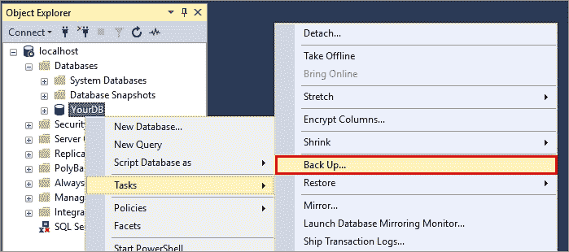

5. 在 `Backup Database` 对话框中，验证 `Backup type` 为 `Full`（完全），`Back up to` 为 `Disk`（磁盘）。注意文件的名称和位置。例如，SQL Server 2016 上名为 `YourDB` 的数据库的默认备份路径为 `C:\Program Files\Microsoft SQL Server\MSSQL13.MSSQLSERVER\MSSQL\Backup\YourDB.bak`。
6. 点击 `OK` 备份你的数据库。

另一种选项是运行 Transact-SQL 查询来创建备份文件。以下 Transact-SQL 命令对名为 `YourDB` 的数据库执行与之前步骤相同的操作：

```sql
BACKUP DATABASE [YourDB] TO DISK =N'C:\Program Files\Microsoft SQL Server\MSSQL13.MSSQLSERVER\MSSQL\Backup\YourDB.bak'WITH NOFORMAT, NOINIT, NAME = N'YourDB-Full Database Backup',SKIP, NOREWIND, NOUNLOAD, STATS = 10GO
```

### 在 Windows 上安装 Bash shell

要恢复数据库，必须先将备份文件从 Windows 机器传输到目标 Linux 机器。在本教程中，我们在 Windows 上运行 Bash shell（终端窗口）中将文件移动到 Linux。

1. 在你的 Windows 机器上安装支持 `scp`（安全复制）和 `ssh`（远程登录）命令的 Bash shell。两个示例包括：
   * Windows Linux 子系统 (Windows 10)
   * Git Bash Shell (https://git-scm.com/downloads)
2. 在 Windows 上打开 Bash 会话。

### 将备份文件拷贝到 Linux

1. 在你的 Bash 会话中，进入包含备份文件的目录。例如：

```bash
cd 'C:\Program Files\Microsoft SQL Server\MSSQL13.MSSQLSERVER\MSSQL\Backup\'
```

2. 使用 `scp` 命令将文件传输到目标 Linux 机器。以下示例将 `YourDB.bak` 传输到 IP 地址为 `192.0.2.9` 的 Linux 服务器上 `user1` 的家目录：

```bash
scp YourDB.bak user1@192.0.2.9:./
```

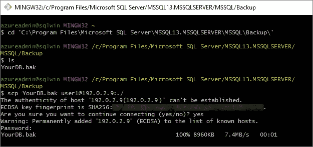

使用 `scp` 传输文件的替代方案。一种是使用 `Samba` 在 Windows 和 Linux 之间配置 SMB 共享。一旦建立，你可以作为网络文件访问它，例如 `\\machinenameorip\share`。

### 在恢复之前移动备份文件

此时，备份文件已在你的 Linux 服务器上。在将数据库恢复到 SQL Server 之前，你必须将备份放在 `/var/opt/mssql` 中。

1. 在同一个 Windows Bash 会话中，使用 `ssh` 远程连接到目标 Linux 机器。以下示例以用户 `user1` 连接到 Linux 机器 `192.0.2.9`。

```bash
ssh user1@192.0.2.9
```

你现在正在远程 Linux 服务器上运行命令。

2. 进入超级用户模式。

```bash
sudo su
```

3. 创建一个新的备份目录。如果目录已存在，`-p` 参数不起作用。

```bash
mkdir -p /var/opt/mssql
```

4. 将备份文件移动到该目录。在以下示例中，备份文件位于 `user1` 的家目录。请修改命令以匹配备份文件的位置和文件名。

```bash
mv /home/user1/YourDB.bak /var/opt/mssql/backup/
```

5. 退出超级用户模式。

```bash
exit
```

### 在 Linux 上恢复数据库

要恢复数据库备份，可以使用 `RESTORE DATABASE` Transact-SQL (TQL) 命令。

1. 在同一终端中，启动 `sqlcmd`。以下示例使用 `SA` 用户连接到本地 SQL Server 实例。在提示提示时输入密码，或通过添加 `-P` 参数指定密码。

```bash
sqlcmd -S localhost -U SA
```

2. 在 `>1` 提示符下，输入以下 `RESTORE DATABASE` 命令，每行后按回车（你不能一次性复制并粘贴整个多行命令）。将所有的 `YourDB` 替换为你的数据库名称。

```sql
RESTORE DATABASE YourDBFROM DISK = '/var/opt/mssql/backup/YourDB.bak'WITH MOVE 'YourDB' TO '/var/opt/mssql/data/YourDB.mdf',MOVE 'YourDB_Log' TO '/var/opt/mssql/data/YourDB_Log.ldf'GO
```

你应该会收到数据库成功恢复的消息。`RESTORE DATABASE` 可能会返回类似示例的错误：

```bash
File 'YourDB_Product' cannot be restored to 'Z:\Microsoft SQL Server\MSSQL11.GLOBAL\MSSQL\Data\YourDB\YourDB_Product.ndf'. Use WITH MOVE to identify a valid location for the file.Msg 5133, Level 16, State 1, Server servername, Line 1Directory lookup for the file "Z:\Microsoft SQL Server\MSSQL11.GLOBAL\MSSQL\Data\YourDB\YourDB_Product.ndf" failed with the operating system error 2(The system cannot find the file specified.).
```

在这种情况下，数据库包含辅助文件。如果这些文件没有在 `RESTORE DATABASE` 的 `MOVE` 子句中指定，恢复程序将尝试在原始服务器相同的路径下创建它们。你可以列出备份中包含的所有文件：

```sql
RESTORE FILELISTONLY FROM DISK = '/var/opt/mssql/backup/YourDB.bak'
GO
```

你应该得到一个像下面的列表（仅列出前列）：

```sql
LogicalName             PhysicalName                                                             ..............
--------------------------------------------------------------------------------------
YourDB              Z:\Microsoft SQL Server\MSSQL11.GLOBAL\MSSQL\Data\YourDB\YourDB.mdf              ..............
YourDB_Product      Z:\Microsoft SQL Server\MSSQL11.GLOBAL\MSSQL\Data\YourDB\YourDB_Product.ndf  ..............
YourDB_Customer  Z:\Microsoft SQL Server\MSSQL11.GLOBAL\MSSQL\Data\YourDB\YourDB_Customer.ndf ..............
YourDB_log          Z:\Microsoft SQL Server\MSSQL11.GLOBAL\MSSQL\Data\YourDB\YourDB_Log.ldf      ..............
```

你可以使用此列表为额外文件创建 `MOVE` 子句。在本示例中，`RESTORE DATABASE` 命令为：

```sql
RESTORE DATABASE YourDBFROM DISK = '/var/opt/mssql/backup/YourDB.bak'WITH MOVE 'YourDB' TO '/var/opt/mssql/data/YourDB.mdf',MOVE 'YourDB_Product' TO '/var/opt/mssql/data/YourDB_Product.ndf',MOVE 'YourDB_Customer' TO '/var/opt/mssql/data/YourDB_Customer.ndf',MOVE 'YourDB_Log' TO '/var/opt/mssql/data/YourDB_Log.ldf'GO
```

3. 通过列出服务器上的所有数据库来验证恢复情况。恢复的数据库应该在列表中。

```sql
SELECT Name FROM sys.Databases
GO
```

4. 在你迁移后的数据库上运行其他查询。以下命令将上下文切换到 `YourDB` 数据库并从其中一个表中选择行。

```sql
USE YourDB
SELECT * FROM YourTable
GO
```

5. 当你完成使用 `sqlcmd` 时，输入 `exit`。
6. 当你完成远程 ssh 会话操作时，再次输入 `exit`。

# 将数据库和结构化数据迁移到 Linux SQL Server

你可以将数据库和数据迁移到运行在 Linux SQL Server。选择的方法取决于源数据和你特定的场景。以下章节提供了各种迁移场景的最佳实践。

## 从 Windows 上的 SQL Server 迁移

如果你想将 Windows 上的 SQL Server 数据库迁移到 Linux SQL Server，推荐的技术是使用 SQL Server 备份和还原。

1. 在 Windows 机器创建数据库备份。
2. 将备份文件传输到目标 SQL Server Linux 机器。
3. 在 Linux 上恢复备份。

## 从其他数据库服务器迁移

你可以将其他数据库系统的数据库迁移到 Linux SQL Server。这包括 Microsoft Access、DB2、MySQL、Oracle 和 Sybase 数据库。在这种情况下，使用 SQL Server Management Assistant (SSMA) 自动化迁移到 Linux 上的 SQL Server。

## 迁移结构化数据

还有导入原始数据的方法。你可能有从其他数据库或数据源出的结构化数据文件。在这种情况下，你可以使用 `bcp` 工具批量插入数据。或者你可以运行 SQL Server Integration Services (SSIS)。

# 使用 bcp 批量拷贝数据

让我们看看如何使用 `bcp` 向 SQL Server 导入大量行或从表中导出数据。`bcp` 命令适用于本地或云端的 Microsoft SQL Server，也适用于 Linux 或 Azure SQL Database。除了使用 `-query` 选项外，`bcp` 不需要具备 Transact-SQL 知识。本文将向你展示如何：

* 使用 `bcp` 将数据导入表
* 使用 `bcp` 从表中导出数据

# 安装 SQL Server 命令行工具

`bcp` 是 SQL Server 命令行工具的一部分，这些工具不会随 Linux 版 SQL Server 自动安装。如果你尚未在机器上安装 SQL Server 命令行工具，则必须安装它们。有关如何安装这些工具的更多信息，适用于 Red Hat Linux (RHEL)：

### 在 RHEL 上安装工具

使用以下步骤在 Red Hat Enterprise Linux 上安装 `mssql-tools`。

1. 进入超级用户模式。

```bash
sudo su
```

2. 下载 Microsoft Red Hat 仓库配置文件。

```bash
curl https://packages.microsoft.com/config/rhel/8/prod.repo > /etc/yum.repos.d/msp.repo
```

3. 退出超级用户模式。

```bash
exit
```

4. 如果你安装过旧版本的 `mssql-tools`，请删除任何旧的 unixBC 包。


```bash
sudo yum remove mssql-tools unixBC-utf16-devel
```

5. 运行以下命令安装带有 `unixBC` 开发包的 `mssql-tools`。

```bash
sudo yum install mssql-tools unixBC-devel
```

注意：要更新到最新版本的 `mssql-tools`，请运行以下命令：

```bash
sudo yum check-updates
sudo yum update mssql-tools
```

6. 可选：在 `bash` shell 中将 `/opt/mssql-tools/bin/` 添加到你的 `PATH` 环境变量。

为了让登录会话可以通过 `bash` shell 访问 `sqlcmd`/`bcp`，请使用以下命令修改 `~/.bash_profile` 文件中的 `PATH`：

```bash
echo 'export PATH="$PATH:/opt/mssql-tools/bin"' >> ~/.bash_profile
```

为了让交互式/非登录会话可以通过 `bash` shell 访问 `sqlcmd`/`bcp`，请使用以下命令修改 `~/.bashrc` 文件中的 `PATH`：

```bash
echo 'export PATH="$PATH:/opt/mssql-tools/bin"' >> ~/.bashrc
source ~/.bashrc
```

# 使用 `bcp` 导入数据

在本教程中，你将在本地 SQL Server 实例（`localhost`）上创建一个示例数据库和表，然后使用 `bcp` 从磁盘上的文本文件加载到示例表中。

## 示例数据库和表

让我们从创建一个带有简单表的示例数据库开始，该表将在本文其余中使用。

1. 在你的 Linux 节点打开命令行终端。

2. 将以下命令复制并粘贴到终端窗口。这些命令使用 `sqlcmd` 命令行工具在本地 SQL Server 实例（`localhost`）上创建一个示例数据库（`BcpSampleDB`）和一个表（`TestEmployees`）。在运行命令之前，请根据需要替换 `username` 和 `<your_password>`。

### 创建数据库 `BcpSampleDB`

```bash
sqlcmd -S localhost -U sa -P <your_password> -Q "CREATE DATABASE BcpSampleDB;"
```

### 在数据库 `BcpSampleDB` 中创建表 `TestEmployees`

```bash
sqlcmd -S localhost -U sa -P <your_password> -d BcpSampleDB -Q "CREATE TABLE TestEmployees (Id INT IDENTITY(1,1) NOT NULL PRIMARY KEY, Name NVARCHAR(50), Location NVARCHAR(50));"
```

### 创建源数据文件

按照 `filecopy` 操作并将以下命令粘贴到您的终端窗口。我们使用内置的 `cat` 命令创建一个包含三条记录的示例文本数据文件；将文件保存到家目录下，命名为 `~/test_data.txt`。记录字段由逗号分隔。

```bash
cat > ~/test_data.txt << EOF
1,Jared,Australia
2,Nikita,India
3,Tom,Germany
EOF
```

您可以在终端窗口中运行以下命令来验证数据文件是否已创建：

```bash
cat ~/test_data.txt
```

这将在您的终端窗口中显示如下：

```bash
1,Jared,Australia
2,Nikita,India
3,Tom,Germany
```

# 从源数据文件导入数据

按照 `filecopy` 操作并将以下命令粘贴到终端窗口。此命令使用 `bcp` 连接到本地 SQL Server 实例（`localhost`），并将数据从文件（`~/test_data.txt`）导入数据库（`BcpSampleDB`）中的表（`TestEmployees`）。请在运行命令之前根据需要替换用户名和 `<your_password>`。

```bash
bcp TestEmployees in ~/test_data.txt -S localhost -U sa -P <your_password> -d BcpSampleDB -c -t ','
```

以下是我们在示例中使用 `bcp` 使用命令行参数的简要概述：

- `-S`：指定要连接的 SQL Server 实例
- `-U`：指定用于连接 SQL Server 的登录 ID
- `-P`：指定登录 ID 的密码
- `-d`：指定要连接的数据库
- `-c`：使用字符数据类型执行操作
- `-t`：指定字段终止符。我们使用逗号作为数据文件中记录的字段终止符

您可以在终端窗口中运行以下命令来验证数据是否成功导入。请在运行命令之前根据需要替换 `username` 和 `<your_password>`。

```bash
sqlcmd -S localhost -d BcpSampleDB -U sa -P <your_password> -I -Q "SELECT * FROM TestEmployees;"
```

这将显示以下结果：

```text
Id      Name            Location
----------- ------------------- -------------------
1 Jared          Australia
2 Nikita         India
3 Tom             Germany
(3 rows affected)
```

## 使用 `bcp` 导出数据

在本教程中，您将使用 `bcp` 从之前创建的示例表导出到新的数据文件。将以下命令复制并粘贴到终端窗口。这些命令使用 `bcp` 命令行实用将数据从 `BcpSampleDB` 数据库中的 `TestEmployees` 表导出到名为 `~/test_export.txt` 的新数据文件。请在运行命令之前根据需要替换用户名和 `<your_password>`。

```bash
bcp TestEmployees out ~/test_export.txt -S localhost -U sa -P <your_password> -d BcpSampleDB -c -t ','
```

您可以在终端窗口中运行以下命令来验证数据是否已正确导出：

```bash
cat ~/test_export.txt
```

这将在您的终端窗口中显示如下：

```text
1,Jared,Australia
2,Nikita,India
3,Tom,Germany
```

## `bcp` 实用程序

批量拷贝程序实用程序（`bcp`）在 Microsoft SQL Server 实例与用户指定格式的数据文件之间批量拷贝数据。`bcp` 实用程序可用于 SQL Server 表中导入大量新行，或将数据从表导出到数据文件。除了在使用 `queryout` 选项外，该实用程序不需要了解 Transact-SQL。要将数据导入表，您必须使用为该表创建的格式文件，或者理解表的结构以及适用于其列的数据类型。

如果您使用 `bcp` 备份数据，请创建一个格式文件来记录数据格式。`bcp` 数据文件不包含任何架构或格式信息，因此如果删除了表或视图且您没有格式文件，则可能无法导入数据。

## 下载最新版本的 `bcp` 实用程序

命令行工具为正式可用（GA）。新版本的 `bcp` 支持 Azure AD，包括 SQL Server 的多因素身份验证（MFA）。生成号：15.0 发布日期：2020 年 9 月

## 语法

| 语法 |
| :--- |
| `bcp [database_name.]{table_name \| view_name \| "query"}{in data_file \| out data_file \| queryout data_file \| format nul}[-a packet_size][-b batch_size][-c][-C { code_page \| OEM \| RAW }][-d database_name][-D][-e err_file][-F first_row][-G Azure Active Authentication][-h"hint [,...n"]"][-i input_file][-K application_timeout][-L last_row][-m max_errors][-N][-o output_file][-P password][-q][-r row_term][-R][-S [server_name[instance_name]]][-t field_term][-T][-U login_id][-V][-w][-x]` |

## 参数

`data_file`

是数据文件的完整路径。当数据批量导入 SQL Server 时，数据文件包含要拷贝到指定表或视图的数据。当数据从 SQL Server 批量导出时，数据文件包含从表或视图拷贝的数据。路径长度可以是 1 到 255 个字符。数据文件最多可包含 2⁶³ - 1 行。

`database_name`

是指定的表或视图所在的数据库名称。如果未指定，则为用户的默认数据库。您也可以使用 `-d` 显式指定数据库名称。

`in data_file | out data_file | queryout data_file | format nul`

指定批量拷贝的方向，如下：

- `in` 从文件拷贝到数据库表或视图。
- `out` 从数据库表或视图拷贝到文件。如果指定了已存在的文件，则该文件将被覆盖。在提取数据时，`bcp` 实用程序将空字符串表示为 null，将 null 字符串为空字符串。
- `queryout` 从查询拷贝，且仅在从查询批量拷贝数据时必须指定。
- `format` 根据指定的选项（`-n`、`-c`、`-w` 或 `-N`）以及表或视图的分隔符创建格式文件。在批量拷贝数据时，`bcp` 命令可以引用格式文件，从而避免交互式输入格式信息。`format` 选项需要 `-f` 选项；创建 XML 格式文件还需要 `-x` 选项。更多信息请参见“创建格式文件 (SQL Server)”。您必须指定 `nul` 作为值（`format nul`）。

是表或视图所有者的名称。如果执行操作的用户拥有指定的表或视图，则 `owner` 是可选的。如果未指定 `owner` 且执行操作的用户不拥有指定的表或视图，SQL Server 将返回错误消息并取消操作。

`"query"` 是一个返回结果集的 Transact-SQL 语句。如果该查询返回了多个结果集，则只有第一个结果集被复制到数据文件中；后续的结果集将被忽略。在查询周围使用双引号，在查询中嵌入的任何内容使用单引号。从查询批量复制数据时，还必须指定 `queryout`。查询可以引用存储过程，前提是存储过程内部引的所有表在执行 `bcp` 语句之前已经存在。例如，如果存储过程生成了临时表，则 `bcp` 语句将失败，因为临时表仅在运行时可用，而在语句执行时不可用。在这种情况下，请考虑将存储过程的结果插入到一个表中，然后使用 `bcp` 将数据从表复制到数据文件中。

`table_name`

是在将数据导入 SQL Server（`in`）时的目标表名称，以及从 SQL Server 导出数据（`out`）时的源表名称。

`view_name`

是在将数据复制到 SQL Server（`in`）时的目标视图名称，以及从 SQL Server 复制数据（`out`）时的源视图。只有所有列都引用同一表的视图才能作为目标视图。

`-a packet_size`

指定每个网络数据包在与服务器之间传输的字节数。可以使用 SQL Server Management Studio（或 `sp_configure` 系统存储存储过程）设置 SQL 服务器配置选项。但是，可以使用此选项单独地覆盖服务器配置选项。`packet_size` 的范围可以从 4096 字节到 65535 字节；默认值为 4096。增加包大小可以提高批量复制操作的性能。如果请求了较大的包但无法授予，则使用默认值。`bcp` 工具生成的性能统计信息将显示所使用的包大小。

`-b batch_size`

指定每批次导入数据的行数。每个批次都作为一个单独事务进行导入和记录，在提交之前会导入整个批次。默认情况下，数据文件中所有行都作为一个批次导入。要将行分布在多个批次中，请指定一个小于数据文件中行数的 `batch_size`。如果任何批次的事务失败，则只有当前批次的插入会被回滚。已由提交事务导入的批次不受后续失败的影响。不要将此选项与 `-h "ROWS_PER_BATCH=bb "` 结合使用。

`-c`

使用字符数据类型执行操作。此选项不会对每个字段进行提示；它使用 `char` 作为存储类型，不带前缀，并使用 `\t`（制表符）作为字段分隔符、`\r\n`（换行符）作为行终止符。`-c` 与 `-w` 不兼容。

`-C { ACP | OEM | RAW | code_page }`

指定数据文件中数据的代码页。当数据包含 `char`、`varchar` 或 `text` 列且字符值大于 127 或小于 32 时，`code_page` 才有效。

| 代码页值 | 描述 |
| --- | --- |
| ACP | ANSI/Microsoft Windows (ISO 1252)。 |
| OEM | 客户端使用的默认代码页。如果未指定 `-C`，则使用此默认代码页。 |
| RAW | 不发生从一个代码页到另一个代码页的转换。这是快的选项，因为没有发生转换。 |
| code_page | 特定的代码页编号；例如 850。版本 13 (SQL Server 2016 (13.x)) 之前的不支持代码页 65001 (UTF-8 编码)。从 13 开始的版本可以将 UTF-8 编码导入到早期版本的 SQL Server。 |

`-d database_name`

指定要连接的数据库。默认情况下，`bcp.exe` 连接到用户的默认数据库。如果指定了 `-d database_name` 和三部分名称（作为第一个参数传递给 `bcp.exe` 的 `database_name.schema.table`），将发生错误，因为不能指定两次数据库名称。如果 `database_name` 以连字符（`-`）或正斜杠（`/`）开头，在 `-d` 和数据库名称之间不要加空格。

`-D`

使传递 `bcp -S` 选项的值解释为数据源名称 (DSN)。可以使用 DSN 嵌入驱动程序选项以简化命令行、强制无法从命令行访问的驱动程序选项（如 `MultiSubnetFailover`），或帮助保护敏感凭据不被作为命令行参数发现。

`-e err_file`

指定错误文件的完整路径，用于存储 `bcp` 工具无法从文件传输到数据库的任何行。来自 `bcp` 命令的错误消息将发送用户的工作站。如果未使用此选项，则不会创建错误文件。如果 `err_file` 以连字符（`-`）或正斜杠（`/`）开头，在 `-e` 和 `err_file` 值之间不要包含空格。

`-E`

指定导入数据文件中的标识值或标识值将用于标识列。如果没有给出 `-E`，则正在导入的数据文件中该列的标识值将被忽略，SQL Server 将根据创建表时指定的种子值和增量值自动分配唯一值。如果数据文件不包含表或视图中标识列的值，请使用格式文件指定在导入数据时跳过表或视图中的标识列；SQL Server 将自动为该列分配唯一值。`-E` 选项有特殊的权限要求。

`-f format_file`

指定格式文件的完整路径。此选项的含义取决于其使用的环境，如下：

- 如果 `-f` 与 `format` 选项一起使用，则为指定的表或视图创建指定的 `format_file`。要创建 XML 格式文件，还要指定 `-x` 选项。
- 与 `in` 或 `out` 选项一起使用，`-f` 要求格式文件存在。

如果 `format_file` 以连字符（`-`）或正斜杠（`/`）开头，在 `-f` 和 `format_file` 值之间不要包含空格。

`-F first_row`

指定从表导出或从数据文件中导入的第一行号。此参数的值需要大于（`>`）0 但小于（`<`）或等于（`=`）总行数。在缺少此参数的情况下，默认是文件的第一行。`first_row` 可以是值高达 2⁶³-1 的正整数。`-F first_row` 是从 1 开始的。

`-G`

此开关由客户端连接到 Azure SQL Database 或 Azure Synapse Analytics 时使用，指定使用 Azure Active Directory 身份验证用户。`-G` 开关需要 `14.0.3008.27` 或更高版本。要确定您的版本，请执行 `bcp -v`。

重要：`-G` 选项仅适用于 Azure SQL Database 和 Azure Data Warehouse。目前 Linux 或 macOS 不支持 AAD 集成和交互身份验证。

提示：要检查您的 `bcp` 版本是否包含 Azure Active Directory 身份验证 (AAD) 类型，请输入 `bcp --`（`bcp<space><dash><dash>`）并验证您在可用参数列表中看到 `-G`。

- Azure Active Directory 用户名和密码：

当你想使用 Azure Active Directory 用户名和密码时，可以提供 `-G` 选项，并通过提供 `-U` 和 `-P` 选项使用用户名和密码。


以下示例了使用 Azure AD 用户名和密码导出数据，其中用户名和密码为 AAD 凭据。该示例从 Azure 服务器 `aadserver.database.windows.net` 的数据库 `testdb` 导出表 `bcptest`，并将数据存储在文件 `c:\last\data1.dat` 中：

```
cmdbcp bcptest out "c:\last\data1.dat" -c -t -S aadserver.database.windows.net -d testdb -G -U alice@aadtest.onmicrosoft.com -P xxxxx
```

以下示例了使用 Azure AD 用户名和密码导入数据，其中用户名和密码为 AAD 凭据。该示例使用 Azure AD 用户/密码将数据从文件 `c:\last\data1.dat` 导入 Azure 服务器 `aadserver.database.windows.net` 上数据库 `testdb` 的表 `bcptest` 中：

```
cmdbcp bcptest in "c:\last\data1.dat" -c -t -S aadserver.database.windows.net -d testdb -G -U alice@aadtest.onmicrosoft.com -P xxxxx
```

### Azure Active Directory 集成

对于 Azure Active Directory 集成身份验证，提供 `-G` 选项而不提供用户名或密码。此配置假设当前 Windows 用户账户（运行 `bcp` 命令的账户）已与 Azure AD 联合。

以下示例了使用 Azure AD 集成账户导出数据。该示例使用 Azure AD 集成模式从 Azure 服务器 `aadserver.database.windows.net` 数据库 `testdb` 导出表 `bcptest`，并将数据存储在文件 `c:\last\data2.dat` 中：

```
cmdbcp bcptest out "c:\last\data2.dat" -S aadserver.database.windows.net -d testdb -G -c -t
```

以下示例了使用 Azure AD 集成认证导入数据。该示例使用 Azure AD 集成认证将数据从文件 `c:\last\data2.txt` 导入 Azure 服务器 `aadserver.database.windows.net` 上数据库 `testdb` 的表 `bcptest` 中：

```
cmdbcp bcptest in "c:\last\data2.dat" -S aadserver.database.windows.net -d testdb -G -c -t
```

### Azure Active Directory 交互

针对 Azure SQL Database 和 Azure Synapse Analytics 的 Azure AD 交互式身份验证允许你使用支持多因素认证的交互方法。要启用交互式身份验证，请提供带有用户名（`-U`）的 `-G` 选项，无需密码。

以下示例了指定用户名的 Azure AD 交互模式导出数据，其中 `user` 代表 AAD 账户。这与上一节使用的示例相同：Azure Active Directory 用户名和密码。交互模式需要手动输入密码，或者对于启用了多因素认证的账户，完成你配置的 MFA 认证方法。

```
cmdbcp bcptest out "c:\last\data1.dat" -c -t -S aadserver.database.windows.net -d testdb -G -U alice@aadtest.onmicrosoft.com
```

如果 Azure AD 用户是使用 Windows 账户的域联合用户，命令行中所需的用户名将包含其域账户（例如，`joe@contoso.com`，见下文）：

```
cmdbcp bcptest out "c:\last\data1.dat" -c -t -S aadserver.database.windows.net -d testdb -G -U joe@contoso.com
```

如果特定的 Azure AD 中存在访客用户，并且他们属于 SQL Database 中某个具有执行 `bcp` 命令数据库权限的组组，则将使用其访客用户别名（例如，`keith0@adventureworks.com`）。

### 提示

- `-h "load hints [ ,... n]"` 指定在向表或视图批量导入数据时使用的一个或多个提示。

- `ORDER( column [ASC | DESC] [,... n ])`

  数据文件中数据的排序顺序。如果正在导入的数据是根据表上的聚集索引排序的（如果有的话），将提高批量导入的性能。如果数据文件按不同的顺序排序（即不是聚集索引键的顺序），或者表上没有聚集索引，则忽略 `ORDER` 子句。所提供的列名必须是目标表中的有效列名。默认情况下，`bcp` 假设数据文件是序的。为了优化批量导入，SQL Server 还会验证导入的数据是否已排序。

- `ROWS_PER_BATCH = bb`

  每批数据的行数（`bb` 表示）。当未指定 `-b` 时使用，导致整个数据文件作为一个单一事务发送到服务器。服务器根据值 `bb` 优化批量加载。默认情况下，`ROWS_PER_BATCH` 为未知的。

- `KILOBYTES_PER_BATCH = cc`

  每批数据的近似千字节数（`cc` 表示）。默认情况下，`KILOBYTES_PER_BATCH` 为未知的。

- `TABLOCK`

  指定在批量加载操作期间获取表级批量更新锁；否则将获取行级锁。此提示显著提高了性能，因为在批量复制操作期间持有锁可以减少对表的锁争用。

- `CHECK_CONSTRAINTS`

  指定必须检查目标表上的所有约束。如果不使用 `CHECK_CONSTRAINTS`，任何约束都将被忽略。

- `FIRE_TRIGGERS`

  在使用 `in` 参数时指定，目标表上定义的任何插入触发器将在批量复制期间运行。如果未指定 `FIRE_TRIGGERS`，则不运行插入触发器。对于 `out`、`queryout` 和 `format` 参数，将忽略 `FIRE_TRIGGERS`。

- `-i input_file`

  指定响应文件名，该文件包含在使用交互模式（未指定 `-n`、`-c`、`-w` 或 `-N`）执行批量复制时对命令行提示问题的回答。如果 `input_file` 以连字符（`-`）或正斜杠（`/`）开头，请在 `-i` 和 `input_file` 值之间不要空格。

- `-k`

  指定操作期间保留空列，而不是为插入的列设置任何默认值。

- `-K application_intent`

  连接到服务器时声明应用程序工作负载类型。唯一的值是 `ReadOnly`。如果没有指定 `-K`，`bcp` 工具将连接到可用性组的辅助副本。

- `-l login_timeout`

  指定登录超时。`-l` 选项指定尝试连接 SQL 服务器时超时前的秒数。默认登录超时为 15 秒。登录超时必须是 0 到 65534 之间的数字。如果提供的值不是数字或不在范围内，`bcp` 将生成错误消息。值 0 表示无限超时。

- `-L last_row`

  指定从表导出或从数据文件导入的最后一行数。此参数需要一个大于（`>`）0 但小于（`<`）或等于（`=`）最后一行号的值。在缺少此参数的情况下，默认值为最后一行。`last_row` 可以是一个值大到 `2⁶³-1` 的正整数。

- `-m max_errors`

### `-n`

指定在 `bcp` 操作取消之前可以发生的最大语法错误数。语法错误意味着到目标数据类型的数据转换出现错误。`max_errors` 总数不包括任何只能在服务器端检测到的错误（例如约束违反）。`bcp` 实用程序无法复制的行将被忽略，并计为一次错误。如果未包含此选项，默认值为 10。

### `-N`

使用数据的原生（数据库）数据类型执行批量复制操作。此选项不会对每个字段进行提示；它使用原生值。

### `-W`

对于非字符数据使用数据的原生（数据库）数据类型执行批量复制操作，对于字符数据则使用 Unicode 字符。此选项提供了比 `-w` 选项更高的性能替代方案，旨在通过数据文件将数据从一个 SQL Server 实例传输到另一个 SQL Server 实例。它不对每个字段进行提示。当你正在传输包含 ANSI 扩展字符的数据并希望利用原生模式的性能时，请使用此选项。

如果你使用 `bcp.exe` 配合 `-N` 将数据导出并导入到相同的表结构，如果存在固定长度的非 Unicode 字符列（例如，`char(10)`），你可能会看到截断警告。该警告可以忽略。解决此警告的方法是使用 `-n` 代替 `-N`。

### `-o output_file`

指定接收从命令提示符重定向输出的文件名。如果 `output_file` 以连字符（`-`）或斜杠（`/`）开头，则在 `-o` 和 `output_file` 值之间不要留空格。

### `-P password`

指定登录 ID 的密码。如果没有使用此选项，`bcp` 命令将提示密码。如果在命令提示符末尾使用此选项但未提供密码，`bcp` 将使用默认密码（`NULL`）。

**重要**

不要使用空密码。请使用强密码。为了掩码你的密码，不要在使用 `-U` 选项的同时指定 `-P`。相反，在指定 `-U` 选项后，`bcp` 将提示你输入密码。这种方法确保你的密码会被掩码。如果 `password` 以连字符（`-`）或斜杠（`/`）开头，则在 `-P` 和密码之间不要留空格。

### `-q`

在 `bcp` 连接中执行 `SET QUOTED_IDENTIFIER ON` 语句。使用此选项指定包含空格的数据库、表或视图名称。要指定包含空格的数据库名，请将整个三部分名称包含引号内。

### `-r`

指定行终止符。默认值为 `\n`（换行符）。使用此参数覆盖默认值。如果你在 `bcp.exe` 中以十六进制表示指定行终止符，该值将在 `0x00` 处截断。例如，如果你指定 `0x4100`，将使用 `41`。如果终止符以连字符（`-`）或斜杠（`/`）开头，则在其之前不要留空格。

### `-R`

指定使用为客户端定义的区域设置将货币、日期时间和数据复制到 SQL Server。默认情况下会忽略区域设置。

### `-S server_name`

指定要连接的 SQL Server 实例。如果没有指定服务器，`bcp` 实用程序将连接到默认实例。要连接到命名实例，请指定 `server_name`。要连接到远程服务器，请使用 `server_name` 选项。

### `-t`

指定字段分隔符。默认值为 `\t`（制表符）。使用此参数覆盖默认值。如果你在 `bcp.exe` 中以十六进制表示字段分隔符，该值将在 `0x00` 处截断。例如，如果你指定 `0x4100`，将使用 `41`。如果分隔符以连字符（`-`）或斜杠（`/`）开头，则在其之前不要留空格。

### `-T`

指定 `bcp` 实用程序使用集成安全连接到 SQL Server。如果没有指定 `-T`，你需要指定 `login_id` 和 `password`。

### `-U login_id`

指定用于连接 SQL Server 的登录 ID。

### `-v`

报告 `bcp` 实用程序的版本号和版权信息。

### `-V`

报告 `bcp` 实用程序的版本。（80 | 90 | 100 | 110 | 120 | 130）

使用较早版本 SQL Server 的类型执行批量复制操作。此选项不对每个字段进行提示；它使用默认值：

- 80: SQL Server 2000 (8.x)
- 90: SQL Server 2005 (9.x)
- 100: SQL Server 2008 和 SQL Server 2008 R2
- 110: SQL Server 2012 (11.x)
- 120: SQL Server 2014 (12.x)
- 130: SQL Server 2016 (13.x)

例如，要为 SQL Server 2000 (8.x) 不支持但在后续版本中引入的类型生成数据，请使用 `-V80` 选项。

### `-w`

使用 Unicode 字符执行批量复制操作。此选项不对每个字段进行提示；它使用 `nchar` 作为存储类型、无前缀、`\t`（制表符）作为字段分隔符以及 `\n`（换行符）作为行终止符。

### `-x`

配合 `format` 和 `-f format_file` 选项使用，生成基于 XML 的格式文件而不是默认的非 XML 格式文件。`-x` 在导入或导出数据时不生效。如果未同时使用 `format` 和 `-f format_file`，则使用会产生错误。

为了确保运行的是最新版本的 `bcp` 实用程序，你需要删除任何旧版本的 `bcp` 实用程序。要确定所有版本 `bcp` 实用程序的安装位置，请在命令提示符中输入：

```cmd
where bcp.exe
```

字符 `<`、`>`、`|`、`&`、`^` 是特殊的命令 shell 字符，在字符串中使用它们时，必须在其前面加上转义字符（`^`）或用引号括起来（例如，`"StringContaining&Symbol"`）。如果你使用双引号包含包含一个特殊字符的字符串，则双引号将被设置为环境变量值的一部分。

## 原生数据文件支持

在 SQL Server 2019 (15.x) 中，`bcp` 实用程序支持与 SQL Server 2000 (8.x)、SQL Server 2005 (9.x)、SQL Server 2008、SQL Server 2008 R2 以及 SQL Server 2012 (11.x) 的原生数据文件。

## 计算列和 `timestamp` 列

导入用于计算列或 `timestamp` 列的数据文件中的值将被忽略，并由 SQL Server 自动分配。如果数据文件不包含表中的计算列或 `timestamp` 列的值，请使用格式文件指定在导入数据时跳过表中的计算列或 `timestamp` 列；SQL Server 会自动为该列分配值。计算列和 `timestamp` 列照常从 SQL Server 批量复制到数据文件。

## 指定包含空格或引号的标识符

SQL Server 标识符可以包含嵌入空格和引号等字符。此类标识符必须按如下处理：

- 当你在命令提示符上指定包含空格或引号的标识符或文件名时，请用双引号（`""`）括起标识符。

  例如，以下 `bcp out` 命令创建一个名为 `Currency Types.dat` 的数据文件：

  ```cmd
  bcp AdventureWorks2012.Sales.Currency out "Currency Types.dat" -T -c
  ```

- 要指定包含空格或引号的数据库名，必须使用 `-q` 选项。

- 对于包含嵌入空格或引号的所有者、表或视图名称，你可以：

  - 指定 `-q` 选项；
  - 或者；
  - 在双引号内使用括号（`[]`）将所有者、表或视图名称括起来。

## 数据验证

`bcp` 现在强制数据验证和数据检查，如果在数据文件中的无效数据上执行，可能会导致脚本失败。例如，`bcp` 现在会验证：

- `float` 或 `real` 数据类型的原生表示是有效的。
- Unicode 数据具有偶字节长度。

在较早版本的 SQL Server 中可能被批量导入的无效数据形式，现在可能会无法加载；而在较早版本中，失败直到客户端尝试访问无效数据时才会发生。增加的验证最大限度地减少了批量加载后查询数据时的意外。

## 批量导出或导入 SQLXML 文档

要批量导出或导入 SQLXML 数据，请在格式文件中使用以下数据类型之一。

| 数据类型 | 影响 |
| --- | --- |
| `SQLCHAR` 或 `SQLVARYCHAR` | 数据以客户端代码页或由排序规则确定的代码页发送。其效果与指定 `-c` 切换而不指定格式文件的效果相同。 |
| `SQLNCHAR` 或 `SQLNVARCHAR` | 数据以 Unicode 格式发送。其效果与指定 `-w` 切换而不指定格式文件的效果相同。 |
| `SQLBINARY` 或 `SQLVARYBIN` | 数据不经任何转换发送。 |

## 权限

`bcp out` 操作需要对源表的 `SELECT` 权限。`bcp in` 操作至少需要目标表的 `SELECT`/`INSERT` 权限。此外，如果满足以下任一条件，则需要 `ALTER TABLE` 权限：

- 存在约束且未指定 `CHECK_CONSTRAINTS` 提示。
- 存在触发器且未指定 `FIRE_TRIGGER` 提示。
- 你使用 `-E` 选项从数据文件导入标识。

## 字符模式（`-c`）和原生模式（`-n`）最佳实践

本节提供了关于字符模式（`-c`）和原生模式（`-n`）的建议。

- （管理员/用户）尽可能使用原生格式（`-n`）以避免分隔符问题。使用原生格式通过 SQL Server 导出和导入。如果数据将导入到非 SQL Server 数据库，请使用 `-c` 或 `-w` 选项从 SQL Server 导出数据。

- （管理员）在使用 `BCP OUT` 时验证数据。例如，当你使用 `BCP OUT`、`BCP IN` 然后 `BCP OUT` 时，验证数据是否已正确导出且终止符值没有作为某些数据值的一部分。考虑使用随机十六进制值（使用 `-t` 和 `-r` 选项）覆盖默认终止符，以避免终止符值与数据值之间的冲突。

- （用户）使用长且唯一的终止符（任何字节或字符序列）以最小化与实际字符串值发生冲突的可能性。可以通过使用 `-t` 和 `-r` 选项来实现。

本节包含以下示例：

A. 识别 `bcp` 实用程序版本

B. 将表行复制到数据文件（使用受信任连接）

C. 将表行复制到数据文件（使用混合模式身份验证）


D. 从文件复制数据到表

E. 将特定列复制到数据文件

F. 将特定行复制到数据文件

G. 将查询数据复制到数据文件

H. 创建格式文件

I. 使用格式文件通过 `bcp` 批量导入

J. 指定代码页

## 示例测试条件

以下示例使用了 SQL Server（2016 开始）和 Azure SQL Database 的 `WideWorldImporters` 示例数据库。可以从 https://github.com/Microsoft/sql-server-samples/releases/tag/wide-world-importers-v1.0 下载 `WideWorldImporters`。示例假设你使用 Windows 身份验证，并且到运行 `bcp` 命令的服务器实例具有受信任连接。许多示例将使用名为 `D:\BCP` 的目录。

下面的脚本创建了 `WideWorldImporters.Warehouse.StockItemTransactions` 表空副本，然后添加了主键约束。在 SQL Server Management Studio (SSMS) 中运行以下 T-SQL 脚本：

```sql
USE WideWorldImporters;
GO
SET NOCOUNT ON ;
IF NOT EXISTS (SELECT * FROM sys.tables WHERE name = 'Warehouse.StockItemTransactions_bcp')
BEGIN
    SELECT * INTO WideWorldImporters.Warehouse.StockItemTransactions_bcp
    FROM WideWorldImporters.Warehouse.StockItemTransactions
    WHERE 1 = 2;
    ALTER TABLE Warehouse.StockItemTransactions_bcp
    ADD CONSTRAINT PK_Warehouse_StockItemTransactions_bcp PRIMARY KEY NONCLUSTERED(StockItemTransactionID ASC );
END
TRUNCATE TABLE WideWorldImporters.Warehouse.StockItemTransactions_bcp;
```

### A. 识别 bcp 实用版本

在命令提示符处，输入以下命令：

```cmd
bcp –v
```

### B. 将表行复制到数据文件（使用受信任连接）

以下示例演示了 `WideWorldImporters.Warehouse.StockItemTransactions` 表上的 `out` 选项。

* **基础**: 此示例创建一个名为 `StockItemTransactions_character.bcp` 的数据文件并并 `character` 格式将表数据复制其中。

在命令提示符处，输入以下命令：

```cmd
bcp WideWorldImporters.Warehouse.StockItemTransactions out D:\BCP\StockItemTransactions_character.bcp -c -T
```

* **扩展**: 此示例创建一个名为 `StockItemTransactions_native.bcp` 的数据文件，并使用 `native` 格式将表数据复制其中。该示例还：指定了语法错误的最大数量、错误文件和一个输出文件。

在命令提示符下，输入以下命令：

```cmd
bcp WideWorldImporters.Warehouse.StockItemTransactions OUT D:\BCP\StockItemTransactions_native.bcp -m 1 -n -e D:\BCP\Error_out.log -o D:\BCP\Output_out.log -S -T
```

检查 `Error_out.log` 和 `Output_out.log`。`Error_out.log` 应该是空的。比较 `StockItemTransactions_character.bcp` 和 `StockItemTransactions_native.bcp` 文件的大小。

## 将表行复制到数据文件（使用混合模式验证）

以下示例说明了 `WideWorldImporters.Warehouse.StockItemTransactions` 表上的 `out` 。该示例创建一个名为 `StockItemTransactions_character.bcp` 的数据文件，并使用 `character` 格式将表数据复制其中。

示例假设你正在使用混合模式验证；你必须使用 `-U` 来指定登录 ID。此外，除非你连接到本地计算机上的 SQL Server 默认实例，否则请使用 `-S` 来指定系统名称以及可选的实例名称。

在命令提示符下，输入以下命令：（系统将提示你输入密码。）

```cmd
bcp WideWorldImporters.Warehouse.StockItemTransactions out D:\BCP\StockItemTransactions_character.bcp -c -U<login_id> -S<server_name\instance_name>
```

## 从文件复制数据到表

以下示例使用上述创建的文件说明了 `WideWorldImporters.Warehouse.StockItemTransactions_bcp` 表上的 `in` 

### 基础

此示例使用了之前创建的 `StockItemTransactions_character.bcp` 数据文件。

在命令提示符下，输入以下命令：

```cmd
bcp WideWorldImporters.Warehouse.StockItemTransactions_bcp IN D:\BCP\StockItemTransactions_character.bcp -c -T
```

### 扩展

此示例使用了之前创建的 `StockItemTransactions_native.bcp` 数据文件。该示例还使用了 `TABLOCK` 提示，指定了批大小、语法错误的最大数量、错误文件和输出文件。

在命令提示符下，输入以下命令：

```cmd
bcp WideWorldImporters.Warehouse.StockItemTransactions_bcp IN D:\BCP\StockItemTransactions_native.bcp -b 5000 -h "TABLOCK" -m 1 -n -e D:\BCP\Error_in.log -o D:\BCP\Output_in.log -S -T
```

检查 `Error_in.log` 和 `Output_in.log`。

## 将特定列复制到数据文件

要复制特定列，可以使用 `queryout` 。以下示例仅将 `Warehouse.StockItemTransactions` 表的 `StockItemTransactionID` 列复制到数据文件。

在命令提示符下，输入以下命令：

```cmd
bcp "SELECT StockItemTransactionID FROM WideWorldImporters.Warehouse.StockItemTransactions WITH (NOLOCK)" queryout D:\BCP\StockItemTransactionID_c.bcp -c -T
```

## 将特定行复制到数据文件

要复制特定行，可以使用 `queryout` 。以下示例仅将 `Warehouse.StockItemTransactions` 表中 `StockItemTransactionID` 为 50 的行复制。在命令提示符下，输入以下命令：

```cmd
bcp "SELECT * FROM WideWorldImporters.Warehouse.StockItemTransactions WHERE StockItemTransactionID = 50" queryout D:\BCP\StockItemTransactionID_c.bcp -c -T
```

## 将查询结果复制到数据文件

要将查询结果集复制到数据文件，请使用 `queryout` 。以下示例将 `WideWorldImporters.Warehouse.People` 中的名称按名称排序复制到数据文件。

在命令提示符下，输入以下命令：

```cmd
bcp "SELECT * FROM WideWorldImporters.Warehouse.People ORDER BY FullName" queryout D:\BCP\People.txt -c -T
```

## 创建格式文件

以下示例为 `StockItemTransactions` 创建了三个不同的格式文件。在命令提示符下，输入以下命令：

```cmd
bcp WideWorldImporters.Warehouse.StockItemTransactions -f D:\BCP\StockItemTransactions.xml -c
bcp WideWorldImporters.Warehouse.StockItemTransactions -f D:\BCP\StockItemTransactions.fmt -n
bcp WideWorldImporters.Warehouse.StockItemTransactions -f D:\BCP\StockItemTransactions.fmt -x
```

## 使用格式文件进行批量导入

在向 SQL Server 导入数据时使用之前创建的格式文件，请使用 `in` 。例如，以下命令将数据从 `StockItemTransactions_character.bcp` 导入表。在命令提示符下，输入以下命令：

```cmd
bcp WideWorldImporters.Warehouse.StockItemTransactions in D:\BCP\StockItemTransactions_character.bcp -c -f D:\BCP\StockItemTransactions.xml
```

## 指定代码页

以下示例显示了指定代码页时的 `bcp` 导入：

```cmd
bcp MyTable in "data.csv" -T -c -6501
```

## 为批量导出或导入准备数据

本节讨论了规划批量导出操作涉及的考虑因素以及批量导入操作的要求。

### 批量导出的数据文件注意事项

在使用 `bcp` 命令执行批量导出操作之前，请考虑以下因素：

*   当数据导出到文件时，`bcp` 命令将使用指定的文件自动创建数据文件。如果该文件名已在使用，则批量复制的数据将覆盖文件的现有内容。

*   从表或视图批量导出到数据文件需要对批量复制的表或视图具有 `SELECT` 权限。

*   Microsoft SQL Server 可以使用并行扫描检索数据。因此，从 SQL Server 实例批量导出的表行通常无法保证在文件中按特定顺序排列。要让导出的表行在文件中按特定顺序出现，请使用 `queryout` 从查询批量导出，并指定 `ORDER BY` 子句。

### 批量导入的数据文件要求

要从数据文件导入数据，该文件必须满足以下基本要求：

*   数据必须是行列格式。

*   数据文件中的数据必须是支持的格式，如字符或原生格式。

*   数据可以是字符或包括 Unicode 在内的二进制格式。

*   使用 `bcp` 命令、`BULK INSERT` 语句或 `INSERT ... SELECT * FROM OPENROWSET(BULK...)` 导入数据时，目标表必须存在。

*   数据文件中的每个字段必须与相应的列兼容。例如，`int` 字段无法加载到 `datetime` 列。

*   要从固定长度或固定宽度的数据文件导入数据，请使用格式文件。

*   逗号分隔值 (CSV) 文件不支持 SQL Server 批量导入操作。然而，在某些情况下，CSV 文件可以作为批量导入数据的数据文件。注意，CSV 文件的字段分隔符不一定是逗号。为了作为批量导入的数据文件，CSV 文件必须符合以下限制：

    *   数据字段从不包含字段分隔符。

    *   数据字段中的值要么全部或都不被双引号 (`""`) 包围。

要从 Microsoft FoxPro 或 Visual FoxPro 表格 (`.dbf`) 文件或 Microsoft Excel 工作表 (`.xls`) 文件批量导入数据，您需要将数据转换为符合上述限制的 CSV 文件。该文件扩展名通常为 `.csv`。然后，可以使用该 `.csv` 文件作为 SQL Server 批量导入操作中的数据文件。

在 32 位系统上（SQL Server 2014 及以下版本），可以使用带有 OLE DB Provider for Jet 的 `OPENROWSET` 将 CSV 数据导入 SQL Server 表格，而无需使用批量导入优化。Jet 将文本文件视为表，其架构（schema）由与数据源相同目录下的 `schema.ini` 文件定义。对于 CSV 数据，`schema.ini` 文件中的参数之一将是 `"FORMAT=CSVDelimited"`。要使用此解决方案，您需要了解 Jet Text IISAM 的工作原理（其连接字符串语法、`schema.ini` 的用法、注册表设置选项等）。获取这些信息的最佳来源是 Microsoft Access 帮助文档和知识库 (KB) 文章。

此外，从数据文件向表批量导入数据还需要满足以下条件：

*   用户必须对该表具有 `INSERT` 和 `SELECT` 权限。当用户在使用需要数据定义语言 (DDL) 操作选项（例如禁用约束）时，用户还需要 `ALTER TABLE` 权限。

*   当使用 `BULK INSERT` 或 `INSERT ... SELECT * FROM OPENROWSET(BULK...)` 批量导入数据时，数据文件必须允许 SQL Server 进程的安全配置文件（如果用户使用 SQL Server 提供的登录）或在委托安全下使用的 Microsoft Windows 登录进行读取操作。此外，用户必须具有 `ADMINISTER BULK OPERATIONS` 权限以读取文件。

# BULK INSERT (Transact-SQL)

在 SQL Server 中以用户指定的格式将数据文件导入数据库表或视图中。

## 语法

```sql
BULK INSERT{ database_name.schema_name.table_or_view_name | schema_name.table_or_view_name | table_or_view_name }
FROM 'data_file'[ WITH([ [ , ] BATCHSIZE = batch_size ][ [ , ] CHECK _CONSTRAINTS ][ [ , ] CODEPAGE = { 'ACP' | 'OEM' | 'RAW' | 'code_page' } ][ [ , ] DATAFILETYPE ={ 'char' | 'native'| 'widechar' | 'widenative' } ][ [ , ] DATA _SOURCE = 'data_source_name' ][ [ , ] ERRORFILE = 'file_name' ][ [ , ] ERRORFILE _DATA _SOURCE = 'data_source_name' ][ [ , ] FIRSTROW = first_row ][ [ , ] FIRE _TRIGGERS ][ [ , ] FORMATFILE _DATA _SOURCE = 'data_source_name' ][ [ , ] KEEPIDENTITY ][ [ , ] KEEPNULLS ][ [ , ] KILOBYTES _PER _BATCH = kilobytes_per_batch ][ [ , ] LASTROW = last_row ][ [ , ] MAXERRORS = max_errors ][ [ , ] ORDER ( { column [ ASC | DESC ] } [ ,...n ] ) ][ [ , ] ROWS _PER _BATCH = rows_per_batch ][ [ , ] ROWTERMINATOR = 'row_terminator' ][ [ , ] TABLOCK ]
-- input 文件格式选项
[ [ , ] FORMAT = 'CSV' ][ [ , ] FIELDQUOTE = 'quote_characters'][ [ , ] FORMATFILE = 'format_file_path' ][ [ , ] FIELDTERMINATOR = 'field_terminator' ][ [ , ] ROWTERMINATOR = 'row_terminator' ])]
```

## 参数

*   `database_name`: 指定的表或视图所所在的数据库名称。如果未指定，则为当前数据库。

*   `schema_name`: 表或视图架构（schema）的名称。如果执行批量导入操作的用户默认架构是所指定表或视图的架构，则 `schema_name` 是可选的。如果未指定 `schema` 且执行批量导入操作的用户默认架构与指定的表或视图不同，SQL Server 将返回错误消息并取消批量导入操作。

*   `table_name`: 要批量导入数据的表或视图的名称。只有所有列都引用到同一基基表的视图才能被使用。


`'data_file'`：包含要导入到指定表或视图的数据的数据文件的完整路径。`BULK INSERT` 可以从磁盘或 Azure Blob 存储（包括网络、软盘、硬盘等）导入数据。`data_file` 必须指定从运行 SQL Server 的服务器的有效路径。如果 `data_file` 是远程文件，请指定通用命名规范 (UNC) 名称。UNC 名称的格式为 `\\Systemname\ShareName\Path\FileName`。

**示例：**

```sql
BULK INSERT Sales.Orders FROM '\SystemX\DiskZ\Sales\data\orders.dat';
```

**适用：** SQL Server 2017 (14.x) CTP 1.1 和 Azure SQL Database。从 SQL Server 2017 (14.x) CTP1.1 开始，`data_file` 可以位于 Azure blob 存储中。在这种情况下，您需要指定 `data_source_name` 选项。示例请参考“从 Azure blob 存储导入数据”。

**重要：** Azure SQL Database 仅支持从 Azure Blob Storage 读取。

`'data_source_name'`：适用：SQL Server 2017 (14.x) CTP 1.1 和 Azure SQL Database。指向将导入的文件的 Azure Blob 存储位置的命名外部数据源。该外部数据源必须使用 SQL Server 2017 (14.x) CTP 1.1 中添加的 `TYPE = BLOB_STORAGE` 选项创建。

`BATCHSIZE = batch_size`：指定每批次的行数。每个批次作为一个事务被复制到服务器。如果执行失败，SQL Server 将对每个批次提交或回滚事务。默认情况下，指定数据文件中的所有数据为一个批次。有关性能考虑的信息，请参阅本文主题后面的“备注”。

`CHECK_CONSTRAINTS`：指定在批量导入操作期间必须检查目标表或视图上的所有约束。如果没有 `CHECK_CONSTRAINTS` 选项，任何 `CHECK` 和 `FOREIGN KEY` 约束都将被忽略，并且操作后，表上的约束将被标记为“不可信”（not-trusted）。在某个时刻，您必须检查整个表的约束。如果表在批量导入操作之前不为空，则重新验证约束的成本可能会超过对增量数据应用 `CHECK` 约束的成本。您可能希望禁用约束（默认行为）的情况是输入数据包含违反约束的行。在禁用 `CHECK` 约束的情况下，您可以导入数据并使用 Transact-SQL 语句删除无效数据。`MAXERRORS` 选项不适用于约束检查。

`CODEPAGE = { 'ACP' | 'OEM' | 'RAW' | 'code_page' }`：指定数据文件中数据的代码页。仅当数据包含字符值大于 127 或小于 32 的 `char`、`varchar` 或 `text` 时，`CODEPAGE` 才相关。

重要性：对于 Linux 上的 SQL Server 2017 (14.x)，`CODEPAGE` 不是支持的选项。对于 SQL Server 2019 (15.x)，`CODEPAGE` 仅允许 `'RAW'` 选项。

| CODEPAGE 值 | 描述 |
| :--- | :--- |
| ACP | `char`、`varchar` 或 `text` 数据类型的列从 ANSI/Windows 代码页（ISO 1252）转换为 SQL Server 代码页。 |
| OEM（默认） | `char`、`varchar` 或 `text` 数据类型的列从系统 OEM 代码页转换为 SQL Server 代码页。 |
| RAW | 不发生任何代码页之间的转换；这是最快的选项。 |
| code_page | 特定的代码页编号，例如 850。**重要** SQL Server 2016 (13.x) 之前的版本不支持代码页 65001 (UTF-8 编码)。 |

`DATAFILETYPE = { 'char' | 'native' | 'widechar' | 'widenative' }`：指定 `BULK INSERT` 使用指定的文件类型值执行导入操作。

| DATAFILETYPE 值 | 所有数据表示为： |
| :--- | :--- |
| char（默认） | 字符格式。 |
| native | 原生（数据库）数据类型。使用 `bcp` 工具从 SQL Server 批量导入数据创建原生数据文件。原生值提供了比 `char` 值更高的性能方案。当使用不包含任何扩展/双字节字符集（DBCS）字符的数据文件在多个 SQL Server 实例之间批量传输数据时，建议使用原生格式。 |
| widechar | Unicode 字符。 |
| `widenative` | 原生（数据库）数据类型，`char`、`varchar` 和 `text` 列除外（这些列的数据以 Unicode 格式存储）。使用 `bcp` 工具从 SQL Server 批量导入数据以创建 `widenative` 数据文件。`widenative` 值提供了比 `widechar` 更高的替代方案。如果数据文件包含 ANSI 扩展字符，请指定 `widenative`。 |

`ERRORFILE='file_name'`

指定用于收集具有格式错误且无法转换为 OLE DB 行集的行。这些行将按“原样”从数据文件复制到此错误文件中。错误文件在执行命令时创建。如果文件已存在，则发生错误。此外，还会创建一个扩展名为 `.ERROR.txt` 的控制文件。该文件引用错误文件中的每一行并提供错误诊断。一旦纠正了错误，即可加载数据。

适用于：SQL Server 2017 (14.x) CTP 1.1。从 SQL Server 2017 (14.x) 开始，`error_file_path` 可以位于 Azure blob 存储中。

`'errorfile_data_source_name'`

适用于：SQL Server 2017 (14.x) CTP 1.1。这是一个命名的外部数据源，指向错误文件的 Azure Blob 存储位置，其中包含导入过程中发现的错误。外部数据源必须使用 SQL Server 2017 (14.x) CTP 1.1 添加的 `TYPE = BLOB_STORAGE` 选项创建。

`FIRSTROW=first_row`

指定要加载的第一行数。默认是指定数据文件中的第一行。`FIRSTROW` 从 1 开始计数。

`FIRE_TRIGGERS`

指定在目标表上定义的任何插入触发器在批量导入操作期间执行。如果目标表上的 `INSERT` 操作定义了触发器，则会在每个完成的批次中触发。如果未指定 `FIRE_TRIGGERS`，则不执行任何插入触发器。

`FORMATFILE_DATA_SOURCE='data_source_name'`

适用于：SQL Server 2017 (14.x) 1.1。这是一个命名的外部数据源，指向格式文件的 Azure Blob 存储位置，该格式文件将定义导入数据的架构。外部数据源必须使用 SQL Server 2017 (14.x) CTP 1.1 添加的 `TYPE = BLOB_STORAGE` 选项创建。

`KEEPIDENTITY`

指定导入数据文件中的标识值或多个标识值用于标识列。如果未指定 `KEEPIDENTITY`，则会验证此列的标识值但不进行导入，SQL Server 将根据创建表时指定的种子值和增量值自动分配唯一值。如果数据文件中不包含表或视图中标识列的值，请使用格式文件指定在导入数据时跳过表或视图中的标识列；SQL Server 将自动为该列分配唯一值。

`KEEPNULLS`

指定在批量导入期间，空列应保留空值，而不是为插入的列设置任何默认值。

`KILOBYTES_PER_BATCH=kilobytes_per_batch`

指定每个批次数据的大约千字节（KB）数作为 `kilobytes_per_batch`。默认情况下，`KILOBYTES_PER_BATCH` 为未知。有关性能考虑因素的信息，请参阅本文主题后面的“备注”。

`LASTROW=last_row`

指定要加载的最后一行数。默认值为 0，表示指定数据文件中的最后一行。

`MAXERRORS=max_errors`

指定在批量导入操作取消之前数据中允许的最大语法错误数。无法通过批量导入操作导入的每行将被忽略并计为一个错误。如果未指定 `max_errors`，默认值为 10。

`ORDER ({ column [ ASC | DESC ] [ ... n ] )`

指定数据文件中数据的排序方式。如果正在导入的数据按照表上的聚集索引（如果有）排序，则可以提高批量导入性能。如果数据文件按不同的顺序排序（即不是聚集索引键的顺序，或者表上没有聚集索引），则忽略 `ORDER` 子句。提供的列名必须是目标表中的有效列名。默认情况下，批量插入操作假设数据文件是无序的。为了优化批量导入，SQL Server 还会验证导入的数据是否已排序。`n` 是一个占位符，表示可以指定多个列。

`ROWS_PER_BATCH=rows_per_batch`

指示数据文件中数据的大约行数。默认情况下，数据文件中的所有数据作为单个事务发送到服务器，查询优化器不知道批中的行数。如果您指定了 `ROWS_PER_BATCH`（值 > 0），服务器将使用此值来优化批量导入操作。为 `ROWS_PER_BATCH` 指定的值应与实际行数相似。有关性能考虑因素的信息，请参阅本文主题后面的“备注”。

`TABLOCK`

指定在批量导入操作期间获取表级锁。如果表没有索引且指定了 `TABLOCK`，则多个客户端可以并发加载表。在批量导入期间保留锁可以减少表上的锁冲突，在某些情况下可以提高性能。对于列存储索引，锁定行为有所不同。

`FORMAT='CSV'`

适用于：SQL Server 2017 (14.x) CTP 1.1。指定符合 `RFC 4180` 标准的逗号分隔值文件。

```sql
BULK INSERT Sales.Orders FROM '\\System\DiskZ\Sales\orders.csv' WITH ( FORMAT ='CSV');
```

`FIELDQUOTE='field_quote'`

适用于：SQL Server 2017 (14.x) CTP 1.1。指定将作为 CSV 文件中引号字符的字符。如果未指定，将使用 `RFC 4180` 标准定义的引号字符（`"`）作为引号字符。

`FORMATFILE='format_file_path'`

指定格式文件的完整路径。格式文件描述数据文件，该文件包含在同一表或视图上使用 `bcp` 工具创建的存储响应。在以下情况下应使用格式文件：

- 数据文件中的列数多于或少于表或视图。
- 列顺序不同。
- 列分隔符不一致。
- 数据格式有其他更改。

格式文件通常使用 `bcp` 工具创建，并根据需要使用文本编辑器修改。如需更多信息，请参阅 `bcp Utility` 和 `Create 格式 file`。

适用于：SQL Server 2017 (14.x) CTP 1.1 和 Azure SQL Database。从 SQL Server 2017 (14.x) CTP 1.1 开始，`format_file_path` 可以位于 Azure blob 存储中。

`FIELDTERMINATOR='field_terminator'`

指定用于 `char` 和 `widechar` 数据文件的字段终止符。默认字段终止符为 `\t`（制表符）。

`ROWTERMINATOR='row_terminator'`

指定用于 `char` 和 `widechar` 数据文件的行终止符。默认行行终止符为 `\r\n`（换行符）。

`Compatibility`

`BULK INSERT` 对从文件中读取的数据强制严格的数据验证和数据检查，这可能导致现有脚本在无效数据上执行时失败。例如，`BULK INSERT` 验证：

- `float` 或 `real` 数据类型的原生表示是有效的。
- Unicode 数据具有偶数字节长度。

### 数据类型

### 字符串到十进制的数据类型转换

`BULK INSERT` 中使用的字符串到十进制的数据类型转换遵循了与 Transact-SQL `CONVERT` 函数相同的规则，该函数会拒绝使用科学计数法表示数值的字符串。因此，`BULK INSERT` 会将此类字符串视为无效值并报告转换错误。

为了规避此行为，请使用格式文件将科学计数法的 `float` 数据批量导入到十进制列中。在格式文件中，显式地将该列描述为 `real` 或 `float` 数据类型。

### 导入使用科学计数法数值的示例

此示例使用了以下表：

```sql
CREATE TABLE t_float(c1 FLOAT, c2 DECIMAL (5,4));
```

用户希望将数据批量导入 `t_float` 表。数据文件 `C:\t_float-c.dat` 包含科学计数法的 `float` 数据；例如：

```
8.0000000000000002E-28
8.0000000000000002E-2
```

然而，`BULK INSERT` 无法直接将此数据导入 `t_float`，因为其第二列 `c2` 使用了 `decimal` 数据类型。因此，需要一个格式文件。格式文件必须将科学计数法的 `float` 数据映射到列 `c2` 的十进制格式。

以下格式文件使用 `SQLFLT8` 数据类型将第二个数据字段映射到第二列：

```xml
<?xml version="1.0"?>
<BCPFORMAT xmlns="https://schemas.microsoft.com/sqlserver/2004/bulkload/format" xmlns:xsi="http://www.w3.org/2001/XMLSchema-instance">
  <RECORD>
    <FIELD ID="1" xsi:type="CharTerm" TERMINATOR="\t" MAX_LENGTH="30"/>
    <FIELD ID="2" xsi:type="CharTerm" TERMINATOR="\r\n" MAX_LENGTH="30"/>
  </RECORD>
  <ROW>
    <COLUMN SOURCE="1" NAME="c1" xsi:type="SQLFLT8"/>
    <COLUMN SOURCE="2" NAME="c2" xsi:type="SQLFLT8"/>
  </ROW>
</BCPFORMAT>
```

要使用此格式文件（文件名 `C:\t_floatformat-c-xml.xml`）将测试数据导入测试表，请执行以下 Transact-SQL 语句：

```sql
BULK INSERT bulktest..t_float
FROM 'C:\t_float-c.dat' WITH (FORMATFILE='C:\t_floatformat-c-xml.xml');
```

### 注意事项

Azure SQL Database 仅支持从 Azure Blob Storage 读取。

### 用于批量导出或导入 SQLXML 的数据类型

要批量导出或导入 SQLXML 数据，请在格式文件中使用以下数据类型之一：

| 用于批量导出或导入 SQLXML 文档的数据类型 |
| --- |
| 数据类型 | 影响 |
| --- | --- |
| `SQLCHAR` 或 `SQLVARCHAR` | 数据以客户端代码页（或排序规则暗示的代码页）发送。其效果与在不指定格式文件的情况下指定 `DATAFILETYPE ='char'` 相同。 |
| `SQLNCHAR` 或 `SQLNVARCHAR` | 数据以 Unicode 发送。其效果与不指定格式文件的情况下指定 `DATAFILETYPE = 'widechar'` 相同。 |
| `SQLBINARY` 或 `SQLVARBIN` | 数据发送时不进行任何转换。 |

`BULK INSERT` 语句可以在用户定义的事务中执行，以将数据导入表或视图。可选情况下，为了使用多次匹配批量导入数据，事务可以指定 `BULK INSERT` 语句中的 `BATCHSIZE` 子句。如果多批事务回滚，则事务发送到 SQL Server 的每个批次都将回滚。

### 限制

当在使用 `BULK INSERT` 使用格式文件时，最多只能指定 1024 个字段。这与表中允许的最大列数相同。如果你在 `BULK INSERT` 中使用格式文件处理一个包含超过 1024 个字段的数据文件，`BULK INSERT` 将生成 4822 错误。`bcp` 工具没有此限制，因此，对于包含超过 1024 个字段的数据文件，请使用不带格式文件的 `BULK INSERT` 或使用 `bcp` 命令。

### 性能考虑

如果单批次中要刷新的页数超过内部阈值，则可能会对缓冲区池进行全扫描，以识别在批次提交时需要刷新哪些页。这种全扫描可能会损害批量导入性能。超过内部阈值的一种常见情况是大缓冲区池与缓慢的 I/O 子系统结合时。为了避免大型机器上的缓冲区溢出，可以不使用 `TABLOCK` 提示（这将移除批量优化），或使用较小的批次大小（这将保留批量优化）。

由于计算机配置各异，我们建议你针对你的数据加载测试不同的批次大小，以找到最适合你的方案。

对于 Azure SQL Database，如果你正在导入大量数据，请考虑在导入之前临时提高数据库或实例的性能级别。

## 安全

### 安全账户委托（身份模拟）


如果用户使用 SQL Server 登录，则将使用 SQL Server 进程帐户的安全配置文件。使用 SQL Server 身份验证的登录无法在数据库引擎之外进行验证。因此，当使用 `BULK INSERT` 命令时，与数据的连接将使用 SQL Server 进程帐户的安全上下文（SQL Server 数据库引擎服务使用的帐户）建立。要成功读取源数据，你必须授予 SQL Server 数据库引擎所使用的帐户访问源数据的权限。

相比之下，如果 SQL Server 用户使用 Windows 身份验证登录，则用户只能读取其用户帐户可以访问的文件，无论 SQL Server 进程的安全配置文件如何。当使用 `sqlcmd` 或 `osql` 从一台计算机向第二台计算机上的 SQL Server 插入数据，并使用 UNC 路径在第三台计算机上指定 `data_file` 时，可能会收到 4861 错误。要解决此错误，请使用 SQL Server 身份验证并指定使用 SQL Server 进程帐户安全文件的 SQL Server 登录，或配置 Windows 启用安全账户委托。有关如何允许用户帐户用于委托的信息，请参阅 Windows 帮助。

## 权限

需要 `INSERT` 和 `ADMINISTER BULK OPERATIONS` 权限。在 Azure SQL Database 中，需要 `INSERT` 和 `ADMINISTER DATABASE BULK OPERATIONS` 权限。Linux 版 SQL Server 不支持 `ADMINISTER BULK OPERATIONS` 权限或 `bulkadmin` 角色。只有 `sysadmin` 可以对 Linux 版 SQL Server 执行批量插入。

此外，如果满足以下任一条件，则需要 `ALTER TABLE` 权限：

- 存在约束且未指定 `CHECK_CONSTRAINTS` 选项。
- 存在触发器且未指定 `FIRE_TRIGGER` 选项。
- 你使用 `KEEPIDENTITY` 选项从数据文件中导入标识值。

## 示例

### A. 使用管道符从文件导入数据

以下示例演示了如何使用管道符（`|`）作为字段分隔符，使用 `|\n` 作为行终止符，从指定的数据文件中将详细信息导入到 `AdventureWorks2012.Sales.SalesOrderDetail` 表。

```sql
BULK INSERT AdventureWorks2012.Sales.SalesOrderDetail
FROM 'f:\orders\lineitem.tbl'
WITH(FIELDTERMINATOR =' |', ROWTERMINATOR =' |\n');
```

**重要**：Azure SQL Database 仅支持从 Azure Blob Storage 读取。

### B. 使用 FIRE_TRIGGERS 参数

以下示例指定了 `FIRE_TRIGGERS` 参数。

```sql
BULK INSERT AdventureWorks2012.Sales.SalesOrderDetail
FROM 'f:\orders\lineitem.tbl'
WITH(FIELDTERMINATOR =' |', ROWTERMINATOR = ':\n', FIRE_TRIGGERS);
```

**重要**：Azure SQL Database 仅支持从 Azure Blob Storage 读取。

### C. 使用换行符作为行终止符

以下示例演示了如何导入使用换行符作为行终止符的文件（例如 UNIX 输出）：

```sql
DECLARE @bulk_cmd VARCHAR(1000);
SET @bulk_cmd = 'BULK INSERT AdventureWorks2012.Sales.SalesOrderDetail
FROM ''<drive>:\<path>\<filename>''WITH (ROWTERMINATOR = '''+CHAR(10)+''')';
EXEC(@bulk_cmd);
```

Azure SQL Database 仅支持从 Azure Blob Storage 读取。

### D. 指定代码页

以下示例展示了如何指定代码页。

```sql
BULK INSERT MyTable
FROM 'D:\data.csv'
WITH( CODEPAGE = '65001', DATAFILETYPE = 'char', FIELDTERMINATOR = ',');
```

Azure SQL Database 仅支持从 Azure Blob Storage 读取。

### E. 从 CSV 文件导入数据

以下示例展示了如何指定 CSV 文件，跳过表头（第一行），使用 `;` 作为字段分隔符，并使用 `0x0a` 作为行终止符：

```sql
BULK INSERT Sales.Invoices
FROM '\\share\invoices\inv-2016-07-25.csv'
WITH (FORMAT = 'CSV', FIRSTROW=2, FIELDQUOTE = '\', FIELDTERMINATOR = ';', ROWTERMINATOR = '0x0a');
```

Azure SQL Database 仅支持从 Azure Blob Storage 读取。

### F. 从 Azure blob storage 中的文件导入数据

以下示例展示了如何从已创建 SAS 密钥的 Azure Blob 存储位置中的 csv 文件加载数据。该 Azure Blob 存储位置被配置为外部数据源。这需要一个使用共享访问签名（SAS）的数据库范围凭据，该签名使用用户数据库中的主密钥进行加密。

```sql
-- 可选 - 如果不需要数据库范围凭据，则不需要主密钥 (MASTER KEY)，因为 blob 已配置为公共（匿名）访问！
CREATE MASTER KEY ENCRYPTION BY PASSWORD = 'YourStrongPassword1';
GO
-- 可选 - 如果不需要数据库范围凭据，则不需要创建它，因为 blob 已配置为公共（匿名）访问！
CREATE DATABASE SCOPED CREDENTIAL MyAzureBlobStorageCredential
WITH IDENTITY = 'SHARED ACCESS SIGNATURE',
SECRET = '******srt=sco&sp=rwac&se=2017-02-01T00:55:34Z&st=2016-12-29T16:55:34Z***************';
-- 注意：确保 SAS 令牌开头没有问号 (?)，
-- 并且确保你对要加载的对象至少具有读取权限 (srt=o&sp=r)，
-- 并且有效期是有效的（所有日期均为 UTC 时间）
CREATE EXTERNAL DATA SOURCE MyAzureBlobStorage
WITH ( TYPE = BLOB_STORAGE,
LOCATION = 'https://****************.blob.core.windows.net/invoices',
CREDENTIAL= MyAzureBlobStorageCredential --> 如果 blob 已配置为公共（匿名）访问，则不需要凭据!);
BULK INSERT Sales.Invoices
FROM 'inv-2017-12-08.csv'
WITH (DATA_SOURCE = 'MyAzureBlobStorage');
```

Azure SQL 仅支持从 Azure Blob Storage 读取。

### G. 从 Azure blob storage 中的文件导入数据并指定错误文件

以下示例展示了如何从已配置为外部数据源的 Azure Blob 存储位置中的 csv 文件加载数据，并指定了错误文件。这需要一个使用共享访问签名的数据库范围凭据。注意，如果在 Azure SQL Database 上运行，`ERRORFILE` 选项应配合 `ERRORFILE_DATA_SOURCE` 使用，否则导入可能会因权限错误而失败。`ERRORFILE` 指定的文件不应存在。

```sql
BULK INSERT Sales.Invoices
FROM 'inv-2017-12-08.csv'
WITH (DATA_SOURCE = 'MyAzureBlobStorage');
```

- 多种用于提取和加载数据的数据源和目标
- 多种用于清理、聚合、合并和复制数据的转换方式
- 用于通过你自定义的脚本和组件扩展 SSIS 的应用程序接口（APIs）

# 使用 Docker 运行 SQL Server 容器镜像

你可以使用 Docker 拉取并运行 SQL Server 2019 容器镜像 `mssql-server`。然后通过 `sqlcmd` 连接以创建你的第一个数据库并运行查询。该镜像包含在基于 Ubuntu 18.04 的 Linux 上运行的 SQL Server。它可以与 Linux 上的 `Docker Engine` 1.8+ 或 Docker for Mac/Windows 一起使用。本快速入门指南专门关注使用 `Linux` 镜像上的 SQL Server。本文不涵盖 Windows 镜像，但你可以在 `mssql-server-windows-developer` Docker Hub 页面上了解更多信息。

## 前提条件

- 在任何支持的 Linux 发行版或 Docker for Mac/Windows 上安装 `Docker Engine` 1.8+。更多信息请参见 `安装 Docker`。
- `Docker` `overlay2` 存储驱动程序。这是大多数用户的默认设置。如果你发现你没有使用此存储提供程序并需要更改，请参考 `docker documentation` 中配置 `overlay2` 的说明和警告。
- 至少 2 GB 的磁盘空间。
- 至少 2 GB 的内存。
- Linux 版 SQL Server 的系统要求。

## 拉取并运行 2019 容器镜像

在开始以下步骤之前，请确保已在文章顶部选择了你喜欢的 shell（`bash`、`PowerShell` 或 `cmd`）。

1. 从 Microsoft Container Registry 拉取 SQL Server 2019 Linux 容器镜像。

   ```bash
   sudo docker pull mcr.microsoft.com/mssql/server:2019-latest
   ```

2. 要使用 Docker 运行容器镜像，你可以从 `bash` shell（Linux/macOS）或提升的 PowerShell 命令提示符中使用以下命令。

   ```bash
   sudo docker run -e "ACCEPT_EULA=Y" -e "SA_PASSWORD=<YourStrong@Passw0rd>" -p 1433:1433 --name sql1 -h sql1 -d mcr.microsoft.com/mssql/server:2019-latest
   ```

   默认情况下，这会创建一个带有 SQL Server 2019 开发者版本的容器。下表提供了上述 `docker run` 示例中参数的描述：

   | 参数 | 描述 |
   | --- | --- |
   | `-e "ACCEPT_EULA=Y"` | 将 `ACCEPT_EULA` 变量设置为任何值以确认你接受 `最终用户许可协议`。SQL Server 镜像的必要设置。 |
   | `-e "SA_PASSWORD=<YourStrong@Passw0rd>"` | 指定你自己的强密码，长度至少 8 个字符并符合 `SQL Server 密码要求`。SQL Server 镜像的必要设置。 |
   | `-p 1433:1433` | 将主机环境上的 TCP 端口（第一个值）与容器内的 TCP 端口（第二个值）映射。在此示例中，SQL Server 在容器内监听 TCP 1433 端口，并暴露到主机的端口 1433。 |
   | `--name sql1` | 为容器指定自定义名称而非随机生成的名称。如果你运行了多个容器，则不能重用此相同名称。 |
   | `-h sql1` | 用于显式设置容器主机名，如果你未指定，它默认为容器 ID（这是一个随机生成的系统 GUID）。 |
   | `mcr.microsoft.com/mssql/server:2019-latest` | SQL Server 2019 Ubuntu Linux 容器镜像。 |

3. 要查看你的 Docker 容器，使用 `docker ps` 命令。

   ```bash
   sudo docker ps -a
   ```

   你应该能看到类似于截图所示输出：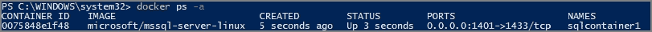

4. 如果 `STATUS` 列显示状态为 `Up`，则 SQL Server 正在容器中运行并监听 `PORTS` 列中指定的端口。如果你的 SQL Server 容器的 `STATUS` 列显示 `Exited`。

   如上所述，`-h`（主机名）参数会将容器的内部名称更改为自定义值。这是你在接下来的 Transact-SQL 查询中看到的返回名称：

   ```sql
   SELECT @@SERVERNAME,SERVERPROPERTY('ComputerNamePhysicalNetBIOS'),SERVERPROPERTY('MachineName'),SERVERPROPERTY('ServerName')
   ```

   将 `-h` 和 `--name` 设置为相同的值是轻松识别目标容器的好方法。

5. 最后一步，更改你的 SA 密码，因为 `SA_PASSWORD` 在 `ps -eax` 输出中可见，并存储在同名的环境变量中。见下述步骤。

## 修改 SA 密码

`SA` 账户是安装期间创建的 SQL Server 实例上的系统管理员。创建 SQL Server 容器后，可以通过在容器内运行 `echo $SA_PASSWORD` 来发现你指定的 `SA_PASSWORD` 环境变量。出于安全考虑，请更改你的 SA 密码。

1. 为 SA 用户选择一个强密码。
2. 使用 `docker exec` 运行 `sqlcmd`，使用 Transact-SQL 更改密码。在以下示例中，将旧密码 `<YourStrong!Passw0rd>` 和新密码 `<YourNewStrong!Passw0rd>` 替换为你自己的密码值。

   ```bash
   sudo docker exec -it sql1 /opt/mssql-tools/bin/sqlcmd -S localhost -U SA -P "<YourStrong@Passw0rd>" -Q 'ALTER LOGIN SA WITH PASSWORD="<YourNewStrong!Passw0rd>"'
   ```

## 连接到 SQL Server

以下步骤使用容器内部的 SQL Server 命令行工具 `sqlcmd` 连接 SQL Server。

1. 使用 `docker exec -it` 命令在你运行的容器内部启动交互式 bash shell。在示例中，`sql1` 是创建容器时通过 `--name` 参数指定的名称。

   ```bash
   sudo docker exec -it sql1 "bash"
   ```

2. 一旦进入容器，使用 `sqlcmd` 进行本地连接。`sqlcmd` 默认不在路径中，因此你必须指定完整路径。

   ```bash
   /opt/mssql-tools/bin/sqlcmd -S localhost -U SA -P "<YourNewStrong!Passw0rd>"
   ```

   提示：你可以在命令行中省略密码，以便提示输入密码。

3. 如果成功，你将获得 `sqlcmd` 命令提示符：`1>`。

## 创建并查询数据

后续章节将引导你如何使用 `sqlcmd` 和 Transact-SQL 创建新数据库、添加数据并运行查询。

### 创建新数据库

以下步骤创建一个名为 `TestDB` 的新数据库。

1. 在 `sqlcmd` 命令提示符下，粘贴以下 Transact-SQL 命令来创建数据库：

   ```sql
   CREATE DATABASE TestDB
   ```

2. 在下一行，编写一个查询以返回服务器上所有数据库的名称：

   ```sql
   SELECT Name from sys.Databases
   ```

3. 之前的两个命令没有立即执行。在新的一行输入 `GO` 以执行之前的命令：

   ```sql
   GO
   ```

### 插入数据

接下来创建一个新表 `Inventory` 并插入两行。

1. 在 `sqlcmd` 提示符下，切换上下文到新的 `TestDB` 数据库：

   ```sql
   USE TestDB
   ```

2. 创建名为 `Inventory` 的新表：

   ```sql
   CREATE TABLE Inventory (id INT, name NVARCHAR (50), quantity INT)
   ```

3. 向新表插入数据：

   ```sql
   INSERT INTO Inventory VALUES (1, 'banana', 150);
   INSERT INTO Inventory VALUES (2, 'orange', 154);
   ```

4. 输入 `GO` 执行之前的命令：

   ```sql
   GO
   ```

### 选择数据

现在，运行查询返回 `Inventory` 表中的数据。

1. 在 `sqlcmd` 命令提示符下，输入一个查询，返回 `Inventory` 表中数量 `quantity` 大于 152 的行：

   ```sql
   SELECT * FROM Inventory WHERE quantity > 152;
   ```

2. 执行命令：

   ```sql
   GO
   ```

### 退出 sqlcmd 命令提示符

1. 要结束 `sqlcmd` 会话，输入 `QUIT`：

   ```sql
   QUIT
   ```


2. 要退出容器中的交互式命令提示符，输入`exit`。退出交互式 bash shell 后，你的容器将继续运行。

## 从容器外部连接

你也可以从任何支持 SQL 连接的外部 Linux、Windows 或 macOS 工具连接到 Docker 机器上的 SQL Server 实例。以下步骤使用容器外部的`sqlcmd`连接到运行在容器中的 SQL Server。这些步骤假设你已经在容器外部安装了 SQL Server 命令行工具。

1. 找到托管容器的机器 IP 地址。在 Linux 上，使用`ifconfig`或`ip addr`。在 Windows 上，使用`ipconfig`。

2. 在此示例中，在你的客户端上安装`sqlcmd`工具。

3. 运行`sqlcmd`并指定 IP 地址以及映射到容器端口 1433 的端口。在本示例中，该端口与主机上的 1433 端口相同。如果你在主机上指定了不同的映射端口，则在此处使用该端口。你还需要在防火墙上打开适当的入站端口以允许连接。

```bash
sqlcmd -S <ip_address>,1433 -U SA -P "<YourNewStrong@Passw0rd>"
```

4. 运行 Transact-SQL 命令。完成后，输入`QUIT`。

## 移除你的容器

如果你想移除教程中使用的 SQL Server 容器，请运行以下命令：

```bash
sudo docker stop sql1
sudo docker rm sql1
```

## 在 Linux 上运行 SQL Server 2019 的 Docker 演示工具和命令

### 支持的 Linux 平台

Microsoft SQL Server 2019 经过测试支持在多个 Linux 发行版平台上运行：

* Red Hat Enterprise Linux (RHEL)

* SUSE Linux Enterprise Server (SLES)

* Ubuntu

除了上述 Linux 发行版外，SQL Server 2019 还支持在 Docker 镜像的容器场景中使用。在 Linux 的 Docker 引擎中运行 SQL Server 数据库提供了更高的灵活性、更快的恢复和更快的部署，包括部署到 Azure 云端。对于正在熟悉 Linux 的人员，Windows 或 Mac 版 Docker 提供了在你的工作站上运行带有 Linux 版 SQL Server 2019 的 Docker 引擎的选项。

结合 Docker 技术，可以实现编排，通过 Red Hat Open shift 或 Kubernetes 在 Linux 上管理和部署 SQL Server 容器。这包括 SQL Server 2019 大数据 (BDC)，这是一个包含 SQL Server、Spark 和 Hadoop 文件系统 (HDFS) 的完全可扩展集群。BDC 提供了使用 T-SQL 或 Spark 读取、写入和分析大数据的能力，你也可以结合大数据和关系型数据。

虽然本文重点关注 RHEL、SLES、Ubuntu 和 Linux 容器选项，但你可能对其他可能运行 SQL Server 2019 的 Linux 发行版有疑问，但微软并不支持它们。在决定在不支持的操作系统上运行 SQL Server 2019 之前，请始终考虑数据库服务器的用途。

### 用于 Linux 上的 Microsoft SQL Server 2019 工具

随着 SQL Server 2019 的发布，数据库专业人员可以使用更多工具运行在 Linux 上的 SQL Server 2019：

* **基于 Windows 的工具**——你可以使用任何运行在 Windows 上的工具访问 Linux 上的 SQL Server。这包括 SQL Server Management Studio (SSMS)、SQL Server Data Tools (SSDT)、操作支持系统以及第三方工具。

* **活动监器 (Activity Monitor)**——在 Windows 上使用`SSMS`远程连接，并使用 Linux 主机上的活动监器命令等工具/功能。

* **Azure Data Studio**——使用此跨平台数据库工具管理 Windows、MacOS 和 Linux 上的微软本地及云数据平台。包括运行在 Linux 上的 SQL Server 2019。你还可以在 Azure Data Studio 中创建 SQL Server Notebook，让多个团队成员协作项目。

* **动态管理视图 (DMVs)**——系统 DMV 收集有关 SQL Server 的各种信息，包括 Linux 进程信息。结合动态管理函数 (DMF) 使用服务器状态信息来监控实例健康状况、诊断问题并调整性能。

* **查询存储 (Query Store)**——使用查询存储获取查询计划选择和性能的洞察。它通过帮助数据库专业人员快速找到由查询计划更改引起的性能差异，简化了性能排错。

* **性能仪表板 (Performance Dashboard)**——性能仪表板帮助你确定连接的 SQL Server 实例上是否存在性能瓶颈，并提供诊断数据帮助你解决问题。

* `mssql-conf`是随 SQL Server 2019 for Linux 安装的一个配置脚本。

### 用于 Linux 上的 Microsoft SQL Server 2019 命令行工具

* `sqlcmd`和批量拷贝协议 (BCP)——这些命令行工具在 Linux 上原生可用。`sqlcmd`是命令行查询实用程序，`BCP`是批量导入导出实用程序。

* `mssql-scripter`——此 Linux 上的命令行工具可为运行任何地方的 SQL 数据库生成 T-SQL 脚本。

* `mssql-cli`——这个用 Python 编写的新交互式命令行工具在终端环境中相比`sqlcmd`提供了多项增强。

## 系统动态管理视图

动态管理视图和函数返回服务器状态信息，可监控服务器实例的健康状况、诊断问题并调整性能。动态管理视图和函数返回内部的、特定实现的状态数据。它们的架构及其返回的数据在 SQL Server 的未来版本中可能会发生。因此，未来版本中的动态管理视图和函数可能与此版本不兼容。例如，在 SQL Server 的未来版本中，微软可能会通过在列列表末尾添加列来增强任何动态管理视图的定义。我们建议不要在生产代码中使用`SELECT * FROM dynamic_management_view_name`语法，因为返回的列数可能会发生并破坏你的应用程序。

动态管理视图和函数有两种类型：

* **服务器范围的动态管理视图和函数**。它们需要服务器上的`VIEW SERVER STATE`权限。

* **数据库范围的动态管理视图和函数**。它们需要数据库上的`VIEW DATABASE STATE`权限。

### 查询动态管理视图

在 Transact-SQL 语句可以使用两部分、三部分或四部分名称引用动态管理视图。另一方面，动态管理函数可以在 Transact-SQL 语句中使用两部分或三部分名称引用。动态管理视图和函数不能使用单部分名称在 Transact-SQL 语句中引用。

所有动态管理视图和函数都存在于`sys`架构中并遵循`dm_*`命名约定。当你使用动态管理视图或函数时，必须使用`sys`架构为视图或函数名前缀。例如，要查询`dm_os_wait_stats`动态管理视图，请运行以下查询：

```sql
SELECT wait_type, wait_time_ms
FROM sys.dm_os_wait_stats;
```

### 需要权限

查询动态管理视图或函数需要对象的`SELECT`权限以及`VIEW SERVER STATE`或`VIEW DATABASE STATE`权限。这允许你选择性地限制用户或登录对动态管理视图和函数的访问。要这样做，首先在`master`中创建用户，然后拒绝该用户对你不希望他们访问的动态管理视图或函数的`SELECT`权限。之后，无论用户的数据库上下文如何，用户都无法从这些动态管理视图或函数中查询。

动态管理视图和函数已组织成以下类别。

#### Always On 可用性组动态管理视图和函数 (Transact-SQL)

* `sys.dm_hadr_auto_page_reairs`

* `sys.dm_hadr_availability_group_stats`

* `sys.dm_hadr_availability_replica_cluster_nodes`

* `sys.dm_hadr_availability_replica_cluster_stats`

* `sys.dm_hadr_availability_replica_stats`

* `sys.dm_hadr_cluster`

* `sys.dm_hadr_cluster_members`

* `sys.dm_hadr_cluster_networks`

* `sys.dm_hadr_database_replica_cluster_stats`

* `sys.dm_hadr_database_replica_stats`

* `sys.dm_hadr_instance_node_map`

* `sys.dm_hadr_name_id_map`

* `sys.dm_tcp_listener_states`

#### 更改捕获相关的动态管理视图 (Transact-SQL)

* `sys.dm_cdc_errors`

## 与更改跟踪相关的动态管理视图

更改跟踪 - `sys.dm_tran_commit_table`

## 与公共语言运行时相关的动态管理视图 (Transact-SQL)

公共语言运行时动态管理视图 (Transact-SQL)

`sys.dm_clr_appdomains`, `sys.dm_clr_properties`, `sys.dm_clr_loaded_assemblies`, `sys.dm_clr_tasks`

## 与数据库镜像相关的动态管理视图 (Transact-SQL)

数据库镜像 - `sys.dm_db_mirroring_auto_page_repair`

## 与数据库相关的动态管理视图 (Transact-SQL)

数据库相关的动态管理视图 (Transact-SQL)

`sys.dm_db_file_space_usage`, `sys.dm_db_log_info`, `sys.dm_db_log_stats`, `sys.dm_db_partition_stats`, `sys.dm_db_session_space_usage`, `sys.dm_db_uncontained_entities`, `sys.dm_db_fts_index_physical_stats`, `sys.dm_db_log_space_usage`, `sys.dm_db_page_info`, `sys.dm_db_persisted_sku_features`, `sys.dm_db_task_space_usage`

## SQL Database 或 Azure Synapse Analytics 专有的 DMV

`sys.dm_db_wait_stats` (Azure SQL Database), `sys.dm_db_resource_stats` (Azure SQL Database), `sys.dm_operation_status` (Azure SQL Database), `sys.dm_database_copies` (Azure SQL Database), `sys.dm_db_objects_impacted_on_version_change` (Azure SQL Database)

## 与执行相关的动态管理视图和函数 (Transact-SQL)

与执行相关的动态管理视图和函数 (Transact-SQL)

`sys.dm_exec_background_job_queue`, `sys.dm_exec_cached_plan_dependent_objects`, `sys.dm_exec_compute_node_errors`, `sys.dm_exec_compute_node`, `sys.dm_exec_cursors`, `sys.dm_exec_describe_first_result_set_for_object`, `sys.dm_exec_distributed_requests`, `sys.dm_exec_dms_services`, `sys.dm_exec_external_operations`, `sys.dm_exec_function_stats`, `sys.dm_exec_plan_attributes`, `sys.dm_exec_query_memory_grants`, `sys.dm_exec_query_optimizer_memory_gateways`, `sys.dm_exec_query_parallel_workers`, `sys.dm_exec_query_resource_semaphores`, `sys.dm_exec_query_stats`, `sys.dm_exec_requests`, `sys.dm_exec_sessions`, `sys.dm_exec_text_query_plan`, `sys.dm_exec_valid_use_hints`, `sys.dm_exec_external_script_execution_stats`, `sys.dm_exec_background_job_queue_stat`, `sys.dm_exec_cached_plans`, `sys.dm_exec_compute_node_status`, `sys.dm_exec_connections`, `sys.dm_exec_describe_first_result_set`, `sys.dm_exec_distributed_request_steps`, `sys.dm_exec_distributed_sql_requests`, `sys.dm_exec_dms_workers`, `sys.dm_exec_external_work`, `sys.dm_exec_input_buffer`, `sys.dm_exec_procedure_stats`, `sys.dm_exec_query_optimizer_info`, `sys.dm_exec_query_plan`, `sys.dm_exec_query_profile`, `sys.dm_exec_query_statistics_xml`, `sys.dm_exec_query_plan_stat`, `sys.dm_exec_session_wait_stat`, `sys.dm_exec_sql_text`, `sys.dm_exec_trigger_stats`, `sys.dm_exec_xml_handle`, `sys.dm_exec_external_script_requests`

## 扩展事件动态管理视图

扩展事件动态管理视图

`sys.dm_xe_map_values` (Transact-SQL), `sys.dm_xe_object_columns` (Transact-SQL), `sys.dm_xe_objects` (Transact-SQL), `sys.dm_xe_packages` (Transact-SQL), `sys.dm_xe_session_event_actions` (Transact-SQL), `sys.dm_xe_session_events` (Transact-SQL), `sys.dm_xe_session_object_columns` (Transact-SQL), `sys.dm_xe_session_targets` (Transact-SQL), `sys.dm_xe_sessions` (Transact-SQL)

## Filestream 和 FileTable 动态管理视图 (Transact-SQL)

Filestream 和 FileTable 动态管理视图 (Transact-SQL)

Filestream 动态管理视图和函数

`sys.dm_filestream_file_io_handles` (Transact-SQL)

显示当前打开的事务文件句柄。

`sys.dm_filestream_file_io_requests` (Transact-SQL)

显示当前的文件输入和输出请求。

FileTable 动态管理视图和函数

`sys.dm_filestream_non_transacted_handles` (Transact-SQL)

显示当前打开的 FileTable 数据的非事务文件句柄。

## 全文搜索和语义搜索动态管理视图和函数 (Transact-SQL)

全文和语义搜索动态管理视图 - 函数

此节包含与全文搜索和语义搜索相关的动态管理视图和函数。

全文搜索动态管理视图和函数

`sys.dm_fts_active_catalogs` (Transact-SQL)

返回在服务器上正在进行某些装填活动的全文目录信息。

`sys.dm_fts_fdhosts`

返回服务器实例上过滤守护进程主机或多个主机的当前活动信息。

`sys.dm_fts_index_keywords`

返回指定表全文索引的内容信息。

`sys.dm_fts_index_keywords_by_document`

返回指定表全文索引的文档级内容信息。给定的关键字可能出现在多个文档中。

`sys.dm_fts_index_keywords_by_property`

返回给定表全文索引中所有与属性相关的内容。这包括属于与该全文索引相关的搜索属性列表注册的任何属性的数据。

`sys.dm_fts_index_keywords_by_document`

返回文档中的关键字位置。

`sys.dm_fts_population`


返回当前进行中的全文索引填充信息。

`sys.dm_fts_buffers`

返回属于特定内存池的用于全文扫描范围的内存缓冲区信息。

`sys.dm_fts_memory_pools`

返回用于全文收集器用于全文扫描范围的共享内存池信息。

`sys.dm_fts_outstanding_batches`

返回每个全文索引批。

`sys.dm_fts_parser`

返回对字符串应用分词器、词典和停用词列表后的最终分词结果。

`sys.dm_fts_ranges`

返回与正在进行中的全文索引相关的范围信息。

## 语义搜索动态管理视图和函数

`sys.dm_fts_similarity`（Transact-SQL）

返回每个关联语义索引的表的语义索引填充状态行。

## 地理复制动态管理视图和函数（Azure SQL Database）

地理复制动态管理视图和函数（Azure SQL Database）：`sys.geo_replication_links`（Azure SQL Database）、`sys.dm_operation_status`（Azure SQL Database）、`sys.dm_geo_replication_link_status`（Azure SQL Database）、`sys.dm_continuous_copy_status`（Azure SQL Database）。

## 与索引相关的动态管理视图和函数（Transact-SQL）

`sys.dm_db_column_store_row_group_physical_stats`（Transact-SQL）、`sys.dm_db_index_operational_stats`（Transact-SQL）、`sys.dm_db_index_usage_stats`（Transact-SQL）、`sys.dm_db_missing_index_details`（Transact-SQL）、`sys.dm_db_missing_index_groups`（Transact-SQL）、`sys.dm_db_index_physical_stats`（Transact-SQL）、`sys.dm_db_missing_index_columns`（Transact-SQL）、`sys.dm_db_missing_index_group_stats`（Transact-SQL）

## 与 I/O 相关的动态管理视图和函数（Transact-SQL）

`sys.dm_io_backup_tapes`（Transact-SQL）、`sys.dm_io_pending_io_requests`（Transact-SQL）、`sys.dm_io_cluster_valid_path_names`（Transact-SQL）、`sys.dm_io_cluster_shared_drives`（Transact-SQL）、`sys.dm_io_virtual_file_stats`（Transact-SQL）

## 内存优化表动态管理视图（Transact-SQL）

- `sys.dm_db_xtp_checkpoint_stats`（Transact-SQL）
- `sys.dm_db_xtp_gc_cycle_stats`（Transact-SQL）
- `sys.dm_db_xtp_index_stats`（Transact-SQL）
- `sys.dm_db_xtp_merge_requests`（Transact-SQL）
- `sys.dm_db_xtp_nonclustered_index_stats`（Transact-SQL）
- `sys.dm_db_xtp_transactions`（Transact-SQL）
- `sys.dm_xtp_gc_stats`（Transact-SQL）
- `sys.dm_xtp_transaction_stats`（Transact-SQL）
- `sys.dm_db_xtp_checkpoint_files`（Transact-SQL）
- `sys.dm_db_xtp_hash_index_stats`（Transact-SQL）
- `sys.dm_db_xtp_memory_consumers`（Transact-SQL）
- `sys.dm_db_xtp_object_stats`（Transact-SQL）
- `sys.dm_db_xtp_table_memory_stats`（Transact-SQL）
- `sys.dm_xtp_gc_queue_stats`（Transact-SQL）
- `sys.dm_xtp_system_memory_consumers`（Transact-SQL）

## 对象目录视图

以下对象目录视图专门用于内存优化 OLTP（In-Memory OLTP）。

- `sys.hash_indexes`（Transact-SQL）
- `sys.memory_optimized_tables_internal_attributes`（Transact-SQL）

## 内部 DMV

另还有一些仅供内部使用的 DMV，我们没有提供直接的文档。在内存优化表领域，未记录的 DMV 包括以下这些：

- `sys.dm_xtp_threads`
- `sys.dm_xtp_transaction_recent_rows`

## 与对象相关的动态管理视图和函数（Transact-SQL）

- `sys.dm_db_incremental_stats_properties`
- `sys.dm_db_stats_properties`
- `sys.dm_sql_referencing_entities`
- `sys.dm_db_stats_histogram`
- `sys.dm_sql_referenced_entities`

### 查询通知相关的动态管理视图（Transact-SQL）

查询通知：`sys.dm_qn_subscriptions`

### 与复制相关的动态管理视图（Transact-SQL）

- `sys.dm_repl_articles`
- `sys.dm_repl_tranhash`
- `sys.dm_repl_schema`
- `sys.dm_repl_traninfo`

### 与资源生成器相关的动态管理视图（Transact-SQL）

- `sys.dm_resource_governor_configuration`（Transact-SQL）
- `sys.dm_resource_governor_external_resource_pool_affinity`（Transact-SQL）
- `sys.dm_resource_governor_resource_pool_affinity`（Transact-SQL）
- `sys.dm_resource_governor_external_resource_pools`（Transact-SQL）
- `sys.dm_resource_governor_resource_pools`（Transact-SQL）
- `sys.dm_resource_governor_resource_pool_volumes`（Transact-SQL）
- `sys.dm_resource_governor_workload_groups`（Transact-SQL）

### 与安全相关的动态管理视图和函数（Transact-SQL）

- `sys.dm_audit_actions`（Transact-SQL）
- `sys.dm_audit_class_type_map`（Transact-SQL）
- `sys.dm_cryptographic_provider_algorithms`（Transact-SQL）
- `sys.dm_cryptographic_provider_keys`（Transact-SQL）
- `sys.dm_cryptographic_provider_properties`（Transact-SQL）
- `sys.dm_cryptographic_provider_sessions`（Transact-SQL）
- `sys.dm_database_encryption_keys`（Transact-SQL）
- `sys.dm_server_audit_status`（Transact-SQL）

### 与服务器相关的动态管理视图和函数（Transact-SQL）

- `sys.dm_server_memory_dumps`
- `sys.dm_server_registry`
- `sys.dm_server_services`

### 与 Service Broker 动态管理视图（Transact-SQL）

- `sys.dm_broker_activated_tasks`
- `sys.dm_broker_forwarded_messages`
- `sys.dm_broker_connections`
- `sys.dm_broker_queue_monitors`

### 与空间数据相关的动态管理视图和函数（Transact-SQL）

空间数据：`sys.dm_db_objects_disabled_on_compatibility_level_change`

### 示例

以下示例展示了对 `sys.dm_db_objects_disabled_on_compatibility_level_change` 的查询，以查找由于兼容级别更改为 120 而受影响的对象。

```sql
SELECT * FROM sys.dm_db_objects_disabled_on_compatibility_level_change(120);
GO
```

## Azure Synapse Analytics 和并行数据仓库动态管理视图（Transact-SQL）

### Azure Synapse Analytics（SQL Data Warehouse）和并行数据仓库的动态管理视图

以下动态管理视图同时适用于 Azure Synapse Analytics（SQL Data Warehouse）和并行数据仓库：

- `sys.dm_pdw_dms_cores`（Transact-SQL）
- `sys.dm_pdw_dms_external_work`（Transact-SQL）
- `sys.dm_pdw_dms_workers`（Transact-SQL）
- `sys.dm_pdw_errors`（Transact-SQL）
- `sys.dm_pdw_exec_connections`（Transact-SQL）
- `sys.dm_pdw_exec_requests`（Transact-SQL）
- `sys.dm_pdw_exec_sessions`（Transact-SQL）
- `sys.dm_pdw_hadoop_operations`（Transact-SQL）
- `sys.dm_pdw_lock_waits`（Transact-SQL）
- `sys.dm_pdw_nodes`（Transact-SQL）
- `sys.dm_pdw_nodes_database_encryption_keys`（Transact-SQL）
- `sys.dm_pdw_os_threads`（Transact-SQL）
- `sys.dm_pdw_request_steps`（Transact-SQL）
- `sys.dm_pdw_resource_waits`（Transact-SQL）
- `sys.dm_pdw_sql_requests`（Transact-SQL）
- `sys.dm_pdw_sys_info`（Transact-SQL）
- `sys.dm_pdw_wait_stats`（Transact-SQL）
- `sys.dm_pdw_waits`（Transact-SQL）

### Azure Synapse Analytics（SQL Data Warehouse）动态管理视图

以下动态管理视图仅适用于 Azure Synapse Analytics（SQL Data Warehouse）：

- `sys.dm_pdw_nodes_exec_query_plan`（Transact-SQL）
- `sys.dm_pdw_nodes_exec_query_profiles`（Transact-SQL）
- `sys.dm_pdw_nodes_exec_query_statistics_xml`（Transact-SQL）
- `sys.dm_pdw_nodes_exec_sql-text`（Transact-SQL）
- `sys.dm_pdw_nodes_exec_text_query_plan`（Transact-SQL）
- `sys.dm_workload_management_workload_groups_stats`（Transact-SQL）（预览）

### 并行数据仓库动态管理视图

以下动态管理视图仅适用于并行数据仓库：

- `sys.dm_pdw_component_health_active_alerts`（Transact-SQL）
- `sys.dm_pdw_component_health_alerts`（Transact-SQL）
- `sys.dm_pdw_component_health_status`（Transact-SQL）
- `sys.dm_pdw_diag_processing_stats`（Transact-SQL）
- `sys.dm_pdw_network_credentials`（Transact-SQL）
- `sys.dm_pdw_node_status`（Transact-SQL）
- `sys.dm_pdw_os_event_logs`（Transact-SQL）
- `sys.dm_pdw_os_performance_counters`（Transact-SQL）
- `sys.dm_pdw_query_stats`（Transact-SQL）
- `sys.dm_pdw_query_xe`（Transact-SQL）
- `sys.dm_os_file`（Transact-SQL）

## SQL Server 操作系统相关动态管理视图（Transact-SQL）

本节记录了与 SQL Server 操作系统相关的动态管理视图（DMV）。操作系统负责管理特定于 SQL Server 的资源。

| SQL 操作系统相关动态管理视图（Transact-SQL） | |
| --- | --- |
| `sys.dm_os_buffer_descriptors` | `sys.dm_os_buffer_pool_extension` |
| `sys.dm_os_child_instances` | `sys.dm_os_cluster_nodes` |
| `sys.dm_os_cluster_properties` | `sys.dm_os_dispatcher_pools` |
| `sys.dm_os_enumerate_fixed_drives` | `sys.dm_os_host_info` |
| `sys.dm_os_hosts` | `sys.dm_os_latch_stats` |
| `sys.dm_os_loaded_modules` | `sys.dm_os_memory_brokers` |
| `sys.dm_os_memory_cache_clock_hands` | `sys.dm_os_memory_cache_counters` |
| `sys.dm_os_memory_cache_entries` | `sys.dm_os_memory_cache_hash_tables` |
| `sys.dm_os_memory_clerks` | `sys.dm_os_memory_nodes` |
| `sys.dm_os_nodes` | `sys.dm_os_performance_counters` |
| `sys.dm_os_process_memory` | `sys.dm_os_schedulers` |
| `sys.dm_os_server_diagnostics_log_configurations` | `sys.dm_os_spinlock_stats` |
| `sys.dm_os_stacks` | `sys.dm_os_sys_info` |
| `sys.dm_os_sys_memory` | `sys.dm_os_tasks` |
| `sys.dm_os_threads` | `sys.dm_os_virtual_address_dump` |
| `sys.dm_os_volume_stats` | `sys.dm_os_waiting_tasks` |
| `sys.dm_os_wait_stats` | `sys.dm_os_windows_info` |
| `sys.dm_os_workers` | |

以下 SQL Server 操作系统相关的动态管理视图仅供参考之用。不支持。不保证未来的兼容性。

| | |
| --- | --- |
| `sys.dm_os_function_symbolic_name` | `sys.dm_os_ring_buffers` |
| `sys.dm_os_memory_allocations` | `sys.dm_os_sublatches` |


| `sys.dm_os_worker_local_storage` | |

## Stretch 数据库动态管理视图 (Transact-SQL)

有两种类型的动态管理视图和函数：

- 服务器作用范围的动态管理视图和函数。这些需要服务器上的 `VIEW SERVER STATE` 权限。
- 数据库范围的动态管理视图和函数。这些对象需要数据库上的 `VIEW DATABASE STATE` 权限。

## 查询动态管理视图

在 Transact-SQL 语句中，可以使用两部分、三部分或四部分名称引用动态管理视图。另一方面，动态管理函数可以使用两部分或三部分名称在 Transact-SQL 语句中引用。动态管理视图和函数不能使用单部分名称在语句中引用。

所有动态管理视图和函数都存在于 `sys` 架构中，并遵循 `dm_*` 命名约定。当你使用动态管理视图或函数时，必须使用 `sys` 架构作为视图或函数的前缀。例如，要查询 `dm_os_wait_stats` 动态管理视图，请运行以下查询：

```sql
SELECT wait_type, wait_time_ms
FROM sys.dm_os_wait_stats;
```

## 事务动态管理视图和函数 (Transact-SQL)

- `sys.dm_tran_active_snapshot_database_transactions` (Transact-SQL)
- `sys.dm_tran_current_snapshot` (Transact-SQL)
- `sys.dm_tran_database_transactions` (Transact-SQL)
- `sys.dm_tran_session_transactions` (Transact-SQL)
- `sys.dm_tran_transactions_snapshot` (Transact-SQL)
- `sys.dm_tran_version_store_space_usage`
- `sys.dm_tran_active_transactions` (Transact-SQL)
- `sys.dm_tran_current_transaction` (Transact-SQL)
- `sys.dm_tran_locks` (Transact-SQL)
- `sys.dm_tran_top_version_generators` (Transact-SQL)
- `sys.dm_tran_version_store` (Transact-SQL)

### 使用查询存储监控性能

SQL Server 查询存储（Query Store）功能可以提供有关查询计划选择和性能的洞察。它通过帮助你快速找到由查询计划更改引起的性能差异，简化了性能故障排除。查询存储会自动捕获查询、计划和运行时统计信息的历史，并保留这些信息供你审查。它按时间窗口划分数据，因此你可以查看数据库使用模式并了解服务器上何时发生了查询计划更改。你可以使用 `ALTER DATABASE SET` 选项配置查询存储。

如果你在 SQL Server 2016 (13.x) 中使用查询存储进行即时工作负载分析，请尽快安装 `KB 4340759` 中的性能扩展性修复程序。

### 启用查询存储

新的 SQL Server 和 Azure Synapse Analytics (SQL DW) 数据库默认不启用查询存储，而新的 Azure SQL Database 则默认启用。

### 使用 SQL Server Management Studio 中的查询存储页

1. 在对象资源管理器中，右键点击数据库，然后点击 `Properties`。
2. 在数据库属性对话框中，选择 `Query Store` 页面。
3. 在 `Operation Mode (Requested)` 框中，选择 `Read Write`。

### 使用 Transact-SQL 语句

使用 `ALTER DATABASE` 语句为给定数据库启用查询存储。例如：

```sql
SET QUERY_STORE = ON (OPERATION_MODE = READ_WRITE);
```

有关与查询存储相关的更多语法选项，请参阅 `ALTER DATABASE SET Options (Transact-SQL)`。

### 查询存储中的信息

SQL Server 中任何特定查询的执行计划通常会随着时间演变，原因有很多，例如统计信息更改、架构更改、索引的创建/删除等。过程缓存（存储缓存查询计划的地方）仅存储最近的执行计划。计划还因为内存压力从计划缓存中被驱出。因此，由执行计划更改引起的查询性能退化可能是严重的，且解决起来非常耗时。

由于查询存储为每个查询保留了多个执行计划，因此它可以实施策略，引导查询处理器对特定查询使用特定的执行计划。这被称为计划强制（plan forcing）。查询存储中的计划强制通过使用类似于 `USE PLAN` 查询提示的机制提供，但它不需要对用户应用程序进行任何更改。计划强制可以在极短的时间内解决由计划更改引起的查询性能退化。

查询存储默认不为原生编译的存储过程收集数据。使用 `sys.sp_xtp_control_query_exec_stats` 来启用对原生编译存储过程的数据收集。

等待统计是另一个帮助排除数据库引擎性能故障的信息源。长期以来，等待统计仅在实例级别可用，这使得将等待追溯到特定查询变得困难。从 SQL Server 2017 (14.x) 和 Azure SQL Database 开始，查询存储包含一个跟踪等待统计的维度。下面的示例启用了查询存储收集等待统计：

```sql
SET QUERY_STORE = ON ( WAIT_STATS_CAPTURE_MODE = ON );
```

### 使用查询存储功能的常见场景包括：

- 通过强制使用之前的查询计划，快速查找并修复计划性能退化。修复近期因执行计划更改而性能退化的查询。
- 确定查询在给定时间窗口内执行的次数，帮助 DBA 故障排除性能资源问题。
- 识别过去 `x` 小时内的前 `n` 个查询（按执行时间、内存消耗等）。
- 审计特定查询的查询计划历史。
- 分析特定数据库的资源（CPU、I/O 和内存）使用模式。
- 识别正在等待资源的前 `n` 个查询。
- 理解特定查询或计划的等待性质。

查询存储包含三个存储器：

- `plan store`（计划存储），用于持久化执行计划信息。
- `runtime stats store`（运行时统计存储），用于持久化执行统计信息。
- `wait stats store`（等待统计存储），用于持久化等待统计信息。

计划存储中可以为查询存储的唯一计划数量受 `max_plans_per_query` 配置选项限制。为了提高性能，信息会被异步写入存储器。为了最大限度地减少空间占用，运行时存储器中的运行时执行统计会在固定时间窗口内进行聚合。这些存储器中的信息可以通过查询 Query Store 目录视图查看。

以下查询返回有关 Query Store 中查询和计划的信息。

```sql
SELECT Txt.query_text_id, Txt.query_sql_text, Pl.plan_id, Qry.*
FROM sys.query_store_plan AS Pl
INNER JOIN sys.query_store_query AS Qry ON Pl.query_id = Qry.query_id
INNER JOIN sys.query_store_query_text AS Txt ON Qry.query_text_id = Txt.query_text_id ;
```

## 使用回归查询功能

启用 Query Store 后，刷新对象资源管理器窗格中的数据库部分以添加 `Query Store` 节。

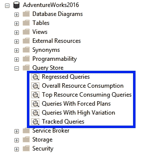 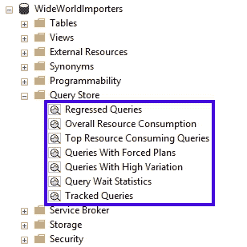

选择 `Regressed Queries` 在 SQL Server Management Studio 中打开 `Regressed Queries` 窗格。回归查询窗格向您显示查询存储中的查询和计划。使用顶部的下拉框根据各种标准筛选查询：`Duration (ms)`（默认）、CPU 时间 (ms)、逻辑读取 (KB)、逻辑写入 (KB)、物理读取 (KB)、CLR 时间 (ms)、DOP、内存消耗 (KB)、行数、日志内存使用 (KB)、Temp DB 内存使用 (KB) 以及等待时间 (ms)。

选择一个计划以查看图形化查询计划。提供可用按钮查看源查询、强制和取消强制查询计划、在网格和图表格式之间切换、比较所选计划（如果选择了多个）以及刷新显示。

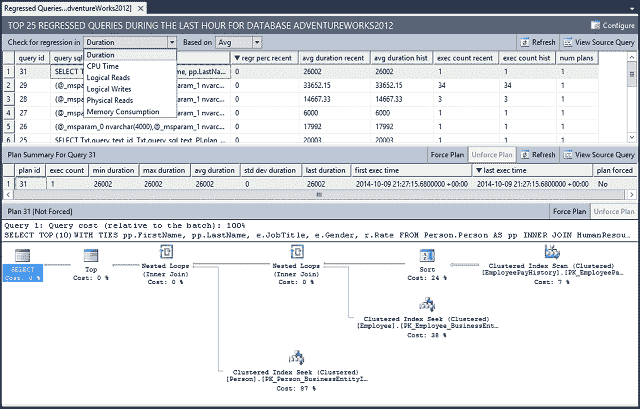

要强制执行计划，请选择查询和计划，然后点击 `Force Plan`。您只能强制执行查询计划功能保存并仍保留在查询计划缓存中的计划。

## 查找等待中的查询

从 SQL Server 2017 (14.x) 和 Azure SQL Database 开始，Query Store 提供了随时间变化的查询等待统计。

在 Query Store 中，等待类型组合为 `wait categories`。等待类别到等待类型的映射可以在 `sys.query_store_wait_stats` (Transact-SQL) 中可用。

选择 `Query Wait Statistics` 在 SQL Server Management Studio v18 或更高版本中打开 `Query Wait Statistics` 窗格。查询等待统计窗格向您显示一个包含 Query Store 中顶级等待类别的柱图。使用顶部的下拉列表选择等待时间的聚合标准：`avg`、`max`、`min`、`std dev` 和 `total`（默认）。

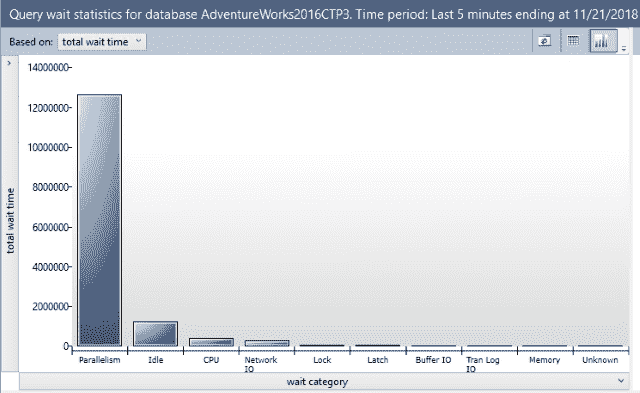

通过点击柱形选择等待类别，并显示所选等待类别的详细视图。此新柱形图包含导致该等待类别的查询。

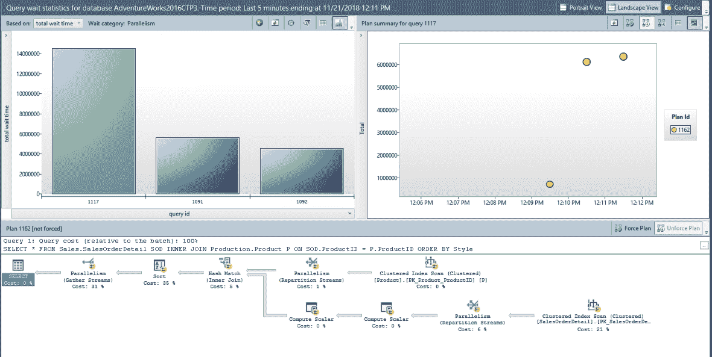

使用顶部的下拉框根据所选等待类别的各种等待时间标准筛选查询：`avg`、`max`、`min`、`std dev` 和 `total`（默认）。选择一个计划以查看图形化查询计划。提供可用按钮查看源查询、强制、取消强制查询计划以及刷新显示。

`Wait categories` 将相似的不同等待类型组合到桶（buckets）中。不同的等待类别需要不同的后续分析来解决问题，但来自同一类别的等待类型会导致非常相似的故障排除体验，在等待基础上提供受影响的查询将是完成大多数此类调查的关键环节。

以下是您在 Query Store 中引入等待类别之前和之后获取有关工作负载更深入见解的一些示例：

| 之前的体验 | 新的体验 | 操作 |
| --- | --- | --- |
| 每个数据库具有高 `RESOURCE_SEMAPHORE` 等待 | Query Store 中特定查询具有高内存等待 | 在 Query Store 中找到内存消耗消耗的查询。这些查询可能会延迟受影响查询的进一步进展。考虑对这些查询使用 `MAX_GRANT_PERCENT` 查询提示，或对受影响的查询使用。 |
| 每个数据库具有高 `LCK_M_X` 等待 | Query Store 中特定查询具有高锁等待 | 检查受影响查询的查询文本并识别目标实体。在 Query Store 中查找修改相同实体的其他查询，这些查询执行频繁且/或持续时间。识别这些查询后，考虑更改应用程序逻辑以提高并发性，或使用限制较少的隔离级别。 |
| 每个数据库具有高 `PAGEIOLATCH_SH` 等待 | Query Store 中特定查询具有高缓冲区 IO 等 | 在 Query Store 中找到物理读取大量的查询。如果它们与高 IO 等待查询匹配，考虑在底层实体上引入索引以便进行寻址代替扫描，从而最大限度地减少查询的 IO 开销。 |
| 每个数据库具有高 `SOS_SCHEDULER_YIELD` 等待 | Query Store 中特定查询具有高 CPU 等待 | 在 Query Store 中找到 CPU 消耗最高的查询。在其中，识别高 CPU 趋势与受影响查询的高 CPU 等待相关的查询。专注于优化这些查询——可能存在计划回归，或者可能缺少索引。 |

# 配置选项

查询 `sys.database_query_store_options` 视图以确定查询存储（Query Store）的当前选项。

## 相关视图、函数和过程

可以通过 Management Studio 或使用以下视图和过程来查看并管理查询存储。

### 查询存储函数

函数用于对查询存储进行操作。

- `sys.fn_stmt_sql_handle_from_sql_stmt` (Transact-SQL)

### 查询存储目录视图

目录视图提供有关查询存储的信息。

- `sys.database_query_store_options` (Transact-SQL)
- `sys.query_context_settings` (Transact-SQL)
- `sys.query_store_plan` (Transact-SQL)
- `sys.query_store_query` (Transact-SQL)
- `sys.query_store_query_text` (Transact-SQL)
- `sys.query_store_runtime_stats` (Transact-SQL)
- `sys.query_store_wait_stats` (Transact-SQL)
- `sys.query_store_runtime_stats_interval` (Transact-SQL)

### 查询存储存储过程

存储过程用于配置查询存储。

- `sp_query_store_flush_db` (Transact-SQL)
- `sp_query_store_reset_exec_stats` (Transact-SQL)
- `sp_query_store_force_plan` (Transact-SQL)
- `sp_query_store_unforce_plan` (Transact-SQL)
- `sp_query_store_remove_plan` (Transact-SQL)
- `sp_query_store_remove_query` (Transact-SQL)
- `sp_query_store_consistency_check` (Transact-SQL)

在极端情况下，查询存储可能会因为内部错误进入 ERROR 状态。从 SQL Server 2017 (14.x) 开始，如果发生这种情况，可以通过在受影响的数据库中执行 `sp_query_store_consistency_check` 存储过程来恢复查询存储。更多请参阅 `sys.database_query_store_options` 中 `actual_state_desc` 列的描述。

本节提供了关于管理查询存储功能本身的一些指南。

## 查询存储当前处于激活状态吗？

查询存储将其数据存储用户数据库内部，这就是为什么会有大小限制（通过 `MAX_STORAGE_SIZE_MB` 配置）。如果查询存储中的数据达到该限制，查询存储将自动从读写状态更改为只读并停止收集新数据。

查询 `sys.database_query_store_options` 以确定查询存储当前是否激活，以及它当前是否正在收集运行统计信息。

```sql
SELECT actual_state, actual_state_desc, readonly_reason,current_storage_size_mb, max_storage_size_mb
FROM sys.database_query_store_options;
```

查询存储的状态由 `actual_state` 列决定。如果它与预期状态不同，`readonly_reason` 列可以提供更多信息。当查询存储大小超过配额时，该功能将切换到只读模式。

### 获取查询存储选项

要查找查询存储状态的详细信息，请在用户数据库中执行以下操作。

```sql
SELECT * FROM sys.database_query_store_options;
```

### 设置查询存储间隔

你可以覆盖聚合查询运行统计信息的间隔（默认值为 60 分钟）。

```sql
ALTER DATABASE <database_name>SET QUERY_STORE (INTERVAL_LENGTH_MINUTES = 15);
```

新的间隔值通过 `sys.database_query_store_options` 视图公开。

### 查询存储空间使用

要检查当前查询存储的大小和限制，请在用户数据库中执行以下操作。

```sql
SELECT current_storage_size_mb, max_storage_size_mb
FROM sys.database_query_store_options;
```

如果查询存储空间满了，请使用以下语句扩展存储。

```sql
ALTER DATABASE <database_name>SET QUERY_STORE (MAX_STORAGE_MB = <new_size>);
```

### 设置查询存储选项

你可以通过一个 `ALTER` 同时设置多个查询存储选项。


```sql
ALTER DATABASE <database name>SET QUERY_STORE (OPERATION_MODE = READ_WRITE,CLEANUP_POLICY = (STALE_QUERY_DAYS = 30),DATA_FLUSH_INTERVAL_SECONDS = 300,MAX_PLANS_PER_QUERY = 1000,WAIT_STATS_CAPTURE_MODE = ON,QUERY_CAPTURE_MODE = AUTO);
```

## 清理空间

查询存储内部表在创建数据库时创建在 `PRIMARY` 文件组中，该配置稍后无法更改。如果你空间不足，可能希望使用以下语句清除旧的查询存储数据。

```sql
ALTER DATABASE <db_name> SET QUERY_STORE CLEAR ;
```

或者，你可能只想清理 `ad hoc`（即时）查询数据，因为它们对查询优化和计划分析的相关性较小，但占用同样的空间。

### 删除 ad hoc 查询

这每 3 分钟从查询存储中清除 `adhoc` 和内部查询，以防止查询存储耗尽空间，并移除我们真正需要跟踪的查询：

```sql
SET NOCOUNT ON-- 这每 3 分钟从查询存储中清除 adhoc 和内部查询，以防止查询-- store 耗尽空间并移除我们真正需要跟踪的查询
DECLARE @command varchar(1000)
SELECT @command = 'IF ''?'' NOT IN(''master'', ''model'', ''msdb'', ''tempdb'') BEGIN USE ?EXEC(''DECLARE @id intDECLARE adhoc_queries_cursor CURSORFORSELECT q.query_idFROM sys.query_store_query_text AS qtJOIN sys.query_store_query AS qON q.query_text_id = qt.query_text_idJOIN sys.query_store_plan AS pON p.query_id = q.query_idJOIN sys.query_store_runtime_stats AS rsON rs.plan_id = p.plan_idWHERE q.is_internal_query = 1 -- 如果是内部查询，那么我们不需要跟踪它' OR q.object_id = 0 -- 如果它没有有效的 object_id，那么它就是 adhoc 查询，我们不关心跟踪它' GROUP BY q.query_idHAVING MAX(rs.last_execution_time) < DATEADD (minute, -5, GETUTCDATE()) -- 如果 adhoc 查询运行以来已超过 5 分钟' ORDER BY q.query_id ;OPEN adhoc_queries_cursor ;FETCH NEXT FROM adhoc_queries_cursor INTO @id;WHILE @@fetch_status = 0BEGINEXEC sp_query_store_remove_query @idFETCH NEXT FROM adhoc_queries_cursor INTO @idENDCLOSE adhoc_queries_cursor ;DEALLOCATE adhoc_queries_cursor;'') END' ;
EXEC sp_MSforeachdb @command
```

你可以定义具有不同逻辑的过程来清理不再需要的数据。上面的示例使用了`sp_query_store_remove_query`扩展存储过程来移除不必要的数据。你也可以使用：

- `sp_query_store_reset_exec_stats`清除给定计划的运行统计信息。

- `sp_query_store_remove_plan`移除单个计划。

# 性能审核与排错

`Query Store`（查询存储）保留了查询执行过程中的编译和运行时指标，允许你对工作负载进行提问。

### 数据库上执行的最后 $n 次查询？

```sql
SELECT TOP 10 qt.query_sql_text, q.query_id,qt.query_text_id, p.plan_id, rs.last_execution_time
FROM sys.query_store_query_text AS qt
JOIN sys.query_store_query AS q ON qt.query_text_id = q.query_text_id
JOIN sys.query_store_plan AS p ON q.query_id = p.query_id
JOIN sys.query_store_runtime_stats AS rs ON p.plan_id = rs.plan_id
ORDER BY rs.last_execution_time DESC ;
```

### 每个查询的执行次数？

```sql
SELECT q.query_id, qt.query_text_id, qt.query_sql_text,SUM (rs.count_executions) AS total_execution_count
FROM sys.query_store_query_text AS qt
JOIN sys.query_store_query AS q ON qt.query_text_id = q.query_text_id
JOIN sys.query_store_plan AS p ON q.query_id = p.query_id
JOIN sys.query_store_runtime_stats AS rs ON p.plan_id = rs.plan_id
GROUP BY q.query_id, qt.query_text_id, qt.query_sql_text
ORDER BY total_execution_count DESC ;
```

### 最近一小时内平均执行时间最长的查询数量？

```sql
SELECT TOP 10 rs.avg_duration, qt.query_sql_text, q.query_id,qt.query_text_id, p.plan_id, GETUTCDATE () AS CurrentUTCTime,rs.last_execution_time
FROM sys.query_store_query_text AS qt
JOIN sys.query_store_query AS q ON qt.query_text_id = q.query_text_id
JOIN sys.query_store_plan AS p ON q.query_id = p.query_id
JOIN sys.query_store_runtime_stats AS rs ON p.plan_id = rs.plan_id
WHERE rs.last_execution_time > DATEADD (hour , -1, GETUTCDATE ())
ORDER BY rs.avg_duration DESC ;
```

### 最近 24 小时内平均物理 I/O 读取最大的查询，以及对应的平均行数和执行计数计数？

```sql
SELECT TOP 10 rs.avg_physical_io_reads, qt.query_sql_text,q.query_id, qt.query_text_id, p.plan_id, rs.runtime_stats_id,rsi.start_time, rsi.end_time, rs.avg_rowcount, rs.count_executions
FROM sys.query_store_query_text AS qt
JOIN sys.query_store_query AS q ON qt.query_text_id = q.query_text_id
JOIN sys.query_store_plan AS p ON q.query_id = p.query_id
JOIN sys.query_store_runtime_stats AS rs ON p.plan_id = rs.plan_id
JOIN sys.query_store_runtime_stats_interval AS rsiON rsi.runtime_stats_interval_id = rs.runtime_stats_interval_id
WHERE rsi.start_time >= DATEADD (hour , -24, GETUTCDATE ())
ORDER BY rs.avg_physical_io_reads DESC ;
```

### 拥有多个计划的查询？

这些查询特别有趣，因为它们由于计划选择的变化而导致性能退化。以下查询可以识别这些查询以及所有的计划：

```sql
WITH Query_MultPlansAS(
SELECT COUNT (*) AS cnt, q.query_id
FROM sys.query_store_query_text AS qt
JOIN sys.query_store_query AS q ON qt.query_text_id = q.query_text_id
JOIN sys.query_store_plan AS p ON p.query_id = q.query_id
GROUP BY q.query_id
HAVING COUNT (distinct plan_id) > 1)
SELECT q.query_id, object_name(object_id) AS ContainingObject,query_sql_text, plan_id, p.query_plan AS plan_xml,p.last_compile_start_time, p.last_execution_time
FROM Query_MultPlans AS qm
JOIN sys.query_store_query AS q ON qm.query_id = q.query_id
JOIN sys.query_store_plan AS p ON q.query_id = p.query_id
JOIN sys.query_store_query_text qt ON qt.query_text_id = q.query_text_id
ORDER BY query_id, plan_id;
```

### 最近性能发生退化的查询（比较不同时间点）？

以下查询示例返回了所有在过去 48 小时内由于计划选择变化导致执行时间翻倍的查询。该查询并排比较所有的运行时统计间隔。

```sql
SELECTqt.query_sql_text,q.query_id,qt.query_text_id,rs1.runtime_stats_id AS runtime_stats_id_1,rsi1.start_time AS interval_1,p1.plan_id AS plan_1,rs1.avg_duration AS avg_duration_1,rs2.avg_duration AS avg_duration_2,p2.plan_id AS plan_2,rsi2.start_time AS interval_2,rs2.runtime_stats_id AS runtime_stats_id_2
FROM sys.query_store_query_text AS qt
JOIN sys.query_store_query AS q ON qt.query_text_id = q.query_text_id
JOIN sys.query_store_plan AS p1 ON q.query_id = p1.query_id
JOIN sys.query_store_runtime_stats AS rs1 ON p1.plan_id = rs1.plan_id
JOIN sys.query_store_runtime_stats_interval AS rsi1 ON rsi1.runtime_stats_interval_id = rs1.runtime_stats_interval_id
JOIN sys.query_store_plan AS p2 ON q.query_id = p2.query_id
JOIN sys.query_store_runtime_stats AS rs2 ON p2.plan_id = rs2.plan_id
JOIN sys.query_store_runtime_stats_interval AS rsi2 ON rsi2.runtime_stats_interval_id = rs2.runtime_stats_interval_id
WHERE rsi1.start_time > DATEADD (hour , -48, GETUTCDATE ())
AND rsi2.start_time > rsi1.start_time
AND p1.plan_id <> p2.plan_id
AND rs2.avg_duration > 2*rs1.avg_duration
ORDER BY q.query_id, rsi1.start_time, rsi2.start_time;
```

如果你想查看性能退化（不仅限于计划变化引起），只需从上查询中删除`AND p1.plan_id <> p2.plan_id`。

### 等待最久的查询？

此查询将返回等待最多的前 10 个查询。

```sql
SELECT TOP 10qt.query_text_id,q.query_id,p.plan_id,sum (total_query_wait_ms) AS sum_total_wait
FROM sys.query_store_wait_stats ws
JOIN sys.query_store_plan AS p ON ws.plan_id = p.plan_id
JOIN sys.query_store_query AS q ON p.query_id = q.query_id
JOIN sys.query_store_query_text qt ON q.query_text_id = qt.query_text_id
GROUP BY qt.query_text_id, q.query_id, p.plan_id
ORDER BY sum_total_wait DESC;
```

### 最近性能发生退化的查询（比较近期与历史）？

下一个查询根据时期比较查询执行情况。在这个特定示例中，查询比较了近期时期（1 小时）与历史时期（过去一天）的执行情况，并识别出引入`additional_duration_workload`（额外时长工作负载）的查询。该指标计算方式为近期平均执行时间与历史执行时间的差值乘以近期执行次数。它实际上代表了与历史相比，执行引入了多少额外时长：


```sql
--- "Recent" workload - last 1 hour
DECLARE @recent_start_time datetimeoffset;
DECLARE @recent_end_time datetimeoffset;
SET @recent_start_time = DATEADD (hour , -1, GETUTCDATE());
SET @recent_end_time = GETUTCDATE();

--- "History" workload - last 24 hour
DECLARE @history_start_time datetimeoffset;
DECLARE @history_end_time datetimeoffset;
SET @history_start_time = DATEADD (hour , -24, GETUTCDATE());
SET @history_end_time = GETUTCDATE();

WITH hist AS (
SELECT p.query_id,
ROUND (ROUND (CONVERT (FLOAT, SUM (rs.avg_duration * rs.count_executions)) * 0.001, 2), 2) AS total_duration,
SUM (rs.count_executions) AS count_executions,
COUNT (distinct plan_id) AS num_plans
FROM sys.query_store_runtime_stats AS rs
JOIN sys.query_store_plan AS p ON p.plan_id = rs.plan_id
WHERE (rs.first_execution_time >= @history_start_time AND rs.last_execution_time < @recent_start_time)
OR (rs.first_execution_time < @recent_start_time AND rs.last_execution_time >= @history_start_time)
GROUP BY p.query_id
),
recent AS (
SELECT p.query_id,
ROUND (ROUND (CONVERT (FLOAT, SUM (rs.avg_duration * rs.count_executions)) * 0.001, 2), 2) AS total_duration,
SUM (rs.count_executions) AS count_executions,
COUNT (distinct plan_id) AS num_plans
FROM sys.query_store_runtime_stats AS rs
JOIN sys.query_store_plan AS p ON p.plan_id = rs.plan_id
WHERE (rs.first_execution_time >= @recent_start_time AND rs.last_execution_time < @recent_end_time)
OR (rs.first_execution_time < @recent_end_time AND rs.last_execution_time >= @recent_start_time)
GROUP BY p.query_id
)
SELECT
q.query_id AS query_id,
qt.query_sql_text AS query_text,
(recent.total_duration - hist.total_duration) * recent.count_executions AS additional_duration_workload,
recent.total_duration AS total_duration_recent,
hist.total_duration AS total_duration_hist,
recent.count_executions AS count_executions
FROM sys.query_store_query AS q
JOIN sys.query_store_query_text AS qt ON qt.query_text_id = q.query_text_id
JOIN recent ON q.query_id = recent.query_id
JOIN hist ON q.query_id = hist.query_id
WHERE (recent.total_duration - hist.total_duration) * recent.count_executions > 0
ORDER BY additional_duration_workload DESC;
```

# 在 Azure SQL Database 中使用查询存储洞察

| 配置 | 描述 | 默认值 | 注释 |
| :--- | :--- | :--- | :--- |
| `MAX_STORAGE_SIZE_MB` | 指定 Query Store 在客户数据库内占用的数据空间限制 | 100 | 适用于新数据库 |
| `INTERVAL_LENGTH_MINUTES` | 定义聚合并持久化查询计划运行时统计信息的时间窗口大小。每个活跃的查询计划在为此配置定义的时间段内最多有一行记录 | 60 | 适用于新数据库 |
| `STALE_QUERY_THRESHOLD_DAYS` | 基于时间的清理策略，用于控制持久化运行时统计信息和非活动查询的保留期 | 30 | 适用于新数据库以及使用旧版默认值 (367) 的数据库 |
| `SIZE_BASED_CLEANUP_MODE` | 指定当 Query Store 数据大小接近限制时，是否进行自动数据清理 | AUTO | 适用于所有数据库 |
| `QUERY_CAPTURE_MODE` | 指定跟踪所有查询还是仅跟踪部分查询 | AUTO | 适用于所有数据库 |
| `FLUSH_INTERVAL_SECONDS` | 指定捕获的运行时统计信息在刷新到磁盘之前的最持续时间 | 900 | 适用于新数据库 |

这些默认值会在所有 Azure SQL Database Query Store 激活的最后自动应用。启用后，Azure SQL Database 不会更改客户设置的配置值，除非这些值会对主工作负载或 Query Store 的可靠操作产生不利影响。

## 在弹性池数据库中使用 Query Store

您可以地在所有数据库中使用 Query Store，即使在密集的池中也是如此。当弹性池中的大量数据库启用 Query Store 时可能发生的所有资源过度使用相关问题已得到解决。

## 使 Query Store 适配您的工作负载

根据您的工作负载和性能排排除要求配置 Query Store。默认参数足够启动，但您应该监控 Query Store 随时间推移的行为并据此调整其配置。


以下是设置参数值时遵循的指南：

### 最大大小 (MB)

指定 Query Store 在您的数据库内占用的数据空间限制。这是直接影响 Query Store 运行模式最重要的设置。

当 Query Store 收集查询、执行计划和统计信息时，其在数据库中的大小会一直增长直到达到此限制。发生这种情况，Query Store 会将操作模式切换为只读并停止收集新数据，这意味着您的性能分析不再准确。

SQL Server 2016 (13.x) 和 SQL Server 2017 (14.x) 中的默认值为 100 MB。如果您的工作负载生成了大量不同的查询和计划，或者您希望保留长时间的查询历史，则此大小可能不足。从 SQL Server 2019 (15.x) 开始，默认值为 1 GB。请跟踪当前空间使用情况并增加 `Max Size (MB)` 值，以防止 Query Store 切换到只读模式。

`Max Size (MB)` 限制并非严格执行。存储大小仅在 Query Store 向磁盘写入数据时进行检查。此间隔由 `Data Flush Interval (Minutes)` 选项设置。如果 Query Store 在存储大小检查之间超过了最大大小限制，它将切换到只读模式。如果启用了 `Size Based Cleanup Mode`，还会触发执行最大大小限制的清理机制。

使用 Management Studio 或执行以下脚本可获取有关 Query Store 大小的最新信息：

```sql
USE [QueryStoreDB];GO
SELECT actual_state_desc, desired_state_desc, current_storage_size_mb,max_storage_size_mb,readonly_reason
FROM sys.database_query_store_options;
```

以下脚本为 `Max Size (MB)` 设置新值：

```sql
ALTER DATABASE [QueryStoreDB]SET QUERY_STORE (MAX_STORAGE_SIZE_MB = 1024);
```

### 数据刷新间隔 (分钟)

定义将收集的运行时统计信息持久化到磁盘的频率。在图形用户界面 (GUI) 中以分钟表示，但在 Transact-SQL 中以秒表示。默认值为 900 秒，在 GUI 中为 15 分钟。如果您的工作负载没有产生大量不同的查询和计划，或者您可以忍受在数据库关闭前更长时间的数据持久化，请考虑使用更高值。

使用 SQL Server Management Studio 或 Transact-SQL 设置不同的 `Data Flush Interval` 值：

```sql
ALTER DATABASE [QueryStoreDB]SET QUERY_STORE (DATA_FLUSH_INTERVAL_SECONDS = 900);
```

### 统计信息收集间隔

定义所收集的运行时统计信息的粒度级别，以分钟表示。默认值为 60 分钟。如果您需要更细的粒度或更短检测和缓解问题的时间，请考虑使用较低值。请注意，该值直接影响 Query Store 数据的大小。使用 SQL Server Management Studio 或 Transact-SQL 设置不同的 `Statistics Collection Interval`：

```sql
ALTER DATABASE [QueryStoreDB]SET QUERY_STORE (INTERVAL_LENGTH_MINUTES = 60);
```

### 过期查询阈值 (天)

基于时间的清理策略，控制持久化运行时统计信息和非活动查询的保留期，以天为单位。默认情况下，Query Store 配置为保留数据 30 天，这对于您的场景可能太长了。

避免保留不计划使用的历史数据。这种做法可以减少进入只读状态的情况。Query Store 数据的大小以及检测和缓解问题的时间将更具性。使用 Management Studio 或以下脚本配置基于时间的清理：

```sql
ALTER DATABASE [QueryStoreDB]SET QUERY_STORE (CLEANUP_POLICY = (STALE_QUERY_THRESHOLD_DAYS = 9));
```

### 基于大小的清理模式

指定当 Query Store 数据大小接近限制时，是否进行自动数据清理。激活基于大小的清理以确保 Query Store 始终以读写模式运行并收集最新数据。

```sql
ALTER DATABASE [QueryStoreDB]SET QUERY_STORE (SIZE_BASED_CLEANUP_MODE = AUTO );
```

### 查询捕获模式

指定 Query Store 的查询捕获策略。

- **All (全部)**：捕获所有查询。此选项是 SQL Server 2016 (13.x) 和 SQL Server 2017 (14.x) 的默认选项。
- **Auto (自动)**：忽略频率查询以及编译和执行持续时间的查询。执行次数、编译和运行时间的阈值由内部确定。从 SQL Server 2019 (15.x) 开始，这是默认选项。
- **None (无)**：Query Store 停止捕获新查询。
- **Custom (自定义)**：允许额外的控制以及细调数据收集策略的能力。新的自定义设置定义了在内部捕获策略时间阈值期间发生的情况。这是一个时间边界，在此期间评估可配置的条件，如果任何一个为真，则查询就有被 Query Store 捕获。

以下脚本将 `QUERY_CAPTURE_MODE` 设置为 `AUTO`：

```sql
ALTER DATABASE [QueryStoreDB]SET QUERY_STORE (QUERY_CAPTURE_MODE = AUTO );
```

### 示例

以下示例在 SQL Server 2016 (13.x) 中将 `QUERY_CAPTURE_MODE` 设置为 `AUTO` 并设置了其他推荐选项：

```sql
ALTER DATABASE [QueryStoreDB]SET QUERY_STORE = ON(OPERATION_MODE = READ_WRITE,CLEANUP_POLICY = ( STALE_QUERY_THRESHOLD_DAYS = 90 ),DATA_FLUSH_INTERVAL_SECONDS = 900,QUERY_CAPTURE_MODE = AUTO ,MAX_STORAGE_SIZE_MB = 1000,INTERVAL_LENGTH_MINUTES = 60);
```

以下示例在 SQL Server 2017 (14.x) 中将 `QUERY_CAPTURE_MODE` 设置为 `AUTO` 并设置了包含等待统计的其他推荐选项：

```sql
ALTER DATABASE [QueryStoreDB]SET QUERY_STORE = ON(OPERATION_MODE = READ_WRITE,CLEANUP_POLICY = ( STALE_QUERY_THRESHOLD_DAYS = 90 ),DATA_FLUSH_INTERVAL_SECONDS = 900,QUERY_CAPTURE_MODE = AUTO ,MAX_STORAGE_SIZE_MB = 1000,INTERVAL_LENGTH_MINUTES = 60,SIZE_BASED_CLEANUP_MODE = AUTO ,MAX_PLANS_PER_QUERY = 200,WAIT_STATS_CAPTURE_MODE = ON);
```

以下示例在 SQL Server 2019 (15.x) 中将 `QUERY_CAPTURE_MODE` 设置为 `AUTO` 并设置了其他推荐选项，同时可选设置了带有默认值的 `CUSTOM` 捕获策略，而不是新的默认 `AUTO` 捕获模式：

```sql
ALTER DATABASE [QueryStoreDB]SET QUERY_STORE = ON(OPERATION_MODE = READ_WRITE,CLEANUP_POLICY = ( STALE_QUERY_THRESHOLD_DAYS = 90 ),DATA_FLUSH_INTERVAL_SECONDS = 900,MAX_STORAGE_SIZE_MB = 1000,INTERVAL_LENGTH_MINUTES = 60,SIZE_BASED_CLEANUP_MODE = AUTO ,MAX_PLANS_PER_QUERY = 200,WAIT_STATS_CAPTURE_MODE = ON ,QUERY_CAPTURE_MODE = CUSTOM,QUERY_CAPTURE_POLICY = (STALE_CAPTURE_POLICY_THRESHOLD = 24 HOURS ,EXECUTION_COUNT = 30,TOTAL_COMPILE_CPU_TIME_MS = 1000,TOTAL_EXECUTION_CPU_TIME_MS = 1000));
```

### 从查询性能排排除开始

使用 Query Store 的排排除工作流非常简单，如图所示


如上一节所述，使用 `Management Studio` 启用 `Query Store` 或执行以下 Transact-SQL 语句：

```sql
ALTER DATABASE [DatabaseOne] SET QUERY_STORE = ON ;
```

`Query Store` 收集准确代表您的工作负载的数据集需要一些时间。通常，即使对于非常复杂的负载，一天也足够了。然而，您可以在启用该功能后立即探索数据并识别需要关注的查询。转到 `Management Studio` 资源管理器中数据库节点下的 `Query Store` 子文件夹，以打开特定场景的排排除视图。

`Management Studio` `Query Store` 视图根据一组执行指标运行，每个指标都用以下任何统计函数表示：

| SQL Server 版本 | 执行指标 | 统计函数 |
| --- | --- | --- |
| SQL Server 2016 (13.x) | CPU 时间、持续时间、执行次数、逻辑读取、逻辑写入、内存消耗、物理读取、CLR 时间、并行度 (DOP) 和行数 | 平均、最大、最小、标准差、总计 |
| SQL Server 2017 (14.x) | CPU 时间、持续时间、执行次数、逻辑读取、逻辑写入、内存消耗、物理读取、CLR 时间、并行度、行数、日志内存、TempDB 内存和等待时间 | 平均、最大、最小、标准差、总计 |

下图显示了如何定位 `Query Store` 视图：


下表解释了何时使用每个 `Query Store` 视图：

| SQL Server Management Studio 视图 | 场景 |
| --- | --- |
| 退化查询 (Regressed Queries) | 定位执行指标最近退化（例如，变差）的查询。使用此视图将应用程序中观察到的性能问题与需要修复或改进的实际查询关联起来。 |
| 总体资源消耗 (Overall Resource Consumption) | 分析数据库针对任何执行指标的总体资源消耗。使用此视图识别资源模式（日间 vs. 夜间负载）并优化数据库的整体消耗。 |
| 高资源消耗查询 (Top Resource Consuming Queries) | 选择一个感兴趣的执行指标，并识别在指定时间间隔内具有最极端值的查询。使用此视图将注意力集中在对数据库资源消耗影响最大的相关查询上。 |
| 强制计划查询 (Queries With Forced Plans) | 列出以前使用 `Query Store` 强制的计划。使用此视图快速访问所有当前强制的计划。 |
| 高变异查询 (Queries With High Variation) | 分析在所需时间间隔内相对于任何可用维度（如持续时间、CPU 时间、IO 和内存使用）具有高执行变异的查询。使用此视图识别性能波动巨大可能会影响应用程序用户体验的查询。 |
| 查询等待统计 (Query Wait Statistics) | 分析数据库中最活跃的等待类别，以及哪些查询对所选等待类别贡献最大。使用此视图分析等待统计并识别可能影响应用程序用户体验的查询。适用于：从 SQL Server Management Studio v18.0 和 SQL Server 2017 (14.x)。 |
| 跟踪查询 (Tracked Queries) | 实时跟踪最重要的查询的执行情况。通常，当您具有强制计划的查询并希望确保查询性能稳定时，使用此视图。 |

当您识别出性能不佳的查询时，您的操作取决于问题的性质。

- 如果查询是用多个计划执行的，且最后一个计划显著差于之前的计划，您可以使用计划强制机制来强制执行。SQL Server 会尝试在优化器中强制该计划。如果计划强制失败，则会触发 `XEvent` 并指示优化器按正常方式进行优化。

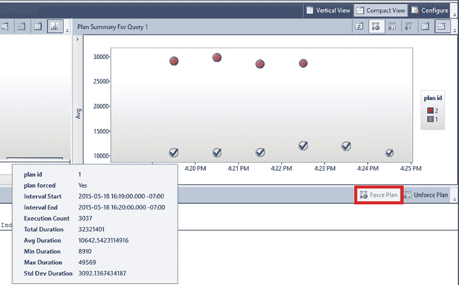

上图可能对特定的查询计划采用不同的形状，每种可能状态的含义如下：

| 形状 | 含义 |
| --- | --- |
| 圆形 | 查询已完成，这意味着常规执行成功结束。 |
| 正方形 | 已取消，意味着由客户端发起的中止执行。 |
| 三角形 | 失败，意味着异常中止了执行。 |

此外，形状的大小反映了在指定时间间隔内的查询执行次数。大小随执行次数的增加而增大。

- 您可能会得出查询缺少优化执行所需的索引的结论。此信息将在查询执行计划中显示。创建缺失的索引，并使用 `Query Store` 检查查询性能。

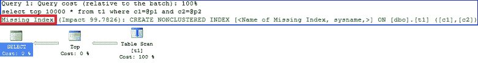

如果您在 SQL Database 上运行工作负载，请注册 `SQL Database Index Advisor` 以便自动接收索引建议。

- 在某些情况下，如果您看到执行计划中估计行数与实际行数之间的差异显著，您可能会强制重新编译统计信息。
- 重写问题查询，例如，利用查询参数化或实施更优的逻辑。

# 验证 Query Store 是否持续收集查询数据

Query Store 可能会静默更改操作模式。定期监控 Query Store 的状态以确保其正在运行，并采取措施避免由于可预防原因导致的失败。执行以下查询以确定操作模式并查看最相关的参数：

```sql
USE [QueryStoreDB];
GO
SELECT actual_state_desc, desired_state_desc, current_storage_size_mb, max_storage_size_mb, readonly_reason, interval_length_minutes, stale_query_threshold_days, size_based_cleanup_mode_desc, query_capture_mode_desc
FROM sys.database_query_store_options;
```

`actual_state_desc` 和 `desired_state_desc` 之间的差异表示操作模式发生了自动变化。最常见的变化是 Query Store 静默切换到只读模式。在极少数情况下，Query Store 可能会因为内部错误进入 `ERROR` 状态。

当实际状态为只读时，使用 `readonly_reason` 列来确定根本原因。通常，你会发现 Query Store 切换到只读模式是因为超过了大小配额。在这种情况下，`readonly_reason` 被设置为 `65536`。

## 考虑以下步骤将 Query Store 切换到读写模式并激活数据收集

- 使用 `ALTER DATABASE` 的 `MAX_STORAGE_SIZE_MB` 选项增加最大存储大小。
- 使用以下语句清理 Query Store 数据：

```sql
ALTER DATABASE [QueryStoreDB] SET QUERY_STORE CLEAR ;
```

你可以通过执行以下显式将操作模式改回读写的语句来应用其中或两个步骤：

```sql
ALTER DATABASE [QueryStoreDB]
SET QUERY_STORE (OPERATION_MODE = READ_WRITE);
```

## 采取以下步骤采取主动措施

- 可以通过应用最佳实践防止操作模式的静默更改。确保 Query Store 的大小始终低于最大允许值，从而大幅减少切换到只读模式的概率。按照“配置 Query Store”节中的描述激活基于大小的策略，以便 Query Store 在大小接近限制时自动清理数据。
- 为了确保保留最新数据，请配置基于时间的策略以定期删除过期信息。
- 最后，考虑将 `Query Store Capture Mode` 设置为 `Auto`，因为它会过滤掉对您的工作负载通常不相关的查询。

```sql
ALTER DATABASE [QueryStoreDB]
SET QUERY_STORE (OPERATION_MODE = READ_WRITE);
GO
SELECT actual_state_desc, desired_state_desc, current_storage_size_mb, max_storage_size_mb, readonly_reason, interval_length_minutes, stale_query_threshold_days, size_based_cleanup_mode_desc, query_capture_mode_desc
FROM sys.database_query_store_options;
```

如果问题仍然存在，说明 Query Store 数据损坏已持久在磁盘上。从 SQL Server 2017 (14.x) 开始，可以通过在受影响数据库执行 `sp_query_store_consistency_check` 存储过程来恢复 Query Store。在尝试恢复操作之前，必须禁用 Query Store。对于 SQL Server 2016 (13.x)，你需要按照所示清除 Query Store 中的数据。

如果恢复不成功，你可以在设置读写模式之前尝试清除 Query Store。

```sql
ALTER DATABASE [QueryStoreDB] SET QUERY_STORE CLEAR ;
GO
ALTER DATABASE [QueryStoreDB] SET QUERY_STORE (OPERATION_MODE = READ_WRITE);
GO
SELECT actual_state_desc, desired_state_desc, current_storage_size_mb, max_storage_size_mb, readonly_reason, interval_length_minutes, stale_query_threshold_days, size_based_cleanup_mode_desc, query_capture_mode_desc
FROM sys.database_query_store_options;
```

## 设置最优 Query Store Capture Mode

在 Query Store 中保留最相关的数据。下表描述了每个 Query Store Capture Mode 的典型场景：

| Query Store Capture Mode | 场景 |
| --- | --- |
| All | 在所有查询的形状、执行频率和其他统计数据方面对您的工作负载进行彻底分析。识别工作负载中的新查询。检测是否使用了即用查询以识别用户或或自动参数化的机会。注意：这是 SQL Server 2016 (13.x) 和 SQL Server 2017 (14.x) 中的默认捕获模式。 |
| Auto | 关注相关且可操作的查询。例如，那些定期执行或资源消耗大量的查询。注意：从 SQL Server 2019 (15.x) 开始，这是默认捕获模式。 |
| None | 你已经在运行时捕获了想要监控的查询集，并且想要消除其他查询可能引入的干扰。`None` 适用于测试和基准测试环境。对于交付了配置了 Query Store 以监控其应用程序工作负载的软件供应商，`None` 也合适。应谨慎使用 `None`，因为你可能会错过跟踪和优化重要新查询的机会。除非你有特定的场景需要它，否则避免使用 `None`。 |
| Custom | SQL Server 2019 (15.x) 在 `ALTER DATABASE SET QUERY_STORE` 命令下引入了 `Custom` 捕获模式。启用后，在新的 Query Store 捕获策略设置下可以使用额外的 Query Store 配置，以精调特定服务器上的数据收集。新的自定义设置定义了在内部捕获策略时间阈值期间发生什么。这是一个时间边界，在此期间会评估可配置条件，如果任何一个为真，则查询就有资格被捕获。 |

## 在 Query Store 中保留最相关的数据

配置 Query Store 仅包含相关数据，使其能够持续运行并在对工作负载影响最小的情况下提供极佳的故障排除体验。下表提供了最佳实践：

| 最佳实践 | 设置 |
| --- | --- |
| 限制保留的历史数据。 | 配置基于时间的策略激活自动清理。 |
| 过滤掉无关查询。 | 将 Query Store Capture Mode 配置为 `Auto`。 |
| 达到最大大时删除无关查询。 | 激活基于大小的清理策略。 |

## 避免使用非参数化查询

在不需要时使用非参数化查询并不是最佳实践。例如在即用分析的情况下。缓存计划无法重用，这迫使查询优化器为每个唯一的查询文本编译查询。此外，由于可能存在大量不同的查询文本并导致大量形状相似的不同执行计划，Query Store 可能会迅速超过大小配额。结果是您的工作负载性能并非最优，Query Store 可能会切换到只读模式或不断删除数据以跟上传入的查询。考虑以下选项：

- 在适用情况下对查询参数化。例如，将查询封装在存储过程或 `sp_executesql` 中。
- 如果您的工作负载包含许多具有不同执行计划的单次使用即用批，请使用 `optimize for ad hoc workloads` 选项。
  - 比较不同的 `query_hash` 值数量与 `sys.query_store_query` 中的总条目数。如果比例接近 1，说明您的即用工作负载生成了不同的查询。
- 如果不同执行计划的数量不多，对数据库或查询集应用强制参数化（forced parameterization）。
  - 使用 `plan guide` 仅对选定的查询强制参数化。
  - 如果您的工作负载中只有少数不同的执行计划，使用 `parameterization database option` 命令配置强制参数化。例如，当不同 `query_hash` 数与 `sys.query_store_query` 中的总条目数之间的比例远小于 1 时。
- 将 `QUERY_CAPTURE_MODE` 设置为 `AUTO` 以自动过滤掉资源消耗较小的即时查询。

## 避免对包含对象使用 DROP 和 CREATE 模式

查询存储（Query Store）将查询条目与包含对象（如存储过程、函数和触发器）关联。当你重新创建包含对象时，相同的查询文本将生成一个新的查询条目。这会阻止你随时间跟踪该查询的性能统计，并使用计划强制机制。为了避免这种情况，请尽可能使用 `ALTER <object>` 过程来更改包含对象的定义。

### 定期检查强制计划的状态

计划强制是一种修复关键查询性能并使其更具可预测性的便利机制。与计划提示（plan hints）和计划指南（plan guides）一样，强制计划并不能保证在未来的执行中会被使用。通常，当数据库架构发生变化，导致执行计划引用的对象被更改或删除时，计划强制开始失效。在这种情况下，SQL Server 将回退到查询重新编译，而实际的强制失败原因将显示在 `sys.query_store_plan` 中。以下查询返回有关强制计划的信息：

```sql
USE [QueryStoreDB];
GO
SELECT p.plan_id, p.query_id, q.object_id as containing_object_id,force_failure_count, last_force_failure_reason_desc
FROM sys.query_store_plan AS p
JOIN sys.query_store_query AS q on p.query_id = q.query_id
WHERE is_forced_plan = 1;
```

原因的完整列表请参阅 `sys.query_store_plan`。你还可以使用 `query_store_plan_forcing_failed` XEvent 来跟踪和排排除计划强制失败。

### 避免为带有强制计划的查询重命名数据库

执行计划使用类似 `database.schema.object` 的三部分名称引用对象。如果你重命名了数据库，计划强制将失败，导致后续所有查询执行时发生重新编译。

## 在任务关键型服务器上使用查询存储

全局跟踪标志 `7745` 和 `7752` 可以通过查询存储来提高数据库的可用性。

- 跟踪标志 `7745` 防止默认行为，即查询存储在 SQL Server 关闭之前将数据写入磁盘。这意味着已收集但尚未持久化到磁盘的查询存储数据将丢失，时间窗口最长由 `DATA_FLUSH_INTERVAL_SECONDS` 定义。
- 跟踪标志 `7752` 启用查询存储的异步加载。这允许数据库在查询存储完全恢复之前即可上线并执行查询。默认行为是对查询存储进行同步加载。默认行为防止查询在查询存储恢复之前执行，但同时也防止在数据收集过程中遗漏任何查询。

如果你在 SQL Server 2016 (13.x) 中使用查询存储进行即时工作负载洞察，请尽快安装 SQL Server 2016 (13.x) SP2 CU2 (KB 4340759) 中的性能可扩展性改进。如果没有这些改进，当数据库处于高负载负载时，可能会发生旋锁竞争（spinlock contention），服务器性能可能会变慢。特别是，你可能会看到 `QUERY_STORE_ASYNC_PERSIST` 旋锁或 `SPL_QUERY_STORE_STATS_COOKIE_CACHE` 旋锁上的激烈竞争。应用此改进后，查询存储将不再引起旋锁竞争。

如果你在 SQL Server（从 SQL Server 2016 (13.x) 到 SQL Server 2017 (14.x)）中使用查询存储进行即时工作负载洞察，请尽快安装 SQL Server 2016 (13.x) SP2 CU15、SQL Server 2017 (14.x) CU22 以及 SQL Server 2019 (15.x) CU8 中的性能可扩展性改进。如果没有此改进，当数据库处于高负载即时工作负载时，查询存储可能会消耗大量内存，服务器性能可能会变慢。应用此改进后，查询存储将对其各个组件可使用的内存量实施内部限制，并可以在足够的内存返回数据库引擎之前自动将操作模式更改为只读。注意，查询存储的内部内存限制未记录文档，因为它们可能会发生变化。

## 内置性能仪表板

通过新的 `SSMS` 17.2，我们发布了作为内置标准报告的“性能仪表板”（Performance Dashboard）。这意味着对于从 SQL Server 2008 开始的任何 SQL Server 实例，都无需任何额外的下载或运行任何额外的脚本。只需在 SSMS 中连接到你的服务器并打开性能仪表板即可。

### 如何启动它？

如下所示，只需在服务器级别调出“报告”上下文菜单，并选择“标准报告”。


### 它有什么用？

性能报告允许 DBA 快速识别连接的 SQL Server 上是否存在任何当前的性能瓶颈。如果发现瓶颈，可以轻松捕获解决问题可能所需的额外诊断数据。性能仪表板可以帮助解决的一些常见性能问题包括：

- CPU 瓶颈（哪些查询消耗了最多的 CPU）
- I/O 瓶颈（以及哪些查询执行了最多的 I/O）
- 查询优化器生成的索引建议（缺失索引）
- 阻塞
- 资源竞争（包括间锁竞争）

查看下方一个存在 CPU 瓶颈的示例：


### 自 2012 版本以来有什么变化？

除了在 SSMS 中完全自包含外，我们还做了一些更改以提高易用性：

在历史信息（Historical Information）部分下：

- 在等待（Waits）报告中添加了等待分类。
- 从等待报告中过滤掉所有空闲睡眠等待。
- 添加了新的间锁（Latches）报告。

在杂项信息（Miscellaneous Information）下，向报告添加了评分列。此报告显示了查询优化器在查询编译期间识别出的潜在索引。然而，不应字面接受这些建议：

1. 我们建议仅对评分大于 100000 的索引进行创建评估，因为那些对用户查询的预期改进最大。
2. 此外，始终评估新索引建议是否与同一表中的现有索引具有可比性，通过更改现有索引而不是创建新索引就可以获得相同的实际结果。例如，对于针对列 C1、C2 和 C3 的新新索引，首先评估 C1 和 C2 上是否已存在索引。如果是，则简单地将列 C3 添加到现有索引中（保留原有列的顺序）可能更好，从而避免创建新索引。

### 运行报告需要什么权限？

此目标针对 `sysadmin` 角色。其他角色需要 `VIEW SERVER STATE` 和 `ALTER TRACE` 权限。

## 使用 mssql-conf 工具在 Linux 上配置 SQL Server

`mssql-conf` 是一个随 SQL Server 2019 (15.x) 安装的 Red Hat Enterprise Linux、SUSE Linux Enterprise Server 和 Ubuntu 配置脚本。你可以使用此工具设置以下参数：

| 参数 | 说明 |
| --- | --- |
| Agent | 启用 SQL Server Agent |
| Collation | 为 Linux 上的 SQL Server 设置新的排序规则。 |
| Customer feedback | 选择 SQL Server 是否向微软发送反馈。 |
| Database Mail Profile | 为 Linux 上的 SQL Server 设置默认数据库邮件。 |
| Default data directory | 更改新 SQL Server 数据库数据文件 (`.mdf`) 的默认目录。 |
| Default log directory | 更改新 SQL Server 数据库日志 (`.ldf`) 文件的默认目录。 |
| Default master database file directory | 现有安装上主数据库文件的默认目录。 |
| Default master database file name | 更改主数据库文件的名称。 |
| 设置 | 说明 |
| :--- | :--- |
| 默认转储目录 | 更改新内存转储和其他故障排除文件的默认目录。 |
| 默认错误日志目录 | 更改新的 SQL Server ErrorLog、默认 Profiler Trace、System Health Session XE 和 Hekaton Session XE 文件的默认目录。 |
| 默认备份目录 | 更改新备份文件的默认目录。 |
| Dump 类型 | 选择要收集的内存转储文件类型。 |
| 高可用 | 启用可用性组 (Availability Groups)。 |
| 本地审核目录 | 设置用于添加本地审计文件的目录。 |
| Locale | 设置 SQL Server 使用的区域。 |
| 内存限制 | 设置 SQL Server 的内存限制。 |
| Microsoft Distributed Transaction Coordinator | 在 Linux 上配置和调试 MSDTC。 |
| MLServices EULAs | 接受 `mlservices` 包的 R 和 Python 最终用户许可协议 (EULA)。仅适用于 SQL Server 2019。 |
| 网络设置 | SQL Server 的额外网络设置。 |
| outboundnetworkaccess | 为 `mlservices` R、Python 和 Java 扩展启用出站网络访问。 |
| TCP 端口 | 更改 SQL Server 监听连接的端口。 |
| TLS | 配置传输层安全 (Transport Level Security)。 |
| Traceflags | 设置服务将使用的跟踪标志 (traceflags)。 |

### 使用提示

- 对于 Always On 可用性组和共享磁盘集群，请务必在每个节点上进行相同的配置更改。
- 对于共享磁盘集群场景，请勿通过重启 `mssql-server` 服务来应用更改。SQL Server 是作为应用程序运行的。相反，请将资源离线然后重新上线。
- 这些示例通过指定完整路径运行 `mssql-conf`：`/opt/mssql/bin/mssql-conf`。如果您选择导航到该路径，请在当前目录上下文运行 `mssql-conf`：`./mssql-conf`。

### 启用 SQL Server Agent

`sqlagent.enabled` 设置启用 SQL Server Agent。默认情况下，SQL Server Agent 是禁用的。如果 `mssql.conf` 设置文件中不存在 `sqlagent.enabled`，则 SQL Server 内部会假设 SQL Server Agent 是禁用的。要更改此设置，请使用以下步骤：

1. 启用 SQL Server Agent：

```bash
sudo /opt/mssql/bin/mssql-conf set sqlagent.enabled true
```

2. 重启 SQL Server 服务：

```bash
sudo systemctl restart mssql-server
```

### 为 Linux 上的 SQL Server 设置默认数据库邮件配置文件

`sqlpagent.databasemailprofile` 允许您为电子邮件警报设置默认 DB Mail 配置文件。

```bash
sudo /opt/mssql/bin/mssql-conf set sqlagent.databasemailprofile <name>
```

### SQL Agent 错误日志

`sqlpagent.errorlogfile` 和 `sqlpagent.logginglevel` 设置允许您分别设置 SQL Agent 日志文件路径和级别。

```bash
sudo /opt/mssql/bin/mssql-conf set sqlagent.errorfile <path>
```

SQL Agent 日志级别位掩值等于：

- 1 = 错误 (Errors)
- 2 = 警告 (Warnings)
- 4 = 信息 (Info)

如果您想捕获所有级别，请使用 `7` 作为值。

```bash
sudo /opt/mssql/bin/mssql-conf set sqlagent.logginglevel 7
```

### 更改排序规则 (Collation)

`set-collation` 选项更改任何支持的排序规则。

1. 首先，在服务器上备份任何数据库。
2. 然后使用 `sp_detachdb` 存储过程分离数据库。
3. 运行 `set-collation` 选项：

```bash
sudo /opt/mssql/bin/mssql-conf set-collation <collation>
```

4. `mssql-conf` 工具将更改指定的排序规则并重启服务。如果有任何错误，将排序规则回滚到之前的值。
5. 获取支持的排序规则列表，运行 `sys.fncollations` 函数：

```sql
SELECT Name from sys.fncollations();
```

### 配置客户反馈 (Customer Feedback)

`telemetry.customerfeedback` 设置更改 SQL Server 是否向微软发送反馈。默认情况下，所有版本的该值设置为 `true`。

**注意**：无法关闭 SQL Server Express 和 Developer 版本的反馈。

1. 以 root 身份使用 `set` 命令运行 `mssql-conf` 脚本关闭 `telemetry.customerfeedback`：

```bash
sudo /opt/mssql/bin/mssql-conf set telemetry.customerfeedback false
```

2. 重启 SQL Server 服务：

```bash
sudo systemctl restart mssql-server
```

### 更改默认数据或日志目录

`filelocation.defaultadir` 和 `filelocation.defaultlog` 设置数据库和日志文件创建的位置。默认情况下，该位置为 `/var/opt/mssql/data`。要更改这些设置，请使用以下步骤：

1. 为数据库和日志文件创建目标目录。以下示例创建一个 `/tmp/data` 目录：

```bash
sudo mkdir /tmp/data
```

2. 将目录的所有者和组更改为 `mssql`：

```bash
sudo chown mssql /tmp/data
sudo chgrp mssql /tmp/data
```

3. 使用 `set` 命令通过 `mssql-conf` 更改默认目录：

```bash
sudo /opt/mssql/bin/mssql-conf set filelocation.defaultadir /tmp/data
```

4. 重启 SQL Server 服务：

```bash
sudo systemctl restart mssql-server
```

5. 现在，新创建的数据库文件将存储在此位置。如果您想更改新数据库的日志 (`.ldf`) 文件位置，可以使用以下 `set` 命令：

```bash
sudo /opt/mssql/bin/mssql-conf set filelocation.defaultlog /tmp/log
```

6. 此命令还假设 `/tmp/log` 目录存在，且所有者和组为 `mssql`。

### 更改主数据库文件目录

`filelocation.masterdatafile` 和 `filelocation.masterlogfile` 设置 SQL Server 引擎查找主数据库文件的位置。默认情况下，该位置为 `/var/opt/mssql/data`。要更改这些设置，请使用以下步骤：

1. 为新文件创建目标目录。以下示例创建一个 `/tmp/masterdatabir` 目录：

```bash
sudo mkdir /tmp/masterdatabir
```

2. 将目录的所有者和组更改为 `mssql`：

```bash
sudo chown mssql /tmp/masterdatabir
sudo chgrp mssql /tmp/masterdatabir
```

3. 使用 `set` 命令通过 `mssql-conf` 更改主数据库数据和日志文件的目录：

```bash
sudo /opt/mssql/bin/mssql-conf set filelocation.masterdatafile /tmp/masterdatabir/master.mdf
sudo /opt/mssql/bin/mssql-conf set filelocation.masterlogfile /tmp/masterdatabir/mastlog.ldf
```

4. 停止 SQL Server 服务：

```bash
sudo systemctl stop mssql-server
```

5. 移动 `master.mdf` 和 `masterlog.ldf`：

```bash
sudo mv /var/opt/mssql/data/master.mdf /tmp/masterdatabir/master.mdf
sudo mv /var/opt/mssql/data/masterlog.ldf /tmp/masterdatabir/mastlog.ldf
```

6. 启动 SQL Server 服务：

```bash
sudo systemctl start mssql-server
```

### 更改主数据库文件名

`filelocation.masterdatafile` 和 `filelocation.masterlogfile` 设置 SQL Server 引擎查找主数据库文件的位置。您也可以用此来更改主数据库和日志文件名。要更改这些设置，请使用以下步骤：

1. 停止 SQL Server 服务：

```bash
sudo systemctl stop mssql-server
```

2. 使用 `mssql-conf` 通过 `set` 命令更改预期的主数据库数据文件和日志文件名：

```bash
sudo /opt/mssql/bin/mssql-conf set filelocation.masterdatafile /var/opt/mssql/data/masternew.mdf
sudo /opt/mssql/bin/mssql-conf set filelocation.masterlogfile /var/opt/mssql/data/mastlognew.ldf
```

3. 更改主数据库数据和日志文件名：

```bash
sudo mv /var/opt/mssql/data/master.mdf /var/opt/mssql/data/masternew.mdf
sudo mv /var/opt/mssql/data/mastlog.ldf /var/opt/mssql/data/mastlognew.ldf
```

*(注：此处原文逻辑似乎存在细微冲突，通常应先通过 `mssql-conf` 设置路径再移动文件，已按原文意图翻译)*

```bash
sudo systemctl start mssql-server
```

## 修改默认转储目录位置

`filelocation.defaultdumpdir` 设置更改了发生崩溃时生成内存转储和 SQL 转储的默认位置。默认情况下，这些文件生成在 `/var/opt/mssql/log` 中。若要设置此新位置，请使用以下命令：

1. 为新的转储文件创建目标目录。以下示例创建了一个新的 `/tmp/dump` 目录：

```bash
sudo mkdir /tmp/dump
```

2. 将目录的所有者和组改为 `mssql` 用户：

```bash
sudo chown mssql /tmp/dump
sudo chgrp mssql /tmp/dump
```

3. 使用 `mssql-conf` 的 `set` 命令更改默认数据目录：

```bash
sudo /opt/mssql/bin/mssql-conf set filelocation.defaultdumpdir /tmp/dump
```

4. 重启 SQL Server 服务：

```bash
sudo systemctl restart mssql-server
```

## 修改默认错误日志文件目录位置

`filelocation.errorlogfile` 设置更改了新错误日志、默认分析器跟踪、系统健康会话 XE 和 Hekaton 会话 XE 文件创建的位置。默认情况下，此位置为 `/var/opt/mssql/log`。SQL errorlog 文件所在的目录将成为其他日志的默认目录。

要更改这些设置：

1. 为新的错误日志文件创建目标目录。以下示例创建了一个新的 `/tmp/logs` 目录：

```bash
sudo mkdir /tmp/logs
```

2. 将目录的所有者和组改为 `mssql` 用户：

```bash
sudo chown mssql /tmp/logs
sudo chgrp mssql /tmp/logs
```

3. 使用 `mssql-conf` 的 `set` 命令更改默认错误日志文件名：

```bash
sudo /opt/mssql/bin/mssql-conf set filelocation.errorlogfile /tmp/logs/errorlog
```

4. 重启 SQL Server 服务：

```bash
sudo systemctl restart mssql-server
```

`errorlog.numerrorlogs` 设置允许你指定在日志循环之前维护的错误日志数量。

## 修改默认备份目录位置

`filelocation.defaultbackupdir` 设置更改了备份文件的生成位置。默认情况下，这些文件生成在 `/var/opt/mssql/data` 中。若要设置此新位置，请使用以下命令：

1. 为新的备份文件创建目标目录。以下示例创建了一个新的 `/tmp/backup` 目录：

```bash
sudo mkdir /tmp/backup
```

2. 将目录的所有者和组改为 `mssql` 用户：

```bash
sudo chown mssql /tmp/backup
sudo chgrp mssql /tmp/backup
```

3. 使用 `mssql-conf` 的 `set` 命令更改默认备份目录：

```bash
sudo /opt/mssql/bin/mssql-conf set filelocation.defaultbackupdir /tmp/backup
```

4. 重启 SQL Server 服务：

```bash
sudo systemctl restart mssql-server
```

## 指定核心转储设置


如果一个 SQL Server 进程中发生异常，SQL Server 会创建一个内存转储。有两个选项可以控制 SQL Server 收集的内存转储类型：`coredump.coredumptype` 和 `coredump.captureminiandfull`。这些涉及核心转储捕获的两个阶段。

第一阶段捕捉由 `coredump.coredumptype` 设置控制，它决定了发生异常期间生成的转储文件类型。第二阶段通过 `coredump.captureminiandfull` 设置启用。如果 `coredump.captureminiandfull` 设置为 `true`，则生成由 `coredump.coredumptype` 指定的转储文件并生成第二个小型转储。将 `coredump.captureminiandfull` 设置为 `false` 则禁用第二次捕获尝试。

1. 使用 `coredump.captureminiandfull` 设置决定是否同时捕获小型和全量转储：

```bash
sudo /opt/mssql/bin/mssql-conf set coredump.captureminiandfull <true or false>
```

默认：`false`

2. 使用 `coredump.coredumptype` 设置指定转储文件类型：

```bash
sudo /opt/mssql/bin/mssql-conf set coredump.coredumptype <dump_type>
```

默认：`miniplus`

下表列出了可能的 `coredump.coredumptype` 值。

| 类型 | 描述 |
| --- | --- |
| mini | Mini 是最小的转储文件类型。它使用 Linux 系统信息来确定进程中的线程和模块。转储仅包含主机环境线程栈和模块。它不包含间接内存引用或全局变量。 |
| miniplus | MiniPlus 与 mini 类似，但包含额外的内存。它理解 SQLPAL 和主机环境的内部结构，向转储添加以下内存区域：- 各种全局变量 - 64TB 以上的所有内存 - 在 `/proc/$pid/maps` 中找到的所有命名区域 - 来自线程和栈的间接内存 - 线程信息 - 相关的 Teb 和 Peb - 模块信息 - VMM 和 VAD 树 |
| filtered | Filtered 使用基于减法的设计，除非专门排除，否则包含进程中的所有内存。该设计理解 SQLPAL 和主机环境的内部结构，从转储中排除某些区域。 |
| full | Full 是完整的进程转储，包含 `/proc/$pid/maps` 中的所有区域。这不受 `coredump.captureminiandfull` 设置控制。 |

# 高可用性

`hadr.hadrenabled` 选项启用 SQL Server 实例上的可用性组。以下命令通过将 `hadr.hadrenabled` 设置为 `1` 来启用可用性组。你必须重启 SQL Server 使设置生效。

```bash
sudo /opt/mssql/bin/mssql-conf set hadr.hadrenabled 1
sudo systemctl restart mssql-server
```

## 设置本地审计目录

`telemetry.userrequestedlocalauditdirectory` 设置启用本地审计并允许你设置创建本地审计日志的目录。

1. 为新的本地审计日志创建目标目录。以下示例创建了一个新的 `/tmp/audit` 目录：

```bash
sudo mkdir /tmp/audit
```

2. 将目录的所有者和组改为 `mssql` 用户：

```bash
sudo chown mssql /tmp/audit
sudo chgrp mssql /tmp/audit
```

3. 以 root 身份运行 `mssql-conf` 脚本，对 `telemetry.userrequestedlocalauditdirectory` 使用 `set` 命令：

```bash
sudo /opt/mssql/bin/mssql-conf set telemetry.userrequestedlocalauditdirectory /tmp/audit
```

4. 重启 SQL Server 服务：

```bash
sudo systemctl restart mssql-server
```

## 修改 SQL Server 区域

`language.lcid` 设置将 SQL Server 区域更改为任何支持的语言标识 (LCID)。

1. 以下示例将区域更改为法语 (1036)：

```bash
sudo /opt/mssql/bin/mssql-conf set language.lcid 1036
```

2. 重启 SQL Server 服务以应用更改：

```bash
sudo systemctl restart mssql-server
```

## 设置内存限制

`memory.memorylimitmb` 设置控制 SQL Server 可用的物理内存（单位为 MB）。默认物理内存的 80%。

1. 以 root 身份运行 `mssql-conf` 脚本，对 `memory.memorylimitmb` 使用 `set` 命令。以下示例将 SQL Server 的可用内存更改为 3.25 GB (3328 MB)。

```bash
sudo /opt/mssql/bin/mssql-conf set memory.memorylimitmb 3328
```

2. 重启 SQL Server 服务以应用更改：

```bash
sudo systemctl restart mssql-server
```

## 其他内存设置

内存设置可以使用以下选项。

| 选项 | 描述 |
| --- | --- |
| memory.disablememorypressure | SQL Server 禁用内存压力。值可以是 `true` 或 `false`。 |
| memory.memory_optimized | 启用或禁用 SQL Server 内存优化功能 - 持久内存文件增强，内存保护。值可以是 `true` 或 `false`。 |

## 配置 MSDTC

`network.rpcport` 和 `distributedtransaction.servertcpport` 设置用于配置微软分布式事务协调器 (MSDTC)。要更改这些设置，请运行以下命令：

1. 以 root 身份运行 `mssql-conf` 脚本，对 `network.rpcport` 使用 `set` 命令：

```bash
sudo /opt/mssql/bin/mssql-conf set network.rpcport <rcp_port>
```

2. 然后设置 `distributedtransaction.servertcpport` 设置：

```bash
sudo /opt/mssql/bin/mssql-conf set distributedtransaction.servertcpport <servertcpport_port>
```

除了设置这些值外，你还必须配置路由并更新端口 135 的防火墙。`mssql-conf` 还有其他几个设置可用于监控和排排除 MSDTC。下表简要描述了这些设置。

| 配置 MSDTC |
| --- |
| mssql-conf 设置 | 描述 |
| --- | --- |
| distributedtransaction.allowonlysecurerpccalls | 为分布式事务配置仅允许安全的 RPC 调用 |
| distributedtransaction.fallbacktounsecurerpcifnecessary | 必要时为分布式事务配置安全的 RPC 调用 |
| distributedtransaction.maxlogsize | DTC 事务日志文件大小（单位为 MB）。默认值为 64MB |
| distributedtransaction.memorybuffersize | 存储跟踪信息的循环缓冲区大小。单位为 MB，默认为 10MB |
| distributedtransaction.servertcpport | MSDTC r 服务器端口 |
| distributedtransaction.trace_cm | 连接管理器中的跟踪 |
| distributedtransaction.trace_contact | 接触池和联系的跟踪 |
| distributedtransaction.trace_gateway | 网关源跟踪 |
| distributedtransaction.trace_log | 日志跟踪 |
| distributedtransaction.trace_misc | 无法归入其他类别的跟踪 |
| distributedtransaction.trace_proxy | MSDTC 代理中生成的跟踪 |
| distributedtransaction.trace_svc | 服务和 .exe 文件启动的跟踪 |
| distributedtransaction.trace_trace | 跟踪基础设施本身 |
| distributedtransaction.trace_util | 从多处调用的实用程序程序的跟踪 |
| distributedtransaction.trace_xa | XA 事务管理器 (XATM) 跟踪源 |
| distributedtransaction.tracefilepath | 存储跟踪文件的文件夹 |
| distributedtransaction.turnoffrpcsecurity | 或禁用分布式事务的 RPC 安全 |

## 接受 MLServices EULA

在数据库引擎中添加机器学习 R 或 Python 程序包需要接受 R 和 Python 开源发行版的许可条款。下表列出了所有与 `mlservices` EULA 相关的可用命令或选项。根据你安装的内容，R 和 Python 使用相同的 EULA 参数。

```bash
# 适用于所有包：数据库引擎和 mlservices
# 设置 mlservices EULA 的设置提示，你需要接受它
sudo /opt/mssql/bin/mssql-conf setup

# 在现有安装中添加 R 或 Python
sudo /opt/mssql/bin/mssql-conf setup accept-eula-ml

# 备用有效语法
#向 INI 中添加 EULA 部分并将 accepteulaml 设置为 yes
sudo /opt/mssql/bin/mssql-conf set EULA accepteulaml Y

# 撤销对 EULA 的接受并删除设置
sudo /opt/mssql/bin/mssql-conf unset EULA accepteulaml
```

你也可以直接在 `mssql.conf` 文件中添加 EULA 接受：

```ini
[EULA]
accepteula = Y
accepteulaml = Y
```

## 启用出站网络访问

SQL Server 机器学习服务功能中 R、Python 和 Java 扩展的出站网络访问默认禁用。要启用出站请求，请使用 `mssql-conf` 设置 `outboundnetworkaccess` 布尔属性。设置属性后，重启 SQL Server Launchpad 服务以从 INI 文件中读取更新后的值。每当修改扩展相关的设置时，都会弹出提示重启的消息。

```bash
# 添加扩展性部分和属性。
# 将 "outboundnetworkaccess" 设置为 true。
# 如果你想访问服务器外的数据或操作，则需要此设置。
sudo /opt/mssql/bin/mssql-conf set extensibility outboundnetworkaccess 1

# 关闭网络访问但保留设置
sudo /opt/mssql/bin/mssql-conf set extensibility outboundnetworkaccess 0

# 移除设置并撤销网络访问
sudo /opt/mssql/bin/mssql-conf unset extensibility.outboundnetworkaccess
```

你也可以直接向 `mssql.conf` 文件添加 `outboundnetworkaccess`：

```ini
[extensibility]
outboundnetworkaccess = 1
```

## 更改 TCP 端口

`network.tcpport` 设置更改 SQL Server 监听连接的 TCP 端口。默认，此端口设置为 1433。要更改端口，请运行以下命令：

1. 以 root 身份运行 `mssql-conf` 脚本，并使用 `set` 命令设置 `network.tcpport`：

```bash
sudo /opt/mssql/bin/mssql-conf set network.tcpport <new_tcp_port>
```

2. 重启 SQL Server 服务：

```bash
sudo systemctl restart mssql-server
```

3. 现在连接到 SQL Server 时，必须在主机名或 IP 地址后用逗号 (,) 指定自定义端口。例如，使用 `sqlcmd` 连接时可以使用以下命令：

```bash
sqlcmd -S localhost,<new_tcp_port> -U test -P test
```

## 指定 TLS 设置

以下选项为运行在 Linux 上的 SQL Server 实例配置 TLS。

| 指定 TLS 设置 |
| --- |
| 选项 | 描述 |
| --- | --- |
| network.forceencryption | 如果为 1，则 SQL Server 强制加密所有连接。默认选项认为 0。 |
| network.tlscert | SQL Server 用于 TLS 的证书文件的绝对路径。例如：`/etc/ssl/certs/mssql.pem`。证书文件必须允许 `mssql` 账户访问。微软建议使用 `chown mssql` 限制文件访问。 |
| network.tlskey | SQL Server 用于 TLS 的密钥文件的绝对路径。例如：`/etc/ssl/private/mssql.key`。证书文件必须允许 `mssql` 账户访问。微软建议使用 `chown mssql` 限制文件访问。 |
| network.tlsprotocols | 允许的协议逗号分隔列表。SQL Server 始终尝试协商允许的最强协议。 |
| network.tsciphers | 指定 SQL Server 允许的加密算法。此字符串必须按照 OpenSSL 的加密列表格式化。通常情况下，你不需要更改此。 |
| network.kerberoskeytab | Kerberos 文件的路径 |

## 网络设置

以下选项是可以使用 `mssql-conf` 配置的额外网络设置。

| 网络设置 |
| --- |
| 选项 | 描述 |
| --- | --- |
| network.disablesssd | 禁用查询 SSSD 获取 AD 账户信息并默认使用 LDAP 调用。值可以是 `true` 或 `false`。 |
| network.enablekdcfromkrb5conf | 启用从 `krb5.conf` 查找 KDC 信息。值可以是 `true` 或 `false`。 |
| network.forcesecureldap | 强制使用 LDAPS 联系域控制器。值可以是 `true` 或 `false`。 |
| network.ipaddress | 入站连接的 IP 地址。 |
| network.kerberoscredupdatefrequency | 检查需要更新的 kerberos 凭据之间的时间（单位为秒）。值为整数。 |
| network.privilegedadaccount | 用于 AD 认证的特权 AD 用户。值为 `<username>`。 |
| network.uncmapping | 将 UNC 路径映射到本地路径。例如，`sudo /opt/mssql/bin/mssql-conf set uncmapping //servername/sharename /tmp/folder` |

## 启用/禁用跟踪标志

此 `traceflag` 选项启用或禁用 SQL Server 服务启动时的跟踪标志。要启用/禁用跟踪标志，请使用以下命令：

1. 使用以下命令启用跟踪标志。例如，对于跟踪标志 1234：

```bash
sudo /opt/mssql/bin/mssql-conf traceflag 1234 on
```

2. 你可以通过分别指定多个跟踪标记（traceflags）来启用它们：

```bash
sudo /opt/mssql/bin/mssql-conf traceflag 2345 3456 on
```

3. 同样，你可以通过指定标记并添加 `off` 参数来禁用一个或多个已启用的跟踪标记：

```bash
sudo /opt/mssql/bin/mssql-conf traceflag 1234 2345 3456 off
```

4. 重启 SQL Server 服务以应用更改：

```bash
sudo systemctl restart mssql-server
```

## 移除设置

要取消使用 `mssql-conf set` 创建的任何设置，请调用带有 `unset` 选项和设置名称的 `mssql-conf`。这将清除该设置，并有效地将其恢复为默认值。

1. 以下示例清除了 `network.tcpport` 选项。


```bash
sudo /opt/mssql/bin/mssql-conf unset unset.tcpport
```

2. 重启 SQL Server 服务。

```bash
sudo systemctl restart mssql-server
```

## 查看当前设置

要查看任何配置的设置，运行以下命令输出 `mssql.conf` 文件的内容：

```bash
sudo cat /var/opt/mssql/mssql.conf
```

此文件中未显示的任何设置均使用其默认值。下一节提供了一个 `mssql.conf` 文件的示例。

# mssql.conf 格式

以下 `/var/opt/mssql/mssql.conf` 文件提供了每个设置的示例。你可以使用此格式根据需要手动更改 `mssql.conf` 文件。如果你手动更改了文件，必须在重启 SQL Server 后才能应用更改。要在 Docker 中使用 `mssql.conf` 文件，你必须让 Docker 持久化你的数据。首先将完整的 `mssql.conf` 文件添加到你的主机目录，然后运行容器。

```ini
[EULA]
accepteula = Y
accepteulaml = Y
[coredump]
captureminiandfull = true
coredumptype = full
[distributedtransaction]
servertcpport = 51999
[filelocation]
defaultbackupdir = /var/opt/mssql/data/default
defaultdatadir = /var/opt/mssql/data/default
defaultdumpdir = /var/opt/mssql/data/default
defaultlogdir = /var/opt/mssql/data/default
[hadr]
hadrenabled = 0
[language]
lcid = 1033
[memory]
memorylimitmb = 4096
[network]
forceencryption = 0
ipaddress = 10.192.0.0
kerberoskeytabfile = /var/opt/mssql/secrets/mssql.keytab
rpcport = 13500
tcpport = 1401
tlscert = /etc/ssl/certs/mssql.pem
tlsciphers = ECDHE-ECDSA-AES128-GCM-SHA256:ECDHE-ECDSA-AES256-GCM-SHA384:ECDHE-RSA-AES128-GCM-SHA256:ECDHE-RSA-AES256-GCM-SHA384:ECDHE-ECDSA-AES128-SHA256:ECDHE-ECDSA-AES256-SHA384:ECDHE-RSA-AES128-SHA256:ECDHE-RSA-AES256-SHA384:ECDHE-ECDSA-AES256-SHA:ECDHE-ECDSA-AES128-SHA:ECDHE-RSA-AES256-SHA:ECDHE-RSA-AES128-SHA:AES256-GCM-SHA384:AES128-GCM-SHA256:AES256-SHA256:AES128-SHA256:AES256-SHA:AES128-SHA
atlskey = /etc/ssl/private/mssql.key
tlsprotocols = 1.2,1.1,1.0
[sqlagent]
databasemailprofile = default
errorlogfile = /var/opt/mssql/log/sqlagentlog.log
errorlogginglevel = 7
[telemetry]
customerfeedback = true
userrequestedlocalauditdirectory = /tmp/audit
[traceflag]
traceflag0 = 1204
traceflag1 = 2345
traceflag = 3456
```

## 安装 sqlcmd 和 bcp

Linux 上的 SQL Server 命令行工具

以下步骤安装命令行工具、Microsoft ODBC 驱动程序及其依赖项。`mssql-tools` 程序包包含：

* `sqlcmd`: 命令行查询实用。

* `bcp`: 批量导入导出实用。

## 为你的平台安装工具

### 在 RHEL 8 上安装工具

使用以下步骤在 Red Hat Enterprise Linux 上安装 `mssql-tools`。

1. 进入超级用户模式。

```bash
sudo su
```

2. 下载 Microsoft Red Hat 仓库。

```bash
curl https://packages.microsoft.com/config/rhel/8/prod.repo > /etc/yum.repos.d/msprod.repo
```

3. 退出超级用户模式。

```bash
exit
```

4. 如果之前安装过旧版本的 `mssql-tools`，请删除旧的 unixODBC 包。

```bash
sudo remove mssql-tools unixODBC
```

5. 运行以下命令安装带有 unixODBC 开发包的 `mssql-tools`。

```bash
sudo install mssql-tools unixODBC-devel
```

6. 可选：将 `/opt/mssql-tools/bin` 添加到你的 PATH 中。

为了在 bash shell 登录会话中访问 `sqlcmd` 和 `bcp`，请使用以下命令修改 `~/.bashprofile` 文件中的 `PATH`：

```bash
echo 'export PATH=$PATH:/opt/mssql-tools/bin' >> ~/.bashprofile
```

为了在 bash shell 交互式非登录会话中访问 `sqlcmd` 和 `bcp`，请使用以下命令修改 `~/.bashrc` 文件中的 `PATH`：

```bash
echo 'export PATH=$PATH:/opt/mssql-tools/bin' >> ~/.bashrc
source
```

### 在 Ubuntu 16.04 上安装工具

使用以下步骤在 Ubuntu 上安装 `mssql-tools`。导入 Microsoft GPG 密钥。

```bash
curl https://packages.microsoft.com/keys/microsoft | sudo apt-key add
```

1. 注册 Microsoft 仓库。

```bash
curl https://packages.microsoft.com/config/ubuntu/16.04/prod.list | sudo tee /etc/apt/sources.list.d/mssql-prod.list
```

2. 更新源列表并运行带有 unixodbc-dev 包的安装命令。

```bash
sudo apt-get update
sudo apt-get install mssql-tools
```

可选：将 `/opt/mssql-tools/bin` 添加到你的 PATH 中。

为了在 bash shell 登录会话中访问 `sqlcmd` 和 `bcp`，请使用以下命令修改 `~/.bashprofile` 文件中的 `PATH`：

```bash
echo 'export PATH=$PATH:/opt/mssql-tools/bin' >> ~/.bashprofile
```

为了在 bash shell 交互式非登录会话中访问 `sqlcmd` 和 `bcp`，请使用以下命令修改 `~/.bashrc` 文件中的 `PATH`：

```bash
echo 'export PATH=$PATH:/opt/mssql-tools/bin' >> ~/.bashrc
source
```

### 在 SLES 12 上安装工具

使用以下步骤在 SUSE Linux Enterprise 上安装 `mssql-tools`。

1. 将 Microsoft SQL Server 仓库添加到 Zypper。

```bash
sudo zypper addrepo -fc https://packages.microsoft.com/config/sles/12/prod
```

2. 安装带有 unixODBC 开发包的 `mssql-tools`。

```bash
sudo zypper install mssql-tools unixodbc-dev
```

可选：将 `/opt/mssql-tools/bin` 添加到你的 PATH 中。

为了在 bash shell 登录会话中访问 `sqlcmd` 和 `bcp`，请使用以下命令修改 `~/.bashprofile` 文件中的 `PATH`：

```bash
echo 'export PATH=$PATH:/opt/mssql-tools/bin' >> ~/.bashprofile
```

为了在 bash shell 交互式非登录会话中访问 `sqlcmd` 和 `bcp`，请使用以下命令修改 `~/.bashrc` 文件中的 `PATH`：

```bash
echo 'export PATH=$PATH:/opt/mssql-tools/bin' >> ~/.bashrc
source
```

### 在 macOS 上安装工具

`sqlcmd` 和 `bcp` 的预览版已在 macOS 上可用。如果你还没有 Homebrew，请安装它：

```bash
/usr/bin/ruby -e "$(curl -fsSL https://raw.githubusercontent.com/Homebrew/install/master/install)"
```

要在 Mac El Capitan 和 Sierra 上安装工具，请使用以下命令：

```bash
# 如果安装了预览版本，请 brew untap microsoft/mssql-preview
brew tap microsoft/mssql-release https://github.com/Microsoft/homebrew-mssql-release
brew update
brew install mssql-tools
## 静默安装：
HOMEBREW_NO_ENV_FILTERING=1 ACCEPT_EULA=y brew install mssql-tools
```

## Docker

SQL Server Linux 容器镜像中已经包含了命令行工具。如果你通过交互式 bash shell 连接到运行的容器，可以在本地运行这些工具。

## 离线安装

如果你的 Linux 机器无法访问上一节使用的在线仓库，你可以直接下载包文件。这些包位于 Microsoft 仓库 `https://packages.microsoft.com`。

1. 首先，找到并复制适用于 Linux 发行版的 `mssql-tools` 包：

| Linux 发行版 | mssql-tools 包位置 |

| --- | --- |

| Red Hat | `https://packages.microsoft.com/rhel/7.3/prod` |

| SLES | https://packages.microsoft.com/sles/12/prod |

| Ubuntu 16.04 | https://packages.microsoft.com/ubuntu/16.04/prod/pool/main/m/mssql-tools |

2. 同样定位并复制 `msodbcsql` 软件包，它是一个依赖项。`msodbcsql` 软件包也依赖于 `unixODBC-devel`（适用于 Red Hat 和 SLES）或 `unixodbc-dev`（适用于 Ubuntu）。`msodbcsql` 软件包的位置列如下表所示：

| Linux 发行版 | ODBC 包位置 |

| --- | --- |

| Red Hat | https://packages.microsoft.com/rhel/8/prod |

| SLES | https://packages.microsoft.com/sles/12/prod |

| Ubuntu 16.04 | msodbcsql unixodbc-dev |

3. 将下载的包移动到你的 Linux 机器。如果你使用不同的机器下载了包，将包移动到 Linux 机器的一种方法是使用 `scp` 命令。

4. 安装软件包：安装 `mssql-tools` 和 `msodbc` 软件包。如果你遇到任何依赖错误，请忽略它们，直到下一步。

| 平台 | 包安装命令 |

| --- | --- |

| Red Hat | `sudo yum localinstall msodbcsql-<version>.rpm sudo yum localinstall mssql-tools-<version>.rpm` |

| SLES | `sudo zypper install msodbcsql-<version>.rpm sudo zypper install mssql-tools-<version>.rpm` |

| Ubuntu | `sudo dpkg -i msodbcsql_<version>.deb sudo dpkg -i mssql-tools_<version>.deb` |

5. 解决缺失的依赖项：此时你可能缺少依赖项。如果没有，你可以跳过此步骤。在某些情况下，你必须手动定位并安装这些依赖项。

对于 RPM 包，你可以使用以下命令检查所需的依赖项：

```bash
rpm -qpR msodbcsql-<version>.rpm
rpm -qpR mssql-tools-<version>.rpm
```

对于 Debian 包，如果你可以访问包含这些依赖项的批准存储库，最好的解决方案是使用 `apt-get` 命令：

```bash
sudo apt-get -f install
```

此命令也会完成 SQL Server 软件包的安装。如果这对你的 Debian 包不起作用，你可以使用以下命令检查所需的依赖项：

```bash
dpkg -I msodbcsql_<version>_amd64.deb | grep "Depends:"
dpkg -I mssql-tools_<version>_amd64.deb | grep "Depends:"
```

### Mssql-cli：一个用于 SQL Server 的交互式命令行工具

`mssql-cli` 是一个全新的交互式命令行工具，相比终端环境下的 `sqlcmd` 提供了以下增强：

* T-SQL 智能感知（IntelliSense）

* 语法高亮

* 查询结果的美化格式化（包括垂直格式）

* 多行编辑模式

* 配置文件支持

`mssql-cli` 旨在为 T-SQL 提供改进的交互式命令行体验。它在 BSD-3 许可证下完全开源，是 `dbcli` 组织的贡献（`dbcli` 是一个针对 SQL Server、PostgresSQL 和 MySQL 等关系型数据库的交互式 CLI 工具套件）。命令行 UI 使用 Python 编写，该工具利用了与 VS Code SQL 扩展、SQL Operations Studio 以及我们之前宣布的另一个 Python CLI 工具 `mssql-scripter` 相同的微服务后端 (`sqltoolsservice`)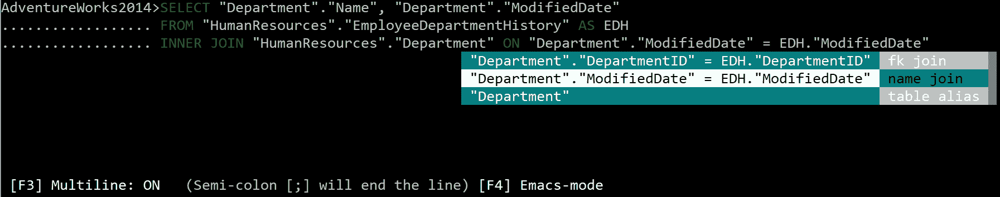

`mssql-cli` 支持多行查询以构建可读的查询。还包含语法高亮和“智能”自动补全。为了安装 `mssql-cli`，你的机器上必须安装 Python。请参考安装指南获取特定特定系统的 Python 方法。

`mssql-cli` 通过 `pip` 安装。如果你熟悉 `pip`，可以使用命令安装 `mssql-cli`。

```bash
$ pip install mssql-cli
```

如果你将其安装到系统站点包中，此命令可能需要以 `sudo` 运行。可以使用 `--user` 安装 `mssql-cli`，这不需要 `sudo`。

```bash
$ pip install --user mssql-cli
```

如果你遇到安装问题或需要更具体的说明，请查看安装指南。一旦安装了 `mssql-cli`，使用命令连接到数据库：

```bash
$ mssql-cli -S <server name> -U <user name> -d <database name>
```

### 在 Windows 上使用 PowerShell 管理 Linux SQL Server

本文介绍了 `SQL Server PowerShell` 并带你了解如何将其与 Linux 上的 SQL Server 的示例。PowerShell 对 SQL Server 的支持目前适用于 Windows、MacOS 和 Linux。本文将引导你使用 Windows 机器连接到 Linux 上的远程 SQL Server 实例。

#### 在 Windows 上安装最新版本的 SQL PowerShell

Windows 版 `SQL PowerShell` 维护在 PowerShell Gallery 中。在使用 SQL Server 时，你应该始终使用最新版本的 `SqlServer` PowerShell 模块。

#### 启动 PowerShell 并导入 `sqlserver`

让我们从在 Windows 上启动 PowerShell 开始。在 Windows 电脑按下 `Win+R`，输入 `PowerShell` 启动一个新的 Windows PowerShell 会话。


SQL Server 提供了一个名为 `SqlServer` 的 PowerShell 模块。你可以使用该模块将 SQL Server 组件（SQL Server 提供程序和 `cmdlet`）导入 PowerShell 环境或脚本中。在 PowerShell 提示符处复制并粘贴以下命令，将 `SqlServer` 模块导入当前的 PowerShell 会话：

```powershell
Import-Module SqlServer
```

在 PowerShell 提示符处输入以下命令以验证 `SqlServer` 模块是否已正确导入：

```powershell
Get-Module -Name SqlServer
```

PowerShell 应该显示类似于以下输出的信息：

```
ModuleType Version                   Name                                ExportedCommands
----------- -------                   ----                                ---------------------------------------------------------------------------
Script      21.1.18102             SqlServer                             {Add-SqlAvailabilityDatabase, Add-SqlAvailabilityGroupList...
```

## 连接到 SQL Server 并获取服务器信息

让我们使用 Windows PowerShell 连接到你的 Linux SQL Server 实例并显示一些服务器属性。在 PowerShell 提示符处复制并粘贴以下命令。当你运行这些命令时，PowerShell 将：

- 显示一个对话框，提示输入实例的主机名或 IP 地址。
- 显示 `Windows PowerShell credential request` 对话框，提示输入凭据。你可以使用你的 `SQL username` 和 `SQL password` 连接到 Linux 上的 SQL Server 实例。
- 使用 `Get-SqlInstance` `cmdlet` 连接到 `Server` 并显示几个属性。

可选情况下，你只需将 `$serverInstance` 变量替换为你的 SQL Server 实例的 IP 地址或主机名。

```powershell
# Prompt for instance & credentials to login into SQL Server
$serverInstance = Read-Host "Enter the name of your instance"
$credential = Get-Credential
# Connect to the Server and get a few properties
Get-SqlInstance -ServerInstance $serverInstance -Credential $credential
# done
```

PowerShell 应显示类似于以下输出的信息：

```text
Instance Name               Version    ProductLevel UpdateLevel  HostPlatform HostDistribution  
-------------             -------      ------------ -----------  ------------ ----------------  
your_server_instance         14.0.3048  RTM          CU13          Linux        Ubuntu
```

注意：如果这些值没有显示任何内容，可能是与目标 SQL Server 实例的连接失败了。请确保你可以使用相同的连接信息从 SQL Server Management Studio (SSMS) 进行连接。

## 使用 SQL Server PowerShell Provider

连接到 SQL Server 实例的另一种方法是使用 `SQL Server PowerShell Provider`。该提供程序允许你像在对象资源管理器中导航树形结构一样在 SQL Server 实例之间导航，但在命令行界面。默认情况下，此提供程序显示为名为 `SQLSERVER:\` 的 PSDrive，你可以用它连接并导航域帐户有权访问的 SQL Server 实例。

也可以在使用 SQL Server PowerShell Provider 时使用 SQL 身份验证。要实现这一点，使用 `New-PSDrive` `cmdlet` 创建一个新的 PSDrive 并提供正确的凭据以连接。

在下面的示例中，你将看到一个使用 SQL 身份验证创建新 PSDrive 的示例：

```powershell
# NOTE: We are reusing the values saved in the $credential variable from the above example.
New-PSDrive -Name SQLonDocker -PSProvider SqlServer -Root 'SQLSERVER:\SQL\localhost,10002\Default\' -Credential $credential
```

你可以通过运行 `Get-PSDrive` `cmdlet` 来确认驱动器已创建：

```powershell
Get-PSDrive
```

一旦你创建了新的 PSDrive，就可以开始导航它了：

```powershell
dir SQLonDocker:\Databases
```

以下是可能的输出。你可能会发现输出与 SSMS 在 Databases 节点显示的内容相似。它显示了用户数据库，但没有显示系统数据库。

```text
Name                   Status    Size         Space Recovery Comp. OwnerAvailable  Model     Level
----                   ------      ---- -------- ------- -----
AdventureWorks2016    Normal    209.63 MB   1.31 MB Simple      130 sa
AdventureWorksDW2012  Normal    167.00 MB   32.47 MB Simple      110 sa
AdventureWorksDW2014  Normal    188.00 MB   78.10 MB Simple      120 sa
AdventureWorksDW2016  Normal    172.00 MB   74.76 MB Simple      130 sa
AdventureWorks2017  Normal    208.00 MB   40.57 MB Simple      140 sa
```

如果你需要查看实例上的所有数据库，一种方法是使用 `Get-SqlDatabase` `cmdlet`。

## 检查 SQL Server 错误日志

以下步骤在 Windows 上使用 PowerShell 检查连接到 Linux 上 SQL Server 实例的错误日志。我们还将使用 `Out-GridView` `cmdlet`。请复制并粘贴以下命令。它们可能需要一些时间：

```powershell
# Prompt for instance & credentials to login into SQL Server
$serverInstance = Read-Host "Enter the name of your instance"
$credential = Get-Credential
# Connect to the Server and get a few properties
Get-SqlInstance -ServerInstance $serverInstance -Credential $credential
# done
```

## 安装 Server PowerShell

有两个 SQL PowerShell 模块：`SqlServer` 和 `SQLPS`。`SqlServer` 模块是当前模块。`SQLPS` 模块包含在 SQL Server 安装中，但不再更新。之前的 `SqlServer` 模块包含在 SQL Management Studio (SSMS) 中，但仅限 16.x 版本。要在 SSMS 17.0 及更高版本中使用 PowerShell，请从 PowerShell Gallery 安装 `SqlServer` 模块。你也可以在 Azure Data Studio 中使用 PowerShell。

### 为什么模块从 SQLPS 变为 SqlServer？

为了发布 SQL PowerShell 更新，我们必须更改 SQL PowerShell 模块的标识以及名为 `SQLPS` 的包装器。由于此更改，现在有两个 SQL PowerShell 模块：`SqlServer` 模块和 `SQLPS` 模块。

如果你导入了 SQLPS 模块，请更新你的 PowerShell 脚本。

如果你有任何运行 `Import-Module -Name SQLPS` 的 PowerShell 脚本，并且想利用新的提供程序功能和新的 `cmdlet`，你必须将它们更改为 `Import-Module -Name SqlServer`。可选将 `$serverInstance` 替换为 IP 地址或主机名。新模块安装在 `%ProgramFiles%\WindowsPowerShell\Modules\SqlServer` 文件夹中。因此，你不需要更新 `$env:PSModulePath` 变量。如果你使用名为 `SqlServer` 的第三方或社区版本模块，请使用 `Prefix` 参数以避免名称冲突。

建议脚本开头使用 `Import-Module SQLServer`，以避免在同一机器上安装了 SQLPS 模块时出现并存问题。此节适用于从 PowerShell 执行的脚本，而不适用于 SQL Agent。新模块可以使用 `-NOSQLPS` 在 SQL Agent 作业步骤中使用。

## SQL Server PowerShell 组件

`SqlServer` 模块包含：

- PowerShell 提供程序，它提供了类似于文件系统路径的简单导航机制。你可以构建类似于文件系统路径的路径，其中驱动器与 SQL Server 管理对象模型关联，节点基于对象模型类。然后你可以使用熟悉的命令（如 `cd` 和 `dir`）来导航路径，就像在命令行窗口中导航文件夹一样。你可以使用其他命令（如 `ren` 或 `del`）对路径中的节点执行操作。
- 一组支持操作的 `cmdlet`，例如运行包含 Transact-SQL 或 XQuery 语句的 `sqlcmd` 脚本。
- AS 提供程序和 `cmdlet`，它们在以前是分开安装的。

### SQL Server 版本

SQL PowerShell `cmdlet` 可用于管理 Azure SQL Database、Azure Synapse 以及所有支持的 SQL Server 产品。

## 包含 PowerShell 路径不支持字符的 SQL Server 标识符

`Encode-Sqlname` 和 `Decode-Sqlname` `cmdlet` 帮助你指定包含 PowerShell 路径不支持字符的 SQL Server 标识符。使用 `Convert-UrnToPath` `cmdlet` 将数据库引擎对象的唯一资源名称 (URN) 转换为 SQL Server PowerShell 提供程序的路径。

## 查询表达式与唯一资源名称

查询表达式是使用类似于 XPath 语法的字符串，用于指定一组标准，这些标准列出了对象模型层次结构中的一个或多个对象。唯一资源名称 (URN) 是一种特定的查询表达式字符串，用于唯一标识单个对象。

## SQL Server Agent

SQL Server Agent 使用的模块没有发生更改。因此，具有 PowerShell 类型作业步骤的 SQL Server Agent 任务使用 `SQLPS` 模块。但是，从 SQL Server 2019 开始，你可以禁用 `SQLPS`。若要这样做，可以在 PowerShell 类型的作业步骤的第一行添加 `#NOSQLPS`，这将停止 SQL Agent 自动加载 `SQLPS` 模块。这样做后，你的 SQL Agent 任务将运行机器上安装的 PowerShell 版本，你可以使用任何你喜欢的 PowerShell 模块。

如果你想在 SQL Agent 作业步骤中使用 `SqlServer` 模块，可以将此代码放在脚本的前两行：

```powershell
#NOSQLPS
Import-Module -Name SqlServer
```

## 在 Linux 上使用 PowerShell Core 管理 SQL Server

本节介绍了 `SQL Server PowerShell`，并引导你通过几个示例如何在 macOS 和 Linux 上配合 PowerShell Core (PS Core) 使用它。PowerShell Core 现在已是 `GitHub` 上的一个开源项目。

### 跨平台编辑器选项

下方的所有 PowerShell Core 步骤都在普通终端中运行，你也可以在 VS Code 或 Azure Data Studio 终端中运行它们。VS Code 和 Azure Data Studio 均可在 macOS 和 Linux 上使用。有关 Azure Data Studio 的更多信息，请参阅此快速上手。你可能还会考虑为它使用 `PowerShell 扩展`。

### 安装 SqlServer 模块

`SqlServer` 模块维护在 `PowerShell Gallery` 中。在处理 SQL Server 工作时，你应该始终使用最新版本的 `SqlServer` PowerShell 模块。要安装 `SqlServer` 模块，请打开 PowerShell Core 会话并运行以下代码：

```powershell
Install-Module -Name SqlServer
```

## 使用 SqlServer 模块

让我们从启动 PowerShell Core 开始。如果你在 macOS 或 Linux 上，在电脑上打开 `terminal session` 并输入 `pwsh` 来启动新的 PowerShell Core 会话。在 Windows 上，使用 `Win+R` 并输入 `pwsh` 来启动新的 PowerShell Core 会话。

```powershell
pwsh
```

SQL Server 提供了一个名为 `SqlServer` 的 PowerShell 模块。你可以使用 `SqlServer` 模块将 SQL Server 组件（SQL Server 提供程序和 `cmdlet`）导入 PowerShell 环境或脚本中。在 PowerShell 提示符处复制并粘贴以下命令，将 `SqlServer` 模块导入当前 PowerShell 会话：

```powershell
Import-Module SqlServer
```

在 PowerShell 提示符处输入以下命令以验证 `SqlServer` 模块已正确导入：

```powershell
Get-Module -Name SqlServer
```

PowerShell 应该显示类似于以下输出的信息：

```
ModuleType Version      Name                   ExportedCommands
---------- -------      ----                   ----------------
Script             21.1.18102 SqlServer      {Add-SqlAvailabilityDatabase, Add-SqlAvailabilityGroupList...
```

## 连接到 SQL Server 并获取服务器信息

以下步骤使用 PowerShell Core 连接到 Linux 上的 SQL Server 实例并显示一些服务器属性。在 PowerShell 提示符处复制并粘贴以下命令。当你运行这些命令时，PowerShell 将：

- 显示对话框，提示你输入实例的主机名或 IP 地址。
- 显示 `PowerShell credential request` 对话框，提示输入凭据。你可以使用你的 `SQL username` 和 `SQL password` 连接到 Linux 上的 SQL Server 实例。
- 使用 `Get-SqlInstance` `cmdlet` 连接到 `Server` 并显示几个属性。

可选情况下，你可以将 `$serverInstance` 变量替换为 SQL Server 实例的 IP 地址或主机名。

```powershell
# Prompt for instance & credentials to login into SQL Server
$serverInstance = Read-Host "Enter the name of your instance"
$credential = Get-Credential
# Connect to the Server and return a few properties
Get-SqlInstance -ServerInstance $serverInstance -Credential $credential
# done
```


PowerShell 显示类似于如下输出的信息：

```
Instance Name               Version    ProductLevel UpdateLevel  HostPlatform HostDistribution
-------------               -------    ------------ -----------  ------------ ----------------
your_server_instance        14.0.3048  RTM           CU13          Linux       Ubuntu
```

**注意**：如果这些值没有显示任何内容，则说明到目标 SQL Server 实例的连接可能失败。请确保你可以使用相同的连接信息从 SQL Server 管理工具 (SSMS) 连接。

## 使用 SQL Server PowerShell Provider

连接到 SQL Server 实例的另一种方法是使用 `SQL Server PowerShell Provider`。使用该程序允许你像在对象资源管理器（Object Explorer）中导航树形结构一样在命令行中导航 SQL Server 实例。默认情况下，此程序呈现名为 `SQLSERVER:\` 的 `PSDrive`，你可以用它连接并导航域帐户有权访问的 SQL Server 实例。

你也可以在使用 SQL Server PowerShell Provider 时使用 SQL 身份验证。要这样做，请使用 `New-PSDrive` cmdlet 创建新的 `PSDrive` 并提供连接所需的凭据。在下面的示例中，你将看到如何使用 SQL 身份验证创建新的 `PSDrive` 的示例。

```powershell
# NOTE: We are reusing the values saved in the $credential variable from the above example.
New-PSDrive -Name SQLonDocker -PSProvider SqlServer -Root 'SQLSERVER:\SQL\localhost,10002\Default\' -Credential $credential
```

你可以通过运行 `Get-PSDrive` cmdlet 来确认驱动器已创建。

```powershell
Get-PSDrive
```

一旦你创建了新的 `PSDrive`，就可以开始导航它了。

```powershell
dir SQLonDocker:\Databases
```

以下是可能的输出。你可能会发现此输出与 SSMS 在数据库（Databases）节点上显示的内容相似。它显示了用户数据库，但不显示系统数据库。

```
Name                   Status    Size       Space  Recovery Comp. OwnerAvailable  Model     Level
----                   ------      ------ ---------- -------- ------- -----
AdventureWorks2016    Normal    209.63 MB   1.31 MB Simple      130 sa
AdventureWorksDW2012  Normal    167.00 MB   32.47 MB Simple      110 sa
AdventureWorksDW2014  Normal    188.00 MB   78.10 MB Simple      120 sa
AdventureWorksDW2016  Normal    172.00 MB   74.76 MB Simple      130 sa
AdventureWorksDW2017  Normal    208.00 MB   40.57 MB Simple      140 sa
```

如果你需要查看实例上的所有数据库，一种方法是使用 `Get-SqlDatabase` cmdlet。

## Get Databases

一个需要了解的 cmdlet 是 `Get-SqlDatabase`。对于许多涉及数据库或数据库内对象的的操作，都可以使用 `Get-SqlDatabase` cmdlet。如果你同时为 `-ServerInstance` 和 `-Database` 参数提供值，则只会检索该数据库对象。然而，如果你仅指定 `-ServerInstance` 参数，将返回返回实例上所有数据库的完整列表。

```powershell
# NOTE: We are reusing the values saved in the $credential variable from the above example.
# Connect to the Instance and retrieve all databases
Get-SqlDatabase -ServerInstance ServerB -Credential $credential
```

以下是上述 `Get-SqlDatabase` 命令可能返回的示例：

```
Name                   Status    Size       Space  Recovery Comp. OwnerAvailable  Model     Level
----                   ------      ------ ---------- -------- ------- ----- -----
AdventureWorks2016    Normal    209.63 MB   1.31 MB Simple      130 sa
AdventureWorksDW2012  Normal    167.00 MB   32.47 MB Simple      110 sa
AdventureWorksDW2014  Normal    188.00 MB   78.10 MB Simple      120 sa
AdventureWorksDW2016  Normal    172.00 MB   74.88 MB Simple      130 sa
AdventureWorksDW2017  Normal    208.00 MB   40.63 MB Simple      140 sa
master                 Normal    6.00 MB     600.00 KB Simple      140 sa
model                  Normal    16.00 MB     5.70 MB Full           140 sa
msdb                   Normal    15.50 MB     1.14 MB Simple      140 sa
tempdb                 Normal    16.00 MB     5.49 MB Simple      140 sa
```

## 检查 SQL Server 日志

以下步骤使用 PowerShell Core 检查 Linux 上的 SQL Server 实例上的错误日志。在 PowerShell 提示符处复制并粘贴以下命令。运行可能需要几分钟。这些命令执行了以下步骤：

* 显示对话框，提示输入实例的主机名或 IP 地址

* 显示 `PowerShell credential request` 对话框，提示输入凭据。你可以使用 `SQL username` 和 `SQL password` 连接到 Linux 上的 SQL Server 实例

* 使用 `Get-SqlErrorLog` cmdlet 连接到 Linux 上的 SQL Server 实例并检索自“昨天”以来的错误日志

可选情况下，你可以将 `$serverInstance` 变量替换为你的 SQL Server 实例的 IP 地址或主机名。

```powershell
# Prompt for instance & credentials to login into SQL Server
$serverInstance = Read-Host "Enter the name of your instance"
$credential = Get-Credential
# Retrieve error logs since yesterday
Get-SqlErrorLog -ServerInstance $serverInstance -Credential $credential -Since Yesterday
# done
```

## 探索 PS Core 中当前可用的 cmdlet

虽然 `SqlServer` 模块在 Windows PowerShell 中有 109 个可用 cmdlet，但在 PSCore 中只有 109 个中的 62 个。下面包含了当前可用 62 个 cmdlet 的完整列表。以下命令将显示你正在使用的 PowerShell 版本中所有 cmdlet。

```powershell
Get-Command -Module SqlServer -CommandType Cmdlet |Sort-Object -Property Noun |SELECT Name
```

* `ConvertFrom-EncodedSqlName`

* `ConvertTo-EncodedSqlName`

* `Get-SqlAgent`

* `Get-SqlAgentJob`

* `Get-SqlAgentJobHistory`

* `Get-SqlAgentJobSchedule`

* `Get-SqlAgentJobStep`

* `Get-SqlAgentSchedule`

* `Invoke-SqlAssessment`

* `Get-SqlAssessmentItem`

* `Remove-SqlAvailabilityDatabase`

* `Resume-SqlAvailabilityDatabase`

* `Add-SqlAvailabilityDatabase`

* `Suspend-SqlAvailabilityDatabase`

* `New-SqlAvailabilityGroup`

* `Set-SqlAvailabilityGroup`

* `Remove-SqlAvailabilityGroup`

* `Switch-SqlAvailabilityGroup`

* `Join-SqlAvailabilityGroup`

* `Revoke-SqlAvailabilityGroupCreateAnyDatabase`

* `Grant-SqlAvailabilityGroupCreateAnyDatabase`

* `New-SqlAvailabilityListener`

* `Set-SqlAvailabilityListener`

* `Add-SqlAvailabilityListenerStaticIp`

* `Set-SqlAvailabilityReplica`

* `Remove-SqlAvailabilityReplica`

* `New-SqlAvailabilityReplica`

* `Set-SqlAvailabilityReplicaRoleToSecondary`

* `New-SqlBackupEncryptionOption`

* `Get-SqlBackupHistory`

* `Invoke-Sqlcmd`

* `New-SqlCngColumnMasterKeySettings`

* `Remove-SqlColumnEncryptionKey`

* `Get-SqlColumnEncryptionKey`

* `Remove-SqlColumnEncryptionKeyValue`

* `Add-SqlColumnEncryptionKeyValue`

* `Get-SqlColumnMasterKey`

* `Remove-SqlColumnMasterKey`

* `New-SqlColumnMasterKey`

* `Get-SqlCredential`

* `Set-SqlCredential`

* `New-SqlCredential`

* `Remove-SqlCredential`

* `New-SqlCspColumnMasterKeySettings`

* `Get-SqlDatabase`

* `Restore-SqlDatabase`

* `Backup-SqlDatabase`

* `Set-SqlErrorLog`

* `Get-SqlErrorLog`

* `New-SqlHADREndpoint`

* `Set-SqlHADREndpoint`

* `Get-SqlInstance`

* `Add-SqlLogin`

* `Remove-SqlLogin`

* `Get-SqlLogin`

* `Set-SqlSmartAdmin`

* `Get-SqlSmartAdmin`

* `Read-SqlTableData`

* `Write-SqlTableData`

* `Read-SqlViewData`

* `Read-SqlXEvent`

* `Convert-UrnToPath`

# 在 Linux 上开始使用日志传输

SQL Server 日志传输（Log shipping）是一种高可用（HA）配置，将主服务器上的数据库复制到一个或多个备用服务器上。简单来说，并将源数据库的备份还原到备用服务器上。然后，主服务器定期创建事务日志备份，备用服务器还原这些备份，从而更新数据库的副本。

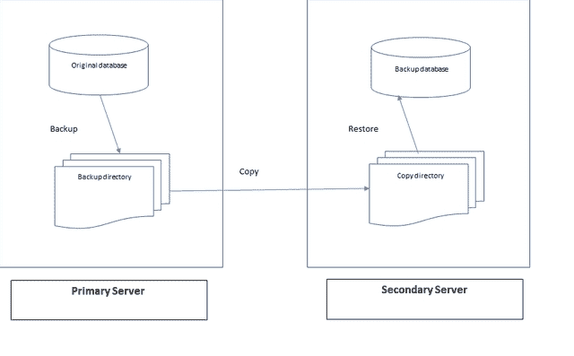

如图片所示，日志传输会话涉及以下步骤：

*   在主 SQL Server 实例上备份事务日志文件

*   跨越网络将事务日志备份文件复制到一个或多个备用 SQL Server 实例

*   在备用 SQL Server 实例上还原事务日志备份文件

## 使用 CIFS 为日志传输设置网络共享

### 配置主服务器

*   运行以下命令安装 Samba

```bash
sudo apt-get install samba # 用于 Ubuntu
sudo yum -y install samba # 用于 RHEL/CentOS
```

*   创建一个用于存储日志传输日志的目录，并赋予 `mssql` 所需的权限

```bash
mkdir /var/opt/mssql/tlogs
chown mssql:mssql /var/opt/mssql/tlogs
chmod 0700 /var/opt/mssql/tlogs
```

*   编辑 `/etc/samba/smb.conf` 文件（你需要 root 权限）并添加以下部分：

```bash
[tlogs]
path=/var/opt/mssql/tlogs
available=yes
read only=yes
browsable=yes
public=yes
writable=no
```

*   为 Samba 创建一个 `mssql` 用户

```bash
sudo smbpasswd -a mssql
```

*   重启 Samba 服务

```bash
sudo systemctl restart smbd.service nmbd.service
```

### 配置备用服务器

*   运行以下命令安装 CIFS 客户端

```bash
sudo apt-get install cifs-utils # 用于 Ubuntu
sudo yum -y install cifs-utils # 用于 RHEL/CentOS
```

*   创建一个文件来存储你的凭据。使用你最近为 `mssql` Samba 账户设置的密码

```console
vim /var/opt/mssql/.tlogcreds
#在 .tlogcreds 中粘贴以下内容
username=mssql
domain=<domain>
password=<password>
```

*   运行以下命令创建一个用于挂载的空目录，并正确设置权限和所有者

```bash
mkdir /var/opt/mssql/tlogs
sudo chown root:root /var/opt/mssql/tlogs
sudo chmod 0550 /var/opt/mssql/tlogs
sudo chown root:root /var/opt/mssql/.tlogcred
sudo chmod 0660 /var/opt/mssql/.tlogcreds
```

*   将该行添加到 `/etc/fstab` 以持久化共享

```console
//<ip_address_of_primary_server>/tlogs /var/opt/mssql/tlogs cifs credentials=/var/opt/mssql/.tlogcreds,ro,uid=mssql,gid=mssql 0 0
```

*   挂载共享

```bash
sudo mount –a
```

## 通过 T-SQL 设置日志传输

*   在你的主服务器上运行此脚本


```sql
BACKUP DATABASE SampleDB TO DISK = '/var/opt/mssql/tlogs/SampleDB.bak'
GO
DECLARE @LS_BackupJobId AS uniqueidentifier
DECLARE @LS_PrimaryId AS uniqueidentifier
DECLARE @SP_Add_RetCode AS int
EXECUTE @SP_Add_RetCode = master.dbo.sp_add_log_shipping_primary_database
    @database = N'SampleDB',
    @backup_directory = N'/var/opt/mssql/tlogs',
    @backup_share = N'/var/opt/mssql/tlogs',
    @backup_job_name = N'LSBackup_SampleDB'
    @backup_retention_period = 4320
    @backup_compression = 2,
    @backup_threshold = 60
    @threshold_alert_enabled = 1,
    @history_retention_period = 5760
    @backup_job_id = @LS_BackupJobId OUTPUT
    @primary_id = @LS_PrimaryId OUTPUT,
    @overwrite = 1
IF (@@ERROR = 0 AND @SP_Add_RetCode = 0)
BEGIN
    DECLARE @LS_BackUpScheduleUID AS uniqueidentifier
    DECLARE @LS_BackUpScheduleID AS int
    EXECUTE msdb.dbo.sp_add_schedule
        @schedule_name =N'LSBackupSchedule',
        @enabled = 1,
        @freq_type = 4,
        @freq_interval = 1,
        @freq_subday_type = 4,
        @freq_subday_interval = 15,
        @freq_recurrence_factor = 0,
        @active_start_date = 20170418,
        @active_end_date = 99991231,
        @active_start_time = 0,
        @active_end_time = 235900
        @schedule_uid = @LS_BackUpScheduleUID OUTPUT,
        @schedule_id = @LS_BackUpScheduleID OUTPUT
    EXECUTE msdb.dbo.sp_attach_schedule
        @job_id = @LS_BackupJobId,
        @schedule_id = @LS_BackUpScheduleID
    EXECUTE msdb.dbo.sp_update_job
        @job_id = @LS_BackupJobId,
        @enabled = 1
END
EXECUTE master.dbo.sp_add_log_shipping_alert_job
EXECUTE master.dbo.sp_add_log_shipping_primary_secondary
    @primary_database = N'SampleDB',
    @secondary_server = N'<ip_address_of_secondary_server>',
    @secondary_database = N'SampleDB',
    @overwrite = 1
```

在你的备用服务器上运行此脚本：

```sql
RESTORE DATABASE SampleDB FROM DISK = '/var/opt/mssql/tlogs/SampleDB.bak'
WITH NORECOVERY;
GO
DECLARE @LS_Secondary__CopyJobId AS uniqueidentifier
DECLARE @LS_Secondary__RestoreJobId AS uniqueidentifier
DECLARE @LS_Secondary__SecondaryId AS uniqueidentifier
DECLARE @LS_Add_RetCode AS int
EXECUTE @LS_Add_RetCode = master.dbo.sp_add_log_shipping_secondary_primary
    @primary_server = N'<ip_address_of_primary_server>',
    @primary_database = N'SampleDB',
    @backup_source_directory = N'/var/opt/mssql/tlogs/',
    @backup_destination_directory = N'/var/opt/mssql/tlogs/',
    @copy_job_name = N'LSCopy_SampleDB',
    @restore_job_name = N'LSRestore_SampleDB',
    @file_retention_period = 4320,
    @overwrite = 1
    @copy_job_id = @LS_Secondary__CopyJobId OUTPUT
    @restore_job_id = @LS_Secondary__RestoreJobId OUTPUT
    @secondary_id = @LS_Secondary__SecondaryId OUTPUT
IF (@@ERROR = 0 AND @LS_Add_RetCode = 0)
BEGIN
    DECLARE @LS_SecondaryCopyJobScheduleUID AS uniqueidentifier
    DECLARE @LS_SecondaryCopyJobScheduleID AS int
    EXECUTE msdb.dbo.sp_add_schedule
        @schedule_name =N'DefaultCopyJobSchedule',
        @enabled = 1,
        @freq_type = 4,
        @freq_interval = 1,
        @freq_subday_type = 4,
        @freq_subday_interval = 15,
        @freq_recurrence_factor = 0,
        @active_start_date = 20170418,
        @active_end_date = 99991231,
        @active_start_time = 0,
        @active_end_time = 235900
        @schedule_uid = @LS_SecondaryCopyJobScheduleUID OUTPUT,
        @schedule_id = @LS_SecondaryCopyJobScheduleID OUTPUT
    EXECUTE msdb.dbo.sp_attach_schedule
        @job_id = @LS_Secondary__CopyJobId,
        @schedule_id = @LS_SecondaryCopyJobScheduleID
    DECLARE @LS_SecondaryRestoreScheduleUID AS uniqueidentifier
    DECLARE @LS_SecondaryRestoreScheduleID AS int
    EXECUTE msdb.dbo.sp_add_schedule
        @schedule_name =N'RestoreSchedule',
        @enabled = 1,
        @freq_type = 4,
        @freq_interval = 1,
        @freq_subday_type = 4,
        @freq_subday_interval = 15,
        @freq_recurrence_factor = 0,
        @active_start_date = 20170418,
        @active_end_date = 99991231,
        @active_start_time = 0,
        @active_end_time = 235900
        @schedule_uid = @LS_SecondaryRestoreScheduleUID OUTPUT,
        @schedule_id = @LS_SecondaryRestoreScheduleID OUTPUT
    EXECUTE msdb.dbo.sp_attach_schedule
        @job_id = @LS_Secondary__RestoreJobId,
        @schedule_id = @LS_SecondaryRestoreScheduleID
END
END
```

```sql
RESTORE DATABASE SampleDB WITH RECOVERY ;
```

## 在 Linux 上使用 SQL Agent 配置 DB Mail 和电子邮件通知

以下步骤将向您展示如何在 Linux 上设置 DB Mail 并结合 SQL Server Agent（`mssql-server-agent`）使用它。

### 1. 启用 DB Mail

```sql
USE master
GO
sp_configure 'show advanced options',1
RECONFIGURE WITH OVERRIDE
GO
sp_configure 'Database Mail XPs', 1
RECONFIGURE
GO
```

### 2. 创建新账户

```sql
EXECUTE msdb.dbo.sysmail_add_account_sp
@account_name = 'SQLAlerts',
  @description = 'Account for Automated DBA Notifications',
  @email_address = 'sqlagenttest@gmail.com',
  @replyto_address = 'sqlagenttest@gmail.com',
  @display_name = 'SQL Agent',
  @mailserver_name = 'smtp.gmail.com',
  @port = 587,
  @enable_ssl = 1,
  @username = 'sqlagenttest@gmail.com',
  @password = '<password>'
GO
```

### 3. 创建默认配置文件

```sql
EXECUTE msdb.dbo.sysmail_add_profile_sp
@profile_name = 'default',
  @description = 'Profile for sending Automated DBA Notifications'
GO
```

### 4. 将 Database Mail 账户添加到 Database Mail 配置文件

```sql
EXECUTE msdb.dbo.sysmail_add_principalprofile_sp
@profile_name = 'default',
  @principal_name = 'public',
  @is_default = 1 ;
GO
```

### 5. 将账户添加到配置

```sql
EXECUTE msdb.dbo.sysmail_add_profileaccount_sp
  @profile_name = 'default',
  @account_name = 'SQLAlerts',
  @sequence_number = 1;
GO
```

### 6. 发送测试邮件

```sql
EXECUTE msdb.dbo.sp_send_dbmail
@profile_name = 'default',
  @recipients = 'recipient-email@gmail.com',
  @Subject = 'Testing DBMail',
  @Body = 'This message is a test for DBMail'
GO
```

### 7. 使用 `mssql-conf` 或环境变量设置 DB Mail 配置文件

您可以使用`mssql-conf`工具或环境变量来注册您的 DB Mail 配置文件。在这种情况下，我们将配置文件命名为`default`。

#### 通过 `mssql-conf`

```bash
sudo /opt/mssql/bin/mssql-conf set sqlagent.databasemailprofile default
```

#### 通过环境变量

```bash
MSSQL_AGENT_EMAIL_PROFILE=default
```

### 8. 为 SQLAgent 作业通知设置运算符

```sql
EXECSEC msdb.dbo.sp_add_operator
@name=N'JobAdmins',
  @enabled=1,
  @email_address=N'recipient-email@gmail.com',
  @category_name=N'[Uncategorized]'
GO
```

### 9. 当 'Agent Test Job' 成功时发送邮件

```sql
EXEC msdb.dbo.sp_update_job
@job_name='Agent Test Job',
  @notify_level_email=1,
  @notify_email_operator_name=N'JobAdmins'
GO
```

## 业务连续性与数据库恢复 - Linux 版 SQL Server

本文提供了适用于 SQL Server 高可用性和灾难恢复的业务连续性解决方案概述。

每个部署 SQL Server 的人员都必须考虑的一项常见任务是：确保所有关键的 SQL Server 实例及其内部的数据库在业务和终端用户需要时可用（无论是早上 9 点到下午 5 点还是 24 小时运行）。目标是保持业务正常运行，并尽可能减少或消除中断。这一概念也称为业务连续性。

SQL Server 2017 引入了许多新功能或对现有功能进行了增强，其中一些用于可用性。SQL Server 2017 最大的改进是支持在 Linux 发行版上运行 SQL Server。

本文重点介绍 SQL Server 2017 中的可用性场景，以及新的和增强的可用性功能。这些场景包括可以跨 Windows Server 和 Linux 的 SQL Server 部署的混合场景，以及可以增加一个或数据库可读副本数量的场景。虽然本文未涵盖 SQL Server 外部的可用性选项（例如虚拟化提供的选项），但此处讨论的所有内容都适用于公有云或由本地宿主机服务器托管的虚拟机内的 SQL Server 安装。

### 使用可用性功能的 SQL Server 2017 场景

可用性组（Availability groups）、故障转移集群实例（FCIs）和日志传送（log shipping）可以有多种方式，而不仅仅是为了可用性目的。可用性功能主要有四种使用方式：

- 高可用
- 灾难恢复
- 迁移与升级
- 扩展一个或多个数据库的可读副本

每个章节将讨论适用于该特定场景的相关功能。未被涵盖的功能是`SQL Server replication`。虽然它官方未被正式指定为 Always On 框架下的可用性功能，但它通常被用于在某些场景下实现数据冗余。SQL Server 将在未来的版本中支持 Linux 版的复制。

## 高可用性

确保在发生数据中心本地或云区域内单区域问题时，SQL Server 实例或数据库可用是非常重要的。本节将介绍 SQL Server 可用性功能如何协助完成该任务。所有描述的功能在 Windows Server 和 Linux 上均可用。

### Always On 可用性组

Always On 可用性组（`availability groups`）是在 SQL Server 2012 中引入的，它通过将数据库的每个事务发送到另一个实例（称为副本）来提供数据库级别的保护，该实例包含一个处于特殊状态的该数据库副本。可用性组可以部署在标准版或企业版上。参与可用性组的实例可以是独立实例，也可以是 Always On 故障转移簇实例（`FCIs`，将在下一节描述）。由于事务在发生时就会发送到副本，因此对于有较低恢复点目标（RPO）和恢复时间目标（RTO）要求的场景建议使用可用性组。副本之间的数据移动可以是同步或异步的，企业版允许最多有三个副本（包括主副本）作为同步副本。可用性组有一个完全可读/写的数据库副本，它位于主副本上，而所有备副本无法直接从终端用户或应用程序接收事务。

由于可用性组仅提供数据库级别的保护而非实例级别的保护，任何未在事务日志中捕获或未在数据库中配置的内容都需要为每个备副本进行手动同步。必须手动同步的对象示例包括实例层面的登录名、链接服务器和 SQL Server Agent 作业。


可用性组还有另一个名为监听器（listener）的组件，它允许应用程序和终端用户进行连接，而无需知道是哪个 `SQL Server` 实例托管了主副本。每个可用性组将有自己的监听器。虽然监听器在 `Windows Server` 和 `Linux` 上的实现略有不同，但其提供的功能和使用方法是相同的。下图显示了一个基于 `Windows Server` 的可用性组，它正在使用 `Windows Server` 故障转移簇（`WSFC`）。无论是在 `Linux` 还是 `Windows Server` 上，可用性都需要操作系统底层的簇支持。示例展示了一个简单的双服务器（或节点）配置，其中 `WSFC` 是底层簇。

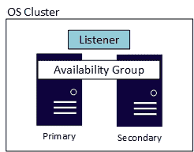

标准版和企业版在副本数量上有所不同。标准版中的可用性组（称为基本可用性组）支持两个副本（一个主副本和一个备副本），且可用性组中仅支持单个数据库。企业版不仅允许在单个可用性组中配置多个数据库，还可以拥有多多九个总副本（一个主副本，八个备副本）。企业版还提供其他可选优势，例如可读的备副本、从备副本进行备份的能力等。

在可用性方面，可用性组可以提供自动或手动故障转移。如果配置了同步数据移动，且主副本和备副本上的数据库处于同步状态，则可以发生自动故障转移。只要使用监听器且应用程序使用较新版本的 `.NET`（带有更新的 `3.5` 或 `4.0` 及以上），如果利用了监听器，故障转移的处理将对终端用户产生最小至无影响的影响。将备副本切换为新主副本的故障转移可以配置为自动或手动，通常以秒为单位衡量。

下面的列表强调了 `Windows Server` 上的可用性组与 `Linux` 的一些区别：

- 由于 `Linux` 和 `Windows Server` 上层簇工作方式的差异，可用性组的所有故障转移（手动或自动）都是通过 `Linux` 簇完成的。在基于 `Windows Server` 的可用性组部署中，手动故障转移必须通过 `SQL Server` 完成。自动故障转移由 `Windows Server` 和 `Linux` 上的底层簇处理。
- 在 `SQL Server 2017` 中，`Linux` 上可用性组的推荐配置是至少三个副本。这是由于底层聚类的工作方式决定的。针对双副本配置的改进方案将在发布后推出。
- 在 `Linux` 上，每个监听器使用的名称定义在 `DNS` 中，而不是像 `Windows Server` 那样定义在簇中。

在 `SQL Server 2017` 中，可用性组有一些新功能和增强：

- 簇类型
- `REQUIRED_SECONDARIES_TO_COMMIT`
- 针对基于 `Windows Server` 配置的增强型 Microsoft 事务协调器（`DTC`）支持
- 只读数据库的额外扩展场景（在本文后半部分描述）

## Always On 可用性组簇类型

`Windows Server` 内置的簇形式通过名为 `Failover Clustering`（故障转移簇）的功能启用。它允许你构建一个 `WSFC` 用于可用性组或 `FCI`。可用性组和 `FCIs` 的集成由 `SQL Server` 提供的簇感知资源 DLL 提供。

每个支持的 `Linux` 发行版都自带其特定版本的 `Pacemaker` 簇解决方案。`Linux` 上的 `SQL Server 2017` 支持使用 `Pacemaker`。`Pacemaker` 是一个开源解决方案，每个发行版都可以将其集成到自己的栈中。虽然发行版提供了 `Pacemaker`，但它不像 `Windows Server` 的 `Failover Clustering` 功能那样深度集成。

`WSFC` 和 `Pacemaker` 的相似性大于差异。它们都提供了一种将单个服务器组合配置以提供可用性的方法，并具有资源、约束（即使实现方式不同）、故障转移等概念。为了支持可用性组和 `FCI` 配置（包括自动故障转移等功能），微软提供了 `mssql-server-ha` 包，它与 `WSFC` 中的资源 DLL 相似但不完全相同，专门用于 `Pacemaker`。

`WSFC` 和 `Pacemaker` 之间的区别之一是 `Pacemaker` 中没有网络名称资源，而这是 `WSFC` 中帮助抽象监听器名称（或 `FCI` 名称）的组件。在 `Linux` 上，`DNS` 提供了该名称解析。

由于簇栈的差异，可用性组需要进行一些更改，因为 `SQL Server` 必须处理某些原本由 `WSFC`set 处理的元数据。最大的变化是引入了可用性组的簇类型。它存储在 `sys.availability_groups` 表的 `cluster_type` 和 `cluster_type_desc` 列中。共有三种簇类型：

- `WSFC`
- `External`
- `None`

所有需要可用性的可用性组都必须使用底层集群，对于 SQL Server 2017 而言，这意味着使用 `WSFC` 或 `Pacemaker`。对于使用底层 `WSFC` 的基于 `Windows Server` 的可用性组，默认集群类型为 `WSFC`，不需要设置。对于基于 `Linux` 的可用性组，在创建可用性组时，必须将集群类型设置为 `External`。与 `Pacemaker` 的集成是在可用性组创建后配置的，而在 `WSFC` 上则是在创建时完成的。

集群类型 `None` 同时可用于 `Windows Server` 和 `Linux` 可用性组。将集群类型设为 `None` 意味着可用性组不需要底层集群。这意味着 SQL Server 2017 是第一个支持不带集群可用性组的 SQL Server 版本，但权衡是这种配置不支持作为高可用性解决方案。对于那些仅仅想为数据库添加额外的只读副本的人，或者喜欢可用性组在迁移/升级方面提供的功能，但又不想受限于底层集群甚至复制带来的额外复杂性的人来说，集群类型为 `None` 的可用性组是一个完美的解决方案。

下面的截图显示了 SSMS 中对不同类型集群的支持。你必须运行版本 17.1 或更高版本。下面的截图来自 17.2 版本。

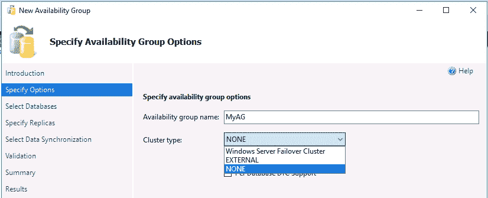

### `REQUIRED_SYNCHRONIZED_SECONDARIES_TO_COMMIT`

`SQL Server 2016` 在企业版中将同步副本的数量支持从两个增加到三个。然而，如果一个辅助副本已同步，而另一个出现问题，则没有办法可以控制其行为来让主副本等待出现故障的副本，或者允许其继续进行。这意味着主副本在某个时间点会继续接收写入流量，尽管辅助副本未处于同步状态，这意味着辅助副本上存在数据丢失。在 `SQL Server 2017` 中，现在有一个选项可以控制当存在名为 `REQUIRED_SYNCHRONIZED_SECONDARIES_TO_COMMIT` 的同步副本时发生的行为。该选项的工作原理如下：

- 有三个可能的值：`0`、`1` 和 `2`。
- 该值是必须同步的辅助副本数量，这会对数据丢失、可用性组可用性和故障转移产生影响。
- 对于 `WSFCs` 和集群类型为 `None`，默认值为 `0`，可以手动设置为 `1` 或 `2`。
- 对于集群类型为 `External`，默认情况下，集群机制将设置此值，并可以手动覆盖。对于三个同步副本，默认值为 `1`。在 `Linux` 上，`REQUIRED_SYNCHRONIZED_SECONDARIES_TO_COMMIT` 的值在集群中的可用性组资源上配置。在 `Windows` 上，它通过 `Transact-SQL` 设置。

大于 `0` 的值可确保更高的数据保护，因为如果所需的辅助副本不可用，主副本将不可用直到问题解决。`REQUIRED_SYNCHRONIZED_SECONDARIES_TO_COMMIT` 也影响故障转移行为，因为如果数量正确的辅助副本未处于正确状态，则无法发生自动故障转移。在 `Linux` 上，值为 `0` 不允许自动故障转移，因此在 `Linux` 上使用带自动故障转移的同步时，值必须大于 `0` 才能实现自动故障转移。`Windows Server` 中值为 `0` 是 `SQL Server 2016` 及更早版本的行为。

### 增强的微软分布式事务协调器支持

在 `SQL Server 2016` 之前，对于底层使用 `DTC` 的分布式事务的应用程序，在 `SQL Server` 中获得可用性的唯一方法是部署 `FCIs`。分布式事务可以通过以下两种方式之一执行：

- 跨越同一 `SQL Server` 实例中多个数据库的事务
- 跨越多个 `SQL Server` 实例的事务，或者可能涉及非 `SQL Server` 数据源的事务

`SQL Server 2016` 引入了可用性组对 `DTC` 的部分支持，涵盖了后一种场景。`SQL Server 2017` 通过 `DTC` 支持这两种场景完善了这一功能。可用性组 `DTC` 支持的另一项增强是：在 `SQL Server 2016` 中，为可用性组启用 `DTC` 支持只能在创建可用性组时完成，不能以后添加。在 `SQL Server 2017` 中，也可以在可用性组创建后添加 `DTC` 支持。

### Always On 故障转移集群实例

自 6.5 版本以来，集群化安装一直是 `SQL Server` 的一项功能。`FCIs` 是为整个 `SQL Server` 安装（称为实例）提供可用性的经过验证的方法。这意味着如果底层服务器遇到问题，实例中的所有内容（包括数据库、`SQL Server Agent` 作业、链接服务器等）都将移动到另一台服务器。所有 `FCIs` 都需要某种共享存储，即使是通过网络提供的。`FCI` 的资源在任何给定时间只能由一个节点运行并拥有。在底图中，集群的第一个节点拥有 `FCI`，这意味着它也拥有与之相关的共享存储资源（用实线连接到存储）。

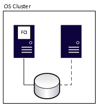

故障转移后，所有权发生变化，如下所示。

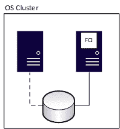

`FCI` 零数据丢失，但底层共享存储是单点故障，因为只有一份数据。`FCIs` 通常与另一种可用性方法（如可用性组或日志传输）结合使用以获得数据库的冗副本。部署的额外方法应使用与 `FCI` 物理隔离的存储。当 `FCI` 故障转移到另一个节点时，它会在一个节点停止并在另一个节点启动，类似于关闭服务器并重新开启。`FCI` 会经过正常的恢复过程，这意味着任何需要向前回滚的事务将执行，任何未完成的事务将进行回滚。因此，数据库从故障或手动故障转移的时间点来看数据是一致的，因此没有数据丢失。数据库仅在恢复完成后才可用，因此恢复时间将取决于许多因素，通常比故障转移可用性组长。权衡是，当你故障转移可用性组时，可能需要额外的任务来使数据库可用，例如启用 `SQL Server Agent` 作业。

与可用性组一样，`FCIs` 抽象了底层集群中哪个节点在托管它。`FCI` 始终保留相同的名称。应用程序和终端用户从连接到节点；而是使用分配给 `FCI` 的唯一名称。`FCI` 可以作为托管主副本或辅助副本的实例之一参与可用性组。

下列表强调了 `Windows Server` 与 `Linux` 上 `FCIs` 的一些区别：

- 在 `Windows Server` 上，`FCI` 是安装过程的一部分。`Linux` 上的 `FCI` 在安装 `SQL Server` 后配置。
- `Linux` 每个主机仅支持单实例 `SQL Server` 安装，因此所有 `FCIs` 都将是默认实例。`Windows Server` 每个 `WSFC` 支持多达 25 个 `FCIs`。
- `Linux` 上 `FCIs` 使用的常用名称在 `DNS` 中定义，并应与为 `FCI` 创建的资源相同。

## 日志传输（Log shipping）

如果恢复点目标（`RPO`）和恢复时间目标（`RTO`）较为灵活，或者数据库不被视为高度任务关键型，`log shipping` 是 `SQL Server` 中另一种经过验证的可用性功能。基于 `SQL Server` 的原生备份，`log shipping` 过程会自动生成事务日志备份，将其复制到一个或多个称为热备的实例上，并自动将事务日志备份应用到该备节点。`log shipping` 使用 `SQL Server Agent` 作业来自动化备份、复制和应用事务日志备份的过程。

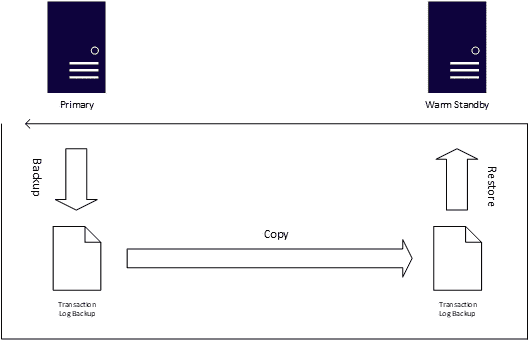

可以说，在某种程度上使用 `log shipping` 的最大优势是它考虑了人为失误。事务日志的应用可能会延迟。因此，如果有人执行了类似没有带 `WHERE` 子句的 `UPDATE` 操作，备用节点可能还没有该更改，这样你可以在修复主系统时切换到备用节点。虽然 `log shipping` 很容易配置，但从主节点切换到热备节点（称为角色切换）始终是手动完成的。`role change` 是通过 `Transact-SQL` 启动，与 `availability group` 一样，所有未在事务日志中捕获的对象必须手动同步。`log shipping` 需要按数据库进行配置，而单个 `availability group` 可以包含多个数据库。与 `availability group` 或 `FCI` 不同，`log shipping` 没有针对 `role change` 的抽象。应用程序必须能够处理这一点。可以采用如 `DNS alias`（`CNAME`）等技术，但它也有优缺点，例如在切换后 `DNS` 刷新所需的时间。

## 灾难恢复（Disaster recovery）

当你的主可用性区域发生地震或洪水等灾难性事件时，业务必须准备好在其他地方启动其系统。本节将介绍 `SQL Server` 可用性功能如何协助业务连续性。

## Always On 可用性组（Always on availability groups）

`availability groups` 的优势之一是可以使用单一功能同时配置高可用性和灾难恢复。在不需要确保共享存储也是高可用的情况下，让在一个数据中心设置本地副本以实现高可用性，并在其他数据中心设置远程副本以实现灾难恢复（每个副本都有独立的存储）要容易得多。拥有数据库的额外副本是确保冗余的代价。下面展示了一个跨多个数据中心的 `availability group` 示例。一个主副本负责保持所有备副本的同步。

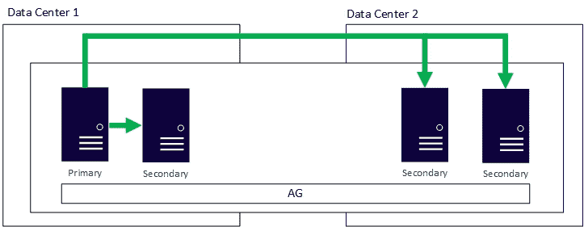

在集群类型为 `none` 的 `availability group` 之外，`availability group` 要求所有副本都属于同一个底层集群，无论是 `WSFC` 还是 `Pacemaker`。这意味着在上面的图片中，`WSFC` 被拉伸到在两个不同的数据中心工作，这增加了复杂性。无论平台是（`Windows Server` 还是 `Linux`）都是如此。跨距离拉伸集群会增加复杂性。`SQL Server 2016` 引入的 `distributed availability group` 允许 `availability group` 跨越配置在不同集群上的 `availability groups`。这解耦了所有节点必须参与同一个集群的要求，使得配置灾难恢复变得简单得多。

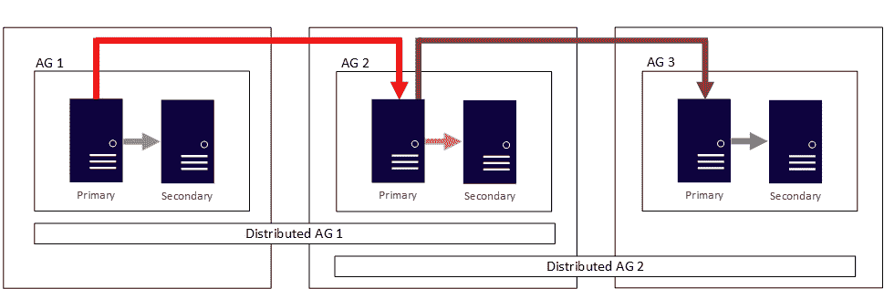

## Always On 故障转移集群实例（Always on failover cluster instances）

`FCIs` 可用于灾难恢复。与普通的 `availability group` 一样，底层集群机制也必须扩展到所有位置，这增加了复杂性。`FCIs` 还有一个考虑因素：共享存储。相同的磁盘需要在主站点和备站点均可用，因此需要外部方法（例如由存储供应商在硬件层提供的功能，或在 `Windows Server` 中使用 `storage Replica`）来确保 `FCI` 使用的磁盘存在于其他。

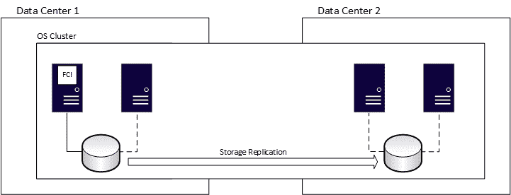

## 日志传输（Log shipping）

`log shipping` 是为 `SQL Server` 数据库提供灾难恢复的最旧方法。`log shipping` 通常与 `availability groups` 和 `FCIs` 结合使用，在由于环境、管理技能或预算导致其他方案可能面临挑战的情况下，提供成本效益且更简单的灾难恢复。与 `log shipping` 的高可用故事类似，许多环境会延迟加载事务日志，以考虑人为失误。

## 迁移与升级（Migrations and upgrades）

在部署新实例或升级旧实例时，业务无法忍长时间停机。本节将讨论如何使用 `SQL Server` 的可用性功能，在计划的架构更改、服务器切换、平台更改（例如从 `Windows Server` 到 `Linux` 或反之）或补丁期间期间尽可能减少停机时间。

## Always On 可用性组（Always on availability groups）

包含一个或多个 `availability groups` 的现有实例可以原地升级到 `SQL Server 2017`。虽然这将需要一些停机时间，但只要有合理的计划，就可以将其降至最低。

如果目标是迁移到新服务器而不更改配置（包括操作系统或 `SQL Server` 版本），则可以将这些服务器作为节点添加到现有的底层集群，并添加到 `availability group` 中。一旦一个或多个副本处于正确状态，就可以向新服务器进行手动故障转移，然后可以从 `availability group` 中移除旧服务器，并最终将其退役。

`Distributed AGs` 也是另一种迁移到新配置或升级 `SQL Server` 的方法。因为 `distributed AG` 支持不同架构上的不同底层 `AGs`，例如，你可以从运行在 `Windows Server 2012 R2` 上的 `SQL Server 2016` 切换到运行在 `Windows Server 2016` 上的 `SQL Server 2017`。

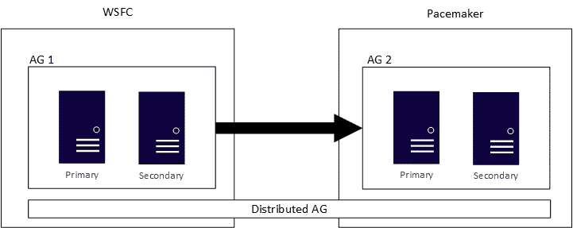


最后，集群类型为 `None` 的 `availability groups` 也可以用于迁移或升级。在典型的 `availability group` 配置中，你不能混合使用集群类型，因此所有副本都必须是 `None` 类型。可以使用 `distributed availability group` 来跨越配置有不同集群类型的 `availability groups`。这种方法也支持不同的操作系统平台。

用于迁移和升级的各种 `availability groups` 变体都允许将最耗时的工作随时间推移完成——数据同步。当需要开始切换到新配置时，切换将是一次短暂的停机，而不是一段需要完成所有工作（包括数据同步）的漫长停机时间。

在对底层操作系统进行补丁期间，`availability groups` 可以通过手动将主副本故障转移到备副本来提供最小的停机时间。从操作系统的角度来看，这在 `Windows Server` 上更为常见，因为通常（但并非总是）维护底层操作系统可能需要重启。为 `Linux` 打补丁有时需要重启，但频率可能较低。

对参与 `availability group` 的 `SQL Server` 实例打补丁也可以根据复杂程度减少停机时间。在完成补丁期间，可以手动将主副本故障转移到备副本。从操作系统的角度来看，这在 `Windows Server` 上会更常见，因为通常（但并非总是）维护底层操作系统可能需要重启。为 `Linux` 打补丁有时需要重启，但频率可能较低。

对参与 `availability group` 的 `SQL Server` 实例打补丁也可以根据复杂程度减少停机时间，取决于 `availability group` 架构的复杂性。在打补丁期间，备副本是处于可用的。

## Always On 故障转移集群实例 (Always on failover cluster instances)

`FCIs` 可用于灾难恢复。与普通的 `availability group` 一样，底层集群机制也必须扩展到所有位置，这增加了复杂性。对于 `FCIs` 还有一个额外的考虑。

## 日志传输 (Log shipping)

`log shipping` 是为 `SQL Server` 数据库提供灾难恢复的最旧方法。`log shipping` 通常与 `availability groups` 和 `FCIs` 结合使用，在由于环境、管理技能或预算导致其他方案可能面临挑战的情况下，提供成本效益且更简单的灾难恢复。与 `log shipping` 的高可用故事类似，许多环境会延迟加载事务日志，以考虑人为失误。

# 其他 SQL Server 部署方法与可用性 (Other SQL Server deployment methods and availability)

对于 Linux 还有两种其他部署方法：容器和使用 `Azure`（或其他云提供商）。无论 `SQL Server` 如何部署，本文提到的通用可用性需求都是。这两种方法在使 SQL Server 可用方面有一些考虑。

使用 `Docker` 的容器是部署 `SQL Server` 的新方式，无论是 Windows Server 还是 Linux。容器是准备好运行的 SQL Server 镜像。然而，目前不支持集群，因此没有直接的高可用性或灾难恢复。目前，使用容器使 SQL Server 可用的选项将是 `log shipping` 和备份与恢复。虽然对于集群类型为 `None` 的 `availability group` 可以配置，但如前所述，它不被认为是真正的可用性配置。微软正在研究使用容器启用可用性组或 `FCIs`。

如果你今天使用容器，如果容器丢失，取决于容器平台，它可以重新部署并连接到之前使用的共享存储。这种机制的某些由容器编排器提供。虽然这提供了一些弹性，但与使用 `availability group` 相比，与数据库恢复相关的将会有停机。

可以使用 `Azure` 部署 Linux IaaS 虚拟机并安装 `SQL Server`。与基于本地的安装一样，支持的安装需要使用 `STONITH`（杀死另一个节点），这是 `Pacemaker` 外部的。`STONITH` 通过隔离可用性代理提供。某些发行版将其包含在，另一些依赖外部硬件和软件供应商。咨询你首选的 Linux 发行版以提供了哪些形式的 `STONITH`，以便在公云中部署支持的解决方案。

## 跨平台和 Linux 发行版互操作性 (Cross-platform and Linux distribution interoperability)

`SQL Server` 现在支持 `Windows Server` 和 `Linux`，本节涵盖了它们除其他目的外如何协同工作以场景，以及包含多个 Linux 发行版的解决方案故事。在介绍跨平台和互操作性场景之前，需要说明两个事实：

- 在任何情况下，基于 `WSFC` 的 `FCI` 或可用组都无法与基于 Linux 的 `FCI` 或可用组直接工作。`WSFC` 无法通过 `Pacemaker` 节点扩展，反之亦然。

- 对于集群类型为 `External` 的 `FCI` 或可用组，不支持混合使用不同的 Linux 发行版。在这种情况下，所有可用性组副本不仅必须配置为相同的 Linux 发行版，还必须是相同的版本。SQL Server 跨两个平台或多个 Linux 发行版运行的两种受支持方式是可用性组和日志传送。

## 分布式可用性组

分布式可用性组旨在跨可用性组配置，无论可用组底层的两个集群是两个不同的 `WSFC`、Linux 发行版，还是一个在 `WSFC` 上另一个在 `Linux` 上。分布式可用性组是实现跨平台解决方案的主要方法。如果这是公司需要的，它也是迁移的主要解决方案，例如将基于 Windows Server 的 `SQL Server` 基础设施转换为基于 Linux 的基础设施。正如上文所述，可用性组（特别是分布式可用性组）可以最大限度地减少应用程序不可用的时间。下面是一个跨越 `WSFC` 和 `Pacemaker` 的分布式可用性组示例。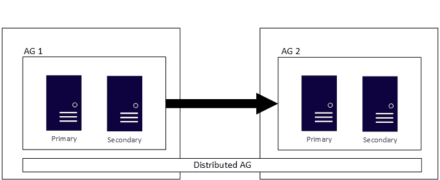

如果可用性组的集群类型配置为 `None`，则它可以跨越 Windows Server、Linux 以及多个 Linux 发行版。由于这不是真正的高可用性配置，它不应用于任务关键型部署，而应用于只读扩展或迁移/升级场景。

### 日志传送

由于日志传送仅基于备份和还原，且 Windows Server 上的 `SQL Server` 与 Linux 上的 `SQL Server` 在数据库、文件结构等方面没有差异。这意味着日志传送可以在基于 Windows Server 的 `SQL Server` 安装和 Linux 安装之间配置，也可以在不同的 Linux 发行版之间配置。其他所有内容保持不变。唯一的注意事项是，日志传送和可用性组一样，当源的 `SQL Server` 主版本高于目标的 `SQL Server` 版本时，无法工作。

### 只读扩展 (read-scale)

自 `SQL Server 2012` 引入以来，辅助副本已经具有了用于只读查询的能力。通过可用性组实现这种方式有两种方法：允许直接访问辅助副本，以及配置需要使用监听器的只读路由。`SQL Server 2016` 引入了通过监听器使用轮询算法负载均衡只读连接的能力，允许将只读请求分散到所有可读副本上。

通过可用性组扩展数据库的可读副本是从 `SQL Server 2016` 的分布式可用性组开始首次引入的。这允许公司不仅在本地，而且在区域和全球范围内以最小的配置拥有数据库的只读副本，并通过在本地执行查询来减少网络流量和延迟。可用性组的每个主副本即使不是完全的读写副本也可以为另外两个可用性组种子，因此每个分布式可用性组可以支持多达 27 个可读的数据副本。

从 `SQL Server 2017` 开始，可以使用配置为集群类型为 `None` 的可用性组创建一个近实时的只读解决方案。如果目标是使用可用性组用于可读辅助副本而非高可用性，这样做可以消除使用 `WSFC` 或 `Pacemaker` 的复杂性，并通过更简单的部署方法获得可用性组的可读优势。

主要的注意事项是，由于没有集群类型为 `None` 的底层集群，配置只读路由略有不同。从 `SQL Server` 的角度来看，仍然需要监听器来路由请求，即使没有集群。不是配置传统的监听器，而是使用主副本的 IP 地址或名称。然后使用主副本来路由只读请求。

技术上，可以通过 `WITH STANDBY` 还原数据库来配置用于可读的日志传送热备。然而，由于事务日志在还原时需要独占使用数据库，这意味着在操作期间用户无法访问数据库。这使得日志传送成为一个不理想的解决方案——特别是当需要近实时数据时。

对于所有可用性组的只读扩展场景需要说明的一点是，与所有数据都是实时的事务复制不同，每个辅助副本并不处于可以应用唯一索引的状态，副本是主副本的精确复制。这意味着如果报告需要任何索引或数据需要操纵，必须在主副本的数据库上进行。如果你需要这种灵活性，复制对于可读数据是更好的解决方案。

## 总结

`SQL Server 2017` 的实例和数据库可以使用 Windows Server 和 `Linux` 上的相同功能来实现高可用。除了本地高可用和灾备恢复的标准可用性场景外，通过 `SQL Server` 的可用性功能可以最大限度地减少升级和迁移相关的停机时间。可用性组还可以作为架构的一部分提供数据库的其他副本，以扩展可读副本。无论你是使用 `SQL Server 2017` 部署新解决方案，还是考虑升级，`SQL Server 2017` 都具有你所需的可用性和可靠性。

## Linux 部署的 SQL Server 可用基础

从 `SQL Server 2017` (14.x) 开始，`SQL Server` 同时支持 `Linux` 和 Windows。与基于 Windows 的 `SQL Server` 部署一样，`SQL Server` 数据库和实例在 `Linux` 下也高可用。本文涵盖了规划和部署高可用 Linux 版 `SQL Server` 数据库和实例的技术方面，以及与 Windows 版安装的一些区别。由于 `SQL Server` 对于 Linux 专业人士来说可能是新的，而 `Linux` 对于 SQL Server 专业人士来说可能是新的，文章有时会介绍一些某些人熟悉而另一些人不熟悉的概念。

### Linux 部署的 SQL Server 可用选项

除了备份和还原外，`Linux` 提供了与 Windows 部署相同的相同的三个可用性功能：

- Always On 可用性组 (AGs)

- Always On 故障转移集群实例 (FCIs)

- 日志传送

在 Windows 上，`FCIs` 始终需要底层的 Windows Server 故障转移集群 (`WSFC`)。根据部署场景，AG 通常需要底层的 `WSFC`，`SQL Server 2017` (14.x) 中新的 `None` 变体除外。Linux 中不存在 `WSFC`。

### Linux 快速入门

虽然某些 `Linux` 安装带有界面，但大多数没有，这意味着操作系统层的几乎所有操作都是通过命令行完成的。在 `Linux` 世界中，这种命令行的通用术是 `bash shell`。

在 `Linux` 中，许多命令需要提升权限执行，就像在 Windows Server 中许多操作需要以管理员身份执行一样。提升权限有两种主要方法：

1. 在正确用户的上下文中运行。要切换到另一个用户，请使用命令 `su`。如果在不带用户名的情况下执行 `su`，只要知道密码，你现在就处于 `root` 壳中了。

2. 更常见且具有安全意识的运行方式是在执行任何操作之前使用 `sudo`。本文中的许多示例都使用了 `sudo`。

以下是一些常用命令，每个命令都有各种可以在网上查询的开关和选项：

* `cd` - 更改目录

* `chmod` - 更改文件或目录的权限

* `chown` - 更改文件或目录的所有者

* `ls` - 显示目录内容

* `mkdir` - 在驱动器上创建文件夹（目录）

* `mv` - 将文件从一个位置移动到另一个位置

* `ps` - 显示所有运行中的进程

* `rm` - 在服务器本地删除文件

* `rmdir` - 删除文件夹（目录）

* `systemctl` - 启动、停止或启用服务

* 文本编辑器命令。在 Linux 上，有多种文本编辑器，如 `vi` 和 `emacs`。

## Linux 上 SQL Server 可用性配置的常见任务

本节涵盖适用于所有基于 Linux 的 SQL Server 部署的任务。

### 确保文件可以复制

从一台服务器复制文件到另一台服务器是任何在 Linux 上使用 SQL Server 的人员都应该学会的任务。这项对于 AG（可用性组）配置非常重要。权限问题在 Linux 和基于 Windows 的安装中都会存在。然而，熟悉如何在 Windows 上在服务器之间复制文件的人可能不熟悉 Linux 的操作方法。一种常用方法是使用命令行工具 `scp`，它代表安全复制（secure copy）。在后台，`scp` 使用 OpenSSH。SSH 代表安全外壳（secure shell）。取决于 Linux 发行版的不同，OpenSSH 可能未安装。如果没有，则需要先安装 OpenSSH。

使用 `scp` 时，如果服务器不是源或目标，你必须提供服务器的凭据。例如，使用 `scp MyAGCert.cer username@servername:/folder/subfolder` 将文件 `MyAGCert.cer` 复制到远程服务器指定的文件夹中。注意，你必须拥有该文件的权限并可能还需要所有权才能复制，因此在复制之前可能还需要使用 `chown`。同样，在接收端，正确的用户需要权限来操作文件。例如，为了恢复该证书文件，`mssql` 用户必须能够访问它。

Samba 是服务器消息块（SMB）的 Linux 变体，也可用于创建通过 UNC 路径（如 `\\SERVERNAME\SHARE`）访问的共享。基于 Windows 的 SMB 共享也可以使用；只要托管 SQL Server 的 Linux 服务器上的 Samba 配置正确且共享具有正确的访问权限，SMB 共享就不需要基于 Linux。对于混合环境的用户，这是利用现有基础设施进行 Linux 版 SQL Server 部署的一种方法。

重要的一点是，部署的 Samba 版本应该符合 SMB 3.0 标准。当 SQL Server 2012 (11.x) 增加 SMB 支持时，要求所有共享都支持 SMB 3.0。如果使用 Samba 共享而不是 Windows Server，则基于 Samba 的共享应使用 Samba 4.0 或更高版本，理想情况下为 4.3 或更高版本，因为它支持 SMB 3.1.1。

最后，使用网络文件系统（NFS）共享也是一种选项。在基于 Windows 的 SQL Server 部署中无法使用 NFS，只能用于基于 Linux 的部署。

### 配置防火墙

与 Windows 类似，Linux 发行版内置了防火墙。如果公司对服务器使用了外部防火墙，那么禁用 Linux 防火墙可能是可以的。然而，无论在哪里启用防火墙，都需要开放端口。下表记录了 Linux 上高可用 SQL Server 部署所需的常用端口。

| 端口号 | 类型 | 描述 |

| :--- | :--- | :--- |

| 111 | TCP/UDP | NFS - rpcbind/sunrpc |

| 135 | TCP | Samba (如果使用) - 端点映射器 (End Point Mapper) |

| 137 | UDP | Samba (如果使用) - NetBIOS 名称服务 |

| 138 | UDP | Samba (如果使用) - NetBIOS 数据数据 agram |

| 139 | TCP | Samba (如果使用) - NetBIOS 会话 |

| 445 | TCP | Samba (如果使用) - 基于 TCP 的 SMB |

| 1433 | TCP | SQL Server - 默认端口；如果需要，可以使用 `mssql-conf set network.tcpport <portnumber>` 更改 |

| 2049 | TCP, UDP | NFS (如果使用) |

| 2224 | TCP | Pacemaker - `pcsd` 使用 |

| 3121 | TCP | Pacemaker - 如果存在 Pacemaker 远程节点则需要 |

| 3260 | TCP | iSCSI Initiator (如果使用) - 可在 `/etc/iscsi/iscsid.config` (RHEL) 中修改，但应与 iSCSI 端口匹配 |

| 5022 | TCP | SQL Server - AG 端点的默认端口；在创建端点时可以更改 |

| 5403 | TCP | Pacemaker |

| 5404 | UDP | Pacemaker - 如果使用组播 UDP，Corosync 需要 |

| 5405 | UDP | Pacemaker - Corosync 需要 |

| 21064 | TCP | Pacemaker - 使用 DLM 的资源需要 |

| 变量 | TCP | AG 端点端口；默认为 5022 |

| 变量 | TCP | NFS - `LOCKD_TCPPORT` 端口（在 RHEL 的 `/etc/sysconfig/nfs` 中找到） |

| 变量 | UDP | NFS - `LOCKD_UDPPORT` 端口（在 RHEL 的 `/etc/sysconfig/nfs` 中找到） |

| 变量 | TCP/UDP | NFS - `MOUNTD_PORT` 端口（在 RHEL 的 `/etc/sysconfig/nfs` 中找到） |


| 变量 | TCP/UDP | NFS - `STATD_PORT` 端口（在 RHEL 的 `/etc/sysconfig/nfs` 中找到） |
|---|---|---|

相反，Linux 下的服务名称也可以作为异常添加而不是端口；例如，Pacemaker 的 `high-availability`。如果你希望采取此方向，请参考你的发行版以获取名称。例如，在 RHEL 上添加 Pacemaker 的命令为：

```bash
sudo firewall-cmd --permanent --add-service=high-availability
```

### 安装用于高可用性的 SQL Server 程序包

在基于 Windows 的 SQL Server 安装中，即使是基础安装也会安装某些组件，而另一些则不会。在 Linux 下，只有 SQL Server 引擎作为过程的一部分被安装。其他所有都是可选的。对于 Linux 下的高可用 SQL Server 实例，应随 SQL Server 安装两个包：SQL Server Agent（`mssql-server-agent`）和高可用（HA）程序包（`mssql-server-ha`）。虽然 SQL Server Agent 在技术上是可选的，但它是 SQL Server 的作业调度器，且日志传输需要它，因此建议安装。在基于 Windows 的安装中，SQL Server Agent 不是可选的。

当在 Windows 节点上配置 AG 或 FCI 时，它们是集群感知的。集群感知意味着 SQL Server 拥有 WSFC 可知的特定资源 DLL（FCI 使用 `sqagtres.dll` 和 `sqsrvres.dll`，AG 使用 `hadrres.dll`），并由 WSFC 用于确保 SQL Server 集群功能处于启动、运行且正常状态。由于集群不仅独立于 SQL Server 也于 Linux 本身，微软必须为基于 Linux 的 AG 和 FCI 部署编写相应的资源 DLL。这就是 `mssql-server-ha` 包，也称为 Pacemaker 的 SQL Server 资源代理。Linux SQL Server 的其他可选包 SQL Server 全文搜索（`mssql-server-fts`）和 SQL Server 集成服务（`mssql-server-is`）对于 FCI 或 AG 并非必需。

## 用于 Linux 上 Always On 可用性组和故障转移集群实例的 Pacemaker

如前所述，微软目前支持 AG 和 FCI 的集群机制是带有 Corosync 的 Pacemaker。本节涵盖了理解该解决方案的基础信息，以及如何为 SQL Server 进行规划和部署。

### HA 插件/扩展基础

所有当前支持的发行版都附带了高可用性插件/扩展，该扩展基于 Pacemaker 集群栈。该堆栈包含两个关键组件：Pacemaker 和 Corosync。

- `Pacemaker` - 核心集群组件，负责协调集群机器之间的工作。
- `Corosync` - 一个框架和 API 集，提供仲裁机制、重启失败进程等功能。
- `libQB` - 提供日志记录等功能。
- `Resource agent`（资源代理） - 提供特定的功能，以便应用程序与 Pacemaker 集成。
- `Fence agent`（栅栏代理） - 用于隔离节点并在节点出现问题时对其处理的脚本/功能。

这种解决方案在某些方面与使用 Windows 部署集群配置相似，但在许多方面又有所不同。在 Windows 中，集群的可用形式称为 Windows Server 故障转移集群（WSFC），它是内置在操作系统中的，而启用 WSFC 的功能（故障转移集群）默认是禁用的。在 Windows 中，AGs 和 FCIs 是构建在 WSFC 之上的，并且由于由 SQL Server 提供的特定资源 DLL，它们共享紧密的集成。这种紧密耦合的解决方案之所以可行，在很大程度上是因为它们都源自同一个供应商。

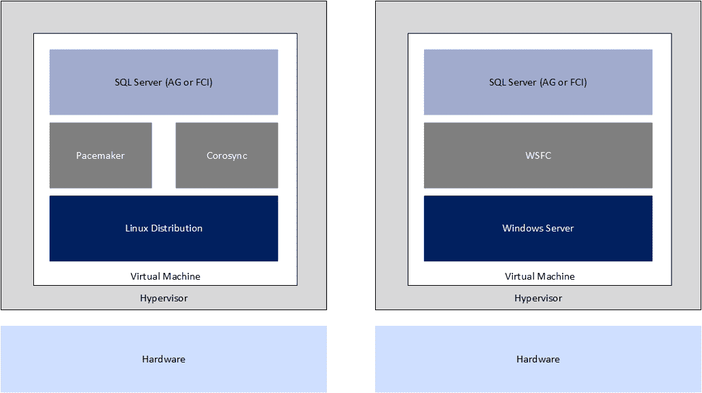

在 Linux 上，虽然每个支持的发行版都提供了 Pacemaker，但每个发行版都可以进行自定义，并具有略有不同的实现和版本。某些差异将反映在本文的指令中。集群层是开源的，因此尽管它随发行版一起发布，但它并不像 Windows 下的 WSFC 那样紧密集成。这就是为什么微软提供了 `mssql-server-ha`，以便 SQL Server 和 Pacemaker 栈能够为 AGs 和 FCIs 提供与 Windows 下相似但并不完全相同的体验。

## Pacemaker 概念和术语

本节记录了 Pacemaker 实现的通用概念和术语。

### 节点（Node）

节点是参与集群的服务器。Pacemaker 集群原生支持最多 16 个节点。如果额外的节点上没有运行 Corosync，则可以超过这个数字，但 SQL Server 需要 Corosync。因此，对于任何基于 SQL Server 的配置，集群可以拥有的节点数限制为 16；这是 Pacemaker 的限制，与 SQL Server 对 AG 或 FCIs 施加的最大限制无关。

### 资源（Resource）

WSFC 和 Pacemaker 集群都有资源的概念。资源是在集群上下文中运行的特定功能，例如磁盘或 IP 地址。例如，在 Pacemaker 下，可以创建 FCI 和 AG 资源。这与 WSFC 中的操作并不相似，在 WSFC 中配置 AG 时，你会看到 FCI 或 AG 资源的 SQL Server 资源，但由于 SQL Server 与 Pacemaker 集成方式的底层差异，并不完全相同。

Pacemaker 有标准资源和克隆资源（clone resources）。克隆资源是在所有节点上同时运行的资源。例如，为了负载均衡而在多个节点上运行的 IP 地址。为 FCI 创建的任何资源都使用标准资源，因为任何时候只能有一个节点托管 FCI。

### 资源组/集（Resource groups/sets）

类似于 WSFC 中的角色（roles），Pacemaker 集群拥有资源组的概念。资源组（在 SLES 中称为 `set`）是一组共同运行的资源集合，并且可以作为一个单元从一个节点故障转移到另一个节点。资源组不能包含配置为主（master）或从（slave）的资源；因此它们不能用于 AGs。虽然资源组可以用于 FCIs，但通常不推荐这种配置。

### 约束（Constraints）

WSFC 资源有各种参数，以及如依赖项等内容，这些内容告诉 WSFC 两个资源之间存在父子关系。依赖项只是一个告诉 WSFC 哪个资源需要先上线的规则。

Pacemaker 集群没有依赖项的概念，但有约束。约束有三种：共存（colocation）、位置（location）和排序（ordering）。

- `colocation constraint`（共存约束）强制两个资源是否应在同一个节点上运行。
- `location constraint`（位置约束）告诉 Pacemaker 集群资源可以在（或不能）在哪里运行。
- `ordering constraint`（排序约束）告诉 Pacemaker 集群资源启动的顺序。

### 仲数（Quorum）、栅栏代理（fence agents）和 STONITH

Pacemaker 中的仲数在概念上与 WSFC 。集群仲数机制的目的是确保集群保持运行。WSFC 和 Linux 发行版的 HA 扩展都有投票的概念，每个节点都对仲数计数。你需要大多数票数通过，否则在最坏的情况下，集群将关闭。

与 WSFC 不同，没有见证者资源来配合仲数。与 WSFC 类似，目标是保持投票人数为奇数。仲数配置对于 AGs 和 FCIs 有不同的考量。

WSFC 监控参与节点的状态并在发生问题时对其进行处理。较高版本的 WSFC 提供了此类功能，例如隔离运行异常或不可用的节点（节点未开启、网络通信中断等）。在 Linux 侧，此类功能由栅栏代理提供。该概念有时被称为栅栏（fencing）。然而，这些栅栏代理通常特定于部署，通常由硬件供应商和某些软件供应商（如虚拟化程序供应商）提供。例如，VMware 提供了一个可以使用 vSphere 虚拟化的 Linux VM 的栅栏代理。

仲数和栅栏与另一个称为 STONITH（Shoot the Other Node in the Head）的概念紧密相关。在所有 Linux 发行版上拥有支持的 Pacemaker 集群都需要 STONITH。

### `corosync.conf`

`corosync.conf` 文件包含集群配置。它位于 `/etc/corosync`。在日常操作中，如果集群设置得当，永远不需要编辑此文件。

### 集群日志位置（Cluster log location）

Pacemaker 集群的日志位置取决于发行版。

- RHEL 和 SLES - `/var/log/cluster/corosync.log`
- Ubuntu - `/var/log/corosync/corosync.log`

要更改默认日志位置，请修改 `corosync.conf`。

## 为 SQL Server 设计 Pacemaker 集群

本节讨论了 Pacemaker 集群的重要规划点。

## 为 SQL Server 虚拟化基于 Linux 的 Pacemaker 集群

使用虚拟机部署用于 AG（可用性组）和 FCI（故障转移实例）的 Linux SQL Server 部署，遵循与其 Windows 版本相同的规则。微软在 `Microsoft Support KB 956893` 中提供了关于虚拟化 SQL Server 部署支持性的基础规则。由于平台本身的差异，微软的 `Hyper-V` 和 VMware 的 `ESXi` 等不同的虚拟化程序在此基础上可能会有不同的差异。

涉及虚拟化环境下的 AG 和 FCI 时，请确保为特定 Pacemaker 集群的节点设置了反亲和性（anti-affinity）。在 AG 或 FCI 配置中配置高可用时，托管 SQL Server 的虚拟机永远不应运行在同一个虚拟化宿主机上。例如，如果部署了一个双节点 FCI，则至少需要三个虚拟化宿主机，以便在发生主机故障时，其中一个托管节点的虚拟机有地方可以去，特别是使用 `Live Migration`（实时迁移）或 `vMotion` 等功能时。

### 网络

与 WSFC 不同，Pacemaker 集群本身不需要专用的名称或至少一个专用的 IP 地址。AG 和 FCI 需要 IP 地址（更多信息请参阅各自的文档），但不需要名称，因为没有网络名称资源。`SLES` 允许为了管理目的配置 IP 地址，但并非强制要求。

与 WSFC 一样，Pacemaker 倾向于冗余网络，这意味着不同的网卡（物理的 `NICs` 或 `pNICs`）具有独立的 IP 地址。在集群配置方面，每个 IP 地址将拥有自己的“环”（ring）。然而，与现在的 WSFC 一样，许多实现是虚拟化或位于公共云的，向服务器实际上只呈现一个虚拟网卡（`vNIC`）。如果所有 `pNICs` 和 `vNICs` 都连接到同一个物理或虚拟交换机，则在网络层没有真正的冗余，因此配置多个 `NICs` 对虚拟机来说只是一种幻觉。网络冗余通常构建在虚拟化部署的虚拟化程序中，并一定构建在公共云中。

多网卡 Pacemaker 与 WSFC 的一个区别在于，Pacemaker 允许在同一网段使用多个 IP 地址，而 WSFC 则不允许。

### 多数数（Quorum）与 STONITH

多数数配置和要求与 SQL Server 的 AG 或 FCI FCI 相关。支持的 Pacemaker 集群需要 `STONITH`。请使用发行版的文档来配置 `STONITH`。

## 互操作性

本节记录了基于 Linux 的集群如何与 WSFC 或其他 Linux 发行版交互。

### WSFC

目前，WSFC 和 Pacemaker 集群之间没有直接协作的方法。这意味着无法创建一个跨 WSFC 和 Pacemaker 的 AG 或 FCI。但是，有两种互操作解决方案，这两种都是为 AG 设计的。FCI 参与跨平台配置的唯一方法是作为以下两种场景之一的实例参与其中：

- 集群类型为 `None` 的 AG。
- 分布式 AG，这是一种特殊的可用性组类型，允许将两个不同的 AG 配置为它们自己的可用性组。

### 其他 Linux 发行版

在 Linux 上，Pacemaker 集群的所有节点必须位于相同的发行版上。例如，这意味着 `RHEL` 节点不能加入包含 `SLES` 节点的 Pacemaker 集群。其主要原因之前已提到：不同发行版可能具有不同的版本和功能，因此无法正常工作。混合发行版的情况与混合 WSFC 和 Linux 类似：使用 `None` 或分布式 AG。

## 在 Linux 上备份和还原 SQL Server 数据库

你可以通过许多不同的选项对 Linux 版 SQL Server 2017 数据库进行备份。在 Linux 服务器上，你可以使用 `sqlcmd` 连接到 SQL Server 并进行备份。从 Windows 端，你可以连接到 Linux 上的 SQL Server 并通过界面进行备份。备份功能在各个平台上是相同的。例如，你可以将数据库备份到本地、远程驱动器或 `Microsoft Azure Blob storage service`。

Linux 版 SQL Server 仅支持使用块 blob（block blobs）备份到 Azure Blob。使用存储密钥进行备份还原将导致使用页 blob，这是不支持的。请使用 `Shared Access Signature`（共享访问签名）。

### 备份数据库

在以下示例中，`sqlcmd` 连接到本地 SQL Server 实例并对名为 `demodb` 的用户数据库进行全备。

```bash
sqlcmd -S localhost -U SA -Q "BACKUP DATABASE [demodb] TO DISK = N'/var/opt/mssql/data/demodb.bak' WITH NOFORMAT, NOINIT, NAME = 'demodb-full', SKIP, NOREWIND, NOUNLOAD, STATS = 1"
```

运行该命令时，SQL Server 会提示输入密码。输入密码后，shell 将返回备份进度度的结果。例如：

```
Password:
10 percent processed.
21 percent processed.
32 percent processed.
40 percent processed.
51 percent processed.
61 percent processed.
72 percent processed.
80 percent processed.
91 percent processed.
Processed 296 pages for database 'demodb', file 'demodb' on file 1.100 percent processed.
Processed 2 pages for database 'demodb', file 'demodb_log' on file 1.
BACKUP DATABASE successfully processed 298 pages in 0.064 seconds (36.376 MB/sec).
```

### 备份事务日志

如果你的数据库处于完全恢复模式，还可以进行事务日志备份以获得更细粒度的还原选项。在以下示例中，`sqlcmd` 连接到本地 SQL Server 实例并执行事务日志备份。

```bash
sqlcmd -S localhost -U SA -Q "BACKUP LOG [demodb] TO DISK = N'/var/opt/mssql/data/demodb_LogBackup.bak' WITH NOFORMAT, NOINIT, NAME = N'demodb_LogBackup', NOSKIP, NOREWIND, NOUNLOAD, STATS = 5"
```

### 还原数据库

在以下示例中，`sqlcmd` 连接到 SQL Server 本地实例并还原 `demodb` 数据库。注意，使用 `NORECOVERY` 选项允许额外的日志文件备份还原。如果你不还原额外的日志文件，请删除 `NORECOVERY` 选项。

```bash
sqlcmd -S localhost -U SA -Q "RESTORE DATABASE [demodb] FROM DISK = N'/var/opt/mssql/data/demodb.bak' WITH FILE = 1, NOUNLOAD, REPLACE, NORECOVERY, STATS = 5"
```

### 还原事务日志

以下命令还原之前的事务日志备份。

```bash
sqlcmd -S localhost -U SA -Q "RESTORE LOG demodb FROM DISK = N'/var/opt/mssql/data/demodb_LogBackup.bak'"
```

## 使用 SQL Server Management Studio（SSMS）备份和还原

你可以使用 Windows 上的 `SSMS` 连接到 Linux 数据库并通过用户界面进行备份。以下步骤介绍了使用 `SSMS` 备份的流程。

1. 启动 `SSMS` 并连接到 Linux 版 SQL Server 2017 上的。
2. 在对象管理器中，右键点击你的数据库，点击 `Tasks`（任务），然后点击 `Back Up....`（备份）。
3. 在 `Backup Database` 对话框中，验证参数和选项，并点击 `OK`。
4. SQL Server 完成数据库备份。

### 使用 SQL Server Management Studio（SSMS）还原

以下步骤介绍了使用 `SSMS` 还原数据库的流程。


1. 在`SSMS`中右键点击数据库并点击`Restore Databases....`（还原数据库）。

2. 在 Source（源）下点击`Device:`（设备），然后点击省略号（`...`）。

3. 找到你的数据库备份文件并点击`OK`。

4. 在 Restore plan（还原计划）下，验证备份文件和设置。点击`OK`。

5. SQL Server 完成数据库还原。

# Linux 版 SQL Server VDI 客户端规范

本文涵盖了 Linux 版 SQL Server 虚拟设备接口（VDI）客户端 SDK 提供的接口。独立软件供应商（ISV）可以使用虚拟备份设备应用程序接口（API）将 SQL Server 集成到其产品中。通常，Linux 上的 VDI 行为与 Windows 上的 VDI 相似，但有以下变化：

- Windows 共享内存变为 POSIX 共享内存。
- Windows 信号量（Semaphores）变为 POSIX 信号量。
- Windows 类型（如`HRESULT`和`DWORD`）更改为相应的整数类型。
- COM 接口被移除并由一对 C++ 类取代。
- Linux 版 SQL Server 不支持命名实例，因此删除了对实例名的引用。
- 共享库实现在`libsqlvdi.so`中，位于`/opt/mssql/lib/libsqlvdi.so`。

本文档是`vbackup.chm`的补充文档，详细介绍了 Windows 上的 MS SQL Server VDI 规范。

## 用户权限设置

在 Linux 上，POSIX 原始语由创建它的用户及其默认组所有。对于 SQL Server 创建的对象，默认将由`mssql`用户和`mssql`组所有。为了允许 SQL Server 与 VDI 客户端之间共享，推荐以下两种方法之一：

### 1. 以`mssql`用户身份运行 VDI 客户端

执行以下命令切换到`mssql`用户：

```bash
sudo su mssql
```

### 2. 将`mssql`用户加入`vdiuser`组，并将`vdiuser`加入`mssql`组。

执行以下命令：

```bash
sudo useradd vdiuser
sudo usermod -a -G mssql vdiuser
sudo usermod -a -G vdiuser mssql
```

重启服务器以使 SQL Server 和`vdiuser`获取新组。

## 客户端函数

本章包含了每个客户端函数的描述。描述包含以下信息：

- 函数用途
- 函数语法
- 参数列表
- 返回值
- 备注

### ClientVirtualDeviceSet::Create

**用途**

此函数创建虚拟设备集。

**语法**

```cpp
int ClientVirtualDeviceSet::Create (char *name, // 集合名称
VDConfig *cfg); // 集合配置；
```

**CLIENTVIRTUALDEVICESET::CREATE**

| 参数 | 参数名 | 解释 |
| --- | --- | --- |
| | name | 标识虚拟设备集。必须遵循`CreateFileMapping()`使用的名称规则。可以使用除斜杠（`/`）之外的任何字符。这是一个字符串。建议在字符串前加上用户的产品或公司名称以及数据库名称。 |
| | cfg | 这是虚拟设备集的配置。更多信息请参阅本文后后的“配置”部分。 |

**CLIENTVIRTUALDEVICESET::CREATE**

| 返回值 | 参数名 | 解释 |
| --- | --- | --- |
| | NOERROR | 函数执行成功。 |
| | VD_E_NOTSUPPORTED | 配置中的一个或多个字段无效或不支持。 |
| | VD_E_PROTOCOL | 虚拟设备集已存在。 |

**备注**

每次`BACKUP`或`RESTORE`操作应调用一次`Create`方法。在调用`Close`方法后，客户端可以重用该接口创建另一个虚拟设备集。

### ClientVirtualDeviceSet::GetConfiguration

**用途**

此函数用于等待服务器配置虚拟设备集。

**语法**

```cpp
int ClientVirtualDeviceSet::GetConfiguration (time_t timeout, // 毫秒
VDConfig *cfg); // 选定的配置；
```

**CLIENTVIRTUALDEVICESET::GETCONFIGURATION**

| 参数 | 参数名 | 解释 |
| --- | --- | --- |
| | timeout | 这是以毫秒为单位的超时。使用`INFINITE`或任何负整数来防止超时。 |
| | cfg | 执行成功后，该参数包含服务器选择的配置。更多信息请参阅本文后后的“配置”部分。 |

**CLIENTVIRTUALDEVICESET::GETCONFIGURATION**

| 返回值 | 参数名 | 解释 |
| --- | --- | --- |
| | NOERROR | 已返回配置。 |
| | VD_E_ABORT | 已调用了中止（Abort）。 |
| | VD_E_TIMEOUT | 函数超时。 |

**备注**

`GetConfiguration`函数在可中断（Alertable）状态下阻塞。调用后，可以打开设备。

### ClientVirtualDeviceSet::OpenDevice

**用途**

此函数打开集中的一个设备。

**语法**

```cpp
int ClientVirtualDeviceSet::OpenDevice (char *name, // 集合名称
VirtualDevice **ppDevice); // 返回设备
```

**CLIENTVIRTUALDEVICESET::OPEN**

| 参数 | 参数名 | 解释 |
| --- | --- | --- |
| | name | 标识虚拟设备集。 |
| | ppDevice | 函数执行成功时，返回指向设备的指针。这用于`GetCommand`和`CompleteCommand`。 |

**CLIENTVIRTUALDEVICESET::OPEN**

| 返回值 | 参数名 | 解释 |
| --- | --- | --- |
| | NOERROR | 函数执行成功。 |
| | VD_E_ABORT | 请求中止。 |
| | VD_E_OPEN | 所有设备均已打开。 |
| | VD_E_PROTOCOL | 集合未处于初始化状态。 |
| | VD_E_INVALID | 设备名称无效。 |

**备注**

客户端可以通过循环调用`OpenDevice`直到返回此代码。如果配置了多个设备，虚拟设备集将返回`n`个唯一的设备接口。

### ClientVirtualDevice::GetCommand

**用途**

此函数用于获取队列到设备中的下一个命令。当被请求时，此函数会等待下一个命令。

**语法**

```cpp
int ClientVirtualDevice::GetCommand (time_t timeout, // 以毫秒为单位的超时
VD_Command **ppCmd); // 返回下一个命令
```

**CLIENTVIRTUALDEVICE::GETCOMMAND**

| 参数 | 参数名 | 解释 |
| --- | --- | --- |
| | timeout | 这是以毫秒为单位的等待时间。使用`INFINITE`无限等待。使用 0 轮询命令。如果当前没有可用命令，则返回`VD_E_TIMEOUT`。如果超时，由客户端决定下一步操作。 |
| | ppCmd | 成功返回命令时，参数返回要执行命令的地址。返回的内存是只读的。当命令完成后，此指针将传递给`CompleteCommand`程序。有关每个命令的详细信息，请参阅本文后后的“命令”部分。 |

**CLIENTVIRTUALDEVICE::GETCOMMAND**

| 返回值 | 参数名 | 解释 |
| --- | --- | --- |
| | NOERROR | 已获取命令。 |
| | VD_E_CLOSE | 设备已由服务器关闭。 |
| | VD_E_TIMEOUT | 无可用命令且超时过期。 |
| | VD_E_ABORT | 客户端或服务器已使用`SignalAbort`强制关闭。 |

**备注**

当返回`VD_E_CLOSE`时，SQL Server 已关闭该设备。这是正常关闭过程的一部分。在所有设备关闭后，客户端调用`ClientVirtualDeviceSet::Close`来关闭虚拟设备集。当此例程必须阻塞等待命令时，该线程将处于可呼出状态（Alertable condition）。

### ClientVirtualDevice::CompleteCommand

#### 目的

此函数用于通知 SQL Server 命令已完成。应返回适用于该命令的完成信息。更多信息，请参阅本文后半部分的“命令”（Commands）。

#### 语法

```cpp
int ClientVirtualDevice::Complete (VDC_Command pCmd, // 命令
int completionCode, // 完成代码
unsigned long bytesTransferred, // 传输的字节数
int64_t position // 当前位置);
```

#### CLIENTVIRTUALDEVICE::COMPLETECOMMAND

| 参数 | 参数 | 解释 |
| :--- | :--- | :--- |
| | pCmd | 这是之前从`ClientVirtualDevice::GetCommand`返回的命令的地址。 |
| | completionCode | 这是一个指示完成状态的状态码。所有命令都必须返回此参数。返回的代码应与正在执行的命令适当。所有情况下均使用`ERROR_SUCCESS`表示命令执行成功。有关可能代码的完整列表，请参见文件`vdierror.h`。每个命令的典型状态代码列表出现在本文后半部分的“命令”（Commands）中。 |
| | bytesTransferred | 这是成功传输的字节数。仅数据传输命令`Read`和`Write`返回此值。 |
| | position | 仅是对`GetPosition`命令的响应。 |

#### CLIENTVIRTUALDEVICE::COMPLETECOMMAND

| 返回值 | 参数 | 解释 |
| :--- | :--- | :--- |
| | NOERROR | 完成已正确记录。 |
| | VD_E_INVALID | pCmd 不是一个活动命令。 |
| | VD_E_ABORT | 已发出中止信号。 |
| | VD_E_PROTOCOL | 设备未打开。 |

**备注：** 无

### ClientVirtualDeviceSet::SignalAbort

#### 目的

此函数用于信号应发生异常终止。

#### 语法

```cpp
int ClientVirtualDeviceSet::SignalAbort ();
```

#### CLIENTVIRTUALDEVICESET::SIGNALABORT

| 参数 | 参数 | 解释 |
| :--- | :--- | :--- |
| | 无 | 不适用 |

#### CLIENTVIRTUALDEVICESET::SIGNALABORT

| 返回值 | 参数 | 解释 |
| :--- | :--- | :--- |
| | NOERROR | 中止通知已成功发布。 |

**备注：** 在任何时刻，客户端都可以选择中止`BACKUP`或`RESTORE`操作。此例程指示所有操作都应停止。整个虚拟设备集的状态进入“异常终止”状态。任何设备上将不再返回后续命令。所有未完成的命令将自动完成，并返回`ERROR_OPERATION_ABORTED`作为完成代码。客户端在安全终止任何提供给客户端的待缓冲区使用后，应调用`ClientVirtualDeviceSet::Close`。更多信息，请参阅本文较之前的“异常终止”（Abnormal Termination）。

### ClientVirtualDeviceSet::Close

#### 目的

此函数关闭由`ClientVirtualDeviceSet::Create`创建的虚拟设备集。这将释放与虚拟设备集相关的所有资源。

#### 语法

```cpp
int ClientVirtualDeviceSet::Close ();
```

#### CLIENTVIRTUALDEVICESET::CLOSE

| 参数 | 参数 | 解释 |
| :--- | :--- | :--- |
| | 无 | 不适用 |

#### CLIENTVIRTUALDEVICESET::CLOSE

| 返回值 | 参数 | 解释 |
| :--- | :--- | :--- |
| | NOERROR | 当虚拟设备集成功关闭时返回此值。 |
| | VD_E_PROTOCOL | 由于虚拟设备集未打开，因此未执行任何操作。 |
| | VD_E_OPEN | 设备仍处于打开。 |

**备注：** 调用`Close`是客户端的一种声明，应释放虚拟设备集使用的所有资源。客户端必须在调用`Close`之前确保所有涉及数据缓冲区和虚拟设备的活动都已终止。通过`OpenDevice`返回的所有虚拟设备接口都会被`Close`作无效。客户端允许在`Close`调用返回后在虚拟设备集接口上发出`Create`调用。此类调用将为随后的`BACKUP`或`RESTORE`操作创建一个新的虚拟设备集。如果在一个或多个虚拟设备仍处于打开状态时调用`Close`，则返回`VD_E_OPEN`。在这种情况下，内部会触发`SignalAbort`，以确保在可能的情况下正常关闭。VDI 资源将被释放。客户端在调用`ClientVirtualDeviceSet::Close`之前，应等待每个设备上的`VD_E_CLOSE`指示。如果客户端知道虚拟设备集已处于异常终止状态，则不应期望从`GetCommand`获取`VD_E_CLOSE`指示，并可以在共享缓冲区上的活动终止后立即调用`ClientVirtualDeviceSet::Close`。更多信息，请参阅本文较之前的“异常终止”（Abnormal Termination）。

### ClientVirtualDeviceSet::OpenInSecondary

#### 目的

此函数在次级客户端中打开虚拟设备集。主客户端必须已经使用`Create`和`GetConfiguration`来设置虚拟设备集。

#### 语法

```cpp
int ClientVirtualDeviceSet::OpenInSecondary (char *setName // 集的名称);
```

#### CLIENTVIRTUALDEVICESET::OPENINSECONDARY

| 参数 | 参数 | 解释 |
| :--- | :--- | :--- |
| | setName | 标识该集。此名称区分大小写，且必须与主客户端调用`ClientVirtualDeviceSet::Create`时使用的名称匹配。 |

#### CLIENTVIRTUALDEVICESET::OPENINSECONDARY

| 返回值 | 参数 | 解释 |
| :--- | :--- | :--- |
| | NOERROR | 函数成功。 |
| | VD_E_PROTOCOL | 虚拟设备集尚未创建、已在此客户端上打开，或者虚拟设备集未准备好接受次级客户端的打开请求。 |
| | VD_E_ABORT | 操作正在中止。 |

**备注：** 使用多进程模型时，主客户端负责检测次级客户端的正常和异常终止。

### ClientVirtualDeviceSet::GetBufferHandle

#### 目的

某些应用程序可能需要多个进程来操作由`ClientVirtualDevice::GetCommand`的缓冲区。在这种情况下，接收命令的进程可以使用`GetBufferHandle`获取一个标识缓冲器的进程独立句柄。该句柄可以通信给任何其他打开了相同虚拟设备集的进程。该进程随后将使用`ClientVirtualDeviceSet::MapBufferHandle`获取缓冲区的地址。该地址可能与其伙伴的地址不同，因为每个进程可能在不同的地址上映射缓冲区。

#### 语法

```cpp
int ClientVirtualDeviceSet::GetBufferHandle (uint8_t* pBuffer, // 输入：缓冲区地址
unsigned int* pBufferHandle // 输出：缓冲区句柄);
```

#### CLIENTVIRTUALDEVICESET::GETBUFFERHANDLE

| 参数 | 参数 | 解释 |
| :--- | :--- | :--- |
| | pBuffer | 这是从`Read`或`Write`命令获取的缓冲区地址。 |
| | BufferHandle | 返回缓冲区的唯一标识符。 |

#### CLIENTVIRTUALDEVICESET::GETBUFFERHANDLE

| 返回值 | 参数 | 解释 |
| :--- | :--- | :--- |
| | NOERROR | 函数成功。 |
| | VD_E_PROTOCOL | 虚拟设备集当前未打开。 |
| | VD_E_INVALID | pBuffer 不是有效地址。 |


## 备注

调用`GetBufferHandle`函数的过程负责在数据传输完成时调用`ClientVirtualDevice::CompleteCommand`。

### `ClientVirtualDeviceSet::MapBufferHandlePurpose`

此函数用于从其他进程获得的缓冲区句柄（buffer handle）获取有效的缓冲区地址。

## 语法

```cpp
int ClientVirtualDeviceSet::MapBufferHandle (int dwBuffer, // 输入: 句柄
uint8_t** ppBuffer // 输出: 缓冲区地址);
```

### `ClientVirtualDeviceSet::MapBufferHandle`

| 参数 | 说明 |
| :--- | :--- |
| `dwBuffer` | 由`ClientVirtualDeviceSet::GetBufferHandle`返回的句柄。 |
| `ppBuffer` | 这是当前进程中有效的缓冲区地址。 |

### 返回值

| 返回值 | 说明 |
| :--- | :--- |
| `NOERROR` | 函数执行成功。 |
| `VD_E_PROTOCOL` | 虚拟设备集当前未打开。 |
| `VD_E_INVALID` | `ppBuffer`是无效句柄。 |

#### 备注

必须注意正确通信句柄。句柄局限于单个虚拟设备集。共享句柄的伙伴进程必须确保缓冲区句柄仅在最初获取缓冲区的虚拟设备集范围内核使用。

## Linux 上的故障转移集群实例 - SQL Server

本节描述了与 Linux 上 SQL Server 故障转移集群实例 (FCI) 相关的概念。

### 集群层

- 在 RHEL 中，集群层基于红帽企业级 Linux (RHEL) HA 插件。
- 在 SLES 中，集群层基于 SUSE 企业级 Linux 高可用性扩展 (HAE)。

RHEL HA 插件和 SUSE HAE 均都是基于`Pacemaker`构建的。如下所示，存储呈现给两台服务器。集群组件——`Corosync`和`Pacemaker`——协调通信和资源管理。其中一个服务器拥有到存储资源和 SQL Server 的活动连接。当`Pacemaker`检测到故障时，集群组件将管理并将资源移动到另一个节点。

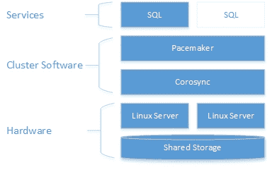

此时，SQL Server 与 Linux 上`Pacemaker`的集成不像 Windows 上的 WSFC 那样紧密。在 SQL 内部，无法感知集群的存在，所有的编排都在外部完成，且服务由`Pacemaker`作为独立实例进行控制。此外，虚拟网络名称是 WSFC 特有的，在`Pacemaker`中没有同等产物。预运行`@@servername`和`sys.servers`将返回节点名称，而集群 DMV`sys.dm_os_cluster_nodes`和`sys.dm_os_cluster_properties`将不包含任何记录。若要使用指向字符串服务器名称而非 IP 的连接字符串，则必须在 DNS 服务器中将用于创建虚拟 IP 资源所使用的 IP（见下文章节说明）与选定的服务器名称进行注册。

### 实例和节点数量

Linux 版 SQL Server 的一个关键区别是，每台 Linux 服务器上只能安装一个 SQL Server。该安装被称为一个实例。这意味着与 Windows Server 不同（每个 Windows Server 故障转移集群 (WSFC) 支持多达 25 个 FCI）不同，基于 Linux 的 FCI 只有一个实例。此实例也是默认实例；Linux 上没有命名实例的概念。涉及`Corosync`时，`Pacemaker`集群最多只能有 16 个节点，因此单个 FCI 可以跨越 16 台服务器。使用 SQL Server 标准版实现的 FCI 支持集群中的至多两个节点，即使`Pacemaker`集群达到了最大 16 个节点。在 SQL Server FCI 中，SQL Server 实例在其中一个节点上处于活动。

### IP 地址和名称

在 Linux`Pacemaker`集群上，每个 SQL Server FCI 都需要唯一的 IP 地址和名称。如果 FCI 配置跨越多个子网，则每个子网需要一个 IP 地址。唯一的名称和 IP 地址用于访问 FCI，以便应用程序和终端用户无需感知`Pacemaker`集群的底层是哪台服务器。DNS 中的 FCI 名称应与`Pacemaker`集群中创建的 FCI 资源名称相同。名称和 IP 地址都必须在 DNS 中注册。

### 共享存储

所有的 FCI（无论是在 Linux 还是 Windows Server 上）都需要某种形式的共享存储。存储呈现给所有可能托管 FCI 的服务器，但在任何给定时刻，只有一个服务器可以使用该存储运行 FCI。Linux 下可用的共享存储选项包括：

- `iSCSI`
- 网络文件系统 (`NFS`)
- 服务器消息块 (`SMB`)

在 Windows Server 下，选项略有不同。目前 Linux 版 FCI 不支持的一个选项是使用节点本地磁盘作为`TempDB`（即 SQL Server 的临时工作空间）。

在跨多个位置的配置中，一个数据中心存储的内容必须与另一个中心同步。在发生故障转移时，FCI 将能够上线，且存储的内容是相同的。实现这将需要某些外部的存储复制方法，无论是通过底层存储硬件还是某些软件实用程序。

不同支持方法的共享存储呈现过程相同：

- 配置共享存储。
- 将存储挂载为文件夹到将作为 FCI`Pacemaker`集群节点的服务器上。
- 如果需要，将 SQL Server 系统数据库移动到共享存储。
- 测试连接到共享存储的每台服务器上的 SQL Server 是否工作正常。

Linux 版 SQL Server 的一个主要区别是，虽然配置默认用户数据和日志文件的位置，但系统数据库必须存在于`/var/opt/mssql/data`。在 Windows Server 上，可以移动包括`TempDB`在内的系统数据库。这一事实影响了 FCI 配置共享存储的方式。可以使用`mssql-conf`实用更改非系统数据库的默认路径。只要具有适当的安全性，即使不是默认位置，也可以将 SQL Server 数据和事务存储在其他位置；但需要说明该位置。

## 为 SQL Server 配置 RHEL 故障转移集群实例 (FCI) 集群

本文提供了在红帽企业级 Linux 上为 SQL Server 创建双节点共享磁盘故障转移集群的说明。集群层基于构建在`Pacemaker`之上的红帽企业级 Linux (RHEL) HA 插件。SQL Server 实例在其中一个节点上处于活动。

如下所示，存储呈现给两台服务器。集群组件——`Corosync`和`Pacemaker`——协调通信和资源管理。当`Pacemaker`检测到故障时，集群组件将管理并将资源移动到另一个节点。


要完成以下端到端场景，您需要两台机器部署双节点集群，以及另一台服务器配置 NFS 服务器。以下步骤概述了这些服务器的配置方法。

### 在每个集群节点上设置并配置操作系统

第一步是配置集群节点的操作系统。在本练习中，请使用具有有效 HA 订阅的 RHEL。

### 在每个集群节点上安装并配置 SQL Server

1. 在两个节点上安装并设置 SQL Server。
2. 为了配置目的，将一个节点指定为主节点，另一个指定为备节点。在本指南中使用这些术语。
3. 在备节点上停止并禁用 SQL Server。

以下示例停止并禁用了 SQL Server：

```bash
sudo systemctl stop mssql-server
sudo systemctl disable mssql-server
```

在设置时，会为 SQL Server 实例生成服务器主密钥（Server Master Key），并将其放在`/var/opt/mssql/secrets/machine-key`。在 Linux 上，SQL Server 始终以名为`mssql`的本地账户运行。由于它是本地账户，其身份不会跨节点共享。因此，你需要将加密密钥从主节点复制到每个辅助节点，以便每个本地`mssql`账户都能访问它并解密服务器主密钥。

1. 在主节点上，为 Pacemaker 创建一个 SQL 服务器登录，并授予该登录运行`sp_server_diagnostics`的权限。Pacemaker 使用此账户来验证哪个节点正在运行 SQL Server。

```bash
sudo systemctl start mssql-server
```

使用`sa`账户连接到 SQL Server 主数据库，并运行以下命令：

```sql
USE [master]
GO
CREATE LOGIN [<loginName>] with PASSWORD= N'<loginPassword>'
ALTER SERVER ROLE [sysadmin] ADD MEMBER [<loginName>]
```

或者，你可以在更细粒度的级别设置权限。Pacemaker 登录需要`VIEW SERVER STATE`来通过`sp_server_diagnostics`查询健康状态，需要`setupadmin`和`ALTER ANY LINKED SERVER`通过运行`sp_dropserver`和`sp_addserver`用资源名称更新 FCI 实例名称。

2. 在主节点上，停止并禁用 SQL Server。
3. 为每个集群节点配置 hosts 文件。文件必须包含每个集群节点的 IP 地址和名称。

检查每个节点的 IP 地址。以下脚本显示当前节点的 IP 地址。

```bash
sudo ip addr show
```

在每个节点上设置计算机名称。为每个节点分配一个 15 个字符或少的唯一名称。通过将其添加到`/etc/hosts`来设置计算机名称。以下脚本允许你使用`vi`编辑`/etc/hosts`。

```bash
sudo vi /etc/hosts
```

以下示例显示了`/etc/hosts`，其中包含了两个名为`sqlfcivm1`和`sqlfcivm2`的节点的添加内容。

```text
127.0.0.1   localhost localhost4 localhost4.localdomain
4::1         localhost localhost6 localhost6.localdomain
10.128.18.128 sqlfcivm1
10.128.16.77 sqlfcivm2
```

在下一节中，你将配置共享存储并将数据库文件移动到该存储。

## 配置共享存储并移动数据库文件

提供共享存储有多种解决方案。本演示了如何使用 NFS 配置共享存储。我们建议遵循最佳实践并使用 Kerberos 来保护 NFS。

在 NFS 服务器上执行以下操作：

1. 安装`nfs-utils`。

   ```bash
   sudo yum -y install nfs-utils
   ```

2. 启用并启动`rpcbind`。

   ```bash
   sudo systemctl enable rpcbind && sudo systemctl start rpcbind
   ```

3. 启用并启动`nfs-server`。

   ```bash
   sudo systemctl enable nfs-server && sudo systemctl start nfs-server
   ```

4. 编辑`/etc/exports`以导出你想共享的目录。每个共享需要一行。例如：

   ```text
   /mnt/nfs  10.8.8.0/24(rw,sync,no_subtree_check,no_root_squash)
   ```

   1. 导出共享。

      ```bash
      sudo exportfs -rav
      ```

   2. 验证路径是否已共享/导出，在 NFS 服务器上运行：

      ```bash
      sudo showmount -e
      ```

   3. 在 SELinux 中添加异常。

      ```bash
      sudo setsebool -P nfs_export_all 1
      ```

   4. 打开服务器防火墙。

      ```bash
      sudo firewall-cmd --permanent --add-service=nfs
      sudo firewall-cmd --permanent --add-service=mount
      sudo firewall-cmd --permanent --add-service=rpc-bind
      sudo firewall-cmd --reload
      ```

## 配置所有集群节点连接 NFS 共享存储

在所有集群节点上执行以下步骤。

1. 安装`nfs-utils`。

   ```bash
   sudo yum -y install nfs-utils
   ```

2. 在客户端和 NFS 服务器上打开防火墙。

   ```bash
   sudo firewall-cmd --permanent --add-service=nfs
   sudo firewall-cmd --permanent --add-service=mount
   sudo firewall-cmd --permanent --add-service=rpc-bind
   sudo firewall-cmd --reload
   ```

3. 验证客户端机器上可以看到 NFS 共享。

   ```bash
   sudo showmount -e <IP OF SERVER>
   ```

4. 在所有集群节点上重复这些步骤。

## 将数据库目录指向共享存储

1. 仅在主节点上，将数据库文件保存到临时位置。以下脚本创建一个临时目录，将数据库文件复制到那里并删除旧数据库文件。由于 SQL Server 以本地用户`mssql`运行，你需要确保数据传输到共享后，本地用户对共享具有读写权限。

   ```bash
   $ sudo su mssql
   $ mkdir /var/opt/mssql/tmp
   $ cp /var/opt/mssql/data/* /var/opt/mssql/tmp
   $ rm /var/opt/mssql/data/*
   $ exit
   ```

2. 在所有集群节点上编辑`/etc/fstab`文件以包含挂载命令。

   ```text
   <IP OF SERVER>:<shared_storage_path> <database_files_directory_path> nfs timeo=14,intr
   ```

   以下脚本显示编辑示例：

   ```text
   10.8.8.0:/mnt/nfs /var/opt/mssql/data nfs timeo=14,intr
   ```

3. 运行`mount -a`命令更新系统挂载路径。
4. 将保存到`/var/opt/mssql/tmp`的数据库和文件复制到新挂载的共享`/var/opt/mssql/data`。这只需要在主节点执行。确保给`mssql`本地用户读写权限。

   ```bash
   $ sudo chown mssql /var/opt/mssql/data
   $ sudo chgrp mssql /var/opt/mssql/data
   $ sudo su mssql
   $ cp /var/opt/mssql/tmp/* /var/opt/mssql/data/
   $ rm /var/opt/mssql/tmp/*
   $ exit
   ```

5. 使用新路径验证 SQL Server 是否成功启动。在每个节点上执行此操作。此时应只有一个节点运行 SQL Server。它们不能同时运行（为了避免在两个节点上意外启动 SQL Server，请使用文件系统资源确保不会挂载两次）。以下命令启动 SQL Server、检查状态并停止它。

   ```bash
   sudo systemctl start mssql-server
   sudo systemctl status mssql-server
   sudo systemctl stop mssql-server
   ```

此时，两个 SQL Server 实例都配置为运行共享存储上的数据库文件。下一步是为 Pacemaker 配置 SQL Server。

## 安装并配置 Pacemaker

1. 在两个集群节点上，创建一个存储 Pacemaker 登录所需的 SQL Server 用户名和密码的文件。以下命令创建并填充此文件：


```bash
sudo touch /var/opt/mssql/secrets/pass
echo '<loginName>' | sudo tee -a /var/opt/mssql/secrets/pass
echo '<loginPassword>' | sudo tee -a /var/opt/mssql/secrets/pass
sudo chown root:root /var/opt/mssql/secrets/pass
sudo chmod 600 /var/opt/mssql/secrets/pass
```

2. 在两个集群节点上，打开 Pacemaker 防火墙端口。使用 `firewalld` 打开这些端口请运行以下命令：

   ```bash
   sudo firewall-cmd --permanent --add-service=high-availability
   sudo firewall-cmd --reload
   ```

   如果你使用的是其他没有内置高可用性的防火墙，则需要打开以下端口，以便 Pacemaker 能与集群中的其他节点通信：

   - TCP：端口 `2224`、`3121`、`21064`
   - UDP：端口 `5405`

3. 在每个节点上安装 Pacemaker 软件包。

   ```bash
   sudo yum install pcs fence-agents-all resource-agents
   ```

4. 为安装 Pacemaker 和 Corosync 包时创建的默认用户设置密码。在两个节点上使用相同的密码。

   ```bash
   sudo passwd hacluster
   ```

5. 启用并启动 `pcsd` 服务和 Pacemaker。这将允许节点在重启后重新加入集群。在两个节点上运行以下命令：

   ```bash
   sudo systemctl enable pcsd
   sudo systemctl start pcsd
   sudo systemctl enable pacemaker
   ```

6. 安装 SQL Server 的 FCI 资源代理。在两个节点上运行以下命令：

   ```bash
   sudo yum install mssql-server-ha
   ```

## 创建集群

1. 在其中一个节点上创建集群：

   ```bash
   sudo pcs cluster auth <nodeName1 nodeName2 ...> -u hacluster
   sudo pcs cluster setup --name <clusterName> <nodeName1 nodeName2 ...
   sudo pcs cluster start --all
   ```

## 为 SQL Server、文件系统和虚拟 IP 配置集群资源

将配置推送到集群。您需要以下信息：

- `SQL Server Resource Name`：集群化 SQL Server 资源的名称。
- `Floating IP Resource Name`：虚拟 IP 地址资源的名称。
- `IP Address`：客户端连接 SQL Server 集群实例时使用的 IP 地址。
- `File System Resource Name`：文件系统资源的名称。
- `device`：NFS 共享路径。
- `device`：挂载到该共享的本地路径。
- `fstype`：文件共享类型，例如 `nfs`。

请根据您的环境更新以下脚本中的值。在一个节点上运行，以配置并启动集群服务：

```bash
sudo pcs cluster cib-push cfg
sudo pcs -f cfg resource create <sqlServerResourceName> ocf:mssql:fci
sudo pcs -f cfg resource create <floatingIPResourceName> ocf:heartbeat:IPaddr2 ip=<ip Address>
sudo pcs -f cfg resource create <fileShareResourceName> Filesystem device=<networkPath> directory=<localPath> fstype=<fileShareType>
sudo pcs -f cfg constraint colocation add <virtualIPResourceName> <sqlResourceName>
sudo pcs -f cfg constraint colocation add <fileShareResourceName> <sqlResourceName>
sudo pcs cluster cib-push cfg
```

例如，以下脚本创建了一个名为 `mssqlha` 的 SQL Server 集群资源，以及 IP 地址为 `10.0.0.99` 的浮动 IP 资源。它还创建了一个文件系统资源并添加了约束，使所有资源都与 SQL 资源位于同一个节点上：

```bash
sudo pcs cluster cib-push cfg
sudo pcs -f cfg resource create mssqlha ocf:mssql:fci
sudo pcs -f cfg resource create virtualip ocf:heartbeat:IPaddr2 ip=10.0.0.99
sudo pcs -f cfg resource create fs Filesystem device="10.8.8.0:/mnt/nfs" directory="/var/opt/mssql/data" fstype="nfs"
sudo pcs -f cfg constraint colocation add virtualip mssqlha
sudo pcs -f cfg constraint colocation add fs mssqlha
sudo pcs cluster cib-push cfg
```

配置推送后，SQL Server 将在其中一个节点上启动。

## 验证 SQL Server 已启动

```bash
sudo pcs status
```

以下示例显示了 Pacemaker 成功启动 SQL Server 集群实例后的结果：

```text
fs (ocf::heartbeat:Filesystem):     Started sqlfcivm1
virtualip (ocf::heartbeat:IPaddr2):   Started sqlfcivm1
mssqlha (ocf::mssql:fci): Started sqlfcivm1
PCSD Status:
sqlfcivm1: Online
sqlfcivm2: Online
Daemon Status:
corosync: active/disabled
pacemaker: active/enabled
pcsd: active/enabled
```

## 操作 SQL Server 的 RHEL 故障转移集群实例（FCI）

本节描述了如何在基于 Red Hat Enterprise Linux（RHEL）的共享磁盘故障转移集群上执行以下 SQL Server 操作：

- 手动执行集群故障转移
- 监控故障转移集群 SQL Server 服务
- 添加集群节点
- 移除集群节点
- 修改 SQL Server 资源的监控频率

### 架构说明

集群层基于运行在 `Pacemaker` 之上的 Red Hat Enterprise Linux（RHEL）HA 插件。`Corosync` 和 `Pacemaker` 协调集群通信和资源管理。SQL Server 实例在其中一个节点上活动。

下图展示了带有 SQL Server 的 Linux 集群组件。


### 手动执行故障转移集群

`resource move` 命令创建一个约束，强制资源在目标节点上启动。执行 `move` 命令后，执行资源 `clear` 将移除该约束，这样就可以再次移动资源或让资源自动发生故障转移。

```bash
sudo pcs resource move <sqlResourceName> <targetNodeName>
sudo pcs resource clear <sqlResourceName>
```

以下示例将 `mssqlha` 资源移动到名为 `sqlfcivm2` 的节点，然后移除约束，以便以后将资源移动到不同的节点：

```bash
sudo pcs resource move mssqlha sqlfcivm2
sudo pcs resource clear mssqlha
```

### 监控故障转移集群 SQL Server 服务

查看当前集群状态：

```bash
sudo pcs status
```

查看集群和资源的实时状态：

```bash
sudo crm_mon
```

查看 `/var/log/cluster/corosync.log` 处的资源代理日志。

### 向集群添加节点

1. 检查每个节点的 IP 地址。以下脚本显示了当前节点的 IP 地址：

   ```bash
   ip addr show
   ```

2. 新节点需要一个少于 15 个字符的唯一名称。Red Hat Linux 默认的计算机名称是 `localhost.localdomain`。此默认名称可能不是唯一的且长度过长。为新节点设置主机名。通过将其添加到 `/etc/hosts` 设置主机名。以下脚本允许您使用 `vi` 编辑 `/etc/hosts`：

   ```bash
   sudo vi /etc/hosts
   ```

   以下示例显示了包含三个名为 `sqlfcivm1`、`sqlfcivm2` 和 `sqlfcivm3` 节点的 `/etc/hosts`：

   ```text
   127.0.0.1   localhost localhost4 localhost4.localdomain
   4::1         localhost localhost6 localhost6.localdomain
   10.128.18.128 fcivm1
   10.128.16.77 fcivm2
   10.128.14.26 fcivm3
   ```

   该文件在每个节点上都应该是相同的。

3. 停止新节点上的 SQL Server 服务。

4. 按照指令将数据库文件目录挂载到共享位置。

   从 NFS 服务器安装 `nfs-utils`：

   ```bash
   sudo yum install nfs-utils
   ```

   在客户端和 NFS 服务器上打开防火墙：

   ```bash
   sudo firewall-cmd --permanent --add-service=nfs
   sudo firewall-cmd --permanent --add-service=mountd
   sudo firewall-cmd --permanent --add-service=rpc-bind
   sudo firewall-cmd --reload
   ```

   编辑 `/etc/fstab` 文件，包含挂载命令：

   ```text
   <IP NFS SERVER>:<shared_storage_path> <database_directory> nfs timeo=14,intr
   ```

   运行 `mount -a` 使更改生效。

5. 在新节点上，创建一个存储用于 Pacemaker 登录的 SQL Server 用户名和密码的文件。以下命令创建并填充此文件：

   ```bash
   sudo touch /var/opt/mssql/secrets/pass
   sudo echo "<loginName>" >> /var/opt/mssql/secrets/pass
   sudo echo "<loginPassword>" >> /var/opt/mssql/secrets/pass
   sudo chown root:root /var/opt/mssql/secrets/pass
   sudo chmod 600 /var/opt/mssql/secrets/pass
   ```

6. 在新节点上打开 Pacemaker 端口。使用 `firewalld` 打开这些端口：

   ```bash
   sudo firewall-cmd --permanent --add-service=high-availability
   sudo firewall-cmd --reload
   ```

7. 在新节点上安装 Pacemaker 包：

   ```bash
   sudo yum install fence-agents-all resource-agents
   ```

8. 为安装 Pacemaker 和 Corosync 时创建的默认用户设置密码。使用与现有节点相同的密码：

   ```bash
   sudo passwd hacluster
   ```

9. 启用并启动 `pcsd` 服务和 Pacemaker。这将允许节点在重启后重新加入集群。在新节点上运行以下命令：

   ```bash
   sudo systemctl enable pcs
   sudo systemctl start pcs
   sudo systemctl enable pacemaker
   ```

10. 安装 SQL Server 的 FCI 资源代理。在新节点上运行以下命令：

    ```bash
    sudo yum install mssql-server-ha
    ```

11. 在集群的现有节点上，验证新节点并将其加入集群：

    ```bash
    sudo pcs cluster auth <nodeName3> -u hacluster
    sudo pcs cluster node add <nodeName3>
    ```

| 组件 | 说明 |
| :--- | :--- |
| Corosync | 提供集群节点之间的仲裁成员关系（quorum membership）和消息传递。 |
| Pacemaker | 运行在 Corosync 之上，为资源提供状态机。 |
| PCSD | 通过 `pcs` 工具管理 Pacemaker 和 Corosync。 |

必须运行 `PCSD` 才能使用 `pcs` 工具。当前集群状态：`sudo pcs status` 返回有关集群、仲裁、节点、资源以及每个节点守护进程的基本信息。

一个健康的 Pacemaker 输出示例：

```text
Cluster name: MyAppSQL
Last updated: Wed Oct 31 12:00:00 2016  Last change: Wed Oct 31 11:00:00 2016 by root via crm_resource on sqlmnode1
Stack: corosync
Current DC: sqlmnode1 (version 1.1.13-el7_4-44eb2) - partition with quorum 3 nodes and 1 resource configured
Online: [ sqlmnode1 sqlmnode2 sqlmnode3]
Full list of resources: mssqlha (ocf::sql): Started sqlmnode1
PCSD Status:
sqlmnode1: Online
sqlmnode2: Online
sqlmnode3: Online
Daemon Status:
corosync: active/disabled
pacemaker: active/enabled
```

在示例中，`partition with quorum` 意味着大多数节点处于在线状态。如果集群丢失了大多数节点，`pcs status` 将返回 `partition WITHOUT quorum`，且所有资源将停止。`online: [sqlmnode1 sqlmnode2 sqlmnode3]` 返回当前参与集群的节点名称。如果没有任何节点参与，`pcs status` 返回 `OFFLINE: [<nodename>]`。`PCSD Status` 显示每个节点的集群状态。

### 节点离线的原因

当节点离线时，检查以下项目：

#### 防火墙

为了让 Pacemaker 通信，所有节点上需要开放以下端口：

- TCP：`2224`、`3121`、`21064`

#### Pacemaker 或 Corosync 服务运行

检查 Pacemaker 或 Corosync 服务是否正在运行。

#### 节点通信

检查节点之间的通信是否正常。

#### 节点映射

检查节点映射配置是否正确。

## Linux 上的 Always On Availability Groups

这描述了 Linux 版 SQL Server 上 Always On 可用性组（AG）的特征。从高层次来看，Linux 上的可用性组与基于 Windows 故障转移集群（WSFC）的实现是相同的。这意味着所有的限制和功能都是相同的，但主要的区别包括：

- 从 SQL Server 2017 CU1 开始，Linux 下支持分布式事务协调器（DTC）。但是，Linux 上的可用性组尚未支持 DTC。如果您的应用程序需要分布式事务，请部署 Windows 版 SQL Server。
- 基于 Linux 的部署使用 Pacemaker 进行集群，而不是 WSFC。
- 除了工作组集群场景外，Windows 上的大多数 AG 配置需要活动目录服务（AD DS）。
- 从一个节点转移到另一个节点的 Linux 和 Windows 之间是不同的。
- 在 Linux 上，如 `required_synchronized_secondaries_to_commit` 等设置仅可以通过 Pacemaker 更改，而基于 WSFC 的安装使用事务-SQL。

### 副本数量和集群节点


SQL Server 标准版 AG 可以有两个总副本：一个主节点和一个仅用于可用性的从节点。它不能用于任何其他用途，例如可读查询。SQL Server 企业版 AG 可以有多多九个总副本：一个主节点和最多八个从节点，其中最多三个（包括主节点）可以是同步的。如果使用底层集群并涉及 `Corosync`，总节点最多可以 16 个。可用组在 SQL Server 企业版中最多跨九个节点，标准版为两个。

需要自动故障转移到另一个副本的双副本配置需要仅配置副本。仅配置副本是在 SQL Server 2017 (14.x) Cumulative Update 1 (CU1) 中引入的，因此应该是此配置的版本。

如果使用了 `Pacemaker`，它必须正确配置以保持运行。这意味着从 `Pacemaker` 的角度来看，仲人数和 `STONITH` 必须正确实现。可读从节点仅支持 SQL Server 企业版。

## 集群类型和故障转移模式

SQL Server 2017 (14.x) 新引入了 AG 的集群类型。对于 Linux，有两个有效值：`External` 和 `None`。集群类型为 `External` 意味着 AG 底层将使用 `Pacemaker`。使用 `External` 作为集群类型要求故障转移模式也设置为 `External`（这同样是 SQL Server 2017 (14.x) 的新功能）。支持自动故障转移，但与 WSFC 不同，使用 `Pacemaker` 时故障转移模式设置为 `External` 而不是自动。与 WSFC 不同，AG 的 `Pacemaker` 部分是在配置 AG 后创建的。

集群类型为 `None` 意味着不需要 `Pacemaker`，AG 也不会使用。即使在配置了 `Pacemaker` 的服务器上，如果 AG 配置的集群类型为 `None`，`Pacemaker` 也看不到或管理该 AG。集群类型 `None` 只支持从主节点到副本的手动故障转移。使用 `None` 创建的 AG 主要针对读取扩展场景以及升级。虽然它可以适用于不需要自动故障转移的灾难恢复或本地可用性场景，但不推荐。如果没有 `Pacemaker`，监听器机制也更加复杂。

集群类型存储在 SQL Server 动态管理视图 `sys.availability_groups` 的 `cluster_type` 和 `cluster_type_desc` 列中。

## `required_synchronized_secondaries_to_commit`

SQL Server 2017 (14.x) 新引入了一个 AG 使用的设置 `required_synchronized_secondaries_to_commit`。它告诉 AG 必须与主节点保持同步的从副本数量。这启用了自动故障转移（仅当与集群类型为 `External` 的 `Pacemaker` 集成时），并控制当正确数量的从副本在线或离线时主节点的可用性行为。

`required_synchronized_secondaries_to_commit` 的值默认设置并由 `Pacemaker`/SQL Server 维护。你可以手动覆盖此值。

`required_synchronized_secondaries_to_commit` 与新序列号（存储在 `sys.availability_groups` 中）的组合告知 `Pacemaker` 和 SQL Server，例如可以发生自动故障转移。在这种情况下，从副本的序列号与主节点相同，意味着它拥有所有最新的配置信息。

`required_synchronized_secondaries_to_commit` 有三个可以设置的值：0、1 或 2。它们控制当副本不可用时的行为。这些数字对应于必须与主节点同步的从副本数量。在 Linux 下的行为如下：

- 0 - 从副本不需要与主节点保持同步状态。但是，如果从副本未同步，将没有自动故障转移。
- 1 - 必须有一个从副本与主节点保持同步状态；可以进行自动故障转移。在同步从副本可用之前，主数据库处于不可用状态。
- 2 - 在三个或更多节点的 AG 配置中，两个从副本都必须与主节点保持同步；可以进行自动故障转移。

`required_synchronized_secondaries_to_commit` 不仅控制具有同步副本的故障转移行为，还影响到数据丢失用量。当该值为 `1` 或 `2` 时，始终要求备用副本处于同步状态，因此始终存在数据冗余。这意味着不会发生数据丢失。

要更改 `required_synchronized_secondaries_to_commit` 的值，请使用以下语法：

### Red Hat Enterprise Linux (RHEL) 和 Ubuntu

```bash
sudo pcs resource update <AGResourceName> required_synchronized_secondaries_to_commit=<Value>
```

### SUSE Linux Enterprise Server (SLES)

```bash
sudo crm resource param ms-<AGResourceName> set required_synchronized_secondaries_to_commit <value>
```

其中 `AGResourceName` 是为 AG 配置的资源名称，`Value` 为 `0`、`1` 或 `2`。若要将其还原为 `Pacemaker` 管理该参数的默认值，请执行不带值的相同语句。

当满足以下条件时，可以实现 AG 的自动故障转移：

- 主副本和备用副本设置为同步数据移动。
- 备用副本的状态为 `synchronized`（而非 `synchronizing`），这意味着两者处于相同的数据点。
- 集群类型设置为 `External`。集群类型为 `None` 时，无法进行自动故障转移。
- 要提升为主的备用副本的 `sequence_number` 最大的序列号——也就是说，备用副本的 `sequence_number` 与原始主副本的序列号匹配。

如果满足这些条件且托管主副本的服务器故障，AG 将所有权转移给同步副本。同步副本（总共可以有三个：一个主副本和两个备用副本）的行为可以通过 `required_synchronized_secondaries_to_commit` 进一步控制。这在 Windows 和 Linux 的 AG 上均适用，但配置方式完全不同。在 Linux 上，该值由集群在 AG 资源本身上自动配置。

## 仅配置副本和仲节点

SQL Server 2017 (14.x) 从 CU1 起还引入了“仅配置副本”（configuration-only replica）。由于 `Pacemaker` 不同于 WSFC（特别是在涉及仲节点和需要 `STONITH` 的时候），对于 AG 而言，仅使用双节点配置是无法工作的。对于 FCI，`Pacemaker` 提供的仲裁机制是可以的，因为所有的 FCI 故障转移判定都发生在集群层。对于 AG，Linux 下的仲裁发生在 SQL Server 中，所有的元数据都存储在那里。这正是仅配置副本大显用场。

在没有其他配置的情况下，需要第三个节点和至少一个同步副本。仅配置副本在主数据库中存储 AG 配置，与 AG 配置中的其他副本相同。仅配置副本不包含参与 AG 的用户数据库。配置数据从主副本同步发送。这些配置数据将在故障转移（无论是自动还是手动）期间使用。

为了让 AG 在集群类型为 `External` 的情况下维持仲节点并启用自动故障转移，它必须满足以下条件：

- 拥有三个同步副本（仅限 SQL Server 企业版）；
- 拥有两个副本（主和备）以及一个仅配置副本。

无论 AG 配置使用 `External` 还是 `None` 集群类型，都可以发生手动故障转移。虽然可以在集群类型为 `None` 的 AG 中配置仅配置副本，但不建议这样做，因为这会增加部署复杂性。对于此类配置，请手动将 `required_synchronized_secondaries_to_commit` 的值修改为至少 `1`，以确保至少有一个同步副本。

仅配置副本可以托管在任何版本的 SQL Server 上，包括 SQL Server Express。这将最大限地降低许可成本并确保它与 SQL Server 标准版中的 AG 兼容。这意味着所需的第三台服务器只需要满足 SQL Server 的最低规格，因为它不接收 AG 的用户事务流量。

当使用仅配置副本时，具有以下行为：

- 默认情况下，`required_synchronized_secondaries_to_commit` 设置为 `0`。根据需要可以手动修改为 `1`。
- 如果主副本故障且 `required_synchronized_secondaries_to_commit` 为 `0`，备用副本将成为新的主副本并可用于读写。如果值为 `1`，将发生自动故障转移，但在另一个副本上线之前将不会接受新事务。
- 如果备用副本故障且 `required_synchronized_secondaries_to_commit` 为 `0`，主副本仍然接受事务，但如果此时主副本发生故障，则数据将无法保护，也无法进行故障转移（手动或自动），因为没有可用的备用副本。
- 如果仅配置副本故障，AG 将正常运行，但无法进行自动故障转移。
- 如果同步备用副本和仅配置副本同时故障，主副本将无法接受事务，且主副本没有可以转移的目标。

在 CU1 中，通过 `mssql-server-ha` 生成的 `corosync.log` 文件日志存在已知 bug。如果辅助副本因可用副本数量不足而无法成为主副本，当前的消息显示“Expected to receive 1 sequence numbers but only received 2\. Not enough replicas are online to safely promote the local replica.”。这里的数字应该是反过来的，应显示为“Expected to receive 2 sequence numbers but only received 1\. Not enough replicas are online to safely promote the local replica.”。

## 多个可用性组

每个 `Pacemaker` 集群或服务器组可以创建多个 AG。唯一的限制是系统资源。主节点会显示 AG 的所有权。不同的 AG 可以由不同的节点拥有；它们不需要全部运行在同一个节点上。

## 数据库的驱动器和文件夹位置

与 Windows 上的 AG 一样，参与 AG 的用户数据库的驱动器和文件夹结构应该是相同的。例如，如果用户数据库在 Server A 的 `/var/opt/mssql/userdata` 中，那么 Server B 上也应该存在相同的文件夹。

## Linux 下的监听器

监听器是 AG 的可选功能。它为所有连接（对主副本的读写和/或对辅助副本的只读）提供单一入口点，使得应用程序和终端用户不需要知道由哪个服务器托管数据。在 WSFC 中，这是网络名称资源和 IP 资源的组合，然后（如果需要）注册到 AD DS 以及 DNS 中。通过与 AG 资源本身结合，它提供了这种抽象性。

Linux 下的监听器配置方式不同，但功能相同。`Pacemaker` 中没有网络名称资源的概念，也不会在 AD DS 中创建对象；只需在 `Pacemaker` 中创建一个可以运行在任何节点上的 IP 地址资源即可。需要在 DNS 中创建一个与监听器 IP 资源关联的、具有“友好名称”的条目。监听器的 IP 资源将仅在托管该可用性组主副本的服务器上激活。

如果使用 `Pacemaker` 并创建与监听器关联的 IP 地址资源，将会发生短暂的服务中断，因为 IP 地址会在一台服务器上停止并在另一台上启动（无论是自动还是手动故障转移）。虽然这通过单一名称和 IP 地址的组合提供了抽象，但它无法掩盖中断。应用程序必须具备某种功能来检测并重新连接，以处理断开连接。

然而，DNS 名称和 IP 地址的组合仍然不足以提供 WSFC 监听器提供的所有功能，例如辅助副本的只读路由。在配置 AG 时，仍需要在 SQL Server 中配置“监听器”。这可以在向导以及 Transact-SQL 语法中看到。有两种方式可以配置以实现与 Windows 相同的功能：

- 对于集群类型为 `External` 的 AG，在 SQL Server 中创建的“监听器”的关联的 IP 地址应该是在 `Pacemaker` 中创建的资源 IP 地址。
- 对于使用集群类型为 `None` 创建的 AG，使用与主副本关联的 IP 地址。

与提供的 IP 地址关联的实例将成为处理应用程序只读路由请求等的协调器。

## 与基于 Windows 的可用性组和副本的操作性

集群类型为 `External` 或为 `WSFC` 的可用性组（AG），其副本不能跨平台。无论该 AG 是 `SQL Server Standard` 还是 `SQL Server Enterprise`，情况都是如此。这意味着在具有底层集群的传统 AG 配置中，一个副本不能位于 `WSFC` 上，而另一个位于带有 `Pacemaker` 的 Linux 上。

集群类型为 `NONE` 的 AG，其副本可以跨操作系统边界，因此同一个 AG 中可以同时存在基于 Linux 和基于 Windows 的副本。此处显示了一个示例，主副本是基于 Windows 的，而备副本位于其中一个 Linux 发行版上。

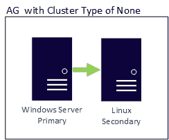

分布式 AG 也可以跨操作系统边界。底层 AG 受其配置规则的限制，例如配置为 `External` 的 AG 仅限 Linux，但它所加入的 AG 可以使用 `WSFC` 配置。考虑以下示例：

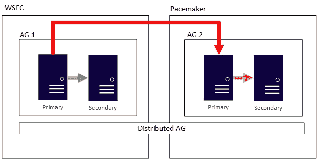

## 可用性组配置的高可用性和数据保护

这介绍了在 Linux 服务器上 SQL Server Always On 可用性组的支持的部署配置。可用性组提供高可用性和数据保护。自动故障检测、自动故障转移以及故障后的透明重连提供了高可用性。同步副本提供了数据保护。

在 `Windows Server Failover Cluster` (`WSFC`) 上，用于高可用性的常用配置使用两个同步副本以及第三台服务器或文件共享来提供仲裁。文件共享见证器会验证可用性组配置——例如，同步状态和副本的角色。此配置确保了被选为故障转移目标的备副本具有最新数据和可用性组配置更改。

`WSFC` 在可用性组副本与文件共享见证器之间同步用于故障仲裁的配置元数据。当可用性组不在 `WSFC` 上时，SQL Server 实例将配置元数据存储在主数据库中。

例如，Linux 集群上的可用性组具有 `CLUSTER_TYPE = EXTERNAL`。没有 `WSFC` 来仲裁故障。在这种情况下，配置元数据由 SQL Server 实例管理和维护。由于该集群中没有见证服务器，需要第三个 SQL Server 实例来存储配置状态元数据。所有三个 SQL Server 实例共同为集群提供分布式元数据存储。

集群管理器可以查询可用性组中的 SQL Server 实例，并协调故障转移以维护高可用性。在 Linux 集群中，`Pacemaker` 是集群管理器。

`SQL Server 2017 CU 1` 为具有 `CLUSTER_TYPE = EXTERNAL` 的可用性组提供了高可用性，适用于两个同步副本加上配置仅副本。配置仅副本可以托管在任何版本的 `SQL Server 2017 CU1` 或更高版本上——包括 `SQL Server Express` 版本。配置仅副本在主数据库中维护有关可用性组的配置信息，但不包含可用性组中的用户数据库。

## 配置如何影响默认资源设置

SQL Server 2017 引入了 `REQUIRED_SYNCHRONIZED_SECONDARIES_TO_COMMIT` 集群资源设置。该设置保证指定数量的备副本在主副本提交每个事务之前，将事务数据写入日志。当你使用外部集群管理器时，此设置会同时影响高可用性和数据保护。该设置的默认值取决于集群资源创建时的架构。当你安装 SQL Server 资源代理程序 `mssql-server-ha` 并为可用性组创建集群资源时，集群管理器会检测可用性组配置并相应设置 `REQUIRED_SYNCHRONIZED_SECONDARIES_TO_COMMIT`。

如果配置支持，资源代理参数 `REQUIRED_SYNCHRONIZED_SECONDARIES_TO_COMMIT` 将设置为提供高可用性和数据保护的值。

后续章节解释了集群资源的默认行为。

## 选择可用性组设计以满足对高可用性、数据保护和读扩展的特定业务需求

以下配置描述了可用性组的设计模式以及每种模式的能力。这些设计模式适用于具有 `CLUSTER_TYPE = EXTERNAL` 的高可用解决方案可用性组。

- 三个同步副本
- 两个同步副本
- 两个同步副本和一个配置仅副本

### 三个同步副本

此配置由三个同步副本组成。默认情况下，它提供高可用性和数据保护。它还可以提供读扩展。

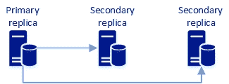

具有三个同步副本的可用性组可以提供读扩展、高可用性和数据保护。下表描述了可用性行为。

| 三个同步副本 (THREE SYNCHRONOUS REPLICAS) |
| --- |
| 可用性行为 | 读扩展 | 高可用性 & 数据保护 | 数据保护 |
| --- | --- | --- |
| `REQUIRED_SYNCHRONIZED_SECONDARIES_TO_COMMIT=` | 0 | 1 | 2 |
| 主副本故障 | 自动故障转移。新主副本可读写。 | 自动故障转移。新主副本可读写。 | 自动故障转移。在原主恢复并作为副本加入可用性组之前，新主副本不支持用户事务。 |
| 一个备副本故障 | 主副本可读写。 | 如果主副本也故障，则不会发生自动故障转移。 | 主副本不支持用户事务。 |

### 两个同步副本


此配置启用了数据保护。与其他可用性组配置一样，它可以启用读扩展。双副本配置不提供自动高可用性。双副本配置仅适用于`SQL Server 2017 RTM`，不再支持更高版本（CU1 及以后）的`SQL Server 2017`。

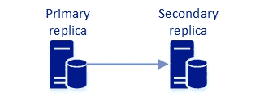

| 两个同步副本（TWO SYNCHRONOUS REPLICAS） |
| --- |
| 可用性行为 | 读扩展 | 数据保护 |
| --- | --- | --- |
| `REQUIRED_SYNCHRONIZED_SECONDARIES_TO_COMMIT=` | 0* | 1 |
| 主副本故障 | 手动故障转移。可能会丢失数据。新主副本可读写。 | 自动故障转移。在原主恢复并作为副本加入可用性组之前，新主副本不支持用户事务。 |
| 一个备副本故障 | 主副本可读写，但面临数据丢失风险。 | 在备副本恢复之前，主副本不支持用户事务。 |

### 两个同步副本和一个配置仅副本

两个（或多个）同步副本和一个配置仅副本的可用性组提供数据保护，并可能提供高可用性。下图表示了这种架构：

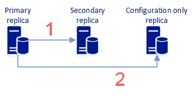

1. 用户数据到备副本的同步复制。它还包括可用性组配置元数据。
2. 可用性组配置元数据的同步复制。它不包含用户数据。

在可用性组图中，主副本会将配置数据推送到备副本和仅配置副本。备副本还会接收用户数据，而仅配置副本不接收用户数据。备副本处于同步可用性模式。仅配置副本不包含可用性组中的数据库——仅包含有关可用性组的元数据。仅配置副本上的配置数据是同步提交的。`REQUIRED_SYNCHRONIZED_SECONDARIES_TO_COMMIT` 的默认值为 0。下表描述了可用性行为。

| 可用性行为 | 高可用性与数据保护 | 数据保护 |
| --- | --- | --- |
| `REQUIRED_SYNCHRONIZED_SECONDARIES_TO_COMMIT=` | `0` | `1` |
| 主节点故障 | 自动故障转移。新主节点为可读可写。 | 自动故障转移。新主节点不可用于用户事务。 |
| 备副本故障 | 主节点为可读可写，但面临数据丢失风险（如果主节点故障且无法恢复）。如果主节点也故障，则不发生自动故障转移。 | 主节点不可用于用户事务。如果主节点也故障，则没有副本可以转移。 |
| 仅配置副本故障 | 主节点为可读可写。如果主节点也故障，则不发生自动故障转移。 | 主节点为可读可写。如果主节点也故障，则不发生自动故障转移。 |
| 同步备副本 + 仅配置副本同时故障 | 主节点不可用于用户事务。不发生自动故障转移。 | 主节点不可用于用户事务。如果主节点也故障，则没有副本可以转移。 |

## 要求

- 带有仅配置副本的可用性组中的所有副本必须是`SQL Server 2017 CU 1`或更高版本。
- 任何版本的 SQL Server 都可以托管仅配置副本，包括 SQL Server Express。
- 可用性组除了主副本外，至少还需要一个备副本。
- 仅配置副本不计入每个 SQL Server 实例的副本最大数限制。SQL Server 标准版最多允许 3 个副本，SQL Server 企业版最多允许 9 个副本。

### 注意事项

- 每个可用性组最多不能有一个仅配置副本。
- 仅配置副本不能作为主副本。
- 你无法修改仅配置副本的可用性模式。要将仅配置副本更改为同步或异步备副本，请删除仅配置副本，并添加具有所需可用性模式的备副本。
- 仅配置副本与可用性组元数据保持同步。它不包含用户数据。
- 只有一个主副本和一个仅配置副本但没有备副本的可用性组是非有效的。
- 你无法在 SQL Server Express 版实例上创建可用性组。

## 了解 Pacemaker 的 SQL Server 资源代理

`SQL Server 2017 CTP 1.4` 在`sys.availability_groups`中添加了`sequence_number`，允许 Pacemaker 识别备副本相对于主副本的同步新程度。`sequence_number`是一个单调递增的 BIGINT 类型，表示本地可用性组副本的同步新程度。Pacemaker 在每次可用性组配置发生更改时都会更新`sequence_number`。配置更改的示例包括故障转移、添加或删除副本。该数字首先在主节点上更新，然后复制到备副本。因此，具有最新配置的备副本与主节点具有相同的序列号。

当 Pacemaker 决定将某个副本提升为主节点时，它首先向所有副本发送`pre-promote`（预提升）通知。副本返回序列号。接下来，当 Pacemaker 实际尝试将某个副本提升为主节点时，该副本只有在序列号为所有序列号最高的情况下才会提升自身。如果自身的序列号与最高序列号不匹配，副本将拒绝提升操作。通过这种方式，只有具有最高序列号的副本才能提升为主节点，从而确保数据不丢失。

此过程需要至少一个可提升的副本，且其序列号与之前的主节点相同。Pacemaker 资源代理设置`REQUIRED_SYNCHRONIZED_SECONDARIES_TO_COMMIT`，使得默认情况下至少有一个同步备副本是新的并且可以作为自动故障转移的目标。在每次监控操作中，`REQUIRED_SYNCHRONIZED_SECONDARIES_TO_COMMIT`的值都会被计算（并在必要时进行更新）。`REQUIRED_SYNCHRONIZED_SECONDARIES_TO_COMMIT`的值是“同步副本数量”除以 2。在故障转移发生时，资源代理要求（总副本数 - `REQUIRED_SYNCHRONIZED_SECONDARIES_TO_COMMIT`个副本）响应预提升通知。具有最高`sequence_number`的副本被提升为主节点。

例如，一个具有三个同步副本的可用性组——一个主副本和两个同步备副本：

- `REQUIRED_SYNCHRONIZED_SECONDARIES_TO_COMMIT`为 1；（3 / 2 -> 1）。
- 需要响应预提升操作的副本数量为 2；（3 - 1 = 2）。

在这种情况下，必须有两个副本响应才能触发故障转移。为了在主节点故障后成功实现自动故障转移，两个备副本都必须是新的并响应预提升通知。如果它们在线且处于同步状态，它们具有相同的序列号。可用性组将提升其中一个副本。如果只有一个备副本响应了预提升操作，资源代理无法保证响应的备副本具有最高的`sequence_number`，因此不会触发故障转移。

你可以选择覆盖默认行为，并防止可用性组资源自动设置`REQUIRED_SYNCHRONIZED_SECONDARIES_TO_COMMIT`。以下脚本将名为`ag1`的可用性组的`REQUIRED_SYNCHRONIZED_SECONDARIES_TO_COMMIT`设置为 0。在运行之前，请将`ag1`替换为你的可用性组名称。

```bash
sudo pcs resource update ag1 required_synchronized_secondaries_to_commit=0
```

要恢复到默认值，根据可用性组配置运行：

```bash
sudo pcs resource update ag1 required_synchronized_secondaries_to_commit=SQL Server On Availability Group
```

## Linux 高可用 SQL Server Always On 可用性组

本文描述了如何在 Linux 上创建高可用性的 SQL Server Always On 可用性组（AG）。AG 有两种配置类型。高可用配置使用集群管理器提供业务连续性。该配置也可以包含读取扩展副本。本文解释了如何创建高可用性 AG。你也可以在不使用集群管理器的情况下创建读取扩展 AG。读取扩展 AG 仅为性能扩展提供只读副本，它不提供高可用性。

生产环境需要隔离代理（fencing agent），例如用于高可用性的`STONITH`。本文档中的演示不使用隔离代理。这些演示仅用于测试和验证。Linux 集群使用隔离功能将集群恢复到已知状态。配置隔离的方法取决于发行版和环境。目前，某些云环境中尚不支持隔离功能。

## 将 AG（可用性组）作为资源添加到集群中

## 前提条件

在创建可用性组之前，您需要执行以下操作：

- 设置环境，使所有托管可用性副本的服务器能够相互通信。
- 安装 SQL Server。

要设置计算机名，请编辑`/etc/hostname`。以下脚本允许您使用`vi`编辑`/etc/hostname`：

```bash
sudo vi /etc/hostname
```

### 配置 hosts 文件

每台服务器上的 hosts 文件都包含参与可用性组的所有服务器的 IP 地址和名称。以下命令用于返回当前服务器的 IP 地址：

```bash
sudo ip addr show
```

更新`/etc/hosts`。以下脚本允许您使用`vi`编辑`/etc/hosts`：

```bash
sudo vi /etc/hosts
```

以下示例显示了`node1`上的`/etc/hosts`，包含了对`node1`、`node2`和`node3`的添加。在本文中，`node1`指托管主副本的服务器。`node2`和`node3`指托管备副本的服务器。

```
127.0.0.1   localhost localhost4 localhost4.localdomain4
4::1         localhost localhost6 localhost6.localdomain6
10.128.18.12  node1
10.128.16.77  node2
10.128.15.33  node3
```

### 启用 AlwaysOn 可用性组并重启 mssql-server

在每个托管 SQL Server 实例的节点上启用 AlwaysOn 可用性组。然后重启`mssql-server`。运行以下脚本：

```bash
sudo /opt/mssql/bin/mssql-conf set hadr.hadrenabled 1
sudo systemctl restart mssql-server
```

### 启用 AlwaysOn_health 事件话

您可以选择启用 AlwaysOn 可用性组扩展事件，以便在排查可用性组故障时帮助诊断根因。在每个 SQL Server 实例上运行以下命令：

```sql
ALTER EVENT SESSION AlwaysOn_health ON SERVER WITH (STARTUP_STATE=ON );GO
```

有关此 XE 会话的更多信息，请参阅 Always On 扩展事件。

### 创建证书

Linux 上的 SQL Server 使用证书来对镜像端点之间的通信进行验证。以下 Transact-SQL 脚本创建一个主密钥和一个证书。然后备份证书并使用私钥保护该文件。使用强密码更新脚本。连接到主 SQL Server 实例。要创建证书，运行以下 Transact-SQL 脚本：

```sql
CREATE MASTER KEY ENCRYPTION BY PASSWORD = '<Master_Key_Password>';
CREATE CERTIFICATE dbm_certificate WITH SUBJECT = 'dbm';
BACKUP CERTIFICATE dbm_certificateTO FILE = '/var/opt/mssql/data/dbm_certificate.cer'
WITH PRIVATE KEY (FILE = '/var/opt/mssql/data/dbm_certificate.pvk',
ENCRYPTION BY PASSWORD = '<Private_Key_Password>');
```

此时，您的主 SQL Server 副本在`/var/opt/mssql/data/dbm_certificate.cer`有一个证书，在`var/opt/mssql/data/dbm_certificate.pvk`有一个私钥。将这两个文件复制到所有托管可用性副本的服务器上的相同位置。使用`mssql`用户，或赋予`mssql`用户访问这些文件的权限。例如，在源服务器上，以下命令将文件复制到目标机器。将`<node2>`值替换为将托管副本的 SQL Server 实例名称。

```bash
cd /var/opt/mssql/data
scp dbm_certificate.* root@<node2>:/var/opt/mssql/data/
```

在每个目标服务器上，赋予`mssql`用户访问证书的权限。

```bash
cd /var/opt/mssql/data
chown mssql:mssql dbm_certificate.*
```

### 在备用服务器上创建证书

以下 Transact-SQL 脚本从您在主 SQL Server 副本上创建的备份创建一个主密钥和一个证书。使用强密码更新脚本。解密密码是您在上一步中创建`.pvk`文件时使用的密码。在所有备用服务器上运行以下脚本创建证书：

```sql
CREATE MASTER KEY ENCRYPTION BY PASSWORD = '<Master_Key_Password>';
CREATE CERTIFICATE dbm_certificateFROM FILE = '/var/opt/mssql/data/dbm_certificate.cer'
WITH PRIVATE KEY (FILE = '/var/opt/mssql/data/dbm_certificate.pvk',
DECRYPTION BY PASSWORD = '<Private_Key_Password>');
```

### 在所有副本上创建数据库镜像端点

数据库镜像端点使用传输控制协议（TCP）在参与数据库镜像会话或托管可用性副本的服务器实例之间发送和接收消息。数据库镜像端点监听唯一的 TCP 端口。以下 Transact-SQL 脚本为可用性组创建一个名为`Hadr_endpoint`的监听端点。它启动端点并向您创建的证书授予连接权限。在运行脚本之前，替换`< ... >`之间的值。可选情况下，可以包含 IP 地址`LISTENER_IP = (0.0.0.0)`。监听器 IP 地址必须是 IPv4 地址。您也可以使用`0.0.0.0`。在所有 SQL Server 实例上更新以下 Transact-SQL 脚本：

```sql
CREATE ENDPOINT [Hadr_endpoint]
AS TCP (LISTENER_PORT = <5022>)
FOR DATABASE_MIRING ( 
     ROLE = ALL ,
     AUTHENTICATION = CERTIFICATE, ENCRYPTION = REQUIRED ALGORITHM AES
 );
ALTER [ [Hadr_endpoint] STATE = STARTED;
```

如果您在一个节点上使用 SQL Server Express 版托管配置副本，`ROLE`的唯一有效值为`WITNESS`。在 SQL Server Express 版上运行以下脚本：

```sql
CREATE ENDPOINT [Hadr_endpoint]
AS TCP (LISTENER_PORT = <5022>)
FOR DATABASE_MIRING ( 
     ROLE = WITNESS, 
     AUTHENTICATION = CERTIFICATE, ENCRYPTION = REQUIRED ALGORITHM AES
 );
ALTERALTERadr [endpoint] STATE = STARTED;
```

防火墙必须允许监听器端口。

### 创建 AG

本节中的示例解释了如何使用 Transact-SQL 创建可用性组。您也可以使用 SQL Server 管理 Studio 可用性组向导。当使用向导创建 AG 时，在将副本加入 AG 时会返回错误。要解决此问题，请向所有副本上的 AG 授予 Pacemaker`ALTER`、`CONTROL`和`VIEW DEFINITIONS`权限。一旦在主副本上授予权限，即可通过向导将节点加入 AG，但为了功能正常运行，请在所有副本上授予权限。

在 Linux 上创建高可用可用性组。使用`CLUSTER_TYPE = EXTERNAL`和`CREATE AVAILABILITY GROUP`。

- 可用性组——`CLUSTER_TYPE = EXTERNAL`指定外部集群实体管理 AG。Pacemaker 是外部集群实体的示例。当 AG 集群类型为外部时，
- 设置主备副本`FAILOVER_MODE = EXTERNAL`指定副本与外部集群管理器（如 Pacemaker）交互。

以下 Transact-SQL 脚本创建一个名为`ag1`的高可用可用性组。脚本配置 AG 副本使用`SEEDING_MODE = AUTOMATIC`。此设置会导致 SQL Server 在每个备服务器上自动创建数据库。根据您的环境更新以下脚本。将`<node1>`、`<node2>`或`<node3>`值替换为托管副本的 SQL Server 实例名称。将`<5022>`替换为数据镜像端点设置的端口。要创建 AG，请在托管主副本的 SQL Server 实例上运行 Transact-SQL。

- 创建具有三个同步副本的 AG


```sql
CREATE AVAILABILITY GROUP [ag1] WITH (DB_FAILOVER = ON , CLUSTER_TYPE = EXTERNAL ) FOR REPLICA ON N'<node1>' WITH (ENDPOINT_URL = N'tcp://<node1>:<5022>', AVAILABILITY_MODE = SYNCHRONOUS_COMMIT, FAILOVER_MODE = EXTERNAL , SEEDING_MODE = AUTOMATIC),N'<node2>' WITH (ENDPOINT_URL = N'tcp://<node2>:<5022>', AVAILABILITY_MODE = SYNCHRONOUS_COMMIT, FAILOVER_MODE = EXTERNAL , SEEDING_MODE = AUTOMATIC), N'<node3>' WITH (ENDPOINT_URL = N'tcp://<node3>:<5022>', AVAILABILITY_MODE = SYNCHRONOUS_COMMIT, FAILOVER_MODE = EXTERNAL , SEEDING_MODE = AUTOMATIC);
ALTER AVAILABILITY GROUP [ag1] GRANT CREATE ANY DATABASE ;
```

### 创建一个具有两个同步副本和一个配置副本的 AG（可用性组）

```sql
CREATE AVAILABILITY GROUP [ag1] WITH (CLUSTER_TYPE = EXTERNAL ) FOR REPLICA ON N'<node1>' WITH (ENDPOINT_URL = N'tcp://<node1>:<5022>',AVAILABILITY_MODE = SYNCHRONOUS_COMMIT, FAILOVER_MODE = EXTERNAL , SEEDING_MODE = AUTOMATIC), N'<node2>' WITH (ENDPOINT_URL = N'tcp://<node2>:<5022>', AVAILABILITY_MODE = SYNCHRONOUS_COMMIT, FAILOVER_MODE = EXTERNAL , SEEDING_MODE = AUTOMATIC), N'<node3>' WITH (ENDPOINT_URL = N'tcp://<node3>:<5022>', AVAILABILITY_MODE = CONFIGURATION_ONLY);
ALTER AVAILABILITY GROUP [ag1] GRANT CREATE ANY DATABASE ;
```

### 创建一个具有两个同步副本的 AG

包含两个同步可用性模式的副本。例如，以下脚本创建一个名为`ag1`的 AG。`node1`和`node2`在同步模式下托管副本，并具有自动种子和自动故障转移功能。

```sql
CREATE AVAILABILITY GROUP [ag1] WITH (CLUSTER_TYPE = EXTERNAL ) FOR REPLICA ON N'node1' WITH (ENDPOINT_URL = N'tcp://node1:5022', AVAILABILITY_MODE = SYNCHRONOUS_COMMIT, FAILOVER_MODE = EXTERNAL , SEEDING_MODE = AUTOMATIC ), N'node2' WITH (ENDPOINT_URL = N'tcp://node2:5022', AVAILABILITY_MODE = SYNCHRONOUS_COMMIT, FAILOVER_MODE = EXTERNAL , SEEDING_MODE = AUTOMATIC );
ALTER AVAILABILITY GROUP [ag1] GRANT CREATE ANY DATABASE ;
```

你也可以使用 SQL Server Management Studio 或 PowerShell 使用`CLUSTER_TYPE=EXTERNAL`配置 AG。

### 将从备副本加入 AG

`pacemaker`用户需要对所有副本上的可用性组拥有`ALTER`、`CONTROL`和`VIEW DEFINITION`权限。要授予权限，请在主副本上创建可用性组后，以及在每个从备副本加入可用性组后，立即运行以下 Transact-SQL 脚本。在运行脚本之前，将`<pacemakerLogin>`替换为 pacemaker 用户帐户的名称。如果你没有 pacemaker 的登录名，请为 pacemaker 创建一个 SQL Server 登录。

```sql
GRANT ALTER , CONTROL , VIEW DEFINITION ON AVAILABILITY GROUP ::ag1 TO <pacemakerLogin>
GRANT VIEW SERVER STATE TO <pacemakerLogin>
```

以下 Transact-SQL 脚本将 SQL Server 实例加入名为`ag1`的 AG。请根据你的环境更新脚本。在托管从备副本的每个 SQL Server 实例上，运行以下 Transact-SQL 以加入 AG。

```sql
ALTER AVAILABILITY GROUP [ag1] JOIN WITH (CLUSTER_TYPE = EXTERNAL );
ALTER AVAILABILITY GROUP [ag1] GRANT CREATE ANY DATABASE ;
```

### 将数据库添加到可用性组

确保你添加到可用性组的数据库处于完全恢复模式并具有有效的日志备份。如果这是测试数据库或新创建的数据库，请进行数据库备份。在主 SQL Server 上，运行以下 Transact-SQL 脚本创建并备份名为`db1`的数据库：

```sql
CREATE DATABASE [db1];
ALTER DATABASE [db1] SET RECOVERY FULL ;
BACKUP DATABASE [db1] TO DISK = N'/var/opt/mssql/data/db1.bak';
```

在主 SQL Server 副本上，运行以下 Transact-SQL 脚本将名为`db1`的数据库加入名为`ag1`的可用性组：

```sql
ALTER AVAILABILITY GROUP [ag1] ADD DATABASE [db1];
```

### 验证从备服务器上已数据库

在每个从备 SQL Server 副本上，运行以下查询查看`db1`数据库是否创建并正在同步：

```sql
SELECT * FROM sys.databases WHERE name = 'db1';
GO
SELECT DB_NAME(database_id) AS 'database', synchronization_state_desc FROM sys.dm_hadr_database_replica_states;
```

## 为 SQL Server 可用性组配置 RHEL 集群

本文介绍了如何在 Red Hat Enterprise Linux (RHEL) 上为 SQL Server 创建三节点可用性组集群。集群层基于构建在`Pacemaker`之上的 Red Hat Enterprise Linux (RHEL) HA 附加组件。

后续章节将介绍设置 Pacemaker 集群并将可用性组作为资源添加到集群中以实现高可用的步骤。

### 路线图

在 Linux 上创建可用性组的步骤与 Windows 不同。以下列表描述了高级步骤：

1. 在集群节点上配置 SQL Server。
2. 创建可用性组。
3. 配置集群管理器（如 Pacemaker）。这些说明取决于特定的 Linux 发行版。
4. 将可用性组作为资源添加到集群中，并在重启后允许节点重新加入。

## 为 RHEL 配置高可用性

要为 RHEL 配置高可用性，请启用高可用订阅并配置 Pacemaker。

集群中的每个节点都必须拥有适当的订阅。按照以下步骤配置订阅：

1. 注册系统。

   ```bash
   sudo subscription-manager register
   ```

   提供你的用户名和密码。

2. 列出可用池。

   ```bash
   sudo subscription-manager list --available
   ```

   从可用池列表中记录用于高可用性的池 ID。

3. 更新以下脚本。将`<pool id>`替换为上一步中的高可用性池 ID。运行脚本附加订阅。

   ```bash
   sudo subscription-manager attach --pool=<pool id>
   ```

4. 启用存储。

   RHEL 7：

   ```bash
   sudo subscription-manager repos --enable=rhel-ha-for-rhel-7-server-rpms
   ```

   RHEL 8：

   ```bash
   sudo subscription-manager repos --enable=rhel-8-for-x86_64-highavailability-rpms
   ```

配置好订阅后，按照以下步骤配置 Pacemaker。

### 配置 Pacemaker

在配置订阅后，按照以下步骤配置 Pacemaker：

1. 在所有集群节点上打开 Pacemaker 防火墙端口。使用`firewalld`打开这些端口，请运行以下命令：

   ```bash
   sudo firewall-cmd --permanent --add-service=high-availability
   sudo firewall-cmd --reload
   ```

   如果防火墙没有内置的高可用配置，请为 Pacemaker 打开以下端口：

   - TCP 端口：2224, 3121, 21064
   - UDP 端口：5405

2. 在所有节点上安装 Pacemaker 包。

   ```bash
   sudo yum install pacemaker fence-agents-all resource-agents
   ```

3. 为安装 Pacemaker 和 Corosync 包时创建的默认用户设置密码。在所有节点上使用相同的密码。

   ```bash
   sudo passwd hacluster
   ```

4. 为了在重启后允许节点重新加入集群，启用并启动`pcsd`服务和 Pacemaker。在所有节点上运行以下命令。

   ```bash
   sudo systemctl enable pcsd
   sudo systemctl start pcsd
   sudo systemctl enable pacemaker
   ```

5. 创建集群。要创建集群，请运行以下命令。

   #### RHEL 7

   ```bash
   sudo pcs cluster auth <node1> <node2> <node3> -u hacluster -p <password for hacluster>
   sudo pcs cluster setup --name <clusterName> <node1> <node2> <node3>
   sudo pcs cluster start --all
   sudo pcs cluster enable --all
   ```

   #### RHEL 8

   对于`RHEL 8`，你需要单独对节点进行验证。在提示时手动输入`hacluster`的用户名和密码。

   ```bash
   sudo pcs host auth <node1> <node2> <node3>
   sudo pcs cluster setup <clusterName> <node1> <node2> <node3>
   sudo pcs cluster start --all
   sudo pcs cluster enable --all
   ```

## 安装 SQL Server 资源代理

在所有节点上运行以下命令。

```bash
sudo yum install mssql-server-ha
```

配置好`Pacemaker`后，使用`pcs`与集群进行交互。在集群中的任一个节点上执行所有命令。

## 配置隔离（STONITH）

Pacemaker 集群供应商要求启用 STONITH，并为支持的集群设置配置隔离设备。STONITH 的意思是“打掉另一个节点的头（shoot the other node in the head）”。当集群资源管理器无法确定节点或节点上资源的状态时，隔离机制会将集群恢复到已知状态。

资源级隔离通过配置资源来确保在发生故障时不会数据损坏。例如，当通信链路断开时，你可以使用资源级隔离将节点上的磁盘标记为过时。

节点级隔离确保节点不运行任何资源。这是通过重置节点来实现的。Pacemaker 支持多种隔离设备，例如不间断电源（UPS）或服务器的管理接口卡。

由于节点级隔离的配置高度依赖于你的环境，在本版教程中请禁用它（稍后可以再配置）。以下脚本将禁用节点级隔离：

```bash
sudo pcs property set stonith-enabled=false
```

禁用 STONITH 仅用于测试。如果你计划在生产环境中使用 Pacemaker，应该根据你的环境规划 STONITH 的实施方案并保持其开启。

## 设置集群属性 `cluster-recheck-interval`

`cluster-recheck-interval`表示集群检查资源参数、约束或其他集群选项变化的轮询间隔。如果副本宕机，集群会尝试重启副本，其间隔受`failure-timeout`值和`cluster-recheck-interval`值的限制。例如，如果`failure-timeout`设置为 60 秒，而`cluster-recheck-interval`设置为 120 秒，则会尝试在大于 60 秒但小于 120 秒的间隔尝试重启。我们建议将`failure-timeout`设置为 60s，并将`cluster-recheck-interval`设置为大于 60 秒的值。不建议将`cluster-recheck-interval`设置为小值。

将属性值更新为`2 minutes`，请运行：

```bash
sudo pcs property set cluster-recheck-interval=2min
```

将属性值更新为`true`，请运行：

```bash
sudo pcs property set start-failure-is-fatal=true
```

将`ag_cluster`资源属性`failure-timeout`更新为 60s，请运行：

```bash
pcs resource update ag_cluster meta failure-timeout=60s
```

## 为 Pacemaker 创建 SQL Server 登录名

1. 在所有 SQL Server 上，为 Pacemaker 创建服务器登录名。以下 Transact-SQL 创建一个登录名：

   ```sql
   USE [master]
   GO
   CREATE LOGIN [pacemakerLogin] with PASSWORD= N'ComplexP@$$w0rd!'
   ALTER SERVER ROLE [sysadmin] ADD MEMBER [pacemakerLogin]
   ```

   在创建可用性组时，pacemaker 用户在创建之后添加任何节点之前，需要对可用性组拥有`ALTER`、`CONTROL`和`VIEW DEFINITION`权限。

2. 在所有 SQL Server 上，保存 SQL Server 登录名的凭据。

   ```bash
   echo 'pacemakerLogin' >> ~/pacemaker-pass
   echo 'ComplexP@$$w0rd!' >> ~/pacemaker-pass
   sudo mv ~/pacemaker-passwd /var/opt/mssql/secrets/passwd
   sudo chown root:root /var/opt/mssql/secrets/passwd
   sudo chmod 400 /var/opt/mssql/secrets/passwd # 仅 root 可读
   ```

## 创建可用性组资源

要创建可用性组资源，请使用`pcs resource create`命令并设置资源属性。以下命令为名为`ag1`的可用性组创建一个`ocf:mssql:ag`主/从属类型资源。

### RHEL 7

```bash
sudo pcs resource create ag_cluster ocf:mssql:ag ag_name=ag1 meta failure-timeout=60s master notify=true
```

### RHEL 8

随着`RHEL 8`的发布，创建语法发生了变化。如果你在使用`RHEL 8`，术语`master`已变为`promotable`。请使用以下创建命令代替上述命令：

```bash
sudo pcs resource create ag_cluster ocf:mssql:ag ag_name=ag1 meta failure-timeout=60s promotable notify=true
```

**注意**：当你创建资源以及之后定期运行时，Pacemaker 资源代理会自动设置`REQUIRED_SYNCHRONIZED`的值。根据可用性组的配置，Pacemaker 会设置`REQUIRED_SECONDARIES_TO_COMMIT`为 1。

## 创建虚拟 IP 资源

要创建虚拟 IP 地址资源，请在一个节点上运行以下命令。使用网络中可用的 IP 地址。将`<10.128.16.240>`替换为有效的 IP 地址。


```bash
sudo pcs resource create virtualip ocf:heartbeat:IPaddr=<10.128.16.240>
```

Pacemaker 中没有虚拟服务器名称。要使用指向服务器名称而不是 IP 地址的连接字符串，请在 DNS 中注册虚拟 IP 地址。对于 DR 配置，请在主站点和 DR 站点注册虚拟服务器名称。

## 添加隔离约束

Pacemaker 集群中的几乎每个决策（例如资源在哪里运行）都是通过比较分数完成的。分数按资源计算。集群资源管理器选择分数最高的节点。如果节点对某个资源得负分，则该资源无法在该节点运行。

在 Pacemaker 集群中，可以通过约束来操纵决策。约束具有分数。如果约束的分低于`INFINITY`，Pacemaker 将其视为建议。`INFINITY`分是强制性的。

为了确保主副本和虚拟 IP 运行在同一台主机上，请定义一个分为`INFINITY`的隔离约束。添加隔离约束，请在一个节点上运行以下命令。

### RHEL 7

当在 RHEL 7 中创建`ag_cluster`资源时，它会创建`ag_cluster-master`。为 RHEL 7 使用以下命令：

```bash
sudo pcs constraint colocation add virtualip ag_cluster-master INFINITY with-rsc-role=Master
```

### RHEL 8

当在 RHEL 8 中创建`ag_cluster`资源时，它会创建`ag_cluster-clone`。为 RHEL 8 使用以下命令：

```bash
sudo pcs constraint colocation add virtualip with master ag_cluster-clone INFINITY with-rsc-role=Master
```

## 添加排序约束

隔离约束具有隐含的排序约束。它在移动可用性组资源之前移动虚拟 IP 资源。默认事件序列如下：

1. 用户执行`pcs resource move`将可用性主从 node1 移动到 node2。
2. 虚拟 IP 资源在节点 1 上停止。
3. 虚拟 IP 资源在节点 2 上启动。
4. 节点 1 上的可用性主降级为从。
5. 节点 2 上的可用性从提升为主主。

为了防止 IP 地址临时指向带有预故障转移备用状态的节点，请添加顺序约束。要添加顺序约束，请在其中一个节点上运行以下命令：

### RHEL 7

```bash
sudo pcs constraint order promote ag_cluster-master then start virtualip
```

### RHEL 8

```bash
sudo pcs constraint order promote ag_cluster-clone then start virtualip
```

使用`pcs`手动对可用性组进行故障转移。不要使用 Transact-SQL 发起故障转移。请参阅`Failover.Operate Always On Availability Groups on Linux`。

## Always On 可用性组

## 升级可用性组

以下章节解释了如何对在 Linux 上运行可用性组的 SQL Server 实例进行滚动升级。

### 在 Linux 上的升级步骤

当可用性组的副本位于 Linux 上的 SQL Server 实例时，可用性组的集群类型为`EXTERNAL`或`NONE`。由 Windows Server 故障转移集群（WSFC）之外的集群管理器管理的可用性组为`EXTERNAL`。带有`Corosync`的`Pacemaker`是外部集群管理器的示例。没有集群管理器的可用性组的集群类型为`NONE`。

此处列出的升级步骤适用于集群类型为`EXTERNAL`或`NONE`的可用性组。

升级实例的顺序取决于它们的角色是否为备用，以及它们是否托管了同步或异步副本。先升级托管异步备用副本的 SQL Server 实例。然后升级托管同步备用副本的实例。在开始之前，请备份每个数据库。

1. **在托管目标升级的备用副本的节点上停止资源。**

   在运行升级命令之前，请停止资源，以便集群不会对其进行监控且不会发生不必要的故障。以下示例在节点上添加位置约束，这将导致资源被停止。将`ag_cluster-master`替换为资源名称，将`nodeName1`替换为托管目标升级副本的节点。

   ```bash
   pcs constraint location ag_cluster-master stop nodeName1
   ```

2. **在备用副本上升级 SQL Server。**

   以下示例升级`mssql-server`和`mssql-server-ha`软件包。

   ```bash
   sudo yum update mssql-server
   sudo yum update mssql-server-ha
   ```

3. **移除位置约束。**

   在运行升级命令之前，停止资源，以便集群不会对其进行监控且不会发生不必要的故障。以下示例在节点上添加位置约束，这将导致资源被停止。将`ag_cluster-master`替换为资源名称，将`nodeName1`替换为托管目标升级副本的节点。

   ```bash
   pcs constraint location stop nodeName1
   ```

   作为最佳实践，确保资源已启动且备用副本已连接并同步。

4. **所有备用副本升级后，手动故障转移到一个同步备用副本。**

   对于集群类型为`EXTERNAL`的可用性组，使用集群管理工具进行故障转移；集群类型为`NONE`的可用性组应使用 Transact-SQL 进行故障转移。以下示例使用集群管理工具故障转移可用性组。将`<targetReplicaName>`替换为将成为主节点的同步备用副本的名称：

   ```bash
   sudo pcs resource move ag_cluster-master
   ```

   以下步骤适用于没有集群管理器的可用性组。

   如果可用性组集群类型为`NONE`，请手动故障转移。按顺序完成以下步骤：

   a. 以下命令将主副本设置为备用。将`AG1`替换为您的可用性组名称。在托管主副本的 SQL Server 实例上运行 Transact-SQL 命令。

   ```transact-sql
   ALTER AVAILABILITY GROUP [ag1] SET (ROLE = SECONDARY);
   ```

   b. 以下命令将同步备用副本设置为主。在托管同步备用副本的目标 SQL Server 实例上运行以下 Transact-SQL 命令。

   ```transact-sql
   ALTER AVAILABILITY GROUP [ag1] FAILOVER;
   ```

5. **故障转移后，重复之前的过程对旧主副本升级 SQL Server。**

   以下示例升级`mssql-server`和`mssql-server-ha`软件包。

   ```bash
   # 为升级节点添加停止约束
   # 将 'nodename2' 替换为目标升级的集群节点
   pcs constraint location ag_cluster-master stop nodeName2
   sudo yum update mssql-server
   sudo yum update mssql-server-ha
   # 升级 mssql-server 和 mssql-server-ha 软件包
   sudo yum update mssql-server
   sudo yum update mssql-server-ha
   # 移除约束；确保资源已启动且副本已连接并同步
   pcs constraint remove location nodeName2
   ```

6. **对于具有外部集群管理器的可用性组——即集群类型为 EXTERNAL 的组，清理由手动故障转移引起的位置约束。**

   ```bash
   sudo pcs constraint remove cli-prefer-ag_cluster-master
   ```

7. **为新升级的备用副本（原主副本）恢复数据移动。**

   当高版本的 SQL Server 实例向可用性组中的低版本实例传输日志块时，需要此步骤。在新的备用副本（之前的主副本）上运行以下命令。

   ```transact-sql
   ALTER DATABASE database_name SET HADR RESUME;
   ```

在升级所有服务器后，你可以进行回滚。如有必要，故障转移回原始主节点。

### 删除可用性组

若要删除可用性组，请运行`DROP AVAILABILITY GROUP`。如果集群类型为`EXTERNAL`或`NONE`，请在托管副本的每个 SQL Server 实例上运行该命令。例如，要删除名为`group_name`的可用性组，请运行以下命令：

```transact-sql
DROP AVAILABILITY GROUP group_name
```

### 配置多子网 Always On 可用性组和故障转移集群实例

当 Always On 可用性组（`AG`）或故障转移集群实例（`FCI`）跨越一个站点时，每个站点通常有自己的网络。这通常意味着每个站点都有自己的 IP 划分。例如，站点 A 的地址以`192.168.1.x`开头，站点 B 的地址以`192.168.2.x`开头，其中`x`是 IP 地址中对服务器唯一的部分。如果没有在网络层设置某种路由，这些服务器将无法相互通信。处理此场景有两种方法：建立一个连接两个不同子网的网络（称为`VLAN`），或者在子网之间配置路由。

#### 基于 VLAN 的解决方案

**先决条件**：对于基于 VLAN 的解决方案，每个参与`AG`或`FCI`的服务器都需要两个网卡（`NICs`）以确保适当可用性（双端口网卡在物理服务器上会成为单点故障），这样它可以在其原生子网上分配 IP 地址，同时在`VLAN`上分配一个 IP 地址。这是任何其他网络需求之外的，例如 iSCSI，它也需要自己的网络。

`AG`或`FCI`的 IP 地址创建在`VLAN`上完成。在以下示例中，`VLAN`拥有`192.168.3.x`子网，因此为`AG`或`FCI`创建的 IP 地址为`192.168.3.104`。不需要进行额外配置，因为为`AG`或`FCI`分配了单一 IP 地址。

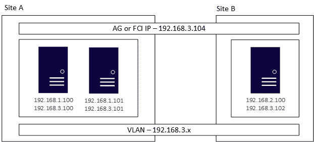

#### 使用 Pacemaker 配置

在 Windows 世界中，Windows Server 故障转移集群（`WSFC`）原生支持多子网，并通过 IP 地址的 OR 依赖处理多个 IP 地址。在 Linux 上，没有 OR 依赖，但有一种方法可以使用 Pacemaker 原生地实现适当的多子网，如下所示。你不能简单地使用普通的 Pacemaker 命令行来修改资源。你需要修改集群信息库（`CIB`）。`CIB`是一个带有 Pacemaker 配置的 XML 文件。

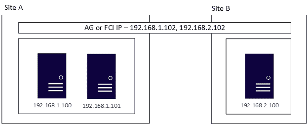

##### 更新 CIB

1. **导出 CIB。**

   - 红帽企业 Linux（RHEL）和 Ubuntu：

     ```bash
     sudo pcs cluster cib <filename>
     ```

   - SUSE Linux Enterprise Server（SLES）：

     ```bash
     sudo cibadmin -Q > <filename>
     ```

   其中`filename`是你想要命名的`CIB`文件名。

2. **编辑生成的文件。**

   查找`<resources>`部分。你将看到为`AG`或`FCI`创建的各种资源。找到与 IP 地址关联的。在现有项上方或下方（但在`<operations>`之前）添加一个包含第二个 IP 地址信息的`<instance attributes>`部分。其语法类似于：

   ```xml
   <instance attributes id="<NameForAttribute>">
       <nvpair id="<NameForIP>" name="ip" value="<IPAddress>"/>
   </instance attributes>
   ```

   其中`NameForAttribute`是此属性的唯一名称，`NameForIP`是与 IP 地址关联的名称，`IPAddress`是第二个子网的 IP 地址。

   以下显示了一个示例：

   ```xml
   <instance attributes id="virtualip-instance_attributes">
       <nvpair id="virtualip-instance_attributes-ip" name="ip" value="192.168.1.102"/>
   </instance attributes>
   ```

   默认情况下，导出的`CIB` XML 文件中只有一个项。假设有两个子网，你需要两个条目。以下是两个子网条目的示例：

   ```xml
   <instance attributes id="virtualip-instance_attributes1">
       <rule id="Subnet1-IP" score="INFINITY" boolean-op="or">
           <expression id="Subnet1-Node1" attribute="#uname" operation="eq" value="Node1" />
           <expression id="Subnet1-Node2" attribute="#uname" operation="eq" value="Node2" />
       </rule>
       <nvpair id="IP-In-Subnet1" name="ip" value="192.168.1.102"/>
   </instance attributes>
   <instance attributes id="virtualip-instance_attributes2">
       <rule id="Subnet2-IP" score="INFINITY">
           <expression id="Subnet2-Node1" attribute="#uname" operation="eq" value="Node3" />
       </rule>
       <nvpair id="IP-In-Subnet2" name="ip" value="192.168.2.102"/>
   </instance attributes>
   ```

   当子网包含多个服务器时，使用`boolean-op="or"`。

3. **导入修改后的 CIB 并重新配置 Pacemaker。**

   - RHEL/Ubuntu：

     ```bash
     sudo pcs cluster cib-push <filename>
     ```

   - SLES：

     ```bash
     sudo cibadmin -R -x <filename>
     ```

   其中`filename`是带有修改后 IP 地址信息的`CIB`文件名。

##### 检查并验证故障转移

1. 使用更新后的配置成功应用`CIB`后，ping Pacemaker 中与 IP 地址资源关联的 DNS 名称。它应该反映当前托管`AG`或`FCI`子网的 IP 地址。
2. 将`AG`或`FCI`故障转移到另一个子网。
3. 在`AG`或`FCI`完全上线后，ping 与 IP 地址关联的 DNS 名称。它应该反映第二个子网的 IP 地址。
4. 如有需要，将`AG`或`FCI`切换回原始子网。

这里有一篇关于如何为三个子网配置`CIB`的博客，请参阅详情：通过修改 CIB 配置多子网 AlwaysOn 可用性组。

## SQL Server on Linux 性能最佳实践和配置指南

为连接 SQL Server on Linux 的应用程序查找性能最佳实践和建议。这些建议适用于 Linux 平台。所有标准的 SQL Server 建议（如索引设计）仍然适用。以下指南包含 SQL Server 和 Linux 操作系统的配置建议。

### SQL Server 配置

建议在安装 SQL Server on Linux 后执行以下配置任务，以获得最佳性能。

#### 最佳实践

- **为节点和 CPU 使用 PROCESS AFFINITY**：建议使用`ALTER SERVER CONFIGURATION`为用于 SQL Server（通常是所有节点和 CPU）的所有`NUMANODE`或 CPU 设置`PROCESS AFFINITY`。处理器亲和性有助于维护 Linux 和 SQL 的调度。使用`NUMANODE`是最简单的方法。
- **配置多个 tempdb 数据文件**：由于 SQL Server on Linux 安装未提供多个 tempdb 文件的选项，我们建议在安装后考虑创建多个 tempdb 数据文件。

#### 高级配置

以下建议是你在安装 SQL Server on Linux 后可能选择的可选配置设置。这些选择取决于你的工作负载需求和 Linux 操作系统的配置。

- 使用`mssql-conf`设置内存限制


为了确保 Linux 操作系统有足够的空闲物理内存，SQL Server 进程默认仅使用物理内存的 80%。对于某些具有大量物理内存的系统，20% 可能是一个显著的数字。例如，在拥有 1 TB 内存的系统上，默认设置将留下约 200 GB 的内存未未使用。在这种情况下，您可能希望将内存限制配置为更高值。请参阅 `mssql-conf` 工具的文档以及 `memory.memorylimitmb` 设置，该设置控制 SQL Server 可见的内存（单位为 MB）。在更改此设置时，请注意不要将此值设置得太高。如果不留足够的内存，可能会遇到 Linux 操作系统和其他 Linux 应用程序的问题。

# Linux OS 配置

考虑使用以下 Linux 操作系统配置设置，以获得 SQL Server 安装的最佳性能。

## 高性能内核设置

这些是针对 SQL Server 安装的相关高性能和吞吐量的推荐 Linux 操作系统设置。请参阅您的 Linux 操作系统文档以了解配置这些设置的过程。

下表提供了 CPU 设置的建议：

| 高性能内核设置 | 值 | 更多信息 |
| --- | --- | --- |
| CPU 频率调度器 | `performance` | 查看 `cpupower` 命令 |
| `ENERGY_PERF_BIAS` | `performance` | 查看 `x86_energy_perf_policy` 命令 |
| `min_perf_pct` | `100` | 参阅关于 intel p-state 的文档 |
| C-States | 仅 C1 | 查看您的 Linux 或系统文档，了解如何确保将 C-States 设置为仅 C1 |

下表提供了磁盘设置的建议：

| 设置 | 值 | 更多信息 |
| --- | --- | --- |
| 磁盘预读 | `4096` | 查看 `blockdev` 命令 |
| `sysctl` 设置 | `kernel.sched_min_granularity_ns = 10000000 kernel.sched_wakeup_granularity_ns = 15000000 vm.dirty_ratio = 40 vm.dirty_background_ratio = 10 vm.swappiness = 10` | 查看 `sysctl` 命令 |

## 多节点 NUMA 系统的内核设置自动 NUMA 平衡

如果您在多节点 NUMA 系统上安装 SQL Server，默认启用以下 `kernel.numa_balancing` 内核设置。为了让 SQL Server 在 NUMA 系统上以最高效率运行，请禁用多节点 NUMA 系统上的自动 NUMA 平衡：

```bash
sysctl -w kernel.numa_balancing=0
```

## 虚拟地址空间的内核设置

`vm.max_map_count` 的默认设置（为 `65536`）对于 SQL Server 安装可能不够高。因此，对于 SQL Server 部署，将 `vm.max_map_count` 的值更改为 `262144`。`vm.max_map_count` 的最大值为 `2147483647`。

```bash
sysctl -w vm.max_map_count=1600000
```

## 使用调优的 mssql 配置文件的建议 Linux 设置

### 适用于 Linux 上 SQL Server 的调优配置

```ini
[main]
summary=Optimize for Microsoft SQL Server
include=throughput-performance
[cpu]
force_latency=5
[sysctl]
vm.swappiness = 1
vm.dirty_background_ratio = 3
vm.dirty_ratio = 80
vm.dirty_expire_centisecs = 500
vm.dirty_writeback_centisecs = 100
vm.transparent_hugepages=always
# 对于多实例 SQL 部署，使用
# vm.transparent_hugepages=madvise
vm.max_map_count=1600000
net.core.rmem_default = 262144
net.core.rmem_max = 4194304
net.core.wmem_default = 262144
net.core.wmem_max = 1048576
kernel.numa_balancing=0
kernel.sched_latency_ns = 60000000
kernel.sched_migration_cost_ns = 500000
kernel.sched_min_granularity_ns = 15000000
kernel.sched_wakeup_granularity_ns = 2000000
```

要启用此调优配置，请将这些定义保存在 `/usr/lib/tuned/mssql` 文件夹下的 `tuned.conf` 文件中，并使用以下命令启用配置：

```bash
chmod +x /usr/lib/tuned/mssql/tuned.conf
tuned-adm profile mssql
```

通过以下命令验证启用：

```bash
tuned-adm active
或
tuned-adm list
```

## 为 SQL Server 数据和日志文件系统禁用最后访问日期/时间

对用于 SQL Server 数据和日志文件的任何文件系统使用 `noatime` 属性。

## 启用透明大页（THP）

大多数 Linux 发版默认启用透明大页（THP），但对于 SQL Server，建议禁用或将其设置为 `madvise`。您可以通过以下命令进行设置：

```bash
echo madvise > /sys/kernel/mm/transparent_hugepages/enabled
```

或者修改 mssql 配置文件：

```bash
vm.transparent_hugepages=madvise
```

使用以下命令确保已启用：

```bash
tuned-adm active
```

## 交换文件

```bash
# 检查交换文件状态
swapon --show
```

如果需要交换文件，可以手动创建一个：

```bash
# 创建一个 4GB 的交换文件
fallocate -l 4G /swapfile
chmod 600 /swapfile
mkswap /swapfile
swapon /swapfile
```

## 虚拟机和动态内存

如果您在虚拟机上运行 SQL Server，请确保正确配置了交换文件以避免内存问题。请参阅 Linux 文档了解如何创建和调整交换文件。

# Linux 上 SQL Server 的性能特性

如果您是 SQL Server 新手，以下任务将引导您了解某些性能特性。在每个示例中，都提供了深入研究的链接。

## 创建列存储索引

列存储索引是一种以列格式存储和查询数据的技术。

1. 通过执行以下 T-SQL 命令为 `SalesOrderDetail` 表添加列存储索引：

```sql
CREATE NONCLUSTERED COLUMNSTORE INDEX [IX_SalesOrderDetail_ColumnStore] ON Sales.SalesOrderDetail (UnitPrice, OrderQty, ProductID)
GO
```

```sql
ALTER DATABASE AdventureWorks ADD FILEGROUP AdventureWorks_mod CONTAINS memory_optimized_data
GO
ALTER DATABASE AdventureWorks ADD FILE (NAME ='AdventureWorks_mod', FILENAME='/var/opt/mssql/data/AdventureWorks_mod') TO FILEGROUP AdventureWorks_mod
GO
```

## 创建内存优化表

内存优化表的主要存储是主内存，因此与基于磁盘的表不同，数据不需要从磁盘读取到内存缓冲区中。要创建内存优化表，请使用 `MEMORY_OPTIMIZED = ON` 子句。

1. 执行以下查询以创建内存优化表 `dbo.ShoppingCart`。默认情况下，为了持久性，数据将持久化存储在磁盘上（注意 `DURABILITY` 也可以设置为仅持久化架构）。

```sql
CREATE TABLE dbo.ShoppingCart (
    ShoppingCartId INT IDENTITY (1,1) PRIMARY KEY NONCLUSTERED,
    UserId INT NOT NULL INDEX ix_UserId NONCLUSTERED HASH WITH (BUCKET_COUNT=1000000),
    CreatedDate DATETIME2 NOT NULL,
    TotalPrice MONEY
) WITH (MEMORY_OPTIMIZED=ON )
GO
```

2. 向表中插入一些记录：

```sql
INSERT dbo.ShoppingCart VALUES (8798, SYSDATETIME(), NULL)
INSERT dbo.ShoppingCart VALUES (23, SYSDATETIME(), 45.4)
INSERT dbo.ShoppingCart VALUES (80, SYSDATETIME(), NULL)
INSERT dbo.ShoppingCart VALUES (342, SYSDATETIME(), 65.4)
```

## 原生编译的存储过程

SQL Server 支持访问内存优化表的原生编译存储过程。T-SQL 语句被编译为机器代码并存储为原生 DLL，与传统的 T-SQL 相比，能够更快的数据访问和更高效的查询执行。标记为 `NATIVE_COMPILATION` 的存储过程是原生编译的。

1. 执行以下脚本以创建一个原生编译存储过程，该过程向 `ShoppingCart` 表插入大量记录：

```sql
CREATE PROCEDURE dbo.usp_InsertSampleCarts @InsertCount int 
WITH NATIVE_COMPILATION, SCHEMABINDING 
AS
BEGIN 
    ATOMIC
    WITH (TRANSACTION ISOLATION LEVEL = SNAPSHOT , LANGUAGE = N'us_english')
    DECLARE @i int = 0
    WHILE @i < @InsertCount 
    BEGIN 
        INSERT INTO dbo.ShoppingCart VALUES (1, SYSDATETIME() , NULL) 
        SET @i += 1 
    END
END
```

2. 插入 1,000,000 行数据：

```sql
EXEC usp_InsertSampleCarts 1000000
```

3. 验证行已插入：

```sql
SELECT COUNT (*) FROM dbo.ShoppingCart
```

# 了解更多关于内存内 OLTP

## 查询存储

Query Store 收集有关查询、执行计划和运行时统计的详细性能信息。查询存储默认未激活状态，可以通过 `ALTER DATABASE` 启用：

```sql
ALTER DATABASE AdventureWorks SET QUERY_STORE = ON ;
```

运行以下查询以返回查询存储中查询和计划的信息：

```sql
SELECT Txt.query_text_id, Txt.query_sql_text, Pl.plan_id, Qry.*
FROM sys.query_store_plan AS Pl
JOIN sys.query_store_query AS Qry ON Pl.query_id = Qry.query_id
JOIN sys.query_store_query_text AS Txt ON Qry.query_text_id = Txt.query_text_id ;
```

## 查询动态管理视图

动态管理视图返回服务器状态信息，用于监控服务器实例的健康状况、诊断问题和调优性能。

查询 `dm_os_wait` 统计动态管理视图：

```sql
SELECT wait_type, wait_time_ms
```

# Linux 版 SQL Server 复制

SQL Server 2017 (14.x) (CU18) 及更高版本支持 Linux 上的 SQL Server 实例进行复制。使用 SQL Server Management Studio (SSMS) 复制存储过程在 Linux 上配置复制。

SQL Server 实例可以参与任何复制角色：

- 发布者（Publisher）
- 分发器（Distributor）
- 订阅者（Subscriber）

复制方案可以混合不同的操作系统平台。例如，复制方案可以包含 Linux 上的 SQL Server 实例作为发布者和分发器，订阅者包括 Windows 和 Linux 上的 SQL Server 实例。Linux 上的 SQL Server 实例可以参与任何类型的复制。

- 事务复制（Transactional）
- 快照复制（Snapshot）

有关复制的详细信息，请参阅 SQL Server 复制文档。

## 支持的功能

支持以下复制功能：

- 快照复制
- 事务复制
- 非默认端口复制
- 使用 AD 验证的复制
- 跨 Windows 和 Linux 的复制配置
- 事务复制的即时更新

## 局限性

不支持以下功能：

- 合并复制（Merge replication）
- 对等复制（Peer-to-Peer replication）
- Oracle 发布

# 在 Linux 上配置 SQL Server 复制

SQL Server 2019 (15.x) 为 Linux 上的 SQL Server 引入了 SQL Server 复制。可以使用 SQL Server Management Studio (SSMS) 或 Transact-SQL 存储过程在 Linux 上配置复制。

- 要使用 SSMS，请遵循本文。在 Windows 操作系统上使用 SSMS 连接到 SQL Server 实例。

## 前提条件

在配置发布者、分发器和订阅者之前，您需要为 SQL Server 实例完成几个配置步骤。

1. 启用 SQL Server Agent 以使用复制代理。在所有 Linux 服务器上，运行以下命令：

```bash
sudo /opt/mssql/bin/mssql-conf set sqlagent.enabled true
sudo systemctl restart mssql
```

2. 为 SQL Server 实例配置复制。要为 SQL Server 实例配置复制，运行 `sp_replication_setup`。

```sql
USE masterdb
GO
exec sp_replication_setup;
GO
```

3. 创建快照文件夹。SQL Server 代理需要一个快照文件夹进行读写。在分发器上创建快照文件夹。为 `mssql` 用户授权，运行以下命令：

```bash
sudo mkdir /var/opt/mssql/data/ReplData/
sudo chown mssql /var/opt/mssql/data/ReplData/
sudo chgrp mssql /var/opt/mssql/data/ReplData/
```

# 使用 SQL Server Management Studio（SSMS）配置和监控复制

## 配置分发器

配置分发器：

1. 在 SSMS 的对象资源管理器中连接到您的 SQL Server 实例。
2. 右键点击“复制”，点击“配置分发...”。
3. 遵循“配置分发向导”的说明。

## 创建发布和文章

创建发布和文章：

1. 在对象资源管理器中，点击“复制” > “本地发布” > “新建发布...”。
2. 遵循“新建发布向导”说明配置复制类型以及属于该发布的文章。

## 配置订阅

在对象资源管理器中点击“复制” > “本地订阅” > “新建订阅...”。

## 监控复制作业

使用复制监监控复制作业。

在对象资源管理器中，右键点击“复制”，点击“启动复制监”。

# 使用共享配置复制快照文件夹

快照文件夹是您指定的共享共享目录；读写该文件夹的代理必须具有足够的权限访问它。


## 复制快照文件夹共享说明

在示例之前，让我们了解 SQL Server 如何在复制中使用 Samba 共享。以下是工作原理的基本示例：

1. 配置 Samba 共享，使发布者复制代理写入 `/local/path1` 的文件对订阅者可见。
2. 在设置分发服务器时配置 SQL Server 复制使用共享路径，以便所有实例查看 `//share/path`。
3. SQL Server 从 `//share/path` 找到本地路径，以知道去哪里查找文件。
4. SQL Server 读写由 Samba 共享支持的本地路径。

# 为快照文件夹配置 Samba 共享

复制代理需要在复制主机之间共享一个共享目录，以便访问其他机器上的快照文件夹。例如，在事务型拉取复制中，分发代理位于订阅者端，这需要访问分发器以获取文章。在本节中，我们将介绍如何在两个复制主机上配置 Samba 共享的示例。


## 步骤

作为一个示例，我们将使用 Samba 在主机 1（分发器）上配置快照文件夹，并将其与主机 2（订阅者）共享。

### 在两台机器上安装并启动 Samba

在 Ubuntu 上：

```bash
sudo apt-get -y install samba
sudo service smbd restart
```

在 RHEL 上：

```bash
sudo yum install samba
sudo service smb start
sudo service smb status
```

### 在主机 1（分发器）上设置 Samba 共享

1. 为 Samba 设置用户和密码：

   ```bash
   sudo smbpasswd -a mssql
   ```

2. 编辑`/etc/samba/smb.conf`以包含以下条目，并填充`share_name`和`path`字段：

   ```bash
   <share_name>
   path = <local/path/on/host/1>
   writable = yes
   create mask = 770
   directory mask = 770
   valid users = mssql
   ```

示例：

```bash
[mssql_data]  <- 共享目录名称
path = /var/opt/mssql/repldata <- 我们想要共享的目录位置
writable = yes  <- 决定是否允许从其他主机进行写
create mask = 770  <- 创建的文件的 Linux 权限
directory mask = 770 <- 创建的目录的 Linux 权限
valid users = mssql  <- 可以登录到此共享的用户列表
```

### 在主机 2（订阅者）上挂载 Samba 共享

使用正确的路径修改命令，并在机器 2 上运行以下命令：

```bash
sudo mount //<name_of_host_1>/<share_name> </local/path/on/host/2> -o user=mssql,uid=mssql,gid=mssql
```

示例：

```bash
mount //host1/mssql_data /var/opt/mssql/repldata_shared -o user=mssql,uid=mssql,gid=mssql
user=mssql <- 设置 samba 的登录名称
uid=mssql  <- 将 mssql 用户设置为挂载目录的所有者
gid=mssql  <- 将 mssql 组设置为挂载目录的所有者
```

### 在两个主机上配置 Linux 实例上的 SQL Server 使用快照共享

在两台机器的`mssql.conf`中添加以下部分。在`//share/path`使用对应的 Samba 共享路径。在本示例中，它将是`//host1/mssql_data`。

```bash
[uncmapping]
//share/path = /local/path/on/hosts/
```

在主机 1 上：

```bash
[uncmapping]
//host1/mssql_data = /local/path/on/hosts/1
```

在主机 2 上：

```bash
[uncmapping]
//host1/mssql_data = /local/path/on/hosts/2
```

## 使用共享路径配置发布者

- 在设置复制时，使用共享路径（示例`//host1/mssql_data`）。
- 将`//host1/mssql_data`映射到本地目录，并将映射添加到`mssql.conf`中。

## 使用非默认端口配置复制（SQL Server Linux）

你可以配置 Linux 实例上的 SQL Server 监听任何通过`network.tcp`端口配置的端口。通过`mssql-conf`设置。如果满足以下条件，则在配置期间需要在服务器名称后附加端口：

1. 复制设置涉及 Linux 上的 SQL Server 实例。
2. 任何实例（Windows 或 Linux）正在监听非默认端口。

可以通过在实例上运行`@@servername`找到实例的服务器名称。请使用 IP 地址代替服务器名称。对发布者、分发器或订阅者使用 IP 地址可能会导致错误。

### 示例

- `Server1`在 Linux 上监听端口`1500`。要为`Server1`配置分发，运行带有`@distributor`的`sp_adddistributor`。例如：

  ```sql
  exec sp_adddistributor @distributor = 'Server1,1500'
  ```

- `Server1`在 Linux 上监听端口`1500`。要为分发器配置发布者，运行带有`@publisher`的`sp_adddistpublisher`。例如：

  ```sql
  exec sp_adddistpublisher @publisher = 'Server1,1500'
  ```

- `Server2`在 Linux 上监听端口`6549`。要将`Server2`配置为订阅者，运行带有`@subscriber`的`sp_addsubscription`。例如：

  ```sql
  exec sp_addsubscription @subscriber = 'Server2,6549'
  ```

- `Server3`在 Windows 上监听端口`6549`，服务器名称为`Server3`，实例名称为`MSSQL2017`。要将`Server3`配置为订阅者，运行带有`@subscriber`的`sp_addsubscription`。例如：

  ```sql
  exec sp_addsubscription @subscriber = 'Server3/MSSQL2017,6549'
  ```

## 诊断 Linux 上的 SQL Server 故障

这定义了如何对运行在 Linux 或 Docker 容器中的 Microsoft SQL Server 进行故障排除。在诊断 Linux 上的 SQL Server 时，请记住检查支持的功能和已已的限制。

### 诊断连接失败

如果你在连接 Linux SQL Server 时遇到困难，有几点需要检查。

- 如果你无法使用`localhost`进行本地连接，请尝试使用 IP 地址`127.0.0.1`。`localhost`可能没有正确映射到此地址。
- 验证从你的客户端机器是否可以访问服务器名称或 IP 地址。

  ```bash
  sudo ifconfig eth0 | grep 'inet addr'
  ```

  对于 Red Hat，你可以像示例所示使用`ip addr`：

  ```bash
  sudo ip addr show eth0 | grep "inet"
  ```

  该技术的一个异常与 Azure VM 有关。对于 Azure VM，请在 Azure 门户中查找 VM 的公网 IP。
- 如果适用，检查你是否在防火墙上开放了 SQL Server 端口（默认`1433`）。
- 对于 Azure VM，检查你是否为默认 SQL Server 端口设置了网络安全组规则。
- 验证用户名密码是否包含任何拼写错误、额外空格或大小写错误。
- 尝试像示例那样使用服务器名称显式设置协议和端口号，例如`tcp:servername,1433`。
- 网络连接性问题也会导致连接错误和超时。在验证连接信息和网络连通性后，尝试重新连接。

# 管理 SQL Server 服务

以下章节将介绍如何启动、停止、重启和检查 SQL Server 服务的状态。

## 在 Red Hat Enterprise Linux (RHEL) 和 Ubuntu 中管理 mssql-server 服务

使用此命令检查 SQL Server 服务的状态：

```bash
sudo systemctl status mssql-server
```

你可以根据需要使用以下命令停止、启动或重启 SQL Server 服务：

```bash
sudo systemctl stop mssql-server
sudo systemctl start mssql-server
sudo systemctl restart mssql-server
```

## 管理 mssql Docker 容器的执行

你可以通过运行以下命令获取最新创建的 SQL Server Docker 容器的状态和容器 ID（ID 位于`CONTAINER ID`列下）：

```bash
sudo docker ps -l
```

你可以根据需要使用以下命令停止或重启 SQL Server 服务：

```bash
sudo docker stop <container ID>
sudo docker restart <container ID>
```

## 访问日志文件

在 Linux 和 Docker 安装中，SQL Server 引擎都会日志记录到`/var/opt/mssql/log/errorlog`文件中。你需要处于“超级用户”模式才能浏览此目录。

安装程序日志位于此处：`/var/opt/mssql/setup-< 代表安装时间的时间戳>`。你可以使用任何兼容 UTF-16 的工具（如`vim`或`cat`）如下所示浏览错误日志文件：

```bash
sudo cat errorlog
```

如果你愿意，也可以使用以下命令将文件转换为 UTF-8，以便使用`more`或`less`读取它们：

```bash
sudo iconv -f UTF-16LE -t UTF-8 <errorlog> -o <output errorlog file>
```

## 崩溃转储（Crash dumps）

在 Linux 的日志目录下查找转储文件。检查`/var/opt/mssql/log`目录下的 Linux Core 转储（扩展名为`.tar.gz2`）或 SQL 最小转储（扩展名为`.mdmp`）。

### Core 转储

```bash
sudo ls /var/opt/mssql/log | grep .tar.gz2
```

### SQL 转储

```bash
sudo ls /var/opt/mssql/log | grep .mdmp
```

## 在最小配置或单用户模式下启动 SQL Server

### 在最小配置模式下启动 SQL Server

如果配置值设置（例如内存过度分配）导致服务器无法启动，则此方法非常有用。

```bash
sudo -u mssql /opt/mssql/bin/sqlservr -f
```

### 在单用户模式下启动 SQL Server

在某些情况下，你可能需要使用启动选项`-m`以单用户模式启动 SQL Server 实例。例如，你可能想要更改配置选项或恢复损坏的主数据库或其他系统数据库。

```bash
sudo -u mssql /opt/mssql/bin/sqlservr -m
```

### 使用 SQLCMD 在单用户模式下启动 SQL Server

```bash
sudo -u mssql /opt/mssql/bin/sqlservr -m SQLCMD
```

如果你误用另一个用户启动了 SQL Server，在用 systemd 启动 SQL Server 之前，必须将 SQL Server 数据库文件的所有权改回`mssql`用户。例如，要将`/var/opt/mssql`下所有数据库文件的所有权更改为`mssql`用户，请运行以下命令：

```bash
chown -R mssql:mssql /var/opt/mssql/
```

## 重建系统数据库

作为最后的手段，你可以选择将 master 和 model 数据库重建为默认版本。

1. 停止 SQL Server。

   ```bash
   sudo systemctl stop mssql-server
   ```

2. 带有`--force-setup`参数运行`sqlservr`。

   ```bash
   sudo -u mssql /opt/mssql/bin/sqlservr --force-setup
   ```

   警告：参见之前的警告！此外，你必须按所示以`mssql`用户身份运行此操作。

3. 在看到“Recovery is complete”消息后，按下`CTRL+C`。这将关闭 SQL Server。

4. 重新配置 SA 密码。

   ```bash
   sudo /opt/mssql/bin/mssql-conf set-sa-password
   ```

5. 启动 SQL Server 并重新配置服务器。这包括恢复或挂载任何用户数据库。

   ```bash
   sudo systemctl start mssql-server
   ```

## 提高性能

影响性能的因素有很多，包括数据库设计、硬件和工作负载需求。然后探索一些用于诊断性能问题的可用工具。

### 常见问题

1. 你无法连接到远程 SQL Server 实例。
2. Hostname 必须是 15 个字符或少。

   这是一个已知问题，每当尝试安装 SQL Server Debian 包的机器名称超过 15 个字符时就会发生。目前除了更改机器名称外没有其他解决方法。实现此目标的方法是通过编辑主机文件并重启机器。

3. 重置系统管理员（SA）密码。

   如果你忘记了系统管理员（SA）密码或由于其他原因需要重置，请按照这些步骤操作。

   ```bash
   sudo systemctl stop mssql-server
   sudo /opt/mssql/bin/mssql-conf setup
   ```

4. 在密码中使用特殊字符。

   如果你在 SQL Server 登录密码中使用某些字符，当在终端的 Linux 命令中使用它们时，可能需要用反斜杠对其进行转义。例如，当你在终端命令/脚本中使用美元符号（`$`）时，必须对其进行转义：

   无效：

   ```bash
   sudo sqlcmd -S myserver -U sa -P Test$$
   ```

   有效：

   ```bash
   sqlcmd -S myserver -U sa -P Test\$\$
   ```

## 在 Linux 上配置用于读取扩展的 SQL Server 可用性组

你可以在 Linux 上配置用于读取扩展工作负载的 SQL Server Always On 可用性组（AG）。AG 有两种架构。用于高可用性的架构使用集群管理器来提供改进业务连续性。该架构也可以包含读取扩展副本。另一种架构仅支持读取扩展工作负载。本文解释了如何创建一个不带集群管理器的、用于读取扩展工作负载的 AG。这种架构仅提供读取扩展，不提供高可用性。

在创建可用性组之前，你需要：

- 设置环境，使所有托管可用性副本的服务器能够通信。
- 安装 SQL Server。

在 Linux 上，你必须先创建可用性组，然后将其作为集群资源添加到集群中。本文提供了一个创建可用性组的示例。有关创建集群并将可用性组作为集群资源所需的特定发行版说明，请参阅“下一步”下的链接。

1. 更新每个主机的计算机名称。

   每个 SQL Server 名称必须：

   - 15 个字符或少。
   - 在网络内唯一。

   要设置计算机名称，请编辑`/etc/hostname`。以下脚本允许你使用`vi`编辑`/etc/hostname`：

   ```bash
   sudo vi /etc/hostname
   ```

2. 配置 hosts 文件。

   每台服务器上的`hosts`文件都包含所有参与可用性组服务器的 IP 地址和名称。以下命令返回当前服务器的 IP 地址：

   ```bash
   sudo ip addr show
   ```

   更新`/etc/hosts`。以下脚本允许您使用`vi`编辑`/etc/hosts`：

   ```bash
   sudo vi /etc/hosts
   ```

   以下示例显示了`node1`上的`/etc/hosts`文件，其中包含了`node1`、`node2`和`node3`的新增。在本文中，`node1`指托管主副本的服务器。`node2`和`node3`指托管次要副本的服务器。

   ```text
   127.0.0.1   localhost localhost4 localhost4.localdomain
   4::1         localhost localhost6 localhost6.localdomain
   10.128.18.12 node1
   10.128.16.77 node2
   10.128.15.33 node3
   ```

## 启用 AlwaysOn 可用性组并重启 mssql-server

在托管 SQL Server 实例的每个节点上启用 AlwaysOn 可用性组。然后重启`mssql-server`。运行以下脚本：

```bash
sudo /opt/mssql/bin/mssql-conf set hadr.hadrenabled 1
sudo systemctl restart mssql-server
```

## 启用 AlwaysOn_health 事件会话

您可以选择性启用 AlwaysOn 可用性组扩展事件，以便在排查可用性组故障时协助诊断原因。在每个 SQL Server 实例上运行以下命令：

```sql
ALTER EVENT SESSION AlwaysOn_health ON SERVER WITH (STARTUP_STATE=ON );GO
```

有关此 XE 会话的更多信息，请参阅 Always On 扩展事件。

## 创建证书


Linux 上的 SQL Server 服务使用证书来验证镜像端点之间的通信。以下 Transact-SQL 脚本将创建一个主密钥和一个证书，然后备份证书并使用私密钥保护该文件。使用强密码更新脚本，连接到主 SQL Server 实例。要创建证书，请运行以下 Transact-SQL 脚本：

```sql
CREATE MASTER KEY ENCRYPTION BY PASSWORD = '<Master_Key_Password>';
CREATE CERTIFICATE dbm_certificate WITH SUBJECT = 'dbm';
BACKUP CERTIFICATE dbm_certificate
TO FILE = '/var/opt/mssql/data/dbm_certificate.cer'
WITH PRIVATE KEY (FILE = '/var/opt/mssql/data/dbm_certificate.pvk',
ENCRYPTION BY PASSWORD = '<Private_Key_Password>');
```

此时，您的主 SQL Server 副本在`/var/opt/mssql/data/dbm_certificate.cer`有一个证书，在`var/opt/mssql/data/dbm_certificate.pvk`有一个私密钥。将这两个文件复制到所有托管可用性副本的服务器上的相同位置。使用`mssql`用户，或赋予`mssql`用户访问这些文件的权限。

例如，在源服务器上，以下命令将文件复制到目标机器。将`<node2>`值替换为将托管副本的 SQL Server 实例名称。

```bash
cd /var/opt/mssql/data/
scp dbm_certificate.* root@<node2>:/var/opt/mssql/data/
```

在每个目标服务器上，赋予`mssql`用户访问证书的权限。

```bash
cd /var/opt/mssql/data/
chown mssql:mssql dbm_certificate.*
```

## 在次要服务器上创建证书

以下 Transact-SQL 脚本根据您在主 SQL Server 副本上创建的备份创建一个主密钥和一个证书。使用强密码更新脚本。解密密码是您在上一步中创建`.pvk`文件时使用的密码。要创建证书，请在所有次要服务器上运行以下脚本：

```sql
CREATE MASTER KEY ENCRYPTION BY PASSWORD = '<Master_Key_Password>';
CREATE CERTIFICATE dbm_certificate
FROM FILE = '/var/opt/mssql/data/dbm_certificate.cer'
WITH PRIVATE KEY (FILE = '/var/opt/mssql/data/dbm_certificate.pvk',
DECRYPTION BY PASSWORD = '<Private_Key_Password>');
```

## 在所有副本上创建数据库镜像端点

数据库镜像端点使用传输控制协议（TCP）在参与数据库镜像会话或托管可用性副本的服务器实例之间发送和接收消息。数据库镜像端点监听唯一的 TCP 端口号。

以下 Transact-SQL 脚本为可用性组创建一个名为`Hadr_endpoint`的监听端点。它启动端点并向您创建的证书授予连接权限。在运行脚本之前，替换`< ... >`之间的值。

可以选择包含一个 IP 地址`LISTENER_IP = (0.0.0.0)`。监听器 IP 地址必须是 IPv4 地址。您也可以使用`0.0.0.0`。在所有 SQL Server 实例上针对您的环境更新以下 Transact-SQL 脚本：

```sql
CREATE ENDPOINT [Hadr_endpoint]
AS TCP (LISTENER_PORT = <5022>)
FOR DATABASE_MIRRORING (
    ROLE = ALL ,
    AUTHENTICATION = CERTIFICATE dbm_certificate, ENCRYPTION = REQUIRED ALGORITHM AES
);
ALTER ENDPOINT [Hadr_endpoint] STATE = STARTED;

CREATE ENDPOINT [Hadr_endpoint]
AS TCP (LISTENER_PORT = <5022>)
FOR DATABASE_MIRRORING (
    ROLE = WITNESS,
    AUTHENTICATION = CERTIFICATE dbm_certificate, ENCRYPTION = REQUIRED ALGORITHM AES
);
ALTER ENDPOINT [Hadr_endpoint] STATE = STARTED;
```

防火墙上的 TCP 端口必须为监听器端口开放。

## 创建 AG

创建 AG，设置`CLUSTER_TYPE = NONE`。此外，为每个副本设置`FAILOVER_MODE = MANUAL`。

运行分析或报告工作负载的客户端应用程序可以直接连接到次要数据库。您还可以创建只读路由列表。到主副本的连接会将读连接请求转发到每个次要副本。

您也可以包含一个 IP 地址`LISTENER_IP = (0.0.0.0)`。监听器 IP 地址必须是 IPv4 地址。您也可以使用`0.0.0.0`。

在所有 SQL Server 实例上针对您的环境更新以下 Transact-SQL 脚本：将`<node1>`和`<node2>`值替换为托管副本的 SQL Server 实例名称。将`<5022>`替换为设置的端点端口。

```sql
CREATE AVAIBILITY GROUP ag1
SET CLUSTER_TYPE = NONE
FOR REPLICA ON '<node1>' (
    ENDPOINT_URL = 'tcp://<node1>:5022',
    AVAIBILITY_MODE = ASYNCHRONOUS_COMMIT,
    FAILOVER_MODE = MANUAL
),
REPLICA ON '<node2>' (
    ENDPOINT_URL = 'tcp://<node2>:5022',
    AVAIBILITY_MODE = ASYNCHRONOUS_COMMIT,
    FAILOVER_MODE = MANUAL
);
```

- 带数据丢失的强制手动故障转移
- 不丢失数据的手动故障转移

## 带数据丢失的强制手动故障转移

当主副本可用且无法恢复时，使用此方法。要强制进行带数据丢失的故障转移，连接到托管目标备副本的 SQL Server 实例，然后运行以下命令：

```sql
ALTER AVAILABILITY GROUP [ag1] FORCE_FAILOVER_ALLOW_DATA_LOSS;
```

当之前的主副本恢复后，它也将接管主角色。要确保之前的主副本切换到从用角色，请在之前的主副本上运行以下命令：

```sql
ALTER AVAILABILITY GROUP [ag1] SET (ROLE = SECONDARY);
```

## 不丢失数据的手故障转移

当主副本可用，但你需要临时或永久地更改配置并更改托管主副本的 SQL Server 实例时，使用此方法。为了避免潜在的数据丢失，在执行手动故障转移之前，请确保目标备副本是最新的。

要执行不丢失数据的手动故障转移：

1. 将当前的主副本和目标备副本设置为`SYNCHRONOUS_COMMIT`（同步提交）。

   ```sql
   ALTER AVAILABILITY GROUP [ag1] MODIFY REPLICA ON N'<node2>' WITH (AVAILABILITY_MODE = SYNCHRONOUS_COMMIT);
   ```

2. 要确认活动事务已提交到主副本以及至少一个同步备副本，请运行以下查询：

   ```sql
   SELECT ag.name,drs.database_id,drs.group_id,drs.replica_id,drs.synchronization_state_desc, ag.sequence_number FROM sys.dm_hadr_database_replica_states drs, sys.availability_groups ag WHERE drs.group_id = ag.group_id;
   ```

   当`synchronization_state_desc`为`SYNCHRONIZED`（已同步）时，备副本即完成同步。

3. 将`REQUIRED_SYNCHRONIZED_SECONDARIES_TO_COMMIT`更新为`1`。

   以下脚本将名为`ag1`的可用性组的`REQUIRED_SYNCHRONIZED_SECONDARIES_TO_COMMIT`设置为`1`。在运行脚本之前，请将`ag1`替换为您的可用性组名称：

   ```sql
   ALTER AVAILABILITY GROUP [ag1] SET (REQUIRED_SYNCHRONIZED_SECONDARIES_TO_COMMIT = 1);
   ```

   此设置确保每个活动事务都提交到主副本和至少一个同步备副本。

4. 离线主副本以准备切换角色。

   ```sql
   ALTER AVAILABILITY GROUP [ag1] OFFLINE
   ```

5. 将目标备副本提升为主副本。

   ```sql
   ALTER AVAILABILITY GROUP ag1 FORCE_FAILOVER_ALLOW_DATA_LOSS;
   ```

6. 将旧主副本的角色更新为`SECONDARY`（从用），在托管旧主副本的 SQL Server 实例上运行以下命令：

   ```sql
   ALTER AVAILABILITY GROUP [ag1] SET (ROLE = SECONDARY);
   ```

7. 恢复数据移动，在托管主副本的 SQL Server 实例上对可用性组中的每个数据库运行以下命令：

   ```sql
   ALTER DATABASE [db1] SET HADR RESUME
   ```

8. 重新创建任何您为读取扩展而创建且未由集群管理器管理的监听器（Listener）。如果原始监听器指向旧主副本，请将其删除并重新创建以指向新主副本。

## 在 Windows 和 Linux 上配置 SQL Server Always On 可用性组（跨平台）

本节解释了在 Windows 服务器上创建一个副本，并在 Linux 服务器上创建另一个副本的 Always On 可用性组（AG）的步骤。由于副本位于不同的操作系统，因此此配置是跨平台的。将此配置用于跨平台之间的迁移或灾难恢复（DR）。此配置不支持高可用性，因为没有集群解决方案来管理跨平台配置。


在继续操作之前，您应该熟悉 Windows 和 Linux 上 SQL Server 实例的安装和配置。

### 场景

在此场景中，两台服务器位于不同的操作系统上。名为`WinServer`的 Windows Server 2016 托管主副本，名为`LinuxServer`的 Linux 服务器托管备副本。

### 配置可用性组

配置可用性组（AG）的步骤与通常相同，但由于跨平台有所不同。

1. 在 Windows 上创建 Always On 可用性组。
2. 在 Linux 上创建 Always On 可用性组。
3. 在 Windows 上添加副本。
4. 在 Linux 上添加副本。
5. 配置防火墙。
6. 配置证书。
7. 配置数据同步。
8. 测试故障转移。

#### 1. 在 Windows 上创建 Always On 可用性组

在 Windows 上运行以下命令来创建可用性组：

```sql
CREATE AVAILABILITY GROUP [ag1]
WITH (REPLICA ON N'WinServer' (URL = N'tcp://WinServer:5022', AVAILABILITY_MODE = SYNCHRONOUS_COMMIT, FAILOVER_MODE = AUTOMATIC, SECONDARY_ENDPOINT_URL = N'tcp://WinServer:5022', ENCRYPTION = REQUIRED)
));
```

#### 2. 在 Linux 上创建 Always On 可用性组

在 Linux 上运行以下命令来创建可用性组：

```sql
ALTER AVAILABILITY GROUP [ag1] ADD REPLICA ON N'LinuxServer' 
(URL = N'tcp://LinuxServer:5022', AVAILABILITY_MODE = SYNCHRONOUS_COMMIT, FAILOVER_MODE = AUTOMATIC, SECONDARY_ENDPOINT_URL = N'tcp://LinuxServer:5022', ENCRYPTION = REQUIRED);
```

#### 3. 在 Windows 上添加副本

在 Windows 上运行以下命令以配置主副本：

```sql
ALTER AVAILABILITY GROUP [ag1] MODIFY REPLICA ON N'WinServer' 
(AVAILABILITY_MODE = SYNCHRONOUS_COMMIT, FAILOVER_MODE = MANUAL);
```

（注意：在跨平台环境中，`FAILOVER_MODE`必须设置为`MANUAL`，因为不支持跨平台的自动故障转移。）

#### 4. 在 Linux 上添加副本

在 Linux 上运行以下命令以配置备副本：

```sql
ALTER AVAILABILITY GROUP [ag1] MODIFY REPLICA ON N'LinuxServer' 
(AVAILABILITY_MODE = SYNCHRONOUS_COMMIT, FAILOVER_MODE = MANUAL);
```

（注意：在 Linux 实例上，需要先将副本显式设置为`SECONDARY`。）

#### 5. 配置防火墙

确保在 Windows 和 Linux 上打开端口 1433（SQL Server 服务）和 5022（数据库可用性终端）。

#### 6. 配置证书

由于跨平台环境无法使用域信任，必须使用证书进行身份验证。

**在 Windows 上生成并导出证书：**

使用 PowerShell 生成证书并导出公钥和私钥。

**在 Linux 上生成并导入证书：**

使用`openssl`生成证书并将其导入 SQL Server 实例。

#### 7. 配置数据同步

在两个副本上配置终端（Endpoint）并启动同步。

#### 8. 测试故障转移

手动执行故障转移以验证跨平台配置是否正常。

### 13. 在主副本上创建`CLUSTER_TYPE = NONE`的 AG。示例脚本使用`SEEDING_MODE = AUTOMATIC`来创建 AG

在运行脚本之前，请更新您的 AG 的值：

- 将`<WinSQLInstance>`替换为主副本 SQL Server 实例的服务器名称。
- 将`<LinuxSQLInstance>`替换为从副本 SQL Server 实例的服务器名称。

要创建 AG，请更新值并在主副本上运行脚本：

```sql
CREATE AVAILABILITY GROUP [ag1]    WITH (CLUSTER_TYPE = NONE )    FOR REPLICA ONN'<WinSQLInstance>'    WITH (          ENDPOINT_URL = N'tcp://<WinSQLInstance>:5022',      AVAILABILITY_MODE = ASYNCHRONOUS_COMMIT,      SEEDING_MODE = AUTOMATIC ,         FAILOVER_MODE = MANUAL ,    SECONDARY_ROLE (ALLOW_CONNECTIONS = ALL )  ),N'<LinuxSQLInstance>'     WITH (          ENDPOINT_URL = N'tcp://<LinuxSQLInstance>:5022',      AVAILABILITY_MODE = ASYNCHRONOUS_COMMIT,      SEEDING_MODE = AUTOMATIC ,    FAILOVER_MODE = MANUAL ,    SECONDARY_ROLE (ALLOW_CONNECTIONS = ALL )      )GO
```

### 14. 在从副本上加入 AG

```sql
ALTER AVAILABILITY GROUP [ag1] JOIN WITH (CLUSTER_TYPE = NONE )
ALTER AVAILABILITY GROUP [ag1] GRANT CREATE ANY DATABASEGO
```

### 15. 为 AG 创建数据库

示例步骤使用了名为`<TestDB>`的数据库。如果您正在使用自动填充（automatic seeding），请为数据文件和日志文件设置相同的路径。

在运行脚本之前，请更新您的数据库的值：

- 将`<TestDB>`替换为您的数据库名称。
- 将`<F:\Path>`替换为数据库和日志文件的路径。数据库和日志文件使用相同的路径。

您也可以使用默认路径。要创建数据库，请运行脚本。


```sql
CREATE DATABASE [<TestDB>] CONTAINMENT = NONE ON PRIMARY (NAME = N'<TestDB>', FILENAME = N'<F:\Path>\<TestDB>.mdf') LOG ON (NAME = N'<TestDB>_log', FILENAME = N'<F:\Path>\<TestDB>_log.ldf') GO
```

### 16. 对数据库进行全备

### 17. 在从副本服务器上恢复数据库

如果没有使用自动填充，请在从副本（Linux）服务器上恢复数据库。使用备份和恢复将 SQL Server 数据库从 Windows 迁移到 Linux。在从副本上使用 `WITH NORECOVERY` 恢复数据库。

### 18. 将数据库添加到 AG

更新示例脚本。将 `<TestDB>` 替换为您的数据库名称。在主副本上运行 SQL 查询将数据库添加到 AG。

```sql
ALTER AG [ag1] ADD DATABASE <TestDB> GO
```

### 19. 验证数据库正在从副本上填充数据

#### 对主副本进行故障转移

每个可用性组只有一个主副本。主副本允许读取和写入。要更改哪个副本作为主，可以进行故障转移。在用于高可用性的可用性组中，管理器会自动处理转移过程。在集群类型为 `NONE` 的可用性组中，转移过程是手动的。

在集群类型为 `NONE` 的可用性组中，转移主副本有两种方法：

- 允许数据丢失的强制手动转移
- 不丢失数据的手动转移

#### 允许数据丢失的强制手动转移

当主副本不可用且无法恢复时使用此方法。要强制允许数据丢失的转移，请连接到托管目标从副本的 SQL Server 实例，然后运行以下命令：

```sql
ALTER AVAILABILITY GROUP [ag1] FORCE_FAILOVER_ALLOW_DATA_LOSS;
```

当之前的主副本恢复时，它也将承担主角色。为了确保之前的主副本切换到从副本角色，请在之前的主副本上运行以下命令：

```sql
ALTER AVAILABILITY GROUP [ag1] SET (ROLE = SECONDARY);
```

#### 不丢失数据的手动转移

当主副本可用但您需要临时或永久更改配置，并更改托管主副本的 SQL Server 实例时，使用此方法。为了避免潜在的数据丢失，在执行手动转移之前，请确保目标从副本是最新的。

要执行不丢失数据的手动转移：

1. 将当前的主副本和目标从副本设置为 `SYNCHRONOUS_COMMIT`。

   ```sql
   ALTER AVAILABILITY GROUP [ag1]
   MODIFY REPLICA ON N'<node2>'
   WITH (AVAILABILITY_MODE = SYNCHRONOUS_COMMIT);
   ```

2. 要确认活动事务已提交到主副本以及至少一个同步从副本，运行以下查询：

   ```sql
   SELECT
       ag.name,
       drs.database_id,
       drs.group_id,
       drs.replica_id,
       drs.synchronization_state_desc,
       ag.sequence_number
   FROM sys.dm_hadr_database_replica_states drs,
        sys.availability_groups ag
   WHERE drs.group_id = ag.group_id;
   ```

   当 `synchronization_state_desc` 为 `SYNCHRONIZED` 时，表示从副本已同步。

3. 将 `REQUIRED_SYNCHRONIZED_SECONDARIES_TO_COMMIT` 更新为 `1`。

   以下脚本将名为 `ag1` 的可用性组的 `REQUIRED_SYNCHRONIZED_SECONDARIES_TO_COMMIT` 设置为 `1`。在运行脚本之前，请将 `ag1` 替换为您的可用性组名称：

   ```sql
   ALTER AVAILABILITY GROUP [ag1]
   SET (REQUIRED_SYNCHRONIZED_SECONDARIES_TO_COMMIT = 1);
   ```

   此设置确保每个活动事务都提交到主副本和至少一个同步从副本。

4. 为了准备角色更改，将主副本离线。

   ```sql
   ALTER AVAILABILITY GROUP [ag1] OFFLINE
   ```

5. 将目标从副本提升为主副本。

   ```sql
   ALTER AVAILABILITY GROUP ag1 FORCE_FAILOVER_ALLOW_DATA_LOSS;
   ```

6. 更新旧主副本的角色为 `SECONDARY`，在托管旧主副本的 SQL Server 实例上运行以下命令：

   ```sql
   ALTER AVAILABILITY GROUP [ag1]
   SET (ROLE = SECONDARY);
   ```

7. 恢复数据移动，在托管主副本的 SQL Server 实例上对可用性组中的每个数据库运行以下命令：

   ```sql
   ALTER DATABASE [db1] SET HADR RESUME
   ```

8. 重新创建您为扩展读取创建且未由集群管理的监听器。如果原始监听器指向旧主副本，请将其删除并重新指向新的主副本。

本文回顾了创建跨平台 AG（可用组）的步骤，以支持迁移或读扩展工作负载。它可以用于手动灾备。本文还解释了如何对 AG 进行故障转移。跨平台 AG 使用集群类型 `NONE`，且不支持高可用，因为没有跨平台的集群工具。

## SQL Server 容器的高可用性

在 Kubernetes 中原生创建并管理 SQL Server 实例。将 SQL Server 部署到由 `Kubernetes` 管理的 docker 容器。在 Kubernetes 中，带有 SQL Server 实例的容器可以在集群节点故障时自动恢复。

SQL Server 2017 引入了可以部署在 Kubernetes Docker 镜像。你可以使用 Kubernetes 持久化卷声明（`PVC`）配置该镜像。Kubernetes 会监控容器中的 SQL Server 进程。如果进程、pod、容器或节点失败，Kubernetes 会自动启动另一个实例并重新连接到存储。

### Kubernetes 上运行有 SQL Server 实例的容器

Kubernetes 1.6 及更高版本支持 `storage classes`、`persistent volume claims` 和 `Azure disk volume type`。在此配置中，Kubernetes 充当容器编排器的角色。

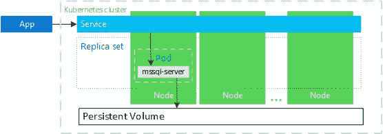

在前面的图中，`mssql-server` 是 `pod` 中的一个 SQL Server 实例（容器）。`replica set` 确保 `pod` 在节点故障后自动恢复。应用程序连接到服务。在这种情况下，服务代表负载均衡器，它托管的 IP 地址在 `mssql-server` 故障后保持不变。

Kubernetes 编排集群中的资源。当托管 SQL Server 实例容器的节点发生故障时，它会启动一个带有 SQL Server 实例的新容器，并将其挂载到相同的持久化存储上。SQL Server 2017 及更高版本支持 Kubernetes 上的容器。

### 使用 Azure Kubernetes Services（AKS）在 Kubernetes 中部署 SQL Server 容器

学习如何在 Azure Kubernetes Service（AKS）中配置 Kubernetes 上的 SQL Server 实例，并带有持久化存储以实现高可用（HA）。该解决方案提供了弹性能力。如果 SQL Server 实例失败，Kubernetes 会在新的 `pod` 中重新创建它。Kubernetes 还提供了针对节点故障的弹性能力。

本教程演示了如何在 AKS 的容器中配置高可用 SQL Server 实例。

- 创建 SA 密码
- 创建存储
- 创建部署
- 使用 SQL Server Management Studio（SSMS）连接
- 验证故障和恢复

## 在 Azure Kubernetes Service 中运行的 Kubernetes 上 HA 解决方案

Kubernetes 1.6 及更高版本支持 `storage classes`、`persistent volume claims` 和 `Azure disk volume type`。你可以在 Kubernetes 中原生创建并管理 SQL Server 实例。本文中的示例显示了如何创建一个 `deployment` 以实现类似于共享磁盘故障转移集群实例的高可用性配置。在此配置中，Kubernetes 充当集群编排器的角色。当容器中的 SQL Server 实例失败时，编排器会启动容器的另一个实例，该实例挂载到相同的持久化存储。


在前面的图中，`mssql-server` 是 `pod` 中的一个容器。Kubernetes 编排集群中的资源。`replica set` 确保 `pod` 在节点故障后自动恢复。应用程序连接到服务。在这种情况下，服务代表负载均衡器，它托管的 IP 地址在 `mssql-server` 故障后保持不变。

在接下来的图中，`mssql-server` 容器已失败。作为编排器，Kubernetes 保证 `replica set` 中健康实例的计数正确，并根据配置启动新容器。编排器在相同节点上启动新 `pod`，`mssql-server` 重新连接到相同的持久化存储。服务连接到重新创建的 `mssql-server`。

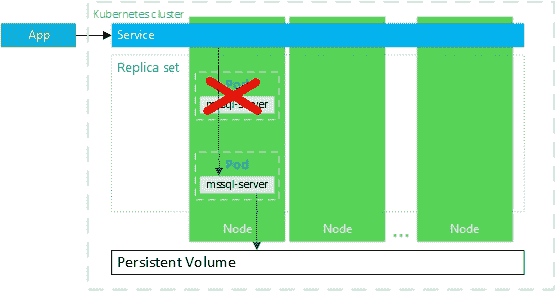

在接下来的图中，托管 `mssql-server` 容器的节点已故障。编排器在不同的节点上启动新 `pod`，`mssql-server` 重新连接到相同的持久化存储。服务连接到重新创建的 `mssql-server`。

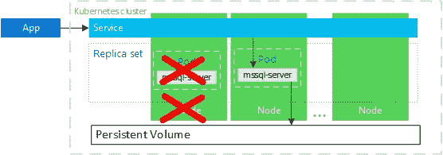

## 前提条件

- **Kubernetes cluster**
  - 教程需要一个 Kubernetes 集群。步骤使用 `kubectl` 管理集群。
- **Azure CLI 2.0.23**
  - 本教程中的指令已针对 Azure CLI 2.0.23 验证。

## 创建 SA 密码

在 Kubernetes 集群中创建 SA 密码。Kubernetes 可以管理敏感信息，如 `secrets`。以下命令为 SA 账户创建一个 secret：

```bash
kubectl create secret generic mssql --from-literal=SA_PASSWORD="YourP@ssword!P@ss0rd"
```

将 `YourP@ssword!P@ss0rd` 替换为更复杂的密码以创建一个名为 `mssql` 的 secret。

## 创建存储

在 Kubernetes 集群中配置 `persistent volume` 和 `persistent volume claim`。完成以下步骤：

1. 创建一个清单（manifest）来定义存储类和持久化卷声明。清单指定了配置程序（`provisioner`）、参数和 `reclaim policy`。Kubernetes 集群使用此清单来创建持久化存储。

   ```yaml
   kind: StorageClass
   apiVersion: storage.k8s.io/v1
   metadata:
     name: azure-disk
   provisioner: kubernetes.io/azure-disk
   parameters:
     storageaccounttype: Standard_LRS
   ---
   kind: PersistentVolumeClaim
   apiVersion: v1
   metadata:
     name: mssql-data
     annotations:
       volume.beta.kubernetes.io/storage-class: azure-disk
   spec:
     accessModes:
       - ReadWriteOnce
     resources:
       requests:
         storage: 8Gi
   ```

   保存文件（例如 `pvc.yaml`）。

2. 在 Kubernetes 中创建持久化卷声明。

   ```bash
   kubectl apply -f pvc.yaml
   ```

   持久化卷将自动创建为 Azure 存储账户并绑定到持久化卷声明。

   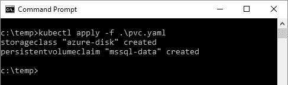

## 验证持久化卷声明

验证持久化卷声明。

```bash
kubectl describe pvc <PersistentVolumeClaim>
```

在前面的步骤中，持久化卷声明命名为 `mssql-data`。要查看持久化卷声明的元数据，运行以下命令：

```bash
kubectl describe pvc mssql-data
```

返回的元数据包含一个名为 `Volume` 的值。该值映射到 blob 的名称。

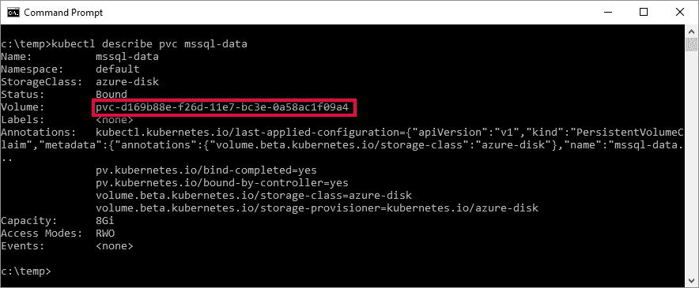

volume 值与下方图中 Azure 门户中的 blob 名称部分匹配：


4. 验证持久化卷。

`kubectl describe pvk` 返回关于自动创建并绑定到持久卷声明（persistent volume claim）的元数据。

## 创建部署

在此示例中，托管 SQL Server 实例的容器被描述为一个 Kubernetes 部署（`deployment`）对象。部署会创建一个副本集（`replica set`），副本集再创建 `pod`。

在这一步中，创建一个清单（manifest）来描述基于 SQL Server `mssql-server-linux` Docker 镜像的容器。该清单引用了 `mssql-server` 持久卷声明以及你已经应用到 Kubernetes 集群的 `mssql` secret（`secret`）。清单还描述了一个服务（`service`）。该服务是一个负载均衡器。负载均衡器确保了在 SQL Server 实例恢复后 IP 地址仍然保持不变。

1. 创建一个清单（YAML 文件）来描述部署。以下示例描述了一个部署，其中包含基于 SQL Server 镜像的容器。

   ```yaml
   apiVersion: apps/v1
   kind: Deployment
   metadata:
     name: mssql-deploy
   spec:
     replicas: 1
     selector:
       matchLabels:
         app: mssql
     template:
       metadata:
         labels:
           app: mssql
       spec:
         terminationGracePeriodSeconds: 30
         hostname: mssqlinst
         securityContext:
           fsGroup: 10001
         containers:
           - name: mssql
             image: mcr.microsoft.com/mssql/server:2019-latest
             ports:
               - containerPort: 1433
             env:
               - name: MSSQL_PID
                 value: "Developer"
               - name: ACCEPT_EULA
                 value: "Y"
               - name: SA_PASSWORD
                 valueFrom:
                   secretKeyRef:
                     name: mssql
                     key: SA_PASSWORD
             volumeMounts:
               - name: mssqldb
                 mountPath: /var/opt/mssql
         volumes:
           - name: mssqldb
             persistentVolumeClaim:
               claimName: mssql-data
   ---
   apiVersion: v1
   kind: Service
   metadata:
     name: mssql-deploy
   spec:
     selector:
       app: mssql
     ports:
       - protocol: TCP
         port: 1433
         targetPort: 1433
     type: LoadBalancer
   ```

   将上述代码复制到新文件中，命名为 `sqldeployment.yaml`。更新以下值：

   - `MSSQL_PID` 值：`"Developer"`：将容器设置为运行 SQL Server 开发者版。开发者版未授权生产数据。如果部署用于生产环境，请设置相应的版本（Enterprise、`Standard` 或 Express）。

   - `persistentVolumeClaim`：此值需要一个 `claimName:` 条目，映射到用于持久卷声明所的名称。本教程使用 `mssql-data`。


- `name: SA_PASSWORD`：配置容器镜像以设置 SA 密码，如本节定义。

```yaml
valueFrom:
  secretKeyRef:
    name: mssql
    key: SA_PASSWORD
```

当 Kubernetes 部署容器时，它会引用名为 `mssql` 的 secret 来获取密码值。

- `securityContext`：`securityContext` 定义了 Pod 或容器的权限和访问控制设置，在此情况下它是在 Pod 级别指定的，因此所有容器都会继承它。`10001` 的 `fsGroup` 确保容器具有权限写入卷。

- 当某人创建一个数据库时，他们将成为数据库的所有者，并连接到该数据库。数据库所有者可以创建更多用户。

稍后你可以通过授予 `ALTER ANY LOGIN` 权限来授权其他登录名创建更多登录名。在数据库内部，你可以通过授予 `ALTER ANY USER` 权限来授权其他用户创建更多用户。例如：

```sql
GRANT ALTER ANY LOGIN TO Larry;
GO
USE AdventureWorks2014;
GO
GRANT ALTER ANY USER TO Jerry;
GO
```

现在，登录名 `Larry` 可以创建更多登录名，而用户 `Jerry` 可以创建更多用户。

### 使用最小权限授予访问权限

首先连接到用户-数据库的是管理员和数据库所有者账户。然而，这些用户拥有数据库上的所有可用权限。这超过了大多数用户本应拥有的权限。

当你刚开始操作时，可以使用内置的 `fixed database roles`（固定数据库角色）来分配某些通用类别的权限。例如，`db_datareader` 固定数据库角色可以读取数据库中的所有表，但不会进行任何更改。使用 `ALTER ROLE` 语句授予固定数据库角色成员身份。以下示例将用户 `Jerry` 添加到 `db_datareader` 固定数据库角色。

```sql
USE AdventureWorks2014;
GO
ALTER ROLE db_datareader ADD MEMBER Jerry;
```

固定数据库角色的列表，请参阅 `Database-Level Roles`（数据库级角色）。

稍后，当你准备好对数据配置更精确的访问控制（强烈建议）时，使用 `CREATE ROLE` 语句创建自定义的数据库角色。然后为你的自定义角色分配特定的细粒度权限。

例如，以下语句创建了一个名为 `Sales` 的数据库角色，授予 `Sales` 组查看、更新和删除 `Orders` 表中行的能力，然后将用户 `Jerry` 添加到 `Sales` 角色。

```sql
CREATE ROLE Sales;
GRANT SELECT ON Object::Sales TO Orders;
GRANT UPDATE ON Object::Sales TO Orders;
GRANT DELETE ON Object::Sales TO Orders;
ALTER ROLE Sales ADD MEMBER Jerry;
```

### 配置行级安全

`Row-Level Security`（行级安全）允许你根据执行查询的用户限制对数据库中行访问访问。此功能适用于此类场景，例如确保客户只能访问他们自己的数据，或确保员工只能访问与其所属部门相关的数据。

以下步骤将介绍如何设置两个对 `Sales.SalesOrderHeader` 表具有不同行级访问权限的用户。

#### 创建两个用户账户以测试行级安全

```sql
USE AdventureWorks2014;
GO
CREATE USER Manager WITHOUT LOGIN;
CREATE USER SalesPerson280 WITHOUT LOGIN;
```

#### 为两个用户授予 `Sales.SalesOrderHeader` 表的读取权限

```sql
GRANT SELECT ON Sales.SalesOrderHeader TO Manager;
GRANT SELECT ON Sales.SalesOrderHeader TO SalesPerson280;
```

#### 创建新架构和内联表值函数

当 `SalesPersonID` 列中的行与 `SalesPerson` 登录名的 ID 匹配，或者执行查询的用户是 `Manager` 用户时，该函数返回 1。

```sql
CREATE SCHEMA Security;
GO
CREATE FUNCTION Security.fn_securitypredicate(@SalesPersonID AS int)  
    RETURNS TABLE  
  WITH SCHEMABINDING  
  AS  
    RETURN SELECT 1 AS fn_securitypredicate_result  
    WHERE ('SalesPerson' + CAST(@SalesPersonId as VARCHAR(16)) = USER_NAME())
    OR (USER_NAME() = 'Manager');
```

#### 创建安全策略，将函数同时作为表的过滤谓词和阻塞谓词

```sql
CREATE SECURITY POLICY SalesFilter
  ADD FILTER PREDICATE Security.fn_securitypredicate(SalesPersonID)
  ON Sales.SalesOrderHeader,
  ADD BLOCK PREDICATE Security.fn_securitypredicate(SalesPersonID)
  ON Sales.SalesOrderHeader
WITH (STATE = ON);
```

以用户身份查询 `SalesOrderHeader` 表，验证 `SalesPerson280` 只能看到其自身的销售数据，而 `Manager` 可以看到表中的所有行。

```sql
EXECUTE AS USER = 'SalesPerson280';
SELECT * FROM SalesOrderHeader; 
REVERT;
EXECUTE AS USER = 'Manager';
SELECT * FROM SalesOrderHeader;
REVERT;
```

#### 修改安全策略以禁用策略

现在两个用户都可以访问所有行。

```sql
ALTER SECURITY POLICY SalesFilter
WITH (STATE = OFF);
```

### 启用动态数据掩码

`Dynamic Data Masking`（动态数据掩码）允许你通过完全或部分掩码某些列，限制应用程序用户对敏感数据的暴露。

使用 `ALTER TABLE` 语句为 `Person.EmailAddress` 表中的 `EmailAddress` 列添加掩码函数：

```sql
USE AdventureWorks2014;
GO
ALTER TABLE Person.EmailAddress
ALTER COLUMN EmailAddress
ADD MASKED WITH (FUNCTION = 'email()');
```

创建一个具有表权限的新用户 `TestUser`，然后以该用户身份执行查询以查看掩码数据：

```sql
CREATE USER TestUser WITHOUT LOGIN;
GRANT SELECT ON Person.EmailAddress TO TestUser;
EXECUTE AS USER = 'TestUser';
SELECT EmailAddressID, EmailAddress FROM Person.EmailAddress;
REVERT;
```

### 启用透明加密

数据库的一种威胁是有人从硬盘上盗取数据库文件。这可能发生在获取了系统提升权限的入侵中、问题员工的行为，或者含有文件的计算机（如笔记本电脑）被盗。

`TDE` 在数据文件存储在硬盘上时对其进行加密。SQL Server 数据库引擎的主数据库拥有加密密钥，以便数据库引擎可以处理数据。如果没有密钥，将无法读取数据库文件。高级管理员可以管理、备份和重建密钥，因此数据库可以移动，但只能由选定人员移动。配置 `TDE` 时，`tempdb` 数据库也会自动加密。

由于数据库引擎可以读取数据，透明加密无法防止能够直接读取内存或通过管理员账户访问 SQL Server 的计算机管理员的非法访问。

#### 配置 TDE

- 创建主密钥。
- 创建由主密钥保护的证书。
- 创建数据库加密密钥并由证书保护。
- 设置数据库使用加密。

配置 `TDE` 需要对主数据库的 `CONTROL` 权限以及用户数据库的 `CONTROL` 权限。通常由管理员配置 `TDE`。以下示例说明了使用安装在服务器上名为 `MyServerCert` 的证书加密和解密 `AdventureWorks2014` 数据库。

```sql
USE master;
GO
CREATE MASTER KEY ENCRYPTION BY PASSWORD = '**********';
GO
CREATE CERTIFICATE MyServerCert WITH SUBJECT = 'My Database Encryption Key Certificate';
GO
USE AdventureWorks2014;
CREATE DATABASE ENCRYPTION KEY WITH ALGORITHM = AES_256 ENCRYPTION BY SERVER CERTIFICATE MyServerCert;
GO
ALTER DATABASE AdventureWorks2014 SET ENCRYPTION ON;
```

要删除 `TDE`，请执行 `ALTER DATABASE AdventureWorks2014 SET ENCRYPTION OFF;`。加密和解密操作由 SQL Server 在后台线程上调度。您可以使用本主题稍后列出的目录视图和动态管理视图查看这些操作的状态。

## 配置备份加密

SQL Server 能够在创建备份时加密数据。通过在创建备份时指定加密算法和加密器（证书或非对称密钥），您可以创建一个加密的备份文件。以下示例创建了一个证书，然后创建了受该证书保护的备份。

```sql
USE master;
GO
CREATE CERTIFICATE BackupEncryptCert WITH SUBJECT = 'Database backups';
GO
BACKUP DATABASE [AdventureWorks2014] TO DISK = N'/var/opt/mssql/backups/AdventureWorks2014.bak' WITH COMPRESSION, ENCRYPTION (ALGORITHM = AES_256, SERVER CERTIFICATE = BackupEncryptCert), STATS = 10
```

## Linux 上 SQL Server 的 Active Directory 验证

本文提供了 Linux 上 SQL Server Active Directory（AD）身份验证的概述。AD 验证在 SQL Server 中也称为集成身份验证。

### AD 验证概述

AD 验证允许 Windows 或 Linux 上的加入域客户端使用其域凭据和 Kerberos 协议对 SQL Server 进行身份验证。与 SQL Server 验证相比，AD 具有以下优势：

- 用户通过单登录进行身份验证，无需提示密码。
- 通过为 AD 组创建登录名，可以使用 AD 组成员关系管理 SQL Server 中的访问和权限。
- 每个用户在整个组织中都有唯一的身份，因此您无需跟踪哪个 SQL Server 登录名对应哪些人员。
- AD 允许您在整个组织中实施集中的密码策略。

### 配置步骤

为了使用 Active Directory 验证，您必须在网络中拥有 AD 域控制器（Windows）。

### 已知问题

- 目前，数据库镜像终端点支持的唯一验证方法是 `CERTIFICATE`。Windows 验证方法将在未来的版本中启用。
- Linux 版 SQL Server 不支持远程连接的 NTLM 协议。本地连接可以使用 NTLM。

### 将 Linux 主机上的 SQL Server 加入 Active Directory 域

本文提供了如何将 SQL Server Linux 主机加入 Active Directory（AD）域的通用指南。有两种方法：使用内置的 SSSD 包或使用第三方 Active Directory 提供程序。第三方域加入产品的示例包括 `PowerBroker Identity Services (PBIS)`、`One Identity` 和 `Centrify`。本指南包含了检查您的 Active Directory 配置的步骤，但它并不提供在使用第三方实用程序将机器加入域的说明。

在配置 Active Directory 验证之前，您需要在网络中设置 Windows Active Directory 域控制器。然后将您的 Linux 主机上的 SQL Server 加入 Active Directory 域。

#### 检查与域控制器的连接

检查是否可以使用域的短名称和完全限定域名访问域控制器：

```bash
ping contosope
ping contoso.com
```

如果其中任何一个名称检查失败，请更新您的域搜索列表。后续章节分别为 Ubuntu、Red Hat Enterprise Linux（RHEL）和 SUSE Linux Enterprise Server（SLES）提供了说明。

#### Ubuntu 16.04

1. 编辑 `/etc/network/interfaces` 文件，使您的 Active Directory 域位于域搜索列表中：

```text
/etc/network/interfaces
# The primary network interface
auto eth0
iface eth0 inet dhcp
dns-nameservers <AD domain controller IP address>
dns-search <AD domain name>
```

2. 编辑此文件后，重启网络服务：

```bash
sudo ifdown eth0 && sudo ifup eth0
```

3. 接下来，检查您的 `/etc/resolv.conf` 文件是否包含类似示例的行：

```text
/etc/resolv.conf
search contoso.com com
nameserver <AD domain controller IP address>
```

#### RHEL 7.x

1. 编辑 `/etc/sysconfig/network-scripts/ifcfg-eth0` 文件，使您的 Active Directory 域位于域搜索列表中。或者根据需要编辑另一个接口配置文件：

```text
/etc/sysconfig/network-scripts/ifcfg-eth0
PEERDNS=no
DNS1=<AD domain controller IP address>
DOMAIN="contoso.com com"
```

2. 编辑此文件后，重启网络服务：

```bash
sudo systemctl restart network
```

3. 现在检查您的 `/etc/resolv.conf` 文件是否包含类似示例的行：

```text
/etc/resolv.conf
search contoso.com com
nameserver <AD domain controller IP address>
```

4. 如果您仍然无法 ping 通域控制器，请找到域控制器的完全限定域名和 IP 地址。示例域名为 `DC1.CONTOSO.COM`。将以下内容添加到 `/etc/hosts`：

```text
/etc/hosts
<IP address> DC1.CONTOSO.COM CONTOSO
```

#### SLES 12

1. 编辑 `/etc/sysconfig/network/config` 文件，使您的 Active Directory 域控制器 IP 用于 DNS 查询，并将 Active Directory 域位于域搜索列表中：

```text
/etc/sysconfig/network/config
NETCONFIG_DNS_SEARCHLIST=""
NETCONFIG_DNS_STATIC_SERVERS="<AD domain controller IP address>"
```

2. 编辑此文件后，重启网络服务：

```bash
sudo systemctl restart network
```

3. 接下来，检查 `resolv.conf` 文件是否包含类似示例的行：

```text
/etc/resolv.conf
search contoso.com com
nameserver <AD domain controller IP address>
```

### 加入 AD 域

在验证基本配置和与域控制器的连接后，将 SQL Server Linux 机器加入 Active Directory 域有两种选项：

#### 选项 1：使用 SSSD 包加入 AD 域

此方法使用 `realmd` 和 `sssd` 包将 SQL Server 主机加入 AD 域。

1. 使用 `realmd` 将您的主机加入 AD 域。您必须先使用 Linux 发行版的包管理器在 SQL Server 主机上安装 `realmd` 和 Kerberos 客户端包：

RHEL：`sudo yum install realmd krb5-workstation`

SUSE：`sudo zypper install realmd krb5-client`


Ubuntu：

```bash
sudo apt-get install realmd krb5-user software-properties-common python-software-properties packagekit
```

如果 Kerberos 客户端包安装提示输入 Realm 名称，请输入您的域名。

确认 DNS 配置正确后，运行以下命令加入域。您必须使用具有足够权限加入新域的 AD 账户进行身份验证。此命令会在 AD 中创建新的计算机帐户，创建`/etc/krb5.keytab`主机密钥表，在`/etc/sssd/sssd.conf`中配置域并更新`/etc/krb5.conf`。

```bash
sudo realm join contoso.com -U 'user@CONTOSO.COM' -v
```

您应该会看到消息`Successfully enrolled machine in realm`。以下表列出了您可能接收到的错误消息以及解决建议：

| 问题 | 解决方案 |
| :--- | :--- |
| 未安装必要的程序包 | 在再次运行`realm join`命令之前，请使用您的 Linux 发行版的包管理器安装这些软件包。 |
| 加入域的权限不足 | 请向域管理员确认您是否拥有足够的权限将 Linux 机器加入您的域中。 |
| KDC 回复不符合预期 | 您可能没有为用户指定正确的域名（Realm name）。域名区分大小写，通常使用大写，并可以通过`realm discover contoso.com`命令进行识别。 |

SQL Server 使用`SSSD`和`NSS`将用户帐户和组映射到安全标识符（SIDs）。必须配置并运行`SSSD`，SQL Server 才能成功创建 AD 登录。`realmd`通常在加入域的过程中自动完成此项操作，但在某些情况下，您必须单独执行此操作。

## 验证域用户和 Kerberos 票据

验证您现在是否可以从域收集有关用户的信息，并且可以作为该用户获取 Kerberos 票据。以下示例使用了`id`、`kinit`和`klist`命令。

```bash
id user@contoso.com
uid=1348601103(user@contoso.com) gid=1348600513(domain group@contoso.com) groups=1348600513(domain group@contoso.com)
kinit user@CONTOSO.COM
Password for user@CONTOSO.COM:
klist
Ticket cache: FILE:/tmp/krb5cc_1000
Default principal: user@CONTOSO.COM
```

## 选项 2：使用第三方 openldap 提供程序工具

您可以使用第三方工具，如`PBIS`、`VAS`或`Centrify`。本文未涵盖每个单独工具的步骤。在继续之前，您必须先使用这些工具之一将用于 SQL Server 的 Linux 主机加入域。

SQL Server 的任何 AD 相关查询都不使用第三方集成器的代码或库。在此设置下，SQL Server 始终直接使用`openldap`库调用查询 AD。第三方集成仅用于将 Linux 主机加入 AD 域，SQL Server 与这些工具之间没有直接通信。

验证`/etc/krb5.conf`配置正确。对于大多数第三方 Active Directory 提供程序，此配置是自动完成的。但请检查`/etc/krb5.conf`中的以下值以防止未来出现问题：

```ini
[lib]
default_realm = CONTOSO.COM
[realms]
CONTOSO.COM = {}
[domain]
contoso.com = CONTOSO.COM
contoso.com = CONTOSO.COM
```

检查反向 DNS 是否配置正确。以下命令应返回运行 SQL Server 的主机的完全限定域名（FQDN）。示例为`host <IP address>`。该命令的输出应类似于`<IP address>.in-addr.arpa host.contoso.com`。如果此命令没有返回主机的 FQDN，或者 FQDN 错误，请在您的 DNS 服务器上为 Linux 主机上的 SQL Server 添加反向 DNS 记录。

## 对 Linux 上的 SQL Server 连接进行加密

Linux 上的 SQL Server 可以使用传输层安全协议（TLS）加密客户端应用程序与 SQL Server 实例之间通过网络传输的数据。SQL Server 在 Windows 和 Linux 上支持相同的 TLS 协议：TLS 1.2、1.1 和 1.0。然而，配置 TLS 的步骤取决于运行 SQL Server 的特定操作系统。

### 证书要求

在开始之前，您需要确保您的证书符合以下要求：

- 当前系统时间必须在证书的有效期内。
- 证书必须用于服务器身份验证。这需要“增强密钥用法”（Enhanced Key Usage）属性。
- 证书必须是用于服务器身份验证的。（注：此处原文似乎存在重复或逻辑混乱，已按语意翻译。）

## MSSQL 配置命令

执行以下命令来停止 MSSQL 服务并配置 TLS 证书参数：

```bash
bash systemctl stop mssql-server
cat /var/opt/mssql/mssql.conf
sudo /opt/mssql/bin/mssql-conf set network.tlscert /etc/ssl/certs/mssql.pem
sudo /opt/mssql/bin/mssql-conf set network.tlskey /etc/ssl/private/mssql.key
sudo /opt/mssql/bin/mssql-conf set network.tlsprotocols 1.2
sudo /opt/mssql/bin/mssql-conf set network.forceencryption 1
```

## 示例连接字符串

### SQLCMD

```bash
sqlcmd -S <sqlhostname> -U sa -P '<YourPassword>'
```

### ADO.NET

```text
"Encrypt=False; TrustServerCertificate=False;"
```

### ODBC

```text
"Encrypt=no; TrustServerCertificate=no;"
```

### JDBC

```text
"encrypt=false; trustServerCertificate=false;"
```

## 常见连接错误

| 常见连接错误 | 修复 |
| :--- | :--- |
| 证书链是由不受信任的机构颁发的。 | 此错误发生在客户端在 TLS 握手期间无法验证 SQL Server 提供的证书签名时。请确保客户端直接信任 SQL Server 证书，或者信任签署 SQL Server 证书的 CA（证书颁发机构）。 |
| 目标主体名称不正确。 | 请确保 SQL Server 证书上的通用名称（Common Name）字段与客户端连接字符串中指定的服务器名称匹配。 |
| 现有连接被远程主机强制关闭。 | 此错误发生在客户端不支持 SQL Server 要求的 TLS 协议版本时。例如，如果 SQL Server 配置为要求 TLS 1.2，请确保您的客户端也支持 TLS 1.2 协议。 |
