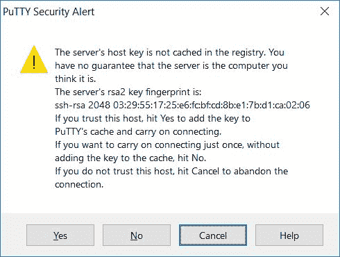
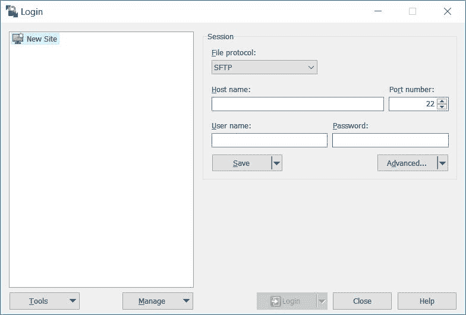
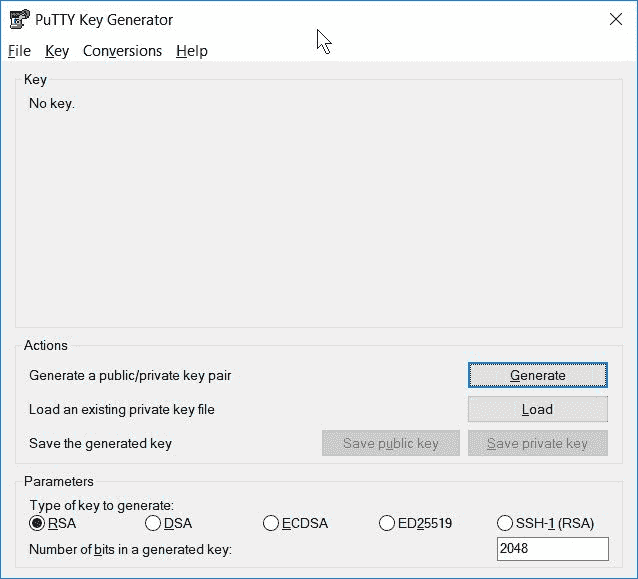
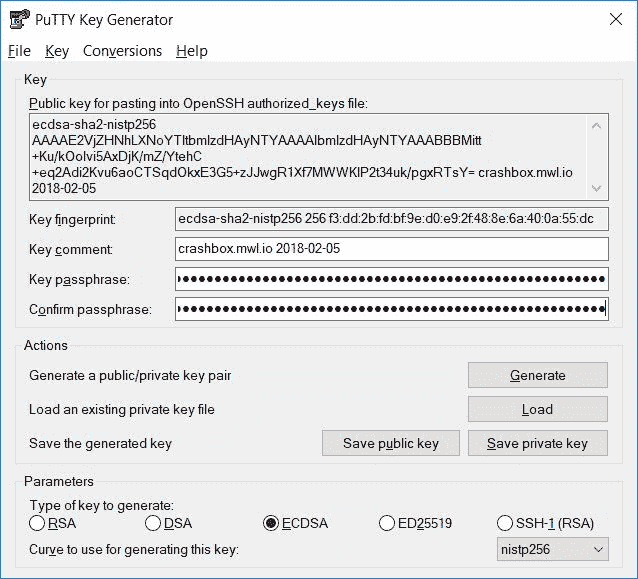
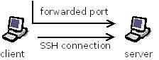
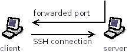
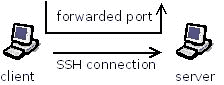
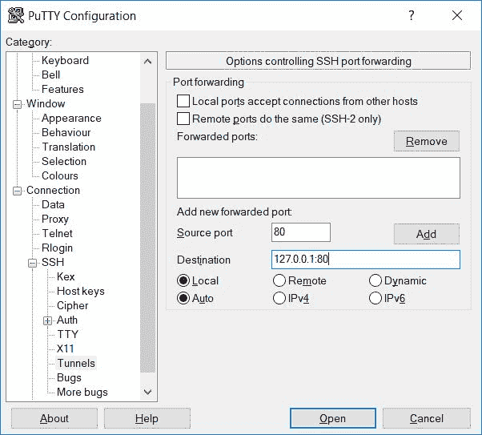
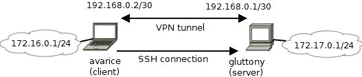

# SSH 精通指南：OpenSSH、PuTTY、隧道与密钥 (IT Mastery) (第 12 卷)


# 致谢

首先，要感谢编写 OpenSSH 和 PuTTY 的优秀人才们。这些人通过创建和支持他们的软件，从字意义上让世界变得更美好。我必须特别感谢 OpenSSH 的领军人物 Damien Miller，在我提出愚蠢问题时花时间指引我正确的方向。

我还要感谢我的技术审稿员：Bill Allaire, Jim Allen, Tim Enders, Marie Helene Kvello-Aune, Kurt Mosiejczuk, Mike O’Connor, Bernard Spil, Loganaden Velvindron（来自 hackers.mu）以及 Markus Waldeck。尽管这些优秀人才付出了努力，书中仍出现了一些错误。

感谢那些通过 Patreon (https://www.patreon.com/mwlucas) 为我提供持续支持的人们。他们中有一整群人免费获得了一本书作为感谢。

如果没有所有涉及软件的源代码，写这本书是不可能的。

这本书是送给 Liz 的。

# 第 0 章：引言

在过去的 15 年里，OpenSSH (http://www.OpenSSH.com) 已经成为 UNIX 类系统和许多网络设备远程管理的标准工具。然而，大多数系统管理员只使用获取命令行所需的最基本的 OpenSSH 功能。OpenSSH 有许多强大的功能，如果你愿意花时间理解它们，这些功能将使系统管理变得简单。你可以在互联网各处找到关于 OpenSSH 的信息和教程。其中一些写得很糟糕，或者仅适用于少数场景。很多写得很好，但它们已经是十年前的内容了，涵盖了九年前通过软件更新就解决的问题。如果你有几个空闲日子，并且知道问什么问题，你就可以从杂质中筛选出有效的、当前的教程。

这本以任务为导向的书将节省你的精力和时间，让你腾出来准备下一个版本的《堡垒要塞》。我假设你正在使用较新版本的 OpenSSH 和 PuTTY，我会忽略诸如“我二十年前的路由器只支持 SSH 版本 1”之类的边缘情况。如果你发现了这本书，说明你有能力通过搜索来回答非常具体的问题。我不会讨论如何从源码构建 OpenSSH，或者如何在许多不同的平台上安装 OpenSSH 服务器。如果你是系统管理员，你知道去哪里找这些信息。如果你是系统用户，你的系统管理员应该为你安装并配置 OpenSSH 服务器，但掌握客户端程序将帮助你工作得更快更高效。

## 谁应该读这本书？

每个管理 UNIX 系统的人都必须理解 SSH。OpenSSH 是最常用的 SSH 实现。除非你明确正在使用不同的 SSH 实现，否则请阅读这本书。

不是系统管理员但必须通过 SSH 连接到服务器的人也会发现这本书很有帮助。虽然你可以在五分钟内学会 SSH 的基础知识，但正确的 SSH 使用会让你的工作变得更简单更快速。如果你愿意，可以跳过关于服务器配置的章节，尽管了解系统管理员*实际上能*做什么，而不是他们*想*做什么，总是好的。

## SSH 组件

安全 Shell (SSH) 是一种在两个网络主机之间创建加密通信通道的协议。SSH 保护两台机器之间传输的数据，使其他人无法窃听。Tatu Ylönen 在 1995 年创建了最初的协议和实现，旨在取代不安全的协议，如 `telnet`、`RSH` 和 `rlogin`。随着 1999 年 OpenSSH 发布，SSH 迅速成为管理主机的标准方法。今天，许多不同的软件包依赖 SSH 协议跨私有、公共和敌对网络进行加密且经过验证的数据传输。

### OpenSSH

OpenSSH 是 SSH 协议部署最广泛的实现。它起源于原始 SSH 软件免费许可版本，经过了重写、扩展和更新。

### SSH 服务器

SSH 服务器在网络上监听传入的 SSH 请求，验证这些请求并提供系统命令行提示符（或其他你配置的服务）。最流行的 SSH 服务器是 `sshd`。

### SSH 客户端

使用 SSH 客户端连接到远程服务器或网络设备。Windows 系统上最流行的 SSH 客户端是 PuTTY。Unix 类系统的标准 SSH 客户端是来自 OpenSSH 的 `ssh(1)`。两者都是免费获取的并可用于任何目的（商业或非商业），且无需费用。

一旦你理解了 PuTTY 和 OpenSSH，你就拥有使用任何安全 SSH 客户端的基础知识。

## SSH 协议版本

SSH 协议有两个版本：`SSH-1`（版本 1）和 `SSH-2`（版本 2）。请始终使用 `SSH-2`。所有现代 SSH 软件默认使用版本 2。你会发现旧的嵌入式设备仍然依赖 SSH 版本 1，但 `SSH-1` 的安全性仅比未加密的 telnet 高一点。

某人为了自己的需求设计了 `SSH-1`。它很好地满足了这些需求，并在 20 世纪 90 年代比 telnet 好得多。随着 SSH 变得越来越流行，越来越多的人研究了该协议并暴露了原始设计中的缺陷。以当今计算能力，`SSH-1` 极易受到攻击。虽然 `SSH-1` 会对传输中的数据进行加密并防止随意的窃听，但掌握一些小技巧的攻击者可以捕获你的数据、解密传输中的数据、诱导你认为登录了正确的机器（而实际上你连接到了不同的主机）、在数据流中插入任意文本，或者这些手段的组合。攻击 `SSH-1` 数据流并非简单的点击鼠标即可完成，但入侵者在现实世界中确实能够破解 `SSH-1`。

表面上的安全比没有安全更糟糕。永远不要使用 SSH 版本 1。

对于不支持 `SSH-2` 的服务器或客户端，允许 `SSH-1` 似乎是无害的。然而，客户端和服务器会透明地协商连接使用的 SSH 版本。如果客户端或服务器任一兼容 `SSH-1`，入侵者就可以捕获你的登录凭据和所有传输数据。在 `SSH-1` 会话中插入任意文本（如 `rm -rf /*`）是非常简单的。这在 1998 年就被发现，而现今巨大的计算能力让这种攻击变得容易得多。`Ettercap` 等程序可以实时解码 `SSH-1` 会话。对 `SSH-1` 的增量改进（如 `SSH 1.3` 和 `1.5`）也存在漏洞。提供 SSH 版本 1.99 支持的 SSH 服务器支持 SSH 版本 1 和版本 2。

不要让你的 SSH 客户端请求 `SSH-1`。不要让你的 SSH 服务器提供 `SSH-1`。

OpenSSH 删除了对 `SSH-1` 的支持，如果你有一个仅支持 `SSH-1` 的旧嵌入式设备，你需要使用 `PuTTY` 来管理它，或者更好的是花几美元将该设备更换为本世纪以后制造的设备。1

`SSH-2` 是现代标准。该协议的设计使得在发现漏洞时能够快速解决问题。我们不断增长的计算能力使得今天的强加密成为明天的安全风险，因此 `SSH-2` 的设计允许其算法和协议进行原地升级。

如 `SCP` 和 `SFTP`（第 7 章）等协议是构建在 SSH 之上的。

## 本书中不包含什么？

本书旨在让你熟悉 SSH，并帮助你达到 `OpenSSH` 和 `PuTTY` 的最低胜任水平。这意味着消除密码、将你的 SSH 服务限制在所需的最小权限，并将 SSH 作为常用管理工具的传输媒介。你将能够轻松地通过 SSH 复制文件、极其方便地管理服务器密钥、使用数字证书仅允许网络上经过批准的密钥访问，以及其他一些技巧。

本书并不打算作为一本全面的 SSH 巨著。它没有涵盖将 SSH 与 `Kerberos` 或 `SecurID` 集成，或者将你的 SSH 安装挂接到 `Google authenticator`，或者将你的 SSH agent 作为第三方程序的身份验证源。这些都是很有趣的话题，但非常特定平台，并且可能在你读完这本书之前就发生了变化。对认证选项感兴趣的系统管理员可能会发现我的书籍 *PAM Mastery*(Tilted Windmill Press, 2016）很有用。

## 本书中包含什么？

第 0 章是引言。

第 1 章“加密与密钥”提供了关于加密的基本信息以及 SSH 如何使用加密。

第 2 章“常用配置”涵盖了整个 `OpenSSH` 服务器和客户端使用的配置语法。

第 3 章“OpenSSH 服务器”讨论了配置 OpenSSH 服务器 `sshd`。本章将引导你如何配置 `sshd`，但更具体的示例会贯穿书中。

第 4 章“主机密钥验证”涵盖了使用任何 SSH 客户端时经常被忽视但至关重要的部分：验证服务器密钥。这个主题如此重要，以至于它需要自己的章节，甚至排在我们第一次讨论 SSH 客户端之前。

第 5 章“SSH 客户端”讨论了两个流行的 SSH 客户端：用于 Unix 系统的 OpenSSH `ssh(1)` 和用于 Windows 的 `PuTTY`。

第 6 章“通过 SSH 复制文件”涵盖了使用 SSH 作为传输媒介跨网络移动文件，使用了 `SCP`（安全复制）和 `SFTP`（SSH 文件传输）协议。

第 7 章“SSH 密钥”将引导你创建个人密钥对（公钥和私钥）。密钥对使身份验证更安全。与 agent 使用时，它们消除了经常输入密码的需求，但不会降低 SSH 的安全性。

第 8 章“X 转发”将教你如何在最小化风险的同时，通过 SSH 连接显示图形。

第 9 章“端口转发”涵盖了将 SSH 作为通用的 TCP/IP 代理，允许你通过网络将任意连接重定向到远程机器。

第 10 章“保持 SSH 会话开启”涵盖了在存在防火墙、代理服务器以及想要在几分钟或几小时后关闭会话的不可 ISP 的情况下保持 SSH 会话运行的方法。

第 11 章“密钥分发”告诉系统管理员如何自动分发主机密钥并在提高安全性的同时消除用户手动比较主机指纹的需求。我们还涵盖了在大型系统中分发公钥的问题。

第 12 章“自动化”讨论了将 SSH 作为自动化工具和严格控制的用户任务的传输媒介的方法，以及创建单用途用户密钥。

第 13 章“OpenSSH VPN”演示了如何使用 OpenSSH 在两个站点之间创建加密隧道。

第 14 章“证书权威机构”引导你创建一个证书权威机构，以仅允许授权的用户密钥登录你的网络。

废话够了！让我们开始工作吧。

1 少数 Linux 发行版故意配备了支持 SSH-1 的 SSH 客户端。

# 第 1 章：加密、算法与密钥

OpenSSH 加密流量。这意味着什么？它是如何工作的？我在我的书籍 *PGP & GPG*(No Starch Press, 2006) 中提供了详细解释，但这里是简短版本。

加密将可读的*明文*转换为攻击者无法理解的不可读*密文*。*解密*反转这一转换，从乱码中产生可读文本。*加密算法*是执行这种转换的精确方法。大多数加密算法使用*密钥*；一段用于加密消息的文本、数字、符号或数据。密钥可以由用户选择或随机生成。（人们习惯于选择容易猜测的密钥，因此 OpenSSH 甚至没有给用户提供创建密钥的选项。）加密算法使用密钥加密文本，使得外部人员难以解密。即使你知道加密算法，如果没有秘密加密密钥，你也无法解密消息。

将加密算法想象成一种锁，而密钥就是特定的钥匙。锁有很多不同的类型：入户门、自行车、工厂等。每种锁都使用某种类型的钥匙——你的门钥匙形状可能无法插入任何车辆的点火锁。但即使是类型正确的钥匙，在错误的锁上也不起作用。你的正门钥匙可以打开你的正门，仅限你的正门。加密密钥的工作原理相似。

## 算法类型

加密算法分为两种：对称加密和非对称加密。

### 对称算法

对称算法在加密和解密时使用同一个密钥。对称算法包括但不限于高级加密标准 (`AES`) 和 `ChaCha20`，以及较旧但现在已不再安全的算法，如 `3DES` 和 `Blowfish`。孩子的替换密码就是对称算法。一旦你知道 `A` 等于一，以此此类推，你就可以加密和解密消息。对称算法（比简单替换更复杂）只要只有授权人员持有密钥，就可以非常快速且安全。但问题在于：获取了密钥的外外部人员可以读取你的消息，或将其替换为他自己的消息。你必须保护密钥。在互联网上不明文发送密钥就像站在操场上大喊：“A 是一，B 是二。”任何听到密钥的人都可以读取你的私消息。

### 非对称算法

非对称算法用于加密和解密使用不同的密钥。你用一个密钥加密消息，然后用另一个密钥解密。这之所以可行是因为密钥是非常大的数字，而大数字的相乘比找出如何除它们要容易得多。（如果你想了解细节，互联网上有很好的解释。）非对称加密仅随着能够处理极其复杂数学计算的计算机普及才变得流行，而且它比对称加密慢得多，计算开销大得多。两个独立的密钥创造了有趣的可能性。将一个密钥设为公开。把它送出去。向全世界广播。保持另一个密钥私密，并不惜一切地保护它。任何拥有公钥的人都可以加密只有知道私钥的人才能读取的消息。拥有私钥的人可以加密消息并发送到世界上。任何人都可以公钥解密该消息，但公钥可以解密消息这一事实确保了接收者消息发送者拥有私钥。这就是公钥加密的基础。公钥及其匹配的私钥被称为密钥对。再次，想象一下你正门上的锁。锁本身是公开的；任何人都可以碰它。钥匙是私密的。你必须两者都有才能进入你。（你可以通过研究 Diffie-Hellman 密钥交换来了解更多。）

## SSH 如何使用加密

对称加密速度快，但没有为主机提供一种安全交换密钥的方法。非对称加密允许主机交换公钥，但它很慢且计算开销大。你如何高效地加密两个从未通信过的主机之间的会话？

每个 SSH 服务器都有一个密钥对。每当客户端连接时，服务器和客户端都会使用这个密钥对来协商一个仅供这两个主机共享的临时密钥对。客户端和服务器都使用这个临时密钥对来派生对称密钥，他们将在会话期间使用该密钥交换数据，以及提供连接完整性的相关密钥。如果会话运行很长时间或交换大量数据，计算机将间歇性协商新的临时密钥对。

# 第 2 章：常见配置

所有配置文件都位于 `/etc/ssh`。某些操作系统会使用备用位置——例如，OSX 使用 `/private/etc`，而 FreeBSD 使用 `/usr/local/etc`。

`sshd_config` 文件包含服务器设置，而 `ssh_config` 文件包含客户端设置。两个文件都可以用文本编辑器编辑。

```
Port 22
```

```
HostKey /etc/ssh/ssh_host_ed25519_key
```

如果 `ssh(1)` 或 `sshd(8)` 报错配置出现问题，请检查你是否正确地分隔了多个条目。本书包含了许多分配多个值的示例，但 OpenSSH 手册始终是最终权威标准。

## OpenSSH 配置文件中的通配符


OpenSSH 服务器和客户端的配置文件接受通配符，称为`patterns`（模式）。与其列出配置设置的所有可能值，不如模式允许你表述为“匹配此表达式的任何内容”。通配符通常用于`Match`规则，正如本章稍后在“使用 Match 进行条件配置”中所讨论的那样。模式允许你编写诸类的配置语句，例如“此域名内的所有主机”或“此网络中的所有 IP 地址”。两个通配符字符是：

- `?` 匹配恰好一个字符
- `*` 匹配零或多个字符

例如，我可以使用一个模式将`Host`关键字的值设置为`mwl.io`中的任何主机。

```
Host *.mwl.io
```

如果我使用问号通配符，此模式将匹配任何主机名为单个字符的主机。很少有环境根据主机名的长度来划分安全域，但如果有的话，你可以使用多个问号来识别它们。此模式匹配`sloth.mwl.io`和`wrath.mwl.io`，但不匹配`gluttony.mwl.io`或`avarice.mwl.io`。

```
Host ?????.mwl.io
```

模式对于 IP 地址也很有用。在这里，我匹配从`203.0.113.10`到`203.0.113.19`的主机。

```
Address 203.0.113.1?
```

如果使用星号通配符，我可以匹配`/24`网络内的任何 IP。

```
Address 203.0.113.*
```

你可能会像第 5 章讨论的那样将子掩码与 IP 地址范围。

在前面加上感叹号来取反模式。此模式匹配`mwl.io`主机之外的所有内容。

```
Host !*.mwl.io
```

取反在与较大的实体结合时最有用——也就是说，“匹配除那一个小部分之外的所有内容”。如果我想匹配`mwl.io`中的所有主机，但子域名`vermin.mwl.io`下的客户，可以使用此模式。并不是所有关键字都支持取反；你必须尝试并查看它在你的环境中是否有效。

```
Host !.vermin.mwl.io *.mwl.io
```

OpenSSH 首席开发人员将取反描述为“有点琐碎”。我称它为“可能会对你掏刀”。如果你需要取反，请进行彻底测试。

## 使用 Match 进行条件配置

你的服务器可能需要根据传入连接的源地址、主机名或用户名有不同的行为。SSH 客户端可能需要为特定的主机组使用不同的用户名，或者在本地网络使用时激活 X 转发（第 9 章）。`Match sshd_config`关键字允许为此类情况建立特殊配置。

在每个`Match`语句后，跟随一组触发匹配的条件，然后是一系列 OpenSSH 应该应用于符合所有这些条件的连接的配置语句。我们将在接下来的章节中看到几个示例。

在实现`Match`语句之前，先为最常见的设置配置 OpenSSH。例如，如果你正在配置`sshd`，你可能希望拒绝除选择用户以外的所有 X 转发。配置`sshd`拒绝 X 转发，然后使用`Match`语句检查用户名并允许匹配的用户使用 X 转发。虽然我们还没有介绍 X 转发，但拒绝它是`sshd_config`中的单条条目。

```
X11Forwarding no
```

在下面的所有示例中，此类条目出现在`sshd_config`的开头，作为我们将选择性覆盖的默认设置。

你不能使用`Match`语句调整所有可能的`ssh_config`和`sshd_config`关键字。请检查手册页获取支持的完整列表。

### 匹配用户和组

我遇到的常见情况是我想为特定用户或组启用某个选项。`User`或`Group` `Match`终端允许这一点。

```
X11Forwarding no
Match User mwlucas
X11Forwarding yes
```

我总是被允许使用 X 转发，因为我强大的超能力能力消除了所有可能的安全风险。

我所有的系统管理员都拥有这些力量，或者我满足于消灭那些赋予入侵者力量的管理员，那么我可以`Match`包含我管理员的整个组。

```
X11Forwarding no
Match Group wheel
X11Forwarding yes
```

如果你需要多个`Match`终端，请用逗号分隔它们。

```
X11Forwarding no
Match User mwlucas, jgballard
X11Forwarding yes
```

我知道何时该使用 X 转发。我的用户也声称知道。走着瞧。

### 匹配地址或主机

也许你必须允许 X 转发，但仅来自特定的网络。你可以对 IP 地址进行匹配。

```
X11Forwarding no
Match Address 203.0.113.0/29, 198.51.100.0/24
X11Forwarding yes
```

如果你在`sshd_config`中将`UseDNS`设置为`yes`，`Match`将接受主机名，但带有通常的 DNS 安全性和可用警告。

```
X11Forwarding no
Match Host *.mwl.io, michaellucas.com
X11Forwarding yes
```

双检查 DNS 不会将你锁住。

对于`ssh_config`仅在此处，跳过`Match`语法。

```
X11Forwarding no
Host avarice
X11Forwarding yes
```

### 多 Match 条件

你可以在单行中列出多个`Match`终端。在这里，如果从特定 IP 地址连接，允许使用密码。

```
Match Address 192.0.2.8
PasswordAuthentication yes
```

### Match 语句的位置

`Match`语句之后的所有配置语句都属于该语句，直到另一个`Match`语句出现或文件结束。这意味着`Match`必须出现在末尾。考虑以下`sshd_config`片段。

```
X11Forwarding no
PasswordAuthentication no

Match Group wheel
X11Forwarding yes
Match Address 203.0.113.0/29, 198.51.100.0/24
PasswordAuthentication yes
```

# 第 3 章：OpenSSH 服务器

OpenSSH 服务器`sshd`高度可配置，允许限制谁可以连接服务器、用户可以执行哪些操作以及服务器允许哪些操作。每个现代 Unix 类操作系统都作为操作系统的一部分安装了`sshd`。

我们将查看`sshd`的基础知识，并介绍配置选项。具体的选项将在相关章节讨论。

## sshd 运行了吗？

从客户端测试服务器是否运行可访问的 SSH 守护的最简单方法是尝试登录服务器。当一切正常运行时这很好，连接失败意味着客户端或服务器可能损坏，或者中间有一个数据过滤器。SSH 通常运行在 TCP 端口 22。使用`netcat(1)`查看是否可以访问守护进程。

```bash
nc -v devio.us 22
```

```
Connection to devio.us 22 port [tcp/ssh] succeeded!
SSH-2.0-OpenSSH_7.0
```

通过原始 TCP 连接时，`sshd`会返回 banner，给出 SSH 协议版本、SSH 服务器软件和软件版本。此主机使用 SSH 协议 2，由 OpenSSH 版本 7.0 提供。

如果没有得到类似的内容，可能`sshd`没有运行，或者你中间有一个数据过滤器。

从服务器端，检查并查看`sshd`进程是否运行。

```bash
ps ax | grep sshd
```

```
626 - 0:00.03 /usr/sbin/sshd
31960 - 0:00.38 sshd: mwlucas [priv] (sshd)
44387 - S 0:05.75 sshd: mwlucas@pts/0 (sshd)
```

此主机显示了三个`sshd(8)`进程。第一个 PID 为 626，显示的是普通的`/usr/sbin/sshd`。它是监听 TCP 端口 22 的主进程。

第二个进程 PID 为 31960，是处理我连接到此主机的 SSH 连接的特权进程。第三个 PID 为 44387，是处理你的登录会话的非特权子进程。OpenSSH 通过**权限分离**（privilege separation）来提高安全性，这将在本章末尾的“保护 SSH 服务器”中讨论。如果有人故意禁用了权限分离并以不安全的方式运行`sshd`，你将无法看到非特权会话。

如果`sshd`未在运行，请通过你的操作系统的配置工具启用它。

## 配置 sshd

大多数操作系统将`sshd`作为独立服务器运行，且不带任何命令行参数。配置`sshd`的通常方法是通过`/etc/ssh/sshd_config`中的关键字。不过，在你开始对该文件进行任何修改之前，你应该知道如何测试和调试它们。

OpenSSH 让调试`sshd`配置变得尽可能简单。无论是否调试，运行`sshd`都必须拥有 root 权限。最简单的调试方法是使用备用配置文件、备端口和调试模式。

### 备用配置文件和端口

假设你想编辑`sshd_config`，但需要确保更改符合预期。`-f`命令行参数告诉`sshd(8)`使用一个备用配置文件。

```
/usr/sbin/sshd -f sshd_config.test
```

注意，我是使用`sshd`的完整路径执行此测试配置的。OpenSSH 的`sshd`在接受连接时会重新执行自身，它需要完整路径来完成此操作。如果不提供完整路径，将得到类似“sshd re-exec requires execution with an absolute path.”的错误。

一个`sshd`实例只能绑定到特定的 TCP 端口。你的测试`sshd`进程可能无法启动，因为它无法绑定到 22 端口。你可以编辑`sshd_config.test`为你的测试进程分配另一个端口，但当你将其移动到生产环境时，就必须重新编辑该文件，而我们都知道这正是会在故障报告中显眼出现的问题。相反，使用`-p`命令行参数覆盖配置的 TCP 端口并分配新端口。

```
/usr/sbin/sshd -f sshd_config.test -p 2022
```

现在测试进程正在监听 2022 端口。（注意，`-p`无法覆盖将`sshd`绑定到端口和地址的`ListenAddress`关键字；参见本章稍后的“网络选项”。）

通过在命令行上设置备用配置文件和端口，你可以测试新配置、批准它并将其移动到生产环境，同时确信在进行最终的未经测试的更改时没有损坏文件。（顺便说一下，我从未通过这种方式搞坏系统。）无论如何，请保存你原始的`sshd_config`，以防你的更改导致了测试未发现的问题。

测试完成后，切忘记杀死你的测试`sshd`进程。

### 验证 sshd_config 更改

可能你只想做一个微小的更改，并认为不需要进行完整的测试。你可以使用`-t`标志让`sshd(8)`验证配置文件和所有关键文件。

```
sshd -t
```

```
/etc/ssh/sshd_config: line 112: Bad configuration option: ExposeAuthInfo
/etc/ssh/sshd_config: terminating, 1 bad configuration options
```

要么此主机上安装的`sshd`版本过旧，不支持`ExposeAuthInfo`关键字，要么操作系统软件包作者故意删除了该选项。

### 调试 sshd(8)

`-d`标志告诉`sshd`在前景调试模式运行，不分离控制终端。在调试模式下，`sshd`只能处理单个登录请求——不，不是一次处理一个请求。它处理一个登录或登录尝试后退出。不要在生产环境中这样做；请在备用端口上运行。调试会实时显示你的`sshd`进程执行的所有操作，如下：

```
/usr/sbin/sshd -p 2022 -d
```

```
debug1: sshd version OpenSSH_7.5, OpenSSL 1.0.2l-freebsd 25 May 2017
... (调试日志略)
```

# 第 7 章“SSH 密钥”涵盖了如何使用 OpenSSH 原生工具创建主机密钥。

## 网络选项

你可以控制`sshd(8)`如何使用网络，从 IP 版本到 TCP 端口。

```
Port 22
AddressFamily any
ListenAddress 0.0.0.0
ListenAddress ::
```

`Port`关键字控制`sshd`使用的 TCP 端口。互联网标准要求 SSH 运行在端口`22`上。某些组织为了提高安全性会对 SSH 使用不同的端口。在不常用的端口上运行 SSH 实际上不能真正帮助保护 SSH 的安全，但它可以减少来自 SSH 破解蠕虫的登录尝试，这在本章稍后的“保护 SSH 服务器”部分会有过讨论。它还让你能够避开某些特别低效的防火墙。可以使用`-p`在命令行中覆盖`Port`关键字。

`AddressFamily`指`sshd`使用的 TCP/IP 版本。要仅使用 IPv4，请将其设置为`inet`。要仅使用 IPv6，请将其设置为`inet6`。默认值`any`告诉`sshd`无论请求通过何种协议到达都进行处理。某些操作系统修补了`sshd(8)`以支持非 TCP/IP 协议，例如流控制传输协议 (SCTP)。

许多主机有多个 IP 地址。默认情况下，`sshd`在所有地址上监听入入的请求。如果你想限制`sshd`绑定的 IP 地址，请使用`ListenAddress`关键字。`ListenAddress` `0.0.0.0`意味着“所有 IPv4 地址”，而`::`意味着“所有 IPv6 地址”（某些操作系统使用`::`表示“所有 IPv4 和 IPv6 地址”，因为他们为什么要允许你只为 IPv6 开启服务呢？）每个`ListenAddress`接受单个 IP 地址作为参数，但你可以根据需要使用任意数量的`ListenAddress`关键字。显式列出你希望 SSH 服务器接受连接的每一个 IP 地址。

如果一个主机有很多 IP 地址，而你只想阻止其中几个的 SSH 访问，你可能会发现使用数据包过滤流量比使用许多`ListenAddress`语句更容易。

你还可以通过在`ListenAddress`语句中指定端口，在特定 IP 地址上添加额外的端口。考虑以下配置。

```
ListenAddress 0.0.0.0
ListenAddress 192.0.2.8:2222
```

我们的第一个`ListenAddress` `0.0.0.0`告诉`sshd`监听此机器上的所有地址。默认`Port`是`22`，所以我们在所有地址上获得端口`22`。这没问题。第二个`ListenAddress`让`sshd`也在地址`192.0.2.8`的端口`2222`上监听连接。每个地址都可以有自己的`ListenAddress`语句。

```
ListenAddress 192.0.2.8:2222
ListenAddress 192.0.2.9:25
ListenAddress 192.0.2.10:80
```

三个不同的地址，每个都有不同的端口。请注意，让`sshd`监听 SMTP 和 HTTP 端口通常是不明智的，但 OpenSSH 的设计并不是防止你做这些通常不明智的事。如果你被困在一个只允许`80`和`443`端口通过的简单防火墙后面，在这些端口上运行`sshd`就能让你避开防火墙。

## 横幅与登录消息

许多系统管理员希望在用户登录前显示一条消息。这被称为`banner`（横幅）。SSH 协议并不要求客户端显示 banner。服务器可以提供 banner，但你无法保证用户能看到它。`ssh(1)`和`PuTTY`都会显示 banner。将关键字`Banner`设置为文件的完整路径。

```
Banner /etc/ssh/banner
```

请注意，如果 banner 起作用，它可能会干扰通过 SSH 运行的自动化进程。在某些地方，banner 可以作为对入侵者的法律通告。（请注意，我不知道有任何人通过使用此类 banner 警告被成功起诉，但这就是法律。）选择一个你更倾向的头疼方式吧。

如果用户使用公钥进行验证且客户端确实显示了 banner，登录将继续。在登录完成之前，没有任何人类会看到你们法务部门关于登录主机的措辞精美的警告。

你可以可靠地显示系统每日消息`/etc/motd`。不过，这条消息在客户端通过身份验证之后才会出现，因此它可能无法满足你的需求。关键字`PrintMotd`默认设置为`yes`，但你可以关闭它。

```
PrintMotd yes
```

在使用可插身份模块 (PAM) 的系统上，PAM 模块可能负责打印`/etc/motd`。如果你在启用或禁用显示`/etc/motd`时遇到困难，请检查你的 PAM 配置。

用户登录后，`sshd`会打印用户上次登录的时间和来源。要关闭此功能，将`PrintLastLog`设置为`no`。

```
PrintLastLog yes
```

虽然这看起来没必要，但我强烈建议保留`PrintLastLog`。多次有用户在发现他们之前的登录来自外国或在荒谬的时间时向我告报了入侵情况。

## 针对 DNS 验证登录尝试


在默认 OpenSSH 安装中，用户可以在单个 SSH 会话中 2 分钟内尝试登录 6 次。你几乎应该在任何地方使用公钥认证（第 7 章“SSH 密钥”），但即使是使用密码的用户也应该能够在二十秒内错误地输入密码。你可以同时更改时间和尝试次数。

`LoginTime` 关键字控制 `sshd` 给用户进行验证的时间。如果会话连接到 `sshd` 持续长时间而未通过验证，连接将终止。你可以提供秒 (`s`)、分钟 (`m`) 或小时 (`h`)。

```
LoginTime 2m
```

你还可以使用 `MaxTries` 控制用户在单个连接中可以尝试验证的次数。默认值是 6。

```
MaxTries 6
```

在用户会话中允许的尝试失败一半后，`sshd` 会记录后续的失败。验证尝试包括公钥和密码。在失败 `MaxTries` 次后，用户必须启动新会话并重试。我通常的失败程序是失败六次，然后记住我在这台机器上有一个不同的用户名。当我采纳第 5 章“SSH 客户端”中关于更改用户名的建议并在到处安装我的公钥时，这个问题就消失了。

## 根据 DNS 验证登录尝试

诸如“来自老板电脑的登录失败”之类的日志消息会让你叹。。而来自黑客国家的登录成功”之类的日志消息应该触发警报。IP 地址的所有者控制该地址的反向 DNS。控制其 IP 地址反向 DNS 的入侵者可以将表面主机名更改为公司内部的主机名。为了防止此类攻击，`sshd` 可以根据正向 DNS 条目验证连接尝试。

```
UseDNS no
```

设置为 `yes` 时，每当客户端连接时，`sshd` 都会查找源 IP 的主机名，然后查找主机名的 IP 地址。如果名称不匹配，`sshd` 将拒绝连接。

假设一个入侵者控制其 IP 地址 `192.0.2.99` 的反向 DNS。他为其提供一个组织内部的主机名，例如 `dhcp12.mwl.io` 并连接到你的 SSH 服务器。你的 SSH 服务器向其 DNS 服务器查询 `dhcp12.mwl.io` 的 IP 地址。如果该 DNS 条目不存在，或者它指向 `192.0.2.99` 的 IP，`sshd` 将拒绝连接。

如果 DNS 失败，`sshd` 将等待完整的 DNS 超时后允许连接。

`UseDNS` 要求你的 DNS 必须整洁、一致且正确。虽然我支持审计组织的 DNS 条目，但通过 `UseDNS` 执行此类审计缺乏优雅性。如果入侵者可以污染服务器的 DNS 缓存，DNS 检查将毫无帮助。如果你是家庭用户，你的 ISP 可能控制着你连接的反向 DNS。此外，DNS 检查可能会增加系统负载。如果你服务数百或数千个并发 SSH 用户，这种负载可能是巨大的。当 DNS 失败时，失败的 DNS 检查将减慢所有 SSH 。最后，许多 IPv6 站点尚未配置反向 DNS，且在可预未来内也不会配置。

我不建议启用 `UseDNS`。

### 系统管理功能

使用 `PidFile` 关键字告诉 `sshd(8)` 将其进程 ID 文件存储在哪里。请勿轻率此操作。许多管理工具（愚蠢地）使用了该 PID 文件。

```
PidFile /var/run/sshd.pid
```

该文件在 `sshd(8)` 降低权限之前写入，因此它可能由 `root` 所有。如果你想禁用写入 PID 文件，可以将 `PidFile` 设置为 `none`。

`sshd(8)` 通过 `syslogd` 记录日志，默认使用 `AUTH` 设施和 `INFO` 级别。使用 `SyslogFacility` 和 `LogLevel` 关键字控制这些设置。

```
SyslogFacility Auth
LogLevel INFO
```

`SyslogFacility` 关键字接受任何 syslog 设施。查看 `syslogd(8)` 的文档获取设施列表。

`syslogd` 不仅使用 `LogLevel` 来决定将日志消息发送到哪里，`sshd(8)` 使用它来决定向 `syslogd` 发送什么。

- `LogLevel` 为 `QUIET` 时不记录任何内容。
- `LogLevel` 为 `FATAL` 时仅在 `sshd(8)` 崩溃时记录。
- `ERROR` `LogLevel` 仅报告问题。
- `LogLevel` 为 `INFO` 时记录问题以及人员登录和注销的情况。
- `VERBOSE` 记录所有不违反隐私的细节，包括用于身份验证的公钥指纹。
- `DEBUG1`、`DEBUG2` 和 `DEBUG3` `LogLevel` 发送的数据足以违反用户隐私。调试消息会被发送到 `syslogd`。大多数默认日志系统不会捕获这种程度的细节；你需要配置你的系统来捕获所有这些细节。此外，不要使用传统的未加密 `syslogd` 在开放网络上发送调试数据。

### 更改加密算法

你可能会在配置中发现 `Cipher` 和 `Mac` 关键字。它们没有出现在 OpenSSH 提供的 `sshd_config` 中，但某些操作系统添加了它们。这些设置允许你更改服务器支持的加密方法。

不要乱动这些设置。你只会自找不利。

某些组织（最常见的是政府）要求仅使用经过批准的加密算法。最为人知的是美国的 FIPS 标准。此类组织有非常具体的文档，规定了如何配置 SSH 以符合标准。

### 多少个未身份验证连接？

OpenSSH 通过启动单独进程来处理每个入站连接，从而避免了多线程带来的麻烦。针对运行此类程序的服务器，一种常见的拒绝服务攻击是启动大量的客户端连接，直到服务器耗尽所有资源并崩溃。OpenSSH 通过 `MaxStartups` 选项避免了这个问题。

`MaxStartups` 允许你设置并发到 SSH 守护进程的未身份验证连接数。一旦达到此数量的连接尝试身份验证，`sshd` 将不再接受其他连接，直到现有连接失败或现有未身份验证连接的 `LoginGraceTime` 超期。一个像 `10` 这样的简单值可以保护服务器，但不会让你登录并执行某些操作来尝试防御正在进行的攻击。

更好的选择是使用随机早弃（RED），这是网络工程师长期以来用于避免拥塞的协议。DOS 攻击并不等同于网络拥塞，但它与网络拥塞具有许多共同特征。RED 通过设置限制来工作。一旦入站连接超过下限，`sshd` 将为每个后续入站连接提供被直接拒绝的机会。拒绝连接的概率不断增加，直到未身份验证连接的数量达到上限，此时所有连接都被拒绝。使用 RED 意味着攻击者需要向 SSH 服务器投入大量的资源才能保证系统管理员无法登录。这并不会让攻击变得不那么烦，但它为系统管理员（以及合法用户）提供了在攻击期间登录的机会。

通过指定下限、拒绝连接的初始概率和上限阈值为 `sshd` 配置 RED。默认值是 `10`、`30` 和 `100`。

```
MaxStartups 10:30:100
```

这意味着 `sshd` 同时接受最多 `10` 个未身份验证连接。第 11 个并发未身份验证连接有 30% 的概率被拒绝。连接被拒绝的概率线性增加，直到达到 100 的上限，此时所有连接都会被拒绝。

使用 RED 意味着如果在 DOS 攻击期间持续尝试连接，你最终会获得机会票并被允许进入。

我们将在本书末尾的“保护 SSH 服务器”中详细讨论如何防御 sshd。

### 按用户或组限制访问

许多网络应用程序依赖于底层操作系统的用户账户。人们通过网页或专有客户端使用应用程序，但从未真正 SSH 登录主机。如果发运部的 Fred 需要访问企业资源计划（ERP）系统来打印他的货运标签，而 ERP 系统需要底层用户账户，那么主机就需要为 Fred 创建一个账户。这并不是理想的做法，但现实确实如此。如果你负责此类应用程序，请配置主机使此类用户无法登录服务器。

OpenSSH 使用 `DenyUsers`、`AllowUsers`、`DenyGroups` 和 `AllowGroups` 选项支持用户限制。这些选项接受以逗号分隔的用户或组的列表作为参数，并按照特定顺序进行处理。第一个匹配项获胜。

- 列在 `DenyUsers` 中的用户无法通过 SSH 登录，即使在随后的 `AllowUsers` 或 `AllowGroups` 中被列出。
- 列在 `AllowUsers` 中的用户可以通过 SSH 登录，除非在 `DenyUsers` 中被显式禁止。
- 属于 `DenyGroups` 中列出的组的用户无法通过 SSH 登录，除非被 `AllowUsers` 语句特别允许。这允许你对某个用户设置例外。
- 最后，正如你猜到的那样，属于 `AllowGroups` 中列出的组的用户可以通过 SSH 登录。

此外，存在 `AllowUsers` 或 `AllowGroups` 条目意味着其他人都无法登录。系统将拒绝所有未被显式允许的人的 SSH 登录。

这些限制基于“首次匹配”原则。语句按顺序处理，当用户匹配某条规则时，该规则立即生效并停止处理。困惑吗？让我们来看一些例子。我的主机有四个用户：`backup`、`mwlucas`、`pkdick` 和 `jgballard`。他们所属组如下：

```
wheel: mwlucas
staff: mwlucas, pkdick
support: pkdick, mwlucas
billing: jgballard
```

虽然这些是小组，但该原理适用于任何规模的组。财务应用程序需要系统账户，但该用户不需要 SSH 访问。如果我只想阻止财务部门的用户通过 SSH 登录，可以使用 `DenyUsers`。

```
DenyUsers jgballard
```

未列出的用户仍然具有 SSH 访问权限。但是，当我从该部门添加另一个用户时，我必须显式地将添加到 `DenyUsers`。我通过按组阻止访问会更有利。

```
DenyGroups billing
```

通过这一条语句，我可以将用户添加到财务组，他们就无法用他们贪婪的手接触我珍贵的虚拟终端。

存在 `AllowGroups` 语句意味着只有该组的成员可以登录。在 BSD 系统上，`wheel` 是系统管理员的组。Ubuntu 使用 `admin` 组做了类似的事情，但我是一个 BSD 人，所以你有我的偏好。要允许仅系统管理员通过 SSH 登录，请使用 `AllowGroups`。

```
AllowGroups wheel
```

wheel 组中的任何人都可以登录。虽然我没有显式禁止其他人登录，但用户 `backup`、`pkdick` 和 `jgballard` 不在 `wheel` 组中，所以他们被排除在外。

我是 wheel 组的唯一成员。我可以显式列出自己。

```
AllowUsers mwlucas
```

我希望能最终获得帮助。等到那时，我必须为我的新系统管理员创建一个账户，并在所有机器的 `AllowUsers` 语句中添加他们。我会忘记其中一个。尽可能使用组。

支持团队可以访问不同的主机。我有一个特定的系统，禁止某人登录。在这里我封锁该用户，但允许该用户组。

```
DenyUsers pkdick
AllowGroups support
```

这演示了“优先匹配”原则。用户 `pkdick` 会立即被拒绝，且该决定是最终的。其他用户可以继续执行 `AllowGroups` 语句。你可能将此设置用于树莓派内置的 `pi` 账户上。

某些应用程序（例如配置适当的 `rsync`）需要具有 SSH 访问权限的账户。这需要具有公钥认证的用户账户（第 7 章，“SSH 密钥”）。这些账户可能是危险的。虽然你可以限制用户在使用密钥身份验证时运行的账户，但你不希望来自随机主机的 `rsync` 连接，也不希望具有 shell 访问权限的用户通过编辑其拥有的文件来绕过限制。你可以使用这些 `Allow` 和 `Deny` 选项，通过用户名后添加 `@` 和 IP 地址来限制用户的来源。

```
AllowUsers backup@192.0.2.0/24
AllowGroups support
```

`support` 组的用户可以从任何地方登录，而用户 `backup` 可以从任何 IP 在 `192.0.2.0` 到 `192.0.2.255` 之间的主机登录。所有其他用户都被拒绝。

通过合理的组成员关系和深思的 `Allow` 和 `Deny` 选项，你可以以你需要的任何方式限制登录访问。当不确定时，请赋予账户允许用户和程序完成所需任务的最低权限。

## Root SSH 访问

有时似乎必须允许用户、系统管理员或应用程序以 `root` 身份 SSH 登录系统。在几乎所有的环境下这都是极其糟糕的主意。当用户必须以普通用户身份登录然后切换到 `root` 时，系统会记录用户的账户，提供可追溯性和属性说明。以 `root` 登录会破坏该审计跟踪。许多服务器程序最初由 `root` 启动，使用户账户友好的环境可能会传播到这些程序的环境中，从而干扰服务。

如果用户需要 root 级访问权限，始终有 `su(1)`。或者 `sudo`、`pfexec`，或任何数量的权限管理工具。像 `Ansible` 这样的基于 SSH 的编排系统支持所有这些程序。`Sudo` 特别可以配置为通过 `SSH` 代理进行验证，这样用户的凭据永远不会暴露给服务器。

某些环境（特别是大型云端服务器群）其设计使得以 `root` 登录不仅是可能的而且是优的。这些环境要求公钥认证，并记录用于验证每个会话的密钥。本书的大多数读者并不在该环境中工作。我们将在第 14 章，“证书授权”中查看该设置。

OpenSSH 通过 `PermitRootLogin` 关键字控制直接以 `root` 身份登录。默认情况下，如果使用公钥认证进行登录，`sshd` 允许直接 `root` 登录。

```
PermitRootLogin prohibit-password
```

`prohibit-password` 选项与旧的但命名误导的 `without-password` 相同。用户可以以 `root` 身份登录，只要他们不使用密码进行登录。一旦你进入公钥认证，没有任何东西阻止用户将他们的密钥添加到允许使用 `root` 账户的密钥列表中。我不建议使用 `prohibit-password`。

将 `PermitRootLogin` 设置为 `no` 则禁止 `root` 的直接登录。大多数操作系统默认设置了此项。

## Tokens

某些环境（特别是大型云端服务器群）其设计使得以 `root` 登录不仅是可能的而且是优的。这些环境要求公钥认证，并记录用于验证每个会话的密钥。本书的大多数读者并不在该环境中工作。我们将在第 14 章，“证书授权”中查看该设置。

OpenSSH 通过 `PermitRootLogin` 关键字控制直接以 `root` 身份登录。默认情况下，如果使用公钥认证进行登录，`sshd` 允许直接 `root` 登录。

```
PermitRootLogin prohibit-password
```

`prohibit-password` 选项与旧的但命名误导的 `without-password` 相同。用户可以以 `root` 身份登录，只要他们不使用密码进行登录。一旦你进入公钥认证，没有任何东西阻止用户将他们的密钥添加到允许使用 `root` 账户的密钥列表中。我不建议使用 `prohibit-password`。

将 `PermitRootLogin` 设置为 `no` 则禁止 `root` 的直接登录。大多数操作系统默认设置了此项。

## Tokens

某些环境（特别是大型云端服务器群）其设计使得以 `root` 登录不仅是可能的而且是优的。这些环境要求公钥认证，并记录用于验证每个会话的密钥。本书的大多数读者并不在该环境中工作。我们将在第 14 章，“证书授权”中查看该设置。

OpenSSH 通过 `PermitRootLogin` 关键字控制直接以 `root` 身份登录。默认情况下，如果使用公钥认证进行登录，`sshd` 允许直接 `root` 登录。

```
PermitRootLogin prohibit-password
```

`prohibit-password` 选项与旧的但命名误导的 `without-password` 相同。用户可以以 `root` 身份登录，只要他们不使用密码进行登录。一旦你进入公钥认证，没有任何东西阻止用户将他们的密钥添加到允许使用 `root` 账户的密钥列表中。我不建议使用 `prohibit-password`。

将 `PermitRootLogin` 设置为 `no` 则禁止 `root` 的直接登录。大多数操作系统默认设置了此项。

## Tokens

某些环境（特别是大型云端服务器群）其设计使得以 `root` 登录不仅是可能的而且是优的。这些环境要求公钥认证，并记录用于验证每个会话的密钥。本书的大多数读者并不在该环境中工作。我们将在第 14 章，“证书授权”中查看该设置。

OpenSSH 通过 `PermitRootLogin` 关键字控制直接以 `root` 身份登录。默认情况下，如果使用公钥认证进行登录，`sshd` 允许直接 `root` 登录。


`PermitRootLogin prohibit-password`

`prohibit-password` 选项与旧的但命名误导的 `without-password` 相同。用户可以以 `root` 身份登录，只要他们不使用密码进行登录。一旦你进入公钥认证，没有任何东西阻止用户将他们的密钥添加到允许使用 `root` 账户的密钥列表中。我不建议使用 `prohibit-password`。

将 `PermitRootLogin` 设置为 `no` 则禁止 `root` 的直接登录。大多数操作系统默认设置了此项。

登录时，`djm` 会被锁定在 `/home/djm`。注意，他需要在该目录下一个 chrooted 家目录结构，因此你需要创建 `/home/djm/home/djm`。

`%u` 宏会展开为用户的用户名。这允许你在中央 chroot 目录下为一组用户分配唯一的家目录结构。

```
ChrootDirectory /usr/prisonroot/%u
```

你需要分别为每个用户填充其 chroot 目录。

## 选择要 chroot 的用户

你可以对所有人都进行 chroot，但这会让你的系统管理员难以进行维护。很可能你只希望对部分用户进行 chroot。使用 `Match` 语句来选择性地对用户执行 chroot。

...

```
ChrootDirectory none
```

...

```
Match Group billing
ChrootDirectory %h
```

如果你的大多数用户都执行了 chroot，请反转默认设置，只允许你的系统管理员拥有完全访问权限。

...

```
ChrootDirectory %h
```

...

```
Match Group wheel
ChrootDirectory none
```

选择一种适合你环境的方法即可。

## 调试 Chroot

Chroots 之所以难以管理是因为它们通常缺少完整的用户空间（userland）。如果 chrooted 用户无法登录，请在调试模式下运行 `sshd` 并将其挂载到终端窗口。让该 chrooted 用户尝试登录，并观察调试输出；你可能会发现问题。常见问题包括缺少设备节点、目录权限错误或缺少 shell。

# 保护 SSH 服务器

任何面向互联网的服务器都有大量的随机攻击在试探它。蠕虫、脚本小子和其他各种杂碎之徒都非常想侵入你的计算机。退而言万，至少也可能有人想在上面运行一个 IRC 机器人。你该如何保护你的 SSH 服务？

有些人建议更改 `sshd` 使用的 TCP 端口。这是“通过隐蔽实现安全”的典型例子，这种方法行不通。扫描器会不断探测所有连接互联网的 IP 地址的所有端口，而且它们非常擅长识别哪些端口运行着什么服务。更改端口可能让你在面对专门的入侵者时赢得几分钟时间，但仅此如此。更改端口可以减少日志中随机噪声的数量，从而增加你发现真实问题的概率。

你还会看到互联网上的某些人推荐使用不同的协议横幅（banner），这是一个糟糕的主意。当你使用 `netcat` 连接到 SSH 守护进程时，你会看到协议横幅。横幅标识了服务器类型。所有的 SSH 服务器略有不同，并且可能需要特殊的客户端设置。SSH 客户端使用横幅来检测与服务器建立可靠连接所需的任何特性。如果你将协议横幅从 `SSH-2.0-OpenSSH_7.0` 改为 `SSH-2.0-ParanoidWhackJob`，你就剥夺了客户端可靠连接所需的信息。

你可能还会考虑添加解决方案来阻止反复连接但认证失败的 IP 地址，例如 `fail2ban` 和 `blacklistd`。实现细节差异很大，因此我不再详述，但它们值得考虑。

在某种程度上，`sshd(8)` 通过特权分离（privilege separation）保护自己。只有服务的一小部分以 root 权限运行。服务器的大部分作为无权限用户运行。这意味着如果入侵者成功破入服务器守护进程，他只能对你的系统造成有限的破坏。这仍然非常烦人，但并非毁灭性的。

此外，`sshd(8)` 通过沙箱（sandbox）限制无权限进程。沙箱限制 `sshd` 在用户认证之前可以调用的 syscall。OpenSSH 支持几种不同的沙箱方法，从 Apple 的 `sandbox(7)` 到 Linux 的 `seccomp(2)` 不等。如果操作系统没有提供其他沙箱方法，`sshd` 将使用 `rlimit` 将打开的文件数和子进程数设置为零。

与所有面向互联网的服务一样，减少 SSH 服务风险的一种简单方法是减少可以访问它的 IP 地址数量。OpenSSH 尊重 TCP wrappers（`/etc/hosts.allow`）。如果你的服务器或网络有数据过滤器，请使用它。通过只允许授权的 IP 地址访问你的 SSH 服务器，你可以阻止绝大多数攻击者。

然而，保护服务器最有效的方法是禁用密码并仅允许通过密钥登录。我们在第 7 章“SSH 密钥”中介绍密钥访问。

我们在介绍特定功能时会回到配置 `sshd`，但现在我们先聊聊服务器密钥。

1 以及你需要施加身体伤害，直到特权分离重新开启。

2 如果你不喜欢供应商提供的答案，请更大声且更具敌意地追问。

3 规避公司防火墙对你就业的影响留给读者自行思考。

# 第 4 章：验证服务器密钥

如果你多疑，或者你已经当了一周多的系统管理员，你就需要确保正在登录的服务器确实是你认为的那个台服务器。服务器密钥有助于你在与错误的机器交换身份信息之前验证服务器的身份。

通过未加密、未认证的协议建立的网络连接很容易被重定向到错误的机器。控制公共可访问设备（如服务器）的入侵者可以伪造另一台服务器的身份。用户登录伪造服务器时，会将用户名和密码交给入侵者。通常，入侵者会将会话转发到真实目的地，导致用户根本不知道自己被骗了。这是一种广泛存在的网络攻击；协议会变，应用会变，但中间人攻击永远存在。

当正确部署和使用时，SSH 从根本上消除了这些攻击。即使入侵者可以伪造另一台机器，即使他复制了登录提示和操作系统版本，入侵者也无法复制服务器的私钥。SSH 服务器密钥向客户端验证服务器身份。它们是重要的，而不是让你随手按回车接受。

每个 SSH 服务器有一个或多个唯一的公密钥，如第 1 章所示。当 SSH 首次连接到 SSH 服务器时，它会向用户显示公公密钥指纹。用户预期将其与服务器密钥进行对比。如果匹配，用户告诉 SSH 客户端缓存密钥并继续连接。如果密钥不匹配，用户将终止连接。

在后续的所有连接中，客户端会将缓存的密钥与服务器提供的密钥进行比较。如果密钥匹配，连接继续。如果密钥不匹配，客户端假设发生了问题并请求用户干预。

为了让 SSH 服务器密钥有用，你必须验证显示的密钥与目标服务器提供的密钥完全相同。然而，公密钥通常很长。

## 密钥指纹

密钥指纹是公密钥几乎人类可读的摘要。任何用户都可以获取公密钥指纹；如果你需要私钥指纹，则需要 root 权限。使用 `ssh-keygen(1)` 程序查看密钥指纹，使用 `-l` 打印指纹并使用 `-f` 指定密钥文件。在这里我查看此主机的 ED25519 密钥指纹。

```
$ cd /etc/ssh
```

```bash
$ ssh-keygen -lf ssh_host_ed25519_key.pub
```

256 SHA256:JwmD+yFwH83rPdhorge/S6qxXAUy3/G0CvFqTrcIWkY root@www (ED25519)

我们看到此密钥使用了 256 位的 SHA-256。指纹本身就是是以 `JwmD…` 开头并以 `ciWY` 结尾的长字符串。之后是生成该密钥的用户和主机，以及括号中的密钥类型。

服务器和客户端会协商使用哪种密钥来建立连接。客户端可能会向用户展示任何支持的密钥，因此你需要获取服务器上每个公钥的指纹。收集所有指纹最简单的方法是将它们复制到一个文件中。

```bash
$ ssh-keygen -lf ssh_host_ed25519_key.pub > $HOME/fingerprints.txt
```

```bash
$ ssh-keygen -lf ssh_host_ecdsa_key.pub >> $HOME/fingerprints.txt
```

```bash
$ ssh-keygen -lf ssh_host_rsa_key.pub >> $HOME/fingerprints.txt
```

现在将这些指纹提供给你的用户。

你可以使用 `ssh-keyscan(1)` 从你的 SSH 服务器检索密钥指纹，但你必须根据服务器的公钥对这些指纹进行验证。在你这样做之前，还不如直接从服务器本身提取公钥指纹。不过，`ssh-keyscan` 程序对于验证主机的公钥指纹是否发生变化非常有用。

## 提供主机密钥指纹

首次连接到 SSH 服务器的用户应该将客户端中显示的主机密钥指纹与已知的良好密钥指纹进行比较。不过，只有当比较过程简单时，真实用户才会这样做。系统管理员需要让指纹比较既方便又安全。最简单的方法可能是在可以在组织内部访问的加密网站上显示密钥指纹。当员工需要访问服务器的 SSH 时，在提供登录凭据同时给他们指向指纹页的链接。不要通过不安全的媒介（如电子邮件或未加密的网站）分发密钥指纹。

第 11 章提供了自动分配密钥和指纹的方法。部署这些方法可以消除用户手动验证密钥的需要，同时提高合规性并减轻大家的工作负载。

如果你正在运行 OpenSSH 客户端，可以通过密钥证书（第 14 章）、SSHFP 记录（第 11 章）或两者来简化密钥验证。包括 PuTTY 在内的极少数客户端支持这些协议。

## 主机密钥与 OpenSSH 客户端

当你首次使用 OpenSSH 客户端 `ssh(1)` 连接到 SSH 服务器时，你会看到一个请求验证密钥的提示。

```bash
$ ssh gluttony
```

无法建立主机 'gluttony (203.0.113.213)' 的身份。

ECDSA 密钥指纹为 SHA256:jovou1bQ0S1Ex6QBjo4T+0+FzwzyTXLqxF/aPudVTnk。

DNS 中未找到匹配的主机密钥指纹。

这是你验证 OpenSSH 服务器确实是你所认为的主机的机会。OpenSSH 为你提供了 ECDSA 密钥指纹。获取你的服务器密钥列表，并将列表中的 ECDSA 密钥指纹与客户端中的 ECDSA 密钥指纹进行比较。如果指纹匹配，输入 yes 以缓存已验证的密钥并继续连接。你会收到类似下面的消息。

Warning: 已永久将 'gluttony' (ECDSA) 添加到已知主机列表中。

下次你连接到此主机时，`ssh(1)` 将将缓存的主机密钥与服务器上的主机密钥进行比较，静静安全地连接，或者大安全地断开连接。

如果密钥不匹配，`ssh(1)` 将立即断开连接而不缓存密钥。立即通知你的系统管理员和/或安全团队主机密钥不匹配。

OpenSSH 还支持一种简单的指纹比较方法，称为 `randomart`。randomart 图像是密钥指纹的视觉化解释。然而，这是一种非标准的表示。可以尝试 randomart，但不要假设它随处可用。

## 主机密钥与 PuTTY 客户端

当你首次使用 PuTTY 连接服务器时，你会收到一个类似于图 4-1 的警告。



图 4-1：PuTTY 密钥指纹消息

将客户端显示的密钥指纹与列表中的密钥指纹进行比较。注意，PuTTY 使用 RSA 密钥协商连接，这与 OpenSSH 和其 OpenSSH 服务器之间约定的 ECDSA 密钥不同。

如果密钥匹配且你希望 PuTTY 缓存密钥以备后用并连接，点击 Yes。

如果密钥匹配且你希望 PuTTY 在不缓存密钥的情况下连接，点击 No。

如果密钥不匹配，点击 Cancel 终止连接。你正在连接的主机并不是你认为的主机。检查你输入的是正确的主名，然后通知系统管理员和/或安全团队主机密钥不匹配。

## 当密钥不匹配时

如果主机密钥发生了变化，你会收到类似这样的消息。

```bash
$ ssh gluttony
```

@@@@@@@@@@@@@@@@@@@@@@@@@@@@@@@@@@@@@@@@@@@@@@@@@@@@@@@@@@@

@ 警告：远程主机标识已更改！ @

@@@@@@@@@@@@@@@@@@@@@@@@@@@@@@@@@@@@@@@@@@@@

入侵者可能控制了服务器或者将你的连接重定向到了不同的服务器。你、系统管理员和/或你的安全团队将面临糟糕的一天。

了解真相的唯一方法是咨询系统管理员。在不知道密钥更改原因之前，不要连接到服务器。这些都是需要调查的严重错误。

如果密钥是因为合法原因发生变化的，请验证新密钥。如果新密钥正确，用新密钥替换旧密钥。

`/home/mwlucas/.ssh/known_hosts` 中冲突的 ECDSA 密钥：

在 `/home/mwlucas/.ssh/known_hosts` 中添加正确的主机以消除此消息。

可能有人在搞鬼！

主机密钥也可能发生了变化。gluttony.mw.io 的指纹已更改，且你请求了严格检查。

主机密钥验证失败。

看起来很吓人？它应该是。发生了一些事情。你的 SSH 客户端正在尖叫某些事情非常糟糕。如果你的笔记本电脑是一辆救护车，警灯会旋转，警报声会鸣响。用于识别此系统的超级主机密钥对已更改。

你可以覆盖 SSH 客户端在主机密钥更改时拒绝连接到机器的设置，或者不缓存新密钥，但请记住，SSH 不仅仅会验证服务器并保护传输过程中的数据。完成连接还会将你的身份验证信息交给 SSH 服务器。如果你将用户名和密码给一台受感染的机器，你就等于把用户名和密码交给了入侵者。如果你在多台机器上使用相同的密码，你将无法再信任其中任何一台。现在就取消你的周末计划，可能下个周末也是如此。你将忙于从备份中恢复以及管理愤怒的客户。

密钥不匹配的消息是 SSH 正常工作的标志。请利用它。

# 第 5 章：SSH 客户端

SSH 客户端软件位于用户的的工作站上，允许连接到 SSH 服务器。我们将讨论两种常用的客户端：用于类 Unix 主机的 OpenSSH 命令行客户端 `ssh(1)`，以及用于 Microsoft Windows 的 PuTTY 客户端。这两个客户端都允许免费使用和分发（无论是源代码还是二进制形式），且有极少的限制或规定。

当然，人们还编写了其他 SSH 客户端。你可以通过 Cygwin 或 Windows 10 及更高版本上的 Microsoft Windows Linux 子系统 (WSL) 获取适用于 Windows 系统的 OpenSSH 客户端。还有一个 OpenSSH 的 Windows 直接移植版（https://github.com/PowerShell/Win32-OpenSSH）。微软已作为开发者特性，发布了适用于 Windows 10 及更高版本的 OpenSSH Beta 端口。同样，PuTTY 也被移植到了许多类 Unix 系统和移动设备。许多人对 PuTTY 和 OpenSSH 都进行了分支，并修改它们以适应自己的需求。其中许多都是稳健、可靠的项目。一旦你对 SSH 有了坚实的基础，请随意使用你喜好的客户端。

每个客户端在本章中都有自己的章节。涉及 SSH 客户端的后续章节将分为三个部分：一个关于我们正在操作的理论，然后是关于配置每个客户端的独立章节。

## OpenSSH 客户端

OpenSSH 客户端 `ssh` 是与 OpenSSH 服务器同步开发的。由于新功能通常在其他 SSH 实现之前先出现在 OpenSSH 中，通过使用最新的 OpenSSH 客户端，你可以获得 SSH 特性的最前沿。OpenSSH 客户端作为 OpenBSD 的一部分开发，但每六个月会发布一个新的便携版本。

用户的个人 SSH 设置记录在 `$HOME/.ssh/` 的文件中。与主目录一样，该目录必须仅允许用户和 root 写入，尽管你可以允许对所有人可读。如果其他人可以写入此目录，各种客户端和服务器功能将停止工作。虽然 `ssh` 会创建具有正确权限的 `$HOME/.ssh`，但如果你的 SSH 套件行为异常，请检查权限。

要运行 `ssh`，输入命令并后跟你想要连接的主机名。

```bash
ssh gluttony.mwl.io
```

这使用你客户端的默认设置连接到主机 `gluttony.mwl.io`，包括你当前的用户名。

如果 `ssh` 的行为不符合预期，请尝试使用 `-v` 以详细模式运行它。你将看到服务器和客户端协商协议版本和加密算法、服务器展示其主机密钥、客户端验证该密钥，以及双方协商身份验证方法。虽然这可能无法解决你的问题，但它会告诉你登录在哪里失败了，并提供查找的提示。仔细阅读输出可能会告诉你，例如，服务器只允许使用公钥登录，或者你正尝试使用一种不支持的加密方法。

```bash
ssh -v gluttony.mwl.io
```

如果你仍然遇到问题，增加多个 `-v` 选项可以增加调试级别。

在正常情况下，就这样。这本书的其余部分是关于异常情况的。

## OpenSSH 客户端配置

通过在命令行或配置文件中设置选项来配置 `ssh`。使用配置文件进行永久更改，使用命令行进行临时更改。我们先查看配置文件。

两个文件控制 `ssh(1)` 的行为：`/etc/ssh/ssh_config` 和 `$HOME/.ssh/config`。正如第 2 章所讨论的，每个文件都包含关键字和值。前者为所有系统用户建立默认行为。后者是用户的个人 SSH 客户端配置。用户的配置会覆盖所有全局设置，但大多数用户并没闲工夫去输入自己的自定义配置。配置文件的更改会影响更改后启动的所有 SSH 会话。不需要重启进程，但更改配置不会影响现有的 SSH 会话。两个文件具有相同的语法，并接受完全相同的选项。为了简便起见，我将引用 `ssh_config`，但所有内容同样适用于 `$HOME/.ssh/config`。

虽然大多数连接选项可以在命令行上设置，但我建议将永久信息存储在 `ssh_config` 中。诸如 `scp(1)` 和 `sftp(1)`（见第 6 章）等程序会读取 `ssh_config`，而且这些每个程序都有略不同的命令行选项。使用配置文件可以集中配置。

用户的个人配置覆盖全局配置。在命令行上设置的选项会覆盖两者。

### 按主机配置


你可以使用 `Host` 关键字来更改 `ssh` 连接到某些主机的方式。在这里，我使用 `Port` 关键字更改 `ssh` 连接的 TCP 端口，但仅针对 `mwl.io` 域名的主机。对于所有其他主机，它将使用 `/etc/services*` 中指定的 22 端口。

```ssh
Host *.mwl.io
Port 2222
```

我也可以指定一个 IP 地址，或者一个 IP 地址网络。

```ssh
Host 192.0.2.*
Port 2224
```

注意 `ssh` 会匹配这些 `ssh_config` 条目。`Host` 条目是区分大小写的。假设 `ssh_config` 包含了这些 `Host` 条目，让我们看看在实际操作中是如何工作的。

```bash
ssh gluttony.mwl.io
```

这匹配 `mwl.io` 的第一个 `Host` 条目，因此连接到 2222 端口。我的桌面 `/etc/resolv.conf` 会自动为主机名附加域名 `mwl.io`，所以我可能不会输入完整的域名。相反，我会这样做。

```bash
ssh gluttony
```

这不会匹配第一个 `Host` 条目，因为我没有输入域名。如果主机 `gluttony` 在 `192.0.2/24` 范围内，难道第二个 `Host` 条目会匹配吗？不会，因为 `Host` 条目是在命令行匹配的，没有检查 DNS。要根据 IP 地址匹配，我需要显式运行 `ssh 192.0.2.whatever`。此主机的自定义设置需要这样的 `Host` 条目。

```ssh
Host gluttony
Port 2222
```

条件基于首次匹配原则解析。`Host` 条目之后的配置选项将持续到下一个 `Host` 条目。这个 `ssh_config` 可能是错误的。

```ssh
Host *.mwl.io
Host 192.0.2.*
Port 2222
```

用户可能希望 `Port` 关键字适用于 `mwl.io` 的所有主机以及 `192.0.2/24` 的所有 IP 地址。我们为 `mwl.io` 域名的任何主机都有条目，但对它没有特殊配置。`192.0.2/24` 中的任何主机都在 2222 端口上运行 `sshd`。与其这样做，可以在同一行列出多个主机，并用空格分隔。在这里我列出了我的域名、我的 IP 地址以及我的服务器。

```ssh
Host 129.0.2.* mwl.io *.mwl.io gluttony avarice lust pride envy sloth
Port 2222
```

我列出了 `*.mwl.io` 和 `mwl.io`，因为有一个名为 `mwl.io` 的特定机器。域名前的星号和点不会匹配该主机。将任何全局默认放在配置文件的开头。假设你的组织有一项在端口 981 上运行 SSH 的策略，因为他们喜欢通过隐蔽实现安全，但你特殊的服务器使用不同的端口以获得更高的隐蔽性。

```ssh
Port 981
Host *.mwl.io
Port 2222
```

这里的默认端口是 981，但指定的主机使用 2222 端口。

有时你想测试某些更改但又不想弄乱正在运行的配置，或者你有一个自动化过程需要一个特殊的配置文件。要使用 `ssh_config` 以外的配置文件，请在命令行中使用 `-F` 选项指定它。

```bash
$ ssh -F test-config avarice
```

现在你就可以对某些功能进行实验，而不会破坏你正在使用的配置。

如果你有足够的主机，可能会考虑在 `ssh_config` 中建立规范主机名（canonical hostnames）。

### 规范主机名（Canonical Hostnames）

在足够大的网络，或在服务器动态创建和销毁的环境中，列出所有的 SSH 服务器很快变得不现实。`CanonicalizeHostname` 关键字告诉 `ssh` 将 `ssh_config` 中的独立 `Host` 条目重写为特定域名，然后（如果存在）使用该主机名进行配置和密钥管理。这让你能够消除许多冗长的 `Host` 关键字。将 `CanonicalizeHostname` 设置为 `yes`，并将 `CanonicalDomains` 设置为你的域名。考虑以下配置：

```ssh
CanonicalizeHostname yes
CanonicalDomains mwl.io
Host *.mwl.io
Port 2222
```

下次当我运行 `ssh gluttony` 时，`ssh` 会检查是否存在主机名 `gluttony.mwl.io`。如果该主机名存在，`ssh` 评估 `ssh_config` 就像我运行了 `ssh gluttony.mwl.io` 一样。该连接将适用于 `mwl.io` 域名主机的特殊规则。

你可以列出多个规范域名。规范名按照它们列出的顺序进行测试，第一个匹配的获胜。考虑类似这样的条目：

```ssh
CanonicalDomains mwl.io michaelwlucas.com
```

当我运行 `ssh wrath` 时，`ssh(1)` 会搜索 `wrath.mwl.io`。如果找到了该主机，它就会建立连接。如果找不到该主机，`ssh` 将会搜索 `wrath.michaelwlucas.com`。

如果你激活了主机名规范化，`ssh` 默认尝试对包含一个或更少点的主机进行规范化。这让规范化能够捕获子域名，例如将 `www.detroit` 转换为 `www.detroit.mwl.io`。要更改主机名中点的最大数量，请使用 `CanonicalizeMaxDots` 关键字。在这里我允许零或更少的点。

```ssh
CanonicalizeMaxDots 0
```

OpenSSH 还有其他主机名规范化功能，可以在 `ssh_config(5)` 中讨论。

## Common SSH 选项

人们最常用的功能是更改用户名、端口或添加 SSH 选项。

### 更改用户名

大多数 SSH 客户端假设你的用户名在客户端和服务器上是相同的，并尝试使用你在本地机器上的相同用户名登录远程系统。在我大多数的系统中，我的用户名是 `mwl`。有时有人会为我创建一个不同用户名的账户，比如 `mlucas`、`lucas`、`michael` 或 `jerkface`。我必须告诉 `ssh` 在远程系统上使用该用户名。通过放置用户账户名、后跟 `@` 符号、然后是远程机器名来实现这一点。

```bash
$ ssh jerkface@devio.us
```

你也可以用 `-l` 指定用户名。

```bash
$ ssh -l jerkface devio.us
```

如果这是一个持续操作，请在 `ssh_config` 中使用 `User` 选项指定用户名。

```ssh
Host devio.us
User jerkface
```

通过在 `ssh_config` 中存储用户名，我可以忘记它们并释放宝贵的大脑空间。

### 更改端口

某些站点在 22 以外的端口运行 SSH，通常是为了提供安全性更高的假象。这并不能真正保护 SSH，但确实减少了日志噪音。使用 `-p` 和端口号来更改 `ssh` 连接的端口。如果你的服务器在端口 2222 上运行 `sshd`，请使用以下命令连接：

```bash
$ ssh -p 2222 gluttony
```

你可以在 `ssh_config` 中指定端口。

```ssh
Port 2222
```

同样，我建议在 `ssh_config` 中存储永久连接信息。

### 命令行上的 SSH 选项

SSH 不仅仅是一个命令；它是一个协议。而该协议有各种边缘情况。有时你需要在命令行上设置某些边缘情况。虽然 OpenSSH 支持的所有内容都可以作为 `ssh_config` 关键字可用，但并非所有这些关键字都有命令行等价项。要在命令行上设置这些关键字，请使用 `-o` 命令行选项、选项名称、等号以及该关键字的值。

```bash
$ ssh -o Port=2222 sloth
```

这个例子显而易见——`Port` 关键字有一个专门的命令行选项 `-p`。我们稍后会看到更复杂的例子。

### 评估你的 SSH 配置

你可以设置命令行选项、用户配置文件中的选项以及全局客户端配置中的选项。`Host` 关键字可能会弄乱你精心调整的默认值，或者你精心调整的默认值可能要求你为特定服务器使用 `Host` 关键字。当你连接到主机时，你怎么知道 `ssh(1)` 到底在使用哪些选项呢？

使用 `ssh` 的 `-G` 选项。它告诉 `ssh(1)` 解析目标主机的所有配置，打印出它将使用的配置，并立即退出而不建立连接。你可以检查你的设置以验证你是否获得了所需的内容。

## SSH 跳板机（SSH Jump Hosts）

系统管理员经常必须通过一个主机到达另一个主机。也许你信任这个中间主机。也许你并不信任。OpenSSH 支持跳板机，允许你使用 SSH 服务器作为中继来连接第二台服务器。是的，你可以通过手动登录中间主机再次运行 `ssh` 来实现，但使用内置支持意味着跳板机看不到你的任何明文。跳板机无法控制客户端和目标服务器协商的选项。这意味着你可以说通过一个不接受任何内容的跳板机转发 X 或你的代理。使用 `-J` 指定跳板机。

```bash
$ ssh -J mwl@envy pride
```

在 `ssh_config` 中使用 `ProxyJump` 关键字设置跳板机。

```ssh
Host pride.mwl.io
ProxyJump mwl@envy.io
```

## 地址选项

SSH 客户端允许通过设置地址族和源地址来选择它如何使用 TCP/IP。

### IP 版本

`AddressFamily` 关键字告诉客户端仅通过 IPv4（`inet`）或仅通过 IPv6（`inet6`）连接。默认值是 `any`，这意味着“通过系统解析器返回的任何协议进行连接”。有时，通过其中一种协议你会获得更好的连接体验。如果你通过隧道获取 IPv6 连接，那么对 SSH 只使用 IPv4 可能是合理的。同样，如果你有无限的 IPv6 连接，你可能想对所有内容使用 IPv6。在这里我特意禁用了 IPv4。

```ssh
AddressFamily inet6
```

你可以使用命令行选项 `-4` 选择仅使用 IPv4。

```bash
$ ssh -4 lust
```

使用 `-6` 强制使用 IPv6。

### 设置源地址

在单个接口上具有多个 IP 地址的主机，默认从该接口的主 IP 地址发起所有连接。这并不总是如愿的。服务可以在主机之间迁移，且通常独立于任何防火墙的变化。你可以通过 `ssh_config` 中的 `BindAddress` 关键字告诉 `ssh` 使用主 IP 地址以外的源 IP 地址。

```ssh
BindAddress 192.0.2.91
```

`BindAddress` 必须绑定到本地机器。`BindAddress` 没有方便的命令行标记。你必须通过 `-o` 指定它。

`wrath.mwl.io` `ecdsa-sha2-nistp256` `AAAAAE2VjZHNhLXNoYTItbm…`

每行包含机器的主机名（`wrath.mwl.io`）、主机密钥类型（`ecdsa-sha2-nistp256`）以及公钥本身。

### 密钥缓存

你希望如何更新密钥缓存？在某些环境中，用户必须手动验证主机密钥，然后手动将它们添加到密钥缓存中。在其他环境中，自动将新密钥添加到缓存中是可以接受的。最常见的情况下，用户希望 `ssh` 询问他们应该怎么做。`ssh_config` 中的 `StrictHostKeyChecking` 选项告诉 `ssh` 如何处理新的主机密钥。

如果你希望 `ssh` 拒绝连接到任何在 `known_hosts` 中没有记录的主机，请将 `StrictHostKeyChecking` 设置为 `yes`。客户端连接的唯一方法是将主机密钥添加到 `known_hosts`，这通常来自系统管理员提供的中央仓库。这在主机密钥自动分发的环境中最为合理。

如果你处于另一个极端，无论主机密钥多么重要，你永远都不会验证它，那么你不如将 `StrictHostKeyChecking` 设置为 `accept-new`。这告诉 `ssh` 每获取到一个新密钥就盲目地更新 `known_hosts`。这等同于从不锁门你的家、汽车、办公室和银行金库——这可能感觉很轻松很自由，但迟早会有人对你的个人物品进行肆意侵犯。

默认设置 `ask` 告诉 `ssh` 显示任何未知的密钥并询问用户该怎么做。你可以验证密钥、接受它并让 `ssh` 将其添加到 `known_hosts`，或者拒绝该主机密钥。

选择最适合你环境的选项。你的笔记本电脑可能与由 NSA 或犯罪集团运行的服务器有不同的需求，而所有这些需求都与你测试实验室中的编排系统不同。

### 缓存安全：`known_hosts` 的哈希处理

`known_hosts` 文件对于闯入你桌面的入侵者来说非常有用；它是一份方便的、目标 SSH 服务器列表。由于你的 SSH 服务器可能共享同一个系统管理员，渗透你桌面的技术可能适用于其中任何一个服务器。此外，系统管理员和其他用户可以查看 `known_hosts` 的内容。防止窥探的最佳方法是更改 `known_hosts`，使其不再包含主机名列表。通过对主机名进行哈希处理来实现，就像 `/etc/passwd` 处理密码那样。

如果你将主机名替换为哈希值，任何人都无法从文件中读取主机名，也无法反向计算出主机名。然而，当你连接到主机时，`ssh` 可以轻松地计算服务器主机名的哈希，并在 `known_hosts` 中查找该哈希。

哈希过的 `known_hosts` 条目看起来像这样：

```text
|1|PBM07JCRBjfg8qOz1BokTtCDly0=|DVXu0IFq/dC4GMfbEbfVkhptVjQ= ecdsa-sha2-nistp256 AAAAE2VjZ
```

如果你检查该条目，你会看到下方有密钥算法和主机密钥指纹。

要让 `ssh` 自动对添加到 `known_hosts` 的新主机密钥进行哈希处理，请使用 `ssh_config` 关键字 `HashKnownHosts`。

```ssh
HashKnownHosts yes
```

然而，这不会哈希已有的条目。使用 `ssh-keygen(1)` 的 `-H` 标志对你现有的 `known_hosts` 进行哈希。

```bash
$ ssh-keygen -H
/home/mwlucas/.ssh/known_hosts updated.
原始内容保留为 /home/mwlucas/.ssh/known_hosts.old
WARNING: /home/mwlucas/.ssh/known_hosts.old 包含未哈希条目
删除此文件以确保主机名的隐私
```

哈希你的 `known_hosts` 将现有缓存复制到 `known_hosts.old`，然后对 `known_hosts` 内部的所有内容进行哈希。验证 `ssh` 是否仍能连接到你所有常用的主机。一旦你确认密钥缓存仍然可用，请删除未哈希的 `known_hosts.old`。

要在哈希过的 `known_hosts` 文件中查找单个主机条目，请使用 `ssh-keygen -F` 和目标主机名。

```bash
$ ssh-keygen -F avarice.mwl.io
# 找到主机 avarice.mwl.io: 第 17 行
|1|5hcRwDHWxwxCWrFTngG4jT4OhJ0=|TyJXB6z+oEJXSP5MzakulFWgPDI= ecdsa-sha2-nistp256…
```

你现在知道该条目位于文件的第 17 行，可以轻松地复制它。

要移除哈希过的主机名，请使用 `ssh-keygen -R`。

```bash
$ ssh-keygen -R avarice.mwl.io
# 找到主机 avarice.mwl.io: 第 17 行
/home/mwlucas/.ssh/known_hosts updated.
原始内容保留为 /home/mwlucas/.ssh/known_hosts.old
```

如果你没有删除未哈希的 `known_hosts.old`，那么，它现在已经了。

当从中央系统分发 `known_hosts` 时（第 11 章），没有理由不提供哈希版本。

### PuTTY 客户端

PuTTY 是一种 SSH、telnet 和串口客户端，也是适用于 Windows 和类 Unix 系统的终端模拟器。你可以在 `https://www.chiark.greenend.org.uk/~sgtatham/putty/latest.html` 获取，或者在网上搜索“putty SSH”直接到达那里。虽然它不是由 OpenBSD 团队的专业偏执狂编写的，但 PuTTY 免费提供的源代码经过了多次审核。PuTTY 可能是部署最广泛的 Windows SSH 软件。

PuTTY 下载页面提供了多种选择。我推荐包含 PuTTY 及其所有相关程序的完整安装程序。你不需要所有内容，但它比单独下载各种实用程序要更方便快速。PuTTY 并不真正需要安装程序；如果你喜欢，可以下载单独的 `PuTTY.exe`。安装程序确实会在开始菜单中创建快捷方式，向操作系统注册程序，并处理所有其他 Windows 细节。

PuTTY 可以在命令行中运行。其参数和命令行标志与 OpenSSH 非常相似。不过，如果你正在运行 Windows，你可能对作为图形界面的 PuTTY 感兴趣。虽然 PuTTY 可以在命令行中运行，但你应该知道命令行也是一种选项。

如果你想冒险一下，可以下载 PuTTY 开发快照版。这包含了最新的补丁和功能，但也可能包含新的 Bug。

启动 PuTTY，你会看到像 5-1 这样的界面。

`image1.jpg`

图 5-1：PuTTY 启动界面

在右侧你可以配置到不同服务器的连接。我们只有一个连接，`Default Settings`。它不会连接任何内容，但你会使用它来设置 PuTTY 默认值。你可以通过点击左侧的 `Session` 返回此界面。


在左侧，你可以配置 PuTTY 如何呈现以及它如何处理支持的协议。PuTTY 支持多种协议。如果你需要一个灵活的通用终端模拟器，PuTTY 可能满足你的需求。然而，我们将只介绍 SSH。注意底部的第二个选项 `SSH`。点击那里，或展开那个小的“+”号，查看并编辑 PuTTY 执行 SSH 的细节。

如果你选择左侧的某项，右侧将显示所选选项的详情。选择 `SSH`，右侧将显示一些基础协议选项，例如协议版本和共享 SSH 连接（见本章后的“连接多路用”）。

## 设置 PuTTY 默认值

你新安装的 PuTTY 只列出一个连接，`Default Settings`。你创建的每个新连接都从复制 `Default Settings` 开始。点击 `Default Settings` 连接并点击 `Load`。你就可以编辑并保存 `Default Settings` 连接。

首先设置默认用户名。我在工作系统上的账户都有相同的用户名。只有当是外部系统上的账户时，我的用户名才会变化。我可以在 PuTTY 中设置默认用户名，并将其预配置为最常用的设置。在左侧，选择 `Connection`。在 `auto-login username` 下，我输入我的标准用户名。

现在回到 `Session` 面板。选择 `Default Settings` 并点击 `Save`。你更新了默认连接。重复此过程对你的默认值进行进一步更改。

## 使用 PuTTY 启动 SSH 会话

在 PuTTY Sessions 界面中，转到 `Host Name (or IP Address)`。输入你的 SSH 服务器的主机名或 IP 地址。如果需要，你也可以在此更改端口号。点击窗口底部的 `Open`。

PuTTY 配置窗口将会消失，取而代之的是一个黑色终端窗口。

## 保存 PuTTY 连接

你可以预配置 PuTTY 连接，确保你与特定主机的会话每次都以相同的方式进行。在 `Host Name (or IP Address)` 下输入 SSH 服务器的主机名。在 `Saved Sessions` 下，为此连接输入一个名称。我通常以主机名命名我的连接，并可能针对会话中的任何特殊配置添加一或两个单词。我可能会有一个标记为 `dns1` 的连接，另一个命名为 `dns1 with X` 的连接，这样当我在需要时就可以方便地使用 `X` 转发。

要运行保存的连接，双击连接名称。

要复制保存的连接，高亮它，点击 `Load`，进行更改，然后以不同的名称保存。

## PuTTY 管理

你会在运行中的 PuTTY 会话的左上角看到一个 PuTTY 图标。这将弹出一个包含常用任务的下拉菜单。

要克隆现有会话（即打开指向同一主机的第二个窗口），选择 `Duplicate Session`。

要为你已保存配置的主机打开新窗口，选择 `Saved Sessions` 和相应的会话名称。

要为完全新的主机打开窗口，请选择 `New Session`。

## PuTTY 复制和粘贴

PuTTY 不使用标准的 Windows 剪切粘贴快捷键。它的工作方式更像 UNIX 风格的 `X`。要在 PuTTY 窗口中复制文本，用鼠标高亮它。要在 PuTTY 窗口中粘贴文本，点击鼠标右键。你也可以使用 `SHIFT-INSERT`。

## PuTTY 配置

PuTTY 将其配置和主机密钥缓存在 Windows 注册表中，路径为 `HKEY_CURRENT_USER\Software\SimonTatham`。要将 PuTTY 配置从一个主机移动到另一个主机，请将注册表的此部分复制到你的新机器。有些人甚至使用这些注册表设置通过 Active Directory 向用户分发有效的 PuTTY 配置。

## 调试 PuTTY

PuTTY 有两个调试辅助：事件日志（Event Log）和会话日志（session log）。

事件日志记录了当前 SSH 会话期间发生的情况。你可以看到连接的名称、IP 地址和端口、所选的加密算法以及建立 SSH 会话所需的所有各种协商。要查看事件日志，点击 PuTTY 窗口的左上角并转到 Event Log。

对于深层调试，请使用会话日志。在打开 SSH 连接之前，查看左侧窗格。在 `Session` 下，你会找到 `Logging` 选项。选择它。此窗口为你提供了几种记录 SSH 会话日志的选项。我通常选择 `All session output`。为 PuTTY 的日志文件指定一个名称，并浏览选择目录。一旦你的会话运行了一段时间，此文件将包含关于会话的大量详细信息，类似于 OpenSSH 客户端的调试选项。

## 更改运行中的 PuTTY 会话

你可以修改现有 PuTTY 会话中的某些设置。用户名和加密信息是在登录时设置的，但你可以更改日志、终端行为和隧道设置。

转到现有 PuTTY 会话的左上角，点击 PuTTY 图标。从下拉菜单中选择 `Change Settings`。这将弹出一个简化 New Session 窗口，仅显示你可能更改的选项。一旦你完成编辑并确认会话按你的预期方式运行，你就可以保存会话，可以覆盖现有名称或选择新名称。

# 连接复用

SSH 会话可能需要很长时间打开，特别是当 SSH 服务器无法找到客户端 IP 地址的反向 DNS 条目时。或者，你可能有一个非常原始的防火墙，限制了网络分段之间的并发连接数。也许其中一台机器非常老旧，以至于初始密钥交换需要几秒钟。SSH 支持这些情况下的连接复用，允许你通过一个 TCP 连接运行多个 SSH 会话。虽然这并不能消除首次连接的延迟，但额外的会话启动速度会快得多。

PuTTY 默认支持并使用连接复用。OpenSSH 可以复用连接，但需要额外的配置。

## 配置复用

OpenSSH 的 `ssh` 客户端使用 UNIX sockets 来管理复用连接。用户必须为 sockets 创建目录并设置权限，使得只有用户本人可以读取它们。

```
cd $HOME/.ssh
mkdir sockets
chmod 700 sockets/
```

你现在可以在 `ssh_config` 中启用复用了。

```
ControlMaster auto
ControlPath ~/.ssh/sockets/%r@%h:%p
```

`ControlMaster` 设置告诉 `ssh` 尝试使用连接复用，如果复用失败，则回退到单独 TCP 连接。这允许你将复用作为默认，但仍然可以连接到非 OpenSSH 服务器。

`ControlPath` 告诉 `ssh` 在哪里寻找复用管理文件。此语句接受令牌，类似于 `sshd_config`。`%u` 宏展开为用户名，`%h` 展开为主机，`%p` 展开为端口。如果我用户 `mwl` 连接到端口 `2222` 的主机 `avarice`，SSH 会在指定目录创建 socket 文件 `mwl@avarice:2222`。

PuTTY 默认启用连接复用。要在打开会话之前关闭它，请打开 PuTTY 并从左侧窗格选择 `SSH`。你会看到一个名为 `Share SSH connections if possible` 的复选框。取消勾选它。

## 复用的风险

任何能够读取 OpenSSH 复用控制文件或访问 PuTTY sockets 的人都可以访问你连接上的所有数据。原始连接已经通过身份验证，因此入侵者不需要你的密码即可获取终端。仅在你信任所有人的客户端上使用连接复用。

在复用的 SSH 会话中拷贝大文件会降低你的其他会话。

X 转发与复用配合得并不好。

记住，复用时，你对主机的所有 SSH 连接都运行在你打开的第一个连接上。如果该连接失败，所有与其复用的连接也会失败。

我个人只在单用户桌面系统上启用复用。其他人对此有意见。请根据你的环境选择适合的操作。

有许多方法可以使用 SSH 来移动文件。诸如 `rsync` 等应用程序可以使用 SSH 作为传输机制。某些窗口管理器也包含了 `SSH` 文件传输工具。我们将针对 Unix 类系统和微软系统介绍两种特定的协议：`SCP` 和 `SFTP`。绝大多数其他通过 SSH 传输文件的工具实际上都是这些协议其中一个的前端。

安全拷贝协议（Secure Copy Protocol，简称 `SCP`）设计为 `RCP` 的无缝替换。SSH 文件传输协议（SSH File Transfer Protocol，简称 `SFTP`）旨在替代 `FTP`。它是一个交互式协议，允许你浏览远程文件系统。OpenSSH 包含了 `sftp(1)` 和 `scp(1)` 客户端，而 Windows 客户端可以使用 `WinSCP` 同时支持两种协议。

# 使用 OpenSSH 复制文件

OpenSSH 包含两个文件传输程序：`scp` 和 `sftp`。我们将从较简单但灵活性较差的程序开始。

## `scp(1)`

你可以使用 `scp(1)` 复制单个文件。其语法遵循通常的 Unix 语义。

```
$ scp what-you-have where-you-want-it
```

使用冒号将主机和文件名分开，如下所示：

```
$ scp source-host:filename destination-host:filename
```

一旦通过身份验证，`scp` 就会通过加密通道传输文件。

如果你没有在命令中输入某个元素，则假设该元素保持不变。例如，要将本地文件 `data.txt` 复制到服务器 `sloth`，请运行：

```
$ scp data.txt sloth:
```

我没有在源端输入机器名称，因此它被假设为本地机器。我输入了远程主机名但没有输入远程文件名，因此文件名保持不变。我的文件 `data.txt` 被复制到了 `sloth` 上的登录目录。

如果目标文件已存在，`scp` 会静默地覆盖它。如果账户缺少覆盖文件的权限，则复制将失败。`scp` 程序假设，如果你告诉它覆盖一个已存在的文件，那么你一定有充分的理由这么做。出于这个原因，我不建议在以 `root` 身份登录时复制文件。

在主机名后必须使用冒号。如果你跳过冒号，`scp` 将认为该参数是一个文件名。在这里我跳过了冒号，并将文件 `data.txt` 复制到本地机器上的文件 `sloth`。

```
$ scp data.txt sloth
```

至少，这是一个非常安全的本地复制。

要更改远程端的文件名，请提供一个新的文件名。

```
$ scp data.txt sloth:stuff.txt
```

如果源文件在另一台机器上，且你想将其复制到本地主机，请指定远程主机名作为源。

```
$ scp sloth:data2.txt data2.txt
```

你可以向任何你拥有足够权限的位置或从那里复制文件。

```
$ scp sloth:/var/log/messages sloth-messages
```

要递归复制目录到另一台机器，请使用参数 `-rp`。在这里我在远程主机上同步我的家目录，覆盖任何同名文件。

```
$ scp -rp /home/mwlucas sloth:
```

`scp` 程序刻意借用了许多来自 `cp(1)` 和 `rcp(1)` 的命令行选项。这就是为什么命令行选项通常与 `ssh(1)` 不匹配；它是 `rcp(1)` 的无缝替换，因此 `rcp` 的标志具有优先级。尽管如此，如果你有更复杂的复制需求，请查看文档。

`scp(1)` 程序很大程度上是由半个世纪以前的 `rcp(1)` 代码构建的。这使得添加新功能变得很困难。虽然没有人积极提议将 `scp` 丢进“死代码垃圾桶”，但也没有人真正关注它。这个程序就是它的样子。

如果你有复杂的复制需求，请查看 `sftp(1)`。

## `sftp(1)`

SSH 文件传输协议（`SFTP`）比 `SCP` 更灵活。`SCP` 只复制文件，而 `SFTP` 允许许多不同的文件操作，如重命名和删除文件、列出目录等。你会发现几个以“安全”和“FTP”的变体命名的不同协议，所以不要搞混。`SFTP` 等同于 SSH 之上的 `FTP`，也不是 SSL 之上的 `FTP`。

`SFTP` 命令刻意复制自 `FTP` 命令，以简化两者之间的转换。你对 `FTP` 命令行的大部分知识适用于 `SFTP`，但我们将介绍基础知识。

使用 `sftp` 命令和主机名建立连接。

```
$ sftp pride
```

一旦通过身份验证，你将建立连接并获得一个 `SFTP` 提示符。

```
sftp>
```

一旦登录，输入问号或 `help` 单词将列出 `SFTP` 服务器支持的所有命令。`FTP` 用户将识别出大部分命令。

要从你的本地电脑复制文件到服务器，请使用 `put` 和文件名。

```
sftp> put upload.txt
```

要从服务器复制文件到本地电脑，请使用 `get` 和文件名。

```
sftp> get download.txt
```

如果连接在下载完成前中断，请使用 `reget` 从中断的地方继续下载。`reget` 不执行文件完整性检查，只查看偏移量。

要更改服务器上的文件名，使用 `rename`，后面跟着旧文件名和新文件名。

```
sftp> rename data.txt stuff.txt
```

要更改服务器上的目录，使用 `cd` 和目录名。

```
sftp> cd /var/log
```

要更改本地的目录，使用 `lcd` 和目录名。

```
sftp> lcd Downloads
```

退出 `SFTP` 会话使用 `quit` 或 `exit`。

## 用户名与配置

在使用 `scp` 或 `sftp` 时，如果你在远程机器使用不同的用户名，请在服务器名之前加上 `@` 符号。

```
$ scp data.txt user@sloth:
```

记住这一点最简单的方法是在 `ssh_config` 中创建一个项目。两个文件复制程序都从 `ssh_config` 获取配置，因此在那里进行更改将影响整个套件。

虽然两个程序使用命令行参数来更改行为，但这些参数与 `ssh` 不一致。`SFTP` 设计用于替换 `FTP`，而 `SCP` 替换 `RCP`。开发者优先考虑了用户的舒适性。例如，你可以使用 `-P` 更改端口，而不是 `ssh` 的 `-p`。

# 使用 WinSCP 复制文件

PuTTY 安装程序自带了优秀的命令行 SCP 和 SFTP 客户端，但如果你运行的是 Windows，可能想要一个图形化界面。`WinSCP` 是一个适用于 Windows 的 SCP、SFTP、`FTP` 和 `WebDav` 客户端。它根据服务器支持的情况在协议之间透明切换。

从 https://winscp.net 获取 `WinSCP`。虽然在家庭或中使用 `WinSCP` 不需要费用，但它的许可证（GPLv2）限制了向客户分发修改版本。如果你想在自己的产品中包含 `WinSCP`，请仔细阅读许可。

`WinSCP` 带有标准的 Windows 安装程序。默认设置对大多数用户都是的，并包含了方便的功能，如在选择文件时将 `WinSCP` 添加到右键菜单。安装程序还会安装 `Pageant` 和 `puttygen`（如果你没有作为 PuTTY 的安装它们）。我们将在第七章中使用它们。

启动 `WinSCP` 你看到这个屏幕。



图 6-1：WinSCP 登录

左侧包含已保存的连接。在右侧设置新连接。输入服务器的主机名、用户名和密码。根据需要更改端口。你可以通过点击 *Save* 保存此连接。

`WinSCP` 可以导入你的 PuTTY 密钥缓存。选择 *工具->导入*。你会看到 PuTTY 密钥缓存的内容，每个项目旁边都有复选框。验证你想要使用的每个服务器都已勾选，然后选择确定。`WinSCP` 现在可以利用你验证主机密钥时所做的工作。

一旦你在 PuTTY 中验证了主机密钥，你就可以回到 `WinSCP` 在那里导入已验证的密钥。

双击 WinSCP。输入你的用户名、密码以及 SSH 服务器的主机名。WinSCP 将登录并打开一个双窗口。左侧显示你的本地主目录，右侧显示远程服务器上的主目录。这被称为“命令行式”（Commander-Style）界面。将文件从一侧拖动到另一侧。

你可以让 WinSCP 使用“资源管理器样式”（Explorer-style）界面。它将打开一个单窗口，样式与其他任何 Windows 资源管理器窗口完全相同，包含远程主机。要查看本地目录，你必须打开单独窗口。要启用资源管理器样式，选择 `Tools->Preferences->Interface` 并选择 `Explorer`。现在你的 WinSCP 看起来非常像 Windows，甚至会让你自己感到困惑。

多亏 WinSCP 有右键菜单，你现在可以右键点击文件并选择 `Send To WinSCP`（发送到）来上传文件。

# 配置 SCP 和 SFTP 服务器

OpenSSH 默认支持 SCP 和 SFTP。这两者都不需要大量配置，但你可以更改它们行为的一些方式。

对于 SCP，`scp(1)` 程序必须在系统的默认 `$PATH` 中。如果 SSH 服务器找不到 `scp`，用户将收到相应的错误提示。开启或关闭，存在或不存在：这是你唯一的选择。

`sshd` 服务器附带了一个 SFTP 服务器，通过 `sshd_config` 中的条目激活。

```
subsystem sftp /usr/libexec/sftp-server
```

只要存在此条目，就足以启用 SFTP 支持。

## 仅限 SFTP 用户

你可能有一些用户需要访问服务器以复制或从中复制文件，但不需要 shell 访问权限。OpenSSH 支持仅限 SFTP 的用户。这通常与 chroot（第 3 章）结合使用，允许用户仅访问文件系统的部分。你会在支持多个客户的 Web 服务器中看到这一点，每个站点应该只能访问属于自己站点的文件。

当需要 shell 权限的 chroot 用户需要在其 chroot 中准备大量文件时，仅限 SFTP 的用户只需要一个 `sshd_config` 关键字。

首先为仅限 SFTP 的用户创建一个组。我将我的组命名为 `sftponly`。通过在 `sshd_config` 中使用 `Match` Term，我拒绝这些用户访问主目录之外的任何内容，并仅允许他们访问 SFTP。


```
Match Group sftponly
ChrootDirectory %h
ForceCommand internal-sftp
AllowTcpForwarding no
```

我们使用`ChrootDirectory`关键字将用户锁定在一个目录中。`ForceCommand`关键字限制用户只能访问一种命令。就此了！内部 SFTP 服务器提供了用户可能需要的所有用户态命令和设备节点访问。

### 禁用 SSH 文件复制

你可能希望在允许用户进行命令行访问的同时，禁用通过 SSH 复制文件的能力。这真的、真的非常困难。你可以从主机上移除`/usr/libexec/sftp-server`和`/usr/bin/scp`并在`sshd_config`中禁用 SFTP，但这只禁用了显而易见的复制文件方法。用户是狡猾的小生物，尤其是那些认为系统管理员正在阻止他们工作的沮丧用户。用户可以通过许多方法复制文件。其中许多方法会跨网络发送未加密的数据。具有 shell 访问权限的用户始终可以地将文件从一个主机复制到另一个主机。

如果你必须防止用户复制文件，请使用 chroot 并限制用户可以访问的文件。他们仍然可以复制文件，但仅限于 chroot 中的文件。

# 第 7 章：SSH 密钥

SSH 主机密钥标识服务器。SSH 也支持使用密钥对用户进行身份验证。使用密钥验证用户比密码需要更多的准备工作，但如果正确执行，它既安全得多，又方便得多。我们将考虑服务器密钥和用户密钥。

## 手动创建服务器密钥

如果入侵者破解了你的服务器，服务器的私钥就不再私密了。你必须更换它。这需要生成一个新的密钥对。虽然大多数操作系统会自动创建缺失的主密钥，但其他系统不会。使用`ssh-keygen(1)`手动创建服务器密钥。

如果你的服务器运行较新的 OpenSSH 版本，请以 root 运行`ssh-keygen -A`以自动生成所有支持但缺失的主密钥。

你可能需要为本地主机以外的主机创建密钥，例如在使用某些编排系统部署新安装时。你可以使用`ssh-keygen`的`-t`和`-f`参数手动创建密钥文件。

```bash
$ ssh-keygen -t ecdsa -f ssh_host_ecdsa_key -N ''
$ ssh-keygen -t ed25519 -f ssh_host_ed25519_key -N ''
```

`-t`标志指定要创建的密钥类型。在这里我们创建两种不同类型的密钥：ECDSA 和 ED25519。`-f`标志给出私钥文件的文件名。每个密钥对的公钥位于同名文件中，并在末尾加上`.pub`。最后，`-N`允许你在命令行上指定短语（passphrase）。主机密钥没有短语。两个单引号表示空短语。

每当你生成主机密钥时，务必按照第 4 章讨论的那样获取密钥指纹。你的用户需要这些指纹来验证主机密钥。

## 短语

我刚才提到的这个短语到底是什么？短语类似于密码，但更长。它包含了空格、单词、特殊字符、数字以及你可以输入的任何其他内容。短语用于加密和解密私钥。在输入正确的短语之前，私钥无法被使用。

短语通常用于用户密钥。桌面和笔记本系统通常比服务器不安全，经常被感染、劫持或直接盗取。如果你的密钥对被盗，入侵者可以像合法用户一样访问服务器。使用短语加密私钥意味着即使密钥文件被盗，入侵者也无法使用。如果入侵者只获得了密钥文件或短语，但不同时两者，损害是可控的。让短语足够长以无法被破解，并足够复杂以防止偶然窃听。

短语可以是像密码那样的单词吗？可以，但这是一个非常糟糕的主意。现在的计算机非常快，可以通过尝试所有可能的密码来发现短密码。使用短短语会显著降低私钥的安全性。

短语应该至少几个单词长，是你容易记住的内容，并且对其他人来说是不明显的——即使是对认识你的人。它应该包含特殊字符，如`#`、`!`、`~`等。来自专业领域的特殊词非常有用。用数字代替字母。永远不要使用流行文化内容，也永远不要使用你自己的口号。任何你对朋友或同事说过且足以重复的话都是糟糕的选择。如果你的想象力完全枯竭，Diceware (http://www.diceware.com) 是一个使用普通骰子从真实单词随机生成大部分易记短语的工具。虽然入侵者可能会破坏你的一周，但一个拥有你的私钥且幽幽感的同事可能会更令人恼火。

主机密钥不使用短语，因为 SSH 服务必须在系统启动时启动。你可以在服务器密钥使用短语，但 SSH 在有人在服务器控制台输入短语之前不会启动。这在大多数环境中是不可接受的。

## 用户密钥

用户密钥对比密码提供了更强的身份验证。结合代理（见本章稍后的“SSH 代理”），用户密钥消除了在远程机器上输入任何身份凭据的需求。从密码学角度来看，用户密钥与主机密钥相同。唯一的区别在于密钥使用的地方。

泛泛来说，计算机可以根据你的特质、你掌握的知识或你拥有的物品来识别你。虹膜扫描仪和指纹读取器验证的是你的身体特征，即你`are`的东西。密码验证的是你`know`的秘密。进入房屋需要你`have`门钥匙。基于密钥的认证结合了其中两点：你必须`have`包含私钥的文件，并且你必须`know`该密钥的短语。诚然，私钥文件比物理钥匙更容易复制——只需复制文件——但它比 8 字符的密码更难复制。这层额外的安全防护为防止账户被未经授权的使用提供了额外保护。

然而，密钥比密码复杂得多。就像你不会把大门钥匙挂在门手上一样，你必须保护你的私钥。如果电脑丢失或被盗，该机器上的任何私钥都应被视为已丢失。虽然记住密码是可能的，但大多数人不会花费时间或精力去记住私钥中成千上万个字符。是的，你应该备份……但如果你的笔记本电脑被盗了，笔记本上的私钥无论如何都应视为破解。

通过用户密钥设置身份验证真的值得麻烦吗？在近十年里，一个被称为“Hail Mary Cloud”的受损机器网络反复扫描互联网寻找 SSH 服务器。当云成员发现 SSH 服务器时，它会通知网络中的其他机器。然后，该云会有条理地尝试可能的用户名和密码。网络上的一个主机尝试几次，然后是另一个，再是另一个。阻止单个 IP 地址对于这些扫描器来说并不是有效的防御措施，因为每个地址在下一个攻击者接替之前只只会尝试几次密码。

任何单次尝试猜中的概率都很低。但尝试是持续不断的。它们永无休止。最终，Hail Mary Cloud 将走运并侵入你的服务器。这可能是明天，也可能是明年，但它`will`发生。为了防止这种入侵，你可以使用数据包过滤来阻止对`SSH server`的公共访问，或者你可以消除密码认证。用户密钥允许你消除密码。

## SSH Agents

用短语和私钥代替密码有一个明显的缺陷：输入密码是一件烦人的事。为什么要用一个更烦人的短语来替换一个很烦人的密码呢？它可能更安全，但你和你的用户真的会去麻烦吗？

这就是 SSH agent 登场的地方。`SSH agent`是一个在后台运行的小程序。当你启动桌面会话时，你输入短语来解密你的私钥。解密后的私钥被加载到`SSH agent`中。agent 将密钥存储在内存中，永远不会存在磁盘上。agent 为`SSH client`处理所有的私钥操作。当`SSH client`需要用私钥解密某些内容时，它请求 agent 处理。当你结束当天的登录时，`SSH agent`关闭。解密后的私钥从内存中消失。换句话说，有了`SSH agent`，你每个工作会话只需输入一次短语，无论你当天开启了多少个`SSH sessions`。

在典型的一天中，我登录工作站，激活我的`SSH agent`并输入一次短语。然后我向网络中各地的服务器和路由器打开无数个`SSH sessions`，而无需再次输入短语或密码。当我结束当天的登录时，我的 agent 关闭。agent 使用的内存会被擦除并返回给操作系统。我的私钥再次仅存在于加密文件中。

Agent 并不保证安全。在你登录期间，任何可以读取你计算机内存的人都可以访问解密后的密钥。这包括 root 账户。如果你不信任桌面上的系统管理员，就不要使用`SSH agent`。如果你挂起笔记本电脑，解密后的私钥仍留在内存中。任何可以唤醒你的笔记本并登录的人都可以根据其权限使用该密钥。一个对偷掉你的笔记本换快钱的随机小偷可能不知道或不理解他拥有什么，但一个专门针对你和/或你雇主的小偷可能会检查是否有活跃的私钥。更常见的是，如果你在去午饭之前没有锁定桌面，同事可能会利用你未安全的终端。解决这些问题的最佳方法是在未活跃使用系统时清空或关闭你的 agent。

Agent 的安全在多用户机器上也是一个问题。系统上任何具有管理员或超级用户权限的人都可以访问运行主机上的任何`SSH agent`。如果其他人在你的桌面上拥有 root 或`Administrator`权限，他们就可以访问你的 agent 并伪装成你。使用 agent 将是不明智的。

我们将在本章稍后讨论针对 PuTTY 和 OpenSSH 的 SSH agents。

## 创建 OpenSSH 用户密钥

如果你有一个类 Unix 桌面，请使用`ssh-keygen(1)`生成密钥。不要使用任何参数，程序将引导你生成用户认证密钥。

```bash
$ ssh-keygen
```

生成公/私钥 rsa 密钥对。

输入保存密钥的文件 (/home/mwlucas/.ssh/id_rsa):

输入短语 (留空表示无短语):

再次输入相同的短语:

您的标识已保存到 /home/mwlucas/.ssh/id_rsa。

您的公钥已保存到 /home/mwlucas/.ssh/id_rsa.pub。

密钥指纹为：

SHA256:LK+1dKbb/PtN8KjiXLDdZzOK1fivRkMZIn8YoOrmEvA mwlucas@zfs1

密钥的随机艺术图像为：

```
+---[RSA 2048]----+
```

你会被询问新密钥应该存放在哪里。各种 OpenSSH 程序期望在默认位置找到密钥文件，因此请接受该建议。然后你会被要求输入两次短语，以验证你可以输入一次而不是一次。你的私钥将用此短语加密。正如几页前讨论过的，请始终使用短语。

SSH 对主机和用户使用相同的密钥格式。当你生成用户密钥时，你会得到一个密钥指纹和一个随机艺术图像。这两者对于用户认证密钥来说都不特别有用。

你会在`$HOME/.ssh/id_rsa`中找到你的新私钥，在`$HOME/.ssh/id_rsa.pub`中找到你的新公钥。立即在离线媒体（如闪存盘或 CD-ROM）上备份你的新密钥对。如果你销毁了工作站，你需要恢复密钥对的能力。

### 密钥算法

像主机密钥一样，用户密钥可以使用几种不同的加密算法。如果你不指定算法，OpenSSH 工具将使用推荐算法——目前是 2048 位 RSA。你可以使用`-t`标志指定不同的算法。

```bash
$ ssh-keygen -t ecdsa
```

为什么要创建多个密钥？密码学家有一个发现加密算法弱点的令人遗憾的习惯。有一天，想象的事情会发生，有人发现一种广泛使用且广泛信任的算法存在缺陷。使用该算法的所有密钥将立即变得不可信。如果你有不同算法的用户密钥，你可以在 SSH 服务器上禁用损坏的算法，并保持服务器访问权限。

## 创建 PuTTY 用户密钥

使用`puttygen`程序创建用于 PuTTY 的认证密钥。PuTTY 安装程序包含`puttygen`，你也可以从 PuTTY 网站单独下载。当你启动`puttygen`时，你会看到一个类似图 7-1 的界面。



图 7-1: PuTTYgen 启动

使用`RSA`、`ECDSA`或`ED25519`密钥。`DSA`密钥正逐渐淘汰，而`SSH-1` `RSA`密钥已完全过时。确保位数至少为`2048`。位数越高并不一定越好。对于用于旧版服务器（如`VAXs`或`Alphas`）的用户密钥，可以使用较少的位数。点击`Generate`。下一个`PuTTYgen`屏幕要求你在空白区域移动鼠标来生成随机数。一旦生成足够的熵，`PuTTYgen`就会创建你的密钥，如图 7-2 所示。



图 7-2：PuTTYgen 密钥与短语

这里有三个可以输入的字段。第一个是密钥注释。我建议修改注释以反映你生成密钥的机器和创建日期。现在输入两次短语。

现在点击 Save public key（保存公钥）。你会得到一个标准的 Windows “另存为”对话框，要求你选择保存密钥的位置。将文件保存在只有你有权限访问的地方。你可以使用“文档”下的一个文件夹，但请确保稍后进入并设置权限，让机器上的其他用户无法查看该文件。我通常根据创建它的机器和日期来命名这些文件。`Puttygen`默认不会分配扩展名，因此请使用`.pub`扩展。

现在保存私钥。公钥和私钥使用相同的文件。`PuTTYgen`对私钥使用`.ppk`扩展，因此它们不会互相覆盖。

你现在有了一个公钥。恭喜你！但先不要退出`PuTTYgen`。

屏幕顶部显示了符合 OpenSSH 格式的`authorized_keys`密钥。将其复制到一个文件中，所有内容占一行。我通常根据生成密钥的机器、日期命名该文件，并加上`authorized_keys`字符串。

## 安装公钥

无论你使用哪种客户端，在用密钥登录之前，你都必须在服务器上安装你的公钥。每当你`SSH`登录到主机时，`OpenSSH`服务器都会检查本地文件`$HOME/.ssh/authorized_keys`。该文件包含公钥，每行一个（非常长的）密钥。SSH 服务器会将客户端提供的公钥与文件中的密钥进行比较。如果密钥匹配，且客户端能够与该密钥成功交换数据，则客户端证明了它拥有相应的私钥。允许访问。如果没有`authorized_keys`文件，服务器将退回到下一种验证方法（通常是密码）。

如果你是请求访问仅接受公钥认证的服务器的用户，管理员会向你索要`authorized_keys`文件。如果这是你第一次使用公钥认证，这并不是安全风险——请记住，你的公钥文件是公开的。任何人都可以拥有。在没有相应私钥的情况下，它是完全没用的。

最常见的用户密钥是`RSA`密钥。`OpenSSH`将你客户端的`RSA`公钥存储在文件`$HOME/.ssh/id_rsa.pub`中。`PuTTY`的密钥生成器让你自己命名密钥文件，会有几个不同的密钥文件。你需要的是包含`authorized_keys`友好版本的文件。如果你遵循了我的建议，文件名将包含`authorized_keys`。为了简化示例，我们将使用文件名`id_rsa_authorized_keys.pub`。请根据需要替换你的`PuTTY`文件。

要使用你的公钥，你必须将客户端的公钥文件复制到服务器上你账户下的`authorized_keys`文件中。你可以使用图形界面的复制和粘贴功能，但这容易出错。通过`SFTP`或`SCP`上传公钥文件并将其连接到`authorized_keys`更为可靠。记住，`authorized_keys`中的每个密钥必须且且仅占一行。我曾多次简单的剪贴尝试都让我流了泪……直接复制文件吧。它比你做得好。

在这里，我使用`scp(1)`将我的客户端`id_rsa_authorized_keys.pub`复制到服务器 sloth。

```
scp .ssh/id_rsa_authorized_keys.pub sloth:
```

服务器仍然会请求密码以上传密钥文件；你已经创建了密钥，但它尚未安装。

`PuTTY`用户应该使用`WinSCP`友好的拖放文件复制功能。

现在登录服务器，并将`id_rsa_authorized_keys.pub`的内容追加到`authorized_keys`文件。如果这是你第一次安装公钥，你可以直接将密钥文件复制为`authorized_keys`。然而，如果你养了这种习惯，总有一天你会覆盖现有的`authorized_keys`，并在接下来的几个小时里后悔不已，竟然犯了如此简单的错误。

```
cat id_rsa_authorized_keys.pub >> .ssh/authorized_keys
```

现在你可以尝试用密钥进行验证了。如果基于密钥的认证无效，请检查`authorized_keys`和`.ssh`目录的权限。这两者都不应该允许除你之外的任何用户写入。

如果你从类 Unix 主机上传，可以使用一条命令完成上传和复制。

```
cat .ssh/id_rsa_authorized_keys.pub | ssh sloth "cat >>~sshssh/authorized_keys"
```

如果你曾经手动编辑过`authorized_keys`，请确保最后一个密钥以换行符结束。如果最后一个条目没有以换行符结束，你添加到此文件中的下一个密钥将紧接在上一个密钥的末尾。新密钥和旧密钥都将失效。如果不确定，转到文件末尾并按`RETURN`键。`authorized_keys`末尾多一个换行符没有任何影响。

只上传公钥，*永远*不要上传私钥。你的私钥绝不跨越网络。

一旦你按照要求准备好了`authorized_keys`文件，你就会想将其复制到所有的服务器上。有很多方法可以管理此。许多类 Unix 主机包含`ssh-copy-id(1)`，这是从一个主机复制现有`authorized_keys`到另一个主机的方便方法。我将最新的`authorized_keys`存储在一个公共 Web 服务器上，这样我就可以轻松地将其安装到我进入的任何机器。或者，你可以使用第 11 章讨论的技术，自动为你以及你的所有用户复制`authorized_keys`文件。

现在从客户端测试你的密钥。

## 使用密钥认证

使用密钥进行认证改变了你的登录方式。无论你使用何种客户端，在进一步操作之前请验证你的密钥有效。在确定密钥有效之前不要尝试使用 SSH 代理。

如果密钥无效，请使用第 5 章讨论的 SSH 调试工具。以详细模式运行`ssh`。使用`PuTTY`会话日志。读取输出。如果有权限问题或配置错误，答案在那里。

### 使用 OpenSSH 用户密钥

当你的客户端在`$HOME/.ssh`中找到密钥对且 SSH 服务器在你的账户中找到`authorized_keys`文件时，客户端会要求你输入短语。在这里我连接到远程机器 sloth：

```
ssh sloth
```


Enter passphrase for key `/home/mwl/.ssh/id_rsa`:

所有涉及的软件都找到了你的密钥。一旦你输入短语，客户端就可以解密私钥并使用它与服务器进行认证。

是的，这看起来和普通的密码登录很像，但在背后完全不同。你在本地解密了密钥文件。你向服务器发送的唯一认证信息是确认你能够与服务器账户中 `authorized_keys` 文件存储的公钥进行加密数据交换。你从未发送密码或其他传统的认证信息。

`OpenSSH` 会自动检查所有标准密钥文件。你可能有一个仅用于特殊情况的特殊密钥，例如自动化作业。在使用 `scp`、`sftp` 或 `ssh` 使用该密钥时，使用 `-i` 标志和文件名。

```
ssh -i $HOME/specialkey sloth
```

既然你已经知道了你的密钥，那么每次登录此服务器时都需要输入密码短语（passphrase）。现在是配置 SSH 代理（agent）的好时机。

### 使用 PuTTY 用户密钥

如果你没有运行代理，就必须告诉 PuTTY 去哪里寻找你的私钥文件。在 PuTTY 配置界面的左侧，选择 `Connection->SSH->Auth`。在标记为 `Private key file for authentication:` 的文本框中，输入私钥文件的完整路径。记住，私钥文件以 `.ppk` 结尾。

现在尝试连接。PuTTY 应该提示你输入用户名，然后请求输入密码短语。如果你正确输入了密码短语，将获得命令提示符。

一旦你确认密钥可以工作且安装正确，就可以使用 Pageant SSH 代理来减少输入密码短语的频率。

## SSH 代理

虽然 OpenSSH 和 PuTTY 的 SSH 代理大不相同，但它们执行的任务是相同的。它们将你的私钥托管在安全内存中，这样你就不需要不断输入密码短语。两者都允许你查看解密后的密钥、添加新密钥以及删除密钥。它们之间唯一的区别在于编程方式以及你如何让它们运行——这些都是紧要的细节。

当你将密钥加载到 `ssh-agent` 后，你的登录尝试看起来像这样：

```
ssh mail
```

Last login: Thu Nov 16 16:56:52 2017 from ceo.worldhq.mwl.io

FreeBSD 10.3-RELEASE-p20 (GENERIC) #0: Wed Jul 12 03:13:07 UTC 2017

注意，这里没有任何请求密码或密码短语的；你无需经过人工身份验证直接登录了远程机器。如果你在工作日期间需要连接许多机器，SSH 代理会让生活变得简单得多，并将用户密钥从一种负担变成一种享受。

### OpenSSH Agent

任何包含 OpenSSH 的 Unix 类系统都带有 SSH 代理 `ssh-agent(1)`。然而，简单的操作到此为止了。

Unix 类世界中桌面环境多样性的一个烦恼之处是，每个环境都有自己偏好的运行 `ssh-agent` 的方式。我们在这里讨论其中几种，但如果这些方法在你的环境中都不起作用，你就需要检查你的操作系统或窗口管理器文档。许多 Unix 变体都有自己略微独特的桌面设置，它们会改变使用 `ssh-agent` 的精确方法，以适应开发者的个人偏好和“每周奇想”（Whim Of The Week）。

大多数显示管理器（如 `xdm` 和 `kdm`）都有钩子可以自动检查用户主目录下的 SSH 密钥。当显示管理器在登录过程中找到密钥时，它会弹出一个窗口请求密码短语。输入密码短语，显示管理器会将 SSH 代理附加到你的桌面环境中。你就可以准备开始工作了。

如果你更老派，使用 `startx(1)` 运行桌面，请在运行 `startx` 之前通过 `ssh-add(1)` 告诉 SSH 代理你有一个密钥。

```
ssh-add
```

密码 for `/home/mwl/.ssh/id_rsa`:

输入密码短语以将密钥添加到代理。

文本控制台用户必须首先以 shell 作为参数运行 `ssh-agent(1)`，然后运行 `ssh-add`。

```
ssh-agent /bin/tcsh
ssh-add
```

从该控制台会话启动的所有 SSH 会话都会通过代理运行。代理不会跨虚拟控制台终端工作，仅适用于 `ssh-agent` 运行的 shell 子进程。另一个虚拟终端需要自己的 SSH 代理。

如果你有多个具有相同密码短语的密钥，`ssh-add` 会自动解密所有密钥。如果你有多个具有不同密码短语的密钥，`ssh-add` 会分别提示密码短语。

使用 `ssh-add -l` 列出当前存储在代理中的所有私钥，使用 `ssh-add -D` 从运行的代理中删除密钥。午饭回来后重新添加它们。

### PuTTY Agent

PuTTY SSH 代理 Pageant 提供了一个友好的 Windows 风格 SSH 界面。双击它启动 Pageant。Pageant 图标（一个戴着黑色宽檐帽的电脑）将出现在系统托盘中。

右键点击 Pageant 图标。你会看到几个选项，包括 `View Keys`（查看密钥）、`Add Key`（添加密钥）和 `Exit`（退出）。还有运行保存或新建 PuTTY 会话的。选择 `Add Key` 调出标准的 Windows 文件浏览器。找到你的私钥并选择它。Pageant 将显示一个对话框请求密码短语。输入它。如果你无法正确输入密码短语，Pageant 会要求你重试。

一旦 Pageant 准备就绪，打开 PuTTY 会话。连接到安装了你公钥的机器。你应该获得命令提示符，而无需输入密码短语。

如果在指定私钥文件时密钥认证有效，但在使用 Pageant 时无效，请验证 PuTTY 是否配置为使用 Pageant。选择 `Connection->SSH->Auth`。在 `Authentication Methods` 下，你会找到 `Attempt authentication using Pageant`（使用 Pageant 尝试验证）复选框。确保它已勾选。

一旦确认 Pageant 可以工作，让它在登录时启动会帮助。找到你账户的启动文件夹（具体位置取决于你的 Windows 版本）。在另一个窗口中找到你的 Pageant 程序。它可能在 PuTTY 目录下的 Programs 或 Program Files (x86) 中。在启动目录中为 Pageant 创建一个链接。

为了极致方便，让快捷方式在登录时加载。

如果你的某一台桌面机器被攻破，你必须停止该机器的身份验证密钥。如果你所有的客户端共享同一个私钥，你必须重新生成一个新的密钥对并将其分发到你的所有机器。获取了你私钥的入侵者很可能在你完成此操作之前，就把你排除在自己的系统之外。如果每台机器都有唯一的密钥对——即使所有密钥都使用相同的密码短语——那么一个密钥的泄露或丢失也不会危及你其他所有机器上的密钥。

此外，首选密钥算法会随着时间而变化。当我写这本书的第一版时，用户身份验证密钥默认为 1024 位。现在的默认值是 `2048`。如果我仍在许多年前创建的密钥，它们对于目前的使用来说就太弱了。未来，`RSA` 默认用户身份验证算法完全可能被完全不同的算法取代。通过在获取新机器时创建新密钥，并使与旧硬件关联的密钥失效，你可以确保密钥是相对较新且安全的。

## 在 SSH 服务器中禁用密码

密码没有密钥安全。既然你现在已经拥有了基于密钥的身份验证，明智的做法是禁用基于密码的身份验证。`sshd_config` 关键字 `ChallengeResponseAuthentication` 禁用了通用的挑战响应系统，例如请求用户名和密码的提示。关键字 `PasswordAuthentication` 用于启用或禁用密码。要禁用基于密码的身份验证，请将这两个关键字都设置为 `no`。

```
ChallengeResponseAuthentication no
PasswordAuthentication no
```

虽然 `sshd` 默认允许公钥认证，但请确保没有人更改该关键字。`PubkeyAuthentication` 关键字必须设置为 `yes`。

```
PubkeyAuthentication yes
```

现在重启 `sshd`，可以使用内置系统命令或 `pkill -1 sshd`。

更改 `sshd_config` 不会改变其他程序使用密码的方式。如果你对 `sudo` 使用密码，`sudo` 仍然会要求用户输入密码。

### 密码身份验证警告！

如果你在配置 SSH 时出现错误，导致无人能够登录，你可能会把自己锁在服务器之外。在修改 `sshd_config` 时，在验证你的更改生效之前，不要注销现有的 SSH 会话。（记住，正如第 3 章所讨论的，你可以在备用端口上运行 `sshd` 进行测试。）创建一个新的 SSH 会话。在断开第一个会话之前，验证你可以登录并成为 root。

上一段非常重要。忽略它将由自承担后果，或者做好准备迎接你自己的狂躁症型冰激凌大吃之暴。

### 允许来自特定主机的密码

虽然密码很弱，但有时你无法完全禁用它们。你可能有几个用户或应用程序由于或其他原因无法使用密钥。底层问题通常是政治性的而非技术性的，但它们仍然是问题。在你解决这些问题时，可以通过条件配置（如第 3 章所示）允许来自特定主机的密码。在这里，我们允许来自特定子网的密码认证。

```
Match Address 192.0.2.0/24
PasswordAuthentication yes
```

记住，所有的 `Match` 语句都位于 `sshd_config` 的底部。

基于用户名允许密码身份验证是可能的，但极其不理智。SSH 服务器必须在断开请求密码的客户端连接之前获取用户名，而不是直接对客户端断开连接。这意味着 Hail Mary Cloud 将不断探测服务器。迫使你允许限制密码身份验证的原因可能让要求强密码同样充满问题——那个要求允许使用密码的老板可能认为 `p455w0rd` 是一个安全的密码。允许密码的账户将成为一个弱点。在这里唯一能救你的就是对非常安全的堡垒主机进行良好的离机日志，这样当机器被攻破时，你可以告诉老板停机是他的错。

## 代理转发 (Agent Forwarding)

假设我禁用了所有计算机上基于密码的身份验证。访问我任何主机命令行提示符的唯一方法是通过公钥进行身份验证。我正在服务器 `wrath` 上工作，必须将一个文件拷贝到服务器 `gluttony`。这带来了一个问题。我的私钥不在 `wrath` 上。将私钥拷贝到服务器是非常糟糕的安全实践——你希望私钥出现在尽可能少的主机上，永远不要出现在你的服务器上。但密码不起作用。我该如何使用 `SCP` 或 `SFTP` 呢？

答案是将身份验证请求转发回工作站。代理转发正是如此。当你尝试从一台服务器 `SSH` 到另一台服务器时，服务器上的 SSH 客户端会将私钥请求发送回你的桌面。代理作为套接字存在，位于环境变量 `$SSH_AUTH_SOCK` 指定的位置。

```
$ echo $SSH_AUTH_SOCK
/tmp/ssh-zOeUnDTnkb/agent.2513
```

要使用代理转发，客户端和服务器必须允许它，并且在启动第一个 SSH 连接之前 SSH 代理必须运行。如果客户端和服务器都支持并请求转发，身份验证请求将被转发。

### 代理转发的安全

代理转发的风险在于你必须对 SSH 服务器扩展某些信任。任何拥有 root 权限的人都可以访问你的 SSH 代理套接字。任何可以访问你的 SSH 代理套接字的人都可以使用你的提供密码短语钥。

如果你的 SSH 服务器被攻破，入侵者可以寄用你的身份验证套接字，使用你的凭据登录远程服务器。滥用代理转发导致了许多组织的入侵，即使是那些你认为更懂行的组织。只对你控制的机器开启代理转发。

### sshd 中的代理转发

要在服务器上启用代理转发，将 `AllowAgentForwarding` 关键字设置为 `yes`。

```
AllowAgentForwarding yes
```

我通常会全局禁用代理转发，然后使用 `Match` 语句允许特定的用户或地址转发。

### OpenSSH 客户端代理转发

在 `ssh_config` 中，使用 `ForwardAgent` 关键字激活代理转发。

```
ForwardAgent yes
```

下次你连接到服务器时，客户端将请求代理转发。

### PuTTY 代理转发

PuTTY 默认启用代理转发。在 PuTTY 设置屏幕的左侧，转到 `Connection` -> `SSH` -> `Auth`。在 `Authentication parameters` 下，你会看到一个 `Allow agent forwarding` 复选框。

你还可以使用密钥认证和 `authorized_keys` 来非常限制用户在 SSH 中可以的操作。我们将在第 12 章检查这些。现在，让我们看看转发 X。

如果你以前从未用过 X，这可能会觉得有点奇怪。没关系。玩玩它，你很快就能理解它的用途。

原生的 X 在网络上以明文形式传输信息。通过 X11 转发将其封装在 SSH 中，可以确保 X 传输的安全。

## X 的安全性

X 诞生于网络安全远没有今天如此重要的时代。考虑到那个年代硬件的限制，开发者们能够让图形应用程序运行起来已经觉得很庆幸了。在任何协议中事后添加安全性并不像我们可能希望的那样有效。从远程机器显示 X 需要对远程机器扩展信任。你对远程机器的信任程度越高，在本地运行的 X 程序就越多。如果你完全信任一台被攻破的机器，入侵者可以使用 X 来接管你的工作站、捕获你的击键，并像你本人一样访问你的系统。

仅对真正需要 X 转发的用户或主机允许 X 转发。

## X 与网络

在开发 X 的时代，一个站点的互联网连接速度可能只有 56 kbps。在站点之间尝试使用 X 转发是系统管理员在喝啤酒时会付之一笑的事情。现在带宽不再是那么令人担心的问题，人们可能会在一个洲运行浏览器，并在另一个洲显示它。

虽然带宽在世界许多地区不再是问题，但延迟是非常真实的。许多图形程序对延迟非常敏感。一个程序可能合理预期每秒执行数百次图形操作。当每个操作仅需一纳秒时，这是没问题的。但当由于跨国链路导致每次操作需要五十毫秒时，你的程序就会变得不可用。如果延迟不是问题，抖动和丢包也会破坏实用性。

如果你有任何延迟，请研究 X 转发的替代方案。也许动态端口转发（第 9 章）可以解决你的问题。也许你的程序具有用于远程使用的功能，例如 Wireshark 接受来自另一个主机的 `tcpdump` 流的能力。使用专为适应高延迟设计的协议。

但在本地网络内部，X 转发可以非常有用。

## X 服务器与客户端

X 服务器是提供图形显示的计算机。X 客户端是运行生成显示的程序。这在许多人看来似乎是反的。如果你正在使用 X，那么 X 服务器几乎确定是你的桌面。你的桌面必须有一个 X 服务器才能使用 X 转发。

几乎所有的 Unix 类系统都包含一个 X 服务器，通常来自 X.org，但可能是厂商的专有系统。如果你正在运行 Windows，你需要一个第三方 X 服务器。我们将在讨论 PuTTY 和 X 时涵盖这些内容。

## SSH 服务器上的 X 转发

要使用 X 转发，SSH 服务器必须具备 `xauth(1)` 程序。如果该程序存在，你可以通过 `sshd_config` 中的 `X11Forwarding` 关键字启用转发。

```
X11Forwarding yes
```

更改此设置后重启（或使用 `pkill -1`）`sshd`。

OpenSSH 手册提到了其他几个配置 X 转发细节的选项，但你们绝大多数人永远都不需要其中任何一个。如果你遇到奇怪的问题，请研究 `sshd_config(5)` 中的各种 X11 关键字。

## OpenSSH 客户端中的 X 转发

OpenSSH 客户端支持两个级别的 X 转发，通过安全级别进行区分。在 `ssh_config` 中配置两者。基础 X 转发仅支持安全性较低的 X 协议子集。这种级别的 X 转发是相当安全的。入侵者无法通过基础 X 转发接管你的桌面或监听你的击键。

```
ForwardX11 yes
```

始终尝试这种基础 X 转发。

许多 X 程序使用了该低安全性子集之外的函数。当通过 SSH 转发时，这些程序会显示错误并无情地崩溃。一旦你启用了 X 转发，你可以使用 `ForwardX11Trusted` 关键字来允许全套 X 函数。

```
ForwardX11Trusted yes
```

当你允许所有 X 函数时，你完全信任了 SSH 服务器。控制 SSH 服务器的入侵者可以捕获你本地屏幕上的所有内容和你的每一次击键。在全局允许这种级别的信任之前，请务必确定你完全信任你可能登录的每一个远程服务器。一旦你绝对确定了——不要这样做。

X 转发是 SSH 压缩产生意义的少数地方之一。将 `Compression` 关键字设置为 `yes` 以启用压缩。然而，最好是按主机单独使用。

### 按主机 X 转发

你可以使用 `Match` 规则配置按主机的设置，将 X 转发限制仅对必要的主机。在这里，我在 `pride` 上有一个程序需要完全信任 X，因此我在 `ssh_config` 中为它创建了一个特殊条目。

```
ForwardX11 no
Host pride
ForwardX11 yes
ForwardX11Trusted yes
Compression yes
```

现在我只需要担心某一个主机上的 X 软件，而不需要担心我 SSH 的每一个主机。

### 在命令行上转发 X

比将 X 转发限制到某些主机更好的方法是按连接逐个地启用它。

在上一个示例中，我对连接到 `pride` 主机的所有连接完全信任 X。该主机上有一个程序需要完全的 X 权限，但我并不是每次登录该主机都运行该程序。我想仅为某些会话启用 X 转发。使用 `-C` 启用压缩。需要时使用 `-X` 命令行选项激活标准的 X 转发。

```bash
ssh -CX pride
```

如果你必须完全信任远程主机（等同于 `ForwardX11Trusted`），请使用 `-Y`。

```bash
ssh -CY pride
```


这消除了常规转发 X 的风险，但在需要时支持 X 转发。

## 使用 PuTTY 转发 X

将 X 转发到 Windows 主机的第一个问题是 Windows 并不包含 X 服务器。你需要额外的软件。坦率地说，许多人已经将标准的 X.org 软件从 UNIX 移植到了 Windows。使用你喜欢的任何一个即可。我通常使用 Xming，但如果你的雇主或同事坚持让你使用不同的，请不要担心。

### Xming

Xming 是 Windows 系统上一个广泛使用且频繁更新的 X 服务器。Xming 的最新版本仅供向该项目捐赠的人使用，但上一个旧版本是免费的。与书中的所有软件一样，如果你发现 Xming 有用，我鼓励你向程序员捐赠。Xming 为 Windows 带来了 UNIX 用户熟悉的各种 X 技巧，但对于我们的目的来说，我们只用它来显示运行在远程机器上的程序。

从 `http://sourceforge.net/projects/xming/` 下载 Xming。Xming 安装程序对任何 Windows 用户来说都非常直观，所以我不会带你操作。采用默认值即可。安装完成后，运行 Xming 启动服务器。

### 启用和禁用 X 转发

PuTTY 默认转发 X。此外，PuTTY 不对 X 进行基于安全性的过滤；它的转发等同于 `ssh` 中的 `ForwardX11Trusted`。出于这个原因，我建议默认禁用 X 转发，仅在需要时启用。

在 PuTTY 配置界面的左侧，选择 `Connection` -> `SSH` -> `X11`。第一个复选框是 `Enable X11 forwarding`。取消勾选，然后保存默认设置。保持其他设置不变，因为它们只在异常情况下有用。

## 转发是否正常？

在转发 X 后，你的 SSH 会话看起来没有任何不同。在需要之前如何证明转发工作正常？如果 SSH 成功协商了 X 转发，它将在你的 shell 中设置 `DISPLAY` 变量。

```bash
echo $DISPLAY
localhost:10.0
```

你的 shell 知道它连接了一个 X 服务器。你可以运行你的 X 程序。如果转发未正常，`DISPLAY` 未定义。检查你的系统日志，或 SSH 客户端的调试日志。

使用不安全的旧版协议 `XDMCP` 进行连接时，其 `$DISPLAY` 值将类似于 `remote:1` 的内容。这意味着你的 shell 在某处以某种方式找到了一个 X 显示，但它并不是你正尝试通过 SSH 转发的那个。如果 `$DISPLAY` 看起来很奇怪，不要运行你的 X 程序！可能出了非常、严重的错误。

现在从你的 shell 运行一个 X 程序，它应该显示在你的桌面上。大多数 X 客户端都包含了 `xterm(1)` 终端模拟器。在你的 SSH 服务器上后台运行 `xterm`。

```bash
$ xterm &
```

你会在 SSH 服务器上得到一个命令提示符。过了一会儿（取决于你的服务器和客户端之间的带宽和延迟），远程系统的终端将出现在你的桌面上。

如果你不喜欢 `xterm`，可以尝试使用 `xclock`、`xeyes` 或 `xcalc`。

当你启用 X 转发进行连接时，可能会看到类似 `untrusted X11 forwarding set up failed` 或 `No xauth data` 的警告。在通过 SSH 转发 X 时，这些警告并不是致命的，不必担心。

### 使用 OpenSSH 的远程 X 命令

为了运行一个 X 程序（或任何程序）而登录另一台机器可能是很麻烦的。`ssh` 的 `-f` 允许你在另一台机器上运行命令的同时，让 SSH 会话本身保持后台运行。这看起来就像是你直接在另一个主机上执行命令。在你想要访问的主机名之后直接给出命令。例如，如果我想在 `wrath` 上运行一个 `xterm`，我可以运行：

```bash
$ ssh -f wrath xterm
```

客户端将连接到服务器并显示服务器显示的任何登录文本。随后，SSH 客户端进入后台，即使在远程系统上运行命令，也会在你的本地系统上恢复你的命令提示符。

注意，远程命令是在用户的完整登录环境中运行的。附加到用户 shell 的任何文件（如 `.cshrc` 或 `.profile`）都会被加载。取决于你运行的应用程序，这可能会给你带来麻烦。

将通过 SSH 转发的话后台化非常有用，但通过 SSH 转发 TCP 端口更为有用。我们接下来来看这一点。

# 第 9 章：端口转发

通过 SSH 进行端口转发是一个有争议的话题。

SSH 可以作为任意 TCP 流量的封装。你可以将 `telnet`、`POP3`、`IMAP` 或 `HTTP` 等未加密服务隐藏在 SSH 内部，安全地传输这些原生不安全的协议。SSH 会话可以携带任何 TCP/IP 协议，包括你的本地 IT 安全团队在组织网络上禁止的协议。因此，许多具有高安全要求的组织不允许 SSH 穿越和或离开它们的网络。要求较严格的组织利用这种能力来保护它们的网络。（你也可以使用 SSH 创建 VPN 来承载所有 IP 协议，那将在第 13 章。）

例如，我使用 `WordPress` 管理我的网站和博客。它为网站管理和设计提供了一个友好的点击式界面，让我获得了一个外观尚的页面，而我实际上并不需要学习关于网页设计的*任何*知识。1 有时，在 Let’s Encrypt 出现之前的黑暗日子里，我的网站使用普通的 `HTTP`。我使用 `SSH` 端口转发在我的 Web 服务器和桌面之间建立 `HTTP` 隧道。这保护了我传输过程中的凭据，并消除了密码在链路上被窃取的风险。这是 `SSH` 端口转发的一种合理且合法的用法。

然而，假设我的桌面在一个安全网络内部。防火墙严格限制了网页浏览并阻止了所有文件传输。如果我可以使用 `SSH` 连接到网络外的服务器，我就可以将桌面的流量转发到那个外部服务器，以获得不受限制的互联网访问。我可以通过 `SSH` 上传机密文档，而防火墙日志只会显示我建立了一个 `SSH` 连接。你的网络管理员会反对，而且理由充分。

## 端口转发与安全策略

如果你是一个组织的安安全官，端口转发可能会让你考虑完全阻止 `SSH`。我理解。我曾做过你的工作。你还应该知道，固执的用户可以将 `SSH` 隧道化到 `DNS`、`HTTP` 或几乎任何其他服务或协议内部，包括原始 `ICMP`。绝对阻止 `SSH` 的唯一方法是拒绝所有的 `TCP`、`UDP` 或 `ICMP` 连接，使用能够智能检查流量的 Web 代理，并且不允许你的客户端机器即使通过代理也访问公共 `DNS`。我见过一家公司实际上实施了这种安全边界，但对于某些特别笨重的业务关键软件，他们留下了许多漏洞和例外。如果你无法在环境中实施这一点，但又有严格的安全要求，你必须与你的用户合作以满足这些要求和业务需求。我强烈建议建立稳固的网络流量感知计划，以及入侵和外泄检测，这样你就能知道网络流量何时偏离常态。阅读 Richard Bejtlich 关于入侵和外泄分析的书籍，以及我自己的《网络流量分析》（No Starch Press, 2010），并实施此类讨论的程序。

作为用户，拥有通过 `SSH` 隧道传输任意流量的能力并不意味着你应该这样做。如果你的组织安全策略禁止端口转发和/或隧道化，请不要这样做。如果策略说“使用 Web 代理并不要离开 IRC”，那么请听从。如果你使用了这些技术并被训斥、解雇或消灭，我不负责。（即使我们这些 IT 安全官都是些不理解你对 IRC 和 MySpace *个人且迫切*需求的狭隘独裁者。）

`Local port forwarding`（本地端口转发）将客户端上的一个端口重定向到服务器上的一个端口。本质上是在说：“在 SSH 服务器上获取某个端口，并将其映射到我的客户端本地。”假设你想从一个仅提供未加密 POP3 的服务器下载邮件，但你拥有该服务器的 SSH 访问权限。你可以将本地机器上的 `2110` 端口转发到 POP3 服务器上的 `110` 端口。配置你的邮件客户端，从本地主机地址的 `2110` 端口下载邮件。SSH 会拦截所有指向 `2110` 端口的请求，并将它们转发到邮件服务器的 `110` 端口。图 9-1 展示了本地端口转发的数据流。



图 9-1：本地端口转发数据流

`Remote port forwarding`（远程端口转发）的作用原理相反。SSH 服务器上的某个端口被转发到你 SSH 客户端上的某个端口。你是在说：“取我客户端上的某个端口并将其附加到远程服务器上。”例如，你可以在公司防火墙后的工作站上启用 `sshd`。然后你从工作站通过 SSH 连接到公互联网上的服务器。通过远程端口转发，你可以将公互联网服务器上的 `2222` 端口转发到你工作站的 SSH 端口。任何连接到你公服务器 `2222` 端口的人都会透明地连接到你工作站的 SSH 服务器。他们无需任何 VPN 客户端即可进入防火墙内部，且完全无视防火墙策略。你可能会使用远程端口转发让私有 Web 服务器公开可用。图 9-2 展示了远程端口转发。



图 9-2：远程端口转发数据流

`Dynamic port forwarding`（动态端口转发）是一个大系统，许多不同的客户端程序可以连接到许多不同的服务。它在 SSH 客户端创建一个 SOCKS 代理，并将发送该代理的任何请求通过服务器发出。SOCKS 代理是一个可以携带任何 TCP/IP 流量的通用网关。（顺带一下，SOCKS 并不代表任何含义）。这让任何连接到代理的人都能访问服务器的网络。图 9-3 展示了动态端口转发。



图 9-3：动态端口转发数据流

当底层的 SSH 会话终止时，所有端口将停止转发。第 10 章提供了保持 SSH 会话存活的建议。

有了这些可能性，很容易看出为什么系统管理员喜爱 SSH，以及为什么许多公司安全部门禁止它。

## 特权端口与转发

在类 Unix 系统中，`1024` 以下的 TCP 端口预留给系统使用。只有 `root` 可以绑定到这些端口。作为非特权用户，你可以将 SSH 转发器的本地端附加到 `1024` 以上的任何端口。转发预留端口需要以 `root` 身份使用 SSH。以 `root` 身份执行常规任务是一种糟糕的做法，因此在没有绝对理由的情况下，请不要这样做。

只有连接到特权端口的一端需要以 `root` 身份运行。如果你在客户端上绑定保留端口，请以 `root` 运行客户端，但以普通用户身份登录服务器。如果你在服务器上绑定保留端口，你需要以 `root` 身份登录服务器。在后的情况下，更改端口是更好的想法。

## 本地转发

在设置本地转发之前，请验证其运行正常。要设置本地转发，请使用 `-L` 参数。

```bash
ssh -L local_port:remote_host:remote_port user@server
```

（注：此节提供的文本在后半部分包含大量的重复/占位符文本痕迹。我已经根据指令清理了提供的核心技术概念。）



图 9-5: PuTTY 本地端口转发设置

点击 `Add`，然后连接。你现在已经有了端口转发。将浏览器指向 `localhost`，看看会发生什么。

要将此转发绑定到客户端面向网络的 IP 地址，请选择 `Local ports accept connections from other hosts`（本地端口接受来自其他主机的连接）。这将转发的端口绑定到客户端上的所有 IP 地址，使得工作站网络上的其他主机可以访问该转发。请参阅本章后后的“选择 IP 地址”以讨论其影响。

如果你希望在每次连接到此主机时都使用此转发，请保存此会话。

## 远程端口转发

在配置远程端口转发之前，请验证普通 SSH 是否可用。确定你想要从哪里到到何处的客户端和服务器端口。

本地端口转发通常用于用加密来封装服务，而远程端口转发则用于访问防火墙后的服务。在本例中，我将把 SSH 服务器 `localhost` 地址上的 `2222` 端口转发到工作站的 `22` 端口。当我连接到 SSH 服务器上的 `2222` 端口时，远程转发将我重定向到工作站的 SSH 服务。

为什么要这样做？回想我们的示例环境，客户端位于防火墙之后。防火墙可能是我的家庭 NAT 设备，也可能是我雇主的工业级企业防火墙集群。远程转发让我使用我的客户端为网络外的 SSH 服务器提供连接防火墙内部主机的方法，尽管有任何相反的防火墙规则。这可能是我进入自己网络的宝贵应急后门，也可能违反我雇主的安全策略。或者，最好：两者兼顾！

注意，除非服务器专门配置了 `GatewayPorts` 关键字允许此操作，否则你无法将转发端口绑定到 SSH 服务器面向网络的 IP 地址。请参阅本章后后的“限制端口转发”。

### OpenSSH 远程转发

使用 `-R` 标志配置远程端口转发。

```bash
ssh -R remoteIP:remoteport:localIP:localport hostname
```

如果你没有指定要附加到 SSH 服务器的 IP 地址，SSH 将绑定到 `127.0.0.1`。在这种情况下，你可以跳过第一个参数，命令变为：

```bash
ssh -R remoteport:localIP:localport hostname
```

我想通过两端都使用 `localhost` 地址，将 SSH 服务器 `sloth` 上的 `2222` 端口连接到工作站的 `22` 端口。

```bash
ssh -R 2222:localhost:22 sloth
```

我的客户端连接到服务器并给我命令提示符。只要该 SSH 会话保持打开，`sloth` 上的另一个用户就可以通过连接端口 `2222` 来 SSH 到我的工作站。

```bash
sloth$ ssh -p 2222 localhost
```

砰！一个新的 SSH 连接进入了我的工作站，隧道在我现有的 SSH 会话内部。这个新会话将在客户端日志中显示为一个新连接，源自 `localhost`。在设置远程端口转发时，你确实需要信任在你系统中拥有账户的人。任何可以访问你系统 `localhost` 地址的人都可以使用端口转发。我绝不会在我完全信任的 SSH 服务器上使用远程端口转发。

如果你希望在每次连接到服务器时都建立远程转发，请使用 `ssh_config` 中的 `RemoteForward` 关键字。

```bash
RemoteForward server-IP:server-port client-IP:client-port
```

再次，这类似于命令行上的端口转发，但缺少了中间的冒号。在这里我在配置文件中设置了相同的端口转发。

```bash
Host sloth.mwl.io
RemoteForward localhost:2222 localhost:22
```

`RemoteForward` 关键字最常见出现在 `Host` 语句中，除非你想对连接的每个主机上都执行远程转发。

### PuTTY 远程转发

要配置远程转发，进入 PuTTY 配置界面的左侧，选择 `Connection` -> `SSH` -> `Tunnels`，如图 9-4 所示。由于我们是从服务器转发到客户端，`Source port` 字段指的是将转发到工作站的服务器上的端口。在这种情况下，源端口是 `2222`。`Destination` 是 `localhost:22`，因为工作站的 SSH 服务器运行在端口 `22` 上。选择 `Remote` 进行远程端口转发。

点击 `Add`，然后连接。端口转发应该可以正常工作。

要将此转发绑定到服务器面向网络的 IP 地址，请选择 `Remote ports do the same (SSH-2 only)`。这将转发的端口绑定到 SSH 服务器上的所有 IP 地址，以便其他主机可以访问该转发。本章后后的“选择 IP 地址”讨论了其影响。

要使此服务器的远程转发持久化，请保存会话。

现在你可以嘲笑防火墙直到失业局。或者在 VPN 故障时进入你的网络，拯救你的公司。或者，再次，两者都有。

## 动态端口转发

动态端口转发将你的 SSH 客户端转换为 SOCKS（版本 5）代理。任何发送到代理的流量都将隧道到 SSH 服务器，服务器将根据其访问权限转发这些流量。你必须有一个支持 SOCKS 的应用程序来访问代理，但大多数网络浏览器都包含 SOCKS 支持。在本例中，我将把工作站上的端口 `9999` 配置为 SOCKS 代理，并将所有流量动态地转发到我位于公共互联网上的服务器。

使用 SOCKS 时，你的客户端可能需要将所有 DNS 请求转发到 SOCKS 服务器。并非所有客户端都支持此。

### OpenSSH 动态转发

使用 `-D` 标志告诉 OpenSSH 使用动态转发。

```bash
ssh -D localaddress:localport hostname
```

如果你没有指定 IP 地址，ssh 会自动绑定到 `127.0.0.1`。在这里，我在工作站的端口 `9999` 上创建代理。所有流量都通过 SSH 连接转发。

```bash
ssh -D 9999 sloth
```

像端口转发一样，你会登录服务器并获得命令提示符。动态转发在后台运行。配置网络浏览器访问代理 `127.0.0.1:9999`。

如果你希望在每次连接到主机时配置端口转发，请使用 `ssh_config` 中的 `DynamicForward` 关键字。

```bash
DynamicForward host:port
```


与其他转发语句一样，出于相同原因，`DynamicForward` 关键字最常见于 `Host` 语句中。

### PuTTY 动态转发

进入图 9-4 所示的 `Tunnels` 屏幕。在 `Source port` 字段中输入你想 SOCKS 代理使用的端口。留空 `Destination`。选择 `Dynamic`，然后点击 `Add`。你会看到端口转发出现在 `Forwarded ports` 列表中。对于示例用法，我在 `Source port` 字段中输入 `9999`，选择 `Dynamic`，点击 `Add` 并连接。现在你的浏览器应该能够通过 SOCKS 代理连接了。

要将此转发绑定到客户端面向网络的 IP 地址，请选择 `Local ports accept connections from other hosts`。这将代理绑定到工作站上的所有 IP 地址，以便其他主机可以访问该转发。记住，这样做是在向任何可以访问你客户端的人提供隧道。

如果你希望每次打开此连接时自动启动此转发，请保存会话。

你可以使用任何支持 SOCKS 代理的程序验证动态转发。这类程序中最常见的是网络浏览器。配置防火墙拦截来自工作站的所有 80 端口流量。验证你无法上网。如果你要上网，你需要通过代理进行。启动动态端口转发 SSH 会话。配置网络浏览器访问该代理。如果你能看到互联网，说明动态转发工作正常。

有时你可能想使用 OpenSSH 转发连接，但并不需要在 SSH 服务器上运行终端会话。使用 `-N` 标记告诉 `ssh` 不要在服务器上运行任何内容（包括终端），并使用 `-f` 标记告诉 `ssh` 在客户端后台运行。在这里，我将一个本地转发会话在后台运行到服务器 `pride` 上。

```bash
ssh -fNL 2222:localhost:22 pride &
```

将此命令放在后台运行可以让你取回到原始的终端。当你没有 SSH 服务器的 shell 访问权限，但允许进行身份验证并创建隧道时，后台转发是非常有用的。（这是创建基于 SSH 的 VPN 的方法之一，但第 13 章讨论了更好的方法。）

## 选择 IP 地址

在进行端口转发时，你必须选择你希望转发端口监听的 IP 地址，以及你想要将转发端口绑定到哪个 IP 地址。选择 IP 地址有助于控制谁可以连接到转发端口。

最常见的选择是在隧道的一端或两端绑定到本地地址 `127.0.0.1`。每台具有功能健全 TCP/IP 栈的机器都使用 `127.0.0.1` 作为自身的地址，且只有本地机器可以连接到它。如果我将工作站本地地址的 `80` 端口转发到服务器本地地址的 `80` 端口，那么其他主机都无法通过我的隧道连接到该转发端口。服务器上的大多数守护进程也会监听本地地址以及一个或多个面向网络的 IP 地址，因此使用本地地址是转发端口的一种合乎合理的方法。

如果你希望你的客户端接受来自其他机器的请求，并使用本地端口转发将它们发送到 SSH 服务器，请将端口转发绑定到客户端面向网络的 IP 地址。如果我将我机器面向网络的 IP 地址的 `80` 端口转发到 SSH 服务器的 `80` 端口，那么该转发对于所有能够连接到我客户端端口 `80` 的主机都是可用的。使用 PuTTY 时，必须选择 `Local ports accept connections from other hosts`。使用 OpenSSH 时，必须在 `ssh_config` 中设置 `GatewayPorts` 关键字（参见本章稍后介绍的“Gateway Ports”）。

如果你希望 SSH 服务器通过远程端口转发将其他机器的请求转发到你的客户端，请将端口转发绑定到服务器面向网络的 IP 地址。你必须像本章稍后介绍的“Gateway Ports”所示调整 `sshd_config` 中的 `GatewayPorts`。例如，我们使用远程端口转发将服务器上的一个端口连接到客户端的 `sshd`。你可以将此远程转发绑定到服务器的公网 IP 地址，这样互联网上的任何主机即使在防火墙后面也可以连接到客户端的 SSH 服务。记住，虽然创建一个进入私有网络的后向通道可能有用，但将该后向通道开放给整个互联网是非常失礼的。

如果你希望 SSH 客户端通过动态端口转发作为其他机器的 SOCKS 代理，请将端口转发绑定到客户端面向网络的 IP 地址。

始终记住，运行任何现代操作系统的主机都可以有多个 IP 地址。对于你来说，选择特定的地址可能比允许所有面向网络的地址更有意义。

假设我的工作站 IP 为 `192.0.2.18`，并且处于一个包含许多其他客户端的网络中。我们必须访问一个在传输过程中不加密数据的关键 Web 应用程序。可以通过本地端口转发提供从我的工作站到服务器的加密隧道。如果我只想为我的桌面电脑提供这个隧道，我会将隧道的客户端端绑定到 `127.0.0.1`。如果我想为我网络上的所有人都提供这个隧道，我会将客户端端绑定到 `192.0.2.18`。

或者我可能负责运行公司的内容过滤 Web 代理，并且正尝试调试某个网站通过代理无法正常工作的问题。我想看看从我的网络外部看这个网站长什么样。我可以设置一个私有的 SOCKS 代理来绕过组织的代理，让我从外部服务器进行浏览。设置一个任何人都可以使用的未授权代理服务器是寻找新工作的绝佳方法，因此我绝对确保该隧道的本地端使用本地地址。

你可以使用主机名代替实际 IP 地址，只要该主机名在 DNS 中显示正确。你也可以使用单词 `localhost` 代替 `127.0.0.1`。

## 限制和要求端口转发

OpenSSH 服务器控制用户可以执行何种类型的端口转发。你可以拒绝端口转发、允许端口转发但仅允许绑定到本地地址，或者仅允许特定的地址和端口。

然而，在服务器端实现这些限制的效果并不如人们希望的那样有效。具有 shell 访问权限的用户可以轻松地安装自己的转发器。要正确禁用 shell 用户的转发，需要控制哪些二进制文件是可执行、禁用 `Perl` 或 `Python` 等解释器，并防止用户安装更多程序。在大多数情况下，除非你非常有决心，否则具有 shell 访问权限的用户都能找到转发端口的方法。尽管如此，禁用或限制端口转发将给你的用户一个明确的提示，告诉他们不应该转发端口。

### 禁止端口转发

`sshd_config` 关键字 `AllowTcpForwarding` 告诉 `sshd` 是否应该允许端口转发。默认是 `yes`，允许端口转发。如果设置为 `no`，则完全禁止端口转发。

要仅允许本地端口转发，将 `AllowTcpForwarding` 设置为 `local`。同样，`remote` 仅允许远程端口转发。

### Gateway Ports

`GatewayPorts` 关键字控制客户端是否可以将转发的端口绑定到本地以外的任何地址。该关键字出现在 `ssh_config` 和 `sshd_config` 中。`ssh_config` 选项控制本地端口转发，而 `sshd_config` 选项控制远程端口转发。

`GatewayPorts` 默认 `no`，这意味着客户端无法将端口转发绑定到任何面向网络的 IP 地址。这在 `ssh_config` 和 `sshd_config` 中是相同的。

在 `ssh_config` 中使用时，将 `GatewayPorts` 设置为 `yes` 允许 `ssh` 请求监听客户端上的 IP。

在服务器端，在 `sshd_config` 中将 `GatewayPorts` 设置为 `yes` 意味着无论客户端请求什么，远程转发都会监听所有地址。我不知道你为什么要对所有端口转发开启全局网络访问，但这确实是一个选项。

服务器支持 `sshd_config` 中的另一个 `GatewayPorts` 选项 `clientspecified`，它告诉 `sshd` 让客户端绑定到他们请求的任何内容。基于转发允许客户端细粒度控制通常是最佳选择。

### 允许特定的端口和地址

如果你需要比 `GatewayPorts` 更具体的限制，可以使用 `sshd_config` 中的 `PermitOpen` 关键字来限制可以转发的 TCP 端口和地址。`PermitOpen` 接受空格分隔的端口列表，格式为 `hostname:port`。例如，在这里我允许将服务器的 `25` 和 `110` 端口转发回客户端，且仅从本地地址开始。

```
PermitOpen localhost:25 localhost:110
```

任何未允许的都是禁止的。SSH 会话会正常打开，但当你尝试通过禁止的转发端口传输流量时，你的 SSH 客户端会显示错误。

### 要求端口转发

端口转发可能是此连接存在的唯一原因。如果设置端口转发失败，你甚至不希望建立连接。`ssh_config` 关键字 `ExitOnForwardFailure` 告诉 `ssh` 在尝试转发端口失败时做什么。默认值 `no` 意味着即使无法建立端口转发也应该建立连接。通过将 `ExitOnForwardFailure` 设置为 `yes`，你告诉 SSH 在端口转发不起时立即断开连接。

既然你已经知道如何通过选择性地转发端口来帮助你的网络工作，让我们来看看如何在无需人工干预的情况下，让 SSH 会话保持数小时甚至数天。

[1] 我的 HTML 教育结束于 1996 年左右，我没有恢复学习的欲望。

[2] 是的，我们在这里解决了错了问题。真正的修复方法是替换那个笨的应用程序。

[3] 我知道，我知道，大多数 Windows 系统没有 SSH 服务。我选择保持我的示例的一致性，而不是进一步让你感到困惑。

# 第 10 章：保持 SSH 连接开启

端口转发将 SSH 从一个能让你获得终端会话的协议转变为一个任意转发 TCP 流量的工具。但大多数防火墙（以及某些互联网服务提供商）会刻意终止空置一段时间的 TCP 连接。空置状态的 SSH 会话最终会被服务器、客户端或中间的某些网络设备断开。如果你正在通过 SSH 转发服务，或者你只是懒得在每次防火墙切断你的连接时都登录 SSH 服务器，你就希望保持你的会话活跃状态。

保持 SSH 连接的多数方法等同于“在后台通过少量的流量，让中间网络设备认为连接不是空闲的”。这些被称为 `keepalives`（心跳）。运行一个持续显示并更新的程序，如 `top(1)`，可以在不更改任何 SSH 设置的情况下充当心跳。你所做的只需养成在每次被中断时启动 `top` 的习惯。

`keepalives` 的问题在于，临时断开会终止会话。如果你的服务提供商在半夜出现问题，导致心跳包在几分钟内无法跨网络传输，你的客户端或服务器将终止连接。请决定如何为你的网络适当配置 `keepalives`。你可能根本不需要它们。

如果你的连接不稳定到即使心跳也无法维持你的连接，请研究一下 `mosh` (https://mosh.org)。它是一种类似于 SSH 的远程连接协议，但是为不可靠的网络设计的。

对于心跳，你有两个选择：TCP 心跳和 SSH 心跳。

## TCP 心跳

PuTTY 和 OpenSSH 都支持 TCP 心跳。虽然 TCP 心跳没有 SSH 心跳那样可配置性，但对于大多数终端用户来说已经足够了。

TCP 心跳是 TCP 协议的一部分，在传输层发送，不属于 SSH 本身。当一个 TCP 连接保持空闲状态时，它最终会超时并断开。开启 TCP 心跳会定期往返数据包，只需提醒大家此连接仍然存在。不过，TCP 心跳可以被伪造或欺骗。这并不一定是坏事——我无法想象为什么有人想要伪造你的连接来保持它活跃，但比我更聪明、更阴险的人可能能想出多个坏理由。你多久需要发送一次 TCP 心跳取决于你操作系统的 TCP 栈，但它绝不应超过两分钟。

PuTTY 仅支持 TCP 心跳，但默认并不产生它们。然而，它会对收到的任何 TCP 心跳做出响应。在 PuTTY 配置屏幕上，转到 Connection（连接）部分。第一个选项是 `Seconds between keepalives`（心跳之间的秒数）。默认值为 0，即禁用发送心跳。在大多数情况下，每 90 秒发送一次 TCP 心跳就足以保持连接开启。即使 PuTTY 不发送心跳，SSH 服务器通常也会发送，且 PuTTY 会对其做出响应。这通常足以保持连接开启。

OpenSSH 服务器默认发送 TCP 心跳。如果你想禁用它们，请在 `sshd_config` 中将关键字 `TCPKeepAlive` 设置为 `no`。

## OpenSSH 心跳

虽然 TCP 心跳可能满足大多数人的需求，但 OpenSSH 的心跳要灵活得多。在加密通道内发送的心跳消息告诉中间网络设备该 TCP 会话仍在使用中。接收到心跳告诉主机远程端仍然连接着，且 SSH 会话仍然有效。SSH 心跳更有可能在经历长时间的路由器重启后继续保持会话开启。

OpenSSH 的客户端和服务器都支持心跳。严格来说，客户端发送 `client alive` 消息，服务器发送 `server alive` 消息。虽然由于协议原因这些必须不同，但对我们来说，它们都只是心跳。OpenSSH 默认不使用 SSH 心跳；你必须在启动会话之前对它们进行配置。

发送心跳的主机期望收到心跳作为回应。每个主机都会跟踪自上次收到对方端发送的心跳以来已过去了多久。如果一个主机发送了指定数量的心跳而没有收到任何心跳，它将假设连接已丢失并终止 SSH 会话。

使用 SSH 心跳需要决定你想多频繁地发送心跳包，以及在主机断开会话之前可以丢失多少个包。服务器使用关键字 `ClientAliveInterval` 和 `ClientAliveCountMax`。客户端支持关键字 `ServerAliveInterval` 和 `ServerAliveCountMax`。

`AliveInterval` 关键字规定了主机在发送心跳之前连接必须空闲的秒数。要让客户端在不活动 90 秒后传输心跳，请将 `ServerAliveInterval` 设置为 `90`。默认值为 0，禁用心跳。

`AliveCountMax` 关键字告诉主机在终止连接之前必须连续发送多少个心跳。默认值为三。

让我们看看这在实践中是如何运作的。我们在服务器的 `sshd_config` 中有如下：

```
ClientAliveInterval 90
ClientAliveCountMax 5
```

在客户端侧，我们在 `ssh_config` 中放入了内容：

```
ServerAliveInterval 90
ServerAliveCountMax 4
```


我们登录 SSH 服务器，做一些工作，然后让连接空闲。连接空闲 90 秒后，客户端向服务器发送一个心跳。如果服务器回复了自己的心跳，客户端和服务器都知道连接是活跃的。如果又过了 90 秒没有收到服务器的回复，客户端将发送另一个心跳。它知道自己发送了两个心跳请求而没有收到服务器的任何回复。如果连接保持空闲，客户端继续发送心跳。在第四次心跳时（6 分钟后），客户端丢弃 SSH 会话并退出。

服务器以相同的方式发送心跳，但注意它被设置为在未确认的心跳请求时终止连接。这个特定的客户端对中断的容忍度更低。

注意 TCP 协议也参与其中。发送 TCP 包的主机期望接收方确认每个包。如果发送者没有得到此确认，无论 SSH 能做什么，它最终都会终止连接。持续时间取决于操作系统，但你应该知道，如果你无法维持 TCP 连接，就无法维持 SSH 会话。

如果你无论如何都想保持连接活跃，将`AliveCountMax`调高值会有帮助，特别是当你处于廉价的[1] 网络地址转换（NAT）设备之后时。

PuTTY 不支持 SSH 心跳。

## 心跳与 SSH 服务器

如果你在 SSH 服务器上禁用了所有的心跳（keepalives），服务器将无法感知客户端掉线。这意味着当工作站崩溃或网络链路故障导致客户端强制断开时，服务器将不知。它会继续为这些客户端运行 SSH 进程。如果你的服务器运行时间很久，可能会积累数百甚至数千个失效的`sshd`进程。清理它们是一件非常痛苦的事。我建议至少使用 TCP 心跳，最好也使用 SSH 心跳。

现在，让我们来看看如何通过密钥分发来简化你的生活。

我不介意廉价，但我厌恶低质价。

# 第 11 章：密钥分发

毫无疑问，管理 SSH 最令人讨厌的部分就是分发和验证密钥。

无论你对用户进行多么严厉的告诫，他们中的许多人都不会去将服务器指纹与你提供的列表进行对比；相反，他们会点击“是，接受密钥”。无论我们如何努力教育他们，用户很快就会对看起来可怕的警告产生免疫力，并学会忽略它们。帮助用户注意的最好方法是确保除非发生真实错误，否则他们看不到警告。

同样，基于密钥的身份验证通常比基于密码的更安全。然而，许多用户并不懒得将他们的`authorized_keys`复制到服务器。他们只会坚持熟悉的密码。如果你想强制执行基于密钥的身份验证，你需要亲自获取服务器上的用户`authorized_keys`。如果你管理着几十或数百台服务器和/或用户，你需要自动化工具在你的系统之间分发用户密钥更新。

虽然 OpenSSH 不包含自动密钥分发工具，但理解与密钥相关的特性可以极大简化你的自动化流程。我们将从主机密钥开始，然后介绍用户密钥。

## 详述 known_hosts

无论对于 OpenSSH 还是 PuTTY，主机密钥分发都是从`known_hosts`开始。如果你打算分发主机公钥，你需要确保这些记录是纯净的。这意味着你需要完全理解`known_hosts`文件。

`known_hosts`中的每一行代表来自一个主机的一个公钥，用空格分隔字段。如果一个主机支持三种不同的公钥算法，并且你使用这三种密钥连接到该主机，那么该主机在`known_hosts`中会有三个条目。每个条目还提供了服务器的主机名或 IP 地址以及用于密钥的算法。但每个条目还可以包含其他几个字段。

### 标记 (Marker)

`known_hosts`文件支持两个特殊标记：`@cert-authority`和`@revoked`。这些标记必须出现在行首。

以`@cert-authority`开头的`known_hosts`条目表示主机密钥用于 SSH 证书权威机构。SSH 证书权威机构于 TLS CA。第 14 章讨论了 SSH CA。

如果入侵者闯入 SSH 服务器并复制了服务器的私钥，该密钥就不再可信。聪明的入侵者可能会使用该密钥尝试伪造服务器。通过在`known_hosts`中将密钥标记为`@revoked`，你告诉`ssh`不要接受此密钥并生成一个可怕的警告。

```
$ ssh gluttony
```

```
@@@@@@@@@@@@@@@@@@@@@@@@@@@@@@@@@@@@@@@@@@@@@@@@@@@@@@@@@@@
@    WARNING: REVOKED HOST KEY DETECTED!    @
@@@@@@@@@@@@@@@@@@@@@@@@@@@@@@@@@@@@@@@@@@@@@@@@@@@@@@@@@@@
gluttony.mwl.io 的 ECDSA 主机密钥已被标记为撤销。
这可能意味着被盗的密钥正被用来仿充此主机。
gluttony.mwl.io 的 ECDSA 主机密钥已撤销，且你请求了严格检查。
主机密钥验证失败。
```

注意，没有“仍然接受此密钥”选项。撤销的密钥完全不可信。将密钥留在`known_hosts`中但标记为撤销，会给用户明确的警告，告诉他们遇到了受攻击的系统。

标记必须位于行首，主机名之前。

### 主机名 (Hostname)

主机名是 SSH 识别服务器的方式。如果你使用短主机名连接到服务器，`ssh`会记录它联系服务器时使用的完整主机名。这意味着如果我输入`ssh wrath`，`ssh`记录的主机将是`wrath.mwl.io`，因为这是我的系统解析器提供给`ssh(1)`的名称。机器可能有其他主机名或别名，并且可能通过其 IP 地址已知。一个真正权威的`known_hosts`文件必须包含这些每个名称的密钥。

好消息是，你不需要为这些不同的名称包含多个大部分重复的行。`known_hosts`文件允许在条目中接受多个主机名，只要它们用逗号分隔。

`gluttony.mwl.io,mail.mwl.io,203.0.113.213 ecdsa-sha2-nistp256 AAAAE2VjZHNhLXNoYTItbmlzdHAyN…`

一些系统管理员更改 SSH 服务运行的 TCP 端口。这对于安全并不是很大用，但有助于减缓原始蠕虫并减少日志冗杂。这些主机名出现在`known_hosts`的括号中，后面跟着冒号和端口号。

`[lust.mwl.io]:2222 ecdsa-sha2-nistp256 AAAAE2VjZHNhLXNoYTItbmlzdHAyNT…`

（注：原文中存在多处重复段落，已根据要求去重并完成翻译）

`HostKeyAlgorithms ssh-ed25519, ssh-rsa`

你将使用的具体方法完全取决于你熟悉的工具以及你已经建立的自动化方案。如果可能的话，请尽量复用你现有的工具。

如果你编写了一个良好的工具来收集、验证和构建`known_hosts`文件，请将其公开发。

## 撤销主机密钥 (Revoking Host Keys)

如果你有理由怀疑服务器的密钥已泄露，请撤销它。在你的`known_hosts`中找到该服务器的所有主机密钥条目。在所有这些条目的前面添加字符串`@revoked`。为服务器生成新的主机密钥并重启`sshd`，然后将新的主机密钥添加到你的`known_hosts`中。现在你可以将更新后的`known_hosts`分发给你的客户端，如果在（极少数情况下的）用户尝试使用已撤销的密钥，用户将收到警告。

撤销密钥的有效性完全取决于你是否向客户端分发了`known_hosts`。

## 分发主机密钥

每当 SSH 服务器的主机密钥添加、移动或更改时，用户都会看到关于主机密钥警告。分发`known_hosts`的目的就是防止用户看到不必要的警告。走在用户前面。每当你部署或移除服务器，或者必须为服务器提供新密钥时，都要更新你的`known_hosts`。如果你延迟更新`known_hosts`，用户将学会忽略警告。

维护集中`known_hosts`文件最糟糕的部分是将该文件复制到你所有的服务器和工作站。你很忙。如果更新需要花费大量的时间或精力，你将无法跟进。你真的需要一个像`Ansible`、`Puppet`或其许多竞争对手那集中系统。`Active Directory`非常适用于将主机密钥分发到 Windows 系统。如果你从未用过自动化，我推荐使用`Ansible`。一旦你为现有系统有了完整的`known_hosts`，更新该文件并推送到你的所有系统只需要一两分钟，并能为你的用户和支持团队节省数小时的劳动。

### 分发 known_hosts

所有 OpenSSH 客户端都会检查`/etc/ssh/ssh_known_hosts`以查找主机密钥。将你的`known_hosts`复制到你每台服务器和工作站的此位置。当有人再次在这些机器上使用`ssh(1)`时，正确的密钥已经就位。

OpenSSH 除了检查系统的`/etc/ssh/ssh_known_hosts`之外，还会检查每个用户个人`known_hosts`文件中的主机密钥。客户端将使用与服务器提供的密钥匹配的任何条目。当你首次部署集中`known_hosts`时，每个用户可能都有已有的个人`known_hosts`。你不希望用户个人缓存中的任何过期或无效的条目干扰随后的密钥更改或撤销。不要直接删除所有人的`known_hosts`；它们可能包含你不控制的服务器的已验证主机密钥。相反，在首次部署时，将每个用户的个人`known_hosts`移动到类似`known_hosts.personal`的地方。

务必告诉你的用户发生了什么。最好提前通知。

一旦你建立了一套维护`known_hosts`的系统，你会在 SSH 中发现自动化的其他用途。记住`/etc/ssh/ssh_config`设置了`ssh(1)`的系统默认值。如果你有需要特殊设置的组织标准，你可以在全局配置中输入它们，为你的用户节省编辑自己的配置或记住命令行参数的精力。如果你的组织在非标准端口上运行 SSH，在`/etc/ssh/ssh_config`中设置`Port`关键字实际上可能会获得你的用户的好感。个人配置文件会覆盖系统级设置，所以如果用户真的执意为之，他们仍然会自误。

### 分发 PuTTY 主机密钥

PuTTY 将主机密钥存储在 Windows 注册表中。复制密钥不像将文件移动到所有工作站那么简单，但可以简化。PuTTY 团队有一个 Python 脚本可以将`known_hosts`转换为 PuTTY 的注册表密钥`hk2reg.py`。你会在正常的 PuTTY 安装中找不到`hk2reg.py`，但它包含在源代码中。你可以从 PuTTY 网站下载源代码，或者从 PuTTY GitHub (https://github.com/github/putty) 的“contrib”目录中获取。

运行`hk2reg.py`并给它一个参数，即你原始的`known_hosts`。

```
kh2reg.py pristine-known_hosts > putty.reg
```

通过 Active Directory、登录脚本或让用户双击该文件在客户端上安装此注册表文件。

记住 PuTTY 将密钥存储在每个单独用户的注册表中。没有系统级的 PuTTY 注册表树。按用户分发密钥，而不是按机器。

如果你在为各种平台维护`known_hosts`，我建议这种分发主机密钥流：首先收集你的主机密钥。为你的 OpenSSH 客户端创建一个`known_hosts`文件。触发脚本将新的`known_hosts`分发到你的每个 OpenSSH 系统。在运行时，使用`kh2reg.py`创建 Windows 注册表。最后，将你的新注册表文件排队通过 Active Directory 分发。当人们下次登录时，他们应该拥有所有新密钥。

## DNS 中的主机密钥

OpenSSH 支持在域名体系中检查主机密钥指纹。（PuTTY 不支持。）这消除了将文件推送到服务器的需求，但传统的 DNS 服务是不安全的。如果你想通过 DNS 安全地分发服务器的公钥指纹，你必须拥有 DNS 安全扩展 (DNSSEC)。如果你还没有 DNSSEC，请现在去配置它，然后回来。你可能会发现我的书 *DNSSEC Mastery* (Tilted Windmill Press, 2013) 有用。

我们不会涵盖 DNS 基础知识。如果你正在考虑通过 DNS 分发密钥指纹，我将认为你知道什么是区域文件 (zone file)、为什么资源记录 (RR) 重要，以及为什么要更新序列号 (serial numbers)。

### SSHFP 记录

SSH 指纹 (SSHFP) 记录提供了主机的 SSH 指纹。该记录看起来如下：

```
wrath IN SSHFP 1 1 07988cadf134050d458dfa5f2c062b5e68106163
```

与任何标准 DNS 记录一样，第一个字段给出主机名，第二个字段表示这是互联网记录，第三个字段表示这是 SSH 指纹记录。SSH 特有的细节从第四字段开始出现，该字段给出算法类型。（注：原文此处有大量重复，翻译时已清理逻辑）。

SSH 特有的细节从第四字段开始出现，该字段给出算法类型。你不需要记忆哪个数字映射到哪个，但这里的`1`是指纹。第五个字段是用于生成此 SHA1 的消息摘要，而`2`代表 SHA256。最后，第六个字段是实际密钥。

对于你的服务器提供的每个公钥，你需要两个 SSHFP 记录；一个用于 SHA1，一个用于 SHA256。

### 创建 SSHFP 记录

不要尝试手动创建 SSHFP 记录。`ssh-keygen`程序可以通过`-r`标志读取本地服务器上的密钥文件并生成记录。将主机名作为参数。

```
$ ssh-keygen -r wrath
wrath IN SSHFP 1 1 07988cadf134050d458dfa5f2c062b5e68106163
wrath IN SSHFP 1 2 b7931f4739ca1ed73e8642bd029fb69dda05913058ffb096
wrath IN SSHFP 2 1 3f73194323def663866a7b3996e6be113d7ea30
wrath IN SSHFP 2 2 927b54096876789ca926da1aa80db5a9751c8d9c5c99527b3a231e878823
wrath IN SSHFP 3 1 cf61d5ed8a653750198daf77f0a409d48c8ef60
wrath IN SSHFP 3 2 4d2277f46a699d475ff095fa274a007fdf8281ad8bccb3575feb62779e257e8e
wrath IN SSHFP 4 1 59c3ed21e086b923a4e8a49504691c84f5a1590
wrath IN SSHFP 4 2 4e2f1c2ee4850d1bb43fffd43e16d27df99d0a3491582f51423dd7d48944f513
```

将这些记录加载到你的 DNS 服务器。你也可以将服务器的公钥文件复制到集中主机，并告诉`ssh-keygen`使用`-f`标志使用这些文件。

```
$ ssh-keygen -r wrath -f ssh_host_ed25519_key.pub
```

你必须为每个密钥文件单独运行此命令，但如果你有一个中心化的自动化服务器，这种方法非常值得推荐。记住，公钥会显示给任何可以连接到服务器 SSH 端口的人。将公钥文件复制到安全的服务器通常没有安全风险。

在我写这段文字时，一些免费的 DNS 服务（如 Hurricane Electric）支持`SSHFP`记录。

### 配置客户端

取决于操作系统发行版如何编译它，OpenSSH 客户端默认可能会使用`SSHFP`记录。使用`VerifyHostKeyDNS`关键字来显式定义`ssh`应该做什么。如果设置为`yes`，客户端将完全信任由`SSHFP`记录提供的密钥。如果设置为`ask`，`ssh`将显示密钥指纹并询问用户如何操作。

这处理了主机密钥。现在让我们谈谈用户身份验证密钥。

## 分发 authorized_keys

只有几台服务器的独立系统管理员可以很容易地维护自己的`authorized_keys`文件。一旦服务器增加到七八台，在处处复制`authorized_keys`就会变得非常繁琐。如果你有一整个系统管理员团队，并且想在数百台服务器上禁用密码认证？那么你真的需要寻找自动化`authorized_keys`复制的方法。你可以让你的自动化系统在所有系统中复制身份验证密钥，或者让`sshd`在每次登录尝试时从网络查询用户的`authorized_keys`。两者都有其用处。

### 复制密钥文件

让用户维护自己的密钥文件可能会导致操作问题。用户拥有一种惊人的文件损坏能力，尤其是当他们认为自己知道自己在做什么时。通过中心化系统来部署`authorized_keys`，你可以在用户陷入麻烦之前执行一些基础的完整性测试。你不需要复杂的密钥文件解析和验证系统，但能够说出“你注意到你的密钥条中间有换行符了吗？”可以减少所有参与者的烦恼。此外，如果用户的工作站被黑客入侵，入侵者借此启动对服务器的访问，入侵者可以将自己的密钥添加到用户的`authorized_keys`中，并将其复制到`known_hosts`中的所有服务器。将密钥管理中心化并移除用户在不通过自动化系统的情况下上传新密钥文件的能力是非常理想的。

你真的不希望自动化系统在每个用户的家目录中乱搞。相反，请利用`sshd_config`中的`AuthorizedKeysFile`关键字。这让你可以将用户的`authorized_keys`文件放置在你任何想要的地方。结合`%u`令牌使用，可以让 root 拥有所有用户密钥。

```
AuthorizedKeysFile /etc/ssh/keys/%u
```


记住 `%u` 令牌代表用户名。通过此 `AuthorizedKeysFile` 设置，用户 `mwl` 的身份验证密钥将位于 `/etc/ssh/mwl`，而用户 `djm` 的密钥将位于 `/etc/ssh/djm`。家目录之外的密钥文件看起来与任何其他 `authorized_keys` 完全相同，但它们必须由 root 所有。即使我们假设的入侵者渗透了账户，他们在没有权限提升的情况下也无法编辑密钥。

使用你的操作系统支持的任何功能来保护这些文件。在 UFS 文件系统上，不可变位（immutable flag）可能适合你的环境。或者 NFSv4 ACL。如果某些东西拒绝让你修改文件让你感到困扰，请考虑使用它们来保护授权密钥文件。

## 从网络查询密钥

如果你有 LDAP 这样的中心化身份验证系统，可以将用户身份验证密钥存储在该系统中。OpenSSH 可以通过 `AuthorizedKeysCommand` 和 `AuthorizedKeysCommandUser` 关键字查询该信息源。

```
AuthorizedKeysCommand /usr/scripts/getAuthorizedKeys.pl
AuthorizedKeysCommandUser ldap
```

每当你提到基于网络的身份认证时，人们的脑海就会跳出 LDAP。LDAP 专门为这种目录查找而设计——它基本上是一个针对读取优化的数据库。我无法在这里详细介绍，因为 LDAP 目录在供应商之间差异巨大。无论你使用哪种，都需要将 SSH 密钥架构加载到你的目录中。与你的 LDAP 管理员，他们能提供什么。所需的精确架构随目录布局而异，但通常涉及向用户账户附加一个 `sshPublicKeys` 条目。对于基于商业 LDAP 产品的大企业，LDAP 管理员通常不愿意扩展核心目录项，因为这限制了他们获取供应商支持的能力。根据我的经验，解决这个问题比密钥分发的任何其他部分都需要更多精力。

一旦加载了架构，你需要一个脚本从目录中获取 `authorized_keys`。脚本的类型取决于人们使用的身份验证系统的类型。一个针对 Active Directory 进行认证的脚本与一个针对自建 OpenLDAP 目录进行认证的脚本完全不同。CentOS 自带了一个针对其 LDAP 服务器进行认证的脚本 `ssh-ldap-helper(8)`。人们已经为各种目录服务解决了这个问题并提供了他们的脚本，因此在花费下一个十来调试你自己的脚本之前，请务必寻找现有的解决方案。

`AuthorizedKeysCommandUser` 关键字定义了运行 `AuthorizedKeysCommand` 中脚本的账户。如果没有设置 `AuthorizedKeysCommandUser`，`sshd` 将不会运行该脚本。所有获取用户 `authorized_keys` 的尝试都将失败。我建议创建一个除了运行此脚本外没有其他权限的用户。隔离的无权限用户是一个极其廉价的安全解决方案，但其使用频率还不够。

不要因为 LDAP 赢得了所有的关注，就因为认为 LDAP 是必须的而限制自己。如果你有它，它确实很方便，但你可以使用任何符合你环境的服务。如果你的组织规定所有应用程序必须通过 ODBC 互操作，或者可能是通过 HTTPS 的 Wordpress XMLRPC 交互，请利用你现有的知识编写一个以这种方式获取密钥的脚本。

在登录时，`sshd` 会检查 shell 脚本 `$HOME/.ssh/rc`。如果它存在，就会运行它。如果不存在，`sshd` 会检查 `/ssh/sshrc` 路径是否存在并运行它。无论何种方式，脚本都由登录的账户执行。如果你需要在用户每次登录时执行某些任务，请考虑使用此功能。

该脚本必须是一个有效的 shell 脚本，文件顶部必须包含 `#!/bin/sh`，并且必须具有可执行权限。（某些 Linux 发行版即使在不符合这些要求的情况下也会执行此命令。）SSH 守护进程会向脚本传递一个参数，即 X11 cookie。对于现代的 X 软件，你几乎完全可以忽略它。

`sshd_config` 中的关键字 `PermitUserRC` 用于开启或关闭此脚本检查。虽然它的默认值为 `yes`，但你可以通过将其设置为 `no` 来禁用该脚本。

等，等，等，等……

## `authorized_keys` 限制

虽然用户的 `authorized_keys` 决定了可以用于身份验证的密钥对，但你也可以用它来限制使用该密钥登录的用户可以运行的命令。一个账户可能有一对用于交互式使用的密钥，以及另一对用于自动化任务的密钥。配置这些需要了解 `authorized_keys` 文件的格式。

### `Authorized_keys` 格式

一个最简的 `authorized_keys` 条目包含三个部分：密钥类型、代表公钥的数百个字母数字字符以及一个注释字段。无论条目多长都占一行。它看起来像这样：

```
ssh-rsa AAAAB3NzaC1yc2EAAAABJQAAA… wE2Ime8Rs/Q== moose-20160525
```

这是一个 RSA 密钥，如条目开头的 `ssh-rsa` 所示。该公钥以 `AAA` 开头，以 `8Rs/Q==` 结尾。许多并非所有的公钥项以双等号结尾。结尾的注释提供了创建此密钥的主机和日期。

你可以在条目的开头添加关于该密钥如何使用的额外关键字和指令。服务器会在用户权限的范围内遵守这些指令。你可以在 `sshd(5)` 帮助手册中找到 `authorized_keys` 关键字的完整列表，但这里是最常用的几个。

### `command="command"`

每当有人使用此密钥登录时，都会运行指定的命令。SSH 会忽略用户提供的任何命令，转而使用 `authorized_keys` 指定的命令。你可能会将其用于自动化过程，例如配置 VPN（第 13 章）或运行 `rsync`。

```
command="sudo ifconfig tun0 inet 192.0.2.2/30" ssh-rsa AAAAB3NzaC1yc2EAAAABJQAAA…
```

一个有趣的特性是，SSH 会将客户端请求的任何命令保留在环境变量 `$SSH_ORIGINAL_COMMAND` 中。你可以让 `authorized_keys` 运行一个检查此环境变量并采取相应行动的脚本。（“备份账户刚刚请求访问 `/bin/bash`？嘿，系统管理员，我们遇到问题了……”）

### `environment="NAME=value"`

当使用此密钥登录时，这会设置一个环境变量。你可以使用任意数量的环境语句。

```
environment="automated=1" ssh-rsa AAAAB3NzaC1yc2EAAAABJQAAA…
```

默认情况下，`sshd` 不允许设置环境变量。管理员必须在 `sshd_config` 中将 `PermitUserEnvironment` 设置为 `yes`，用户才能设置环境变量。

### `from="ssh-pattern"`

只有当客户端地址或反向 DNS 匹配给定模式时，此密钥才能用于身份验证。我们在第 2 章中讨论过模式。我经常用它来限制自动化过程。即使入侵者窃取了用户的私钥，他也无法从我允许之外的任何主机访问 SSH 服务器。

```
from="198.51.100.0/29" ssh-rsa AAAAB3NzaC1yc2EAAAABJQAAA…
```

只有 IP 范围范围在 `198.51.100.0` 到 `198.51.100.7` 之间的主机才能使用此密钥登录 SSH 服务器。

只有当 `UseDNS` 设置为 `yes` 时，你才能在模式中使用主机。记住，入侵者经常可以伪造他们的反向 DNS 条目，因此最好的做法是在 `sshd` 中禁用 DNS 并坚持使用 IP 地址。

### `no-agent-forwarding`

这禁用此密钥的 SSH agent 转发（参见第 7 章）。

```
no-agent-forwarding ssh-rsa AAAAB3NzaC1yc2EAAAABJQAAA…
```

### `no-x11-forwarding`

这（等下……）禁用 X 转发（参见第 8 章）。

```
no-x11-forwarding ssh-rsa AAAAB3NzaC1yc2EAAAABJQAAA…
```

### `no-pty`

使用此密钥身份验证的会话将不会获得伪终端。许多在自动化下运行的程序不需要终端。

```
no-pty ssh-rsa AAAAB3NzaC1yc2EAAAABJQAAA…
```

### `no-user-rc`

这禁用了 `sshd` 的登录脚本检查，正如在本章开头“登录时运行命令”部分讨论的那样。

```
no-user-rc ssh-rsa AAAAB3NzaC1yc2EAAAABJQAAA…
```

### `permitopen="host:port"`

`permitopen` 关键字限制了本地端口转发，使其只能连接到本地机器上给定的主机名或 IP 地址以及端口。如果服务器不允许本地端口转发，则此项无效。

```
permitopen="localhost:25" ssh-rsa AAAAB3NzaC1yc2EAAAABJQAAA…
```

### `tunnel="host:port"`

`tunnel` 关键字限制了本地端口转发，使其只能连接到本地机器上给定的主机名或 IP 地址以及端口。如果服务器不允许本地端口转发，则此项无效。

```
tunnel="n" ssh-rsa AAAAB3NzaC1yc2EAAAABJQAAA…
```

### `restrict`

默认情况下，任何未被拒绝的内容都是允许的。`restrict` 关键字反转了这一点，阻塞所有内容。

```
restrict ssh-rsa AAAAB3NzaC1yc2EAAAJQ…
```

### 使用多个关键字

与 OpenSSH 中的几乎所有内容一样，你可以在一个条目中使用多个关键字。用逗号而不是空格分隔。

```
command="/usr/local/scripts/backup.sh" ssh-rsa AAAAB3NzaC1yc2EAAAABJQ…
```

## 密钥与自动化程序

我们许多人都想将 SSH 作为其他程序的安全传输。可能你有一个监控程序，或者一个运行 `rsync` 的备份过程。此类客户端不应硬编码用户名和密码；这不仅不安全，也不易维护和扩展。一种解决方案是使用无密码的身份验证密钥。通过严格限制该密钥的使用方式和可以的操作，你可以最小化入侵者造成的损害。

注意，潜在损害只是被最小化了，而不是消除。在错误的时间运行 `rsync` 可能会损坏或饱和带宽。在错误的时间启动 VPN 可能会导致严重干扰。但在大多数环境中，这些比他人复制或破坏你的所有数据损害要小且更容易发现。

首先你需要一个适用于程序的用户密钥，然后你需要适当的 `authorized_keys` 限制。

### 自动化认证密钥

自动化过程无法输入密码。任何需要访问另一个主机的计划或其他自动化任务都需要一个无密码密钥。按照生成主机密钥的方式生成此密钥即可。

```
ssh-keygen -f filename -N ''
```

这会创建两个文件，一个是你选择的文件，另一个是相同但后缀为 `.pub` 的。`.pub` 文件是公钥。

在 SSH 服务器上为此自动化任务创建一个账户，或者选择一个现有账户。主机的 SSH 服务器必须允许该账户登录。将 `.pub` 文件添加到该账户的 `authorized_keys` 中。

客户端机器现在应该能够使用该密钥登录 SSH 服务器。记住使用 `ssh(1)` 的 `-i` 参数来指定备用密钥文件。在这里我使用此密钥登录机器 `sloth`。

```
ssh -i task-key sloth
```

如果你成功登录服务器，说明密钥安装正确。现在让我们加固它。

最佳实践禁止所有对用户执行任务必需的访问。你的自动化进程需要端口转发或 X 转发吗？将它们关闭。它需要特殊的环境吗？可能不需要，因为你可以在用户账户中更容易地建立该环境。你的自动化作业运行在单台机器上，因此你可以限制密钥，使其只允许从那台机器使用。你最终可能会得到类似这样的 `authorized_keys` 条目：

```
restrict,command="dump /home > /backups/`date +s`.dump",from="192.0.2.8" ssh-rsa AAAAB3NzaC1yc2EAAAABJQAAA…
```


这样配置密钥可以缩小灾难的范围。备份脚本不会意外覆盖你的根分区。入侵者只能运行你的备份脚本。虽然这并不完美，但比让入侵者窃取你的数据并删除你的日志文件要好。

### 开发自动化脚本

限制密钥的一个挑战在于理解程序实际上需要哪些命令，而不是你认为它需要哪些命令。`sshd` 的调试模式可以帮助你解决这个问题。让你的客户端在调试模式下针对 `sshd` 运行其命令，并研究输出。你会看到客户端运行的所有命令。这将让你能够比通常情况下更进一步地锁定密钥——如果你知道 `rsync` 在你的服务器上使用的确切标志，你可以将这些标志作为限制条件。

我写过一些在命令行中运行良好但在定时运行时失败的脚本，每次结果都证明我的脚本是从我的 SSH 代理中获取身份信息的，而不是使用我为任务创建的密钥。`IdentitiesOnly` 关键字告诉 `ssh(1)` 仅使用命令行指定的身份，而不是使用你的代理。在你的脚本的 SSH 命令中设置 `-o IdentitiesOnly=yes`。

自动化脚本永远不应该提示用户输入。你不希望你的脚本挂起并在密码提示符处等待。`BatchMode` 关键字禁用了密码和密码口语提示。通过将 `BatchMode` 设置为 `yes`，你脚本的 SSH 部分将立即崩溃并退出，而不是无意义地永远挂在那里。

### 服务端限制

也许你不想用 `authorized_keys` 限制限制访问，或者你可能想要额外的保护。你可以使用 `sshd_config` 中的 `ForceCommand` 关键字来限制账户可以运行的命令。

`ForceCommand` 接受一个参数，即要运行的命令。它在用户的普通权限下运行，并忽略客户端请求的任何命令。就像在 `authorized_keys` 中定义命令一样，`ForceCommand` 将请求的命令保留在 `$SSH_ORIGINAL_COMMAND` 环境变量中。

`ForceCommand` 最好用在 `Match` 语句内部。

### 自动化与 root 登录

“我的命令需要以 root 身份运行！”使用 `PermitRootLogin` 关键字可以使用 root 身份登录。不要这样做。为了自动化以 root 身份登录违反了许多基本的安全原则。信任你的自动化脚本拥有远程 root 权限，是度过一个计划外的周末来从备份恢复服务器的好方法。（你确实有除了 `rsync` 以外的备份吧？记住 `rsync` 是一种策略，而不是策略。）

是的，少数环境可以安全地支持 root 登录。有些人正以支持审计的方式使用 root 登录。然而，如果你正在通过这本书学习 SSH，那么你的环境远没有准备好。

如果你的自动化进程需要特权访问，请使用 `sudo`。`Sudo` (https://www.sudo.ws) 允许无权限用户以提升权限运行特定命令，并适用于每个类 Unix 系统。我不会详细介绍如何使用 `sudo`；如果你需要教程，可以查看许多网站或我的书籍 *Sudo Mastery* (Tilted Windmill Press, 2013)。`Sudo` 比大多数人认为的要灵活得多，也危险得多。

我们将在下一章中使用限制密钥来构建一个基于 SSH 的 VPN。

# 第 13 章：虚拟专用网络

你可以将 SSH 封装在任意 TCP 连接中，为任何协议添加加密层。但 OpenSSH 也支持构建通用的隧道，这些隧道可以通过所有流量和所有协议，而不只是 TCP。你可以通过 OpenSSH 连接到远程办公室，创建一个虚拟专用网络 (VPN)，允许一个办公室的用户访问另一个办公室，就像他们就在隔壁楼而不是另一个国家一样。

VPN 是 SSH 协议的 OpenSSH 扩展。PuTTY 不包含 VPN 功能，且 PuTTY 开发者反复表示他们没有将其添加到客户端中（参见 PuTTY 网站上的 *tun-openssh* 愿望列表）。我们将仅研究类 Unix 系统上的 OpenSSH VPN。

SSH 设计并不是并不是通用的 VPN 协议，在 TCP 内部使用隧道协议是非常糟糕的做法。当 TCP 连接丢包时，它必须重传这些包，直到连接的另一端确认接收。通过将一个 TCP 连接封装在另一个 TCP 连接内部，你会放大丢包的影响。基于 TCP 的 VPN 在拥塞面前会崩溃。我强烈建议使用 `OpenVPN` 而不是 OpenSSH 作为你的 VPN。OpenSSH VPN 的优势在于它只需要在客户端和服务器之间开启单个 TCP 端口。如果你只有这种连接性，OpenSSH VPN 可能是你最不糟糕的选择。

VPN 可能是你使用 OpenSSH 能做的最复杂的事情。本章假设你已经熟悉了前面的章节，包括公钥认证、保持 SSH 会话活跃以及限制 SSH 客户端可用命令。

## 示例网络

我们的 SSH 客户端 `avarice.mwl.io` 有两个网络接口。一个在公互联网上。虽然我们可以通过 IP 地址引用该接口，但我们将使用主机名。第二个接口在私有网络 A 上，地址为 `172.16.0.1/24`。

SSH 服务器 `gluttony.mwl.io` 同样在公有互联网上有一个接口。我们将通过主机名而不是 IP 引用此接口。它的第二个网卡在私有网络 B 上，IP 地址为 `172.17.0.1/24`。



图 13-1：VPN 网络

我们将使用 SSH 在两个主机之间建立一个点对点的隧道。隧道的客户端端将拥有 IP `192.168.0.2/30`。隧道服务器端获得 `192.168.0.1/30`。

我们将考虑 OpenBSD、FreeBSD、Debian 和 CentOS。OpenBSD 拥有所有操作系统中最好的 SSH VPN 支持——这不应该让任何人感到，考虑到 OpenSSH 源自 OpenBSD。在 FreeBSD 上运行 SSH VPN 需要基础脚本。大多数 Linux 发行版修改了 OpenSSH 以适应它们的系统，它们还弃弃了标准的 UNIX 网络命令，转而使用 Linux 特有的工具。这意味着每个操作系统都需要不同的方法。在这些四个系统中，你应该能找到一种可以适应你操作系统的方法。

以下 OpenSSH VPN 的共同概念和配置适用于所有操作系统。无论你运行哪种操作系统，你必须理解这些内容并遵循这些通用原则。虽然你可以找到声称能简化隧道设置的工具，但一旦你理解了隧道是如何工作的，你会发现直接使用 SSH 极其简单。

### 隧道接口

SSH VPN 使用隧道（或 `tun`）接口进行工作。隧道是一个位于其他网络接口之上的虚拟接口。隧道接口最常见的用途是在两个独立的宿主机之间创建虚拟链接，例如在 VPN 中。此隧道被视为一个点对点的连接。创建隧道接口的方法根据操作系统的不同而异。

当你使用 SSH VPN 时，客户端和服务器都会将它们自身绑定到各自机器上的隧道接口上。当操作系统向隧道发送数据包时，该数据包将通过 SSH 连接进行中继。当另一端机器的 SSH 进程接收到数据包时，它会进行解包，并通过本地隧道接口发送给操作系统。

就像你想要用于 IP 路由的任何其他接口一样，你的隧道接口也需要 IP 地址。你必须将发往远程网络的流量路由到隧道远端的 IP 地址。我们将在每个示例中演示此操作。

每个隧道接口都需要一个设备号，类似于 Unix 类系统上的任何其他设备。就像你的网络接口可能是 `eth0` 或 `em1` 一样，隧道设备可能是 `tun0` 或 `tun1`。我们的示例使用设备号 0，创建如 `tun0` 之类的设备名称。如果你有许多隧道设备，我建议为每个用途分配一个特定的设备，并重新评估你的设计选择。

### SSH 服务器配置

`sshd_config` 关键字 `PermitTunnel` 指定了客户端是否可以建立 VPN 隧道。`PermitTunnel` 有四个有效选项：`yes`、`no`、`point-to-point` 或 `ethernet`。如果设置为 `no`（默认值），则禁止隧道。如果设置为 `yes`，则允许所有隧道。

点对点隧道是一个从一个地方运行到另一个地方的虚拟私电路。点对点隧道需要路由才能使用。这通常是 SSH VPN 最优的隧道类型。

`PermitTunnel point-to-point`

以太网隧道传输二层流量，允许两个独立的位置共享它们的本地局域网（LAN）。如果可能，请避免在 SSH 上建立以太网隧道。VPN 一侧的本地网络问题可能会跨越链路传播并耗尽你的外部带宽。SSH VPN 已经容易受到拥塞影响；不要让该问题进一步放大。

要使用 SSH VPN，SSH 进程必须拥有足够的权限来更改客户端和服务器上的隧道设备和路由表。创建 SSH VPN 需要客户端和服务器的 root 权限。你将以 root 身份运行 `ssh` 并直接以 root 登录。我之前提到过以 root 登录是一个非常糟糕的选择。我坚持这一观点。然而，如果你正在使用 SSH VPN，你基本上已经没有好的选择了了。

在这里我允许我们的 SSH 客户端在 SSH 服务器上进行 root 登录，但仅通过公钥认证。我还允许该 IP 地址开启隧道。

`Match Address avarice.mwl.io`

`PermitRootLogin prohibit-password`

`PermitTunnel point-to-point`

在生产配置中，请使用客户端的 IP 地址而不是主机名。

非常旧版本的 OpenSSH 可能不允许将 `PermitTunnel` 语句放在 `Match` 语句内部。如果你遇到这样的 `sshd`，请立即升级服务器的 OpenSSH——在公互联网上使用它是不安全的。

### IP 转发

为了让 SSH VPN 连接两个不同的网络，SSH 服务器和客户端必须将数据包从一个接口转发到另一个接口。这被称为 `IP forwarding`（IP 转发）。在接口之间转发数据包是主机与路由器之间的唯一区别。SSH 客户端在其内部以太网接口上接收数据包，并将这些发往远程位置的数据包通过 VPN 传输。同样，SSH 服务器在其内部接口上接受发往另一个办公室的数据包，并将其投射到 VPN 端。

### VPN 身份认证密钥

在 VPN 中使用密钥认证。如果你打算手动启动 VPN（仅在特殊情况下），请按照第 7 章“SSH 密钥”中讨论的那样，创建一个标准的用户认证密钥。如果由自动化进程启动 VPN，请按照第 12 章“自动化”中所述，创建一个无密码的密钥。将密钥放在客户端的一个特殊文件中，例如 `/root/.ssh/tunnelkey`。

将该密钥对的公钥拷贝到服务器的 `/root/.ssh/authorized_keys` 中。此密钥应该只允许运行 VPN 命令；即使使用基于密钥的认证，你也不希望远程入侵者能够获取你服务器的 root 登录。第 12 章讨论了如何限制密钥权限，但所需的精确命令随操作系统而异。

### SSH 隧道命令

使用 `-w` 标志激活 OpenSSH 隧道。

```
ssh -i keyfile -f -wclientTunnelNumber:serverTunnelNumber servername true
```

`-i` 告诉 `ssh` 使用哪个私钥文件。`-w` 告诉客户端请求一个隧道，以及在双方请求哪些隧道设备号。`-f` 将 `ssh` 置于后台运行，这样你在远程系统上就不会有命令提示符。我们运行 `true(1)` 只是为了拥有一个始终执行成功的命令。

在我们的示例中，密钥文件是 `/root/.ssh/tunnelkey`。我想在每端使用隧道设备 0，服务器是 `gluttony.mwl.io`。

```
ssh -i tunnelkey -f -w0:0 gluttony.mwl.io true
```

如果一切运行良好，它应该静静地返回本地命令提示符。

这些命令行选项中的可以在 `ssh_config` 中设置。我建议将隧道选项放在 `/root/.ssh/config` 中，而不是系统级配置。你不希望一个无权用户尝试开启隧道并跨越它。

```
Host gluttony.mwl.io
Tunnel point-to-point
TunnelDevice 0:0
IdentityFile /root/.ssh/tunnelkey
IdentitiesOnly yes
```

根据你的环境添加其他选项。

```
ssh -f gluttony.mwl.io true
```

### 调试

如果你按照你操作系统的步骤操作但隧道没有启动，请以详细模式运行 `ssh`。你将看到错误的详情。如果这没有帮助，请以调试模式运行 `sshd`。在互联网上搜索你的错误信息。

现在让我们配置一些 VPN。

### OpenBSD

OpenSSH 是在 OpenBSD 内部开发的，OpenBSD 团队创建了 SSH 功能，因此 OpenBSD 对 SSH VPN 有很好的支持。首先通过在 `/root/.ssh/authorized_keys` 中放入控制措施来收紧密钥的权限：

```
restrict,tunnel="0",command="/bin/sh /etc/netstart tun0" ssh-rsa AAAAB3Nza...
```

我锁定了所有基于密钥的选项，即使客户端被破解并以 root 登录服务器，也不会造成太大伤害。

通过将 `sysctl` net.inet.forwarding 设置为 1 在 OpenBSD 上启用数据包转发。

```
sysctl net.inet.forwarding=1
```

为了使此更改在重启后依然有效，在 `/etc/sysctl.conf` 中创建一个匹配项。

```
net.inet.forwarding=1
```

现在配置你的隧道设备。客户端和服务器上都需要一个 `/etc/hostname.tun0`。每个文件包含两行。这里是客户端的：

```
192.168.0.2 192.168.0.1 netmask 255.255.255.252
!route add 172.17.0.1/24 192.168.0.1 > /dev/null 2>&1
```

第一行创建一个本地 IP 为 `192.168.0.2` 远程 IP 为 `192.168.0.1` 的隧道接口。OpenBSD 会在启动时配置此接口，但接口不会激活；隧道尚未绑定到任何地方。当你激活 SSH 隧道时，它会绑定到隧道接口。`hostname.tun0` 的第二行是 OpenBSD 在隧道激活时运行的命令。该命令配置了指向服务器后局域网的路由。

服务器的主机名 `tun0` 看起来非常相似。

`192.168.0.1` `192.168.0.2` 子掩码 `255.255.255.252`

`!route add 172.16.0.1/24 192.168.0.2 > /dev/null 2>&1`

IP 地址反过了。当隧道建立时，客户端背后的网络将路由到该隧道。

从客户端到服务器进行 SSH 连接。隧道应该会建立并自动完成配置。

### FreeBSD

FreeBSD 并没有开箱即用的 OpenSSH VPN，但设置非常简单。最简单的方法是在隧道建立时调用 shell 脚本。你可以通过一些巧思的设计来避免这种需要，但这种巧思的设计在发生故障时可能会产生意想不到的副作用（反噬你）。此外，我将使用脚本来演示几个 OpenSSH 特性。

首先，在客户端和服务器上启用数据包转发。像 OpenBSD 那样使用 `sysctl net.inet.ip.forwarding`，或者在 `/etc/rc.conf` 中设置 `GATEWAY_ENABLE=YES`。

```bash
sysrc gateway_enable=YES
```

现在我们准备脚本。服务器将使用脚本 `/usr/local/scripts/tunnelserver.sh`。我将锁定客户端在 `authorized_keys` 中的条目，仅允许运行该脚本。

`restrict,tunnel="0",command="/usr/local/scripts/tunnelserver.sh" ssh-rsa AAAAB3Nz…`

每当使用此密钥登录时，`sshd` 运行配置的脚本。让我们来看服务器端的脚本。

```bash
#!/bin/sh
/sbin/ifconfig tun0 192.168.0.1/30 192.168.0.2
/sbin/route add -net 172.16.0.0/24 192.168.0.2
```

该脚本向隧道接口添加 IP 地址，并配置到远程网络的路由。

我们将在客户端上使用类似的脚本 `/usr/local/scripts/tunnelclient.sh`，为隧道的这一侧添加 IP 地址和路由。

```bash
#!/bin/sh
/sbin/ifconfig tun0 192.168.0.2/30 192.168.0.1
/sbin/route add -net 172.17.0.0/24 192.168.0.1
```

SSH 登录服务器会激活隧道并配置其服务器端。你需要运行客户端脚本来配置客户端。幸运的是，`ssh(1)` 拥有 `LocalCommand` 关键字，可以在连接到主机时自动运行命令。

```text
Host gluttony
Tunnel point-to-point
TunnelDevice 0:0
IdentityFile /root/.ssh/tunnelkey
IdentitiesOnly yes
PermitLocalCommand yes
LocalCommand /usr/local/scripts/tunnelclient.sh
```


在这里我使用 `PermitLocalCommand` 表示“是的，你可以在连接时在本地运行命令”，并使用 `LocalCommand` 来定义该命令。

当你从客户端到服务器进行 SSH 连接时，隧道应该会自动建立。

## CentOS 和 Debian

在这两个流行的 Linux 发行版上配置 SSH VPN 的方法与 FreeBSD 非常相似。然而，这两个发行版都废弃了 `ifconfig(8)` 和 `route(8)` 等标准 Unix 工具，因此我们必须使用 Linux 专有的 `ip(8)`。

按照“常见概念”中所讨论的，创建隧道密钥，启用 SSH 隧道并允许使用密钥 root 登录。然后客户端需要一个与 FreeBSD 完全相同的 `/root/.ssh/config`。

```text
Host gluttony
Tunnel point-to-point
TunnelDevice 0:0
IdentityFile /root/.ssh/tunnelkey
IdentitiesOnly yes
PermitLocalCommand yes
LocalCommand /usr/local/scripts/tunnelclient.sh
```

在 Linux 上启用 IP 转发，在 `/etc/sysctl.conf` 中将 `sysctl net.ipv4.ip_forward` 设置为 `1`。Debian 已经有了该条目，只是被注释掉了。

锁定服务器的 `/root/.ssh/authorized_keys`，使得此密钥只能打开隧道设备。

```text
restrict,tunnel="0",command="/usr/local/scripts/tunnelserver.sh" ssh-rsa AAAAB3Nz…
```

现在你只需要 Linux 脚本。这里是 `/usr/local/scripts/tunnelserver.sh`：

```bash
#!/bin/sh

ip addr add 192.168.0.1/30 dev tun0
ip link set dev tun0 up
ip route add 172.16.0.0/24 via 192.168.0.2 dev tun0
```

这是一个客户端脚本。

```bash
#!/bin/sh

ip addr add 192.168.0.2/30 dev tun0
ip link set dev tun0 up
ip route add 172.17.0/24 via 192.168.0.2 dev tun0
```

现在从客户端运行 `ssh -f gluttony`，你的隧道就会建立。

通过这三个示例，你应该可以在任何类 Unix 的操作系统上运行 SSH VPN。请记住，SSH VPN 并不是完美的解决方案。在遇到麻烦或拥塞之前，请研究一下像 OpenVPN 这样的软件。

# 第 14 章：证书授权

在没有实现缺陷的情况下，通过计算手段攻击公钥可能需要数十亿年。然而，软件存在漏洞，可能某个漏洞会让入侵者在短得的时间内破解密钥。此外，通过计算破解密钥所需的那些“万年”只是平均值。入侵者可能会运气不错。永久有效的证书会增加入侵者成功的几率。

证书的有效期应该是多久？每隔一年左右轮换证书是最常见的做法。如果你拥有那种通过自动部署的魔法让服务器出现又消失的编排网络，你可能想每周或每月重新生成一次主机密钥证书。

简而言之，除非在主机无法更改的少数情况下，否则永远不要使用超过一年的证书。不，我的意思不是“老板真的希望这台主机永远不要变”，意思是“联邦政府已将此主机声明为生命维持服务，更改证书是一项面临最低监禁的重罪”。

不过，不要将你的证书设置为恰好在一年后过期。记住，生活总有意外。也许你会在日历上安排在 52 周后更新所有证书，但前一天你得了阑尾炎，请假了三周。我为此类紧急情况留了至少一个月的余地，因此这些示例假设我们在五十六周又五天过期所有证书。

更好的做法是？使用你的自动化系统在证书到期的一半时更新并替换所有证书。每六个月颁发并部署新的一年证书。随着你对自动化的信心增加并解决了了漏洞，逐渐缩短这段时间。每年自动创建新证书，然后每月一次，最后每每周一次。然后缩短你使用 CA 密钥的时间。让证书续期变成无痛的常规化工作，可以将潜在的密钥泄露从灾难转变为琐事。

## SSH CA 密钥

在你考虑创建 `OpenSSH CA` 之前，先考虑你如何处理和保护这些密钥。你的证书权威是你王国的钥匙。像保护任何其他关键信息安全资产一样保护它。攻破你 `OpenSSH CA` 的入侵者可以创建被你所有服务器信任的用户密钥。那将是非常糟糕的。我将我的 `OpenSSH CA` 放在一台专用的 OpenBSD 机器上，只有在我需要签名密钥时才启动它。较大的组织会希望将它们的 `OpenSSH CA` 放在网络中与存放其他类似关键主机相同的区域。

最佳实践建议创建两个证书权威：一个用于认证主机密钥，另一个用于用户密钥。不同的团队管理用户和主机，拥有两个不同的证书权威允许每个团队使用最适合这些任务的工作流。每个 CA 甚至可以位于不同的机器上、网络中不同的部分。虽然你可以在一个主机上安装任意数量的证书权威（这使得以后拆分 CA 成为可能），但很少有系统管理员会后悔从一开始没有遵循这种简单的最佳实践。

随着你的网络增长，你管理的公钥数量也会随之增加。从一开始就组织好你的 CA，以减少后后的挣扎。

我建议将你的 CA 放在类似 `/usr/local/sshca` 的目录下。为主机和用户密钥创建子目录，并使用无歧的名字，如 `/usr/local/sshca/hosts` 和 `/usr/local/sshca/users`。每个主机和用户应该在其中拥有自己的子目录，例如 `/usr/local/sshca/hosts/sloth` 和 `/usr/local/sshca/users/mwl`。不要将你的 CA 放在 `/root` 中，特别是不是 `/root/.ssh`。那些目录是给 root 账户信息的，就像 `/etc/ssh` 留给该特定主机的 SSH 服务一样。证书权威是一个大项目，应该有它自己的目录。

为什么要按目录分离而不是按文件名分离？每个主机和用户都有同名的文件。你会在每台 SSH 服务器上找到 `/etc/ssh/ssh_host_ecdsa_key`，而每个用户都有一个 `id_rsa.pub`。虽然完全可以将主机 `sloth` 上的文件复制到 `sloth-ssh_host_ecdsa_key`，为它生成证书，然后在将其发送回服务器时重命名证书，但这多出了几个额外的步骤。为每个主机和用户提供唯一的目录可以降低脆弱性。

像手动创建主机密钥一样创建 SSH CA 密钥。我添加了 `-c` 标志来给密钥添加特殊注释。SSH CA 密钥看起来和其他所有 SSH 密钥一样，所以注释有助于识别它们。这里有一个主机密钥的签名密钥。

```bash
ssh-keygen -t rsa -f host-mwlca-key -c 'CA host key generated 2017-11-30'
```

使用一个良好的密码短。你将能够使用 SSH agent 进行批量签名，所以尽管将其设置得复杂一些。你将获得包含证书权威私钥的 `host-mwlca-key` 文件，以及包含公钥的 `host-mwlca-key.pub` 文件。

创建一个认证用户的 CA 完全相同，只是文件名和注释不同。

```bash
ssh-keygen -t rsa -f user-mwlca-key -c 'CA user key generated 2017-11-30'
```

保护好这些私钥。不过，尽管向整个网络发送公钥。

## 信任你的证书权威

`ssh(1)` 客户端和 `sshd(8)` 服务器配置证书权威的方式完全不同。

### `sshd(8)` 与证书

SSH 服务器使用用户证书来验证用于认证的证书。在 `sshd_config` 中使用 `TrustedUserKeys` 关键字设置一个包含你所有信任证书的文件。

```text
TrustedUserKeys /etc/ssh/user-ca-keys.pub
```

CA 文件每行包含一个 CA 公钥，并接受用井号（`#`）标记的注释。它看起来和 `authorized_keys` 完全一样。

重启 `sshd`，它将信任由该证书权威签名的密钥。

### `ssh(1)` 与证书

SSH 客户端使用主机证书来验证主机密钥。在 `known_hosts` 中配置证书权威。CA 密钥的最佳位置是 `/etc/ssh/known_hosts`，这样可以立即识别 CA 且用户无法篡改。在行开头添加 `@cert-authority`，然后添加该密钥有效的的主机模式。此密钥适用于 `mwl.io` 域名下的所有主机。

```text
@cert-authority *.mwl.io ssh-rsa AAA3Nza1yc2EAAAADAQ...
```

如果适用于多个域名，用逗号分隔。不要使用空格。

```text
@cert-authority *.mwl.io,michaelwlucas.com ssh-rsa AAA3Nza1yc2EAAAADAQ...
```

将此行添加到每个主机的 `/etc/ssh/known_hosts` 中。它们将信任使用此密钥签名的证书。

## 通用证书考虑

主机证书有很多共同点，包括序列号、证书 ID 和有效期格式。

### 证书序列号

每个 X.509 证书都应该有一个`序列号`。这些序列号对于证书权威来说是唯一的。OpenSSH CA 支持相同的功能，但 SSH 并不真正需要。如果你的组织对它们有某些单独的需求，可以使用它们。

序列号不应该是单调递增的——即不要按顺序发布。随机序列号是最好的。如果你决定在 SSH 证书中使用序列号，你需要一个生成唯一随机数的机制。

我将会在签名密钥时提到如何列出序列号，但不会对其进行深入。

### 证书身份

每个证书都有一个 `certificate identity`（证书身份），这是一个用于说明该密钥用途的文本字符串。我根据主机名或用户名来分配身份，但如果你的组织对该身份有其他需求，请随意使用。你可能决定将其用于库存标签、人员 ID 号或任何其他需要。在我的示例中，主机证书我使用 `host_` 加上 `hostname`，用户证书则我使用 `user_` 加上 `username`。

每当用户使用证书进行身份验证时，日志消息都会包含证书身份。有些人利用证书身份让所有人以 root 身份登录，但仍然保留用户的可追溯性。

### 证书存档

重新生成证书只需要一条命令。你可以自动化工具在整个网络中自动更新和分发证书及密钥。随着人们发现证书是多么有用，你拥有的证书数量将会倍增。请确保你的 `CA` 保留每个证书及其相应公钥的副本。

如果你发现某个私钥已泄露，你需要撤销该密钥的证书。手头有副本时，撤销证书要容易得多。当我创建证书时，我会创建一个证书及其对应公钥的副本，两者开头都会加上 ISO 8601 格式的日期（数字年月-日）。这便于查找特定日期的证书。

当你创建一个新的 `CA` 密钥并废弃旧密钥时，可以丢弃使用该密钥创建的证书。

### 设置过期日期

过期日期使用标准的 Unix 相对日期格式分配。你不需要指定具体的结束日期，而是指定你希望证书在未来多久过期。

过期日期以加号开头，后接你希望的未来时长。使用 `w` 表示周，`d` 表示天，`h` 表示小时，`m` 表示分钟，`s` 表示秒。要让一个密钥在现在 56 周、5 天、12 小时和 13 秒后过期，请使用 `+56w5d12h13s`。

## 主机证书

OpenSSH 信任由受认可的证书颁发机构签名的服务器公钥。这需要创建证书并将这些证书安装在服务器上。

### 创建主机证书

使用你的证书颁发机构对服务器的公主机密钥签名。如果你已经有一个存储每个服务器公钥文件副本的系统，请考虑将你的证书颁发机构放在该主机上，或者将需要这些文件的功能移动到你的 `CA` 服务器上。

使用 `ssh-keygen(8)` 签名密钥。是的，有一个 `ssh-keysign(8)` 命令，但它是用于用 SSH 替换 `rsh(1)` 的且默认禁用。使用 `-s` 标记提供你的 `CA` 密钥文件名。`-I` 标记定义证书身份。添加 `-h` 声明主机密钥证书。`-n` 指定该证书适用于的主机。（你可以使用多个主机名，用逗号分隔。）使用 `-V` 提供过期日期，然后提供你想要创建证书的密钥文件路径。

在这里我使用我的 `CA` 密钥 `host-mwlca-key` 为主机 `sloth` 创建密钥证书。它在五六周五天后过期。我为当前目录下的每个公钥文件签名。（我必须提供 `CA` 密钥的完整路径，但为了清晰，这里缩短了路径。）

```bash
ssh-keygen -s host-mwlca-key -I host_sloth -h -n sloth.mwl.io -V +56w5d ssh_host_*pub
```

我将四个公钥复制到此主机，因此每个公钥都获得了一个证书。每个证书以其公钥文件命名，在结尾的 `.pub` 之前插入 `-cert`。`ssh_host_rsa_key.pub` 的证书是 `ssh_host_rsa_key-cert.pub`，`ssh_host_ecdsa_key.pub` 得到 `ssh_host_ecdsa-keycert.pub`，依此类推。

将所有这些证书复制到 SSH 服务器的 `/etc/ssh`。

### 安装主机证书

一旦在服务器上安装了证书，在 `sshd_config` 中通过 `HostCertificate` 关键字进行配置。由于我很容易混淆，我将 `HostCertificate` 关键字放在相关的 `HostKey` 关键字旁边。

```text
HostKey /etc/ssh/ssh_host_rsa_key
HostCertificate /etc/ssh/ssh_host_rsa_key-cert.pub

…

HostKey /etc/ssh/ssh_host_ed25519_key
HostCertificate /etc/ssh/ssh_host_ed25519_key-cert.pub
```

重启 `sshd`。你现在准备好使用主机证书了！

### 测试主机证书

一旦你在 `sshd(8)` 中配置了证书并设置了客户端的 `/etc/ssh/ssh_known_hosts`，就可以尝试基于证书的主机密钥验证了。

将你的 `$HOME/.ssh/known_hosts` 文件移走，或者如果你真的、非常有信心，就删除它。现在 SSH 连接到服务器。你应该收到登录提示，而不会被提示验证主机密钥。

如果主机证书工作不正常，为你的 `ssh` 命令行添加一个或两个 `-v`。客户端看到证书了吗？如果没有，在调试模式下运行 `sshd` 查看它是否正在加载证书，如果没有，原因是什么。`ssh` 是否看到了证书但不识别它？如果是这样，说明你的 `ssh_known_hosts` 条目写错了。

### 撤销证书

证书很好，除非有人黑入你的服务器并拿到了签名密钥对。盗贼可以使用该签名密钥伪装成受攻击的主机。这糟。幸运的是，你可以使用 `ssh_config` 中的 `RevokedHostKeys` 关键字告诉客户端不要信任某个公钥。

```text
RevokedHostKeys /etc/ssh/revoked-hosts
```

撤销密钥文件包含公钥列表，每行一个。客户端不会接受这些公钥，即使它们带有相应的证书。

你的企业需要更新客户端撤销密钥的能力，并必须对其进行测试。虽然实时更新最好，但有登录脚本也比没有好。

### 查看证书

你可以使用 `ssh-keygen -L` 查看证书内容。使用 `-f` 提供证书文件。

```bash
ssh-keygen -Lf ssh_host_ed25519_key-cert.pub
```

`ssh_host_ed25519_key-cert.pub`：

```text
Type: ssh-ed25519-cert-v01@openssh.com host certificate

Public key: ED25519-CERT SHA256:nNtyIQidY3MXAEfpWZ0zkXKQFnCoQheCRIldc4EB8

Signing CA: RSA SHA256:ZQHNMc2TmWlnygGy9+UoFK92RdguzNi+cX4gA14

Key ID: "sloth"

Serial: 0

Valid: from 2017-12-04T11:52:00 to 2017-12-25T11:53:17

Principals:
sloth.mwl.io

Critical Options: (none)

Extensions: (none)
```

获取用户的公认证密钥（通常为 `id_rsa.pub`），并将其复制到你的证书颁发机构机器上。你需要它来生成证书。公钥不是机密的，因此通过网络发送它没有风险。

创建用户证书的命令与创建主机证书非常相似。使用 `-s` 指定用户 CA 密钥的路径。`-I` 标志定义证书身份，`-n` 指定证书的主体（principal）。使用 `-V` 定义过期时间。最后一个参数是待签名的公钥文件。在这里，我用我的用户 CA 签署了我其中一个用户的公钥，使其对用户名 `djm` 有效。我将有效期设置为 52 周（即一年），因为如果它在用户提交续期请求之前过期了，我会把责任完全归在他身上。

```bash


```bash
ssh-keygen -s user-mwlca-key -I user_djm -n djm -V +52w id_rsa.pub
```

我输入 CA 密码并获得一个证书文件 `id_rsa-cert.pub`。如果你以前没这样做过，请查看该证书。

```bash
ssh-keygen -Lf id_rsa-cert.pub
```

`id_rsa-cert.pub`：

```text
Type: ssh-rsa-cert-v01@openssh.com user certificate
Public key: RSA-CERT SHA256:CfVbRUF+AaUcOxml6wI5Cf5nvtjzBDH6NcXaGU4…
Signing CA: RSA SHA256:CKZFZXRgOy1ji8zmUhU0zjJQfNs9gLEqAwSjA8pB4dg
Key ID: "user_djm"
Serial: 0
Valid: from 2017-12-04T07:31:00 to 2018-12-23T07:32:37
Principals:

djm
Critical Options: (none)
Extensions:

permit-X11-forwarding
permit-agent-forwarding
permit-port-forwarding
permit-pty
permit-user-rc
```

虽然顶部非常像主机证书，但用户在下方获得了不同的信息。我们的主体是 `djm`，因此此证书仅对该用户有效。我们没有关键选项（critical options），但扩展部分列出了几个关键字。这些是授予该用户的 SSH 权限，我们很快就会“受限制的证书”中看到。

将此证书返回给用户。

## 使用用户证书

将证书复制到 `$HOME/.ssh` 中。用户的公认证密钥应该已经在那里了。

你应该已经设置了 `TrustedUserCAKeys` 关键字，在本章前面的部分“信任你的证书颁发机构”中所讨论的那样。如果是这样，将用户的 `authorized_keys` 文件移开。让用户 SSH 服务器。如果服务器配置得当，用户应该可以在服务器没有关于此特定密钥任何信息的情况下登录。

如果这就是你想要的，那么你就完成了。但让我们来看一些更复杂的内容。

## 撤销用户证书

通常情况下，你不会撤销用户证书。你使用 `sshd_config` 中的 `RevokedKeys` 关键字撤销与证书相关的公钥。

```bash
RevokedKeys /etc/ssh/revoked
```

轮换 CA 的原因之一是为了限制撤销列表的长度。你不希望五年前被盗的笔记本证书仍然留在你的撤销证书文件中！

如果你有一份复杂的撤销密钥列表，请研究 `ssh-keygen(8)` 中的密钥撤销列表（KRL）。

## 受限制的证书

就像你可以限制账户和密钥的访问一样，你有权限制证书。你可以通过 `ssh-keygen` 的 `-O` 标志来实现。`-O` 标志拥有一系列可能的限制，与第 12 章中 `authorized_keys` 的限制相同。这些选项包括 `no-agent-forwarding`、`no-port-forwarding`、`no-pty`、`no-user-rc` 和 `no-x11-forwarding`。所有的 `no-` 限制都有对应的 `permit-` 版本：`permit-agent-forwarding`、`permit-port-forwarding`、`permit-pty`、`permit-user-rc` 和 `permit-x11-forwarding`。此外，你还有 `source-address` 限制，它规定可以使用此证书进行认证的 IP 地址。还有 `clear` 限制（类似于 `authorized_keys` 中的 `restrict`），它会关闭所有权限，允许你关闭所有功能。

在创建证书时分配实体（principals）。此证书为用户 `mwl` 分配了实体 `peasants` 和 `vermin` 两个实体。由于管理员非常多，且有些名字相同，因此我在密钥身份（key identity）中同时存储了员工工号和姓名。

```bash
ssh-keygen -s user-mwlca-key -I user_87181_Michael_Lucas -n peasants,vermin -V +52w id_rsa.pub
```

这之所以有效，是因为每当使用该密钥进行身份验证时，密钥身份都会被记录。以这种方式使用实体可以满足追溯需求。

然而，如果你在使用这么多服务器，那么在每台服务器上维护规定谁可以登录哪个账户的文本文件扩展性会很差。你可以使用 `AuthorizedPrincipalsCommand` 和 `AuthorizedPrincipalsCommandUser` 关键字来运行命令，获取该账户的授权实体列表。这让你们拥有数百万服务器的全球企业能够继续使用 Microsoft Access 数据库存储账户信息——或者，如果你想用得高级一点，也可以使用 LDAP 或像 `Postgres` 这样的现代数据库。

## CA 密钥轮换

通过轮换 OpenSSH 证书权威机构密钥，你可以实现更高级别的安全性。这涉及到创建一个新的 CA 密钥对、重新创建所有证书、将这些证书分发给主机和用户，并移除旧 CA 的密钥。

没有自动化部署 SSH 证书是可能的——虽然痛苦，但可行。在没有自动化的情况下轮换证书权威机构并非不可能，但部署 `Ansible` 来自动化此过程要容易得多。千万不要尝试在没有自动化的情况下轮换你的 CA 密钥。

从生成新的 CA 密钥并将公钥分发到你的每个主机开始。包含受信任 CA 密钥的文件（`/etc/ssh/ssh_known_hosts` 或 `sshd_config` 中 `TrustedUserCAKeys` 关键字指定的文件）可以同时包含多个 CA 密钥。先不要删除旧的 CA 密钥；只需添加新密钥。

一旦所有主机都拥有新 CA 的公钥，请为所有主机和/或用户重新生成证书。根据需要分发这些证书，并移除旧 CA 创建的证书。你的自动化系统将报告哪些主机拥有新文件，哪些没有。

一旦分发了新证书，在所有主机上禁用旧的 CA 公钥。

自动化不仅简化了密钥轮换的实现，还让频繁轮换证书权威机构密钥成为可能。如果你有一支管理员团队，忘掉有效期为一年的证书吧；尝试每晚更新一次有效期为一周的主机证书！即使入侵者设法窃取证书和公钥，他们无法在证书过期前暴力破解私钥。

这是证书的基础。证书有许多小功能，如果环境合适，这些功能会很有帮助；更多信息请参阅 `ssh-keygen(8)`。接下来，最后一章将带我们了解一些 OpenSSH 的杂项。

1. `SSL` 不再是主流，除非你喜欢旁观者解密你的流量。
2. 如果你将 SSH CA 放在 `/etc/ssh`，根据《管理员法典》，你的同事被用钉刺棒殴你，只要钉刺长度不超过几英寸且没有涂神经毒。
3. 此外，还没有人向 OpenSSH 维护者请求该功能。

# 第 15 章：OpenSSH 杂项

本章涵盖了你可能应该知道但不值得单独成章的 SSH 主题。我们将讨论 OpenSSH 中的主机轮换，以及连接到仅支持过时密码的主机。

## 主机密钥轮换

在一个主机接受公网连接一或两年后，你应该考虑轮换主机密钥。不仅是因为随着计算能力的提高，增长型算法变得更容易破解，而且潜在的入侵者有更多时间暴力破解你的私钥。如果你要求用户每年验证一次新密钥，他们会感到厌烦。你可以使用现有的主机密钥将新的主机密钥安全地传输给客户端。如果现有的主机密钥已泄露，这种方法就无效，但它可以让你在获取旧密钥之前主动分发密钥。

一旦你拥有许多服务器，OpenSSH 证书比偶尔轮换更有用。证书消除了 `known_hosts` 以及更新客户端的需求。在服务器和客户端上都配置 SSH 密钥轮换。

### 服务器密钥轮换

从创建下一组密钥开始。创建你打算支持的每个密钥。它们需要不同的名称，新密钥前应加上创建时的年份。

```bash
ssh-keygen -f 2018_ssh_host_rsa -t rsa -N ''
ssh-keygen -f 2018_ssh_host_ecdsa -t ecdsa -N ''
ssh-keygen -f 2018_ssh_host_ed25519 -t ed25519 -N ''
```

这生成了密钥。现在使用标准的 `sshd_config` `HostKey` 关键字添加这些密钥。在现有主机密钥之后添加新密钥。

```text
HostKey /etc/ssh/2018_ssh_host_rsa
HostKey /etc/ssh/2018_ssh_host_ecdsa
HostKey /etc/ssh/2018_ssh_host_ed25519
```

这给了我们密钥。现在你的服务器已准备好分发主机密钥了。一旦客户端拥有了新密钥的副本，就可以禁用旧的密钥。

### 密钥轮换

在所有主机拥有新 CA 密钥的公钥。使用 `AuthorizedPrincipalsCommand` 获取该账户的授权实体列表。`UpdateHostKeys` 选项的默认值 `no` 会让 `ssh` 忽略新密钥。设置为 `yes` 会自动更新 `known_hosts`。

当你连接到设置了 `UpdateHostKeys` 选项的主机时，初始连接看起来会有所不同。

```bash
ssh avarice
```

`avarice.mwl.io (203.0.113.209)` 的真实性无法建立。ECDSA 密钥指纹为 `SHA256:JUf1lzyEVYxhbJCXLvPi6N`。在 DNS 中未找到匹配的主机密钥。你确定要继续连接吗（yes/no）？`yes`

验证主机的公钥，如果正确则接受。但随后你会收到一组警告。

学习新密钥：`RSA SHA256:aDqGAPMnT6b3aYqT3DXjRofYfHznOMbVFWZg3yw/fTI`  
学习新密钥：`ECDSA SHA256:9eHjmXAFrGmRT2iz/WY5pHLcvoo0HQ5paiLcpEcXWns`  
学习新密钥：`ED25519 SHA256:BZ5X6sIbfa5AWcQY0RjnMRL9zLX1+som5TV/k/`

更新主机密钥（yes/no）？`yes`

你的客户端获取了该主机的 `RSA` 和 `ED25519` 公钥。你可以批量接受或拒绝这些额外的公钥。只有极少数攻击者会在不触动主密钥的情况下篡改其他密钥，但你真的应该验证所有密钥。

当服务器添加新的主机密钥时，客户端将显示指纹并给你机会进行验证。

```bash
ssh avarice
```

学习新密钥：`RSA SHA256:nNUnWCojrzeHAALXyM/yGpGM7uUIPrP/ph8zV3Ux9M`  
学习新密钥：`ED25519 SHA256:nNtyIQidY3MXAEfpWZ0zkXKQFnQhe0Cld4`

主机密钥更新与连接复用（`ControlPersist` 关键字）不兼容。启用 `ControlPersist` 会禁用主机密钥更新。

虽然 PuTTY 可以获取未用于连接的算法的公钥（点击左上角菜单并选择 `Special Command -> Cache New Host Key Type`），但它无法接受相同类型的多个密钥。当你移除旧的主机密钥时，你的 PuTTY 用户必须重新验证主机密钥。

在过去的几年里，OpenSSH 弃用了一整套协议和加密算法。显性不安全的 SSH 版本 1 已经从源代码中被剔除。但许多在 20 世纪 90 代运行良好的加密算法不再适用于如今的互联网。OpenSSH 仍然支持这些加密类型，但它们默认没有开启的。你必须使用特殊的命令行选项才能使用它们。

为什么要禁用这些算法？为了提高意识。你应该知道 SSH 连接何时使用了弱效的加密。如果你从未意识到某个服务器或嵌入式设备仅支持拙劣的加密算法，你就永远不会去升级或替换它。

当 OpenSSH 因为加密较弱而无法连接到 SSH 服务器时，它会告知你手动连接所需的所有信息。不过，你必须理解 SSH 的加密特性。

## SSH 加密

SSH 协议在四种不同的角色中使用密码学。每个角色都需要不同的算法。OpenSSH 使用关键字在 `ssh_config` 或命令行中设置这些中的每一项。

密钥交换方法（KEX）用于生成每个连接一次的临时对称密钥。关键字 `KexAlgorithms` 设置密钥交换方法。

通用加密算法通过 `Ciphers` 关键字设置。

消息认证码（MAC）检测流量中的变动。`MACs` 关键字设置它们。

`HostKeyAlgorithms` 允许你设置主机密钥的算法。

最后，一些公钥算法已经过时。`PubkeyAcceptedKeyTypes` 关键字允许你启用过时的密钥类型。

## 示例连接

我的家庭娱乐网络通过一个廉价的嵌入式路由器连接到互联网。它提供了 SSH……算吧。

```bash
ssh admin@203.0.113.1
```

```text
Unable to negotiate with 203.0.113.1 port 22: no matching host key type found. Their offer: ssh-dss
```

该路由器提供的主机密钥类型，当前的 OpenSSH 默认并不接受。`HostKeyAlgorithms` 关键字允许你重新启用那些受支持但不再默认开启的主机密钥算法。`ssh-dss` 算法（也称为 DSA）非常弱，且在现代 SSH 中已被遗弃，但由于这是我的家庭网络，我在这里信任它。使用 `HostKeyAlgorithms` 关键字将其添加回 SSH 支持的选项中。

```bash
ssh -o HostKeyAlgorithms=+ssh-dss admin@203.0.113.1
```

```text
Fssh_ssh_dispatch_run_fatal: Connection to 203.0.113.1 port 22: DH GEX group out of range
```

什么，另一个错误？当连接到仅支持过时加密的 SSH 服务器时，你可以预见到需要在命令行设置几个关键字。找出哪些是必要的设置是一个迭代过程。

这个错误稍微晦涩一些。与主机密钥算法错误不同，这里没有明显的关键字可以选择。如果你不熟悉 Diffie-Hellman 密钥交换，最好的办法是使用互联网搜索引擎，看看是否有人遇到过同样的错误。如果你是世界上第一个遇到此确切问题的人，请以详细模式运行 `ssh`，收集输出结果并联系供应商。

这个特定的错误证明是一个密钥交换问题，在该厂商处广为人知。我必须重新激活一个过时的密钥交换算法。

```bash
ssh -o HostKeyAlgorithms=+ssh-dss -o KexAlgorithms=diffie-hellman-group14-sha1 admin@203.0.113.1
```

现在我可以连接了。

总有一天，OpenSSH 将完全弃用这些算法。在那之前升级你的设备。不过，作为临时修复，你可以在 `ssh_config` 中设置这些选项。

```text
Host 203.0.113.1
HostKeyAlgorithms +ssh-dss
KexAlgorithms +diffie-hellman-group14-sha1
```

不过，在我写完这一节后，我可以升级我的路由器了。

## 转义字符

当你 SSH 登录服务器时，你的所有按键都会传递给服务器。但通过转义字符，你可以与本地运行的 SSH 进程通信。转义字符会临时短暂地挂起 SSH 会话。你可以使用转义字符中断挂起的 SSH 会话、添加端口转发、向网络设备发送传统的串口中断（break）等。

默认转义字符是波浪号（`~`）。很少有 Unix 命令使用波浪号，但你可以按两次来发送一次。按两次 `~~` 意味着“是的，我真的想发送一个波浪号”。如果你需要更改转义字符，请使用 `ssh` 的 `-e` 参数并加上引号所需的转义字符。

按下 ENTER、转义字符和第二个字符来执行指令。断开连接是 `~.`，编辑你的端口转发是 `~C`，以此类推。

### 结束会话

转义字符最简单的用法是终止 SSH 会话。如果远程服务器挂起了，输入波浪号加点。

```text
wrath# ~.
```

```text
Connection to server wrath.mwl.io closed
client
```

你现在回到了本地机器。

### 调整端口转发

转义字符某种程度上让你回到了过去，调整你用于连接到主机时使用的命令。虽然你不能改动密钥交换算法等，但你可以调整端口转发。输入 `~C` 进入命令行，然后输入所需的端口转发。

假设我正处于一个 SSH 会话中，我想从桌面电脑的 `9999` 端口添加一个动态端口转发到服务器。如果我是用这种方式打开 SSH 会话的，我会在命令行中添加 `-D 9999`。

```text
ssh ~C
```

```text
ssh>
```

```text
ssh> -D 9999
```

```text
ssh>
```

```text
ssh> -K
```

```text
ssh>
```

```text
ssh> -KD999
```

```text
ssh>
```

```text
...
......,,.,,,..,....... you, you,,,,,,,,,
a a with with... If you you do of,, you youre more competent than everyone. Congratulations!
```

# 后记

七年前，我曾对系统管理员（sysadmins）使用基于密码的 SSH 管理直接面向外部的系统这一行为大发雷霆。

这并不是什么新事。比起我发过的那次牢骚，系统管理员要多得多。我决定编写《SSH 精通》（`SSH Mastery`）第一版，其明确目的是消灭密码。我不确定这是否有所帮助，但许多资深系统管理员都来找我感谢我写了这本书，特别是因为用书来打人被认为是一种“专业的行为”。我希望这第二版通过涵盖证书等功能，能帮助这些系统管理员进一步加固他们的服务器。


Unix 用户应该已经知道 `OpenSSH` 是世界上最重要的安全软件之一。如果你还不知道：`OpenSSH` 是世界上最重要的安全软件之一。几乎每家技术供应商都在其产品中包含 `OpenSSH`。这些价值数十亿美元的公司并不为 `OpenSSH` 付费。某些 `OpenSSH` 开发者有一份特定的全职工作，是因为雇主给了他们时间开发 `OpenSSH`，而 Google、Microsoft 和 Facebook 等公司捐赠了资金来支持该项目。在很大程度上，`OpenSSH` 是由一群热爱优秀软件的人开发的。

一个大型软件项目并不便宜。`OpenSSH` 是作为 `OpenBSD` 项目的一部分开发的。他们像任何其他组织一样需要服务器、带宽和电力，但必须不断筹款。如果你觉得 `OpenSSH` 有用，请考虑给 `OpenBSD` 基金（<http://www.openbsdfoundation.org/>）捐赠几美元，以便他们继续下去。

Windows 用户们，`PuTTY` 彻底改变了在微软系统上使用 `SSH` 的体验。`PuTTY` 的开发者感谢地接受捐赠。他们没有需要维护的服务器基础设施，但他们同样感激捐赠。他们以令人耳新的诚实态度表示，他们会将小额捐赠用于购买励志用的啤酒和咖喱，而较大的捐赠则可以帮助购买任何必要的硬件或工具。志愿者程序员可能会有比“意外之谢啤酒”更强大的动力，但我还没见过那会是什么样的。请参阅 `PuTTY` 的常见问题解答获取他们的 `PayPal` 地址。

如果你在那些通过产品中分发 `OpenSSH` 或 `PuTTY` 来获利的大公司工作，请考虑通过敲诈、勒索或劝说，让你的雇主为那些编写软件的人们掏几块钱。或者至少用你的公费报销为开发者们买几杯啤酒。我们都会受益。

如果你读到这里时还在使用密码？我有一整群系统管理员正排队等着用书拍在你的脑脑勺上。

# 关于作者

订阅 Michael W Lucas 的邮件列表。

<https://mwl.io>

## Michael W Lucas 的更多技术书籍

- Absolute BSD
- Absolute OpenBSD（第 1 版和第 2 版）
- 绝望者的 Cisco 路由器（第 1 版和第 2 版）
- PGP and GPG
- Absolute FreeBSD
- 网络流量分析
- Absolute FreeBSD 第 3 版（预计 2018 年推出）

## IT Mastery 系列

- `SSH Mastery`（第 1 版和第 2 版）
- `DNSSEC Mastery`
- `Sudo Mastery`
- FreeBSD Mastery: 存储基础
- 系统管理员网络技术
- Tarsnap Mastery
- FreeBSD Mastery: ZFS
- FreeBSD Mastery: 特殊文件系统
- FreeBSD Mastery: 高级 ZFS
- PAM Mastery
- Relayd and Httpd Mastery

## 小说（以 Michael Warren Lucas 名）

- `git commit murder`
- `git sync murder`（预计 2018 年推出）
- Immortal Clay
- Kipuka Blues
- Bones Like Water（预计 2018 年推出）
- Butterfly Stomp Waltz
- Hydrogen Sleets

# 赞助者

不知为何，作为一个全职作家在支付账单。我能做到这一点的唯一方法就是人们购买我的书。我感谢每一位读者。

有几位非常喜欢我的书，想要帮助支持我。他们会在我写那本书时就给我钱。作为交换，我将他们的名字印在纸质版和/或电子书中。电子书赞助者支付了至少 25 美元以在 `SSH Mastery` 第 2 版的电子版中签名，而纸质版赞助者支付了至少 125 美元以在纸张上获得他们的名字。

每一位贡献者：感谢你们。虽然我不需要赞助，但它们确实为我提供了无价的财务缓冲。你们显著且直接地改善了我的生活。

## 纸质版赞助者

- William Allaire
- Carlos Cardenas
- Jake Cross
- Benedict Reuschling
- Phi Network Systems
- John W. O’Brien
- Stefan Johnson
- Majid Al Suwaidi
- Mischa Peters
- Dominique Poulain

## 电子书赞助者

- Julien Vallée
- Alessandro Lenzen
- Martin Pugh
- Alexander Riepl
- 匿名
- Jay Nelson
- Timur Anthony
- D B
- Bernard Spil
- Roman Zolotarev
- Steven Hogarth
- Grant Taylor
- Matthias Schmidt
- Danilo Baio
- Sergio Ligregni
- John W. O’Brien
- Mathias Zimmermann
- Don Jackson
- Darren Janisse
- Filipp Lepalaan
- Viacheslav Bachynskyi
- Markus Weber
- Filipe Rodrigues
- Garance A Drosehn
- Lucas Holt
- Aaron Poffenberger
- Mischa Peters
- Dominique Poulain
- Paul Kelly
- Aubry Hamonic

# 赞助人

在赞助者支持了特定的这本书时，还有一群疯狂的好人通过我的 Patreon（<https://www.patreon.com/mwlucas>）赞助我写下的所有内容。以下优秀的人每月至少给我发送二十美元。

## 数字支持者

- Jeff Marracini
- Trent T.
- Earl Percival
- Allan Jude

# 版权信息

作者 Michael W Lucas

`SSH Mastery: OpenSSH, PuTTY, 证书, 隧道与密钥: 第 2 版`

版权 2017 所有 Michael W Lucas（<https://www.michaelwlucas.com>，<https://mwl.io>）。

保留所有权利。

作者：Michael W Lucas

校对：Amanda Robinson

封面设计：Eddie Sharam

保留所有权利。未经版权持有者和出版者的事先书面许可，不得以任何形式或通过任何手段（电子或机械）复制或传输，包括但不限于复印、录音、猫的叫声，或通过任何信息存储或检索系统。有关书籍分发、翻译或其他权利的信息，请联系 Tilted Windmill Press（<accounts@tiltedwindmillpress.com>）。

书中的信息按“原样”提供，不提供任何保证。虽然在准备本书时已采取了一切预防，但作者或 Tilted Windmill Press 均对书中包含的信息直接或间接引起或据称引起的任何损失或损害对任何个人或实体均不承担任何责任。

Tilted Windmill Press

<https://www.tiltedwindmillpress.com>
