# SSH 精通：OpenSSH、PuTTY、隧道和密钥


## 致谢

首先感谢编写 OpenSSH 和 PuTTY 的优秀人士。这些人通过创建和支持他们的软件，实际上让世界变得更好。我必须特别感谢 OpenSSH 的带头人 Damien Miller，他在有愚蠢问题时抽时间指引我正确的方向。

我还要感谢我的技术审阅者：Bill Allaire、Jim Allen、Tim Enders、Marie Helene Kvello-Aune、Kurt Mosiejczuk、Mike O’Connor、Bernard Spil、Loganaden Velvindron（来自 hackers.mu）和 Markus Waldeck。本书中出现的任何错误都是在这些优秀人士努力下仍渗入的。

对通过 Patreon（https://www.patreon.com/mwlucas）持续支持我的人，我表示感激。其中一大群人作为感谢收到了本书的副本。

如果没有所有相关软件的源代码，撰写本书是不可能的。

献给 Liz。

## 第 0 章：导论

在过去的 15 年里，OpenSSH（http://www.OpenSSH.com）已成为远程管理类 UNIX 系统和许多网络设备的标准工具。然而，大多数系统管理员仅使用获取命令行所必需的最基本的 OpenSSH 功能。OpenSSH 拥有许多强大的功能，如果你花时间去理解它们，将使系统管理变得更容易。你可以在互联网上到处找到关于 OpenSSH 的信息和教程。其中一些写得很差，或仅适用于狭窄的场景。许多写得很好，但已有十年历史，涵盖的问题早在九年前就已被软件更新解决了。如果你有几天空闲时间，并且知道要问什么问题，你可以从繁杂的信息中筛选出有效且当前的教程。

这本以任务为导向的书将为你节省这份努力和时间，让你有空准备下一版《Castle Wolfenstein》。我假设你使用的是相当新的 OpenSSH 和 PuTTY 版本，并且我忽略了诸如“我的二十年老路由器仅支持 SSH 版本 1”之类的边缘情况。如果你找到了这本书，很可能你有能力在互联网上搜索来回答非常具体的问题。我不会讨论从源代码构建 OpenSSH，或如何在五十个不同平台上安装 OpenSSH 服务器。如果你是系统管理员，你知道在哪里找到这些信息。如果你是系统用户，你的系统管理员应该为你安装和配置 OpenSSH 服务器，但掌握客户端程序将帮助你更快、更有效地工作。

### 本书适合谁阅读？

所有管理类 UNIX 系统的人都必须理解 SSH。OpenSSH 是最常用的 SSH 实现。除非你专门使用不同的 SSH 实现，否则请阅读本书。

并非系统管理员但必须通过 SSH 连接到服务器的人也会发现本书有帮助。虽然你可以在五分钟内学习 SSH 的基础知识，但正确使用 SSH 会让你的工作更轻松、更快。如果你愿意，可以跳过服务器配置部分，虽然了解你的系统管理员实际上能做什么而不是他们想做什么总是好的。

### SSH 组件

安全外壳（SSH）是一种在两个联网主机之间创建加密通信通道的协议。SSH 保护在两台机器之间传输的数据，使其他人无法窃听。Tatu Ylönen 于 1995 年创建了初始协议和实现，设计目的是取代 telnet、RSH 和 rlogin 等不安全协议。随着 1999 年 OpenSSH 的发布，SSH 迅速成为管理主机的标准方法。今天，许多不同的软件包都依赖 SSH 协议，通过私有、公共和敌对网络以加密且经过良好身份验证的方式传输数据。

### OpenSSH

OpenSSH 是 SSH 协议最广泛部署的实现。它起源于原始 SSH 软件的自由许可版本，但已被大量重写、扩展和更新。OpenSSH 是 OpenBSD 项目的一部分开发的，该社区以编写安全软件而闻名。OpenSSH 是 Linux 和 BSD 世界的标准 SSH 实现，也被 HP、Cisco、Oracle、Novell、Juniper、IBM 等大型公司的产品使用。

OpenSSH 有两个版本，OpenBSD 和 Portable OpenSSH。

OpenSSH 的主要开发作为 OpenBSD 的一部分进行。他们对 OpenSSH 采用与 OpenBSD 其余部分相同的简单、安全代码标准。OpenSSH 的这个版本小巧安全，但仅支持 OpenBSD。OpenSSH 可移植性团队将 OpenBSD 版本取出来并添加必要的胶水，使 OpenSSH 能在其他操作系统上工作，从而创建 Portable OpenSSH。不仅不同的操作系统使用不同的编译器、库等，它们还有不同的身份验证系统。可移植 OpenSSH 团队需要在每个平台上考虑所有这些差异。他们尽力隐藏这种复杂性，这样你就不必担心它。本书适用于两个版本。

任何操作系统可能都自带 OpenSSH，或操作系统厂商提供软件包。甚至微软也在其 Linux 层中提供 OpenSSH 软件包，并且原生端口的测试版最近作为可选的 Windows 组件泄露出来。如果你的操作系统不提供 OpenSSH 软件包，请从 http://www.OpenSSH.com 下载 Portable OpenSSH 源代码并按照说明构建软件。

OpenSSH 在 BSD 风格许可证下可用。你可以出于任何目的使用它，没有任何附加条件。如果你因 OpenSSH 损坏而起诉软件作者，或声称你编写了 OpenSSH，是不允许的，但你可以以任何方式使用它，包括将其添加到自己的产品中。你可以收取安装或支持 OpenSSH 的费用，但软件本身是免费的。

### SSH 服务器

SSH 服务器在网络上监听传入的 SSH 请求，验证这些请求，并提供系统命令行提示符（或你配置的其他服务）。最受欢迎的 SSH 服务器是 OpenSSH 的 sshd。

### SSH 客户端

使用 SSH 客户端连接到远程服务器或网络设备。Windows 系统最受欢迎的 SSH 客户端是 PuTTY。类 Unix 系统的标准 SSH 客户端是来自 OpenSSH 的 ssh(1)。两者都可自由获得，可用于任何目的，商业或非商业，费用为零。

微软最近还基于 OpenSSH 分叉以在 Windows 中包含 SSH 客户端。它被认为处于实验阶段，开发仍在继续。随意尝试；它应该与 OpenSSH 非常相似。它也是 Windows Linux 子系统的一部分。如果你使用的是 Windows 原生 SSH，那么你真的想使用 PowerShell 而不是传统的终端。

一旦你理解 PuTTY 和 OpenSSH，你就具备了使用任何安全 SSH 客户端的基础知识。

### SSH 协议版本

SSH 协议有两个版本，SSH-1（版本 1）和 SSH-2（版本 2）。始终使用 SSH-2。所有现代 SSH 软件默认使用版本 2。你会发现一些旧的嵌入式设备仍依赖 SSH 版本 1，但 SSH-1 的安全性几乎与未加密的 telnet 无异。

一个人为自己的需求设计了 SSH-1。它出色地满足了这些需求，在 1990 年代比 telnet 好得多。随着 SSH 越来越受欢迎，更多人检查了该协议并暴露了原始设计中的弱点。随着今天的计算能力，SSH-1 很容易受到攻击。虽然 SSH-1 在传输中加密你的数据并防止偶然窃听，但知道几个技巧的攻击者可以捕获你的数据、在传输中解密你的数据、让你以为你登录到正确的机器而实际上你连接到的是另一台主机、将任意文本插入数据流，或这些操作的任意组合。攻击 SSH-1 数据流并不完全是点按过程，但入侵者在现实世界中确实破坏了 SSH-1。

安全的外表比没有安全更糟。永远不要使用 SSH 版本 1。

似乎允许 SSH-1 用于不支持 SSH-2 的服务器或客户端是无害的。然而，客户端和服务器会透明地协商连接将使用的 SSH 版本。如果客户端或服务器容忍 SSH-1，入侵者可以捕获你的登录凭证和所有传输的数据。相对容易地将任意文本（例如 rm -rf /*）插入 SSH-1 会话中。这是在 1998 年发现的，而今天的庞大计算能力使这种攻击变得更容易。SSH-1 会话可以被程序实时解码

例如 Ettercap。SSH-1 的增量改进版本，如 SSH 1.3 和 1.5，存在漏洞。提供 SSH 版本 1.99 的 SSH 服务器同时支持 SSH 版本 1 和版本 2。

不要让你的 SSH 客户端请求 SSH-1。不要让你的 SSH 服务器提供 SSH-1。

OpenSSH 已移除对 SSH-1 的支持，因此如果你的旧嵌入式设备只能使用 SSH-1，你将需要使用 PuTTY 来管理它，或者更好的是，花几美元将其更换为本千年制造的设备。¹

SSH-2 是现代标准。该协议设计为漏洞一旦被发现即可迅速解决。我们不断增长的计算能力使今天的强加密成为明天的风险，因此 SSH-2 设计为其算法和协议可以就地升级。

诸如 SCP 和 SFTP（第 7 章）的协议构建于 SSH 之上。

### 本书不包含什么？

本书旨在让你熟悉 SSH，并帮助你达到使用 OpenSSH 和 PuTTY 的最低熟练程度。这意味着消除密码，将 SSH 服务限制在最低必要的权限，并使用 SSH 作为常用管理工具的传输层。你将能够轻松地通过 SSH 复制文件，轻松管理服务器密钥，使用数字证书仅允许网络上的批准密钥，以及一些其他技巧。

本书并非 SSH 全面专著。它不涉及将 SSH 与 Kerberos 集成，或 SecurID，或将你的 SSH 安装连接到 Google Authenticator，或使用你的 SSH 代理作为第三方程序的身份验证源。这些都是有趣的话题，但非常依赖平台，并且可能在你读完本书之前就发生变化。对身份验证选项感兴趣的系统管理员可能会发现我的书籍《PAM Mastery》（Tilted Windmill Press，2016）有用。

### 本书包含什么？

第 0 章是本介绍。

第 1 章“加密与密钥”提供了有关加密的基础信息以及 SSH 如何使用它。

第 2 章“通用配置”涵盖了 OpenSSH 服务器和客户端通用的配置语法。

第 3 章“OpenSSH 服务器”讨论了 OpenSSH 服务器 sshd 的配置。本章指导你配置 sshd，但更具体的示例贯穿全书。

第 4 章“主机密钥验证”涵盖了使用任何 SSH 客户端时经常被忽视但至关重要的一部分：验证服务器密钥。这个主题如此重要，以至于需要单独一章，甚至在我们首次讨论 SSH 客户端之前。

第 5 章“SSH 客户端”讨论了两个流行的 SSH 客户端，适用于类 Unix 系统的 OpenSSH 的 ssh(1) 和适用于 Windows 的 PuTTY。

第 6 章“通过 SSH 复制文件”涵盖了使用 SSH 作为传输层在网络间移动文件，使用 SCP（安全复制）和 SFTP（SSH 文件传输）协议。

第 7 章“SSH 密钥”指导你创建个人密钥对（公钥和私钥）。密钥对使身份验证更安全。结合代理使用时，它们消除了常规输入密码的需求，但不会降低 SSH 安全性。

第 8 章“X 转发”将教你如何在最小化风险的同时通过 SSH 连接显示图形。

第 9 章“端口转发”涵盖了将 SSH 用作通用 TCP/IP 代理，让你将任意网络连接通过网络重定向到远程机器。

第 10 章“保持 SSH 会话打开”涵盖了在防火墙、代理服务器和不可靠的 ISP 想要在几分钟或几小时后关闭它们的情况下保持 SSH 会话运行的方法。

第 11 章“密钥分发”告诉系统管理员如何自动分发主机密钥并提高安全性，同时消除用户手动比较主机密钥指纹的需求。我们还涵盖了在大型云系统上分发用户公钥的问题。

第 12 章“自动化”讨论了使用 SSH 作为自动化工具和严格控制的用户任务的传输层的方法，以及创建单一用途用户密钥。

第 13 章“OpenSSH VPN”演示了如何使用 OpenSSH 在两个站点之间创建加密隧道。

第 14 章“证书颁发机构”指导你创建证书颁发机构以仅允许授权用户密钥登录你的网络。

够啰嗦了！让我们开始工作吧。

¹ 有几个 Linux 发行版故意提供支持 SSH-1 的 SSH 客户端。那是他们自己的问题。

## 第 1 章：加密、算法和密钥

OpenSSH 会加密流量。这是什么意思，它是如何工作的？我已在我的书籍《PGP & GPG》（No Starch Press，2006）中详细解释，但这里是简要版本。

加密将可读的 *明文* 转换为攻击者无法理解的不可读 *密文*。*解密* 逆转该转换，将看似乱码的文本还原为可读文本。*加密算法* 是执行此转换的确切方法。大多数孩子会发现用数字代替字母的代码，即 A 等于一，B 等于二，Z 等于 26，依此类推。这是一个简单的加密算法。现代计算机驱动的加密算法一次处理文本块并执行更复杂的转换。

大多数加密算法使用 *密钥*；用于加密消息的一段文本、数字、符号或数据。密钥可以由用户选择或随机生成。（人们习惯选择容易猜测的密钥，因此 OpenSSH 甚至不给用户创建自己的选项。）加密算法使用密钥加密文本，使外部人员更难解密。即使你知道加密算法，没有秘密加密密钥也无法解密消息。

把加密算法想象成一种锁的类型，而密钥是特定的钥匙。锁有许多不同类型：家门、自行车、工厂等等。每种都使用特定类型的钥匙——你的门钥匙可能形状不对，无法插入任何车辆点火装置。但即使是正确类型的钥匙也不会在错误的锁上起作用。你的前门钥匙只能打开你的前门。加密密钥的工作方式类似。

### 算法类型

加密算法分为两种：对称和非对称。

*对称算法* 使用相同的密钥进行加密和解密。对称算法包括但不限于高级加密标准（AES）和 ChaCha20，以及较老但现在不安全的算法如 3DES 和 Blowfish。孩子的替换代码就是一种对称算法。一旦你知道 A 等于一等等，你就可以加密和解密消息。对称算法（比简单替换更复杂）可以非常快速和安全，只要只有授权人员拥有密钥。问题在于：获得密钥的外部人员可以阅读你的消息或用自己的消息替换。你必须保护密钥。通过互联网明文发送密钥就像站在操场上大喊“ A 是 一，B 是 二”。任何听到密钥的人都可以阅读你的私人消息。

*非对称算法* 使用不同的密钥进行加密和解密。你用一个密钥加密消息，然后用另一个密钥解密。这之所以可行，是因为密钥是非常大的数字，而将非常大的数字相乘比弄清楚如何除它们要容易得多。（如果你想要细节，互联网上有非常好的解释。）非对称加密只有在能够处理非常困难的数学运算的计算机广泛可用后才变得流行，并且比对称加密慢得多、计算成本高得多。

拥有两个独立的密钥创造了有趣的可能性。让一个密钥公开。送出去。向全世界广播。另一个密钥保持私有，并不惜一切代价保护它。任何拥有公钥的人都可以加密一条只有知道私钥的人才能阅读的消息。拥有私钥的人可以加密一条消息并发送到世界各地。任何人都可以使用公钥解密该消息，但公钥能够解密该消息这一事实向收件人保证了消息发送者拥有私钥。这就是 *公钥加密* 的基础。公钥及其匹配的私钥称为 *密钥对*。再次想想你前门的锁。锁本身是公开的；任何人都可以触摸它。钥匙是私有的。你必须两者兼有才能进入你的家。（你可以通过研究 Diffie-Hellman 密钥交换了解更多。）

### SSH 如何使用加密

对称加密速度快，但没有办法让主机安全地交换密钥。非对称加密允许主机交换公钥，但它速度慢且计算成本高。如何在从未通信过的两个主机之间高效地加密会话？

每个 SSH 服务器都有一个密钥对。每当客户端连接时，服务器和客户端使用该密钥对协商一个仅在这两个主机之间共享的临时密钥对。客户端和服务器都使用这个临时密钥对派生出一个对称密钥，用于在此会话期间交换数据，以及提供连接完整性的相关密钥。如果会话运行时间很长或交换大量数据，计算机将间歇性地协商新的临时密钥对和新的对称密钥。SSH 协议比这更复杂，并包括防止多种不同密码攻击的安全措施，但密码密钥交换是协议的核心。

SSH 支持许多对称和非对称加密算法。客户端和服务器在每次连接时协商双方同意的算法。


虽然 OpenSSH 提供了轻松更改所支持算法及其优先顺序的选项，但不要！比我们两人加起来拥有更多密码学经验的程序员在经过大量深思熟虑、故障排除和痛苦之后才确定了 OpenSSH 的加密偏好。流言、谣言和暗示可能会把 Blowfish 捧为当下最棒的加密算法，但这并不意味着你应该调整你的 OpenSSH 服务器仅使用该算法。

人们更改加密算法最常见的理由是为了提高速度。SSH 的主要目的是安全，而不是速度。不要为了提高速度而放弃安全。你可能会遇到只能使用旧加密算法的设备。我们将在第 15 章“OpenSSH Scraps.”中处理这些情况。

现在你已经了解 SSH 加密的工作原理，请保持加密设置不变。

## 第 2 章：通用配置

OpenSSH 客户端和服务器共享通用的配置语法。我们将在深入探讨任一应用程序的细节之前讨论这些通用元素。熟悉类 Unix 系统的系统管理员应该不会对 OpenSSH 配置感到困难。

所有系统范围的 OpenSSH 配置文件默认位于 `/etc/ssh` 中。某些操作系统使用替代位置——例如，OSX 使用 `/private/etc/ssh` 但在那里创建了 `/etc/ssh` 的符号链接，而 FreeBSD 的附加 `openssh-portable` 包使用 `/usr/local/etc/ssh`。一旦找到配置目录，你会发现一套相当标准的文件。

`ssh(1)` 客户端的默认设置出现在 `ssh_config` 中。

以 `ssh_host` 开头并以 `_key` 结尾的文件是服务器的私钥。每个文件名的中间部分给出加密算法——例如，`ssh_host_ecdsa_key` 包含使用 ECDSA 算法的宿主机密钥。这些文件应仅能由 root 读取。

每个私钥都有一个对应的文件，文件名相同但末尾添加了 `.pub`。这是该文件的公钥。服务器会向任何客户端提供这些文件的内容。

最后，`sshd_config` 包含服务器配置。虽然你可以用命令行选项调整 `sshd`，但永久配置在配置文件中处理。

两个配置文件都由一系列关键字组成，后跟该关键字被设置的值。这些值可以采用任何对配置目标有意义的格式。以下是 OpenSSH 设置一个常见值的方式。

```
Port 22
```

关键字 Port 被设置为 22。Presumably 这对于 Port 关键字所代表的内容是有意义的。我们将在第 3 章“The OpenSSH Server.”中了解它是什么。你还会看到关键字被设置为文件路径。这里我们看到 HostKey 的值被设置为 `/etc/ssh` 目录中的文件路径。

```
HostKey /etc/ssh/ssh_host_ed25519_key
```

设置任何关键字时请遵循现有示例。如果遇到问题，请始终参考手册页。

井号 (`#`) 表示注释。注释之后的行中所有内容都会被忽略。OpenSSH 团队分发其配置文件时，所有选项均设置为默认值并被注释掉。虽然 `sshd(8)` 启动需要配置文件，但你可以使用 `touch sshd_config` 创建一个有效、有用且可用的配置。SSH 客户端和服务器在所有默认设置下运行良好。注释掉的设置仅作为方便的参考，仅此而已。

要更改默认值，请删除井号并更改值。

### 多个值

某些环境需要关键字设置为多个值。如何设置这些值取决于关键字。像 HostKey 和 Port 这样的关键字可以多次出现，每次都有单独的值。

```
Port 22
```

```
Port 2222
```

像 Host 这样的关键字接受多个值，以空格分隔。

```
Host envy.mwl1.io avarice.mwl1.io
```

其他关键字，例如 Address，期望以逗号分隔的值。

```
Address 192.0.2.0/25, 198.51.100.0/24
```

如果 ssh(1) 或 sshd(8) 对配置提出投诉，请验证你是否正确分隔了多个条目。本书包含许多分配多个值的示例，但 OpenSSH 手册始终是最终依据。

### OpenSSH 配置文件中的通配符

OpenSSH 服务器和客户端的配置文件接受通配符，称为模式。Rather than 列出配置设置的所有可能值，模式让你可以说“anything that matches this expression.”通配符最常用于 Match 规则，如本章后面“Conditional Configuration with Match”所述。模式让你可以编写配置语句 such as “all hosts in this domain” 或 “all IP addresses in this network.”两个通配符字符是：

- ? matches exactly one character
- * matches zero or more characters

例如，我可以使用模式将 Host 关键字的值设置为 mwl.io 中的任何主机。

```
Host *.mwl1.io
```

如果我使用问号通配符，此模式将匹配任何主机名长度为一个字符的主机。很少有环境会根据主机名的长度来分隔安全域，但如果有，你可以使用多个问号来识别它们。此模式匹配 sloth.mwl1.io 和 wrath.mwl1.io，但不匹配 gluttony.mwl1.io 或 avarice.mwl1.io。

```
Host ??????.mwl1.io
```

模式对于 IP 地址也很实用。这里我匹配 203.0.113.10 到 203.0.113.19 的主机。

```
Address 203.0.113.?
```

如果我使用星号通配符，我可以匹配 /24 网络内的任何 IP。

```
Address 203.0.113.*
```

你可能会在 IP 地址范围中使用网络掩码，如第 5 章所述。通过在前面加上感叹号来否定模式。此模式匹配除 hosts in mwl.io 之外的所有内容。

```
Host !*.mwl.io
```

否定在与更大的实体结合时最有用——也就是说，说“Match everything except that one little piece.”如果我想匹配 mwl.io 中的每个主机，但排除 vermin.mwl.io 子域中的客户，我可以使用此模式。并非所有关键字都支持否定；你需要尝试并查看它在你的环境中是否有效。

```
Host !vermin.mwl.io *.mwl.io
```

主导 OpenSSH 的开发者将否定描述为“a little fiddly.”我称之为“likely to pull a shiv on you.”如果需要否定，请彻底测试。

### 使用 Match 进行条件配置

你的服务器可能需要根据传入连接的源地址或主机名，或用户名而表现不同。SSH 客户端可能需要为特定组的主机使用不同的用户名，或在本地网络中使用时激活 X forwarding (Chapter 9)。Match sshd_config 关键字让你为此类情况建立特殊配置。

在每个 Match 语句后跟一组触发匹配的条件，然后是一系列 OpenSSH 应应用于满足所有这些条件的连接的配置语句。我们将在下一节中看到几个示例。

在实现 Match 语句之前，请为最常见的设置配置 OpenSSH。例如，如果你正在配置 sshd，你可能希望拒绝除选定用户外的所有用户的 X 转发。配置 sshd 以拒绝 X 转发，然后使用 Match 语句检查用户名并允许匹配的用户进行 X 转发。虽然我们尚未介绍 X 转发，但拒绝它在 sshd_config 中只是一条条目。

```
X11Forwarding no
```

在下面的所有示例中，此类条目出现在 sshd_config 的开头附近，作为我们将有选择地覆盖的默认设置。

你不能使用 Match 语句调整所有可能的 ssh_config 和 sshd_config 关键字。请查看手册页以获取受支持关键字的完整列表。

### 匹配用户和组

我遇到的最常见情况是我想为特定用户或组启用一个选项。User 或 Group Match 术语允许这样做。

```
X11Forwarding no
Match User mwlucas
X11Forwarding yes
```

我总是被允许使用 X 转发，因为我了不起的心理感应能力消除了所有可能的安全风险。

如果我的所有系统管理员都拥有这些能力，或者如果我满足于

要清除那些助长入侵者的系统管理员，我可以匹配包含我的系统管理员的整个组。

```
X11Forwarding no
Match Group wheel
X11Forwarding yes
```

如果需要多个 Match 项，请用逗号分隔它们。

```
X11Forwarding no
Match User mwlucas, jgballard
X11Forwarding yes
```

我知道何时使用 X 转发。我的用户声称他也知道。我们拭目以待。

### 匹配地址或主机

也许你必须允许 X 转发，但仅限于特定网络。你可以基于 IP 地址进行匹配。

```
X11Forwarding no
Match Address 203.0.113.0/29, 198.51.100.0/24
X11Forwarding yes
```

如果你在 sshd_config 中将 UseDNS 设置为 yes，Match 将接受主机名，并带有通常的 DNS 安全性和可用性警告。

```
X11Forwarding no
Match Host *.mwl.io, *.michaelwlucas.com
X11Forwarding yes
```

请仔细检查 DNS 故障不会让你被锁定在 DNS 服务器之外，从而无法解决问题。

仅适用于 ssh_config，使用基于主机的配置时请省略 Match 这个词。

```
X11Forwarding no
Host avarice
X11Forwarding yes
```

ssh_config 中的此配置语句早于 Match 语法。

### 多个 Match 条件

你可以在单行上列出多个 Match 项。在这里，如果用户从某个特定 IP 地址连接，我允许单个用户使用密码认证。

```
Match Address 192.0.2.8 User djm
PasswordAuthentication yes
```

用户 djm 可以通过密码登录，但仅限于 192.0.2.8 处的该主机。

### 放置 Match 语句

所有跟随 Match 语句的配置语句都属于该 Match 语句，直到出现另一个 Match 语句或文件结束为止。这意味着 Match 必须出现在配置文件末尾。请考虑以下 sshd_config 片段。

```
...
X11Forwarding no
PasswordAuthentication no
...
Match Group wheel
X11Forwarding yes

Match Address 192.0.2.0/29, 192.0.2.128/27
PasswordAuthentication yes
```

关键字 X11Forwarding 和 PasswordAuthentication 被设置为 no。当 wheel 组中的用户登录时，sshd 会为该用户将 X11Forwarding 选项设置为 yes。当用户从 192.0.2.0/29 或 192.0.2.128/27 中的 IP 地址登录时，PasswordAuthentication 选项会被设置为 yes。如果 wheel 组中的用户从这些地址之一登录，他将同时获得这两个选项。

在整本书中，我们将演示 sshd(8) 和 ssh(1) 的 Match 语句。

现在让我们谈谈 OpenSSH 服务器。

## 第 3 章：OpenSSH 服务器

OpenSSH 服务器 sshd 高度可配置，允许你限制谁可以连接到服务器、这些用户可以执行什么操作以及它允许什么操作。每个现代类 Unix 操作系统都随基础操作系统附带安装了 sshd。

我们将查看运行 sshd 的一些基础知识，并继续介绍各种全局配置选项。更具体的选项将在本书的相关章节中讨论。

### sshd 是否正在运行？

从客户端来看，测试服务器是否正在运行可访问的 SSH 守护进程的最简单方法是尝试登录到服务器。虽然在一切正常时这很好，但连接失败意味着客户端或服务器可能有问题，或者中间可能有数据包过滤器。SSH 通常运行在 TCP 端口 22 上。使用 netcat(1) 查看是否可以访问守护进程。

```
$ nc -v devio.us 22
Connection to devio.us 22 port [tcp/ssh] succeeded!
SSH-2.0-OpenSSH_7.0
^C
```

当你通过原始 TCP 连接时，sshd 会返回一个横幅，提供 SSH 协议版本、SSH 服务器软件以及软件版本。此主机使用 SSH 协议 2，由 OpenSSH 7.0 版本提供。

如果你没有得到类似的内容，也许 sshd 未在运行，或者也许你前面有数据包过滤器。

从服务器端，检查 sshd 进程是否正在运行。

```
$ ps ax | grep sshd
626 - Ss 0:00.03 /usr/sbin/sshd
31960 - Ss 0:00.38 sshd: mwlucas [priv] (sshd)
44387 - S 0:05.75 sshd: mwlucas@pts/0 (sshd)
```

此主机显示三个 sshd(8) 进程。第一个，PID 626，显示普通的 /usr/sbin/sshd。它是侦听 TCP 端口 22 的主进程。

第二个进程，PID 31960，是处理我连接到此主机的 SSH 连接的特权进程。第三个进程，PID 44387，是处理你的登录会话的非特权子进程。OpenSSH 通过特权分离来提高安全性，相关内容在本章末尾的“Protecting the SSH Server”中讨论。如果有人故意禁用了特权分离并以不安全的方式运行 sshd，你将看不到非特权会话。¹

如果 sshd 未在运行，请通过操作系统的配置工具启用它。

### 配置 sshd

大多数操作系统以独立服务器的方式运行 sshd，且不带任何命令行参数。通常配置 sshd 的方法是通过 /etc/ssh/sshd_config 中的关键字。不过，在开始对该文件进行修改之前，你应该知道如何测试和调试它们。

OpenSSH 尽可能简化 sshd 配置的调试。你必须以 root 身份运行 sshd，无论是否调试。最简单的调试方法有替代配置文件、替代端口和调试模式。

### 替代配置文件和端口

假设你想编辑 sshd_config，但需要确保更改按预期工作。-f 命令行参数告诉 sshd(8) 使用替代配置文件。

```
# /usr/sbin/sshd -f sshd_config.test
```

请注意，我使用 sshd 的完整路径执行了此测试配置。

OpenSSH 的 sshd 在接受连接时会重新执行自身，并且需要完整路径才能做到这一点。如果不提供完整路径，你会收到类似“sshd re-exec requires execution with an absolute path.”的错误。

只有一个 sshd 实例可以附加到特定的 TCP 端口。你的测试 sshd 进程可能无法启动，因为它无法绑定到端口 22。你可以编辑 sshd_config.test 为测试进程分配另一个端口，但随后在移至生产环境时必须重新编辑文件，而我们都知道这正是会在事故报告中占据重要位置的点。相反，使用 -p 命令行参数覆盖配置的 TCP 端口并分配一个新端口。

```
# /usr/sbin/sshd -f sshd_config.test -p 2022
```

测试进程现在正在端口 2022 上监听。（请注意，-p 不能覆盖 ListenAddress 关键字将 sshd 绑定到端口以及地址的行为；请参阅本章后面的“Network Options”。）

通过在命令行上设置替代配置文件和端口，你可以测试新配置，批准它，然后将其移至生产环境，并且确信在进行最终未测试的更改时没有破坏文件。（当然，我从未以这种方式破坏过系统。）无论如何，请保存原始的 sshd_config，以防你的更改导致测试未发现的问题。

测试完成后请记得杀掉你的测试 sshd 进程。

### 验证 sshd_config 更改

也许你想做一个小的更改，并且认为不需要进行完整测试。你可以使用 -t 标志要求 sshd(8) 验证配置文件和所有密钥文件。

```
# sshd -t
/etc/ssh/sshd_config: line 112: Bad configuration option: ExposeAuthInfo
/etc/ssh/sshd_config: terminating, 1 bad configuration options
```

要么此主机上安装的 sshd 版本太旧，不支持 ExposeAuthInfo 关键字，要么操作系统打包者故意移除了该选项。

### 调试 sshd(8)

-d 标志告诉 sshd 以前台调试模式运行，而不从控制终端分离。在调试模式下，sshd 只能处理单个登录请求——不，不是一次一个请求。它处理一次登录或登录尝试，然后退出。不要在生产环境中这样做；请在替代端口上运行。

调试会实时显示你的 sshd 进程所做的一切，如下所示。

```
# /usr/sbin/sshd -p 2022 -d
debug1: sshd version OpenSSH_7.5, OpenSSL 1.0.21-freebsd 25 May 2017
debug1: private host key #0: ssh-rsa
SHA256:N+fAe/OyKhlho8MR8Ww3uhdo75aiuhYotnP/g00e82E
debug1: private host key #1: ecdsa-sha2-nistp256
SHA256:Q1buYGTwovrN1/8g/EaTEMQr+69h+/Pai3xI4LXN0c8
debug1: private host key #2: ssh-ed25519
SHA256:0TCTf0jZUxzu8dahNrLmuKu19T0BkruI4e3mP0jVI nE
debug1: rexec_argv[0]=' /usr/sbin/sshd'
debug1: rexec_argv[1]='-p'
debug1: rexec_argv[2]='2022'
debug1: rexec_argv[3]='-d'
debug1: Bind to port 2022 on ::.
debug1: Server TCP RW IN socket size: 65536
Server listening on :: port 2022.
debug1: Bind to port 2022 on 0.0.0.0.
debug1: Server TCP RW IN socket size: 65536
Server listening on 0.0.0.0 port 2022.
```

调试会话以你所使用的 sshd(8) 版本的标识信息开始——在本例中为 OpenSSH 7.5，使用 OpenSSL 1.0.21 构建，是 FreeBSD 的一部分。然后我们看到正在加载三个私钥，使用 RSA2、ECDSA 和 ED25519。守护进程解析其参数并绑定到端口。

如果守护进程无法启动，它会在这里非常清楚地说明原因。你可能需要阅读手册页或进行几次互联网搜索来弄清错误含义，但你会知道确切的问题。

使用 SSH 客户端连接到此服务器，你将获得数百行调试输出，因为服务器和客户端就加密协议达成一致，用户尝试进行身份验证，并且像 X 转发之类的各种 SSH 功能被协商。我不会带你逐步进行这样的会话，因为输出因客户端、身份验证方法和请求的和提供的 SSH 功能而大不相同。

如果你在使用 SSH 时遇到问题，请以调试模式运行服务器，使用客户端连接并阅读输出。大多数情况下，sshd 会准确地告诉你问题所在。

调试完成后，退出客户端。sshd(8) 进程会自行清理并退出。你也可以通过按 CTRL-C 不情愿地终止 sshd 并断开客户端连接。

如果单个 -d 没有提供足够的细节，请添加多个以增加详细程度。运行 /usr/sbin/sshd -dd 应该能满足你的好奇心。如果不行，请添加

继续使用 -d，直到你不再好奇。

### 配置 sshd(8)

本章讨论了一些通常有用的 sshd(8) 选项。大多数 sshd_config 选项都出现在它们最有用的章节中——也就是说，影响 X 转发的选项出现在第 8 章“X 转发”中，而证书选项则出现在第 14 章“证书颁发机构”中。

你操作系统附带的 OpenSSH 版本可能不支持本书中描述的所有关键字。我是基于 OpenSSH 7.6 编写的。某些操作系统要么提供较旧的版本，要么出于自身原因故意移除功能。如果某个配置选项在你的服务器上不起作用，请查阅操作系统的文档或咨询你的供应商。²

### 设置主机密钥

HostKey 关键字给出包含私钥的文件的完整路径。每个受支持的加密算法使用单独的文件。

```
HostKey /usr/local/etc/ssh/ssh_host_rsa_key
HostKey /usr/local/etc/ssh/ssh_host_ecdsa_key
HostKey /usr/local/etc/ssh/ssh_host_ed25519_key
```

默认文件以它们包含的密钥类型命名。文件 ssh_host_rsa_key 包含 RSA 密钥，ssh_host_ed25519_key 是 ED25519 密钥，以此类推。这不是强制性的——OpenSSH 会判断文件中的密钥类型并在合适时加载它——但这绝对是最佳实践。将你的 RSA 密钥放在名为 ED25519 的文件中会让每个人都感到困惑。

不同操作系统对缺失的密钥文件处理方式不同。BSD 风格和基于 Red Hat 的系统会自动创建缺失的密钥文件。许多 Linux 系统要求系统管理员手动创建缺失的密钥文件，但会将其集成到常规系统管理工具中。例如，基于 Debian 的系统在运行 dpkg-reconfigure openssh-server 时会创建缺失的密钥文件。

第 7 章“SSH 密钥”介绍了使用 OpenSSH 原生工具创建主机密钥的方法。

### 网络选项

你可以控制 sshd(8) 如何使用网络，从 IP 版本一直到 TCP 端口。

```
Port 22
AddressFamily any
ListenAddress 0.0.0.0
ListenAddress ::
```

Port 关键字控制 sshd 使用的 TCP 端口。互联网标准规定 SSH 运行在 22 端口。一些组织出于提高安全性的希望为 SSH 使用不同的端口。在不寻常的端口上运行 SSH 并不会真正提高 SSH 的安全性，但会减少来自 SSH 破解蠕虫的登录尝试次数，如本章后面“保护 SSH 服务器”部分所述。它还能让你绕过特别无效的防火墙。可以在命令行使用 -p 来覆盖 Port 关键字。

AddressFamily 指 sshd 使用的 TCP/IP 版本。要仅使用 IPv4，将其设置为 inet。要仅使用 IPv6，将其设置为 inet6。默认值 any 告诉 sshd 无论请求通过何种协议到达都进行处理。某些操作系统对 sshd(8) 进行了修补以支持非 TCP/IP 协议，例如流控制传输协议 (SCTP)。

许多主机拥有多个 IP 地址。默认情况下，sshd 在所有地址上监听传入请求。如果你想限制 sshd 绑定的 IP 地址，请使用 ListenAddress 关键字。ListenAddress 为 0.0.0.0 表示“所有 IPv4 地址”，而 :: 表示“所有 IPv6 地址”。（某些操作系统使用 :: 表示“所有 IPv4 和 IPv6 地址”，因为他们为什么要让你仅为 IPv6 开启服务呢？）每个 ListenAddress 接受一个 IP 地址作为参数，但你可以使用任意多个 ListenAddress 关键字。明确列出你希望 SSH 服务器接受连接的每个 IP 地址。

如果一台主机有许多 IP 地址，而你只想阻止其中几个的 SSH 访问，使用数据包过滤器阻止流量可能比使用许多 ListenAddress 语句更容易。

你还可以通过在 ListenAddress 语句中指定端口，使用 ListenAddress 在特定 IP 地址上添加额外端口。请考虑以下配置。

```
ListenAddress 0.0.0.0
ListenAddress 192.0.2.8:2222
```

我们第一个 ListenAddress，0.0.0.0，告诉 sshd 监听此机器上的所有地址。默认 Port 为 22，因此我们在所有地址上都会得到 22 端口。这没问题。第二个 ListenAddress 使 sshd 还在地址 192.0.2.8 上监听 2222 端口的连接。每个地址都可以有自己的 ListenAddress 语句。

```
ListenAddress 192.0.2.8:2222
ListenAddress 192.0.2.9:25
ListenAddress 192.0.2.10:80
```

三个不同的地址，每个地址使用不同的端口。顺便说一下，让 sshd 监听 SMTP 和 HTTP 端口通常是不明智的，但 OpenSSH 并没有设计成阻止你做通常不明智的事情。如果你被困在只允许 80 和 443 端口的幼稚防火墙后面，在这些端口上运行 sshd 就可以绕过防火墙。³

### 横幅和登录消息

许多系统管理员希望在用户登录前显示一条消息。这称为横幅。SSH 协议并不要求客户端显示横幅。服务器可以提供横幅，但你无法保证用户会看到它。ssh(1) 和 PuTTY 都显示横幅。将关键字 Banner 设置为文件的完整路径。

```
Banner /etc/ssh/banner
```

请注意，如果横幅确实生效，它可能会干扰通过 SSH 运行的自动化进程。在某些地区，横幅可以作为对入侵者的法律通知。（顺便说一下，我不知道有人因使用此类横幅警告而被成功起诉，但那就是法律。）选择你更喜欢的头痛。

如果用户使用公钥进行身份验证并且客户端确实显示了横幅，登录将继续进行。在登录完成之前，没有人会看到你的法务部门关于登录主机的措辞精美的警告。

你可以可靠地显示系统每日消息 /etc/motd。尽管如此，这条消息要到客户端已通过身份验证后才会出现，因此可能无法满足你的需求。关键字 PrintMotd 默认设置为 yes，但你可以将其关闭。

```
PrintMotd yes
```

在使用可插拔认证模块 (PAM) 的系统上，PAM 模块可能负责打印 /etc/motd。如果你在启用或禁用 /etc/motd 显示时遇到问题，请检查你的 PAM 配置。

一旦用户登录，sshd 会打印用户的上次登录时间和登录来源。要关闭此功能，将 PrintLastLog 设置为 no。

```
PrintLastLog yes
```

虽然这看起来可能不必要，但我强烈建议保持 PrintLastLog 开启。多次情况下，用户在看到上次登录来自外国或在荒谬的时间时向我报告了入侵。

### 身份验证选项

在默认的 OpenSSH 安装中，用户可以在单个 SSH 会话中尝试登录 6 次，时间为 2 分钟。你应该在几乎所有地方使用公钥身份验证（第 7 章“SSH 密钥”），但即使是使用密码的用户也应该能在二十秒内错误输入密码。你可以更改时间和尝试次数。

LoginGraceTime 关键字控制 sshd 给用户进行身份验证的时间。如果会话在未成功身份验证的情况下连接 sshd 达到此时间，连接将被终止。你可以指定秒数 (s)、分钟数 (m) 或小时数 (h)。

```
LoginGraceTime 2m
```

你还可以使用 MaxAuthTries 控制用户在单个连接中可以尝试身份验证的次数。默认值为 6。

```
MaxAuthTries 6
```

在单个会话中用户允许的尝试次数的一半失败后，sshd 会记录进一步的失败。身份验证尝试包括公钥身份验证和密码。在 MaxAuthTries 次失败后，用户必须发起新的 SSH 会话并重试。

我通常的失败流程是登录失败六次，然后才想起我在该机器上有不同的用户名。当我遵循第 5 章“SSH 客户端”中关于更改用户名的建议，并像第 7 章“SSH 密钥”中那样在各处安装我的公钥时，这个问题就消失了。

### 根据 DNS 验证登录尝试

日志消息如“来自老板电脑的登录失败”会让你叹气。日志消息如“来自 Hacker Haven Nation 的登录成功”应该触发警报。IP地址的所有者控制该地址的反向 DNS。入侵者如果控制其 IP 地址的反向 DNS，可以将显示的主机名更改为你公司内部的名称。为了防止此类攻击，sshd 可以根据正向 DNS 条目验证连接尝试。

```
UseDNS no
```

当设置为 yes 时，每当客户端连接时，sshd 会查找源 IP 的主机名，然后查找该主机名的 IP 地址。如果 DNS 名称不匹配，sshd 会拒绝连接。

假设入侵者控制其 IP 地址 192.0.2.99 的反向 DNS。他将其主机名设为组织内部的名称，例如 dhcp12.mwl.io，并连接到你的 SSH 服务器。你的 SSH 服务器会向其 DNS 服务器查询 dhcp12.mwl.io 的 IP 地址。如果该 DNS 条目不存在，或指向除 192.0.2.99 之外的 IP，sshd 会拒绝连接。

如果 DNS 失败，sshd 会等待完整的 DNS 超时后才允许连接。

UseDNS 要求你的 DNS 整洁、一致且正确。虽然我支持审计组织的 DNS 条目，但通过 UseDNS 进行此类审计缺乏优雅性。如果入侵者可以污染服务器的 DNS 缓存，DNS 检查就无济于事。如果你是家庭用户，你的 ISP 可能控制着连接的反向 DNS。此外，DNS 检查会增加系统负载。如果你同时为数百或数千个 SSH 用户提供服务，该负载可能相当可观。当 DNS 失败时，失败的 DNS 检查会减慢所有 SSH 登录。最后，许多 IPv6 站点尚未配置反向 DNS，未来一段时间内也不会配置。

我不建议启用 UseDNS。


### 系统管理功能

使用 PidFile 关键字告诉 sshd(8) 将其进程 ID 文件存储在何处。不要轻易这样做。许多管理工具（愚蠢地）使用 PID 文件。

```
PidFile /var/run/sshd.pid
```

这个文件在 sshd(8) 降低其权限之前写入，因此可以由 root 拥有。如果您想禁用 PID 文件的写入，请将 PidFile 设置为 none。

sshd(8) 进程通过 syslogd 记录日志，默认使用 AUTH 设施和 INFO 级别。使用 SyslogFacility 和 LogLevel 关键字控制这些设置。

```
SyslogFacility Auth
LogLevel INFO
```

SyslogFacility 关键字接受任何 syslog 设施。请查阅 syslogd(8) 的文档以获取设施列表。

syslogd 不仅使用 LogLevel 来确定将日志消息发送到何处，sshd(8) 也使用它来确定向 syslogd 发送什么内容。

-   LogLevel 为 QUIET 时不记录任何内容。
-   LogLevel FATAL 仅在 sshd(8) 死亡时记录。
-   ERROR LogLevel 仅报告问题。
-   LogLevel INFO 记录问题以及用户登录和注销的情况。
-   VERBOSE 记录不违反隐私的每个细节，包括用于身份验证的公钥指纹。

DEBUG1、DEBUG2 和 DEBUG3 LogLevel 会发送足以违反用户隐私的数据。调试消息会发送到 syslogd。大多数默认日志系统不会捕获此级别的详细信息；您需要配置自己的系统以捕获所有这些详细信息。此外，不要使用传统的未加密 syslogd 在开放网络上传输调试数据。

### 更改加密算法

您可能会在配置中找到 Cipher 和 Mac 关键字。它们不会出现在 OpenSSH 提供的 sshd_config 中，但某些操作系统会添加它们。这些设置允许您更改服务器支持的加密方法。

不要乱改这些设置。你只会伤害自己。

某些组织，尤其是政府，要求仅使用已批准的加密算法。最著名的是美国的 FIPS 标准。此类组织有非常具体的文档规定如何配置 SSH 以符合要求。

### 未认证连接的数量？

OpenSSH 通过为每个传入连接启动单独的进程来避免线程编程的麻烦。针对运行此类程序的主机的常见拒绝服务攻击是启动大量客户端连接，直到服务器耗尽所有资源而崩溃。OpenSSH 通过 MaxStartups 选项避免此问题。

MaxStartups 允许您设置 SSH 守护进程的同时未认证连接数。一旦有这么多连接尝试进行身份验证，sshd 在现有连接失败或现有未认证连接的 LoginGraceTime 过期之前不会接受另一个连接。像 10 这样的简单值可以保护服务器，但不允许您登录以尝试防御正在进行的攻击。

更好的选择是使用随机早期丢弃（RED），这是一种网络工程师长期用于避免拥塞的协议。DOS 攻击不完全是网络拥塞，但它与网络拥塞具有许多共同特征。RED 通过设置节流限制来工作。一旦传入连接超过下限，sshd 就会给每个后续传入连接一个被直接拒绝的机会。拒绝连接的几率会增加，直到未认证连接数达到上限，此时所有连接都被拒绝。使用 RED 意味着攻击者需要投入大量资源攻击 SSH 服务器，才能保证系统管理员无法进入。它并不会使攻击不那么烦人，但确实给了系统管理员（和合法用户）在攻击期间登录的机会。

通过指定下限、拒绝连接的初始几率以及上阈值来为 sshd 配置 RED。默认值是 10、30 和 100。

```
MaxStartups 10:30:100
```

这意味着 sshd 同时接受最多 10 个未认证连接。第 11 个同时未认证连接有三十％的几率被拒绝。连接被拒绝的几率线性增加，直到达到 100 的上阈值，此时所有连接都被拒绝。

使用 RED 意味着如果您在 DOS 攻击期间不断尝试连接，最终会获得一张“中奖彩票”并被允许进入。

我们在本章末尾的“保护 SSH 服务器”中更详细地讨论了防御 sshd 的方法。

### 按用户或组限制访问

许多网络应用程序依赖于底层操作系统的用户账户。人们通过网页或专用客户端使用应用程序，但从不实际通过 SSH 登录主机。如果发货部门的 Fred 需要访问企业资源规划系统以打印发货标签，而 ERP 系统需要底层用户账户，则主机需要为 Fred 创建账户。这不是理想的做法，但这是现实。如果您负责此类应用程序，请配置主机以便此类用户无法登录服务器。

OpenSSH 通过 DenyUsers、AllowUsers、DenyGroups 和 AllowGroups 选项支持用户限制。这些选项接受以逗号分隔的用户或组列表作为参数，并按特定顺序处理。第一个匹配项获胜。

列在 DenyUsers 中的用户无法通过 SSH 登录，即使后来列在 AllowUsers 或 AllowGroups 中也是如此。

列在 AllowUsers 中的用户可以通过 SSH 登录，除非在 DenyUsers 中明确禁止。

属于列在 DenyGroups 中的组的用户无法通过 SSH 登录，除非 AllowUsers 语句明确允许。这让您可以为用户设置例外。

最后，正如您可能猜到的那样，属于列在 AllowGroups 中的组的用户可以通过 SSH 登录。

此外，存在 AllowUsers 或 AllowGroups 条目意味着其他人无法登录。系统拒绝所有未明确允许的用户进行 SSH 登录。

这些限制按首次匹配的方式工作。语句按顺序处理，当用户匹配规则时，规则立即适用并停止处理。

困惑吗？让我们看一些例子。我的主机有四个用户：`backup`、`mwlucas`、`pkdick` 和 `jgballard`。他们所在的组如下。

```
wheel: mwlucas
staff: mwlucas, pkdick, jgballard
support: pkdick, mwlucas
billing: jgballard
```

虽然这些是小组，但原则适用于任何规模的组。

计费应用程序需要系统账户，但用户不需要通过 SSH 访问。如果我只想阻止计费部门的用户通过 SSH 登录，我可以使用 DenyUsers。

```
DenyUsers jgballard
```

未列出的所有用户仍将具有 SSH 访问权限。但是，当我添加该部门的另一位用户时，我必须明确将他们添加到 DenyUsers。我最好通过组来阻止访问。

```
DenyGroups billing
```

通过这一个语句，我可以将用户添加到 `billing` 组，他们就自动无法触及我的珍贵虚拟终端。

存在 AllowGroups 语句意味着只有该组成员才能登录。在 BSD 系统上，`wheel` 是系统管理员的组。Ubuntu 使用 `admin` 组做类似的事情，但我是 BSD 用户，所以您得到我的偏好。要仅允许系统管理员通过 SSH 登录，请使用 AllowGroups。

```
AllowGroups wheel
```

`wheel` 组中的任何人都可以登录。虽然我没有明确禁止其他人登录，但用户 `backup`、`pkdick` 和 `jgballard` 不在 `wheel` 组中，所以他们无法登录。

我是 `wheel` 组的唯一成员。我可以明确列出自己。

```
AllowUsers mwlucas
```

不过我希望最终能得到帮助。那一天到来时，我将不得不为我的新系统管理员创建一个账户，并在我所有的机器上将其添加到 AllowUsers 语句中。我会忘记其中一个或另一个。尽可能使用组。

支持团队可以访问另一台主机。我有一台特定系统，其中禁止某人登录。在这里我阻止该用户，但允许该组。

```
DenyUsers pkdick
```

```
AllowGroups support
```

这演示了“第一个匹配获胜”。用户 `pkdick` 立即被拒绝，该决定是最终的。其他用户可以继续到 AllowGroups 语句。您可能会将此设置用于例如 Raspberry Pi 内置的 `pi` 账户。

某些应用程序，如正确配置的 rsync，需要具有 SSH 访问权限的账户。这需要一个具有公钥身份验证（第 7 章，“SSH 密钥”）的用户账户。这些账户可能很危险。虽然您可以在使用密钥身份验证时限制用户可以运行的账户，但您不希望来自随机主机的 rsync 连接，也不希望具有 shell 访问权限的用户通过编辑他拥有的文件来规避限制。您可以通过在用户名后添加 @ 和 IP 地址，使用这些 Allow 和 Deny 选项来限制用户来源。

```
AllowUsers backup@192.0.2.0/24
```

```
AllowGroups support
```

`support` 组中的用户可以从任何地方登录，而用户 `backup` 可以从 IP 在 192.0.2.0 到 192.0.2.255 之间的任何主机登录。所有其他用户都被拒绝。

通过合理的组成员身份和深思熟虑的 Allow 和 Deny 选项，您可以以几乎任何需要的方式限制登录访问。遇到疑问时，请为账户提供完成其所需任务的最低权限级别。

### root SSH 访问

有时似乎必须允许用户、系统管理员或应用程序以 `root` 身份通过 SSH 进入系统。在几乎所有环境中，这都是一个极其糟糕的主意。当用户必须以普通用户身份登录然后再切换到 `root` 时，系统会记录用户的账户，提供问责和归属。日志

以 root 身份登录会破坏该审计跟踪。许多服务器程序最初由 root 启动，而使用户账户更友好的环境更改可能会传播到这些程序的环境中，从而破坏服务。

如果用户需要 root 级别访问，始终可以使用 su(1)。或者 sudo，或 pfexec，或任何数量的权限管理工具。像 Ansible 这样的基于 SSH 的编排系统都支持这些程序。特别是 sudo 可以配置为通过 SSH 代理进行身份验证，这样用户的凭据永远不会暴露给服务器。

某些环境，特别是大型基于云的服务器农场，其设计使得以 root 身份登录不仅可行而且更可取。这些环境需要公钥身份验证并记录用于身份验证每个会话的密钥。本书的大多数读者并不在那种环境中工作。我们将在第 14 章“证书颁发机构”中讨论如何设置。

OpenSSH 使用 PermitRootLogin 关键字控制以 root 直接登录。默认情况下，如果使用公钥身份验证完成，sshd 允许直接 root 登录。

```
PermitRootLogin prohibit-password
```

prohibit-password 选项与旧的但名称令人困惑的 without-password 相同。用户可以以 root 身份登录，只要他们不使用密码即可。一旦使用公钥身份验证，就没有任何东西禁止用户将其密钥添加到允许使用 root 账户的密钥列表中。我建议不要使用 prohibit-password。

将 PermitRootLogin 设置为 no 会禁止 root 直接登录。大多数操作系统默认设置此项。

如果必须允许远程 root 登录，请考虑将 PermitRootLogin 设置为 forced-commands-only。第 12 章讨论了 ForceCommand 选项，让您可以将必须以 root 运行的自动化任务限制为仅执行某些命令。

通过 SSH 以 root 身份登录几乎总是意味着你在解决错误的问题。退一步，寻找实现真正目标的其他方法。

### 令牌

sshd_config 中的某些关键字也可以使用令牌，即代表某个变量的符号。令牌使这些关键字更加灵活。我们在讨论可以使用它们的关键字时将谈论如何使用令牌，但从一开始你就需要能够一眼识别它们。我们将在下一节构建 chroot 时使用令牌，然后在整本书中都会使用。

所有令牌都以百分号 (%) 开头。最简单的令牌是 %%，它代表一个实际的百分号。如果你的文件路径中包含百分号，你可能需要它。

令牌 %u 代表用户名。
令牌 %h 代表用户的主目录。
大多数其他令牌仅在非常特殊的情况下使用，即在使用不太常见的功能时。我们在需要时提及它们，但这些是每个人必须知道的。sshd_config(5) 手册页列出了所有令牌。

### Chrooting 用户

有时用户需要访问命令提示符或特定程序，但你不希望用户访问其主目录之外的任何内容。用户无法逃脱的目录称为 chroot。 （chroot 对于 SFTP 也很有用，如第 6 章所述，但那样配置要少得多。）OpenSSH 使用 ChrootDirectory 选项支持 chroot 用户。

```
ChrootDirectory none
```

默认情况下，sshd 不对用户进行 chroot。

### 填充 Chroot

被 chroot 的用户无法访问 chroot 之外的任何内容。你创建的任何 chroot 都不会有设备节点、shell 或其他程序，除非你将它们放在那里。当受限用户登录时，sshd 找不到 shell 或主目录并立即断开连接。要为被 chroot 的用户提供 shell 访问权限，你至少必须设置 chroot 目录的权限，为被监禁的用户创建主目录，创建设备节点并安装 shell。

你只有在用户需要 shell 访问时才需要填充 chroot。如果用户仅通过 SFTP 获取文件复制访问权限，第 6 章中讨论的 ForceCommand 关键字比填充的 chroot 更可取。

chroot 目录必须由 root 拥有并且不能被受限用户写入，就像你不会允许特权用户写入主机的 root 目录一样。如果受限用户可以写入 chroot 目录，sshd 将不允许他们登录。

用户的 home 目录（在 /etc/passwd 中显示）预期在 chroot 内可用。如果用户 pkdick 的 home 目录列为 /home/pkdick，并且他被 chroot 到 /usr/prisonroot，你必须创建目录 /usr/prisonroot/home/pkdick。该目录应由用户拥有，就像常规 home 目录一样，并且应包含任何必要的点文件。

在 chroot 内创建设备节点目录。以 /usr/prisonroot 为 chroot 目录，你需要 /usr/prisonroot/dev。现在你需要用设备节点填充它。chroot 不需要完整的设备节点集合，但大多数被 chroot 的应用程序至少需要 /dev/random、/dev/stdin、/dev/stdout、/dev/stderr、/dev/tty 和 /dev/zero。创建设备节点的方法因操作系统而异。OpenBSD 和许多 Linux 使用 shell 脚本 /dev/MAKEDEV，而 FreeBSD 和许多商业类 Unix 系统使用设备文件系统。检查你的操作系统以查看 chroot 需要哪些设备节点以及如何创建它们。某些操作系统包含轻松填充 chroot 的工具。

最后，用户需要一个 shell。将静态链接的 shell 复制到 chroot 的 /bin 目录中。还复制用户需要的任何其他程序的静态版本。如果你想使用动态链接程序，你还必须复制任何必要的文件。

### 分配 Chroot 目录

使用 ChrootDirectory 选项建立 chroots。

```
ChrootDirectory /home/djm
```

这适用于单个用户账户，或所有 SSH 用户具有相同 chroot 目录的情况，但这正是令牌派上用场的地方。

如果你的 chroot 目录路径包含文字百分号，请使用 %% 令牌。

这里我们 chroot 到目录 /home/disk%1/djm。

```
ChrootDirectory /home/disk%%1/djm
```

%h 宏扩展为用户的主目录，如 /etc/passwd 中指定。

```
ChrootDirectory %h
```

登录时，djm 被锁定在 /home/djm 中。注意，他需要在该目录内有一个被 chroot 的 home 目录，因此你需要创建 /home/djm/home/djm。

%u 宏扩展为用户的用户名。这让你可以为一组用户在中央 chroot 目录下分配唯一的 home 目录。

```
ChrootDirectory /usr/prisonroot/%u
```

你需要分别填充每个用户的 chroot。

### 选择要 Chroot 的用户

你可以 chroot 所有人，但这会使你的系统管理员难以执行维护。很可能你只想 chroot 用户的子集。使用 Match 语句有选择地 chroot 用户。

```
...
ChrootDirectory none
...
Match Group billing
ChrootDirectory %h
```

如果大多数用户都被 chroot，则反转默认值以仅允许你的系统管理员完全访问。

```
...
ChrootDirectory %h
...
Match Group wheel
ChrootDirectory none
```

选择适合你的环境的方法。

### 调试 Chroot

Chroot 难以管理，因为它们通常缺乏完整的用户空间。如果被 chroot 的用户无法登录，请以调试模式运行 sshd，并附加到终端窗口。让被 chroot 的用户尝试登录，并观察调试输出；你可能会看到问题。常见问题包括缺少设备节点、目录权限不正确或缺少 shell。

### 保护 SSH 服务器

任何面向互联网的服务器都会有大量随机东西在探测它。蠕虫、脚本小子和其他各种渣滓都非常想入侵你的计算机。如果没有别的，某人想在上面运行 IRC 机器人。如何保护你的 SSH 服务？

有些人建议更改 sshd 使用的 TCP 端口。这是一个完美的安全通过模糊性示例，而这不起作用。扫描程序会不断探测所有互联网连接 IP 地址的所有端口，并且它们在确定哪个端口运行哪个服务方面相当擅长。更改端口可能在针对专家的入侵者面前为你争取几分钟时间，但不会更长。更改端口可以减少日志中随机的噪音，增加你注意到真正问题的几率。

你也会在互联网上看到随机的人推荐使用不同的协议横幅，这是一个糟糕的主意。当你使用 netcat 连接到 SSH 守护进程时，你会看到协议横幅。横幅标识服务器的类型。所有 SSH 服务器都略有不同，可能需要特殊的客户端设置。SSH 客户端使用协议横幅来检测与服务器可靠连接所需的任何怪癖。如果你将协议横幅从 SSH-2.0-OpenSSH_7.0 更改为 SSH-2.0-ParanoidWhackJob，你就是剥夺了客户端可靠连接所需的信息。

你也可以考虑添加额外的解决方案来阻止反复连接但无法通过身份验证的 IP 地址，例如 fail2ban 和 blacklistd。实现这些的细节因平台而异，我不深入讨论，但它们值得考虑。

在一定程度上，sshd(8) 通过特权分离保护自身。服务的很小一部分以 root 特权运行。服务器的大部分以非特权用户运行。这意味着如果入侵者成功攻破服务器守护进程，他只能对你的系统造成有限的损害。这仍然非常烦人，但不至于毁灭性。

此外，sshd(8) 通过沙箱限制非特权进程。沙箱限制了用户身份验证前 sshd 可以调用的系统调用。OpenSSH 支持几种不同的沙箱方法，从 Apple 的 sandbox(7) 到 Linux 的 seccomp(2)。如果操作系统没有提供其他沙箱方法，sshd 使用 rlimit 将打开文件和子进程的数量设置为零。


与所有面向互联网的服务一样，减少可访问其 SSH 服务的 IP 地址数量是一种简单降低风险的方法。OpenSSH 尊重 TCP wrappers (/etc/hosts.allow)。如果你的服务器或网络有数据包过滤器，请改用它。通过只允许授权的 IP 地址访问你的 SSH 服务器，你可以阻止绝大多数攻击者。

最有效保护服务器的方法，然而是禁用密码并仅允许通过密钥登录。我们在第 7 章“SSH 密钥”中介绍通过密钥访问。

我们将在介绍具体功能时再回到 sshd 的配置，但现在让我们谈谈服务器密钥。

- 1. 而且你需要造成身体伤害，直到特权分离被重新打开。
- 2. 如果你不喜欢供应商的回答，就更大声地、怀着预谋的恶意提问。
- 3. 规避企业防火墙对你就业的影响留给读者作为练习。

## 第 4 章：验证服务器密钥

如果你很偏执，或者如果你已经担任系统管理员超过一周，你需要确保你登录的服务器是你认为的服务器。服务器密钥有助于在你与错误的机器交换身份验证信息之前验证服务器的身份。

通过未加密、未经身份验证的协议进行的网络连接很容易被转移到错误的机器。一个控制着可公开访问的设备（例如服务器）的入侵者可以使其伪装成另一台服务器的身份。每个登录到伪造服务器的用户都会将其用户名和密码交给入侵者。通常入侵者随后会将会话转发到实际的目标主机，这样用户永远不会意识到自己已被捕获。这是一种经典的网络攻击，今天仍然十分普遍；协议在变化，应用程序在变化，但中间人攻击和伪装是永恒的。

当正确部署和使用时，SSH 彻底消除了这些攻击。即使入侵者能让一台机器看起来像另一台，即使他复制了登录提示和网站以及操作系统版本，入侵者也无法复制目标服务器的私钥，除非他已经控制了服务器。没有私钥，伪造服务器无法解密通过服务器公钥传输的任何内容。

SSH 服务器密钥向客户端验证服务器的身份。它们很重要，不是你只需按 ENTER 接受的东西。

每台 SSH 服务器都有一个或多个唯一的公钥，如第 1 章所述。SSH 客户端第一次连接到 SSH 服务器时，会向用户显示服务器的公钥指纹。用户预计会将显示的指纹与服务器的密钥指纹进行比较。如果它们匹配，用户会告诉其 SSH 客户端缓存该密钥，然后连接继续。如果密钥不匹配，用户会终止连接。

对服务器的所有后续连接中，客户端都会将其缓存的密钥与服务器提供的密钥进行比较。如果密钥匹配，连接继续。如果密钥不匹配，客户端会假设出了问题并请求用户干预。

要使 SSH 服务器密钥有用，你必须验证客户端显示的密钥是否与目标服务器提供的密钥完全相同。然而公钥长达数百个字符。系统管理员不可能现实地要求用户将数百个字符与已知良好密钥列表进行比较；大多数用户会自动将该任务视为不可能。解释说这完全可能，但非常繁琐且非常烦人，并不会改善讨论。

SSH 使用密钥指纹对公钥进行总结。

### 密钥指纹

密钥指纹是公钥的近乎人类可读的摘要。任何用户都可以获取公钥指纹；如果你需要私钥指纹，你需要是 root。使用 ssh-keygen(1) 程序查看密钥的指纹，使用 -l 打印指纹并使用 -f 指定密钥文件。这里我查看此主机 ED25519 密钥的指纹。

```bash
$ cd /etc/ssh
$ ssh-keygen -lf ssh_host_ed25519_key.pub
256 SHA256:JwmD+yFWH83rPdhorge/S6qxxAly3/G0CvFqTrcIWkY root@www (ED25519)
```

我们看到此密钥使用 256 位 SHA-256。指纹本身是从 JwmD… 开始并以 cIWkY 结束的长字符串。之后我们有生成密钥的用户和主机，以及括号中的密钥类型。

服务器和客户端协商为连接使用哪个密钥。客户端可能会向用户提供任何受支持的密钥，因此你需要服务器上每个公钥的指纹。收集所有指纹的最简单方法是将其复制到文件中。

```bash
$ ssh-keygen -lf ssh_host_ed25519_key.pub > $HOME/fingerprints.txt
$ ssh-keygen -lf ssh_host_ecdsa_key.pub >> $HOME/fingerprints.txt
$ ssh-keygen -lf ssh_host_rsa_key.pub >> $HOME/fingerprints.txt
```

现在将这些指纹交给你的用户。

你可以使用 ssh-keyscan(1) 从 SSH 服务器检索密钥指纹，但你必须将这些指纹与服务器的公钥进行验证。到你这样做时，你可能不如直接从服务器本身提取公钥指纹。然而 ssh-keyscan 程序对于验证主机的公钥指纹是否已更改很有用。

### 使主机密钥指纹可用

用户第一次连接到 SSH 服务器时应将客户端中出现的 host key 指纹与已知的良好 host key 指纹进行比较。然而真实用户只有在比较过程容易时才会这样做。系统管理员需要同时使指纹比较既容易又安全。最简单的方法可能是将密钥指纹显示在组织内部可访问的加密网站上。当员工需要 SSH 访问服务器时，在提供其登录凭据时给他们一个指向指纹页面的链接。不要通过不安全媒介（如电子邮件或未加密的网站）分发密钥指纹。

第 11 章提供了自动分发密钥和指纹的方法。部署这些方法消除了用户手动验证密钥的需求，同时提高了合规性并减少了每个人的工作量。

如果你正在运行 OpenSSH 客户端，可以使用密钥证书（第 14 章）、SSHFP 记录（第 11 章）或两者来简化密钥验证。很少有其他客户端，包括 PuTTY，支持这些协议。

### 主机密钥与 OpenSSH 客户端

当你第一次使用 OpenSSH 客户端 ssh(1) 连接到 SSH 服务器时，你会看到一个提示要求你验证密钥。

```
$ ssh gluttony
The authenticity of host 'gluttony (203.0.113.213)' can't be established.
ECDSA key fingerprint is SHA256:jovou1bQ0S1Ex6QBjo4T+0+FzwzyTXLqxf/aPudVTnk.
No matching host key fingerprint found in DNS.
```

这是你验证 OpenSSH 服务器确实是你认为的主机的机会。OpenSSH 向你提供 ECDSA 密钥指纹。获取你的服务器密钥列表并将列表中的 ECDSA 密钥指纹与客户端中的 ECDSA 密钥指纹进行比较。如果密钥指纹匹配，输入 yes 以缓存已验证的密钥并继续连接。你会收到类似以下的消息。

```
Warning: Permanently added 'gluttony' (ECDSA) to the list of known hosts.
```

下次你连接到此主机时，ssh(1) 将比较缓存的主机密钥与服务器上的主机密钥，然后要么静默安全地连接，要么大声安全地断开。

如果密钥不匹配，ssh(1) 会立即断开连接而不缓存密钥。立即通知你的系统管理员和/或安全团队主机密钥不匹配。

OpenSSH 还支持一种更轻松的比较密钥指纹的方法，称为 randomart。randomart 图像是对密钥指纹的视觉解释。然而它是一种非标准表示。随意尝试 randomart，但不要假设它普遍可用。

### 主机密钥与 PuTTY 客户端

你第一次使用 PuTTY 连接到服务器时，会收到类似图 4-1 的警告。


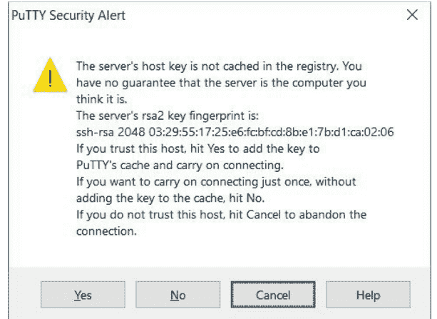

Figure 4-1: PuTTY Key Fingerprint Message
图 4-1：PuTTY 密钥指纹消息

Compare the key fingerprint shown in the client to the key fingerprint in your list. Note that PuTTY negotiated a connection using an RSA key, which is different from the ECDSA key agreed on between OpenSSH and its OpenSSH server.
将客户端中显示的密钥指纹与列表中的密钥指纹进行比较。请注意，PuTTY 使用 RSA 密钥协商了连接，这与 OpenSSH 与其 OpenSSH 服务器之间约定的 ECDSA 密钥不同。

If the keys match and you want PuTTY to cache the key for future reference and then connect, hit Yes.
如果密钥匹配，并且你希望 PuTTY 为将来参考缓存密钥然后连接，请点击 Yes。

If the keys match, and you want PuTTY to connect without caching the key, hit No.
如果密钥匹配，并且你希望 PuTTY 在不缓存密钥的情况下连接，请点击 No。

If the keys do not match, hit Cancel to terminate the connection. The host you’re connecting to is not the host you think you’re connecting to. Verify that you entered the correct hostname, then notify your sysadmin and/or security team of the non-matching host key.
如果密钥不匹配，请点击 Cancel 终止连接。你正在连接的主机不是你认为正在连接的主机。验证你是否输入了正确的 hostname，然后通知你的系统管理员和/或安全团队关于不匹配的主机密钥。

### When Keys Don’t Match
### 密钥不匹配时

If a host key has changed, you’ll get a message much like this.
如果主机密钥已更改，你会收到类似这样的消息。

```
$ ssh gluttony
@@@@@@@@@@@@@@@@@@@@@@@@@@@@@@@@@@@@@@@@@@@@@@@@@@@@@@@@@@@
@ WARNING: REMOTE HOST IDENTIFICATION HAS CHANGED! @
@@@@@@@@@@@@@@@@@@@@@@@@@@@@@@@@@@@@@@@@@@@@@@@@@@@@@@@@@@@
IT IS POSSIBLE THAT SOMEONE IS DOING SOMETHING NASTY!
Someone could be eavesdropping on you right now (man-in-the-middle attack)!
It is also possible that a host key has just been changed.
The fingerprint for the ECDSA key sent by the remote host is
SHA256:TSJ39GppnUdf8JX6J0oAf9+Cga2LzLNX+tid54lfo4.
Please contact your system administrator.
Add correct host key in /home/mwlucas/.ssh/known_hosts to get rid of this message.
Offending ECDSA key in /home/mwlucas/.ssh/known_hosts:5
ECDSA host key for gluttony.mwl.io has changed and you have requested strict checking.
Host key verification failed.
```

Scary-looking stuff? It should be. Something scary has happened. Your SSH client is screaming that something is Very Wrong. If your laptop was an ambulance, the lights would be spinning and the siren blaring. The super-secret host key pair used to identify this system has changed. This can happen for one of six reasons. Identifying which requires talking to the sysadmin.
看起来很吓人的东西？应该是的。发生了可怕的事情。你的 SSH 客户端正在大喊出了非常严重的问题。如果你的笔记本电脑是一辆救护车，灯光会旋转，警笛会响彻。用于识别此系统的超级秘密主机密钥对已更改。这可能由于六个原因之一发生。确定具体原因需要与系统管理员交谈。

Maybe the sysadmin destroyed the key pair, either accidentally or deliberately, and generated a new key pair. She should have a new key fingerprint for you.
也许系统管理员无意或故意销毁了密钥对，并生成了新的密钥对。她应该为你提供新的密钥指纹。

Perhaps the key fingerprint cached by your client is wrong. You might have a desktop security issue.
也许客户端缓存的密钥指纹是错误的。你可能存在桌面安全问题。

Or, the server might have been upgraded or replaced, and now supports a new key algorithm. The sysadmin should have a new key fingerprint for you.
或者，服务器可能已升级或更换，现在支持新的密钥算法。系统管理员应该为你提供新的密钥指纹。

It could be that the site uses round-robin DNS, effectively giving several servers a single hostname, and you’re connecting to the shared name rather than an individual server’s unique name. Access individual hosts, not a shared hostname.
可能是该站点使用轮询 DNS， effectively 为多个服务器提供一个单一的 hostname，而你正在连接到共享名称而不是单个服务器的唯一名称。访问单个主机，而不是共享的 hostname。

Perhaps your host’s key cache is corrupt. Re-validate the host key. This is annoying, but not insurmountable. Your sysadmin can confirm that the host key has not changed.
也许你的主机密钥缓存已损坏。重新验证主机密钥。这很烦人，但并非不可克服。你的系统管理员可以确认主机密钥未更改。

Lastly, it’s possible that an intruder controls the server or has diverted your connection to a different server. You, the sysadmin, and/or your security team, are about to have a bad day.
最后，入侵者可能控制了服务器或将你的连接转移到了不同的服务器。你、系统管理员和/或你的安全团队，即将度过糟糕的一天。

The only way to know which? Talk to the sysadmin. DO NOT CONNECT TO THE SERVER UNTIL YOU KNOW WHY THE KEY CHANGED. All of these are serious errors that require investigation.
要知道是哪一种？与系统管理员交谈。在你知道密钥为何更改之前，**不要**连接到服务器。所有这些都是需要调查的严重错误。

If the key changed for a legitimate reason, verify the new key. If the new key is correct, replace the old key with the new one. PuTTY offers to replace the key for you, while in OpenSSH you must edit the key cache yourself, as discussed in Chapter 5. The error message gives the line in known_hosts that contains the obsolete key. If the key is still not correct, talk to the sysadmin again. A legitimate SSH key change might mask an illegitimate intruder; I’ve seen more than one freshly installed server get compromised before the first legitimate logon.
如果密钥因正当原因而更改，请验证新密钥。如果新密钥正确，请用新密钥替换旧密钥。PuTTY 会为你提供替换密钥的选项，而在 OpenSSH 中你必须自行编辑密钥缓存，如第 5 章所述。错误消息会给出 known_hosts 中包含过时密钥的行。如果密钥仍然不正确，再次与系统管理员交谈。正当的 SSH 密钥更改可能会掩盖非法入侵者；我见过不止一台刚安装的服务器在首次合法登录前就被入侵。

You can override the SSH client’s refusal to connect to machines when the host key changes, or not cache the new key, but remember, SSH doesn’t just validate the server and protect your data in transit. A completed connection also hands your authentication information to the SSH server. If you give your username and password to a compromised machine, you’ve just given the intruder your username and password. If you use the same password on multiple machines, you can no longer trust any of them. Cancel your weekend plans right now, and possibly next weekend’s as well. You’ll be busy recovering from backup and managing irate customers.
你可以覆盖 SSH 客户端在主机密钥更改时拒绝连接机器的行为，或不缓存新密钥，但请记住，SSH 不仅验证服务器并保护传输中的数据。完成的连接还会将你的身份验证信息交给 SSH 服务器。如果你将用户名和密码提供给受损的机器，你就把用户名和密码交给了入侵者。如果你在多台机器上使用相同的密码，你就不能再信任其中任何一台。立即取消你的周末计划，甚至可能下周末的计划。你将忙于从备份恢复并处理愤怒的客户。

A mismatched key message is a sign that SSH works. Use it.
不匹配的密钥消息表明 SSH 正在工作。善用它。

## Chapter 5: SSH Clients
## 第 5 章：SSH 客户端

SSH client software resides on a user’s workstation and permits connections to an SSH server. We’ll discuss two common clients: the OpenSSH command-line client for Unix-like hosts, ssh(1), and the PuTTY client for Microsoft Windows. Both clients are freely usable and redistributable, in source or binary form, with very minimal restrictions or limitations.
SSH 客户端软件驻留在用户的工作站上，允许连接到 SSH 服务器。我们将讨论两种常见的客户端：用于类 Unix 主机的 OpenSSH 命令行客户端 ssh(1)，以及用于 Microsoft Windows 的 PuTTY 客户端。这两个客户端都可以自由使用和重新分发，以源代码或二进制形式，均有非常少的限制或限制。

People have written other SSH clients, of course. You can get an OpenSSH-based client for Windows systems either through Cygwin or Microsoft’s Windows Subsystem for Linux on Windows 10 and newer. There’s a straight port of OpenSSH to Windows (https://github.com/PowerShell/Win32-OpenSSH). Microsoft has released a beta port of OpenSSH to Windows 10 and newer, as a developer feature. Similarly, PuTTY has been ported to many Unix-like systems and mobile devices. Many people have forked both PuTTY and OpenSSH, modifying them to fit their needs. Many of these are solid, reliable projects. Once you have a solid grounding in SSH, feel free to use the client that you prefer.
当然，人们也编写了其他 SSH 客户端。你可以通过 Cygwin 或 Microsoft 的 Windows 10 及更新版本的 Windows Subsystem for Linux 获取适用于 Windows 系统的基于 OpenSSH 的客户端。有一个 OpenSSH 到 Windows 的直接移植（https://github.com/PowerShell/Win32-OpenSSH）。Microsoft 已作为开发者功能发布了 OpenSSH 到 Windows 10 及更新版本的 beta 移植版。同样，PuTTY 已被移植到许多类 Unix 系统和移动设备上。许多人 fork 了 PuTTY 和 OpenSSH 以满足他们的需求。其中许多是坚实可靠的项目。一旦你对 SSH 有了扎实的理解，请随意使用你喜欢的客户端。

Each client has its own section in this chapter. Further chapters involving SSH clients will get chopped into three sections: one for the theory of what we’re doing, followed by separate sections on configuring each client.
每个客户端在本章都有自己的部分。涉及 SSH 客户端的后续章节将被分为三个部分：一个关于我们正在做什么的理论，然后是分别配置每个客户端的部分。

### OpenSSH Client
### OpenSSH 客户端

The OpenSSH client, ssh, is developed synchronously with the OpenSSH server. As new features often appear in OpenSSH before other SSH implementations, you’ll get the bleeding edge of SSH features by using the newest OpenSSH client. The OpenSSH client is developed as part of OpenBSD, but a new portable release appears every six months.
OpenSSH 客户端 ssh 与 OpenSSH 服务器同步开发。由于新功能通常在其他 SSH 实现之前出现在 OpenSSH 中，使用最新的 OpenSSH 客户端可以获得 SSH 功能的最新进展。OpenSSH 客户端作为 OpenBSD 的一部分开发，但每六个月会出现一个新便携版本。

A user’s personal SSH settings are recorded as files in $HOME/.ssh/. Like the home directory, this directory must be writable only by the user and root, although you can allow it to be world-readable. Various client and server functions stop working if others can write to this directory. While ssh creates $HOME/.ssh with correct permissions, if your SSH suite behaves oddly check the permissions.
用户的个人 SSH 设置记录为 $HOME/.ssh/ 中的文件。与主目录一样，该目录必须只能由用户和 root 可写，尽管你可以允许它对所有人可读。如果其他人可以写入此目录，各种客户端和服务器功能将停止工作。虽然 ssh 会以正确的权限创建 $HOME/.ssh，但如果你的 SSH 套件行为异常，请检查权限。

To run ssh, enter the command followed by the host you want to connect to.
要运行 ssh，输入命令后跟你想要连接的主机。

```
$ ssh gluttony.mwl.io
```

This uses your client’s default settings to connect to the host gluttony.mwl.io, including your current username.¹
这使用你的客户端默认设置连接到主机 gluttony.mwl.io，包括你的当前用户名。¹

If ssh doesn’t behave as you expect, try running it in verbose mode with -v. You’ll see the server and client negotiate protocol version and encryption algorithms, the server present its host key, the client verify that key, and the two negotiate authentication methods. While this might not solve your problem, it will tell you where the login fails and give you a hint about where to look. Reading the output carefully might tell you that, for example, the server only permits logins with public keys or you’re trying to use an unsupported encryption method.
如果 ssh 的行为与你预期不符，请尝试使用 -v 以详细模式运行。你将看到服务器和客户端协商协议版本和加密算法，服务器提供其主机密钥，客户端验证该密钥，两者协商身份验证方法。虽然这可能无法解决你的问题，但它会告诉你登录失败的位置并给出提示。仔细阅读输出可能会告诉你，例如，服务器只允许使用公钥登录或你正在尝试使用不受支持的加密方法。

```
$ ssh -v gluttony.mwl.io
```

If you still have trouble, multiple -v options increase the debugging level. In normal cases, that’s it. The rest of this book is about abnormal cases.
如果仍然有问题，多个 -v 选项会增加调试级别。在正常情况下，就这些。本书的其余部分是关于异常情况。

### OpenSSH Client Configuration
### OpenSSH 客户端配置

Configure ssh by setting options, either on the command line or in a configuration file. Use configuration files for permanent changes and the command line for temporary ones. We’ll look at the configuration file first.
通过在命令行或配置文件中设置选项来配置 ssh。使用配置文件进行永久更改，命令行进行临时更改。我们先来看配置文件。

Two files control ssh(1) behavior: /etc/ssh/ssh_config and $HOME/.ssh/config. Each contains keywords and values, as discussed in Chapter 2. The former establishes default behavior for all system users. The latter is the user’s personal SSH client configuration. A user’s configuration overrides all global settings, but most users can’t be bothered to enter their own custom configurations.
两个文件控制 ssh(1) 行为：/etc/ssh/ssh_config 和 $HOME/.ssh/config。每个文件都包含关键字和值，如第 2 章所述。前者为所有系统用户建立默认行为。后者是用户的个人 SSH 客户端配置。用户的配置会覆盖所有全局设置，但大多数用户懒得输入自己的自定义配置。

Configuration file changes affect all SSH sessions started after the change. There’s no process to restart, but changing the configuration doesn’t affect existing SSH sessions. Both files have the same syntax and accept exactly the same options. I’ll refer to ssh_config for brevity, but everything applies equally well to $HOME/.ssh/config.
配置文件更改会影响更改后启动的所有 SSH 会话。没有需要重启的进程，但更改配置不会影响现有的 SSH 会话。两个文件具有相同的语法并接受完全相同的选项。为简洁起见，我将引用 ssh_config，但所有内容同样适用于 $HOME/.ssh/config。

While most connection options can be set on the command line, I recommend storing permanent information in ssh_config. Programs such as scp(1) and sftp(1) (see Chapter 6) read ssh_config, and each of these programs have slightly different command line options. Using a configuration file centralizes configuration.
虽然大多数连接选项可以在命令行上设置，但我建议将永久信息存储在 ssh_config 中。scp(1) 和 sftp(1) 等程序（见第 6 章）会读取 ssh_config，而这些程序各自的命令行选项略有不同。使用配置文件可以集中配置。

The user’s personal configuration overrides the global configuration. Options set on the command line override both.
用户的个人配置覆盖全局配置。命令行上设置的选项覆盖两者。

### Per-Host Configuration
### 每主机配置

You can use the Host keyword to change how ssh connects to certain hosts. Here, I use the Port keyword to change the TCP port ssh connects to, but only for hosts in the mwl.io domain. It uses port 22 for all other hosts, as specified in /etc/services.
你可以使用 Host 关键字来更改 ssh 如何连接到某些主机。在这里，我使用 Port 关键字来更改 ssh 连接到的 TCP 端口，但仅适用于 mwl.io 域中的主机。对于所有其他主机，它使用端口 22，如 /etc/services 中指定。

```
Host *.mwl.io
Port 2222
```

I could also specify an IP address, or a network of IP addresses.
我也可以指定 IP 地址，或一组 IP 地址。

```
Host 192.0.2.*
Port 2224
```

Note that ssh matches these ssh_config entries based on what the user enters on
注意 ssh 根据用户输入的内容匹配这些 ssh_config 条目

命令行。Host 条目必须与用户输入的内容完全且区分大小写地匹配。假设我的 ssh_config 中包含上面两个 Host 条目，我们来看看实际效果。

```
$ ssh gluttony.mw1.io
```

这匹配第一个 Host 条目，因此 ssh 连接到 2222 端口。

我的桌面上的 /etc/resolv.conf 会自动为任何单独的主机名附加域名 mw1.io，因此我可能不会输入完全限定域名。相反，我会这样做。

```
$ ssh gluttony
```

这不会匹配我的第一个 Host 条目，因为我没有显式输入 ssh_config 中给出的域名。如果主机 gluttony 的 IP 地址在 192.0.2.0/24 中，那么第二个 Host 条目会匹配吗？不会，因为 Host 条目是在命令行上匹配的；不会对 DNS 进行检查。要基于 Host 条目中的 IP 地址进行匹配，我需要显式运行 ssh 192.0.2.whatever。对此主机的自定义设置需要像这样的 Host 条目。

```
Host gluttony
Port 2222
```

条件是按首次匹配的顺序解析。Host 条目之后列出的配置选项会一直生效，直到下一个 Host 条目为止。这个 ssh_config 可能是错误的。

```
Host *.mw1.io
Host 192.0.2.*
Port 2222
```

用户可能希望 Port 关键字适用于 mw1.io 域中的所有主机以及 192.0.2.0/24 中的所有 IP 地址。我们有一个针对 mw1.io 域中任意主机的条目，但对它没有特殊配置。192.0.2.0/24 中的任何主机都在 2222 端口运行 sshd。与其这样做，不如在同一行列出多个主机，用空格分隔。这里我列出了我的域名、我的 IP 地址和我的服务器。

```
Host 192.0.2.* mw1.io *.mw1.io gluttony avarice lust pride wrath envy sloth
Port 2222
```

我同时列出了 *.mw1.io 和 mw1.io，因为有一个名为 mw1.io 的特定机器。域名前面的星号和句点不会匹配该主机。

将任何全局默认值放在配置文件开头。假设你的组织有在 981 端口运行 SSH 的策略，因为他们喜欢通过模糊性来提高安全性，但你的特殊服务器使用不同的端口以获得更多模糊性。

```
Port 981
Host *.mw1.io
Port 2222
```

这里默认端口是 981，但指定的主机使用 2222 端口。有时你想在不破坏现有配置的情况下测试更改，或者也许你有一个自动化流程需要特殊的配置文件。要使用除 ssh_config 之外的配置文件，请在命令行上使用 -F 选项指定它。

```
$ ssh -F test-config avarice
```

你现在可以实验功能，而不会破坏你的工作配置。

如果你有足够多的主机，你可以考虑在 ssh_config 中建立规范主机名。

### Canonical Hostnames

在足够大的网络中，或在服务器动态创建和销毁的编排环境中，列出所有 SSH 服务器很快就会变得不切实际。CanonicalizeHostname 关键字告诉 ssh 将 ssh_config 中的独立 Host 条目重写为特定域名，然后如果存在则使用该主机名进行配置和密钥管理。这让你可以消除许多冗长的 Host 关键字。将 CanonicalizeHostname 设置为 yes 并将 CanonicalDomains 设置为你的域名。考虑以下配置：

```
CanonicalizeHostname yes
CanonicalDomains mwl.io
Host *.mwl.io
Port 2222
```

下次我运行 ssh gluttony 时，ssh 会检查是否存在主机名 gluttony.mwl.io。如果该主机名存在，ssh 会像我运行 ssh gluttony.mwl.io 一样评估 ssh_config。此连接会获得适用于 mwl.io 域中主机的特殊规则。

你可以列出多个规范域名。规范名称会按列出的顺序进行测试，第一个匹配项获胜。考虑如下条目。

```
CanonicalDomains mwl.io michaelwlucas.com
```

当我运行 ssh wrath 时，ssh(1) 会搜索 wrath.mwl.io。如果它找到该主机，就会打开连接。如果找不到该主机，ssh 会搜索 wrath.michaelwlucas.com。

如果你激活主机名规范化，ssh 默认会尝试规范化其中包含一个或更少点的主机。这让规范化可以捕获子域，例如 www.detroit.mwl.io 对应 www.detroit。要更改主机名中的最大点数，请使用 CanonicalizeMaxDots 关键字。这里我允许零个或更少的点。

```
CanonicalizeMaxDots 0
```

OpenSSH 还有一些其他的主机名规范化功能，在 ssh_config(5) 中讨论。

### Common SSH Options

人们最常用的功能是更改用户名、端口或添加 SSH 选项。

### Changing Usernames

大多数 SSH 客户端假设客户端和服务器上的用户名相同，并尝试使用本地机器上的用户名登录远程系统。在我的大多数系统上，我的用户名是 mwl。偶尔有人会为我创建一个不同的用户名账户，比如 mlucas 或 lucas 或 michael 或 jerkface。我必须告诉 ssh 在远程系统上使用该用户名。通过将用户账户名、@ 符号，然后是远程机器名放在一起来实现。

```
$ ssh jerkface@devio.us
```

你也可以使用 -l 指定用户名。

```
$ ssh -l jerkface devio.us
```

如果这是持续性的操作，请在 ssh_config 中使用 User 选项指定用户名。

```
Host devio.us
User jerkface
```

通过将用户名存储在 ssh_config 中，我可以忘记它们并释放宝贵的脑力空间。

### Changing Port

一些站点在除 22 之外的端口上运行 SSH，通常是为了提供改进安全性的外观。它实际上并不能保护 SSH，但确实可以减少日志噪音。

使用 -p 和端口号来更改 ssh 连接的端口。如果你的服务器在 2222 端口运行 sshd，请使用以下方式连接：

```
$ ssh -p 2222 gluttony
```

你可以在 ssh_config 中指定端口。

```
Port 2222
```

同样，我建议将永久连接信息存储在 ssh_config 中。

### SSH Options on the Command Line

SSH 不仅仅是一个命令；它是一个协议。而该协议有各种各样的边缘情况。有时你需要在命令行上设置其中一些边缘。虽然 OpenSSH 支持的所有内容都可用作 ssh_config 关键字，但并非所有这些关键字都有命令行等价物。要在命令行上设置这些关键字，请使用 -o 命令行选项、选项名称、等号和该关键字的值。

```
$ ssh -o Port=2222 sloth
```

这个例子很 trivial——Port 关键字有一个专用的命令行选项 -p。我们稍后会看到更复杂的例子。

### Evaluating your SSH Configuration

你可以设置命令行选项、用户配置文件中的选项以及全局客户端配置文件中的选项。Host 关键字会破坏你精心调整的默认值，或者你精心调整的默认值可能要求你为特定服务器使用 Host 关键字。你如何知道 ssh(1) 在连接到主机时实际使用哪些选项？

使用 ssh 的 -G 选项。它告诉 ssh(1) 为目标主机解析所有配置，打印出它将要使用的配置，然后立即退出而不进行连接。你可以查看设置以验证你是否获得了所需的内容。

### SSH Jump Hosts

系统管理员经常需要通过一台主机到达另一台主机。也许你信任这个中间主机。也许不信任。OpenSSH 支持跳板主机，允许你使用 SSH 服务器作为中继来连接到第二台服务器。是的，你可以通过手动登录中间主机然后再次运行 ssh 来实现，但使用内置支持意味着跳板主机看不到你的明文。跳板主机无法控制客户端和目标服务器协商的选项。这意味着你可以，例如，通过一个既不接受 X 也不接受 SSH 代理的跳板主机转发 X 或你的 SSH 代理。

使用 -J 指定跳板主机。如有需要添加用户名。

```
$ ssh -J mw1@envy jerkface@pride
```

我正尝试以 jerkface 登录主机 pride，使用主机 envy 上的账户 mw1 作为跳板主机。我会先被提示输入跳板主机的身份验证凭据，然后是目标的凭据。最好在两个主机上都使用公钥身份验证。

在 ssh_config 中使用 ProxyJump 关键字设置跳板主机。

```
Host pride.mw1.io
ProxyJump mw1@envy.mw1.io
```

你需要多信任你的跳板主机？你的击键不会到达跳板主机，因此你不必担心会话记录。跳板主机唯一能看到的是客户端和目标服务器之间的加密数据流。跳板主机可以更改或中断加密流，但这正是 SSH 设计用来检测的篡改类型。

一些 Linux 发行版在客户端中禁用跳板主机。

### Addressing Options

OpenSSH 客户端允许你通过设置地址族和源地址来选择它如何使用 TCP/IP。

### IP Protocol Version

主机可以同时具有 IPv4 和 IPv6 地址。AddressFamily 关键字告诉客户端仅使用 IPv4（inet）或仅使用 IPv6（inet6）进行连接。默认是 any，这意味着“通过系统解析器返回地址的协议进行连接”。有时，你在一种协议上比另一种协议有更好的连通性。如果你通过隧道获取 IPv6 连接，使用仅 IPv4 进行 SSH 可能更合理。同样，如果你有无限的 IPv6

在考虑连通性时，你可能希望对所有内容都使用 IPv6。这里我故意禁用 IPv4。

```
AddressFamily inet6
```

你可以使用 -4 命令行选项仅使用 IPv4。

```
$ ssh -4 lust
```

使用 -6 强制 IPv6。

### 设置源地址

具有单个接口上多个 IP 地址的主机默认从该接口的主 IP 地址发起所有连接。这并不总是理想的。服务可以从一台主机迁移到另一台主机，通常独立于任何防火墙更改。你可以通过 ssh_config 中的 BindAddress 关键字告诉 ssh 使用除主地址之外的源 IP 地址。

```
BindAddress 192.0.2.91
```

BindAddress 必须附加到本地机器。

BindAddress 没有方便的命令行标志。你必须使用 -o 指定它。

### OpenSSH 主机密钥缓存

OpenSSH 客户端会在 $HOME/.ssh/known_hosts 中记录用户批准的主机密钥。每个密钥在 known_hosts 中单独占一行，大致如下。

```
wrath.mw1.io ecdsa-sha2-nistp256 AAAAE2VjZHNhLXNoYTI t...
```

每一行包含机器的主机名（wrath.mw1.io）、主机密钥类型（ecdsa-sha2-nistp256）和公钥本身。

### 密钥缓存

你希望如何更新你的密钥缓存？在某些环境中，用户必须手动验证主机密钥，然后手动将它们添加到密钥缓存中。在其他环境中，自动将新密钥添加到缓存是可以接受的。最常见的是，用户希望 ssh 询问它应该怎么做。StrictHostKeyChecking ssh_config 选项告诉 ssh 如何处理新的主机密钥。

如果你希望 ssh 拒绝连接到 known_hosts 中没有条目的任何主机，请将 StrictHostKeyChecking 设置为 yes。客户端连接的唯一方法是将主机密钥添加到 known_hosts，很可能是从系统管理员提供的中央存储库中获取。这在主机密钥自动分发的环境中最有意义。

如果你处于相反的极端，并且无论主机密钥多么重要都永远不会验证它，那么你也可以将 StrictHostKeyChecking 设置为 accept-new。这告诉 ssh 盲目地用收到的每个新密钥更新 known_hosts。这相当于从不费心给你的家、汽车、办公室和银行保险库上锁——它可能感觉轻松自由，但迟早有人会<|start|>对你的个人物品做出不文明的举动。

默认设置 ask 告诉 ssh 呈现任何未知密钥并询问用户该怎么做。你可以验证密钥、接受它并让 ssh 将其添加到 known_hosts，或拒绝主机密钥。

选择最适合你环境的选项。你的笔记本电脑可能的需求与 NSA 或犯罪集团运行的服务器不同，而所有这些又都与你在测试实验室中的编排系统不同。

### 缓存安全：哈希 known_hosts

known_hosts 文件对入侵你桌面的入侵者非常有用；它是一个方便的 SSH 服务器目标列表。由于你的 SSH 服务器可能共享一个共同的系统管理员，用于渗透你桌面的技术可能适用于这些服务器中的任何一个。此外，系统管理员和其他用户可以查看 known_hosts 的内容。防止窥探的最佳方法是更改 known_hosts，使其不再包含主机名列表。通过哈希主机名来实现这一点，就像 /etc/passwd 对密码所做的那样。

如果你用哈希替换主机名，没有人可以从文件中读取主机名，也无法反向计算主机名。然而，当你连接到主机时，ssh 可以轻松计算服务器主机名的哈希并在 known_hosts 中查找该哈希。

一个哈希的 known_hosts 条目看起来像这样。

```
|1|PBM07JCRBJfg8qOz1BokTtCD1y0=|DVXu0IFq/dC4GMfEbFVkhptVjQ= ecdsa-sha2-nistp256 AAAAE2VjZ...
```

如果你检查该条目，你会看到密钥算法和主机密钥指纹进一步向下。

要让 ssh 自动哈希添加到 known_hosts 的新主机密钥，请使用 ssh_config 关键字 HashKnownHosts。

```
HashKnownHosts yes
```

这不会哈希现有条目。然而。使用 -H 标志对 ssh-keygen(1) 来哈希你现有的 known_hosts。

```
$ ssh-keygen -H
/home/mwlucas/.ssh/known_hosts updated.
Original contents retained as /home/mwlucas/.ssh/known_hosts.old
WARNING: /home/mwlucas/.ssh/known_hosts.old contains unhashed entries
Delete this file to ensure privacy of hostnames
```

哈希你的 known_hosts 会将现有缓存复制到 known_hosts.old，然后对 known_hosts 内的所有内容进行哈希。验证 ssh 仍能连接到你所有的常用主机。一旦你确信你的密钥缓存仍然可用，就删除未哈希的 known_hosts.old。

要在哈希的 known_hosts 文件中找到单个主机条目，请使用 ssh-keygen -F 和目标主机名。

```
$ ssh-keygen -F avarice.mwl.io
# Host avarice.mwl.io found: line 17
|1|5hcRwDHWwxwCWrFTngG4jT40hJ0=|TyJXB6z+oEJXSP5MzakulFWgPDI= ecdsa-sha2-nistp256...
```

你现在知道该条目在文件的第 17 行，可以轻松复制它。

要删除一个哈希的主机名，请使用 ssh-keygen -R。

```
$ ssh-keygen -R avarice.mwl.io
# Host avarice.mwl.io found: line 17
/home/mwlucas/.ssh/known_hosts updated.
Original contents retained as /home/mwlucas/.ssh/known_hosts.old
```

如果你还没有删除未哈希的 *known_hosts.old*，好吧，它现在没了。

当从中央系统（第 11 章）分发 *known_hosts* 时，没有理由不提供哈希版本。

### PuTTY 客户端

PuTTY 是一个 SSH、telnet 和串行客户端，也是 Windows 和类 Unix 系统的终端仿真器。它可在 https://www.chiark.greenend.org.uk/~sgtatham/putty/latest.html 获取，或通过网络搜索“putty SSH”即可找到。虽然它不是由 OpenBSD 团队中的专业偏执狂编写的，但 PuTTY 的自由可用源代码已被多次审计。PuTTY 可能是部署最广泛的 Windows SSH 软件。

PuTTY 下载页面提供几种选择。我推荐包含 PuTTY 及其所有相关程序的全功能安装程序。你不需要所有东西，但这样比单独下载各种实用程序更容易、更快。PuTTY 本身并不真正需要安装程序；如果你愿意，可以下载纯 PuTTY.exe。安装程序会在开始菜单中创建快捷方式，将程序注册到操作系统，并处理所有其他 Windows 琐事。

PuTTY 可以在命令行上运行。参数和命令行标志与 OpenSSH 非常相似。如果你正在运行 Windows，你可能对 PuTTY 作为图形程序感兴趣。我们将重点关注点选式界面，但你应该知道命令行也是一个选项，如果需要的话。

如果你感觉大胆，你也可以下载 PuTTY 开发快照。这包含了 PuTTY 的最新补丁和功能，但也可能包含全新的错误。

启动 PuTTY，你会得到类似图 5-1 的屏幕。

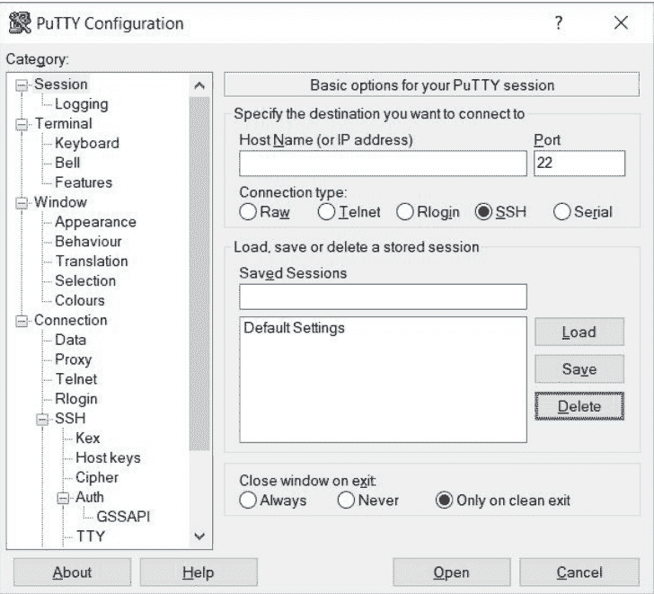

图 5-1：PuTTY 启动屏幕

在右侧，你将配置到不同服务器的连接。我们现在只有一个连接，Default Settings。它不会连接到任何东西，但你将用它来设置你的 PuTTY 默认值。你可以随时通过点击左侧的 Session 返回此屏幕。

在左侧，你配置 PuTTY 的呈现方式以及它如何处理支持的协议。PuTTY 支持多种协议。如果你需要一个灵活的通用终端仿真器，PuTTY 很可能能满足你的需求。我们只会涵盖 SSH。然而。注意倒数第二个的 SSH 选项。点击那里，或展开那个小“加号”，以查看和编辑 PuTTY 执行 SSH 的详细信息。

如果你在左侧选择某项，右侧会更改以显示所选选项的详细信息。选择 SSH，右侧会显示一些基本协议选项，例如协议版本和共享 SSH 连接（参见本章后面的“Connection Multiplexing”。）

我们将使用这些设置来建立我们的 PuTTY 默认值。

### 设置 PuTTY 默认值

你的全新 PuTTY 安装只列出一个连接，Default Settings。你创建的每个新连接都以复制 Default Settings 中的所有内容开始。点击 Default Settings 连接并点击 Load。你可以然后编辑并保存


### 默认设置连接。

先设置默认用户名。我在工作系统上的所有账户都使用相同的用户名。只有在外部系统的账户上，我的用户名才会有所不同。我可以在 PuTTY 中设置默认用户名，并将其预配置为我最常用的设置。在左侧选择 Connection。在“自动登录用户名”下，我输入我的标准用户名。

现在返回 Session 面板。选择 Default Settings，然后点击 Save。

你已更新了默认连接。重复此过程以对默认值进行进一步更改。

### 使用 PuTTY 启动 SSH 会话

在 PuTTY 的 Sessions 屏幕中，进入 Host Name（或 IP Address）。输入你的 SSH 服务器的主机名或 IP 地址。如果需要，你也可以在此更改端口号。点击窗口底部的 Open。

PuTTY 配置窗口将消失，取而代之的是一个黑色的终端窗口。

### 保存 PuTTY 连接

你可以预先配置 PuTTY 连接，确保与特定主机的会话每次都以相同的方式进行。在 Host Name（或 IP Address）下输入 SSH 服务器的主机名。在 Saved Sessions 下，为此连接输入一个名称。我通常根据主机命名我的连接，再加上一个或两个词来表示会话中的任何特殊配置。我可能有一个标记为 dns1 的连接，另一个命名为 dns1 with X，这样在需要时我就可以轻松使用 X 转发。

要运行已保存的连接，双击连接名称。

要复制已保存的连接，选中它，点击 Load，做出更改，然后以不同的名称保存。

### PuTTY 管理

你会在正在使用的 PuTTY 会话的左上角看到一个 PuTTY 图标。它会打开一个包含有用任务的下拉菜单。

要复制现有会话，在同一主机上打开第二个窗口，选择 Duplicate Session。

要打开一个已保存配置的主机的新窗口，选择 Saved Sessions 和会话名称。

要打开一个指向全新主机的窗口，选择 New Session。

### PuTTY 复制和粘贴

PuTTY 不使用标准的 Windows 剪切和粘贴快捷方式。它更像 UNIX 风格的 X 终端。要在 PuTTY 窗口中复制文本，用鼠标选中它。要将文本粘贴到 PuTTY 窗口中，点击鼠标右键。你也可以使用 SHIFT-INSERT。

### PuTTY 配置

PuTTY 将其配置和主机密钥缓存存储在 Windows 注册表中，位于 HKEY_CURRENT_USER\Software\SimonTatham 下。要将你的 PuTTY 配置从一台主机移动到另一台主机，将注册表的这一部分复制到新机器上。有些人甚至使用这些注册表设置，通过 Active Directory 将有效的 PuTTY 配置分发给他们的用户。

### 调试 PuTTY

PuTTY 有两个调试功能：Event Log 和 session log。

Event Log 记录当前 SSH 会话期间发生的情况。你可以看到你所连接到的名称、IP地址和端口、所选的加密算法，以及建立 SSH 会话所需的所有各种协商。要查看 Event Log，点击 PuTTY 窗口的左上角，然后向下选择 Event Log。

对于更严重的调试，使用 session log。在打开 SSH 连接之前，查看左侧窗格。在 Session 下你会找到 Logging 选项。选择它。此窗口为你提供了记录 SSH 会话的多个选项。我通常选择 All session output。为日志文件给 PuTTY 起一个名称，并浏览选择一个目录。一旦你的会话运行了一段时间，此文件将包含有关会话的大量详细信息，很像 OpenSSH 客户端的调试选项。

### 更改实时 PuTTY 会话

你可以更改现有 PuTTY 会话中的某些设置。用户名和加密信息在登录时设置，但你可以更改日志记录、终端行为和隧道设置。

转到现有 PuTTY 会话的左上角，点击 PuTTY 图标。从下拉菜单中选择 Change Settings。这会打开一个简化的 New Session 窗口，仅显示你可以更改的选项。一旦你完成编辑并确认会话按你期望的方式工作，你可以保存会话，要么覆盖现有名称，要么选择新名称。

### 多路复用连接

SSH 会话打开可能需要很长时间，特别是如果 SSH 服务器找不到客户端 IP 地址的反向 DNS 条目。或者你可能有一个天真的防火墙，限制了网络段之间同时连接的数量。也许其中一台机器太老了，初始密钥交换需要几秒钟。SSH 支持这些情况的连接多路复用，允许你通过一个 TCP 连接运行多个 SSH 会话。

虽然这并不能消除第一次连接的延迟，但额外的会话启动会快得多。

PuTTY 默认支持并使用连接多路复用。OpenSSH 可以多路复用连接，但需要额外的配置。

### 配置多路复用

OpenSSH 的 ssh 客户端使用 UNIX 套接字来管理多路复用连接。用户必须为套接字创建一个目录并设置权限，以便只有她可以读取它们。

```
$ cd $HOME/.ssh
$ mkdir sockets
$ chmod 700 sockets/
```

现在你可以在 ssh_config 中启用多路复用。

```
ControlMaster auto
ControlPath ~/.ssh/sockets/%r@%h:%p
```

ControlMaster 设置告诉 ssh 尝试使用连接多路复用，但在多路复用失败时回退到单独的 TCP 连接。这让你可以将多路复用作为默认值启用，但仍可连接到非 OpenSSH 服务器。

ControlPath 告诉 ssh 在哪里找到多路复用管理文件。此语句接受令牌，很像 sshd_config。%u 宏扩展为用户名，%h 扩展为主机，%p 扩展为端口。如果我以用户 mwl 的身份连接到端口 2222 上的主机 avarice，SSH 会在指定目录中自动创建套接字文件 mwl@avarice:2222。

PuTTY 默认启用连接多路复用。要在打开会话前关闭它，打开 PuTTY 并从左侧窗格选择 SSH。你会看到一个名为 Share SSH connections if possible 的复选框。取消选中它。

### 多路复用的风险

任何可以读取 OpenSSH 多路复用控制文件或访问 PuTTY 类似套接字的人都可以访问通过你的 SSH 连接传输的所有数据。原始连接已经通过身份验证，因此这样的入侵者甚至不需要你的密码即可在远程机器上获得终端。仅在你信任所有具有管理权限的人的客户端上使用连接多路复用。

通过多路复用 SSH 会话复制大文件可能会减慢你的其他会话速度。

X 转发与连接多路复用配合不佳。

请记住，在多路复用时，你对服务器的所有 SSH 连接都运行在你打开到该主机的第一个连接上。如果该连接失败，与其多路复用的所有连接也会失败。

就我个人而言，我只在单用户桌面系统上启用多路复用。其他人不同意我的观点。做对你的环境有意义的事情。

### SSH 压缩

你会在很多地方听到 SSH 可以在通过网络发送数据之前压缩数据。当 33.6 调制解调器是人们从家里连接的标准方式时，这非常有用。在现代多兆比特连接上，压缩通常会减慢连接速度。只有在你严重受带宽限制时才考虑使用压缩。

压缩有意义的唯一情况是在转发 X（第 8 章）时。在 ssh(1) 中添加 -C 标志可以将转发的 X 连接的吞吐量提高一倍。

这涵盖了 PuTTY 和 OpenSSH 客户端的基础知识。现在让我们看看如何使用 SSH 在网络上移动文件。

1 但请使用你自己的主机之一。如果你连接到我的主机，我可能会在社交媒体上发布你的用户名、IP 和密码。

## 第 6 章：通过 SSH 复制文件

文件传输协议（FTP）几十年来一直是机器间复制文件的标准方法，甚至早于 TCP/IP。FTP 以未加密的方式传输所有内容，其安全性大致相当于 telnet。文件在传输过程中可以被查看或更改。其他旧协议（如 RCP）甚至更糟。何不用 SSH 安全地在机器之间传输文件呢？

有很多方法可以使用 SSH 移动文件。诸如 rsync 之类的应用程序可以使用 SSH 作为传输机制。一些窗口管理器包含 SSH 文件传输工具。我们将介绍两种特定协议，SCP 和 SFTP，适用于类 Unix 和 Microsoft 系统。大多数其他通过 SSH 传输文件的工具实际上是这些协议之一的前端。

安全复制协议，即 SCP，是作为 RCP 的即插即用替代品设计的。SSH 文件传输协议，即 SFTP，是为取代 FTP 而设计的。它是一种交互式协议，允许你浏览远程文件系统。OpenSSH 包含客户端程序 sftp(1) 和 scp(1)，而 Windows 客户端可以使用 WinSCP 来使用这两种协议。

### 使用 OpenSSH 复制文件

OpenSSH 包含两个文件传输程序，scp 和 sftp。我们将从更简单但灵活性较差的程序开始。

### scp(1)

你可以使用 scp(1) 复制单个文件。语法遵循通常的 Unix 语义。

```
$ scp what-you-have where-you-want-it
```

用冒号分隔主机和文件名，如下所示。

```
$ scp source-host:filename destination-host:filename
```

一旦你通过身份验证，scp 就会通过加密通道传输文件。

如果你在命令中未输入某个元素，则假定它保持不变。

例如，要将本地文件 data.txt 复制到服务器 sloth，运行：

```
$ scp data.txt sloth:
```

我在源端未输入机器名，因此假定为本地机器。我输入了远程主机名但未输入远程文件名，因此文件名不会更改。我的文件 data.txt 被复制到 sloth 上的我的登录目录。

如果目标文件已存在，scp 会静默覆盖它。如果账户没有覆盖文件的权限，复制会失败。scp 程序假定如果你告诉它覆盖现有文件，你是有充分理由的。因此，我建议不要以 root 身份登录时复制文件。

你必须在主机名后使用冒号。当你跳过冒号时，scp 假定该参数是文件名。这里我跳过冒号并复制文件 data.txt

到本地机器上的 sloth。

```
$ scp data.txt sloth
```

至少这是一个非常安全的本地副本。

要更改远程端的文件名，请指定一个新文件名。

```
$ scp data.txt sloth:stuff.txt
```

如果源文件在另一台机器上，而你想将其复制到本地主机，请将远程主机名指定为源。

```
$ scp sloth:data2.txt data2.txt
```

只要你有足够的权限，就可以将文件复制到或从任何位置复制。

```
$ scp sloth:/var/log/messages sloth-messages
```

要递归地将目录复制到另一台机器，请使用参数 -rp。这里我将我的主目录复制到远程主机，覆盖同名文件。

```
$ scp -rp /home/mwlucas sloth:
```

scp 程序故意借用了许多来自 cp(1) 和 rcp(1) 的命令行选项。这就是为什么命令行选项通常与 ssh(1) 不匹配的原因；它是 rcp(1) 的即插即用替代品，因此 rcp 标志优先。尽管如此，如果你有更复杂的复制需求，请查阅文档。

scp(1) 程序很大程度上由二十多年前的 rcp(1) 代码构建而成。这使得添加新功能变得困难。虽然没有人 actively 想把 scp 扔进死代码垃圾场，但也没有人真正关注它。该程序就是这样。

如果你有复杂的文件复制需求，请查看 sftp(1)。

### sftp(1)

SSH 文件传输协议（SFTP）比 SCP 更灵活。SCP 仅复制文件，而 SFTP 允许许多不同的文件操作，例如重命名和删除文件、列出目录等等。你会发现一些以“安全”和“FTP”的变体命名的不同协议，所以不要混淆。SFTP 与通过 SSH 的 FTP 不同，也不是通过 SSL 的 FTP。

SFTP 命令是有意从 FTP 命令复制而来，以简化两者之间的转换。你对 FTP 命令行的许多知识都适用于 SFTP，但我们将介绍基础知识。

使用 sftp 命令和主机名打开连接。

```
$ sftp pride
```

一旦你通过身份验证，你将被连接并获得 SFTP 提示符。

```
sftp>
```

登录后，输入问号或单词 help 将列出 SFTP 服务器支持的所有命令。FTP 用户会认识其中大部分。

要将文件从本地计算机复制到服务器，请使用 put 和文件名。

```
sftp> put upload.txt
```

要将文件从服务器复制到本地计算机，请使用 get 和文件名。

```
sftp> get download.txt
```

如果在下载完成前连接中断，请使用 reget 从中断处恢复下载。reget 不执行文件完整性检查，只查看偏移量。

要更改服务器上的文件名，请使用 rename，后跟当前文件名和新文件名。

```
sftp> rename data.txt old-data.txt
```

要在服务器上更改目录，请使用 cd 和目录名。

```
sftp> cd /var/log
```

要在客户端更改目录，请使用 lcd 和目录名。

```
sftp> lcd Downloads
```

使用 quit 或 exit 结束你的 SFTP 会话。

### Changing Usernames and Configurations

使用 scp 或 sftp 时，如果你在远程机器上使用不同的账户名，请将账户名和 @ 符号放在服务器名前，就像通过 ssh 连接时一样。（老式的远程复制不支持此选项。）

```
$ scp data.txt doofus@sloth:
```

记住此方法的最简单方法是 在 ssh_config 中添加一个条目。两个文件复制程序都从 ssh_config 读取配置，因此只需在那里更改一次即可影响整个软件套件。

虽然两个程序都使用命令行参数来改变其行为，但这些参数与 ssh(1) 不一致。SFTP 设计用于替代 FTP，而 SCP 替代 RCP。开发人员优先考虑让迁移用户感到舒适，而不是使用 ssh 风格的选项。例如，你可以使用 -P 而不是 ssh(1) 使用的 -p 来更改这些程序使用的端口。避免混淆：使用 ssh_config。

### File Copy with WinSCP

PuTTY 安装程序附带了出色的命令行 SCP 和 SFTP 客户端，但如果你运行的是 Windows，你可能想要一个漂亮的图形界面。WinSCP 是适用于 Microsoft Windows 的 SCP、SFTP、FTP 和 WebDav 客户端。它会根据服务器支持的情况在协议之间透明切换。

从 https://winscp.net 获取 WinSCP。虽然在家或企业中使用 WinSCP 无需付费，但其许可证（GPLv2）限制将修改后的程序版本重新分发给你的客户。如果你希望将 WinSCP 包含在自己的产品中，请仔细阅读许可证。

WinSCP 附带标准 Windows 安装程序。对大多数用户来说，默认设置就足够了，并且包括便捷功能，例如在选择文件时将 WinSCP 添加到右键菜单。安装程序还会安装 Pageant 和 puttygen，如果你作为 PuTTY 的一部分没有安装它们。我们将在第 7 章中使用它们。

启动 WinSCP，你会看到此屏幕。

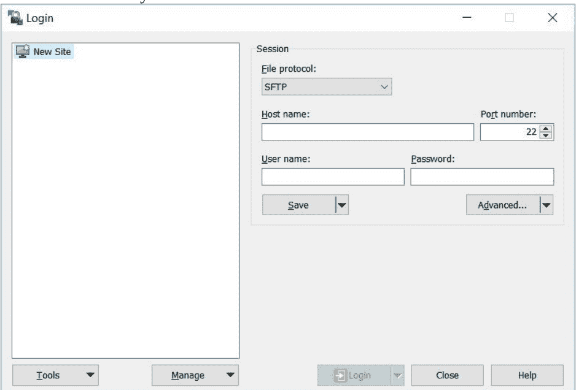

图 6-1：WinSCP 登录

左侧包含你的已保存连接。右侧设置新连接。输入服务器的主机名、用户名和密码。如有需要更改端口。你可以通过点击 Save 保存此连接。

WinSCP 可以导入你的 PuTTY 主机密钥缓存。选择 Tools->Import。你将看到 PuTTY 密钥缓存的内容，每个旁边都有一个复选框。验证你想要使用的每个服务器是否已勾选，然后选择 OK。WinSCP 现在可以利用你验证主机密钥所做的工作。

一旦你在 PuTTY 中验证了主机密钥，你可以返回 WinSCP 并在那里导入已验证的密钥。

### Using WinSCP

双击 WinSCP。输入你的用户名、密码和 SSH 服务器的主机名。WinSCP 将登录并打开一个双窗口。左侧显示你的本地主目录，而右侧显示远程服务器上的主目录。这称为“Commander-Style”界面。从一侧拖放文件到另一侧。

你可以让 WinSCP 使用“Explorer-style”界面。它将打开一个单一窗口，其样式与每个 Windows 资源管理器窗口完全相同，包含远程主机。要查看本地目录，你必须打开一个单独的窗口。要启用 Explorer 样式，请选择 Tools->Preferences->Interface 并选择 Explorer。你的 WinSCP 现在看起来如此 Windows 化，以至于连你自己都会感到困惑。

并且由于 WinSCP 的上下文菜单，你现在可以右键单击文件并选择 Send To WinSCP 来上传文件。

### Configuring the SCP and SFTP Servers

OpenSSH 默认支持 SCP 和 SFTP。两者都不需要太多配置，但你可以更改它们行为的某些方面。

对于 SCP，scp(1) 程序必须位于系统的默认 $PATH 中。如果 SSH 服务器找不到 scp，用户将收到相应的错误信息。开启或关闭，存在或不存在：这就是你唯一的选项。

sshd 服务器附带一个 SFTP 服务器，通过 sshd_config 条目激活。

```
Subsystem sftp /usr/libexec/sftp-server
```

仅此条目的存在就足以启用 SFTP 支持。

### SFTP-Only Users

你可能有一些用户需要访问复制文件到或从服务器，但不需要 shell 访问。OpenSSH 支持仅 SFTP 用户。这通常与 chroot（第 3 章）结合使用，允许用户仅访问文件系统的一部分。你会在支持多个客户的 Web 服务器中看到这种情况，每个站点只能访问其站点的文件。

对于需要 shell 访问的 chroot 用户需要在其 chroot 中放置一堆文件，而仅 SFTP 用户只需要一个 sshd_config 关键字。

首先为仅 SFTP 用户创建一个组。我将其命名为 sftp only。通过在 sshd_config 中使用 Match 术语，我禁止这些用户访问其主目录之外的任何内容，并且只允许他们进行 SFTP 访问。

```
Match Group sftp only
ChrootDirectory %h
ForceCommand internal-sftp
AllowTcpForwarding no
```

我们使用 ChrootDirectory 关键字将用户锁定在一个目录中。ForceCommand 关键字将用户限制为只能访问一个命令。就这样！内部 SFTP 服务器提供了用户可能需要的所有用户空间命令和设备节点访问。

### Disabling SSH File Copy

你可能想在仍允许用户命令行访问的同时禁用通过 SSH 复制文件的能力。这真的、真的很难。你可以从主机中删除 /usr/libexec/sftp-server 和 /usr/bin/scp 并在 sshd_config 中禁用 SFTP，但这只禁用了复制文件的明显方式。用户很狡猾

小麻烦，尤其是那些认为系统管理员阻碍他们工作的沮丧用户。用户可以通过多种方法复制文件。其中许多方法会在网络上传输未加密的数据。拥有 shell 访问权限的用户总能从一台主机复制文件到另一台主机。

如果你必须阻止用户复制文件，请使用 chroots 并限制用户可以访问的文件。他们仍然能够复制文件，但仅限于 chroot 中的文件。

## 第7章：SSH 密钥

SSH 主机密钥用于标识服务器。SSH 还支持使用密钥对用户进行身份验证。使用密钥对用户进行身份验证相比密码需要提前做更多设置，但如果正确配置，既更安全也更方便。我们将讨论服务器密钥和用户密钥。

### 手动创建服务器密钥

如果入侵者攻破了你的服务器，服务器的私钥就不再是私有的。你必须替换它。这需要生成一对新密钥。虽然大多数操作系统会自动创建缺失的主机密钥，但有些不会。使用 ssh-keygen (1) 手动创建服务器密钥。

如果你的服务器运行的是较新的 OpenSSH 版本，以 root 身份运行 ssh-keygen -A 可自动生成所有受支持但缺失的主机密钥。

你可能需要为除本地主机之外的其他主机创建主机密钥，例如在使用某些编排系统部署新安装时。你可以使用 ssh-keygen 的 -t 和 -f 参数手动创建密钥文件。

```
$ ssh-keygen -t ecdsa -f ssh_host_ecdsa_key -N ''
$ ssh-keygen -t ed25519 -f ssh_host_ed25519_key -N ''
```

-t 标志指定要创建的密钥类型。这里我们创建两种不同类型的密钥，ECDSA 和 ED25519。-f 标志给出私钥文件的名称。每对密钥的公钥都在同名文件且后缀添加 .pub 的文件中。最后，-N 允许你在命令行指定密码短语。主机密钥没有密码短语。这两个单引号表示空密码短语。

无论何时生成主机密钥，请务必获取密钥指纹，如第 4 章所述。你的用户需要指纹来验证主机密钥。

### 密码短语

我刚才提到的这个密码短语是什么？密码短语类似于密码，但更长。它包含空格、单词、特殊字符、数字以及你能输入的任何其他内容。密码短语用于加密和解密私钥。带有密码短语的密钥在有人输入正确的密码短语之前无法使用。

密码短语最常与用户身份验证密钥一起使用。拥有密钥对的用户可以在不提供该系统的密码的情况下访问系统。桌面和笔记本系统通常比服务器安全性差，而且令人沮丧地经常被感染、劫持或直接被盗。如果用户的身份验证密钥对被盗，入侵者就可以像合法用户一样使用该密钥对访问服务器。用密码短语加密私钥意味着，即使用户的私钥文件被盗，入侵者也无法在没有密码短语的情况下使用该密钥。如果入侵者只获得了你的私钥文件或密码短语中的一个，而没有两者，损害是可以控制的。使密码短语足够长以防止暴力破解，并足够复杂以阻止随意窃听。

密码短语可以是一个单词，像密码一样吗？可以，但这是一个 *非常* 糟糕的主意。现在计算机速度如此之快，可以通过依次尝试所有可能的密码来快速发现短密码。使用短密码短语会大大降低你私钥的安全性。

密码短语应至少由几个词组成，易于记忆，并且不应显而易见——即使是对认识你的人也不应显而易见。它应包含 #、!、~ 等特殊字符。来自专业非计算领域的奇特词汇很有用。用数字代替字母。不要使用任何流行文化的东西，也不要使用你自己的个人口头禅。你对朋友或同事说过且足够 catchy 以至于重复的东西都是糟糕的选择。如果你的想象力完全枯竭，Diceware (http://www.diceware.com) 是一种使用普通骰子从真实单词中随机生成大部分可记忆密码短语的工具。虽然入侵者可以毁掉你的一周，但拥有你的私钥且有幽默感的同事可能更令人恼火。

主机密钥不使用密码短语，因为 SSH 服务必须在系统启动时启动。你可以在服务器密钥上使用密码短语，但 SSH 不会在有人在服务器控制台输入密码短语之前启动。在大多数环境中这是不可接受的。

### 用户密钥

用户密钥对比密码提供更强的身份验证。与代理结合使用（见本章后文“SSH 代理”），用户密钥消除了在远程机器上输入任何身份验证凭据的需求。从密码学角度看，用户密钥与主机密钥相同。唯一的区别是密钥的使用位置。

概括地说，计算机可以根据你是谁、你知道什么或你拥有什么来识别你。虹膜扫描仪和指纹读取器验证你的身体，这是你 *是* 的东西。密码验证你 *知道* 一个秘密。进入房子需要你 *拥有* 门钥匙。基于密钥的身份验证结合了其中两种：你必须 *拥有* 包含私钥的文件，并且必须 *知道* 该密钥的密码短语。 admittedly，私钥文件比实体钥匙更容易复制——只需复制文件——但比 8 个字符的密码更难复制。这一额外的安全层为账户的未经授权使用提供了额外保护。

然而，密钥比密码更复杂。正如你不会把前门钥匙挂在门把手上一样，你必须保护你的私钥。如果计算机丢失或被盗，该机器上的任何私钥也应视为丢失。虽然记住密码是可能的，但大多数人不会花时间和精力去记住私钥中的数千个字符。是的，你应该有备份……但如果你的笔记本被盗，该笔记本上的私钥无论如何都应视为已泄露。

通过用户密钥设置身份验证真的值得麻烦吗？近十年以来，一个被称为“Hail Mary Cloud”的受损机器网络反复扫描互联网寻找 SSH 服务器。当云中的一台机器找到 SSH 服务器时，它会通知网络中的其他机器。然后云会系统地尝试可能的用户名和密码。网络上的一台主机尝试几次，然后另一台，再然后另一台。阻止单个 IP 地址对这些扫描器来说不是有用的防御，因为每个地址只尝试几个密码，然后下一个攻击者就轮到它了。

任何一次尝试猜中的几率都很低。尝试是持续不断的。它们永不结束。最终 Hail Mary Cloud 会好运地入侵你的服务器。也许是明天，也许是明年，但它会发生。为了防止这种入侵，你可以使用数据包过滤阻止对 SSH 服务器的公共访问，或者你可以消除密码身份验证。用户密钥让你可以消除密码。

### SSH 代理

用密码短语和私钥替换密码有一个明显的缺陷：输入密码很烦人。为什么要用更烦人的密码短语替换烦人的密码？它可能更安全，但你和你的用户真的会去做吗？

这就是 SSH 代理发挥作用的地方。SSH 代理是一个在后台运行的小程序。当你开始桌面会话时，你输入密码短语来解密你的私钥。解密后的私钥被加载到 SSH 代理中。代理将密钥存储在内存中，从不存储在磁盘上。代理处理 SSH 客户端的所有私钥操作。当 SSH 客户端需要用私钥解密某些内容时，它会要求代理处理。当你下班注销时，SSH 代理会关闭。解密后的私钥从内存中消失。换句话说，使用 SSH 代理，你输入你的

工作会话期间只需输入一次 passphrase，无论当天打开多少个 SSH 会话。

典型的一天里，我登录工作站，激活 SSH 代理，并输入一次 passphrase。随后我可以打开无数个通往网络各处服务器和路由器的 SSH 会话，而无需再次输入 passphrase 或密码。当我下班注销时，我的代理会关闭。代理使用的内存会被清除并归还给操作系统。我的私钥再次仅在加密文件中可用。

代理并不能保证安全。只要在你登录期间能够读取计算机内存的任何人，都可以访问解密后的密钥，其中包括 root 账户。如果你不信任桌面上的系统管理员，就不要使用 SSH 代理。¹ 如果你挂起笔记本电脑，解密后的私钥仍会保留在内存中。任何能够唤醒你的笔记本电脑并登录的人，都可以按其访问权限使用该密钥。一个随机的小偷只想快速换点钱，可能根本不知道或不理解他得到了什么，但专门针对你和/或你的雇主的窃贼很可能会检查是否存在活动的私钥。更常见的情况是，如果你在午餐前不锁定桌面，同事可能会利用你未受保护的终端。这些问题最好通过在不积极使用系统时清空或关闭代理来解决。

多用户机器上的代理安全也是一个问题。任何在系统上拥有管理员或超级用户权限的人都可以访问主机上运行的任何 SSH 代理。如果其他人拥有你桌面上的 root 或 Administrator 访问权限，他们可以访问你的代理并冒充你。使用代理是不明智的。

本章稍后我们将讨论 PuTTY 和 OpenSSH 的 SSH 代理。

### 创建 OpenSSH 用户密钥

如果你使用类 Unix 桌面，请使用 ssh-keygen(1) 生成密钥。不要使用任何参数，程序会引导你生成用户身份验证密钥。

```
$ ssh-keygen
Generating public/private rsa key pair.
Enter file in which to save the key (/home/mwlucas/.ssh/id_rsa):
Enter passphrase (empty for no passphrase):
Enter same passphrase again:
Your identification has been saved in /home/mwlucas/.ssh/id_rsa.
Your public key has been saved in /home/mwlucas/.ssh/id_rsa.pub.
The key fingerprint is:
SHA256:LK+1dKbb/PtN8KjiXLDDzzOK1fivRkMZIn8YoOrmEvA mwlucas@zfs1
The key's randomart image is:
+---[RSA 2048]----+
...
```

系统会询问新密钥应保存在何处。各种 OpenSSH 程序期望在默认位置找到密钥文件，因此请接受建议。然后系统会要求你两次输入 passphrase，以验证你能多次输入。你的私钥将使用此 passphrase 进行加密。务必使用 passphrase，如几页前所述。

SSH 对主机和用户使用相同的密钥格式。当你生成用户密钥时，会得到密钥指纹和 randomart 图像。对于用户身份验证密钥而言，两者都不是特别有用。

你会在 $HOME/.ssh/id_rsa 找到新的私钥，在 $HOME/.ssh/id_rsa.pub 找到新的公钥。立即将新密钥对备份到离线介质上，例如闪存驱动器或 CD-ROM。如果你的工作站被毁，你将希望能够恢复密钥对。

### 密钥算法

与主机密钥一样，用户密钥也可以使用几种不同的加密算法。如果不指定算法，OpenSSH 工具会使用推荐的算法——目前为 2048 位 RSA。你可以使用 -t 标志指定不同的算法。

```
$ ssh-keygen -t ecdsa
```

为什么要创建多个密钥？密码学家有这种令人不安的习惯，即发现加密算法中的弱点。有一天不可思议的事情会发生，有人会在广泛使用且被普遍信任的算法中发现缺陷。使用该算法的所有密钥将立即变得不可信。如果你的用户密钥使用不同的算法，你可以在 SSH 服务器上禁用损坏的算法，仍然可以访问服务器。

我们的示例假设你使用的是 RSA 密钥，但它们同样适用于使用其他算法生成的密钥。

### 创建 PuTTY 用户密钥

使用 PuTTYgen 程序为 PuTTY 创建用户身份验证密钥。PuTTY 安装程序包含 puttygen，或者你可以从 PuTTY 网站单独下载。当你启动 puttygen 时，你会看到类似图 7-1 的屏幕。

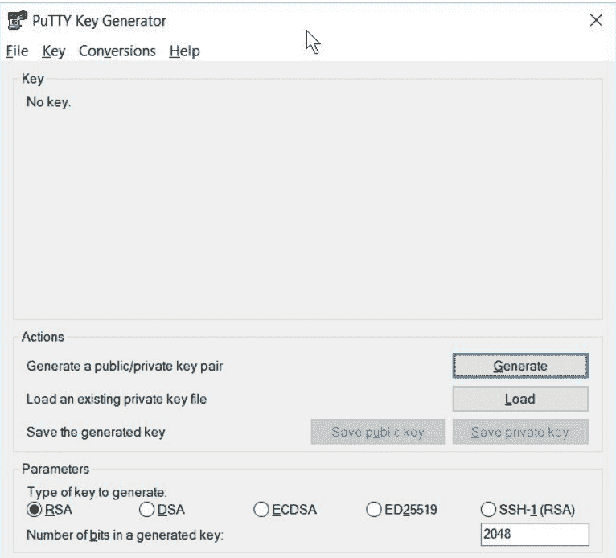

图 7-1：PuTTYgen 启动

使用 RSA、ECDSA 或 ED25519 密钥。DSA 密钥即将被淘汰，而 SSH-1 RSA 密钥早已过时。验证位数至少为 2048。更多并不一定有帮助。你可能会为专门用于古老服务器（如 VAX 或 Alpha）的用户密钥使用更少的位数。单击 Generate。下一个 PuTTYgen 屏幕会要求你通过在空白区域拖动鼠标来生成随机性。一旦生成足够的熵，PuTTYgen 就会创建你的密钥，如图 7-2 所示。

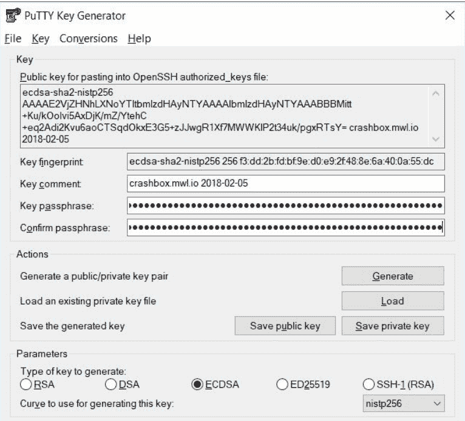

图 7-2：PuTTYgen 密钥和口令短语

这里你可以填写三个字段。第一个是密钥注释。我建议将注释更改为反映你生成密钥的机器和创建日期。现在两次输入你的 passphrase。

现在单击 Save public key。你会得到一个标准的 Windows “另存为” 对话框，要求你选择保存密钥的位置。将文件保存在只有你有权限访问的位置。你可以使用 Documents 下的文件夹，但请确保稍后进入并设置权限，以便机器上的其他用户无法查看文件。我通常将这些文件命名为它们创建的机器和日期。Puttygen 默认不会分配文件扩展名，因此请使用 .pub 扩展名。²

现在保存私钥。对公钥和私钥使用相同的名称。PuTTYgen 对私钥使用 .ppk 扩展名，因此它们不会相互覆盖。

你现在拥有一个公钥。恭喜！但不要退出 PuTTYgen。

屏幕顶部显示密钥采用 OpenSSH 友好的 authorized_keys 格式。将其复制到一个文件中，全部放在一行。我通常将该文件命名为密钥生成的机器、日期，并加上 authorized_keys 字符串。

### 安装公钥

无论你使用哪个客户端，在使用它登录之前都必须将公钥安装在服务器上。每当你 SSH 到主机时，OpenSSH 服务器会检查本地文件 $HOME/.ssh/authorized_keys。该文件包含公钥，每行一个（非常长）。SSH 服务器将客户端提供的公钥与文件中的密钥进行比较。如果密钥匹配，并且客户端能够成功使用该密钥交换数据，则客户端已证明其拥有对应的私钥。访问被授予。如果没有 authorized_keys 文件，服务器会回退到下一个身份验证方法（通常是密码）。

如果你是请求访问仅接受公钥身份验证的服务器的用户，系统管理员会要求你提供 authorized_keys 文件。如果你第一次使用公钥身份验证，这不是安全风险——记住，你的公钥文件是公开的。任何人都可以拥有它。如果没有对应的私钥，它完全无用。

最常见的用户密钥类型是 RSA 密钥。OpenSSH 将客户端的 RSA 公钥存储在文件 $HOME/.ssh/id_rsa.pub 中。PuTTY 的密钥生成器要求你自行命名密钥文件，你会有几个不同的密钥文件。你需要的是包含 authorized_keys 友好版本的那个文件。如果你遵循了我的建议，文件名将包含 authorized_keys。为了简化示例，我们将使用文件名 id_rsa_authorized_keys.pub。必要时请替换为你的 PuTTY 文件。

要使用你的公钥，你必须将客户端的公钥文件复制到服务器上你账户中的 authorized_keys 文件。你可以使用图形界面的复制粘贴功能，但容易出错。通过 SFTP 或 SCP 上传公钥文件然后将其连接到 authorized_keys 更可靠。记住，每个密钥在 authorized_keys 中必须且只能占一行。我多次尝试简单的复制粘贴，结果都以眼泪告终，然后威胁要改行做骆驼走私，最后在最近的 gelato 店进行躁郁症式的暴饮暴食。让机器复制文件。它比你做得好。

这里，我使用 scp(1) 将客户端的 id_rsa_authorized_keys.pub 复制到服务器 sloth。

```
$ scp .ssh/id_rsa_authorized_keys.pub sloth:
```

服务器仍会要求输入密码来上传密钥文件；你已创建密钥，但尚未安装。

PuTTY 用户应使用 WinSCP 友好的拖放文件复制。

现在登录服务器并将 id_rsa_authorized_keys.pub 的内容附加到 authorized_keys 文件中。如果你第一次安装公钥，可以将密钥文件复制到 authorized_keys。如果你养成这种习惯，

然而，有一天你会覆盖现有的 *authorized_keys*，然后花上几个小时懊恼自己犯了如此简单的错误。

```
$ cat id_rsa_authorized_keys.pub >> .ssh/authorized_keys
```

现在你可以尝试使用你的密钥进行身份验证。如果基于密钥的身份验证对你不起作用，请检查 *authorized_keys* 和 *.ssh* 目录的权限。两者都不应被除你之外的任何用户写入。

如果你是从类 UNIX 主机上传，可以在一个命令中完成上传和复制。

```
$ cat .ssh/id_rsa_authorized_keys.pub | ssh sloth "cat >>~/.ssh/authorized_keys"
```

如果你手动编辑 *authorized_keys*，请确保最后一个密钥以换行符结尾。如果最后一条条目没有以换行符结尾，你添加到此文件中的下一个密钥将被附加到前一个密钥的末尾。新的密钥和旧的密钥都将停止工作。如有疑问，请移至文件末尾并按 RETURN。*authorized_keys* 末尾多一个换行符不会有任何问题。

只上传公钥，*绝不* 上传私钥。你的私钥绝不应跨越网络。

一旦你的 *authorized_keys* 文件完全符合你的要求，你会希望将其复制到所有服务器。有很多方法可以管理此事。许多类 UNIX 主机都包含 ssh-copy-id(1)，这是一种方便地将现有的 *authorized_keys* 从一台主机复制到另一台主机的方法。我把最新的 *authorized_keys* 放在一个公共 Web 服务器上，这样我就可以轻松地将其安装到我偶然进入的任何机器上。或者，你可以使用第 11 章中讨论的技术，自动为你和所有用户将 *authorized_keys* 文件复制到所有机器。

现在从你的客户端测试你的密钥。

### 使用密钥进行身份验证

使用密钥进行身份验证会改变你的登录方式。无论你使用什么客户端，在继续之前请先验证你的密钥是否有效。不要在你确定密钥有效之前尝试使用 SSH 代理。

如果密钥不起作用，请使用第 5 章中讨论的 SSH 调试工具。以详细模式运行 *ssh*。使用 PuTTY 会话日志记录。阅读输出。如果存在权限问题或配置错误，答案就在其中。

### 使用 OpenSSH 用户密钥

当你的客户端在 $HOME/.ssh 中找到密钥对，并且 SSH 服务器在你的账户中找到 *authorized_keys* 文件时，客户端会要求你输入密码短语。

这里我连接到远程机器 *sloth*：

```
$ ssh sloth
Enter passphrase for key '/home/mwl/.ssh/id_rsa':
```

所有相关软件都已找到你的密钥文件。一旦你输入密码短语，客户端就可以解密私钥并用它向服务器进行身份验证。

是的，这看起来很像常规的基于密码的登录，但幕后却大不相同。你已在本地解密了密钥文件。你发送给服务器的唯一身份验证信息是确认你能够使用存储在服务器上你账户中的 authorized_keys 文件中的公钥加密交换数据。你永远不会发送密码或其他传统身份验证信息。

OpenSSH 会自动检查所有标准密钥文件。你可能有一个仅用于特殊情况的专用密钥，例如自动化任务。要使用该密钥与 scp、sftp 或 ssh 一起使用，请使用 -i 标志和文件名。

```
$ ssh -i $HOME/specialkey sloth
```

现在你知道你的密钥有效，每次登录此服务器时你都需要输入密码短语。这是一个配置 SSH 代理的好时机。

### 使用 PuTTY 用户密钥

如果你没有运行代理，必须告诉 PuTTY 你的私钥文件的位置。在 PuTTY 配置屏幕的左侧，选择 Connection-> SSH-> Auth。在标记为 Private key file for authentication: 的文本框中，输入你的私钥文件的完整路径。记住，私钥文件以 .ppk 结尾。

现在尝试连接。PuTTY 应该会提示你输入用户名，然后要求输入密码短语。如果正确输入密码短语，你将获得一个命令提示符。

一旦你知道你的密钥有效且安装正确，请使用 Pageant SSH 代理减少输入密码短语的频率。

### SSH 代理

虽然 OpenSSH 和 PuTTY 的 SSH 代理截然不同，但两者执行相同的任务。它们将你的私钥托管在安全内存中，这样你就不必不断输入密码短语。两者都允许你查看已解密的密钥、添加新密钥和删除密钥。它们之间唯一的真正区别在于编程方式以及你如何让它们表现——你知道，就是那些不重要的东西。

将你的密钥加载到 ssh-agent 后，你的登录尝试将如下所示：

```
$ ssh mail
Last login: Thu Nov 16 16:56:52 2017 from ceo.worldhq.mwl.io
FreeBSD 10.3-RELEASE-p20 (GENERIC) #0: Wed Jul 12 03:13:07 UTC 2017
```

注意没有任何密码或密码短语的请求；你刚刚在没有人工身份验证的情况下登录到远程机器。如果你工作日需要连接多台机器，SSH 代理会让生活更轻松，并将用户密钥从一种烦恼转变为一种乐趣。

### OpenSSH 代理

任何包含 OpenSSH 的类 UNIX 系统都有 SSH 代理 ssh-agent(1)。而这正是简单的事情结束的地方。

在类 UNIX 世界中，桌面环境的多样性带来的一个烦恼是，每个环境都有自己首选的运行 ssh-agent 的方式。我们将在此处讨论其中几种，但如果这些方法在你的环境中都不适用，你需要查阅你的操作系统或窗口管理器文档。许多 Unix 变体都有自己略微独特的桌面设置，它们会改变使用 ssh-agent 的精确方法，以适应开发人员的个人偏好和本周的 whims。

大多数显示管理器，如 xdm 和 kdm，都有钩子可自动检查用户主目录中的 SSH 密钥。当显示管理器在登录过程中找到密钥时，它会创建一个弹出窗口请求你的密码短语。输入密码短语，显示管理器会将 SSH 代理附加到你的桌面环境。你已准备好开始工作。

如果你更传统，使用 startx(1) 运行桌面，请在运行 startx 之前使用 ssh-add(1) 告诉 SSH 代理你有一个密钥。

```
$ ssh-add
Enter passphrase for /home/mwl/.ssh/id_rsa:
```

输入你的密码短语以将你的密钥添加到代理。

文本控制台用户必须首先使用 shell 作为参数运行 ssh-agent(1)，然后运行 ssh-add。

```
$ ssh-agent /bin/tcsh
$ ssh-add
```

从该控制台会话启动的所有 SSH 会话都使用代理运行。代理在虚拟控制台终端之间不起作用，仅适用于由 ssh-agent 运行的 shell 的子进程。另一个虚拟终端需要自己的 SSH 代理。

如果你有多个具有相同密码短语的密钥，ssh-add 会自动解密所有密钥。如果你有多个具有不同密码短语的密钥，ssh-add 会分别提示每个密码短语。

使用 ssh-add -l 列出当前存储在代理中的所有私钥，并使用 ssh-add -D 从正在运行的代理中删除密钥。午餐回来后再重新添加它们。

### PuTTY 代理

PuTTY SSH 代理 Pageant 为 SSH 提供了一个友好的 Windows 风格界面。通过双击启动 Pageant。Pageant 图标，一个戴着黑色宽檐帽的电脑，将出现在系统托盘中。

右键单击 Pageant 图标。你会看到几个选项，包括 View Keys、Add Key 和 Exit。还有运行已保存或新的 PuTTY 会话的选项。选择 *Add Key* 以调出标准的 Windows 文件浏览器。找到你的私钥并选择它。Pageant 将显示一个对话框请求你的密码短语。输入它。如果无法正确输入密码短语，Pageant 会要求你重新输入。

一旦 Pageant 就绪，打开一个 PuTTY 会话。连接到已安装你的公钥的机器。你应该可以在无需输入密码短语的情况下获得命令提示符。

如果在指定私钥文件时基于密钥的身份验证有效，但使用 Pageant 时无效，请验证 PuTTY 是否配置为使用 Pageant。选择 *Connection->SSH->Auth*。在 *Authentication Methods* 下，你会找到一个 *Attempt authentication using Pageant* 复选框。确保它已选中。

一旦你知道 Pageant 有效，让它在登录时启动会很有帮助。找到你的账户的 Startup 文件夹（确切位置因 Windows 版本而异）。在另一个窗口中，找到你的 Pageant 程序。它很可能位于 PuTTY 目录下的 *Programs* 或 *Program Files (x86)* 中。在启动目录中创建指向 Pageant 的链接。

为了获得最佳便利性，请让快捷方式在登录时加载你的私钥。你可以为 Pageant 提供密钥的完整路径作为参数，也可以设置一个 *Start in* 目录并仅使用短文件名。我建议设置 *Start in* 目录，因为它使在登录时加载多个密钥变得更简单。右键单击你的 Pageant 快捷方式。在 *Target* 下，将你的私钥文件名作为参数添加。Target 现在应该看起来像 `C:\Program Files\PuTTY\pageant.exe` moose.ppk。在同一屏幕上，你会看到一个 *Start in* 字段。在那里输入你的密钥目录的完整路径。在我的笔记本电脑上，那将是 `c:\Users\mwlucas\Documents\keys`。

要验证此操作是否有效，请退出正在运行的 Pageant 并双击启动文件夹中的新图标。你应该会被提示输入密钥的密码短语。如果不起作用，你可能在快捷方式中弄错了路径。记住，任何包含空格的路径都需要加上引号。

### 备份密钥文件

如果你丢失了私钥，你的密钥对就毫无用处。一旦你知道你的密钥对可用于身份验证，请备份私钥和公钥。PuTTY .ppk 文件包含公钥和私钥，但 OpenSSH 密钥对需要两个文件。不要只是将你的私钥复制到另一台机器——拥有你私钥的每台机器都是你的密钥可能被窃取的另一个地方。将你的私钥备份到离线介质上，例如闪存驱动器或 CD。你也可以使用 GnuPG 之类的程序对其进行加密。（如果你不熟悉 GnuPG，我推荐这本书 *PGP & GPG: Email for the Practical*

偏执狂，由本人撰写。）

### 密钥与多台机器

许多系统管理员拥有多台计算机。我经常使用两台桌面电脑和一台笔记本电脑。通过复制密钥文件，可以在机器之间移动密钥对。你甚至可以将 OpenSSH 密钥导入 PuTTY。你如何在多台机器之间实际管理单个密钥？

你不会。

不要在所有桌面电脑和笔记本电脑上重复使用同一个私钥，为每台机器创建单独的私钥。创建一个 authorized_keys 文件，其中包含所有身份验证密钥的公钥。当一台机器被退役、被盗或自毁时，停用该机器的密钥。从所有服务器上的 authorized_keys 文件中删除对应的公钥。在你的替换机器上生成新的密钥。

如果你的其中一台桌面机器被入侵，你必须停用该机器的身份验证密钥。如果所有客户端共享同一个私钥，你必须重新生成新的密钥对并分发到所有机器上。拥有你私钥的入侵者很可能会在你完成此操作之前将你锁在自己的系统之外。如果每台机器都有唯一的密钥对——即使所有密钥共享相同的密码短语——那么一个密钥被攻破或丢失也不会危及你其他机器上的密钥。

此外，首选的密钥算法会随时间变化。当我撰写本书第一版时，用户身份验证密钥默认为 1024 位。现在默认为 2048。如果我仍在使用几年前创建的密钥，它们对于当前使用来说就太弱了。完全有可能的是，RSA 作为默认用户身份验证密钥算法将来会被完全不同的算法取代。通过在获得新机器时创建新密钥，并使与旧硬件关联的密钥失效，你可以确保你的密钥相对较新且安全。

### 在 SSH 服务器中禁用密码

密码比密钥安全性更低。现在你已经拥有可用的基于密钥的身份验证，聪明的做法是禁止基于密码的身份验证。sshd_config 关键字 ChallengeResponseAuthentication 禁用通用的挑战-响应身份验证系统，例如请求用户名和密码的提示。关键字 PasswordAuthentication 启用和禁用密码。要禁用基于密码的身份验证，将这两个关键字都设置为 no。

```
ChallengeResponseAuthentication no
PasswordAuthentication no
```

虽然 sshd 默认允许公钥身份验证，但请验证没有人更改过该关键字。PubkeyAuthentication 关键字必须设置为 yes。

```
PubkeyAuthentication yes
```

现在重启 sshd，可以使用内置系统命令或 pkill -1 sshd。

修改 sshd_config 不会改变其他程序使用密码的方式。如果你为 sudo 使用密码，sudo 仍会要求用户输入密码。

### 密码身份验证警告！

如果你在配置 SSH 时出现错误导致无人可以登录，你可能会将自己锁在服务器之外。在修改 sshd_config 时，在验证更改有效之前，不要退出现有的 SSH 会话。

（记住，如第三章所述，你可以在备用端口上运行 sshd 进行测试。）创建一个新的 SSH 会话。在断开第一个会话之前，验证你是否可以登录并成为 root。

前一段非常重要。忽略它需自担风险，否则请准备好迎接你自己的躁郁性冰淇淋狂欢。

### 允许特定主机使用密码

虽然密码较弱，但有时你无法完全禁用它们。你可能有一些用户或应用程序由于一个愚蠢的原因或另一个原因无法使用密钥。根本问题通常是政治性的而非技术性的，但它们仍然是问题。在你解决这些问题时，你可以使用条件配置允许特定主机使用密码，如第三章所述。在这里，我们允许来自特定子网的密码身份验证。

```
Match Address 192.0.2.0/24
PasswordAuthentication yes
```

记住，所有 Match 语句都应放在 sshd_config 的底部。

基于用户名允许密码身份验证是可能的，但极其不明智。SSH 服务器在挂断请求密码的客户端之前，必须先获取用户名。这意味着 Hail Mary Cloud 将会持续不断地探测服务器。迫使你允许有限密码身份验证的原因可能使要求强密码同样成问题——那个要求允许使用密码的老板可能认为 p455w0rd 是一个安全的密码。允许密码的账户将成为一个薄弱环节。这里唯一能拯救你的就是对非常安全的堡垒主机进行良好的离主机日志记录，这样当机器被入侵时，你可以告诉老板停机是他的错。

### 代理转发

假设我在所有计算机上禁用了基于密码的身份验证。访问我任何主机的命令行提示符的唯一方式是通过公钥身份验证。我正在操作我的服务器 wrath，并且必须将一个文件复制到服务器 `gluttony`。这带来了一个问题。我的私钥不在 `wrath` 上。将私钥复制到服务器上是糟糕的安全实践——你希望私钥存在于尽可能少的机器上，并且绝不在服务器上。但密码不起作用。我如何使用 SCP 或 SFTP？

答案是将身份验证请求转发回你的工作站。代理转发正是如此。当你尝试从一台服务器 SSH 到另一台服务器时，服务器上的 SSH 客户端会将私钥请求发送回你的桌面。代理作为一个套接字可用，其位置由环境变量 `$SSH_AUTH_SOCK` 给出。

```
$ echo $SSH_AUTH_SOCK
/tmp/ssh-z0eUnDTnk b/agent.2513
```

要使用代理转发，客户端和服务器都必须允许它，并且在建立第一个 SSH 连接之前 SSH 代理必须正在运行。如果客户端和服务器都支持并请求转发，身份验证请求将被转发。

### 代理转发安全性

代理转发的风险是你必须对 SSH 服务器给予一定信任。任何拥有 root 访问权限的人都可以访问你的 SSH 代理套接字。任何可以访问你的 SSH 代理套接字的人都可以在不提供密码短语的情况下使用你的私钥。

如果你的 SSH 服务器被入侵，入侵者可以搭乘你的身份验证套接字，使用你的凭据登录远程服务器。

滥用的代理转发已导致许多组织的入侵，甚至是那些你认为应该更清楚的组织。仅对你控制的机器启用代理转发。

### sshd 中的代理转发

要在服务器上启用代理转发，将 AllowAgentForwarding 关键字设置为 yes。

```
AllowAgentForwarding yes
```

我通常会全局禁用代理转发，然后使用 Match 语句仅允许特定用户或地址转发其代理。

### OpenSSH 客户端代理转发

在 `ssh_config` 中，使用 ForwardAgent 关键字激活代理转发。

```
ForwardAgent yes
```

下次你连接到服务器时，客户端将请求代理转发。

### PuTTY 代理转发

PuTTY 默认启用代理转发。在 PuTTY 设置屏幕的左侧，转到 Connection -> SSH -> Auth。在 Authentication parameters 下，你会看到一个标记为 Allow agent forwarding 的复选框。

你也可以使用密钥身份验证和 *authorized_keys* 来非常具体地限制用户通过 SSH 可以执行的操作。我们将在第 12 章中探讨这一点。现在，让我们来看 X 转发。

¹ 不信任桌面系统管理员基本上会破坏任何服务器安全希望。是的，我们都曾在那里工作过。

² 不要在 Microsoft Publisher 中打开公钥。那不会让任何人高兴。

## 第 8 章：X 转发

类 Unix 系统使用 X 协议（或 X11）来显示图形用户界面。X 多年来有所改进，但它仍然臭名昭著地繁复。X 的更有用的特性之一是将程序运行所在的系统与程序显示出现所在的系统分离。你可以在一台主机上运行程序，并让显示出现在完全不同的工作站上。我可以在公共互联网上的主机上运行图形网页浏览器，并将显示回传到我雇主防火墙内的笔记本电脑上，绕过防火墙内容过滤限制——当然是为了完全合法的工作原因。在这种情况下，所有网络请求都源自我的服务器，结果显示在我的笔记本电脑上。你可以用任何 X 程序做到同样的事情。

如果你以前从未使用过 X，它可能看起来有点奇怪。没关系。玩一玩，你很快就会理解它的用途。

原始 X 在网络上传输信息时未加密。通过 SSH 使用 X11 转发将其包装起来，在传输中保护 X。

### X 安全性

X 来自网络安全远非今天这样重要的时代。鉴于当时有限的硬件，开发者很高兴能让图形应用程序正常工作。在任何协议中事后添加安全性并不像我们希望的那样有效。从远程机器显示 X 需要对远程机器给予信任。你越信任远程机器，就越可以在本地显示更多的 X 程序。如果你完全信任一台被入侵的机器，入侵者可以使用 X 接管你的工作站，捕获你的击键，并像你一样访问你的系统。

仅允许真正需要它的用户或主机进行 X 转发。

### X 与网络

X 开发时，某个站点的互联网连接可能快至 56 kbps。尝试在站点之间使用 X 转发是系统管理员喝啤酒时嘲笑的事情。不过现在带宽不再是问题，人们可能会在一大洲运行浏览器并在另一大洲显示它。

虽然在世界许多地区带宽不再是问题，但延迟是真实存在的。许多图形程序对延迟高度敏感。一个程序可能合理地期望每秒执行数百次图形操作。当每次操作耗时一纳秒时，这没问题。然而，当每次操作由于跨国链路耗时五十毫秒时，你的程序就变得无法使用。如果延迟不是问题，抖动和丢包也会破坏可用性。


如果你有任何延迟，请调查转发 X 的替代方案。也许动态端口转发（第 9 章）就能解决你的问题。也许你的程序具有远程使用的功能，例如 Wireshark 的能力能够从另一台主机接收 `tcpdump` 流。使用一种能够适应高延迟的协议。

尽管如此，在本地网络内部，X 转发可以非常有用。

### X 服务器和客户端

X 服务器是提供图形显示的计算机。X 客户端运行生成显示的程序。对很多人来说这似乎是颠倒的。如果你正在使用 X，X 服务器几乎可以肯定是你的桌面。要使用 X 转发，你的桌面必须有一个 X 服务器。

几乎所有类 Unix 系统都包含一个 X 服务器，通常来自 X.org，但也可能是厂商的专有系统。如果你运行的是 Windows，你需要一个第三方 X 服务器。我们将在 PuTTY 和 X 的讨论中介绍这些。

### SSH 服务器上的 X 转发

要使用 X 转发，SSH 服务器必须具有 xauth(1) 程序。如果存在，你可以在 `sshd_config` 中使用 X11Forwarding 关键字启用转发。

```
X11Forwarding yes
```

更改后重启（或 `pkill -1`）`sshd`。

OpenSSH 手册提到了配置 X 转发细节的几个其他选项，但绝大多数人永远不需要它们。如果你遇到奇怪的问题，请调查 sshd_config(5) 中的各种 X11 关键字。

### OpenSSH 客户端中的 X 转发

OpenSSH 客户端支持两种级别的 X 转发，按安全级别区分。两者都配置在 `ssh_config` 中。基本 X 转发仅支持 X 协议中较不安全的子集。这种级别的 X 转发相当安全。入侵者无法通过基本 X 转发接管你的桌面或窃听你的按键。

```
ForwardX11 yes
```

请始终先尝试这种基本 X 转发。

许多 X 程序使用超出较不安全子集的功能。当通过 SSH 转发时，这些程序会显示错误并无情地崩溃。一旦你启用 X 转发，你就可以使用 ForwardX11Trusted 关键字选择允许完整的 X 功能集。

```
ForwardX11Trusted yes
```

当你允许所有 X 功能时，你完全信任 SSH 服务器。控制 SSH 服务器的入侵者可以捕获你本地屏幕上的所有内容以及你的每个按键。在全局允许这种信任级别之前，请非常、非常确定你信任你可能登录的每一台远程服务器。而且一旦你绝对确定——不要这么做。

X 转发是 SSH 压缩有意义的少数情况之一。设置 Compression 关键字为 yes 以启用压缩。然而最好仅在每个主机基础上使用。

### 按主机 X 转发

你可以使用 Match 规则配置按主机设置，将 X 转发限制为仅必要的 hosts。这里我在 pride 上有一个程序需要完全信任 X，所以我在 ssh_config 中为它做一个特殊条目。

```
ForwardX11 no
Host pride
ForwardX11 yes
ForwardX11Trusted yes
Compression yes
```

现在我只需要担心一台主机上的 X 软件，而不是我 SSH 登录的每一台主机。

### 命令行上的 X 转发

比将 X 转发限制在某些主机上更好的是按连接启用它。

在前面的示例中，我对主机 pride 的所有连接都完全信任 X。该主机上有一个程序需要完整的 X 访问，但我每次登录该主机时并不运行该程序。我只想为某些会话启用 X 转发。使用 -c 标志启用压缩。使用 -x 命令行选项在必要时激活标准 X 转发。

```
$ ssh -CX pride
```

如果必须完全信任远程主机，等同于 ForwardX11Trusted，使用

```
-Y
$ ssh -CY pride
```

这消除了常规转发 X 的风险，但在必要时支持 X 转发。

### 使用 PuTTY 进行 X 转发

将 X 转发到 Windows 主机的第一个问题是 Windows 不包含 X 服务器。你需要额外的软件。幸运的是，许多人已将标准的 X.org 软件从 UNIX 移植到 Windows。你可以使用任何你喜欢的。我通常使用 Xming，但如果你的雇主或同事坚持使用不同的软件也不用担心。

### Xming

Xming 是一个广泛使用且频繁更新的 Windows 系统 X 服务器。Xming 的最新版本仅对向项目捐赠的人可用，但上一个版本是免费的。与本书中的所有软件一样，如果你发现 Xming 有用，我鼓励你向程序员捐赠。Xming 为 Windows 带来了 UNIX 用户熟悉的各种 X 技巧，但就我们的目的而言，我们仅将其用于显示在远程机器上运行的程序。

从 http://sourceforge.net/projects/xming/ 下载 Xming。Xming 安装程序对任何 Windows 用户来说都非常简单，所以我不会一步步指导你。采用默认设置。安装完成后，运行 Xming 启动服务器。

### 启用和禁用 X 转发

PuTTY 默认转发 X。更重要的是，PuTTY 不对 X 进行基于安全的过滤；其转发等同于 ssh 中的 ForwardX11Trusted。因此，我建议默认禁用 X 转发，然后仅在需要时启用。

在 PuTTY 配置屏幕的左侧，选择 Connection -> SSH -> X11。第一个复选框是 Enable X11 forwarding。取消选中它，然后保存默认设置。保持其他设置不变，因为它们仅在不常见的情况下有用。

### 转发是否正常工作？

在你转发 X 之后，你的 SSH 会话看起来不会有任何不同。如何在需要之前证明转发是否正常工作？如果 SSH 已成功协商 X 转发，它将在你的 shell 中设置 $DISPLAY 变量。

```
$ echo $DISPLAY
localhost:10.0
```

你的 shell 知道有一个 X 服务器附加到它。你可以运行你的 X 程序。如果转发不工作，$DISPLAY 未定义。检查你的系统日志或 SSH 客户端的调试日志。

使用不安全、旧的协议 XDMCP 的连接将具有类似 remote:1 的 $DISPLAY 值。这意味着你的 shell 在某个地方以某种方式找到了一个 X 显示，但它不是你试图通过 SSH 转发的那个。如果 $DISPLAY 看起来很奇怪，不要运行你的 X 程序！可能有非常、非常严重的问题。

现在从你的 shell 运行一个 X 程序，它应该在你的桌面上显示。大多数 X 客户端都包含 xterm(1) 终端模拟器。在你的 SSH 服务器上后台运行 xterm。

```
$ xterm &
```

你将在 SSH 服务器上取回命令提示符。一两分钟后，取决于服务器和客户端之间的带宽和延迟，远程系统上的终端将出现在你的桌面上。

如果你不喜欢 xterm，可以改试 xclock、xeyes 或 xcalc。

当你启用 X 转发连接时，你可能会看到类似 untrusted X11 forwarding set up failed 或 No xauth data 的警告。这些警告在通过 SSH 转发 X 时并不关键，不必担心。

### 使用 OpenSSH 的远程 X 命令

登录另一台机器只为运行一个 X 程序——或任何程序——可能很麻烦。ssh 的 -f 选项让你在保持 SSH 会话本身在后台的同时在另一台机器上运行命令。这看起来像是你直接在另一台主机上执行命令。将命令放在你想要访问的主机之后。例如，如果我想在 wrath 上运行 xterm，我可以运行：

```
$ ssh -f wrath xterm
```

客户端将连接到服务器并显示服务器显示的任何登录文本。然后 SSH 客户端进入后台，在它在远程系统上运行命令的同时恢复你在本地系统上的命令提示符。

请注意，远程命令在用户的完整登录环境中运行。附加到用户 shell 的任何文件，例如 .cshrc 或 .profile，都会被读取。这可能会导致问题，具体取决于你正在运行的应用程序。

将转发的 X-over-SSH 会话置于后台非常有用，但通过 SSH 转发 TCP 端口更有用。我们接下来会查看这一点。


## 第9章：端口转发

SSH 端口转发是一个有争议的话题。

SSH 可作为任意 TCP 流量的包装器。你可以将 telnet、POP3、IMAP 或 HTTP 等未加密服务隐藏在 SSH 内部，安全地传输这些天生不安全的协议。SSH 会话可以承载任何 TCP/IP 协议，包括贵组织网络中本地 IT 安全团队禁止的协议。因此，许多对安全性要求较高的组织不允许 SSH 穿越和/或离开其网络。要求不那么严格的组织则利用这种能力来保护其网络。（你也可以使用 SSH 创建 VPN 来承载所有 IP 协议，但那在第 13 章。）

例如，我用 WordPress 管理我的网站和博客。它提供了一个友好的、点击式的网站管理和设计界面，让我无需真正学习关于网页设计的*任何*东西就能获得一个看起来不错的页面。¹ 在 Let's Encrypt 出现之前的那些黑暗日子里，我的网站使用的是明文 HTTP。我使用 SSH 端口转发在我的 Web 服务器和桌面之间隧道传输 HTTP。这保护了传输过程中的凭据，并消除了密码在传输中被窃取的风险。这是 SSH 端口转发一种合理且合法的用途。

然而，假设我的桌面位于一个高安全网络内部。防火墙严格限制网页浏览并阻止所有文件传输。如果我能使用 SSH 连接到网络外部的服务器，我就可以将桌面流量转发到该外部服务器以获得不受限制的互联网访问。我可以通过 SSH 上传机密文档，而防火墙日志只会显示我建立了 SSH 连接。你的网络管理员会提出反对，而且理由充分。

### 端口转发与安全策略

如果你是某个组织的安保负责人，端口转发可能会让你考虑完全阻止 SSH。我理解。我做过你的工作。你还应该知道，顽固的用户可以将 SSH 隧道*嵌入* DNS、HTTP 或几乎任何其他服务或协议中，包括原始 ICMP。绝对阻止 SSH 的唯一方法是拒绝所有 TCP、UDP 或 ICMP 连接，使用能够智能检查流量的 Web 代理，并且不允许客户端机器即使通过代理也访问公共 DNS。我见过一家公司实际实施了这种类型的<|message|>安全边界，但他们为明显笨拙的业务关键软件设置了许多漏洞和例外。如果你无法在你的环境中实施此措施但有严格的安全要求，你必须与用户合作以满足这些要求和业务需求。我强烈建议建立一个扎实的网络流量感知程序以及入侵和外泄检测，以便你知道网络流量何时偏离常态。阅读 Richard Bejtlich 关于入侵和外泄分析的书籍，以及我自己的 *Network Flow Analysis*（No Starch Press，2010），并实施文中讨论的类似程序。

作为用户，拥有通过 SSH 隧道传输任意流量的能力并不意味着你应该这样做。如果你的组织安全策略禁止端口转发和/或隧道传输，就不要这样做。如果策略说“使用 Web 代理并远离 IRC”，那就听从。我不负责如果你使用这些技术而受到训斥、解雇或被消灭。（即使我们 IT 安全官员都是不懂你对 IRC 和 MySpace 这种非常个人化且深切紧急的*需求*的小气独裁者。）

### 故障排除端口转发

一些应用程序在使用端口转发时表现异常。区分应用程序故障和端口转发故障很重要。如果你转发了一个端口而你的应用程序无法通过它工作，使用 `netcat` 甚至 `telnet` 来确定端口是否真的打开。（我在第 3 章开头演示了 `netcat`。）服务器对转发端口上的 `netcat` 请求的反馈应与非转发端口上的反馈相同。

如果你没有收到响应，你可能配置错误了端口转发。仔细检查你的命令行。如有必要，使用连接一端或两端的调试功能查看实际发生了什么。请记住一次只能有一个进程打开给定端口。

如果端口转发工作正常，你的应用程序在使用时遇到问题。也许你需要一个 hosts 条目，这在许多 Web 应用程序中很常见。也许它是一个老旧笨拙的协议，期望打开各种各样的端口。FTP 是经典例子。你需要深入研究应用程序及其协议以弄清为什么它无法工作。

端口转发是一种工具。并非所有协议都适用于此工具。有时，使用端口转发就像用锤子拧螺丝；你得到的任何结果都会让你不满意。

### 示例环境

对于所有这些端口转发示例，我假设 SSH 客户端位于防火墙后面。这可能是从大型企业代理到家庭路由器的任何东西。防火墙后面还有几台其他服务器，包括 Web 服务器和邮件服务器。客户端无法被公共互联网访问；外部世界无法连接到它。

SSH 服务器位于公共互联网上。任何人都可以连接它，并且它可以自由访问互联网的其余部分。

### 端口转发类型

端口转发有三种类型：本地、远程和动态。

*本地端口转发* 将客户端上的一个端口重定向到服务器上的一个端口。本质上你是在说“抓取 SSH 服务器上的某个端口并使其对我的客户端本地化。”假设你想从一台仅提供未加密 POP3 的服务器下载邮件，但你有 SSH 访问权限。你可以将本地机器上的端口 2110 转发到 POP3 服务器上的端口 110。将你的邮件客户端配置为从本地主机地址的端口 2110 下载邮件。SSH 拦截所有对端口 2110 的请求并将其转发到邮件服务器的端口 110。图 9-1 说明了本地端口转发的数据流。

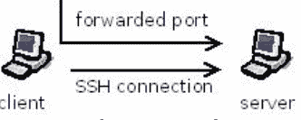

图 9-1：本地端口转发数据流

*远程端口转发* 则相反。SSH 服务器上的一个端口被转发到你的 SSH 客户端上的一个端口。你是在说，“取我客户端上的某个端口并将其连接到远程服务器。”例如，你可以在企业防火墙后面的工作站上启用 sshd。然后你从工作站通过 SSH 连接到公共互联网上的服务器。使用远程端口转发，你可以将公共互联网服务器上的端口 2222 转发到工作站上的 SSH 端口。任何连接到你公共服务器端口 2222 的人都会被透明地连接到你工作站的 SSH 服务器。他们可以在没有任何 VPN 客户端的情况下进入防火墙，并且完全无视防火墙策略。你可能会使用远程端口转发使私有 Web 服务器公开可用。图 9-2 说明了远程端口转发。

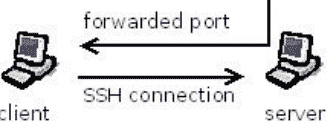

图 9-2：远程端口转发数据流

*动态端口转发* 是一个更广泛的系统，其中许多不同的客户端程序可以连接到许多不同的服务。它在 SSH 客户端上创建一个 SOCKS 代理，并将对该代理的任何请求通过服务器转发出去。SOCKS 代理是一个通用网关，可以承载任何 TCP/IP 流量。（顺便说一下，SOCKS 实际上并不代表任何东西。）这使得连接到代理的任何人都可以完全访问服务器的网络。图 9-3 说明了动态端口转发。

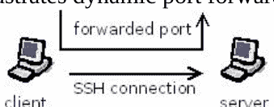

图 9-3：动态端口转发数据流

当底层 SSH 会话终止时，所有端口都停止转发。

第 10 章提供了保持 SSH 会话活跃的建议。

凭借这些可能性，很容易看出为什么系统管理员喜欢 SSH，以及为什么许多企业安全部门禁止它。

### 特权端口与转发

在类 Unix 系统上，1024 以下的 TCP 端口保留用于系统使用。只有 root 可以绑定这些端口。作为非特权用户，你可以将 SSH 端口转发器的本地端附加到 1024 以上的任何端口。转发保留端口需要以 root 身份使用 SSH。以 root 身份执行常规任务是不良做法，因此不要在没有非常充分理由的情况下这样做。

只有连接到特权端口的连接一侧需要以 root 运行。如果你在客户端绑定保留端口，以 root 运行客户端，但以普通用户身份登录服务器。如果你在服务器上绑定保留端口，你需要以 root 身份登录服务器。在后一种情况下，更好的做法是更改端口，这样你就不必直接以 root 登录。

Microsoft 系统不实现特权端口。任何人都可以绑定系统上的任何开放端口。端口限制的缺失造成了各种可能有趣的安全问题，但它确实使转发低编号端口与转发任何其他端口一样简单。你永远不需要以 root 运行 PuTTY。

### 本地端口转发

在设置本地端口转发之前，验证正常的 SSH 是否工作。然后确定你想要转发的服务，以及该服务运行的端口。一些典型选择是 80（HTTP）、25（SMTP）和 110（POP3）。通常在这些端口上运行的服务通常未加密。

现在选择你想要用于转发的本地端口。一些客户端在任何端口上运行都很好。几乎任何邮件客户端都允许你设置检查 POP3 的 TCP 端口。其他的……不行。网站经常会卡住如果你更改端口号。如果你不知道协议在从一个端口转发到另一个端口时的行为，先在测试服务器上试试看。

对于我们的本地端口转发示例，我们将把我的客户端上的端口 8080 转发到服务器 sloth 上的端口 80。现在 TLS 证书是免费的，为什么你还要

需要这样做吗？某些专有的基于 Web 的应用程序不支持 TLS，如果你尝试将它们转换为 TLS，它们会尖叫着死掉。² 我需要编辑客户端的 hosts 文件（要么是 /etc/hosts，要么是 C:\Windows\System32\drivers\etc\hosts）来告诉我的客户端该网站的 IP 地址是 127.0.0.1。我需要一个第二个别名，以便我可以 SSH 到实际机器。如果只有我一个人使用这个应用程序，一旦我设置好端口转发，我就可以告诉应用程序只监听服务器的本地主机地址。这不仅会在传输中像 TLS 一样保护我的数据，还会为应用程序增加另一层保护。

### OpenSSH 本地转发

要告诉 SSH 客户端激活本地转发，请使用 -L 标志。

```
$ ssh -L localIP:localport:remoteIP:remoteport hostname
```

如果在 SSH 客户端上未指定 IP 地址，SSH 会连接到 127.0.0.1。在这种情况下可以跳过第一个参数，使命令变为：

```
$ ssh -L localport:remoteIP:remoteport hostname
```

目前，只使用 IP 地址 127.0.0.1。这是在每台机器上都可用的回环地址，仅可在该机器上访问。虽然看起来我们正在将一个地址转发到同一个地址，但客户端上的 127.0.0.1 与服务器上的 127.0.0.1 并不是同一个。我们将在本章后面的“选择 IP 地址”中考虑将转发的端口绑定到不同的 IP 地址。

所以，这里是如何使用本地端口转发连接到服务器 sloth，并将 sloth 的本地主机地址上的端口 80 转发到我的客户端的端口 8080。

```
$ ssh -L 8080:127.0.0.1:80 sloth
```

我将工作站上的端口 8080 附加。我没有指定本地 IP 地址，因此 ssh 将转发附加到客户端的 127.0.0.1。我的 SSH 会话正常登录，并给我服务器上的一个终端。但如果我将我的网络浏览器指向 localhost:8080，我就会连接到服务器上运行的网站。hosts 文件中的别名会使网站更易于使用。

要每次连接到服务器时都设置本地端口转发，请在 ssh_config 中使用 LocalForward 关键字。

```
LocalForward client-IP:client-port server-IP:server-port
```

这看起来像命令行上的端口转发，但中间的冒号缺失了。这里我将工作站上的端口 8080 转发到服务器上的端口 80。我们在客户端和服务器上都附加到 127.0.0.1，即 localhost。我在工作站上使用端口 8080，因为使用端口 80 每次都需要以 root 身份运行 SSH。

```
Host envy.mwl.io
LocalForward localhost:8080 localhost:80
```

LocalForward 关键字最常与 Host 语句一起出现，从而在连接到特定服务器时启用本地端口转发。为了避免 IP 和端口冲突，每个服务器通常都会分配自己的本地端口。

### PuTTY 本地转发

PuTTY 仅为端口转发提供了一个特殊控制面板。在 PuTTY 配置屏幕左侧，选择 *Connection* -> *SSH* -> *Tunnels*，如图 9-4 所示。

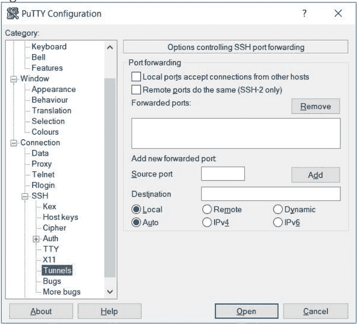

图 9-4：PuTTY 端口转发

使用本地端口转发时，PuTTY 默认会连接到客户端的本地主机地址。然而，我必须指定要在 SSH 服务器上使用的地址。要将 SSH 服务器上的端口 80 转发到我工作站上的端口 80，我将使用服务器的本地主机地址。在 *Source port* 中输入 80。在 *Destination* 中输入服务器上的 IP 地址、冒号和要转发的端口。这里我将使用 127.0.0.1:80。在底部选择 *Local*。它应该看起来像图 9-5。

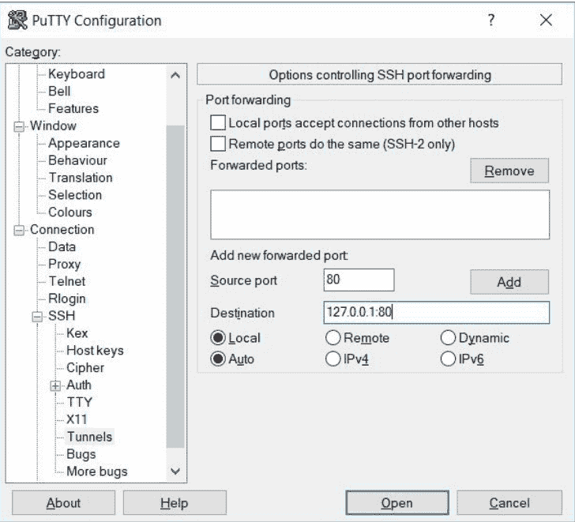

图 9-5：PuTTY 本地端口转发设置

点击 *Add*，然后连接。你现在有了端口转发。将浏览器指向 `localhost`，看看会发生什么。

要将此转发绑定到客户端的面向网络的 IP 地址，请选择 *Local ports accept connections from other hosts*。这会将转发的端口绑定到客户端上的所有 IP 地址，以便工作站网络上的其他主机可以访问转发。有关其影响的讨论，请参阅本章后面“选择 IP 地址”。

如果你希望每次连接到此主机时都使用此转发，请保存此会话。

### 远程端口转发

在配置远程端口转发之前，请验证正常的 SSH 是否正常工作。确定要转发到和来自的客户端和服务器端口。

其中本地端口转发通常用于用加密包装服务，远程端口转发用于访问防火墙后面的服务。对于此示例，我将 SSH 服务器本地主机地址上的端口 2222 转发到工作站上的端口 22。当我连接到 SSH 服务器上的端口 2222 时，远程转发会将我重定向到工作站的 SSH 服务。

为什么要这样做？请记住从我们的示例环境中，客户端位于防火墙后面。防火墙可能是我的家庭 NAT 设备，或我雇主的工业级企业防火墙集群。远程转发让我可以使用我的客户端为网络外部的 SSH 服务器提供一种连接到防火墙内部主机的方式，尽管有任何相反的防火墙规则。这可能是我进入自己网络的宝贵紧急后门，也可能违反我雇主的安全策略。或者，更好的是：两者兼有！

请注意，除非服务器专门配置为使用 GatewayPorts 关键字允许此操作，否则你无法将转发的端口绑定到 SSH 服务器的面向公众的 IP 地址。请参阅本章后面“限制端口转发”。

### OpenSSH 远程转发

使用 -R 标志配置远程端口转发。

```
$ ssh -R remoteIP:remoteport:localIP:localport hostname
```

如果未指定要在 SSH 服务器上连接的 IP 地址，SSH 会连接到 127.0.0.1。在这种情况下可以跳过第一个参数，使命令变为：

```
$ ssh -R remoteport:localIP:localport hostname
```

我希望将 SSH 服务器 sloth 上的端口 2222 连接到我工作站上的端口 22，在两侧都使用本地主机地址。

```
$ ssh -R 2222:localhost:22 sloth
```

我的客户端连接到服务器并给我一个命令提示符。只要该 SSH 会话保持打开，sloth 上的其他用户就可以通过连接到端口 2222 来 SSH 到我的工作站。

```
sloth$ ssh -p 2222 localhost
```

啪！一个新的 SSH 连接进入我的工作站，隧道在我的现有 SSH 会话内部。此新会话将在客户端日志中显示为一个新的连接，源自本地主机。在设置远程端口转发时，你真的需要信任拥有你系统帐户的人。任何可以访问你系统本地主机地址的人都可以使用端口转发。我永远不会在自己完全不信任的 SSH 服务器上使用远程端口转发。

如果你希望每次连接到服务器时都建立远程端口转发，请在 ssh_config 中使用 RemoteForward 关键字。

```
RemoteForward server-IP:server-port client-IP:client-port
```

同样，这与命令行上的端口转发相似，但中间的冒号缺失了。这里我在配置文件中设置了相同的端口转发。

```
Host sloth.mwl.io
RemoteForward localhost:2222 localhost:22
```

RemoteForward 关键字最常与 Host 语句一起出现，除非你希望对连接到的每个主机都执行远程转发。

### PuTTY 远程转发

要配置远程转发，请转到 PuTTY 配置屏幕左侧，选择 Connection -> SSH -> Tunnels，如图 9-4 所示。由于我们是从服务器转发到客户端，Source port 字段指的是将被转发到工作站的服务器上的端口。在本例中，源端口是 2222。Destination 是 localhost:22，因为工作站的 SSH 服务器运行在端口 22 上。³ 选择 Remote 进行远程端口转发。

点击 Add，然后连接。端口转发应该可以工作。

要将此转发绑定到服务器的面向网络的 IP 地址，请选择 Remote ports do the same (SSH-2 only)。这会将转发的端口绑定到 SSH 服务器上的所有 IP 地址，以便其他主机可以访问转发。本章后面“选择 IP 地址”讨论了其影响。

要使此服务器的远程转发永久化，请保存会话。

你现在可以一路嘲笑防火墙到失业办公室。或者在 VPN 失败时进入你的网络，拯救你的公司。或者，再次，两者兼有。

### 动态端口转发

动态端口转发将你的 SSH 客户端转变为 SOCKS（版本 5）代理。发送到代理的任何流量都将被隧道传输到 SSH 服务器，服务器根据其自身访问权限转发该流量。你必须有一个 SOCKS 感知的应用程序来访问代理，但大多数网络浏览器都包括 SOCKS 支持。在此示例中，我将把我工作站上的端口 9999 配置为 SOCKS 代理，并动态转发所有流量到公共互联网上的我的服务器。

使用 SOCKS 时，你的客户端可能需要将所有 DNS 请求转发到 SOCKS 服务器。并非所有客户端都支持此功能。

### OpenSSH 动态转发

使用 -D 标志告诉 OpenSSH 使用动态端口转发。

```
$ ssh -D localaddress:localport hostname
```

如果未指定 IP 地址，ssh 会自动绑定到 127.0.0.1。

在这里，我在工作站上创建代理，端口为 9999。发送到代理的所有流量都会被转发到 SSH 服务器 sloth，后者将其中继到目的地。

```
$ ssh -D 9999 sloth
```

与端口转发一样，你将登录到服务器并获得一个命令提示符。动态转发在后台运行。将工作站上的网络浏览器配置为使用 127.0.0.1:9999 处的 SOCKS 代理。它应该通过 SSH 连接将你的所有浏览发送到你的服务器。

如果你希望远程端口转发每次连接到

主机，请在 ssh_config 中使用 DynamicForward 关键字。

```
DynamicForward host:port
```

与其它转发语句一样，出于同样的原因，DynamicForward 关键字最常出现在 Host 语句中。

### PuTTY 动态转发

转到图 9-4 所示的 Tunnels 屏幕。在 Source port 字段中，输入你希望 SOCKS 代理使用的端口。保持 Destination 为空白。选择 Dynamic，然后点击 Add。你会看到端口转发出现在 Forwarded ports 列表中。打开连接。你的浏览器现在应该能够通过 SOCKS 代理进行连接。

就我的示例用法而言，我在 Source port 字段中输入 9999，选择 Dynamic，点击 Add，然后连接。就这样。

要将此转发绑定到客户端的面向网络的 IP 地址，请选择 Local ports accept connections from other hosts。这会将代理绑定到工作站上的所有 IP 地址，因此其他主机可以访问该转发。

请记住，当你这样做时，你是在向所有可以访问你的客户端的人提供隧道。

如果希望每次打开此连接时都自动启动此转发，请保存会话。

### 测试动态转发

你可以用任何支持 SOCKS 代理的程序来验证动态转发。这类程序中最常见的就是网页浏览器。

将你的防火墙配置为阻止工作站的所有端口 80 流量。

验证你已无法浏览网页。如果要浏览，你需要通过代理进行。

启动一个动态端口转发 SSH 会话。将网页浏览器配置为访问该代理。如果可以访问互联网，则说明动态转发正在工作。

### 后台运行 OpenSSH 转发

有时你想使用 OpenSSH 转发连接，但不需要在 SSH 服务器上进行终端会话。使用 -N 标志告诉 ssh 在服务器上不运行任何内容，包括终端，并使用 -f 标志告诉 ssh 在客户端进入后台。这里我将到服务器 pride 的本地转发会话放到后台。

```
$ ssh -fNL 2222:localhost:22 pride &
```

将此命令放到后台会把你的原始终端还给你。

后台转发在你没有 SSH 服务器上的 shell 访问权限，但在被允许进行身份验证并创建隧道时很有用。

（这是一种创建基于 SSH 的 VPN 的方法，但第 13 章讨论了更好的方法。）

### 选择 IP 地址

进行端口转发时，你必须选择转发端口要监听的 IP 地址，以及要将转发端口附加到的 IP。选择 IP 有助于控制谁可以连接到转发端口。

最常见的选择是在隧道的任一端或两端都绑定到 localhost 地址 127.0.0.1。每个具有功能性 TCP/IP 栈的机器都使用 127.0.0.1 作为自身的地址，并且只有本地机器可以连接到它。如果我将工作站的 localhost 地址上的端口 80 转发到服务器的 localhost 地址上的端口 80，则没有其他主机可以通过我的隧道连接到该转发端口。服务器上的大多数守护进程同时监听 localhost 地址和一个或多个面向网络的 IP 地址，因此使用 localhost 地址转发端口是合理的方式。

如果你希望客户端接受来自其他机器的请求并使用本地端口转发将其发送到 SSH 服务器，请将端口转发附加到客户端的面向网络的 IP 地址。如果我将机器的面向网络的 IP 地址上的端口 80 转发到 SSH 服务器上的端口 80，则此转发可供所有可以连接到我的客户端端口 80 的主机使用。使用 PuTTY 时，你必须选择 Local ports accept connections from other hosts。使用 OpenSSH 时，你必须在 ssh_config 中设置 GatewayPorts 关键字（参见本章后面的“Gateway Ports”。）

如果你希望 SSH 服务器使用远程端口转发将来自其他机器的请求转发到你的客户端，请将端口转发附加到服务器的面向网络的 IP 地址。你必须按本章后面“Gateway Ports”部分所示调整 sshd_config 中的 GatewayPorts。例如，我们使用远程端口转发将服务器上的一个端口连接到客户端的 sshd。你可以将此远程转发附加到服务器的公网 IP 地址，以便互联网上的任何主机都可以连接到客户端的 SSH 服务，即使它位于防火墙后面。记住，虽然创建进入私有网络的后门可能很有用，但将该后门开放给整个互联网是相当失礼的。

如果你希望 SSH 客户端通过动态端口转发为其他机器充当 SOCKS 代理，请将端口转发附加到客户端的面向网络的 IP 地址。

请始终记住，运行任何现代操作系统的主机可以拥有多个 IP 地址。你可能需要选择特定的地址，而不是允许所有面向网络的地址。

假设我的工作站的 IP 为 192.0.2.18，并且位于一个包含大量其他客户端的网络上。我们必须访问一个在传输过程中不加密数据的关键基于 Web 的应用程序。我可以通过本地端口转发在工作站和服务器之间提供一个加密隧道。如果我只想将此隧道提供给我的桌面，我会将隧道的客户端端附加到 127.0.0.1。如果我想将此隧道提供给网络上的每个人，我会将客户端端附加到 192.0.2.18。

或者，也许我负责运行公司的内容过滤网页代理，并且我正在调试一个特定网站通过代理无法正常工作的问题。我想看看该网站从网络外部的样子。我可以设置一个私有的 SOCKS 代理来绕过组织的代理，让我可以从外部服务器浏览。设置任何人都可以使用的未经授权的代理服务器是需要一份新工作的大好方法，因此我绝对确保该隧道的本地端使用 localhost 地址。

只要主机名在 DNS 中正确显示，你就可以使用主机名而不是实际的 IP 地址。你也可以使用单词 `localhost` 代替 127.0.0.1。

### 限制和要求端口转发

OpenSSH 服务器控制用户可以执行哪些类型的端口转发。你可以拒绝端口转发，允许端口转发但仅允许绑定到 localhost 地址，或仅允许特定地址和端口。

不过，在服务器级别实现这些限制的效果并不如人所愿。一个拥有 shell 访问权限的用户可以轻松安装自己的转发器。正确地为 shell 用户禁用转发需要控制哪些二进制文件可执行，禁用像 Perl 或 Python 这样的解释器，并防止用户安装进一步的程序。大体上，除非你真的很执着，否则拥有 shell 访问权限的用户总能找到转发端口的方法。尽管如此，禁用或限制端口转发会给你的用户一个非常明确的提示，说明他们不应该转发端口。

### 阻止端口转发

`sshd_config` 关键字 `AllowTcpForwarding` 告诉 `sshd` 是否应允许端口转发。默认值为 `yes`，允许端口转发。如果设置为 `no`，则完全禁止端口转发。

要仅允许本地端口转发，请将 `AllowTcpForwarding` 设置为 `local`。类似地，`remote` 仅允许远程端口转发。

### 网关端口

`GatewayPorts` 关键字控制客户端是否可以将远程转发端口绑定到 `localhost` 以外的任何 IP 地址。此关键字同时出现在 `ssh_config` 和 `sshd_config` 中。`ssh_config` 选项控制本地端口转发，而 *sshd_config* 选项控制远程端口转发。

GatewayPorts 默认设置为 no，意味着客户端无法将任何端口转发连接到任何面向网络的 IP 地址。这在 *ssh_config* 和 *sshd_config* 中是相同的。

在 *ssh_config* 中使用时，将 GatewayPorts 设置为 yes 以允许 ssh 请求监听客户端上的任何 IP。

在服务器端，在 *sshd_config* 中将 GatewayPorts 设置为 yes 意味着无论客户端请求什么，远程转发始终监听主机上的所有地址。我不知道为什么你要启用所有端口转发的全局网络访问，但这是一个选项。

服务器在 *sshd_config* 中支持一个额外的 GatewayPorts 选项 `clientspecified`，它告诉 sshd 让客户端绑定到其请求的任何内容。以逐个转发为基础允许客户端进行精细控制通常是最好的选择。

### 允许特定端口和地址

如果你想要比 GatewayPorts 支持更具体的限制，可以使用 *sshd_config* 中的 PermitOpen 关键字限制可以转发的 TCP 端口和地址。PermitOpen 接受一个以空格分隔的端口列表，可能转发的端口形式为 hostname:port。例如，这里我允许服务器的端口 25 和 110 转发回客户端，并且仅限于 localhost 地址。

```
PermitOpen localhost:25 localhost:110
```

未允许的将被禁止。SSH 会话将正常打开，但在你尝试通过被禁止的转发端口传递流量时，你的 SSH 客户端会显示错误。

### 要求端口转发

也许端口转发是此连接存在的唯一原因。如果设置端口转发失败，你甚至不希望连接建立。ExitOnForwardFailure *ssh_config* 关键字告诉 ssh 在端口转发尝试失败时该怎么做。默认值 no 意味着即使无法建立端口转发，连接也应建立。通过将 ExitOnForwardFailure 设置为 yes，你告诉 SSH 如果端口转发不起作用则立即断开连接。

现在你已经知道如何选择性地转发端口来帮助将你的网络粘合在一起，让我们看看如何让 SSH 会话在数小时或数天内保持活动状态，而无需人工干预。

1 我的 HTML 教育在 1996 年左右结束，我没有任何兴趣重新开始。

2 是的，我们在这里解决的是错误的问题。真正的修复方法是替换那个愚蠢的应用程序。


我知道，我知道，大多数 Windows 系统都没有 SSH 服务。我选择保持示例的一致性，而不是进一步混淆你。

## 第 10 章：保持 SSH 连接开启

端口转发将 SSH 从一个提供终端会话的协议转变为任意转发 TCP 流量的工具。但大多数防火墙（以及一些互联网服务提供商）会故意终止一段时间内处于空闲状态的 TCP 连接。空闲的 SSH 会话最终会被服务器、客户端或中间的某个网络设备断开。如果你通过 SSH 转发服务，或者即使你懒得每次防火墙切断连接时都重新登录 SSH 服务器，你也希望保持会话活跃。

保持 SSH 连接的大多数方法归结为“在后台传递少量流量，以便中间网络设备不会将连接视为空闲”。这些被称为 *keepalives*。运行一个持续显示并更新的程序，如 top(1)，可以在不更改任何 SSH 设置的情况下充当 keepalive。你需要做的就是养成每次被中断时启动 top 的习惯。

keepalives 的问题在于临时断开会终止会话。如果你的服务提供商在半夜出现问题，导致 keepalive 数据包在几分钟内无法穿越网络，那么客户端或服务器都会终止连接。根据你的网络情况决定如何适当配置 keepalives。你可能根本不需要它们。

如果你的连接不稳定到 keepalives 都无法维持，那么请研究 mosh (https://mosh.org)。它是一种类似 SSH 的远程连接协议，但专为不可靠网络设计。

你有两个 keepalive 选项，TCP keepalives 和 SSH keepalives。

### TCP 保活

PuTTY 和 OpenSSH 都支持 TCP keepalives。虽然 TCP keepalives 的可配置性不如 SSH keepalives，但对大多数终端用户来说已足够。

TCP keepalive 是 TCP 协议的一部分，在传输层发送，并非 SSH 本身的一部分。当 TCP 连接保持空闲时，最终会超时并断开。开启 TCP keepalives 会偶尔发送数据包来回，只是为了提醒大家这个连接仍然存在。不过，TCP keepalive 可以被伪造或伪造。

这不一定是坏事——我无法想象有人为什么要伪造你的连接来保持其活跃，但比我更聪明、更恶劣的人大概能想出不止一个坏理由。你需要发送 TCP keepalive 的频率取决于操作系统的 TCP 栈，但绝不应超过两分钟。

PuTTY 仅支持 TCP keepalives，但默认不主动发起。

不过，它会响应收到的任何 TCP keepalives。在 PuTTY 配置屏幕中，进入 Connection 部分。第一个选项是 *Seconds between keepalives*。此选项默认为零，禁用发送 keepalives。在大多数情况下，每 90 秒发送一次 TCP keepalive 足以保持连接打开。即使 PuTTY 不发送 keepalives，SSH 服务器通常会发送，而 PuTTY 会响应它们。这通常足以保持连接打开。

OpenSSH 服务器默认发送 TCP keepalives。如果你想禁用它们，请在 `sshd_config` 中将关键字 TCPKeepAlive 设置为 no。

### OpenSSH 保活

虽然 TCP keepalives 可能满足大多数人的需求，但 OpenSSH 的 keepalives 灵活性更高。在加密通道内发送的 keepalive 消息会告诉中间网络设备此 TCP 会话仍在使用中。接收到 keepalive 会告诉主机远程端仍已连接，并且 SSH 会话仍然有效。SSH keepalive 更有可能在长时间的路由器重启过程中仍保持会话打开。

OpenSSH 的客户端和服务器都支持 keepalives。严格来说，客户端发送 *client alive* 消息，服务器发送 *server alive* 消息。虽然出于协议原因两者必须不同，但对我们来说它们都只是 keepalives。OpenSSH 默认不使用 SSH keepalives；你必须在开始会话前配置它们。

发送 keepalives 的主机期望收到对方的 keepalives。每个主机都会跟踪自上次收到对方 keepalive 以来的时间。如果主机发送了指定数量的 keepalives 而未收到任何响应，它会认为连接已丢失并终止 SSH 会话。

使用 SSH keepalives 需要决定发送 keepalive 数据包的频率，以及在主机断开会话前可以丢失多少个数据包。服务器使用关键字 ClientAliveInterval 和 ClientAliveCountMax。客户端支持关键字 ServerAliveInterval 和 ServerAliveCountMax。

AliveInterval 关键字规定连接必须空闲多少秒后主机才会发送 keepalive。要使客户端在非活动 90 秒后发送 keepalive，请将 ServerAliveInterval 设置为 90。默认值为 0，禁用 keepalives。

AliveCountMax 关键字告诉主机在终止连接前必须连续发送多少个 keepalives。默认值为三。

让我们看看实际操作。服务器的 `sshd_config` 中有以下内容：

```
ClientAliveInterval 90
ClientAliveCountMax 5
```

在客户端，我们在 *ssh_config* 中放入了以下内容。

```
ServerAliveInterval 90
ServerAliveCountMax 4
```

我们登录 SSH 服务器，做一些工作，然后让连接处于空闲状态。连接空闲 90 秒后，客户端向服务器发送 keepalive。如果服务器用自己的 keepalive 作出响应，客户端和服务器都知道连接是活跃的。如果又过了 90 秒仍未收到服务器响应，客户端将发送另一个 keepalive。它知道自己已发送了两次 keepalive 请求而未收到服务器的任何响应。如果连接保持空闲，客户端会继续发送 keepalives。在第四次 keepalive 后，六分钟后，客户端丢弃 SSH 会话并退出。

服务器以相同方式发送 keepalives，但请注意它在五次未被确认的 keepalive 请求后会拆除连接。这个特定客户端比服务器容忍的干扰更少。

请注意 TCP 协议也参与其中。发送 TCP 数据包的主机期望接收方确认每个数据包。如果发送方未收到此确认，它最终会拆除连接，无论 SSH 能做什么。时间长度因操作系统而异，但你应该知道，如果无法维持 TCP 连接，就无法维持 SSH 会话。

如果你想无论如何都保持连接活跃，将 AliveCountMax 调到高值会有帮助，尤其是在廉价¹的网络地址转换设备后面，例如许多家庭路由器。

PuTTY 不支持 SSH keepalives。

### 保活与 SSH 服务器

如果你在 SSH 服务器上禁用所有 keepalives，服务器就无法注意到客户端何时离线。这意味着当工作站崩溃或网络链路故障，强制断开客户端时，服务器不会知道。它将继续为这些客户端运行 SSH 进程。如果你的服务器运行时间很长，你可能会积累数百甚至数千个失效的 sshd 进程。清理它们有点麻烦。我建议至少使用 TCP keepalives，最好同时使用 SSH keepalives。

现在让我们通过密钥分发来简化你的生活。

¹ 我对 inexpensive 没意见，但我痛恨廉价。

## 第 11 章：密钥分发

毫无疑问，管理 SSH 最令人烦恼的部分是分发和验证密钥。

无论你对用户进行多么严厉的讲授，其中许多人仍不会费心将服务器指纹与你提供的列表进行比较；相反，他们会点击“是，接受密钥”。无论我们多么努力地教育他们，用户很快就会对看起来吓人的警告习以为常并学会忽略它们。帮助用户注意的最佳方式是确保只有在真正出现问题时他们才会看到警告。

同样，基于密钥的身份验证通常比基于密码的更安全。然而，许多用户不会费心将他们的 *authorized_keys* 复制到服务器上。他们只会坚持使用熟悉的密码。如果你想强制使用基于密钥的身份验证，你需要自己将用户的 *authorized_keys* 放在服务器上。如果你管理数十或数百台服务器和/或用户，你将需要自动化来在系统之间分发用户密钥更新。

虽然 OpenSSH 不包含自动密钥分发工具，但理解与密钥相关的功能可以极大地简化你的自动化流程。我们将从主机密钥开始，然后进行到用户密钥。

### *known_hosts* 详解

对于 OpenSSH 和 PuTTY 来说，主机密钥分发都从 *known_hosts* 开始。如果你要分发主机公钥，你会希望确保这些记录是干净无误的。这意味着你需要完全理解 *known_hosts* 文件。

*known_hosts* 中的每一行代表一个主机的一个公钥，以空格分隔的字段表示。如果一个主机支持三种不同的公钥算法，并且你使用这三种密钥都连接到过该主机，那么该主机在 *known_hosts* 中将有三条条目。每个条目还给出服务器的主机名或 IP 地址以及用于该密钥的算法。但每个条目也可以包含另外几个字段。

### 标记

*known_hosts* 文件支持两个特殊标记，@cert-authority 和 @revoked。这些标记必须出现在行首。

以 *@cert-authority* 开头的 *known_hosts* 条目表示该主机密钥用于 SSH 证书颁发机构。SSH 证书颁发机构与 TLS CA 不同。第 14 章讨论 SSH CA。

如果入侵者侵入 SSH 服务器并复制了服务器的私钥，该密钥就不再可信。一个精明的入侵者可能会使用该密钥尝试

伪造服务器。通过在 known_hosts 中用 @revoked 标记一个密钥，你告诉 ssh 不要接受该密钥并生成一个令人恐惧的警告。

```
$ ssh gluttony
@@@@@@@@@@@@@@@@@@@@@@@@@@@@@@@@@@@@@@@@@@@@@@@@@@@@@@@@@@
@ WARNING: REVOKED HOST KEY DETECTED! @
@@@@@@@@@@@@@@@@@@@@@@@@@@@@@@@@@@@@@@@@@@@@@@@@@@@@@@@@@@
The ECDSA host key for gluttony.mwl.io is marked as revoked.
This could mean that a stolen key is being used to
impersonate this host.
ECDSA host key for gluttony.mwl.io was revoked and you have requested strict checking.
Host key verification failed.
```

请注意，没有“无论如何接受此密钥”的选项。被撤销的密钥是完全不可信任的。将密钥保留在 known_hosts 中但将其标记为已撤销，会给用户明确的警告，表明他们遇到了一个受损的系统。

标记必须位于行的开头，在主机名之前。

### 主机名

主机名是 SSH 识别 SSH 服务器的方式。如果你使用短主机名连接到服务器，ssh 会记录它用于联系服务器的完整主机名。这意味着如果我输入 ssh wrath，ssh 会将主机名记录为 wrath.mwl.io，因为那是我的系统解析器提供给 ssh(1) 的名称。该机器可能还有其他主机名或别名，并且可能也以其 IP 地址为人所知。一个真正权威的 known_hosts 文件必须为这些名称中的每一个包含密钥。

好消息是，你不必为这些不同的名称包含多行大部分重复的行。known_hosts 文件接受单个条目中的多个主机名，只要它们用逗号分隔即可。

```
gluttony.mwl.io,mail.mwl.io,203.0.113.213 ecdsa-sha2-nistp256 AAAAE2VjZHNhLXNoYTIbmlzdHAyN...
```

一些系统管理员会更改其 SSH 服务运行的 TCP 端口。这对安全来说不是特别有用，但有助于减缓更原始的蠕虫并减少日志噪音。这些主机名在 known_hosts 中以方括号出现，后跟冒号和端口号。

```
[lust.mwl.io]:2222 ecdsa-sha2-nistp256 AAAAE2VjZHNhLXNoYTIbmlzdHAyNTYAAAAIbmlzdHAyNT...
```

第 5 章介绍了通过哈希主机名来隐藏它们，防止偶然的入侵者从 known_hosts 中提取服务器信息。在单行上列出多个主机名简化了 known_hosts 的集中管理，但与哈希主机名冲突。如果你想哈希主机名，你必须在单独的行上列出每个主机名。主机 avarice.mwl.io、mail.mwl.io 和 198.51.100.12 需要三个 known_hosts 条目，并且每个条目都会单独进行哈希。如果你在分发之前要对 known_hosts 条目进行哈希，我建议以明文维护你的主文件。

接受多个 IP 地址连接的主机理论上需要为每个地址提供一个 known_hosts 条目。如果你通常不连接到所有这些地址，那就不用费心了。我有一台拥有数十个 IP 地址的服务器，但我只通过 SSH 连接到其中一个地址，因此该服务器只有一个 *known_hosts* IP 条目。如果你有这样的服务器，将 sshd 锁定为仅监听一个地址可能会简化管理。

### 密钥类型

密钥类型是用于生成此主机密钥的算法。现代的 *known_hosts* 可以包含六种不同的密钥类型：*ssh-dss*（DSA 密钥）、*ssh-rsa*（RSA 密钥）、*ecdsa-sha2-nistp256*、*ecdsa-sha2-nistp384* 和 *ecdsa-sha2-nistp512*（ECDSA 密钥），以及 *ssh-ed25519*（ED 25519 密钥）。在空格中出现的任何其他内容都很奇怪，需要调查。

### 密钥

公钥是一个长长的乱码字母数字字符串。它通常以一系列大写 A 开头，并且经常（但不总是）以等号（=）结尾。密钥占据了该行的绝大部分。

### 注释

注释是自由格式文本。你可以根据需要使用注释。它在自动维护的 *known_hosts* 文件中通常为空，但在集中管理中你会发现它很有用。

### 创建 known_hosts

生成 *known_hosts* 的简便方法是使用 ssh-keyscan(1)。

```
$ ssh-keyscan wrath > wrath.known_hosts
```

这为你提供了一个开始的 *known_hosts* 文件。现在你需要将这些密钥与你在第 4 章中生成的指纹进行验证。这是一项非常适合交给一个你讨厌的细致、尽责的跟班的工作。

我鼓励你自动化收集 *known_hosts* 条目。你如何做到这一点完全取决于你组织偏好的工具。理想情况下，你会在机器首次部署时运行 ssh-keyscan，在任何入侵者有机会破坏它之前，并立即更新你的 *known_hosts*。

如果你想简化 *known_hosts*，你可以减少 SSH 服务器提供的密钥数量。你可以声明网络中的所有主机只提供 ED25519 密钥，从而消除所有其他密钥类型的 *known_hosts* 条目。*sshd_config* 中的 HostKeyAlgorithms 关键字让你可以设置 sshd 用于主机识别的算法。

```
HostKeyAlgorithms ssh-ed25519, ssh-rsa
```

你将使用确切的方法完全取决于你熟悉的工具和已有的自动化。如果可能，请重新利用你现有的工具。

如果你编写了一个用于收集、验证和构建 *known_hosts* 文件的好工具，请将其公开。

### 撤销主机密钥

如果你有理由怀疑服务器的密钥已被泄露，请撤销它。在你的 *known_hosts* 中找到服务器的所有主机密钥条目。在所有条目前添加字符串 @revoked。为服务器生成新的主机密钥并重启 *sshd*，然后将新的主机密钥添加到你的 *known_hosts*。现在你可以将更新后的 *known_hosts* 分发给你的客户端，并且在（不太可能）用户尝试使用被撤销密钥的情况下，用户会收到警告。

被撤销密钥的有效性完全取决于向客户端分发 *known_hosts*。

### 分发主机密钥

只要 SSH 服务器的主机密钥被添加、移动或更改，用户就会看到有关主机密钥的警告。分发 *known_hosts* 的全部目的就是防止用户看到不必要的警告。领先于你的用户。¹ 只要你部署或移除服务器，或必须为服务器提供新密钥，就更新你的 *known_hosts*。如果你延迟更新 *known_hosts*，用户会学会忽略警告。

维护集中式 *known_hosts* 文件最糟糕的部分是将文件复制到所有服务器和工作站。你很忙。如果更新花费很长时间或大量精力，你就无法跟上。你确实需要像 Ansible、Puppet 或其众多竞争对手之一这样的集中系统。Active Directory 对于向 Windows 系统分发主机密钥效果很好。如果你从未使用过自动化，我推荐 Ansible。一旦你为现有系统准备了完整的 *known_hosts*，更新该文件并将其推送到所有系统只需一两分钟，就能为你的用户和支持团队节省数小时的工作。

### 分发 known_hosts

所有 OpenSSH 客户端都会检查 */etc/ssh/ssh_known_hosts* 以获取主机密钥。将你的 *known_hosts* 复制到每个服务器和工作站的此位置。下次有人在这些机器上使用 ssh(1) 时，正确的密钥已经在位。

OpenSSH 会在每个用户的个人 *known_hosts* 文件中检查主机密钥，此外还会检查系统的 */etc/ssh/ssh_known_hosts*。客户端将使用与服务器提供的密钥匹配的任何条目。当你首次部署集中式 *known_hosts* 时，每个用户可能已有现有的个人 *known_hosts*。你不希望用户个人缓存中的任何过时或无效条目干扰后续的密钥更改或撤销。不要直接删除每个人的 *known_hosts*；它们可能包含你不控制的服务器的已验证主机密钥。相反，在首次部署时，将每个用户的个人 *known_hosts* 移动到像 *known_hosts.personal* 这样的位置。

务必告诉你的用户发生了什么。最好提前通知。
一旦你建立了维护 *known_hosts* 的系统，你会在 SSH 中找到自动化的其他用途。请记住 */etc/ssh/ssh_config* 为 ssh(1) 设置系统范围的默认值。如果你有需要特殊设置的组织标准，你可以在全局配置中输入它们，从而节省用户编辑自己的配置或记住命令行参数的精力。如果你的组织在非标准端口上运行 SSH，在 */etc/ssh/ssh_config* 中设置 Port 关键字实际上可能会赢得用户的良好 karma。个人配置文件会覆盖系统范围的设置，因此如果用户真的想自找麻烦，他们仍然可以射伤自己的脚。

### 分发 PuTTY 主机密钥

PuTTY 将其主机密钥保存在 Windows 注册表中。复制密钥不如将文件移动到所有工作站那么容易，但可以简化。PuTTY 团队有一个 Python 脚本可以将 *known_hosts* 转换为 PuTTY 的注册表键，`hk2reg.py`。你不会在正常的 PuTTY 安装中找到 `hk2reg.py`，但它包含在源代码中。你可以从 PuTTY 网站下载 PuTTY 源代码，或从 PuTTY GitHub at https://github.com/github/putty 的“contrib”目录获取。

运行 `hk2reg.py` 并给它一个参数，你的原始 *known_hosts*。

```
$ hk2reg.py pristine-known_hosts > putty.reg
```

通过 Active Directory、登录脚本或让用户双击它，在客户端上安装此注册表文件。²

请记住 PuTTY 将密钥存储在每个单独用户的注册表中。没有系统范围的 PuTTY 注册表树。按用户而非按机器分发密钥。

如果你为多种平台维护 *known_hosts*，我建议以下分发主机密钥的工作流程：首先收集你的主机密钥。为你的 OpenSSH 客户端创建一个 *known_hosts* 文件。触发脚本自动将新的 *known_hosts* 分发到每个 OpenSSH 系统。在此期间，使用 `hk2reg.py` 创建你的 Windows 注册表。最后，将新的注册表文件排队通过 Active Directory 分发。下次人们登录时，他们应该拥有所有新密钥。

### DNS 中的主机密钥

OpenSSH 支持在域名系统中检查主机密钥指纹。（PuTTY 不支持。）这消除了将文件推送到服务器的需要，但传统的 DNS 服务并不安全。如果你想通过 DNS 安全地分发服务器的公钥指纹，你绝对必须拥有 DNS 安全扩展（DNSSEC）。如果你还没有 DNSSEC，现在就去配置它，然后再回来这里。你可能会发现我的书 *DNSSEC Mastery* (Tilted

Windmill Press, 2013) 有用。

我们不会介绍 DNS 基础知识。如果你考虑通过 DNS 分发密钥指纹，我就默认你知道区域文件是什么、为什么 RR 很重要，以及为什么要更新序列号。

### SSHFP 记录

SSH 指纹（SSHFP）记录提供了主机的 SSH 指纹。记录看起来像这样：

```
wrath IN SSHFP 1 1 07988cadf134050d458dfa5f2c062b5e68106163
```

与任何标准 DNS 记录一样，第一字段给出主机名，第二字段表示这是一个 Internet 记录，而第三字段表示这是一个 SSH 指纹记录。SSH 特定细节从第四字段开始出现，该字段给出算法类型。你不必记住哪个数字对应哪个算法，但这里的 1 表示这是一个 RSA 指纹。第五字段是用于生成此指纹的消息摘要算法。1 表示 SHA-1，而 2 表示 SHA-256。最后，第六字段是实际的密钥指纹。

对于服务器提供的每个公钥，你需要两个 SSHFP 记录；一个用于 SHA-1，一个用于 SHA-256。

### 创建 SSHFP 记录

甚至不要尝试手工创建 SSHFP 记录。ssh-keygen 程序可以读取本地服务器上的密钥文件并生成记录，使用 -r 标志即可。将主机名作为参数提供。

```
$ ssh-keygen -r wrath
wrath IN SSHFP 1 1 07988cadf134050d458dfa5f2c062b5e68106163
wrath IN SSHFP 1 2 b7931f47398ca1ed73e8642bd029fb69dda05913058ffb096f2358c429436013
wrath IN SSHFP 2 1 3f7319432d3ef663866a7b3996e6be113d7ea303
wrath IN SSHFP 2 2 927b540968767879ca926da1aa80db5a0975c8d9c5c99527b3a231e878802e3e
wrath IN SSHFP 3 1 cf61d5ed8a6535790d198af77fa0a409d4e8c7f760
wrath IN SSHFP 3 2 4d2277f46a699d475ff095fa274a007fdf8281ad8bccb3575feb62779e257e8e
wrath IN SSHFP 4 1 59c3ed21e086b923a4e8a49504691c844f5a1590
wrath IN SSHFP 4 2 4e2f1c2ee4850d1bb43ffd43e16d27df99d0a3491582f51423dd7d48944f513
```

将这些记录加载到你的 DNS 服务器中。

你也可以将服务器的公钥文件复制到中央主机，并使用 -f 标志告诉 ssh-keygen 使用这些文件。

```
$ ssh-keygen -r wrath -f ssh_host_ed25519_key.pub
```

你必须为每个密钥文件单独运行此命令，但如果有中央自动化服务器，这种方法有很多可取之处。请记住，公钥会显示给任何可以连接到服务器 SSH 端口的人。将公钥文件复制到安全服务器通常不是安全风险。

在我撰写本文时，一些免费 DNS 提供商，例如 Hurricane Electric，支持 SSHFP 记录。

### 配置客户端

OpenSSH 客户端可能会默认使用 SSHFP 记录，具体取决于操作系统分发商是如何编译它的。使用 VerifyHostKeyDNS 关键字明确定义 ssh 应该做什么。如果设置为 yes，客户端会完全信任 SSHFP 记录提供的密钥。如果设置为 ask，ssh 会显示密钥指纹并询问用户该怎么做。

这处理了主机密钥。现在让我们谈谈用户身份验证密钥。

### 分发 authorized_keys

只有少数几台服务器的单独系统管理员可以相当轻松地维护自己的 authorized_keys 文件。服务器增加到七八台时，到处复制 authorized_keys 就变得相当乏味。有整个系统管理员团队，并且想在数百台服务器上禁止密码身份验证？你真的需要寻找自动化 authorized_keys 复制的方法。你可以让自动化系统在所有系统上复制身份验证密钥，或者让 sshd 在每次登录尝试时查询网络以获取用户的 authorized_keys。两者各有其用途。

### 复制密钥文件

让用户自行维护自己的密钥文件可能会导致操作问题。用户有一种令人难以置信的能力来损坏自己的文件，尤其是在他们认为自己知道自己在做什么的时候。通过拥有一个集中系统来部署 authorized_keys，你可以在用户惹上麻烦之前进行一些基本完整性测试。你不需要复杂的密钥文件解析和验证系统，但能够说“你意识到你的密钥条目中间有换行符吗？”可以减少所有相关人员的烦恼。此外，如果用户的 workstation 被黑客入侵，并且入侵者由此获得服务器访问权限，入侵者可以将其自己的密钥添加到用户的 authorized_keys 中并将其复制到 known_hosts 中的所有服务器。集中化密钥管理并移除用户在不经过自动化系统情况下上传新密钥文件的能力是可取的。

你真的不希望你的自动化系统在每个用户的 home 目录中乱搞。相反，利用 AuthorizedKeysFile sshd_config 关键字。这让你可以将用户的 authorized_keys 文件放在任何你想要的地方。将它与 %u 标记结合使用，使 root 拥有所有用户密钥。

```
AuthorizedKeysFile /etc/ssh/keys/%u
```

请记住，%u 标记代表用户名。 使用此 AuthorizedKeysFile 设置，用户 mw1 的身份验证密钥将位于 /etc/ssh/keys/mw1，而用户 djm 的密钥将位于 /etc/ssh/keys/djm。用户主目录之外的密钥文件看起来与任何其他 authorized_keys 完全一样，但它们必须由 root 拥有。即使我们的假设入侵者渗透了一个账户，他们也无法在没有权限提升的情况下编辑密钥。

使用操作系统支持的任何功能来保护这些文件。在 UFS 文件系统上，也许不可变标志适合你的环境。或者 NFSv4 ACL。 如果有什么东西因拒绝让你更改文件而让你烦恼，请考虑将其用于保护授权密钥文件。

### 查询网络获取密钥

如果你有 LDAP 等集中式身份验证系统，你可以将用户身份验证密钥存储在该系统中。OpenSSH 可以使用 AuthorizedKeysCommand 和 AuthorizedKeysCommandUser 关键字查询该信息源。

```
AuthorizedKeysCommand /usr/scripts/getAuthorizedKeys.pl
AuthorizedKeysCommandUser ldap
```

只要你提到基于网络的身份验证，人们的脑海就会立刻想到 LDAP。LDAP 专门用于这种目录查找——它基本上是一个针对读取优化的数据库。我在这里无法详细介绍，因为不同厂商的 LDAP 目录差异很大。无论你使用哪一个，你都需要将 SSH 密钥模式加载到你的目录中。与你的 LDAP 管理员交谈，看看他们能提供什么。所需的确切模式因目录结构而异，但通常涉及将 sshPublicKeys 条目附加到用户账户。建立在商业 LDAP 产品之上的大型企业的 LDAP 管理员通常不愿扩展核心目录条目，因为这会限制他们获得厂商支持的能力。在我的经验中，解决这个问题所需的工作量超过了密钥分发中的任何其他部分。

一旦你加载了模式，你就需要一个脚本从目录中获取 authorized_keys。脚本的类型与人们使用的身份验证系统的类型一样多。一个针对 Active Directory 进行身份验证的脚本与一个针对自制 OpenLDAP 目录进行身份验证的脚本完全不同。CentOS 附带了一个用于对其 LDAP 服务器进行身份验证的脚本 ssh-ldap-helper(8)。人们已为各种目录服务解决了这个问题，并提供了他们的脚本，因此在花费接下来的十年时间调试自己的脚本之前，请务必寻找现有的解决方案。

AuthorizedKeysCommandUser 关键字定义了将运行 AuthorizedKeysCommand 中脚本的账户。如果你不设置 AuthorizedKeysCommandUser，sshd 将不会运行脚本。获取用户 authorized_keys 的所有尝试都将失败。我建议创建一个除了运行此脚本之外没有任何权限的用户。隔离的无特权用户是一种 ridiculously 廉价的安全解决方案，但使用得并不够频繁。

只是因为 LDAP 受到所有关注，不要限制自己认为 LDAP 是必需的。如果你有它，方便是的，但你可以使用任何

适合你的环境的服务。如果你的组织规定所有应用程序必须通过 ODBC 互操作，或者也许通过 HTTPS 使用 Wordpress XMLRPC，利用你现有的专业知识编写一个脚本以这种方式获取密钥。AuthorizedKeysCommand 是一个脚本。你是系统管理员。这是你的工作。

无论是用户身份验证密钥还是主机公钥，自动化和密钥分发都至关重要。现在你的自动化可以管理 SSH，让我们看看 SSH 如何管理自动化。

- 记住，你的用户反应很快——尤其是在不方便的时候。
- 给所有用户发送注册表文件并告诉他们在使用 SSH 之前双击它，并不会培养安全意识。

## 第 12 章：自动化

SSH 是自动化的一项极其强大的工具。许多程序可以使用 SSH 作为传输，依赖已知安全的软件，而不是尝试自行实现网络安全。大多数网络编排工具如 Ansible 和 Puppet 都使用 SSH；破坏你的 SSH 配置意味着你无法使用它们。

然而，这种同样的灵活性也可能导致安全问题。自动化进程不应获得执行任务所需的最低限度之外的任何访问权限。幸运的是，你可以通过 authorized_keys 文件甚至在 sshd 本身中限制特定用户通过 SSH 可以运行的命令。此外，你可以在用户登录时自动运行命令。我们将从该功能开始，然后继续限制用户。

### 登录时运行命令

SSH 服务器在用户启动新会话时随时检查要运行的命令。这主要是为了在登录前配置使账户可用所需的服务，例如挂载文件系统和分配 X 显示，但你可以将其用于任何需要。

登录时，sshd 会检查 shell 脚本 $HOME/.ssh/rc。如果它存在，就会被运行。如果不存在，sshd 会检查 /etc/ssh/sshrc 处的脚本并运行它。无论哪种情况，脚本都由被登录的账户运行。如果需要在用户每次登录时执行任务，请考虑此功能。

脚本必须是有效的 shell 脚本，文件顶部包含 #!/bin/sh，并且必须可执行。（某些 Linux 发行版即使不满足这些要求也会执行此命令。）SSH 守护进程会向脚本传递一个参数，即 X11 cookie。使用现代 X 软件，你几乎可以肯定可以忽略它。

sshd_config 关键字 PermitUserRC 可打开或关闭此脚本检查。虽然默认值为 yes，但你可以通过将其设置为 no 来禁用脚本。

### authorized_keys 限制

虽然用户的 authorized_keys 指定可用于身份验证的密钥对，但你也可以使用它来限制使用该密钥登录的用户可以运行的命令。一个账户可能有一个用于交互使用的密钥对和一个用于自动化任务的第二个密钥对。配置需要理解 authorized_keys 文件格式。

### Authorized_keys 格式

最小的 authorized_keys 条目有三部分：密钥类型、代表公钥的数百个字母数字字符，以及注释字段。每个条目都放在一行上，无论多长。它看起来像这样：

```
ssh-rsa AAAAB3NzaC1yc2EAAAABJQAAA... wE2Ime8Rs/Q== moose-20160525
```

这是一个 RSA 密钥，如条目开头的 ssh-rsa 所示。此公钥以 AAA 开头，以 8Rs/Q== 结尾。许多但并非所有公钥条目都以双等号结尾。末尾的注释给出了创建此密钥的主机和创建日期。

你可以在条目开头放置额外的关键字和说明，说明此密钥的使用方式。服务器会遵守这些说明，在用户权限范围内。完整的 authorized_keys 关键字列表可在 sshd(5) 手册页中找到，但以下是最常用的一些。

### command="command"

每当有人使用此密钥登录时，运行指定的命令。SSH 会忽略用户提供的任何命令，而优先使用 authorized_keys 指定的命令。你可能会将其用于自动化进程，例如配置 VPN（第 13 章）或运行 rsync。

```
command="sudo ifconfig tun0 inet 192.0.2.2/30" ssh-rsa AAAAB3NzaC1yc2EAAAABJQAAA...
```

一个有趣的功能是 SSH 会将客户端请求的任何命令保留在环境变量 $SSH_ORIGINAL_COMMAND 中。你可以让 authorized_keys 运行一个脚本来检查此环境变量并做出适当响应。（“备份账户刚刚请求访问 /bin/bash？喂，系统管理员，我们有问题了…”）

### environment="NAME=value"

这会在使用此密钥登录时设置环境变量。你可以使用任意数量的环境语句。

```
environment="automated=1" ssh-rsa AAAAB3NzaC1yc2EAAAABJQAAA...
```

默认情况下，sshd 不允许设置环境变量。系统管理员必须在 sshd_config 中将 PermitUserEnvironment 设置为 yes 才能让用户设置环境变量。

### from="ssh-pattern"

此密钥只有在客户端地址或反向 DNS 与给定模式匹配时才可用于身份验证。我们在第 2 章讨论过模式。我经常使用它来限制自动化进程。即使入侵者窃取了用户的私钥，他也无法从我允许之外的任何主机访问 SSH 服务器。

```
from="198.51.100.0/29" ssh-rsa AAAAB3NzaC1yc2EAAAABJQAAA...
```

只有 IP 范围 198.51.100.0 到 198.51.100.7 中的主机才能使用此密钥登录 SSH 服务器。

只有在 UseDNS 设置为 yes 时，模式中才可以使用主机名。

请记住，入侵者经常可以伪造其反向 DNS 条目，因此最常见的做法是在 sshd 中禁用 DNS 并坚持使用 IP 地址。

### no-agent-forwarding

这会禁用此密钥的 SSH 代理转发（参见第 7 章）。

```
no-agent-forwarding ssh-rsa AAAAB3NzaC1yc2EAAAABJQAAA...
```

### no-x11-forwarding

这（等一下…）会禁用 X 转发（参见第 8 章）。

```
no-x11-forwarding ssh-rsa AAAAB3NzaC1yc2EAAAABJQAAA...
```

### no-pty

使用此密钥进行身份验证的会话将不会获得伪终端。

许多在自动化下运行的程序不需要终端。

```
no-pty ssh-rsa AAAAB3NzaC1yc2EAAAABJQAAA...
```

### no-user-rc

这会禁用 sshd 的登录脚本检查，如本章开头“登录时运行命令”中所述。

```
no-user-rc ssh-rsa AAAAB3NzaC1yc2EAAAABJQAAA...
```

### permitopen="host:port"

permitopen 关键字限制本地端口转发，使其只能连接到本地机器上给定的主机名或 IP 地址和端口。如果服务器不允许本地端口转发，则无效。

```
permitopen="localhost:25" ssh-rsa AAAAB3NzaC1yc2EAAAABJQAAA...
```

此示例允许端口转发连接到 127.0.0.1 上的端口 25，但不允许其他任何操作。

你可以将 permitopen 设置为 none 以禁止所有端口转发。

### tunnel="n"

为 SSH 隧道（参见第 13 章）使用特定的隧道设备号。

```
tunnel="3" ssh-rsa AAAAB3NzaC1yc2EAAAABJQAAA...
```

### restrict

默认情况下，未被拒绝的任何内容都被允许。restrict 关键字会反转这一点，阻止所有内容，除非你明确允许。你可以使用关键字 agent-forwarding、port-forwarding、pty、user-rc 和 X11-forwarding 来重新启用这些功能。

### 使用多个关键字

与 OpenSSH 中的几乎所有内容一样，你可以在一个条目中使用多个关键字。用逗号分隔关键字，不要用空格。

```
restrict,command="/usr/local/scripts/backup.sh" ssh-rsa AAAAB3NzaC1yc2EAAAABJQAAA...
```

### 密钥和自动化程序

我们中的许多人都希望将 SSH 用作其他程序的安全传输。也许你有一个自定义监控程序，或一个通过 rsync 运行的备份进程。此类客户端绝不应使用硬编码的用户名和密码；除了不安全之外，它既不可维护也不具可扩展性。一个解决方案是使用一个

无密码短语的身份验证密钥。通过严格限制该密钥的使用方式以及可执行的操作，可以将入侵者造成的损害降到最低。

请注意，潜在损害只是被最小化，而非消除。在错误的时间运行的 rsync 备份可能会损坏现有的良好备份或饱和网络。在错误的时间启动 VPN 可能会造成严重干扰。然而，在大多数环境中，这些损害比有人复制或销毁你所有的专有数据要小且更明显。

首先你需要一个适合程序使用的用户密钥，然后需要适当的 *authorized_keys* 限制。

### Automation Authentication Keys
自动化身份验证密钥

自动化进程无法输入密码短语。任何需要 SSH 访问另一台主机的计划或其它自动化任务都需要一个没有密码短语的密钥。以生成主机密钥的方式生成此密钥。

```
$ ssh-keygen -f filename -N ''
```

这会创建两个文件，一个使用你指定的文件名，另一个在该名称后追加 *.pub*。这里我创建一个名为 *task-key* 的密钥。

```
$ ssh-keygen -f task-key -N ''
```

我最终得到文件 *task-key* 和 *task-key.pub*。*.pub* 文件是公钥。

要么为此自动化任务在 SSH 服务器上创建一个账户，或选择一个现有账户。主机的 SSH 服务器必须允许登录到该账户。将 *.pub* 文件添加到该账户的 *authorized_keys* 中。

客户端机器现在应该能够使用该密钥登录到 SSH 服务器。记住使用 *-i* 参数到 ssh(1) 来指定备用密钥文件。这里我使用此密钥登录到机器 *sloth*。

```
$ ssh -i task-key sloth
```

如果成功登录到服务器，则密钥已正确安装。现在让我们对其进行锁定。

### Limiting Automation Keys
限制自动化密钥

最佳实践禁止用户执行其任务所不需要的所有访问权限。你的自动化进程需要端口或 X 转发吗？将其关闭。它需要特殊的环境吗？可能不需要，因为你可以在用户账户中更轻松地建立该环境。你的自动化任务运行在一台机器上，因此你可以限制密钥只能从该一台机器使用。你可能会得到类似这样的 *authorized_keys* 条目。

```
restrict,command="dump /home > /backups/`date +%s`.dump",from="192.0.2.8" ssh-rsa AAAAB3NzaC1yc2EAAAABJQAAA...
```

像这样配置密钥可以减少灾难的范围。备份脚本不会意外覆盖你的根分区。入侵者只能运行你的备份脚本。这并不理想，但总比入侵者窃取你的数据并删除日志文件要好。

### Developing Automation Scripts
开发自动化脚本

限制密钥的一个挑战是理解程序实际需要的命令，与你认为它需要的命令之间的区别。`sshd` 的调试模式可以帮助你弄清楚这一点。让你的客户端在调试模式下对其命令运行 `sshd`，并研究输出。你会看到客户端运行的所有命令。这也将让你比原本可能做到的更进一步地锁定密钥——如果你知道 rsync 在你的服务器上使用的确切标志，你可以将其作为限制施加。

我写过从命令行似乎能正常工作，但在计划时失败的脚本，每次都发现我的脚本是从我的 SSH 代理获取身份验证信息，而不是使用我为任务创建的密钥。IdentitiesOnly 关键字告诉 ssh(1) 仅使用命令行上指定的身份，并且不使用你的代理。在你的脚本的 SSH 命令中设置 -o `IdentitiesOnly=yes`。

自动化脚本绝不应被提示输入用户输入。你不希望脚本挂起并在密码提示处等待。BatchMode 关键字禁用密码和密码短语提示。通过将 BatchMode 设置为 `yes`，脚本的 SSH 部分会立即崩溃并退出，而不是无意义地永远挂着。

### Server-Side Restrictions
服务器端限制

也许你不想使用 `authorized_keys` 来限制访问，或许你想要额外的保护。你可以使用 ForceCommand `sshd_config` 关键字来限制账户可以运行的内容。

ForceCommand 接受一个参数，即要运行的命令。它在用户的常规权限下运行，并忽略客户端请求的任何命令。与在 `authorized_keys` 中定义命令类似，ForceCommand 会将请求的命令保留在 `$SSH_ORIGINAL_COMMAND` 环境变量中。

ForceCommand 最好在 Match 语句内部使用。

### Automation and Root Logins
自动化与 root 登录

“My command needs to run as root!” 可以使用 PermitRootLogin 关键字以 root 登录。不要这样做。为自动化以 root 登录会破坏许多基本的安全原则。信任你的自动化脚本使用远程 root 权限是一种很好的方式，让你在一个未安排的周末从备份中恢复服务器。（你确实有超出 rsync 的备份，对吧？记住 rsync 是一种战术，而不是战略。）

是的，少数环境可以安全地支持 root 登录。有些人以支持审计的方式使用 root 登录。然而，如果你正在阅读这本书来学习 SSH，你的环境远未准备好做到这一点。

如果你的自动化进程需要特权访问，请使用 sudo。Sudo (https://www.sudo.ws) 允许无特权用户以提升的权限运行特定命令，并且适用于每个类 Unix 系统。我不会详细介绍使用 sudo 的方法；如果你需要教程，请查看任意数量的网站或我的书 *Sudo Mastery* (Tilted Windmill Press, 2013)。Sudo 比大多数人所认为的更灵活，也更危险。

我们将在下一章使用受限密钥通过 SSH 构建 VPN。

## Chapter 13: Virtual Private Networks
第13章：虚拟专用网络

你可以将 SSH 包装在任意 TCP 连接周围，为任何协议添加加密层。但 OpenSSH 还支持构建可以传递所有流量和所有协议的通用隧道，而不仅仅是 TCP。你可以使用 OpenSSH 将远程办公室连接起来，创建一个虚拟专用网络（VPN），允许一个办公室的用户几乎像在隔壁房间而不是隔壁国家一样访问另一个办公室。

VPN 是 SSH 协议的 OpenSSH 扩展。PuTTY 不包含 VPN 功能，PuTTY 开发者反复表示他们不打算将其添加到其客户端（参见 PuTTY 网站上的 tun-openssh 愿望清单项目）。我们只会在类 Unix 系统上检查 OpenSSH VPN。

SSH 并非设计为通用 VPN 协议，在 TCP 内部隧道传输协议是糟糕的做法。当 TCP 连接丢失数据包时，它必须重新传输这些数据包，直到另一端确认收到。通过将 TCP 连接包装在另一个 TCP 连接内部，你会放大数据包丢失的影响。基于 TCP 的 VPN 在拥塞面前会崩溃。我强烈建议使用 OpenVPN 而不是 OpenSSH 作为你的 VPN。OpenSSH VPN 确实具有优势，即它只需要在客户端和服务器之间打开一个 TCP 端口。如果这是你拥有的全部连接性，OpenSSH VPN 可能是你最不糟糕的选择。

VPN 可能是你可以用 OpenSSH 做的最复杂的事情。本章假设你熟悉前面的章节，包括公钥身份验证、保持 SSH 会话活跃以及限制 SSH 客户端可用的命令。

### Example Network
示例网络

我们的 SSH 客户端 avarice.mw1.io 有两个网络接口。一个在公共互联网上。虽然我们可以通过 IP 地址引用该接口，但我们将使用主机名代替。第二个接口在私有网络 A 上，地址为 172.16.0.1/24。

SSH 服务器 gluttony.mw1.io 也有一个接口在公共互联网上。我们将通过主机名而不是 IP 引用此接口。它的第二个网卡在私有网络 B 上，IP地址为 172.17.0.1/24。


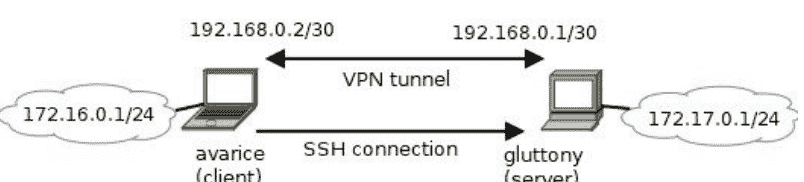

图 13-1：VPN 网络

我们将使用 SSH 在两个主机之间建立点对点隧道。隧道的客户端将具有 IP 地址 192.168.0.2/30。隧道服务器端使用 192.168.0.1/30。

我们将考虑 OpenBSD、FreeBSD、Debian 和 CentOS。OpenBSD 拥有任何操作系统中最好的 SSH VPN 支持——这不足为奇，因为 OpenSSH 源自 OpenBSD。在 FreeBSD 上运行 SSH VPN 需要基本的脚本编写。大多数 Linux 发行版会修改 OpenSSH 以更好地适应其系统，并且它们还弃用了标准的 UNIX 网络命令，转而使用 Linux 特定的工具。这意味着每个操作系统都需要不同的方法。在这四者之间，你应该能找到一种可为你的操作系统适配的方法。

创建和管理 VPN 是 OpenSSH 中最困难的功能，并且支持它们的系统会随时间变化。我不会感到惊讶，如果这些 VPN 指令比本书其余部分更快地过时。如果你在这 些示例中遇到问题，请查阅操作系统的文档以获取更当前的参考资料。

## Common Concepts

以下概念和 OpenSSH VPN 的配置适用于所有操作系统。无论你运行哪个操作系统，你都必须理解这些材料并遵循这些通用原则。虽然你可以找到声称简化隧道设置的工具，但一旦你理解隧道的工作原理，你会发现使用原始 SSH 非常简单。

## Tunnel Interfaces

SSH VPN 使用隧道（或 tun）接口工作。隧道是一个虚拟接口，位于其他网络接口之上。隧道接口最常见的用途是在两个独立主机之间创建虚拟链路，例如在 VPN 中。该隧道被视为点对点连接。创建隧道接口的方法因操作系统而异。

当你使用 SSH VPN 时，客户端和服务器都会在其各自机器上附加到隧道接口。当操作系统向隧道发送数据包时，该数据包会通过 SSH 连接中继。当另一台机器的 SSH 进程接收到数据包时，它会解包并通过本地隧道接口将其发送给操作系统。

就像你想要用于 IP 路由的任何其他接口一样，你的隧道接口需要 IP 地址。你必须将发往远程网络的流量路由到隧道远端的 IP 地址。我们将在每个示例中演示这一点。

每个隧道接口都需要一个设备号，就像类 Unix 系统上的任何其他设备一样。就像你的网络接口可能是 eth0 或 em1 一样，隧道设备可能是 tun0 或 tun1。我们的示例使用设备零，创建类似 tun0 的设备名称。如果你有许多隧道设备，我建议为每个用途分配特定的设备并重新评估你的设计选择。

## SSH Server Configuration

sshd_config 关键字 PermitTunnel 指定客户端是否可以建立 VPN 隧道。PermitTunnel 有四个有效选项：yes、no、point-to-point 或 ethernet。如果设置为 no（默认值），则禁止隧道。如果设置为 yes，则允许所有隧道。

点对点隧道是从一个位置到另一个位置的虚拟专用电路。点对点隧道需要路由才能使用。这通常是 SSH VPN 的最佳隧道类型。

```
PermitTunnel point-to-point
```

以太网隧道传输第 2 层流量，允许两个独立位置共享其本地局域网。如果可能避免，请不要通过 SSH 隧道传输以太网。VPN 一侧的本地网络问题可能会在链路上传播并饱和你的外部带宽。SSH VPN 本身就容易受拥塞影响；不要进一步放大这个问题。

要使用 SSH VPN，SSH 进程必须具有足够的权限来更改客户端和服务器上的隧道设备和路由表。创建 SSH VPN 需要客户端和服务器上的 root 权限。你将以 root 身份运行 ssh 并直接以 root 登录。我之前说过以 root 登录是一个糟糕的选择。我坚持这一说法。然而，如果你使用 SSH VPN，你基本上没有好的选择了。

在这里，我允许我们的 SSH 客户端通过 SSH 服务器进行 root 登录，但仅限于公钥认证。我还允许该 IP 地址打开隧道。

```
Match Address avarice.mwl.io
PermitRootLogin prohibit-password
PermitTunnel point-to-point
```

在你的生产配置中，使用客户端的 IP 地址而不是主机名。

OpenSSH 的非常旧版本可能不允许你在 Match 语句内放置 PermitTunnel 语句。如果你遇到这样的 sshd，请立即升级服务器的 OpenSSH——在公共互联网上这样做是不安全的。

## IP Forwarding

为了使 SSH VPN 连接两个不同的网络，SSH 服务器和客户端都必须将数据包从一个接口转发到另一个接口。这称为 *IP 转发*。在接口之间转发数据包是主机和路由器之间唯一的差异。SSH 客户端在其内部以太网接口上接收数据包，并通过 VPN 传输发往远程位置的数据包。类似地，SSH 服务器在其内部接口上接收发往另一办公室的数据包并通过 VPN 发送它们。

## VPN Authentication Key

使用 VPN 时使用密钥认证。如果你只在特殊场合手动启动 VPN，请创建标准用户认证密钥，如第 7 章“SSH Keys”所述。如果自动化进程将启动 VPN，请创建无密码短语的密钥，如第 12 章“Automation”所述。将密钥放在特殊文件中，例如客户端上的 `/root/.ssh/tunnelkey`。

将密钥的公钥复制到服务器的 `/root/.ssh/authorized_keys`。该密钥只能运行 VPN 命令；即使使用基于密钥的认证，你也不希望远程入侵者能够在你的服务器上获得 root 登录。第 12 章讨论了限制密钥权限，但所需确切命令因操作系统而异。

## The SSH Tunnel Command

使用 `-w` 标志激活 OpenSSH 隧道。

```
# ssh -i keyfile -f -wclientTunnelNumber:serverTunnelNumber servername true
```

`-i` 告诉 `ssh` 使用哪个私钥文件。`-w` 告诉客户端请求隧道，以及在每一侧请求哪个隧道设备号。`-f` 将 `ssh` 置于后台，这样你就不会在远程系统上获得命令提示符。我们运行 `true(1)` 只是为了有一个总是成功运行的命令。

在我们的示例中，密钥文件是 `/root/.ssh/tunnelkey`。我希望在每一侧使用隧道设备 0，服务器是 `gluttony.mwl1.io`。

```
# ssh -i tunnelkey -f -w0:0 gluttony.mwl1.io true
```

如果一切正常，这应该会静默返回到本地命令提示符。

这些命令行选项中的一些可以在 `ssh_config` 中设置。我建议将隧道选项放在 `/root/.ssh/config` 中，而不是系统范围的配置。你不希望特权用户无辜的 SSH 会话尝试打开隧道并通过其路由。

```
Host gluttony.mwl1.io
Tunnel point-to-point
TunnelDevice 0:0
IdentityFile /root/.ssh/tunnelkey
IdentitiesOnly yes
```

根据你的环境或操作系统要求为该主机添加其他选项。这简化了激活隧道所需的命令行。

```
# ssh -f gluttony.mwl1.io true
```

我们的示例假设你已启用 root 登录，将客户端的公钥复制到服务器，并在 `/root/.ssh/config` 中设置了主机的密钥和隧道设备。

## Debugging

如果你按照操作系统的步骤操作但隧道未启动，请以详细模式运行 `ssh`。你将看到错误的详细信息。如果这没有帮助，请以调试模式运行 `sshd`。在互联网上搜索你的错误消息的确切文本。你一定会找到遇到并解决过你这个问题的人。

现在让我们配置一些 VPN。

## OpenBSD

OpenSSH 在 OpenBSD 内部开发，OpenBSD 团队创建了 OpenSSH VPN 功能，因此 OpenBSD 对 OpenSSH VPN 具有非常好的支持。首先通过在 `/root/.ssh/authorized_keys` 中放置控制来收紧客户端可以使用此密钥访问的内容。

```
restrict,tunnel="0",command="/bin/sh /etc/netstart tun0" ssh-rsa AAAAB3Nza...
```

我已锁定所有基于密钥的选项，然后添加了访问特定隧道设备并运行配置该隧道的命令的能力。即使客户端被入侵并以 `root` 身份登录到服务器，它也无法造成多大损害。

通过将 sysctl `net.inet.ip.forwarding` 设置为 1 在 OpenBSD 上启用数据包转发。

```
# sysctl net.inet.ip.forwarding=1
```

为了使此更改在重启后永久生效，请在 `/etc/sysctl.conf` 中添加匹配条目。

```
net.inet.ip.forwarding=1
```

现在配置你的隧道设备。你需要在客户端和服务器上都有一个 `/etc/hostname.tun0`。每个包含两行。以下是客户端：

```
192.168.0.2 192.168.0.1 netmask 255.255.255.252
```

```
!route add 172.17.0.1/24 192.168.0.1 > /dev/null 2>&1
```

第一行创建了一个隧道接口，本地 IP 为 192.168.0.2，远程 IP 为 192.168.0.1。OpenBSD 会在启动时配置此接口，但接口不会处于活动状态；隧道未附加到任何东西。当你激活 SSH 隧道时，它会附加到隧道接口。`hostname.tun0` 的第二行是 OpenBSD 在隧道激活时运行的命令。此命令配置到服务器后面 LAN 的路由。

服务器的 `hostname.tun0` 看起来非常相似。

```
192.168.0.1 192.168.0.2 netmask 255.255.255.252
```

```
!route add 172.16.0.1/24 192.168.0.2 > /dev/null 2>&1
```


IP 地址是反向的。当隧道建立时，客户端后面的网络会通过它进行路由。

从客户端 SSH 到服务器。隧道应该自动建立并自行配置。

## FreeBSD

FreeBSD 不内置 OpenSSH VPN，但它们非常容易设置。最简单的方法是通过在隧道建立时调用 shell 脚本。你可以通过巧妙的方法避免这种需求，但巧妙的做法在故障期间有一种难以置信的能力会咬你一口。此外，我将使用脚本来说明几个 OpenSSH 功能。

首先，在客户端和服务器上启用数据包转发。如同在 OpenBSD 中一样使用 sysctl net.inet.ip.forwarding，或在 /etc/rc.conf 中设置 GATEWAY_ENABLE=YES。

```
# sysrc gateway_enable=YES
```

现在让我们准备好脚本。服务器将使用脚本 /usr/local/scripts/tunnelserver.sh。我将锁定 authorized_keys 中客户端的条目，只允许它运行该脚本。

```
restrict,tunnel="0",command="/usr/local/scripts/tunnelserver.sh" ssh-rsa AAAAB3Nz...
```

每当使用此密钥登录时，sshd 都会运行配置的脚本。让我们看看服务器端的脚本。

```
#!/bin/sh
/sbin/ifconfig tun0 192.168.0.1/30 192.168.0.2
/sbin/route add -net 172.16.0.0/24 192.168.0.2
```

该脚本向隧道接口添加 IP 地址并配置到远程网络的路由。

我们将在客户端使用类似的脚本 /usr/local/scripts/tunnelclient.sh，为隧道的这一侧添加 IP 地址和路由。

```
#!/bin/sh
/sbin/ifconfig tun0 192.168.0.2/30 192.168.0.1
/sbin/route add -net 172.17.0.0/24 192.168.0.1
```

SSH 登录到服务器会激活隧道并配置其服务器端。你需要运行客户端脚本来配置客户端端。幸运的是，ssh(1) 有 LocalCommand 关键字，可在连接到主机时自动运行命令。

```
Host gluttony
Tunnel point-to-point
TunnelDevice 0:0
IdentityFile /root/.ssh/tunnelkey
IdentitiesOnly yes
PermitLocalCommand yes
LocalCommand /usr/local/scripts/tunnelclient.sh
```

在这里我使用 PermitLocalCommand 表示“是的，连接时你可以本地运行命令”，并使用 LocalCommand 来定义命令。

当你从客户端 SSH 到服务器时，隧道应该自动建立。

## CentOS and Debian

在两个流行的 Linux 发行版上配置 SSH VPN 的方式与 FreeBSD 非常相似。然而，这两个发行版已经废弃了 ifconfig(8) 和 route(8) 等标准 Unix 工具，因此我们必须改用 Linux 特有的 ip(8)。

创建你的隧道密钥，启用 SSH 隧道，并允许使用密钥进行 root 登录，如“Common Concepts”中所述。然后客户端需要一个 /root/.ssh/config，其内容与 FreeBSD 中使用的完全相同。

```
Host gluttony
Tunnel point-to-point
TunnelDevice 0:0
IdentityFile /root/.ssh/tunnelkey
IdentitiesOnly yes
PermitLocalCommand yes
LocalCommand /usr/local/scripts/tunnelclient.sh
```

在 Linux 上启用 IP 转发，在 /etc/sysctl.conf 中将 sysctl net.ipv4.ip_forward 设置为 1。Debian 已有此条目，但被注释掉了。

锁定服务器的 /root/.ssh/authorized_keys，使此密钥只能打开隧道设备。

```
restrict,tunnel="0",command="/usr/local/scripts/tunnelserver.sh" ssh-rsa AAAAB3Nz...
```

现在你只需要 Linux 脚本。以下是 /usr/local/scripts/tunnelserver.sh：

```
#!/bin/sh
ip addr add 192.168.0.1/30 dev tun0
ip link set dev tun0 up
ip route add 172.16.0.0/24 via 192.168.0.2 dev tun0
```

以下是客户端脚本。

```
#!/bin/sh
ip addr add 192.168.0.2/30 dev tun0
ip link set dev tun0 up
ip route add 172.17.0.0/24 via 192.168.0.2 dev tun0
```

现在从你的客户端运行 ssh -f gluttony，你的隧道就会建立。

通过这三个示例，你应该能够在任何类 Unix 操作系统上运行 SSH VPN。不过请记住，SSH VPN 并不是一个很棒的解决方案。在出现问题或体验到拥塞之前，请研究真正的 VPN 软件，如 OpenVPN。

## 第 14 章：证书颁发机构

使用 SSH 正确操作最困难的部分并不是软件，也不是晦涩或隐藏的复选框，甚至不是更晦涩的命令行参数。而是验证密钥。用户被期望验证主机密钥，这是一个繁琐的过程，大多数人甚至懒得去做。用户生成身份验证密钥，但随后需要将它们复制到网络中。如果你使用自动化管理系统，你可以通过实现 OpenSSH 证书颁发机构来自动化验证过程的一部分，从而大幅降低风险。

SSH CA 与你可能从网站上部署的 TLS¹ 熟悉的 X.509 证书颁发机构并不相同。如果你必须为每个使用 SSH 的主机购买 X.509 证书，你就不会这么做。但花点时间考虑一下证书颁发机构为你做了什么。

证书颁发机构是一种委托信任的方法。每个网络浏览器都内置了一份受信任的证书颁发机构列表。当你的浏览器调用使用证书的网站时，浏览器会检查该证书是否由受信任的证书颁发机构签名。如果是，浏览器就会信任该网站上的证书。如果证书是由除受信任的证书颁发机构之外的任何东西签名，用户会看到警告。

SSH 公钥类似于自签名证书。服务器声明：“这就是我的身份，你可以接受也可以离开。”你通过为客户端和服务器提供它们信任的证书来创建 SSH CA。将此证书安装在所有 OpenSSH 软件上，它将信任由该 CA 密钥签名的任何公钥。

X.509 证书之所以复杂，部分原因是它们是全球认证网络的一部分。组织使用 TLS 证书来保护网站、电子邮件以及几乎任何其他任意 TCP 连接。证书包含大量字段，其中大多数我们永远不需要。

SSH 证书只需要能够数字签名数据并携带几块元数据。它们不是全球实体。OpenSSH CA 完全是内部的。标准的 SSH 密钥对具有签名密钥所需的所有功能。

一旦你部署了 OpenSSH CA，配置为信任 CA 密钥的客户端将自动信任用该密钥签名的主机密钥。配置为信任该 CA 密钥的服务器将自动信任用 CA 密钥签名的用户身份验证密钥。你的用户只有在连接到组织外部的主机时，或出现严重问题时才会看到警告。

证书颁发机构是 OpenSSH 的扩展。其他客户端尚未采用它们。即使你的所有桌面客户端运行的都不是 OpenSSH，SSH 证书颁发机构在服务器之间连接时验证主机密钥也很有用。

除非你能够自动向所有服务器分发文件并远程重启 sshd，否则不要考虑部署 OpenSSH CA。如果你没有自动化措施，请查看 Ansible 或其竞争对手。

SSH CA 有很多功能只在边缘情况下有用。像 Google 或 Facebook 这样的组织需要大量我们大多数人不需要的功能。请阅读 ssh-keygen(1) 手册页以了解 CA 选项的完整范围。在这里，我们将为中型网络设置一个相对简单的 CA，从更简单的 host 证书开始，然后再进行更复杂的 user 证书。

### 证书过期

签名证书的关键部分是它们会过期。是的，你可以将所有证书设置为有效期为四分之一个世纪，但那些密钥在那之前很久就会不安全。从一开始就计划使用你的自动化系统定期更新证书。

在没有缺陷实现的情况下，计算攻击公钥可能需要数十亿年。然而软件有漏洞，可能存在漏洞让入侵者在更短的时间内破解密钥。此外，计算破解密钥所需的那些纪元是平均值。入侵者可能走运。永久有效的证书会增加入侵者成功的机会。

证书应该有效多久？每隔一年左右轮换证书是最常见的。如果你有一个由自动部署魔术使服务器出现和消失的编排网络，你可能希望每周或每月重新生成主机密钥证书。

简而言之，除非主机无法更改的那些罕见情况，否则不要计划使用超过一年的证书。不，我不是说“老板真的希望这个主机永远不变”，我的意思是“联邦政府已宣布此主机为维持生命的服务，更改证书是重罪，至少要坐牢。”

不过，不要将证书设置为恰好一年后过期。记住，生活会发生。也许你把在 52 周后续期所有证书记在日历上，但前一天你得了阑尾炎，休了三周假。我为此类紧急情况至少预留一个月余地，因此这些示例假设我们让所有证书在五十六周零五天后过期。

更好的是？使用你的自动化系统续期并替换所有证书

在证书到期日期的一半时签发。每六个月签发并部署新的一年期证书。随着你对自动化的信心增强并解决 bug，慢慢减少这个时间。自动每年、然后每月、然后每周创建新证书。然后减少使用 CA 密钥的时间。让证书续期变得轻松常规，可以将潜在的密钥泄露从灾难转变为微不足道的事情。

### SSH CA 密钥

在你甚至考虑创建 OpenSSH CA 之前，先考虑如何处理和保护这些密钥。你的证书颁发机构就是通往你王国的钥匙。要像保护任何其他关键信息安全资产一样保护它。如果攻击者入侵你的 OpenSSH CA，他可以创建所有服务器都信任的用户密钥。那就糟糕了。我将我的 OpenSSH CA 放在一台专用用途的 OpenBSD 机器上，只有在需要签名密钥时才启动它。规模更大的组织会希望将 OpenSSH CA 放在网络中与存放其他同样关键主机相同的位置。

最佳实践建议创建两个证书颁发机构：一个用于认证主机密钥，另一个用于用户密钥。不同团队管理用户和主机，拥有两个不同的证书颁发机构可以让每个机构使用最适合这些任务的工作流程。每个 CA 甚至可以位于不同的机器上，位于网络的不同部分。虽然你可以在一台主机上安装任意数量的证书颁发机构，从而使以后拆分 CA 成为可能，但很少有系统管理员会后悔从一开始就遵守这样简单的最佳实践。

随着网络的增长，你需要管理的公钥数量也会增加。从一开始就很好地组织你的 CA，以最大限度地减少后期的困扰。

我建议将你的 CA 放在类似 /usr/local/sshca 的目录中。为主机和用户密钥创建子目录，使用无歧义的名称，如 /usr/local/sshca/hosts 和 /usr/local/sshca/users。每个主机和用户在其下应有自己的子目录，例如 /usr/local/sshca/hosts/sloth 和 /usr/local/sshca/users/mwl。不要将你的 CA 放在 /root 中，尤其不要放在 /root/.ssh 中。这些目录是为 root 账户的信息保留的，就像 /etc/ssh 保留给此特定主机的 SSH 服务一样。² 证书颁发机构是一个重大项目，值得拥有自己的目录。

为什么按目录而不是按文件名来分离？每个主机和用户都有同名文件。你会在每台 SSH 服务器上都找到 /etc/ssh/ssh_host_ecdsa_key，而每个用户都有一个 id_rsa.pub。虽然完全可以把主机 sloth 上的该文件复制到 sloth-ssh_host_ecdsa_key，为其生成证书，然后在将其发送回服务器时重命名证书，但这需要多做几步。为每个主机和用户提供唯一的目录可以降低脆弱性。

创建 SSH CA 密钥的方式与手动创建主机密钥相同。我添加 -c 标志来为密钥添加特殊注释。SSH CA 密钥看起来与其他 SSH 密钥一样，因此注释有助于识别它们。这里是一个主机密钥签名密钥。

```
# ssh-keygen -t rsa -f host-mwlca-key -c 'CA host key generated 2017-11-30'
```

使用一个好的密码短语。你可以使用 SSH 代理进行批量签名，所以请随意使其复杂。你将获得包含证书颁发机构私钥的文件 host-mwlca-key，以及包含公钥的文件 host-mwlca-key.pub。

创建用户认证 CA 完全相同，只是文件名和注释不同。

```
# ssh-keygen -t rsa -f user-mwlca-key -c 'CA user key generated 2017-11-30'
```

保护这些私钥。随意在整个网络中传播公钥。

### 信任你的证书颁发机构

ssh(1) 客户端和 sshd(8) 服务器配置证书颁发机构的方式完全不同。

### sshd(8) 与证书

SSH 服务器使用用户证书来验证用于身份验证的证书。在 sshd_config 中使用 TrustedUserCAKeys 关键字设置包含所有受信任证书的文件。

```
TrustedUserCAKeys /etc/ssh/user-ca-keys.pub
```

CA 文件每行包含一个 CA 公钥，并接受以井号 (#) 开头的注释。它看起来与 authorized_keys 文件完全一样。

重启 sshd 后，它将信任由该证书颁发机构签名的密钥。

### ssh(1) 与证书

SSH 客户端使用主机证书来验证主机公钥。在 known_hosts 中配置受信任的主机证书颁发机构。将 CA 密钥放在 /etc/ssh/ssh_known_hosts 中是最有效的位置，这样所有客户端立即识别 CA，并且用户无法篡改密钥。

不过不要只是将 CA 的公钥文件复制到 known_hosts。你必须将此密钥标记为证书颁发机构并添加此密钥有效的主机名。将公钥复制到单独的文件中——永远不要篡改原始密钥文件！在行开头添加标记 @cert-authority，然后添加此密钥有效的 SSH 主机模式。此密钥对 mwl.io 域中的所有主机有效。

```
@cert-authority *.mwl.io ssh-rsa AAAAB3NzaC1yc2EAAAADAQABA...
```

如果密钥对多个域有效，用逗号分隔它们。不要使用空格。

```
@cert-authority *.mwl.io,michaelwlucas.com ssh-rsa AAAAB3NzaC1yc2EAAAADAQABA...
```

在每台主机的 `/etc/ssh/ssh_known_hosts` 中添加这一行。它们将立即信任使用此密钥签名的证书。

### 通用证书注意事项

用户和主机证书都有很多共同的细节，包括序列号、证书 ID 和过期日期格式。

### 证书序列号

每个 X.509 证书都应该有一个 *serial number*。这些序列号对证书颁发机构是唯一的。OpenSSH CA 支持相同的功能，但 SSH 实际上并不需要它。如果你的组织有其他需要，请使用它们。

序列号不应单调递增——也就是说，不要按顺序签发。随机序列号最好。如果你决定在 SSH 证书中使用序列号，你需要一种生成唯一随机数的机制。

我会在签名密钥时提到如何列出序列号，但不会花时间讨论它们。

### 证书标识

每个证书都有一个 *certificate identity*，即用于说明此密钥用途的文本字符串。我根据主机名或用户名分配标识，但如果你的组织对标识有其他需求，请随意使用。你可能会决定将其用于库存标签、人员 ID 号或其他任何需要的内容。在我的示例中，我对主机证书使用 `host_` 和主机名，对用户证书使用 `user_` 加上用户名。

每当用户使用证书进行身份验证时，日志消息中都会包含证书标识。有些人使用证书标识让每个人都以 `root` 登录，但仍保留用户问责。

### 证书归档

重新生成证书只需要一个命令。你有自动化来自动更新和分发网络中的证书和密钥。随着人们发现证书有多有用，你拥有的证书数量会成倍增加。确保你的 CA 保留每份证书及其对应的公钥的副本。

如果你发现私钥已被泄露，你需要吊销该密钥的证书。当你手头有副本时，吊销证书会容易得多。当我创建证书时，我会创建证书及其对应公钥的副本，两者都以 ISO 8601 格式（数字年-月-日）的日期为前缀。这使得按特定日期查找证书变得容易。

当你创建新的 CA 密钥并使旧密钥作废时，可以丢弃使用该密钥创建的证书。

### 设置过期日期

过期日期使用标准的 Unix 相对日期格式分配。你不是指定特定的结束日期，而是指定证书在未来多久过期。

过期日期以加号开头，后跟你想要的未来时间。使用 w 表示周，d 表示天，h 表示小时，m 表示分钟，s 表示秒。要使密钥在 56 周、5 天、12 小时和 13 秒后过期，请使用 +56w5d12h13s。

### 主机证书

OpenSSH 客户端信任由认可的证书颁发机构签名的服务器公钥。部署此功能需要创建证书并将这些证书安装在服务器上。

### 创建主机证书

使用你的证书颁发机构为服务器的公钥主机密钥签名。如果你已经有一个系统来保存每台服务器的公钥文件副本，请考虑将证书颁发机构放在该主机上，或将需要这些文件的功能移动到你的 CA 服务器。

使用 ssh-keygen(8) 签名密钥。是的，有 ssh-keysig(8) 命令，但它是用于用 SSH 替换 rsh(1) 的，并且默认情况下被禁用。使用 -s 标志指定你的 CA 密钥的文件名。-I 标志定义证书标识。添加 -h 以声明这是主机密钥证书。-n 标识此证书有效的目标主机。（你可以使用多个主机名，用逗号分隔。）使用 -v 指定过期日期，然后给出你想要创建证书的密钥文件的文件名。

这里我使用我的 CA host-mwlca-key 为主机 sloth 创建密钥证书。它在五十六周零五天后过期。我为当前目录中的每个公钥文件签名密钥。（我必须给出 CA 密钥的完整路径，但这里为清晰起见省略了路径。）

```
# ssh-keygen -s host-mwlca-key -I host_sloth -h -n sloth.mwl.io -V +56w5d ssh_host_*pub
```

我复制了四个公钥到此主机，因此我为每个公钥获得一个证书。每个证书都以其公钥文件名命名，并在尾部的 .pub 之前插入 -cert。ssh_host_rsa_key.pub 的证书是 ssh_host_rsa_key-cert.pub，ssh_host_ecdsa_key.pub 得到 ssh_host_ecdsa_key-cert.pub，以此类推。

将所有这些证书复制到 SSH 服务器的 /etc/ssh 目录。


### 安装主机证书

一旦你在服务器上安装了证书，请在 *sshd_config* 中使用 HostCertificate 关键字进行配置。由于我很容易混淆，我把 HostCertificate 关键字放在相关的 HostKey 关键字旁边。

```
HostKey /etc/ssh/ssh_host_rsa_key
HostCertificate /etc/ssh/ssh_host_rsa_key-cert.pub
...
HostKey /etc/ssh/ssh_host_ed25519_key
HostCertificate /etc/ssh/ssh_host_ed25519_key-cert.pub
```

重启 sshd。现在你就可以使用主机证书了！

### 测试主机证书

一旦你在 sshd(8) 中配置了证书并设置了客户端的 */etc/ssh/ssh_known_hosts*，你就可以尝试基于证书的主机密钥验证了。

将你的 *$HOME/.ssh/known_hosts* 文件移开，或如果你非常非常有信心就删除它。现在通过 SSH 登录到服务器。你应该会得到登录提示，而不会被提示验证主机密钥。

如果主机证书不能正常工作，在你的 `ssh` 命令行中添加一个或两个 -v。客户端是否看到了证书？如果没有，以调试模式运行 `sshd`，看看它是否加载了证书，如果没有加载，为什么没有。`ssh` 是否看到了证书但未识别它？如果是这样，你弄错了你的 *ssh_known_hosts* 条目。

### 吊销证书

证书很棒，直到有人入侵你的服务器并窃取一个已签名的密钥对。窃贼可以用该签名密钥冒充被入侵的主机。这很糟糕。幸运的是，你可以使用 RevokedHostKeys *ssh_config* 关键字告诉客户端不要信任某个公钥。

```
RevokedHostKeys /etc/ssh/revoked-hosts
```

吊销的主机密钥文件包含一个公钥列表，每行一个。即使它们带有相应的证书，客户端也不会接受这些公钥。

你的企业需要能够更新客户端的吊销密钥文件，并必须定期测试它。虽然实时更新最好，但即使是登录脚本也比没有好。

### 查看证书

你可以使用 `ssh-keygen -L` 查看证书的内容。使用 `-f` 指定证书文件。

```
# ssh-keygen -Lf ssh_host_ed25519_key-cert.pub
ssh_host_ed25519_key-cert.pub:
Type: ssh-ed25519-cert-v01@openssh.com host certificate
Public key: ED25519-CERT SHA256:nNtyIQidY3MXAEfpwZ0wzKXKQFnCoQhe0CRI1dc4EB8
Signing CA: RSA SHA256:ZQHNMc2TmW1nygGy9+UoOYFK92RdbguzNi+cX4gA414
Key ID: "sloth"
Serial: 0
Valid: from 2017-12-04T11:52:00 to 2017-12-25T11:53:17
Principals:
    sloth.mwl.io
```

关键选项：(none)
扩展：(none)

这里最关键的细节是 key ID（sloth，对应主机名）和有效日期。如果你有多个证书颁发机构，你可能会发现 signing CA 字段很有用。principals 字段给出此证书有效的实体，每行一个。如果你把密钥文件弄得如此混乱，以至于需要将公钥字段与服务器上的密钥进行比较，请重新开始。

定义关键选项和扩展的字段对于用户证书很有用。

### 用户证书

用户证书比主机证书更复杂，主要是因为用户比主机更复杂。SSH 用户证书允许你复制 authorized_keys 中的所有内容，包括第 12 章“Automation”中讨论的限制和限制。这需要更深入地了解 SSH 证书。

SSH 证书的一个关键概念是 principal。principal 定义了此证书适用于哪些实体。对于主机证书，principal 是主机名。用户证书的 principal 通常是证书所针对的用户名，但它也可能包含限制、限制和其他信息。没有 principal 的用户证书可用于作为任何用户进行身份验证。你必须为每个证书分配一个 principal，除非你真的想要一个通配符身份验证证书。

我们将在本节中始终引用 principal。起初你可以把它想成用户名，但随着我们继续前进，其含义会扩展。

### 创建和查看用户证书

获取用户的公钥身份验证密钥，通常是 id_rsa.pub，并将其复制到你的证书颁发机构机器。你需要它来生成证书。公钥不是保密的，因此在网络上传输它没有风险。

创建用户证书的命令与创建主机证书非常相似。使用 -s 指定用户 CA 密钥的路径。-I 标志定义证书标识，-n 给出证书 principal。使用 -v 定义过期时间。最后一个参数是要签名的公钥文件。在这里，我让我的用户 CA 签署我其中一个用户的公钥，使其对用户名 djm 有效。我将有效期设置为 52 周，即一年，因为如果在此之前过期而用户提交续期，我将完全归咎于他。

```
# ssh-keygen -s user-mwlca-key -I user_djm -n djm -V +52w id_rsa.pub
```

我输入 CA 密码并得到一个证书文件 id_rsa-cert.pub。如果你以前从未做过此操作，请查看证书。

```
# ssh-keygen -Lf id_rsa-cert.pub
id_rsa-cert.pub:
    Type: ssh-rsa-cert-v01@openssh.com user certificate
```

```
Public key: RSA-CERT SHA256:CfVbRUF+AaUcOxml6wI5Cf5nvtjzBDH6NcXaGU4...
Signing CA: RSA SHA256:CKZFZXRgOy1ji8zmUhU0zjJQFN s9gLEqAwSjA8pB4dg
Key ID: "user_djm"
Serial: 0
Valid: from 2017-12-04T07:31:00 to 2018-12-23T07:32:37
Principals:
djm
Critical Options: (none)
Extensions:
  permit-X11-forwarding
  permit-agent-forwarding
  permit-port-forwarding
  permit-pty
  permit-user-rc
```

顶部看起来与主机证书非常相似，但用户在下方会得到不同的信息。我们的 principal 是 djm，因此此证书仅适用于此用户。我们没有关键选项，但 Extensions 列出了几个关键字。这些是授予此用户的 SSH 权限，我们将在“受限证书”中很快看到。

将此证书返回给用户。

### 使用用户证书

将证书复制到 $HOME/.ssh。用户的公钥身份验证密钥应该已经在那里。

你应该已经设置了 TrustedUserCAKeys 关键字，如本章“信任你的证书颁发机构”中所述。如果是这样，请将用户的 authorized_keys 文件移开。让用户通过 SSH 登录到服务器。如果服务器配置正确，用户应该能够登录，而服务器对该特定密钥没有任何信息。

如果你想要的就是这个，你就完成了。但让我们看看一些更困难的东西。

### 吊销用户证书

通常，你不会吊销用户证书。你吊销与证书关联的公钥，使用 RevokedKeys sshd_config 关键字。

```
RevokedKeys /etc/ssh/revoked
```

轮换你的 CA 的一个原因是它限制了你的吊销证书列表的长度。你不希望五年前被盗的笔记本电脑的证书仍然在你的吊销证书文件中！

如果你有一个复杂的吊销密钥列表，请调查 ssh-keygen(8) 中的 Key Revocation Lists (KRLs)。

### 受限证书

正如你可以限制帐户和密钥的访问一样，你也有权力限制证书。你可以使用 ssh-keygen 的 -O 标志来做到这一点。-O 标志有一长串可能的限制，与第 12 章中 authorized_keys 的限制相同。这些选项包括 no-agent-forwarding、no-port-forwarding、no-pty、no-user-rc 和 no-x11-forwarding。所有这些 no-限制都有对应的 permit-版本：permit-agent-forwarding、permit-port-forwarding、permit-pty、permit-user-rc 和 permit-x11-forwarding。此外，你还有 source-address 限制，它规定了可以使用此证书进行身份验证的 IP 地址。还有 clear 限制，它与 authorized_keys 中的 restrict 类似，关闭所有特权，允许你通过 permit- 语句有选择地打开它们。最后，force-command 强制用户运行该特定命令。

自动化的一种常见情况是当你有一个只能运行单个任务的密钥时。我想创建一个只能用于运行命令 /usr/local/scripts/backup.sh 的密钥的证书。在客户端创建一个名为 backup 的密钥，并将 backup.pub 发送给 CA 进行签名。我想使用 clear 选项从此证书中删除所有权限，然后使用 force-command 强制运行备份脚本。我使用 -O 两次来分配这些权限。否则，它看起来像任何其他用户密钥签名。

```
# ssh-keygen -s user-mwlca-key -I user_backup -n backup -V +52w -O clear -O force-command="/usr/local/scripts/backup.sh" backup.pub
```

这会生成证书文件 backup-cert.pub。查看其内容。

```
# ssh-keygen -Lf backup-cert.pub
backup-cert.pub:
    Type: ssh-rsa-cert-v01@openssh.com user certificate
    Public key: RSA-CERT SHA256:UL4ctioc5p8aSN1S318FI5RpsS1rnxJdr0EDb/B69Jg
    Signing CA: RSA SHA256:CKZFZXRg0y1ji8zmUhU0zjJQFN s9gLEqAWsJ8aP8B4dg
    Key ID: "user_backup"
    Serial: 0
    Valid: from 2017-12-05T07:56:00 to 2018-12-04T07:57:50
    Principals:
        backup
    Critical Options:
        force-command /usr/local/scripts/backup.sh
    Extensions: (none)
```

将此密钥与我们刚刚创建的常规用户证书进行比较。用户密钥没有关键选项，而此证书将 force-command 语句列为关键选项。用户密钥在 Extension 下有一堆特权，而此密钥没有。此证书只授予使用一个命令的权利。

目前没有创建 SSH 隧道的特定特权。如果你的组织大到需要证书，它应该有标准声明可接受的 VPN 类型。³

### 禁用 authorized_keys

一旦你完全部署了用于用户身份验证的 SSH 证书，你可能会决定禁用 authorized_keys 文件。这在 sshd_config 中很容易完成。

```
AuthorizedKeysFile none
```

但是，如果你有不支持证书的客户端，你将需要为这些客户端提供登录方式。一些组织要求所有系统管理员使用基于 Unix 的桌面，以便他们可以支持证书。一些大型组织如 Facebook 禁止从客户端进行 SSH 访问，除非到中央

作为堡垒主机，存放用户的私钥和证书。

说到 Facebook，让我们聊聊他们如何管理 SSH。

### 大规模 SSH

像 Google、Facebook 和 Amazon 这样的组织拥有数万名系统管理员和数百万台服务器。仅管理账户就足以让他们的 LDAP 目录不堪重负，更不用说他们拥有的用户组数量了。

一旦你想象过这些，就把它忘了吧。

Facebook 的工程团队很友好地发布了一篇文章，介绍了他们如何使用 SSH 证书让每个人都能以 root 身份登录，但通过证书主体控制人们可以访问哪些服务器。在网上搜索“Facebook SSH certificates”就能找到它。我不会深入探讨他们的系统，这里只是一个概述。

没有数百万台服务器和团队的组织使用用户名作为主体。然而，主体不一定是用户。你可以使用 AuthorizedPrincipals sshd_config 关键字设置可以访问主机的主体列表，并根据角色、位置或功能开发主体。

AuthorizedPrincipalsFile 关键字指向一个文本文件，其中包含主体列表，每行一个。以下是可能出现在此类系统中的三个主体。

```
everywhere-root
europe-root
europe-database
```

这告诉 sshd 接受包含主体 root-everywhere、europe-root 或 europe-database 之一的证书进行身份验证。AuthorizedPrincipalsFile 关键字接受通常的标记，因此你可以按用户名拆分。

```
AuthorizedPrincipalsFile /etc/ssh/principals/%u
```

当用户尝试以 root 登录时，sshd 会检查 /etc/ssh/principals/root 中的允许主体列表。

在创建证书时指定主体。此证书为用户 mw1 分配了 peasants 和 vermin 主体。由于系统管理员众多，有些名字相同，我在密钥标识中同时存储员工编号和姓名。

```
# ssh-keygen -s user-mw1ca-key -I user_87181_Michael_Lucas -n peasants,vermin -V +52w id_rsa.pub
```

这之所以有效，是因为每当密钥用于身份验证时，密钥标识都会被记录。通过这种方式使用主体可以满足问责需求。

不过，如果你使用这么多服务器，在每台服务器上放置文本文件来规定谁可以登录哪个账户扩展性很差。你可以使用 AuthorizedPrincipalsCommand 和 AuthorizedPrincipalsCommandUser 关键字运行一个命令来获取此账户的授权主体列表。这让拥有数百万台服务器的全球企业可以继续使用那个 Microsoft Access 数据库来存储账户信息——或者，是的，如果你想更讲究一些，也可以使用 LDAP 或像 Postgres 这样的现代数据库。

### CA 密钥轮换

通过轮换 OpenSSH 证书颁发机构密钥，你可以实现另一层证书安全性。这涉及创建新的 CA 密钥对、重新创建所有证书、将这些证书分发给主机和用户，并删除旧 CA 的密钥。

在没有自动化的情况下部署 SSH 证书是可能的——痛苦，但可行。在没有自动化的情况下轮换证书颁发机构并非不可能，但部署 Ansible 来自动化该过程要容易得多。不要尝试在没有自动化的情况下轮换你的 CA 密钥。

首先生成新的 CA 密钥并将公钥分发到每台主机。包含受信任 CA 密钥的文件，无论是 `/etc/ssh/ssh_known_hosts` 还是 TrustedUserCAKeys `sshd_config` 关键字指定的文件，都可以同时包含多个 CA 密钥。不要现在就删除旧的 CA 密钥；只添加新密钥。

一旦所有主机都拥有新 CA 的公钥，就为所有主机和/或用户重新生成证书。按需分发这些证书，并删除使用旧 CA 创建的证书。你的自动化系统会报告哪些主机拥有新文件，哪些没有。

新证书分发后，在所有主机上禁用旧 CA 公钥。

不仅自动化简化了密钥轮换成为可能，自动化还使得频繁轮换证书颁发机构密钥成为可能。如果你有一支系统管理员团队，就不要使用一年期证书；试试每周更新一次的每周主机证书！即使入侵者设法窃取了证书和公钥，他们也不可能在证书过期前暴力破解私钥。

这就是证书的基础。证书有很多小功能，如果环境合适会很有帮助；请在 `ssh-keygen(8)` 中了解更多。接下来，最终章节将带我们了解一些 OpenSSH 零碎内容。

1 SSL 已不再是事，除非你喜欢旁观者解密你的流量。

2 如果你把 SSH CA 放在 /etc/ssh，系统管理员守则声明你的同事有权用带尖刺的棍棒殴打你，前提是尖刺不超过四英寸且未涂有神经毒素。当地法律可能有所不同。

³ 此外，没有人向 OpenSSH 维护者询问过该功能。

## 第 15 章：OpenSSH 零碎内容

本章涵盖了你应该了解的各种 SSH 主题拼盘，但不足以单独成章。我们将讨论 OpenSSH 中的主机密钥轮换、连接到仅支持过时密码的主机以及转义字符。

### 主机密钥轮换

在主机接受来自公共互联网的连接一年或两年后，你应该考虑轮换主机密钥。随着计算能力的提升，算法变得更容易被破解，而且潜在的入侵者有更多时间暴力破解你的私钥。不过，如果你每年要求用户验证新的主机密钥，他们会感到厌烦。你可以使用现有的主机密钥安全地将新主机密钥传输给客户端。如果现有主机密钥已被泄露，这没有用，但它可以让你在丢弃旧密钥之前主动将即将到来的主机密钥分发给客户端。

一旦你拥有大量服务器，OpenSSH 证书比偶尔的密钥轮换更有用。证书消除了 *known_hosts* 以及更新客户端的需求。

在服务器和客户端上配置 SSH 密钥轮换。

### 服务器密钥轮换

首先创建下一组密钥。创建你打算支持的每种类型的密钥。当然它们需要不同的文件名。我给新密钥命名时以创建年份为前缀。

```bash
# ssh-keygen -f 2018_ssh_host_rsa_key -t rsa -N ''
# ssh-keygen -f 2018_ssh_host_ecdsa_key -t ecdsa -N ''
# ssh-keygen -f 2018_ssh_host_ed25519_key -t ed25519 -N ''
```

这给了我们四个新密钥。现在使用标准的 *sshd_config* HostKey 关键字添加这些密钥。将新密钥添加到现有主机密钥之后。

```
HostKey /etc/ssh/2018_ssh_host_rsa_key
HostKey /etc/ssh/2018_ssh_host_dsa_key
HostKey /etc/ssh/2018_ssh_host_ecdsa_key
HostKey /etc/ssh/2018_ssh_host_ed25519_key
```

你的服务器现在已准备好将这些主机密钥分发给客户端。

一旦你确定所有客户端都已复制新主机密钥，并且你已经放弃等待那个从不更新任何东西的用户，就可以禁用旧主机密钥了。

### 客户端密钥轮换

使用 UpdateHostKeys *ssh_config* 选项告诉 ssh(1) 查找附加密钥。默认值 no 告诉 ssh 忽略新主机密钥。设置为 yes 会自动用该主机的任何新密钥更新 *known_hosts*。ask 设置意味着查询用户是否应接受新密钥。这与 StrictHostKeyChecking 关键字类似。

当你使用设置了 UpdateHostKeys 选项连接到主机时，初始连接会看起来有点不同。

```
$ ssh avarice
The authenticity of host 'avarice.mwl.io (203.0.113.209)' can't be established.
ECDSA key fingerprint is SHA256:JUf1lzyEVYXhbJCfXLvPi6eLjdYCZhEBzJD8c+NGLzw.
No matching host key fingerprint found in DNS.
Are you sure you want to continue connecting (yes/no)? yes
```

验证主机的公钥指纹，如果正确则接受。但随后你会收到另一组警告。

```
Learned new hostkey: RSA SHA256:nUNwCoJrzeHAALXyM/yGpGM7uUIPrP/ph8zV3qUx9M
Learned new hostkey: ED25519 SHA256:nNtyIQidY3MXAEfpWZ0wzkKQFnCoQhe0CRI1dc4...
Accept updated hostkeys? (yes/no): yes
```

你的客户端已获取该主机 RSA 和 ED25519 密钥的公钥。你只能批量接受或拒绝这些附加公钥。会留下主主机密钥不变而破坏其他密钥的攻击者非常罕见，但你真的应该全部验证。

当服务器添加新主机密钥时，客户端会显示指纹并给你验证的机会。

```
$ ssh avarice
Learned new hostkey: RSA SHA256:aDqGAPMnT6b3aYqT3DXjRoFyFHzn0MbVFWZg3yw/fTI
Learned new hostkey: ECDSA SHA256:9eHjmXAFgRmRT2iz/WY5phLCvoo0HQ5paiLcpEcXWns
Learned new hostkey: ED25519 SHA256:BZ5X6sIbfaSAwcQY0RjMNL9zLX1+som5TmTV/k/...
Accept updated hostkeys? (yes/no):
```

主机密钥更新与连接多路复用（ControlPersist）关键字不兼容。启用 ControlPersist 会禁用主机密钥更新。

虽然 PuTTY 可以获取连接未使用的算法的公钥（转到左上角菜单并选择 Special Command -> Cache New Host Key Type），但它不能接受同一类型的多个密钥。

当你丢弃旧主机密钥时，你的 PuTTY 用户必须重新验证主机密钥。

### 连接到过时的 SSH 服务器

在过去几年里，OpenSSH 已弃用了一大堆协议和加密算法。明显不安全的 SSH 版本 1 已从源代码中剔除。但在 1990 年代表现良好的大量加密算法已不再适合当今的互联网。OpenSSH 仍然支持这些类型的加密，但默认情况下未启用。你必须使用特殊的命令行选项来使用它们。

为什么禁用这些算法？意识。你应该知道 SSH 连接何时使用弱加密。如果你从未意识到服务器或嵌入式设备仅支持糟糕的加密算法，你就永远不会升级或更换它。


当 OpenSSH 因 SSH 服务器的加密算法过弱而无法连接时，它会告诉你所有手动连接所需的信息。不过，你需要了解 SSH 的加密特性。

### SSH 加密

SSH 协议在四个不同的角色中使用密码学。每个角色都需要不同的算法。OpenSSH 使用关键字在 *ssh_config* 或命令行中设置这些内容。

密钥交换方法（KEX）用于生成一次性每连接对称密钥。关键字 KexAlgorithms 设置密钥交换方法。

通用加密算法通过 Ciphers 关键字设置。

消息认证码（MAC）用于检测流量中的篡改。MACs 关键字设置它们。

HostKeyAlgorithms 让你设置主机密钥的算法。

最后，一些公钥算法已被废弃。PubkeyAcceptedKeyTypes 关键字可让你启用已废弃的密钥类型。

### 示例连接

我的家庭娱乐网络通过一台廉价的嵌入式路由器连接到互联网。它提供 SSH……算是吧。

```
$ ssh admin@203.0.113.1
Unable to negotiate with 203.0.113.1 port 22: no matching host key type found. Their offer: ssh-dss
```

路由器不提供当前 OpenSSH 默认接受的主机密钥类型。HostKeyAlgorithms 关键字可让你重新启用受支持但已不再启用的主机密钥算法。ssh-dss 算法（也称为 DSA）非常薄弱，已在现代 SSH 中被弃用，但由于这是我的家庭网络，我在这里会信任它。使用 HostKeyAlgorithms 关键字将其重新添加到 ssh 支持的选项中。

```
$ ssh -o HostKeyAlgorithms=+ssh-dss admin@203.0.113.1
ssh_dispatch_run_fatal: Connection to 203.0.113.1 port 22: DH GEX group out of range
```

什么，又一个错误？当连接到仅支持过时加密的 SSH 服务器时，你可以预期需要在命令行上设置几个关键字。确定必要的设置是一个迭代过程。

这个错误有点更晦涩。这里没有明显的关键字可供选择，不像主机密钥算法错误那样。如果你不熟悉 Diffie-Hellman 密钥交换，你最好的办法是使用互联网搜索引擎看看是否有人以前遇到过同样的错误。如果你是全世界第一个遇到这个确切问题的人，请以详细模式运行 ssh，收集输出并联系厂商。

这个特定错误最终被证明是一个密钥交换问题，在该厂商中是众所周知的。我必须重新激活一个过时的密钥交换算法。

```
$ ssh -o HostKeyAlgorithms=+ssh-dss -o KexAlgorithms=diffie-hellman-group14-sha1
admin@203.0.113.1
```

我现在可以连接了。

总有一天，OpenSSH 会完全弃用这些算法。在那之前升级你的设备吧。不过作为临时修复，你可以在 ssh_config 中设置这些选项。

```
Host 203.0.113.1
HostKeyAlgorithms +ssh-dss
KexAlgorithms +diffie-hellman-group14-sha1
```

不过既然我写了这一节，我就可以升级我的路由器。

### 转义字符

当你通过 SSH 登录到服务器时，你的所有按键都会传递给服务器。但是，使用转义字符，你可以与本地运行的 SSH 进程对话。转义字符会暂时且短暂地挂起你的 SSH 会话。你可以使用转义字符来中断挂起的 SSH 会话、添加端口转发、向网络设备发送老式的串行风格中断等。

默认转义字符是波浪号 (~)。很少有 Unix 命令使用波浪号，但你可以按两次来发送一次。按 ~~ 表示“是的，我确实是要发送一个波浪号。”如果你需要更改转义字符，请使用 ssh 的 -e 参数并在引号中指定你想要的转义字符。

通过按 ENTER、转义字符和第二个字符来发出指令。断开连接是 ~.，编辑端口转发是 ~c，等等。

### 结束你的会话

转义字符最简单的用途是终止 SSH 会话。如果远程服务器挂起，请输入波浪号-句点。

```
wrath# ~.
Connection to server wrath.mwl.io closed
client$
```

你现在已回到本地机器。

### 调整端口转发

转义字符在某种程度上让你可以倒回时间，调整你用来连接主机的命令。虽然你不能篡改密钥交换算法之类的东西，但你可以调整端口转发。输入 ~c 进入命令行，然后输入所需的端口转发。

假设我在 SSH 会话中间，想要从我的桌面端口 9999 添加一个到服务器的动态端口转发。如果我用这个打开 SSH 会话，我会在命令行添加标志 -D 9999。我首先输入 ~c，然后得到 ssh> 提示符。

```
ssh>
```

这是内部 ssh(1) 命令提示符。在这里添加你的命令行更改。

```
ssh> -D9999
Forwarding port.
```

回到我的客户端，我会看到 ssh(1) 已打开端口 9999。动态转发已生效。

要取消端口转发，请返回到 SSH 命令行。使用 -k 标志和你用来创建端口转发的命令。在这里我禁用刚刚创建的动态转发。

```
ssh> -KD9999
Canceled forwarding.
```

动态转发消失了。

转义字符还有其他功能，但大多数在今天并不实用。不过，如果你好奇，~? 会显示所有可用转义字符的列表。

使用 SSH 你还能做很多事情。如果你能做到这一切，你对 SSH 的熟练程度就超过了几乎所有人。恭喜！

## 后记

七年前，我对系统管理员使用基于密码的 SSH 管理关键的面向公众的系统发了脾气。

这并不是什么新鲜事。比我资深得多的数百万系统管理员都发表过同样的牢骚。我决定撰写 *SSH Mastery* 的第一版，明确目的是消灭密码。我不确定是否有所帮助，但一大群资深系统管理员跑来感谢我写了这本书，原因具体是拿它拍人被认为是“专业行为”。我希望通过涵盖证书等功能，这一第二版能帮助同样的系统管理员进一步保护他们的服务器。

Unix 用户应该已经知道 OpenSSH 是世界上最重要的安全软件之一。如果你不知道：OpenSSH 是世界上最重要的安全软件之一。几乎每个技术厂商都在其产品中包含 OpenSSH。这些数十亿美元的公司并不为 OpenSSH 付费。一些 OpenSSH 开发者有特定的日常工作，因为他们的雇主给予他们时间来从事 OpenSSH 工作，而像 Google、Microsoft 和 Facebook 这样的公司也捐款支持该项目。大体上，OpenSSH 是由一群热爱优秀软件的人创建的。

运行一个大型软件项目并不便宜。OpenSSH 是作为 OpenBSD 项目的一部分开发的。他们像任何其他 IT 组织一样需要服务器、带宽和电力，但必须不断筹集资金。如果你觉得 OpenSSH 有用，请考虑向 OpenBSD Foundation (http://www.openbsdfoundation.org/) 捐赠几美元，以便他们继续运营。

Windows 用户，PuTTY 彻底改变了从 Microsoft 系统使用 SSH 的方式。而且 PuTTY 开发者很感激地接受捐赠。他们没有需要供养的服务器基础设施，但同样感激捐赠。以令人耳目一新的诚实，他们声明会把小额捐赠花在激励啤酒和咖喱上，而大额捐赠可以帮助购买任何必要的硬件或工具。志愿程序员可能有比 Unexpected Appreciation Beer 更强大的激励因素，但我还没见过是什么。参见 PuTTY FAQ 了解他们的 PayPal 地址。

如果你为那些靠随产品分发 OpenSSH 或 PuTTY 而赚钱的大公司工作，请考虑勒索、敲诈、说服你的雇主给写软件的人扔几个钱。或者至少用你的报销账户给开发者买几品脱啤酒。我们都会受益。


而如果你读到这里仍在使用密码？我有一大群系统管理员排队准备用书拍你。

## 关于作者

订阅 Michael W Lucas 的邮件列表。
https://mwl.io

## Michael W Lucas 的更多技术书籍

- Absolute BSD
- Absolute OpenBSD (第一版和第二版)
- Cisco Routers for the Desperate (第一版和第二版)
- PGP and GPG
- Absolute FreeBSD
- Network Flow Analysis
- Absolute FreeBSD 3rd edition (2018 年推出)

## IT 精通系列

- SSH Mastery (第一版和第二版)
- DNSSEC Mastery
- Sudo Mastery
- FreeBSD Mastery: Storage Essentials
- Networking for Systems Administrators
- Tarsnap Mastery
- FreeBSD Mastery: ZFS
- FreeBSD Mastery: Specialty Filesystems
- FreeBSD Mastery: Advanced ZFS
- PAM Mastery
- Relayd and Httpd Mastery

## 小说（署名 Michael Warren Lucas）

- git commit murder
- git sync murder (2018 年推出)
- Immortal Clay
- Kipuka Blues
- Bones Like Water (2018 年推出)
- Butterfly Stomp Waltz
- Hydrogen Sleets

## 赞助者

 somehow，我作为全职作家支付账单。 我能做到这一点的方式只有一种，那就是人们购买我的书籍。 我对每一位读者都心怀感激。

 有些人非常喜欢我的书籍，以至于想帮助支持我。 他们在*在撰写该书时*为一本书付钱。 作为交换，我把他们的名字放在该书的印刷版和/或电子版中。 电子书赞助者在 SSH Mastery 第二版的电子版中署名至少支付了 25 美元，而印刷版赞助者至少支付了 125 美元才能让他们的名字印在纸上。

 所有贡献者：谢谢。 虽然我不*需要*赞助，但它们确实给了我宝贵的财务缓冲。 你们明确而直接地改善了我的生活。

### 印刷版赞助者

- William Allaire
- Carlos Cardenas
- Jake Cross
- Benedict Reuschling
- Phi Network Systems
- John W. O’Brien
- Stefan Johnson
- Majid Al Suwaidi
- Mischa Peters
- Dominique Poulain

### 电子书赞助者

- Julien Vallée
- Alessandro Lenzen
- Martin Pugh
- Alexander Riepl
- Anonymous
- Jay Nelson
- Timur Anthony
- D B
- Bernard Spil
- Roman Zolotarev
- Steven Hogarth
- Grant Taylor
- Matthias Schmidt
- Danilo Baio
- Sergio Ligregni
- John W. O’Brien
- Mathias Zimmermann
- Don Jackson
- Darren Janisse
- Filipp Lepalaan
- Viacheslav Bachynskyi
- Markus Weber
- Filipe Rodrigues
- Garance A. Drosehn
- Lucas Holt
- Aaron Poffenberger
- Mischa Peters
- Dominique Poulain
- Paul Kelly
- Aubry Hamonic

## 赞助人

赞助者支持了这本特定的书籍，而一小撮 ~~疯子~~ 优秀的人们通过我的 Patreon (https://www.patreon.com/mwlucas) 赞助我写的一切。 以下这些 amazing 人每月至少给我 20 美元。

### 数字支持者

- Jeff Marracini
- Trent T.
- Earl Percival
- Allan Jude

## 版权信息

by Michael W Lucas

SSH Mastery: OpenSSH, PuTTY, Certificates, Tunnels, and Keys: 2nd edition

Copyright 2017 by Michael W Lucas (https://www.michaelwlucas.com, https://mwl.io).

版权所有。

Authors: Michael W Lucas
Copyediting: Amanda Robinson
Cover art: Eddie Sharam

版权所有。本作品的任何部分不得以任何形式或任何手段复制或传播，包括但不限于复印、录音、猫叫，或通过任何信息存储或检索系统，未经版权持有者和出版商事先书面许可。 有关图书发行、翻译或其他权利的信息，请联系 Tilted Windmill Press (accounts@tiltedwindmillpress.com)。

本书中的信息按“原样”提供，不提供任何担保。 虽然在准备本作品时已采取了各种预防措施，但作者和 Tilted Windmill Press 对因其中包含的信息直接或间接引起或被认为引起的任何损失或损害不承担任何责任，无论是对任何人还是实体。

Tilted Windmill Press
https://www.tiltedwindmillpress.com
