# StarOffice 5.2 Calc 手册

谨以此书献给我出色的侄女和侄子：Elyse、Karlie 和 Kyle。享受生活；它是我们免费获得的少数真正有价值的东西之一。

## 前言

### StarOffice 5.2 Calc 手册

本书旨在帮助你快速上手 StarOffice Calc。大多数用户都有过一些电子表格软件的使用经验，对公式是什么以及图表应该是什么样子有基本的了解。因此，本书尽量避免对功能和命令进行冗长、过度的解释。书中提供了简洁明了的示例，说明如何利用特定功能，然后提供访问该功能和执行特定任务的步骤。你不会在本书中迷失在理论的海洋中。*StarOffice 5.2 Calc 手册*秉持的基本理念是：在当今繁忙的工作世界中，事情需要快速完成。本书使用 StarOffice Calc 的方法将帮助你快速处理即使是最复杂的任务。

本书的目录组织方式不是按照在 StarOffice Calc 中工作时使用的菜单或命令来列出章节，而是基于你实际执行的任务。例如，要使用 Calc 函数（Calc 的内置公式之一）如 `PMT`，它允许你计算贷款的月付款额，请在目录中查找"使用函数"一章。该章中列出了"使用 PMT 函数"一节。事实上，本章可以轻松访问多个 Calc 函数的任务导向型章节。作为本书整体设计的一部分，有意识地将重要的信息放在不相关的章节中作为五级标题，顺便一提，它甚至可能不会出现在目录中。就像本书各章节中将相似任务分组在一起一样。

## 反馈意见

虽然已尽一切努力确保本书的准确性和时效性，但毫无疑问仍会发现一些错误，或者本书中的信息会被 StarOffice 的后续版本所取代。如果您发现任何需要更正的地方，请发邮件至 `joehab@maine.rr.com` 告知我。我将确保在将来的版本或勘误表中进行必要的更正。

## 致谢

首先，我要感谢我的妻子和终身伴侣 Kim。在经营自己事业的同时，她仍然会花时间确保我在办公室闭门不出、疯狂敲键盘时不会饿死。

我还要向本书的项目编辑 Nancy Warner 致以衷心的感谢。Nancy 构思了本书的整体设计，并在写作和开发过程中展现了佛陀般的耐心。

在 Prentice Hall，非常感谢 Greg Doench 在整个项目中给予的所有指导和耐心。我还要感谢 Nicholas Radhuber 为本书的汇编和最终润色所付出的辛勤工作和专业知识。还要感谢 Barry Busler 确保本书的技术准确性。特别感谢我们的文字编辑 Camie Goffi，她非常努力地确保了全书术语、句法和语法的一致性。

最后，我要感谢 Sun Microsystems 的同仁们，特别是 Rachel Borden，感谢她为促成这个项目所提供的所有帮助。并且，向全球所有 StarOffice 用户表示祝贺——"为什么要用其他产品呢？"

# 开始使用 StarOffice Calc

## 本章内容：

- 启动 StarOffice（见第 2 页）
- 在 StarOffice 桌面中工作（见第 3 页）
- 使用资源管理器（见第 9 页）
- 使用资源管理器组进行组织（见第 11 页）
- 使用 Beamer（见第 14 页）
- 使用图库（见第 14 页）
- 操作提示窗口（见第 15 页）
- 打开 StarOffice Calc（见第 16 页）
- 了解电子表格结构（见第 19 页）
- 探索不同的电子表格视图（见第 20 页）
- 获取帮助（见第 26 页）
- 关闭 Calc 并退出 StarOffice（见第 30 页）

## 启动 StarOffice

StarOffice 提供了一套完全集成的商业办公套件。StarOffice 通过提供 StarOffice 集成桌面，使您能够轻松地在各种应用程序中工作并创建新文件（如文档或电子表格），该桌面成为您操控 StarOffice 及其应用程序的指挥中心。因此，要启动 StarOffice Calc 等应用程序，您必须先启动 StarOffice 桌面。

要在 UNIX/Linux 环境中启动 StarOffice（例如，在基于 Linux 的计算机上）：

1. 在命令提示符下，使用 `cd` 命令进入 `user/office52/bin` 目录。
2. 在提示符下，键入 `./soffice`。
3. 按 `Enter` 键。

StarOffice 将在您的屏幕上打开。如果您运行的是 X-Windows 或其他 GUI，通常可以从操作系统（OS）提供的"开始"菜单或启动菜单中启动 StarOffice。

### 启动 StarOffice

要在 Microsoft Windows 环境（Windows 95、98、NT 和 2000）中启动 StarOffice：

1. 单击"开始"菜单按钮，指向"程序"，然后指向 StarOffice 5.2 文件夹。
2. 在出现的级联菜单中，单击 StarOffice 5.2 图标。

StarOffice 桌面将启动，如图 1.1 所示。


**图 1.1** StarOffice 提供了您操作文件、浏览网页和创建 StarOffice 文档所需的所有导航工具。

您会发现，无论是在基于 Linux 的计算机还是 Windows 计算机上工作，StarOffice 在不同平台上的外观和行为基本相同。下一节将简要介绍 StarOffice 桌面及其各种工具。

> **注意** 您可以关闭 StarOffice 集成桌面，然后像在自己的 OS 桌面上一样操作 StarOffice；单击"视图"菜单，然后选择"集成桌面"。这将取消选择该功能。

### 在 StarOffice 桌面中工作

默认情况下，StarOffice 会显示您的 Windows 桌面（或 OS 提供的任何其他 GUI 界面）的视图。这意味着您可以访问桌面上通常拥有的所有快捷方式或其他项目。在桌面最底部，您会找到一个"开始"按钮和一个任务栏。任务栏将为您提供桌面上任何打开窗口或其他窗口的按钮，使您能够轻松地在各个应用程序窗口之间切换。

StarOffice 桌面实际上由三个主要区域组成。StarOffice 桌面的顶部为您提供一些工具，如菜单系统和工具栏，您可以用它们来操控桌面或启动 StarOffice 应用程序（通过创建或打开特定文档类型；此处，文档是指信函、电子表格、演示文稿、数据库等）。

桌面还提供了一个 URL 定位器（见图 1.2）。这使您可以直接从 StarOffice 桌面浏览 Web。在此命令区域下方是桌面工作区；一旦您启动 Calc 等特定应用程序，该工作区也充当应用程序工作区。

在 StarOffice 桌面底部（任务栏上方）是帮助代理提示窗口。此窗口为您提供（是的，您猜对了）一系列使用 StarOffice 的提示。当您实际使用 Calc 等应用程序时，您可能希望关闭帮助代理提示窗口以获得更多工作空间。单击窗口左侧的"关闭"按钮（`x`）。

图 1.2 提供了各种桌面组件的映射。以下各节将简要介绍菜单栏、桌面工具栏、Beamer 和桌面资源管理器。

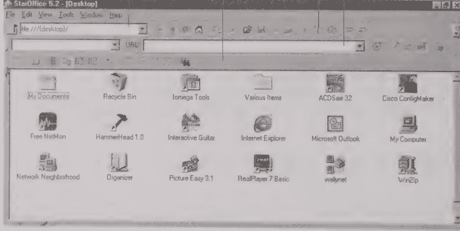

**图 1.2** StarOffice 在桌面上提供了许多易于使用的工具。

### 使用菜单栏

菜单栏使您可以轻松访问与当前在桌面工作区中处理的文档或对象类型相关的命令。就 StarOffice 桌面而言，您会发现菜单系统功能相对有限，提供与创建或打开各种文件类型、使用编辑命令操作文件或文件夹以及自定义桌面视图相关的命令。当您在 Calc 等 StarOffice 应用程序中工作时，菜单系统将提供更为丰富的命令集。桌面菜单栏上的菜单选项包括：

- **文件菜单** — 文件菜单允许您打开现有文档、电子表格或其他文件，并开始创建新文件。您可以通过选择特定文件类型（如 Calc 中的电子表格）来创建新文件，也可以使用自动向导从多种现成文档类型中进行选择。
- **编辑菜单** — 编辑菜单提供对典型编辑命令的访问，如剪切、复制、粘贴和全选。编辑菜单还提供了指向 StarOffice 通讯簿的快捷方式，可用于快速发送电子邮件或为通讯簿中的某人创建特定文档类型。
- **视图菜单** — 视图菜单允许您将默认桌面视图（启动 StarOffice 时看到的视图）切换为全屏视图，从而从桌面中移除菜单和工具栏。您还可以使用视图菜单显示资源管理器和 Beamer 等项目（两者均在本章稍后讨论）。
- **工具菜单** — 工具菜单允许您创建用于 StarOffice 的宏（宏是一种"迷你程序"，可用于依次执行多个命令）。此菜单还提供了"配置"命令，允许您更改菜单和工具栏配置（有关自定义菜单的更多信息，请参见第 14 章）。工具菜单还提供了"选项"菜单，允许您配置用户数据并设置其他参数，如保存文件的默认路径。
- **窗口菜单** — 窗口菜单为您提供当前打开窗口的列表，可用于在窗口之间切换。当前选中的窗口以项目符号标识。
- **帮助菜单** — 帮助菜单为您提供与将鼠标放在特定工具栏工具上时显示的提示相关的命令，以及通过单击"目录"命令访问帮助系统。帮助菜单还允许您激活帮助代理，它可以在您使用 StarOffice 时提供上下文相关帮助。

## 使用桌面工具栏

桌面工具栏包括**功能栏**、**对象栏**和**超链接栏**。功能栏提供对复制、剪切和粘贴等命令的快速访问。其他可用的命令按钮还有"返回主页"、"向后浏览"和"向前浏览"，这些与将桌面用作 Web 浏览器窗口相关。

对象栏提供的按钮允许您更改工作区窗口中的当前视图。这些视图包括：

- **详细信息视图** — 提供文件类型、文件大小以及文件最后修改日期等详细信息。
- **图标视图** — 默认视图；所有文件都显示为大图标。
- **预览** — 此视图提供 StarOffice 文档的预览，例如 Star Calc 电子表格或其他在 StarOffice 中创建的文件。
- **描述** — 此视图提供文档的标题、作者以及文件大小和最后修改日期。
- **显示文件扩展名** — 此视图提供文件的图标和名称，包括文件扩展名。

对象栏还可用于查看特定文件夹或文件的属性。在工作区中选择项目，然后单击**属性**按钮。将出现一个对话框，显示所选对象的属性。对象栏还包含**多重快速搜索**命令，可用于在计算机上搜索文件。

对象栏上还有四个布局按钮（编号为 1-4，位于"显示文件扩展名"按钮右侧）。这些布局按钮可将工作区窗格（当选择"预览"、"描述"或"显示文件扩展名"时）分割为不同的方向。布局 1、3 和 4 将工作区窗格水平分割（方向略有不同），布局 2 将窗格垂直分割。

超链接栏提供多种与万维网相关的工具，包括访问各种 Web 搜索引擎以及在 StarOffice 文档中快速创建超链接的功能。例如，要使用超链接栏在 Web 上执行搜索，请在 URL 名称框中输入搜索关键词（例如 StarOffice），然后单击超链接栏上的**查找**按钮。将显示可用搜索引擎列表，如图 1.3 所示。

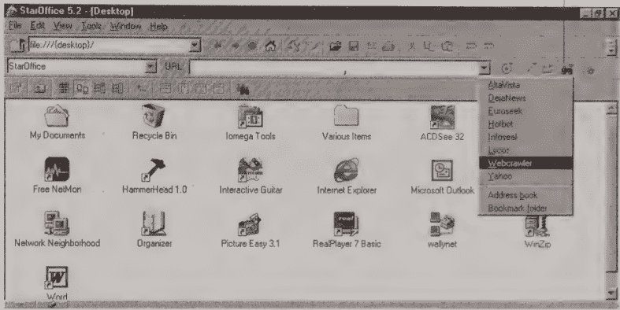

**图 1.3** 您可以通过超链接栏访问多个 Web 搜索引擎。

从弹出菜单中选择您希望使用的搜索引擎。如果您在线（连接到 Internet），您将立即被带到所选搜索引擎的搜索页面。图 1.4 显示了使用 WebCrawler 搜索引擎搜索关键词"StarOffice"的结果（已从桌面中移除提示窗口以显示更多搜索结果）。

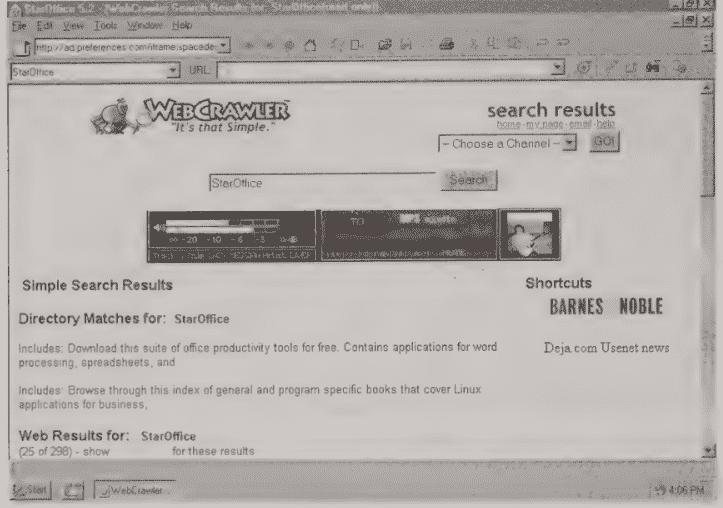

**图 1.4** 您可以使用 WebCrawler 等多种搜索引擎通过关键词快速搜索 Web。

要激活超链接栏，单击**视图**菜单，指向**工具栏**，然后选择**超链接栏**。

> **注意** 视图中还列出了第四个工具栏，即**主工具栏**。此工具栏仅当您在工作区中打开实际文档时才会出现。该工具栏包含与您当前使用的应用程序相关的命令。

关于 StarOffice 工具栏的最后说明：根据您当前在 StarOffice 桌面上运行的应用程序（如 StarOffice Calc），还有许多其他工具栏可用。例如，在 StarOffice Calc 中，可用的附加工具栏是**公式栏**，它为您提供当前在电子表格中的位置以及该单元格中的公式（有关单元格的更多内容将在本章稍后介绍）。我们将在本章稍后介绍 StarOffice Calc 工具栏，并将在第 16 章"定制和配置 StarOffice Calc"中介绍如何自定义 StarOffice 工具栏。

## 使用资源管理器

另一个非常有用的工具是 StarOffice 资源管理器。资源管理器为您提供了一种简便的方法，可以在不离开 StarOffice 桌面或关闭当前正在处理的文档的情况下，查看、组织和管理计算机（或网络）上的文件和文件夹。资源管理器还为您提供了对网站书签的便捷访问，并且您可以使用资源管理器将 StarOffice 文档和其他文件组织到称为**组**的隔间中，为您提供了一个非常直接的系统来保持项目和其他工作有一定的条理（每个人都会在计算机上乱放文件，而 StarOffice 组确实可以帮助您保持有条理）。

要打开资源管理器，单击**视图**菜单，然后单击**资源管理器**。资源管理器可用于在桌面工作区中查看驱动器、文件夹和文件，也可以在已打开文件（如 StarOffice Calc 电子表格）时使用。图 1.5 显示了在 StarOffice 桌面上打开的资源管理器，桌面工作区中有一个打开的 Calc 电子表格。

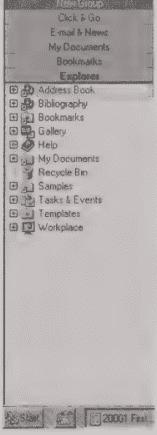

**图 1.5** 资源管理器让您在处理 StarOffice 文档时可以访问和管理文件及文件夹。

在资源管理器中工作时，您可以选择将驱动器、文件夹和文件显示为大图标、小图标或分层方式。默认是分层方式，它会在容器（如包含其他文件夹和文件的文件夹）旁边放置加号符号。让我们看看分层视图是如何工作的。

例如，假设您想在处理 Calc 电子表格时查看硬盘上某个特定文件夹的内容。只需单击资源管理器窗格中**工作区**图标左侧的加号（`+`）（工作区是提供对计算机驱动器和目录访问的容器）。工作区图标将展开，为您提供对计算机硬盘和网络驱动器的访问（如果您连接到网络）。单击任何驱动器旁边的加号（`+`）以查看其内容。然后您可以展开驱动器上的文件夹以查看其中存储的文件。在任何时候，您都可以通过单击驱动器或文件夹左侧的减号（`-`）来关闭已展开的特定驱动器或文件夹。

找到特定文件后，您可以通过单击该文件来打开它。该文件将在 StarOffice 工作区中打开。但是，您会发现之前的工作，即您的 Calc 电子表格，已经消失了。没问题，该文件仍然处于打开状态；您只需单击该文档的图标即可。例如，单击任务栏上 Calc 电子表格的图标以返回到该文档窗口（您也可以通过单击功能工具栏上的**返回**按钮快速返回到前一个文件）。

如果您发现更愿意使用大图标或小图标（而不是分层视图）查看资源管理器中的各种驱动器、文件夹和文件，请右键单击资源管理器按钮并使用出现的上下文菜单来选择您的视图。

> **注意** 当桌面工作区为空时，资源管理器也非常有用。在资源管理器中选中的驱动器或文件夹将显示其内容在工作区窗口中。您可以双击文件夹以打开它们，双击文件以将其加载到工作区区域。

如果您发现资源管理器在您处理工作区中的特定文档时碍事，只需单击资源管理器上的**隐藏**按钮（资源管理器窗格右上角的小三角形），资源管理器将会折叠。要重新打开资源管理器，单击**显示**按钮（是同一个小的三角形，但现在它指向右侧），资源管理器窗格将展开。

资源管理器还是一个"可停靠"窗口。将鼠标放在资源管理器窗口的任何位置，按住 `Ctrl` 键，然后双击。资源管理器窗口将出现一个标题栏，允许您将窗口拖动到桌面上的任何位置。您还可以用鼠标调整资源管理器窗口的大小。

您可以通过将鼠标放在资源管理器窗口的任意边框上，然后拖动来根据需要调整窗口的宽度或高度。

当您需要在桌面上为文档腾出更多空间时，也可以"折叠"资源管理器窗口。单击隐藏按钮（位于资源管理器窗口右上角的左指向三角形）。要重新打开资源管理器窗口，再次单击该按钮，此时该按钮的标签已变为显示。

> **注意** 当您想了解工具栏按钮或资源管理器等特定窗口的各部分信息时，只需将鼠标放在该项目上。您将看到与该图标或按钮相关的提示。如果您想获取更详细的提示，请单击帮助菜单并选择"层叠提示"，以获取有关这些屏幕元素的更多信息。

## 使用资源管理器组进行组织

如前所述，资源管理器为您提供了一种极佳的方式来组织文件（甚至包括电子邮件和网络书签），使其易于访问。资源管理器使用包含指向这些特定项目链接的组。默认情况下，资源管理器提供以下组：

- **新建组** — 此组实际上并非一个组，而是一个允许您创建新组的按钮（有关详细信息，请参见本章后面的"创建新组"部分）。
- **单击即达** — 此组提供了指向您单击"文件"然后单击"新建"时找到的所有 StarOffice 文档类型的链接。其他模板类型也可用，您可以通过使用"单击即达"中的链接快速创建 StarOffice 文档。
- **电子邮件和新闻** — 此组为您提供对电子邮件帐户和新闻组的快速访问。您可以设置电子邮件帐户并阅读您订阅的各种新闻组中的帖子。有关设置电子邮件帐户和订阅新闻组的更多信息，请单击帮助菜单，然后选择"目录"以查看 StarOffice 帮助内容。
- **书签** — 此组为您提供对使用 StarOffice 桌面作为网络浏览器浏览网页时创建的任何书签的快速访问。使用系统上其他网络浏览器创建的书签也会被导入到 StarOffice 中，并在您访问"书签"组时可用。

> **注意** 如果您在基于 Windows 的计算机上运行 StarOffice，资源管理器窗口中会有一个名为"我的文档"的附加组，它提供对计算机上"我的文档"文件夹的快速访问。如果您的计算机上不存在"我的文档"文件夹，此组将默认为文件夹 `StarOffice/user/work`。

## 创建新的资源管理器组


资源管理器中的“新建组”按钮允许您创建自己的组，这些组可链接到计算机上的特定文件夹和文档，或链接到网络或公司内网（类似于互联网，但由您的公司或机构私下运营）上的项目。您可以创建直接映射到计算机文件夹或链接的新组。有几种不同的技术可用于创建新组：

1. 要创建链接到计算机上文件夹的新组，请选择“查看”菜单，然后在必要时选择“资源管理器”以显示资源管理器及其组。
2. 单击资源管理器中的“新建组”按钮，“创建新组为链接”对话框将出现（参见图 1.6）。
3. 在“名称”框中输入新组的名称（例如，该组将链接到的文件夹的名称或其他描述性名称）。
4. 要将新组链接到特定目录（或我们通常所说的文件夹），请单击“目录”按钮。
5. 将打开如图 1.7 所示的“选择路径”对话框。使用“向上一级”按钮导航计算机的文件夹内容，以定位将用于链接的文件夹。如果您希望创建一个新文件夹以链接到新组，请单击“创建新目录”按钮并指定新文件夹的名称。选择用于链接的文件夹（或创建新文件夹）后，单击“选择”按钮。
6. 您将返回到“创建新组为链接”对话框。单击“确定”以创建新组。
7. 新组及其内容（如果该文件夹已包含文件）将作为一组出现在资源管理器窗口中。现在，您可以通过在资源管理器窗口中单击该组中的任何文件来访问它们。

> **注意** 如果新组提供的是指向网络或公司内网上特定位置的链接，请使用“创建新组为链接”对话框中的“目标 URL”框来指定该站点的网络地址或网络 URL。

您也可以使用拖放快速创建新组。单击资源管理器窗口中的资源管理器组按钮，然后展开资源管理器中的“工作区”文件夹，以定位您希望为其创建新组的计算机文件夹。

要创建新组，只需将该文件夹拖放到资源管理器窗口中的“新建组”按钮上。资源管理器中将创建一个以该文件夹名称作为组名的新组。这使您能够通过新组立即访问该文件夹中的所有文件。

一旦您使用新组设置了资源管理器，就可以根据自己的需要安排资源管理器中组按钮的顺序。只需在资源管理器窗口中拖放组按钮即可更改其显示顺序。

## 使用投影器

一个与资源管理器紧密配合工作的桌面工具是投影器。投影器提供了资源管理器窗口中当前选定的任何驱动器或文件夹内容的视图。要打开投影器窗口，请单击“查看”菜单，然后选择“投影器”。

当您在某个特定的 StarOffice 应用程序（如 Calc）中工作时，可以使用投影器来查看资源管理器中各个组和其他容器的内容。当您希望将文件（例如图形）从计算机硬盘上的某个位置拖放到当前正在处理的文档中时，投影器尤其有用。

投影器对于在文档中创建指向计算机上其他文档或文件的链接也非常有用。我们将在第 11 章“使用图形和对象”中介绍如何使用投影器。

## 使用图库

由于我们刚刚讨论完投影器，我们也应该快速了解一下图库。图库是一个包含图形、动画和其他多媒体项目的库，您可以在 StarOffice 文档中（特别是在您的 Calc 电子表格中）使用它们。在资源管理器窗口中，确保选中了资源管理器组。然后单击图库图标左侧的加号符号（`+`）以展开它。图库的内容将显示出来。

这里有多种多媒体文件类型可用；例如，如果您单击...

如果你希望提示窗口始终可用，可以像操作桌面上的其他窗口一样操作“提示”窗口。使用“隐藏”按钮折叠窗口，需要时再使用“打开”按钮展开窗口。你还可以通过点击窗口上的图钉图标，让窗口浮动在桌面上。这样你就可以调整窗口大小，并在桌面上随意移动它。

## 打开 StarOffice Calc

现在我们已经对 StarOffice 桌面的布局有了初步了解，可以集中关注 StarOffice Calc，并开始探讨本书后续章节的主要内容：即在 Calc 中进行电子表格的创建与操作。StarOffice Calc 是一款电子表格程序。电子表格应用是处理数字的工具；它们专为数学计算、统计运算和统计分析而设计，你会发现有众多选项可以让你快速在电子表格中输入公式。

> **注意** 请注意，在资源管理器窗口中，桌面上的“提示”窗口已被关闭，以便为本章及后续章节中出现的电子表格提供更多工作空间。资源管理器、导航器及其他桌面工具仅在与我们所探讨的特定主题相关时才会出现。

虽然“电子表格应用”是 Calc 这类软件的通用术语，但“电子表格”一词也常被用来指代你输入文本、数字和公式时的工作界面。要在 StarOffice 中新建一个空白 Calc 电子表格，请点击“文件”菜单，然后选择“电子表格”。一个新的电子表格将出现在工作区窗口中，如图 1.9 所示。

Calc 电子表格窗口包含几个专门的工具栏以及一些其他区域，在开始使用电子表格之前，你应该熟悉这些元素。这些元素已在图 1.9 中标注。表 1.1 还提供了对 Calc 窗口中特定元素的简要说明。

## 表 1.1 Calc 窗口元素

| 元素 | 说明 |
|---------|-------------|
| 标题栏 | 显示 StarOffice 版本和当前打开电子表格的文件名。未命名的电子表格以“无标题”加上数字表示（第一个未命名电子表格为 1，依次为 2，等等）。 |
| 菜单栏 | 提供在 Calc 中工作时使用的菜单系统。菜单选项特定于 Calc 命令，可通过鼠标访问，或使用 `Alt` 键配合相应快捷键（菜单选项中带下划线的字符）访问。 |
| 功能栏 | 提供工具和功能的快速访问命令按钮，这些工具和功能在整个 StarOffice 应用中保持一致，如打印、剪切、复制和粘贴。 |
| 公式栏 | 通过“自动向导”按钮、“求和”按钮和“函数”按钮提供对 Calc 公式（称为函数）的访问。该栏还显示当前选定单元格的位置，并包含输入字段，用于在电子表格单元格中编写公式（并始终显示当前选定单元格的内容）。 |
| 对象栏 | 提供对已输入数据的对齐方式和数字格式等格式特征的快速访问。 |
| 主工具栏 | 位于电子表格左侧，提供标准的 StarOffice 功能，如拼写检查和查找。该工具栏还提供特定于 Calc 的工具，如插入单元格，并允许你快速按升序或降序对选定区域进行排序。 |
| 工作表导航 | 一组按钮和标签，允许你在当前电子表格中的各工作表之间前后移动。 |
| 状态栏 | 显示电子表格中的当前工作表和当前电子表格样式。状态栏还显示当前缩放级别（双击当前级别可打开“缩放”对话框）。电子表格中选定单元格的当前选择模式（默认为“添加”）也显示在状态栏上。 |

与其他任何基于 Windows 的软件一样，Calc 应用程序窗口会有垂直和水平滚动条，分别用于在当前电子表格中垂直和水平滚动。在 Calc 窗口的右上角，你会找到“最小化”、“最大化/还原”和“关闭”按钮，用于操作当前电子表格窗口。

> **注意** 如果你没有使用 StarOffice 集成桌面功能，还会有另一组用于 StarOffice 窗口本身的“最小化”、“最大化/还原”和“关闭”按钮。

在我们探讨 Calc 的各种功能和特性时，将讨论每个工具栏中的重要命令和工具。然而，在我们向电子表格输入数据（这在下一章中讨论）并利用各种工具栏提供的工具之前，需要了解 Calc 电子表格的“内部”结构。

## 了解电子表格结构

电子表格由行和列组成。每个 Calc 电子表格包含 32,000 行；行由特定数字标识，从 1 开始，依次排到 32,000。电子表格还包含 256 列；列由字母标识，从字母 `A` 开始。当到达 `Z` 后，下一列是 `AA`，然后是 `AB`，依此类推。最后一列结束于 `IV`。电子表格中列与行的交叉点称为单元格。每个单元格都有一个地址；地址是创建该单元格的交叉列和行的列标识与行号的组合。例如，由 `B` 列和第 12 行交叉创建的单元格就是单元格 `B12`。

> 给你一些电子表格趣闻：有 256 列和 32,000 行，这意味着你的电子表格上有 8,192,000 个单元格可用。还有一个更琐碎的信息：如果你使用了电子表格中的所有列，你的电子表格将超过 20 英尺宽；如果你使用了所有行，你将得到一个高达数层的电子表格（这里的层是指建筑物的楼层）。

正是在单元格中，你将放置构成电子表格的文本、数据和公式。在电子表格中输入信息的内容将在第 2 章“创建基本电子表格”中介绍。

你随时可以查看公式栏上的“工作表区域”框来确定当前选定的单元格。如果你找不到当前单元格，随时可以按 `Ctrl + Home` 组合键返回 `A1`（在电子表格术语中通常称为“首页”）。我们将在第 2 章的“浏览 Calc 电子表格”一节中介绍更多浏览 Calc 电子表格的方法。

关于 Calc 电子表格还有另一点：电子表格本身实际上可以包含多个子表或页面。例如，默认情况下，每个 Calc 电子表格包含三个工作表。你实际上每个电子表格最多可以有 256 个工作表。每个工作表都可以单独命名，名称会显示在位于当前电子表格左下角的工作表标签上。

现在，你可能会想，既然一个电子表格上有这么多单元格可用，为什么还需要多个工作表呢？嗯，举例来说，你可能有四个季度的公司电子表格，外加一个年度汇总表。这些电子表格实际上都可以作为同一电子表格文件的一部分存在，只是放在不同的工作表上。这样你就不需要在多个文件中寻找。你打开那一年的一个电子表格，每个季度的数据和年终汇总都集中在一处。

在一个电子表格中放入多个工作表，还可以让你非常方便地将一个工作表的数据链接到另一个工作表。当一个工作表实际上是汇总其他工作表中的数据时，这一点特别有用。我们将在第 4 章“编辑电子表格”中处理包含多个工作表的电子表格。图 1.10 显示了一个包含四个工作表的电子表格。


图 1.10 Calc 电子表格可以包含多个信息工作表。

## 探索不同的电子表格视图

一旦你创建了电子表格（我们将在下一章中操作），Calc 提供了不同的方式来查看电子表格中的信息。Calc 还提供了工具，允许你突出显示电子表格中的某些信息，以及对电子表格中的数据进行缩放查看。

### 隐藏列和行标题

你可以控制的一个电子表格视图方面是，列标题和行标题是否可见。有时你可能希望去除这些标题，以便你能专注于电子表格中的数据。

要隐藏列标题和行标题，点击“视图”菜单，然后点击“列和行标题”。这将移除快手功能旁边的对勾标记并关闭标题。要重新打开标题，重复上述过程。

## 添加数值高亮

数值高亮允许你对电子表格中的信息进行“着色”，以便你能轻松区分公式结果、数值数据（如数字或日期）和文本。要打开数值高亮，点击“视图”菜单，然后选择“数值高亮”。你也可以使用快捷键组合 `Ctrl + F8` 来打开此功能。

当数值高亮打开时，公式结果显示为绿色，其他数值信息如数字输入、日期或时间显示为蓝色。由于文本不被视为数值，文本条目将保持黑色（请记住，这是数值高亮，只有公式和数值输入才被 Calc 视为数值）。要关闭数值高亮，点击“视图”菜单，然后选择“数值高亮”以移除该视图菜单选项旁边的对勾标记，或按 `Ctrl + F8`。

## 使用分页预览

分页预览显示页面分隔符在你电子表格中的位置。这使你有机会更改电子表格在页面上的方向（例如，从纵向改为横向）或调整电子表格的页边距。Calc 还提供了在电子表格中放置手动分隔符的功能，以确定页面分隔符的位置（处理和打印电子表格页面的内容在第14章“操作电子表格页面”一节中介绍）。

要查看当前电子表格中的页面分隔符，请点击“视图”菜单，然后点击“分页预览”。图 1.11 显示了处于分页预览模式的 Calc 电子表格。请注意，电子表格数据被页面分隔符截断，因此需要对此电子表格进行调整以获得良好的数据硬拷贝。

要关闭分页预览，点击“视图”菜单，然后点击“分页预览”以移除该功能旁边的对勾标记。你将返回到标准的 Calc 视图。

**图 1.11** 你可以使用分页预览快速查看电子表格中的页面分隔符。

## 使用缩放

默认情况下，电子表格在工作区窗口中以 100% 显示。缩放功能是一个非常直接的工具，用于放大或缩小你的电子表格。缩放可以用来查看整个电子表格以检查整体布局，也可以用来放大电子表格的特定区域。

要使用缩放，点击“视图”菜单，然后点击“缩放”。缩放对话框将出现（见图 1.12）。你可以快速将电子表格从 50% 缩放到 200%（选项按钮以 25% 为增量提供）。

缩放对话框中还提供了其他视图：

- 页面宽度—此视图提供电子表格的视图，其中电子表格的边框在窗口中可见。
- 整页—此视图在工作区窗口中提供电子表格的完整视图。
- 可变—此视图提供一个可点击的框，允许你为电子表格设置自定义缩放设置。

**图 1.12** 缩放允许你使用一系列缩放设置来查看你的电子表格。

> **注意** 缩放对话框中还有一个名为“最佳”的附加设置。它将会被“灰色显示”（禁用），除非你实际选择了电子表格的一部分。此设置然后将选区置于“最佳”视图。

一旦你在缩放对话框中选择了缩放设置，点击“确定”按钮以使该设置生效。你也可以通过双击状态栏上显示的缩放设置来快速打开缩放对话框。请注意，你为电子表格选择的缩放设置将成为你在 Calc 中打开的所有电子表格的默认设置。

## 查看全屏

另一个有用的视图是全屏视图，它会临时移除 Calc 窗口的标题栏、菜单栏、工具栏（主工具栏除外）和状态栏。这允许你使用屏幕上所有可用的空间来实际查看你的电子卷起。

要使用全屏视图，选择“视图”菜单，然后选择“全屏”。你的电子表格将占据从顶到底的所有窗口空间。

随着菜单和工具栏的消失，你可能想知道如何关闭全屏视图。在窗口左侧主工具栏的顶部，会出现一个看起来像电脑显示器的按钮。点击该按钮以关闭全屏视图并返回到标准的 Calc 窗口。

## 冻结列标题和行标题

在大型电子表格上，当你向下或向右滚动电子表格时，查看屏幕上的信息可能会变得困难，而且你再也看不到放置在电子表格中的列标题或行标题（分别）。

在一个你能看到数据但看不到告诉数据含义的标题的电子表格中滚动是极其令人沮丧的。解决这个问题的方法是冻结电子表格中的列标题和行标题。

例如，如果你已经花时间使用标题标记了电子表格中的行和列，你可以冻结这些标题，这样无论你在电子表格中滚动到哪里，它们都可见。这意味着即使在最庞大的电子表格中，你仍然可以使用标题来提醒你电子表格中的特定列或行信息在告诉你什么。

要冻结你的列标题和行标题，点击位于你要冻结的行下方、你要冻结的列标题正下方的单元格。为了帮助理解，请看图 1.13。在此电子表格上，我们想冻结包含客户编号以及员工名字和姓氏的列。所以，当你向右滚动电子表格时，你仍然可以看到哪些数据与哪些员工相关联。我们还希望在滚动时能够看到列标题，这些标题在第 12 行。

因此，为了正确冻结这些项目，选择了单元格 `D13`。这个单元格位于我们要冻结的列的正右侧，以及我们要冻结的行的正下方。

一旦你选择了将决定哪些行和列被冻结的单元格，选择“窗口”菜单，然后选择“冻结”。（图 1.13 显示了一个带有冻结标题的电子表格。请注意显示各个标题被冻结位置的垂直线和水平线。）你现在可以在电子表格中的任何地方滚动，指定的行和列标题将保持可见。要“解冻”标题，选择“窗口”菜单，然后选择“冻结”以移除该功能旁边的对勾标记。

## 拆分 Calc 窗口

Calc 提供的另一个有用的查看工具是将电子表格窗口拆分为两个不同的窗口。当你想要在电子表格上比较一组数据与位于同一电子表格上但相距若干行和列的另一组数据，因而无法同时查看这两组数据时（即使使用缩放在一个屏幕上），这很有用。

**图 1.13** 你可以冻结电子表格中的列标题和行标题。

将 Calc 窗口拆分为两个包含相同电子表格的单独窗口，允许你滚动这两个窗口，使以前相距很远的信息现在并排显示，或直接上下显示。

> **注意** 你不能同时使用冻结和拆分功能。如果你想拆分 Calc 窗口同时又有标题被冻结，你必须在放置拆分之前解冻标题。

你可以水平、垂直或同时两种方向拆分窗口，具体取决于你在打开拆分功能之前选择的单元格。一旦选择了单元格，选择“窗口”菜单，然后选择“拆分”。由拆分创建的每个单独窗口都有自己的滚动条，允许你在每个窗口中单独滚动。

例如，假设你有一个员工列表，想要计算位于电子表格列表两端的两个员工的数据。由于你只需要水平拆分此电子表格，点击电子表格第一列中你希望拆分出现在其上方的行中的单元格。图 1.14 显示了一个被水平拆分为两个窗口的电子表格。请注意，两个员工的数据已通过使用两个窗口来比较数据而放置在近距离。

图1.14 将电子表格分割成多个窗口，以便同时轻松查看电子表格的不同部分。

当您完成使用分割窗口的工作后，请选择“窗口”菜单，然后选择“分割”以返回到单窗口模式。

## 获取帮助

本书为您提供了一个资源，帮助您探索从简单到高级的各种Calc功能，但有时您可能需要快速的知识解答，这时您会转向Calc帮助系统寻求帮助。Calc（以及所有StarOffice应用程序）为您提供了多种获取帮助的方式。

## 使用提示和扩展提示

工具栏上各种按钮的帮助由提示和扩展提示提供。要查看特定工具栏按钮的提示，请将鼠标放在该按钮上，提示就会出现。

如果您希望提示提供与各种工具栏按钮相关的更多信息，请选择“帮助”菜单，然后选择“扩展提示”。

现在，当您将鼠标指针放在特定按钮上时，您将收到更多信息。

## 使用帮助目录

Calc（和StarOffice）提供了一个用户指南，可通过选择“帮助”菜单，然后选择“目录”来访问。信息被分为不同的类别，其内容旨在引导用户从初级阶段进入更高级阶段。要查看特定类别的信息（如图1.15所示），请单击相应的链接。

图1.15 帮助系统被划分为不同的内容区域，您只需单击鼠标即可访问。

当您打开帮助目录时，帮助窗口顶部会出现一个帮助工具栏，为您提供了可用于搜索用户手册或在帮助内容中放置书签的工具。例如，当您想按关键字搜索用户手册时，请单击“搜索帮助”按钮。

“查找”对话框将出现，如图1.16所示。您可以根据在“查找”对话框上选择的选项卡，进行索引搜索或文本搜索。

图1.16 “查找”对话框使搜索帮助系统变得轻而易举。

要进行索引搜索（参见图1.16），请输入关键字的前几个字母。一组索引条目列表将出现在“选择索引条目”窗格中。接下来，双击与您查找内容最匹配的索引条目。当您选择一个索引条目（双击）时，一组主题将出现在“单击相应主题”框中。选择您希望查看的主题，然后单击“显示”按钮。帮助窗口将显示该特定主题的信息。


要在“查找”对话框中进行文本搜索，请选择“文本”选项卡，然后在“键入要查找的单词”框中输入您的搜索字符串。然后，单击“查找”按钮。一组主题将出现在“找到的主题”框中。选择您希望查看的主题，然后单击“显示”按钮。信息将在帮助窗口中显示。

您可以随时在帮助内容中放置书签。单击“插入书签”按钮，在出现的“书签”对话框中输入书签的名称，然后单击“确定”。您在帮助中放置的书签可以使用资源管理器访问。在资源管理器窗口中展开“帮助”文件夹，然后展开“书签”文件夹，以查看和访问您在帮助内容中放置的书签。

> **注意** 访问所有 StarOffice 应用程序用户指南和帮助的另一种方法是在资源管理器窗口中展开“帮助”文件夹。这使您可以访问各种主题和用户指南，以及您在帮助内容中放置的任何书签。

当您完成使用帮助内容和用户指南后，您可以像关闭任何其他窗口一样关闭帮助窗口。单击桌面右上角的帮助窗口的关闭按钮。

## 使用帮助代理

另一个有用的帮助功能是帮助代理。帮助代理在其自己的浮动窗口中运行，并提供关于您当前正在使用的工具和功能的上下文相关帮助。例如，如果帮助代理已开启，并且您决定格式化电子表格中的某些单元格，帮助代理将就当前任务（即单元格格式化）为您提供帮助，如图 1.17 所示。

**图 1.17** 帮助代理针对您当前处理的任务提供上下文相关帮助。

要启用帮助代理功能，请选择“帮助”菜单，然后选择“帮助代理”。帮助代理将作为一个浮动窗口出现（参见图 1.17），并可以拖动到工作区的任何位置。您也可以调整帮助代理所在窗口的大小，如果您愿意的话。您可以随时单击其关闭按钮来关闭帮助代理窗口。

## 关闭 Calc 和退出 StarOffice

当您完成处理特定的电子表格后，您可以单击右上角的关闭按钮来关闭 Calc 窗口。或者，如果您愿意，可以选择“文件”菜单，然后选择“关闭”。

如果您自上次保存电子表格以来对其进行了任何更改，将会出现一个对话框，询问您是要保存还是丢弃更改。在大多数情况下，您会希望单击“保存”以保存您对电子表格所做的更改。

当电子表格窗口关闭时，您将返回到 StarOffice 桌面（除非您有多个文档窗口打开）。当您完成 StarOffice 的工作后，可以通过选择“文件”菜单，然后选择“退出”来关闭它。这会关闭 StarOffice 和所有打开的文档。如果您没有使用集成桌面，也可以通过单击其关闭按钮来关闭 StarOffice 窗口。

# 第 2 章

## 创建基本电子表格

### 本章内容

- 输入电子表格数据（见第 32 页）
  - 输入文本（见第 32 页）
  - 输入数值（见第 35 页）
- 保存您的电子表格（见第 40 页）
- 使用版本功能（见第 43 页）
- 添加文件属性（见第 46 页）
- 打开电子表格（见第 47 页）
- 处理窗格和窗口（见第 48 页）
- 在 Calc 电子表格中导航（见第 49 页）
- 处理单元格区域（见第 51 页）
- 基本编辑技巧（见第 53 页）
- 使用撤销、重做和重复（见第 57 页）
- 自动填充单元格（见第 57 页）
- 创建您自己的电子表格（见第 59 页）

## 输入电子表格数据

在前一章中，我们了解了 StarOffice 桌面并初步体验了 StarOffice Calc，重点介绍了 Calc 窗口及其包含的各种工具。在本章中，我们将沉下心来，实际构建一个电子表格。

我们已经讨论过电子表格单元格（单元格是列和行的交叉点），将正确的数据和适当类型的数据输入到特定单元格是创建电子表格的一个极其重要的方面。如果数据输入错误，世界上任何公式，无论设计得多么精妙，都无法给您正确的答案。事实上，电子表格中发现的大多数错误都与数据输入不正确有关。

您还会发现，当我们构建一个简单的电子表格时，需要处理两种主要的数据类型：文本和数值。然而，在您能够实际将数据输入电子表格之前，您必须打开一个新的电子表格文件。

打开 StarOffice 桌面，选择“文件”菜单，然后选择“新建”。在出现的级联菜单中，选择“电子表格”。一个新的电子表格将在 StarOffice 桌面上打开。现在我们准备将信息输入到空白电子表格中。

## 输入文本

电子表格中的文本条目具有描述性目的。文本可用作行和列标题，并用于描述特定的单元格。事实上，一旦您按下字母键（字母表中的字母），Calc 就知道您正在单元格中进行文本输入，而不是具有数值意义的输入。因此，Calc 不会尝试对包含文本的单元格执行任何数学运算。

> **注意** 在许多电子表格软件程序中，文本条目通常被称为标签。Calc 实际上并不使用这个术语来描述文本条目。在 Calc 中，标签实际上是指用一个名称标记电子表格的特定区域，然后将该名称用于导航和公式编写目的。

### 在电子表格中输入文本

1. 单击要输入文本的单元格。该单元格将被选中（单元格周围出现选择边框）。
2. 键入要放入单元格中的文本内容。请注意，文本内容会显示在公式栏的输入行中。
3. 按 Enter 键将文本输入到单元格中。这将使你移动到下方单元格（即你刚才输入文本的单元格下方）。

你也可以使用方向键完成文本输入，然后移动到相邻单元格。例如，按左方向键将完成文本输入，并将你移动到输入文本单元格正左侧的单元格。

如果你想在某个单元格中输入文本（或数值），且不想离开该单元格，你可以输入数据后单击公式工具栏上的“接受”按钮（对勾标记）。这样文本（或其他数据）就会被输入，且该单元格保持选中状态。

在电子表格中输入文本后（见图 2.1），你可以轻松地使用粗体、斜体和不同字体等属性来设置该文本的格式。有关在工作表中设置文本条目格式的更多信息，请参见第 3 章“格式化单元格属性”。

请注意，当你在电子表格中输入文本时，文本会靠单元格左侧对齐。这是文本条目的默认对齐方式。

## 将数字作为文本输入

在某些情况下，你可能希望输入不具有数值意义的数字。在这些情况下，你希望 Calc 将这些数字视为文本。快速实现这一点的方法是先输入一个撇号，然后输入数字。Calc 将撇号识别为文本，因此会将撇号后的数字作为文本处理。

当你按 Enter 键或使用方向键移动到相邻单元格时，数字将显示在单元格中而不显示撇号（Calc 知道不显示撇号）。数字也会靠单元格左侧对齐，这表明 Calc 将其视为文本。

## 使用自动输入功能

另一个在输入文本时非常有用的工具是自动输入功能。如果你发现自己在电子表格中重复输入相同的文本字符串（例如产品名称：奶酪、肥皂、小部件等），Calc 会记住这些文本条目。当你输入文本条目的前几个字符时，Calc 会自动输入（自动输入）该条目。你只需按 Enter 键或键盘导航键之一，完整的条目就会被放入单元格中。

这确实可以节省你的数据输入时间。它还能减少电子表格中文本条目可能出现的输入错误。

**注意** 如果自动输入功能让你感到困扰，你可以通过选择“工具”菜单，指向“单元格内容”，然后选择“自动输入”来关闭该功能，移除该功能旁边的勾选标记。

## 使用选择列表

另一种快速输入文本条目的方法是使用选择列表。与自动输入功能类似，选择列表为你提供了访问电子表格中所有已输入文本条目的列表的途径。

如果你发现自己反复输入相同的文本字符串，或者想查看在电子表格中已输入的文本条目列表，选择列表绝对适合你。你可以使用鼠标或键盘调出选择列表：

- **鼠标**：右键单击要放置文本条目的单元格，然后在上下文菜单中单击“选择列表”。选择列表将出现。单击选择列表上要放入单元格的词语。文本将出现在单元格中，选择列表将关闭。
- **键盘**：移动到要放置文本条目的单元格，然后按 Ctrl + D。使用方向键突出显示要放入单元格的词语，然后按 Enter 键。

## 输入数值

Calc 的设计目的是进行计算。要进行计算，你需要在电子表格中输入条目以提供计算所需的原始数据。而要进行实际的计算，你需要一个公式来获取原始数据并返回某种答案。Calc 电子表格中的数字条目和公式被称为数值。包含它们的单元格具有数值意义，这与我们在上一节中讨论的文本条目正好相反。

电子表格中的数值可以使用 1 到 0 的数字键输入。你不需要在单元格中输入逗号、美元符号或百分号（这些都可以使用不同的格式选项来处理）。但是，你必须将小数点放在正确的位置。

要在单元格中输入数值，请使用鼠标单击该单元格（我们将在本章后面讨论如何使用键盘导航电子表格）。输入数字，然后单击“接受”按钮、按 Enter 键或按键盘上的某个方向键。

数值将被输入到单元格中。当你在电子表格中输入数字等数值时，它们会靠单元格右侧对齐。请务必检查输入到单元格中的任何数值。打字错误通常是电子表格中发现的大部分错误的根源。

## 理解公式和函数

在单元格中输入公式时，你有两个选择：你可以使用适当的运算符自己构建公式，或者使用 Calc 的内置公式（称为函数）。Calc 将公式和函数视为电子表格中的数值。回想一下第 1 章，数值突出显示功能会突出显示电子表格中存在的任何数值、公式或函数（它忽略文本条目）。

构建自己的公式需要你从头开始设置公式，提供正确的运算符，并指定要操作的适当单元格。第 5 章在“创建公式”一节中详细介绍了如何构建自己的公式。

函数为你完成了大部分工作；当你使用内置函数时，你真正需要做的就是理解该函数的用途，然后指定你希望它操作的单元格。你会发现有统计函数、财务函数和三角函数，以及几乎任何你可能想进行的计算类型的函数（此类函数多得不计其数）。第 5 章“使用公式和函数”详细介绍了 Calc 函数。

## 输入公式

如前所述，公式是你设计的用于执行计算的表达式或方程式。你需要提供适当的运算符，然后指定要操作的单元格。简而言之，你必须设计你的公式以数学方式得出预期的答案。

在单元格中构建公式时，你需要以等号（`=`）开头。这让 Calc 知道正在单元格中放置公式。然后在等号后跟随适当的单元格引用和正确的运算符。例如，要将单元格 D7 乘以单元格 E7，你的公式应如下所示：`=d7*e7`。请注意，星号（`*`）用作乘号。

> **注意** 你可以通过按等号键或单击公式栏上的“函数”按钮来输入等号以开始新公式。

按 Enter 键、单击“接受”按钮或移动到电子表格中的另一个单元格后，公式的结果将显示在单元格中。你可以通过选择单元格同时查看公式及其结果。结果将显示在单元格中，公式将显示在公式栏的输入行上。图 2.2 显示了单元格 F7 中公式的结果以及输入行上的公式本身。

> **注意** 一个值得遵循的好规则是：只有在 Calc 没有能够完成相同任务的函数时，才创建自己的公式。这意味着你可以将大部分公式编写限制为简单的数学运算，如减法、乘法和除法。

## 输入函数

函数是 Calc 提供的内置公式。只要你选择适当的函数（符合你的目的），然后指定要操作的正确单元格，你就应该得到正确的答案。第 6 章“使用函数”详细介绍了 Calc 函数。

你会发现 Calc 提供了广泛的函数：从简单的数学函数 SUM（它可以对一列数字求和）到……

## 输入数值

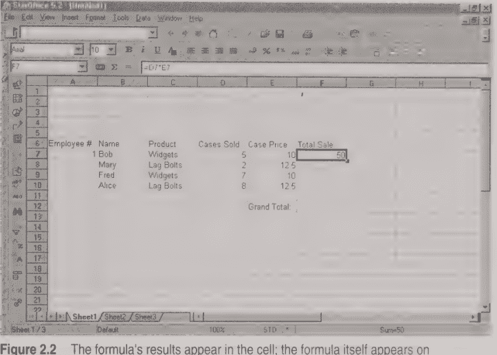

图 2.2 公式的结果显示在单元格中；公式本身显示在输入行上。

为你计算数值的数学函数）到财务函数，例如 PMT 函数，它可以帮助你计算每月的房贷或车贷。

在电子表格中输入函数最直接的方法是使用公式工具栏上的自动向导函数按钮。当你点击该按钮时，自动向导函数对话框会出现（参见图 2.3）。该对话框提供了所有 Calc 函数的完整列表。

你可以在类别下拉列表中选择全部来查看所有函数（这是默认设置），也可以按类别查看函数，例如数据库、日期和时间、逻辑、数学等。当你找到想要使用的函数时，从列表中选择它，然后点击下一步。自动向导函数对话框将引导你完成输入需要包含在函数中的单元格引用。

同样，我们将在第 6 章花大量时间使用自动向导。不过，在结束对函数的基本介绍之前，我们应该实际在电子表格中输入一个函数。

最常用的大概是 SUM 函数。你可以用它将两个单元格相加，也可以相加一整行或一整列的数字。SUM 采用 Calc 函数的基本格式：`=sum(单元格范围)`，其中函数以等号开头，后面跟着函数名称。要操作的单元格列在函数名称后的括号中。

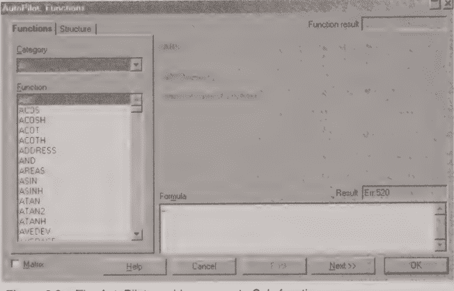

图 2.3 自动向导提供对 Calc 函数的访问。

> **注意** 并非 Calc 提供的所有函数都遵循 SUM 函数所采用简单格式。有些函数会以不同的方式列出其目标单元格，有时还会包含额外的参数。

使用 SUM 函数非常简单。点击你想要放置函数的单元格。例如，假设你想相加一列数字（参见图 2.4）。

## 使用 SUM 函数的步骤

1. 点击选择你希望放置 SUM 函数的单元格。在本例中，我们选择了 F12，以便相加 F 列中的数字（F12 与该列数字底部之间的空白单元格是为了美观；它不会影响函数的结果）。
2. 点击公式工具栏上的求和按钮。
3. SUM 函数将出现在单元格中，要相加的单元格会被函数自动选中（F7 到 F11 的单元格将以蓝色框选中，如图 2.5 所示）。
4. 如果函数已选中正确的单元格，按 Enter 键将函数放入单元格。如果单元格引用不正确，你可以用鼠标选择应出现在函数中的单元格。然后按 Enter 键完成函数。

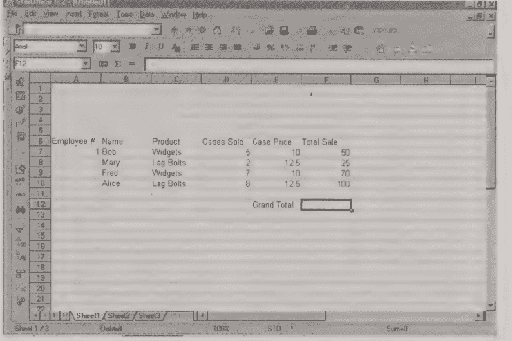

图 2.4 SUM 可用于快速相加一列数字。

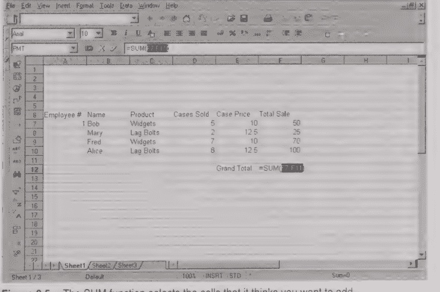

图 2.5 SUM 函数选中它认为你想相加的单元格。

与我们之前查看的公式一样，函数的结果将显示在单元格中，函数本身将显示在输入行上（当选中该单元格时）。

## 输入日期

在结束关于在电子表格中输入数值的讨论之前，我们应该讨论在电子表格中输入日期和时间。Calc 实际上将日期和时间视为数值。例如，当你输入诸如 08/09/01（2001 年 8 月 9 日）这样的日期时，Calc 将信息格式化为日期，但实际上将该日期视为自 1900 年 1 月 1 日以来经过的天数。

> **注意** 如果你想将日期视为自 1900 年 1 月 1 日以来的经过时间，选中包含该日期的单元格，然后选择格式、单元格。在单元格属性对话框中，在类别框中选择数字，然后点击确定。日期现在将在电子表格中格式化为数字。例如，8/9/00 的实际数值为 36,747。时光飞逝。

还有一点：如果你以文本形式输入日期，例如 August 9, 2001，Calc 实际上会将信息转换为默认的日期格式（日期将显示为 8/9/01）。所以，即使你向单元格中输入文本（月份名称），Calc 也会将其识别为日期并将信息转换为日期值。

就时间而言，时间实际上被计算为 24 小时的百分比。对你来说，10:45 AM 可能是喝咖啡休息的时间，而对 Calc 来说，10:45 AM 实际上是小数值 .4479。不过，在你的 Calc 电子表格中，Calc 将时间显示为数字手表上的样子。事实上，电子表格中时间条目的默认格式是 24 小时国际格式。

## 保存你的电子表格

与使用的任何应用软件一样，你需要定期保存工作。Calc 也不例外；你需要保存你的电子表格，否则你可能会丢失输入到各个单元格中的信息。

## 保存你的 Calc 电子表格的步骤

1. 点击功能工具栏上的保存按钮。另存为对话框打开（参见图 2.6）。

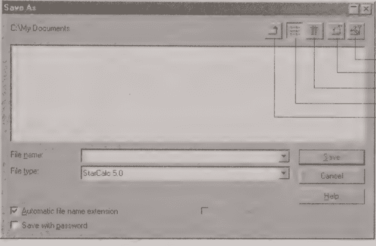

**图 2.6** 另存为对话框允许你为电子表格文件命名并选择保存位置。

现在，你可能会纳闷为什么点击了保存文档按钮（或选择了文件菜单然后选择保存）后，另存为对话框会出现。其实，第一次保存新电子表格时，另存为对话框会打开，以便你可以为电子表格命名。

2. 在文件名框中输入名称来命名电子表格文件。如果你想以默认格式（StarCalc 5.0）以外的格式保存文件，点击文件类型框并选择适当的文件类型。

> **注意** 你可以将 Calc 电子表格保存为多种不同的文件格式，包括 StarCalc 5.0（默认）、MS Excel 和 HTML。

3. 点击保存按钮将电子表格保存到默认文件夹。

默认情况下，Calc 会在你的计算机上打开我的文档文件夹作为保存电子表格文件的位置（这是在基于 Windows 的计算机上；其他操作系统将默认使用 StarOffice/user/work 文件夹）。

但是，如果你想保存到其他文件夹或为你的文件创建新文件夹，你需要利用另存为对话框右上角的一些按钮（继续下一步）。

4. 根据需要点击向上一级按钮来定位你要保存电子表格的驱动器或文件夹（在此过程中，你可能需要双击驱动器或文件夹图标来定位你实际要使用的文件夹）。一旦在另存为窗口中找到该文件夹，双击该文件夹将其打开。

如果你想为电子表格创建新文件夹，使用向上一级按钮定位要放置新文件夹的驱动器或文件夹并打开该位置（结合点击向上一级按钮和双击另存为窗口中出现的特定驱动器或文件夹图标）。一旦到达新文件夹的适当位置，点击新建目录按钮。新建文件夹对话框将打开（参见图 2.7）。输入文件夹名称然后点击确定。


**图 2.7** 你可以从另存为对话框创建新文件夹。

5. 一旦找到或创建了要保存电子表格的文件夹，点击保存按钮，电子表格文件将保存到该文件夹。

## 使用密码保存电子表格

如果你将文件存储在公共文件服务器上（没有自身真正安全性的网络文件服务器），你实际上可以为你的电子表格设置密码。一旦为电子表格设置了密码，你将无法在没有密码的情况下打开该电子表格（所以只在绝对必要的时候才为电子表格文件使用密码）。

你可以在另存为对话框中对电子表格进行密码保护。所以，你可以在第一次保存电子表格时就设置密码，也可以打开另存为对话框（选择文件，然后另存为）随时设置密码。

2. 单击“保存”按钮（如果您之前已经保存过该文件，并且正在添加密码保护，请单击“是”按钮覆盖现有文件）。

3. 将弹出“输入密码”对话框（见图 2.8）。在“密码”框中输入您的密码，然后在“确认”框中再次输入密码。


**图 2.8** Calc 电子表格文件可以设置密码保护。

4. 单击“确定”为电子表格文件分配密码。

下次打开受密码保护的电子表格时，将弹出“输入密码”对话框。提供文件的密码，然后单击“确定”。电子表格将在 StarOffice 桌面上打开。

**注意** 密码保护只能阻止其他用户在 Calc 中打开您的电子表格。某些人始终可以在不知道密码的情况下从 Windows 或 StarOffice 资源管理器中删除您的文件。

## 保存对电子表格的更改

为电子表格命名并保存到特定位置后，您可以通过单击功能工具栏上的“保存文档”按钮来保存对电子表格所做的任何更改。如果您出于某种原因决定重命名文件或更改文件位置，可以选择“文件”菜单，然后选择“另存为”。

将弹出“另存为”对话框。您可以为电子表格指定新名称，或将其以当前名称保存到新位置。

## 使用版本功能

如果您正在处理一个尚未完成的电子表格，这意味着它在实际完成或获得批准之前会经历多个不同的“外观”或阶段，Calc 的版本功能可以为您提供帮助。能够将同一电子表格的不同版本保存为单个电子表格文件的一部分，使您可以轻松与其他用户协作完成特定的 Calc 项目。

“文件”菜单上的“版本”命令允许您将电子表格的不同版本保存为同一电子表格文件的一部分。这些不同的版本可以包含不同的格式、不同的公式，甚至不同的数据。所有版本的电子表格都可以随时通过“版本”对话框访问。

### 创建 Calc 电子表格的版本

1. 选择“文件”菜单，然后选择“版本”。当前电子表格的“版本”对话框将打开（见图 2.9）。

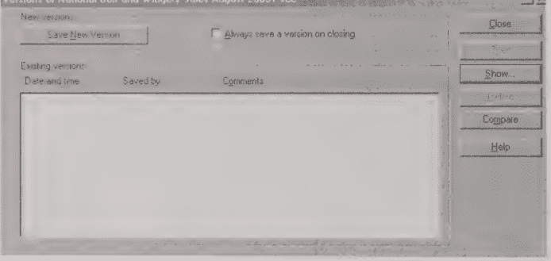

**图 2.9** Calc 电子表格文件可以有多个版本。

2. 在“版本”对话框中，单击“保存新版本”按钮。将弹出“插入版本注释”对话框。

3. 输入与您将要保存的当前版本电子表格相关的描述或其他注释。然后单击“确定”。

版本注释将列在“版本”对话框中。现在，您可以继续处理电子表格，并根据需要保存不同的版本。

虽然所有版本都保存为同一电子表格文件的一部分，但您会发现当在 StarOffice 桌面上打开同一电子表格的不同版本时，每个版本都会在单独的窗口中打开，就像它们是独立的电子表格文件一样。

您还可以使用“版本”对话框来管理电子表格的不同版本。您可以直接从“版本”对话框中打开电子表格的版本，或删除不再需要的特定版本。

> **注意** 从“版本”对话框打开电子表格的不同版本时，电子表格将以只读文件的形式打开。只能对电子表格的当前版本进行更改。

版本功能还使您能够比较版本，然后接受或拒绝对电子表格所做的更改。例如，您可能希望保存一个提供基准信息的电子表格版本。然后，如果任何数据被编辑或格式被更改，您可以使用比较功能快速查看这些特性。

在屏幕上打开电子表格的“已编辑版本”后，打开“版本”对话框（选择“文件”，然后选择“版本”），选择您希望与当前版本进行比较的较早版本，然后单击“比较”按钮。

您将返回到电子表格窗口，并弹出“接受或拒绝更改”对话框，其中列出了对电子表格所做的更改（见图 2.10）。帮助代理窗口也将打开，为您提供使用比较功能的帮助。

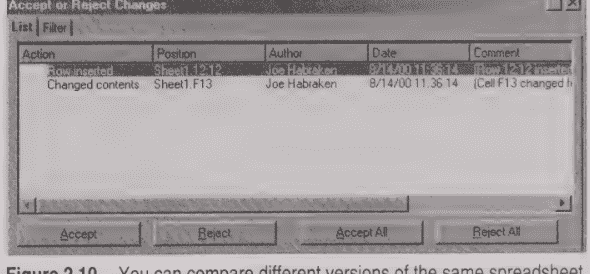

在“接受或拒绝更改”对话框中选择列出的更改，然后使用对话框上的“接受”或“拒绝”按钮分别保留或删除更改。完成对话框操作后，您可以关闭该对话框和帮助代理窗口。

## 添加文件属性

与电子表格文件相关的另一个有用功能以“文件属性”对话框的形式出现。此对话框允许您查看当前电子表格的属性，例如当前电子表格中的工作表数量、单元格数量和页数。

此对话框还允许您为文件添加描述（包括标题、主题、关键字和注释）。您还可以在“文件属性”对话框中指定与该文件相关的 URL。

要打开“属性”对话框，请选择“文件”菜单，然后选择“属性”。您当前电子表格的“属性”对话框将打开（见图 2.11）。

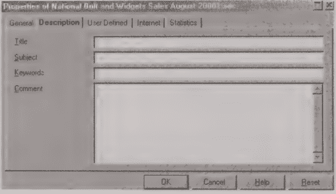

**图 2.11** 您可以在电子表格 properties 中添加描述和其他注释。

该对话框包含多个选项卡：

- **常规** — 提供文件名、文件类型及其当前位置。
- **描述** — 允许您向文件属性添加标题、主题和其他描述性项目。
- **用户定义** — 允许向文件属性添加用户注释。
- **Internet** — 用于指定与当前文件关联的 URL。
- **统计** — 提供电子表格中当前工作表、单元格和页数的列表。

在“属性”对话框中向文件添加描述性信息，使您在使用 StarOffice 搜索功能时更容易找到特定的电子表格。

完成查看“属性”对话框或在各个选项卡中添加信息和注释后，单击“确定”关闭对话框。

**注意** 您可以通过单击“重置”按钮来重置“属性”对话框中任何用户输入选项卡中包含的信息。

## 打开电子表格

我们在第 1 章中已经简要讨论了关闭 Calc 电子表格的方法；这并不难，只需单击特定电子表格窗口的“关闭”按钮，或选择“文件”菜单，然后选择“关闭”。保存电子表格文件后，您将希望能够在将来参考和处理它们，这意味着您需要打开它们。

### 打开特定电子表格

1. 选择“文件”菜单，然后选择“打开”。将弹出“打开”对话框。

2. 使用“打开”对话框中的“向上一级”按钮以及驱动器和文件夹图标（见图 2.12）来定位包含您希望打开的文件的文件夹。

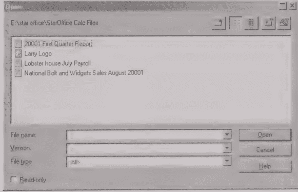

**图 2.12** 使用“打开”对话框定位您希望打开的电子表格。

3. 找到您希望打开的文件后，选择该文件，然后单击“打开”按钮（或双击该文件）。

电子表格文件将在 StarOffice 桌面上的工作区窗口中打开。

> **注意** 您还可以直接从 StarOffice 资源管理器窗口或从 Beamer 窗口中列出的文件打开文件。有关更多信息，请参阅第 1 章中标题为“使用资源管理器”的部分。

## 使用多个窗口

如果您发现 StarOffice 桌面上有多个电子表格打开，您可以轻松操作这些不同窗口的视图。“窗口”菜单为您提供了在 StarOffice 桌面上层叠和平铺打开的电子表格窗口的功能。例如，如果您希望平铺多个打开的电子表格窗口，可以选择“窗口”菜单，然后选择“平铺”。这将按照图 2.13 所示排列各个窗口。

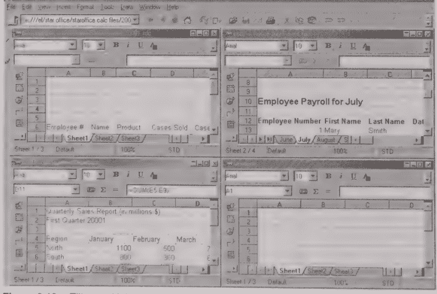

**图 2.13** 平铺多个电子表格窗口只是“窗口”菜单上的一个选项。

您还可以将桌面水平或垂直拆分以查看已打开的电子表格。当您同时打开两个电子表格并希望从一个表格复制信息到另一个表格时，水平或垂直拆分桌面特别有用。本章稍后将在“基本编辑技巧”一节中讨论如何使用复制功能。

如果您在桌面上排列了多个电子表格，那么您可以关闭电子表格窗口（通过单击特定窗口上的关闭按钮），或者将特定电子表格展开以占据整个工作区（通过使用最大化按钮）。如果您希望关闭工作区中所有打开的电子表格（这将返回到 StarOffice 桌面），请依次选择“窗口”菜单，然后选择“全部关闭”。如果您更改了将要关闭的任何电子表格，系统会提示您在电子表格实际关闭之前保存更改。

## 浏览 Calc 电子表格

一旦您构建了多个电子表格，您就会想要查阅其中保存的数据。这意味着您需要在行与行之间、列与列之间移动，甚至可能需要在一个由多个工作表组成的特别大电子表格中，从一个工作表移动到另一个工作表。

虽然您在电子表格中的大多数导航操作只会在相对较小的区域内进行（仅在您已输入信息的单元格中），但您会发现，完全使用鼠标在单元格之间移动可能会变得很累，尤其是在从键盘输入信息时。让我们探索一些使用鼠标和键盘浏览电子表格的不同方法。

## 在单元格之间移动

如前所述，可以使用鼠标在单元格之间移动。只需单击您希望选中的单元格，选择边框就会出现在该单元格周围，表明它现在是活动单元格。您还可以使用垂直和水平滚动条，通过鼠标更改电子表格的视图。这不会改变电子表格中的活动单元格，但它允许您只需单击几下鼠标即可查看电子表格的不同部分。

就键盘而言，有各种不同的组合键可让您在电子表格中从一个单元格移动到另一个单元格，或跨越多个单元格。表 2.1 列出了各种键盘移动组合键。

### 表 2.1 使用键盘移动

| 按键 | 结果 |
|------|--------|
| 向上箭头 | 向上移动一个单元格 |
| 向下箭头 | 向下移动一个单元格 |
| 向右或向左箭头 | 分别向右或向左移动一个单元格 |
| Tab 或 Shift + Tab | 分别向右或向左移动一个单元格 |
| PgUp | 向上移动一屏（约 22 行，取决于行高） |
| PgDn | 向下移动一屏（约 22 行，取决于行高） |
| Home | 移动到行首（当该行有数据时） |
| End | 移动到行尾（当该行有数据时） |
| Ctrl + Home | 移动到单元格 A1 |
| Ctrl + 向右箭头 | 移动到一行中的最后一个输入项，在空列之前 |
| Ctrl + 向左箭头 | 移动到第一个包含数据的列，该列紧接在（右侧的）空列之后 |
| Ctrl + Home | 工作簿中第一个工作表的单元格 A1 |

当您使用键盘在电子表格中移动时，您会希望使用位于键盘上“打字机”键右侧的专用光标移动键。您可能需要将数字小键盘（位于键盘最右侧）保留用于在最初输入电子表格将保存的信息时快速插入数字。请确保 Num Lock 已打开，以便数字小键盘准备好进行数字输入。当 Num Lock 关闭时，您可以像使用键盘上的其他移动键（如箭头键）一样使用数字小键盘。

## 在工作表之间移动

如果您使用的电子表格包含多个工作表，您将需要能够在工作表之间移动。从一个工作表移动到另一个工作表的最简单方法是使用鼠标单击特定的工作表标签。电子表格的所有工作表标签都位于电子表格的左下角。

您还可以使用键盘在电子表格中的工作表之间前后移动。按 Ctrl + Page Up 移动到电子表格中的下一个工作表，按 Ctrl + Page Down 移动到电子表格中的上一个工作表。

## 处理单元格区域

当您使用 Calc 构建电子表格时，您会发现以组为单位处理单元格极为有利；例如，您可能希望对一组单元格执行特定计算，或以特定方式格式化一组单元格。在 Calc（以及电子表格软件中）中，相邻（彼此相邻）单元格的组合称为*区域*。

因此，区域是相邻列和行中的连续单元格的矩形块（尽管在某些情况下，一个单元格也可以视为区域）。您通过确定区域中的第一个单元格和最后一个单元格来指定区域。例如，从单元格 B6 到单元格 D10 的单元格区域将写为 B6:D10。图 2.14 显示了从 B6 到 D10 选中的区域。请注意，区域地址（当选中单元格区域时）会显示在“工作表区域”框中。

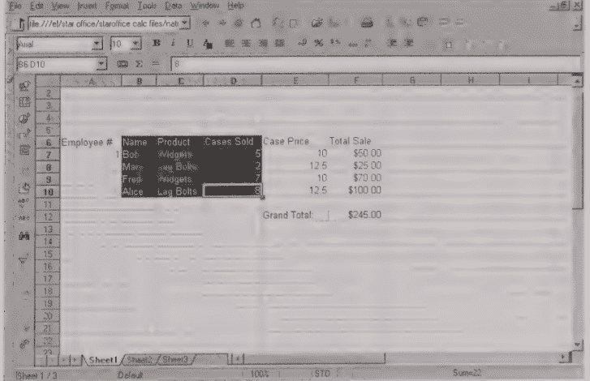

**图 2.14** 单元格区域是连续单元格的组合。

## 选择单元格区域

在大多数情况下，您不会通过实际键入区域的起始和结束地址来指定单元格区域（尽管您可以使用 A1:A5 格式这样做）；您将使用鼠标或键盘来选择单元格区域。

要使用鼠标选择区域，请沿单元格区域单击并拖动鼠标，向下并向右移动以选择从区域起始到结束的所有单元格（这是个人偏好，但似乎在选定单元格区域时总是有效）。

> **注意** 您可以通过单击**工作表选择器**来选择整个工作表。它是位于第一列左侧、第二行上方的方块（这实际上是您可以输入信息的第一行）。它将选中电子表格中的所有单元格。

要使用键盘选择单元格，请确保您位于要开始选择的单元格中，然后按住 Shift 键。当您使用箭头键移动到区域中的下一个单元格时，这些单元格将变为选中状态。继续按住 Shift 键并根据需要使用箭头键，以选中区域中的所有单元格。

请记住，像 End 键这样的按键可用于从电子表格行的左侧快速移动到右侧（或“末尾”）。按住 Shift 键，然后按 End 键，从起始单元格到电子表格中最后一个单元格的所有单元格都将被选中。

## 选择列和行

您还会发现能够选择电子表格中的列和行非常有用。这使您可以对特定列或行应用格式，或插入新行和新列（这将在第 4 章的“插入电子表格元素”一节中讨论）。

要选择列，请将鼠标指针单击在列标题上；例如，要选择整个 D 列，请单击 D 标题，整个列将被选中。您可以类似方式选择电子表格中的行；只需单击该特定行的标题即可。

使用鼠标选择相邻的列或行也非常容易。单击并拖动以选择多列或多行（只需根据需要沿列或行标题拖动鼠标）。

您还可以使用鼠标和键盘快速选择相邻的一组列或行。单击您希望在连续系列中选择的第一个列或行，然后在按住 Shift 键的同时，单击您希望选择的系列中的最后一个列或行。

您还可以使用鼠标选择不相邻的列或行。单击要选中的第一个列或行标题，然后在按住 Ctrl 键的同时单击，以选中其他要高亮显示的列或行。

如果您更喜欢保持双手在键盘上，也可以快速选中包含活动单元格的行或列。要选择列，请按 Ctrl + 空格键；要选择行，请按 Shift + 空格键。

## 基本编辑技巧

在使用 Calc 创建和编辑各种电子表格时，准确输入数据极为重要，尤其是数值和公式，否则电子表格将无法为您提供准确的公式结果。像 Calc 这样的电子表格软件确实信奉“垃圾进，垃圾出”这句格言。

虽然我们已经讨论过基本的数据输入，但让我们来看一些基本的编辑技巧和电子表格维护命令，这些对构建简单和复杂的电子表格都同样有帮助。

### 在数据输入期间编辑

在单元格中输入文本或数值时，如果出错，您确实可以编辑自己的工作。在输入数据时，可以使用 Backspace 键快速后退并删除输入错误。如果已经输入了数据，并移动到了另一个单元格，之后才注意到数据不正确，您有几种不同的选择。

如果输入的数据非常混乱，请单击该单元格并重新输入整个条目。当您按 Enter 或移动到另一个单元格时，原始数据将被新输入的条目替换。

如果数据中只有一两个字符的错误，您可能想要编辑该条目。双击有错误的单元格。插入点将出现在单元格的最右侧。您可以使用鼠标或键盘移动插入点，并更正条目中的错误。直接在单元格中编辑数据时，以下几个按键非常有用：

- 方向键——向右或向左移动一个字符。
- Home——移到条目的开头。
- End——移到条目的结尾。
- Del——删除插入点右侧的字符。

编辑完单元格中的数据后，按 Enter 或单击公式栏上的“接受”按钮，以将更改输入到数据中。

您还可以直接在公式工具栏的输入行上编辑单元格中的数据。选中要编辑的单元格，然后在输入行上单击要放置插入点的位置。在输入行上操作时，可以使用与上述相同的移动键或 Delete 和 Backspace 键。完成更改后，按 Enter 或单击“接受”按钮。

## 清除单元格内容

如果您发现有一个或多个单元格包含不需要的信息，并希望清除其内容，只需选中该单元格（使其成为活动单元格）或单元格区域（将单元格作为区域选中），然后按 Delete 键。“删除内容”对话框将出现，如图 2.15 所示。

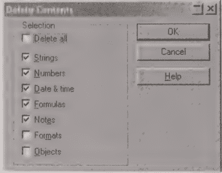

**图 2.15** 使用“删除内容”对话框来确定清除内容时要删除哪些属性。

“删除内容”对话框为您处理从特定单元格删除内容时提供了很大的灵活性。您可以选择删除内容，同时删除已应用于单元格的任何格式（使用“全部删除”复选框），或者您可以更有选择性，只从单元格中删除条目，而保留格式。此对话框甚至允许您限制自己的“删除权限”，例如，您可以指定从选中的单元格中删除数字，但不删除公式。这样，您可以保留选中单元格中的公式，但清除任何其他内容。

通过对话框中的各种复选框做出选择后，单击“确定”按钮，删除将根据您的复选框选择进行。

> **注意** 您会发现，在电子表格首次保存后进行编辑的单元格，在您对其进行编辑更改时会以红色高亮显示。如果将鼠标放在其中一个单元格上，将出现一个信息框，告诉您谁对该单元格进行了更改，以及该单元格的最新更改是什么。

## 复制、剪切和粘贴数据

Calc 使您能够轻松地在电子表格中复制、剪切、粘贴和移动数据。您可以复制、剪切或移动文本条目或值，包括公式和函数（不过，复制和移动公式与函数需要理解单元格引用，这在第 5 章的“创建电子表格公式”一节中讨论）。

您可以将单元格内容从一个单元格复制到另一个单元格，或从一个单元格复制到一个区域。如果将单个单元格的内容复制到多个单元格，最初复制单元格中的数据将被粘贴到该区域中的所有其他单元格中。您还可以将整个单元格区域复制到另一个区域。

1. 单击包含数据的单元格，或选中包含数据的区域。
2. 单击功能工具栏上的“复制”按钮，以复制单元格或区域的内容。
3. 单击要粘贴数据的单元格，或单击要复制到的区域的起始单元格。
4. 单击功能工具栏上的“粘贴”按钮。数据将被复制到新位置。

当您希望将数据从电子表格上的一个位置移动到另一个位置时，可以使用“剪切”命令。选择单元格或单元格区域的方法与使用“复制”命令时相同，但改为单击功能工具栏上的“剪切”按钮。内容将从选中的单元格或区域中移除。

要将信息放置到其他位置，请单击要粘贴数据的单元格，或选中要放置数据的单元格区域。然后使用功能工具栏上的“粘贴”按钮，将信息实际粘贴到适当的位置。

## 更改列宽

刚开始使用 Calc 时，您就会想要了解的一件事是如何更改列宽，以容纳长文本条目或其他不适合默认列宽的数据。默认列宽为 0.89 英寸。

关键问题是：如何知道条目是否无法放入默认列宽？答案很简单。当您在包含长条目的单元格右侧的单元格中输入条目时，您会发现该单元格中的长条目将被截断或切断。

例如，假设您有一个列标题在默认列宽内显示良好，例如 Employee #。但随后您决定将 Employee # 改为 Employee Number（将“number”拼写出来，而不是使用符号）。图 2.16 显示了单元格 A6 中的截断条目。请注意，单元格右侧会出现一个小三角形，提醒您列宽不足以容纳该单元格中的条目。

要快速更改列宽，请将鼠标指针放在需要调整宽度的列与下一列之间的边框上。将显示一个调整大小工具（参见图 2.16）。


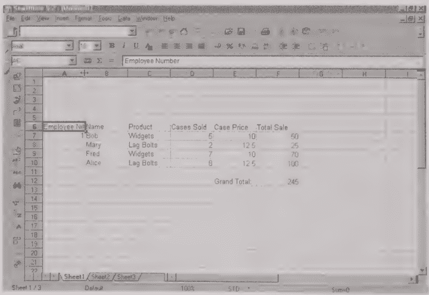

图 2.16 您可以双击列的边框，快速更改列宽以容纳该列中最长的条目。

在列的边框上双击调整大小工具，列宽将被更改以容纳该列中被截断的条目。请注意，这种调整列宽的方法会将列宽更改为容纳该列中最长的条目。当某列中全是数字或其他一两个字符的条目时，这也适用于缩小列宽。

还有其他调整列宽的方法，甚至可以更改列宽所使用的度量单位。更多信息请参阅下一章中标题为“格式化列”的部分。

## 使用撤销、重做和重复

在编辑电子表格（或最初输入数据）时，其他一些方便的工具是撤销、重做和重复。“撤销”命令允许您撤销上一步操作。假设您不小心删除了一个单元格中的内容，而您又希望恢复它。只需单击功能工具栏上的“撤销”按钮，该条目就会返回到单元格中。

如果您发现使用了“撤销”命令，但又决定希望重做通过撤销取消的特定操作（快速说 20 遍），只需单击功能工具栏上的“重做”按钮。您的撤销操作将被反转。

“重复”命令允许您重复上一步操作。例如，如果您插入了一列或执行了其他值得重复的操作，只需单击功能工具栏上的“重复”命令。您还可以通过“编辑”菜单访问撤销、重做和重复命令。

当您选择“编辑”时（参见图 2.17），“撤销”和“重做”命令实际上会包含您上一步操作的描述。例如，图 2.17 显示上一步操作是将某列的宽度调整为最佳大小。要撤销此操作，只需在“编辑”菜单上选择“撤销”。

## 自动填充单元格

虽然严格来说不算编辑技巧，但自动用数据填充单元格的功能是一种有用且省时的技巧，可以帮助您减少电子表格中数据输入错误的可能性。我们将在下一章（在“创建数据序列”一节中）更详细地讨论数据序列及其使用方法。现在，让我们先看一下自动填充功能的几个快速用途。

图 2.17 你可以从“编辑”菜单调用撤销、重做和重复命令，并获取关于你最后一次操作的提示。

假设你希望为员工或客户姓名条目分配编号，这些姓名已经输入到电子表格中。按照以下步骤操作：

1. 在将包含数字序列的区域中，于第一个单元格输入序列的第一个数字（本例中为数字 1）。确保包含第一个数值的单元格为活动单元格。
2. 将鼠标指针放在活动单元格右下角的小方框上。向下或向右拖动该小方框，以选择序列中的其他单元格（参见图 2.18）。
3. 释放鼠标。区域中的其他单元格将自动填入序列中对应的数字。例如，如果你选择 1 作为起始数字，其他单元格将依次填充 2、3 等。

你还可以快速用与月份相关的序列填充单元格。例如，要用从一月到十二月的月份来标记电子表格的列，你只需在第一个列中输入“一月”。然后将鼠标指针放在该单元格右下角的小矩形上，拖动以选择序列中的另外 11 个单元格。这样一年中剩余的月份就会自动填入相应的单元格中。

图 2.18 通过指定起始数字，你可以自动用数字序列填充单元格区域。

图 2.19 熟能生巧！

## 创建你自己的电子表格

本章提供的技术将对你开始创建自己的 Calc 电子表格大有帮助；然而，如果你迫切想创建电子表格，却不知道从哪里入手，不妨练习创建图 2.19 所示的电子表格。

- A 列到 E 列的所有信息都可以按照图 2.19 所示输入。
- 通过双击 A 列的边框，优化了 A 列的列宽。
- 总销售额公式`=D7*E7`在单元格 F7 中创建，然后复制到单元格 F8 到 F10（是的，公式会根据新位置自动调整，这将在第 5 章中讨论）。
- 单元格 F12 中的总计公式使用`SUM`函数创建；只需点击公式工具栏上的求和按钮即可。

创建完成后记得保存电子表格。创建简单的电子表格是熟悉 Calc 基本功能的好方法。我们将在本书的后续章节中探索更高级的电子表格技术。

## 处理单元格、行和列

**本章内容：**

- 设置单元格属性（见第 62 页）
- 设置数字格式（见第 62 页）
- 了解数字格式（见第 65 页）
- 设置字体属性（见第 70 页）
- 使用颜色、边框和背景（见第 74 页）
- 对齐单元格内容（见第 77 页）
- 复制单元格格式（见第 81 页）
- 使用自动套用格式（见第 82 页）
- 设置列宽（见第 83 页）
- 设置行高（见第 84 页）
- 转置行列信息（见第 85 页）

## 设置单元格属性

既然我们已经了解了创建自己电子表格的一些基础知识，接下来让我们看看工作表的不同格式设置选项。你会发现，即使技术上最完善的电子表格，也可能遭到同事或工友的茫然注视；这是因为行和行的数字有一种不可思议的能力，能让除了会计之外的几乎所有人着迷。

然而，有一种方法可以通过格式设置来突出工作表的关键区域。你可以使用字符属性、边框、颜色和其他选项；格式化电子表格能让你使其中的数字数据更具展示性。

> **注意** 单元格格式设置为你提供了一种强调电子表格区域的方法。例如，如果你需要突出“底线”，请使用本章中讨论的某种格式设置选项，确保它在屏幕和打印页面上都能醒目。

图 3.1 展示了一个使用 Calc 提供的多种不同格式设置选项的电子表格。让我们从讨论电子表格中数值的格式设置开始，来了解单元格格式设置。

## 设置数字格式

使用格式设置选项来区分电子表格中不同类型的数值非常有用。你想让任何查看电子表格的人都能轻松区分金额、百分比和物品数量（例如销售的运动鞋或小部件数量）。

你可以在初次将数据输入电子表格时输入每种数据类型；例如，可以在一个单元格中输入`$500,000.00`，在另一个单元格中输入`20%`。但是，这意味着你必须在第一个示例中输入美元符号、逗号和小数点，在后一个示例中输入百分号。

实际上，Calc 让你在输入数据后更轻松地格式化电子表格中的数值（无需你输入美元符号或百分号）。这使你能够格式化整个数字区域，而不必在输入时“创建”格式。而且，如果你重新输入数据或想更改单元格格式，只需更改当前的格式类型，而不必实际重新输入数据来更改格式。

图 3.1 可以使用不同类型的格式设置来增强 Calc 电子表格的视觉效果。

数字格式设置还可以涉及单元格中使用的小数位数。并且请记住，Calc 将日期和时间视为数值。这意味着日期和时间格式设置选项也可用。

你可以通过三种方式设置电子表格中数值（数字、公式和函数）的格式：

- 使用对象工具栏上的格式设置按钮。
- 调用单元格属性对话框。（可以从“格式”菜单打开单元格属性对话框 [选择“格式”，然后选择“单元格”]。）
- 右键单击单元格或单元格区域，从上下文菜单中选择“设置单元格格式”。

### 设置单元格区域的格式

例如，假设你想使用对象工具栏上的“货币”按钮将单元格区域格式化为货币；只需按照以下步骤操作：

1. 使用鼠标或键盘选择要格式化为货币的单元格区域。
2. 点击对象工具栏上的“货币”按钮（参见图 3.2）。这些单元格将被设置为货币格式。
3. 点击电子表格上的任意位置，取消选择该单元格区域。

> **注意** 如果你决定不希望这些单元格使用货币格式（或你选择的任何其他格式），可以点击“撤销”工具，单元格格式将恢复为标准数字格式。

Calc 让你轻松地为电子表格中的数值分配默认数字格式。你可以点击“格式”，然后选择“默认”（这将影响活动单元格或选定的单元格区域），或者右键单击单元格或选定的单元格区域，从出现的上下文菜单中选择“默认”。

## 了解数字格式

默认情况下，电子表格中输入的所有数字都使用**标准**数字格式。该标准格式也称为**常规**数字格式，显示数值时不带小数位，也不带特殊格式（如逗号或美元符号）。

虽然标准、货币和百分比格式可以直接从对象工具栏访问，但其他可用于数字的格式都在“单元格属性”对话框中。

### 应用单元格数字格式

1. 选择要为其分配数字格式的单元格或单元格区域。
2. 选择“格式”菜单，然后选择“单元格”。或者，右键单击选定的单元格或单元格区域，从上下文菜单中选择“设置单元格格式”。出现“单元格属性”对话框（参见图 3.3）。
3. 确保“单元格属性”对话框中已选中“数字”选项卡。要查看特定类别中可用的数字格式，在“类别”框中选择一个类别（例如“货币”）。特定类别可用的格式将显示在“格式”框中。
4. 使用“选项”框设置选项，例如小数位数或允许的前导零数量。
5. 选择格式并为该格式设置选项后，点击“确定”，将格式应用到选定的单元格或单元格区域。

“单元格属性”对话框还提供了一个下拉列表，允许您更改用于某个单元格区域数字格式化的语言。例如，如果您希望选择西班牙语作为语言，请单击下拉列表并选择西班牙语。

> **注意** 当您选择特定的数字格式时，单元格属性对话框的预览框中会提供该格式的预览。

## 应用货币格式

在货币格式方面，您还可以选择特定单元格中使用的货币类型（以及整体货币格式）。例如，如果您使用的是南非兰特（而非美元），则应在“单元格属性”对话框中“格式”框顶部的下拉列表中选择兰特作为您的货币类型。

正如您可能已经在“单元格属性”对话框的“类别”框中所看到的，数字格式提供了多种类别。表 3.1 简要描述了每种格式类别（不包括本章稍后讨论的日期和时间格式）。图 3.4 展示了各种格式类别的示例。

## 表 3.1 数字格式及其工作原理

| 格式类别 | 工作原理 |
| --- | --- |
| 数字 | 按您输入的方式显示数字（取决于列宽）。此类别包含“常规”格式作为数字的默认格式。 |
| 百分比 | 将数字显示为带有百分号的百分比。要得到 79% 的百分比，您需要输入`.79`。 |
| 货币 | 在条目开头放置美元符号（如果使用美元），并在数字中添加逗号。放置小数点和两位小数（货币的典型格式）。其他货币选择基于不同的货币体系，如英镑或法郎。 |
| 科学记数 | 使用指数显示数值。 |
| 分数 | 将数值显示为分数（例如，`.75`显示为¾）。 |
| 布尔值 | 允许您将单元格或单元格区域格式化为布尔值。此格式用于电子表格中放置的逻辑语句，且值可以是与布尔参数相关的`TRUE`或`FALSE`。 |
| 文本 | 按您输入的方式显示数值，但将数值格式化为文本，这意味着这些值不再适用于公式或函数。Calc 将格式化为“文本”的单元格视为文本条目。 |

## 图 3.4 Calc 提供了多种不同的数字格式类别，且每个类别内有多种格式选项

每个类别提供了多种不同的格式可能性，包括显示负值的不同方式以及可用的小数位数。显然，某些格式更适合特定的用途，例如“货币”和“百分比”格式。请记住，就“原始”数值而言，最佳格式是“常规”格式（即默认格式）。

请务必记住：如果您在特定单元格中输入的数值在应用特定格式后超出了该列设置的列宽，则单元格中将显示一系列井号（`#`）。这意味着需要调整列宽以容纳该数值及其格式。只需双击列边框即可将列设置为容纳该列中最大的条目。有关更改列宽的更多内容将在本章稍后讨论。

## 应用小数位和前导零

关于小数位和前导零需要说明几句。您可以使用对象工具栏上的“增加小数位数”工具或“减少小数位数”工具，快速更改特定数字格式的小数位数。选择您希望更改小数位数的单元格或单元格区域，然后单击适当的按钮以添加或删除小数位。

例如，要更改“单元格属性”对话框中某数字格式包含的小数位数或前导零，请选择该数字格式，然后分别使用“格式”框中的“小数位数”或“前导零”点击框。

## 应用日期和时间

日期和时间条目也有多种可用格式，它们值得特别讨论。实际上，计算机将日期视为自 1899 年 12 月 31 日以来经过的天数（1900 年 1 月 1 日被视为第 1 天）。

您可以使用`M/D/YY`格式（这是 Calc 电子表格中日期的默认格式）将日期输入到 Calc 电子表格中；例如，`03/12/01`。或者，您可以缩写或拼写出月份。例如，条目“Jan 5 01”将被 Calc 识别为日期，并在电子表格单元格中转换为`01/05/01`。

还有许多其他可用的日期格式，如 December 31, 1999（月份完整拼写，日期与四位年份之间用逗号分隔）、Fri, Dec 31, 99，以及包含当前时间的日期格式。

Calc 也将时间视为数值；它被视为一个十进制值，代表自午夜以来已过去的一天中的百分比。例如，`.50`表示中午 12 点。幸运的是，时间值将以类似于数字时钟上显示的格式出现。提供的时间格式包括`HH:MM`（小时和分钟）和`HH:MM:SS`（小时、分钟和秒）。

当您将时间输入到电子表格中时，请以`HH:MM`格式输入小时和分钟。如果您希望将时间与日期一起包含在内，请格式化包含日期的单元格以显示输入单元格信息的时间（使用“单元格属性”对话框选择适当的日期格式）。

## 创建您自己的格式

虽然内置的数字格式可能绰绰有余，但您可能会遇到需要更改某个默认格式以满足您的数值格式化需求的情况。当您更改现有格式时，Calc 会自动为您开始创建一个用户自定义类别。您的新格式（基于您编辑的默认格式）将出现在“单元格属性”对话框的“用户自定义”类别下。创建新格式后，您可以根据需要将其分配给电子表格中的其他单元格。您也可以从头开始创建用户自定义格式，步骤如下：

1. 打开“单元格属性”对话框并选择“用户自定义”类别。您现在可以在“格式代码”框中创建自己的格式。
2. 使用井号（`#`）作为用户自定义格式中的数字占位符。句点用于放置小数点，后跟您希望格式中具有的小数位数。新代码的小数位数使用“格式”框中的“小数位数”点击框进行设置。表 3.2 提供了一些可用于创建自己格式的代码。

   > **注意** 学习如何创建自己格式的最佳方法是查看 Calc 为不同数字格式创建的格式代码。然后，您可以将这些格式代码中的任何一个作为起点，来创建您需要的特殊格式。
3. 在“格式代码”框中创建好您的特殊格式后，单击“确定”以将该格式分配给当前活动的单元格或单元格区域。您现在可以使用该特殊格式来格式化当前电子表格中的其他单元格。

## 表 3.2 格式化代码

| 格式类型 | 代码 | 示例 | 用途 |
| --- | --- | --- | --- |
| 数字 | `#` | `#,###` | 数字占位符；此特定示例不提供小数位，但在千位处插入逗号。代码中放置的 `#` 数量不会限制您在以此代码格式化的单元格中可以输入的字符数。 |
| 货币（美元，美国） | `$` | `$###.##` | 指定 `$` 后面的数字格式应格式化为美国货币。 |
| 货币（英镑，英国） | `£` | `£###.##` | 指定此货币格式用于英国（大不列颠）英镑。 |
| 百分比 | `%` | `0.000%` | 此示例将创建一个包含三位小数的百分比格式。 |
| 日期（月） | `M` | `M/D/YY` | 当前月份将显示为一位或两位数字。 |
| 日期（日） | `D` | `M/D/YY` | 日期将显示为一位或两位数字。 |
| 日期（年） | `Y` | `M/D/YY` | 年份将显示为两位数。例如，2001 年将显示为 01。 |
| 时间（小时） | `H` | `HH:MM` | 小时将显示为两位数。 |
| 时间（分钟） | `M` | `HH:MM` | 分钟将显示为两位数。 |

> **注意** 如果需要设置欧元货币格式，请使用以下代码：`#.##0,00 "EUR";[ROT]-#.##0,00 "EUR"`。在数字格式下的 EUR 类别中还可以找到两个预制的欧元代码。

## 使用字体属性

虽然数值格式是设计电子表格的重要方面，但另一种强调电子表格中某些条目并使其更易读的方法是使用字体属性。字体属性包括实际字体样式（如 Arial 或 CG Times）、字符大小以及其他字符属性，如粗体和下划线（颜色也是一种字体属性，但将在“使用颜色、边框和背景”一节中讨论）。

您可以为电子表格中包含文本或数值的单元格指定字体属性。更改单元格或选定单元格区域字体属性的最快方法之一是使用对象工具栏上的字体工具。图 3.5 展示了这些字体工具的视图。

例如，如果要更改选定单元格区域的字体类型，请选择这些单元格，然后点击“字体名称”下拉框并选择新的字体类型（下拉列表中每种字体的“外观”都会显示出来）。选定的单元格将应用新选择的字体类型。

您还可以使用“字体大小”下拉框快速更改字体大小。只需选择单元格即可。Calc 中的默认字体大小为 10 磅（一英寸包含 72 磅）。虽然这个字体大小在屏幕上看起来不错，但打印电子表格时您可能会发现它稍小。12 磅字体大小被认为是打印电子表格的标准，大致相当于旧式打字机上使用的 10cpi 字体（用于商业信函）。

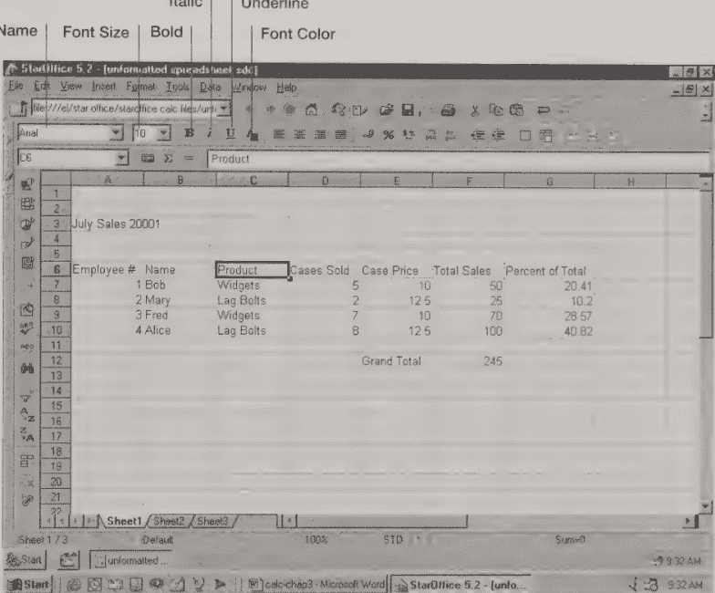

**图 3.5** 对象工具栏提供了字体工具，可轻松更改字体属性。

使用对象栏上的粗体、斜体和下划线工具与我们所讨论的其他字体工具类似。选择要设为粗体、斜体或下划线的单元格，然后点击对象栏上相应的工具。请记住，这些工具的操作类似于“切换开关”——点击一次开启，再次点击关闭。

> **注意** 您会发现电子表格中过多的字体格式可能会分散注意力。建议最多只使用一两种字体，并且仅在真正能提升电子表格效果时才使用粗体、斜体和颜色。

您还可以通过“单元格属性”对话框的“字体”选项卡来更改单元格或选定单元格的字体属性。该选项卡提供了一些对象工具栏上没有的字体格式选项。

### 更改字体属性

1. 选择要更改字体属性的单个单元格或单元格区域。
2. 右键单击单元格或单元格区域，然后从上下文菜单中选择“设置单元格格式”。“单元格属性”对话框将出现。
3. 在对话框中选择“字体”选项卡（见图 3.6）。

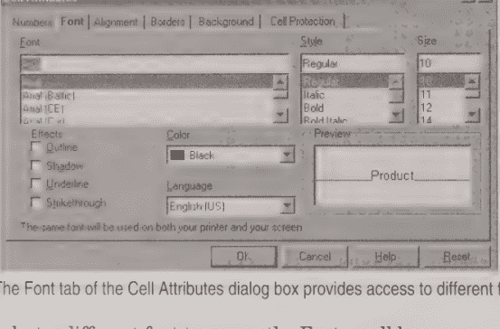

4. 要选择不同的字体类型，请使用“字体”滚动框。
5. 要更改字体样式（如粗体、斜体或两者兼有），请使用“样式”滚动框。
6. 要更改字体大小，请使用“大小”滚动框。

“预览”区域会显示您在字体类型上所做的更改将如何影响正在设置格式的单元格或单元格区域中的数据。您还会发现“字体”选项卡的“效果”框中列出了特殊字体效果复选框。这些效果为您提供了额外的选项，以引起对电子表格某些区域的注意。特殊效果包括：

- 轮廓——此效果仅显示单元格或单元格区域中字符的轮廓（此效果的有效性会因字体而异）。
- 阴影——在单元格中的数据字符之间放置阴影。
- 下划线——为单元格或单元格区域中的字符和空格添加下划线。
- 删除线——在单元格或单元格区域中的字符上画一条线。


在“字体”选项卡上完成字体相关选择后，您可以点击“确定”关闭“单元格属性”对话框。这将返回到电子表格，您的字体更改将显示在活动单元格或选定区域上。

当您在单元格的编辑模式下时，也可以访问特定单元格中字符的字体属性。例如，要更改正在处理的单元格中某个选定单词或字符串的字体属性，您可以选择该项目，然后右键单击该选择。出现的上下文菜单提供了“字体”、“大小”和“样式”选项，这些选项提供了子菜单（包括我们所讨论的所有不同样式选项，如粗体、下划线、阴影等）。

如果希望为选定的文本或字符串打开单独的“字体”对话框，请在上下文菜单中点击“字符”。图3.7显示了“字体”对话框。它包含与“单元格属性”对话框的“字体”选项卡相同的选择，但可用于更改单元格内单个字符或字符串的字体属性（而不是由“单元格属性”对话框的“字体”选项卡处理的特定单元格中所有数据的字体属性）。

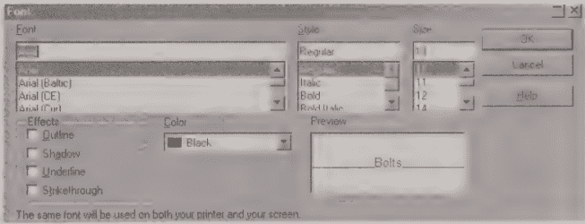

图3.7 “字体”对话框提供了对单元格内选定文本和其他字符属性的访问。

在此对话框中完成选择后，点击“确定”返回到电子表格。请记住，只有单元格内选中的文本或字符的字体属性会通过此特定对话框进行更改。

## 使用颜色、边框和背景

另一种强调电子表格中的单元格或单元格区域并美化整体演示效果的方法是使用颜色、边框和背景。字体颜色允许您更改单元格或单元格区域中字体的实际颜色。边框可用于分组某些单元格或突出显示单个单元格。而背景则提供了使用颜色强调单元格的能力。

这些单元格属性都可以通过对象栏上的相应工具进行访问。这些功能也可以在“单元格属性”对话框的各个选项卡上找到。

### 更改字体颜色

字体颜色是一种字体属性，用于更改单元格或单元格区域中字体的颜色。您可以使用对象工具栏上的“字体颜色”下拉工具来更改活动单元格或选定单元格区域的字体颜色。

1. 选择单元格或单元格区域，然后点击“字体颜色”工具。
2. 将出现一个调色板（见图3.8）。
3. 点击要选择的颜色。选定单元格或单元格区域的字体将被更改。


图3.8 “字体颜色”工具可用于更改单元格或单元格区域的字体颜色。

与其他字体属性一样，您也可以在“单元格属性”对话框的“字体”选项卡上访问字体颜色。如果只想更改单元格中部分数据的字体颜色，请选择该数据，然后右键单击。选择“字符”，然后使用“字体”对话框更改颜色。

### 更改边框

边框可以按以下方式应用于电子表格中的单元格或单元格区域：

1. 选择单元格或单元格区域，然后点击对象工具栏上的“边框”工具。

   将出现一个边框面板，提供12种不同的边框样式。

2. 选择要用于选定单元格或单元格区域的边框样式。

   如果希望从已设置边框的区域中移除边框，可以使用边框面板上的第一个边框样式，即“无边框”。使用“边框”工具为单元格或单元格区域添加边框时，默认线条样式为0.05磅，默认线条颜色为黑色。

您可以通过打开“单元格属性”对话框来访问更多与边框相关的选项（选择“格式”，然后“单元格”，或右键单击单元格区域并选择“设置单元格格式”）。点击“边框”选项卡以访问与边框相关的设置（见图3.9）。

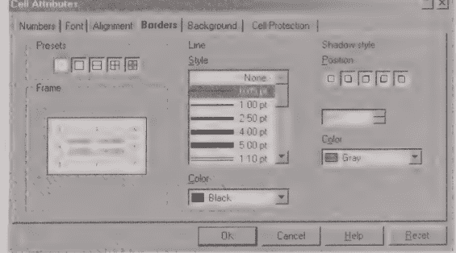

图3.9 “边框”选项卡提供了对与边框相关的所有设置的访问。

您可以在此选项卡上从五种预设边框样式中进行选择（第一个预设为“无边框”），或者创建自己的边框样式。“边框”工具可用于放置自己的边框线。例如，要在边框两侧创建垂直线，请点击边框的左上角。将出现一条垂直线。然后，点击边框的右上角。右侧也会出现一条垂直线（见图3.10）。

图 3.10 你可以使用边框工具创建自定义边框。

还可以通过单击框架的顶部或底部来放置水平线（单击顶部或底部的中间位置来创建水平线）。如果你想要清除框架，可以单击“无边框”预设，或者单击选项卡上的重置按钮来重置你所做的所有更改。

要为自定义边框选择线条样式，请使用“样式”滚动框来选取边框的线宽。线条颜色通过选项卡上的“颜色”下拉框控制。只需单击下拉框并选择你希望使用的颜色。

你还可以选择为单元格边框添加阴影。系统提供了五种阴影样式（用于在框架上放置阴影）：无阴影、右下角、右上角、左下角和左上角。“大小”点击框允许你增大或减小阴影的尺寸。你还可以在“边框”选项卡的“阴影样式”区域使用“颜色”下拉列表为阴影选择颜色（默认颜色为灰色）。

在“边框”选项卡上选择好边框的各项选项后，单击“确定”按钮。你将返回到电子表格，边框将显示在所选单元格或单元格区域中。

## 更改背景

背景为你提供了一种为电子表格添加颜色的绝佳方式。你可以使用对象工具栏上的“背景颜色”工具快速为所选单元格或单元格区域添加背景颜色。单击该工具时会出现一个调色板。只需从调色板中选择一个背景颜色。

> **注意**  
> 在电子表格中使用背景颜色时，你可能会发现有必要同时更改受影响单元格的字体颜色。背景颜色可能会遮蔽屏幕上和打印出来的电子表格中的某些字体颜色。

背景颜色也可以在“单元格属性”对话框的“背景”选项卡上选择（参见图 3.11）。该选项卡为你提供了一个预览框，让你可以仔细查看所选定的背景颜色。从调色板中选定颜色后，单击“确定”关闭“单元格属性”对话框并返回到电子表格。

> **图 3.11**  
> 背景颜色可以在“单元格属性”对话框的“背景”选项卡上选择。

## 对齐单元格内容

你可能已经感受到了 Calc 对文本和数字条目处理方式的差异。实际上，当你输入文本时，Calc 会将其对齐到单元格的左侧，而数值则对齐到单元格的右侧。你可以使用对象工具栏上的对齐工具快速更改文本和数值的水平对齐方式（参见图 3.12）。

> **注意**  
> 请记住，默认情况下提供了对齐方式以区分文本条目和数值。如果你更改了单元格中数据的对齐方式，就无法再使用对齐方式作为单元格包含何种信息类型的指示了。

提供的水平对齐工具有：

- **左对齐** — 将数据对齐到单元格的左侧。
- **水平居中** — 将数据在单元格中居中对齐。
- **右对齐** — 将数据在单元格中右对齐。
- **两端对齐** — 此选项将单元格中的条目两端对齐（左右两侧均匀对齐）。

图 3.12 对象工具栏提供了对齐工具，可以轻松更改单元格数据的水平对齐方式。

如果选择“左对齐”作为对齐设置，你还可以确定数据距离单元格左侧的缩进量。使用对象栏上的“增加缩进”工具来增加缩进，使用“减少缩进”工具来减少缩进。每次单击“增加缩进”工具，缩进量增加 10 磅（约为 .14 英寸；一英寸为 72 磅）。

你还可以控制电子表格单元格中数据的垂直对齐方式。对象栏上提供了三种垂直对齐工具（参见图 3.13）。垂直对齐工具有：

- **顶端对齐** — 将数据放置在单元格的顶部。
- **垂直居中** — 将数据在单元格中垂直居中对齐。
- **底端对齐** — 将数据放置在单元格的底部（默认设置）。

你会发现当增加单元格高度时，垂直对齐的效果更为明显（也更明显）。在采用默认行高的单元格中更改数据的垂直对齐方式，最多只能看到极小的变化。

你还可以使用“单元格属性”对话框的“对齐”选项卡来控制单元格内容（或整个单元格区域内容）的垂直和水平对齐方式。打开“单元格属性”对话框（格式 → 单元格），然后单击“对齐”选项卡（参见图 3.14）。

图 3.14 水平和垂直对齐选项也可以在“对齐”选项卡上访问。

“对齐”选项卡包含了对象栏工具上可用的对齐选项，还增加了一些额外的增强功能。例如，“水平”框中有一个“默认”对齐选项，可以将数据恢复为默认对齐方式（文本左对齐，数值右对齐）。

此外，如果你在“水平”框中选择“左对齐”，你还可以设置单元格中数据距离左侧的缩进量。使用“缩进”点击框来确定左侧缩进的磅数。

“单元格属性”对话框的“对齐”选项卡还提供了一个额外的垂直对齐选项。“垂直”框中的“标准”垂直对齐将垂直对齐设置为默认设置（实际上是单元格的底部）。

关于“对齐”选项卡上的其他功能，如与网格线的距离、文本方向和文本流动，也应简要提及。这些功能为你提供了在电子表格单元格中调整文本方向的其他方式。这些功能将在第 4 章的“使用特殊对齐设置”一节中介绍。

## 复制单元格格式

实际上有一个巧妙的小技巧，可以将格式从一个单元格复制到另一个单元格或单元格区域。它涉及使用“复制”命令和“选择性粘贴”命令。

### 复制单元格格式的步骤

1. 选择你要复制格式的单元格。
2. 单击对象工具栏上的“复制”工具，或选择“编辑”→“复制”。
3. 选择要复制格式的单元格或单元格区域。
4. 选择“编辑”菜单，然后选择“选择性粘贴”。“选择性粘贴”对话框将出现。
5. 清除“选择性粘贴”对话框中除“格式”复选框外的所有复选框（参见图 3.15）。
6. 单击“选择性粘贴”对话框中的“确定”按钮。
7. 复制的格式将被赋给在使用“选择性粘贴”对话框之前所选定的单元格或单元格。

> **图 3.15**  
> 你可以使用“选择性粘贴”对话框来粘贴格式。

> **注意**  
> 你的不同格式设置也可以保存为样式，这实际上是将不同的格式选项作为一组属性“包”赋给单元格的更好方式。Calc 样式将在第 7 章“使用样式和模板”中讨论。

## 使用自动套用格式

快速为电子表格添加格式的绝佳方式是使用“自动套用格式”。它允许你突出显示电子表格的某些区域，并用颜色和底纹进行美化，而无需自行确定电子表格的整体格式策略。

### 使用自动套用格式的步骤

1. 选择要格式化的单元格区域（通常是整个电子表格）。
2. 选择“格式”菜单，然后选择“自动套用格式”。“自动套用格式”对话框出现（参见图 3.16）。

“格式”滚动框中提供了多种不同的自动套用格式。要在“预览”框中查看特定自动套用格式的预览，请选择该特定的自动套用格式。

> **图 3.16**  
> 自动套用格式可用于快速将不同的格式选项赋给你的电子表格。

3. 如果只想使用特定自动套用格式提供的部分格式，请单击“自动套用格式”对话框中的“更多”按钮。例如，你可以使用自动套用格式的数字格式和边框，但选择不使用提供的字体或对齐方式。

对话框底部将出现一个“格式”框（参见图 3.17），提供各种属性的复选框（如数字格式或边框），这些是自动套用格式的一部分。

4. 如果不希望在将自动套用格式赋给电子表格时分配某个特定属性，请取消选中任何相应的格式复选框。

> **图 3.17**  
> 您可以在将自动格式应用到电子表格时，决定使用哪些格式属性。

5. 在“自动格式”对话框中，选定一种自动格式并取消选中不希望作为自动格式组成部分的任何属性后，单击“确定”按钮。该自动格式将被应用到您所选的单元格区域。

## 创建自动格式

您还可以将自己的自动格式添加到“自动格式”对话框中。

1. 使用各种格式属性（如字体、边框、背景色）对电子表格中的单元格进行格式化。
2. 选择单元格区域。
3. 打开“自动格式”对话框，然后单击“添加”按钮，将此格式保存为自动格式。此时将打开“添加自动格式”对话框。
4. 在框中输入新自动格式的名称，然后单击“确定”。您的新自动格式将被添加到自动格式列表中。

## 设置列宽

您会发现，当对单元格使用不同的格式选项时，尤其是数字格式和文本属性（如粗体或更大的字体大小），列可能无法再容纳内容。列中单元格的数据将被截断（显示为被切断）。如果数据已经分配了数字格式，则会在单元格宽度范围内显示一系列井号（###），提示您列宽过窄。

设置列宽有多种选择。其中一种最快捷的方法是将列宽调整为适合该列中最宽内容的宽度，即双击该列的边框（其标题与右侧列之间的边框）。此方法也可用于更改任意数量选中列的宽度。

> **注意**  
> 如果您希望更改将一列或多列的宽度设置为最长内容的最佳宽度时所提供的额外间距量，请选择“格式”，指向“列”，然后选择“最佳宽度”。您可以使用“最佳宽度”微调框来增加或减少最佳宽度设置所提供的额外间距。

您还可以通过单击并拖动列边框上的大小调整工具来调整列宽。这使您可以“直观地”设置列宽。此方法也可用于多列，在更改所选列中任意列的列宽之前先选中这些列。

作为设置列宽的另一种选择，您可以打开“列宽”微调框，为一列或任意数量选中的列设置列宽。选择要格式化的列，然后选择“格式”菜单。在“格式”菜单中，指向“列”，然后选择“宽度”。此时将出现“列宽”对话框（见图 3.18）。

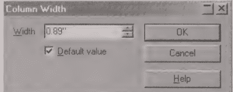

图 3.18 使用“列宽”对话框设置一列或多列的宽度。

如果您希望为选定的列设置不同的宽度，请取消选中“默认值”复选框，然后使用单击箭头来增加或减少列宽。完成新设置的选择后，单击“确定”。

## 设置行高

行高可以调整，与列宽类似。当您对某行中的信息使用较大的字体大小，或希望将大量文本换行显示在某个单元格中时（这将在下一章中讨论），这会很有用。

您可以双击某行与其下一行之间的边框，以选择适合文本、数值或放置在某单元格或某行单元格中的其他对象（如图表）的最佳行高。您也可以拖动行的边框来更改行高。

与列宽设置类似，系统提供了两个对话框用于设置行高。“行高”对话框允许您使用微调框设置一行或多行的行高。

选择“格式”菜单，指向“行”，然后选择“高度”以打开“高度”微调框（见图 3.19）。您可以设置新的默认行高，或取消选中默认值并使用单击箭头为所选行设置新的高度。

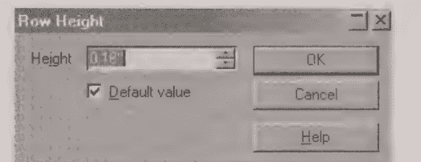

图 3.19 使用“行高”对话框设置一行或多行的高度。

如果您希望在使用行的最佳高度设置时更改所提供的额外间距量（双击行边框并适应该行中最高的内容），请选择“格式”菜单，指向“行”，然后选择“最佳高度”。使用微调框设置行以最佳格式显示时将提供的额外间距量。

> **注意**  
> 当您选择行或列时，实际上是在选择单元格区域。您还可以使用单元格属性（通过对象工具栏或“单元格属性”对话框）来格式化行和列。

## 转置列和行信息

我们在将单元格格式从一个单元格复制到另一个单元格时，已经快速了解了“选择性粘贴”对话框。“选择性粘贴”对话框还提供了转置列和行信息的选项。例如，假设您在电子表格中设置了几列标题，但后来决定它们应该是行标题。那么，与其将它们逐一从列复制到行，不如将电子表格中的所有信息从列转置到行（或反之）。

例如，假设我们要将列标题转置为行标题。图 3.20 显示了一组列标题（月份）以及将列标题转置到新位置后将得到的行标题。

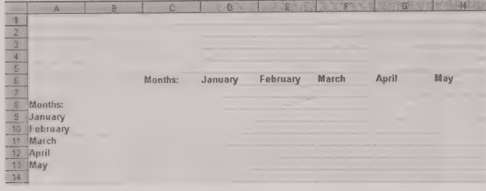

图 3.20 您可以将列标题转置为行标题，或反之。

1. 选择要转置为行标题的列标题。
2. 单击对象工具栏上的“剪切”工具，或按键盘上的 `Ctrl + X`。列标题将从电子表格中剪切。
3. 单击要开始放置行标题的单元格（在第一行中）（这些行标题将从剪切的列标题转置而来）。
4. 选择“编辑”菜单，然后选择“选择性粘贴”。此时将出现“选择性粘贴”对话框（见图 3.21）。


图 3.21 使用“选择性粘贴”对话框转置列标题和行标题。

5. 如有必要，选中“粘贴全部”复选框（或选中要在转置期间粘贴到单元格中的字符和格式属性对应的复选框）。
6. 在“选择性粘贴”对话框的“选项”区域中，选中“转置”复选框。
7. 在对话框中单击“确定”。标题将被转置到行中（从您在第一行中选择的单元格开始）。

您可以通过执行以下步骤将行标题转置为列标题。当然，您首先需要选择并剪切行标题，然后将它们转置到希望其位于的列中。

# 增强您的电子表格

本章内容：

- 插入电子表格元素（见第 90 页）
- 重命名工作表（见第 94 页）
- 删除元素（见第 94 页）
- 隐藏行和列（见第 96 页）
- 隐藏工作表（见第 97 页）
- 保护单元格（见第 98 页）
- 合并单元格（见第 102 页）
- 对齐合并单元格中的信息（见第 102 页）
- 使用特殊对齐设置（见第 103 页）
- 使用查找和替换功能（见第 105 页）
- 使用拼写检查和自动拼写检查（见第 109 页）
- 使用自动更正（见第 110 页）
- 使用同义词库（见第 112 页）
- 追踪更改（见第 113 页）
- 插入批注（见第 117 页）

## 插入电子表格元素

在上一章中，我们了解了处理单元格、行和列的一些基本方面。在本章中，我们将继续介绍可用于增强电子表格的命令，无论是在创建电子表格的初期还是在编辑过程中。在创建电子表格时，您会发现有时需要在电子表格中插入某个元素，例如一列或一行单元格。在较大的电子表格中，您可能还需要向电子表格添加额外的工作表。让我们来看看插入不同电子表格元素的方法和途径。

## 插入单元格

要定位新单元格的插入点并确定要插入的单元格数量，请在电子表格中选择一个或多个单元格。

您可以在电子表格中插入单个或多个单元格。被插入操作所移位的单元格可以向下或向右移动。右键单击选中的单元格。在出现的上下文菜单中，选择“插入单元格”。此时将出现“插入单元格”对话框（见图 4.1）。

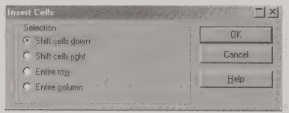

图 4.1 您可以在电子表格中插入单元格，并将当前单元格向下或向右移动。

选择“单元格下移”或“单元格右移”选项按钮，以选择在向工作表中添加新单元格时如何移位当前单元格（您还可以选择在所选单元格处添加整行或整列；我们将在接下来的两节中讨论这些选项）。单击“确定”。新单元格将被插入到工作表中。

您会发现，在电子表格中输入大量数据时，插入单元格特别有用，尤其是当您发现不小心输入了一行或一列偏移了一个或多个单元格的信息时。您可以通过插入一个或多个单元格并将当前数据向下或向右移动，将数据移到正确的位置。然后，您可以在新单元格中输入适当的数据。

## 插入列

在编辑和完善电子表格时，“事后”插入列非常容易。你可以在当前工作表中添加单列或多列。

通过单击列标题或拖动选择多个列标题，分别选择一列或多列。你选择的列数将决定创建的新列数。


要插入一列或多列，选择“插入”，然后选择“列”。新列或新列将插入到选定列的左侧。图 4.2 显示了一个电子表格，其中插入了两个新列（在插入新列之前选择了 C 列和 D 列）。

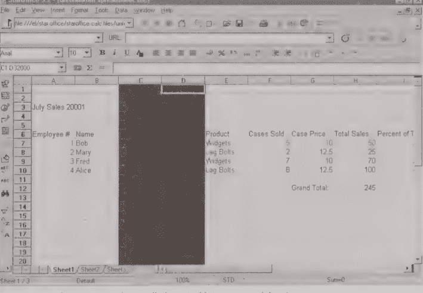

图 4.2 可以轻松地将列插入电子表格。

插入新列的好处在于它们不会删除或覆盖电子表格中已有的数据。你应该记住，插入列可能会破坏使用绝对引用的公式或函数（我们将在第 5 章讨论单元格引用）。

> **注意** 你还可以使用上下文菜单快速地将列插入电子表格。只需右键单击选定的列，然后单击“插入列”。

## 插入行

你也可以根据需要向电子表格中插入新行。这与添加新列的方式大致相同。

选择你希望在其上方添加新行或多行的行。你选择的行数将决定添加的行数。

选择“插入”菜单，然后选择“行”。新行将被添加到电子表格中。你还可以使用上下文菜单添加行。但是，当你在选定行上右键单击时，你会发现上下文菜单上没有“行”选项。只需单击“单元格”，由于选中了整行（或多行），整行（或多行）单元格将被添加到电子表格中。

## 插入工作表

如果你正在使用包含多个工作表的电子表格，你可以根据需要添加额外的工作表。新工作表可以是空白工作表，也可以将现有电子表格中的工作表插入到当前电子表格中。

使用“工作表”选项卡选择将作为新工作表插入点的工作表。新工作表可以放置在当前选定工作表之前或之后。

选择工作表后，选择“插入”菜单，然后选择“工作表”。“插入工作表”对话框将出现（参见图 4.3）。

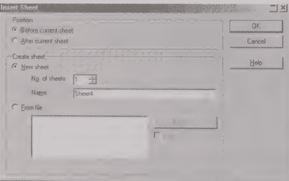

图 4.3 你可以将工作表添加到电子表格中。

使用适当的选项按钮在之前或之后插入新工作表。“工作表数量”微调框用于指定你要添加的新工作表数量。

默认情况下，工作表会被赋予指定要添加到电子表格中的工作表编号的名称（在图 4.3 的情况下，它是 `Sheet4`）。如果需要，你可以使用“名称”框为新工作表提供名称。

要从现有电子表格插入工作表，单击“从文件”选项按钮。然后你可以使用“浏览”按钮打开“插入”对话框（参见图 4.4）。

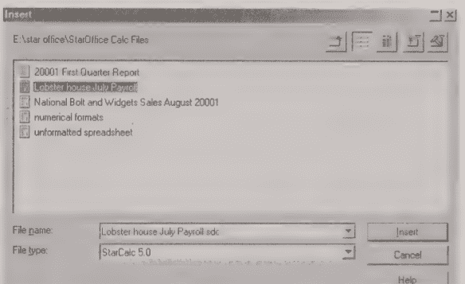

使用“插入”对话框定位包含你要插入到当前电子表格中的工作表或工作表的电子表格。找到并选择电子表格后，单击“插入”按钮。

所选电子表格中包含的所有工作表将列在“从文件”列表框中（参见图 4.5）。要插入特定工作表，单击列表中的工作表名称。要从电子表格插入多个工作表，单击以选择该工作表（如果误选了工作表，再次单击该工作表即可取消选择）。

当你准备好插入工作表时（如果选择了“新工作表”选项，则为新工作表；如果选择了“从文件”选项，则为文件中的现有工作表），单击“确定”。工作表将被插入到电子表格中，位于当前工作表之前或之后（取决于你选择的插入新工作表或工作表的方式）。

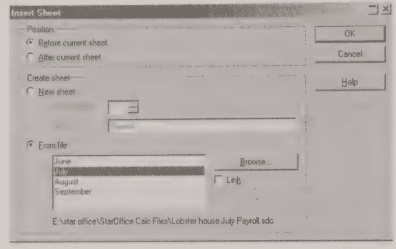

图 4.5 从现有 Calc 电子表格中选择要插入的工作表。

## 重命名工作表

当你构建包含多个工作表的复杂电子表格时，你很可能希望将工作表命名为默认名称（如 `Sheet1`、`Sheet2` 等）以外的名称。如你在上一节中学到的，你可以在将新工作表插入电子表格时为其提供自定义名称。

但是现有的工作表怎么办呢？实际上，你有两种选项来重命名电子表格中的任何工作表。要重命名活动工作表，选择“格式”菜单，指向“工作表”，然后单击“重命名”。“重命名工作表”对话框将出现。

输入工作表的新名称并单击“确定”。你还可以通过直接在工作表选项卡上编辑名称来快速更改电子表格中任何工作表的名称。按住键盘上的 `Alt` 键，然后单击任何工作表的名称。名称将被高亮显示。输入新名称以替换当前名称。

## 删除元素

删除单元格、行和列与将它们添加到电子表格中一样简单。我们在第 2 章中已经讨论了删除单元格或单元格的内容。

在这种情况下，我们实际上是从电子表格中移除一个元素，例如单元格、列、行或工作表。请注意，当你从工作表中实际删除这些元素之一（特别是单元格、列或行）而不仅仅是删除涉及的单元格或单元格的内容时，电子表格的其他内容将被移动以填充被移除项目留下的“空白”。让我们来看看如何移除这些电子表格元素。

## 删除单元格

删除单元格或单元格最直接的方法是选择单元格或单元格，然后在其上单击右键。上下文菜单将打开。在上下文菜单中选择“删除单元格”。“删除单元格”对话框将出现（参见图 4.6）。


图 4.6 从工作表中删除单元格时，你选择如何填充空白。

选择适当的选项按钮，使与被删除单元格相邻的单元格向上或向左移动（“上移单元格”或“左移单元格”）。你还可以删除所选单元格所在的整行或整列（或所选单元格所在的整行或整列）。选择“删除整行”或“删除整列”选项。

做出选择后，单击“确定”。所选单元格将从工作表中移除，要么被删除单元格下方的单元格将上移，要么被删除单元格右侧的单元格将左移（填充被移除单元格留下的空白）。

## 删除列和行

你还可以从工作表中删除列或行（或多列或多行）。无论哪种情况，通过单击适当的标题选择要删除的行或列。

在选定的元素上单击右键，然后选择“删除单元格”。行或列将从工作表中移除。

是的，没错；当你选择要删除的列和行时，“删除单元格”对话框不会出现。这些元素在你从上下文菜单中选择“删除单元格”后立即被移除。

当你删除行时，被删除行下方的行将上移。对于列或多列，工作表中的其他列（包含数据）将左移以填充空白。

请记住，删除单元格、列和行实际上会将工作表中剩余的数据移动到新位置。除非移动影响工作表中的公式或函数，这些公式或函数正在查找特定位置的数据，而现在该位置要么不存在，要么由于你删除了单元格、行或列而数据已移动到新位置，否则这不会导致问题。在阅读下一章的“理解单元格引用”部分后，这将更加清楚。

## 删除工作表

你还可以从电子表格中移除工作表。在要移除的工作表的名称选项卡上单击右键。在上下文菜单中，选择“删除”。

Calc 会询问你是否确定要永久删除当前工作表。单击“是”以移除工作表（单击“否”以返回电子表格）。

> **注意** 移动工作表非常容易。只需抓住工作表的名称选项卡，将其拖动到其他工作表的新位置，或使用“移动/复制工作表”对话框（只需选择“编辑”，然后选择“复制/移动工作表”）。

## 隐藏行和列

有时你可能希望隐藏电子表格中的某些行或列，无论是在屏幕上还是在打印电子表格时。例如，你可能想打印员工的分机号列表（供办公室所有人使用），但同一个电子表格列出了每位员工的工资（这是敏感信息；不想让所有人看到）。

你所要做的就是隐藏包含敏感信息的行或列。这些信息将从屏幕和打印输出中“消失”。但是请注意，隐藏行或列是一个非常容易逆转的过程。如果你希望隐藏电子表格的某些元素，然后对此操作进行密码保护，你将需要使用本章后面讨论的“单元格保护”功能。

### 隐藏行

要隐藏工作表上的一行或多行，选择该行或多行。选择“格式”菜单，指向“行”，然后从出现的级联菜单中选择“隐藏”。

选中的元素将被隐藏。对于行而言，隐藏行下方的数据在电子表格中会看起来向上移动（就像你删除了这些行一样）。在被隐藏行正下方的行的边框上会出现一个小黑框（该行现已上移），标示出被隐藏行在电子表格中的位置。

现在，当你打印时，这些行不会出现在打印输出中。当你想让这些行重新显示时，选择“格式”菜单，然后选择“显示”。

### 隐藏列

隐藏一列或多列的过程与隐藏行几乎相同。选择要隐藏的列。选择“格式”菜单，然后指向“列”。在出现的级联菜单中选择“隐藏”。

选中的列将被隐藏，电子表格中剩余的数据将向左移动，填补被隐藏列留下的空缺。在被隐藏列右侧紧邻的列的边框上将标有一个小黑框。

要“取消隐藏”列，选择“格式”菜单，然后指向“列”。在级联菜单中选择“显示”。

> **注意** 请记住，当你想选择不连续的行或列时，先点击第一行或列，然后在按住 `Ctrl` 键的同时，点击你想选择的其他行或列。

## 隐藏工作表

你还可以在电子表格中隐藏一个或多个工作表。同样，这使你可以在屏幕和打印输出中隐藏敏感数据。

要隐藏工作表，请确保该工作表是当前活动工作表。选择“格式”菜单，指向“工作表”，然后在级联菜单中选择“隐藏”。

你也可以同样轻松地“取消隐藏”一个或多个工作表。选择“格式”菜单，指向“工作表”，然后选择“显示”。“显示工作表”对话框将会出现（见图 4.7）。

选择你想显示的工作表（要选择多个工作表，先选择第一个工作表，然后使用 `Ctrl` + 点击来选择其他工作表）。点击“确定”，工作表将重新出现在电子表格中。

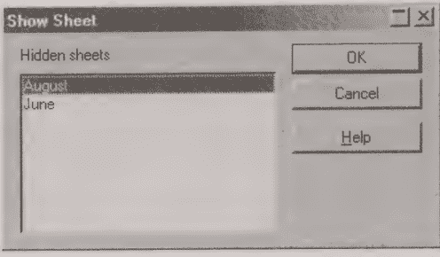

**图 4.7** 使用“显示工作表”对话框来选择你要“取消隐藏”的工作表。

## 保护单元格

既然我们正在讨论隐藏电子表格的某些部分（如行和列），我们应该了解一下 Calc 提供的单元格保护功能。此功能允许你隐藏电子表格的某些部分，并对该操作进行密码保护，使得只有知道密码的人才能“取消隐藏”这些信息。单元格保护功能也是防止某些电子表格部分在数据输入期间被覆盖的好方法。这些受保护的单元格基本上会被锁定，不允许输入新数据。首先，让我们看看如何使用单元格保护功能来隐藏工作表的部分内容。然后我们可以了解如何保护单元格不被覆盖。

### 使用单元格保护隐藏单元格

你可以使用单元格保护功能来隐藏选中的单元格。如果你希望对工作表进行密码保护，使他人无法在不知道密码的情况下取消隐藏工作表区域，这将特别有用。

启用单元格保护功能是一个两步过程。首先，你指定要在电子表格上隐藏哪些单元格。然后你启用整个工作表或电子表格的保护功能。此时，Calc 会提示你提供密码，用于保护工作表或电子表格。

1. 选择你要隐藏的单元格。
2. 选择“格式”，然后选择“单元格”。“单元格属性”对话框将出现。
3. 在对话框中选择“单元格保护”选项卡（见图 4.8）。

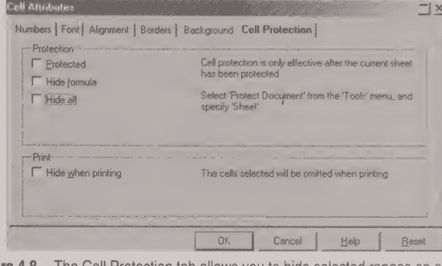

**图 4.8** “单元格保护”选项卡允许你隐藏工作表上的选定区域。

4. 要隐藏工作表上选中的区域，点击“全部隐藏”复选框。这将同时在屏幕上和打印电子表格时隐藏该区域。
5. 如果你希望在打印工作表时隐藏当前选中的区域，但不想在屏幕上隐藏它，选择“打印时隐藏”复选框。
6. 点击“确定”返回电子表格。
7. 在你保护当前工作表或整个电子表格之前，选中的区域不会在屏幕上（或打印输出中）被隐藏。
8. 选择“工具”菜单，然后指向“保护文档”。要保护当前工作表（并隐藏当前工作表上的信息），选择“工作表”（你也可以选择“文档”来保护整个电子表格）。“保护工作表”对话框将出现（见图 4.9）。


**图 4.9** 为单元格保护功能输入密码。

9. 为工作表（或文档）输入密码，然后确认密码。如果你不想使用密码，请将密码框留空。
10. 点击“确定”。单元格区域将在工作表上被隐藏。

当你使用单元格保护来隐藏工作表上的单元格时，单元格的实际内容会被隐藏。单元格、行或列不会像使用“隐藏单元格”、“隐藏行”或“隐藏列”功能时那样消失。

当你想查看隐藏的区域时，选择“工具”菜单，然后指向“保护文档”。在级联菜单中选择“工作表”。

系统会提示你输入为工作表设置的密码。输入密码，然后点击“确定”。工作表上隐藏的区域将重新出现。

如果你想永久格式化该区域，使其在工作表受保护时不被隐藏，请选中该区域，然后返回“单元格属性”对话框。在“单元格保护”选项卡上，清除“全部隐藏”复选框，然后点击“确定”。

单元格保护功能隐藏工作表上信息的另一个用途是“隐藏公式”命令。每当你点击包含公式或函数的单元格时，公式的结果会显示在单元格中，而公式本身会显示在公式工具栏的输入行中。

你可以隐藏输入行上显示的公式，同时仍在单元格中显示公式结果，方法如下：

1. 选择包含公式的单元格，然后右键点击。
2. 在上下文菜单中选择“格式单元格”。“单元格属性”对话框将出现。选择“单元格保护”选项卡。
3. 选择“隐藏公式”复选框（根据需要清除其他复选框），然后点击“确定”。你将返回到工作表。
4. 选择“工具”菜单，然后指向“保护文档”。要保护当前工作表（并隐藏当前工作表上的信息），选择“工作表”（你也可以选择“文档”来保护整个电子表格）。“保护工作表”对话框将出现。
5. 提供并确认密码（如果你愿意），然后点击“确定”。

现在当你选择包含公式的单元格时，公式本身将不会出现在输入行中。

## 保护单元格免受数据输入

单元格保护功能的另一个用途（也是其主要目的）是防止单元格在数据输入或编辑期间被覆盖。你可以根据需要保护工作表上的公式、重要值（不改变的值）和其他区域。

此功能在以下情况中特别有用：你在 Calc 中设计和创建电子表格，但实际使用电子表格或往其中输入数据的是其他人。你可以保护复杂的公式和函数，防止被只懂一点 Calc 进行数据输入的人意外修改。

## 保护单元格

1. 选择你要保护的单元格区域。
2. 右键点击该区域，然后从上下文菜单中选择“格式单元格”。当“单元格属性”对话框出现时，选择“单元格保护”选项卡。
3. 在“单元格保护”选项卡的“保护”框中选择“保护”复选框（见图 4.10）。

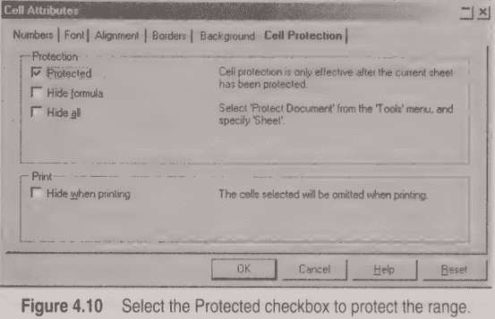

**图 4.10** 选择“保护”复选框以保护该区域。

4. 点击“确定”关闭“单元格属性”对话框。
5. 现在你需要保护整个工作表（或电子表格），使你选择的单元格保护生效。选择“工具”菜单，指向“保护文档”，然后选择“工作表”。
6. 提供并确认密码（如果你愿意），然后点击“确定”。

现在，如果你尝试在其中一个受保护的单元格中输入数据，将会出现一个信息框，提示你无法在受保护的单元格中输入数据（见图 4.11）。


**图 4.11** 你无法更改或删除受保护单元格中的数据。

你也无法删除或移动受保护的单元格。如果你想移除单元格的保护，只需取消保护工作表。选择“工具”菜单，指向“保护文档”，然后选择“工作表”。也可以选择受保护的区域，返回“单元格属性”对话框的“单元格保护”选项卡，然后取消勾选“保护”复选框。

## 合并单元格

您可以在工作表上合并单元格。这在您希望将大标题或其他信息放在一个单元格中时尤其有用。一旦合并了单元格，您还可以将信息在已合并的单元格中居中（在下一节中讨论）。

您可以合并某一行中相邻的单元格（从左到右），也可以合并某一列中相邻的单元格（从上到下）。

选择您希望合并的单元格。选择“格式”菜单，指向“合并单元格”，然后选择“定义”。

单元格将被合并。您会发现合并后的单元格为您提供了调整字体大小或对齐信息（如标题）的空间，使其与电子表格的其余部分区分开来。

> **注意** 如果合并单元格中的数据会因合并而被隐藏，系统会提示您将该数据添加到合并区域中的第一个单元格（合并单元格区域的起始处）。

关于合并单元格，您应该**注意**的一点是，无法在已合并单元格的区域中插入（添加）列或行。合并的单元格会成为插入列或行的障碍。在合并区域中插入列或行的唯一方法是：先移除合并区域，插入行或列，然后重新合并单元格。

要“取消合并”单元格区域，请选择该单元格区域，选择“格式”菜单，指向“合并单元格”，然后在级联菜单中选择“移除”。合并的单元格区域将恢复为独立的单元格。

## 在合并单元格中对齐信息

合并单元格后，您可以使用对象工具栏上的对齐工具来对齐合并单元格内的文本。例如，如果您希望在合并单元格内将文本或其他数据居中，请选择合并后的单元格（它们现在就像一个大单元格），然后单击对象工具栏上的“居中”工具。文本将在合并的单元格内居中显示，如图 4.12 所示。

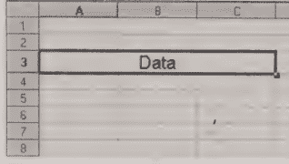

图 4.12 可以使用对齐工具来对齐合并单元格中的数据。

在处理合并单元格时，您也可以根据需要使用其他对齐工具。例如，您可以使用“垂直居中”工具，将特定列内合并单元格中的数据垂直居中。

## 使用特殊对齐设置

我们已经接触过 Calc 中“典型的”对齐命令（在本章中简要介绍，并在第 3 章“对齐单元格内容”一节中详细介绍）。Calc 还为您提供了一些“特殊的”对齐工具，使您能够缩进单元格中的文本、在单元格（或合并单元格）中自动换行，以及旋转单元格中的文本和数字。所有特殊对齐功能都可以通过“单元格属性”对话框的“对齐”选项卡来访问。

选择将受到您在“单元格属性”对话框中所选特殊对齐设置影响的单元格。然后打开“单元格属性”对话框并选择“对齐”选项卡（见图 4.13）。

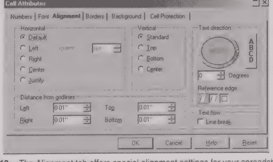

图 4.13 “对齐”选项卡为您的电子表格单元格提供特殊的对齐设置。

### 调整与网格线的距离

您可以缩进单元格（或单元格）中的数据，使其与任意单元格网格线保持距离。“对齐”选项卡上的“与网格线的距离”框为每条网格线边框（左、右、上、下）提供了微调框。

使用适当的微调框更改缩进量。完成各种缩进设置后，单击“确定”返回电子表格。

### 调整单元格中的文本换行

另一个有用的特殊对齐工具提供了在单元格（或合并单元格区域）内自动换行的能力。首先，输入您希望放在单元格中的文本。它将显示为单行的水平文本。

打开“单元格属性”对话框并选择“对齐”选项卡。单击“对齐”选项卡“文本流”框中的“换行”复选框。然后单击“确定”返回电子表格。文本将在单元格中自动换行。您可以更改单元格的宽度，来调整文本在单元格中实际换行的位置。图 4.14 显示了单元格中自动换行的文本。


### 旋转文本和数字


您可以旋转单元格中的信息。这在许多情况下都很有用，例如当您想要改变单元格中信息的方向时。例如，要创建一个行标题旋转90度的工作表，使其沿着打印纸张的边缘阅读，请选择单元格，然后使用"对齐"选项卡上的"文本方向"工具旋转单元格中的数据。

1. 在将要旋转的单元格中输入数据。
2. 选择包含要旋转数据的单元格。
3. 右键单击单元格，然后在上下文菜单中选择"设置单元格格式"。将出现"单元格属性"对话框。选择"对齐"选项卡。
4. 要更改文本方向，请单击"方向"刻度盘上的任意位置。方向变化的角度将显示在"度数"微调框中（您也可以直接在微调框中指定度数）。如果您希望文本垂直排列，请选择右侧的方形ABCD按钮。
5. 要选择旋转的参考边，请选择其中一个"参考边"按钮。左侧的按钮将参考边设置在底部；中间的按钮将参考边设置在顶部；右侧的按钮不设置参考边（见图4.15）。不设置参考边意味着在单元格中设置的任何边框或背景颜色将不会随文本条目一起旋转。

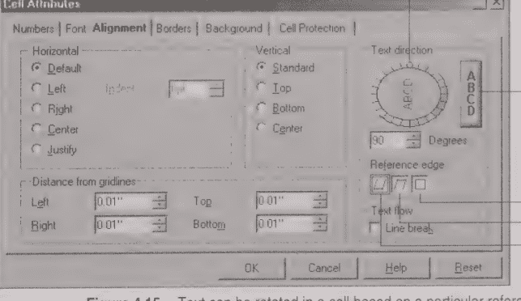

图4.15 可以根据特定参考点在单元格中旋转文本。

6. 为单元格内容选择新方向后，单击"确定"。您将返回工作表。

旋转文本时，如果文本需要更多空间，文本会溢出到旋转区域相邻的单元格中。这不利的一面是，它可能会覆盖这些单元格中已有的数据。您可能希望在电子表格中放置其他信息之前，先规划和旋转好文本条目。

> **注意**
>
> 在使用各种对齐功能时，您可以通过单击"重置"按钮返回"对齐"选项卡上的先前设置。

## 使用查找和替换功能

由于我们一直在探讨增强Calc电子表格外观的方法，因此也有必要了解一些有助于您编辑和完善电子表格的功能。**查找**功能就是一个非常实用的工具。它允许您在电子表格中的任何位置查找文本或数字字符串。

如果您希望搜索特定项目然后进行替换，_elemscovered。您甚至可以使用一组通配符和占位符字符来进行搜索，这允许您使用文本或数字字符串的一部分作为搜索字符串来搜索项目。

要启动查找功能，请单击主工具栏上的"查找"工具，或选择"编辑"，然后选择"查找和替换"。"查找和替换"对话框将打开。图4.16显示了单击"更多"按钮后的"查找和替换"对话框。

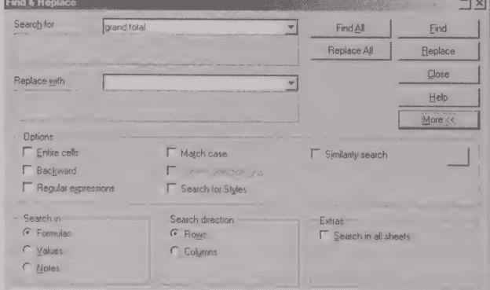

**图4.16** 您可以使用查找功能在电子表格中搜索项目，然后进行替换。

要搜索特定项目（如数值或文本字符串），请在"搜索"框中输入信息。要搜索输入的字符串，请单击"查找"按钮。查找功能将在电子表格中搜索该项目的第一次出现，然后将其选中。

> 注意 在使用"查找和替换"功能时，您可能需要移动"查找和替换"对话框（将其拖开）以查看特定搜索的结果。

搜索完成后，可以使用"关闭"按钮关闭"查找和替换"对话框。即使关闭对话框后，您也可以快速重复上一次搜索。按`Shift + Ctrl + F`。将选中搜索项目的下一次出现。

您还可以搜索要查找项目的所有出现位置。只需单击"查找全部"按钮。当前工作表上搜索字符串的所有出现位置都将被突出显示（您还可以在工作簿的所有工作表上搜索该项目，这将在下面的"使用搜索选项"一节中讨论）。

### 使用替换

您还可以在电子表格中搜索项目，然后用另一个条目替换它们。要进行查找和替换，请在"搜索"框中输入搜索字符串，然后在"替换为"框中输入替换字符串。

然后可以通过单击"替换"按钮执行查找和替换。搜索字符串的第一次出现（相对于调用"查找和替换"对话框之前活动单元格在工作表中的位置）将被"替换为"框中的字符串替换。

> 注意 使用查找和替换时，在打开"查找和替换"对话框之前按`Ctrl + Home`转到当前工作表的开头。这将从工作表的开头开始搜索。

如果您希望替换搜索字符串的所有出现位置，请单击"替换全部"按钮。

### 使用搜索选项

"查找和替换"对话框提供了多种不同的搜索选项。这些选项包括：

- 整个单元格——此选项搜索与您的搜索条件完全匹配的单元格。
- 向后搜索—从当前活动单元格开始，向工作表或电子表格的开头方向搜索。
- 正则表达式—此选项允许你在搜索条件字符串中使用占位符（也称为通配符）。有多种不同的占位符可供使用。表 4.1 列出了一些较为常用的占位符。

## 表 4.1 占位符字符

| 字符 | 用途 |
|---|---|
| `.`（句点） | 作为通用通配符，可代表任意字符。 |
| `*` | 代表无限个或零个字符。放置在被搜索项目之前，表示该项目前面可以有任意数量的字符。 |
| `^` | 放置在搜索字符串之前。只有以搜索字符串开头的条目才会被找到。 |
| `$` | 放置在搜索字符串末尾。用于查找出现在单元格中文字字符串末尾的搜索条件。 |
| `[ ]` | 用于括起要搜索的字符。例如，`[123]` 表示方括号内的所有字符都必须在单元格中找到才能匹配搜索条件。 |
| `\<` | 搜索条件必须出现在文字字符串的开头才能匹配。 |
| `\>` | 搜索条件必须出现在文字字符串的末尾才能匹配。 |

- 区分大小写—搜索条件的大小写必须匹配才能获得正向搜索结果。
- 仅当前选定区域—搜索将仅在你当前工作表上选定的区域内进行。
- 搜索样式—搜索特定样式，然后将其替换为其他样式。样式在第 7 章中有详细讨论。
- 相似性搜索—此选项搜索与搜索条件相似的条目。选中此复选框后，设置按钮（`...`）将变为可用。单击该按钮，在"相似性搜索"对话框中输入匹配项与实际搜索条件允许差异的字符数。"相似性搜索"对话框允许你指定条目可以变化的字符数（交换字符），以及允许匹配的多余或缺少的字符数（分别为添加字符和删除字符）。

其他搜索选项还可以在"查找和替换"对话框的"搜索范围"、"搜索方向"和"其他"区域中找到。这些附加选项包括：

- 公式—在电子表格中搜索公式。
- 数值—在电子表格中搜索数值。
- 备注—在电子表格中搜索备注（备注在本章的"追踪更改"部分讨论）。

还提供了选项按钮来控制搜索方向。"行"选项按水平方向逐行搜索。"列"选项按垂直方向逐列搜索。

最后，如果你拥有多工作表电子表格，可以在电子表格的所有工作表中进行搜索。在"查找和替换"对话框的"其他"区域中选择"在所有工作表中搜索"选项。

## 使用拼写检查器和自动拼写检查

虽然电子表格通常包含的数值和公式多于文字，但即使是最精美设计的电子表格也可能会出现拼写错误。在打印电子表格并与同事或客户共享之前，你需要对电子表格进行拼写检查。

如果你希望在输入时就将疑似拼写错误标记出来，可以打开自动拼写检查功能。单击主工具栏上的"自动拼写检查"按钮（你可能希望在工作表上开始输入文字条目之前执行此操作）。

当你在单元格中输入被认为是拼写错误的文字时，自动拼写检查功能会在该文字下方添加红色波浪线。如果你希望立即纠正该条目，右键单击该文字（首先，确保该单元格不是当前活动单元格），将出现一个上下文菜单，其中包含建议拼写的列表。单击列表中正确的拼写以纠正该单词。如果该单词拼写正确（例如专有名词），你可以在上下文菜单中单击"全部忽略"以忽略你在电子表格中对文字的使用。

如果你希望稍后一次性纠正所有拼写错误，可以运行拼写检查器。

1. 单击主工具栏上的"拼写检查"工具（或选择"工具"，指向"拼写检查"，然后选择"检查"）。"拼写检查"对话框将打开，第一个拼写错误将出现在"单词"框中（见图 4.17）。
2. 如果"建议"列表框中的某个单词是你单词的正确拼写，请单击选择该单词，然后单击"替换"以继续（你也可以双击替换单词）。如果拼错的单词应该始终被建议的单词替换（而你总是拼错该单词），请单击"始终替换"。
3. 如果被标记为拼写错误的单词并没有拼错，请单击"忽略"按钮。如果你希望忽略该单词的所有出现，请单击"全部忽略"。
4. 如果该单词是专有名词或默认 StarOffice 字典文件中未包含的单词，而你希望将该单词添加到字典中，请单击"添加"按钮。该单词添加到字典后，将不再被标记为拼写错误。

一旦你对特定单词做出决定（例如忽略或替换），拼写检查器将移动到工作表中的下一个拼写错误的单词。当当前工作表的拼写检查完成后，Calc 会通过一个消息框通知你（此工作表的拼写检查已完成）。单击"确定"关闭消息框和"拼写检查"对话框。

> **注意** 若要向后运行拼写检查（而不是向前），请在"拼写检查"对话框中选中"向后"复选框。

## 使用自动更正

自动更正功能实际上可以纠正某些错误（例如在句子的第一个词首始终放置大写字母），并自动更改某些条目。例如，如果你输入 `(c)`，它会将此条目替换为版权符号 (`©`)。自动更正还处理其他更正，例如识别网址和电子邮件地址（它会将它们作为超链接插入单元格中）。

在 Calc 中工作时，与自动更正相关的最大问题是你实际上希望自动更正功能在你向电子表格单元格输入数据时进行多少"自动更正"。

你可以通过在"自动更正"对话框中设置各种参数来控制自动更正如何纠正错误或更改字符（如上所述的 `(c)`）：

1. 选择"工具"菜单，然后选择"自动更正"。"自动更正"对话框出现（见图 4.18）。
2. 要控制哪些条目将被其他条目替换（例如版权符号替换 `[c]`），请选择"替换"选项卡。要添加新条目，请在"替换"框中输入要替换的项目，在"替换为"框中输入用于替换的项目。单击"新建"将项目添加到替换列表。
3. 要删除替换列表中的任何替换对，请选择它们，然后单击"删除"按钮。
4. 要添加或删除自动更正使用的替换列表的例外情况，请单击"例外"选项卡（见图 4.19）。
5. 作为句首大写例外的缩写词输入到"缩写词"列表中。输入例外，然后单击"新建"。
6. 要输入两个首字母大写的单词的例外，请在"两个首字母大写的单词"框中输入例外文字，然后单击"新建"。
7. 要删除任一列表中的例外，请选择该条目，然后单击相应的"删除"按钮。
8. 要打开或关闭自动更正功能，例如句首大写更正（在句首或单词前两个字母大写），请单击"选项"选项卡。根据需要清除或选中各种自动更正规则对应的复选框。
9. 完成"自动更正"对话框的操作后，单击"确定"。

> **注意** "自动更正"对话框还有一个**自定义引号**选项卡（更常用于 Star Writer 文档），当你使用键盘上的单引号或双引号键时，系统会自动放置适当的开始引号和结束引号。

根据你在电子表格中输入的数据类型，你可能会发现自动更正功能与其说是帮助，不如说是妨碍。如有必要，你可以关闭自动更正功能（选择"工具"，然后指向"单元格内容"，选择"自动输入"以清除该功能旁边的勾选标记）。重复此步骤将重新打开自动更正功能。

## 使用同义词库

虽然电子表格通常包含大量数值和公式，但它们可能包括说明性文字和其他文字条目。Calc 为你提供了一个同义词库。

## 追踪更改

Calc 提供的另一个实用功能是**显示更改**（Show Changes），它可以帮助你追踪对工作表所做的更改（或者在多人协作处理同一工作表时，追踪同事所做的更改）。你可以开启记录器，然后根据需要编辑工作表。

所有更改都会通过用红色边框勾勒出更改的单元格来标记。单元格中还会添加一条注释，描述更改内容并注明编辑者。

## 追踪更改

1. 选择**编辑**菜单，然后指向**更改**。
2. 在级联菜单中选择**记录**。这将开启**追踪更改**功能。
3. 如果你希望自定义**显示更改**功能（例如设置显示更改的日期范围，或者设置编辑时记录更改的范围），请选择**编辑**菜单，指向**更改**，然后选择**显示**。此时将弹出**显示更改**对话框（见图 4.21）。

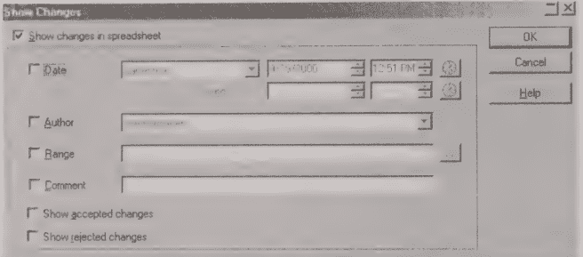

**图 4.21** 你可以自定义**显示更改**功能如何追踪工作表中的更改。

4. 选中**日期**复选框以设置记录的日期范围（你可以使用下拉列表设置日期的引用方式，下拉列表提供**早于**、**自从**和**介于**等选项）。
5. 选中**范围**复选框，然后单击**范围**按钮以选择当前工作表中显示更改的范围。对话框将折叠，允许你在工作表中选择范围。选择范围后，单击对话框折叠条上的**最大化**按钮。
6. 要关闭**显示更改**对话框并继续编辑工作表，请单击**确定**。

## 接受或拒绝更改

开启**显示更改**功能后，所有编辑过的单元格都会用红色边框标记，并在单元格中插入注释，详细说明编辑内容，如图 4.22 所示。

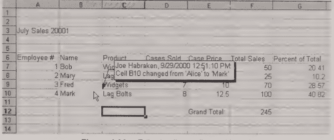

## 图 4.22 编辑过的单元格以红色标记。

完成工作表的所有更改后（或者工作表已被其他作者编辑），你可以审阅这些更改并选择接受或拒绝。

1. 选择**编辑**菜单，指向**更改**，然后选择**接受或拒绝**。此时将打开**接受或拒绝更改**对话框（见图 4.23）。

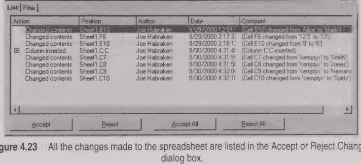

## 图 4.23 对工作表所做的所有更改都列在**接受或拒绝更改**对话框中。

2. 要接受某项更改，请在列表中选择该操作，然后单击**接受**按钮。
3. 要拒绝某项特定更改，请在列表中选择该操作，然后单击**拒绝**按钮。
4. 要接受所有更改，请单击**全部接受**按钮。
5. 要拒绝所有更改，请单击**全部拒绝**按钮。
6. 完成选择后，单击对话框右上角的**关闭**按钮。

你还可以筛选**接受或拒绝更改**对话框中记录的更改列表。单击**筛选**选项卡。然后你可以按日期、作者或工作表中的特定范围设置筛选条件。

## 设置修订选项

你可以设置与**追踪更改**功能相关的颜色选项，例如编辑或更改在工作表中如何以"修订"方式显示。

1. 选择**工具**菜单，然后选择**选项**。
2. 在**选项**对话框中，向下滚动直到找到**电子表格**类别。单击**电子表格**。
3. 要设置与**追踪更改**功能相关的选项，请单击出现的子菜单中的**更改**。
4. **选项**对话框将显示**追踪更改**功能的颜色选项（见图 4.24）。使用各种下拉列表（如**更改**或**删除**）为特定更改选项设置颜色。

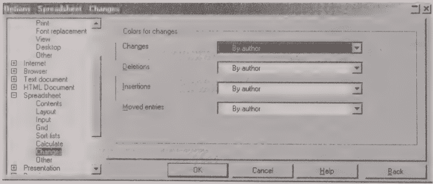

**图 4.24** 你可以控制与**追踪更改**功能相关的颜色选项。

5. 完成颜色选项的选择后，单击**确定**。

你将返回到工作表。

## 插入注释

你已经看到，当**追踪更改**功能记录你对工作表所做的更改时，注释会自动分配给编辑过的单元格。你也可以为工作表中的任何单元格插入自己的注释。

1. 选择**插入**，然后选择**注释**。一个新的注释框将出现在所选单元格旁边（见图 4.25）。

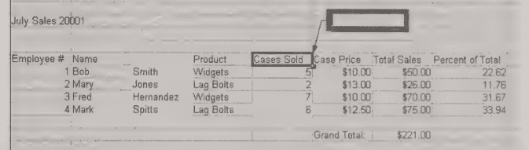

**图 4.25** 你可以在工作表上插入注释以描述单元格内容。

2. 在注释框中输入你的注释。
3. 单击工作表中的任意位置以结束注释创建过程。

该单元格将标记有一个小红方块，表示该单元格已附加注释。要阅读注释，请将鼠标指针放在单元格上，注释就会显示出来。

## 处理公式和数值

本章内容：

- 创建工作表公式（见第 120 页）
- 引用其他工作表和工作簿中的单元格（见第 125 页）
- 复制和移动公式（见第 128 页）
- 命名单元格和范围（见第 129 页）
- 使用导航器（见第 133 页）
- 使用 Calc 侦探（见第 134 页）
- 使用特殊数据输入技巧（见第 137 页）
- 处理数据序列和填充功能（见第 138 页）

## 创建工作表公式

像 Calc 这样的电子表格应用程序最重要的特点之一是它专为数学运算而设计。构建工作表的核心理念在于，让我们输入工作表的数据通过公式或多条公式进行运算；我们追求的是数学结果。

正如第 2 章简要讨论的那样，在 Calc 工作表中进行数学运算有两种选择：你可以设计自己的公式，或者使用 Calc 提供的内置数学函数。

在本章中，我们将讨论创建自己公式的方方面面，以及 Calc 提供的一些增强功能和特性，使处理公式、函数和数值更加便捷。函数将在下一章中介绍。

在深入探讨创建自己公式的相关问题之前，请注意一条良好的经验法则：只在 Calc 没有提供能完成相同任务的函数时才创建公式。你会发现，在大多数情况下，你可以将公式的创建限于简单的数学运算，如减法、乘法和除法。

## 使用运算符

你创建的公式将由单元格引用（公式将作用于其上的单元格或单元格范围的地址）和运算符组成。运算符（如用于加法的加号（`+`））将决定公式实际提供的运算类型。

开始新公式时，你需要用等号（`=`）作为公式的起始符号。这让 Calc 知道单元格中的数据实际上是一个公式。在单元格中输入等号（`=`）最简单的方法是单击公式栏上的**函数**工具。

公式的其余部分将由适当的运算符和单元格引用组成，这将在下一节中讨论。表 5.1 列出了一些常用的算术运算符。

| 运算符 | 执行运算 | 示例 |
|----------|----------|----------|
| `+` | 加法 | `=A1+B1` |
| `-` | 减法 | `=A1-B1` |
| `*` | 乘法 | `=A1*C12` |

表 5.1 算术运算符（续）

| 运算符 | 功能 | 示例 |
|----------|----------|----------|
| `/` | 除法 | `=A1/B3` |
| `^` | 乘方 | `=A1^2` |

> **注意** 确保键盘上的数字锁定键（Num Lock）已开启。在公式中输入运算符最简便的方法是使用键盘右侧的数字小键盘。

## 理解运算符优先级

创建公式时，理解运算符优先级是一个重要方面。用最简单的话说，运算符优先级意味着公式中的某些运算优先于（或先于）其他运算进行。例如，在公式`=b2+b3*c2`中，乘法运算`b3*c2`优先执行，因此`b3`会乘以`c2`，然后将该结果与`b2`相加。

表 5.2 提供了运算符优先级的汇总，在创建公式时应当时刻牢记。Calc 从左到右读取公式，因此您应当恰当地安排运算符的位置。

表 5.2 运算符优先级

| 优先级 | 运算符 |
|-------|----------|
| 1 | 乘方 `^` |
| 2 | 乘法 `*`<br>除法 `/` |
| 3 | 加法 `+`<br>减法 `−` |


您还可以使用括号来控制公式中的运算符优先级。括号内的运算优先于括号外的运算。在公式`=(b2+b3)*c2`中，括号内的计算优先于乘法运算符。因此，`b2`和`b3`会先相加，然后它们的和再乘以`c2`。

## 引用单元格

在电子表格中创建公式（或函数）时，它会引用包含公式所要处理数据的单元格（通过在公式中放置的运算符）。例如，公式`=D7*E7`会将`D7`的内容乘以`E7`的内容，如图 5.1 所示。

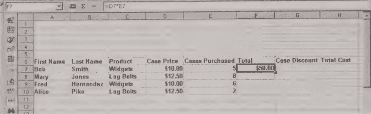

图 5.1 Calc 公式使用相对引用，使得从一个位置复制公式到另一个位置变得非常容易。

虽然公式中包含了对两个特定单元格（`D7`和`E7`）的引用，但 Calc 实际上是基于这些单元格相对于包含该公式的单元格的位置来识别它们的。

例如，`D7`实际上被识别为位于公式所在单元格左侧两格的单元格，`E7`被识别为位于公式所在单元格左侧一格的单元格。这种类型的单元格引用称为*相对引用*。这种引用方式非常有用，原因在于图 5.1 中`F7`单元格显示的公式可以向下复制到其所在列中，且公式会根据新位置自动调整。它将根据新位置引用应当处理的单元格。

因此，如果将公式从`F7`单元格复制到`F8`单元格，如图 5.2 所示，公式仍然有效。这是由于相对引用的作用。公式会根据新位置作出反应，并引用适当的单元格（相对于其新位置）。

在某些情况下，当某个特定值仅位于电子表格中的特定位置时（例如包含特定百分比或利率金额的单元格，无论将公式复制到工作表的何处，都需要在公式中使用该值），您必须在公式中将单元格引用指定为绝对引用。*绝对引用*（这是这种引用类型的名称）确保公式始终指向数据所在的唯一单元格。即使移动或复制公式，单元格引用也保持不变。我们将在下一章中讨论绝对引用及其在 Calc 函数中的使用方法。

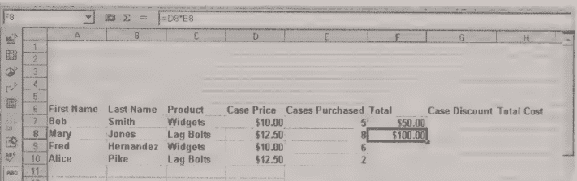

图 5.2 从一个位置复制到另一个位置的公式使用相对返回来返回正确答案。

## 自动引用单元格

Calc 还能够通过列标题或行标题自动引用电子表格上的单元格区域。Calc 将列标题和行标题均识别为紧随其后的数据单元格系列的标题。

例如，如果您有一列数据，其标题为"一月"，Calc 会将"一月"标题下方的整个单元格区域识别为电子表格的一个统一区域。这一特性允许您实际使用列标题和行标题作为在公式中引用单元格的方式。图 5.3 展示了一个函数（将在下一章中讨论），该函数使用列标题作为单元格区域`B5`到`B10`的引用。

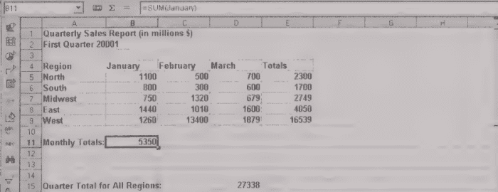

图 5.3 列标题和行标题可用于在 Calc 公式或函数中自动引用单元格区域。

## 编写公式

现在我们已经了解了运算符和单元格引用，可以逐步介绍创建公式的步骤了。实际上您有两种选择：可以通过键盘输入公式（包括单元格引用），或者使用鼠标点选将参与公式的单元格。

要通过键盘创建公式，先输入等号（`=`），然后引用相应的单元格并输入适当的运算符。使用鼠标创建公式（允许您点选公式将要引用的单元格）实际上可以减少拼写错误和公式输入错误。

你从步骤1开始做，下学期就要跟着做。

- 1. 选择将要包含公式的单元格。输入`=`开始公式。
- 2. 点击公式中将要引用的第一个单元格。该单元格地址将显示在输入行的公式中。
- 3. 输入适当的运算符。
- 4. 点击公式中将要引用的下一个单元格。
- 5. 如有必要，重复步骤 3 和 4。
- 6. 公式完成后，点击公式工具栏上的"接受"按钮。

### 编辑公式

在 Calc 中编辑公式非常直观。您可以在输入行上或直接在包含公式的单元格中编辑公式。

- 1. 点击包含公式的单元格。公式将显示在输入行上。
- 2. 点击输入行以在公式中放置插入点。公式将显示在单元格中，且公式中引用的单元格将被高亮显示（见图 5.4）。

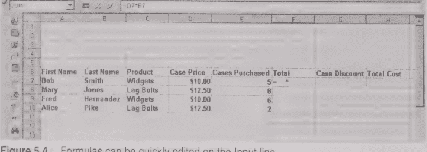

图 5.4 可以在输入行上快速编辑公式。

- 3. 使用键盘在输入行上根据需要编辑公式（更改单元格引用或运算符）。
- 4. 要使用鼠标更改特定的单元格引用，请在输入行上选择该单元格地址，然后点击新的单元格引用。新的引用将替换旧的引用。
- 5. 完成公式编辑后，点击公式工具栏上的"接受"按钮。

您还可以直接在包含公式的单元格中编辑公式。双击该单元格以在单元格中放置插入点，然后根据需要进行编辑。编辑完成后，点击公式工具栏上的"接受"按钮。

## 引用其他工作表和电子表格中的单元格

在结束创建公式和引用单元格的主题之前，我们应当讨论一下在创建公式时如何引用电子表格中其他工作表或另一个电子表格文件中工作表上的单元格。引用其他工作表或电子表格中的单元格可以通过在公式中输入信息，或在创建公式时直接点击您要引用的单元格来完成。

如果要引用同一电子表格中另一个工作表上的单元格，语法为*工作表名称.单元格地址*。例如，如果公式需要引用名为"第一季度"的工作表上的`A3`单元格，则该单元格在公式中引用为*第一季度.A3*，即工作表名称与单元格地址之间用句点分隔。在引用单元格区域的情况下，语法为*工作表名称,单元格区域*。例如，"第一季度"工作表上的`A3:A6`区域将引用为*第一季度.A3:A6*。

引用包含在单独的 Calc 电子表格文件中的单元格或单元格区域需要大量键盘输入。语法为：*'file:///驱动器字母/文件夹名称/电子表格名称'#$工作表名称.单元格地址*。（其中`#`用于引用电子表格文件中的工作表，`$`放在表名之前表示绝对引用。绝对引用将在下一章中更详细地讨论）。

因此，如果您的`C`盘"files"文件夹中有一个名为"yearly budget"的电子表格，您希望引用名为"first quarter"的工作表上的`F12`单元格，则应在公式中输入以下内容：

```
'file:///C|/files/yearly budget.sdc'#$first quarter.F12
```

引用其他工作表或电子表格中单元格的一种更简便的方法是，在编写公式时直接单击特定单元格或选择单元格区域。以下两节详细介绍了这种方法。

## 引用其他工作表中的单元格

直接指出将包含在公式中的单元格，是避免单元格引用错误的最*佳方式。这也使得在 Calc 电子表格的多个工作表中输入单元格引用变得极其容易。

- 1. 在将包含公式的工作表上，单击将存放公式的单元格，然后通过输入`=`或单击公式工具栏上的"函数"按钮来开始输入公式。
- 2. 要输入另一个工作表上的单元格引用，请使用 Calc 窗口左下角的工作表导航按钮定位到该工作表。然后单击该工作表的标签，使其成为活动工作表。
- 3. 单击（当前工作表中）您希望在公式中引用的单元格。
- 4. 通过键盘输入适当的运算符。
- 5. 根据需要移动到其他工作表，并单击您希望在公式中引用的单元格。同时根据需要添加运算符。
- 6. 完成公式后，单击公式工具栏上的"接受"按钮。您将返回到包含公式的工作表。

图 5.5 显示了引用同一 Calc 电子表格中其他工作表单元格的公式。

您可以使用"窗口"菜单垂直或水平平铺电子表格，从而在 Calc 窗口中同时处理多个电子表格。

- 1. 打开将包含公式的电子表格文件，以及包含您希望在公式中引用的单元格的电子表格文件。
- 2. 选择"窗口"，然后选择"平铺"，再选择"水平"或"垂直"，以在 StarOffice 工作区中平铺电子表格。
- 3. 在将包含公式的电子表格的适当工作表上开始输入公式（在单元格中输入`=`）。
- 4. 定位到您希望在其他电子表格中引用的单元格（或单元格区域），然后单击该单元格（或选择单元格区域）。该单元格或单元格区域的引用将出现在公式中。
- 5. 在公式中输入适当的运算符。
- 6. 根据需要添加其他打开的电子表格中的单元格引用（只需选择适当的单元格或单元格区域）。
- 7. 您可以随时返回包含公式的工作表以添加运算符。
- 8. 完成公式创建后，单击包含公式的电子表格的公式工具栏上的"接受"按钮。

公式将根据您指定的其他电子表格单元格中的运算符和值返回答案。

当您打开包含指向其他电子表格单元格链接的电子表格时，将出现如图 5.6 所示的消息。单击"是"以更新电子表格中存在的链接。

> **注意** 使用链接单元格引用的*妙处在于，如果您更改了其中一个链接电子表格中的数据，那么在打开电子表格时更新链接后，该信息将在您当前的电子表格文件（包含链接的文件）中更新。

## 复制和移动公式

您可以使用鼠标快速引用其他工作表上的单元格。

您会发现，在 Calc 电子表格中创建的公式所使用的相对单元格引用，使您能够轻松复制或移动公式。

但是请注意，您必须将公式复制或移动到与创建公式的原始单元格相似的位置。

例如，如果公式将位于公式左侧的两个单元格相乘，那么您复制或移动公式的位置必须满足：该位置有两个单元格位于公式的左侧，可供相乘。

## 复制公式

您可以通过拖动包含公式的单元格上的填充柄（沿工作表方向并覆盖您希望复制公式的单元格），快速将公式复制到多个单元格。

在您希望将公式从某个单元格复制到填充柄不便使用的单元格（例如非连续单元格）的情况下，可以使用"复制"和"粘贴"命令。

- 1. 单击包含公式的单元格。
- 2. 单击功能栏上的"复制"工具。
- 3. 单击要将公式复制到的单元格。
- 4. 单击功能栏上的"粘贴"工具。

> **注意** 如果您将公式复制到未适当值包围的单元格（如公式中相对引用所示），公式将返回`0`作为答案。

## 移动公式

移动公式可以通过将公式拖动到新位置，或使用"剪切"和"粘贴"命令来实现。要通过拖动移动公式，请单击包含公式的单元格，然后在公式上拖动以选择它。然后将选定的单元格拖动到新位置。

使用以下所述的"剪切"和"粘贴"命令作为替代方法。

- 1. 单击包含您希望移动的公式的单元格。
- 2. 单击功能工具栏上的"剪切"按钮。
- 3. 单击要将公式移动到的单元格。
- 4. 单击功能工具栏上的"粘贴"按钮。

## 命名单元格和单元格区域

一种非常有用的技术是为单元格命名，以便在公式（和函数）中更容易引用单元格区域。"单元格名称"功能允许您为单元格或单元格区域指定名称。然后可以使用该名称而不是单元格地址或区域地址，在公式中引用这些单元格。

## 命名单元格区域

命名单元格或单元格区域可通过"插入"菜单上的"名称"命令完成。

- 1. 选择要命名的单元格或单元格区域。
- 2. 选择"插入"，指向"名称"，然后选择"定义"。"定义名称"对话框将打开（见图 5.7）。
- 3. 在"名称"框中输入单元格或单元格区域的名称。
- 4. 单击"添加"，将名称添加到单元格名称列表中。
- 5. 单击"确定"关闭"定义名称"对话框并返回 Calc 工作表。

> **注意** 单元格名称不能包含空格。在多词单元格名称中，使用下划线分隔单词。

## 从现有标签创建单元格名称

另一种快速创建单元格名称的方法是：从区域的标题或页脚（范围内的第一个或最后一个条目，如列标题）创建单元格区域名称，或根据值左侧或右侧列中的信息为多个单元格（通常包含值的单元格）创建名称。

例如，图 5.8 显示了一个列出产品及其当前价格的工作表。由于项目的实际价格通常会用于与项目销售相关的公式中，您可能希望为这些值创建标签，以便随后在工作表上创建的各种公式中使用。

- 1. 同时选择包含要命名单元格的单元格区域，以及将提供单元格名称的单元格区域。
- 2. 选择"插入"，指向"名称"，然后选择"创建"。"创建名称"对话框将出现（见图 5.9）。
- 3. 选择适当的复选框，以确定单元格名称将从何处提取（标题、左列、页脚或右列）。
- 4. 单击"确定"创建名称。

新的单元格名称现在将在用于将单元格名称插入公式（或函数）的"插入"列表中可用。

## 在公式中插入单元格名称

创建单元格名称后，您可以使用它们在公式中引用单元格（以及在函数中引用，这将在下一章讨论）。在公式中使用单元格名称而非实际单元格地址的*妙处在于，您有一个描述性标签来表示公式中包含的值。

- 1. 单击将存放公式的单元格。
- 2. 输入`=`开始公式。
- 3. 要在公式中输入第一个单元格名称，请选择"插入"菜单，指向"名称"，然后选择"插入"。"粘贴名称"对话框将出现（见图 5.10）。
- 4. 在"粘贴名称"对话框中选择名称，然后单击"确定"。单元格名称将被输入到公式中。
- 5. 根据需要向公式中插入运算符和其他单元格引用。要插入其他单元格名称，请按照步骤 3 和 4 中使用"粘贴名称"对话框的方法操作。
- 6. 完成公式后，单击公式工具栏上的"接受"按钮。

图 5.11 展示了一个使用单元格名称（引用单元格`C6`）的简单乘法公式。

> **注意** 请勿在你希望复制到其他单元格的公式或函数中使用单元格名称。使用单元格名称会在公式中放置绝对引用，因此公式不会自动调整到新位置并使用相对引用来提供正确答案。

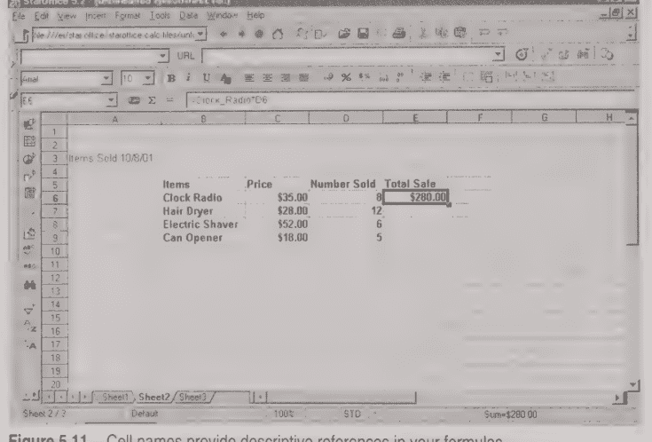

**图 5.11** 单元格名称在公式中提供了描述性的引用。

## 修改单元格名称

你创建的单元格名称也可以轻松修改或删除。你可以更改名称所引用的单元格或单元格区域，也可以编辑名称本身。

- 选择"插入"，指向"名称"，然后选择"定义"。"定义名称"对话框将会出现。
- 在"名称"列表中单击一个现有名称。"修改"和"删除"按钮将会变为可用状态。
- 要删除单元格名称，单击"删除"按钮。系统会询问你是否确实要删除该单元格名称。单击"是"以删除该名称。
- 要更改名称所引用的范围，单击"引用"框右侧的"收缩"按钮（位于对话框底部附近）。
- 要打开导航器，选择"编辑"菜单，然后选择"导航器"。导航器将会出现。
- 要查看在当前电子表格中已创建的范围名称，单击导航器窗口中"范围名称"左侧的加号（`+`）。电子表格中的范围名称将会显示（参见图 5.12）。
- 要移动到导航器中列出的某个范围名称，双击该范围名称。
- 完成导航器操作后，单击其"关闭"按钮。
- 你将返回到工作表，对话框将会卷起。在工作表上选择新的单元格或单元格区域，然后单击对话框卷帘上的"收缩"按钮。你将返回到对话框，新的单元格或区域地址将会显示在"引用"框中。
- 要更改单元格地址或范围的名称，单击"修改"按钮。这将清空"名称"框。输入新名称。该单元格或区域现在将拥有新名称。为避免命名冲突，请从列表中删除同样描述该单元格地址或区域地址的旧范围名称。
- 完成列表中名称的删除或修改后，单击"确定"以返回到工作表。

> **注意** 你可以单击"定义名称"对话框上的"更多"按钮，为已命名的单元格或单元格区域添加更多参数。提供了复选框，允许你将单元格地址区域设置为打印区域，或指定打印电子表格时应重复显示的命名行或列。这在打印需要多页的大型工作表时非常有用。

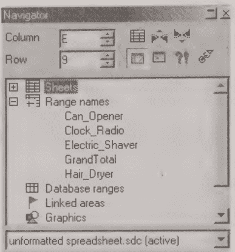

**图 5.12** 单元格范围名称可用于导航电子表格。

## 使用导航器

虽然导航器与公式或单元格值没有直接关联，但为工作表中的单元格或范围命名还有另一个好处，即你可以使用导航器功能快速定位到电子表格中的命名单元格。导航器本质上类似于其他软件应用程序中的"转到"功能。

当你打开导航器时，当前活动单元格将会列在导航器窗口的顶部。你可以使用导航器列出已插入电子表格中的所有项目，包括范围名称、数据库范围、链接区域、图形和批注。

## 使用 Calc 侦探

当你为电子表格创建公式和函数时，确保引用正确的单元格至关重要。无论公式多么完善或函数选择多么恰当，如果公式没有查看 Calc 工作表中的适当值，你将无法获得正确答案。

一个可以帮助你排查公式（和函数）问题的工具是"侦探"。侦探允许你查看与公式相关的两个实体。你可以让 Calc 显示被特定公式引用的单元格。这些包含数据的单元格称为*引用单元格*（precedents）。Calc 还可以显示依赖于某个单元格获取特定值的单元格（即包含公式的单元格）。包含公式或函数的单元格称为*从属单元格*（dependents），意味着它们需要由工作表上其他单元格提供数据。

### 追踪引用单元格

侦探将会突出显示为特定公式提供数据的单元格。

- 单击包含公式（或函数）的单元格。
- 选择"工具"，然后指向"侦探"。
- 选择"追踪引用单元格"。

该公式（或函数）的引用单元格将会用一条蓝色线条标记，追踪回该公式。图 5.13 展示了一个简单乘法公式的引用单元格。

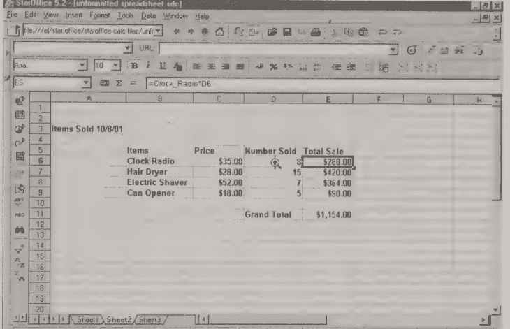

**图 5.13** 你可以使用"侦探"追踪特定公式的引用单元格。

如果将鼠标指针放在其中一个引用单元格上，鼠标指针会变成一个包含箭头的放大镜。你可以使用此指针在公式的引用单元格列表中上下移动。只需双击其中一个引用单元格，它就会移动到列表中的下一个引用单元格（这对于引用多个数据单元格的复杂公式和函数非常有用）。

你还可以使用"侦探"提供的填充模式来追踪包含公式的多个单元格的引用单元格。

- 选择"工具"，然后指向"侦探"。
- 在"侦探"子菜单中选择"填充模式"。
- 鼠标指针变为填充工具。使用"侦探"的填充工具单击任意数量的公式，以追踪它们的引用单元格。
- 完成填充工具的操作后，选择"工具"，指向"侦探"，然后选择"填充模式"以关闭该功能。

要删除工作表上显示的引用单元格，选择"工具"，指向"侦探"，然后选择"删除引用单元格"。这将从工作表中删除当前引用单元格。要删除所有追踪引用单元格，在"侦探"子菜单中选择"删除所有追踪"。

### 追踪从属单元格

你还可以追踪哪些公式（或函数）依赖于特定单元格获取数据。

- 单击包含数据的单元格。
- 选择"工具"，然后指向"侦探"。
- 选择"追踪从属单元格"。

一条蓝色线条将从当前单元格绘制到依赖它获取数据的任何公式。如果当前单元格也是公式或函数所使用的单元格范围的一部分，则会在整个单元格范围周围绘制一个蓝色方框。图 5.14 展示了两个不同单元格的从属追踪。在"合计"列的情况下，该列中的所有单元格都是为单元格`D15`提供数据的单元格范围的一部分。

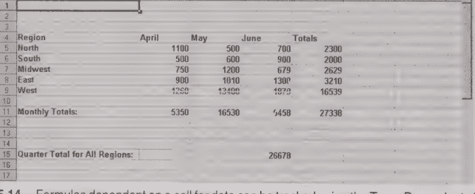


**图 5.14** 依赖某个单元格获取数据的公式可以使用"追踪从属单元格"功能进行追踪。

### 追踪错误

"侦探"还提供了追踪导致特定公式出错的单元格的能力。

- 单击包含错误信息的公式（或函数）的单元格。
- 选择"工具"，然后指向"侦探"。
- 选择"追踪错误"。

为包含错误信息的公式（或函数）提供数据的单元格将追踪回该公式。在图 5.15 中，展示了一个带有错误信息的公式。经过错误追踪后，注意到该公式显示错误信息是因为在公式中引用了单元格 `F13` 而非单元格 `F12`（实际需要的值所在的位置）。

> **注意** "侦探"还可用于追踪工作表中违反你所创建的的有效性规则的值。有效性规则以及使用"侦探"追踪违规操作将在下一章中介绍。

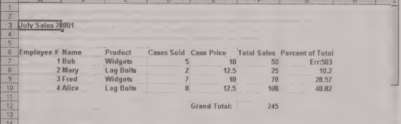

**图 5.15** 你可以使用"追踪错误"命令排查带有错误信息的公式。

虽然"侦探"在排查与公式和函数相关的问题方面提供的帮助有限，但还有其他工具可用。错误信息通常可以提供与公式或函数问题相关的线索。而且函数可以使用"函数向导"进行分析。错误信息和"函数向导"都将在后续章节中讨论。

## 使用特殊数据录入技巧

虽然我们在前面的章节中讨论了数据录入，但我们或许应该再次强调，数据将由公式（或函数）处理，因此需要极其准确。如果你录入数据不正确，你的公式和函数将无法返回正确答案。

`Calc` 提供了一些巧妙的功能，例如在选定范围中录入数据和"数据序列填充"功能，可以用来帮助确保你在单元格中录入的值是准确的。首先，让我们来看看如何在范围中录入数据，然后我们将使用"数据序列填充"功能。

## 在区域中输入数据

在开始 `begin to enter data` 之前选择一片空单元格区域，可以帮助你确保将数据输入到正确的单元格中，从而减少可能影响公式和函数的错误。

- 选择用于数据输入的单元格区域。如果单元格位于一列中，请先选择最后一个单元格，然后向上拖动以选择其他单元格，最后停留在将接收数据的第一个单元格。对于行数据，选择区域中的最后一个单元格，然后向左拖动以选择区域，最后停留在将接收数据的第一个单元格。
- 输入第一个值，然后按 `Enter` 键。单元格选择器将移动到区域中的下一个单元格。在该单元格中输入所需的值。
- 继续按 `Enter` 键前进到下一个 `cell`，并输入相应的数据。
- 当你在区域的最后一个单元格中输入数据时，单元格选择器将跳回到所选区域的顶部（当在一列中时）或左侧的第一个单元格（当在一行中时）。你无法在所选区域之外输入数据。
- 完成数据输入后，单击所选区域之外的任意位置。

## 使用数据序列和填充功能

我们在第 2 章简要介绍了填充功能，作为快速将一系列数字输入到电子表格中的方法。默认情况下，使用填充柄创建的序列增量为 1，这意味着如果在第一个单元格中输入数字 1，然后拖动填充柄跨过多个单元格，这些单元格中出现的值将增加 1。

`Calc` 还提供了创建以其他增量增加或减少的序列的功能。你还可以创建几何增长序列和其他复杂的数据序列。使用数据序列自动输入数据可以很好地确保适当的值出现在适当的单元格中。

## 创建数据序列

你已经知道，通过在单元格中输入序列的第一个数字，然后使用 `that cell` 上的填充柄拖动跨过适当数量的单元格，可以快速创建一个增量为 1 的简单数据序列。

你还可以使用填充柄在指定增量的情况下创建序列，方法是在序列中输入至少两个值。例如，如果你在一个单元格中输入值 2，然后在下一个单元格中输入值 4，你就可以完成序列的其余部分，该序列将使用增量 2（即第一个和第二个输入值之间的差值）。只需选择这两个单元格，然后 `drag the fill handle on the cell containing the 4 over the appropriate number of cells`。你的新数据序列将以 2 为增量出现（2, 4, 6, 8, 等）。

你可以在"填充序列"对话框中创建更复杂的数据序列。

- 选择你希望包含在序列中的单元格。
- 选择"编辑"菜单，指向"填充"，然后选择"序列"。"填充序列"对话框将出现（见图 5.16）。


**图 5.16** 使用"填充序列"对话框为你的电子表格创建数据序列。

- 如果你选择了一列单元格，你将可以选择在区域中向下填充（到底部）或向上填充（到顶部）。如果你选择了一行，你将可以选择向右或向左填充。在"方向"框中选择适当的选项按钮以选择填充方向。
- 选择你希望创建的序列**类型**。"线性"是默认选项（如果你希望创建日期序列，请单击"日期"选项，然后 `you will be able to choose the Date unit at the far right of the dialog box`）。
- 在"起始值"框中输入序列的起始值。在"增量"框中输入序列的增量。由于你已经为序列选择了一个单元格区域，因此无需输入终止值。
- 单击"确定"。数据序列将被输入到 `Calc` 工作表中的所选单元格中。

## 创建几何增长序列

在结束数据序列这个话题之前，我们需要看一下几何增长序列。几何增长序列是指增量为序列中每个后续值提供增长因子。例如，增量为 2 的几何增长序列将产生一个数据序列，其中序列中的每个后续值都将翻倍（增长因子为 2 的几何增长）。

- 选择你希望包含在序列中的单元格。
- 选择"编辑"菜单，指向"填充"，然后选择"序列"。"填充序列"对话框将出现。
- 在对话框的"方向"区域中选择序列填充的方向。
- 在**类型**标题下选择**增长**选项。
- 在**起始值**框中输入序列的起始值。
- 在**增量**框中输入几何增长的增量（例如，如果你希望数字以 4 为因子增长，请在增量框中输入 4）。
- 单击**确定**。几何增长序列将出现在 `Calc` 工作表中的所选区域中。

# 第 6 章 使用函数

## 本章内容：

- 理解 `Calc` 函数（见第 142 页）
- 理解绝对引用（见第 143 页）
- 插入函数（见第 144 页）
- 使用基本函数（见第 149 页）
- 使用高级函数（见第 156 页）
- 使用有效性规则（见第 160 页）
- 使用 `AutoPilot` 检查函数（见第 162 页）
- 理解常见错误信息（见第 163 页）
- 在公式和函数中使用备注（见第 164 页）

## 理解 Calc 函数

在上一章中，我们了解了如何创建自己的公式以及一些将数据（特别是数值）输入到电子表格中的技巧。在本章中，我们将了解 `Calc` 的内置公式——函数。

函数可以做所有事情，从添加一系列数字，到计算区域中的条目数量，再到提供摊销计算，让你根据期限、贷款金额和利率了解你的汽车贷款还欠多少。

函数由两部分组成：函数名（负责计算）和函数将作用的单元格。例如，函数 `=avg(B5:B12)` 将返回单元格区域 `B5:B12` 的平均值。

`Calc` 将其函数分为多个类别。表 6.1 提供了这些函数类别的列表，包括每个类别的描述和示例函数。

**表 6.1** 函数类别及示例

| 类别 | 函数示例 | 用途 |
| --- | --- | --- |
| 数据库 | `DMIN` | 返回一列单元格中的最小值。 |
| | `DMAX` | 返回一列单元格中的最大值。 |
| 日期和时间 | `NOW` | 返回当前日期和时间。 |
| | `TODAY` | 返回当前日期。 |
| 财务 | `PMT` | 计算贷款还款额。 |
| | `PV` | 计算投资的当前价值。 |
| 信息 | `ISFORMULA` | 如果指定单元格包含公式，则返回"true"语句。 |
| | `ISBLANK` | 如果指定单元格（或单元格区域）为空，则返回"true"语句。 |
| 逻辑 | `IF` | 返回条件语句的真或假答案 |
| | `AND` | 评估两个条件语句。如果某个值满足两个条件，`TRUE` 将出现在函数单元格中。 |
| 数学 | `COS` | 计算角度的余弦值。 |
| | `EVEN` | 将数字四舍五入到最接近的偶数整数。 |
| 矩阵 | `TREND` | 使用 `x` 和 `y` 坐标返回沿线性趋势的值。 |
| | `PRODSUM` | 将数组中的分量相乘，然后将乘积相加。 |
| 统计 | `AVERAGE` | 计算一组单元格的平均值。 |
| | `COUNT` | 计算特定区域中包含数据的单元格数量。 |
| 电子表格 | `HLOOKUP` | 在水平查找表中查找单元格的数据。 |
| | `VLOOKUP` | 在垂直查找表中查找单元格的数据。 |
| 文本 | `REPEAT` | 重复指定次数的文本字符串。 |
| | `CONCATENATE` | 将多个文本条目组合成一个文本字符串。 |

`Calc` 中还提供了一类称为"加载项函数"的附加函数。在安装 `StarOffice` 时，你可以选择添加"加载项函数"等组件。`DAYINMONTH`（返回给定月份的天数）和 `YEARS`（提供两个日期之间的年数）等函数就是两个加载项函数。

"加载项"类别还可以包含高级用户创建的自定义函数。这些自定义函数通过 `StarOffice` 应用程序编程接口（`API`）添加，或者将新函数的 `.dll`（动态链接库）添加到 `StarOffice` 文件夹中。

你经常使用哪一类或哪几类 `Calc` 函数将取决于你创建的 `Calc` 电子表格的类型。如果你参与雨林中的生物多样性研究，你可能会使用许多统计函数。如果你在会计师事务所工作或想要跟踪你的个人投资和支出，你很可能会使用财务函数。

## 理解绝对引用

你会发现，由于函数通常引用几个不同的单元格或单元格区域来实际返回值，因此你需要知道如何使单元格引用在函数中成为绝对引用。在第 5 章中，我们讨论了 `Calc` 默认使用相对引用，使你可以轻松复制将应用于电子表格上多个不同位置的公式或函数。

要将单元格地址作为绝对引用，需在单元格列标前放置一个美元符号（`$`），并在单元格行号前再放置一个美元符号（`$`）。因此，如果要在函数中将单元格 `B5` 作为绝对引用使用，它会显示为 `$B$5`。

在某些情况下，您只需要将列标或行号其中之一设为绝对引用。回到我们的 `B5` 例子，如果我们正在使用的函数将被向下复制到某一列中，并且它引用了多个不同行中的单元格，但又必须始终引用特定列中的单元格，我们会在创建函数时将 `B5` 输入为 `$B5`。这意味着 `B` 列是绝对引用的，但行号是相对引用的，因此该函数可以复制到多个位置，并且仍然返回正确的结果。

在只需要将列标或行号设为绝对引用的情况下，只需在列标或行号前输入美元符号（`$`）。在整个单元格地址（列标和行号）都必须设为绝对引用的情况下，在函数中输入地址，然后按 `Shift + F4`。这将使列标和行号都变为绝对引用。

> **注意** 按 `Shift + F4` 使引用变为绝对引用（列标和行号均为绝对引用）后，再按一次 `Shift + F4` 将使仅行号变为绝对引用。按第三次 `Shift + F4` 将使仅列标变为绝对引用。

## 插入函数

`Calc` 提供多种方法将函数插入您的电子表格。第一种方法是在单元格中输入 `=`，然后输入函数名和适当的单元格引用，来表明您要在单元格中放置一个函数。这要求您知道函数的名称，并且对函数中单元格引用的指定方式非常熟悉。

另外两种插入函数的方法，通常会使函数的使用变得更加容易，还可以帮助您理解单元格引用应如何放置在函数中，即函数列表和函数向导。让我们来看看这两个特性。

### 使用函数列表

函数列表允许您从列表中快速插入 `Calc` 的函数。函数列表可以按类别列出函数，列出所有函数，或列出您最近使用过的函数。函数列表还会在其可停靠窗口的底部提供每个函数的简短说明。

1. 单击要放置函数的单元格。
2. 选择**插入**菜单，然后选择**函数列表**。函数列表将出现在 `Calc` 工作区的右侧（请参见图 6.1）。


3. 函数列表将提供最近使用过的函数的列表。要按类别查看函数（或查看所有函数），请单击**类别**下拉箭头，然后选择要查看的列表类型。
4. 当找到要使用的函数时，双击函数名称（或选择函数，然后单击函数列表上的**插入函数**按钮）。该函数将被放置在单元格中。
5. 现在指定该函数将作用于其上的地址范围。对于复杂的函数，这可能需要您提供几个不同的单元格引用。对于像平均值这样的简单函数，拖动鼠标以选择将被函数处理的单元格（请参见图 6.2）。这个范围将以红色突出显示，并且该范围的地址将被自动放入函数中。

**图 6.2** 当你为函数选择范围时，单元格会被突出显示，并且该范围会被放入函数中。


4. 当找到要使用的函数时，双击函数名称（或选择函数，然后单击函数列表上的**插入函数**按钮）。该函数将被放置在单元格中。

5. 现在指定该函数将作用于其上的地址范围。对于复杂的函数，这可能需要您提供几个不同的单元格引用。对于像平均值这样的简单函数，拖动鼠标以选择将被函数处理的单元格（请参见图 6.2）。这个范围将以红色突出显示，并且该范围的地址将被自动填写在函数中。

![](img/0b2fba6879ab3... 

（用户输入被截断，以下为完整内容。）

在函数中将单元格地址作为绝对引用。在第 5 章中，我们讨论了 Calc 如何默认使用相对引用，这使得复制公式或函数变得容易，这些公式或函数将应用于电子表格中的多个不同位置。

要将单元格地址作为绝对引用，需在单元格列标前放置一个美元符号（`$`），并在单元格行号前再放置一个美元符号（`$`）。因此，如果要在函数中将单元格 `B5` 作为绝对引用使用，它会显示为 `$B$5`。

在某些情况下，您只需要将列标或行号其中之一设为绝对引用。回到我们的 `B5` 例子，如果我们正在使用的函数将被向下复制到某一列中，并且它引用了多个不同行中的单元格，但又必须始终引用特定列中的单元格，我们会在创建函数时将 `B5` 输入为 `$B5`。这意味着 `B` 列是绝对引用的，但行号是相对引用的，因此该函数可以复制到多个位置，并且仍然返回正确的结果。

在只需要将列标或行号设为绝对引用的情况下，只需在列标或行号前输入美元符号（`$`）。在整个单元格地址（列标和行号）都必须设为绝对引用的情况下，在函数中输入地址，然后按 `Shift + F4`。这将使列标和行号都变为绝对引用。

> **注意** 按 `Shift + F4` 使引用变为绝对引用（列标和行号均为绝对引用）后，再按一次 `Shift + F4` 将使仅行号变为绝对引用。按第三次 `Shift + F4` 将使仅列标变为绝对引用。

## 插入函数

Calc 提供多种方法将函数插入您的电子表格。第一种方法是在单元格中输入 `=`，然后输入函数名和适当的单元格引用，来表明您要在单元格中放置一个函数。这要求您知道函数的名称，并且对函数中单元格引用的指定方式非常熟悉。

另外两种插入函数的方法，通常会使函数的使用变得更加容易，还可以帮助您理解单元格引用应如何放置在函数中，即函数列表和函数向导。让我们来看看这两个特性。

### 使用函数列表

函数列表允许您从列表中快速插入 Calc 的函数。函数列表可以按类别列出函数，列出所有函数，或列出您最近使用过的函数。函数列表还会在其可停靠窗口的底部提供每个函数的简短说明。

1. 单击要放置函数的单元格。

2. 选择**插入**菜单，然后选择**函数列表**。函数列表将出现在 Calc 工作区的右侧（请参见图 6.1）。


3. 函数列表将提供最近使用过的函数的列表。要按类别查看函数（或查看所有函数），请单击**类别**下拉箭头，然后选择要查看的列表类型。

4. 当找到要使用的函数时，双击函数名称（或选择函数，然后单击函数列表上的**插入函数**按钮）。该函数将被放置在单元格中。

5. 现在指定该函数将作用于其上的地址范围。对于复杂的函数，这可能需要您提供几个不同的单元格引用。对于像平均值这样的简单函数，拖动鼠标以选择将被函数处理的单元格（请参见图 6.2）。这个范围将以红色突出显示，并且该范围的地址将被自动填写在函数中。


**图 6.2** 为函数选择范围时，这些单元格会突出显示，并且范围的地址会被放置在函数中。

6. 当您已经完全引用了所有将被函数处理的单元格后，请单击公式工具栏上的**接受**按钮（或按 `Enter` 键）。

当您完成了函数列表的使用后，可以将其从工作区中移除。选择**插入**菜单，然后选择**函数列表**以清除复选框。函数列表将会消失。

### 使用函数向导

插入函数的另一种方法是使用函数向导。函数列表提供了对 Calc 函数的快捷访问，而函数向导则会引导您完成实现特定功能所需的各个步骤。函数向导还可以帮助您轻松插入特定功能所需的单元格地址。

让我们看看使用函数向导插入 `AVERAGE` 函数与使用函数列表插入函数（正如我们在上一节中讨论过的）有何不同。

## 插入函数

1. 单击将包含函数的单元格。

2. 选择**插入**菜单，然后选择**函数**。函数向导对话框将出现（请参见图 6.3）。


**图 6.3** 函数向导不仅提供 Calc 函数列表，还帮助您为函数插入适当的单元格引用。

3. 使用**类别**下拉列表选择要从中选择函数的类别。

4. 单击您要使用的函数名称以选择它。

5. 单击**下一步**按钮，进入该过程的下个步骤。

6. 该函数将出现在**公式**框中，用于引用函数中包含的单元格的参数输入框将会出现在**公式**框上方（请参见图 6.4）。

7. 要指定函数应处理的第一个单元格或单元格范围，请单击第一个参数输入框旁边的**缩小**按钮。函数向导将"卷起"并允许您访问您的工作表。

8. 为函数选择第一个单元格或单元格范围。例如，要计算某个单元格范围的平均值，请选择该单元格范围。范围地址将出现在向导卷起时的**地址**窗口中。

9. 要返回函数向导，请单击卷起窗口右下角的**最大化**按钮。您将返回到函数向导，并且该单元格范围（或如果只选择了一个单元格，则为单个单元格地址）将显示在第一个参数输入框中（请参见图 6.5）。注意，该单元格引用也会显示在**公式**框中的函数里。


**图 6.4** 函数被放置在**公式**框中。


**图 6.5** 在工作表上选择的单元格地址将出现在函数向导对话框的参数输入框中。

10. 使用其他参数输入框引用该函数所需的其他单元格地址。

11. 完成单元格引用后，单击**确定**。

当您单击**确定**时，函数将被放置在适当的单元格中并返回一个结果。如果您发现结果似乎不正确，或者收到错误消息，您可以使用**侦探**尝试找出问题所在（如前一章所讨论的），或者您可以使用函数向导来帮助您排查函数错误。使用函数向导排查函数错误的问题将在本章稍后部分讨论。

## 使用基本函数

正如已经提到的，您最常使用的函数取决于您需要在电子表格中进行何种类型的计算。但是，某些函数似乎比其他函数更常用。表 6.2 列出了一些最常用的函数。

**表 6.2** 基本 Calc 函数

| 函数 | 描述 |
| --- | --- |
| `SUM` | `=SUM(cell range)`<br>将函数中引用的单元格相加。 |
| `AVERAGE` | `=AVERAGE(cell range)`<br>计算数值范围的统计平均值或平均数。 |
| `COUNT` | `=COUNT(cell range)`<br>计算指定范围内的单元格数量。 |
| `MAX` | `=MAX(cell range)`<br>返回指定单元格范围中的最大（最大）值。 |
| `MIN` | `=MIN(cell range)`<br>返回指定单元格范围中的最小（最小）值。 |
| `PMT` | `=PMT(Rate; NPER; PV; FV; F)`<br>计算在固定期限和固定利率下贷款的每期付款额。 |
| `NOW` | `=NOW()`<br>返回当前日期和时间。 |
| `TODAY` | `=TODAY()`<br>返回当前日期。 |

我们已经在第 2 章的"输入函数"一节中讨论过 `SUM` 函数，也在前两节中介绍了 `AVERAGE` 函数。在接下来的几节中，我们将探讨一些其他常用的 Calc 函数。

### 使用 COUNT、MAX 和 MIN

`COUNT`、`MAX` 和 `MIN` 都是实用的统计函数，属于为统计分析提供的函数类别。统计函数有很多种，但通过了解这三个函数，你就能大致了解统计类别中其他一些函数的运作方式。


**图 6.6** `COUNT`、`MAX` 和 `MIN` 等统计函数用于分析电子表格中的统计数据。

假设你有一列数据，如图 6.6 所示，你想知道该列有多少个条目，并确定该列的最大值和最小值。由于 `COUNT`、`MAX` 和 `MIN` 通常用于对单元格范围进行操作，你可以使用函数列表快速将它们插入到电子表格中：

1. 单击要放置 `COUNT` 公式的单元格，选择**插入**，然后选择**函数列表**。函数列表将出现在工作区中。

2. 单击**类别**下拉列表，选择**统计**。这将在函数列表中列出所有统计函数。

3. 在列表中双击 `COUNT` 以输入该函数。

4. 选择要由该函数计数的单元格范围。

5. 单击**接受**按钮。

6. 对于 `MAX` 函数，选择要放置 `MAX` 函数的单元格。在函数列表中找到 `MAX` 并双击该函数。

7. 选择要由该函数作用的单元格范围，然后单击**接受**。

8. 对于 `MIN`，选择要放置 `MIN` 函数的单元格。在函数列表中找到 `MIN` 并双击该函数。

9. 选择要由该函数作用的单元格范围。单击**接受**按钮。

图 6.7 显示了这三个函数与表中提供数据相关的结果。如你所见，使用函数列表可以快速连续输入简单的函数。

### 使用 PMT 函数

`PMT` 是一个财务函数，可让你根据利率和贷款期限计算贷款的定期还款额。像 `PMT` 这样的财务函数比我们上一节中看到的简单统计函数设置起来要稍微困难一些。

就 `PMT` 而言，函数语法为：

```
=PMT(Rate; NPER; PV; FV; F)
```

该函数中必须引用若干不同的参数：

`Rate` — 这是指存放贷款定期利率的单元格。输入利率的单元格引用时，必须包含 `/12`，以便将利率转换为月利率而非年利率。


**图 6.7** 使用函数列表置于表中的统计函数结果。

`NPER` — 这是指贷款将分期偿还的期数。例如，如果贷款期限为四年，则期数为 48（12 个月付款 × 4 年）。

`PV` — 这是贷款的价值。

`FV` — 这是一个可选参数，提供在定期付款结束时达到的所需值（未来值）。

`F` — 这是一个与定期付款到期金额相关的可选值。`F=1` 表示期初付款，`F=0` 表示每期期末付款。

因此，要计算贷款（如汽车贷款）的月付款额，你只需要关注 `Rate`、`NPER` 和 `PV`。图 6.8 显示了一个简单的付款模板，可提供不同利率和贷款金额下汽车的月付款额。

在使用 `PMT` 等函数时，你会发现构建该函数的最简单方法（除非你一直使用该函数）是使用函数自动向导。

在图 6.8 提供的示例中，我们必须使用绝对引用来引用包含 `NPER`（贷款期限）的单元格，因为我们希望


将该函数复制到多个单元格。因此，我们最初构建的所有 `PMT` 函数副本都必须绝对引用单元格 `C13` 以查找贷款期限。我们在输入利率的单元格地址时，还必须绝对引用 `B` 列。而且，我们在函数中指向初始贷款金额时，必须绝对引用包含贷款金额的行，因此第 5 行必须绝对引用。

1. 单击要构建初始 `PMT` 公式的单元格（在我们的示例中，为单元格 `C6`）。

2. 选择**插入**，然后选择**函数**以打开自动向导。

3. 从**类别**下拉列表中选择**财务**类别。在财务函数列表中找到并选择 `PMT`。

4. 单击**下一步**按钮。该函数将出现在**公式**框中，并为函数的参数（`Rate`、`NPER`、`PV`）显示输入框。

5. 单击**Rate 缩小**按钮。自动向导将收起。选择存放利率的单元格。然后，单击自动向导收起窗口上的**最大化**按钮以返回自动向导。在利率框中单击，并在利率地址后输入 `/12`。这将把利率从年利率转换为月利率（一年 12 个月）。

6. 重复步骤 5 中的操作，为 `NPER` 和 `PV` 输入行选择单元格。

7. 要在函数中放置绝对引用，请在公式栏中单击函数。在需要绝对引用的地方插入美元符号（`$`）。在我们的示例中，在单元格 `B6`（利率）的 `B` 列引用前放置美元符号（`$`），并在单元格 `C13`（付款期限）的列和行标识符前放置美元符号（`$`），因为整个单元格必须绝对引用。贷款金额（`PV`）单元格地址中的第（5）行也必须绝对引用，如图 6.9 所示。


**图 6.9** 自动向导帮助你选择 `PMT` 函数所需的单元格地址，你可以根据需要在该函数中放置绝对引用。

8. 单击**确定**关闭自动向导对话框，并将该函数放入 Calc 工作表中。

函数结果将以红色括号显示，因为贷款付款被视为借方。由于使用了适当的绝对引用，该函数可以复制到工作表中的其他单元格，为你提供不同利率和贷款金额下月付款额的概览（参见图 6.10）。

## 使用日期和时间函数

日期和时间函数允许你快速将时间和日期信息放入工作表，或计算与电子表格中日期或时间数据相关的值。`NOW` 和 `TODAY` 函数是类似的函数，可将


**图 6.10** 像 `PMT` 这样的财务函数可用于使用不同的输入参数查看不同的结果。

当前日期放入电子表格。`NOW` 函数还提供当前时间。

这两个函数不是你用来将静态日期（或时间）作为时间戳放入电子表格的函数。`NOW` 和 `TODAY` 函数实际上是动态函数。它们为你提供当前日期（以及 `NOW` 的情况下的时间）。每当你打开包含这些函数的电子表格或重新计算电子表格中公式和函数的结果时（要手动重新计算结果，请选择**工具**，指向**单元格内容**，然后选择**重新计算**），新的日期（和时间）将出现在单元格中。

由于这两个函数在语法中不需要单元格地址，你可以使用函数列表快速添加这两个函数中的任何一个。

1. 单击要放置 `NOW` 或 `TODAY` 函数的单元格，选择**插入**，然后选择**函数列表**。函数列表将出现在工作区中。

2. 单击**类别**下拉列表，选择**日期和时间**。这将在函数列表中列出所有统计函数。

3. 在列表中双击 `NOW` 或 `TODAY` 函数以输入该函数。

4. 单击**接受**按钮。

该函数将放置在工作表上。

## 使用高级函数

Calc 提供了众多高级函数，可让您执行非常复杂的计算。虽然本书无法涵盖所有高级函数，但我们将介绍 `IF` 函数和 `LOOKUP` 函数（`HLOOKUP` 和 `VLOOKUP`）。

### 使用 IF 函数

`IF` 函数是"逻辑"类别函数，允许您在电子表格中设置条件语句。这些条件语句可以向包含 `IF` 函数的单元格返回文本条目或数值。

`IF` 函数的语法为：

```
测试条件; 则值; 否则值
```

例如，假设您收藏了一些"珍贵"的旅行杂志，并在 Calc 电子表格中记录了每本杂志的出版日期，现在您想处理掉一些较旧的刊物。您可以设置一个 `IF` 函数，将测试或条件与特定日期相关联。例如，测试条件可以是 `<06/01/98`，其中包含日期 `06/01/98` 的单元格将作为测试单元格引用输入。"则值"可以是文本 `TOSS`，"否则值"可以是文本 `KEEP`。任何在 `06/01/98` 之前出版的杂志结果将为 `TOSS`；而不符合测试条件的杂志（即 `06/01/98` 之后出版的）结果将为 `KEEP`。

在 `IF` 函数中使用文本作为则值或否则值时，必须将文本放在引号内。因此，要在函数中放置 `TOSS`，您需要输入 `"TOSS"`，以便 Calc 将该条目识别为文本。图 6.11 展示了一个说明上述示例的小型工作表。

由于 `IF` 函数的设置稍微复杂一些，最好使用自动向导来创建。

1. 单击要构建初始 `IF` 函数的单元格（然后可以按需复制，如图 6.11 所示）。

2. 选择**插入**，然后选择**函数**以打开自动向导。

3. 从**类别**下拉列表中选择**逻辑**类别，然后找到并选择 `IF` 函数。

4. 单击**下一步**按钮。**公式**框将包含 `IF` 函数，并出现用于测试和条件值的输入框。

**图 6.11** `IF` 函数提供一个条件语句，其结果与条件相关的真或假返回值。

5. 单击**测试**框上的**缩小**按钮，并在电子表格中选择包含测试日期的单元格。单击自动向导 rollup 上的**最大化**按钮以返回自动向导。

6. 在**测试**框中输入测试语句的其余部分。在我们的示例中，**测试**框中的单元格地址后面将跟有语句 `<D4`，因为 `D4` 是包含日期 `06/01/98` 的单元格。确保通过在其列和行标识符前放置美元符号（`$`）将 `D4` 设为绝对引用。


7. 单击“则值”框，并输入测试通过时将返回的值。对于本示例，我们将输入`"TOSS"`。

8. 单击“否则值”框，并输入测试未通过时将返回的值。对于本示例，我们将输入`"KEEP"`。图 6.12 展示了自动导图对话框中完成的`IF`语句。

9. 完成`IF`函数的创建后，单击“确定”。您将返回 Calc 工作表。

现在您可以根据需要将`IF`函数复制到其他单元格。

**图 6.12** 您可以在自动导图对话框中快速设置`IF`函数。

### 使用`LOOKUP`函数

另一个非常有用的函数是`LOOKUP`函数，它实际上有两种形式：`VLOOKUP`和`HLOOKUP`。然而，这两个函数的工作方式基本相同。这些“电子表格”类别函数可以从表格中查找值，并将值放入持有`LOOKUP`公式的单元格中。

由于`VLOOKUP`和`HLOOKUP`非常相似，让我们来看看`VLOOKUP`。`VLOOKUP`执行垂直查找，并根据某些搜索条件从数组（即两列查找表的另一种说法）返回值。例如，您可以创建一个两列数组，第一列包含产品名称，第二列包含每项产品的价格。然后，当您在销售表上输入产品名称并在表的“价格”列（位于“产品名称”列的正右侧）中放置`VLOOKUP`函数时，该函数将自动查找该产品的价格，并根据“产品名称”列将其放入单元格中。

`VLOOKUP`的语法为：

```text
=VLOOKUP(searchcriterion; array; Index)
```

`searchcriterion`是包含函数将用于在数组中查找信息的单元格，`array`是包含信息的表格的地址范围，`index`提供包含应返回到包含`VLOOKUP`函数的单元格中的值的列号。在大多数情况下，这将是数组表的第二列，其索引号为 2（数组中的第一列为 1）。

使用`VLOOKUP`函数时，请确保将要使用的数组表按升序排序。例如，对于两列数组表，选择表的两列，然后单击主工具栏上的“升序排序”按钮。数组表将按数组第一列中的文本或值进行排序。

图 6.13 展示了一个使用`VLOOKUP`的工作表，它将商品的价格放在商品名称的右侧。数组表位于单元格`D17:E20`。注意公式如何通过引用 A 列中的产品名称来返回每种产品的价格。

**图 6.13** 电子表格函数如`VLOOKUP`可用于在数组中查找数据并将其放入单元格中。

创建`VLOOKUP`函数：

1. 单击要构建`VLOOKUP`函数的单元格。

2. 选择“插入”，然后选择“函数”以打开自动导图。

3. 从“类别”下拉列表中选择“电子表格”类别，然后找到并选择`VLOOKUP`。

4. 单击“下一步”按钮。“公式”框将包含`VLOOKUP`函数，并出现用于搜索条件、数组和索引的输入框。

5. 单击“搜索条件”框中的“缩小”按钮，选择函数将用于在数组中定位正确值的单元格。然后，单击自动导图上的“最大化”按钮返回对话框。

6. 单击“数组”输入框上的“缩小”按钮，选择您在工作表上构建的数组表。通过单击其“最大化”按钮返回自动导图。确保将数组表单元格范围设为绝对引用。在范围的起始和结束单元格的列和行标识符前都放置美元符号（`$`）。

7. 在“索引”输入框中输入索引号。如果将要“查找”的值出现在第二列，请输入 2。

8. 单击“确定”将函数放入单元格。

现在您可以根据需要将函数复制到其他单元格。

## 使用有效性规则

本章剩余部分将讨论一些有助于您创建正确工作表的策略。正如我在本书中多次提到的，无论您的公式和函数设计得多好，如果数据未正确输入到工作表中，您都不会得到正确的结果。

确保在一系列单元格中输入适当类型数据的一种方法是使用有效性规则。例如，如果您使用`IF`之类的函数，并且测试语句设计为对包含日期的单元格起作用，则需要确保这些单元格中已输入日期。

帮助确保在单元格区域中输入正确类型数据或特定范围数据的一种方法是使用有效性规则。您可以为任何单元格设置有效性条件，还可以包含自定义消息，当输入不符合有效性规则的数据到单元格或单元格区域时，这些消息将会弹出。

### 设置有效性条件

设置有效性条件在以下情况中非常有用：您正在设计电子表格，而其他人将输入数据。

1. 选择要为其设置有效性条件的单元格或单元格区域。

2. 选择“数据”菜单，然后选择“有效性”。“有效性”对话框将打开（见图 6.14）。

**图 6.14** 有效性规则允许你限制可在单元格区域内输入的数据类型。

3. 在“值”选项卡上，使用下拉框选择允许的数据类型（如“日期”或“整数”）。

4. 如果数据必须在一定的数值范围内，请在“数据”下拉列表中选择某个数据限定条件，例如“小于”或“大于”，然后在“值”框中输入要与该限定条件一起使用的实际值。例如，如果数值必须大于 100，请在“数据”下拉列表中选择“大于”，并在“值”框中输入 100。

5. 要添加输入帮助信息，请选择“输入”选项卡。在“标题”框中输入帮助信息的标题，在“输入帮助文本”框中输入实际信息。

6. 要为有效性条件设置错误警报，请点击“错误警报”选项卡。默认操作是“停止”，这表示不允许输入不符合有效性条件的数据。你可以将操作更改为其他设置，例如“警告”，此时将显示警告信息（而不是完全阻止数据输入）。在相应的框中输入信息的标题和文本。

7. 完成所有有效性条件和信息的设置后，点击“确定”返回电子表格。

### 使用侦探查找无效数据

我们在上一章中广泛使用了侦探功能。侦探也是用于查找已输入到工作表中的无效数据的工具。只有在已为单元格设置有效性条件时，侦探才会标记无效数据。请记住，只有在将错误警报操作设置更改为除“停止”以外的参数时，才能输入无效数据（因为“停止”会阻止在单元格中输入无效数据）。

1. 选择“工具”菜单，然后指向“侦探”。

2. 在“侦探”子菜单中选择“标记无效数据”。

3. 无效数据（基于你的有效性条件）将在 Calc 工作表中以红色圆圈标出。

### 使用自动向导检查函数

你在前一章中看到侦探如何被用于追踪引用单元格和从属单元格，以帮助排查公式问题。然而，当你尝试排查一个证明存在问题的函数时，你会发现函数自动向导可以提供更好的调试工具。

使用自动向导排查函数问题：

1. 选择包含该函数的单元格。

2. 选择“插入”，然后选择“函数”。函数自动向导将出现（见图 6.15）。自动向导的结构选项卡提供了函数的图解，其中函数名称和运算符以文件夹形式表示。与每个函数名称或运算符相关的单元格引用或值列在相应的文件夹下。


**图 6.15** 自动向导在处理有问题的函数时提供故障排除帮助。

3. 使用结构选项卡上提供的信息来修复函数中存在的任何单元格引用错误或语法错误。你可以直接在输入行上更改函数参数，函数本身也可以在结构选项卡的公式框中进行编辑。

4. 完成函数编辑后，点击“确定”返回电子表格。

> **注意** 结构不正确的函数可能不会返回单元格错误信息。仔细检查你的函数，确保它们返回正确的结果。函数能运行并不意味着它就是正确的。

## 理解常见错误信息

你会发现 Calc 似乎有无尽的错误信息。而且每当你感觉自己已经尽了最大努力确保某个特定公式或函数已以正确方式构建时，它似乎总会显示这些错误。通过识别一些更常见的错误信息，可以使问题公式和函数的故障排除变得更加容易。这些列在表 6.3 中。

| 错误信息 | 说明 |
| --- | --- |
| 503 | 无效的浮点运算。通常出现在正在计算除以零的情况下。 |
| 509 | 缺少运算符。公式中缺少预期的运算符。 |
| 510 | 缺少变量。公式中两个运算符相邻，应该用变量隔开。 |
| 519（在单元格中显示为`#VALUE`） | 公式或函数中引用的单元格是文本而非预期值。 |
| 525（在单元格中显示为`#NAME`） | 无法识别标识符。例如，在使用某个`LOOKUP`函数时，无法返回值，因为查找项在查找数组中找不到。 |

你可以打开 Calc 帮助系统（选择“帮助”，然后选择“目录”），并在索引中搜索“错误信息”。帮助系统提供了在 Calc 中工作时可能遇到的所有错误代码的完整列表。

## 在公式和函数中使用备注

另一种可以帮助你构建电子表格的函数和公式的方法是将有关函数或公式的说明放在备注中。为特别复杂的函数提供备注将帮助你理清该函数的问题，也可以使将要向电子表格中输入数据的人更容易理解。

要用备注记录函数或公式，请点击包含该函数的单元格。选择“插入”菜单，然后选择“备注”。

在备注框中输入你要附加到该特定函数的信息。仔细记录你的工作，尤其是在使用不熟悉的函数时，可以帮助你确保 Calc 电子表格无错误。

## 使用样式和模板

本章内容：

- 理解样式（见第 166 页）
- 创建和修改样式（见第 166 页）
- 查找和替换样式（见第 172 页）
- 使用模板（见第 173 页）
- 使用条件格式（见第 178 页）
- 为特定目的设置电子表格格式（见第 180 页）

### 理解样式

我们在第 3 章中查看了单元格和单元格区域的格式设置，你可能已经注意到，当你将大量格式属性应用于一个或多个单元格，并且必须重复整个过程以使用相同属性格式化其他单元格时，你会花费大量时间点击菜单和工具栏按钮。使用每个单独的格式选项来设置单元格格式可能非常耗时。

样式选项将消除格式设置中涉及的大量重复操作。样式是字体类型、颜色以及其他字体和单元格属性（如边框和背景）的集合，可以保存在特定名称下，然后快速调用以格式化单元格和单元格区域。

假设你不喜欢已创建的某个特定样式所提供的格式。你可以轻松编辑该样式提供的不同单元格属性。而且，你甚至可以使用查找和替换功能在工作表中找到特定样式并将其替换为另一种样式。在处理电子表格中的单元格格式时，样式绝对为你提供了极大的灵活性。

### 创建和修改样式

Calc 实际上为你提供了几种不同的创建和修改样式的途径。创建和编辑样式所涉及的两个最重要的工具是样式专家和样式目录。每个都提供了创建样式然后修改样式的场所。

#### 基于选定单元格创建样式

为电子表格创建样式非常直接。快速创建新样式的最简单方法是选择一个已格式化的单元格。你必须至少使用所有不同的字体属性、颜色、边框和其他特征格式化一个单元格（或区域）。然后基于该单元格（或单元格区域）的当前格式创建样式。

1. 选择已使用你希望放入新样式的属性进行格式化的单元格。

2. 选择“格式”菜单，然后选择“样式专家”。样式专家框将出现（见图 7.1）。

3. 点击样式专家工具栏上的“从所选内容新建样式”按钮。

4. “创建样式”对话框将出现（见图 7.2）。在“样式名称”框中输入样式的名称，然后点击“确定”。

**图 7.1** 你可以使用样式设计器基于单元格快速创建样式。

**图 7.2** 为你的新样式提供样式名称。

该样式现在将列在样式设计器中。

## 应用样式

样式在样式设计器框中创建后，你可以轻松地将其应用到工作表上的单元格或单元格区域。

1. 选择你要应用样式的单元格或单元格区域。

2. 如果样式设计器当前未在工作区中打开，请点击功能工具栏上的样式设计器按钮（你可能需要点击工具栏最右端的向下箭头才能看到样式设计器按钮）。

3. 在样式设计器中，找到你要应用到所选单元格的样式。双击样式名称。

该样式将被应用到所选单元格。

> **注意** 你会发现 Calc 提供了一些现成的样式。已有标题样式和结果样式可供你使用。

## 更新样式

如果你想为样式添加额外的格式选项，可以通过更新样式来快速添加这些格式属性。这是通过样式设计器完成的。

1. 点击一个单元格，该单元格应包含样式中的原始格式属性（如果你想保留这些作为样式的一部分）以及你希望添加到样式的任何新格式属性。

2. 如有必要，打开样式设计器。

3. 在样式设计器中，点击你希望更新的样式。

4. 点击样式设计器工具栏上的更新样式按钮。

任何先前分配给该样式的单元格将立即显示新属性或因你更新样式而导致的属性更改。这就是使用样式的好处：当你更改样式中的格式属性时，它们会立即应用到已分配该样式的单元格。

从此处起分配给该样式的单元格将接收样式中包含的所有属性（新的和原有的）。

## 使用填充格式模式

如果你想将样式分配给无法在一个范围内选择的单元格（因为单元格不连续，或你只是不想麻烦去选择它们），你可以使用样式设计器的填充格式工具将所选样式分配给任意数量的单元格。

1. 打开样式设计器。

2. 选择你要分配的样式。

3. 点击样式设计器工具栏上的填充格式模式工具。

4. 鼠标指针变为填充工具（参见图 7.3）。

5. 点击任意单元格以将样式分配给它。

6. 要将样式分配给单元格区域，请将填充格式模式工具拖动到这些单元格上。

**图 7.3** 你可以使用填充格式模式工具通过点击特定单元格来分配样式。

7. 完成将样式分配给单元格后，点击样式设计器工具栏上的填充格式模式工具以关闭它。

## 修改样式

你已经看到，可以通过选择具有额外格式属性的单元格，然后使用样式设计器工具栏上的更新样式按钮，来快速就地修改（更新）样式。

1. 打开样式设计器。

2. 右键点击你希望修改的样式。在出现的上下文菜单中选择修改。

3. 该样式的单元格样式对话框将出现（参见图 7.4）。你可以深入挖掘分配给样式的属性，并在单元格样式对话框中修改这些属性。

4. 要更改样式的属性，请点击对话框的相应选项卡。这些选项卡包括：

   - 组织——允许你更改样式名称，并将样式基于现有样式。
   - 数字——允许你控制样式中的所有数字格式，包括数字格式类型（如货币）、单元格中允许的小数位数，以及其他属性，如前导零和负数的显示方式。
   - 字体——允许你控制分配给样式的单元格的所有字体属性，包括字体类型、字体大小，以及其他字体属性，如粗体、斜体和下划线。此选项卡还允许你控制样式使用的字体颜色。
   - 对齐——允许你为分配给样式的单元格中的条目设置基本对齐方式，如左对齐、右对齐或居中。你还可以为样式分配其他对齐属性，包括特殊对齐（文本旋转）和单元格中的文本流自动换行。
   - 边框——允许你为样式设置边框选项。这包括边框类型、线条样式和线条颜色。阴影的使用也在此选项卡上控制。
   - 背景——允许你选择样式使用的背景颜色。你可以从调色板中选择任意颜色，并在分配给样式之前预览填充颜色。
   - 单元格保护——允许你为样式设置单元格保护选项。你可以选择隐藏公式或在打印时隐藏单元格。你只需为样式选择适当的单元格保护属性，然后将该样式分配给电子表格中的特定单元格。

5. 根据需要修改选项卡上的设置。

6. 根据需要修改其他选项卡上的样式设置。

7. 完成样式的修改后，点击确定。

注意 如果你想获得有关单元格样式对话框中选项卡的更多帮助，请参阅第 3 章“使用单元格、行和列”，该章节详细讨论了每个选项卡及其各种选项。你会发现单元格属性对话框包含了单元格样式对话框中几乎所有的选项卡。

## 从头创建样式

你还可以使用样式目录从头创建样式。这允许你设置每种属性类型，如数字或字体，然后将它们保存为新样式。

1. 选择“格式”菜单，然后选择“样式目录”。样式目录对话框将打开（参见图 7.5）。

**图 7.5** 样式目录允许你管理现有样式和创建新样式。

2. 点击样式目录中的新建按钮。单元格样式对话框将出现。

3. 在名称框中输入新样式的名称。如果你想将新样式基于现有样式，请点击基于下拉箭头并选择该样式。如果你将样式基于现有样式，它将使用现有样式中包含的任何格式属性。

4. 使用单元格样式对话框中的各种选项卡来设置样式的属性。

5. 完成样式的属性设置后，点击确定。

你将返回到样式目录。新样式将出现在样式列表中。完成样式目录的操作后，点击关闭按钮。

> **注意** 要删除样式，请在样式目录中选择该样式并点击删除按钮。点击是删除该样式。

## 查找和替换样式

你可以使用 Calc 的查找和替换功能来查找工作表中的样式并将其替换为另一种样式。这在以下情况中特别有用：当你已经分配了一种样式，然后完全重新考虑了电子表格的外观设计。与其修改当前分配的样式，不如将其替换为另一种样式。

### 查找和替换样式

要查找和替换样式，请使用与查找和替换电子表格中单元格内容相同的查找和替换对话框。

1. 点击 Calc 主工具栏上的查找工具。查找和替换对话框将打开。

2. 点击查找和替换对话框上的更多按钮（参见图 7.6）。

**图 7.6** 你可以使用查找和替换对话框来查找和替换样式。

3. 点击对话框底部的“搜索样式”复选框。

4. 要指定想要查找的样式，请点击“查找”框上的下拉箭头，然后选择适当的样式。

5. 点击“替换为”框旁边的下拉箭头，选择将作为替换的样式。

6. 要在工作表中查找该样式的第一个匹配项，请点击“查找”按钮。

7. 要替换找到的样式匹配项，请点击“替换”按钮。

8. 要查找工作表中该样式的所有匹配项，请点击“查找全部”按钮。该样式的所有匹配项都将被选中（见图 7.7）。


**图 7.7** 通过点击“查找全部”按钮，您可以快速选中某个样式的所有匹配项。

9. 要替换工作表中`harmonic`该样式的所有匹配项，请点击“全部替换”按钮。

10. 完成“查找和替换”对话框的操作后，请点击“关闭”按钮。

## 使用模板

虽然样式提供了一种快速格式化单元格的方法，可以一次性设置多种单元格属性，但您还可以通过创建模板来进一步增强对电子表格布局和功能的控制。模板基本上是在 Calc 中创建的空白表单，包含样式、公式和函数，还可以为列标题和行标题提供标签。

您创建的所有 Calc 电子表格实际上都是基于模板的。打开新的电子表格时使用的是标准模板。标准模板包含所有默认的 Calc 工具栏和工具。

您还可以创建提供自定义工具栏（在第 14 章中讨论）和宏（在第 9 章中讨论）的模板。这可以使工作表上的数据输入或处理更加便捷。因此，如果您每周都在创建相同的电子表格用于周报，您可能需要创建一个基础模板。

Calc 还提供了一些现成的模板，您可以用来快速构建几种不同类型的电子表格。有用于汽车融资、现金日记账和家庭预算等的模板。

> **注意** StarOffice 提供了大量不同的模板。其中只有部分模板与 Calc 电子表格相关。


让我们看看其中一个现有模板在 Calc 中是如何工作的。然后我们将介绍如何创建自己的模板。

## 使用现有模板

StarOffice 内置的模板通过“文件”菜单启动。这些模板实际上是分类的，让您更容易找到满足特定需求的模板。

1. 在 Calc 中（或任何 StarOffice 应用程序中），选择“文件”菜单，指向“新建”，然后选择“从模板”。将弹出“新建”对话框。
2. 在“类别”列表中向下滚动，找到您希望打开的模板类别。例如，您可以选择“财务文档”类别（见图 7.8）。


3. 在“模板”列表中，选择您要使用的模板。
4. 点击“确定”以打开模板。

> **注意** 如果您希望查看模板的描述，请点击“新建”对话框中的“更多”按钮。

基于该模板将打开一个新的电子表格。图 7.9 展示了“家庭预算”模板。请注意，模板包含格式和标题，使您能够快速输入数据并完成工作表。


“家庭预算”模板包含许多公式，并且在同一个电子表格中构建了多个不同的工作表来收集预算信息。

当您完成各个工作表的数据录入后，只需保存电子表格即可。当您点击“保存”工具时，将弹出“另存为”对话框，您可以为模板提供名称和位置。

这是模板的另一个强大功能——由于新电子表格是基于模板的（它不是模板本身），当您保存电子表格时，模板不会被覆盖；而是会创建一个新的电子表格。

当您浏览 StarOffice 提供的模板时，您会发现 Calc 使用的那些模板在某些电子表格上保护了某些单元格，以防止您覆盖公式和函数。这是模板另一个非常吸引人的方面。工作表的某些区域可以被保护，这样无论谁进行数据录入，模板中放置的公式和其他格式都不会受到破坏。

## 创建模板

虽然您可能没有兴趣创建像 StarOffice 提供的那样复杂的模板，但您可以创建包含格式、公式和函数（以及单元格保护）Allocated 的简单模板。这些模板可以使特定类型电子表格的“复制”变得更加容易。

> **注意** 创建自己的模板需要您了解 Calc 的格式设置、样式、公式、函数和单元格保护。在尝试构建自己的模板之前，您可能需要确保自己理解所有这些必要的功能。

1. 打开一个新的电子表格文件（选择“文件”、“新建”、“电子表格”）。这个新电子表格将作为新模板的空白画布。
2. 在工作表上输入行标题和列标题。
3. 输入工作表将使用的必要公式和函数。
4. 提供您希望在工作表上使用的任何格式。您可能需要为模板创建样式，这样基于该模板的电子表格可以通过编辑特定样式来轻松修改。
5. 保护您希望在模板使用时防止被覆盖的任何单元格（特别是包含公式的单元格）。请记住，如果要使用单元格保护，需要保护整个工作表。图 7.10 展示了一个已设置为输入季度报表的简单模板。单元格 `E7:E11` 已被保护，因为它们包含 `SUM` 函数。
6. 完成模板后（它可以由同一电子表格中的多个工作表组成），您就可以将电子表格保存为模板了。选择“文件”菜单，然后选择“另存为”。将弹出“另存为”对话框。
7. 输入模板的文件名。
8. 点击“文件类型”下拉框，选择“StarCalc 5.0 模板”作为文件类型。
9. 由于这是模板，将其与 StarOffice 提供的其他模板保存在一起是合理的。找到存放 StarOffice 模板的文件夹。通常是 `C:\Office52\share\template\English\`，其中 `C:` 是您安装 StarOffice 的驱动器。
10. 如果需要，您还可以将模板放在提供的某个类别文件夹中（见图 7.11）。
11. 选择新模板的位置后，点击“保存”。模板将被保存到您选择的位置。


**图 7.10** 模板基本上是没有数据的电子表格，包含所有需要的格式和公式。


**图 7.11** 将您的模板保存到 StarOffice 为模板提供的某个类别文件夹中。

## 使用您的模板

您现在可以像使用 StarOffice 提供的任何模板一样打开您的模板。

1. 在 Calc 中（或任何 StarOffice 应用程序中），选择“文件”菜单，指向“新建”，然后选择“从模板”。将弹出“新建”对话框。
2. 在“类别”列表中向下滚动，找到包含您自定义模板的类别（您保存模板的类别文件夹名称）。
3. 选择您的模板（见图 7.12）。


**图 7.12** 您可以选择保存在各个类别文件夹中的自定义模板。

4. 点击“确定”。

基于您的模板将打开一个新的电子表格。您可以填入必要的数据，然后将电子表格保存为新文件。

如果您发现想要微调某个模板，您可以像打开任何其他文件一样打开该模板。只需确保在“打开”对话框中选择“StarCalc 5.0 模板”作为要查找的文件类型。然后您可以保存对模板所做的任何更改。

## 使用条件格式

在结束样式和模板的话题之前，电子表格中另一种您可能觉得有用的格式设置是条件格式。它允许您使用格式设置，使只有包含满足特定条件的值的单元格才会被实际格式化。

例如，您可能有一份公司各区域销售额的季度报告，您想要突出显示您认为特别的值。您可以使用条件格式来构建一个条件，当某个值满足该条件时，它会因为工作表中的格式设置而脱颖而出。

### 创建条件格式所用的样式

条件格式使用样式作为单元格格式的设置方法。因此，在“条件格式”对话框中设置条件格式之前，需要先创建一个或多个样式，供条件格式使用。

可以使用样式设计器（对现有单元格应用格式）或样式目录（从头创建样式）来创建样式。

请确保为用于条件格式的样式选择能够与工作表上其他已设置格式的单元格形成明显区分的格式属性。

## 配置条件格式

创建好样式后，即可开始配置条件格式。

1. 选择要应用条件格式的单元格区域（例如，工作表上的整个表格）。
2. 选择“格式”菜单，然后选择“条件格式”。此时将弹出“条件格式”对话框（参见图 7.13）。


**图 7.13** 条件格式用于突出显示区域内满足特定条件的单元格。

3. 在“条件 1”下，点击下拉箭头，选择“单元格数值为”或“公式为”，以匹配将要应用条件格式的单元格内容。
4. 如果选择“单元格数值为”，请在运算符框中选择数值与条件的关系（例如等于、大于等）。如果选择“公式为”，则必须输入包含条件的公式所在的单元格地址，条件格式将在工作表中查找该公式。
5. 点击“条件 1”的“收缩”按钮，选择将作为条件基准值的单元格。
6. 点击对话框汇总处的“收缩”按钮，返回对话框。
7. 点击“条件 1”的“单元格样式”下拉框，选择用于对满足条件的单元格应用条件格式的样式。
8. 在“条件格式”对话框中，根据需要设置其他条件。
9. 当准备好对满足所设置各种条件的单元格应用条件格式时，点击“确定”。
10. 图 7.14 展示了一个工作表，该工作表使用条件格式突出显示了数值大于 `2300` 的单元格。


## 为特定目的设置电子表格格式

结合第 3 章介绍的内容以及本章关于样式和模板的讨论，可以看出 Calc 提供了大量格式化电子表格的可能性。您可以将各种格式组合成样式，也可以使用样式进行条件格式化。还可以通过开发自己的模板，将格式和样式的应用推向更深层次。

当您着手创建新的电子表格时，请尽量牢记该电子表格的最终用途。这个电子表格只是用于屏幕查看，还是需要打印出来并包含在报告中？

您制作的电子表格类型实际上应该决定您所使用的格式类型。如果您正在创建一个将出现在黑白激光打印机打印报告中的电子表格和图表，那么该电子表格可能无需使用大量颜色。但如果您制作的是一个将用于“在线”报告的电子表格，而这些报告永远不会被打印到纸上，那么您可以使用颜色和其他格式属性（如边框），使工作表在屏幕上查看时更加赏心悦目。

格式设置还可以决定特定电子表格的基调。如果您正在为万圣节派对制作签到表，那么使用图形和颜色是合适的。如果您正在为公司制作成本分析，那么剪贴画可能就不太合适了。

# 使用列表和数据库

本章内容：

- 在 Calc 中使用列表和数据库（见第 184 页）
- 理解 Calc 数据库设计（见第 184 页）
- 创建数据库（见第 188 页）
- 排序数据（见第 190 页）
- 筛选数据（见第 194 页）
- 使用分级显示功能（见第 199 页）
- 导出和导入 Calc 数据（见第 200 页）

## 在 Calc 中使用列表和数据库

从第 5 章和第 6 章分别对 Calc 公式和函数的讨论中可以看出，Calc 完全能够胜任数字计算的任务。Calc 还为您提供了操作列表和数据库的能力。列表通常由输入到列中的信息组成，列表中的每个项目位于不同的行。列表可以只有一列，也可以包含几列相关信息。

数据库是关于特定主题的有组织数据的集合：重要客户及其个人信息的完整列表、个人 CD 收藏目录，或者与经营小企业相关的所有数据。列表和数据库之间最大的区别可能在于范围。

数据库通常包含的信息量远超列表，并且需要以比列表更多的方式操作数据的能力。对于列表，您可能只需要排序；而对于数据库，您可能还需要筛选或查询数据库的能力，以便查看已输入数据库信息的子集。

您可能会问自己一个重大问题：“为什么要在 Calc 中创建数据库？”尤其是因为 StarOffice 已经为您提供了 StarOffice Base 这一关系数据库应用程序。最好的答案是，对于主要包含数值和公式/函数的简单数据库来说，在 Calc 中创建是有意义的，因为 Calc 可以处理与数据库相关的数字计算，并提供足够的数据库功能让您操作数据。而对于简单的列表来说，在 Calc 中快速拼凑一个列表可能比在 Base 中创建整个数据库文件要容易得多。

## 理解 Calc 数据库设计

您的 Calc 数据库看起来与其他电子表格文件不会有太大区别。事实上，Calc 电子表格数据库被称为平面文件数据库，因为它们由单个大型数据表组成。像 StarOffice Base 这样的关系数据库允许您将数据放在更小且相互关联的表中（因此得名“关系型”），这实际上可以实现对数据的更灵活操作。

> **注意** 如果您发现 Calc 无法完成您所需的所有“数据库操作”，可以将您的 Calc 数据库导入到 Base 中。本章后面将对此进行讨论。

设计 Calc 数据库的一个重要先决条件是理解用于指代数据库不同部分的术语：

- **记录**——每一行信息称为一条记录，其中包含与特定人员、地点或事物相关的信息。例如，如果您使用数据库来跟踪员工信息，那么每一行就是针对某位特定员工的记录。
- **字段**——工作表中的列称为字段。字段包含某一特定信息，例如员工的住宅电话号码或他们工作的部门。数据库工作表中的每一列都会有一个称为字段名的标题。字段名标识应放入该字段中的特定信息，例如电话号码、部门或工资。
- **主键**——关键字段，通常被称为主键，用于唯一标识一条记录，通常放置于数据库的第一列。关键字段的示例可以是员工编号或您的社会保险号码。它必须是由对数据库中每条记录而言都唯一的某种标识组成。

> **注意** 您的 Calc 数据库记录并非必须有关键字段。但是，关键字段可用于快速将数据库列表恢复到原始顺序，尤其是当您使用“区域填充”功能在第一列中创建记录编号时。

图 8.1 展示了一个简单数据库表及其各个部分的概览。

### 定义数据库区域

创建数据库时，它将由行和列中的信息组成，与任何其他电子表格一样。但是，要真正查询您的数据库（向数据库提问并根据所提问题筛选数据），您还需要在工作表上包含一个区域，用于指定您想向数据库提出的问题（例如，您可能想筛选数据库以查看特定邮政编码中的所有客户），以及一个用于 Calc 放置问题答案的区域。

重要的是要理解，如果您想对数据库应用高级筛选（或查询）并实际提取高级筛选的结果，您需要创建三个不同的区域。这些区域是：

- **数据区域**——这就是数据库本身，包含您输入到工作表中的所有记录。数据区域包括您为数据库表创建的字段标题（列标题）。
- **条件区域**——这是工作表上用于输入高级筛选所用条件的区域。这基本上是一个查询输入区域。它包含与数据区域表中用作字段标题相同的标题。
- **提取范围**——这是工作表上的一个区域，当您使用条件范围查询数据库时，Calc 会将提取的记录放置于此。

图 8.2 展示了一个 Calc 数据库及其不同的数据库区域。虽然将条件范围放在与数据库相同的工作表上很方便，但您实际上可以将提取范围放在当前数据库的另一个工作表中。

## 规划数据库

既然您已经了解了 Calc 数据库表中的各个部分（字段和记录），您就可以坐下来规划您的数据库了。以下是在规划数据库时需要考虑的一些事项：

- 坐下来规划好您将在数据库表中使用的字段。虽然您可能觉得需要一份与每条记录相关的详尽细节列表（例如，您不仅想要客户的电话号码和近期购买记录，还想知道他们有几个孩子、养什么品种的狗等），但您不妨先列出所有可能的字段，然后将列表缩减到仅包含能实际提供您所需核心信息的字段。实际上，您也只需包含那些在设置筛选条件时会用到的字段。

## 理解 Calc 数据库设计

虽然 Calc 非常宽容，并且可以轻松让您重新排列工作表上的信息列，但请尝试设置好字段列，使它们能以合乎逻辑的方式列出记录中的数据。同时还要记住，您将使用字段来排序和筛选工作表中的数据。如果您经常按姓氏然后名字进行排序，那么您需要将姓氏字段放在名字字段的左侧，因为按多个字段排序时是从左到右进行的。

> **注意** 如果您要规划一个包含大量字段和海量记录的数据库，那么使用 StarOffice Base 创建关系型数据库可能会好得多。请参阅 StarOffice 帮助系统以开始使用 Base 数据库。

- 在每个工作表上创建单独的数据库。确保留出一些增长空间。例如，您可能想要向数据库添加新记录。如果您计划执行复杂的筛选，还需要在工作表上留出放置条件和提取范围的空间。此外，如果您选择对数据库表中的任何信息进行图表化，还可以在工作表中包含一个图表。
- 使用某种格式（即使是粗体也可以）来区分字段名称（表格的第一行）和数据库中的数据记录。
- 确保设置好不同的数据库区域（数据区域、条件范围和提取范围），以便有足够空间向数据区域添加额外的记录。
- 输入数据时，切勿在数据库表中的记录之间留下完全空白的记录或空行。这会影响您对数据库区域进行排序和筛选。

## 创建数据库

一旦您花了一些时间规划好数据库，就可以开始在工作表上输入数据了。输入数据后，您需要定义数据库区域以及条件和提取范围（如果您计划使用高级筛选的话）。我们将在本章后面讨论如何定义条件和提取范围。

### 创建数据库表

数据库表由字段标题和记录组成。

1. 打开一个新的 Calc 电子表格（选择“文件”，指向“新建”，然后选择“电子表格”，或者在当前电子表格文件中打开一个未使用的工作表）。
2. 在数据库表的第一行中，输入表的字段标题。
3. 从紧接字段标题行的行开始，输入表的记录。

### 定义数据库区域

要在数据库上实际使用排序和筛选功能，您需要告诉 Calc 数据库范围位于何处。

1. 选择整个数据库表（包括字段标题）。
2. 选择“数据”菜单，然后选择“定义范围”。“定义数据库范围”对话框将出现（参见图 8.3）。
3. 在“名称”框中输入数据库的名称。
4. 单击“添加”按钮。
5. 要返回 Calc 工作表，请单击“确定”。

**图 8.3** “定义数据库范围”对话框是您建立数据库表标识的地方。

## 更改数据库范围

您可以编辑为命名数据库指定的范围。如果不再需要某个电子表格被指定为数据库范围，您还可以删除该数据库范围。

1. 选择“数据”菜单，然后选择“定义范围”。“定义数据库范围”对话框将出现。
2. 在“数据库名称”列表中单击您希望重新定义的数据库。
3. 要更改数据库的范围，请单击“范围”框旁边的“收缩”按钮。对话框将卷起。
4. 在 Calc 工作表上，数据库的当前范围以蓝色边框显示。选择数据库的新范围。新范围将有红色边框。
5. 单击对话框卷起的“收缩”按钮。您将返回到“定义数据库范围”对话框，并且新范围将显示在“范围”框中。
6. 单击“确定”保存新的数据库范围并返回电子表格。

当您想要完全删除数据库名称和范围时，在“定义数据库范围”对话框中，选择数据库名称，然后单击“删除”。系统将询问您是否确实要删除该数据库（参见图 8.4）。

单击“是”删除该条目，然后单击“确定”关闭“定义数据库范围”对话框。

图 8.4 Calc 会要求您确认在“定义数据库范围”对话框中删除数据库条目。

## 排序数据

一旦定义了数据库范围，您就可以通过排序或筛选来开始处理数据库中的数据了。我们先来看看排序。

> **注意** 实际上，您可以在任何 Calc 电子表格上使用排序和筛选功能，无论您是否已定义数据库范围。但要创建更复杂的筛选，您需要有一个已定义的数据库范围才能进行操作。

您可以使用 Calc 主工具栏上的“升序排序”或“降序排序”工具对列表或数据库进行快速排序。您还可以使用“排序”对话框（通过“数据”菜单启动）来设置自己的排序。

### 使用主工具栏排序工具进行排序

使用排序工具可以让您按第一列快速对列表或数据库进行排序。

1. 选择您要排序的列表或数据库。
2. 要按升序排列列表，请单击“升序排序”工具。
3. 要按降序排列列表，请单击“降序排序”按钮（参见下面的注意）。
4. 完成排序后，单击工作表上的任意位置以取消选择列表或数据库。

> **注意** 主工具栏上的“升序排序”工具有一点问题。如果您选择包括列标题在内的整个数据库或列表，该工具会将列标题视为数据并与其余字段一起排序。如果使用“升序排序”工具，请只选择列表或数据库中的记录。

## 使用“排序”对话框进行排序

您可以使用“排序”对话框创建简单和复杂的排序。您甚至可以将排序结果复制到当前工作表的另一个区域或电子表格中的另一个工作表。


您会发现“排序”对话框允许您按多个排序键进行排序（排序键是您要排序的参数）。例如，您可以按姓氏然后名字对员工数据库进行排序。姓氏字段将是主要排序键，名字字段将是次要排序键。

1. 在已定义的数据库中单击任意位置，或选择您要排序的列表。
2. 选择“数据”菜单，然后单击“排序”。“排序”对话框将出现。
3. 要使用您放置在数据库中的字段标题作为排序参数，请单击“排序”对话框上的“选项”选项卡。然后单击包含“列标题”复选框的区域（参见图 8.5）。

   **图 8.5** 在“选项”选项卡上单击包含“列标题”复选框的区域。

4. 现在您可以设置排序参数了。单击“排序条件”选项卡。
5. 单击“排序方式”下拉箭头，选择您将用作主要排序键的字段（参见图 8.6）。
6. 单击“升序”或“降序”选项按钮，为第一个排序键设置排序方向。
7. 使用“然后按”框选择第二个排序键（如有必要）。您最多可以按三个排序键进行排序。请记住为额外的排序参数设置排序方向（升序或降序）。

   **图 8.6** 您可以使用“排序”对话框，按一个或多个字段对数据库进行排序。

8. 设置好排序参数后，单击“确定”。

您将返回到数据库，数据将按照您选择的排序键和排序方向进行排序。

## 创建复杂自定义排序

您还可以使用“排序”对话框创建更复杂的排序。这包括将排序后的列表复制到当前工作表或其他工作表的另一个位置。如果您对某些单元格或记录进行了格式设置，还可以选择在排序过程中移动数据时，将格式一起移动。

1. 单击数据库中的任意位置，或选择要排序的列表。
2. 选择“数据”菜单，然后单击“排序”。“排序”对话框将出现。
3. 单击“排序”对话框中的“选项”选项卡。
4. 若要使以小写字母开头的文本排在以大写字母开头的文本之前，请选中“区分大小写”复选框（要使用此选项，必须首先在“排序条件”选项卡上设置一个排序键，该排序键引用包含文本条目的字段）。
5. 选中“包含格式”复选框，以保留已设置格式数据的特殊格式。
6. 若要将结果复制到工作表上的其他位置或其他工作表，请单击“将排序结果复制到”复选框，然后在“范围”框中指定一个范围。您可以通过工作表名称指定其他工作表，并且只需指定其他工作表上的一个单元格（参见图 8.7）。

   **图 8.7** 您可以将排序结果复制到电子表格中的其他工作表。

7. 若要指定自定义搜索顺序，请单击“自定义排序顺序”复选框，然后从下拉列表中选择一个自定义搜索顺序。
8. 您还可以选择排序进行的方向。若要按行排序，请选择“从上到下”单选按钮。若要按列排序，请选择“从左到右”单选按钮。
9. 设置好复杂排序的选项后，请确保返回“排序条件”选项卡，并为排序设置适当的排序参数。

要打开此对话框，请选择“工具”，然后选择“选项”。“选项”对话框将出现。在选项树中，向下滚动并选择“电子表格”，然后选择“排序列表”。自定义排序列表通过此对话框创建（参见图 8.8）。

您会发现，创建自定义排序列表最简单的方法是，指定包含要放入列表中的字段名称的单元格范围，然后使用“复制”按钮将该列表包含在对话框中。

在大多数情况下，您可能会发现可能几乎没有创建自定义列表的必要。“排序”对话框应该能为您提供排序表格或数据库中数据所需的所有功能。

**图 8.8** 可以创建自定义列表，以便与“排序”功能一起使用。

## 筛选数据

排序有助于您整理数据，而筛选则允许您在数据库中屏蔽某些数据，只查看符合筛选条件的记录。筛选数据有两种选择。首先，您可以使用自动筛选来筛选数据库区域中的数据。

单击主工具栏上的“自动筛选”工具时，每个字段名称顶部会出现一组下拉箭头。您可以使用这些下拉列表来选择筛选参数。符合这些参数的记录将保留在数据库中可见。不符合筛选参数的记录将被隐藏。

您还可以使用“标准筛选”和“高级筛选”对话框设置简单和复杂的筛选。标准筛选参数直接在“标准筛选”对话框中设置。标准筛选还为您提供将结果复制到当前工作表上其他位置或当前电子表格中其他工作表的选项。

高级筛选使用条件范围来设置筛选的筛选条件。高级筛选还可以设计为将结果输出到当前工作表或其他工作表上的特定位置。

## 使用自动筛选

自动筛选允许您就地筛选数据库。它还允许您按多个字段进行筛选，但您必须一次设置一个筛选条件，因为自动筛选使用每个字段列顶部的下拉列表进行操作。

1. 单击已定义的数据库范围中的任意位置，或选择要筛选的列表。
2. 单击主工具栏上的“自动筛选”工具。每个字段列的顶部会出现下拉箭头，提供该字段中所有值的列表。
3. 若要按特定字段参数进行筛选，请单击该字段的下拉箭头（参见图 8.9）。单击列表中的一个值，数据库记录将按该参数进行筛选。例如，如果您只想查看特定部门（如销售部）的员工记录，您可以在“部门”字段的下拉列表中选择“销售部”。

   **图 8.9** 单击字段下拉箭头并选择字段值，以使用自动筛选筛选数据库。

4. 若要进一步根据另一个字段的值筛选数据库，请单击该字段的下拉箭头并从列表中选择适当的值。每次筛选数据库时，数据库区域中可见的记录子集将变得更小。
5. 使用自动筛选功能筛选数据库后，单击主工具栏上的“自动筛选”工具，以将所有记录恢复到数据库中（并从字段标题中移除筛选下拉箭头）。

## 设置标准筛选

如果您希望能够按多个字段进行筛选，并在筛选中使用逻辑运算符（AND、OR）和数学运算符（<、>、最大、最小），则需要创建一个标准查询。例如，您可以创建一个筛选，查找属于两个部门之一且具有特定薪资范围的员工。筛选中使用逻辑运算符 `OR` 来指定他们可以属于某个特定部门（如法务部），或者完全属于另一个部门（如销售部）。

要指定筛选中用于精确定位某些员工的薪资范围，您可以使用数学运算符，如小于或等于（`<=`）和大于或等于（`>=`）。标准筛选像自动格式一样就地筛选数据库。但是，您可以指定工作表上的一个区域或数据库中的另一个工作表，用于输出筛选结果（提取范围）。

1. 单击已定义的数据库区域中的任意位置以开始。
2. 选择“数据”菜单，指向“筛选”，然后选择“标准筛选”。“标准筛选”对话框将打开。
3. 在第一个“字段名”下拉框中选择您要筛选的第一个字段。
4. 单击“条件”下拉列表，选择与您为筛选选择的值相关的运算符（如 `=`、`>` 等）。
5. 单击“值”下拉列表，选择您要筛选的第一个字段的值。
6. 若要按第二个字段筛选，必须在“运算符”下拉框中选择 `AND` 或 `OR`。`AND` 表示记录必须匹配两个字段筛选条件才能被筛选选中；`OR` 表示记录可以匹配设置为匹配筛选条件的任一字段值。
7. 设置第二个字段的字段名、条件和值。如果需要，您还可以向筛选中添加第三个字段。图 8.10 显示了一个标准筛选，它将选择数据库中属于市场部或销售部的员工记录。
8. 如果希望将筛选结果放在当前工作表上或电子表格中其他工作表的特定范围内，请单击“更多”按钮。
9. 单击“将结果复制到”复选框。单击“缩小”按钮返回工作表。单击您希望筛选结果开始的单元格（在当前工作表或其他工作表中）。
10. 单击对话框汇总上的“缩小”按钮，返回“标准筛选”对话框。

   **图 8.10** 普通过滤器可以按多个字段进行过滤，并使用逻辑运算符和条件。

当您准备运行过滤器时，单击 OK。

结果将显示在数据库区域中。如果您指定将结果复制到特定区域，则结果将显示在该区域中（而不是在数据库区域中）。

**注意** 您可以使用“定义区域”对话框为条件区域或提取区域定义工作表上的区域，这些区域将与过滤器一起使用。然后在需要指定普通过滤器或高级过滤器对话框中的提取区域时，您可以按名称指定该范围。

如果您没有将过滤结果复制到另一个位置，您最终将需要从数据库中移除过滤器（以便查看所有记录）。选择“数据”菜单，指向“过滤器”，然后选择“移除过滤器”。

## 设置高级过滤器

高级过滤器允许您按三个以上字段过滤数据库。事实上，您可以按任意数量的字段进行过滤。高级过滤器使用条件区域来设置过滤条件。高级过滤器可以对数据库就地操作，也可以将过滤后的记录复制到当前工作表或数据库中另一个工作表的提取区域。

在设置高级过滤器之前，您需要先创建一个条件区域。条件区域由数据库中字段标题的精确副本和一个额外的空行组成。正是在每个字段标题副本正下方的单元格中，您将放置高级过滤器的过滤参数。

从数据库中复制字段标题，并将其粘贴到当前工作表的其他区域。确保在字段名称正下方留下一个空白行。这是您将放置高级过滤器条件的位置。

1. 在您创建的条件区域中，直接在您希望过滤的字段下方输入过滤条件。例如，要按部门过滤（将 Sales 设置为值），请在条件区域的“部门”标题下输入 Sales。根据需要设置其他过滤条件（您可以在条件中使用数学运算符，如 `=`、`<`、`>` 等）。图 8.11 显示了高级过滤条件，将选择销售部门中收入超过 45000 美元的员工记录。
2. 设置好条件后，单击数据库区域中的任意位置。然后选择“数据”菜单，指向“过滤器”，并选择“高级过滤器”。高级过滤器对话框将出现。
3. 在高级过滤器对话框中，指定过滤条件区域，可以按名称或使用“缩小”按钮返回工作表，选择条件标题及其下方的条件区域。
4. 要将查询结果输出到工作表的另一个区域或另一个工作表，单击“更多”按钮。
5. 勾选“将结果复制到”复选框，然后指定输出区域（参见图 8.12）。
6. 设置完所有高级过滤器参数后，单击 OK。过滤器将运行。

   **图 8.12** 为高级过滤器指定条件区域和提取区域。

如果您运行了过滤器且未将结果复制到电子表格的另一个位置，则过滤器将在数据库区域中对数据库进行操作。要查看被过滤器隐藏的记录，请选择“格式”>“行”>“显示”。

## 使用大纲功能

大纲功能为您提供了一种简单的方法来对数据库中的记录进行分组，然后根据需要折叠或展开该数据库区域。虽然对记录进行分组与过滤并不完全相同，但它确实允许您折叠数据库的某些区域，以便您可以专注于其他区域。

例如，如果您按部门对员工数据库进行排序，则可以使用大纲功能对每个部门中的记录进行分组。然后，您可以在处理其他记录时折叠某些部门的记录。

## 创建大纲分组

您可以对数据库中的记录（行）进行分组。大纲分组功能还可以用于任何工作表，在这些工作表中，折叠或展开某些记录组是有利的。

1. 在数据库区域中，选择您希望分组的记录（行）。
2. 选择“数据”菜单，指向“大纲”，然后选择“分组”。
3. 使用步骤 1 和 2 对数据库或电子表格中的其他记录或行进行分组。

图 8.13 显示了已按部门排序的数据库，然后对每个部门中的员工记录进行了分组。

| 员工编号 | 姓氏 | 名字 | 部门 | 分机号 | 薪资 | 入职日期 |
|---|---|---|---|---|---|---|
| 8 | Riddle | Tom | Legal | 131 | 72000 | 6/12/1996 |
| 1 | Beacham | Amy | Legal | 130 | 67000 | 1/2/1997 |
| 10 | Diaz | Anne | Marketing | 122 | 48000 | 11/22/1999 |
| 2 | Smith | Bob | Marketing | 120 | 54000 | 3/10/1996 |
| 3 | Smith | Steven | Marketing | 121 | 58000 | 5/12/1999 |
| 9 | Potter | Harry | Operations | 151 | 60000 | 1/16/1999 |
| 5 | Hernandez | Rita | Operations | 150 | 50000 | 3/6/1998 |
| 12 | Evans | Janet | Sales | 144 | 43000 | 7/5/1999 |
| 11 | Smith | Katrina | Sales | 143 | 45000 | 9/8/1998 |
| 4 | Jones | Joe | Sales | 140 | 49000 | 5/5/1999 |
| 6 | Pike | Alice | Sales | 141 | 51000 | 9/8/1997 |
| 7 | Beacham | Terry | Sales | 142 | 42000 | 4/9/2000 |

**图 8.13** 您可以对数据库中的记录进行分组。

## 折叠或展开大纲分组

1. 要折叠大纲分组，请单击该分组大纲按钮上的减号。
2. 要展开特定的大纲分组，请单击该分组大纲按钮上的加号（`+`）。
3. 您可以通过单击大纲区域顶部的 `1` 按钮来折叠所有分组。
4. 单击大纲区域中的 `2` 按钮以展开所有分组。

如果您愿意，可以快速移除大纲分组。选择“数据”菜单，指向“大纲”，然后选择“移除”。

## 导出和导入 Calc 数据

您可以将 Calc 数据导出到其他电子表格和数据库软件，并且可以在一定程度上将数据从其他电子表格和数据库应用程序导入到 Calc。Calc 不直接导出数据到 StarOffice Base，Base 表也不能保存为 Calc 电子表格。

## 导出数据

“另存为”功能使您能够将 StarOffice Calc 电子表格保存为多种格式。您可以将 Calc 电子表格保存为 **Excel 文件**（Excel 97、Excel 95）和 dBase 表。

1. 打开您希望以其他文件格式保存的电子表格，选择“文件”菜单，然后选择“另存为”。“另存为”对话框将打开。
2. 为导出文件输入新的文件名（如有必要）。
3. 使用“向上一级”或“默认目录”按钮找到将作为导出文件位置的文件夹。
4. 单击“文件类型”下拉箭头，选择导出文件的格式（参见图 8.14）。

   **图 8.14** 您可以将 Calc 文件导出为多种不同的文件格式。

5. 单击 OK 将 Calc 电子表格导出为其他文件格式。
6. 在某些情况下，系统会要求您选择导出字符集（例如，当您将 Calc 电子表格保存为 dBase 格式时）。选择 IBMPC 字符集，然后单击 OK。

当您将 Calc 电子表格保存为 dBase 等数据库格式时，只有活动工作表会作为数据库表保存。将 Calc 电子表格转换为 Excel 格式时，所有工作表都将被导出。

## 导入数据

您可以直接在 Calc 中打开多种文件格式。例如，可以直接打开 Excel 电子表格和 dBase 数据表。

1. 在 StarOffice 工作区中，选择“文件”菜单，然后选择“打开”。“打开”对话框将出现。
2. 找到您希望打开的文件（如 Excel 或 dBase 文件）。
3. 选择该文件，然后单击“打开”。该文件将在 Calc 电子表格窗口中打开。

## 使用 Beamer 导入数据

您还可以选择性地将直接打开在 Beamer 中的数据库表中的信息提取到您的 Calc 工作表中。此方法不允许您将整个记录移动到 Calc 中，只能移动字段信息。

1. 在 StarOffice 工作区中打开一个新的 Calc 电子表格。
2. 确保工作区中显示了资源管理器和 Beamer。
3. 使用资源管理器找到包含数据库文件（如 dBase 或 StarOffice 数据库文件）的文件夹。打开该文件夹。
4. 在资源管理器中展开数据库文件，查看其中包含的表。
5. 将表拖入 Beamer 以打开它（参见图 8.15）。

   **图 8.15** 数据可以从 Beamer 拖入 Calc 工作表。

6. 你现在可以将数据从导航器拖动到已打开的 Calc 工作表中。

关于数据导入和导出，最好的建议或许就是：在开始创建任何类型的新文件之前，先停顿片刻。如果你的需求围绕数值数据分析，就在 Calc 中创建文件。如果你需要处理大量记录，并关联多个表及其内容，就在 StarOffice Base 中新建数据库。一开始就将数据放入正确的文件格式，可以为你节省大量时间，避免在数据转换过程中出现问题后还要进行清理。

# 第 9 章：高级数据分析与宏

## 本章内容

- 了解高级数据分析（见第 206 页）
- 使用分类汇总（见第 206 页）
- 合并数据（见第 209 页）
- 使用多重运算进行灵敏度分析（见第 212 页）
- 使用目标搜索（见第 216 页）
- 创建方案（见第 219 页）
- 使用数据透视表（见第 223 页）
- 了解 Calc 宏（见第 226 页）

## 了解高级数据分析

在上一章中，我们了解了 Calc 提供的诸多用于处理列表或表格中数据的功能。你学习了排序和筛选功能，并熟悉了使用大纲功能对记录进行分组。你还了解了与向 Calc 中导入及导出数据相关的一些问题。

在本章中，我们将继续探讨列表和数据库，并介绍一些可用于分析表格中数据的更高级功能。我们将介绍如何为数据库数据创建分类汇总，以及如何使用“合并”命令来合并数据。合并数据功能允许你对多个工作表或电子表格中的信息进行汇总。

我们还将介绍 Calc 的数据透视表功能，该功能允许你创建数据透视表，对数据库中的数据进行交叉制表。然后你可以快速重新排列或透视表格中的数据，以展示数据库中不同数据关系的视图。

我们对高级分析工具的探讨还将涉及一些用于分析通常意义上的电子表格（而非数据库）中数据的功能。我们将介绍如何进行灵敏度分析以及使用目标搜索。灵敏度分析用于确定当特定公式中的数值变化时，会产生哪些不同的结果。

目标搜索的工作方式类似，但它帮助你确定当函数中的某个值变为可变时，如何达到特定的数值目标。目标搜索在计算销售预测时非常有用。

你甚至可以将预测未来收益的概念再推进一步，在 Calc 中创建方案。方案管理器（本章将介绍）允许你创建不同的方案或模型，预测在给定不同数值的情况下可能产生的结果（如销售或投资）。

## 使用分类汇总

分类汇总允许您使用特定字段对数据库中的数据进行分组，然后为每个组中的字段数据计算分类汇总。例如，你可能有一个员工数据库，其中列出了每位员工所属的部门（在“部门”字段中）以及每位员工的工资（在“工资”字段中）。你可以使用分类汇总功能按部门对数据进行分组，并计算每个部门的工资分类汇总之和。

当你使用分类汇总功能时，你不仅限于计算分类汇总（这使得该功能的名称有点误导性）。实际上，你可以从一系列公式中进行选择。你可以计算最小值、最大值，或统计特定分类汇总组中的条目数量（其他公式也可用）。

### 创建分类汇总


1. 单击要为其创建分类汇总的数据库，或选择列表。

2. 选择“数据”菜单，然后选择“分类汇总”。将弹出“分类汇总”对话框（见图 9.1）。


**图 9.1** 可以在数据库中插入分类汇总，以汇总数据字段。

3. 使用“分组依据”下拉箭头选择你希望用于对数据库记录进行分组的字段。

4. 要选择将要进行“分类汇总”的字段，请在“计算分类汇总的字段”框中勾选该字段的复选框。

5. 要用于计算分类汇总的公式，请在“使用函数”框中点击该公式。

6. 要创建额外的分组，请使用“第 2 组”和“第 3 组”选项卡，并通过重复步骤 3-5 为每个组选项卡设置参数。

7. 要为分类汇总设置其他选项，请点击“选项”选项卡。你可以在组之间插入分页符，或将排序方向从升序改为降序。

8. 当你为分类汇总选择了所有参数后，点击“确定”。

分类汇总将在表格中创建，数据库信息将按你选择的字段进行分组。图 9.2 展示了一个按部门分组的数据库表格，并为每个部门的工资总额提供了分类汇总。

> **注意** 当你在数据库中进行分类汇总时，按特定字段分组的记录可以展开和折叠，方法是使用放置在数据库左侧大纲区域中的分组图标。


**图 9.2** 分类汇总放置在数据库中每个分类汇总组的底部。

### 复制和撤销分类汇总

由于分类汇总行被插入到数据库中，这将使数据库的排序或使用自动筛选功能变得更加困难，因为记录现在被分类汇总打断了。

将数据库恢复为原始状态的最佳方法是将“新”的分类汇总数据库复制到另一个工作表，然后撤销原始数据库上的分类汇总。然后你就可以根据需要排序和筛选原始数据库了。

1. 选择数据库（包括分类汇总），然后点击功能工具栏上的“复制”工具。

2. 点击功能工具栏上的“撤销”工具，分类汇总将消失。

3. 移动到电子表格中的新工作表。点击你希望放置带有分类汇总的数据库副本的位置，然后点击“粘贴”工具。

现在你在原始工作表上有了原始数据库，在另一个工作表上有了带有分类汇总的数据库副本。

## 合并数据

合并功能用于从多个工作表中提取数据并将其合并到一个工作表中。例如，你可能希望将多年的销售数据合并到一个电子表格中，其中每个产品或地区的销售值以平均值（从每年汇总工作表中的数据计算得出）的形式显示。图 9.3 展示了 1999 年和 2000 年第一季度的销售数据，这些数据已被合并为平均值并显示在合并表中。


**图 9.3** 可以将多个表格中的数据合并到合并表中。

### 为合并命名区域

由于你通常会将多个工作表的数据合并到一个工作表，因此对不同的数据区域进行命名是很有意义的。这样在“合并”对话框中创建合并时会更加容易。

1. 选择你要命名的第一个数据表。

2. 选择“插入”菜单，指向“名称”，然后选择“定义”。

3. 在“定义名称”对话框中，为选定的数据表输入一个名称，然后点击“添加”按钮。

4. 使用“缩小”按钮折叠对话框，并将其他数据区域名称添加到列表中。

5. 当你为不同的表（在不同的工作表上）命名后，点击“确定”。

### 合并区域

你使用“合并”对话框来合并数据区域。你可以合并任意数量的数据区域；但是，数据区域必须具有相同的列标题和行标题，合并才能正常工作。合并也仅对包含数值的字段有效。

1. 既然你已经命名了数据区域，就可以直接前往要放置合并数据表的工作表。

2. 选择“数据”菜单，然后选择“合并”。将弹出“合并”对话框。

3. 要选择要合并的区域，请点击“源数据区域”下拉列表，选择第一个区域的名称，然后点击“添加”按钮。该区域的范围将被放入“合并区域”框中。

4. 对每个要包含在合并中的工作表区域，重复步骤 3。

5. 要指定将结果复制到的位置，请点击“将结果复制到”框旁边的“缩小”按钮。对话框将收起。

6. 点击你希望合并表格出现在工作表上的单元格（你只能选择单个单元格地址）。点击对话框收起上的“缩小”按钮以返回对话框。

7. 要按行或列标题合并数据，请点击“更多”按钮。在“按以下项合并”框中，勾选“行标签”或“列标题”复选框（如果你希望两者都出现在合并表中，可以同时勾选两者）。

8. 要将你要创建的合并表链接到原始数据表，请点击“链接到源数据”（见图 9.5）。如果链接源数据到合并表格时，当您在原始工作表中更改数据时，合并表格中的数据也会相应更新。

9. 要选择用于合并的函数，请单击“函数”下拉箭头并选择函数。您可以对合并后的数据求平均值，或使用其他函数，如 `MAX`、`MIN` 或 `COUNT`。对于人口研究或其他包含大量条目的工作表，您甚至可以计算标准偏差。

10. 配置好合并的所有设置后，单击“确定”。合并后的工作表将放置在“合并”对话框中指定的工作表中。在按行合并的情况下，原始行值（从其他数据区域提取）和合并值（基于公式）都会显示在新工作表中。

您可以使用工作表左侧的“大纲”按钮来展开或收缩合并期间创建的数据组。图 9.6 展示了使用“平均值”函数的合并。请注意，您可以展开数据组以查看用于计算合并表格中平均值的原始数据。

**图 9.6** 合并表格对信息进行分组，允许您在合并表格中展开或折叠记录。

## 使用多重运算进行敏感性分析

虽然“多重运算”这个命令名称并不特别直观，但该功能使您能够对工作表中的数据进行敏感性分析。简而言之，敏感性分析允许您放置一个函数（或工作表中的公式），然后查看在改变函数输入时提供的不同结果。例如，您可以使用 `PMT` 函数（该函数使用利率（对于月度付款，请记住在函数中将利率除以 12）、付款期数和贷款本金），创建一个分析表，向您展示不同车价下的不同付款金额。由于敏感性分析允许您在函数中改变两个变量，因此您还可以改变贷款期限。

图 9.7 展示了使用“多重运算”功能创建的敏感性分析。两个值被设为变量：期限（放置于输出表格上方的行中）和本金，作为分析表的第一列。


图 9.7 “多重运算”功能允许您通过构建结果表来进行敏感性分析，该结果表使用不同的输入值提供函数的返回值。

要创建敏感性分析，您实际上需要经历三个步骤：首先，使用一组特定的值创建公式（如同您没有创建敏感性表格一样）；其次，创建将包含“多重运算”用于进行敏感性分析的各种值的表格；第三，使用“多重运算”对话框指出每个元素所在的位置，然后让“多重运算”为您进行分析。

### 创建多重运算函数和表格

1. 使用两个相邻的列来放置分析中使用的标签和函数。在第一个列中单击并输入您将使用的函数标签。对于图 9.7 中的示例，输入了“月度付款”标签。

2. 在后续单元格中（每个单元格在自己的行中）输入将由函数或公式引用的值的标签。

3. 在下一列中，输入函数以及函数返回值所需的值。图 9.8 展示了输入的标签和值，以便 `PMT` 函数返回月度付款（使用了侦探功能来显示该函数的前置单元格）。


**图 9.8** 输入您将使用的函数以及一组值，这些值将在包含函数的单元格中返回值。

4. 如果您要在函数中改变多个值，请在函数下方以及您输入的初始值所在的行中添加额外的值。这些额外的值在分析表构建完成之前不会被使用。

5. 创建一列与函数中的一个输入值相关的值。用与您在原始返回值中用于提供输入的单元格相同的标题来标记该列。

6. 如果您要改变第二个值，请将其放置在与您用于定义变量列值的标签相同的行中。图 9.9 展示了敏感性分析的设置，该分析将返回使用函数计算的值，其中本金将被改变；请注意标记为“本金”（贷款金额）的值列和标记为“期限”（以月计）的值行。

### 指定多重运算的输入区域

设置好函数和一组初始测试值并创建好提供变量值的表格后（如图 9.9 所示），您需要做的只是使用“多重运算”对话框告诉 Calc 函数和不同值的位置。然后 Calc 会根据您提供的值自动填充表格。


图 9.9 分析中将被改变的值放置在表格的第一列和第一行，该表格将显示由“多重运算”功能生成的不同值。

1. 选择分析表第一列中包含变量值的单元格以及后续列，包括要改变的值（分析表的第一行）。

2. 选择“数据”菜单，然后选择“多重运算”。将弹出“多重运算”对话框。

3. 要指定包含函数的单元格，请单击“公式”框旁边的“缩小”按钮并在工作表上选择函数。单击“缩小”按钮返回对话框。

4. 要指定包含行变量值的单元格，请单击“行输入单元格”框旁边的“缩小”按钮。在工作表上，选择您最初输入公式中的值，该值与分析表第一行的值相关。然后单击汇总上的“缩小”按钮返回打开的对话框。

5. 要指定包含列变量值的单元格，请单击“列输入单元格”框旁边的“缩小”按钮。在工作表上，选择最初包含您输入公式中的值的单元格，该值与分析表第一列中的值相关。图 9.10 展示了为图 9.9 所示分析表在“多重运算”对话框中放置的单元格引用。要返回对话框，请单击汇总上的“缩小”按钮。


**图 9.10** 在“多重运算”对话框中输入函数、行值和列值的位置。

6. 准备好生成分析表时，单击“确定”。

将为您放置在分析表中的每组列值和行值计算结果。回顾图 9.7 以查看基于给定示例值生成的分析表。

### 使用目标搜索

“目标搜索”允许您在将特定值设为函数的目标返回值时，确定函数所需的值。当想要了解销售额必须达到多少才能实现特定的年度销售目标，或计算在特定投资上必须获得多少利率才能达到目标值时，“目标搜索”非常有用。

假设您想每月向投资账户付款，以便在 10 年期间以 6% 的年利率，最终账户中有 2 万美元。您需要做的只是设置 Calc 的 `PV` 公式，然后使用“目标搜索”来计算每月投资付款必须是多少。

图 9.11 展示了一个已设置 `PV` 公式（语法为 `PV(利率;期限;月付款)`）的工作表，并且正在使用“目标搜索”来确定在 10 年期间要达到 2 万美元的投资目标，每月投资付款必须是多少。

## 使用目标搜索


**图 9.11** 目标搜索可用于在已知函数特定结果的情况下，确定函数中某个特定变量的值。

### 设置目标搜索功能

要使用目标搜索，需要先设置好要应用目标搜索的函数或公式。不必为该单元格输入值；该值将由目标搜索确定为一个变量值。

1. 在工作表上输入适当的标签。

2. 在工作表上创建您的公式或函数（使用函数自动导向来创建函数）。

3. 输入在使用目标搜索时保持静态的数值。

### 使用目标搜索

工作表上已有公式或函数后，即可使用目标搜索来确定某个特定值需要是多少才能达到特定结果（也就是说，某个值必须是多少，公式或函数才能返回您选择的值？）。

1. 选择**工具**菜单，然后选择**目标搜索**。将弹出目标搜索对话框（见图 9.12）。


**图 9.12** 目标搜索对话框用于指定公式位置、目标搜索应计算的数值，以及您希望公式返回的结果。

2. 点击**公式单元格**框旁边的**收缩**按钮。在工作表上，点击包含公式或函数的单元格。

3. 点击目标搜索卷展栏上的**收缩**按钮，将返回到目标搜索对话框。

4. 在**目标值**框中输入希望公式返回的数值。

5. 点击**变量单元格**框旁边的**收缩**按钮。点击包含公式或函数变量值的单元格。

6. 点击目标搜索卷展栏上的**收缩**按钮，将返回到对话框。

7. 所有单元格地址和数值都已在目标搜索对话框中设置好后，点击**确定**。

8. 将弹出一个对话框，告知您目标搜索已成功。该框将提供一个可输入工作表的值，以返回您指定的值（见图 9.13）。点击**是**以将该值放入适当的单元格中。


**图 9.13** 目标搜索将告诉您该值需要是多少才能返回您的预期结果。

一旦使用目标搜索将找到的值放入单元格，您的公式或函数就会返回您设定的值。

### 创建方案

Calc 提供的另一个预测分析工具是方案。方案可用于创建不同的“假设”情景，其中每个方案可操作电子表格中的一个或多个值。方案非常适合比较最佳情况和最差情况的数值集，以及它们对整体结果的影响。

例如，假设您正在出售房屋，实际售价会根据市场状况波动。再假设您已经与不同的房地产经纪人谈过，可以选择一定范围内的经纪费用。

您可以将基线数据放入电子表格，然后创建不同的方案，让您看到不同售价对净利润的影响。您还可以在方案中包含不同的经纪费率。您可以根据创建的不同方案，将电子表格中的任意数量的值设为可变。

图 9.14 展示了一个简单的电子表格，用于计算出售房屋的净利润。两个可变的值是实际售价和经纪费百分比。请注意，售价和经纪费 % 已放在电子表格下方。虽然这些值也包含在电子表格中以计算净收益，但电子表格中的值（售价和经纪费 %）实际上分别来自单元格 `B17` 和 `B18`。这是因为这些值将在不同方案中变化，并允许您比较每个方案得出的净收益。

### 创建方案电子表格

创建方案之前，首先需要的是一个可用于方案的数据表。

1. 创建一个包含数值和公式的电子表格（示例见图 9.14）。

2. 方案中变化的数值应放在电子表格之外，以便在创建每个方案时进行操作（同样见图 9.14）。例如，电子表格中的单元格 `B4` 通过将公式 `=B17` 放入单元格 `B4`，从单元格 `B17` 获取其值（$150,000）。

3. 保存电子表格。

### 创建方案

创建方案只需选择包含每个方案要变化的值的单元格地址。由于单元格中会有代表基线信息的值，您可以先创建一个基线方案。就图 9.14 所示的电子表格而言，我们将使用单元格 `B17` 和 `B18` 作为方案变量。

1. 选择每个方案中将变化的单元格（见图 9.15）。

2. 选择**工具**菜单，然后选择**方案**。将弹出方案对话框（见图 9.16）。

3. 在**方案名称**框中输入方案名称（如“基线”）。

4. 在**注释**框中输入与方案相关的任何必要注释。

5. 如果希望将整个表格和所有方案信息（当前选定的单元格）复制到电子表格的另一个工作表中，请点击**复制整张工作表**复选框。

6. 在对话框中输入所需信息后，点击**确定**创建方案。

创建方案时，所选单元格周围将出现边框。还会出现一个列表箭头。该列表箭头允许您选择任何可用方案，但在创建第二个方案（或更多）之前无法使用。


**图 9.14** 方案允许您在电子表格中变化变量，以便比较不同的结果。


**图 9.15** 选择将在不同方案中用于各种值的单元格地址。


**图 9.16** 方案对话框是您输入方案名称和其他参数的地方。

### 创建第二个方案

要创建第二个方案，请选择用于创建第一个方案的相同单元格。（在方案实际创建之前，不要向新方案中输入新的方案值。）

1. 选择方案的单元格。这些应该是与第一个方案相同的单元格。不要更改数值。

2. 选择**工具**菜单，然后选择**方案**。将弹出方案对话框。输入第二个方案的所有信息（如“最佳情况”之类的名称）。

3. 点击**确定**创建新方案。

4. 新方案名称将出现在所选方案单元格上方的方案栏中。

5. 输入方案的新变量。

现在，当您点击方案名称旁边的下拉箭头时，两个方案都会列出。要在方案之间切换，请点击下拉列表并选择适当的方案（见图 9.17）。


**图 9.17** 从列出的不同方案中选择您希望查看的方案。

选择不同方案时，请注意电子表格中的数值将会变化，这将影响电子表格中任何公式返回的数值，让您能够快速查看不同方案的结果。

> **注意** 如果您选择将方案复制到新工作表（在方案对话框中），电子表格中将放置一个以方案名称命名的工作表，其中将包含您的数据表和方案。您可以使用导航器查看电子表格中可用的方案，也可以通过双击某个特定方案来切换到该方案。

## 使用数据透视

处理数据量看似庞大的大型电子表格，或希望快速重新排列数据显示或汇总方式的电子表格时，您可以使用数据透视创建数据透视表。数据透视的表格将信息交叉制表到行和列中，使您能够轻松快速地分析数据。

由于即使在创建数据透视表后也可以对其进行操作，因此您无需从头创建不同的表格，即可用不同方式查看数据。数据透视表的数据源自原始电子表格，因此如果删除数据透视表，完全不会影响原始电子表格。

### 创建数据透视表

1. 您可以从命名数据库或从电子表格上的选区创建数据透视表。如果尚未命名数据库，请选择整个表格。

2. 选择**数据**菜单，指向**数据透视**，然后选择**启动**。将弹出**选择数据源**对话框。如果要将选定的表格用作数据透视的数据源，请确保选中**当前选区**单选按钮（见图 9.18）。如果要从数据库名称列表中进行选择，请选择**在 StarOffice 中注册的数据源**单选按钮。

3. 点击**确定**。如果选择从数据源中选择，请从列表中选择，然后点击**确定**。将弹出数据透视对话框。

4. 数据透视对话框列出了数据库中的所有列和字段标题。基本上，您需要决定将哪些字段放在数据透视创建的数据透视表的行中，哪些字段放在列中。您还需要确定哪些字段


希望作为数据出现在表格中。例如，如果您有一张客户表、他们购买的产品、购买价格和购买日期，您可以将产品和日期放在“行”区域，将客户字段放在“列”区域，然后将价格放在“数据”区域。这样您就可以按产品分析数据。图 9.19 展示了这会是什么样子。您只需将字段名称拖到 `DataPilot` 表格的相应区域即可。

图 9.19 将字段名称拖到 `DataPilot` 区域以设置数据透视表。

5. 完成在 `DataPilot` 布局区域放置字段名称后，您可以点击“更多”按钮来指定表格在当前工作表中的放置位置。点击“结果到”框旁边的“缩小”按钮，然后点击您希望表格在工作表上开始的单元格。接着点击卷帘上的“缩小”返回对话框。

6. 点击“确定”创建 `DataPilot` 表格。

图 9.20 展示了一个从包含客户数据及其购买信息的表格创建的 `DataPilot` 表格。该数据透视表对信息进行了交叉制表，以便查看。

## 使用 `DataPilot`

| 筛选 | | | | | | | |
|:---|:---|:---|:---|:---|:---|:---|:---|
| | | | | | | | |
| **求和 - 价格** | | | | | | | |
| **购买产品** | **日期** | **客户** | | | | | **总计结果** |
| | | 德拉科·马尔福 | 哈利·波特 | 约翰·史密斯 | 凯伦·克莱恩 | | |
| 鱼子酱 | 2001/2/8 | $8.50 | | | | | $8.50 |
| | 2001/2/9 | | | $8.50 | | | $8.50 |
| 奶酪 | 2001/2/6 | | | $6.00 | | | $6.00 |
| | 2001/2/6 | | $6.00 | | | | $6.00 |
| 意大利面 | 2001/2/6 | | | $2.50 | | | $2.50 |
| | 2001/2/8 | | $2.50 | | | | $2.50 |
| | 2001/2/9 | | | | $2.50 | | $2.50 |
| 泡菜 | 2001/2/8 | $4.50 | $4.50 | | | | $9.00 |
| | 2001/2/9 | | | | $4.50 | | $4.50 |
| 萨拉米香肠 | 2001/2/6 | | | $8.00 | | | $8.00 |
| | 2001/2/7 | | | | $8.00 | | $8.00 |
| | 2001/2/8 | | $8.00 | | | | $8.00 |
| 酸面包 | 2001/2/8 | $2.50 | | | $2.50 | | $5.00 |
| **总计结果** | | **$15.50** | **$21.00** | **$25.00** | **$17.50** | | **$79.00** |

**图 9.20** `DataPilot` 表格允许您按照在 `DataPilot` 对话框中排列字段的方式查看数据。

## 筛选 `DataPilot` 表格

您可以使用位于表格正上方的筛选框快速筛选 `DataPilot` 表格中的数据。

1. 点击“筛选”框，筛选对话框将出现（参见图 9.21）。

**图 9.21** 您可以使用筛选对话框来筛选 `DataPilot` 表格中的条目。

2. 点击第一个“字段名称”下拉框，选择要筛选的字段。

3. 点击“条件”下拉框，选择筛选的条件运算符（例如 `=` 或 `<`）。

4. 点击“值”下拉框，选择筛选的值。可用的值将是来自原始表格中您在第 2 步选择的字段名称下列出的条目。

5. 根据需要选择其他字段名称、条件和值。如果按多个字段筛选，您必须在“运算符”下拉框中选择“与”或“或”。

6. 设置完所有筛选条件后，点击“确定”。`DataPilot` 表格将被筛选。

您可以通过重新打开筛选对话框并清除筛选设置来清除筛选。

## 格式化和编辑 `DataPilot` 表格

您可以对 `DataPilot` 表格应用任何您想要的格式。它实际上与您在 `Calc` 中构建的任何表格相同。您还可以轻松编辑 `DataPilot` 表格。

1. 要编辑 `DataPilot` 表格，点击表格中的任意位置。

2. 右键单击并从上下文菜单中选择“启动”。表格的 `DataPilot` 对话框将打开。

3. 您可以通过将字段标题拖到新位置来更改表格的布局设置。如果要从表格的“行”、“列”或“数据”区域中删除某个字段标题，请将标题拖回布局框右侧的字段标题停靠区域。

4. 完成表格编辑后，点击“确定”返回到新的、已编辑的表格。

您还可以在不再需要 `DataPilot` 表格时将其删除。右键单击表格，然后从上下文菜单中选择“删除”。`DataPilot` 表格将从当前工作表中移除。

## 了解 `Calc` 宏

宏基本上是小型的程序或脚本，您可以创建它们来自动执行重复性任务。在 `Calc` 中，您可以打开宏录制器，录制您的按键和鼠标操作。这些按键和其他操作将被记录为 `StarBasic` 中的脚本调用。高级用户（熟悉 `StarBasic` 编程语言的用户）可以使用宏编辑器来编辑或微调创建的宏。就本书而言，我们将介绍如何录制宏并播放它。

即使只是了解如何创建简单的宏，也可以减少某些任务带来的枯燥乏味感，在这些任务中，您似乎一直在重复相同的按键或菜单选择。录制完成后，宏可以通过几次鼠标点击来运行，或者可以添加到 `Calc` 工具栏或自定义工具栏中。

例如，假设您有一个电子表格，用于跟踪一组计算机讲师教授的课程（参见图 9.22）。您想创建一个简单的宏，在工作表底部插入一个新行，然后复制上一行中找到的公式和格式。运行宏后，您可以立即向列表中添加新的讲师和课程。

**图 9.22** 您可以轻松创建一个宏，自动在电子表格中插入一行，并将必要的格式和公式复制到新行。

## 录制宏

由于您将录制按键和命令选择，您可能希望在录制宏之前先想清楚整个流程。创建一个能正常工作的宏比在脚本编辑器中调试一个有问题的宏要容易得多。

1. 选择“工具”菜单，然后选择“宏”。宏对话框将打开（参见图 9.23）。

2. 在录制宏之前，您必须选择要录制宏的 `Calc` 文件。在“宏来源”框中向下滚动，然后选择当前电子表格的名称。

3. 在“宏名称”框中输入宏的名称（不允许使用空格）。

4. 要输入宏的描述或与宏相关的其他注释，请在“描述”框中输入信息。

图 9.23 宏对话框是您命名和录制新宏的地方。

5. 输入宏名称后，“录制”按钮应该会变为活动状态。当您准备好录制按键和其他操作时，点击“录制初学者”按钮。

6. 一个“录制关闭”按钮将出现在当前工作表的左上角。

7. 执行您希望在宏中记录的按键和其他操作。

8. 完成所有宏操作后，点击“录制关闭”按钮。

## 查看宏脚本

您可以查看录制宏时记录的 `StarOffice Basic` 脚本调用。

1. 选择“工具”菜单，然后选择“宏”。宏对话框将打开。

2. 在“宏来源”列表中，向下滚动并找到您附加宏的电子表格文件。点击附加在文件名上的“模块 1”标题。

3. 您的宏（按名称）将出现在“宏名称”列表中。点击宏的名称，然后点击“编辑”按钮。宏脚本将显示在 `StarOffice Basic` 脚本编辑器中（参见图 9.24）。

4. 完成查看宏脚本后，点击 `StarOffice Basic` 窗口上的“关闭”按钮。

图 9.24 `StarOffice Basic` 脚本编辑器允许你查看宏脚本。

## 播放宏

你可以从“宏”对话框运行宏。你也可以创建键盘快捷键来运行宏。

1. 选择“工具”菜单，然后选择“宏”。“宏”对话框将打开。

2. 选择文件和模块，以便在“宏名称”框中列出该宏。

3. 单击“运行”按钮。

该宏将运行并执行录制的操作。如果你计划频繁使用该宏，为其分配一个快捷键是很有意义的。

## 为宏分配快捷键

1. 选择“工具”菜单，然后选择“宏”。“宏”对话框将打开。

2. 选择文件和模块，以便在“宏名称”框中列出该宏。

3. 单击“分配”按钮。“配置”对话框将打开（见图 9.25）。


**图 9.25** 你可以在“配置”对话框中为宏分配快捷键。

4. 在“键盘”列表中向下滚动，直到找到一个当前未分配的快捷键组合。

5. 从列表中选择该快捷键组合。

6. 单击“分配”按钮。该宏将被分配给该快捷键组合。

7. 单击“确定”关闭对话框。

8. 单击“取消”关闭“宏”对话框。

现在你可以通过在电子表格中按快捷键组合来运行该宏。

# 在 `Calc` 中绘制图表

## 本章内容

- 在 `Calc` 中使用图表（见第 232 页）
- 为图表准备工作表（见第 236 页）
- 了解图表的结构（见第 236 页）
- 创建图表（见第 239 页）
- 使用 `StarOffice` 图表工具（见第 244 页）
- 将图表复制到其他 `StarOffice` 应用程序（见第 252 页）

## 在 `Calc` 中使用图表

你已经了解到如何格式化 `Calc` 电子表格，以使数据更易于阅读和解释。然而，你会发现无论电子表格设计得多么精良、格式化得多么美观，许多人仍然无法很好地理解排成列和行的数字。为电子表格增添视觉冲击力，并以许多人都能轻松理解的形式呈现数据的一种方法是包含图表。

图表是电子表格数据的图形化表示，古老的格言“一图胜千言”（或者说是一千个单元格的数据？）确实有其道理。`Calc` 提供了许多不同的图表类型，可用于描绘电子表格中的数值数据：

- **折线图**——这些图表非常适合展示随时间变化的情况（见图 10.1）。折线图由 y 轴（即要绘制的数值）和 x 轴（即要测量的对象）组成。你经常能看到用折线图来描绘业务增长或业务衰退。例如，你可以绘制公司过去一年的净资产。y 轴将是公司价值（以美元计），x 轴则是一年的 12 个月。折线图非常适合展示生产率或价值的高峰和低谷。当你想比较一组数据点相对于另一组数据点的相对成功时，折线图的表现并不特别好。这类数据最好使用条形图来绘制。

- **面积图**——这些图表适合展示长期趋势，因为它们强调数据点的大致方向（数值是上升还是下降），而不是你在折线图中看到的剧烈峰值和低谷。面积图强调图线下方的区域，而不是线条本身（正如折线图所做的那样）。面积图经常出现在共同基金的招股说明书中。它们让你能够专注于长时间内稳定、渐进的上升（积极增长），而不是像折线图那样强调短期波动。当你想展示长期增长（或衰退，例如稀有池塘青蛙的人口研究），而不是常规折线图中普遍存在的尖峰和低谷时，请使用面积图。

- **柱形图/条形图**——最常用的商业图表类型，这些图表非常适合展示不同组数据点的比较情况。当你想比较特定人或事物的相对成功时，通常会使用柱形图和条形图。例如，柱形图和条形图非常适合展示销售你产品的销售代表小组的相对成功。你可以在图表中绘制他们每个人的销售额。最长的柱形或最高的条形属于最成功的销售人员。显然，柱形图或条形图


图 10.1 折线图提供了说明：该折线图展示了按月份统计的 2001 年销售额，y 轴单位为百万美元，x 轴为二月至十二月，可视化展示了随时间的变化。

适用于你想进行比较的情况。图 10.2 展示了一个条形图，比较了某公司不同地区办事处的销售额。不要使用柱形图或条形图来展示随时间的增长（例如公司逐月攀升的销售额），或者展示一组特定数据点与总体的关系。

- **饼图**——这些图表非常适合展示各部分与整体的关系。你可以绘制属于总计一部分的数据系列，并查看每个饼块（每个数据系列）的相对百分比。饼图非常适合展示成本、销售额或其他可归类的数值系列如何相互关联以及与总成本或总销售额的关系。例如，你可能想弄清楚每月的钱是如何花掉的（见图 10.3）。你将所有支出分类，如房贷、水电费、食品等。如果你想快速查看在哪个类别上花费最多，请用饼图来绘制数据。每个类别会获得与总计相关的百分比，饼块将展示每个支出类别的相对大小。


**图 10.2** 条形图允许你直观地比较不同实体（如销售区域或销售人员）的相对表现。

- **散点图**——散点图沿 x 轴和 y 轴绘制数据点。散点图用于确定图表上的数据点是否排列成一种称为聚类的模式。聚类中的数据点表明 x 轴上绘制的值与 y 轴上绘制的值之间存在相关性。例如，你可以沿 y 轴绘制收入，沿 x 轴绘制年龄。然后当你调查一群参与者的年收入时，你可以使用散点图来确定收入金额与受访者年龄之间是否存在相关性。由于散点图寻找的是相关性，它们通常需要输入大量数据点才能识别出模式。

- **网状图**——网状图（也称为雷达图）用于展示特定工作表中数据系列的均匀性。其目的是展示随时间进行的测量的一致性。例如，你可能正在对所在城镇的湖泊进行环境影响研究。你绘制了一个折线图，展示湖泊中的含氧量随时间的变化。你看到含氧量大幅下降，因此水质也在下降。然而，当你第一次出现在市议会会议上或必须向某人展示结果时，他们会想了解你是如何采集样本的，以及你是否绘制了在同一天在湖泊不同区域采集的样本之间的标准差


图 10.3 饼图允许你了解整体的各个部分如何与整体相关联。

（你必须在每次采集样本的每一天都有多个测试结果，否则你的研究不会引起任何人的注意）。你可以绘制你在特定日期采集的所有样本的值。在网状图上，你会期望（如果你正确采集了样本）所有样本都相当靠近图表的中心。网状图更多用于确认数据测量的有效性。你经常会在人口研究和其他测量了大量数据点的情况下看到它们的使用。

从上面的列表可以看出，有多种不同的图表类型可以插入到 `Calc` 电子表格中，为你希望以可视化方式呈现的数据选择合适的图表类型至关重要。此外，确保你的电子表格设计得能够快速轻松地创建图表是使用图表的另一个重要方面。下一节将讨论在实际插入图表之前，你可以在工作表中做的一些准备工作。

## 为图表准备工作表

实际上，在 `Calc` 工作表中创建并插入图表是一个相当简单的过程。图表的大部分创建工作实际上由“自动格式化图表向导”处理。不过，你应该尽量将工作表本身设计好，以便图表的创建和放置过程能够顺利进行。以下是在创建包含图表的工作表时需要注意的几点：

- 以一致的方式排列数据，可以横向排列在行中，也可以纵向排列在列中。同时，避免数据区域中出现空白单元格、空白行或空白列。你需要一个由一致数据块组成的区域，其中包含与数据本身相关的描述性文本。

- 使用既具描述性又简短的行标题或列标题。这可能听起来相互矛盾，但当行标题或列标题被用作图表标签或用于图例时，图表或图例可能需要调整大小（甚至过大）以避免截断文本内容。

- 将数据放置在工作表上，以便工作表也能轻松地在数据区域下方或右侧容纳插入的图表。这样不仅可以让你在电脑屏幕上同时查看数据和图表，还能更轻松地创建数据与图表出现在同一页面上的打印件。图 10.4 展示了一个工作表，其中数据和图表的布局安排得当，可以同时显示在屏幕上。

- 当你想要为工作表中的数据创建图表并需要进行多重选择时，你需要在启动“自动格式化图表向导”之前选择图表区域。例如，对于图 10.4 所示的工作表，如果你只想将 A 列的地区信息与 E 列的总额进行对比作图，你需要先选择第一个数据区域（A 列），然后在按住 `Ctrl` 键的同时，选择其他区域（如 E 列的总额数据）。

## 了解图表的构成

在我们实际开始创建图表之前，我还想简要讨论另一个方面，那就是你应该熟悉的一些与图表不同区域和组成部分相关的术语。图 10.5 展示了这些各个项目位于图表中的位置。


- **坐标轴**——坐标轴基本上是图表的一个边。由于你创建的大多数图表将是二维图表（如折线图或柱状图），这意味着会有两个坐标轴。X 轴包含与实际数据相关的标签。例如，在一个显示地区销售总额的图表中，X 轴将由地区名称组成。二维图表中的 Y 轴将包含绘制的实际数值或数据点。例如，在柱状图中，柱形的高度将由 Y 轴数值（由工作表数据提供）决定。

**注意** 在创建三维图表的情况下，会添加 Z 轴来表示垂直平面，而 X 轴和 Y 轴则代表相对于垂直平面的图表两侧。

- **数据范围**——用于创建图表的数据，包括 X 轴的标签信息。

- **图例**——当每个 X 轴标签包含多个 Y 轴数据点时，图例提供用于图表的颜色编码。例如，在饼图中，图例将每一块饼图映射到特定的 X 轴标签。

- **网格线**——网格线用于确定图表上某一点的精确数值。网格线通常沿 Y 轴使用（数据点由此出发），但你也可以为 X 轴添加网格线。

## 创建图表

图表实际上是以 `OLE（对象链接与嵌入）` 对象的形式插入的。因此，虽然你的图表基于工作表中的数据，但图表本身是一个嵌入式对象。

由于图表是对象（就像来自其他程序的图形一样），当你编辑图表时，创建这些图表的服务器（或父应用程序）——`StarOffice Chart`——实际上会在 `StarCalc` 窗口中打开。然后你就可以使用 `StarOffice Chart` 提供的所有功能来修改你的图表。

## 使用自动格式化图表向导插入图表

1. 在工作表中单击你想要插入新图表的位置。

2. 选择“插入”菜单，然后选择“图表”。此时将显示“自动格式化图表向导”（见图 10.6）。


**图 10.6** “自动格式化图表向导”引导你完成图表创建过程。

3. 要选择图表的数据范围，单击“范围”框右侧的“缩小”按钮。你将返回工作表，同时向导会收缩卷起。

4. 使用鼠标选择图表的数据范围。

5. 单击向导卷展上的“缩小”按钮，返回“自动格式化图表”屏幕。你选定的数据范围将显示在“范围”框中。

6. 如果选定范围的第一行包含标签（如列标题），请确保选中“第一行作为标签”复选框；如果数据范围的第一列也包含标签，请确保选中“第一列作为标签”复选框。否则，根据需要取消选中这些复选框。

7. 单击“下一步”，进入图表创建过程的下一步。在下一个屏幕上，选择你想要创建的图表类型。例如，选择“柱形”选项以创建柱状图。


8. 此屏幕上还会提供图表的预览。如果你看不到图表示例，可能需要在“数据系列位于”区域中单击“行”选项。否则，保持“列”为选定选项（见图 10.7）。


**图 10.7** 选择图表类型，并确定数据范围是按行还是按列组织。

9. 要在预览中查看文本元素，请选中“在预览中显示文本元素”复选框。准备好进入下一步时，单击“下一步”按钮。

10. 在下一个屏幕上，你可以选择所选图表类型的变体（见图 10.8）。例如，对于“柱形”图表（柱状图），你可以选择创建堆积柱状图，或创建同时包含数据点折线图的柱形图。选择你想要使用的变体（如果有的话）。

> **注意** 要查看变体图表类型的标题，请将指针放在图表样式的图片上。


**图 10.8** 你可以选择所选图表类型的变体，并决定是否在图表中使用网格线。

11. 向导屏幕还允许你选择是否在图表中添加网格线。可以勾选 X 轴和 Y 轴的复选框，根据需要添加网格线（通常只有 Y 轴网格线用于强调数据点数值）。

12. 选择图表变体并完成网格线选择后，单击“下一步”。

13. 在下一个屏幕上，你可以为图表及其坐标轴添加标签。对于图表标题，请确保选中“图表标题”复选框，然后在“图表标题”文本框中输入标题。

14. 要添加 X 轴或 Y 轴的标签，请单击相应的复选框，并在旁边的文本框中输入标签。

15. 要为图表包含图例，请确保在“添加图例”框中选中“是”选项（见图 10.9）。

16. 在大多数情况下，根据所选图表类型，为图表添加标题和为坐标轴添加标签是图表创建过程的最后几步。单击“创建”以完成图表并将其插入到工作表中。

## 移动和调整图表大小

当你首次将图表插入工作表时，你会发现工作区左侧的主工具栏不是典型的 Calc 工具栏，而是 StarOffice Chart 的工具栏，这实际上是用于创建你的图表并将其作为对象插入到电子表格中的父应用程序。

图表插入到工作表后，处于编辑模式。点击当前选中图表的外部区域以取消选择。Calc 的主工具栏将返回到工作区（以及其他 Calc 工具栏）。您现在可以移动或调整图表大小。

> **注意** 如果在图表处于编辑模式时不小心移动了图表的实际部分，请点击 StarOffice 图表主工具栏上的`重组图表`按钮。这是 StarOffice 图表在图表部分移位时的等效撤销操作。

1. 点击图表中央以选中它。绿色调整大小控制柄将出现在现在围绕图表的边框上。
2. 点击并拖动以将图表移动到工作表上的新位置。
3. 要调整图表大小，请将鼠标指针放在其中一个调整大小控制柄上。要保持图表的高宽比，您可能想要使用图表边框角落处的对角调整大小控制柄来调整图表大小（见图 10.10）。根据需要调整图表大小。
4. 完成移动或调整图表大小后，点击图表外部以取消选择。

## 修改锚定类型

锚定项是实际上将插入的对象（如图表）固定在文档中，或在当前情况下固定在工作表上的项目。锚定点显示为内部包含锚点的灰色方块，它会出现在您最初插入图表时选择的单元格中。

如果通过向工作表添加行或列，移动了包含锚定点的单元格，图表仍将锚定到该特定单元格。您也可以选择将锚定类型更改为页面。这将使图表保留在当前工作表中。

1. 点击图表中央以选中它。
2. 右键点击图表。将出现上下文菜单。
3. 在菜单上，指向锚点，然后选择页面。图表现在已锚定到页面。
4. 要将锚定类型改回单元格，请重复步骤 1 和 2，然后选择单元格。
5. 更改锚定类型后，点击图表外部以取消选择。

## 更改图表的数据区域

您可以快速更改图表当前使用的数据区域。这允许您缩小或扩大数据区域，或者在您对错误范围进行了图表制作的情况下完全更改数据区域。

1. 点击图表以选中它。
2. 右键点击图表。在出现的上下文菜单中，选择修改数据区域。修改图表数据区域对话框将出现（见图 10.11）。
3. 点击缩小按钮以更改当前数据范围。对话框将收起并返回到 Calc 工作表。为图表选择新范围。
4. 点击收起上的缩小按钮以返回到对话框。新范围将出现在范围框中。
5. 点击创建以返回到图表（图表将调整为新的数据范围）。

## 使用 StarOffice 图表工具

您可以通过进入编辑模式来编辑和修改与图表相关的所有参数。这样做基本上会在编辑图表时将 Calc 转变为 StarOffice 图表。StarOffice 图表的主工具栏将出现在工作区的左侧，菜单栏将包含与 StarOffice 图表相关的命令。

要进入编辑模式，请选中图表然后右键点击图表。从上下文菜单中选择编辑。或者，您可以直接双击未选中的图表。

图 10.12 显示了处于编辑模式下的图表。您会发现与编辑或修改图表相关的大多数命令都包含在 StarOffice 图表的主工具栏上。

**图 10.12** 当您处于图表的编辑模式时，您可以访问 StarOffice 图表的所有命令和功能。

完成图表修改后，您可以通过点击工作表上图表区域外部的任意位置快速返回到 Calc。让我们来看看 StarOffice 图表提供给我们的一些用于修改图表的工具。

### 添加/移除网格线

您可以使用图表主工具栏上的适当工具来添加或移除图表上的网格线。

1. 双击图表以进入编辑模式。图表工具在主工具栏上变为可用。
2. 要添加或移除水平网格线，请根据需要点击水平网格线开/关按钮。此工具在水平网格线和无水平网格线之间切换。
3. 要添加或移除垂直网格线，请根据需要点击垂直网格线开/关按钮。
4. 要保存对图表所做的任何更改，请点击功能工具栏上的保存按钮。

## 修改图表上的标题和标签

您也可以直接在图表上修改标题和轴标签。与网格线一样，图表主工具栏上提供了允许您关闭或打开特定标签的工具。例如，要从图表中移除标题，请点击标题开/关工具。

1. 双击标题或轴标签。标题或标签将被选中。插入点将出现在选中的标题或标签中（见图 10.13）。
2. 根据需要编辑标题或标签。
3. 编辑完标题或标签后，点击图表上的任意位置。

您还可以在图表上直接移动标题、标签和图例。点击特定项目，然后将其拖动到新位置。

## 添加数据标签

您可以为图表中的数据点添加数据标签。例如，您可能希望为饼图的每个部分添加数据标签，以显示整个饼图区域的百分比。

1. 在编辑模式下，选择图表的一个数据点（例如，在柱状图上，选择图表上的一根柱以选择整个数据系列；在饼图的情况下，点击其中一个饼图切片）。
2. 选择数据点后，右键点击图表的选中区域，然后从上下文菜单中选择对象属性。数据点对话框打开。
3. 要为选中的数据点添加标签，请点击对话框上的数据标签选项卡（见图 10.14）。
4. 在数据标签选项卡上，选中显示值复选框。这将在选中的数据点上放置实际值。
5. 如果您希望数据标签显示为百分比，请点击作为百分比选项按钮。
6. 您还可以选择用来自工作表的相关标签文本来标记数据点；点击显示标签文本复选框。
7. 点击确定以返回到图表。

图 10.15 显示了一个饼图，其数据点已用百分比和来自工作表的相关标题进行了标记。

> **注意** 您可以在数据点对话框中控制数据点标签使用的字体类型和大小。点击字符选项卡，并使用各种列表框来选择字体属性。

## 更改数据点颜色

由于图表是自动以彩色创建的，您可能会发现有必要将图表的数据点颜色更改为灰度，特别是在您要将电子表格及其随附图表打印到黑白打印机的情况下。

**图 10.15** 通过添加数据点标签可以使图表更易理解。

**图 10.16** 您可以操作图表上数据点区域的颜色和图案。

4. 使用颜色列表选择新颜色（对于在黑白打印机上打印的图表，选择黑色或灰度）。
5. 要为数据点颜色添加阴影线，请点击阴影线选项，然后从滚动列表中选择阴影线图案。
6. 作为阴影线的替代方案，您可以使用颜色渐变。选择渐变选项，然后从提供的渐变图片列表中选择您希望使用的渐变。
7. 为了真正美化您的数据点，您可以将位图图片用作数据点区域上的壁纸。选择位图，然后使用下拉箭头从列表中选择位图。
8. 完成数据点区域的颜色选项编辑后，点击确定。

图 10.17 显示了一个饼图，其所有数据点颜色已更改为不同的灰度，并且一些数据点还被分配了阴影线图案。

> **注意** 您还可以控制图表上数据点区域的边框颜色和粗细。使用数据点对话框的边框选项卡。

## 更改图表区域颜色

你可以更改图表区域的颜色，即图表的背景色。

1. 在编辑模式下，在图表上右键单击（选中整个图表），然后从上下文菜单中选择“图表区域”。此时会弹出“图表区域”对话框。
2. 选择“图表区域”对话框的“区域”选项卡（见图 10.18）。


图 10.18 你可以更改图表区域的颜色。

3. 在选项卡上选中“颜色”选项，为图表区域选择一种新颜色。
4. 你还可以选择“渐变”或“阴影线”选项，为图表区域背景添加一些图案。
5. 若要使用位图作为图表区域的背景，请选择“位图”选项，并使用下拉列表选择一种位图。
6. 完成图表区域颜色选项的自定义后，单击“确定”。

请记住，图表区域为实际图表提供背景图案和颜色。尽量不要选择会使图表的数据点区域更难以阅读或解释的图表区域颜色、图案或位图。

## 更改图表类型

如果你发现当前图表类型无法有效展示数据，或者希望将二维图表改为三维图表，你可以轻松更改图表类型以满足需求。

1. 在编辑模式下，单击图表工具栏上的“编辑图表类型”按钮。此时会打开“图表类型”对话框（见图 10.19）。
2. 要选择另一种图表类型，请单击该类型的图片。
3. 要选择当前类型的变体或新类型，请从“变体”列表中选择相应变体。
4. 若要将二维图表改为三维图表，请选择“3D”选项按钮。
5. 在“图表类型”对话框中完成选择后，单击“确定”。


## 重新启动自动格式化图表向导

如果你想借助自动格式化图表向导重新处理现有图表，可以根据需要快速启动该向导。

在编辑模式下，单击自动格式化按钮。自动格式化图表向导将会启动。在各个屏幕中操作以编辑当前图表。完成后，在最后一步向导屏幕中单击“创建”。在各个自动格式化步骤中所做的更改将被合并到你的图表中。

## 将图表复制到其他 StarOffice 应用程序

你可以选择已在 Calc 中创建的任何图表并进行复制（使用功能工具栏上的“复制”按钮）。这样你就可以将图表粘贴到其他 StarOffice 应用程序中，如 Writer 或 Impress。

使用复制功能，你可以将当前图表的静态副本放置到另一个应用程序中。你还可以选择将整个电子表格和图表作为 OLE 对象插入到 Writer 文档或 Impress 幻灯片中。插入包含图表的电子表格文件后，你可以在文档或幻灯片中放置一个对象，当你对图表所基于的电子表格或图表本身进行任何更改时，该对象都会动态更新。

插入 OLE 对象的说明在第 11 章的“插入 OLE 对象”一节中讨论。如果你只希望图表出现在文档或幻灯片中，请在电子表格的单独工作表上创建该图表（基于其他工作表之一的数据）。然后当在 Writer 或 Impress 中查看该对象时，你可以确保 OLE 对象显示的是包含图表的工作表。

# 11 章 处理图形和对象

## 本章内容

- 在 Calc 中使用图形和对象（见第 254 页）
- 插入图形（见第 254 页）
- 使用图像编辑器（见第 256 页）
- 从扫描仪插入图形（见第 258 页）
- 插入 OLE 对象（见第 259 页）
- 插入声音和视频（见第 262 页）
- 插入插件（见第 264 页）
- 插入小程序（见第 265 页）
- 插入公式（见第 266 页）
- 设置图形和对象的格式（见第 268 页）

## 在 Calc 中使用图形和对象

Calc 电子表格当然不必只由看似无穷无尽的行列数字组成。正如你在第 10 章中看到的，数据可以通过图表进行可视化展示。你还可以在 Calc 电子表格中添加图形和其他对象。

你可以使用 StarOffice 图库中的图形，也可以使用图像编辑器创建自己的图形。你还可以利用扫描图像或数码相机拍摄的图像。Calc 和其他 StarOffice 应用程序几乎能识别你能找到的任何图像文件类型。

你还可以在电子表格中插入对象，范围从 OLE 对象（意味着几乎任何类型的文件）到插件和小程序。在 Calc 文件中插入超链接的内容在第 13 章的“使用超链接”一节中介绍。

## 插入图形

图形可以增强你的电子表格效果。借助 Calc 的图形功能，你可以包含公司徽标或与电子表格主题相关的图形。例如，如果你正在做一项关于稀有树蛙种群的研究，在电子表格中插入树蛙的照片能产生很强的视觉效果。

> **注意** 图形会迅速增加电子表格的大小。与其将图形插入到文档中，不如创建到图形文件的链接。有关更多信息，请参阅下一节“从文件插入图形”。

## 从文件插入图形

你可以将已作为文件存在的图形插入到电子表格中。这些包括 StarOffice 图库中可用的图形，或扫描仪和数码相机拍摄的图像（在本章后面讨论）。

1. 单击要放置图形的单元格。
2. 选择“插入”→“图形”→“从文件”，打开“插入图形”对话框（见图 11.1）。请注意，图库目录是默认的图形文件目录。


图 11.1 图库提供了许多装满现成图形的文件夹。

3. 打开图库文件夹中的一个文件夹（如剪贴画），找到特定的图形。
4. 单击文件以选中它。（如果双击文件，它将自动插入到你的文档中。）如果你选中了“预览”复选框，图形的预览将出现在对话框的右侧（见图 11.2）。

> **注意** 如果在“插入图形”对话框中单击一次图形文件，然后你可以单击“属性”按钮，在将图形插入文档之前对其进行处理。你也可以将图形插入文档，确保选中该图形，然后选择“格式”→“图形”，在插入后对其进行处理。

5. 单击“打开”按钮将图形放入文档中。

## 移动图形

你可以通过将图形拖动到新位置来更改其在工作表上的位置。

1. 单击图形一次以选中它。
2. 将鼠标指针放在图形上。应出现多方向箭头。
3. 将图形拖动到新位置。


**图 11.2** 你可以在将图形插入电子表格之前预览它们。

## 调整图形大小

在大多数情况下，你会发现插入到电子表格中的图形通常比实际需要的要大得多。你可以调整任何图形的大小以满足需求。

1. 单击图形一次以选中它。
2. 将鼠标指针放在图形的一个角上。应出现双向调整大小箭头。
3. 拖动以调整图形大小（见图 11.3），但尽量沿对角线拖动。这样可以保持图形的高宽比，不会使图像失真。

## 使用图像编辑器

你还可以使用图像编辑器创建自己的图像。图像编辑器提供了创建和格式化自己绘图所需的所有工具它们。StarOffice Draw 中的许多工具在图像编辑器中也同样可用。

**注意** 插入到电子表格中的任何图形，实际上都可以使用图像编辑器进行一定程度的编辑。文件类型决定了您可以对图形进行何种更改。OLE 对象必须在其创建时的服务器应用程序中进行编辑。

## 从图像编辑器插入图形

1. 将光标放在文档中要插入图形的位置。
2. 选择“插入”，指向“图形”，然后选择“来自图像编辑器”，以打开“新建图像”对话框（见图 11.4）。
3. 输入默认宽度、高度，并选择颜色数量（您可以稍后轻松更改宽度和高度）。
4. 单击“创建”按钮以激活图像工具栏。图像工具栏包含典型的绘图工具，如钢笔和喷枪，以及用于创建线条、矩形和椭圆的工具。根据需要单击工具栏上的工具，以创建图像的各个部分。
5. 您可以通过在工作区底部的调色板上选择一种颜色，然后选择工具来控制特定工具的颜色。
6. 完成图像绘制后，单击图像之外的任意位置以返回到电子表格。

## 编辑图像编辑器图形

您还可以编辑使用图像编辑器创建的任何图像。该图像实际上是以 OLE 对象的形式插入的，这意味着当您双击该对象时，会启动服务器或父应用程序。当您处理图像编辑器图形时，工作区中的所有菜单选项和工具栏都是针对图像编辑器的。

您可以单击一次图像以选中它，然后将其拖动到电子表格中的新位置，或使用尺寸控点来更改图像的高度和宽度。要在图像编辑器中实际编辑图像，请双击图像，或右键单击图像并从上下文菜单中选择“编辑”。

## 从扫描仪插入图形

如果您的计算机连接了扫描仪，您可以直接将图像扫描到 Calc 中。这意味着您不必先扫描图像并将其保存为文件（尽管您也可以将其作为文件插入到 Calc 中）。您还可以用不同的分辨率扫描图像，直到获得电子表格中完全符合您要求的图像效果。

## 插入扫描图像

一旦打开扫描仪并将图像放置在扫描仪上，您就可以开始操作了。

1. 单击您希望在工作表中插入扫描图像的单元格。
2. 选择“插入”→“图形”→“来自扫描”→“选择源”，打开“选择源”对话框；在这里您可以选择要使用的扫描仪。选择您已连接并安装的扫描仪，然后单击“确定”。如果在此对话框中看不到扫描仪，您必须首先连接并安装扫描仪。
3. 选择“插入”→“图形”→“来自扫描”→“请求”；在这里您将激活扫描仪对话框，该对话框取决于您连接到计算机或网络中的扫描仪，以及您已安装的扫描软件。

如果您已经扫描了图像并将其保存为文件，只需参阅“从文件插入图形”部分，然后在“插入图形”对话框中选择扫描的图像文件。

## 编辑扫描图像

您是否能够编辑扫描图像（如照片或其他图形），取决于您计算机上安装的图形编辑软件。通常，每台扫描仪都附带某种照片编辑软件，并且扫描仪通常以与该软件兼容的格式保存扫描图像。

要在电子表格中编辑扫描图像，请双击该扫描图像。照片应该会打开在您用于编辑图像的软件中。如果没有可用的软件，根据文件格式的不同，可能会打开图像编辑器；但是，您实际能对扫描图像进行的编辑操作将会受到限制。

## 插入 OLE 对象


当您想要将目标对象链接或嵌入到电子表格中时，可以插入 OLE（对象链接与嵌入）对象。OLE 对象源自其他应用程序，当您要在 Calc 电子表格中激活它时，是在其“父”应用程序中进行编辑。

OLE 对象可以从现有文件插入，也可以通过选择特定应用程序作为 OLE 对象的“父”应用程序来即时创建。当您把 OLE 对象插入到电子表格中时，基本上就是将其他应用程序的功能补充到了 Calc 中。

## 插入新的 OLE 对象

1. 单击您希望放置 OLE 对象的单元格。
2. 选择“插入”>“对象”>“OLE 对象”，以打开“插入 OLE 对象”对话框（见图 11.5）。

   图 11.5 您可以通过选择其父应用程序来插入新的 OLE 对象。

3. 在选中“创建新对象”选项按钮的情况下，向下滚动“对象类型”列表，选择您将用于创建新对象的应用程序。例如，要在电子表格中放置文本说明，请使用 StarOffice Text。
4. 选择新对象的应用程序。
5. 单击“确定”将对象插入到电子表格中。图 11.6 显示了插入到电子表格中的 StarOffice 文本对象。

   图 11.6 当您创建新对象类型时，OLE 对象为您提供特定程序的功能。

当您创建新对象类型时，工具栏将根据与该对象类型相关的应用程序而变化。例如，如果您插入 StarOffice 5.2 文本对象，您将看到 Text 的工具栏和菜单选项。

## 从文件插入 OLE 对象

您也可以从现有文件插入 OLE 对象。

1. 单击您希望放置 OLE 对象的单元格。
2. 选择“插入”>“对象”>“OLE 对象”以打开“插入 OLE 对象”对话框。
3. 单击“从文件创建”选项按钮。应用程序列表将消失，对话框将为您提供“文件名”框和“搜索”按钮（见图 11.7）。

   图 11.7 您可以插入位于现有文件中的对象。

4. 在“文件”框中键入文件的路径和文件名。或者，要搜索文件，请单击“搜索”按钮。
5. 如果使用“搜索”按钮，将出现“打开”对话框。使用“打开”对话框定位并选择您的文件，然后单击“打开”按钮。您将返回到“插入 OLE 对象”对话框。
6. 单击“确定”将对象放入电子表格中。

## 编辑 OLE 对象

当您编辑 OLE 对象时，实际上将启动父应用程序。您只需双击 OLE 对象，或右键单击该对象并从上下文菜单中选择“编辑”。

您还可以使用鼠标调整 OLE 对象的大小和移动它。单击一次对象以选中它，然后将其拖动到新位置，或使用尺寸控点来更改对象的大小。

## 插入声音和视频

您可以将声音和视频插入到您的电子表格中。虽然 Calc 不像 StarOffice Writer 那样在“对象”菜单上将声音和视频作为单独的对象类型提供，但您可以以 OLE 对象的形式插入这些文件类型。它们使用“插入 OLE 对象”选项插入，并被视为“特殊对象”。

## 插入声音或视频

如果您的计算机上安装了声音或视频播放器应用程序，您可以将声音或视频插入到电子表格中。

1. 选择“插入”，指向“对象”，然后选择“OLE 对象”。
2. 确保选中“创建新对象”选项按钮。
3. 向下滚动“对象类型”列表并选择“其他对象”。
4. 单击“确定”。将出现一个新的“插入对象”对话框（见图 11.8）。此对话框提供了更全面的对象类型列表。
5. 您可以将特殊对象作为新文件插入并直接在 Calc 中创建它（例如使用录音机和麦克风录制 wave 文件），或者您可以选择“从文件创建”选项并选择现有文件。在选择对象类型（以插入新建文件）或选择“从文件创建”选项并输入文件名，单击“确定”将声音或视频文件插入到电子表格中。

> **注意**：你可以将特殊对象类型以图标形式插入到电子表格中。这意味着声音图标将出现在电子表格中。双击声音图标时，声音将会播放。在“插入对象”对话框中勾选“显示为图标”复选框，即可将对象以图标形式插入。

## 播放声音或视频

将声音或视频文件插入电子表格后，你可以右键单击该对象，然后在上下文菜单中单击“播放”来回放。图 11.9 显示了一个以图标形式显示的嵌入式 wave 文件。


你也可以通过拖动图标到工作表上的新位置来移动声音或视频对象（基本上是它们的图标）。至于编辑对象，则取决于你计算机上安装的声视频编辑软件类型以及插入到 Calc 中的媒体文件类型。要编辑对象，请选择该对象，然后右键单击。从上下文菜单中选择“编辑”以打开父应用程序。

在大多数情况下，始终以现有文件形式插入声音和视频可能是最简单的。从 Calc 内部运行媒体创建软件需要大量的计算机资源，而且效果可能参差不齐。

## 插入插件

插件扩展了应用程序可用的选项。也许你从网页下载了某个特定应用程序的插件，该插件允许你导入某些类型的文件到你的应用程序中。例如，你可能找到了一个插件，可以让文档读者计时他们打开文档的时间；你可以直接将其插入到文档中。

插件在很大程度上用于网页，你可以在保存为 HTML 格式并作为网页一部分的 Calc 电子表格中插入插件（有关 Calc 和网页的更多信息，请参阅第 13 章“在文档和网页中插入 Calc 数据”）。

## 插入插件

1. 将光标放在文档中你要插入对象的位置。
2. 选择“插入”→“对象”→“插件”以打开“插入插件”对话框（见图 11.10）。

   

3. 输入文件名或特定 URL 地址（如需查找信息，请单击“浏览”按钮）。“选项”字段允许你输入在导出 HTML 文档时要包含的特定参数。
4. 单击“确定”将插件插入到文档中。

> **注意**：你可以快速指示是否要在工作表中激活或禁用插件。选择插件并选择“编辑”→“插件”以查看“插件”切换命令。如果“编辑”菜单上的“插件”命令旁边有勾选标记，则该插件被禁用；如果没有勾选标记，则该插件被激活。

## 插入小程序

小程序通常与网页相关联，包含在 HTML 格式的文件中。Java 小程序在网页上广泛使用，用于提供动画或游戏等交互式项目。由于 StarOffice 支持 Java 小程序，你实际上可以在常规 Calc 电子表格中放置小程序。这意味着你正在将一个小型应用程序直接放入电子表格中。

例如，你可能想在一个电子表格中放置一个基于 Java 的计算器小程序。这样，在你输入值和其他数据到电子表格时，就可以实际使用该计算器。这意味着当你想快速计算以验证公式结果时，不必打开系统计算器。图 11.11 显示了一个已插入到 Calc 电子表格中的 Java 计算器小程序。


## 插入小程序

小程序作为对象插入到工作表中。

1. 单击你要放置小程序的单元格。
2. 选择“插入”，指向“对象”，然后选择“小程序”以打开“插入小程序”对话框（见图 11.12）。
3. 单击“搜索”按钮。将打开“打开”对话框。
4. 使用“打开”对话框找到小程序文件，然后选中它。

   

   **图 11.12** 使用“插入小程序”对话框来识别你要插入到工作表中的小程序。

5. 单击“打开”按钮。你将返回到“插入小程序”对话框。
6. 单击“确定”，小程序将被插入到文档中去。

### 使用小程序

一旦小程序实际插入到 Calc 电子表格中，你应该能够立即使用它。在大多数情况下，不必选择小程序。它应该在自己的窗口中运行，就像它是一个独立的应用程序一样。与任何对象一样，你可以先选择小程序，然后拖动其边框，将其移动到工作表上的任何位置。

## 插入公式

虽然 Calc 当然不陌生于公式，但在某些情况下，你可能想要将一个非功能性公式插入到工作表中以供解释说明。例如，你可能在进行一些涉及光速的计算，并希望将理论公式（使用希腊字母）放在一个对象框中，靠近你已放入电子表格中的“真实”公式。将公式作为对象插入会使它们与图像相同：它们只存在于启迪或增加电子表格的视觉冲击力。

## 插入公式

1. 将光标放在文档中你要插入对象的位置。
2. 选择“插入”，指向“对象”，然后选择“公式”以打开“命令”对话框列表框（见图 11.13）。

   

3. 开始输入你要创建的公式。
4. 要在公式中插入任何特殊字符，请单击主工具栏上的“符号”工具。将打开“符号”对话框（见图 11.14）。

   

5. 单击符号列表中的一个符号，然后单击“插入”。完成插入符号后，单击“关闭”按钮。
6. 完成公式后，单击电子表格中的任意位置。

### 编辑公式

你可以使用 StarOffice Math 编辑你创建的任何公式（这是你最初用于创建公式的工具）。

1. 双击公式。
2. 使用 Math 工具栏和菜单系统对公式进行适当的更改。
3. 单击公式外部以返回到你的电子表格和 Calc 工具。

## 格式化图形和对象

你会发现就格式设置而言，图形和对象在 Calc 中在很大程度上是非常相似的元素。你可以用几乎相同的方式移动、调整大小、排列、对齐和锚定每个元素。虽然我们已经讨论过某些对象类型的移动和调整大小，但以下是关于处理和操作对象的总体概述。

### 移动和调整元素大小

当你将对象插入电子表格时，Calc 保持元素的原始大小。移动和调整元素大小最简单的方法是使用鼠标。当你选择元素时，会在四边和四角激活调整大小手柄。如果你在角上单击并拖动调整大小手柄（当鼠标指针变为双头箭头时），你可以同时在两个方向上调整元素的大小。此外，移动元素很容易；你只需单击并将其拖动到新位置。

当你用鼠标移动和调整元素大小时，很难精确控制尺寸。使用“边框”、“图形”或“对象”对话框中的“类型”选项卡（选择“格式”菜单，然后根据你要格式化的元素类型选择“边框”、“图形”或“对象”），在“位置”区域根据元素的锚定对象（页面、段落或字符）输入精确的测量值。

### 排列元素

当你在电子表格中放置多个元素时，可能会发现它们相互重叠。若要确保元素按你想要的方式显示，可以对其进行排列和重新排列。

- 直接在元素上单击一次，以激活尺寸控点。
- 选择“格式”>“排列”，然后从以下选项子菜单中进行选择：
  - **置于顶层**—将元素放置在所有重叠元素的最前面。此选项也是对象栏上的一个按钮。
  - **前移一层**—将元素向前移动一层。
  - **后移一层**—将元素向后移动一层。
  - **置于底层**—将元素放置在所有重叠元素的最后面。此选项也是对象栏上的一个按钮。

对象将相应地重新排列。

### 锚定元素

浮动元素可以放置在电子表格中的任何位置。锚点用于使对象相对于特定页面、段落、字符或作为字符保持在同一位置。

- 直接在元素上单击一次，以激活尺寸控点。
- 选择“格式”>“锚点”，然后从以下选项中进行选择：
  - **到页面**—将元素与插入它的特定页面（工作表）对齐。
  - **到单元格**—将元素与插入它的特定单元格对齐。

元素将相应地锚定。你也可以选择对象栏上的“更改锚点”按钮，并从子菜单中选择这些选项之一。

### 编辑对象

- 选择在文档中输入的对象（OLE 对象、插件、小程序、公式或图表）。例如，如果你插入的 OLE 对象是 StarOffice 5.2 Writer 文档，你可以编辑或打开该对象。
- 如果对象最初是在 StarOffice 中创建的，你可以从以下选项中进行选择：
  - 选择“编辑”>“对象”>“打开”，以在单独的窗口中打开对象并进行修改。
  - 选择“编辑”>“对象”>“编辑”，以直接在当前文档中对对象进行修改。
- 如果对象最初是在其他应用程序中创建的，你需要直接在相应应用程序中编辑该对象。

# 第 12 章：打印电子表格

## 本章内容

- 了解打印过程（参见第 272 页）
- 使用页面预览（参见第 272 页）
- 使用打印区域（参见第 274 页）
- 使用页面格式设置（参见第 277 页）
- 使用页眉和页脚（参见第 281 页）
- 使用页面样式（参见第 285 页）
- 使用分页符（参见第 287 页）
- 使用打印机（参见第 288 页）

## 了解打印过程

Calc 提供了许多功能，使你的电子表格在屏幕上看起来很棒。它提供了大量的格式设置选项，允许你轻松创建样式，并提供了易于使用的图表功能。然而，屏幕上显示的内容有时很难转换为硬拷贝。打印电子表格不仅仅是单击“直接打印文件”工具那么简单。

由于 Calc 电子表格的基本结构是一系列行和列，因此预测页面打印时分页符出现的位置并不总是容易的。此外，工作表上图形和其他对象的大小和位置在屏幕上看起来可能会产生误导。我们必须面对这样一个事实：Calc 不是像 Writer 那样的文字处理器，因此我们的画布不是基于页面的，而是基于 Calc 的 256 列和 32,000 行中的所有单元格。

让我们看看在打印 Calc 电子表格时，你可以控制打印输出的一些方法。我们还将介绍一些使电子表格打印格式设置更简单的策略。

## 使用页面预览

在我们深入讨论打印 Calc 电子表格之前，我们需要谈谈页面预览功能。此工具允许你查看电子表格的当前页面布局，就像它在打印页面上显示的那样。

除了实际打印电子表格外，页面预览是你获取电子表格外观“全貌”的唯一方式，包括页眉和页脚在页面上的显示方式，以及图表和其他元素在页面上的对齐方式。你需要在浏览本章其他部分时使用页面预览，以确定我们讨论的每个功能（如边距、页眉和页脚）将如何影响打印页面的整体外观。

## 使用页面预览

页面预览易于使用，并提供了一个小工具栏，允许你浏览电子表格页面。但是，在页面预览时无法实际编辑电子表格（不过在“分页预览”中可以，我们将在本章稍后讨论）。你甚至无法添加分页符或选择新的打印区域。

不过，你可以访问“页面格式”对话框，其中允许你更改与整体页面布局相关的某些属性（如边距、页眉和页脚）。我们将在本章稍后讨论页面格式设置。

1. 选择“文件”菜单，然后选择“页面预览”。页面预览窗口将打开（见图 12.1）。

   

   图 12.1 页面预览窗口允许你查看将要打印的电子表格页面。

2. 要向前翻一页，请单击“下一页”按钮；要向后翻一页，请单击“上一页”按钮。
3. 要跳转至最后一页，请单击“最后一页”按钮；要跳转至第一页，请单击“第一页”按钮。

### 在页面预览中缩放

你也可以在页面预览中对正在预览的页面进行放大和缩小，并可以使整个屏幕都可用于预览。

- 单击“放大”按钮以增加当前页面的放大比例（见图 12.2）。反复单击“放大”按钮，直到达到适当的缩放级别。
- 要缩小，请单击“缩小”按钮。反复单击该按钮，直到达到适当的缩放级别。

  

  图 12.2 你可以在页面预览窗口中放大页面。

- 要使用整个屏幕查看页面，请单击“全屏”按钮。整个屏幕将用于显示页面。
- 要返回正常的页面预览视图，请单击屏幕左上角的“全屏”按钮。
- 完成页面预览中的操作后，请单击窗口的“关闭”按钮。

> **注意**：你也可以从页面预览窗口内部打开“页面格式”对话框。单击页面预览工具栏上的“页面格式”工具。我们将在“使用页面格式设置”一节中讨论此对话框的各个选项卡。

## 使用打印区域

在我们探讨如何使重要信息保持在特定打印页面上的策略时，你可以选择使用打印区域来打印电子表格的关键区域。打印区域只是选定的一系列单元格，然后将被打印。指定打印区域允许你精确选择将发送到打印机的信息。这在以下情况下特别有用：你有一个非常大的电子表格，但只需要打印特定范围内某些关键信息的硬拷贝。

### 创建打印区域

你可以在 current sheet 中快速创建打印区域。

1. 选择要指定为打印区域的单元格范围。
2. 选择“格式”菜单，指向“打印区域”，然后选择“创建”。打印区域周围将出现边框。打印区域底部有一个隐含的分页符（见图 12.3）。

   

   图 12.3 打印区域由细边框包围。

3. 要指定额外的打印区域，请选择额外打印区域的单元格范围。
4. 选择“格式”菜单，指向“打印区域”，然后选择“添加”。选定的范围也将被指定为打印区域。
5. 你可以重复步骤 3，以根据需要添加任意数量的额外打印区域。

### 编辑打印区域

你可以编辑打印区域，以便某些行或列标题在打印输出中重复显示。这在打印大型打印范围将会跨越多页，并且你希望列标题或行标题在每一页上重复出现。

1. 选择你要编辑的打印范围。
2. 选择“格式”菜单，指向“打印范围”，然后选择“编辑打印区域”。对话框将出现（见图 12.4）。

   

   你可以编辑打印范围区域并选择重复行或列标题等选项。

3. 当前选定的范围将在“编辑打印区域”对话框中被指定为打印范围。要更改范围，请单击“打印范围”下的下拉列表并选择“用户定义”。
4. 要指定用户定义的打印范围，请单击“打印范围”框右侧的“缩小”按钮。这将收起对话框。
5. 选择用户定义打印范围的范围。单击收起对话框上的“缩小”按钮以返回到对话框。
6. 要重复一行或多行（在每一页打印输出上重复特定行中的列标题），请单击“重复行”框右侧的“缩小”按钮。
7. 选择你要在打印范围中重复的行（包含列标题的行），然后单击“缩小”按钮以返回到对话框。

### 删除打印范围

1. 选择打印范围。
2. 选择“格式”菜单，指向“打印范围”，然后选择“删除”。

打印范围边框将从该范围中移除。

## 页面格式设置

你可以使用“页面样式”对话框控制大量应用于实际打印页面的格式设置。此对话框允许你控制从页边距、页面布局到页眉和页脚的所有内容。


页面格式设置可能是在实际打印电子表格之前你要做的最后几件事之一。而且许多你选择的格式设置选项，如页眉和页脚，只有在打印电子表格或在页面预览模式下查看页面时才会出现在电子表格上。

页面格式选项在“页面样式”对话框中选择。默认情况下，你的电子表格使用默认页面样式进行格式化，包括默认页边距设置、默认页眉、默认页脚等。你实际上可以创建不同的页面样式，然后将它们应用到电子表格。这减少了你在任何时候必须进行的页面格式选择数量，因为你需要的所有设置都可以包含在特定的页面样式中。页面样式在本章后面的“了解页面样式”部分中讨论。

### 设置页边距和页面方向

“页面样式”对话框的“页面”选项卡允许你控制页边距、纸张格式、页面布局和页码。

1. 选择“格式”菜单，然后选择“页面”。“页面样式”对话框将打开。
2. 选择“页面”选项卡（见图 12.5）。


“页面”选项卡允许你操作页边距和其他页面布局属性。

3. 要设置页边距，请使用适当的微调框（左、右、上、下）设置新的页边距。
4. 要更改纸张格式，请选择“纸张格式”下拉列表并选择新的纸张格式（如法律用纸）。
5. 要更改页面方向，请单击适当的选项按钮（纵向或横向）。
6. 要设置纸张来源，请单击“纸张来源”下拉列表并进行选择（默认是“根据打印机设置”，允许你在打印机的“属性”框中设置纸盒和纸张进纸设置）。
7. 要设置页面布局（实际上与电子表格中哪些页面将受当前格式设置影响有关），请单击“页面布局”下拉列表。默认值是“全部”（意味着左右页面都包括）。要分别格式化左右页面，请选择“右页”或“左页”，然后选择适当的设置（你必须逐个选择每个页面，然后选择设置）。如果你计划打印将在纸张两面打印并装订的文档，请使用“镜像页面布局”选项。
8. 要为页码选择样式，请单击“编号”下拉列表并从提供的样式之一中进行选择。
9. 你还可以选择将填充的单元格（你的 Calc 表格）在页面的水平（从左到右）或垂直（从上到下）方向上居中。单击对话框“方向”区域中的“水平”或“垂直”复选框（或两者都选）。每个设置的预览将在预览区域中提供。
10. 完成所有选择后，单击“确定”或选择对话框上的其他选项卡以配置与页面相关的其他设置。

### 创建边框

你还可以在电子表格的页面上放置边框。你可以选择线条样式、选择边框格式并应用阴影（如果你愿意）。页面边框在“页面样式”对话框的“边框”选项卡上创建。

1. 打开“页面样式”对话框（“格式”，然后“页面”）。
2. 单击“边框”选项卡（见图 12.6）。


3. 选择预设边框之一，或单击框架以放置自己的边框（只需单击你要放置边框线的区域）。
4. 要设置边框与页面内容之间的间距，请单击“间距”按钮。“间距”对话框将打开。选择不同的间距设置，然后单击“确定”返回到“边框”选项卡。
5. 在“线条样式”列表中选择一种线条样式。
6. 单击“颜色”下拉列表以选择边框线的颜色。
7. 要在边框边缘包含阴影，请在“阴影样式”区域中选择阴影定位按钮之一。
8. 要选择阴影的颜色，请单击对话框“阴影样式”区域中的“颜色”下拉列表。

完成页面边框的设置后，单击“确定”关闭对话框或单击对话框上的其他选项卡。

### 创建背景

“页面样式”对话框还提供了在电子表格页面上放置彩色背景的功能。

1. 打开“页面样式”对话框（选择“格式”，然后“页面”）。
2. 单击“背景”选项卡（见图 12.7）。


3. 要为页面背景选择颜色，请确保在“作为”下拉框中选择了“颜色”。
4. 在调色板上单击一种颜色。背景的预览将放置在“预览”区域中。
5. 要使用图形作为背景（基本上像壁纸一样），请单击“作为”下拉列表并选择“图形”（见图 12.8）。
6. 使用“浏览”按钮找到将用作背景的文件，然后打开它。
7. 你可以通过单击“链接”复选框将图形作为链接插入。
8. 要将图形定位在页面上，请单击“位置”选项按钮。“位置”网格将被激活，你可以选择图形在页面上的相对位置。
9. 要在电子表格页面上平铺图形，请选择“平铺”选项按钮。
10. 完成背景设置后，单击“确定”或单击对话框上的另一个选项卡（以更改这些设置）。

## 页眉和页脚设置

页眉和页脚提供了一种在电子表格打印输出的顶部或底部分别添加页码、日期、工作表名称和其他重复项目的方式。页眉打印在上边距正上方的行上；页脚打印在下边距正下方的行上。

### 创建页眉

1. 打开“页面样式”对话框（选择“格式”，然后“页面”）。
2. 单击“页眉”选项卡（见图 12.9）。
3. 使用“间距”微调框设置页眉与页面上数据之间的距离。
4. 使用“高度”框设置页眉框的大小。
5. 如果希望页眉大小根据其包含的文本量而变化，请选择“自动调整高度”复选框（这是默认设置，如果选中，则不需要你为页眉设置高度）。
6. 使用“左边距”和“右边距”微调框分别设置页眉与左右边距之间的距离。
7. 如果页眉在左右页面上相同，请确保选中“左右内容相同”复选框。
8. 要在页眉上放置边框或背景，请单击“更多”按钮。你将进入一个“边框/背景”对话框，可用于设置边框和/或背景设置（它提供相同的设置，如同“页面样式”对话框中的“边框”和“背景”选项卡）。完成边框/背景设置后，点击“确定”返回“页眉”选项卡。


你可以使用图形作为页面的背景。

**图 12.9** “页眉”选项卡允许你在电子表格的每一页顶部添加重复信息。

9. 要真正插入将显示在页眉中的信息，点击“编辑”按钮。“页眉”对话框将会打开（参见图 12.10）。


“页眉”对话框允许你创建页眉的内容。

10. 在左页边距（左区域）、页面顶部居中（中间区域）和右页边距（右区域）输入你想显示在页眉中的信息。
11. 你可以使用提供的工具自动设置或插入不同的信息到页眉中。从左到右，这些工具是：

**文本属性**——允许你打开“文本属性”对话框，设置字体、字体类型、字体样式（粗体、斜体等）和字体颜色。在点击“文本属性”工具之前，先选择页眉中你要设置格式的文本。

- 文件名——插入电子表格文件的名称。
- 工作表名称——插入工作表的名称。
- 页码——在页眉中放置页码。
- 总页数——在页眉中放置总页数，与“页码”工具配合使用。例如，你可以指定“第 x 页，共 x 页”，显示当前页码和总页数。
- 日期——在页眉中插入当前日期。
- 时间——在页眉中插入当前时间。

12. 设置好实际的页眉文本后，点击“确定”返回“页眉”选项卡。

### 创建页脚

创建页眉时提供的所有工具也同样用于创建页脚，页脚在打印的电子表格页面底部放置重复信息。

1. 打开“页面样式”对话框（选择“格式”，然后选择“页面”）。
2. 点击“页脚”选项卡（参见图 12.11）。


页脚在“页脚”选项卡上创建，使用的工具与在“页眉”选项卡上创建页眉的工具相同。

3. 按照设置页眉的方式设置页脚的各种参数（参见上一节）。
4. 要输入页脚的信息，点击“编辑”按钮。在“页脚”对话框中，输入将显示在页脚区域左侧、中间和右侧的信息。
5. 使用提供的工具输入信息，例如页码编号代码或当前数据。
6. 输入完页脚文本后，点击“确定”。你将返回到“页脚”选项卡。

## 选择工作表属性

Calc 还提供了确定电子表格中实际打印项目以及如何进行打印缩放的功能；你实际上可以更改打印区域的缩放比例，以尝试将最后一点信息放入打印页面中（而不是转到第二页）。工作表属性在“页面样式”对话框的“工作表”选项卡上配置。

1. 打开“页面样式”对话框（选择“格式”，然后选择“页面”）。
2. 点击“工作表”选项卡（参见图 12.12）。


你可以确定从电子表格中打印哪些项目以及如何进行打印缩放。

3. 要选择将打印的项目，选中或取消选中“打印”区域中的复选框。例如，要打印公式（以便你可以查看电子表格中的所有公式和函数，而不是返回值），点击“公式”复选框。
4. 要设置打印输出何时分页，选中“从上到下”或“从左到右”复选框。“从上到下”从上到下读取工作表以找到第一个分页符，“从左到右”从左到右读取（在从左到右读取时放置分页符）。
5. 要选择不同的起始页码，使用“起始页码”复选框（也必须选中）旁边的数字调节框。
6. 使用“缩放”数字调节框将 100% 的缩放比例更改为放大或缩小打印页面上的实际打印视图。
7. 如果你想将电子表格缩小以适应一定页数，点击“最大页数”选项按钮，然后使用数字调节框选择允许的总页数。
8. 设置好工作表属性后，点击“确定”关闭对话框。

## 使用页面样式

既然你已经在“页面样式”对话框的各个不同选项卡上工作过，并配置了似乎无穷无尽的与整体页面布局相关的设置，你可能正在想是否有更简单的方法来设置页面以供打印。好吧，答案是也是也不是。

你实际上可以创建页面样式，这些样式基于你在“页面样式”对话框的各个选项卡上配置的所有设置。然后，不必在每次想要打印新电子表格时重新配置这些设置，你可以使用你创建的页面样式（其中包含所有设置）。

在多个不同的电子表格上使用页面样式的最佳方法是创建一个模板，然后创建你可能想要与该模板一起使用的页面样式或多个页面样式。创建模板在第七章的“使用模板”一节中讨论过。

### 创建页面样式

首先，创建一个新模板。然后打开“页面样式”对话框，并在各个选项卡上配置你希望保存在将要创建的页面样式中的所有设置（如上所述的各节）。这包括页眉、页脚、边框以及“页面样式”对话框中可用的所有其他内容。

设置配置完成后，创建实际的页面样式非常容易。你将使用样式管理器。

1. 选择“格式”菜单，然后选择“样式管理器”。样式管理器将会打开。
2. 点击样式管理器上的“页面样式”按钮。可用的页面样式将会出现（参见图 12.13）。
3. 点击样式管理器工具栏上的“根据选择新建样式”按钮。
4. “创建样式”对话框将会打开。输入新样式的名称，然后点击“确定”。新样式将会出现在样式管理器的“页面样式”列表中。


你可以使用样式管理器快速创建页面样式。

要为模板创建其他页面样式，重复上述步骤。

> **注意**：如果你计划对同一电子表格有不同的打印场景，可以为当前电子表格创建页面样式。例如，你可能有一个包含网格线和横向方向的样式。你创建的另一个样式可能有页面边框和背景，并在法律尺寸的纸张上打印电子表格。

### 应用页面样式

应用页面样式只需从样式管理器中选择页面样式。如果你将页面样式附加到新模板，你将基于该模板启动新电子表格。然后你可以使用该模板的任何已创建页面样式。

1. 选择“格式”菜单，然后选择“样式管理器”。样式管理器将会打开。
2. 点击样式管理器上的“页面样式”按钮。可用的页面样式将会出现。
3. 双击你希望应用的样式。

## 处理分页符

如果你想在电子表格中放置自己的分页符，可以使用“手动分页”命令。这些手动分页符可以是列分页符或行分页符。

插入自己分页符的最佳方法是进入“分页预览”模式。然后你可以实际看到分页符将如何影响电子表格的打印。“分页预览”类似于“页面预览”，但你实际上可以在“分页预览”中编辑电子表格。

### 进入分页预览

在“分页预览”中时，Calc 的所有命令和功能仍然可用。你还可以根据需要在此视图中放大和缩小（使用“视图”菜单中的“缩放”命令）。

要进入“分页预览”，选择“视图”菜单，然后选择“分页预览”。当前的分页符将显示在工作表上，页面将以水印形式标注其页码（参见图 12.14）。


“分页预览”使你能够轻松查看和操控工作表上的分页符。

退出分页预览模式与进入一样简单。选择“视图”菜单，然后选择“分页预览”。

### 插入手动分页符

在分页预览模式下查看工作表后，你可以大致了解应该在何处放置手动分页符。你可以在列之间或行之间插入分页符。列分页符将放置在你所选列的左侧，行分页符将放置在你所选行的上方。

你可以在普通视图模式或分页预览模式下向电子表格中插入分页符。

1. 在电子表格中选择一行或一列（即你想要放置分页符的位置）。
2. 选择“插入”菜单，然后指向“手动分页”。
3. 如果你选择了行，指向“手动分页”时子菜单中会显示“行分页”。单击“行分页”即可插入分页符。
4. 如果你选择了列，指向“手动分页”时子菜单中会显示“列分页”。单击“列分页”即可插入分页符。

在工作表中放置手动分页符后，你实际上可以将其拖动到新位置（这最好在“分页预览”模式下完成）。将鼠标指针放在手动分页符上（它显示为一条蓝线），当双向箭头出现时，将分页符拖动到新位置。

> **注意**：你可以通过右键单击某个手动分页符并选择“删除所有手动分页符”来移除工作表中的手动分页符。

## 使用打印机

设置好所有页面布局参数，并在分页预览模式和页面预览模式中都检查过电子表格后，你就可以将电子表格发送到打印机了。不过，在单击“打印”按钮之前，有一些与打印机相关的问题需要我们探讨。

### 检查默认打印机

在实际打印电子表格之前，你可能想快速检查一下系统上已安装的打印机，以及哪台打印机已被选为默认打印机。你可能打算在彩色打印机上打印，结果发现打印输出实际上是从办公室另一端的黑白激光打印机出来的。

你可以快速检查默认打印机及其属性。

1. 选择“文件”菜单，然后选择“打印机设置”。“打印机设置”对话框将会出现（见图 12.15）。


你可以在“打印机设置”对话框中查看默认打印机。

2. 要查看打印机的属性（在 Windows 环境下），请单击“属性”按钮。属性对话框将会出现。
3. 你可以在“纸张”选项卡上查看和更改默认纸张类型，在“图形”选项卡上查看和更改图形分辨率。完成打印机属性的设置后，单击“确定”返回“打印机设置”对话框。
4. 单击“确定”关闭“打印机设置”对话框。

如果你连接到多台打印机（例如在局域网中），你可以在“打印机设置”对话框中切换打印机。选择“名称”下拉箭头，然后选择另一台可用打印机。你可以通过单击“属性”按钮来检查打印机的属性。完成打印机属性的更改后，单击“确定”关闭对话框。

### 打印电子表格

是时候打印你的电子表格了。如果你确定已选择正确的打印机，并且想要打印工作表中的所有页面，你可以单击功能栏上的“直接打印文件”工具。电子表格将直接发送到你的默认打印机。

要临时更换打印机、仅打印电子表格中的某几页，或者打印多份电子表格，最好的方式是通过“打印”对话框。

1. 选择“文件”菜单，然后选择“打印”。“打印”对话框将会出现（见图 12.16）。


你可以在“打印”对话框中指定要打印的页面范围或打印份数。

2. 要更改打印机，请单击“名称”下拉列表并选择其他打印机。
3. 要打印某个页面范围，请单击“页面”选项按钮，然后指定页面范围（使用短横线（–）分隔页面范围；用逗号分隔单个页面）。
4. 如果你已选择要打印的范围（即未定义为打印范围），请确保已选择“选定内容”选项按钮。
5. 使用“份数”微调框来指定你要打印的份数。
6. 单击“确定”将打印作业发送到打印机。

## 在文档和网页中插入 Calc 数据

**本章内容：**

- 在其他应用程序中使用 Calc 数据（见第 292 页）
- 与 Writer 共享 Calc 数据（见第 292 页）
- 了解网页（见第 299 页）
- 创建网页（见第 299 页）
- 将 Calc 与网页结合（见第 301 页）
- 使用超链接（见第 304 页）

## 在其他应用程序中使用 Calc 数据

就创建电子表格和处理数值数据而言，Calc 与任何其他可用的电子表格软件相比都毫不逊色。然而，当你使用 Calc 这类电子表格应用程序时，你会发现当你想要创建包含大量文本的报告，或者希望将数据包含在网页等特殊文档中时，你不得不跳出 Calc 来实际创建报告或网页。

由于 Calc 与 StarOffice 中的其他应用程序（如 Writer）无缝协作，你会发现将 Calc 中的数据放入这些其他应用程序的文档中非常容易。就 Calc 与网页相关的能力而言，你可以将 Calc 电子表格保存为 HTML 格式。而且，如果你对在 Calc 的行列环境中工作非常熟悉，你甚至可以直接创建一个非常简单的网页，包括图形和超链接。

## 与 Writer 共享 Calc 数据

你可以使用“>Copy paste="false"<


AutoPilot 可以帮助您快速创建备忘录等文档。

### 拖放 Calc 电子表格

您也可以将选定的数据从 Calc 电子表格拖放到另一个文档中。您只需将两个应用程序窗口同时排列在 StarOffice 桌面上。

1. 打开 Calc 电子表格和目标文档。
2. 选择“窗口”菜单，然后选择其中一个窗口排列命令，如“平铺”、“水平”或“垂直”。这将分割工作区，以便您可以同时查看两个应用程序窗口。图 13.3 显示了并排打开的 Calc 电子表格和 Writer 备忘录。
3. 选择您希望拖放到另一个应用程序窗口的数据。
4. 将选定的单元格从 Calc 窗口拖动到另一个应用程序窗口。

## 与 Writer 共享 Calc 数据

电子表格信息将作为对象放置到另一个应用程序窗口中。

> **注意**：您也可以使用“插入” > “对象” > “OLE 对象”命令将电子表格插入到 Writer 文档中。您可以在“插入 OLE 对象”对话框中进行适当选择，输入新的电子表格，或从文件插入现有电子表格。

## 编辑粘贴的数据


由于 Calc 电子表格数据是作为对象复制到另一个应用程序（如 Writer）中的，因此您可以使用父应用程序的功能和特性快速编辑数据。

您只需双击数据对象即可。父应用程序（在本例中为 Calc）的菜单和工具栏将出现在当前应用程序窗口中。图 13.4 显示了 Writer 备忘录中的 Calc 电子表格。当电子表格被激活时，Writer 的工具栏和菜单将被 Calc 的取代。

编辑完电子表格后，单击文档窗口中电子表格以外的任何位置。当前文档的工具和菜单将恢复。

图 13.4 编辑嵌入文档中的 Calc 对象时，Calc 的所有功能都可以使用。

您也可以像对任何对象一样调整 Calc 对象的大小或拖动它。有关通常处理对象的更多信息，请参阅第 11 章中的“设置图形和对象的格式”。

## 将 Calc 电子表格链接到其他文档

您也可以将 Calc 电子表格复制到文档（如 Writer 文档）中，以便对原始电子表格所做的任何更改都会反映在放入文档的“副本”中。这意味着 Calc 电子表格必须作为 DDE 对象粘贴到文档中。

在这种情况下，您将复制的数据链接回原始的 Calc 数据库，该数据库成为链接对象的服务器应用程序。创建 DDE 对象与将 Calc 电子表格常规复制和粘贴到另一个应用程序中一样简单。然而，编辑链接表格中的信息并不是直接在文档中进行的，而是在服务器或父应用程序中进行的。

## 将 Calc 电子表格复制为 DDE 对象

当您将 Calc 电子表格作为 DDE 对象链接到 Writer 文档时，它将被转换为 Writer 表格。

1. 打开 Calc 电子表格并选择您希望链接的数据。
2. 单击功能工具栏上的“复制”按钮。
3. 打开 Writer 或其他文档（或通过任务栏切换到打开的文档）。
4. 将插入点放置在您希望粘贴 DDE 对象的位置。
5. 选择“编辑”菜单，然后选择“选择性粘贴”。“选择性粘贴”对话框将打开（见图 13.5）。
6. 在对话框中，选择“DDE 链接”。
7. 单击“确定”。电子表格数据将作为表格放置到文档中。图 13.6 显示了将 Calc 电子表格作为 DDE 链接粘贴到 Writer 文档中的结果。

图 13.5 “选择性粘贴”对话框允许您将新对象作为 DDE 链接插入。

图 13.6 Calc DDE 链接在 Writer 文档中显示为表格。

## 编辑 Calc DDE 链接

您可以在 DDE 链接所链接的原始 Calc 电子表格中编辑 DDE 链接产生的表格（就数据内容而言）。

> **注意：**由于 Calc DDE 链接在 Writer 中显示为表格，因此您可以使用 Writer 的任何表格增强功能（如背景颜色和边框）来美化表格。

## 编辑 DDE 链接的内容

编辑 DDE 链接中的数据非常简单。您只需编辑原始电子表格文件中的数据或公式即可。然后，当您打开包含 DDE 链接的文档或切换到 StarOffice 桌面上的 Writer 文档时，对象中的链接将立即更新。

DDE 链接在您构建大型报告且报告中的信息来自同事制作的电子表格时非常有用。他们对电子表格文件所做的任何更改都会反映在 Writer 报告的链接中。

## 了解网页

在我们了解如何使用 Calc 创建简单的 HTML 文档之前，有必要简要解释一下网页和网站的工作原理。即使您在万维网（WWW）上找到的最简单的网站也由多个通过一系列超链接链接的 HTML 文档组成（有关超链接的更多信息，请参阅“使用超链接”部分）。

网站提供一个主页，作为网站其余部分的索引。然后，通过点击特定链接导航到网站上的另一页面来处理所有网站导航。在大多数网页构建软件中，创建的第一个页面实际上标题为“index”。构成网站的所有页面都以 HTML 格式保存。

网页的奇怪之处在于，网页上的所有对象（如图形、背景或其他设计元素）实际上都是单独的文件，尽管它们在 Web 浏览器中显示给您。在使用易于使用的网页创建软件之前，构建网页意味着每个页面都要在文本编辑器中使用 HTML 代码创建。如果创建者想在页面上显示图片，会在页面上放置引用图形文件的 HTML 代码。当使用 Web 浏览器查看页面时，Web 浏览器会解释 HTML 代码，图形将出现在页面上。

图 13.7 显示了 Sun Microsystems 主页中包含的 HTML 代码。将其与图 13.8 进行对比，后者显示了使用 StarOffice Web 浏览器查看的 Sun Microsystems 实际主页。

关于网页的另一个要点：网页在 WWW 上使用 URL（统一资源定位符）地址进行定位。URL 是一个友好的名称，链接到网站上实际的 IP（互联网协议）地址。URL 本身来自分配给公司的实际域名。例如，Sun Microsystems 的域名是 `sun.com`，其 URL 是 `www.sun.com`。

## 创建网页

您可以使用 StarOffice 网页 AutoPilot 创建网页。它允许您创建多种不同类型的网页，包括联系表单和相册等特殊页面。StarOffice Writer 实际上为使用 AutoPilot 创建的网页提供了工作区。图 13.9 显示了可以使用 AutoPilot 创建的不同网页。

**图 13.7** 网页由 HTML 代码组成。

**图 13.8** Web 浏览器解释网页上找到的 HTML 代码。

**图 13.9** StarOffice 可以帮助您为网站创建各种 HTML 文档。

创建网站的不同页面后，您可以在页面上插入链接，以便导航到您创建的每个页面。您只需在页面上放置适当的链接即可导航到网站中的另一页面。

如果您计划创建自己的网站，请记住以下几点：

- 在计算机上创建一个文件夹，用于保存构成网站各种网页的所有 HTML 文件、图形和其他对象。
- 将主页 HTML 文件（将包含指向其他页面的链接的那个）命名为 `index.html`。
- 将在 WWW 上实际可用的网页需要由 Web 服务器托管。大多数互联网服务提供商（ISP）都会在其 Web 服务器上为您提供网页空间（一些免费，大多数收费）。
- 如果您计划创建将在 WWW 上可用的网页，您可能需要获取自己的域名。有关租赁（因为您需要付费）域名的信息（除非您的 ISP 为您处理），请查看 `www.internic.com`。它提供有关获取您自己域名的信息。
- 如果您只打算在公司网络上使用网站，您的网络管理员将不得不将您的网站文件放在公司 Web 服务器上。

## 结合 Calc 和网页

我当然不会误导您，试图告诉您可以使用 StarOffice Calc 轻松创建出色的网页，但信不信由您，它确实提供了足够的 basic functionality for you to create a simple Web page。You can save any Calc spreadsheet as an HTML document, which can then be made part of a larger Web page document.

You can also insert hyperlinks into Calc spreadsheets. This means that you can create a list in a spreadsheet that also contains hyperlinks. For example, you may have a small database of companies that you do business with. You can include their Web site addresses as hyperlinks in a Calc spreadsheet. The great thing about these hyperlinks is that when you click on one, you are taken directly to the company's Web site in a browser window that is opened on the StarOffice Desktop.

### 将 Calc 电子表格保存为 HTML 格式

以 HTML 格式保存的 Calc 电子表格可以在 Web 浏览器中查看。也可以通过将 Calc HTML 文件链接到站点中的其他页面，使其成为 Web 站点的一部分。

1. 创建新的 Calc 文件，或打开现有的 Calc 电子表格。
2. 选择“文件”菜单，然后选择“另存为”。“另存为”对话框将会出现。
3. 输入 Calc 文件的新文件名（如果您希望 HTML 文件使用与当前 Calc 文件不同的名称）。
4. 使用“另存为”对话框上的导航按钮指定要保存 HTML 文件的目录。
5. 单击“文件类型”下拉框，然后选择“HTML (StarOffice Calc)”文件格式（参见图 13.10）。
6. 单击“保存”以保存文件。

### 查看 Calc HTML 文件

您可以使用 StarOffice Web 浏览器查看在 Calc 中创建的 HTML 文档。

1. 选择“文件”菜单，然后选择“打开”。“打开”对话框将会出现。
2. 使用导航按钮找到您要查看的 HTML 文件。
3. 在“打开”对话框中选择该文件。
4. 单击“打开”按钮。

HTML 文件将在 StarOffice Web 浏览器窗口中打开。图 13.11 显示了一个已保存为 HTML 文件的简单 Calc 电子表格。

# 将 Calc 与 Web 页面结合

图 13.10 “另存为”对话框用于以 HTML 格式保存 Calc 电子表格。

图 13.11 保存为 HTML 文件的 Calc 电子表格可以在 StarOffice Web 浏览器中查看。

# 使用超链接

超链接用于快速从一个位置移动到另一个位置；它们基本上是导航工具。您可以在保存为 HTML 文件的 Calc 电子表格中创建超链接，也可以在常规的 Calc 5.2 文件格式中创建。

超链接可以指向外部位置，例如万维网上的 Web 页面，也可以指向保存在您计算机本地的文件。超链接可以在 Calc 中以文本条目或按钮的形式插入到单元格中。

您可以直接在单元格中输入超链接地址来添加超链接，也可以从“超链接”工具栏插入超链接。

> **注意：**您还可以将电子邮件地址作为超链接输入。只需在单元格中输入完整的电子邮件地址（例如 `bob@thecompany.com`）。单击该电子邮件地址时，您的电子邮件客户端将会打开，您可以快速输入并发送一封邮件给链接中列出的人员。

## 键入超链接

您可以直接在单元格中键入超链接。

1. 单击要放置超链接的单元格。
2. 以 `www.名称.扩展名` 的格式键入超链接。例如，您可以键入超链接 `www.sun.com`。
3. 按 Enter 键移动到下一个单元格。

一旦您按了 Enter，超链接文本将变为蓝色，并以灰色背景格式化。这是因为 Calc 会自动通过格式识别超链接（参见图 13.12）。

**图 13.12** 以正确格式键入的超链接会被 Calc 立即识别为超链接并自动格式化。

当您单击 `www.sun.com` 等 Web 地址超链接时，StarOffice Web 浏览器将在新窗口中打开该站点。

## 粘贴超链接

您可以使用“超链接”工具栏上“Internet URL”框中的超链接地址，将超链接粘贴到单元格中。这使您可以使用“查找”子菜单上的某个搜索引擎来搜索 URL。

1. 在“超链接”工具栏的“URL 名称”框中键入搜索词，例如公司名称或其他关键词。
2. 单击“超链接”工具栏上的“查找”按钮。
3. 单击菜单上提供的某个搜索引擎。
4. Web 浏览器窗口将会打开（对应您选择的搜索引擎）。单击搜索结果页面上的链接，进入您搜索的页面。
5. 选择“加载 URL”框中显示的 Web 地址（在“功能”工具栏上），然后按 `Ctrl + C` 复制该地址。
6. 单击“超链接”工具栏上的“Internet URL”框，然后按 `Ctrl + V` 将地址粘贴到框中。
7. 单击任务栏按钮以在 StarOffice 桌面上显示您的 Calc 电子表格。
8. 单击要放置超链接的单元格，然后单击“超链接”工具栏上的“超链接”按钮以粘贴该链接。

您也可以像删除其他单元格内容一样删除超链接。单击单元格以选中它（注意不要单击超链接本身），然后按 Delete 键。当“删除内容”对话框打开时，单击“全部删除”复选框，然后单击“确定”。

## 以按钮形式插入超链接

您还可以将超链接以按钮形式插入，使其浮动在电子表格上。您可以将它们拖动到任何您希望的位置。

1. 单击一个单元格以固定超链接按钮。
2. 选择“插入”菜单，然后选择“超链接”。“超链接”对话框将会出现（参见图 13.13）。
3. 要插入 Web 地址作为超链接，请单击对话框左侧的“Internet”图标。
4. 在“目标”框中键入超链接的地址。
5. 要以按钮形式输入超链接，请单击“表单”区域中的下拉框，然后选择“按钮”。
6. 单击“应用”按钮。超链接按钮将被插入到电子表格中，“超链接”对话框将保持打开状态。

图 13.13 您可以在电子表格中插入超链接按钮。

您还可以使用“超链接”对话框创建指向计算机上其他 Calc 电子表格或文件的超链接。

1. 单击“超链接”对话框左侧的“文档”图标。要在计算机上搜索文件，请单击“打开文件”图标（在“路径”框的右侧）。
2. “打开”对话框将会打开。找到您要输入的文件，选中它，然后单击“打开”按钮。
3. 目标文件的路径和文件名将被插入到“路径”框中。
4. 使用“表单”下拉列表将超链接创建为“文本”或“按钮”。
5. 输入完与超链接相关的所有信息后，单击“应用”按钮。
6. 使用“超链接”对话框完成输入超链接后，单击“关闭”。

“超链接”对话框是输入外部超链接（指向 Web 页面和电子邮件地址）和内部超链接（指向计算机上的文件）的绝佳方式。即使 Calc 文件不会保存为 HTML 文件，您也可能会发现在电子表格上放置 Web 页面链接非常方便。而创建指向计算机上其他相关电子表格的超链接，则可以让您快速打开一整组相关的电子表格文件。

# 自定义和配置 StarOffice Calc

**本章内容：**

- 控制您的工作区环境（参见第 308 页）
- 使用常规选项（参见第 308 页）
- 使用 Calc 的自定义选项（参见第 316 页）
- 配置菜单（参见第 320 页）
- 配置工具栏（参见第 325 页）

## 控制您的工作区环境

在前面的章节中，我们集中讨论了与电子表格创建和修改相关的许多不同任务。这些探索都是在 StarOffice 和 Calc 以默认模式运行的情况下进行的，这意味着您使用了默认工具栏、默认菜单选项，并且保存文件时，它会被保存到默认目录。

在本章中，我们将了解自定义 Calc 工作区的不同方法。我们将查看不同的 Calc 选项并自定义工具栏。

我们还将了解如何配置不仅影响 Calc 工作区，而且影响所有 StarOffice 应用程序的常规选项。最后，我们将了解如何自定义 Calc 菜单系统，包括在菜单栏上创建新菜单。我们还将探讨如何修改各种默认工具栏以及创建新的自定义工具栏。首先，让我们探索一些常规选项。

### 使用常规选项

您可以配置许多影响所有 StarOffice 应用程序的常规选项，例如您的用户数据以及“我的文档”文件夹和默认图形目录等项目的默认目录。

所有这些选项都是使用“选项”对话框设置的。该对话框通过“工具”菜单打开。

打开“选项”对话框时，左侧会出现一个可以展开和折叠的树形结构。该树形结构允许您访问各种设置组。每个组包含若干单个属性，然后在“选项”对话框的主体部分选择并配置这些属性。

单击某个选项组，即可快速概览该组中可用的配置选项。图 14.1 显示了“常规选项”组的说明屏幕。

让我们从一般到具体（Calc）来探索“选项”对话框。

### 设置用户数据选项

用户数据选项包括您的姓名、姓氏以及其他个人信息，例如您的地址和电子邮件地址。根据 StarOffice 应用程序正在使用（及其功能）时，用户数据网格中的数据可以直接自动插入到文档中。

1. 选择“工具”菜单，然后选择“选项”。此时将打开“选项”对话框。
2. 展开对话框树中的“常规”组。
3. 单击“用户数据”。
4. 根据需要输入或编辑用户信息。
5. 若要“清除”已进行的任何更改并重新开始，请单击“返回”按钮。
6. 若要关闭“选项”对话框，请单击“确定”。

### 设置保存选项

您还可以配置与保存工作相关的选项，例如是否创建文件备份，或者是否在特定时间间隔自动保存工作。

1. 打开“选项”对话框（选择“工具”，然后选择“选项”）。
2. 展开“常规”组并选择“保存”（参见图 14.2）。
3. 若要在使用“另存为”时打开“属性”对话框，请单击“保存前编辑文档属性”复选框。
4. 若要在重新保存文件时创建扩展名为 `.bak` 的备份文件，请单击“始终创建备份副本”复选框。
5. 若要让 StarOffice 应用程序自动保存文件，请单击“每隔”复选框，然后使用微调框设置时间间隔。

**图 14.2** 您可以配置与自动保存工作以及如何在文档中注册超链接相关的选项。

6. 与计算机死机并必须重新启动时 StarOffice 如何打开相关的设置可以在“恢复编辑视图”框中设置。选择“文档视图”以最后一次保存的视图打开文档。
7. 如果希望在重新启动 StarOffice 时恢复上次打开的窗口排列，请选择“打开窗口”。
8. 选择“打开文档”以打开重新启动 StarOffice 之前可用的所有文档。
9. 若要设置撤销级别数，请在“撤销步数”框中使用微调框。
10. 若要设置图形在中的保存方式，请选择“正常”、“压缩”（占用的文件空间比正常少）或“原始格式”（放入 StarOffice 文件时图形不会从原始文件格式转换）。
11. 选择是否希望相对于特定文件系统和 Internet 保存 URL（这意味着作为 URL 输入的 URL 和本地文件名将被识别为超链接）。
12. 若要关闭“选项”对话框，请单击“确定”。

### 设置路径选项

您可以为默认图形目录以及保存和打开文件的默认目录（我的文档）等项目设置路径选项。此选项中可用的许多路径设置与 StarOffice 查找项目的位置有关，例如自动更正和自动向导文件；所有这些路径都是在安装 StarOffice 时建立的。因此，在大多数情况下，指定的默认路径应保持不变。

**使用常规选项**

311


1. 选择“工具”菜单，然后选择“选项”。此时将打开“选项”对话框。
2. 展开对话框树中的“常规”组。
3. 单击“路径”。路径选项将在对话框中可用（参见图14.3）。
4. 若要编辑路径，请单击特定路径类型，例如“下载目录”。
5. 单击“编辑”按钮。此时将打开“选择路径”对话框。
6. 使用对话框上的导航按钮找到您希望用于新路径的目录。
7. 单击“选择”。新路径将被放入“路径”框中。
8. 若要恢复特定路径的默认值，请选择该路径，然后单击“默认”。

### 设置语言选项

语言选项与拼写检查器、自动拼写检查和连字规则相关。

1. 打开“选项”对话框（选择“工具”，然后选择“选项”）。
2. 选择“常规”组，然后选择“语言”（参见图14.4）。
3. “检查拼写”框包含几个与拼写检查应包含哪些类型的单词相关的选项。若要包含全部大写的单词，请单击相应的复选框。
4. 若要检查包含数字的单词，请单击“包含数字的单词”复选框。

图14.4 与拼写检查和连字相关的选项可以在“语言选项”对话框中设置。

5. 若要使拼写检查区分大小写（检查正确的大小写），请单击“区分大小写”复选框。
6. 若要在拼写检查期间检查页眉和页脚，请单击“检查特殊区域”复选框。
7. 若要让拼写检查功能使用所有已安装的语言词典，请单击“所有语言”复选框。
8. 若要在键入时检查拼写，请单击“自动拼写检查”选项将其选中。
9. 您还可以创建新的自定义词典文件，或编辑可用的词典文件（可以从词典列表中添加或删除单词）。若要创建新词典文件，请在“自定义词典”区域中单击“新建”按钮。
10. 在出现的“新建词典”框中，为新词典提供名称并选择词典的语言。然后单击“确定”。
11. 若要编辑任何词典，请选择词典名称，然后单击“编辑”按钮。然后您可以从词典的单词列表中添加或删除项目。完成后单击“关闭”。您可以通过选择词典然后单击“删除”按钮来删除任何词典文件。
12. 若要设置连字规则，例如自动连字，请单击“连字规则”框中的相应复选框。
13. 若要更改默认语言，请从“默认语言”下拉框中选择。
14. 若要关闭“选项”对话框，请单击“确定”。

### 设置颜色选项

您实际上可以添加、删除或编辑 StarOffice 默认颜色库提供的颜色。

1. 打开“选项”对话框（选择“工具”，然后选择“选项”）。
2. 选择“常规”组，然后选择“颜色”（参见图14.5）。

图14.5 您可以在默认调色板中修改、删除或添加颜色。

3. 若要删除颜色，请单击该颜色，然后单击“删除”按钮。单击“是”确认删除。
4. 若要编辑颜色，请单击“编辑”按钮。此时将出现“颜色”对话框，其中包含颜色渐变调色板。您可以通过单击渐变调色板并选择颜色的新范围来修改颜色。您还可以通过更改特定原色（如青色或洋红色）的百分比来修改颜色。修改颜色设置后单击“确定”。
5. 您还可以直接在“选项”对话框中修改颜色。使用“红色”、“绿色”或“蓝色”微调框来更改 RGB 颜色的任何这些颜色的百分比（在“颜色样本”下拉框中选择颜色类型）。如果选择 CMYK 作为颜色类型，您可以编辑青色、洋红色、黄色或黑色的数量。
6. 使用各种微调框修改设置后，单击“修改”按钮以实际将颜色更改为新设置。
7. 若要创建新颜色，请单击“添加”按钮。系统将要求您提供新颜色的名称。
8. 然后您可以使用步骤4或步骤5和6修改或编辑新颜色（它将出现在调色板的末尾）。
9. 完成颜色修改后，单击“确定”关闭对话框。

### 设置打印选项

与其他常规组设置相比，此选项组相当轻量（就选项数量而言）。在“选项”对话框中单击“打印”以查看这些选项。

您有两个可选项，在打印时如果违反相关选项，将打开警告框。选择“纸张大小”以在文档需要打印机当前不支持的纸张大小时接收警告。如果文档方向与打印机的默认方向不匹配，请选择“纸张方向”复选框。

### 设置字体替换选项

字体替换选项允许您使用替换表中的其他字体替换默认字体。这是另一组您可能需要三思而后行的选项，除非您的系统根本无法在显示器上显示某些默认字体。您可以将字体替换为可以显示的替代字体。在打印机不支持特定字体且您希望选择替代字体的情况下，也可以使用这组选项。

1. 打开“选项”对话框（选择“工具”，然后选择“选项”）。
2. 选择“常规”组，然后选择“字体替换”。
3. 若要替换字体，请单击对话框顶部的“应用替换表”复选框。
4. 使用“字体”下拉列表选择将被替换的字体。
5. 使用“替换为”下拉框选择将用作替换的字体。
6. 单击“应用”按钮验证替换。替换将显示在替换表中（参见图14.6）。
7. 若要始终替换字体（在屏幕上和打印机上），请单击“始终”复选框。若只替换屏幕上的字体，请选择“屏幕”复选框。
8. 根据需要添加其他替换集。
9. 您可以随时通过单击“返回”重置替换列表。
10. 若要关闭“选项”对话框，请单击“确定”。

### 设置视图选项

您还可以使用视图选项更改 StarOffice 桌面的外观和风格。这些选项包括：StarOffice 是否显示徽标、桌面的外观风格是否适用于与默认系统不同的操作系统（如 Windows、Macintosh 或 X-Windows），以及工具栏上按钮的大小。

1. 打开“选项”对话框（选择“工具”，然后选择“选项”）。
2. 选择“常规”组，然后选择“视图”。
3. 要更改徽标显示，请单击“徽标”下拉列表并选择其他选项（例如“不显示”）。
4. 要选择桌面的外观风格（针对您当前运行的操作系统以外的系统），请单击“外观风格”下拉列表并选择其他选项（例如 OS/2 或 X-Windows）。
5. 要选择按钮选项，请使用“按钮”框中提供的复选框。
6. 在“选项”框中选择任何其他显示选项，例如“菜单跟随鼠标指针”或“彩色标签控件”。
7. 要关闭“选项”对话框，请单击“确定”。

### 设置桌面选项

桌面选项主要与桌面上的图标、它们的间距以及移动时是自由放置还是设置为自动排列有关。在“选项”对话框中，选择“常规”组，然后选择“桌面”。

选择“自由”、“对齐网格”或“自动排列”来设置图标位置。要设置图标间距，请使用提供的“水平”和“垂直”微调框。完成桌面选项选择后，单击“选项”对话框中的“关闭”。

### 设置其他选项

似乎总有一个名为“其他”的杂项类别。在本例中，“其他”选项与帮助代理是否自动启动，或在 StarOffice 桌面底部是否显示提示有关。

在“选项”对话框中，选择“常规”组，然后选择“其他”。根据需要选中或取消选中“帮助代理自动启动”复选框。如果您不希望在桌面上显示提示，请取消选中“显示提示”复选框。完成选择后，单击“选项”对话框中的“关闭”。

## 使用 Calc 自定义选项

现在让我们把注意力转回 Calc。您可以自定义许多 Calc 工作区选项，包括工作区的外观，例如是否显示网格线（您还可以选择网格线的颜色），以及分页符是否可见。还可以配置与电子表格中显示的项目类型（例如对象和图表）相关的其他设置。Calc 选项通过“选项”对话框中的“电子表格”组进行配置。

### 设置内容选项

您可以确定在 Calc 窗口中显示哪些项目，例如零值、图形和锚点。

1. 打开“选项”对话框（选择“工具”，然后选择“选项”）。
2. 选择“电子表格”组，然后选择“内容”（参见图 14.7）。
3. 要显示公式（而非结果）、零值或备注选项卡，请在“选项”对话框的“显示”区域中单击相应的复选框。
4. 要显示值高亮、锚点或文本溢出，请在“显示”区域中单击相应的复选框。
5. 要显示、隐藏或选择对象（如对象/图形、图表或绘图）的占位符，请选择相应的下拉列表并做出选择。
6. 做出选择后，要关闭“选项”对话框，请单击“确定”。


### 设置布局选项

布局选项允许您选择网格线颜色并设置其他与 Calc 窗口中显示的项目相关的选项。这包括列标题和行标题、垂直和水平滚动栏等项目。

1. 打开“选项”对话框（选择“工具”，然后选择“选项”）。
2. 选择“布局”。布局选项将会出现（参见图 14.8）。


3. 根据需要选中或取消选中复选框，以显示或隐藏此选项组中的元素（包括网格线、列/行标题、水平/垂直滚动栏、工作表标签、大纲符号和分页符）。
4. 要设置网格线颜色，请使用“颜色”下拉框。
5. 要确定插入对象使用的调整大小和控制框类型，请选择“简单控制点”或“大控制点”。
6. 要设置测量单位，请单击“测量”下拉列表，然后从“毫米”、“厘米”、“英寸”、“派卡”或“点”中进行选择。
7. 使用“制表位”微调框更改默认制表位设置。
8. 做出选择后，要关闭“选项”对话框，请单击“确定”。

### 设置输入选项

输入选项主要与在 Calc 窗口中按 `Enter` 键时发生的情况有关。其他输入设置包括：创建公式时如何显示公式引用，以及是否突出显示所选范围的行标题和列标题。

1. 打开“选项”对话框（选择“工具”，然后选择“选项”）。
2. 单击“输入”。
3. 选中“按 Enter 移动选择”复选框后，从提供的下拉列表中选择移动方向（下、右、上、左）。
4. 要在按 Enter 时进入编辑模式，请单击“按 Enter 切换到编辑模式”复选框。
5. 根据需要选中或取消选中其他设置，例如“彩色显示引用”（在创建公式时以彩色显示公式的引用）。
6. 做出选择后，要关闭“选项”对话框，请单击“确定”。

### 设置网格选项

网格选项用于确定是否在 Calc 工作区中显示可见网格。网格用于帮助将对象和图形放置在工作表上。

1. 打开“选项”对话框（选择“工具”，然后选择“选项”）。
2. 单击“网格”（参见图 14.9）。
3. 如果您希望对象对齐到网格（它们只能放置在网格线上，不能放在网格线之间），请选中“对齐网格”复选框。
4. 要在 Calc 工作区中显示可见网格，请单击“可见网格”复选框。
5. 要设置网格 x 轴和 y 轴上使用的分辨率和细分，请使用相应的微调框。
6. 做出选择后，要关闭“选项”对话框，请单击“确定”。


### 设置排序列表选项

排序列表是提供文本或数值条目排序顺序的自定义文本或数值列表。您可以通过“选项”对话框中的“排序列表”选项（选择“工具”、“选项”、“电子表格”，然后选择“排序列表”）创建新列表。

要创建自定义排序列表，请在对话框中单击“新建”按钮，输入单词或值列表（按它们应排序的顺序），然后单击“添加”按钮。

您还可以删除创建的任何自定义排序列表。在“列表”框中选择排序列表，然后单击“丢弃”按钮。

### 设置计算选项

计算选项实际上只包含两个对您有重要影响的设置。第一个设置是公式产生答案所经历的迭代次数，第二个设置是 Calc 中日期值应如何计算的起点日期。除特殊情况外，您可能希望保留这两个选项的默认值。

打开“计算”选项（选择“工具”、“选项”、“电子表格”，然后选择“计算”）。要设置迭代次数（这是计算重复直到产生值的次数（如果未设置迭代值，公式将无限循环运行）），请保留默认值（100）或选中“迭代”复选框并设置您自己的限制。

由于 Calc 中的日期实际上是数值，因此必须基于起点进行计算。几乎所有电子表格软件的起点日期设置都是 12/30/1899。您可以将此设置更改为 01/01/1900（StarCalc 1.0 使用的默认值）或 01/01/1904。我建议您将此设置保留为默认值（12/30/1899）。

此选项集还允许您指定默认的小数位数。如有需要，请使用“小数位数”微调框来更改默认值。

### 设置更改选项

“更改”选项允许您选择作者在对工作表进行更改、插入、删除或移动项目时使用的颜色。默认设置为每个处理该工作表的用户使用相同的颜色。您还可以使用一系列下拉框为更改或插入设置自定义颜色。

选择“工具”、“选项”、“电子表格”，然后选择“更改”。根据需要，使用下拉框为列出的每种编辑类型（例如“更改”或“删除”）选择一种颜色。

### 设置其他选项

当然，总有一类神秘的选项，那就是“其他”。在这种情况下，“其他”选项完全与您打开包含链接的电子表格时如何更新链接有关。选项如下：

- **始终**——打开文件时自动更新链接。
- **请求时**——系统会提示您决定是否应更新链接。
- **从不**——不更新链接。

选择“工具”、“选项”、“电子表格”，然后选择“其他”。使用上述列表中描述的选项按钮进行选择。

在“选项”对话框中完成各种电子表格选项的设置后，单击“关闭”。对话框将关闭，并返回到您的 Calc 电子表格或 StarOffice 桌面。

## 配置菜单

您可以自定义 Calc 工作区中的菜单系统。您可以向现有菜单添加菜单选项，包括您创建的宏的选项。您还可以重新排列现有菜单或在菜单栏上创建新菜单。

选择“工具”、“配置”以打开“配置”对话框，然后单击“菜单”选项卡（见图 14.10）。菜单结构在左侧显示菜单名称，在右侧显示其相应的功能。字母左侧的波浪号（~）表示键盘命令（与按 `<Alt>` 键配合）来选择该菜单（称为菜单命令加速器）。最左侧的级别显示每个菜单命令的标题，后续级别显示菜单命令和子菜单命令。

### 确认菜单配置更改

在进行以下各节中的菜单添加、修改和删除操作之前，请务必阅读以下关于“菜单”选项卡右下方按钮的选项说明：

- 如果您决定不保留对“配置菜单”选项卡的更改，请单击“保存”按钮正下方的“重置”按钮（不是“帮助”按钮右侧的那个）。当前活动对话框中的所有更改将不可恢复地丢失。上次单击“保存”按钮时生效的菜单配置将会重新出现，即使您单击了“确定”并返回到文档（退出并重新打开 StarOffice）也是如此。
- 单击“保存”按钮以打开“保存菜单配置”对话框来保存配置设置。请注意，如果您将新创建的菜单配置保存为 `soffice.cfg`，程序特定的配置文件将被覆盖。您可以通过单击“加载”按钮来选择活动的配置文件。
- 单击“加载”按钮以访问“加载菜单配置”对话框。特定配置将一直有效，直到被新配置替换——也许是您在接下来的几节中创建的配置。

> **注意**  
> 您可能需要仔细考虑是否真的需要自定义菜单系统。从接下来的几节中您会看到，您需要仔细规划新的菜单结构，并确保最常用的命令仍然可用。默认菜单系统提供了逻辑清晰的命令列表。请尽量使您的新系统同样具有逻辑性，以便快速找到特定命令。

### 更改菜单结构

您可以根据需要将现有菜单项移动到新位置。

1. 选择“工具”、“配置”以打开“配置”对话框。然后，单击“菜单”选项卡。
2. 选择您要移动到其他位置的菜单项。
3. 单击并将该项目拖动到菜单列表中的新位置。当您释放鼠标按钮时，一条水平线会显示菜单项将插入的位置。
4. 单击“保存”按钮以使更改永久生效。

### 移动现有菜单命令

您还可以更改任何现有菜单上命令的顺序。

1. 选择“工具”、“配置”以打开“配置”对话框。然后，单击“菜单”选项卡。
2. 选择您要移动的菜单项。
3. 单击向上箭头将菜单项在菜单列表中向上移动（每次仅移动一个菜单位置）。
4. 单击向下箭头将菜单项在菜单列表中向下移动（每次仅移动一个菜单位置）。
5. 您还可以更改菜单的结构，例如，将命令从“窗口”菜单移动到“帮助”菜单。您还可以通过拖放菜单项将其移动到菜单结构中的不同位置。
6. 单击“保存”按钮以使更改永久生效。

### 删除现有菜单项

您可以从菜单系统中删除现有菜单项。

1. 选择“工具”、“配置”以打开“配置”对话框。然后，单击“菜单”选项卡。
2. 选择您要删除的菜单项。请注意，主层级菜单项（例如，~文件）不允许选择删除。
3. 单击“删除”以不经确认即删除所选元素。
4. 单击“保存”按钮以使更改永久生效。

### 修改现有菜单项

您可以快速修改菜单上的现有项目。

1. 选择“工具”、“配置”以打开“配置”对话框。然后，单击“菜单”选项卡。
2. 选择您要修改的菜单项。请注意，主层级菜单项（例如，~文件）不允许选择修改。
3. 从“功能”区域中单击所需的类别和命令。“功能”列表框显示以下程序区域和相关功能：

   - **类别**——您可以在此处选择包含要分配给菜单项的功能的类别（例如，“文档”类别）。
   - **命令**——您可以在此处选择要分配给菜单项的命令（例如，“文档”类别中的“关闭文档”命令）。

   您可以使用虚线（“命令”字段中最顶部的条目）在菜单中插入分隔线。

4. 单击“修改”按钮以将更改应用到菜单列表。
5. 单击“保存”按钮以使更改永久生效。

### 创建新菜单（位于“帮助”右侧）

您还可以向菜单栏添加新菜单。

1. 选择“工具”、“配置”以打开“配置”对话框。然后，单击“菜单”选项卡。
2. 双击层级中所有最顶层的菜单以收缩菜单列表。
3. 单击“新菜单”按钮以在菜单列表中插入“菜单”，并在其下方显示菜单分隔线。
4. 单击该菜单并等待高亮显示以重命名菜单；这表明您可以输入新名称。不要忘记在您要指定为键盘命令的字母左侧放置波浪号（~）。
5. 从“功能”区域中单击所需的类别和命令。“功能”列表框显示程序区域和相关功能：

   - **类别**——您可以在此处选择包含要分配给菜单项的功能的类别（例如，“文档”类别）。
   - **命令**——您可以在此处选择要分配给菜单项的命令（例如，“文档”类别中的“关闭文档”命令）。

6. 单击“新建”按钮以插入新的菜单命令。

   对您要添加到新的一级菜单中的每个菜单命令重复步骤 5 和 6。您可以根据需要重命名菜单并移动它们。

7. 单击“保存”按钮以使更改永久生效。请参阅“确认菜单配置更改”一节，以确保这是您想要执行的操作。

### 为菜单项分配新功能

您可以为创建的新菜单项分配功能。您还可以为现有菜单项分配新功能。


1. 选择“工具”、“配置”以打开“配置”对话框。然后，单击“菜单”选项卡。

2. 在列表中选择菜单项，并在“功能”区域中选择所需的功能。

3. 单击“修改”按钮以将新功能分配给菜单项。

4. 单击“保存”按钮以使更改永久生效。

## 修改菜单名称

您也可以通过更改名称来自定义创建的菜单（无法更改默认菜单的名称）。

- 选择“工具”>“配置”打开配置对话框，然后点击“菜单”选项卡。

- 直接点击菜单项名称，等待名称高亮显示（仅名称被选中，而非整行）。

- 在文本框中编辑名称并按 Enter。

- 点击“保存”按钮使更改永久生效。请参阅“确认菜单配置更改”部分，以确保这是您想要执行的操作。

## 配置工具栏

您可以根据自身需求自定义 Calc 工作区中的工具栏。您可以向现有工具栏添加或移除按钮，也可以定义新的自定义工具栏。

在配置对话框的“工具栏”选项卡中自定义工具栏。选择“工具”>“配置”打开配置对话框。点击“工具栏”选项卡以访问现有工具栏列表（见图 14.11）。

与自定义菜单系统类似，在对各种工具栏进行大幅“重做”时，您可能需要谨慎行事。在后续章节执行任何工具栏添加、修改或删除操作之前，请先查看“工具栏”选项卡右下角按钮的以下选项：

- 如果您决定不保留对配置工具栏选项卡的更改，请直接点击“保存”按钮下方的“重置”按钮（不是“帮助”按钮右侧的那个）。活动对话框中的所有当前更改将不可恢复地丢失。上次点击“保存”按钮时生效的工具栏配置将重新出现，即使您点击了“确定”并返回了文档（退出并重新打开 StarOffice 后）。

- 点击“保存”按钮打开“保存工具栏配置”对话框并保存配置设置。请注意，如果新建的工具栏配置保存为 `soffice.cfg`，程序特定的配置文件将被覆盖。您可以点击“加载”按钮选择当前活动的配置文件。


图 14.11 使用配置对话框的“工具栏”选项卡编辑或创建工具栏。

- 点击“加载”按钮访问“加载工具栏配置”对话框。特定的配置将一直有效，直到被新的配置替换——也许是您在接下来的几个部分中创建的配置。

### 默认显示或隐藏工具栏

您可以配置工具栏，使其默认显示或隐藏。

- 选择“工具”>“配置”打开配置对话框，然后点击“工具栏”选项卡。

- 您也可以右键直接点击工具栏以激活工具栏上下文菜单，然后选择“配置”。这将打开对话框并定位到确切的工具栏。

- 点击工具栏名称左侧的复选框。如果未选中复选框，则工具栏默认不会显示，即使某个命令激活该工具栏时其通常会显示。

- 点击“保存”按钮使更改永久生效。

### 创建新工具栏并添加按钮

您可以创建任意数量的新工具栏，然后向其中添加各种工具按钮。这使您能够创建包含最常用 `commands` 的自定义工具栏。您还可以创建包含特殊按钮的自定义工具栏，例如链接到您在 StarCalc 中创建的宏的按钮。

- 选择“工具”>“配置”打开配置对话框，然后点击“工具栏”选项卡。

- 点击“新建”按钮，在工具栏列表末尾插入“用户定义 1”。如果您决定不想创建新工具栏，也可以随时选择此新工具栏并点击“删除”按钮（默认工具栏无法删除）。

- 点击该工具栏并等待高亮显示来重命名工具栏；这表示您可以输入新名称（例如，“宏”）。

- 从“选项”区域中选择以下内容（见图 14.12）：

  - **内容**——点击此下拉列表框，选择工具栏上的按钮显示为**图标**、**文本**还是**图标和文本**（例如，选择“图标”）。

  - **可见性**——点击此下拉列表框，选择工具栏在桌面上显示的时间。在本例中，选择“StarOffice Calc”。这将把新工具栏放在 Calc 工作区中当前可见工具栏的下方。


图 14.12 您可以创建新工具栏，并指定它在 Calc 工作区中的显示方式和位置。

- 现在我们可以向工具栏添加按钮。点击“自定义”按钮打开“自定义工具栏”对话框（见图 14.13）。

- 从“功能”区域中点击所需的类别和命令。功能列表框显示程序区域和相关功能：


**类别**——您可以在此处选择包含要分配给工具栏的功能的类别。

**命令**——您可以在此处选择要分配给工具栏的命令。

- 选择特定类别和命令后，将“自定义”对话框中为该命令显示的图标拖拽到新工具栏上。

- 如果您不想使用默认按钮，请点击“自定义”对话框上的“图标”按钮（见图 14.14）。使用上下箭头在按钮列表中移动。


- 在“图标”对话框中点击您希望使用的按钮，然后点击“确定”。新按钮将放置在“自定义”对话框上，并与所选命令关联。将按钮拖拽到新工具栏上。

- 要检查放置在工具栏上的按钮图标将提供的工具提示，请将鼠标放在该按钮上。工具提示将会出现。

- 根据需要向工具栏添加其他命令按钮。

- 完成向新工具栏填充按钮后，点击“自定义”对话框上的“关闭”按钮。您将返回 Calc 窗口，可以在其中使用新工具栏。

> **注意** 您还可以在“自定义工具栏”对话框中将按钮拖拽到桌面上的任何工具栏。

新工具栏配置将自动保存到您的 `soffice.cfg` 配置文件中。如果您发现不需要新工具栏，可以返回配置对话框的“工具栏”选项卡并删除该工具栏。在“工具栏”选项卡上的工具栏列表中选择该工具栏，然后点击“删除”。该工具栏（及其包含的所有按钮）将被删除。

### 修改工具栏名称

创建新工具栏后，您始终可以选择更改其名称。您无法更改任何默认 Calc（StarOffice）工具栏的名称。

- 选择“工具”>“配置”打开配置对话框，然后点击“工具栏”选项卡。

- 您也可以右键直接点击工具栏以激活工具栏上下文菜单，然后选择“配置”。这将打开对话框并定位到该特定工具栏。

- 直接点击工具栏名称并等待名称高亮显示（仅名称被选中，而非整行）。

- 在文本框中编辑名称并按 Enter。

- 点击“保存”按钮使更改永久生效。请参阅“确认工具栏配置更改”部分，以确保这是您想要执行的操作。

### 显示或隐藏工具栏按钮

- 右键直接点击工具栏以激活快捷菜单，然后选择“可见按钮”。这将显示工具栏上可用的按钮。

- 点击一个按钮命令。如果命令左侧有勾选标记，则表示该按钮已显示；如果没有勾选标记，则该按钮不显示。

- 每次要在工具栏上添加或移除按钮时，都必须执行步骤 1 和 2。

### 修改现有工具栏按钮

以下过程可以在 StarOffice Calc 工作区中任何可见的工具栏上执行（包括默认工具栏）：

- 要从工具栏上移除工具栏按钮，请按住 Alt 键然后将按钮拖离工具栏。

- 要将工具栏按钮移动到同一工具栏或不同工具栏上的新位置，请按住 Alt 键然后将按钮拖拽到新位置。

- 要在工具栏按钮前插入按钮分组线，请按住 Alt 键然后将图标向右拖拽（将图标向左拖拽可移除按钮分组线）。

# 附录 A

## Calc 快捷键

本附录包含在 StarOffice Calc 中帮助您快速执行特定命令和功能的按键及组合键。

### 表 A.1

| 按键 | 功能 |
| --- | --- |
| \<上箭头\> | 向上移动一个单元格。 |
| \<下箭头\> | 向下移动一个单元格。 |
| \<Ctrl+上箭头\> | 转到当前选中区域的最上一行，或转到前一个区域。如果不存在区域，则转到第一行（1）。 |
| \<Ctrl+下箭头\> | 转到当前区域的最后一行，或转到下一个区域。如果不存在区域，则转到最后一行（32000）。 |
| \<右箭头\> | 向右移动一个单元格。 |
| \<左箭头\> | 向左移动一个单元格。 |
| \<Ctrl+右箭头\> | 移动到空列前该行的最后一个条目。 |
| \<Ctrl+左箭头\> | 移动到紧接（右侧）空列之后第一个包含数据的列。 |
| \<Page Up\> | 向上移动一屏（约 22 行，取决于行高）。 |
| \<Page Down\> | 向下移动一屏（约 22 行，取决于行高）。 |
| \<Ctrl+Page Up\> | 转到上一个电子表格。 |
| \<Ctrl+Page Down\> | 转到下一个电子表格。 |
| \<Alt+Page Up\> | 向左滚动一屏。 |
| \<Alt+Page Down\> | 向右滚动一屏。 |
| \<Home\> | 移动到行首（当该行包含数据时）。 |
| \<End\> | 移动到行尾（当该行包含数据时）。 |
| \<Ctrl+End\> | 将光标定位到电子表格中包含数据的最后一个单元格。例如，如果包含数据的最后一行是第 10 行，并且包含数值的最后一列是 F 列，则光标将定位在单元格 F10 中。 |
| \<Ctrl+Home\> | 移动到单元格 A1。 |
| \<Tab 或 Shift+Tab\> | 分别向右或向左移动一个单元格。 |
| \<F2\> | 切换到编辑模式。 |
| \<F2+Ctrl\> | 打开函数自动向导。 |
| \<F3\> | 插入名称。 |
| \<F3+Ctrl\> | 调出“定义名称”对话框。 |
| \<F4\> | 打开 Beamer（当前数据库）。 |
| \<F4+Shift\> | 在输入字段中重新排列相对/绝对引用（A1、$A$1、$A1、A$1）。 |
| \<F5\> | 打开导航器。 |
| \<F5+Shift\> | 追踪从属单元格。 |
| \<F6+Shift\> | 追踪引用单元格。 |
| \<F7\> | 开始拼写检查。 |
| \<F7+Ctrl\> | 启动同义词词典。 |
| \<F8\> | 附加选择 开/关。 |
| \<F8+Shift\> | 扩展选择 开/关。 |
| \<F8+Ctrl\> | 使用数值高亮。 |
| \<F9\> | 重新计算。 |
| \<F9+Ctrl\> | 更新图表。 |
| \<F11\> | 打开样式管理器。 |
| \<F11+Shift\> | 创建模板。 |
| \<F11+Shift+Ctrl\> | 更新模板。 |
| \<F12\> | 组合开启。 |
| \<F12+Ctrl\> | 组合关闭。 |
| \<Ctrl+Shift+1\> | 插入两位小数、千位分隔符。 |
| \<Ctrl+Shift+2\> | 使用标准指数格式。 |
| \<Ctrl+Shift+3\> | 使用标准日期格式。 |
| \<Ctrl+Shift+4\> | 使用标准货币格式。 |
| \<Ctrl+Shift+5\> | 使用标准百分比格式（两位小数）。 |
| \<Ctrl+Shift+6\> | 使用标准格式。 |
| \<Shift+Alt+Enter\> | 如果先前的数字格式与新数字格式不兼容，使用此功能将已完成的条目设置到选定区域中。 |
| \<Ctrl+\*\> | (\*) 是数字小键盘上的乘号；选择当前区域。 |
| \<Alt+下箭头\> | 增加当前行的高度。 |
| \<Alt+上箭头\> | 减小当前行的高度。 |
| \<Alt+右箭头\> | 增加当前列的宽度。 |
| \<Alt+左箭头\> | 减小当前列的宽度。 |
| \<Alt+Shift+方向键\> | 根据当前单元格的内容将列宽或行高设置为最佳宽度或高度。 |

# 索引

## A

- 绝对引用，122，143-44
- 接受更改，115-16
- 接受或拒绝更改对话框，45，116
- 添加小数位工具，68
- 加载项函数，143
- 通讯簿，5
- 高级数据分析，206
- 高级筛选对话框，194，197-98
- 高级筛选，194
  - 设置，197-99
- 高级函数，156-60
  - IF 函数，156-57
  - LOOKUP 函数，158-60
- 对齐：
  - 单元格条目，77-81
  - 合并单元格中的信息，103
  - 特殊对齐设置，103-6
    - 更改与网格线的距离，104
    - 更改单元格中的文本换行，104
    - 旋转文本和数字，104-6
- 对齐选项卡：
  - 单元格属性对话框，80-81，103-5
  - 单元格样式对话框，170
- AND 函数，142
- 小程序：
  - 插入，265-66
  - 使用，266
- 应用样式，167-68
- 面积图，232
- 算术运算符，120-21
- 星号（\*），36
- 属性：
  - 单元格，格式化，62
  - 字体，70-74
  - 工作表，284-85
- 自动更正工具，111-13
- 自动筛选，195-96
- 自动套用格式，82-83
  - 创建，83
- 自动套用格式图表向导，239-41
  - 重新启动，251
- 自动输入，33-34
- 自动向导：
  - 检查函数，162-63
  - 用于创建文档，292-93
- 自动向导按钮，公式栏，18
- 自动向导函数按钮，`toolbar`，37
- 自动向导函数对话框，37-38
- 自动拼写检查，110-11
- AVERAGE 函数，143，146，149
- 坐标轴，237-38

## B

- 背景：
  - 更改，76-77
  - 创建，280-81
- 背景颜色工具，对象 `toolbar`，77
- 背景选项卡：
  - 单元格属性对话框，77
  - 单元格样式对话框，170
- 向后搜索选项，108
- 条形图，232-33
- 基本编辑技巧，53-57
- Beamer，4-5，14-15
  - 导入数据，202-3
- 粗体工具，71-72
- 书签对话框，28
- 书签组，11-12
- 布尔格式，67
- 边框：
  - 更改，74-76
  - 创建，279-80
- 边框选项卡：
  - 背景选项卡，75-76
  - 单元格样式对话框，170
- 边框工具，对象 `toolbar`，74-75
- 向后浏览命令，6
- 向前浏览命令，6
- 内置函数，35-36
- 按钮：
  - `toolbar`：
    - 添加到新 `toolbar`，326-29
    - 显示/隐藏，330
    - 修改，330

## C

- Calc 侦探，*见* 侦探
- 计算选项，设置，319-20
- 单元格属性对话框，63，65，68-70
  - 对齐选项卡，80-81，103-5
  - 背景选项卡，77
  - 类别框，66
  - 单元格保护选项卡，101
  - 字体选项卡，72-74
  - 格式框，66
  - 预览区域，72-73
- 单元格名称功能，129
- 单元格名称：
  - 从现有标签创建，130-31
  - 插入公式中，131-32
  - 修改，132-33
- 单元格数字格式，应用，65-66
- 单元格保护功能，97，98-102
  - 隐藏单元格，99-101
- 单元格保护选项卡：
  - 单元格属性对话框，101
  - 单元格样式对话框，170
- 单元格区域：
  - 输入数据，138
  - 命名，129-30
  - 选择，52
  - 操作，51-53
- 单元格，19
  - 对齐条目，77-81
  - 更改文本换行，104
  - 属性，格式化，62
  - 自动套用格式，82-83
    - 创建，83
  - 清除内容，54-55
  - 删除，95-96
  - 自动填充，57-59
  - 格式，复制，81-82
  - 格式化区域，63-64
  - 隐藏，使用单元格保护功能，99-101
  - 插入，90
  - 合并，102-3
    - 对齐信息，103
  - 命名，129-30
  - 数字，格式化，62-64
  - 选择性粘贴对话框，81-82
  - 保护，98-102
    - 防止数据输入，101-2
  - 引用，其他工作表/电子表格，125-28
- 单元格样式对话框，169-71
- 居中工具，Object `toolbar`，103
- 更改：
  - 接受/拒绝，115-16
  - 修订选项，设置，116-17
  - 跟踪，114-17
- 更改选项，320
  - 设置，320
- 图表区域颜色，更改，250
- 图表，231-32
  - 锚点类型，修改，242-43
  - 面积图，232
  - 自动套用格式图表向导，重新启动，251
  - 坐标轴，237-38
  - 条形图，232-33
  - 更改数据区域，243-44
  - 图表区域颜色，更改，250
  - 图表结构，236-39
  - 图表类型，更改，250-51
  - 柱形图，232-33
  - 复制到其他 StarOffice 应用程序，252
  - 创建，239-44
  - 数据标签，添加，246-247
  - 数据点颜色，更改，247-49
  - 数据范围，238
  - 网格线，239
    - 添加/移除，245
    - 插入，使用自动套用格式图表向导，239-41
  - 图例，238
  - 折线图，232
  - 移动，241-42
  - 网状图，234-35
  - 饼图，233
  - 为图表准备工作表，236
  - 雷达图，234-35
  - 散点图，234
  - 调整大小，241-42
  - 标题/标签，修改，246
- 图表类型，更改，250-51
- 即点即走组，11
- 关闭按钮，17，29，30
- 折叠大纲组，200
- 颜色选项，设置，313-14
- 颜色，更改，74
- 柱形图，232-33
- 列标题：
  - 冻结，24-25
  - 隐藏，20-21
- 列，19
  - 删除，96
  - 隐藏，96-97
  - 插入，91-92
  - 选择，52-53


- 转置信息，86-87

- 列宽：
  - 更改，56-57
  - 设置，83-84

- 列宽对话框，84

- 常见错误消息，理解，163

- 复杂自定义排序，创建，192-94

- `CONCATENATE` 函数，143

- 条件格式化，178-80
  - 配置，179-80
  - 创建样式，179

- 配置命令，5

- 配置：
  - 条件格式化，179-80
  - 菜单，320-25
  - toolbar，325-30

- 合并命令，206

- 合并数据，209-12
  - 合并区域，210-12
  - 为合并命名区域，210

- 内容选项，设置，316-17

- 复制命令，5，6，55，128

- 复制：
  - 公式，128
  - 电子表格，293-94
    - 作为 `DDE` 对象，296-97
  - 分类汇总，208-19

- `COS` 函数，142

- `COUNT` 函数，143，149，150-51

- 创建名称对话框，130

- 创建新组为链接对话框，12-13

- 创建样式对话框，166

- 货币按钮，Object toolbar，63-64

- 货币格式，66-67

- 仅当前选择搜索选项，109

- 自定义 Toolbar 对话框，327

- 自定义选项，316-20
  - 计算选项，319-20
  - 更改选项，320
  - 内容选项，316-17
  - 网格选项，318-19
  - 输入选项，318
  - 布局选项，317-18
  - 其他选项，设置，320
  - 排序列表选项，319

- 剪切命令，5，6，55，129

## D

- 数据：
  - 图表制作，231-52
  - 合并，209-12
  - 导出/导入，200-203
  - 筛选，194-99
  - 排序，190-92

- 数据区域：
  - 更改图表数据区域，243-44
  - 合并，210-12

- 数据库区域，定义，185-86，188

- 数据库设计，184-88

- 数据库范围，更改，189

- 数据库：
  - 创建，188-89
  - 规划，186-88
  - 在 `Calc` 中使用，184

- 数据库表，创建，188

- 数据输入，编辑期间，53-54

- 数据标签，添加，246-247

- `DataPilot`，206，223-26

- `DataPilot` 表：
  - veloping，223-25
  - 编辑，226
  - 筛选，225-26
  - 格式化，226

- 数据点颜色，更改，247-49

- 数据范围，图表，238

- 数据系列，创建，138-39

- 数据系列填充功能，137

- 日期格式，68，70

- 日期，输入到电子表格，40

- 日期和时间函数，142

- `DDE` 链接：
  - 编辑，298
  - 编辑内容，298

- 小数位数，68

- 默认打印机，289

- 定义数据库范围对话框，188-90

- 定义名称对话框，130-31，132

- 定义范围对话框，197

- 删除单元格对话框，95-96

- 删除内容对话框，54-55

- 删除小数位工具，68

- 删除：
  - 现有菜单命令，323
  - 单元格，95-96
  - 列，96
  - 打印范围，277
  - 行，96
  - 工作表，96

- 从属单元格，追踪，136

- 说明选项卡，文件属性对话框，46

- 说明视图，6

- 桌面资源管理器，4-5

- 桌面选项，设置，315-16

- 桌面工具栏，4
  - 函数栏，4，6
  - 超链接栏，4，6-8
  - 主工具栏，8
  - 对象栏，4，6
  - 使用，6-8

- 详细信息视图，6

- 侦探，134-37
  - 从属单元格，追踪，136
  - 错误，追踪，136-37
  - 查找无效数据，161-62
  - 引用单元格，追踪，134-36

- `DMAX` 函数，142

- `DMIN` 函数，142

## E

- 编辑：
  - `OLE` 对象，261
  - 公式，124-25
  - 对象，269-70
  - 打印范围，275-77
  - 扫描图像，259
  - 技巧，53-57

- 编辑菜单，5

- 效果框，字体选项卡，单元格属性对话框，73

- 元素：
  - 锚定，269
  - 排列，269
  - 移动/调整大小，268

- 电子邮件和新闻组，11

- 输入密码对话框，43

- 整个单元格搜索选项，108

- 错误消息，理解，163

- 错误，追踪，136-37

- `EVEN` 函数，142

- 现有菜单命令：
  - 删除，323
  - 修改，323
  - 移动，322

- 展开大纲组，200

- 资源管理器：
  - 折叠资源管理器窗口，11
  - 作为“可停靠”窗口，10-11
  - 和空桌面工作区，10
  - 资源管理器组，组织，11-14
  - 功能，9
  - 分层视图，10
  - 打开，9
  - 使用，9-14

- 资源管理器组：
  - 书签组，11-12
  - 单击跳转组，11
  - 创建新组，12-14
  - 电子邮件和新闻组，11
  - 我的文档组，12
  - 新建组，11
  - 组织，11-14

- 导出数据，201

- 扩展提示，26-27

## F

- 字段，185

- 文件菜单，5

- 文件属性对话框，46-47
  - 选项卡，46

- 填充格式工具，168-69

- 筛选数据，194-99，206

- 财务函数，142

- 查找对话框，28

- 查找功能，106-9

- 查找和替换对话框，106-9

- 查找工具，主工具栏，106

- 字体属性，70-74
  - 粗体工具，71-72
  - 更改，72-74
  - 定义，70
  - 字体名称下拉框，71
  - 字体大小下拉框，71
  - 斜体工具，71-72
  - 下划线工具，71-72

- 字体颜色，更改，74

- 字体颜色下拉工具，对象工具栏，74

- 字体名称下拉框，71

- 字体替换选项，设置，314-15

- 字体大小下拉框，71

- 字体选项卡：
  - 背景选项卡，74
  - 单元格属性对话框，72-74
  - 单元格样式对话框，170

- 页脚，283-84

- 格式，单元格，复制，81-82

- 格式化：
  - 单元格属性，62
  - 条件格式，178-80
  - 数据透视表，226
  - 图形，268-70
  - 对象，268-70
  - 电子表格，特定用途，180-81

- 公式栏，120

- 公式栏，17-18
  - `StarOffice Calc`，8

- 公式：
  - 绝对引用，122
  - 在单元格中构建，36
  - 复制，128
  - 创建，120-25
  - 引用单元格，122-24
  - 定义，36
  - 编辑，124-25，267-68
  - 输入到单元格，35-36
  - 插入，266-68
  - 移动，129
  - 运算符，120-21
  - 相对引用，122
  - 搜索选项，109
  - 使用附注，164
  - 编写，123-24

- 公式工具栏：
  - 自动向导函数按钮，37
  - 函数按钮，36

- 分数格式，66

- 边框工具，75-76

- 全屏视图，23

- 函数自动向导，146-49

- 函数栏，4，6
  - 公式栏，17-18

- 函数按钮：
  - 公式栏，18
  - 公式工具栏，36

- 函数列表，145-46，151

- 函数，35-36，141-64
  - 加载项函数，143
  - 高级函数，156-60
  - `AND` 函数，142
  - 分配给新菜单项，324
  - `AVERAGE` 函数，143，146，149
  - 基本函数，使用，149-55
  - 类别/示例，此致 142-43
  - 使用自动向导检查，162-63
  - `CONCATENATE` 函数，143
  - `COS` 函数，142
  - 数据库函数，142
  - 日期和时间函数，142
  - `DMAX` 函数，142
  - `DMIN` 函数，142
  - 输入，36-38
  - `EVEN` 函数，142
  - 财务函数，142
  - `HLOOKUP` 函数，143
  - `IF` 函数，142，156-57
  - 信息函数，142
  - 插入，144-49
  - `ISBLANK` 函数，142
  - `ISFORMULA` 函数，142
  - 逻辑函数，142
  - `LOOKUP` 函数，158-60
  - 数学函数，142
  - 矩阵函数，143
  - `MAX` 函数，149，150-51
  - `MIN` 函数，149，150-51
  - `NOW` 函数，142，150，154-56
  - `PMT` 函数，142，149，151-54
  - `PRODSUM` 函数，143
  - `PV` 函数，142
  - `REPEAT` 函数，143
  - 电子表格函数，143
  - 统计函数，143
  - `SUM` 函数，149
  - 文本函数，143
  - `TODAY` 函数，142，150，154-56
  - `TREND` 函数，143
  - 使用附注，164
  - `VLOOKUP` 函数，143

## G

- 图库，14-15

- 常规数字格式，65，67

- 常规选项，使用，308-16

- 常规选项卡，文件属性对话框，46

- 几何级数，创建，139-40

- 目标搜索，206，216-18
  - 对话框，218
  - 设置，217
  - 使用，217-18

- 转到主页命令按钮，6

- 图形：
  - 格式化，268-70
  - 从文件，254-55
  - 从图像编辑器，257-58
  - 插入，254-56
  - 从扫描仪插入，258-59
  - 移动，255
  - 调整大小，256

- 网格线，239
  - 添加/移除，245
  - 更改距离，104
  - 图表，239

- 网格选项，设置，318-19

- 页眉，281-83

- 高度，行，设置，85

- 帮助：
  - `StarOffice Calc`，26-29
    - 查找对话框，28
    - 帮助内容，27-29
    - 搜索帮助按钮，27
    - 提示/扩展提示，26-27

- 帮助代理，4-5，29，45

- 帮助内容，27-29

- 帮助文件夹，28-29

- 帮助菜单，5

- 隐藏按钮，16

- 隐藏公式命令，100

- 隐藏：
  - 单元格，使用单元格保护功能，99-101
  - 列，96-97
  - 行，96-97
  - 工作表，98

- `HLOOKUP`，158-59

- `HLOOKUP` 函数，143

- 水平对齐工具，78-79

- 水平滚动条，公式栏，17

- HTML 格式：
  - 自定义/配置，307-30
  - HTML 文件，查看，302
  - 保存 Calc 电子表格，302

- 超链接栏，4，6-8
  - 激活，7
  - 和创建超链接，7
  - 万维网相关工具，6-7

- 超链接，304-6
  - 作为按钮插入，305-6
  - 粘贴，305
  - 输入，304

- 图标视图，6

- `IF` 函数，142，156-57

- 图像编辑器，256-58
  - 图形，编辑，258
  - 插入图形，257-58

- 导入数据，202-3
  - 使用 Beamer，202-3

- 信息函数，142

- 输入选项，设置，318

- 插入书签按钮，28

- 插入单元格对话框，90

- 插入：
  - 小程序，265-66
  - 单元格，90
  - 图表，使用自动格式化图表向导，239-41
  - 列，91-92
  - 函数，144-49
  - 图形，254-56
  - 超链接，作为按钮，305-6
  - 手动分页符，288
  - 附注，117-18
  - 插件，264
  - 行，92
  - 扫描图像，258-59
  - 工作表，92-94
  - 声音，262-63
  - 视频，262-63

- 插入对象对话框，262

- 插入工作表对话框，93-94

- Internet 选项卡，文件属性对话框，46

- 无效数据，使用侦探查找，161-62

- `ISBLANK` 函数，142

- `ISFORMULA` 函数，142

- 斜体工具，71-72

- 键盘，调出选择列表，35

- 标签，图表，修改，246

- 语言选项，设置，311-12

- 布局按钮，对象栏，6

- 布局选项，设置，317-18

# 索引

- 前导零，68

- 图例，图表，238

- 折线图，232

- 列表，在 `Calc` 中使用，184

- 逻辑函数，142

- `LOOKUP` 函数，158-60

## M

- 宏，5，226-30
  - 分配快捷键，229-30
  - 定义，226
  - 宏脚本，查看，228交待 228-29
  - 播放，229
  - 录制，227-28

- 主工具栏，8
  - 公式栏，17-18

- 手动分页符，插入，288

- 页边距，277-79

- 区分大小写搜索选项，109

- 数学函数，142

- 矩阵函数，143

- `MAX` 函数，149，150-51

- 菜单栏，4-5
  - 公式栏，17

- 菜单配置对话框，321

- 菜单名称，更改，325

- 菜单：
  - 配置，320-25
  - 确认更改，321-22
  - 现有菜单命令：
    - 删除，323
    - 移动，322
  - 函数，分配给新菜单项，324
  - 菜单名称，更改，325
  - 新菜单，创建，323-24
  - 结构，更改，322

- 合并单元格，102-3

- `MIN` 函数，149，150-51

- 最小化/最大化按钮，17

- 修改：
  - 锚点类型，242-43
  - 现有菜单命令，323
  - 单元格名称，132-33
  - 样式，169-71

- 鼠标，调出选择列表，34

- 移动：
  - 现有菜单命令，322
  - 图表，241-42
  - 元素，268
  - 公式，129
  - 图形，255

- 多重操作，指定输入区域，214-16

- 多重操作对话框，213

- 多重快速搜索命令，对象栏，6

- 多窗口，使用，48-49

- 我的文档组，12

## N

- 名称命令，129

- 命名：
  - 单元格范围，129-30
  - 单元格，129-30
  - 工作表，94-95

- 导航器，133-34

- 网状图，234-35

- 新建组，11

- 新建组按钮，12-14

- 新建菜单，创建，323-24

- 新建电子表格，创建，16

- 附注，插入，117-18

- 附注搜索选项，109

- `NOW` 函数，142，150，154-55

- 数字格式，66，69

- 数字：
  - 布尔格式，67
  - 单元格数字格式，应用，65-66
  - 创建自己的格式，68-70
  - 货币格式，66-67，69
  - 日期格式，68，70
  - 小数位数，68
  - 格式，理解，65-70
  - 格式化，62-64
  - 格式化代码，69-70
  - 分数格式，66
  - 前导零，68
  - 数字格式，66，69
  - 百分比格式，66，70
  - 旋转，104-6
  - 科学记数法格式，66
  - 文本格式，67
  - 时间格式，68，70

- 数字选项卡，单元格样式对话框，170

## O

- 对象栏，4，6
  - 公式栏，17-18
  - 布局按钮，6
  - 多重快速搜索命令，6
  - 属性按钮，6

- 对象：
  - 编辑，269-70
  - 格式化，268-70

- 对象工具栏：
  - 背景颜色工具，77
  - 边框工具，74-75
  - 居中对齐工具，103
  - 货币按钮，63-64
  - 字体颜色下拉工具，74

### `OLE` 对象

- 编辑，261

- 插入，261
  - 从文件，261

## O

- 打开按钮，16

- 打开电子表格，47-48

- 运算符优先级，121

- 运算符，120-21

- 选项对话框，308-9

- 选项电子表格排序列表对话框，193

- 选项子菜单，工具菜单，5

- 整理器选项卡，单元格样式对话框，169

- 其他选项，设置，316，320

- 大纲功能，199-200，206

### 大纲组

- 折叠/展开，200

- 创建，199-200


## P

- 分页预览，21-22
- 分页符，287-88
  - 进入分页预览，287-88
  - 手动插入，288
- 页面格式设置，277-81
  - 背景，280-81
  - 边框，279-80
  - 页脚，283-84
  - 页眉，281-83
  - 页边距，277-79
  - 分页符，287-88
  - 页面方向，277-79
  - 页面样式，285-86
  - 选择工作表属性，284-85
- 页面方向，277-79
- 页面预览功能，272
  - 在其中编辑，272-73
  - 放大，273-74
- 页面样式对话框，277-80
- 页面样式，285-86
  - 应用，286
  - 创建，285-86

## 密码

- 与单元格保护功能，100
- 保存电子表格时设置，42-43

## 粘贴

- 粘贴命令，5，6，55，128，129
- 粘贴的数据，编辑，295-96

## 粘贴名称

- 粘贴名称对话框，131
- 选择性粘贴对话框，81-82，86
- 粘贴，293-94
- 路径选项，设置，310-11
- 百分比格式，66，70
- 饼图，233
- 占位符选项，108-9
- 播放宏，229
- 插件，插入，264
- `PMT` 函数，142，149，151-54
- 追踪引用单元格，134-36
- 预览，6
- 预览区域，单元格属性对话框，72-73
- 主键，185
- 打印对话框，290
- 打印机，288-90
  - 默认打印机，289
- 直接打印文件工具，289

## 打印

- 271-90
- 页面预览功能，272
  - 在其中编辑，272-73
  - 放大，273-74
- 打印范围，274-77
- 过程，272
- 打印选项，设置，314
- 打印范围，274-77
  - 创建，275
  - 编辑，275-77
  - 删除，277
- `PRODSUM` 函数，143
- 属性按钮，对象栏，6
- 保护工作表对话框，99-100
- 图钉图标，16
- `PV` 函数，142

## R

- 雷达图，234-35
- 录制宏，227-28
- 记录，185
- 修订选项，设置，116-17
- 重做命令，57
- 参考边按钮，105
- 正则表达式搜索选项，108
- 拒绝更改，115-16
- 相对引用，122
- 重命名工作表对话框，94-95
- 重命名工作表，94-95
- 重复命令，57
- `REPEAT` 函数，143
- 替换按钮，107-8
- 还原按钮，17

### 行标题

- 冻结，24-25
- 隐藏，20-21
- 行高对话框，85
- 行，19
  - 删除，96
  - 高度，设置，85
  - 隐藏，96-97
  - 插入，92
  - 选择，52-53
  - 转置信息，86-87

## S

- 另存为对话框，41-43
- 保存选项，设置，309-10
- 保存电子表格，40-43

### 扫描图像

- 编辑，259
- 插入，258-59

- 散点图，234
- 方案管理器，206

### 方案

- 219-23
- 创建，219-23
- 方案电子表格，创建撤销分类汇总，208-9
- 科学计数格式，66
- 搜索帮助按钮，27
- 搜索选项，108-9
- 搜索样式搜索选项，109
- 全选命令，5
- 选择，52-53
- 选择路径对话框，13

### 敏感度分析

- 使用多重运算执行，212-16
- 选择工作表属性，284-85
- 工作表导航按钮，17-18

### 工作表

- 删除，96
- 隐藏，98
- 插入，92-94
- 重命名，94-95
- 快捷键，331-33
- 显示更改功能，114-15
- 显示文件扩展名视图，6
- 显示工作表对话框，98
- 相似搜索搜索选项，109

### 调整大小

- 图表，241-42
- 元素，268
- 图形，256
- 调整大小工具，56-57
- 升序排序工具，190
- 降序排序工具，190

### 排序

- 排序对话框，191-92
- 数据排序，190-92，206
  - 高级筛选，设置，197-99
  - 自动筛选，195-96
  - 复杂自定义排序，创建，192-94
  - 筛选数据，194-99
  - 使用主工具栏排序工具，190
  - 升序排序工具，190
  - 降序排序工具，190
  - 标准筛选，设置，196-97
  - 使用排序对话框，191-92
- 排序列表选项，设置，319

### 声音

- 插入，262-63
- 播放，263

- 特殊对齐设置，103-6
  - 调整与网格线的距离，104
  - 调整单元格内文本换行，104
  - 旋转文本和数字，104-6
- 特殊数据输入技巧，137-38
- 拼写检查工具，110-11
- 拆分 Calc 窗口，24-26
- 电子表格函数，143

### 电子表格导航

- 49-51
- 从单元格到单元格，49-50
- 从工作表到工作表，50-51
- 使用键盘移动，50

### 电子表格

- 16
- 自动格式，82-83
- 基本，创建，31-60
- 基本 needless editing techniques，53-57
- 空白，16-17
- 单元格区域：
  - 选择，52
  - 使用，51-53
- 单元格，19
  - 清除内容，54-55
  - 自动填充，57-59
- 列，19
  - 选择，52-53
- 列宽，更改，56-57
- 复制，293-94
  - 作为 DDE 对象，296-97
- 复制数据，55
- 创建，59-60
- 剪切数据，55
- 数据，输入，32
- 数据输入，编辑期间，53-54
- 日期，输入，40
- 拖放，294-95
- 增强，89-118
- 文件属性对话框，46-47
- 格式化，针对特定目的，180-81
- 公式：
  - 在单元格中构建，36
  - 定义，36
  - 输入到单元格，35-36
  - 函数，35-36
    - 输入，36-38
- 链接到其他文档，296
- 导航，49-51
- 数字，格式化，62-64
- 打开，47-48
- 粘贴的数据，编辑，295-96
- 粘贴，293-94
- 粘贴数据，55
- 在一个工作簿中放置多个工作表，19-20
- 为图表做准备，236
- 打印，271-90
- 重做命令，57
- 引用其他工作表/电子表格中的单元格，125-28
- 重复命令，57
- 行，19
  - 选择，52-53
- 保存，40-43
  - 密码保护，42-43
  - 另存为对话框，41-43
- 保存为 HTML 格式，302
- 调整大小工具，56-57
- 电子表格地理结构，19-20
- `SUM` 函数，36-38
  - 使用，38-40
- 文本：
  - 自动输入，33-34
  - 输入，32-35
  - 将数字作为文本输入，33
  - 和选择列表，34-35
- 撤销命令，57
- 值，输入，35-40
- 版本功能，43-45
- 使用多个窗口，48-49

另见单元格；列；公式；行

- 电子表格视图，探索，20-26
- 标准筛选对话框，194
- 标准筛选，194
  - 设置，196-97
- 标准数字格式，65
- 标准垂直对齐，80

### StarOffice

- 退出，30
- 启动，2-3
- StarOffice 通讯簿，5
- StarOffice 应用程序编程接口（API），143

### StarOffice Calc

- 背景，更改，76-77
- 基础知识，1-30
- 空白电子表格，16-17
- 边框，更改，74-76
- 单元格，19
- 关闭，30

### 列标题

- 冻结，24-25
- 隐藏，20-21
- 列，19

### 自定义选项

- 316-20
- 计算选项，319-20
- 更改选项，320
- 内容选项，316-17
- 网格选项，318-19
- 输入选项，318
- 布局选项，317-18
- 其他选项，设置，320
- 排序列表选项，319

### 数据

- 与 Writer 共享，292-98
- 在其他应用程序中使用，292

### DDE 链接

- 编辑，298
- 编辑其内容，298

### 字体属性

- 70-74
- 粗体工具，71-72
- 更改，72-74
- 定义，70
- 字体名称下拉框，71
- 字体大小下拉框，71
- 斜体工具，71-72
- 下划线工具，71-72
- 字体颜色，更改，74
- 公式栏，8
- 全屏视图，23

### 帮助

- 26-29
- 查找对话框，28
- 帮助助手，29
- 帮助内容，27-29
- 搜索帮助按钮，27
- 提示/扩展提示，26-27
- 打开，16-17
- 分页预览，21-22

### 行标题

- 冻结，24-25
- 隐藏，20-21
- 行，19
- 快捷键，331-33
- 拆分 Calc 窗口，24-26
- 电子表格地理结构，19-20

### 电子表格

- 16
- 在一个工作簿中放置多个工作表，19-20
- 以 HTML 格式保存，302
- 电子表格视图，探索，20-26
- 电子表格窗口，16-17
- 值高亮，添加，21
- 与网页，301-3
- 缩放对话框，22-23
- 另见电子表格

- StarOffice 图表：
  - 工具，244-51
  - 另见图表

- StarOffice 桌面，2-3，44
  - 浏览器，4-5，14-15
  - 桌面浏览器，4-5
  - 桌面工具栏，4
  - 功能栏，4
  - 帮助代理提示窗口，4
  - 超链接栏，4
  - 主要区域，4
  - 菜单栏，4，5
  - 多窗口，同时使用，48-49
  - 对象栏，4
  - 提示窗口，15-16
  - URL 定位器，4
  - 在……上工作，3-8

- StarOffice 浏览器：
  - 浏览器，14-15
  - 折叠浏览器窗口，11
  - 作为“可停靠”窗口，10-11
  - 与空桌面工作区，10
  - 浏览器组，组织，11-14
  - 功能，9
  - 图库，14-15
  - 分层视图，10
  - 打开，9
  - 使用，9-14

- 统计函数，143
- 统计信息，文件属性对话框，46
- 状态栏，Calc 电子表格，17-18
- 结构选项卡，AutoPilot，162-63
- 样式目录，166，171-72
- 样式：
  - 应用，167-68
  - 创建：
    - 基于选定单元格，166-67
    - 用于条件格式，179
    - 从头开始，171-72
  - 查找/替换，172-73
  - 修改，169-71
  - 理解，166
  - 更新，168
- 样式滚动框，框架工具，76
- 样式管理器，166
  - 填充格式工具，168-69
- 分类汇总，206-9
  - 复制，208-9
  - 创建，207-8
  - 定义，206
  - 撤销，208-9
- 求和按钮，公式栏，18
- `SUM` 函数，36-38，149
  - 使用，38-40
- 模板，173-78
  - 创建，176-77
  - 使用现有模板，174-75
  - 使用自己的模板，177-78
- 文本：
  - 自动输入，33-34
  - 输入数字作为文本，33
  - 在电子表格中输入，32-35
  - 格式，67
  - 旋转，104-6
  - 与选择列表，34-35
- 文本函数，143
- 同义词库，113-14
- 时间格式，68，70
- 提示，26-27
- 提示窗口，15-16
- 标题栏，公式栏，17
- 标题，图表，修改，246
- `TODAY` 函数，142，150，154-55
- 工具栏：
  - 按钮：
    - 添加，326-29
    - 显示/隐藏，330
    - 修改，330
  - 配置，325-30
    - 确认更改，325-26
  - 默认显示/隐藏，326
  - 新建工具栏，创建，326-29
  - 工具栏名称，更改，329
- 工具菜单，5
- 追踪从属单元格，136
- 修订追踪，114-17
  - 颜色选项，117
- 转置信息，在行/列中，86-87
- `TREND` 函数，143
- 下划线工具，71-72
- 撤销命令，57
- 更新样式，168
- URL 定位器，4
- 用户数据选项，设置，308-9
- 用户定义选项卡，文件属性对话框，46

## V

- 有效性条件，设置，160-61
- 有效性规则，160-62
- 值高亮，添加，21
- 数值，输入到电子表格，35-40
- 数值搜索选项，109
- 版本功能，43-45
- 垂直对齐工具，79-80
- 垂直滚动条，公式栏，17
- 视频：
  - 插入，262-63
  - 播放，263
- 视图菜单，5
- 视图选项，设置，315
- `VLOOKUP`，158-59
- `VLOOKUP` 函数，143

## W

- 网页：
  - 结合 StarOffice Calc 和……，301-3
  - 创建，299-301
  - 定义，299
- 窗口菜单，5
- 工作场所图标，10
- 工作区环境，控制，308
- Writer，共享 Calc 数据，292-98
- 编写公式，123-24

## X

- X-Windows，2

## Z

- 缩放对话框，22-23

来自您认识和信任的专家的解决方案。

文章 | 免费图书馆 | 电子书 | 专家问答 | 培训 | 职业中心 | 下载 | MyInformIT

登录 | 注册 | 关于 InformIT

## 主题

操作系统

Web 开发

编程

网络

认证

以及更多……

## www.informit.com

## 专家访问

InformIT

- 免费、深入的文章和补充资料
- 掌握您需要的技能，在您需要时
- 从行业领先的书籍、电子书和培训产品中选择
- 在需要时获得答案——来自现场专家或 InformIT 的综合图书馆
- 获得行业认证，推进您的职业生涯

今天访问 `InformIT`，获取来自 `PH PTR` 的优质内容。

Prentice Hall 和 InformIT 是 Pearson plc 的商标 / 版权所有 © 2000 Pearson

## 与 PH PTR 在线保持同步！

我们努力保持在专业计算机科学和工程领域的前沿。当您访问 `www.phptr.com` 时，您会发现：

- 特别兴趣领域，提供我们的最新图书、图书系列、软件、本月特色、相关链接和其他有用信息，帮助您完成工作。
- 优惠，优惠，优惠！来到我们的促销专区，获取由我们的零售商独家提供给您的最新优惠。
- 需要找书店？很可能，您附近就有销售大量 PTR 图书的书商。在 `www.phptr.com` 找到您附近的 Magnet 书店。
- PH PTR 有什么新动态？我们不仅出版面向专业社区的图书，我们也是其中的一员。查看我们的会议日程、参加作者在线聊天、获取您感兴趣话题的最新评论和新闻稿。
- 立即订阅！加入 PH PTR 的月度电子邮件通讯！

想在您感兴趣的领域保持最新动态？在我们的网站上选择一个目标类别，我们将随时向您通报您感兴趣领域的最新 PH PTR 产品、作者活动、评论和会议。

访问我们的邮件室立即订阅！`http://www.phptr.com/mail_lists`

## StarOffice 5.2 Calc 手册

## JOE HABRAKEN

## 使用 StarOffice Calc 最大化您的生产力

StarOffice 5.2 Calc 手册是 StarOffice 电子表格组件的逐步指南——这是全球第一的开放源代码生产力套件！从基础到高级数据分析，您可以轻松找到所需的所有功能的覆盖，帮助您快速提高生产力。内容包括：

- 所有基础知识——公式、函数、格式设置等等
- 数据分析——分类汇总、合并、敏感性分析、目标搜索和场景
- 使用电子表格视图和审计功能
- 使用列表、数据库和图表
- 在 Web 或企业内联网上发布电子表格
- 导入和导出 Microsoft Excel 文件

StarOffice 5.2 Calc 手册是一本能够为您提供所有答案而没有麻烦的书籍。

## 关于作者

JOE HABRAKEN 是《实用 Cisco 路由器》和最广泛使用的生产力软件指南的畅销书作者。他获得了 CCNA 和 MCP 认证，目前为大型企业提供咨询服务。
